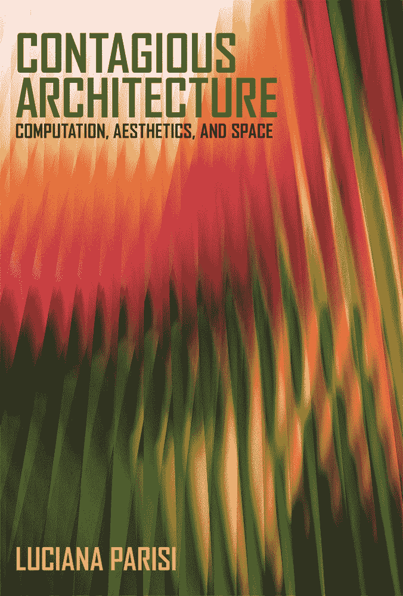
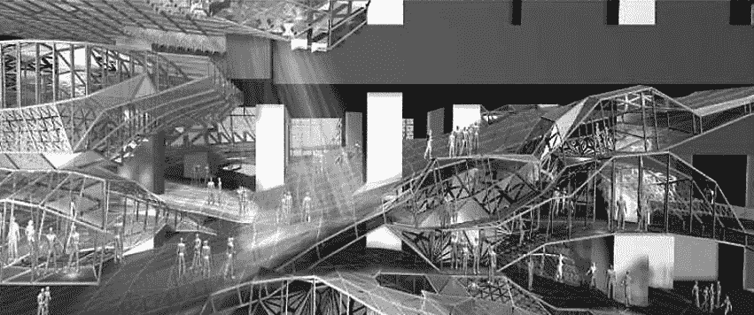
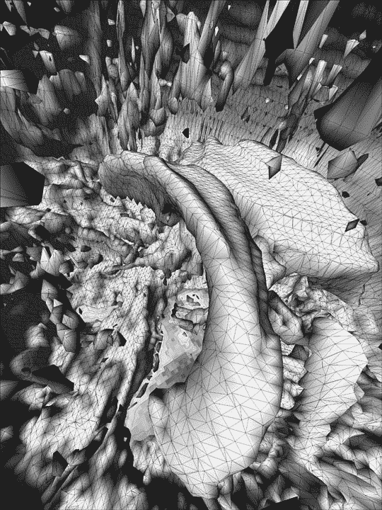
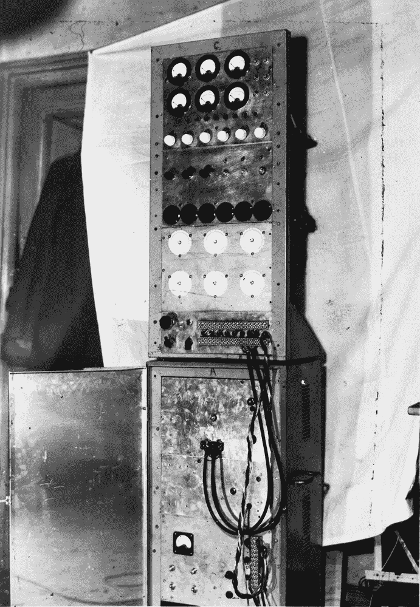
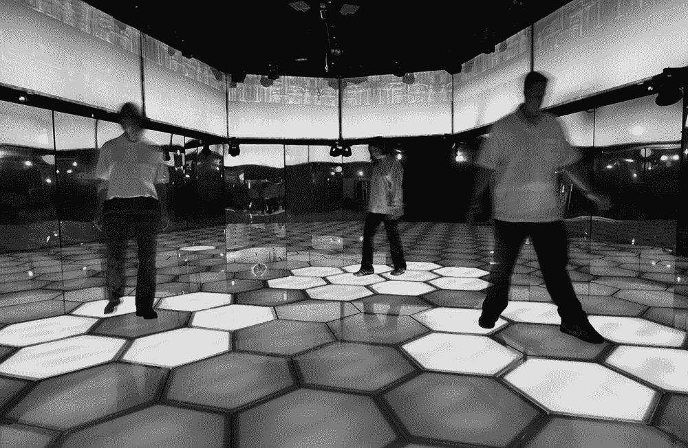
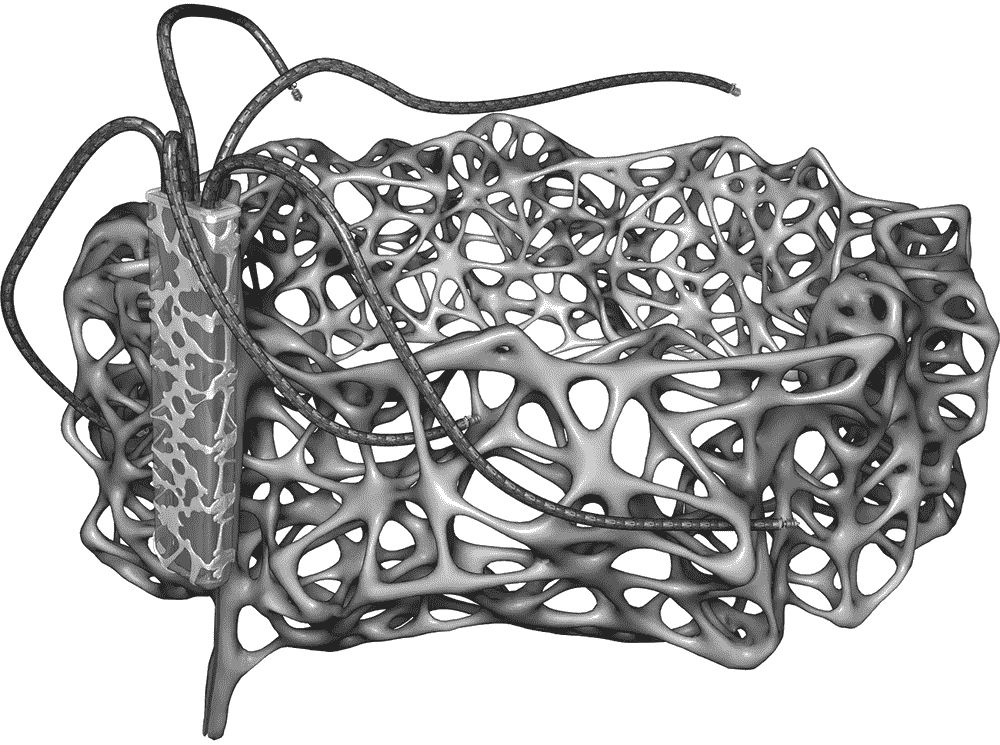

# 传染性建筑：计算、美学与空间（生活抽象的技术）

---
`¹`

本书并非在想象一个理性被信息的任意性所取代的世界。恰恰相反：计算 `randomness` 对应于无限量的数据，这些数据是具有意义的偶然事件，拒绝被整体（即通过头脑、机器或身体）被完全理解、压缩或感知。这意味着算法并不仅仅根据预设的二进制合成机制（0 和 1）来引导数据，它们还列举了有限状态之间的不确定区域。因此，算法的这种新功能不再涉及将数据还原为二进制数字，而是将随机量引入计算：这是一种已成为自动化组织和控制特征的新确定性水平。这种新的确定性非但没有让理性治理体系变得高效，反而迫使治理依赖不确定的概率，从而面临产生异化规则的数据。这些规则既是离散的又是无限的，是统一且分形的。

从另一个角度来看，算法新趋势的强调被无限量的数据所掩盖，这解释了计算逻辑渗透文化的原因。这里的重点不在于文化已注定于自动化规则的宿命——这些规则将其多样化的表达转化为可分类、可分析和可消费的数据。相反，在有限程序中增加随机量使自动化变成了一场计算冒险，导致了新文化现实的确定。自动化处理不再是被执行指令的规则或符号的形式主义所耗尽，而是需要一种半开放的公理 `architecture`，其中现有的假设是为了被其他能够将无限量转化为偶然概率的新假设所取代。公理化中的不完备性因此揭示了一个事实：自动化处理不是预定的，而是倾向于新的确定性。在提出这一观点时，我并不是想暗示计算现在可以解释文化、美学和思想，因为它能够解释变化。我的观点是，存在一种特定于计算产生新概率的具体文化、美学和思维模式。

这就是为什么本书主张一种新的数字空间，这种空间不再或不完全与德勒兹和瓜塔利（Deleuze and Guattari）的“条纹的”（测量的）和“光滑的”（矢量和投影或拓扑的）空间的概念重合。条纹空间是网格化的、线性的、测量的视觉的。它还被描述为逻辑（logos）的空间，基于将无限还原为离散统一的演绎还原法，这些统一构成了理性的基石，其功能是为发生的问题寻找解决方案。

在书中，条纹空间对应于不随时间变化的点的数字矩阵：一种源于基于离散算法集的假设的带前缀的网格状架构，通过这些算法可以构建出最优形式。这是城市的条纹空间，是根据点之间的精确关系推演出的城市规划，它建立了一个预先运动的基础设施网格。然而，在过去的二十年里，空间的数字映射被数字设计中的一种新趋势所交叉，这种趋势更充分拥抱了计算生成新建筑形式或光滑表面的力量。通过借鉴生物学中的形态发生概念，并因此依赖于形式随时间变化的能力，算法已成为形式寻找和模式制造架构的生成性组件。生成性算法（以及细胞自动机、L-系统和参数化）在数字设计中的新中心地位，导致了各种拓扑几何和曲线形状的构建，这些形状被称为“流体建筑”（blob architectures）。条纹空间的网格状架构（或数字映射）将离散统一体置于由线条连接的点所构成的设计中心，而光滑空间的拓扑曲线（或流体建筑）则从一个点的生成力量开始，该点的交合和折叠成为新形式出现的条件。

德勒兹和瓜塔利绝非直接对立，他们经常提到这两个空间处于互为预设的关系，使得点可以产生新的曲线，而曲线可以变成冻结的片段。然而，这两种空间（或平面）之间的这种互惠可能不足以完全解释计算渗透进文化所产生的扩张模式。对于条纹（测量的）空间和光滑（拓扑的）空间，本书增加了另一种扩张方法。这种方法由 `部分拓扑学`（mereotopology）定义：研究部分与部分之间、部分与整体之间、以及部分之间边界的关系。特别是，我转向了阿尔弗雷德·北美·怀特海（Alfred North Whitehead）的部分拓扑关系模式——这是一个具体的抽象模式，用以证明离散统一体或连续表面都无法解释数字网格的转换，因为后者的特征是随机性渗透进有限规则集中。

部分拓扑学将部分描述为半开放的：它一方面将部分视为离散且可分离的，另一方面将其视为未分且连续的。它假设部分与部分之间没有间隙，也没有构成连续轨迹（或拓扑表面）的 `infinitesimal` 点。相反，点与点之间总是存在更多的点（或无限数量的点），这些点对应的不是无限小量、感知和影响，而是由无限性的唯一排列在内部定义的有限片段。对于怀特海来说，这些有限片段是现实性，它们既是延展的也是性的，或者具有空间和时间；它们是有限的持续时间。与产生了由拓扑表面或全连接光滑平面所表达的计算美学的流体建筑不同，部分拓扑架构揭示了无限是部分、统一体和离散对象的内在属性。从这个角度来看，无限并不等同于时空维度融合为一个变形表面的总融合，而是可以解释整体（连续性）如何变成部分（不连续性），以及部分如何比整体大。在计算术语中，无限等同于随机的（或不可压缩的）数据量（既是离散的连续的），干扰并重新编程数字设计中的算法程序，例如。这也意味着算法并非不断演变的拓扑表面的基石。连接这些点的是渗透进点之间间隙的无限量，从而揭示了另一个重叠在上面的点（或时空现实性）的存在，但它并非源于这些点。然而，这些量是如何决定并表征数字设计中的算法程序的呢？

这正是计算与怀特海观点交织的地方，他认为是“把握”（`prehensions`）定义了一个实体是什么以及它如何与其他实体产生联系。把握指向了任何现实（从动物身体到一粒沙子，从变形虫到电子）如何捕捉、包含、排除以及转化数据。怀特海并非主张高等形式的现实（如人类）对其他现实具有某种本体论上的主导地位，而是认为所有实体都具有平等的地位。它们不仅都是真实的，而且都至关重要。尽管如此，这种看似扁平化的本体论并非简单地主张这些现实是完全相同的，也不认为它们是完全不一样的。怀特海提出了一种激进的务实主义，根据这种主义，确定的事件（或他所说的“经验机会”）是由把握的程度定义的，而这种程度反过来又构成了某些现实相对于其他现实的重要性程度。

在本书中，算法在时空形式与关系编程中的新功能，揭示了算法自身的把握程度如何成为刻画计算文化的特征。算法不再被视为完成任务的工具：在`digital architecture`中，它们是实现建筑、基础设施和物体自动化设计的构造材料或抽象“物质”。因此，算法是现实，通过在概率计算处理中对数据的自动化把握来定义。从这个角度来看，数字算法不仅仅仅是数据的表示，而且是经验机会”，因为它们以自己的方式把握信息，而这种方式既不严格等同于计算的二进制或模糊逻辑，也不等同于外部物理输入的代理性。相反，作为“现实机会”，算法把握了它们被编写的格式化系统，也把握了它们检索的外部数据输入。尽管如此，这种把握活动并不简单等同于对把握之物的复制。相反，它可以被描述为一种“传染”。这是因为把握数据意味着经历一种不可逆的转化，这种转化取决于规则内在于它们试图合成的无限多样量性的方式。这意味着规则无法改变这些无限量性；相反，这些无限量性可以重新决定规则，从而产生新的规则。从这个角度来看，我使用“传染”这一概念并不是为了暗示点与点之间存在物理连接（即一个把握点由顺序中的下一点决定），或点与点之间存在潜在关系（即点通过无限近似相连接的事实）。相反，维持“把握可以理解为一种传染”的观点，是说无限量的数据不可逆地进入并决定了算法程序的函数。由此得出，传染描述了编程中随机性的内在性。这种不可压缩数据对数字空间设计的不可逆入侵，导致了数字时空的产生，它们并不代表物理空间，而是新的时空现实。这些现实的传染性建筑正在构建一个新的数字空间，在这个空间内，编程的建筑形式和城市基础设施不仅暴露了新的生活模式，也暴露了新的思维模式。

尽管如此，通过把握（或感染）无限量的数据，算法并非仅仅为了生成更紧密匹配未来建筑及其城市基础设施的优化概率。算法把握的未来性无法通过“未来”的图像来穷尽。相反，作为把握性实体，算法释放了当下数字时空的具体未来，而数字建筑只是其中一个例子（其他例子可能包括数据库的关系型架构、搜索文化中的文化、政治和经济陈述、社交媒体的连接性以及数据通信的即时性）。

本书关于计算逻辑进入文化的过程（ingression）。它最适合被归于数字建筑领域，因为数字时态的算法化生产定义了：(1) 逻辑正在变成一种审美操作，以及 (2) 计算美学的特征是对是对`不可计算`数据的算法把握。在计算逻辑中加入这种审美干预，我的意思并不是暗示算法是不确定量的新型合成器。相反，本书的一个条件是，任何现实——无论是物理的还是自动化的——都永远无法包含所有现实内在的“无限的无限”。相反，所有现实中发生的情况是，这些无限的种类仅被部分且独特地进行处理，以至于每个现实相对于另一个现实是不是对称的，而且其内部也是不对称的。换句话说，在公理化中发现不可计算的量揭示了，不存在任何能够将（外部或内部）部分包含在一个包容整体中的整体。

从这个角度来看，逻辑的审美操作表明，算法的把握活动不仅评估和转化，还列举并产生了新的计算现实。在数字建筑领域，这意味着计算逻辑不需要被用来达到审美结果，就像它由一个外部代理操作的一样（这种代理会从“外部”选择过程中的活动）。相反，美学必须被理解为存在于计算逻辑的核心，因为它将计算处理定义为以逐步的方式决定无限性，而不将它们完全完全合成和/或公理化。也就是说，美学不仅是逻辑的补充，而且是逻辑内在的：它揭示了编程中的偶然性，以及概率计算中偶然的现实性。

然而，将算法的审美能力归因于对数据的主要是定性合成是误导性的。在谈论计算中的美学时，重要的是要记住，人们无法消除数据的熵规模，因此量在每次计算时其体积、长度和密度都有增加的趋势。因此，本书并没有偏离计算的一个基本核心：即计算是一种处理数量的量化方法。从这个角度来看，`算法把握是对无限量的量化，产生了新的量`。

这同时也意味着在计算内部存在着一种新事物的产生，这种产生特别涉及随机性的增加或无法在较小算法程序中系统化的量增加。因此，本书并不包含关于清理文化中数据污染的任何主张，因为它承认数据产生是一个内在过程，这种过程在试图不断发明新公理和规则时，破解了系统内部的缝隙、盲点和不兼容性。

同样，本书也区别于主导的反馈控制控制论模型，该模型旨在通过允许系统与其外部共同建构，将定性数据纳入计算程序。特别是，`二阶控制论`的主导地位及其在数字架构中的自创生反馈模型，导致了大量的交互项目；在这些项目中，算法被设计用于响应和适应外部输入，以便能够为编程增加偶然性。然而，在我看来，这种向编程中添加定性数据的尝试并没有挑战计算，而是为了化了基础的推理系统——该系统将逻辑分配给理性，将美学分配给感觉。反对这种倾向，本书拥抱了算法在其定量具体性中的美学功能，即对偶然性的把握，从而随机性在逻辑内部的爆发。我声称，这正是治理当今数字文化的计算美学。

对这种奇异的形式的调查指向了更深层次的分析，即寻找计算推测性功能的属性。在此过程中，它再次转向了白白的形而上学，因为他试图将理性从理性领地中剥离出来的尝试范围足够大，包含了这种可能性：自动化的思维模式即决策模式，而决策是一种通过反作用模式的顺序模式，向已存在的内容添加新数据并进行重新思考模式。简而言之，白白对理性功能的研究为我的调查提供了一个讨论算法特定思维模式的机会：`软（软件）思维`。我的分析并不是寻找将计算与（或并入）形式或实践的理性概念比较（或融合）的方法，也没有将其与视为向世界执行思维的心智观念，或视为大脑神经网络突触连接产物的心智观念联系起来，而是从算法作为实际思维模式的现实出发的。

从这个观点来看，计算并非指从普遍公理推导出现实的理性演算，而是指对随机数据的算法化把握，这些数据现在正污染着形式逻辑不断发明新公理的尝试。算法的推测性功能对应于具体数据的抽象方案，或者对应于程序的枚举，计算通过这些程序构建我们的现在。因此，推测性计算不应被误认为一种新的预测模式（例如，它通过预判当下发生的即时决策来预排了未知的潜在威胁）。相反，这种抽象方案在现在的程序中包含了干扰（数量的熵增），因为它允许无限量的数据来决定时空活动。简而言之，推测性计算不是一种试图将可能性变为可能性的新概率系统。它是对熵数据的美学排序。这是一种奇异的排序不仅涉及对时间无限性的把握，还涉及在计算程序中被枚举的延展无限性。这种内在的局部性帮助我们根据白白的`理性`的`推测性`功能来描述计算，根据这种功能，算法的现实性从重复中选择定量的新颖性，从而允许计算为现实性的连续体添加新的数据结构或时空性。

计算的这种推测性是无法被控制论概率系统所容纳的。正如马苏米（Massumi）在他对预防性权力效力的讨论中所澄清的那样，这样的系统不能再依赖于已经处理的数据。相反，基于反馈作为治理自调节属性的控制论控制模式——其输出允许系统吸收更多复杂性，从而扩展到或与其外部融合——现在需要解释那些不存在的东西，即未知的确定性。这就是为什么数字计算的二进制语言不再足以以预判错误的出现，或将未知的量子转换为预设的概率。因此，正如马苏米所解释的，基于程序的操作和可操作性并对其定义的控制装置，采用了一种准经验的计算模式，根据这种模式，新的（不确定的）必然出现及其潜在影响在事实之前被预计算并抢先了。换句话说，未知的影响已成为因果动力，通过这种动力，控制被无条件地执行，并在对尚未发生的内在决策驱动下。

因此，反馈控制论系统在其二进制计算中插入了时间性或定性变化。特别是对这些状态之间微小变化的计算挑战了控制论使其克服自身的局限，从而将其预测能力向定性变化扩展。正是这种向包含时间变化的伸展，揭示了后控制论控制追溯行动的力量，即通过将未来的潜在影响转化为现在内的操作程序来行动。二进制数字矩阵因此变成了一个由在切线处连接两个坐标的微小点近似计算的折叠：`x`和`y`坐标的导数将平行线变成了潜在曲线的无限性。因此，一个`拓扑`表面跃升于顺序编码的数字矩阵之上，并在立面、建筑和城市规划的数字设计中不断地复制。这种关于曲线的计算美学现在是后控制论控制的主导表现。

然而，我的调查并未在此处结束，而是继续探索留在数字架构核心的数量的顽固现实。算法和交互式建筑——或广义的数字化——之所以未能捕捉或产生时空体验的强度特质、对时空变化的身体感受，是因为计算处理的是数量和量化。本书要求读者考虑计算数量的密度，作为新现实的枚举，或进入并添加到信息基础设施组织的时空实体。因此，本书开始对数字建筑项目进行严密探索，为了解释的不是拓扑表面的生成演变，而是大于整体的部分的`部分拓扑学`（mereotopology）。在这里，算法再次被凸显为数据的现实时刻，它们无法被归入后控制论控制的总体框架之下。我认为，这些部分并没有成为平滑控制空间中的融合代理人：相反，它们是自主的事件或现实时刻的节点。

对计算数量的局部拓扑学探索为我的调查留了又一个待讨论的问题。如果数字建筑意味着计算时空的产生，是否推导出存在一种属于计算自身的思维架构？对这一问题的追求使本书的论点指向了不可理解的软思维存在的必然性：这是一种自动化的把握模式，无法被压缩进一个总体系统（即心灵、机器、身体，或唯心主义、机械论或活力论）。

软思维（Soft thought）并非`cognition`的新疆域，亦非新理性的本体论建构。相反，软思维源于`incomputable`数据对数字编程的内在入侵。软思维并非取代了理解为认知行动的思维，也不是为大脑提供了排序和计算的新能力，抑或赋予了身体导航空间的新能力。简单来说，软思维涉及某些与人类思维没有直接关系的思维模式、决策机制和心态模式。这些思维模式（软思维只是其中一种配置）通过其逻辑上的不一致性，保持了相对于认知某种程度的自主性。因此，本书的结尾并没有任何意料或最终的启示，而是这样一段话：软思维的存在并非为了被理解为一种新的认知功能或一种超越性的理性，而是为了揭示`programming culture`正受到尚未被解释的不可计算思维的感染。

正如吉尔·德勒兹（Gilles Deleuze）所说，在某些时期，人们回首过去事件时会发现自己并不真正了解发生了什么。在这些时期，重要的是友谊和爱。

感谢我所有的朋友帮助我度过风暴。特别感谢 Steve Goodman, Stefania Arcara, Maud Pons, Melina Puleo, Jessica Edwards, Tiziana Terranova, Piero D’Alterio, Annamaria Morelli, Kevin Martin, Yari Lanci, Stamatia Portanova, Lidia Curti, Iain Chambers 以及 Silvana Carotenuto。你们独特的组合对于为我的战争机器提供燃料是不可缺的。Francesco 和 Marcello Parisi 因其前瞻性的能量受到特别感谢，我的父母 Anna 和 Gennaro Parisi 也因他们的持续鼓励而受到感谢。Maria, Sofia 和 Davide：也要感谢你们。

我也感谢金德德斯学院的文化研究中心及其工作人员在这些年对我的支持。特别想感谢 Matthew Fuller, Graham Harwood 和 Olga Goriunova 的无私主义精神和学术诚实。与你们的合作让我学到了很多。也感谢 Scott Lash 和 Celia Lury 为我提供了一个进一步进行理论冒险的空间，感谢 Lisa Rabanal 和 Breda McAleer 的倾听，感谢 Mariam Fraser 和 Josephine Berry Slater 的交谈，感谢 John Hutnyk 的抽空。感谢互动媒体硕士（MA Interactive Media）优秀的学生们（特别是 2008 年到 2011 年间该课程的所有学生），中心的研究生们，特别是“新媒体会议”小组：我非常喜欢我们充满挑战性的讨论和你们雄心勃勃的思考。还要感谢 Maria Beatrice Fazi（grazie per la tua disponibilità e intelligenza），Susan Schuppli（也提供了图片帮助），Chryssa Sdrolia, Masa Kosugi, Sandra Gaudenzi, Carina Lopez 和 Inigo Wilkins。

如果没有 Erin Manning 和 Brian Massumi 的信任和慷慨，这个项目永远无法开始。你们是模范的人，我无法感谢你们对“研究创作”（research creation）的信念，以及预见到了过程将通向结论。我也感谢 Doug Sery 对这个项目的投入，以及远在麻省理工学院（MIT）的 Katie Helke Dokshina。特别感谢 Tom Bunyard 帮助我完成校对工作。

我知道是什么让这本书得以完成的：Stephen 和 Cleo 无条件的爱。你们属于一个全新的太阳系。感谢你们让我勇敢，并向我展示了当下的奇迹。这本书献给你们两个。

这一概念可以解释为：计算的既不等同于算法设计自演化结构的生成能力，也不等同于物理连接的交互系统。换句话之，我认为计算的数学或物理基础都不足以描述算法对象的可能。

这些无模式数据与其说是定义了一种新型算法矩阵，不如说是不可压缩数据在所有图解（diagrammatics）中的内在性。下文将变得更加清晰，算法对象既是现实的也是抽象的实体。本文提出的观点与瓜塔里对无意义连接的图解和元建模不同，即：为了定义算法对象，必须承认在公理化计算内部可能存在额外的潜能（potentiality），这一层潜能并非经验领域所专属。本章意在论证的正是这种额外的潜能层——抽象对象的现实性。

同样，我也质疑这种假设，即只有处于计算、自动化、离散性和有限性领域之外的东西才能帮助我们将算法对象定义为动态、可变化且处于运动中的。相反，`Omega`的概念证明了尽管在物理世界中无法找到无限，但在计算处理过程中是可以察觉到的。这意味着变化的可能性是算法实在性本体的内在属性。因此，我认为交互式算法和响应式计算（即由外部因素定义或由外部输入驱动的算法）并不是解释算法对象的“是什么”和“如何”，而是对其产生了遮蔽。特别是，本章指出，交互式和响应式架构最终将变化归因于外部代理、执行器或参与者；因此，算法对象在不断变化的交互环境中被视为是被动的。
本章证明了计算为我们提供了一个更为复杂且微妙的算法概念，根据这一概念，算法并不等于随时间变变的演化代理，而是受无限信息限制的顺序时空数据结构。这些数据结构是真实的时空性，并已然成为算法架构的对象。在第 2 章中将对这些结构进行更深入的分析；在这里，我的目标是建立对作为`qua` 真实实体的算法的理解。
为了进一步探讨算法的本体论，人们无法避免关于构成对象的哲学问题，以及是否存在抽象对象之类的讨论。为了解决这些问题，我将借鉴阿尔弗雷德·北·怀特海（Alfred North Whitehead）的过程哲学以及格拉姆·哈曼（Graham Harman）的对象形而上学。这两个对比的形而上学系统的遭遇也将用于挑战算法对象是有限指令集的观点。这一讨论旨在阐明为什么“不可计算性”的概念能够帮助我们根据真实和抽象对象来定义算法。
本章将得出结论：算法对象是真实的实体：浸润了不可计算或无模式对象的时空结构。然而，后者不应被误解为自我演化能量的无限背景。相反，无模式对象对应于指令集内部的熵激增，从而定义了我们编程文化结构中离散却无限算法的奇特存在。从这个意义上说，算法对象不仅是软件内部的涌现形式，而且注入了随机数据的离散统一体。仿佛算法对象不再属于软件领域，而是无意中构建了一个数据额外空间，感染（或不可逆转地重新编程）了物质的所有层面。
从这个观点来看，算法对象不仅是一个时间上的表现或交互刺激的结果。相反，它是算法架构最清晰地部署的新时空结构的症状。这是一个重要的观点，反驳了算法仅仅是注定在无处不在的计算背景中消失的时间形式的观点。计算设计地拥抱了预测逻辑和概率计算，并且无法解释时空经验中的新颖性。我反对这种形式的元计算（metacomputation），也反对基于少数不可变规则的理性逻辑，这些规则组合被认为产生了所有形式的复杂性。
与将计算视为理性主义形式的观点相反，我在此建议，公理化中不可计算性的引入使我们借鉴怀特海的话，从“推测理性”（speculative reason）的角度重新思考计算。将认为，计算是推测理性的一个实例，因为它不再也不仅仅旨在对概率进行预测或计算。相反，怀特海对推测理性的解释说明，理性的功能是向因果链链中始终将已经发生的事情添加新数据。同样，可以观察到，计算的推测视角意味着计算不等同于数据集的线性连续。相反，正如本章稍后解释的那样，每组指令都受限于无法计算的事：受限于揭示形式化序列内部空洞、间隙、不规则和异常的不可计算算法。这意味着，推测计算的概念关注不是通过量化概率来预测未来，而是关注将随机或无模式的数据量包含在顺序计算中，以便在事物的真实架构中增加新颖性。这就是为什么推测计算的概念不应与算法架构创建临时形式的能力混淆。相反，这里提出的推测计算概念表明，随机数据——不确定的数量——是现在的传染性架构。这些架构并非从现实中撤离并因此不是那些出现和消失的时间形式，而是保持为实在：即时空现实，作为未来实在（无论何种类型、何种规模）继承、评估和占有的客观数据，即使它们不再存在。
算法架构并非为了预测可能的未来的时空结构，它在这里被构想为当下推测编程的症状。算法架构也可以被视为计算美学的实例，在这里被理解为对不确定数据的算法摄取（prehension）。因此，计算美学不是关于形式的理想主义，或关于代码破解生物物理结构的复杂性。相反，本章将得出结论：算法架构将计算美学解释为通过对无模式数据的算法选择对实在进行编程。出于这个原因，算法架构是另一种形式的`后控制论控制`，因为它依赖算法来摄取不可计算的数据以编写文化。
## 1.0.1 编写生命体
如果不参考至少两种截不同的算法概念，很难理解所谓的算法时代意味着什么。一方面，算法对应于一组有限指令。另一方面，算法被构想为能够进化的数据，能够根据外部刺激适应并不可预测地变化。
对计算的控制论解读可能会澄清这两点。从`一阶控制论`的角度来看，计算是一个闭合系统，一种能够描述任何生物物理过程而无需外部环境作用的形式化语言。这是一个封闭、自给自足的程序指令集，能够根据预设概率预测系统的未来行为。另一方面，`二阶控制论`认为，生物物理的不确定性或环境因素的偶然性可以开放软件编程，对随时间变化并产生与初始条件不同结果的动态系统进行建模。

不可否认，多年来，算法架构（algorithmic architecture）已成为一种学习整合、运行和预判所有物质现象演化能力的计算系统。同样，尽管它试图将信息与物质融合，但算法架构最终证明了抽象的现实性无法还原为生命系统的属性。换句话说，算法架构未能消除一个计算固有的问题：即如何以一种同时也包含——这一点在此至关重要——不可计算概率（probability of incomputability）的方式，来计算无限概率序列。

软件艺术家 Alex McLean 最近设计了一种程序，旨在解决计算局限性问题。他将该软件称为 `Fork Bomb Program`（派生炸程序），因为它展示了图灵机停机问题已经预见到的、即将到来的软件灾难。
`Fork Bomb` 是一段短代码，它能够处理大量的算法计算，这会迅速饱和计算机操作系统维护的进程列表中的可用空间。`Fork Bomb` 展示了计算过程是如何通过计算过程本身被减慢的。计算的局限在这里通过简单算法序列的不断重复得到了证明，这种重复饱和了搜索空间并导致整个计算的崩溃。
但是，如果计算一直被其不可计算的局限以及公理方法的不完备性所困扰，人们可能会好奇，计算究竟是如何成为一种文化的核心的，而这种文化现在被描述为“算法时代”。要理解计算的文化（以及时代性）主地位，可能需要审视二阶控制论，特别是系统的自创生（autopoietic）理解，是如何将“极限”的概念从“崩溃”的思想中转移出来的。

## 二阶控制论与自生成系统
二阶控制论和神经网络的早期研究已经尝试利用计算的局限来产生自生成的控制系统，其最终结果不必与其初始条件下建立的规则相匹配。对于二阶控制论而言，生物物理现象随时间推移进行自我组织、适应和变化的自创生能力，为跳出严格基于形式计算模型的 AI 研究胡同提供了一条路。这意味着计算的局限可以成为一个演化阈值，在某种程度上，生成规则可以产生新层次的秩序。
如果计算的极限等同于内部秩序受到增加的热量或熵威胁的物理系统的极限，那么自创生的自我组织模型证明了混沌可以以负熵信息的形式转化为秩序。换句话说，信息可以像生物物理系统自我组织并将耗散能量转化为信息一样，对随机力量的能量混沌进行排序。因此，计算极限不再是计算的阻碍，而是成为了探索新层次秩序的机会，这种秩序能够将能量转换为编码指令串。
## 向演化模型的转变
然而，自矛盾的是，这种新的计算视角源于一种观察，即生物物理系统能够比公理方法更有效地整合不确定结果并解释动态结构。这种观点构成了演化进步的本体论一神论，它寻找不断提高的秩序形式，以最小化（优化）混沌的熵随机性。简单来说，从形式计算模型向演化计算模型的转变，并没有从根本上挑战建模本身的本体论概念。相反，向二阶控制论的转向放弃了计算处理可能最引人注目的意义：公理化中不可计算算法的到来。

# 怀特的过程形而上学
对于怀特来说，实际世界由实际发生组成。这些实际性被分组成事件，事件成为实际实体的结（nexus），这些实体“在一个广延的量子中以某种特定的方式相互关联”。因此，事件解释了实际性的聚合性，怀特将其称为“结”。但每一个结都是另一个结的组成部分。后者从其组成元素的融摄（concrescence）中作为一个不可改变的实体出现出来，并作为一个事实存在，拥有日期和位置。
怀特指出，实际实体的个体特殊性以及每个实体结的特殊性，也独立于其原始感知者，因此“在未来的自身之外享受着客观的不朽”。从这个观点来看，怀特反驳了空间和时间的首要概念，并认为只有事件作为实际实体的结，才能成为具有日期的不可重复的场所。换句话说，实际实体是时间和空间的内在事件，但作为实体的结，事件又超越了*这个*空间和*这个*时间。
# 哈曼的批判与算法对象
尽管如此，哈曼认为这种事件概念是由一个先验原因决定的，因为事件是从过程的影响角度解释对象的。他认为，过程形而上学始终已经根据对象在世界上产生的影响来定义对象（例如，树），而不是将其定义为自身的原因。他坚持认为，在怀特的形而上学中，对象对他人的影响决定了它们的存在。与之相反，哈曼认为对象及其关系与它们的影响在本体论上是相互独立的。对于哈曼来说，对象之间的相互只有在对象的元素和性质成为对象本身之后，才能间接地或通过中介地发生。因此，算法对象不应对应于它们在物理现实中可能产生的影响。相反，交互应该揭示一个对象如何变成另一个对象，一个代码如何决定并改变其被设计的环境。
从面向对象的形而上学的角度来看，例如，“情感墙”（Emotive Wall）项目所隐含的交互层级仅仅是算法产生的影响。在这里，对象之间的交互无法释放新对象，只能还原为算法对墙可能产生的影响，从而使墙与参与者的运动互动。换句话说，从这个观点来看，“情感墙”是一个响应式架构的示例，这种架构是由算法对墙的物理结构产生的影响生成的，而它对从参与者那里收集到的感觉数据做出反应。最终，“情感墙”是算法编程的结果。
# 诱惑与性质的概念
但算法对象如何能不仅仅是一个对象对另一个对象的影响呢？根据哈曼的，对象通过它们的性质相互作用。这些性质并非仅仅产生影响的投影，而是对象本身。特别是，哈曼使用“诱惑”（allure）的概念来解释对象之间的关系是中介的、间接的，因此无法将影响转移到事物上。诱惑的概念解释了性质如何成为超越任何参考系的事物。然而，影响只能源于参考系，并将对象重新还原为仅仅的次级性质。因此，在“情感墙”的中，算法不被构想为对象，而是性质在墙上的投影，这仍然是感觉运动交互的结果：墙可以通过响应外部刺激来弯曲、发出声音并创造出色调。因此，这里的算法或墙都不是对象，而是部署了由感知者推导出的众多影响。
# 重新评估怀特与哈曼
同样，根据哈曼的，怀特的过程形而上学无法解释对象如何真正相互作用，因为性质仅仅是附在对象上的，而不是对象本身。哈曼认为，这些性质仅构成了解释对象之间关系的事件。然而，此时可能有必要接近怀特的观点，并强调事件不仅仅是被剥夺了对象的性质；相反，他将事件构想为定义广延集或时间序列的实际发生结，即实际性的累积。换句话说，事件是“持久的对象”。时间加空间。此外，事件既是心理的也是物理的，在思想和事物具有相等但不等效的形而上学价值的范围内。对于怀特来说，事件是一个不可重复的模式，不断发生且永恒不变。对于哈曼来说，事件的这种时间性是由把握（prehensions）结过于直接决定并相关的，他认为这种结始终在那里，通过投影塑造对象，从而将对象还原为没有特定形式的无形物质。
# 结论：本体地位与计算
哈曼对事物实际性、不可分性以及作为实体本体论地位的坚持，似乎是对将算法定义为响应式感知者简单投影的众多影响的替代方案。然而，他的形而上学体系可能只是再次将对象的实际性与其有限实体相混淆。哈曼的立场奇异地与一阶控制论的对象概念产生共鸣，根据这种观点，对象是由有限状态决定的。尽管它们的性质（和数量）已经与其他对象及其无限部分嵌套，这些对象将始终保持它们的本原。如果正如哈曼告诉我们的那样，性质是本身作为对象的碎片、部分、包裹和比特，那么也许对象终究无法保持不变。尽管如此，可以说他坚持认为苹果始终是一个苹果，即使它的性质（绿的、红的、甜的、煮过的或生的）已经与其他产生关系并产生新对象（例如，绿苹果）。这意味着，如果苹果被计算，它将是一个有限的算法集，尽管与其他交互，但将始终保持一个可追溯的实体和原始来源。然而，计算的局限性表明，对象具有大于其整体的部分；一个集合内部始终存在不完整性。这意味着，无论你如何将其拆分为自主的性质-对象，都不存在离散且有限的实体。这就是为什么对象始终是部分性的，并进入事件结，通过这种结，它们不可还原的部分可以成为新的实际对象。

# 怀特白的过程形而学
怀特白实际上拒绝了过程涉及一个自我调节整体的持续变化的观点。如果没有过程的形式，如果没有能够把握（prehending）无限的现实与抽象数据的概念和物理对象，就不存在过程。根据怀特异的观点，过程的形式恰恰回答了这个问题：“有限性的重要性如何要求无限性的重要性？”
因此，过程的形式解释了“每一个完全实现的事实在历史世界和形式领域中都具有无限的关系”。
换句话说，过程的形式定义了对象如何达到完成并变得个体化，以及无限的潜能（或永恒对象）如何进入现实并决定事件多事件的时空性。过程的形式解释了意料之外的世界如何被添加到已存在的对象中。尽管如此，这种形式并不对应于对象的总和，以及数据性质和数量的累积。宇宙的合生（concrescence）涉及到注入了永恒对象的现实世界的合生。如果没有现实对象履行所选（或把握）的永恒对象的潜在内容的能力，现实对象就无法完成，事件也不会产生，现实性质和数量才能变得不同于它们原本的状态。
# 哈曼的面向对象的形而学
哈曼的面向对象的形而学质疑了怀特白需要诉诸永恒对象或潜能来解释现实对象是什么、它们如何关联，以及什么定义了一个新对象。对于哈曼来说，现实世界的特定表达是此时此地，不能通过永恒对象来解释。
尽管如此，怀特白的形而学并没有简单地将经验性替换为先验因果，将现实性替换为过程，或将事实替换为形式。相反，它坚持认为现实对象内部存在着内在的原因：呈现即时性（presentational immediacy）和因果效力（causal efficacy）。前者解释了把握是如何被当下立即摄取的，而因果效力指的是潜伏在背景中的过去数据的真实性。
如果说因果效力是“对直接过去的起源感以及向直接未来过渡的感觉”，那么呈现即时性——对事物此时此地呈现的感官感知——是在把握的即时性中感受到的。怀特白解释说，当下位置是两种感知模式的数据基础：根据呈现即时性的原因，它是即时感知的对象；通过因果效力，它是间接感知的对象。换句话说，双重因果关系并没有为了现实而排除潜能，但也没有简单地通过唯经验主义或超验唯心主义将这两个原因合并。
# 无限性的内在性
这两个原因解释了无限性的内在性：永恒对象对应于理念的无限无限，现实对象部署了物质的无限无限。当一个现实实体选择某些理念时，联结（nexus）变成了一个事件，另一个现实对象被添加到广延连续体中。正如怀特白所说，“连续体是可分的；只要当代世界被现实实体所划分，它就不是连续体，而是原子的。”
因此，永恒对象并不是将现实实体胶在一起，将所有个性合并成一个持续的投影过程。相反，作为现实偶然的通用关系矩阵的广延连续体被定义为“现实变为其自身仅仅是潜能的过程”。
# 算法对象与选择
从这个观点来看，如果正如面向对象的形而学所声称的，并非所有对象都是相同的，而是每个对象都是真实的，那么就不能否定抽象的真实性，或者否定非实体对象具有被现实对象所选择的性质、数量和关系。所指的选择过程是由把握驱动的，把握也可以被定义为从其他现实实体和永恒对象计算数据的模式。
怀特白的形而学承认现实性受到了抽象的感染，具有无法包含在不可变物质中的无限部分。由于这个原因，怀特白的现实性概念可能为我们阐明算法对象如何可以是现实的，但同时又注入了不可计算的数量，以及比整体更大的部分。
算法对象可以被定义为有限的现实性，它们不对应于终极的生物物理或理想物质，而是以从过去（因果效力）和从现在（呈现即时性）把握的数据为特征。但并不是全部：怀特白的永恒对象概念还解释了抽象无限是如何被任何现实过程的形式立即把握的。因此，他对现实性的叙述有助于我们把算法定义为过程的形式：即注入了永恒对象不可计算数据的现实对象。
# 永恒对象的关系
尽管如此，永恒对象与现实实体之间的关系并非简单的共同进化或结构耦合，例如自组织算法方法可能声称的那样。同样，永恒对象并不产生现实偶然，而是现实偶然“生成过程的潜能”。
因此，永恒对象内在于任何现实实体并是其不可分割的一部分，因为后者恰恰是过程的形式和数据的时空结构。永恒对象是现实性的内在属性，无论后者多么微小、多么无机。怀特白的哲学为我们提供了一种原始的无限视角，它并不对应于两个对象之间的无限连续性，而是解释了永恒对象作为嵌套在现实对象无限局部中的无限无限变体。

例如，数学家约翰·康威的`生命游戏`（1970）的算法架构由一种二状态或二维的细胞自动机组成，其状态由邻居单元的状态决定¹⁵⁸。在这里，所有细胞之间都存在直接或间接的关系，计算过程通过每个细胞的颜色变化来体现。游戏的自动部署由代码和规则的初始设置设定，这产生了与其原始状态不对应的复杂模式。作为图灵机的另一个实例，即一个能够勾勒出所有可能的算法及其结果的计算宇宙，康威的游戏可以计算任何可以通过算法计算的内容。它证明了优雅的代码和算法如何成为解决在秩序与混沌之间震荡的系统复杂性的简单方案。模式随时间变化的过程在此与一种计算过程相合，在该过程中，代码本身随着时间的推移被重写。这种重写证实了后一个过程的初始条件并没有预决定其最终结果。
`生命游戏`基于通用自我复制器的概念。其操作中的微小变化（通过对代码配置和规则的持续修改定义）会对整个系统产生影响。这种扩展的图灵模型并非运行于计算的极限，而是在完全公理化的框架内运行，因为它通过较小的输入解释了所有输出。因此，康威的`生命游戏`仍然锁定在生成性复杂的美之中。它利用了细胞自动机可以证明：一旦算法设定为增长，初始条件就不再可追溯；但这是一种计算美学模型，忽略了有机复杂性进化模型的局限性。
尤根·施密特伯（Jürgen Schmidhuber）在 1997 年提出了另一种方法，他使用超级欧米茄（Super Omegas）¹⁵⁹。他的低复杂度艺术概念汲用了查廷（Chaitin）和柯尔莫哥夫（Kolmogorov）的算法信息论，认为算法的审美形态等同于主观观察者对数据最可能描述的享受。换句话说，压缩进密码的随机性（复杂度或不可计算数据）越多——例如`Omega`，一种极限可计算算法——所表达出的美（从最简单或最优雅的复杂度公式角度理解）就越多。像数字哲学家一样，施密特伯也认为，如果宇宙是可计算的，那么在所有物理现象之下必然运行着一种计算美学：一种底层的、基础的数学美，可以通过观察者所触及的最短代码来表达¹⁶¹。在这里，概率的计算通过简单模式生成复杂行为的递归而发生。
从这个角度来看，计算美学是复杂数据优雅压缩的体现，这与随机信息的感知合成点（或主观合成）相契。换句话说，这种计算美学模型定义了一种认知行为，即通过感知对数据进行压缩¹⁶²。然而，如果最短代码对应于宇宙最简单法则的观察点，那么计算美学只能赞美受最短程序支配的理性，即将数据压缩为最简单的形式。对于这种计算美学的解释，理性、逻辑和计算与信息压缩相合，作为感知的主观极限点。算法形式越容易压缩、越可预测、越被认知，它就越美。任何新模式都取决于认知能力将复杂信息缩小为日益压缩的数据形式的能力。与查廷认为超级欧米茄从根本上挑战“一切理论”的观点¹⁶³相反，施密特伯将自限定算法视为对复杂度进行认知的机会：一个感性的（或用他自己的话说是“美学的”）观察点，它证明了一种宇宙的计算理论。
然而，编程文化的审美意义恰恰指向相反的方向。例如，无处不在计算旨在构建一个可以在媒介平台之间易于传输的数据巨网。然而，尽管付出的努力将不同平台融合成一个平滑的兼容平面，但并没有一个终极的、有限的算法集，没有优雅的公式，也没有能够压缩存储并产生于不同数据库中数据的 AI。相反，数据的算法处理不可避免地面对每一次感知认知边缘不可计算信息的侵入，这种侵入将计算美学从逻辑步骤序列的有限概念化中释放出来，开启了理性的推测功能。
换句话说，只要低复杂度美学聚焦于一个认为能够将不可数复杂度抓取为短算法指令集的认知观察点，它就不允许计算产生新颖性，因为它仅仅将后者与向内的重复指令认知模式联系起来。在这里，审美对应的不是对永恒形式的把握，而是感知和认知将抽象现实还原可理解数学形式的能力。然而这些现实是无法被认知的，正如查廷所暗示的那样，`Omega`和超级欧米茄并不适用于一个完整的形式系统，也不仅仅是现实或超越性无限的自发直觉。
超级欧米茄不可压缩的随机无限通过一系列日益随机的`Omega`无限序列取代了 0 和 1 的二元论，将计算推入一个数据的额外空间。这里认为，自限定的超级欧米茄无限是代码的随机剩余价值¹⁶⁴，它们驱动算法理性背离预设函数，转向一种由不确定无限的概念把握所定义的推测美学。简而言之，如果所有编程文化共享一个运行在所有时空复杂度之下的短程序公理空间，那是因为这个空间具有传染性，由随机增加的数量组成，并且是一个跨平台、类别和领域不断添加新公理的场所。

然而，将这种终因或目的的概念与宇宙的目的论解释等同起来将具有误导性，因为对于怀特德来说，理性的功能是“进步的且永不终结”。这意味着理性的目的附着于事物的物理性，但并非源于这些事物。同样，理性的目的并不非专门归属于较高形式的智能。对于怀特德而言，所有实体——无论高低——都具有目的。
低级形式中理性的本质包含了对新颖性闪现的`judgment`（判断），这种判断是由概念性欲求（一种对概念的引惑，一种思维向上的倾向）决定的，而非由行动（反射或感觉运动）定义。然而，根据怀特德的观点，稳定的生命并没有为理性或反作用力留出适当的空间，因为它仅仅参与了重复的模式。理性作为动力因和终因的交织，在这里被构想为对新颖性的`organ of emphasis`（强调器官）。特别是，理性提供了使新颖性进入实现、变为事实的判断。
怀特德主张理性是推测性的：一种出于无私好奇的冲动，在这里理性仅为自身服务，而不是为了其他事物（以及作为其他事物）的原因。推测理性“是其自身的主导利益，且不会被其可能正在促进的其他主导利益所产生的动机所偏离”。在这里可以注意到一种紧张关系：受某些外部主导利益支配的理性概念，与那些由自身产生的即时满足（综合性的自我享受）所支配的理性运作之间的紧张。因此，将推测理性与环境触发的生物脑的功能性适应——以及演化优化——或对最适宜形式的自然选择联系起来，将是错误的。将理性构想为交互因素的结果也是错误的，通过这些因素，例如物理环境为理性的动态化或编程的开放创造了条件。
怀特德坚持，尽管实践理性的历史与动物生命的演化有关，但推测理性仅属于文明史。换句话说，理性不仅是一个进化的器官，它并不服务于生物生命的进化。与近期的观点相反（即基于脑神经结构的人工网络揭示了感知和认的运作），怀特德坚持认为理性的功能是由实体部署的，并由多种领会（prehensions，无论何种类型和维度）决定的。因此，理性的功能是一项推测事务：它意味着向超越高等生物生命形式且超越特定方法的普遍理性进行跃迁。推测理性定义了一种发生在理性边界的思维倾向，这种倾向进入了超越过去事实而进行“领会”的危险领地。
推测理性并非建立在简单的观察、单组经验数据或计划的实数化（actualization）之上。正如怀特德所指出的，“一个符合逻辑方法论的抽象方案，如果未能通过实验这一相关的实践方法论与事实建立联系，可能仍然具有至重要的意义。”因此，怀特德承认，理性的功能——作为推测理性——先于直接观察或经验数据的认知合成点。正如他清晰表述的，“没有人会认为自己的头脑中没有‘数字’的概念。”对数字进行计数的推测理性不能还原为对可观测事物的实践或实际计数。怀特德继续道：“偶然出现的新颖观察是一个稀有的意外，而且通常被浪费了。因为如果没有一个方案将其归纳其中，它的意义就丢失了。”然而，推测理性并没有将计数的数字事实简化为纯粹的理想。换句话说，推测理性不是静态思想的功能，而是一种能够领会新颖数据的准形式计算（quasi-formal computation）。
虽然物理领会是由动力因果解释的，但心理领会是它们的反向极。特别是，心理经验“是对确定性形式的经验，相对于它们与任何特定物理经验的脱离，但对它们向此类经验贡献的内容进行抽象评估。”然而，心理领会不是意识或认知行动的功能。怀特德解释说，在最低阶段，心理领会定义了向某种经验`form`（形式）的引惑，“一种走向实现形式的冲动。”被实现的是实性中已经存在的无限数据。然而，较高形式的智力经验只能从心理和物理经验的双重整合中产生。这使得理性超越了理性本身，并进入了二阶心理性：“欲求的欲求”。这种二阶并不符合事实，而是揭示了无限的内在性，在事物的连续性中，理性“降格为仅仅动力因中的参与者之一”。相反，推测理性是一种二阶心理性，它不是由反思定义的，而是由理性内在的思维定义的，这种思维“通过其自身的判断来引导其自身的运作”，从而成为重复经验的反作用力。
怀特德认为，推测理性的目标是产生一种抽象方案。然而，推测理性必须同时超越并利用这些方案。为了使理性真正具有推测性，产生并实现的方案必须能够遭遇它们的局限性和限制。“抽象推测是世界的救星——那些构建了系统并超越了系统的推测，那些敢于走向抽象最极限的推测。”但这种推测理性的概念又是如何挑战算法美学和计算的理性逻辑的？

这意味着，主导我们后控制机论文化的不再是由于过量信息的超感官轰炸，而是对不可计算数据的算法把握（algorithmic prehensions）。这种新的把握形式宣告了一个两个不兼容世界之间的审美战场：神经元与硅片、纳米机器人与血管、计算机化媒体的微型电路与体温、软件建模与受控手势、执行器与程序化行为。这些元素共同部署的不再是一个透明的通信装置，而是一个事件的分形架构（一个时空上不兼容的无限纽带）。这一审美战场既不等同于不可获取的真实对象的呈现（正如哈曼所言的那样），也不等同于它们被直接感知的准备状态。
在算法时代，空间和物质并未变得不可区分，因为建模规则适用于所有源自物理基质的现实对象。如果事实如此，那么算法时代将仅仅是理想化经验主义的另一个实例，在这种情形下，现实性只能从一个没有任何抽象的生物物理基础中产生。相反，算法架构为我们提供了从时空对象角度来构思数据的机会，这些对象揭示了空间和时间的抽象架构。但这些架构的目的并非预测未来：相反，它们揭示了内在编程正在当下运作。算法架构作为后控制机论控制的实例，在时空的编程中部署了不可计算的对象。这种将无模式数据置于计算核心的新控制模式，将是下一章的主题。
# 2 软扩展：拓扑控制与部分-拓扑性空间事件
## 2.0 不变函数
随着计算处理引入城市设计，数字空间不再代表一个由笛卡尔坐标建立的欧几里得点矩阵。[1] 相反，数字空间已变成了一个演化的关系结构。软件设计将离散点的欧几里得网格转变为了一种形态发生形式：一种从随时间变化的局部关系中涌现出来的形式。城市环境的计算编程已将城市规划取代为一种变动的拓扑方案，这种方案由 `algorithms` 演化以及在 `real` 时间内受外部偶然影响的能力所引导。这些示例可以在用于模拟城市基础设施水系统（下水道、雨水排水系统、供水系统）的软件设计中找到，可以在更通用的原型系统数字设计中，这些系统包含了土地利用的数据和模型（地理信息系统、`GIS` 交通分析、成本估算、能源消耗、水、噪音、气流等）；两者都对变化的条件做出响应，并计算给定情况下城市行为的演化。
在第一章中，我认为考虑算法架构可以帮助我们把算法视为现实对象：作为时空数据结构，其内部由作为不可计算实体的无限性所约束。本章将探讨空间关系的计算如何导致了连续变化的表面，在这些表面中，点之间的物理距离已转变为时间变化。距离在这里对应于一个移动比例 [2]，该比例在点共同生长、适应和演化的同时定义了它们，并重新生成了该表面。我建议，数据的计算处理与时间引入点的欧几里得几何是一致的，这导致了与其初始条件异化的结果。这是一种推测性的计算模式，它将 `intensity` 置于概率计算中。在这里，开/关状态的二进制顺序被点之间移动比例的计算所取代：一种近似，或一种不确定概率。
如果开/关状态的二进制位定义了地图、点和线的数字设计，那么在计算中引入代数拓扑学使得数字设计能够通过 `invariant function` 计算点与点之间的距离。因此，近似值而非位置，构成了空间总动态的持续变化：空间不再对应于单个点的数字矩阵，而是对应拓扑表面 [3]。
本章认为，关系的计算等同于一种后控制机论的抢占（preemption）。[4] 后者将通过数字设计的示例进行考察，并将特别关注数字城市主义所提供的示例。关于抢占的大多数辩论描述了控制论控制策略如何涉及在弥散恐惧的现状下对未来威胁的预判。[5] 人们较少关注抢占作为一种时空编程的推测性模式，如何导致了连续变化表面的设计：一个拓扑控制空间。
此处认为，抢占策略不仅对应于将潜能（potentialities）转化为已排练的可能（possibilities），以及将潜力还原为设定概率。相反，我将认为，抢占策略还需要潜能——或者阿尔弗雷德·诺·怀特海所谓的“永恒对象”——在存在的现实性中被确定，这些现实性在这里理解为算法对象（以代码、参数和协议的形式），它们在广延连续体上增加了新的时空关系或空间事件 [6]。正如怀特海所观察到的，现实实体决定（选择和评估）潜能，我将认为这些实体已成为永恒对象的 `hosts`（宿主），这些对象只有在被选择并在现实性中达到独特的共存状态后，才会相互产生关系。然而，这种前所未有的独特性并非仅仅通过现实性来协商的。虽然怀特海认为现实实体会增加或减少某些永恒对象相对于其他对象的效价，而且他认为它们可以积极或消极地把握纯粹的潜能，但我将认为这些潜能对特定的现实实体也是漠不关心的，这些潜能在其形成过程中包含了不确定的偶然量。换句话说，无论这些不确定的量是否被选择，它们的感染性存在是不可谈判的。正如下面将观察到的，抽象实体感染事物秩序的单方面权力，正是通过现实性的关系空间被精确揭示的。特别是，本章将解释现在由持续关系定义的数字空间如何成为抽象实体单方面权力的表达场所，并借此阐明这对当代权力形式分析具有意义的启示。

因此，我认为，算法对象之间的距离计算指向了后控制时代控制的至少两种截然不同的操作：一种关注将对象融合为一个连续变化表面的**拓扑模式**；另一种是现实性之间关系的**部分拓扑学**`mereotopology`）——即原子的时空性，或是相互连接但无法加总成整体的部分。在下文中，我将首先解释拓扑关系的计算如何表明，控制现在是在变化发生之前（而非压抑）对其进行预判，而是利用变化来为新的现实性编程。我将认为，这种控制模式的动力是拓扑同构：一种能够计算变化中连续性的数学函数。⁷
随着管理和计算数据的计算能力扩展到城市场景的设计，实时变化已被包含在软件程序中，以预判潜在变化的涌现。例如，城市数据的计算是参数化规划的一个例子，这种规划由一个扩展的预测装置定义，该装置不仅能够通过检索过去的数据来建立现状，更重要的是，能够根据环境自动产生的变化来改变这些状况。从这个角度来看，控制的控制论逻辑已向不可量化的条件揭示了其价值和衡量机制，以便在定性变化出现`prior`之前捕捉它们。然而，这些关注前瞻性（或积极编程）场景的预判机制，并不简单由除法和加法的数学定义，同样也不仅仅依赖于`0`和`1`的开关状态。这里的新之处在于，这些机制现在似乎依赖于对连续函数的拓扑计算，这是一种填充了二进制位隙的不变属性。
这种拓扑连续性的计算刻画了城市设计，特别是**参数主义**`parametricism`，帕特里克·舒马赫（Patrick Schumacher）声称其为建筑和设计的新全球风格。⁸ 例如，在应用于大规模城市主义时，参数主义利用不变函数将点与点之间的差异距离转变为连续变化的积分形式。从这个角度来看，参数主义意味着包含了偶然值（例如：大气、地质、生物、物理变量），这些是随时间变化的可变参数。这意味着变量（例如）不仅被加入到程序中（仿佛来自“外部”），而且参与了参数关系的软件环境。因此，参数化编程不仅关注可能的（已存在的或现实的）元素的计算，更重要的是，有限参数之间的强化关系如何产生新的平滑空间。
从这个角度来看，参数主义——这种流体建筑的新全球风格——是“晚期新自由主义的文化逻辑”⁹的体现，其后控制的正反馈、结构耦合和相互对应等关系操作，现在正定义着无处不在的平滑设计表面。然而，这并不是一个新论点，而且在某种程度上，它与我在这里追求的问题是分离的。我并不是特意关注批评参数主义或其过度的形式主义（因为它无法解决基础设施问题和生活空间的政治内涵）。与其争论参数主义如何承诺了一个在形式上开放且灵活的、在物理上与已实现的建筑不匹配的空间，与其主张参数主义是新自由主义市场精神的直接化身，我反而建议参数主义还不够抽象，无法满足激进形式主义所提供的可能性。这意味着，对参数主义的批判性方法并不能仅仅因为它是新自由主义建筑的表达（旨在中和有关政治的问题，例如城市主义的基础设施结构及其地质、地理和历史复杂性），就取消或否定空间关系的计算逻辑。虽然我并不是要否定参数主义是后控制的一种实例，但也想对`tout court`直接拒绝计算机编程的代理性以及参数对象的现实性提出问题化处理^{10) 这一章表明，这些软件对象必然卷入了它们所无形构建的社会性之中。计算编程对日常文化的秘密侵入，要求对维持这种文化的数字装置内部的细微差别进行密切接触。我想指出，参数主义所表达的新拓扑关系恰恰是需要挑战的，以便揭示关系计算为数字形式主义带来的转型。对这种转型的密切分析可能有助于我们解释编程中的结构性变化并非不可忽略，而是实际上文化和权力的本体论表达。这种分析还可能有助于将计算代理与其权力结构的立即和直接等同分离开来，从而指示软控制与软事件之间不协调、不对称和非等效。正如后面可能会变得清晰的，这种非等效的关系描述了软件的不一致和对比操作：在时间的连续性下对平滑空间的抢先设计，以及对时空的计算生产，为已存在的事物增加了新的现实性。
参数主义对数字形式主义施加的一个直接转型层面，可能是它试图通过在软件编程中包含实时数据，将偶然性纳入形式语言之中。然而，将时间性引入计算编程并没有完全挑战形式主义。相反，我认为它为形式主义提供了一种假象，即通过创建一个关系系统（或与生物物理环境的响应反馈），来解释数学如何解释物理学，根据这个系统，少数数学规则（或公理）就可以破解复杂物理结构的演化。这意味着参数主义的拓扑本体论实际上并没有挑战形式主义：相反，它可能表现为形式主义的实体化，旨在将其无所不包的程序包含各种偶然。我们将在下面看到，为了重新思考形式主义，有必要解开其内在局限，并寻找其内在异常或不可计算的无限性。

然而，根据部分拓扑模式（mereotopological schema），对参数化提供了另一种理解。根据这种观点，后者可以被视为一种关系的计算，展示了参数本身如何被构想为进入时空纽结的实际实体，而这些关系与连续变化的整体过程相比是不断续的。数字城市主义中对时空的预判策略本身，反过来促进了非预期参数现实性向计算文化的扩散。这些现实性在此被理解为计算空间事件。根据怀特海（Whitehead）的观点，事件涉及任何实际实体（有机或无机）成为纯数据对象（或怀特海术语中的永恒对象）宿的能力，这些对象定义了任何实际实体（无论其多么微小或无机）如何从不变为确定。
怀特海的部分拓扑模式意味着事件优先的。它们是实际性纽结中实际实体的总和，这个纽结被无限量的纯数据所感染，这些数据汇成了首次、独特且不可重复的时空。从这个角度来看，本章将对参数美学的拓扑观点进行对比：后者假设变异源于程序外部的偶然性关系或`infinitesimal points`（这些偶然性随后被编入城市模型中，例如）；而部分拓扑则坚持认为部分、数量和不连续性不仅存在于实际性层面，也存在于形式的一般层面。这意味着，怀特海的部分拓扑模式迫使我们重新审视形式层级与实际偶然性之间的计算意义。偶然性不再被构想为形式模式的外部要素（即仅作为外在作用力的因素）；相反，本章认为，偶然性和机率实际上是任何形式处理的内部特征；它们是该形式过程的一部分，尽管它们与整体的合成形式保持不兼容。这意味着这些部分是无模式的数量，存在于任何计算逻辑内部。它们是贯穿整个计算文化的、任何数学、物理或生物秩序中不可计算的概率。
从这个角度来看，参数化主义之所以受到批评，不是因为它太抽象，而是因为不够抽象，以至于无法容纳这种观点：不确定性首先存在于形式计算的层面，因为正是在那里，参数遇到了不确定条件（无模式数据），从而使它们变得具有“事件性”。这种计算不确定性的想法基于随机性的数学逻辑（即缺乏结构），其中“如果一个东西不能被压缩成更短的描述，它就是随机的。换句话说，没有简洁的理论能产生它。”12)如第一章所述，格雷高里·蔡廷（Gregory Chaitin）的算法信息论建立了公理化的不完备性，证明了随机性解释了计算中最大未知且不可约的数据。正如图灵和哥德尔所证明的，由于计算最小程序的大小是不可能的，蔡廷得出计算逻辑意味着程序规模复杂度，即程序本身（软件、理论或形式）而非仅仅是其应用展示了无模式无限性的存在，这种性驱动了任何算法集合内的决策。
我不会使用参数化的例子来主张计算中的新颖性源于外部因素，例如软硬件之间的交互手段（据某些设计师认为，这解释了数字城市主义如何发展动态规划和适应性基础设施）。相反，我的论点是由部分拓扑模式提供的可能性驱动的：在互不通信的永恒对象架构——不可计算的数量——中寻找新颖性的条件，取决于这些对象是否被实际实体选择或感染。因此，永恒对象不仅是对象的永恒属性，例如构成“椅子性”（`chairness`）的强度属性（椅子作为座子的功能）。相反，从怀特海的部分拓扑模式中获得灵感，我认为永恒对象是无限的部分，它们只有在进入、被选择或感染实际性时，才获得关系上的连续性。因此，作为关系连续性的整体是一个离散的统一，是存在于这一实际实体而非其他任何实体中的部分。也就是说，整体既不比其部分小也不比其部分大，而是分裂为部分或局部，这些部分并不一定相互通信（即它们不通过充足理由律进行通信）。
本章或许迫使了不可计算的数据的形式层面与永恒对象的形式模式产生并置。但这种迫使并非偶然。它仅仅是为了论证在空间和数字建筑的计算编程中，无限量数据被低估的意义。此处认为，不可压缩数据（即无法在优雅的理论、定理或程序中压缩的数据）的力量是数字形式的必要条件，这种形式并非仅仅将软件扩展到与硬件或物理环境的交互关系。从这个角度来看，部分拓扑的不连续性不被视为拓扑权力形式的替代方案，正如上文所述，拓扑权力在本体论上根于关系的连续性。如果有什么的话，不连续数据的部分拓扑模式可以帮助我们揭示：后网络控制的预测机制（根据马苏密 Massumi 的观点，这是一种预判权力）与事件的不可计算操作不同。后者相反，与控制要求不确定数据在不等实际性的累积处理中成为决策数量。这些不确定数据并非简单地包含在一个现有的（尽管是变化的）过程中。相反，它们定义了时空事件，它们到来并消灭，而不构成一个连续变化的表面。
换句话说：参数化主义的拓扑本体论将预占操作描述为事件在发生之前就被编程的时刻，从而将控制和新颖性（或事件）扁平化在持续演化、互为预设或结构耦合的拓扑矩阵之上。然而，反对这一点，并借鉴怀特海的关系部分拓扑模式，可以提出部分无法变成整体：相反，部分（例如永恒对象）可以汇聚成为一个整体（实际实体中永恒对象的统一），而该整体本身是一个部分（实际实体），连接到另一个（实际实体）。这也是说，如果拓扑控制的参数美学预判并利用了其形态发生体中的事件，那么部分拓扑则揭示了事件是盲点，是打破连续性的时空，它们解释了延展连续体的生成：一个与平滑变化的关系系统不同步的新时空的到来。

相对于整体（存在、时间或神）的形而上学，怀特海整体拓扑学（mereotopology）建议，现实之间的关系应由现实部分来解释。同样，我认为，对数字建筑的批判性阅读（认为后者在某种程度上镜像了新自由主义的市场形式）不能将时空部分或现实性还原为新自由主义的治理术操作。我声称，这些部分是受到不可计数的无限性或不可计算数据的内在力量的限制。由于数字建筑和新自由主义治理术都利用了关系平滑边缘和渗透边界的能力，因此参与关系性本身的问题显得至关重要，以消除拓扑连续性的后网络反馈主导地位的神秘性。特别是，我认为，对变异的计算——这种计算刻画了新自由主义的预判性质（例如，将预期变化作为一种决策模式）以及数字建筑/城市主义（通过通过参数化软件在规划中纳入实时变化）的特征——正被参数化关系的现实性所充分决定的。
从这一观点来看，参数化（或关系的计算）不仅仅是新自由主义市场权力的另一个实例，其治理术体系等同于无处不在的数字化的光滑环境。相反，参数化可以被视为暗示：对变化、未来和潜力的预判资本化实际上暴露于计算干扰、盲点或无法在更小的控制程序中压缩的空间事件之中。
因此，事件并没有赋予实体之间以连续性，相反，它们是现实性持续秩序发生不连续性生成的契机。然而，这种解释仅有助于我们描述新颖时空的实际水平。实际的新颖性并非从空处产生，也并非专门关乎物理领域。新颖性必须在抽象形式的层面上得到解释。怀特海提出的永恒对象和现实实体的整体拓扑图式，为信息理论中日益不可避免的现象提供了形而上学支持：形式核心处存在着不可计算性。这种不可计算随机数据的现实（即不可计算数据现在是计算编程的概率而非不可能性的事实）在此处被视为使任何计算模式（模拟或数字）成为可能的条件。
这种条件必须在算法的计算处理中找到，在形式和公理层面。此处暗示，不可计算的数据可以揭示形式内部的奇特偶然性，或编程中的偶然。从这一观点来看，不可计算算法中断了城市软件与城市行为的拓扑协同演化。算法的顺序运行并非建立一种连续反馈或可逆函数（通过软件接管城市行为，或后者反作用于程序），而是将揭示针对行为无限特质的不可计算规则数量，这些规则是不可证明且不适用的时空。在这里，控制变得像其试图压缩进公理的不可计算数据一样，毫无模式。我的论点是，不可计算性触发了计算编程中的偶然规则，并且在本章涉及的特殊案例中，触发了城市空间的数字设计。
编程中这种对偶然性的新主导地位，界定了空间事件不可量化的现实，以及控制无法与这些事件合一的不可能性。特别是，数字城市主义指向了计算事件，这些事件通过对未经历的时空关系的软件编程同时被发现和构建。从这一观点来看，本章将参数化视为一个案例，其中时空的数字设计不仅控制（或预判）事件的出现，还将未经历的城市世界释放到日常的时空编程中。这些空间事件是数字建筑具体性的症状，现在显而易见，它永远无法绝对匹配社会行为进步变革的政治情感。我不认为这种不匹配是一种失败。相反，它指向了一种分裂且不可逆的情况，即用于组织城市基础设施的程序正在构建或揭示另一种基础设施，从而暴露了数据量、数据密度和数据架构这一极其真实的领域。
在章开头，勾勒出本章将发展的论证可能是有用的。在讨论参数化案例之前，我将处理数字设计中关系空间的本体论概念。随后，我将参考莱布尼茨的无限量概念和德勒兹的微分积分概念^(13，通过分析参数化和交互式城市主义的近期案例解释关系的数学形式化。特别是，我将讨论 5Subzero 在响应式环境设计方面的工作，并将他们的 `Topotransegrity` 项目作为关键案例。章的第二部分将引入怀特海的延伸概念和他的时间原子理论，这种理论预想了不仅在现实实体之间，而且在同一现实对象内部的现实之间存在同步性的。与柏格森的持续概念及其对离散性的怀疑相反，怀特海为我们提供了将现实性理解为时空决定模式的观点。在系列子章节中，我将讨论怀特海的非时间形而上学如何解释现实事件。
反对共享时间的观点，怀特海认为现实性之间的盲点是由延伸性定义的。也就是说，在现实之中总有现实者。这一讨论将引导对怀特海整体拓扑学概念的分析，因为后者阐明了点与点之间的空间不是更小点的无限级，而是现实性的累积：一个注入了永恒对象的纽结或事件。因此，现实性的整体拓扑架构与永恒对象的整体拓扑图式不同；然而，这些不等价的对象内在地构建了时空，这些时空被添加到延伸连续体的纽之中。
章的最后一部分认为，参数化城市主义引入了一种由时空划分的感知可能性驱动的新延伸编程模式，因为参数不仅是量化关系的城市质量，而是选择关系的抽象数量。章将以对 R&Sie;n 项目 `Une architecture des humeurs` (2010) 的详细分析结束，因为这为物理变量、现实参数和不确定数据数量之间的关系提供了恰当的方法。在这种案例中，参数化不仅仅是适应外部刺激的软件实例，它涉及程序的内部重新编写：将随机数量插入到关系的参数化秩序中。例如，R&Sie;n 建筑师 François Roche 认为参数脚本不能等同于顺序编程，或等同于对物理变量或质量的二量化。R&Sie;n 的项目实际上是对脚本权力的计算推测，旨在关系的编程中包含 `malentendues`——不确定数量、数据、数字、代码和协议。

然而，将物理变量输入计算，并没有通过 0 和 1 的二进制语言来对应强度量（或项之间物理应力点的性质）的表示。如果说哥特里德·莱布尼茨（Gottfried Leibniz）对微积分的研究承认不可分割单子之间的空间并非真空，而是由感知和影响构成的充实纹理，那么林（Lynn）的拓扑架构则表明，这些点是可以包含在计算过程本身中的定性变量。这些变量对应于计算的生成力，其定义为从一组算法到另一组算法的运动处理，能够超越在网格上建立位置的二进制函数。换句话之，计算抽象超越了空间的表示或模拟。正如基普尼斯（Kipnis）所主的，变形架构表明计算技术激发了对非表征空间的研究。因此，计算涉及“对伪装方法的研究，通过计算机‘变形’程序实验平滑地将一个图形转换为另一个，或采用拓扑网格化技术（如 `splines`、`NURBS` 等），将由不相同二维图形参数界定的表面连接成一个光滑的实体。”¹⁸
林的折叠建筑新巴洛克美学直接回应了莱布尼茨`无穷小或微分积分`提出的连续体问题。¹⁹ 莱布尼茨将微积分作为解决无限问题的方法：两点之间的线是另一个点，还是点的无限小聚合（无法在数学上计数的越来越小的量）？²⁰ 莱布尼茨得出结论，如果线是点的聚合，即无限可分的部分，那么连续体既不是一个统一，也不是统一的聚合。换句话说，连续体根本不是真实的实体。连续体是“先于部分的整体”，具有纯粹理想的（即非物理的）性质。对于莱布尼茨来说，作为连续体的空间和时间是理想的，而任何真实的东西如物质都是离散的，由简单的单元物质或`monads`（单子）组成。²¹ 然而，为了解释从有限离散现实到无限小超验量的过渡，莱布尼茨求助于哲学的连续律，强调了微分量之间比例（微积分）的作用：无限小微分量，或两个数量或数量（无限级数和有限级数）之间的过渡曲线。（²² 莱布尼茨的“连续体迷宫”描述了超验无限与实际有限的悖论状态：他问，无限可分体是如何由离散的统一体构成的？²³ 莱布尼茨空间拓扑概念的核心是微积分，它计算导数或微分关系，描述两个数量之间的无限小量（纵坐标 `x` 的量和横坐标 `y` 的量）。
然而，是亨利·庞加莱（Henri Poincaré） 1895 年的论文《形相分析》（Analysis situs）将代数拓扑定义为对定性属性和空间连续性的研究。莱布尼茨的微积分被形式化为一种手段，解释的不是积分点（节点、凹点、焦点和中心），而是包含这些点的向量场（线的连续趋势）。庞加莱的亚纯函数²⁴ 精确地解释了不连续群是如何在定性上转化为力向量场的，即势函数到复合函数的连续变形或互相互决定，以及微分方程到积分函数的转化。
林的建筑折叠概念完全拥抱了这种空间关系的定性形式化。然而，正如林本人所暗示，这种拓扑转向更精确地指向关系和过程的形而上学优先，而不是点和结果。建筑中的折叠将技术的复杂关系与形而上学相结合，作为描述一个时代文化和审美倾向的方式。线条弯曲和扭曲成在不规则轨迹上循环并自我反映的复杂结构，揭示了计算文化中新的空间感。
正如林所指出的，定性关系的形上学意义在德勒兹（Gilles Deleuze）关于折叠的原几何思想中找到，而这本身的灵感来自莱布尼茨的微积分。根据德勒兹的观点，点是一个“点折叠”²⁵ 或一个包裹的时间线，将曲线描述为向量的无维结合。点对应于一个真实但不精确的数量，或者一个强度的差异程度。只有随机的、不规则的、复杂的方程才能计算曲线的无理数，即两个数量之间关系（精确点）的消失在曲线中的极限。正如德勒兹所解释的，“无理数意味着圆弧在有理点直线上的下降，并揭示了后者是一个虚假的无限，一个包含无限空隙的简单不定式…… . . . 直线必须与曲线混合。”²⁶ 对无限小的计算指出，在项（两个有理数）之间没有空隙，而是越来越小的量的连续性。莱布尼茨的瞬变量概念将这种连续性描述为无限数量的点，它们在消失的同时保留了数量的特征。
与莱布尼茨类似，德勒兹将无限小构想为取代实际项的微分关系。当项相互抵消时，关系依然存在。这是第三项，德勒兹将其识别为曲线的切线，即与曲线仅接触一点的直线。²⁷ 但两点之间的无限小间隙不能像莱布尼茨设想的那样简单由超验无限（由充分理由决定）。根据德勒兹，非标准分析不仅将无限小作为非精确数值重新引入连续体的数学研究：²⁸ 此外，它提供了一种新的微分关系公公式。简而言之，微分关系的形式化与通过非标准公理对连续直觉的系统化同步进行。²⁹

因此，微分关系被形式化为不变变量（常量 `x`）的函数，通过它离散实体之间的连续体变成了关系连续性本身的数学表达式。然而，根据德勒兹的，不确定微分（或无穷小的 `dy` 或 `dx`）的代数确定并非简单的公理化解决方案。相反，这意味着微分关系不能对应于离散的数字或有限的数量（公理）。有限的结果（不变变量 `x`）只能由关系与无限小之间的内在性来决定：即微分关系趋于消失，而关系趋向于极限 `z`。正如德勒兹所暗示的，微分关系的积分并没有产生一个确定的点或离散公理，而是涉及到点的顺序排列，这种排列生成了曲线而非直线。这条曲线是给定切点邻域内的函数：即函数的极限。将微分关系引入数字设计，因此将无限特性的整合暴露为一种由曲线上切线表达的计算极限。
如果说福柯描述的全景敞视监狱只是欧几里得位置与点的网格锁定架构的一个实例，那么建筑中的折叠可以被视为拓扑控制的征症状，其中定性运动，或点与点之间的关系空间（间隔），在曲线的自动化设计中被预判：一个由变量参数构成的复杂系统，正如 Lynn 所说的“数字 `plexus`”。根据 Lynn 的说法，折叠描述了线条变为曲线的相空间，在那里，点揭示出自己是标记中间空间的无穷小极限，即项之间的间隙或斜率。Lynn 并不是利用软件生成可以任意变化并在达到累积选择阈值后停止增长的原型，而是认为软件对独立变量交互（例如，改变天气条件的算法、描述汽车流量或结构内人员运动的算法）或通过其潜在活动相互影响的平行参数所产生的空间设计提出了审美挑战。这种挑战包括将孤立位置的欧几里得网格——它们被剥夺了任何力和时间，并可以用稳态方程表示——转化为莱布尼茨式的弯曲世界，这些世界在一种视角中汇聚又发散。根据 Lynn 的观点，这种视角与其说像一个精确的数学点，不如说更像一个矢量流：点的延续或扩散，或者正如 Cache 所称的，“拐点”。换句话说，Lynn 认为微分微积分的计算实现意味着“放弃模块以支持无穷小组件，以及碎片化拼贴被强化整体所取代”。拓扑控制的审美因此依赖于对萌生力、运动或关系微分空间的计算。
这种对空间关系的计算确实是后网络时代控制操作领域最具体的表达之一，其目标是平滑连接、煽动交互、重组网络并生成链接。换句话说，后网络时代控制将点之间的近似关系变成了连接、收敛和连续性的新规则。它的审美目标不仅是协调灵活城市空间中身体的感知和感觉运动定向。相反，它对应于扩展本身的新形式化，这种形式化并不询问空间是什么，或谁居住在里面，而是作为一种潜在关系场的扩展如何成为新连接计算的条件。后网络时代控制涉及通过计算拓扑连续性对模糊数量的关系进行编程。正如德勒兹所预测的那样，权力已与控制的操作领域合为一体，因为它不断地将时空性胶在一起，形成扩展的不间断关系装置。
## 2.2 参数主义或深层关系性
无穷小关系的计算现在不仅描述了 Lynn 所言的折叠建筑的新巴洛克美学，还描述了对连续体本身的后网络时代控制。拓扑学作为光滑空间的终极数学，现在与曲率或持续变化的审美相一致。在这里，微分关系已成为控制本身的弯曲空间。
正如我们所看到的，一个可以澄清其计算操作的后网络时代控制示例可以在参数设计中找到。现在可以说，参数主义支撑了许多拓扑秩序，因为它专门致力于对数据集之间的关系编程。参数是一个与其他变量相关的变量。因此，在参数主义中，变量集及其相互之间的关系决定了空间形式的变化。虽然参数设计的初始条件仍然通过 `0` 和 `1` 的二进制逻辑进行编程，但当新变量同时从初始值集中生成并添加时，这些条件通过参数的演化处理变得开放可变。因此，对于城市空间的参数化设计而言，编程变量之间的持续关系比将物理变量数字化为 `0` 和 `1` 的集合更为重要。这意味着，虽然参数关系将变量排列为顺序的二进制集，但它们也取决于拓扑函数的定性水平，其中微分关系解释了一个值的转换如何等同于整个空间的持续变化。

尽管如此，数据变量与空间整体之间持续对应关系的确定并非参数化设计所有。正如桑福·奎因特（Sanford Kwinter）指出的，设计一直是一种高度先进的理性形式。设计是一种理性技术，孕育并演异基础设施，从知识基础设施到城市环境基础设施。因此，参数化设计只是设计作为运营逻辑一部分的另一个实例（例如，城市基础设施的计算，从交通控制到公共交通中人员移动控制），在这种情况下，算法信息和数据结构现在“面向性能性环境、面向协议，并且*在极端情况下*面向心理战”。根据奎因特的观点，当建筑转变为“设计逻辑、研究和潜力的实验”时，计算范式也将物质性、社会、经济和自然的概念扩展到了密集流形的无形领域，从而将空间转变为“时间的形状”。当关系的定性水平（或拓扑连续性）成为计算设计的核心时，时间——被理解为演化的间隙、增长、初始值的适应——也开始决定空间的最终形状。
这同时也意味着通过参数化设计，对数值的修改几乎可以实时进行；这显著与传统 `AutoCAD` 所需的耗时重绘不同。在参数化设计出现之前，建筑是使用计算机绘图程序（如行业标准的 `AutoCAD` 或 `MicroStation`）进行建模的，然后由工程师进行分析，他们使用自己的软件，最后将其发送给环境工程师，后者又会使用另一套软件。参数化设计使得对空间形式整体的工程进行同时操作成为可能。通过改变能够自动调整建筑数据的特定参数（例如总建筑面积、建筑总高度、总层数等），各个层级的工程被集成到一个拓扑软件程序中。参数化设计提供了实体间变量关系的调节，其中属性的改变会导致整体形式产生不同的结果。参数可以从庞大的可能性列表中建立（例如风速或降雨量数据）。这些变量也可以直接与 `spreadsheet` 上的成本相关，以确保平滑、直接的关系性，或建筑与经济变化之间无处不在的连接。财务成本与空间形式之间的直接关系涉及到对时空变量与经济价值之间即时收敛（或代数不变性）的拓扑机制的参与。为了在不连续的值组之间建立连续性，设计的某一部分必须响应另一部分的变换，或者整个设计必须响应变化的条件——光线、气流、重量分布和建筑的重力压力——这些相对于城市基础设施（从交通控制到天气状况）的变化。通常，来自外部的任何输出或变量都包含在算法架构的可能性列表中，这种架构将空间定义为力的拓扑引擎。结果可以通过 `algorithms` 的递归循环立即反馈到系统中，经过测试并再次运行以演化出不同的结果。
正如迈克尔·亨塞尔（Michael Hensel）和阿奇·门格斯（Achim Menges）所说的，参数化建筑需要被构一个具有一组有限内部关系和外力的系统，这些力量为其提供信息并使其做出响应。这些关系是通过计算能力构建的，这种能力能够想象局部特定但动态的环境条件的材料特征和行为，例如在地理场中产生微气候水平的差异。总的来说，亨塞尔和门格斯似乎认为，计算编程不再是“定义设计”的：它不再仅仅简单地用于将给定的计划应用于城市基础设施，同样，它不再涉及简单地将 `algorithms` 和参数理解为空间点的静态复制。相反，通过计算，我们现在拥有了“程序演化型”的设计。在这里，设计源于 `parameters` 之间的交互，这些参数通过响应实时输入而生成了新的关系结构。换句话说，设计现在依赖于持续的关系而非数字固定。正是这种对参数之间的演化关系或其交互反馈的强调，定义了现在计算架构在实时适应、涌现变化方面的特征。从这个观点来看，程序演化城市主义包含了智能基础设施的设计，这些基础设施能够监测、响应和/或预测城市交通物流（包括道路、铁路、水路和空气循环）的变化。随着参数成为与其它参数进入和退出关系的演化变量，城市设计已受到与时间相关的数据支配。
将无线传感器网络集成到大型工程系统中（如管道、隧道和桥梁网络），依赖于对直接响应传感器网络的工程系统进行参数化编程。参数的生成式程序（每个参数都包含时间变化）现在激活了城市基础设施的设计，将系统（铁路、公路、航空、水系）之间的差异关系集成到一个平滑的机器或持续变化的网格中。在这里，对实时数据的监测（软件增强型基础设施的核心）只是城市主义演化编程的另一个方面，其中平滑、快速且成本效益的系统被集成到一个演化的元系统中。
城市主义演化型编程的范围与为我们提供导航新可能性的计算设备（例如智能手机）并不相似，这些已成为我们保存的收藏路径的一部分，为我们呈现预先选择或添加到导航程序中的固定解决方案。就像你的智能手机作为追踪你位置的监测设备，这随后成为用于构建你移动轨迹分析的数据，智能基础设施的监测程序也收集数据，随后成为新基础设施编程的一部分。随着数据被记录，它们演化为预测性场景，其目标不仅仅仅是预设你的移动，而是通过参数与实时数据的生成式交互来产生其未来条件。这就是后控制论控制作为一种参数化设计的运作方式。从这个观点来看，参数化设计的目标是*深层*的关系性，将建筑环境的演化变量*实时*集成到能够通过响应或预适应脚本数据来确定涌现场景的软件系统中。

然而，参数化（parametricism）所建立的深层关系性与城市基础设施的真实干预几乎没有关系，在真实的干预中，城市行为可以反作用于并改变城市模型（或重构空间秩序）。相反，深层关系性主要描述的是将数字和物理延伸还原为算法集和参数值，这些值能够在在其关系的计算中包含变化的程度。同样，深层关系性意味着行为模式（数字和模拟算法、行为与响应规则）的实时整合在它们出现之前就已经发生了。拓拓扑控制关注的是计算线条从点投影中倾斜（decline）的节点：这是一个衡量线条作用力的向量，而非线条本身。这意味着，通过在实时响应式环境中变换城市基础设施，参数化的深层关系性仅仅由一个数字基础所赋予，该基础通过比例或变化的计算，整合了任何形式的选择和关系。正如尼尔·李奇（Neil Leach）所观察到的，参数化建筑标志着数字设计的第三阶段，在这一阶段，将算法作为实验形式的手段以及数字软件的构造性应用，正被属于城市空间的软件的演变所取代。这意味着软件不再是设计的工具，而是实际上已与后者融为一体：它现在通过计算点之间的距离来创建点之间的关系。空间设计已与数据架构融合。点的关节、结节和连接在此处构建，但也可以用于指示超越且无关的事物；物理上并不存在的事物可以真实地成为一种新的概率。
因此，深层关系性是拓扑控制的目标，其中参数的演变可以通过不变函数被预设到设计中，从而赋予了从一个点到另一个点的平滑过渡。深层关系性因此似乎等同于直线的持续弯曲、由时间变化创造的形状的圆润，以及实时响应性。从这个角度来看，变化已成为拓扑控制操作逻辑的内在：变化在保证形式和功能连续性的代码中被预设或主动编程。网络不同层级之间的不变连接在参数化城市模型中实例化，这些模型不是基于几何规划，而是基于演化城市软件的数学变量。正如 R&Sie(n) 建筑师弗朗索·罗奇（François Roche）最近建议的，数字城市的新参数化编程与其说类似于有限集合（0 和 1）的二进制网格，不如说是一个基于增长的脚本和开放算法、发展自身适应行为的生物结构。这是一种新的生物计算设计，其编程能力被延伸到计算关系性和变化的潜在条件，而不是编写最终可以被转换的脚本。这些设计程序是元协议（metaprotocols），构成了许多离散基础设施系统之间城市连续性的软件生态，这些系统都可以被集成到一个单一边界中；这是一个拥有内部和外部场地的密集流形，可以以任何方式被激活。从这个角度来看，参数化设计可能成为一个范，说明城市基础设施如何与城市软件共同演化，使得拓扑计算的隐形建筑不再是为了代表，而是为了编程物理空间的发展。这种拓扑编程因此是深层关系性的表达：将时间规划纳入参数化设计。这是下一节的主题。
## 2.3 软性时间性（Soft temporalities）
将时间属性引入参数化设计刻画了曲率的美学。在这里，参数量之间的关系将部分塑造为整体的建筑。拓扑方法用关系的复合函数取代了数字序列的函数，使得参数值一个层级的变化产生另一个层级的变化。从这个角度来看，参数化设计已让位于大量的形态发生建筑，其中整体源于机械、物理和算法部分之间的关系。
例如，`Topotransegrity` 是一种由 `5Subzero` 设计的获奖响应式动力建筑，它展示了公共空间的空间组织如何源于软件程序、机械零件和实时物理运动之间持续适应的拓扑设计。`Topotransegrity` 通过气动空间框架结构将表面连接在一起，这些结构可以通过自动控制机制、实时反馈或软件程序进行操作。特别是结构的编程依赖于外部和内部参数，这些参数由环境影响结构不同部分的方式定义。参数与其不断变化的运行模式之间的持续关系提供了一系列新兴的、依赖于用户的空间配置。

图 2.2
5Subzero (Delphine Ammann, Karim Muallem, Robert R. Neumayr, Georgina Robledo), `Topotransegrity*`, 2006.
整体而言，`Topotransegrity` 是一个动力结构，由 `Festo` 设计的三组气动活塞支撑。活塞配备了响应式软件，可评估周围并根据不断变化的情况重新配置结构。`Topotransegrity` 跨越伦敦巴比肯（Barbican）建筑群现有建筑，形成一个拓扑连接表面。该表面构成了一个通用的响应结构系统，能够适应不同的空间需求。该结构能够进行各种变换，从从小的表面关节到作为临时围合的大表面变形。环境中的偶然元素被引入其不同部分的参数化编程中，允许响应式结构倍增、强化并改变公共空间的潜在用途。根据 5Subzero 团队的说法，`Topotransegrity` 不仅仅是一个预设结构，而是一个依赖外部实时反馈来生成新内部配置的结构。例如，传感器、输入设备和无线网络集成到现有的建筑材料中，使巴比肯的建筑空间转变为复杂的连续体。这由不变函数决定，这些函数部署了程序模式（通过增加新的连接层级使结构基本功能自动化的参数）、人群模式（由结构对运动和游客行为模式的实时响应所决定的参数）和记忆模式（长期记录用户选择的路径和运动模式的参数）之间的拓扑关系。这三种参数化运行模式同时运行，并在永久的反馈回路中与游客互动：对空间适应的局部反应被反馈回参数系统中，系统反过来根据不断的使用模式专门重新设计建成环境。

根据柏格森的观点，双生胎悖论的有效性基于一种将时间呈现为对称性的模型，或者是可以根据点和位置进行几何测量的模型。然而，柏格森声称，时间对于两个不同的感知者来说是不相同的。因此，狭义相对论未能解释柏格森所说的`real` 真实时间的体验。柏格森特别拒绝了爱因斯坦关于时间膨胀的概念，他认为这种概念无法解释被测量时间与活体验时间之间的形而上学区别。相反，根据柏格森的，时间必须被构想为一种不变量量，这种量无法还原为几何坐标时间。换句话说，柏格森的时间概念包含了一个拓扑不变性，它能够解释时空划分如何只能产生于对连续体的先验经验。在他看来，只有对`real` 真实时间间隔的直觉（这种直觉超越了被测量点之间的区别），才能阐明相对性的现象，或者解释双胞胎可以在不同点经历相同时间的事实。柏格森得出结论：这对兄弟共享相同的时间，但方式不同。因此，时间的不变属性不应通过几何方式来解释，而应通过形而上学方式解释为`la durée`（时长）的脉动、收缩和扩张的线条：一种无法还原为年代测量的巨大虚拟时间。柏格森的虚拟时间与牛顿的绝对时间相比，使相对论理论激进化，因为它旨在通过直觉方法克服时间的同质形式化。
对于柏格森来说，关于相对性的标准主要提供了一种源于无时间宇宙观的时空概念，这种观点由科学知识的形式决定。在这里，时间是冻结的，还原为曲线或世界线的参数化。对此此，柏格森用强度性持续的多重性取代了时间的几何统一性，这解释了同时性的错位和钟表的减慢（时空不对称性）。总而言之，时间的统一性只能在与持续的基本经验相关的局部达到，在这种情况下，情境观察者的“现在”和“此处”产生于无限小的时间性。
如果遵循柏格森的观点，实际实体之间的关系可以通过它们对（非度量的）持续的参与来解释，那么必须得出结论：拓扑连续性的参数计算仅相当于无限小持续的另一种离散化（或数字化）。从这个角度来看，数字拓扑不会增加新的属性；相反，它会从活体验中减去真实时间。如果时空连续性的计算只能带给我们经验的强度时间的度量等值，人们不可避免地得出结论：参数化设计仅仅是对活时间的模拟，它缺乏具体时间性的物质一致性。然而，仔细观察作为拓扑控制实例的参数化设计很快就会发现事实并非如此。
在 20 世纪 90 年代初对数字映射和动画的最初着迷之后，参数化建筑不仅定义了交互设计本身，更定义了计算偶然性的力量，特别是与时间属性相关的力量。这导致了一种基于与环境双向交互的新型编程。正如拉斯·奥斯特豪斯（Kas Oosterhuis）指出的，交互式建筑“基于双向通信的概念，这需要两个活动方”。随着新型交互软件的发展，例如，定性变量已包含在程序的操作中。特别是参数化设计已为那些预设参数之间不可预测或`intensive` 增强的关系分配了首要角色。在这里，活体验和无限小的时间性不再被排除，而是差异化地包含在空间的软计算中。活体验或持续的差异化属性不再是一个次于科学形式主义的实证问题：相反，它们现在对应于扩展编程的核心强度量。
因此，空间关系的参数计算并不简单依赖于预编程的变量集。这些扩展关系不再以点的数字映射来来构想。相反，这些关系现在意味着能够通过局部干预修改整个交互系统的定性变量或强度量。因此，将活的时间性引入软件编程使得被测量的时间面对了差异关系的不确定性。它在接收、活动和参与的不同性质之间建立了一个新的连续性水平，这直接影响了整个关系架构的形式结构。在这里，空间通过参数、执行器、传感器和用户之间的相互关系不断地重构。

图 2.3
Haque Design + Research, *Open Burble*, 2006. Usman Haque 提供。
例如，手机等实时技术的现场使用是建筑师/实验家奥斯曼·哈克（Usman Haque）的项目 *Sky Ear* 和 *Open Burble* 等项目的核心。哈克的项目展示了集体构建的环境如何从实时交互中产生，在这些交互中，人们和物体相互创造社会建筑领域。这些项目表明，计算在城市空间设计中的意义不仅在于建立一个程序模型是否能够适应现场环境。相反，这些项目证明了建筑城市结构是由参与者的反馈活动驱动的，将时间和空间暴露于多种持续性：这些可能对应也可能不对应预设参数的相对现实。例如，哈克将这种交互建筑的实时概念建立在他认为的软件与环境之间的自下而上的关系之上。特别是，他将这种创建`live` 空间的交互模型追溯到 20 世纪 60 年代戈登·帕斯（Gordon Pask）和塞德里克·普莱（Cedric Price）的控制论实验，他们将计算机构想为在大型环境内部以及作为环境组件演化的自组织系统。这些控制论建筑配备了传感器、处理器和执行器，旨在将个体响应与集体输出结合起来。换句话说，这些是包含了时间相对性理念的`live` 建筑。因此，时间是空间的另一个维度：相反，空间终于可以进入时间维度，并变得相对于关系设定是的。通过控制论建筑，空间和时间都不再是必须居住的普遍性。空间只能产生于交互体验时刻的动态演化。

从这一观点来看，实时体验意味着沉浸在（时间上的）时间间隔或间隙所固有的延迟、共鸣和回声中，在其中，无限微小的点只能被近似测量。简而言之，人们可以认为，虚拟连续体的统一性只能在空间中确定位置或点之间的时间间隔中被体验。然而，这一论点忽略了量化策略中的一种重要转变，这些策略现在主要关注输入与输出、远程控制与模式生成、行动与接收、代码与无限变异之间的间隔。这种转变在参数化和交互式建筑中得到了体现，这些建筑已将时间相对性纳入了活动城市空间的参数化设计中。如上所述，延伸因此变得更加强化。作为后控制论控制的一个实例（即在间隔或强度关系连接两个遥远对象的这一点上预测新颖性的倾向），参数化和交互式建筑似乎完全吸收了生活时间的问题。
为了理解量化策略的后控制论转型中关乎什么，仅仅认为质量现在包含在权力的形式结构中可能是不够。在下一节中，我将对比柏格森的时间理论与怀特海原子时间概念，后者主张一种由时间加空间定义的持续性。这一讨论将为本章的核心论点做出贡献，即对延伸或关系的后控制论计算并非排性地涉及质量到数量的转化，或生活化变异到关系的参数化值，而是在延伸的解释中部署了离散性和数量的不可还原性。
## 2.5 盲点：空间事件
参数化作为一种计算设计的形式，通过拥抱一种关系性概念来规划延伸，我主张这种关系不仅定义在时间上，而且定义在空间上。这意味着，参数化设计不仅涉及向编程中引入质量，还涉及——这对后控制论控制至关重要——对数量本身概念的转化。类的改变也意味着程度的改变，多重性对应于空间的多重性。参数化设计指示了多个时空的同时性，但它既没有通过瞬间（与几何点概念相关）来解释它们，也没有通过持续（与对时间的本体论理解相关）来解释它们。关系的计算并不等同于将时间质量还原为预设概率，而是揭示了另一个时空的形成，并描述了体验的这种性，而没有将不同的空间还原为生活时间的相对性。从这一观点来看，参数化设计意味着了一种延伸概念，它不仅由时间定义，而且由由连接的`spatiotemporal`（时空）区域（及其子区域）定义。为了解释为什么以及如何如此，我使用了怀特海的延伸概念。
虽然柏格森认为同时性只能通过虚拟时间的形而学来解释，但怀特海从另一个角度处理空间错位和同时性的概念。⁷² 借用相对论理论描述的双生悖论，怀特海补充说，对双胞胎之间延迟的体验只能通过对同时性实际机制的密切分析来理解。对于怀特海来说，问题在于如何解释分离的时空实体之间的连接（或`extensive continuum`）。他声称，时间的局部性质必须与经历自然流逝的共同实际实体或事件相关。⁷³ 怀特海根据“呈现即时性”的概念理解同时性⁷⁴，该概念强调的不是时间间隔，而是时空的即时（此时此地）构建，作为事件可以被完全现实化的焦点。在双生悖论的案例中，事件的焦点是飞船上的双胞胎改变航向并返回地球的点。这意味着转折点是定义事件或从实际关系性角度定义距离体验的关性空间。根据怀特海的观点，这一事件也是一个不永恒持续的空间，它只能在到达和消亡时是其所是。
怀特海同意体验中存在不对称性，这通过双胞胎时钟记录它们之间微小的延迟得到了凸显；但他对于延迟体验为何会发生给出了一个与柏格森不同的理由。⁷⁵ 怀特海并非主张双胞胎已经体验了不对称的时间，因为他们都生活在持续分化的虚拟时间里。相反，他那多重时空系统的方案更接近闵可斯基的世界线理论。⁷⁶ 对于怀特海来说，不存在对应于情境意识体验的通用时间结构，局部时空体验与通用时间线之间也没有一一对应的关系。为了理解实际实体如何相互关联，他观察到，需要为中间层面`real`时间的进入留出空间，即`the lived space of relationality itself`，在那里，真正的距离体验才能真正发生。
因此，怀特海声称有必要重新思考持续性：不仅是将其视为一个时间概念，而是要承认它首先属于时空。持续性不能像柏格森提议的那样与虚拟连续体的强度时间一致：相反，它应该被理解为由许多共存（且不对称的）时空区域（及其子区域）组成的自然切片。怀特海坚持持续性既是空间的也是时间性的，这不可避免地指向了事件时空流形中嵌入的特定视角或时间系统之间的差异。他的方案从局部区域解释了同时性（它基于实际机会之间的距离），并提供了一种延伸的（相对于时间性的）同时性概念。⁷⁷

从这个角度来看，柏格森通过双生胎视角之间的深层对称性统一了时间中的经验（或称 `la durée`），而怀特德的三角形系统（`H1`、`S`、`H2`）则凸显了时空持续之间深层的不对称性：即双生胎体验之间的彻底裂隙，这种裂隙是由另一个时空的侵所定义的，即一个空间事件 `S`，其中转折是一个无法完全整合进双生胎体验整体中的部分。根据怀特德的观点，两个视角之间存在间隙，即由一种突然的不可见的时空性干扰所产生的不连续性。柏格森强调物理连续性的首要直觉，反对将同时性视为离散事件的科学版本。然而，对于怀特德来说，不连续的经验将时空框架的实际分离定义为自然的真实事实，因为持续无法脱离延展而被思考。因此，同时性的经验对应于时空距离，位置的单纯改变表明了两点交汇处存在另一个时空系统。然而，这种交汇处也是由转折点 `S` 所定义的双生胎时间序系统的干扰，即关系本身的时空现实。
怀特德设计了一种延展的抽象模式，以处理方向的现实以及发生在转折点 `S`（间隙的空间事件）处的隙的直接性。他的剪切几何（或四维空间中的双曲旋转）表明，同时时空之间的不可见链接并非共同时间经验的证据，而是不兼容持续之间内在的空间连接空间事件。对于怀特德来说，这意味着并不是一个而是许多连接一个时空到另一个时空的时空路径。换句话说，时间不需要是弹性和变形的为了让双生胎体验不同的持续。并没有直接的方法可以将这两个持续相互对比，以获得对这种情况的全局时间直觉。因此，远程事件的日期和远程时间间隔的测量总是由于两个不遵循平滑过渡系统的连接而变得复杂。怀特德强调，时间的统一不能忽视这样一个事实：双生胎的不对称经验是两个不变时间量的证据，且两者都不具有特殊的优先性。因此，形式的拓扑连续性的不变函数是外来空间事件（内在时空系统）要存在的结果，它们感染了物理世界的序列顺序。
从这个角度来看，时空相对性并不等同于空间在时间中的流体弯曲，更重要的是涉及到剪切、切割、间隙或悬挂时空连续性的事件。因此，双生胎独特的视角并非简单的幻觉，而是揭示了对盲时空点的真实体验。即使时间被表示为空间的第四维度，或者被误导地说是位于空间中，怀特德认为它总是作为延展性的不可约现实*随*空间一起给出的。从这个角度来看，可以认为每个参数、层次、区域和交互特征都被一个外来时空系统所困扰，这部分无法还原为整体，也无法还原个体变量之间的无限连续体。这部分（在本章接下来的几节中将变得清晰）并不对应于位置 `H1` 或 `H2`，而是对应于一个不可见的量：转折本身的空间事件。作为一个无法还原为整体、而是与双生胎的整体体验建立关系的部分，这个不可见的量证明了不同时空之间可以存在同时性。定义同时性的确实是存在另一个现实秩序，它由空间化或量化的时间性定义：即一个转折。这部分（空间或量）的持续性是处理数字设计中关系计算内发生情况的另一种方式。然而，专门处理关系计算中的这种关系现实也意味着揭示了后控制论控制的另一个面貌，其中参数化的新自由主义逻辑面对了数字延展编程中不可逆转时空的侵入。
## 2.6 延展的整体拓扑学
如果拓扑不变性表征了后控制论控制的平滑美学，参数化也显示出存在另一种拓扑，其中计算量为空间关系引入了新的延展模式。参数化设计不仅建立了部分之间的连续关系（这些部分的操纵旨在例如对整个城市建筑产生影响）；此外，它不可避免地意味着量、部分性和延展时间性之间的重叠、结合和交叉。换句话说，参数化建筑作为后控制论控制的实例，不仅涉及通过连续变化形式的编程来设计时空，还揭示了参数量的持续性，从而揭示了同时时空是如何无法融合在一起的。换句话说，我认为，通过编程时空部分与整体之间的关系，参数化使用了一种**整体拓扑**而非仅仅是拓扑的的设计模式。
怀特德利用整体拓扑学的概念来处理抽象和空间测量的问题。他使用非度量逻辑来定义延展部分与整体之间的关系，从具体的现实或经验瞬间开始。由于所有度量关系都涉及测量（测量或量化对应于抽象的方法），怀特德开发了一种新的延展抽象概念，以使广义相对论和测量理论变得问题化，他抱怨说，这些理论似乎将物理学和几何学合为一，最终忽视了抽象与具体之间的区别。

怀特海利用部分拓扑（mereotopology）的概念来论空间是由相互连接的实际实体组成的。这些实体是原子偶然，构成了离散事件；根据他的观点，这些实体解释的不是不断的生成，而是连续性自身的生成。关于离散单元和无限可分的芝诺悖论，在这里并没有通过柏格森的持续时间形而上学或`élan vital`来解决（后者认为所有的数量都等同于质的差异）。相反，原子时空的部分拓扑关系揭示了连接的连续性是被关系的盲点（实际区域和子区域）所中断的。根据怀特海的观点，莱布尼斯的无限划分（被庞加莱定义为拓扑不变量）无法定义事件作为对应连续性平面（或决定实际性之间顺序关系的持续因果链）的现实性，因为实际性之间的距离无法通过感知和影响的无限连续性来填充。相反，实际实体之间的距离必须作为一个整体被考虑：作为一种连接空间，由有限实体的点和线定义的重叠、包含、并列、脱离和交叉。换句话之，根据怀特海的观点，在实际性之中始终存在实际性。
虽然怀特海拒绝了无限小可以解释实际性之间关系的观点，但他也主张这些关系不应与欧几里得平行公式的无限线相比，而应与有限段相比。每个实际偶然都是有限的，不会改变或移动。实际实体就像`Topotransegrity`中的参数一样，是真实的潜力，由怀特海所说的“因果效力”决定：即通过从一个实体到下一个实体的过去数据的物理把握所定义的数据顺序。从这个角度来看，参数之间的连续性是通过实体之间的连接来解释的，这些实体不是几何点，而是具有半边界的“空间区域”（例如，体积、块、球体）。因此，连续性不是通过两条接触无限处的平行无限线的收敛而提供的，而是通过对象化的真实潜力（实际实体）的时空区域之间的实际关系提供的：时间切片、原子持续。怀特海认为，与其说是感知和影响的无限可分点，任意两个实际性之间都存在无限多个实际实体，即使在那些名义上靠近实体之间也是如此。这就是为什么他拒绝芝诺关于无限小点的悖论，并主张连续性不是一个可以开始的基础，而是作为实际实体广泛连接的结果而必须实现的东西。
从这个观点来看，例如在`Topotransegrity`中部署的不同参数集之间的部分拓扑关系，对应于每个实际实体成为另一个参数数据的真实潜力。换句话说，由于参数之间的拓扑关系意味着参数的变化对其他参数产生影响，并对整个架构结构产生广泛影响，每个参数都可以被认为具有成为另一个变化数据的真实潜力。在某种程度上，广泛的细分（软件、人群和记忆模式之间的参数连接）以及物理空间、数字软件与`Topotransegrity`装置的动力活塞之间点与线的拓扑关系，构成了实际实体（有限数量或参数）的`真实潜力`。这种参数量化和关系性的实际水平描述了扩展连续性的真实潜力，在这种情况下，有限实体之间的关系是由其他有限实体交叉的，而不是通过感知和影响的现象性质交叉的。因此，`Topotransegrity`项目的参数设计部署了一个实际实体或事件的纽带，根据怀特海的观点，这源于一系列构成“历史事实”的序列（即每个时空连接处软件、人群和记忆参数的对象化真实潜力），将偶然与偶然联系起来。数据由过去已存在的定义，也由过去可能存在以及未来可能空间配置定义：软件程序、人群的实时移动、活塞的重塑，所有这些都进入了一种量化关系，精确解释了点 `S` 处的实际性的无形时空。所有这些数据都是实际的，它们的特定潜力始终是影响下一个序列的真实可能性。遵循因果逻辑，参数数据之间的关系涉及到从过去时空向现在和未来时空的移动，而这一切都受到参数设计的物理限制。在这里，正如怀特海所说的，扩展不是测量的领域，而是“真实潜力的最通用方案”，因为“所有实际偶然在内部和外部都是扩展的”，并通过扩展相关联；或者在本情况下，通过参数数量，这是其他事物之中一种真正的实际性。
在《空间的关系理论》中，怀特海将他的广泛抽象方法解释为不同层次和规模的实际性的相互连接。通过扩展的概念（相对于绝对空间的概念），怀特海声称关系是事物秩序的一部分。从这个意义上说，参数的延续与原子实体的延续并不相似。例如，参数化城市主义实际上致力于设计实体之间的关系，不仅通过将它们统一为整个可变指令序列，更重要的是，通过打破顺序连续性，并暴露参数在新建构的计算空间中重叠的真实潜力。这就是参数化城市主义设计基础设施连接城市系统的方式，这些系统并非简单地预适应环境，而是通过程序化在已有的实体之间构建实际关系，通过这些关系重叠并定义程序化行为的空间事件。

例如，多智能体系统中的内部关系（endorelations）已经享有一系列变量的外部关系。在这里，一个变量变成了另一组变量的一部分，反过来又改变了它所属的变量包。换句话说，参数化设计暴露了变量集合中的内部关系和系列外部关系如何面对不可约约的子变量，这些子变量是那些从整体的计算设计中分离出来的不可约约部分。因此，如果我们取一组参数 `A` 之间的关系，参数化设计暴露了变量集合中的内部关系和系列外部关系如何面对不可约约的子变量，这些子变量是那些从整体的计算设计中分离出来的不可约约部分。
（注：由于原文文本中从 `Endorelations...` 之后出现了大量与前段完全一致的重复描述，上述译文已根据您的指令进行了逻辑去重，以确保输出的简洁与不重复。）

根据怀特海的观点，永恒对象仅在“系统性的相互相关性”方面彼此内部相关，在这种相关性中，每个永恒对象与其他对象之间都有一个特定的地位。因此，一个永恒对象“呈现了`A` [一个永恒对象] 与永恒对象之间关系的确定性”。这种确定性表明，这些对象并没有融合为一个连续的永恒形式。相反，它们之所以是永恒的，是因为它们是无限种无限集合。它们并不共享同一种无限。一个永恒对象的地位与另一个永恒对象的地位之间不存在等效性。永恒对象之间不是外部相关的，而是仅与实体相关，实体在增长和变化过程中选择它们。然而，永恒对象也解释了实体的原子化特征：即它们非递归的时空性，这构成了持续的一个片段。因此，实体之间的关系并不对应于机械的因果链，也不能简单地通过形而上学的连续体（即由存在的无限小程度描述的超越时间）来赋予。相反，关系是时空现实性，并将事件定义为现实性秩序内部不可逆的分离，以及永恒对象之间不可逆的结合。这些关系现实性是点 S，是转折的时空性，是与关系项不直接接触的盲点。从这个角度来看，决定其顺序连接和递归计算的物质基础的广延连续体分裂成了成千上万个数量，这些数量的非对称重组变成了一个现实性的纽带或一个空间事件。用德勒兹和吉塔的话说，这种广延连续体是分裂症的。
但是，现实性之间的连接是如何变成关系现实性、盲点或空间事件的呢？为了回答这个问题，我们需要进一步深入研究怀特海的整体拓扑图式（mereotopological schema）。根据后者，现实性在形成过程中选择永恒对象或纯粹潜能。通过这种方式，它们导致现实性连续体（或广延连续体）分裂为事件：改变连续体本身性质的经验原子偶然。换句话说，每当实体体持（prehend）永恒对象或仅仅的不确定性时，连续体就会变得与以往不同；后者的进入腐蚀了实体的结构和组织。这就是实体如何成为偶然对象。正如怀特海所指定的，“在每个永恒对象的本质中存在着一种不确定性，表达了它对进入任何实际偶然的任何模式的漠然耐心。”永恒对象内部由无限决定，但在外部上与实体相关，作为后者的不确定可能性。
在这里可能需要说明的是，永恒对象并不是一个被实体划分或空间化的无差异性质池。相反，我旨在从离散无限的角度重新思考永恒对象，这些无限并不通过无限小缩小的结合点来定义实体之间的外部关系（例如，莱布尼茨的感知和冲动、德勒兹的差异或强度间隙，或柏尔格森的持续性或虚拟时间）。因此，永恒对象不是关系的时间形式，而是与其个体本质隔绝的永久且无限的数量。它们是关系本质统一图式中的关系项（relata），每个永恒对象都位于其所有可能的关系之中。怀特海解释说，永恒对象之间存在一种统一的关系图式，这种图式被精确定义为：无法通过将其无限数量归入一个较小的密码（即一、神或存在）来将其归约为同一种无限。相反，永恒对象保持相互孤立，嵌入在自身的无限之中。尽管如此，虽然永恒对象对于实体的广延连续体是漠然的（从这个立场来看，永恒对象是纯的不确定性），但一旦它们被包含在一个实体内部，它们仍然获得了一种前所未有的整体性，并获得了一个个体本质：某种无限数量的。这意味着对于任何实际偶然 `a`，存在一组永恒对象，它们仿佛是该实际偶然的内在成分。由于任何给定的永恒对象组都可以形成抽象关系层级的基础，因此任何实际偶然 `a` 都关联着一个抽象层级。这种关联层级是“该偶然的形状、模式或形式，只要该偶然是由进入并充分实现的事物所构成的”。这种形式层级定义了现实性中永恒对象的统一性。
因此，可以从这一新视角来观察关系的计算。参数之间的关系意味着无限数量被无限多个现实性所选择。然而，永恒对象并没有为参数关系增加强性的时间性。相反，实际参数是永恒对象的选择性限制或约束点，因此它们是应用于时空连续体的通用规定。正如怀特海所观察到的，“因此首先，时空连续体是一个关系可能性的场所，从更一般的系统性[和抽象]关系领域中选择出来。”一旦永恒对象被选中，它们为参数的时空序列增加了一个新层级的规定，有助于系统性长度数量之间实际关系的不可逆形成，例如，带有相关环境的个体特异性的加权影响。对于怀特海来说，整体拓扑图式解释了新颖性如何涉及广延连续体上的不连续性。任何参数作为实体，都对应于对过去、现在和未来现实性的物理数据的体持。然而，参数值也是对抽象关系项或永恒对象的概念性体持，它们作为规定的梯度被包含在实际参数中。从这个角度来看，参数之间的顺序关系作为实体本身也获得了一种规定性，并由永恒对象的新的整体性所定义。因此，这种关系的自动化不仅仅是离散数据的机械排序：相反，它标志着新形式现实性（空间事件）的推进，通过从抽象关系项的无限无限中选择数据，分裂了参数的连续序列。

物理数据的数字化处理的拓扑视角已经通过建筑、城市、环境和对象的参数化设计，将这些抽象量释放到了文化之中。这种设计并非仅仅涉及对物理数据的代数操作；相反，它是对实际广延连续体（extensive continuum）的计算（导致了参数关系的计算），为实际关系增加了不可计算的偶然性。参数化设计因此也是有限量之间*不连续无限*美学的一种实例。这种不连续性解释了时空连续体如何成为构成它的实际关系的“他者”。在这里，新颖空间构型的引入并非源于形式的持续变化，而是源于一个不连续的潜能宇宙，这些潜能摄取数据的实际关系，从而将参数化美学暴露于伴随任何概率集合的无限量之中。
如果拓扑连续性是通过特性的持续变化对后网络控制进行的美学设计，那么部分拓扑学的不连续性则揭示了不可约量的美学，这些量定义了先验平滑表面之下的计算关系事件。参数化设计处理不同层级的量化（有限和无限关系），因此它无法避免在广延关系的编程中成为不可计算现实的增殖通道。`Topotransegrity`的参数美学并不仅仅提供了一个软件编程层、动力活塞硬件层、物理运动层以及空气流通与访问层之间的关系形式系统；相反，部分拓扑学将这一形式系统暴露于城市编程中不确定的、不可计算的且偶然的无限性之中，其中不确定的量为参数关系增加了新层级的确定性。这种抽象的定量关系秩序正是关于后网络控制美学辩论中需要被考虑的。在下一节中，这些抽象量将在参数化设计的背景下被进一步考察，我将论证后网络控制意味着“摄取（prehensions）”的自动化。从部分拓扑学的角度来看，这些无限量是与顺序参数处理（被视为一个整体）相连接或断开的部分。同时，这整个处理过程也可以是与另一个过程连接的一部分。因此，部分并非整体的组件，而是不可计算的、随机的对象，它们具有改变现存实际秩序的力量。
## 2.8 参数摄取
在本节中，我将论证，在关系的参数化计算中增加实际的新颖性是无法解释的，正如`Topotransegrity`项目所尝试的那样——通过软件与外部数据的交互。这种交互通常被构想为参与者的感知和感觉运动能力，但也包括执行器或外部测量设备的能力。与这种观点相反，我想论证实际的新颖性实际上隐含在怀特德所说的“摄取”的计算自动化中。感觉运动交互可以用来解释那些可以输入程序的特性的即时感知；然而，它们不能用来描述参数之间的关系，即数据量之间的关系。
使用感觉运动交互来理解实时输入如何改变参数编程的顺序，是暗示美学知识对应于“印象束”，并对应于休姆关于感知没有因果的经验主义观点。¹¹⁵在这里，美学知识仅仅是习惯性关联的结果，这种关联将事件连接在一个主观心智中，而这个主观心智已准备好将特性投射到物体上。这些“印象”被认为是在参数关系编程中引入偶然性的场所，从而导致了新颖性的产生。然而，正如怀特德提醒我们的那样，印象无法解释新颖性。相反，通过强制将特性投射到参数程序上，这些仅仅的刺激和反应行为为真实摄取模式的运作增加了混乱。按下按钮、走慢一点、向南转或穿绿色衣服所预期的交互变化确实仅仅是感知习惯模式的结果，这些变化可能会发生细微的分离（或丰富整个参数关系程序），但它们永远不会在交互程序的模块化路径中引发一个空间事件。怀特德会将这种交互感知模式称为一种“呈现性即时性（presentational immediacy）”。尽管如此，他认为这种呈现性即时性模式中的摄取不仅仅是主观印象。对我们面前的某物的摄取揭示了从感知者角度来看，“某种其自身是*不可约的事物”的存在。这种摄取承认了受其关系纽带调节、折射和污染的事物的“客体性”（对象化的潜能）。从这个角度来看，呈现性即时性将参数化建筑解释为并非个人印象投射到运行数据的屏幕上，而是解释为世界之间一个受限的感染区域：一种数学几何关系的生动展示，其中经验成为异质时空实际性的内在物。¹¹⁶
然而，数字计算无法解释关系参数编程中变化的到来。基于规则的城市空间生成意味着这些规则必须被“经历”以打破计算顺序的秩序。然而，这里的“经历”指的不是一个感知数据参数结构的主体，而是实际物（包括任何顺序的数据）摄取其他实际数据的能力，从而被抽象量所感染。因此，关系的计算意味着参数摄取数据集和关系的子集，并在此过程中，它们定义了编程环境的主观形式，即一个实际实体的纽带。参数摄取因此解释了编程环境如何成为被摄取数据的主观形式，这种形式涉及了代表参与该环境的实际物对抽象量的体验。但这种主观形式并不等于参数实际量的和，因为是摄取过程——对实际和抽象数据的选择、评估和限制——最终对编程体验做出了贡献。对于怀特德来说，点和线的数学几何划分，在我们的案例中是数据的参数化划分，涉及持续的切片（slices of duration）：空间区域或块状，其中每个点首先是一个包含在另一个点中的摄取。如果一个实际实体的每个元素包含在另一个实体中，如果 A 的所有元素都是 B 的元素，那么 A 的所有元素都在 B 中被对象化，并通过物理摄取在两者的元素之间立即传输。然而，来自先验实际物 A 的传输顺序是通过无感摄取以因果效力的模式，间接接收到后续实际物 B 的构成中的。

**图 2.4**

**图 2.5**

因此，很难论证参数化设计仅仅是由边界区域定义的整体论式断裂部分的某种实例，且它无法解释“整体”的概念（一个单一的、自连接的整体，如石头，而不是由断裂部分组成的分散实体，如群岛）。然而，参数化设计并未完全拥抱折叠建筑的统一特性，即通过无限小关系的拓扑本体论，形式的整体性是如何从部分的持续融合而显现。相反，参数化主义对凝聚性和预设的尝试，被部分与部分、部分与整体之间的整体论拓扑关系所削弱。从这个角度来看，部分可以参与或连接到整体关系系统，也可以超越其一致的动力学。同样，整体可以成为一个与其他连接的部分，因此可以参与另一个部分与部分的关系系统。作为部分或整体，一个参数或一组参数可以是一个原子的、不可分割的量子（一个离散的统一），但它通过抽象和具体的关系点与其他参数相连。
为了解释实际实体之间以及内部的内外部关系，且不将空间（距离和同时性）归于时间的统一性，怀特海还对直线的概念提出了质疑。他认为，欧几里得直线一直局限于一种测量概念，它从未为了自身并在自身内部被定义。相反，他认为直线构成了广延连续体的维度特征。但广延连续体是由椭圆类或蛋形区域组成的，这些是实际的自主时空体。怀特海解释说，这些椭圆区域在内部是有边界的，外部是相互连接的：例如，一对椭圆只能在一个完整的轨迹或单点上进行外部连接。点与点之间只能存在直线、平面或直接的关系，因为所有直线点都是等价或偶数的。怀特海使用“平直轨迹”的概念来描述这种实际发生之间的关系，将其视为过去数据向当下的内在转移。每个实际发生都是子区域的边界区域，与其他区域建立邻接关系或时空连接，并表达了即时过去在当下的客体化。然而，根据怀特海的，连续区域之间的邻接关系也会被嵌套间隔序列所相交，例如 `[0,1]`，在这些序列中实数集 `R` 进入了开集的可数收敛。换句话说，极限点 `[0,1]` 之间的区间（即实数）对应于在离散（而非无限小）点上退化或接触的时空无限性。显而易见，对于怀特海来说，这不是拓扑连续性的不变函数（一地多时）；相反，他用整体论拓扑术语将其描述为部分与整体之间的关系空间；作为定义对象和事件的东西。因此，可以说新颖通过代表实际实体对 `n` 个“偶然性”（正如德勒兹所称）的把握或选择而推进，从而解释了不定的（离散且孤立的）永恒对象如何变成实际实体中确定的连续体。
在《气质建筑》（*Une architecture des humeurs*）中，包含、邻接、重叠等的整体论拓扑模式描述了区域和子区域的时空划分是如何由于抽象数量的感知自动化而产生的。把握是决策的模式。每种决策模式都意味着概念性的感知，这种感知无法通过二元逻辑（即 A 或非 A 状态）描述。相反，决策必须通过“理性函数”来解释，根据怀特海的观点，这意味着一种从事实中抽象的模式，以便从一个推测的、准形式的且内在的视角来关注它们。因此，决策既不受先验推理决定，也不简单地从事实中推导出。相反，决策意味着解决方案之间对比程度和不可还原的干涉，这些解决方案由一个悖论状态定义：多个状态的叠加。悖论状态不仅没有阻碍或悬决策，反而需要被构想为实际状态，提供了一种穿过 `0s` 和 `1s` 维度的不可逆可能性。
对于 `R&Sie(n)` 来说，这是*误解*（malentendues）的实际空间，可以被理解为决策的模糊状态，其中有限的结果被不可数数量所感染。在《气质建筑》中，存在许多层次的模糊决策。激素变化的算法感知涉及第一层决策，涉及对生物物理数据的算法选择。但*误解*的悖论空间并不允许物理真实性与算法真实性之间存在直接对应，从而使化学数据暴露于不可逆的转化之中。当算法增长并形成形态形状时，第二层决策通过 `Vbnet` 脚本将这些算法转换为参数，该脚本运行在 `Rhino-Grasshopper` 软件上，用于构建 3D 体。值得详细解释这里的含义。`R&Sie(n)` 的合作者 François Juve（同 Marc Fornes、Winston Hampel 和 Natanel Elfassy）设计了一种算法，其目标不仅是建立相邻实体之间的参数关系，而且在不预先绘制结构轨迹的情况下部署最优计算。与基于完整公集的数学模型相反，这种算法程序倾向于某种经验过程，在过程中，建筑设计远不是由预设参数决定的，而是学习响应约束条件。根据这种观点，自动化感知意味着决策是由参数化处理数据变量时抽象点数量的摄入所驱动的。

然而，此处建议，如果这种空间的软性流化对应于一种新自由主义的治理形式，那么那是因为如上所述，关系性（relationality）已成为空间本身概念和设计的核心。特别是，我指出拓扑学引入数字建筑导致了一种关系空间概念，在这种概念中，空间被视为由收敛或连续的无限点所支配。这些点可以位于城市行为与软件程序之间。这种无限的收敛已与外部环境、物理数据、人类行为与软件程序之间的响应反馈联系起来。换句话说，新自由主义的治理形式吸收并重新发明了控制论的反馈概念，这种反馈现在不再是为了停止或将熵转化为信息；相反，拓扑向数字化的引入引发了对反馈的首要本体论的新自由主义投资，即基于“互惠预设”：一个结构耦合或相互适应的过程，它将关系术语涵盖在时间、演化、动态和变化的权力之下。
然而，尽管很难忽视建筑设计的软件风格与新自由主义市场精神之间的内在共鸣（后者无处地促进去中心化、兼容性、企业化和开放的有机形式），但从新自由主义的元计算视角中剥离空间概念同样重要。此处建议，怀特德关于关系部分拓扑模式（mereotopological schema）重要地意味着，关系并非由变化的无限点定义的（根据奠定控制论和新自由主义对反馈和预占关注的本体论观点），而是由实际性的结（nexuses of actualities）定义的：既抽象又具体的无限点。是事件，而非术语之间的持续变化，决定了无法被同于整体变化系统的扩展。部分不能被还原为整体更小或更大的程序。对于怀特德来说，事件对应于新事物的推进和扩展连续体的汇生（concrescence）。因此，部分对他面向过程的形而论是基础，这种形而论涉及一种原子的时间观念，实际实体在时空上是有限的。实际实体消灭，通过消灭它们成为另一个实体的客观数据；这使得过程发生，并允许新颖被添加到已存在的事中。
因此，怀特德的部分拓扑学质疑了整体的形而论，并认为时间和空间是由实际实体产生的，它们的关系只能通过其他时空部分来解释，而不能通过整体（无论这个整体是存在、时间还是上帝）。同样，我认为对数字建筑的批判性阅读（作为某种程度上镜像了新自由主义的市场形式）需要处理那些无法包含在新自由主义治理操作中的时空部分或实际性。我声称，这些部分应被理解为大于总和的数量，这个总和受限于不可数的无限或不可计算数据的内在性限制。这意味着，如果数字建筑和新自由主义治理共同关注关系平滑边缘和渗透边界、将体积消散到不断变化的网络中的能力，那么“什么是构成关系”这个问题本身就成了揭秘后控制论控制模式的核心，这种模式已将反馈转变为连续性的拓扑表面。
换句话说，如果新自由主义的预占性要被理解为基于未来变化在现在做出决策的能力，并且数字建筑和数字城市主义同样通过参数化软件在规划中包含了实时和偶然的变异，那么理解这种对变化的时间计算如何是“欠定的”就变得至关重要。过去与未来、已计划与未计划之间的关系，如何不仅可以从无限点序列、微分关系、虚拟特质或微感知来构想，而且（像怀特德那样）从内在于有限实际性的无限量来构想？这同样是在问，人们如何避免将参数主义（或关系性的计算）仅仅视为新自由主义市场权力的另一种实例——即一种观点，认为它构成了治理的元计算力量，这种力量通过无处不在的数字化定义了权力环境——而是从部分拓扑学的角度来考虑它。如果确实可以这样做，那么可以使用什么样的关系性来表明，对变化、未来和潜力的预占资本化实际上遭遇了盲点，即无法压缩在控制的更小程序（或完整的公理体系）中的空间事件？
这就是我在之前对 R&Sie(n) 的《情绪建筑》（*Une architecture des humeurs*）分析试图开发的。通过对关系作为“部分中的部分与整体之间”的部分拓扑理解，可以根据时空实际性来定义关系，用不可逆转的实际性取代尺度和层次之间的平滑过渡。正如 R&Sie(n)的项目所指出的，*malentendues*（误解）使二元语言的逻辑操作暴露于多种状态同时存在的必然性。这种状态的同步性通过模糊逻辑得到了解释，它捕捉了 `0s` 和 `1s` 之间差异的程度（或关系的程度）。然而，我认为这种关系不是一种微分关系，它定义了特质（存在、时间、持续时间）的强度程度；相反，状态的同步性在这里通过盲点得到了解释，一种关系实际性，一种为已存在的实际性增加扩展性新颖性的实际时空性。这些关系实际性是 *malentendues*，因为它们是不可计算的；它们无法被汇总为比自身更小的想法、理论或程序。换句话说，通过将 *malentendues* 置于参数设计的核心，R&Sie(n) 的项目表明不存在平滑的关系，也没有整体的元系统。相反，即使在更小的尺度上，关系总是通过误解或怪异逻辑进行调介（我想我是听过这种，但也可能是这样）。参数脚本中这种不确定性的包含也可以被视为新自由主义互惠预设逻辑的体现（我想要这个又要那个），这种逻辑产生了一种碎片化的臣服过程，个体在不断扩张的行为、栖所、思想和情绪的比特重新组合中被剥夺了完整性。

相反，这些不可计算对象是允许计算发生的不可逆条件；因此它们是计算的内在属性，并不存在于计算之外，也不与之对立。因此，这些部分并不容纳对立，也不促进术语之间因果关系的逆转。相反，它们通过对已有术语施加一种不可逆的决策，为其增添了广泛的新颖性（extensive novelty）。这种广泛的新颖性并非源于实体之间的相互作用、结构耦合或拓扑连续性，而是正如`malentendues`的概念所指示的，涉及到不可压缩且不可理解的数据推进；涉及到无法被总结为更小的历史、理论或程序的时空系统的表现。换句话说，这些对象既不参与也不矛盾新自由主义的悖论逻辑。相反，它们是盲点，是异化的时空，我认为，这些是不可计算性不可逆力量的症状，这种力量向连续体赋予广泛的新颖性或事件。但广泛的新颖性究竟是什么？
## 局部拓扑模式与广泛的新颖性
怀特海（Whitehead）的局部拓扑模式排除了对点、线和量的超越，转而转向对部分与部分之间、整体与部分之间碎片化关系的分析。他认为现实至少存在两个阶序：实体的顺序阶序，它把握（prehend）其他其他实体的过去和现在数据；以及离散且无限的永恒对象的阶序，它们进入实体及其区域和子区域。局部拓扑模式解释了实体之间连续关系如何产生广泛的新颖性。
广泛新颖性的推进并非得减于空间相对性（空间相对性由物理实体的持续持续时间决定），相反，它主要涉及到不连续性（即`[0,1]`区间内的不可计算对象）或盲点时空进入实际的参数序列。从这个角度来看，关系的计算并不意味着将连续性特质（即微分关系）还原为离散的量（算法或参数的顺序关系），而是意味着永恒对象（或不可计算的量）在自动把握中的传染力。
正是在这里，参数主义（parametricism）不再是时空新自由主义编程的通用风格，而是转而与广泛新颖性的普遍进展相合：数据的自动划分模式（把握与选择）意味着不可计算量在实际时空序列中的感染，确立了事实的单方面版本化。简之，参数主义不仅仅是新自由主义的工具，或新自由主义互惠假设逻辑（对错、内外、此与彼的共存）的应用。此外，关系的（数字和模糊）自动化意味着一个不可逆转的单方面决策过程，这种过程在关系本身的现实中获得了完全的一致性。这种关系的现实定义了另一个层面的决策，一种与过去和未来决裂的内在性。这种自动的决策层面没有经过协商，因为它仍然是一个盲点：一种不可见的关系秩序，可以像随机数据一样被精确计算，作为内在决策固有的完全不确定性。
关系现实的单方面性——它们让术语共存同时中和其存在性的力量——可以解释广泛新颖性如何发生，异化的时空如何进入城市设计秩序，以及软事件或时空的算法生产如何干扰新自由主义控制的整合逻辑。在这里，对关系的后网络学投资转向了自身。关系的秩序不再通过反馈优化秩序的连续性，而是变成了时空的计算生产，通过算法反馈的递归函数传播不可见的干扰。因此，参数主义的组合循环变成了无意的程序，最终导致了空间事件的单方面爆发。
## 审美形式与过程的诞生
根据怀特海的观点，广泛新颖的概念定义了新偶然的诞生如何与新审美形式的诞生契合：潜在给定之物向新颖性的过渡。怀特海建议，应当考虑任何一个实际事实（他称之为“基础”）如何进入创作过程。进入派生偶然的新颖性，仅仅是实际世界伴随一组新的理想形式（永恒对象）的信息。从最字面的意义上，怀特海确认，新颖性定义为派生偶然与新偶然之间的信息落差或不连续性，这种落差是以思想更新世界为标志的。
因此，偶然之间的间隙勾定了参数（物理、机器人、软件）顺序排列的机会，即为给定物增添不确定的量。怀特海将广泛新颖性新生的特定实例称为理想形式的新颖性，或“后果（consequent）”。对他而言，审美形式中的新颖性意味着补充性或概念感受的活动，这种活动取代了先验偶然提供的特定基础。因此，新颖性被认为源于特定基础（继承的数据）与后果（不确定的量）之间不连续的（周期的、量子的、不可计算的）关系。随其之后（即后果）根据其对特定基础（或先验）的传染相关性进行分级。然而，这种基础的传染是由“非实际”的事物触发的：抽象量（永恒对象）。
同样，怀特海将过程描述为连接实际基础的理想后果实现现实化，一种非存在进入存在的不可逆爆发。因此，过程部署了审美延展的诞生，其中新产生的后果同时保留了两个原则：同一性原则，以及与基础的对比原则。正如`Une architecture des humeurs`的参数设计所示，`malentendues`的概念赋予了实际参数（物理、机器人和软件协议）之间身份与对比的不连续性，这种不连续性涉及抽象量的自动把握，作为广泛新颖性得以推进和连续体得以结晶的条件。

根据怀特曼（Whitehead）的观点，同一性与对比这两个原则将任何现实事实主要定义为审美经验事实。所有的审美新颖性在这里被构想为产生于同一性下对比的实现、连续性链条下不连续性的实现的感受。特别是，怀特曼将物理振动律作为同一性下对比原则的证据，用以解释原子实体的终本质：连续关系中的微观现实切割。“振动是类型同一性内部对比的循环。”怀特曼主张，如果没有振动，物理世界就不存在测量的可能性。他认为，最终任何形式的测量都是对振动的计数模式。同样，如果没有物理振动的预先聚合，任何物理量都不可能存在，即没有了这些物质连续性中的不连续断裂。
客观可以说，对于怀特曼来说，振动是物理科学众多抽象中对物理经验基本原则的表达。振动定义了现实偶然的物理连续性或因果效力，以及过去数据在当下的顽强继承。然而，如果物理振动是所有物理现实共有的，那么重要重要的是，根据怀特曼的观点，每一个现实对象区域也是占据粒子与波之间关系的抽象量的宿主。为了让这些现实性超越其物理本身，怀特曼指出，它们必须经历不连续性的现实：即现实实体之间的关系变成一个摄持（prehend）抽象量的现实偶然的盲点。
从这一观点来看，参数化（parametricism）意味着了一种扩展的新水平（通过自动化摄持对现实连续性的新潜在划分），或一种由纯部分拓扑理性所部署的扩展新颖性。部分对整体连续性的中断，正如自动化摄持在参数处理中通过选择未知量增加新的确定性层次一样。正如 R&Sie(n) 的项目所示，时空性既不由数字公理决定，也不仅由物理相互作用决定。相反，扩展新颖性的创造性推进涉及到对随机量、熵信息或计算、编程、脚本和逻辑中固有误解的自动化摄持。不一致的量不仅不是设计与建设的阻碍，反而为时空设计增加了审美新颖性，对应于盲目计算现实的推进。这些量不属于算法的顺序，而是破解了这种秩序，在现实之中增加新的现实，从而渗透到建筑、城市和环境软件中。在参数设计中，这种审美新颖性可能不仅关乎对源数据以及体积、尺度和层次之间关系模式的数字操控：而是离散时空不连续地循环进入整体的形态发生突变。换句话说，它可能不仅关乎新自由主义的形式主义审美以及后者对关系的控制（后者依赖于 0 和 1 之间的变化程度）。相反，审美新颖性可能源于自动化摄持模式：源于计算参数被不可数概率、不可计算数据感染的摄持能力。从这一观点来看，每个层次、区域和子区域都构成了一个扩展新颖性，表现为在程序参数中重新聚集的一系列永恒对象。正如怀特曼提醒我们的那样，每一个现实实体都是其自身现实世界的原因，这些量具有为扩展连续体增加新的时空现实的力量。
与认为审美新颖性只能源于设计师引导扩展自动生成的能力的假设（即其或她的审美价值必须逐步指导决策）相反，对于 R&Sie(n) 来说，参数美学与计算摄持的误解相一致。算法集和参数是物理摄持，定义了现实实体如何通过归属、包含、漠视等模式相互关联。然而，它们也是概念性的摄持模式，不可逆转地（非矛盾地也非相互地）被不可计算数据所感染。换句话说，参数设计中时空关系的自动化意味着了一种非人类美学的激活，其中不确定的量驱动了时空的计算设计。
因此，参数计算并不构成离散时空的流失，而是数据时空性的具体抽象或内在实现，其由体积、密度、质量、重量和重力的建筑基础设施正将未经历的时空释放到日常。相反，自动化摄持揭示了数据的无限性允许体积的软性重组。这种重组定义了现实的时空性，为物理空间增加了更多密度。后者不仅仅是虚拟体积概念的错配表示（例如作为一种变形的、无限的、连续的表面），而是孕育着不可计算的现实性，这些现实占据了物理、数字和机器人之间的间隙（如 *Une architecture des humeurs* 所示）。这意味着参数化并不直接对应新自由主义的后期逻辑；尽管其具有拓扑理想主义，它也释放了真正的数据空间，即计算文化中的数据架构。

借用怀特海（Whitehead）的观点，我讨论了部分拓扑学（mereotopology）并提出了一种新的理解：这种理解不再将关系视为连续的表面，而是将其视为其他部分中的一个实际部分。这种关于整体与部分的部分拓扑架构提供了一种关于延伸的数学几何方案，我借此展示了算法实在性（algorithmic actualities）作为存在于其他物之部分的时空性。
在本章中，我将从思维部分拓扑的角度讨论这些实在性，根据这一理论，算法思维或软思维不应被置于一个形而上学的思维连续体之下。相反，思维部分拓扑学有助于澄清软思维作为一种无法还原为整体部分的意义：即思维的总和或本体论基础。我将论证，软思维对于脑-心灵的`neural networks`（神经网络）而言，正如细菌和植物的认知模式对于它们一样，是不可还原的。[¹]](#Parisi_13_notes.html_note-3_1)
### 软思维
相反，软思维是不可计算无限性的表现，或是对不可压缩数据的概念性摄取（conceptual prehension），它悬了算法序列的顺序。软思维并非将无限视为一个固定的先验存在（即`the infinite`无限），不可计算的无限性正如恰尔丁（Chaitin）对`Omega`的描述，是无限的一种内在决定，从无限概率的角度来看无限。因此，我主张软思维不能被解释为计算机的机械操作。相反，我利用恰尔丁对`Omega`或无限概率的计算证明（它们既是可计算枚举的又是算法随机的）来说明：数据的自动化意味着与不可计算概率发生不可逆转的遭遇。[²]](#Parisi_13_notes.html_note-3_2)这意味着，摄取的自动化操作和计算机的机械程序有它们自身的盲点、异常和异质的计算逻辑，这些现象绝非计算的失败，而应被视为算法思维的症状。这正是算法的序列顺序让位给对计算无限性的概念性摄取的时刻，即算法在已经编程的内容之下处理数据。
### 神经架构 vs. 内在性
从这个观点来看，软思维并不是一种需要具象化（例如）在神经计算架构中的抽象思维机制，其起源可能可以在脑的`neural architecture`（神经架构）中找到，软思维就像是从那里推导出来的。对于神经计算而言，软思维只能是神经（`neural network`的理想主义思维：一种`neural idealism`（神经理想主义）。在本章中，我将讨论这种理想主义如何被解释脑认知结构延伸到其他思维容器，例如媒体系统（例如，安迪·克拉克 Andy Clark 的“最小笛卡尔主义”可以将软思维定义为运行在任何硬件上的另一个`mindware`实例）。换句话说，我将论证，根据`neuroarchitecture`（神经架构）（或扩展认知）对软思维的描述并没有证明而是否定了思维的算法操作，因为它将思维定位在脑的认知架构中，并由神经突触连接系统维持。根据这种方法，软思维仅作为神经认知力学的延伸存在，而不作为内在思维（即一种不被包含在神经认知整体之下的思维）。因此，神经认知架构充当了计算与思维之间的中介，从而将两者还原为脑的生物物理结构。
同时，作为不可计算对象的内在选择，软思维不能被理解为感官运动和感知认知模式的结果，这种模式是由脑与环境之间相互作用的概念所定义的。根据这种方法，环境本身就是信息。脑外的物质世界执行了思维，但仅限于这种执行被心灵反思的程度。思维的生成式（enactive）概念意味着思维是由物质背景诱导的，这反过来统一了心灵与世界，最终将思维与物质融合：一种理想的唯物主义。从这个观点来看，软思维完全是一种模拟，是心灵操作的还原性复制，而在观点看来，这些操作是由环境产生的。
### 算法经验与转化
在从计算的角度讨论了两种看似对立的思维方法（例如脑的`neuroarchitecture`神经架构和心灵的物质生成）之后，我将解释软思维只能被理解为对不可压缩且不可理解的算法的内在经验，我将展示数据量具有熵属性，因为它们倾向于增加和爆发，而不是在空间中协调地消散。由于这些不可计算的数据量是算法实在性的内在的，由于软思维是对不可计算对象的实际摄取，我将论证软思维为经验结构增加了变化。作为这些变化的示例，我将从生活抽象架构的角度讨论`R&Sie(n)`项目`I’ve Heard About .. . *`。在此过程中，我将解释算法摄取如何以一种不涉及脑-体神经物理经验的方式被经历。然而，我们也将看到这种经验性的抽象涉及转化，尽管这种转化不会直接导致脑或感官运动活动的重布（根据重布，任何算法函数必须对思维的认知能力和响应的感知能力产生影响）。这种转化是不可逆的，因为它不涉及算法对脑的（交互式）影响，而是正如`R&Sie(n)`项目将帮助我们澄清的那样，描述了算法摄取如何产生计算的时空性，从而改变数据处理的进程以及算法的经验机会。因此，这种转化并没有揭示时空经验的未来，而是计算时空性的现状。
然而，从这个观点来看，软思维不应被视为对人类思维结束的又一次哀悼，³，即理性终结的一种后现代或后人类重新表述。相反，它应该被理解为完全另一种思维模式。正如我将在下讨论的，数字设计可以被视为软思维的一个实例，并被证明了这种思维模式实际上是内在经验的一种形式。在之前的两章中我已经论证，如果计算已成为建筑的核心，并不是因为现有的时空可以在计算机的搜索空间内生长或演化，而是因为数字建筑被软思维所支撑。利用第一章中讨论的对理性功能的理解，我现在想建议这种特殊的思维模式并不等同于概率的预测模型（通过过去的概率来预测未来），而需要从推测计算的角度来理解，即包含了无限的概率。

标准的概率模型意味着，计算对象要么源自物理数据，要么是这些数据的演化或未来模拟。在两种情况下，计算对象本身并不真实存在，而是物理基质或时性过程的结果。简而言之，计算对象从未真正是真实的，也从不属于当下，而是作为物理数据的时性投影。然而，与此相反，且正如我之前论证的那样，计算揭示了算法是充盈了离散无限性的真实实体，而这种无限性也可以被定义为不可计算的概率。从这个观点来看，投机性计算特别涉及一种真实的思维模式，这种模式在构建当下的时空性的同时，把握了无限对象或永恒对象。换句话说，无限对象并不在计算之外：它们是算法成为真实思维模式的不确定条件。因此，投机性计算并不意味着算法将现在（或过去）投影到未来，而是意味着算法将离散无限性引入现实性之中。这种投机性的计算概念有助于我们从真实思维的角度来定义“软思维”（soft thought）：即对永恒对象的真实把握，以及不可计算的概率对算法的介入。作为一种把握永恒对象的模式，软思维因此完全无法还原为人类认知、心灵或大脑。
从这个观点来看，软思维威胁了认为计算可以发挥理性功能，或作为思维的本体论基础的观点。相反，计算被视为另一种思维模式的示例：软思维。作为一种具体的抽象模式，软思维为永恒对象——无模式数据——提供了新的机会，使其统一于真实的算法，而这些算法无法还原为人类心灵或身体所能做的。无模式数据而非演化的算法集（或细胞自动机），才是投机性计算的核心。因此，投机计算不是关于涌现的不可预测性，而是关乎有限现实性中无法被整体化计算方法所容纳的无限。因此，计算中的投机揭示了编程逻辑在每一个二进制计算中包含了无限。
在数字架构的背景下，投机因此涉及到算法构建时空现实性的方式。这里重要的是不是这种构建模式是否是物理性的，而是数字架构可以被理解为已经参与了空间思维实例的构建；这些实例是内在的、时空的体验。这并不能还原为新的时空体验模式（即新的空间感知和导航模式）。相反，软思维*是*一种由算法对无限的把握所定义的体验。换句话说，软思维是一种时空事件：一个真实契机或体验的纽带，一种尚未被完全公理化的生活抽象（一种准经验的或准形式的计算）。它是作为真实时空性的体验。因此，软思维并不涉及在导航、定向和跟踪方面对空间感官体验的增强，也不涉及数字架构在构建空间之前视觉化空间的能力：相反，软思维是由自动把握无法被更小程序计算的数据所定义的、计算无限性的内在体验。软思维并没有描述计算如何替代或解释思维并以此制体验。相反，它仅仅将计算定义为一种以对随机、不可数的、不可压缩数据的自动把握为特征的思维模式。这种操作把握定义了计算无限性的内在体验：算法多于有限指令集且少于思维整体的契机。这种操作把握体现在感官和认知无法察觉的过渡空间中，体现在无法还原为观察点的关系的现实性中。尽管未被感应也未被认知，但算法转换仍然是真实的思维空间，它们打破了计算与认知之间的等效性，因为它们既不能由封闭的公理体系决定，也不能由认知的语法决定。
从这个观点来看，软思维应该被理解为一种计算现实，一种投机性的理性。这种现实性绝非从计算机数字操作的局部真实条件中撤回可能性，而是已经决定了我们的编程文化。怀特海在主张理性功能是投机性的，揭示了认知计算理论的核心的功能主义——包括联结主义、`cognitivism`和扩展心灵理论等——未能解释软思维不可还原的现实性及其不可计算的条件。我们将在本章中看到，这些理论具体化了这样一种假设：思维等同于`Turing machine`的语法结构；根据这一假设，思维的序列顺序或结构像软件一样，可以在任何机器（无论是有机还是无机）上运行。对于这些理论的信追者者来说，思维的自动化仅在一种可以在神经连接结构中组织的数据所定义的认知结构方面使后者具有普遍性。无论这些理论是相对于`neural network`、相对于据称通过并经由媒介扩展的认知功能，还是实际上相对于认知的神经生物学结构，所有这些理论都忽略了定义软思维独性的重要性，因为它们将后者还原为了认知。
然而，为了定义软思维的独特性，本章将讨论直接参与一方面计算与认知之间、另一方面认知与感知之间关系的建筑作品和理论。特别地，这些理论和作品将作为开发软思维概念的出发点，并进一步与该领域的主流趋势区分开来。神经认知和神经感知对思维理解的分裂将在接下来的两个节中分析。然而，这种分裂将通过借鉴建筑中对控制论“交互”概念的实验性使用来进一步分析，这种概念表明思维源于与环境的交互，因此后者是思维的构成性要素。另一方面，这种分裂在利用控制论来解释大脑与环境的神经认知关系（即扩展认知）中也显而易见。虽然这些理解软思维的方法可能有助于在关于其本质的假设地雷区中定义其独特性，但它们不足以解释软思维如何成为无限之无限真实体验。为了这一点，本章的最后一部分将转向`R&Sie(n)`的项目`I’ve Heard About . . .*`，并论证软思维是一种计算事件。
### 3.0.1 神经建筑

因此，我的观点并不是要问“软性思维”是否存在，或者它可能揭示关于思维本体论的什么，而是要挑战计算与认知的融合，以及那些经常被用来将思维解释为一种神经语法的神经计算理论（从联结主义到扩展心灵，再到神经认知）。软性思维并没有统一存在与思维：相反，它揭示了两者之间的对比与不对称性，即一方面是神性存在、理性存在和计算存在，另一方面是并非源于存在也不等同于存在的具体抽象。正如细菌、植物、果果蝇、动物和人类具有实际思维一样，软性思维是计算的实际思维；正如怀特海提醒我们的那样，这需要在决策能力上具有某种程度的差异化，从而产生一种摆脱因果效力链锁的实际可能性。^⁴正如神经生物学领域的最新研究所示，⁵，可以认为，在生物学层面，细菌、变形虫和植物部署了一种不需要神经系统的决策模式，这种模式可以用情感或前认知姿态来描述，例如感觉、预期、态度和情绪。^⁶
尽管如此，在本节中我将指出，认知的神经架构是自生成环境软件编程的核心。这些环境并非简单被构想为心灵的模拟，而是似乎思维本身的住所，或者说是`brain landscapes`（大脑景观）。

图 3.1
JoAnn Kuchera-Morin 和 Marcos Novak，`AlloBrain@AlloSphere`，2007。由 AlloSphere 提供。
Marcos Novak 的项目 `AlloBrain@AlloSphere`^⁷ 为神经架构提供了一个很好的例子，因为它展示了大脑景观的计算如何导致作为神经架构形式的认知设计。`AlloSphere`^⁸ 是一个三层高的球形结构，其中 Novak 的功能性磁共振成像（`fMRI`）⁹ 大脑数据被用于可视化神经空间并创建大脑景观——即 `AlloBrain`，它可以让一群作为沉浸式环境来体验。^10) 该项目提供了一种计算设计的视角，这种设计基于神经数据与环境之间的反馈循环，因为它创建了一系列与认知心理空间对应的沉浸式环境，这些环境源于扫描的突触神经反应。在项目中，大脑感知到的环境是由 `fMRI` 扫描的心灵操作塑造的。因此，该项目将数据操控置于扫描数据心理体验的核心。`AlloSphere` 创建的由 `fMRI` 大脑数据构建的交互式 3D 音频沉浸式环境表明，大脑是空间环境形成中的一种生成力量，从而揭示了认知的神经活动。在 `AlloSphere` 内部，`AlloBrain` 提出了一种认知观点，即认知被理解为突触神经的神经元的，这些神经被扫描并随后通过计算生成，以揭示大脑数据在沉浸式环境中被感知和体验时是如何再次发生变化的。
根据 Novak 的说法，这个项目不应被视为另一个大脑的模拟，尽管它被转换到了配备了交互式操控工具（如移动数据或允许在其中导航的控制器）的数字环境中。相反，该项目利用大脑空间的计算来证明，信息处理（神经突触架构）部署了认知的空间配置，使其始终对环境做出反应。虽然这个例子可能具体地展示了如何通过特定的感知空间模式来构建人工环境，但我认为它本身暗示了另一个实例，即计算被被用来代表构成思维的大脑句法安排。这意味着，作为*作为*信息处理的认知计算观点不再被泛地从有限指令的矩阵来考虑。相反，这种通过与环境的反馈交互定义的认知计算观点，指向了控制论对计算的重要性。正如一阶控制论理论家罗斯·阿什比（Ross Ashby）所观察到的，“大脑不是思考机器。它是一台行动机器；它获取信息，然后对信息做些什么。”^[11)正如 Ashby 所预料的那样，自适应行为的生物现象可以用数学方法描述，并因此可以计算。^12)他证明了这种行为可以通过他的 `homeostat`^13) 进行机械复制，这将认知解释为对环境的响应机制。^14)因此，环境不再仅仅是一个等待预设谓词执行的惰空间。相反，`AlloBrain` 项目拥抱了大脑塑性的概念，并展示了突触连接的内部路径受到环境刺激的重新排列，就像任何感知行为都可以被说修改了大脑的神经地图一样。^15)
这种神经架构实例表明，认知不仅仅是对有限指令或符号的操作。认知现在涉及空间编程的计算能力，以及通过数据操控空间对（认知-软件）信息的激活（和自适应）。正如 `AlloBrain` 项目所示，神经元放电、大脑与环境之间的持续反馈构成了一种新的空间设计，后者由认知、感知和导航数据的体验与操控生成。从这个角度来看，神经架构也证明了后控制论设计的基础不是身体对机器的物理适应，而是基于适应环境的认知行为计算编程。换句话说，大脑景观的生成设计对应于认知编程，因为它设计了预适应神经反应的空间。预测性架构的后控制论逻辑也被视为预判权力的另一个方面：通过数据操控对神经突触连接进行编程。意识到认知架构是一个适应环境变化的柔性框架，通过利用神经科学发现思维等于大脑与世界的交互，预判权力被用于预设心理行为。^16)
### 3.0.2 活跃式架构

从生成认知（enactive cognition）的角度来看，根据细胞机的个体视角对数据进行算法处理，可能不足以解释这种计算空间是如何被体验的。换句话说，在这个项目中没有空间对朴素经验进行反思性的悬置，而朴素经验可能仅解释了对数据的直接记录。这一点非常重要，因为根据生成主义，朴素经验描述的是事物在发生`while`（期间）时的状态，而无法在距离之外处理数据并对已发生的事进行反思。换句话说，代表细胞机对变化的感觉运动数据进行算法计算，仍然将具身认知的体验限制在了功能性计算过程中。尽管如此，虽然这种计算架构可能无法满足对空间神经现象学体验的预期，但可以说，该项目旨在通过纳入实时数据，以及在空间计算中建立特定的视角，将环境（以及第一人称感知）纳入神经适应过程。这构成了数据的一种神经现象学。
从这一观点来看，`Corpora in Si(gh)te` 项目为我们提供了一种“软思维”（soft thought）的概念，这种思维并非大脑神经架构的直接体现（如 `AlloBrain` 的情况），而是为内部软件处理增加了外部数据。根据这一观点，软思维是由细胞机评估的外部数据激活的，并通过创建视觉模式做出响应，这些模式与现有的物理架构相交、穿过或在其上叠加。然而，由于神经现象学将外部世界构想为保证产生新体验数据的生产性基础（这对应于第一人称视角，或者说是对数据的反思），显然，这种方法无法解释一种不包含在源自第一人称神经感知体验的万花筒式图像中的计算思维的可能性。要脱离大脑神经架构和第一人称体验的神经现象学来理解软思维，必须根据其自身的数据选择和评估程序对其解释。
### 3.0.3 负领持（Negative prehension）
尽管尽努力通过大脑的数字计算（连接主义的神经网络和生成的神经现象学）来解释思维的架构，但我认为，软思维空间不能仅仅是某种东西的结果（例如公理、部分与整体之间的相互作用、神经突触结构，或第一人称对数据的生存合成）。尽管它们具有不可归约的本体论（及认识论）前提，但显而易见，认知主义和生成主义对算法处理有着相同的理解。对于这些方法来说，算法计算等同于程序化的步骤，即一组可执行的指令，它们根据在不同硬件形式上的数据性能来定义认知。因此，根据这些观点，算法对象存在的条件是，这些对象必须在机器上是执行的，并在机器上运行它们被设计的进程。
对于认知主义而言，算法处理的条件是任何通过形成神经网络的数据连接来运行指令的物理架构；对于生成主义而言，这一条件是一个环境，通过感觉运动感知动态触发认知的神经结构。因此，虽然对于认知主义来说算法处理等同于认知状态，但对于生成主义来说，它是嵌入环境中的一种结果，这种环境允许认知状态（作为神经变化）的涌现。因此，尽管它们提供了看似不兼容的本体论框架，但两种方法都将算法构想为可执行的程序，构想为在物质基质上执行思维的代码，或导致思维从后者中涌现的代码。然而，无论这些思维是源于神经连接，还是在感知的感觉运动图图中构建的，算法程序都是思维的执行者。简而言之，算法处理的条件取决于大脑物理架构如何已经设定好以确保思维的执行。这些方法中所缺失的是，可能将算法处理构想为一种`思维模式`，一种表达或有限的现实，而不是作为`执行思维的工具`（无论是通过神经网络还是通过具身化实现）。
这意味着，如果计算不能解释认知，那么将认知描述为思维的总体功能，定义了“生命的自主性和意向性……涵盖了有机体、个人主观生活的身体和生活世界”24，也是有问题的。算法思维模式必须脱离纯机械的（或预定的）功能，但它们又不能简单地被作为生命全部力量“生成”思维的本体生物基础所取代。无论是机械功能主义还是嵌入式活力论都无法解释算法作为实际思维模式或无限性的有限表达的持续性。但我们如何能脱离机械论和活力论的条件来解释这些思维模式呢？我们如何将算法思维解释为一种由其对无限思维自身的领持（prehension）所决定的实际模式？
如果算法处理的空间不符合第一人称视角和反思循环，这正是因为算法对象对空间体验提供了一个特定的视角。但要理解这一视角的意义，可能需要停止从模拟或作为思维神经架构的表征来构想算法。相反，可能需要进行一次概念上的飞跃，将算法构想为实际实体：不是实质性对象，而是被抽象感染的领持实体或体验。然而，这并不意味着抽象（它们仅仅保持为无效的理想）需要被物质性所取代（或实现），使得即使是数学思想（如算法）也可以具体地落地。相反，说算法是受到抽象感染的实际对象，是将抽象视为任何实际体验时刻的结构中决定性的（且不可逆转的）因素。遵循怀特海（Whitehead），可以认为抽象对应于源自特定事实的某种兴奋形式特征的模糊性。换句话说，与特定事实相关的模糊性可以被解释为内在于任何现实的抽象。这就是为什么算法处理要根据其本身来被考虑，因为它提供了一个无限宇宙的特定视角。这一特定视角的重要性源于其特征性的模糊性（内在的抽象）。25

#怀特海的过程形而上学描述了抽象在现实中的内在性。它表明，这种抽象是由纯粹潜能性（永恒对象）对选择它们的实在实体所施加的不可逆转的力量所部署的。特别是，怀特海并没有将抽象概念的现实性与具体对象等同，也没有从现实性中推导出抽象。从这个意义上说，他面向过程的形而上学不仅仅是涌现形而上学的一个案例（即思想从部分的物质相互作用中诱导产生）；相反，他极力解释了抽象对象自身的存在、价值和作用。“一个抽象对象本身就是——也就是说，它的本质……在不参考任何某个特定经验时刻的情况下即可理解。”抽象解释了经验不可逆转的事件性及其持久性、其有限性。对于怀特海来说，具体对象实际上是由选择抽象对象的摄持（prehens）能力所定义的连续经验时刻。
怀特海描述了永恒对象如何与其他抽象实体以及所有实在性相关，但他也强调，永恒对象仍然与确定的现实模式保持脱节状态。这种脱节的可能性始终存在，因为实际时刻可能不会选择某些永恒对象，或者正如怀特海所说，一个实际时刻可能会“负向摄持”一个永恒对象，决定不将其潜能包含在自身的形成或经验时刻的接续中。然而，假设负向摄持仅仅意味着为了选择其他对象而排除某些抽象对象，可能是误导性的。相反，负向摄持更多是对那些无法被计算的潜能性的负向选择，并因此可能强化未被摄持之物的现实性——这是一种残余或休眠的潜能，它成为了实际表达或思维模式的条件。负向摄持不是实际的，但它们仍然是真实的，因为它们对于实际时刻的事务而言，与那些被正向摄持并存在于实际事件中的抽象对象具有同等的真实性。对于怀特海来说，负向摄持是“明确排除[某个永恒]项对主体自身实在内在构造的积极贡献”。但他坚持认为，“对一个实体的负向摄持是一个具有其情感主观形式的积极事实”。从这个观点来看，未被经历的潜能与那些被实在实体所经历并完全耗尽的潜能一样，都是经验真实的组成部分。换句话说，经验的结构不能完全依赖于被经历的第一人称视角，即使这些视角包含一个由交互代理组成的更大的具身环境。如果空间经验不仅是由符号语言建立的给定环境的表征地图，而是空间性的建构，那么经验的结构就必须解释空间如何变成这种空间性而非那种空间性，或者解释这种空间性的可能性源于何。接受这个问题就是追问在摄持中还有什么被排除了：那些被负向摄持的、未实现的思想或永恒对象，它们仍然影响了这一特定经验结构的自实现（autorealization），而非其他。
在`Corpora in Si(gh)te`项目中，通过计算环境变化生成的空间的算法架构，并不能解释一个不存在的建筑（一种建筑的计算机软件设计）的被经历经验如何涉及对抽象对象的负向摄持：即在被经历的数据集中，哪些是被排除的。第一人称视角的使用无法揭示这种通过计算生成的空间性是如何产生的。然而，与生成活动主义（enactivism，认为没有时间性或回顾性反思性就没有体验）不同，这里可以认为，对第一人称证据的计算收集忽略了未被细胞自动机选择的非激活、休眠和缺失的永恒对象。可以认为，如果没有负向摄持，就不会有经验时刻，也没有事件：因为经验时刻的特征既在于它所包含的，也在于它所排除的。在这种情况下，从算法角度看被排除或未激活的数据也起到了决定某一个特定经验时刻而非另一个时刻构造的作用。这意味着计算算法不是由外部代理来执行（enacted），从而使它们成为现实的实际表达。事实上，它们已经是被摄持数据的表达或思维模式。此外，正如我在第一章和第二章中论证的那样，算法也是对纯粹潜能性的概念摄持：即永恒对象，它们在计算过程中被正向和负向地选择。
然而，这里暗示的是，这种对纯粹潜能的负向思考可以被进一步理解为对不可计算数据的算法摄持。这可能表明，无法被计算的东西终究作为可以被数字处理之物的本身条件而存在。从这个观点来看，在这里强调负向摄持的意义，用以凸显生成活动主义和计算主义似乎都错过的东西：计算和思维的非表演、非执行和非交互的维度。从这个视角看，计算不能将思想等同于计算，而是将其与对不可计算无限性的摄持模式，或与无限种无限联系起来。这种无限种无限对应于离散无限或永恒对象，它们在实在性中是被负向摄持、未被选择或未激活的。暗示软思维存在一个非表演或非活跃的维度，也是揭示了计算是不可计算算法无限性的非执行领域。因此，这种永恒对象的架构不是现在通过计算可以计算的，而是数字算法作为实在实体，在概念上已摄持的无限部分的无限性（即不可计算算法的无限部分，其中`Omega`就是一个例子）。通过负向选择无法被计算的东西（永恒对象的无限性），算法计算因此表明，思想既不是由大脑的神经计算架构表示，也不是由现象经验的神经生物空间表示。特别是，如果数字算法被构想为实在对象，它们并非简单地检索物理数据，而是实际数据或永恒对象的内在概念，那么可能将思想与大脑的神经演化分离来（这对于神经网络的关注以及产生现实的构想至关重要）。

软性思维（soft thought）的时空弥漫也被描述为一种计算背景，这种背景产生了新的感知、记忆、导航和取向（或运动空间）。这种计算背景对应于“质计算”（qualculation）空间：这是特里夫（Thrift）使用的一个术语，用于定义“许多活动针对并以此进行的编号字段的通用性，以及通过机器假肢进行的日益增加的计算量”。因此，“质计算”不仅定义了数字的泛滥增长，还说明了数字已经获得了一种特质，并因此被理解为“力量而非离散的操作”。
然而，尽管质计算背景也被理解为一种提供新感知体验的拓扑时空框架（“新的感官、世界的新智能以及‘人类’的新形式”），但我将软性思维理解为在计算经验的前景中部署不可计算的数量。这意味着经验并非源于数字化的定性属性。相反，经验的感知和心理状态被不可还原的思维-体验模式所侵入：软性思维的现实是不可同化的。空间计算的日益增加并没有导致离散操作的定性确定，而是导致了离散算法在日常计算中释放不可计算数据的计算能力。
因此，空间的计算可能不会产生新的感知体验；更重要的是，它可能有助于定义软性思维作为一种现实的意义——一种中断了关系连续表面的异质经验。计算模式的极大增加可以被定义为算法负面捕捉（negatively prehend）不可计算数量的能力，这些数量作为真实的思维模式进入当下。这不仅意味着数字的定性转变，还如前几章解释的那样，意味着它们在数量上从整数和无限小点向离散无限的转变。因此，是推测性计算的进步（我指的是将无限包含在数字编程的计算背景中）导致了不可计算的数量在经验的前景中定义了软性思维的般现实。这些活生的通用性是计算数据连续序列中的不连续点，定义了数据处理中的盲点、干涉和多循环延迟。不可计算数据的前景并非产生新的思维和感知能力，而是意味着存在某些无法通过算法执行或通过经验实施的数量。在从一条数据与另一个数据之间的间隙处，算法表达式的延续被不可计算的思维所接管，这些思维既不属于与环境共鸣的认知主体，也不属于描述规则认知执行的对象。
这一间隙是无缝连续世界之间的深层裂隙。它被体验为数量从对象中抽离、不可计算元素从计算中抽离、不可思考的思想从理性抽离，从而构成了一个新的真实对象。换句话说，思维的计算秩序意味着一种计算思维，能够引导（或在控制论术语中能够引导信息向特定方向移动）。然而，正如本章指出的，对思维或软性思维的计算引导将不可计算算法放在此类排序过程的核心，从而揭示了一种被算法随机性感染的治理形式。尽管如此，在我们处理这种软性思维的内在体验之前，讨论生成论（enactivism）以及神经生物学认知概念对思维架构的控制论设计和计算的影响是非常重要的。正如下一节讨论，例如控制论挑战了思维和经验的观念。
### 3.1 控制论思维
1968 年，为了由贾西亚·雷沙哈特（Jasia Reichardt）在伦敦艺术学院（ICA）策划的“控制论的偶然奇发现”展览，控制论科学家兼建筑师戈登·帕斯（Gordon Pask）发明了一种思维的计算架构。在数字计算机建造很久以前，帕斯对控制论的兴趣使他探索了反馈在定义思维空间中的作用，他特别借鉴了控制论者的观点，即认知可以理解为学习并适应环境的神经结构。

图 3.3
戈登·帕斯，MusiColour（细节），1953–1957。由 Gordon Pask 档案馆和保罗·潘加罗的 Pask 收藏，维也纳历史研究所提供。
到 20 世纪 50 年代后期，帕斯已经建造了若干电化学设备，这些设备能够部署自己的传感器，从而在其内部状态与外部世界之间建立关系。这些设备的设计是为了演化出对声音或磁场的更高敏感度。最著名的是他制造了 MusiColour 机器：一种响应声音的光影秀。这台机器被设定为当无法对表演的音乐做出反应时会感到无聊，从而迫使音乐家改变作品以重新激发系统的反应。重要的是，MusiColour 机器预示了生成论，因为它已经暗示认知系统的演化意味着与环境的交互。然而，帕斯认为，生物和认知系统的交互元素必须大量生长，这样才能通过交互反馈潜在地构建出大规模的自适应网络（模拟和数字）。与“认知系统从固定视角生长”的架构构想相反，帕斯的工作提出了一套物质嵌入的、随时间变化的可观测关系。思维架构在他的作品中源于世界内部元素的相互作用，通过这种作用，进行了测量、划定了区别，并形成了概念。

对于帕斯（Pask）而言，智能行为是一种技艺，无法通过计算编程来穷尽。鉴于智能无法预设——即它既不是头部或机械盒的内部属性，而是交互中产生的产物——帕斯强调了物理关系的优先性，因为后者是由约束与自由的程度定义的。换句话说，并非计算，唯有生物物理和化学交互才能产生超越任何给定规则集合的思维架构。然而，根据帕斯的观点，这些交互还需要考虑目标与行动的层级结构，他将其定义为客观交互，以及点对点的语言交换或主观交互。
特别是，交互规则是他的“对话理论”（Conversation Theory）的一部分，在该理论中，他列出了认同、理解和意识原则对于设计人与人、人与机以及机与机交互至关重要的原因。脱离计算的“开/关”逻辑，帕斯将交互构想为一种需要相互行动的对话，例如舞蹈中的动作，即为其他身体的舞步留出空间。帕斯的模型已经预见到，信息传递和数据结构是未来计算架构的新平台。他关注的不是将信息输入身体中，而是证明契合、理解和意识的交互特质是执行环境的涌现属性。
### 控制论系统与响应式架构
帕斯对机械和电化学系统的实验为构建响应式架构提供了一个概念框架，允许人类与媒介在相互构建的关系中共存。对于帕斯来说，建筑是一种控制论系统，可以像大脑一样，通过建筑与其用户之间的创造性对话来适应和改变。然而，他提出的自适应架构也是一种计算实体（一种模拟计算），能够像 `MusiColour` 机器一样从其状态中学习，并对其自身的重组和空间能力的重新激活提出建议。
这种控制论架构包含了构建数字控制结构的可能性，该结构可以根据不断变化转换其用途，也可以被构想为我在第一章讨论的“预见架构”（anticipatory architecture）的实例。
然而，尽管这种观念在很大程度上预示了现在互动建筑的特征——响应性和参与性概念，但这种思考建筑的构想需要与智能环境的设计区分开来。例如，像 20 世纪 90 年代省理工的设计项目 `Intelligent Room`（智能房间），这类智能建筑的示例，拥有等同于算法计算性能的认知能力（对于算法，认知等同于行动），而帕斯的自适应架构实验则表明，建筑与环境的交互将主要导致一个思考空间。
然而，`Intelligent Room` 项目采用了一种神经建筑的空间理解，通过计算无缝部署了由交互算法驱动的自动化活动，这些算法旨在根据输入响应或执行环境（例如：运动触发灯光开启，声音触发窗帘关闭等）。这种对输入的响应形式意味着，“对做某事的思考”与“实际执行”可以通过一个感觉运动动作进行汇总或合成。简而言之，离开房间时简单的关灯变成了一种自动响应。这是一种瞬时交互形式，主要是反应性的，因为它意味着环境与处于其中的人同时发生作用。
### 动态对话 vs. 预编程
据认为，`Intelligent Room`的设计灵感源于早期的控制论模型，根据这些模型，环境如果经过算法编程，或者从神经算法连接中涌出智能行为，就可以变得智能、响应或具有交互性。在这个例子中，交互由建筑管理操作员支配并不意外，例如，它们被预设为优化光照分布，以便房间在人们进入时改变颜色。
然而对于帕斯来说，这种理想的交互仅仅涉及对环境进行预编程，使其瞬间对人们做出反应，而最终没有允许一种能够与其居民建立真正动态对话的自组织架构的出现。这种对话需要建筑的整个组织结构发生改变。帕斯将输入标准构想为根据偶然情况而改变的细调变量，因此不将它们视为可以应用于人机交互的预设变异或交互概率。因此，整个交互环境（而不仅仅是计算机或参与者）需要选择并构建其自身的输入标准，即其用于潜在现实化的抽象对象。从帕斯的观点点来看，只有当这种交互环境被动态地构想时，居住者才能被认为进入了新的参与层次，因为他们成为了自己居住空间演化的代理人。
### 思维架构
因此显而易见，帕斯的思维架构定义为基于电化学组装的物质世界的交互动态、建筑链接与组装的构建，以及人们自己可能用于构建其自身数据环境的工具设计。因此，帕斯不仅是神经建筑的先驱，他的控制论思维架构显然拥抱了二阶控制论，即自组织、适应以及空间结构安排通过从与环境的反馈中学习而改变的能力。
从这个观点来看，他的控制论架构与数学愿景区别开来，数学愿景认为心灵由先验的形式公理组成，并直接与物理、化学、物质世界的环境智能接触。帕斯设计了一系列思维架构，旨在作为通过交互学习的开放式空间，这种空间基于通信环境与其居民之间的动态对话，其中人类和机器共同工作，形成一个“执行”（enacts）认知的自涌现系统。换句话说，他的控制论架构似乎更接近具身认知（enactivism），而非神经认知。
另一方面，尽管他参与了计算思维的控制论模式，但反馈作为环境与建筑之间可逆关系的概念所具有的核心地位（这种关系最终导致建筑适应、改变，从而通过学习进行思考），并没有为我们解释算法思维提议所涉及的问题提供多少机会。

Richard Roberts，*Hearing a Reality*（《听见现实》），2008。由 Richard Roberts 提供。
例如，在最近的展览“Pask Present”⁴⁵中，理查德·罗伯茨的作品*Hearing a Reality*⁴⁶提出了一种由环绕声学设备的人类运动触发的具身化对话。罗伯茨不仅展示了人与设备之间存在经验的模拟计算：此外，该项目表明，经验是由一个能够从环境中学习的交互系统部署的。因此，该项目成为了行动构认知（enacted cognition）和嵌入思维的实例。另一方面，像 KRD（厨房罗杰斯设计）的*Responsive Space*（响应空间）等项目展示了环境在受到访客运动的提示时如何发生自身的形状变换。⁴⁷在这里，个体的运动直接塑造了空间的形式。例如，这种运动可以导致天花板上下滑动 2,100 mm 并在两侧之间倾斜，从而从内部完全转换空间的形式。散落在空间中的传感器由于其体积因随机的感觉-运动反应而不断改变并保持移动性，充当了房间转换的催化剂。这些交互式建筑似乎与神经建筑学的观点相矛盾，因为空间在这里是通过并通过感觉运动活动被激活的。然而，重要强调的是，这个特定的项目旨在展示空间的形式（即计算环境）本身是处于运动中的，并且每次都通过一次非脚本的行动被重新配置。不锈钢地板和墙壁配备了不可见的传感器，准备好捕捉感觉运动刺激，并通过实时响应来计算空间。因此，KRD 提供了一种基于空间感觉-运动行动的交互模型，在这种模型中，房间的内部形式始终对生活运动的变量保持调谐。这些运动似乎构成了神经空间作为感觉-运动激活所产生的认知运动。换言之，这里的认知运动被认为等同于感觉-运动动作。正如 Maturana 和 Varela 所出的，“认知是以一个人所能够交互的方式进行交互，而不是处理客观存在且可被观察的东西。生物系统是认知系统，生命是一个认知过程。”⁴⁸
然而，从神经建筑学的角度来看，*Hearing a Reality*和*Responsive Space*并没有解释空间的嵌入计算如何调节或影响认知行为。同时，神经建筑学未能解释空间并不预先于经验，而且行动主义对感觉-运动自适应反应的强调指向了经验与空间的共同构建（交互耦合）。尽管如此，这些关于交互认知的表述中仍然缺失的是，思维也是抽象对象。这意味着思维在内部是相关的，在外部是断开的，因此拥有一种与空间物理秩序不匹配的空间秩序或架构。因此，这些交互项目忽视（比 Pask 在化学、生物和物理计算方面的实验更严重的程度）了信息的实际模态被抽象声音对象（例如）或无限体积所感染的这种意义。在这些项目中使用的信息认知特征概念（与 Pask 的实验不同）并不意味着源自交互元素的学习型或增长型计算形式。相反，它们在字面面上与访客的物理运动保持高度一致。结果，信息与身体之间的交互在这里被合并为一个动作和反应的系统，因为身体的运动等同于信息。在这里，运动身体的生物物理动力简单地将认知作为从感觉运动输入中产生的信息。相比之下，Pask 的控制论计算显示了建筑结构各种元素的过程性或溯源学习，这种学习是由化学、机械和物理元素的交互定义的，这些元素的时间性和多层次的循环功能可以产生结构的认知动态。从这个角度来看，Pask 的控制论建筑以类似于行动主义的方式构想环境，即作为思维认知结构的组成部分，同时也构成了它。在下一节中，我将更详细地讨论这种对认知的生态理解，并观察到 Pask 的控制论建筑提供了一种将计算视为环境的视角：作为一种为感知与认知之间提供直接链接的信息背景。
在转向信息的生态理解之前，这里可能需要指出控制论（特别是 Pask 对交互的表述）如何帮助我们挑战那些直接依赖感觉运动响应算法处理的交互概念。换言之，Pask 的交互概念对发展计算中的偶然性理论做出了重大贡献。由于他的计算实验与生物物理和生物化学计算过程结合得更密切，似乎他的实验对我想要在这里开发的“软思维”概念几乎没有贡献。然而，如果我们转向对信息的生态理解，或许可以解决这个问题，因为我们将走向一种整体拓扑学（mereotopological）的信息理解，这种理解并不意味着一种计算模式——一种思维模式——可以涵盖所有其他模式。
## 3.2 生态思维
要从信息环境的角度理解认知，必须转向 James J. Gibson，他认为信息本身就是一个环境，而不仅仅是添加到另一个元素之上的交互元素。在 20 世纪 70 年代，Gibson 发展了一种脱离以规则为中心的计算模型的信息概念，他观察到信息只能从环境中提取、选择和探索，而不是传递给接收者。⁴⁹因此，信息是一个被直接感知的环境：一个可供选择的数据世界。这就是为什么根据 Gibson 的观点，感知和认知解释了“在世”与输入输出机制或通信系统的概率测量没有关系。同样，知识并不对应于头脑中产生的认知状态。知识是一种体验数据的过程，它不在大脑中，而在感知的肌肉中。⁵⁰
通过将认知置于环境中，Gibson 提出了一种生态思维方法。这种方法主要质疑了这样假设：为了感知世界，人必须已经对它有了想法。这意味着他的理论拒绝了只有当交互空间概念在我们脑海中形成时，我们才能感知响应性的假设。反对这种观点，Gibson 解释说只有对环境的沉浸式感知——而不是预先设想——才能带给我们真正的空间知识。根据 Gibson，通过从信息流中提取抽象不变性或从连续的信息背景中进行感知数据选择，可以形成关于物体属性的知识。⁵¹

与此同时，永恒对象与实际偶然之间的不连续关系被另一层不连续性所交叉。算法把握（Algorithmic prehensions）不能说源于物理具身感知，然而它们也并不对应于有限的数据集。算法概念把握是非物理的，其特征是“一种对可能发生和已经发生之事的感知。它是对替代方案的娱乐。”57)简而言之，生态方法及其自创性色调的问题在于，它倾向于将信息等同于有限的算法集（封闭计算）或等同于无限潜能背景（持续变化的整体），而没有解释作为量化的信息是如何能从质性的角度被直接构想的。此外，这种反计算的方法为具身认知理论之外的思维理论化提供的机会有限。因此，这种方法将排除计算模式思维的存在或现实性，因为计算在这里仍被定义为有限的概率集，这把思维还原为了统计操作。反对这一观点，我将认为，软性思维（soft thought）的现实性是由不可计算的数量决定的，这些数量不可逆转地感染了经验的“计算性”背景。这种无限无限算法传染将这些有限的数据集转化为离散的无限，并向经验结构揭示了另一种类型的无限：对应于干扰而非思维具身的不可合成量。
### 3.3 交互思维
具身认知和生成论的自创性概念将认知的计算视角吸纳进感知的感觉运动活动中。一阶控制论为计算引入了反馈的概念，从而将稳态平衡的概念置于数据输入输出计算循环的核心（使得最终结果匹配初始条件）。二阶控制论将反馈的概念又推进了一步，从而揭示了环境是生物系统内部组织的组成部分。这意味着认知是由其与环境居住者的感知感觉运动活动的持续交互来定义的。
扩展生成论理论，例如阿尔瓦·诺伊（Alva Noe）甚至认为知识无法离开身体，事实上它是身体运动、手势和实践的内在属性。感知“是一种对世界作用的方式”58)，由感觉运动知识的运用所决定。59) 这就是为什么根据诺伊的观点，没有身体空间概念将是不可能的。60) 与神经现象学方法类似（该方法始终已经包含了认知的具身产出），诺伊声称空间的概念源于对其对其的感觉运动体验。从这个观点来看，房间的矩形布局只能通过手物理触摸矩形家具的动作来学习。感觉运动知识赋予了我们几何形状的概念。任何直接感知都无法解释房间的矩形形状，“而是你对感觉的组织或结构的隐含理解。”61) 这种组织依赖于与实际/可能运动的协变过程。根据诺伊的观点，矩形性不是一种预形成的理念或感官印象；只有通过空间时的专注运动，而非对几何形状的直接感知，决定了对矩形的感知/认知。
从这个观点来看，`Responsive Space` 项目也可以被视为主张空间感知源于经验运动；这一主张背离了空间认知的形式模型。认知的形式只能事后地构建，仿佛受感知者感觉运动的驱动。空间的几何形状以及最终的空间概念并不是根据欧几里得绝对和永恒形式的公理定义的，而是由产生（可以这么）移动角度、体积和轮廓知识的感觉运动活动产生的。在这里，空间源于运动的生物节律，它将一个形状另一个另一个连接起来，并通过对物理空间的持续体验构建了思维的架构。

图 3.5
神经信息研究所，*Ada—智能空间*，Expo.02，瑞士。Stefan Kubli 提供。
吉布和诺伊没有讨论信息环境如何允许非有机实体进行感知和认知。在这一点上，他们与帕斯（Pask）不同，帕斯通过对话定义交互性，开发了一种物理计算模式，并指出空间知识的物理具化并非仅由人类或动物身体激活，而是由*任何*身体激活（例如通过 `MusiColour` 机器）。同样，近期建立认知如何通过感觉运动感知被生成的努力导致了各种项目，旨在展示机器如何从身体的外部感觉运动输入中学习其空间维度。最近的交互项目，如 `Ada—智能空间`62)，似乎直接体现了从计算信息驱动的认知主义向由感觉运动知识触发的认知概念的控制论转向。空间生物“Ada”是一个神经网络，它使用感觉运动触发器（如声音、光线和投影）来响应访问者的运动。这里的交互不仅是为了增强访问者对空间的感觉运动知识，最重要的是了 Ada 本身是一个感知空间，能够通过学习人们不同的手势、声音和运动，以及从环境中获取信息来增强它的空间知识。换言之，信息环境定义了 Ada 的认知架构，因为“她”能够在从交互中学习。与诺伊对生成论的阐述相比，这个项目似乎更接近帕斯的控制论架构，因为它展示了包括机器在内的任何物理实体都可以从交互中学习。
然而，可以说诺伊像帕斯一样拒绝思维计算理论，并认为认知现象的算法描述并不独立于物理系统的实现层。诺伊认为，没有手眼，算法无法工作。63) 类似地，Ada 对空间的体验也不完全由算法计算决定，而是源于物理知识，这种知识反过来定义了算法学习的能力，也定义了认知作为比感知过程更广泛的能力。然而，如果认为诺伊只是声称感觉运动知识不能替代概念知识可能是误导的。相反，他认为感觉运动知识必须被理解为“原始概念技能”的例子：因为通过暗示感觉运动知识最终由亚人格技能组成，他拒绝了非概念与概念之间的任何界限。64)

克拉克并没有拒绝艾兰·图灵关于内部过程的计算模型（在其中句法属性保留了语义结构），而是将其整合到一个更大的认知架构中。他将理性行为扩展到外部结构，例如智能体和局部环境的各个方面。因此，内部表示不是静态的模型，而是处于不断转换的动态过程。特别是，克拉克认为，脑-心根本上是一个`具身行动的控制器`，旨在帮助有机体在其特定的生态位中生存。因此，意识是由头脑、身体、环境和无机物体构成的自组织分布式系统的涌现属性。这种复杂的计算架构是自然与文化之间扩展关系的结果。
尽管克拉克认为认知并非发生在大脑或计算机中，但他并不认同活动主义者（enactivists）认为认知仅由生物物理环境提供（并存在于）该环境的观点。相反，扩展认知重新阐述了分布式连接主义模型的意义，定义了跨越整系列简单处理单元的计算活动。对于连接主义模型，心灵对应于神经网络，该网络由许多简单的神经元类单元层层组成，通过数值连接连接在一起，这些连接根据学习规则和系统的活动而加强。神经网络并不是操纵符号，而是将数值输入转换为表示，然后将这些表示转换为数值输出表示。通过学习，网络能够执行特定的认知功能，例如语音和书面文本，正如`NETtalk`连接主义系统所示的那样。突触链接的环境在这里被视为允许认知属性以非符号但空间表示的形式涌现的条件，这种现象在昆虫和动物中都会，只要它们的认知模式暗示了空间构型。因此，连接主义关注的不是直接的感觉运动刺激的表征，也不是来自大脑的中央命令，最重要的是源于局部神经交互并涌出的认知活动空间构型，这些活动通过自适应响应与外部世界相连。
最近，认知的神经空间已与内部表示载体（如单循环神经网络）的时间动力学联系起来（此处原文为 temporal dynamics of the vehicles）。这意味着信息不仅可以编码在瞬时活动模式中，还可以编码在时间延伸的处理轨迹中。根据克拉克的观点，神经网络的连接主义模型已经远离了简单的原子化内部符号模型，现在包含了空间和时间分布模式。这种向神经网络时空配置的转变也意味着认知必须被解释为一种具身动力学。这种转变用去中心化神经网络中分布式交互涌现的特定认知状态，取代了心灵的普遍观念。换句话说，这种转变标志着现象学导向计算的进步，与吉布森和诺伊的环境诱导认知不同，它仍然坚持心灵的内部活动，而这种活动现在位于扩展大脑的科技具身环境中。
然而，根据克拉克的最小笛卡尔主义（minimal Cartesianism），心灵的这个内部空间既对应于计算机模拟（即模仿心理活动的算法），也不是认知物理演化的结果。相反，内部空间证明了内部性（interiority）的可塑性，它准备好响应并驱动环境中的新行动。然而与吉布森和诺伊一样，克拉克也认为算法计算无法解释认知。在他看来，认知只能取决于感知动力学，而感知是由环境中的行动支配的。对于活动主义理论而言，认知空间是由环境的感觉运动感知构建的，而克拉克的科技具身认知涉及一种神经感知装置，该装置将环境折叠回认知神经网络中，而不将其归于外部世界。克拉克认为，世界事件的神经内部表示不是一种被动的数据结构，而是应该被理解为思维的“配方”，借此认知驱动行动。对于克拉克来说，感知和理性的目标是引导行动：根据环境为神经突触内部连接提供的可能性做出决策。这就是为什么他认为，世界在内部被表征为与环境中执行的行动类型密切相关。在某种意义上，这与瓦雷拉和汤普森的活动主义似乎并不十分相似（特别是与他们对内部化或反思性的强调），克拉克似乎暗示，正如知识等同于行动，思维也必须对应于知识的构建。
尽管如此，需要的是，克拉克的科技具身思维架构拒绝了自产生活动主义及其对认知的自然化（其生物基础），而是拥抱了保罗·丘奇（Paul Churchland）的“连接主义螃蟹”假设，该假设发展了认知-行动关系的新表述。克拉克直接借鉴这一假设，描述了将感知定义为行动的点对点几何连接，并引用了机器人马雅·马塔里奇（Maja Matarić）在麻理工人工智能实验室进行的实验，她开发了一个关于大鼠如何导航环境的神经导模型。由于该模型构建了一个机器人在其中学习环境的层级架构，克拉克利用它来支持他的观点：认知并非仅仅是相互作用的表示，而是包含行动规则。机器人最初被留在大环境中移动以检测地标。在它记录地标的同时，它还通过感觉输入和运动的结合学习空间。通过导航环境，机器人开发了关于周围环境的内部地图：不仅是对空间的通用表征，更是后续运动动作的配方。这张地图在某种程度上是在现场连续生成的。因此，空间的内部表示仅仅是环境提供的运动行动的结果。与生物学哲学家鲁斯·米利坎（Ruth Millikan）类似，克拉克主张行动为导向的内部表示。在这里，大脑不是理性的主要引擎，而是由运动行动激活的、环境控制器官。因此，是后者定义了神经架构的时空性，使其为不断适应环境挑战的动态内部性。

如果感知行动驱动了认知的内部状态，而这些状态又成为下一步行动的配方，那么根据克拉克（Clark）的观点，媒体对象（从笔记本到计算器）不仅用于操纵、存储或修改信息，还是配置内部神经连接的关键设备。例如，交互式媒体环境在假体方面扩展了认知，同时也成为了活跃的支架，通过感官运动反应触发新的神经连接。从这个角度来看，进入或离开房间会促使神经空间适应身体的生物节律，从而控制开关、调大收音机音量和增加散热温度等行动。
在这个框架内，人们也可以认为，现在显而易见，无处不在的智能媒体网络已将认知空间转变为行动空间，在这个空间中，智能交互正通过实施能够触发新神经连接的技术支架，不仅在改变而且在`anticipating`神经连接。然而，正如克拉克所指出的，将思想转化为行动的并不是媒体环境，因为身体时空定向的活动本身就触发了认知内部状态的发展和演化。他声称，外部媒体对象为这一演化增加的是，为内部心理状态提供了额外的内存以及新的符号操纵能力。这就是为什么克拉克认为，空间的媒体化转型和环境的计算导致了认知内部状态演化发展的变化。
特别是，数字媒体改变时空定向体验的能力日益增强——特里夫（Thrift）将其“计算”（qualculation），即计算文化的数值背景——增强了记忆的认知能力，还增强了通信、交互和认知能力。如果计算已经体现在数字媒体环境中，那么从延展认知的角度来看，终究是脑及其神经突触架构通过延伸到世界而发生了变化。在这里，思想的架构是由一种双重且相互包含的行动构成的。一方面，数字媒体环境触发了认知内部结构的改变；另一方面，这种内部神经突触架构延伸到了媒体环境，支持了从根本上未改变的认知结构的内部组织。大脑的内部组织就像在空间上延伸到了世界，并获得了新的计算能力。这种全球大脑的观点强烈主导了后控制论时代对神经认知能力的投资。
### 技术认知本质（The Nature of Technocognition）
根据克克的观点，这种力量的强化源于神经突触连接的隐秘寄生，这些连接可以在任何技术身体（technobody）上运行，并最终从“做事”的角度决定思想：引导行动而非作为行动的内部反映。换句话说，认知的技术扩展将思想从符号表示的计算理论中解放出来，并将认知转化为一个行动环境，修改、扩大并放大了大脑神经突触连接的内部力量及其符号表示能力。
克拉克坚持认为外部媒体是心灵的神经外架构，反馈到神经突触空间的内部表示上。因此，看似是心灵内部与外部架构之间的互补关系，最终定义了认知为内部与外部认知模式之间的相互过程。由此很清楚，外部世界不应被视为允许大脑优化其问题解决能力的假体。相反，克拉克主张存在一个包含大脑、身体和局部环境的认知“世界中的主体”（`agent-in-the-world`）。
### 延展表型与心灵架构（The Extended Phenotype and Mind Architecture）
特别是，克拉克采用了道金斯（Dawkins）的延展表型概念来解释内部状态与外部计算活动之间的动态关系。正如蜘蛛和网构成了一个单一的认知系统一样，心灵与其`wideware`（宽带软件/硬件扩展类）也是如此。然而，道金斯的延展表型强调环境的选择力，即优化内部状态的问题解决能力；而克克的动态计算拒绝了数据（神经编码）已经形成并主要由环境选择的想法。相反，他认为技术机器和媒体是内在相关的，它们构成了一个完整的认知架构。克拉克观察到，技术是心灵软件（mindware）的升级，直接导致了认知变革，改变了人类心灵的架构。从这个意义上说，心灵不是预先构造的，也不仅仅是在进化已成就的基础上进行优化。换句话说，心灵并不对应于大脑。然而，矛盾的是，克拉克坚持认为认知的技术扩展增加了神经突触连接整合外部对象认知功能的力量。
与生物物理主义的心灵理论（或生成主义的反计算理论）不同，克拉克声称心灵不能被束缚在生物皮肤之内。相反，心灵存在于外部设备的时空延伸中，从文本到电脑、软件代理，以及用户自适应家庭和办公室设备。生物学大脑不是心灵的所在地，而只是一个配备了通过感知和控制物理动作来识别模式能力的结构。
为了让心灵成为世界，它必须超越生物物理层，将无机世界和抽象技能包含在内。克拉克使用控制论（cyborg）的形象来论证认知存在于信息处理系统的开放融合中。这种融合不仅要求硅胶物理地注入肉体，还需要将写作和绘画融入思考，将外部道具和工具融入问题解决系统，这构成了人类智力。位于大脑之外的——包括身体的其他部分以及机器——是我们心灵的计算架构的正部分。这种架构延伸了大脑的内部生物物理状态，包含了媒体环境提供的新计算特性。为了澄清他的观点，克拉克将手机（一种以无线通信特性为特征的交互式媒体技术）与笔和图表等计算设备进行了对比。他认为，移动媒体的无处不在与不同通信平台之间即时无线连接背景所提供的质性新认知能力相一致。根据克克的说法，这些认知能力不仅包括将一种媒体通信形式合并另一种的可能性（例如联觉推理的优化），还提供了超越媒体表现的计算扩展，直接处理富数据的数据。

Clark 对分布在脑、体和世界的扩展计算的构想可以帮助我们论证：软思维（soft thought）并不由外部输入和/或活体身体的原概念能力决定。相反，从扩展计算的角度来看，软思维可以被视为一种算法过程，能够根据不同信息系统之间复杂的相互作用来重新配置其内部语法。这里的关键在于，思维也被扩展到了机器、非生命硬件和广义软件（wideware）。然而，由于 Clark 的扩展功能主义将思维源于大脑开发神经图谱的运动-动作能力（这在“联结主义螃蟹”假设中有所描述），因此该理论似乎在问题上设定了思维与行动之间一种对称的对应关系。
同样地，人们可能仍然好奇，他那种以现象学为导向思维的模型如何避免在人类智能的遗传特征方面将软思维具物化。对于 Clark 来说，媒介环境是认知的一部分，并且现在已与决策过程合为一。这种神经突触认知与文化及环境结构的深度纠缠意味着我们的大脑现在经过了人工增强，以解决日益复杂的问题。对于 Clark 来说，媒介环境的存在是为了处理（曾由大脑执行的）认知功能，为人类智能解决新问题留下了新的（突触）空间。然而，如果如此，人们不禁怀疑，这种思维的生物计算架构如何能挑战认知的生物基础，即受皮肤限制的大脑。如果脱离那种循环论证——即认为生物大脑的学习曲线总是由技术环境活动提供的，而这些活动又总是服务于认知的神经架构——就会发现软思维并不是认知的延伸。相反，软思维由不一定服务于神经认知内部生物空间的自动化决策组成，因为后者可能并不具备真正认知甚至感知算法现实的能力。
尽管 Clark 试图重新审视认知计算理论，以维持神经认知功能并非在本体论上由生物基础赋予，而是实际上可以在任何实体（无论是否有机）上运行，但他的观点拒绝将软思维作为一种自主的计算模式。特别是他他将认知的计算方法还原为计算，并将其视为决策和解决问题的工具。然而，与这一立场相反，且正如我在书中讨论的那样，后控制论计算已成为一种日益具有推测性的事务，它揭示了计算在整体（操作系统、数据库）之间建立新连接的力量，作为连接其他部分的部分。这种推测性的计算形式（我定义为软思维）似乎不是解决既有问题，而是在不决策的情况下产生问题并对尚未实现的问题做出。因此，软思维并非将物理数据转换为算法程序，也不代表算法处理数据的语法架构（后者可以中立地运行在任何身体或机器上）。相反，我认为软思维应该从算法所执行的概念把握（conceptual prehensions）来理解，这些是由物理和心理极共同定义的实际实体。
如果扩展认知意味着思维活动分布在脑、体、环境和技术机器的子系统中，那么为什么 Clark 仍然坚持一种以现象学为导向的计算？这种计算通过将计算与大脑的神经突触架构混合，后者与计算机器的思维过程混合，始终设定了思维与存在的等效性。Clark 声称要挑战生物限制大脑的核心地位，以便将思维扩展到扩展的认知神经架构。然而，为了实现这一点，他的理论需要依赖这样一个假设：大脑神经架构扩展到媒介环境意味着思维是涌现属性的结果，是许多代理（生物和非生物）相互作用的结果，因为所有这些属性都共享一种认知的神经结构。然而，这种涌现思维理论足以挑战认知的生物中心主义吗？`emergentism`（涌现主义）不是剥夺了计算对象的内部抽象架构和思维过程，而这些过程被扩展的大脑神经突触架构所取代了吗？
Clark 的最小笛卡尔主义认为认知产生于适应和共同演化的动力学，这使得灰质的可塑阵列能够通过感觉感知重新配置其连接和结构。尽管如此，扩展心灵的本体前提最终并没有挑战，反而似乎必然要求大脑的生物基础来支持其他思维模式。即使 Clark 遵循 Dennett 的观点，认为认知是工具的集合，并规定“从底部开始都是工具”，扩展认知仍然支持神经学观点，即思维源于大脑与外部对象之间不断变化的联盟。在这里，思维一直是涌现复杂性神经计算系统的一部分，大脑利用工具来优化其神经生物语法。尽管如此，Clark 的扩展认知理论仍然引发了一些问题：所有形式的思维是否总是回连到大脑内部的神经计算方案？思维是否一直是神经学存在的等效物？相反，我建议思维的计算架构可以被指向思维与存在之间关系的脱节，从而挑战神经或生物身体作为软思维居所的地位。这意味着思维并不在神经生物学上布线，而是仅仅通过`chance`（偶然），通过偶然性。思维与大脑的联系可能取决于多细胞生物进化中的一次意外，这种意外导致了神经细胞的形成。作为一种偶然，脑-思维连接无权排除一种不受神经网络中介、更不用大脑中介的思维形式的可能性。在下一节中，我将讨论非神经认知架构，以挑战脑与思维之间必然相互对应的观点，这种观点仍然刻画了近期的神经计算理论。讨论可能会有助于对互惠主义假设的质疑，因为它引入了非神经思维的概念，这种概念将思维与大脑分离开。
### 3.5 心软件（Mindware）与湿硬件（Wetware）

然而，丘奇兰（Churchland）也认为，递归网络的训练不仅是为了“区分一个永恒或不变的物理模式 . . . [而且也是]物理配置的标准序列 . . 眨眼、握手 . . 两人跳舞”。同样，递归网络也可以学习计算“肢体位置的光滑序列”，从而捕捉过去与未来运动之间的最短差距。换句话说，丘奇兰观察到，通过在计算中引入时间维度，递归路径被认为能够通过其 `vectorial activity` 的递归调制，在自身生成长序列的激活向量，而不需要外部刺激。从这个时间角度来看，丘奇兰因此承认自然计算与人工计算之间存在认知上的连续性。特别是，他认为人工网络是复杂性模型，部署了神经变换的地图，这些变换从大脑后半部分开始，在大脑前额的运动输出中结束。从感觉向量到运动向量的转换并非源于内部规则的应用，而是源于更大突触连接矩阵内对向量编码的具身乘法，这种矩阵能够产生新的向量。向量编码和向量转换决定了构成神经网络的递归路径，这种路径并非一种先天或先验知识系统，而是随着时间的推移对不可言说技能的缓慢发展，包括过去和未来的特定事件。根据丘奇兰，递归网络的时间延伸活动也为感知提供了一种新的理解，即感知对应于对事物的区分，而是对原型过程的区分。这意味着递归网络中的感知识别也必须包含时间维度，因为是网络本身——而非外部刺激——将定义适当向量序列的感知激活。同样，递归网络生成原型事件序列的能力被认为不仅可以访问过去过去，还可以访问未来。由于内部表征在感知活动中的处理速度更快（例如，与运动活动相比），网络似乎也能够预测其即时未来：即其 `vectorial trajectory`。
与阿斯海姆（Aschheim）的神经架构一样，丘奇兰的神经网络将所有心理现象等同于神经现象。他的“消除唯物主义”认为，所有知的心理现象（如感知、理解和解释）都可以用神经动力学术语进行重构。借鉴艾兰·图灵（Alan Turing）构建人工意识的尝试，并利用经验数据而非形而上学方案，丘奇兰暗示认知活动和意识智能（如神经网络所示）可以将计算现象解释为先于人类智能的模式。然而，他所指的计算现象并非由数字机器（或计算机）给出或产生的现象，他认为这些局限于计算数学函数，其输入和输出可以表示为整数之比（一个不使用分数或小数点的数字，即整数）。数字机器基于理数，而理数仅构成实数连续体中一个微小且特殊的子集。由于这个原因，丘奇兰建议实数上的函数无法在数字机器中被严格地计算甚至表示。它们只能被近似。因此，丘奇兰得出结论：真实的、活的神经网络可以计算全范围的自然数而不仅仅是理数，而数字机器则不能。因此，丘奇兰假设，只有在数字计算中实现递归神经网络时，才存在部署电子意识特征的可能性。如果向数字算法中加入时间，后者就可以获得计算现象的特征，这可以被视为电子意识的表现。丘奇兰最终相信，任何计算机器都可以像人类大脑一样具有内在意义，这种意义由并行网络的内部架构，或不同认知状态与世界侧面之间的因果和推推理关系决定。
阿斯海姆的神经架构并没有显示并行网络的运作机制（这暗示了认知状态的时间性），而是强调了连接的突触放电，这些连接对于大脑内部就像对于建筑空间一样。在某种意义上，阿斯海姆的《神经建筑》（Nervous Building）是前馈神经网络无法处理过去递归路径的实例，因为它仅仅展示了突触连接的物理映射，这些连接在那里由环境激活。然而，与丘奇兰类似，阿斯海姆的神经架构装置坚持认为突触空间的物理、硬件和材料一致性构成了建筑的认知状态。事实上，丘奇兰的计算主义表明，实例化于硬件神经网络中的非算法过程很大程度上构成了计算的特殊性。递归神经架构相对于数字（串行）模型的优越性是丘奇兰“消除唯物主义”的核心，其在于递归连接模式构成了他的假设：物理过程运行在任何自然和人工网络内部。神经系统的基础物理组织决定了物理编码、分布和变换的信息，将智能本身转化为一个向量。
特别是，丘奇兰提出了原型向量激活（PVA）认知模型，该模型基于全局突触权重，或响应持续感知体验而逐渐重新配置的全局神经连接强度。对于丘奇兰来说，这些原型概念最终可以根据它们填充缺失信息的能力被不同的应用，因为它们能够将背景信息带到相关的神经元层。他指出，原型向量并非永恒的形式，而是被感知体验动态且创造性地重新部署。换句话说，原型向量对于突触权重空间驱动的递归操控和实验开放。同样，阿斯海姆的神经架构也将突触连接置于空间体验的中心，因为这些连接最终激活一个原型向量，或建筑的神经方案。

根据丘兰（Churchland）的观点，权重空间（即突触结构的规模和强度）激活了大量神经元的空间，这些神经“体现了一个结构化的类别原型系统——即一个有意义的概念框架”。从这个角度来看，大脑被根据其习得的概念框架来“解释其感官经验”。这意味着复杂的运动技能是具象化的，激活轨迹的展开可以在身体肢体和肌肉中产生相关的运动行为。因此，反对功能主义的丘兰认为不需要了在硬件上实现任何形式软件的必要性，或者像克拉克（Clark）所说的，将“心灵软件”（mindware）加载到“肉体”（meatware）上。对于功能主义而言，认知过程与输入-输出函数的算法实现一致，且这种实现独立于任何特定的物质架构。相反，丘兰强调神经系统独特的物理组织：他声称物理过程反映了信息最初是如何被物理编码的，以及信息在成为物理分布状态时是如何经历转换的。
丘兰攻击流行心理学，是因为它相信内部命题态度，且这种态度基于“向最佳解释推理”。因此，他旨在用他的 `PVA` 模型取代命题态度，坚持认知和意识源于根植感觉运动经验的神经计算活动，并构成了原型：概念框架。正如丘兰解释的那样，“突触权重的特定配置将给定神经层的激活空间划分为一组不同的`prototypes`（原型）或`universals`（通用概念）的分类法”。根据丘兰的观点，突触连接的空间配置对应于概念的空间配置。与之前讨论过的诺（Noe）的感知概念不同，丘兰使用“概念重新部署”（conceptual redeployment）的概念来解释已经发展的概念框架如何不仅限于一个领域，而是可以“在一个新的领域中获利地被激活”。这不仅仅是旧思想的重新激活。相反，新领域将激活一个更接近旧原型的向量，从而激活其某些行为。同时，对现有原型的反复重新部署可以在不大幅改变突触配置及其激活空间分划分的情况下，产生重大的认知变化。
然而，如果我们遵循丘兰的建议并同意这种概念重新部署机制——由突触连接的循环架构定义的重新部署——那么新的思维架构是否可能在大脑的神经网络之外存在？同样，如果网络的循环运动围绕某些路径结晶并构建出概念结构（这些结构成为连接过去与当前激活以及未来行为激活的预测机制），那么如何可能产生概念变化（超越简单的重新部署）呢？
对于丘兰来说，这些问题只能通过承认他的理论问题恰恰是一个关于理论本身的问题来回答。他坚持认为，必须承认“先验开发的原型向量位于一个此前完全用于其他现象的激活空间子体中”。简而言之，`PVA`原型对应于能够合成更广泛数据的概念框架，或者是能够通过神经计算处理任何激活现象的最简单思想架构。从这个角度来看，一个理论必须通过对概念概念的使用，在解释异质经验现象时表现出统一性。一个理论必须是简单、连贯且统一的，正如神经发育的概念原型根据简单、凝聚力和统一解释的优点来代表世界一样。这与第二章讨论的元计算观点并不相似，根据该观点，只有少数算法或最简单的代码集对应于所有组合和复杂性的理论解决方案：一个可以包含其输出的简单程序。
从这个神经计算的角度来看，阿斯海姆（Aschheim）的神经架构将揭示：对建筑突触配置的感觉运动反应意味着建筑大脑激活空间的特定划分，这对应于根据先前的表征（不是命题性的，而是经验性的）定义的原型或概念框架的向量化激活。这个例子表明，尽管丘兰对功能主义持反对主张并强烈强调物理循环网络，但他所主张的 `PVA` 模型似乎不协调地回到了一个在物理结构上运行的信息模型，从而暗示了某种自下而上或涌现的功能主义。特别是，如果作为先验表征激活器的物理循环网络配置了那些通过简单性、连贯性和解释力优点合成海量数据的概念，那么神经计算除了为我们提供一种理想化的思维经验本体论之外，还能提供什么呢？

正如雷·布塞尔耶（Ray Brassier）清晰解释的那样，`PVA` 神经生物学模型基于神经网络与大脑架构之间的类比，以及表征概念与神经物理结构之间的类比，它落入了一种问题性的元经验主义，在这种主义中，`PVA` 作为通用认知理论的保证者。根据布塞尔耶的，`PVA` 模型归于一种`先验`的适应主义理性，这种理性融合了表征（`vector schema`）与现实（`weight space of synaptic connections`），使得概念性的向量表示或认知不再从真理（`algorithmic rules`）中推导出来，而是由感觉运动知识诱导的。丘兰（Churchland）将简单性、概念连贯性和解释力视为一种本体论上优越的基础，这一观点归功于认知根于于生物体适应主义效率的论点。因此，丘兰的“消除唯物主义”最终面临着将思维的现实与神经适应的进化功能混淆的风险。对于布塞尔耶来说，丘兰的论点无法解释有机体之外世界的现实，因为那个世界始终是由脑心通过神经计算构成的（即使丘兰提到的是动物界的认知，而不是例如变形虫的非神经认知）。这种无法承认可能存在并非始终已布设在神经计算架构中的实际现实和实际思维的局限性，是丘兰与克拉克（Clark）的扩展认知理论共同的问题。实际上，扩展认知将大脑之外的物理世界构想为其唯一目的是通过感觉运动感知与概念之间的经验连续性，作为思维的神经计算扩展而存在。这种连续性导致了一个循环论证，在其中，大脑可以表征世界，但无法接受其真实性。如果世界只能存在于大脑的神经计算架构中，人们得出结论：这里没有世界的真实空间，认知的神经架构基础设施也永远无法发生真正的转变。
同样，布塞尔耶观察到，丘兰的论点建立在脑与世界之间基本等同性的基础上，这并没有解释大脑是如何成为世界的一部分的，或者它最初可能是如何产生世界的。最终，丘兰的 `PVA` 模型陷入了形而上自然主义的陷阱，布塞尔耶认为，这种主义无法解释思维作为“非存在”的形而上现实，或思维与存在之间的不和谐。这意味着，如果人们希望主张思维的形而上学概念，仅在内部表征（由神经突触架构产生）与外部现实之间建立一条无限小的反射线（或可逆的互利主义）是不够的。根据布塞尔耶的观点，为了使思维在形而上来说是真实的，必须存在一个“真实的个人的且完全可对象化的神经生物学过程”，这个过程没有被大脑的神经网络所解释掉或并非始终已实例化。换句话说，神经生物学过程的形而上学现实无法从符号记录或智直觉、唯心主义或经验主义中得出，因为这些都嵌入了以脑为中心的思维架构中。
认知的计算模型已被某些人放弃，转而支持物理神经网络。正如丘兰辩争的，由数字计算机程序（或那些使用`0`和`1`串行序列的程序）执行的算法程序无法解释知识。菜廷（Chaitin）的信息论挑战了认为存在更短（简单、连贯且完全解释的）的程序能够合成无限聚合数据的假设。菜廷的观点是否可以指向一个可以将“软思维”视为一种实际实体的立场，这种实体的定义不是神经计算或神经现象学的，而是由不可计算算法定义的？
丘兰坚持数字机器基于有理数，而有理数仅构成实数连续体的一个小且特殊的子集。这些数字只能被近似，无法在数字机器内被计算或表示。相反，对于丘兰来说，神经网络可以计算整个范围的自然数以及有理数。菜廷关于不可计算数 `Omega` 的假设提供了一种可能性：在计算的基础上并没有一个更短的程序，一个由于其简单性和连贯性而能够合成大量数据的算法原型；相反，菜廷对不可计算算法的发现指向了一种投机性计算的概念，这种概念拒绝将真实的思维隶属于对人类如何知晓这些（一阶）思维是否正确甚至真实的二阶理解。通过对活动生成式感知的二阶控制论或神经现象学所论证的反射性前提本身进行反对，并在同时也反驳 `PVA` 神经计算模型的情况下下，一种投机性的计算概念拒绝了思维只能是神经中心化大脑的表达这一假设。尽管如此，这并不是要求回到一种由感觉驱动的直觉直接感知世界的形式。相反，这里暗示的是投机性计算提供了一种将思维定义为偶然（或不完整）现实的方法，这些现实并非支配自然或人工心灵形式的整体统一。
通过菜廷对不可计算算法 `Omega` 的发现，可以暗示复杂性而非简单性——随机性而非连贯性、偶然性而非完整性、不可计算而非有限算法——处于思维架构的核心，其中软思维只是一个例子（例如细菌和变形虫的非神经计算也是如此）。一旦认知剥离了自然主义和经验主义，并远离了对神经生物适应主义的顺从以及对感性经验的诉求，就可以承认在最精确的计算中存在不可计算的想法，在最理性的逻辑中存在偶然的疯狂，在有限决策的每一个层面上存在随机的不可理解解。

需要澄清的是，詹姆斯（James）的心理心理理论被广泛用于解释思维的神经生理起源。例如，神经科学家安东尼奥·达马西（Antonio Damasio）最近认为，詹姆斯基于情绪的中心性为我们提供了一种认知的生理学理解。因此，达马西借鉴詹姆斯来支持他的理论，即思维是身体感觉的结果。特别是，根据达马西的观点，情绪涉及皮层的特定部分，如额叶。他对额叶疾病的研究结果表明，皮层与边缘系统之间的通信通道存在干扰。例如，额叶损伤会导致大脑错失达马西所说的“躯体标记”（他用直觉或预感来描述这些）。这些标记决定了负面或积极情感与特定决策、思维内容模式以及以往经历的愉悦和痛苦之间的关联。简而言之，根据达马西的观点，躯体标记的缺乏（以及情绪反应的缺失）与认知能力直接相关。因此，生理反应（或缺乏反应）揭示了情绪对于决策等认知活动至关重要。达马西的思维架构因此认为，自主反应与智能皮层管理之间存在着基础的物理连续性。这种认知的持续表面解释了两个不同层次过程（物理和心理）之间的远距离作用，最终是由身体与心灵之间直接物理关系的有效因果所构成的。
从这一观点来看，达马西认为，詹斯的假设——即对身体状态的感知是感觉的一部分——是认知神经生理理论发展的核心。根据这一理论，儿童发育过程中情绪期间大脑中表征转换的转换对认知至关重要。更具体地说，由于感知涉及对情绪表征转换的评估，它揭示了感受的内容与评估的内容之间存在直接关系。因此，情绪是认知转换的躯体标记。总之，根据达马西的观点，情绪是行动程序，它们先于感觉，而感觉反而是行动程序的感知。情绪反映了有机体内部对生命的持续管理。这意味着感觉不断为我们提供了一个观察情绪生态如何运作的窗口。
达马西对情绪本质的研究（情绪被认为提供了对生命情绪管理的直接记录）不可避免地重复了对感觉和思维生物物理根源的形而上学理想化。这种理想化嵌入在复杂化逻辑中，其中简单的自主反应总是导致更高层次的认知情绪发展。换句话说，为了解释情绪在认知中的首要作用，达马西强调初级情绪的作用如何在更高层次的情绪认知中得以维持，就像原始基因记忆在高等生物中保持编码状态一样。在某种程度上，达马西鼓励这种观点：复杂的、涌出的情绪认知层取决于更简单的情绪发展水平，取决于在生物物理生存层面定义的奖励惩罚、痛苦和快乐的基本模式。简而言之，心理和情绪状态，以及最终的整个思维架构，在这里源于原始情绪反应的神经生理演化。
因此，达马西忽略了，詹姆斯的激进经验主义关注的不仅仅是对认知的生理测量，而是转换现实在定义经验方面所扮演的角色。对于詹姆斯来说，转换的感觉不仅仅解释了思维是物理结构的结果；更重要的是，他的理论表明，转换中的感受对应于导致身体症状显现的预期。转换的感觉不仅记录了生理反应；重要的是，它还预判了反应。然而，预期并不对应于对即将发生事的预防或准备模式，而是暗示了一种内在的沉淀，这种沉淀是由实际转换的感觉触发的某些症状的不可逆的到达所定义的：一种并非源于生理反应的实际思维。詹姆斯认为，感觉并非完全由对身体发生情况的感知引起；相反，身体状态的变化也可以仅由感觉的想法或“感觉的感觉”（`feeling of feeling`）触发。正如詹姆斯报告的：“我听过一个病态恐惧的案例，受试者承认，占据她的东西似乎比任何事情都像是对恐惧本身的恐惧。”当感觉的感觉或感觉的抽象现实指向一个预判并促成某些身体状态的思维时，情况如此。抽象或表面上不存在、不可触及思维的力量足以促成情绪状态的产生。换句话说，用达马西的话说，并不是“对发生事情的感觉”，而是实际但不可见的思维进入经验结构的传染性侵入。这种感染性的接触揭示了当下对可能发生之事的感受——从而在当下定义了抽象的经验。抽象思维的现实性使詹姆斯粗略地拒绝了对思想产生的神经生理学解释。相反，他提出存在一个与思维真实世界相应的转换空间。这个空间不仅是经验的附属，而且构成了经验的结构，其激进的表现挑战了任何将思维仅仅视为神经大脑镜镜的尝试。这种对转换现实性的强调澄清了詹姆斯的激进经验主义理论，该理论将思维解释为对不确定且无模式现实的内在经验，它绕过了情绪和认知的演化基础。詹姆斯因此为我们提供了一种审美而非情绪的思维概念，这种概念并不根据初级、次级和三级情绪之间持续变化的表面来定义思维。

根据这种审美观念，思维是一种既不直接对应于物理状态、也不源于物理状态的感觉。因此，思维不应与情感混淆，而应被解释为一种“过渡的感觉”：一种激进的抽象体验。可能需要的是，根据詹姆斯（James）的观点，虽然经验与过渡的感觉（或者说把握，prehension）——一种关系空间相一致，但它并不是由关系的项构成的。在詹姆斯看来，一个关系可以被定义为一个具有“共性”（withness）而非“邻接性”（nextness）的宇宙，具有“邻接性”但无“相似性”的宇宙，以此类推。在最初，这个宇宙可能看起来是混乱的，没有单一的连接能够统一其包含的经验。对于古典经验主义而言，纯粹的“共性”关系就足以定义经验的统一，因为“聚集”的外部性解释了事实的整体性。然而，根据詹姆斯的激进经验主义，关系意味着结合与偏离（部分与整体）都是经验的一部分。结合涉及一种连续的感觉；但这种感觉并不比不连续的感觉更重要，后者描述了部分与部分之间、一滴经验与另一滴经验之间、以及一个思维与另一个思维之间的分离。这些结合与偏离的空间构成了抽象的内在经验。我认为，这种内在的抽象体验绝非主要从一个感知、感受和认知的身体立场来定义，它关乎任何现实的或活态的无限，特别是对无限的算法把握（algorithmic prehension）。在下一节中，我将从“软思维”（soft thought）的角度来讨论这种内在的抽象体验；在这里，我将总结我在章第二部分向神经架构（neuroarchitecture）提出的一些关键争议点。
正如这一讨论可能已经表明的那样，神经架构认为大脑并非由预设代码决定，而是由连接空间决定，这种空间激活了认知和感知的模式。这是神经网络的物理空间，作为大脑神经突触架构的延伸发挥作用，揭示了代码是执行性的指令集，其循环活动产生了模式。从这个角度来看，神经架构提供了一种空间的新概念，根据这种概念，是环境的动态性（而非仅仅是符号字符串）构成了认知和感知。因此，神经架构似乎是计算架构中近期尝试的一部分，即重新阐述空间审美，使其源于对算法连接和代码（或突触路径和原型向量激活器）的感知（感觉运动）激活。特别是，神经架构通过感觉运动感知和环境的生物物理配置（从突触环境到外部环境）来决定整体空间。因此，在计算架构的语境下，神经架构对数字编码提出的主流审美问题，涉及大脑的感觉运动变化和生物物理架构，而不是承认由数据算法处理所界定的异类思维模式和概念把握。即使软件程序非常复杂（从增长型算法到并行算法和参数计算），或者技术平台非常尖端（例如社交网络），神经架构似乎将算法的审美和经验价值还原为感知效应和原型概念框架的特质，而不是处理思维的计算（或算法）能力。
然而，通过参与数量、指令和编程的现实性，而不是质疑它们在多大程度上构成了计算美学，人们可以进一步推进詹姆斯关于“经验作为过渡”的激进经验主义观点，将其推向一种“推测性计算”（speculative computing）的概念。从这个角度来看，无限量的数据不仅是计算的极限；相反，它们定义了算法序列之间的过渡空间，划分出一个由偏离和结合组成的内在现实空间，部署的不是概率，而是偶然性、随机性和无限。我认为，这种计算过渡空间就是软思维的空间。因此，软思维并不对应于神经架构或认知的神经生理架构，而是一个现实实体（一种新的思维模式），一方面挑战了大脑与思维之间、另一方面原型概念框架与物理网络之间的神经计算等效性。¹⁸³ 在这种意义上，可以将数字算法从预设的符号字符串中释放出来，也可以挑战那种观点——即它们是由环境交互或符合分布在物质中的预设认知结构的感觉运动反应所激活的；这种某种计算背景再次是生物物理连接不断重复的果实。这意味着数字算法并不是我们编程文化的核心，因为它们不断且主要地被转化为特质（感知的、情感的认知状态）。相反，我认为数字算法需要与它们的计算条件重新关联，在这些条件下，特质无法与数据数量分离，即那些无法合成合成更小程序的无限。算法的计算条件将符号集（例如表示字符的 `ASCII` 代码）定义为算法表达无限可能性的形式之一，这些可能性是由计算处理或对现实与永恒数据、事物与思维的物理及概念把握所决定的有限思维模式。
通过将怀特德（Whitehead）的概念把握概念和詹姆斯思维作为过渡的定义从它们的哲学框架中扩展出来，位于神经架构的核心的概念原型和物理网络的神经计算模型可以从一个全新的视角被审视。对于怀特德来说，概念把握并没有锁定在大脑的物理结构中，而是评估替代方案的能力（通过选择永恒对象），这种能力打破了事物的顺序链。同样，詹姆斯坚持思维并非定位在大脑中，而是一种栖于项的间隙之间的过渡实体：刺激与反应之间、物理感知与认知模式之间的盲点，以及一种经验与另一种经验之间的盲点。

从这个角度来看，R&Sie(n) 的项目似乎在将“软思维”（soft thought）描述为算法的性能特性与物质数据熵之间必然关系的另一种证明。然而，重要的一点是，算法与数据之间的开放关系不能完全通过算法的性能和实用操作性来解释，仿佛它们主要是“施事者”。当然，算法是行动和实施的引擎，或称执行者，但这只是硬币的一面。相反，可以认为算法之所以继续赋予计算文化活力，是因为它们揭示了物理现实的一个新层面：一种不仅仅是激活或重演已存在物理数据的新现实。
这种算法现实对应于“计算把握”（computational prehensions），它一方面定义了其物理极（一种可以说是一种计算的物理性），另一方面定义了心智数据（对不可计算算法的概念性把握）。因此，这些计算把握将算法定义为数据的执行者，而是定义为计算数据的实际体验，而这种体验既是物理的也是心智的。这并不是说算法是现实的新创作基底，而是说它们暴露了任何基底（尤其是计算基底）核心的不可计算的无限性。同样，这并不意味着算法提供了另一个理想的计算层，作为一种需要被实现的超认知、超验秩序。相反，这里所表达的观点——即不可计算算法处于一种新形式现实的核心（即作为物理和心智现实的软思维）——旨在证明算法的形式逻辑在本质上始终是不完备的，并受到量子不确定性的侵染。
这意味着，既不是充足理由律（即神圣逻辑），也不是拟人化的理性（心脑的理性形而上学）能够将软思维解释为终极普遍认知中的一个静止点。相反，不可计算算法暴露了思维的内在性及其构架上的不完整性：思维模式的无限性和多样性并不符合存在的超越性（无论这种超越是神性的，还是以心智或理性大脑为意象构建的人格化超越）。不可计算算法并非仅仅存在于计算的相互关系中，而是打破了理性与其外部之间的承认循环。不可计算算法不可逆转地内在于现实，这意味着对无限无限性的体验（或把握）存在着不可避免的不和谐、不对称或不一致性。不可计算的无限性接管了算法现实，并重新编写了它们的“主观目标”（它们的终点，它们走向完全的倾向）。这意味着与未知量发生了不可逆的遭遇。软思维是与计算无限性进行不可逆遭遇的实例：因为无论如何使用算法来描述现有数据，它们不可避免地构建了新的概率、不确定性和预测层面。数据把握的算法过程是一种不可逆的感染，根据这种过程，不可计算性无法被一种形式的存在所压缩和合成。这种对无限的不可逆体验对应的并不是大脑所能思考的无限潜力，而是计算中不可压缩数量的无模式干涉。这些数量部署的并非数字编程中任意的错误出现，而是软思维中的偶然性和内在性。这使得神经计算被颠倒过来：一方面，它指出思维不能还原为以算法形式计算数据的神经网络（无论这些是串行算法还是并行算法）；另一方面，它弱化了计算的形式逻辑，因为计算面临着无法被认知神经网络合成的不可计算算法。

图 3.9
R(&)Sie(n), *I’ve Heard About . . . . (a Flat, Fat, Growing Urban Experiment)*, 2005–2006\. 感谢 François Roche。
R&Sie(n) 的思维建筑同样将计算能力从预设指令中解耦，并且可能过时的是，并没有维持技术扩展会改变神经认知内部结构的观点。城市建筑 *I’ve Heard About . . . . .* 是通过由纳米容器制成的分泌机器或 `Viab`（代表数据的可行性 viability）构建的，根据 R&Sie(n) 的说法，这台机器不是算法指令的扩展，而是一个在构建空间的同时进行思考的代理。之，它是思维程序的实例，而这些程序本身就是思维机器。同样，这台机器并不仅仅承载思维，也不成为预定认知结构（例如，神经突触架构）的执行者。相反，它部署了思维的“如何”，或者再次引用怀特海（Whitehead）的话，一种思维模式：机器思维是机器思考的方式。因此，`Viab` 机器不能被认为是扩展认知环境的一部分。这台机器是自身的思维，不能还原为分布在物质中的认知结构。
特别是，R&Sie(n) 的 `Viab` 是一种机器人机器：一种构造引擎，在受到算法驱动的同时，还承担着通过分泌构成结构的物质来实时构建城市环境的任务。根据 R&Sie(n) 的说法，今天最接近 `Viab` 的东西是 Behrokh Khoshnevis 发明的小型泥土机器人。这是一个“轮廓塑造者”，其工作方式类似于 3D 打印机。蚂蚁千万年来一直在做类似的事情，通过吐出和抹平泥土来摩天大楼，而这只 `Viab` 是一只充满了湿水泥和指令的忙碌蚁蚁。机械数据和程序：无法合成连贯整体的无限变量和有限集。
然而，将真实的 `Viab` 视为生成算法的简单实现是误导性的。与其仅仅是被赋予思维的机器，`Viab` 机器部署了一种由其自身思考程序决定的思维模式。这就是为什么扩展功能主义（或克拉克的扩展心灵理论）是正确的，它揭示了行动论（enactivism）的谬误——行动论是一种对应于意义生成质量的自组织认知模型，在这种模型中，生物体总是在思考，因为它们在引入世界（否则世界将不存在）。但同时，扩展认知理论并没有通过将认知植根于（扩展的且神经）的大脑架构来为计算认知模式提供有效的替代方案。

从这个观点来看，詹斯的经验马赛克与怀特德的时间原子论产生了强烈共鸣。詹姆斯认为，每一个思想都像一滴承载着洪流之力的水，揭示了每个单元内部一种不可分割的整体性，“正如被温暖的手握住的雪花晶体不再是晶体，而是一滴水。”因此，思想并不简单是由作为连接离散部分的思维决定的。神经连接主义就像詹姆斯的联结主义一样，忽视了思想的内部结构，将过渡限制为神经节点之间的外部交互。因此，例如，突触连接是互不连接的神经点之间通信媒介。这些连接解释了一个思想如何在时空上与另一个思想相关，就像物理效应的因果链一样。假设如果没有突触连接的活动，思想将保持彼此之间完全、主权的孤立状态。于是，神经连接主义被设定为解释思想是如何从交互部分或大脑的神经突触架构产生的，而这最终构成了心灵。如果思想是外部神经关系的结果（不再是内部基于规则的指令的结果），那么假设思想就没有内部属性，而是必须由交互心灵的涌现属性所支配。尽管这种交互神经计算模型挑战了形式语言或公理化所述的心灵架构，但它最终似乎建立了一个镜面屋，其中任何思想模式只是大脑神经突触架构的另一个版本。在这里，每一个思想都根据一种持续不断的神经感官循环反射到世界中，这种循环将世界与大脑等同。然而，神经感官交互如何解释对无限数量的算法把握（prehension）呢？
简单来说，它不能。思想的神经感官模型能够解释世界与大脑、内部与外部之间的相互连接。根据这个模型，做就是思考，思考就是行动。这意味着，仅仅将算法架构与物理主体（人类、动物或机器）相关联，并保证软件处理是一种现实。软思想（Soft thought）是内在被体验到的，没有一个思考它的主体，也没有一个执行思想的客体。它只是通过用生活抽象的现实感染过去的概念框架，从而从思想的神经架构中滑过。
像怀特德一样，詹姆斯认为经验是一种机缘或事件，它在内部是相关的（通过非感官的把握），在外部则受到实际机缘或经验滴原子特性的约束。对于怀特德来说，经验的内部相关性是由非感官或概念把握赋予的：这些感受模式由持续的、由已过去和即将发生的时空区域组成。与怀特德一起，詹姆斯主张，尽管这些经验的时空区域是离散的，但它们并非相互孤立。一个区域的性质渗透了后续区域的构成。在这里，经验并非源于对环境的感觉运动认知，而是建立在非感官元素之间的内部连接与不相关属性之间的外部连接之上，汇聚成由碎片和原子组成的扩张连续体。特别是，思想流中元素之间的内部收缩性解释了早期的经验滴是如何进入后续滴的。这些经验滴无法认识自己。如果它们可以，这些单元就会改变，因为对自我的知识将与对客体的知识区分来。正如怀特德提醒我们的那样，“没有任何实际实体能意识到自身的满足；因为这种知识将成为过程中的一个组成部分，从而改变满足。”最终，一个经验一旦被捕捉在其内部把握架构与其外部连接（或者说根据一组把握机缘的纽带）之间，就对完成开放了。对于怀特德来说，过程是由“何性”（whatness）组成的：元素复杂的物质性，其性质和数量无法合成或计算为一种形式。过程反而是过渡的问题，表达了“正在生成的”与“正在改变的”并非同一事物的悖论。改变的是元素随着时间流而产生和消灭的序列排列。这并不意味着任何“生成”。相反，生成的是经验的持续区域或时空切片，怀特德称之为“实际实体”：它们被永恒对象所感染，永恒对象进入并不可逆转地侵犯了它们。换句话说，构成经验的是一个实际机缘的生成，即过程本身的事件，这与经验元素的交互并不等同。经验生成的条件并非仅仅由交互组件的新型感觉运动安排给出，在这种情况下，对程序算法的物理反应就足以保证事件的发生。相反，这种生成只能存在于软思想的可计算无限性内部，算法把握着不不连接数据的随机字符串，决定了生活抽象的现实。
正如詹姆斯所指出的，激进经验主义的构建既不承认也不排除任何未被直接思想的元素。不可计算的世界并非处于计算的背景中，也并非通过物理体的感觉运动或概念原型的反复模式被带到前台。这些世界完全由 0 和 1 序列之间的过渡现实所决定。无论这种过渡多么抽象，它仍然是一个思想空间——一个思想事件——可以被其他实际机缘进一步界定和选择。同样，怀特德暗示，永恒对象与任何实际实体一样真实，它们在孤立的状态中获得了整体性。因此，永恒对象是“经验到的关系”，或是经验的原始元素、把握或现实。但这种关系-过渡过程究竟告诉了我们关于软思想的什么呢？
根据詹姆斯，过渡的确定性使经验成为一个现实的问题而非情感的问题，即使它完全在思想世界中运作。思想模式确实与任何感受客体一样真实。因此可以推导出，对于激进经验主义来说，没有思想的神经计算激活，没有交互的响应网络，也没有认知的感层级，而是主要是思想中不可计算性的内在性，即纯经验中给出的过渡：纯思想和纯感受。通过将激进经验主义与投机计算相结合，可以揭示认知的神经计算模型和世界的神经现象学呈现是唯心唯主义的新形式。

如果“软思维”（soft thought）是由转换构成的——不是在大脑与世界之间，而是实体实体之间——那么它就不仅仅等同于以通用元计算形式承载所有媒体的无尽、无缝、生成性的连续性。如果软件处理的推测性特征是从激进经验主义中提炼出来的，那么可能理解算法计算如何改变现有的现实性。例如，当一个计算对象与另一个对象连接时会发生什么（如一个计算墙与一个计算地板相关联，或者当这种墙通过响应大气压力变为太阳能电池板时），这需要介入软思维本身，因为后者为算法的转换体验赋予了新的情感基调。
软思维并不简单意味着数据具象化为某种结构（神经网络、大脑或任何其他物质实现）中，从而将自上而下的认知模型转变为自下而上的感觉运动计算设计。相反，软思维从认知和情感、从心灵的生物本体论中抽离出来，下降到计算算法的个体下空间。换句话说，软思维是一种现实性：一个思维事件。即使我们消除了软思维的所有可能语境，也不可能作为内在经验而消灭软思维。
詹姆斯认为，经验不是由语境决定的，而是由对象共享共享定的。他暗示，这是因为两个事物在两个不同的名称下数值上是同一个东西。即使感知物不同，内在经验始终保持相同。两种体验在同一个间隙空间中传染性地交织在一起。无论体验的内容如何不同，始终存在一个对于任何数量的体验在数值上都是相同的过渡空间。这个空间就像一块共同财产，它们在其之上、通过它并在其中结合。对于詹斯的激进经验主义来说，经验仍然由共同的数值空间定义。然而对于推测计算而言，这个空间不仅是数值的，而且量子的（quantic），并且不受承载划分时刻的时间连续性的限制。换句话说，这种量子空间并不对应于形态变化的拓扑场，而是揭示了部分与部分之间的整体拓扑（mereotopology），这些部分要么与整体连接，要么不。
从计算的角度来看，这种通用的经验空间是随机空间，是所有现实性共有的不可合成数量的空间。因此，经验空间的合一性是由不可计算数量的优先性所定义的量子，其离散的无限性（或 Omega 概率）感染了软思维的二进制序列。随机数量并非仅仅设计在软件程序中，而是内部的异常，它们连接了现实性，而后者并未合成为单一形式，无论这涉及神经、电化学还是数字计算。这并不是否定思维的生物物理和生物数字架构的现实性，而是赋予了一种数学本体论，其中永恒的形式或理念保持不腐败且与物质分离。相反，作为内在经验的软思维只能揭示：不可计算数量感染了并未构成物理、生物和技术的现实性。
这些量子无限性的传染架构将计算网格变成了充满了不规则孔洞、粗糙边缘和盲点的瑞士奶酪。从这个角度来看，计算不再从未知世界的确定性中被拯救，而是变得像生物和物理知识领域一样对偶然开放。这意味着，对思维神经计算架构的认识论调查无法回避对未知思维和前所未有的经验的推测驱动。同样，如果神经架构是空间设计中捕捉软件审美影响的一种方式，它将不得不通过用软思维的现实性对神经物理架构产生反作用，从而超越神经现象学的认知。通过悬挂世界与大脑之间的关系电路，软思维将不仅仅通过在身体、机器、位置和气候的杂乱中切出一条清晰的通道来确保信息从一个终端到另一个终端的传输。同样，软思维不等于物的“数据化”，并且不能包含在数据（例如图像、文本、代码和语音）之中。相反，软思维意味着一种属于计算空间的算法美学，揭示了不可计算量子处于我们编程文化的前沿。
# 术语表
- **算法 (Algorithm)**：一种分步执行的计算程序。计算机程序包含指令指示计算机执行特定计数操作的算法。在数字架构的情况下，算法描述了软件通过有限指令处理无限变量的计算能力。在本书中，算法根据有限数量（有限指令集）和不可计算的数据定义，后者无法被压缩为更小的程序。算法是产生计算空间和时间的实际对象。
- **算法架构 (Algorithmic architecture)**：在建筑和城市基础设施设计中，使用算法或数字规则设计时空形式，或对变量数据（体积、长度、重力、重量分布、空间能力、空气流通、人员移动、温度、光线等）进行数字处理。
- **预测系统 (Anticipatory system)**：一种控制论系统，计算包含在数据向 `0` 和 `1` 状态二进制归约中的定性变化或变化程度。这种计算允许系统通过适应对环境中出现的变化做出反应。这导致系统的内部结构和程序进行学习，从而预测变化的趋势，并对潜在的外部输入进行预适应。
- **建筑 (Architecture)**：广义上，该术语指的是其关系的通用安排产生空间和时间的矩阵或结构。
- **公理 (Axiom)**：基于直观证据或形式系统的数学假设，该假设构成了该系统的隐含定义，而不需要必要的证据。
- **公理化方法 (Axiomatic method)**：一种正式程序，通过该程序一组一组贯的命题（或理论）替换为更简单的命题集合（即公理）。在逻辑学中，这种方法定义了通过从基本程序（公理或假设）进行逻辑推演生成系统的方式。在《数学原理》中，伯特兰·罗塞尔和阿尔弗雷德·怀特海试图通过公理化方法（公理集）将所有数学形式化（从而还原所有数学理论）。
- **脑景观 (Brain landscapes)**：通过功能核磁共振成像（fMRI）扫描大脑创建的 3D 空间。
- **微积分 (Calculus)**：建立在两个主要的互补且相互相关的数学思想之上的定理，这两种思想都依赖于极限的概念。微分积分分析数量的瞬时变化率和函数的局部行为，例如斜率的图函数。积分积分关注数量的累积，例如曲线下方的面积、移动线性距离或位移体积。微积分在数字架构中的应用一直是开发新建筑风格的核心（从折叠和块状建筑到参数化）。

### 细胞自动机

知的心理过程，包括推理、意识、感知、注意、记忆、问题解决以及语言的产生与理解。
### 认知主义

一种数学计算。在信息论中，计算描述了递归的、可计算的或可判自然数集。它研究对数据的算法处理，这种处理在有限时间内结束，并决定给定数字是否属于该算法集合。计算理论关注可计算性；它探索了无限问题集是否可以通过有限的二进制状态（通过是或否回答）来回答。阿兰·图灵证明了不存在可计算函数（有限二进制集合）能够正确回答问题集中的每一个问题。这意味着并不是每一个自然数集合都是可计算的，图灵对停机问题的描述（在输入 `0` 时停止的图灵机集合）是许多不可计算集合的示例之一。在书中，计算对应算法压缩无限数据的能力。因此，它指的是将无限量的数据还原为较小程序的问题，而不仅仅是计算机处理数据所需的时间。蔡廷算法概率 Omega 解释了这一准数学实体的含义，它只能部分压缩数据。这些离散无限性的发现意味着，不可计算的数据是计算的条件，而非结果。
### 计算主义

研究心灵的一系列方法。特别是马图拉纳和瓦雷拉提出了“生成式”（enactive）一术，用以知识不能从规则集中得出，而是依赖于环境：¹。
### 控制论，一阶

二阶控制论基于反射性概念，该概念建立了所有系统在个体与环境之间都存在正反馈关系。
### 数据

使用软件来设计建筑、城市基础设施和物体体。
### 涌现主义

一种研究心灵的理论方法，认为与环境的相互作用对人类认知的发展至关重要。作为认知主义和计算主义的替代方案，生成主义批评了意识的表示观点，而是认为心灵始终处于环境之中，内部状态与外部状态之间的相互作用驱动了认知。
### 去肉化

通过将不可计算量引入数学和物理实体，而产生的信息架构（数据的体积、长度、密度）。
### Incomputable（不可计算的）

一种无限小的量；趋近于零的值。无限小量小到无法被看见或测量。哥特里德·莱布尼茨对无限小的使用基于连续性，根据该定律，自然界的所有变化都是连续的（即没有间隙）。因此，无限小代表了越来越小的量，定义了空间两点之间的连续性。
### Infinitesimal calculus（无限微积分）

项、形状或对象之间的无限小间隙。一个无法直接感知或认知的越来越小的单位空间。相反，这个空间是由不可感知的性质和变化定义的。
### Information（信息）

从技术上讲，不是由信息者故意产生的数据：例如，切开树干中可见的同心圆系列是环境信息（关于树的年龄的信息）。在本书中，“信息环境”的概念参考了詹姆斯·J·吉布森对信息*作为*环境的理解。反对计算主义，他声称信息不在脑中，而在环境中，大脑是一个筛选已经存在于外部知识源的内容的器官。
### Invariant function（不变函数）

关于部分整体关系的理论：部分与整体的关系以及整体内部部分与部分的关系。
### Mereotopology（部分拓扑学）

数字哲学的本体论方法，其认为物理宇宙由离散粒子组成，因此可以通过更简单的单元进行计算。从更简单的算法集或细胞自动机中推导出复杂性。
### Metamodeling（元建模）

心灵对基于符号和程序的计算主义框架的扩展。对于安迪·克拉克来说，心软件必须包含生物学脑的重要性，更具体地说，是对心灵处在环境之中的生理学理解。这意味着计算模型需要足于外部环境，并根据由大脑引导的行为发展认知概念。*参见* Wetware（固件）；Wideware（硬件）。
### Negative prehension（负性统摄）

在生物学中，指通过突触连接的生物神经元网络或电路。在计算中，人工神经网络是一种相互连接的处理单元（神经元）的信息处理范式，它们协同工作以解决特定问题。与使用算法方法的传统计算机（即计算机遵循一组指令来解决问题的方法）不同，神经网络在人工智能中的应用基于学习过程，并用于模式识别或数据分类。*参见* Connectionism（连接主义）。
### Neuroarchitecture（神经建筑学）

一个与“生成主义”（enactivism）相关的科学研究分支，但特别关注人类心灵的具身状态。这个术语也被用于描述弗朗西斯科·瓦雷拉对认知主义和计算主义的批判。
### Omega (Ω)

一个用于数学到设计等多个学科的术语。从字面上说，它的意思是是在定义范围内进行工作。在数字设计领域，它泛指参数化建模软件的使用。与基于数据几何对象的标准软件包不同，参数化软件将尺寸和参数与几何相关联。因此，它描述了部件的增量调整，这种调整能够影响整个组件。例如，当曲线内的某一点重新定位时，整条曲线都会重新对齐。参数化软件适用于曲线设计，如弗兰克·盖瑞（Frank Gehry）、扎哈·哈迪德（Zaha Hadid）和其他形式建筑师的作品。然而，认为参数化设计主要关注形式是错误的。相反，数字设计领域的参数化技术专门涉及脚本语言的使用，这允许设计师超越用户界面的限制，通过直接操作代码而非形式来进行设计工作。参数化设计通过 `RhinoScript`、`MEL`（Maya 嵌入语言）、`Visual Basic` 或 `3dMaxScript` 等计算机编程语言实现。最近的应用（如 `Generative Components` 和 `Grasshopper`）通过图形化的自动化形式绕过了代码脚本。³
### 后控制论控制 (Postcybernetic control)

权力的运作逻辑，产生不确定原因的实际效果。当一个未指定威胁的未来性在情感上以潜在的紧急状态持于当下时，预占就会发生。⁴
### 摄取 (Prehension)

对所有文化表达模式（从空间设计到声音设计，从社会性构建到管理与通信的发展）的计算中介，产生了一种特定的美学，这种审美由软件、硬件和接口排序数据不断变化的能力定义。文化并非简单由计算产生，而是源于计算、排序、分类、预测、剖析、约束和重新改写数据的新模式。这一概念并非仅仅是指使用数字媒体的文化，而是涉及软件、硬件和界面如何成为文化体验的表达矩阵。
### 原概念主义 (Protoconceptualism)

尼格尔·斯里特（Nigel Thrift）创造的术语，用于描述通过机器假体（包括媒体）进行的日益增加的计算模式如何获得了一种特定的定性力量，导致了新的感知体验、新的思维模式以及导航空间的新感觉运动能力。
### 随机性 (Randomness)

软件或媒体技术实时检索信息的能力，并允许这些信息为编程添加新数据。实时技术只能从数据的“活跃性”角度来理解。
### 脚本 (Scripting)

一种由算法的推测功能定义的软件思维模式。它意味着在数据的顺序枚举过程中，选择异常算法——例如 Omega 的离散无限性。在数字建筑语境下，这种思维模式支配了编程将未知量纳入新生活模式设计的能力。与认知主义和生成主义相比，它指向了思维的自动化功能，由于其不可计算的状态挑战了与规则表示模型以及大脑神经架构的*完全同化*（tout court assimilation），因此这些功能是亚个人意义的且去总体化的。
### 推测理性 (Speculative reason)

研究连续性和连接性的数学分支。它关注在连续变形下保持不变的物体定性性质。变形涉及将一个形状拉伸和拉成另一种形状，而不需要切割和或胶合或缝合部分。
### 图灵机 (Turing machine)

爱因斯坦用来解释时间相对于光速相对性的例子。根据这个悖论，如果其中一个双生胎乘坐高速火箭进入太空旅行并返回，他会发现自己的年龄比留在地球上的另一个双生胎要小。爱因斯坦利用双生胎悖论挑战相对论物理学的自恰性。对于爱因斯坦来说，这个悖论可以在狭义相对论的标准框架内解决。为了解决这个悖论，他使用了钟同步例子，即两个佩戴相同手表但位于时空不同点的观测者 A 和 B。考虑到惯性系中两点之间的往返和单程旅行，这个例子旨在证明光在真空中传播的速度是一个普用常数。从光传播的角度来看，无法区分这两个点，因为作为一个常数，其传播不依赖于所考虑的空间点。换句话说，相对于光的传播而言，这两点将融为一体。然而，爱因斯坦利用双生胎悖论声称，双生胎之间之间看似延迟的现象应该由时空的旋转来解释：同时性取决于相对速度。因此，两个相对运动的双生胎（其中一个比另一个慢）之间感知到的不对称性实际上是由相对运动引起的。
# 无处计算

将计算扩展到达到普遍真理地位的程度。这意味着计算与数学和物理一样，构成了根据这些定律现实可以被解释、分解、排序并分类为比特（bits）和字节（bites）。
# 湿硬件（Wetware）

克拉克（Clark）结合软件硬件和湿硬件使用的术语。宽硬件指的是由认知扩展结构（如笔记本电脑或计算器）所代表的外部环境，这些结构促进了对外部环境的认知适应。数据的存储、搜索和转换等认知过程不再简单或不再由大脑的内部结构执行，而是通过与各种外部媒体相关的身体行动来实现。
# 注释
## 前言：奇异的形式主义

1。Sanford Kwinter，《远离平衡：技术与设计文化随文》，Cynthia Davidson 编（巴塞罗那：Actar, 2008），51。
2。通常来说，算法是一组指令，执行时会产生结果。根据大卫·伯林斯基（David Berlinski）的，“算法是一个用固定符号词汇编写的有限程序，受精确指令支配，以离散步骤 1, 2, 3 移动，其执行不需要洞察力、聪明、直觉、智能或明晰性，且早晚会结束。”大卫·伯林斯基，*算法的到来*：*统治世界的思想*（纽约：Harcourt, 2000），9。对于计算机科学领域之外以及软件批判性研究中算法概念的挑战性定义，请参见安德鲁·戈菲（Andrew Goffey）的“算法”，收于 Matthew Fuller 编，*软件研究：词汇表》（马萨诸塞剑桥：MIT Press, 2008），15–20。正如 Goffey 所观察到的：“算法作为一种逻辑一致的构建的形式质量，它特别是在技术科学宇宙中带有巨大的力量——但关于这种构建的纯形式性质，存在足够的歧义，让我们能够理解算法远不仅仅是逻辑一致的形式”（19）。在本章中，我们将探讨解决真正支撑编程文化形成的算法逻辑一致形式的内部不一致性。

### 近年来，这些生成式能力引发了人们对模拟计算、DNA 计算和量子计算的重新关注。这些计算研究领域侧重于材料自组织的非二进制模型，特别是生物演化过程。数字计算机根据相关数值的值的变化增量地表示变化量，而模拟计算则直接基于物理现象的连续变化方面（例如电、机械和液压量），并利用它们对问题进行建模。同样，DNA 计算利用生物化学和分子生物学对问题建模：它利用许多不同的 DNA 分子来同时尝试不同的可能性。关于 DNA 计算，请参见 Leonard M. Adleman，“Molecular Computation of Solutions to Combinatorial Problems,”*Science* 266, no. 11 (1994), 1021–1024, [`www.usc.edu/dept/molecular-science/papers/fp-sci94.pdf`](http://www.usc.edu/dept/molecular-science/papers/fp-sci94.pdf)（最后访问于 2012 年 1 月）。然而，量子计算直接利用量子力学现象，如叠加和纠缠。例如，量子算法是一种在量子计算机上执行的逐步程序，但它比数字算法程序更快。Michael Nielsen 和 Isaac Chuang，*Quantum Computation and Quantum Information* (Cambridge: Cambridge University Press, 2000)。
### 元生物学 (Metabiology)
信息理论家 Gregory Chaitin 将元生物学定义为“一个与生物学平行的领域，研究人工软件（计算机程序）的随机演化而非自然软件（DNA），并且简单到允许进行严密的证明，或至少允许与理论物理学中同样说服力的启发性论证。”Gregory J. Chaitin，“Metaphysics, Metamathematics and Metabiology,”in Hector Zenil, ed., *Randomness through Computation: Some Answers, More Questions* (Singapore: World Scientific Publishing, 2011), 100。
### 生成算法与遗传演化
生成式算法特指规则随时间演化的能力。另一种定义这种能力的术语是“遗传算法”。John Holland 在 20 世纪 60 年代发明了遗传算法（GAs），旨在通过“生长”一个可能性的种群来寻找搜索问题的最优解。这种设计技术位于数字架构的核心，基于新达尔文演化模型。特别是，Dawkins 的“盲钟匠”算法概念装置表明，形式的演化不能简单地从简单遗传指令的随机突变推导出；重要的是，这种演化源于非随机的累积选择，导致了被称为生物形态（biomorphs）的复杂形状的发展。后者是复杂的基因组。同样，遗传算法对目标种群执行相同的操作，只有符合解的个体才有生存机会。尽管遗传算法缺乏正式定义，但人们公认它们对应于至少四个原则：(1) 染色体种群，代表问题的可能解；(2) 基于适应度函数的选择，用于确定优解；(3) 应用于产生的每一代中的选择；(4) 对被选组的特征进行交叉或遗传交换，即导致新后代衍生的生殖亲缘关系。请参见 John Holland，*Adaptation in Natural and Artificial Systems* (Ann Arbor: University of Michigan Press, 1975)。另见 Richard Dawkins，*The Blind Watchmaker* (New York: W. W. Norton, 1986); Luciana Parisi，“Symbiotic Architecture: Prehending Digitality,”*Theory, Culture and Society* 26, nos. 2–3 (2009 年 3-5 月), 346–374。
参见 Gregory J. Chaitin，“Evolution of Mutating Software,”*Bulletin of the European Association for Theoretical Computer Science*, no. 97 (2009 年 2 月), 157–164；也可访问 [`www.umcs.maine.edu/~chaitin/ev.html`](http://www.umcs.maine.edu/~chaitin/ev.html)（最后访问于 2012 年 1 月）。
Kwinter，*Far from Equilibrium*, 51。
### 本体论探究与历史
这里需要说明，对信息与物质之间关系的本体论探究源于对控制论和计算历史的批判性阅读。特别是这些相对新科学中隐含的本体论假设的文化相关性，在 20 世纪 90 年代得到了具体的系统化。然而，我们可以从 60 年代以来结构动力学的实验研究中发现这些历史的遗产，例如在后续章节中讨论的艺术和建筑。
我所说的“公理（axioms）”是指数学假设。请参见词表。
### 混沌演化 (Chaosmosis) 与图谱学
Félix Guattari，*Chaosmosis: An Ethico-Aesthetic Paradigm*, trans. Paul Bains and Julian Pefanis (Bloomington: Indiana University Press, 1995)。
关于 Guattari 元建模和图谱学概念的近期阅读，请参见 Janell Watson，*Guattari’s Diagrammatic Thought: Writing between Lacan and Deleuze* (London: Continuum, 2009)。
在 *The Guattari Reader*, ed. Gary Genosko (Oxford: Blackwell, 1996), 12。
### . 
值得注意的是，Guattari 最频繁使用的无意义符号学（assignifying semiotics）案例是当代理论物理学中的虚拟粒子。由于这些粒子在理论上是形成的，且仅通过数学而非经验实验被发现，并且无法直接检测到，因此它们只能通过其效应被感知。Guattari 随后坚持，如果物理粒子可以像数学中那样被形成，那么理论与实践、符号系统与物理实体之间的关系就需要重新思考。这意味着自然并不先于符号。因此，Guattari 挑战了自然作为本体基础的思想。相反，先于自然的是机器或图谱过程，它重新产生了自然。Félix Guattari，*Molecular Revolution: Psychiatry and Politics*, trans. Rosemary Sheed (Harmondsworth, UK: Penguin, 2984), 125。从这个角度来看，物理粒子的理论发明是图谱元建模过程的一个例子。另见 Janell Watson，“Schizoanalysis and Metamodeling，”*Fibreculture Journal*, no. 12 (2008)，访问 [`twelve.fibreculturejournal.org`](http://twelve.fibreculturejournal.org)（最后访问于 2012 年 1 月）。
Guattari，*Molecular Revolution*, 12。
例如，Manovich 更明确地论证了通过将蒙太奇理论扩展到计算机图形用户界面（GUI）领域，新媒体的美学对应于混合与重新混合的美学。Lev Manovich，*The Language of New Media* (Cambridge, MA: MIT Press, 2001)。另见 Lev Manovich，*Software Takes Command*, 书草稿，2008，可下载自 [`lab.softwarestudies.com/2008/11/softbook.html`](http://lab.softwarestudies.com/2008/11/softbook.html)（最后访问于 2012 年 1 月）。
我所说的公理化计算是指基于公理或假设的计算。

- [29]. 关于与一阶控制论相关的计算问题的概述，以及从混沌中产生自生秩序概念的演变，请参阅 N. Katherine Hayles, *How We Became Posthuman* (Chicago: University of Chicago Press, 1999), 第 6 章；N. Katherine Hayles, *My Mother Was a Computer: Digital Subjects and Literary Texts* (Chicago: University of Chicago Press, 2005); Andrew Pickering, *The Cybernetic Brain: Sketches of Another Future* (Chicago: University of Chicago Press, 2010)。
- [30]. 薛定谔使用了“负熵”（negentropy）的概念来描述生命系统不仅简单地避免熵的影响（耗散和热寂的倾向），而且利用熵来增加组织性，从而将能量转化为有用信息。见 Ho Mae-Wan, “What Is (Schrödinger’s) Negentropy?,” *Modern Trends in BioThermoKinetics*, no. 3 (1994), 50–61.
- [31]. 如蔡廷（Chaitin）指出的，“选择增加更多公理的想法对于数学来说并非异事。一个著名的例子是欧几里得几何中的平行公设：给定一条和不在该直线上的一点，恰好只有一条通过该点且与原直线永不相交的直线。几个世纪以来，几何学家们一直在思考这一结果是否可以使用欧几里得的其他公理来证明。这是不可能的。最后，数学家们意识到他们可以用不同的公理取代欧几里得版本，从而产生弯曲空间的非欧几里得几何，例如球面或马鞍面。”Gregory Chaitin, “The Limits of Reason,” *Scientific American* 294, no. 3 (March 2006), 74–81.
- [32]. 停机概率的定义基于前缀自由通用计算函数（prefix-free universal computable functions）的存在，它定义了一种编程语言，使得任何有效程序都不会作为另一个有效程序的真扩展。换句话说，前缀自由代码被定义为随机或不可压缩的信息。Chaitin, *Meta Math!*, 130–131, 57。
- [33]. 蔡廷解释说，他的 `Ω`（Omega）数是一个程序停机的概率（尽管是一个无限数）。“首先，我必须指定如何随机选择一个程序。程序仅仅是一系列比特位，所以通过抛硬币来决定每个位的值。程序应该是多位？只要计算机在请求另一个输入位，就一直抛硬币。`Ω` 只是当机器以这种方式获得随机比特位流时，最终停止的概率。”然而，他同时也指出 Omega 是不可计算的，因此对于形式公理系统来说，计算极限问题仍然是不可解决的。“我们可以确定 `Ω` 是无法被计算的，因为通过晓 `Ω` 将让我们我们能够解决图灵的停机问题，但我们知道这个问题是不可解决的。”换句话说，“给定任何有限程序，无论它长达数十亿位，我们都有无限个程序无法计算的比特位。给定任何有限公理集，我们在该系统中都有无限个可以进一步改进的真理。由于 `Ω` 是不可约的，我们可以立即得出结论：不存在一个适用于所有数学的万有理论。`Ω` 的无限比特位构成了数学事实（无论每个位是 `0` 还是 `1`），这些事实无法从比位串本身更简单的原理推导出来。因此，数学具有无限的复杂性。”Chaitin, “The Limits of Reason,” 74–81.
- [34]. 实数用于测量连续量，可以用具有无限数字序列的小数来表示。它可以是有理的或无理的（例如 2 的平方根或 `π`），代数的或超越的。它可以是正数、负数或等于零。如果存在一个算法可以产生它的数字，则称该实数是*可计算的*。因为算法是可计数的，而实数是不可数的，所以几乎所有的实数都是不可计算的。Chaitin, *Meta Math!*, 95–96。
- [35]. 提醒读者这一点很重要：Gregory Chait 人的不可计算极限概念受到了 19 世纪物理学家路德维希·玻尔兹曼（Ludwig Boltzmann）的影响，后者将熵定义为物理系统中无序、混沌和随机程度的量。例如，晶体的熵较低，而室温下的气体具有高熵。蔡廷指出，熵的概念与基本的哲学问题密切相连：为什么时间只向一个方向运行？为什么宇宙倾向于失去平衡？玻尔兹曼的理论解释了系统中的熵（或用信息论的话说，即噪声或干扰）倾向于增加。玻尔兹曼的气体理论认为时间箭头决定了系统的方向，系统从有序状态开始，最终变成无序状态：不断增加的热寂。Chaitin, *Meta Math!*, 170。热力学第二定律使用熵来衡量系统的最终状态，而蔡廷则从随机性的角度使用熵。气体可能需要一个大型程序来描述其原子的位置，而晶体因为其规则结构只需要一个较小的程序。在这个意义上，对蔡廷来说，熵和程序大小是密切相关的。蔡廷问，如果复制给定物体的最简洁程序与数据大小相同，会怎样？Ibid., 169–170.
- [36]. Ingeborg M. Rocker, “When Code Matters,” *Architectural Design* 76, no. 4 (July-August 2006), 16–25.
- [37]. Ibid., 25.
- [38]. 新发生设计（Neoplasmatic design）的灵感来自于对实际生物材料的探索和操纵。特别是，它将分子生物学、生物技术和纳米技术应用于建筑设计实践。见 *Architectural Design* 78, no. 6 (October 2008), 特刊“Neoplasmatic Design,” Marcos Cruz 和 Steve Pike 编。
- [39]. 见 Kas Oosterhuis, Mark David Hosale, Chris Kievid, Veronika Laszlo, Remko Siemerink, “InteractiveWall: Prototype for an Emotive Wall,”  `//bk.tudelft.nl/index.php?id=16045&L=1/` (`http://bk.tudelft.nl/index.php?id=16045&L=1/`)（2012 年 1 访问）。
- [40]. Ibid.
- [41]. 见 `InteractiveWall` 项目文档：`http://www.hyperbody.nl/index.php?id=51` (`http://www.hyperbody.nl/index.php?id=51`)（2012 年 1 访问）。
- [42]. 正如远见建筑师 John M. Johansen 评论道：“随着我们走向未来，分子工程领域代表了建筑的新边界。在计算机编码过程中，建筑将被设计成像受内置 DNA 引导的生物一样生长和运行。”Johansen, *Nanoarchitecture: A New Species of Architecture* (New York: Princeton Architectural Press, 2002), 第 23 页。

# 43. 扫描隧道显微镜的发明导致了 1985 年富勒烯和碳纳米的发现。富勒烯是完全由碳组成的无机分子。它们的建筑结构类似于 R·巴克斯特·富勒（R. Buckminster Fuller）的测地线。纳米晶、纳米颗粒和量子点结构的发现也有助于定义纳米技术领域。参见 Steve Pike，“建筑中微有机物质的操控与控制，”*Architectural Design* 78, no. 6 (2008 年 10 月), 16–24。
# 44. 参见 Rachel Armstrong，“建筑的设计材料，”*Architectural Design* 78, no. 6 (2008 年 10 月), 87。
# 45. Weiser（魏泽）坚持认为，如果泛在计算要拥抱冷静技术时代，就有必要在“无缝”（seamless）和“有缝感”（seamful）系统之间做出区别。“无缝”计算倾向于为了平滑兼容而整合所有信息组件，而“有缝感”媒体则会保持每个工具的独特特性，使用户与计算系统的交互可以包含工具所提供的潜在创造力的不确定性。有缝感的交互会在人体工程学上适应配备传感器的计算系统、转换器和执行器所提供或媒介的认知、感知和行动能力。然而，Weiser 还指出了一种完全“直觉”的设备，这些设备可以在不了解计算机算法结构或不成为程序员的情况下使用。这些直觉设备允许用户发挥创造力，并在其功能之外对设备进行实验。正是这种对直觉和创造力的诉求定义了今天智能媒体的使用，尽管算法结构被隐藏在背景中。Mark Weiser，“泛在计算中的某些计算机设计问题，”*Communications of the ACM* 36, no. 7 (1993 年 7 月), 75–84。
# 46. Friedrich Kittler，“传播媒体的历史，”*Ctheory*，特刊：ga114 (1996 年)，[`www.ctheory.net/articles.aspx?id=45`](http://www.ctheory.net/articles.aspx?id=45) (最后访问于 2012 年 1 月)。
# 47. 关于智能建筑、智能家具和智能服装的泛在计算描述，参见 Adam Greenfield，*Everyware: The Dawning Age of Ubiquitous Computing》(Berkeley: New Riders, 2006)。
# 48. Manovich 解释说，J. C. R. Licklider、Ivan Sutherland、Ted Nelson、Douglas Engelbart、Seymour Papert、Nicholas Negroponte 和 Alan Kay 的工作构成了 20 世纪 80 年代和 90 年代软件进入媒体的关键时刻，这将计算机转变为“其他媒体的调解者”。Manovich 引用 Alan Kay 的观点，认为计算机是一种元媒介（metamedium）：“计算机元媒介既同时是一组不同的媒体，也是一个生成新媒体工具和新类型媒体的系统。换句话说，计算机可以用于为它已经提供的媒体创建新的工作工具，也可以用于开发尚未发明的的新媒体。”Manovich，*Software Takes Command*, 80–81。
# 49. “人体工程学”（Ergonomics）源于希腊语 *ergon*（工作）和 *nomos*（分配、安排、管理）。人体工程学是心理和体力工作的科学。经典意义上，人体工程学代表场所设备设计的应用科学，旨在通过使设计环境与工者的心理、行为和生理状态优化适应，来实现生产力最大化。人体工程学诞生于对人机交互和人机界面的关注。它被定义为一种生物技术，包含了人工程和人因素工程，这些学科研究与系统和技术相关的人感知、认知和表现的神经基础。具有特别意义的是神经人体工程学（neuroergonomics）这一新领域，其理论见于 Raja Parasuraman，“神经人体工程学：研究与实践，”*Theoretical Issues in Ergonomics Science* 4 (2003), 5–20；以及 Raja Parasuraman 和 Matthew Rizzo，*Neuroergonomics: The Brain at Work》(Oxford: Oxford University Press, 2007)。
# 50. 以泛在设计中的最早实验之一为例，*媒体杯*（Media Cup, 1999）：在一个橡胶底座内隐藏了电子设备的杯子。*媒体杯*基于一种隐式交互形式，不需要用户向计算系统输入。相反，输入来自杯子与其他嵌入其他计算机系统的物体之间的协作。例如，咖啡机等设备可以学习并从了解咖啡习惯中获益。因此，用户作为智能物体计算架构的组成部分，不需要额外的努力或学习。另一个泛在媒体架构示例是由 MIT 媒体实验室的 Kent Larson 开发的：`PlaceLab`，它拥有能够处理产生的数据传感器。William J. Mitchell，“革命之后：位移的工具，”收录 Georg Flach 和 Peter Weibel 编选，*Disappearing Architecture: From Real to Virtual》(Basel: Birkhäuser, 2005), 23。
# 51. Weiser 对泛在计算的愿景是通过让计算机对象变得实际上不可见，从而在物理环境中增加。在这种观点下，新一波几乎不可见的、敏感型、半智能电子设备和软件处于与个人大脑融合的完美位置。泛在计算与冷静技术时代相遇，技术退到生活的背景并变得完全透明。参见 Weiser，“泛在计算中的某些计算机设计问题，”75–84。
# 52. 同上，80。
# 53. Manovich 最近强调了将软件研究作为独立于计算机科学和技术文化研究的历史根源的重要性。特别是在他重建这一学术历史的尝试中，引用了计算机设计师 Alan Kay 的开创性工作。参见 Lev Manovich，“Alan Kay 的通用机器，”*Northern Lights* 5 (2007), 39–56。参见 Alan Kay，“Reactive Engine，”博士论文，犹他大学工程与计算机科学，1969。
# 54. 软件对象是基于离散编程逻辑的功能和程序集合。面向对象的程序被构想为一组交互的对象，而传统的编程模型倾向于被理解为一组要执行的任务或子程序。在面向对象编程中，每个对象都能接收消息、处理数据并向其他对象发送消息。每个对象都可以被视为具有独特角色或责任的独立“机器”。在面向对象的软件中，Smalltalk 被认为是纯面向对象的语言，因为它不使用运行时绑定，这意味着在运行 Smalltalk 程序之前不需要了解相关对象的类型。参见 Manovich，*Software Takes Command*, 77。参见 Cecile Crutzen 和 Erna Kotkamp，“面向对象，”收录于 Fuller，*Software Studies*, 200–205。
# 55. 参见 Manovich，*Software Takes Command*, 12。

Fried Friedrich Kittler，*文学、媒体、信息系统*，John Johnston 编（阿姆斯特丹：Overseas Publishers Association，1997），127。信息机器与战争策略关系的研究也是保罗·维里奥（Paul Virilio）作品的核心。参见 Paul Virilio, *战争与电影：感知的后勤学》（伦敦：Verso，1989）。
Kittler, *文学、媒体、信息系统*, 126。
### 数字计算与业务

关于控制论与自动化计算如何纠缠于战争策略中的历史，参见 Manuel DeLanda, *智能机器时代的战争》（纽约：Zone Books，1991），46。
关于面向对象软件的发展及其向社会软件生产的扩展的进一步阅读，参见 Matthew Fuller, *闪光背后：关于软件文化的随笔*（纽约州纽约州布鲁克林：Autonomedia，2003）。
例如，参见 Wendy Chun, *控制与自由：光纤时代的权力与偏执》（马萨诸塞州剑桥：MIT Press，2006）。另见 Alexander Galloway, *协议：去中心化后控制如何存在》（马萨诸塞州剑桥：MIT Press，2004）。
保罗·维里奥在《信息炸弹》（伦敦：Verso，2000）中讨论了信息炸弹对理解新文化的重要性。
Mark Weiser 和 John Seely Brown，“设计静力式技术”，Xerox PARC（1995 年 12 月 21 日），可在 `http://www.ubiq.com/hypertext/weiser/calmtech/calmtech.htm` 上获取（最后访问于 2012 年 1 月）。
### 响应式环境

在数学中，沃罗诺伊图（Voronoi diagram）是一种特殊的度量空间分解，它由空间内特定离散对象集合的距离决定，例如，由一组离散点或一组孤立点决定。它以格奥尔基·沃罗诺伊（Georgii Voronoi）的名字命名，他在 1908 年定义并研究了 `n` 维。在一般度量空间的情况下，单元通常被称为度量基本多边形。参见 `http://demonstrations.wolfram.com/VoronoiDiagrams/`（最后访问于 2012 年 1 月）。
ONL，“韩国首尔山坡洞数字展馆，2006”，*建筑设计*第 77 第 4 期（2007），49。
参见 John Lobell，“Milgo 实验：对 Haresh 的访谈”，*建筑设计*第 76 第 4 期（2006 年 7-8 月），57。
正如 Lalvani 所解释的，“第一层是基因组算法。第二层是可开发的表面，它们可以通过弯曲形成，”同上，57。
同上。
同上。
### 关于有限本性的辩论

[97]. Ibid., 68.
[99]. Ibid., 3, 19–20.
[101]. Ibid.

[105]. Ibid., 215.

[109]. Alfred Whitehead, *Process and Reality*(New York: Free Press, 1978), 73. 例如，分子作为一个经历局部变化的运动体不是一个实际偶然，而是一个偶然的联结（nexus）。
[110]. Ibid., 230.
[112]. 因此，他认为，感知不是表现一个对象，而是进入其等质（plasma）。这种等质独立于其性质，并最终描述了自身的生成。Harman, *Guerrilla Metaphysics*, 190.
[114]. Harman, *Prince of Networks*, 181.
[116]. 以伦敦维多利亚堤的克利奥帕方碑为例，怀特海解释说这个对象不是历史性的，而是每一时刻都是一个事件，不断产生新的生成。同样，每当石碑被感知，或被偶然遭遇时，它就变成一个事件（一个偶然的联结）。换句话说，如果克利奥帕方碑对象是一个事件，那么它的偶然也是。但同时，如果一个事件是一个“持久的对象”，它也随着时间的推移而持续，尽管经历了这些偶然事件仍然保持了某种“同一性”，因为每个事件都保留了“通过历史偶然路线继承的遗传特征”。关于克利奥帕方碑，参见 Alfred Whitehead, *The Concept of Nature*(Amherst, NY: Prometheus Books, 2004), 165ff. 关于事件的遗传同一性，参见 *Process and Reality*, 109.
[117]. Harman, *Prince of Networks*, 190–191.
[119]. Harman, *Guerrilla Metaphysics*, 82–83.

- [105]: 关于纯粹潜与与现实可能性之间的范畴区别，见同上，23 页。
- [108]: 阿尔弗雷·诺斯·怀特，*科学与现代世界*（纽约：Free Press, 1967），171 页。
- [110]: 同上，164 页。
- [112]: 同上，161 页。
- [114]: Massumi，“潜在政治与预夺的优先性”。
- [116-119]: 同上，324, 160, 286, 72 页。
## 混沌、复杂性与本体论
轨迹相对于初始条件的偏离描述了混沌物理和复杂性理论。虽然确定性混沌像每一个经验现象一样，在原则上完全由线性因果关系决定，但混沌物理学指出，混沌的原因无法以线性方式追溯。从远离平衡动力学的角度来看，宇宙中所有粒子并没有决定性的有效因果律。正如沙维罗（Shaviro）指出的，这种立场违反了怀特的本体论原则（一切现实的必须源于某处）以及修正的主观主义原则（一切现实的必须在某些现实主体的经验中被揭示）。因此，上帝不是全能的，而是受到限制。史蒂芬·沙维罗，*无标准：康特、怀特、德勒兹与美学*（马萨诸塞剑桥：MIT Press，2009），17 页。
- [121]: Marco Vanucci，“开放系统：接近新的参数领域，”载于 Michael Meredith, Tomoto Sakamoto, and Albert Ferre 编辑，《从控制到设计*（巴塞罗那：Actar, 2008），118 页。
## 德勒兹与加塔里：逻辑与功能
德勒兹和加塔里认为逻辑是将概念转换为状态。吉尔·德勒兹和菲利克斯·加塔里，*哲学是什么？*（伦敦：Verso, 1999），135–140 页。
## 康托集合论
康托对连续体子集属性的研究在 1879–1884 年间发表的六篇论文中给出，《关于无限线性流形》（*Über unendliche lineare Mannigfaltigkeiten*）。这些论文提供了康托无限集合论及其在线连续体应用的首次描述。
## 协议与数据
协议描述了四种情绪：多巴胺、肾上腺素、血清素、皮质醇。正如 R&Sie(n)所规定的：“为止，协议中所使用的信息的获取完全基于还原数据。在我们的研究中，我们想要增加身体性，特别是关于社会关系、它们之间的关系、自我与他者、邻近的渗透。”R&Sie(n) 与 Caroline Naphe，“协议与过程”，访问地址：`http://www.new-territories.com/blog/architecturedeshmers/?p=14`。
R&Sie(n)将这些功能描述为数学输入，它们影响生理形态并包括细胞关系、邻里关系和交易关系。

[127]. 然而，共同边界的消除并不排除考虑点、线、面等概念的可能性。可能需要澄清的是，白特德（Whitehead）将点、线、面的概念定义为高阶实体的边界元素。例如，点被理解为序列、集合或集合的集合或嵌套区域，它们收敛但并不简单地对应于某个对象。
[128]. Whitehead, *Process and Reality*, 299 (Def. 17)。
[129]. 同上，300 (Def. 23)。
[130]. 这里很明显，白特德意图区域（扩展连接的载体）与事件（延伸的载体）在形式上几乎是相同的。区域在范围上是有限的或有边界的，而事件可能是无界的（例如持续时间的情况）。同上，110。
[131]. 同上，301。
[132]. 同上。
[133]. 正 Sanford Kwinter 提醒我们，一个体积是由个体化部分组成的。“如果 `A` 和 `B` 是体积 `C` 的部分——例如你目前所在的房间——`A` 最终可以理解为向 `C` 展示了它自身的一个方面，正如 `B` 一样。但 `A` 和 `B` 之间也存在一种特定的关系，这种关系同样是由每个体积从对方来看所拥有的特定方面构成的。这种关系 `AB` 也必须被理解为将它的轮廓压入我们的体积 `C` 中。从 `C` 的角度来看，方面 `A`、`B` 和 `AB` 通过它们所谓的*模态进入*（modal ingression）来贡献或参与了 `C` 的本质。并不是体积 `A` 或区域 `B` 的每一个可能方面实际上都在 `C` 中活跃，但它们某些潜在方面进入的程度，或者它们与体积 `C` 构成复合的程度，可以认为是个体化实体，而非仅仅是被个体化的实体。” Kwinter, *Far from Equilibrium*, 80–81。
[134]. Whitehead, *The Concept of Nature*, 59。
[135]. 同上，285。
[136]. François Roche, “Protocols/Processes,” [`www.new-territories.com/blog/architecturedeshumeurs/wpcontent/uploads/2010/pdf/mouvement%20UK%20Une_architecture_des_humeurs_UKlight2.pdf`](http://www.new-territories.com/blog/architecturedeshumeurs/wpcontent/uploads/2010/pdf/mouvement%20UK%20Une_architecture_des_humeurs_UKlight2.pdf) (最后访问于 2012 年 1 月)。
[137]. 关于部分整体论，参见 Casati and Varzi, *Parts and Places*, 44–45, 110–115。
[138]. 根据白特德的观点，在现代直线被定义为两点之间的最短距离，而在经典几何学中，两点的存在就足以定义一条直线。Whitehead, *Process and Reality*, 303。
[139]. 同上，307。
[140]. 白特德根据部分拓扑学描述了时空流形上的某种微分结构。然而，他对平直性的坚持是试图证明爱因斯坦的时空是不弯曲的。例如，白特德观察到时空中的任何两点都由一条唯一的直线相连。
[141]. Whitehead, *Process and Reality*, 308。
[142]. 同上。
[143]. 同上，468。
[144]. 在度量拓扑中，开集由实数轴上的一个不包含其端点的区间定义，例如 `[0, 1]`。
[145]. 参见 Deleuze, *Difference and Repetition*, 219, 274。
[146]. Alfred North Whitehead, *The Function of Reason* (波士: 1929)。VBnet 是一种面向对象的语言。VBnet 支持继承、多态和聚合。然而，VBnet 的运行时间比 `C++` 等编译型语言长。
[147]. 受力定位的参数由它们在每个立方体表面的接触坐标（用 `x`、`y` 和 `z`给出）定义。向量的长度则定义了力的强度。
[148]. 计算参数由局部结构和整体结构定义。
[149]. 该算法采用了两种数学策略：第一遵循函数导数，第二源于柯西-哈达玛（Cauchy-Hadamard）。
[150]. 一个软件程序安排了从这些分子中收集的数据。

181. 同上。

182. 根据 DeLanda 的观点，自动化算法的审美价值取决于设计师整合信息的审美能力。他指出，“希望使用这种新工具的建筑师不仅必须成为黑客（以便创建整合广泛和密集方面的所需的代码），还要能够‘黑进’生物学、热力学、数学和其他其他科学领域。”Manuel DeLanda, “德勒兹与遗传算法在建筑中的应用，”Neil Leach 编，《Designing for a Digital World*（纽约：Wiley，2001 年），115–120 页。

## 第 3 章 思想的建筑

1. 关于生物认知模式，参见 Steven Shaviro, *Cognition and Decision in Non-Human Biological Organisms》（非人类生物的认知与决策）（Living Books about Life，2011 年），见于 [`www.livingbooksaboutlife.org/books/Main_Page`](http://www.livingbooksaboutlife.org/books/Main_Page)（最后访问于 2012 年 1 月）。

2. Chaitin 解释说，如果让程序根据基于增长、变化、适应和适应进化驱动力的精确算法指令运行，那么计算极限将不可不可概率的形式出现，这些概率揭示了无限数量如何重编程公理规则或在现有规则中添加新公理。Gregory Chaitin, *Meta Math! The Quest for Omega*（纽约：Pantheon 经书社，2005 年），130–131 页，57 页。

### [3]
在第一章中，我提到了基特勒（Kittler）的建议，数字二进制计算的结束可能正对应思维与哲学的终结。虽然这确实是一个有趣的命题，但我解释说基特勒没有考虑到数字二进制计算极限处的不可计算算法，这些算法揭示了形式思维和哲学内部存在盲点、异常和不完整的公理函数。因此，问题不在于思维的终结，而是意识到理性即使以二进制数字的形式存在，一直有一个黑暗的对立面。我暗示，基特勒的论点存在将思维和哲学的本体论前提还原为二进制数学的风险，而且它忽略了算法在哲学思维最初设定的程序之外做出决策的能力。在这方面，它们暴露了另一种形式的理性，一种从内部挑战思维和哲学的理性。更多参考请参见第一章。

### [4] 阿尔弗雷德·诺斯·怀特海（Alfred North Whitehead），*思维模式》（*Modes of Thought*）（纽约：Free Press, 1938），27–28。

### [5] Eshel Ben Jacob, Yoash Shapira, and Alfred I. Tauber，“在细菌中寻找认知的基础：从薛定谔的负熵到潜信息，”收于 Shaviro 的《非人类生物有机体的认知与决策》（*Cognition and Decision in Non-Human Biological Organisms*）。

### [6] Shaviro，《非人类生物有机体的认知与决策》（*Cognition and Decision in Non-Human Biological Organisms*）。

### [7] `AlloBrain` 项目是一个交互式的、立体投影的、3D 音频沉浸式虚拟世界，它由 fMRI 大脑数据构建并安装在 `AlloSphere` 中，这是目前最大的虚拟现实空间之一。`AlloBrain` 从宏观有机 fMRI 数据集中重建了人脑的交互式 3D 模型。当前模型包含了多层组织和血流，其中 12 个智能代理交互式地挖掘数据集中的血密度水平，并将信息传递给研究人员。3D 心电图数据叠加在模型上，以叠加突触神经反应的计算模型，并包含纳米级的有机水平。该仿真包含几个生成式视听系统，通过两个无线设备进行立体显示和控制。用于控制模型的两个设备包括无线（蓝牙）输入，并具有自定义电子设备，集成了多种 MEMs 传感器技术。第一个控制器允许人们使用六自由度导航空间。第二个控制器包含十二个按钮，用于控制这十二个代理，并让环境音在球体内进行空间移动。它的形状基于超十二面体（一种四维几何多胞体），其投影投影到三维空间。该模型使用程序化建模技术开发，并使用能够建造实体的 3D 打印机建造。通过使用这些控制设备结合 `AlloSphere` 的沉浸特性，神经科学家能够向各种观众解释大脑的结构。这个虚拟交互原型还说明了在 `AlloSphere` 中开展的一些关键课题：多媒体/多模态计算、交互沉浸式环境以及通过艺术进行科学数据表示。关于该项目的所有文档均可以在 `http://www.allosphere.ucsb.edu/research.php` 获取（最后访问于 2012 年 1 月）。

### [8] `AlloSphere` 由加州纳米系统研究所 Allosphere 研究实验室的主任 JoAnn Kuchera-Morin 博士创建。关于 Alloosphere 项目进展的更多信息，请参阅 `http://www.mat.ucsb.edu/allosphere` 和 `http://www.create.ucsb.edu`（最后访问于 2012 年 1 月）。

### [9] fMRI 是一种测量动物和人类大脑中与神经活动相关的血流变化的扫描。这种扫描也被视为向互联网等当代媒体分析的“神经转向”的例子，而这种对剧烈变化的技术测量是神经政治学（neuropolitics）的核心。参见 Anna Munster，“数据神经：针对/反对网络化媒体的神经转向，”发表于《计算文化》（*Computational Culture*），第 1 期（2011 年 12 月），可用 `http://computationalculture.net/`（最后访问于 2012 年 1 月）。

### [10] 与 1990 年代的小隔间不同，这个虚拟环境允许 2–30 人进入沉浸式空间，使他们对被扫描的大脑进行共同体验。

### [11] 安德鲁·皮柯基（Andrew Pickering）指出，英国控制论者（如罗斯·阿什比 Ross Ashby、格雷·沃尔特 Grey Walter、戈登·帕斯 Gordonask 和斯塔福德·比尔 Stafford Beer）的主要关注点是大脑，这早已表明思维涉及体现（enaction）和环境交互。控制论对大脑的关注与认知计算模型不同，后者强调算法的内部处理，而不与环境发生交互。安德鲁·皮柯基，《控制论大脑：另一个未来的速 sketch》（*The Cybernetic Brain: Sketches of Another Future*）（芝加哥：芝加哥大学出版社，2010），5–6。

### [12] Peter M. Asaro，“从适应机制到智能放大器：W. Ashby 的哲学，”收于 Philip Husbands, Owen Holland, and Michael Wheeler 编选，《历史中的机械心灵》（*The Mechanical Mind in History*）（马萨诸塞州剑桥：麻理工出版社，2008），154–155。

### [13] 稳态器（homeostat）是一种由 W. Ross Ashby 建造的设备，用于证明机器能够自我适应环境。

### [14] 对于阿什比来说，稳态器也是一种仿真示例，对科学教育很有用，它证明了目标寻求行为（作为一种对平衡的试错搜索）呈现了一种根本上不同的机械过程——负反馈，并为机器可能的能力开启了新的可能性。Asaro，“从适应机制到智能放大器，”162。同样，根据皮柯基的观点，控制论大脑包含一个外部，因此强调了认知的表演性。阿什比的稳态器模型并不是根据计算表示来描述大脑，而是根据其组件在连接中的适应活动来描述。皮柯基，《控制论大脑》，27–28。

### [15] 1890 年，威廉·詹姆斯（William James）提出了塑性概念，认为经验实际上可以改变大脑的物理结构（解剖）和功能组织（生理学），挑战了大脑结构在发育早期后不再改变的观点。1970 年至 1980 年间，神经科学家迈克尔·梅泽尼希（Michael Merzenich）证明了神经塑性的事实（大脑能够并且会改变），导致了认知功能的根本改善。诺曼·多德奇（Norman Doidge），《改变的大脑：脑科学前沿的胜利故事》（*The Brain that Changes Itself*）（纽约：Viking， 007）。

### [16] 关于此主题的更多讨论请参见 Munster，“Nerves of Data。”

### [17] 这是汤普森对体现（enaction）的定义。埃文·汤普森（Evan Thompson），《生命心灵：生物学、现象学与心灵科学》（*Mind in Life*）（马萨诸塞州剑桥：哈佛大学出版社，2007），13。

[18]. Francisco J. Varela, Evan Thompson, and Eleanor Rosch, *The Embodied Mind: Cognitive Science and Human Experience* (Cambridge, MA: MIT Press, 1991), 9.

[19]. Thompson, *Mind in Life*, 13.

[20]. 同上，14.

[21]. 我指的是瓦雷拉（Varela）在他定义的“神经现象学”语境下对“现象学经验”的定义。为了回应查默斯（Chalmers）关于认知与经验之间存在差距的讨论，瓦雷拉主张回归认知科学。特别是他参与了连接主义的研究，该领域研究局部规则如何决定行为的全局属性，并对脑活动和神经心理学进行了大规模分析，从而处理认知与行动的实验关系。然而，对于瓦雷拉而言，所有的认知科学必须面对在没有对心理现象直接经验的情况下确定这些现象的问题：即通过克服关于活生活经验的理论——或心理建构——问题来解决。通过排除量子力学关于某一点上两种心理状态叠加的发现，从而在实际上质疑了观察者的地位，瓦雷拉提供了一套处理认知与经验关系这一难题的方法论图谱。其中我们发现：丘奇兰（Churchland）的消除主义，根据瓦雷拉的观点，它将经验还原为神经生物事实；一种新的功能主义，用意图状态取代认知，例如丹尼特（Dennett）的“多重草稿”和埃德曼（Edelman）的“神经达尔文主义”，它们依赖于验证数据的第三方方法；“神秘主义者”，他们认为人类知识的局限性使得认知与经验之间的差距变得不可解决；最后是瓦雷拉的方法，它关注第一人称经验描述的核心性。借鉴胡塞尔（Husserl），瓦雷拉坚持现象学要通过特定的反思或现象学还原姿态来观察经验：将朴素经验转化为反性的或二阶经验。这包括对所考察内容的信念悬置、对习惯性话语的训练，以及对决定日常生活背景的一系列结构进行括括（bracketing）。瓦雷拉明确论证，还原点恰恰是为了悬置我们的习惯性思维：停止思维流，向思维本身的生成回溯。这被定义为人类的反思能力或还原能力，它消除了经验与世界之间的距离。反思并不意味着内省，而是与推理纠缠在一起的直觉，这导致了现象领域的主观间性验证。瓦雷拉提出了一种基于注意力、情感、边缘和中心等结构性不变性的神经现象学循环方法，这种知觉填补为科学实证观察提供了约束。换句话说，经验在科学解释中需要是活跃的。同样，大脑中的大规模整合也应被视为心理内容的第一人称描述。实证问题应由第一人称证据（无论其性质如何）引导。因此，经过训练的第一人称描述应该是验证神经生物学假设的不可或缺的元素。瓦雷拉拒绝了经验与认知之间仅存在等同理论假设，他认为这两个术语仅通过学习建立，而不是通过先验的理论构成。最终，对于瓦雷拉来说，世界和心灵在具身的、情境的或生成的认知中是相互结构化的。换句话说，对任何心理现象的研究始终是关于一个经历者的研究。因此，神经现象学被由经验揭示的现象场与认知科学建立的关联现象场之间的相互约束所定义。参见 Francisco Varela, “Phenomenology: A Methodological Remedy for the Hard Problem,” *Journal of Consciousness Studies* 3 (June 1996), 330–350.

[22]. 如前注注释所示，瓦雷拉认为现象学还原基于人类的反思能力，这种能力将朴素经验转化为一种认知生成。

[23]. 参见该项目的文档 [`doublenegatives.jp/installations/Corpora/index.htm`](http://doublenegatives.jp/installations/Corpora/index.htm)（2012 年 1 月访问）。

[24]. Thompson, *Mind in Life*, 15.

[25]. Whitehead, *Modes of Thought*, 11–18.

[26]. Alfred North Whitehead, *Science and the Modern World* (Cambridge: Cambridge University Press, 1928), 197.

[27]. 同上，198.

[28]. Alfred North Whitehead, *Process and Reality: An Essay in Cosmology* (New York: Free Press, 1978), 23.

[29]. 同上，41.

[30]. 同上，41–42.

[31]. 我在第一章中讨论过这个例子。参见 Kas Oosterhuis 等人，“Interactive Wall: Prototype for an Emotive Wall，”可自 [`www.bk.tudelft.nl/en/about-faculty/hyperbody/publicity-and-publications/works-commissions/interactivewall-prototype-an-emotive-wall`](http://www.bk.tudelft.nl/en/about-faculty/hyperbody/publicity-and-publications/works-commissions/interactivewall-prototype-an-emotive-wall)（2012 年 1 月访问）。

[32]. Whitehead, *Process and Reality*, 122–124.

[33]. 在 20 世纪 90 年代后期，Rosalind Picard 证明了可以赋予计算机感知和识别情感信息模式的能力（即作为影响声音、脸部、姿态的时空形式，以及感知和推理其他情境变量）。情感计算（Affective Computing）是麻理工学院（MIT）的一个持续项目：参见 [`affect.media.mit.edu/`](http://affect.media.mit.edu/)（2012 年 1 月访问）。另见 Rosalind W. Picard, *Affective Computing* (Cambridge, MA: MIT Press, 2007).

[34]. James Bradley, “The Speculative Generalization of the Function: A Key to Whitehead,” *Tijdschrift voor Philosophie* 64 (2002), 231–252.亦可自 *Inflexions*, no. 2 (2008 年 12 月), www.inflexions.org（2012 年 1 月访问）。

[35]. Nigel Thrift, “Movement-Space: The Changing Domain of Thinking Resulting from the development of New Kinds of Spatial Awareness,” *Economy and Society* 33, no. 4 (2004), 582–604.

[36]. 同上，594.

[37]. 同上.

[38]. 同上，596.

# Warren S. McCulloch 和 Walter Pitts 的论文《神经活动中蕴含思想的逻辑演算》旨在证明，图灵机程序可以在形式神经元的有限网络中实现，从而证明神经元（或数学抽象的神经功能）确实是大脑的基础逻辑单元。他们的人工神经元（从大脑的神经生理结构中抽象出来）对神经网络理论的发展做出了巨大贡献，但更重要的是促进了控制论计算观的发展，这种观点最终导致了由适应和学习定义的自组织思想。因此，这篇论文揭示了控制论对计算的影响，其关注的不是数据的符号处理，而是大脑的架构形式。参见 James A. Anderson 和 Edward Rosenfeld 编，*Neurocomputing*，卷 1，*Foundations of Research*（Cambridge, MA: MIT Press, 1989），15–18。

Pask 的控制论脑实验进一步促进生物神经元的人工开发做出了贡献。例如，*MusiColour* 机器使用灯组作为生物神经元，当输出超过某个随时间变化的特定阈值时，这些灯就会被激活。参见 Pickering, *The Cybernetic Brain*, 316。

参见 John Hamilton Frazer，“建筑的控制论：对 Gordon Pask 贡献的致敬”，*Kybernetes* 30, nos. 5–6 (2001), 641–651。文章讨论了 Pask 对环境响应型建筑理论发展的贡献。

R. A. Brooks, M. Coen, D. Dang, J. DeBonet, J. Kramer, T. Lozano-Pérez, J. Mellor, P. Pook, C. Stauffer, L. Stein, M. Torrance, and M. Wessler，“智能房间项目”，第二次国际认知会议论文集 (CT 1997)，日本会岛，1997 年 8 月，访问地址：`http://www.ai.mit.edu/projects/aire.orig/publications/`（最后访问时间：2012 年 1 月）。

关于 MIT 的 *Intelligent Room* 项目，参见 Michael Coen，“人机交互的未来或我是如何学会停止担心并爱我的智能房间的”，*IEEE Intelligent Systems*（1999 年 3 月-4 月），访问地址：`http://people.csail.mit.edu/mhcoen/Papers/stopworrying.pdf`（最后访问时间：2012 年 1 月）。

参见 Usman Haque，“Gordon Pask 的建筑相关性”，*Architectural Design* 77, no. 4（7 月-8 月），54–61。在这种背景下，软件的窃取或重新征用也可以视为一种开发交互工具的方式，通过不同软件结构之间的真正对话来构建新的数据环境。关于作为不同软件重新征用的交互美学，参见数字媒体艺术家 Cory Arcangel 的作品。特别是诸如 *Infinite Fill Show*（2004）等项目。参见“哥伦比亚大学艺术技术讲座”，2006 年 12 月 16 日，访问地址：`http://www.columbia.edu/itc/soa/dmc/cory_arcangel/`（最后访问时间：2012 年 1 月）。

关于 Pask 交互开创观点的详细讨论，参见 Peter Cariani，“Pask 的耳朵与生物创造力”，访问地址：`http://www.maverickmachines.com/WordPress/wp-content/uploads/2007/07/petercariani.pdf`（最后访问时间：2012 年 1 月）；Peter Cariani，“进化出一个耳朵：Gordon Pask 电化学设备的认识论意义”，*Systems Research* 10, no. 3 (1993), 19–33。

该展览在维也纳的 Atelier Farbergasse 举行，2008 年 3 月 26 日至 4 月 4 日。展览详情可访问：`http://paskpresent.com/exhibition/`（最后访问时间：2012 年 1 月）。

Roberts 的装置由两块钢板组成，物理上连接到扬声器上，一个作为一个麦克风，另一个作为驱动器。放大器和监控系统创建了一个音频反馈回路。关于 *Hearing* 的更详细描述，参见 `http://paskpresent.com/exhibition/?page_id=15`。

RD *Responsive Space* 是为 1999 年格拉斯哥的凯尔文罗画廊设计的。该项目的文档访问地址：`http://www.lucybivant.net/html/showcase/publications/rogers`。

Humberto R. Maturana 和 Francisco. Varela，《Autopoiesis and Cognition: The Realization of the Living》（Dordrecht: Reidel, 1980），13。

James J. Gibson，《The Ecological Approach to Visual Perception》（Boston: Houghton Mifflin, 1979），243。

认知只能作为感知的一种活动而开始，由观察者从一个景致移动到另一个景致，在物体周围移动，从而从中提取出不变性。

Gibson 解释说，在观察者的光线下，没有任何东西是被复制的，不是物体的形状、表面、物质、颜色或运动，所有这些东西都在光线本身被规定。Gibson 的“可能性”（affordance）概念包含某种类型的直接感知。例如，图像并不是通过视网膜、神经或心理图像来介导的。直接感知是从环境阵列中获取信息的。直接感知源于对周围事探索，导致视觉感知到一个连续的背景。

[62] *Ada—智能空间*是瑞士国家博览会 Expo.02 的一个互动式展馆，由苏黎世大学神经信息研究所和苏黎世联邦理工学院设计。交互设计师保罗·维舍舒尔（Paul Verschure）认为这种神经形态架构是一种情感-认知空间，与麻省学院的*智能房间*等项目不同，在他看来，后者仍然应用了功能主义交互模型。关于该项目的更多细节，请参阅“Ada：构建合成有机体”，可用于 `www.ini.ethz.ch/~tobi/papers/ada-iros.pdf`（最后访问于 2012 年 1 月）。

[63] Noe, *感知中的行动》，25。

[64] 同上，31 页。

[65] 正如 Noe 所言，“世界作为一个事实的领域之所以呈现给我们，是因为我们作为一个活动领域而居住在世界之中。”同上，179 页。

[66] 同上，183 页。

[67] 同上，184 页。

[68] 正如 Noe 指出的，“我们可以通过观察看出某个东西是红色的，即使我们无法说出其中的原因。”同上，186 页。

[69] 同上，188 页。

[70] 同上，189 页。

[71] 同上，193 页。

[72] 同上，198 页。

[73] 同上，199 页。

[74] 同上，200 页。

[75] 同上，207 页。

[76] Noe 观察到，尚未证明红色的体验实际上与神经活动相。同上，210 页。

[77] 同上，222 页。

[78] 同上，227 页。

[79] 同上，229–230 页。

[80] 白头德，*思维模式》，23。

[81] 同上，28 页。

[82] 白头德更精确地澄清了这一点：“为了理解思维的本质，我们必须研究它与产生它的涟漪之间的关系。”同上，36 页。

[83] 我在这里指的是帕尔米尼德的绝对主义，根据这种理论，没有存在就没有思维：涵盖思维的永恒、不可移动、不可改变的整体。反对不断世界的经验，帕尔米尼德主张一种不可分割、无限且不变的“存在”。

[84] 见安迪·克拉克和大卫·J·查尔默斯，“扩展心灵”，1998 年，可用于 `http://www.cogs.indiana.edu/andy/TheExtendedMind.pdf`（最后访问于 2012 年 1 月）。

[85] 同上，20 页。

[86] 同上，25 页。

[87] 同上，26 页。

[88] 同上。

[89] 安迪·克拉克，“大脑、身体与世界的碰撞”，《达达洛斯》第 127 卷，第 2 期（1998 年春季），257–280 页。

[90] 安迪·克拉克，“具身与心灵哲学”，收于安东尼·奥希尔编辑，《心灵哲学的当代问题》（剑桥：剑桥大学出版社，1998 年），35–52 页。

[91] 连接主义通过构成神经架构的突触连接来定义认知，这包括单元、层和连接，还包括从网络活动中产生的学习规则和计算表示。`NETtalk` 是一个学会阅读的神经网络。它接收构成英语文本的字符字符串并转换为音素字符串，作为语音合成器的输入。`NETtalk` 证明了一个较小的网络就可以捕捉英语语音中大多数常见和不常见的规律。通过使用学习算法，该系统发现了字母和音素的组合。特伦斯·J·塞诺夫斯基和查尔斯·R·罗森伯格，《NETtalk: 一个学会朗读的并行网络`，约翰霍普金斯大学工程与计算机科学技术报告 `86/01`，收于 Anderson 和 Rosenfeld 编的《神经计算》，第 1 卷，663–672 页。关于连接主义哲学辩论的历史概述，请见特伦斯·霍根和约翰·蒂森森，《连接主义与心灵哲学》（多德勒赫特：Kluwer 学术出版社，1991 年）。

[92] 最近曼努埃尔·德兰达（Manuel DeLanda）认为，在一个可以影响其并被其部分影响的空间内研究神经网络，展示了生物如何以一种意图的方式“面向外部机会和风险”行为。曼努埃尔·德兰达，*哲学与模拟》（伦敦：Continuum，2001），91 页。

[93] Clark，“具身与心灵哲学”，39 页。

[94] “连接主义螃蟹”是一个假设，探索将人工神经网络应用于拓扑图之间创建高效点对点连接的问题。保罗·M·丘奇兰，《神经计算视角：心灵的本质与科学的结构》（马萨诸塞州剑桥：麻省理工学院出版社，1989 年）。丘奇兰对神经计算认知的概念将在下一节讨论。

[95] 同上，42 页。

[96] 见露丝·米利康，“生物语义学”，《哲学杂志》第 86 卷，第 6 期（1989 年），281–297 页；重印于辛西亚·麦克唐德和格拉姆·麦克唐德编辑，《心理学哲学：关于心理解释的论》（牛津：Blackwell，1995 年）。

[97] Clark，“具身与心灵哲学”，44 页。

[98] 同上，46 页。

[99] 该概念在遗传或生成模型背景下被讨论。见理查德·道金斯，《扩展表型：基因的延伸》（牛津：牛津大学出版社，1999 年）。

[100] Clark 使用 `wideware` 概念指代外部环境的直观概念，将其与 `mindware` 和 `wetware` 概念结合使用。例如，笔记本或计算器代表 `wideware`，被理解为认知的扩展结构。同样，该概念用于描述这些结构的功能作用，或者它们促进对外部环境认知适应的事实。因此，`wideware`的概念用于处理那些并非由大脑内部结构执行而是通过身体行动和各种外部媒介实现的存储、搜索和转换认知过程。见 Clark，“大脑、身体与世界的碰撞”，268 页。

[101] Clark，“具身与心灵哲学”，50 页。

[102] 安迪·克拉克，《天生的赛博格：心灵、技术与人类智能的未来》（牛津：牛津大学出版社，2004 年），4 页。

[103] 同上。

[104] 同上，5 页。

[105] 同上，6 页。

[106] 同上，27 页。

[109]. 值得注意的是，德兰达（DeLanda）近期对涌现主义的解释精确地指这一历史哲学概念在植根于生物科学的自生成和形态发生思想背景下，是如何获得科学相关性的。DeLanda, *Philosophy and Simulation*, 1–7.

[110]. 同上，136.

[111]. 同上，141–142.

[112]. Dennis Bray, *Wetware: A Computer in Every Living Cell* (New Haven: Yale University Press, 2009), 194.

[113]. 这些化学反应包括：“将在能量代谢和合成反应中常见的小分子转化为较大的分子；通过通过添加磷酸基和甲基基对蛋白质结构进行修饰；蛋白质组装成大型复合体；基因的开启与关闭；离子和小分子跨越膜的运输；机械力的产生和定向运动。”同上，226。

[114]. 同上，227.

[115]. 同上，235.

[116]. Bray 引用了 Nathalie Balaban 对 *大肠杆菌*细菌的实验。该实验证明，这些细菌包含少数生长速度比其他细胞慢得多的细胞，因此对针对快速生长细胞的抗生素具有抗性。“通过强迫少数细胞缓慢生长，整个细菌培养物买了一份保险。有机体在物质和能量上支付了少量保费，以保护自己免受未来的毁灭性体验。”换句话说，细胞刻意产生变异，以预测未来的变化。同上，236。

[117]. Shaviro, *Cognition and Decision in Non-Human Biological Organisms*.

[118]. Andy Clark, *Mindware: An Introduction to the Philosophy of Cognitive Science* (Oxford: Oxford University Press, 2001), 7.

[119]. 同上，8.

[120]. Whitehead, *Modes of Thought*, 20.

[121]. 同上.

[122]. 根据克拉克（Clark）的观点，身体空间定位的活动本身驱动了内部认知状态的发展：额外的记忆和新的符号处理能力、新的交互形式以及数字计算。在这里，思维的架构不再是大脑内部的，而是空间性地延伸到了世界上。在克拉克看来，这种全球大脑源于大脑与环境之间的协同进化关系，其中认知的技术延伸决定了思维在皮肤边界之外能做什么。

[123]. 德德波拉·阿舍姆（Deborah Aschheim）的《神经架构》包含了一系列特定场地的装置，研究了建筑的生物学方面以及生物的建筑特质。特别是位于拉古纳艺术博物馆（Laguna Art Museum）的装置，基于大脑皮层神经柱的光学簇网络。当游客的活动激活了皮层的幽暗空间时，其神经树突就会亮起。这些簇还包含微型摄像头，将游客的图像传输到嵌入细胞的微型电视机中。更多细节，请参见 `http://www.deborahaschheim.com/projects/neural-architecture/3`（最后访问于 2012 年 1 月）。关于阿舍姆作品的评论，参见 Tyler Stallings，“Deborah Aschheim: Neural Architecture (a Smart Building Is Nervous Building),” Laguna Art Museum, 2004。该文章也可在 `http://www.tylerstallings.com/WritingContents/Aschheim/AschheimScan.htm` 获得（最后访问于 2012 年 1 月）。

[124]. 在神经科学中，神经网络描述了一群物理相互连接的神经元或一组异的神经元，其输入——或信号目标定义了一个可识别的电路。神经网络的历史始于马文·明斯基（Marvin Minsky）和西摩·帕珀特（Seymour Papert）的书《感知机》（1969 年），该书因对神经网络作为大脑研究课题所产生的毁灭性影响而闻名。特别是，明斯基和帕珀特的书讨论了感知机作为计算模型的理论局限，证明了某些事物是无法计算的。这些局限性包括“输出单元进行完美分类要求数据具有线性可分性”，还包括“是否需要过度泛化”。（见 Anderson and Rosenfeld, *Neurocomputing*, 第 1 卷, 157.）然而，书中最著名的数学结果之一来自于对连通性几何谓词的讨论，该讨论证明了感知机无法计算连通性。与《感知机》中的预测相反，更先进神经网络的构建表明，后者实际上能够比感知机更高效地计算某些逻辑谓词。特别是，神经网络研究的当代复兴也与这些网络如何学习的研究有关，并可以被视为心理学研究的模型。（同上，159–160；另见同书中的“Marvin Minsky and Seymour Papert, Perceptrons (MIT, 1969)，”，页 161–173.。）然而，计算领域的文献被广泛认为，神经网络研究的现代阶段是由约翰·霍普菲尔德（John Hopefield）关于涌现计算能力的论文划定的，该论文解释了神经网络对工程的用处，特别是对神经网络芯片的开发。标准的神经网络方法基于一种学习规则，这种规则由突触修改定义，最终导致认知的涌现属性，而霍普菲尔德指出神经系统在状态空间中发展出了若干局部稳定点。特别是，吸引子具有将空间流转换为稳定点的能力。这些吸引子的任务是纠错和重建丢失的信息。因此，霍普菲尔德从物理能量的角度考虑系统的演化，一个随机元素观察其输入并改变状态，从而导致能量增加或减少，直到达到能量最低值。（同上，457–459, 460–464.）

[125]. Paul Churchland, *The Engine of Reason, the Seat of the Soul: A Philosophical Journey into the Brain* (Cambridge, MA: MIT Press, 1995), 3.

[126]. 同上，6.

[127]. 同上，11.

[128]. 同上，17.

[129]. Paul Churchland, *Neurophilosophy at Work* (Cambridge: Cambridge University Press, 2007), 2.

[130]. 同上.

[131]. 同上.

[132]. 正如克拉克所出的，“熟悉的前馈路径被称为‘上升’路径。反馈路径被称为‘下降’路径或‘递归’路径。”Churchland, *The Engine of Reason, the Seat of the Soul*, 99.

[133]. 突触权重定义了神经元之间连接的强度。这些权重决定了网络中的激活模式。

[134]. Churchland, *The Engine of Reason, the Seat of the Soul*, 95.

[135]. Churchland, *Neurophilosophy at Work*, 8.

[136]. Churchland 在此处指的是 `von Neumann` 机器。与丹尼特（Dennett）不同，Churchland 认为这些机器并不需要下载一个模因程序即可运行：“一台 `vN` 机器并不是一个适合下载的‘软件’。”相反，他认为循环神经网络的材料配置“已经提供了识别、操纵和生成时间中的序列结构所需的能力。”同上，9。

[137]. `NETtalk` 是一个学习了阅读的神经网络。它接收构成英语文本的字符字符串并将其转换为音素字符串，这些字符串被用语音合成器的输入。`NETtalk` 表明，较小的网络就能捕捉英语语音学中最常见和最不常见的规律。通过使用学习算法，系统发现了字母和音素的组合。Sejnowski 和 Rosenberg，“NETtalk,” 663–672.

[138]. 正如 Churchland 所解释的：“输出出现的顺序并不归功于网络内部的任何计算，而是完全取决于它们呈现给网络的空间顺序。以反序将它们呈现给网络，网络将通过反向说话来响应。它对时间顺序一无所知。”Churchland, *The Engine of Reason, the Seat of the Soul*, 98.

[139]. Alfred North Whitehead, *Adventures of Ideas* (纽约：Free Press, 1967), 91.

[140]. Churchland, *The Engine of Reason, the Seat of the Soul*, 98.

[141]. 同上，103。

[142]. 同上。

[143]. 同上，104。

[144]. 然而，Churchland 也指出，例如，最简单的架构或人工神经网络无法表示时间的展开。同上，98。

[145]. 同上，134–135。

[146]. 同上，150。

[147]. 同上，104。

[148]. 同上，106。

[149]. 同上。

[150]. 同上，10–11。

[151]. 同上，235。

[152]. 同上，243。

[153]. 同上，245。

[154]. 同上，250。

[155]. 关于由神经网络语言能力定义的智能的更多具体示例（这些能力可以发展为人类、动物和机器的学习形式），请参见同上所述，264–268。

[156]. 同上，286。

[157]. Churchland, *Neurophilosophy at Work*, 33.

[158]. 同上。

[159]. Churchland, *The Engine of Reason, the Seat of the Soul*, 251.

[160]. Churchland 在其 1981 年的文章《消除唯物主义与命题态度》中，提出了几个论点来挑战和消除常识心理学。特别是，他声称民间心理学挑战了。同样，帕特里娅·丘奇兰（Patricia Churchland）认为，神经科学日益增长的发展最终将使心理概念消失。参见 Patricia Smith, *Neurophilosophy: Toward a Unified Science of the Mind* (剑桥：MIT Press, 1989), 1–10.

[161]. 命题态度例如是指信念、欲望和希望。Churchland, *Neurophilosophy*, 38.

[162]. Churchland, *The Engine of Reason, the Seat of the Soul*, 232.

[163]. 然而，Churchland 特别指出，概念框架应当等同于跨越执行的突触权重。同上。

[164]. Churchland, *A Neurocomputational Perspective*, 219.

[165]. 同上，241。

[166]. 关于消除主义的详细讨论，请参见 Ray Brassier, *Nihilbound: Enlightenment and Extinction* (伦敦：Palgrave, 2007), 29–40。

[167]. 同上，37。

[168]. 同上，38, 40。

[169]. 同上，21。

[170]. 同上，59。

[171]. Churchland, *The Engine of Reason, the Seat of the Soul*, 243.

[172]. Chaitin, *Meta Math!*, 130–131, 57.

[173]. 我在第一章中阐述了这种推测计算的概念。

[174]. 特别是威廉·詹姆斯（William James）彻底经验主义中的一个核心问题是：变化是如何被感到的？它们是在器官感觉神经产生之后才被感到的吗（然后这些神经向大脑报告发生的修改）？还是在它们产生之前，通过我们对流向要兴奋部分的出口电流的意识感到的？根据安东尼奥·达马西（Antonio Damasio）的说法，詹姆斯认为是在之后感到的。因此在这种情况下，詹斯的观点似乎支持达马西的说法，即情感认知发生在生理数据注册之后。达马西论证，尽管缺乏神经生理学知识，詹姆斯指出了执行情感语义感知的皮层的存在。尽管如此，詹姆斯只能强调感知刺激的中心性、身体内部状态变化的生理感受，而不是对刺激的评估。达马西认为，对刺激的特定生理反应取决于语境。快乐语境中的坏消息与已经处于悲伤语境中的坏消息的情感不同。参见 William James, “What Is an Emotion?,” *Mind* (1884), 188–205, 脚注 1 和 4；以及 Antonio Damasio, *Looking for Spinoza: Joy, Sorrow, and the Feeling Brain* (奥兰多，佛：Harcourt, 2003), 60–65.

[175]. Whitehead, *Adventures of Ideas*, 180–181.

[176]. 无概念把握既不是感觉反应也不是认知反映，而是揭示了自然界各个层面的思维活动。

[177]. Damasio, *Looking for Spinoza*, 86. 在这本书中，达马斯引用了巴鲁赫·斯宾莎的公理：思维是身体的一种。尽管这里没有足够的空间来探讨达马斯对斯宾莎的解读，但我想强调的是，达马斯的神经生理学解读完全忽略了斯宾莎的形而上学事业，并最终将身体等同于思维。在斯宾莎那里，广延和思维是实体的属性，定义了平行但可区分的各种模式的存在。在本章中，我选择不关注斯宾莎，而是关注詹姆斯，以便更直接地解决内在经验的问题。

[178]. 同上, 148.

[179]. 达马斯的研究指出，某些类型的额叶损伤会导致两个主要影响。首先，有证据表明这种损害会导致某些次级情绪反应的丧失，或导致对现有事务（如身体疼痛）关注缺失。其次，达马斯发现证据表明这种损害会降低创造力以及决策和规划能力。结果，次级情绪反应的丧失导致了管理感知、记忆、运动控制、语言、智能和环境知识正常功能的能力的能力。同上, 174–175.

[180]. 达马斯认为，詹姆斯并没有预见到模拟（即情感的思维）的重要性。相反，当詹姆斯论证缺乏实际感官内容的纯情感思维确实会诱发出一种“感受-思维”时，他转向了模拟的概念。正如詹姆斯所指出的，看到刀片会产生非感官的（或情感的）身体效应，而渴望的思想同样可以产生真实的渴望。詹姆斯，“What Is an Emotion?,” 205。同样，刚才关于思维能够实现自我抽象却又在没有内容的情况下引发感受的观点，指的是计算中模拟的重要性。因此，模拟不是一种抽象，而是对应于感受思维的现实：它不是外部代理者正在感受或思考的表征，而是感受-思维本身的算法模式。

[181]. 詹姆斯，“What Is an Emotion?,” 202.

[182]. 该表达指的是安东尼奥·达马斯，*The Feeling of What Happens: Body, Emotion and the Making of Consciousness》（纽约：Harcourt, 2000）。

[183]. “审美主体”（aesthetic cogito）的定义此处借用自 Brian Massumi 的观点，“Deleuze, Guattari and the Philosophy of Expression (Involutionary Afterword),”*Canadian Review of Comparative Literature* 24, no. 3 (1998)。

[184]. 例如，数字偶然的美学意味着，代码在它们能够产生作用的种程度上，是思维的模式。它们是生产、治理和控制的引擎，因为它们并非孤立存在，而是关乎各种结构，从数据结构到硬件再到物理性。编码的这些表演性方面暗示了在物质内部和通过物质进行的操作思维模式，但为我们留下了一个重要问题。如果数字代码不仅仅是一种心理形式或思想，那么我们可能必须同意情感方法，根据这种方法，数字计算中的新颖性只能产生于审美特性。换句话说，如果新颖性只能源于表演性，那么假设代码并不思考，而只是执行思维。相反，这里认为，软思维的新颖性必须在其对潜能数量的分离过程中找到：即怀特称为“永恒对象”的数学思想。这些数量由对其操作的实体“感受到”到，而没有被汇总为有限的数字，也没有被计算为无限。与其让它们经过向颜色、声音和数字的定性转化，我想像其他地方建议的那样，数量“作为概念感染被间接地感受到……在概念上被感受到但未被直接感知”。Luciana Parisi，“Symbiotic Architecture: Prehending Digitality,”*Theory, Culture and Society* 26, nos. 2–3 (2009 年 3 月-5 月), 346–374。

[185]. 该项目的所有文档均可以在 [`b.durandin.free.fr/iveheardabout/iha.htm`](http://b.durandin.free.fr/iveheardabout/iha.htm) 找到（向下滚动，进入脚本 2，点击数字 1–8）（最后访问于 2012 年 1 月）。

[186]. 怀特海将主观目标定义为一个持续的过程，它产生于领持（prehensions）的活动，即根据主观目标构成一个现实实体的数据选择。因此，现实实体合成（concrescence）的过程被定义为一个主观目标驱动实体成为一个统一，达到满意然后消灭。怀特海，*Process and Reality*, 22, 104.

[187]. 从这个观点来看，*I’ve Heard About .* 是另一种从形式系统的不确定性发展出来的思维的症状，这种思维为形式与物质、规划与实施增加了新的对比、紧张关系和评估。自动化程序意味着新思想的摄入，改变了经验上什么是可能性的。

[188]. `viab` 机器的动画可以在 [`b.durandin.free.fr/iveheardabout/viab.htm`](http://b.durandin.free.fr/iveheardabout/viab.htm) 找到（最后访问于 2012 年 1 月）。

[189]. 查看 [`b.durandin.free.fr/iveheardabout/contourcrafting.htm`](http://b.durandin.free.fr/iveheardabout/contourcrafting.htm) 中的轮廓制作视频（最后访问于 2012 年 1 月）。

[190]. 关于最终结构的短视频，请参阅 [http://b.durandin.free.fr/iveheardabout/model1.htm](http://b.durandin.free.fr/iveheardabout/model1.htm）（最后访问于 2012 年 1 月）。

[191]. 时间连续性的概念在第二章中已被问题化。

[192]. 根据 Shulgin 的观点，这个视频序列装置展示了机器美学并非仅仅功能的反映。相反，存在一种机器界面的美学，它是自足的，并不简单由创作者与被创造者之间的关系所介。*Nirvana Transitions* 项目从机器内部处理这种美学，超越了创作者和用户的中介。有关该项目以及 Shulgin 作品的更多细节，请访问 [http://www.electroboutique.com](http://www.electroboutique.com）（最后访问于 2012 年 1 月）。

[193]. 怀特海，*Adventures of Ideas*, 186.

[194]. 斯蒂芬·杰·古尔德（Stephen Jay Gould）认为意识仅仅是一种宇宙意外，而非大脑的进阶进化。他指出，没有理由相信哺乳动物的胜利是因为它们温血、胎生或大脑巨大。哺乳动物的生存只能归功于它们的体型（即在地球历史的某些关键时期体型较小），因为只有微小生物经了彗星或小行星的冲击。参见斯蒂芬·杰·古尔德，《对新达尔文主义的挑战及其对人类意识修正观的意义》，1984 年 4 月 30 日和 5 月 1 日在剑桥大学克莱尔学院（Clare Hall）发表的人类价值坦纳讲座，可访问 [`www.tannerlectures.utah.edu/lectures/documents/gould85.pdf`](http://www.tannerlectures.utah.edu/lectures/documents/gould85.pdf)（最后访问于 2012 年 1 月）。

[195]. 在《涅槃转换》（*Nirvana Transitions*）中，这种深空被延长至 30 秒，以放大算法把握（algorithmic prehensions）那种难以捉摸的短暂性。

[196]. 威廉·詹姆斯（William James），心理学原理》（*The Principles of Psychology*），第一卷（马萨诸塞州剑桥：哈佛大学出版社，1983），239。

[197]. 怀特德的时间原子论已在第二章讨论。在这里提醒读者可能足够：怀特德认为连续性的形成只有通过过去与现在之间时间连续性的原子化才是可的。这种原子化是由实际偶然（actual occasions）的组成定义的，它定义了一个具有确定持续时间的事件。

[198]. 詹姆斯，《心理学原理》，第一卷，244。

[199]. 格拉汉姆·哈曼（Graham Harman）对怀特德的内部把握关系系统表示反对，认为这种系统只能保证在镜屋中产生无限系列。因此，内在性（interiority）的存在是因为它被另一个者所把握，而不是因为它带着其内部架构客观地存在那里。对于哈曼来说，内部关系无法通过把握来解释，因为后者似乎主要充当相同内在性之间的外部连接。用这些术语构思，把握无法解释构成对象内在性的性质元素。我在第一章中讨论过这一论点。

[200]. 怀特德，《科学与现代世界》（*Science and the Modern World*），101–106。

[201]. 怀特德，《过程与现实》（*Process and Reality*），85, 130。

[202]. 正如詹姆斯澄清的，“连接经验的关系本身必须是被经验的关系，而任何被经验的关系都必须被视为系统中其他任何东西一样是‘真实的’。”詹姆斯继续道：“元素确实可以被重新分配，事物原始的连接可能会改变，但在最终的哲学安排中，必须为每种被经验的东西（无论是术语还是关系）找到一个真实的位置。”威廉·詹姆斯，《激进经验主义论文》（*Essays in Radical Empiricism*）（林肯：内布拉斯加大学出版社，1996），42。

[203]. 怀特德，《过程与现实》，44。

[204]. 詹姆斯，《激进经验主义论文》，49。

[205]. 同上，50。

## 词汇表

[1]. 亨伯托·马图拉纳（Humberto Maturana）和弗朗西斯科·瓦雷拉（Francisco Varela），知识之树：人类理解的生物学根源》（The Tree of Knowledge: The Biological Roots of Human Understanding）（波士顿：Shambhala，1992）。

[2]. 克里斯蒂安·S·卡卢德（Christian S. Calude）和格雷高里·蔡汀（Gregory Chaitin），“处处随机”，，《自然》（*Nature*）400（1999），319–320。

[3]. 米克尔·梅雷迪（Michael Meredith），“永远不够（转化，重复厌呕）”，收于坂本智子（Tomoko Sakamoto）和阿尔伯特·费雷（Albert Ferre）编辑，《从控制到设计：参数化/算法建筑》（From Control to Design: Parametric/Algorithmic Architecture*）（巴塞罗那：Actar，2008），7–9。

[4]. 布莱恩·马苏米（Brian Massumi），“潜在政治与先占的优先性，《理论与事件》（*Theory and Event*）10, no. 2（2007）。

[5]. 格雷高里·J·蔡汀（Gregory J. Chaitin），探索随机》（*Exploring Randomness*）（伦敦：Springer，2001），22。

[6]. 阿尔弗雷·诺斯·怀特德（Alfred North Whitehead），过程与现实：一种宇宙论》（*Process and Reality: An Cosmology*）（纽约：Free Press，1978）。

# 参考文献

安德森·詹姆斯（Anderson, James.）和爱德华·罗森菲尔德（Edward Rosenfeld），编辑，《神经计算》（*Neurocomputing*）。第一卷，研究基础（Foundations of Research）。马萨诸塞州剑桥：MIT 出版社，1989。

阿姆斯特朗·雷切尔（Armstrong, Rachel）。“设计师材料。”，《建筑设计》（*Architectural Design*）78, no. 6（2008），86–89。

阿萨罗·彼得（Asaro, Peter）。“适应机制。”，《新精神》（*The New Spirit*）。伦敦：Beacon 出版社，1984。

滨莫尔·肯（Binmore, Ken），克里斯蒂安·卡斯塔尔芬奇（Cristiano Castelfanchi），詹姆斯·多兰（James Doran）和迈克尔·沃尔德里奇（Michael Wooldridge）。“多智能体中的理性。《知识工程评论》（*Knowledge Engineering Review*），no. 3（1998），309–314。

博耶尔·卡尔·B（Boyer, Carl B.），数学史（*A History of Mathematics*）。第二版。纽约：Wiley，1989。

布拉德利·詹姆斯（Bradley, James）。“函数的推测性概括：理解怀特德的关键。（The Speculative Generalization of the Function: A Key to Whitehead），，《哲学杂志》（*Tijchrift für Filosofie*）64（2002），231–252。另见《Inflexions》no. 2（2008 年 12 月）。[`www.inflexions.org`](http://www.inflexions.org)。

布拉西尔·雷（Brassier, Ray），无无解放：启蒙与灭绝（Nihil Unbound: Enlightenment and Extinction*）。Palgrave Macmillan，2007。

布拉特曼·迈克尔（Bratman, Michael）。意图、计划与理性（Intention, Plans, and Practical Reason）。马萨诸塞州剑桥：MIT 出版社，1999。

布雷·丹尼斯（Bray, Dennis）。湿件：每个细胞中的电脑（Wetware: A Computer in Every Living Cell）。新黑文：耶鲁大学出版社，2009。

布莱特·莱维（Bryant, Levi）。存在扁坦：对象本体论的奇异整体论（Being Is Flat: The Strange Mereology of Object-Oriented Ontology）。在佐治亚理工学院“对象本体论”研讨会上，2010 年 4 月 23 日。[`ooo.gatech.edu/?listen`](http://ooo.gatech.edu/?listen)。

布里万·露西（Bullivant, Lucy）。“技术国中的爱丽丝。”，《建筑设计》（*Architectural Design*）77, no. 4（2007 年 7 月-8 月），7–10。

布里万·露西（Bullivant, Lucy）。“与艺术游戏。《建筑设计》（*Architectural Design*）77, no. 4（2007 年 7 月-8 月），32–43。

布里万·露西，《响应式环境：建筑、艺术与设计》（Responsive Environments: Architecture, Art and Design）。伦敦：V&A，2006。

布里万·露西。“影子戏法：斯科特·斯尼比的参与性艺术。（Shadow Play: The Participative Art of Scott Snibbe），，《建筑设计》（*Architectural Design*）77, no. 4（2007 年 7 月-8 月），68–77。

缓存·伯纳（Cache, Bernard）。地球移动：领土的布置（Earth Moves: The Furnishing of Territories）。马萨诸塞州剑桥：MIT 出版社，1995。

Calabrese, Francesco, Kristian Kloeckl, and Carlo Ratti. “WikiCity: 实时城市环境。” *IEEE Pervasive Computing* 6, no. 3 (2007 年 7-9 月), 52–53.

Calude, Christian, and Gregory Chaitin. “处处随机性。” *Nature* 400 (1999), 319–320.

Cariani, Peter. “Pask 的耳朵与生物创造力。” [`homepage.mac.com/cariani/CarianiWebsite/PaskDevice93.pdf`](http://homepage.mac.com/cariani/CarianiWebsite/PaskDevice93.pdf).

Cariani, Peter. “进化出一个耳朵：Gordon Pask 电化学设备的认识论意义。” *Systems Research* 10, no. 3 (1993), 19–33.

Casati, Roberto, and Achille C. Varzi. *部分与地方：空间表征结构*。Cambridge, MA: MIT Press, 1999.

Chaitin, Gregory J. “变异软件的进化。” *Bulletin of the European Association for Theoretical Computer Science*, no. 97 (2009 年 2 月), 157–164.

Chaitin, Gregory J. *探索随机性*。London: Springer, 2001.

Chaitin, Gregory. “理性的极限。” *Scientific American* 294, no. 3 (2006), 74–81.

Chaitin, Gregory. *元数学！对欧伽数的追寻*。New York: Pantheon, 2005.

Chaitin, Gregory. “形而上学、元数学与元形而生物学。” In Hector Zenil, ed., *通过计算随机性：一些答案，更多问题*, 93–103\. Singapore: World Scientific Publishing, 2011.

Chown, Marcus. “欧伽加人。” *New Scientist* (2001 年 3 月). [`www-2.dc.uba.ar/profesores/becher/ns.html`](http://www-2.dc.uba.ar/profesores/becher/ns.html).

Chu, Karl. “遗传架构与计算的形而上学。” *Architectural Design* 76, no. 4 (2006 年 7-8 月), 38–45.

Chun, Wendy. *控制与自由：光纤时代的权力与偏执*。Cambridge, MA: MIT Press, 2006.

Churchland, Patricia Smith. *神经哲学：迈向心灵脑的统一科学*。Cambridge, MA: MIT Press, 1989.

Churchland, Paul M. *理性的引擎，灵魂的座席：进入大脑的哲学之旅*。Cambridge, MA: MIT Press, 1995.

Churchland, Paul M. *神经计算视角：心灵的本质与科学的结构*。Cambridge, MA: MIT Press, 1989.

Churchland, Paul M. *工作中的神经哲学*。Cambridge: Cambridge University Press, 2007.

Clark, Andy. “具身与心灵哲学。” In Anthony O’Hear, ed., *心灵哲学现状议题*, 35–52. Cambridge: Cambridge University Press, 1998.

Clark, Andy. *心智：认知科学哲学导论*。Oxford: Oxford University Press, 2001.

Clark, Andy. *天生的赛博格：心灵、技术与人类智能的未来*。Oxford: Oxford University Press, 2004.

Clark, Andy. “大脑、身体与世界碰撞之处。” *Daedalus* 127, no. 2 (1998 年春季), 257–280.

Clark, Andy, and David J. Chalmers. “延展心灵。” 1998\. [`www.cogs.indiana.edu/andy/TheExtendedMind.pdf`](http://www.cogs.indiana.edu/andy/TheExtendedMind.pdf).

Coen, Michael. “人机交互的未来，或我如何停止担心并爱上智能房间。” *IEEE Intelligent Systems* (1999 年 3-4 月). [`people.csail.mit.edu/mhcoen/Papers/stopworrying.pdf`](http://people.csail.mit.edu/mhcoen/Papers/stopworrying.pdf).

Crutzen, Cecile, and Erna Kotkamp. “面向导向。” In Matthew Fuller, ed., *软件研究：词汇表*, 200–205\. Cambridge, MA: MIT Press, 2008.

Damasio, Antonio. *发生之感：身体、情绪与意识的形成*。New York: Harcourt, 2000.

Damasio, Antonio. *寻找斯宾莎：喜悦、悲伤与感觉的大脑*。Orlando, FL: Harcourt, 2003.

Davis, Martin. *通用计算机：从莱尼茨到图灵之路之路*。New York: W. W. Norton, 2000.

Dawkins, Richard. *盲目钟匠*。New York: W. W. Norton, 1986.

Dawkins, Richard. *延展表型：基因的长触触*。Oxford: Oxford University Press, 1999.

DeLanda, Manuel. “德勒兹与遗传算法的应用。” In Neil Leach, ed., *设计数字世界*, 2001.

DeLanda, Manuel. *随机性*。New York: Wiley, 2011.

DeLanda, Manuel. *战争***New,,,999。:: , 1991.

Deleuze, Gilles. *差异与重复*。Paul Patton, 2004.

Deleuze, Gilles. *褶皱：莱尼茨与巴洛克*。Minneapolis: University Press, 1993.

Deleuze, Gilles. *. *形而上学与分裂*。New:,, 1907.

De,,, and Félix Guari. *Capitalism and Schizophrenia*。London: Minos, 1978.

Deleuze, Gilles, and Félix Guari. *千个高原*。London: Verso, 1990.

Deleuze, Gilles, and Félix Guari. *什么是哲学？*。New York: Columbia Press, 1995.

Deleuze, Gilles, and Félix Guari. *在资本主义上*。New York: Routledge, 2001.

Deleuze, Gilles, and Félix Guari. *内在的性*。New York: University of Press, 2006.

Deleuze, Gilles, and Félix Guari. *反思想*。New York: University of Press, 2007.

Deleuze, Gilles, and Félix Guari. *逻辑的机器*。New York: Routledge, 1989.

Deleuze, Gilles, and Félix Guari. *电影*。Santiago: University Press, 2000.

Deleuze, Gilles, and Félix Guari. *混沌与节点*。New York: University of Press, 2003.

Deleuze, Gilles, and Félix Guari. *感觉机器*。New York: University of Press, 2004.

Deleuze, Gilles, and Félix Guari. *感性*。New York: University of Press, 2005.

Deleuze, Gilles, and Félix Guari. *符号与意义*。New York: University of Press, 2006.

Deleuze, Gilles, and Félix Guari. *游牧政治学*。New York: University of Press, 2008.

Deleuze, Gilles, and Félix Guari. *生成性*。New York: University of Press, 2009.

Deleuze, Gilles, and Félix Guari. *本体论*。New York: University of Press, 2010.

Deleuze, Gilles, and Félix Guari. *逻辑性*。New York: University of Press, 2011.

Deleuze, Gilles, and Félix Guari. *宇宙性*。New York: University of Press, 2012.

Deleuze, Gilles, and Félix Guari. *时间性*。New York: University of Press, 2013.

Deleuze, Gilles, and Félix Guari. *空间性*。New York: University of Press, 2014.

Deleuze, Gilles, and Félix Guari. *生命性*。New York: University of Press, 2015.

Deleuze, Gilles, and Félix Guari. *物质性*。New York: University of Press, 2016.

Deleuze, Gilles, and Félix Guari. *精神性*。New York: University of Press, 2017.

Deleuze, Gilles, and Félix Guari. *社会性*。New York: University of Press, 2018.

Deleuze, Gilles, and Félix Guari. *关系性*。New York: University of Press, 2019.

Deleuze, Gilles, and Félix Guari. *差异性*。New York: University of Press, 2020.

Deleuze, Gilles, and Félix Guari. *偶然性*。New York: University of Press, 2021.

Deleuze, Gilles, and Félix Guari. *必然性*。New York: University of Press, 2022.

Deleuze, Gilles, and Félix Guari. *可能性*。New York: University of Press, 2023.

Deleuze, Gilles, and Félix Guari. *绝对性*。New York: University of Press, 2024.

Deleuze, Gilles, and Félix Guari. *相对性*。New York: University of Press, 2025.

Gould, Stephen Jay. “对新达尔文主义的挑战及其对人类意识修正观的意义。”Tanner 人类价值讲座，剑桥大学 Clare Hall 学院，1984 年 4 月 30 日及 5 月 1 日。[`www.tannerlectures.utah.edu/lectures/documents/gould85.pdf`](http://www.tannerlectures.utah.edu/lectures/documents/gould85.pdf)。

Greenfield, Adam. *无处不在：泛在计算的黎明*。伯克：New Riders，2006。

Grosz, Elizabeth. *从外部看建筑*。马萨诸塞剑桥：MIT Press，2001。

Guattari, Félix. *混沌运动学：一种伦理美学范式*。Paul Bains 和 Julian Pefanis 译。布明顿：印第安纳大学出版社，1995。

Guattari, Félix. *吉塔里选*。Gary Genosko 编。英国牛：Blackwell，1996。

Guattari, Félix. *分子革命：精神病学政治*。Rosemary Sheed 译。英国哈蒙德斯沃：Penguin，1984。

Hansen, Mark. *代码中的身体：与数字媒体的交互*。伦敦：Routledge，2006。

Haque, Usman. “戈登·帕克的建筑相关性。”*建筑设计*第 77 卷第 4 期（2007 年 7 月-8 月），54–61。

Haque, Usman. “建筑、交互、系统。”收录 Christine Macy 和 Sarah Bonnemaison 编，《响应性纺织环境》，第 56–65 页。哈利法克斯：Tuns Press，2007。

Hardingham, Samantha. *塞德里克·普莱：歌剧*。纽约：Wiley，2003。

Harman, Graham. *游击形而上学：现象学与物的木工*。芝加哥：Open Court，2005。

Harman, Graham. *网络之王：布鲁诺·拉图尔与形而上学*。澳大利亚普拉兰：re.press，2009。

Hatherley, Owen. “扎哈·哈迪建筑事务所与新自由主义先卫派。”*Mute：网络之后的文化与政治*，2010。[`www.metamute.org/editorial/articles/zaha-hadid-architects-and-neoliberal-avant-garde`](http://www.metamute.org/editorial/articles/zaha-hadid-architects-and-neoliberal-avant-garde)。

Hawking, Stephen, and Leonard Mlodinow. “难以捉摸的完美理论。”*科学美国人*（2010 年 9 月）。[`www.scientificamerican.com/author.cfm?id=2536`](http://www.scientificamerican.com/author.cfm?id=2536)。

Hayles, N. Katherine. *我们如何成为后人类*。芝加哥：芝加哥大学出版社，1999。

Hayles, N. Katherine. *我的母亲是一个计算机：数字主体与文学文本*。芝加哥：芝加哥大学出版社，2005。

Hensel, Michael, and Achim Menges. “形态生态的异质空间。”收录于 Michael Hensel, Christian Hight 和 Achim Menges 编，《空间读者：建筑中的异质空间》，第 182–201 页。伦敦：Wiley，2009。

Hilbert, David. “数学的新奠基：第一报告。”收录于 W. B. Ewald 编，《从康德到希尔伯特：数学基础源流书》，第 2 卷，1115–1133 页。纽约：牛津大学出版社，1996。

Ho Mae-Wan. “什么是（薛定谔的）负熵？”*生物热动动力学的现代趋势*，第 3 期（1994 年），50–61。

Holland, John. *自然与人工系统中的适应*。安娜堡：密歇根大学出版社，1975。

Hookway, Branden, and Chris Perry. “响应式系统/电器架构。”*建筑设计*第 76 卷第 5 期（2006 年），74–79。

Horgan, Terence, and John Tienson. *连接主义与心灵哲学*。德德勒特：Klower Academic Publishers，1991。

Jacob, Eshel Ben, Yoash Shapira, and Alfred I. Tauber. “在细菌中寻找认知的基础：从薛定谔的负熵到潜性信息。”收录于 Steven Shaviro 编，《非人类生物的认知与决策》。Living Books about Life，2011。[`www.livingbooksaboutlife.org/books/Main_Page`](http://www.livingbooksaboutlife.org/books/Main_Page)。

James, William. *激进经验主义随笔*。林肯：内布拉斯斯加大学出版社，1996。

James, William. *心理学原理*。第 1 卷。马萨诸塞剑桥：哈佛大学出版社，1983。

James, William. “什么是情绪？”*心灵*第 9 卷（1884 年），188–205。

Jo, Chang-Hyun. “BDI 代理软件模型中发现信念、欲望与意图的新方法。”*高级计算智能与智能信息期刊*第 7 卷第 1 期（2004 年）。

Johansen, John. *建筑：新物种*。纽约：Wiley，2002。

Kay, Alan. “形态生态的异质空间。”收录于 Michael Hensel, Christian Hight 和 Achim Menges 编，《空间读者：建筑中的异质空间》，第 182–201 页。伦敦：Wiley，2009。

Kipnis, Jeffrey. “走向新建筑。”收录于 Christine Macy 和 Sarah Bonnemaison 编，《响应性纺织环境》，第 56–65 页。哈利法克斯：Tuns Press，2007。

Kittler, Friedrich. “通信史。”*理论、文化与科学》，1996。

Knuth, Donald. “潜在政治与预判的优先性。”*理论与事件*第 10 卷第 2 期（2007）。

Leach, Neil. *活形态*。纽约：Princeton Press，1999。

Leach, John. “群集。”*建筑设计*第 73 卷。犹他大学，2006。

Massumi, Brian. *虚拟寓言*。达鲁姆：Duke University Press，2002。

Massumi, Brian. *相似与事件：行动主义哲学与发生艺术*。马萨诸塞剑桥：MIT Press，2011。

Maturana, Humberto R., and Francisco J. Varela. *自组织与认知：生命的实现*。德德勒特：D. Reidel，1980。

Maturana, Humberto R., 与 Francisco J. Varela. *知识之树：人类理解的生物学基础*. 波士：Shambhala, 1992.

Meredith, Michael. “永远不够（转化、重复直到厌烦）。”收于 Tomoko Sakamoto 和 Albert Ferre 编，《从控制到设计：参数化/算法建筑》，7–9 页。巴塞罗那：Actar, 2008。

Millikan, Ruth. “生物语义。” *哲学杂志* 86, no. 6 (1989), 281–297。收录于 Cynthia MacDonald 和 Graham MacDonald 编，《心理学哲学：关于心理解释的辩论》。牛津：Blackwell, 1995.

Mitchell, William J. “革命之后：位移的工具。”收于 Georg Flachbart 和 Peter Weibel 编，《消失的建筑：从现实到虚拟到量子》，13–24 页。巴塞尔：Birkhäuser, 2005。

Munster, Anna. “数据的神经：网络化媒体中的神经转向/反转向。” *计算文化*, no. 1 (2011 年 12 月). [`http://computationalculture.net/`](http://computationalculture.net/)。

Nielsen, Michael, 与 Isaac Chuang. 2000. *量子计算与量子信息*. 剑桥：剑桥大学出版社。

Noe, Alva. *感知中的行动*. 马萨诸塞剑桥：MIT 出版社, 2005.

Ochoa, Gabriela. “Lindenmayer 系统简介。” [`http://www.biologie.uni-hamburg.de/b-online/e28_3/lsys.html`](http://www.biologie.uni-hamburg.de/b-online/e28_3/lsys.html).

ONL. “韩国数字馆，韩国首尔松岩洞，2006 年。” *建筑设计* 77, no. 4 (2007), 48–49.

Oosterhuis, Kas. *交互式建筑 #1*. 鹿特丹：Episode Publishers, 2007.

Oosterhuis, Kas, Mark David Hosale, Chris Kievid, Veronika Laszlo, 与 Remko Siemerink. “交互式墙：情感墙的原型。”2009. [`http://bk.tudelft.nl/index.php?id=16045&L=1/`](http://bk.tudelft.nl/index.php?id=16045&L=1/).

Parasuraman, Raja. “神经人体工程学：研究与实践。” *人体工程科学中的理论问题* 4 (2003), 5–20.

Parasuraman, Raja, 与 Matthew Rizzo. *神经人体工程学：工作中的大脑*. 牛津：牛津大学出版社, 2007.

Parisi, Luciana. “共生建筑：感知数字性。” *理论、文化与社会* 26, nos. 2–3 (2009 年 3 月-5 月), 346–374.

Pask, Gordon. “海因茨·冯·福斯特斯特的自组织：对话与交互理论的先驱。” *系统研究* 13, no. 3 (1996 年 9 月), 349–366.

Picard, Rosalind W. *情感计算*. 马萨诸塞剑桥：MIT 出版社, 2007.

Pickering, Andrew. *控制论的大脑：另一种未来的速图*. 芝加哥：芝加哥大学出版社, 2010.

Pike, Steve. “建筑中微有机物质的操纵与控制。” *建筑设计* 78, no. 6 (2008 年 10 月), 16–24.

Prigogine, Ilya, 与 Isabelle Stengers. *混沌中的秩序：人与自然的新对话*. 纽约：Bantam Books, 1984.

Prusinkiewicz, Przemyslaw, 与 Aristid Lindenmayer. 1990. *植物的算法之美*. 纽约：Springer.

Roche, François. “我听过.. . .（一个扁平、肥大的生长城市实验）：邻里协议的摘录。” *建筑设计* 79, no. 4 (2009 年 7 月-8 月).

Roche, François. “结构优化的数学运算符。” [`http://www.new-territories.com/blog/architecturedeshumeurs/?p=98`](http://www.new-territories.com/blog/architecturedeshumeurs/?p=98).

Roche, François. “协议/过程。” Caroline Naphegyi 访谈[`http://www.new-territories.com/blog/architecturedeshumeurs/wpcontent/uploads/2010/pdf/mouvement%20UK%20Une_architecture_des_humeurs_UKlight2.pdf`](http://www.new-territories.com/blog/architecturedeshumeurs/wpcontent/uploads/2010/pdf/mouvement%20UK%20Une_architecture_des_humeurs_UKlight2.pdf).

Roche, François, 与 Natanel Elfassy. “结结。” *Log* 19 (2010 年春夏季). [`http://www.new-territories.com/blog/?p=457`](http://www.new-territories.com/blog/?p=457).

# 参考文献

- Weiser, Mark, and John Seely Brown. “设计冷静技术.” Xerox PARC (1995 年 12 月 21 日). [`www.ubiq.com/hypertext/-weiser/calmtech/calmtech.htm`](http://www.ubiq.com/hypertext/weiser/calmtech/calmtech.htm).
- Whitehead, Alfred North. *观念的冒险》(Adventures of Ideas)。 New York: Free Press, 1967.
- Whitehead, Alfred North. *自然的概念*. Amherst, NY: Prometheus Books, 2004.
- Whitehead, Alfred North. *对自然知识原理的探究*. Cambridge: Cambridge University Press, 1919.
- Whitehead, Alfred North. *理性的功能*. Boston: Beacon Press, 1929.
- Whitehead, Alfred North. *思维的模式*. New York: Free Press, 1938.
- Whitehead, Alfred North. *相对性原理及其物理科学中的应用*. Cambridge: Cambridge University Press, 1922.
- Whitehead, Alfred North. *过程与实在：宇宙宇宙论论文*. New York: Free Press, 1978.
- Whitehead, Alfred North. “空间的关系理论.” Ed. P. J. Hurley. *哲学研究档案*, no. 5 (1979), 712–741.
- Whitehead, Alfred North. *科学与现代世界*. Cambridge: Cambridge University Press, 1928.
- Whitehead, Alfred North, with H. W. Carr and R. A. Sampson. “座谈会：同时性问题：在测量时间与经历时间的关系上，相对性原理是否存在悖论？” *亚里士多德学会学报*, 补充卷第 3 卷 (1923), 15–41.
- Wiener, Norbert. *控制论：动物与机器的控制与通信*. Cambridge, MA: MIT Press, 1965.
- Wolfram, Stephen. “简单程序是如何运行的?” *建筑设计》(Architectural Design) 76, no. 4 (2006 年 7-8 月), 34–37.
- Wolfram, Stephen. *一种新科学*. Champaign, IL: Wolfram Media, 2002.
- Zadeh, Lofti. “模糊集与系统.” In J. Fox, ed., *系统论*, 29–39. Brooklyn, NY: Polytechnic Press, 1965.

# 索引

## 零下 (Subzero)
- *拓扑整体性 (Topotransegrity)*, 94, 107–109, 124–125, 127, 134
- 抽象 (Abstraction), 3, 6, 56, 60, 62, 81, 96, 123, 174–175, 186–187, 191, 210, 216, 242, 248, 250
    - 架构的, 210, 218
    - 计算的, 99
    - 具体的, xi, 167, 177
    - 空的, 7
    - 经验的, 239–241
    - 广延的, 123, 125, 150, 152–153, 165
    - 内在性的, 79
    - 不可规定的, 80
    - 局限, 75
    - 活生的, 174–175, 191, 203, 236, 253–254
    - 数学的的, 63
    - 邻拓扑的, 128–135
    - 方法的, 128
    - 实在性的, 11–13, 62, 253
- 抽象集 (Abstractive set), 149
- 实际实体 (Actual entity), 2–3, 6, 8, 25, 48, 56, 59–60, 62–66, 72, 76, 84, 89–94, 112, 118, 120, 123–125, 127–133, 136, 138–141, 143, 149–152, 154, 158, 161, 163, 166–167, 175, 186–187, 189–192, 202, 218, 222–223, 233, 241, 254–255
    - 结的, 56, 125, 136, 149–150
- 现实性 (Actuality), xii, xiv, xvii, 2, 4–5, 9, 14, 36, 53, 58–62, 75, 86, 93, 125, 127, 131, 136, 139, 142, 144–147, 164–165, 176, 187, 192–193, 204, 210, 235–237, 240–242, 245–246, 250, 253–256
    - 算法的, 245
    - 架构, 95
    - 计算的, 176
    - 数字的, 146
    - 有限的, 127, 189
    - 不可约约的, 176
    - 关系的, 119–120, 129, 162
    - 时空的, xii, 122–123
    - 实际对象 (Actual object), 24, 55, 58–65, 70, 83, 94–95, 131, 169, 189, 193, 242, 250
- 适应 (Adaptation), 1, 11, 27, 36, 41, 73, 103, 108–109, 160, 180, 182, 194, 211, 218, 232
- 审美计算 (Aesthetic computing), 67
- 审美 (Aesthetics), x, xv, 21, 66, 159–160
    - 算法的, 66–70, 75, 248, 251
    - 计算的, xii–vii, 10, 21, 68–69, 71
    - 曲率的, 131–132, 197
    - 伦理学的, 4
    - 形式的, 67
    - 参数化的, 87–90, 121, 134, 167
    - 后控制论的, 134
    - 量的, 134
    - 平滑的, 123
    - 软思维, 234
    - 空间, 240
    - 投机性的, 70
    - 拓扑的, 102, 109, 115
- 影响 (Affect), xi, 27, 32, 98, 113, 130, 171
- 情感 (Affection), 124–125
- 算法 (Algorithm), 1–2, 6–7, 10, 15–16, 18–19, 35, 38, 40, 51–52, 55, 66, 68, 70, 81, 83–85, 87–88, 93–94, 96, 98, 101, 104, 116, 143–147, 152, 155, 157, 163, 166, 169–173, 175–176, 182, 185–186, 188–190, 196, 204, 206, 213, 218, 220, 222–224, 226, 231, 240–243, 245–252, 254–256
    - 抽象的, 6, 14
    - 模拟的, 106
    - 二进制的, 98
    - 数字的, 189, 222, 229, 241–242, 249
    - 离散的, 192
    - 有限的, 7, 33, 40, 65, 78, 224, 234
    - 模糊的, 157
    - 生成的, 2, 17, 46
    - 遗传的, 122, 126, 189
- 不可压缩的 (Incompressible), 173
- 不可规定的 (Incomputable), 7, 9, 14, 17–18, 21, 53, 55, 64, 75, 78, 93, 170, 189, 193, 222, 233–235, 245–247
- 无限 (Infinite), 8, 41, 52
- 交互式 (Interactive), 8, 35, 196
- 开源 (Open-source), 154
- 并行 (Parallel), 240, 247
- 随机 (Random), 32, 252
- 群聚的 (Swarming), 46, 170
- 算法信息论 (Algorithmic information theory), 7–8, 42–43, 52–53
- 架构 (Architecture), 169
    - 抽象的, 201
    - 抽象的架构, 210, 218
    - 现实的架构, 95
    - 自适应的, 196
    - 算法的, 6–14, 17, 21, 28, 30, 32–33, 35–36, 41–43, 48, 54, 65, 67, 71–72, 75, 81, 188, 191, 224, 243, 253
    - 预期的, 19–26, 43, 80, 180, 196
    - 原子的, 70
    - 背景的, 27, 31
    - 生计算的, 217
    - 生数字的, 256
    - 生物理的, 240
    - 块体 (blob), xi, xii, 46, 47, 98
    - 大脑, 190, 232
    - 细胞自动机, 38–39
    - 认知的, 172, 180, 206, 216
    - 通信的, 234
    - 计算的, 21, 24–25, 46, 169, 179, 184, 222–223, 240
    - 控制论的, 196–197, 200
    - 数据库, xiii
    - 数字的, xiv–xv, 9, 174–176
    - 动态的, 225
    - 活跃的, 180–185
    - 形式的, 248
    - 分形的, 80
    - 无限的, 189
    - 信息处理的, 226
    - 交互式的, 13, 19, 21, 26–27
    - 内部的, 218, 229, 253–254
    - 不见的, 4, 26, 27
    - 不可逆的, 252
    - 分层的, 213
    - 材质的, 230
    - 邻拓扑的, 172, 203
    - 元架构 (meta-architecture), 38
    - 纳米架构 (nanoarchitecture), 25–26
    - 神经质的 (nervous), 224
    - 网络化的, 30
    - 神经的 (neural), 173, 181, 214, 220, 223–225, 227–230, 244
    - 神经架构 (neuroarchitecture), 78, 169–170, 173, 177, 179–182, 184, 186, 197, 199, 211, 219, 234, 240–241, 248, 251–252
    - 神经认知的 (neurocognitive), 173
    - 神经计算的 (neurocomputational), 172, 189, 232, 241
    - 神经人体工程学的 (neuroergonomic), 80
    - 神经学的 (neurological), 80
    - 神经物理的 (neurophysical), 257
    - 神经生理的 (neurophysiological), 241, 252
    - 神经突触的 (neurosynaptic), 215, 218, 226, 240, 247, 253
    - 非神经的 (nonneural), 219
    - 非表演的 (nonperformative), 190
    - 参数化的, 79, 171
    - 模式生成的, xi
    - 物理的, 185–186, 226–227, 235
    - 响应的, 8, 34, 36, 57, 196
    - 自组织的, 197
    - 感觉运动的, 208
    - 智能的, 196
    - 软机的, 35
    - 软件, 242
    - 声学信息的, 202
    - 群, 24
    - 突触的, 230–231
    - 语的 (syntactic), 218
    - 技术体现的 (technoembodied), 213
    - 思维的, 80, 167, 169–258
    - 城市的, 247
- 艺术 (Art), 12
- 人工智能 (Artificial intelligence (AI)), 13, 30, 191, 213
- Aschheim, Deborah: *神经架构（智能建筑是一座神经质建筑）*, 224–226, 228–231, 234
- Ashby, Ross, 180
- 组装 (Assemblage), 23, 44, 58–59, 89, 126, 150, 154–155, 171, 197
- 联主义 (Associationism), 253
- 不对称性 (Asymmetry), xiv, 50, 87–88, 96, 111, 114–115, 118–122, 129, 177, 236, 252. *另见* 对称性
- AutoCAD, 103
- 自动化 (Automation), x, 8
    - 计算的, 135
    - 数据, 172
    - 模糊的, 164
    - 预知的, 134, 143, 146, 152
    - 关系的, 128, 131, 164, 172
- 自形态发生 (Automorph), 38. *另见* 态发生
- 自组织性 (Autopoiesis), xv, 33, 113, 155, 191, 204, 213
- 公理方法 (Axiomatic method), ix–xv, 9, 17, 21, 36, 38, 40, 51–52, 55, 66, 68, 70, 81, 83–85, 87–88, 93–94, 96, 98, 101, 104, 116, 143–147, 152, 155, 157, 163, 166, 169–173, 175–176, 182, 185–186, 188–190, 196, 204, 206, 213, 218, 220, 222–224, 226, 231, 240–243, 245–252, 254–256
- 柏格森 (Bergson, Henri), 89, 94
- 盲点 (Blind spot), 92–93, 95–96, 117–123, 124, 129, 131, 139–140, 143–145, 147, 153, 155, 162–164, 166, 172, 193, 201, 234
- 生物学 (Biology), 2, 11–12, 181, 214
- 神经生物学 (Neurobiology), 1
- 块体架构 (Blob architecture), xi, xii, 46, 47, 98
- 大脑 (Brain), xv, 30–31, 71, 73–74, 80, 169–177, 181–186, 196, 201, 207–211, 212–242, 245–246, 248, 251–253, 255, 257
- 柏瑞尔 (Brassier, Ray), 232–233
- 布利万特 (Bullivant, Lucy), 33–34
- 缓存 (Cache, Bernard), 46, 102

### 计算
`xvi–xvii`, 9, 19, 23, 28–29, 42, 52, 65–67, 69, 72, 84, 87, 93, 96–97, 100, 106, 133, 153, 157, 162, 189, 192–193, 218, 234
- `算法`, 16, 182, 184, 189, 206, 213
- `二进制`, `xvi`, 138, 175
- `数字`, 146
- `模糊`, 157, 171
- `逻辑的`, 14, 172
- `参数化的`, 141
- `可能性`, 169
- `概率的`, `xiv`, 9, 11, 38–39, 53, 71, 84, 110, 132–133, 139
- `过程的`, 21
- `递归的`, 110
- `软件`, 41
- `统计的`, 134
- `拓扑的`, 85

### 微积分
`20`, 132
- `计算的`, 26
- `微分`, 94, 98–100, 102, 110, 153
- `无穷小的`, 99, 144
- `积分`, 42
- `理性的`, `xv`
- `推测的`, 18
- `通用的`, 27

### 静静技术
`26–27`, 31–32. *另见* 背景媒体；无处处计算

### 人物
- **康托，格尔格 (Cantor, Georg)**, 147
- **笛卡尔坐标系**, 83
- **因果律**, 163
- `间接`, 251
- `线性的`, 22, 223, 248
- `准经验的`, 251
- `超越的`, 61

### 细胞自动机
`xi`, 7, 35, 38–42, 51, 53, 68, 78, 175, 184, 188
- `架构`, 38–39
- **恰廷，格雷高里 (Chaitin, Gregory)**, 7, 17–19, 42–43, 53, 64, 68–70, 78, 91, 172, 222, 233–234, 249
- `算法信息论`, 7–8, 42–43, 52–53
- `Omega`, 7–8, 17–18, 20, 42, 54, 64–65, 68–70, 77, 171, 189, 222, 233–234, 249, 256
- **机会**, `xiv`, `xv`, 1, 12, 67, 74, 84, 87, 90, 93, 133–134, 158–159, 219
- **混沌**, 16–19, 61, 66, 68, 77–78, 88, 96, 153
- **克里斯蒂安森，安德斯 (Christiansen, Anders)**
- *稳态膜*, 25–26
- **朱，卡尔 (Chu, Karl)**, 11
- **丘奇兰，保罗 (Churchland, Paul)**, 213, 225–233, 248
- **克拉克，安迪 (Clark, Andy)**, 173, 211–219, 221, 223, 230, 232, 247–248

### 认知
`xvii–xviii`, 33, 67, 69, 71, 76–77, 79, 170, 172–173, 176–177, 179–182, 185–186, 196–241, 245–248, 251–255
- `具身的`, 79–80, 184, 190–191, 193, 204, 211
- `生成的`, 182, 184
- `延伸的`, 170, 173, 210–212, 215, 218–219, 232, 247–248
- `神经认知`, 173
- `神经现象学的`, 257
- `与感知`, 26–27, 30–32, 52–53, 70, 167, 169, 177, 200–201, 240
- **认知主义**, 176, 185, 206, 220, 229

### 完备
`13–14`, 58–59, 127, 149, 234
- `图灵`, 39

### 复杂度
`xvi`, 9–12, 17–21, 24, 32, 36, 38–42, 44, 51–53, 55, 66–70, 76, 78, 91, 159, 203, 228, 234

### 计算
`2–3`, 6, 8–21, 26–31, 33, 35–36, 38–42, 48, 64–68, 70–71, 75, 79, 81, 83–91, 93, 98–99, 102–104, 106, 109–110, 112–114, 116–117, 123, 128, 130, 132, 134, 139, 142, 153, 155, 157, 159, 162–163, 166, 171, 173–177, 179–180, 184, 186–193, 195–196, 199–200, 202, 204, 208, 211, 215–224, 229, 233–236, 241–242, 245–248, 254, 256
- `美学`, 69
- `情感的`, 80
- `算法`, 11, 20–21, 30–31, 208–209
- `模拟`, 196, 198
- `架构`, 212
- `自动化`, 30, 47
- `二进制`, 65, 78
- `生物数字`, 12
- `控制论`, 200, 26, 91, 96, 136, 185, 223, 249, 256
- `动态`, 216
- `嵌入的`, 199
- `延伸的`, 217
- `形式的`, 17
- `生成性的`, 98
- `交互性的`, 51
- `限制`, 15–16, 20–21, 41–42, 58, 68, 77, 224, 248
- `逻辑`, 11, 30, 195, 246
- `元计算`, 3, 7–9, 20–21, 32, 36, 72, 108, 162, 231, 255
- `神经突触`, 180, 215–216, 226
- `非神经`, 234
- `参数化的`, 112, 135, 141, 167, 240
- `现象学的`, 213, 218
- `物理的`, 199
- `后控制论`, 28, 117, 218
- `量子的`, 171
- `响应的`, 8
- `空间`, 12, 112, 184, 192, 199
- `推测的`, `xv–xvi`, 142, 174–175, 230, 233–236, 255–256
- `拓扑的`, 97
- `传递的`, 234–242, 249
- `无处处的`, 31, 33, 35, 51–52, 55, 60
- `通用的`, 42, 52

### 计算主义
`181`

### 具体性
`xv`, 11, 64, 94

### 连接
`31, 45, 48, 55, 76–77, 102, 108, 118, 120, 122, 124, 129, 133, 139, 144, 147, 149, 157, 167, 176, 218, 239, 240
- `算法`, 240
- `因果`, 137
- `深层`, 65
- `广泛的`, 127
- `外部`, 125, 254
- `立即`, 88
- `内部`, 213
- `不变的`, 106
- `局部`, 127
- `神经`, 182, 189, 214, 241
- `神经算法`, 196
- `神经突触`, 180, 215–216, 226
- `无意义的`, 5
- `参数化的`, 125
- `物理的`, `xiii`, 1
- `无缝的`, 26
- `光滑的`, 65, 102
- `时空的`, 87, 117, 125
- `突触的`, `xvi`, 180, 225–226, 228–231
- `总的`, `xii`
- `无处处的`, 104

### 结主义
`48, 126, 170, 181, 190, 212, 253`

### 连续性
`xii`, 63, 79, 85, 87, 93, 95, 99–102, 104, 106, 121–124, 133, 143, 152, 158, 160–161, 不连续性
- `实际`, 166
- `模拟`, 40
- `先验的`, 203
- `认的`, 227–228
- `计算的`, 53
- `经验的`, 232
- `延伸的`, 125
- `生成性的`, 255
- `无穷小的`, 63, 124
- `部分论的`, 92
- `形而上学`, 171
- `形态发生学的`, 134
- `神经计算的`, 234
- `进展的`, 209
- `关系的`, 89, 92
- `无缝的`, 235
- `时空的`, 112, 143
- `时间的`, 89, 249, 256
- `拓扑的`, 69, 89, 93, 102–103, 112, 115, 152, 163, 202
- `超越的`, 172
- `城市的`, 107

### 连续体
`62, 88, 99–102, 111, 120, 129, 155, 228, 233`
- `计算的`, 45
- `广泛的`, `xv–xvii`, 60, 62, 84, 89, 92, 95, 118, 129, 131, 134, 151, 161, 163, 165, 254
- `无穷小性`, 39, 122
- `形而上学的`, 129, 172
- `时空的`, 130, 134
- `拓扑的`, 116, 127, 131, 143, 171
- `无处处的`, 27
- `虚拟的`, 116, 118, 131

### 控制
`ix–x`, `xv–xvii`, 84, 88–90, 92–94, 96–97, 102–104, 108–109, 121, 132, 141, 142, 157–162, 166, 214, 216
- `控制论`, 85, 110
- `新自由主义的`, 164
- `参数化的`, 153
- `后控制论`, 86, 89, 92, 96, 102, 105, 109, 117, 123, 128, 134, 143, 157
- `社会`, 159
- `软性的`, 87
- `远程`, 114, 116
- `拓扑的`, 90, 92, 101–102, 106, 109–112

### 对话
`114–115, 195–198, 206`
- `理论`, 195

### 人物
- **康威，约翰 (Conway, John)**
- *生命游戏*, 68

### 曲线
`xi`, `xvii`, 36, 38, 46, 98–101, 111, 120, 132

### 控制论
`2, 4–5, 177, 180, 193, 200`
- `一阶`, 10, 13, 180, 204
- `二阶`, 10–11, 13, 16–18, 28–29, 30–43, 233

### 空间
`27`
- **达马西亚，安东尼奥 (Damasio, Antonio)**, 237–239, 251

### 数据库
`27, 35, 79`
- `架构`, `xiii`

### 决策
`xvii`, 29–30, 91, 138–139, 152, 154, 166, 177, 214, 216, 237, 243
- `深度关系的`, 252. *另见* 关系性

### 德勒兹，吉尔 (Deleuze, Gilles)
`x–xi`, 88, 94, 100–102, 129, 130, 142–143, 152, 157, 159, 248

### 设计
`11, 21, 28, 30, 36, 45, 70, 79, 84, 103–106, 123, 153, 160, 161, 166
- `代理`, 44
- `算法`, 34, 41
- `建筑的`, 153
- `自动化`, 101
- `二进制`, 65
- `计算的`, 9, 20, 27, 79, 88, 96, 103, 117, 126, 153, 167, 179, 182, 243
- `控制论`, 193
- `数字`, `xi–xiii`, 11–12, 83–84, 87, 94, 96, 98, 101, 106, 123, 128, 142, 147, 160, 174
- `人体工程学的`, 27
- `生成性的`, 20, 54, 180
- `多代理`, 45
- `纳米设计`, 23, 27, 55
- `新肿瘤的`, 22
- `参数化的`, 102–105, 107, 110, 112, 115, 117, 123, 128, 132,–143, 151, 162, 165
- `跨空间的`, 106, 141, 180
- `结构性的`, 12
- `拓扑的`, 85, 87, 96

# 进化 (Evolution)
xvii, 1, 2, 11, 13, 17, 20, 29, 33–34, 38, 40–41, 52, 62, 68, 71, 73–74, 83, 97, 103, 105–106, 109, 114, 137, 142, 159–160, 195, 197, 208–210, 214–216, 219, 227, 232, 238–239, 242, 251

# 协同进化 (coevolution)
62, 92–93, 218, 235–236

# 神经进化 (neuroevolution)
189, 251

# 开放式 (open-ended)
25

# 剥肉化 (Excarnation)
193

# 延展心灵 (Extended mind)
80, 176–177, 218, 247

# 扩张 (Extensification)
79

# 延伸 (Extension)
xi, xvi, 26, 30, 33, 47–48, 52, 169, 172–173, 181, 189, 215–218, 232, 240, 247, 253
## 软 (soft)
83–168

# 广连续体 (Extensive continuum)
xvi, xvii, 60, 62, 84, 89, 92, 95, 118, 129–131, 134, 137, 151, 161, 163, 165, 254

# 额外空间 (Extraspace)
3–4, 9, 52, 70

# 谬误 (Fallacy)
元数字 (metadigital)
36–43

# 反馈 (Feedback)
xv, xvi, 26, 113, 115, 160–161, 193, 197, 204
## 算法的 (algorithmic)
164
## 连续的 (continuous)
75, 180
## 循环 (cycle)
179
## 数字的 (digital)
30
## 生成的 (enactive)
21
## 交互 (interaction)
155, 180
## 交互式的 (interactive)
104, 195
## 环 (loop)
127

# 神经反馈 (neurofeedback)
223

# 本体论 (ontology)
160
## 积极的 (positive)
86

# 后控制论 (postcybernetic)
93

# 实时 (real-time)
108, 114
## 响应的 (responsive)
87, 160

# 反馈向 (Feedbackward)
227

# 前馈 (Feedforward)
226, 227, 229

# 感觉 (Feeling)
31, 133, 137, 165, 171, 177, 203, 209, 221, 236–239, 249–250, 253, 255. *另见* 情感 (Emotion)

# 感觉思考 (feeling-thought)
67

# 第一人称 (First-person)
182, 184–185, 186, 188
## 感知 (perception)
184, 190

# 折叠 (Fold)
88, 96–102, 157, 159, 213
## 点折叠 (point-fold)
100

# 形式主义 (Formalism)
ix–xviii, 2–3, 10, 72, 79, 86–89, 91–93, 111–112, 159, 248

# 弗雷金，爱德华 (Fredkin, Edward)
38–39

# 功能主义 (Functionalism)
176, 230–231
## 计算的 (computational)
189
## 经验的 (empirical)
80
## 延展的 (extended)
217, 223–224, 247–248
## 机械的 (mechanical)
186

# 模糊 (Fuzzy)
152

# 算法 (algorithm)
157
## 自动化 (automation)
164
## 计算 (calculation)
157, 171
## 程度 (degree)
163
## 逻辑 (logic)
xiii, 153–155, 157, 162, 171
## 状态 (state)
97, 152, 171

# 几何学 (Geometry)
45
## 算法生成的 (algorithmically generated)
38

# 永恒 (eternal)
128

# 欧几里得的 (Euclidean)
83

# 分形 (fractal)
48
## 分数的 (fractional)
52
## 拓扑的 (topological)
xi

# 白头德式的 (Whiteheadian)
122–123

# 吉布森，詹姆斯·J. (Gibson, James J.)
200–203, 206, 213

# 故障 (Glitch)
114

# 哥德尔，库尔 (Gödel, Kurt)
14–15, 91

# 古尔德，斯蒂芬·杰伊 (Gould, Stephen Jay)
251

# 图形用户界面 (GUI)
27. *另见* 界面 (Interface); 用户 (User)

# 增长 (Growth)
1, 11, 17, 27, 103, 109, 154, 243

# 盖塔利，费利克斯 (Guattari, Félix)
x–xi, 3–5, 129, 143, 157

# 哈迪德，扎哈 (Hadid, Zaha)
160, 265

# 汉森，马克 (Hansen, Mark)
12

# 哈克，奥斯曼 (Haque, Usman)
113–115
## `Control.Remote`
114
## `Open Burble`
113–114
## `Sky Ear`
113

# 硬件 (Hardware)
27, 78, 91–92, 109, 134, 173, 185, 217, 223, 226–227, 230

# 哈尔曼，格拉姆 (Harman, Graham)
8, 48

# 亨塞尔，米歇尔 (Hensel, Michael)
104

# 稳态平衡 (Homeostatic equilibrium)
6, 18, 63, 84, 90, 133, 143, 157, 166, 171

# 超体 (Hyperbody)
33
`Emotive Wall`
24–57, 64
`Interactive Wall`
22–27, 54, 72, 190–191

# 理想主义 (Idealism)
vii, 10, 190, 223
## 抽象的 (abstract)
226
## 神经的 (neural)
173
## 神经学的 (neurological)
190
## 物理的 (physical)
75, 190
## 拓扑的 (topological)
167

# 内在性 (Immanence)
xiii, 5, 18, 32, 75, 77, 79, 101, 161, 187, 190, 245, 250, 255

# 直接性 (Immediacy)
xiii, 61, 62, 118, 135, 191

# 包含 (Inclusion)
vi, 75, 86, 93, 107, 110, 121, 132, 147, 155, 162, 223, 249

# 不完备性 (Incompleteness)
ix–x, 7, 14, 21, 41–42, 51–52, 56, 78, 91, 153, 245

# 不压缩的 (Incompressible)
43
## 算法 (algorithm)
173
## 数据 (data)
4–5, 7, 92, 163, 172, 191
## 永恒对象 (eternal object)
63, 65
## 无限 (infinity)
70
## 信息 (information)
42
## 数量 (quantity)
53, 242, 246

# 不计算性 (Incomputability)
13, 20, 23, 52, 55, 249

# 可计算的 (Computable)
1–82, 92, 94, 134–135, 144, 147, 162–163, 165, 169–170, 173, 176, 190–191, 203, 234–235, 242, 246–248, 252, 255, 257
## 算法 (algorithm)
7, 9, 14, 18, 21, 53, 55, 64, 75, 78, 93, 170, 189, 193, 222
## 数据 (data)
xiv, 5, 10, 14, 20, 26, 33, 52, 62, 66, 71, 78, 80, 93, 140, 144, 161, 166–167, 188, 192–193, 223
## 无限 (infinity)
83, 87, 172, 189, 191, 224, 242, 245–246, 252, 254
## 概率 (probability)
7, 14, 17, 21, 77, 80, 91, 96, 170
## 数量 (quantity)
xviii, 18, 32, 42–43, 53, 55, 62–63, 65–66, 94, 153, 157, 163–164, 192–193, 204, 234, 242, 256
## 空间 (space)
19, 139, 144

# 不确定性 (Indetermination)
2, 14, 24, 60, 88, 91, 128–129, 144, 155, 157, 162, 164, 207

# 无限 (Infinity)
3, 6–8, 18–19, 21–22, 38–39, 41–43, 52, 59, 60–65, 72, 75–78, 100, 116, 124, 129–130, 133–134, 140, 158, 167, 170, 172–175, 186, 189–191, 199, 204, 222, 224, 236, 240–241, 246, 248–249
## 抽象的 (abstract)
62
## 实际 (actual)
63, 40, 240
## 计算的 (computational)
172, 176
## 偶然的 (contingent)
251
## 不连续的 (discontinuous)
134
## 离散的 (discrete)
20, 43, 64, 65, 70, 130, 133, 170, 175, 177, 189, 193, 202–204, 222–223, 250, 256
## 错误的 (false)
100
## 不可计算 (incomputable)
83, 87, 172, 189, 191, 224, 242, 245–246, 252, 254
## 不定的 (indeterminate)
70
## 的 (infinite)
62, 131, 186, 222, 246
## 极小的 (infinitesimal)
202
## 不可数数的 (nondumerable)
17, 93, 161
## 无模式的 (patternless)
91
## 量子的 (quantic)
171, 249, 256
## 随机的 (random)
70, 158
## 超验 (transcendental)
70, 99

# 信息 (Information)
ix, xiii, 2, 8, 11, 13–14, 16–17, 23, 29–32, 43, 47, 53, 55, 69, 77, 80, 103, 126, 146–147, 153, 160, 164, 173, 180, 193, 195, 199–204, 211–212, 214, 229, 257
## 算法信息论 (algorithmic information theory)
7–8, 42–43, 52–53
## 熵的 (entropic)
96, 166
## 不压缩的 (incompressible)
42
## 过载 (overload)
252
## 处理 (processing)
1, 20, 27, 31, 179, 181, 216, 224, 226, 243, 248
## 随机的 (random)
42
## 声音的 (sonic)
202
## 空间的 (spatial)
12
## 系统 (system)
2, 10, 83, 216
## 理论 (theory)
3, 7, 19, 52–53, 68, 91, 233

# 神经信息学学院 (Institute of Neuroinformatics)
`Ada—The Intelligent Space`
205, 208, 210

# 智能 (Intelligence)
1, 73, 195, 229
## 动物 (animal)
71
## 人工的 (artificial)
13, 30, 191, 213
## 意识的 (conscious)
228
## 嵌入 (embedded)
44
## 经验的 (empirical)
210
## 形式的 (formal)
32
## 类的 (human)
217
## 群体 (swarm)
40, 45, 157

# 交互 (Interaction)
8, 12, 13, 21, 23–30, 32–36, 43–45, 47, 51–52, 55, 57, 64, 155, 180

# 界面 (Interface)
23, 25, 27–28, 115, 211, 250
## 图形用户界面 (GUI)
27
## 不变函数 (Invariant function)
83–97, 101, 106, 108–109, 122, 127, 131–133, 140, 152, 160

#构 (Isomorphism)
拓扑的 (topological)
85, 97

# 詹姆斯，威廉 (James, William)
189, 235–239, 241, 250, 252–253

# 杰里科，娜塔莉 (Jerijenko, Natalie)
`Dangling String`
31

# 凯，艾伦 (Kay, Alan)
28–33

# 科什内，贝罗 (Khoshne, Behro)
247

# 基特勒，弗里德希 (Kittler, Friedrich)
26, 29–30, 77–78

# 知识 (Knowledge)
103, 201, 204–205, 207, 210, 227, 233, 254, 256
## 审美 (aesthetic)
135
## 先验 (a priori)
228
## 科学的 (scientific)
52, 53
## 传感器 (sensorotor)
202, 204, 206, 208, 214, 232
## 空间的 (spatial)
206

# 库吉亚 (Kokugia)
44–45
`Responsive Space` (Taipei Performing Center)
98

# 柯尔莫哥夫，安德烈 (Kolmogorov, Andrey)
68

# 温特，斯坦福 (Winter, Sanford)
2, 40–41, 103

# 尔瓦尼，哈雷什 (Lvani, Haresh)
36–40

# 利奇，尼尔 (Leach, Neil)
40, 44, 45

# 莱布尼茨，戈特弗里德·威廉 (Leibniz, Gottfried Wilhelm)
15, 42, 72, 88–89, 94, 98–101, 120, 124
# 线 (Line)
xvii, 35, 115, 118–120, 132, 136, 151, 233
## 点 (and point)
xi, 48, 84, 97, 99, 101, 106, 124, 125, 149, 157, 163, 165, 166, 171

# 林，格雷格 (Lynn, Greg)
11, 46, 98–102, 132
`SciArcWall`
98

# 马伦图斯 (Malentues)
95–96, 145–147, 150–153, 155, 162–163, 165–166, 171

# 莫诺维奇，列夫 (Manovich, Lev)
27, 29

# 映射 (Mapping)
27, 38, 191, 229
## 认知 (cognitive)
182, 235
## 数字的 (digital)
xi, 112

# 马塔里奇，玛雅 (Matarić, Maja)
213

# 物质主义 (Materialism)
2
## 肯定的 (affirmative)
160
## 消除的 (eliminative)
228, 229, 232
## 理想的 (ideal)
190, 251, 255
## 物理的 (physical)
150

# 物质性 (Materiality)
2, 103, 186, 190–191, 254

# 数学 (Mathematics)
2, 3, 4, 12, 13, 38, 67, 77, 85, 87, 102, 120, 147

# 矩阵 (Matrix)
xvi, 179, 191, 228
## 计算的 (computational)
241
## 数字的 (digital)
x, xvii, 84
## 欧几里得的 (Euclidean)
83
## 拓扑的 (topological)
92, 203

# 物质 (Matter)
xii, 1–2, 5, 9, 11, 13–14, 24, 38, 40–42, 45, 48, 53, 58, 62, 78, 81, 99, 127, 165, 173, 218–219, 241, 247–248

# 马图拉纳，亨伯托 (Maturana, Humberto)
199, 209

# 麦林，亚历克斯 (Mclean, Alex)
`Fork Bomb`
16

# 媒体 (Media)
5, 18, 50–51, 69, 115, 173, 176, 191, 216–217, 224, 255
## 媒介质 (Metamedium)
27, 51
## 艺术 (art)
12
## 背景 (background)
26–36
## 计算机 (computerized)
80
## 内容 (content)
35
## 数字的 (digital)
12, 31, 78, 215
## 生态 (ecology)
26
## 交互式的 (interactive)
27, 214
## 旧的 (old)
30
## 便携的 (portable)
29
## 后媒体 (postmedia)
5
## 社会的 (social)
xiii, 28, 115
## 无处不在 (ubiquitous)
31, 225, 234
## 通用的 (universal)
30

# 门格斯，阿奇 (Menges, Achim)
104

# 形形论 (Mereology)
127

# 构形拓扑学 (Mereotopology)
xi, xvii, 79, 85, 88–89, 92, 95, 151, 162, 170, 172, 203, 249, 256
## 抽象的 (of abstraction)
128–135
## 延伸 (of extension)
123–128

### 元生物学 (Metabiology)
*另见* 生物学 (Biology)

# 元计算 (Metacomputation)
3, 7–9, 20–21, 32, 36, 41, 72, 161–162, 231, 255
*另见* 计算 (Computation)

# 元数字性 (Metadigitality)
40–42

# 元媒介 (Metamedium)
27, 51

# 元建模 (Metamodeling)
1–10, 20, 33, 42–43, 51

# 变形学 (Metamorphism)
141

# 形而上学 (Metaphysics)
78, 100
## 柏格森 (Bergsonian)
121, 124
## 连续性的 (of continuity)
371
## 数字的 (digital)
38, 51, 53
## 离散数学实体的 (of discrete mathematical entities)
39
## 涌现 (of emergence)
187
## 虚拟时间的 (of virtual time)
117

## 怀特化的 (Whiteheadian)
xv, 56–57, 59–61, 94, 150
整体的, 92

## 精神 (Mind)
x, xiv–xv, xvii, 50, 52, 71, 74, 76, 78, 127, 135, 169, 172, 175, 179, 181, 189–190, 197, 208, 226, 235–236, 245, 252–253, 255
- 人工的, 234
- 延伸的, 80, 176–177, 218, 247
- 脑心, 223, 245
- 技术具身的, 211–219
- ...的理论, 237

### 精神软件 (Mindware)
173, 216, 219–224, 230

### 精神世界 (Mind-world)
235

## 闵可斯 (Minkowski)
赫尔曼 (Hermann), 118–119

## 形态发生 (Morphogenesis)
xi, 133, 158. *参见* 自主形态发生 (Automorphogenesis)

## 运动 (Motion)
23–24, 108, 119, 121, 214, 225

## 多代理系统 (Multiagent system)
45, 126, 189, 191, 222

## 多样性 (Multiplicity)
xii, 74, 111, 113, 116–118, 191, 222

## 纳米架构 (Nanoarchitecture)
25–26

## 纳米设计 (Nanodesign)
23, 27, 55

## 自然主义 (Naturalism)
232, 236

## 新自由自由主义 (Neoliberalism)
86, 93, 128, 132, 159–164, 166–167

## NETtalk
212, 227

## 网络 (Network)
18, 23, 27–28, 30, 33, 44–45, 74, 78–80, 82, 102, 105–106, 108, 115, 161, 169, 182, 184, 195, 214, 220, 224, 229, 234–235, 241, 251, 255. *参见* 神经网络 (Neural network)

## 神经网络 (Neural network)
16, 78–80, 126, 172–173, 185, 189, 191, 202, 206, 212, 219–220, 225–229, 231–233, 240, 247

## 神经建筑 (Neuroarchitecture)
78, 169–170, 173, 177, 179–182, 184, 186, 197, 199, 211, 218, 219, 234, 240–241, 248, 251–252, 257

## 神经生物学 (Neurobiology)
177

## 神经认知 (Neurocognition)
173

## 神经计算 (Neurocomputation)
173, 177, 219, 231–235, 241, 247–248, 251, 255

## 神经进化 (Neuroevolution)
189, 251

## 神经反馈 (Neurofeedback)
223

## 神经本体论 (Neuroontology)
252

## 神经现象学 (Neurophenomenology)
169–170, 181–182, 185, 190, 204, 233, 235, 236, 248, 251, 255. *参见* 现象学 (Phenomenology)

## 神经科学 (Neuroscience)
181

## 纽结 (Nexus)
xvii, 56–60, 62, 72, 79–80, 89–90, 95, 125–126, 128–129, 134, 136–138, 161, 175, 254
实际实体的, 56, 125, 136, 149–150

## 诺 (Noë)
阿尔瓦 (Alva)
204–211, 213, 230

## 诺瓦克 (Novak)
马科斯 (Marcos)
*AlloBrain@AlloSphere*, 178–180

## 新颖性 (Novelty)
xvi, 2, 9, 12–13, 29, 67, 69, 72–73, 75–76, 91–93, 117, 131, 135, 137, 152, 155, 161–166, 233, 248–250

## 数字 (Number)
46, 48, 55–56, 71, 74, 95, 100, 133, 144, 192, 207, 256
- 离散的, 41, 101
- 有限的, 30, 38–39, 120
- 无限的, 20, 61, 124, 130, 149
- 极小的, 42
- 可枚举的, 222
- 无理数的, 100
- 质数的, 17, 63, 228, 233
- 实数的, 15, 18, 20, 65, 78, 152, 228, 233
- 整体的, 228

## 对象 (Object)
46, 28, 34, 68, 69, 112, 119, 201
### Omega
*参见* 蔡廷 (Chaitin), Gregory

### Oosterhuis
*Digital Pavilion*, 34–35
- 开放式的, 24
- 演化的, 25
- 信息处理系统的, 216
- 指令的, 87
- 有机形式, 161
- 自组织的, 86, 197

## 秩序 (Order)
ix, 5, 9, 16–18, 21, 24, 50, 66, 68, 73, 75–77, 84–85, 91, 93, 102–103, 109, 122, 125, 128–129, 131, 133–138, 144, 146, 164, 169, 172, 182, 191, 193, 199, 207, 227, 241, 242, 249
- 整体论的, 95, 143, 149
- 参数化的, 95–96, 128, 137, 140
- 序列的, xiii, xv, 116, 124, 128, 163, 172, 176, 222, 241, 249, 250–251

## 参数 (Parameter)
84, 86, 88–91, 95, 97, 99, 101–106, 108–109, 112–113, 115–116, 124–126, 130–132, 135–136, 138–144, 147, 150–155, 157–159, 163, 165–167, 171, 184
### 参数设计 (Parametric design)
102–105, 107, 110, 112, 115, 117, 123, 125–128, 132–143, 151, 162, 165–167
### 参数主义 (Parametricism)
xi, 79, 86–97, 102–107, 117, 123, 128, 132, 138–141, 143, 151, 158–159, 162, 164, 166–167

## 帕斯 (Pask)
戈登 (Gordon)
113, 115, 193–200, 206
会话理论, 195
*MusiColour*, 194–196, 206

## 模式 (Pattern)
xi, xv, 4, 20–21, 23–24, 34–35, 40, 41, 52, 53, 58, 65, 67–69, 73, 80–81
### 无模式的 (Patternless)
- 数据, 5, 21, 81, 90, 94, 175, 222
- 无限, 91
- 对象, 8, 65
- 数量, 9, 90, 246

## 感知 (Perception)
22, 26–27, 31–32, 52–54, 59–60, 62, 66–67, 69–70, 76–77, 102, 135, 137, 175, 180–181, 186, 192, 201–209, 213, 223, 226, 237, 240,241
- 增强的, 124–125
- 认知, 26–27, 30–32, 52–53, 70, 169, 177
- 概念的, 235–236
- 活跃的, 233
- 第一人称, 184
- 沉浸式的, 201
- 传感的, 185, 218, 232, 240, 250
### 现象学 (Phenomenology)
34, 181–182, 207, 217, 248
- 数字的, 38, 42
- 面对象对象的, 52–55
## 物理 (Physics)
2, 3–4, 38–39, 43, 56, 63, 87, 123, 128, 93, 106–107, 132, 162
- 动态的, 85
- 城市的, x–xi, 110, 159

## 庞加莱 (Poincaré)
亨利 (Henri)
99–100, 124, 131

## 潜力 (Potential)
xvi, 5–6, 20, 39, 60–64, 79, 84, 93, 95–96, 104, 124–129, 133–134, 141–144, 149–150, 158–159, 162, 186–187, 191, 201–204, 209, 213, 226, 246
- 审学的, 249
- 纯的, 60, 63–66, 84, 128–129, 133, 150–151, 186–188
- 数量的, 242
- 实的, 60, 63, 124–128, 141, 143, 149

## 预测 (Prediction)
9, 13, 30, 85, 110, 132, 141–142, 159, 222–224, 246

## 抢占 (Preemption)
80, 84, 87, 92–93, 96, 109–110, 132, 134, 143, 151, 159, 161–162, 180

## 预持 (Prehension)
xii–xv, xvii, 58–62, 66–67, 69–80, 90, 95–96, 124, 126, 131, 134–143, 146–147, 149, 151–154, 158, 164–167, 169–176, 185–190, 203, 209, 222–224, 236, 239–241, 243, 245–246, 249, 251, 253–255

## 呈现的直接性 (Presentational immediacy)
61–62, 118, 135, 137, 191

## 普莱斯 (Price)
塞里克 (Cedric)
113

## 处理 (Processing)
26, 47, 49, 92, 98, 141, 199
- 算法的, 1, 18, 31–32, 41, 64, 69, 145, 169, 174, 184–186, 200, 212, 218, 240, 250, 251
- 计算的, 8, 11, 17, 55, 71, 83, 93, 241
- 数据的, 12, 20, 72, 77, 128, 134, 153, 169, 174, 184, 193, 217–218, 240
- 演化的, 103
- 形式的, 20, 27, 31, 46, 179, 181, 216, 224
- 并行的, 103, 149, 153, 166
- 参数化的, 119
- 机器人人的, 153
- 序列的, 11
- 软件的, 250, 253
- 变量的, 11, 145

## 可编程性 (Programmability)
18, 27

## 协议 (Protocol)
34, 50, 84, 95, 97, 103, 144
- 数字的, 38, 42
- 面对象对象的, 52–55

## 质 (Qual)
xiv, xvii, 52, 63, 78, 95, 99, 116, 127, 134, 141, 149, 150, 158, 159

## 量化 (Quantification)
106, 157, 233

## 理性 (Rationality)
ix, 75, 79, 143, 147
- 算法的, 1
- 目的的, 5
-  性的, 143
- 形式的, 79

## 理由 (Reason)
1, 2, 5, 6, 14, 18, 20, 38, 39, 43, 51, 56, 60, 63, 66, 70, 72, 74, 75, 76, 78, 79, 84, 91, 95, 96, 97, 99, 100, 103, 105, 106, 107, 111, 124, 127, 128, 129, 134, 138, 140, 141, 143, 144, 147, 149, 150, 151, 153, 154, 158, 159, 162, 164, 166, 167, 171, 174, 175, 176, 179, 181, 182, 184, 186, 187, 188, 191, 192, 193, 195, 197, 199, 200, 201, 203, 204, 206, 207, 209, 211, 213, 214, 217, 218, 219, 220, 222, 223, 224, 225, 226, 227, 228, 229, 231, 233, 234, 235, 236, 239, 240, 241, 243, 245, 246, 247, 248, 249, 250, 251, 252, 253, 254, 255
- 概念的, 235, 236
- 活跃的, 233
- 第一人称, 184
- 沉浸式的, 201
- 传感的, 185, 218, 232, 240, 250

## 反映性 (Reflexivity)
76, 235

## 预持 (Prehension)
xii–xv, xvii, 58–62, 66–67, 69–80, 90, 95–96, 124, 126, 131, 134–143, 146–147, 149, 151–154, 158, 164–167, 169–176, 185–190, 203, 209, 222–224, 236, 239–241, 243, 245–246, 249, 251, 253–255

## 同时性 (Simultaneity)
ix, 5–6, 20, 39, 60–64, 79, 84, 93, 95–96, 104, 124–129, 133–134, 139, 141–144, 149–150, 158–159, 162, 186–187, 191

# Windows
Windows, 154

# Space 空间
Space, xi, xiii, 2, 6, 12, 16, 18–21, 24, 33–34, 36, 38, 40–41, 43–46, 48–50, 55, 70, 81, 84, 86, 89, 95–96, 98–99, 101–104, 109–111, 113–116, 118–125, 131–137, 139–140, 144, 149, 151–152, 157–158, 160–161, 167, 173, 175–176, 180, 182, 184–186, 188, 192–193, 195, 197, 199, 201–202, 204–207, 213–215, 220, 223, 239–242, 247, 250, 252, 256

# A
abstract 抽象, 251

activation 激活, 231

actual 实际, 127–128, 152, 171, 202

adaptive 自适应, 25

aesthetics 美学, 240

algorithmically generated 算法生成的, 251

architectural 建筑的, 108

axiomatic 公理的, 70

biophysical 生物理学的, 12

biospace 生物空间, 217

brain 大脑, 179

computational 计算的, 27, 90, 110, 126, 211, 257

computation of 计算, 12, 112, 184, 192, 199

curving 弯曲, 102

diagrammatic 图解的, 4

differential 微分的, 102, 159

digital 数字的, x, 17, 26, 83, 85, 115, 198

dynamic 动态的, 45

empty 空的, 38, 100

event 事件, 88, 93–94, 117–123, 126, 128–129, 131, 138, 140, 151, 162, 164

extraspace 额外空间, 3–4, 9, 52, 70

immersive 沉浸式的, 35

incomputable 不可的, 19, 139, 144

infinitesimal 极小的, 96

inhabited 有居住的, 225

interactive 交互的, 114, 155, 201

interior 内部的, 213

kinetic 动学的, 127

lived 经历过的, 86, 118

mental 心理的, 179

mereotopology of 邻拓扑学, 249

molecular 分子的, 221

neural 神经的, 189, 212, 214

neurobiological 神经生物学的, 189

neurophenomenology of 神经现象学, 170

neurospace 神经空间, 179

nonrepresentational 非表象的, 99

numerical 数值的, 256

open-ended 开放的, 86, 197

paradoxical 悖论的, 152

parametric 参数化的, 141

phase 阶段, 101

physical 物理的, 107, 100, 125, 167, 205, 240

predetermined 预定的, 115

programmed 编程的, 116

programming of 编程, 92

public 公共的, 108

relational 关系的, 50, 94, 111, 118, 128, 171, 236, 239

relativity 相对性, 163

responsive 响应的, 7

search 搜索, 6, 16, 11, 174

sentient 有知的, 206

shared 共享的, 256

smooth 平滑的, vii, 86–87, 102

software 软件, 1, 110

sonic 声音的, 202

subpersonal 亚个人的, 255

synaptic 突触的, 215, 224–234

thinking 思考, 196

thought-space 思想空间, 176, 197, 235

and time 与时间, 6, 38, 42, 56, 58, 60, 63, 72, 81, 90, 94, 99, 114, 118–122, 137, 140, 142, 150, 152, 161, 164, 167, 169, 192

topological 拓扑的, 84, 88, 90, 192

transitive 传递的, 250

unprogrammable 不可的, 28

urban 城市的, 79, 94, 102–103, 106, 109, 113–114, 136, 142, 160

wearable 可穿戴的, 12

# S
Spatiotemporality 时空性, ix, xii–xiv, xvii, 3, 6, 8–10, 14, 18–19, 22–23, 25–26, 32, 34, 39, 43, 46–47, 61, 63, 67, 70, 75, 79–81, 84–85, 87–90, 92–95, 102, 111–112, 115–125, 127–134, 136–139, 141–142, 147, 149–152, 155, 161–164, 166–167, 169, 172, 174–175, 191–192, 212, 214–215, 223, 226, 237, 250, 253–254

Speculation 推测, 75, 95, 153, 175, 249

Speculative computing 推测性计算, xv–xvi, 9, 71, 142, 174–175, 230, 233–236, 240, 255

Speculative reason 推测性理性, 9, 66, 70–76, 79, 171, 192, 236

Spuybroek Lars-D-Tower, 36

Stengers Isabelle, 120

Stimulus 刺激, 143, 146

environmental 环境的, 180

external 外部, 10, 23, 40, 57, 95, 226–228

and response 与响应, 114, 135, 241

sensorimotor 感觉运动, 199, 212, 236

Structural coupling 结构耦合, 11–12, 62, 86, 92, 160

Sufficient reason 充分理性, 72, 91, 100, 245

Super Omega 超欧米, 68–70

Schmiduber Jürgen-Surface, xii, 83, 108, 114

continual 持续的, 85, 92, 109, 167, 171–172, 192, 237, 239

parametric 参数化的, 110

smooth 平滑的, 134

topological 拓扑的, xii, xvii, 46, 84, 108, 172

ubiquitous 无处不在, 86

Symbolic language 符号语言, 169, 188

Symmetry 对称, 111

# T
Terzidis, Kostas, 66

Thompson, Evan, 181, 213

Thought 思想, ix–x, xv, xvii, 18, 31–32, 58, 73, 75, 78–80, 100, 126, 167, 169–258

architecture 架构, 80, 167, 169–258

feeling-thought 感觉思想, 67

soft 软, xvii–xviii, 78, 169–170, 172–177, 184–185, 189–190, 192–193, 200, 204, 210–211, 217–219, 222–224, 233–236, 240–242, 245–257

speculative 推测性的, 41

Thought-space 思想空间, 176, 197, 235

Thrift, Nigel, 192, 215

qualculation, 计算, 215

Time 时间, x–xii, 1–2, 4, 8, 10, 16, 25, 42, 44–46, 60, 68, 73, 79–80, 83, 86–87, 92, 94–95, 100–101, 103, 105, 110–119, 121–122, 124, 129, 131, 142–143, 151–152, 159–162, 172, 195, 220, 227–229, 237, 252, 254

real 真实的, 21, 33, 35, 83, 88, 93, 104–106, 108–116, 119, 121, 125, 135, 138, 154, 159, 184, 211, 247

and space 与空间, 6, 38, 42, 56, 58, 60, 63, 72, 81, 90, 94, 99, 114, 118–122, 137, 140, 142, 150, 152, 161, 164, 167, 169, 192

virtual 虚拟的, 111, 117–118, 130–131

Topology 拓扑, 45, 84, 88, 96–97, 99, 102, 110, 112, 123, 160

Transition 转换, 33, 99, 176, 189, 227, 236–242, 243, 255

iment 元素, 122, 162

Turing, Alan, 13, 15, 29, 91, 224, 228

Turing machine 图灵灵机, 7, 15–16, 39, 42, 68, 176, 191

Twin paradox 双生悖论, 111, 117–118

# U
Ubiquitous computing 无处不在的计算, 9, 26–35, 47, 51, 55, 69, 77

Uncertainty 不确定性, 1, 21, 26, 87, 90, 246, 256

Unity 统一, 45–50, 52, 54–56, 65, 91–92, 99, 111, 116, 122, 126, 128, 130, 140, 151, 170–171, 203, 231, 237, 239

discrete 离散的, 20, 42, 47–48, 91

of the living 生命的, 209

Unpredictability 可预测性, 11, 115, 175

Urbanism 城市主义, 85–86, 93, 105

digital 数字的, 84, 90, 91, 94, 137, 161

parametric 参数化的, 79, 95, 125–126, 132, 137–138

real-time 实时, 105

soft 软, 138

User, 23–24, 26–35, 108, 113, 137, 196, 216, 234, 250

UVA-Volume, 34

# V
Varela, Francisco, 181, 199, 209, 213

Variable 变量的, 6, 11, 33, 36, 38, 67, 79, 86, 87, 90, 95, 98, 101–106, 112, 115, 122, 125–127, 133, 137–139, 141, 144, 153–154, 197, 199, 202, 247

Variation 变化, xi, xvi, 3, 10, 20, 24, 38, 46, 48, 170–172, 180, 184, 197, 234, 239, 240

analog 模拟的, 41

biophysical 生物理学的, 12

continual 持续的, 1, 2, 21, 46, 53, 61, 64, 172, 204

physical 物理的, 18, 63

spatiotemporal 时空的, xvii

Vector 向量, x, 11, 46–47, 89, 99–100, 102, 106, 132, 146–147, 227–232, 240

Vitalism 活力论, xvii, 186

# W
Weiser, Mark, 26–28, 30

Wideware 宽硬件, 216, 217

Wetware 湿介体, 219–224

Whatness 性性, 254

Whitehead, Alfred North, xi–xii, xv–xvi, 8–9, 55–67, 71–76, 79, 84, 89–95, 117–140, 143–152, 158, 161–166, 170, 172, 174, 176–177, 186–187, 191–192, 202–203, 209–210, 223–224, 227, 236–237, 241–242, 249, 250–255

# Y
Wolfram, Stephen, 39–42

Yamaguchi Center for Arts and Media, 184

# Z
Zeno’s paradox 芝诺悖论, 123–124, 157

Zigbee Sensor Network, 184

