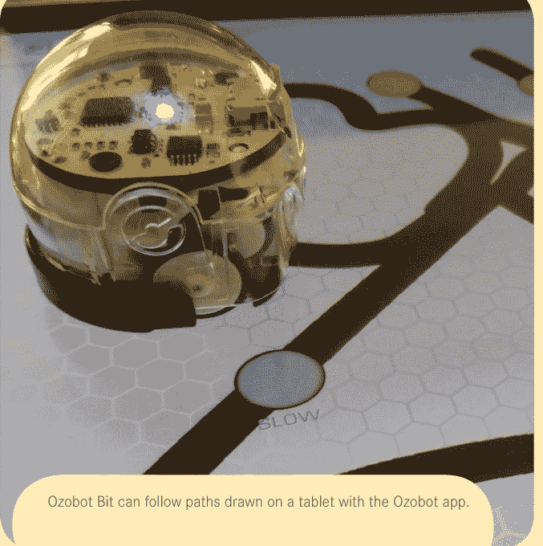
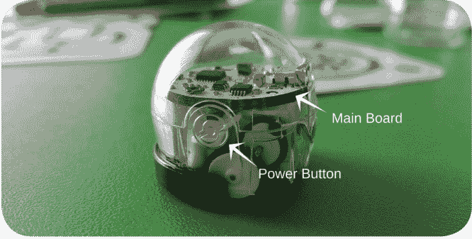
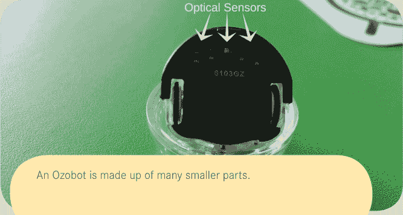
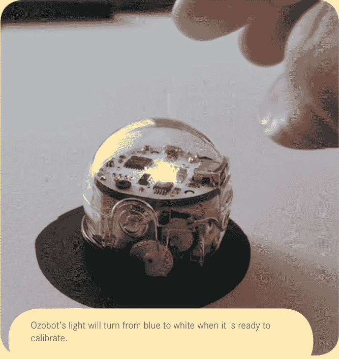
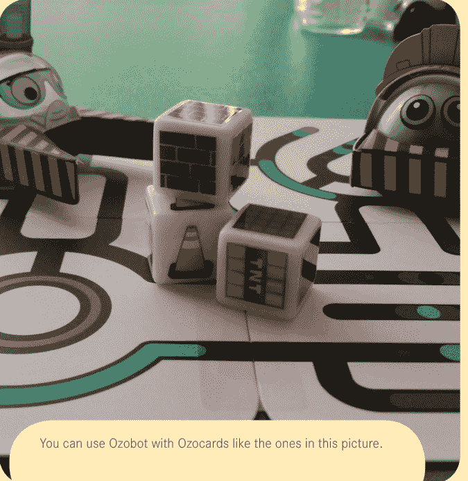
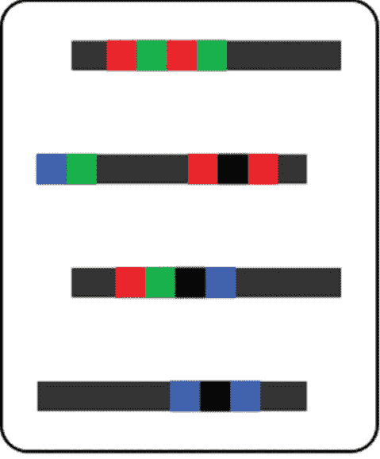
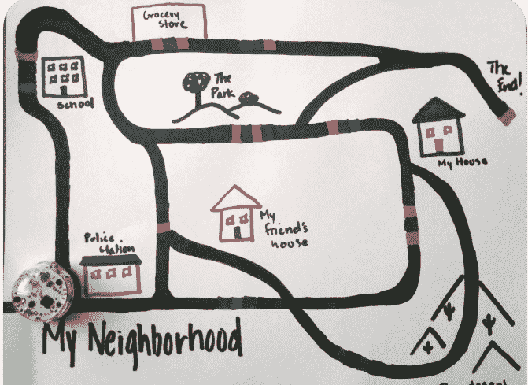

# 控制 Ozobot（21 世纪技能创新图书馆：创客即创新者）

# 目录

中央处理器（CPU）是计算机的核心组件，负责执行指令和处理数据。

- 主频
- 核心数
- 缓存

| 参数 | 值 |
| --- | --- |
| 主频 | 3.5GHz |
| 核心数 | 6 |
| 缓存 | 12MB |

注：以上参数仅为示例，实际性能请参考具体型号。

## 什么是 Ozobot？

Ozobot是一个机器人。它靠两个轮子移动，还能旋转和闪烁灯光。Ozobot最特别的地方在于它能"看见"。Ozobot通过**传感器**来识别红色、绿色、蓝色和黑色。这让Ozobot能够沿着这些颜色绘制的路径行进。

### 我能用 Ozobot 做什么？

你可以通过在纸上为Ozobot绘制路径来控制它，也可以用电脑来控制Ozobot。Ozobot通过使用**代码**，能帮助你更多地了解计算机的工作原理。

Ozobot Bit可以沿着用Ozobot应用在平板电脑上绘制的路径行进。

## Ozobot 的种类

Ozobot有两种。第一种叫Ozobot 1.0。Ozobot 1.0可以沿着你为它绘制的线条行进，还可以读取称为**OzoCodes**的特殊代码。第二种Ozobot是Ozobot Bit。这种Ozobot能完成Ozobot 1.0能做的一切，还可以用电脑或平板电脑来控制它。

主板

电源按钮

光学传感器

Ozobot由许多更小的部件组成。

## Ozobot 由哪些部件组成？

### Ozobot 的外部

- **主板**：主板是一台微型电脑，是Ozobot的大脑。
- **传感器**：Ozobot的**光学**传感器就像它的眼睛，能够感知光线并沿着你绘制的路径行进。
- **电源按钮**：该按钮用于开启和关闭Ozobot。

### Ozobot 的内部

- **电池**：电池为Ozobot提供动力。
- **电机**：电机驱动Ozobot的轮子转动。

当Ozobot准备好校准时，它的灯光会从蓝色变为白色。

## 开始使用 Ozobot

当你在一种新纸上使用Ozobot时，最好对它进行**校准**。

1. 在你要使用的纸上画一个黑色圆圈。
2. 按住Ozobot的电源按钮，灯光会闪烁。
3. 将Ozobot放在圆圈上。
4. Ozobot会行驶到圆圈的边缘，其灯光会闪烁绿色。

你可以将Ozobot与图中这样的OzoCards一起使用。

## 绘制路径

Ozobot附带了称为OzoCards的特殊卡片。卡片上印有Ozobot可以沿着的路径。你也可以用马克笔为Ozobot绘制自己的路径。可以使用普通马克笔或永久性马克笔。记住，Ozobot只能识别红色、蓝色、绿色和黑色！

像右侧方框中的示例那样让转弯保持弯曲，会使Ozobot更容易沿着你的路径行进。

## 添加转弯

你可以为路径添加转弯。Ozobot更容易沿着平滑的曲线转弯，急转弯则较难跟随。看着Ozobot沿着复杂的路径行进非常有趣！试着把几张纸粘在一起，为Ozobot绘制更长的路径。你也可以使用大卷的纸张。

你能猜出这些OzoCodes有什么作用吗？试着用你的Ozobot重现它们，看看会发生什么！如果你改变Ozobot的行驶方向，又会发生什么呢？

## 我的社区

确保使用易于Ozobot沿着的曲线。

## 你的社区

带Ozobot参观你的社区吧！用黑色、红色、蓝色和绿色的马克笔在白纸上画一张社区地图。确保地图上有一条Ozobot可以沿着的路径。你可以通过添加岔路和转弯让路径变得更复杂。

### 你的社区里有什么？

在社区地图上标记重要的地点。以下是一些你可以标记的地方：

- 你的家
- 你的学校
- 朋友的家
- 公园和游乐场
- 你常去的商店
- 图书馆

## 与 Ozobot 一起探索

当Ozobot到达社区中特殊的区域时，尝试使用OzoCodes。例如，你可以在最喜欢的地点前让Ozobot旋转。现在观察一下Ozobot在你的社区周围会走哪条路径！

## 词汇表

- **校准**（calibrate，读作KAL-uh-brayt）：调整设备使其在不同情况下正常工作
- **代码**（code，读作KODE）：用计算机语言表达的想法
- **光学的**（optical，读作AHP-ti-kuhl）：与视觉有关的
- **OzoCodes**（读作OH-zoh-kohdz）：Ozobot可以读取和理解的特殊代码
- **程序**（programs，读作PROH-gramz）：供计算机执行的一组指令
- **传感器**（sensors，读作SEN-surz）：能够检测光线、颜色或声音等事物的电子设备

## 了解更多

### 图书

- 本诺维奇·吉尔比，南希。《FIRST机器人》。密歇根州安娜堡：樱桃湖出版社，2016年。
- 本森，皮特。《Scratch》。密歇根州安娜堡：樱桃湖出版社，2016年。
- 罗斯伦德，萨曼莎，和艾米丽·帕克特·罗杰斯。《创客空间》。密歇根州安娜堡：樱桃湖出版社，2014年。

### 网站

- **OzoBlockly** *www.ozoblockly.com* 使用电脑通过OzoBlockly控制Ozobot。
- **Ozobot** *www.ozobot.com* 在Ozobot网站上寻找许多与Ozobot一起做的有趣事情。
- **YouTube–Ozobot** *www.youtube.com/user/OZOBOT/videos* 观看视频，了解更多关于Ozobot的知识。

## 索引

- 电池，9
- 校准，11
- 代码，5, 7, 17
- 颜色，5, 13, 17, 19
- 计算机，5, 7, 9
- 岔路，19
- 灯光，5, 11
- 主板，9
- 马克笔，13, 19
- 电机，9
- 社区地图，19, 21
- OzoBlockly，17
- Ozobot 1.0，7
- Ozobot Bit，7, 17
- OzoCards，13
- OzoCodes，7, 17, 21
- 纸张，5, 11, 15, 19
- 路径，5, 9, 13, 15, 17, 19, 21
- 电源按钮，9, 11
- 程序，17
- 传感器，5, 9
- 旋转，5, 21
- 平板电脑，7
- 转弯，9, 15, 19
- 轮子，5, 9

## 关于作者

安珀·洛维特喜欢玩机器人和科技产品。她在亚利桑那州的一所学校教授科学、技术、工程和数学。

此页有意留白

## 你会制作什么？

当今一些最令人难以置信的发明是创客的成果。这些人将创造力应用于最新技术，制作出各种非凡的自制设备。无论是为微型计算机编程、设计自己的桌游，还是为塑料寻找新用途，创客们都会携手合作，分享新想法和新技术。你会制作什么？

## 阅读《创客即创新者（少年版）》系列全部图书

- 使用Blockly编程
- 使用ScratchJr编程
- 控制Ozobot
- 设计桌游
- 探究3D打印机内部
- 制作电子首饰
- 组织创客节
- 创办创客空间

GR: N

ISBN-13: 978-1634721875
9 781634 721875

www.cherrylake.net

