# 烹制故事时间：轻松策划的混搭菜单

**苏珊·安德森-纽汉姆**自 2006 年起担任华盛顿州皮尔斯县图书馆的早期学习主管馆员。此前，她曾担任华盛顿州金县儿童参考馆员。她还曾是一名专业的故事讲述人，在书店、当地学校、图书馆和其他场所表演。她获得发展心理学学士学位，并于 1998 年在华盛顿大学完成图书馆学硕士（MLIS）学位。她是 ALSC 和 PLA 以及多个致力于促进优质幼儿教育的全国性协会的活跃成员。她为《儿童与图书馆》撰写了两篇幽默文章，并担任皮尔斯县图书馆《早期学习通讯》的编辑。

在本章中，我们首先讨论运动研究的基本概念和原理。然后，我们开发描述和分析物体运动所需的工具，并将其应用于一系列熟悉的情境。

## 引言

日常经验表明，物体的运动取决于观察它所依据的参考系。在本章中，我们将用位移、速度和加速度来描述运动，并使用图形和方程来表示匀加速运动物体的运动。

## 总体目标

学完本章后，你应该能够描述物体在直线上的运动，区分距离与位移，并解决涉及匀加速运动的问题。

## 附加目标

- 1. 定义位移、速度和加速度。
- 2. 解读位移-时间图和速度-时间图。
- 3. 应用运动方程解决问题。
- 4. 描述自由落体的运动。

## 实践练习

- 1. 一辆汽车从静止开始匀加速，8 秒内达到 20 m/s 的速度。计算其加速度和行驶的距离。
- 2. 一块石头从悬崖上落下，用时 3 秒到达地面。计算悬崖的高度。

答案见书末。

## 序言

谨以此书献给我的父母迈克和安迪·安德森——感谢你们用如此多的故事和爱，为我疯狂的人生增添滋味。

## 序言

我祖母新鲜出炉的面包的滋味；我母亲那只金黄多汁、刚出炉的填料火鸡的模样；从亚美尼亚邻居家后院飘来的辛辣异域烧烤香气：这些关于食物的记忆将我与童年以及我所爱的人紧紧相连。食物的准备与分享是一种必不可少且令人愉悦的人类体验。它是安慰、温暖和爱。但对我来说，比享受一顿美餐更有趣的，是真正被邀请*进入*厨房：坐在高脚凳上，看着或受邀参与切、筛、翻、搅；用勺子伸进锅里蘸一下；品尝时感受到的那种纯粹的喜悦——那真是天堂般的体验。正是在那些厨房里，我意识到出色的烹饪并非凭空发生。它需要观察、训练、实践和热情。它是理解食材、以美味的方式组合它们、不断尝试，最后也是最重要的一点——与你所爱的人分享的最终成果。

我发现，准备美味食物与准备精彩的故事时间之间有许多相似之处。充满热情的儿童图书馆员就像大厨：语言提供了他们选择、筛选、搅拌并分装成完美份额的食材，用以滋养他们所在社区幼儿正在发展的心灵和头脑。因此，带着这种类比，我编写了这本故事时间烹饪书，希望其中充满美味且有营养的想法，能够款待孩子们以及照顾他们的人。

第一章涵盖基础知识：概述有助于使故事时间创作符合儿童发展特点、具有文化敏感性并充满学习机会的知识和经验。第二章提供关于重新思考故事时间规划的想法，以最大限度地提高到场儿童和看护人的学习机会。后续章节提供多种多样的故事时间食材——图书、手指游戏、毛毡板、游戏、诗歌、数学和科学活动。本书以一系列故事时间的“菜单”作为结尾。

本书的重点主要是创建学龄前故事时间，菜单在很大程度上也反映了这一点。我希望亲爱的读者们能将本书中的想法作为起点，创作出尽可能美味的故事时间，从而继续使你们的图书馆成为早期学习社区中充满活力、备受珍视和不可或缺的中心。

## 故事时间炖菜

*从对儿童学习与成长方式的知识和理解开始*

*花时间精心规划*

*选择高质量、有趣且适合年龄和受众的绘本*

*搭配丰富的儿歌、手指游戏、故事、歌曲和伸展活动*

- 加入
  - 少量游戏
  - 一点诗歌
  - 一盎司数学
  - 一份科学

*融入大量互动——让孩子们积极参与的想法*

*加入一位充满热情的馆员的独特才能*

*让它滋滋作响*

*满怀爱意地献给孩子们、父母和看护人*

*开始盛宴吧！*

## 第1部分：烹饪课程

### 理解儿童如何成长与学习

如果图书馆员希望与早期学习专业人士有效合作，那么我们必须全面了解儿童发展，并了解我们在帮助儿童做好入学准备方面可能发挥的作用，这一点至关重要。

#### 图书馆与早期学习

故事时间是图书馆提供的项目中最持久、最有益、最受欢迎的项目之一。而且理由非常充分：各个年龄段的图书馆读者都会参加故事时间。图书馆馆藏中精彩的一部分会在这里得到展示和流通。父母和照护者在参加故事时间时会发现信息、娱乐和社区归属感。但最重要的是，故事室是一个理想的环境，可以引导儿童进入语言、故事和书籍的奇妙世界。正是在这里，我们可以帮助他们为成功的学校经历做好准备，并让他们走上成为好奇、富有同情心和终身学习者的道路。

我们的世界正热议关于大脑发育以及人生最初几年重要性的新兴研究。我们现在明白，最初几年的经历会对一个人*余生*的身体、社交和智力健康产生巨大影响。各类社区组织、研究人员、卫生部门、教育服务区、家长团体、部落、服务组织、儿童保育机构、幼儿园、学区——都在逐渐形成共识：如果携手合作，我们就能帮助改善儿童的生活。儿童图书馆员能够而且应该成为这些不断发展的早期学习合作中的关键伙伴。我们在为幼儿策划活动方面有着悠久而丰富的传统，但要想在这些不断壮大的联盟中被视为不可或缺的伙伴，我们必须致力于成为我所谓的*经验丰富的图书馆员*——这些人不仅对最好的书籍、作者和资源拥有百科全书式的知识，而且深刻理解儿童如何思考、成长和学习。因此，我以概述一些重要理念来开始本书，供我们在为社区策划活动时思考——这颇像为那些想为坐在自家餐桌旁的人准备健康美食的人开设的烹饪课。

#### 早期学习情境

得益于更准确、更丰富的测量方法和工具，我们对儿童如何成长和发展的理解已经加深并更加清晰。这种洞见帮助我们更好地阐明最有利于发现和学习的活动类型与环境。当我们仔细审视儿童的学习与发展时，有两个至关重要的概念要牢记：第一，儿童在充满关爱的关系情境中*学习效果最好*；第二，在我们计划的一切事情中，都应该考虑*完整儿童*——身体、心智和心灵。

当与他人存在信任关系时，最丰富的学习才可能发生。事实上，对于两岁以下的儿童，学习几乎*完全*发生在这样的情境中，这也是美国儿科学会建议两岁以下儿童完全不要接触屏幕的主要原因之一（American Academy of Pediatrics 2011）。现在已有若干研究表明，婴儿的大脑天生就会仔细审视、模仿并*面对面*地与人互动。尽管学龄前儿童可以通过许多媒介学习，但人与人之间的关系仍然是最有力的。因为所发生的学习不仅仅是语言、字母和概念，还有关于成为一个充满爱的人意味着什么的深层知识。

我们的故事时间为我们提供了绝佳机会，与儿童及其家庭建立温暖、信任的关系。随着幼儿成长，他们会逐渐走出家庭圈子，到更大的社区中检验人际关系。当我们图书馆员记住儿童的名字并与他们交谈（尤其是当他们与我们说话时*倾听*他们），我们就在向儿童表明，他们对我们很重要，我们关心他们和他们的家庭。一周又一周，当他们参加故事时间时，我们与他们建立关系。这种互动不仅拓宽了他们的圈子，也示范了世界上充满关爱的成年人如何行事。儿童的信任感由此建立。当他们感受到信任和归属感时，不仅会获得进一步探索的力量，图书馆也会成为学习发生的最佳场所。因此，我认为最好真正把重点放在故事时间的人际互动上。当今儿童有大量机会接触技术，却越来越少有机会接触充满爱心、乐于接纳的人。

至于策划具有全儿童吸引力的活动，我们的故事时间很容易做到这一点（而且已经这样做了一百多年！）。我们通过手指游戏、弹跳游戏、伸展活动、动作和舞蹈让儿童在身体上参与。我们可以通过分享各种各样美丽而有趣的书籍和故事，以及提出开放式问题来鼓励他们就我们分享的内容展开对话，从而让儿童的心智参与。正是通过我们对书籍和活动的选择，我们能够激发对世界的好奇。

精彩的故事也会打动儿童的心。他们可能会在展开的事件中认出自己，并对角色产生同情。也许他们被故事感动。这种学习有助于建立情感词汇和理解力，而这两者都是发展同理心、同情心和换位思考能力的重要组成部分。

如果我们把这两个研究主题结合起来——关系的重要性以及对完整儿童的考虑——那么在我看来，如果我们真的想在故事时间中创造丰富、发自内心的学习，就应该为儿童提供尽可能多的互动机会。正是通过互动，他们才会真正与我们、与他们的照护者以及其他儿童一起投入学习。也正是通过互动，我们才能了解他们理解了什么、不理解什么。故事时间中参与、互动甚至评估的机会越多，故事时间对我们的儿童及其家庭就越重要。这就是为什么互动是本书的核心。我相信故事时间应该充满乐趣，但我也相信它们能为儿童提供机会，去思考、检验和实践他们所看到、听到、感受到和想到的东西。

#### 幼儿如何学习

对早期学习的研究以及经验丰富的教师的证词表明，幼儿处理新信息和问题所需的时间往往比年长儿童和成人更长。因此，如果我们在故事时间中加入更多互动元素，就应该准备好给儿童充足的时间来处理所提出的问题、组织答案并作出回应。一些专家建议在提出问题后慢慢数到五，这听起来可能不像

### 构建营养型项目

为我们的儿童和家庭创建相关且愉快的项目的下一步，是利用我们对儿童如何学习的了解，让我们的项目在提供娱乐的同时支持学习。

#### 全是甜点，一直如此？

图书馆员喜欢呈现故事时间。我们乐此不疲地痴迷于挑选完美且适合儿童发展水平的书籍，把它们塞进主题里，搜寻相关的手指游戏、童谣和歌曲，记住有趣而优美的故事，并寻找方法让自己越来越有吸引力。我们精心打造自己的小型“你最喜欢的图书馆员”表演，把目标定在当我们整个故事时间群体坐得入迷、在恰当的地方发笑、惊叹于我们的特殊才能和专业素养时我们所感受到的满足感上。而且，当然，让家庭一周又一周地回来，并体验儿童逐渐表现出的越来越深的喜爱，似乎都是令人向往的目标。我们希望家庭参加故事时间！我们希望月度报告中的故事时间数据亮眼！但是，当我们根据早期学习研究和图书馆墙外的标准仔细审视我们所提供的内容时，这真的是我们能为儿童做的最好的事情吗？我们提供的故事时间是否尽可能富有营养，还是说它们可能在甜点方面有点偏重？故事时间能否在儿童学习方面更有效，同时仍然极具娱乐性？最后一个问题的答案无疑是肯定的，但因为我们知道

孩子通过动手来学习，因此我们必须愿意让孩子*更*直接地参与其中。我们必须愿意放下“你最喜爱的图书管理员”独角戏，邀请孩子们和我们一起走进那个略显凌乱的早期学习厨房，在那里，盛宴被精心创造，并被快乐地（而且常常是狼吞虎咽地）吃掉。

#### 意向性

在早期学习领域，有一个词反复出现，那就是*意向性*。幼儿教师被鼓励深入思考学生的学习。他们被要求非常有意识：设定广泛的目标，敏锐捕捉学习机会，引入概念，跟随孩子的引导，观察结果，然后评估发生了什么类型的学习，以及他们如何能够建立和丰富这种学习。这似乎也是一个审视我们故事时光的绝佳视角。如果我们围绕一个主题构建故事时光，并把重点放在使其极具娱乐性上，它会包含极好的学习可能性吗？也许，但我们如何知道？如果我们在故事时光中一直由我们来说，那么衡量孩子们的理解、词汇、社交和情感发展以及整体学习是否可能？研究明确表明，向幼儿大声朗读是培养他们对阅读的理解和兴趣最有力的方式。但研究同样明确的是，并非仅仅是朗读本身就起作用。对儿童技能发展影响最大的是围绕阅读的*对话*（Dickinson and Smith 1994）。如果我们总是说个不停，我们实际上可能正在限制孩子们的学习！

这就是为什么我们想把孩子们邀请进故事时光的厨房。因为我们希望他们在故事时光中做得更多，也许我们不应仅仅寻找基于特定主题的书籍和活动，而应该寻找鼓励互动和语言技能培养的儿歌和书籍。例如，一项重要的阅读前技能是复述。如果我们想在故事时光中专注于复述技能，我们能做什么？我们当然可以让孩子在听完我们朗读后站起来表演故事，但我们在那里仍然承担了大部分繁重的工作，因为复述是我们做的，而孩子们大多在遵循我们的指示。我们没有要求他们真正复述任何东西。一种更具互动性的方式可能是寻找一本有令人难忘事件的书，以我们自己独特的风格大声朗读，之后说：“让我们谈谈这个故事里发生了什么。”这项活动对学龄前儿童来说可能非常具有挑战性，因为他们可能需要时间来真正消化一本书的阅读。但如果我们打开书，从头开始，一页一页地一起看，并鼓励孩子们谈论每一幅插图，我们就为他们提供了更充分吸收故事的机会。这个策略不仅是一种真正愉快的谈论书的方式，而且对看护人来说也是一个极好的示范练习，因为它提供了大量对话的机会。

另一个好主意是，由于孩子们尚不熟悉理解故事的技能，我们可以在阅读*之前*，通过为他们搭建故事的主要情节来帮助他们理解。例如，在分享李欧·李奥尼的*《一寸虫》*之前，我们可能会说：“在这本书里，一条小虫子发现自己身处可怕的境地。一只鸟想吃掉它！它必须想办法愚弄鸟并逃走。它是一条非常聪明的虫子，所以它找到了一个非常聪明的逃脱办法。你们想一起读这个故事，看看小虫子是怎么从鸟身边逃走的吗？我们开始吧！”然后在大声朗读故事后，我们让孩子们讨论虫子是如何逃走的，以及他们注意到的故事的其他方面。通过这种方式，我们加深了他们对这本书的体验，同时也评估了他们的理解。因此，分享变得更有意向性。

以下是在故事时光中融入更多意向性的一些指导原则：

- 1. 仔细选择每本书。书本身是否包含互动机会？例如，文本是否向读者提问？如果没有，你可能会在书的哪些地方提出一两个问题，以更积极地吸引孩子，让他们对书有更丰富的理解？不要太多，以免失去故事主线，但可以精心安排一两个问题来保持孩子的兴趣。我还喜欢为故事时光寻找至少一本非常互动的书——我们甚至可能不读文本，只是看着插图或照片，然后一起讨论。这种方法也是将更多信息类文本融入故事时光的绝佳方式。

- 2. 通读每本书，寻找任何可能具有挑战性的词汇。你可以在开始阅读前介绍并定义它们。这样，你就能确保孩子们在听故事时听到这个词，不会被它的神秘感分散注意力，而是继续沉浸在故事中。

- 3. 在开始朗读故事之前，展示书的封面，问孩子们：“你们看到了什么？”提出开放式问题，直到孩子们对封面有了足够的了解，能猜到这本书是关于什么的。以这种方式让孩子们参与进来，不仅让你有机会铺垫故事，还提供了一种吸引孩子们注意力的有趣方式。

- 4. 如果我们真的希望孩子们对我们读给他们的故事有丰富的理解，理想情况下我们应该不止一次地读这些故事。孩子们喜欢一遍又一遍地读同样的书（然而，他们的看护人可能会停止参加故事时光，而且通常是他们负责交通！）。与其重读书籍，不如尝试前面提到的复述场景。你可以说：“我们来谈谈那个故事里发生了什么。”然后，记住孩子们需要时间来处理和构思他们的想法，让他们思考。如果仍然没有回应，打开书，让插图唤起他们的记忆。（毕竟，我们希望发展的是*他们*的技能！）如果我想让孩子们在我们一起读完故事后表演出来，我会先让他们和我以这种方式复述，*然后*让他们站起来表演。

- 5. 寻找可以通过这本书引入的数学概念：大小、形状、图案、时间、年龄、距离、比较、数量——所有的书都包含一些数学概念。例如，如果你在分享一本关于动物的书，你可以引入大、小、快、慢、厚、薄、软、粗糙、老、年轻、明亮、暗淡等概念。

- 6. 通过这本书可以引入哪些科学概念？寻找栖息地、生命周期、猎物和捕食者、生态系统、光和影、天气、解剖学、重力等等。例如，在你分享了金杰·福格尔桑·盖伊的*《节日》*之后，你可能会拿出一个和书里画的一样的陀螺，问：“你们还记得书里的这个吗？”然后和孩子们讨论陀螺是如何旋转的。（对于大群体，你可以演示陀螺旋转，并“好奇”它为什么能持续旋转。鼓励孩子们在图书馆里寻找答案。）或者分享何明方的*《嘘！一首泰国摇篮曲》*后，你可以一页一页地翻回这本书，指出每一页上的生物，问孩子们那种生物是否住在他们附近。首先出现的生物是蚊子和农场动物，这可能对大多数孩子来说很熟悉，但随着书页的推进，动物变得更加具有泰国特色，这将打开一个关于世界上许多不同生物对话的机会。

- 7. 接下来思考你想使用哪些手指游戏、歌曲和故事，以及为什么。你想包括孩子们可以模仿和加入的手指游戏，以及那些他们是创造伙伴的游戏。为这本书编写的手指游戏和动作儿歌旨在引出孩子们的反应，从而增强他们的参与和投入。将这些手指游戏和儿歌与你收集的精彩手指游戏结合起来，将为故事时光提供美味而有营养的语言游戏。

- 8. 你能在故事与孩子们的现实生活之间建立哪些联系？他们是否曾经去过像书中所描述的地方？他们的家庭成员是否与故事中的人物相似？他们是否在雪地里玩过？自己穿过衣服？吃过这些食物？见过那种动物？

这个将故事与孩子们的生活联系起来的过程，丰富了他们对这本书的体验。

- 9. 思考如何调动更多孩子的感官。你能引入实物让他们触摸和闻一闻吗？能否以某种方式加入动作？

这份清单看起来可能有很多额外的工作，但实际上只是改变了我们规划的方式。我们当然不想把每一种技能培养的可能性都塞进每一次故事会中，但我们可以轻松地为每一餐添加优质营养和有趣的调味料。最棒的是，我们不必放弃我们喜爱的甜点！我们只是在创造故事会，让它成为一场完整的盛宴，而不仅仅是一份甜点！

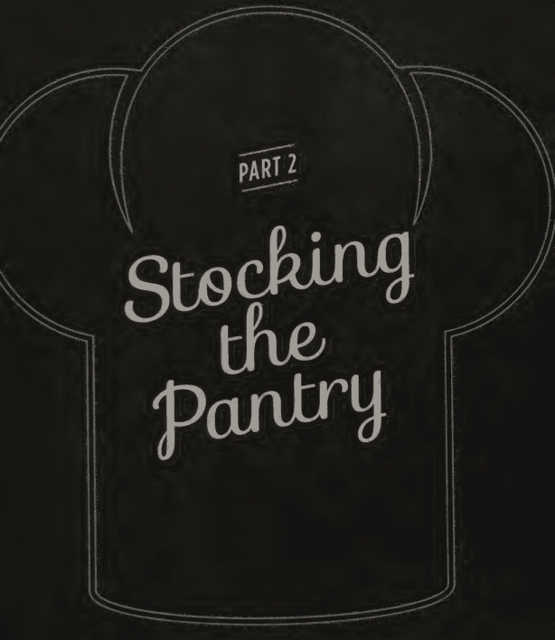

## 第2部分

### 储备食粮

考虑到这些因素，我们在选择要分享的图书时，用多样性的视角来审视是至关重要的。故事会应该是一种既归属又探索的体验。所以我们分享的书籍应该为这些目标服务。

以下是一些在努力实现故事会多样性和包容性时可以思考的问题：

- 参加我故事会的孩子们会在这本书中看到他们自己的影子吗？
- 他们会在这本书中找到熟悉的东西吗？
- 他们会在这本书中找到不熟悉的东西吗？
- 他们能一窥日常生活范围之外的世界吗？
- 这本书是否会激励他们去探索一个陌生的地方、想法或主题？
- 我是否可以采取一些步骤或引入一些活动来鼓励这种探索？
- 我每周分享的书籍是否存在健康的多样性？

提出这些问题有助于确保我们的故事会欢迎并让每个人愉快。

以下是一些反映我们多元化社区的精彩故事会书目。带星号的书目每页字数较少。

- *Abuela* 作者：Arthur Dorros（Dutton Children’s Books，1991）。一个小女孩和她的祖母在纽约市的社区上空翱翔。
- *A-Tisket, A-Tasket* 作者：Ella Fitzgerald（Philomel Books，2003）。这首古老的童谣通过艾拉的爵士歌词和充满活力的插图焕然一新。
- *Bebé Goes Shopping* 作者：Susan Middleton Elya（Harcourt，2006）。一本精彩的押韵书，讲述一个宝宝和他的妈妈去杂货店购物。书中穿插的西班牙语单词和复古插图使其成为赢家。
- *Bee-Bim-Bop* 作者：Linda Sue Park（Clarion Books，2005）。在这本活泼欢快的书中，一个小女孩帮助她的母亲准备一顿美味的韩国传统晚餐。
- *Bein’ with You This Way* 作者：W. Nikola-Lisa（Lee and Low Books，1994）。一场印象派式的庆祝，展现了人们外表不同但本质相似的所有方式。
- *Big Red Lollipop* 作者：Rukhsana Khan（Viking，2010）。一个小女孩被邀请参加生日派对，却被迫带上她的小妹妹。这会引起小学适龄儿童的共鸣。
- *Can You Say Peace?* 作者：Karen Katz（Henry Holt，2006）。卡茨迷人的插图展示了世界各地的孩子们对和平的思考。
- A Cool Drink of Water 作者：Barbara Kerley（National Geographic Society，2002）。一本摄影之旅，描绘了世界各地的人们享受清凉饮用水的情景。华丽。
- The Empty Pot 作者：Demi（Henry Holt，1990）。一个以中国为背景的关于诚实重要性的美丽故事。是的，插图非常小，但故事很有力量。
- *Feast for Ten* 作者：Cathryn Falwell（Clarion Books，1993）。在这个精彩而简单的计数书中，一个家庭购买食品杂货并准备一场盛宴。
- Full, Full, Full of Love 作者：Trish Cooke（Candlewick，2003）。这是一本真正的安慰之书，其充满爱意的插图使其成为学龄前儿童的绝佳选择。
- He's Got the Whole World in His Hands，插图：Kadir Nelson（Dial Books for Young Readers，2005）。这首古老的灵歌因为纳尔逊令人难以置信的超大插图而得到华丽的提升。
- Honey Baby Sugar Child 作者：Alice Faye Duncan（Simon and Schuster Books for Young Readers，2005）。华丽的插图和母亲与孩子之间丰富的爱将吸引学龄前儿童。
- Honey, I Love 作者：Eloise Greenfield（HarperCollins，2003）。以诗意而简单的方式展现了一个年轻女孩所爱的一切。生动的插图对学龄前儿童和小学低年级儿童很有吸引力。
- Hush, A Thai Lullaby 作者：Minfong Ho（Orchard Books，1996）。反复出现的“嘘”这个词使这本可爱的书成为安静时光的好选择。
- *Hush, Little Baby* 作者：Brian Pinkney（Greenwillow，2006）。大而充满活力的插图，加上如果你喜欢可以唱这本书的事实，使它成为故事会的绝佳选择。
- I Love Saturdays and Domingos 作者：Alma Flor Ada（Atheneum Books for Young Readers，2002）。一个小女孩为她的说英语的家庭和说西班牙语的家庭而欢欣鼓舞。
- Is There Really a Human Race? 作者：Jamie Lee Curtis（Joanna Cotler Books，2006）。对世界各地人们的有趣观察——也是开启讨论的好起点。
- Jazz Baby 作者：Lisa Wheeler（Harcourt，2007）。一个家庭在这本美妙的节奏欢快的书中庆祝爵士乐。朗读起来非常有趣！
- Kitchen Dance 作者：Maurie J. Manning（Clarion Books，2008）。一个欢乐插图的故事，讲述一个家庭在厨房里夜舞——非常有趣！
- *Lola at the Library* 作者：Anna McQuinn（Charlesbridge，2006）。简单的故事和可爱的插图使这本书成为最爱。
- Lola Reads to Leo 作者：Anna McQuinn（Charlesbridge，2012）。孩子们会喜欢姐姐Lola给刚出生的弟弟读她最喜欢的书的温暖故事。可爱的插图大小非常适合故事会分享。
- Mama, Do You Love Me? 作者：Barbara M. Joosse（Chronicle Books，1991）。在这本故事会最爱的书中，一个小女孩质疑母亲爱的深度。
- *More, More, More Said the Baby* 作者：Vera Williams（Tupelo Books，1990）。三位看护人和宝宝们一起玩耍度日。
- *My Grandma / Mi Abuelita* 作者：Ginger Foglesong Guy（Rayo，2007）。这本关于祖母的简单书包含柔和、易于观看的插图。
- *My Mother’s Sari* 作者：Sandhya Rao（Lerner，2011）。一本非常简单的书，讲述了一个小女孩对她母亲美丽纱丽的印象。
- *No Dinner! The Story of the Old Woman and the Pumpkin* 作者：Jessica Souhami（Marshall Cavendish，1999）。这个古老的亚洲民间故事的复述提供了许多重复短语的机会。而且，这是一个非常有趣的故事。
- *On Mother’s Lap* 作者：Ann Herbert Scott（Clarion Books，1992）。一个温柔的故事，讲述一个小男孩担心现在新宝宝来了，妈妈的膝盖上是否还有足够的地方给他。
- *Our Grandparents: A Global Album* 作者：Maya Ajmera（Charlesbridge，2010）。来自世界各地的华丽照片展示了孩子们和他们的祖父母一起参与许多活动。
- *Papa, Do You Love Me?* 作者：Barbara Joosse（Chronicle Books，2004）。一个年轻的马赛男孩问他的父亲关于爱的问题。
- *Round Is a Mooncake* 作者：Roseanne Thong（Chronicle Books，2000）。这本生动的书介绍了基本形状。Grace Lin提供了以中国传统物品为特色的华丽插图。
- *Say Hello* 作者：Rachel Isadora（Putnam，2010）。多元化的城市社区、充满活力的插图和幽默会吸引故事会的听众。
- *Shades of People* 作者：Shelly Rotner（Holiday House，2009）。有吸引力的儿童照片和描述肤色的美味词汇使这本书成为必选分享。
- *Siesta* 作者：Ginger Foglesong Guy（Greenwillow，2005）。这本明亮多彩、穿插西班牙语单词的书描绘了睡眠时间。
- *Snow on Snow* 作者：Cheryl K. Dolan（Dial Books for Young Readers，1994）。学龄前儿童会喜欢这种简洁而诗意的文字和明亮、简单的插图，但这本可爱书中真正的明星是温柔动人的故事。
- *Something from Nothing: Adapted from the Jewish Folktale* 作者：Phoebe Gilman（Scholastic，1993）。一个关于一个男孩和他最喜欢的衣服的意第绪语民间故事的流畅而有趣的讲述。明亮的插图完成了整个组合。
- *Summer Sun Risin’* 作者：W. Nikola-Lisa（Lee and Low Books，2002）。每一页上的押韵诗跟随一个年轻的农场男孩在炎热的夏日从黎明到夜晚。

- *汪汪！作揖！接住！从A到Z的狗狗*，Henry Horenstein 著（Scholastic，1999年）。一本简单的狗狗字母书，配有大幅而迷人的照片。非常适合讨论！
- *ZZZ之书*，Arlene Alda 著（Hyperion Books for Children，2005年）。大幅整页照片展现了动物和人们各种各样的睡眠方式。非常适合与幼儿或学龄前儿童分享。
- *多种文化中的服饰*，Heather Adamson 著（Capstone Press，2007年）。这本非常简单的书以整页照片展示了为各种用途穿着的服装。
- *一杯清凉的水*，Barbara Kerley 著（National Geographic Society，2002年）。一段摄影之旅，描绘世界各地的人们享受一杯清凉的水。美极了。
- *最可爱的小动物*，Marion Dane Bauer 著（Adventure Publications，2010年）。这是故事会上非常合适的一本书。大幅整页照片配以简单文字，向孩子们介绍许多不同的动物。而且它押韵！
- *你了解爬行动物吗？*，Buffy Silverman 著（Lerner，2010年）。大幅照片和简单却有趣的文字使这本书成为不错的分享选择。
- *家庭*，Ann Morris 著（HarperCollins，2000年）。世界各地家庭的大幅照片结合简单文字，使这本书成为幼儿园故事会上令人愉快的读物。
- *生长的色彩*，Bruce McMillan 著（Lothrop, Lee and Shepard，1988年）。这本书非常简单，每页只有一个词，但那些照片就是让人忍不住想讨论。适合所有年龄段的珍宝。
- *头发*，Nicola Whittaker 著（Gareth Stevens，2002年）。有趣的照片和易懂的文字使这本书成为在故事会上完整朗读的绝佳选择。
- *我是一粒种子*，Jean Marzollo 著（Scholastic，1996年）。这本易读读物非常适合故事会，因为它讲述了两粒种子试图发现自己的未来。
- *我的五种感官*，Margaret Miller 著（Simon and Schuster Books for Young Readers，1994年）。非常简单的文字、精彩的照片以及大量互动可能性，使这本书成为完美的故事会读物。
- *花纹鱼*，Trudy Harris 著（Millbrook Press，2000年）。这本妙趣横生的书非常适合故事会。图案在一个跨页上建立起来，画面中有某种海洋生物。翻页时，孩子们会被引导完成图案。插图非常滑稽。
- *植物图案*，Nathan Olson 著（Capstone Press，2007年）。超大尺寸的植物和花园照片以及非常简单的文字，意味着这本书可以在故事会上完整而愉快地分享。也很适合讨论。
- *加油，加油，萝卜！蔬菜吟唱*，April Pulley Sayre 著（Beach Lane Books，2011年）。由于书中配有各地蔬菜的美丽照片以及配套的押韵吟唱，这是一本很棒的故事会读物。
- *动物园里的配对*，Patricia Whitehouse 著（Heinemann Library，2002年）。一本探讨“配对”概念的优秀书籍。动物照片和简单文字使这本书成为幼儿园故事会的不错选择。

### 歌唱故事

歌唱是帮助孩子听出词语中较小组成部分的最有效、最愉快的方式之一。它会自动把词语分成音节。它还会放慢发音，使各个单独的声音得到突出。此外，歌词通常押韵！这些都是培养语音解码技能的极佳方式，而语音解码技能是做好阅读准备的必要部分。孩子们不在乎你唱歌是否在调上，但如果自我意识会让你不敢在故事会上唱歌，那就尽管使用 CD 或 iPod，并鼓励大家一起唱！

为了在故事会上激发更多音乐，以下是一些能鼓励歌唱的精彩书籍：

- *A，你太可爱了*，Buddy Kaye 著（Candlewick，1994年）。Martha Alexander 甜美的插图确实让这本精彩的书栩栩如生。如果你不知道曲调，YouTube 上有一段精彩的*芝麻街*视频！
- *所有漂亮的小马：一首传统摇篮曲*，Linda Saport 绘（Clarion Books，1999年）。可爱的柔和插图与轻柔的摇篮曲使这本书成为温和故事会读物的不错选择。
- *小篮子，小篮子*，Ella Fitzgerald 著（Philomel Books，2003年）。古老的童谣通过 Ella 的爵士风歌词和鲜艳插图焕然一新。
- *猫咪唱起嘀哩嘀哩*，Paul Galdone 著（Clarion Books，1985年）。这首古老的累积歌配上 Galdone 精彩的插图，成为学龄前儿童的经典之作。
- *在海湾边*，Raffi 著（Crown，1987年）。Nadine Bernard Westcott 有趣的插图使这本书成为有趣又傻气的分享读物。
- *在车站旁*，Will Hillenbrand 著（Harcourt Brace，1999年）。在这个讨人喜欢的歌曲版本中，小火车从全镇各处接上动物宝宝（包括孩子们），把它们送到动物园。
- *五只小鸭子*，Raffi 著（Crown，1989年）。这首著名歌曲配有 Jose Aruego 的精彩插图。（Raffi 还有许多其他歌本。）
- *五只小猴子在床上跳*，Eileen Christelow 绘（Clarion Books，1989年）。这首歌从五开始倒数，孩子们喜欢跟着唱和跳，这正是我们亲切地称之为*玩数字*的活动。
- *去动物园*，Tom Paxton 著（Morrow Junior Books，1996年）。这本精彩的书鼓励孩子们模仿动物园里的所有动物。而且它还可以唱！
- *橱窗里那只小狗多少钱？*，Iza Trapani 著（Gareth Stevens，1999年）。经典歌曲以可爱的书本形式呈现。（Iza Trapani 还有许多其他歌本。）
- *嘘，小宝贝*，Brian Pinkney 著（Greenwillow，2006年）。大幅而鲜艳的插图，加上你可以把这本书唱出来，使它成为故事会的绝佳选择。
- *嘘，小宝贝*，Sylvia Long 著（Chronicle Books，1997年）。这首老歌在这本可爱的书中以自然为主题进行了改编。可爱的兔子插图和温和的睡前主题会吸引故事会的听众。
- *嘘，小宝贝：带插图的民谣*，Marla Frazee 著（Browndeer Press，1999年）。这首老歌经过巧妙而有趣的插图演绎，会赢得新粉丝，并激发反复阅读的愿望。
- *嘘，小挖掘机*，Ellen Olson-Brown 著（Tricycle Press，2006年）。这首对嘲鸫歌的搞笑改编出现了许多不同的工程车辆。
- *如果你是怪物，而且你知道*，Rebecca Emberley 著（Orchard Books，2010年）。这是一本讨喜、互动、可歌唱的经典更新版——分享起来太有趣了！
- *如果你快乐，而且你知道*，Anna McQuinn 著（Barefoot Books，2009年）。这首歌曲的插图版本非常精彩，配有许多不同的动作提示，适合扭来扭去的故事会！
- *如果你快乐，而且你知道*，Jane Cabrera 绘（Holiday House，2005年）。大幅而鲜艳的插图在这首流行歌曲的这个版本中格外突出。
- *如果你快乐*，April Pulley Sayre 著（Greenwillow，2011年）。这首无处不在的歌曲经过重新改编，配有很棒的插图和有趣的信息，在故事会上唱起来非常带劲。
- *一寸又一寸：花园之歌*，David Mallett 著（HarperCollins，1995年）。简单的插图和一首非常适合歌唱的歌曲使这本书成为春季的赢家。
- *小小蜘蛛*，Lorianne Siomades 著（Boyds Mills Press，2001年）。这是这首歌的一个漂亮、色彩丰富又非常简单的版本。
- *我一直在铁路上工作*，Ann Owen 编，Sandra D'Antonio 绘（Picture Window Books，2003年）。有趣的引言以及只使用一节歌词，使这本书成为参与者年龄跨度较大的故事会的不错补充。
- *小鸡们说 / 小鸡们唱歌*，Nancy Abraham Hall 著（Little, Brown，1994年）。从这本精彩的书中选一首可歌唱的童谣来分享。
- *玛丽有只小羊羔*，Sarah Hale 著，Tomie dePaola 绘（Holiday House，1984年）。可爱的插图使这本书成为不错的分享选择。
- *花生酱和果冻：游戏童谣*，Nadine Westcott 著（Dutton，1987年）。这本吟唱书包含一首古老童谣、充满大象的滑稽插图，以及一句可供参与重复的句子。（Nadine Westcott 还有许多其他歌本。）
- *皮特猫：我爱我的白鞋子*，Eric Litwin 著（Harper，2010年）。它介绍颜色，押韵，可以唱，孩子们很喜欢——这本确实值得珍藏。
- *加油，加油，萝卜！蔬菜吟唱*，April Pulley Sayre 著（Beach Lane Books，2011年）。由于书中配有各地蔬菜的美丽照片以及配套的押韵吟唱，这是一本很棒的故事会读物。
- *公交车上的海豹*，Lenny Hort 著（Henry Holt，2000年）。对《公交车上的轮子》这首歌的搞笑戏仿。这本会让故事会上的每个人都大笑！
- *地板上的蜘蛛*，Bill Russell 著，True Kelley 绘（Crown，1993年）。这本书开本很小，但插图相对超大，而且滑稽得不得了，值得一看。此外，你可以把整本书唱出来！
- *床上有十个*，Jane Cabrera 绘（Holiday House，2005年）。这首老歌配有大幅、生动的插图。
- *洞穴里有十个*，John Butler 著（Peachtree，2005年）。一本可以唱的书，插图细致又可爱。
- *有个老太太吞了一只苍蝇*，Simms Taback 著（Viking，1997年）。Taback 的精彩插图和简单文字会鼓励孩子们跟着唱。
- *有一个老怪物*，Rebecca Emberley 著（Orchard Books，2009年）。黑色背景上的鲜艳插图完美地衬托了这本令人捧腹的书。
- *这片土地是你的土地*，Woody Guthrie 著，Kathy Jakobsen 绘（Little, Brown，1998年）。细致的民间艺术插图可能过于繁复，不适合在故事会上完整分享，但这首歌可以撑起整本书。
- *去市场，去市场*，Anne Miranda 著（Harcourt Brace，1997年）。对老歌的精彩重述，配有 Janet Stevens 欢闹的插图。
- *今天是星期一*，Eric Carle 著（Philomel Books，1993年）。这首老歌配有 Carle 精彩的剪纸拼贴插图。这是一本很适合唱的书。
- *我们要去猎熊*，Michael Rosen 著（Margaret K. McElderry Books，1989年）。Helen Oxenbury 的精彩插图使这本书成为故事会上吟诵的绝佳选择。

*熊的画* 丹尼尔·平克沃特著（Houghton Mifflin Company, 2008）。这本诙谐调侃的书讲述了一只特立独行的熊和两位喜欢评头论足的绅士，在故事时间分享时令人愉悦。

*兔子蛋糕* 罗斯玛丽·威尔斯著（Dial, 1997）。每个孩子都值得听一个由麦克斯和露比主演的故事。这个故事不仅有趣，还适合开展后续的写作活动：用一张大海报板，一起制作一份巨大的故事时间购物清单。孩子们真正想买些什么？当孩子们说出物品时，把它们写在清单上。

*你能猜到吗？* 玛格丽特·米勒著（Greenwillow, 1993）。邮箱的大幅照片可以有效地用在与信件和邮件有关的故事时间中。

*卡罗喜欢阅读* 杰西卡·斯帕尼奥尔著（Candlewick, 2001）。这本非常简单的书的插画里满是标签，本身就可以成为一堂写作课。书中也有许多绝佳的互动机会。用卡纸或硬纸板、打孔器和纱线制作特大号的“标签”。请孩子们辨认房间里的物品——椅子、桌子、门、衣帽架等等。为这些物品制作标签，并把标签绑在物品上。或者制作卡罗风格的标签用作姓名牌。

*孩子是糟糕的宠物* 彼得·布朗著（Little, Brown, 2010）。有趣的插图和诙谐调侃的故事使它成为故事时间的娱乐之选。讨论作者是如何使用对话“气泡”来讲故事的。自己制作一些滑稽的对话气泡，在故事时间或之后的游戏时间使用。偶尔在对话气泡中加入图画或照片，这样孩子们也能参与其中，领会笑点。

*咔嗒，咔嗒，哞：会打字的奶牛* 多琳·克罗宁著（Simon and Schuster Books for Young Readers, 2000）。鸭子用打字机为农场动物争取特别舒适待遇的情节令人捧腹。分享完这本书后，引导孩子们聊聊他们使用打字机的经历。他们以前见过打字机吗？在哪儿？他们用过吗？如果可能，把打字机放在一个孩子们在故事时间后可以与之互动的地方。

*亲爱的兔子* 米凯拉·摩根著（Scholastic/Chicken House, 2006）。这是一个关于两只相爱兔子的可爱故事。写信以及被撕碎又重新排列的句子，可能会引发一些有趣的学习活动。对年幼的孩子来说有点长，但它实在太迷人了，不可错过。制作情人节贺卡，让孩子们把温馨的话语贴在上面。

*咯咯，咯咯，嘎* 多琳·克罗宁著（Simon and Schuster Books for Young Readers, 2002）。在这本充满许多手写便条的搞笑书中，鸭子又回来了。和孩子们谈谈我们是如何互相传递便条的。他们见过便条吗？在房间里挂上便条纸，让孩子们自己“写”便条。

*亨利的工作* D. B. 约翰逊著（Houghton Mifflin, 2004）。对许多故事时间小组来说，这个故事可能相当复杂，但它可以引发关于作者和写作的有趣讨论。引导孩子们讨论“作者”是什么。

*我每天都想你* 西姆斯·塔巴克著（Viking, 2007）。色彩鲜艳的插图和重复的押韵文字使这本书非常适合故事时间。拿出牛皮纸和盒子，让写作开始吧。

*给艾米的信* 艾兹拉·杰克·季兹著（Harper and Row, 1968）。这本经典之作拥有迷人的故事和精彩的插画。故事中心的那封信提供了一个探索书面材料的机会。与孩子们聊聊写信，以及他们收信或寄信的经历。讨论信件的形式。给孩子们提供一封信的模板作为可带回家的材料，或鼓励他们为某个特别的人写一封信、画一幅画，或者两者都做。如果可能，提供信封。讨论邮票以及我们为什么使用邮票。

*我的蜡笔会说话* 帕特里夏·哈伯德著（Henry Holt, 1995）。可爱的插图、押韵的简单文字、颜色和蜡笔——朗读之后开展一个蜡笔活动，让故事时间变得非常有趣。挂起或摊开一张大纸——越大越好。摆出蜡笔或颜料（如果你够勇敢的话），让孩子们探索自己的图画，并让自己的蜡笔“说话”。庆祝他们的成果。在未来的故事时间课上再张贴这张纸，让新来的孩子添上自己的作品。

*帕特里克画一幅画* 萨维尔·皮罗塔著（Frances Lincoln Children’s Books, 2007）。大幅插画和嵌入的互动猜谜游戏使它成为一本值得分享的好书。如果你够勇敢，分享完之后组织一次绘画活动。

*秘密情人节* 凯瑟琳·斯托克著（Bradbury Press, 1991）。一本小开本的书，却承载着爱和真诚的信息，值得孩子们去听和看。（只要你能不哭着读完它！）

#### 促进互动与重复

本章的最后一部分是关于鼓励孩子们积极参与的书籍。有些书充满了直接面向孩子们的问题，另一些则包含重复的句子。通过事前稍加练习或在朗读过程中给予一些鼓励，孩子们就能加入重复的句子。这种重复不仅让孩子们感到非常愉快，而且往往有助于保持他们对故事的注意力。以下书名非常适合故事时间，它们内置了互动或重复的短语，能鼓励孩子们一起“读”。带星号的书名每页的字数较少。

- *就像爸爸一样* 弗兰克·阿施著（Prentice-Hall, 1981）。简单的故事和重复的句子使它成为幼儿和学龄前儿童的好选择，而爸爸妈妈们看到出人意料的结局时会偷笑或感到尴尬。
- *小猫的拥抱* 简·卡布雷拉著（Holiday House, 2007）。大幅明亮的插画、问题和许多不同的动物使它成为故事时间温馨互动的赢家。
- *小驴，闭上眼睛* 玛格丽特·怀斯·布朗著（HarperCollins, 1995）。韵律、重复和美丽的木刻插画使它成为故事时间的可爱温馨之选。
- *妈妈，夏天还没到吗？* 妮基·麦克卢尔著（Abrams Books for Young Readers, 2010）。在这本适合学龄前儿童的可爱书中，一个小男孩反复地问夏天是否到了。
- *喵和锅碗瓢盆* 塞巴斯蒂安·布劳恩著（Boxer, 2010）。大幅明亮的插画、简单的文字和一个有趣的故事谜团使这本书成为故事时间的赢家。文中嵌入的直接提问会自然地引来孩子们的互动。读完书后，组织一支故事时间乐队，增添更多乐趣。
- *一百万只猫* 婉达·盖格著（Coward, McCann, 1988）。这本简单经典的书籍值得所有孩子阅读。
- *妈妈，妈妈，我还要一个* 玛丽亚·波卢什金·罗宾斯著（Crown, 1978）。睡前，一位妈妈和她的宝宝之间的误会是一个有趣的故事时间朗读材料。
- *妈妈就是这样* 卡罗尔·卡里克著（Clarion Books, 2000）。这本插画精美的书分享了众多动物妈妈的品质，并包含一句重复出现的话。
- *咔嚓！咔嚓！咔嚓！* 坎达丝·弗莱明著（Atheneum Books for Young Readers, 2002）。孩子们会喜欢兔子的滑稽行为，以及农夫为不让它们靠近菜园所使出的浑身解数。
- *打瞌睡的房子* 奥黛丽·伍德著（Harcourt, 1984）。这本精彩的书中的文字是累积式的，孩子们会喜欢随着故事的展开加入进来。
- *没有晚餐！老太太和南瓜的故事* 杰西卡·苏哈米著（Marshall Cavendish, 1999）。这个改编自亚洲古老民间故事的版本提供了许多重复短语的机会。而且，这是一个非常搞笑的故事。
- *吵闹的诺拉* 罗斯玛丽·威尔斯著（Dial, 1973）。押韵的文字和几句重复的句子使这本书成为故事时间很好的朗读选择。
- *馅饼在烤箱里* 贝蒂·G. 伯尼著（Houghton Mifflin, 1996）。重复句会让每个人在书读完时都渴望吃馅饼。美味极了！

- *按这里*，埃尔维·杜莱 著（Chronicle Books, 2011）。这本对色彩和方向的奇妙探索可以让故事时间变得活力十足。孩子们可以轮流按照每一页的指令行动，也可以各自在座位上模仿动作。真有趣！
- *睡吧，大熊，睡吧！* 莫琳·赖特 著（Marshall Cavendish Children, 2009）。小熊听错冬老人话后的滑稽举动会让孩子们开怀大笑。
- *更大的人*，乔纳森·埃米特 著（Clarion Books, 2004）。这本精彩绝伦的书配有押韵文字、一个傻气十足的故事，以及一句便于重复的短语（同时也传递了一个美好的信息：永远不要因为自己太小而无法带来改变）。
- *无中生有：改编自犹太民间故事*，菲比·吉尔曼 著（Scholastic, 1993）。这个故事的简单叙述和内置的重复会让年龄较大的学龄前儿童和小学低年级孩子全神贯注。
- *我爱你，宝贝，小不点*，丽莎·惠勒 著（Little, Brown, 2004）。在这本甜美的书中，一位母亲在宝宝成长的过程中对他反复吟唱一首歌。
- *洞穴里的十个*，约翰·巴特勒 著（Peachtree, 2005）。这个改编自“床上有十个”的歌曲故事拥有绝佳的词汇和可爱的插图，非常受欢迎。
- *垃圾小镇*，安德烈亚·齐默尔曼 著（HarperCollins, 1999）。书中重复的吟唱、迷人的插图和通俗易懂的故事使其成为故事时间的宠儿。
- *小心！大哥哥来了！* 杰兹·阿波罗 著（Tundra Books, 2005）。易记的重复台词、滑稽的插图和有趣的结尾使其成为学龄前故事时间的绝佳选择。
- *谁吃了所有的曲奇面团？* 凯伦·博蒙特 著（Henry Holt, 2008）。故事结束后，孩子们可能还会反复问这个问题。这是一本有趣的书，插图精彩而充满活力。
- *谁跳？* 凯蒂·戴维斯 著（Harcourt Brace, 1998）。内置的问题、生动的插图和傻乎乎的幽默使它成为一本有趣的故事时间读物。
- *呜呜？呜呜？* 大卫·A. 卡特 著（Little Simon, 2007）。在这本巧妙的书中，模切插图是互动和讨论的主要提示，非常适合每个人都能清楚看到页面内容的小型故事时间。
- *谁的帽子？* 玛格丽特·米勒 著（William Morrow, 1997）。书中照片上的各种帽子为幼儿和学龄前儿童提供了一个互动的猜谜游戏。
- *汪汪！汪汪！* 大卫·A. 卡特 著（Little Simon, 2006）。与*呜呜？呜呜？*相同的格式，以狗狗为主角。是小型故事时间的不错选择。而且，很有趣！
- *你宁愿？* 约翰·伯宁罕 著（Crowell, 1978）。虽然对很多参加故事时间的孩子来说可能有点长，但每一页上提出的傻气选择使它成为一本高度互动、非常有趣的书，适合在故事时间分享其中部分内容。
- *哇！猫头鹰说*，蒂姆·霍普古德 著（Farrar, Straus and Giroux, 2009）。明亮多彩的插图、重复的句子，以及一只小猫头鹰第一次体验白天的迷人故事，使其成为故事时间的热门选择。

### 语言游戏

我们故事时间“储藏室”的下一个关键成分是手指游戏和动作歌谣，它们能增进孩子对词语和语言的热爱。

#### 语言与学习

经验丰富的图书馆员践行着图书馆分享手指游戏和动作歌谣给幼儿及其照顾者的丰富传统。我们的图书馆书架上摆满了大量可与孩子们一起使用的美妙歌谣；有了互联网，寻找有趣的手指游戏、动作歌谣和伸展活动就像在键盘上输入“手指游戏 奶牛”一样容易。正如我们从*每个孩子都准备好阅读*背后的研究所知，这些歌谣能提高词汇技能、叙事技能、语音意识、听力技能和对世界的认知。此外，它们真的非常非常有趣！学龄前儿童通过模仿学到很多东西，而我们采用的手指游戏非常适合鼓励模仿。当我们重复歌谣中丰富的词汇并加入动作、歌曲或吟唱时，我们真可谓是在用语言洗浴孩子。

在与孩子们的语言游戏中融入更多互动，邀请孩子们自己做出更多贡献，会进一步促进他们的学习。通过邀请他们贡献，我们让他们倾听提出的问题、思考答案、将答案与已知内容联系起来、集思广益寻找贡献方式，最后向集体清楚地表达自己的想法。这是非常主动的学习！此外，当孩子们参与到创作中时，歌谣会不断变化，因此可以反复吟唱而依然有趣。而且孩子们常常做出颇具创意的贡献，这也让故事时间对成年人来说更加愉悦！

#### 一锅词语

以下是一些邀请孩子们参与互动的指偶游戏和动作歌谣。

##### 动作词

- 我能站立。*（站立）*
- 你能站立吗？*（鼓励孩子们站起来）*
- 我能坐下。*（坐下）*
- 你能坐下吗？*（鼓励孩子们坐下）*
- 站，坐。
- 站，坐。
- 我们能站和坐！

我们还能做什么？（听取孩子们的建议。挑选两个新动作。）

- 我能_____ *（其中一个建议的动作）*。
- 你能_____吗？
- 我能_____ *（另一个建议的动作）*。
- 你能_____吗？
- ____，____。
- ____，____。
- 我们能_____和_____！

*（重复直到每个人都筋疲力尽！）*

##### 秋天

- 是什么季节？
- 是什么季节？
- 是什么季节？
- 你知道么？

*（鼓励孩子们说出季节名称。）* 你怎么知道是秋天了呢？我们在外面的世界里看到什么会让我们想到秋天？（选择一种观察结果，将其编入吟唱中。例如，我们看到了红色的叶子，或者我们看到落叶，或者我们看到南瓜。）

我们看到落叶，
我们看到落叶，
我们看到落叶，
那就是秋天！

我们看到南瓜……
我们感到冷空气……
我们感到风吹……

##### 院子里的虫子

在院子里漫步真好（模仿走路）
在院子里到处走走。
草儿柔软又毛茸茸，（像草一样摆动你的手指）
石头硬邦邦。（用指节轻轻相碰）
我们仰望天空，（抬头看）
我们低头看地面。（低头看）
忽然……哦！（指）
发现了一只虫子！
噢！这是什么？（凑近看）

我们可能在户外看到什么样的虫子呢？（选择一个建议。）一只______长什么样？它会飞吗？还有谁见过______？

在院子里漫步真好（模仿走路）
在院子里到处走走。
草儿柔软又毛茸茸，（像草一样摆动你的手指）
石头硬邦邦。（用指节轻轻相碰）
我们仰望天空，（抬头看）
我们低头看地面。（低头看）
我们已经找到一只______，
然后……哦！（指）
又发现了一只虫子！
噢！这是什么？

（再采纳一些建议并选择一只。）

在院子里漫步真好（模仿走路）
在院子里到处走走。
草儿柔软又毛茸茸，（像草一样摆动你的手指）
石头硬邦邦。（用指节轻轻相碰）
我们仰望天空，（抬头看）
我们低头看地面。（低头看）
我们已经找到一只______和一只______，
现在又发现了什么虫子？（指）

*（不断重复，直到攒出一长串虫子，然后：）*

在院子里漫步真好（模仿走路）
在院子里到处走走。
草儿柔软又毛茸茸，（像草一样摆动你的手指）
石头硬邦邦。（用指节轻轻相碰）
我们看到了好多虫子，
它们爬、跳、飞。
但现在我们该进屋去了，
所以，虫子们，再见了！

##### 虫子动起来

这首吟唱非常活跃，你们可以一起模仿每一种虫子的活动。模仿虫子没有对错之分，尽情享受就好。你可以在吟唱前后发起关于虫子的讨论，以延伸学习。

院子里的蜘蛛，它们
转呀，转，
转呀，转，
转呀，转。
院子里的蜘蛛，它们
转呀，转，
在晴朗的日子里。

蝴蝶它们
扑扇，扑扇，
扑扇，扑扇，
扑扇，扑扇。
蝴蝶它们
扑扇，扑扇，
在晴朗的日子里。

院子里的蜜蜂它们
嗡嗡，嗡嗡，
嗡嗡，嗡嗡，
嗡嗡，嗡嗡。
院子里的蜜蜂它们
嗡嗡，嗡嗡，
在一个晴朗的日子里。

院子里的甲虫它们
咔嗒，咔嗒，
咔嗒，咔嗒，
咔嗒，咔嗒。
院子里的甲虫它们
咔嗒，咔嗒，
在一个晴朗的日子里。

院子里的蠕虫它们
蠕动，
蠕动，
蠕动。
院子里的蠕虫它们
蠕动，
在一个晴朗的日子里。

瓢虫它们
轻掠，飞翔，
轻掠，飞翔，
轻掠，飞翔。
瓢虫它们
轻掠，飞翔，
在一个晴朗的日子里。

院子里的鼻涕虫它们
咀嚼，嘎吱，
咀嚼，嘎吱，
咀嚼，嘎吱。
院子里的鼻涕虫它们
咀嚼，嘎吱，
在一个晴朗的日子里。

蜻蜓它们
点水，俯冲，
点水，俯冲，
点水，俯冲。
蜻蜓它们
点水，俯冲，
在一个晴朗的日子里。

萤火虫它们
闪烁，闪烁，
闪烁，闪烁，
闪烁，闪烁。
萤火虫它们
闪烁，闪烁，
在一个夏夜里。

蚊子它们
嗡嗡嗡，咬，
嗡嗡嗡，咬，
嗡嗡嗡，咬。
蚊子它们
嗡嗡嗡，咬，
哎哟！该进屋了！

### 在海边

在海边
海浪滚滚而来，*（双手像波浪一样翻滚）*
太阳照耀在海面上。*（在头顶围成一个圆圈）*
我坐在我的伞下 *（用双臂做出伞的形状）*
说出我看见的东西。

看！在那边的天空中！一只白色的长鸟正在飞翔，并大声鸣叫。那会是什么鸟呢？*（听取建议。）* 有人见过 \_\_\_\_\_\_ 吗？你当时在做什么？它在做什么？

在海边
海浪滚滚而来，*（双手像波浪一样翻滚）*
太阳照耀在海面上。*（在头顶围成一个圆圈）*
我坐在我的伞下 *（用双臂做出伞的形状）*
说出我看见的东西。
我看见一只 \_\_\_\_\_\_ 从头顶飞过。

### 情绪

我们的内心里有各种情绪，
它们都住在我们心里。（双手交叉放在胸前）
它们可能很高大，（把手臂向上伸展）
它们可能很微小，（用手指做一个小动作）
狭窄，或者宽广。（双手靠拢，然后向两边大大张开）
有时它们只显露一点点，
有时它们显露很多！
我们有这么多情绪，你能说出一种我们拥有的情绪吗？

我们有时会感到悲伤。它看起来像这样：（做出悲伤的表情，稍微哭一下，等等）。我们再来试一个好吗？我们还能感受到什么别的情绪？（选择一种。）当我们感受到那种情绪时，我们看起来是什么样子？

我们的内心里有各种情绪，
它们都住在我们心里。（双手交叉放在胸前）
它们可能很高大，（把手臂向上伸展）
它们可能很微小，（用手指做一个小动作）
狭窄，或者宽广。（双手靠拢，然后向两边大大张开）
有时它们只显露一点点，
有时它们显露很多！
我们拥有悲伤……（重复悲伤的表情）
我们拥有 \_\_\_\_。（使用选定的情绪，并夸张地表演出来）
我们还有哪一种情绪？

我们有时还会有什么别的情绪？当我们有那种感受时，我们看起来是什么样子？（不断重复，加入越来越多的情绪，并展示或谈论我们感受到它们时的样子。）

### 穿衣服

这算是一个边跳舞边讲的故事。让每个人都站起来，做许多滑稽的动作。

我们想穿好衣服到外面去，天气冷、冷、冷！
如果想到外面去，我们需要穿上什么？衣服！
可是我们应该穿什么衣服呢？

*（鼓励孩子们大声说出衣物，或者干脆先建议穿裤子。）*

穿上我们的裤子，裤子，裤子，
它们让我们跳舞，跳舞，跳舞！*（四处跳舞，或者至少动动脚）*
我们爱我们的裤子，裤子，裤子！
我们爱跳舞，跳舞，跳舞！
然后，我们还需要穿什么？

*（你可以按任意顺序进行，下面是配合这些衣物的韵文和动作。）*

穿上我们的衬衫，衬衫，衬衫。
看！有一些脏东西，脏东西，脏东西。
我们要换一件衬衫，衬衫，衬衫，
一件没有脏东西，脏东西，脏东西的。

我们穿上了裤子，裤子，裤子！
我们还要跳舞，跳舞，跳舞！
我们穿上了衬衫，衬衫，衬衫，
一件没有脏东西，脏东西，脏东西的。
接下来该穿什么？

穿上我们的袜子，袜子，袜子，
它们让我们触电，触电，触电！*（扭动你的脚）*
有时候我们的袜子，袜子，袜子，
会让我们触电，触电，触电！

我们穿上了裤子，裤子，裤子！
我们还要跳舞，跳舞，跳舞！
我们穿上了衬衫，衬衫，衬衫，
一件没有脏东西，脏东西，脏东西的。
我们穿上了袜子，袜子，袜子，
它们让我们触电，触电，触电。
接下来该穿什么？

穿上我们的鞋子，鞋子，鞋子，
它们成双，成双，成双。
我们数我们的鞋子，鞋子，鞋子，
先一只，然后成双，成双，成双。

我们穿上了裤子，裤子，裤子！
我们还要跳舞，跳舞，跳舞！
我们穿上了衬衫，衬衫，衬衫，
一件没有脏东西，脏东西，脏东西的。
我们穿上了袜子，袜子，袜子，
它们让我们触电，触电，触电。
我们穿上了鞋子，鞋子，鞋子，
先一只，然后成双，成双，成双。
接下来该穿什么？

戴上我们的帽子，帽子，帽子，
拍拍它，拍拍，拍拍。
我们滑稽的帽子，帽子，帽子。
它喜欢被拍拍，拍拍，拍拍。

我们穿上了裤子，裤子，裤子！
我们还要跳舞，跳舞，跳舞！
我们穿上了衬衫，衬衫，衬衫，
一件没有脏东西，脏东西，脏东西的。
我们穿上了袜子，袜子，袜子，
它们让我们触电，触电，触电。
我们穿上了鞋子，鞋子，鞋子，
先一只，然后成双，成双，成双。
我们戴上了帽子，帽子，帽子。
它喜欢被拍拍，拍拍，拍拍。
我们差不多准备好了，只差再穿一样东西，因为外面很冷。

穿上我们的外套，外套，外套。
我们宠爱它，宠爱，宠爱。
我们爱这件外套，外套，外套。
它得到我们的赞成，赞成，赞成。

我们穿上了裤子，裤子，裤子！
我们还要跳舞，跳舞，跳舞！
我们穿上了衬衫，衬衫，衬衫，
一件没有脏东西，脏东西，脏东西的。
我们穿上了袜子，袜子，袜子，
它们让我们触电，触电，触电。
我们穿上了鞋子，鞋子，鞋子，
先一只，然后成双，成双，成双。
我们戴上了帽子，帽子，帽子。
它喜欢被拍拍，拍拍，拍拍。
我们穿上了外套，外套，外套。
它得到我们的赞成，赞成，赞成。
我们准备好了！我们到外面去玩吧！

### 晚安，亲爱的

夜幕降临，（轻轻举起双手）
星星明亮地闪烁
在头顶的天空中。（在头顶上方摆动手指）
我困了，（模仿困倦的样子）
所以我要说晚安
对我爱的人。

当你准备上床睡觉时，你喜欢向谁说晚安？（从孩子们的建议中选一个。）

夜幕降临，（轻轻举起双手）
星星明亮地闪烁
在头顶的天空中。（在头顶上方摆动手指）
我困了，（模仿困倦的样子）
所以我要说晚安
对 \_\_\_\_\_\_。
你是我的爱。

我还醒着呢！还有别人需要我说晚安吗？（选两个建议。）

夜幕降临，（轻轻举起双手）
星星明亮地闪烁
在头顶的天空中。（在头顶上方摆动手指）
我困了，（模仿困倦的样子）
所以我要说晚安
对 \_\_\_\_\_\_（第一个建议）和 \_\_\_\_\_\_（第二个建议）。
你们俩都是我的爱。

还醒着！还有谁需要一句晚安祝福？（听取建议。）

夜幕降临，（轻轻举起双手）
星星明亮地闪烁
在头顶的天空中。（在头顶上方摆动手指）
我困了，（模仿困倦的样子）

我们还要往购物车里放些什么呢？

我们出发去购物
到市场去。
我们放进一个 \_\_\_\_\_\_（第一件物品），然后放进一个 \_\_\_\_\_\_（第二件物品），现在这里有一个 \_\_\_\_\_\_（说出选定的第三件物品）
要放进我们的购物车。

*（继续下去，直到清单很长，或者直到孩子们想继续下一项。最后说：）*

我们购物完啦，
我们尽力啦。
让我们把东西拿出来，休息一下吧！

### 拥抱和亲吻

大人们捏捏我的脸颊
说我长得好高，
可接着他们做的那件事
最让我打哆嗦！
他们给我……

拥抱和亲吻，*（抱住自己，上下跳）*
拥抱和亲吻，
亲得我满脸都是！*（惊慌地把双手放在脸两侧）*
拥抱和亲吻，*（抱住自己，上下跳）*
拥抱和亲吻，
简直是丢脸！*（把双臂抛向空中）*

拥抱和亲吻，*（抱住自己，上下跳）*
拥抱和亲吻，
每一次都这样。*（摇摇你的手指）*
拥抱和亲吻，*（抱住自己，上下跳）*
拥抱和亲吻，
他们看不出来我已经……
差不多……长大……了吗！*（恼怒地把双手放在腰上）*

你能想到某个喜欢给你拥抱和亲吻的人吗？*（选一个答案，然后重新开始。）*

_____捏捏我的小脸蛋
说我已经长这么高了，
可是她/他做的事
让我忍不住瑟瑟发抖！
她/他给了我……

拥抱和亲吻，（*抱抱自己，然后跳上跳下*）
拥抱和亲吻，
亲得我满脸都是！（*双手捂住脸颊，一脸晕眩*）
拥抱和亲吻，（*抱抱自己，然后跳上跳下*）
拥抱和亲吻，
真是让人丢脸！（*双臂高高甩向空中*）

拥抱和亲吻，（*抱抱自己，然后跳上跳下*）
拥抱和亲吻，
每一次都是这样。（*摇摇手指*）
拥抱和亲吻，（*抱抱自己，然后跳上跳下*）
拥抱和亲吻，
难道她/他看不出来我已经……
差不多……长大……了！（*双手叉腰，一脸无奈*）

还有谁喜欢给你拥抱和亲吻？（*继续边唱边跳这首《拥抱和亲吻》歌，直到大家准备好进行下一项活动。*）

### 小肚子饿了

饿了，饿了，听听我们的小肚子？
咕噜噜噜，咕噜噜！
饿了，饿了，我们好饿，
现在就得吃东西！

我们该给小肚子喂点什么？（*鼓励孩子们提建议*）

_____进了我们小肚子，
咕噜噜噜，咕噜噜！
饿了，饿了，我们还是饿，
现在还要更多食物！

我们还能给小肚子喂点什么？（*继续收集建议。最后以这段收尾*）

饿了，饿了，听听我们的小肚子？
饱了，饱了！
我们好开心，好开心，
小肚子现在饱饱的！
唉。（*坐下来，打个呼噜或者打个嗝也行！*）

### 我的小猫咪

我爱我的小猫咪，（*一只手摸摸另一只手*）
她又软又甜。
她喜欢玩毛线球，（*双手来回打滚*）
还爱吃东西！（*模仿吃东西——吃得稀里哗啦！*）

小猫咪还喜欢做什么？（*鼓励孩子们提建议。*）

我爱我的小猫咪，（*一只手摸摸另一只手*）
她又软又甜。
她喜欢玩毛线球，（*双手来回打滚*）
她喜欢________，（*表演出建议的活动*）
还爱吃东西！（*模仿吃东西——吃得稀里哗啦！*）

小猫咪还喜欢做什么呢？（*如此反复。*）

### 我的画

我们正在画一幅画，鲜艳又大胆，（*模仿用画笔作画*）
我们画上银色，画上金色。
嗯。（*把手指放在下巴上，好像在思考*）
还需要更多颜色。

我们该给画加什么颜色呢？（*从孩子们的建议中选择一种颜色。*）

我们正在画一幅画，鲜艳又大胆，（*模仿用画笔作画*）
我们画上银色，画上金色。
现在我们加上了________。（*所选颜色的名字*）
嗯。（*把手指放在下巴上，好像在思考*）
还需要更多颜色。

现在我们该给画加什么颜色呢？（*再从孩子们的建议中选择另一种颜色。*）

我们正在画一幅画，鲜艳又大胆，（*模仿用画笔作画*）
我们画上银色，画上金色。
现在我们加上了_____，还有_____。（*所选颜色的名字*）
嗯。（*把手指放在下巴上，好像在思考*）
还需要更多颜色。

现在我们该给画加什么颜色呢？（*最后一次：*）

我们正在画一幅画，鲜艳又大胆，（*模仿用画笔作画*）
我们画上银色，画上金色。
现在我们加上了_____，还有_____，还有_____，还有_____，
还有_____，还有_____，还有_____，还有_____，还有
_____。（*所选颜色的名字*）
嗯。（*把手指放在下巴上，好像在思考*）
太美了！我们画完了！

### 数字爱飞翔

数字爱飞翔
飞在高高的天上。
绕着我的头顶飞啊飞，
数字爱飞翔。
它们在我上方飞，（*把手臂高高伸起*）
它们在我下方飞，（*把手臂放低*）
当它们飞到我身边时
我要抓住一个！（*用手做出抓的动作*）
哦，这个数字真好！（*看着自己的手，好像在观察数字。选一个数字来描述。然后换一个不同的数字再重复。*）

这里有一些例子：

- 8——这个数字上面是圆的，下面是圆的，中间还有交叉。这个数字比9小，比7大。
- 11——这个数字看起来像两根棍子并排站着。如果数数的话，它排在12前面，在10后面。
- 5——这个数字的发音和“thrive”押韵。这个数字比6小。
- 13——哦哦哦。有些人觉得这个数字不吉利。但我觉得它还挺不错的。如果数数的话，它正好排在14前面，在12后面。
- 19——这是“十几”里最后一个数字。如果数数的话，它正好排在20前面，在18后面。

好！我推着我的*购物车*沿着*过道*走，在货架上我看到一包……一包……你知道的，你烤一片当早餐，或者用它做三明治的外皮……

对！*面包！*于是我把*面包*放进我的*购物车*里，继续沿着*过道*走。

接着我看到满满一架……哦，它们叫什么来着？……它们是红色的或者绿色的，脆脆的，有点甜也可能有点酸，你可以把它们切成片……它们叫什么来着？

对！*苹果！*哦，我爱*苹果*，你呢？于是我把一袋*苹果*放进我的*购物车*里，继续沿着*过道*走。

接着我看到满满一架这种……你知道的……黄色水果。它们是圆的，皮有点疙疙瘩瘩的，你尝一口的时候，脸会变成这样*（皱成一团）*。你知道……它们叫什么来着？

对！*柠檬！*我爱*柠檬*。你可以把它们挤出汁，做成一种超好喝的饮料，叫……哦……那饮料叫什么来着？*（柠檬水。）*

对！*柠檬水！*于是我把一袋*柠檬*放进我的*购物车*里，继续沿着*过道*走。*（继续添加你们社区孩子们熟悉的东西。等故事演完了，用下面的结尾收场：）*

最后，我的东西终于买完了，我推着我的*购物车*走到……那个……那叫什么来着？就是那个好心人把东西从柜台滑过去的地方……对！*收银台！*然后那个好心人把我所有的东西都装进……装进……你知道的，那些用来把东西拎回家的东西……它们叫什么来着？对！*袋子！*然后我把我所有的东西都拎回家，一件件拿出来，呼！我累坏了。于是我躺在床上，睡了……睡了……你知道的！对！*一觉！*

### 春天

现在是什么季节？
现在是什么季节？
现在是什么季节？
你知道吗？

你怎么知道是春天来了？我们周围的世界里，我们看到或感觉到什么，会让我们想到春天？*（选一个观察到的现象，填进歌谣里。比如，我们看到花儿开了，或者我们感觉到下雨了，或者我们感觉到风吹来了。）*

我们看到花开，
我们看到花开，
我们看到花开，
这就说明春天到！

我们看到花朵……
我们感觉到雨……
我们感觉到风……

### 夏天

现在是什么季节？
现在是什么季节？
现在是什么季节？
你知道吗？

你怎么知道是夏天来了？我们周围的世界里，我们看到或感觉到什么，会让我们想到夏天？*（选一个观察到的现象，填进歌谣里。比如，我们在外面玩，或者我们感觉到阳光，或者我们看到萤火虫。）*

我们看到阳光，
我们看到阳光，
我们看到阳光，
这就说明夏天到！

我们在外面玩……
我们感觉到热……
我们看到萤火虫……

### 踢踢踏踏

这是我的小狗。*（动动食指）*
她的名字叫踢踢踏踏。
我给了她一根骨头啃，*（把一根“骨头”举到“踢踢踏踏”面前）*
她看起来很开心。

汪！*（晃动手指，好像在叫*）
哎呀，哦。我觉得她还想要点什么。
会是什么东西呢？*（鼓励孩子们说说她可能需要什么）*

这是我的小狗，
她的名字叫踢踢踏踏。
我给了她一根骨头啃，
我给了她一个___*（whatever was suggested 根据孩子们的建议填入）*
她看起来很开心。

汪！
哎呀，哦。我觉得她还需要别的东西。
那是什么呢？

这是我的小狗，
她的名字叫踢踢踏踏。
我给了她一根骨头啃，
我给了她一个______，
我给了她一个______，
她看起来很开心。

汪！
哎呀，哦。我觉得她还需要别的东西。
那是什么呢？

*（继续为踢踢踏踏加东西，直到最后这一段：）*

这是我的小狗，
她的名字叫踢踢踏踏。
我给了她一根骨头啃，
我给了她一个______，
我给了她一个______，
我给了她一个______，
我给了她一个______，
我给了她一个______，
现在她终于开心了！

汪！*（让手指“睡着”*）

### 参观农场

告诉孩子们，你将讲一个故事，他们要负责为故事发出所有的声音。你可能需要稍微引导一下——先举一些需要发出的声音的例子，并在开始之前带大家一起练习。

有一天我们去参观一个农场。我们的车在路上这样开*（做出颠簸的动作）*。它发出的声音是______。*（如果他们不出声，就问他们：“汽车会发出什么声音？”）*

我们到了农场后，农场主从谷仓里走出来，说了句______。
*（给孩子们时间回答，但如果他们没有打招呼，就说“嗨！”）*他开始带我们参观农场。

家里有一位*奶奶*，
家里有一位*爸爸*，
家里有一位*妈妈*，
还有谁？

家里有一位*爷爷*，
家里有一位*奶奶*，
家里有一位*爸爸*，
家里有一位*妈妈*，
还有谁？

> *(一直重复，直到孩子们想不出更多家庭成员为止，最后以以下内容结束：)*

这就组成一个家，
这就组成一个家，
这就组成一个家，
充满爱！

### 冬天

是什么季节？
是什么季节？
是什么季节？
你知道吗？

你怎样判断冬天来了？周围世界中，我们看到或感觉到什么，会让我们想到冬天？(*选择一种观察，把它插入到吟唱中。例如，我们看到雪，或者我们穿上外套，或者我们感觉到风。*)

我们感到寒冷，
我们感到寒冷，
我们感到寒冷，
这就意味着冬天！

我们看到雪……
我们穿上外套……
我们感到风……

### 动物园里是谁？

这些是给孩子们猜的谜语。我喜欢用一个袋子，里面装着每种动物的手指偶，不过你也可以使用动物的小照片。

我的脚像树干，
我的鼻子像软管。
我用它来喷洗
我的背和脚趾。
我的耳朵很大，
我的眼睛很小，
而我几乎
和我身高一样宽。
我是什么？
*(大象)*

我满身斑点，
像斑驳的树荫。
我身材瘦长，
长得优雅。
在非洲的阳光下，
我小口啃食树叶。
我的脖子
比谁的都长。
我是什么？
*(长颈鹿)*

丛林之王，
这就是我的名字。
我有强壮的爪子，
这是真的。
我的毛发如此浓密，
他们称之为鬃毛。
如果我凝视你，
你可要小心。
我是什么？
*(狮子)*

我有黑色的条纹。
我有白色的条纹。
如果我感到害怕，
四只蹄子能奔跑。
我啃食青草，
当然还有树叶。
我可能看起来像马，
但我不是马。
我是什么？
*(斑马)*

我喜欢吃草，
还有树叶和虫子，
你绝不会说我笨！
我在树上荡来荡去，
我叽叽喳喳、尖声叫喊，
我还有一根对生拇指。
我是什么？
*(猴子)*

我的皮肤粗糙又有鳞。
我可以等待我的食物
等上很久。
虽然我有
令人印象深刻的牙齿，
你还是应该
*离得远远的*
别靠近我的微笑！
我是什么？
*(鳄鱼)*

我的鼻尖上
有一只大角
（虽然它主要是由毛发构成的。）
我不太聪明，
但我真的相当凶猛，
而且我会*冲撞*，所以你最好当心！
我是什么？
*(犀牛)*

### 过渡童谣

在故事时间里，让幼儿从一项活动过渡到下一项活动可能是一项具有挑战性的事情。过渡童谣是让站着的孩子回到座位并准备好倾听的绝佳方式。这里有一些为此目的编写的童谣。配合这些童谣的动作应当不言自明。

#### 我会跳

我会蹦，
我会跳，
我会拍手，
我会睡觉，
我会转个圈，
我会飞吻，
我会乖乖坐下，
就像这样！

#### 笑着拍手

笑着拍手，*(拍手)*
开心地拍一拍，*(交叉双手拍对侧肩膀)*
我很聪明，轻点轻点轻点。*(用食指轻点太阳穴)*
像翅膀一样扑扇，*(像翅膀一样挥动手臂)*
困倦地小睡，*(打哈欠并倒在地上)*
我把双手叠放在膝上，膝上，膝上。*(把双手叠放在腿上)*

#### 抖一抖

我抖抖双手，
扭扭鼻子，
我晃晃膝盖和手肘。
我摇摇屁股，
能摇多快就多快。
我会让嘴唇打嘟，
然后扑通坐到地上，
接着我就准备好
再听一会儿！

#### 这是我的头

这是我的头，
这些是我的脚趾。
我想我能转两圈。
高高跳起，
然后坐在地上。
嘘——！
一点声音也没有……

### 绒布板

我四岁时，母亲参加了一个保龄球联盟。很久以前，保龄球馆为联盟球员的孩子们提供了一所托儿所（想象一下！）。我不记得那位在我们母亲打保龄球时逗我们开心的可爱女士的名字或面容，但我记得关于她的三件事：她那条带硬衬裙撑的非常蓬松的裙子；她善良温柔的举止；以及她那块令人惊叹的绒布板。对我这个四岁的孩子来说，那些神奇地挂在那块毛茸茸黑板上的小人物，几乎和伴随它们的故事或歌曲一样让我着迷。我想，也许从那时起我就对绒布板着迷了！而且我喜欢用绒布板让孩子们参与对话和语言游戏这个想法。

#### 使用绒布板

绒布板可以通过许多方式用来发展幼儿早期的语言和读写能力——鼓励押韵技能；引入数字、计数和颜色等概念；通过开放式问题促进语言技能的发展；以及结合动作来帮助搭建语言学习的支架。本章介绍一些有趣的绒布板创意，并附有图样。

#### 押韵绒布板

制作内含押韵提示的绒布板人物，能鼓励孩子们参与，并让我们根据他们的回答评估其能力。我们可以介绍带有押韵人物的绒布板，或者融入所谓的*补全提示*。使用补全提示时，先说一个含有押韵的词组，但不要说完韵脚，让孩子们来补全。例如，在一次关于食物的故事时间里，我可能会说：

> “当我饿了，我会站直脚，
> 走到厨房找点_____。”

停下来让孩子们补全韵脚，会使学习对他们来说更主动，也让我们能够衡量他们听辨和产生押韵的能力。以下绒布板都侧重于培养听辨和产生押韵的技能。

#### 孩子的脸

这首绒布板童谣是补全提示的一个例子。你可以改变头发，把这个人物做成你喜欢的任何孩子，或者做成许多不同的孩子。

要在这里做一个孩子，
我们必须放上一张圆圆的_____。*(脸)*
为了增添一些风采，
加上黑色、闪亮、卷曲的_____。*(头发)*
因为我们的孩子想要听见，
我们会在两边各放一只_____。*(耳朵)*
我们的孩子想要看见天空，
所以我们会加上两只闪亮的_____。*(眼睛)*
为了让她能闻到玫瑰，
我们在这里放一个纽扣般的_____。*(鼻子)*
如果我们把它倒过来，
她就会露出一个可爱的_____。*(皱眉)*
但我们想要开心的样子，
所以让我们把它翻成一个_____。*(微笑)*
在这里系一个蝴蝶结，她就完成了，
我们快乐的孩子准备好玩耍啦！

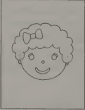

**材料**

- 少量毛毡，颜色适合你想要制作的孩子
- 剪刀

**做法**

从 alaeditions.org/webextras 下载图样 5.1。使用该图样，用不同颜色的毛毡剪出脸、头发、耳朵、眼睛、鼻子、微笑和蝴蝶结。

**材料**

- 黄色毛毡（太阳）
- 白色毛毡（鸟）
- 棕色毛毡（船）
- 灰色毛毡（鲸）
- 粉色毛毡（珊瑚）
- 绿色毛毡（鱼）
- 蓝色毛毡（海）
- 剪刀

**做法**

从 alaeditions.org/webextras 下载图样 5.2 至 5.8。使用这些图样，用选定的毛毡颜色剪出太阳、鸟、船、鲸、珊瑚、鱼和海。

**讲述**

在开始讲故事之前，把所有物品布置在绒布板上。每说完一行，就停顿一下，让孩子们选择押韵的相应部件并将其取下。

#### 老鼠、小蚊子和漂亮胖猫

这个绒布板是对“at”发音的有趣探索——非常适合解读单词的发音并判断它们的共同点。如果你愿意，还可以把故事变成补全提示，以增强孩子们的押韵技能。

从前有一只猫。
他其实相当胖。
他戴着一顶高高的礼帽，
这只漂亮胖猫。

他有一个朋友，一只老鼠，
老鼠拿着一根棒球棒，
坐在一张垫子上，
在漂亮胖猫旁边。

一只微小又吵闹的小蚊子
绕着老鼠嗡嗡飞，
绕着猫嗡嗡飞，
还绕着他的帽子嗡嗡飞。

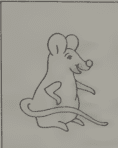
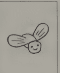
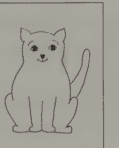
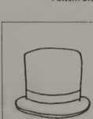
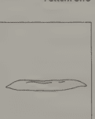
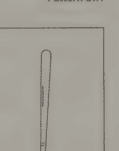

老鼠拿起他的球棒，
朝小蚊子挥去，
但他只把帽子
从漂亮胖猫头上打掉了。
可恶！

**材料**

- 少量各种颜色的毛毡
- 剪刀

**做法**

从 alaeditions.org/webextras 下载图样 5.9 至 5.14。使用这些图样，用你选定的毛毡颜色剪出猫、老鼠、帽子、球棒、垫子和小蚊子。

**讲述**

每说一行，就把相应的绒布板部件放到板上，并在大声说出名称之前停顿一下，给孩子们补全韵脚的机会。在后半部分，你可以移动人物来演示故事。

### 概念绒布板

以下绒布板有助于培养多种不同的概念技能。

#### 泡泡

这是一首简单易学的绒布板歌曲/儿歌，可用于集中练习数数或颜色词汇。

我吹了一个大泡泡，（把泡泡放在绒布板上）
我吹了一个大泡泡，
我吹了一个大泡泡，
希望它不会破！（拍手一次）
破！（拍手一次）
破！（拍手一次）
希望它不会破！（拍手一次）

我吹了两个大泡泡，（把另一个泡泡放在绒布板上）
我吹了两个大泡泡，
我吹了两个大泡泡，
希望它们不会破！（拍手两次）
破！（拍手两次）
破！（拍手两次）
希望它们不会破！（拍手两次）

（继续添加泡泡并数它们破掉的次数，直到泡泡用完或孩子们数累了！）

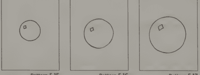

**材料**

- 一种颜色的毛毡
- 剪刀

**制作方法**

从 alaeditions.org/webextras 下载图案 5.15 至 5.17。把所有泡泡做成同一种颜色，以便孩子们更清楚地理解活动。学龄前儿童通常一次只能关注一个属性，把泡泡做成不同颜色可能会让活动变得混乱。

#### 泡泡（颜色替代版）

- 我吹了一个大泡泡，*（把泡泡放在绒布板上）*
- 我吹了一个大泡泡，
- 我喜欢这个泡泡的颜色，
- 它是_____。*（鼓励孩子们说出泡泡的颜色）*
- 我吹了两个大泡泡，*（把另一个泡泡放在绒布板上）*
- 我吹了两个大泡泡，
- 我喜欢这些泡泡的颜色，
- 它们是____和_____。*（继续添加泡泡并说出它们的颜色）*

**材料**

- 多种颜色的毛毡
- 剪刀

**制作方法**

把泡泡做成许多不同颜色，但所有泡泡只选择一种尺寸。

#### 形状与颜色

为绒布板剪出不同的形状。大多数学龄前儿童一次只能关注一个属性，所以要么放上同一种形状的多种颜色（例如多种颜色的圆形）来谈论颜色，要么放上同一种颜色的多种形状（例如许多红色形状）来谈论形状。这也可以是发展不同语言词汇的绝佳机会。

| 西班牙语常见形状 | 西班牙语常见颜色 |
| --- | --- |
| 心形 — un corazón | 红色 — rojo |
| 正方形 — un cuadrado | 蓝色 — azul |
| 圆形 — un círculo | 绿色 — verde |
| 长方形 — un rectángulo | 白色 — blanco |
| 椭圆形 — un óvalo | 橙色 — anaranjado |
| 立方体 — un cubo | 紫色 — morado |
| 五边形 — un pentágono | 黄色 — amarillo |
| 三角形 — un triángulo | 棕色 — café |
|  | 黑色 — negro |
|  | 灰色 — gris |

#### 数绵羊

这是一只毛茸茸的小羊

*（把手中的小羊举在绒布板对侧）*

它想来说晚安。
数她跳过去

（*让小羊从你身上跳过*，并把它放在绒布板上）

帮我们睡个好觉。
一！
你看到几只羊？
没错，就一只！

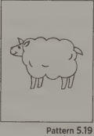

这是另一只毛茸茸的小羊
它想来说晚安。
数他跳过去
帮我们睡个好觉。
二！*（把第二只小羊放在绒布板上第一只旁边）*
现在有几只羊？
我们一起数一数。
一、二。
有几只？

*（鼓励孩子们在你指向每只羊时大声数数。每次数完绒布板上的羊后，都问孩子们：“有几只？”这种方法有助于孩子们理解基数——即表示他们一眼看到多少物品的数字。）*

#### 目测数数：树叶

这个绒布板让孩子们练习目测数数而不必逐个数数。如果物品数量不超过六个，幼儿目测数数会更容易成功。（要练习数到十以上，可制作更多绒布板图卡。）

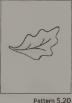

秋天里一片小树叶，
从树上落下。
秋天里一片小树叶。
我们看见几片？

*（数一数树叶，然后问：“有几片？”）*

秋天里又一片树叶，
从树上落下。
秋天里又一片树叶。
我们看见几片？

*（数一数树叶，然后问：“有几片？”继续添加，直到六片树叶。）*

#### 目测数数：雪人

这是另一个帮助孩子们练习目测数数的绒布板。

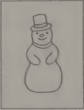

这里有一个雪人站得高。
我们大家能数一数他吗？

*（数一数雪人，然后问：“有几个？”）*

又有一个雪人站得高。
我们大家能数一数他们吗？

*（数一数雪人，然后问：“有几个？”最多添加到六个雪人。）*

### 不依赖故事的绒布板创意

使用开放式绒布板——那些不一定与故事绑定的绒布板——能让孩子们自己动手参与。当我们只是把一张图卡放在绒布板上问“这是什么？”时，就是在鼓励孩子们思考、回忆并清楚地说出答案，所有这些都比单纯观看和倾听需要更多的技能培养！以下是一些开放式绒布板图卡的点子。这里呈现的绒布板图案和创意旨在最大化互动和对话，同时关注各种技能的发展。

#### 家庭

这个绒布板可用于故事时间，作为家庭成员称谓的词汇积累工具，可使用英语以及适合你所在社区的其他语言。从 alaeditions.org/webextras 下载图案 5.22 至 5.28。父亲和母亲图卡可以变成阿姨和叔叔，哥哥和姐姐图卡可以变成表兄弟姐妹或继兄弟姐妹，等等。你可以将它们与儿歌《谁在家里？》（见第4章）一起使用，也可以单独使用，作为谈论不同类型家庭的提示。它们被设计成手拉手并排站立。

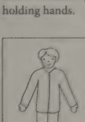

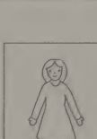

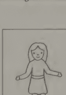

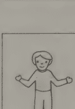

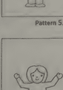

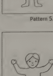

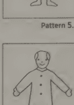

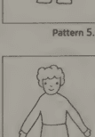

#### 花朵下的瓢虫

这个绒布板的灵感来自《小老鼠，小老鼠，你在____房子里吗？》的流行。如果你不熟悉那个绒布板故事，它是这样的：在绒布板上放许多颜色的房子，一只小老鼠藏在其中一座房子后面。讲述者重复儿歌，孩子们喊出房子的颜色，以便从绒布板上取下房子寻找藏起来的小老鼠。孩子们喜欢玩这种寻找隐藏物品的游戏。但为了鼓励更多对话，使用更复杂的物品意味着孩子们必须使用比颜色名称更具描述性的词语来指出他们想取下的物品。这种增加的对话能积累词汇，并融入社交和情感技能培养，因为孩子们必须轮流描述要取下哪个物品。

从 alaeditions.org/webextras 下载图案 5.29 至 5.37。把所有花朵放在绒布板上，把瓢虫藏在一朵花下面。告诉孩子们瓢虫藏在一朵花后面，并问他们觉得瓢虫藏在哪里。让孩子们选择先取下哪朵花、第二朵、第三朵，等等。

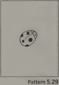

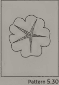

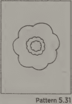

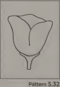

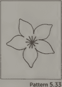

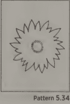

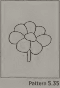

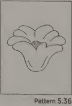

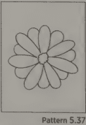

### 带动作或动手参与的绒布板活动

#### 五个棕色小面包

在故事时间使用传统童谣，能把我们现代的孩子与西方文学经典联系起来，而且这些童谣拥有美妙的词汇和节奏。为了让“五个棕色小面包”更有趣、更具参与性，让五个孩子靠墙排成一排，站在你座位右侧或左侧。给每个孩子一枚便士，并在绒布板上放五个棕色小面包贴片。大家一起唱这首童谣，并鼓励这五个孩子一个接一个地走过房间，在适当的时候停下来把一枚便士递给你，然后从绒布板上拿走一个小面包。和全体孩子一起数一数板上剩下的小面包，然后在下一个孩子走过房间来“买”小面包时再唱一遍这首童谣。你可能会觉得自己把这首童谣唱了一千遍（对于人数多的群体来说，这也许差不多），但孩子们和他们的照护者似乎真的很喜欢这个活动，而且它确实能把这首童谣牢牢印在每个人的记忆里。

五个棕色小面包在面包店里，  
五个棕色小面包顶上撒着糖，  
来了一个小伙子/姑娘，手里拿着一便士，  
他/她拿了一个小面包，  
就跑开了。

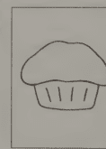

#### 爱心树

对于这个绒布板活动，先把树干放在板上。给每个孩子发一个绒布板贴片。如果你的故事时间人数非常多，可能需要分组进行。贴片可以是情人节用的红色和粉色爱心，也可以是庆祝春天回归的各种绿色爱心。告诉孩子们，轮到他们把“叶子”送给树时，他们要说：“这是我对树的爱”，或者“这是给树的一片叶子”。和孩子们一起把这句话练习几遍，让他们能自如地掌握它。然后开始讲故事。

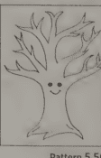

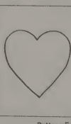

### 游戏

在故事时间玩游戏，让我们能够引入字母表、数学概念、科学概念、现实世界信息、语言游戏、印刷文字意识、语音意识、词汇——丰富的可能性。而且，游戏很有趣！游戏还能帮助孩子培养许多社交和情感技能：轮流、等待轮到自己、集中注意力、交流、解决问题等等。以下游戏只是一个起点。你可以在此基础上构建、改变和调整，使它们适合你的听众和故事时间的规模。

#### 字母搜寻

*材料*

- 字母横幅
- 单个字母（最好与横幅上的字母字体和颜色相同）
- 用来装字母的袋子或盒子

*说明*

把字母横幅张贴在房间里，或者把单个字母张贴在房间四周。（制作字母时要足够大，让故事时间的所有孩子都能看见。）再为自己打印一套字母（这套可以小一些，但字体和颜色要与相应的大字母一致）。把所有较小的字母放进一个袋子里，一边念这首童谣，一边用手拍大腿：

找呀找，  
找字母，  
我们要去找字母。  
字母 ______（从袋子里抽出一个字母并大声说出它的名称）  
藏起了它的脸。  
我们去找它藏在哪里！

（把字母举起来让所有人看到，选一个孩子在横幅上或房间里找到这个字母。）

#### 鸟类与昆虫

*材料*

- 各种鸟类的照片
- 各种昆虫的照片

*说明*

玩“它是鸟，还是昆虫？”在开始游戏之前，和孩子们讨论鸟类与昆虫的区别：两条腿/六条腿、有羽毛/没有羽毛，等等。一次举起一张照片，问它是鸟还是昆虫。如果你们的人数足够少，可以和孩子们讨论他们以前是否见过这些鸟或昆虫中的任何一种。

#### 分类

*材料*

- 印在纸上的类别名称
- 小盒子或袋子

*说明*

把所有类别名称放进袋子或盒子里，并告诉孩子们，你要请他们非常努力地思考。告诉他们，你会抽出一个类别，也就是“一组事物”的一个很棒的说法；当你宣布这个类别时，你希望他们说出属于该类别的物品。

*类别名称*

- 颜色
- 宠物种类
- 衣物
- 动物
- 有趣的可参观地点
- 天气种类
- 交通方式
- 家庭成员
- 社区服务人员

#### 颜色卡

*材料*

- 颜色卡——所有颜色名称都用大写字母、并以对应颜色印刷（例如，用绿色印刷或书写“GREEN”）

*说明*

向孩子们解释，你读累了，现在轮到他们了！告诉他们，你要给他们看一些颜色名称，希望他们大声读给你听。（孩子们很快就会明白，名称是用对应颜色写成的。）在他们正确说出颜色名称后，大声读出每个字母，然后再读一遍颜色名称。庆祝孩子们是如此出色的“读者”。

#### 情绪词汇

给情绪命名有助于幼儿以健康的方式管理情绪。在这个游戏中，你先从较常见的情绪词开始：开心、伤心、生气、害怕，等等。和孩子们讨论这些情绪看起来是什么样子。一个人开心时，她的脸是什么样？她伤心时又是什么样？继续就其他情绪提出类似问题。在讲过熟悉的情绪之后，谈谈不太熟悉的情绪——沮丧、惊讶、紧张，等等。那些感受看起来是什么样？回想一次你感到沮丧、惊讶或紧张的经历，告诉孩子们是什么让你有那种感受，也许还可以说说你做了什么来缓解它。

另一种方法是谈论描述特定情绪的词。每次活动选择一种情绪，讨论其他表示相同意思的词。谈谈情绪的不同程度——“如果开心看起来是这样（*做出开心的表情*），你觉得欢乐看起来是什么样？”用整个身体表演出情绪的不同程度。你甚至可以让孩子们和家人站起来，一起表演情绪。

*情绪词*

- 开心——高兴、愉快、欢乐、快活、喜气洋洋、幸福、兴致勃勃
- 伤心——孤苦、不快乐、沮丧、心碎、哀伤、泪汪汪、悲痛
- 生气——发疯、暴怒、愤怒、恼怒、气恼、愠怒、激怒
- 害怕——恐惧、惊恐、畏惧、惊骇、吓呆、惊慌、恐慌
- 疲倦——精疲力竭、累垮、困倦、疲惫、被掏空、累坏、疲乏
- 惊讶——震惊、目瞪口呆、措手不及、惊愕、大吃一惊、发愣、哑口无言

#### 手电筒词汇

*材料*

- 挂在故事时间房间各处的有趣物品照片
- 手电筒
- 胶带

*说明*

在故事时间开始前，用胶带把照片贴在房间四周。到了故事时间指定的环节，把灯光调暗或关掉，打开手电筒，一次把光照在一张照片上。鼓励孩子们认出物品并描述它。提出开放式问题来丰富词汇。

#### 字母/数字游戏

*材料*

- 数字1–20以及一些更大数字的卡片（索引卡或覆膜卡纸）
- 单个字母的卡片（年龄较小的故事时间群体用全大写字母；年龄较大的群体用大小写混合字母）

*说明*

把数字卡和字母卡混在一起，正面朝下放在你的腿上。一次翻起一张，问：“字母还是数字？”如果孩子们非常擅长辨认，就加快翻卡速度。如果孩子们觉得有困难，就放慢速度，花时间谈谈每个数字或字母。这个游戏是为了好玩，而不是让人有压力！

#### 小写/大写配对游戏

*材料*

- 印有单个大写字母的卡片或纸
- 印有单个小写字母的卡片或纸
- 胶带

*说明*

用胶带把大写字母贴在故事时间房间的墙上。把孩子们聚集到房间中央，给每个孩子一个小写字母。告诉孩子们（以及他们的照护者），你要播放音乐，当音乐停止时，希望他们站到与自己手中小写字母相对应的大写字母旁边。留出充足的音乐时间，以免孩子们互相撞到。让每个孩子举起自己的字母并说出它的名称。然后让所有孩子回到房间中央，交换字母，再重新开始。如果人数非常多，你可能需要打印多份字母。

以下是一些可用的词语：

- 湿/干
- 早/晚
- 上/下
- 内/外
- 空/满
- 安静/吵闹
- 重/轻
- 友善/刻薄
- 光亮/暗淡
- 好/坏

- 高/低
- 老/年轻/新
- 昼/夜
- 快/慢
- 开心/伤心
- 大/小
- 分开/一起
- 前/后
- 右/错/左
- 干净/脏

- 高/矮
- 胖/瘦
- 第一/最后
- 多/少
- 暗/亮
- 快速/慢
- 厚/薄
- 停/行
- 粗糙/光滑
- 硬/软/容易

儿童常常会想出“跳出框框”的反义词，这会让这个游戏非常有趣。

#### 照片

##### 材料

- 某一主题的大幅、易于看清的照片（例如，食物种类、帽子、农场动物、幼小动物、海洋生物、工具、交通工具种类、衣物）

##### 做法

在故事时间使用照片不仅能拓展儿童的世界知识，而且极具娱乐性。我们的非虚构藏书收录了许多精彩照片，剪贴画集也可以以合理价格购买，使我们能够打印出各种主题的绝佳照片。一次展示一张照片，并与孩子们开始对话。对于较大的群体，如有可能，请在群体中走动，让房间各个区域的孩子都有机会参与。问诸如：“这是什么？”“我们会在哪里找到它？”“你以前见过这个吗？”在讨论中穿插一些事实，或重点介绍包含更多信息的书籍。

#### 图片/词语

##### 材料

- 剪贴画卡片或有趣又熟悉物品的照片（例如，汽车、房子、狗、马、树、孩子、尿布、热狗、一条内裤）。加入滑稽图片会很有趣——幽默会鼓励参与。
- 印有词语的卡片

##### 做法

把卡片面朝下放在腿上，一次翻开一张，问孩子们：“这是图片还是词语？”

#### 图片/词语/数字

##### 材料

- 有趣物品或物体的照片
- 每张照片对应的数字
- 印在卡片或纸上的物品或物体名称
- 胶带

##### 做法

用胶带把照片贴在故事时间房间的墙上，每张旁边标一个数字。把物品名称放在腿上，一次翻开一张，大声读出名称，并用手指划过字母。鼓励孩子们环顾房间寻找该物品，并大声说出它对应的数字。

#### 押韵袋

##### 材料

- 印在卡片或小纸片上的简单词语（例如，book, bake, ate, cat, bear, feet, pet, pig, pit, bite, dog, pot, boot, cow, dug, due, up）
- 小盒子或袋子

##### 做法

把词语放进盒子或袋子。一次取出一个词，看看孩子们能想出多少个与它押韵的词。根据孩子们对押韵概念的经验，你可能需要给出押韵词的例子。确保提出一些与卡片词语押韵的无意义词，让孩子们和照护者知道重要的是押韵，而不是词本身。

#### 词汇照片

##### 材料

- 名称有趣的物品的大幅照片（例如，枝形吊灯、自动扶梯、仙人掌、彩虹、过山车、羽管键琴、鞋带、笔记本电脑、芜菁甘蓝、一品红、摩天大楼、冰川、彗星、降落伞、暴风雪、纸杯蛋糕、小提琴）

##### 做法

把照片面朝下放在腿上，一次一张展示给孩子们，并围绕每件物品展开对话：“我们可能会在哪里找到一

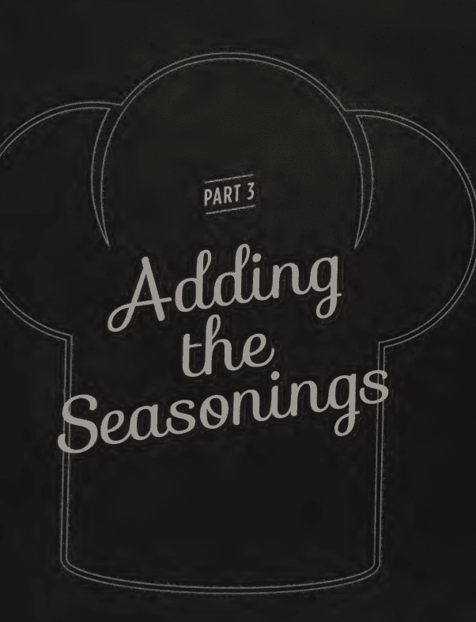

## 第3部分

### 添加调味料

#### 数与运算

数与运算类别中的技能包括计数、比较、分组、分割和组合。在这些技能方面有动手体验的学龄前儿童，开始上学时将具备扎实的数学基础。

在培养数与运算技能时，重要的是要注意，我们并不是简单地鼓励死记硬背计数数字，而是培养对数字顺序的理解。因此，我们希望孩子能够按正确顺序计数而不遗漏数字，但我们也希望他们理解四比三多、比五少。我们希望他们理解数字 4 实际意味着什么。

##### 计数

当然，计数是数与运算的重要组成部分。在孩子能够进入更具挑战性的数学概念之前，他们必须掌握计数。为了做到这一点，他们必须牢固掌握计数的三个方面：

- 1. *数字顺序*（1、2、3、4、5 等）
- 2. *一一对应*——1 表示某物中的一个，5 表示某物中的五个，依此类推
- 3. *基数*——数一个集合时最后说出的数字说明该集合中有多少项（数量）

我们可以通过让孩子大量练习计数来帮助他们发展数字顺序。只要有可能，我们也希望数到十以上，因为在英语中，十一到十九这些数字的规律与其他整十数不同。（如果它们像二十到二十九那样，我们会数“ten-one, ten-two, ten-three”，而不是“eleven, twelve, thirteen”。）而且，由于我们在故事时间分享的大多数书只从一数到十（或从十倒数到一），我们能提供的任何数到十以上的练习，都将有助于支持儿童对这种非典型数字顺序的理解。

为了鼓励掌握一一对应，我们可以提供大量练习，让孩子看到说出的一个数字由多少物品组成。例如，我们可以把一个物品放在面前或法兰绒板上，说：“这里有一个。”然后拿出另一个物品，说：“现在我们有二个。”一旦我们把所有物品放在孩子们面前或法兰绒板上并数过，我们就问那个神奇的问题：“我们一共有多少个？”这种支架式支持有助于发展基数概念以及一一对应。

在故事时间尽可能多地使用计数词语，是一种无需直接教学就能帮助儿童吸收数字概念的简单方法。例如，你可能会说：“我今天有*三*本书。我们*首先*读哪一本？”“你们都是从*两*扇门走进会议室的。”“我坐在这边我的*一*把椅子旁。”“我看到前排还有四张垫子是空的。”当我们将这类计数词语加入日常对话时，我们就是在让孩子沉浸在情境化的数学词汇中，从而提升他们的数学和读写学习。

##### 快速识数

正如法兰绒板章节所述，*快速识数*是一眼认出集合中物体数量的能力（例如，骰子一侧的点数）。这是一项重要的数学技能，我们可以在故事时间通过让孩子大量练习来帮助发展这项技能。我们可以使用法兰绒板，甚至使用印有一些物品的纸张。例如，如果你刚读了一本关于鸟的书，你可以给孩子们看印有一只鸟、两只鸟、六只鸟等的纸张或大索引卡。只需一次翻开一页，问：“你看到多少个？”这是在故事时间玩的有趣游戏，而且几乎可以轻松改编以适配任何主题。

#### 几何与空间感

探索形状是学前几何的完美起点。还有什么比一大套积木更好的探索形状的方式呢？华盛顿大学的德米特里·克里斯塔基斯博士及其同事的一项引人入胜的研究（*JAMA and Archives Journals 2007*）表明，父母每天让孩子参与积木游戏的孩子不仅表现出色的基础数学理解，而且读写技能发展也有所提高！这并不奇怪，因为与他人一起玩积木需要交流、扩展词汇（积木和结构的名称等），甚至需要讲故事——当孩子们用积木表演一个场景时。由于幼儿主要通过感官学习，积木非常适合动手理解形状，也适合理解重力、稳定性、试错和预测等科学概念。在故事时间房间里加入自由积木游戏是一个如此有力却又简单的想法。积木游戏可以成为故事时间开始前（或结束后）的绝佳过渡活动，也可以提醒父母这种游戏的重要性。

#### 测量

要理解测量的概念，儿童必须首先学习测量的属性（重量、长度、大小、远近等），然后能够应用这些属性来实际测量物体。只要有可能，重要的是超越简单的大/小比较；考虑容量、面积、长度、宽度、高度、重量、距离等。

##### 比较

比较的概念最好通过操作真实物体和尽可能使用动手活动来在幼儿身上发展。我们还希望帮助

围绕比较发展儿童的词汇——高、矮、宽、窄、高、低、快、慢、小、大、老、幼、暗、亮、开、关等等。

### 数学活动

在为儿童规划学习体验时，把乐趣放在首位，以下活动可以轻松加入故事时间，使其更贴近数学。

#### 属性

**材料**

- 选定的相反属性（例如，大/小、近/远、重/轻、宽/窄、长/短、暗/亮）
- 故事时间房间中的物品

**做法**

在故事时间选择一组相反的属性作为关注重点（例如，大和小）。如果你面对的是小组，就指向教室里的某样东西，问一个孩子那件物品是大还是小。选择另一件物品，问另一个孩子那件物品是大还是小。如果你面对的是大组，就指向一个物体，让全组决定它是大还是小。

#### 拍手数数

向孩子们解释，你们要一起拍手数数，但不是从1开始，而是从“中间”某个数开始。从8或3开始拍手数数，最好从11开始。如果你经常在故事时间做这个活动，可以让孩子选择起始数字。这样他们就能让你了解他们的数数水平；也许他们对1到10很熟练，但对11到20感到困难。

#### 数数手指游戏

在使用数数手指游戏之前，告诉孩子们：“我们现在来做一个数数手指游戏。”这会把孩子及其看护人的注意力吸引到数数的概念上！对学龄前儿童来说，起初使用正着数的手指游戏、之后再倒着数会更容易。而且让身体参与进来会带来更丰富的学习！

**正着数的数数手指游戏**

- “一、二，扣好鞋”
- “1、2、3、4、5，我捉到一条活鱼”
- “一个土豆，两个土豆”
- “1个小雪人，2个小雪人，3个小雪人”（稻草人、帆船、孩子、小狗、斑马、乌龟等；这是老歌更受欢迎的版本）
- “这个老人”

**倒着数的数数手指游戏**

- “五只小猴子在床上跳”
- “五只斑点小青蛙”
- “五只小猴子在树上荡”
- “五只小鸭子”

#### 脚

**材料**

- 纸（足够每个孩子有一个“脚”）
- 剪刀
- 用来复制的脚

**做法**

剪出约一英尺长的脚印轮廓。把这些脚印发给孩子们，鼓励他们用脚印测量房间。从一个地方到另一个地方有多少个“脚”？测量之后，给孩子们看一把尺子，谈谈尺子上一“英尺”有多长。对于较大的物品和年龄较大的孩子，鼓励他们两人一组，用两个“脚”来测量。

#### 绒布板数数

**材料**

- 20个相同的绒布板形状（比如20个绿色圆圈，或者如果你有模切机，就用它从毛毡上切出相同的物体）
- 小盒子或袋子

**做法**

告诉孩子们，你要把手伸进盒子或袋子里，抓出一把能用一个拳头抓住的物品，并希望他们帮忙看看你一次能抓多少个。抓一把形状，然后把它们一个一个放到绒布板上，一起数。(如果你一次放一个，你就在强化一一对应关系，同时也让孩子们

归入“大”列或“小”列。（把图表引入故事也是一种有趣而有效的方式，可以示范写作这一读写实践！）

#### 爱我，不爱我——反向绒布板

**材料**

- 从毛毡上剪下的部件：花心、花瓣、花茎
- 绒布板

**做法**

制作一个花朵绒布板——把花心（胚珠）放在板上，然后一次加一片花瓣，边放边数。然后取下每片花瓣，同时倒着数。

#### 数学袋

**材料**

- 小袋子
- 若干组数量不同的物品（例如，6支高尔夫铅笔、12个毛绒球、14个乒乓球、21颗樱桃、19个棉球等；因为对学龄前儿童来说，一次只关注一种属性最清楚，所以最好让所有物品的颜色、形状和大小都相同）

**做法**

把一组物品放进袋子里。向孩子们解释，你们要一起数袋子里的物品。一次拿出一件物品，在你面前排成一行，一起数。例如，拿出一颗樱桃，数“一”；再拿出一颗樱桃，把它放在第一颗樱桃旁边，让孩子们都能清楚地看到，数“二”。再拿出一颗樱桃，把它和前两颗樱桃排成一行，问孩子们：“有多少？对！三！”按同样的方式继续，直到袋子空了。

#### 测量

**材料**

- 为每个孩子（及其看护人）准备一根约一英尺长的毛线或细绳。如果你的故事时间人数很多，可以鼓励孩子们两人一组。
- 要测量的物品：椅子、桌面、桌腿、窗台、布告栏、妈妈们、脚、地毯、房间宽度等

**做法**

给孩子们看一段毛线或细绳，示范用毛线或细绳测量你的绒布板或你自己。你的宽度有多少个“长度”？

把丝带在头顶挥动。
把丝带放在地板上。
把丝带放进袋子里。

#### 形状家族

**材料**

- 从毛毡上剪出的两种形状的许多变体（例如，角度和大小不同的三角形，以及大小不同的长方形；把两种形状都做成同一种颜色，以帮助孩子专注于形状这一属性）

**做法**

在绒布板顶部两侧各放一个每种形状。一次举起一个形状，问孩子们每个形状应归入绒布板上的哪一列。（这是一个很好的练习，可以分享不寻常的三角形，而不仅仅是等边三角形，以及不寻常的长方形，包括正方形。）一起谈谈孩子们为什么做出这样的决定（从而强调每种形状的属性）。

#### 日晷

**材料**

- 用作日晷的物体（也许是用胶带固定在地上的包装纸筒，或者一个警示锥）
- 美纹纸胶带或油漆工胶带

**做法**

在故事时间开始之前，把高高的日晷物体放在你的房间或图书馆里阳光充足的地方。告诉孩子们，今天他们要通测量物体影子的移动来测量时间的流逝。在孩子们观看时，用胶带把物体影子的轮廓贴在地板上，然后继续故事时间。结束时，请孩子们注意胶带，并对结果感到好奇。

如果你房间里没有阳光照进来，可以用手电筒向孩子们展示影子的移动。引导孩子们讨论时间的流逝。

#### 天气绒布板

**材料**

- 毛毡剪片：1个太阳、2道彩虹、3道闪电、4滴雨滴、5朵云
- 绒布板

**做法**

用绒布板来数数并谈论天气（数学和科学！）。

### 第8章 科学

与数学一样，把科学概念加入故事时间，其实只是在规划时更有意识。记住幼儿已经是天生的科学家，而且他们通过感官学习效果最好，我们可以看看本周选好的书，思考文本或插图中可能包含的科学想法，并围绕它们设计活动。

幼儿渴望探索和操作周围的环境。为了鼓励每个孩子内心的科学探索者，寻找把物品——照片、贝壳、树叶、羽毛、学龄前儿童熟悉的东西——引入故事时间的方法，以激发问题、探究和讨论。你引入的任何东西都应是具体的而非抽象的，是学龄前儿童身体经验范围内的东西。例如，你可以谈谈夏日阳光的温暖，让孩子们轮流在故事室里从阴影走到阳光下，感受温度的差异。你可以问：“影子的样子和阳光的样子有什么不同？”“它们摸起来/感觉起来有什么不同？”“我们对太阳知道些什么？”“我们怎样才能了解更多？”你不必深入探究太阳的化学构成及其在太阳系中的位置。你只是想鼓励孩子们分享他们所知，并点燃他们对宇宙的兴趣。本着这种方法，以下是一些可以加入故事时间以增强科学学习的活动。

#### 在故事时间探索世界

##### 动物与幼崽

*材料*

- 动物及其幼崽的单独照片（例如，狗/小狗、猫/小猫、马/马驹、牛/牛犊、羊/羔羊、山羊/小山羊、鸡/小鸡、鸭/小鸭、鹅/小鹅、青蛙/蝌蚪、熊/幼熊、麻雀/雏鸟、狐狸/幼狐、袋鼠/幼袋鼠）

*步骤*

把动物幼崽照片分发给每个孩子（如果你的故事时间人数很多，可以把这个活动做几次）。举起一张动物照片，让拿着匹配幼崽照片的孩子把它带到房间前面。花一点时间谈谈这些动物：“马吃什么？”“鸡会发出什么声音？”“我们怎么称呼熊？”

##### 动物与住所

*材料*

- 动物及其居住住所的单独照片（例如，鸟/巢、狐狸/洞穴、牛/畜棚、狗/狗床或狗/狗屋、猫/猫床、鱼/鱼缸或鱼/池塘、鸡/鸡舍、青蛙/池塘、兔子/洞穴、鹰/鹰巢、鼹鼠/洞穴、蚂蚁/蚁丘）

*步骤*

这个活动与“动物与幼崽”类似，但使用的是动物及其住所的照片。给每个孩子分发一张动物照片。举起一张动物住所的照片，鼓励拿着属于该住所的动物照片的孩子把他或她的照片拿给你。谈谈这种动物和它居住的住所：“我们可能在哪里找到这个住所？”“动物自己建造住所吗？”“它是怎么做到的？”

##### 远近动物

*材料*

- 两种不同动物的照片或书籍——一种生活在你的地区附近，一种生活在远离你居住地区的地方

*步骤*

利用关于这些动物的照片或书籍，对它们进行比较和对比——它们的皮毛/皮肤/羽毛、幼崽、食物、睡床、睡眠习惯等。引导孩子们讨论这些动物有何相似之处，又有何不同。

##### 动物皮毛与外壳

*材料*

- 真实的动物皮毛、羽毛、皮革、贝壳等材料

*步骤*

在房间里传递这些物品，或让孩子们有机会在自然观察桌上探索这些物品。鼓励他们观察、闻一闻并触摸这些物品。然后引导孩子们讨论这些物品：“它们有什么相似之处？”“它们有什么不同？”“它们来自什么动物或生物？”“它们为那个动物提供了什么？”

##### 蜜蜂

*材料*

- 蜜蜂工作的照片
- 需要蜜蜂授粉的水果的照片（或实物）：猕猴桃、草莓、西瓜、橘子、橘柚、柠檬、青柠、荔枝、苹果、芒果、杏、樱桃、李子、桃、波森莓、黑莓、覆盆子、接骨木莓、蓝莓、蔓越莓、葡萄、哈密瓜
- 一罐蜂蜜

*步骤*

利用照片或水果，引导孩子们讨论蜜蜂。“你见过蜜蜂吗？”“你当时在哪里？”“蜜蜂在做什么？”谈谈蜜蜂与大黄蜂的区别。孩子们吃过这些水果中的任何一种吗？谈谈蜂蜜以及它的味道。

##### 探索箱

*材料*

- 低边箱子
- 各种自然材料：种子、叶子、茎、苔藓、小树枝、花等

*步骤*

把许多自然材料装进一个箱子。把这个箱子放在孩子们可以在故事时间之前或之后探索的地方。材料可以更换，以反映不同季节。

##### 水果和蔬菜

*材料*

- 各种水果或蔬菜，或两者兼有
- 漂亮的食品杂货袋

*步骤*

告诉孩子们，你要给他们看许多不同种类的水果和蔬菜。一次一个地从食品杂货袋里拿出物品，引导孩子们谈论各种水果和蔬菜的外观、触感、气味和味道。把它们传下去，让孩子们拿取和探索。“你以前尝过其中一种吗？”“你觉得怎么样？”“味道如何？甜？酸？苦？”谈谈不同的味道。

##### 重力

*材料*

- 两个在形状、大小或重量上不同，或这些属性任意组合不同的物体

*步骤*

站在孩子们面前，把两个物体举在身前同一高度。问孩子们，如果你同时松开这两个物体，他们认为会发生什么。物体会向上飘吗？会向下落吗？我们怎样做出预测？松开物体。引导孩子们讨论为什么他们认为物体会出现那样的结果。如果可能，分发物体，让孩子们尝试让它们落下。鼓励照护者与孩子谈论发生了什么。

##### 重与轻

*材料*

- 各种重量不同的物体（例如，羽毛、砖块、棉花糖、大鹅卵石、岩石、围巾、金属管、纸杯、铸铁锅、软木塞、餐盘、空瓶、满瓶、叶子、保龄球、纱线、瓜、气球、杠铃）

*步骤*

告诉孩子们，今天要探索“重”和“轻”。在房间里传递这些物体，鼓励每个人拿一拿。孩子们研究完每个物体后，鼓励大家重新坐好，或从分享中安静下来。让每个孩子拿一个物体给你，然后问大家觉得那个物体是重还是轻。把重物放在你的一侧，把轻物放在另一侧。如果愿意，把结果记录在图表上。

##### 青蛙的生命周期

*材料*

- 展示青蛙生命周期的照片或关于青蛙生命周期的书

*步骤*

给孩子们看这些照片或这本书。引导他们讨论与青蛙有关的经历：“你以前见过青蛙吗？”“你在哪里见到的？”“它们处于什么样的环境？”“它们周围有哪些植物？”“它们发出什么声音？”等等。

##### 新月/满月

*材料*

- 月亮在不同盈亏阶段的照片

*步骤*

展示这些照片，让孩子们说出他们看到了什么。让孩子们思考月亮有时看起来不同这一事实。引导孩子们讨论他们对月亮的观察。你不必解释月相背后的科学原理。你只是在鼓励孩子们分享他们所知道的内容，或试图激发他们对夜空的兴趣。不过，你可以指出满月和新月，以丰富词汇。

##### 棱镜与光

*材料*

- 棱镜
- 手电筒

*步骤*

向孩子们展示棱镜，让他们说出自己注意到什么。打开手电筒，照向棱镜。鼓励孩子们描述他们看到的内容。你可以利用这个活动引导孩子们谈论彩虹：“你见过彩虹吗？”“你在哪里见到的？”“它看起来什么样？”等等。

##### 斜坡

*材料*

- 一段纸板或一段木材（较宽的一块会让“实验”更容易，因为物体不会从侧面掉下来）
- 两个不同的物体（例如，球、玩具车、铅笔、塑料动物、积木）

*步骤*

把纸板或木材从桌子搭到地板，形成斜坡。把两个不同物体放在斜坡顶端，让孩子们预测哪个物体会最快滚下斜坡。让物体滚下，并引导孩子思考发生了什么。做几次以检验结果。故事时间结束后保留斜坡，让孩子们可以实验和玩耍。

##### 岩石与矿物

*材料*

- 不同质地、形状和大小的岩石（例如，光滑的河石、小鹅卵石、大花岗岩石、扁平石板、石英、宝石、滚磨抛光过的石头、人造砖块等）

*步骤*

传递岩石让孩子们拿取，或邀请他们在桌子周围探索岩石。引导他们讨论这些岩石：“你可以在哪里找到这样的河石？”“石板摸起来是什么感觉？”“鹅卵石和紫水晶有什么相似之处？”“它们有什么不同？”等等。如果可能，展示一些岩石和矿物指南供借阅。

##### 贝壳

*材料*

- 各种贝壳

*步骤*

把贝壳传给孩子们。留出充足时间让他们观察、触摸、闻一闻贝壳等。一起谈谈这些贝壳：“它们看起来什么样？”“它们可能来自哪里？”“谁可能会使用这样的贝壳？”等等。

##### 种子

*材料*

- 种子生命周期的照片或关于种子生命周期的书

*步骤*

和孩子们分享这些照片或书。打开一包种子让孩子们看。向日葵或南瓜种子比较大，很适合展示。把真实种子与照片或书中的种子进行比较。也许可以在早春把一颗种子种在杯子或花盆里，并在春夏期间每周查看种子的生长进展。分发种子，让孩子们带回家种植。

### 质地

#### 材料

- 具有不同质地的物品（例如砂纸、天鹅绒、灯芯绒布、橡皮泥、金属、一块木头、塑料气泡膜、橡胶、玻璃、石头、毛皮、Gak 等）

#### 步骤

把不同质地的物品传给孩子们触摸，或在故事时间开始前把它们放在桌上供孩子们探索。一次举起一个物品，和孩子们谈谈它的特性：“摸起来是什么感觉？”“为什么会有这种感觉？”“哪些物品的质地相似？”“哪些不同？”等等。

### 今日天气

#### 材料

- 顶部印有各种天气图标的海报板：太阳、风、雨、云、雪等

#### 步骤

故事时间开始前，谈谈外面的天气。把它与你们上次故事时间聚会时的天气作比较。问孩子们哪个图标最能代表今天的天气。在那个图标下方做一个标记或放一个标记物。经过多次活动后，看看图表，讨论孩子们发现的任何规律。用图表引发关于天气的讨论，并涉及季节。

### 野生与家养

#### 材料

- 野生动物及其家养近亲的照片——例如，
  - 狗和狼、狐狸、郊狼、澳洲野犬
  - 猫和狮子、老虎、豹、美洲豹、美洲狮
  - 猪和野猪
  - 山羊和雪羊

#### 步骤

分享野生动物及其家养近亲的照片。谈谈它们的相似之处和不同之处。

插图非常精美。遗憾的是，书中没有收录歌曲的曲调，但值得翻阅。

- *《鹅妈妈：拉丁裔童谣宝库》* 作者：Alma Flor Ada（Hyperion Books for Children，2004）。这是一部极好的双语传统西班牙语童谣集，配有可爱的插图。
- *《玛丽·米德林及其他滑稽人物》* 作者：Rose Fyleman（Clarion Books，2004）。这是一部出色的短篇滑稽诗歌图画书合集。
- *《月亮，你见过我妈妈吗？卡拉·库斯金诗歌集》* 作者：Karla Kuskin（Laura Geringer Books，2003）。这本书满是诗歌瑰宝，对幼儿极具吸引力，主题也很熟悉。人人都该爱上卡拉·库斯金！
- *《月亮就是 La Luna：英语和西班牙语滑稽韵文》* 作者：Jay M. Harris（Houghton Mifflin，2007）。一本可爱的小书，韵文中穿插着西班牙语单词。
- *《街区鹅妈妈》* 作者：Nina Crews（Greenwillow，2004）。传统童谣配以精彩的多文化城市儿童照片。
- *《一起做梦的诗 / Poems Para Soñar Juntos》* 作者：Francisco X. Alarcón（Lee and Low Books，2005）。本卷大多收录较长的诗，但也有几首适合学龄前儿童的双语（西班牙语和英语）珍品。
- *《幼儿朗读韵文》*，Jack Prelutsky 选编（Knopf，1986）。Marc Brown 为这部精彩合集绘制插图。这里有太多伟大的诗歌和韵文，你可能不得不把故事时间的整个环节都献给这本书！
- *《汤米·德保拉诗集》*，Tomie dePaola 选编并绘制插图（Putnam，1988）。DePaola 真正理解孩子，这本理想的诗集证明了这一点。
- *《20世纪儿童诗歌宝库》*，Jack Prelutsky 编，Meilo So 绘（Knopf，1999）。名副其实的宝库。
- *《欢迎你，宝宝！婴儿时光的婴儿韵文》* 作者：Stephanie Calmenson（HarperCollins，2002）。这是一部可爱的韵文集，适合婴儿及以上儿童。
- *《扭一扭，摇一摇：给幼儿的故事和韵文》* 作者：Margaret Mayo（Knopf，2002）。收录了一些适合学龄前儿童的优秀韵文，以及一些可大声朗读的短篇故事。
- *《满满一动物园的动物》*，William Cole 选编（Houghton Mifflin，1992）。一部精彩的动物诗集，许多诗非常短。插图也极具娱乐性，使这部合集很适合陈列展示。

## 第4部分：筹划晚餐派对

### 菜单

寻找一本新食谱书时，我最喜欢的部分就是仔细研读食谱，寻找亮点，删去食材、加入其他食材，以顺应季节和我的口味。而我们现在正到了这一步！

#### 给主厨的说明

我们已经考察了儿童如何成长和学习。我们品尝了故事时间的美味健康食材。我们仔细研读了孩子们在学校轻松成功所需的数学和科学技能，也尝试了将诗歌加入故事时间的可行且可口的方式。现在我们要看看如何把它们全部整合起来。以下菜单都有主题，但你会注意到，它们的主题非常宽泛。主题并非必需，但许多图书馆员和家长觉得它们令人安心，也许还有助于规划。我们故事内容中唯一真正重要的因素，是它们塞满了精彩的图书、故事、对话、学习和*乐趣*。

每份菜单起初建议三本虚构类图书。第一本以故事为重。书中充满有趣的背景、人物和情节元素，能吸引孩子们的心智和情感。这类书非常容易引出开放式问题，并让孩子练习理解情感、故事和事件。第二本可能是互动性的，或以某种方式涉及数学或科学。第三本可能滑稽、发人深省，或者只是简短有趣。还会标出一本可使用的合适知识类图书。

在故事时间分享多少本书，以及它们在你自己的故事时间计划中处于什么位置，取决于个人偏好和受众。有些图书馆员会在许多手指游戏、故事和游戏之间使用两本书。有些人可能只在一两个其他活动之间读四五本书。这些菜单旨在适应个人风格和口味。建议的活动远多于一次活动能用完的量。所包含的活动以及额外的虚构类和知识类图书意味着，一份特定的菜单一年可以使用两三次甚至更多次。孩子们可能会认出这些手指游戏或毛毡板，但图书和活动可以更换。

菜单中收录了绝版图书。大厨们不遗余力地寻找完美食材，我们的孩子当然也应该分享过去那些深受喜爱的图书。此外，精彩的绝版图书每年都会重新出版，其中一些可能仍藏在我们故事时间藏书深处的角落，或藏在互联网上。

每份菜单都包含足够多新颖且易于获取的图书，可满足任何故事时间需求。虚构类和知识类建议适合大多数学龄前受众。不过，如果你遇到对孩子来说难度过高的图书，可以抽出一页来分享，或者直接使用照片或插图来增强故事时间的学习。

菜单中建议的手指游戏或动作韵文出自本书第4章。它们旨在补充你目前在故事时间中喜欢使用的手指游戏。菜单按标题提到它们，标题在第4章按字母顺序列出。如果列出了毛毡板，可以在第5章按标题字母顺序找到。仅列出标题的互动游戏或活动在第6章有完整描述。按标题列出的数学活动在第7章有完整描述，仅按标题列出的科学活动在第8章有描述。这里还列出了建议的诗歌，包括可能的来源，合适的佚名诗也同样列出。

我希望这本书被翻得卷角，布满笔记、补充、灵感，还有巧克力污渍。

### 我们开始吧！

### 动物

#### 推荐虚构类图书

如前所述，最长的故事排在首位，接着是一本精彩的互动式图书，第三本书则以幽默的方式为故事时间收尾。

*三只山羊嘎啦嘎啦*，保罗·加尔东著（Seabury Press，1973）。这个民间故事的绝佳重述，插图质朴却富有感染力。

*我用小眼睛找一找*，爱德华·吉布斯著（Templar Books/Candlewick，2011）。书中的模切页提出问题，让孩子们回答关于真实动物的问题。一本珍品。

*动物绝对不应该穿衣服*，朱迪·巴雷特著（Atheneum，1970）。一本经典童书，展示许多动物，并说明为什么衣物对它们并不合适。

#### 推荐知识类图书

*这是谁的脚？*，劳拉·赫尔伯特著（Henry Holt，2011）。这本色彩鲜明的书在一个跨页上展示一双脚，然后在下一个跨页上展示这双脚所属的动物。简单的文字和内置的互动使其成为故事时间的必备之选！

#### 手指游戏或动作韵文

- 穿过森林（第4章）
- 动物园里的谁？（第4章）

#### 诗歌

> “豹”，奥格登·纳什著，选自*蛋奶糊与伙伴：奥格登·纳什诗集*，昆汀·布莱克编选（Little, Brown，1980），第29页。

#### 互动游戏

鸟类与昆虫（第6章）

#### 数学活动

大和小图表（第7章）

#### 科学活动

近处和远处的动物（第8章）

#### 更多虚构类图书

*上帝的所有小动物*，比尔·斯坦斯著（Simon and Schuster Books for Young Readers，2009）。尽管这可能会被视为一首宗教歌曲，但卡迪尔·纳尔逊的插图太精彩了，不能不提。至少把它摆出来供借阅！

*动物上车*，安德鲁·富塞克·彼得斯著（Frances Lincoln，2007）。一本节奏鲜明、押韵的图画书，讲述农场动物登上火车。

*比比鸟宝宝*，黛安·雷德菲尔德·马西著（HarperCollins，2000）。新来的小鸟让动物园动物们睡不了觉，学龄前儿童会因它们的懊恼而发笑。

*大、更大、最大！*，南希·科费尔特著（Henry Holt，2009）。这本动物书按不同特征比较动物，并引入奇妙的词汇。

*马戏团形状*，斯图尔特·J. 墨菲著（HarperCollins，1998）。这本精彩的押韵书以马戏表演为背景，展示动物和形状。非常适合引发关于形状的讨论。

*亲爱的动物园*，罗德·坎贝尔著（Little Simon，1983）。孩子们会喜欢那些被送给小男孩的许多“不合适”的宠物，他正在寻找完美的宠物。

*猴子会啾啾叫吗？*，梅拉妮·沃尔什著（Houghton Mifflin，1997）。孩子们会喜欢这本充满傻问题的简单图书。

*从头到脚*，艾瑞·卡尔著（HarperCollins，1997）。这位大师的这本精美之作鼓励孩子们像插图中的动物一样活动。非常适合活跃的故事时间。

*去动物园*，汤姆·帕克斯顿著（Morrow Junior Books，1996）。这本精彩的书鼓励孩子们模仿动物园里的所有动物。而且还可以唱出来！

*抱抱*，杰兹·奥尔伯勒著（Candlewick，2000）。基本上就是一个词随着情感不断增强而重复，这使它成为喜欢戏剧化演绎的图书馆员的有趣选择！

*我很小*，艾玛·多德著（Scholastic，2010）。一只小企鹅喜欢自己小小的，因为父母对他的爱很大。这本书开本较小，但插图鲜艳，适合故事时间，孩子们会喜欢重复的文字。

*我能帮忙*，戴维·海德·科斯特洛著（Farrar, Straus and Giroux，2010）。这本循环式故事以明亮多彩的插图优美地展现了同理心和帮助他人。

*如果你看到一只小猫*，约翰·巴特勒著（Peachtree，2002）。可爱的插图将动物与我们在遇到它们时可能发出的声音配对。

*如果你是企鹅*，温德尔和弗洛伦斯·迈纳著（Katherine Tegen Books，2009）。有趣的押韵文字和超大插图描绘了企鹅的许多方面。

*如果你爱蹦跳*，阿普丽尔·普利·塞尔著（Greenwillow，2011）。这首广为流传的歌曲的改编版配有精彩插图和有趣信息，在故事时间唱起来非常带劲。

*晚开窍的利奥*，罗伯特·克劳斯著（Windmill Books，1971）。利奥慢慢成长，他的父亲为此担心。这是一本关于耐心和给孩子成长时间的可爱图书。

*我的心像动物园*，迈克尔·霍尔著（Greenwillow，2010）。各种各样的形容词描述由心形构成的动物。这本书非常适合搭配艺术活动。

*巴士上的海豹*，伦尼·霍特著（Henry Holt，2000）。对《巴士上的车轮》这首歌的滑稽改编。这本书会让故事时间的所有人哈哈大笑！

*慢慢地，慢慢地，慢慢地，树懒说*，艾瑞·卡尔著（Philomel Books，2002）。一本简单的书，不仅捕捉了树懒的特征，还包含美妙的词汇、关于忠于本性的道理，以及卡尔标志性的鲜艳插图。

*动物园里的两个*，丹娜·史密斯著（Clarion Books，2009）。数数到十就停了，但插图又大又醒目，押韵会促使孩子们去数数。

*当大象走路时*，庆子·凯萨兹著（Putnam，1990）。一个循环式故事，不同的动物对彼此做出反应。插图简单，周围留有大量空白。

*谁会蹦跳？*，凯蒂·戴维斯著（Harcourt Brace，1998）。内置的问题、鲜艳的插图和傻气的幽默使这本书成为有趣的故事时间读物。

*谁？谁？*，戴维·卡特著（Little Simon，2007）。书中的模切插图和互动设计使其成为较小规模故事时间的好选择，那时每个人都能清楚地看到书页。

#### 更多知识类图书

*关于鸟类*，凯瑟琳·西尔著（Peachtree，2003）。出色的、信息丰富的文字和精美的插图使这些书非常适合在故事时间从头读到尾。也有很多互动交流的机会。该系列包括企鹅、啮齿动物、哺乳动物、鸟类、甲壳类动物、爬行动物和鱼类。西尔还有一个关于栖息地的系列。

*草原上的动物宝宝*，珍妮弗·斯科菲尔德著（Kingfisher，2004）。一本非常适合学龄前故事时间的书，因为照片鲜艳，而且每隔一页就提出一个问题：图中动物的妈妈可能是谁。斯科菲尔德还在另一本介绍许多不同气候带动物宝宝的书里使用了同样的版式。

*动物*，彼得·赖利著（Gareth Stevens，2004）。虽然这本书整体上对学龄前儿童来说信息可能过多，但在故事时间分享完整的一页会非常合适。赖利涵盖了哺乳动物、昆虫、两栖动物、爬行动物、鸟类和其他生物。

*毛发*，尼古拉·惠特克著（Gareth Stevens，2002）。有趣的照片和通俗易懂的文字使这本书成为在故事时间完整阅读的绝佳选择。

*只咬一口*，洛拉·谢弗著（Chronicle Books，2010）。一本超大开本图画书，展示动物吃的不同食物。

*原尺寸动物园：从微小啮齿动物到巨型大象，一本真实尺寸的动物百科全书*，小宫辉之著（Seven Footer Kids，2009）。这本书带你游览动物园，展示动物原尺寸照片。一本广受欢迎的书。

*一圈一圈：自然中的螺旋*，乔伊斯·西德曼著（Houghton Mifflin Harcourt，2011）。优美的文字和简洁的文本使这本书成为极佳的故事时间读物，并有许多讨论可能。

*野外的温柔时刻：动物和它们的宝宝*（Moonstone Press，2001）。这本温馨图书中的跨页照片即使在大型故事时间也能使用。非常简单的文字和温和的主题使它成为一本令人安心的读物。

*动物园配对*，帕特里夏·怀特豪斯著（Heinemann Library，2002）。这本出色的书探讨了配对的概念。动物照片和简单文字使其成为故事时间的好选择。

#### 更多诗歌

- “雏鸟”，尼古拉·戴维斯著，选自*你的窗外：第一本自然之书*（Candlewick，2012），第36页。
- “大象”，路易斯·菲利普斯著，选自*满园动物*，威廉·科尔编选（Houghton Mifflin，1992），第18页。
- “长颈鹿不喘气”，卡拉·库斯金著，选自*给幼儿的朗读韵诗*，杰克·普雷卢茨基编（Knopf，1986），第58页。
- “北极熊”，盖尔·克雷登瑟著，选自*给幼儿的朗读韵诗*，杰克·普雷卢茨基编（Knopf，1986），第10页。
- “红翅黑鹂”，格蕾丝·塔伯·哈洛克著，选自*20世纪儿童诗歌宝库*，杰克·普雷卢茨基编（Knopf，1999），第37页。
- “野兽”，埃瓦琳·斯坦著，选自*给幼儿的朗读韵诗*，杰克·普雷卢茨基编（Knopf，1986），第16页。

#### “在遥远的南方”
*佚名*

> 在遥远的南方，香蕉生长的地方，
> 一只蚱蜢踩到了大象的脚趾。
> 大象眼含泪水说道：
> “去找个和你自己一样大的家伙欺负吧！”

#### “小鸟”
*鹅妈妈*

> 有一次，我看见一只小鸟蹦呀、蹦呀、蹦过来！
> 我喊道：“小鸟，你能停一停、停一停、停一停吗？”
> 我正要走到窗边说：“你好吗？”
> 可它摇了摇小尾巴，就飞走了。

#### 补充科学活动

- 动物的皮毛与壳（第8章）
- 动物宝宝照片——引导孩子们讨论这些动物：它们叫什么？住在哪里？会发出什么声音？有人见过它们吗？它们长得像它们的父母吗？

### 就寝时间、毯子和夜晚

#### 推荐虚构类书名

- *打呼噜的老鼠*，Bernard Waber 著（Houghton Mifflin，2000）。这是一个关于极其安静的家庭和一只改变了一切的老鼠的滑稽押韵故事。这本精彩的书中有许多表演和制造噪音（或不制造噪音）的机会。
- *嘘！一首泰语摇篮曲*，Minfong Ho 著（Orchard Books，1996）。一本可爱的睡前书，反复出现 *嘘* 这个词。
- *恐龙大战睡觉时间*，Bob Shea 著（Hyperion Books for Children，2008）。一个非常有趣的故事，主角是一只恐龙，以及“不想上床睡觉”这一普遍愿望——谁能不爱呢？

#### 推荐知识类书名

- *ZZZ之书*，Arlene Alda 著（Hyperion Books for Children，2005）。每页一幅大照片，呈现动物和人们各种各样的睡眠方式。非常适合与幼儿或学龄前儿童分享。

#### 手指游戏或动作韵文

- 晚安，宝贝们（第4章）

#### 诗歌：“床”
*佚名*

> 我们蹦蹦跳跳、翻来滚去，
> 度过整整一天，
> 直到夜晚降临，
> 结束了我们的玩耍。
> 然后呢？一个接一个，
> 再没有什么可说的。
> 既然我们整天翻滚，
> 那就翻滚着上床吧。

#### 绒布板

- 数羊（第5章）

#### 互动游戏与活动

- 手电筒词汇（第6章）
- 月亮和太阳游戏（第6章）

#### 数学活动

绒布板计数：剪出大约二十个月亮形状，放进一个袋子或盒子里。把手伸进去，抓出一把月亮，请孩子们估计你手里有多少个。把月亮放到绒布板上，一起数一数。数完后，讨论孩子们是如何进行估计的，以及哪些因素帮助他们猜出月亮的数量。

#### 科学活动

- 新月/满月（第8章）

#### 补充虚构类书名

- *所有漂亮的小马：一首传统摇篮曲*，Linda Saport 插图（Clarion Books，1999）。优美柔和的插图和轻柔的摇篮曲，使这本书成为温馨故事时间的绝佳选择。
- *动物们在睡觉*，Suzanne Slade 著（Sylvan Dell，2008）。柔和而迷人的插图展示了许多正在睡觉的动物。很可爱，还带有一点点幽默。
- *熊打呼噜*，Karma Wilson 著（Margaret K. McElderry Books，2002）。押韵、重复和有趣的故事使这本书成为故事时间的绝佳选择。插图也很棒，很大。
- *杰拉尔丁的毯子*，Holly Keller 著（Greenwillow，1984）。这个令人安慰的故事讲述一只小猪把她心爱的毯子改造成适合每个人——包括她自己——的样子。
- *夜色中的房子*，Susan Marie Swanson 著（Houghton Mifflin，2008）。凯迪克奖获奖作品，文字简洁，木刻插图精美，寓意温柔。
- *恐龙怎样说晚安？*，Jane Yolen 著（Scholastic，2001）。幼儿和学龄前儿童会喜欢这些傻乎乎的恐龙、引人入胜的插图、押韵的文字以及书中提出的问题。
- *小驴，闭上眼睛*，Margaret Wise Brown 著（HarperCollins，1995）。一句轻柔重复的话伴随着许多准备睡觉的动物。非常适合幼儿和较小的学龄前儿童。
- *我们今晚可以睡在这里吗？*，Tan Koide 著（Atheneum，1983）。学龄前儿童会喜欢这个关于小动物们希望找到躲避暴风雨的庇护所的故事。一只大野兽吓人的登场最终圆满收场。
- *打瞌睡的房子*，Audrey Wood 著（Harcourt，1984）。这是一个累积式故事，深受孩子和大人喜爱。
- *午睡*，Ginger Foglesong Guy 著（Greenwillow，2005）。这是一本西班牙语/英语双语书，讲述两个小朋友为在后院午睡而准备所需的一切。
- *睡吧，大熊，睡吧*，Maureen Wright 著（Marshall Cavendish Children，2009）。这只熊听错了冬老人的话而做出的滑稽举动，会让故事时间里的孩子们非常开心。
- *好困好困的故事*，Uri Shulevitz 著（Farrar, Straus and Giroux，2006）。一个轻快悠扬的故事，其插图在较小群体中效果更好。非常令人困倦。
- *床上十个*，Jane Cabrera 著（Holiday House，2000）。这首老歌配上鲜艳的插图，是一本可以唱的书。
- *洞穴里十个*，John Butler 著（Peachtree，2005）。一本可以唱的书，插图细致可爱。
- *十、九、八*，Molly Bang 著（Greenwillow，1983）。这本温柔的计数书从十开始，倒数到入睡。
- *给我掖好被子*，Dean Hacohen 著（Candlewick，2010）。翻页设计、重复和非常简单的文字，使这本书成为较小故事时间孩子的完美选择。
- *什么！奶奶叫道：一个差不多该睡觉的故事*，Kate Lum 著（Dial Books for Young Readers，1999）。奶奶做了各种古怪却管用的事来帮助孙子入睡。学龄前儿童会觉得这本书非常有趣。
- *当羊睡着时*，Laura Numeroff 著（Abrams Books for Young Readers，2006）。大幅插图、重复和押韵使这本书成为故事时间的好选择。此外，还可以发出许多打呼噜的声音来增加趣味。

#### 补充知识类书名

- *夜晚的海洋*，Deborah Lee Rose 著（Scholastic，2003）。大幅插图数出许多在孩子们睡着时醒着的海洋生物。
- *睡眠属于每个人*，Paul Showers 著（HarperCollins，1997）。插图精美，可以完整阅读，也可以挑出几页来开启关于睡眠和睡眠习惯的讨论。

#### 补充诗歌

- “守梦人”，Langston Hughes 著，收录于 *20世纪儿童诗歌宝库*，Jack Prelutsky 编（Knopf，1999），第31页。
- “玻璃盖住窗户”，Nikki Giovanni 著，收录于 *20世纪儿童诗歌宝库*，Jack Prelutsky 编（Knopf，1999），第85页。
- “晚安，晚安”，Dennis Lee 著，收录于 *给非常年幼孩子的朗读韵文*，Jack Prelutsky 编（Knopf，1986），第88页。
- “夜熊”，Lee Bennett Hopkins 著，收录于 *这里有一首小诗*，Jane Yolen 编选（Candlewick，2007），第88页。
- “羊”，Mike Thaler 著，收录于 *一动物园的动物*，William Cole 选编（Houghton Mifflin，1992），第67页。
- “星星表演”，Nicola Davies 著，收录于 *你的窗外：第一本自然之书*（Candlewick，2012），第100页。

#### “夜灯绕口令”
*作者不详*

> 在像今晚这样明亮的夜晚，
> 你无需点亮一盏夜灯，
> 因为夜灯的光是微弱的光，
> 而今晚是一个明亮的夜晚。
> 当夜晚的光，像今晚的光，
> 实在不太适合
> 用它们微弱的光点亮夜灯
> 在像今晚这样明亮的夜晚。

### 虫子

#### 推荐虚构类书名

- *巨大的果酱三明治*，John Vernon Lord 著（Houghton Mifflin，1972）。学龄前儿童会喜欢这个押韵故事，讲述一个镇子用富有创意的方法摆脱黄蜂。
- *我爱虫子*，Philemon Sturges 著（HarperCollins，2005）。简单的文字、多种多样的虫子、大幅插图、押韵和温柔的结尾，使这本书成为故事时间的好选择。
- *十只小毛毛虫*，Bill Martin Jr. 著（Beach Lane Books，2011）。一本精彩的计数书，使用序数词（第一、第二、第三等等）来计数。文字非常简单，配有 Lois Ehlert 的美丽插图，还有一些绝妙的科学联系——一本赢家之作！

#### 推荐知识类书名

- *图案虫子*，Trudy Harris 著（Millbrook Press，2001）。这本有趣的书包含数学提示、信息和许多鲜艳的虫子。互动是内置的，乐趣也是。

#### 手指游戏或故事

- 院子里的虫子（第4章）
- 虫子移动（第4章）

#### 诗歌：小玛菲特小姐

> 小玛菲特小姐
> 坐在矮凳上
> 吃着她的凝乳和乳清。
> 一只蜘蛛爬过来，坐在她身旁
> 把玛菲特小姐吓跑了。
>
> —— *鹅妈妈*

#### 互动游戏

- 鸟和昆虫（第6章）

#### 数学活动

剪出足够所有孩子使用的 L、D、F 和 B。解释 L 代表瓢虫（ladybug）。展示一张瓢虫照片，把 L 放在照片旁边，然后将它们放在房间的一个角落。展示一张蜻蜓照片，把照片和 D 放在另一个角落。萤火虫照片和 F 放到第三个角落，B 和蝴蝶照片放到最后一个角落。把字母发给孩子们。播放音乐，或拍手、打响指，鼓励所有“虫子”聚集到各自的角落。数一数每个角落里的“居民”。

### 虫子（续）

播放音乐，让所有虫子混在一起。谈谈每只虫子以及孩子们与它们相处的经历。收集字母，把它们打乱，如果大家都愿意，再玩一次。

#### 科学活动

蜜蜂（第8章）

#### 补充虚构类书目

-   *甲虫蹦跳*，Denise Fleming 著（Athenaeum Books for Young Readers，2002）。出色的词汇、押韵和超大尺寸的鲜艳插图，使这本书成为不错的选择。文字简单，因此有很多机会引导孩子们讨论和观察。
-   *善待蜘蛛*，Helen Graham 著（HarperCollins，1967）。这本经典作品的插图相当小且细致，但所有孩子都至少应该听人朗读一次这个精彩的故事。而且其中有一些很棒的蜘蛛科学关联，可能引发讨论。
-   *午餐吃虫子*，Margery Facklam 著（Charlesbridge，1999）。这本写实的押韵书审视了许多吃虫子的生物（包括人类！）。插图大幅、吸引人，非常适合故事会，内容很可能会引发许多精彩的讨论！
-   *蝴蝶，蝴蝶*，Petr Horáček 著（Candlewick，2007）。明亮的插图、对许多颜色和虫子的介绍，以及美妙的惊喜立体弹出式结尾，会让故事会上的孩子们感到有趣和愉悦。也非常适合讨论。
-   *毛毛虫和蝌蚪*，Jack Kent 著（Prentice-Hall，1982）。这本关于两个生物成长为全新生物的经典作品在故事会上读起来仍然很美，并且有可供参与互动的重复。
-   *一寸一寸*，Leo Lionni 著（Astor-Honor，1960）。一个关于蠕虫以及他巧妙逃离鸟类的精彩故事。而且还蕴含数学可能性！
-   *小小蜘蛛*，Iza Trapani 著（Whispering Coyote Press，1993）。这首短歌被扩展成一个关于坚持不懈的蜘蛛的押韵故事。插图很好，每个人至少都能唱出这首歌的一部分。
-   *瓢虫，瓢虫*，Ruth Brown 著（Dutton，1988）。对古老童谣的插图精美版本。书中出现了一些精彩的野生和家养生物，很容易引发讨论。
-   *麦克斯的ABC*，Rosemary Wells 著（Viking，2006）。孩子们喜欢麦克斯试图摆脱蚂蚁的明亮而醒目的插图。大大的字母使这本书非常适合通读后再重复，聚焦于字母、声音和故事。
-   *老黑蝇*，Jim Aylesworth 著（Henry Holt，1995）。一本滑稽的押韵字母书，配有 Stephen Gammell 恰到好处的插图。重复的短语也很适合参与互动。
-   *地板上的蜘蛛*，Bill Russell 著，True Kelley 绘（Crown，1993）。这本书开本很小，但插图相对超大，而且滑稽得美妙，值得一看。此外，你可以把整本书唱出来！
-   *呃！一只虫子*，Mary Bono 著（Walker，2002）。这本信息丰富的书讨论了许多虫子以及如何与它们相处。可爱、超大的插图和押韵文字使这本书成为故事会的绝佳选择。
-   *非常忙碌的蜘蛛*，Eric Carle 著（Philomel Books，1984）。孩子们会喜欢书中许多动物的声音、不断变大的蜘蛛网以及重复的短语。
-   *好饿的毛毛虫*，Eric Carle 著（Philomel Books，1994）。每个孩子都应该听到并看到这位大师的这部经典作品。
-   *非常懒惰的瓢虫*，Isobel Finn 著（Tiger Tales，2001）。学龄前儿童会喜欢这只瓢虫的滑稽行为，她搭上许多丛林动物的便车。插图色彩丰富，故事也有很好的重复。

#### 补充信息类书目

-   *了不起的蜜蜂*，Linda Glaser 著（Millbrook Press，2003）。大幅插图与相当简单但准确的文字，使这本书成为春季朗读的好选择。
-   *嗡嗡，蜜蜂，嗡嗡！*，Dana Meachen Rau 著（Marshall Cavendish Benchmark，2008）。书虽小，但照片仍然很大，非常适合故事会。文字非常简单，适合年龄较小的群体快速读完。
-   *我们来看看蜗牛*，Laura Hamilton Waxman 著（Lerner，2010）。以简洁的摄影方式观察蜗牛。

#### 补充诗歌

-   “虫子从不说话”，Karla Kuskin 作，收录于 *月亮，你见过我妈妈吗？卡拉·库斯金诗集*（Laura Geringer Books，2003），第64页。
-   “蜘蛛”，Karla Kuskin 作，收录于 *月亮，你见过我妈妈吗？卡拉·库斯金诗集*（Laura Geringer Books，2003），第58页。

### 猫

#### 推荐虚构类书目

-   *胖猫：一个丹麦民间故事*，Margaret Read MacDonald 著（August House Littlefolk，2001）。MacDonald 迷人的重述具有令人难忘的重复、出色的词汇和吸引人的故事。
-   *小猫的第一轮满月*，Kevin Henkes 著（Greenwillow，2004）。这部凯迪克奖获奖作品也非常适合作为故事会图书。
-   *胖猫会坐在什么上面？*，Jan Thomas 著（Harcourt，2007）。大幅卡通风格插图和有趣、重复的故事，使其成为故事会的绝佳补充。

#### 推荐信息类书目

-   *猜猜谁在打呼噜？*，Dana Meachen Rau 著（Marshall Cavendish Benchmark，2009）。孩子们会回答书第一页提出的问题，但照片非常精彩，双语文本使其成为有说西班牙语参与者群体的有趣选择。

#### 手指游戏或故事

我的小猫（第4章）

#### 诗歌

“Flaco 意为瘦”，Jay M. Harris 作，收录于 *月亮是 La Luna：英语和西班牙语趣味韵诗*（Houghton Mifflin，2007），未编页。

#### 绒布板

老鼠、蚊子和漂亮肥猫（第5章）

#### 互动游戏

麦克风（第6章）：如果你养了宠物猫，或者你与一只或多只猫有过经历，请描述一下。把麦克风传一圈，或把它举在想发言的孩子面前，鼓励他们分享自己知道的关于猫的事情。或者描述你喜欢猫的某一点。请孩子们花一分钟想一想自己喜欢猫的什么地方。

#### 数学活动

打印猫的图片并把它们贴起来（或者放置毛绒玩具猫！）在故事室里。在故事会选定的时刻，问孩子们是否注意到房间里有很多猫，并告诉他们你需要他们帮忙把所有的猫数一数。（确保至少有二十只，这样孩子们就有机会数到十以上。）

#### 科学活动

野生与家养（第8章）：分享一本关于野生猫科动物的书或野生猫科动物的照片。比较狮子、老虎、美洲豹和美洲狮，描述它们如何相似、如何不同。分享家猫的照片，谈谈它们相似和不同的地方。然后看看野生猫科动物与家养猫之间的相似之处和差异。

#### 补充虚构类书目

-   *比特尔*，Patricia MacLachlan 著（Joanna Cotler Books，2004）。一只狗和一只猫想知道自己会不会喜欢新出生的宝宝。熟悉婴儿的学龄前儿童会觉得这本书特别有吸引力。
-   *那样的猫*，Wendy Wahman 著（Henry Holt，2011）。这本书凭借鲜艳的插图、良好的幽默感以及关于猫的一切的丰富信息，成为学龄前故事会的赢家。
-   *午餐吃羽毛*，Lois Ehlert 著（Harcourt Brace Jovanovich，1990）。这是一本适合故事会的简单图书，但大幅插图、饥饿的猫以及（对小鸟来说的）快乐结局使它颇受欢迎。
-   *你看见我的猫了吗？*，Eric Carle 著（Simon & Schuster Books for Young Readers，1987）。一句精彩的重复句子和 Carle 标志性的剪纸插图，使这本书成为故事会的绝佳图书。可以用它来引发关于男孩所去不同地方的讨论。
-   *我不想要一只酷猫*，Emma Dodd 著（Little, Brown，2010）。大幅插图和极佳的词汇使这本书成为赢家。
-   *我爱猫*，Sue Stainton 著（Katherine Tegen Books，2007）。重复、有趣的词汇和出色的插图使这本书成为适合故事会的美好图书。
-   *从一数到十的小猫*，Mirra Ginsburg 著（Crown，1980）。这不仅是一本简单的数数书，而且是一本带有好故事的简单数数书。
-   *小猫的拥抱*，Jane Cabrera 著（Holiday House，2007）。大幅明亮的插图、重复以及许多不同的动物，使这本书成为故事会中令人想拥抱的赢家。
-   *成千上万只猫*，Wanda Gág 著（Coward, McCann，1988）。一个带有精彩重复短语的经典故事。最适合年龄较大的学龄前儿童和年龄较小的学龄儿童。
-   *塔特尔斯太太和她满屋子的猫*，Alyssa Satin Capucilli 著（Margaret K. McElderry Books，2001）。以猫（还有一只狗）为主题的字母表带来极大乐趣（和学习）。

#### 推荐知识类书名

*多元文化中的服装*，希瑟·亚当森著（Capstone Press，2007）。这本非常简单的书收录了整页照片，展示人们为各种目的穿着的服装。

#### 手指游戏或故事

穿衣（第4章）

#### 诗歌

吉尔·汤森德的《穿得太快》，收录于简·约伦编选的 *这里有一首小诗*（Candlewick，2007），第14页。

#### 互动游戏与活动

-   打印不同种类帽子的照片，并引导孩子们讨论谁戴哪种帽子以及为什么。（加入一张滑稽帽子的照片，比如《戴帽子的猫》的帽子或疯帽子的帽子。）
-   麦克风（第6章）：使用麦克风，描述一件你非常喜欢（或曾经喜欢）的衣物。鼓励孩子们逐一分享自己最喜欢的衣物。

#### 数学活动

移动形状（第7章）

#### 科学活动

鞋子（第8章）

#### 更多虚构类书名

-   *动物绝对不应该穿衣服*，朱迪·巴雷特著（Atheneum，1970）。动物穿着不合时宜的衣服所带来的幽默，能吸引幼儿和那些心态年轻的人！
-   *青蛙弗洛基穿衣服*，乔纳森·伦敦著（Viking，1992）。这本深受欢迎的书中有青蛙弗洛基和妈妈之间一段美妙的重复对话。
-   *杰西熊，你会穿什么？*，南希·卡尔斯特罗姆著（Simon and Schuster Books for Young Readers，1986）。杰西熊端详自己一天中要穿戴的所有东西——衣物以及其他东西！这本押韵的书可以引发一些关于除衣服之外我们还穿戴什么的有趣讨论。
-   *我母亲的纱丽*，桑迪亚·拉奥著（Lerner，2011）。一本非常简单的书，讲述一个小女孩对母亲美丽纱丽的感受。
-   *旧帽子，新帽子*，斯坦·贝伦斯坦著（Random House，1970）。这本书满是描述帽子的形容词，作为向一箱用于装扮的真实帽子作引入（适合较小规模的群体）非常合适。
-   *你的内裤是什么颜色？*，萨姆·劳埃德著（Scholastic，2004）。动物与内裤的组合保证会成为故事时间的宠儿。
-   *那是哪顶帽子？*，安娜·格罗斯尼克尔·海因斯著（Harcourt，2002）。一个翻翻页形式的猜帽子游戏。
-   *这是谁的帽子？*，玛格丽特·米勒著（William Morrow，1997）。书中的帽子照片为幼儿和学龄前儿童构成了一个很棒的猜谜游戏。

#### 更多知识类书名

-   *衣服*，凯伦·布莱恩特-莫尔著（Rigby Interactive Library，1997）。简单但尺寸较大的照片提供了关于衣服的丰富信息。
-   *鞋子，鞋子，鞋子*，安·莫里斯著（Lothrop, Lee and Shepard，1995）。非常简单的文字和展示世界各地人们及其所穿鞋子的照片，使这本书成为幼儿的完美读物。作为讨论的开端，它也适合学龄前儿童的故事时间。
-   *这是谁的鞋？每种工作都有一双鞋*，斯蒂芬·R·斯温伯恩著（Boyds Mills Press，2010）。一场穿越鞋与脚的摄影之旅，并内置互动元素。书中还有精彩的打破性别刻板印象的照片。

#### 更多诗歌

> 罗斯·法伊尔曼的《聪明女士》，收录于 *玛丽·米德林和其他傻气的人们：童谣与荒诞诗*（Clarion Books，2004），未标页码。

### 颜色

#### 推荐虚构类书名

-   *自己的颜色*，李欧·李奥尼著（Pantheon Books，1975）。一只小变色龙试穿不同颜色，寻找适合自己的一种。读完书后，向学龄前儿童展示真实变色龙的照片，以建立与真实世界的联系。
-   *哇！猫头鹰说*，蒂姆·霍普古德著（Farrar, Straus and Giroux，2009）。明亮的彩色插图、重复的句子，以及一只小猫头鹰第一次体验白天的迷人故事，使这本书成为故事时间的首选。
-   *皮特猫：我爱我的白鞋子*，埃里克·利特温著（Harper，2010）。它介绍颜色，押韵，可以唱出来，孩子们很喜欢——这本确实值得保留。
-   *小狗的多彩一天：一个关于颜色和数数的脏兮兮故事*，艾玛·多德著（Puffin Books，2003）。学龄前儿童喜欢跟随小狗在一天中收集颜色。它也非常适合制作成绒布板故事！
-   *小鸭的彩虹*，弗朗西丝·巴里著（Candlewick，2004）。一本非常简单的书，色彩鲜艳，形状独特呈拱形。它深受最小的孩子欢迎，但学龄前儿童也会觉得有趣，因为翻页会显现彩虹。
-   *货运列车*，唐纳德·克鲁斯著（Greenwillow，1978）。这本简单的书结合了颜色、火车车厢和丰富的词汇。所有年龄段都必读。
-   *我用小眼睛来侦察*，爱德华·吉布斯著（Templar Books/Candlewick，2011）。书中的大幅插图非常适合故事时间，互动问答形式也是如此。此外，它还能与关于动物的非虚构类书籍很好地搭配。
-   *柠檬不是红色的*，劳拉·瓦卡罗·西格著（Roaring Brook Press，2004）。多么有创意的作者！这本书用镂空来探讨颜色。生动且互动性强。
-   *小蓝和小黄*，李欧·李奥尼著（McDowell, Obolensky，1959）。李奥尼在这部可爱的经典作品中不仅展示了颜色混合，还用色块捕捉了情感！天才之作。
-   *老鼠画画*，埃伦·斯托尔·沃尔什著（Harcourt Brace Jovanovich，1989）。一个经典故事，讲述小老鼠们混合颜料，调出各种各样的颜色。
-   *我的蜡笔会说话*，帕特里夏·哈伯德著（Henry Holt，1995）。一本关于颜色的简单书。对幼儿来说足够简单，但如果你教学龄前儿童重复的短语，他们也会喜欢听到它。
-   *帕特里克画一幅画*，萨维奥尔·皮罗塔著（Frances Lincoln Children's Books，2007）。颜色猜测和各种各样的动物使这本书对学龄前儿童极具吸引力。
-   *红色是一条龙*，罗珊·唐著（Chronicle Books，2001）。唐的这本押韵书因格蕾丝·林创作的充满活力的中式风格插图而熠熠生辉。
-   *午睡*，金杰·福格尔松·盖伊著（Greenwillow，2005）。一本西班牙语/英语双语书，讲述两个小朋友在后院为午睡收集所有彩色物品的故事。
-   *白兔的颜色书*，艾伦·贝克著（Kingfisher Books，1994）。一只可爱的小兔子跳进装满各种颜色的碗里，以清晰而吸引人的形式阐释了颜色和颜色混合的概念。

#### 更多知识类书名

-   *生长中的颜色*，布鲁斯·麦克米伦著（Lothrop, Lee and Shepard，1988）。这本书非常简单，每页只有一个词，但照片本身就在邀请人们展开对话。所有年龄段的珍宝。

## 2025年食品价格为何应该下降

作为政府的一项旗舰措施，通胀今年应会放缓。这足以让法国家庭重获购买力。

超市价格终于要降了吗？在经历两年食品通胀后，法国人期待更好的日子，而一切迹象表明，2025年将是去通胀的一年。至少这是政府的承诺。1月6日周一，经济部长埃里克·隆巴尔做客法国信息台时表示，价格下降将继续。他承诺，食品通胀将在上半年降至2%以下。如果这一趋势得到确认，价格可能持续下降。

### 原材料价格下降

这一趋势逆转首先应归功于农产品原材料价格下降。2022年至2024年间，小麦、玉米乃至油菜籽的全球价格大幅下跌，回落至与新冠疫情危机前相当的水平。连锁反应之下，食品工业企业的生产成本随之降低。超市方面则完全有动力将这些降幅反映在价签上，以吸引对支出越来越精打细算的消费者。

### “不惜一切代价”政策的终结

另一种解释是货币政策。为对抗通胀，欧洲中央银行（BCE）从2022年起大幅上调主要利率。结果是信贷变得更贵，从而抑制了消费，进而压低了价格。但自2024年6月起，由克里斯蒂娜·拉加德领导的这家机构开启了相反方向的行动。通过多次降息，它让借贷资金变得更便宜，从而在不重新点燃通胀的情况下重启经济。

#### 建议的信息类书名

*《汪！作揖！接住！从A到Z的狗》*，亨利·霍伦斯坦著（学乐出版社，1999年）。一本简单的狗狗字母书，配有大幅而迷人的照片。非常适合讨论！

#### 手指游戏或故事

踢踢踏踏（第4章）

#### 诗歌

“我的小狗”，艾琳·费舍尔作，收录于简·约伦编*《这里有一首小诗》*（烛芯出版社，2007年），第36页。

#### 绒布板

数小狗（第5章；也是数学活动！）

#### 互动游戏与活动

使用*《汪！作揖！接住！从A到Z的狗》*，按字母表顺序逐一进行，问孩子们在照片中看到了什么。讨论其中的概念，并指出字母。

麦克风（第6章）：描述你的狗，如果你有的话（或者你希望拥有的狗、朋友的狗，或任何一只狗）。鼓励孩子们描述他们的狗。问一些关于狗的开放式问题，让孩子们继续交谈。

#### 数学活动

地面形状（第7章）：孩子们可以随着音乐移动，假装自己是狗！

#### 科学活动

分享一本从图书馆借来的犬种书。挑出几种差异很大的犬种，引导孩子们讨论它们的不同之处（体型、体重、叫声、毛发等）和相似之处（鼻子、低吼、举止、忠诚等）。鼓励孩子们谈谈他们认识或见过的狗。

和孩子们谈谈：狗与狗之间差异很大，陌生的狗未必总是友善，应当相应地对待它们。

#### 补充虚构类书名

- *《小不点儿》*，帕特里夏·麦克拉克伦著（乔安娜·科特勒图书，2004年）。一只狗和一只猫想知道自己会不会喜欢新出生的宝宝。熟悉婴儿的学龄前儿童会觉得这本书特别有吸引力。

- *《狗狗爱书》*，路易丝·耶茨著（克诺夫出版社，2010年）。图书馆员会喜欢分享这本富有想象力的书，讲的是一只狗开了一家书店。插图对于大型故事会来说有点小，但故事足够精彩，值得分享。

- *《狗屋》*，简·托马斯著（哈考特出版社，2008年）。孩子们会喜欢这个滑稽的谜团：为什么动物们不断消失在狗屋里。

- *《狗需要一根骨头》*，奥黛丽·伍德著（蓝天出版社，2007年）。书中用滑稽的押韵文字讲述一只狗向女主人讨要零食。这是一本非常有趣的书。

- *《狗狗的彩色一天：一个关于颜色和数数的乱糟糟故事》*，艾玛·多德著（企鹅童书，2003年）。狗一天中的冒险给它留下了不同颜色的斑点。

- *《格雷西大追逐》*，辛西娅·赖兰特著（蓝天出版社，2001年）。油漆工队伍的到来把一只狗的家搅得一团糟。

- *《好脏的哈利》*，吉恩·蔡恩著（哈珀出版社，1956年）。一本关于狗狗脏兮兮冒险的经典。每个学龄前儿童都值得听人朗读哈利的故事，并凝视蔡恩的精彩插图。

- *《橱窗里那只小狗多少钱？》*，伊扎·特拉帕尼著（加雷斯·史蒂文斯出版社，1999年）。经典歌曲改编成可爱的绘本。

- *《我不想要一只时髦狗》*，艾玛·多德著（利特尔·布朗出版社，2009年）。大幅插图和精彩词汇使这本书成为赢家。

- *《梗犬伊万》*，彼得·卡塔拉诺托著（雅典娜童书出版社，2007年）。即使学龄前儿童不熟悉本书中出现的传统故事，他们也会喜欢这只疯癫梗犬的滑稽举动。

- *《凯特说，我们养只小狗吧》*，鲍勃·格雷厄姆著（烛芯出版社，2001年）。暖心的故事和现代风格的家庭使这本书成为珍宝。

- *《混血狗！》*，斯蒂芬·迈克尔·金著（哈考特出版社，2005年）。这本书中亲密细腻的插图使它更适合小型故事会群体，但故事太讨人喜欢了，不能把它从书单中漏掉！

- *《不，不，杰克！》*，罗恩·赫希著（戴尔童书出版社，2002年）。一本互动式猜谜书。

- *《拜托，小狗，拜托》*，斯派克·李著（西蒙与舒斯特童书出版社，2005年）。富有节奏的重复文字和可爱的大幅插图充分捕捉了小狗之爱的奇妙。

- *《汪汪拉尔夫》*，洛伊丝·艾勒特著（海滩巷图书，2011年）。一个孩子展示她的狗会说话的许多方式。插图漂亮且大幅。

- *《汪汪！汪汪！》*，戴维·A. 卡特著（小西蒙出版社，2006年）。镂空设计和内置问题使这本书成为适合小型故事会的互动好书。而且，它很有趣！

#### 补充信息类书名

- *《别舔狗：与狗交朋友》*，温迪·瓦曼著（亨利·霍尔特出版社，2009年）。一本关于狗狗礼仪以及在不熟悉的狗周围保持安全的好书。

- *《孩子最好的朋友》*，玛雅·阿杰梅拉著（Shakti for Children/查尔斯布里奇出版社，2002年）。对于大型故事会群体来说稍微小了点，但迷人的多元文化照片和富有魅力的文字使这本书成为故事会阅读或借回家阅读的绝佳选择。

- *《有一次我吃了一个派》*，帕特里夏·麦克拉克伦著（乔安娜·科特勒图书，2006年）。分享这本精彩书中的一首诗。

- *《小狗教给我们的事：来自我们小朋友的生活课》*，格伦·德龙古尔著（柳溪出版社，2003年）。可爱的照片伴随着生活课，使这本书常常令人捧腹。经常分享动物照片邮件的人会特别喜欢它！

#### 补充诗歌

- “Flaco的意思是瘦”，杰伊·M. 哈里斯作，收录于*《月亮就是La Luna：英语和西班牙语滑稽韵诗》*（霍顿·米夫林出版社，2007年），无页码。

- “小狗如何长大”，勒罗伊·F. 杰克逊作，收录于杰克·普雷卢茨基编*《给非常年幼孩子的朗读韵诗》*（克诺夫出版社，1986年），第40页。

- “只有三个”，威廉·怀斯作，收录于杰克·普雷卢茨基编*《20世纪儿童诗歌宝库》*（克诺夫出版社，1999年），第79页。

### 情绪

#### 建议的虚构类书名

- *《坏脾气汤》*，贝齐·埃弗里特著（哈考特·布雷斯·约万诺维奇出版社，1992年）。一位有创意的母亲找到了帮助儿子应对糟糕一天的方法。这本书非常适合表演出来！（愤怒）

- *《小熊感到害怕》*，卡玛·威尔逊著（玛格丽特·K. 麦克尔德里图书，2008年）。故事中随着小熊的恐惧加剧而产生的紧张感会吸引孩子们。这个选篇还提供了一个绝佳机会，可以谈谈孩子们可能有的恐惧，而且它押韵！（恐惧）

- *《不可爱》*，丹·亚卡里诺著（亨利·霍尔特出版社，2001年）。小狗阿尔弗雷德担心自己不可爱，这会在任何曾经感到孤独的人心中轻轻拨动心弦。一本甜蜜、令人安慰的分享读物。（孤独）

#### 建议的信息类书名

*《我心中的动物显而易见》*，劳里·C. 泰伊著（西风出版社，2005年）。漂亮的照片和简洁的版式，描述了各种情绪并展示了不同种类的动物。这本书的视觉特性可能会帮助一些孩子为某些感受命名。

#### 手指游戏或故事

感受（第4章）

#### 诗歌

“有时候”，杰克·普雷卢茨基作，收录于杰克·普雷卢茨基编*《给非常年幼孩子的朗读韵诗》*（克诺夫出版社，1986年），第80页。

#### 绒布板

孩子的脸（第5章）

#### 互动游戏

情绪词汇（第6章）

#### 数学与科学活动

制作一张情绪图表，在顶部横向列出不同的情绪。逐种情绪询问孩子们，过去几天里有多少人有过这种情绪。数一数哪些情绪似乎最常见。一起讨论这些情绪看起来是什么样，重点关注具体的面部特征。例如，当一个人开心时，她的嘴角上扬微笑，眉毛扬起，眼睛闪闪发亮。当一个人悲伤时，他的嘴角下垂，眉毛皱在一起，眼里泛起泪水。

#### 补充虚构类书名

##### 愤怒

- *《有时我会变成小炸弹》*，雷切尔·韦尔著（学乐出版社，2002年）。出色地审视了愤怒的巨大力量，以及它有时会让人感到害怕。

- *《野兽国》*，莫里斯·桑达克著（哈珀与罗出版社，1963年）。每个孩子都值得听一听野兽们的故事。让狂欢开始吧！

##### 恐惧

- *《咕噜牛》*，朱莉娅·唐纳森著（戴尔童书出版社，1999年）。孩子们会喜欢重复的叠句，以及老鼠为了吓退捕食者而提到的各种“动物零食”。但这本书也可以成为关于无端恐惧的绝佳讨论引子。

##### 挫败感

- *“我不可爱！”*，乔纳森·艾伦著（海伯利安童书，2006年）。一只小鸟无论做什么或感受如何，总被叫作“可爱”，这让它很沮丧。

##### 快乐

- *《感觉好极了》*，托德·帕尔著（利特尔·布朗出版社，2002年）。带领读者浏览许多可能让人感觉良好的事情——傻气的、活跃的、甜蜜的。这本明亮的书中有许多可以开启对话的话题。

- *《恋爱中的老鼠》*，罗伯特·克劳斯著（果园图书，2000年）。简单的文字和精彩的图片使这本探讨爱的书成为学龄前儿童的绝佳选择。

##### 情绪不佳

- *《坏脾气的瓢虫》*，艾瑞·卡尔著（哈珀柯林斯出版社，1996年）。“页面逐渐增大”的版式、重复结构和有趣的牢骚瓢虫使这本书成为不错的选择。此外，每页上的时钟还可以引出关于时间的学习时刻。

- *《哼哼唧唧》*，贝尔·胡克斯著（海伯利安童书，2008年）。文字的简洁，加上极具感染力的插图，使这本书成为坏脾气的绝佳范例。这本书非常值得讨论，并与孩子们自己的经历联系起来。

- *《坏脾气小鸟》*，杰里米·坦卡德著（学乐出版社，2007年）。当一只坏脾气的小鸟去散步时，随之而来的滑稽举动会让学龄前儿童感到开心。

- *《我爱你笑起来的样子》*，山姆·麦克布雷尼著（哈珀柯林斯出版社，2005年）。经过一些泥泞的傻气举动，小袋鼠终于笑了。

##### 担忧

- *《晚开窍的利奥》*，罗伯特·克劳斯著（风车图书，1971年）。利奥的父亲很担心，因为利奥慢慢成长。这是一本可爱的书，讲述耐心，允许孩子按照自己的节奏成长。

- *《穿红睡衣的羊驼拉玛》*，安娜·杜德尼著（维京出版社，2005年）。小羊驼在睡觉时的担忧既让人熟悉又有趣。

- *《欧文》*，凯文·亨克斯著（绿柳图书，1993年）。尽管插图较小，但这本精彩书中有趣的语言和熟悉的情感使它成为故事会的有效选择。

##### 多种情绪

- *《你感觉怎么样？有情绪的食物》*，萨克斯顿·弗雷曼著（阿瑟·A. 莱文图书，1999年）。一本经典图画书，展示许多不同种类的感受，但用食物作为角色。学龄前儿童真的很喜欢这些照片！

- *我就喜欢你这样*，弗吉尼亚·米勒著（Candlewick，1998）。小巴塞洛缪的坏脾气显得很真实，而乔治充满爱意的回应恰到好处。
- *沃尔特很担心*，劳拉·瓦卡罗·西格著（Roaring Brook Press，2005）。这本富有创意的书展示了许多不同的人经历不同的情绪。情绪被直接拼写在他们的脸上。一本非常适合学习字母知识的书！

#### 补充信息类图书

- *各种各样的感受*，谢莉·罗特纳著（Millbrook Press，2003）。整页照片和简洁文字使这本书适合所有年龄段。非常适合激发对话。
- *我的感受*，贾南·凯恩著（Parenting Press，2000）。精美的大幅插图和每页一种情绪，使这本书成为学前故事会上的有效读物。极好的讨论引子。

#### 补充诗歌

- “十一点了”，南希·钱伯斯作，收录于*给幼儿的朗读韵诗*，杰克·普雷卢茨基编（Knopf，1986），第80页。
- “逃跑”，威廉·怀斯作，收录于*给幼儿的朗读韵诗*，杰克·普雷卢茨基编（Knopf，1986），第80页。
- “某人的脸”，约翰·恰尔迪作，收录于*给幼儿的朗读韵诗*，杰克·普雷卢茨基编（Knopf，1986），第81页。

### 家庭

#### 推荐虚构类图书

- *哦，不，我要去！*，苏珊·米德尔顿·埃利亚著（Putnam，2003）。一家人刚坐进车里，女儿就意识到自己内急了。这是一本有趣、押韵的书，会让儿童和他们的照护者开心。
- *妈妈，你爱我吗？*，芭芭拉·乔斯著（Chronicle Books，1991）。这是一本关于母亲无条件之爱的抚慰人心的书。
- *爵士宝宝*，丽莎·惠勒著（Harcourt，2007）。就像一段弹跳的爵士乐段，这本书读起来朗朗上口。儿童和照护者会跟着打响指、摇摆身体。

#### 推荐信息类图书

- *家庭*，安·莫里斯著（HarperCollins，2000）。世界各地家庭的大幅照片和简洁文字，使这本书成为学前故事会上令人愉快的读物。

#### 手指游戏或故事

- 家庭里有哪些人？（第4章）

#### 诗歌

- “变老”，罗斯·亨德森作，收录于*汤米·德保拉诗歌集*，汤米·德保拉选编并插图（Putnam，1988），第58页。

#### 绒布板

- 家庭（第5章）：双语大家庭词汇

#### 互动游戏

- 相反词（第6章）

引导孩子们讨论是什么构成了一个家庭。谈论家庭之间彼此不同的方式，以及彼此相同的方式。

#### 数学活动

- 形状家庭（第7章）

按家庭分组，在白板或海报板上画大刻度线，表示每个家庭有多少个孩子。按个数逐一清点总数，看看你的故事会家庭里有多少个孩子。

#### 科学活动

引导孩子们讨论发色和发质、肤色、身高、眼睛颜色，以及家庭成员彼此共有的其他特征。使用一本摄影家庭图书来强调有血缘关系的人往往长得相似。

#### 补充虚构类图书

**家庭**

- *安静，小宝贝*，布赖恩·平克尼著（Greenwillow，2006）。大幅鲜艳的插图，加上这本书可以唱出来，使它成为故事会的绝佳选择。
- *我每天都想念你*，西姆斯·塔巴克著（Viking，2007）。简洁的文字、精彩的插图和重复的句子会吸引孩子。此外，这个故事还能激发写信，以及关于邮件如何运作的对话。这本书非常适合配合第3章“图书”的写作部分所述的故事会邮箱活动使用。
- *厨房之舞*，莫里斯·J. 曼宁著（Clarion Books，2008）。一个家庭在厨房里举行夜间舞会的欢乐插图故事。
- *翁加·邦加*，弗里达·维辛斯基著（Little, Brown，1990）。孩子们会喜欢这个关于婴儿拒绝除哥哥以外任何人安慰的故事。
- *玉米饼与摇篮曲 / Tortillas y Cancioncitas*，林恩·赖泽著（Greenwillow，1998）。一本可爱的书，用重复的诗句讲述一个家庭中四代女性，以及她们的相同与不同之处。
- *彼得叔叔的神奇中式婚礼*，莱诺尔·卢克著（Atheneum Books for Young Readers，2006）。对家庭、变化和嫉妒的有趣而真实的观察！

**爸爸们**

- *就像爸爸一样*，弗兰克·阿施著（Prentice-Hall，1981）。简单的插图、重复的文字和有趣的结尾，使这本书成为学前故事会的热门选择。
- *爸爸，你爱我吗？*，芭芭拉·乔斯著（Chronicle Books，2004）。与*妈妈，你爱我吗？*相似，但主角换成了爸爸。

**妈妈们**

- *因为你是我的宝宝*，谢里·诺斯著（Abrams Books for Young Readers，2008）。在这本有趣、打破性别刻板印象的书中，一位妈妈梦想着所有她愿意为宝宝做的事情。
- *满满的都是爱*，特里什·库克著（Candlewick，2003）。大幅充满爱意的插图和令人安心的故事，使这本书成为故事会的好选择。
- *蜂蜜宝宝糖孩子*，爱丽丝·费伊·邓肯著（Simon and Schuster Books for Young Readers，2005）。华丽的插图和母子之间充沛的爱，会吸引儿童和照护者。
- *我爱我妈妈*，塞巴斯蒂安·布劳恩著（HarperCollins，2004）。这本书介绍了许多不同的动物，非常可爱。
- *如果我可以：一位母亲的承诺*，苏珊·米洛德著（Candlewick，2008）。一本非常简单的书，讲述一只浣熊妈妈展示她爱自己小宝宝的种种方式。
- *妈妈，妈妈，我想要另一个*，玛丽亚·波卢什金·罗宾斯著（Crown，1978）。睡前妈妈和宝宝之间的误会，是一段适合故事会的娱乐性阅读。
- *妈妈们就是这样*，卡罗尔·卡里克著（Clarion Books，2000）。一本插图精美的书，分享许多动物妈妈的品质，并有一个重复的句子。
- *在妈妈的腿上*，安·赫伯特·斯科特著（Clarion Books，1992）。一个小男孩想知道，现在家里有了新宝宝，妈妈的腿上是否还有足够的位置给他。
- *我爱你，宝宝，小宝贝*，丽莎·惠勒著（Little, Brown，2004）。在这本甜美的书中，一位妈妈在宝宝成长过程中对他唱着一首重复的歌。

**婴儿们**

- *宝宝最懂*，凯西·亨德森著（Little, Brown，2001）。押韵的文字和幽默使这本书成为故事会的赢家。
- *蹦蹦跳跳的宝宝们*，迈克尔·布朗洛著（Ragged Bears，2002）。学龄前儿童会喜欢大幅插图和这本用押韵方式展现宝宝们所做事情的书。（照护者会喜欢结尾的笑话！）
- *安静，小宝贝：附插图的民歌*，玛拉·弗雷泽著（Browndeer Press，1999）。这首老歌经过巧妙而有趣的插图处理，会赢得新的粉丝，并激发反复阅读的愿望。
- *我是宝宝，你是宝宝*，丽莎·科珀著（Viking，1995）。一本简单的书，比较人类宝宝和动物宝宝，以及我们对它们的称呼。
- *洛拉读给利奥听*，安娜·麦奎因著（Charlesbridge，2012）。孩子们会喜欢这个温暖的故事：姐姐洛拉给她刚出生的弟弟读她最喜欢的书。可爱的插图尺寸非常适合故事会分享。
- *还要，还要，还要，宝宝说*，薇拉·B. 威廉斯著（Tupelo Books，1990）。有趣、重复的语言和亲切的家庭氛围，使这本经典成为故事会分享的必备读物。
- *不要再亲了！*，埃玛·奇切斯特·克拉克著（Doubleday Books for Young Readers，2002）。小猴子鲜明的个性和他与小弟弟之间的甜蜜关系，使这本书成为故事会的好选择。
- *真是个傻宝宝*，斯蒂芬妮·洛里格和理查德·洛里格著（Chronicle Books，2008）。在这本傻气、像歌一样的书里，妈妈走到哪里，她的宝宝都会被换成某种别的生物。

**其他家庭成员**

- *爷爷爱我！*，玛丽安·里士满著（Marianne Richmond Studios，2009）。这本充满爱的书关注许多不同的爷爷，以及他们和孙辈一起做的所有事情。
- *肚子！肚子！肚子！一个巴勒斯坦民间故事*，玛格丽特·里德·麦克唐纳著（Marshall Cavendish Children，2006）。这个故事里顽皮的小孩/锅会让年龄较大的学龄前儿童觉得有趣。
- *小心！大哥来了！*，杰兹·阿尔伯勒著（Tundra Books，2005）。一本关于感知和想象力肆意驰骋的有趣的书。

#### 更多信息类图书

- 黛比·贝利（Debbie Bailey）著*家庭*（Annick Press，1999）。这本可爱的书看起来很大，但分为几个部分：“我的妈妈”“我的爸爸”“兄弟”“姐妹”“爷爷”和“奶奶”。许多不同家庭参与各种不同活动的照片，使它成为一本至少适合分享部分内容的好书。
- 玛雅·阿杰梅拉（Maya Ajmera）著*我们的祖父母：全球相册*（Charlesbridge，2010）。来自世界各地的精美照片展示了儿童和他们的祖父母一起参与许多活动。

#### 更多诗歌

- 伯利·多尔蒂（Berlie Doherty）的“爷爷”，收录于简·约伦（Jane Yolen）编选的*这里有一首小诗*（Candlewick，2007），第39页。
- 兰斯顿·休斯（Langston Hughes）的“背背驮”，收录于简·约伦（Jane Yolen）编选的*这里有一首小诗*（Candlewick，2007），第30页。

### 农场

#### 建议虚构类图书

- 马丁·沃德尔（Martin Waddell）著*农夫鸭*（Candlewick，1992）。孩子们喜欢这个有趣的故事：一只鸭子厌倦了替农夫干所有的活。
- 梅姆·福克斯（Mem Fox）著*哈蒂和狐狸*（Bradbury Press，1986）。母鸡对鼻子、眼睛、耳朵等的观察，以及其他农场动物反复做出的反应，很容易在故事时间吸引学龄前儿童的兴趣。
- 乔治·香农（George Shannon）著*踮脚小鸡，快跑！*（Greenwillow，2003）。这只智胜狗的小鸡，加上充满活力的插图，会让孩子们在这本专为朗读而作的书里感到快乐。

#### 建议信息类图书

- 谢莉·罗特纳（Shelley Rotner）著*农场里的感官*（Millbrook Press，2009）。对感官的关注使这本书成为故事时间非常值得记住的一本书。随附的照片棒极了。

#### 手指游戏或故事

- 农夫（第4章）
- 参观农场（第4章）

#### 诗歌：“咯咯，咯咯” *(佚名)*

咯咯，咯咯，咯咯，咯咯，  
早上好，母鸡太太，  
你有多少只小鸡？  
夫人，我有十只。  
其中四只是黄色，  
四只是棕色，  
还有两只是带斑点的红色，  
是城里最漂亮的。

#### 互动游戏与活动

复制农场动物的小照片，并在照片下方打上它们的名字。把照片分发出去，告诉孩子们他们是图书馆谷仓的一部分。当你举起手时，孩子们应该发出他们所属动物的叫声。当你放下手时，他们应该安静下来。

对于大型团体，展示农场动物的照片，让所有孩子一起模仿动物的叫声。

#### 数学活动

使用卷尺向孩子们展示鸡的大致大小，并与牛的大致大小进行比较。引导孩子们讨论他们可能见过的鸡或牛。它们长什么样？叫起来什么样？闻起来什么样？你们还能估算其他哪些动物的大小？

#### 科学活动

带一个煮熟的鸡蛋来让孩子们触摸。引导他们讨论鸡和鸡蛋。如果有些孩子养鸡，鼓励他们描述他们的鸡长什么样、发出什么声音、下什么颜色的蛋等等。

#### 更多虚构类图书

- 丹尼斯·弗莱明（Denise Fleming）著*谷仓闲聊*（Henry Holt，1994）。一本极其简单的书，以农场动物和它们的叫声为特色。
- 露丝·布朗（Ruth Brown）著*大喷嚏*（Lothrop, Lee and Shepard，1985）。一本滑稽的书，讲述一只苍蝇让农夫打喷嚏后，农场里发生的一连串后果。
- 特蕾西·坎贝尔·皮尔逊（Tracey Campbell Pearson）著*鲍勃*（Farrar, Straus and Giroux，2002）。这个有趣的故事讲述一只公鸡寻找自己的叫声，加上大而鲜艳的插图，将使这本书成为故事时间的最爱。
- 保罗·加尔东（Paul Galdone）著*猫儿拉琴*（Clarion Books，1985）。这首古老的累积歌曲配有加尔东的精美插图，成为学龄前儿童的经典。
- 多琳·克罗宁（Doreen Cronin）著*咔嗒，咔嗒，哞：会打字的奶牛*（Simon and Schuster Books for Young Readers，2000）。这本非常有趣的书可能有点超出学龄前儿童的理解，但添加一个使用打字机的演示，或者在故事时间后放一台打字机供他们尝试，可能会是一项非常受欢迎的活动。
- 史蒂夫·拉维斯（Steve Lavis）著*喔喔喔：农场数数书*（Lodestar Books/Dutton，1997）。一本简单的数数书，有很多机会模仿农场动物的叫声。
- 伯纳德·莫斯特（Bernard Most）著*喔喔哞*（Harcourt Brace，1996）。这本书中动物叫声的滑稽混淆让孩子们笑个不停。而且它朗读起来非常有趣！
- 大卫·香农（David Shannon）著*鸭子骑自行车*（Blue Sky Press，2002）。孩子们会喜欢鸭子的胆大，以及所有动物骑自行车的荒诞。大插图和高超的幽默。
- 劳拉·瓦卡罗·西格（Laura Vaccaro Seeger）著*先有蛋*（Roaring Brook Press，2007）。用这本书来讨论“先……然后……然后……”的概念。把它与当天的活动或事件联系起来（例如，“我们先唱一首欢迎歌，然后读一本书，然后……”），让孩子们填空。这是一个很好的活动，可以发展词汇和叙事技能以及早期数学技能。
- 珍妮特·斯托克（Janet Stoeke）著*米纳瓦·路易丝的帽子*（Dutton Children’s Books，1994）。这个关于一只有点糊涂的母鸡的经典故事，在故事中嵌入了许多对话式阅读提示。
- 安妮塔·洛贝尔（Anita Lobel）著*你好，白天！*（Greenwillow，2008）。精美的插图介绍了农场里的动物。对于喜欢模仿动物叫声的人来说，这是一本很棒的书。
- 伊芙·邦廷（Eve Bunting）著*快！快！*（Harcourt，2007）。这本非常简单的书介绍了一些极好的词汇以及许多农场动物。充满爱的结尾使这本书成为适合年幼听众的好书。
- 南希·亚伯拉罕·霍尔（Nancy Abraham Hall）著*小鸡们叫 / 小鸡们唱歌*（Little, Brown，1994）。从这本精彩的书中选择一首歌唱童谣来分享。
- 莎拉·黑尔（Sarah Hale）著，汤米·德保拉（Tomie dePaola）绘*玛丽有只小羊羔*（Holiday House，1984）。可爱的插图使这本书成为分享的好选择。
- 凯瑟琳·沙利文·卡罗尔（Kathleen Sullivan Carroll）著*一只红公鸡*（Houghton Mifflin，1992）。它数数，它押韵，它有可爱的插图——这本书适合每个人。
- 菲利斯·鲁特（Phyllis Root）著*一个刮风的星期三*（Candlewick，1996）。这本书的小开本可能对大型团体来说有挑战性，但这个有趣的故事对孩子的吸引力太大，不容错过！
- 夏洛特·波梅兰茨（Charlotte Pomerantz）著*泥坑里的小猪*（Macmillan，1974）。这是朗读起来最具挑战性、最滑稽的书之一！要是它能以更大的开本重新出版，用于故事时间就好了。最爱！
- 帕特·哈钦斯（Pat Hutchins）著*萝西散步*（Simon and Schuster Books for Young Readers，1968）。一个关于忙碌母鸡和倒霉狐狸的经典故事。
- 南希·塔富里（Nancy Tafuri）著*傻乎乎的小鹅*（Scholastic，2001）。精美的巨大插图和重复的短语使这本书成为农场故事时间的好选择。
- N. 尼古拉-丽莎（N. Nikola-Lisa）著*夏日太阳升起*（Lee and Low Books，2002）。每一页上的押韵诗跟随一个农场小男孩，在一个炎热的夏日从黎明到夜晚。
- 乔伊斯·邓巴（Joyce Dunbar）著*十只小老鼠*（Harcourt Brace Jovanovich，1990）。插图的生动性可能会引发一场关于野生老鼠和农场老鼠的愉快讨论。此外，它还包含从十倒数。
- 琼·L. 诺德塞特（Joan L. Nodset）著*谁拿走了农夫的帽子？*（Harper and Row，1963）。这个经典故事讲述农夫询问许多动物他最心爱的帽子在哪里，开本虽小，吸引力却很大。
- 克莱尔·霍奇森·米克（Clare Hodgson Meeker）著*谁叫醒公鸡？*（Simon and Schuster Books for Young Readers，1996）。所有年龄段的人都会喜欢这些简单的插图，以及农场里大家都睡懒觉背后的谜团。

#### 更多信息类图书

- B. A. 霍纳（B. A. Hoena）著*农场ABC：数数书*（Capstone Press，2005）。整页照片在这本全面介绍农场的书中唱主角。
- 莎伊拉·阿万（Shaila Awan）编*我的第一本农场书*（Dorling Kindersley，2000）。每个跨页都展示了农场生活各个方面的照片。非常适合亲子共读，但也可以分部分用于故事时间。

#### 更多诗歌

- 卡拉·库斯金（Karla Kuskin）的“奶牛”，收录于*月亮，你见过我妈妈吗？卡拉·库斯金诗集*（Laura Geringer Books，2003），第102页。
- 奥格登·纳什（Ogden Nash）的“奶牛”，收录于*卡斯塔德和公司：奥格登·纳什诗集*，昆汀·布莱克（Quentin Blake）编选（Little, Brown，1980），第72页。
- 罗斯·法伊尔曼（Rose Fyleman）的“母鸡之歌”，收录于*玛丽·米德林和其他傻气的人们：童谣与荒诞诗*（Clarion Books，2004），无页码。
- 罗斯·法伊尔曼（Rose Fyleman）的“兔子”，收录于*玛丽·米德林和其他傻气的人们：童谣与荒诞诗*（Clarion Books，2004），无页码。

### 数学乐趣

#### 推荐虚构类书名

*《吉姆和豆茎》*，雷蒙德·布里格斯著（Putnam and Grosset，1997）。一个关于黏人巨人的滑稽故事。这是一个较长的故事，但幽默会吸引听众，而且阅读后可以开展测量活动，这使其成为绝佳选择。

*《我的心像一座动物园》*，迈克尔·霍尔著（Greenwillow，2010）。各种形容词描述了由心形拼成的动物。这本书非常适合配一个美术活动。

*《十个黑点》*，唐纳德·克鲁斯著（Greenwillow，1986）。这可能是你能找到的最好的启蒙数数书。而且还能很好地延伸出圆点艺术活动。

*《老鼠数数》*，埃伦·斯托尔·沃尔什著（Harcourt Brace Jovanovich，1995）。简单、充满悬念，而且从一数起。一部经典。

*《一只脚，两只脚：一本非同寻常的数数书》*，彼得·马洛尼著（Putnam，2011）。这本非常简单的模切数数书从一数起（一直数到十亿！），非常适合故事时间。

*《草地那边》*，埃兹拉·杰克·济慈著（Viking，1999）。古老的沃兹沃思童谣，由济慈绘制了精美的插图。非常适合学前故事时间。

*《草地那边》*，约翰·兰斯塔夫著（Harcourt, Brace，1957）。这首古老沃兹沃思童谣的另一个版本，配有凯迪克奖得主费奥多尔·罗扬科夫斯基的精美复杂插图。

*《小玻会数数》*，埃里克·希尔著（Putnam，1999）。这是初学数数者的理想读物——插图简单，从一数起，并清楚展示可数的物品。

*《十条小毛毛虫》*，小比尔·马丁著（Beach Lane Books，2011）。一本精彩的数数书，使用序数词（第一、第二、第三等等）来数数。非常简单，配有洛伊丝·埃勒特绘制的美丽插图，还能很好地联系科学知识——一本佳作！

*《十只小橡皮鸭》*，艾瑞·卡尔著（HarperCollins，2005）。一本数数书，同时也与科学相联系，因为它基于一个真实故事：一箱橡皮鸭从船上落水，散落到太平洋的许多海域。

*《十个红苹果：巴塞洛缪熊数数书》*，弗吉尼亚·米勒著（Candlewick，2002）。一本不错的一到十数数书，苹果放在侧边，便于练习一眼识数。

*《我们都去游猎：穿越坦桑尼亚的数数之旅》*，劳里·克雷布斯著（Barefoot Books，2003）。这本精彩的数数书简单明了，并配有重复的句子，增添了乐趣。

#### 推荐知识类书名

*《图案鱼》*，特鲁迪·哈里斯著（Millbrook Press，2000）。这本非常有趣的书非常适合故事时间。图案在一个跨页上建立，页面上画着某种海洋生物。翻到那一页时，孩子们会被引导完成图案。插图非常滑稽。

#### 手指游戏或故事

- 《数字喜欢飞翔》（第4章）

#### 诗歌

> 伊芙·梅里亚姆的“数数”，收录于*《咯咯扭扭快乐童谣》*（Morrow Junior Books，1994），未编页码。

#### 绒布板

- 泡泡（第5章）
- 形状和颜色（第5章）

#### 互动游戏

- 字母/数字游戏（第6章）

#### 数学活动

- 高与低（第7章）

#### 科学活动

- 影子与光（第8章）

### 测量

*《大、更大、最大！》*，南希·科费尔特著（Henry Holt，2009）。一本非常简单的书，包含极佳的比较示例。

*《蓝色大海》*，罗伯特·卡兰著（Greenwillow，1979）。孩子们喜欢这本简单的小书，书中小鱼逃走了。故事时间后，剪出大小不同的纸鱼，让孩子们按大小分类。

*《一寸虫》*，李欧·李奥尼著（Astor-Honor，1960）。剪一段毛线或绳子，像书中的虫子用自己量东西那样，用它来测量房间里的物品。介绍尺子，向孩子们展示一英寸有多长。谈论“更长”“更短”“更高”“更宽”等等。描出并剪下你的脚和孩子们的脚，用这些剪影测量房间里的东西。（这个物体有多少个“脚”那么长？）

#### 顺序

*《先有蛋》*，劳拉·瓦卡罗·西格著（Roaring Brook Press，2007）。用这本书来讨论“首先……然后……然后”的概念。把这本书与当天的一项活动或事件联系起来（例如，“首先我们唱欢迎歌，然后我们读一本书，然后……”），让孩子们填空。这是一个很好的活动，可以发展词汇和叙事能力，以及早期数学技能。

#### 规律

*《规律真有趣》*，彼得·帕蒂拉著（Millbrook Press，1998）。用这本书的引言开始讨论规律。

*《灰兔找不同》*，艾伦·贝克著（Kingfisher，1995）。兔子（以及读者！）必须在每一页找出与众不同的物品。这本互动书可爱、鲜艳，充满学习内容。

*《躲藏与蛇》*，基思·贝克著（Harcourt Brace Jovanovich，1991）。这本非常简单的书有许多互动机会，孩子们可以在每一页寻找躲藏的蛇。它还提供了谈论图案的机会。

#### 形状

*《棕兔的形状书》*，艾伦·贝克著（Kingfisher Books，1994）。这本巧妙又简单的书介绍了许多形状，还涉及气球放气这一科学现象！有趣！

*《变化，变化》*，帕特·哈钦斯著（Macmillan，1971）。在这本精彩的无字书中，孩子们看着积木角色建造、拆解并重新建造他们的世界，故事结束后他们很可能就会央求要一套积木来玩。

*《马戏团形状》*，斯图尔特·J. 墨菲著（HarperCollins，1998）。这本精彩的押韵书以马戏团表演为背景，呈现动物和形状。非常适合引发关于形状的讨论。

*《彩色农场》*，洛伊丝·埃勒特著（Lippincott，1990）。每翻一页，形状都清晰明了，这使它成为故事时间的绝佳选择。书中的动物富有创意、有趣且色彩丰富。

*《圆是月饼》*，罗丝安妮·唐著（Chronicle Books，2000）。基本形状在这本生动的书中介绍。林珮思提供了以中国传统物品为特色的华丽插图。

*《海洋形状》*，苏丝·麦克唐纳著（Harcourt Brace，1994）。每一页都从一个形状开始，然后逐帧扩展成海景。非常适合故事时间——插图精美、大幅且色彩丰富。

*《形状大冒险》*，凯瑟琳·法尔韦尔著（Greenwillow，2007）。孩子们会喜欢这个关于形状的节奏感故事。

*《事物的形状》*，戴尔·安·多兹著（Candlewick，1994）。非常简单的版式和清晰的形状，使它成为有年幼孩子参加的故事时间的绝佳选择。

*《形状与图案》*，Eyelike Books 著（Play Bac，2007）。大幅照片占据一个跨页，展示了各种各样的形状和图案。这本书中的单页非常适合演示某个特定的形状或图案概念。

*《船的形状》*，斯特拉·布莱克斯通著（Barefoot Books，2006）。鲜艳的绗缝风格插图和内置的互动设计，使它成为故事时间的绝佳选择。

#### 分类

*《在海洋里分类》*，珍妮弗·罗齐恩斯·罗伊著（Marshall Cavendish Benchmark，2006）。用这本书介绍集合的概念。

#### 补充书名

*《捉迷藏》*，珍妮特·黄著（Harcourt，2005）。这本书中的数数次于文字的诗意，但孩子们会喜欢在有人数到十时寻找藏身之处的概念。

*《看！看！看！》*，南希·伊丽莎白·华莱士著（Marshall Cavendish，2006）。当老鼠们仔细查看寄给他们家中人类的明信片的各个细节时，它们涵盖了不少数学概念。这本书能激发许多美术和写作活动！

*《鹅妈妈：数字跑出来了》*，利奥和黛安·狄龙著（Harcourt，2007）。一本有趣的书，充满包含数字或数数的鹅妈妈童谣。

*《老鼠的视角：班级宠物看到了什么》*，布鲁斯·麦克米伦著（Holiday House，1993）。教室物品的生动特写照片使这本书非常适合引发互动。

*《26个字母和99美分》*，塔娜·霍班著（Greenwillow，1987）。这是一本很棒的摄影书，关于字母、硬币和数数。

#### 更多知识类书名

*《黏糊糊虫子数数书》*，杰里·帕洛塔著（Charlesbridge，1992）。这本精彩的书从零数到二十六。如果关于真实昆虫的信息对你的故事时间来说太长，只需用插图引发孩子们谈论自己与不同虫子相处的生活经历。

*《夜晚的海洋》*，黛博拉·李·罗斯著（Scholastic，2003）。大幅插图数着许多在孩子睡觉时醒着的海洋生物。

*动物园配对*，Patricia Whitehouse 著（Heinemann Library，2002）。这是一本探讨“配对”概念的优秀图书。动物照片和浅显文字使其成为学前故事时间的理想选择。

#### 补充诗歌

> *欢迎，宝贝！宝宝时光童谣*中的“1, 2, 3”，Stephanie Calmenson 著（HarperCollins，2002），第49页。

### 我！

#### 推荐虚构类书名

*孩子是糟糕的宠物*，Peter Brown 著（Little, Brown，2010）。有趣的插图和一本正经开玩笑的故事，使其成为故事时间的有趣选择。

*某个更大的人*，Jonathan Emmett 著（Clarion Books，2004）。出色的插图和押韵文字，再加上小孩子解决了问题，使这本书成为最爱。

*爵士宝贝*，Carole Boston Weatherford 著（Lee and Low Books，2002）。这本即兴、押韵、欢闹的书会让学龄前儿童开心，并让所有人跟着打起拍子。它的开本很小，但插图足够大，适合许多故事时间小组。

#### 推荐知识类书名

*我们都一样……我们都不同*，切尔滕纳姆小学幼儿园的孩子们著（Scholastic，1991）。这本极具互动性的照片和插图图书探讨了我们相同和不同的许多方面。

#### 手指游戏或故事

动作词（第4章）

#### 诗歌：“关于我的一些事”

（佚名）

关于我，有些事
我知道，
关于我，有些事
还未显露，
我正在成长！

*你怎么沃卡-沃卡？*，Elizabeth Bluemle 著（Candlewick，2009）。这本书充满有节奏的语言，简单而有趣，是学前故事时间的有趣补充。

*我再也不画画了*，Karen Beaumont 著（Harcourt，2005）。这本书不仅有可供观众参与的重复句，还充满押韵的补全提示！

*如果你感到快乐你就拍拍手*，Anna McQuinn 著（Barefoot Books，2009）。这首歌曲的插图版本非常精彩，包含许多不同的动作提示，适合扭来扭去的故事时间！

*如果你感到快乐你就拍拍手*，Jane Cabrera 著（Holiday House，2005）。在这首流行歌曲的这个版本中，大而鲜艳的插图格外醒目。

*我是个快乐的农夫*，Julie Lacome 著（Candlewick，1994）。一个小女孩想象自己变成不同的人，有真实的，也有虚构的。

*给艾米的信*，Ezra Jack Keats 著（Harper and Row，1968）。这本经典图书有引人入胜的故事和精彩的插图。它还可以作为写作活动、关于朋友和感受的讨论，或两者兼有的绝佳跳板。

*我的名字叫伊丽莎白*，Annika Dunklee 著（Kids Can Press，2011）。小女孩要求人们用她的全名而不是昵称称呼她，这使这本书成为一个有趣又熟悉的故事。

*不，大卫！*，David Shannon 著（Blue Sky Press，1998）。简单的文字和熟悉的情境，再加上超大而富有感染力的插图，将使这本书在故事时间大受欢迎。

*这双手*，Hope Lynn Price 著（Hyperion Books for Children/Jump at the Sun，1999）。一本简单的押韵书，讲述双手能做的许多事情。大而可爱的插图非常适合故事时间。

*它去哪儿了？*，Margaret Miller 著（Greenwillow，1992）。这本书中照片的滑稽感会极具吸引力，或许还能引发讨论。

*无论你是谁*，Mem Fox 著（Harcourt Brace，1997）。出色的故事时间图书，有色彩丰富的多元文化插图和简单押韵，主题具有凝聚力。

#### 补充知识类书名

*猜猜这是谁的影子？*，Stephen R. Swinburne 著（Boyds Mills Press，1999）。孩子们会喜欢各种影子的照片以及书中间的猜影子游戏。这是一本非常适合在故事时间从头读到尾的非虚构图书。

*我的五种感官*，Margaret Miller 著（Simon and Schuster Books for Young Readers，1994）。非常简单的文字、精彩的照片以及大量互动可能性，使这本书成为理想的故事时间图书。

*做个孩子*，Maya Ajmera 著（Charlesbridge，1999）。世界各地儿童做孩子该做的事的大幅照片，加上简单的文字，使这本书非常适合在故事时间阅读。每一页都可能引发有趣的互动。

*什么是触觉？*，Jennifer Boothroyd 著（Lerner，2010）。精彩的照片和简单的文字有助于激发探讨我们触觉的讨论。（这是 Jennifer Boothroyd 一套名为*你神奇的感官*的精彩系列中的一本。）

#### 补充诗歌

- 多萝西·奥尔迪斯的“大”，收录于 Jack Prelutsky 编辑的*给非常年幼孩子的朗读韵文*（Knopf，1986），第28页。
- A. A. Milne 的“半途而下”，收录于 Jane Yolen 选编的*这里有一首小诗*（Candlewick，2007），第16页。
- Gertrude Stein 的“我是玫瑰”，收录于 Kay Chorao 的*宝宝的早安书*（Dutton，1986），第54页。
- Charlotte Zolotow 的“看”，收录于 Jack Prelutsky 编辑的*给非常年幼孩子的朗读韵文*（Knopf，1986），第25页。
- Rose Fyleman 的“歌唱时间”，收录于 Jack Prelutsky 编辑的*给非常年幼孩子的朗读韵文*（Knopf，1986），第3页。
- Judith Viorst 的“有些事根本毫无道理”，收录于 Tomie dePaola 选编并绘制的*汤米·德保拉诗歌集*（Putnam，1988），第53页。

### 杂集

#### 推荐虚构类书名

*猪的野餐*，Keiko Kasza 著（Putnam，1988）。孩子们喜欢猪先生为了给女性朋友留下印象而做出的离奇举动。

*垃圾镇*，Andrea Zimmerman 著（HarperCollins，1999）。一个可爱又容易理解的故事，带有精彩的重复吟唱。

*你会做吓人的鬼脸吗？*，Jan Thomas 著（Beach Lane Books，2009）。这本书应有尽有——简单的文字、醒目的插图、嵌入的动作提示，以及大量欢乐。互动性极强！

#### 推荐知识类书名

*尖尖的、黏黏的、滑滑的：什么是质感*，Jane Brocket 著（Putnam and Grosset，1997）。这本书收录了许多不同质感物品的大幅、富有感染力的照片。嵌入的问题使其成为故事时间精彩的互动读物。

#### 手指游戏或故事

杂货购物车（第4章）

#### 诗歌

Lewis Carroll 的“一闪一闪”，收录于 Jack Prelutsky 编辑的*给非常年幼孩子的朗读韵文*（Knopf，1986），第46页。

#### 互动游戏

分类（第6章）

#### 数学活动

拍手数数（第7章）

#### 科学活动

重力（第8章）

#### 补充虚构类书名

*熊的画*，Daniel Pinkwater 著（Houghton Mifflin，2008）。一本适合大声朗读的有趣图书，也是一堂关于艺术的精彩课。继续画吧！

*椅子上的熊*，Shirley Parenteau 著（Candlewick，2009）。这是一本关于解决问题的温馨图书——椅子不够熊坐。可能会引发一些有趣的讨论。

*黑、白、日、夜*，Laura Vaccaro Seeger 著（Roaring Brook Press，2006）。这本简单的概念书非常适合开启对话，并与孩子们的生活建立联系。

*书！书！书！*，Deborah Bruss 著（Arthur A. Levine Books，2001）。这是关于一只鸡去图书馆的老笑话的图画书版本。（故事时间的大人们会喜欢这本！）

*跳个舞吧*，George Shannon 著（Greenwillow，1982）。这本书中重复的副歌是一组舞步。孩子们可能会喜欢跟着这本书跳舞。

*鼓手霍夫*，Barbara Emberley 著（Prentice-Hall，1967）。重复的句子、生动的插图和这本凯迪克奖获奖作品的幽默感，使其成为故事时间的好选择。

*亨利工作*，D. B. Johnson 著（Houghton Mifflin，2004）。对许多故事时间小组来说，这是一个较复杂的故事，但它可能引发关于作者和写作的有趣讨论。

*如果你是一只怪兽而且你知道*，Rebecca Emberley 著（Orchard Books，2010）。这是对经典歌曲的更新版，深受欢迎、互动性强、可歌唱——分享起来真有趣！

*爵士宝贝*，Carole Boston Weatherford 著（Lee and Low Books，2002）。一本充满活力的押韵书，许多孩子唱歌跳舞。有趣！

*吉姆和豆茎*，Raymond Briggs 著（Putnam and Grosset，1997）。一个关于一个黏人的巨人的搞笑故事。这是一个较长的故事，但幽默会吸引听众，而且阅读后可以进行测量活动，这有助于使它成为绝佳选择。

*玛丽·麦克小姐：一首拍手童谣*，Mary Ann Hoberman 著（Little, Brown，1998）。这首流行又傻气的歌曲配有搞笑的插图，书后还有如何与孩子们分享这本书的创意想法。

*不吃饭！老妇人和南瓜的故事*，Jessica Souhami 著（Marshall Cavendish，1999）。这个对亚洲古老民间故事的重新讲述提供了许多重复短语的机会。此外，它还是一个极具娱乐性的故事。

*请别摔门*，Dori Chaconas 著（Candlewick，2010）。一个欢闹的循环故事，押韵又有趣！

*喊出来！大声喊出来！*，Denise Fleming 著（Henry Holt，2011）。醒目的插图鼓励孩子们大声喊出许多概念类别：数字、颜色、字母表字母、交通方式和动物。

*十个黑点*，Donald Crews 著（Greenwillow，1986）。一本精彩的数数书，也是以创意方式使用黑色圆点贴纸的绝佳灵感。

*这就是熊*，Sarah Hayes 著（Candlewick，1993）。一个简单的押韵故事，讲述一只毛绒熊在垃圾场冒险。关于心爱物品或垃圾，或两者的讨论可能会非常有趣且引人入胜！

*这片土地是你的土地*，Woody Guthrie 著，Kathy Jakobsen 绘（Little, Brown，1998）。详细的民间艺术插图可能过于繁复，不适合在故事时间完整分享，但这首歌可以撑起这本书。

*树真好*，Janice May Udry 著（Harper，1956）。这本1957年凯迪克奖获奖作品是一本可爱、平静的书，适合与学龄前儿童分享。

*你宁愿……*，John Burningham 著（Crowell，1978）。虽然对许多故事时间的孩子来说这可能有点长，但每一页提出的傻问题使这本书互动性极强且非常有趣，适合在故事时间部分分享。

#### 补充知识类书名

*一杯凉水*，Barbara Kerley 著（National Geographic Society，2002）。一段摄影之旅，描绘世界各地的人们享受一杯凉水。美极了。

*今天下雨*，Kristin Sterling 著（Lerner，2010）。精美的照片和简单的句子提供了各种关于雨的可能讨论想法。这是关于不同天气类型的系列中的一本。

#### 附加诗歌

**“瓢虫”** *（佚名）*

瓢虫，  
瓢虫，  
瓢虫，  
不要飞走。  
你对我的花园有益，  
拜托，瓢虫——留下来。

**“暴风雨”** *（佚名）*

雷声轰鸣，  
闪电划过，  
整个世界都震动了。  
小猪  
卷起尾巴，  
跑去保住自己的培根！

这里也是展示你喜爱的任何诗歌的菜单！

### 海滨

#### 推荐虚构类书名

- *迷路的小鱼*，Nancy Van Laan 著（Atheneum Books for Young Readers，1998）。一个可爱的故事，语言有趣，有很多机会让孩子们一起重复短语。
- *海滩所需的一切*，Alice Schertle 著（Silver Whistle/Harcourt，2004）。从一粒沙子开始，这本插图精美的书以非常有趣的方式探索海滨。
- *我是海洋里最大的东西*，Kevin Sherry 著（Dial Books for Young Readers，2007）。这本书不仅极具娱乐性，还介绍了许多海洋生物以及更大和更小的概念。

#### 推荐信息类书名

*海洋形状*，Suse MacDonald 著（Harcourt Brace，1994）。每一页都从一个形状开始，然后一帧一帧地扩展成海景。大幅彩色插图非常适合故事时间。

#### 手指游戏或故事

在海边（第4章）

#### 诗歌

“海就是 El Mar”，Jay M. Harris 作，收录于 *月亮就是 La Luna：英语和西班牙语趣味押韵诗*（Houghton Mifflin，2007），无页码。

#### 绒布板

海洋谜语（第5章）

#### 互动游戏

手电筒词汇（第6章）：在故事时间开始前，把不同海洋生物的照片张贴在房间四周。调暗灯光，用手电筒逐一照射这些生物，并引导孩子们讨论每种生物：“它是什么？”“它生活在海里的什么地方？”“它吃什么？”“你见过这样的生物吗？”等等。

#### 数学活动

把绒布鱼、纸鱼或塑料鱼放进盒子或袋子里。抓一把鱼，请孩子们估计你手里有多少条鱼。大家一起大声地一条一条数。

#### 科学活动

带来贝壳、海星等物品，让孩子们观察和描述。

带来淡水和海水的样本，用于比较和对照。

#### 附加虚构类书名

*海滩日*，Karen Roosa 著（Greenwillow，1990）。有趣的押韵文字配以可爱的插图，描绘一家人享受海滨时光。

*海滩的一天*，Douglas Florian 著（Greenwillow，1990）。文字简单（每页只有一两个词），使其成为学前故事时间的简单选择，但插图很棒，大多数页面都需要互动或讨论，或两者兼有。

*海滩派对！*，Harriet Ziefert 著（Blue Apple Books，2005）。这本简单的书展示了不同海滩生物如何移动。它非常适合每个人都喜欢动起来的故事时间。

*贝贝去海滩*，Susan Middleton Elya 著（Harcourt，2008）。贝贝回来啦，踏上欢闹的海滩之旅。有趣！

*蓝色海洋*，Robert Kalan 著（Greenwillow，1979）。孩子们喜欢这本关于海洋生活的简单书中的追鱼和捕鱼情节。

*深蓝的海*，Audrey Wood 著（Blue Sky Press，2005）。一个关于海洋和颜色的精彩累积故事。你朗读时，孩子们可以补出颜色名称。

*鱼眼：一本可以数数的书*，Lois Ehlert 著（Harcourt Brace Jovanovich，1990）。非常简单的插图在这本简单的数数书中展示了许多色彩斑斓的鱼，故事时间之后正适合装饰纸鱼。

*隐藏的森林*，Jeannie Baker 著（Greenwillow，2000）。这个关于男孩设置鱼陷阱的迷人故事会在故事时间吸引孩子，华丽的插图也会如此。

*寻找螃蟹*，Bruce Whatley 著（Angus and Robertson，1993）。一家人在海滩上寻找螃蟹。插图非常有趣，引得孩子们参与互动。

*一只孤独的海马*，Saxton Freymann 著（Arthur A. Levine Books，2000）。如同 Freymann 的其他书一样，不同种类的食物被用来创造角色。孩子们喜欢辨认食物，这使本书成为非常互动的读物。

*船的形状*，Stella Blackstone 著（Barefoot Books，2006）。充满活力的绗缝插图以及内置的互动，使其成为故事时间的绝佳选择。

#### 附加信息类书名

*寄居蟹*，Lola M. Schaefer 著（Heinemann Library，2002）。因为每个跨页都以一个问题开头，这本书简直在恳求学龄前儿童回答。照片偏小，但仍然很棒。

*海洋数数：奇数*，Jerry Pallotta 著（Charlesbridge，2005）。大幅插图在故事时间会很好用。根据参加故事时间的孩子的年龄，你可能可以完整读完这本书，但也可以用它来突出按奇数数数。

*一个夜晚的海洋*，Deborah Lee Rose 著（Scholastic，2003）。大幅插图数着许多在孩子睡着时醒着的海洋生物。

*图案鱼*，Trudy Harris 著（Millbrook Press，2000）。这本奇妙有趣的书非常适合故事时间。图案在一个以某种海洋生物为特色的跨页上建立。翻到那一页时，孩子们会被提示完成图案。插图很搞笑。

*海滨的感官*，Shelley Rotner 著（Millbrook Press，2006）。大幅照片、简单文字以及运用感官探索海滩，使本书成为故事时间的理想选择。

*海洋分类*，Jennifer Rozines Roy 著（Marshall Cavendish Benchmark，2005）。精美的物品集合照片。

*海之星：海星的一天*，Janet Halfmann 著（Christy Ottaviano Books，2011）。这本书跟随一只海星，讲述她遇到许多不同生物的经历。大幅而可爱的插图在故事时间会很好用。

*海滩漫步*，Jo Waters 著（Raintree，2006）。一本非常简单的书，满是人们可能在海滩上找到的物品的照片。非常适合在故事时间完整读完。

*谁在海洋里长大？一本关于海洋动物及其后代的书*，Theresa Longenecker 著（Picture Window Books，2003）。在故事时间一次读完可能有点长，但每个跨页一种海洋动物的大幅插图使这本书成为部分分享的好选择。

#### 附加诗歌

“家”，Jean Jaszi 作，收录于 *给幼儿的朗读韵诗*，Jack Prelutsky 编（Knopf，1986），第30页。

“贝壳之歌”，Nicola Davies 作，收录于 *你的窗外：第一本自然之书*（Candlewick，2012），第46页。

“海岸”，Mary Britton Miller 作，收录于 *给幼儿的朗读韵诗*，Jack Prelutsky 编（Knopf，1986），第30页。

### 交通工具

#### 推荐虚构类书名

*甘比先生的汽车*，John Burningham 著（Macmillan，1975）。每个学龄前儿童都值得坐一坐甘比先生的车。

*在车站旁*，Will Hillenbrand 著（Harcourt Brace，1999）。在这首歌曲的迷人版本中，小火车从镇上各处接上小动物（包括孩子们），然后把它们送到动物园。

*桥升起来了*，Babs Bell 著（HarperCollins，2004）。这本有趣的书中的重复句提供了很好的互动。插图对孩子们很有吸引力。

*在车站旁*，Jennifer Riggs Vetter 著（Tricycle Press，2009）。这首老歌的改编版配有可爱的插图，并展示了大量的交通方式。

*快餐*，Saxton Freymann 著（Arthur A. Levine Books，2006）。食物造型大师以巧妙而搞笑的方式呈现交通工具。孩子们会喜欢猜不同的食物。

*货运列车*，Donald Crews 著（Greenwillow，1978）。这本简单的书结合了颜色、火车车厢和丰富的词汇。所有年龄段都必读。

*晚安，晚安，建筑工地*，Sherri Duskey Rinker 和 Tom Lichtenheld 著（Chronicle Books，2011）。一个关于建筑车辆准备“睡觉”的押韵故事。

*叭叭！嘀嘀！*，Daniel Kirk 著（Disney/Hyperion Books，2010）。一个带有重复副歌的押韵故事，以及大幅、可爱、类似乐高积木的插图。

*嘘，小挖掘机*，Ellen Olson-Brown 著（Tricycle Press，2006）。这首对《知更鸟》歌曲的搞笑改编，出现了许多不同的工程车辆。

*我很快！*，Kate McMullan 著（Balzer and Bray，2012）。孩子们会为汽车和火车之间的比赛而兴奋。大家都会喜欢俏皮的词汇。

*我一直在铁路上工作*，Ann Owen 编（Picture Window Books，2003）。有趣的引言和只使用一节歌词，使这本书成为参加者年龄范围广泛的故事时间的好补充。

*本的火车的去处真有趣*，Robert Burleigh 著（Orchard Books，1999）。一个关于小男孩和他为自己创造的火车冒险的押韵故事。重复句将帮助孩子们参与讲述故事。

*机器去上班*，William Low 著（Henry Holt，2009）。每隔一页就提出一个关于某种交通方式的问题，使这本书成为高度互动且插图精美的故事时间读物。

*拖拖拖船*，Kevin Lewis 著（Hyperion Books for Children，2006）。拖船几乎和恐龙一样有趣，所以这本色彩鲜艳、插图明快的生动书籍会在故事时间吸引孩子。

*轮子整天都做什么？*，April Jones Prince 著（Houghton Mifflin，2006）。大开本、简单的押韵文字和生动的剪纸插图使这本书成为赢家。

#### 附加信息类书名

*机场*，Byron Barton 著（Crowell Junior Books，1982）。简洁的文字和质朴的插图使这本书成为故事时间的绝佳选择。

*《移动中的大卡车》* 作者 Candice Ransom（Lerner，2011）。书中照片配合简单文字，对学龄前儿童极具吸引力。

*《这就是火车》* 作者 Paul Collicutt（Farrar, Straus and Giroux，2001）。简单的文字、大量重复，以及一些奇妙的数学词汇，使这本书成为故事会的首选。Collicutt 以这种简洁风格创作了许多关于不同交通方式的图书——*《这就是火箭》《这就是卡车》《这就是船》《这就是飞机》* 等。

## 其他诗歌

- “*《Rápido 很快》*” 作者 Jay M. Harris，收录于 *《月亮是 La Luna：英语和西班牙语趣味韵诗》*（Houghton Mifflin，2007），无页码。
- “*《你难道不想吗？》*” 作者 John Ciardi，收录于 *《给幼儿的朗读韵诗》*，Jack Prelutsky 编（Knopf，1986），第33页。

## 精选参考文献

- 美国儿科学会传播与媒体委员会。2011。“政策声明：2岁以下儿童的媒体使用。”《Pediatrics》128 (5): 1040–45（2011年10月17日电子版）。doi:10.1542/peds.2011-1753.
- Bennett-Armistead, V. Susan. 2005.《最小学习者的读写能力：从出生到5岁儿童教育者的最佳实践》。New York: Scholastic.
- 儿童发展中心。2011。“构建大脑的‘空中交通管制’系统：早期经历如何塑造执行功能的发展”（工作论文第11号，哈佛大学）。http://developingchild.harvard.edu.
- Copley, Juanita V. 2007.《数学：创造性课程方法》。Washington, DC: Teaching Strategies.
- Dickinson, D., and M. Smith. 1994。“学前教师朗读图书对低收入儿童词汇和故事理解的长期影响。”《Reading Research Quarterly》29:104–22.
- Dickinson, David K. 编。1994.《通往读写能力的桥梁：儿童、家庭和学校》。Cambridge: Blackwell.
- Galinsky, Ellen. 2010.《形成中的心智：每个孩子都需要的七项基本生活技能》。New York: HarperStudio.

## 索引

书名以斜体显示。
诗名以引号显示。

**A**

- *《‘A’ 你真可爱》* (Kaye), 27
- *《关于……系列》* (Sill), 121
- *《阿布埃拉》* (Dorros), 20
- 动作韵文，14，39–40，118。另见手指游戏
- Ada, Alma Flor, 21, 114
- Adamson, Heather, 25, 133
- *《机场》* (Barton), 167
- Ajmera, Maya, 22, 140, 147, 159
- Alarcón, Francisco X., 114
- Alborough, Jez, 36, 120, 146
- Alda, Arlene, 25, 123
- Aldis, Dorothy, 159
- *《全体上车》* (Mayer), 166
- *《上帝的所有生灵》* (Staines), 120
- *《所有漂亮的小马》* (Saport), 27, 124
- *《海滩所需的一切》* (Schertle), 162
- Allen, Jonathan, 34, 142
- 字母搜寻游戏，83–84，166
- 愤怒主题图书，141
- *《草原上的动物宝宝》* (Schofield), 121–122
- *《我心中的动物显而易见》* (Tye), 24, 141
- *《动物》* (Riley), 122
- 动物，作为故事会主题，119–123
- *《动物上车》* (Peters), 120
- *《动物们在睡觉》* (Slade), 124
- *《冬季的动物》* (Rustad), 24
- *《动物绝对不应该穿衣服》* (Barrett), 119, 133
- *《苹果派树》* (Hall), 24
- *《汪！拜！接！从A到Z的狗》* (Horenstein), 25, 138
- *《阿诺德·洛贝尔的鹅妈妈童谣集》*, 113
- *《画蓝马的艺术家》* (Carle), 135
- Asch, Frank, 35, 145
- “夜晚” (Fisher), 132
- *《小篮子》* (Fitzgerald), 20, 27, 157
- Awan, Shaila, 150
- Aylesworth, Jim, 129

**B**

- 婴儿主题图书，146
- *《小熊看见蓝色》* (Wolff), 135
- *《小比比鸟》* (Massie), 33, 120
- “小鸟” (Davies), 122
- *《宝宝最懂》* (Henderson), 146
- *《蝴蝶，蝴蝶》* (Horáček), 128
- *《嗡嗡，蜜蜂，嗡嗡！》* (Rau), 129

**C**

- Cabrera, Jane, 28, 29, 35, 125, 131, 158
- Cain, Janan, 143
- Cameron, Stephanie, 114, 156
- Campbell, Rod, 33, 120
- *《你能猜出来吗？》* (Miller), 31, 33, 157
- *《你会做吓人的鬼脸吗？》* (Thomas), 33, 159
- *《你会说和平吗？》* (Katz), 20
- Capucilli, Alyssa Satin, 131
- 基数，75，94
- Carle, Eric
  - 所著动物图书，120，121，129，131，142
  - 所著颜色图书，135
  - 所著数数图书，153
  - 所著互动图书，29，33，34
- *《卡洛喜欢阅读》* (Spanyol), 31
- Carlstrom, Nancy, 133
- Carrick, Carol, 35, 145
- Carroll, Kathleen Sullivan, 149
- Carroll, Lewis, 160
- *《汽车、卡车和飞机》* (Rosa-Mendoza), 166
- Carter, David A., 36, 121, 139
- *《猫数数》* (Lewin), 152
- *《猫儿唱起歌》* (Galdone), 27, 149
- “猫的亲吻” (Katz), 132
- *《那样的猫》* (Wahman), 131
- Catalanotto, Peter, 139
- 分类游戏，84，160
- *《毛毛虫和蝌蚪》* (Kent), 128
- 毛毛虫，127，128，129，153
- 猫，作为故事会主题，70–71，130–132
- “猫打盹” (Kuskin), 132
- Chaconas, Dori, 161
- Chambers, Nancy, 143
- *《变化，变化》* (Hutchins), 154
- Chapman, Cheryl, 22
- 切尔滕纳姆小学，26，156
- 儿童。*见*学龄前儿童
- *《孩子是糟糕的宠物》* (Brown), 31, 156
- Chorao, Kay, 113, 159
- Christakis, Dimitri, 95
- Christelow, Eileen, 27, 152
- *《咔嚓咔嚓火车》* (Lewis), 166
- Chute, Marchette, 135
- Ciardi, John, 143, 168
- *《马戏团形状》* (Murphy), 120, 154
- 拍手活动，64，72，96，161
- Clark, Emma Chichester, 146
- *《咔嗒、咔嗒、哞：会打字的奶牛》* (Cronin), 31, 149
- *《衣服》* (Bryant-Mole), 134
- *《多种文化中的衣服》* (Adamson), 25, 133
- 服装，作为故事会主题，46–49，132–134
- *《喔喔喔》* (Lavis), 149
- *《喔喔哞》* (Most), 149
- Coffelt, Nancy, 120, 152, 153
- Cole, William, 114, 122, 126
- Collicutt, Paul, 26, 168
- 颜色卡片游戏，85，135
- *《彩色农场》* (Ehlert), 154
- *《自己的颜色》* (Lionni), 134
- 颜色，作为故事会主题，73，85，134–137
- *《出来玩吧，小老鼠》* (Kraus), 33
- *《来参加我的聚会》* (Roemer), 113
- 数学中的比较，95–96，152
- 补全提示，34，68–69，158
- Cooke, Trish, 21, 145
- *《一杯凉水》* (Kerley), 21, 25, 161
- Costello, David Hyde, 120
- *《数一数！》* (Fleming), 152
- 数数
  - 相关活动，96，124，127–128，130–131，151，163
  - 相关图书，151，152–153
  - 相关手指游戏，96–97
  - 相关绒布板，74–76，97–98，99，124
  - 相关技能，94–95
- “数数” (Merriam), 151
- *《数鳄鱼》* (Sierra), 152
- *《数印花布》* (Tildes), 152
- “奶牛” (Kuskin), 150
- “奶牛” (Nash), 150
- Craig, Lindsay, 157
- “蜡笔” (Chute), 135
- Crews, Donald, 136, 151, 161, 167
- Crews, Nina, 114
- Cronin, Doreen, 31, 149
- Cullinan, Bernice E., 113
- Curtis, Jamie Lee, 21

**D**

- 爸爸主题图书，145
- *《跳舞离开》* (Shannon), 33, 160
- *《和我跳舞》* (Smith), 157
- 跳舞，相关手指游戏，46–49
- *《跳舞的脚》* (Craig), 157
- Davies, Nicola, 122, 126, 165
- Davis, Katie, 36, 121
- de Regniers, Beatrice Schenk, 132
- *《亲爱的兔子》* (Morgan), 31
- *《亲爱的动物园》* (Campbell), 33, 120
- 解码技能，10，27，70
- *《深蓝色的大海》* (Wood), 164
- Demi, 21
- dePaola, Tomie, 29, 114, 137, 144, 159
- Dewdney, Anna, 142
- 对话气泡，31
- Dillon, Leo and Diane, 155
- *《恐龙大战睡觉时间》* (Shea), 123
- 多样性，19–23
- *《猴子会啾啾叫吗？》* (Walsh), 33, 120
- *《你了解爬行动物吗？》* (Silverman), 25
- *《你想做我的朋友吗？》* (Carle), 33
- Dodd, Emma, 34, 120, 131, 136, 139
- Dodds, Dayle Ann, 155
- *《袋鼠也有妈妈吗？》* (Carle), 34
- *《狗爱书》* (Yates), 139
- *《狗需要一根骨头》* (Wood), 139
- *《狗屋》* (Thomas), 139
- *《狗》* (Gravett), 137
- 狗，作为故事会主题，112，137–140
- *《狗的多彩一天》* (Dodd), 136, 139
- Doherty, Berlie, 147
- *《海豚》* (Simon), 24
- Donaldson, Julia, 141
- *《不要舔狗》* (Wahman), 140
- *《别担心，熊》* (Foley), 34
- Dorros, Arthur, 20
- *《在海湾边》* (Raffi), 27
- *《在车站旁》* (Hillenbrand), 27, 165
- *《在车站旁》* (Vetter), 167
- “守梦人” (Hughes), 126
- “穿得太快” (Townsend), 133
- Droomgoole, Glenn, 140
- *《鼓手霍夫》* (Emberley), 34, 160
- *《骑自行车的鸭子》* (Shannon), 149
- *《小鸭的彩虹》* (Barry), 136
- Dunbar, Joyce, 150
- Duncan, Alice Faye, 21, 145
- Dunklee, Annika, 158
- Dyer, Brooke, 113

**E**

- 早期学习，3–6，11–12
- 早期读写，9–10，12，30，95
- Ehlert, Lois, 127, 131, 139, 153, 154, 164
- “大象” (Phillips), 122
- Elya, Susan Middleton, 20, 143, 164
- Emberley, Barbara, 34, 160
- Emberley, Rebecca, 28, 29, 160
- Emmett, Jonathan, 36, 156
- 情绪词汇游戏，85，141
- 情绪，作为故事会主题，85，140–143
- *《空花盆》* (Demi), 21
- Evans, Shane W., 23
- Everett, Betsy, 140
- *《每个孩子都准备好阅读》*, 9–10，39
- *《每一秒都有事情发生》* (San Jose), 113
- 执行功能，8–9

**F**

- Facklam, Margery, 128
- Falwell, Cathryn, 21, 154
- 家庭
  - 相关活动，60–61，77，144
  - 有效服务，6–7
  - 相关故事会，143–147
- *《家庭》* (Bailey), 147
- *《家庭》* (Morris), 25, 143
- *《农夫鸭》* (Waddell), 147
- 农场，作为故事会主题，45，58–59，147–150
- *《农场ABC》* (Hoena), 150
- *《快餐》* (Freymann), 167
- *《胖猫：一个丹麦民间故事》* (MacDonald), 130
- 父亲主题图书，145
- 恐惧主题图书，141
- *《十人盛宴》* (Falwell), 21
- *《午餐的羽毛》* (Ehlert), 131
- *《感觉好极了》* (Parr), 142

- Feiffer, Jules, 137
- 节日（Guy）, 14, 157

- 手指游戏
  - 动作词汇, 40, 156
  - 秋天, 40-41
  - 院子里的虫子, 41-42, 127
  - 虫子们动起来, 42-44, 127
  - 与数数结合, 96-97
  - 在海岸边, 44-45, 163
  - 农夫, 45, 147
  - 感觉, 46, 141
  - 穿衣服, 46-49, 133
  - 晚安，亲爱的, 49-50, 123
  - 购物车, 50-51, 160
  - 拥抱和亲吻, 51-52
  - 饥饿的肚子, 52-53
  - 作为语言游戏, 14, 39-40
  - 我的小猫, 53, 130
  - 我的画, 53-54, 135
  - 数字爱飞翔, 54, 151
  - 公路旅行, 55, 166
  - 采购食物, 55-56
  - 春天, 56-57
  - 夏天, 57
  - 踢踏踢踏, 57-58, 138
  - 农场之旅, 58-59, 147
  - 穿过森林, 59-60, 119
  - 谁在一个家庭里？, 60-61, 77, 144
  - 冬天, 61
  - 动物园里是谁？, 61-63, 119

- Finn, Isobel, 129
- 先有蛋（Seeger）, 149, 154
- 鱼类活动, 112, 163
- 鱼眼：一本可以数数的书（Ehlert）, 164
- Fisher, Aileen, 113, 132, 138
- Fitzgerald, Ella, 20, 27, 157
- 五只小鸭子（Raffi）, 27
- 五只小猴子在床上跳（Christelow）, 27, 152
- “弗拉科意为瘦”（Harris）, 130, 140

- 绒布板
  - 泡泡, 72-73, 135, 151
  - 孩子的脸, 68-69, 141
  - 概念性, 72-73
  - 计数与感数, 74-76, 97-98, 99, 124
  - 数小狗, 74, 138
  - 数羊, 75, 124
  - 家庭, 77, 144
  - 五个棕色小圆面包, 80
  - 花下的瓢虫, 78
  - 爱心树, 80-81
  - 结合运动, 80-81
  - 海洋谜语, 69-70, 163
  - 开放式, 77-79
  - 老鼠、蚊子和那只漂亮肥猫, 70-71, 130
  - 押韵, 67-71
  - 形状和颜色, 73, 135, 151
  - 感数树叶, 75-76
  - 感数雪人, 76
  - 交通工具, 79, 166
  - 天气, 101-102

- 手电筒词汇游戏, 86, 124, 163
- Fleming, Candace, 35
- Fleming, Denise, 128, 148, 152, 161
- 苍蝇, 29, 129, 148
- Florian, Douglas, 113, 163
- Foley, Greg, 34
- Fox, Mem, 34, 147, 158
- Frazee, Marla, 28, 146
- 自由玩耍, 8-9, 95
- 货运火车（Crews）, 136, 167
- Freymann, Saxton, 142, 164, 167
- 青蛙活动, 107
- 小青蛙穿衣服（London）, 34, 133
- 从头到脚（Carle）, 120
- 水果活动, 106, 157
- 沮丧，相关书籍, 141
- 满满的，满满的爱（Cooke）, 21, 145
- 图案的乐趣（Patilla）, 154
- Fyleman, Rose, 114, 134, 150, 159

### G

- Gág, Wanda, 35, 131
- Galdone, Paul, 27, 119, 149

- 游戏
  - 字母寻宝, 83-84, 166
  - 鸟类和昆虫, 84, 119, 127
  - 分类, 84, 160
  - 颜色卡片, 85, 135
  - 情绪词汇, 85, 141
  - 手电筒词汇, 86, 124, 163
  - 字母/数字, 86, 151
  - 小写/大写匹配, 86
  - 麦克风, 87, 130, 133, 138, 157
  - 月亮和太阳, 87, 124
  - 反义词, 87–88, 144
  - 照片, 88
  - 图画/文字, 88–89
  - 图画/文字/数字, 89
  - 押韵袋, 89
  - 词汇照片, 89–90
  - 水还是天空？, 90
  - 单词/字母, 90

- 几何技能, 95
- 杰拉尔丁的毯子（Keller）, 124
- 巨大的果酱三明治（Lord）, 127
- Gibbs, Edward, 119, 136
- Giganti, Paul, 152
- 咯咯笑，嘎嘎叫（Cronin）, 31
- Gilman, Phoebe, 22, 36, 132
- Ginsburg, Mirra, 131, 152
- Giovanni, Nikki, 126
- “长颈鹿不生气”（Kuskin）, 122
- Glaser, Linda, 129
- “玻璃覆盖窗户”（Giovanni）, 126
- 去动物园（Paxton）, 28, 120
- “晚安，晚安”（Lee）, 126
- 晚安，晚安，建筑工地（Rinker 和 Lichtenheld）, 34, 166, 167
- 谢谢，谢谢（Mora）, 113
- Graham, Bob, 139
- Graham, Helen, 128
- “爷爷”（Doherty）, 147
- 爷爷爱我！（Richmond）, 146
- Gravett, Emily, 135, 137
- 重力活动, 106, 160
- 灰兔找不同（Baker）, 154
- 格雷西的大追逐（Rylant）, 139
- Green, Mary McB., 166
- Greenfield, Eloise, 21, 157
- 坏脾气瓢虫（Carle）, 142
- 成长的色彩（McMillan）, 25, 136
- “变老”（Henderson）, 144
- 成长的故事（Krauss）, 157
- 咕噜牛（Donaldson）, 141
- 抱怨、呻吟、咆哮（Hooks）, 142
- 坏脾气小鸟（Tankard）, 142
- 猜猜谁会发出呼噜声？（Rau）, 130
- 猜猜谁会摇摆？（Swinburne）, 158
- Guy, Ginger Foglesong, 14, 22, 125, 136, 157

### H

- Hacohen, Dean, 125
- 头发（Whittaker）, 25, 122
- Hale, Sarah, 29, 149
- Halfmann, Janet, 165
- “半路往下”（Milne）, 159
- Hall, Michael, 121, 151
- Hall, Nancy Abraham, 28, 149
- Hall, Zoe, 24
- Hallock, Grace Taber, 122
- 幸福，相关书籍, 141
- Harris, Jay M., 114, 130, 140, 163, 168
- Harris, Trudy, 25, 127, 151, 164
- 脏狗哈里（Zion）, 139
- 米勒娃·路易丝的帽子（Stoeke）, 132, 149
- 帽子, 36, 70–71, 132, 133–134
- 哈蒂和狐狸（Fox）, 34, 147
- 你看到我的猫了吗？（Carle）, 34, 131
- Hayes, Sarah, 161
- 你好，白天！（Lobel）, 149
- Henderson, Kathy, 146
- Henderson, Rose, 144
- Henkes, Kevin, 130, 142
- Hennessy, B. G., 26, 166
- 亨利去工作（Johnson）, 32, 160
- “母鸡之歌”（Fleymen）, 150
- 这里有一首小诗（Yolen）, 113, 126, 133, 138, 147, 159
- 寄居蟹（Schaefer）, 164
- 他拥有整个世界（Nelson）, 21
- 隐秘的森林（Baker）, 164
- 捉迷藏（Wong）, 155
- 藏蛇（Baker）, 154
- 嘻哈快乐的快乐韵律（Merriam）, 113, 151
- Hill, Eric, 153
- Hillenbrand, Will, 27, 165
- Hines, Anna Grossnickle, 134
- Hirsch, Ron, 139
- Ho, Minfong, 14, 21, 123
- Hoban, Tana, 137, 155
- Hoberman, Mary Ann, 34, 161
- Hoena, B. A., 150
- “家”（Jaszi）, 165
- 亲爱的，我爱你（Greenfield）, 21, 157
- 甜心宝贝糖孩子（Duncan）, 21, 145
- 嘟嘟嘟！哔哔！（Kirk）, 167
- Hooks, Bell, 142
- Hopgood, Tim, 37, 134
- Hopkins, Lee Bennett, 126
- Horáček, Petr, 128
- Horenstein, Henry, 25, 138
- Hort, Lenny, 29, 121
- “家猫”（Wynne）, 132
- 黑夜中的房子（Swanson）, 125
- 房子是我的家（Hoberman）, 34
- “小狗如何长大”（Jackson）, 140
- 你心情如何？（Freymann）, 142
- 恐龙怎么说晚安？（Yolen）, 125
- 你怎么跳沃卡舞？（Bluemle）, 158
- 有多少只蜗牛（Giganti）, 152
- 窗外的狗狗多少钱？（Trapani）, 28, 139
- Hubbard, Patricia, 32, 136
- 拥抱（Alborough）, 120
- Hughes, Langston, 126, 147
- Hulbert, Laura, 26, 119
- 快点！快点！（Bunting）, 149
- 嘘，一首泰国摇篮曲（Ho）, 14, 21, 123
- 嘘，小宝贝（Pinkney）, 21, 28, 144
- 嘘，小宝贝（Long）, 28
- 嘘，小宝贝：配图的民谣（Frazee）, 28, 146
- 嘘，小挖土机（Olson-Brown）, 28, 167
- Hutchins, Pat, 150, 154

### I

- 我再也不画画了（Beaumont）, 34, 158
- “我是罗斯”（Stein）, 159
- 我很小（Dodd）, 34, 120
- 我能帮忙（Costello）, 120
- 我不要酷猫（Dodd）, 131
- 我不要漂亮的狗（Dodd）, 139
- 我听到蓝鸟歌唱（Cullinan）, 113
- 我爱虫子（Sturges）, 127
- 我爱猫（Stainton）, 131
- 我爱你微笑的样子（McBratney）, 142
- 我爱妈妈（Braun）, 145
- 我爱星期六和星期天（Ada）, 21
- 我爱你本来的样子（Miller）, 143
- 我每天都想你（Taback）, 32, 144
- 我用我的小眼睛侦查（Gibbs）, 119, 136
- 我要把我的帽子要回来（Klassen）, 132
- 黏糊糊的虫子数数书（Pallotta）, 155
- 如果我可以：母亲的承诺（Milord）, 145
- 如果你看到一只小猫（Butler）, 120
- 如果你是一只企鹅（Minor）, 121
- 如果你是小怪兽而且你知道（Emberley）, 28, 160
- 如果快乐你就拍拍手（Cabrera）, 28, 158
- 如果快乐你就拍拍手（McQuinn）, 28, 158
- 如果你快乐（Sayre）, 28, 121
- 我是宝宝，你是宝宝（Kopper）, 146
- 我是个快乐的农夫（Lacome）, 158
- 我是一粒种子（Marzollo）, 25
- 我很快！（McMullen）, 167
- “我不可爱”（Allen）, 34, 142
- 我是海洋里最大的东西（Sherry）, 162
- 一寸一寸（Lionni）, 13, 128, 153
- 一寸一寸：花园之歌（Mallett）, 28
- 信息处理，儿童, 5–6
- 信息类书籍, 23–27
- 昆虫，作为故事会主题, 127–129
- 互动性, 12–15
- 互动，促进, 32–37
- 真的有人类竞赛吗？（Curtis）, 21
- Isadora, Rachel, 22
- “现在是十一点”（Chambers）, 143
- 本的火车带他去的地方很有趣（Burleigh）, 34, 167
- 今天下雨了（Sterling）, 162
- 小蜘蛛（Siomades）, 28
- 小蜘蛛（Trapani）, 128
- 恐怖犬伊凡（Catalanotto）, 139
- 我在铁路上工作（Owen）, 28, 167

### J

- Jackson, Leroy F., 140
- Jakobsen, Kathy, 29, 161
- Jaszi, Jean, 165
- 爵士宝贝（Weatherford）, 156, 161
- 爵士宝贝（Wheeler）, 21, 143
- 杰西熊，你今天穿什么？（Carlstrom）, 133
- 吉姆和豆茎（Briggs）, 151, 161
- Johnson, D. B., 32, 160
- Joosse, Barbara M., 21, 22, 143, 145
- 跳，青蛙，跳！（Kalan）, 34
- 就像爸爸一样（Asch）, 35, 145

- *只咬一口*（Schaefer），122
- “只是三个”（Wise），132，140

### K

- Kalan, Robert，34，153，164
- Kasza, Keiko，121，159
- Katz, Bobbi，132
- Katz, Karen，20
- Kaye, Buddy，27
- Keats, Ezra Jack，32，153，158
- Keller, Holly，124
- Kent, Jack，128
- Kerley, Barbara，21，25，161
- Khan, Rukhsana，20
- *孩子最好的朋友*（Ajmera），140
- King, Stephen Michael，139
- Kirk, Daniel，167
- *厨房之舞*（Manning），21，144
- *从一数到十的厨房*（Ginsburg），131，152
- *小猫*（Macken），132
- *小猫的第一次满月*（Henkes），130
- *小猫的拥抱*（Cabrera），35，131
- Klassen, Jon，132
- Koide, Tan，125
- Komiya, Teruyuki，122
- Kopper, Lisa，146
- Kraus, Robert，33，121，142
- Krauss, Ruth，157
- Krebs, Laurie，153
- Kredensor, Gail，122
- Kuskin, Karla，114，122，129，132，150

### L

- 标签，相关活动，31
- Lacome, Julie，158
- *瓢虫，瓢虫*（Brown），128
- 瓢虫
  - 相关活动，43，78，127
  - 关于瓢虫的书和诗，128，129，142，162
- Langstaff, John，153
- 语言游戏与学习，39–40
- Lavis, Steve，149
- 学习，学龄前儿童中的，3–6，11–12，39–40
- Lee, Dennis，126
- Lee, Spike，139
- *柠檬不是红色的*（Seeger），136
- *晚熟的利奥*（Kraus），121，142
- *我们来数小动物 1–20*（Madden），152
- *凯特说，我们养只小狗吧*（Graham），139
- *我们来看看蜗牛*（Waxman），129
- 字母意识，16
- *给艾米的信*（Keats），32，158
- 字母/数字游戏，86，151
- 字母（字母表中的），83–84，86，90
- 信件（通信），30，31，32
- Lewin, Betsy，152
- Lewis, Kevin，166，167
- 图书馆员，角色，4–5，9，11–12，19，39
- Lichtenheld, Tom，34，167
- *真实大小的动物园*（Komiya），122
- Lionni, Leo，13，128，134，136，153
- 读写能力，9–10，12，30，95
- Litowinsky, Olga，166
- *小蓝和小黄*（Lionni），136
- *小驴，闭上眼睛*（Brown），35，125
- *迷路的小鱼*（Van Laan），162
- Litwin, Eric，29，134
- *羊驼，羊驼，红色睡衣*（Dewdney），142
- Lloyd, Sam，134
- Lobel, Anita，149
- Lobel, Arnold，113
- *洛拉在图书馆*（McQuinn），21
- *洛拉读书给利奥听*（McQuinn），21，146
- London, Jonathan，34，133
- Long, Sylvia，28
- Longenecker, Theresa，165
- Look, Lenore，23，145
- “看”（Zolotow），159
- *看！看！看！*（Wallace），155
- *找螃蟹*（Whatley），164
- Lord, John Vernon，127
- Lorig, Steffanie and Richard，146
- *小鸡们说 / 小鸡们唱歌*（Hall），28，149
- *许多感受*（Rotner），143
- Low, William，167
- 小写/大写配对游戏，86
- *摇篮曲之月与银勺*（Dyer），113
- Lum, Kate，125

### M

- MacDonald, Margaret Read，130，146
- MacDonald, Suse，26，154，163
- *机器去上班*（Low），167
- Macken, JoAnn Early，132
- MacLachlan, Patricia，131，138，140
- Madden, Caolan，152
- 磁贴诗，30，112
- 信箱活动，30，112，144
- Mallet, David，28
- Maloney, Peter，153
- *妈妈，你爱我吗？*（Joosse），21，143
- *妈妈，夏天到了吗？*（McClure），35
- *鹅妈妈：拉丁裔童谣宝库*（Ada），114
- Manning, Maurice J.，21，144
- Martin, Bill，33，127，135，153
- *玛丽有只小羊羔*（Hale），29，149
- *玛丽·米德林和其他傻乎乎的人*（Fyleman），114，134，150
- Marzollo, Jean，25
- Massie, Diane Redfield，33，120
- 数学，作为故事时间主题，151–156
- 数学活动
  - 添加到故事时间，14，93–96
  - 属性，96，166
  - 拍手数数，96，160
  - 与计数相关，96，124，127–128，130–131，163
  - 脚，97，157
  - 与数学相关的手指游戏，96–97
  - 与数学相关的法兰绒板，97–98，124
  - 地面形状，98，138
  - 高与低，98，151
  - 大与小图表，98，119
  - 爱我，不爱我，99
  - 数学袋，99
  - 测量，99–100
  - 移动形状，100，133
  - 丝带方位词，100–101，135，157
  - 形状家族，101，144
  - 日晷，101
  - 天气法兰绒板，102
- *马克斯的ABC*（Wells），128
- *我们今晚可以睡在这里吗？*（Koide），125
- Mayer, Bill，166
- Mayo, Margaret，114
- McBratney, Sam，142
- McClure, Nikki，35
- McFarland, Lyn，132，137
- McMillan, Bruce，26，135，155
- McQuinn, Anna，21，28，146，158
- *坏脾气汤*（Everett），140
- 测量
  - 关于测量的书，153–154
  - 测量技能，95–96
- Meeker, Clare Hodgson，150
- *喵和锅碗瓢盆*（Braun），35
- Merriam, Eve，113，151
- 麦克风游戏，87，130，133，138，157
- Miller, Margaret，25，31，33，36，134，152，157，158
- Miller, Mary Britton，165
- Miller, Virginia，143，153
- *百万只猫*（Gág），35，131
- Milne, A. A.，159
- Milord, Susan，145
- Minor, Wendell and Florence，121
- Miranda, Anne，29
- *玛丽·麦克小姐*（Hoberman），161
- 妈妈，关于妈妈的书，145–146
- 情绪多变，关于情绪多变的书，141
- *月亮，你见过我妈妈吗？*（Kuskin），114，129，132，150
- 月亮和太阳游戏，87，124
- *月亮是拉卢娜*（Harris），114，130，140，163，168
- Mora, Pat，113
- *还要，还要，还要，宝宝说*（Williams），22，146
- Morgan, Michaela，31
- Morris, Ann，25，143
- Most, Bernard，149
- *妈妈，妈妈，我还想要一个*（Robbins），35，145
- *鹅妈妈：数字跑出来了*（Dillon），155
- 母亲，关于母亲的书，145–146
- *母亲就是这样*（Carrick），35，145
- *老鼠数数*（Walsh），153
- *恋爱中的老鼠*（Kraus），142
- *老鼠画画*（Walsh），136
- *打呼噜的老鼠*（Waber），123
- *老鼠的视角：班级宠物看到了什么*（McMillan），155
- *甘皮先生的汽车*（Burningham），165
- *麦克塔茨太太和满屋子的猫*（Capucilli），131
- *嚼！嚼！嚼！*（Fleming），35
- Murphy, Stuart J.，120，154
- 音乐，故事时间中的，27–29，86，98，100
- *杂种狗*（King），139
- *我的蜡笔会说话*（Hubbard），32，136
- *我的第一本农场书*（Awan），150
- *我的五种感官*（Miller），25，158
- *我的奶奶 / 我的阿布埃拉*（Guy），22
- *我的心像一座动物园*（Hall），121，151
- *我妈妈的纱丽*（Rao），22，133
- *我的名字叫伊丽莎白*（Dunklee），158
- “我的小狗”（Fisher），138

### N

- *打瞌睡的房子*（Wood），35，125
- 叙事能力，10
- Nash, Ogden，113，119，150
- *邻里鹅妈妈*（Crews），114
- Nelson, Kadir，21，120
- “夜熊”（Hopkins），126
- 夜晚，作为故事时间主题，123–126
- Nikola-Lisa, W.，22，33，150，157
- *不，大卫！*（Shannon），158
- *不，不，杰克！*（Hirsch），139
- *不许吃晚饭！老妇人和南瓜的故事*（Souhami），22，35，161
- *不要再亲亲了！*（Clark），146
- Nodset, Joan L.，150
- *吵闹的诺拉*（Wells），35
- 非虚构图书，23–27
- North, Sherry，145
- 便条写作活动，30，31
- 数字顺序，94
- 数字与运算技能，93–95
- Numeroff, Laura，125

### O

- 海洋，作为故事时间主题，162–165
- *海洋数数*（Pallotta），164
- *颜色与事物*（Hoban），137
- *哦，不，我得走了！*（Elya），143
- *老黑蝇*（Aylesworth），129
- *旧帽子，新帽子*（Berenstain），133
- Olson, Nathan，25
- Olson-Brown, Ellen，28，167
- *在妈妈腿上*（Scott），22，145
- *我曾经吃了一个派*（MacLachlan），140
- *一只脚，两只脚*（Maloney），153
- *一只孤独的海马*（Freymann），164
- *夜晚的海洋*（Rose），125，155，164
- *一只红公鸡*（Carroll），149
- “1, 2, 3”（Calmenson），156
- *一个刮风的星期三*（Root），150
- 一一对应，数学中的，94
- *乌嘎布嘎*（Wishinsky），145
- 相反词游戏，87–88，144
- *到处都是橙色*（Sterling），137
- 顺序，关于顺序的书，154
- *我们的祖父母：全球相册*（Ajmera），22，147
- *你的窗外*（Davies），122，126，165
- *草地那边*（Keats），153
- *草地那边*（Langstaff），153
- *欧文*（Henkes），142
- Owen, Ann，28，167

### P

- Pallotta, Jerry，155，164
- “黑豹”（Nash），119
- *爸爸，你爱我吗？*（Joosse），22，145
- Parenteau, Shirley，160
- Park, Linda Sue，20
- Parr, Todd，142
- Patilla, Peter，154
- *帕特里克画一幅画*（Pirotta），32，136
- *模式虫子*（Harris），127
- *模式鱼*（Harris），25，151，164
- 模式，关于模式的书，154
- Paxton, Tom，28，120
- *花生酱和果酱*（Westcott），29
- Pearson, Tracey Campbell，148
- *猫咪皮特：我爱我的白鞋子*（Litwin），29，134
- Peters, Andrew Fusek，120
- Phillips, Louis，122
- 语音意识，7，10，27，39
- 照片，相关活动，84，88–90，98，104–105，123，148，166
- 照片游戏，88
- 图片/单词游戏，88–89
- 图片/单词/数字游戏，89
- *派在烤箱里*（Birney），35
- “背背”（Hughes），147
- *泥坑里的小猪*（Pomerantz），150
- *猪的野餐*（Kasza），159
- Pinkney, Brian，21，28，144
- Pinkwater, Daniel，31，160
- Pirotta, Savio，32，136
- *植物模式*（Olson），25
- 游戏，故事时间中的，8–9，95

- *《拜托了，小狗，拜托了》*（Lee），139
- *《请不要摔门》*（Chaconas），161
- 诗歌
  - 相关活动，111–112
  - “床”，124
  - 相关书籍，113–114
  - “咯咯，咯咯”，148
  - “瓢虫”，162
  - “小鸟”，123
  - “小玛菲特小姐”，127
  - “夜灯”，126
  - “关于我的一些事”，156
  - “暴风雨”，126
  - “南方深处”，123
  - *另见*具体标题
- *《一起做梦的诗》*（Alarcón），114
- “北极熊”（Kredens），122
- Pomerantz, Charlotte，150
- 杂烩故事，159–162
- Prelutsky, Jack，114, 122, 126, 132, 140, 143, 159, 165
- 介词，100–101
- 学龄前儿童
  - 大脑发育，3–4, 5–6, 8
  - 执行功能，8–9
  - 数学技能，93–96
  - 故事时间材料，7–8
- *《按这里》*（Tullet），36
- Price, Hope Lynn，23, 158
- Prince, April Jones，167
- 印刷文字意识，10
- 印刷文字动机，10
- 木偶，30, 111, 112

### R

- “兔子”（Flyleman），150
- Raffi，27
- *《加油，加油，萝卜！》*（Sayre），25, 29
- Ransom, Candice，168
- Rao, Sandhya，22, 133
- “Rápido 很快”（Harris），168
- Rau, Dana Meachen，129, 130
- *《给幼儿的朗读韵文》*（Prelutsky），114, 122, 126, 132, 135, 140, 141, 143, 159, 165
- 朗读，12
- *《红色是龙》*（Thong），136
- “红翅黑鹂”（Hallock），122
- Reiser, Lynn，23, 145
- 关系与早期学习，4–5
- 关于亲戚的书，146–147
- 书中的重复，32–37
- 复述技能，12
- 韵文
  - 动作韵文，14, 39–40, 118
  - 配绒布板，67–71
  - 学龄前儿童与，7–8
  - 过渡韵文，64–65
- 押韵袋游戏，89
- Richmond, Marianne，146
- Riley, Peter，122
- Ringgold, Faith，23
- Rinker, Sherri Duskey，34, 167
- *《修路工人》*（Hennessy），26, 166
- Robbins, Maria Polushkin，35, 145
- 岩石相关活动，108
- Rodrigue, George，137
- Roemer, Heidi B.，113
- Roosa, Karen，163
- Root, Phyllis，150
- Rosa-Mendoza, Gladys，166
- Rose, Deborah Lee，125, 155, 164
- Rosen, Michael，29
- *《罗西的散步》*（Hutchins），150
- Rotner, Shelly，22, 26, 135, 143, 147, 165
- *《圆是月饼》*（Thong），22, 154
- Roy, Jennifer Rozines，155, 165
- *《RRR阿尔夫》*（Ehlert），139
- “逃跑”（Wiese），143
- Russell, Bill，29, 129
- Rustad, Martha E. H.，24
- Rylant, Cynthia，139

### S

- San Jose, Christine，113
- Sandburg, Carl，137
- Saporit, Linda，27, 124
- *《说你好》*（Isadora），22
- Sayre, April Pulley，25, 28, 29, 121
- 支架式支持，6, 13
- Schaefer, Lola，122, 164
- Schertle, Alice，162
- Schofield, Jennifer，121–122
- 科学活动
  - 加入故事时间，14, 103
  - 动物皮肤与外壳，105, 123
  - 动物与宝宝，104
  - 动物与家，104
  - 远近的动物，104, 120
  - 蜜蜂，105, 128
  - 探索盒，105
  - 水果与蔬菜，106, 157
  - 重力，106, 160
  - 重与轻，106
  - 青蛙的生命周期，107
  - 新月/满月，107, 124
  - 棱镜与光，107, 135
  - 坡道，107–108, 166
  - 岩石与矿物，108
  - 贝壳，108, 163
  - 种子，108
  - 影子与光，109, 151
  - 鞋子，109, 133
  - 温度变化，109
  - 质地，110
  - 今天的天气，110
  - 野生与家养，110, 131
- Scott, Ann Herbert，22, 145
- 屏幕时间，4
- “大海就是 El Mar”（Harris），163
- *《海洋形状》*（MacDonald），26, 154, 163
- *《公交车上的海豹》*（Hort），29, 121
- 贝壳活动，108, 163
- 海滨作为故事线主题，162–165
- 经验丰富的图书馆员，4–5, 19, 39
- *《秘密情人》*（Stock），32
- 种子活动，108
- Seeger, Laura Vaccaro，136, 143, 149, 154, 160
- Sendak, Maurice，141
- *《海滨的感觉》*（Rotner），165
- *《农场的感觉》*（Rotner），26, 147
- *《人的色彩》*（Rotner），22, 26, 135
- Shannon, David，149, 158
- Shannon, George，33, 147, 160
- *《形状趣事》*（Falwell），154
- *《事物的形状》*（Dodds），155
- 形状
  - 相关活动，73, 97–98, 100, 101
  - 相关书籍，154–155
- *《形状与图案》*（Books），155
- Shea, Bob，123
- “绵羊”（Thaler），126
- “贝壳之歌”（Davies），165
- Sherry, Kevin，162
- *《船的形状》*（Blackstone），155, 164
- 鞋子，29, 47–48, 109, 134
- *《鞋子，鞋子，鞋子》*（Morris），134
- “海岸”（Miller），165
- *《喊出来！大声喊出来！》*（Fleming），161
- Showers, Paul，126
- Shulevitz, Uri，125
- Sidman, Joyce，122
- Sierra, Judy，152
- *《午睡》*（Guy），22, 125, 136
- Sill, Cathryn，121
- *《傻小鹅》*（Tafuri），150, 154
- Silverman, Buffy，25
- Simon, Seymour，24
- “歌唱时间”（Fyleman），159
- Siomades, Lorianne，28
- Slade, Suzanne，124
- *《睡吧，大熊，睡吧！》*（Wright），36, 125
- *《睡眠属于每个人》*（Showers），126
- *《慢慢地，慢慢地，慢慢地，树懒说》*（Carle），121
- “聪明的女士”（Fyleman），134
- Smith, Charles R.，157
- Smith, Danna，121
- *《雪上雪上雪》*（Chapman），22
- *《这么多猫！》*（De Regniers），132
- *《好困的故事》*（Shulevitz），125
- “有些事情根本说不通”（Viorst），159
- *《更大的某人》*（Emmett），36, 156
- “某人的脸”（Ciardi），143
- *《无中生有》*（Gilman），22, 36, 132
- “有时候”（Prelutsky），141
- *《有时我会爆炸》*（Vail），141
- 歌曲与歌唱，27–29
- 关于分类的书，155
- *《海洋分类》*（Roy），155, 165
- Souhami, Jessica，22, 35, 161
- 西班牙语
  - 相关活动，73
  - 相关书籍，20, 22, 114, 125, 136, 157, 166
  - 相关诗歌，114, 130, 140, 163, 168
- Spanyol, Jessica，31
- 空间感，95
- *《地板上的蜘蛛》*（Russell），29, 129
- 蜘蛛，28, 29, 42, 128, 129
- “蜘蛛”（Kuskin），129
- 《尖尖的、黏黏的、滑滑的：什么是质地？》（Brocket），26, 159
- 《斑点会数数》（Hill），153
- Staines, Bill，120
- 《海之星》（Halfmann），165
- “星星秀”（Davies），126
- Stein, Evanen，122
- Stein, Gertrude，159
- Sterling, Kristin，137, 162
- Stewart, Melissa，137
- Stock, Catherine，32
- Stoeke, Janet，132, 149
- 故事时间信箱活动，30, 144
- 故事时间
  - 多样性，19–23
  - 信息类书籍，23–27
  - 有意性，12–15
  - 材料，7–8
  - 规划，117–118
  - 作为补充的诗歌，111–112
  - 写作活动，30–32
- Sturges, Philemon，127
- 快速识数，74–76, 95
- 《好傻的宝宝！》（Lorig），146
- 《夏日太阳升起》（Nikola-Lisa），22, 150
- 日晷活动，101
- Swanson, Susan Marie，125
- Swinburne, Stephen R.，134, 158
- 《一圈又一圈》（Sidman），122

### T

- Taback, Simms，29, 32, 144
- Tafuri, Nancy，33, 150
- “起飞”（Green），166
- Tankard, Jeremy，142
- 《柏油海滩》（Ringgold），23
- 《我爱你，宝贝，小宝贝》（Wheeler），36, 146
- 温度活动，109
- 《十、九、八》（Bang），125
- 《十个黑点》（Crews），151, 161
- 《床上的十个》（Cabrera），29, 125
- 《洞穴里的十个》（Butler），29, 36, 125, 152
- 《十条小毛毛虫》（Martin），127, 153
- 《十只小老鼠》（Dunbar），150
- 《10只小橡皮鸭》（Carle），153
- 《十个红苹果》（Miller），153
- 《野外的温柔时刻》，26, 122
- 质地活动，110
- Thaler, Mike，126
- 《有个吞下苍蝇的老太太》（Taback），29
- 《有个老怪物》（Emberley），29
- 《这双手》（Price），23, 158
- 《这是熊》（Hayes），161
- 《这是你的土地》伍迪·格思里著（Jakobsen），29, 161
- 《这列火车》（Collicutt），26, 168
- Thomas, Jan，33, 130, 139, 159
- Thong, Roseanne，22, 136, 154
- 《三只坏脾气山羊》（Galdone），119
- Tildes, Phyllis Limbacher，152
- 《踮脚小鸡，走！》（Shannon），147
- 《做个孩子》（Ajmera），159
- 《去市场，去市场》（Miranda），29
- 《今天是星期一》（Carle），29
- 《汤米·德保拉诗集》，114, 137, 144, 159
- 绕口令，126
- 《玉米饼与摇篮曲 / Tortillas y Cancioncitas》（Reiser），23, 145
- Townsend, Jill，133
- 玩具，8–9
- 过渡韵文，64–65
- 关于交通工具的故事时间，165–168
- Trapani, Iza，28, 128, 139
- 《垃圾城》（Zimmerman），36, 159
- 《树很好》（Udry），161
- 关于树的绒布板，80–81
- 信任与早期学习，4–5
- 《给我盖好被子》（Hacohen），125
- 《突突拖船》（Lewis），167
- Tullet, Hervé，36
- 《Tunjur！Tunjur！Tunjur！》（MacDonald），146
- 《20世纪儿童诗歌宝库》（Prelutsky），114, 122, 126, 132, 140, 166
- 《26个字母和99美分》（Hoban），155
- “一闪一闪”（Carroll），160
- 《动物园里的两个》（Smith），121
- Tye, Laurie C.，24, 141

### U

- Udry, Janice May，161
- 《呃！一只虫子》（Bono），129

- 单词/字母游戏，90
- 蠕虫，13，43，128，153
- 忧虑，相关书籍，141
- 《你更愿意吗？》（伯宁罕），37，161
- 《你难道不会吗？》（恰尔迪），168
- 《哇！猫头鹰说》（霍普古德），37，134
- 赖特，莫琳，36，125
- 写作活动，30–32
- 温，安妮特，132

### Y

- 亚卡里诺，丹，140
- 耶茨，路易丝，139
- 《昨天的报纸》（沃茨），132
- 约伦，简，113，125，126，133，138，147，159

### Z

- 齐费尔特，哈丽雅特，164
- 齐默尔曼，安德烈娅，36，159
- 蔡恩，吉恩，139
- 佐洛托，夏洛特，159
- 《动物园配对》（怀特豪斯），27，122，156
- 《动物园里的动物们》（科尔），114，122，126

已注销

3 1901 05763 2160

## 您可能还感兴趣

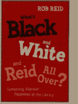

ISBN: 978-0-8389-1147-1

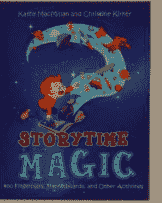

ISBN: 978-0-8389-0977-5

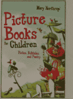

ISBN: 978-0-8389-1144-0

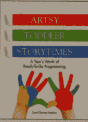

ISBN: 978-1-55570-792-7

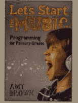

ISBN: 978-0-8389-1166-2

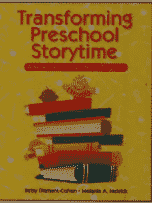

ISBN: 978-1-55570-805-4

alastore.ala.org

