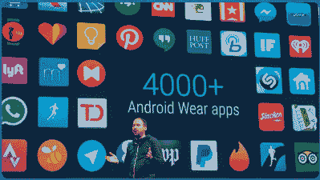

# 热爱编程者的非大学学历酷职业（无需大学的酷职业）

2018 年由 The Rosen Publishing Group, Inc. 出版

29 East 21st Street, New York, NY 10010

版权所有 © 2018 The Rosen Publishing Group, Inc.

第一版

保留所有权利。未经出版者书面许可，不得以任何形式复制本书的任何部分，评论者除外。

## 引言

由于高等教育的成本高昂，学生们在不得不申请学生贷款之前会想要考虑所有的选择。但我们的世界比以往任何时候都更加节奏快、竞争激烈，而且技术似乎总是在变化。从平板电脑到电脑再到手机，我们与世界其他地方连接在一起。

连接有多紧？2015 年的一项研究发现，64%的美国成年人拥有智能手机，与 2011 年的 35%相比是一个巨大的飞跃。我们在手机上做什么做什么？我们利用它们来学习和与他人分享。同一项研究还发现，68%的智能手机用户至少偶尔使用手机关注新闻；67% 的人使用手机分享照片、视频或对事件的评论；56% 的人使用手机学习各种活动。

这种即时的移动连接对我们非常重要。而在这些设备背后有许多人——他们正在设计、构建、实验并执行着重要的工作，当人们下载应用或拍照时，很少有人会考虑到这些工作。

技术领域的职业通常不需要大学学位。虽然有许多大学和机构提供编程学位、证书和课程，但这些通常并非必不可少。公司寻找往往是经验，而不是正式的教育。网上有这么多资源，可以很容易学习而无需支付学费。在线课程可以提供按周的教学。纳米学位（Nanodegrees）是六到十二个月的课程，以低成本教授基础编程技能。训练营是在短时间内快速学习的方式，而实习则让你在工作中学习。这些只是你在学习过程中可以利用的部分资源，你不仅学习如何编码，还学习你想用自己的技能执行哪些特定工作。

由于技术是我们生活的各个部分——从在手机上支付账单到与另一个国家的朋友聊天——因此有各种适合各种人的工作。你有艺术天赋吗？你可以进入设计领域。喜欢保持系统更新吗？系统管理员的工作可能非常适合你。你有清晰的愿景和强大的领导力吗？项目始终需要产品经理来保持其步入正轨。新的创新带来新的工作，所以前景是无限的。

我们无法涵盖本资源中提供的所有编程工作，因此请将其作为一个工具，让你对可能探索的编程特定领域和技术行业有一个大致的想法。当你读到你感兴趣的职业时，请利用“更多信息”部分以及互联网来进一步了解该职业以及关注相似编程方面的其他职业。在浏览不同的职业时，你会发现一个共同的主题：建立人脉、参加在线课程和教程以及从事自己的项目将让你走得很远。因此，具有高度自律性、能够在无人管理的情况下完成项目的人将最适合这些职业中的大多数。你还会发现，随着对本资源的学习，初级职业可以引导需要更多经验的职业。所以虽然你可能从 iOS 开发人员做起，某一天你可能会借此成为产品经理。

## 第一章：UX 设计师

你喜欢颜色吗？设计吗？艺术吗？你打开应用时的样子吗？用户体验设计师（或 UX 设计师）是那些关注数字产品给用户带来的视觉和感受的人。你使用的每个应用——从给朋友发消息到在出门吃饭前查看天气——都需要一名 UX 设计师。

UX 设计师关注用户如何与应用程序或产品交互，以及应用程序在屏幕上的布局。目标是让产品不仅能执行预期功能，而且易于使用和交互。

用户体验可以成为一种艺术职业。喜欢创意和构思大量设计的人可能喜欢创建产品的形象。

### 用户界面的历程

当设计师初开始工作时，他们需要知道目标是什么。他们希望人们如何与产品交互？这个屏幕或界面看起来应该什么样？它需要如何运行？通常这是一个涉及其他团队成员的头脑风暴会议，生成消费者对产品的需求列表。

从那里开始，设计师可能会在纸上绘制草图，勾勒出界面可能的样子。在完成草图后，设计师将使用电脑构建线框图（wireframe），即对设计的数字测试。可能会有很多线框图；有些只是静态的。另一些是交互式设计，可以反复进行测试和调整。这些线框图由用户不断测试，他们的反馈允许设计师对界面进行修改。

接下来是视觉设计。线框图被赋予最终的颜色、排版和添加的设计元素，以变成原型（mock-ups）。原型看起来和感觉应该已经准备好使用了，但这是另一个测试、评审和重做的阶段。颜色可能需要更改；标志可能需要经过多次设计，直到团队确定正确的方案。

这是不断扩张的科技领域中一个蓬勃且重要的部分，它通常被认为是最令人满意的工作之一，原因在于拥有灵活的工作时间、具有竞争力的薪资以及远程办公（即广为人知的居家办公）的能力。但通往成功设计的道路可能是漫长的。竞争可能非常激烈，一旦进入该行业，UX 设计师必须具备极大的耐心，因为他们需要不断地构建、测试并接受设计评审。一个成功的设计师必须能够理解产品的某些后端内容，还要理解更多基于艺术的概念和技能，如色彩、设计和矢量图画。由于需要利用许多不同的技能，并且创建一个成功的设计涉及许多步骤，良好的项目管理和团队协作能力是必不可少的。而且随着截止日期的临近，你可能需要在压力下工作并加班完成完成任务。

## 如何成为一名 UX 设计师

在开始当一名设计师时，拥有艺术的一面并无害，但请记住，你掌握的技能不仅仅是构图眼，还需要更多。你设计的是人们将与之交互的界面，而你需要培养的技能只能通过实践获得。

为了进行数字设计，`Adobe Photoshop` 和 `Adobe Illustrator` 等程序长期以来一直是设计师数字工具箱中的黄金标准。但随着 `Adobe` 产品现在成为需要按月订阅的昂贵云端应用程序，其他替代方案相继问世。基于 Mac 的应用程序 `Sketch` 因其结合了 `Photoshop` 和 `Illustrator` 的多功能性以及低廉的价格而迅速变得流行。

要学习如何使用你的数字工具，`Skill-share`、`Skillwise`、`LinkedIn` 的 `Lynda` 等网站可以提供帮助。你也可以在 `YouTube` 等网站上找到视频。你可以根据意愿支付少量或大量的费用来获取教程、课程和学习帮助。还有关于使用这些应用程序的书籍和电子书。

UX 设计师需要不断跟上变化的风格和技术。阅读、学习和寻找灵感至关重要。`LinkedIn` 和 `Medium` 等网站上有经验丰富的设计师编写博客，他们讨论的话题涵盖从如何进入 UX 设计到设计历史以及新兴趋势的各个领域。`Best Designs` 和 `Dribbble` 等网站汇了其他 UX 设计师的作品，让你从中获得灵感，并洞察其他设计师如何工作以及如何展示他们的成品。

但自学中最重要的部分是实践。为了被录用，设计师需要不断对虚构的应用和产品进行原型设计。提出你自己的想法并围绕其创建设计，可以让你在无需先找到工作的情况下展示你的技能。你可以将这些设计展示给他人并寻求批评意见，并利用它们开发用于面试 UX 职位的作品集。

## UX 设计师的薪资与职业前景

UX 设计师的薪资通常是固定工资。由于大多数设计师在公司全职工作，这是一个协商确定的金额，通常包括医疗保健、假期假，有时还有差旅费等福利。薪资随州和国家而异，在生活成本较高的地区（如`Silicon Valley`），薪资会更高。随着你的不断成长和工作，你可能会获得加薪并协商更高的薪资。

`Silicon Valley` 是世界科技之都。然而，在美国其他城市和城镇也有许多编码工作。有些工作甚至可能离你很近。

UX 设计师的需求很大，但竞争可能非常激烈。通常情况下，先以实习生的身份进入公司，在实习结束后由公司聘用全职会更容易。

***获取更多信息***

### 机构

**Center for Digital Media**

685 Great Northern Way

Vancouver, BC V5T 006

Canada

(778) 370-1001

网站: [`thecdm.ca`](http://thecdm.ca)

Center for Digital Media 是一所提供数字媒体硕士课程的前端学校。

**GrowthX Academy**

44 Tehama Street

San Francisco, CA 94104

(415) 638-9161

网站: [`gxacademy.com`](http://gxacademy.com)

GrowthX Academy 提供为十二周的 UX 设计课程。

**UX Club at UT Dallas**

800 W Campbell Road

Richardson, TX 75080

邮箱: uxutdallas@gmail.com

网站: [`www.uxutd.com`](http://www.uxutd.com)

德克萨斯大学达拉斯分校 UX Klub。

### 书籍

Camara, Chad, and Yujia Zhao. *The UX Learner’s Guidebook: A Ramp and Reference for Aspiring UX Designers.* Skokie, IL: Deuxtopia, Inc., 2015.

Unger, Russ, and Carolyn Chandler. *A Project Guide to UX Design: For User Experience Designers in the Field or in the Making.* 2nd ed. San Francisco, CA: New Riders, 2012.

### 博客

Raska, Robin. “Great Books for Designers to Read in 2016.” Design Pttrns, 2015. [`blog.pttrns.com/great-books-for-designers-to-read-in-2016-d2ebea3763f4#.vq7tby65j`](http://blog.pttrns.com/great-books-for-designers-to-read-in-2016-d2ebea3763f4#.vq7tby65j)

### 网站

由于互联网的不断变化，Rosen Publishing 开发了一个与主题相关的网站列表。该网站定期更新。请使用此链接访问：

[`www.rosenlinks.com/CCWC`](http://www.rosenlinks.com/CCWC)

***第二章：系统管理员***

系统管理员，简称 `sys admins`，负责确保公司内部计算机系统的维护。他们是任何组织不可或缺的一部分，帮助公司顺畅运行并与客户、合作伙伴和员工保持联系。

公司依赖 `sys admins` 来保持系统运行并解决突然出现的问题。这需要解决问题的能力！

根据公司规模和需求，这项工作的职责范围可能很大。有些公司规模较小，只有几台电脑和程序需要更新，而大公司——甚至是国际性公司——有数百名员工和电脑需要不断更新。根据公司所属的行业，可能需要特定的软件和硬件以达到最佳运行状态。

## 构建、维修、重启

`sys admin` 可能还负责组织的硬件。任何购买的新设备都可能需要记录并加入清单，并安装任何必要的软件。损坏的设备可能需要维修，或者需要从零开始构建全新的设备。

系统管理员执行的最重要任务之一是维护员工使用的标准和规范。当新员工入职公司时，系统管理员会配置公司电脑，并确保该人员拥有正确的程序、密码和访问权限。他们通常会在员工的手机上设置公司邮箱以及任何其他重要的应用程序。他们会解释相关标准和规范，并确保员工理解预期要求以及如何使用公司的设备和软件。他们可能会回答新员工对系统提出的任何问题，并帮助他或她学习如何浏览公司内网（即内部通信网络）。当员工离开时，系统管理员转而负责确保所有公司设备归还并删除员工的账户。

较大的公司可能需要自己的私有软件来管理某些任务。系统管理员可能会帮助创建这些定制软件，并协助构建用于修复问题的的补丁。

### 备份一切

所有人都知道备份文档有多重要。但当一家公司有数百名员工时，所有内容是如何备份的呢？

### DBA、网络管理员和 SAN 管理员

系统管理员承担许多责任，但这些角色可以在系统管理领域分化出更具体的职位。公司越大，管理部门中的工作职位就越具体，因为每个人都专注于公司内部框架的一个领域。由于这些角色承担了来自通用系统管理员的某些责任，这些大型团队中的系统管理员会发现自己直接负责安装和运行在公司硬件上的计算机系统，而其他角色则专注于其他领域。若要进入更具体的角色，你可能需要完成额外的培训和认证。

数据库管理员（或 `DBA`）负责公司数据库的安全和性能。`DBAs` 不断检查数据库的效率并维护数据库的安全性，这对于处理机密或隐私信息的组织（如医院、警察局和学校）来说至关重要。`DBAs` 还负责保持数据库系统和处理程序的最新状态，并设计和设置新数据库。`DBA` 还需要能够培训员工，通过公司或组织使用的各种系统和应用程序进行输入和提取数据。

网络管理员负责公司网络的安装、配置和提供支持。这包括公司的虚拟私有网络（`VPN`）、局域网（`LAN`）、广域网（`WAN`）以及任何路由和互联网系统。

存储区域网络管理员（或 `SAN` 管理员）直接负责公司的存储。存储区域网络是专门为公司存储而设计的网络，其中信息被拆分并存储在多个设备上，而不是存储地点。这使得存储能够以高速运行，`SAN` 管理员需要能够维护该网络的安全和效率，并解决可能出现的任何问题。

系统管理员需要确保这些关键数据保持安全。一项日常任务是备份数据，并确保公司系统有足够的空间来捕获和存储这些数据。对于许多公司来说，这些空间位于像`Amazon Web Services`这样的商业数据存储服务中。但在某些情况下，公司可以拥有自己的服务器。当公司希望将存储置在本地而非云端时，系统管理员需要擅长维护这些服务器，并理解服务器的物理要求。

数据存储可以追溯到多年，允许公司出于法律目的保留事件的详细记录。因此，存储的数据需要易于搜索和排序。高度注重细节的系统管理员将帮助公司保持条井有序。

## 如何成为系统管理员

根据公司所寻求的需求，系统管理员可以获得丰厚的报酬。一些雇主确实寻找计算机科学四年制学位，但该领域的工作经验往往同样价值。

当你刚起步时，在线资源既有用又丰富。`Windows`允许你免费接受培训，而像`Linux` 这样的开源系统发布了多种指南。与其他系统管理员建立联系并阅读关于企业级软件和硬件的知识可以帮助你学习。获得维护某些硬件和软件的认证也可以让你成为一个有吸引力的候选人。由于不同的操作系统和程序有许多不同类型的认证，在选择任何认证课程之前，最好决定你感兴趣学习的内容。

提供免费的在线课程可以帮助你开发成为系统管理员所需的技能。

你的前几份工作可能规模较小，更多侧重于为需要 IT 帮助的人提供家庭维修。但你做的工作越多，你的简历和经验就会增长越多。与其他系统管理员建立联系将帮助你了解潜在职位何时空缺，并为你提供可以担任推荐人的人脉。

### 更多信息

### 组织

专业系统管理员联盟 (`LOPSA`）

1200 Route 22 East, Suite 200

Bridgewater, NJ 08807

(609) 219-6787

网站：[`https://lopsa.org`](https://lopsa.org)

这是一个非营利组织，为全球的系统管理员提供资源和支持。

网络专业人士协会 (`NPA`）

3517 Camino Del Rio S, Suite 215

San Diego, CA 92108-4098

(888) `NPA-NPA0`

网站：[`http://www.npa.org`](http://www.npa.org)

这是一个面向网络计算人士的组织。

Usenix：高级计算系统协会

2560 Ninth Street, Suite 215

Berkeley, CA 94710

(510) 528-8649

网站：[`https://www.usenix.org`](https://www.usenix.org)

该协会为系统管理员、工程师、计算机科学家和技术人员提供社区。

### 书籍

Kralicek, Eric. *The Accidental SysAdmin Handbook: A Primer for Early Level IT Professionals.* New York, NY: Apress, Inc., 2016.

Limoncelli, Thomas A., Christina J. Hogan, and Strata R. Chalup. *The Practice of System and Network Administration: Volume 1: DevOps and Other Best Practices for Enterprise IT.* 3rd ed. Boston, MA: Addison-Wesley Professional, 2016.

White, Kevin M., and Gordon Davisson. *OS X Support Essentials 10.11: Supporting and Troubleshooting OS X El Capitan.* Berkeley, CA: Peach Press, 2016.

### 网站

由于互联网链接不断变化，Rosen Publishing 开发了一个与本书主题相关的在线网站列表。该网站定期更新。请使用此链接访问列表：

`http://www.rosenlinks.com/CCWC/coding`

## 第 3 章：Android/iOS 开发人员

随着越来越多的人使用移动设备，现在任何事情都有应用程序（简称 App）。从给朋友留言到支付账单、规划假期，甚至调整家里温度或调暗房间灯光，你现在可以在移动设备上完成这一切。截至 2016 年 6 月，苹果的 App Store 超过了 200 万应用。这意味着你可以通过移动设备组织、执行和表达你生活中发生的一切事情。我们是一个连接的社会，而且我们将以这种方式继续增长。

数以千计的应用需要开发者团队将它们从想法变成可以在应用商店下载的产品。

无论是 iOS 还是 Android 开发者，都会发现自己处于一个庞大且节奏快速的行业，有许多类型的项目可以满足各种兴趣。你喜欢开发金融类应用吗？即时通讯应用？购物应用？作为一名开发者，你可以选择你感兴趣的内容并专注于该领域。应用软件种类繁多，如果你喜欢探索和尝试新项目，这可能非常适合你。

作为一名开发者，获取教育资源非常容易。Android 和 Apple 都有自己的课程和资源，让开发者能够立即获得学习所需的工具和培训。除了操作系统本身，还有许多课程、书籍、教程、纳米微学位和博客，它们提供了丰富的知识。虽然支付金钱进行培训和教育并非必须的，但付费培训可以为你开启额外的资源供你使用，因此你可以考虑一下。研究付费资源是重要的，因为它们的价格从几美元到数百美元不等，并提供各种类型和数量的培训和信息。

开发 iOS 和 Android 的人是构建者。他们想要获取一个解决问题的概念，并使用工具将该概念转化为实际的产品。他们理解移动设备在不断接收软件更新，他们的产品永远不会真正完成；它必须不断进行补丁、修复和升级，以满足手机或平板电脑不断变化的操作系统的需求。作为开发者，他们通常是团队中的一员，频繁进行协作、分享想法和评审。如果你喜欢团队合作并与他人紧密工作，这可能就是适合你的职业。

## 选苹果还是安卓？

一些开发者努力同时学习 iOS 和 Android。这两个操作系统占据了全球市场 96.7%。但当你刚起步时，要决定先学习哪种操作系统（也称为 `OS`）可能是困难的。

Apple 移动设备的操作系统是 iOS。这个 `OS` 的标准比 Android 严格得多。因为其仅适用于 Apple 产品，所以你只能在 Macbook 上开发 iOS 项目，因为工具集 `Xcode` 仅兼容 Mac。对于那些负担不起 Mac 或没有时间借用 Mac 的人来说，这可能是一个障碍。Apple 还要求开发者订阅开发者计划，这允许他们向应用 Store 提交应用。订阅包含年度费用。

Android 的开发工具 `Android Studio` 兼容 Mac、Linux 和 Windows 电脑。虽然 Android 在可用性上优于 iOS，但 `Android Studio` 缺乏 `Xcode` 为开发者提供的某些功能和特性，这使得创建应用程序变得更加困难。虽然 Android 没有订阅费，但在提交应用之前需要支付一次性的注册费用。

先学习哪种操作系统取决于你，只需记住每种系统都有其优缺点即可。

## 展现你的黑客松实力

与其他许多职业一样，你可以在 iOS 或 Android 开发者的黑客松上展示才华。你可以通过当地开发者社区和在线聚会小组找到本地黑客松，它们是开发者成长的绝佳方式，因为它们都从一个你必须解决的问题开始。它们允许你发挥解决问题的能力，并以独自无法实现的方式挑战自己。评审将查看你的最终产品，你将获得宝贵的反馈，并将其应用于你的产品或未来的产品中。你开发的产品可以放入你的作品集和简历中，为你向潜在雇主提供新素材。

在黑客松上结识同行开发者并练习你的技能，在那里你可以竞争奖品、奖金以及晋级更大比赛的机会。

你可能甚至不需要在黑客松上寻找雇主。寻找招聘开发者的人可能会看到你的项目并主动找你。对于雇主来说，黑客松是一个观察开发者的好地方，可以观察他们在压力下的工作情况以及如何创造性地解决问题。随身携带名片，因为你不知道谁会在午餐时或通过电子邮件与你交谈。

如果你赢了黑客松，可能会获得大额现金奖、硬件以及参加更具声誉的黑客松的邀请。这让你能够继续练习、赚钱并在潜在雇主面前获得关注。黑客松越有声誉、越独特，奖品、曝光和接触机会就越多。这就是为什么参加黑客松并利用它们提高你的开发者技能对你来说是一项重要的练习。

## 开发者的机会与薪资

由于这么多应用不仅在应用 Store 中，还在上线等待发布，拥有强大作品集的 iOS/Android 开发者需求巨大。典型的薪资将处于薪资的高端，并随着经验的增长有加薪的空间。但开发者的薪资差异很大，取决于开发者是自由职业者还是全职员工。记住，自由职业者不会自动扣税，所以虽然看起来很多，但请务必留出部分收入以在明年年初缴税。

## 了解更多信息

### 组织

**ACT：应用协会（The App Association）**

1401 K Street NW, Suite 501

Washington, DC 20005

(202) 331-2130

网站：[`actonline.org`](http://actonline.org)

该协会代表应用公司和企业，促进就业创造并扩大应用行业和移动经济。

**应用开发者联盟（App Developers Alliance）**

1015 7th St NW

Washington, DC 20001

邮箱：Membership@AppAlliance.org

网站：[`www.appdevelopersalliance.org`](http://www.appdevelopersalliance.org)

这个国际协会旨在聚集开发者和公司，成为应用开发者的倡者。

**伯克利移动开发者（Mobile Developers of Berkeley）**

2360 Ellsworth Street, Apt. F

Berkeley, CA 94704

(425) 633-4156

网站：[`www.mobiledevs.org`](http://www.mobiledevs.org)

这是一个位于伯克利的移动开发者社区。

### 书籍

Eyal, Nir. *Hooked: How to Build Habit Products.* New York, NY: Portfolio, 2014.

Keur, Christian. *IOS Programming: The Big Nerd Guide. 5th ed. Atlanta, GA: Big Nerd Guide, 2015.*

Phillips, Bill. *Android Programming: The Big Nerd Guide. 2nd ed. Atlanta, GA: Big Nerd Guide, 2015.*

### 网站

由于互联网链接的易变性，Rosen Publishing 开发了一份与本书书主题相关的在线列表。该网站定期更新。请使用此链接访问列表：

[`www.rosenlinks.com/CCWC/coding`](http://www.rosenlinks.com/CCWC/coding)

# 第 4 章

## 全栈开发者

公司需要一个既熟悉网站前端又熟悉后端的开发者。它需要一个精通大多数主流编程语言并能够桥接前端开发与后端之间鸿沟的人。全栈开发者擅长处理各种类型的框架，并在前端和后端之间工作。掌握前端和后端的语言让全栈开发者能够跨越两者之间的鸿沟。

前端也称为客户端开发。这是产品中客户与之交互的部分。不要与 UX 设计混淆，前端更多地涉及产品的结构和编码，而与界面设计的关系较小。然而，他们经常与 UX 设计师一起工作，协助构建和测试线框图（wireframes）和原型（mock-ups）。他们将 UX 设计师的设计工作转化为程序使用的代码，让 UX 设计师能够测试设计并发现哪种用户界面对应用程序最有效。

前端开发者了解 `HTML`、`CSS` 和 `Javascript`，并熟悉多个框架。这样做是为了让网站具有多功能性，并适应任何查看它的设备，无论是在手机还是巨大显示器上访问，都能使其看起来美观且易用。

后端开发者开发并构建驱动产品的系统。他们负责后端：服务器、数据库以及保持一切程序运行顺畅的应用程序。后端开发者专注于创建整洁、易于操作并满足项目需求的代码。

后端开发者需要掌握多种语言，如 `Ruby on Rails`、`Python`、`Java` 和 `PHP`，以创建和维护他们的后端。对于后端开发者来说，了解 `PHP` 框架、`MySQL` 等工具以及 `Git` 等软件也是非常有价值的。

## 不要样样样精通

全栈开发者想要学习每种可用语言、工具和软件的愿望可能非常强烈。但尝试学习所有内容面临着精力分散且在任何某一方面都不特别出色的风险。开始阶段，将自己限制在少数技能上，并努力成为这些领域的专家。随着你在全栈工程师职业上走得越远，你将会有更多机会学习更多并丰富简历。雇主希望招聘精通他们所掌握的语言并能够用这些语言创建设计良好的产品的全栈开发者。想要成为一个通才很容易，但成为一个样样精通的人要容易得多。

## 成为全栈开发者

全栈教程、课程和项目在网上非常流行。诸如 `Udacity`、`ibento`、`Fullstack Academy` 和 `Fullstack. io` 等网站创建了多门课程供学习，从入门水平一直进步到更高级的主题。大学很少谈论全栈开发，因此面向职业的教育可以在网上找到。

参加在线训练营和课程允许你做另一件重要的事情：建立人脉。与其他同样尝试学习你所学技能的开发者相识并结交朋友可以扩展你作为开发者的知识。其他开发者可以通过交流资源和潜在雇主信息来协助项目并帮助你成长。记住，帮助你的人也应该得到同样的回报；分享你自己的想法和资源。学习开发与其说是为了获得下一份工作的竞争，不如说是与你的人脉进行见面、扩展、学习和帮助。

其他开发者可以提供建议并帮助你解决项目构建过程中可能出现的问题。但请记住，当人们寻求你的帮助时，也要提供帮助。

对于全栈开发者来说，熟能生巧。行业关注的是你有多少经验，所以要想出自己的项目，构建自己的产品，发布它们，并向他人展示你构建了什么。参与朋友的项目，共同学习并提高技能。黑客松（Hackathons）——设计和开发团队创建产品的竞赛——是对全栈开发者的完美挑战。许多人与朋友组成小组并参加这些比赛。奖品从小小的购物礼品卡到大到数千美元以及参加更大比赛的邀请函不等。赢得黑客松是简历中极佳的成就，向雇主展示了你具有出色的问题解决能力，并且可以在非常短的时间内完成工作。

## 全栈开发者的薪资与职业前景

全栈开发者的需求很大。即使你之前没有被雇佣，让潜在雇主看到你的个人项目也能表明你认真对待作为一名开发者的成长和学习。通过你参与过的项目进行面试（即使是免费的），也将帮助你在正确的团队中找到合适的开发者工作。

全栈开发者的薪资取决于公司所在地，但员工的工作收入通常高于平均水平。你需要加班按时完成大项目，所以如果你不在意加班，这可能就是你的工作。

## 获取更多信息

### 组织

**计算机协会协会（Association for Computing Machinery）**

2 Penn Plaza, Suite 701

New York, NY 10121-0701

(800) 342-6626

网站：[`www.acm.org`](http://www.acm.org)

这是最大的计算协会，聚集了专业人士、教育工作者和学生，并将与社区和资源连接起来。

**软件工程学院（Software Engineering Institute）**

4500 Fifth Avenue

Pittsburgh, PA 15213-2612

(412) 268-5800

网站：[`www.sei.cmu.edu`](https://www.sei.cmu.edu)

卡内基基梅隆隆大学内的该学院专注于软件工程师的教育和进步。

**Usenix：高级计算系统协会（Usenix: The Advanced Computing Systems Association）**

2560 Ninth Street, Suite 215

Berkeley, CA 94710

(510) 528-8649

网站：[`www.usenix.org`](https://www.usenix.org)

该协会为系统管理员、工程师、计算机科学家和技术人员提供了一个社区。

这就是数据科学家——统计学界的巨星们大身手的地方。通过获取原始数据并使用算法和数学进行处理，数据科学家在数字中发现故事和趋势。他们帮助大型零售商降低成本并提高销售，帮助公用事业公司预测使用模式，帮助公司专注于营销活动，并协助许多其他行业。数据科学家需要用每个人都能理解的语言来讲述这些故事，所以如果你是一个喜欢将复杂的想法和信息转化为更简单术语的人，那么这份工作可能适合你。

## 如何成为数据科学家

目前对数据科学的需求很大，正因如此，该领域拥有高薪。其中最高的薪资达到六位数或更高，并授予拥有博士学位（PhDs）的数据科学家。然而，你不需要上大学就可以开始数据科学家的职业。

成为数据科学家最简单但最昂贵的路线之一是线上和线下训练营。这些训练营的范围很大，从大规模的开放式课程到学生必须申请的高竞争性项目不等。然而，训练营提供了一个完整的、循序渐进的学习计划，这是你自己了解这一复杂领域的有用途径。这些训练营通常比其他形式的教育更贵，一些高级训练营的费用可能超过一万美元。因此，在研究你的教育计划时要小心。

内特·席弗（Nate Silver）是一位著名的数据科学家，以他对 2008 年和 2012 年总统选举的预测而闻名。他运营着一个名为 [FiveThirtyEight](http://eight.com) 的统计分析网站。

如果训练营不适合你，或者如果你想在进入项目之前加强知识，还有其他学习方法。对成为数据科学家感兴趣的人需要精通数学。统计学和代数是数据科学家必修的，但还需要理解微积分和逻辑等更高级的数学。`Coursera` 等网站以及一些提供在线课程的大学可以教授这些科目，让你可以在无需完全进入传统大学的情况下推进你的数学学习。

学习编程语言和框架也很重要。理解 `R`、`Python` 或 `SQL` 等编码语言以及 `Hadoop` 或 `Spark` 等框架，使数据科学家能够获取大量数据并提取相关信息，并构建信息在其他场景下如何运作的模型。

这些知识也有助于数据科学家学习和理解机器学习。机器学习是计算机在没有被专门编程的情况下进行学习的能力。对于数据科学家来说，机器学习允许他们获取一组特定的信息并让计算机深入研究，提取出深处的数据。

## 数据科学家 vs. 数据分析师

数据科学家和数据分析师听起来可能相似，但它们完全不同。那么，你该如何区分它们的区别呢？

数据分析师获取数据并进行清洗、处理，将其拆分为小小的、易于理解的形式。数据分析是关于对数据的探索。

数据科学家侧重于获取数据并解释过去、解决现在以及制定未来战略。

所有这些更具技术性的方面——编码语言、框架和机器学习——都可以在网上找到。对于想要自学的人，有免费的教程、练习和资源可用。对于喜欢更有结构化内容的人，还有书籍、在线课程和微学位（nanodegrees）。

## 竞争型数据科学家

所有这些更具技术性的方面——编码语言、框架和机器学习——都可以在网上找到。对于想要自学的人，有免费的教程、练习和资源可用。对于喜欢更有结构化内容的人，还有书籍、在线课程和微学位。

所有这些更具技术性的方面——编码语言、框架和机器学习——都可以在网上找到。对于想要自学的人，有免费的教程、练习和资源可用。对于喜欢更有结构化内容的人，还有书籍、在线课程和微学位。

所有这些更具技术性的方面——编码语言、框架和机器学习——都可以在网上找到。对于想要自学的人，有免费的教程、练习和资源可用。对于喜欢更有结构化内容的人，还有书籍、在线课程和微学位。

所有这些更具技术性的方面——编码语言、框架和机器学习——都可以在网上找到。对于想要自学的人，有免费的教程、练习和资源可用。对于喜欢更有结构化内容的人，还有书籍、在线课程和微学位。

所有这些更具技术性的方面——编码语言、框架和机器学习——都可以在网上找到。对于想要自学的人，有免费的教程、练习和资源可用。对于喜欢更有结构化内容的人，还有书籍、在线课程和微学位。

所有这些更具技术性的方面——编码语言、框架和机器学习——都可以在网上找到。对于想要自学的人，有免费的教程、练习和资源可用。对于喜欢更有结构化内容的人，还有书籍、在线课程和微学位。

所有这些更具技术性的方面——编码语言、框架和机器学习——都可以在网上找到。对于想要自学的人，有免费的教程、练习和资源可用。对于喜欢更有结构化内容的人，还有书籍、在线课程和微学位。

所有这些更具技术性的方面——编码语言、框架和机器学习——都可以在网上找到。对于想要自学的人，有免费的教程、练习和资源可用。对于喜欢更有结构化内容的人，还有书籍、在线课程和微学位。

所有这些更具技术性的方面——编码语言、框架和机器学习——都可以在网上找到。对于想要自学的人，有免费的教程、练习和资源可用。对于喜欢更有结构化内容的人，还有书籍、在线课程和微学位。

所有这些更具技术性的方面——编码语言、框架和机器学习——都可以在网上找到。对于想要自学的人，有免费的教程、练习和资源可用。对于喜欢更有结构化内容的人，还有书籍、在线课程和微学位。

所有这些更具技术性的方面——编码语言、框架和机器学习——都可以在网上找到。对于想要自学的人，有免费的教程、练习和资源可用。对于喜欢更有结构化内容的人，还有书籍、在线课程和微学位。

所有这些更具技术性的方面——编码语言、框架和机器学习——都可以在网上找到。对于想要自学的人，有免费的教程、练习和资源可用。对于喜欢更有结构化内容的人，还有书籍、在线课程和微学位。

所有这些更具技术性的方面——编码语言、框架和机器学习——都可以在网上找到。对于想要自学的人，有免费的教程、练习和资源可用。对于喜欢更有结构化内容的人，还有书籍、在线课程和微学位。

所有这些更具技术性的方面——编码语言、框架和机器学习——都可以在网上找到。对于想要自学的人，有免费的教程、练习和资源可用。对于喜欢更有结构化内容的人，还有书籍、在线课程和微学位。

所有这些更具技术性的方面——编码语言、框架和机器学习——都可以在网上找到。对于想要自学的人，有免费的教程、练习和资源可用。对于喜欢更有结构化内容的人，还有书籍、在线课程和微学位。

所有这些更具技术性的方面——编码语言、框架和机器学习——都可以在网上找到。对于想要自学的人，有免费的教程、练习和资源可用。对于喜欢更有结构化内容的人，还有书籍、在线课程和微学位。

所有这些更具技术性的方面——编码语言、框架和机器学习——都可以在网上找到。对于想要自学的人，有免费的教程、练习和资源可用。对于喜欢更有结构化内容的人，还有书籍、在线课程和微学位。

所有这些更具技术性的方面——编码语言、框架和机器学习——都可以在网上找到。对于想要自学的人，有免费的教程、练习和资源可用。对于喜欢更有结构化内容的人，还有书籍、在线课程和微学位。

所有这些更具技术性的方面——编码语言、框架和机器学习——都可以在网上找到。对于想要自学的人，有免费的教程、练习和资源可用。对于喜欢更有结构化内容的人，还有书籍、在线课程和微学位。

所有这些更具技术性的方面——编码语言、框架和机器学习——都可以在网上找到。对于想要自学的人，有免费的教程、练习和资源可用。对于喜欢更有结构化内容的人，还有书籍、在线课程和微学位。

所有这些更具技术性的方面——编码语言、框架和机器学习——都可以在网上找到。对于想要自学的人，有免费的教程、练习和资源可用。对于喜欢更有结构化内容的人，还有书籍、在线课程和微学位。

所有这些更具技术性的方面——编码语言、框架和机器学习——都可以在网上找到。对于想要自学的人，有免费的教程、练习和资源可用。对于喜欢更有结构化内容的人，还有书籍、在线课程和微学位。

所有这些更具技术性的方面——编码语言、框架和机器学习——都可以在网上找到。对于想要自学的人，有免费的教程、练习和资源可用。对于喜欢更有结构化内容的人，还有书籍、在线课程和微学位。

所有这些更具技术性的方面——编码语言、框架和机器学习——都可以在网上找到。对于想要自学的人，有免费的教程、练习和资源可用。对于喜欢更有结构化内容的人，还有书籍、在线课程和微学位。

- Import.io. “数据科学家 VS 数据分析师：为什么这种区别很重要。” 2016. [`www.import.io/post/data-scientists-vs-data-analysts-why-the-distinction-matters`](http://www.import.io/post/data-scientists-vs-data-analysts-why-the-distinction-matters)。

- Levine, Daniel. “如何在没有学位的情况下成为数据科学家。”Stitch, 2015. [`blog.stitchdata.com/5-things-you-should-know-before-getting-a-degree-in-data-science-40cddf44aac3#.ym5kxyy72`](http://blog.stitchdata.com/5-things-you-should-know-before-getting-a-degree-in-data-science-40cddf44aac3#.ym5kxyy72)。

### 网站

由于互联网链接具有不断变化的变性，Rosen Publishing 开发了一个与本书书主题相关的在线网站列表。该网站定期更新。请使用此链接访问列表：

[`www.rosenlinks.com/CCWC/coding`](http://www.rosenlinks.com/CCWC/coding)

## 第 6 章

### 游戏开发者

2015 年，游戏行业已成为一个 235 亿美元的行业。游戏机游戏、在线游戏和手机游戏都深受数百万人的喜爱。该行业比以往任何时候都更加寻找帮助游戏进入市场的程序员和代码编写员。有了 Steam 等平台，构建、发布和分发自己的游戏已变得简单。

视频游戏行业受欢迎的一部分在于其种类的多样。现在游戏不再仅仅在视频游戏主机或手持游戏设备上玩，而且在手机和平板电脑上。有适用于 Mac、Android、Facebook 以及其他网站的游戏。有这么多选择，也有许多不同的编程语言和平台供你学习。因此，在决定想成为哪种类型的开发者之前，务必做一些研究。

通过大量的学习和努力，对视频游戏的热爱可以转化为一份帮助创建游戏的职业。

许多不同的学校提供游戏开发课程，但这些课程通常伴随着高昂成本。正如我们看过的其他类型的公司一样，游戏公司更看重经验而非学位。有很多在线课程和教程可以用来学习各种编程语言和平台。一旦你知道你想开发什么样的游戏，就参加适合你的正确课程。如果有其他学生，务必与他们交流并建立联系。游戏行业和我们的许多其他职业一样，是靠人脉运作的。朋友是无价的；你可以一起讨论问题，互相帮助完成项目，并为职位空缺互相推荐。

当你学习更多程序时，请确保使用这些新技能来创建新游戏。作为一名游戏开发者，你的作品集将帮助你找到工作，因此你希望有项目可以展示你知道多少以及能做什么。参与他人的项目，并确保尽可能实习。

### 注意加班冲刺期（CRUNCH TIME）

视频游戏必须准时发布，因此当游戏接近发布日期时，负责它的团队通常会进入行业所谓的“冲刺期”（crunch time）。这种形式的加班通常没有加班费，但它有一点：长时间的工作。加班期间的某些天工作可能超过 12 小时，工作六天，只休息一天。对于发布游戏的团队来说，这是一个充满压力且疲惫的时期。

冲刺期意味着周末和团队一起待在办公室，以便按时完成游戏的构建。

视频游戏行业最近因“冲刺”这种做法对工人造成的极端压力而饱受指责。请始终意识到，如果你在视频游戏行业工作，你很可能必须经历冲刺期，而长时间的工作加上睡眠不足会且也将影响你的身体和心理健康。网络上有许多文章详细记录了该行业的冲刺问题以及它对人们及其家庭的影响，这些文章值得阅读，以理解在视频游戏行业工作有多困难。如果你看重灵活的工作时间和能够请假的能力，那么这份工作可能不适合你。

### 虚拟现实与 OCULUS RIFT

2012 年，未来以 Kickstarter 众筹的形式到来。Oculus Rift 是第一款对普通玩家来说负担得起的虚拟现实头戴设备，它向活动活动资助者承诺了完全沉浸式的体验。Kickstarter 迅速筹到了资金，Oculus 公司变得极其受欢迎。虚拟现实这项被人们认为是 20 世纪 80 年代后期笨重巨大的护目镜、手套以及粗糙的技术，突然被 Google 等公司开始探索。

但虽然 Rift 应该是为玩家准备的，虚拟现实已迅速被认为是其他行业的未来。虚拟现实（或 VR）的沉浸式体验使其在许多不同方面都非常有用。设计师已经发现了使用 VR 创建房屋和各种基础设施的 3D 等比例设计的方法，他们可以在甚至在建造之前在 VR 中行走并仔细检查。视频会议很快就能将来自世界不同地区的参会所有人聚集在一个地方。老师有一天可以学生学生使用头戴设备与模拟事件和场景进行互动，让他们体验历史的一部分或解决复杂的问题。对于医生来说，VR 和扫描技术可能是在进行手术之前观察身体内部的窗户。时间将证明我们如何在非游戏领域使用 VR。

### 开发者的薪资与前景

视频游戏行业正蓬勃发展。由于许多人对视频游戏的向往，进入门槛可能需要一段时间。由于有许多人申请同一个职位，你必须拥有脱颖而出的作品集和简历。在很多公司，有时取决于谁可以推荐你，这回到了游戏开发者需要建立人脉的问题上。参加游戏开发者大会（GDC）等会议也大益，因为许多公司设有展位并开放作品集评审。

每年公司都会在 GDC 向公众发布他们开发的游戏。

游戏开发者的收入通常很好，可以让开发者过上舒适的生活。实际金额取决于许多因素。有些开发者是全职的，而另一些可能是合同制的。虽然合同工作最初看起来收入更多，但请注意，自由职业需要自己缴纳税款，并且你需要留出部分付款以便在纳税季节有足够的资金。

Manning, Jon, and Paris Buttfield-Addison. *使用 Unity 开发移动游戏：一次构建，到处部署。* Sebastopol, CA: O’Reilly Media, 2017.

### 博客

Rubin, Peter. “Oculus Rift 的内幕故事以及虚拟现实如何变成现实。” Wired, 2014. [`www.wired.com/2014/05/oculus-rift-4`](https://www.wired.com/2014/05/oculus-rift-4)。

Schreier, Jason. “视频游戏加班文化的糟糕世界。” Kotaku, 2015. [`kotaku.com/crunch-time-why-game-developers-work-such-insane-hours-1704744577`](http://kotaku.com/crunch-time-why-game-developers-work-such-insane-hours-1704744577)。

Tambay, Guatam. “学习游戏开发和游戏化化的最佳免费在线资源。” Springboard, 2014. [`www.springboard.com/blog/free-online-courses-game-development-gamification`](https://www.springboard.com/blog/free-online-courses-game-development-gamification)。

The Verge. “虚拟现实的兴起、衰落与复起。” 检索于 2016。[`www.theverge.com/a/virtual-reality`](http://www.theverge.com/a/virtual-reality)。

### 网站

由于互联网链接的性质不断变化，Rosen Publishing 开发了一个与本书主题相关的在线网站列表。该网站定期更新。请使用此链接访问列表：

[`www.rosenlinks.com/CCWC/coding`](http://www.rosenlinks.com/CCWC/coding)

## 第 7 章

### 质量保证工程师 (QA ENGINEER)

必须有人来确保你正在构建的产品符合标准。质量保证工程师（或 QA 工程师）贯穿产品的各个阶段，对程序有深入的理解，并渴望学习新程序。QA 工程师的工作是从头到尾监督产品，确保其保持团队努力实现的高质量，并按时、按预算交付。

QA 工程师参与产品开发的许多方面。他们将帮助编写和审查代码，协助设计和集成，并监督管理流程。最后，他们将对产品进行严格的测试，寻找漏洞和故障，并将产品推向它的极限。他们必须确保产品符合所有公司和政府的准则，并且最终符合客户的需求。当项目进度落后，QA 工程师通常会和团队一起留晚，确保满足截止日期。通常，资源可能会短缺，QA 工程师必须为项目面临的限制提出创造性的解决方案。

质量保证工程师必须高度关注细节，并能够同时处理多项任务，轻松地兼顾项目的多个部分。

### 良好的沟通 (GOOD COMMUNICATION)

有这么多不同的团队、阶段和目标需要跟踪，沟通是关键。一名优秀的 QA 工程师明白，为了确保一切运行顺畅，团队需要统一，并意识到自己职责之外正在发生什么。建立良好的沟通基础设施至关重要，知道如何在商务环境中与个人和团队进行沟通和跟进同样重要。

QA 工程师希望确保每个人都理解自己在项目中的角色，并确保每个人都知道如何与他们的 QA 以及其他团队进行沟通。建立每周、双周或每月的进度会议也是关键。这些会议允许整个团队了解项目处于什么阶段，以及是否实现了目标。这些进度会议可以简单如办公室会议，也可以复杂到与全球各地的员工进行视频通话。

由于有许多角色和步骤需要跟踪，QA 工程师需要成为大师级的规划师。他们需要将一切拆解为更小、更易于管理的目标，并为每个阶段和任务设定不同的截止日期。这允许他们跟踪整个过程，并确保产品能如最终截止日期交付。由于需要不断跟踪许多细节和阶段，成为 QA 工程师可能适合那些有条理、注重细节并喜欢组织大型项目的人。它可能不适合那些喜欢在没有任何时间安排的情况下工作的人。

### 如何成为 QA 工程师 (HOW TO BECOME A QA ENGINEER)

由于 QA 工程师有许多不同的职责，成为 QA 工程师的道路与其说通过指令学习，倒不如说通过经验学习。虽然你可以寻求质量保证学位，但学习书籍和在线资源可以让你获得实操训练。QA 工程师应该已经具有某些编程语言和框架的经验。理想情况下，他们已经作为工程师参与过其他项目，因此本书中的其他职业可能会成为成为 QA 工程师道路上的垫脚石。

从事其他产品的工作还可以让你获得与他人合作的经验，并看到开发的所有阶段。作为一名有志的 QA 设计师，你可以对产品需求以及事物应该如何拆分和管理建立理解。考虑成为 iOS 或 Android 开发人员、UX 设计师，或任何其他在开发过程中接触产品的职业。记住花时间衡量每种职业的优缺点，以及你最终想成为哪类产品的 QA 工程师。

QA 工程师可能还想学习沟通。在与许多不同的人合作时，他们需要清晰、简洁地表达，在压力下良好工作，并能够解释产品可能面临的目标或问题。撰写良好的电子邮件和报告是一项重要技能，因此考虑成为 QA 设计师的人可能花时间练习写作能力。

作为 QA 工程师，你永远不会独自工作。你需要能够与项目的许多人员进行清晰沟通。

### QA 工程师的薪资与前景 (PAY AND PROSPECTS FOR QA ENGINEERS)

我们是一个不断创新和开发新产品的国家。因此，公司需要 QA 工程师确保项目按时交付给消费者。在技术设计的地方都需要 QA 设计师，因此某些城市对 QA 工程师的需求更多。预计薪资优厚，并随着经验的增加而增加。

由于这种职业不仅需要不断学习许多技能，而且在成为 QA 工程师之前还需要从事其他职业，请花时间考虑这份职业是否适合你。你必须有耐心学习、工作并开发所需的技能，这可能需要多年。

### 获取更多信息 (FOR MORE INFORMATION)

### 组织 (ORGANIZATIONS)

计算机历史博物馆 (Computer History Museum)

1401 North Boulevard

Mountain View, CA 94043

(650) 810-1010

网站：[`www.computerhistory.org`](http://www.computerhistory.org)

这家非营利博物馆保护计算对世界历史和影响。

IEEE 计算机学会 (IEEE Computer Society)

2001 L Street NW, Suite 700

Washington, DC 20036-4928

(202) 371-0101

网站：[`www.computer.org/web/guest`](https://www.computer.org/web/guest)

IEEE 计算机学会为对计算机科学和技术感兴趣的人士提供资源、会议、期刊和数字图书馆。

Usenix：先进计算系统协会 (Usenix: The Advanced Computing Systems Association)

2560 Ninth Street, Suite 215

Berkeley, CA 94710

(510) 528-8649

网站：[`www.usenix.org`](http://www.usenix.org)

该协会为系统管理员、工程师、计算机科学家和技术人员提供了一个社区。

## 书籍

Crispin, Lisa, and Janet Gregory. *More Agile Testing: Learning Journeys for the Whole Team.* Boston, MA: Addison-Wesley Professional, 2014.

Pyzdek, Thomas, and Paul Keller. *The Handbook for Quality Management, Second Edition: A Complete Guide to Operational Excellence.* New York, NY: McGraw-Hill Education, 2013.

Tech, Solis. *Quality Assurance: Software Quality Assurance Made Easy.* Charleston, SC: CreateSpace Independent Publishing Platform, 2016.

### 网站

由于互联网链接的变动，Rosen Publishing 开发了一份与本书书主题相关的在线网站列表。该网站定期更新。请使用此链接访问列表：

[`www.rosenlinks.com/CCWC/coding`](http://www.rosenlinks.com/CCWC/coding)

## 第 8 章：DevOps 开发者

IT 与开发部门之间的沟通并不总是发生的。由于产品开发过程中有许多阶段，角色和团队可能会变得“孤岛化”，即彼此孤立。由于缺乏沟通，项目或产品可能难以形成整体。项目的生产速度可能会变慢并变得低效。这就是开发运维，即 DevOps 的使命。DevOps 是一种哲学和最佳实践的文化，核心是打破这些孤岛，并创建加速产品开发过程的工具。DevOps 的目标是优化（或让事物以最高效率运行）、快速交付（或快速发布新功能或修复漏洞的能力）、可靠性、可扩展性（也称为产品承担更大工作负载的能力）、协作以及安全性。

进入 DevOps 领域的人是那些最擅长同时处理许多任务的人。因为他们的目标是增加优化，他们必须能够工作并解决项目面临的许多问题。开发者构建帮助实现这六个目标的工具，与他人协作，管理数据，协助测试和部署，并跨团队边界工作。DevOps 工程师专注于项目的业务结果，并帮助项目快速实现目标。他们是问题解决者，专注于如何让事物运行得快速顺畅，并且能够与多个小组良好地合作。他们可以编写代码和脚本，并喜欢学习新的尖端工具和技术。

Donovan Brown 是微软高级开发经理。他曾在加利福尼亚州旧金山的微软开发者 Build 大会上发表过演讲。

### 如何成为 DevOps 开发者

成为`DevOps`开发者与成为`QA`工程师类似。这是一项不需要学位的职业，但在进入该领域之前以前的工作经验。`DevOps`开发者需要掌握许多技能，包括一些`IT`运维、对至少一种语言的编码有理解，以及使用和构建工具的能力。因此，学习另一个触及产品开发的职业，并在另一个角色中工作时扩展你的知识可能会更容易。对于对`DevOps`职业感兴趣的人来说，有很多书籍、教程和在线资源，网络上也有许多人可以提供建议。阅读和学习新系统和编码语言，以及如何使用许多工具和开源软件开发产品，是必不可少的步骤。

想要在`DevOps`工作的人应该寻找他人正在创建的、需要`DevOps`角色的项目。与他人合作完成项目，与其他工程师和开发人员的工作一样，可以让你培养出`DevOps`领域所需的专业技能。项目完成后，这些项目可以放入你的简历或作品集中，让你在面试`DevOps`工作时将它们作为你所做工作的示例，并解释你为了获得结果而使用的不同流程。这就是为什么在技术领域内通过在线网站和线下聚会建立人脉持续保持重要性。你不知道你遇到的下一个人是否可能是你未来的团队成员。

### 工具、工具以及更多工具

`DevOps`开发者被期望知道如何使用许多不同类型的工具。这些工具通常免费下载和使用，这使得学习和理解多种工具的过程变得更容易。某些工具可能简单如允许项目内部更大通信的消息平台，而另一些工具可能更复杂，协助软件的开发、测试和交付。

有时开发者会遇到必须解决的问题，但没有可供下载的工具，他们可能会发现自己正在创建工具。痛点或问题可能是你项目特有的，其他人没有经历过。问题甚至可能针对特定的团队以及他们正在处理的构建阶段。你会被要求运用问题解决能力和代码方面的创造力来开发工具以解决这些问题。如果你不能自己创建工具，你需要与项目中的其他人协作，他们可以帮助你解决问题并创建你所需的工具。

自动化工具是`DevOps`开发者数字工具箱中较重要的工具之一。这些工具允许随时反复对软件应用程序进行测试，而不需要`DevOps`开发者在场。这些测试是快速的，每个结果都存储并与上一次进行比较。这允许开发者能够快速高效地查看这些多次测试的数据。通过这些数据，他们对软件进行适当调整，提高质量并修复漏洞。自动化工具减少了时间和工作，公司寻找知道如何使用工具的`DevOps`开发者。

### DevOps 开发者的薪资与前景

`DevOps`是源自硅谷一些最大最成功公司的角色。`亚马逊`、`Google`和`Facebook`是最早采用`DevOps`的公司。由于更多知名公司推崇这一领域，`DevOps`已遍及整个技术行业。公司渴望简化并优化其生产流程，因此需要`DevOps`开发者。`DevOps`开发者的薪资很有竞争力，在硅谷等地区，开发者的收入高于高于平均水平。

由于该领域与`QA`工程相似，对`DevOps`感兴趣的人需要问自己开发多种技能的努力以及在另一个领域花费的时间是否值得追求。成为`DevOps`开发者需要纪律、专注和耐心，因此这份工作可能并不所有人。

科技领域最大的公司需要熟练、经验丰富的`DevOps`开发者为他们工作，以保持其网站顺畅运行。

### 更多信息：组织

#### BSA

20 F Street NW, Suite 800

Washington, DC 20001

(202) 872-5500

网站：[`www.bsa.org`](http://www.bsa.org)

该协会是软件行业的全球倡导者。

#### IEEE Computer Society

2001 L Street NW, Suite 700

Washington, DC 20036-4928

(202) 371-0101

网站：[`www.computer.org/web/guest`](https://www.computer.org/web/guest)

IEEE 计算机学会对计算机科学和技术的人士提供资源、会议、期刊和数字图书馆。

#### 软件与信息行业协会（SIIA）

1090 Vermont Avenue NW, Sixth Floor

Washington, DC 20005-4905

网站：[`www.siia.net`](http://www.siia.net)

(202) 289-7442

这是一个针对软件和数字内容行业的行业协会。

### 书籍

Kim, Gene. *凤凰项目：一本关于 IT、DevOps 以及帮助你的业务获的小说.* 波特兰，俄勒冈州：IT Revolution Press, 2014.

Kim, Gene, Jez Humble, Patrick Debois, John Willis 和 John Allspaw. *DevOps 手册：如何在技术组织中创建世界级的敏捷性、可靠性和安全性.* 波特兰，俄勒冈州：IT Revolution Press, 2016.

Warnock, Dan. *DevOps：从新手到专业。DevOps 快速简单指南.* 查尔斯顿，南卡罗来纳州：CreateSpace Independent Publishing Platform, 2016.

### 博客

Bradford, Lawrence. “无需大学学位即可获得的 13 个高薪科技职业。” 福布斯, 2016. [http://www.forbes.com/sites/laurencebradford/2016/07/06/13-high-paying-tech-careers-you-can-get-without-a-college-degree/#7c1faf1025bd]

Fisher, Anne. “诚聘：高技能技术工人，薪资 10 万美元以上，无需学历。” 财富杂志, 2015. [http://fortune.com/2015/05/13/devops-jobs]

Patrizio, Andy. “DevOps 工具：成功 DevOps 的 20 个顶级工具。” Datamation, 2016. [http://www.datamation.com/applications/devops-tools-20-top-tools-for-successful-devops-1.html]

Reynolds, Phillip. “我想成为 DevOps！” Brassy, 2015. [http://brassy.net/articles/getting-in-to-devops]

### 网站

由于互联网链接的性质在不断变化，Rosen Publishing 开发了一份与本书书主题相关的在线网站列表。该网站定期更新。请使用此链接访问列表：

[http://www.rosenlinks.com/CCWC/coding]

## 第 9 章：人工智能开发人员

人工智能（简称`AI`）被描述为硅谷的新心脏。虽然我们经常会想到科幻电影中那些具有人类特征的复杂机器人，但目前的`AI`在达到那种复杂程度之前还有很长一段路要走。人工智能目前执行的功能在大多数人看来是简单的，但这些功能通常是我们作为人类认为理所当然的复杂动作，例如理解我们的上网习惯并推荐页面。然而，随着每一步小小的进步，`AI`越来越接近于执行更复杂的工作，例如在没有人类驾驶员的情况下驾驶、在战斗中跟随并协助士兵，或帮助老年人。人工智能作为一个前沿且广泛的领域，涵盖了从计算机翻译文本到计算机提供客户服务，以及谷歌和特斯拉的新自动驾驶汽车的所有领域。

(image)

> 机器学习正在驱动着埃隆·马斯克和他的特斯拉公司设想的未来交通工具——驾驶汽车。

### 机器学习与神经网络

今天人工智能中最大的两个领域是机器学习和神经网络。正如我们之前讨论过的，机器学习是计算机在无需经过专门编程的情况下学习的能力。机器会经过许多、许多测试，每次都获取结果信息并对其进行分析，以应用并调整自己的程序。这可以是非常简单的，例如你的手机在发短信时学习俚语，并在下次发送消息时不再通过自动纠错功能将其标记；再到`Facebook`推荐新朋友；再到机器人在没有科学家指导的情况下探索小行星表面。

### 自动驾驶汽车与道路的未来

今天最令人兴奋和广受讨论的技术之一是即将对我们的生活和通勤时间产生重大影响的人工智能。自动驾驶汽车可以在没有人类驾驶员的情况下行驶的自主车辆。它们使用`GPS`、传感器、内部导航系统和人工智能来自己从一个地点行驶到另一个地点。

(image)

特斯拉`Model S`汽车配备了自动辅助技术，使驾驶员能够自动换道并进行平行泊车。这距离自动驾驶汽车又近了一步。

目前，自动驾驶汽车的能力受到限制，还无法将人们送往上班或杂杂商店。然而，预计到 2020 年，将有数百万辆自动驾驶汽车上路。这项技术不仅会让你的旅程更加轻松，还将为无法自己驾驶的人们（如老年人和残障人士）提供交通便利。自动驾驶汽车还意味着更少的交通事故，因为汽车不会超速、行驶得太慢或离得太近——这些都是人类常见的坏习惯。随着安全性的提高以及无法驾驶的人员便利性和移动性的增加，汽车行业是那些致力于工作的人的许多可能领域之一。

神经网络是机器学习的一种，存在于一个被称为深度学习的子集中。神经网络是旨在模仿大脑神经网络的软件或硬件系统。它的构建包含许多分层结构的处理器，每一层都向下一层提供数据。这意味着当输入数据时，它会逐层通过每一层，并在最终层输出其结果。这使得`AI`具有适应性，并且通常用于模式识别。神经网络目前的用途包括预测股市的模式、在你写支票时识别你的手迹，以及执行更复杂的动作，如让机器人识别你的脸。

### 如何成为人工智能开发人员

一些人认为，要在人工智能领域工作，你需要一个博士学位。然而，并不一定需要高级学位，甚至是大学学位。但是，你必须积累其他技能和知识。了解`Python`和`R`等编程语言以及如何处理和读取数据是重要的，因为你对`AI`工作是构建能够自己处理数据并学习的程序。作为数据科学家可以作为通往人工智能领域工作的明智第一职业。因为数据科学家必须熟悉机器学习，所以你在该领域工作时不断完善自己的教育，随着你发现自己在人工智能领域可能想做什么，学习更多关于深度学习和神经网络的知识。

(image)

人工智能可以在你获得的其他职业和技能基础上建立建立。微软的`Cortana`写作团队由许多来自不同领域的专家组成。人工智能是一项热门技术，这意味着学习者可以轻松获得在线资源。博客、视频和教程都是学习的好方法。`Kaggle`是另一个章节中提到的数据科学网站，通过其竞赛和公共数据集提供了练习机器学习问题的完美场所。竞赛让你不仅能够展示自己的工作，还能与其他对人工智能感兴趣的人建立联系，并接触到潜在的项目和雇主。

### 人工智能开发人员的薪资与前景

人工智能是一个席卷了科技行业的领域。人工智能有许多用途。从视频游戏、金融到汽车行业，再到智能手机应用程序，`AI`开发者拥有广泛的职业选择。对人工智能感兴趣的人应该关注其在不同行业中的各种用途，并看看哪种职业最吸引他们。由于有这么多选择和对技能水平的要求，`AI`开发者的需求很大，薪资范围也非常广泛。开发者在全职工作时，通常可以获得丰厚的薪水和公司福利。随着你表现优异并积累更多经验，晋升和加薪都是可能的。

由于这是一项建立在以往经验基础上的职业，对成为人工智能开发者感兴趣的人应该考虑学习该领域所需技能的时间和精力投入。`AI`工作在某些国家的某些地区可能更充足，因此考虑可能为了追求职业而搬迁是很重要的。

### 了解更多信息

#### 组织

##### 计算机学术协会（Association for Computing Machinery）

2 Penn Plaza, Suite 701

New York, NY 10121-0701

(800) 342-6626

网站：[`www.acm.org`](http://www.acm.org)

这个计算学会聚集了专业人士、教育工作者学生，并将他们与社区和资源连接起来。

##### 人工智能促进协会（Association for the Advancement of Artificial Intelligence）

2275 East Bayshore Road, Suite 160

Palo Alto, CA 94303

(650) 859-2000

网站：[`www.aaai.org`](http://www.aaai.org)

该非营利组织专注于思想和智能行为底层机制的推进与理解。

##### 国际神经网络学会（INNS）

11123 Comanche Path

Bandera, TX 78003-421

(830) 796-9393

网站：[`www.inns.org`](http://www.inns.org)

这是一个旨在对大脑进行理论和计算理解，并将这些知识用于开发新的、更有效的机器智能形式的组织。

### 书籍

Conway, Drew, and John Myles White. *Machine Learning for Hackers: Case Studies and Algorithms to Get You Started.* Sebastopol, CA: O’Reilly Media, 2012.

Lantz, Brett. *Machine Learning with R.* Birmingham, UK: Packt Publishing, 2015.

Raschka, Sebastian. *Python Machine Learning*. Birmingham, UK: Packt Publishing, 2015.

### 网站

由于互联网链接的变动性，Rosen Publishing 开发了一份与此书主题相关的在线网站列表。该网站定期更新。请使用此链接访问列表：

[`www.rosenlinks.com/CCWC/coding`](http://www.rosenlinks.com/CCWC/coding)

## 第 10 章：加密货币开发者

当比特币（`Bitcoin`）在 2008 年出现时，它让加密货币进入了人们的视野。无论你是想为加密货币工作还是想构建自己的加密货币，随着我们使用越来越多的数字交易，这个行业将变得越来越至重要。

加密货币对数字交易非常重要，因为与其他形式的数字货币相比，它们极其安全。随着我们在线购物越来越多，我们的信用卡和银行信息越来越容易受到黑客的攻击。大规模的黑客丑闻可能会获取成千上万人的个人信息，使他们的金钱和身份面临风险。加密货币将这种风险降至最低，因为它们是非中心化的，这意味着信息分散在所有用户之间，而不是存储在一个位置。这种去中心化的财务交易形式被称为`blockchain`，它被认为是我们时代最重要的技术发现之一，仅次于互联网本身。

比特币席卷了科技行业，现在是现有的最大的加密货币之一。你对今天出现的一些新技术感兴趣吗？

`blockchain`的交易信息保存在一个账本上。账本不仅仅一份副本，而是有多个分散在网络中并存储在称为`nodes`（节点）的点上的副本。当一笔交易发生时，它会被记录在这个账本上，这意味着该笔交易有多个完全相同的副本。当账本满时，它就会被形成所谓的`block`（区块），由加密代码进行保护。每个`block`都与前一个区块连接，因此你当前的交易与该货币产生以来的第一笔交易相连。这就是该系统闻名的区块链的产生。

但让这种货币形式如此安全的实是，账本对用户开放的。这些用户不断地交叉检查账本，这使得黑客想要更改`blockchain`的任何部分都极其困难，因为任何更改在网络中的所有副本面前都会非常显眼。每笔交易都是透明的，而且有这么多人不断地检查和协作，任何黑客尝试都会被迅速发现。由于其安全性，区块链交易非常快，因为它们不需要长时间的安全检查期。

### 尖端技术（THE BLEEDING EDGE）

每个人都知道什么是尖端技术——最新、最好、最先进和创新的技术。`Bleeding edge`（前沿）是`cutting edge`（尖端）还要新的东西；它是新到仍然被认为一种风险的技术。前沿技术可能会改变世界，也可能失败并消失。这类技术如此激进且独特，人们需要时间来理解它们，而且教育资源匮乏，因为即使是专家仍在学习它们如何工作以及如何最好利用它们。这种技术可能需要几年时间才能改进并被公众利用。

加密货币是最近被认为是`bleeding edge`的技术。在席卷世界后，它在 2013 年经历了一个泡沫，比特币价格飙升并达到每币 1000 美元的巅峰。这被认为是一个炒作周期，即技术处于快速增长泡沫中，人们兴奋并参与其中的时期。

在过去的几年里，`bitcoin`已经稳定下来，不再像在`bleeding edge`时那样增长得快。然而，这项技术仍然是新的，该领域仍在不断产生。始终考虑进入一个新且不断演变的领域与一个更成熟领域的优缺点。

### 如何成为加密货币开发者

加密货币和`blockchain`是一种如此新且开放的技术，因此很容易找到教育资源。视频、文章和论文均供任何人观看、阅读并获得更好的理解。书籍和在线课程可用，某些课程由大公司和常青藤学院赞助。

开发者应该理解整个加密货币系统的工作原理。他们可以通过注册并购买一些加密货币进行交易来实现。像比特币这样的加密货币有解释其工作方式的页面，让任何人学习其及其各种用途。

由于`blockchain`和加密货币正被大公司实施和探索，对该行业感兴趣的人需要对传统的编程和软件构建有坚实的掌握。这是因为`blockchain`通常被集成到现有的技术和服务中，新的产品需要在通用框架的基础上构建。因此，对加密货币感兴趣的人不仅在学习`blockchain`，还在学习多种编程语言，以便将`blockchain`带到科技世界的其他领域。

在学习了编程并阅读和理解区块链之后，联系加密货币社区至关重要。加密货币具有高度透明性，并且由人员网络组成，这些社区对于任何对学习感兴趣的人来说都是信息的宝库。社区成员分享知识并解决问题，让你在尝试加密货币的同时从同伴身上学习学习。这些地方也是人们聚在一起共同开发项目的地方。加入一个项目将帮助你获得团队合作的经验，并解决在加密货币开发过程中出现的问题。

### 加密货币开发者的前景与薪资

加密货币目前是一项尖端技术。这意味着大公司正在探索它，但尚未完全整合。由于它非常新，公司正在不断测试和发明，以寻找如何最好地利用这项技术，而且专家非常少。随着加密货币的普及持续提高并被更多公司使用，对开发者的需求也会随之增长。开发者可以获得具有竞争力的薪资，以吸引短缺的人才。

加密货币是一项复杂的新技术，因此对这一职业感兴趣的人应该不仅喜欢学习编程，还喜欢研究金融世界。喜欢解决复杂问题并为技术构思新用途的人可能非常适合开发加密货币，因为行业本身正在快速演变和成型。行业的快速增长应当被考虑在内，因为实践、法规、标准和其他指南仍在讨论和开发中。

你可以通过举办线下或在线活动、聚会的俱乐部或小组，与其他对加密货币感兴趣的人见面。

### 更多信息

#### 组织

**美国统计协会 (American Statistical Association)**

732 North Washington Street  
Alexandria, VA 22314-1943  
(703) 684-1221

网站：<http://www.amstat.org>

ASA 成立于 1839 年，是全球最大的统计学家社区。ASA 支持统计科学的发展、应用和传播。

**加密货币标准协会 (Cryptocurrency Standards Association)**

NYDesigns  
45-50 30th Street, Suite 9  
Long Island City, NY 11101  
(718) 663-8463

网站：<http://www.crypsa.org>

该组织专注于稳定比特币行业并创建一系列标准。

**IEEE 计算机学会 (IEEE Computer Society)**

2001 L Street NW, Suite 700  
Washington, DC 20036-4928  
(202) 371-0101

网站：<https://www.computer.org/web/guest>

IEEE 计算机学会为计算机科学和技术感兴趣的人提供资源、会议、期刊和数字图书馆。

#### 书籍

- Antonopoulos, Andreas. *Mastering Bitcoin: Unlocking Digital Cryptocurrencies.* Sebastopol, CA: O’Reilly Media, 2014.
- Narayanan, Arvind. *Bitcoin and Cryptocurrency Technologies: A Comprehensive Introduction.* Princeton, NJ: Princeton University Press, 2016.
- Vigna, Paul. *The Age of Cryptocurrency: How Bitcoin and the Blockchain Are Challenging the Global Economic Order.* New York, NY: Picador, 2016.

#### 博客

- Blockchain Technologies. “Cryptocurrency Explained: The Ultimate Guide to Understanding Cryptocurrency.” 2016. <http://www.blockchaintechnologies.com/blockchain-cryptocurrency>.
- Grothaus, Michael. “How to Create Your Own Cryptocurrency.” Fast Company, 2014. <https://www.fastcompany.com/3025700/how-to-create-your-own-cryptocurrency>.
- Hutt, Rosamund. “All You Need to Know About Blockchain, Explained Simply.” World Economic Forum, 2016. <https://www.weforum.org/agenda/2016/06/blockchain-explained-simply>.

#### 网站

由于互联网链接具有变动性，Rosen 出版开发了一个与本书主题相关的在线网站列表。该网站定期更新。请使用此链接访问列表：

<http://www.rosenlinks.com/CCWC/coding>

---

## 第 11 章

### 产品管理

产品管理是一个负责监督产品生命周期每个阶段的角色。产品经理（有时被称为项目经理）了解开发者是如何构建项目的，但他们同时也与市场、测试部门交流，并监控指标。产品经理是一位经验丰富的构建者，也是一位业务敏锐的团队领袖，他们了解产品的目标市场以及如何销售它。产品经理不仅能接受批评，还能以对他具有建设性的方式提出批评。每个部门的每个团队在产品的每个阶段都会向项目经理汇报。产品经理确保截止日期，并处理解决任何出现的问题。他们是使整个项目凝聚在一起的胶水，也是代表产品和团队发言的人。

所有其他职业都可以引导你成为产品经理；经验是关键。

### 如何成为产品经理

产品经理的薪资较高。这是因为他们在胜任此工作之前，通常已经在某个领域拥有经验。这不是一个入门职位，虽然有些公司会寻找硕士等高等教育学位，但你不需要上大学也可以成为产品经理。特别是小型公司和初创公司，他们往往看重经验少于学位。

要在没有大学学位的情况下成为产品经理，你需要在其他地方拥有经验。你需要参与过多个产品的开发。你在成为产品经理之前的工作不需要专门针对管理，但必须展示出你懂得如何进行团队工作。你可以从工程师开始，在那里开始你的技术知识；或者从设计师开始，带来你的用户体验知识。

### 技术、用户体验与业务意识

产品经理需要掌握三个业务领域：技术、用户体验和业务意识。这三个领域完全不同，虽然项目经理可能精通其中之一，但在他们承担更多领导角色时，被要求学习其他。

对于他们管理的任何项目，产品经理都需要对创建的技术有工作性的了解。他们需要一些编程知识，并理解构建产品的框架。这样他们才能与项目的工程师进行准确清晰的沟通。优秀的产品经理知道发生了什么以及原因，以及工程师团队必须解决哪些问题。

产品经理还需要理解用户体验，以便他们与 `UX` 设计师和测试人员交流，改进面向客户的产品。产品经理理解测试、设计以及产品对用户的基本原理。最终，产品将交由用户，项目经理应该知道需要什么样的体验才能使项目成功。

传达项目的这些内部和外部部分至关重要。这意味着不仅要能够传达它们，还要能够解释产品对业务的整体影响。这需要第三个领域——业务直觉。项目经理需要牢牢掌握公司的业务运营以及产品所属的市场，并能够向公司内部其他同事、客户、合作伙伴和用户讨论这些内容。他们的业务经验使他们能够将所有知识整合起来，并向其他所有人推销这个项目。

在团队中开发产品的经验，应该通过学习更多如何成为一名产品经理来补充。有许多书籍和在线资源讨论了如何成功地进行产品管理。学习公开演讲是非常重要的，因为产品经理必须与每一个没有参与产品工作的人进行交流。对产品管理感兴趣的人可能想参加公开演讲课程，或者学习如何写作和提高沟通技巧的课程。他们可能还想参加关于管理、团队建设和冲突解决的课程或阅读书籍。

哪里都需要产品经理。野村龙（Tatsuo Nomura）是热门手游游戏《宝可梦 Go》的高级产品经理。

为了获得作为项目经理的经验，可以关注聚会和如黑客松之类的活动。在黑客松比赛中带领一个小型小组将帮助你作为产品经理的成长，并在极短的时间内练习所需的领导力和团队技巧。你也可以成为那个站出来向评委推销你们团队的成员，向他们解释你想要解决的问题，你如何通过你的产品解决该问题，并向他们演示产品。你参加并竞争的黑客松越多，你就能在简历上增加越多的内容，用以展示你作为产品经理的技能。

### 产品经理的薪资与职业前景

各种类型的项目都需要产品经理。随着我们技术的扩张和增长，公司创造了越来越多的产品来协助我们的日常生活。每个产品背后都是一个团队，而领导每个团队的都是产品经理。请记住，在成为产品经理之前，你需要拥有作为开发者或设计师在团队内参与项目的经验，并在成为产品经理之前学习更多知识。要成为一名产品经理可能需要很长时间，所以你需要适应那份入门工作。通往产品经理的路径可能比本资源中的其他职业更长，因此取决于你决定这份工作是否值得投入精力和耐心。

### 更多信息：组织

#### 项目管理协会 (Association for Project Management)

Ibis House, Regent Park, Summer Road, Risborough, United Kingdom。这家慈善机构专注于项目管理的职位安置与晋升。

网站：<http://www.apm.org>

#### 计算机历史博物馆 (Computer History Museum)

1401 N Shoreline Boulevard, Mountain View, CA. 这家非营利机构保护历史，并探索计算对世界的影响。

网站：<http://www.computerhistory.org>

#### 项目管理协会 (Project Management Institute)

14 Campus Boulevard, Newtown Square, PA. 该组织专注于项目管理角色人员的职业发展。

网站：<http://www.pmi.org>

#### 书籍

Cagan, Marty. *Inspired: How to Create Products Love*. Sunnyvale, CA: SVPG Press, 2016.

Haines, Steven. *The Product Manager’s Survival Guide: Everything You Need to Know as a Product Manager*. New York, NY: Mcraw-Hill Education, 2013.

McDowell, Gayle Laakmann. *Cracking the PM Interview: How to Land a Product Manager Job in Technology*. New York, NY: Mcraw-Hill Education, 2013.

#### 博客

Chu, Brandon. “PMs, You Don’t Need That Degree.” 2014. <https://medium.com/@brandonmchu/pms-you-dont-need-that-technical-degree-7d8fb196bcc#gewomlb0>.
Walk, Hunter. “Ode to a Non-Technical Product Manager.” 2012. <https://hunterwalk.com/2012/08/18/ode-to-a-non-technical-product-manager>.

#### 网站

由于互联网链接的易变性，Rosen Publishing 开发了一个与本书主题相关的在线网站列表。该网站定期更新。请使用此链接访问列表：<http://www.rosenlinks.com/CCWC/coding>

---

## 术语表

- **后端 (BACK END)**：驱动产品的系统。保持一切顺利运行的服务器、数据库和应用程序。
- **最前沿 (BLEEDING EDGE)**：如此新以至于仍在开发中且被认为具有风险的技术。
- **区块链 (BLOCKCHAIN)**：加密货币后的去中心化安全技术，在用户网络上运行。
- **冲刺 (CRUNCH)**：产品截止日期临近，员工预计需要加班的时期，通常没有加班费。
- **加密货币 (CRYPTOCURRENCY)**：由名为区块链的安全技术保护的数字交易安全系统。
- **尖端 (CUTTING EDGE)**：先进且创新的技术。
- **数据分析师 (DATA ANALYST)**：获取数据并进行清洗、处理的人。
- **数据科学家 (DATA SCIENTIST)**：专注于通过数据解释过去、预测未来的人。
- **开发者/工程师 (DEVELOPER/ENGINEER)**：创建并构建软件的人。
- **运维 (DEVOPS)**：开发运维。
- **前端 (FRONT END)**：用户与之交互的产品部分。
- **全栈 (FULL STACK)**：产品的前端和后端。
- **泡沫周期 (HYPE CYCLE)**：用户和人气迅速增长的时期；更极端的泡沫时期。
- **IOS**：苹果的移动操作系统。
- **机器学习 (MACHINE LEARNING)**：计算机无需编程即可学习的能力。
- **神经网络 (NEURAL NETWORKS)**：一种模仿大脑神经网络的特定机器学习。
- **产品生命周期 (PRODUCT LIFE CYCLE)**：产品从开始到结束的阶段。
- **系统管理员 (SYS ADMIN)**：系统管理员。
- **UX**：用户体验。

---

## 参考文献

Albright, Dan. “How to Become a Data Scientist.” MakeUseOf, 2015 年 3 月 6 日. 于 2016 年 11 月 21 日检索 <http://www.makeuseof.com/tag/become-data-scientist>.

“Must Read Books for Beginners on Machine Learning and Artificial Intelligence.” *Analytics Vidhya*, 2016 年 10 月 1 日. 于 2016 年 10 月 16 日检索 <https://www.analyticsvidhya.com/blog/2015/10/read-books-for-beginners-machine-learning-artificial-intelligence/>.

Cooper, Michael W. “7 Critical Skills for QA Testing Career Survival.” *TechBeacon*, 2016 年 10 月 31 日. 网络版. 于 2016 年 11 月 1 日检索 <https://techbeacon.com/7-soft-skills-every-qa-tester-needs>.

Donnelly, Jacob. “Here’s What the Future of Bitcoin Looks like—and It’s bright.” *Venture Beat*, 2016 年 2 月 14 日. 于 2016 年 11 月 30 日检索 <http://venturebeat.com/2016/02/14/heres-what-the-future-of-bitcoin-looks-like-and-its-bright/>.

- Finley, Klint. “现代数据极客并不像你想象的那么书呆。” *Wired*. Conde Nast, 2013 年 11 月 4 日. Web 检索于 2016 年 9 月 15 日. <http://www.wired.com/2013/04/phd-data-scientist/>.
- Francis, William J. “你想成为 Android 开发者吗？从这些资源开始。” TechRepublic, 2015 年 7 月 31 日. 检索于 2016 年 10 月 3 日. <http://www.techrepublic.com/article/so-you-want-to-be-an-android-developer-start-with-these-resources/>.

- Golson, Jordan. “苹果 App Store 现在拥有超过 200 万个应用。” The Verge. The Verge, 2016 年 6 月 13 日. 检索于 2016 年 9 月 30 日. [`www.theverge.com/2016/6/13/11922926/apple-apps-2-million-wwdc-2016`](http://www.theverge.com/2016/6/13/11922926/apple-apps-2-million-wwdc-2016)。

- Ivins, Jessica. “我关于成为 UX 设计者的建议。” Jessica Ivins. Jessica Ivins, 2014 年 5 月 27 日. 检索于 2016 年 10 月 3 日. [`jessicaivins.net/my-advice-for-becoming-a-ux-designer/`](http://jessicaivins.net/my-advice-for-becoming-a-ux-designer/)。

- Magain, Matthew. “如何开始学习 UX 设计 – UX Mastery。” UX Mastery. UX Mastery, 2016 年 3 月 16 日. 检索于 2016 年 9 月 15 日. [`uxmastery.com/%20how-to-get-started-in-ux-design/`](http://uxmastery.com/%20how-to-get-started-in-ux-design/)。

- Na. “成为游戏设计师需要学位吗？” 游戏设计者. Game Designing, 2016 年 10 月 5 日. 检索于 2016 年 10 月 12 日. [`www.gamedesigning.org/career/do-you-need-college/`](http://www.gamedesigning.org/career/do-you-need-college/)。

- Norma, Lindsay. “当你一无知时如何成为 UX/UI 设计师。” LinkedIn. LinkedIn, 2014 年 7 月 2 日. 检索于 2016 年 9 月 15 日 [`www.linkedin.com/pulse/20140702131658-43610144-how-to-become-a-ux-ui-designer-without-design-school`](http://www.linkedin.com/pulse/20140702131658-43610144-how-to-become-a-ux-ui-designer-without-design-school)。

- Rayej, Shima. “自动驾驶汽车是如何工作的？” Robohub. 2014 年 6 月 3 日. 检索于 2016 年 9 月 30 日. [`robohub.org/how-do-self-driving-cars-work/`](http://robohub.org/how-do-self-driving-cars-work/)。

- Reillr, Brendan. “存储管理员的常见任务。” SearchStorage. Tech Target. 检索于 2016 年 10 月 30 日. [`searchstorage.techtarget.com/answer/Common-tasks-for-a-storage-administrator`](http://searchstorage.techtarget.com/answer/Common-tasks-for-a-storage-administrator)。

- Schreier, Jason. “视频游戏加班文化的可怕世界。” Kotaku. Gawker Media, 2016 年 9 月 26 日. 检索于 2016 年 10 月 3 日. [`kotaku.com/%20crunch-time-why-game-developers-work-such-insane-hours-1704744577`](http://kotaku.com/%20crunch-time-why-game-developers-work-such-insane-hours-1704744577)。

- Stuart, Keith. “如何进入游戏行业 – 业内人士指南。” The Guardian. Guardian News and Media, 2014 年 3 月 20 日. 检索于 2016 年 9 月 15 日. [`www.theguardian.com/technology/2014/%20mar/20/how-to-get-into-the-games-industry-an-insiders-guide`](http://www.theguardian.com/technology/2014/%20mar/20/how-to-get-into-the-games-industry-an-insiders-guide)。

- Watkins, Christopher. “成为 iOS 开发者所需的 7 项技能。” Udacity, 2016 年 3 月 5 日. 检索于 2016 年 10 月 12 日. [`www.udacity.com/7-skills-you-need-to-be-an-ios-developer-2130537/`](https://www.udacity.com/7-skills-you-need-to-be-an-ios-developer-2130537/)。

### 索引

**A**

- Adobe Illustrator, 12

- Adobe Photoshop, 12

- Android, 30, 72

- artificial intelligence, 87, 89

- artistic design, 12

**B**

- Bitcoin, 48

- boot camp, 50

**C**

- coding, 40

- cryptocurrency, 52, 54

**D**

- data up, 21, 23

- data analyst, 51, 52

- data scientist, 48, 50

**E**

- enterprise communication, 20, 24

**F**

- Facebook, 58, 82

- front end, 37, 38

- full stack developer, 39, 42

**G**

- game developer, 58, 61

**H**

- hackathon, 32, 33

**I**

- interface, 10, 12

- iOs, 30, 34, 72

**K**

- Kaggle, 51, 52

**L**

- LinkedIn, 12, 13

- Lynda, 12

**M**

- mobile communication, 4, 6, 28, 30

**N**

- networking, 7, 24

**P**

- project management, 109, 112

- product manager, 111, 113, 115

- Python, 50, 92

**Q**

- QA (quality assurance) engineer, 72, 73

**R**

- routers, 20

**S**

- scripting, 79

- servers, 23

- Silicon Valley, 15, 82, 87

- Sketch, 12

- Skillshare, 12

- Skillwise, 12

- smartphone, 4, 94

- startups, 111

- Steam, 58

- system administrator, 24, 25

**T**

- telecommuting, 11

**U**

- usability testing, 11, 112

- UX (user experience) designer, 12, 13

**V**

- virtual reality, 62

**W**

- wireframe, 10, 38

**Y**

- YouTube, 12

### 关于作者

Asher Powell 是一位自豪的极客，前科技行业从业人士，曾在硅谷担任社交媒体营销人员。现在他是一位作家，喜欢在他非常毛茸的猫身边讲述故事，并学习技术的未来。

### 图片致谢

封面，第 1 页 [Rawpixel.com](http://Rawpixel.com)/[Shutterstock.com](http://Shutterstock.com)；第 4–5 页 nenetus/[Shutterstock.com](http://Shutterstock.com)；第 8–9 页 © [iStockphoto.com](http://iStockphoto.com)/Squaredpixels；第 14–15 页 Bildagentur Zoonar GmbH/[Shutterstock.com](http://Shutterstock.com)；第 18–19 页 © [iStockphoto.com](http://iStockphoto.com)/bjdlzx；第 24 页 chainarong06/[Shutterstock.com](http://Shutterstock.com)；第 28–29 页 Alexey Boldin/[Shutterstock.com](http://Shutterstock.com)；第 31 页，32 页，第 48–49 页，第 63 页，第 78–79 页，第 90–91 页，第 114–115 页 Bloomberg/Getty Images；第 37 页 McIek/[Shutterstock.com](http://Shutterstock.com)；第 40–41 页 ProStockStudio/[Shutterstock.com](http://Shutterstock.com)；第 53 页 WAYHOME studio/[Shutterstock.com](http://Shutterstock.com)；第 58–59 页 Monkey Business Images/ [Shutterstock.com](http://Shutterstock.com)；第 61 页 Edge Magazine/Future/Getty Images；第 68–69 页 © [iStockphoto.com](http://iStockphoto.com)/vgajic；第 73 页 © [iStockphoto.com](http://iStockphoto.com)/gilaxia；第 83 页 JaysonPhotography/[Shutterstock.com](http://Shutterstock.com)；第 88–89 页 VCG/Getty Images；第 93 页 The Washington Post/Getty Images；第 98–99 页 Zapp2Photo/[Shutterstock.com](http://Shutterstock.com)；第 104–105 页 © AP Images；第 110–111 页 © [iStockphoto.com](http://iStockphoto.com)/alvarez；封面及内设计元素 © [iStockphoto.com](http://iStockphoto.com)/David Shultz (点), Melamory/ [Shutterstock.com](http://Shutterstock.com) (六边形图案), Lost & Taken (文本框背景纹理), tasnadi_otto/[Shutterstock.com](http://Shutterstock.com) (章节开启图标)。

设计：Brian Garvey；编辑及图片研究员：Bethany Bryan

