# 热爱游戏的人的无需大学学历的酷炫职业

## 引言

电子游戏是交互式的、基于故事的场景或谜题，玩家在电脑显示器或电视屏幕上操控动态动作。从20世纪70年代凭借《吃豆人》等投币街机游戏而早期流行，到当代高清沉浸式家用主机游戏如*Destiny*、*Fallout 4*和*Star Wars Battlefront*，电子游戏行业经历了大量变化和显著增长。

如今，三大游戏系统主导家用主机市场：索尼 PlayStation 4、微软 Xbox One 和任天堂 Wii U。2015年电子游戏行业总收入超过910亿美元，并将继续增长。2015年，在智能手机和平板电脑上使用的移动游戏超过了基于主机的游戏系统上的游戏销量。

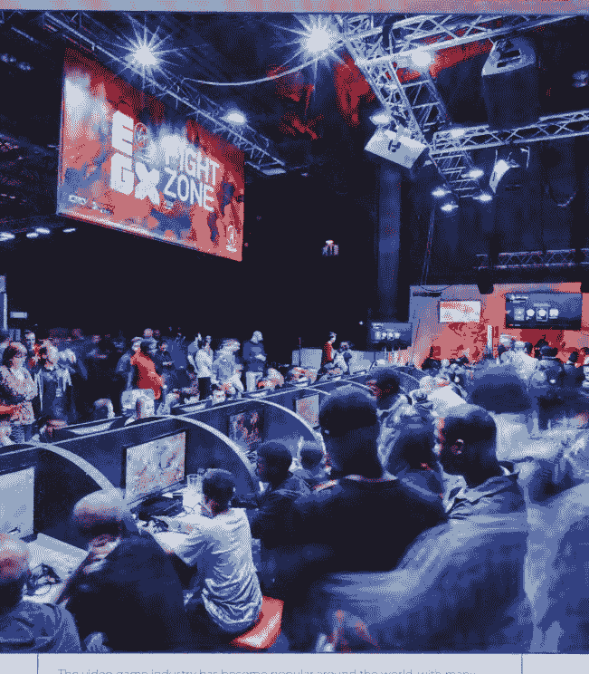

电子游戏行业已在世界各地流行起来，有许多面向专业人士和爱好者的大型博览会和会议。在那里，行业专业人士与业余玩家和竞技电子竞技明星交流，并会见让游戏引人入胜的创作者、设计师和演员。

与电子游戏行业并存的还有传统爱好游戏行业。这包括棋盘游戏、收藏类游戏、卡牌和骰子游戏、收藏微缩模型以及角色扮演游戏。截至2014年，传统爱好游戏的零售额增至8.8亿美元。玩游戏——无论是电子游戏还是传统游戏——是全球极其流行的消遣方式。

交互式电子游戏和传统爱好游戏当然是适合所有年龄段人群的有趣娱乐，但它们也是一项非常大的生意，并且年复一年地持续增长和演变。如果你已经热爱游戏，那么游戏行业中的某个职业可能正是你有兴趣追求的。但下一个合乎逻辑的步骤是什么？一个热爱游戏的人怎样才能进入一个日益多元化、复杂且技术性强的行业？而且，随着大学学费持续上涨，有没有可能在没有大学学历的情况下在游戏行业找到工作？

美国的学生贷款债务现在每秒增加2726美元，2016年总额超过1万亿美元。如今毕业的学院和大学学生中有三分之二将背负一定数额的学生债务。联邦债务接近17万亿美元，其中学生贷款占6%。17%的借款人拖欠学生贷款还款，只有27%的大学毕业生从事与大学专业相关的工作。

传统的大学专业往往不能提供进入游戏行业所需的教育。随着教育成本上升以及背负沉重学生贷款的令人生畏的前景，大学教育对许多学生来说正变得遥不可及。

然而，并非一切都完了。在游戏行业，无论是传统游戏还是电子游戏，都有许多职业道路可以让你不必先上大学就能追随。编程、写作、艺术、设计、音乐、配音、游戏设计、游戏初创企业以及销售和营销，只是你可能感兴趣的游戏相关领域中的一部分。由于大学毕业后的初级职位未必能把你直接带到理想的位置，你需要坚持、练习、勇气和决心来向前迈进、自我教育，并沉浸在你希望从事职业的游戏领域中。从长远来看，努力工作和坚持会有回报——而且即使没有大学教育也能做到。本书提供游戏行业不同方面职业的信息，并为深入了解每个方面提供有用资源。

## 第1章：接触游戏客户

如果你正在阅读这份资料，那你很可能已经是一名游戏玩家——电子游戏或传统游戏玩家——并且你可能也想进入游戏行业某个创意或创业领域。也许你正考虑在没有大学学历的情况下做到这一点。虽然许多更光鲜的游戏工作——例如程序员、设计师和艺术家——是可以进入的，但让你迈进这个行业大门并开始赚钱最快、最容易的方式是零售业。

### 在商店工作

大型游戏公司以及 GameStop 等零售门店需要销售人员、店员和经理来帮助向消费者销售游戏。任何销售游戏的地方，甚至二手游戏，都可能是开始积累经验的好地方。不需要大学学位。事实上，有些商店甚至可能在你满18岁之前就雇用你。申请前一定要查看当地商店。

对游戏玩家来说，最容易进入的工作场所是电子游戏零售商。这有助于你及时了解最新游戏和趋势。它还让游戏爱好者能在玩游戏之外，以一种新方式与玩家和行业专业人士接触。

电子游戏商店、玩具店、书店和电子产品商店都销售电子游戏和传统游戏。如果你已经对游戏有所了解，这可以帮助你在商店找到工作。许多面向公众销售游戏的初级职位可供选择。以下职责可以帮助你推进职业生涯：

- 处理商店促销活动
- 布置广告展示
- 成为商店经理
- 协助开设新店

在游戏零售业工作可以让你与游戏玩家交流，接触游戏公司，并处理游戏促销、比赛和新产品发布。所有这些都是宝贵资产，能提供在简历上好看的经验，即使你的最终目标不是销售，而是游戏创作的其他方面。

你也可以考虑另一个密切相关的零售工作。例如，移动电话公司、电脑零售店或电子产品商店会雇用热爱游戏并且

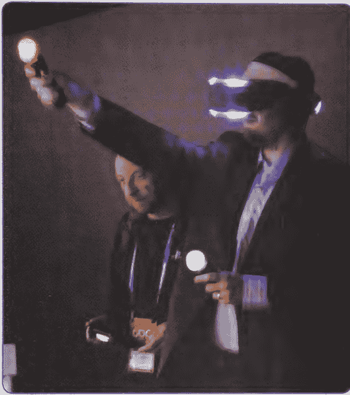

直接为游戏公司工作，可以获得在面向公众发布之前测试和展示新产品的机会。例如，这是一名虚拟现实（VR）头显测试员。这类产品在市场上正变得越来越普遍。

还具备最新技术方面的经验。许多在大型连锁店购物的顾客需要有人帮助他们找到所需商品。对各种游戏系统的深入了解可以让你在游戏部门获得一份工作，在那里你可以回答顾客问题并积累经验。

在零售业工作几年，同时在家学习并培养与游戏行业某一具体领域（如编程或游戏设计）直接相关的技能，是赚钱并了解行业内在创作和销售各方面最新动态的好方法，同时还能朝着更远大的目标迈进。

### 在公司工作

除了面向公众销售之外，大型游戏公司还设有销售岗位，负责将游戏销售给分销商和零售商。游戏公司还有许多行政岗位，其职责包括：

- 安排产品发布
- 分发宣传材料
- 协助处理与商店及消费者相关的客户服务
- 组织大会及其他行业活动

这些公司的销售工作通常是入门级岗位，无需先前经验。如果你已经在一家小型游戏商店工作过，你的经验可能会帮助你获得一份更好的、确实需要一些先前经验的销售岗位。

当你探索其他游戏兴趣，并磨练自己作为作家、艺术家、音乐家、程序员或企业家的技能，以便未来在游戏行业工作时，这些不同的工作将为你提供稳定的收入来源。

### 做好准备

高中生可以通过在当地商店工作、与公众和商店经理互动来开始销售职业生涯，从而获得销售经验。有些公司可能在你年满十八岁之前不会雇用你。如果你想在十八岁之前做兼职，实习是值得考虑的选择。实习是一种通常与学校课程相关的项目，你在其中到公司工作。许多实习提供学校学分，但报酬很少或没有报酬。它们能让你在你渴望进入的行业中获得宝贵经验。查看当地游戏公司是否有实习项目以及需要什么条件。你学校的指导部门也可能帮你联系实习机会，或提供获得学校学分的可能性。

紧跟电子游戏和桌游的最新动态，有助于你了解相关商品和行业。对许多玩家来说，在普通消费者和职业从业者之间存在一个位置：你可以比普通居家玩家参与得更多，同时仍未受雇于该行业。参加当地游戏商店每周举办的行业认可的游戏小组，或参加大型展会锦标赛，都是紧跟潮流并参与其中的好方法，即使你尚未进入这个行业。

### 技术支持和客户支持

电子游戏公司为需要帮助处理游戏主机和电子游戏问题的用户提供在线和电话支持。非常了解电子游戏的人可以在这一领域表现出色。这些职位通常至少要求高中文凭，并且在一定程度上熟悉 Windows 操作系统和 Microsoft Word 等基础程序。

如果你已经在零售业工作过，你与顾客沟通的经验可以被视为一项宝贵技能。熟悉当前游戏和游戏系统及其内部菜单、设置和技术细节，在申请这类工作时都会派上用场。在网上搜索游戏技术支持方面的工作，看看有哪些机会。

### 未来前景

随着数字内容在线下载销售的增长，实体店零售电子游戏销售方面的职业可能会比过去增长放缓。人们越来越倾向于在线购买游戏数字下载版。由于整个行业的整体增长，电子游戏公司的职业发展可能更有前景。传统桌游和角色扮演游戏（RPG）仍主要以盒装和实体书形式销售，因此销售这些游戏的零售岗位不会很快消失。

### 更多信息

#### 书籍

- 多诺万，特里斯坦。*重玩：电子游戏史。* 英格兰东萨塞克斯：Yellow Ant，2010年。  
  多诺万全面讲述了从20世纪80年代至今的电子游戏史，并收录了对游戏设计师和开发者的140多次访谈。
- 芬克，乔。*互动娱乐中的酷职业：电子游戏中的热门工作。* 纽约州纽约：Scholastic，2010年。  
  芬克通过介绍电子游戏领域广泛岗位的业内人士，向读者介绍电子游戏创作的世界。
- 尼科尔斯，兰迪。*电子游戏产业。* 英格兰伦敦：英国电影学院，2014年。  
  尼科尔斯从历史、经济和文化角度概述了电子游戏产业，包括游戏受众的变化以及制作游戏所需的劳动力。

#### 组织

- 娱乐商人协会  
  16530 Ventura Boulevard, Suite 400  
  Encino, CA 91436-4551  
  (818) 385-1500  
  网站：http://www.entmerch.org  
  EMA 是一个非营利组织，致力于服务销售多媒体娱乐产品的商家，包括电脑和主机电子游戏。
- 游戏制造商协会  
  240 N. Fifth Street, Suite 340  
  Columbus, OH 43215  
  (614) 255-4494  
  网站：http://gama.org  
  GAMA 是一个致力于桌游行业的非营利组织。它提供教育项目以推广桌游娱乐。

#### 期刊

- *游戏贸易*  
  10150 York Road, Suite 300  
  Hunt Valley, MD 21030  
  (443) 318-8232  
  网站：http://www.gametrademagazine.com  
  这本月刊提供游戏和爱好用品的产品信息。

#### 网站

由于互联网链接的性质不断变化，Rosen Publishing 开发了一个与本书主题相关的在线网站列表。该网站会定期更新。请使用以下链接访问列表：

http://www.rosenlinks.com/CCWC/game

## 第2章：开始你的游戏之旅

职业游戏，即电子竞技，正迅速成为一种完全成熟的竞技观赏性运动。电子竞技赛事也有现场电子游戏比赛，粉丝们会坐满大型体育场，就像传统体育项目一样。2015年北美电子竞技收入为1.34亿美元。

像*英雄联盟*和*DotA 2*（“DotA”代表*远古遗迹保卫战*）这样的成熟电子游戏拥有庞大的粉丝群体，他们经常观看，有时也参加现场锦标赛。2015年在纽约市麦迪逊广场花园举行的一场*英雄联盟*地区锦标赛有1.1万名粉丝到场。2015年，全球有超过1.34亿观众观看电子竞技。DotA 2 每年举办一项名为 The International 的电子竞技锦标赛。2015年，The International 在华盛顿州西雅图的 KeyArena 中心举行。奖金池超过1800万美元，是当时电子竞技历史上最大的奖金池。获胜队伍 Evil Geniuses 赢得了6,634,660美元，队中每位选手获得超过130万美元。

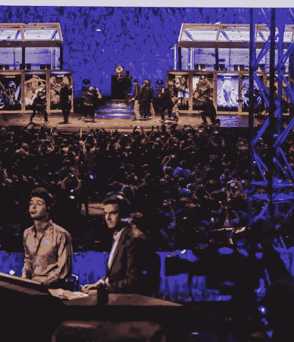

2014年，竞技游戏战队 Newbee 的成员在华盛顿州西雅图举行的国际 DOTA 2 锦标赛舞台上合影。这些赛事将大批人群吸引到场馆，因为比赛会实时展示。

2013年，美国政府首次将前往美国参加*英雄联盟*锦标赛的国际电子游戏玩家认定为职业运动员。这使得为赴美参加职业比赛的选手签发特殊签证变得更加容易。根据*GameSpot*杂志对 Riot Games 电子竞技经理尼克·艾伦的采访：“这对电子竞技具有开创性意义；现在我们可以开始考虑国际选手来访。流程容易得多，因为他们实际上得到了政府的认可。”电子竞技如今是一项大生意，有许多找工作机会。

要将电子竞技作为职业，需要的一些技能包括：

- 出色的游戏技能
- 与队友良好的沟通能力
- 报名参加比赛时注重细节
- 在竞技赛事中保持职业行为
- 与赞助商或潜在赞助商交往时保持职业行为

### 游戏测试

在公司发售电子游戏之前，需要对其进行全面测试，查找漏洞和故障，以确保游戏在发布时能正常运行。游戏测试员的年龄范围从测试儿童和青少年游戏的非常年幼的孩子，一直到以测试游戏为生、获得报酬的人。较年轻的测试员的名字通常会被列入游戏的制作人员名单。

游戏测试也不只针对电子游戏。2012年，游戏公司威世智向公众发布了经典角色扮演游戏*龙与地下城*当前第五版的早期测试版，供玩家试玩测试。当地的*龙与地下城*游戏团体能够进行试玩，并直接向威世智提供反馈，以帮助塑造*龙与地下城*第五版。第五版入门套装于2014年7月15日发售。即使你只是自愿试玩一款游戏，这份宝贵的经历仍然可以在申请专业游戏测试工作时列入简历。

### 赚钱

作为职业玩家赚钱并不容易，但确实可行，而且不需要大学教育。你需要成为一名出色的玩家，而且不能只是擅长随便哪款游戏。一些较受欢迎的职业比赛游戏包括：*英雄联盟*、*反恐精英：全球攻势*、*DotA 2*、*炉石传说*、*神之浩劫*、*魔兽世界*、*风暴英雄*和*任天堂明星大乱斗*。如果你打算以职业游戏为职业，那么精通其中一款游戏将是必须的。尽管许多人可能会说这希望渺茫，但已经有人以此为生。这种新兴娱乐日益增长的人气所带来的关注只会越来越大。最成功的职业玩家仅凭比赛奖金就能获得六位数的收入，还不包括来自战队或赞助商的薪水。

职业游戏战队的成员必须一起良好地比赛和合作，才能在电子竞技中取得成功。

职业玩家通常了解计算机的工作原理。这在为比赛速度进行定制和升级时很有用。玩家可能会参与甚至从零开始组装他们理想的计算机系统，以支持快速游戏和多种复杂功能。

职业玩家加入战队可以获得报酬，并且经常由赞助商支付报酬来代言产品或游戏公司，这增加了他们的收入。职业玩家也可以独自或在小团队中比赛，争夺奖金池中的奖金。

### 游戏电脑

如果你想成为职业玩家，甚至只是在线玩竞技游戏，你都需要一台好的游戏电脑，以及高速互联网连接。职业玩家所玩的游戏通常不在Xbox或PlayStation等家用游戏主机上玩。许多竞技电子游戏可以购买或通过数字下载获得，适用于Microsoft Windows，以及Apple Mac OS X和基于Linux的SteamOS PC电脑。一些公司专门为狂热游戏玩家制造电脑。这些电脑被称为游戏电脑或游戏装备，配备非常快的CPU（中央处理器）和GPU（图形处理器）或显卡，有助于非常高效地运行游戏。

### 职业角色扮演

角色扮演（Cosplay，即costumed play）是一种独特现象，人们装扮成自己最喜欢的科幻、奇幻或漫画角色。角色扮演者通常出现在漫画展、科幻展和游戏展上。大多数参与角色扮演的人通常只是为了好玩而装扮。不过，有些人已经设法通过装扮成角色来谋生。有些人甚至通过装扮并将爱好变成职业，赚到了相当多的钱。

许多职业角色扮演者会缝制并从头制作自己的服装和道具。一些最精美的定制服装由专业人士穿着，他们通过展会亮相、游戏推广、拍照和模特工作获得报酬。在展会上或网上出售签名印刷品是角色扮演赚钱的另一种方式。参与Twitter和Instagram等许多社交媒体渠道，可以帮助一些角色扮演者获得数千名忠实粉丝。

*这些职业角色扮演者正在2014年东京国际电影节的世界角色扮演峰会上表演《塞尔达传说》。许多粉丝参与角色扮演，是为了在参加展会和其它游戏活动时参与其中并展示对某个系列作品的热爱。*

许多职业玩家通过购买和组装各种组件来定制自己的电脑，例如主板、显卡、散热风扇、硬盘和内存条。玩家定制的电脑通常以性能为设计目标，并需要在新组件上市时采用最新组件。拥有一台快速的电脑对于竞技游戏至关重要。

#### 做好准备

暂时不要辞掉你的日常工作。职业游戏适合那些热爱竞技比赛并且擅长一款流行且成熟的电子竞技游戏的人。重要的是要记住，竞争非常激烈，即使你很出色，也仍然不能保证有钱可赚或有收入。对这一领域感兴趣的人可以在业余时间参与，同时仍从更传统的来源赚钱。下载并玩流行的电子竞技游戏，随着时间推移提高你的技能。

除了观看现场职业比赛，还可以通过Major League Gaming（MLG）在线观看这个不断发展的行业。如果你热爱职业游戏，但水平还不够高，无法通过比赛赚钱，那么成为电子竞技网站和在线广播网络的体育解说员或撰稿人也是可以考虑的其他领域。

#### 未来前景

电子竞技行业仍处于起步阶段。这一领域的发展前景高于平均水平。即使你不能作为职业选手进入电子竞技领域，还有其他相关职位，例如管理和组织专业人员。

#### 组织

- 国际电子竞技联合会  
  5F #501, 1-1  
  Hangangno 3-ga  
  Yongsan-gu  
  Seoul, Korea  
  +82-2-715-6661  
  网站：http://ie-sf.com  
  国际电子竞技联合会致力于将电子竞技推广为一项没有语言、种族或文化障碍的运动。

- Major League Gaming  
  East 34th Street  
  New York, NY 10016  
  网站：http://www.majorleaguegaming.com  
  Major League Gaming是美国电子竞技和竞技游戏赛事的主要赞助商及在线转播来源。

#### 网站

由于互联网链接不断变化，Rosen Publishing开发了一个与本书主题相关的网站在线列表。该网站会定期更新。请使用以下链接访问该列表：

http://www.rosenlinks.com/CCWC/game

## 第3章

## 书写游戏的未来

任何叙事作品的良好基础都是一个写得好的故事。为你的游戏准备一个好故事，会让它对玩家更有吸引力。游戏行业的写作职业可以像现有的众多游戏和平台一样多种多样。撰写游戏只是作家在游戏领域可以从事的一种工作。优秀的作家可以参与与游戏领域相关的新闻工作和博客写作。游戏指南、游戏说明和“艺术设定”类书籍，以及为游戏行业制作的任何书籍所附带的任何文字，也需要作家。

公司的全职写作工作会在网上发布广告，或通过招聘公司处理。然而，许多作家以自由职业者的身份向杂志和网站投稿。任何人都可以这样做，

所有游戏，即使是最复杂的电子游戏，都始于头脑风暴和写下想法。就像写书一样，行动和角色必须在设计开始之前规划好。

即使是从事电子游戏行业其他方面工作的人也是如此。如果你对撰写文章或评论感兴趣，只需尝试向你最喜欢的游戏媒体的编辑投稿即可。经验越多，被发表的机会就越大。不同公司对投稿有不同的规定。季刊和在线杂志通常接受投稿。在向公司提交作品以供考虑之前，务必研究其投稿指南。保留一份你撰写过的文章简历，即使它们尚未发表。随着时间推移，你的努力可能会得到回报。

### 电子游戏写作

游戏编剧的工作很复杂。他们应该拥有极其活跃的想象力，以帮助构思原创游戏故事和冒险。任何关于游戏的点子都不应被忽视。记录下脑海中出现的任何想法。撰写电子游戏或桌游故事的人所承担的一些任务包括：

-   调研竞品，了解该领域内已有哪些其他游戏。
-   与游戏设计师和程序员沟通，确保故事概念能够切实可行地实现。
-   撰写比流程图更详细的提纲。
-   尽可能详细地描述设定和场景。
-   为每个角色（包括叙述者）创作对话。
-   还要标出应插入音效或音乐的位置。
-   也可以包含给游戏设计师和程序员的注释，并对不同地点、结果和物品进行描述。

电子游戏剧本应该而且可以比电影剧本更加深入，因为你同时要描述游戏中许多相互作用的元素。

随着你的游戏构想不断成长，你可以通过编写包含更复杂角色和对话的剧本，开始构思一个更复杂的故事。

### 持续游玩

游戏编剧应该经常玩游戏，并特别关注所玩游戏中的故事。如果你想写特定类型的游戏，例如只写角色扮演桌游或只写主机电子游戏，那么你应该定期玩这些类型的游戏，以便熟悉你想写的内容。

游戏是流动的，不同于电影或小说那种典型的线性叙事、观众没有选择，游戏往往有许多玩家可以做出的选择和可能的结果。游戏编剧需要能够写出玩家可能体验到的所有不同可能性。多次游玩一款现有游戏并探索各种选择，是了解游戏编剧如何构建故事的好方法。每个结果都必须预先构思好，并在整个游戏及其机制的构建中合理成立。

### 为爱好游戏行业写作

如果你对为传统爱好游戏（如角色扮演和桌游）写作感兴趣，你需要专注于你的写作和讲故事技巧。传统桌面游戏的游玩方式通常与游戏展开时所讲述的故事或冒险同样重要。在许多游戏中，玩家在游戏开始前需要使用特定的游戏规则创建自己的虚构角色。像*星球大战：帝国突袭*或卡牌游戏*万智牌*这样的热门桌游需要许多游戏配件、美术元素和图形设计元素。在你编写故事元素时，寻求一位擅长美术的朋友帮助可视化美术方面可能会有所帮助。

一些流行的角色扮演游戏包括*龙与地下城*、*开拓者*、*星球大战*和*克苏鲁的呼唤*。你可能想为现有游戏撰写新的冒险，或者你可以创造一个完全属于你自己的新游戏设定。原创性有助于展示你的创意写作技巧。让朋友和家人试玩你创作的游戏，是亲眼看到你辛勤工作成果的好方法，也能帮助你进一步完善你的写作。

### 与写作者群体建立联系

与其他写作者相处是获得对你正在从事工作的反馈的好方法，无论是文章、游戏评论，甚至是游戏框架。虽然写作是一种孤独的技艺，但与他人分享你的作品是有帮助的，能让你以批判的眼光看待自己的作品，从而帮助你全面提升写作水平。即使你不认识游戏领域的其他写作者，与你认识的写作者相处也能让你持续思考自己的技艺。与玩家分享你的作品，这样他们也能提供反馈。玩家的意见可能与其他写作者的意见同样有价值。听取他人的意见可以帮助你发现故事中的缺陷，也可以帮助你意识到自己可能忽略或其他人觉得困惑的地方。

### 协作

写小说或文章往往是一种个人创意活动。电子游戏编剧通常与团队合作。即使你是一个小团队中唯一的编剧，也仍然可能有一位游戏设计师和一位美术师。与其他团队成员沟通和协作对于创作一款玩法出色且合理自洽的统一电子游戏至关重要。即使你在创作一款传统桌游或角色扮演游戏，也很可能还有其他写作者与你合作，你需要能够与他人良好合作、分享想法并轻松接受批评。许多现有的角色扮演游戏都有需要遵守的规则。游戏的最终成果才是最重要的，保持开放的心态并倾听他人的想法，即使是来自非写作者团队成员的想法，在写作过程中也可能非常重要。

> 在你的游戏小组中分享想法，是为你的构思获得反馈的绝佳跳板。制作游戏是一个协作过程，无论是数字游戏还是更传统的卡牌或桌游。

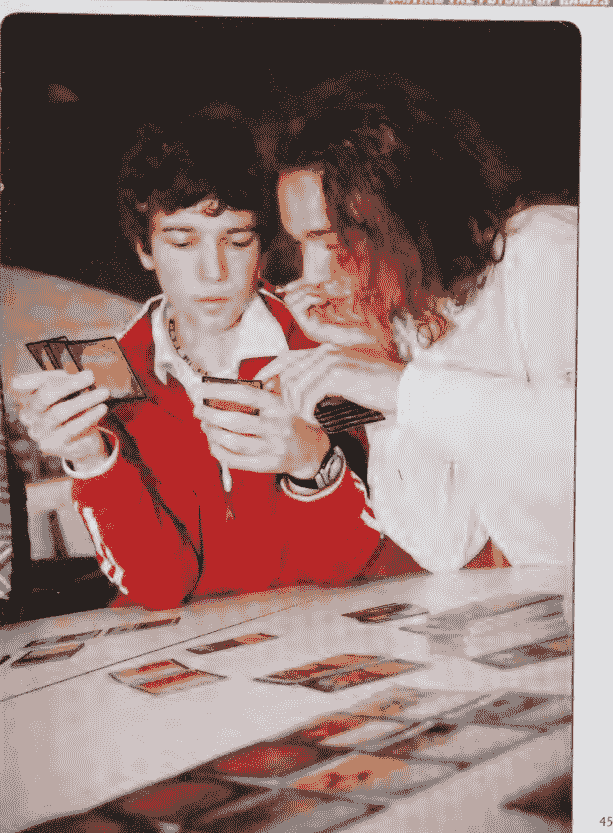

### 自我准备

为游戏行业写作做准备需要大量的阅读和游戏体验。持续关注游戏杂志，阅读评论和行业新闻。在学校选修写作和新闻学课程。在在线游戏社区寻找需要帮助创建自制游戏的人。这将有助于你获得经验和简历上的资历。

### 未来前景

美国劳工统计局不收集电子游戏行业或桌游行业的数据。然而，该机构表示，该领域从业者的收入高于美国年收入中位数。

随着游戏行业的发展，对期刊、书籍、独立小说和游戏指南等辅助出版物的需求也会增长。写作是游戏行业中一个不断增长的领域。除了撰写游戏叙事外，还可以考虑将新闻写作和博客撰写作为游戏行业的可能职业。帮助玩家通关游戏的说明手册和游戏指南，也是写作者在游戏行业获得工作的其他领域。

### 更多信息

#### 图书

Bryant, Robert Denton, and Keith Giglio. *Slay the Dragon: Writing Great Video Games*. Studio City, CA: Michael Wiese Productions, 2015.

布莱恩特和吉利奥为那些想要创作可用于游戏中的互动叙事的人提供了有用的建议。这本书提供了讨论以及自定进度的写作练习。

Dille, Flint. *The Ultimate Guide to Video Game Writing and Design*. Los Angeles, CA: Lone Eagle Publishing, 2008.

迪尔为电子游戏写作和设计的流程提供了扎实的介绍，展示了这两个流程在许多方面是如何重叠的。

Skolnick, Evan. *Video Game Storytelling: What Every Developer Needs to Know About Narrative Techniques*. New York, NY: Watson-Guptill, 2014.

斯科尔尼克为电脑游戏开发过程的每个阶段提供了基础叙事技巧的实用指南。

#### 组织

- 国际游戏开发者协会（IGDA）  
  19 Mantua Road  
  Mount Royal, NJ 08061  
  网站：http://www.igda.org  
  IGDA 是一个致力于满足游戏开发者需求的组织，设有专门关注电子游戏编剧工作的特殊兴趣小组。

- 美国编剧工会西部分会（WGAW）  
  7000 West Third Street  
  Los Angeles, CA 90048  
  （323）951-4000  
  网站：http://www.wga.org  
  WGAW 是一个致力于帮助娱乐领域编剧（包括电子游戏编剧）发展事业的组织。

#### 期刊

- *《Game Informer》*  
  724 North 1st Street, 3rd Floor  
  Minneapolis, MN 55401  
  （612）486-6101  
  网站：http://www.gameinformer.com

动画是帮助创建游戏角色和虚拟游戏环境所必需的。3D Studio Max、Maya 和 ZBrush 等三维建模程序，是游戏美术师用来创建游戏角色和元素的常用 3D 渲染程序之一。

电子游戏美术师的一些职责包括：

-  绘制游戏中使用的角色和背景的概念草图
-  按照商定的风格绘制详细的角色或背景图纸
-  与团队成员沟通，打造与项目设计一致的视觉风格和氛围
-  绘制不同姿态下的角色细节图，以辅助 3D 渲染
-  使用传统美术师或 3D 美术师/动画师常用的计算机程序
-  运用扎实的色彩理论知识来构建出色的设计

游戏美术师需要能够将传统技能与现代计算机渲染设备结合起来。通常，制作一款游戏需要大型团队协作，每个人承担不同的角色。所有这些工作最终汇聚到成品游戏中，但其中涉及成千上万项较小的任务，全部由专业人员分别处理。

你越能就自己的美术作品和正在参与的游戏概念进行沟通，就越能在游戏美术领域脱颖而出。视觉沟通对于向游戏团队所有成员解释游戏架构至关重要。像*《古墓丽影》*、*《塞尔达传说》*和*《光环》*这样的游戏都围绕着角色展开。许多游戏发生在奇幻景观和未来世界中，其中充满了虚构物种、生物、未来载具和外观酷炫的宇宙飞船。美术师在创造这些角色及其想象世界方面扮演着非常重要的角色。

## 一切始于美术

任何想为任何类型的游戏创作任何形式美术的人，都应该具备非常扎实的绘画功底。人物、动物和风景背景尤其值得重点关注。练习绘画和制作一份过硬的作品集的重要性怎么强调都不为过。除非你是在没有公司帮助的情况下独立制作游戏，否则游戏公司会希望看到你的作品集，以确保你具备为他们工作的技能和经验。

草图画家和插画师并不是游戏领域唯一需要的美术人才。传统雕塑家同样不可或缺，他们需要为传统桌游棋子制作模型，以及为桌面游戏制作可玩的微缩模型。雕塑家在游戏行业中还可以从事的另一项工作是制作游戏玩具，比如《小龙斯派罗》、《迪士尼无限》或任天堂 amiibo 手办。有些美术师和雕塑家曾在艺术学院接受过传统训练，但并非所有人都是如此。即使是不与学位挂钩的美术课程，也能帮助初学者踏入这一领域。

### 学习这一行

游戏美术师将游戏故事创意付诸实现。概念艺术是这一过程的第一步，因此所有参与游戏创作的人都能开始看到游戏最终可能呈现的样子。游戏美术师创作的概念图和插画通常会经历讨论和批评。游戏美术师应当准备好与团队合作，对同一个创意、角色、生物或景观反复生成多种变体，直到设计团队或主设计师确定最终概念。

除了学习绘画，游戏美术师还需要熟悉透视、色彩理论、深度以及各种风格和媒介等概念。不同游戏有不同的视觉风格。一名全面的游戏美术师应当熟悉水彩、彩色铅笔、丙烯和油画等多种绘画媒介。 painterly（绘画感）、漫画风格、精细风格、松散渲染风格和平面风格等不同的美术风格，在确定游戏外观时都会派上用场。

传统休闲游戏会在书籍、游戏卡牌和游戏棋盘上使用美术。多去熟悉不同的游戏，并尝试模仿你看到的各种风格。拥有多种美术风格的作品示例，将大大有助于打造一份有价值的作品集，帮助你成为游戏行业中的一名职业美术师。

要打磨你的美术技巧，请定期练习素描、速写和绘画。即使你的兴趣在于数字艺术，良好的写生能力、观察绘画能力以及对多种风格的熟悉程度，都是游戏设计美术师非常有用的技能。

### “艺术设定集”

许多随电子游戏发售的咖啡桌风格的“艺术设定集”对任何有抱负的美术师来说都是宝贵的资源。卡牌游戏*《万智牌》*、电子游戏*《古墓丽影》*和手游*《植物大战僵尸》*等热门休闲游戏，只是少数几个拥有“艺术设定集”的例子。

在许多这类书籍中，为游戏构思元素的美术师们得以充分展示。最终产品的粉丝可以看到多种多样的概念艺术变体。你有特别喜欢的电子游戏类型吗？你是否也想成为这个行业中的美术师？为你喜爱的游戏购买一本“艺术设定集”，是了解电子游戏概念艺术是如何生成的绝佳方式。

### 数字艺术工具

游戏美术师应当能够用传统手工方式画出概念草图。这项技能对美术师来说不太可能过时。然而，越来越多的游戏美术师转为使用 Adobe Photoshop 和 Corel Painter 等艺术程序进行数字创作，在电脑上完成艺术作品。数字手写笔和数位板经常取代铅笔、画笔和颜料等传统工具。数字创作有很多好处，因为美术师可以非常轻松地切换媒介。完成的作品可以快速与团队成员分享并分发。

### 做好准备

学习绘画可能是电子游戏美术职业生涯中最重要的一项技能。在学校选修美术课程，并经常练习绘画以提升技能。你也可以在 YouTube 上查找在线教学视频，通过在线艺术课程学习新的艺术技巧和规则，或观看教程。随身携带速写本，记录日常人物，是保持绘画技能敏锐的好方法。

向学校咨询是否提供计算机美术课程。3D 绘图或设计程序尤其有用。你不必在家里的电脑上安装每一个软件，但许多热门软件都提供免费试用版或学生折扣。

### 未来前景

游戏美术的未来一片光明，但跟上不断变化的计算机程序和游戏趋势非常重要。随着虚拟现实（VR）头显等新技术进入电子游戏行业，能够创作出有助于向设计团队传达概念的美术作品变得至关重要。掌握传统美术技能仍然重要，但除此之外，美术师还需要精通市场上出现的各种新技术。

### 更多信息

#### 书籍

Kennedy, Sam R. *如何成为电子游戏艺术家：进入游戏世界求职的内部指南*。New York, NY: Watson-Guptill, 2013.

Kennedy 提供关于在电子游戏行业寻找和获得工作的建议和有用提示。

Melissinos, Chris, and Patrick O’Rourke. *电子游戏艺术：从吃豆人到质量效应*。New York, NY: Welcome Books, 2012.

Melissinos 和 O’Rourke 概述了从20世纪80年代到当今的电子游戏艺术。

Solarski, Chris. *绘画基础与电子游戏艺术：从经典到前沿的获胜电子游戏设计艺术技巧*。New York, NY: Watson-Guptill, 2012.

Solarski 为热爱电子游戏并有兴趣追求自己作为电子游戏艺术家职业生涯的艺术家提供技巧和技术。

#### 组织

图形艺术家公会
31 West 34th Street, 8th Floor
New York, NY 10001
(212) 791-3400
网站：https://www.graphicartistsguild.org

图形艺术家公会帮助其成员在艺术领域建立职业生涯，包括互动和多媒体游戏领域。

插画家、艺术家和设计师协会（SIAD）
207 Regent Street, 3rd Floor
London W1B 3HH
England

SIAD 是一个非营利组织，致力于促进和保护所有视觉媒体中艺术家和设计师的工作。

#### 网站

由于互联网链接的性质不断变化，Rosen Publishing 开发了一个与本书主题相关的网站在线列表。该网站定期更新。请使用此链接访问列表：

http://www.rosenlinks.com/CCWC/game

平面设计师通常在团队中工作，以沟通想法并构建游戏元素。他们是游戏艺术家与编写代码以执行游戏的专家之间的桥梁。

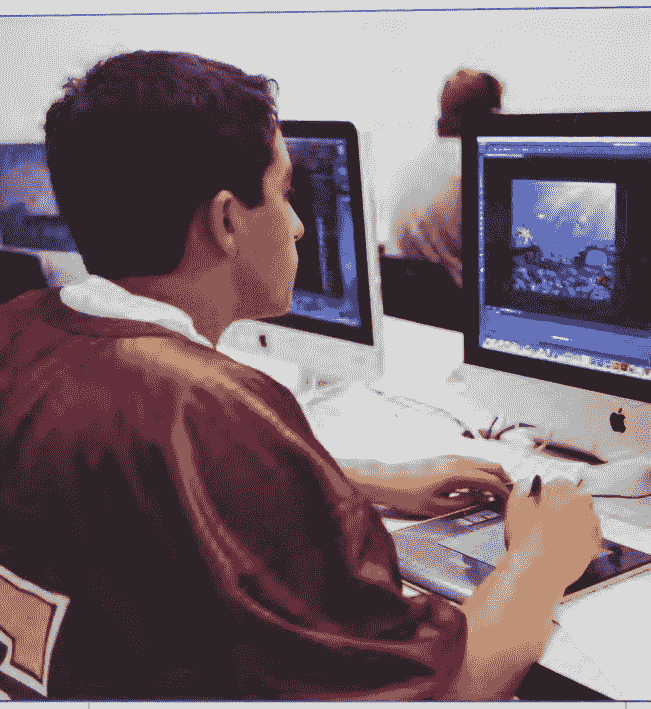

在学校参加平面设计课程，开始掌握在该领域工作所需的基本技能。这可能意味着使用一系列计算机程序，但也包括学习色彩理论、布局和设计概念。

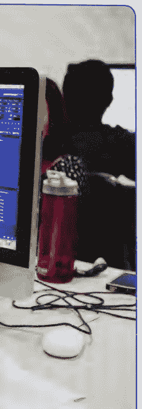

平面设计师将各种元素组合在一起，并通过艺术、色彩和布局进行传达，使游戏易于玩家理解。首席平面设计师可能会管理整个设计师团队并协调他们的工作。

## 应具备的技能

电子游戏的平面设计师需要具有创造力，并擅长视觉沟通问题解决。强大的传统绘画技能以及计算机技能很重要。设计师还需要了解布局、排版和色彩理论。平面设计师使用的一些典型计算机程序是 Adobe Photoshop、Illustrator、Flash 和 InDesign。平面设计师需要为印刷、网络和游戏平台创建图形。

要学习各种平面设计概念和计算机程序，请使用互联网搜索在线教育资源。平面设计师使用的许多程序提供程序的试用下载。在试用下载期间使用程序是了解程序并看看它是否值得你花钱购买的好方法。学生通常可以获得行业标准计算机程序的折扣。询问你学校的美术或平面设计老师，看看他们是否能帮助你在学校获得这些程序。

游戏行业的平面设计师通常需要与艺术总监和首席设计师合作，或者成为团队的一员，其中每个设计师负责电子游戏特定部分。许多游戏是现有授权财产的续集或延续。必须使用风格指南和艺术参数，以保持新游戏对玩家来说看起来相似且熟悉。授权电子游戏的平面设计师通常需要完成的一些任务包括：

- 通常在设定参数下创建游戏背景和用户界面
- 为各种游戏元素创建概念模型
- 与艺术总监或游戏设计师沟通分配的任务
- 从概念到完成制作游戏元素，同时进行评审和反馈

制作网页或个人博客是学习平面设计技能的绝佳第一步。许多网站允许你使用 HTML 编码从头构建，或者应用其他设计师制作的各种主题，你可能能够修改这些主题。

### 入门

结合摄影、艺术和排版是平面设计师工作的很大一部分。在从事印刷或电子游戏工作之前，你可以通过制作小型网页并可能建立个人博客来练习平面设计。就布局、颜色以及哪些元素放在哪里做出选择，将大大有助于你随着技能提高而进步。

即使你无法使用计算机或互联网，你也可以用彩色铅笔或马克笔在速写本中构思一个简单的电子游戏。为你拥有的想法创建游戏角色、背景和不同的加载屏幕。具有创造力，即使是在纸上，通常也是任何电子游戏迈出的第一步。记住使用这个简单而有价值的资源。记录在纸上的想法将帮助你记住你的想法，并且如果你开始在计算机上创建游戏，还可以与他人交流。

如果你想制作传统的棋盘游戏、卡牌游戏或角色扮演游戏，那么使用笔记本和速写本甚至比学习计算机设计程序更重要。传统游戏可以完全手工制作。插画板和水彩颜料可用于从头创建棋盘游戏。游戏棋子可以用纸板、彩绘石头或你能想到的任何其他东西制成。让你的想象力自由驰骋，不要让有限的资源阻碍你创造新鲜和新颖的游戏创意。潜在雇主会很高兴看到你创造的任何东西。记得将你最出色的作品加入作品集。

### 公司品牌

平面设计师所做的一项工作是创建公司标志，以简单、有力且图形化的方式传达一个想法。公司标志有助于为公司打造品牌，并让人们在购买产品时记住它。一些最初的电子游戏公司，如 Atari 和 Activision，仍然使用与其原始标志相似的标志，以便消费者能够快速识别和辨认它们。

如今一个简单图形游戏公司标志的例子是 Rockstar，它只显示一个“R”和一颗星。另一个是 LucasArts，它显示一个人，其头部是眼睛的虹膜。当消费者看到这些标志时，视觉上会想起公司的声誉和以前的产品。

### 做好准备

在高中学习计算机、绘画、艺术和平面设计课程将帮助你为平面设计师的职业生涯做好准备。在游戏公司实习也是非常宝贵的经历。整理一份强大的设计作品集对于寻找平面设计工作的人来说至关重要。在家通过计算机练习设计技能，或通过草图构思。为游戏、盒子设计和海报创建自己的图形元素将帮助你像平面设计师一样思考。参与学校年鉴工作也能给你一些宝贵的经验。

### 未来前景

根据美国劳工统计局的数据，平面设计领域工作的总体前景良好。他们预测工作竞争激烈，但建议经过深思熟虑的作品集可以帮助候选人获得他们想要的工作。工资因州而异，但与其他工作相比总体保持平均水平。许多领域需要平面设计师的专业知识，虽然竞争激烈，但机会很多。

### 组织

美国平面艺术协会（AIGA）
233 Broadway, 17th floor
New York, NY 10279
(212) 807-1990
网站：http://www.aiga.org

AIGA 是面向专业和业余平面艺术家的历史最悠久、规模最大的组织，成立于1914年，至今仍服务于当今最前沿的平面设计师。

自由职业者联盟
20 Jay Street, Suite 700
Brooklyn, NY 11201
(800) 856-9981
网站：http://www.freelancersunion.org

自由职业者联盟支持独立承包商和自由职业者的工作，其中许多人担任平面艺术家。他们为会员提供医疗保健和专业发展机会等福利。

### 期刊

#### HOW

10151 Carver Road, Suite 200  
Blue Ash, OH 45242  
(513) 531-2690  
网站：http://www.howdesign.com

这本杂志对专业平面设计师和刚入行者来说是有用的资源和艺术灵感来源。它提供有关平面艺术领域的新闻和信息以及技术提示，并介绍该领域的专业人士。

#### Digital Arts

101 Euston Road  
London, NW1 2RA  
020 7756 2800  
网站：http://www.digitalartsonline.co.uk

该出版物专注于面向数字艺术受众的新闻、评论和专题。该杂志全面报道平面设计、3D 作品、动画和视频，以及网页和交互设计，所有这些内容

## 第6章：各就各位，预备，编程！

计算机或游戏系统上的所有应用程序、游戏和软件程序都需要特定指令才能运行。这些指令是特殊的计算机语言，通常称为代码。程序员编写代码，指示计算机、移动设备或游戏系统在用户玩游戏时做什么以及如何运行。所有计算机和视频游戏系统都使用编码语言来运行游戏并执行用户输入，以便与游戏元素交互。编程允许用户通过使用游戏控制器来控制游戏元素。许多不同的编程语言可用于为计算机、视频游戏主机或手持设备创建游戏。

游戏程序员对于将游戏的各个方面变为现实至关重要。他们负责把游戏从梦想变为现实。游戏的每个方面，从故事到视觉效果再到玩法，都必须由一串串代码构建出来，才能以用户可玩的格式呈现。

游戏程序员必须编写游戏过程中发生的所有活动——从玩家输入到非玩家元素。甚至由平面设计师和艺术家创建的图形图像和 3D 元素，也必须由程序员的游戏代码控制，视频游戏才能运行。

### 游戏编码语言

要成为程序员，你需要熟悉用于创建视频游戏的各种计算机编程语言。当今业内最常见的是 JavaScript、Java（用于 Android/Google）、C++（用于 PC 和主机游戏）以及 Objective-C（用于 iOS/Apple）。

学习一门计算机编程语言似乎是一项不可能完成的任务，但有许多在线资源可以帮助任何人——甚至儿童——学习编码。有些资源甚至允许你创建自己的视频游戏，并在家用电脑上运行。

与其一开始就试图处理一个雄心勃勃的大型游戏项目，不如从小处着手。

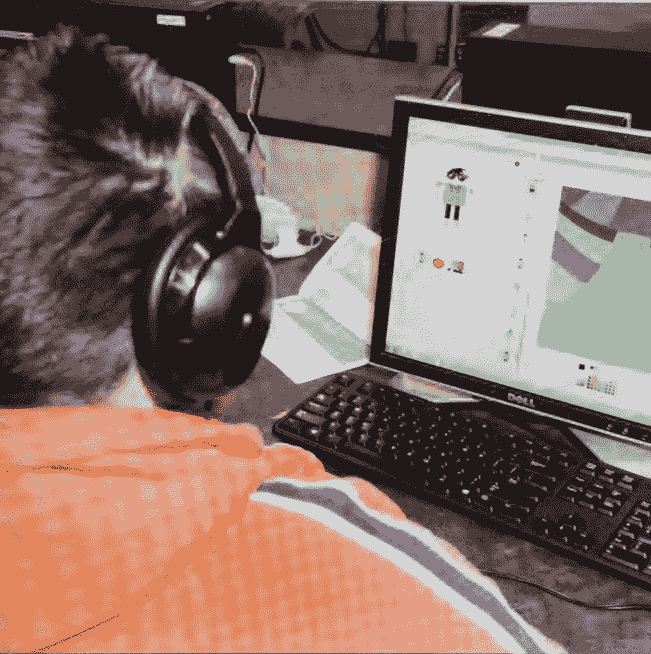

创建游戏需要各种工具和模拟环境，从编码到像 Godot 这样允许设计师构建和模拟游戏环境的程序。有些程序可以免费下载和使用，甚至对业余爱好者也是如此，并且可用于在正式培训之外培养编码和设计技能。

利用你所在学校提供的课程，例如计算机科学或编程。对于考虑从事游戏领域职业的人来说，这些课程提供了宝贵的技能。

一旦你迈出学习编码和创建简单操作的第一步，你就会发现学习编码并不像你曾经想象的那么复杂。编码可能不像看起来那么令人生畏的一个原因是，已有用于创建视频游戏代码的软件。这种现有的游戏创建软件被称为游戏引擎。游戏引擎有助于让程序员的工作更轻松。

游戏引擎作为框架存在，因此程序员可以轻松地将其适配到正在进行的项目。核心编程元素已经存在于游戏引擎中，这使游戏程序员可以只专注于创建正在设计的游戏所特有的特定游戏元素。游戏引擎还有助于管理运行游戏所需的所有资源，并将它们渲染到玩家的电视屏幕上。

当今程序员使用的一些较常见的游戏引擎有 Unity3D、Unreal Engine、CryEngine 3 和 HeroEngine。这些都可以在网上找到。如果你有兴趣学习编码，这些程序值得使用。

### 开始动手

如果你发现学校不提供编码课程，不要放弃。在线教育网站可汗学院（Khan Academy）免费提供游戏编程和计算机语言课程；当地社区学院也可能提供编程课程或暑期课程。如果可能，尽量找一门能让你从头到尾编写完整游戏的课程。当你找工作时，这可以成为重要的作品集项目。即使你不打算成为计算机程序员，所有参与创建视频游戏的人都至少应该了解一点编程。理解编程对设计师和艺术家也很重要，这样他们才知道在创建游戏时可以实现什么。

计算机程序员的工作可能多种多样。以下是程序员在工作中可能要做的一些任务：

- 将设计师的指令转化为计算机可以遵循的代码。
- 编写代码，使特定游戏在指定的计算机平台上运行。
- 转换游戏代码，使其能跨游戏平台运行。（例如，将针对 Microsoft Xbox 编码的游戏转换为可在 Sony PlayStation 或 Nintendo 系统上运行。）
- 将游戏编码为移动设备应用。
- 修复新设计或现有设计中出现的故障。

### 做好准备

如果你的学校提供任何计算机或编程课程，就选修它们。即使游戏不是课程的一部分，也可以参加在线课程或观看互联网上的教程。当你准备申请程序员工作时，通过研究该主题来熟悉面试官可能会问的问题。在面试中，程序员经常会被问到更困难的、考查解决问题能力的题目。未来的雇主也很可能会在面试中让你参加编码测试。

### 未来前景

根据美国劳工统计局的数据，计算机程序员的前景略有下降。这项工作可以在世界任何地方完成，因此公司有时会从工资较低的国家招聘程序员。北美计算机程序员的薪资高于其他工作的薪资中位数。

### 更多信息

#### 书籍

- Aziz, Adnan、Tsung-Hsien Lee 和 Amit Prakash。_编程面试要素：内部人士指南_。Seattle, WA: CreateSpace Independent Publishing Platform, 2012。Aziz、Lee 和 Prakash 探讨了编程职位求职面试中给候选人的各类问题。
- Connor, Joseph。_编程：面向初学者的计算机编程：学习 Java、SQL 和 C++ 的基础知识_。Seattle, WA: CreateSpace Independent Publishing, 2015。Connor 讨论了计算机编程的基础知识，并涵盖了 JavaScript、SQL 和 C++ 的使用。
- Habgood, Jacob。_游戏创作者的学徒：面向初学者的游戏开发_。New York, NY: Apress, 2007。Habgood 指导读者使用视频游戏创建工具 Game Maker 创建九款视频游戏。
- McDowell, Gayle Laakmann。_破解编码面试：189 道编程问题与解答_。Palo Alto, CA: CareerCup Publishing, 2015。McDowell 讨论了求职面试中向程序员提出的一些更独特、更困难的问题，并提供了在面试中随机应变的方法。

#### 组织

- Association of Information Technology Professionals  
  1120 Route 73, Ste. 200  
  Mount Laurel, NJ 08054  
  (800) 224-9371  
  网站：http://www.aitp.org  
  AITP 是一个通过支持教育和专业发展来推动 IT 行业发展的组织。
- Women in Technology  
  200 Little Falls Street, Suite 205  
  Falls Church, VA 22046  
  (703) 349-1044  
  Women in Technology 是一个致力于推动科技行业女性发展的组织。

#### 期刊

*Edge*  
3 Queensbridge  
The Lakes, Northampton NN4 7BF  
England  
+44 1604 251 045  
网站：http://www.gamesradar.com/edge/

*Edge* 为游戏行业从业者或有意涉足该领域的人提供游戏行业新闻。他们提供关于游戏如何制作和编码的专题文章，并讨论用于制作游戏的最新计算机程序。

*Gamasutra*  
303 2nd Street, 9th Floor  
San Francisco, CA 94107  
(415) 947-6000  
网站：http://www.gamasutra.com

Gamasutra 提供关于传统游戏以及电子游戏和手机游戏制作的艺术与商业的文章。

#### 网站

由于互联网链接不断变化，Rosen Publishing 制作了一份与本书主题相关的网站在线列表。该网站定期更新。请使用以下链接访问列表：

http://www.rosenlinks.com/CCWC/game

## 第7章：开始你的游戏设计

游戏设计是一项创造性工作，人们在其中发明、创造或协助创造游戏。除了电子游戏设计，游戏设计师还可以为桌面游戏设计元素，如棋盘游戏、卡牌游戏和角色扮演游戏。

电子游戏设计师往往是多面手，具备游戏创作各个方面的实用知识，包括编程、平面设计、美术、写作和管理。首席游戏设计师通常是游戏最初概念背后的创意力量，并且经常管理那些拥有更具体专项技能的人。

在较大的团队中，游戏设计师可能在首席游戏设计师手下工作，并在游戏创作中承担更具体的角色。在大型团队中，游戏设计师可以担任的更细分角色包括：

- 关卡设计师
- 编剧与故事开发
- 美术与内容设计

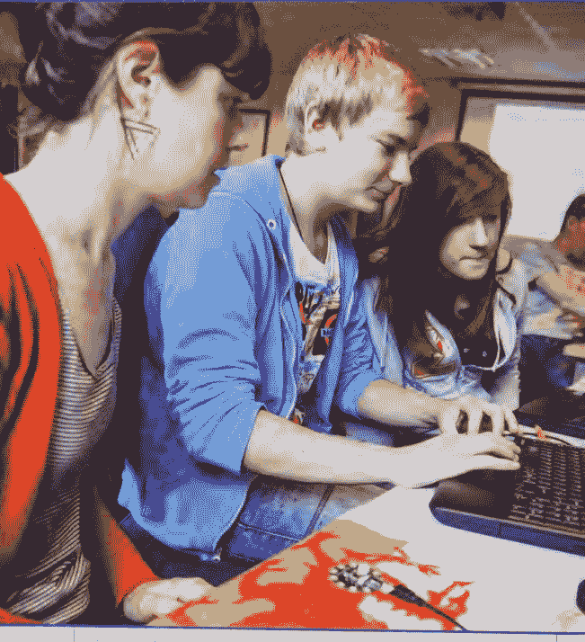

专业游戏夏令营面向高中生开放，是学习该行业各个领域宝贵技能的好地方。它们涵盖游戏设计师从概念到创作可能需要的各种技能。

- 程序员
- 系统设计师
- 世界设计师
- 界面设计师

游戏设计师可以专攻游戏创作的特定领域。拥有广泛游戏技能的人会很适合成为游戏设计师。除了技术技能，游戏设计师还必须能够看到游戏创作过程的整体图景。

程序员编写详细代码，而游戏设计师应对编码有总体理解，并能在一定程度上编码。这会使游戏设计师更有效地沟通游戏应如何成形。游戏设计师指导程序员和其他团队成员。他们沟通如何进行调整、提出创意批评，并处理日程和截止日期。这意味着游戏设计师可能还懂得如何设计或绘画。看清全局并知道如何执行项目，是游戏设计师的工作。

游戏设计师或首席游戏设计师的工作不是入门级职位。它需要具备制作游戏的经验。不过，这份工作不一定要求大学学位。展示你能胜任游戏设计师工作的最好方式，就是自己制作一个小规模游戏。

### 自我准备

从零开始发明一款游戏，需要创造力、艺术技能和编程能力相结合。要成为游戏设计师，你应该写下并勾勒出你对电子游戏的想法。熟悉编程、游戏引擎以及你希望创作的电子游戏类型。绘画、美术、平面设计和编程都是你应该参与学习的课程或活动，以成为游戏设计师。利用可用的在线资源。尝试制作一个简单的电子游戏，然后与朋友一起转向更大、更有雄心的项目。

### 未来前景

美国劳工统计局不收集电子游戏行业或桌游的数据

#### 书籍

Brathwaite, Brenda, and Ian Schreiber. *游戏设计师的挑战*. Newton Centre, MA: Charles River Media, 2008.

Brathwaite 和 Schreiber 提供了一些练习，读者可以照着创建自己的游戏设计。

Rogers, Scott. *升级！伟大电子游戏设计指南*. New York, NY: Wiley, 2014.

Rogers 描述了电子游戏设计、如何推销你的电子游戏创意，以及如何为移动端和主机系统创作游戏。

Schell, Jesse. *游戏设计艺术：透镜之书*. Oxfordshire, England: AK Peters/CRC Press, 2014.

作为顶尖游戏设计师，Schell 通过许多从该领域之外看待游戏设计的人的“透镜”来解释游戏设计。

#### 组织

交互艺术与科学学院（AIAS）  
11175 Santa Monica Boulevard, 4th Floor  
Los Angeles, CA 90025  
(310) 484-2560  
网站：http://www.interactive.org  
AIAS 是一个非营利组织，致力于推广交互艺术，包括电子游戏艺术。

娱乐软件协会（ESA）  
575 7th Street NW, Suite 300  
Washington, DC 20004  
网站：http://www.theesa.com  
ESA 为数字媒体专业人士提供支持，包括电子游戏开发者。

#### 期刊

*国际计算机游戏技术杂志*  
315 Madison Avenue, 3rd Floor, Suite 3070  
New York, NY 10017  
网站：http://www.hindawi.com/journals/ijcgt  
该期刊发表关于游戏技术和交互式数字媒体的原创研究和综述文章。

#### 网站

由于互联网链接不断变化，Rosen Publishing 制作了一份与本书主题相关的网站在线列表。该网站定期更新。请使用以下链接访问列表：

http://www.rosenlinks.com/CCWC/game

## 第8章：游戏之声

在电子游戏行业中，声音和音乐作为职业道路有时会被忽视。然而，声音和音乐在游戏中与在电影中同样重要。我们喜爱的许多电子游戏都有标志性的原声带和音效。试着想象没有音效或原声带的经典游戏，如 *吃豆人* 或 *大金刚*。那种体验将完全不同。

如今电子游戏更像电影，演员为游戏角色配音，著名作曲家创作游戏配乐并指挥管弦乐队。电子游戏音乐已变得如此流行，以至于原声带会与游戏同步以黑胶唱片形式发行。当一款新电子游戏发行时，有些会推出限量版，其中包含艺术设定集和原声带等别处无法获得的附加内容。

音乐人可以通过为游戏原声带或配乐作出贡献，在电子游戏行业找到工作。调音台用于在录音棚中组合各种音轨和录音。

### 用音乐赚钱

可以在手机和平板电脑上购买功能强大的音乐和声音创作应用。这些应用可以成为开始为电子游戏创作声音和音乐的好方法，而无需投资购买更大型的乐器。

保留其音乐版权的作曲家可以通过 bandcamp.com 等网站在线销售其游戏原声带。在线销售你的音乐是赚钱的好方法。Soundcloud 是另一个分享音乐但不允许下载的网站。在网上结识其他音乐人并建立人脉，有助于带来自由职业工作和就业机会。人们经常在这些网站上寻找新艺术家和新声音，这些网站为想要相互建立人脉的音乐人提供了良好的曝光机会。

多年来，音乐创作和制作在电子游戏行业中一直稳步增长。许多在电影行业难以找到工作的音乐人和作曲家，由于正在制作的游戏数量庞大，更容易获得电子游戏方面的工作。

几乎所有电子游戏都有音乐原声，音乐人可以从事作曲、制作音效或录制歌曲等工作。即使是一个简单的移动应用，也需要音效，而这些音效可以由有音乐天赋的人来制作。

配音表演和演唱也属于电子游戏声音的范畴。这些职位需要才华横溢的歌手和演员。一些名人已将自己的表演和声音才华借给电子游戏，但这并不意味着你必须是著名演员才能在电子游戏表演领域找到工作。尝试回应独立游戏开发者的招聘广告，他们正在制作电子游戏。他们可能需要配音人才，但可能没有很高的预算。你可以在这里积累简历，并开始进入这一领域工作。

### 做好准备

学习如何作曲以及掌握一种乐器很重要。熟悉电子键盘和音乐程序等不同的数字设备，也是很好的准备。聆听各类电子游戏的音效和原声。即使是移动设备上的小游戏也需要音效和音乐。在电脑上创建数字音效库，并创作短小的器乐曲，可用于你的作品集。

知名电子游戏配音演员特洛伊·贝克曾主演*《最后生还者》*和*《中土世界：暗影魔多》*。配音表演是许多电子游戏不可或缺的一部分。许多配音演员在多个行业工作，电子游戏只是其中之一。

### 未来前景

根据美国劳工统计局的数据，由于提供音频和视频功能的多媒体产品不断增长，音响工程师的就业前景预计在未来十年将有所增长。这包括所有平台上的电子游戏。该局并未针对音乐人和配音演员等艺术家收集数据，但可以预期会有类似的增长。

#### 组织

音频工程学会（AES）  
551 Fifth Ave, Suite 1225  
New York, NY 10176  
(212) 661-8528  
网站：http://www.aes.org  
AES 是一个致力于音频技术的专业学会。它成立于1948年，服务于音频工程师、学生、艺术家以及对声音技术感兴趣的科学家。

音频出版商协会（APA）  
100 North 20th Street, Suite 400  
Philadelphia, PA 19103  
(215) 564-2729  
网站：http://audiopub.org  
APA 是一个非营利组织，致力于维护音频出版商以及与音频产品相关的产品的利益。

#### 网站

由于互联网链接不断变化，罗森出版公司制作了一份与本书主题相关的网站在线列表。该网站定期更新。请使用以下链接访问该列表：

http://www.rosenlinks.com/CCWC/game

## 第9章

## 让你的电子游戏成为现实

你有一个很棒的电子游戏创意，但没有资金或大公司的支持吗？看起来，一个人几乎无法完全独自创造出什么东西。但仍有选择。如果你或一小群朋友具备制作游戏所需的多方面综合技能，那么你也许可以考虑自己动手制作。许多像*《使命召唤》*和*《刺客信条》*这样的高级电子游戏需要数十甚至数百人才能完成。也有一些非常优秀的例子，是由个人或小团队创作的更小、更私密的游戏，并取得了成功。

在没有大公司资金支持的情况下制作电子游戏并非易事，但绝非不可能。如今，“独立”游戏，即由单个人或小团队在没有电子游戏发行商的情况下制作的独立电子游戏，是市场中不断增长的力量。

独立电子游戏项目一直在被创作、销售和游玩。一些非常大的公司甚至在独立游戏于市场上获得巨大成功和赞誉后将其收购。一个例子是虚拟现实头显 Oculus Rift。该头显以高清画质显示电子游戏。该项目最初在网上获得融资，随后于2014年被 Facebook 以20亿美元收购。开发继续进行，该头显于2016年发布。

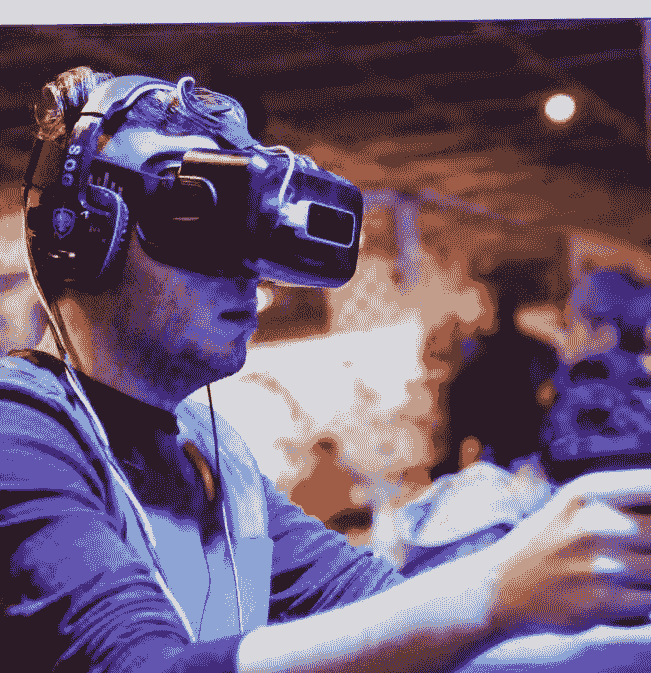

虚拟现实头显是电子游戏的下一步。图中，一名玩家戴着广受欢迎的 Oculus Rift® 头显玩游戏。这将玩家置于沉浸式的视觉和听觉环境中，让他或她感觉自己真正“身处”游戏之中。

独立游戏包括为游戏主机制作的游戏，也包括为安卓或苹果手机开发的应用程序游戏。制作独立游戏不需要大学教育，但所有这些特征都是必需的

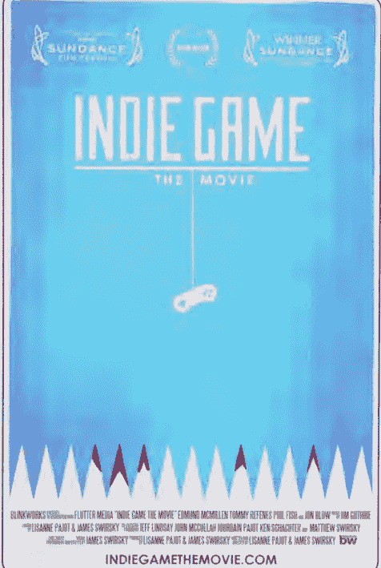

诸如*《独立游戏大电影》*这样的电子游戏纪录片，是了解独立游戏行业状况的绝佳资源。

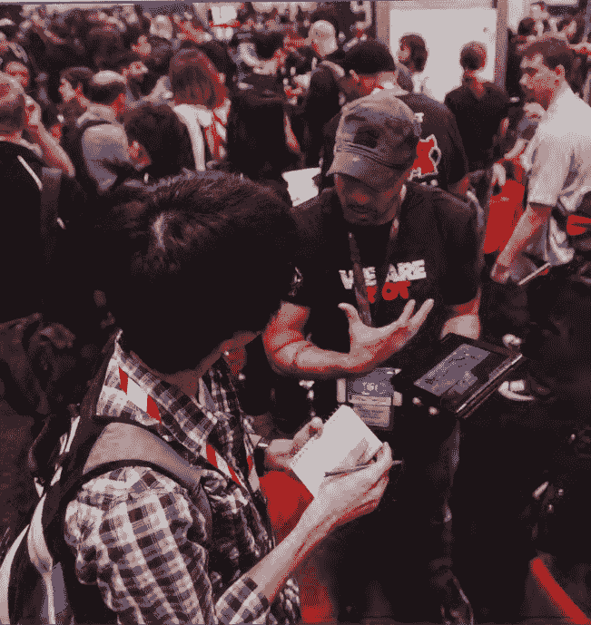

参加电子游戏开发者大会，例如在加利福尼亚州旧金山举行的这场大会，对于紧跟行业趋势很重要。在这里，玩家和创作者可以互动，也可以向行业专业人士和媒体展示他们的想法和项目。

乔纳森·布洛创作了*《时空幻境》*，这是有史以来评分最高的游戏之一。

### 单打独斗

继续参与游戏行业的一个好方法是参加一年一度的游戏开发者大会（GDC）以及在那里举行的独立游戏峰会。这是游戏专业人士规模最大的年度聚会。参加 GDC 是了解正在创作什么的好方法，也是在游戏行业建立人脉的绝佳机会。

独立游戏开发者的另一个绝佳资源是 Steam，这是一个可以分发许多大大小小的游戏以供销售的网站。虽然你可能无法获得大型游戏公司为其游戏所拥有的实体店曝光度，但 Steam 自2014年以来已在全球拥有6500万用户。该网站上的游戏很有可能被看到和游玩。

# 深度学习在医学影像分析中的应用综述

随着人工智能技术的飞速发展，深度学习已成为医学影像分析领域最具潜力的工具之一。本文综述了深度学习在医学影像分类、分割、检测和配准等任务中的最新进展，并探讨了面临的挑战与未来方向。

## 1. 引言

医学影像是现代临床诊断的核心依据。传统的人工阅片方式不仅耗时费力，而且诊断结果易受医生经验与主观因素的影响。深度学习技术的引入，为医学影像的自动化和智能化分析带来了革命性的突破。

## 2. 深度学习方法概述

深度学习通过多层神经网络自动学习数据的层次化特征表示。在医学影像分析中，常用的深度学习架构包括：

- **卷积神经网络（CNN）**：擅长提取空间特征，广泛用于图像分类与分割。
- **循环神经网络（RNN）**：适合处理序列数据，常用于时序影像分析。
- **U-Net及其变体**：编码器-解码器结构，在医学图像分割中表现卓越。
- **Transformer**：基于自注意力机制，在多项医学影像任务中已达到最先进水平。

## 3. 主要应用场景

表1总结了深度学习在不同医学影像任务中的典型应用：

| 任务 | 典型应用 | 常用架构 | 代表数据集 |
|------|----------|----------|------------|
| 图像分类 | 肺炎检测、皮肤病变分类 | ResNet、EfficientNet | ChestX-ray14、ISIC |
| 图像分割 | 肿瘤分割、器官勾画 | U-Net、DeepLabv3 | BraTS、LiTS |
| 目标检测 | 肺结节检测、细胞检测 | Faster R-CNN、YOLO | LUNA16、BBBC005 |
| 图像配准 | 多模态配准、运动校正 | VoxelMorph、TransMorph | Learn2Reg |

### 做好准备

阅读行业出版物和期刊，以了解新平台和游戏创意。这可以让你在头脑风暴和为未来内容创作方面抢占先机。要独立制作电子游戏，你需要持续关注游戏创作的各个方面。除了制作和开发游戏所需的技能外，你可能还想学习一些商业课程，以帮助你完成作品的融资和营销过程。

### 未来前景

美国劳工统计局不收集关于电子游戏创业者的数据，但已对一般成熟创业者的工作进行了研究。他们发现，许多人最初是把创业作为第二职业起步的。一些独立商业项目会成功，一些则不会。在承担财务风险之前准备得越充分，你在商业努力和未来前景中就会表现得越好。独立游戏开发领域是一个不断增长的领域，并且很可能在许多年里继续保持这种势头。

### 更多信息

#### 图书

- 迪弗，麦克。*独立游戏：独立游戏完全入门。* 西雅图，华盛顿州：亚马逊数字服务，2016年。

    迪弗介绍了独立游戏领域，包括对独立游戏公司与大型商业游戏公司之间差异的见解。

- 德雷斯金，乔尔。*独立游戏营销实用指南。* 西雅图，华盛顿州：焦点出版社，2015年。

    德雷斯金就如何在预算、资源和人员有限的情况下营销独立游戏提供了实用建议。

- 希尔-惠特尔，理查德。*独立游戏开发者手册。* 西雅图，华盛顿州：焦点出版社，2015年。

    希尔-惠特尔为经营独立电子游戏工作室提供了技巧和建议。

#### 组织

全国自雇经营者协会（NASE）  
邮政信箱241  
安纳波利斯章克申，马里兰州 20701-0241  

(800) 649-6273  
网站：http://www.nase.org  

NASE为自雇人士和小企业主提供指导与资源。

全国小企业协会（NSBA）  
邮政信箱5024  
凯尔弗里，亚利桑那州 85377  

(888) 800-3416  
网站：http://www.nsba.net/contact-nsba  

NSBA是一个致力于倡导小企业主在州级和国家级层面取得成功的组织。

#### 视频

- “游戏加载：独立游戏的崛起”（http://www.gameloading.tv）

    该视频探讨了独立游戏开发的亚文化。

- *独立游戏：电影*（http://buy.indiegamethemovie.com）

    这部电影是一部关于电子游戏行业的长篇纪录片。

- *我的世界：Mojang的故事*（http://www.minecraftstoryofmojang.com）

    这部电影探讨了独立电子游戏《我的世界》的崛起。

#### 网站

由于互联网链接的多变性，罗森出版公司开发了一个与本书主题相关的网站在线列表。该网站会定期更新。请使用此链接访问列表：

http://www.rosenlinks.com/CCWC/game

## 第10章：让你的爱好游戏成为现实

爱好游戏和家庭娱乐游戏几代以来一直是一项大生意。企业家可以通过开发下一款人们想要玩的热门游戏赚到很多钱。像孩之宝、Fantasy Flight Games、Paizo公司和Wizkids等游戏公司每年生产价值数百万美元的游戏。玩具反斗城等玩具店的销售额达数十亿美元。仅在2014年，美国玩具反斗城的销售收入就达到了124亿美元。其中很大一部分收入来自传统棋盘游戏、卡牌游戏和角色扮演游戏的销售。

很多人对游戏都有好点子，但要将这些点子变为现实并成为一名成功的企业家则完全是另一回事。年轻企业家面临的最困难挑战之一是如何筹集资金来生产和分销他们的游戏。

传统棋盘游戏和爱好游戏也是游戏产业的重要组成部分。在电子游戏出现之前，卡牌和棋盘游戏是公众参与竞技和共享游戏体验的主要方式。有些棋盘游戏起源于古代，有些则依赖于流行文化或巧妙的机制来吸引玩家参与。

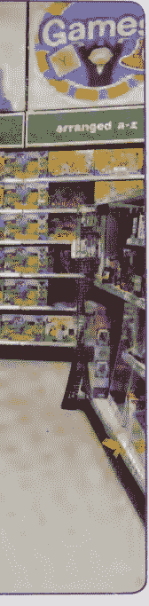

### 具备所需条件

在制作游戏之前，你需要进行以下活动，以确保你的努力取得成功：

- 撰写一份商业计划书，说明你将生产多少单位、每单位制造成本以及你的定价。
- 制定在本地、全国或全球分销产品的计划。
- 创建推广产品的计划。
- 研究项目融资，例如众筹或资金支持者。
- 跟踪与业务成本和利润相关的所有资金。
- 寻求税务方面的会计帮助。

企业家必须准备好应对业务中出现的意外问题，因此良好的态度和亲和的形象在与客户、资金支持者或商业伙伴打交道时会大有帮助。

众筹是筹集资金让你的电子游戏成为现实的好方法。许多在寻求传统投资者方面遇到困难的项目会自行掌控资金，直接将众筹活动带给可能感兴趣的消费者。这些活动会为早期支持项目以确保资金到位的人提供奖励和特别折扣。

### 众筹

众筹是独立游戏创作者从一大群人那里获得游戏项目资金的一种流行方式。为众筹项目出资的人通常会在项目完成时获得成品作为回报。通过这种方式，资金支持者可以支持他们认可或有共鸣的项目，而创作者则获得制作产品所需的资金。

最受欢迎的众筹网站是Kickstarter.com。通过众筹创建的一款游戏是卡牌游戏*爆炸猫*，它在Kickstarter上筹集了8,782,571美元，成为有史以来资金最多的游戏众筹活动之一。

请务必查看其他众筹网站，如indiegogo.com、crowdfunder.com和rockethub.com，并遵循各网站关于创建众筹游戏项目的指南。

当为个人游戏项目获得资金过于困难时，还有其他选择。例如，棋盘游戏和角色扮演游戏书籍需要印刷，这可能会很昂贵。为了节省制作成本并保持传统游戏的低售价，你可以创建仅数字版的传统棋盘游戏、卡牌游戏或RPG游戏。然后，你可以出售数字文件，让玩家在家中打印游戏元素。保持开放的心态，保持创造力，不要气馁！

### 《龙与地下城》的影响

有史以来最著名的传统独立游戏《龙与地下城》也被称为D&D。加里·吉盖克斯和戴夫·阿内森于1973年成立了战术研究规则公司（TSR），并于1974年首次发布了他们的冒险游戏《龙与地下城》。D&D的首次印刷只有一千套盒装，包含三本游戏指南。

在游戏中，玩家在纸上创建虚构角色，而一名玩家——地下城主（DM）——描述故事冒险以及玩家遇到的众多角色、怪物和环境。

《龙与地下城》迅速变得非常受欢迎，到1981年，TSR的收入达到1290万美元。1997年，游戏公司威世智以2500万美元收购了TSR。《龙与地下城》的成功持续下去，1999年，玩具公司孩之宝以3.25亿美元收购了威世智。

D&D的流行对电子游戏和角色扮演游戏都产生了巨大影响。从《宝可梦》到《暗黑破坏神》，电子游戏都受到了吉盖克斯和阿内森自制的纸笔游戏的启发。如今，D&D已经进入第五版。

### 做好自我准备

成为任何类型的企业家，首先要有一个你认为人们会感兴趣的伟大想法。研究传统游戏并阅读有关传统游戏的期刊。这些都是很好的灵感来源。还可以参加像Gen Con这样的游戏大会。这个年度游戏大会是游戏制作者和游戏买家会面、交流想法以及达成一些商业交易的好地方。

### 未来前景

任何企业家的未来都可以是光明的。根据你的具体想法或项目，你能赚到的钱和你能发展的想法是无限的。你越有耐心和决心，成功的可能性就越大。然而，这并非适合那些喜欢安于现状、领取稳定薪水的人。

#### 图书

- 博特曼，杰克。*游戏之书：策略、战术与历史。* 纽约，纽约州：斯特林出版社，2008年。

    博特曼概述了历史上的传统游戏及其对今天我们玩到的游戏的影响。

- 奥尔班内斯，菲利普·E。*游戏制造者：派克兄弟的故事，从挑圆片到常识问答。* 波士顿，马萨诸塞州：哈佛商业评论出版社，2003年。

    奥尔班内斯概述了传统游戏公司派克兄弟，描述了它在二十世纪及以后的挑战、成功以及走向国际声誉的历程。

- 威特沃，迈克尔。*想象帝国：加里·吉盖克斯与《龙与地下城》的诞生。* 纽约，纽约州：布鲁姆斯伯里出版社，2015年。

    威特沃讲述了独立游戏开发者加里·吉盖克斯的历史及其在游戏行业中的作用。

#### 组织

- **创业者网络**  
  500 Montgomery Street, Suite 700  
  Alexandria, VA 22314  
  (703) 519-6700  
  网站：https://www.eonetwork.org  
  创业者网络是一个由来自四十八个国家的创业者组成的网络，致力于创业者之间的联络并帮助其他创业者。

- **创业磨坊**  
  2555 Park Boulevard  
  Palo Alto, CA 94306  
  网站：https://www.startupgrind.com  
  创业磨坊是一个创业社区，旨在教育和激励创业者，并帮助他们彼此建立联系。

**爱好游戏** 使用骰子、棋盘、卡牌、微缩模型、板块和地图进行的游戏，例如*《龙与地下城》*；桌面游戏。

**实习** 为刚进入某一职业领域的人提供的临时职位，可能无薪，或用于换取学校学分。

**JAVASCRIPT** 一种用于编程的面向对象计算机语言。

**首席设计师** 领导其他更专注于特定领域游戏设计师团队的游戏设计师。

**授权IP** 公司拥有、已出租给另一家公司以基于其制作商品的财产。

**模型样稿** 用于展示真实产品外观的模型或布置。

**编程** 为计算机编写程序的过程或行为。

**桌面游戏** 使用骰子、棋盘、卡牌、微缩模型、板块和地图进行的游戏，例如*《龙与地下城》*；爱好游戏。

## 危害分析与关键控制点（HACCP）

HACCP是一种识别、评估和控制食品安全危害的系统性方法。

它是一个预防性体系，旨在确保食品产品的安全。

### 关键原则

- 1. 进行危害分析。
- 2. 确定关键控制点（CCP）。
- 3. 建立关键限值。
- 4. 建立监控程序。
- 5. 建立纠正措施。
- 6. 建立验证程序。
- 7. 建立记录保存和文档程序。

表1：HACCP原则摘要

| 原则编号 | 描述 |
| --- | --- |
| 1 | 进行危害分析 |
| 2 | 确定关键控制点（CCP） |
| 3 | 建立关键限值 |
| 4 | 建立监控程序 |
| 5 | 建立纠正措施 |
| 6 | 建立验证程序 |
| 7 | 建立记录保存和文档程序 |

- Gaudioso, John. “移动游戏收入将在2015年超过主机游戏。” *《财富》*，2015年1月15日（http://fortune.com/2015/01/15/mobile-console-game-revenues-2015）。

- Hamilton, Kirk. “电子游戏是如今靠作曲谋生的最佳新途径。” *Kotaku*，2012年2月23日（http://kotaku.com/5887745/video-games-are-the-new-best-way-to-make-a-living-composing-music）。

- “如何成为电子游戏剧本作者。” A Digital Dreamer，2016年3月23日（http://www.adigitaldreamer.com/articles/become-a-game-writer.htm）。

- Mac, Ryan. “《我的世界》的Markus Persson畅谈他把公司出售给微软、他价值7000万美元的住宅以及接下来会发生什么。” *《福布斯》*，2015年3月3日（http://www.forbes.com/sites/ryanmac/2015/03/03/minecraft-markus-persson-notch-interview-microsoft-sale/#69af39e410f3）。

- “《我的世界》销量达到7000万份——PC版超过2000万份。” Legit Reviews，2015年7月6日（http://www.legitreviews.com/minecraft-reaches-70-million-units-sold_167644）。

- Needleman, Sarah E. “走进麦迪逊广场花园的‘英雄联盟’锦标赛。” *《华尔街日报》*，2015年8月23日（http://blogs.wsj.com/digits/2015/08/23/e-sports-event-scores-at-madison-square-garden/）。

- Plumer, Brad. “仅27%的大学毕业生从事与专业相关的工作。” *《华盛顿邮报》*，2013年5月20日（https://www.washingtonpost.com/news/wonk/wp/2013/05/20/only-27-percent-of-college-grads-have-a-job-related-to-their-major/）。

- Ravitz, Jessica. “校队游戏玩家正在创造历史，并让父母大为困惑。” CNN，检索于2016年3月24日（http://www.cnn.com/interactive/2015/07/us/varsity-gamers-american-story/）。

- “为玩而工作：电子游戏开发领域的职业。” 美国劳工统计局，2016年3月30日（http://www.bls.gov/careeroutlook/2011/fall/art01.pdf）。

- “为电子游戏撰写剧本。” Storm the Castle，2016年3月30日（http://www.stormthecastle.com/video-game-design/writing-a-video-game-script.htm）。

## 索引

### A

- Allen, Nick，24
- Arneson, Dave，128
- 《刺客信条》，111

### B

- 《生化奇兵》，102
- Blow, Jonathan，117

### C

- 《使命召唤》，111
- 代码语言，78–83
- 协作，44
- 公司品牌塑造，71
- 众包，127–129

### D

- 《遗迹保卫战》，22
- 《命运》，6
- 数字艺术工具，59，67
- 《龙与地下城》，25，42，128

### E

- 电子竞技，22–24，32
- Evil Geniuses，24

### F

- Facebook，96，113
- 《辐射4》，6
- Fish, Phil，114
- 自由职业，36，104
- 未来前景
  - 游戏设计师，95–96
  - 游戏插画师，60
  - 游戏程序员，85
  - 游戏销售领域，18
  - 游戏音效制作领域，107
  - 游戏编剧，46
  - 平面设计师，73
  - 爱好游戏，129
  - 独立游戏，119
  - 职业游戏玩家，32

### G

- 游戏开发者大会（GDC），117
- 游戏引擎，83
- GameSpot杂志，24
- GameStop，10–12
- 游戏测试，25
- 游戏电脑/整机，29–31
- Gen Con，129
- Gygax, Gary，128

### H

- Hello Games，118

### I

- 独立游戏峰会，117
- 《独立游戏大电影》，114
- Instagram，30
- The International，24
- 实习，17，72

### L

- 《英雄联盟》，22–24，26
- 《塞尔达传说》，54，102

### M

- 麦迪逊广场花园，22
- 职业游戏大联盟（MLG），32
- McMillen, Edmund，114
- 《我的世界》，118

### N

- 人脉拓展，43–44
- 《无人深空》，118

### O

- Oculus Rift，113

### P

- 《吃豆人》，6，100
- Pasternak, Ben，96
- Persson, Markus，118
- 作品集，54–55，58，72–73，84，107
- 准备
  - 游戏设计，94
  - 游戏插画，54–59
  - 游戏编程，80–84，85
  - 游戏编剧，46
  - 平面设计，70–72
  - 制作爱好游戏，129
  - 制作独立游戏，119
  - 职业游戏竞技，32
  - 从事游戏销售工作，16–18
  - 从事游戏音效制作工作，105–107
- 职业角色扮演，30

### R

- Refenes, Tommy，114

## 本系列新书

- **无需大学文凭的酷职业**  
  **献给热爱**  
  **艺术的人**
- **无需大学文凭的酷职业**  
  **献给喜欢**  
  **娱乐的人**
- **无需大学文凭的酷职业**  
  **献给热爱**  
  **时尚的人**
- **无需大学文凭的酷职业**  
  **献给热爱**  
  **游戏的人**
- **无需大学文凭的酷职业**  
  **献给热爱**  
  **摄影的人**
- **无需大学文凭的酷职业**  
  **献给喜欢**  
  **修理东西的人**
- **无需大学文凭的酷职业**  
  **献给热爱**  
  **体育的人**
- **无需大学文凭的酷职业**  
  **献给热爱**  
  **科技的人**

ROSEN  
出版公司

ISBN-13: 978-1-5081-7282-6  
9 781508 172826
