# 酷编程：充满适合所有年龄段孩子的奇妙知识（酷小孩）


## 欢迎来到酷编程

我在一个旧防空洞里学会了编程。这座防空洞是学校在第二次世界大战期间修建的，但等我到学校时，它已经被改造成了计算机俱乐部。我们都想在计算机上玩游戏，于是我从计算机杂志中一行一行地抄写代码，第一次尝到了编程的滋味。起初我并不明白自己抄写的程序是如何工作的，但后来我开始尝试并编写自己的程序。很快我就着了迷。

编程充满逻辑性，就像一个谜题，但一个有着许多可能解法的谜题，因此你永远不会完全卡住。编程也富有创造性：你可以制作游戏、工具和应用，与朋友和家人分享。编程不需要很多设备，也不会弄得乱七八糟，无论是下雨天，还是睡觉前，都可以进行。全世界的男孩、女孩、小孩和退休老人都在编写代码，并相互分享。

时至今日，我依然热爱编程。现在它是我的工作，也依旧是我的爱好。我希望通过这本书，你也能对它兴奋起来。这本书不仅会教你编程的基本概念，还会介绍有用的工具和技术，讲述计算机在过去是如何使用的，以及未来它们能做什么，并且希望能激励你去编写属于自己的代码！

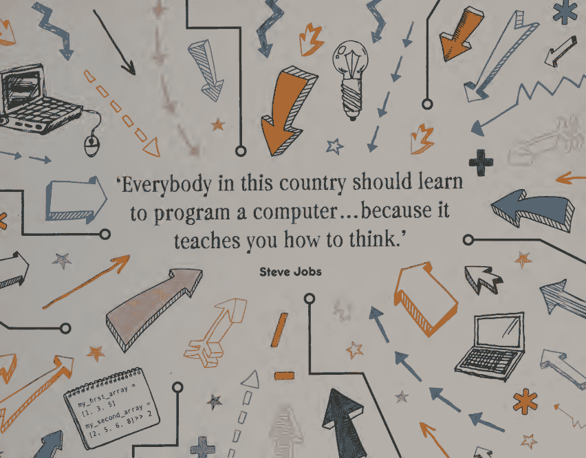

> “这个国家的每个人都应该学习编程……因为它教会你如何思考。”

**史蒂夫·乔布斯**

```
my_first_array =
[1, 3, 5]
my_second_array =
[2, 5, 6, 8] >> 2
```

## 什么是程序？

一台不知道做什么的计算机，不过是个非常昂贵的镇纸。程序让计算机玩游戏、制作音乐和绘制图像。程序告诉计算机该做什么。

### 遵循指令

程序就像把一堆塑料玩具砖块搭建成城堡的指令清单：一组让计算机执行的独立指令。每条指令只是非常小的一步，就像连接两块砖一样，但当程序完成时，就能实现令人惊叹的事情。

就像指令清单一样，程序是从上到下读取的。程序中的每一行都是一条语句，告诉计算机要执行的动作。当该动作完成后，计算机将继续执行程序的下一行，依此类推，直到到达末尾才会停止。计算机不会感到厌烦，也不会忘记当前位置：无论需要多长时间，它都会一直执行程序（尽管计算机执行指令的速度非常快！）。

### 我们的第一个程序

计算机程序也被称为代码，编写计算机程序的人被称为编码者（coder）或程序员（programmer）。这可以是一份工作，但很多人，包括孩子，都为了乐趣而编写程序！一旦写好了程序，你可以让计算机运行它；这意味着计算机将遵循指令并执行动作。


现在来看一个程序：

```python
print("I just started my first program!")
print("I just finished my first program!")
```

print 指令告诉计算机将文本行打印到屏幕上。当上面的代码运行时，计算机将首先打印出：

*我刚开始了我的第一个程序！*

... 然后：

*我刚完成了我的第一个程序！*

... 因为计算机先执行第一行的指令，再执行第二行。—— 就这样 —— 你编写了一个程序！

> **太棒了！**
>
> 你可以在网站 jsfiddle.net（见第108页）上试运行本书中的大部分代码示例，但需要将 print 命令改为 alert 才能运行。

### 让我们开始吧！

正如世界各地的人们说着许多不同的语言一样，编写计算机程序也有许多不同的编程语言。某些语言更适合特定类型的程序，有些则比其他语言更复杂。但无论使用哪种语言，所有计算机语言的基本构件都是相同的。

这本书将为你全面介绍编程，因此当你亲自动手尝试时，无论选择哪种语言，你都会理解这些基本构件！


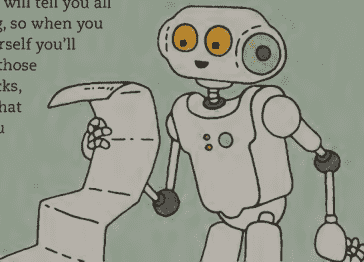


## 巨像：第一台计算机

如今，计算机无处不在，但直到 20 世纪 40 年代，“计算机”还是指以计算（做算术）为生的人，而不是机器。这是一份枯燥的工作，而且不可能不出错，因此工程师们想方设法制造机器来承担这项工作。

### 恩尼格玛

第二次世界大战期间，双方军队通过无线电来回发送指令和报告，为了不让对方看懂，他们用密码对信息进行加密。英国在白金汉郡的布莱切利庄园组建了一支队伍来破解德国密码，招募了擅长数学、国际象棋和填字游戏的男男女女。到 1941 年，在波兰密码破译者以及阿兰·图灵等人设计的机械计算设备的帮助下，他们已经能够读取由德国主要密码机“恩尼格玛”加密的信息。

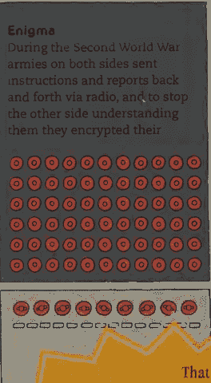


> **有意思！**
>
> 巨像计算机的机密程度极高，战后只保留了少数几台，其余连同所有记录一起被销毁。所有知情者都被要求宣誓保密。因此，很长一段时间里，1946 年在美国制造的 ENIAC 被认为是第一台计算机。直到 20 世纪 70 年代中期，关于巨像计算机的信息才公之于众。2007 年，人们建造了一台可运行的巨像 Mark 2 复制机，可以在布莱切利庄园的国家计算博物馆中看到它的运转。

### 巨像

但德国最高统帅部使用了自己的密码系统：洛伦茨，这是一种连图灵设计的机器也无法破解的复杂密码。需要另想办法。战前，图灵曾设想制造一台能解决任何数学问题的机器。这时，汤米·弗劳尔斯和马克斯·纽曼造出了这样一台机器。它被命名为“巨像”，利用电力和真空管进行计算。与以往任何机器不同，它是电子化且可编程的，因此可以被设置来解决任何数学问题。这就是第一台计算机！巨像 Mark 1 于 1943 年 12 月完工，能以每秒 1000 个字符的速度从纸带上读取加密信息。Mark 2 于 1944 年 6 月完成，速度提高了五倍。借助这一新设备，布莱切利庄园终于破解了洛伦茨密码，读到了希特勒发给指挥官们的消息。人们认为，布莱切利庄园的密码破译工作将战争缩短了数年，挽救了数百万人的生命！

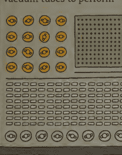

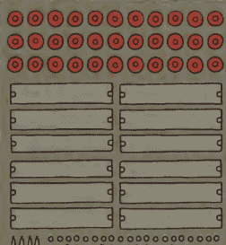

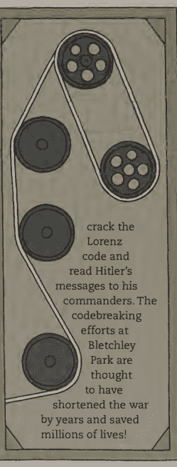

## 文字与数字

一个什么都不记得的计算机程序不会有什么用，所以即使是最早的计算机也有内存。计算机程序通过将信息存储在变量中来记住一条信息。

当你第一次定义（使用）一个变量时，需要给它命名。之后在程序中引用这个名称时，你可以获取其中的值，或者把它改成别的值。使用 = 号设置变量的值，左边是变量，右边是你想赋予的值：

```python
my_first_variable = 3        # create variable and give it the value 3
print(my_first_variable)     # this will print out the value 3

my_first_variable = 5        # change the value inside the variable to 5
print(my_first_variable)     # and this will print the value 5
```

### 有意思！

只要变量名中没有空格，你可以随意命名。给你的变量起有帮助的名字，这样你就不会忘记它们存储的是什么了！

> 你可以在整数和浮点数之间进行转换，但从整数转换为浮点数很容易，反过来却可能会带来问题。例如，把 4.5 转换为 4 很容易，但如果你把 4.99 转换为整数，你会得到 4，因为计算机总是向下取整。如果你没有预料到这一点，可能会得到奇怪的结果。


### 数字类型

计算机实际上将数字分为两种类型：整数和浮点数。整数是没有小数位的数字：5、7983、-6 和 0 都是整数。浮点数是带有小数位的数字，例如 1.29、-98.5 和 0.00002。并非每种编程语言都关注这种区别，但很多都关注。如果需要区分，4 表示该数字是整数，而 4.0 表示它是浮点数。

### 单词

除了数字，你还可以在变量中存储单词甚至句子！单个字母称为字符，而一个单词或句子称为字符串（因为它由一串单独的字符组成）。一个变量既可以包含单个字符，也可以包含整个字符串。字符串可以任意长——如果你愿意，可以把整本书存储在一个变量中！每当你使用字符串时，它都需要用引号括起来，就像“这样”。

## 运算符

把值存储在变量中固然很好，但计算机在修改和组合这些值时才真正大显身手。计算机是为处理数字而发明的，而且它们非常擅长！

要操作变量，你需要使用运算符。这其实只是加、减、除、乘以及其他一些运算的编程术语。加号和减号照常写作 + 和 -，但乘号写作 *（而不是 ×），除号写作 /（而不是 ÷）。

不过，你不仅可以把数字加在一起并存储在变量中，还可以把变量加在一起。在等号右边可以使用数字的任何地方，你都可以改用变量：

```python
variable1 = 2 + 5

variable2 = 11 - variable1

variable3 = variable1 * variable2
```

> 对整数进行除法时要非常小心，因为结果也会是整数。所以 `var2 / var1`，当 `var1` 是 5.0（浮点数）时，结果是 2.5；但当 `var1` 是 5（整数）时，结果是 2，因为它向下舍入到最接近的整数。对整数进行除法时，最安全的做法是先转换为浮点数。


- `variable1` 将等于 7
- `variable2` 将等于 4
- `variable3` 将等于 28

### 赋值运算

你可以把一个变量赋回给它自己，作为运算的一部分。例如，要让一个变量减去 2，你可以这样写：`my_variable = my_variable - 2`。

这是非常常见的操作，所以有一组赋值运算符可以让你非常轻松地完成它：`+=`、`-=`、`*=` 和 `/=`。它们是一种简写方式，表示“我想对这个变量做这个操作”。因此，要让 var 除以 3，你只需写 `var /= 3`。为了节省更多时间，还有更短的给变量加一或减一的方法：`++` 和 `--`。要让 var 加 1，你只需要写 `var++`。


### 有意思！

虽然运算符主要用于包含数字的变量，但许多编程语言允许你通过“相加”来连接两个字符串。它们还允许你使用 `+=` 运算符在现有字符串变量的末尾添加更多文本。不过你不能对字符串进行减、除或乘运算，只能对数字！

### 最后一个运算符

还有一个可用的运算符：`%`，它表示取模，作用类似于长除法中的余数。不过它并不常用，所以不用担心。

## 消灭 Bug

计算机很笨。这并不意味着它们不擅长数学（事实上，它们非常擅长），但确实意味着它们会不折不扣地执行给它们的任何指令，即使这些指令毫无意义。

计算机程序中的错误称为 bug。据说，其中一台最早的计算机不断算出错误的答案，直到操作员把它拆开，发现一只飞蛾卡在机器里——因此得名！如今，计算机不会再进飞蛾了，当它们出错时，是因为编程方式中存在错误。

刚开始，你可能会因为代码中有 bug 而感到沮丧，但别担心，即使是专业程序员也会花大量时间查找和修复他们编写的代码中的 bug！

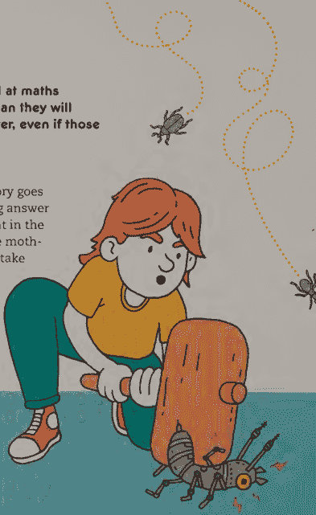


### 处理错误

有些错误，计算机在你尝试运行程序时就会告诉你。例如，语法错误是指把 `==` 写成 `=` 之类的错误。计算机不理解那是什么意思，会给你一条错误信息，告诉你出了什么问题以及在哪里出错。即使你不理解错误信息，也去看看那行代码，往往能立刻发现问题。

另一种错误是运行时错误。这时计算机理解你的语法，但运行到某条无法执行的指令，比如试图将数字除以 0。此时程序会崩溃并打印错误信息。

### 追踪错误

最糟糕的错误是程序运行了，但行为出乎意料！这种情况下，你得通读代码，弄清楚它为什么表现不正常。一个技巧是添加一些 print() 命令，在程序的不同位置打印重要变量的值。这样你就能追踪到变量不再具有预期值的位置。有些工具叫调试器，可以自动完成这类工作，不过配置起来可能很棘手。

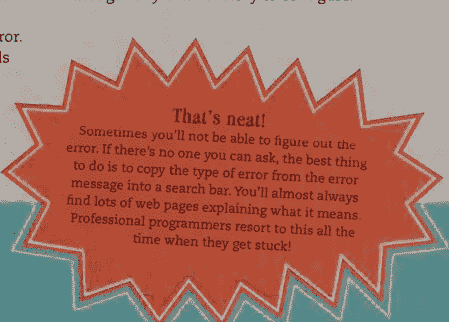

> **这很巧妙！**
>
> 有时你无法弄清楚错误。如果没有人可以问，最好的做法是把错误信息中的错误类型复制到搜索栏中。你几乎总能找到许多网页解释它的含义。专业程序员遇到卡壳时也总是这么做！

## 讲逻辑


逻辑不只是夏洛克·福尔摩斯才思考的东西；你的计算机也关心逻辑。

### 用逻辑运算

逻辑有自己的变量类型。除了数字和字符串，还有布尔值。布尔值只有两种可能取值：真或假。布尔值是最简单的变量类型。

有趣之处在于把布尔值组合起来创建新的布尔值。布尔值不用加、除或减，而有自己的运算符，称为逻辑运算符：AND、OR 和 NOT。

NOT（它们总是大写书写）最简单：如果 b 等于 NOT a，那么当 a 为真时 b 为假，反之亦然。AND 和 OR 用于组合多个变量。如果 c 等于 a OR b，那么只要 a 或 b 中有一个为真（或两者都为真），c 就为真。如果 c 等于 a AND b，那么只有当 a 和 b 都为真时，c 才为真。

用真值表来理解这一切要容易得多，真值表说明了对于所有可能的输入，结果是真还是假：

**NOT——b 等于 NOT a**

| a | b |
|---|---|
| 真 | 假 |
| 假 | 真 |

**OR——c 等于 a OR b**

| a | b | c |
|---|---|---|
| 假 | 假 | 假 |
| 真 | 假 | 真 |
| 假 | 真 | 真 |
| 真 | 真 | 真 |

**AND——c 等于 a AND b**

| a | b | c |
|---|---|---|
| 假 | 假 | 假 |
| 真 | 假 | 假 |
| 假 | 真 | 假 |
| 真 | 真 | 真 |

在代码中书写时，这些运算符使用符号而不是名称。NOT 是 `!`，OR 是 `||`，而 AND 是 `&&`。

## 把编程当爱好

编程不只是人们工作时做的事。在业余时间编程的人比以编程为生的人多得多。他们编程是为了好玩、为了学习、为了给朋友或家人制作有用的网站，或者为了制作游戏供他人娱乐。有了互联网和智能手机，人们与全世界分享代码从未如此容易。

许多人一开始把学习编程当作爱好，但最终因为足够喜欢而决定把它变成兼职甚至全职工作。事实上，几乎每个专业程序员的大部分编程知识都是在自己时间里学会的。应用和网站开发是人们兼职赚些钱的好方式，也能让他们看看自己是否喜欢职业编程，而不只是当作消遣。

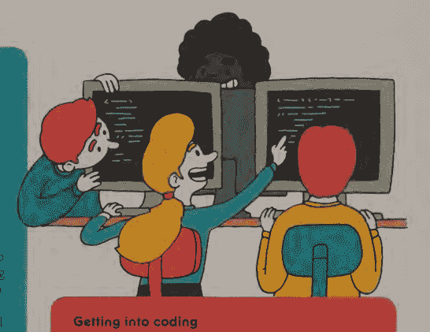

### 开始编程

学习编程也从未如此容易。市面上有许多关于编程的精彩书籍（比如这本！），但你也可以在网上找到入门所需的一切。第 44 页和第 74 页将带你开始编写代码，第 108 页有许多网站链接，会引导你进入更精彩、更复杂的项目。

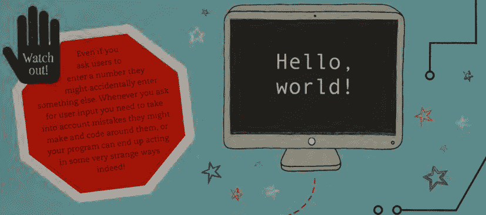

### 读取输入

正如可以让程序输出文本，也可以让程序读取文本输入！程序如何从键盘读取，具体方式因语言而异：可以一次读取单个字符（按键），也可以读取整个字符串，直到用户按下回车。完成读取后，就可以把该输入存储到变量中。

如果希望用户输入数字，还多一步。你看，对计算机来说，字符串“12”与数字 12 不同；前者就像“elephant”或“football”一样是字符串，而不是它理解的数字。要把字符串转换为数字，需要告诉程序进行转换：像 int("12") 这样的函数会把它转换为整数 12，而 float("12") 会把它转换为浮点数 12.0。

### 打孔卡输入

在如今这个触摸屏时代，键盘似乎是一种笨拙的编程方式，但在过去，程序是用一种远不方便的格式存储并输入计算机的：打孔卡。

它们是真实的实体卡片，上面打有一系列孔洞。计算机通过向卡片照射光线，并用光传感器判断某个孔是否被打出，从而读取卡片，把卡片转换成 1 和 0。

#### 卡片与计算机

打孔卡实际上比计算机本身出现得还早。它们最早在19世纪初被用于控制把图案织入布料的机械织布机：卡片上保存着要编织的图案。当时还没有光传感器，因此卡片由沿其表面移动的机械传感器读取。卡片必须非常厚实坚韧，才能经受住这种读取方式！

19世纪和20世纪初的机械计算机器使用打孔卡存储数据和程序。第一台计算机 Colossus 从打有孔洞的纸带上读取它正在处理的消息。

#### 用打孔卡工作

在20世纪50年代和60年代，程序员会先在纸上设计出想要运行的程序，然后用打孔机（一种类似打字机的设备，会在所有正确位置打出孔洞）把它打成一叠卡片。只要打错一个孔，整张卡片就得扔掉。一个复杂的程序可能需要数百甚至数千张卡片，并按精确顺序排列——谁要是碰倒其中一叠，可就倒霉了！

随着计算机数量增多、功能增强，对打孔卡的需求也随之上升——到1967年，仅美国每年就要用掉20亿张打孔卡！但更复杂的程序所需的卡片堆越来越高，也越来越不实用；到20世纪70年代，一项新技术——磁带——开始取代打孔卡，成为向计算机输入数据的方式。在如今这个闪存盘和 Wi-Fi 的时代，想到人们过去竟要依靠成叠的卡片向计算机传递数据，真是令人惊叹！

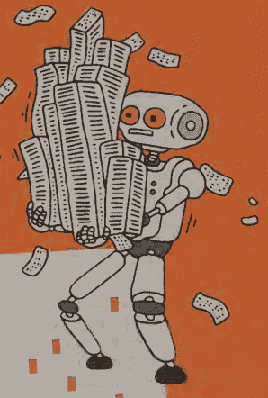

## else 和 if

除了 if 和 else，还有第三种条件语句：else if（在某些编程语言中）。这是另一个 if 语句，只有当它上面的检查结果为假时才会运行；和 if 一样，它需要一个条件。

```python
if (my_val == 3):
    print("You entered exactly three")
else if (my_val < 3):
    print("Your number was less than three")
else:
    print("To get here, your number must be more than three")
    print("Remember, you can have as much code as you like inside a block!")
```


如果你愿意，可以连续写很多个 else if 语句。代码会像瀑布一样沿着这组条件语句逐级向下，直到找到一个为真的条件，此时就会运行该代码块中的代码。


> **这很巧妙！**
>
> 你可以在条件语句后面的代码块中放入任何代码，包括更多 if 语句！像这样在 if 语句中再放 if 语句，称为嵌套。


## 测试，测试

我们在第16页介绍了一些编码时可能犯的错误。为了确保程序按你的意愿运行，你需要对它进行测试。

有效测试代码的一些技巧包括：

- **经常测试** 每次做小改动时，都要测试代码。代码改动越小，越容易发现并修复新的缺陷。
- **试着弄坏它** 只要有输入，就尝试故意输入不正确的值。经常引发问题的包括很长的字符串、空字符串（""）和负数。这些极端输入称为边界情况。
- **使用“撤销”** 当你刚添加的代码不能工作时，通常更容易用撤销功能退回到还能正常工作的时候，然后逐行向前查找错误是在哪里引入的。

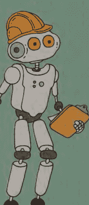


### 把测试当作工作

你可能会认为，专业人士开发的代码需要更少的测试，但事实并非如此：没有人能写出没有缺陷的代码。销售软件的公司希望程序中的缺陷尽可能少。因此，软件开发中的一些人是全职测试员：他们不写代码，而是花时间测试别人写的代码。发现问题时，他们会提交缺陷报告，列出如何触发该缺陷以及其影响是什么。程序员随后利用报告来查找并修复缺陷。

### 用代码测试代码

测试代码很耗时，而且可能很枯燥，因为你需要一遍又一遍地测试同样的东西，以确保它没有被后来的代码改动破坏。所以如今越来越趋向于自动化测试。

自动化测试本质上是让代码测试自身。这涉及编写更多不属于主程序的代码，而是测试框架（之所以这样叫，是因为它环绕在主代码周围）。这个框架会自动运行你的主程序，输入各种值并检查输出。这些框架可以是系统测试，环绕整个程序；也可以是单元测试，环绕代码的各个部分。

编写这些自动化测试看起来可能比编写程序本身更浪费时间，但一旦有了它们，每当你意外破坏某些东西时，你立刻就会知道。这让缺陷非常容易发现和修复，从长远来看还能节省你的时间！


## 面向CPU的代码

编程语言种类繁多，但几乎所有语言都有一个共同点：它们基于英语。即使你不懂某种编程语言，通常也能看看该语言的一些简单代码，大致推断出它在做什么。


### 机器码

不过，计算机并不懂英语。当它们运行程序时，需要把程序翻译成机器码，即中央处理器（CPU）能够理解的指令。机器码包含一组非常有限的指令，这些指令对应于硬连线在CPU中的实际操作。

最早的计算机是直接用机器码编程的，但这是一项极其棘手的工作：程序员必须在每一行计算出非常精确的一组数值，以指示CPU做什么。更糟的是，每种CPU都有自己的机器码，所以一个程序要在另一种计算机上运行，就必须从头重写。

下面是一些机器码的示例：

```
77
29 20 b3
61 9e
70
0c b7 f6
```

### 汇编代码

汇编代码发明于20世纪50年代，目的是让编程稍微简单一些。现在，原始代码被一组简短的指令取代，这些指令（在某种程度上）是英语，比如用move表示移动、jump表示跳转、add表示相加。这种语言还包括变量名之类的东西来保存数据。然后，这些汇编代码可以被自动转换为机器码，供CPU运行。

> **这真巧妙！**
>
> 很长一段时间里，如果程序需要非常小且非常快，程序员仍然会使用汇编代码；但随着其他编程语言的发展，它们自动生成的机器码往往能胜过最优秀的人工编写汇编代码。如今只有在少数特殊情况下，人们直接用汇编代码编写仍然有意义。

下面是一些汇编代码的示例：

```asm
loop: add $t1, 1
      bne $t1, $t2, end
      jmp loop
end:  nop
```

汇编代码比机器码更容易编写，但编写起来仍然很慢，而且每种CPU都不同。到20世纪70年代，大多数程序员都在使用高级语言（之所以叫高级，是因为它们比低级汇编语言和机器码离CPU更远）这些语言更像英语。然后这些高级语言会被转换为机器码，供CPU执行。


## 会思考的代码


自从计算机诞生以来，人们就一直梦想着它们能自己思考。这被称为人工智能，简称AI。

> 哎呀，他真厉害！

### 计算机下国际象棋

在西方文化中，很长一段时间里国际象棋一直被视为智慧的顶峰：这就是为什么电影和电视经常展示聪明人下棋。所以早期的计算机科学家花了很多时间教计算机下棋。他们觉得如果能做到这一点，就能做到任何事。

然而，事实证明，对机器来说，掌握国际象棋实际上远比掌握人类觉得微不足道的事情（比如在图片中识别猫）要容易得多。1996年，一台名为“深蓝”的超级计算机击败了国际象棋世界冠军加里·卡斯帕罗夫，但如今的计算机在识别猫方面仍然不如三岁小孩。


### 超越国际象棋

国际象棋程序是基于规则系统的例子：人类理解如何下棋，所以程序员编写一堆规则让程序遵循。然而，对于我们难以写成规则的事情，这种方法效果不佳，比如判断一张图片里是否有猫。你自己很容易做到，但你能精确地分解出每一步是如何做到的吗？

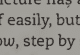

最近的许多研究都投入到了机器学习中。在这里，我们提供一个框架让计算机自己学习，然后提供大量数据供它学习（比如很多图片，有些有猫，有些没有）。通过遍历所有数据，计算机利用该框架自动建立解决问题的方法。要做到这一点，我们需要像神经网络这样巧妙的框架，以及尽可能多的数据。幸运的是，互联网上有无限多的猫图片！

### 真正会思考的代码

许多计算机科学家的真正梦想是一台真正智能的机器。早在1950年，艾伦·图灵发明了图灵测试，以判断计算机是否真正智能。该测试让一个人与一个看不见的人交谈。如果他们认为对方是人，结果却是计算机，那么这台计算机就可以被认为具有智能。目前还没有计算机程序能通过这项测试，但程序员们正在努力造出能通过的程序。你能想象如果他们做到了会有什么影响吗？毕竟，这样的程序可以被认为是有生命的……


## 处理数据

我们已经见过变量，它让我们存储信息片段；但如果我们有一堆数据，比如全班每个人在一次测验中的得分，该怎么办？与其创建许多变量，我们可以创建一个能存储许多不同值的东西。

有些编程语言称它们为数组，有些称它们为列表。如果变量像一个可以保存一个值的盒子，那么数组就像一个抽屉柜，每个抽屉都能存储一个单独的值。

### 创建数组

要使用数组，我们需要另一种括号——[ ]。它们被称为方括号。创建数组时，我们把所有数据片段（在数组中我们称它们为元素）放在这些方括号内，用逗号分隔。

> 创建一个包含三个元素的数组

```
my_first_array = [1, 3, 5]
```

数组中有数据后，你就可以读取或更改单个元素。为了告诉程序我们要访问哪个元素，我们给它一个索引，就像书中的页码。它就是我们想要的元素编号，从数组开头开始计数。

> 与人类不同，计算机从0开始计数。所以列表中第一个元素的索引是0，第二个元素的索引是1，依此类推。这一点很容易忘记，所以如果它偶尔让你犯错，也不必难过。


### 访问数据

要访问特定元素，我们再次使用方括号，其中包含我们想要的元素的索引。因此 `x[0]` 表示名为 `x` 的数组中的第一个元素。如果只写 `x` 而不带方括号，我们指的就是整个数组。

```
my_second_array = [2, 5, 6, 8]
print(my_second_array[0])
>> 2
```

> 现在只需打印出第一个元素——记住，数组索引从 0 开始！

> 让我们修改第二个值（即索引为 1）。

```
my_second_array[1] = 3
print(my_second_array)
>> [2, 3, 6, 8]
```

> 现在，让我们打印整个数组！

你可以用数组做很多巧妙的事情，比如查看它有多少个元素、重新排列顺序、向其中添加元素或从中取出元素。如果你确实取出一个元素，那么它后面的所有元素都会向前移动，就像从一列火车中间取下一节车厢。


## 世界上第一位计算机程序员


来认识一下艾达。艾达·洛夫莱斯生于 1815 年，是世界上第一位计算机程序员。这已经足够令人惊叹，但她生活的时代，人们并不期望女性去处理比刺绣复杂得多的事情。更了不起的是，她做这一切比任何人真正造出计算机早了一个世纪……

作为著名（且声名狼藉）的诗人拜伦勋爵的女儿，艾达被教导数学和科学，试图让她不要重蹈父亲行为不端的覆辙，而她爱上了这些学科。17 岁时，她遇到了一个将改变她一生的男人：查尔斯·巴贝奇。


### 差分机

巴贝奇是一名工程师、天文学家和发明家。在当时，当天文学家意味着要做大量算术，巴贝奇想造一台机器替他完成这些计算：机器永远不会厌倦，也不会犯错。

不过，那是 19 世纪 20 年代。没有计算机芯片，没有晶体管，甚至没有电。但这并没有阻止巴贝奇。他的机器将仅由齿轮、传动装置和其他机械结构组成。他将其命名为差分机。

巴贝奇在这个项目上花费了 20 年和巨额政府资金，但当时的技术根本不足以应对这一挑战，他始终未能让这台机器运转起来。

当艾达遇到查尔斯时，他向她讲述了自己的一个新想法。那是一台更复杂的机器——分析机，它可以进行任何类型的计算。这是人类第一次想到计算机。艾达被整个构想迷住了，并帮助巴贝奇弄清楚它如何运作。由此，她成为有史以来第一个想出如何为计算机编程的人。分析机也从未被制造出来，但这并没有阻止艾达弄清楚如何使用它。当巴贝奇仍在考虑进行简单数学运算时，她已经预见到有一天计算机会做出惊人的事情，甚至创作音乐！

### 真棒！

艾达从未见过真正的计算机，但现代工程师以她的名字命名了一种编程语言——Ada。

### 分析机


## 让功能发挥作用

到目前为止，你看到的所有程序示例都是按顺序执行的一组指令。然而，除了最简单的程序之外，所有程序都依赖函数：拆分出来的代码块，可以从程序的其他位置调用。函数让你能够以可管理的块来编写代码，并且当你在不同位置需要做同样的事情时，可以避免复制/粘贴代码。


### 进入函数

函数定义通常以一个关键字开头，这个关键字因编程语言而异，例如 *function* 或 *def*。然后你的函数需要一个唯一的名称（和变量一样，名称不能包含任何空格）。名称之后是一组括号，其中可以包含若干参数。这些是传入函数的变量，你随后可以在函数内部使用它们。最后，你加上一些花括号。它们定义了作为函数一部分运行的代码块。

你可以在代码中的任何位置调用函数：写出函数名，后面跟一对括号，括号中包含与函数定义中相同数量的变量。你会注意到这看起来像是在调用 *print* 语句。这是因为 print 是由语言本身定义的函数，其工作方式与你能够定义的函数一样。

> 在参数中或代码块内声明的变量作用域限于该块：它们在该块之外不存在。这意味着你不必担心重用变量名；只要不在同一个块内重用它们就没问题。

### 退出函数

你的代码块可以包含任何你喜欢的代码，外加一条新的特殊语句：`return`。当程序到达 `return` 语句时，它会立即退出函数，并跳回调用它的那一行，而不执行函数的其余代码。如果你只写 `return`，它会自行跳回。如果你写 `return`，然后跟一个变量或值，它就会带着该值返回。如果代码到达函数末尾仍未遇到 `return` 语句，它将不带任何值返回。

```python
function calculate_square(my_var)
{
  result = my_var*my_var
  return result
}

var = calculate_square(3)
var = calculate_square(var)
print(var)
>> 81
```

- 定义一个带一个参数的函数
- 返回 'result' 变量
- 调用该函数，并传入 '3' 作为参数
- 对结果再次调用该函数

## 编程工具


最终，程序代码只是文本，所以你可以用任何你喜欢的文本编辑器来编写它。然而，多年来，开发者们提出了一系列工具，让编写代码更容易。

### 更智能的文本编辑器

有些文本编辑器是为编写代码而设计的。它们有一个非常有用的技巧：改变文本颜色，以区分变量、语句和其他内容。它们还会让字符串突出显示，当你忘记字符串的结束引号，导致它一直延续下去时，这非常方便……

这些编辑器需要理解你正在使用的编程语言才能实现这些技巧；大多数编辑器支持许多常见语言。有些可以根据你写的内容或文件扩展名自动检测（例如，py 表示 Python）；另一些则在菜单中提供选项来设置。

这些小小的调整听起来可能没什么了不起，但实际上它们让阅读和编写代码容易得多——一旦你试过，就再也不会回到无聊的旧式黑白编辑器了！


### IDE

IDE，即集成开发环境，表面上看起来像文本编辑器，但功能强大得多。除了智能颜色编码外，IDE 还会有一个播放按钮，用于直接构建和运行程序，并且通常能够查找和组织你所有的函数。它们甚至可能内置调试器等更复杂的工具。IDE 比文本编辑器复杂得多，设置和开始使用也不那么简单。它们还需要针对你使用的每种语言进行配置，有些可能只支持一种特定的编程语言。虽然几乎每个程序员都会使用某种智能文本编辑器，但并非所有人都使用 IDE；你应该从文本编辑器开始，之后再尝试 IDE，看看你觉得它有多大用处。

### 在浏览器中编程

如今，互联网上有一些网站让你可以直接在浏览器中编写、运行和试验多种不同语言的代码。这是一种极好的方式，可以立即上手并开始编写一些简单程序，而无需在计算机上安装任何东西。

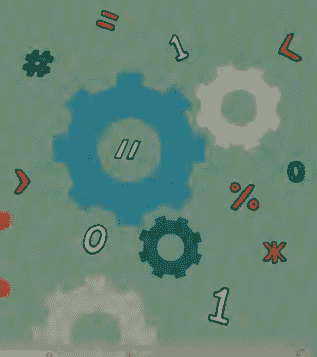


## For 循环

通常，你希望循环固定次数然后继续执行；这种循环称为 for 循环。for 循环会循环设定的次数。它通过索引进行循环——索引会跟踪程序到目前为止已循环的次数。不过要小心——就像在数组中一样，索引从 0 开始，而不是从 1 开始！

for 循环运行的次数可以是固定数字（如示例所示），也可以是整数变量。不同的编程语言以不同方式编写 for 循环，所以你需要查阅如何在你的语言中编写它们。

```text
for (int i = 0; i < 10; i++) {
    print("Hello!");
}
```

> 这里索引的名称是 i，你想要循环 10 次。
>
> i 将从 0 到 9，所以会从 0 计数到 9。
>
> **这太棒了！**
>
> 循环内部的代码有几种方式可以改变流程。continue 指令告诉程序跳过剩余的行，并回到循环开头以进行下一次运行；而 break 指令则告诉它立即结束循环。

## 开始编程！

现在你已经学习了一些编码的基础知识，是时候亲自尝试了！不过，与其担心所有编写细节，不如从 Scratch 开始，这是一种非常直观的编程语言，让你通过拖放代码块到相应位置来编程。你甚至可以在平板电脑上操作！


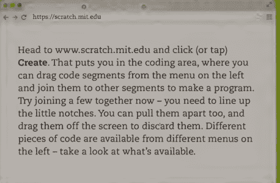

https://scratch.mit.edu

前往 **www.scratch.mit.edu** 并点击（或轻触）**创建**。这会带你进入编码区域，你可以从左侧菜单拖拽代码段，并将它们与其他代码段拼接起来组成程序。现在试着拼接几个代码段——你需要对齐小凹槽。你也可以将它们拆开，或者拖出屏幕外以丢弃它们。左侧的不同菜单提供不同的代码段——看看都有什么可用。

所有程序都从 *事件* 部分的代码开始——你可以辨认出这些代码段，因为它们的顶部有一个凸起，所以没有东西可以放在它们上面。选择带有旗帜的那个。在其下方连接代码段，然后点击左上角的旗帜按钮来运行你的程序。


### 发射升空

好了，开始编码吧！首先，创建一个从 10 倒数到 1 然后说出“发射！”的程序，就像火箭的任务控制员一样。这里有一些入门提示：

- 你要多次执行某件事（倒数），所以你需要一个循环。
- 你还需要一个变量，用来跟踪当前所在的数字。
- 你需要打印出变量，然后在下次循环时减小它，以便进行倒数。


你也可以回顾第 43 页的示例。不过，这是用不同的语言编写的，所以你无法精确复制！这展示了不同语言以略微不同的方式完成相同的事情。如果你真的卡住了，可以查看本页底部的答案。一旦你完成了，为什么不试着让角色在倒计时结束后真正发射到太空中呢？**提示** 你需要另一个循环、一个移动命令和一个等待命令。

### 答案

- 创建一个说出“发射！”的程序
- 创建一个名为 countdown 的变量
- 将 countdown 设置为 10
- 然后，在循环内部：
  - 打印该变量
  - 将 countdown 的值减少 1
  - 暂停 1 秒

## 比特与字节

如果你用一台非常强大的显微镜检查计算机的 CPU，你不会找到数字、文字或我们在程序中移动的任何其他值。相反，你会找到数百万个晶体管。晶体管实际上只是一个极其微小的开/关开关。当晶体管开启时，我们给它数字 1；当它关闭时，我们给它数字 0。最终，计算机中的一切，无论多么复杂，都归结为 1 和 0。

我们称这些值中的每一个为单个比特（bit，二进制数字的缩写）。每个比特可以设置为 1 或 0。它相当于计算机中的原子：从本质上讲，计算机中的一切都是由比特组成的。

### 多了解一点比特

不过，早期的计算机系统并不是直接处理比特，而是将它们收集到 8 个一组中，这是每次可以读取或写入的最少比特数。这些 8 比特的组之一称为字节（byte），并且有空间存储单个字符（如 'a' 或 '+'）。

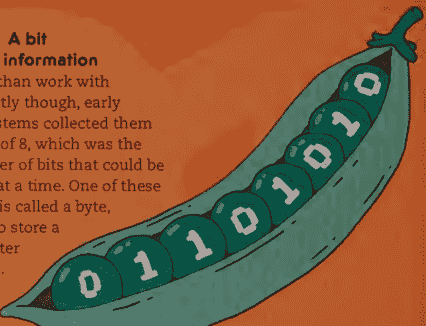

但即使是一个字节也是极少量的信息。如今我们需要大得多的数字！一千字节（kB）是 1,000 字节，一兆字节（MB）是 1,000,000 字节，而一吉字节（GB）是 1,000,000,000 字节。还有更大的前缀：太（tera-）表示 12 个零，拍（peta-）表示 15 个零，艾（exa-）表示 18 个零，但至少在一段时间内，这些数字主要是超级计算机的专属！

### 计算我们发送的比特

当我们谈论计算机之间发送的数据量时，我们说的是比特率——每秒的比特数。就像字节一样，我们可以有千比特每秒、兆比特每秒等等。为了区分清楚，程序员在缩写兆字节时写作 MB（大写 B），而在缩写兆比特时写作 Mb（小写 b）。

奇怪的是，千（kilo-）的缩写是小写 k，而兆（mega-）和吉（giga-）分别是大写 M 和 G。


奇怪的是，有时一千字节表示 1,000 字节，有时表示 1,024 字节，而一兆字节可以是 1024 × 1024，依此类推。这是因为有时（我们将在下一页看到）如果数值是 2 的幂会更方便。两者非常接近，所以通常我们不需要担心使用的是哪一个。

- 比特 ....................... 1
- 字节 .................... 8 比特
- 千 ................. 1,000 字节
- 兆 ............. 1,000,000 字节
- 吉 .......... 1,000,000,000 字节
- 太 ....... 1,000,000,000,000 字节
- 拍 .... 1,000,000,000,000,000 字节
- 艾 ... 1,000,000,000,000,000,000 字节！


## 计算机如何计数

人类用十进制计数：这意味着我们有从 0 到 9 的十种数字，我们将它们组合起来产生更大的数字（如 42）。十进制也称为基数 10。人类使用十进制是因为我们最初学习计数时用手指来跟踪数字——我们有十根手指，所以我们使用基数 10！


### 成双成对

不过，计算机没有手指。正如我们刚刚看到的，计算机确实将所有东西视为 0 和 1。这意味着它们的计数方式只有两种数字：0 和 1。这就是基数 2，也就是众所周知的二进制。

在二进制中，这两种数字组合起来形成更大的数字。就像十进制数字从 0 到 9，然后继续到 10、11 和 12，二进制以同样的方式工作，只是快得多：1，然后 10，然后 11，然后 100，依此类推。这可能会变得相当笨拙——例如，86 在二进制中是 1010110。


> **这太棒了！**
>
> 既然你理解了二进制，你就能听懂一个老编程笑话：
>
> “世界上只有 10 种人：懂二进制的人，和不懂的人。”

## 保持整洁

当你开始编写程序时，通常很容易把整个程序记在脑子里。但一旦程序变长，或者你休息了一下再回来，你可能就不记得为什么以某种方式做某件事了。保持代码整洁会让它更容易处理。这里有一些你可以使用的技巧。

### 有意义的名称

与其使用晦涩、简短的变量或函数名，不如使用清晰、描述性的名称。如果你有一个存储某人拥有的猫的数量的变量，将其命名为 `number_of_cats`，而不是 `c` 或 `noc`。并且不要在程序后面重用变量来存储完全不相关的值（比如重用 `number_of_cats` 来存储室温），只需创建一个新变量——变量是免费的！

### 简短的行

尽量保持代码行足够短，使它们始终适合你的屏幕。这样你就不必来回滚动，而且每一行都足够短，可以轻松弄清楚它的作用。

### camelCase 和 snake_case

变量和函数名中不能有空格，但程序员们想出了一些方法，仍然可以在名称中使用多个单词。

一种方法是将所有单词连在一起，并在第一个单词之后的首字母大写：`justLikeThis`。这被称为驼峰式（camel case），因为大写字母使其看起来有点像骆驼的驼峰。另一种方法是保持全部小写，但用 `_` 替换空格：`just_like_this`。这被称为蛇形式（snake case），因为这些名称又长又细，像一条蛇。


有些程序员喜欢驼峰命名法，有些则喜欢蛇形命名法；你可以使用任何一种你喜欢的。无论你使用哪一种，都要在程序内部保持一致，否则事情会开始变得杂乱无章。

HiThereLimbless


### 注释

你可以在代码中包含注释。注释是你可以用来提醒自己或任何阅读代码的人，某个函数在做什么或某个特定位置发生了什么的消息。它们的语法各不相同，但以 `//` 开头是编写注释的常见方式。在本书中，我们用图形框替换了传统注释，以便于阅读，但一个典型的例子（来自第 22 页）是这样的：

```text
print("Hello, world!") // remember, you need to put quote marks around strings
```

你可能会过度使用注释——当代码本身已经显而易见时，就不要使用它们。一个好的经验法则是，写注释来解释每个函数的用途，并且在编写特别复杂的代码时也要添加注释。

## 内存

你的计算机可以在存储设备中容纳很多东西，但读写速度相对较慢（与 CPU 的处理速度相比）。为了加快速度，计算机还有另一种快速存储，称为内存或 RAM（随机存取内存的缩写）。计算机的 RAM 比存储设备快得多，它是程序和文件在使用时存放的地方。然而，它比存储设备更昂贵，所以你的内存空间会比存储空间小。它也是易失性的，这意味着它需要持续供电才能记住东西——当你关闭计算机时，它会忘记内存中的所有内容。

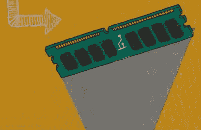

## 输入/输出

除了这些核心内部组件外，计算机还有输入设备，如鼠标、键盘和触摸屏，它们允许你与计算机通信，以及输出设备，如显示器和扬声器，它们让计算机与你通信。由于这些设备通常不直接内置在机器中，大多数计算机都有端口让你插入它们。像鼠标和扬声器这样连接到计算机的外部设备称为外围设备。

## 用户界面

到目前为止，我们看到的都是通过文本行与程序交互；这是最简单的使用方法。程序员称之为命令行界面，或 CLI。大多数计算机用户使用 CLI 有困难。然而，还有另一种方式。

### 变得图形化

另一种方式是图形用户界面，或 GUI。GUI 让你的程序向用户显示图片、菜单和其他元素，并让他们使用鼠标或触摸屏与之交互。创建 GUI 需要更多工作，所以在你掌握编程基础之前，它们不是你该担心的事情，但它们非常用户友好。

要创建 GUI，你需要一个 GUI 框架。每种编程语言都有不同的框架集合，这些框架使用不同的方式做事，都是为了帮助程序员为他们的程序创建 GUI。有些语言内置了 GUI 框架，这通常是最适合起步的，但还会有许多其他框架供你下载和使用。

### 交互元素

所有 GUI 框架都围绕一组你会从使用过的计算机程序中认识的关键元素展开。

-   **文本框**：向用户显示文本或允许他们自行输入文本。
-   **按钮**：用户点击按钮来告诉程序执行某些操作。
-   **下拉列表**：用户可以从选项列表中选择。


GUI 框架允许你编写代码来定义像按钮这样的元素，以及它们的位置、大小和其他属性。它们通常还包含一个 GUI 设计器，让你以可视方式绘制 GUI，然后为你生成部分代码。虽然最好从用代码创建几个按钮开始以理解它们的工作原理，但设计器用起来要快得多。

> **真棒！**
>
> 按钮等元素的工作方式依赖于一种特殊类型的函数，称为回调。回调只是一个函数，但它的名字被传递给另一个函数，该函数会在条件满足时回调它。因此，当按钮被按下时，那个回调函数就会运行。

-   **复选框**：用户可以打开或关闭的选项。
-   **单选按钮**：类似于复选框，但用户只能选择一个选项。
-   **标签**：帮助描述其他所有元素的用途。


## 感受类的魅力

到目前为止，我们看到的所有编程都是过程式编程的例子，使用独立的变量和函数。然而，自 20 世纪 70 年代以来，另一种编码风格变得越来越流行：面向对象编程，它围绕类展开。

### 上课啦

类是一种将函数和变量存储在它们自然归属的对象中的方式，而不是将它们分散在各处。例如，如果你想编写一个关于狗的程序，你可以创建一个 `dog()` 类。然后，你可以将与狗相关的任何变量或函数都作为 `dog()` 类的一部分。

类似于函数，类在使用前需要被定义。这个定义涉及像函数一样的花括号——函数和变量被放在这个代码块内，以表明它们属于这个类。在某些语言中，类内部的函数被称为方法。

这不仅是一种将变量和函数分组的好且合乎逻辑的方式，而且意味着每当你想在程序中表示一只狗时，你只需要实例化 `dog()` 类。实例化只是意味着将它赋值给一个变量，就像你对字符串或整数所做的那样。然后，你可以使用点运算符 `.` 访问类中的任何函数或变量。函数也可以通过引用 `this` 或 `self`（取决于语言）来访问内部变量。


> 好了，让我们对这些东西进行分类！

定义 dog() 类

```text
class dog()
{
    name = "unknown"
    function speak()
    {
        print("Woof! My name is "+this.name)
    }
}
```

-   这个变量是 dog() 类的一部分
-   这个函数是 dog() 类的一部分
-   使用内部 'name' 变量

实例化一个 'dog()' 类型的变量

```text
my_dog = dog()
my_dog.name = "Rex"
my_dog.speak()
```

-   为 my_dog 设置 'name' 变量
-   将打印 "Woof! My name is Rex"

### 构造中

上面的例子确实有一个问题——你必须先设置 name 变量，然后才能调用 speak()，否则你不会得到一个合理的结果。通常情况下，类中的某些变量需要在使用前被设置，而面向对象编程通过构造函数解决了这个问题。这是类中的一个特殊函数，当你实例化它时（例如，将它赋值给一个变量），它总是会被调用。在我们上面的例子中，你可以修改类定义，包含一个用于设置 name 变量的构造函数。然后，你可以编写如下代码：

another_dog 的 name 会立即被填好

```text
another_dog = dog("Spot")
another_dog.speak()
```

将打印 "Woof! My name is Spot"

## 继承

### 认识子类

继承，也称为子类型化，是指你定义新的子类，这些子类继承自父类。这些子类仍然保留父类的所有函数和变量，但也可以拥有它们自己特有的变量和函数。

例如，一旦你定义了一个 `dog()` 类，你就可以为特定的狗品种定义子类。所有狗共有的东西都放在父 `dog()` 类中，而特定品种特有的东西则放在各个子类中。每个子类都是具有自身特征（颜色等）的狗品种，但也拥有父类的所有属性，这些属性是所有狗共有的（有四条腿等）。

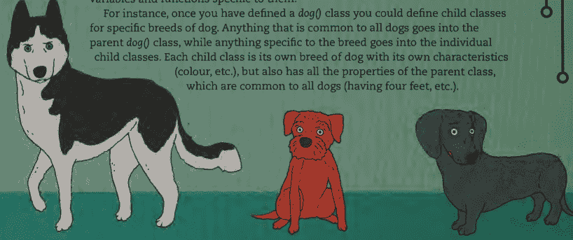


```python
class husky() inherits from dog()
{
    function howl()
    {
        print("Awoo!")
    }
}

my_dog = husky()
my_dog.howl()
my_dog.name = "Blue"
```

> 每种语言都有自己的继承语法
>
> 实例化一个类型为 'husky' 的变量
>
> 定制任何继承自子类中定义函数的变量
>
> 可以访问父类中的变量和函数

## 灵活变形

这不仅是避免在每个子类中重复代码的好方法，而且还能让你在函数使用上非常灵活。任何时候，如果你的函数期望某个类作为其参数之一，你都可以用该父类的子类来代替——这是因为（用我们上面的例子来说）`husky()` 类的实例也是 `dog()` 类的实例。这被称为多态。

默认情况下，子类会继承父类拥有的所有变量和函数。子类也可以通过重写来改变父类的行为。要做到这一点，只需在子类中定义一个与父类具有相同签名（名称和参数）的函数，子类中定义的版本就会覆盖父类中的版本。这意味着每当该函数被调用时，都会使用子类中定义的版本，而不是父类中的版本。


## 分享出去

虽然一开始你可能为了学习编程或自娱自乐而编写程序，但编程最棒的部分是当你与他人分享你的程序时。

> 对于简短、直接的程序，先完成再让别人尝试是合理的。但对于大型复杂的程序，通常最好在还在开发时就与他人分享——人们给你的反馈可能是无价的。


### Alpha 和 Beta

当你的程序处于部分功能可用、但尚未全部完成的阶段时，你可能想与朋友和家人分享，让他们告诉你目前的看法。在软件编程中，这被称为 Alpha 版本。

请他们告诉你他们喜欢什么，以及他们认为哪些地方可以改进。现在就询问，你可能会发现你想要改变程序的运作方式——现在就问比写完整个程序后再问更好！

Beta 版本是指你认为程序已经完成，但在你彻底解决所有 bug 之前的版本。同样，与朋友和家人分享，但现在请他们有意地仔细检查，看看是否能找到让程序崩溃的方法。这种“破坏—修复”循环被称为 Beta 测试（你向其提供程序的人被称为 Beta 测试者）。

Beta 版本的目标是确保程序完全按照你想要的方式运行，并且用户在使用时不会遇到任何问题。

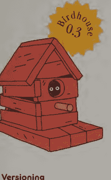


### 版本编号

版本号是一种追踪你发布的程序所有不同版本的方法——版本越新，编号越高。传统上，程序的预发布（Alpha 和 Beta）版本采用 0.x 的形式，如 0.1、0.2、0.14。每个新版本都会将小数点右侧的数字加 1。

程序的第一个发布版本是 1.0——其中的“1”表示它已准备发布。之后如果你继续发布新版本、添加功能或修复 bug，你会再次递增小数点右侧的数字：1.1、1.7、1.16。如果你进行了重大更改，你可以将新版本称为 2.0，以表明这是你的程序的全新版本。

## 代码之外

编程不仅仅是编写代码。你看，如果你创造了世界上最棒的程序，却没有人知道如何使用它，那也无济于事。这就是文档和支持发挥作用的地方。


### 文档的重要性

文档是解释如何使用程序的文字、图片，有时还有视频。在过去，程序通常装在一个大纸板箱里，因为除了程序本身（存储在 CD 或软盘上）之外，还会有一本厚重的印刷手册，包含所有说明。

不过现在，文档更有可能在互联网上找到。理想情况下，你应该有文档告诉人们如何安装你的程序以及他们可以用它做所有事情。编写文档可能花费相当多的时间，而且通常不如编写程序本身有趣，但如果你打算把程序交给那些无法当面问你问题的人，它就至关重要。你还可能发现编写文档有助于改进你的程序：如果你发现自己难以解释如何做某件事，也许你的程序需要改变……

通常，放置程序使用文档的最佳位置是程序本身。有些程序附带教程，逐步引导用户完成某些任务，向他们介绍所有基础知识。许多程序还有帮助屏幕，当用户按下“?”图标时弹出页面——该屏幕可以告诉用户关于程序该部分的信息。

如果你发现人们不断询问关于你的程序的相同问题，你可以整理一个常见问题解答（FAQ，Frequently Asked Questions 的缩写）。这是一个文档页面，形式是一系列问题及每个问题的答案——这样人们就很容易找到他们可能遇到的常见问题的答案。

嗨！我能帮上什么忙吗？

### 支持的角色

专业的软件公司有支持人员，他们的工作是帮助用户理解程序并尽可能好地使用它们。这是公司免费提供程序但仍能赚到足够钱维持运营的一种方式——其他认为其软件真正有用的公司会付费购买支持，以充分利用这些程序，并处理他们遇到的各种问题。

## 类型之辨

到目前为止，我们顺便提到有很多不同的编程语言。就像人类语言一样，它们都能表达相同的事物，但表达方式可能大不相同。有些编程语言大致相似，比如西班牙语和意大利语；有些则有着根本不同的方法，比如英语和粤语。

### 静态类型与动态类型

语言类别之间的一个根本区别在于它们如何处理类型。类型指的是变量的内容：整数、字符串、用户定义的类等等。有些语言是静态类型的——这意味着变量必须始终包含相同的类型，通常是在变量创建时定义的。相比之下，动态类型语言意味着任何变量可以在任何时候包含任何类型，并且在程序运行过程中可以随时改变。

动态类型语言通常编写起来更快、更灵活，因为你不需要告诉程序你打算使用什么变量，也不必担心把错误的类型放入变量中。没有这些类型声明，代码最终也会更简洁。

静态类型语言的一大优势是，由于系统始终知道每个东西的类型，它可以在你运行程序时立即发现任何基于类型的错误（比如试图将字符串和数字相加），而动态类型语言只有在执行到程序的那一部分时才会出错。


### 语言差异

一般来说，使用动态类型等技术的简洁、灵活的语言被认为比编写较慢、更静态的语言更高级。这意味着它们离计算机真正运行的机器代码更远。随着时间的推移，越来越多的程序员转向更高级的语言，因为他们可以用更少的代码和时间完成更多工作。

尝试多种编程语言是值得的——不同的语言更适合不同的任务。通过学习新语言，你还会接触到可以应用于所有编程的新技术。

### 真巧妙！

动态类型语言有时需要检查某个变量是否为所需的类型。与其检查类型本身，通常不如只检查你想对它做的事情（比如将它加到另一个数字上）是否有效。这种技术被称为鸭子类型，源于下面的表达……

> “如果它走起来像鸭子，叫起来像鸭子，那它就是鸭子。”


是的，我是一只鸭子


## 直观感受

旧式计算机专注于屏幕上的文本，而如今的计算机可以生成令人惊叹的图形——几乎每一部动画电影和电视节目，无论是 2D 还是 3D，如今都主要依靠计算机制作。

如果你想在程序中生成图形，就需要一个图形库。有些语言自带图形库，或者你可以为每种语言下载各种其他库。如果有内置库，通常是最好的入门方式；它们可能不是最强大或最专业化的，但通常简单易用，而且网上会有大量帮助资源。


### 二维图形

2D 图形库可以让你绘制形状（不仅是三角形、圆形和矩形，还有多边形等更复杂的形状），并选择它们的颜色和轮廓。

它还可以让你添加从网上下载的文本和图片。

要制作动态图形，你的程序需要快速绘制大量独立的动画帧，快到人眼无法分辨出单独的图像。你的图形库应该提供一系列函数，让这比手动逐帧编码容易得多。

### 三维图形

有些图形库只能生成 2D 图形，但其他的也能处理 3D。这涉及到用对象来创建场景。


对象可以是立方体、圆锥体等基本体，也可以是库提供或下载的更复杂对象的模型。这些对象随后会被赋予纹理以选择颜色，然后系统会根据虚拟摄像机的指向将它们渲染成 2D 图像。

制作 3D 图形可能会相当复杂；建议先尝试一下 2D 图形。游戏引擎通常包含一些最容易上手的 3D 图形引擎。

> **真有意思！**
>
> 除了圆锥体、球体和长方体等基本体外，许多 3D 图形库还包含一个茶壶。这是因为 3D 图形的先驱们当时需要测试用的模型，正巧他们在喝茶，于是仔细测量了他们的茶壶，用它来做模型，并在网上与他人分享。它也因此成为动画师们的标志，喜欢把茶壶藏进 3D 电影的背景里！


程序员把这些称为“坏味道”——它们表明代码或许能运行，但很难在不意外破坏某些功能的情况下进行修改，而且一旦出问题，也会很难修复。

如果你的代码有上述一种或多种情况，别担心；随着时间推移而不断变化的程序往往最终会变成这样。解决办法是重构，这就像是给代码来一次大扫除。重构的过程是修改代码，不是为了让代码实现新功能，而是让它在功能不变的情况下更易于管理。这通常涉及将重复代码变成单个可由多处调用的函数，把过长的行和函数拆分成独立的小块，以及用函数和循环取代 goto 语句。


## 变化历程

**UNIVAC I（1951年）**

第一台售出的计算机 UNIVAC I（UNIVAC 自动计算机）的重量是一头成年非洲象的两倍，消耗的电力相当于 250 户英国家庭。按现代货币计算，它的造价超过 2500 万英镑。尽管体积庞大、价格高昂，仍然有 46 台 UNIVAC 被购买，用途从预测选举结果到模拟原子弹爆炸，无所不包！

**PDP-8（1965年）**

PDP-8 是第一台成功的“迷你计算机”。这里的“迷你”是相对而言：相对于 UNIVAC 这样的大型机，它确实很小，但仍然有一个衣柜那么大，售价 18,500 美元（约合今天的 10 万英镑）。尽管设计目标是尽可能便宜和简单，技术的进步仍然让它比 UNIVAC I 快 50 倍。PDP-8 取得了巨大成功，各种型号共售出超过 30 万台。

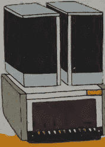

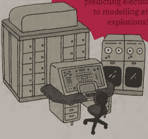


## 脚本语言

编程语言可分为多个家族，各自具有特定的工作方式。其中最常见的一类就是脚本语言。脚本语言不一定能产生运行速度最快的代码，但它们专注于让编写和运行变得更加快速和紧凑，而且通常是动态类型语言。这使得它们成为非常适合入门的一系列语言。

### JavaScript

近年来，JavaScript 的人气急剧飙升。从表面上看，它是一种简单的脚本语言——语法简洁明了，并且与 C++ 和 Java 等许多其他语言共享。本书中的代码示例就是受到 JavaScript 的启发。

JavaScript 之所以如此重要，是因为它得到了网页浏览器的支持，因此可以被嵌入网页中。这使得 JavaScript 非常容易上手，也很容易与他人分享你的程序。JavaScript 还可以像其他脚本语言一样，借助 node.js 等解释器在浏览器之外运行。

> **注意！**
>
> 为简单起见，本书中的示例省略了 JavaScript 的部分语法，比如用 `var` 声明变量，以及用分号结束语句。虽然 JavaScript 是一种宽容的语言，即使有这些问题你的程序也能运行，但最好始终使用正确的语法。

### Python

Python 是另一种流行的脚本语言。用 Python 开发大型程序非常容易，因为有很多库可以方便地添加进来，提供额外的功能。它还有非常完善的类和继承模型，让面向对象编程变得轻而易举。

JavaScript 的语法与许多更早的编程语言相同，而 Python 在许多事情上都有自己的方式。例如，Python 不使用花括号，而是用缩进（在行前加空格）来定义代码块。而且，JavaScript 倾向于使用 for 循环以及检查返回值来处理错误，而 Python 代码有其他方式来解决同样的问题，比如迭代器和异常。所以如果你真的开始学 Python（你应该学——它是一门很棒的语言），读一些教程来了解如何最大限度地利用它的做事方式。

> 啊，蛇~~蛇~~蛇~~脚本！

### 其他语言

还有很多其他的脚本语言，比如 Ruby、Lua、PHP 和 Perl。每种语言都有自己的优势和使用场景，所以如果遇到新的语言，不要害怕去尝试！

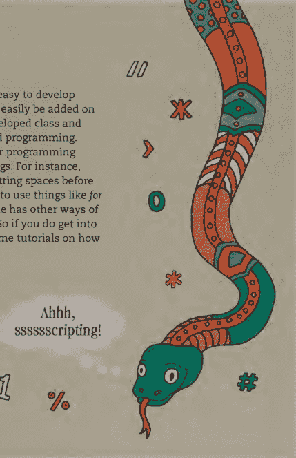

## 更多编程！

希望你享受了第 44 页的首次编程体验。Scratch 是一种令人惊叹的语言，也是制作一些简单游戏和程序的绝佳方式。除了代码，它还提供了大量音乐和美术资源可以在你的程序中使用，完成后你还可以与朋友和家人分享！要保存程序，你需要加入 Scratch 并登录。之后你也能分享你的代码。

### 学习新技能

当你进入 Scratch 的**创建**（Create）版块时，右侧会出现一个菜单栏，里面有大量教程——这些教程会一步步带你完成一系列项目。每当你学习一门新的编程语言时，教程都是很好的起点，因为它们旨在通过精确示范用法，让你熟悉这门语言能做的一切。去探索一些 Scratch 的教程吧。

你也可以从主页选择**探索**（Explore）来查看别人创建的游戏和程序。你不仅可以享受游戏的乐趣，还可以查看代码，了解它们是如何制作的！试玩几个游戏，然后研究你最喜欢的那个的代码，弄清楚它的运行原理。你甚至可以修改代码，看看会产生什么效果——不用担心改坏，你的改动不会影响主版本！


### 动手试一试

如果你对某个程序有了绝妙的想法，那就放手去做吧！如果没有，这里有几个点子：

- 编写一个音乐程序，点击不同对象就播放不同音符。查看左下角的**角色**区域，那里有各种对象（角色是编程术语，指二维图像）；查看**声音**菜单以使用音乐；查看**当角色被点击**事件。Scratch 允许你创建自己的角色，所以何不画一些黑白矩形，看看能不能编写出一个钢琴键盘！

- 编写一个游戏：一个球在屏幕上弹来弹去，你每次点击它就能得一分。查看**运动**菜单来实现移动和弹跳。你还需要创建一个分数变量，每点击一次就增加分数，并把它作为记分板显示出来。做到这些之后，要不要试试每次点击都让球加速，或者让游戏只持续 30 秒，这样你和朋友就能比拼最高分？

## 让代码自由共享

世界上有很多人靠编程谋生——当你购买电子游戏时，其中一部分钱会用来支付编写它的程序员。但许多编程者也会编写软件，然后免费发布到网上。

有些人把它当作爱好，有些人把它当作学习编程的方式，还有些人则通过提供有用的工具来帮助别人。

### 开源

还有一种特殊的免费软件，叫做开源软件。这意味着你不仅可以免费下载程序，还可以下载它的程序代码（称为源代码）。也就是说，你可以阅读代码来了解程序如何工作，甚至可以自己修改它！

开源软件背后的理念是：如果你喜欢某个程序，就可以下载代码并修改它，让它实现新功能。许多人在业余时间做出的小改进，可以汇聚成真正大型的程序，比如网页浏览器！你甚至可能在不知不觉中已经使用过开源代码。

> 不幸的是，并非所有网上可用的程序都能安全运行。有些可能包含病毒，会损坏你的电脑或窃取你的信息！从互联网下载任何程序之前，一定要先问问父母或老师。


### 参与其中

大型开源项目可能非常复杂，所以在深入参与之前，你应该先掌握一门编程语言。不过，一旦你有了一些编程经验，开源代码就是了解真实程序如何制作的绝佳途径！在开始查看某个程序之前，请确认这个项目仍然有人在积极贡献。这样一来，如果你有问题，就会有足够多的人来回答。

### 做出修改

一旦你理解了某个程序的工作原理，就可以开始修改它。入门时，可以试着修复一个已列出的缺陷（bug）。然后其他贡献者会审查你的工作，告诉你有没有犯错，并将修改合并到主程序中。

### 许可

开源程序可以免费下载、使用、阅读和修改，但其中一些对如何与他人分享有限制。每个程序都会有一个涵盖这些内容的许可证，用复杂的法律行话写成。如果你只是在自己的电脑上操作，就不必担心这个。除了下载和修改现有项目之外，如果你编写了一个很酷的程序，为什么不把它作为开源软件发布呢？这是让你的程序走向大众并展示你能力的好方法！

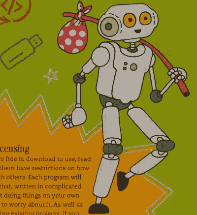

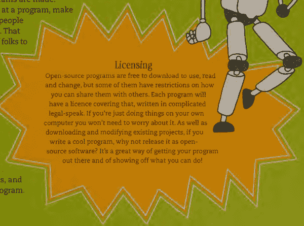

## 机器人的崛起

计算机程序不仅能控制个人电脑、智能手机和平板电脑；把你的代码和一些电子元件结合起来，你就能给自己造一个机器人！无论你的经验水平如何，开始这类编程都从未如此简单。

### 机器人技术入门

一种入门方式是使用预制机器人——如果你上网或去电子商店、玩具店看看，就会发现许多可以编程执行任务的机器人套件。其中许多会提供非常简单的拖拽式编程语言供你入门，但有些则允许你在掌握基本操作后，使用更复杂的语言编写自己的程序。

你也可以尝试自己搭建机器人——你最初做的几个可能不如这些套件那么精巧，但你会学到很多，而且它完全属于你自己。要做到这一点，你首先需要一块开发板。这是一台小型计算机，你把程序载入其中，它就能与电子元件交互来控制你的机器人。一些很好的入门选择包括 BBC micro:bit 和 Arduino；不过，如果你已经有很多乐高积木，也可以考虑 Lego Mindstorms。


除了用程序控制各种东西，你还可以连接传感器，向机器人提供信息。你可以买到光、温度以及各种类型的传感器。把它们和电机结合起来，你就能做出这样的机器人：它会朝着最亮的光驶去，还会在房间里追着手电筒跑！

### 机器人 I/O

你的开发板会带有一组 I/O（输入/输出）引脚。你可以把各种设备连接到这些引脚上，通过开发板来控制它们。你可以先从连接 LED 开始，编写程序让它们以炫酷的图案亮起来，甚至让它们拼出信息。理解这些之后，你就可以开始输出控制电机之类的设备，驱动你的机器人四处移动了！


> **真不错！**
>
> 你可能已经注意到，这里没有提到创建文件。这是因为，如果你让程序打开一个文件，而该文件还不存在，计算机会直接为你创建它！

open 语句会返回一个文件对象——这是文件在你的程序中的一种表示，随后你可以对它进行读取和写入。读取是指把文件中的数据读入程序，写入则是把程序中的数据写入文件。执行这些操作的语法通常与你从键盘获取输入并把它写到屏幕上非常相似。使用完文件后，你在文件对象上调用 close 语句来停止使用它。

### 受限访问

默认情况下，打开文件后你可以读取和写入，但在许多情况下，你只会想执行其中一种操作。这时最好以只读或只写方式打开文件。这意味着你的程序只能对它执行这两种操作中的一种。如果你只想从文件中读取数据，这一点尤其方便——这样你就不会意外写入并把它弄乱！

文件名通常以点号结尾，后面跟几个字母，用来定义文件的类型——这就是文件扩展名。例如，包含文本的文件以 .txt 结尾，而 .jpg 和 .gif 是图片格式。你可能会发现电脑默认隐藏这些扩展名，如果是这样，你需要上网查找如何显示它们。


## 实际应用中的网络

所有这些听起来（也确实！）相当复杂，但幸运的是，计算机会替你处理。要在程序中发送或接收数据，你只需创建一个套接字对象，它代表你将用来发送/接收数据的对象，就像文件对象是你读取和写入数据的方式一样。

一个区别在于，在网络中，当你连接到另一台计算机时，一侧（服务器）必须等待另一侧（客户端）发起连接。就像笔记本电脑有多个 USB 端口可供设备插入一样，计算机也有多个可用于连接的网络端口。不过，与物理端口不同，一台计算机有数千个可用的网络端口。

为了建立连接，服务器程序监听某个特定端口，而客户端程序则通过提供相同的端口以及要连接的服务器地址来进行连接。连接建立后，双方都可以发送和接收数据，很像对文件进行写入或读取——不过，这里不用 write() 和 read()，而是使用 send() 和 recv()。

```python
my_socket = socket()  # create a socket object
my_socket.connect("www.example.com", 5000)  # connect to port 5000 of www.example.com
my_socket.send("testing, testing!")  # send a string to the other computer
received = my_socket.recv()  # wait until the other computer sends a string back
print(received)  # print out what you got back
```

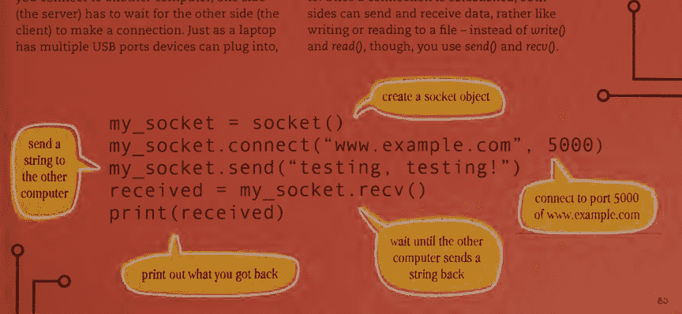


## 多云天气

近年来计算领域最重要的趋势是设备始终连接互联网。直到最近，计算机用户只在需要下载东西或查找资料时才上网。但现在，得益于智能手机和无线网络可用性的增长，许多计算机始终在线。

> **真妙！**
>
> 互联网诞生于 20 世纪 70 年代美国多所大学之间的一个研究项目，该项目创建了一个名为 ARPANET 的计算机网络。ARPANET 的设计目标是能在核攻击中幸存：它没有中央控制点，这也是为什么即使在今天，互联网仍是去中心化的，没有任何个人或国家掌管它。1989 年，一位名叫蒂姆·伯纳斯-李的英国计算机科学家创建了万维网的第一个网页，这就是我们使用互联网的方式。

### 什么是云？

始终在线的设备可以使用一种新技术：云计算。这本质上意味着，计算机过去在本地处理的任务，例如存储文件和执行计算，现在可以卸载到互联网上的计算机。因为这些计算机位于世界何处并不重要，所以它们被称为“云”。


## 排队等候

我们已经探讨过数组，它是一种将数据存储在内存块中的方式，其中每个单独的数据项都可以随时访问。不过，并非所有数据都适合以这种方式存储。

### 链接起来

另一种存储数据的方式是链表。在这里，不是像数组那样把所有数据存储在一个大内存块中，而是每个数据项单独存储，并包含指向列表中下一个元素的链接，就像链条中的环节。因此，项 A 有指向项 B 的链接，项 B 有指向项 C 的链接。单向链表只有这个方向上的链接，而双向链表则有两个方向上的链接（C 链接回 B，B 链接回 A）。

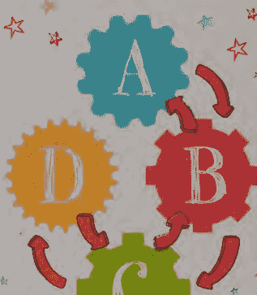

为了从链表中访问某一项，你需要遍历列表，沿着链条中的链接前进。这比数组慢，因为数组中的任何中间项都可以通过一次操作到达。但从列表中添加和移除链接很容易，而数组——由于它们是单个内存块——更难缩小或扩大。

### 队列与堆栈

数组和链表用于实现计算机内部依赖的某些类型的存储：队列和堆栈。这些数据存储中，你不能随意访问任何元素，而只能根据元素放入的顺序一次读取一个元素。

队列按 FIFO（先进先出）方式运作。因此，如果你先向队列添加 A，再添加 B，那么从队列读取时，你会先得到 A，再得到 B。相比之下，堆栈按 LIFO（后进先出）方式运作。在这里，如果你先向堆栈添加 A，再添加 B，那么从堆栈读取时，你会先得到 B，再得到 A，就像把东西放到一叠纸上再取下来一样。

> 后进先出。
>
> 别推它！
>
> 真妙！把一项放入堆栈称为压入（push），而取出一项称为弹出（pop）！


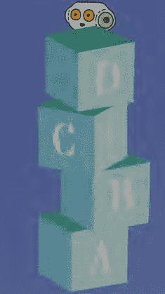

## 玩游戏

自第一台计算机诞生以来，程序员们一直在研究如何用计算机玩游戏！Pong 是一款黑白网球游戏，用两个白色矩形作为球拍，用一个方块作为球；它于 1972 年作为投币式街机游戏推出，到 1974 年已可供家庭用户使用。

如今，最大的电子游戏被称为 AAA 或 3A 游戏，需要数百名程序员、美术师和测试人员组成的团队工作数年，开发成本可能超过 1 亿英镑。它们采用前沿的 3D 图形，常常把计算机的性能推向极限。

### 独立游戏

然而，这些并不是市面上的全部游戏。近年来，编码者可用工具的进步促成了独立游戏的爆发式增长；这些游戏由单个程序员或小团队制作，通常是在业余时间完成的。这些游戏开发起来很容易，这意味着编码者可以试验玩法，创造出令人惊叹的新游戏类型。《我的世界》（Minecraft）也许是世界上最大的计算机游戏，但它最初只是一个程序员作为业余项目创造出来的！


智能手机和平板电脑也为个人开发游戏提供了另一种绝佳方式；它们非常适合由一个人或小团队开发的小型、简单游戏。它们的应用商店让游戏分发变得容易，也让人们有可能从自己作为爱好开发的游戏中赚到一些钱。


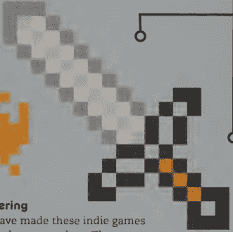

### 游戏引擎工程

让这些独立游戏成为可能的工具被称为游戏引擎。这些系统自带处理 2D 和 3D 图形、网络、声音、文件 IO 以及创建游戏所需的其他一切功能。它们还附带 3D 模型、音乐等可在游戏中使用的资源。你也可以从互联网下载额外资源，有些免费，有些则需要付费。

要制作游戏，你还需要编写自己的代码，告诉引擎在每种情况下该做什么。每个引擎都有不同的命令，并支持不同的编程语言——有些非常容易使用，有些则更复杂、更强大。有些用于为 PC 开发游戏，有些用于网页，还有些用于智能手机。


## 为互联网编程

创建网站是开始学习计算的绝佳方式——谁不想拥有自己的网站呢？网上有大量帮助，而且你不需要在 PC 上安装任何额外软件——只要你有网页浏览器和文本编辑器，就可以开始了！

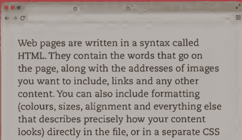

网页用一种称为 HTML 的语法编写。它们包含页面上要显示的文字，以及你想包含的图片地址、链接和任何其他内容。你还可以直接在文件中包含格式设置（颜色、大小、对齐方式以及精确描述内容外观的其他一切），或者放在单独的 CSS（层叠样式表）文件中。

### 动起来

如果你想让网页真正活起来，可以直接把计算机代码嵌入页面！浏览器支持 JavaScript，你可以直接把它写入 HTML 文件，或作为单独的 .js 文件包含。这样，每当有人加载你的网页时，你的代码就会在他们的浏览器中运行。

你编写的代码将由回调触发。浏览器提供了许多你可以使用的回调，因此你可以编写在以下情况下运行的代码……

- 页面加载时
- 有人按下按钮时
- 有人在文本框中输入时

……以及许多其他方式。


然后你的代码可以对网页做出更改。这可以是从调整一些文字大小到彻底改变整个页面的任何事情！在 JavaScript 代码中，网页由 DOM（文档对象模型）表示——就像套接字或文件对象一样，这是网页在你的代码中的表示。你对 DOM 所做的任何操作都会显示在页面上。

出于安全原因，有些操作你不能在浏览器中完成。不过，它是一种强大而灵活的语言，而且最近一项名为 HTML5 的网页更新增加了更多能力，例如 canvas 元素，你可以用它把动态绘图和动画直接放进网页。


从现在起，每当你浏览网页并注意到某个页面做出了特别酷的效果时，请意识到这是某人编写的 JavaScript 在实现它。想一想它是如何做到的，也许看看你能否自己弄明白该怎么做！


## 让物品变智能

不只是个人电脑和智能手机始终在线。如今无线技术已经足够小巧、廉价，可以内置到各种设备中，连同控制它所需的传感器和微芯片。这意味着你现在可以买到恒温器、扬声器甚至灯泡，它们能通过互联网报告自身状态并接收命令，从而变得智能。

可能用不了多久，你家里几乎所有电器都会连接到无线网络，共享数据，并可由你的智能手机或个人电脑控制。你可以让音乐从一个房间跟随你到另一个房间，在你不在时关掉暖气，并比以往任何时候都更好地控制你的个人电子产品。这种智能设备世界的愿景被称为物联网。


### 掌控设备

不过，作为程序员，你可以从物联网中获得更多好处。除了拥有智能手机应用外，许多这类智能设备还可以通过 API 控制，这意味着你可以自己编写代码来控制它们。API，即应用程序编程接口，是一组设备会监听的网络命令，以及说明这些命令是什么以及如何使用它们的文档。


### 让设备更智能

除了控制其他设备外，如果你正在制作自己的电子设备，比如机器人，那为什么不把它做成可通过无线控制的呢？这样，你就不必每次修改时都往它上面加载新代码，而是可以在你的个人电脑上编写控制代码，让它通过网络控制你的机器人。有些开发板，比如树莓派，内置了网络功能，而另一些，比如 Arduino，则有相应的附加模块，并且二者都有相应的库，可以轻松地把你的机器人接入无线网络。

### 太棒了！

虽然你可以自己编写网络和 API 代码，但通常你能找到适用于你的编程语言的软件库来替你完成这些工作，这样你只需要关心你希望设备做什么。只要有可能，你就应该利用这样的第三方库，而不是尝试自己编写所有内容。这会为你节省大量时间，而且由于有很多人使用相同的代码并报告任何问题，这些库可以被做得尽可能完善。


## 回到过去

版本控制系统包含你所做的每一组更改的历史记录。如果你发现自己犯了一些错误、弄坏了代码又不知道如何修复，你可以回退到较早的版本。你还可以通过差异（diffs）的形式准确查看你随时间所做的更改，差异会显示每次提交之间发生了什么变化。

你的版本控制系统可以完全只在你自己的机器上本地运行，但也有免费的在线版本控制系统，比如 GitHub。它们有两大优势。因为它们是云服务，你可以从多台机器上处理代码，并且如果一台机器坏了还可以恢复。它们还让你非常容易与他人分享代码，因为仓库默认是公开的（任何人都可以查看）。

### 与他人协作

确实，共享代码正是版本控制的真正价值所在——这是多个人在同一份代码上协作的最佳方式。它会跟踪每个人的更改，并帮助他们解决任何冲突。现代版本控制系统是分布式的，这意味着每个人都有一份仓库的本地副本。他们通过从主仓库拉取来获取更改，并将本地提交推送到主仓库。

版本控制系统是协调开源项目的方式。提交不是直接推送到仓库中，而是以拉取请求的形式提交。了解代码的人随后会审查这些请求，要么接受它们进入主程序，要么退回并附上需要修复内容的评论。这意味着，如果你为一个大型项目做贡献，会有人审查你的代码并帮助你尽可能完善它。


## 回归老派

我们看过的脚本语言，比如 Python 和 JavaScript，并不是唯一被广泛使用的编程语言家族。现在我们将看一些较低级的语言，它们被用来编写许多每天在个人电脑上运行的程序。


### C 和 C++

其中，C 和 C++ 非常重要。C 是一种古老的语言，可以追溯到 20 世纪 70 年代初，而 C++ 是其更新版本，包含类以及许多其他改进。与大多数脚本语言相比，C++ 编码要求更高、速度更慢，但拥有许多强大的技术，比如通过指针直接访问计算机内存。C++ 及其同类语言不能直接运行；它们必须先经过编译。这是一个过程，程序员必须首先使用编译器程序将其程序转换为机器码。随后分发给用户的就是这个可执行文件。这意味着不同的操作系统需要不同的编译器和不同的可执行文件（因为它们的机器码不同）。

然而，这个编译步骤确实意味着许多问题可以在编译时而不是程序运行时被发现。这通常也意味着代码运行得更快，因为它已经被转换成计算机可以直接运行的东西。由于这种速度以及该语言悠久的历史，有大量软件是用 C 和 C++ 编写的，包括大多数计算机操作系统。

## 并行工作

到目前为止，你看到的所有程序都涉及计算机一次执行一条指令。考虑到计算机的速度，这通常没问题。但有时你需要程序的各个部分同时独立运行，这就是并行性发挥作用的地方。

### 分支扩展

并行性意味着同时并行运行程序的多个部分。就像树的枝干在生长过程中分裂成许多分支一样，你的程序也可以分叉成多个分支。这些分支中的每一个都称为线程或进程。每一个本质上都是自己独立且独立的程序，一次执行一条指令。

那么为什么要并行运行呢？这样你就可以执行可能耗时很长的事情，而不会阻塞程序的其他部分。例如，程序的 GUI（见第 54 页）通常与程序的其余部分分开运行。这样一来，即使程序的主要部分需要长时间计算某些内容，用户仍然可以滚动和点击按钮，因为 GUI 代码在独立运行。

不过，你的代码分支需要通信：当用户在 GUI 中按下按钮时，你希望主程序中发生某些事情。编程语言有不同的方式来实现这一点。它们通常使用队列在分支之间传递消息——一个分支写入消息，另一个分支在空闲时读取该消息。

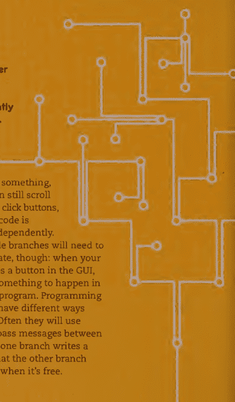

### 加锁与解锁

编写并行代码（有时称为多线程代码）可能会变得复杂。例如，不同的分支可以共享同一个变量，但如果不止一个分支试图同时使用它，就可能出现大问题。为了避免这种情况，有各种类型的锁（例如互斥锁和信号量），确保一次只有一个分支访问变量。如果另一个分支也想使用它，它必须等待第一个分支完成并解除锁。

### 太棒了！

计算机实际上可以同时做不止一件事——现代计算机的 CPU 有双核、四核或更多核心，每个核心都可以运行一个线程或进程。不过，你可以拥有的进程数量远不止这些——CPU 在进程之间非常非常快地切换，所以看起来就像所有东西都在同时运行！

> 停住，等等！现在，走，走，走！

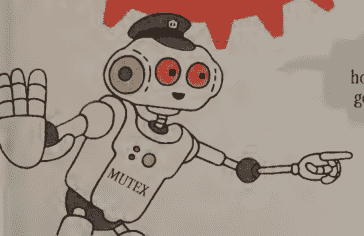


## 超级计算

回到计算机刚被发明的时候，它们要占据整个房间，而如今一台计算机可以放在书桌下，甚至握在掌心。然而，仍然有一些计算机要占据整栋建筑：它们就是超级计算机。

> **这真有趣！**
>
> 除了天气之外，超级计算机长期以来还被用于设计和模拟现存最具破坏性的武器：原子弹。尽管这看起来并不特别吸引人，但拥有原子弹的国家同意，在发生战争时不再对彼此使用原子弹，而是改用超级计算机来模拟它们。


### 向上，向上，飞向远方！

超级计算机是极其强大的机器，用于解决令人难以置信的复杂问题。最常见的用途是模拟非常复杂的现实世界系统，例如天气模式（这样我们就能预测何时下雨），或者蛋白质如何折叠（以寻找新的医学疗法）。

由于单个 CPU（见第 52 页）的尺寸有限，超级计算机实际上是由成千上万个独立 CPU 连接在一起组成的。运行在其上的程序被编写成大规模并行：计算被拆分成成千上万个任务，然后分配给各个 CPU。

### 租一台自己的超级计算机

超级计算机造价数百万英镑，这显然让几乎所有人都无法企及。然而，随着云计算的出现，现在可以按分钟租用计算时间。因此，一位需要超级计算机来解决特定问题的科学家，只需租用她运行程序一小时左右所需的计算能力，就能以仅几百英镑的代价临时使用自己的超级计算机。

> 这真是超大规模！

> **这真有趣！**
>
> 超级计算机的速度以 flops 衡量，这是 floating-point operations per second（每秒浮点运算次数）的缩写——本质上就是它们每秒能完成多少次求和运算。在本书写作时，世界上最强大的超级计算机由 40,000 多个独立 CPU 组成，每个 CPU 有 256 个核心。这台计算机的运行速度接近 100 千万亿次浮点运算/秒，这意味着它每秒能完成近一千万亿（一百万的十亿倍）次计算。然而，等你读到这段文字时，很可能已经有更快的计算机了……

## 进入算法节奏


计算机做事很快——一台售价 5 英镑的计算机时钟速度可以达到 1GHz，这意味着它每秒能完成一*十亿*件事。因此大多数时候，你不需要担心程序运行得有多快。不过，有时你可能会发现某个程序需要很长时间才能完成。这时你就需要担心自己所使用的算法了。

算法就是你的代码解决特定任务的方式——比如把列表按字母顺序排序。完成一项任务通常有很多种写代码的方式，而每种方式都有自己的复杂度——也就是当你增加数据量时，运行所需时间会如何变化。

### 你的代码有多复杂？

复杂度为 O(n) 的算法被称为线性算法——这意味着如果你把数据集的大小（n）翻倍，运行时间也会变成两倍。但同一任务的另一种算法可能具有 O(n²) 的复杂度——现在当你把数据量翻倍时，该算法的运行时间会变成四倍。当 n 很小时，时间差异无关紧要；但如果你要处理数百万个元素，第二种算法解决同一任务所需的时间可能比第一种多成千上万倍！

> 你可能会忍不住想为代码中的一切找到最快的算法，但这并不总是最好的主意。你不仅会花费大量时间和精力让代码运行得快很多，而且最终得到的代码会更难理解或修改。花大量时间去加速并不需要加速的代码，这被称为过早优化。只有当代码速度给你带来问题时，你才应该担心它。

还有许多其他可能的复杂度——对于给定的 n 值，括号内的值越小，算法在大数据集上运行得就越快。要算出你自己算法的复杂度，可以看看代码，试着算出对于 n 条数据它需要运行多少次。嵌套循环（循环里面还有循环）表明你的算法可能复杂度较高。如果你打算处理大量数据，可以考虑是否有办法重写代码来避免这些嵌套循环。


- 绿色的门？
- 塔楼？
- 树？
- 六层楼？
- 一个烟囱？
- 两个烟囱？

## 更快，更快！

你可能已经注意到，计算机每年都在变得更好——同样的钱可以买到更快的 CPU、更大的内存和更多的存储空间。

这实际上已经持续了很长时间。早在 1965 年，英特尔（至今仍是世界上最大的 CPU 制造商之一）的创始人之一戈登·摩尔注意到，他们在同样数量的硅片上能容纳的晶体管数量每年翻一番——本质上就是让同样大小的 CPU 性能翻倍。

哇塞！

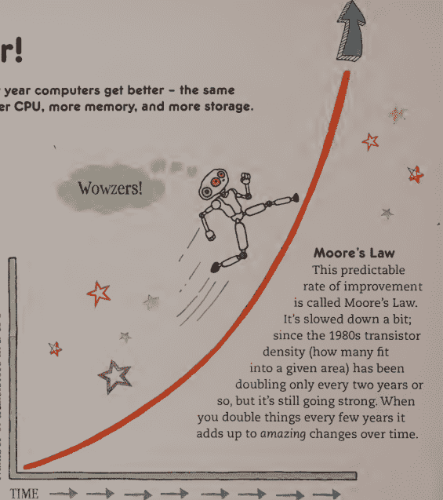

CPU 中的晶体管数量

时间

### 摩尔定律

这种可预测的改进速度被称为摩尔定律。它已经有所放缓；自 20 世纪 80 年代以来，晶体管密度（给定面积内能容纳多少个晶体管）大约每两年才翻一番，但它仍然势头强劲。当你每隔几年就把数量翻倍时，随着时间推移，这会累积成惊人的变化。

> **这真有趣！**
>
> 控制阿波罗 11 号、把人类送上月球的那台计算机，在 1969 年堪称惊人地先进，造价数百万美元。阿波罗制导计算机（AGC）驾驶飞船完成了从地球到月球再返回的 380,000 公里（236,128 英里）旅程。然而，它被现代计算机远远超越——甚至很难进行比较。你的烤面包机都要比它强大几个数量级。AGC 运行频率为 0.05MHz，内存为 64kB；而一部便宜的现代智能手机大约快 20,000 倍，内存多 50,000 倍！

### 真正巨大和真正微小的数字

这种进步是由制造商设法让晶体管越来越小所推动的。Colossus 和 ENIAC 使用的真空管每个都有几厘米宽。相比之下，现代 CPU 中的硅晶体管宽度仅 14 纳米（0.000000014 米）。20 世纪 70 年代的第一批 CPU 芯片只有几千个晶体管，而现代 CPU 芯片则有超过十亿个。

现代晶体管实际上小到许多科学家认为摩尔定律很快就将难以为继。14 纳米的晶体管宽度不到 100 个原子，如果它们再小得多，其奇异的量子效应就会开始干扰它们。不过，科学家正在试验新材料、晶体管的 3D 排列，以及他们能想到的任何其他办法，试图让摩尔定律继续成立。谁知道他们还能坚持多久？


## 更多编程

希望这本书已经让你热血沸腾，准备好开始编程了。这里有一些很棒的入门去处！老师、朋友和家人也许还能给你指出更多。

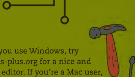

### 入门

- **Scratch** www.scratch.mit.edu 是你在第 44 页和第 74 页已经探索过的网站。点击最顶部的“Explore”（探索），看看人们用它做出的所有奇妙作品——你能做出类似的东西吗？
- **代码教程** 外面有数百个网站可以帮你入门各种编程语言，而 www.codecademy.com 是其中最好的之一。你也可以看看 www.freecodecamp.com，这是另一个很棒的教程网站，侧重于开源开发。
- **搜索** 听起来可能有点奇怪，但在学习编程时，www.google.com 和其他搜索引擎是你最好的朋友。如果你遇到不理解的错误信息，把它复制到搜索引擎里，你就会找到大量解释其含义的网页。

### 编程工具

- **智能编辑器** 如果你使用 Windows，可以试试 www.notepad-plus-plus.org，这是一个好用又简单的智能文本编辑器。如果你是 Mac 用户，可以试试 www.macromates.com。
- **在线试验场** 如果你想不安装任何东西就直接开始编程，www.pythonfiddle.com 可以让你直接在浏览器中测试小型 Python 程序。www.jsfiddle.net 对 JavaScript 也有同样的功能，还能让你轻松地将它与 HTML 和 CSS 结合起来。
- **iOS 和 Android SDK** 如果你想开发手机应用，可以从 https://developer.apple.com/ios 下载 iOS SDK，用来开发 iPhone/iPad 应用。Android 对应的开发工具请前往 https://developer.android.com/studio。
- **Web 应用** 如果你想改用 JavaScript 编写手机应用，可以看看 www.ionicframework.com，这个 SDK 能让你用 Web 代码编写应用。
- **版本控制** 外面有很多版本控制系统，但 www.github.com 是迄今为止最流行的——它不仅可以存储你自己的代码，也是大多数开源程序的存放地。


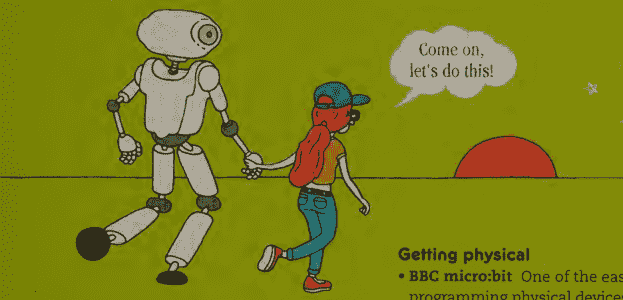

来吧，我们开始吧！

## 创建游戏

- **网页游戏** 如果你想开始创建游戏，请访问 www.scirra.com/construct2，在那里你可以使用引擎内置的简单编程语言来构建 HTML5 游戏。如果你想要更多控制权，可以试试 www.phaser.io，它让你使用 JavaScript 直接控制网页游戏。
- **Unity** 如果你想创建 3D 游戏，请前往 www.unity3d.com，获取一款用于开发大量商业游戏的强大引擎。它可能有点让人望而生畏，但借助它，你几乎可以为任何平台创建出色的 2D 和 3D 游戏！

## 接触实体设备

- **BBC micro:bit** 开始为实体设备编程的最简单方法之一，就是使用 BBC micro:bit。你的学校也许能为你提供一个，而 www.microbit.org 让你可以用多种语言非常简单地为其编程。网站上甚至还有一个模拟器，你可以用它来测试你的程序！
- **其他开发板** 从复杂度上来说，下一步是 Arduino（www.arduino.cc）。它主要使用 C 语言编程，但有大量可用的帮助资源。它还有一系列出色的附加设备，可以扩展其能力。如果你想要更强大的性能，可以试试树莓派（www.raspberrypi.org）。它是一台微型电脑，你几乎可以用它做任何事！
- **Mindstorms** 如果你是乐高粉丝，可以看看乐高 Mindstorms（www.lego.com/en-gb/mindstorms）。你可以用它把你的乐高作品变成机器人，并用简单的拖放式语言为其编程。

## 编程术语表

**参数** 传入函数以改变其运行方式的变量。

**数组** 一种可以存储大量独立值的对象，其中任何一个值都可以通过方括号访问（例如 arr[5]）。

**二进制** 一种只使用 1 和 0 的计数方式。

**位** 单个 1 或 0 值，表示数据在计算机内存中实际存储的方式。

**布尔值** 逻辑中使用的一种值，可以为 True 或 False。

**程序错误** 导致程序无法运行，或运行后做出错误行为的错误。

**字节** 一组 8 个位，可以一起访问，并可用于存储单个字符。

**回调** 一种函数，其名称作为参数传入，让其他代码可以回调它。常用于 GUI 中。

**类** 一种对象，可用于存储与特定任务或事物相关的所有变量和函数。

**注释** 可添加到程序中的文本，用于提醒自己或他人代码的特定部分在做什么。

**比较运算符** 一系列运算符，如等于、小于和大于，让程序比较两个值并基于逻辑做出决定。

**CPU** 所有计算机内部执行每条程序指令的微型芯片。

**数据中心** 包含大量服务器的场所，可通过互联网提供数据。

**否则** If 的替代方案，定义当 If 条件不为 True 时该做什么。可与 If 组合形成新的条件结构 Else If。

**文件** 存储在计算机上的照片、视频或文本等信息。

**浮点数** 带小数位的数字，如 1.381、-21.9 或 8.0。

**for 循环** 运行特定次数的循环类型。

**函数** 已从程序其他地方分离出来的代码块。

**图形用户界面（GUI）** 让人们通过图片和按钮而不是仅通过输入来使用程序的方式。

**如果** 程序中仅在特定条件为 True 时运行的部分。

**指令** 告诉计算机做某事的一段代码。

**整数** 可以为正、负或 0 的整数（没有小数位）。

**JavaScript** 一种可包含在网页中、在有人阅读页面时运行的编程语言。

**链表** 存储大量值时数组的替代方案，每个元素链接到列表中的下一个元素。

**逻辑** 允许程序根据程序中的值是 True 还是 False 做出决定。

**循环** 程序中反复运行直到满足特定条件的部分。

**机器码** CPU 能够理解并遵循的一组指令。编程语言在运行前会转换为机器码。

**内存** 保存程序所需变量和其他数据的地方。与存储不同，内存是易失性的，这意味着计算机关闭后数据会被遗忘。

**联网** 计算机彼此通信的能力，可以通过有线方式或使用电磁波无线通信。

**开源** 人们在互联网上共享的程序，你可以下载、使用甚至修改它们。

**程序** 计算机从上到下遵循的指令列表，并在遇到每条指令时执行。

**编程语言** 代码告诉计算机做事的方式。不同的编程语言以不同方式编写代码。

**Python** 一种强大但易学的编程语言，有自己的语法和做事方式。

**队列** 一种存储数据的方式，其中元素只能按照放入队列的顺序从队列中读取。

**重构** 重写代码，不是为了改变它的功能，而是为了让它更整洁或更快。

**返回** 函数结束时返回给调用代码的值。

**Scratch** 一种可视化编程语言，允许拖放代码元素，而不需要写出程序。

**服务器** 没有显示器或其他控制设备的计算机，通过网络向其他计算机提供数据。

**栈** 一种存储数据的方式，其中唯一能读取的元素是最近添加到栈中的元素。

**静态类型** 只允许变量始终包含一种类型值（如布尔值或整数）的编程语言，使某些错误易于发现。

**存储** 保存文件和数据的地方。存储的访问速度比内存慢，但即使计算机断电，存储中的数据也会被记住。

**字符串** 引号中的单词或短语（如 'Hello, world'）。

**晶体管** 一种极其微小的开关。CPU 包含数十亿个晶体管，通过开启和关闭，它们执行计算机内部的所有操作。

**类型** 变量存储的数据种类，如字符串、整数或布尔值。

**变量** 存储数据（如数字或单词）的命名位置，可在程序后面使用。

**while 循环** 一种在某个条件为 True 时继续运行的循环。

> “大多数优秀程序员编程并不是因为他们期望获得报酬或公众的追捧，而是因为编程很有趣。”
>
> ——林纳斯·托瓦兹

想开始学编程吗？这本充满乐趣的书是完美的入门读物！

了解计算机如何计数、云如何运作，以及蛇和骆驼与编写代码有什么关系。

使用 Scratch 制作精彩程序，并探索编程如何创造游戏、控制机器人，甚至开关电灯！


KI-483-350


PAVILION

ISBN 978-1-84365-325-3


9 781843 653253

UK £9.99

www.pavilionbooks.com

