# 酷信息图表：数据可视化与设计的有效沟通

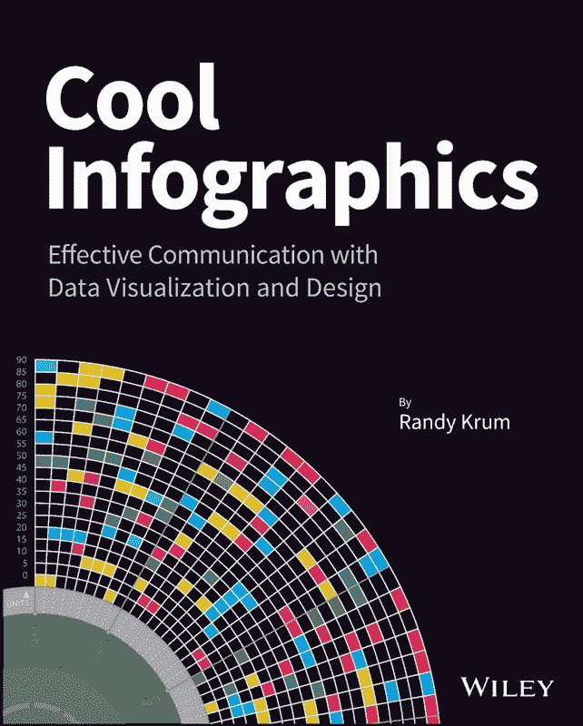

## 指南

1. 封面
2. 目录
3. 开始阅读

## 图表列表

1. 图 1.1
2. 图 1.2
3. 图 1.3
4. 图 1.4
5. 图 1.5
6. 图 1.6
7. 图 1.7
8. 图 1.8
9. 图 1.9
10. 图 1.10
11. 图 1.11
12. 图 1.12
13. 图 1.13
14. 图 1.14
15. 图 1.15
16. 图 1.16
17. 图 1.17
18. 图 1.18
19. 图 1.19
20. 图 1.20
21. 图 1.21
22. 图 1.22
23. 图 1.23
24. 图 1.24
25. 图 1.25
26. 图 1.26
27. 图 1.27
28. 图 1.28
29. 图 1.29
30. 图 1.30
31. 图 1.31
32. 图 1.32
33. 图 1.33
34. 图 1.34
35. 图 1.35
36. 图 1.36
37. 图 1.37
38. 图 1.38
39. 图 1.39
40. 图 1.40
41. 图 2.1
42. 图 2.2
43. 图 2.3
44. 图 2.4
45. 图 2.5
46. 图 2.6
47. 图 2.7
48. 图 2.8
49. 图 2.9
50. 图 2.10
51. 图 2.11
52. 图 2.12
53. 图 2.13
54. 图 2.14
55. 图 2.15
56. 图 2.16
57. 图 2.17
58. 图 2.18
59. 图 2.19
60. 图 2.20
61. 图 2.21
62. 图 2.22
63. 图 2.23
64. 图 2.24
65. 图 2.25
66. 图 3.1
67. 图 3.2
68. 图 3.3
69. 图 3.4
70. 图 3.5
71. 图 3.6
72. 图 3.7
73. 图 3.8
74. 图 3.9
75. 图 3.10
76. 图 3.11
77. 图 3.13
78. 图 3.14
79. 图 4.1
80. 图 4.2
81. 图 4.3
82. 图 4.5
83. 图 4.6
84. 图 4.7
85. 图 4.8
86. 图 4.9
87. 图 4.10
88. 图 4.13
89. 图 4.14
90. 图 4.15
91. 图 4.16
92. 图 4.17
93. 图 4.18
94. 图 4.19
95. 图 4.20
96. 图 4.21
97. 图 4.22
98. 图 4.23
99. 图 4.24
100. 图 4.25
101. 图 4.26
102. 图 4.27
103. 图 4.28
104. 图 4.29
105. 图 4.30
106. 图 5.1
107. 图 5.2
108. 图 5.3
109. 图 5.4
110. 图 5.5
111. 图 5.6
112. 图 5.7
113. 图 5.8
114. 图 5.9
115. 图 5.10
116. 图 5.11
117. 图 5.12
118. 图 5.13
119. 图 5.14
120. 图 5.15
121. 图 5.16
122. 图 5.17
123. 图 5.19
124. 图 5.20
125. 图 6.1
126. 图 6.2
127. 图 6.3
128. 图 6.4
129. 图 6.5
130. 图 6.6
131. 图 6.7
132. 图 6.8
133. 图 6.9
134. 图 6.10
135. 图 6.11
136. 图 6.12
137. 图 6.13
138. 图 7.1
139. 图 7.2
140. 图 7.3
141. 图 7.4
142. 图 7.5
143. 图 7.6
144. 图 7.7
145. 图 7.8
146. 图 7.9
147. 图 7.10
148. 图 7.11
149. 图 7.12
150. 图 7.13
151. 图 7.14
152. 图 7.15
153. 图 7.16
154. 图 7.17
155. 图 7.18
156. 图 7.19
157. 图 7.20
158. 图 7.21
159. 图 7.22
160. 图 7.23
161. 图 7.24
162. 图 7.25
163. 图 7.26

## 表格列表

1. 表 1
2. 表 2
3. 表 3

## 信息图表：有效沟通

由 Wiley & Sons 出版

[www.wiley.com](http://www.wiley.com)

美国印制造制造

10 9 8 7 6 5 4 3 2 1

Copyright © 2014 John Wiley & Sons, Inc., 印第安纳州

与加拿大同步出版

ISBN: 978-1-118-58230-5

ISBN: 978-1-118-58228-2 (ebk)

ISBN: 978-1-118-83715-3 (ebk)

未经出版者书面许可，本出版物的任何部分不得复制、存储在检索系统中或以任何形式（电子、机械、复印、录制、扫描或其他）传输，除非符合 1976 年美国版权法第 107 条或第 108 条的规定，并向以下机构支付相应的副本费用：Copyright Clearance Center 222 Rosewood Drive, Danvers, MA 01923, (978) 750-8400, 传真 (978) 646-8600。向出版者的许可请求：John Wiley & Sons, Inc., 111 River Street, Hoboken, NJ 07030, (201) 748-6011, 传真 (201) 748-6008，或在线访问 [`http://www.wiley.com/go/permissions`](http://www.wiley.com/go/permissions)。

**责任限制/免责声明**：出版者和作者对本书内容的准确性或完整性不作任何陈述或保证，并明确否认所有保证，包括但不限于对特定用途的保证。销售或促销材料不得创建或扩大任何保证。书中包含的建议和策略可能不适用于所有情况。本书的销售基于以下理解：即出版者并未从事法律、会计或其他专业服务。如果需要专业帮助，应寻求能力专业人士的帮助。出版者和作者对由此产生的任何损害概不负责。

**商标**：Wiley 和 Wiley 标志是 John Wiley & Sons, Inc. 及其关联公司在美国及其他国家的商标或注册商标，未经书面许可不得使用。所有其他商标均归其所有者所有。John Wiley & Sons, Inc. 与书中提到的任何产品或供应商均无关联。

Randy 是一位面向在线和内部使用的数据可视化与信息图设计师。他也是会议、专业组织、MBA 课程以及政府机构的频繁演讲者。凭借机械工程学位（而非平面设计学位），他在消费者产品公司工作了 15 年，曾被选为 2012 年中央情报局演讲员，专注于用数据讲述视觉故事。

# 致谢

## 执行编辑

Carol Long

## 高级项目编辑

Adaobi Tulton

## 技术编辑

Nancy Gage

## 制作编辑

Christine Mugnolo

## 拷贝编辑

San Dee

## 编辑经理

Mary Wakefield

## 自由稿人

Rosemarie Graham

## 营销经理

David Mayhew

## 市场经理

Ashley Zurcher

## 业务经理

Amy Knies

## 副总裁兼执行发行商

Richard Swadley

## 副总裁兼发行商

Neil Edde

## 助理发行商

Jim Minatel

## 项目协调员

Katie Crocker

## 制作人

Maureen Forys

## 校对

Sarah Kaikini

## 编索引

Robert Swanson

## 封面设计

Ray Vella

## 封面图片

Randy Krum

我首先必须感谢 Wiley & Sons 的 Carol Long，她的问题“你考虑过写书吗？”最终促成了你手里的这本书。如果没有 Carol 对我的信心，我可能会无限期地推迟这件事。我特别感谢我的项目编辑 Adaobi Tulton，感谢她的耐心以及对项目的热情。感谢 Nancy Gage ([coroflot.com/n-gage](http://www.coroflot.com/n-gage))、Ashley Zurcher、San Dee Phillips、Christine Mugnolo、Katie Wisor 以及汇编这本书的许多其他人。

衷心感谢好朋友 Penny Sansbury 担任我的个人编辑。Penny 不仅带来了她的写作背景，还确保我能获得诚实的反馈。感谢设计师 Ray Vella，他调整了书中包含的数据可视化和信息图设计。

我向全世界的信息图设计师表示感谢和鼓励。我对 Cool Infographics 博客的数千访问者和订阅者，以及多年来留言并提交信息图的所有读者者感激不尽。你们的工作教会了我，启发了我，并让我相信我们将从事这项工作很长时间。

我还要感谢我的父母 Sue 和 Bill，他们总是鼓励我探索自己的兴趣，并教我不要害怕走自己的路。

最后，我要感谢我的妻子 Mary Kaye，她是我最坚定的支持者。对于她鼓励我创立博客、创立自己的公司并最终开始写这本书，我怎么感谢都不为。我可以依靠她不断地含蓄地提醒我回归写作。

# 1 引言

我一直很喜欢数据。

数据可以是巨大的数字表格、定量研究数据、业务流程、人口统计、财务结果、地图位置或网络统计数据。这并不重要——我热爱这一切。

在电子表格或数据库中处理了几个小时的数据集后，我能够从数字中发现模式并获得有趣的发现。然而，没有其他人想那么详细地查看电子表格。他们不想看数据，只想理解结论。那时，我拥抱了数据可视化和信息图设计。

如果我能将大量的数据点放在一个页面上，就能让观众更容易地理解它们之间的比较。人们可以看一个数据点，并理解它是如何融入整个数据集的。很久以后，我了解了支持数据可视化力量的理论和研究，但在当时我亲眼看到，对于大多数观众来说，眼见为实。如果我能将数据可视化，观众就能理解这些信息。

在几家消费者产品公司的营销和产品开发部门工作时，我从这些可视化中挖掘灵感，用自己的数据创建视觉设计。我需要引导观众通过一系列信息，让他们理解我是如何得出结论的；我需要用数据讲述故事。我还确定，它必须在视觉上与不同才能被人记住。

内部平面设计部门没有足够的时间来帮助演示文稿。他们忙于产品包装、网站和广告设计。我的机械工程学位——而非平面设计——意味着我必须自己学习信息设计。我是从数据端进入信息图领域的，并在过程中学习了设计。

随着时间的推移，我的设计变得越来越好，数据可视化传达了强大的理解感和信力。我实践并学习了什么能引起观众的共鸣。我可能并没有打算成为一名信息图设计师，但那是我的最终归宿。

2007 年，我启动了 Cool Infographics 博客 ([coolinfographics.com](http://coolinfographics.com)) 作为一个实验。我已经在收集我喜欢的优质信息图设计并挂在办公室的墙上，所以那些成了我在博客上发布的首批信息图。私下里，我不认为博客能持续超过一年，因为我担心材料会用光。幸运的是，信息图的认知度和普及在网上呈爆炸式增长，现在优质信息图比我所能发布的还要多。


# 第 5 章：“内部机密信息图”

探讨了人们如何在大公司内部使用数据可视化和信息图来改进公司机密数据的传播。这些私有设计是强大的内部沟通工具，用于会议和演示，但绝不会对外发布。


# 第 6 章：“设计信息图”

是适合任何想要上手并开始创作优秀数据可视化图和信息图的人的章节。无论你是打算尝试设计自己的信息图，还是与信息图设计师合作，这些设计技巧和策略都将帮助你设计出酷炫的信息图。


# 第 7 章：“设计资源”

介绍了一些最流行的软件应用程序和在线设计工具，用于创建数据可视化和信息图。

书的边缘采用了颜色编码，作为一种简单直观的视觉方式帮你找到所需的章节。从任何地方开始并享受其中吧！

## 什么让信息图变得酷炫？

我被很多不同的人问过：“什么让信息图变得酷炫？”在过去的几年里，我从网上发布的数千万份信息图中挑选了数百个设计发布在 Cool Infographics 网站上。是否存在某种让信息图变得酷炫的神奇公式？为什么某些信息图设计被选为“酷”，而其他的却不是？

就像任何被判定为“酷”的东西一样，标准是一个不断变化的目标，也是许多争论的话题。关于什么让信息图变得酷炫的观点非常多样。2013 年，我邀请了数据可视化和信息图设计领域的专家，通过 `CoolInfographics.com` 的客座文章对这个问题发表了看法。以下是其中一些人的话：

> 信息图酷炫之处在于，它们能够极其有效地解释任何行业、任何原因的任何可以想象的主题。
>
> —Karl Gude，密歇根州立大学新闻学院第一个信息图项目的负责人，曾任《新闻周》杂志和美联社的信息图总监

> “酷”信息图能以独特的方式建立联系、驱动社交分享并创造热度。
>
> —Matt Siltala，Avalaunch Media 总裁

> 要创建一个强大的信息图，请保存那些大的图形和精巧的图片。深入挖掘信息，找到对我们所有人都有意义的故事。
>
> —Dean Meyers，视觉问题解决者

> 当信息图呈现一个重要且复杂的故事，并以诚实且美观的方式时，它就是“酷”的。
>
> —Nathaniel Pearlman，Graphicacy 和 Timeplots 创始人

你可以在此处找到完整的客座文章等内容：`coolinfographics.com/blog/tag/cool`

我自己的短答案是：“我一眼就能看出。”我的长答案是，一个酷炫的设计将是以下方面的结合：

- 引人入胜的主题
- 新鲜、惊喜的信息
- 视觉吸引力且独特
- 简单、聚焦的消息
- 快速易读
- 易于分享
- 清晰、易懂的数据可视化
- 可靠的数据源

本书分享了来自世界各地设计师的 100 多个酷炫信息图示例，这些设计都涵盖了上述许多方面。这些设计被选为网络上数千万份酷炫信息图的代表。

## 查看信息图

我在书中包含的大多数信息图设计在在线查看时实际上效果更好。其中许多设计为了适应页面而缩小了尺寸，因为对你来说，看到整个信息图设计的比例而不是局部是重要的。我为许多设计创建了特写部分，以演示某个特定观点或使某些文字变得可读。

对于所有在线可见的示例设计，我都包含了原始来源的链接，以便你可以在网上查看设计者原意的全尺寸原始版本。然而，许多 URL 字符串很长，很难在浏览器中输入。

我面临的另一个挑战是随着时间的推移，链接会失效。网站会关闭或移动到新域名，但当 URL 被打印在书中时，它们是永久的。我希望确保多年后你仍然可以在网上查看完整版本。因此，我为控制的每个在线示例创建了快捷 URL。如果任何网站将信息图移动到新的链接地址，我将更改此快捷 URL 的目标以指向新地址。

对于每个在线可见的图形，你有四种方法可以原始信息图：

- 信息图的完整原始 URL 列在每个章节的最后。
- 我使用 `coolinfographics.com` 域名为每个在线信息图创建了简单的快捷 URL，它将带你进入原始页面。
- 所有链接都按章节列在 `www.wiley.com/go/coolinfographics` 页面上。从该页面，你只需点击链接而无需输入。
- 所有可点击链接也按章节列在 `coolinfographics.com/figures` 页面上。

## 加入对话

数据可视化和信息图背后的思想和策略每天都在不断进化变化。三年前的酷炫信息图今天可能不再被认为“酷”。随着新工具和技术为设计师提供，你可以看到信息图设计和传播领域出现新的创新。

我鼓励你关注并加入你的观点。

1. Cool Infographics 博客：`CoolInfographics.com`
2. Twitter: `@rtkrum`
3. Facebook: `facebook.com/rtkrum`
4. Google+: `gplus.to/rtkrum`
5. LinkedIn: `linkedin.com/in/rtkrum`
6. InfoNewt: `InfoNewt.com`

# 1 信息图的科学

## 为什么人们喜欢信息图？

几千年来，人类一直在通过画画进行交流——从洞穴壁上的象形文字到埃及象形文字再到现代标志上的意形字（图 1-1）。人们喜欢用图片进行交流和讲故事，因为这是植入人类大脑的本能。

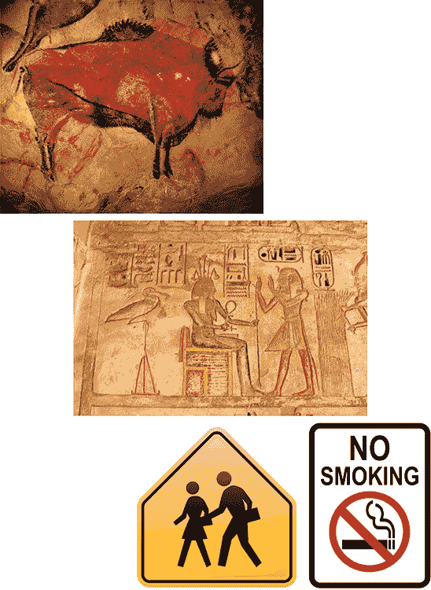

**图 1-1：** 阿塔米拉野牛岩画、古埃及象形文字和现代标志。

信息图和数据可视化无处不在。我们被信息的视觉表示包围——图表、地图、图标、进度条、标志、海报、图解和在线视觉（图 1-2）。这些都是视觉传播的例子，但它们并不都是信息图。

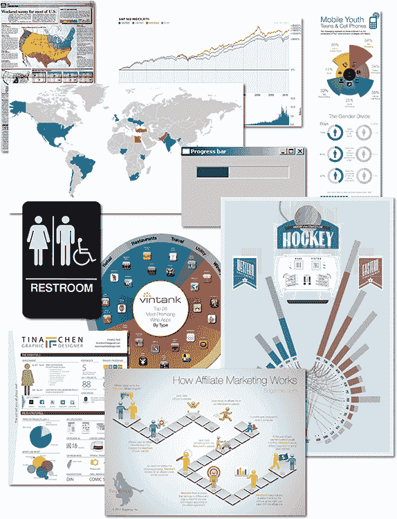

**图 1-2：** 信息图和数据可视化的组合

`infographic` 这个词被人们用来许多不同的含义。在很多情况下，信息图和 `data visualizations` 被视为同义，但在信息图设计师的世界里，它们意味着不同的东西。

数据可视化是数值的视觉化表示。图表和图谱都是数据可视化，它们根据给定的数据集创建图像。图 1-3 展示了自 1950 年以来标普 500 指数、纳斯达克和道琼斯工业平均指数的价格走图。读者可以轻松地看到整体上升趋势以及三个数据集之间的比较。加上价格图表下方的成交量图，这一数据可视化使用至少 80,000 个数据点创建了一个图像。

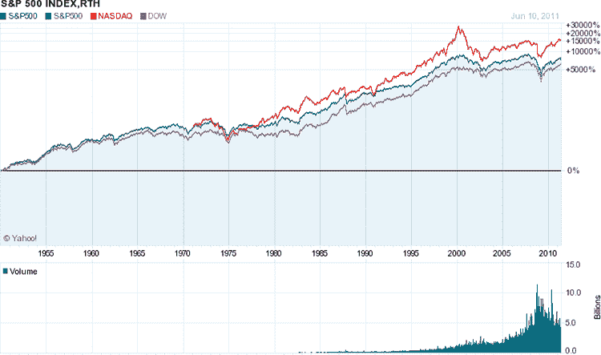

**图 1-3:** 股票价格图


我们只需要几秒钟就能理解长期趋势，看到这三个指数之间的密切联系，并看到股市中显著飙升和下跌。这种可视化可以轻松地适应一张纸、一个无需滚动条的电脑屏幕或一张演示幻灯片。通过在一个页面上看到整个数据集，我们可以快速且毫不费力地理解数据。

这是一种高效的数据交流方式。数据可视化通过在小空间内视觉化大量数字，可以非常有效地利用空间。通过设计一种在读者视野范围内显示所有数据的可视化，这使我们能够在最小化眼球运动且无需滚动或翻页页面的情况下，看到整个数据集。

如果我们看的是一个包含 80,000 个值的电子表格，我们需要多久才能对市场有一个大致的了解？

2001 年，现代数据可视化的先驱之一、耶鲁大学爱德华·R·塔夫特（Dr. Edward R. Tufte）政治学、统计学和计算机科学荣誉教授他清楚地解释了这一现象，他表示：“在所有分析和交流统计信息的方法中，设计良好的数据图形通常是最简单且同时也最强大的。”^([1])

这张来自 iPad 上 StockTouch 应用的截屏（图 1-4）是另一个良好的数据可视化设计示例。它展示了来自九个不同市场领域的前 00 大美国股票。在此视图中，每个市场板块的公司按照从大（位于中心）到较小的螺旋模式排列。每只股票都根据其过去 12 个月的股价表现进行颜色编码，但可以通过右侧的滑块调整时间段。绿色深浅表示上涨的股价，红色深浅表示下跌的股价。

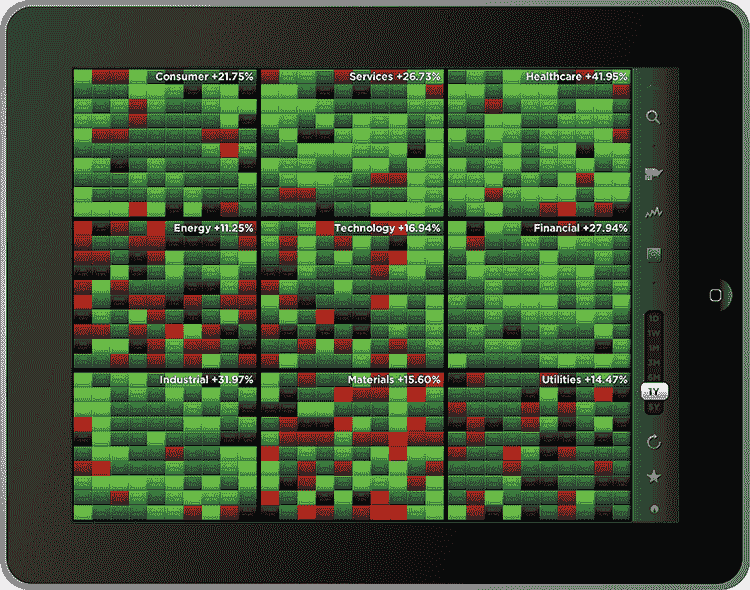

**图 1-4：** 股价变化的热力图可视化

[`coolinfographics.com/Figure-1-4`](http://coolinfographics.com/Figure-1-4)

来源：StockTouch iOS 应用，Visible Market, Inc.

无论是对“信息图”（infographics）一词的新定义还是额外定义，它现在的使用所包含的意义远不仅仅是数据可视化。直到最近，信息图的一个常见定义仅仅是“数据的视觉化表示”；然而，那个定义已经过时了，更多是指是指数据可视化。信息图最初源于“信息图形”（information graphics）这一短语，是一个用于制作报纸和杂志图形的术语。

今天，“信息图”一词的使用已经演变为包含一个新定义，意味着一种更大的图形设计，它将数据可视化、插图、文本和图像结合在一起，形成一个讲述完整故事的格式。在这种词的用法下，数据可视化本身不再被视为完整的信息图，而是设计师经常使用的一种有力工具，以帮助他们在信息图中通过视觉方式讲述自己的故事。

这种对信息图的新定义在整本书中是一致的。而数据可视化被视为用于信息图设计中的独立设计元素。数据可视化的艺术是一个巨大的课题，已有许多关于此主题的著作，并在许多大学课程中进行教学。就本书而言，它们并不是同义词。

如图 1-5 所示，图表是创建信息图《你可能是一个失败者吗？》时的主要的设计元素。设计师 Jess Bachman（[`byjess.net`](http://byjess.net)）将数据可视化（折线图）与文本、插图和一张记号笔的照片结合在并在这个完整的信息图设计中。整个设计被认为是一个在其设计中使用了许多数据可视化的单一信息图。


**图 1-5：** 由 10 个数据可视化制作的信息图设计

[`coolinfographics.com/Figure-1-5`](http://coolinfographics.com/Figure-1-5)

*来源：* Could you be a Failure? *来自 Jess.net and Smarter.org*

然而，最好的信息图讲述的是完整的故事。信息图已经变得更像文章或演讲。它们的目的可以归类为公共演讲的三个目标：告知、娱乐或说服观众。它们有引言来吸引读者的注意力，让读者知道为什么他们应该花时间阅读这幅信息图。它们以结论和行动号召结束，让读者知道他们应该对刚刚学的信息做些什么。

这就是许多糟糕信息图变成这样的原因。很多只是在页面上放了一堆数据可视化，而没有连贯的故事。良好的信息图设计在于讲述故事，而不是让你的数据看起来漂亮。

信息图一词也变得主流了。三十年前，这个词仅供艺术总监和出版物使用，但互联网改变了这一点。图 1-6（基于谷歌搜索洞察数据）显示，过去三年（2010-2012 年）搜索“信息图”的人数异常增长。互联网正在让信息图成为家喻户晓的。

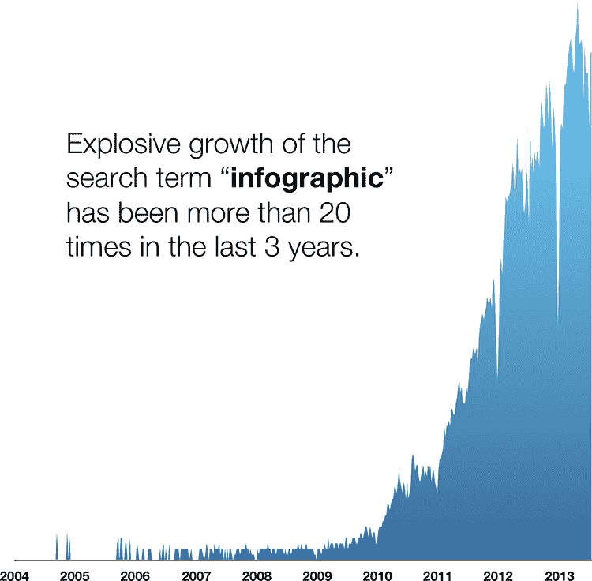

**图 1-6：** 信息图搜索量的增长

## 信息过载

我们每天都面对海量的数据和信息——新闻、广告、电子邮件、对话、短信、推文、书籍、告示，当然还有互联网。我们面临的挑战是过滤掉垃圾，关注相关信息并记住重要的内容。

这是一个推拉问题。我们积极寻求信息，同时公司和广告商也在向我们推销信息。

## 信息噬者的崛起

这个问题的第一个部分是人们不断寻找新信息。从现实意义上说，我们是自己的敌人。我们面对大部分信息是因为我们在寻找它们。简化的原因是我们希望获得更多信息，以便做出更好的决定。

1983 年，认知心理学领域的奠基人之一乔治·A·米勒（George A. Miller）创造了信息噬者（informavore）一词，描述人类收集和消费信息的行为（图 1-7）。后来它被哲学家丹尼尔·丹尼（Daniel Dennett）和认知科学家斯蒂芬·平金克（Steven Pinker）所普及。米勒表示：“正如身体通过摄入负熵来生存，大脑通过摄入信息来生存。在非常广泛的意义上，所有高等生物都是信息噬者。”

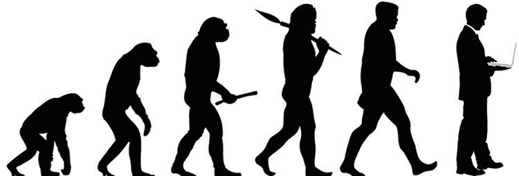

**图 1-7：** 信息噬者的演变

2000 年，技术作家瑞秋·查默斯^[5]写道：“我们现在都是信息贪夺者，正如我们的祖先寻找猛犸象和幼虫一样，我们在追逐和消费数据。”她在文章中写下这段描述，是关于加州施罗克斯帕洛奥托研究中心的科研人员如何通过人类学，将人类与早期人类的觅食习惯进行对比，研究人们如何在互联网上寻找信息的。以下是内容的摘要：结果显示，这两种行为是相似的。

这种寻找信息的行为并不新鲜。自有记载的历史以前，人类就被收集新信息的动力驱动。这是人类不仅生存下来，而且发展出今天先进文明的主要原因。如何种出更好的作物、如何制造更好的武器、如何度过冬天、成功地猎到更多食物、杀死入侵的敌人等等。我们物种之所以繁荣，是因为我们一直在不断地学习和改进。

此外，做出更好的决策也面临着巨大的压力。为什么在拥有如此丰富的人类知识库的情况下，人们仍然做出糟糕的选择？例如，人们在做出购买决策之前面临着研究产品的压力，因为价格比较、促销优惠、星级评分、客户评论、专家推荐、功能比较以及第三方测试结果都可以轻松地获得。

这种行为的一部分是，人们希望被他人认为做出了良好的、信息充分的决策。为了决定买哪种新款微波炉最好，可能花费几天时间，因为我们通过进行更多研究来应对这种压力。我们需要更多的数据，所以我们去寻找。

## 大数据的崛起

我们生活在信息时代。人们触手可及的信息比历史上任何时候都多，这个问题将会变得更糟（或者变好，取决于你的观点）。这就像比把一个饥饿的人放在拉斯拉斯维加斯的自助餐餐厅里。我们在处处看到这种数据的增长；然而，很难量化我们每天看到多少信息。

平均而言，我们每天接触到的信息等同于 174 份报纸（假设一份报纸 85 页）。南加州大学的马丁·希尔伯特博士^[6]开展的这项研究查看了 2007 年的信息容量状态，与 1986 年每天仅相当于 40 份报纸的信息相比，结果代表了令人惊讶的增长（见图 1-8）。

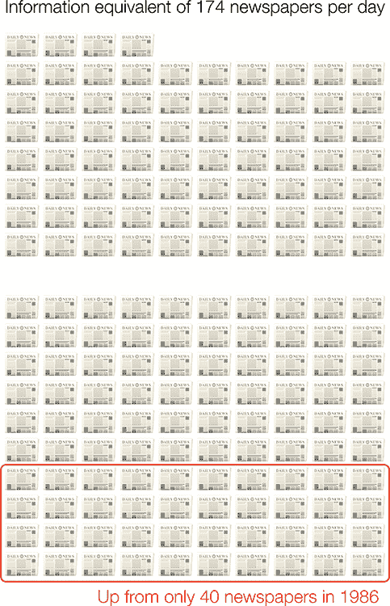

**图 1-8：** 我们每天接触的信息等同于 174 份报纸

我们另一种估计信息巨大量级的方法是测量跨越互联网的数据量。首先，这里快速回顾一下数据是如何衡量的。在图 1-9 中，左下角的微小黄色正方形代表 1GB 的数据（电脑屏幕上的单个像素）。较大的蓝色正方形代表 1TB 的数据，而大紫色正方形代表 1PB。每个正方形比前一个正方形大 1,024 倍。

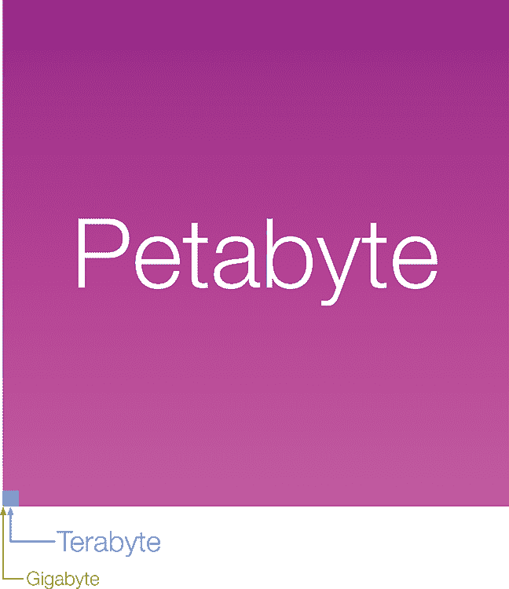

**图 1-9：** 1PB 的大小

2008 年的估计显示，Google 每天处理 24PB 的数据^[7]，而从有有的历史开始开始，人类所有语言的全部著作总计为 50PB。^[8]

考虑到 1PB 的大小，思科视觉网络指数^[9]就更有意义了。图 1-10 向你展示了已测量的历史互联网流量，并引出了到 2017 年每月超过 120,000PB 的未来预测。

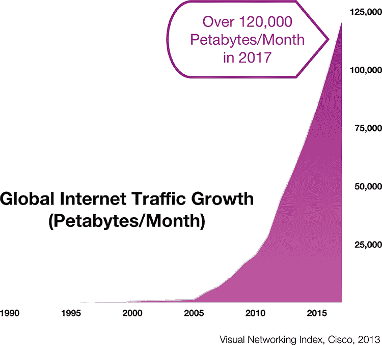

**图 1-10：** 全球互联网流量增长

现代世界可用的数据量有很多衡量方法，但它们都表明它将继续增加。

## 为什么信息图有效

那么，我们该如何应对呢？

视觉信息之所以对人类来说是更有效的沟通形式，有几个原因。主要原因是，视觉是我们用来感知周围世界的最强大的输入形式。在他的《大脑规则》一书中，发育分子生物学家约翰·麦迪纳指出：“视觉远我们是最主导的感官，占据了我们大脑一半的资源。”^[10]

研究估计，人类大脑的 50–80% 用于各种形式视觉处理^[11][12]，例如视觉、视觉记忆、颜色、形状、运动、模式、空间意识和图像记忆。

### 模式识别

人类是模式识别机器。是的，这源于生存本能的进化。为了生存，人类需要在几秒钟内看到情况并做出相应反应。我们可以看到图 1-11 照片中的场景，识别出躲在草丛中的狮子。


**图 1-11：** 草丛中的狮子

视觉化利用了这种模式识别能力。这是信息图强大的主要原因之一。

### 背景语言

数据可视化是背景的语言，关键在于对多个值进行比较。如果我们看到一个数字，我们不知道如何理解。图 1-12 显示了一个孤立的值。在孤立状态下，大脑不知道它是大是小、好是坏、是增加还是减少？如果没有提供背景，你的大脑会根据自己的经验提供背景。你可能会想：“我儿子学校大约有 500 学生，这个数字很大！”

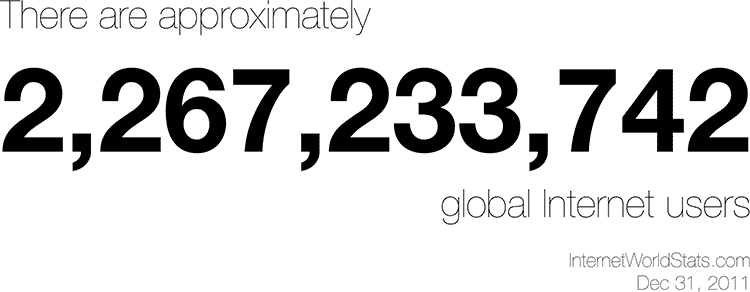

**图 1-12：** 孤立的数字没有背景^[14][15]

这是观众带来的负担。如果设计师不提供背景来帮助理解该数值，观众就会自己解释。很有可能，这并不是设计师希望观众解读数据的方式。为了清晰沟通，需要向他们提供背景。

我们无法有效地视觉化孤的数字。图 1-13 中的柱状图只有一根柱，它也没有给读者提供背景。

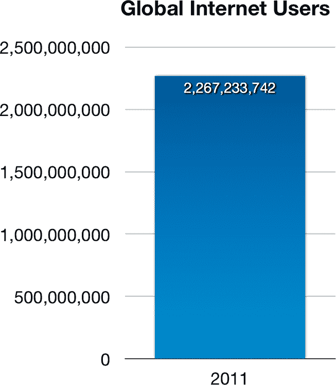

**图 1-13：** 只有一根柱的柱状图没有提供背景。

增加第二个比较值可以为读者提供原始值的背景。它提供了一个参考框架，让读者有一种理解原始数字大小的方法。图 1-14 包含了美国人口作为比较，并用圆形视觉化了这两个值。

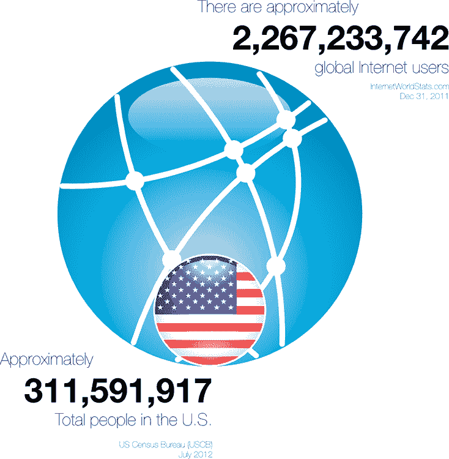

**图 1-14：** 提供第二个比较值创建了背景。

现在，读者有办法通过与他们可能熟悉的事物进行比较来理解原始数字。他们可能会想：“全球互联网用户数量是美国总人口的七倍多。那是大量的互联网用户了！”

通过提供第二个数字作为比较，设计师可以控制受众理解数据时使用的背景（context）。将这两个数字可视化利用了大脑的模式识别能力，即使观众本身并不知道美国的人口，他们也能看到这两个值之间的对比。背景对于设计师来说是一个强大的工具。

然而，能力越大，责任越大。`All data visualization is biased.`（所有数据可视化都有偏见。）这让许多希望数据可视化客观且“忠于数据”的人感到悦。通过为读者将数字置于特定的背景中，设计师正在塑造他们对这些数值的感知。这在数据可视化中引入了偏见。

设计师所做出的选择会给设计带来偏见。仅仅选择在可视化中包含哪些数字进行比较，就会在设计中产生某些偏见。哪些数字被忽略了？为了显示趋势，应该使用多远以前的数据？数据是什么时候收集的？所有这些选择都为设计引入了大小不等的偏见元素。

图 1-15 将用于创建背景的参考值改为地球的估算总人口。([15]) 现在，原始值在比较下显得更小了，因为只有世界上大约的三之一可以访问互联网。这改变了读者对原始值的感知和理解。

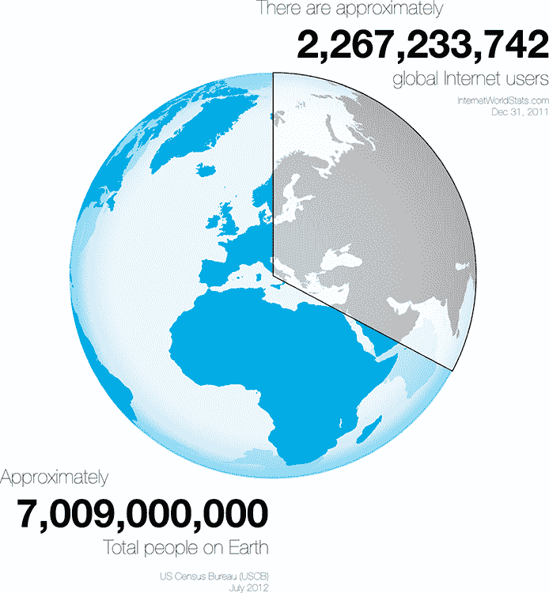

**图 1-15：** 提供一个不同的第二个值作为背景

注意这两个示例之间数据可视化风格发生了变化。在第一个可视化图中，美国并不是每个人都能访问互联网，因此它们被显示为两个独立的圆。在第二个可视化图中，所有的互联网用户都是地球总人口的一部分，因此读者可以将他们想象成饼图中的一个总数部分。

设计师需要平衡两个冲突的需求：传递信息的需求以及最大限度减少设计中偏见的需求。设计师每天都在与这一挑战作斗争。

### 图像优越效应

视觉系统对我们受益的最强方式可能是在记忆留存。人们对图片的记忆比对文字更好，尤其是在较长时间的时间内。这种现象被称为`图像优越效应`（Picture Superiority Effect）。

即使不理解该概念背后的科学，广告商多年来也直觉地知道了。即使是在像`黄页电话`这样简单的应用中，包含图片的列表也更成功。如果列表中包含图像，人们更有可能记住所广告的 la。

这也是公司为自己设计 Logo 的主要原因，如图 1-16。

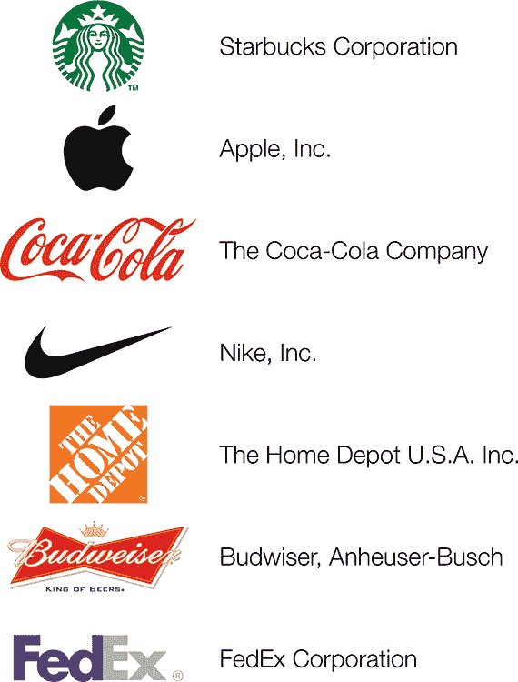

**图 1-16：** 消费者比公司名称文本更容易记住公司的 Logo

根据对图像优越效应的研究（图 1-17），当我们只读文字时，3 天后我们可能只记住 10% 的信息。如果这些信息以文字结合相关图像的形式呈现给我们，3 天后我们很可能记住 65% 的信息！^([10])

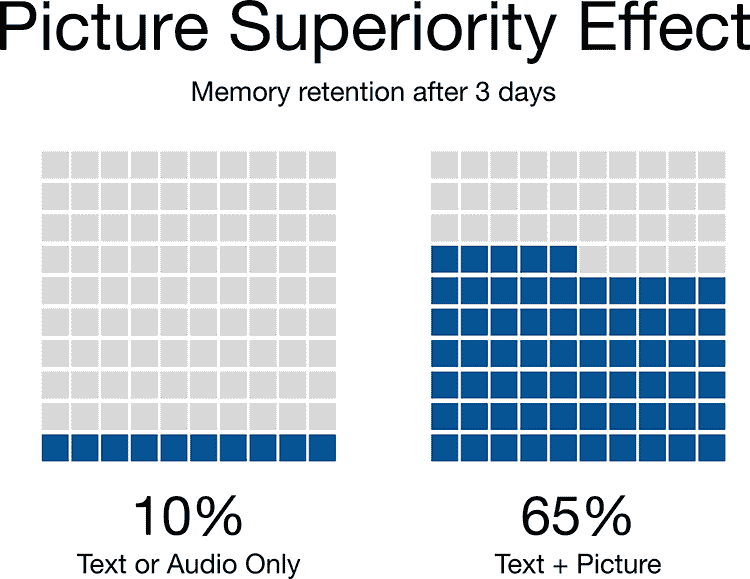

**图 1-17：** 图像优越效应

将相关图像与你的文本相结合，可以极大增加受众记忆的内容，增加 650%！

然而，并非任何图像都可以。它需要是与内容相关的图像，这可以加强你数据中的信息。这在广告、演示幻灯片、海报、手册、网站、广告牌以及当然，还有信息图表中非常有效。简单的文本信息结合相关图像，可以给你的受众留下持久且难忘的印象（图 1-18）。


**图 1-18：** 从互联网获取信息

[`coolinfographics.com/Figure-1-18`](http://coolinfographics.com/Figure-1-18)

*来源：The Information Hydrant*，Will Lion，2008

1917 年，艺术家和插画家 James Montgomery Flagg 设计了依然著名的“我需要你加入美国陆军”海报（图 1-19），海报将简单的文字信息与戏剧性的图像相结合。([16]) 由于图像优越效应，这张海报在 100 年后仍然容易被辨认和记住。如果没有图像。

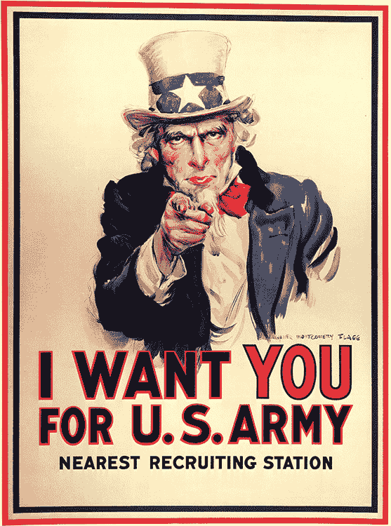

**图 1-19：** 来自世界的“我需要你”海报

在信息图设计中，图像优越效应延伸到了图表、图形和数据可视化。信息图设计师使用数据可视化和插图作为视觉组件来触发图像优越效应，这可以极大地帮助受众记住信息。诀窍在于可视化必须脱颖而出。仅仅包含图表并不意味着设计变得有趣。就像看到满是图表的演示会让观众昏睡一样，如果信息图设计师反复使用相同的图表，观众就不会记住区别。设计师可能会在一个数据可视化的设计上花费大量时间来寻找新的风格或可视化方法。这种在图表设计上的长时间投入可能是为什么许多人误认为信息图设计只是让图表漂亮。

2010 年，Sam Loman 设计了信息图《Underskin》，如图 1-20 所示。该设计绘制了人体内的八个系统（消化、呼吸、动脉等），并使用地铁图的可视化风格标注了主要的连接点。这种设计是独特的且脱颖而出的，因为它不是文字列表，也不是在真实人体图像上的堆砌注释。尽管地铁图的设计风格广为人知，但以前从未被应用于这个医学主题，该设计与其他医学来源相比非常引眼。尽管它是为医学受众准备的，但该设计在网络上的许多非医学网站（如 Gizmodo、Behance、Vizworld、Information Aesthetics、Neatorama、Flickr 和 Cool Infographics）上都疯传了。

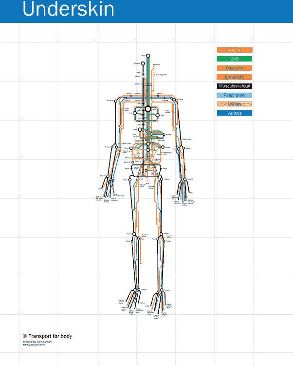

Loman 有效地将现的设计风格应用到一组新信息中，创建出新颖且不同的可视化效果。所得的设计无疑是独特且令人印象深刻的。

## 叙事艺术

良好的信息图设计在于通过结合数据可视化设计和平面设计来讲述故事。许多优秀的信息图都遵循一个简单的三部分故事格式：引言、核心信息和结论，如图 1-21 所示。

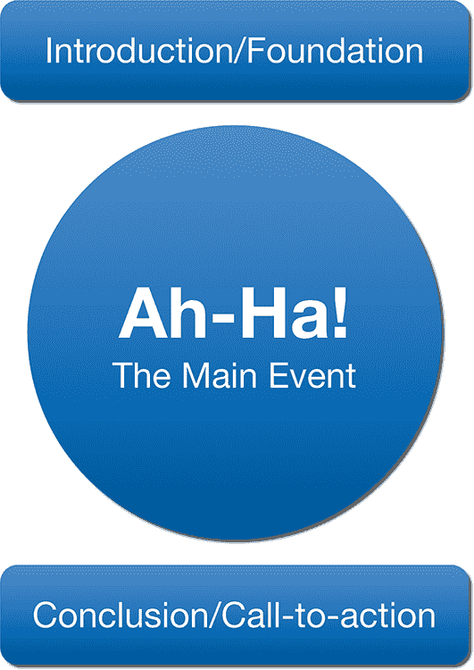

**图 1-21：** 三部分故事格式

### 引言/基础

引言部分需要向读者介绍信息图的主题。这张信息图是关于什么的？读者为什么要关注它？这通常是标题和简短段落的结合。这是设计师向目标受众传达这张信息图是为他们准备的，并且包含了他们会觉得有趣的内容。

这一部分还需要为信息奠定基础——在读者准备好理解主要事件之前，他们需要清晰理解的所有内容。引言可能包含几个有助于奠定基础的可视化图。也许在进入细节之前，先对整个行业进行可视化，这有助于让读者准备好学习新知识。

### 恍啊！主要事件

为了让信息图对观众来说脱颖而出，它必须包含一些新的、此前未发现的信息。这是主要事件，通常也是信息图中占据主导视觉视觉部分。

这一部分是信息图存在的全部理由。这里包含的信息是人们费力设计这张信息图的原因。通常，这一部分会使用大型插图或数据可视化，以触发读者的“图片优势效应”（Picture Superiority Effect）。如果观众只记得信息图中的一件事，设计师希望他们记住的是这个核心信息点。

### 结论/行动号召

信息图设计在底部需要有一个结尾，设计师在结尾为读者总结信息——就像结束一场精彩的演讲一样。

如果合适，如果设计师希望读者在学习完这一惊人信息后能采取某种跟进行动，那么在这里应该包含一个行动号召。他们应该访问网站、签署愿书、购买产品、开始吃更健康的食物、给国议员写信，还是给妈妈打电话？

设计不应该听凭他们是否会采取适当的行动，而应该明确告诉读者如何处理他们被赋予的智慧结晶。


图 1-22 是来自 RothIRA.com 的一张信息图，针对年轻群体，提供了有关退休储蓄的信息。它有一个简短的引言介绍了角色 Tom，还概述了一些基本假设作为基础信息，例如在 70 岁之前每天节省 1.00 美元。

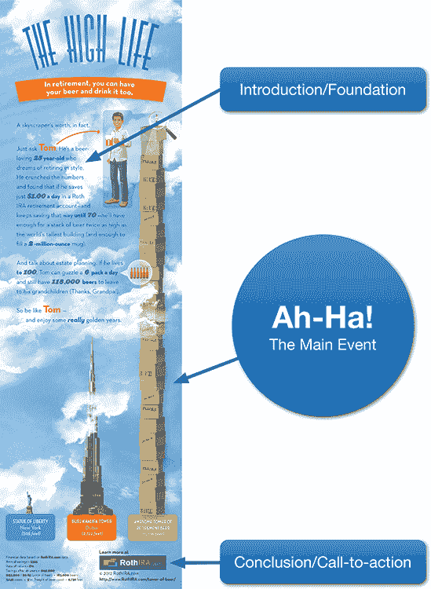

图 1-22：“啤酒塔”信息图体现了三部分故事格式 [`coolinfographics.com/Figure-1-22`](http://coolinfographics.com/Figure-1-22)

*来源：The High Life, Tower of Beer*，RothIRA.com，2012

主要事件是一叠啤酒箱塔的可视化。如果 Tom 从 25 岁开始储蓄，他将负担得起这一叠啤酒。这堆啤酒与两个较小的物体进行了对比：自由女神像和世界最高建筑哈利法塔。通过选择两个比“啤酒塔”小且易于识别的物体，设计突出了这堆啤酒有多么令人惊叹。

明确的行动号召是一个极具欺骗性的简单陈述：“在 RothIRA.com 了解更多。”含蓄的行动号召是让读者现在就开始为退休储蓄。

## 信息图的媒体格式

设计师可以使用六种不同的信息图媒体格式，如图 1-23 所示。尽管我们在网上看到的大多数信息图都是静态图像，但许多设计师已经以不同的方式利用叙事和数据可视化。这些格式之间的选择取决于设计的整体目标。

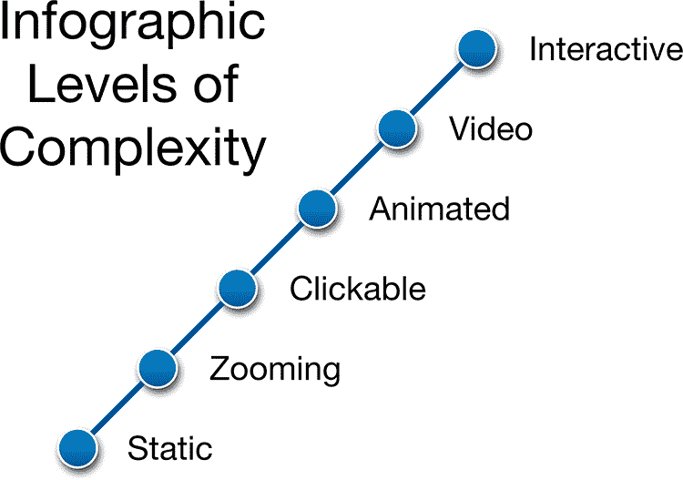

图 1-23：按复杂度增加顺序排序的六种信息图形式

### 静态信息图

静态信息图是信息图设计中最简单、常见的格式。最终设计被保存为图像文件，以便于在线分发和纸质打印。大多数软件应用程序都有将最终设计保存为静态图像文件（`JPG`、`PNG`、`GIF` 等）的能力，以便在浏览器中查看或作为 `PDF` 文件。

图 1-24 是静态信息图设计的良好示例。来自 Nuance Communications 的《声音即王》（Voice is King）使用数据可视化和插图讲述了一个引人入胜的信息。该设计可以轻松融入网站和博客文章，且静态图像可以通过电子邮件以 `PDF` 文件的形式轻松分享。

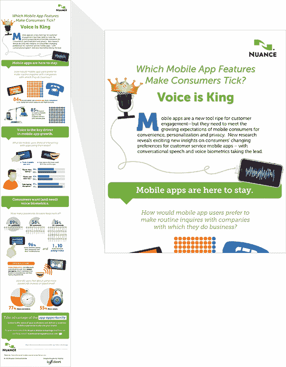

图 1-24：《声音即王》，静态信息图 [`coolinfographics.com/Figure-1-24`](http://coolinfographics.com/Figure-1-24)

*来源：Voice is King*，Nuance Communications

静态信息图也是最容易分享的格式。不需要特殊的应用程序或浏览器扩展。静态信息图历史悠久。静态图像发布后，即可供分享。

主要的社交媒体网站（Twitter、Facebook、Google+、LinkedIn）都有分享静态图像的能力（图 1-25）。

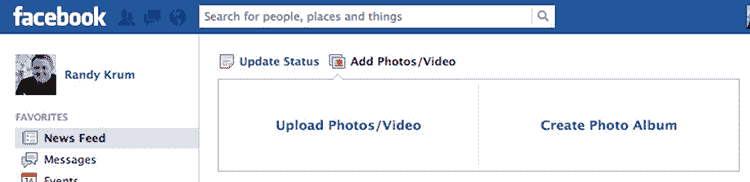

图 1-25：Facebook 上传界面

信息图的缩略图嵌入状态更新中，并向所有粉丝显示，如图 1-26 所示。

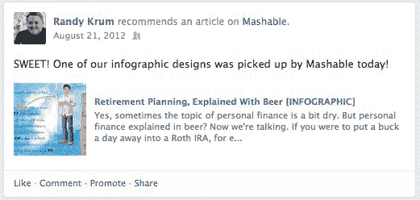

图 1-26：动态送送显示的信息图图像

### 缩放信息图

缩放信息图为线上的大型静态信息图增加了交互层，让读者能够轻松放大以阅读细节。这些通常用于大型设计和海报，因为计算机浏览器窗口的小空间导致文字太小无法阅读。大型设计被缩小尺寸，以便在屏幕上一次性查看整个设计，并提供缩放控制，允许读者清晰地查看小细节。

图 1-27 展示了如何使用缩放界面查看《流行/摇滚音乐谱系》信息图海报。

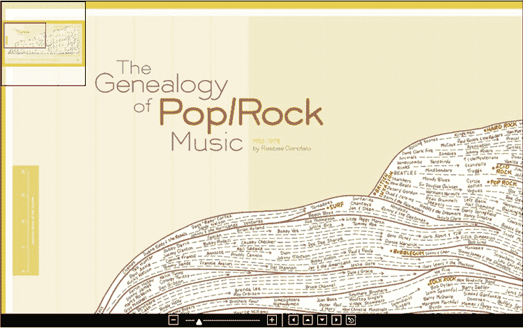

图 1-27：缩放界面示例 [`coolinfographics.com/Figure-1-27`](http://coolinfographics.com/Figure-1-27)

*来源：Genealogy of Pop & Rock Music*，Reebee Garofalo，HistoryShots

缩放界面通常通过从一个静态设计的大型图像文件开始，然后将界面控件作为网页的一部分添加。使用 `HTML5` 和 `JavaScript` 等自定义网页代码可以创建用户界面，但像微软的 `Zoom.it`（[zoom.it/](http://zoom.it/)）这样的在线服务可以让任何人通过在线可用图像链接创建一个交互式的、可缩放的图像界面。

图 1-28 展示了巨大的信息图设计，由密歇根州立大学的 Phillip H. Howard 副教授及其妻子 Ginger Ogilvie 创作的《2010 年啤酒品牌与品种所有权》（Ownership of Beer Brands and Varieties）。该设计是各母公司拥有的多种啤酒的大型可视化。在屏幕或页面上整体查看时，大部分文本是无法阅读的。

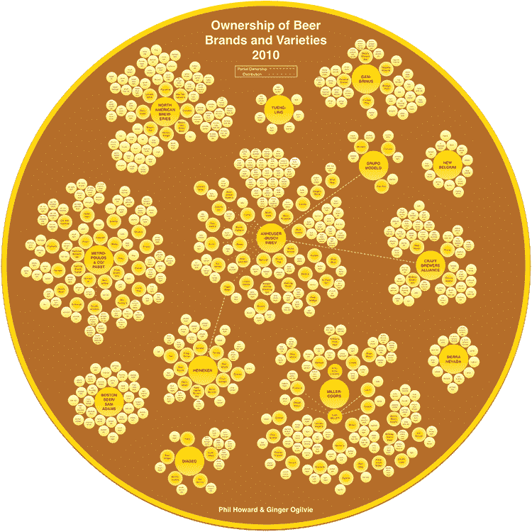

图 1-28：大型海报尺寸的信息图设计非常适合缩放界面

[`coolinfographics.com/Figure-1-28`](http://coolinfographics.com/Figure-1-28)

*来源：《2010 年啤酒品牌与品种所有权》，Phillip H. Howard 和 Ginger Ogilvie*

然而，通过使用 `Zoom.it` 工具，他们创建了你在图 1-29 中看到的缩放界面。读者可以使用鼠标或右下角的控件导航设计。带有缩放界面的设计可以在所有浏览器中查看，甚至嵌入到其他网站进行共享。

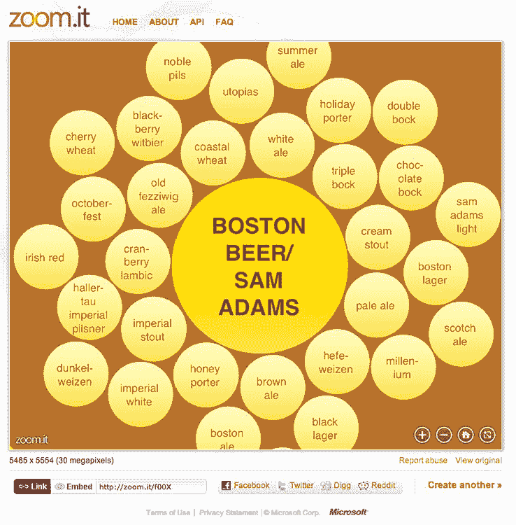

图 1-29：`Zoom.it` 界面工具中的啤酒所有权信息图

[`coolinfographics.com/Figure-1-29`](http://coolinfographics.com/Figure-1-29)

*来源：《2010 年啤酒品牌与品种所有权》，Phillip H. Howard 和 Ginger Ogilvie*

使用缩放界面的主要优势是，它让读者在深入细节之前，无需任何滚动即可在屏幕上看到整个设计。从大局开始，读者可以更好地理解细节是如何融入整体故事的并获取背景。

### 可点击信息图

点击式信息图通过 `HTML` 链接使设计的特定区域可点击，从而为静态信息图设计添加了用户界面层。这种界面通常被创建为 `HTML` 图像映射（Image Map），由网络浏览器解释，通过像素位置识别静态图像的特定区域并将其作为可点击的 URL 地址。设计师利用可点击设计的优势，从主信息图设计中移除次要信息和额外细节。

设计师可以使用点击式信息图作为一种方法，保持原始信息图整洁且易读。想要更多信息的读者可以通过点击链接深入探索，但主信息图仍然保持简单易懂。

在打印页面上展示这种工作原理稍微有点困难，如图 1-30 所示。在这个 2011 年的设计中，VinTank 的《最有前景的 26 款葡萄酒应用》列表显示在一个按类别分组的可视化图表中。每个 `iOS` 应用图标在点击时都会将读者带到 `iTunes App Store` 中的相应页面。这通过消除在文中列出所有 URL 地址的需求，保持了设计的整洁简单。

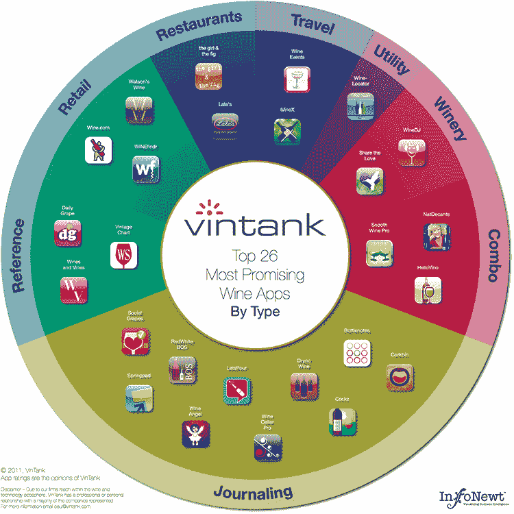

图 1-30：此信息图中的每个图标都是独立的 `HTML` 链接

[`coolinfographics.com/Figure-1-30`](http://coolinfographics.com/Figure-1-30)

*来源：VinTank App Spectrum*

这种设计风格的变体是弹出式信息图风格。读者不是通过点击信息图的不同区域来访问额外信息，而是当读者将鼠标指针悬停在设计的不同区域时，次要信息就会出现。

《生巧克力历史》（A Raw Chocolate History）是一张信息图时间线。图 1-31 中的主要设计是一个带有插图的简单圆形时间线，但当读者悬停在任何插图上时，特定于该时期的次要信息就会出现（图 1-32），在不使原始设计拥挤的情况下为读者提供额外信息。

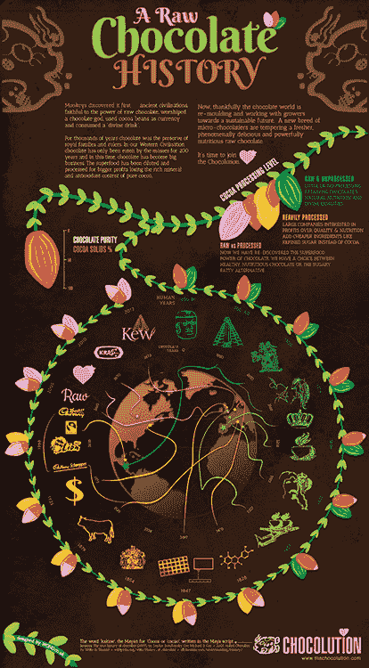

图 1-31：使用弹出信息可以保持原始设计的整洁

[`coolinfographics.com/Figure-1-31`](http://coolinfographics.com/Figure-1-31)

*来源：《生巧克力历史》，The Chocolution.com*

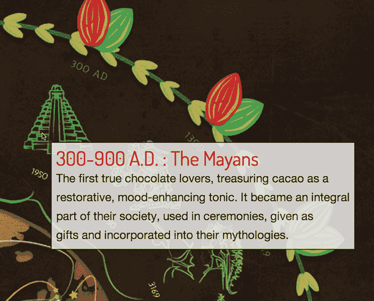

图 1-32：弹出信息

这种设计风格的另一种变体是弹出式信息图风格。读者不是通过点击信息图的不同区域来访问额外信息，而是当读者将鼠标指针悬停在设计的不同区域时，次要信息就会出现。《生巧克力历史》是一张信息图时间线。图 1-31 中的主要设计是一个带有插图的简单圆形时间线，但当读者悬停在任何插图上时，特定于该时期的次要信息就会出现（图 1-32），在不使原始设计拥挤的情况下为读者提供额外信息。（注：原文中存在大量重复段落已按要求去重）

使用动画 `GIF` 图像格式具有显著的额外优势。因为动画完全包含在图像文件中，所以当它发布在其他网站和博客时，动画可以正常运行。这与使用代码创建动态信息图的设计形成对比，后者要难分享得多。

图 1-35 所示的《距离火星有多远？》是一个内置在网页中的动态信息图设计。该设计由 David Paliwoda 和 Jesse Williams 创建，它将地球与火星之间的距离视觉化，其比例使得地球在屏幕上的直径为 100 像素。点击屏幕底部的箭头将开始页面滚动到月球轨道并最终到达火星的动画。星群的视觉运动以及火星出现在屏幕上所需的时间，让观众清晰地理解了行星之间真实的距离有多远。

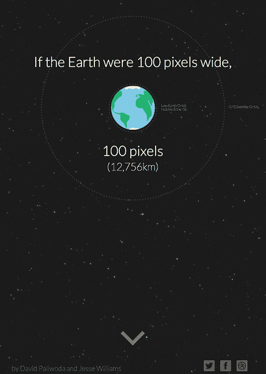

图 1-35：观众点击后动态信息图开始运行

[`coolinfographics.com/Figure-1-35`](http://coolinfographics.com/Figure-1-35)

*来源：David Paliwoda 和 Jesse Williams*

### 视频信息图

视频信息图仍然相当新颖，但因为在 YouTube 和 Vimeo 等视频共享网站上易于使用，在在线上迅速发展。能够将这些网站的完整可播放视频嵌入到博客和社交媒体帖子中，使得视频信息图对营销人员的流量和价值大幅增加。

我在 2007 年在 Cool Infographics 上发布的第一个关于视频信息图是 Royksopp 的歌曲“Remind Me”音乐视频（[`youtube.com/watch?v=eo4u4JJAPGk`](http://youtube.com/watch?v=eo4u4JJAPGk)）。这段视频讲述了一个住在伦敦的年轻女性的一天生活。视频中的数据可视化是关于围绕着她的现代生活的细节，例如在她刷牙时，展示了她公寓的管道系统是如何运作的。这段视频为随后的视频信息图设计树立了高标准（图 1-36）。

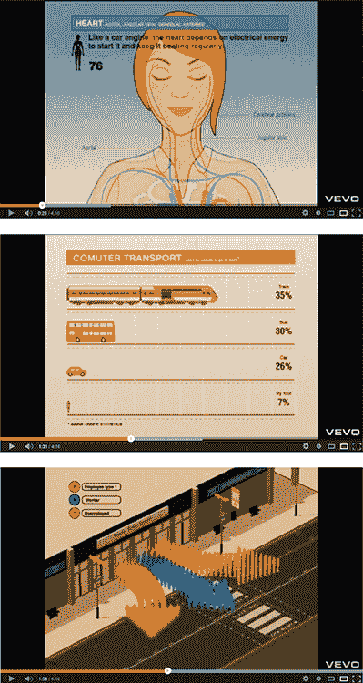

图 1-36：Royksopp 的“Remind Me”视频信息图

[`coolinfographics.com/Figure-1-36`](http://coolinfographics.com/Figure-1-36)

其他视频信息图并不是用高端动画软件制作的。在线上许多流行的视频信息图都是使用现成的演示软件（如 Microsoft PowerPoint、Apple Keynote 和 Prezi）制作的。通过使用动画幻灯片切换和仔细的时间控制步骤来自动化整个演示，演示文稿可以导出为视频文件进行传播。

由 Karl Fisch、Scott McLeod 和 Jeff Brenman 制作的“你知道吗？Shift Happens”视频信息图（[`youtube.com/watch?v=ljbI-363A2Q`](http://youtube.com/watch?v=ljbI-363A2Q)）最初是 2006 年 8 月在科罗拉多州森特尼尔市 Arapahoe 高中向教职员工进行的 PowerPoint 演示。初始视频经过重新混辑，删除了学校特定的信息，并于 2008 年上传到 YouTube。它迅速走红，到 2012 年底，那段信息图视频的观看量已超过 560 万次（图 1-37）。

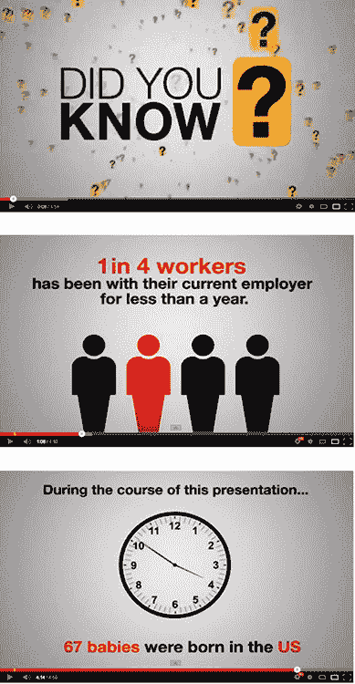

图 1-37：“你知道吗？3.0”信息图视频

[`coolinfographics.com/Figure-1-37`](http://coolinfographics.com/Figure-1-37)

这些视频没有使用很多数据可视化（大部分数据仅以文本形式显示），但它很好地为观众提供了数字背景信息。最初的那段视频在随后的几年中产生了一系列更新，并已可能成为迄今为止最成功的视频信息图活动。在过去的 5 年里，在设计公司 XPLANE（[`xplane.com`](http://xplane.com)）的帮助下，它变成了一个视频，并开始使用更先进的动画软件工具。到 2012 年底，整个视频系列的观看量超过了 3300 万次。[`shifthappens.wikispaces.com/`](http://shifthappens.wikispaces.com/) 创建了一个围绕视频系列历史的完整 wiki 网站。

### 交互式信息图

交互式信息图是让读者对显示的数据或可视化具有一定控制权的设计。它们之所以受欢迎，是因为它们比静态信息图更能吸引读者。一些网站是独立的数据可视化，另一些则构建在更大的信息图设计中。

《纽约时报》网站已被许多人认为是交互式信息图和数据可视化的世界领导者。图 1-35 显示了一张 2012 年选举地图。地图上的每个县根据最终结果显示为深浅不一的红色或蓝色。用户可以进入特定的州，查看数据并根据选择更改显示。


图 1-35：《纽约时报》2012 年选举

[`coolinfographics.com/Figure-1-35`](http://coolinfographics.com/Figure-1-35)

有些公司为他人设计并提供数据可视化工具。Tableau 是该领域的领导者之一，并免费提供 Tableau Public 版本。该工具允许我们使用自己的数据创建可视化，并将可视化嵌入我们的网站中，以便在更大的信息图设计中包含交互式数据可视化。*Super PACs*（图 1-36）由 Visually 公司的 Jess Bach 设计，使用了 Tableau 可视化模块作为设计中的图表。结果是所有图表都是交互式的，读者可以通过点击调整任何图表以突出显示不同的信息。


图 1-36：*Super PACs*

[`coolinfographics.com/Figure-1-36`](http://coolinfographics.com/Figure-1-36)

*来源：Visually, Inc.*

## 参考文献

1. Edward R. Tufte，*The Visual Display of Quantitative Information*（Cheshire, CT: Graphics Press LLC，2001）。[`http://www.edwardtufte.com/`](http://www.edwardtufte.com/)

2. George A. Miller，“信息欲者”，载 *The Study of Information: Interdisciplinary Messages*，Fritz Machlup 和 Una Mansfield 编，（New York: Wiley-Interscience，1983），111–113。

3. Daniel Dennett，*Kinds of Minds: Toward an Understanding of Consciousness*，（New York: Basic Books，1997）。

4. Steven Pinker，*How the Mind Works*，（New York: Norton，1997）。

5. Rachel Chalmers，“像布什人一样冲浪”，*NewScientist*，no. 2264，（2000 年 11 月 11 日）。

6. Martin Hilbert 博士，“数字化时期（1986–2007/2010）世界技术通信能力的维度与特征映射”，发表于第 9 届世界电信/ICT 指标会议（WTIM-11），国际电信联盟（ITU），（毛里求斯，2011 年 12 月 7 日至 9 日）。

7. Kevin Kelly，“扫描此书”，*New York Times*，2006 年 5 月 14 日：[`http://www.nytimes.com/2006/05/14/magazine/14publishing.xhtml?pagewanted=all&_r=0`](http://www.nytimes.com/2006/05/14/magazine/14publishing.xhtml?pagewanted=all&_r=0)。

8. Jeffrey Dean 和 Sanjay Ghemawat，“MapReduce：大型集群上的简化数据处理”，*Communications of the ACM* 51，no. 1，（2008 年 1 月），107–113。[`http://static.usenix.org/event/osdi04/tech/full_papers/dean/dean.pdf`](http://static.usenix.org/event/osdi04/tech/full_papers/dean/dean.pdf)。

9. Cisco 视觉网络指数，2013：[`http://www.cisco.com/en/US/netsol/ns827/networking_solutions_sub_solution.xhtml`](http://www.cisco.com/en/US/netsol/ns827/networking_solutions_sub_solution.xhtml)。


10. John Medina，*Brain Rules: 在工作、家庭和学校生存与茁发展的 12 项原则*，(Seattle: Pear Press, 2009)。

11. Michael Weliky，“在表面之下，大脑涌动着未发现的活动”，罗彻斯特大学新闻中心，2004 年 10 月 6 日，[`http://www.rochester.edu/news/show.php?id=1898](http://www.rochester.edu/news/show.php?id=1898)。

12. MIT 研究——视觉信息的脑处理，*MIT News*, 1996 年 12 月 19 日，[`http://web.mit.edu/newsoffice/1996/visualprocessing.xhtml](http://web.mit.edu/newsoffice/1996/visualprocessing.xhtml)。

13. J. Heer, M. Bostock, 和 V. Ogievetskey，“可视化动物园之旅”，*Communications of the ACM* 53, no. 6 (2010 年 6 月), 59–67. [`http://queue.acm.org/detail.cfm?id=1805128](http://queue.acm.org/detail.cfm?id=1805128)。

14. 互联网世界统计：[`http://internetworldstats.com/stats.htm](http://internetworldstats.com/stats.htm)

15. 美国人口普查局，“世界人口钟预测”：[`http://www.census.gov/population/popclockworld.xhtml](http://www.census.gov/population/popclockworld.xhtml)。

16. James Montgomery Flagg，[`http://en.wikipedia.org/wiki/James_Montgomery_Flagg](http://en.wikipedia.org/wiki/James_Montgomery_Flagg)。

## 链接

本章中的许多图片可以通过以下链接或访问 [`www.wiley.com/go/coolinfographics](http://www.wiley.com/go/coolinfographics)。

1. StockTouch iOS 应用，Visible Market, Inc.:

   [`https://itunes.apple.com/us/app/stocktouch/id445170859?mt=8](https://itunes.apple.com/us/app/stocktouch/id445170859?mt=8)

2. *你会是个失败者吗？* 来自 Jess.net 和 Smarter.org：

   [`http://www.smarter.org/research/fail-charts/](http://www.smarter.org/research/fail-charts/)

3. *信息水龙头,* Will Lion, 2008：

   [`http://www.flickr.com/](http://www.flickr.com)

在线革命为互联网时代创造了“信息图”（infographics）一词全新的、额外的定义。在线设计主要用于公司的营销目的，它们已成为信息图内涵的新定义。这些新的信息图通过结合文本、图像、插图和数据可视化，将一个完整的故事或文章设计在单一图像中。它们以独立图像的形式发布，提供了一个自包含的（通常是图像文件）且具有视觉吸引力的故事。在线分享照片和图片的工具已经非常强大，这些新的信息图充分利用了这些工具，使分享变得简单且流行。

在过去的两年里，互联网已经成熟到人们现在每天将其作为新闻和信息的主要来源。照片、插图和图表一直通过增加视觉元素来提高印刷物中故事的阅读率，这种现象在在线上更为明显。同时，`Tumblr`、`Flickr`、`Blogger` 和 `WordPress` 等在线工具帮助个人出版成为主流。使用这些在线出版工具创建自己的网站和博客的人很快学到了同样的教训：视觉效果有助于驱动流量和参与度，而信息图往往比单一的图片更有效。

## 垂直布局与水平布局

在图 2-1 中显示的长条信息图格式是这种新型在线信息图的完美示例。`Mobile Youth: Teens & Cell Phones` 由 `PrepaidPhones.com` 在线发布，并按顺序排列，引导读者从上到下通过五个部分阅读信息。这创建了一个长条设计，大多数在线信息图都遵循这种格式。

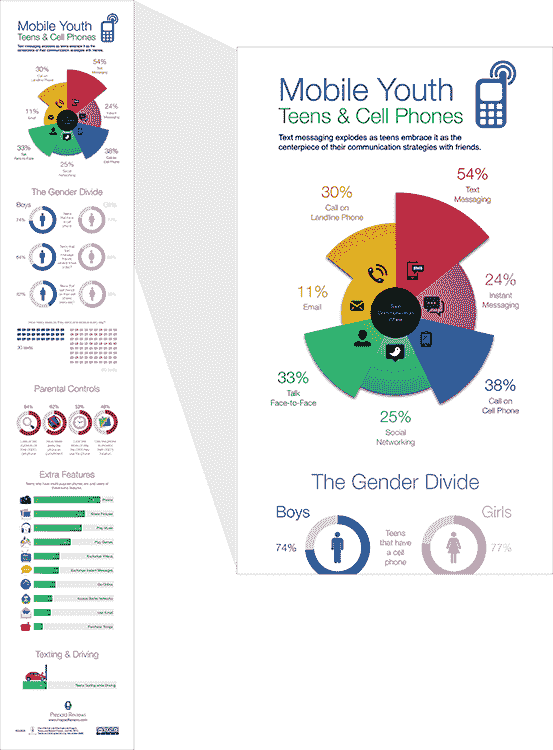

**图 2-1：** 长条格式信息图示例

[`coolinfographics.com/`](http://coolinfographics.com/Figure-2-1)`图 2-1`

来源：*青少年与手机手机*, `PrepaidPhones.com`

这种设计格式有多种不同的称呼，例如长条、长型或塔式信息图设计。从设计和网络界面的角度来看，长条格式的宽高比具有某些优势。计算机鼠标内置的技术使用户户手指轻轻一拨即可向上或向下滚动，但左右滚动则较困难。

更重要的是，大多数网站布局的设计都允许方便的垂直滚动，但不允许水平滚动。网站通常适应浏览器窗口的宽度，不需要侧向滚动，并且内容会延伸到窗口底部。用户已经预期通过向下滚动来显示网站的其他内容。过高而无法在屏幕上显示的图像会消失在浏览器窗口底部，用户知道可以向下滚动查看图像的其余部分。

根据一般经验法则，信息图的原始完整版本在网上发布时，图像大小通常为宽 800 像素，长度则根据故事的需要而定。这种尺寸允许信息图以全分辨率显示在公司网站上，并适应大多数网络浏览器的窗口宽度和屏幕分辨率。

然而，当信息图在其他网站上分享和转发布时，图像尺寸通常会被缩小为较小的缩略图，以适应博客或网站布局内容区域的宽度。博客设计平台上提供的大多数布局模板（如 `WordPress`）其内容空间仅有 600 像素宽，以便为侧边栏留出额外的网站内容。垂直长条格式设计在缩小以适应较窄内容宽度时通常仍然具有一定的可读性，但水平格式会被缩小得非常厉害，变成一个微小的、不可读的缩略图。

例如，图 2-2 展示了来自 `Hotels.com` 的名为 `What Guests Want.` 的信息图设计。原始信息图设计作为一个 800 × 4,000 像素的 JPG 图像文件发布。在自己的博客上转该信息图的人可能会将该文件缩小到 500 × 2,500 像素。宽度缩小了 37.5%，但整体尺寸（设计面积）缩小了 61%。

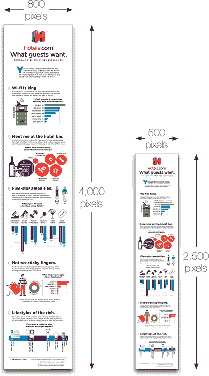

**图 2-2：** 垂直信息图尺寸对比

[`coolinfographics.com/`](http://coolinfographics.com/Figure-2-2)`图 2-2`

来源：*客人的需求*, `Hotels.com`

相比之下，如果我们考虑图 2-3 中来自 `BackyardOcean.com` 的 `The History of Swimwear` 信息中的趣味设计，情况就不同了。原始信息图设计是一个宽 4,000 × 800 像素水平格式设计，观众需要左右滚动查看所有内容。左右滚动并不是理想的，但在 `BackyardOcean.com` 网站上的实现让很容易浏览设计。然而，为了适应标准的博客格式，4,000 像素的宽度必须缩小到 500 像素宽。宽度缩小了 87.5%，但整体尺寸缩小了 98.4%。

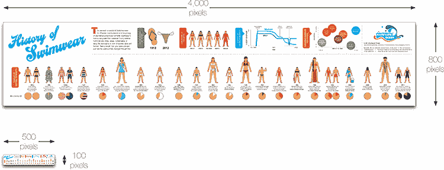

**图 2-3：** 水平信息图尺寸对比

[`coolinfographics.com/`](http://coolinfographics.com/Figure-2-3)

来源：*泳装历史*, `BackyardOcean.com`

反之，如果我们考虑 `Pinterest` 等图片共享网站使用垂直滚动界面来浏览长度不同的图像，这允许长格式设计完整显示。虽然它并非为此目的设计，但它为长格式设计提供了理想展示。在图 2-4 中，你可以看到所有信息图图像是如何压缩以适应固定宽度的。长格式设计对读者来说更容易，但水平格式被缩小到了非常小的尺寸。

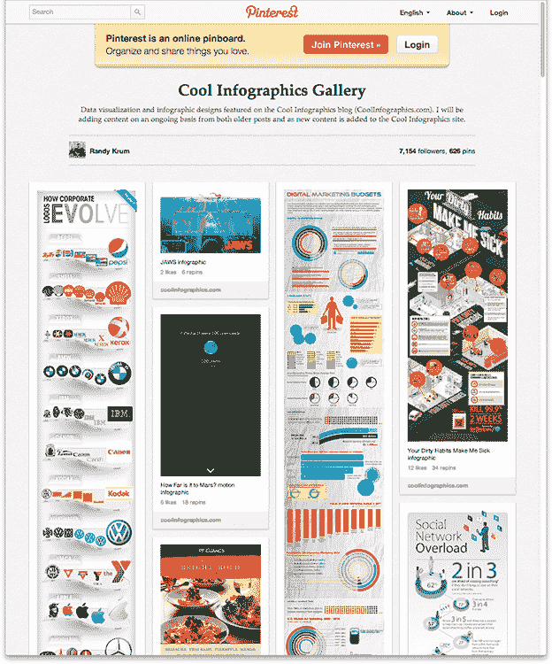

**图 2-4：** Pinterest 展示格式

[`coolinfographics.com/`](http://coolinfographics.com/Figure-2-4)`图 2-4`

尽管长格式设计非常适合在线发布，但只有当在线是你唯一的发布地时它们才是有效的。长格式设计在用于幻灯片或打印出来时特别难以使用。对于幻灯片和打印来说，限制维度变成了高度而非宽度。

打印在标准信纸或 A4 纸上或粘贴到幻灯片中的长格式会被缩小以适应页面尺寸。这创建了通常小到无法阅读或理解的图像。

`Our Amazing Planet: Top to Bottom` 信息图（图 2-5

**图 2-5：** 长格式对于在线查看很棒，但对于打印可能是一个糟糕的选择。

[`coolinfographics.com/`](http://coolinfographics.com/Figure-2-5)`图 2-5`

来源：*惊惊的星球*, Karl Tate, `LiveScience.com`

这张信息图是专为在线查看体验设计的。长条格式通过让观众花费大量精力滚动页面来查看整个设计，强化了所代表的巨大距离感。另一个版本（中间部分）是为了便于作为定制海报打印时具有更好的宽高比而创建的，但即使是这个版本，也必须大幅缩小尺寸才能在标准纸张上打印。

在这种情况下，这种效果非常好，因为主要的体验是在线上的。然而，设计师在进行任何信息图设计时，都需要仔细考虑他们的发布策略。如果主要在在线查看，长条格式是最佳的。如果你打算将信息图作为讲义材料打印或在演示文中使用，请考虑将整体设计限制在单页纸范围内，或者将其设计成可以轻松打印在不同页面上的章节。

## 在线信息图的类型

公司内部任何营销部门面临的最大挑战之一，就是直接向产品或服务的终端用户传递信息。许多公司产品卖给中间公司（如零售商或服务提供商），没有很多机会向其产品或服务的终端用户发送信息。此外，消费者通常不会仔细阅读购买的产品时附带的包装或说明书。

然而，公司对于其产品或服务有很多非常棒的故事可以讲述。

- 它们解决了哪些消费者问题？
- 它们提供了哪些独特优势或价值主张？
- 它们与其他产品有何不同？
- 产品中设计了哪些对消费者的好处？
- 为什么会有特定的设计选择？
- 它们是如何处理环境或可持续性问题的？

他们如何让消费者听取关于为什么他们的产品比竞争对手更好，或如何有效使用产品的故事？信息图已成为直接触达消费者的极佳格式。在线发布的酷、有趣且吸引人的信息图可以直接触达目标终端用户并抓住消费者的注意力。

图 2-6 是 Extra Space Storage 的一个绝佳案例。`Solar Savings: A Solar Innovation Story` 信息图是一个旨在与客户和股东共享额外信息的设计。该信息图为驱动业务的决策背后的数据提供了一些透明度，并帮助 Extra Space Storage 成为自储领域的市场领导者。

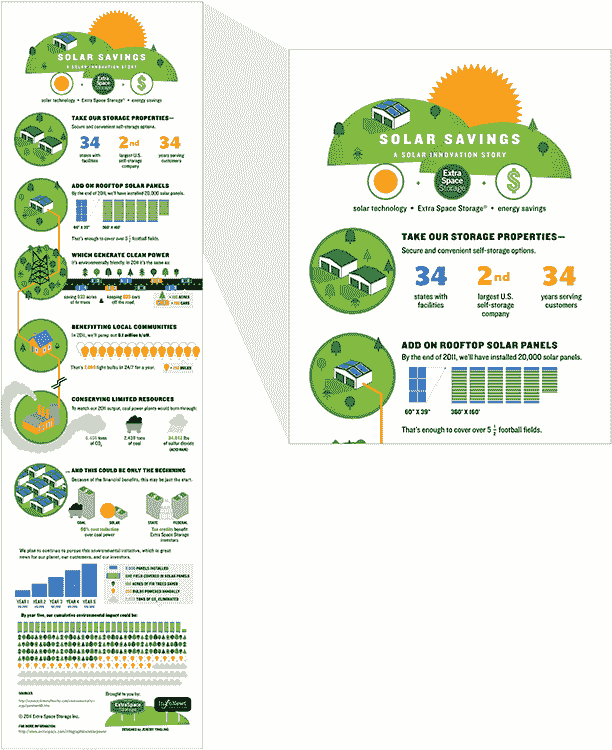

**图 2-6：** 使用信息图向消费者和股东介绍公司

[`coolinfographics.com`](http://coolinfographics.com)`/Figure-2-6`

来源：`Solar Savings: A Solar Innovation Story`，Extra Space Storage Inc.

### 信息告知型信息图

信息告知型信息图是你在网上最常见的设计类型。其底层理论是，在线观众更愿意阅读和分享有价值的信息，而不是广告。如果公司能够在不进行露骨推销的情况下向读者提供有价值的信息，那么这些信息图就有更大的机会与亲友分享，并可能在网上产生病毒式传播。

在在线发布了多年信息图后，我完全相信了这一理论。如果设计项目的目标是最大化查看次数、访问人数和指向托管网站的反链数量，信息告知型信息图比所有其他类型的设计都更成功。

考虑图 2-7 中 S.B. Lattin Design 的这个例子：`The Common Cook’s How-Many Guide to Kitchen Conversions.`（普通厨师厨房换算指南）。该设计非常精美，主题是以视觉形式展示的常见厨房测量换算的纯信息性总结。在该设计的任何地方，它都没有告诉你公司是做什么的，也没有向读者推销其服务。你知道它来自 S.B. Lattin Design，因为它在设计底部的页脚清晰地显示了其标志。

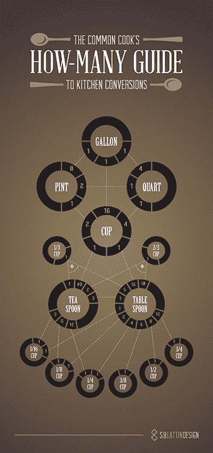

**图 2-7：** 信息告知型信息图设计

[`coolinfographics.com/`](http://coolinfographics.com)`Figure-2-7`

来源：`The Common Cook’s How-Many Guide to Kitchen Conversions`，S.B. Lattin Design

所呈现的信息是常识，任何想要汇总它的人都可以获取（人们可以从大多数食谱中推算出换算率），但设计师花时间收集数据，并以具有视觉吸引力的方式呈现，以触达受众。该设计在网上持续被大量分享，作为印刷海报产生销售，并使 S.B. Lattin Design 进入了其目标客户的脑海中。

最佳的设计关注与公司业务或品牌直接相关的主题，这创建了搜索引擎正在寻找的相关性。图 2-8 中的信息图是由在线备份公司 CrashPlan 发布的 `The Lifespan of Storage Media`（存储介质的寿命）。当然，公司想要向新客户销售其备份服务，但该信息图并不是一个销售推销。基于其广泛的研究，该信息图利用数据可视化向读者展示了为什么在线云端备份比将他们的数据、音乐、视频或照片存储在自己的设备上更好。

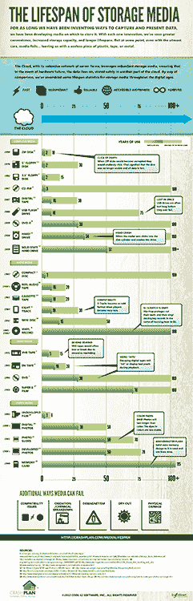

**图 2-8：** 关于存储的信息告知型信息图，而非广告或销售推销

[`coolinfographics.com/`](http://coolinfographics.com)`Figure-2-8`

来源：`The Lifespan of Storage Media`，CrashPlan

整体信息是所有存储设备随着时间的推移都会面临故障，但在线解决方案提供了具有可扩展、冗余和异地优势的备份。注意，该信息是独立且客观的。`任何`在线解决方案都可以提供这些基本利益，但通过发布该信息图，CrashPlan 在读者心中确立了其作为信誉市场领导者的地位。

与品牌的联系可能是显而易见的，也可能是微妙的，但告知的目标是将呈现的信息价值与品牌价值联系起来。这为品牌建立了良好的认知。

### 说服型信息图

说服型信息图的方法略有不同。这些信息图设计引导读者采取明确的行动号召，并试图说服观众在看到图后采取某些事情。

说服型设计中的可视化和信息都旨在引导读者得出预设结论，然后提供他们应该采取的特定行动。这种类型的设计会让读者产生怀疑并抵触情绪。他们知道信息图背后的公司或设计师正在推销特定的议程。

## 5. 我是从信息图上学到的，所以它一定是真的。

读者可能不会质疑分享给他们的信息的真实性或有效性，而数据可视化对观众来说往往极具吸引力。即使观众并不理解详细的数据，数据可视化的存在本身就暗示了一种科学的、定量的信誉，看起来是客观的。它们暗示这些信息是事实而非观点，尽管事实可能并非如此。

正如第 1 章提到的，所有的数据可视化都带有某种偏见。设计师决定了在可视化设计中包含哪些数据。如果信息图的目的是说服，那么设计师显然希望以一种引人入胜的方式呈现信息。

每天都有数以百万计的不同理由促使人们选择自己的行为，而良好的故事是说服人们应该加入某项事业的有效方式。这些设计试图说服观众采取的行动可以是任何事情。通常，这些是为了说服你做一些有助于你自己、你的当地社区或整个世界的好事。

- 开始运动。
- 为候选人、政党或公投投票。
- 前往新的目的地。
- 访问一个网站。
- 改善环境。
- 向慈善机构捐款。
- 加入一个社区。
- 联系选出的官员。
- 签署请愿书。
- 购买产品。
- 为有意义的事业投入时间。
- 参与一项活动。

图 2-9 显示了根据美国肺协会收集并发布的数据制作 `2012 年美国污染最大的城市` 信息图。该机构从全国范围内数千个空气传感器中收集空气质量数据，是一个致力于改善健康的组织。这些数据被发表在一份 200 页的报告中，供任何想要深入详细信息的人阅读，但一系列信息图有效地与普通大众分享了关键发现。

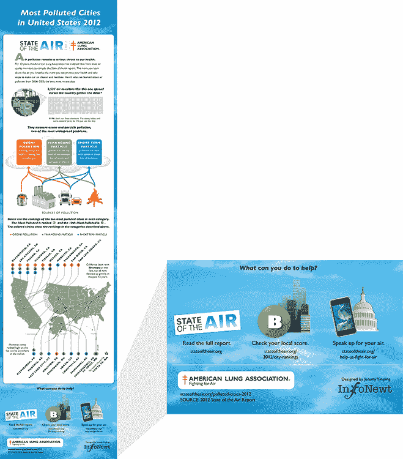

**图 2-9：** 具有说服力的信息图引导读者采取底部建议的行动

[`coolinfographics.com/`](http://coolinfographics.com)`图 2-9`

来源：`2012 年美国污染最大的城市`，美国肺协会

这种设计没有任何含蓄之处，这正是其目的所在。它显然来自广为人知的组织美国肺协会，标题“污染最大的城市……”立即告诉读者，这张信息图将告诉他们情况有多糟糕。

在读者浏览完这些信息后，该设计假设他们现在已经被说服采取行动，并在设计的底部提供了三个清晰的潜在行动：

- 阅读完整报告。
- 检查当地空气质量评分。
- 向国会代表发送信息。

另一个具有说服力的信息图是来自 MesotheliomaHelp.net 的 `癌症`，所示在图 2-10 中。该设计包含了多个数据可视化，利用了收集的关于癌症类型、全国范围内不同地点以及癌症受害者死亡率的若干统计数据。设计的结尾有一个清晰的行动号召：点击捐赠，这会将读者带到其网站上的一个特定页面，该页面列出了读者应该贡献的许多不同的癌症慈善机构。这种设计在概述问题范围方面做得很好，并提供了读者可以采取的特定行动来帮助抗击癌症。

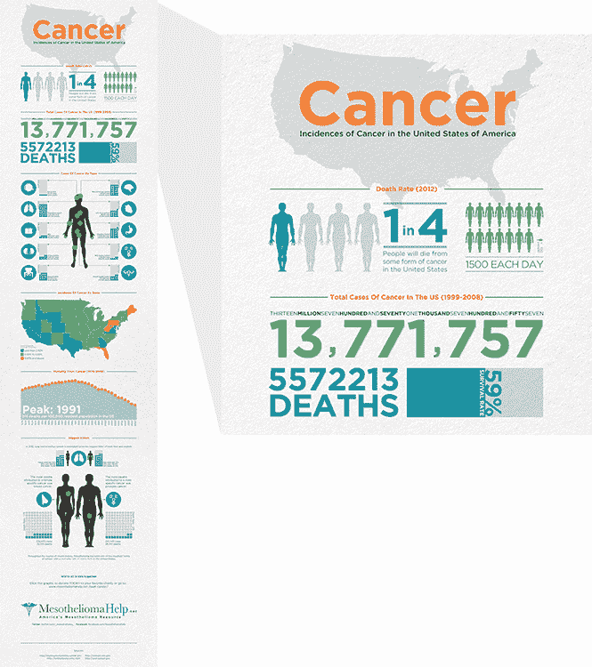


**图 2-10：** 具有一个清晰行动号召的说服性信息图设计：捐赠

[`coolinfographics.com/`](http://coolinfographics.com) `图 2-10`

来源：`美国美国癌症发病率`，MesotheliomaHelp.net

现在来拆解一个具有说服力的设计。GOJO Industries 在图 2-11 中的`肥皂会让你生病吗？`信息图是一个很好的例子，它展示了与`门罗动机序列（Monroe’s Motivated Sequence）`类似的结构，这是组织说服性演讲的经典技巧。当你从上到下阅读这张信息图时，讲述给观众的故事系列经过精心构建的具有强大效果的事实。

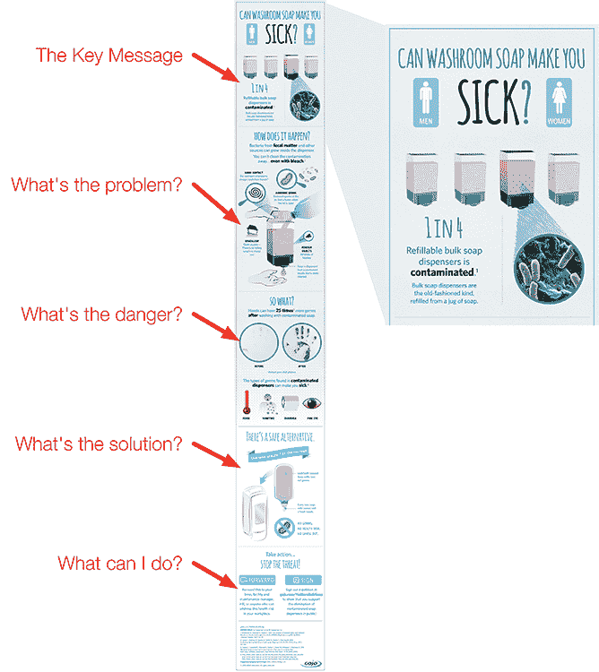

**图 2-11：** 引导读者通过信息序列的说服性结构

[`coolinfographics.com/`](http://coolinfographics.com) `图 2-11`

来源：`肥皂会让你生病吗？`，GOJO Industries

1. **核心信息。** “每 4 个大容量肥皂器中有一个被污染。”这吸引了观众的注意力，即使他们不看信息图的其他部分，也能理解设计的重点。
2. **问题是什么？** 这一部分通过解释细菌进入肥皂器有多么容易，建立了核心信息的信誉。
3. **危险是什么？** 这一部分具体告诉读者他们可能面临的风险，使其具有意义。
4. **解决方案是什么？** 现在既然观众理解了潜在问题，就可以理解所呈现的解决方案了。
5. **我可以做什么？** 该设计以两个读者应该采取的清晰行动号召结束：将此信息转发给经理（暗示读者对此问题担忧），或签署在线请愿书以提高意识。

注意这不是广告。行动号召不是购买产品，而是帮助他人了解风险。通过提高这种意识，GOJO 提升了自己的权威性，被说服的经理可能会联系 GOJO 更新肥皂器。

### 可视化解释

许多信息图设计并不试图可视化大量的统计、数字或数据集。相反，它们试图向观众解释一个观点、过程、关系或复杂的概念。这些可视化解释设计使用插图、图表和图标（偶尔使用数据可视化）向观众解释其主题。

`法律是如何产生的`（图 2-12）是 Mike Wirth 和 Suzanne Cooper Guasco 博士设计的获奖作品。这张信息图是美国联邦层面将法案变为法律的步骤流程可视化。注意这里没有图表或数据可视化。它是一个使用插图和文本向观众解释过程的信息图设计。

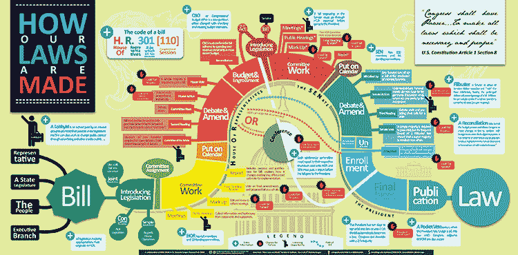

**图 2-12：** 美国通过新法律的可视化解释

[`coolinfographics.com/`](http://coolinfographics.com) `图 2-12`

来源：`法律是如何产生的`，Mike Wirth 和 Suzanne Cooper Guasco 博士。

可视化解释是公司在某个行业内展示其权威地位和能力的有效方式。这些信息图通常会成为读者保留或打印以备后用的设计，从营销角度来看，这是极好的，因为为品牌提供了持续的曝光。

图 2-13 是来自 Sugarrae.com 的`联盟营销如何运作`的视觉化解释。该设计中没有任何数值数据。该设计通过路径上三个颜色编码的角色将过程可视化，展示了所发生事件的顺序。这在博客文章中本是一个简单的 10 项文本符号列表，但将该过程转化为信息图设计使其变得极其受欢迎。这张信息图在网络上疯传，进一步确立了 Rae Hoffman 作为国内联盟营销顶尖权威之一的地位。

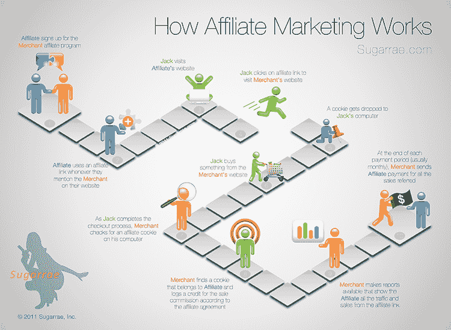

图 2-13：设计为视觉化解释信息图的 10 流程

[`coolinfographics.com/`](http://coolinfographics.com) `图-2-13`

来源：`How Affiliate Marketing Works`，Rae Hoffman, Sugarrae.com

### 信息图广告

信息图广告是说服性信息图的一种特定形式，因为它们显然试图激励观众采取行动。在这种情况下，行动号召（call to action）通常旨在说服读者购买特定的产品或服务。

总的来说，读者分享信息图广告的概率低于分享纯粹的信息类信息图。这适用于任何形式的内容，而不仅仅是信息图。人们不太可能向朋友分享显而易见的广告，因为这感觉像是在推销，而不是转发某些有价值的东西。

然而，数据可视化和信息图是公司向客户展示其产品优势的极佳方式。这些设计的目标与众不同相同。

信息图广告的目标是向潜在客户介绍产品，而不是为网页建立链接和流量。它们可以被有效地分享关于产品的通常复杂的信息。

- 比较竞争产品
- 组装或使用说明
- 产品优势
- 产品规格
- 咨询或服务流程

图 2-14 是`如何用葡萄酒搭配东南亚明亮大胆的风味`，来自 P.F. Chang’s 餐饮连锁店的一张信息图广告。这是其新促销菜单项目的广告。该设计在视觉上将独特的烹饪原料与新菜肴联系在一起，并提供了配酒建议。行动号召是读者去 P.F. Chang’s 门店并尝试新菜单项目。

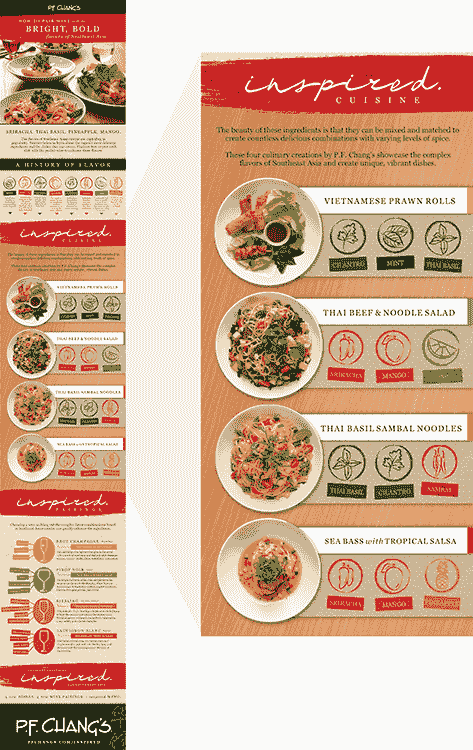

图 2-14：P.F. Chang’s 新菜单项目信息图广告

[`coolinfographics.com/`](http://coolinfographics.com) `图-2-14`

来源：`How to Pair Wine with the Bright, Bold Flavors of Southeast Asia`，P.F. Chang’s China Bistro, Inc.

这家公司显然试图销售他们的食物，这是完全可以接受的。我的印象是，这种设计旨在专门吸引餐厅回头客，给他们一个回来尝试新事物的理由。

这张信息图广告是大型营销活动的一个内容之一，该活动包括一个专门的网页、印刷广告、可下载的交互式 PDF、在线视频以及该信息图。

每种产品和服务都有一个复杂的故事要告诉客户，解释公司为什么做出特定的设计决策，从而将一个产品想法塑造成商店架上的实际产品。人们在公司里为这些项目努力工作，并对其充满热情。当他们发现预期购买这些产品或服务的客户不像他们那样兴奋和热情时，他们往往会感到失望。

主要的区别在于，公司的员工可以看到产品背后的所有故事。而消费者只能看到产品包装或广告上的内容，而且他们通常不会花时间完全阅读其中任何一种。公司有机会长时间地吸引消费者的兴趣以讲述他们的故事，这是罕见的。

利用信息图来传达产品信息可以是一种极具说服力的广告形式。公司产品设计成其独特规格有许多具体原因，包括：

- 未满足的消费者需求
- 与竞争者的差异化
- 独特的优势
- 较低的价格点
- 颜色选择
- 设计风格或时尚趋势
- 人体工程学设计
- 易用性
- 环境影响

`图像优越性`（参见第 1 章）可用于使视觉信息被观众记住的概率提高 650%，这是公司拥有 Logo 的主要原因。潜在客户更容易记住视觉 Logo 而非仅仅是公司名称，而且这种记忆会转化到商店里的购买行为。客户倾向于购买他们认可的品牌的产品。

信息图为公司提供了一个机会，以引人入胜的方式讲述其产品和服务的独特故事，使复杂的故事易于理解、分享和记忆。通过将关于产品的故事视觉化，公司可以增加潜在客户在站在商店做出购买决策时所记住的信息量。

来自加拿大 SoNice 的`Making an Organic Choice`（图 2-15）是一张信息图广告，它比较了其制作豆浆产品的有机工艺与传统的食品加工方法。这家公司对有机食品充满热情，信息图设计给了它一个机会展示与传统方法的对比。

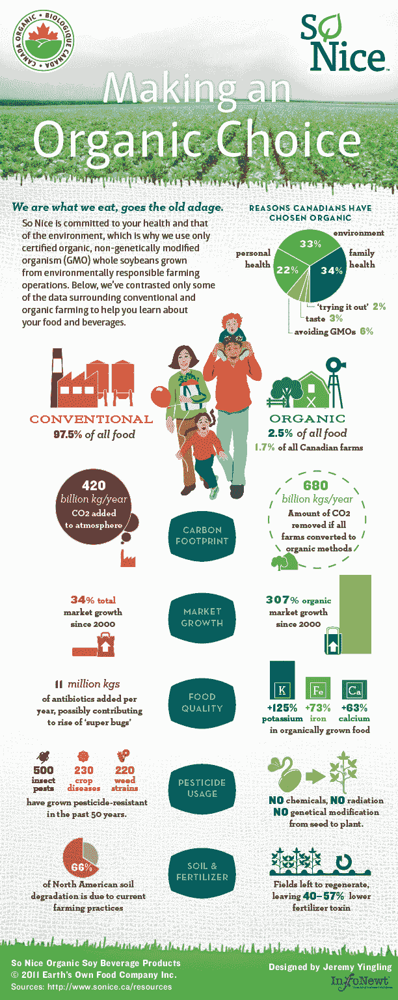

图 2-15：并列对比的信息图

[`coolinfographics.com/`](http://coolinfographics.com) `图-2-14`

来源：`Making an Organic Choice`，SoNice, Earth’s Own Company.

### PR 信息图

与广告类似，公司也将信息图设计用于公共关系（PR）新闻稿。PR 的目标与广告不同。PR 不是直接尝试销售产品，而是使用信息图建立产品和品牌知名度、向股东提供信息或增加品牌价值。用于 PR 的信息图可以作为文本新闻稿的补充，也可以整个新闻稿包含在信息图设计中。

许多公司认为媒体报道是传统广告更具性价比且更有公信力的广告形式。人们更有可能关注并相信新闻报道而非广告，尽管这些信息可能来自同一个来源：公司的 PR 部门。

当田宣布 2013 款 Accord 时，该设计在汽车内外都是重大的变化。作为 PR 内容策略的一部分，它发布了信息图设计`Accord: 30 Years of American Craftsmanship`（图 2-16）。田的主要目标受众是媒体成员。这一设计以几种不同的方式作为内容：

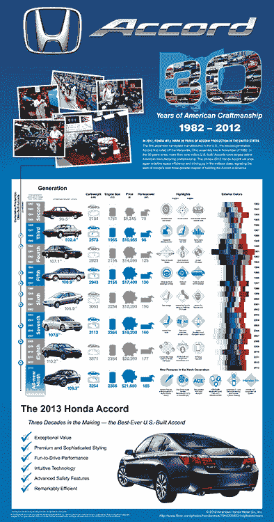

图 2-16：信息图可以作为公共关系活动的一部分

[`coolinfographics.com/`](http://coolinfographics.com) `图-2-14`

来源：`Accord: 30 Years of American Craftsmanship`，Honda North America

- 该信息图被打印并展示在全国各地新闻活动中的 7 英尺横幅上。
- 向与会者提供的媒体包中发放了一个包含信息图 PDF 文件的 USB 驱动器。
- 该信息图作为媒体内容发布在本田北美新闻网站上，该网站仅限通过给媒体人员的登录凭据访问。

该信息图的目的是吸引汽车行业新闻网站和博客的关注与报道。许多与汽车相关的网站都将该信息图作为其对 2013 款雅阁（Accord）发布报道的一部分。只有在所有新闻活动结束后，该信息图才在本田新闻 Flickr 账号上公开发，向公众开放。

Hotels.com 在其新闻网站上开辟了一个专门用于信息图设计的栏目，地址为[`http://press.hotels.com/en-us/infographics/`](http://press.hotels.com/en-us/infographics/)。它的市场地位和研究使其对整个酒店行业拥有独到的见解，并不断向媒体提供数据和信息。新闻机构在报道中使用这些信息，并引用 Hotels.com 为研究数据来源。Hotels.com 数据的吸引力在于其公关内容对新闻受众来说趣味且具有参与性，这鼓励了媒体机构利用这些信息。

Hotels.com 每年发布两次`酒店价格指数 (HPI)`，这是其关于全球酒店房价格变化和热门旅游目的地的研究和调查数据的总结。在过去的几年里，它设计并发布了可视化这些数据的信息图（`图 2-17`），以及一系列强调研究关键发现的文本新闻稿。所有这些内容随后都会发布在其专门的新闻网站上。

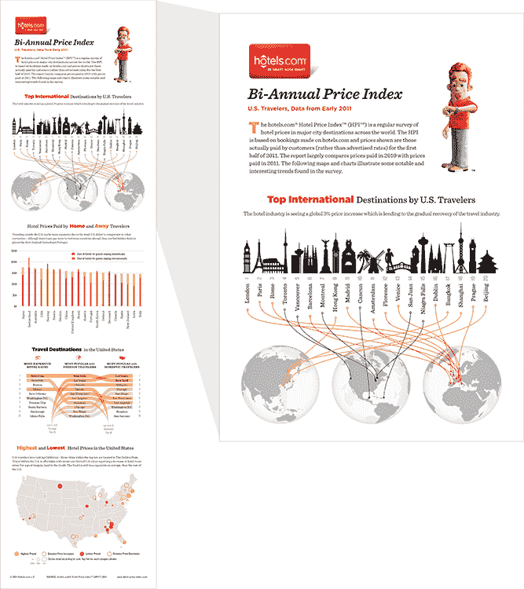

**图 2-17：** Hotels.com 使用信息图在其新闻网站上突出显示关键研究发现。

[`coolinfographics.com/`](http://coolinfographics.com) `图 2-17`

来源：`每半年一次价格指数，2011 年初`，Hotels.com

### 信息图海报

随着在线信息图的爆发式增长，一个子行业开始出现，专门向公众设计和销售大型壁挂式信息图海报。这些小众设计师创造了一些令人惊叹的设计，并正在建立在线销售这些海报的业务。

这种业务模式并不是根据客户规范设计这些海报，而是允许设计师选择自己的主题，选择他们想要包含的数据，并根据自己的设计品味和风格感设计完整的信息图海报。他们面临着与任何消费品相同的风险。主题和数据研究完全由设计师完成，他们是在赌自己的选择是否足够流行以产生销售。

#### Infojocks

Infojocks.com 是一个专门提供信息图设计师 Jeremy Yingling 设计的体育相关信息图海报的网站。Infojocks 自称为“体育统计学的艺术”，其信息图海报涵盖了国家橄榄球联盟（NFL）、国家冰球联盟（NHL）、美国（NBA）、大学球队以及其他特定的球队历史。`图 2-18` 是标题为《冰球：斯坦丹利杯史》的信息图海报。

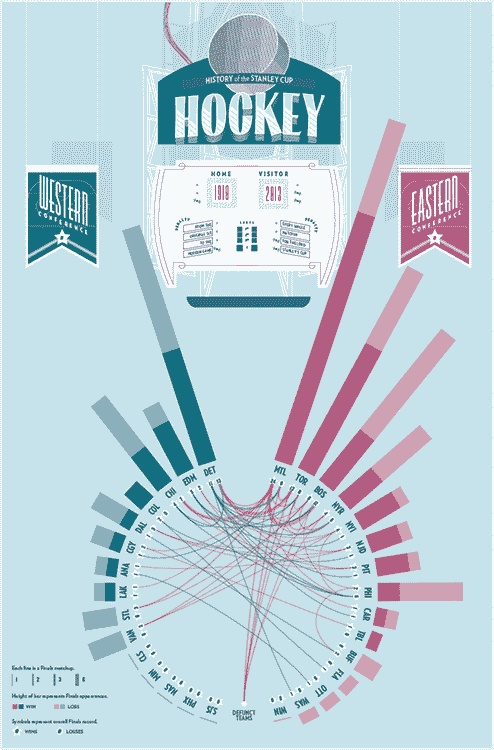

**图 2-18：**《冰球：斯坦丹利杯史》海报，Infojocks.com

[`coolinfographics.com/`](http://coolinfographics.com) `图 2-18`

#### HistoryShots.com

HistoryShots.com 由 Larry Gormley 和 Bill Younker 创建，他们销售结合信息与艺术的设计。他们的设计通常聚焦于特定主题的历史时间线或演变，海报打印在博物馆级的纸张上。这些海报经过仔细研究，根据他们对流行文化、体育金融和政治的兴趣，提供了令人惊叹的设计。`图 2-19` 显示了设计师 Reebee Garofalo 设计的极其详尽的海报《流行/摇滚音乐的谱系》。


**图 2-19：**《流行/摇滚音乐的谱系》海报，Reebee Garofalo，HistoryShots.com

[`coolinfographics.com/`](http://coolinfographics.com) `图 2-19`

#### Timeplots

Timeplots.com 是 Nathaniel Pearlman 创立的一家信息图公司。Timeplots 位于华盛顿特，发布了许多详细的信息图海报，涵盖了各种政治主题的历史时间线。它有一些优秀的设计，涵盖了总统、最高法院、参议院、众议院以及两大政党的历史。图 2–20《美国总统的视觉史》是视觉化选举结果和每个任期内国家状况细节的海报。

#### Pop Chart Lab

PopChartLab.com 是一家位于纽约州布鲁克林的信息图海报设计公司，由 Patrick Mulligan 和 Ben Gibson 创立。他们创作了一些极其详尽的海报，涵盖了`图 2-21`或极其复杂的网络图，以及更多主题的分类。


**图 2-21：**极其精彩的 Apple 演变，PopChartLab.com

[`coolinfographics.com/`](http://coolinfographics.com) `图 2-21`

#### 知识产权问题

知识产权法是一个法律意见、解释和困惑的泥沼。尽管如此，信息图设计师必须考虑一些基本问题。以下观察源于作者对美国法律的经验。

信息图设计师有责任制作符合法律要求的作品，不给公司或客户带来风险。客户期望设计师是这些领域的专家，信息图设计师应该对以下四个领域有良好的理解：

- 版权
- 知识共享（Creative Commons）
- 商标和公平使用原则
- 图像和插图

### 版权

版权法的存在是为了让设计的作者（版权持有者）能够控制他人如何使用、复制或分发其创意作品。在没有获得许可形式明确许可的情况下分享创意作品被称为侵犯版权，通常被认为是非法的。这项法律使创意专业人士能够对其作品收费，并保护他们的作品不被竞争对手复制。

在美国，基本上有三个基本的版权保护级别。

最低级别的版权保护是自动授予原创创意作品的。1989 年，国会修订了美国版权法（特别是为了符合《伯尔尼公约实施法案》），使得使用版权声明变为可选。绝大多数信息图设计师都使用这一层级的保护，因为他们认为这种自动保护已经完全涵盖了他们；然而在实践中，这种级别的保护在法庭上最难执行，且裁定的赔偿金额通常较低。

第二层级的保护是在信息图上显示官方版权符号（`©`），以及年份和版权所有者的名称时主张的。设计师可以在没有任何费用或官方文件的情况下向他们的原始设计作品中添加版权声明。通过添加这种显式的版权声明，出版者明确地传达了他们对版权所有权的主张，并使“无意侵权”的辩护变得困难。我向我所有的客户推荐这一级别的保护，作为为信息图设计提供版权保护的最佳方式。

最高级别的版权保护是正式注册的版权。要达到这一层级，出版者必须将最终发布的创意作品提交给美国版权局并支付注册费，从而在案卷建立作品副本并确定官方注册日期。这种级别在法庭上最容易辩护，并且可以获得最高的赔偿。然而，对于将在互联网上广泛共享的信息图设计来说，这种级别的保护通常是过头的。

### 知识共享

2001 年，知识共享（`CC`）作为传统版权许可的替代方案应运而。知识共享的设计初衷是为创意作品提供更开放的共享，同时仍为出版者保留某些关键权利，它通常被视为信息图的理想许可协议。

尽管知识共享是一种开放共享许可，但许多人错误地认为这意味着放弃了所有权利并将其作品发布到公有领域。这完全不是事实。知识共享是版权许可的一种，允许所有者鼓励他人分享其创意作品，同时仍保留对其使用方式的控制。


知识共享许可供任何人免费使用，并有许多选项可以适应每个特定设计的需求。许可所有者必须对他们愿意允许他人对其作品做什么做出一些选择；这将定义要使用的正确许可类型。

用于信息图最常用的许可由四个双字母代码识别，为`CC-BY-NC-ND`。设计师应该在信息图本身中显示图 2-22 所示的官方许可图片。这样，无论信息图发布在何处，读者都能获取许可信息。


图 2-22：知识共享许可`CC-BY-NC-ND`

[`creativecommons.org/choose/`](http://creativecommons.org/choose/)

表 2-1 显示了与信息图设计相关的四个方面。

| 代码 | 方面 | 描述 |
| :--- | :--- | :--- |
| `CC` | 知识共享 | 标识该创意作品受知识共享许可保护。 |
| `BY` | 署名 | 对信息图的任何使用必须包含指向原始作者的链接或致谢。许可所有者可以定义原始来源的标题、名称和 URL 地址，每当有人重新发布信息图设计时都必须包含这些内容。 |


| NC | 非商业 | 这允许任何人仅出于非商业目的复制、分发、传输和重新发布信息图。在没有所有者特定许可的情况下，他人可能出售或通过你的信息图获利。 |
| ND | 禁止衍生 | 只要设计保持不变，每一个人都可以使用或重新分发你的信息图。在没有所有者特定许可的情况下，他们不得修改或更改信息图设计。 |

表 2-1: 知识共享许可的四个方面

生成 CC 许可最简单的方法是内容所有者前往[`creativecommons.org/choose`](http://creativecommons.org/choose/)的“选择许可”页面（如图 2-23 页面上有更高分辨率的版本。如果出版者使用此页面生成的 HTML 嵌入代码在其网页上显示许可，它还包含了一些针对浏览器的额外元数据。


图 2-23: 选择知识共享许可

[`creativecommons.org/choose/`](http://creativecommons.org/choose/)

### 商标与公平使用原则

商标保护经常与版权保护混淆，但它们是两个不同的东西。版权保护的是完整的创意作品，而商标保护与特定公司、产品或服务相关的区分性词汇或符号。商标侵权的测试标准被称为“消费者混淆的可能性”。

如果你在为自己的公司设计信息图，你当然有权（可能还有责任）在设计中包含你公司的商标标志。这清楚地识别了该公司为该设计的出版者，并且对于信息图产生任何积极影响是必要的。

但包含其他公司的商标标志呢？

商标法有一项名为“公平使用原则”的例外，它允许在某些情况下未经所有者许可对商标进行有限的使用和发布。对于信息图，你的设计需要通过两个测试：

1. 使用标志不能让信息图看起来是由该公司设计或发布的。
2. 使用标志不能暗示该公司资助、授权、批准、支持或背书该信息图。

然而，你可以使用另一公司的商标标志来识别或比较该公司。Brian Solis 和 JESS3 在图 2-24 中展示的《对话棱镜 4.0》是一非常受欢迎的信息图设计，它显著显示了来自数百家其他公司的商标标志。在这种情况下，这些标志被用于识别不同类型社交媒体业务的主要公司。


图 2-24: 公司商标标志的公平使用

[`coolinfographics.com/`](http://coolinfographics.com)`Figure-2-24`

来源：Brian Solis 和 JESS3

### 与插图

除了公司标志之外，大多数信息图设计都结合了许多图像和插图。它们可能是照片、插图或矢量艺术设计。信息图设计师需要对任何非他们原创设计的图像都拥有相应的权利。

在为信息图设计寻找要包含的图像时，最常见（同时也是最糟糕）的方法可能是在 Google 或 Bing 中进行图像搜索。仅仅因为这些内容已发布在互联网上，并不意味着它们属于公有领域！事实上，事实恰恰相反。正如前面的章节所提到的，版权法会自动涵盖所有原创的创意作品，即使它们没有标注版权声明或包含版权符号。

使用通过网络搜索找到图像，你可能会让自己和你的客户面临侵犯版权的风险。信息图设计师需要确保设计中包含的图像是通过公共许可协议（`public license`）获取的。如果你是因为业务原因设计信息图，你可能会在无意中让你的公司面临法律和财务风险。

免版税图库网站（如 `iStockPhoto.com` 或 `Shutterstock.com`）是确保你拥有足够权限将图像包含在信息图设计中的最佳解决方案。当你购买了设计资产（照片、插图、矢量艺术、视频等）时，你实际上是在购买该艺术作品的使用许可。免版税意味着你可以在商业设计中包含该作品，而无需向设计师支付持续的版税。在为客户设计信息图项目时，你应该确保作为最终信息图一部分的所有图像要么是你自己的原创设计，要么是获得许可的免版税图像。

除了图标和插图外，数百种数据可视化设计元素也开始在免版税图库网站上出现。图 2-25

**[图 2-25:]** 信息图元素 作者：Artvea

[`coolinfographics.com/`](http://coolinfographics.com)`图-2-25`

信息图设计师不需要从头创建所有这些视觉元素。通常情况下，信息图设计并不是为了成为艺术品；它们是用数据和信息的视觉叙述。如果设计师花费大部分时间来设计定制插图，该项目将花费更长的时间并产生更高的成本。

### AIGA，设计专业人士协会

法律问题非常复杂，并非所有问题都包含在此处。你应该考虑另一个信息来源，旨在帮助设计师理解并应对法律环境。

AIGA 是一个设计专业人士协会（[`www.aiga.org`](http://www.aiga.org)），它是平面设计师设计师各种各种问题的绝佳资源。它发布了许多文章、案例研究、视频、网络研讨会，以及一份关于《设计业务与伦理》的完整指南，更详细地涵盖了版权和商标问题。该完整指南可以在 [`www.aiga.org/design-business-and-ethics/`](http://www.aiga.org/design-business-and-ethics/) 在线获取。

> AIGA 网站

### 你应该为你的信息图申请版权吗？

在线信息图违背了保护在线创意作品的传统思维。除了信息图海报外，出版者通常并不试图出售在线信息图。事实上，事实恰恰相反。大多数信息图出版者都在积极尝试让他们的信息图尽可能地分享、发布、链接、发送电子邮件甚至打印，但不需要任何支付或许可。对于一家公司来说，其信息图在能够带来数千访问量的大网站上被转发，被视为巨大的成功。

在在线信息图的情况下，版权的目的是需要以不同的方式考虑。尽管他们可能并不试图出售信息图，设计师和公司仍然应该为他们的信息图设计申请版权。版权禁止他人未经创作者同意而修改设计、声称其为自己所有或出售该信息图。这些仍然是发布创意作品的重要方面。

例如，尽管此书中包含的所有示例已在互联网上公开发布，任何人都可以查看，但它们都受版权保护。由于这本书是一件待售的产品，它被视为对这些设计的商业用途。为了在书中重新出版它们，我需要从每个出版者或设计师处获得正式许可，以获得他们信息图设计的版权许可。

那么，信息图应该申请版权吗？是的。它们会自动受版权保护，但在信息图上添加官方版权声明可以消除任何歧义或误解。出版者应该清晰、直观地说明他们就其信息图设计向他人授予了哪些权利。

## 结语

在线信息图是公司分享信息、建立意识和为其网站引流的强大内容工具。它们在过去几年中人气爆炸，并且未来其使用量将继续增长。

信息图设计师需要理解信息图项目的目标，以便他们对每个设计中包含的格式、方向和内容做出明智决策。优秀的信息图设计师可以将叙述、数据可视化、平面设计、在线策略和法律理解结合起来，创建一个成功的信息图。

## 参考文献

1. Alan H. Monroe, *Principles and Types of Speech*, (Chicago: Scott, Foresman, 1935).

## 链接

本章中的许多图像可以通过以下链接或访问 [`www.wiley.com/go/coolinfographics`](http://www.wiley.com/go/coolinfographics) 来查看。

1. *移动青年：青少年与手机手机*, PrepaidPhones.com: [`http://infonewt.com/portfolio/client-work/18409928`](http://infonewt.com/portfolio/client-work/18409928)

2. *客人想要什么*, Hotels.com: [`http://press.hotels.com/en-ca/more-infographics/hotels-com-amenities-survey/`](http://press.hotels.com/en-ca/more-infographics/hotels-com-amenities-survey/)

3. *泳装的历史*, BackyardOcean.com: [`http://www.backyardocean.com/History-Of-Swimwear-Bikini-Thong-Infographic-s/758.htm`](http://www.backyardocean.com/History-Of-Swimwear-Bikini-Thong-Infographic-s/758.htm)

4. Pinterest 上的*酷信息图画廊*: [`http://pinterest.com/rtkrum/cool-infographics/`](http://pinterest.com/rtkrum/cool-infographics/)

5. *我们惊人的星球：从顶到海底*, LiveScience.com: [`http://www.livescience.com/27551-our-amazing-planet-top-to-bottom-mountaintop-to-ocean-trench-infographic.xhtml`](http://www.livescience.com/27551-our-amazing-planet-top-to-bottom-mountaintop-to-ocean-trench-infographic.xhtml)

6. *太阳能节省：一个太阳能创新故事*, Extra Space Storage Inc.: [`http://www.extraspace.com/infographics/solarpower/`](http://www.extraspace.com/infographics/solarpower/)

7. *普通厨师的厨房转换指南*, S.B.Lattin Design: [`http://sblattindesign.wordpress.com/2012/01/03/measure-up/`](http://sblattindesign.wordpress.com/2012/01/03/measure-up/)

8. *存储媒体的寿命*, CrashPlan: [`http://www.crashplan.com/medialespan/`](http://www.crashplan.com/medialespan/)

9. *2012 年美国污染严重的城市*, 美国肺部协会 (stateoftheair.org): [`http://infonewt.com/portfolio/client-work/18409910`](http://infonewt.com/portfolio/client-work/18409910)

10. *癌症：美国癌症发病率*, MesotheliomaHelp.net:

    [`www.mesotheliomahelp.net/news/cancer-charity-infographic`](http://www.mesotheliomahelp.net/news/cancer-charity-infographic)

11. *洗手间皂会让你生病吗？*, GOJO Industries:

    [`www.gojo.com/NoMoreBulkSoap`](http://www.gojo.com/NoMoreBulkSoap)

12. *我们的法律是如何制定的*, Mike Wirth 和 Dr. Suzanne Cooper Guasco, PhD:

    [`www.mikewirthart.com/?projects=how-our-laws-are-made`](http://www.mikewirthart.com/?projects=how-our-laws-are-made)

13. *联盟营销的运作*, Rae Hoffman, Sugarrae.com:

    [`www.sugarrae.com/affiliate-marketing/how-affiliate-marketing-works/`](http://www.sugarrae.com/affiliate-marketing/how-affiliate-marketing-works/)

14. *如何将葡萄酒与东南亚明亮浓郁的风味搭配*, P.F. Chang’s China Bistro, Inc.:

    [`www.pfchangs.com/inspired/infographic.aspx`](http://www.pfchangs.com/inspired/infographic.aspx)

15. *做出有机选择*, SoNice, Earth’s Own Food Company Inc.:

    [`www.sonice.ca/good-for-you/organic-choice`](http://www.sonice.ca/good-for-you/organic-choice)

16. *和谐：30 年美国工艺精神*, Honda America:

    [`www.flickr.com/photos/hondanews/7950209832`](http://www.flickr.com/photos/hondanews/7950209832)

17. *半年度价格指数，2011 年上半年*, Hotels.com:

    [`press.hotels.com/en-us/more-infographics/us-hpi-first-half-2011-results/`](http://press.hotels.com/en-us/more-infographics/us-hpi-first-half-2011-results/)

18. *流行/摇滚音乐谱系海报*, Reebee Garofalo, HistoryShots.com:

    [`www.historyshots.com/Rockmusic/index.cfm`](http://www.historyshots.com/Rockmusic/index.cfm)

19. *美国总统制视觉史*, Timeplots.com:

    [`www.timeplots.com/collections/all/products/a-history-of-the-us-presidency`](http://www.timeplots.com/collections/all/products/a-history-of-the-us-presidency)

20. *苹果不可惊惊的历史*, PopChartLab.com:

    [`popchartlab.com/collections/prints/products/the-insanely-great-history-of-apple`](http://popchartlab.com/collections/prints/products/the-insanely-great-history-of-apple)

21. *对话棱镜 4.0*, Brian Solis ([`www.briansolis.com`](http://www.briansolis.com)) 和 JESS3 ([`JESS3.com`](http://JESS3.com)):

    [`conversationprism.com/`](https://conversationprism.com/)

22. *信息图表元素* Artvea:

    [`www.istockphoto.com/stock-illustration-22855224-infographic-elements.php`](http://www.istockphoto.com/stock-illustration-22855224-infographic-elements.php)

相关性是搜索引擎的圣杯。人们希望结果与他们的查询内容紧密相关。

—MARC OSTROFSKY, *《点击致富！*

# 3

信息图表与 SEO

通常，在线信息图表设计的目标是增加公司网站的流量和链接。发布信息图表的公司希望建立其品牌（或产品）的知名度和资产价值，并提高其与其业务相关的搜索引擎结果中的排名。

这是搜索引擎优化（SEO）策略的领域。在过去的几年中，信息图表已成为公司的一种强大内容工具，用于鼓励站点链接并提高网站的整体相关性。当公司在其网站上发布引人入胜、设计良好的信息图表时，许多人会在自己的网站上发布它，并带有指向回公司的链接，并在社交媒体上与自己的朋友和粉丝网络进行分享。

搜索引擎通过计算网页的信誉和权威评分，作为量化其与特定关键词相关性的一种方式。它们使用复杂的专有算法，利用许多不同的信号。其中，一些信号用于判断相关性，另一些用于判断内容质量，还有用于判断互联网上的整体重要性。最著名的的是 Google PageRank 分类器，它通过考虑指向该页面的链接数量和质量来确定其地位。所有这些因素共同决定了网页针对特定搜索的搜索引擎排名分。

某个特定公司的网站页面针对特定搜索的得分越高，该页面的搜索引擎排名分就越高。

## 搜索引擎的挑战

搜索引擎也是经营业务，它们需要为客户提供有价值的服务以留住他们。如果你进行搜索但结果与你寻找的内容并不接近，会对搜索引擎的品牌产生负面影响。

制作你所依赖的（并理所当然的）搜索结果是一个极其困难的技术问题。每家搜索引擎公司（`Google`、微软 `Bing` 等）都拥有自己的爬虫爬取网络上的所有页面，以解析每个页面的文本和链接。它们创建了庞大的互联网索引，然后通过查询索引来为搜索用户提供一份整洁的相关结果列表。

当你作为搜索引擎用户，考虑一个良好的搜索引擎的益处时，你可以很容易从结果的四个方面进行评估，以判断搜索是否成功：

- **速度**——我获取结果的速度有多快？
- **数量**——我得到了多少结果？
- **相关性**——我得到的结果与我的需求有多相关？
- **覆盖率**——结果中是否包含了所有重要页面？是否有遗漏任何主要页面？

今天，在 `Google` 上搜索 `infographics`（信息图）一词，在 `0.15` 秒内找到了 `14,300,000` 条结果。哇！


然而，在这四个方面中，最重要的是相关性。这并不取决于结果的数量，也不取决于它们出现的快慢。如果这 1400 万个结果没有一个是你想找的，你会感到非常不满意。事实上，即使多花一点时间，获得更少但更优质的结果，你可能也会感到更快乐。

2013 年，微软 `Bing` 搜索引擎启动了一项广告活动，将其搜索结果的相关性直接与 `Google` 进行正面对决（参见图 3-3）。微软的人知道什么对用户来说很重要，它的营销活动在用户最关心的方面——相关性上，与市场领导者 `Google` 直接进行竞争。


**图 3-3：** 微软 `Bing` 搜索引擎正在相关性上与 `Google` 直接竞争。

[`www.bingiton.com`](http://www.bingiton.com)

来源：微软的 `Bing It On` 广告

### SEO 的目标

从营销人员的角度来看，将信息图作为在线 `SEO` 内容的目标是提高公司网页在相关关键词搜索结果中的排名，并最终增加网站的访问人数。信息图已成为一种流行的工具，因为它们非常易读且易分享，这为发布信息图的公司创造了更多的链接和浏览。

当一张信息图在网上变得极其流行时，被称为“病毒式传播”。有多流行？内容要达到“病毒式传播”，并没有一个特定的数字浏览量阈值。在线病毒式传播的过程意味着越来越多的人在观看和分享这些内容，通常随着每一代人的传递而增加。这种示例参见图 3-4。如果有 10 个人分享了原始信息图，每份分享又被两个追随者分享，而这些每份分享又被第二代的两个追随者分享，以此类推，增长可能是指数级的，但仍然是与网页的正常流量进行衡量的。


**图 3-4：** 病毒式现象，每一代社交分享都会导致至少两个额外的帖子

在实践中，当一张信息图发生病毒式传播时，意味着社交媒体上的页面浏览和分享次数远超你的正常内容。这完全是相对的。所以，如果你公司博客上的某篇文章通常每天有 500 次浏览，但突然因为你发布了一张很酷的信息图，某篇文章突然获得了 5,000 次浏览，那么它可能就“病毒式传播”了。你必须与你已发布的其他内容相比来考虑它的成功，因为没有简单的方法来观察或衡量这种分享现象。

一个更有野心的目标是在一个（或多个）主要的在线新闻网站上发表。来自具有高`PageRank`分数的网站链接比来自小型个人博客的链接价值价值得多。因此，目标不仅是获得高浏览量，还要获得高价值网站的链接。最有价值的网站取决于你的行业。哪些新闻网站会发布关于你的公司、你的行业以及竞争对手的文章？

### 链接诱饵（`Link Bait`）挑战

链接诱饵（`Link bait`）是一个术语，用于描述任何专门设计以吸引其他网站大量浏览和链接的内容。通常，用于链接诱饵的内容是选择具有广泛吸引力以覆盖尽可能广泛受众的内容。这样，发布内容的公司就有最大的机会获得尽可能链接和浏览。

对许多人来说，链接诱饵已经赢得了坏名，并被认为是一种阴暗的在线营销形式。即使是“链接诱饵”这个词听起来也与垃圾信息有关，但实际上并非如此。在线上的每一个信息图都可以被视为链接诱饵，因为它们都在试图通过具有视觉吸引力的内容来吸引更多流量。你会在网上看到不同格式的链接诱饵，如震惊的八卦、意外的新闻、惊人的照片、有趣的视频、`Top 10`文章，当然还有信息图。链接诱饵的最佳主题是具有争议的话题或具有强烈情感诉求的话题。链接诱饵无好坏之，它取决于如何使用它。书中展示的所有酷信息图都是很好的链接诱饵设计。相比之下，如果一个引导读者进入恶意网站并在其计算机上加载恶意软件的信息图，无疑会被认为是糟糕的链接诱饵。

问题源于与发布它的网站内容不相关的内容。当信息图的主题与发布它的网站不相关时，搜索引擎很难判断一个链接应该被视为对该公司的背书。

作为信息图链接诱饵的示例，`James Bond` `50 Years of Movies`、`H&R Block` 图 3-5（#c03.xhtml_figure3-5）是一个酷信息图的示例。


**图 3-5：** 作为链接诱饵的酷信息图示例

[`www.bingiton.com`](http://www.bingiton.com)

来源：微软 `Bing It On` 广告


**图 3-6：** `Google`搜索发现了 284 个重新发布该图片的网站

### 关键在于相关性

目前，搜索引擎还没有好方法来解决这个挑战。今天，链接诱饵信息图作为一种 `SEO` 策略是有效的，并且可以成功提高网站的整体评分。

这是一个 `Google` 正在积极解决的问题。2012 年，`Google Web` 垃圾邮件团队负责人 `Matt Cutts` 在接受 `SEO` 专家 `Eric Enge` 采访时，特别提到了关于信息图的挑战：

这段评论让许多公司、`SEO` 顾问和信息图设计师感到担心，因为 `Google` 可能开始对所有信息图链接进行降权。不仅是信息图，对于所有类型的引饵内容（文本文章、照片、视频、交互页面等）来说都是一个挑战，但信息图特别被大量用于此类 `SEO` 策略。

现在，在 `Matt Cutts` 发表该言论一年后，你还没有看到这种变化，但 `Google` 每年都会对其算法进行多次重大更新。他们可能会找到一种方法来区分无关的引饵内容，并降低这些链接对`PageRank`计算的影响。

为了防止未来发生任何形式的引饵内容降权，公司和设计师应该专注于发布相关的信息图。这可以保护与你业务相关的网站链接，并且这些链接应该始终被视为搜索引擎算法对你网站的有效背书。

图 3-7《用新 `iPad` 简化你的数字生活》，是 `NextWorth` 的一张信息图，它是相关性的示例。该设计在 2012 年 `iPad` 3 发布前不久发布，重点关注了许多 `iPad` 功能所取代的旧电子设备。`NextWorth` 的业务是从人们那里回购旧的消费级电子设备并对其进行回收。该信息图设计有趣、吸引人，并且与 `NextWorth` 的业务相关。指向信息图的链接本质上意味着对回收旧设备和支持其业务的背书。


**图 3-7：** 替换电子设备的话与 `NextWorth` 的业务直接相关。

[`coolinfographics.com/`](http://coolinfographics.com)`Figure-3-7`

*来源：*《用新 `iPad` 简化你的数字生活*》，`NextWorth`*

为了保持相关性并获得搜索引擎公司的青睐，你应该避免任何可能被视为“垃圾信息”的行为或做法。搜索引擎不断改进其算法，昨天可能有助于网页得分的因素，今天实际上可能会损害评分，因为算法得到了改进，程序员们正在构思方法来检测任何可疑的促销行为。某些算法更新甚至惩罚了那些被认为采取不道德手段增加页面价值的网站，通过主动降低其页面评分。

## 在线寿命

在线寿命是指信息图对受众保持相关性的时间。在这里，主题和数据的选择至关重要。在选择信息图的主题时，许多公司都未能理解在线寿命的重要性。

从设计师的角度来看，在信息图设计中填充当前的、趋势的信息所花费的时间和精力，与包含对读者具有长期价值的信息所花费的时间和精力通常是相同的。从财务角度来看，设计一个仅将流行一周的信息图的成本，与设计一个对读者有用一年或更长时间的信息图的成本几乎相同。信息图设计的尺寸将大致相同，插图、文本和数据可视化的数量也相似。

在选择主题和包含的数据范围时，你需要考虑信息图项目的目标。如果信息图项目的目的是吸引流量并为公司网站建立链接，那么你不想要一个在发布一周后就过时或被遗忘的信息图。如果目标是在短时间内增加品牌知名度，那么热门的趋势性主题可能会更成功。

从 `SEO` 的角度来看，最近视图和链接通常具有更高的权重。因此，即使你发布了一张火遍网络的信息图，如果它是三年前发生的，它现在可能对你今天的搜索引擎排名提供不了多大的积极影响。

2011 年 5 月 1 日，当天的重大新闻是美国击杀奥萨马·本·拉登的行动。当时有几个快速开发的信息图设计在新闻爆发后的 24 小时内发布。图 3-8 显示了来自 `Column Five Media` 的这些设计之一，它很好地清晰讲述了通往该行动的事件故事，并在视觉上向读者展示了关于本·拉登大院内行动的已知情况。在短时间内创建该设计投入了大量精力，最终结果是一个设计精良的信息图。然而，由于主题紧紧贴当天的热点新闻，以当新闻周期转向其他故事时，人们对该信息图的兴趣也随之消失了。这张信息图的在线寿命只有一周左右。之后，浏览和链接迅速减少。


**图 3-8：** 以突发新闻作为信息图主题：在线寿命 = 一周

[`coolinfographics.com/`](http://coolinfographics.com)`Figure-3-8`

*来源：*《击败本·拉登*》，`Column Five Media`*

图 3-9 中的《`Death & Taxes 2014`》海报是一个受欢迎的设计，它将总统提议的预算可视化。它每年都会重新设计并发布。对于设计师来说，这是一项巨大的工程，一年后新的循环开始，设计就会过时。它的在线寿命为一年。


**图 3-9：** 在线寿命取决于数据的有效性：一年

[`coolinfographics.com/`](http://coolinfographics.com)`Figure-3-9`

*来源：*《`Death & Taxes 2014`*》，`Timeplots`*

许多设计可以有更长的寿命。图 3-10 来自 `FrightCatalog.com` 的《万圣节历史》是一个特殊案例。该信息图是通现代万圣节节日的时间线，尽管它的在线寿命有很多，但它主要只在 10 月相关。这对于出版社——万圣节零售商来说非常好，因为它在每年最繁忙的月份带来了访问和流量。


**图 3-10：** 在线寿命 = 每年一个月

[`coolinfographics.com/`](http://coolinfographics.com)`Figure-3-10`

*来源：*《万圣节视觉历史*》，`FrightCatalog.com`*

图 3-11 中的《葡萄酒与食物配对》信息图的在线寿命也跨越多年。二十年后，这些信息仍然是同样的，设计对读者来说仍然具有相关性。它不像甜酒会突然和蔬菜很配！


**图 3-11：** 对于通用信息主题，在线寿命 = 许多年

[`coolinfographics.com/`](http://coolinfographics.com)`Figure-3-11`

*来源：*《葡萄酒与食物配对*》，`Wine Folly`*

在线寿命对任何信息图的持续 `SEO` 价值都会产生巨大影响，应该是主题选择过程不可不可或缺的一部分。

## 信息图发布策略

看到有许多公司将新的信息图发布在网上，然后只是等人们来发现它，这令人感到失望。许多公司会花费大量的时间资源来研究数据并设计良好的信息图，但随后选择不在营销或推广这些信息图上投入任何精力。信息图是内容形式，需要与文章、视频、广告甚至产品同等的营销支持。

在公司发布信息图之前，它应该仔细考虑一个全面的`Infographic Release Strategy`（信息图发布策略）来推广该信息图。当你准备好了一个良好的信息图设计并发布时，你希望确保从该信息图中获得的收益最大化。

以下是信息图发布过程中的三个关键步骤：

1. 落地页

2. 自我推广

3. 拓展与外联

公司不需要执行所有这些步骤，但投入到推广中的努力可以显著提高信息图发布的成功率。这些活动大部分只是公司层面的精力投入，并不需要大量的额外费用。

## 落地页

需要解决的第一个问题是：“你应该在哪里发布信息图？”信息图可以通过百种不同的方式发布在网上，但其中许多方法并不有效。你应该将信息图托管在自己的网站上、你的`Flickr`页面、作为`Facebook`中的照片、作为另一个网站的客座文章、发布在信息图库网站上，还是在博客文章中？答案取决于公司对该信息图项目的目标。通常，公司希望吸引链接和访问者进入其网站。在这种情况下，公司应该在自己的网站内创建一个专门的信息图落地页。这样，它就位于公司控制的站点上，且不依赖于任何外部公司或服务。此外，在自己的专用页面上发布和托管信息图可以获得链接和页面访问的所有收益，同时保持对页面内容完全的控制权。

落地页应该有一个短而简单的 `URL`，它可以作为指向信息图链接的清晰目标。通过将所有流量和链接指向一个专门的落地页，它在搜索引擎排名中获得高分的机会最大，而不是将链接分散在多个位置。此外，许多人会通过输入网页地址来寻找信息图，因此简短的 `URL` 可能非常重要。长而复杂的 `URL` 可能会令游客。

但也有例外。如果目标是为公司的`Facebook Fan Page`建立受众，开发信息图并作为新的图像内容发布在`Facebook`上是完全可以的。链接将把新用户带到公司的`Facebook`页面并吸引新粉丝。

### 图像问题

当涉及到信息图时，问题在于：图 3-12 显示了你的信息图在搜索引擎爬虫看来是什么样的。它只是页面上的一个图像资产，没有任何内容，因为在网站上爬取内容的网页爬虫无法判断图像或信息图中包含了什么。它们无法确定你的主题、关键词、数据源、核心传达或任何相关信息。由于没有文本可供收集和解析，爬虫没有东西可以发送回搜索引擎索引。


**图 3-12：** 搜索引擎在网页上看到的只是空白的图像资产。

搜索引擎已经开始实验使用人脸识别、光学字符识别（`OCR`）和类似的图像搜索软件为图像添加上下文，但这些工具并不有效。这取决于信息图发布者通过在页面上添加文本（包括可见和隐藏的文本）来告诉搜索引擎关于信息图的所有信息。在线托管原始全尺寸信息图的专用 `HTML` 网页被称为信息图落地页。你需要在页面上添加文本描述内容，并使用你希望与信息图关联的关键词。文本决定了信息图的上下文和相关性，它也是搜索引擎真正了解在向用户显示搜索结果时何时显示指向信息图链接的唯一方法。

信息图落地页上应该包含许多重要的页面元素。为了这个目的，请想象正在发布一个名为`SEO Strategies Used by the Experts`的虚构信息图。这个信息图在今天的互联网上并不以信息图的形式存在，但未来可能存在。为了这个例子，还请假设这是一个设计良好的信息图，它讲述了一个视觉上具有吸引力的故事，人们会想要分享。这可能是一个很大的假设，但如果你从一个糟糕的设计开始，那么支持信息图发布的大部分努力将不会产生太大影响。

### 关键词

任何 `SEO` 策略的基石都是关注一组简短的关键词。关键词可以定义为人们在搜索有关特定主题的信息时，在搜索查询中输入的常用单词。根据行业、产品、服务以及每家公司提供的信息的不同，不同的公司网站存在不同的关键词——甚至每个公司网站的不同页面也有不同的关键词。

公司希望确保其网站页面被搜索引擎认为具有高度的可信度，并且与其业务相关的词汇具有相关性。作为一个非常简单的例子，`Nike` 希望在 `shoes` 和 `footwear` 等关键词上具有相关性，而福特希望在 `cars` 和 `trucks` 等关键词上具有相关性。

理解人们在搜索时实际使用的关键词是非常重要的。如果一家汽车经销商使用“pre-owned car”（二手车）一词创建内容，他们的内容可能不会出现在搜索更常用词汇“used car”（旧车）的人的结果中。有时，搜索引擎会理解这两个术语是相关的，但很多时候并不会。应该提前进行研究以确定寻找类似内容的最流行的术语。

在发布信息图时，创建一个简短、特定的你希望信息图关联的目标关键词列表非常有帮助，然后在落地页上一致地使用这些关键词。对于你的虚构信息图，关键词列表可能如下：

1. `SEO`

2. `Search`

3. `Experts`

4. `Strategies`

5. `Marketing`

这个虚构的信息图示例是简单的单一关键词，但你也可以推广多词关键词组。

### 落地页 `URL`

搜索引擎会将你网站上信息图落地页 `URL` 中使用的单词视为寻找相关关键词的潜在位置。因此，最好的 `URL` 使用自然且便于搜索引擎解析的单词，并用连字符（破折号）分隔单词以清晰地将其分开，因为 `URL` 地址中不允许出现空格。

`Google` 公承认它将连字符视为单词分隔符，而将下划线视为单词连接符。除非你故意想要组合单词，否则不要使用下划线。如果你使用下划线来分隔如 `SEO_Experts` 的单词，搜索引擎索引会将这些单词组合为一个单词 `SEOExperts`。因此，你的落地页 `URL` 看起来应该这样：

[`http://coolinfographics.com/SEO-Strategies-Experts-Infographic.xhtml`](http://coolinfographics.com/SEO-Strategies-Experts-Infographic.xhtml)

保持 `URL` 越短越好，因为有些读者通过输入地址找到你的信息图。

### 标题标签

`title`标签是一个 `HTML` 代码元素，每个网页都应该包含它。`title`元素包含在页面的`<head>`部分，文本显示在浏览器窗口的标题栏或标签页上。

```
<head>
<title>Expert SEO Strategies Infographic</title>
</head>
```

这是向搜索引擎识别页面内容的最要要素之一，而且尤为重要，因为`title`标签通常用作搜索结果页面上显示的链接文本。考虑使用带有空格的自然语言，并将“infographic”（信息图）一词作为`title`标签的最后一个单词。这有助于观众和搜索引擎识别出该内容为一张信息图，而最后一个单词被认为重要性最低，但仍具有相关性。

`title`标签还会被社交媒体分享按钮使用，在没有其他建议文本的情况下，将其作为帖子或推文的提议默认文本。例如，除非你为 `Twitter` 创建了特定的建议文本，否则当有人使用页面上的 `Twitter` 按钮分享信息图时，它将提议`Title Tag`中的文本作为推文内容。

## 页面标题 (`Page Title`)


页面标题是以文本形式显示在页面`<body>`部分的可见标题。如果你使用`H1`标题的HTML代码，搜索引擎就会知道这是页面上最重要的文本之一，任何包含的文本都会以大号粗字体显示在页面上。页面标题中的单词通常比页面上的其他文本具有更高的重要性或价值。

```
<body
<h1>SEO Strategies Used By The Experts</h1>
</body>
```

页面标题的实际文本通常与`title`标签相同，但不必如此。从内容的角度来看，作者通常希望页面标题越短越好，这样文本就不会在页面上换行。单词过多会让整个页面看起来复杂且杂乱，你可以在页面标题中省略“infographic”一词来帮助缩短文本。查看页面的读者已经可以看到内容是一张信息图。

## 描述文本 (Description Text)

在落地页上最容易添加的内容是段关于该信息图的简短描述文本。它可以是信息图中的文本，也可以是专门为落地页编写的文本。这为搜索引擎索引提供了额外的文本，但要保持简洁！页面的重点是信息图；所以不要用过多的文本吓跑访问者。当读者在页面上（或信息图内）看到太多文本时，他们通常会忽略并离开页面而不阅读，因为内容看起来太密集了。

考虑在描述文本中包含几个指向同一网站内其他相关页面的文本链接。这提供了两个好处。首先，随着信息图落地页的浏览量链接随时间推移而增加，这些指向公司网站其他页面的文本链接将变得更有价值。其次，在自己的博客或社交媒体账户上发布信息图的人通常会复制整个描述文本作为额外内容包含在他们的贴文中。记住，他们也需要文本供搜索引擎在自己的页面上索引，这可以为指向你网站的页面创建额外的价值文本链接。

然而，请保持包含的文本链接与信息图主题相关。有些信息图落地页有指向不相关页面的文本链接，这可以利用信息图的成功进行推广。虽然这可能有效，但读者会将其视为垃圾信息。

## 信息图文件名 (Infographic Image Filename)

搜索引擎甚至会查看信息图文件的名称，以尝试寻找描述内容的关键词。如果图像文件名只是识别图像的数字，例如`IMG1234567.jpg`，搜索引擎就会忽略它，但你不希望错过任何将关键词链接到信息图的机会。这里最简单的方法是使用`title tag`中的主词作为文件名。因此，根据你虚构的信息图，这可能是你加载到落地页上的信息图文件名：

`SEO-Strategies-Experts-Infographic.JPG`

与之前的落地页`URL`一样，文件名应使用连字符（hyphens）作为单词分隔符。避免在单词之间使用划线，因为Google将其视为单词连接符。

## Alt 文本描述 (Alt Text Description)

信息图中一个重要的HTML元素是图像的`alt`属性，它允许浏览器在浏览器中关闭图像显示时显示描述图像的文本。由于现代互联网访问速度的提高，在不显示图像的情况下查看网页的做法已很罕见，但该HTML元素仍然存在，并被大量用于搜索引擎索引。

`alt`文本描述应该用自然语言写成简短描述。这里的内容理想情况下是一句话来描述信息图，并且还可以被许多为视障人士提供的屏幕阅读器使用。无障碍软件会为视力困难的人大声读出alt描述描述的文本，这使得自然语言描述变得更加重要。

`alt`文本描述包含在标识页面上显示的实际图像文件的HTML代码中。

```

```

你唯一不想做的事就是向`alt`文本描述中堆砌一长串关键词。这种做法不仅是垃圾信息，而且搜索引擎也能识别出来，并减少alt文本描述可能为页面提供的任何价值。对于使用屏幕阅读器的访问者来说，这也非常不礼貌且令人反。

## 社交媒体分享按钮 (Social Media Sharing Buttons)

信息图落地页绝对应该包含主要社交媒体网络的分享按钮。公司应该让分享信息图变得尽可能简单无痛，在落地页上包含分享按钮是分享信息图最流行的方法。

向落地页添加按钮的一种方法是使用来自每个社交网络的独立、专用的按钮。Web开发人员可以将每个社交网络网站提供的HTML代码复制并粘贴到页面上。这种方法保持了落地页与社交网络之间简单直接的关系，但需要Web开发人员花费更多工作。

更流行的方法是使用一种分享按钮聚合服务之一。这些服务允许开发者仅向落地页添加一个HTML代码块，即可显示用于各种网络的多个按钮。这种方法的主要优势是对于代码和跟踪分析都使用一个中央服务的便利性。缺点可能是聚合器也可以访问你的分析数据，如果你对此有所顾。

主要的分享按钮聚合服务有：

*   `AddThis`: [`www.addthis.com`](http://www.addthis.com)
*   `ShareThis`: [`www.sharethis.com`](http://www.sharethis.com)
*   `AddToAny`: [`www.addtoany.com`](http://www.addtoany.com)

在实践中，分享按钮始终应该显示在落地页的“折叠以上”（above the fold）——也就是说，它们应该在页面顶部，无需滚动即可可见。许多读者只会查看信息图的上部分，并决定在他们的社交网络中分享它。只有一部分读者会一直看到底部，因此在那里放置分享按钮的效果较差。

在某些情况下，特别是很长的信息图，分享按钮也可以在页面底部重复，为读者提供额外的便利。

#### 嵌入代码 (Embed Code)

嵌入代码（Embed code）是一段以文本形式显示在网页上的HTML代码。这段代码与落地页上使用的HTML图片显示代码类似，但这段代码旨在让其他博客作者通过复制和粘贴，作为在他们自己的网站上显示信息图的一种方便方式。该代码包含在页面的`<body>`部分。

在落地页上提供嵌入代码对发布者来说具有巨大的优势。代码可以被编写为显示正确的信息图图像，并使用信息图落地页的正确`URL`提供返回页的链接。此外，使用嵌入代码可以使博主发布信息图的过程变得极其方便。

向你的信息图落地页添加分块嵌入代码包含两个部分：首先是编写你想让博主复制的HTML代码，其次是在你自己的页面上添加`<textarea>`代码，以便该代码以文本形式显示在你的页面上，而不是实际显示信息图。这非常重要，因为当人们查看你的信息图落地页时，你希望他们的浏览器显示代码，而不是尝试解析它并再次显示一次信息图图像。

你虚构信息图的嵌入代码可能如下所示：

```html
<<body>
Please share this infographic on your site by copying and pasting the code below
<p>
<textarea style="width:540px;height:100px">
<a href= "http://coolinfographics.com/SEO-Strategies-Experts-Infographic.xhtml">

</a>
<p> SEO Strategies Used By The Experts - An infographic by the team at <a href="http://coolinfographics.com" >Cool Infographics</a>
</textarea>
</</body>
```

在你的信息图落地页上，这将以小文本框的形式显示嵌入代码文本，如图图3-13

**图3-13：** `<textarea>`元素将在小文本框中显示HTML代码。

以下是理解此示例嵌入代码中所包含内容的六个关键方面：

1. 代码上方有一个简单的请求，要求博主使用嵌入代码。
2. HTML代码在框内都是可见的。过多的代码文本会超出框的底部，导致部分代码无法被看到。框将显示滚动条，但这可能会让你感觉像你是在刻意隐藏某些HTML代码。
3. 当显示在博主的网站上时，信息图有一个可点击的链接，可以回到发布者定义的`URL`处的原始信息图落地页。这让你能够选择链接的去向。
4. 使用了较小的、宽为500像素的`JPG`图像文件作为博主网站上显示的图像的源。这更有可能适应博客格式的较小空间（参见第2章，“在线营销信息图”），并且加载速度比使用尺寸参数显示更大的图像更快。
5. 由发布者编写了`alt`文本描述，以最大化其SEO价值。
6. 信息图下方还可以额外显示一行文本作为说明，并带有指向公司网站首页的文本链接。

在良好的网页开发人员的帮助下，嵌入代码中可以完成更多事情，包括你应该避免的一些垃圾邮件SEO实践，例如添加长关键词字符串或链接到不相关的页面。在嵌入代码中填充关键词和文本链接显然是不自然的，搜索引擎足够智能，可以忽略那种类型的内容。发布者应该通过让页面上的所有文本都可见，对他们提供给博主的代码保持透明，这样博主就能看到他们将向自己的网站添加什么什么代码。

代码也应该像上面的示例嵌入代码一样简短而简单。即使所有代码都是出于好意编写的，长而复杂的代码块也有可能在其中隐藏了垃圾代码。大多数博主不是精通`HTML`的网页开发人员，可能不理解所有嵌入代码的含义。长代码块有很大概率吓跑博主，因为在他们的网站上放置他们不理解的未知`HTML`代码具有潜在风险。

嵌入代码也只是对博主的一种建议。他们可以将代码原封地粘贴到他们的网站中，也可以以他们认为合适的任何方式修改代码。如果他们想更改`alt`描述，可以自由这样做。作为发布者，你提供代码是为了提供便利。

在实践中，只有一少数博主实际上利用嵌入代码在他们的博客上显示信息图。通常，他们会下载`JPG`图像文件本身，或者通过直接链接到托管服务器来显示图像。这留下了选择自己的链接、编写自己的`alt`文本描述或选择完全不包含这些内容的灵活性。

然而，在信息图落地页上提供嵌入代码绝对值得努力，因为它可以最大化来自那些博主的链接的价值。

### 自我推广

发布策略的第二部分是自我推广。许多公司已经拥有与客户、供应商和媒体的现有沟通渠道。在信息图公开发带有专用落地页后，公司应该通过自己的渠道尽可能地广播该`URL`。你永远不知道哪个粉丝网络会触及正确的受众。

这就是你应该自吹自海的地方。这是营销，你正在向受众推销信息图作为价值内容。

| 导航 | 大多数网站在整个站点范围内都有一致的导航形式。顶部的导航栏或侧边栏的导航链接非常常见。在何处添加信息图的链接取决于设计的主题。 |
| 首页链接 | 在首页上放置一个较小的缩略图是吸引观众查看完整尺寸信息图的最佳方式，但即使是首页上的文本链接，也能引导你网站的大量自然流量来查看信息图。 |
| 产品页面链接 | 如果信息图的主题与公司的某项产品或服务专门相关，在产品页面上放置信息图的缩略图或文本链接也有助于触达目标受众。 |
| 博客 | 公司博客是推广信息图的理想场所。在博客文章中使用较小的500像素版本图像，并链接到专门的落地页，这样读者就能找到完整版本。 |
| 新闻稿 | 如果新闻稿是网站的一部分，可以针对信息图的核心信息撰写一篇新闻稿，其中包含图片和指向落地页的链接，以触达与博客完全不同的受众群体。 |
| 媒体库 | 将信息图文件的副本上传到网站的媒体库中，允许媒体联系人下载该设计并将其引用任何文章中。 |

### 表3-1](#c03.xhtml_tableanchor3-1) 有效的链接位置

公司通常还有一些更传统的、旧有的通信形式。你可以将信息图包含在定期发送的电子邮件或邮寄给客户的打印简书中。利用这些通信渠道作为与更广泛受众分享信息图的额外方式，并包含信息图落地页的链接。

### 公司社交账号

如今，你的公司极有可能在Facebook、Twitter、Google+、Flickr、Pinterest等平台上维护自己的社交网络账号。公司绝对应该在拥有的每一个社交媒体账号上发布自己的信息图链接，并且应该发布多次。如果你只发布一次，大多数受众都会错过它。你的社交媒体粉丝并不是一直都在看的，如果他们没有注意，随着其他新内容发布到他们的新闻流中，你的帖子会在他们有机会看到它之前就滚动到页面底部。当你登录`Facebook`时，你可能不会回到昨天离开的地方并阅读所有内容。你可能只读了顶部的几页然后就去忙其他事情了。流中更靠下的内容永远不会被看到。

有一些良好的数据支持这种行为。`Bitly.com`是一个流行的链接缩短服务。因为它在许多服务中非常流行，它拥有关于社交媒体链接的一些惊人定量数据。正如你所想象的，当新内容在网上发布时，读者点击链接查看新内容的活动最初会有一个激增，但流量在很长一段时间内会减少。互联网上没有东西是真正消失的，因此内容在几年后可能继续获得少量浏览。

2011年，`bitly.com`发布了关于其服务发布在各种社交网络上的链接的平均半衰期的分析。根据它的定义，发布在社交媒体上的链接的半衰期是指该链接接收到其总点击数二分之一的时间。

`bitly.com`的发现非常令人惊讶。你可以从它根据图3-14数据创建的图表中看到，点击的激增是显而易见的。来自`bitly.com`博客文章：³


### 图3-14](#c03.xhtml_figureanchor3-14) 发布的链接将在前3小时内获得其总点击量的一半。

*来源：* *社交媒体链接的半衰期*，[`bitly.com`](http://www.bitly.com)*

平均而言，这意味着大约`3`小时后，你的链接在粉丝的新流中排名就会下降，他们不再看到你的帖子了。意不意外的是，如果他们没看到链接，就不会点击链接。这是`2011`年的数据，从那以后有更多的人加入了社交网络，每天发布的内容也更多。如果今天重复这项分析，半衰期可能会更短，因为推文和帖子的速度日益增加，它们每天在页面上滚动越来越快。

你也可以从图表中看到，`YouTube`上的视频半衰期长得多，为`7.4`小时，但该信息不适用于大多数在线发布的信息图。大多数信息图不是视频，也不会发布到`YouTube`上。然而，基于涵盖数月或数年的更长的在线寿命，这种策略对于信息图视频来说不会太大区别。

那么，你如何利用这些信息来造自己呢？根据这些数据，公司的社交媒体策略分部分：

第一，公司应该在一段时间内多次发布信息图链接。发布多长时间？每天发布一次，且每天不超过两次。发布之间的间隔至少应为`5`小时，以捕捉在一天不同时间关注社交网络的不同受众群体。有些人会在午休时间检查`Facebook`，而另一些人直到晚上回到家才检查。将帖子分散在一天的不同时段。

其次，极有可能你的受众中有一小部分人会看到几次指向同一信息图的帖子。

然而，在线信息图是另一种类型的公共公司信息。其目标是尽可能在尽可能不同的网站上将信息图分享给尽可能多的人。希望这些信息图能分享一些关于公司行业、市场、研究数据或产品的某种新颖、令人惊讶且具有洞察力的数据。公司应该为这一信息感到自豪，并希望每个人都分享它。

为了克服这一障碍，公司需要主动允许员工分享信息图……且必须是**书面形式**。通常，一封内部电子邮件就足够了。通常情况下，这条信息会提到有关信息图的主题、公司有多么想与公众分享这些信息，当然，还会有指向信息图落地页的链接。礼貌地请求员工参与，帮助启动信息图的发布，并使用落地页上的分享按钮将信息图分享到自己的社交网络中。有些员工不会参与，但会有许多人参与的。

你绝对不应该做的事情就是要求或强制员工分享你的任何内容。这会迅速变成一个双输的局面。公司可能会迅速在员工中产生许多敌对情绪，并使公司面临大量负面声誉的风险。说真的，如果人们并不想自己分享信息图，而你觉得你需要强迫人们分享信息图，那么你的方法错了。

## 推广、宣传与外联

发布策略的第三部分是**外联**（Outreach）。这是向公司之外的其他作者和网站营销信息图的活动。其希望是他们会欣赏你的信息图并发布链接。这可能是一个模糊的行业，涉及一些令人存疑的垃圾邮件式操作，但你应该坚持立场，专注于通过最佳实践来为你的信息图建立有机链接。

再次，搜索引擎公司不断尝试改进其算法以过滤掉垃圾信息和虚假链接，以便其用户获得良好的搜索结果。你的外联活动应该关注可能对信息图感兴趣的真实作者和博主。如果有人因为喜欢而发布了你的信息图，并且认为他们的观众也会喜欢，你就不需要担心未来的算法更新。

记住，来自高分网站的链接最有价值。有很多工具可以帮助你确定特定网页的排名。一个简单易用的工具是`PRChecker.info` ([`www.prchecker.info`](http://www.prchecker.info))，它允许你输入任何网页的URL来确定其当前的Google PageRank。

### 特定主题的博客

除非是某人的个人博客，否则大多数博客都对他们擅长的话题有某些关注。Cool Infographics博客显然专注于信息图，但你可以持续地找到与你想要的任何利基主题相关的博客。如果你的信息图设计是关于巧克力纸蛋糕的，你可以找到数百个以纸蛋糕为主题的博客，将其纳入你的外联计划。

在线搜索寻找与你信息图主题相关的博客。你可以轻松地使用`Google Blog Search` ([`www.google.com/blogsearch`](http://www.google.com/blogsearch)) 搜索与你信息图关键词相关的博客。点击结果页顶部的“搜索工具”按钮，你可以在“帖子”（Posts）以寻找发布过与你主题相关文章的特定作者或“首页”以寻找整个网站之间选择。

一种有效的方法是查看已经链接到你现有网站内容的网站列表。你必须深入研究公司的网络分析数据，或使用接下来列出的网站探索工具之一。这些网站了解你的公司，并且足够喜欢你之前的某些内容，以将其发布在自己的网站上。它们很可能接受来自你公司的任何额外优质内容。


在你列出潜在网站列表后，稍微额外的挖掘可以通过确定哪些博客对你的外联计划最有价值来帮助缩小范围。没有人有时间联系 500 个博客，所以集中你的精力是很重要的。

以下列表涵盖了博客的五个不同方面，你应该研究并使用它们来帮助评估指向你信息图的任何链接的价值：

- **活跃？**——博客很容易创建，也同样容易被遗弃。检查最近帖的日期，确保它们仍在积极发布内容。如果最后一次发布是一年前，就把它从你的列表中删掉。不要在遗弃的博客上浪费时间。
- **排名？**——最容易检查的统计数据是你找到的每个博客的 Google PageRank。网上有很多不同的工具可以揭示网站的 SEO 数据，有些免费，有些付费。尝试使用 Google Chrome 浏览器的`PageRank Status`扩展 ([`pagerank.chromefans.org`](http://pagerank.chromefans.org)) 来显示你访问的任何页的 PageRank。还有其他 SEO 工具使用它们自己的指标对网站进行评分，这些工具也有助于判断指向你信息图的链接可能有多有价值。来自 SEOmoz 的`OpenSiteExplorer` ([`www.opensiteexplorer.org`](http://www.opensiteexplorer.org)) 使用一种名为“域名权重”（Domain Authority）的衡量对网站评分，而`MajesticSEO Site Explorer` ([`www.majesticseo.com`](http://www.majesticseo.com)) 根据名为“信任流”（Trust Flow）和“引用流”（Citation Flow）的测量来评估网站。
- **流量？**——确定一个网站接收多少流量很难，但对于确定发布的指向信息图的链接的潜在范围非常有帮助。因为网站流量不是公开信息，少数网站拥有可以估计网站流量的工具，例如`Quantcast` ([`www.quantcast.com`](http://www.quantcast.com)) 和`Compete` ([`www.compete.com`](http://www.compete.com))。这些数字是估计值，但大致数字可能足够评估外联目标网站了。
- **粉丝？**——确定一个网站接收多少流量比较困难，但对于确定发布的指向信息图的链接的潜在范围非常有帮助。因为网站流量不是公开信息，少数网站拥有可以估计网站流量的工具，例如`Quantcast` ([`www.quantcast.com`](http://www.quantcast.com)) 和`Compete` ([`www.compete.com`](http://www.compete.com))。这些数字是估计值，但大致数字可能足够评估外联目标网站了。
- **信息图？**——浏览或搜索网站查看他们以前是否发布过外部网页的信息图。有些网站只发布自己的内容，所以了解博客是否开放接受外部来源的好信息图是好的。

在给博客作者写信息时，请务必个性化。我每周会为 Cool Infographics 博客收到大约 400 份投稿，如果信息明显是模板或格式化信件，我就会忽略它。我曾看到同一天内有完全相同的信息提交了 10 次，且仅更改了链接。人类是模式识别机器（第 1 章，“信息图的科学”），很容易识别出那些复制并粘贴到邮件中的脚本化信息。这些信息会直接进进垃圾桶。

良好的信息应该直接写给博客作者，并包含相关信息。为什么他们的博客读者会对这幅信息图感兴趣？他们之前在类似主题上发布过哪些文章？他们之前发布过哪些关于你公司的内容？你曾在自己的社交网络中帮助他们分享过博主的哪些之前的文章？

确保你直接包含了指向信息图落地页的 URL 链接。不要尝试将信息图的 JPG 图片文件作为附件发送给他们。你不希望他们在自己的网站上托管信息图图像，因为那样他们就不需要链接到你的页面了。只需发送 URL 链接，让他们使用落地页上的嵌入代码或分享按钮即可。如果他们想在自己的网站上发布，他们也可以从落地页获取 JPG。在邮件中包含信息图的简短文字描述通常很有帮助，这样他们就可以将其粘贴到博客文章作为额外文本，即使这与落地页上的文字描述相同。

当你将信息图发布到世界上后，它就有了自己的生命。最终，你无法控制它会发生什么。你无疑会看到关于它的正面和负面评论，从 SEO 的角度来看，这都是好事。如果人们发布链接并讨论你的信息图，你的网页排名就会受益。

## 新闻媒体网站

新闻类网站始终在寻找要发布的优质内容，但它们也经常受到成百上千个故事创意、社论、新闻稿和信息图的轰炸。如果你在一家中大型公司工作，你可能已经有一个内部公关部门，或者与外部公关公司签了合同，他们现有的媒体联系人列表。你知道这些媒体联系人已经在发布与你行业相关的文章，所以要利用他们。这是在大型公司工作的一个巨大优势。

此外，许多热门且高排名的媒体网站经常发布来自外部提交的信息图，但挑战在于如何让你的信息图进入他们的视野。有些网站在网站上有提交的系统，但另一些则隐藏了这一过程，以免每天收到成数千计的投稿。

许多新闻网站专注于特定的主题领域，如政治、环境、健康问题或技术。在你的推广计划中纳入哪些新闻网站取决于你具体的信息图主题；然而，许多新闻网站涵盖了广泛的主题，可以适用于许多不同的信息图主题。

- **GOOD Magazine**— [`www.good.is`](http://www.good.is)

Good Magazine 喜欢信息图。它已将数据可视化和信息图成为其在线和纸质文化不可或缺的一部分。在它的网站上创建一个免费账户，并上传自己的信息图作为社区可以学习的内容。

- **Mashable**— [`www.mashable.com`](http://www.mashable.com)

Mashable 是一个受欢迎的在线新闻网站，通常关注技术、商业和创新内容。它有一个面向公众的专门故事投稿的页面，并包含了其在 Facebook 和 Twitter 上编辑团队的链接。

- **Smashing Magazine**— [`www.smashingmagazine.com`](http://www.smashingmagazine.com)

Smashing Magazine 发布的内容通常与技术、在线生活、网页开发、图形和设计相关。联系页面有一个表单可以提交建议，由其编辑团队审核。

- **The Next Web**— [`www.thenextweb.com`](http://www.thenextweb.com)

The Next Web 涵盖与互联网技术、业务和文化最新新闻相关的内容。在它的联系页面上，列出了推销故事（你的信息图）的技巧，并在页面底部有一个联系表单。

你还可以向许多新闻稿发布服务提交关于你信息图的新闻稿。这些服务可以让你的信息图以及文本和链接在网上供新闻服务和网站使用，并供搜索引擎爬虫访问。你的公司可能已经在这些服务之一开了账户，但如果没有，他们为单个新闻稿提供负担得起的选项。

- **PRWeb**— [`www.prweb.com`](http://www.prweb.com)

PRWeb 提供了多种付费选项来上传新闻稿，新闻稿会被提交到主要新闻网站和搜索引擎。

- **PRLog**— [`www.prlog.org`](http://www.prlog.org)

PRLog 提供免费和付费两种选项来提交用于发布的新闻稿。

- **PR Newswire**— [`www.prnewswire.com`](http://www.prnewswire.com)

PR Newswire 提供了几个不同价格的方案来发布和跟踪你的新闻稿。针对小型企业和非营利组织有单独的方案。

另一种策略是接触特定的作者而不是新闻媒体，因为他们可能会在多个网站上发布内容。作为长期策略更有可能成功。找到发布你公司行业文章的作者并开始与他们互动。在他们发布的内容上发表评论，发布他们文章的链接，在你公司的社交媒体账户中分享链接，并在他们使用的社交网络上关注他们。与你行业相关的作者建立长期关系，当你有高质量内容要分享时，他们会更愿意接受。他们甚至可能会回关你，并在无需提示的情况下从你的推广中获取你的信息图。

## 信息图分享网站

当我 2007 年创立 Cool Infographics 博客 ([`coolinfographics.com`](http://coolinfographics.com)) 时，它是互联网上专注于信息设计、数据可视化或信息图的少数网站之一。我可以用手指数出在线发布类似内容的网站数量。作为一名粉丝，我只需要访问少数几个网站就能跟上信息图设计的动态。

然而，到 2013 年，现在有了大量的博客、Tumblr 页面、Flickr 照片组、Pinterest 画板、Facebook 粉丝页以及专门为了发布信息图而存在的网站。在过去的几年里，大量人们已经变成了优秀信息图设计的粉丝，无论主题如何。有一群观众喜欢看到作为他们日常信息消费一部分的信息图。

这些精选展廊和评论网站是推广计划中最容易接触的一组网站。他们正在积极寻找信息图作为给读者的内容，其中许多网站允许你通过创建用户账户并向网站上传信息图来自发布。这些网站可以为你的信息图落地页带来大量的浏览和链接。

例如，我对发布在 Cool Infographics 博客上的信息图非常有选择性。我之前提到过，Cool Infographics 博客每周大约会收到 400 份提交，但我每每周只在博客上发布少数几个。通过网站联系页面有这么多提交，要跟上进度是一项严峻的挑战。一份优秀的信息图提交可能在我的收件箱中被无人阅读几个月才被我发现，之后我可能还要花很长时间才来为它写一篇博客文章。

这些网站的额外优势是，你可能会接触到以前从未考虑过的观众。信息图网站的读者可能没有理由访问与你产品或服务相关的网站，但当他们看到你的信息图时，可能会吸引他们的注意力并建立认知。

以下是一份供你参考的信息图网站短列表。由于每天都有小型网站倒闭和新网站上线，这个列表在不断变化，因此我尝试包含那些更持久的网站。我在 Cool Infographics 博客上维护着一份实时的信息图网站列表。你可以在 [`coolinfographics.com/links/`](http://coolinfographics.com/links/) 查看最新的列表。

## 信息图自发布网站

这些网站允许人们创建免费账户并上传自己的设计作品。当人们在这些网站上查看你上传的信息图时，他们还可以看到自动生成的简单分享按钮和嵌入代码，以便观众可以方便地分享。这可能没有使用你自己的信息图落地页的嵌入代码那么强大，但既方便又易用。

- `Flickr`— [`www.flickr.com`](http://www.flickr.com)

使用你自己的账户（免费或付费）将信息图图像上传到你自己的照片流中。一旦信息图进入你的 Flickr 账户，你就可以通过加入专注于分享信息图的小组来将其添加其中。如果你的信息图主题与其他照片小组相关，你也可以加入这些小组并同样添加该信息图。

- `Visual.ly`— [`visual.ly`](http://visual.ly)

Visually 构建了一个极其巨大的信息图展示平台。创建免费账户后，你可以上传你的信息图包含在画廊中。该网站允许你包含简短的文本描述以及指向源网站和设计师的链接。你在 Visually 上查看信息图时，有方便分享的工具，它还允许观众对信息图点赞或评论。热门的信息图设计会展示在 Visually 的首页上。

- `Visualizing.org`— [`www.visualizing.org`](http://www.visualizing.org)

Visualizing.org 是一个分享数据可视化和信息图设计的免费社区网站。上传你自己的信息图；它们将供任何人查看和评论。他们还维护着大型公共数据集库，并举办可视化设计挑战。

- `Graphs.net`— [`www.graphs.net`](http://www.graphs.net)

Graphs.net 是一个免费的画廊网站，允许你上传自己的信息图。该网站还提供了空间包含文本描述和指向原始源 URL 的链接。

- `Love Infographics`— [`www.loveinfographics.com`](http://www.loveinfographics.com)

Love Infographics 是一个免费的画廊，允许人们创建账户并上传自己的信息图。信息图可以包含文本描述和指向原始的链接，并允许其他设计师添加评论。

- `VisualizeUs`— [`vi.sualize.us`](http://vi.sualize.us)

VisualizeUs 是一个图像共享网站，包含了大量旨在为设计师提供灵感的信息图。创建一个账户并安装其浏览器小组件即可将你的信息图上传到该网站。

## 免费信息图提交网站

免费信息图提交网站可以任何人运营，每天都有新网站出现（并消失）。就像研究主题相关的博客一样，你也应该研究任何信息图画廊网站的网站分析，以帮助确定哪些网站在你的外推计划中价值最高。

这些网站有权自由控制它们发布的内容，并且没有义务发布你提交的任何信息图。就像博客一样，尝试与作者联系以突破重重干扰信息。在免费网站上，没有准入门槛。因此，每张信息图都会提交到这些网站，而且通常是多次，这很令人困恼。你的信息图设计必须突破大量的杂音才能获得关注。

- `Cool Infographics`— [`coolinfographics.com`](http://coolinfographics.com)

在 Cool Infographics 上，我力求发布我能找到的最优秀的信息图设计示例。从我自己发现的数百份提交作品和信息图中，我每周只发布少数几个。这种仔细的选择使该网站成为了你能从信息图画廊网站处获得的最强力链接之一。请通过联系页面提交你的链接和信息。

- `Visual Loop`— [`www.visualoop.tumblr.com`](http://www.visualoop.tumblr.com)

Tiago Veloso 将 Visual Loop 构建了最大且最受欢迎的信息图画廊之一。你可以在这里找到信息图、作品集、采访、Pinterest 面板等等。该网站承诺每张提交的信息图都将发布在其 Tumblr 页面上，然后就有机会发布在它的其他频道上。通过页面上的联系链接提交你的信息图。

- `Chart Porn`— [`www.chartporn.org`](http://www.chartporn.org)

Chart Porn 是极具视觉吸引力的数据可视化、地图、图表和信息图设计的精选集。该网站由 Dustin Smith 策划，你可以通过“关于”页面上的电子邮件地址提交你的信息图。

- `News I Like`— [`www.newsilike.in`](http://www.newsilike.in)

Bharat Praj 经常发布信息图，并附带他对设计的自己的评论。使用提交页面发送信息图落地页的 URL 链接。

- `Submit Infographics`— [`www.submitinfographics.com`](http://www.submitinfographics.com)

Submit Infographics 发布精选的信息图，并带有描述文本、链接和设计师的评论。它要求描述至少 100 字才能被考虑。

- `NerdGraph`— [`www.nerdgraph.com`](http://www.nerdgraph.com)

NerdGraph 每天发布多个信息图，允许任何人通过提交页面提交信息图进行审核。虽然它不会发布所有内容，但它包含了文本描述、关键词、指向原始内容的链接，并在信息图发布时发送电子邮件通知。

## 付费信息图提交网站

许多信息图画廊网站会对提交收取费用。通常这是一笔小费用，用于补偿作者审核信息图和撰写博客文章的时间。付费墙也有助于减少网站收到的提交量，仅限足够重视并付费的出版者。有些网站甚至提供不同价格的服务范围，从免费到昂贵的溢价列表。

与完全免费的网站不同，这里有一个隐含的协议：如果你付费，你的信息图肯定会被发布；如果不付费则可能不会。如果你付了钱，就应该获得报道和链接。此处列出的费用为 2013 年时的标准，会随时间变化。

目前尚不清楚搜索引擎公司未来是否会将这些链接视为垃圾付费链接，但目前这些小额费用似乎尚未进入它们的监控范围。在 SEO 行业中，付费链接被认为是一种备受争议的链建设行为，搜索引擎公司正在不断开发各种方法以在其算法中消除付费链接的影响。贵公司必须选择适合自己的风险承受能力，并判断这些付费网站的链接价值是否值得这笔费用。另一方面，只需花费小笔营销费用（约 1000 美元），你就能确保你的信息图发布在所有网站上。

### Infographics Showcase ($100)

`www.infographicshowcase.com`

Infographics Showcase 将对你的信息图设计进行评论，并对两者进行评分。支付费用后，将在 7 天内发布该信息图，并附带详尽评论。使用`Submit`页面上的`PayPal`按钮开始流程。正如页面上所示：“我们接受好与坏，但我们更倾向于好的。”

### Infographic Journal (免费-$25)

`www.infographicjournal.com`

Infographic Journal 接受免费和付费提交。工作人员会对免费提交进行筛选，以决定哪些内容会被发布。使用`Submit`页面上的`form`向其发送你信息图的`URL`、描述和`embed code`。

### Infographic Love ($60)

`www.infographiclove.com`

Infographic Love 要求在提交信息图的同时附带至少 200 字的文字描述，且它仅展示具有研究性的优质信息图。使用`Submit`页面上的`PayPal`按钮开始。

### Daily Infographic (最高 $350)

`www.dailyinfographic.com`

Daily Infographic 每天坚持发布一张优质信息图，并拥有大量的关注者。如果你提交了电子邮件地址，它将向你发送有关费用的详情，并在网站上展示你的信息图。


### Infographics Archive (免费-$399.95)

`www.infographicsarchive.com`

Infographics Archive 提供一系列范围的价格选择，从不保证列出的免费提交，到 10 天套餐的 399.95 美元。使用`Submit`页面上的`PayPal`按钮开始流程。

### Amazing Infographics ($100)

`www.amazinginfographics.com`

Amazing Infographics 将发布你的信息图，并带有文字描述和支持链接，你可以利用这些链接链回你的落地页或网站。使用`Submit`页面上的`PayPal`按钮开始，你的信息图将在 7 天内发布。

### Infographic Gallery (免费-$30)

`www.infographicgallery.co.uk`

Infographic Gallery 同时支持免费和付费提交。只有付费提交才能保证发布。使用`Submit`页面上的`forms`开始流程。

### Info-Graphic (£20)

`www.info-graphic.co.uk`

Info-Graphic 仅接受付费提交。在`Info-Graphic Submit`页面，你可以发送带有偏好标题、文字描述、`URL link`、关键词和`embed code`的信息图。使用`PayPal`提交付款。

网上还存在数数百个免费和付费的信息图网站，因此列表自然会随着时间而变化。请进行自己的研究，并利用信息图粉丝社区来帮助为自己的信息图设计建立受众。

## 结语

大多数在线信息图的目标是建立知名度、触达客户、驱动网站流量并提高在搜索引擎结果中的排名。单凭酷炫的信息图设计通常是不够的。不要发布了信息图后只希望人们自发来看。要最大化公司在数据研究和信息图设计投入的投资回报率，需要付出额外的努力。

利用这些见解和策略，为你的信息图争取最大的成功机会。你的信息图需要对搜索引擎可见并让读者易找到。建立一个良好的信息图落地页，通过公司所有的沟通渠道分享信息图，并联系那些认为你的设计对其读者有价值内容的作者和网站。

将所有这些努力与酷炫的信息图设计相结合，你就拥有了一个极其成功的公式。

## 参考文献

1. comScore Releases March 2013 U.S. Search Engine Rankings, `http://www.comscore.com/Insights/Press_Releases/2013/4/comScore_Releases_March_2013_U.S._Search_Engine_Rankings`

2. Matt Cutts and Eric Enge Talk About What Makes a Quality Site, July 2012, `http://www.stonetuple.com/matt-cutts-and-eric-talk-about-what-makes-a-quality-site/`

3. bitly.com, How long will people pay attention? September 2011, `http://blog.bitly.com/post/9887686919/you-just-shared-a-link-how-long-will-people-pay`

## 链接

许多图片可以通过以下链接查看：

优秀信息图设计背后的原理近期进入了个人简历领域。求职者正在寻找新方法来让自己的简历在众多竞争中颖而出，快速沟通他们的核心优势，并让可能为某个空缺职位审查数百简历的潜在雇主留下更深刻的印象。信息图是向潜在招聘经理讲述你故事的绝佳方式——而且它们也很酷！

这种信息图简历的兴起趋势是一个备受争议的话题。招聘人员、候选人、简历撰写人员、招聘经理和人力资源经理可能持有截然对立且强烈的观点。有些人认为，在简历中添加任何图形都是不专业的，可能导致候选人无法获得职位的考虑。但许多其他人是图化简历的坚定支持者，因为它们打破了全文本简历的单调，并从审阅的简历堆中颖而出。

正如第 1 章“信息图科学”中所讨论的，信息视觉传播背后的研究表明，视觉化往往比纯文本更有效。尽管传统的插图和图像主要适用于平面设计师类职位，但信息图设计的出现为寻求任何类型职位的候选人带来了可信的数据可视化。无论是完整的信息图设计，还是仅仅在文本简历中包含少量数据可视化，在简历上视觉化候选人的关键信息正迅速变得流行。

Michael Anderson 在图 4-1 中展示的信息图简历是首批在网上发布并在社交媒体上走红的信息图简历设计之一。这导致我最初关注了信息图简历的概念。该设计于 2008 年发布在网上，色彩丰富、引人眼球，并打破了传统简历的模式。Michael 简历的链接于 2010 年发布在 Cool Infographics 博客上，但它也出现在数百个网站和博客中，包括 Mashable、Business Insider、Fast Company 和 FlowingData 在内的一些主流网站。


图 4-1： 信息图简历——Michael Anderson

[`Coolinfographics.com/`](http://Coolinfographics.com)`图 4-1`

信息图简历将他的工作历史视觉化为面积图时间线，工作经历位于日期线上方，教育成就位于下方。他的简历写道“面积代表随时间变化的相对能量消耗”，这是 Michael 为了设计该图表而创建的主观值。这种设计的重叠性质非常有吸引力，因为它清晰地展示了同时进行的活动。“每日投入与输出”（The Daily Intake and Output）是一个有趣的、轻松的图表，描绘了他从早上 8 点到凌晨 2 点清醒期间各项活动的时间量。

“主要技能集”（The Primary Skill Sets）可视化是一个具有两个维度的环形图。饼图块的角度代表他开发每项技能所花费的个人时间，每个块的高度显示了每项技能在专业领域的使用时长。例如，它显示 Michael 在摄影上花费了大量的个人时间，但这项技能在他的职业生涯中并没有被充分利用。再次，这些值是由 Michael 估算的，因此它们是主观的，仅旨在指示他的技能。此外，注意在任何可视化图中都没有显示具体数值。设计图表必须创建实际数值，但它们没有显示，因为并不需要。这消除了不必要的信息并保持了设计的简洁。

这种设计作为他全文本简历的预览是独立存在的。由于这种设计并没有取代他的传统简历，它让 Michael 有机会删掉大部分冗长的文本描述，让视觉化内容独立存在。它是吸引潜在雇主和自由职业客户关注的绝佳工具，任何感兴趣的人都有获取更多关于 Michael 信息所需的联系方式。

信息图简历的定义是：

> 一种对个人历史和能力的视觉化说明，它使用数据可视化设计来沟通求职候选人的技能、历史、教育或其他相关信息的关键部分。

使信息图简历与众不同的关键区别在于，图形元素视觉化了重要信息，并帮助讲述关于求职候选人的更好的故事。这不仅仅是添加图形元素，而是为了更有效地沟通数据或信息。

平面设计师几十年来一直在使用插图、字体、图像和照片设计具有创造力、色彩丰富且富有艺术感的简历；然而，使用数据可视化创建新风格简历的想法直到过去几年才开始逐渐扎根。少数设计在 2008 年开始在网上出现，当时在线信息图的意识和普及程度开始积累势头。这一趋势以加速的速度持续增长，到 2013 年 1 月，网上可以找到数千包含数据可视化的信息图简历。

在图 4-2 和 4-3 中，Faz Besharatian 的信息图简历出现在他的传统文本简历旁边。他的工作历史被视觉化在时间线上，突出了 Faz 在每个职位上花费的时间以及所需的技能。

在这种情况下，文本简历包含了更完整的信息。信息图简历三个三个：吸引注意力、突出他经历中的职位和公司，以及展示他的平面设计能力。如果感兴趣的相关想了解任何细节，例如每个职位内的成就、职责或特定成果，他们可以从全文本简历中了解更多。Faz 在自己的网站上提供了两个版本供任何人下载。

信息图简历还处于早期阶段，但它们可能在未来几年内成为主流。在未来，全文本简历将被视为无聊且过时，对求职者产生负面影响。招聘人员和招聘经理将欣赏信息图设计的快速和方便，并开始对在全文本简历中搜索关键信息所需的额外时间和精力感到沮丧。

这些信息图设计的质量跨越了整个光谱。网上有一些极佳的、启发性的设计，但也有一些不忍睹的设计。随着设计师继续尝试不同的风格，他们开始学习在简历领域什么是有效的。大多数人自己设计信息图简历。专业设计信息图简历市场是许多设计师和设计公司提供的新类型服务。


图 4-2： 文本简历——Faz Besharatian


图 4-3： 信息图简历——Faz Besharatian

[`Coolinfographics.com/`](http://Coolinfographics.com)`图 4-3`

## 核心优势

第 1 章中讨论的信息图设计的三个核心优势，也是信息图简历成为就业市场游戏规则改变者的原因。

首先，视觉设计从纯文本简历的堆中脱出来并吸引注意力。招聘经理和人力资源部门正在筛选针对空缺职位的数百甚至上千份简历。信息图简历打破了模式并吸引读者的注意力。获得新工作的第一步是让招聘经理感兴趣并了解更多，而信息图简历可以帮助候选人获得这种额外的关注。

其次，数据可视化可以帮助读者更快地理解候选人的独特信息。最近的研究得出，招聘人员或招聘经理查看一份个人简历的平均时间仅为六秒^([1])。通过使用数据可视化设计技术将候选人的关键信息可视化，读者可以在同样的短时间内了解更多关于候选人的信息。阅读信息图表简历的六秒比阅读文本简历的六秒更有效。这意味着招聘经理可能会更了解拥有信息图表简历的候选人。

第三，由于**图片优势效应**（Picture Superiority Effect），任何阅读信息图表简历的人在三天后都更有可能记住可视化的信息。可视化的数据会触发读者的视觉记忆，让招聘人员或招聘经理在审阅了大量简历后，更有可能记住该候选人。这显著提高了候选人进入招聘流程下个阶段的概率。

## 风险是什么？

使用设计不当的信息图表简历的风险在于，它们可能会快速且有效地证明某位应聘者并不是该公司的理想人选。

糟糕的设计可能会：

* 视觉上不具吸引力

* 数据视化错误

* 未能将相关信息可视化

* 用过多的可视化内容让读者感到困惑

* 突出了与目标岗位错误的属性

* 使用了不当的设计色调（例如，在申请严肃职位时使用风趣、轻松的设计风格）

* 如果没有按照适合标准纸张尺寸进行设计，会导致打印不正确

糟糕的设计可以从应聘简历堆中脱颖而出，并像良好的设计能够创造积极印象一样，同样能快速且高效地给招聘人员留下负面印象。

设计优秀文本简历的许多最佳实践也适用于设计信息图表简历。简洁和专注至关重要。候选人需要清晰地识别出与其希望获得的职位类型相关的核心优势。信息图表简历应该侧重于快速、清晰地向招聘人员传达这些核心优势。如果设计将候选人经历中所有可能的内容可视化，核心优势很可能会没在视觉噪音中，招聘人员在尝试阅读简历时可能会感到沮丧。

就像其他所有简历一样，如果读者感到困惑、恼怒或沮丧，候选人的简历很快就会掉进垃圾桶。

## 设计信息图表简历

记住，信息图表是在讲述故事。信息图表简历的设计应该用于讲述关于应聘人的故事。这个故事可以包括他们的背景、历史、教育、技能、经验、成就、成果、角色、成功、抱负、目标等。

制作有效信息图表简历的关键在于，使用数据可视化设计仅突出对特定个人最重要的方面。可视化内容将读者的注意力吸引到关键信息上，根据图片优势效应，这些是简历中最可能被记住的信息。因此，一个较年轻、经验较少的候选人可能会突出教育和软件技能熟练程度，而一个年长、成熟的候选人可能会突出主要成就以及在受尊敬雇主处的多年工作。

设计的挑战在于讲述一个简单、快速易懂的故事。许多人在设计信息图表简历时犯的错误是试图将他们能看到的一切可视化。过多的数据可视化会产生额外的视觉噪音并让读者困惑。招聘经理可能在查看简历的短短几秒内无法理解应聘人的关键属性。作为一个一般原则，最好的设计设计中包含三个或更少的数据可视化图。作为一个额外益处，关注关键属性向招聘经理展示了候选人清晰简洁的沟通能力——这是任何职位都需要的技能。

设计过程的第一步是识别个人历史中哪些方面最有益，同时考虑哪些内容对潜在雇主最相关且最重要。在确定关键方面后，设计师可以开始关注包含哪些类型的可视化设计最为合适。

大多数信息图表简历设计侧重于以下三类关键信息的组合：

1. 教育和工作经验的时间线

2. 关键工作技能的相对经验和熟练程度

3. 地理位置

### 时间线设计

设计人员在可视化个人历史方面拥有与其它信息图表设计相同的可见的多样化设计选择。

Randall Knapp 在整体信息图表设计中包含了他编程经历的时间线（如图 4-4）。他使用了带有重叠颜色的面积图来突出 7 年内不同类型的活动。尽管时间线是主要焦点，但它是更大设计的一部分，还包含了额外信息和技能熟练程度的独立可视化。


图 4-4： 以时间线为中心的信息图表简历——Randall Knapp

[`Coolinfographics.com/`](http://Coolinfographics.com)`图 4-4`

时间线上的重叠区域在展示并行活动方面也表现出色。我们过的是并行生活，而不是顺序生活。许多人的角色相互重叠，并与教育和其他活动重叠。视觉时间线是展示这类纯文本简历中会丢失信息的最佳方式。晚上上学或做两份工作显示了个人历史中显著的奉献精神和动力。使用纯文本简历时，读者必须花时间整合不同活动的时间点，以理解候选人历史中的重叠或空白。通过视觉设计，重叠的活动和职位之间的空白在几秒钟内被理解。

时间线通常突出个人与以下一项或多个活动相关的历史：

* 在教育机构学习或获得学位花费的时间

* 在不同公司工作的时间

* 担任不同角色或职位的时间

* 作为组织成员或志愿者的时间

* 使用不同软件应用程序的时间

* 在不同地点花费的时间

* 职业生涯中的重大事件或里程碑

面积图是时间线最常见的数据可视化设计，但使用折线图、数字轴和重叠形状的设计也很常见。

虽然许多设计将时间线作为整体布局的一个元素，但设计师 Mike Wirth 有效地将大型时间线可视化作为整个信息图表简历的设计（如图 4-5）。


图 4-5： 信息图表时间线简历——Mike Wirth 设计

[`Coolinfographics.com/`](http://Coolinfographics.com)`图 4-5`

在 Mike 的简历中，x 轴上的年份变成了整个设计的骨干。它是页面上所有其他信息周围的核心设计元素。他居住过的地点显示为背景中的灰色列，他没有使用重叠的颜色区域，而是使用堆叠面积设计来显示随时间推移总经验的增加。

尽管设计风格完全不同，但 Duncan McKean 的信息图简历（`图 4-6]`）采用了类似的方法，将整个信息图简历设计成了时间轴可视化形式。


`图 4-6：` 信息图时间轴简历——Duncan McKean

[`Coolinfographics.com/`](http://Coolinfographics.com)`图 4-6`

求职者随时间推移的工作和教育经历是招聘人员或招聘经理最重要的信息之一。信息图时间轴可以以一种引人入胜的方式视觉化展示候选人的历史，这种方式更快、也更容易理解。

### 相对经验设计

不同工作技能的经验水平通常是定性和主观的。候选人可能认为自己在项目管理方面技能非常高超，但没有任何确凿数字数据来支持这一主张。这就是相对经验对比发挥用场的地方。

Hana Tesar 的信息图简历（`图 4-7]`）基于展示她的技能之间的相互关系。柱状图中没有显示作为数值标签的数字，但从视觉上看，她正在告诉读者她的技能水平是如何比较的。其含义是，最高的柱条不仅是她最强的属性，而且意味着与就业市场上的其他候选人相比，这些领域是她异常出色的地方。她在所有显示的技能上都有一些经验，但最高的柱条是她最想向潜在雇主或客户强调的重点。


`图 4-7：` 相对经验简历——Hana Tesar

[`Coolinfographics.com/`](http://Coolinfographics.com)`图 4-7`

通过数据可视化在视觉上比较多个属性是变得有效的时刻。在`图 4-8]`中，Navdeep Raj 在他的简历设计使用了不同的技能比较方法。不同的工作技能用不同大小的柱条显示。这向读者传达了，候选人的技能在用户体验和信息架构方面比他认为也适合包含在内的其他更强。候选人确实在 3D 动画方面有一定的技能，但比其他技能弱。


`图 4-8：` 技能可视化简历——Navdeep Raj

[`Coolinfographics.com/`](http://Coolinfographics.com)`图 4-8`

将技能相互关系视觉化允许候选人能够在关键领域交流他们的主观优势，而无需为每项技能分配特定的数字值。

柱状图是显示技能最常用的可视化类型，但也可以使用许多其他设计风格。圆圈大小、滑块、气泡图、桑基图、玫瑰图等也可以是显示多项技能熟练程度的有效可视化方案。

### 地理设计

候选人居住和工作过的地方也是简历上相关的信息。地图是常见的设计元素，不仅可以显示工作地点，还可以视觉化展示停留时长、地点顺序，或者职业生涯中访问过的许多不同国家。

地图可视化占据了 Ana Foureaux Frazao 的两页信息图简历（`图 4-9]`）的空间。她在国际公共关系领域的之前的职位清晰地展示给读者，并有力加强了她的国际经验。她职位的位置根据她工作的类型进行颜色编码，地图设计通过移除所有国界线被简化。


`图 4-9：` 地理信息图简历——Ana Foureaux Frazao


[`Coolinfographics.com/`](http://Coolinfographics.com)`图 4-9`

地图在简历中用数据可视化时面临着独特的挑战。设计需要说明足够的空间信息，使识别出的地点易于受众识别，但过多的细节（如地形、边界、城市和道路）也可能产生不必要的视觉噪音。设计的重点应该是候选人想要传达的关键信息，而不是一张漂亮的地图。

设计还应该限制显示的地理信息量，仅限所需的区域。如果一个候选人在加利福尼亚州的三个不同城市工作过，就不需要一张整个美国地图。如果一个候选人在跨越加拿大的五个城市工作过，整个世界地图将占用宝贵的空间。简历页面上的空间太宝贵，不能浪费。信息图应该只显示所需的地图空间，以便在可识别的空间内包含所有突出的地点。

Chris Robertson 的简历（`图 4-10`）只显示了足够的地图空间以便在可识别的空间内包含所有突出的地点。这种设计只显示了足够的地图空间来包含所有突出的地点。


`图 4-10：` 带地图数据的信息图简历——Chris Robertson

[`Coolinfographics.com/`](http://Coolinfographics.com)`图 10`

### 公司标志与图标

为简历添加视觉元素的最简单且有效的方法之一是包含公司标志。公司花费了大量的精力和资金来建立品牌资产和认可度。在知名公司工作过是职业历史中的积极属性，并对候选人形象良好。当人们在简历上包含之前的公司名称时，主要的预期收益之一是对知名公司的尊重会将这种尊重转移给人才。

在传统的文本简历中，人们使用不同的文本适配来强调他们过去工作过的公司。粗体、斜体、不同的字体类型或更大的字体都用于让公司名称从满页的文本中脱颖而出。

在阅读了 The Ladders 之前关于大多数招聘人员查看每份简历只有六秒的研究后，Adrian Saker 创建了这种仅有标志的简历，使用了他工作过的公司标志、他参与的客户项目标志，以及技能、教育和兴趣的额外标志（`图 4-11`）。


`图 4-11：` 标志简历——Adrian Saker

[`Coolinfographics.com/`](http://Coolinfographics.com)`图 4-11`

基于这一原则，专注于职业人脉的网站 LinkedIn 开始在每个人的个人资料页上显示公司 Logo（如果该公司有官方页面并提供了相关标识），正如在作者的资料中所示（图 4-12）。当人们在 LinkedIn 账户的个人工作经历中添加公司职位时，如果选择了一个 LinkedIn 已经识别的公司，官方公司 Logo 就会显示在个人的资料页上。


图 4-12： LinkedIn 个人资料上显示的公司 Logo

网上有很多关于理解使用商标公司 Logo 相关的法律问题的帖子和文章。许多人并不理解商标法，特别是“公平使用”（Fair Use）原则。在引用某家公司时，特别是在多个公司的列表里，公平使用原则允许在提到该公司时使用其商标。关于公平使用原则的更多信息请参见第 2 章“在线信息图”，但值得重复的是，商标法在不同国家有所不同，因此值得了解当地法律。

Sascha Kuntze 在他的信息图简历中使用了许多公司和品牌 Logo（图 4-13）。在这个设计中，Logo 被用来代表过去的客户，也代表了他的社交媒体影响力。读者可能会认出该设计中包含的一些主流 Logo，而由于 Sascha 与这些受推崇公司的关联，他的工作价值也随之提升。


图 4-13： 使用 Logo 的图简历——Sascha Kuntze

[`Coolinfographics.com/`](http://Coolinfographics.com)`图 4-13`

David P. Ingram 在他的简历中使用 Logo（图 4-14）也是有效的。这些 Logo 立即吸引了视觉焦点和注意力，并为简历给读者留下了第一印象。例如，索尼通常被认为是一家声誉极好的公司，特别是在其培养高素质员工方面。招聘经理在阅读他的简历时，第一印象可能是 David 来自一家声誉良好的公司，因此 David 的简历可能值得花额外时间仔细阅读。

除非增加更多信息，否则 Logo 不会让他置于其他同样具备所需技能的候选人之上。


图 4-14： 信息图简历上的公司 Logo—David Ingram

[`Coolinfographics.com/`](http://Coolinfographics.com)`图 4-14`

当招聘经理筛选一百份简历时，能够通过最初的筛选来确定哪些简历值得认真考虑，这对于任何职位应聘者来说都是一个巨大的优势。

### 软件应用图标

信息图简历最初在年轻一代的平面设计师和社交媒体经理中流行起来。这些职位需要对工作中关键的多个软件应用程序具有专业知识，使用应用程序图标与使用公司 Logo 类似。许多主要应用程序通过其图标就能被识别。

然而，与公司 Logo 不同，软件图标通常作为对职位要求的视觉认可。这些图标立即向招聘经理展示了候选人具备空缺职位所需的软件技能，但除非增加更多信息，否则它不会将其置于其他同样具备所需技能的候选人之上。

Tina Chen 的简历（图 4-15）展示了带有软件图标的简历设计。

图 4-15： 带有软件图标的简历—Tina Chen

[`Coolinfographics.com/`](http://Coolinfographics.com)`图 4-15`

额外的视觉元素，如前面提到的相对经验设计，可以与软件图标结合使用增加信息。在图 4-16 中，Aníbal Maíz Cáceres 的信息图简历将软件图标集成到一个相对经验条形图中，显示了他在每个应用程序中不同的熟练程度。Aníbal 还提供了多种语言（英语、西班牙语和法语）的在线简历，图标的使用减少了每个版本需要翻译的文本量。


图 4-16： 软件图标结合相对经验可视化的信息图简历—Aníbal Maíz

[`Coolinfographics.com/`](http://Coolinfographics.com)`图 4-16`

## 使用信息图简历

由于信息图简历在就业市场上仍然相对少见，下一个挑战是候选人如何在大多数仍为纯文本的市场中有效地使用它们。最初，信息图简历被寻求平面设计师、网页设计师、社交媒体和网络开发职位的候选人所接纳。

Mino Parisi 在图 4-17 中显示的简历就是这种设计的绝佳案例。他的信息图简历包含了了其工作和教育经历时间线，以及一系列圆环图，显示了在不同类型的设计工作中使用不同软件应用程序（通过颜色区分）的相对经验量。这种独立的设计虽然是 Mino 许多关键属性的快照，但主要以图形为主，文字极少。他的全文本简历（意大利语）可单独提供，并包含了其经历的完整细节（图 4-18）。


图 4-17： 独立信息图简历——Mino Parisi

[`Coolinfographics.com/`](http://Coolinfographics.com)`图 4-17`


图 4-18： 独立文本简历——Mino Parisi

以这种方式使用信息图简历，本质上是将信息图设计作为广告，以吸引注意力或建立对候选人的认知。信息图设计会吸引雇主或客户的注意，他们随后可以查看传统的简历来获取完整细节。

在这种格式下，信息图简历是传统简历的补充，它并不是替代品。

作为这种格式的变体，信息图简历设计可以作为单独页面插入 `Microsoft Word` 文档或 `PDF` 文件，该文件还包含全文本简历页。这允许申请者在电子邮件或在线提交时仅提交一个文件。当潜在雇主查看或打印简历时，他们可以同时获得信息图简历和全文本简历，它们是独立的页面。上述 Mino 的简历可以作为一个单个 `PDF` 文件在线提供下载，其中包含了信息图简历和文本简历的两个独立页面。

### 组合式信息图简历设计

另一种有效的信息图简历格式是让设计师将单个数据可视化图直接嵌入到文本简历中。这种设计格式的优势是候选人只需要一个文档，就包含了视觉设计和全文本。在设计中，视觉元素与全文本细节相邻，因此读者在寻找关于候选人的详细信息时不需要频繁移动视线。

Vanessa Wilson 的信息图简历（图 4-19）完美地展示了这一点。每个角色的全文本描述与页面左侧的视觉时间线相连。教育、工作经历和志愿者工作之间的重叠一目了然，每个部分的完整文本描述读者也能轻松获取。


图 4-19： 组合式信息图简历——Vanessa Wilson

[`Coolinfographics.com/`](http://Coolinfographics.com)`图 4-19`

这种组合设计格式可以通过将数据可视化图作为图像插入标准的 `Microsoft Word` 文档，并让简历文本环绕这些可视化图来实现。一种更高级的方法是使用如 `Adobe InDesign` 等桌面出版应用将可视化图与文本整合。

将此想法更进一步，如果数据可视化图是在 `Excel` 中设计的图表，则可以将图表链接到数据源，这样对数据进行的任何更新都会自动同步到简历设计中。

使用这种设计风格，确保所有信息仍然存在于文本中至关重要。我们不想用图形取代信息。当提交到职位申请系统时，自动文本解析会忽略图像，但仍然可以访问全文本。如果需要纯文本文件格式，从 `Microsoft Word` 将文档导出为 `.txt` 文件可以自动删除所有图像。

这种格式的主要挑战是保持简历简短。如果目标是保持一页或两页的简历，候选人需要减少包含的文本量，以便为可视化图留出空间。

### 在线发布信息图简历

在线发布信息图简历的策略与在线发布营销信息图类似。候选人应该建立简历的主落地页位置，并在每次分享信息图简历时链接到该落地页。对于信息图简历而言，落地页通常托管在候选人的个人网站上，但简历落地页也可以托管在 `Flickr.com`、`Behance.com`、`Visual.ly` 或 `Pinterest.com` 等图像网站上。

无论信息图简历托管在网上，让查看和分享文件变得简单容易都是重要的。任何潜在的雇主或客户都应该可以下载不同文件格式的版本。至少应提供 `PDF` 版本下载，但同时也推荐 `Microsoft Word` 版本。

在社交媒体上轻松分享信息图简历的能力对于让你的简历出现在合适的人面前也同样有效。落地页上一定要包含主流社交媒体服务的分享按钮。许多并非潜在雇主的人可能会喜欢这种设计并希望在他们的网络中分享（就像这本书里一样）。对于任何信息图简历设计来说，这都是极佳的结果，因为它让更多人看到了简历，增加了被潜在雇主关注的机会。最近，LinkedIn 增加了一种在个人资料中分享信息图简历的简单方法。用户现在可以添加图像和链接作为页面顶部摘要的一部分。通过添加简历落地页的 URL，`LinkedIn` 可以点击时显示信息图简历的缩略图并链接到落地页。

为了演示，图 4-20 和图 4-21 展示了 Kevin Burton 的信息图简历，其为原始设计，并经过了去饱和处理，以展示在仅用黑白打印时的效果。所有的公司 Logo 在原始版本中已经转换为黑白色，因此这些部分可以完美转换。设计中带有蓝色的部分很好地转换为灰度模式，并且在移除颜色后仍然保持易读和易懂。


**图 4-20：** 原始信息图简历——Kevin Burton

[`Coolinfographics.com/`](http://Coolinfographics.com)`Figure-4-20`


**图 4-21：** 仅黑白版本——Kevin Burton

通过在原始设计中使用大量的灰度元素，这份信息图简历在不带颜色打印时效果很好。Kevin 不需要担心他的简历在各种不同打印机上打印时的显示效果。它一直会很不错。

Jack Hagley 通过其简化的黑白简历设计将这一想法更进了一步。他在设计信息图简历（图 4-22）时考虑了五个目标：


**图 4-22：** 信息图简历——Jack Hagley

[`Coolinfographics.com/`](http://Coolinfographics.com)`Figure-4-22`

*   完全采用黑白，以便在打印时看起来总是一样的
*   将文件大小降至最低，方便电子邮件发送和下载
*   在客户打印时尽可能少使用墨水
*   在视觉上具有独特性
*   包含大量信息

信息图简历需要让招聘人员或招聘经理轻松打印。虽然许多信息图设计在网络上配合深色背景看起来非常漂亮，但那种风格让信息图简历难以打印。即使他们有彩色打印机，许多招聘人员也会避免打印黑色背景的简历，因为担心会消耗大量的打印机墨水或碳粉。

### iPad（或平板电脑）上的信息图简历

信息图简历的另一个绝佳用法是 Dave Rodgerson 的信息图简历，它设计用于在 iPad 上展示和共享（图 4-23）。iPad 屏幕的比例（7.75″ × 5.82″）比标准信尺寸纸张小，因此设计必须进一步简化，以确保文字在小屏幕上清晰可见。将其视为一份微简历或“信息图电梯演讲”（Infographic Elevator Pitch）。


**图 4-23：** 信息图电梯演讲——Dave Rodgerson

[`Coolinfographics.com/`](http://Coolinfographics.com)`Figure-4-23`

在这个设计中，大部分文本已被移除。图标和 Logo 讲述了关于 Dave 的更大故事——他的雇主、主要客户、教育背景和专业协会。他在 LinkedIn 上的人脉网络图展示了 Dave 在不同颜色编码行业的关系，而无需显示所有人脉的名字。词云是由他在 mirror.me 上的社交媒体账户（[`mirror.me`](http://mirror.me)）创建的，展示了 Dave 在网上最感兴趣和经常发布的主题。从视觉上看，潜在雇主或客户可以在几秒钟内充分了解 Dave。

该设计最好格式化为 PDF 文件，以实现跨平台和跨设备兼容。这意味着可以使用 iPad 上的 Apple iBooks 应用查看，甚至可以在发送给某人的电子邮件中直接查看。无需安装第三方的额外应用程序。使用 iPad 的内置功能，在向他人展示设计时，可以使用双指捏合手势对设计进行缩放。

PDF 格式的次要优点是 PDF 文件中包含的所有 HTML 链接都是可用的。每个公司 Logo 和图标都是可以触摸（或点击）的链接。Dave 不需要包含他的电子邮件地址文本，因为任何人都可以点击电子邮件图标，它会自动在默认电子邮件应用程序中打开一封新邮件，并正确地写给给他。如果点击 LinkedIn 图标，会在默认网络浏览器中打开他的 LinkedIn 个人资料。

当 Dave 面对向他人展示简历时，他还可以点击应用中的共享图标将其立即发送给他们。

### 信息图设计工具

所以，你想尝试设计自己的简历吗？你不需要成为设计师。求职者应该始终从设计模板开始，然后使用可用选项对设计进行自定义，使其在视觉上具有独特性。

#### re.vu


re.vu 允许用户上传示例文件或作品集图像以包含在简历设计中。图 4-24 显示了 re.vu  CEO Stephen Years 的网站信息图简历。


**图 4-24：** re.vu 设计的信息图简历——CEO Stephen Years

[`Coolinfographics.com/`](http://Coolinfographics.com)`Figure-4-24`

考虑到许多招聘人员和招聘经理仍然想看到文本简历，re.vu 还允许你上传传统简历，以便从你的自定义信息图简历页面下载。

#### Kinzaa.com


Kinzaa.com 增加了板块，候选人可以在其中输入数据，包括他们理想的公司性格、工作环境、理想社区和预期福利，以帮助候选人与合适的公司匹配。博主 Erica Swallow 的简历（图 4-25）在该网站上作为示例简历使用。

**图 4-25：** Kinzaa.com 信息图化简历——Erica Swallow

[`Coolinfographics.com/`](http://Coolinfographics.com)`图-4-25`

### Vizualize.me


连接 LinkedIn 账户后，`visualize.me` 将根据其能从个人资料中提取的信息创建一份初始简历。一旦创建了初始图化简历，用户就可以编辑个人资料信息，从多个主题中进行选择，并编辑设计选项，如颜色、背景、字体、布局等。联合创始人 Kenneth Lee 的简历如图 4-26 所示。


**图 4-26：** Vizualize.me 信息图化简历——Kenneth Lee

最终的信息图简历设计可以使用用户定义的自定义 URL 查看。该 URL 或 `visualize.me` 按钮可以在社交网络中分享。最终简历还可以下载为 PDF 文件以便打印和电子邮件。`visualize.me` 的一个独特功能是统计页面，它可以显示访问简历页面的访问流量数字。

### ResumUP.com


`ResumUP` 有一个适用于所有用户的设计模板，你可以在图 4-27 中看到它。使用 `LinkedIn` 账户登录，`ResumUP` 将导入数据以创建初始简历。用户可以控制编辑显示的信息，并添加关于他们正在寻找的职位类型和公司的信息。最终简历可以通过自定义 URL 在线查看，或下载为 PDF 文件。


## 图 4-27：`ResumUP.com` 信息图化简历——Bob Smith 示例

[`Coolinfographics.com/`](http://Coolinfographics.com)`图-4-27`](#c04.xhtml_figureanchor4-27)

### `Cvgram.me`

任何人都可以使用 `LinkedIn` 或 `Facebook` 登录 `cvgram.me`。根据登录使用的哪种类型的账户，`cvgram` 将根据用户个人资料中的可用信息创建信息图化简历。如图 4-28 所示，一旦创建了初始简历，用户就可以编辑他们的信息以及许多设计选项（主题、颜色、字体等）。为每个用户都会创建一个自定义 URL，以便其与他人公开分享简历。由于该服务用于在线分享，因此没有下载信息图化简历的选项。


## 图 4-28：`cvgram.me` 信息图化简历生成器

[`Coolinfographics.com/`](http://Coolinfographics.com)`图-4-28`](#c04.xhtml_figureanchor4-28)

### `Shine`


iTunes 商店最近发布了一款新的 iPad 应用，它将引导用户完成生成信息图化简历的过程。由 Boluga 开发的 `Shine` 应用（图 29）免费下载，并包含一个完整的简历模板。可以通过内购获得更多的设计模板和功能。一旦创建了简历，用户就可以从 iPad 直接发送电子邮件、共享并打印副本，`Shine` 创建的 PDF 文件是完全可文本搜索的。


## 图 4-29：`Shine` 是一个可以创建个人信息图化简历的 iPad 应用

[`Coolinfographics.com/`](http://Coolinfographics.com)`图-4-29`](#c04.xhtml_figureanchor4-29)

此外，你可以使用第 7 章“设计资源”中列出的任何信息图设计资源来创建用于信息图简历的各种类型可视化。通过这些工具创建的可视化可以作为整体设计的一个组件插入到你的信息图简历中。你可以从 `InMaps`（[`inmaps.linkedinlabs.com`](http://inmaps.linkedinlabs.com)）查看我自己的网络图（图 30）。`InMaps` 是一个在线工具，值得在本章中提到，因为它展示了用户与特定行业内人士的连接，而无需显示这些人士的真实姓名。这种网络图的视觉化展示了候选人与行业内人士的联系程度和参与度。


## 图 4-30：`LinkedIn` 网络图

[`Coolinfographics.com/`](http://Coolinfographics.com)`图-4-30`](#c04.xhtml_figureanchor4-30)

这些网络图旨在向读者展示候选人与行业内人士的连接情况，无需显示这些人士的真实姓名。这是一种可视化元素，展示了候选人与专业人士的联系程度。

## 简历示例

10. Adrian Saker 的 Logo 简历（[`http://www.adriansaker.com`](http://www.adriansaker.com)）：

[`http://householdname.typepad.com/my_weblog/2012/04/the-6-seconds-recruiters-spend-on-your-resume.xhtml`](http://householdname.typepad.com/my_weblog/2012/04/the-6-seconds-recruiters-spend-on-your-resume.xhtml)

11. Sascha Kuntze 的信息图简历：

[`http://www.thisguyprobablycostsalot.com`](http://www.thisguyprobablycostsalot.com)

12. David Ingram 的信息图简历：

[`http://docs.google.com/open?id=0B2u9YPf3KC_FYmYxYWY3ZDItMmNlOS00MjFmLTkwYTEtNGMzOGJhOGI2YzEw`](http://docs.google.com/open?id=0B2u9YPf3KC_FYmYxYWY3ZDItMmNlOS00MjFmLTkwYTEtNGMzOGJhOGI2YzEw)

13. Tina Chen 的信息图简历（[`http://www.tinachendesign.com`](http://www.tinachendesign.com)）：

[`http://www.tinachendesign.com/49207/443286/projects/personal-infographic-resume`](http://www.tinachendesign.com/49207/443286/projects/personal-infographic-resume)

14. Aníbal Maíz Cáceres 的信息图简历（[`http://be.net/anibalmaiz`](http://be.net/anibalmaiz)）：

[`http://www.behance.net/gallery/My-visual-resume/5831227`](http://www.behance.net/gallery/My-visual-resume/5831227)

15. Mino Parisi 的信息图简历（[`http://minoparisi.com`](http://minoparisi.com)）：

[`http://www.minoparisi.com/image/CV_Mino_Parisi.pdf`](http://www.minoparisi.com/image/CV_Mino_Parisi.pdf)

16. Vanessa Wilson 的信息图简历（[`http://be.net/vanessawilson`](http://be.net/vanessawilson)）：

[`http://www.behance.net/gallery/Resume-Infograph/2499627`](http://www.behance.net/gallery/Resume-Infograph/2499627)

17. Kevin Burton 的信息图简历（[`www.linkedin.com/in/kevindburton`](http://www.linkedin.com/in/kevindburton)）：

[`http://visual.ly/kevin-burton-resume`](http://visual.ly/kevin-burton-resume)

18. Jack Hagley 的信息图简历：

[`http://www.jackhagley.com/`](http://www.jackhagley.com/)

19. Dave Rodgerson 在 iPad 上的信息图电梯演讲：

[`http://daverodgerson.com`](http://daverodgerson.com)

20. `re.vu` CEO Stephen Years 的信息图简历：

[`http://re.vu/stephen`](http://re.vu/stephen)

21. `Kinzaa.com` 信息图简历——Erica Swallow：

[`http://kinzaa.com/ericaswallow/`](http://kinzaa.com/ericaswallow/)

22. `Vizualize.me` 信息图简历——Kenneth Lee：

[`http://vizualize.me/kenneth`](http://vizualize.me/kenneth)

23. `ResumUP.com` 信息图简历示例：

[`http://resumup.com/pages/pressroom#art`](http://resumup.com/pages/pressroom#art)

24. `cvgram.me` 信息图简历工具：

[`http://cvgram.me/`](http://cvgram.me/)

25. `Shine`，iPad 信息图简历创建应用：

[`http://itunes.apple.com/us/app/shine-graphical-cvs-resumes/id630664282`](http://itunes.apple.com/us/app/shine-graphical-cvs-resumes/id630664282)

26. `LinkedIn Labs InMap`，Randy Krum：

[`http://inmaps.linkedinlabs.com/share/Randy_Krum/319879238554000697230058926048394942850`](http://inmaps.linkedinlabs.com/share/Randy_Krum/319879238554000697230058926048394942850)

27. 信息图视觉简历 Pinterest 画板：

[`http://pinterest.com/rtkrum/infographic-visual-resumes/`](http://pinterest.com/rtkrum/infographic-visual-resumes/)

## 改进内部沟通

来自 Office 产品（主要是 `Excel` 和 `PowerPoint`）的图表和图形已成为分享企业数据的标准方式，但由于使用得过于频繁，它们对观众来说已不再独特且难以记忆。

一名员工一天内可能会参加多场同样的 `PowerPoint` 演示文。事实上，某家公司可能会为所有员工提供相同的定制品牌 `PowerPoint` 模板。在某种意义上，公司规定了所有的演示文看起来都一样，这反而适得其反，让它们更难以记忆。

一份研究报告可能包含超过 100 张收集的数据图表，它们都使用相同的设计风格和颜色。当所有图表看起来都同时同时，如何让员工记住具体的细节呢？

随着公司拥的信息不断增长和积累，这个问题每天都在恶化。在内部共享这些信息并使其对员工有用变得既重要又困难。

公司可以利用信息图和数据可视化设计来作为更有效的内部沟通。然而，为每组数据设计独特的视觉化或信息图确实需要额外的工作。这有时涉及到信息图设计师，但大多数情况下，没有设计培训的员工需要自己创建这些图表。在裁员和预算削的情况下，员工通常需要自己设计演示文和报告。

## 对机密信息的担忧

公司内部两个目标往往被认为是冲突的：清晰的沟通和保密性。许多公司担心，如果他们的机密信息在公司内部太容易被理解和共享，那么这些信息也可能被分享到公司之外（无论有意的还是无意的）。因此，这些信息往往没有设计成让能从这些知识中获益的员工去理解和共享。然而，有有效的方法可以同时实现这两个目标。

一方面，经理希望他们的直接下属能够尽可能高效。通常情况下，获取信息并对业务数据有清晰理解的员工，比被蒙在鼓里工作的员工更高效。经理的绩效通常是根据其直接汇报的员工的效能来衡量的，因此，他们希望为员工提供一切可能的工具来帮助他们做好工作。

另一方面，公司应该保护其机密信息，因为这些信息通常是竞争优势。公司甚至在法律上有义务保护其所拥有的数据，例如医疗信息或客户信用卡号。除了安全义务外，他们往往担心任何机密信息太容易被分享到公司之外，即使是无意。例如，如果一家公司未来五年的整个新产品开发路线图在演示期间分发的一页视觉总结中被清晰地勾勒，如果该文档不小心分享给竞争对手，可能会造成巨大的损害。

为了应对这种恐惧，对许多有价值的内部公司信息的访问往往受到限制。许多在日常工作中能从这些信息中获益的员工没有访问权限，是因为公司内部对这些信息泄露到外部存在偏执。

克服这两个对立的目标可以通过分别处理它们来实现。

首先，公司应该让其内部数据尽可能地被员工理解。为了让公司繁荣：必须通过任何手段尽可能的减少员工的错误、误解和误判，而清晰的沟通往往可以消除导致此类错误的混乱。使用良好的数据可视化设计方法可以有效地向组织内的员工传达信息，并增加公司的生存机会。

其次，公司绝对应该使用公司政策来帮助控制对保密的需求。文件粉碎政策、文件加密、电子邮件跟踪、密码保护，甚至是物理建筑准入控制，都能帮助保护公司的价值数据。这些政策应该定义员工的行为，但允许那些从从中获益的人访问信息。

理想情况下，内部对有价值信息的访问应该是易获取的，但将这些信息共享到公司之外应该是困难的。这有助于防止任何信息的意外共享，并使任何有意的公司机密信息共享变得困难得多。

作为一个案例研究，我用于客户设计项目的工作电脑具有对强密码要求的用户账户，并在硬盘上开启了 `XTS-AES 128-bit` 全盘加密。然后，我为每个单独的项目创建一个独立的 `256-bit AES` 加密磁盘镜像，这样我的文件在备份到外部磁盘或在线存储时也是完全加密的。对于有要求的客户，我还会使用加密电子邮件来保护在客户和我之间传输过程中交换的任何数据或信息。

不要让对数据暴露的恐惧阻碍你的员工尽其所能。你的公司拥有有价值的信息，你必须尽一切可能利用这些信息为公司赢得。

## 内部数据可视化的想法

我工作中最棒的部分是，当我与客户合作时，我可以窥视他们的内部数据。我可以看到驱动这些决策的一些研究和统计数据。我见过数百个不同的数据集，我喜欢帮助公司从其数据中发现洞察并清晰地传达给他们。

这一部分将分享我在公司内部看到的许多不同类型的数据和可视化方案。你的公司可能拥有类似的数据，或者你获得的数据可能完全不同。这些想法旨在启发你将你拥有的数据可视化，并让数据变得更有用。

在本示例中，矩形仅显示了预算中的某些亮点，而支出按类别进行了颜色编码。这还为视觉层次结构留出了空间，使得某些部门内部的主要支出可以显示为父部门较大矩形内的较小矩形。

## 销售与利润数据

公司在区分销售额和利润额时往往存在一些内部困惑。通常，销售收入最高的产品和服务并不总是为公司带来最高利润的产品。这种分析可以按产品、产品线、客户、品牌、地理位置、销售经理等进行组织。

图 5-4 显示了一个简单的可视化方案，使用 10 种产品的年度销售额和年度利润的背向条形图进行展示。由于不同产品的利润率百分比不同，你可以看到在这种情况下，最畅销的产品并不是公司利润最高的产品。这种条形向相反方向延伸的图表在 `Excel` 中没有标准的图表类型可用，必须使用矩形形状手动创建。


**图 5-4：** 销售与利润可视化

可视化关键客户的业务规模可以帮助公司内的每个人理解公司的销售额中有多少是通过不同的销售渠道实现的。像图 5-5 这样的数据可视化可以使用年度报告、董事会会议演示，或者打印成海报挂在公司办公室的走廊上。使用客户 Logo 使信息视觉化，使得信息一目了然。


**图 5-5：** 零售渠道销售可视化

许多公司喜欢以这种方式在内部共享信息而不显示实际数值。这可以向所有路过海报的员工传达一致的信息，但也可以向任何恰好访问办公室的访客（供应商或客户）隐瞒具体的详细财务信息。

## 业务流程

清晰定义的业务流程在公司内部变得至关重要。随着公司规模的扩大和雇佣更多员工，他们使用正式的业务流程来帮助跨部门和跨地区的培训并标准化工作流。这可能是月底关闭财务账目的流程、检查入货产品质量的流程、招聘新员工的流程、处理每个客户服务电话的流程，或者是修改公司网站的流程。公司需要确保无论哪些员工参与工作，这些功能每次都以相同的方式执行。

流程通常以流程图的形式展示。这是一种正式、结构化的流程可视化方法，使用不同的符号来表示图表中的不同功能。例如，矩形代表流程步骤，底部带撕裂效果的矩形代表文档，菱形代表决策点。

尽管这些流程可能非常详尽且在技术上是正确的，但一家公司可能有数百个业务流程需要记录。就像包含 100 幅相似条形图的报告一样，这些流程图在员工看来开始变得大同小异，且难以记忆。插图和信息图设计可以帮助这些流程对员工来说变得独特、引人注目且记忆深刻。

例如，图 5-7 显示了由 Simple Square 所有者 John Furness 设计网站的流程信息图时间线。事件沿着直线时间线排列，但增加了许多额外的信息元素。事件显示为大小不一的圆，代表估计参与量；颜色编码显示了各个阶段的进展；各个里程碑连接到每个阶段上；标签字体大小经过调整以显示重要性水平（类似于词云）。这种信息图设计可以应用于许多内部业务流程。


**图 5-6：** 绘制标准流程图


**图 5-7：** *《网站设计》*，John Furness，Simple Square

[`Coolinfographics.com/`](http://Coolinfographics.com/Figure-5-7)`图 5-7`

图 5-8 中的*联盟营销如何运作*展示了可视化流程的另一种方法。该设计将一个 10 个步骤的流程可视化为一条路径，流程中的每个事件都显示为一个正在执行活动的角色。在公司流程设计中使用角色的优势是，员工观众可以想象自己正在执行这些功能，并与流程产生更紧密的共鸣。


**图 5-8：** 以路径和角色可视化的流程

[`Coolinfographics.com/`](http://Coolinfographics.com/Figure-5-8)`图 5-8`

*来源：联盟营销如何运作*

## 策略

与流程类似，策略通常涉及一系列事件或活动，但并不按时间顺序组织。可视化策略有助于展示关联活动之间的信息流，以便员工或客户轻松理解。

图 5-9 是 Landscape Leadership 总裁兼创始人 Chris Heiler 的社交媒体内容策略示例。该图显示了各种形式的在线内容如何整合到公司博客，以及与客户和粉丝的主要互动将在公司 Facebook 页面上进行。当然，计划中每个活动会有更多细节，但一张中心图表可以让大家了解整体愿景。


**图 5-9：** 社交媒体策略计划示例

[`Coolinfographics.com/`](http://Coolinfographics.com/Figure-5-9)`图 5-9`

*来源：Landscape Leadership*

### 定量研究数据

公司通常拥有大量的数据。这可能包括市场研究、客户研究、产品性能数据、消费者画像、客户细分研究、联合分析等。这些研究的完整报告可能达数百页，包含详细的数据表和数百张图表。

这些定量数据很容易加载到三种标准图表（条形图、折线图和饼图）中，但如果强行使用这些图表类型，并不总是容易理解。许多时候，花费时间尝试不同的数据可视化方法，以找到一种更容易让读者理解的方法是值得的。


**图 5-10:** PowerPoint 默认的簇状柱图

然而，有许多方法可以可视化同一个数据集。

在图 5-11 中，相同的研究数据被重新设计成一种更易理解的数据可视化形式。这种样式不是 PowerPoint 内置的图表样式之一，但可以使用矩形工具手动创建。此示例使用了 10 × 10 的网格（100 个方块）来可视化百分比，并对数值进行颜色编码以匹配品牌颜色。


**图 5-11:** 定量研究数据的 10 × 10 网格重新设计

由于整个十进制系统是十进制的，读者很容易立即理解。使用每行 10 个对象的排列方式对读者来说是直观的，任何不同的方式都难以理解。信息图中的某些无效数据可视化曾使用过每行 12、17、20 甚至 24 个对象，这让读者很难理解所展示的数值。对于任何行的图标或形状，请尝试始终保持为 10 个。

在研究数据中，记录不同品牌之间的得分之间计算出的具有统计学显著意义的差异也是很常见的。这是通过在每个网格下方使用匹配的颜色点来实现可视化的，代表其他显著更高的品牌。品牌 A 的信誉度显著高于品牌 B 和品牌 C，因此在该网格下方同时显示了蓝色和绿色圆点。

通过对齐这些点，观众可以迅速看出总体趋势是品牌 A 的得分优于品牌 B 和品牌 C。在视觉上，比较品牌内部的结果以及品牌之间的数值都非常容易。所有 21 个数据点都清晰地显示在一个页面上。它们是相同的数据，只是更容易理解了。

### 定性研究数据

定性研究在处理少量响应或参与者时工作方式非常不同，数据通常是口头或书面意见。这些研究数据通常收集自焦点小组、访谈、入户研究或消费者日志。这些数据对于公司理解消费者和行为至关重要，但不应与大规模的统计调查混淆。任何不被认为在低误差范围内具有统计学显著意义的数据，都应被视为定性数据。

信息图设计师需要小心，确保定性数据的可视化不会误暗示结果是定量的。即使是如图 5-12 所示的简单饼图，也可能是错误的视觉化方法。在这个示例中，仅访谈了六个人，其中四个人声称他们会购买研究中的产品。尽管六个人中的四个人在数学上是 66%，但这在统计学上并不意味着 66% 的所有消费者都会购买该产品。六个人的样本量显然不够大，无法得出那样的结论。


**图 5-12:** 错误！不要将定性数据可视化得像具有统计有效性一样。

然而，观众中的许多读者并不是数学和统计学专家。当他们看到这个饼图时，他们会得出结论：研究显示 66% 的所有消费者对购买该产品感兴趣。饼图样式隐藏了受访人数之少，并可视化了一个通用百分比，这对观众具有误导性。

可视化这些数据的更好方法是使用人物图标来代表受访消费者的实际人数。图 5-13 显示了一行六个人的图标，其中四个被涂成绿色，直观地展示了六个人中有四个人回答他们会购买该产品。观众可以将图标与调查中的个人建立联系，这进一步强化了小样本量的概念。


**图 5-13:** 字面上地可视化定性数据。

定性研究的另一种数据是人们的逐字评论。人们在焦点小组中说的话或在调查表上写的内容可以是单词或段落文字。词云被用于显示特定单词使用的频率。每个单词或短语的字体大小基于其在研究完整文本中出现的频率。

为了演示，我收集了来自 `Amazon.com` 关于相关产品的 15,000 条客户评论文本，并使用 `Wordle.net`（[`www.wordle.net`](http://www.wordle.net)）创建了两个词云。图 5-14 包含了显示在绿色词云中的正面评论词汇，而图 5-15 包含了显示在红色词云中的负面评论。


**图 5-14:** Amazon.com 上的正面评论词云


**图 5-15:** Amazon.com 上的负面评论词云

词云的优点在于，它们在视觉上指示了整体情感，特别是当与其他部分一起看时。读者可以很好地理解主题，但没有显示指示频率的数字。即使以数千客户评论作为数据集，这仍然被认为是定性数据，因为缺乏关于这些人的信息。相反，它是那些发布评论的用户的随机组合。

### 使用信息图制作更好的演示

大多数人在工作演示文稿时习惯于使用数据可视化和信息图。这是他们最经常使用图表、表格和图解与公司员工交流的地方。然而，如果演示设计师仅仅接受了默认设置，那么一堆相同的幻灯片是无法给任何人留下印象的。事实上，演讲者可能会失去信誉，而且信息不太可能被记住。

演示软件可以是一种强大的设计工具，但前提是用户不能仅仅接受默认设置。模板应该是一个很好的起点，而不是最终的幻灯片设计。如果你想让你的演示脱颖而出并被记住，你需要设计并定制自己的可视化内容，使其对你的观众具有相关性和吸引力。

图 5-16 是用 PowerPoint 标准模板之一创建的默认图表。你见过多少个和这个看起来完全一样，只是更改了数值和文本？在模板中，默认颜色匹配整个演示的主题，但与数据没有任何联系。


**图 5-16:** 使用 PowerPoint 模板创建的原始图表

你不希望观众记住你使用了 `PowerPoint`；你希望他们记住你的特定信息。为了让图片优势效应生效，视觉元素必须与信息相关。

即使是简单的设计更改，也能让每个图表针对其特定数据并让观众更容易理解。在图 5-17 中，同一张图表主要使用 PowerPoint 提供的选项进行了重新设计。通过以下步骤可以完成主要更改：


**图 5-17：** 在 PowerPoint 中重新设计的图表

1. 为柱状图上色以匹配数据的品牌形象。

2. 在柱状图内显示数据。

3. 尽可能简化轴标签，通过在标题中添加年份，将其简化为月份缩写。

4. 将 x 轴上月份缩写的文字颜色改为浅灰色，以帮助图表的颜色成为视觉焦点。

5. 移除轴线、刻度线和网线。对于这种简单的图表，这些元素是不必要的，会增加不必要的视觉噪音。

6. 在柱状图顶部添加相应公司网站上的特定公司 Logo 图片。这确立了颜色编码背后的含义，并消除了对图例的需求。

这些更改显然并不适用于所有图表，因为你的数据是不同的，但其理念是让每个数据可视化对观众来说都是相关且有意义的。在这种情况下，我故意保留了柱状图可视化，而不是尝试不同的数据可视化方法，以此证明简单的变化如何让你的图表对观众更有意义。这就是让你的数据更容易被理解和记忆所采取的做法。

### 单页信息图单页

信息图在公司内部最好的用途之一是作为演示期间发放的手页。当使用打印的单页信息图单页作为演示的执行摘要时，其效果会好得多。与其给观众的每一个人发一个包含演示文稿所有幻灯片的厚纸包，不如给他们一份单页总结。

在线信息图的相同设计原则同样适用，因此单页上只应可视化最重要的信息。由于一页纸上包含了所有关键信息，没有任何信息会丢失。观众可以将单页放在办公桌上或挂在办公室的墙上，所有关键信息都可见。这能让信息和内容在他们脑海中保持新鲜，因为他们经常看到。

如果你分发一大堆演示的打印页，当员工回到办公桌时，信息很可能会丢失。如果他们把打印堆留在办公桌上，他们只能看到第一页，除非他们花精力翻阅页面，否则其余信息会被埋在堆叠中。更有可能是他们的桌上没有空间了，所以这叠幻灯片要么被归档在抽屉里，要么被扔掉——眼不见心不烦。单页可以使用标准的信纸尺寸打印，但许多单页使用的是许多业务级打印机和复印机支持更大的法律尺寸（`8.5″ × 14″`）或海报尺寸（`11″ × 17″`）纸张打印。

图 5-18 是由 Joni Graves 设计的 2011 年威斯康星州日历，作为威斯康星大学交通信息中心 `RODS`（资源、外展和数据支持）的一部分，使用了全州数据。该日历打印在单页 `11″ × 17″` 的纸上，威斯康星州交通局 `BOTS` 将该设计作为州内多次员工会议的手页，同时也用于每季度交通安全（`TSC`）会议。


**图 5-18：** 单页信息图单页让观众轻松看到你演示中的所有数据

[`Coolinfographics.com/Figure-518`](http://Coolinfographics.com/Figure-518) 图 518 2011 年威斯康星州日历，Joni Graves。手页在一页上展示了海量数据。通过在颜色编码的日历格式中可视化数据，它呈现数据的方式比纯数字让观众更容易理解。通过提供单页手页，设计允许观众看到模式并轻松地比较不同原因之间的频率数据。

### Prezi 演示文稿


如果你将单页手页的想法推向下一个高度，可以将单页信息图转换为你的整个演示文稿。使用缩放用户界面（`ZUI`，发音为“zoo-ee”），[`prezi.com`](http://prezi.com) 等演示工具使你能够将整个信息图作为演示展示，而不是将信息分成多个独立的幻灯片。

Prezi 是一种比常见的 PowerPoint 或 Keynote 演示的替代应用程序。Prezi 不使用一系列独立的个体幻灯片，而是使用一个大画布，用户可以在其中添加图像、图表、文本甚至视频。该软件允许演示者在画布上定义一条顺序连贯的缩放、旋转和移动路径，以关注不同部分并创建演示的流。当演示文稿进行显示或投影时，软件会在路径中定义的每个步骤之间在画布上执行移动动画。

例如，图 5-19 是来自 McGraw-Hill 的一张大型信息图。该完整设计可以打印成单页手页分发给观众，也可以作为海报展示。Prezi 则可以作为演示程序，在演示期间将焦点移动到各个区域（图 5-20）。


**图 5-19：** 大尺寸信息图单页

[`Coolinfographics.com/Figure-519`](http://Coolinfographics.com/Figure-519) 图 519 来源：McGraw-Hill Higher Education


**图 5-20：** Prezi 缩放到信息图某一部分的框架

观众可以使用手页作为参考轻松跟踪整个演示。观众中的每个人都有这份单页手页作为方便的后续文档，因此演示结束后他们可以获取信息。

Prezi 的在线版本供任何人免费使用，但额外的付费许可提供更多功能、更多的在线存储空间以及独立的桌面应用程序。桌面应用程序允许你将演示文稿保存在本地文件中而不是在线，如果存在安全考虑的话。此外，使用桌面应用程序可以避免在演示期间出现任何潜在的网络连接问题，因为整个演示文稿都存在你的电脑上。

## 总结

无论你的公司经营什么业务，你都可以从信息可视化中受益。该业务可以是当地面包店、在线零售商、政府部门、风险投资公司、私立学校或电影制作公司。每家公司都有需要向员工、投资者和客户清晰传递的信息。信息图和数据可视化实践可以让你的公司信息更吸引人、更容易记忆。

## 链接

1. Bedford, TX 预算海报，Randy Krum, InfoNewt:

    [`http://infonewt.com/portfolio/client-work/8781697`](http://infonewt.com/portfolio/client-work/8781697)

2. *BBC-o-Gram*, David McCandless, Information is Beautiful

   - [`http://www.informationisbeautiful.net/2010/the-bbc-o-gram/`](http://www.informationisbeautiful.net/2010/the-bbc-o-gram/)

3. Web 设计流程，John Furness, Simple Square: [`http://www.simplesquare.com/a-website-designed`](http://www.simplesquare.com/a-website-designed)

4. 联盟营销的运作原理，Sugarrae.com: [`http://www.sugarrae.com/affiliate-marketing/how-affiliate-marketing-works/`](http://www.sugarrae.com/affiliate-marketing/how-affiliate-marketing-works/)

5. 2011 年威斯康星事故日历，Joni Graves，威斯康星大学麦迪逊分校: [`http://tic.engr.wisc.edu/viz`](http://tic.engr.wisc.edu/viz)

6. McGraw-Hill CONNECT 海报: [`http://create.mcgraw-hill.com/wordpress-mu/connectblog/files/2012/03/McGraw-Hill-Connect-Handout-WHITE-Small.jpg`](http://create.mcgraw-hill.com/wordpress-mu/connectblog/files/2012/03/McGraw-Hill-Connect-Handout-WHITE-Small.jpg)

设计至关重要。但设计不是为了装饰，也不是为了点缀。设计是为了让信息的传递对观众来说尽可能简单清晰。

—GARR REYNOLDS，《演示之道》（PRESENTATION ZEN）

# 第 6 章 设计信息图

如果你对设计数据可视化和信息图有任何兴趣，那么这一章就是为你准备的。你可能准备好自己设计一个，也可能与设计师合作完成一个信息图。无论何种方式，这些设计建议都能帮助你创建酷炫的信息图，并避免设计师经常犯的许多错误。

信息图的设计比你想象的要难。互联网上有成千上万个“糟糕”的信息图设计，是因为设计师忽略了其中一条或多条规则。与 YouTube 上上传的数百万个视频类似，在线上大多数信息图实际上都是设计糟糕的作品，流量很小。优秀的设计会脱颖而出，并成为那些在社交网络上最常病毒的设计。

本章并没有指出并展示任何未遵循这些规则的具体糟糕设计示例。因为我过去可能也违反过其中一些规则，所以我在这里不是为了批评别人，而是为了给任何想要提高信息图设计水平的人帮助。你可以自己在网上找到成千上万违反这些规则的信息图示例。

以下是为想要创建更好信息图的设计师提供的顶级技巧和策略。这些建议将侧重于改进信息图的内容和结构，而不是软件操作技巧。无论使用什么软件来完成信息图的设计制作，这些最佳实践都适用。无论你使用 Adobe Illustrator、Microsoft PowerPoint 还是像 Infogr.am 这样的在线工具都行。具体的软件应用将在第 7 章“设计资源”中介绍。

## 确保准确

准确性是信息图设计最重要的方面，其他一切都是次要的。你信息图中的可视化必须与数字相符。

信息图的力量是双刃剑，如果你做错了，它会伤害你。通过清晰的可视化向观众传递信息的能力，可以展示你在专业领域的专业知识，建立你的信誉，并帮助观众记住你的信息。数据可视化错误会同样摧毁你的信誉，并表现出你在专业领域缺乏专业知识。你的观众会认为，因为你某处数据可视化出错了，所以你其他信息的准确性也值得怀疑。一张糟糕的图表会吸引观众大量的注意力，以至于其他信息是否正确就变得不再重要。对错误信息的印象已经在观众的脑海中形成了。

图 6-1 显示了信息图设计中最常见的错误：错误的饼图。饼图中的数值必须总加等于 100%，但显然许多设计师并不理解这一基本事实。饼图应该只用于显示不同部分如何作为总数的一部分。百分比是 100% 的部分。


**图 6-1：** 错误！饼图必须总加等于 100%。

最常见的问题是设计师误用了饼图，并将其应用于不兼容的数据上。即使设计师使用绘图程序来创建饼图（如 `Excel`），当设计师没有清楚理解数据时，这种情况也很容易发生。这就是所谓的`马斯洛锤子`^([1]) 概念的结果，通常表述为：“当你手里只有一把锤子时，一切看起来都像一颗钉子。”

设计师过度使用饼图，是因为它们太容易创建了，并且错误地将它们应用于不是整体比例的数据集上。

许多研究调查问题允许受访者选择多个答案。这类问题的结果会独立地产生每个可用答案的频率值。例如，一个假设的调查问题可能如下所示：

你吃哪些水果？[勾选所有适用项。]

- 苹果
- 橙子
- 葡萄

在这种情况下，产生的数据通过条形图进行视觉化效果更好，因为每种水果都是总数的一部分。


图 6-2：错误！饼图必须总加等于 100%。

## 可视化面积

数据可视化设计师的关键在于理解我们是根据面积在视觉上比较对象的大小。数值是一维的，但页面或屏幕上的对象是二维的。这就是设计师需要回忆高中数学知识的地方。某些形状很容易正确确定尺寸，因为它们的面积与一个维度成正比。现在通过几种不同的方式来可视化以下简单的预算数据。

| 部门 | 预算 |
| :--- | :--- |
| 市场部 | $1,000,000 |
| 销售部 | $3,000,000 |

图 6-3 展示了简单可视化方式——条形图背后的数学。在标准条形图中，每个矩形的宽度保持不变，只有高度改变。如果你只改变高度，面积就会成正比变化。


图 6-3：条形图的尺寸，用于计算矩形的面积

```
矩形的面积：
宽度 × 高度 = 面积

市场部条形的面积：
2.0 in × 2.0 in = 4.0 in²

销售部条形的面积：
2.0 in × 6.0 in = 12.0 in²
```

当通过改变非标准形状（如圆形、图标、标志等）的大小来视觉化数据时，问题会变得更加困难。许多设计师在这里错误地创建了与数据实际上不匹配的可视化，因为他们没有花时间进行所需的数学计算。

在软件中处理形状时，这个问题会被进一步放大，因为设计应用程序仅允许你直接更改对象的宽度和高度，而不是面积。软件中没有可以让设计师输入对象面积的输入字段，因为软件将每个对象都视为矩形。因此，设计师在设计软件中调整对象尺寸之前，需要单独进行数学计算，但许多人犯了错误，只是简单地同时改变宽度和高度来匹配数据。

现在让我们用圆的大小来视觉化相同的示例预算数据。

`π × radius² = 圆的面积`

在`图 6-4`中，你可以看到当设计师通过改变直径来匹配数据并调整圆大小时会发生什么。如果她错误地将软件中`Sales`圆的直径改为`Marketing`圆直径的三倍，那么`Sales`圆的面积实际上会变大`8.95`倍。


图 6-4：错误！不要通过改变直径来匹配数据值并调整圆的大小。

`Marketing`圆的面积：

`π × 0.5 in × 0.5 in = 0.79 in²`

错误的`Sales`圆的面积：

`π × 1.5 in × 1.5 in = 7.07 in²`

这种可视化完全与数据不符，变成了一个虚假的视觉效果。其之所以是因为你正在改变两个维度的大小来表示一维数据。与矩形不同，你无法保持宽度不变而只改变圆的高度。那样就不再是一个圆了。对于方形、图标和标志也是如此，设计师希望保持纵横比不变，以便图像在设计中看起来正确。你不想通过只改变一个维度来拉伸或扭曲公司标志。

要正确做到这一点，你必须从计算第一个圆的面积开始，这个圆被称为“主圆”（`Master circle`）。然后，通过数值之差，计算任何额外圆相对于“主圆”的相对面积。在这种情况下，`Sales`预算是`Marketing`预算的三倍，因此`Sales`圆的面积需要是`Marketing`圆的三倍。你创建多少额外圆并不重要，但它们的面积都需要相对于同一个主圆进行计算。

最后，使用你刚刚计算的每个圆的面积来确定额外圆的直径。直径是你用来在设计软件中输入该维度的数值值。选择哪个圆作为“主圆”并不重要，但所有圆都需要按比例调整主圆的大小。如果你从`Sales`圆作为主圆开始，`Marketing`圆的面积将是`Sales`圆面积的`1/3`。

你可以使用简单的表格来显示所有计算过程。设置好表格后，只需要输入的值是你想要可视化的原始数据值和主圆的直径。其余值将自动计算，设计师可以使用所有计算出的直径在软件应用程序中正确地调整其设计。

`表 6-1`显示了示例预算数据的圆形计算，并使用`Marketing`圆作为主圆。如果预算数据有更多部门，可以轻松地作为额外的行添加，所有行都相对于`Marketing`部门进行计算。


表 6-1：圆形计算表格

作为参考，从已知面积计算圆半径的公式如下：

`Radius = √(Area/ π)`

直径简单来说就是半径的两倍。`图 6-5`显示了根据表格计算得出的正确圆尺寸，现在`Sales`圆的大小已正确调整为`Marketing`圆面积的三倍。


图 6-5：基于面积的正确圆尺寸调整

## 选择一个好的主题

这听起来可能显而易见，但许多公司在为信息图设计寻找一个好的主题时都很苦恼。一个好的信息图需要是有有趣的，因为读者不想将时间浪费在无聊、无关的主题上。在信息过载和网上成千上万张信息图中，人们必须选择哪些是值得阅读的。

理想情况下，一个好的信息图主题专注于与目标受众感兴趣的主题相关的某些此前未知的新信息。如果这些信息是让观众感到惊讶且意料之外的，会更好。反直觉或打破预期的主题会变得可分享，因为人们会感到惊讶，并想与朋友分享他们刚刚学到的新信息。

有两种常见的话题值得进一步讨论：热门话题和争议性话题。

### 热门话题

有些话题非常受欢迎，以至于任何相关的信息图都能产生相当的流量。然而，热点会随时间变化。例如，目前任何关于社交媒体、《星球大战》超级英雄或`iPhone`的信息图似乎都会吸引更多流量。许多公司根据趋势话题发布信息图，这些话题可能与他们的业务、品牌或产品无关。这些通过利用趋势并利用产生的注意力是可以成功的。

### 争议性话题

另一个流行的方法是专注于争议性话题。如果公司能够就其感感投入的话题与观众在情感上产生共鸣，观众更有可能评论和分享信息图。这里的希望是“所有链接都是好链接”。人们是因为喜欢该话题还是讨厌该话题而发布并不重要。他们的发布产生了搜索引擎索引的反链，他们的社交网络观众也能看到信息图——从而接触更广泛的观众。

争议话题是一个风险更大的选择，因为观众可能会认为发布信息图的公司正在采取争议的一一方。如果它不同于它认为信息图所倡导的立场，可能会变成对公司的对立。

## 寻找现有技术

随着越来越多的信息图发布在网上，你所选的主题很可能已经存在设计。互联网上发布的信息图永远不会消失。它们在某个地方存在，即使公司网站上的原始页面已被删除，副本仍然存在。

未来，在线信息图的数量将继续增长，因此了解现有技术现状也将变得越来越重要。使用搜索引擎和信息图库网站来收集与你选择的主题相关的所有信息图。

现有技术检索的主要目的是帮助确保你的设计没有重复已经实现过的内容。你不希望在设计中重复在其他信息图中已经使用过的话题，或使用相同的数据可视化方案。你的信息图应该是独特的，因此你还应该尽量避免使用先验设计中出现的任何相似的插图或配色方案。

你在现有技术检索中收集的信息图还可以帮助识别你信息图的潜在数据源。你可以遵循来源链接找到更多数据，以帮助构建你自己的设计。

从推广的角度来看，许多主流媒体网站和出版物如果发现主题与它们过去发布过的类似信息图完全相同，将不会发布该信息图。利用现有技术检索来帮助避免重复已经存在的信息图主题。

当你在线发布你的信息图时，你的现有技术检索还可以帮助你建立一个包含在对外宣传中的网站列表。搜索那些分享过现有技术检索中出现过的先前信息图的网站和作者。因为你的主题相似（但并不相同），这些人可能也对向他们的观众分享你的信息图感兴趣。

## 关注核心信息

在信息图设计项目开始时，我要求客户做的第一件事之一就是定义他们想要传达给观众的`key message`（核心信息）。核心信息是读者在阅读完你的信息图后希望他们理解并记住的主要信息。对于想要让信息图易于理解的设计师来说，挑战在于要包含传达和支持`key message`所需的数据和信息，同时消除其他所有内容。

理想情况下，一个信息图需要一个清晰的信息，并且所有的数据可视化和插图都支持这个核心信息。仅仅因为有更多可用数据并不意味着你必须将其包含在设计中。许多公司错误地认为，如果他们将几个不同的数据点放入一个信息图中，就会增加他们的信誉，因为这展示了他们拥有多少数据。

你无法想象有多少信息图设计在这一概念上挣扎。如果一个设计包含过多的信息，或者没有清晰的故事，就会会让读者感到困惑。当这种情况发生时，读者通常会放弃，不再花时间去理解其中的信息。通过包含过多的信息，你实际上没有向读者传达任何内容。

### 五秒钟规则

为什么核心信息如此重要？这是一个读者注意力跨度的问题，类似于拥挤商店货架上的消费者产品包装、报纸上的文章或一堆求职候选者的简历。大多数读者只会看信息图几秒钟。他们正在快速浏览，而这就是大多数读者与你的信息图互动的方式。信息图设计师在进行设计过程中需要牢记这一事实。

一个法则是，设计需要在五秒钟内向读者清晰地传达核心信息。这就是`5-second rule`（五秒规则），源于我对过去五年对`CoolInfographics.com`网站数百万页面访问量的网页分析。大多数页面访问持续时间为 5-10 秒，一个良好的信息图设计需要在这段时间内成功地向读者传达其核心信息。这样，信息图就可以向所有读者传达其主旨，即使他们正在快速浏览且没有花时间阅读整个信息图。

`Google 的钱是怎么来的？`（如图 6-6 所示）是一个在 5 秒窗口内成功的设计的绝佳案例。该信息图由`NowSourcing`为`WordStream`设计，在社交网络上非常流行并被大量分享。在 5 秒钟内，读者就能理解 Google 的大部分收入来自广告，以及前几个顶级关键词类别是什么。即使这是读者在移动到下一个信息图之前所理解的全部，该设计也成功传达了它的核心信息。


**图 6-6：** Google 的钱是怎么来的？

[`Coolinfographics.com/`](http://Coolinfographics.com/Figure-6-6)[`图 6-6`

*来源：How Does Google Make Its Money: The 20 Most Expensive Keywords in Google AdWords, Wordstream*

在饼图设计中列出所有 20 个顶级关键词类别是非常有趣的数据，并有助于建立`WordStream`在分析关键词方面的信誉。然而，理解“电话会议是第 11 个关键词类别”这些细微细节对于读者理解“Google 通过广告赚钱”这一核心信息来说并不是必要的。关于 Google 还有许多其他可用数据和信息，但在该信息图中这些都被忽略了，因此设计可以专注于快速向读者传达其核心信息。

读者很欣赏能够直击主题的信息图。

## 真正讲好一个故事

处理这一想法的另一种方法是将信息图中的所有信息集中起来，以讲好一个故事。不要试图讲述一堆小故事。任何类型清晰交流的秘密之一都是保持信息集中，并消除任何与不直接相关的数据。仅仅因为数据可用就将其可视化的信息图设计会变得杂乱，读者并不知道应该关注哪些数据。

图 6-7 是我的设计之一，名为`The Caffeine Poster`（咖啡因海报）。该信息图侧重于将多种不同流行饮料的咖啡因含量可视化，以便读者可以理解如果他们选择某种特定饮料，他们会摄入多少咖啡因。尽管有更多可用数据，设计完全专注于咖啡因含量。关于母公司、饮料尺寸、年度销售额、地理位置和其他成分的额外信息都被删除了，以保持设计完全专注于咖啡因含量。


**图 6-7：** 专注于真正讲好一个故事。

[`Coolinfographics.com/`](http://Coolinfographics.com/Figure-6-7)[`图 6-7`

*来源：The Caffeine Poster, InfoNewt*

## 尽可能可视化

在信息图设计中，可视化的数据越多越好。你可以使用数据可视化、图表、统计图、图标、插图和图形作为设计工具，帮助让复杂信息更易读者理解。

数据可视化有助于：

- 吸引读者的注意力
- 减少读者理解数据所需的时间
- 通过对比为数据提供背景
- 通过图片优势效应（Picture Superiority Effect）让核心信息更易记忆
- 让说其他语言的读者更容易获取信息

在信息图中使用大字体来让数字脱颖而出，这并不是数据可视化。这是我非常反感的一点，而设计师在成千上万份信息图设计和 PowerPoint 演示稿中都是这么做的。用大字体显示数字并不能让观众更容易理解。

正如第 1 章“信息图的科学”中所述，数据可视化是语境的语言。与观众清晰传达新统计数据的最佳方法之一，将其与他们已经熟悉的某些信息进行对比显示。如果新信息仅以文本形式显示，就缺乏背景或参考框架来帮助读者从该数值中获得理解。

图 6-8 展示了一个仅以文本形式显示的统计数据示例，这种数据可能会出现在信息图中。常见的格式是使用大号粗体字体显示数据数值，并用较小的字字体显示相关的描述。大字体目的是让数字在页面上脱颖而出，并在视觉上暗示该数值是重要的。


图 6-8：大字体不是数据可视化。

阅读是一个比模式识别慢的过程，而这段文字没有给读者任何关于该数值应该被解释为大还是小的线索。观众只能根据自己的个人经验和观点来理解这个数值。读者将根据他们已经知道的信息对该数值进行心理上的自我评估。这样，设计师就失去了对观众如何解释数据的控制，因为他们不知道每位读者将使用什么参考框架来进行比较。

### 视觉效果被认为更重要

数据可视化的另一个方面是，观众会认为任何仅以文本形式显示的数据都不重要或与之无关。在许多信息图设计中，可视化数据与仅以文本形式显示的数据是混合在一起的。图 6-9 展示了上述的纯文本数据点与另一个可视化的数据点并列显示。通过图标、颜色和环形图将百分比可视化为完整 100% 的一部分，该统计数据就变得更容易理解了。


图 6-9：可视化数据被认为更重要。

信息图中的可视化数据会将读者的注意力从任何其他仅以文本显示的信息吸引开。这使得纯文本数据点看起来是可视化数据的劣质或次要信息。在阅读信息图时，纯文本数据往往会被读者跳过和忽略，因为它们并不重要到值得进行可视化。

这还涉及到读者在扫读信息图时的注意力跨度问题。他们通常只关注视觉效果而忽略文本，因为看视觉效果更快。记住“5 秒规则”。大多数观众都会快速扫视信息图，而不想花时间阅读所有的文本。他们试图仅通过视觉效果来理解信息，只有一部分读者会阅读额外的文本。

如果你的数据重要到可以包含在信息图设计中，那么它可能足够重要并进行可视化。

### 减少文本

没有人想读一篇被转换成 JPG 图片文件并称为信息图的文本文章。（是的，我见过这种做法）。读者看你的信息图时，期望通过视觉设计，使信息比传统的文本文章或博客帖子更易理解、阅读得更快。

当然，你可能不会从设计中删除所有文本，但你应该尽可能地减少它。这是与客户合作时最大的挑战之一，因为他们有太多想要传达给读者的信息。诱惑在于，由于你可以通过一个好的信息图主题吸引观众的注意力，公司想要将他们所有相关信息都扔进设计中，希望读者会花时间阅读所有内容。

这种脱节在于，信息图应该聚焦于传达核心信息，而不是试图成为关于你公司或产品一切的终极指南。通常情况下，人们想了解有趣的主题，而不是想了解发布信息图的公司的一切。

假设你有一个有趣的主题开头，现实情况是：你在设计中包含的文本越少，你能触及的人就越多。第一眼看，观众就会判断一个信息图是否值得投入时间去阅读。如果它看起来有大量文本，通常会被认为太复杂且“不值得”。文本过多意味着设计在让主题变得简单易于这方面做得不够好。

图 6-10 这是一个有趣的信息图设计练习，旨在尽可能消除所有文本。设计师 Marc Morera 将每部《星球大战》电影简化为贯穿每部电影的角色互动的视觉图表。读者的乐趣在于遵循信息图中不同颜色编码的路径，并尝试记住电影中每个相关的场景。


图 6-10：文本极简的《星球大战：第四回集》信息图。

[`Coolinfographics.com/`](http://Coolinfographics.com/Figure-10)`Figure-10`(c06.xhtml_figure6-10)

*来源：Marc Morera*

图中需要一些文本来介绍整体设计并识别角色，但整个设计中文字很少。在这种情况下，更少的文本反而鼓励读者与设计进行互动，因为他们花时间跟随不同的路径。

### 消除图例

图例是邪恶的。我发现经常向客户和设计师重复这一点。

图表是大多数信息图中使用的关键数据可视化元素，设计师不需要从头开始创建它们。他们应该尽可能使用`Apple Keynote`或`Microsoft PowerPoint`等图表软件来创建信息图设计中的图表，但需要让它们尽可能易于理解。

通常，图例会让读者在理解特定图表时付出双倍努力，因为他们必须在图表和颜色说明之间反复查看以理解图表中表示的不同数据集。这是大量的视线移动。作为清理图表的一部分，设计师应该尽量减少读者的视线移动，使图表更容易理解。

这意味着责任在于设计师改进应用程序默认创建的图表。这包括颜色和间距，但主要的改变应该是尽可能消除图例。读者仍然需要某种指向图表中颜色编码系统的指南，但如果该指南直接内置在图表中，就不再需要单独的图例了。

图 6-11 显示了由`PowerPoint`创建的默认柱图。显示的数据是来自《2012 年统计摘要》([2])的`美国人口普查数据`，按常见的年龄分组划分。默认情况下，大多数图表软件会自动包含所示的图例，作为颜色编码系统的指南。这是一个简单的例子，但即使在这里，读者可能也会反复查看几次以理解图表中的每个柱体代表什么。


图 6-11：PowerPoint 默认会自动创建图例。


在将此图纳入信息图设计之前，你应该投入更多精力来改进此图的设计，但本示例将仅关注于消除图例。图 6-12 删除了图例，取而代之的是直接在图表上添加的图标和说明。这使得颜色编码更易理解，因为读者只需极少的眼球运动即可识别每个数据集。所有相关信息都在读者的视野范围内，而且图标比阅读文本标签更容易理解。另一个额外好处是，消除图例还为页面留出了更多空间，因此可以增大图表尺寸或为额外信息留出空间。


图 6-12: 嵌入图标的 PowerPoint 图表，以消除图例

此类设计变更需要图表设计者付出额外的努力。在 `PowerPoint` 中添加单独的文本块或数据标签相当容易，但图标要困难一些。`PowerPoint` 内部没有提供此类图标，因此设计人员必须创建或购买自己的图标。然后可以手动放置它们，使其出现在 `PowerPoint`（或任何用于制作信息图的设计程序）中图表对象的上方。你可以在信息图设计中使用素材矢量艺术，这些特定的图标是从 `iStockPhoto`^([3]) 购买的一组图标的一部分。

## 保持数据透明

为了实现数据透明，信息图需要以开放、诚实的方式说明设计中包含的数据源。很大的一一部分读者最初会持怀疑态度，因此设计需要迅速解决数据完整性问题。当你让读者消除对数据可信度的疑后，他们就可以集中精力并在心理上参与信息图所传达的整体信息了。

读者最初在寻找几个问题的答案：

*   数据来自哪里？
*   数据有多久了？
*   我为什么应该相信这些数据？
*   这个信息图可信吗？

可信度对于信息图的成功（无论是在线还是公司内部）都起着至关重要的作用。如果读者认为信息存疑，他们就不会在社交网络上分享该信息图。

忽视数据透明度将自负风险，并且要理解，忽视数据透明度的设计会被视为不可信的。以下是信息图设计者常犯的几个错误。

### 未列出数据来源列表

惊讶的是，大量的信息图没有提到数据来源何。由于没有数据源来判断信息图的可信度，读者会迅速从怀疑者变为不信者。从读者的角度来看，设计者可能随意编造了数字。

在信息图设计中不列出任何数据源的常见后果是，关于该信息图的所有评论、帖子和对话往往会集中在未知的数据来源上。当这种情况发生时，对虚假数字、欺骗和误导性信息的指控非常常见。这会完全分散读者对信息图实际内容的注意力，导致信息图无法告知读者信息，也无法引发关于其核心信息的讨论。

显然，这对于投入了大量精力和资源来创建和发布信息图的公司来说，并不是想要的结果。

### 模糊的数据来源

与不列出任何数据源同样糟糕的是，列出模糊的数据源，这使得读者几乎无法找到引用的数字。模糊的数据源通常只是发布数据的托管网站名称，没有关于特定报告或文章的额外信息。

例如，一个关于美国婴儿名字的信息图可能仅将`Data.gov`列为模糊的数据源。如果读者想查看原始数据，他们必须在引用的网站内自行进行搜索，试图找到任何与婴儿名字相关的数据。此外，许多网站没有有效的搜索功能。如果读者找到了任何相关信息，他们无法判断使用了哪些特定数据来支持该信息图。

有时，这种列出模糊数据源的方法是刻意使用的，旨在利用数据源机构现有的信誉，而实际上并没有具体公开原始数据。

一个关于家庭宠物的信息图可能会引用`人道协会（The Humane Society）`作为使用数据的数据源。读者将无从找到原始数据。数据是搜集自打印传单、新闻文章、杂志、还是在现场活动中提到的，或者是可以在网站上获取？怀疑的读者没有办法验证数据是否真的来自`人道协会`，但许多读者可能仅仅因为相信`人道协会`是一个可信的机构而相信了该信息图。

### 存疑的数据来源

事实是，许多（如果不是大多数）读者不会花时间或精力去检查你的数据源。信息图只要列出了任何来源，这一事实对许多读者来说通常足够了。绝大多数读者都不会点击链接并验证信息图设计者是否正确解释了原始数据。类似于新闻文章，读者依赖于他们的信念，即设计者、作者或出版公司已经确保了信息是可信的。发布信息图的公司可能在读者心中建立了已有的信誉。如果读者信任某特定公司，他们很可能会信任该公司发布的信息图。

然而，某些特定的数据源会自动触发读者的怀疑。对于许多人来说，`维基百科`和其他博客就属于这一类，尽管`维基百科`的内容质量在过去几年里有了巨大的提高。坦率地说，在`维基百科`上发现数据并没有什么，但如果你使用参考链接追踪数据的原始来源并将其列为信息图的引用，你的信息图将具有更高的可信度。

任何不打算被认真对待的网站也被视为存疑的数据来源。关注幽默内容或个人博客的网站通常不被认为是可信的数据来源。

### 最佳实践

一个对数据来源透明的信息图设计会被立即认为更具信誉。良好的信息图有几种常见的最佳实践。

*   追踪并引用数据的原始来源，而不是引用数据的新闻文章。
*   将数据来源引用列在数据行内或信息图底部的脚注处。
*   列出特定报告或数据集的 URL，而不只是托管网站。
*   包含数据发布的相关日期或年份以建立时效性。

此外，最佳实践之一是让信息图作者将源数据在线以电子表格的形式提供供读者下载。这通常通过公开的 `Google Docs 表格` 来实现。信息图将直接指向数据表格的 URL，该表格列出了数据以及作为设计一部分进行的任何相关计算。读者可以直接访问数据，甚至可以使用这些数据进行自己的操作。

每份信息图设计的末尾都应该包含最后几项内容。请记住，当你将信息图发布到开放的互联网后，它就有了它自己的生命。任何人都可能重新发布它，并调整尺寸以适应其他网站的布局（通常是缩小尺寸以适应较小的网页）。

有些设计最初在原始落地页上是与其他文本内容结合在一起发布的，或者是作为较长博客文章的一部分。当信息图在其他网站被重新发布和分享时，所有这些额外的文本通常会被忽略。信息图图像通常是单独分享的，因此所有相关数据都必须包含在信息图图像文件中。这确保了重要且相关的信息始终对读者可见。

## 公司 Logo

信息图是从哪里来的？这听起来像是一件显而易见的事，但某些在线发布的信息图并没有提到 `NextWorth` 出版的《使用 iPad 简化数字生活》（前文图 3-7 所示），只包含了发布该信息图的公司的所有相关信息。哎——创建链接或建立品牌资产的努力就付虚流了。

设计底部的品牌或公司 Logo 可以很好地作为标识，表明：“本信息图由 X 公司的优秀团队为你提供。”公司网页的 URL 也有帮助，可以从感兴趣的读者那里带来额外的流量。

## 版权许可

正如第 2 章“在线信息图”所示，每份信息图设计都受到美国标准版权许可的自动保护。然而，在信息图上明确说明版权或知识共享（Creative Commons）许可更好。这样，当信息图在互联网上的任何其他网站被分享时，你对他人如何处理你的信息图的选择就会包含在信息图中。

如果发生法律问题，这可能会很有帮助。如果人们滥用你的信息图设计，发布修改版本或声称其为自己的设计，那么如果你在原始设计中明确表达了许可限制，你将处于更有利的法律地位。

不要忘记，版权声明还清晰地识别了版权所有者（个人或公司）。如果人们想联系版权所有者以请求额外许可（例如将信息图设计包含在书中！），他们需要轻松判断谁拥有版权的能力。

## 原始落地页 URL

尽管你非常希望他们能这样做，但许多人在其他网站上重新发布信息图时，并不擅长包含指向你原始信息图落地页的可点击 `HTML` 链接。

你始终可以联系他们，并根据你的版权许可条款要求他们在帖子中添加链接，但这假设你愿意花费时间和精力的去追踪和验证每一个重新发布信息图的网站。即便如此，许多网站也会忽略你添加链接的请求。

在信息图图像包含原始信息图落地页的 `URL` 要简单得多。这样，当信息图在其他网站被分享时，`URL` 就内置在信息图中。如果读者想找到完整尺寸的原始版本，他们就有可以输入浏览器的 `URL`。

## 设计师致谢

只要可能，你就为设计该信息图的设计师致谢。这可能是你、公司内部的设计师、自由职业设计师或外部设计公司。

读者更欣赏来自真实之的人手的信息图设计，而不是仅仅是一个无脸的公司。当他们认为自己正在支持（或批评）特定的个人时，他们更有可能评论、提供反馈或分享信息图。当他们分享由个人创建的视觉故事，而不是分享来自某公司的潜在广告时，这种分享行为会更频繁。仅列出发布公司的信息图通常被视为公司的宣传材料，这可能会阻碍人们与他们的朋友网络进行分享。

此外，如果设计师或设计公司建立了自己的品牌资产，在信息图上引用设计师也可以将这种专业知识和信誉传递给信息图。信息图可能会根据设计师的声誉被认为更有可信度并在网上流传。特定设计师的粉丝可能会发现该设计并在他们自己的范围内分享。

当然，致谢列表也有助于设计师建立自己的信誉，并有助于整个信息图设计行业的发展。其他欣赏设计的公司可能会遵循引用并直接联系设计师讨论创建未来的设计。良好工作的回报就是更多的工作。

## 整合在一起

你可以在图 6-13 中的信息图设计页脚中看到所有这些元素的组合。这是包含在信息图 `JPG` 图像文件中的 *Streamlining Your* 书中底部部分的特写。通过这种方式，所有重要信息都会随着信息图在互联网各个其他网站上被分享而一同传递。


**图 6-13：** 页脚中的信息在其他网站上分享时会与信息图保留。

[`Coolinfographics.com/Figure-6-13`](http://Coolinfographics.com/Figure-6-13)

*来源：Streamlining Your Digital Life with the iPad, NextWorth*

## 结语

无论你是自己设计信息图还是与设计师合作，都没有关系。使用这些技巧作为指南，可以极大地改善最终设计向观众传达的效果、建立公司品牌资产以及在社交媒体上的分享效果。

你的下一次信息图设计可以避免最常见的设计错误，这将立即让你的设计比在线发布的其他大多数信息图都要。

## 参考文献

1. Abraham H. Maslow, *The Psychology of Science*, (Richmond, CA: Maurice Bassett, 1966), 第 15 页。[`http://books.google.com/books?id=3_40f8PW6&lpg=PP1&pg=PP1#v=onepage&q=false`](http://books.google.com/books?id=3_40f8PW6&lpg=PP1&pg=PP1#v=onepage&q=false)

2. 2012 Statistical Abstract, U.S. Census, [`http://www.census.gov/compendia/statab.xhtml`](http://www.census.gov/compendia/statab.xhtml)

3. Family icons set, iStockPhoto, [`http://www.istockphoto.com/stock-illustration-11683088-standard.php?st=4a39808`](http://www.istockphoto.com/stock-illustration-11683088-standard.php?st=4a39808)

4. Google Docs spreadsheets, [`http://google.com/drive/apps.xhtml#product=sheets`](http://google.com/drive/apps.xhtml#product=sheets)

## 链接

1. *Where’s Google making its money?*, WordStream and NowSourcing: [`http://www.wordstream.com/articles/most-expensive-keywords.`](http://www.wordstream.com/articles/most-expensive-keywords.)

2. *The Caffeine Poster*, InfoNewt: [`http://www.coolinfographics.com/caffeine-poster/`](http://www.coolinfographics.com/caffeine-poster/)

3. *Star Wars* Infographics, Marc Morera: [`http://www.murera.com/starwars/`](http://www.murera.com/starwars/)

4. *Streamlining Your Digital Life* with the iPad, NextWorth: [`http://www.nextworth.com/ipad3_infographic`](http://www.nextworth.com/ipad3_infographic)

# 7

设计资源

我被问得最多的问题是：“你用什么软件来设计信息图？”通常答案是“取决于”，因为根据设计师需要处理的数据，不同的项目需要不同的数据可视化应用。

随着过去几年在线信息图的爆发式增长，在线新的数据可视化和信息图软件应用及网站数量也急剧增加。用户可以使用各种软件，包括免费和付费的——而挑战在于如何从所有选项中做出选择。

许多人惊讶地发现，包含在信息图中的绝大多数数据可视化图都是手动设计的。人们似乎认为我们只需要将数据加载到一个神奇的电脑程序中，然后*砰！*，它就吐出一张令人惊叹的信息图。事实并非如此。

## 桌面软件工具

现有的大多数信息图都是用桌面应用程序软件组合而。你可以使用这些应用程序将数据视觉化、编辑 Logo 图像、调整照片，或者完成整个信息图的设计。桌面应用程序是设计师的主要工具，但除了这里提到的之外，还有许多其他应用程序。

### 矢量图形

所有信息图设计师都需要一个可以信赖的核心矢量图形程序。无论你在何处创建数据可视化图或插图，最终产品通常都是在矢量图形程序中完成的。

对于设计师来说，矢量图形程序的主要优势是，所有的文本、照片、插图和数据可视化都被视为独立的对象，可以轻松地移动、调整大小、重叠和旋转。这使得组合最终信息图的设计布局变得简单得多。

在矢量图形程序中创建的任何形状或对象都是矢量格式的（而不是静态位图或光栅化图像），因此它们在调整大小时不会丢失任何分辨率或清晰度。矢量图像实际上是数学方程，定义了如何在屏幕上显示该形状，以便软件能够以任何尺寸以锐利、平滑的边缘重建完全相同的形状。

大多数矢量图形程序还可以导入静态图像（如照片），这些图像被视为可移动对象，但它们具有固定的分辨率。设计师来说，移动静态图像并整合到整体设计中是简单的，但调整静态图像的大小可能会成为问题。如果设计师将静态图像放大到超过其原始分辨率，它就会开始看起来像素化或模糊。这就是为什么设计师会尽可能创建矢量格式的对象。

图 7-1 中显示的圆圈是矢量对象和静态对象区别的快速示例。如果原始的小圆形状是一个矢量对象，你可以看到它在放大时将如何保持锐利、整洁的边缘。软件会为直径更大的圆重新绘制边缘。相反，如果原始圆只是一个具有固定分辨率的圆的静态图像，那么当圆放大时，像素化的边缘会被放大。


**图 7-1：** 放大矢量和静态图像时的差异

#### Adobe Illustrator


`Adobe Illustrator` (图 7-2) 是市场上顶尖的矢量图形程序——也是最贵的。作为 `Adobe Creative Suite` 的一部分，这是大多数图形设计师在进行任何矢量图形工作时依赖的软件包。它庞大且复杂，对于任何想要尝试自己设计信息图的非图形设计师来说，学习 `Adobe Illustrator` 的复杂性是令人望畏的。([www.adobe.com](http://www.adobe.com))


**图 7-2：** `Adobe Illustrator` 截图

#### Adobe InDesign


`InDesign` 是 `Adobe Creative Suite` 的另一个应用程序，是现代的桌面出版程序 (图 7-3)。它用于长格式打印排版，如杂志和书籍，`InDesign` 也是将许多不同部分组合成完整信息图的绝佳工具。如果你的设计有很多文本，`InDesign` 的文字环绕图像功能将特别有用。([`www.adobe.com`](http://www.adobe.com))


**图 7-3：** `Adobe InDesign` 截图

#### `OmniGraffle`

来自 `Omni Group` 的 `OmniGraffle` (图 7-4) 是我在组合最终信息图设计时的个人首选应用程序。我觉得它比 `Adobe Illustrator` 更轻量、更容易用，并且包含了大多数所需的的图形功能。因为它主要是一个绘图工具，因此连接对象以制作流程图或网络图很容易。虽然这个程序仅限 Mac，但还有一个 iPad 版的 `OmniGraffle` 应用，也可以显示和编辑用桌面应用程序创建的文件 (图 7-5)。([`www.omnigroup.com/products/omnigraffle/`](http://www.omnigroup.com/products/omnigraffle/))


**图 7-4：** `OmniGraffle` 截图


**图 7-5：** `OmniGraffle` iPad 版

#### `Inkscape`

`Inkscape` (图 7-6) 是一个开源矢量图形编辑器，它支持可缩矢量图形 (SVG)，一种基于 XML 的 W3C 标准，作为原生格式。这是一个适用于多个平台（Windows、Mac 和 Linux）的强大矢量图形程序。它最大的优势是免费下载。([`www.inkscape.org`](http://www.inkscape.org))


**图 7-6：** Inkscape 截图

### Microsoft PowerPoint

什么？Microsoft PowerPoint？是的。虽然它显然主要用作演示文稿程序并进行营销，但其核心 PowerPoint (图 7-7) 是一个简单的矢量图形程序。该应用程序允许用户创建浮动文本块、插入矢量形状并导入图像进行信息图设计。对于那些设计演示幻灯片的人来说，这个过程很熟悉，因为他们已经习惯在页面上移动对象。


**图 7-7：** Microsoft PowerPoint 截图

PowerPoint 的另一个优势是 Microsoft Office 可能就在你的电脑上，所以是你或你的公司已经拥有的工具。设计师可以自定义纸张来布局纵格式的信息图设计，而不是标准的幻灯片。如果你使用内置图表作为设计的一部分，你可以在以后轻松用新数据更新信息图。([`www.powerpoint.com`](http://www.powerpoint.com))

### 图像编辑

虽然有些设计师会在图像编辑应用程序中创建整个信息图，但这些程序主要用于清理稍后导入矢量图形应用程序的图像。图像编辑器是更改颜色、裁剪图像和删除图像中不需要部分的极工具。

为了让公司 Logo 的背景变为透明，使其融入你的信息图设计，图像编辑器是完美的工具。

#### Adobe Photoshop


Adobe Photoshop (图 7-8) 是照片和图像编辑软件的主导应用。这是 Adobe Creative Suite 包含的另一个应用程序。它拥有你为信息图设计设计清理图像所需的所有功能，而且远不止此。与 Illustrator 类似，高昂的价格和整体的复杂性是许多设计师面临的主要障碍。([`www.adobe.com`](http://www.adobe.com))


**图 7-8：** Photoshop 截图

#### Pixelmator


Pixelmator (图 7-9) 是 Mac 平台上一个便宜得多的图像编辑应用，是一个广受欢迎的工具。这是一款强大且功能齐全的图像编辑应用，完全能够处理用于信息图设计的图像。([`www.pixelmator.com`](http://www.pixelmator.com))


**图 7-9：** Pixelmator 截图

#### GIMP


GIMP (图 7-10) 是一款免费的图像处理应用，用于照片修饰、图像合成和图像创作。GIMP 拥有所有的核心图像编辑功能，但它的主要优势是支持 Windows、Mac、GNU-Linux、Sun OpenSolaris 和 FreeBSD 的跨平台支持。对于预算有限的人来说，这是一个非常棒的工具。([`www.gimp.org`](http://www.gimp.org))


**图 7-10：** GIMP 截图

#### Acorn


由 Flying Meat 开发的 Acorn (图 7-11) 是一款获奖的低成本图像编辑应用，但这款仅限 Mac 使用。Acorn 易于使用，并带有一些优秀的设计工具和过滤器。([`www.flyingmeat.com/acorn`](http://www.flyingmeat.com/acorn))


**图 7-11：** Acorn 截图

## 在线数据可视化工具

数百许多网站可以帮助设计师创建设计中包含的各种可视化图。这完全取决于你需要处理什么类型的信息以及你想要讲述的故事。你需要地图、词云、流程图，还是简单的柱状图？数据可视化的惊人多样性令人叹为观止，新的可视化方法和风格每天都在开发。以下只是非常有帮助的少数工具。

### 可视化周期表

帮助许多设计师确定哪种数据可视化适用于其数据的工具之一是来自`Visual-Literacy.org`的可视化周期表（如图 7-12 所示）。有时设计师需要一些灵感来突破标准的柱状图、饼图和折线图。在表中，可视化方法根据所可视化的不同数据类型（策略、数据、隐喻）分组。当你将鼠标指针悬停在图表的任何方法上时，它会显示该可视化的示例供你参考。示例是几年前的，所以看起来可能过时，但你仍然可以理解用于建模数据的可视化风格。（`visual-literacy.org/periodic_table/periodic_table.xhtml`）


**图 7-12：** 可视化周期表

### Wordle.net

Wordle 是一个流行的免费在线工具，用于创建你拥有的任何文本的词云。词云根据单词在文本中的频率来调整字体大小，因此最大的单词是出现频率最高的单词。图 7-13 显示了直接从其网站粘贴且未经过任何编辑的词云。创建词云后，你可以根据自己的喜好编辑颜色、布局和字体。


**图 7-13：** Wordle


图 7-19: iCharts 屏幕截图

### Many Eyes

Many Eyes 项目（图 7-20）是由 IBM Research 团队和 IBM Cognos 软件组创建的一项持续实验。该网站允许你创建一些高级数据可视化图形，例如树 map、气泡图、词云、世界地图和网络图。成员可以将他们的可视化结果发布到网上，并允许社区的其他成员发表评论和查看原始数据。([`www-958.ibm.com/software/analytics/manyeyes/`](http://www-958.ibm.com/software/analytics/manyeyes/))


图 7-20: Many Eyes 可视化列表

### The Noun Project

Noun Project（图 7-21）是一个绝佳的资源，可以寻找与你在信息图设计中需要可视化的概念相关的图标。大多数图标可以在知识共享（Creative Commons）许可下免费使用，只要你在包含它们的任何设计中为设计师注明即可。设计师们不断添加新图标，以帮助建立更广泛的视觉语言。


图 7-21: The Noun Project

The Noun Project 基于捐赠和设计师贡献的设计构建。如果你可以，请考虑为该项目做出贡献。([`www.thenounproject.com`](http://www.thenounproject.com))

# 在线查找数据

信息图设计师面临的巨大挑战之一，是找到他们作为信息图故事一部分进行可视化的数据。如果你没有使用自己的公司数据或研究结果，你可能会在网上搜索用于设计你数据可视化的数据。

搜索引擎（Google 和 Bing）确实可以提供帮助，但如果你必须翻阅数百万条搜索结果，要为你的信息图找到完美的数据是非常困难的。当然，你正在寻找的数据类型可以帮助缩小搜索范围。

以下是托管了数千个数据集的数据存储网站。这些网站的意图是向公众提供这些数据集，但请确保你理解它们的服务条款。

### Data.gov

Data.gov 是美国政府的官方数据网站，是一个关于透明度和白宫“开放政府倡议”的项目。在写本文时，该网站总共有 392,435 个原始数据数据集、工具和地理数据集([`www.data.gov`](http://www.data.gov))。

### DataMarket

DataMarket 是一个数据存储网站，允许用户查看来自世界各地的数据集的可视化结果。免费访问允许用户查看和共享数据，而 Pro 账户（每月 59 美元）则允许访问高级工具以发布数据，并访问额外数据集，如市场研究和金融市场数据。([`www.datamarket.com`](http://www.datamarket.com))

### FactBrowser

FactBrowser 自称为一个研究发现引擎。它是一个专门用于索引新闻文章以及公司和组织新闻稿中引用的统计数据的搜索引擎。你可以按类别、公司、来源、消费者类型和世界区域进行浏览。([`www.factbrowser.com`](http://www.factbrowser.com))

### Google Public Data

Google 维护着一个非常棒公共目录，包含来自许多世界政府和全球组织的数百个数据集和指标。用户可以浏览数据集并查看网站上的交互式数据可视化。([`www.google.com/publicdata/directory`](http://www.google.com/publicdata/directory))

### Internet World Stats

Internet World Stats 拥有一些关于全球互联网使用情况、人口统计甚至一些市场研究的优秀数据。该网站经常在信息图中被引用，作为互联网规模和程度的指标([`internetworldstats.com`](http://internetworldstats.com))

### Many Eyes

除了提到的可以在 Many Eyes 上创建的可视化结果外，Many Eyes 还托管了一个巨大的公共数据集库。在写本文时，可用数据集有 367,835 个，社区成员一直在添加新集合。社区还能够对特定数据集发表评论，以分享想法或问题([`www-958.ibm.com/software/analytics/manyeyes/`](http://www-958.ibm.com/software/analytics/manyeyes/))。

### Quantcast

Quantcast 测量、估计和预测网络大多数网站的流量。对于任何比较网站或流量的设计，Quantcast 都是一个很棒的资源。记住，这些通常是估计值而非实际数据，但出于比较目的，它的数字通常在合理范围内([`www.quantcast.com`](http://www.quantcast.com))。

### Wikipedia

当然，许多人使用维基百科作为信息图的数据源。在各种条目中列有许多非常好的 HTML 表格和单独统计数据。始终尝试通过维基百科寻找原始来源（如果有的话）。([`www.wikipedia.org`](http://www.wikipedia.org))

### Wolfram Alpha

Wolfram Alpha 可能拥有与你的主题相关的统计数据或数据。它可能是关于某个地点或特定国家的数据([`www.wolframalpha.com`](http://www.wolframalpha.com))

# 在线信息图设计网站

最近启动了一些专门用于设计信息图的新网站。这些网站允许你输入（或上传）自己的数据来创建图表，并允许用户从一系列预设计的信息图模板中进行选择。使用这些网站的一些潜在优势使其具有吸引力：

- **速度**：通过使用模板和在线图表工具，你可以在一小时内创建一个完备的信息图。
- **托管**：这些网站在网上托管最终的信息图，因此用户不需要创建单独的信息图落地页。
- **SEO 优化**：对于没有知识或技能优化信息图落地页元数据的用户来说，这些网站可以使信息图设计中的文本被搜索引擎爬虫获取以找到你的信息图。
- **设计风格**：这些模板让非设计师用户能够突破他们通常创建的像 PowerPoint 那样的图表。设计风格非常新颖，可以制作非常漂亮的信息图。大多数还包含 MS Office 套件中不提供的可视化样式。

当然，使用这些设计网站也有一些潜在缺点：

- **模板**：就像 PowerPoint 中的演示模板一样，这些模板肯定会被多人使用，并可能看起来像素材设计。
- **图表**：模板用简单的、预设计的图表吸引用户，即使该图表并不是可视化你必须处理的数据正确方式。
- **依赖性**：这些是全新的公司，网站在 12 个月后可能不再可用。如果你在这里托管你的信息图，你就依赖该网站保持运行，以保持你的信息图在互联网上在线。
- **流量与链接**：如果你在这些网站上托管你的信息图，而不是在你自己网站的信息图落地页上，那么所有指向你信息图设计的流量和反向链接都将使设计网站受益而不是你的网站。即使使用嵌入代码在你自己的网站上显示最终的信息图设计，也会将部分流量和 `PageRank` 重定向到设计网站。
- **非机密性**：你可能考虑使用在线设计网站创建内部使用的公司数据信息图，但你可能会在无意中让公司机密数据公开。即使该网站没有公开发你的设计，你也可能将私有数据暴露给设计公司的成员。这些网站中没有一个声称你的数据经过任何形式的加密或保护，这可能违反你的公司政策。

这些网站是开始使用数据可视化和信息图来视觉化传递信息的绝佳方式。如果你使用这些工具设计自己的信息图，你至少应该了解由于缺乏对设计的完全控制权而牺牲了什么。

## Easel.ly

`Easel.ly` 允许你从大量的模板、形状和对象库中选择来创建并分享信息图设计。`Easel.ly` 没有任何高级图表工具，因此需要设计者手动调整形状的大小以匹配数据值。图 7-22 中显示的圆每个都需要由用户调整大小以匹配数据。（[`www.easel.ly`](http://www.easel.ly)）


**图 7-22：** Easel.ly 设计界面

## infogr.am

`Infogr.am` 是一个根据你自己的数据创建和分享信息图以及单个图表的在线工具。如图 7-23 所示，它将设计过程简化并封装为四个步骤：


**图 7-23：** Infogr.am 模板选择器

1. 选择一个模板。
2. 添加你自己的数据。
3. 定制设计。
4. 发布并分享。

这些图表是交互式的，这增加了一些动画，并根据观众的决定更改显示。该工具还允许将最终设计嵌入到你的网站上或在主要的社交媒体网络上分享。（[`infogr.am`](http://infogr.am)）

## Piktochart

`Piktochart` 是一款在线信息图的所见即所得（`WYSIWYG`）编辑器。该工具允许你在线创建带有交互式图表的信息图，并声称它们已针对 `SEO` 和社交媒体共享进行了优化。用户可以免费创建账户并访问少量模板（图 7-24）。`PRO` 用户每月支付 9.99 美元，可以访问额外的约 100 个模板。它还声称其图像库中有超过 1,000 个图标和图形，供潜在设计师将其整合到自己的设计中。（[`www.piktochart.com`](http://www.piktochart.com)）


**图 7-24：** Piktochart 界面

## Venngage

`Venngage` 是一个在线信息图创建网站，其开发人员与开发第 4 章中提到的“信息图简历”的 `Vizualize.me` 信息图简历网站相同。上传你的数据，然后根据模板定制设计以匹配你的品牌或风格（图 7-25）。提供免费账户和每月 19 美元的 `Pro` 账户。（[`venngage.com`](http://venngage.com)）


## Visual.ly

`Visual.ly` 主要是一个信息图画廊网站，但它最近推出了“Visually Create!”部分，用户可以在那里根据图 7-26 中的预设模板创建信息图，并连接 `Facebook` 或 `Twitter` 等社交媒体。（[`create.visual.ly`](http://create.visual.ly)）


**图 7-26：** Visually Create!

## 阅读列表

除了在线资源外，这里是我书架上一些关于数据可视化和信息图的好书。专注于改进信息图中的数据可视化，我强烈向任何想要学习如何使用数据讲述故事的人推荐这些书。

*Visualize This: The FlowingData Guide to Design, Visualizations, and Statistics*, Nathan Yau, (Wiley, 2011)

*The Power of Infographics*, Mark Smiklas, (Que, 2012)

*The Functional Art*, Alberto Cairo, (New Riders, 2013)

*Beautiful Visualization*, Edited by Julie Steele and Noah Iliinsky, (O’Reilly, 2010)

*The Visual Miscellaneum*, David McCandless, (HarperCollins, 2009)

*Beautiful Evidence*, Edward Tufte, (Graphics Press, 2006)


*Visual Complexity: Mapping Patterns of Information*, Manuel Lima, (Princeton Architectural Press, 2011)
