# 协调模型与语言：第11届国际会议，COORDINATION 2009，葡萄牙里斯本，2009年6月9日至12日，论文集（计算机科学讲义……程序设计与软件工程）

## 贡献者

- **Anil Ağıral**，*介观化学系统，MESA+纳米技术研究所，特文特大学，7500 AE 恩斯赫德，荷兰*
- **Arata Aota**，*微化学技术研究所及微化学组，神奈川科学技术学院，日本神奈川县川崎市高津区坂户3-2-1，邮编213-0012*
- **A.J. deMello**，*化学系，伦敦帝国理工学院，南肯辛顿，英国伦敦 SW7 2AY*
- **J. C. deMello**，*化学系，伦敦帝国理工学院，南肯辛顿，英国伦敦 SW7 2AY*
- **Han J.G.E. Gardeniers**，*介观化学系统，MESA+纳米技术研究所，特文特大学，7500 AE 恩斯赫德，荷兰*
- **Takehiko Kitamori**，*应用化学系，工学院，东京大学，日本东京都文京区本乡7-3-1，邮编113-8656；以及微化学组，神奈川科学技术学院，日本神奈川县川崎市高津区坂户3-2-1，邮编213-0012*
- **S. Krishnadasan**，*化学系，伦敦帝国理工学院，南肯辛顿，英国伦敦 SW7 2AY*
- **Paul Watts**，*化学系，赫尔大学，Cottingham Road，英国赫尔 HU6 7RX*
- **Charlotte Wiles**，*化学系，赫尔大学，Cottingham Road，英国赫尔 HU6 7RX；Chemtrix BV，Burgemeester Lemmensstraat 358，6163 JT Geleen，荷兰*
- **A. Yashina**，*化学系，伦敦帝国理工学院，南肯辛顿，英国伦敦 SW7 2AY*

## 前言

本卷*《化学工程进展》*以“(生物)化学过程的微系统与装置”为核心主题。书中呈现的四章涵盖了该主题的不同方面，从微系统中的连续流处理到微流控反应器中的纳米颗粒合成。微过程技术领域在过去二十年中经历了巨大增长，这反映在科学期刊论文、综述、专利、教科书和专著的数量至今仍在持续增加。实验室规模系统乃至用于化学品和材料生产的完整工厂的小型化领域已取得重大进展。微反应器和微流控装置现已在工业层面广泛应用于多种领域，如燃料处理、精细化学品合成、功能材料合成、高通量催化剂筛选、聚合以及传感器和过程分析。随着化学家和工程师越来越认识到利用微尺度在高效、可控地生产化学品和材料方面的优势——且往往在迄今前所未有的操作条件下——该应用领域仍在不断扩大。

在化学品和材料生产中，微尺度连续操作的优点已在文献中得到充分描述。已知许多例子表明，在定义明确且控制良好的流体流动状态下，高质量和热传递速率显著促进了转化率和收率的提高。因此，新的工艺窗口得以探索，新的化学过程得以发现。本卷*《化学工程进展》*涉及其中一些进展。在第一章中，Arata Aota 和 Takehiko Kitamori 讨论了用于连续流处理的微化学系统中微单元操作集成的一般概念需求。他们特别关注微芯片上生物化学系统的分析、合成和构建，这些系统表现出优越性能，因为它们提供了快速、简单且高效的处理机会。

在第二章中，Anil Ağıral 和 Han J.G.E. Gardeniers 将我们带入一个迷人的世界，在那里“化学与电在狭窄的通道中相遇”。他们认为，集成电极的微反应器系统为研究和利用电学原理提供了极佳平台，可作为控制、激活或改变化学反应，甚至制备性分离的手段。他们的微等离子体示例表明，化学反应可以在中等温度下发生，此时反应物种仍具有高反应活性。文中介绍了若干电学概念，并描述了控制吸附和解吸以及吸附分子活性和取向的新原理。讨论了这些原理与开发新反应器概念和新化学过程的相关性。

Charlotte Wiles 和 Paul Watts 撰写的第三章讨论了微反应器中的高通量有机合成。他们解释说，制药行业转向连续生产的主要驱动因素之一是需要有潜力缩短生成候选先导化合物并将方案转化为生产所需的前置时间的技术。通过规模放大和数量增加，将反应方法学从研发中使用的微反应器快速转化为生产，也有可能缩短化合物上市所需的时间。作者讨论了许多液相、催化和光化学反应示例，并以使用微反应器合成工业相关分子的精选当前示例作为本章结尾。

A.J. deMello 及其同事撰写的最后一章概述了用于纳米材料合成的微流控反应器。作者解释说，以可控、可重复的方式制备纳米材料的困难是恰当利用许多纳米尺度现象的关键障碍。在本章中，他们描述了用于受控纳米颗粒合成的微流控反应器开发的最新进展。特别强调了他们课题组最近的工作，旨在开发一种自动化化学反应器，能够按需并在需要时生产具有优化物理化学性质的高质量纳米材料。这种自动化反应器将在光子学、光电子学、生物分析、靶向药物递送和毒理学等领域找到应用，在这些领域中，不仅需要从化学组成而且需要从尺寸、形状和表面功能化方面表征纳米颗粒的生理效应。

这四章中描述的发展都是我们今天所称“过程强化”的一部分，其旨在工艺设备创新，从而实现新的制造和加工方法。这已经带来了有趣的远景情景，其中设想未来领先的工艺技术将基于强化、高精度工艺设备的广泛实施和使用。

以及设备，包括对工厂管理、供应链组织和商业模式的相应调整。可以预见，新的反应器工程选择和解决方案将显著提高能源效率、工艺效率和经济性。人们还设想了一些具有挑战性的概念，例如采用先进传感器和过程分析技术以及可编程化学反应器的多用途、自适应和模块化工艺设备，其局部操作条件会自动适应进料组成和产品规格的变化。引入这些新设备技术的重要驱动因素包括：更短交货时间的市场灵活性、分散式和连续制造，以及更靠近最终用户的准时制和按需生产。显然，这些发展将对工艺设备、中试装置和生产设施的性质和规模产生强烈影响。在此，微反应器和微流控设备也将发挥重要作用。

我希望本卷中的各章能对您的工作有所助益。当然，本卷并未涵盖微工艺技术和微流控领域的所有主题。例如，催化涂层开发领域的最新进展，以及微波或旋转作用等替代能源的使用，均未涉及。这些新进展无疑将成为未来综述的主题，也体现了在这一极具挑战性的领域正在进行的研究。

Jaap Schouten  
荷兰埃因霍温理工大学，  
荷兰埃因霍温

## 第1章：微单元操作与连续流化学处理

**Arata Aota**¹和**Takehiko Kitamori**²,\*

### 摘要

集成在微芯片上的微化学系统有望成为生物科学与技术领域分析和合成的重要工具。为此，我们开发了通用集成概念，包括微单元操作和连续流化学处理。这一通用方法使得在微芯片上进行分析、合成和构建生化系统成为可能，并且这些微系统已展现出优越的性能（即快速、简单、高效的处理能力）。微化学技术现已进入实际应用阶段。在本章中，我们讨论了微芯片上微化学系统的通用方法和应用。

¹ 微化学技术研究所，神奈川科学技术研究院微化学组，日本神奈川县川崎市高津区坂户3-2-1，邮编213-0012。

² 东京大学工学院应用化学系，日本东京都文京区本乡7-3-1，邮编113-8656；以及神奈川科学技术研究院微化学组，日本神奈川县川崎市高津区坂户3-2-1，邮编213-0012。

\* 通讯作者。  
电子邮件地址：kitamori@icl.t.u-tokyo.ac.jp

### 1. 引言

集成微化学系统是用于分析和合成、生物科学和技术的高速、多功能、紧凑型仪器的重要工具。在20世纪90年代，大多数基于微芯片的系统用于基因或蛋白质分析，采用电泳分离和激光诱导荧光检测（Auroux et al., 2002; Reyes et al., 2002）。然而，对于涉及复杂化学过程、有机溶剂、中性物质和非荧光分子检测的更一般的分析、组合、物理和生化应用，还需要其他分析和合成方法。对于这些应用，微芯片上的通用微集成方法变得非常重要。

与电子学中所用的系统类似，化学系统的通用微集成方法已被开发出来（图1）。取代电阻、电容和二极管，混合、萃取、相分离等化学过程的单元操作被作为组件集成。这些单元操作被称为微单元操作（MUO），如同电路的部件一样，它们可以通过连续流化学处理（CFCP）以并联和串联的方式相互组合。微化学芯片的功能类似于化学中央处理器。为了实现这些基本概念，流体控制方法非常重要。通过部分表面修饰和通道结构，实现了平行多相微流，从而支持各种MUO以及通过CFCP连接的MUO的灵活集成。与传统分析、诊断和大型合成系统相比，该技术在更短的处理时间（从数天或数小时缩短到数分钟或数秒）、更小的样品和试剂用量（低至一滴血）、更简单的操作（从专业人员到个人）以及更小的系统尺寸（从10米级化工厂到台式设备再到移动系统）方面展现出优越的性能。在环境分析、临床诊断、细胞分析、气体分析、药物合成、微粒合成等领域也已实现了实用的原型系统。例如，最近构建了一个便携式微ELISA（酶联免疫吸附测定）系统，其分析时间只需几分钟，而传统技术则需要几个小时。样品量（5 μl）也远小于传统诊断所需的体积（数毫升）。此外，操作本身也简单得多，并且使用真实血液样本证实了其与传统方法的相关性。这些特性使其有望用于即时检测（POC）临床诊断。

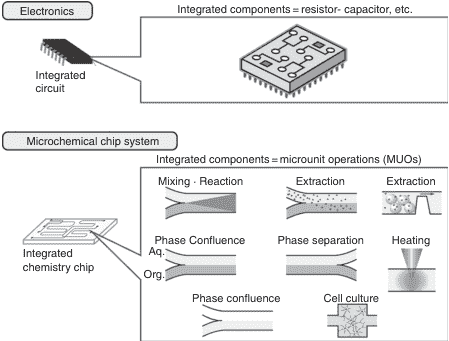

**图1** 微化学芯片系统与电子系统的比较。

微技术正朝着两个方向发展。第一个方向是实际应用。虽然已经实现了一些实用的原型系统，但在平行液/液和液/气微流中获得长期稳定性有时仍存在问题，界面会发生扭曲。为了实现稳健的流体控制，稳定或恢复平行多相微流的方法至关重要。对于微流控设备，处理小体积（纳升至微升）样品以及与微芯片对接的能力非常重要。此外，为了在微芯片上进行更复杂、高通量的化学处理，需要用于灵活、可靠液体处理的智能流体设备（阀或泵）。

第二个方向涉及纳米尺度（10–1,000 nm）空间中的新科学，称为扩展纳米空间。扩展纳米空间是连接单分子与凝聚相的重要区域。最近，微空间中的通用方法被应用于扩展纳米空间，证明微空间中的基本方法也适用于扩展纳米空间。水在扩展纳米空间通道中表现出显著不同的性质。研究人员提出了一个与纳米空间表面化学根本相关的模型。该模型被应用于可计数数量分子的蛋白质分析，并且同类型的集成方法（嵌入微流控系统中的扩展纳米空间通道）也被应用于细胞固定化与培养的控制和分析。

在此，我们介绍这些基本方法和应用。首先，在第2章中讨论了微集成的一般概念（MUO和CFCP），在第3章中讨论了支持MUO和CFCP的流体控制方法。

### 2. 微化学系统集成的设计与构建方法

集成微化学系统有望应用于各个领域。为了实现一般的分析、组合、物理和生物应用，微芯片上的通用微集成方法非常重要。传统的宏观化工厂或分析系统是通过组合混合器、反应器和分离器等单元操作构建的。类似的方法可以应用于微化学系统。通过将不同功能的MUO串联和并联组合，可以利用多相微流网络（如图2所示）将各种化学过程集成到微芯片上。这种方法被称为CFCP（Tokeshi et al., 2002）。由于许多物理性质（如传热传质效率、比界面面积和可忽略不计的重力）在微空间中存在显著差异，缩小传统单元操作通常效果不佳，有时甚至完全无效。因此，需要设计考虑这些问题的新的MUO。Kitamori及其同事开发了用于各种目的的MUO，例如混合与反应（Sato et al., 1999; Sorourdadin et al., 2000, 2001）、相汇聚与相分离（Aota et al., 2007a, 2007b; Hibara et al., 2002, 2003; Hisamoto et al., 2001a, 2001b, 2003; Hotokezaka et al., 2005; Kikutani et al., 2004; Minagawa et al., 2001; Miyaguchi et al., 2006; Sato et al., 2006b; Smirnova et al., 2006, 2007; Surmeian et al., 2001, 2002; Tokeshi et al., 2000a, 2000b）、溶剂萃取（Aota et al., 2007a, 2007b; Hibara et al., 2001, 2003; Hisamoto et al., 2001a, 2001b; Hotokezaka

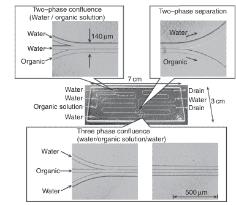

**图2** 多相微流网络（Tokeshi 等，2002）。

等，2005；Kikutani 等，2004；Minagawa 等，2001；Miyaguchi 等，2006；Sato 等，2000b；Smirnova 等，2006，2007；Surmeian 等，2001，2002；Tokeshi 等，2000a，2000b，2002），气液萃取（Aota 等，2009b；Hachiya 等，2004），表面固相萃取与反应（Kakuta 等，2006；Ohashi 等，2006；Sato 等，2000a，2001，2003，2004），加热（Goto 等，2005；Slyadnev 等，2001；Tanaka 等，2000），细胞培养（Goto 等，2008；Tamaki 等，2002；Tanaka 等，2004，2006），以及超灵敏检测（Hiki 等，2006；Mawatari 等，2006；Proskurnin 等，2003；Tamaki 等，2002，2003，2005；Tokeshi 等，2001，2005；Yamauchi 等，2006）（图3）。

#### 2.1 多相微流网络

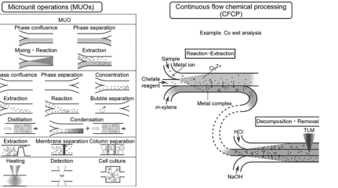

对许多化学处理应用而言，微化学系统应包括利用水溶液和有机（或气体和液体）溶液的溶剂萃取和界面反应组件。必须控制两种溶液以在微芯片中实现一般化学过程。20世纪90年代，电渗流被用于微芯片电泳（Auroux 等，2002；Reyes 等，2002）；然而，电渗流仅限于对单一类型溶液（水性缓冲液）的流动控制。因此，电渗流不适合作为集成需要其他类型溶剂的各种化学过程的流动控制方法。许多研究者将简单的压力驱动流用作非电泵送方法（Brody 和 Yager，1997；Kopp 等，1998；Weigl 和 Yager，1999）。

最近，不互溶溶液的微段塞流被用于微化学过程（Burns 和 Ramshaw，2001；Kralj 等，2005；Sahoo 等，2007；Song 等，2003）。尽管微段塞流在混合和快速分子传输方面具有优势，但相分离和三相以上接触是困难的。此外，在宽流速范围内控制微段塞流是困难的，因为段塞尺寸随流速比变化。Kitamori 等开发了并行多相微流，其沿微通道并排流动（Hibara 等，2001）。层流状态下的并行多相微流能够更好地设计和控制微化学过程，因为并行多相微流在宽流速范围内稳定，并且能够形成三相以上接触。

#### 2.2 微化学过程示例

##### 2.2.1 微空间中的分子传输

微流控化学过程基于向微通道的横向分子扩散。在微空间中，由于扩散距离短，预期可在其中实现快速化学过程。为了阐明微空间中化学过程所需的时间，作为简单讨论，考虑一维扩散时间 t。一维中的*t*表征如下：

$$t = \frac{l_d^2}{K}$$  (1)

其中$l_d$和$K$分别为扩散长度和扩散系数。图4显示了扩散时间对扩散长度的依赖关系。实线和虚线分别对应扩散系数为$1 \times 10^{-9}$和$1 \times 10^{-10}\ \mathrm{m^2\ s^{-1}}$时的扩散时间。在100 μm宽的微通道中，对于扩散系数为$1 \times 10^{-9}\ \mathrm{m^2\ s^{-1}}$的样品，扩散时间仅为10 s。因此，高扩散系数的样品（例如金属螯合物）在微空间中快速传输。然而，对于扩散系数为$1 \times 10^{-10}\ \mathrm{m^2\ s^{-1}}$的样品，扩散时间为100 s。低扩散系数的样品（例如DNA和蛋白质）不能在微空间中快速传输。

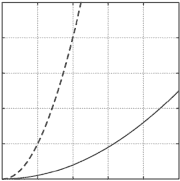

**图4** 扩散时间对扩散长度的依赖关系。实线和虚线分别对应扩散系数为$1 \times 10^{-9}$和$1 \times 10^{-10}\ \mathrm{m^2\ s^{-1}}$时的扩散时间。

##### 2.2.2 钴湿法分析

微钴湿法分析是已得到验证的CFCP示例（图5）（Tokeshi 等，2002）。此类分析的常规流程包括螯合反应、配合物的溶剂萃取，以及共存金属配合物的分解与去除。这些流程类似于常规单元操作：混合与反应、相汇合、溶剂萃取、相分离、相汇合和溶剂萃取。这些单元操作同样类似于MUO。CFCP通过将MUO串联和并联组合来设计，如图3所示。

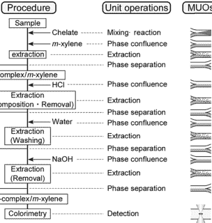

**图5** 基于CFCP的钴湿法分析系统设计。

微芯片由两个不同区域组成，一个用于反应和萃取，另一个用于纯化（即分解、萃取和去除杂质螯合物）。在反应区，含Co(II)、NN和间二甲苯的样品溶液通过微量注射泵以恒定流速经三个入口引入。这三股流在交点处汇合，在微通道中形成由有机–水界面组成的并行两相微流。Co(II)与NN的化学反应以及Co–NN螯合物的萃取在反应混合物沿微通道流动时进行。由于NN与共存金属离子（如Co(II)、Ni(II)和Fe(II)）反应，这些共存金属螯合物也被萃取到间二甲苯微流中。因此，萃取后需要纯化。

共存金属螯合物在HCl–间二甲苯界面接触时分解，金属离子溶解于HCl溶液相。NN的分解碎片溶解于NaOH溶液，而Co–NN螯合物在浓HCl和NaOH溶液中稳定并保留在其中。最后，间二甲苯中的目标螯合物由下游的热透镜显微镜检测，水溶液中的Co(II)在此被成功测定。检出限（2σ）为0.13 zmol，即78个螯合物分子。该系统的分析时间仅为50 s，而常规装置为6 h。利用CFCP的微化学处理已在众多场合得到验证（表1）。

**表1. 微化学处理示例**

| 方法 | 分析物 | 检出限 | 分析时间 | 参考文献 |
|---|---|---|---|---|
| 溶剂萃取 | 铁配合物 | 7.7 zmol | 60 s | Tokeshi 等（2000） |
| 溶剂萃取 | 钴配合物 | 0.13 zmol, 0.72 zmol, 0.072 zmol | 60 s, 50 s, 0 min | Tokeshi 等（2000，2002），Minagawa 等（2001） |
| 溶剂萃取 | 镍配合物 | NA | 5 min | Sato 等（2000） |
| 溶剂萃取 | K⁺和Na⁺ | 4.5 zmol | 1 s | Hisamoto 等（2001a，2001b） |
| 溶剂萃取 | 染料分子 | NA, NA | 6 s, 4 s | Surmeian 等（2001，2002） |
| 溶剂萃取 | 安非他明类 | 0.5 μg ml⁻¹ | 15 min | Miyaguchi 等（2006） |
| 溶剂萃取 | 甲萘威 | 0.5 zmol, 0.079 zmol | 4.5 min, 5 min | Smirnova 等（2006，2007） |
| 溶剂萃取 | 铀(VI) | 0.86 amol | 1 s | Hotokezaka 等（2005） |
| 气体萃取 | 甲醛 | 8.9 ppb | 30 min | Hachiya 等（2004） |
| 气体萃取 | 氨 | 1.4 ppb | 16 min | Aota 等（2009b） |
| 免疫分析 | S-IgA | <1 μg ml⁻¹ | <1 h | Sato 等（2000） |
| 免疫分析 | 癌胚抗原 | 30 pg ml⁻¹ | 35 min | Sato 等（2001） |
| 免疫分析 | 干扰素-γ | 10 pg ml⁻¹ | 50 min（四个样品） | Sato 等（2003） |

**表1** *(续)*

| 方法 | 分析物 | 检出限 | 分析时间 | 参考文献 |
| --- | --- | --- | --- | --- |
|  | B型利钠肽 | 0.1 pg ml⁻¹ | 35 min | Sato et al. (2004) |
|  | IgE | 2 ng ml⁻¹ | 12 min | Kakuta et al. (2006) |
|  | 朊病毒 | 50 pg ml⁻¹ | 15 min | — |
|  | C反应蛋白 | 20 ng ml⁻¹ | 8 min | — |
|  | 苯丙胺类 | 0.1 ng ml⁻¹ | 10 min | — |
| 流动注射 | Fe²⁺ | 6 zmol | 150 s | Sato et al. (1999) |
|  | 抗坏血酸 | 1 zmol | 30 s | Sorouraddin et al. (2000) |
|  | 儿茶酚胺 | 2 zmol | 15 s | Sorouraddin et al. (2001) |
| 酶法分析 | H₂O₂ | NA, 50 zmol, NA | 250 s, NA, NA | Hisamoto et al. (2003), Tanaka et al. (2000, 2004) |

CFCP方法可用于开发更复杂的处理系统。与常规装置相比，通过CFCP系统可实现更快速的分析、生物测定和免疫测定，以及更高效的反应和萃取。然而，开发复杂的微化学处理系统耗时，因为需要在微型化尺度上确定每种反应和分离过程的合适条件，还需要设计和优化微通道结构。在半导体电路器件设计中，通常使用计算机辅助设计（CAD）进行电路分析、集成器件分析、版图设计和逻辑仿真。如果专门针对微化学处理开发CAD，其中包括微流体仿真、反应时间分析、萃取时间分析和微通道结构设计，那么这些系统的开发时间将大幅缩短。

##### 2.2.3 微免疫测定

免疫测定是临床诊断最重要的分析方法之一。异相免疫测定是一种特别常用的方法，其中固定在固体表面的捕获抗体或抗原与血清中的目标抗原或抗体反应。随后，标记的二抗捕获目标物，并通过检测标记物来定量目标物。异相免疫测定的特点是结合/游离分离简便且准确，这对于提高检出限（LOD）很重要。鉴于POC诊断需求日益增长，在处理更小样本和试剂体积时，缩短分析时间是必要的。在常规方法中，使用微孔板孔（通常直径6.5 mm），50 μl体积对应的比界面面积为13 cm⁻¹。然而，当使用微通道（深200 μm、宽200 μm）固定抗体（抗原）时，影响反应时间和效率的界面面积增至200 cm⁻¹。

Kitamori等报道了首次成功将ELISA集成到微芯片中（Kakuta等，2006；Sato等，2000a，2001，2003，2004）。他们通过使用填充微珠的微通道开发了一种用于异相反应的新型MUO（图6）。他们通过物理吸附或化学吸附将抗体（抗原）固定在微珠表面。固定后，作者施加牛血清白蛋白或MPC（2-甲基丙烯酰氧乙基磷酰胆碱）聚合物涂层，以尽量减少非特异性吸附。引入带有捕获抗体的微珠悬浮液，并将其阻挡在微通道坝结构处（间隙为10 μm），形成5–10 mm长的填充微珠区域。引入目标样品溶液，并由抗体（抗原）捕获。然后引入酶偶联的二抗（辣根过氧化物酶（HRP）或碱性磷酸酶（ALP））以捕获抗原。最后，施加底物，并通过热透镜显微镜（TLM）在微珠下游检测酶促反应产生的染料分子。

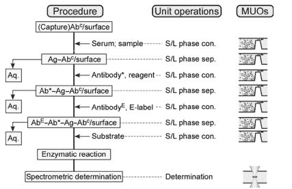

**图6** 微免疫测定的设计。

易于操作和高精度的仪器对于临床诊断系统也很重要。通常，微通道中的流体处理复杂且困难，因为缺乏低体积（1 μl）阀门，或缺乏从宏观尺度到微观尺度且不产生微升级死体积的流体接口。此外，进行新测量时最好更换微芯片，或者需要采用实验室流程去除抗原并清洗微通道。这些因素限制了微芯片技术在临床诊断中的推广。所开发方法的特点是使用微珠进行免疫反应；通过简单引入新的微珠，即可轻松进行新的测量。最近，Kitamori等通过设计一个集成流体、光学和电子元件的简单微流控系统，开发了一种用于POC临床诊断的便携式微ELISA系统（Ohashi等，2006）。我们的系统示例以及用于四通道并行测量的组件如图7所示。样品和试剂储存在移动托盘上的管中。PEEK™管在四个注射泵的控制下，将样品和试剂（微升级体积）吸入并注入微芯片。流向废液还是微芯片的切换，由他们新型的低体积（约1 μl）、快速响应（<1 s）微阀控制。该管通过耐压>1 MPa的疏水连接器连接到微芯片。在清洗过程中最大流速为10 μl min⁻¹时，填充微珠区域的压降<100 kPa。随后在微芯片上进行免疫测定并检测

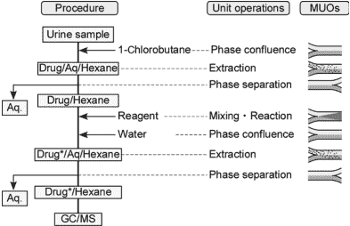

**图8** 基于MUO和CFCP的尿液分析系统设计。

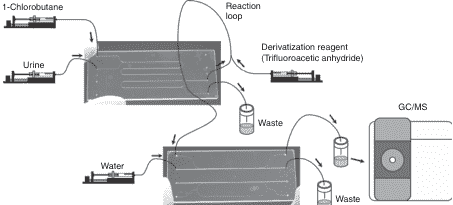

**图9** 用于尿液分析的微系统（Miyaguchi等，2006）。

数小时缩短至5 min，包括GC–MS在内的总分析时间低于20 min。此外，仅需100 μl的样品和试剂。这些特点将在不久的将来实现现场、精确的尿液分析。

## 3. 多相微流的表面化学

#### 3.1 多相微流的基本物理性质

多相微流的控制是集成MUO的一项重要基础技术。因此，需要能够在宽流速范围内稳定分离多相微流的控制方法。然而，常规尺寸装置中的方法不能直接应用，因为微观尺度下的物理性质与宏观尺度不同。在常规装置中，水相和有机相通过重力分离。然而，在微空间中，由于比界面面积大，流体受液–固、液–气和液–液界面的影响很大。为了阐明微通道中的主要物理力，其中包括黏性力和界面参数，并可使用无量纲的雷诺数（Re）和邦德数（Bo）进行分析，它们分别定义为惯性力与黏性力之比以及重力与界面张力之比。图10a显示了模型微通道的横截面，其尺寸包含在这些参数中。

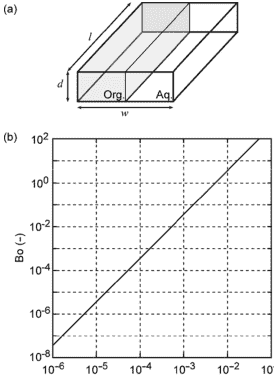

**图10** (a) 模型微通道中水相（Aq.）与有机相（Org.）之间的液–液界面。沿微通道的宽度、深度和长度分别表示为*w*、*d*和*l*。(b) 水–甲苯微流的邦德数（Bo）随流体动力学直径的变化。

Bo定义为

Bo = (Δρ) g d_h² / γ    (2)

其中Δρ、γ和d_h分别为密度差、两相间的界面张力和等效直径，g为重力加速度（9.8 m s⁻²）。变量d_h对应于平均水力直径，定义为

d_h = 4S / l_p    (3)

其中S为横截面积，l_p为微通道某一截面的周长。图10b显示了水–甲苯两相流的Bo随d_h的变化（Δρ=0.132 × 10³ kg m⁻³，γ=36.3 mN m⁻¹）。在d_h为100 μm的微观尺度下，界面张力超过重力三个数量级。

Re定义为

Re = ρ u d_h / μ = 2ρ u d_h w / [μ(w + 2d)]    (4)

其中ρ、u和μ分别为密度、平均速度和黏度。当水以1 μl min⁻¹的流速在微通道中流动时，在d_h为100 μm的微观尺度下，Re仅为0.05。因此，多相微流被视为层流。

当多相微流的物理性质（如黏度和界面张力）可视为常数时，流动可分为两部分。一部分是汇合后流动剖面逐渐接近平衡状态的瞬态部分，另一部分是平衡部分。后者的流速剖面可在简单假设下解析表达。首先考虑平衡状态下的两相微流。两相微流如图11所示。相I和II的黏度分别为μ^I和μ^II，宽度分别为a和b。作为流动的驱动力，假设通道长度L上的压差为P_I − P_0 ≡ ΔP。x轴和z轴分别定义为沿通道方向和横跨通道方向。x轴的原点假设在相I和II的界面处。在这些条件下，基于动量平衡，剪切应力τ_xz可表示为

dτ_xz/dx = ΔP / L    (5)

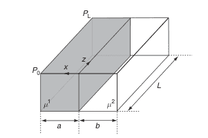

**图11** 两相微流示意图。相I和相II的黏度分别为 \(\mu^I\) 和 \(\mu^{II}\)，宽度分别为 \(a\) 和 \(b\)。

为了获得相I和相II的应力，对式(4)进行积分，表示为

$$
\tau_{zx}^I = \frac{\Delta P}{L} x + C_1^I \\
\tau_{zx}^{II} = \frac{\Delta P}{L} x + C_1^{II}
\tag{6}
$$

其中 \(C_1\) 为常数，上标 I 和 II 分别表示相 I 和相 II。这里，假设剪切应力连续性作为边界条件。即，

$$
\tau_{zx}^I = \tau_{zx}^{II} \text{ at } x = 0
\tag{7}
$$

将式(6)代入式(7)，得到如下关系。

$$
C_1^I = C_1^{II} = C_1
\tag{8}
$$

这里使用牛顿黏性定律，

$$
\tau_{zx} = \mu \frac{dv_z}{dx}
\tag{9}
$$

其中 \(v_z\) 为 z 方向流速。利用式(6)–(9)，相I和相II的速度 \(v^I\) 和 \(v^{II}\) 表示为

$$
\begin{aligned}
v_z^I &= \frac{\Delta P}{2\mu^I L}x^2 + \frac{C_1}{\mu^I}x + C_2^I \\
v_z^{II} &= \frac{\Delta P}{2\mu^{II} L}x^2 + \frac{C_1}{\mu^{II}}x + C_2^{II}
\end{aligned}
\tag{10}
$$

水/丁醇（3.0 cP）、水/乙酸丁酯（0.73 cP）和水/乙酸乙酯（0.43 cP）。

多相微流受压力支配（Aota et al., 2007a, 2009a）。描述多相微流所需的一个重要参数是驱动流体的压力。由于流体黏度，压力在流动下游部分降低。当相互接触的两种流体具有不同黏度时，两相之间的压力差（\(\Delta P_{\mathrm{flow}}\)）是接触长度和流速的函数。另一个重要参数是由两相之间界面张力引起的拉普拉斯压力（\(\Delta P_{\mathrm{Laplace}}\)）。通过 \(\Delta P_{\mathrm{Laplace}}\) 与 \(\Delta P_{\mathrm{flow}}\) 之间建立的平衡，界面位置固定在微通道中的某一点处。

图13a展示了两相微流液-液界面处的压力平衡。由于玻璃的亲水性，玻璃表面上的液-液界面朝有机相弯曲。\(\Delta P_{\mathrm{Laplace}}\) 在弯曲的液-液界面处产生。

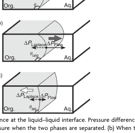

**图13**  (a) 液-液界面处的压力平衡。两相分离时，压力差与拉普拉斯压力平衡。(b) 当两相之间的压力差大于最大拉普拉斯压力时，有机相向水相移动。(c) 当压力差小于最小拉普拉斯压力时，水相向有机相移动。缩写：Aq.，水相；Org.，有机相（Aota et al., 2009a）。

基于杨–拉普拉斯方程，\(\Delta P_{\mathrm{Laplace}}\) 估算如下：

$$
\Delta P_{\mathrm{Laplace}}=\gamma\left(\frac{1}{R_1}+\frac{1}{R_2}\right) \tag{22}
$$

其中 \(R_1\) 和 \(R_2\) 分别是液-液界面在垂直于和平行于液流方向上的曲率半径。对于平行多相微流，该方程简化如下。

$$
\Delta P_{\mathrm{Laplace}}=\gamma\left(\frac{1}{R_1}\right)=\frac{2\gamma\sin(\theta-90^\circ)}{d} \tag{23}
$$

其中 \(\theta\) 和 \(d\) 分别为接触角和微通道深度。接触角限制在水相前进接触角 \(\theta_{\mathrm{aq}}\) 与有机相前进接触角 \(\theta_{\mathrm{org}}\) 之间。因此，\(\Delta P_{\mathrm{Laplace}}\) 限制如下：

$$
\frac{2\gamma\sin(\theta_{\mathrm{aq}}-90^\circ)}{d}<\Delta P_{\mathrm{Laplace}}<\frac{2\gamma\sin(\theta_{\mathrm{org}}-90^\circ)}{d} \tag{24}
$$

当 \(\Delta P_{\mathrm{flow}}\) 超过最大 \(\Delta P_{\mathrm{Laplace}}\) 时，有机相向水相流动（图13b）。当 \(\Delta P_{\mathrm{flow}}\) 低于最小 \(\Delta P_{\mathrm{Laplace}}\) 时，水相向有机相流动（图13c）。当改变流速比时，通过改变液-液界面位置来维持压力平衡。该模型表明，微流控的重要参数是界面张力、动态接触角和微通道深度。该模型也可应用于气液微流。

考虑界面压力模型，流速应处于上限和下限之间。可通过考虑微通道中的压力损失来评估 \(\Delta P_{\mathrm{flow}}\)。假设开放出口处的压力为大气压 \(P_{\mathrm{atm}}\)，则由压力损失 \(\Delta P\) 得到的各相压力 \(P\) 表示如下：

$$
P=P_{\mathrm{atm}}+\Delta P_{\mathrm{tube}}+\Delta P_{\mathrm{channel}}
$$
$$
=P_{\mathrm{atm}}+\frac{2f\rho v_{\mathrm{tube}}^2L_{\mathrm{tube}}}{d_{h,\mathrm{tube}}}+\frac{2f\rho v_{\mathrm{channel}}^2L_{\mathrm{channel}}}{d_{h,\mathrm{channel}}} \tag{25}
$$

其中 \(f\)、\(\rho\)、\(v\) 和 \(L\) 分别为摩擦因子、密度、流体平均速度，以及分别对应出口管和微通道部分的管长与通道长度。当气液和液液微流被视为层流时，\(f\) 表示如下：

$$
f=\frac{16}{\mathrm{Re}}=\frac{16\mu}{\rho v d_h} \tag{26}
$$

因此，\(\Delta P_{\mathrm{flow}}\) 可表示如下：

$$
\Delta P_{\mathrm{flow}} = P_{\mathrm{org}} - P_{\mathrm{aq}}
= \frac{32\mu_{\mathrm{org}}V_{\mathrm{channel,org}}L_{\mathrm{channel,org}}}{d_{h,\mathrm{channel,org}}^{2}} + \frac{32\mu_{\mathrm{org}}V_{\mathrm{tube,org}}L_{\mathrm{tube,org}}}{d_{h,\mathrm{tube,org}}^{2}}
- \frac{32\mu_{\mathrm{aq}}V_{\mathrm{channel,aq}}L_{\mathrm{channel,aq}}}{d_{h,\mathrm{channel,aq}}^{2}} - \frac{32\mu_{\mathrm{aq}}V_{\mathrm{tube,aq}}L_{\mathrm{tube,aq}}}{d_{h,\mathrm{tube,aq}}^{2}} \tag{27}
$$

其中下标 org 和 aq 分别对应有机相和水相。利用式(27)评估了 \(\Delta P_{\mathrm{flow}}\) 的上限和下限。表2汇总了各种溶剂黏度的文献值。可利用式(23)评估 \(\Delta P_{\mathrm{Laplace}}\)。表3汇总了各种溶剂的界面张力。水在玻璃上的前进接触角和后退接触角

**表2** 20 °C 时溶剂黏度汇总

| 溶剂 | 黏度（cP） |
| --- | --- |
| 丙酮 | 0.315 |
| 苯胺 | 4.40 |
| 1-丁醇 | 2.948 |
| 乙酸丁酯 | 0.732 |
| 四氯化碳 | 0.969 |
| 氯仿 | 0.58 |
| 环己烷（17 °C 时） | 1.02 |
| 1-癸醇 | 12.96 |
| 二氯甲烷 | 0.445 |
| 乙醚（25 °C 时） | 0.224 |
| 1,4-二氧六环（25 °C 时） | 1.177 |
| 十二烷（25 °C 时） | 1.383 |
| 乙醇 | 1.20 |
| 乙酸乙酯 | 0.455 |
| 己烷 | 0.326 |
| 甲醇 | 0.597 |
| 硝基苯 | 2.03 |
| 1-辛醇（25 °C 时） | 7.288 |
| 戊烷 | 0.240 |
| 1-丙醇 | 2.256 |
| 甲苯 | 0.590 |
| 水 | 1.002 |
| 间二甲苯 | 0.620 |

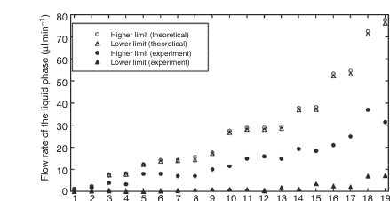

**图15** 气液微流的相分离条件。溶剂：1，1-癸醇；2，1-辛醇；3，1-丙醇；4，硝基苯；5，十二烷；6，1,4-二氧六环；7，乙醇；8，水；9，四氯化碳；10，间二甲苯；11，己烷；12，甲苯；13，氯仿；14，乙酸乙酯；15，二氯甲烷；16，环己烷；17，丙酮；18，戊烷；19，乙醚。空心圆表示理论上限，空心三角形表示理论下限，实心圆表示上限实验结果，实心三角形表示下限实验结果（Aota et al., 2009a）。

#### 3.2 多相微流的稳定化方法

泵流速的扰动可能使多相微流失稳。然而，利用微通道结构和表面能的控制方法可有效维持对微流控的稳健控制。研究人员提出，可通过改变微通道结构或向微通道添加特征来稳定多相微流，具体而言，沿微通道设置导流结构（Fokeshi et al., 2002）或柱状结构（Maruyama et al., 2004），这些结构使流体界面可具有比平坦表面更宽的接触角范围。研究人员可利用液-液微流设计各种微流控化学过程。

其他研究团队提出采用选择性化学表面修饰来稳定多相微流（Aota et al., 2007a, 2007b; Hibara et al., 2002, 2003, 2005, 2008; van der Linden et al., 2006; Zhao et al., 2001, 2002a, 2002b, 2003）。图16展示了具有化学图案化表面的微通道中液-液界面的形状。水在疏水表面上的接触角可大于90°。因此，与具有导流结构或柱状结构的微通道相比，具有图案化表面的微通道中的多相微流可在更宽的条件范围内形成。

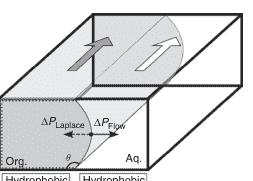

**图16** 液-液界面的形状，其接触线钉扎在亲水表面与疏水表面的边界处。

Beebe组提出了一种选择性化学表面修饰方法，该方法结合了多相层流微流与自组装单分子层（SAM）化学（Zhao等，2001，2002a，2002b，2003）。微通道中的流动为3.1节所述的层流。因此，可混溶液体的多相微流可以并排流动而不发生湍流混合。用注射泵将一股纯十六烷和一股十八烷基三氯硅烷（ODS）的十六烷溶液一起引入微通道，并保持层流2-3 min（图17）。在含ODS溶液的区域，微通道的顶部和底部均形成了SAM。不含ODS溶液区域的其他微通道仍保持裸玻璃表面的亲水性。流速必须足够快，以防止ODS扩散。

Beebe组还提出了一种通过光刻实现选择性化学表面修饰的方法（Zhao等，2001，2002a，2002b，2003）。该方法使用具有疏水基团和亲水基团的光可裂解SAM。首先，使用光可裂解SAM对微通道进行修饰。通过依次冲洗清洁微通道

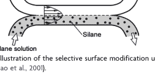

**图17** 使用多相层流微流进行选择性表面修饰的示意图（Zhao等，2001）。

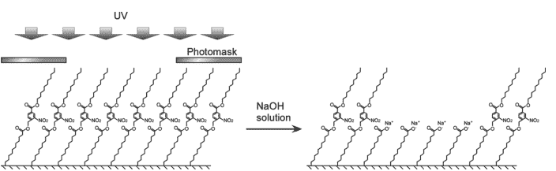

**图18** 紫外光图案化方法。玻璃表面形成的光可裂解SAM的分子结构。通过置于SAM修饰微通道顶部的掩模进行紫外照射，可在照射区域产生亲水性羧酸基团（Zhao等，2001）。

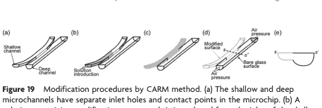

图19 通过CARM方法进行修饰的步骤。(a) 微芯片中的浅微通道和深微通道具有各自的入口孔和接触点。(b) 含修饰化合物的溶液通过毛细作用从浅微通道入口引入。(c) 溶液不会泄漏到深微通道，仅浅微通道被修饰。(d) 用气压将溶液从深微通道推走。(e) 沿(d)中s-s'虚线的截面示意图（Hibara等，2005）。

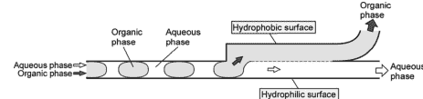

图20 段塞流转化为平行两相微流（Hibara等，2008）。

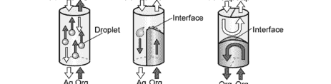

图21 (a) 传统宏观尺度装置中的逆流，(b) 普通微通道中因高剪切应力导致破裂而产生液滴，以及(c) 普通微通道中两相碰撞的示意图。缩写：Aq，水相；Org，有机相（Aota等，2007c）。

具有非对称横截面的微通道中的液-液微逆流如图22所示。由于空气的粘度可视为可忽略不计，在实验条件下水的最大流速变为恒定。理论更高极限值如图22b中实线所示。实验结果与理论值略有差异，这一差异可由微通道出口附近的实验问题解释，例如压力损失和润湿。考虑理论下限，300 K时空气的粘度为18.6 μPa s，仅为水的1.9%。因此，空气相的压力可视为可忽略。图22c显示了甲苯水溶液微逆流的相分离条件。对于液-液微逆流，两相的粘度都起重要作用。因此，更高和更低极限不是恒定的。理论更高和更低极限值分别如图22c中实线和虚线所示。水相上游部分的最大流速与理论值吻合良好。然而，最小流速与理论值不一致。这种差异可以用微通道几何形状来解释。当水泄漏到疏水表面时，由于疏水通道是平坦的，上壁的接触角与下壁相同。然而，当甲苯泄漏到亲水表面时，由于亲水通道具有半圆形横截面且亲水表面与疏水表面之间的边界具有边缘，上壁的接触角与下壁不同。由于边缘处液-液界面的接触角范围比平坦表面更宽，边缘结构处的液-液界面可以产生比平坦表面更大的ΔPLaplace值。由于边缘结构可以扩大相分离的流速条件范围，这种不一致对于利用多相微流的微流控化学过程设计可能不是严重问题。

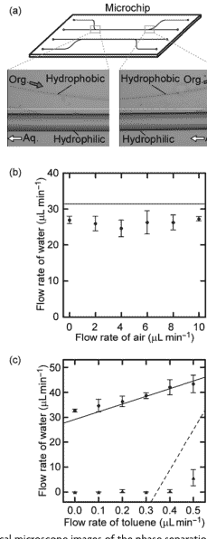

**图22** (a) 汇合处相分离的光学显微镜图像。(b) 水的最大流速随空气流速的变化。实心圆表示实验最大流速，实线表示理论更高极限。(c) 水的最大和最小流速随甲苯流速的变化。实心圆表示实验最大流速，实心三角表示实验最小流速，实线表示理论更高极限，虚线表示理论更低极限（Aota等，2007a）。

气-液和液-液微流对于高效萃取过程是有效的。当样品包含位于流体-液界面的吸附分子时，分子吸附会改变流体-液界面的界面张力。由于微芯片中的比界面积非常大，分子吸附引起的界面张力变化可能是影响气-液和液-液微流相分离的重要因素。微流下游部分的分子浓度更高。因此，在设计包含通过界面进行分子传输的化学过程时，研究人员需要通过考虑界面处的分子吸附来修改所提出的模型。对于微萃取设计，*原位*界面张力测量尤为重要。微观准弹性激光散射方法可能成为实现这一目的的有力工具（Hibara等，2003）。

超亲水和超疏水表面在稳定两相微流方面更有效。这些表面可以通过利用钛纳米颗粒制造粗糙度来获得。微通道的钛修饰产生纳米级表面粗糙度，随后的疏水处理形成超疏水表面。利用光催化分解涂覆的疏水分子来图案化表面润湿性，在受控光照射下将其从超疏水调节为超亲水（Takei等，2007a）。该方法也可应用于将段塞流转化为两相微流。

#### 3.3 基于润湿性的微阀

通过微加工技术制造的众多小型化机械阀已被开发出来（Auroux等，2002；Dittrich等，2006；Reyes等，2002）。由软材料制成的气动控制阀也有报道（Unger等，2000）。所有这些阀都需要制造和构建机械运动部件，或需要微通道中外部控制部件的压力。此外，还有利用相变溶液（Gui和Liu，2004）、热响应聚合物（Yu等，2003）或水凝胶（Beebe等，2000）的非机械方法的报道。另外，图案化疏水表面已被证明可作为微流体控制中的阀用于各种应用。前述图案化钛表面由于其超疏水性质，可以非常有效地用作微芯片中的阀（Takei等，2007b）。如图23所示，已证明在具有图案化表面的微通道中进行批操作。首先，在低于最大拉普拉斯压力的压力下引入荧光溶液（图23a）。其次，在相同压力下引入空气，以推出多余溶液并保留皮升体积的液段（图23b）。第三，在某一压力下引入空气

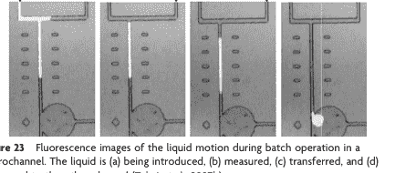

**图23** 微通道中批操作期间液体运动的荧光图像。液体被(a)引入，(b)计量，(c)转移，以及(d)分配到另一通道（Takei等，2007b）。

高于排出液塞所需的最大拉普拉斯压力（图23c、d）。这种利用化学表面改性的微阀没有死体积，能够为反应或分析提供恒定体积的液体。此外，该操作的可重复性使其可用于滴定。

## 4. 讨论与结论

介绍了微流控的基本方法与应用。第2章将讨论微集成的一般概念（MUO 和 CFCP）以及基于 CFCP 的应用。CFCP 方法可用于开发更复杂的化学处理系统。如果用于微化学处理的 CAD 包含微流体仿真、反应时间分析、萃取时间分析和微通道结构设计，那么微化学系统的开发时间将大幅缩短。第3章将讨论流体控制方法。黏性力和界面张力是微空间中的有效作用力。为了控制这些力，表面化学和微通道结构发挥着重要作用。由于基本方法已经开发出来，下一阶段需要开发面向实际应用的微流控系统。

### 符号表

- *a*：相 I 的宽度（m）
- *b*：相 II 的宽度（m）
- *d*：深度（m）
- *dh*：当量直径（m）
- *f*：摩擦因子（-）
- *g*：重力加速度（m s−2）
- *K*：扩散系数（m2 s−1）
- *L*：通道长度（m）
- *lp*：周长（m）
- *ld*：扩散长度（m）
- *P*：压力（N m−2）
- *Patm*：大气压（N m−2）
- *R*：曲率半径（m）
- *S*：横截面积（m2）
- *t*：扩散时间（s）
- *u*：平均速度（m s−1）
- *v*：流速（m/s）
- *w*：宽度（m）

#### 希腊字母

- γ：界面张力（N m−1）
- μ：黏度（cP）
- ΔP：压差（N m−2）
- ΔP_flow：两相之间的压差（N m−2）
- ΔP_Laplace：拉普拉斯压力（N m−2）
- Δρ：密度差（kg m−3）
- θ：接触角（度）
- θ_aq：水相前进接触角（度）
- θ_org：有机相前进接触角（度）
- ρ：密度（kg m−3）
- τ：剪切应力（N m−2）

### 参考文献

- Aota, A., Hibara, A., and Kitamori, T. Anal. Chem. 79, 3919–3924 (2007a).
- Aota, A., Hibara, A., and Shinohara, K., et al. Anal. Sci. 23, 131–133 (2007b).
- Aota, A., Mawatari, K., and Takahashi, S., et al. Microchim. Acta 164, 249–255 (2009a).
- Aota, A., Mawatari, K., and Kitahara, Y., et al. 洁净室中氨的微型连续气体分析系统，载于《2009年微全分析系统会议论文集》（T. Kim, Y. S. Lee, T. D. Chung, N. L. Jeon, S. H. Lee, K. Y. Suh, J. Choo, Y. K. Kim 编），第609–611页。化学与生物微系统学会，韩国济州岛（2009b）。
- Aota, A., Nonaka, M., and Hibara, A., et al. Angew. Chem. Int. Ed. 46, 878–880 (2007c).
- Auroux, P. A., Iossifidis, D., and Reyes, D. R., et al. Anal. Chem. 74, 2637–2652 (2002).
- Beebe, D. J., Moore, J. S., and Bauer, J. M., et al. Nature 404, 588–590 (2000).
- Brody, J. P., and Yager, P. Sens. Actuators, A 58, 13–18 (1997).
- Burns, J. R., and Ramshaw, C. Lab Chip 1, 10–15 (2001).
- Dittrich, P. S., Tachikawa, K., and Manz, A. Anal. Chem. 78, 3887–3908 (2006).
- Goto, M., Sato, K., and Murakami, A., et al. Anal. Chem. 77, 2125–2131 (2005).
- Goto, M., Tsukahara, T., and Sato, K., et al. Anal. Bioanal. Chem. 390, 817–823 (2008).
- Gui, L., and Liu, J. J. Micromech. Microeng. 14, 242–246 (2004).
- Hachiya, H., Masumoto, T., and Kanda, K., et al. 利用气液两相流的微环境气体分析系统，载于《2004年微全分析系统会议论文集》（T. Laurell, J. Nilsson, K. F. Jensen, D. J. Harrison, J. P. Kutter 编），第91–101页。英国皇家化学学会，瑞典马尔默（2004）。
- Hibara, A., Iwayama, S., and Matsuoka, S., et al. Anal. Chem. 77, 943–947 (2005).
- Hibara, A., Kasai, K., and Miyaguchi, H., et al. 新型两相流控制概念与多步萃取微芯片，载于《2008年微全分析系统会议论文集》（L. E. Locascio, M. Gaitan, B. M. Paegel, D. J. Ross, W. N. Vreeland 编），第1326–1328页。化学与生物微系统学会，美国圣迭戈（2008）。
- Hibara, A., Nonaka, M., and Hisamoto, H., et al. Anal. Chem. 74, 1724–1728 (2002).
- Hibara, A., Nonaka, M., and Tokeshi, M., et al. J. Am. Chem. Soc. 125, 14954–14955 (2003).
- Hibara, A., Tokeshi, M., and Uchiyama, K., et al. Anal. Sci. 17, 89–93 (2001).
- Hiki, S., Mawatari, K., and Hibara, A., et al. Anal. Chem. 78, 2859–2863 (2006).
- Hisamoto, H., Horouchi, T., and Tokeshi, M., et al. Anal. Chem. 73, 1382–1386 (2001a).
- Hisamoto, H., Horouchi, T., and Uchiyama, K., et al. Anal. Chem. 73, 5551–5556 (2001b).
- Hisamoto, H., Shimizu, Y., and Uchiyama, K., et al. Anal. Chem. 75, 350–354 (2003).
- Hotokezaka, H., Tokeshi, M., and Harada, M., et al. Prog. Nucl. Energy 47, 439–447 (2005).
- Kakuta, M., Takahashi, H., and Kazuno, S., et al. Mater. Sci. Technol. 17, 3189–3194 (2006).
- Kitamori, T., Hisamoto, H., and Tokeshi, M., et al. Lab Chip 4, 328–332 (2004).
- Kopp, M. U., de Mello, A. J., and Manz, A. Science 280, 1046–1048 (1998).
- Kralj, J. G., Schmidt, M. A., and Jensen, K. F. Lab Chip 5, 531–535 (2005).
- Maruyama, T., Kaji, T., and Ohkawa, T., et al. Analyst 129, 1008–1013 (2004).
- Mawatari, K., Tokeshi, M., and Kitamori, T. Anal. Sci. 22, 781–784 (2006).
- Minagawa, T., Tokeshi, M., and Kitamori, T. Lab Chip 1, 72–75 (2001).
- Miyaguchi, H., Tokeshi, M., and Kitamori, T., et al. J. Chromatogr. A 1129, 105–110 (2006).
- Ohashi, T., Mawatari, K., Sato, K., et al. 用于过敏检测仪的自动化微 ELISA 系统：原型与临床测试，载于《2006年微全分析系统会议论文集》（T. Kitamori, H. Fujita, S. Hasebe 编），第858–860页。日本学术协会株式会社，日本（2006）。
- Proskurnin, M. A., Slyadnev, M. N., and Tokeshi, M., et al. Anal. Chim. Acta 480, 79–95 (2003).
- Reyes, D. R., Iossifidis, D., and Auroux, P. A., et al. Anal. Chem. 74, 2623–2636 (2002).
- Sahoo, H. R., Kralj, J. G., and Jensen, K. F. Angew. Chem. Int. Ed. 46, 5704–5708 (2007).
- Sato, K., Tokeshi, M., and Kimura, H., et al. Anal. Chem. 73, 1213–1218 (2001).
- Sato, K., Tokeshi, M., and Kitamori, T., et al. Anal. Sci. 15, 641–645 (1999).
- Sato, K., Tokeshi, M., and Odake, T., et al. Anal. Chem. 72, 1144–1147 (2000a).
- Sato, K., Tokeshi, M., and Sawada, T., et al. Anal. Sci. 16, 455–456 (2000b).
- Sato, K., Yamanaka, M., and Hagino, T., et al. Lab Chip 4, 570–575 (2004).
- Sato, K., Yamanaka, M., and Takahashi, H., et al. Electrophoresis 23, 734–739 (2003).
- Slyadnev, M. N., Tanaka, Y., and Tokeshi, M., et al. Anal. Chem. 73, 4037–4044 (2001).
- Smirnova, A., Mawatari, K., and Hibara, A., et al. Anal. Chim. Acta 558, 69–74 (2006).
- Smirnova, A., Shimura, K., and Hibara, A., et al. Anal. Sci. 23, 103–107 (2007).
- Song, H., Tice, J. D., and Ismagilov, R. F. Angew. Chem. Int. Ed. 42, 767–772 (2003).
- Sorouraddin, H. M., Hibara, A., and Kitamori, T. Fresenius' J. Anal. Chem. 371, 91–96 (2001).
- Sorouraddin, H. M., Hibara, A., and Proskurnin, M. A., et al. Anal. Sci. 16, 1033–1037 (2000).
- Surmeian, M., Hibara, A., and Slyadnev, M., et al. Anal. Lett. 34, 1421–1429 (2001).
- Surmeian, M., Slyadnev, M. N., and Hisamoto, H., et al. Anal. Chem. 74, 2014–2020 (2002).
- Takeda, G., Aota, A., and Hibara, A., et al. 通过光催化润湿性图案化与微通道表面调控实现分段流的相分离，载于《2007年微全分析系统会议论文集》（J. L. Viovy, P. Tabeling, S. Descroix, L. Malaguin 编），第1213–1215页。化学与生物微系统学会，法国巴黎（2007a）。
- Takei, G., Nonogi, M., and Hibara, A., et al. Lab Chip 7, 596–602 (2007b).
- Tamaki, E., Hibara, A., and Tokeshi, M., et al. J. Chromatogr. A 987, 197–204 (2003).
- Tamaki, E., Hibara, A., and Tokeshi, M., et al. Lab Chip 5, 129–131 (2005).
- Tamaki, E., Sato, K., and Tokeshi, M., et al. Anal. Chem. 74, 1560–1564 (2002).
- Tanaka, Y., Sato, K., and Yamato, M., et al. Anal. Sci. 20, 411–423 (2004).
- Tanaka, Y., Sato, K., and Yamato, M., et al. J. Chromatogr. A 1111, 233–237 (2006).
- Tanaka, Y., Slyadnev, M. N., and Hibara, A., et al. J. Chromatogr. A 894, 45–50 (2001).
- Tokeshi, M., Minagawa, T., and Kitamori, T. Anal. Chem. 72, 1711–1714 (2000a).
- Tokeshi, M., Minagawa, T., and Kitamori, T. J. Chromatogr. A 894, 19–23 (2000b).
- Tokeshi, M., Minagawa, T., and Uchiyama, K., et al. Anal. Chem. 74, 1565–1571 (2002).
- Tokeshi, M., Uchida, M., and Hibara, A., et al. Anal. Chem. 73, 2112–2116 (2001).

- Tokeshi, M., Yamaguchi, J., and Hattori, A., et al. Anal. Chem. 77, 626–630 (2005).
- Unger, M. A., Chou, H. P., and Thorsen, T., et al. Science 288, 113–116 (2000).
- van der Linden, H. J., Jellema, L. C., and Holwerda, M., et al. Anal. Bioanal. Chem. 385, 1376–1383 (2006).
- Weigl, B. H., and Yager, P. Science 283, 346–347 (1999).
- Yamauchi, M., Mawatari, K., and Hibara, A., et al. Anal. Chem. 78, 2646–2650 (2006).
- Yu, C., Mutlu, S., Selvaganapathy, P., and Mastrangelo, C. H., et al. Anal. Chem. 75, 1958–1961 (2003).
- Zhao, B., Moore, J. S., and Beebe, D. J. Science 291, 1023–1026 (2001).
- Zhao, B., Moore, J. S., and Beebe, D. J. Anal. Chem. 74, 4259–4268 (2002a).
- Zhao, B., Moore, J. S., and Beebe, D. J. Langmuir 19, 1873–1879 (2003).
- Zhao, B., Viernes, N. O. L., and Moore, J. S., et al. J. Am. Chem. Soc. 124, 5284–5285 (2002b).

## 第2章 电场微反应器
**Anil Ağral** 和 **Han J.G.E. Gardeniers**\*

### 摘要
集成电极的微反应器系统为研究和利用电学原理来控制、激活或改变化学反应以及制备性分离提供了极好的平台。本章详细讨论的一个例子是微等离子体，它允许在中等温度下利用具有与极高温度下相当的反应活性的物种进行化学操作，并在能源效率方面具有潜在优势。另一个重点主题是化学反应的电动控制，它需要小尺度才能高效运行。电动概念可用于控制流体流动，也可用于输运或捕获颗粒和分子。本章还讨论了一些较少为人知的概念，如电风、电摆动吸附、电喷雾和脉冲电场，以及它们的应用实例。此外，还描述了控制吸附和解吸以及吸附分子的活性和方向的新原理，并讨论了这些原理对于开发新型反应器和新型化学的相关性。

### 1. 引言
#### 1.1 化学与电学的交汇
化学与电学的结合最为人熟知的形式是*电化学*，在电化学中，化学反应发生在与电极接触的溶液中，这些电极共同构成一个电路。电化学涉及电极与溶液中电解质或物种之间的电子转移。它已被用于存储电能（如在原电池或电池中）、产生电能（如在燃料电池中）、分析溶液中的物种（如在pH玻璃电极或离子选择电极中），或从溶液中合成物种（如在电解池中）。

然而，还有许多其他方式可以将电学与化学结合起来。其中一种已被深入研究并应用于各种不同用途的是*等离子体化学*（关于近期综述，参见Fridman, 2008）。等离子体是一种部分电离的气体，其中一定百分比的电子是自由的，而不是束缚在原子或分子上。由于等离子体的电荷中性要求等离子体电流在电路中自行闭合，等离子体反应器与电化学电池有相似之处，尽管由于电离程度和电导率低得多，等离子体放电通常需要在数百伏的范围内操作，而水相电化学电池只需几伏。

等离子体技术的工业和商业应用实例日益增多。典型的*低压*放电实例包括某些类型的光源（包括等离子体显示面板），以及用于集成电路制造的微加工工艺，如溅射、反应离子刻蚀和等离子体增强化学气相沉积（CVD）。电弧放电是在非常高的温度（约10,000 K）下产生高功率热放电的过程，是*大气压等离子体*的典型例子。电弧放电应用于冶金加工和焊接。大气压等离子体的另一个例子是电晕放电，这是一种通过向尖锐电极尖端施加高电压而产生的非热放电。这种放电用于臭氧发生器和颗粒沉降器。

特别值得关注的是介质阻挡放电（DBD）。这是一种通过施加高电压产生的非热大气压放电，其中*绝缘涂层*阻止等离子体放电转变为电弧。该过程使用频率在kHz到GHz范围内变化的高压交流电。在大气压下运行是通过*电极之间的小间隙*实现的，该间隙从等离子体显示器中的0.1毫米、臭氧发生器中的1毫米到CO₂激光器中的数厘米不等。因此，尽管DBD被大规模应用，例如在合成织物和塑料的表面功能化中以改善油漆和胶水的附着力（Leroux, 2006, 2008），但由于所需间隙较小，它通常在*微系统*中执行。此外，DBD除了可以不需要大多数其他等离子体过程所需的真空之外，还在*低气体温度*下运行，这就是它已成为合成用途相关技术的原因。*微等离子体器件*中的化学将是本章阐述的主要主题。

上述电学与化学的结合方式涉及在气体或液体介质中产生带电物种。这需要电离，电离通过电子转移和带电物种在闭合电路中的输运发生。带电物种本身，或由它们产生的自由基（例如，在等离子体中通过气相中的电子碰撞产生的自由基），可以作为活化物种参与化学反应。

另一方面，也可以利用电荷来*增强传质*，要么通过输运化学物种本身（如果它们带有电荷），要么通过输运含有化学物种的介质。这种*电动输运*有多种形式：*电泳*是带电粒子在电场中由于静电库仑力而运动，该力将它们穿过介质拖向带相反电荷的表面；*电渗*是极性液体在电场影响下沿带电表面的运动；*介电电泳*（DEP）基于施加在处于非均匀电场中的（不一定带电的）介电粒子上的力。*介质上电润湿*（EWOD）可用于诱导液滴在表面或通道中流动，其中液滴被拉向高电场区域。所有这些

电动学原理在微系统中效果最佳，本章将讨论其与合成化学结合的情形。

最后，可以利用由外部电场诱导的*表面*带电或极化，来控制分子的吸附和解吸以及这些吸附分子的状态，从而控制其化学反应性。这是一个新兴领域，尚未充分挖掘其全部潜力。它涉及*纳米技术*和*纳米科学*的各个方面，例如制造几纳米尺度的结构以及由扫描隧道显微探针产生的刺激。该领域的研究结果通常具有基础性质。表面反应的电子控制这一主题将在本章最后一节讨论。

#### 1.2 当化学与电在狭窄小巷中相遇

*微反应技术*的优势及其作为过程强化概念的确立，此前已在文献中多次被强调；此处不再重复，我们想请读者参阅过去十年中出现的许多优秀综述和专著（Hessel et al., 2004, 2009; Jähnisch et al., 2004; Jensen, 2001; Kolb et al., 2007; Yoshida, 2008）。在微反应技术涉及以电作为化学物种活化或操纵机制的情形中（在化学中使用电场本身已被视为一种有价值的过程强化概念，见 Stankiewicz and Moulijn, 2000），小尺度的优势主要在于传质距离更短，或在于可施加电场的间隙更小。一个典型例子如前所述是微等离子体装置，其中小电极间隙使得大气压等离子体化学成为可能；这是因为尽管由于气体稠密，电子在间隙空间中的寿命有限，但它们仍能存活足够长时间以激发大量物种。此外，小间隙允许使用较低电压来获得相同的电场强度。微反应技术与电场结合的其他优势是较大的表面积与体积之比，以及在微反应器装置的相关位置集成电极的可能性。

本章将重点关注电场在微反应器中的应用，并概述此类系统用于化学合成的潜力。本章末尾将概述研究较少的概念，如表面化学的电子控制，并讨论纳米技术为实现此类控制提供的机会。

### 2. 微等离子体反应器

#### 2.1 大气压微等离子体

等离子态被称为物质第四态。它用于描述由正负离子、电子以及激发态和中性物种组成的部分或完全电离的气体。等离子体的电离度可从部分电离到完全电离变化。等离子体表现出准中性，即正负电荷的平衡。局部电荷可由恢复准中性的静电力平衡。等离子体根据不同带电物种的数密度（粒子 cm⁻³）和平均动能（eV，通常以温度（K）表示）进行分类。电子、离子以及激发态和中性物种的平均动能取决于等离子体条件。在平衡或热等离子体中，所有成分（离子、电子和中性物种）具有相同的平均温度，该温度可从几千开尔文（例如在等离子体炬中）到几百万开尔文（在聚变等离子体中）变化。在非热低温等离子体中，离子和中性物种的温度可接近环境温度，而在同一等离子体中，电子的温度可超过几千开尔文。等离子体成分（例如电子和激发态物种）的温度可超过传统热化学过程中所用的温度，而这些异常等离子体条件可产生具有高浓度高能和反应性物种的热力学非平衡态（Roth, Lichtenberg, 1994; Raizer, 1991; von Engel, 1955）。

大气压非热放电可能对化学工业非常重要，因为它们在低温下产生高反应性环境，从而开辟替代性、高度灵活、环境友好且节能的工艺路线。非平衡大气压等离子体的特征和性质可在许多综述文章和书籍中找到（Becker et al., 2004, 2005, 2006; Foest et al., 2006; Lieberman and Lichtenberg, 1994; Raizer, 1991; Tachibana, 2006; von Engel, 1955）。

大气压等离子体与大多数其他等离子体一样，由气体体积中的高电场产生。气体中始终存在少量自由电子，例如由宇宙辐射或某些同位素的放射性衰变产生；当超过临界电场强度后，这些电子会形成雪崩，伴随物种的电离和激发。热电子获得的能量被有效传递，并用于气体分子的激发和解离。在非平衡大气压等离子体中，碰撞和辐射过程以通过逐步过程和三体碰撞进行的能量传递为主。这些过程的主导地位促成了许多新颖应用，例如医疗灭菌、生物去污、污染物修复、准分子灯和光源（Foest et al., 2006）。然而，高压等离子体由于会迅速转变为电弧和丝状化而趋于不稳定。为避免不稳定问题并在实际应用中维持自持放电，找到的解决方案是将高压等离子体限制在*约1 mm以下的尺寸*。这种等离子体通常被称为*微等离子体*。这类等离子体中的电流密度和能量密度很高，并导致有效的气体加热以及从电子到气体分子的动量传递。

尺寸小于1 mm的反应器中的化学将我们带入*微反应器*领域。在微反应器中实施微等离子体，具有利用大气压非平衡化学过程优势的潜力，可高效合成有价值的化学品和纳米结构，并分解危险化合物。如前所述，微等离子体可在低气体温度下产生，并具有包含大量高能电子以及由这些电子衍生的反应性物种的电子能量分布。此外，微反应器通道中增大的表面积与体积之比会增强等离子体-表面相互作用，这在通道壁存在活性涂层的情况下非常有用。可以利用反应性物种与表面的额外等离子体活化的结合，以节能的方式生产化学产品。

这里将描述若干微等离子体反应器构型。分类将基于电源、从直流到 GHz 的电场切换频率，以及电极几何形状和材料，范围从 DBD 到微空心阴极和微腔放电。

##### 2.1.1 直流辉光放电

当通过放电的电流被一个大电阻限制到低值时，可在两个电极之间产生大气压直流辉光放电（Grotrian, 1915）。当电极间距保持在1 mm以下时，微等离子体可以稳定；当放电的空间尺寸保持足够小时，可以避免向不稳定电弧放电转变（Staeck et al., 2005）。图1显示了空气中这种放电的照片。光谱温度测量表明，该放电是非热的，气体温度高于室温。小尺寸辉光放电的非平衡性质可能在微反应器中用于气体重整、材料沉积以及分解对环境有害的物质。

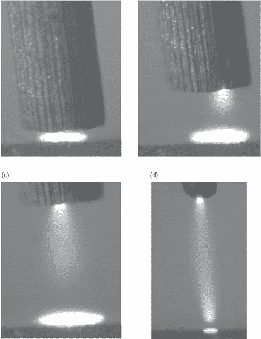

**图1** 空气在大气压下、电极间距分别为（a）0.1 mm、（b）0.5 mm、（c）1 mm 和（d）3 mm 时的辉光放电（Staack 等，2005；经许可转载）。

##### 2.1.2 介质阻挡放电

DBDs 是大气压下的非平衡等离子体，应用于臭氧生成、表面改性、污染控制、准分子灯，以及最近还应用于平板等离子体显示面板（Kogelschatz，2003）。典型的平面 DBD 配置如图2所示。它们在电极与等离子体之间至少有一层作为绝缘体的电介质层，以防止电弧形成。介质阻挡层可以是玻璃、陶瓷或聚合物涂层。在 DBD 配置中，等离子体具有电容性质，并由绝缘体与相对（通常未覆盖）电极之间间隙中的大量微放电组成，其中丝状微放电的持续时间限于几纳秒（Kogelschatz，2002）。这样，气体的过度加热被最小化，尽管微放电中产生的高能电子确保了气体体积中分子和原子的活化。将 DBD 集成到微反应器中作为离子、激发态物种和自由基的微型源，可产生高度反应性和淬灭性的环境，这在热化学过程中难以获得。

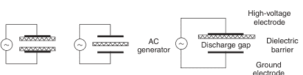

**图2** DBD 配置（Kogelschatz，2003；经许可转载）。

##### 2.1.3 微空心阴极放电

微空心阴极放电（MHCDs）首次被报道为圆柱形空心阴极几何结构中的稳定大气压微放电（Schoenbach，1996）。在典型的空心阴极结构中，阴极中有一个圆柱孔，环形阳极由绝缘体隔开（图3a），或者在薄的固体阴极层中有一个圆柱形开口（图3b）（Schoenbach 等，2003）。由于这些电极配置的制造工艺相对简单，制造可并行运行的大面积微等离子体器件阵列变得可行。使气体流经空心部分内的等离子体体积，可将这些放电用作微反应器。也可以在阳极侧放置第三电极，以在大气压下实现尺寸可达厘米级的稳定辉光放电（Stark 和 Schoenbach，1999）。MHCDs 可在大气压下以直流或脉冲模式运行，其电子密度超过其他非平衡高压辉光放电中的电子密度。极高的功率密度（约 10^5 W cm^-3）使这些微放电在微反应器中极具吸引力，可用于高效分解烃和氨等分子。

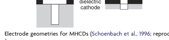

**图3** MHCDs 的电极几何结构（Schoenbach 等，1996；经许可转载）。

##### 2.1.4 微腔放电

微腔等离子体器件具有横截面可精确控制的腔体。这些器件的大阵列已在不同材料中制造，例如陶瓷（Allmen 等，2003）、光可定义玻璃（Kim 和 Eden，2005）、氧化铝结构（Park 等，2005）和塑料基板（Anderson 等，2008）。图4展示了在硅中制造的具有倒置方锥形微腔的示例。电极与放电之间的物理和化学隔离由电介质维持。在这些微等离子体器件中使用硅作为主体材料的优势在于，该材料可用的微加工技术范围广泛，从而能够以合理成本生产微腔放电器件的大阵列。作为一个应用示例，已演示了基于一次性塑料基板、集成在微反应器中的互连圆柱形微腔等离子体元件的平行线性阵列（Anderson 等，2008）。

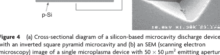

**图4** （a）具有倒置方锥形微腔的硅基微腔放电装置的横截面示意图，以及（b）单个微等离子体器件的 SEM（扫描电子显微镜）图像，其发射孔径为 50 × 50 µm²（Becker 等，2006；经许可转载）。

##### 2.1.5 尖端电极的场发射

电场中气体击穿的条件可用击穿电压表示为气压与间隙间距乘积的函数来描述。所得曲线称为帕邢曲线（Paschen，1889）。当气体中的离子被加速穿过间隙，从而产生汤森雪崩时，就会发生击穿（Townsend，1925）。对于大于约10 μm的间隙，击穿已被充分研究，当电场高于约3 V μm⁻¹时发生。然而，对于大气压下的空气，当间隙间距低于约5 μm时，观察到击穿电压升高（Schaffert，1975）。在这些条件下，电子可以隧穿表面势垒，这种现象称为场发射。场发射电流由福勒–诺德海姆方程描述（Fowler 和 Nordheim，1928）。图5显示了1 atm下空气的修正帕邢曲线（Zhang 等，2004a），其中小间隙间距处击穿电压的最小值和上升被平台（未修正的帕邢曲线将在约5 μm间隙间距处具有最小值）以及陡降至零所取代。在陡降开始的“拐点”处，场发射完全取代汤森雪崩。平台和拐点的确切位置取决于金属电极的几何形状、粗糙度和组成。最后，对于小于约2 nm的超薄间隙，电子有一定概率隧穿绝缘势垒，并产生显著的隧穿电流。

图5表明，在大气压下，非常窄的间隙中的击穿可在相对较低的电压（几十伏）下发生，这使实际应用具有吸引力。如果其中一个电极呈针状，情况会变得更有利：针尖处的电场增强，从而在比图5中两个平面电极所观察到的更低电压下产生场发射。我们实验室的工作表明，在相同电压下，氧化钨纳米线森林的电流密度比平面电极高10倍（Ågral 等，2008a）。下面我们将展示这些纳米线电极在化学合成中的应用示例。纳米线（碳纳米管（CNTs））与平面电极组合的另一应用是最近关于微型化气体电离传感器的工作（Modi 等，2003）。

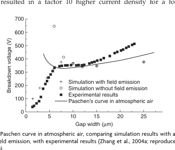

**图5** 大气空气中的帕邢曲线，比较有场发射和无场发射的模拟结果与实验结果（Zhang 等，2004a；经许可转载）。

图6显示了一个典型的场发射体设计，它由尖锐的尖端电极和*栅电极*组成。该设计属于*Spindt 型*，指的是 Spindt 等（1976）开发的制造工艺。这种设计以及与之非常相似的其他设计因其在等离子体显示器件中的应用而闻名，其中栅电极充当发射体电极的对电极，从尖端发射的电子穿过真空击中荧光屏。在给定栅极电压下的发射电流强烈依赖于尖端的曲率半径以及尖端与栅极之间的间距，其中后者可以通过改变栅极孔开口相当容易地缩放。减小该开口的尺寸将在更低的开启电压下产生更高的发射电流。一个例子是开口为100 nm的高密度场发射体尖端阵列（每 cm² 2.5 × 10^9 个尖端），可由10–20 V的电压驱动（Choi 等，2001）。

带有栅电极的场发射体尖端尚未应用于为化学合成生成活性物种，这可能是一个有趣的未来研究领域，因为这些器件可能提供额外的灵活性。朝这一方向发展的器件是用于质谱仪的电子碰撞电离源（Kornienko 等，2000）。栅极发射体一个特别有趣的特征是，可以将电子产生区域（尖端与栅电极之间）与可激发化学反应的区域分开（就像在等离子体显示器中一样）。可以设想将电子束聚焦到催化剂表面以增强表面反应，或者可以利用尖端与栅极之间的空间——如果该空间连接到通向图6中玻璃基底背面的入口孔——来引入一种气体，该气体将被

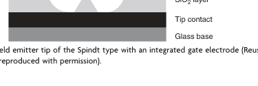

**图6** 带有集成栅电极的 Spindt 型场发射体尖端（Reuss 等，2003；经许可转载）。

在栅极开口处或附近电离。一种令人兴奋的选择是采用如下配置：每个发射极-栅极组合引入不同的气体。可实现的高尖端密度或许能提供系统所需的吞吐量。还要注意，如果使用可单独寻址的发射极尖端阵列，则每个发射极尖端可被调谐到不同能量，从而既允许发生化学气相反应，也允许在需要时于不同位置并以一定时间间隔发生电离。

#### 2.2 微等离子体反应技术的应用

微反应器技术与非平衡微等离子体化学的结合催生了新型应用。在此，我们讨论该主题近期文献中的一些精选案例，以说明若干主要趋势。我们将重点关注受限微通道中用于化学合成和环境应用的微等离子体。

##### 2.2.1 微等离子体反应器中的纳米结构合成

使用微等离子体反应器合成纳米结构是一种有吸引力的方法，因为源材料的分解及随后的晶核形成可在高密度非平衡等离子体中于毫秒量级的时间间隔内完成。例如，Sankaran 等人（2005）在连续流常压微等离子体反应器中，由氩/硅烷混合物合成了直径为 1–3 nm 的硅纳米颗粒。他们的技术基于操作时间极短（μs–ms）的高压微放电。微放电在空心阴极中产生，该空心阴极由内径（ID）为 180 μm 的不锈钢毛细管构成，并朝向阳极延伸；阳极是内径为 1 mm 的金属管，如图 7 所示。利用在 300–500 V 和 3–10 mA 下维持的直流微等离子体，在常压附近以气溶胶形式产生了硅纳米颗粒。由于该微反应器在小于 1 μl 的等离子体体积中以低功率（5–10 W）运行，所得功率密度高达 10 kW cm−3。如此高密度的等离子体可实现快速等离子体处理，用于合成蓝色发光硅纳米颗粒。微放电中高密度的 高能电子 高效分解气态前驱体，在反应区产生自由基。当自由基浓度高到足以成核时，纳米颗粒可在微等离子体中开始生长。当气流将颗粒从放电区带至自由基浓度低的区域时，颗粒生长将停止。该系统的另一个特点是，微等离子体中的颗粒带电减少了反应区下游的凝聚。采用相同的直流微等离子体技术，在常压下以可控方式合成了 Fe 和 Ni 催化剂颗粒，并将其用于碳纳米管（CNTs）的气相生长（Chiang 和 Sankaran，2007，2008）。催化剂颗粒由二茂铁和二茂镍制备。总之，这种简单且廉价的微反应技术可用于通过气态前驱体分解，在连续流中合成纳米颗粒。

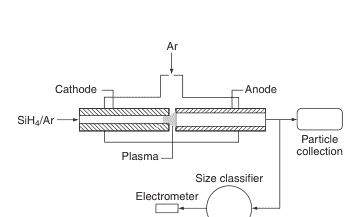

**图 7** 用于合成硅纳米颗粒的微等离子体反应器示意图。微放电在阴极尖端形成，并朝向阳极延伸一小段距离（Sankaran 等，2005；经许可转载）。

Nozaki 等人（2007a，2007b）开发了一种常压微等离子体反应器，用于制备可调光致发光硅纳米晶体（3–15 nm）。他们在体积小于 1 µl、停留时间约为 100 µs 的毛细玻璃管中产生电容耦合非平衡等离子体，并用其将四氯化硅分解为原子硅。在反应器中，氩、氢和四氯化硅的混合物由甚高频（VHF，144 MHz）电源激活。实验装置示意图和微等离子体反应器照片如图 8 所示。上电极通过匹配电路连接到 VHF 电源（放电功率 35 W），两根金属电极之间留有 2 mm 间隙，围绕在毛细管外侧（硼硅酸盐玻璃：ID = 630 µm，OD = 1,100 µm）。微等离子体的光学发射光谱表征表明，电子密度为 10^15 cm^-3，氩激发温度为 5,000 K，转动温度为 1,500 K。在这些高密度反应条件下，硅源气体的高效分解和过饱和硅蒸气的形成通过三体碰撞导致气相晶体的成核，并且由于在微反应器中的停留时间极短，晶体生长随后迅速终止。

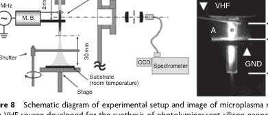

图 8 用于在室温下合成光致发光硅纳米晶体的、配备 VHF 电源的实验装置示意图和微等离子体反应器照片（Nozaki 等，2007a；经许可转载）。M.B. 为匹配电路。

通过施加超高频（UHF），开发了一种电感耦合微等离子体反应器，用于在不同基底上沉积材料（Bose 等，2006；Shimizu 等，2003，2005）。采用常压 O₂–Ar 微等离子体反应器，以钼丝为源材料制备氧化钼纳米颗粒。直径为 100 μm 的金属钼丝插入到距收缩喷嘴出口 6 mm 处，该喷嘴开口的内径为 60–70 μm。使用 20 匝铜线圈通过匹配电路将反应器连接到 UHF 电源。毛细管微反应器的示意图如图 9 所示。高密度微等离子体氧化钼，并由钼丝提供 MoO₂ 纳米颗粒晶种。O₂–Ar 混合物的流速影响工艺机理，并由此控制纳米颗粒的形状、尺寸和氧化态。研究发现，MoO₂ 氧化为 MoO₃，且纳米颗粒尺寸随流速增加而减小。采用相同的 UHF 微等离子体技术，使甲烷和汽化二茂铁气体流过微通道，从而在钨丝上涂覆多壁碳纳米管（MWCNTs）（Shimizu 等，2005）。这种新的微反应方法独特之处在于，与常规等离子体增强 CVD 工艺相比，它以低功耗（数十瓦）获得更高的 MWCNTs 生长速率。

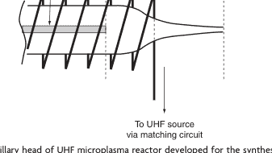

图 9 为合成氧化钼纳米颗粒而开发的 UHF 微等离子体反应器的毛细管头（Bose 等，2006；经许可转载）。

常压微等离子体技术具有在小空间内产生高密度反应介质的优势，可用于微通道内的表面改性和材料沉积。我们最近开发了一种 DBD 技术，用于活化毛细管微反应器中的镍/氧化铝催化剂涂层，以促进该涂层上碳纳米纤维（CNF）的生长（Agarwal 等，2009）。由于具有高孔隙率和曲折度，CNFs 是用于液相反应的有前景的纳米结构催化剂载体（De Jong 和 Geus，2000）。尽管热活化是显著提高纳米纤维产率的重要途径，但常压微等离子体可通过利用放电活化物种形成替代路线，这些物种在环境温度下于催化剂表面反应。在我们的工作中，带有内部镍/氧化铝催化剂涂层的熔融石英毛细管微反应器（内径 500 μm，外径 550 μm）通过石墨卡套高压电极连接到气体供应源。在氢气（5 ml min⁻¹）和氦气（150 ml min⁻¹）气流下，于 300 K 产生 DBD 以活化催化剂，持续 15 min。微反应器、催化剂涂层和微等离子体处理如图 10 所示。活化 15 min 后，催化剂颜色由浅灰色变为深灰色，表明放电操作期间发生了镍的还原。光学发射光谱表征表明，催化剂的低温活化是通过常压下微反应器中的活性等离子体物种实现的。微通道中产生的放电被表征为均匀且稳定，在环境气体温度下具有高功率密度（680 W cm⁻³）。与未活化样品相比，放电处理显著提高了 CNF 产率，且该工艺可与 973 K 下处理 2 h 的高温处理相竞争。此外，将低温微等离子体处理与热处理进行比较表明，前者的纳米纤维直径均匀得多。该方法证明了在微反应器壁面上进行冷催化剂活化的可行性。

用微等离子体对微通道内壁进行改性的另一个例子是在微通道中沉积均匀铂膜。

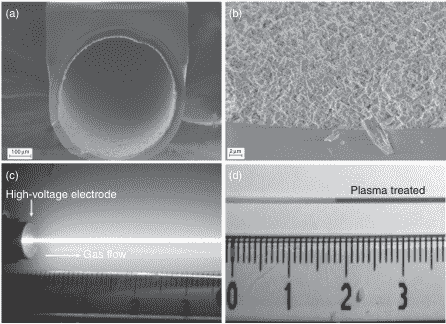

**图 10** (a) 涂覆Ni/氧化铝催化剂的熔融石英毛细管微反应器的SEM图像，(b) 煅烧后的催化剂层，(c) 微等离子体处理以提高CNF合成催化剂活性时拍摄的照片，(d) 活化15分钟后催化剂颜色从浅灰色变为深灰色（Agiral 等，2009；经许可转载）。

（Kadowaki 等，2006）。这是通过在毛细管和玻璃芯片微通道中、在低压（几个托）下产生介质阻挡放电（DBD）实现的，电极附着在沿通道轴线的外表面上。毛细管和Pyrex芯片中微等离子体的照片如图11所示。毛细管和Pyrex芯片分别使用圆柱形石墨电极和金属箔电极。通过引入汽化的双乙酰丙酮铂，等离子体沉积形成了厚度超过100 nm的铂膜。通过控制电压和频率参数，可以在微通道中的电极之间实现均匀沉积。该技术很好地证明了利用微等离子体技术在微反应器中对薄膜催化剂或其他涂层进行可控沉积的可能性。

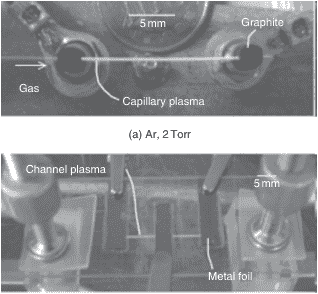

**图 11** (a) 毛细管和 (b) Pyrex芯片微通道中的微等离子体照片，用于铂膜的等离子体化学气相沉积（Kadowaki 等，2006；经许可转载）。

##### 2.2.2 微等离子体反应器的环境应用

通过产生高能电子和活性自由基等高活性物种，微等离子体反应器为在大气压下分解有害气态污染物所涉及的C–C和C–H键断裂创造了新的工艺窗口。作为此方面的一个示例，开发了一种用于分解挥发性有机化合物（VOCs）的微型DBD装置（Seto 等，2005）。该装置采用表面放电微等离子体，包含通过光刻不锈钢箔制成的微电极，以及由矩形云母片制成的介电基板作为阻挡层（图12）。向放电电极施加高压（3.5 kV）交流电（AC）场（67 kHz）后，在云母片表面形成微等离子体，并产生高能电子，这些电子使分子解离、形成负离子和正离子，并激发分子和元素物种。离子计数测量表明，大多数副产物带负电荷。甲苯的分解效率在分批模式下超过99%，在连续流模式下为30–80%，并且表明甲苯在微等离子体反应器中由原子氧完全转化为二氧化碳。

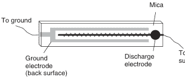

**图 12** 为气相VOCs分解而开发的表面放电微等离子体反应器示意图（Seto 等，2005；经许可转载）。

利用一种微反应器在大气压下实现了四氟甲烷的分解，该反应器在具有叉指排列的微结构电极之间具有非常小的电极间隙（70 µm）（图13）（Sichler 等，2004）。该反应器的优点是点火电压低，且在高气压下能产生均匀等离子体。氧化铝基板、镍电极和带氧化铝涂层的Foturan玻璃被用作微反应器材料。结果表明，微加工流动结构能提供有效的流动控制，并对分解效率有很大影响。此外，通过“数量放大”，即构建由16个微等离子体反应器并联组成的多反应器，实现了向更大废气处理流量的放大。除了提高处理量外，采用多反应器方案还降低了单个微反应器的功率负担，延长了其使用寿命。据估计，一个小型半导体工厂需要25个这样的多反应器来处理每分钟20升的含氟废气，其能耗仅为传统燃烧系统的50%。

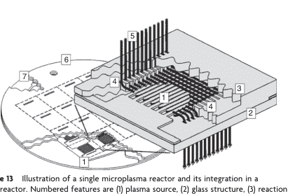

**图 13** 单个微等离子体反应器及其在多反应器中集成的示意图。编号特征为：(1) 等离子体源，(2) 玻璃结构，(3) 反应腔，(4) 反应器入口和出口，(5) 气体流动，(6) 多反应器中的4 × 4阵列，(7) 射频功率接触焊盘（Sichler 等，2004；经许可转载）。

Mori 等人使用内径为0.5或3 mm的毛细管放电管来分解二氧化碳。实验装置如图14所示（Mori 等，2006）。毛细管等离子体反应器由Pyrex玻璃本体和安装的电极组成，电极不直接与气流接触，以消除阴极和阳极区域对CO₂分解的影响。对缩小尺寸效应对等离子体化学和放电特性影响的分析表明，二氧化碳转化率主要由毛细管微反应器中的电子碰撞解离和气相逆向反应决定。极高的CO₂转化率归因于电流密度的增加，而非表面反应或电场增强。

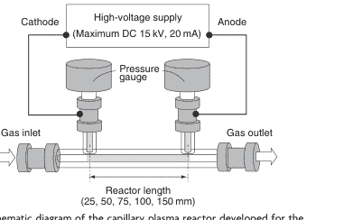

**图 14** 用于二氧化碳分解的毛细管等离子体反应器示意图（Mori 等，2006；经许可转载）。

在微等离子体反应器中应用纳米结构作为电极，用于提高大气压下阻挡放电过程的反应活性和效率（Agiral 等，2008b）。将碳纳米纤维（CNFs）和氧化钨（W₁₈O₄₉）纳米线集成到连续流微等离子体反应器中，使得放电后通过场发射从纳米结构注入电荷，提供自由电子和离子。通过在硅芯片上生长纳米线和纳米纤维来实现纳米结构的集成，该硅芯片用作玻璃微反应器系统中的高压电极，如图15所示。大气压场发射电子测试表明，纳米结构尖端顶端的场增强可在空气中产生电子发射。在与未加纳米结构的电极上施加相同测量电位的条件下，放电过程中注入带电物种会导致击穿电压降低和功率沉积增加。以CO₂裂解作为模型反应进行测试，发现纳米纤维的引入提高了放电的化学反应活性。

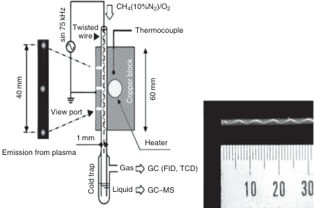

**图 16** 用于甲烷部分氧化的微等离子体反应器装置（左）及配有扭曲金属丝的薄玻璃管照片（右）（Nozaki 等，2007a；经许可转载）。

使用等离子体微反应器进行燃料处理的优势在于，甲烷可以被高能电子活化，实现40%的转化率，且该转化率与温度和压力无关。此外，与热化学反应不同，产物选择性不受转化率的影响。然而，目前的微等离子体反应器尚未与现有的甲醇生产工艺兼容，反应器尺寸和功耗需要在激发与猝灭过程之间的平衡方面进行优化。

Hsu 和 Graves（2005）使用微型中空阴极作为微反应器来分解氨和二氧化碳。MHCD能够提供具有高电子温度、功率密度和离子密度的高活性环境，非常适合吸热裂解反应。将氨分解为氮气和氢气可用作纯氢源，而二氧化碳裂解可用于处理放射性二氧化碳或生产氧气。在该研究中，MHCD由两个钼电极（100 μm厚）夹一层云母介电层（260 μm厚）构成。将三层粘合在一起，并钻一个200 μm的孔，以构建连续流微反应器。研究表明，氨和二氧化碳在有效反应温度超过2000 K时发生了显著分解。作为数量放大原理的演示，展示了使用两个或更多

串联微反应器时，转化率可以显著提高。这项工作表明，在流通式MHCD中由氨微等离子体诱导制氢是可行的；然而，要具有经济相关性，应提高总功率效率。这可以通过对等离子体进行脉冲调制，或并联和/或串联运行多个微等离子体反应器来实现。有人提出用短微秒脉冲对放电进行脉冲调制，以最小化电功率输入并稳定等离子体。

在大气压下使用DBD，在微等离子体反应器中进行了苯直接羟基化制苯酚和甲苯制甲酚的研究（Sekiguchi et al., 2005）。这种放电提供热电子，热电子解离分子，从而在环境气体温度下引发羟基化反应。Sekiguchi等人研究的玻璃微反应器为矩形（长100 mm、宽70 mm），带有铝电极和作为间隔物的聚四氟乙烯片，见图17。高能电子和氧自由基可以解离芳环和官能团，随后发生氧化。有人提出，可以通过改变反应器表面或等离子体生成方法来控制氧自由基的产生，从而提高这种基于等离子体的直接羟基化过程的选择性和产率。

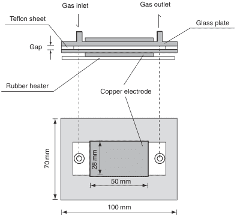

**图 17** 基于DBD的用于苯和甲苯羟基化的微等离子体反应器示意图（Sekiguchi et al., 2005；经许可复制）。

在介质阻挡型微等离子体反应器中进行了轻质烷烃（C₁–C₃范围）的氧化转化（Trionfetti et al., 2008a）。烷烃的直接转化在很大程度上受强C–H键（甲烷为415 kJ mol⁻¹）和C–C键（乙烷为350 kJ mol⁻¹）阻碍（Choudhary et al., 2003）。冷等离子体处理可以作为高温热化学过程的替代方案。受限反应器中的阻挡放电处理具有均匀致密等离子体以及更好控制停留时间的优势。所测试的微等离子体反应器（长30 mm、宽5 mm、通道深度500 μm）通过热键合三层Pyrex玻璃制成，并在芯片外侧顶部和底部附着铜电极，如图18所示。通过在顶部电极施加高压（5–10 kV）正弦波（60 kHz）并接地底部电极来产生等离子体。由于微反应器体积小、比表面积大，烷烃氧化转化过程中产生的热量易于移除，因此其在环境温度下运行。进料组成为氦气中10%烷烃和1%氧气。烃的活化遵循两条主要途径。在第一条途径中，高能电子通过断裂C–H和C–C键解离烷烃分子。通过光学发射光谱仪直接观察到CH、C₂和H激发态物种，表明室温下发生了这种键断裂。其次，氧分子的电子碰撞解离产生活性氧自由基，从而引发自由基链反应。激发态氦物种也可能通过向烷烃和氧分子传递能量而在该过程中发挥作用。在丙烷实验中，观察到对分子量高于丙烷的产物（C₄、C₄⁺）具有高选择性（37%），表明在微等离子体条件下发生了C–C键形成。自由基之间的偶联反应在较低温度下更有利，微反应器中的冷等离子体过程可以作为通过烷烃直接同系化来升级轻质烃的替代方案。

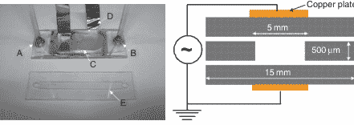

图 18 基于DBD的用于C₁–C₃烷烃氧化转化的微等离子体反应器；A：气体入口；B：气体出口；C：正面铜电极；D：背面电极（Trionfetti et al., 2008a；经许可复制）。

建立了该微等离子体反应器中等离子体丙烷转化的动力学模型，以更好地理解一系列反应器操作条件下的物理和化学过程（Ağıral et al., 2008c）。该模型采用Chemkin 4.1的充分混合等离子体反应器模型（CHEMKIN, 2004）来确定时间平均物种组成和电子能量平衡，该平衡将电子群内能的变化率等同于电子能量进出反应器的净流量，从而考虑净化学产生速率、表面损失、碰撞损失以及外部施加电磁场的功率沉积。丙烷电子碰撞反应的速率系数借助BOLSIG+软件确定（Hagelaar and Pitchford, 2005）。该软件还计算微反应器内平均电子能量与约化电场之间的关系。估计的平均电子温度用于在Chemkin等离子体反应器模型中获得稳态解。BOLSIG+代码使用电子能量分布函数的二项球谐展开来求解零维玻尔兹曼方程。部分解离激发和电离过程（e⁻ + CₓHᵧ，x = 1–3；y = 1–8）的截面由总解离截面和解离电离总截面的实验数据获得（Janev and Reiter, 2004）。由于阻挡放电由丝状放电组成，必须校正停留时间，这是基于与实验数据的定量一致性完成的。该模型包括电子碰撞解离和电离、离子–中性反应、中性–中性化学以及壁面处离子的表面复合。将模拟结果与实验数据进行比较，发现良好的一致性。发现H、CH、CH₂、CH₃、C₂H₃、C₂H₅、C₃H₅、C₃H₇和C₄H₉自由基在微等离子体反应器中丙烷转化过程中起重要作用。在较高丙烷转化率下，观察到增强的C–C键形成。

使用同一微等离子体反应器研究了在Li/MgO催化剂存在下丙烷氧化脱氢的可行性（Trionfetti et al., 2008b）。预期可能获得催化过程与等离子体过程之间的协同效应，这可能带来更高的转化率和目标产物收率。这一预期的理由基于以下方面：首先，沉积在阻挡放电区域的绝缘体氧化物载体上的催化剂可能由于表面性质和介电材料介电常数的变化而影响等离子体性质，这种影响可能是正向的。精心选择的催化剂一如既往会降低总活化能，但催化反应的选择性可能通过选择性等离子体活化吸附物种与表面之间的特定分子键而提高。可以认为其发生如下：在非平衡等离子体中，分子通过电子碰撞被激发。在特征物种（电子、离子、分子碎片以及电子、振动、转动/平动激发等激发态物种）中，只有自由基和振动激发态物种与大气压非平衡等离子体中的表面反应相关，这是因为与化学反应所需时间相比，自由基具有较长弛豫时间，并且它们在表面具有高粘附概率。解离自由度中的振动活化可以降低解离吸附的活化势垒（Tas, 1995）。

此外，在微等离子体反应器中，可在受限环境中实现等离子体与催化剂表面更强烈的相互作用。在高温下氧气存在时，Li/MgO催化剂具有[Li⁺O⁻]缺陷位点，可活化烷烃中的C–H键（Wang and Lunsford, 1986）。丙烷活化始于氧离子夺取氢，形成丙基自由基（Balint and Aika, 1997）。在[Li⁺O⁻]中心存在下，C–C和C–H键断裂在高温（T > 823 K）下发生。在这些温度下观察到催化剂面积损失，导致丙烯的非均相生成减少（Trionfetti et al., 2006）。微等离子体反应器可能通过微反应器受限空间内增强的自由基表面相互作用，允许在较低温度下进行初始丙烷活化。为测试这一点，通过微量移液将溶胶-凝胶前驱体体系沉积在玻璃微通道表面制备Li/MgO催化剂。催化微等离子体反应器在Li/MgO存在下表现出增强的烯烃选择性，这表明在环境温度下形成了缺陷位点。较高烃产物（C₄、C₄⁺）的形成表明自由基偶联主要发生在均相中。

Anderson等人（2008）采用紫外固化聚合物中的复制成型，制备了基于互连圆柱形微腔等离子体器件平行线性阵列的塑料微反应器。他们的研究旨在利用气态原料生成气相或固相的片上等离子体处理。图19显示了在600 Torr Ar中工作的400 μm直径微等离子体器件的10 × 10阵列的放大视图。在Ar/C₂等离子体中沉积了(C–S)ₙ微结构聚合物。这项研究表明了使用低成本、一次性聚合物微等离子体反应器用于潜在化学合成应用的可行性。

##### 2.2.4 在液体中或液体界面处产生等离子体

尽管如上所述，等离子体和其他放电通常在气相过程的背景下讨论，但液体中的放电也已被相当深入地研究。例如，液相放电反应器最近已被应用于饮用水和

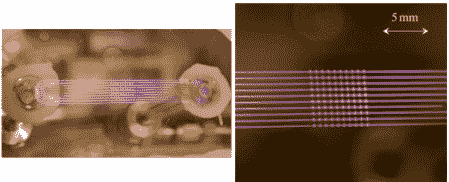

**图19** 通过复制模塑法在塑料基底上制作的微等离子体反应器的照片（左）以及工作在氩气中的400 μm直径微腔等离子体通道10 × 10阵列的放大视图（右）（Anderson 等，2008；经许可转载）。

废水处理（Locke 等，2006）。施加于水中的电场称为*液电放电*，会引发化学和物理过程，有两种基本放电类型，其区别在于沉积到系统中的能量多少。电晕系统每脉冲使用约1 J的放电能量，工作在高频100–1000 Hz，峰值电流低于100 A，电压上升时间为纳秒级。脉冲电弧放电每脉冲使用约1 kJ及更大的能量，工作在低频10⁻²–10⁻³ Hz，峰值电流高于1 kA，电压上升为微秒级。脉冲电弧产生强冲击波，伴随空化和内部含电离气体的气泡，导致化学反应，有研究认为这些反应与声化学中发生的反应类似。在电晕放电中会产生流注，形成相对较弱的冲击波，并观察到适量气泡。自由基和活性物种在电晕放电电极附近的狭窄区域内形成：通过发射光谱观察到H、O和OH自由基的生成（Locke 等，2006）。

液体中的电晕放电可在许多不同的反应器构型中产生（Locke 等，2006），但主要分为两类（图20）：一类是两个电极都浸入液体中，另一类是一个电极位于液体上方。对于第二种构型，放电部分发生在气相，所产生的离子、自由基和中性物种可通过电场作用转移到液相，并在那里反应形成其他活性物种。有研究提出，进入液相的带正气态离子的平均能量可能超过100 eV。

请注意，图20中的构型涉及点电极。要在水中引发脉冲放电，必须在电极尖端具有高强度电场（10⁷–10⁹ V m⁻¹）。电极的适当绝缘至关重要，因为水的导电性远高于空气。点电极从绝缘体表面突出的一小部分。

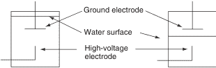

**图20** 脉冲电晕反应器两种构型的示意图：(a) 接地电极浸没在液体中；(b) 接地电极悬于液面上方。两种情况下浸入的电极均为点电极（经许可转载自 Grymonpré 等，2004；版权所有 2004 American Chemical Society）。关于多种其他反应器构型，见 Locke 等（2006）。

将一股液流引入乙酸溶液中，作为水处理的模型。发现乙酸分解速率与气体流速之间存在明显的相关性，这表明将关键自由基（被认为是O，其在大气压氧气中寿命很短）快速注入气–液界面至关重要（Yamatake 等，2006）。

一个有趣的选择是在微通道中使用分段流（泰勒流）模式（Günther 等，2004），并结合上述介质阻挡放电（DBD）。实际上，这种构型可能产生与声化学过程类似的化学，但效率可能高得多，因为泰勒流微通道中的持气体积可以做得高得多。最近报道了一个在气泡列上方完成放电的例子，但基于传统鼓泡塔（见图22）（Katayama 等，2009）。

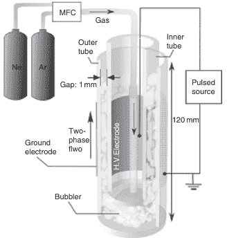

**图22** 一种DBD反应器的示意图，其中放电在鼓泡塔上方进行（引自 Katayama 等，2009；© 2009 IEEE）。

本节要讨论的最后一个主题是利用纳米线将电子直接注入液体。与上述点电极放电过程的不同之处有两点：使用纳米结构电极，以及产生溶剂化电子，而不是引发放电。由于氢键网络的快速响应，溶剂化电子在水中的寿命非常短，约为50 fs（Bragg 等，2004），但在其他液体中，如液氨（NH3）中，它们可能稳定数小时至数月（Jortner 和 Kestner，1973）。

在非常纯净的非极性介电液体中，非常尖锐尖端处的电子注入电流遵循Fowler–Nordheim电压依赖性（Halpern 和 Gomer，1969），就像在固体绝缘体中以及如前所述在气体中的情况一样。在一项关于CNT阴极电化学行为的研究中（Kriyenko 等，2007），找到了电子发射进入六甲基磷酰三胺液体的直接实验证据；选择该液体是因为它是在室温下可视化溶剂化电子的便利溶剂：当存在溶剂化电子时，溶液会呈现强烈的蓝色。电子自旋共振提供了自由电子的证据。电生成的（与光生成的相对）溶剂化电子已用于L-组氨醇的合成（Beltrà 等，2005），尽管在该工作中电子是从LiCl的EtNH2溶液中电化学生成的，这种溶剂比液氨更易处理（大气压下的沸点分别为17°C和−33.34°C）。

这些结果表明，在微反应器环境中使用纳米纤维电极产生溶剂化电子用于化学合成，可能为还原反应提供一条有趣的新路线。我们实验室目前正在研究这一概念（Àgiral 等，2010）。

### 3. 电化学微反应器

电化学，为了与前面几节讨论的主题相区分，关注的是*溶液中的低能电荷转移*。电子转移通常发生在带电（通常为金属）电极的表面。可能发生且可能在化学合成中重要的化学反应包括气体的生成或消除（分别在电解或燃料电池中），以及离子的生成或中和，这可能伴随固体材料的溶解或沉积。

在*微流体系统中*进行电化学，特别是*电合成*，原因如下（Rode 等，2009）：

- 通过减小阳极和阴极之间的距离，降低电化学池中的欧姆电阻；
- 通过提高电极表面积与池体积之比来增强传质，这也通过小电极间距实现；
- 进行流动化学以实现单程转化；以及
- 耦合阴极和阳极过程，允许在两个电极同时形成产物。

从可持续性角度看（减少废物），后一种可能性非常有趣，近期文献中已开始出现实例，如丙烯的环氧化（Belmont 和 Girault，1995）。Paddon 等最近综述了微反应器中用于电有机合成的配对和耦合电极反应（Paddon 等，2006）。

在电化学中使用微流控的第五个原因，是可能将流动化学与超快混合器结合，从而生成并随后使用短寿命的反应性离子或自由基，例如在“阳离子流”过程中（Suga 等，2001；Yoshida，2008）。最后，在微流体系统中进行电化学的第六个原因，可能是希望在快速电化学反应中有效移除反应热（或由于高电流与高欧姆电阻共同作用产生的焦耳热）（Yoshida，2008）。

微反应器中电化学的研究已在许多近期出版物中综述（Hessel 等，2004；Rode 等，2009；Yoshida，2008；Yoshida 等，2008）；因此，我们不想在此过多详述。但由于这些综述几乎只涉及电有机合成，这里将重点介绍一些其他应用。

一种特定类型的电化学微系统，尽管不是直接的合成微反应器，是*微流体燃料电池*。在近期一篇综述中（Kjeang 等，2009），分析了该领域的发展与挑战。Kjeang 等将微流体燃料电池定义为流体输送和排出、反应位点以及电极结构均限制在微流体通道内的燃料电池。大多数微流体燃料电池使用共层流，阳极和阴极之间没有物理分隔（如膜）。层流特性被用来延迟燃料（阳极电解液）和氧化剂（阴极电解液）的混合，这种混合仅通过扩散发生，并局限于通道中心靠近阳极电解液–阴极电解液界面的小区域。电极位于通道壁上，与扩散区保持足够距离，以防止燃料交叉。阳极电解液和阴极电解液均含有支持电解质，促进离子传输。图23展示了微流体燃料电池的一个具体例子，即使用空气呼吸阴极来消除微流体燃料电池的主要问题之一，即在溶解氧作为氧化剂时阴极的传质限制。

共层流构型相对于其他燃料电池设计具有若干优点：

- 混合介质运行，
- 室温运行，以及
- 无需辅助加湿、水管理或冷却系统。

额外的优点可能来自微加工提供的特定可能性，例如特殊电极设计，如锥形电极，以适应混合区向下游的增长并最大化燃料利用率（Bazylak 等，2005），或

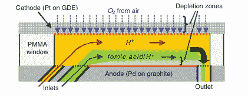

**图23** 空气呼吸式微流控燃料电池展示了共层流原理，并结合通过多孔阴极的气体扩散来捕获氧气。在气体、电解质和催化剂/固体电极之间建立了三相界面（经 Jayashree 等（2005）许可转载。版权所有 2005 美国化学会）。

入口和出口歧管分别通过去除消耗物种或添加反应物来主动控制浓度边界层（Yoon 等，2006）。尽管有所有这些优点，当前微流控燃料电池的能量密度（即单位系统体积或质量的能量输出）仍然太低，不具备真正的实用价值，这主要是由于电解质的单次使用。流动电化学中的一个重要问题是消除为增强离子传输而添加的支持电解质。这种电解质会导致分离问题和产物污染。最小化支持电解质的一种选择是使用两相流微流控系统，其中试剂流和支持电解质流保持分离。一个例子是使用N-辛基-2-吡咯烷酮（NOP）与水系电解质以及乙腈与水系电解质的两相流，并与多晶硼掺杂金刚石电极接触（MacDonald 等，2009）。有两种不同配置：第一种采用预电解，其中水相在与有机反应物相接触之前被氧化形成臭氧、溴、过氧碳酸盐等；第二种则使水相和含电化学活性试剂的有机相同时与工作电极接触。在电化学反应过程中，仅靠近三相边界区的薄反应区具有活性。有机相内的高电阻限制了反应区。两种配置都能实现有机相中不含电解质的清洁电合成，但乙腈体系效果更好，因为其黏度较低，可增强传质和转化率，而且其三相边界电解区更稳定，几乎未观察到像NOP那样水相下方有机相被底切的现象。底切是电化学过程中表面张力变化的结果（MacDonald 等，2007）。

静态三相边界处的电化学也通过液滴（Banks 等，2003；Marken 等，1997；Scholz 等，2005）、多孔主体电极（用于优化三相边界区）（Ghanem 和 Marken，2005；Niedziolka 等，2007）、微线基电极（Bak 等，2007）以及光刻修饰电极表面上的微液滴阵列（Rayner 等，2007）得到了演示。

Hori 等（2008）在他们关于*原位*生成碳正离子用于亲核反应的工作中，也作出了类似的区分：一种系统采用仅有一个电极过程（此处为阳极过程）的预电解，另一种系统同时具有阳极和阴极过程（其中阳极和阴极位于微通道的相对壁面上，使每种液体仅接触所需的电极电位，类似于上文讨论的燃料电池配置）。碳正离子在阳极形成，与亲核试剂的反应要么在下游进行（在预电解情形中），要么在扩散穿过液-液界面之后进行（在两电极位于相对壁面的情形中）。该方法被用于环状氨基甲酸酯与烯丙基三甲基硅烷的阳极取代，无需低温条件即可获得中等至良好的转化率。作者所称该方法的优点包括：在单程操作中实现高效亲核反应；选择性氧化底物而不氧化亲核试剂；通过使用离子液体作为反应介质，在环境温度下稳定阳离子中间体；以及用亲核试剂有效捕获不稳定的阳离子中间体。

一个有趣的发展是将电化学微反应器与连续分离过程耦合。在连续流微反应器中进行合成化学过程现已成熟，但如果下游后处理过程不能也以连续方式进行，连续处理的优势最终将会丧失。这就是为什么目前大量研究工作致力于将分离方法与微反应器耦合（或集成）（见 Hartman 和 Jensen，2009 的近期综述）。一个例子是将配置为电化学薄层池的微反应器用于电有机合成，并与模拟移动床（SMB）分离器耦合（Küpper 等，2003；Michel 等，2003）。SMB技术是一种制备色谱方法，通过模拟吸附固定相（颗粒床）与流动相的逆流，将吸附相保持不动但切换洗脱液和进料入口以及萃余液和萃取液出口的位置，从而转变为连续过程（Ruthven 和 Ching，1989）。

在Küpper等人的工作中，SMB过程尚未实施，但电化学反应器被设计为与常规SMB装置一起运行（Küpper 等，2003）。Michel等人描述了将电化学反应与色谱SMB分离相结合，应用于阿拉伯糖的直接电化学生产，并模拟了其运行。电化学微反应器置于色谱柱之间。该概念的优势在于能够通过施加电流来开启和关闭电化学反应器。同样，这项工作未给出该概念的实验验证，但模型证明了集成过程的可行性，因为与反应器和SMB串联连接相比可获得更高产率，尽管集成过程只有在低产率下才能获得高生产率，反之亦然。

微型SMB分离器仅在数值上进行了研究（Subramani 和 Kurup，2006），但可以设想在微通道中通过例如对磁性树脂珠施加移动磁场，或对吸附剂颗粒施加DEP（介电泳），以小型化版本实现真实移动床的方法。

作为本节关于电化学微反应器的最后一个主题，值得提及生物催化微反应器中辅因子的电化学生成。固定化酶的使用在医学和分析应用中进展迅速，在食品和饮料工业中，生物催化剂被用于多种工艺和产品。与溶解酶相比，固定化酶具有易于回收和重复使用以及（在许多情况下）稳定性提高的优点。因此，应用固定化酶作为生物催化剂的微反应器在近期文献中受到越来越多关注，这并不令人意外。

为实现最佳操作，酶可能需要辅因子的辅助，例如，许多脱氢酶需要烟酰胺腺嘌呤二核苷酸（NAD(P)+/NAD(P)H）。由于该辅因子成本相当高，因此希望连续再生，这可以通过使用介体（例如黄素腺嘌呤二核苷酸，FAD）从NAD+进行电化学再生来实现；该介体将电子从阴极传输到酶（例如甲酸脱氢酶，FDH），而酶又反过来从NAD+再生NADH。作为酶FDH底物的是FADH₂而非甲酸，并且可在电极处生成足够的FADH₂，以将不利平衡向NADH生成方向移动。然而，由于在pH 7下自发进行的逆反应，经典间歇反应器中本体溶液内电化学生成的FADH₂浓度仍然很低，这就是为什么FADH₂的*原位*和局部生成最好在微流控反应器中进行（Yoon 等，2005）。

Yoon等人报道的微反应器利用多流层流，通过调节平行流动的试剂流和缓冲液流的流速比，将含试剂的流股聚焦在电极附近。FADH₂确实在电极处以足够高的浓度生成，从而驱动后续反应向NADH再生方向进行。

同一介体概念的另一个例子是在具有电蚀圆柱形微通道的滤压式微反应器中再生NADH（Kane 和 Tzédakis，2008）。该微反应器中阴极高比表面积达250 cm⁻¹，为增加

FADH₂/FAD 浓度比，并使非自发反应 FADH₂/NAD⁺ 向 NADH 再生方向移动。两个反应器（Kane 和 Tzédakis，2008；Yoon 等，2005）均在 L-乳酸脱氢酶存在下，用于测试由丙酮酸合成手性 L-乳酸。

微系统中辅因子生成的另一个完全不同的例子是局部产生镁离子以控制 DNA 限制性内切酶的激活位置（Katsura 等，2004）。替代性 DNA 限制方案对于在特定位点切割 DNA 很重要，这与传统分子生物学方法不同。限制的控制通过向镁针电极施加直流电实现。只有在镁离子从该针电极产生的时间和位置，限制性内切酶才会被激活。

### 4. 化学反应的电动控制

在化学反应中，除了直接使用带电或以其他方式电活化的物种外，还可以选择利用电荷来*增强传质*。这可以通过输送化学物种本身（如果带电）或输送含有化学物种的介质来实现。这种*电动输送*以不同形式存在，下文将予以重点介绍。

#### 4.1 电泳与电渗

例如，在玻璃管中对电解质施加电场时，会出现两种不同的电场响应：

- 1. *电泳*：电解质中的正离子将沿电场 **E** 的方向移动，而负离子将沿相反方向移动。离子移动的速度 vₑₚ 与其电泳迁移率 μₑₚ 成正比：

$$v_{\mathrm{ep}}=\mu_{\mathrm{ep}}E \tag{1}$$

电泳迁移率通常在 3–8 × 10−4 cm2 V−1 s−1 范围内，例外的是 H⁺ 和 OH⁻ 离子，其迁移率分别为 36.25 × 10−4 和 20.50 × 10−4 cm2 V−1 s−1。

- 2. *电渗流*（EOF），由液体沿电解质容器表面的运动组成。该 EOF 基于双电层电荷在电场中移动时对电解质施加的拖曳力。双电层是容器壁附近空间电荷密度变化的结果；当容器壁与电解质接触时会带电（例如，在中性 pH 下，玻璃壁与水溶液接触时带负电）。通过切换建立电场的电压，可以轻松开启/关闭 EOF。类似地，无需机械阀即可切换来自和流向不同液体管路的流动，从而实现复杂的样品和试剂操作。这种*电动阀控*概念已被用于在毛细管电泳芯片中注入最小化样品级分以分离 DNA 片段（Harrison 等，1993）。对应于 EOF 的液体速度 $v_{\mathrm{EOF}}$ 可用与电泳类似的方程描述，但迁移率不同，为 $\mu_{\mathrm{EOF}}$：

$$v_{\mathrm{EOF}}=\mu_{\mathrm{EOF}}E \tag{2}$$

其中

$$\mu_{\mathrm{EOF}}=-\frac{\varepsilon\zeta}{4\pi\eta} \tag{3}$$

式中，η 和 ε 分别为液体的黏度和介电常数，ζ 为 zeta 电位，即在双电层中特定位置产生的电势。该电势强烈依赖于 pH 和壁材料。通常，对于盐浓度为几 mM 的水溶液，在 pH 7 的 Pyrex 玻璃管中，电渗迁移率为 −4.8 × 10−4 cm2 V−1 s−1。对于每厘米几百伏的典型电场值，将获得每秒几毫米的线性液体速度。

在微通道网络中使用 EOF 泵送液体的一个重要优点是，微通道横截面上的速度是恒定的，而压力驱动（Poiseuille）流则呈现抛物线速度分布。因此，基于 EOF 的微反应器几乎是理想的平推流反应器，具有相应的窄停留时间分布，从而提高反应选择性。

尽管对于毛细管电泳等分离方法，EOF 常通过特定壁涂层被有意抑制，但在大多数实际情况下，溶解在水溶液中且与目标合成相关的物种会带电，因此它们将同时受到电泳（溶解物种自身）和电渗（溶剂）驱动力。由于玻璃微通道中水溶液的 EOF 方向朝向负电极，对于阳离子，电泳力和电渗力相加为更大的正值；而对于阴离子，这两种力方向相反，导致其相对于 EOF 和阳离子方向产生阻滞，甚至可能产生负速度。无论如何，不同迁移率的物种会在不同区域分离，至少当它们最初作为塞流被引入主溶剂流中时是如此，就像芯片毛细管电泳中的情况（Harrison 等，1993）。这一概念也已被用于微反应器，尤其是英国赫尔大学的研究人员（文献参考见下文）。

利用电动原理对化学反应进行时空控制，依赖于在特定时间将试剂和产物引导至微通道网络中的选定点或从这些点引出的可能性。电动微流控网络可以建模为电阻网络，使用著名的基尔霍夫电压和电流定律（Cummings 等，2000；Fletcher 等，1999，2001，2002；Qiao 和 Aluru，2002），其中流速与电流成正比。如果将这些定律改写为水力阻力、压力和体积流量的形式，压力驱动的微通道网络也可以用同样的定律建模（Bula，2009；Chatterjee 和 Aluru，2005）；但如果由于电泳分离以及一种称为*电迁移分散*的现象导致局部电阻率（以及随之而来的局部电场）发生变化，电动情况可能更加复杂。此类效应需要在模型中纳入 Kohlrausch 调节函数（Kohlrausch，1897）（Mikkers，1999）。关于这些现象以及毛细管电泳中常用于增强分离的“堆积”等相关效应的更多细节，请参阅文献。当将电阻率与背景电解质差异很大的电解质塞注入该背景电解质时，通常会出现对“理想”的基于均匀电阻率网络的偏离。这类似于压力驱动流中黏度的局部变化，例如微通道中的气液流动，或将高黏度样品注入液相色谱柱，从而导致称为“黏性指进”的不稳定性（De Malsche 等，2009）。利用电动原理在简单 Y 型微反应器入口实现流体的干净“切换”并不像看起来那么简单，MacInnes 等人最近对此进行了详细讨论；他们表明，在实践中很难实现干净的切换，并且每个试剂供应通道都会受到其他试剂的相当程度的污染（MacInnes 等，2003）。研究还表明，表面电导率可能在电动流动原理中起重要作用（Fletcher 等，2001），并且对于极小的通道——*纳米通道*，由于*双电层重叠*，情况会变得更加复杂（Sparreboom 等，2009）。

EOF 已被用作微反应器中的泵送或混合机制（Fletcher 等，2002）。混合方案包括从 T 型或 Y 型接头引入两股（或更多，见 Koehlheyer 等，2005）平行流，在所达到的低雷诺数下，混合主要通过两股流之间的相互扩散发生。这是一个相对缓慢的过程，可能需要数十秒才能完成。通过例如双 T 型注射器将特定组成的样品注入组成不同的液流中，可以实现更快的混合。

混合速度由注入液段的宽度控制，并且将比平行流情形快得多（Fletcher et al., 2002）。

电泳概念也被用于混合目的，适用于待混合的两种试剂具有不同迁移率的情况，例如应用于 Wittig 化学中（Skellon et al., 2001a）。在又一次 Wittig 合成中，利用电泳原理生成受控的试剂流浓度梯度，发现可以将产物中顺式（Z）与反式（E）异构体比例控制在 0.57–5.21 范围内，而传统批式方法给出的 Z/E 比例范围为 2.8–3.0（Skellon et al., 2001b）。Fletcher et al.（2002）综述了在电渗或电泳控制或二者兼有下于微反应器中进行的若干其他合成反应实例。研究还表明，只要有机溶剂具有足够的极性，类似原理也可应用于有机溶剂（Salimi-Moosavi et al., 1997）。Watts et al. 已表明，在电动控制下可在微反应器中以定量转化率制备肽，且与传统的批式方法相比反应效率有所提高。这种提高被发现归因于电化学效应（Watts et al., 2004）。最后，差异电泳迁移率的另一个具体应用是在一种称为 *电泳介导微分析* 的方法中选择性控制毛细管电泳中的产物检测时间（Bao and Regnier, 1992; Burke and Regnier, 2001）。

在前一节中，简要讨论了（模拟）移动床色谱的概念。电泳与真实移动床色谱有相似之处，因为在电场中负离子和正离子会分离并沿相反方向相对运动。对于带同种电荷的物种，方向适当的电渗流（EOF）——其可通过外部电极改变表面电荷（Culbertson and Jorgenson, 1999; Schasfoort et al., 1999）、通过 EOF 调节剂或动态壁涂层（Kaniansky et al., 1999; Melanson et al., 2001）或通过永久性表面涂层（Revermann et al., 2008）进行调节——或调节良好的并流或逆流压力驱动流（Culbertson and Jorgenson, 1994）可为类电泳移动床过程建立正确的相对速度。在若干出版物中，Thome 和 Ivory 描述了使用这种移动床色谱的电泳类似方法连续分级对映体对（Thome and Ivory, 2002, 2006, 2007），所用设备为工业规模的涡旋稳定电泳仪。该概念如图 24 所示（Thome and Ivory, 2007）。与所有电泳原理一样，该方法非常适合缩小规模，同样也非常适合用作与（电动控制的）微反应器耦合的下游后处理方法，但据我们所知，尚未有人尝试。

上述方法均涉及直流电渗和电泳。如果将电渗与时间周期电场结合使用，液体会从电极边缘的高场强区域向电极表面移动，且在边缘处速度最高。速度取决于所施加电场的频率和幅值，在高频和低频极限下趋于零，并在某一取决于电解质电导率的频率处达到最大值（Green et al., 2000）。研究表明，集成尺寸不均匀的嵌入式电极阵列的微流控器件在施加交流电场时会产生整体流体运动（Brown, 2000; Suter et al., 2002）。液体流动的机制是电场切向分量与电极表面扩散双电层中感应电荷之间的相互作用（Green et al., 2002）；如果在共面电极图案中引入不对称性，则效果最佳，见图 25（Brown, 2000）。该方法通常可达到的液体速度为 1 mm/s，典型电压为 1–10 V（rms，均方根值）。

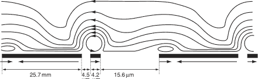

**图 25** 非对称电极对上预测的液体分布剖面（引自 Brown, 2000；经许可转载。版权所有 2000 美国物理学会）。

#### 4.2 颗粒和分子的定位与捕获

上一节讨论的交流电渗尚未在微反应器中大量用作泵送机制，但已表明该效应可用于（生物）颗粒操控，例如在用于在微流控系统中富集细胞和分子的电动生物处理器研究中（Wong et al., 2004）。在该器件中，交流电渗产生的流场将颗粒输送至电极表面附近区域；短程内有效的电泳力和介电泳力在此起作用并捕获细胞和分子。已证明可富集尺寸范围很大的生物对象，包括细菌、λ噬菌体 DNA 以及回转半径为 3 nm 的单链 DNA 片段。

介电泳（DEP）基于非均匀电场对介电颗粒施加的力。该力的大小取决于介质和颗粒的电学性质、颗粒形状与尺寸以及电场频率。DEP 可以是 *正介电泳*（p-DEP），即当颗粒的介电常数超过悬浮介质的介电常数时，颗粒被吸引到电场较高的区域（见图 26，Luo et al., 2006）；也可以是 *负介电泳*（n-DEP），即当介质的介电常数高于颗粒时，颗粒被吸引到电场较低的区域（Pohl, 1978）。DEP 通常用于直径为 1–1000 µm 的颗粒，但也可应用于更小的颗粒甚至生物分子，如 Wong et al.（2004）的工作所示。为了更精确地捕获牛血清白蛋白和抗体分子等纳米尺度对象（其尺寸约为 10–14 nm），Luo et al. 开发了采用宽度 60 nm、周期 380 nm 的纳米电极阵列的 DEP；借此可抑制干扰捕获的 EOF，并且与微电极配置相比所需电压降低为原来的五分之一（Luo et al., 2006）。尽管 Luo et al. 的工作未讨论这一点，但电极尺寸相对于微流控通道高度不应过小（Markarian et al., 2003）。

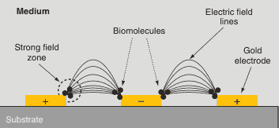

**图 26** 生物分子的正 DEP 原理（引自 Luo et al., 2006；经 Elsevier 许可转载）。

DEP 可用于在表面或微流控通道中创建规则的颗粒图案。例如，利用 n-DEP 在玻璃基底上制备了聚苯乙烯乳胶微珠的二维（2D）图案，并且由于该 n-DEP 的排斥力而形成的线和网格图案化微颗粒通过交联剂共价结合到基底上（Suzuki et al., 2004）。在这项工作中，将叉指微电极集成到流体通道中，以将颗粒引导成非常特定的图案。

颗粒沉积物中的规则图案形成可以自发发生，其通过基于颗粒之间以及颗粒与表面之间黏附或排斥相互作用的自组装过程实现。电场可辅助图案形成，其途径包括 DEP 过程中颗粒极化引起的颗粒间作用力，也包括介质或其中颗粒沿表面或朝向表面的电泳（Trau et al., 1996）或电渗输运（Solomentsev et al., 1997）。此外，为主动控制微通道内胶体晶体的形成，采用了电毛细力与溶剂蒸发的组合（Shiu et al., 2004）。电毛细力能够控制三维（3D）结构中的流体运动，由此得到的颗粒有序 3D 图案对于催化领域总体而言，尤其是对催化微反应器而言，可能非常有意思。有序填充床将具有更低的停留时间分布（类似于色谱应用中更低的理论塔板高度，见 De Malsche et al., 2007），并因此可能带来改善的反应产物选择性。

在微流控器件中电固定化不同酶已被描述为执行多步反应的一种手段（Astorga-Wells et al., 2004）。该过程首先通过平衡相反的水动力（即压力驱动流）与电场力（即 EOF）来捕获目标分子，之后将携带酶或其他试剂的第二介质注入系统，并与目标分子接触以使其反应。断开电场可逆转固定化，并允许在器件出口收集产物。以这种方式进行的反应实例包括蛋白质的还原、烷基化和胰蛋白酶消化。类似概念已被用于分离肽（Astorga-Wells et al., 2005）。

本章已多次讨论碳纳米管（CNT）和碳纳米纤维（CNF）。对于微反应器领域的应用，它们因耐酸碱腐蚀性、高表面积以及可调控表面化学性质的可能性而成为重要的催化剂载体（综述见 De Jong and Geus, 2000）。CVD 是制备这些碳纳米结构最常用的方法，这是由于其既具备大规模生产的可行性，又可控制结构的长度、直径、取向和生长位置。通常，它们从 Fe、Ni、Co 等金属纳米颗粒或其合金上生长，然后发育成厚度 5–20 nm、长度数微米至数十微米的多壁纳米管。其电学行为可从半导体性变化到金属性。

然而，将 CNT 集成到器件中的一个严重问题在于无法控制这些管或纤维是半导体性、半金属性还是金属性。如果碳纳米结构用作催化剂载体，这一方面也将发挥作用。除了选择性破坏金属性管之外（Collins et al., 2001），一种将金属性与半导体性 CNT 分离的有趣方法是使用交流 DEP。该方法通过使管悬浮液与微电极阵列接触来实现。由于这些物种相对于……的介电常数不同

溶剂中，金属性和半导体性管沿电极阵列产生的电场梯度发生相反方向的运动（Krupke et al., 2003）。后续工作表明，随着交流频率增加，分选效果得到改善（Krupke et al., 2004）。这种介电泳分离概念最近已在微流控装置中实现，其中分离由两股平行液流促进，金属管受到垂直于流动方向的显著更大的介电泳力并被拉入第二股液流，而半导体管则留在第一股液流中（Shin et al., 2008）。这种方法与基于介电泳场流分级法的早期工作非常相似（Peng et al., 2006），可显著提高通量。这项工作的最终目标是制造纳米电子器件，但此类概念的使用在未来对于催化纳米颗粒的操纵和定位可能变得非常有价值。例如，正介电泳被用于使碳纳米管与催化Pd接触，以实现H2气体传感器（Suehiro et al., 2007）。碳纳米管或单独被捕获，或与Pd纳米颗粒同时被捕获（得到用Pd纳米颗粒修饰的碳纳米管），捕获在Pd电极上。

文献中最近出现了关于通过电场控制液体中*单个*纳米级物体的报道。对微米级物体的控制此前已有报道，但对于更小的物体，必须特别注意补偿颗粒的布朗运动。Cohen等人（Cohen, 2005; Cohen and Moerner, 2005）构建了一种电泳阱，可为溶液中的单个纳米级物体产生任意二维力场，并将荧光显微镜与数字粒子跟踪及实时反馈相结合，以对单个纳米颗粒产生位置依赖的电泳力。对20 nm颗粒的位置控制精度在几微米以内。文中指出，单个荧光团的位置控制从根本上受限于光子探测的有限速率。若能够产生足够强的电场，当前技术水平可将典型荧光团控制在1 μm以内，而这将需要电极间距约为3 μm的电极图案。利用当前的光刻技术，这确实是可能的。作者已演示了对单个病毒颗粒、脂质囊泡和荧光半导体纳米晶体的捕获与操纵（Cohen and Moerner, 2006）。这项工作也可能与单个表面修饰微珠、单个催化剂颗粒和单个酶的化学反应性研究非常相关。

作为新技术成果的最终展示，最近还证明了*气体分子*可以被捕获在芯片上的电场中（Meek et al., 2009）。在真空中操纵一包离子是质谱仪器中相当常见的做法，其中离子可以在例如离子阱和碰撞池中被收集和分析，并且其流动可以通过静电透镜（和磁场）引导穿过飞行时间检测器以及其他复杂的离子分离器和分析器。然而，在Meek等人的工作中，直接由超音速束加载的CO分子被限制在直径为20 μm、中心位于芯片上方25 μm的管状电场中。这些场阱以每秒数百米的速度随分子束移动，可将分子保持一定时间，随后将其从芯片上释放以进行检测。作者声称，该方法适用于多种极性分子，并能够“在芯片上创建气相分子实验室”（Meek et al., 2009）。尽管这些作者主要从量子光学和固态技术（量子计算）的角度讨论其结果，但可以预见，如果此类微结构能够被重新配置以操纵和重组不同分子的小包，并结合快速光谱方法研究化学，那么其在化学合成方面也有应用前景。

#### 4.3 介电润湿

许多年前就已讨论过将液滴用作微反应器（Fjäll, 1993），但与能够控制单个液滴及其组成的微流控网络相结合，催生了一个全新的研究领域；由于它使用离散的液体包，因此也可称为*数字微流控*。数字微流控与传统的台式实验方案具有明显的相似性，大量已建立的化学方案可以无缝地转移到皮升至纳升液滴格式。*电润湿*，即由电场引起的表面张力变化（Berge, 1993）、DEP以及压力驱动流中的不相溶液体，是数字微流控装置中用于生成和操纵液滴的三种最常用原理。

EWOD用于控制表面或通道中液滴的流动，既适用于空气中的液滴，也适用于与周围液体不互溶的液体液滴（例如水-油组合），甚至适用于液体中的气泡（Zhao and Cho, 2007）。通常，在电润湿装置中，在1 μm厚的绝缘体上施加50–100 V电压，使水溶液在疏水表面上的接触角从约115°降至约75°。但通过使用非常薄（70 nm）且介电常数高（约180）的材料，仅需15 V即可产生大致相同的接触角变化（Moon, 2002）。EWOD的理论已在近期综述中详细讨论（Mugele, 2009; Mugele and Baret, 2005），关于包括EWOD在内的液滴微流控应用的概述，我们参考另一篇近期综述（Teh et al., 2008）。

并且发现，由70%沸石和30%导电粘结剂材料组成的吸附剂可产生含80% CO2的浓缩流，能耗为每吨CO2 2.04 GJ（Grande et al., 2009）。这项工作表明，电摆动吸附可能成为一种有前景的CO2捕集技术。

##### 4.4.3 脉冲电场

脉冲电场用于食品保鲜，以抑制食品中的微生物，而不会显著损失风味、颜色、味道和营养成分。该处理在食品中产生非常短（微秒级）但电流很高的脉冲。该主题最近已有综述，包括食品保鲜的基本机制（Min et al., 2007）。抑制微生物的主要机制是细胞（特别是细胞膜）的结构损伤，这归因于与细胞应激和疲劳相关的若干机制，以及由于功能基团的缔合或解离、带电链的移动和螺旋排列变化导致的酶失活。

最近一份奇特的报告讨论了应用交流高压加速葡萄酒陈化（Zeng et al., 2008）。发现最佳处理条件为600 V cm⁻¹的电场作用3 min。研究使用了几种分析技术来阐明处理与未处理葡萄酒样品之间的差异，发现挥发性化合物中高级醇和醛的含量显著降低，而某些酯类和游离氨基酸的含量略有增加。可能导致游离氨基酸形成的机制是蛋白质降解，但除此之外，对于交流电场的作用尚未给出解释。

##### 4.4.4 电喷雾

电喷雾是一种在液体出口与距出口一定距离的物体之间施加电场的概念。液体被分散并形成非常细小的气溶胶，因为液滴由于瑞利不稳定性而破裂，即气体中的细液体束在某一长度处变得不稳定并破裂成液滴的现象，而施加在液体上的电场会增强该效应（Rayleigh, 1882）。一个经常用于生成可在质谱仪中分离的离子的相关概念是电喷雾电离（ESI）。在此，对通过喷嘴（例如小型玻璃毛细管）供应的液体施加高压。液体形成所谓的泰勒锥，在其顶点处，由于库仑排斥与溶剂蒸发共同作用引起的径向分散，液滴破裂成细小喷雾，液滴越来越小，直到最后所有溶剂蒸发，所有溶质电离并可以进入

质谱仪入口处被分离并检测。ESI 已在文献中被多次综述，并已成为将微反应器和其他（分析）微器件与质谱仪耦合的一种非常有价值的概念（Le Gac and van den Berg, 2009）。

电喷雾已被用于许多不同应用，例如在金属表面沉积涂料和涂层，在生物传感器表面沉积金属纳米颗粒和生物分子，并且在微型化版本中还用作微卫星的推进机制（另见关于电风的一节）。一个特别有趣的应用是*燃料雾化*，也就是说，更细的燃料气溶胶和雾化会带来更高的燃烧效率和更少的污染物排放，这是由于更细的液滴增加了可开始燃烧的总表面积（Lehr and Hiller, 1993）。

曾有人提出电场对燃料还有另一种有用效应，即燃料管上的电荷据称能降低燃料黏度，从而使燃料喷射器产生更小的液滴，进而实现更清洁、更高效的燃烧。其原理是燃料中的分子带电并聚集，减小其总表面积，从而降低黏度（Tao et al., 2008）。Tao 等人的论文受到了严厉批评，批评意见是：尽管施加电场可能确实会降低燃料黏度并导致更细的雾化，但没有证据表明更细的雾化会使燃烧效率提高20%，同时还指出此前的“主张和结论违反了热力学第一定律”（Gulder, 2009）。正如预期，第一篇文章的作者对此进行了反驳（Tao et al., 2009）。尽管如此，这一想法可能成为一个具有高影响力的主题，并且确实值得进一步研究。

### 5. 表面反应的电子控制

#### 5.1 电场控制的吸附—脱附

如前所述，场发射尖端处的电场通常在 10 V nm⁻¹ 量级。这与沸石笼中（见下文）以及电极—电解质界面处存在的静电场处于同一范围。由于这些电场都与原子和分子内部的场处于同一量级，它们足够强，可以诱导原子和分子电子轨道的重排。因此，可以预期利用此类电场来激发化学反应应当是可行的。

在本节中，我们特别关注*场诱导吸附/脱附*（Kreuzer, 2004）。在 Kreuzer 的综述中，电场效应被归类为物理效应（对于低于 10 V nm⁻¹ 的场），其主要影响结合能随场的变化；由此，特定分子的压力对电场 F 的依赖关系可以用以下一般形式的函数近似表示：

$$P(F) \simeq P(0)\exp\{\beta u_{\mathrm{eff}}\} \tag{4}$$

其中 β = (k_B T)^{-1}，k_B 为玻尔兹曼常数，βu_eff 为上述分子的有效势，P(0) 为可假定电场消失处的压力。在 McEwen 和 Gaspard 所引工作中，O2 和 CO 的有效势分别为 0.022 和 0.028 (V nm^{-1})^{-2} F^2，此时 10 V nm^{-1} 的尖端电场分别使压力增强 9.5 倍和 17 倍（McEwen and Gaspard, 2006）。

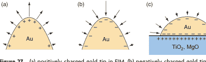

**图27** (a) FIM 中带正电的金尖端，(b) FEM 中带负电的金尖端，(c) 氧化物固体基底上带负电的金团簇（引自 McEwen and Gaspard, 2006，经许可转载。版权所有 2006，美国物理联合会）。

上文我们已经提到，在施加电压的金属尖端处可达到的电场，可能与沸石笼中存在的静电场处于同一范围；例如，沸石 Y 中未屏蔽碱金属离子上存在的电场估计约为 3–10 V nm^{-1}（Blatter et al., 1994）。如此大的场会稳定取向合适的碰撞烃—氧对的电荷转移态，从而可以在可见光子的低能量下，甚至通过温和加热来引发它们之间的反应（Frei, 2006）。类似地，静电场在金属有机框架（MOF）材料分离气体混合物的能力中发挥作用（Yang and Zhong, 2006）。MOF 中的选择性气体吸附既与孔径有关，也与吸附分子和孔壁之间的相互作用有关。如果 MOF 具有高静电场或场梯度的表面，则分别会增强具有高偶极矩或四极矩的分子的吸附，例如在 HKUST-1 型 MOF 中（Li et al., 2009）。

由此产生的一个问题是，是否可以通过施加外场来改变沸石笼中活性位点周围或 MOF 孔周围附近的静电场（或其梯度）。据我们所知，此类实验尚未见报道，但一种可能的实验构型是电容器，其中沸石夹在导体的两个带电电极之间（导体最好具有催化惰性，大多数贵金属除外）。分析沸石中局部晶内电场梯度及其受外部电场可能改变的一种方法是四极自旋的 NMR，例如吸附的 133Xe 的自旋（Mellot et al., 2001）。上述电容器结构中的沸石或 MOF 能否承受对催化活性产生显著影响所需的电场，仍值得怀疑。例如，致密二氧化硅——微电子学中可用的最可靠绝缘体之一——的击穿场强约为 1 V nm⁻¹，而沸石或 MOF 的击穿很可能发生在比这更低的场下。这就是为什么我们实验室正在研究基于绝缘纳米针的构型，其尖端处的电场将显著增强。

精细与制药化学领域所需产量以千克而非吨计，该领域将从通用型工艺化学的开发中显著受益；这些工艺在相对较小的通用生产单元中进行，并可调整以适应一系列不同产品。通用型“微反应器”的一个例子是微生物，其产物可以通过工程化遗传改变来调整，这些改变会改变该微生物的代谢过程，使其生产所需化学品。其中的关键参与者是微生物表达的不同酶，这些酶对非常特定的底物分子进行所需的生物催化，以极高选择性递送所需产物分子，例如作为单一对映体。活细胞中的酶通常不是以游离形式存在于溶液中，而是固定于细胞器或细胞外膜的脂质膜中。在细胞外的技术装置中复制膜固定化很困难，这就是为什么对于工业相关酶，已开发出基于载体结合（通常涉及共价键，例如与树脂、生物聚合物或介孔二氧化硅结合）、包埋（于凝胶晶格中）或酶聚集体或晶体交联以制备无载体颗粒的固定化策略（Sheldon, 2007）。

出于污染或失活的原因，可能希望能够及时更换固定化酶，为此，一种可编程地吸附和释放酶的方式将非常受欢迎。一个例子是使用 4 nm 薄的聚合物膜，该膜可在 20 °C 的亲水（溶胀）状态与 48 °C 的更疏水、可吸附蛋白质的（塌缩）状态之间热切换，并将其集成到具有快速加热选项的微型热板中，从而可在 1 s 内吸附和释放蛋白质单层（Huber et al., 2003）。

对酶施加热量并不总是所希望的；此外，可能难以将热量局域化。电场在这方面具有优势，因为通过设计……可以局部施加电场

电极配置。除了前面已经提到的概念，即施加电场将分子或颗粒输运到所需位置，或将它们捕获在特定位置之外，还有方法可以控制分子从溶液在特定表面上的吸附。

电场控制表面分子吸附有两种原理。第一种基于表面润湿特性的变化，如前文所述，其中应用EWOD从亲水态切换到疏水态，反之亦然。第二种依赖于改变表面电荷密度，例如改变与电解质接触的金属电极上的表面电荷密度，或通过将外部电场施加于嵌入绝缘体表面的电极上来改变ζ电位，而人们希望改变该表面的亲和性。涉及有机分子在固体表面吸附的实验表明，包含该固体表面的电系统会出现强电容变化，这些变化与吸附层在类气层、无序和有序物理吸附层以及化学吸附层之间的相变有关（Van Krieken and Buess-Herman, 1999）。在关于EOF的章节中讨论了通过栅极电位改变以场效应晶体管（FET）构型布置的表面上的ζ电位的概念，作为控制该流动的一种方法，但也应当能够以类似方式控制分子的（可逆）吸附，尤其是具有电荷或偶极的分子。该效应对表面所接触电解质的pH非常敏感，通常场效应流动控制原理的最大效应出现在接近目标表面pK值处（Schasfoort et al., 1999; van der Wouden et al., 2005）。这可能妨碍将该概念用于酶固定化，因为蛋白质的迁移率和溶解度也非常依赖于pH。我们实验室（Nichols and Gardeniers, 2006）利用场效应控制蛋白质吸附的尝试未获成功，原因可能是难以平衡表面上的电荷（由pH、离子强度以及沿表面和垂直于表面的电场控制）与蛋白质上的电荷（主要由pH和蛋白质的选择控制）。此外，在一项关于静电对蛋白质吸附熵和能量贡献的理论研究（Roth et al., 1998）中表明，吸引自由能在短程内非常强。蛋白质被建模为胶体颗粒，其电双层在短程内开始与表面的电双层重叠，由于离子从双电层向溶液本体传输，导致显著的熵效应。据称这种（正）熵效应主导吸附自由能。然而，这种效应在很大程度上取决于蛋白质与壁面上电荷的匹配，在某些情况下，这甚至可能导致一个

并且保持抗蛋白性。然后，未受保护的微电极用所需生物分子进行表面功能化，例如DNA、蛋白质或带有膜蛋白的脂质囊泡。

#### 5.2 吸附分子活性的控制

除了控制分子在表面上的吸附和解吸之外，一个令人兴奋的主题是通过电场调控*取向*和*吸附分子的活性*。对于吸附在电极上的有机分子层，研究发现，在初始吸附之后，足够高（正）的电位会导致分子取向，其中分子偶极与电场对齐，从而使吸附质–吸附质相互作用增强（Han et al., 2004; Pronkin and Wandlowski, 2003）。对于Ag(111)电极表面上的两性离子分子*p*-氨基苯甲酸（PABA），也观察到电位依赖的取向效应，使用了红外–可见和频产生光谱以及电化学电容和CV测量（Schultz and Gewirth, 2005）。研究发现，PABA的取向随电极表面电荷而切换，在高于零电荷电位的电位下朝一个方向取向，而在低于该电位时朝另一个方向取向，这种效应取决于pH。

在上述关于带电银电极上PABA的工作中，分子的吸附程度也由表面电荷控制；而Lahann等人展示了一种概念，其中以低密度自组装单层固定在金表面上的分子受到电刺激，以在亲水态和疏水态之间发生构象转变（Lahann et al., 2003）。这种表面润湿开关随后可用于固定例如酶，如前文所述。这是一个同时切换吸附分子取向和活性的例子。

将蛋白质以正确取向吸附在表面上，对于免疫分析非常重要，其中抗体被固定在表面上并用于检测生物样品中特定抗原的存在和浓度；对于酶微反应器也很重要，其中酶的取向（和折叠状态）决定其生物催化活性。文献中已有许多关于蛋白质在带电表面上取向的报道，包括理论工作和实验工作。理论研究基于两种不同类型的模型（Sheng et al., 2002）：基于分子动力学或蒙特卡洛模拟的分子模型，这些模型在原子水平上非常详细，但计算量也很大；以及连续介质模型，它将蛋白质视为胶体颗粒，其球形表面上具有（大多均匀的）电荷分布，并将溶剂视为连续介电介质。后者的一个典型例子是Derjaguin–Landau–Verwey–Overbeek理论，它包括蛋白质与表面之间的屏蔽库仑排斥和范德华吸引。该理论描述了蛋白质吸附的大部分基本特征（另见上一节所述的Roth等人的工作），但由于假设蛋白质为带电荷壳层的球形颗粒，本质上无法描述取向效应。因此，通常在这两类模型之间折中，例如将免疫球蛋白视为Y形物体，其分支上分布有电荷中心，并在介观尺度上对其进行蒙特卡洛建模（Sheng et al., 2002）。与定向吸附的实验数据一致，Sheng等人表明，吸附蛋白质的取向基于范德华相互作用和静电相互作用的平衡。范德华吸引导致分子平躺在表面上，而在静电主导的吸附中，取向由分子的偶极决定，这通常导致垂直于表面排列。探测带电表面上蛋白质取向的实验方法是SIMS（二次离子质谱）（Wang et al., 2004），以及更直接的原子力显微镜（Wang et al., 2006）。后一项工作特别有趣，因为它报道碳酸酐酶在带正电表面上取向使其大多数活性位点朝上，而在带负电表面上朝下，这表明原则上活性（或至少酶上活性位点的可及性）可由表面电荷控制，而表面电荷可通过向电极施加特定电压来控制。

外部电场对均相催化剂（一种铁氧代卟啉化合物）选择性的有趣效应最近已被理论预测（Shaik et al., 2004）。该效应在于以依赖于场方向的方式改变催化剂的电子结构。这样做时，催化剂可被调谐为要么催化丙烯的环氧化，要么催化丙烯的羟基化。电场应沿分子的SH–Fe–O轴排列，该轴垂直于卟啉环方向。如果场为正（即从S指向O），催化剂将获得硫醇盐自由基特征，从而以6–10 kcal mol⁻¹有利于羟基化过程；而负场使该化合物转变为卟吩自由基阳离子物种，以2–6 kcal mol⁻¹有利于环氧化。尽管这是一个非常有趣的概念，但尚未提供该工作有效性的实验证明。为了实际评估这一想法，需要解决的一个重要问题是，需要以某种方式将分子相对于电场固定，例如将其固定在表面上，但要使卟啉环仍可从两侧接近，并且与表面的连接方式不会影响活性。这并非易事

有待解决的问题，并且如果找到一种以有序方式将卟啉基催化剂引入材料中的方法，那么使用诸如沸石或MOFs之类的结晶介孔材料可能有所帮助。我们尚未发现这一方向有任何研究。

由于当前对替代能源的普遍兴趣，尤其是对人工光合作用的兴趣，以及未来可能开发出用于执行光合作用的微反应器，以下工作也值得提及。蛋白质介导的电子转移在生物体的光合作用或代谢反应中起着关键作用，此类反应会产生具有相对较低还原电位的电子。已经确定，若干电子转移反应受界面处构象变化的速率限制，例如在蛋白质-蛋白质界面处或跨电极-蛋白质界面。在一项关于*细胞色素c*的研究中，*细胞色素c*通过静电结合在涂有羧基末端烷硫醇自组装单层的Ag电极上，测定了电场强度对界面氧化还原过程活化能的影响（Murgida and Hildebrandt, 2002）。通过改变烷基链长度以及随之改变的蛋白质-电极距离，控制了场强。高电场会增大蛋白质结构重组的活化势垒，氢键网络的重排成为界面氧化还原过程中的限速过程。结论是，这种*电场诱导的活化势垒变化*——在*细胞色素c*的情况下控制着界面电子转移动力学——可能代表了细胞膜处生物电荷转移动力学的调控。在最近的一篇出版物（Kranth et al., 2008）中，双色、时间分辨、表面增强共振拉曼光谱电化学被用于同时实时监测以上述相同方式静电吸附到电极上的细胞色素c的结构、电子转移动力学和构型涨落。研究发现，界面电场控制蛋白质动力学，而蛋白质动力学反过来控制整体电子转移。

对多相金属或金属氧化物催化剂上表面反应的速率和选择性的受控调节是一个已被充分研究的课题。掺杂剂和金属-载体相互作用经常被用于提高催化性能。关于催化活性电控制的研究——其中反应物被输送通过与O²⁻、Na⁺或H⁺导电固体电解质（如氧化钇稳定氧化锆）或者电子-离子导电载体（如TiO₂和CeO₂）界面接触的催化剂——促成了*非法拉第电化学修饰催化活性*（NEMCA，Stoukides and Vayenas, 1981）的发现；在该现象中，催化活性和选择性均被发现强烈依赖于催化剂电位，催化速率的增加超过基于法拉第离子通量预期速率高达五个数量级

材料，在这个意义上，它与前面讨论的金属-载体相互作用有关。所设想的构型如图27c所示，但在距金属颗粒一定距离处设有对电极，并在载体背面设有电极，以在颗粒-载体界面上产生电场。这一想法基于文献报道，即氧化物上的金属-载体相互作用涉及金属颗粒电子性质的变化，该变化与载体中氧原子的富电子性相关（Mojet et al., 1999），而氧原子的富电子性主要由氧化物中阳离子的离子特性决定。在含碱金属阳离子的碱性载体中，氧原子是富电子的，而在酸性载体上它们则是缺电子的。此外，对负载型铂颗粒的密度泛函理论计算表明，当载体氧原子的富电子性更高时，完整的Pt态密度向更高能量即更低结合能移动，同时间隙键合轨道的位置从金属-载体界面移动到Pt颗粒表面；并且，随着Pt纳米颗粒尺寸增大而发生的绝缘体-金属转变，在碱性载体上会向更小的颗粒尺寸移动（Oudenhuijzen et al., 2004）。后者意味着，所提出的场效应对于较小的金属颗粒应更为有效；在此还必须考虑到，晶体的习性（即金属纳米颗粒上存在哪些晶面；在不同载体上这可能不同；Somorjai et al., 2006）以及颗粒上可能存在的氧（表面或次表面；Schalow et al., 2006）都可能起作用。

最近的工作证明了基于*半导体* SnO₂催化剂的一种与上述概念有些类似的概念的可行性；该催化剂被制成*纳米线*形状，并配置为场效应晶体管（FET）（Zhang et al., 2004b, 2005）。纳米线中的电子密度通过电学方式调节，由此可以通过调节表面层中氧空位的密度来改变SnO₂线表面的氧化还原反应。这项工作极好地展示了不同领域的融合，即催化、纳米技术和微电子学，并且将其与微流控技术结合将相当可行。这很可能就是微反应技术领域未来的发展方向。

### 6. 结论

本章讨论了电场作为在微反应器系统中，以及在某些情况下也在下游后处理微系统中控制、激活或改变化学反应的手段。特别关注了具有许多不同构型的微等离子体，因为这是一个新兴领域，它使我们能够在低温下进行通常只能在高温下进行的化学过程，并可能具有能效方面的优势。还重点介绍了基于纳米结构电极的等离子体生成新构型。也特别关注了化学反应的电动控制，这一概念只有在微系统中才能高效运行，因为需要电场的局域化，并且某些情况下还需要局部高密度的电场线。电动概念可用于增强或减弱流体流动，或用于输运和定位或捕获颗粒与分子。讨论了一些鲜为人知的概念（电风、电摆动吸附、电喷雾和脉冲电场），它们是否与微反应技术相关仍有待观察。在本章最后一节，描述了控制吸附分子活性和取向以及吸附和解吸本身的一些有趣原理。我们预测，这些原理将在未来的微反应技术中变得非常重要；届时，微系统集成和纳米技术的持续进步将使我们能够将新的活化概念与微结构系统有利的高表面积体积比相结合，开发出新颖的反应器和反应概念。

### 致谢

作者谨向荷兰技术基金会STW（NWO应用科学部）和荷兰经济事务部技术计划表示感谢，感谢其对项目“微反应器中的激动人心的化学”（VICI“创新激励”计划，项目编号06626）的资助。J.G.E. Gardeniers 还感谢 MESA+ 纳米技术研究所对 SRO 计划“介观流体学”的资助。

### 参考文献

- Ağıral, A., Eral, H.B., Mügele, F., and Gardeniers, J.G.E. unpublished results (2010).
- Ağıral, A., and Gardeniers, J.G.E. J. Phys. Chem. C 112, 15183 (2008a).
- Ağıral, A., Groenland, A. W., Chinthaginjala, J. K., Seshan, K., Lefferts, L., and Gardeniers, J. G. E. J. Phys. D: Appl. Phys. 41, 194009 (2008b).
- Ağıral, A., Lefferts, L., and Gardeniers, J.G.E. IEEE Trans. Plasma Sci. 37, 985 (2009).
- Ağıral, A., Trionfetti, C., Lefferts, L., Seshan, K., and Gardeniers, J.G.E. Chem. Eng. Technol. 31, 1116 (2008c).
- Anderson, T. S., Ma, J. H., Park, S.-J., and Eden, J. G. IEEE Trans. Plasma Sci. 36, 1250 (2008).
- Astorga-Wells, J., Bergman, T., and Jörnvall, H. Anal. Chem. 76, 2425 (2004).
- Astorga-Wells, J., Vollmer, S., Tryggvason, S., Bergman, T., and Jörnvall, H. Anal. Chem. 77, 7131 (2005).
- Baba, K., Okada, T., Kaneko, T., and Hatakeyama, R. Jpn. J. Appl. Phys. 45, 8286 (2006).
- Baba, K., Okada, T., Kaneko, T., Hatakeyama, R., and Yoshiaki, H. Thin Solid Films 515, 4308 (2007).

- Bak, E., Denton, M., Stojek, Z., and Scholz, F. Electrochem. Commun. 9, 386 (2007).
- Balint, I. and Aika, K.-I. J. Chem. Soc., Faraday Trans. 93, 1797 (1997).
- Banks, C. E., Davies, T. J., Evans, R. G., Hignett, G., Wain, A. J., Lawrence, N. S., Wadhawan, J. D., Marken, F., and Compton, R. G. Phys. Chem. Chem. Phys. 5, 4093 (2003).
- Bao, J. and Regnier, F. J. Chromatogr. 608, 217 (1992).
- Bazylak, A., Sinton, D., and Djilali, N. J. Power Sources 143, 57 (2005).
- Becker, K., Koutsospyros, A., Yin, S.-M., Christodoulatos, C., Abramzon, N., Joaquin, J. C., and Marino, G. B. Plasma Phys. Control. Fusion 47, B513 (2005).
- Becker, K. H., Kogelschatz, U., Schoenbach, K. H., Barker, R. (编)，大气压空气等离子体的应用，第9章，载于“非平衡大气压空气等离子体”。IOP Publ., Bristol, UK, 2004.
- Becker, K. H., Schoenbach, K. H., and Eden, J. G. J. Phys. D: Appl. Phys. 39, R55 (2006).
- Belmont, C., and Girault, H. H. Electrochim. Acta 40, 2505 (1995).
- Beltrán, A. P., Bonete, P., González-García, J., García-García, V., and Montiel, V. J. Electrochem. Soc. 152, D65 (2005).
- Berge, B. Comptes Rendus Acad. Sci., Ser. II b 317, 157 (1993).
- Blatter, F., Morozov, F., and Frei, H. J. Phys. Chem. 98, 13403 (1994).
- Block, J. Z. Phys. Chem. 39, 169 (1963).
- Bose, A. C., Shimizu, Y., Mariotti, D., Sasaki, T., Terashima, K., and Koshizaki, N. Nanotechnology 17, 5976 (2006).
- Bragg, A. E., Verlet, J. R. R., Kammrath, A., Cheshnovsky, O., and Neumark, D. M. Science 306, 669 (2004).
- Brown, B. D., Smith, C. G., and Rennie, A. R. Phys. Rev. E 63, 016305 (2000).
- Brustari, M., A. Tie, Y., and Van Tassel, P. R. Langmuir 19, 5089 (2003).
- Bula, W. P. 用于化学反应动力学研究的微流控器件，博士论文，特文特大学 (2009).
- Burke, B. J., and Regnier, F. Electrophoresis 22, 3744 (2001).
- Chang, C.-C., and Yang, R.-J. Phys. Fluids 21, 052004 (2009).
- Chatterjee, A. N., and Aluru, N. R. J. Microelectromech. Syst. 14, 81 (2005).
- CHEMKIN，“4.0版软件包”，Reaction Design, San Diego, CA (2004).
- Chang, W.-H., and Sankaran, R. M. Appl. Phys. Lett. 91, 121503 (2007).
- Chang, W.-H., and Sankaran, R. M. J. Phys. Chem. C 112, 17920 (2008).
- Choi, J. O., Akinwande, A. I., and Smith, H. I. J. Vac. Sci. Technol. B 19, 900 (2001).
- Choudhary, T. V., Aksoylu, E., and Goodman, D. W. Catal. Rev. 45, 151 (2003).
- Cohen, A. E. Phys. Rev. Lett. 94, 118102 (2005).
- Cohen, A. E., and Moerner, W. E. Appl. Phys. Lett. 86, 093109 (2005).
- Cohen, A. E., and Moerner, W. E. Proc. Natl. Acad. Sci. 103, 4362 (2006).
- Collins, P. G., Arnold, M. S., and Avouris, Ph. Science 292, 706 (2001).
- Culbertson, C. T., and Jorgenson, J. W. Anal. Chem. 66, 955 (1994).
- Culbertson, C. T., and Jorgenson, J. W. J. Microcolumn Sep. 11, 167 (1999).
- Cummings, E. B., Griffiths, S. K., Nilson, R. H., and Paul, P. H. Anal. Chem. 72, 2526 (2000).
- De Jong, K. P., and Geus, J. W. Catal. Rev. Sci. Eng. 42, 481 (2000).
- De Malsche, W., Eghbali, H., Clicq, D., Vangelooven, J., Gardeniers, H., and Desmet, G. Anal. Chem. 79, 5915 (2007).
- De Malsche, W., Op De Beeck, J., Gardeniers, H., and Desmet, G. J. Chromatogr. A 1216, 551 (2009).
- Eijkel, J. C. T., Stoeri, H., and Manz, A. Anal. Chem. 71, 2600 (1999).
- Ertl, G., Knözinger, H., and Weitkamp, J. “催化手册” Wiley VCH, Weinheim (1997).
- Fletcher, P. D. I., Haswell, S. J., and Paunov, V. P. Analyst 124, 1273 (1999).
- Fletcher, P. D. I., Haswell, S. J., Pombo-Villar, E., Warrington, B. H., Watts, P., Wong, S. F. Y., and Zhang, X. Tetrahedron 58, 4735 (2002).
- Fletcher, P. D. I., Haswell, S. J., and Zhang, X. Lab Chip 2, 115 (2001).
- Foest, R., Schmidt, M., and Becker, K. Int. J. Mass Spectrom. 248, 87 (2006).
- Fowler, R. H., and Nordheim, L. Proc. Roy. Soc. London A 119, 173 (1928).
- Frei, H. Science 313, 309 (2006).
- Fridman, A. F. “等离子体化学” Cambridge University Press, Cambridge (2008).
- Garnier, S. V., and Liu, D. J. Enhanced Heat Transfer 16, 237 (2009).
- Ghanem, M. A., and Marken, F. Electrochem. Commun. 7, 1333 (2005).
- Go, D. B., Fisher, T. S., Garimella, S. V., and Bahadur, V. Plasma Sources Sci. Technol. 18, 035004 (2009).
- Go, D. B., Garimella, S. V., Fisher, T. S., and Mongia, R. K. J. Appl. Phys. 102, 053302 (2007).
- Grande, C. A., Ribeiro, R. P. P. L., and Rodrigues, A. E. Energy Fuels 23, 2797 (2009).
- Green, N. G., Ramos, A., González, A., Morgan, H., and Castellanos, A. Phys. Rev. E 61, 4011 (2000).
- Green, N. G., Ramos, A., González, A., Morgan, H., and Castellanos, A. Phys. Rev. E 66, 026305 (2002).
- Grotrian, W. Ann. Physik 47, 141 (1915).
- Grymonpré, D. R., Finney, W. C., Clark, R. J., and Locke, B. R. Ind. Eng. Chem. Res. 43, 1975 (2004).
- Gulder, O. L. Energy Fuels 23, 591 (2009).
- Günther, A., Khan, S. A., Thalmann, M., Trachsel, F., and Jensen, K. F. Lab Chip 4, 278 (2004).
- Hagelaar, G. J. M., and Pitchford, L. C. Plasma Sources Sci. Technol. 14, 722 (2005).
- Halpern, B., and Gomer, R. J. Chem. Phys. 51, 1031 (1969).
- Han, B., Li, Z., Pronkin, S., and Wandlowski, T. Can. J. Chem. 82, 1481 (2004).
- Harrison, D. J., Fluri, K., Seiler, K., Fan, Z., Effenhauser, C. S., Manz, A. Science 261, 895 (1993).
- Hartman, R. L., and Jensen, K. F. Lab Chip 9, 2495 (2009).
- Hessel, V., Hardt, S., and Löwe, H. “化学微过程工程：基础、建模与反应”。Wiley VCH Verlag GmbH & Co. KGaA, Weinheim (2004).
- Hessel, V., Renken, A., Schouten, J. C., and Yoshida, J. (编) “微过程工程：综合手册（3卷）”。Wiley VCH Verlag GmbH & Co. KGaA, Weinheim (2009).
- Horii, D., Amemiya, F., Fuchigami, T., and Atobe, M. Chem. Eur. J. 14, 10382-10387 (2008).
- Hsu, D. D., and Graves, D. B. Plasma Chem. Plasma Proc. 21, 1 (2005).
- Huber, D. L., Manginell, R. P., Samara, M. A., Kim, B.-J., and Bunker, B. C. Science 301, 352 (2003).
- Jahnisch, K., Hessel, V., Löwe, H., and Baerns, M. Angew. Chem. Int. Ed. 43, 406 (2004).
- Janev, R. K., and Reiter, D. Phys. Plasmas 11, 780 (2004).
- Jaworek, A., Krupa, A., and Czech, T. J. Electrostat. 65, 133 (2007).
- Jayashree, R. S., Gancs, L., Choban, E. R., Primak, A., Natarajan, D., Markoski, L. J., and Kenis, P. J. A. J. Am. Chem. Soc. 127, 16758 (2005).
- Jenkins, G., Franzke, J., and Manz, A. Lab Chip 5, 711 (2005).
- Jensen, K. F. Chem. Eng. Sci. 56, 293 (2001).
- Jiang, X. D., Li, R. Q., Ru, H. Q., Xu, H. L. Chem. Eng. J. 116, 149 (2006).
- Jortner, J., and Kestner, N. R. (编) “流体中的电子”。Springer Verlag, Berlin (1973).
- Kadowaki, M., Yoshizawa, H., Mori, S., and Suzuki, M. Thin Solid Films 506, 123 (2006).
- Kalman, H., and Sher, E. Appl. Therm. Eng. 21, 265 (2001).
- Kane, C., and Tzedakis, T. AIChE J. 54, 1365 (2008).
- Kaniansky, D., Masár, M., Marák, J., and Bodor, R. J. Chromatogr. A 834, 133 (1999).
- Katayama, H., Honma, H., Nakagawara, N., and Yasuoka, K. IEEE Trans. Plasma Sci. 37, 897 (2009).
- Katsura, S., Harada, N., Maeda, Y., Komatsu, J., Matsuura, S.-I., Takashima, K., and Mizuno, A. J. Biosci. Bioeng. 98, 293 (2004).
- Kim, S.-O., and Eden, J. G. *IEEE Phot. Tech. Lett.* 17, 1543 (2005).
- Kjeang, E., Djilali, N., and Sinton, D. *J. Power Sources* 186, 353 (2009).
- Kogelschatz, U. *IEEE Trans. Plasma Sci.* 30, 1400 (2002).
- Kogelschatz, U. *Plasma Chem. Plasma Proc.* 23, 1 (2003).
- Kohlheyer, D., Besselink, G. A. J., Lammertink, R. G. H., Schlautmann, S., Unnikrishnan, S., Schaafsort, R. B. M. *Microfluid. Nanofluid.* 1, 242 (2005).
- Kohlrausch, F. *Ann. Phys. Chem. N. F.* 62, 209 (1897).
- Kolb, G., Hessel, V., Cominos, V., Hofmann, C., Löwe, H., Nikolaidis, G., Zapf, R., Ziogas, A., Delsman, E. R., de Croon, M. H. J. M., Schouten, J. C., de la Iglesia, O., Mallada, R., Santamaria, J. *Catal. Today* 120, 2 (2007).
- Kornienko, O., Reilly, P. T. A., Whitten, W. B., and Ramsey, J. M. *Anal. Chem.* 72, 559 (2000).
- Kranich, A., Ly, H. K., Hildebrandt, P., and Murgida, D. H. *J. Am. Chem. Soc.* 130, 9844 (2008).
- Kreuzer, H. J. *Surf. Interface Anal.* 36, 372 (2004).
- Krivenko, A. G., Komarova, N. S., Piven, N. P. *Electrochem. Commun.* 9, 2364 (2007).
- Krupke, R., Hennrich, F., Kappes, M. M., and Löhneysen, H. V. *Nano Lett.* 4, 1395 (2004).
- Krupke, R., Hennrich, F., von Löhneysen, H., and Kappes, M. M. *Science* 301, 344 (2003).
- Küpper, M., Hessel, V., Löwe, H., Stark, W., Kinkel, J., Michel, M., and Schmidt-Traub, H. *Electrochim. Acta* 48, 2889 (2003).
- Lahann, J., Mitragotri, S., Tran, T.-N., Kaido, H., Sundaram, J., Choi, I. S., Hoffer, S., Somorjai, G. A., Langer, R. *Science* 299, 371 (2003).
- Le Gac, S., and van den Berg, A. (编) “小型化与质谱”。The Royal Society of Chemistry, Cambridge, UK (2009).
- Lehr, W., and Hiller, W. J. *Electrostat.* 30, 433 (1993).
- Lei, L. C., Zhang, Y., Zhang, X. W., Du, Y. X., Dai, Q. Z., Han, S. *Ind. Eng. Chem. Res.* 46, 5469 (2007).
- Leonard, G. L., Mitchner, M., and Self, S. A. *J. Fluid Mech.* 127, 123 (1983).
- Lerner, E. J. *Indstr. Phys.* 6, 16 (2000).
- Leroux, F., Campagne, C., Perwuelz, A., Gengembre, L. J. *Colloid Interf. Sci.* 328, 412 (2008).
- Leroux, F., Perwuelz, A., Campagne, C., and Behary, N. J. *Adhesion Sci. Technol.* 20, 939 (2006).
- Li, J.-R., Kuppler, R. J., and Zhou, H.-C. *Chem. Soc. Rev.* 38, 1477 (2009).
- Lieberman, M. A., and Lichtenberg, A. J. “等离子体放电与材料处理原理”。John Wiley, New York (1994).
- Locke, B., Sato, M., Sunka, P., Hoffmann, M., and Chang, J. *Ind. Eng. Chem. Res.* 45, 882 (2006).
- Luo, C.-P., Heeren, A., Henschel, W., and Kern, D. P. *Microelectr. Eng.* 83, 1634 (2006).
- MacDonald, S. M., Watkins, J. D., Bull, S. D., Davies, I. R., Gu, Y., Yunus, K., Fisher, A. C., Bulman Page, P. C., Chay, N., Elliott, C., and Marken, F. J. *Phys. Org. Chem.* 22, 52 (2009).
- MacDonald, S. M., Watkins, J. D., Gu, Y., Yunus, K., Fisher, A. C., Shul, G., Opallo, M., and Marken, F. *Electrochem. Commun.* 9, 2105 (2007).
- MacInnes, J. M., Du, X., and Allen, R. W. K. *Trans. I. Chem. E, Part A* 81, Part A, 773 (2003).
- Magnier, P., Hong, D. P., Leroy-Chesneau, A., Baucherie, J. M., and Hureau, J. *Exp. Fluids* 42, 815 (2007).
- Markarian, N., Yeksel, M., Khusid, B., and Farmer, K. *Appl. Phys. Lett.* 82, 4839 (2003).
- Marken, F., Webster, R. D., Bull, S. D., and Davies, S. G. *J. Electroanal. Chem.* 437, 209 (1997).
- McEwen, J.-S., and Gaspar, P. J. *Chem. Phys.* 125, 214707 (2006).
- Leroy-Chesneau, A., Baucherie, J. M., and Hureau, J. *Exp. Fluids* 42, 815 (2007).
- Meek, S. A., Conrad, H., and Meijer, G. *Science* 324, 1699 (2009).
- Melanson, J. E., Baryla, N. E., and Lucy, C. A. *Trans. Anal. Chem.* 20, 365 (2001).
- Michel, M., Schmidt-Traub, H., Dietz, R., Schulte, M., Kinkel, J., Stark, W., Küpper, M., and Vorbrodt, M. *J. Appl. Electrochem.* 33, 939 (2003).
- Milkers, F. *Anal. Chem.* 71, 522 (1999).
- Millot, Y., Man, P. P., Springuel-Huet, M.-A., and Fraissard, J. *Comptes Rendus Acad. Sci. Ser. IIIC Chem.* 4, 815 (2001).

- Min, S., Evrendilek, G. A., and Zhang, H. Q. IEEE Trans. Plasma Sci. 35, 59 (2007).
- Modi, A., Koratkar, N., Lass, E., Wei, B., and Ajayan, P. M. Nature 424, 171 (2003).
- Mojet, B. L., Miller, J. T., Ramaker, D. E., and Koningsberger, D. C. J. Catal. 186, 373 (1999).
- Moon, H., Cho, S. K., Garrell, R. L., and Kim, C.-J. J. Appl. Phys. 92, 4080 (2002).
- Moon, S.-H., and Shim, J.-W. J. Colloid Interf. Sci. 298, 523 (2006).
- Moreau, E. J. Phys. D: Appl. Phys. 40, 605 (2007).
- Mori, S., Yamamoto, A., and Suzuki, M. Plasma Sources Sci. Technol. 15, 609 (2006).
- Mugele, F. Soft Matter 5, 3377 (2009).
- Mugele, F., and Baret, J.-C. J. Phys. Condens. Matter 17, R705 (2005).
- Mugele, F., Baret, J.-C., and Steinhauser, D. Appl. Phys. Lett. 88, 204106 (2006).
- Murgida, D. H., and Hildebrandt, P. J. Phys. Chem. B 106, 12814 (2002).
- Neniu, R. K. T., Yoshida, H., Fukui, K., and Yamamoto, T. Powder Technol. 196, 147 (2009).
- Nichols, K. P., and Gardeniers, H. J. G. E. Anal. Chem. 79, 8699 (2007).
- Nichols, K. P., and Gardeniers, H. J. G. E. 未发表结果 (2006).
- Niedziolka, J., Szot, K., Marken, F., and Opallo, M. Electroanalysis 19, 155 (2007).
- Nozaki, T., Hattori, A., and Okazaki, K. Catal. Tod. 98, 607 (2004).
- Nozaki, T., Sasaki, K., Ogino, T., Asahi, D., and Okazaki, K. Nanotechnology 18, 235603 (2007a).
- Nozaki, T., Sasaki, K., Ogino, T., Asahi, D., and Okazaki, K. J. Therm. Sci. Technol. 2, 192 (2007b).
- Oddy, M. H., Santiago, J. G., and Mikkelsen, J. C. Anal. Chem. 73, 5822 (2001).
- Oudenhuijzen, M. K., van Bokhoven, J. A., Ramaker, D. E., and Koningsberger, D. C. J. Phys. Chem. B 108, 20247 (2004).
- Paddon, C. A., Atobe, M., Fuchigami, T., He, P., Watts, P., Haswell, S. J., Pritchard, G. J., Bull, S. D., and Marken, F. J. Appl. Electrochem. 36, 617 (2006).
- Paik, P., Pamula, V. K., and Fair, R. B. Lab Chip 3, 253 (2003).
- Park, S.-J., Kim, K. S., and Eden, J. G. Appl. Phys. Lett. 86, 221501 (2005).
- Paschen, F. Ann. Phys. 37, 69 (1889).
- Peng, H. Q., Alvarez, N. T., Kittrell, C., Hauge, R. H., and Schmidt, H. K. J. Am. Chem. Soc. 128, 8396 (2006).
- Pileni, M.-P. Adv. Colloid Interf. Sci. 46, 139 (1993).
- Pohl, H. A. "介电泳：非均匀电场中中性物质的行为" Cambridge University Press, Cambridge (1978).
- Pollack, M. G., Shenderov, A. D., and Fair, R. B. Lab Chip 2, 96 (2002).
- Pompa, P. P., Bramanti, A., Maruccio, G., Cingolani, R., De Rienzo, F., Corni, S., Di Felice, R., and Rinaldi, R. J. Chem. Phys. 122, 181102 (2005).
- Pronkin, S., and Wandlowski, T. J. Electroanal. Chem. 550-551, 131 (2003).
- Qian, A., and Bau, H. H. Anal. Chem. 74, 3616 (2002).
- Qiao, Q., and Aluru, N. R. J. Micromech. Microeng. 12, 625 (2002).
- Raizer, Y. "气体放电物理学" Springer Verlag, Heidelberg (1991).
- Rayleigh, L. Phil. Mag. 14, 184 (1882).
- Rayner, D., Fietkau, N., Streeter, L., Marken, F., Buckley, B. R., Page, P. C. B., del Campo, J., Mas, R., Munoz, F. X., and Compton, R. G. J. Phys. Chem. C 111, 9992 (2007).
- Reuss, R. H., and Chalamala, B. R. J. Vac. Sci. Technol. B 21, 1187 (2003).
- Revermann, T., Götze, S., Künnemeyer, J., and Karst, U. Analyst 133, 167 (2008).
- Robinson, M. Am. J. Phys. 30, 366 (1962).
- Rode, S., and Lapicque, F. 用于电化学合成的微结构反应器，第17章，载于 "微过程工程：综合手册。第1卷，基础、操作与催化" Wiley VCH Verlag GmbH & Co. KGaA, Weinheim (2009).
- Roth, C. M., Sader, J. E., and Lenhoff, A. M. J. Colloid Interface Sci. 203, 218 (1998).
- Ruthen, D. M., and Cheng, C. B. Eng. Sci. 44, 1011 (1989).
- Salimi-Moosavi, H., Tang, T., and Harrison, D. J. J. Am. Chem. Soc. 119, 8716 (1997).
- Sankaran, R. M., Holunga, D., Flagan, R. C., and Giapis, K. P. Nano Lett. 5, 537 (2005).
- Schaffert, R. M. “电子照相术”. John Wiley and Sons, New York (1975).
- Schalow, T., Brandt, B., Starr, D. E., Laurin, M., Shaikhutdinov, S. K., Schauermann, S., Libuda, J., and Freund, H.-J. *Angew. Chem. Int. Ed.* 45, 3693 (2006).
- Schaafort, R. B. M., Schlaumann, S., Hendrikse, L., and van den Berg, A. *Science* 286, 942 (1999).
- Schoenbach, K. H., Moselhy, M., Shi, W., and Bentley, R. J. *Vac. Sci. Technol. A* 21, 1260 (2003).
- Schoenbach, K. H., Verhaeppen, R., Tessnow, T., Peterkin, P. F., and Byszewski, W. *Appl. Phys. Lett.* 68, 13 (1996).
- Scholz, F., Schroder, U., and Gulaboski, R. “固定颗粒与液滴的电化学”. Springer, Berlin (2005).
- Schultz, Z. D., and Gewirth, A. A. *Anal. Chem.* 77, 7373 (2005).
- Sekiguchi, H., Ando, M., and Kojima, H. *J. Phys. D: Appl. Phys.* 38, 1722 (2005).
- Seto, T., Kwon, S.-B., Hirasawa, M., and Yabe, A. *Jpn. J. Appl. Phys.* 44, 5206 (2005).
- Shaik, S., de Visser, S. P., and Kumar, D. J. *Am. Chem. Soc.* 126, 11746 (2004).
- Sheldon, R. A. *Adv. Synth. Catal.* 349, 1289 (2007).
- Sheng, Y.-J., Tsao, H.-J., Zhou, J., and Jiang, S. *Phys. Rev. E* 66, 011911 (2002).
- Shimizu, Y., Sasaki, T., Ito, T., Terashima, K., and Koshizaki, N. *J. Phys. D: Appl. Phys.* 36, 2940 (2003).
- Shimizu, Y., Sasaki, T., Liang, C., Bose, A. C., Ito, T., Terashima, K., and Koshizaki, N. *J. Chem. Vap. Dep.* 11, 244 (2005).
- Shin, D. H., Kim, J.-E., Shim, H. C., Song, J.-W., Yoon, J.-H., Kim, J., Jeong, S., Kang, J., Baik, S., and Han, C.-S. *Nano Lett.* 8, 4380 (2008).
- Shui, J.-X., Kou, C.-W., and Chen, P. *J. Am. Chem. Soc.* 126, 8096 (2004).
- Shrimpton, J. S., and Crane, R. I. *Chem. Eng. Technol.* 24, 9 (2001).
- Sichler, P., Buttgenbach, S., Hibbe, L. B., Shrader, C., and Gericke, K.-H. *Chem. Eng. J.* 101, 465 (2004).
- Skelton, V., Greenway, G. M., Haswell, S. J., Styring, P., Morgan, D. O., Warrington, B., and Wong, S. Y. F. *Analyst* 126, 7 (2001a).
- Skelton, V., Greenway, G. M., Haswell, S. J., Styring, P., Morgan, D. O., Warrington, B., and Wong, S. Y. F. *Analyst* 126, 11 (2001b).
- Solomentsev, Y., Böhmer, M., and Anderson, J. L. *Langmuir* 13, 6058 (1997).
- Somorjai, G. A., Contreras, A. M., Montano, M., and Rioux, R. M. *Proc. Natl. Acad. Sci.* 103, 10577 (2006).
- Sparreboom, W., van den Berg, A., Eijkel, J. C. T. *Nat. Nanotechnol.* 4, 713 (2009).
- Spindt, C. A., Brodie, I., Humphrey, L., and Westberg, E. R. *J. Appl. Phys.* 47, 5248 (1976).
- Staack, D., Farouk, B., Gutsol, A., and Fridman, A. *Plasma Sources Sci. Technol.* 14, 700 (2005).
- Staniewicz, A. I., and Moulijn, J. A. *Chem. Eng. Prog.* 96, 22 (2000).
- Stark, R. H., and Schoenbach, K. H. *J. Appl. Phys.* 85, 2075 (1999).
- Stoukides, M., and Vayenas, C. C. *J. Catal.* 70, 137 (1981).
- Studer, V., Pépin, A., Chen, Y., and Jadjari, A. *Microelectron. Eng.* 61–62, 915 (2002).
- Subramani, H. J., and Kurup, A. S. *Chem. Eng. J.* 120, 169 (2006).
- Suehiro, J., Hidaka, S.-I., Yamane, S., and Imasaka, K. *Sens. Act. B* 127, 505 (2007).
- Suga, S., Okajima, M., Fujiwara, K., and Yoshida, J.-I. *J. Am. Chem. Soc.* 129, 7941 (2007).
- Suzuki, M., Yasukawa, T., Mase, Y., Oyamatsu, D., Shiku, H., and Matsue, T. *Langmuir* 20, 1105 (2004).
- Tachibana, K. *IEEE Trans. Electr. Electron. Eng.* 1, 145 (2006).
- Tang, C. S., Dussellier, M., Makohliso, S., Heuschkel, M., Sharma, S., Keller, B., and Vörös, J. *Anal. Chem.* 78, 711 (2006).
- Taniguchi, T., Torii, T., and Higuchi, T. *Lab Chip* 2, 19 (2002).
- Tao, R., Huang, K., Tang, H., and Bell, D. *Energy Fuels* 22, 3785 (2008).
- Tao, R., Huang, K., Tang, H., and Bell, D. *Energy Fuels* 23, 3339 (2009).
- Tas, A., 等离子体诱导催化，博士论文，埃因霍温理工大学，荷兰 (1995).
- Teh, S. Y., Lin, R., Hung, L. H., Lee, A. P. Lab Chip 8, 198 and 3604 (2008).
- Thorne, B., and Ivory, C. F. J. Chromatogr. A 953, 263 (2002).
- Thorne, B., and Ivory, C. F. J. Chromatogr. A 1129, 119 (2006).
- Thorne, B., and Ivory, C. F. J. Chromatogr. A 1138, 291 (2007).
- Townsend, J. S. J. Franklin Inst. 200, 563 (1925).
- Trau, M., Saville, D. A., Aksay, I. A. Science 272, 706 (1996).
- Trifonetti, C., Agiral, A., Gardeniers, J. G. E., Lefferts, L., and Seshan, K. ChemPhysChem 9, 533 (2008a).
- Trifonetti, C., Agiral, A., Gardeniers, J. G. E., Lefferts, L., and Seshan, K. J. Phys. Chem. C 112, 4267 (2008b).
- Trifonetti, C., Babich, I. V., Seshan, K., and Lefferts, L. Appl. Catal. A 310, 105 (2006).
- van der Wouden, E. J., Heusner, T., Hermes, D. C., Oosterbroek, R. E., Gardeniers, J. G. E., and van den Berg, A. Colloids Surf. A 267, 110 (2005).
- Van Kruenen, M., and Buess-Herman, C. Electrochim. Acta 45, 675 (1999).
- Vayenas, C. G., Bebelis, S., and Ladas, S. Nature 343, 625 (1990).
- Vayenas, C. G., and Koutsodis, C. J. Chem. Phys. 128, 182506 (2008).
- von Allmen, P., McCann, S. T., Ostrem, N. P., Vojak, B. A., Eden, J. G., Zenhausern, F., Jensen, C., and Oliver, M. Appl. Phys. Lett. 82, 2562 (2003).
- von Engel, A. "电离气体。" Clarendon Press, Oxford (1955).
- Wang, H., Casper, D. G., Ratner, B. D., and Jiang, S. Langmuir 20, 1877 (2004).
- Wang, J.-X., and Lunsford, J. H. J. Phys. Chem. 90, 5883 (1986).
- Wang, X., Zhou, D., Sinniah, K., Clarke, C., Birch, L., Li, H., Rayment, T., and Abell, C. Langmuir 22, 887 (2006).
- Watts, P., Haswell, S. J., Pombo-Villar, E. Chem. Eng. J. 101, 237 (2004).
- Wheeler, A. R., Moon, H., Kim, C.-J., Loo, J. A., and Garrell, R. L. Anal. Chem. 76, 4833 (2004).
- Wong, P. K., Chen, C.-Y., Wang, T.-H., and Ho, C.-M. Anal. Chem. 76, 6908 (2004).
- Yamakata, A., Petcher, J., Yasuoka, K., and Ishii, S. IEEE Trans. Plasma Sci. 34, 1375 (2006).
- Yan, K., Li, R., Zhu, T., Zhang, H., Hu, X., Jiang, X., Liang, H., Qiu, R., and Wang, Y. Chem. Eng. J. 116, 139 (2006).
- Yang, Q., and Zhong, C. ChemPhysChem 7, 1417 (2006).
- Yoon, J.-Y., and Garrell, R. L. Anal. Chem. 75, 5097 (2003).
- Yoon, S. K., Choban, E. R., Kane, C., Tzedakis, T., and Kenis, P. J. A. J. Am. Chem. Soc. 127, 10466 (2005).
- Yoon, S. K., Fichtl, G. W., and Kenis, P. J. A. Lab Chip 6, 1516 (2006).
- Yoshida, J.-I. "闪式化学：微系统中的快速有机合成。" John Wiley & Sons, Ltd., Chichester (2008).
- Yoshida, J.-I., Kataoka, K., Horcajada, R., and Nagaki, A. Chem. Rev. 108, 2265 (2008).
- Yoshitake, H., and Iwasawa, Y. J. Phys. Chem. 96, 1329 (1992).
- Zeng, X. A., Yu, S. J., Zhang, L., and Chen, X. D. Innov. Food Sci. Emerging Technol. 9, 463 (2008).
- Zhang, W., Fisher, T. S., and Garimella, S. V. J. Appl. Phys. 96, 6066 (2004a).
- Zhang, Y., Kolmakov, A., Chretien, S., Metiu, H., and Moskovits, M. Nano Lett. 4, 403 (2004b).
- Zhang, Y., Kolmakov, A., Lilach, Y., and Moskovits, M. J. Phys. Chem. B. 109, 1923 (2005).
- Zhao, Y., and Cho, S. K. Lab Chip 7, 273 (2007).

## 第3章：微反应器中的高通量有机合成

## 

**夏洛特·怀尔斯**¹,²,\* 和 **保罗·沃茨**¹,\*

¹ 英国赫尔大学化学系，科廷厄姆路，赫尔 HU6 7RX  
² 化学 BX，Burgemeester Lemmensstraat 358, 6163 GT Geleen，荷兰

\* 通讯作者。  
电子邮件地址：c.wiles@chemistry.com  
电子邮件地址：p.watts@hull.ac.uk

### 目录

- 1. 引言 104
- 2. 微反应器在高通量有机合成中的应用 105
  - 2.1 增强的反应控制 105
  - 2.2 热控制 111
  - 2.3 有毒或危险试剂的使用 120
  - 2.4 微反应器中催化剂的引入 135
  - 2.5 非催化流动过程中固体负载试剂的使用 158
  - 2.6 光化学反应 164
- 3. 微反应技术相关的目标化合物及工业应用 174
- 4. 结论 191
- 参考文献 191

### 摘要

由于一种化合物从最初确定，经过临床试验，最终成为药物，平均需要 10–12 年的研发周期，制药行业一直致力于开发能够缩短先导化合物生成时间并将其工艺转化为生产的技术。因此，在过去 15 年中，微反应技术（MRT）受益最大的合成化学领域之一是医药研发领域（Glasnov and Kappe, 2007; Mason et al., 2007）；人们对该技术的兴趣源于其易于优化反应条件，并能随后在一系列底物上应用以生成化合物库（Kirschning et al., 2006; Wiles and Watts, 2007a; Wiles and Watts, 2008a）。通过称为“尺度放大”（scale-out）、“数目放大”（numbering-up）或“放大”（upscaling）的过程，可以将反应方法从研发设施中使用的微反应器快速转化为生产规模，这也可能缩短化合物上市的时间（Yoshida, 2008）。

基于这一概念，将微反应器用作高通量有机合成工具的研究日益普及，过去 5 年中，所制备化合物类型出现了一个新兴趋势，从概念验证反应转向合成与制药行业直接相关的分子。有鉴于此，本章首先概述了有助于激发人们对微反应器作为高通量工具兴趣的开创性实例，说明了液相反应（第 2.1–2.3 节）、催化反应（第 2.4 节）和光化学反应（第 2.6 节），最后选取了一些使用 MRT 合成工业相关分子的当前实例（第 3 节）。

### 1. 引言

从高通量有机合成的角度考虑微反应技术的应用，该技术带来的主要优势是增强的反应控制，这本身也为使用者提供了许多实际便利。由于反应器尺寸小，可观察到反应物的快速混合和均匀的反应温度，这不仅提高了反应条件的一致性，而且与传统的间歇反应器相比，还提高了反应安全性、选择性、可重复性和效率；而在传统间歇反应器中，热点形成会导致副产物生成并存在热失控的风险。

从筛选的角度来看，快速混合和反应条件的平衡是有利的，因为时间、温度、压力和化学计量等参数可以容易地改变，并对微反应产生即时影响，而在间歇式反应器中，改变条件需要时间才能对整个反应混合物产生影响。因此，反应筛选可以在更短的时间内完成，并且比传统反应评估使用更少的原材料；同时，如果需要对材料进行更大规模的生产以供临床试验及后续生产活动使用，所确定的反应条件也可以直接应用。考虑到这些因素，以下各节提供了与微反应技术（MRT）优势相关的实际案例，从液相反应（第 2.1–2.3 节）开始，然后介绍将固体负载试剂、催化剂和清除剂（第 2.4–2.5 节）引入连续流动过程的反应。

### 2. 微反应器在高通量有机合成中的应用

#### 2.1 增强的反应控制

Fernandez-Suarez 等人（2002）报道了一个早期实例，说明了在小型化连续流动反应器中进行反应能够缩短反应时间，他们在钠钙玻璃微反应器中研究了一系列多米诺反应。如方案 1 所示，这些反应涉及碱催化的 Knoevenagel 缩合反应，随后进行分子内杂 Diels–Alder 反应。为了在连续流动条件下合成环加合物 1，将 *rac*-香茅醛 2（0.10 M）的溶液和含有巴比妥酸 3（0.12 M）与乙二胺二乙酸酯（EDDA）4（0.17 M）的预混合溶液（溶于 MeOH:H₂O（80:20））分别从入口 A 和 B 引入反应通道。试剂通过一系列计算机控制的泵在反应器内流动，反应进行 30 分钟后，通过液相色谱–质谱联用（LC–MS）离线分析反应产物。在初始停留时间为 2 分钟时，作者报告环加合物 1 的转化率为 60%，将停留时间延长至 6 分钟后，转化率进一步增加至 68%。基于此信息，作者在上述条件下合成了一系列环加合物，相应化合物的产率范围为 59% 至 75%。

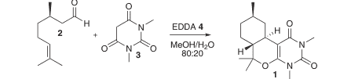

**方案 1** Fernandez-Suarez 等人（2002）在钠钙玻璃微反应器中进行的多米诺反应示例。

在另一个玻璃（硼硅酸盐）微反应器中 [通道尺寸 = 350 μm（宽）× 52 μm（深）× 2.5 cm（长）]，Wiles 等人（2004b）制备了一系列 1,2-吖嗪，展示了药物相关核心结构单元的合成。反应使用电渗流（EOF）作为泵送机制，分别使用 1,3-二酮（1.0 M）和肼衍生物（1.0 M）的无水 THF 溶液作为反应物溶液。

施加正电压后，反应物被泵送通过微通道网络，进入发生反应的中心通道，并流向反应器出口（0 V cm⁻¹）。通过使用一系列施加电场，可以优化反应物的停留时间，与类似的间歇反应相比，所合成的多种 1,2-吖嗪具有优异的纯度。如表 1 所示，涉及一水合肼（R³ = H）的反应获得了优异的转化率；然而，当使用取代肼衍生物，即苄基肼盐酸盐（R³ = CH₂Ph）时，目标 1,2-吖嗪的转化率仅为 42%。后来，通过使用停流技术，将微反应器内的反应物停留时间延长，使转化率优化至 100%。如果该技术需要用于生产较大量的材料，可以通过增加微通道长度来获得连续流动下更长的停留时间，从而实现相同的效果。

**表 1** 使用电渗流（EOF）作为泵送机制合成 1,2-吖嗪的结果汇总

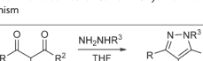

| R | R¹ | R² | R³ | 施加电场（V cm⁻¹） | 转化率（%） |
|---|---|---|---|---|---|
| CH₃ | H | CH₃ | H | 292, 318 | 100 |
| Ph | H | CH₃ | H | 364, 341 | 100 |
| −(CH₂)₄− | Ph | H | H | 260, 303 | 100 |
| Ph | H | Ph | H | 386, 364 | 100 |
| Ph | CH₃ | CH₃ | H | 292, 318 | 100 |
| Ph | H | CH₃ | CH₂Ph | 318, 318 | 42 (100)ᵇ |

a 所有反应产物均在 0 V cm⁻¹ 下收集。

b 使用了停流技术。

Acke 和 Stevens（2007）采用层叠板式微反应器（通道尺寸 = 100 μm，总体积 = 2 ml），报道了一系列色酮类化合物的连续流动合成，该合成通过多组分路线进行，包括顺序 Strecker 反应-分子内亲核加成和互变异构化，如方案 2 所示。

为了合成这些具有药用价值的化合物，将乙酸 6（2.0 当量）/2-甲酰基苯甲酸 7（1.0 当量）和苯胺 8（2.0 当量）/氰化钾 9（1.2 当量）的甲醇溶液从不同的入口引入反应器，确保 HCN 的生成以及

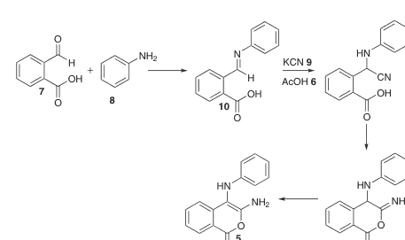

**方案2** 连续流条件下合成3-氨基-4-(芳氨基)-1H-异色烯-1-酮5所采用的反应方案。

亚胺10的生成发生在微通道内。为防止反应产物在停留时间单元内以及反应器出口处沉淀，2-甲酰基苯甲酸7的最大浓度选为0.15 M。作者采用40 min的停留时间，报道异香豆素5的产率为66%，相当于1.80 g h⁻¹的通量；由于发现目标材料在溶液中不稳定，色烯酮以固体形式储存。为证明反应装置的灵活性，使用一系列胺替代苯胺8，以6%至75%的产率得到目标产物（表2）。尽管这些产率可视为中等至良好，但所报道的若干实例显示，与类似间歇反应相比产率有所提高。

**表2** Acke等（2007）在流动条件下合成的一系列色烯酮

| 胺 | 产率（%） | 通量（g h⁻¹） |
| --- | --- | --- |
| [structure: NH₂; 8] | 66 | 1.80 |
| [structure: NH₂; OMe] | 75 | 2.28 |
| [structure: NH₂] | 9 | 1.98 |
| [structure: NHMe] | 49 | 1.41 |
| [structure: NH₂] | 6 | 0.14 |

在此基础上，Acke等（2008）将研究扩展至邻位氨基的闭环，以将咪唑核心引入化合物骨架。作者以1H-异色烯并[3,4-d]咪唑-5-酮11的合成作为模型反应（方案3），在堆叠板式微反应器中考察了溶剂、温度、酸/原酸酯化学计量比和反应物浓度的影响。

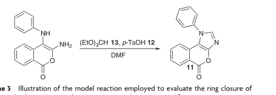

**方案3** 用于评估连续流下3-氨基-4-(芳氨基)-1H-异色烯-1-酮闭环的模型反应示意图。

采用该方法，作者发现最佳反应条件为：反应物浓度0.2 M，以二甲基甲酰胺（DMF）为反应溶剂，反应温度22 °C，10 mol% *p*-TsOH 12，以及5.0 eq.的原酸酯13。在上述条件下，以19.6 min的停留时间获得目标物质11，产率为43%；通过将停留时间延长至59 min，产率成功提高至80%。尽管实现了向11的定量转化，但使用DMF作为反应溶剂导致分离时产物11损失相对较大。然而，在证明能够进行所需闭环后，作者随后评估了该方案对一系列取代异色烯-1-酮的普适性，如表3所示，以0.18–2.21 g h⁻¹的连续输出得到目标化合物。

**表3** 在堆叠板式微反应器中使用*p*-TsOH 12作为促进剂合成的1H-异色烯并[3,4-d]咪唑-5-酮类化合物汇总

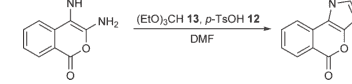

| R | 产率（%）ᵃ | 通量（g h⁻¹） |
| --- | --- | --- |
| 3-甲氧基苯基 | 55 | 0.39 |
| 3-甲苯基 | 27 | 0.18 |
| 4-甲苯基 | 78 | 0.52 |
| 4-甲氧基苯基 | 75 | 0.53 |
| 4-氟苯基 | 92 | 0.62 |

ᵃ 停留时间 = 118 min。

羧酸转化为酯是合成化学家工具箱中的一项基本转化，因此Wiles等（2003）研究了以EOF作为泵送机制，在连续流下高效合成一系列甲酯、乙酯和苄酯的能力。作者采用具有三个入口和一个出口的硼硅酸盐玻璃微反应器[通道尺寸 = 350 μm（宽）× 52 μm（深）× 2.5 cm（长）]，研究了使用混合酸酐由羧酸合成酯，如方案4所示。

三乙胺（Et3N）14（1.0 M）、预混合的羧酸/氯甲酸烷基酯（各1.0 M）和4-二甲氨基吡啶15（0.5 M）的MeCN溶液从不同入口引入反应器，反应产物在出口处以MeCN收集，随后通过气相色谱-质谱联用（GC-MS）分析。在优化反应条件下，作者能够以定量转化合成甲酯16、乙酯17和苄酯18，且未检测到酸酐或脱保护副产物（而在常规间歇反应中会观察到）。除方案4所示的Boc-甘氨酸衍生物外，作者还将一系列芳香族羧酸酯化，产率范围为91%至100%，具体取决于所存在的额外官能团。

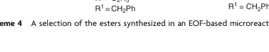

**方案4** 在基于EOF的微反应器中合成的一系列酯。

在微结构反应器中研究的均相反应中，胺的酰化是观察到受益于连续处理的最常报道的反应类别之一（Kikukati等，2002a，2002b；Schwalbe等，2002，2004）。在Hooper和Watts（2007）最近的一个实例中，通过将氘标记引入一系列小有机化合物，证明了在微流体系统中进行反应的原子效率。作者以碱介导的伯胺酰化为模型反应（见方案5），证明了可先使用未标记前体进行反应，并且一旦确定最佳反应条件，替换为标记试剂即可快速高效地合成氘代类似物。

为进行所示模型反应，串联使用两个硼硅酸盐玻璃反应器[反应器1 = 201 µm（宽）× 75 µm（深）× 2 cm（长），反应器2 = 158 µm（宽）× 60 µm（深）× 1.5 cm（长）]，并使用注射泵将试剂输送至反应通道。为确保反应器装置的长期运行，作者发现有必要使用混合溶剂，以在副产物溶解度（Et3N·HCl）与酰化剂19的稳定性之间取得平衡。考虑到这一点，苄胺20和三乙胺14的MeCN溶液（各0.1 M）从不同入口引入反应器，并使用T型混合器混合，然后加入酰卤（0.05 M）的无水THF溶液。采用40 µL min⁻¹的总流速，相当于2.6 s的停留时间，作者以95%的转化率获得N-苄基乙酰胺21[通过离线高效液相色谱（HPLC）分析测定]。

随后，通过用乙酰[D3]氯22替代乙酰氯19证明了方法转移的简便性；在操作反应器于上述条件下时，作者获得了相当的结果（98%转化率）。这项研究为同位素标记领域的研究者提供了重要结果，因为它证明了能够使用廉价、易得的前体进行并优化反应，然后替换为标记前体以获得相应的标记类似物。对于此类应用，微反应技术提供了一种降低小分子库生产相关开发成本的手段，同时也提供了快速高效生产标记化合物的手段。

**方案5** 示意图说明将氘标记引入小有机化合物的方法。

#### 2.2 热控制

通过迄今讨论的实例可以看出，从间歇反应容器转为微反应器可显著缩短反应时间，通常为秒或分钟；这一特征可归因于混合效率提高，以及通过高效耗散反应期间产生的热量而获得的优异热控制。这使得微反应器成为进行温度敏感反应以及那些放热强烈、若间歇进行会过于危险的反应的理想容器。此外，对于需要活化的反应，需要热控制来加热微反应器；如下一节所示，这已通过使用热夹套、浴槽和微波辐射实现。

##### 2.2.1 提高反应温度和压力

van Meenen等（2006）证明了在微反应器中进行高于室温反应的能力，并报道了通过Kabachnik–Fields反应合成α-氨基膦酸酯（方案6）。作者使用维持在50 °C的不锈钢流动反应器，发现采用78 min的停留时间（600 µL min⁻¹）可使醛亚胺23定量转化为相应的α-氨基膦酸酯24，并且在对反应产物进行离线酸碱萃取后，获得24的分离产率为94%。在上述反应条件下，又合成了四种衍生物，分离产率为68%至91%。

与经常使用LiClO4和InCl3等催化剂的常规间歇方案相比，连续流方法证明具有优势，因为该反应在无催化剂、无需长时间保持回流的条件下进行。

Tanaka等（2007）最近展示了使用IMM微混合器研究一种连续流方法，用于将β-羟基酮脱水生成目标不饱和产物，如方案7所示。典型操作是将4-羟基-5-甲基己-2-酮25（1 × 10⁻² M）和对甲苯磺酸一水合物（p-TsOH·H2O）12（1 × 10⁻² M）的二氧六环溶液引入微混合器，随后在微通道中加热反应混合物，再用NaOH 26水溶液（1.0 M）淬灭所得反应混合物。采用该方法，作者发现最佳反应条件为停留时间47 s（200 μl min⁻¹）和反应温度110 °C，以定量收率得到目标烯烃27。相比之下，间歇反应通常可获得可观的71%收率；但产物27伴随大量副产物。与先前的间歇方法相比，连续流方法为β-羟基酮的脱水提供了一种简便途径，并且如第3节（方案7）所讨论，能够轻松生成具有合成价值材料的生产量。

在研究实验室中日益常见、但在考虑工艺放大需求时被证明不切实际的一种方法，是通过采用高温和高压来活化反应。然而，通过使用微反应技术，此类反应条件可以安全且轻松地采用，正如Hessel等（2005）最近将高温/高压条件用于间苯二酚28的Kolbe–Schmitt反应以得到2,4-二羟基苯甲酸29（方案8）所证明的那样。由于该反应具有工业相关性，选择碳酸氢钾30，因为它是一种廉价、易得的原料，使其可用于29的大规模合成（100–1,000 h⁻¹）；此外，选择水作为反应介质，因为它是一种安全且廉价的溶剂。

在第二个例子中，Sato等（2007）展示了使用亚临界水进行醇的高度选择性、无水解O-酰化（方案10）。在反应温度200 °C、压力5 MPa下，以乙酸酐37为酰化剂，苯甲醇35的酰化在<10 s内完成，并以99%收率得到目标乙酸苄酯36，而间歇工艺中为17%。亚临界水与微流反应器联用具有很大的合成潜力，因为它无需有机溶剂，使反应能够在环境友好的溶剂体系中进行，同时提供了一种简便分离反应产物的方式，便于溶剂再利用。

除了通过热夹套、油浴或对流加热器向反应容器供热之外，过去5年中许多作者成功地将微波化学和微反应技术这两项新兴技术结合起来，并指出了一系列优势，包括缩短反应时间和提高产物选择性。Comer和Organ（2005a）最近展示了使用微波辐照作为替代热源，用于在玻璃毛细管反应器[200 μm（内径）]中进行的一系列Suzuki–Miyaura反应。为进行反应，作者在压力驱动流下通过不锈钢混合腔将反应物引入流动反应器，并以THF为反应溶剂、四(三苯基膦)钯40为催化剂，研究了4-碘-4-烯38（0.20 M）与4-甲氧基硼酸39（0.24 M）的偶联（方案11）。在100 W下，作者以28 min停留时间获得100%转化率，生成1-甲氧基-4-(1-丙基戊-1-烯基)苯41。

随后使用一系列芳基卤化物和硼酸重复该反应，以37%至定量收率得到目标化合物。与传统间歇反应相比，这些结果显示了收率的显著提高，主要归因于竞争性副反应受到抑制，这意味着一旦使用200 μl体积的反应物完成优化，反应便可轻松放大。

随后，以Suzuki–Miyaura交叉偶联反应展示了先简便优化反应、再进行规模放大的方法。如表4所示，使用一系列芳基溴获得了优异结果，收率与类似间歇反应相当或更高。采用恒定反应流持续35 min（相当于30 ml反应体积），作者能够以58%的总收率合成目标联苯，对应通量为0.5 g h⁻¹。

###### 表4 以Suzuki–Miyaura反应为模型展示微波诱导连续流反应的优化

| 芳基溴 | 间歇 | 连续流 |
|---|---:|---:|
| 溴苯 | 100 | 100 |
| 4-溴苯甲醛 | 100 | 91 |
| 4-溴苯甲醚 | 100 | 96 |
| 2-溴甲苯 | 49 | 100 |
| 4-溴硝基苯 | 100 | 86 |

观察到，作者发现当反应温度从20降至−20 °C时，对映体过量（ee）从43%提高至>50%。利用过冷微流，作者能够评估间歇反应器中无法达到的反应温度的影响，其中在4 °C观察到KOH水相冻结。尽管作者指出，若该方法要具有广泛的合成实用性，仍需进一步提高ee，但该技术代表了一种获得传统间歇过程无法达到的反应条件的手段。

另一个需要在中等低温（0–20 °C）下进行反应的例子是Carrel等（2007）报道的寡糖连续流合成，该工作建立在先前通过二糖合成获得的经验之上（Flögel等，2006；Geyer和Seeberger，2007；Ratner等，2005）。作为该项目的扩展，研究人员展示了在连续流下使用迭代糖基化合成同四聚体52（方案17）。为了优化糖基化步骤所需的反应条件，作者从入口1将亲核试剂溶液引入反应器，从入口2引入糖基磷酸酯53（2.0 eq.），从入口3引入活化剂三氟甲磺酸三甲基硅酯（TMSOTf）54（2.0 eq.）。采用由哌啶55（25%的DMF溶液）和四正丁基氟化铵（TBAF）56组成的脱保护淬灭，考察了在10 s至10 min的停留时间范围和0及20 °C温度下进行反应的影响。

方案17 用于合成β-(1→6)-连接的D-吡喃葡萄糖苷同四聚体52的迭代步骤的一般反应方案。

利用该方法，作者确定30 s停留时间和20 °C反应温度是合成单糖苷57的最佳条件（99%收率），这相比常规反应条件有所改进，后者反应时间约为30 min，温度通常为−78至−40 °C。经氟固相萃取和硅胶处理后，单糖苷57随后与糖基磷酸酯53反应，以97%收率得到相应的二糖58，在20 °C下停留时间为20 s。至此，在反应产物中检测到残留原料；因此，作者将糖基磷酸酯53的比例从2.0 eq.提高到3.0 eq.，并将TBAF 56从1.5 eq.提高到2.0 eq.，从而在停留时间60 s下完全转化为三糖59（90%收率）。反应的最后一步涉及将先前制备的三糖59环化以得到四糖52；同样需要60 s停留时间，才能以95%收率得到所需产物。在放大该过程后，作者成功实现了由氟烯醇60制备单糖57的通量11.3 mmol day⁻¹。

#### 2.3 有毒或危险试剂的使用

除了反应物/中间体不稳定性阻碍某些合成路线的大规模使用之外，试剂的毒性也可能排除某些转化在生产规模上的使用。出于安全考虑，由于与反应控制相关的问题，有毒或危险试剂以及自由基反应的使用被避免。因此，迄今为止，工业界已通过使用替代试剂和反应路径克服了这些问题；然而，借助新型反应方法学，这些试剂和技术可以安全且高效地使用。

鉴于此，Odedra等（2008）评估了使用三(三甲基硅基)硅烷61作为有效还原剂，替代高毒性试剂氢化锡，在玻璃微反应器中脱除各种官能团。在Chatgilialoglu（2008）最近综述的合成方法学基础上，研究人员评估了在玻璃微反应器中使用三(三甲基硅基)硅烷61进行安全且简便的自由基还原（方案18）。典型的连续流脱氧/脱卤包括从一个入口引入三(三甲基硅基)硅烷61和偶氮二异丁腈（AIBN）62的预混合溶液（分别为1.20 M和10 mol%），并从第二个入口引入底物溶液（1.00 M）。采用出口与背压调节器（BPR）相连的玻璃微反应器，使作者能够将反应溶剂（甲苯）过热，从而促进反应，而无需使用氯化或有毒的

溶剂体系。采用这种方法，作者评估了流动方法的通用性，报道了自由基介导的脱氧反应的分离产率为70%至94%，脱卤反应的分离产率为67–98%。

除了所展示的七个脱氧和脱卤反应外，作者还将该方法应用于一系列炔烃和烯烃的氢硅烷化反应。为了进行这些反应，将炔烃或烯烃（1.00 M）、三(三甲基硅基)硅烷61（1.2 M）和AIBN 62（10 mol%）在甲苯中的预混合溶液以200 μL min⁻¹的流速通过加热的微反应器（130 °C），停留时间为5 min。

如表5所示，与间歇反应相比，微流控反应器内获得的传热和传质增强，使得使用炔烃的反应具有增强的*顺/反*选择性，并且更普遍地使反应时间显著缩短（参见常规间歇反应）。

**表5** 使用三(三甲基硅基)硅烷61进行连续流动氢硅烷化反应所得结果的总结

R–C≡CH + (Me₃Si)₃SiH 61 → R–CH=CH–Si(SiMe₃)₃

| R | Z/E比ᵃ | 产率 (%)ᵇ |
|---|---|---|
| Ph 32 | 98:2 (84:16)ᶜ | 96 (88)ᶜ |
| n-C₆H₁₃ | 77:23 | 91 |
| 羟基环己基 | 11:89 | 94 |

ᵃ Z/E比由¹H NMR谱测定。

ᵇ 分离产率。

ᶜ 文献值。

##### 2.3.1 氟化反应

随着含有氟化部分的药物活性剂数量不断增加，这是由于观察到代谢稳定性增强（参见质子化类似物），药物发现项目以及随后在活性药物成分（API）生产中对氟化前体的需求持续上升。由于这些氟化前体在自然界中罕见，因此需要高效的合成方案来获得它们；在现代有机化学家可用的合成转化中，元素氟（F₂）63和亲核氟化剂二乙氨基三氟化硫（DAST）64是使用最广泛的。不幸的是，DAST 64普遍被认为由于其在超过90 °C的温度下易爆炸而过于危险，无法大规模使用；因此，这种强效氟化剂目前未能充分发挥其合成潜力。

由于使用元素氟将C–H键转化为C–F键具有高度放热性，该转化长期以来被认为过于危险而无法大规模进行。然而，该技术具有很大的合成实用性，因此已经进行了大量研究，以在连续流动条件下进行直接氟化（Chambers等，2008）。

在薄膜镍反应器中，Chambers等人（Chambers and Spink, 1999, 2001, 2005）展示了一系列化合物的两相氟化，例如乙酰乙酸乙酯65。作者使用10%元素氟63在氮气载气中，展示了一条简便路线，可选择性地制备单氟化二酮，2-氟-3-氧代丁酸乙酯66，仅少量产物进一步氟化得到2,2-二氟-3-氧代丁酸乙酯67（方案19）。该课题组随后报道了硝基甲苯和2-氯乙酰乙酸乙酯等化合物的氟化，再次证明了反应控制可实现优异的转化率和选择性。作为扩展，Chambers等人最近发表了一篇手稿，详细介绍了其反应器的成功放大，其中30个反应通道并行运行。使用这种方法能够保持单通道中获得的高效传热和气液混合，并为危险的间歇氟化提供了安全的替代方案。

**方案19** 使用元素氟对β-二酮酸酯进行选择性氟化。

Gustafsson等人（2008a）展示了一种简便方法，在基于聚四氟乙烯（PTFE）的流动反应器（内体积为16.0 mL）中利用DAST 64的合成效用，对一系列醇、羧酸、醛和酮进行氟化。采用75 psi的BPR，作者能够达到高于所研究溶剂沸点的反应温度。为了进行反应，反应物和DAST 64从分开的入口引入，并使用T型混合器混合，然后进入反应通道；在BPR之后引入饱和NaHCO₃水溶液，以在收集反应产物之前淬灭反应混合物。在研究了包括甲苯和THF在内的一系列溶剂中的脱氧氟化条件后，作者迅速确定二氯甲烷（DCM）为最佳溶剂。采用70 °C的反应器温度，对于醇的脱氧氟化使用1.0当量DAST 64，当使用含羰基部分的底物时使用2.0当量；评估了反应物停留时间的影响（8–32 min）。

作者很快确定16 min为最佳停留时间，如表6所示，在上述条件下，经过水相萃取并通过硅胶柱色谱纯化后，合成了一系列氟化材料，产率为中等至优异。除了成功展示的一系列脱氧氟化反应外，作者还评估了进行卤素交换的难易程度，由酰氯合成酰氟，产率为80%。

除了使用元素氟63和DAST 64外，Miyake和Kitazume（2003）展示了通过羰基化合物的三氟甲基化（表7）、迈克尔加成（方案20a）和Horner–Wadsworth–Emmons（方案20b）反应，将氟引入一系列小有机化合物中。

作者使用玻璃微反应器（通道尺寸=100 μm（宽）×40 μm（深），长8.0 cm），研究了一系列醛和酮的三氟甲基化（表7）。为了进行反应，将醛/酮（1.5 M）和三氟甲基(三甲基)硅烷68在THF中的溶液从一个入口引入微反应器，并将TBAF 55在THF中的溶液从第二个入口引入，总流速为1.0 μL min⁻¹，反应时间为20 s。所有微反应均在室温下进行，反应产物离线收集在1.0 N HCl水溶液中，然后将三氟甲基化产物萃取到乙醚中。随后通过¹H和¹⁹F核磁共振（NMR）光谱分析所得反应混合物，以确定反应产率。使用上述方案，当使用芳香族和脂肪族醛（产率63–89%）作为前体时，作者能够以优异产率获得目标三氟甲基化醇；然而，酮的反应产率低至中等（产率7–42%）。作者还高兴地发现，微反应获得的产率与常规间歇条件下使用20 s相比5 h反应时间获得的产率相当（表7）。

**表7** 含羰基化合物的连续流动三氟甲基化反应所得结果的总结

| 底物 | 微反应器产率 (%)a | 间歇反应器产率 (%)a |
|---|---|---|
| 苯甲醛 (116) | 89 | 76b |
| 4-(三氟甲基)苯甲醛 | 83 | 97b |
| 4-甲氧基苯甲醛 | 63 | – |
| 4-(辛氧基)苯甲醛 | 74 | – |
| 肉桂醛 | 12 | – |
| 苯乙酮 | 42 | – |
| 环己酮 | 7 | – |

a 产率由19F NMR谱测定。

b 间歇反应（5 h）。

**方案 20** Miyake 和 Kitazume（2003）为将氟引入小有机分子所研究的部分反应：(a) 迈克尔加成和 (b) Horner–Wadsworth–Emmons 反应。

基于此前在批次中成功实现含 CF₃ 丙烯酸酯的迈克尔加成，Miyake 和 Kitazume（2003）及其同事随后研究了连续流条件下的该反应，作为快速生成一系列合成上有用的氟化烷烃的方法（方案 20a）。再次采用 20 s 的反应时间，目标化合物以 80% 至 93% 的分离产率获得，与此前在批次中获得的结果相比具有优势，后者在 30 min 反应时间下产率为 90–99%。在最后一个示例中，作者报道了一系列醛（1.7 M）与 2-氟-2-膦酰基乙酸三乙酯（2.6 M）在 1,8-二氮杂双环十一碳-7-烯（DBU，70）存在下的 Horner–Wadsworth–Emmons 反应，得到一系列 α-氟-α,β-不饱和酯，如方案 20b 所示。采用二甲氧基乙烷（DME）作为反应溶剂、总流速为 1.0 μL min⁻¹，反应产物离线收集于 HCl 水溶液（1.0 N）中，随后将有机相萃取至乙醚中。除去溶剂后，残余物通过 ¹⁹F NMR 光谱分析，并以三氟甲苯为内标测定产率。反应产物的立体化学通过 ¹H NMR 偶合常数和烯烃质子的化学位移确认。采用该方法，作者以中等至优异产率成功合成了目标化合物；见表 8，其立体选择性与传统批次反应器中获得的结果类似。

**表 8** 批次与微反应器中 Horner–Wadsworth–Emmons 反应所得立体选择性的比较

| R | 微反应器产率 [%]a | 批次反应器产率 [%]b |
|---|---|---|
| C6H5 | 78 (77:23)c | >99 (70:30) |
| 4-CF3C6H4 | 88 (68:32) | 86 (64:36) |
| 4-MeOC6H4 | 58 (74:26) | >99 (76:24) |
| n-Nonyl | 81 (64:36) | 66 (64:36) |

a产率由 19F NMR 光谱测定。
b分离产率，批次反应进行 30 min。
c括号中的数字表示 Z:E 比，由 19F NMR 光谱测定。

##### 2.3.2 三甲基铝

三甲基铝（AlMe3）71 的自燃性以及与铝酰胺中间体相关的不稳定性，使 AlMe3 71 难以在规模上安全处理，因此其用于酰胺的大规模合成受到限制。然而，使用微反应器可轻松操控反应物，为在连续流中合成酰胺使用此类试剂提供了可能，从而为其在大规模生产中的应用提供了一条实用路线。Ponten 等人（2008）在 8.0 mmol 规模（后来提高至 0.2 mol）上进行反应，展示了由一系列甲基酯或醚酯与苄胺 20 衍生的一系列酰胺的连续流合成；获得了优异的分离产率，如表 9 所示。

除所提供的示例外，作者还展示了使用苯胺和脂肪胺作为底物，报道的分离产率为 65% 至 98%（见第 3 节），并以此方法展示了药物上重要的分子利莫那班（rimonabant，72）和 epavopraxil（73）的合成（分别见方案 65 和 66）。

**表 9** 连续流下进行的选择性三甲基铝介导反应

RCOOR¹ + PhCH₂NH₂ (20) —AlMe₃ (71), THF, 125 °C→ RCONHBn

| 酯 | 产物 | 产率 (%) |
|---|---|---|
| PhCOOMe | PhCONHBn | 96 |
| PhCH₂COOMe | PhCH₂CONHBn | 98 |
| PhCH=CHCOOMe | PhCH=CHCONHBn | 95 |
| CH₃CH(OH)COOEt | CH₃CH(OH)CONHBn | 70 |
| cyclopropylCOOEt | cyclopropylCONHBn | 86 |

##### 2.3.3 丁基锂在微反应器中的使用

有机锂化合物与碳基亲电试剂的反应是形成 C–C 键最有用的合成方法之一；因此，多个研究组已在微结构装置中研究这些反应。

Schwalbe 等人（2004）展示了在连续流条件下使用正丁基锂（n-BuLi）74 的早期研究示例，该示例涉及 *原位* 生成 C₂F₅Li 75 及其随后对二苯甲酮 76 的亲核加成，如方案 21 所示。

**方案 21** 展示短寿命有机金属物种 75 的 *原位* 生成及其对二苯甲酮 76 的亲核加成。

采用两段式微反应器，作者使用两个外部冷却浴，分别在不同温度（−61 和 −10 °C）下进行反应的第一步和第二步。进行反应时，将 n-BuLi 74（0.82 M 己烷溶液）和 C₂F₅I 77（0.75 M DCM 溶液）以相当于 4 min 停留时间的流速泵入反应器。随后将二苯甲酮 76（0.62 M）的 DCM 溶液引入第二反应器，并采用 17 min 的停留时间。收集反应产物后，进行离线水相萃取，并通过 GC 分析反应产物。采用上述反应条件，作者以 51% 的产率获得目标产物 78，提高了 37%（相比批次反应）。然而，作者确实报道了竞争性副产物 79（35%）的生成，这归因于反应第一阶段中卤素–锂交换不完全。尽管如此，该反应展示了在连续流下使用传统上危险的试剂，以及在不同温度下进行串联反应步骤的可行性。

Coto 等人（2008）报道的一个近期示例利用快速的卤素–锂交换，使葑酮（80）与 2-溴吡啶 81 在单步中偶联，相比更传统的两步操作（方案 22）。采用这种方法，有人提出快速溴–锂交换可在酮等捕获剂存在下以化学选择性方式进行。为评估这一假设，作者选择吡啶乙醇（葑酮）（80）与 2-溴吡啶 81 的烷基化作为模型反应，并采用由 2 ml 微反应器单元和 15 ml 停留时间单元组成的不锈钢流动反应器。进行反应时，将 n-BuLi 74（0.5–1.0 M）的己烷溶液以 5 ml min⁻¹ 的流速加入葑酮（80）（0.5–1.0 M）和 2-溴吡啶 81（0.46 M）的无水 THF 溶液中。将反应器维持在 −25 °C，作者在固定停留时间 3 min 下评估了反应物化学计量对反应的影响。将反应混合物收集到冰水（H₂O）中以淬灭反应，并在通过 GC–MS 和 ¹H NMR 光谱分析之前将有机物萃取至乙醚中。

**表 10** 流动反应器中葑酮（80）与 2-溴吡啶 81 单步偶联所用优化策略的示例

| 葑酮（80）: 卤化物 81: n-BuLi 74 | 温度 (°C) | 产率 (%)ᵃ |
|---|---|---|
| 1:1:1 | −25 | 56 |
| 2:1:1.5 | −25 | 71 |
| 2:1:2 | −25 | 91 |
| 2:1:1.5 | 0 | 68 |

ᵃ 分离产率。

如表 10 所示，采用这种方法，作者能够快速优化反应条件，在使用 2 当量葑酮（80）和 n-BuLi 74 时以 91% 的产率获得目标产物 82。在所有情况下仅观察到单一非对映异构体，作者发现于 0 °C 进行反应仅导致产率降低 3%。此外，发现该反应条件适用于一系列脂肪族/芳香族酮和溴代化合物。

Nagaki 等人（2009）最近展示了使用微流动反应器原位制备由氧化苯乙烯 83 和仲丁基锂（sec-BuLi）84 衍生的环氧乙烷基负离子。如表 10 所示，作者通过使 1,2-环氧乙基苯基锂 85 与一系列亲电试剂在由两个 T 型混合器和两个微管反应器组成的微流动系统中反应，评估了一系列取代环氧化物的制备合成。1,2-环氧乙基苯基锂 85 由氧化苯乙烯 83（0.10 M，6.00 ml min−1）和 sec-BuLi 84（0.75 M，1.92 ml min−1）生成，该过程在第一微混合器中进行，随后在第二混合器中用 MeI 86（0.45 M，3.84 ml min−1）捕获。采用这种方法，作者研究了温度（−78 至 −48 °C）和停留时间（1–25 s）对中间体 87 生成以及随后 2-甲基-2-苯基环氧乙烷形成的影响。

在 −48 °C 进行反应时，环氧化物的形成迅速发生，表明氧化苯乙烯 83 的去质子化很快；然而，这伴随着环氧乙烷基负离子 87 的分解。将反应器温度降至 −78 °C 时，发现负离子 87 可稳定长达 25 s，从而能够与一系列亲电试剂高效反应，以高产率得到相应的取代环氧化物，如表 11 所示。

Nagaki 等人（2008）还展示了在微流动系统中使用 sec-BuLi 84 进行苯乙烯 88 的阴离子聚合，作为对所得聚合物分子量分布实现高度控制的一种手段。采用苯乙烯 88（2.0 M）的 THF 溶液、sec-BuLi 84（0.2 M）的己烷溶液以及管式反应器

**表11**  微流反应器中氧化苯乙烯83去质子化生成的反应产物总结（R_T = 24 s，−78 °C）

| 亲电试剂 | 产物 | 收率 (%)a | 通量 (g h−1) |
|---|---|---|---|
| MeI 86 | 环氧化物 (Ph) | 88 | 4.2 |
| Me3SiCl | Me3Si取代环氧化物 (Ph) | 72 | 5.0 |
| 苯甲醛 116 | OH取代环氧化物 (Ph) | 84a | 6.8 |
| 苯乙酮 | OH取代环氧化物 (Ph, Me) | 70b | 6.1 |
| 二苯甲酮 76 | OH取代环氧化物 (Ph, Ph) | 82 | 9.0 |

a 非对映体比例82:18。
b 87:13，由1H NMR确定。

[250 μm（内径）× 50 cm（长）]，最初研究了反应器温度（24至−78 °C）对分子量（Mn）和分子量分布（Mw/Mn）的影响。如表12所示，所得聚合物的Mn与反应器温度直接相关，并且在所有情况下均获得了优异的Mw/Mn。

**表12**  连续流下进行阴离子聚合时分子量（Mn）和分子量分布（Mw/Mn）的影响

| 温度 (°C) | 流速 (mL min−1)：仲丁基锂84 | 流速 (mL min−1)：苯乙烯88 | Mn | Mw/Mn |
|---|---|---|---|---|
| 24 | 2.0 | 6.0 | 3400 | 1.10 |
| 0 | 2.0 | 6.0 | 3300 | 1.08 |
| −28 | 2.0 | 6.0 | 3600 | 1.07 |
| −48 | 2.0 | 6.0 | 3700 | 1.08 |
| −78 | 2.0 | 6.0 | 4000 | 1.43 |

作者采用0 °C的微反应器温度，证明了单体**88**与引发剂**84**的比例之间存在线性关系，从而能够容易地制备特定分子量的聚合物。基于这些观察，作者继续使用一系列硅烷（如氯二甲基乙烯基硅烷）评估聚合物的末端官能化，研究最后以使用具有不同端基的官能化聚合物进行嵌段共聚而结束。使用这种方法，作者能够在相对较高的反应温度（0–24 °C）下获得高水平的分子量分布，为制备结构明确的聚合物、共聚物和嵌段共聚物提供了机会。

使用与停留时间单元连接的不锈钢微混合器，Tietze和Liu（2008）报道了用于合成氨基萘衍生物的连续流工艺的开发，该衍生物是合成新型抗癌剂的前体。该化合物合成中的关键反应是亲核取代反应，如方案23所示，得到膦基琥珀酸酯**89**；关于利用一系列微反应步骤实现的全合成的细节见第3节。在评估将*n*-丁基锂**74**用于连续流工艺之前，作者研究了在间歇反应中使用NaH **90**和有机锂碱（如二异丙基氨基锂（LDA）），在<24 h后获得70–91%的分离收率。副产物NaBr的相对不溶性排除了在连续工艺中使用NaH **90**的可能性；然而，LiBr溶解度的增加意味着有机锂碱有潜力在该系统中使用。在所研究的碱中，发现*n*-丁基锂**74**产生最均匀的溶液，随后用于微反应器，以24 min的停留时间和40 °C的反应器温度得到70%收率的膦基琥珀酸酯，即2-(二乙氧基磷酰基)乙酸乙酯**89**，与在36 h内进行的类似间歇反应相比，收率提高了13%。

**方案23** 用于制备克级量氨基萘衍生物**91**的中间体**89**的合成。

##### 2.3.4 硝化反应

芳烃的硝化通常是一个快速且放热的过程，通常需要滴加硝化溶液以防止热量快速释放，这可能导致目标化合物的不期望分解甚至热失控。因此，芳烃的硝化是最早报道的微型化反应之一，Burns和Ramshaw（2002）研究了使用不锈钢连续流反应器，利用有机相和水相反应物的两相段塞对苯**92**和甲苯**93**进行硝化。

Ducry和Roberge（2005）随后报道了在玻璃微反应器[10 × 500 μm（宽）通道，内部体积 = 2.0 mL]中苯酚**94**的自催化硝化，并评估了反应物化学计量对所得产物比例的影响（方案24）。采用苯酚**94**在CH₃CO₂H（6%）和水（71%）中的溶液（6%）（进料1）以及65% HNO₃ **95**溶液（进料2），原料比例在3.9:1和2.3:1之间变化，对应1.1–1.8当量的HNO₃ **95**。使用这种方法，还评估了反应温度的影响，观察到在55 °C时自催化立即开始，在45 °C时观察到1 min延迟，而在较低温度下自催化未开始。通过使用连续流工艺，作者报道了聚合物副产物形成减少（间歇中高达70%）、产物纯度总体提高以及比间歇反应中获得的更高收率。

**方案24** 硝化苯酚**94**时获得的潜在反应产物概述：单硝化苯酚**96**和**97**、羟基硝酮**98**以及二硝化苯酚**99**和**100**。

Kulkarni等（2008）使用微混合器（T型混合器，800 μm）和不锈钢反应管[1,380 μm（内径）× 12 m（长）]研究了水杨酸**101**在连续流下的芳族硝化。使用水杨酸**101**在乙酸**6**（1:16）和硝酸**95**中的反应物原料，反应在20 °C下进行，并评估了停留时间的影响。为确保所得结果能指示微反应器内发生的反应，将反应产物收集在小瓶中，储存在冰浴中，并在通过HPLC分析上清液之前用尿素和MeOH淬灭未反应的HNO₃ **95**。使用这种方法，作者能够防止不期望的脱羧生成2-硝基苯酚**97**，仅观察到单硝化产物的形成，即5-硝基水杨酸**102**（60%）和3-硝基水杨酸**103**（18%）（方案25）。

**方案25** 水杨酸**101**硝化可能获得的产物。

采用更高的反应温度，作者观察到反应对合成5-硝基水杨酸**102**的选择性增加，在50 °C下获得65%。水杨酸**101**的硝化也是最近一项专利的主题，其中硝化在玻璃微反应器内于75 °C下在10–30 s内进行（Kulkarni，2007）。

DSM最近发表了与Corning Incorporated合作的细节，该合作促成了能够在cGMP条件下使用纯HNO₃ **95**进行选择性有机硝化的玻璃微反应器的开发（方案26）（Braune等，2008）。由于硝化反应在商业规模上众所周知难以进行，主要挑战是目标生产量在吨/天范围内。作者评论说，尽管反应焓适中，但产物**104**潜在的放热分解才是问题所在。起始原料**105**和反应混合物其他组分的氧化也可能引起副反应，因此需要仔细控制反应条件。

**方案26** DSM使用Corning Incorporated玻璃反应器在流动条件下研究的选择性硝化。

为了进行有机硝化，将底物**105**和溶剂在微结构中混合，形成精细乳液；随后加入纯硝酸**95**，此时反应立即开始。反应持续所需时间后，通过在降低温度下加水停止反应，然后用NaOH中和。中和以受控阶段进行，以控制释放到反应器中的热量。使用这种方法，150 mL的反应器体积允许

以传统间歇技术无法达到的本征高安全水平生产 13 kg h⁻¹ 的 104。在证明微反应器的可行性后，无需进行放大步骤即可提高通量以满足先前讨论的目标；作者仅采用了一个由八个微反应器（两组，每组四个微反应器）组成的生产单元，该单元在先前条件下运行。采用这样的系统使 DSM 能够以 100 kg h⁻¹ 的速率生产 104，若连续运行，年产能可达 800 吨。该研究展示了安全操作危险反应、获得所需化学选择性、设计可预测且可靠的生产单元，以及在短时间内制备高质量化学品的能力，而所有这些都通过使用微反应技术得以实现。

##### 2.3.5 放热反应

除了处理和使用大量危险或有毒物质所带来的挑战外，放热反应的放大也可能存在问题，因为高效移除所产生的热量存在困难。有鉴于此，Schwalbe 等人（2004）在连续流条件下评价了 Paal–Knorr 合成（方案 27）。由于该反应具有放热性质，在间歇模式下将乙醇胺 106 加入乙酰丙酮 107 时，必须长时间加入试剂；因此，尽管反应本身很快，但反应物的滴加显著延长了反应时间。相比之下，在不锈钢连续流反应器中进行该反应，停留时间为 5.2 min，作者能够使用纯反应物，以 260.0 g h⁻¹ 的通量获得 91% 产率的目标吡咯 108。

#### 2.4 将催化剂引入微反应器

在展示了小型化连续流反应器用于无催化剂或均相反应时所具有的许多实际优势之后，下一节将重点介绍在此类装置中使用非均相催化剂、生物催化剂、试剂和清除剂所能获得的额外优势。

**方案 27** 在 CYTOS 流动反应器中进行的放热 Paal–Knorr 反应。

##### 2.4.1 碱促进的微反应

Wiles 等人（2004a，2007a）证明了一系列二氧化硅负载碱可引入基于 EOF 的毛细管反应器中，以提高 Knoevenagel 缩合的效率（参见传统间歇方案）。进行反应时，将固体负载碱填充到硼硅酸盐玻璃毛细管 [500 μm（内径）× 3.0 cm（长）] 中，并用两个微孔二氧化硅筛板固定。随后，将醛与氰基乙酸乙酯 109/丙二腈 110 的预混合溶液（分别在 MeCN 中为 1.00 M）驱动通过填充床，碱催化缩合反应在此发生；反应产物在反应器出口以 MeCN 收集，随后进行 GC–MS 离线分析。采用该方法，作者研究了一系列取代芳香醛的反应性，获得了 99–100% 的转化率，并使用了固体负载催化剂 111–114（方案 28）。与传统搅拌或振荡反应器相比，连续流系统的使用被证明具有优势，因为它减少了固体负载催化剂的降解，从而延长了试剂寿命并提高了批次间重现性。

在使用少量催化材料（通常为 5 mg）证明该原理后，作者后来证明，仅通过增大所用填充床尺寸 [3,000 μm（内径）× 3 cm（长）]，即可以前述材料 0.57 至 0.94 g h⁻¹ 的通量进行生成。

采用二氧化硅负载哌嗪 113（0.10 g，1.70 mmol N g⁻¹），作者证明了 EOF 可用于一系列 α,β-不饱和化合物的半制备规模合成；并且正如先前在毛细管反应器中观察到的那样，这些化合物以优异的分离产率和产物纯度获得（表 13）。

**方案 28** 使用 EOF 作为泵送机制进行 Knoevenagel 缩合的一般反应式。

**表 13** 使用硅胶负载碱 113 和 EOF 作为泵送机制合成的一系列 α,β-不饱和化合物选例

| R¹ | R² | R³ | R⁴ | 流速 (μL min⁻¹) | 产量 (g) | 产率 (%) |
|---|---|---|---:|---:|---:|
| H | H | H | CO₂C₂H₅ | 62.0 | 0.75 | 99.7 |
| H | CO₂C₂H₅ | H | CO₂C₂H₅ | 56.1 | 0.87 | 99.8 |
| OCH₃ | H | OCH₃ | CO₂C₂H₅ | 50.1 | 0.78 | 99.9 |
| H | OBn | H | CO₂C₂H₅ | 51.1 | 0.94 | 99.7 |
| H | Br | H | CO₂C₂H₅ | 55.1 | 2.30ᵇ | 99.4 |
| H | H | H | CN | 62.1 | 0.57 | 99.4 |
| H | CO₂C₂H₅ | H | CN | 60.4 | 0.76 | 98.8 |
| OCH₃ | H | OCH₃ | CN | 55.7 | 0.71 | 99.2 |
| H | OBn | H | CN | 48.4 | 0.75 | 99.4 |
| H | Br | H | CN | 48.3 | 1.70ᵇ | 99.8 |

ᵃ 除非另有说明，反应进行 1.0 h。  
ᵇ 反应进行 2.5 h。

**方案 29** McQuade 等人用于评价固定化碱 117 的模型反应。

Bogdan 等人（2007）随后研究了在管式反应器 [1.6 mm（内径）× 10–60 cm（长），填充有聚合物负载的 1,5,7-三氮杂双环[4.4.0]十一碳-3-烯 117] 中，通过氰基乙酸乙酯 109 与苯甲醛 116 的碱催化缩合合成 *(E)*-2-氰基-3-苯基丙烯酸乙酯 115（方案 29）。采用氰基乙酸乙酯 109 和苯甲醛 116 的预混合溶液（分别为 0.43 和 0.39 M），使用 HPLC 柱加热器将反应器加热至 60°C，并评价停留时间的影响（25–300 s）。采用上述步骤，作者发现 300 s 的停留时间能以 93% 的转化率和 0.2 g h⁻¹ 的通量得到目标化合物 115。

在证明其系统的合成实用性后，作者随后评价了第二种负载碱 4-二甲氨基吡啶（AO-DMAP）118 对仲醇的酰化反应（方案 30）。采用 1-苯基乙醇 119、Et₃N 14 和乙酸酐 37 在己烷中的预混合溶液（0.33、0.50 和 0.50 M），在室温下进行反应，并评价停留时间的影响（10–50 s）。使用 60 cm 填充床，作者在停留时间 <20 s 时即可获得接近定量的转化率生成 120，并且流动反应的结果优于类似间歇反应所得结果。

最近，Costantini 等人（2009）报道了一种将有机碱 1,5,7-三氮杂双环[4.4.0]癸-5-烯（TBD）引入二氧化硅整体柱 [100 μm（宽）× 100 μm（深）× 1.03 m（长）] 的新技术，该技术涉及对 PGMA 聚合物刷壁涂层（150 nm）进行衍生化。为评估衍生化聚合物刷的催化性能，作者以 Knoevenagel 缩合作为模型反应，使用 MeCN 作为反应溶剂，反应温度为 65 °C（方案 31）。采用该方法，作者能够以 7.5 × 10⁻⁵ M 的每小时产量生成目标缩合产物 121（仅使用 2.9 × 10⁻⁵ mol 的 TBD 122），且未观察到碱的浸出。

Baxendale 等人（2008）报道了一种分叉方法，通过将玻璃微反应器与填充床反应器耦合来实现碱介导的缩合反应，从而合成噻唑和咪唑。如方案 32 所示，反应重点使用异氰基乙酸乙酯 123 作为氰化物来源，并通过异硫氰酸酯试剂进行变化，如表 13 所示。

初步研究采用 55 °C 的反应温度和 100 μL min⁻¹ 的流速，并使用异氰基乙酸乙酯 123（0.75 M）。

**流程 32** 用于噻唑和咪唑连续流合成的一般反应条件示意图。

4-溴苯基异硫氰酸酯（0.75 M）在聚苯乙烯负载的2-叔丁基亚氨基-2-二乙氨基-1,3-二甲基全氢-1,3,2-二氮杂磷杂环（PS-BEMP）124存在下反应，以优异的纯度（95%）但仅58%的产率得到目标噻唑。作者假设剩余的噻唑被截留在聚合物负载的碱124上，因此将亲电试剂溶液（0.75 M）通过填充床，得到新产物，即相应的咪唑（38%）。最佳条件为偶联试剂1:1的比例（MeCN中0.75 M）、1.6当量的PS-BEMP 124，以及50 μL min⁻¹的流速（针对所用的每种反应物溶液）。利用上述条件，作者评估了改变异硫氰酸酯前体上官能团的影响，如表14所总结，可以观察到电子效应，甲氧基取代基有利于选择性生成噻唑。

**表 14** 噻唑和咪唑连续流合成结果汇总

| R¹ | R² | 噻唑 (%) | 咪唑 (%) | 总产率 (%) |
|---|---|---|---|---|
| 4-Cl | OMe | 47.5 | 47.5 | 95.1 |
| 4-Br | Br | 53.0 | 30.0 | 83.0 |
| 4-OMe | H | 96.0 | 4.0 | 100.0 |
| 3-F | Br | 68.0 | 28.0 | 96.0 |
| 3-OMe | Br | 84.0 | 5.0 | 89.0 |
| 2-OMe | H | 90.0 | 7.0 | 97.0 |
| 3,5-CF₃ | OMe | 83.5 | 10.5 | 94.0 |
| 3,4-Cl | CN | 53.0 | 26.0 | 79.0 |

##### 2.4.2 酸催化的微反应

Wiles等人（2005）使用与Knoevenagel缩合反应类似的装置，研究了醛在酸催化下保护为相应二甲基缩醛的反应（流程33）。同样，反应是通过将苯甲醛**116**和原甲酸三甲酯**125**的预混合溶液（在MeCN中分别为1.0和2.5 M）泵送通过含有Amberlyst-15 **126**（5.0 × 10⁻³ g，4.20 mmol g⁻¹）的填充床反应器进行的。随后通过GC-MS对反应产物进行离线分析，以确定醛**116**转化为缩醛**127**的转化率，并相应调整流速。使用这种方法，以99.8%的产率（% RSD = 0.13，n = 5）和2.5 × 10⁻² g h⁻¹的通量获得了二甲氧基甲基苯**127**。作者随后研究了一系列二甲基缩醛的合成（表15），所有这些缩醛均以优异的产率（>95.4%）和纯度获得，而无需额外的离线纯化。

使用同一反应器，将醛或酮与二硫醇（1.0 M，1:1）在无水MeCN中的预混合溶液通过含有Amberlyst-15 **126**的填充床。反应产物再次在MeCN中收集，每10分钟通过GC-MS分析一次。优化后，反应进行1小时，以产生所需量的每种1,3-二噻烷或1,3-二硫戊环，然后将反应产物在真空下浓缩并通过¹H NMR波谱进行分析（表16和17）（Wiles等，2007b）。

**流程 33** 在EOF驱动的连续流下，使用固体负载酸催化剂将醛**116**保护为其二甲基缩醛**127**的示例。

**表 15** 连续流条件下合成二甲基缩醛所得结果选编

| 醛 | 流速 (μL min⁻¹) | 产率 (%) |
|---|---|---|
| 苯甲醛 **116** | 1.75 | 99.8 |
| 4-溴苯甲醛 **134** | 1.00 | 99.9 |
| 4-氯苯甲醛 | 1.60 | 99.8 |
| 4-氰基苯甲醛 | 2.00 | 99.6 |
| 2-萘甲醛 | 1.40 | 99.8 |
| 4-甲酰基苯甲酸甲酯 | 0.60 | 99.9 |
| 3,5-二甲氧基苯甲醛 **268** | 0.50 | 98.8 |

**表 16** Wiles及其同事（2004a）报道的连续流硫代缩醛化反应选编

| 醛 | *n* | 流速 (μL min⁻¹) | 产率 (%) |
|---|---|---|---|
| 苯甲醛116 | 2 | 63.7 | 99.97 |
|  | 1 | 63.4 | 99.97 |
| 4-溴苯甲醛134 | 2 | 61.4 | 99.92 |
|  | 1 | 61.2 | 99.96 |
| 4-氯苯甲醛 | 2 | 61.7 | 99.91 |
|  | 1 | 61.9 | 99.95 |
| 4-氰基苯甲醛 | 2 | 65.4 | 99.94 |
|  | 1 | 64.6 | 99.96 |
| 4-苄氧基苯甲醛 | 2 | 61.1 | 99.22 |
|  | 1 | 60.9 | 99.93 |
| 4-甲基苯甲醛 | 2 | 69.7 | 99.97 |
|  | 1 | 69 | 99.93 |
| 4-联苯甲醛 | 2 | 63 | 99.06 |
|  | 1 | 63 | 99.97 |
| 2-萘甲醛 | 2 | 60.4 | 99.94 |
|  | 1 | 60.2 | 99.98 |
| 2-呋喃甲醛 | 2 | 67.9 | 99.92 |
|  | 1 | 67.5 | 99.97 |
| 3,5-二甲氧基苯甲醛268 | 2 | 67.9 | 99.91 |
|  | 1 | 67.7 | 99.93 |

除了开发一种简便的硫代缩醛和硫代缩酮合成路线外，作者还通过优化试剂在填充床内的停留时间，证明了在含有酮基部分的情况下对醛官能团进行化学选择性保护（流程34）。

**表 17** 使用EOF进行的连续流硫代缩醛化反应汇总

| 酮 | *n* | 流速 (μL min⁻¹) | 产率 (%) |
|---|---|---|---|
| 苯乙酮 | 2 | 41.5 | 99.57 |
|  | 1 | 41.3 | 99.96 |
| 苯丙酮 | 2 | 40.2 | 99.97 |
|  | 1 | 40.3 | 99.96 |
| 丁酰苯 | 2 | 41.6 | 99.9 |
|  | 1 | 41.6 | 99.9 |
| 环己酮 | 2 | 42.2 | 99.62 |
|  | 1 | 42.1 | 99.98 |
| 二苯甲酮76 | 2 | 40.2 | 99.81 |
|  | 1 | 40.1 | 99.91 |
| 4-硝基苯乙酮 | 2 | 40.9 | 99.95 |
|  | 1 | 41 | 99.95 |
| 2-甲氧基苯乙酮 | 2 | 40.9 | 99.93 |
|  | 1 | 41.9 | 99.93 |
| 4-氯苯乙酮 | 2 | 40.9 | 99.87 |
|  | 1 | 40.8 | 99.91 |
| 4-羟基苯乙酮 | 2 | 42.2 | 99.76 |
|  | 1 | 42.1 | 99.83 |
| 4-溴苯乙酮 | 2 | 40.2 | 99.94 |
|  | 1 | 40.1 | 99.97 |

**流程 34** 双官能团化合物保护中可获得的潜在反应产物。

与间歇法相比，流动反应以定量产率和纯度提供了目标化合物128，且没有竞争性缩酮129生成的迹象。尽管流动反应在所有情况下都实现了接近定量的转化，但例如，如果1,3-二噻烷或1,3-二硫戊环在后续使用Pd催化剂的反应步骤中使用，那么确保不存在二硫醇残留至关重要。考虑到这一点，作者将一段浸渍硫酸铜的硅胶柱填充到流动反应器中，以清除反应混合物中小于2 × 10⁻³%的二硫醇。由于清除剂在饱和时由蓝色变为黄色，因此清除剂的耗竭是自我指示的。

**流程 35** 在填充床微反应器中进行对映选择性合成的一个示例。

Lundgren等人（2004）展示了在小型化填充床反应器中进行路易斯酸催化反应的另一个示例。如流程35所示，所选择的模型反应涉及三甲基硅氰（TMSCN）130对苯甲醛116的对映选择性加成。微反应是在EOF条件下，将苯甲醛116和TMSCN 130在MeCN中的预混合溶液泵送通过含有聚合物负载的镧系金属-pybox催化剂131的填充床进行的。反应产物在收集时用MeCN稀释，并离线进行色谱分析，以确定所制备氰醇的转化率和对映选择性。与标准间歇技术相比，该方法证明是有利的，因为它能够实现氰醇132的对映选择性合成，而无需额外的萃取步骤来从溶液中回收催化剂并可能重复使用。同年，作者还报道了在同一模型反应中使用一系列添加剂的研究结果，这次采用的是均相催化剂。

最近，Wiles和Watts（2008b，2008c）报道了一种能够进行液相合成、随后进行多相催化反应步骤的硼硅酸盐玻璃微反应器的制造，并将该方法用于51种α-氨基腈的多组分合成。初步研究使用聚合物负载的乙二胺四乙酸氯化钌(III)（PS-RuCl₃）133作为催化剂（10 mg，0.26 mmol g⁻¹）进行。为了进行反应，作者在微通道[150 μm（宽）× 50 μm（深）× 5.6 cm（长）]中将一系列芳香族和脂肪族胺（MeCN中0.4 M）与4-溴苯甲醛134（MeCN中0.4 M）反应，原位合成的亚胺（0.2 M）随后在与TMSCN 130（MeCN中0.2 M）混合后通过催化剂床，在催化剂床上发生亲核氰化物加成，以获得目标α-氨基腈，通量为17.2~25.4 mg h⁻¹（表18）。

为了增加系统的通量，作者随后研究了替代催化剂——聚合物负载的三氟甲磺酸钪（PS-Sc(OTf)₂）135的使用。如表18所示，与PS-RuCl₃ 133相比，PS-Sc(OTf)₂ 135被发现是斯特雷克反应中更具活性的催化剂，并以

**表18** PS-RuCl₃、**133** 与 PS-Sc(OTf)₂、**135** 催化剂在连续流条件下对 Strecker 反应的比较

| 产物 | PS-催化剂 | 通量 (mg h⁻¹) |
|---|---|---|
| 1: 4-BrC₆H₄CH(NHPh)CN | 133 | 17.2 |
| 1: 4-BrC₆H₄CH(NHPh)CN | 135 | 34.4 |
| 2: 4-BrC₆H₄CH(NHCH₂Ph)CN | 133 | 18.1 |
| 2: 4-BrC₆H₄CH(NHCH₂Ph)CN | 135 | 36.1 |
| 3: 4-BrC₆H₄CH(NHCH₂CH₂Ph)CN | 133 | 18.9 |
| 3: 4-BrC₆H₄CH(NHCH₂CH₂Ph)CN | 135 | 38.0 |
| 4: 4-BrC₆H₄CH(NHCH₂CH₂CH₂Ph)CN | 133 | 19.7 |
| 4: 4-BrC₆H₄CH(NHCH₂CH₂CH₂Ph)CN | 135 | 39.5 |
| 5: 4-BrC₆H₄CH(NC₄H₈)CN（吡咯烷-1-基） | 133 | 32 |
| 5: 4-BrC₆H₄CH(NC₄H₈)CN（吡咯烷-1-基） | 135 | 63.6 |

34.4–63.6 mg h⁻¹。在证明能够在连续流条件下合成一系列具有药学意义的 α-氨基腈后，作者利用该方法构建了一个由 10 种取代醛和 5 种胺形成的 50 个化合物库，所有情况均获得优异的收率和纯度。

**表20** 连续流条件下 Heck-Mizoroki 反应所得部分结果

| R¹ | 停留时间 (h) | 收率 (%) |
|---|---:|---:|
| CO₂Cy | 2 | 99 |
| CO₂t-Bu | 4 | 99 |
| CN | 4 | 97 (5:1)ᵇ |

ᵃ 除非另有说明，仅分离得到 E 异构体。

ᵇ 括号中的数字表示 E/Z 比。

反应产物在萃取至乙酸乙酯之前用水稀释，从而以优异纯度得到目标产物。

Annis 和 Jacobsen（1999）使用固定化 salen 配合物 140，研究了 rac-4-羟基-1-丁烯氧化物 141 的动力学拆分。通过简单地将外消旋体 141 的溶液泵送通过装有硅胶负载催化剂 140 的柱，作者能够以优异的 ee 得到目标三醇 142，如方案36所总结。与在类似间歇反应中进行的拆分相比，该方法具有优势，因为该技术无需为了分离产物和回收催化剂而进行繁琐的纯化。

除使用填充床外，少数研究者已证明可采用壁面涂覆作为将非均相催化剂引入连续流系统的一种手段。一个这样的例子

**方案36** rac-4-羟基-1-丁烯氧化物 141 的动力学拆分。

第二股为芳基硼酸（9.4 × 10−3 M）的 Na2CO3 水溶液（1.8 × 10−2 M）。试剂以 2.5 μL min−1 的流速泵入加热的反应器（50 °C），对应停留时间为 4 s；收集双相反应产物，随后通过 GC 和 1H NMR 光谱进行离线分析。如表21所示，所有情况下均获得 88% 至 99% 的优异收率，证明 PA-TA-Pd 膜具有高催化活性。重要的是，在没有膜的情况下未获得偶联产物。

在制药行业中，反应过程的另一个重要部分是产物纯化；尽管微反应技术的使用已提供大量证据表明反应更高效且产物以更高纯度合成（参见间歇操作），但痕量金属污染仍然是一个问题。Hinchcliffe 等（2007）最近开发了一种能够在连续流条件下从反应混合物中去除 Pd、Co、Cu 和 Hg 等痕量金属污染物的反应器。作者以 Pd 催化的 Suzuki 反应为模型，筛选了一系列市售固载清除剂，包括硅胶、碳以及各种 QuadraPure™ 树脂（硫脲、亚氨基二乙酸酯和氨甲基膦酸），用于去除浓度为 60 ppm 的 Pd。在所评估的材料中，由硫脲衍生的 QuadraPure™ 被发现是最佳清除剂，单次通过即可从反应混合物中去除 >99% 的 Pd。此外，由于催化剂降解减少，连续流反应产物中检测到的痕量金属污染物比例本身较低；因此在反应序列末端使用清除剂滤芯为解决该问题提供了一种相对长期的方案。

##### 2.4.4 多催化剂体系

Kirschning 等（Kirschning and Gas 2003；Kirschning et al., 2001, 2006）使用一系列 PASSflow 反应器（典型尺寸为 5 mm（内径）× 10 cm（长）），证明了将一系列固定化试剂组合以执行一系列反应步骤的能力。在一个实例中，该研究组展示了氧化、随后硅基脱保护和还原胺化步骤，以优异收率和纯度得到衍生化甾体 147，如方案38所示。

**方案38** 连续流条件下甾体的聚合物辅助衍生化。

2007 年，Wiles 等（2007c）证明了在基于 EOF 的微反应器中串联使用固载催化剂的能力。如方案39所总结，模型反应序列将先前研究的酸催化脱保护与碱催化缩合反应相结合，从而能够由二甲基缩醛合成 α,β-不饱和羰基化合物。

**方案39** 说明 α,β-不饱和化合物多步合成的通用反应方案。

该微反应器由硼硅酸盐玻璃毛细管 [500 μm（内径）× 3.0 cm（长）] 构成，连接至两个储液器，其中一个盛有反应物溶液，另一个用于收集反应产物。为保留固载催化剂，在毛细管一端放置微孔二氧化硅（MPS）筛板，并将 Amberlyst-15 126（2.5 mg）干法填充于其上；随后放置第二块筛板，将固载碱 113（2.5 mg）填充到反应器中并由第三块 MPS 筛板固定；这样催化剂在空间上保持分隔。

微反应的典型步骤包括：使二甲基缩醛和活化亚甲基（各 1.0 M）的 MeCN 溶液通过固载酸，在该处发生脱保护以得到醛；随后通过负载碱，在该处原位生成的醛与活化亚甲基缩合，得到目标 α,β-不饱和化合物。使用 EOF 作为泵送技术，在 MeCN 中收集反应产物，通过 GC–MS 离线分析，并定量原料向产物的转化。若仍有任何原料残留，则通过降低施加电场来降低流速，并重复反应直至优化。一旦成功优化，反应连续运行 2.5 h，随后在真空下除去反应溶剂，并通过 ¹H NMR 光谱分析“粗”产物。对于文献中尚未报道的化合物，使用在流动条件下生成的产物进行元素分析。

采用该方法，作者合成了 20 种 α,β-不饱和化合物，分离收率为 91.1–99.9%，纯度 >99.9%，停留时间在 0.6–1.25 min 范围内，具体取决于所用反应物。为说明在微反应器中采用一系列固载催化剂的效率，作者进行了类似的间歇反应，发现需要 24 h 的反应时间才能获得相当的转化率（参见微反应器内约 1 min 的停留时间）。

在证明能够将多种非均相催化剂引入基于 EOF 的流动反应器后，作者评估了增大填充床尺寸作为将流动反应器通量从 mg h⁻¹ 提高至 g h⁻¹ 的手段。由于反应物溶液与固载催化剂之间的扩散距离保持不变，毛细管反应器中达到的反应效率得以保持，而所采用的提高流速则带来更高的通量。在实践中，通过将反应通道增大至 3 mm（内径），填充 A-15 126（36 mg）和硅胶负载哌嗪 113（50 mg），并采用 54.9 μL min⁻¹ 的流速，实现了分析纯度为 0.93 g h⁻¹ 的通量（Wiles et al., 2007d）。

在另一个使用多种负载催化剂和试剂的实例中，Smith 等（2007a）提出了一种模块化流动反应器，在其中合成了 14 种 1,4-二取代-1,2,3-三唑。作者将固定化碘化亚铜物种 148 与两个清除剂模块（固定化硫脲 149 和膦树脂 150）偶联，报道了一系列叠氮化物与末端炔（30 μL min⁻¹）的 [3+2] 环加成反应，以中等至优异收率（70–93%）得到目标 1,4-二取代 1,2,3-三唑（方案40）。

在分析模式下，该反应器经优化可得到 20 至 200 mg 产物；然而对于炔丙醇的情况

**方案40** 示意图说明在单个压力驱动流动反应器中使用多种固载试剂相关的原理。

衍生物**152**使这些反应能够以高通量进行。在确定最具活性的催化剂后，该反应器随后被用于保护另外14种醇，从而获得≥99.4%的分离收率；此外，采用MeOH作为反应溶剂能够容易地脱保护THP醚。使用这种方法，获得了超过2,760的催化周转数，且没有明显的降解迹象。

##### 2.4.5 生物催化

除了在微反应器中进行的广泛化学催化反应外，过去两年中，人们对此类系统中生物催化剂的使用产生了大量兴趣（Honda等，2006）。其中，最值得注意的例子之一是Belder等（2006）报道的熔融石英微反应器，他们制造了一个能够进行合成、分离和检测的集成系统。以3-苯氧基丙烷-1,2-二醇**153**的对映选择性合成作为模型反应，作者使用环氧化物水解酶评估了2-苯氧基甲基环氧乙烷**154**的水解（方案41）。该过程的下一步涉及对所得反应混合物进行电泳分离，在90 s内完成，随后使用深紫外激光（Nd:YAG，266 nm）对两种对映体进行荧光检测。使用该技术，使环氧化物水解酶*黑曲霉*的三个突变体能够实现22–43%的转化率和49–95%的ee值。

**方案41** 用于展示2-苯氧基甲基环氧乙烷**154**生物催化水解的模型反应。

2006年，Wang等（2006）报道了能够并行执行32个酶催化点击反应的聚二甲基硅氧烷（PDMS）微反应器的制造和评估（表22）。该反应器由若干组件组成，包括并行旋转混合器、混沌混合器和微流控多路复用器，其能够将离散的反应物等分试样（57 s·反应物⁻¹）引入反应通道，并允许并行进行多个反应。使用这种方法，作者在以下条件下进行了乙炔**155**与10种不同叠氮化物之间的10个*原位*点击反应：(1) 牛碳酸酐酶II（bCAII）**156**存在下，(2) bCAII **156**和抑制剂存在下，(3) 不存在bCAII **156**时，以及(4) 仅含bCAII **156**和PBS溶液的两种空白溶液。使用这种方法，反应分两批进行，并采用DMSO/EtOH（1:4）作为反应溶剂，随后将反应混合物在37 °C下加热40 h，然后通过LC-MS分析。除了处理速度外，该微反应器还使反应物用量得以减少，典型反应消耗4 μl反应混合物（19 μg bCAII 156、2.4 nmol乙炔155、3.6 nmol叠氮化物）[相比批量方案中的100 μl（94 μg bCAII 156、6.0 nmol乙炔155、40.0 nmol叠氮化物）]；根据反应物的不同，减少了2–12倍。作者还很高兴地确认，在微反应器中获得了与96孔板（批量反应）相同的结果，报告在20种点击化合物中相同的九种化合物为命中；表23中展示了其中的一部分。

###### 表23 在PDMS微反应器内进行的20个点击反应的总结，突出显示被鉴定为命中的那些

| 叠氮化物 | 结果 | 叠氮化物 | 结果 |
| --- | --- | --- | --- |
| [化学结构] | 命中 | [化学结构] | 命中 |
| [化学结构] | 命中 | [化学结构] | 命中 |
| [化学结构] | 未命中 | [化学结构] | 未命中 |
|  | 未命中 |  | 命中 |
|  | 未命中 |  | 未命中 |
|  | 命中 |  | 命中 |
|  | 未命中 |  | 未命中 |

为了提高连续流条件下进行的生物催化转化的效率，Honda等（2006，2007）报道了一种集成微流控系统，由固定化酶微反应器和在线液–液萃取装置组成，能够在连续流下实现外消旋氨基酸的光学拆分，同时实现酶的高效循环利用。如方案42所示，光学拆分的第一步是酶催化的乙酰-D,L-苯丙氨酸外消旋混合物的对映选择性水解，得到L-苯丙氨酸**157**（99.2–99.9% ee）和未反应的乙酰-D-苯丙氨酸**158**。在加入EtOAc之前，将反应产物酸化，能够将L-苯丙氨酸**157**高效连续萃取到水相流中，而乙酰-D-苯丙氨酸**158**保留在有机相中（效率84–92%）。采用酶反应0.5 μl min⁻¹和液–液萃取2.0 μl min⁻¹的最佳反应条件，作者能够拆分240 nmol h⁻¹的外消旋体。

**方案42** 使用固定化氨基酰化酶对乙酰-D,L-苯丙氨酸进行连续流光学拆分。

Thomsen等（2007）采用多通道PDMS微反应器[350 μm（宽）× 250 μm（深）× 6.4 mm（长）]，其中固定化了嗜热酶β-糖苷酶，评估了2-硝基苯基-β-D-吡喃半乳糖苷的水解。将反应器加热至80 °C，作者能够连续水解2-硝基苯基-β-D-吡喃半乳糖苷，并通过2-硝基苯酚**97**的生成来监测反应效率。

Dräger等（2007）再次利用PASSflow原理，最近报道了一种聚合物基质的开发，该基质能够对His₆标签蛋白进行自动纯化和固定化，随后将其用作高活性生物催化剂。使用图1所示的聚合物载体，作者固定化了两种酶——苯甲醛裂解酶（BAL）和枯草芽孢杆菌（BsubPNE），并评估了所得生物催化剂对安息香反应（方案43）和酯的区域特异性水解的催化效果。

**图1** 用于固定化His₆标签蛋白的酪氨酸基基质示意图。

**方案43** 使用固定化His₆标签BAL进行的(a)安息香反应和(b)交叉安息香反应的示例。

对固定化策略有效性的初步研究使用安息香反应进行，其中采用苯甲醛**116**（5.5 × 10⁻² M）于磷酸盐缓冲液（pH 7，含10% DMSO）中，反应温度37 °C，停留时间90 min，通过以1.0 mL min⁻¹的流速使反应混合物循环通过PASSflow反应器来实现，作者能够实现**116**向(R)-安息香**159**的99.5%转化率，通过离线GC分析测定。将反应物浓度从5.5 × 10⁻² M提高到0.2 M，导致安息香**159**的产量降低5.9%，而随着反应物浓度进一步增加，需要更长的反应时间才能达到高转化率（1.0 M通常需要9 h）。作者随后展示了乙醛**160**（2.3 × 10⁻¹ M）与苯甲醛**116**（4.6 × 10⁻² M）之间的交叉安息香反应，其中目标化合物(R)-2-羟基-1-苯基丙-1-酮**161**以92%的分离收率获得；(R)-安息香**159**作为次要副产物以8%的收率获得。

在确认固定化策略足够稳健、可与连续流反应器结合使用后，作者评估了第二种His₆标签酶BsubPNBE的固定化，并采用6-O-乙酰基-D-葡萄糖烯**162**的合成（方案44）作为模型反应。

与之前的例子相比，该酯水解明显更慢，需要60 h的反应时间才能消耗三-O-乙酰基-D-葡萄糖烯**163**，并以80%的收率得到目标化合物**162**，同时D-葡萄糖烯**164**作为次要副产物（12.0%）。

**方案44** 使用含固定化His₆标签BsubPNBE的流动反应器实现的连续流酯水解。

除了与酶回收和再利用相关的问题外，与辅因子高效循环利用相关的困难也导致了生物催化在工业上应用有限。考虑到这一点，Yoon等（2005）报道了一种PDMS微流控系统[通道尺寸 = 250 μm（宽）× 3 cm（长）]，能够电化学再生烟酰胺辅因子，从而降低与使用需要辅因子存在的酶相关的成本。作者发现，通过采用由缓冲液流和试剂流组成的多股层流，可以在金电极表面实现辅因子的再生。利用在酶存在下将非手性丙酮酸**165**转化为L-乳酸**166**（方案45），作者能够证明高效的酶/辅因子再生，相当于75.6 h⁻¹的周转数。

**方案45** 采用电化学辅因子再生酶促合成L-乳酸**166**。

**表24. 流动条件下进行的制备规模动力学拆分示例**

| 化合物 | 收率（%）a | eeb | [α]D25c | Ed |
| --- | ---: | ---: | ---: | ---: |
| 标记为**(R)-169**的化学结构 | 40 | 98.5 | −62.8 | |
| 标记为**(S)-170**的化学结构 | 48 | 99.1 | +125.3 | >>>200 |
| 标记为**(R)-**的环己基化学结构 | 26 | 77.4 | +2.0 | |
| 标记为**(S)-**的环己基化学结构 | 41 | 99.0 | +7.1 | >200 |
| 标记为**(R)-**的芳香族化学结构 | 34 | 56.4 | +4.9 | |
| 标记为**(S)-**的芳香族化学结构 | 41 | 85.1 | −23.3 | 22 |

- a 从反应器输出流中分离得到的产物。
- b 通过对映选择性GC测定。
- c 比旋光度（约1.0，CHCl3）。
- d 由于对实验误差敏感，计算得到的对映体选择性值在25–500范围内报告为>200，高于500报告为>>>200。

在流动条件下，固体负载试剂和清除剂在缺乏再生技术时具有有限寿命，并说明了一系列对当今合成化学家有价值的新技术。

在过去十年中，许多作者报道了通过连续脱保护和偶联步骤进行肽的连续流合成（Flogel等，2006；Watts等，2002）；迄今为止，尚无关于连续流保护、随后未保护部分反应及选择性脱保护的报道。由于保护基化学的复杂性，Wild等人（2009）近期研究的目标是开发一种非共价保护基策略，该策略能够实现双官能团化合物的简便N-保护，并使未保护官能团随后反应，以优异的收率和选择性得到目标分子。

基于这一目标，作者研究了使用冠醚作为非共价保护基，因为已证明它们能有效螯合铵离子，通过氢键形成稳定加合物。利用这一原理，一些作者报道了在溶液中使用冠醚作为N-保护基；然而，产物分离和冠醚再利用相关的问题阻碍了该方法的广泛应用。

为解决这一问题，Wild等人（2009）制备了固载化18-冠-6醚衍生物，并随后展示了其在填充床流动反应器中作为新型N-保护基的用途。

为说明该技术的选择性，在不使用保护基的情况下，用乙酰氯19对酪胺171进行O-乙酰化；在间歇反应中进行时，得到由目标产物乙酸酪胺172（23%）、N-乙酸酪胺173（12%）、二乙酸酪胺174（20%）和残余原料（45%）组成的复杂混合物（方案47）。

**方案47** 在不使用保护基的情况下对酪胺171进行乙酰化时所得反应产物的示意图。

相比之下，采用方案48所示的反应策略，其中酪胺175的三氟乙酸（TFA）盐被固定化冠醚N-保护[步骤(a)]，在有机碱14存在下用乙酸酐37进行O-乙酰化[步骤(c)]，然后使用N,N,N′,N′-四甲基乙二胺176溶液同时脱保护并再生冠醚[步骤(e)]，以定量收率（2.4 × 10⁻² mmol reaction⁻¹）和选择性得到目标化合物乙酸酪胺172。

**方案48** 使用固定化18-冠-6醚衍生物（0.15 g，0.16 mmol g⁻¹）进行酪胺连续流乙酰化的反应方案。

作者还研究了该保护基策略的普适性，发现HCl、TFA和对甲苯磺酸（p-TSA）盐可容易地被络合，且若干双官能团化合物也可反应，在所有情况下均得到O-产物。作者指出，该方法的自动化将提高过程效率，使其成为传统溶液相保护/脱保护化学的实用替代方案。

**方案49** 连续流条件下进行的聚合物辅助Curtius重排的普适性。

Ley及其同事使用的较新固体负载试剂之一是叠氮化物整体柱，用于由相应的酰卤合成一系列叠氮化物，如方案49所示（Baumann等，2008a）。作者报道了通过热聚合在玻璃Omnifit反应器[15 mm（内径）× 10 cm（长）]中制备叠氮化物整体柱177（2.00 mmol g⁻¹），并使用压汞分析定量了柱的总空隙体积（6.4 ml）。

为合成一系列有机叠氮化物，作者在室温（0.5 mL min⁻¹）下将酰氯溶液（1.0 M，MeCN中）泵送通过叠氮化物整体柱177，得到13 min的停留时间。对于底物3-溴苯甲酰氯，*真空*除去反应溶剂，以定量收率和优异纯度得到相应的叠氮化物3-溴苯甲酰叠氮。在证明酰氯成功转化为酰叠氮后，研究的下一步是在流动条件下*原位*分解酰叠氮，得到相应的异氰酸酯。

如方案49所示，这通过首先使酰叠氮溶液通过干燥剂以除去任何残余水分，然后在对流流动盘管中将反应混合物过热至120°C来实现。然后将异氰酸酯收集在含有亲核试剂（1.0–4.0 eq.）的密封小瓶中，并将反应混合物在微波中加热至100°C，保持10 min，得到表25中总结的反应产物。在两种情况下，叠氮化物整体柱177均作为化学计量试剂使用，因此制备1–10 mmol有机叠氮化物后需要再生。整体柱再生证明很容易，只需将叠氮化钠溶液泵送通过耗尽柱即可实现，以恢复到原始载量。作者还报道了从羧酸出发的Curtius重排，并证明可用一系列亲核试剂同时捕获异氰酸酯中间体，以75–95%的收率和>90%的纯度得到目标化合物（Baumann等，2008b）。

**表25** 在连续流条件下使用叠氮化物整体柱（2.0 mmol g⁻¹）生成的产物汇总

| 产物 | 收率（%） |
| --- | ---: |
| 化学结构式：3-溴苯基氨基甲酸乙酯 | 84 |
| 化学结构式：N-环丙基-1H-咪唑-1-甲酰胺 | 73 |
| 化学结构式：含叔丁基吡唑的氨基甲酸乙酯 | 90 |
| 化学结构式：3-溴苯基氨基甲酸苄酯 | 64 |
| 化学结构式：含哌啶、氯氟苯基和异噁唑环的脲类化合物 | 76 |
| 化学结构式：含甲氧基、氯氟苯基和异噁唑环的脲类化合物 | 78 |

伯醇的选择性氧化众所周知难以选择性实现，因为产物会迅速进一步氧化为相应的羧酸，如方案50所示。因此，Wiles等人（2006）提出，根据所采用的反应时间，应有可能分离得到醛或羧酸。为证明这一点，作者构建了一个填充床反应器[3 mm（内径）× 5.0 cm（长）]，其中装有硅胶负载的Jones试剂（0.15 g，0.15 mmol），一种Cr(VI)基氧化剂；通过利用连续流反应器内获得的高表面积与体积比，作者能够根据填充床内反应物停留时间，将一系列芳香族伯醇选择性氧化为醛或羧酸。

**方案50** 在搅拌间歇反应器中观察到的苯甲醇35过度氧化为苯甲酸178的示意图。

在压力驱动流下，将所研究的芳香醇（1.0 × 10⁻² M）在DCM中的反应物物流泵送通过填充床，并通过改变流速评估停留时间的影响；反应产物通过GC–MS分析，并对醛和羧酸的转化率进行定量。在300 μL min⁻¹（21 s）流速下进行最初反应时，醇35被消耗，得到醛116和羧酸178的混合物；将流速降至50 μL min⁻¹（126 s）时，所有可得的醛116均转化为苯甲酸178。因此，为了选择性合成苯甲醛116，将流速提高至650 μL min⁻¹，得到9.7 s的反应时间，并以定量收率分离得到醛116。在成功确定伯醇化学选择性氧化的方法后，研究了一系列取代醇，结果表明对于芳香醇没有底物依赖性（表26）。除了提供化学选择性技术外，使用固体负载氧化剂还具有优势，因为不会产生金属污染的废物流，而均相Cr(VI)基氧化剂则会产生此类废物流。

不幸的是，该技术不适用于脂肪族醛的氧化，因为反应物流极性增加（与芳香醇相比）导致Jones试剂从固体载体上浸出。然而，该方法确实能够容易地将仲醇氧化为相应的酮，因为不会形成竞争性过度氧化产物；反应在650 μL min⁻¹流速（停留时间 = 9.7 s）下进行，再次以优异收率（99.0–100.0%）和定量纯度得到相应的酮。尽管所用氧化剂并非催化性的，但固体负载试剂具有自指示性，耗尽时由橙色变为绿色。

#### 2.6 光化学反应

除了改进那些在先导化合物的开发和鉴定中常规使用的合成转化外，还有许多有趣的合成方法正在……内得到研究

##### 表27 在FORTUNA®玻璃微反应器中实施的光化学[2 + 2]环加成

| 取代环己-2-烯酮 | 乙烯基底物 | 环加成产物 | 照射时间（h） | 收率（%） |
|---|---|---|---:|---:|
| 化学结构；**168** | 乙酸乙烯酯结构，**168** | 带有OAc取代基的环丁烷稠合环己酮 | 2 | 70 |
| 化学结构；**168** | 乙酸乙烯酯结构，**168** | 带有OAc取代基的环丁烷稠合环己酮 | 3.2 | 62 |
| 化学结构；**179** | 乙酸乙烯酯结构 | 带有OAc取代基的环丁烷稠合环己酮 | 3.2 | 64 |
| 化学结构；**179** | 乙烯基丁醚结构，**179** | 带有OBu取代基的环丁烷稠合环己酮 | 3.2 | 67 |

##### 方案51 环己-2-烯酮**179**与乙酸乙烯酯**168**的光化学[2 + 2]环加成

2-(2-烯基氧基甲基)-萘-1-甲腈**186**，如方案53所示。使用氙灯（500 W）作为光源，评估了烯烃取代、溶剂、停留时间和微通道尺寸对环加成反应的影响。

在标准间歇条件下，目标产物在3 h照射时间下的收率为74%，而微反应器中仅需1 min照射时间即可获得类似收率。

##### 方案52 (a) 马来酰亚胺182与1-己炔183的[2 + 2]光环加成生成181；(b) 3,4-二甲基-1-戊-4-烯基吡咯-2,5-二酮185的分子内[5 + 2]光环加成

##### 方案53 一系列2-(2-烯基氧基甲基)-萘-1-甲腈的光化学合成

除了明显获得的光子效率提高外，作者还注意到，在流动条件下进行反应时反应区域选择性有所提高；这一现象归因于能够在第二次反应——一种生成188类产物的不期望光致环化逆反应——发生之前，将初始产物187从反应器中移出。此外，作者还证明，只需在保持原始通道深度的同时增加反应通道宽度（100–2500 μm），即可提高反应器通量，说明此类反应易于放大。采用这种方法，反应器通量提高了25倍，且未观察到反应选择性下降。

尽管众多研究人员正在研究热控或生物催化控制的不对称合成相关优势，其中一些已在连续流反应器中进行，但很少有人考虑光化学不对称合成的前景，这一构想

##### 方案56 Matsushita等（2006）在石英微反应器中开展的光催化还原示意图

以类似方式，Matsushita等（2006）研究了使用石英微反应器[通道尺寸 = 500 μm（宽）× 100 μm（深）× 0.40 cm（长）]进行4-硝基甲苯193（方案56a）和苯甲醛116（方案56b）的光催化还原，其中微通道底部和侧壁涂覆有TiO2（锐钛矿），并使用UV-LED（λ = 365 nm）。由于分析物的光还原需要发生相应的氧化步骤，因此评估了一系列醇作为潜在反应溶剂。

理论上，低pKa值的醇可提供更高比例的质子和烷氧基自由基，因此曾提出MeOH是该转化的理想溶剂；然而，由于甲氧基自由基的动力学不稳定性，作者发现该还原反应在EtOH中进行时更为成功。此外，发现用氮气饱和反应物料流从而排除溶解氧可促进反应，因为激发态TiO2层导带中的电子不会被氧捕获。基于这些认识，作者评估了TiO2涂覆石英反应器将4-硝基甲苯193还原生成4-氨基甲苯194和乙醛160的效率，并考察其随反应物在微反应器中停留时间的变化。

在无光条件下，使用N2饱和的EtOH（1.0 × 10−4 M）中的4-硝基甲苯193，观察到向4-氨基甲苯194的转化率为0%；随后在10 s照射时间下转化率提高至8.3%，最后在采用60 s停留时间时194的转化率达到45.7%。

在证明能够将硝基光催化还原为氨基后，作者研究了苯甲醛116的还原（方案56b）。由于硝基比醛基官能团更容易还原，因此当采用60 s照射时间时仅观察到10.7%转化为苯甲醇35，这对作者而言并不意外。因此，该课题组目前正在进行进一步研究，以优化激发波长和微反应器设计，用于多官能团化合物的还原（Matsushita等，2008）。

##### 方案57 用于证明在石英微反应器中进行光化学N-烷基化的模型反应

Matsushita等（2007）随后证明了在连续流下对胺进行N-烷基化的能力（方案57），同样采用涂覆有TiO2或载Pt TiO2层的石英微反应通道。如表28所示，即使不考虑催化剂的表面粗糙度，微通道内单位液体所获得的光照比表面积也很大；然而可以看出，浅反应通道可提供最佳光子效率。

在采用TiO2颗粒的间歇反应中未观察到光化学烷基化；而使用Pt-TiO2催化剂（5 h）时，N-烷基化率为84%（5 h后二烷基化为2.4%，10 h后为74.1%）。初始流动反应使用涂覆Pt-TiO2的微反应器进行。

作者采用一系列UV-LED（λ = 365 nm，2.2 mW cm−2）作为光源，将苄胺20（1 mM）的EtOH溶液泵送通过涂覆Pt-TiO2的微通道，并评估了流速（2–40 μL min−1）以及向N-乙基苄胺195的转化情况。采用2.5 min停留时间，作者欣喜地观察到N-乙基苄胺195的收率为85%，且没有二烷基化副产物的迹象。

在成功使用间歇反应中评估过的催化剂进行光化学N-烷基化后，作者研究了使用不含Pt的TiO2涂覆微通道，并惊讶地发现，在90 s照射时间下可获得98%的195。

如表29所示，通过减小通道深度提高表面积与体积比可获得更高效的反应系统；与使用TiO2的间歇反应中195收率为0%相比，在低至1.5 min的照射时间下即可获得N-乙基苄胺195的优异收率。

##### 表29 通道深度对微反应器中单位液体光照比表面积（通道宽度恒为500 μm）以及使用TiO2壁涂层获得的N-乙基苄胺195收率的影响示例

| 通道深度（μm） | 光照表面积（m² m⁻³） | 收率（%） |
|---|---|---|
| 300 | 7.3 × 10³ | 98 |
| 500 | 6.0 × 10³ | 94 |
| 1,000 | 4.0 × 10³ | 70 |

同样令人鼓舞的是，不同溶剂体系的使用还使作者能够获得*N*-甲基和*N*-丙基衍生物，为*N*-烷基胺提供了一条简便路线。

Wootton等（2002）研究了使用微反应器连续光化学产生单线态氧，并随后证明了合成驱蛔素196的原理（方案58）。进行反应时，将α-松油烯197和玫瑰红（198）（光敏剂）的甲醇溶液以1 mL min⁻¹的流速引入反应器，在其中与恒定氧气流（15 μL min⁻¹）混合，然后用20 W钨灯照射。作为安全预防措施，反应产物用氮气脱气，以防止含氧溶剂积聚。采用上述方案，作者报告α-松油烯197向驱蛔素196的转化率为85%，证明使用市售光源可实现高效光子传递。

另一项在微制造反应器中进行的令人感兴趣的光化学转化是Ehrich等（2002）报道的甲苯-2,4-二异氰酸酯的光化学氯化。作者采用由32个平行微通道组成的降膜微反应器[通道尺寸 ≈ 600 μm（宽）× 300 μm（深）× 6.6 cm（长）]，研究以四氯乙烷为反应溶剂、由气态氯光化学产生氯自由基的过程。通过改变氯气（14–56 mL min⁻¹）和甲苯-2,4-二异氰酸酯（0.1–0.6 mL min⁻¹）进料流速以及反应器温度，作者能够优化苄基氯-2,4-二异氰酸酯的生成。采用仅9 s的停留时间和130 °C的反应器温度，以81%的收率得到苄基氯-2,4-二异氰酸酯，时空收率为401 mol h⁻¹，远超过传统间歇反应器达到的1.3 mol h⁻¹通量。

关于使用Barton反应光化学合成内皮素受体拮抗剂199以及合成对香料制造商具有工业价值的(−)-玫瑰醚200前体的讨论，参见第3节。

##### 方案58 在玻璃微反应器内光化学产生单线态氧的早期示例

### 3. 目标化合物与微反应技术的工业应用

在前文讨论了将微反应技术作为高通量有机合成工具的一些优势之后，本章最后一节重点介绍在连续流条件下生成的一些具有合成和/或工业价值的化合物。

除了第2.3.3节详述的卤素–锂交换反应外，还有大量氢–锂交换反应被报道可在连续流条件下获益。这类反应通常在低温（即−78 °C）下进行，因为该转化过程放热，并且需要防止不稳定中间体分解。然而，在考虑将反应放大至生产规模时，使用低温反应温度是不利的。基于这一点，文献中已有示例表明，通过在微型化连续流反应器中进行反应，可以提高反应温度。其中一个例子是螺内酯201的合成，该化合物是神经肽Y的一个片段，神经肽Y是一种用于治疗肥胖症的受体拮抗剂（Takasuga等，2006）。

如方案59所示，该反应涉及在n-BuLi 74/LiBr 203存在下，苯基异烟酰胺202发生氢–锂交换，随后与4-氧代环己烷甲酸乙酯204反应，得到目标螺内酯201，其为*顺式/反式*异构体的混合物。在存在任何残留的二锂化中间体205的情况下，螺内酯201可发生二次反应，生成副产物206。Takasuga等人（2006）在由静态混合器和不锈钢管式反应器组成的微流反应器中进行该反应[内径0.25–2 mm × 长度0.01–20 m]，在−80 °C的反应温度和约20 s的反应时间下，201的收率超过90%。作者还指出，收率随温度升高而下降，并且观察到改变反应器温度会改变选择性。相比之下，当从800 L储罐放大到2,000 L储罐（夹套温度−90 °C，反应混合物温度−66 °C）时，研究人员观察到收率从82.9%降至77.3%，加料时间从15 min增加到36 min。流反应器收率的提高可归因于反应热从反应混合物中高效移除，从而防止了在较高温度下产生的不良分解产物，如表30所示。

**方案59** 使用连续流方法选择性合成螺内酯衍生物201。

**表30** 螺内酯201连续流合成的结果汇总

| 反应器温度 (°C) | 流速 (mL min⁻¹) | 201收率 (%) | *顺式*/*反式* | 206收率 (%) | 残留202 (%) |
|---:|---:|---:|---:|---:|---:|
| −80 | 3.3 | 92.5 | 1.10 | 0.5 | 5.5 |
| −80 | 3.3 | 93.3 | 1.12 | 0.8 | 6.9 |
| −80 | 3.8 | 92.4 | 1.12 | 0.8 | 6.5 |
| −10 | 5.3 | 51.8 | 1.75 | 32.5 | 10.1 |
| −40 | 5.3 | 67.8 | 1.39 | 15.1 | 7.9 |
| −80 | 7.2 | 90.9 | 1.18 | 1.9 | 8.1 |

与上述在压力驱动流下合成一系列重要药物分子的示例相比，Garcia-Egido等人（2002）报道了利用电渗流（EOF）合成法尼替唑（207），这是一种用于治疗类风湿关节炎的活性化合物。作者采用在赫尔大学制造的硼硅酸盐玻璃微反应器，展示了首个加热型EOF控制反应的实例。如方案60所示，使用

**方案60** 法尼替唑（207）的连续流合成。

**表31** 八氟环戊烯**213**芳基化在批量和微流系统中所得产物分布的比较

| 反应器 | 反应温度 (°C) | 二芳基乙烯 | 单芳基乙烯 |
|---|---:|---:|---:|
| 间歇 | −78（3 h）a | 10 | 52 |
| 微流 | 0（9 s）a | 51 | 11 |

a括号中的数字表示所采用的反应时间。

提出，通过使用两种不同的芳基卤化物，可以获得高产率的不对称二芳基乙烯。

通过使用汇聚式合成方法，作者能够调整其流动工艺，以良好的分离收率合成不对称二芳基乙烯。如方案63b所示，该方法是先制备一个单芳基化产物215（反应器1和2），如前所述，同时在反应器3中制备第二种芳基卤化物217的芳基锂中间体216。然后，反应物流在反应器4中汇聚，得到目标不对称二芳基乙烯218，分离收率为53%。由于这类化合物具有不同的光致变色性能，所提出的合成方法为精细调控化合物的物理性质提供了一条简便途径，同时也提供了一种能够大规模生产任何成功材料的方法。

Panke等人（2003）还展示了对温度敏感的2-甲基-4-硝基-5-丙基-2H-吡唑-3-甲酸219合成中增强的反应控制，该化合物是生活方式药物西地那非®（220）合成的关键中间体（方案64）。在绝热条件下，以0.61 kg L⁻¹的稀释度进行2-甲基-5-丙基-2H-吡唑-3-甲酸219的硝化时，Dale等人（2000）观察到，加入硝化溶液后温度升高了42 °C（从50 °C升至92 °C）。如方案64所示，这被证明是有问题的，因为在100 °C时观察到产物219分解；为了减少吡唑219的热分解并提高工艺安全性，作者研究了将硝化溶液分三份加入，结果反应温度降至71 °C，化学选择性得以提高；不幸的是，反应时间从8 h增加到10 h。

**方案64** 温度敏感的2-甲基-4-硝基-5-丙基-2H-吡唑-3-甲酸219的合成示意图，该化合物是西地那非（220）的关键中间体。

通过在可快速散热的流动反应器中进行反应，由于连续加入硝化混合物，作者能够将反应温度维持在90 °C。结合35 min的停留时间，作者能够实现5.5 g h⁻¹的处理量，219的总收率为73%。除了停留时间大幅缩短（10 h–35 min）和工艺安全性的提高外，连续流方法还为化学选择性合成2-甲基-4-硝基-5-丙基-2H-吡唑-3-甲酸219提供了一条简便途径。

在之前证明了使用AlMe₃ 71可从一系列简单的甲酯和乙酯高效合成酰胺之后，Gustafsson等人（2008b）扩展了他们的研究，纳入了两种药物相关化合物的合成：利莫那班（72）（SR141716）（方案65）和依沙普洛尔（RSR13）（73）（方案66）。在这两种情况下，既定的合成方案都涉及酰胺键的形成：第一种是由酰氯和1-氨基哌啶221反应，第二种是由酯或羧酸与取代苯胺前体反应。基于他们之前使用基于PTFE管（内径1 mm）的连续流反应器并采用AlMe₃ 71的成功经验，作者研究了在连续流条件下合成利莫那班（72）和依沙普洛尔（73）。

如方案65所示，利莫那班（72）流动合成的第一步涉及在添加草酸乙酯224之前，于50 °C下用LiHMDS 223处理4-氯苯丙酮222 1 min，在该温度下反应5 min；经后处理和纯化后，所得β-酮酸酯225以70%的收率被分离出来。用HCl处理225

#### 方案65 利莫那班(72)连续流合成所采用的合成路线。

#### 方案66 用于合成药物依普罗沙坦(73)的间歇与流动方法组合。

4-氯苯肼 226 的盐在乙酸 6 中于 125 °C 反应，以 80% 的收率得到吡唑 227，停留时间为 16 min。该合成的最后一步涉及酰胺键的形成，其通过在 THF 中于 125 °C 用 AlMe₃ 71 和 1-氨基哌啶 221 处理吡唑 227 2 min 来实现。采用该方法，作者报道以 49% 的总收率分离得到抗肥胖药物利莫那班(72)，证明了以克级规模连续合成药物分子的能力。

在其第二个药物靶标的合成中，Seeberger 等将间歇与流动模式相结合，以获得依普罗沙坦(73)，这是一种用于增强放射治疗的药物。选择这种操作模式是因为作者认识到，酚衍生物 228 烷基化所需的无机碱/有机溶剂混合物的非均相性质可能带来问题（方案66）。在间歇模式下，作者用 2-溴-2-甲基丙酸*叔*丁酯 229 对酚 228 进行烷基化，以 75% 的收率得到甲酯 230。反应第二步涉及酯 230 与 3,5-二甲基苯胺 231 之间铝介导的酰胺键形成，该反应在连续流下进行，停留时间为 2 min，以 77% 的收率得到酰胺 232，并对甲酯具有定量选择性。最后一步涉及*叔*丁酯的水解，其在流动条件下使用甲酸 233 于 90 °C 完成，以 89% 的收率得到依普罗沙坦(73)。使用这种间歇与流动反应的组合，作者能够以 24 mmol h⁻¹ 的速率合成目标化合物 73。

在一个近期具有工业意义的实例中，Tietze 和 Liu（2008）报道了开发了一种连续流工艺，用于千克级合成氨基萘衍生物 91，作为制备新型抗癌剂（如多卡霉素前药 234）的起始原料（方案67）。初步研究集中于修改现有间歇工艺并串联使用众多单一微反应步骤，从而能够将所开发的流动方案与现有合成方法进行比较。

如方案68所示，反应的第一步是由溴乙酰溴 236 合成*叔*丁酯 235。由于

#### 方案67 展示化合物91作为前药234合成中构建单元的示意图。

#### 方案69 展示用于获得目标产物(4-苄氧基萘-2-基)氨基甲酸*叔*丁酯91的最后四个微反应的示意图。

DPPA 245 在*叔*丁醇存在下，经 Curtius 重排以 52% 的收率得到目标产物 91。

作者高兴地报告，在大多数情况下，比较连续流和间歇条件下进行的反应步骤时，获得了相似或更好的结果；然而，连续流方法具有提高安全性和加快反应的优势，据报道经验加速因子为 *F* = 3–10。

以类似方式，LaPorte 等（2008）采用三个连续反应开发了合成 6-羟基丁螺环酮 246 的连续方案（方案70）。作者解释了连续工艺的必要性，因为在中试工厂阶段所需的氧化时间将约为 16–24 h，原因是该过程受传质限制，并且需要将反应混合物冷却至 −70 °C 将是一个值得关注的问题。为简化研究，作者采用预形成的烯醇化物 247 的溶液（于 −70 °C 使用 NaHMDS 44、3 mL min⁻¹ 制备）作为微反应器一个入口的反应物进料，并将氧气（0.31 min⁻¹）作为第二股进料。微反应器使用循环冷却剂冷却至 −10 °C，以 2–3 min 的停留时间实现 65–70% 转化为 246。为进一步提高目标产物的收率，作者随后采用第二微反应器，使初始反应器的反应产物与第二股氧气流反应。采用该方法，收率提高至 85–92%，处理时间为 5–6 min，日产量为 300 g day⁻¹。基于所获得的令人鼓舞的结果，该工艺随后放大，能够以多千克规模由丁螺环酮(248)生产 6-羟基丁螺环酮 246，并整合了在线 FTIR 监测。

#### 方案70 通过阿扎哌隆类精神药物丁螺环酮(248)的羟基化合成6-羟基丁螺环酮246。

在其早期 β-羟基酮脱水实例（方案7）的延伸中，Tanaka 等（2007）评估了免疫激活天然产物姥鲛烷（2,6,10,14-四甲基十五烷）(249)的连续流合成。由于姥鲛烷(249)的商业供应有限，作者研究了在微反应器中制备该化合物的方法，以获得适合生产姥鲛烷(249)以满足当前约 5 kg week⁻¹ 需求的方法。反应第一步涉及用 MnO₂ 处理法尼醇(250)以得到相应的醛，随后该醛与异丁基氯化镁反应，得到烯丙醇 251。随后，醇 251（1.0 M，溶于 THF）在微混合器（Comet X-01）中，使用 p-TsOH·H₂O 12 的 THF/甲苯（0.2–1.0 体积）溶液脱水，总流速为 600 μL min⁻¹，反应温度为 90 °C，然后进行催化氢化。在上述反应条件下，作者以 80% 的收率由法尼醇(250)得到目标化合物 249（方案71）。与间歇技术相比，该合成路线被证明具有优势，因为分离产物 249 仅需一次纯化，而传统上需要多次蒸馏。

#### 方案71 用于连续流合成免疫激活天然产物姥鲛烷(249)的合成策略。

Cheng-Lee 等（2005）展示了在 PDMS 微反应器中多步合成放射性标记成像探针，该微反应器由复杂的反应通道阵列组成，典型尺寸为 200 μm（宽）× 45 μm（深）。采用包含以下五步的序列：(1) [¹⁸F] 氟化物浓缩（500 μCi）；(2) 将溶剂由 H₂O 交换为 MeCN；(3) 用 [¹⁸F] 氟化物取代 D-甘露糖三氟甲磺酸酯 252（324 ng），得到标记探针 253（100 °C 30 s，120 °C 50 s）；(4) 将溶剂由 MeCN 交换为 H₂O；最后 (5) 在 60 °C 对 254 进行酸水解，作者展示了 2-[¹⁸F]-FDG 254 的合成（方案72）。

#### 方案72 放射性标记物2-[¹⁸F]-氟-2-脱氧葡萄糖(2-[¹⁸F]-FDG) 254的合成。

采用该方法，以 38% 的放射化学收率得到 2-[¹⁸F]FDG 254，纯度为 97.6%（通过放射薄层色谱测定）。该过程的微型化使反应序列能够在 14 min 内完成，而当前自动化方案需要 50 min。然而最重要的是，作者发现该过程在不同批次和反应器之间具有可重现性。因此，未来的工作涉及增大反应腔室，以增加合成的物质量，供人体 PET 成像使用（10 mCi/患者⁻¹）。

在用于实现噻唑或咪唑选择性合成的分支路径（方案73）基础上，Baxendale 等（2005）随后展示了使用相同反应方法合成 HIV-1 RTI 类似物 255。

如方案73所示，为得到目标化合物 255，作者在 PS-BEMP 124 存在下使 4-溴苯基异硫氰酸酯 256 与异氰基乙酸乙酯 257 反应，以 58% 的收率得到噻唑 258；随后通过 PS-BEMP 124 柱引入 α-溴酰胺 259，以 30% 的收率得到目标化合物 255。

2005 年，Baxendale 等报道了在连续流条件下进行的 2-芳基-2,3-二氢-3-苯并呋喃甲酰胺新木脂素（grossamide）260 的首次对映选择性合成。如方案73所示，反应第一步涉及在 PS-HOBt 263 存在下，通过阿魏酸 262 与酪胺 171 偶联合成酰胺 261。通过 LC–MS 监测反应进程，作者能够优化该步骤，以 90% 的转化率得到酰胺 261；然而，在进行第二步反应之前，必须去除任何残留的酪胺 171。如方案74所示，这是通过

#### 方案73 由α-溴酰胺259连续流合成HIV-1 RTI类似物255。

**方案 74** 采用一系列固载试剂、催化剂和清除剂合成天然产物 grossamide（260）的连续流方案。

将反应混合物通过装有 PS-SO₃H 264 的第二根柱，以优异纯度得到目标中间体 261。随后，将酰胺 261 与 H₂O₂–尿素复合物 265 在水性缓冲液中预混合的溶液泵送通过第三根柱（该柱含有硅胶负载过氧化物酶 266），以优异收率和纯度得到 grossamide（260）。

Baxendale 等（2006）采用一系列填充柱（其中含有固定化试剂、催化剂和清除剂），并结合玻璃微反应器和流动氢化系统，报道了生物碱天然产物 (±)-oxomaritidine（266）的流动辅助合成。如方案 75 所示，叠氮化物 267 和醛 268 合成的初始步骤分别在单独的反应柱中同时进行，并在汇合点处、于 55 °C 下在聚合物负载膦 269 存在下，得到氮杂-Wittig 中间体 270。随后利用装有 10% Pd/C 的市售流动氢化器还原亚胺 270，在 THF 中得到仲胺 271。由于后续反应步骤需要将反应溶剂从 THF 更换为 DCM，因此在线收集胺 271，并使用 Vapourtec V-10 溶剂蒸发器去除溶剂；然后将胺 271 重新溶于 DCM，该过程耗时不到 10 min。在反应序列的后半段，仲胺 **271** 在玻璃微反应器内被三氟乙酰化（80 °C 下使用 5 当量 TFAA **272**），得到酰胺 **273**；酰胺 **273** 随后在聚合物负载的（二(三氟乙酰氧基)碘）苯 **274** 存在下经历氧化酚偶联，得到七元三环衍生物 **275**。所得产物物流最终通过装有聚合物负载碱 **276** 的柱反应器，该柱反应器促进酰胺键断裂，随后自发进行 1,4-共轭加成，生成目标化合物 (±)-oxomaritidine（**266**）。

**方案 75** 用于 (±)-oxomaritidine（266）流动辅助合成的反应步骤示意图。

Sugimoto 等（2006、2008）采用不锈钢微反应器，展示了甾体底物 277 的 Barton 反应（亚硝酸酯光解），得到 199，这是合成内皮素受体拮抗剂的关键中间体。初始研究采用常规 300 W 高压汞灯和带有单一蛇形反应通道（1,000 μm（宽）× 107 μm（深）× 2.2 m（长））的不锈钢微反应器。为进行连续 Barton 光解，在光源与不锈钢微反应器之间保持 7.5 cm 的间隙，然后将含亚硝酸酯 277（9 mM）和吡啶（0.2 当量）的丙酮溶液以 33 μl min⁻¹ 的流速泵送通过不锈钢反应器，并通过 HPLC 离线分析反应产物，以确定亚硝酸酯 277 向肟 199 的转化率。

使用石英盖板时，作者观察到由于汞灯光源波长较短而产生了复杂的反应混合物。相比之下，使用 Pyrex 盖板以中等收率（21%）得到重排产物 199，而使用钠钙玻璃盖板将 199 的收率提高到 59%。作者发现，如果将光源放置在更靠近反应器的位置，即 5.0 cm，199 的收率降低（33%）；这一现象归因于光源加热反应器（>50 °C）导致肟 199 发生热降解（方案 76）。

由于汞灯发射的短波长光（<365 nm）被认为对该特定反应不利，作者将光源替换为 15 W 黑光灯（λₘₐₓ = 352 nm），以避免微反应器发生不期望的加热。由于光源加热减少，黑光灯能够放置在距反应器 3.0 cm 处（相比之下，汞灯为 7.5 cm）。如表 32 所示，Pyrex 盖板获得肟 199 的最高收率（21%），同时能耗显著降低（与汞灯相比）；并且作者发现，通过增加反应物

**方案 76** 甾体化合物 **277** 的 Barton 亚硝酸酯光解，得到肟 **199**。

- Baxendale, I. R., Ley, S. V., Smith, C. D., Tamborini, L., and Voica, A. J. Combin. Chem. 10(6), 851–857 (2008).
- Belder, D., Ludwig, M., Wang, L., and Reetz, M. T. Angew. Chem. Int. Ed. 45, 2463–2466 (2006).
- Benali, O., Deal, M., Farrant, E., Topalcozy, D., and Wheeler, R. Org. Proc. Res. Dev. 12, 1007–1011 (2008).
- Bogdan, A. R., Mason, B. P., Sylvester, K. T., and McQuade, D. T. Angew. Chem. Int. Ed. 46, 1698–1701 (2007).
- Braune, S., Plouhaceur, P., Reintjens, R., Steinhofer, S., Winter, M., Lobel, O., Guidat, R., Woehl, P., and Guermeur, C. Chem. Today 26, 1–4 (2008).
- Burns, J. R., and Ramshaw, C. Chem. Eng. Commun. 189, 1611–1628 (2002).
- Carrel, F. R., Geyer, K., Codee, J. D. C., and Seeberger, P. H. Org. Lett. 9(12), 2285–2288 (2007).
- Chambers, R. D., Fox, M. A., Holling, D., Nakano, T., Okazoe, T., and Sandford, G. Lab Chip 5, 191–198 (2005).
- Chambers, R. D., Holling, D., Spink, R. C. H., and Sandford, G. Lab Chip 1, 132–137 (2001).
- Chambers, R. D., and Spink, R. C. H. Chem. Commun. 883–884 (1999).
- Chatgilialoglu, C. Chem. Eur. J. 14, 2310–2320 (2008).
- Cheng-Lee, C., Sui, G. D., Elizarov, A. H., Chu, C. Y. J., Shin, Y. S., Dooley, A. N., Huang, J., Dardik, A., Wyatt, P., Stout, D., Kolb, H. C., White, O. N., Satyamurthy, N., Heath, R. J., Phelps, M. E., Quake, S. R., and Tseng, H. R. Science 310, 1793–1796 (2005).
- Comer, E., and Organ, M. G. Chem. Eur. J. 44, 7223–7227 (2006).
- Comer, E., and Organ, M. G. J. Am. Chem. Soc. 127, 8160–8167 (2005b).
- Costantini, F., Bula, W. P., Salvio, R., Huskens, J., Gardenier, H. J. G. E., Reinholdt, D. N., and Verboom, W. J. Am. Chem. Soc. 131, 1650–1651 (2009).
- Csajagi, C., Szatzker, G., Toke, R. R., Urge, L., Davas, F., and Poppe, L. Tetrahedron: Asymmetry 19, 237–246 (2008).
- Dale, J. D., Dunn, P. J., Golightly, C., Hughes, M. L., Levett, P. C., Pearce, A. K., Searle, P. M., and Ward, G. Org. Proc. Res. Dev. 4, 17–22 (2000).
- Drager, G., Kiss, C., Kunz, Y., and Kirschning, A. Org. Biomol. Chem. 5, 3659–3664 (2007).
- Ducry, L., and Roberge, D. M. Angew. Chem. Int. Ed. 44, 7972–7975 (2005).
- Ehrich, H., Linke, D., Morgenschweis, K., Baerns, M., and Jahnisch, K. Chimia 56, 647–653 (2002).
- Fernandez-Suarez, M., Wong, S. Y. F., and Warrington, B. H. Lab Chip 2, 170–174 (2002).
- Flogel, O., Codee, J. D. C., Seebach, D., and Seeberger, P. H. Angew. Chem. 45, 7000–7003 (2006).
- Fukuyama, T., Hinoy, Y., Kamata, N., and Ryu, I. Chem. Lett. 34, 66–67 (2004).
- Garcia-Egido, E., Wong, S. Y. F., and Warrington, B. H. Lab Chip 2, 31–33 (2002).
- Geyer, K., and Seeberger, P. H. Helv. Chim. Acta. 90, 395–403 (2007).
- Glasnov, T. N., and Kappe, C. O. Macromol. Rapid Commun. 28, 395–410 (2007).
- Gorges, R., Meyer, S., and Kreisel, G. J. Photochem., Photobiol. A: Chem. 167, 95–99 (2004).
- Goto, S., Velder, J., El Sheikh, S., Sakamoto, Y., Mitani, M., Elmas, S., Adler, A., Becker, A., Neudorfl, J.-M., Lex, J., and Schmalz, H.-G. Synlett 9, 1361–1365 (2008).
- Gustafsson, T., Gilman, R., and Seeberger, P. H. Chem. Commun. 3002–3024 (2008a).
- Gustafsson, T., Ponten, F., and Seeberger, P. H. Chem. Commun. 1100–1102 (2008b).
- Hessel, V., Hofmann, C., Lob, P., Lohndorf, J., Lowe, H., and Ziogas, A. Org. Proc. Res. Dev. 9, 479–489 (2005).
- Hinchcliffe, A., Hughes, C., Pears, D. A., and Pitts, M. R. Org. Proc. Res. Dev. 11, 477–481 (2007).
- Honda, T., Miyazaki, M., Nakamura, H., and Maeda, H. Adv. Synth. Catal. 348, 2163–2171 (2006).
- Honda, T., Miyazaki, M., Yamaguchi, Y., Nakamura, H., and Maeda, H. Lab Chip 7, 366–372 (2007).

Hook, B. D., Dohle, W., Hirst, P. R., Pickworth, M., Berry, M. B., Booker-Milburn, K. I. J. Org. Chem. 70, 7558–7564 (2005).

Hooper, J. and Watts, P. J. Labelled Compd. Radiopharm. 50, 189–196 (2007).

Kawanami, H., Matsushima, K., Sato, M., and Ikushima, Y. Angew. Chem. Int. Ed. 46, 5129–5132 (2007).

Kenis, P. J. A., Ismagilov, R. F., and Whitesides, G. M. Science 285, 83–85 (1999).

Kitamori, T., Hisamoto, H., Uchiyama, K., Sato, K., and Tokeshi, M. Lab Chip 2, 188–192 (2002a).

Kitamori, T., Hirabara, A., Uchiyama, K., Hisamoto, H., Tokeshi, M. Lab Chip 2, 193–196 (2002b).

Kirschning, A., Altwicker, C., Drager, G., Harders, J., Hoffmann, N., Hoffmann, U., Schönfeld, H., Solodenko, W., and Kunz, U. Angew. Chem. Int. Ed. 40, 3995–3998 (2001).

Kirschning, A. and Jas, G. Chem. Eur. J. 9, 5708–5723 (2003).

Kirschning, A., Solodenko, W., and Mennecke, K. Chem. Eur. J. 12, 5972–5990 (2006).

Kulkarni, A. A. World Patent WO2007087616A1 (2007).

Kulkarni, A. A., Nivangune, N. T., Kalyani, V. S., Joshi, R. A., and Joshi, R. R. Org. Proc. Res. Dev. 12, 995–1000 (2008).

LaPorte, T. L., Hamedi, M., DePue, J. S., Shen, L., Watson, D., and Hsieh, D. Org. Proc. Res. Dev. 12, 956–966 (2008).

Li, X., Wang, H., Inoue, K., Uehara, M., Nakamura, H., Miyazaki, M., Abe, E., and Maeda, H. Chem. Commun. 964–965 (2003).

Lundgren, S., Russom, A., Jonsson, C., Stemme, G., Haswell, S. J., Anderson, H., and Moberg, C. "8th International Conference on Miniaturised Systems for Chemistry and Life Sciences", p. 878 (2004).

Mason, B. P., Price, K. E., Steinbacher, J. L., Bogdan, A. R., and McQuade, D. T. Chem. Rev. 107(6), 2300–2318 (2007).

Matsuoka, S., Hibara, A., Ueno, M., and Kitamori, T. Lab Chip 6, 1236–1238 (2006).

Matsushita, Y., Kumada, S., Wakabayashi, K., Sakeda, K., and Ichimura, T. Chem. Lett. 35, 410–411 (2006).

Matsushita, Y., Ohba, N., Kumada, S., Sakeda, K., Suzuki, T., and Ichimura, T. Chem. Eng. J. 135S, S303–S308 (2008).

Matsushita, Y., Ohba, N., Kumada, S., Suzuki, T., and Ichimura, T. Catal. Commun. 8, 2194–2197 (2007).

Mennecke, K. and Kirschning, A. Synthesis 20, 3267–3272 (2008).

Meyer, S., Tietze, D., Rau, S., Schäfer, B., and Kreisel, G. J. Photochem. Photobiol. A: Chem. 187, 248–253 (2007).

Miyake, N. and Kitazume, T. J. Fluorine Chem. 203, 243–246 (2003).

Mukae, H., Maeda, H., Nashihara, S., and Mizuno, K. Bull. Chem. Soc. Jpn. 80, 1157–1161 (2007).

Nagaki, A., Takizawa, E., and Yoshida, J. J. Am. Chem. Soc. 131(5), 1654–1655 (2009).

Nagaki, A., Tomida, Y., and Yoshida, J. Macromolecules 41, 6322–6330 (2008).

Odedra, A., Geyer, K., Gustafsson, T., Gilmour, R., and Seeberger, P. H. Chem. Commun. 3025–3027 (2008).

Panke, Schwalbe, T., Stirner, W., Taghavi-Moghaddam, S., and Wille, G. Synthesis 2827–2830 (2003).

Pontén, F., Gustafsson, F., and Seeberger, P. H. Chem. Commun. 1100–1102 (2008).

Ratner, D. M., Murphy, E. R., Jhunjhunwala, M. D., Snyder, D. A., Jensen, K. F., and Seeberger, P. H. Chem. Commun. 5, 578–580 (2005).

Sakeda, K., Wakabayashi, K., Matsushita, Y., Ichimura, T., Suzuki, T., Wada, T., and Inoue, Y. J. Photochem. Photobiol. A: Chem. 192, 166–171 (2007).

Sato, M., Matsushima, K., Kawanami, H., and Ikushima, Y. Angew. Chem. Int. Ed. 46, 6284–6288 (2007).

Schwalbe, T., Autze, V., Hohmann, M., and Stirner, W. Org. Proc. Res. Dev. 8, 440–454 (2004).

Schwalbe, T., Autze, V., and Wille, G. *Chimia* 56, 636–646 (2002).

Smith, C. D., Baxendale, I. R., Lanners, S., Hayward, J. J., Smith, S. C., and Ley, S. V. *Org. Biomol. Chem.* 5, 1559–1561 (2007a).

Smith, C. D., Baxendale, I. R., Tranner, G. K., Baumann, M., Smith, S. C., Lewthwaite, R. A., and Ley, S. V. *Org. Biomol. Chem.* 5, 1562–1568 (2007b).

Sugimoto, A., Fukuyama, T., Sumino, Y., Takagi, M., and Ryu, I. *Tetrahedron* 65, 1593–1598 (2008).

Sugimoto, A., Sumino, Y., Takagi, M., Fukuyama, T., and Ryu, I. *Tetrahedron Lett.* 47, 6197–6200 (2006).

Takasuga, M., Yabuki, Y., and Kato, Y. *J. Chem. Eng. Jpn.* 39, 772–776 (2006).

Takei, G., Kitamori, T., and Kim, H. B. *Catal. Commun.* 6, 357–360 (2005).

Tanaka, K., Motomatsu, S., Koyama, K., Tanaka, S., and Fukase, K. *Org. Lett.* 9, 299–302 (2007).

Thiemen, M. S., Polt, P., and Niedtzky, B. *Chem. Commun.* 2527–2529 (2007).

Tietze, L. F., and Liu, D. *Arkivoc* viii, 193–210 (2008).

Uozumi, Y., Yamada, Y. M. A., Beppu, T., Fukuyama, N., Ueno, M., and Kitamori, T. *J. Am. Chem. Soc.* 128, 15994–15995 (2006).

Ushiogi, Y., Hase, T., Iinuma, Y., Takata, A., and Yoshida, J. *Chem. Commun.* 2947–2949 (2007).

van Meene, E., Moonen, K., Acke, D., and Stevens, C. V. *Arkivoc* i, 31–45 (2006).

Wan, Y. S. S., Chau, J. L. H., Gavriilidis, A., and Yeung, K. L. *Chem. Commun.* 878–879 (2002).

Wang, J., Sui, G., Mocharla, V. P., Lin, R. J., Phelps, M. E., Kolb, H. C., and Tseng, H. R. *Angew. Chem. Int. Ed.* 45, 5276–5281 (2006).

Watts, P., Wiles, C., Haswell, S. J., and Pombo-Villar, E. *Tetrahedron* 58, 5427–5439 (2002).

Wild, G. P., Wiles, C., Watts, P., and Haswell, S. J. *Tetrahedron* 65, 1618–1629 (2009).

Wiles, C., and Watts, P. *Chem. Commun.* 443–467 (2007a).

Wiles, C., and Watts, P. *Chem. Commun.* 4928–4930 (2007b).

Wiles, C., and Watts, P. *Eur. J. Org. Chem.* 1655–1671 (2008a).

Wiles, C., and Watts, P. *Org. Proc. Res. Dev.* 12, 1001–1006 (2008b).

Wiles, C., and Watts, P. *Eur. J. Org. Chem.* 5597–5613 (2008c).

Wiles, C., Watts, P., and Haswell, S. J. *Tetrahedron* 60, 8421–8427 (2004a).

Wiles, C., Watts, P., Haswell, S. J., and Pombo-Villar, E. *Org. Proc. Res. Dev.* 8, 28–32 (2004b).

Wiles, C., Watts, P., Haswell, S. J., and Pombo-Villar, E. *Lab Chip* 4, 171–173 (2004c).

Wiles, C., Watts, P., and Haswell, S. J. *Tetrahedron* 61, 5209–5217 (2005).

Wiles, C., Watts, P., and Haswell, S. J. *Tetrahedron Lett.* 47, 5261–5264 (2006).

Wiles, C., Watts, P., and Haswell, S. J. *Chem. Commun.* 966–968 (2007a).

Wiles, C., Watts, P., and Haswell, S. J. *Tetrahedron Lett.* 48, 7362–7365 (2007b).

Wiles, C., Watts, P., and Haswell, S. J. *Lab Chip* 7, 322–330 (2007c).

Wiles, C., Watts, P., and Haswell, S. J. *Chem. Commun.* 966–968 (2007d).

Wiles, C., Watts, P., Haswell, S. J., and Pombo-Villar, E. *Tetrahedron* 59, 2886–2887 (2003).

Wootton, R. C. R., Fortt, R., and de Mello, A. J. *Org. Proc. Res. Dev.* 6, 187–189 (2002).

Yoon, S. K., Choban, E. R., Kane, C., Tzedakis, T., and Kenis, P. J. A. *J. Am. Chem. Soc.* 127, 10466–10467 (2005).

Yoshida, J. "Flash Chemistry: Fast Organic Synthesis in Microsystems". Wiley, London (2008).

Zhang, X., Stefanick, S., and Villani, F. J. *Org. Proc. Res. Dev.* 8, 455–460 (2004).

## 第4章：用于纳米材料合成的微流控反应器

**S. Krishnadasan, A. Yashina, A.J. deMello** 和 **J.C. deMello***

### 目录

| 章节 | 页码 |
|------|-----:|
| 1. 引言 | 196 |
| 2. 纳米颗粒合成的微流控路线 | 197 |
| 3. CdSe纳米颗粒的自动化生产 | 208 |
| 4. 纳米颗粒的自动化生产 | 211 |
| 5. 过程控制 | 222 |
| 6. 自动化微反应器在纳米毒理学中的应用 | 224 |
| 7. 结论 | 228 |
| 致谢 | 229 |
| 参考文献 | 229 |

### 摘要

以可控、可重复的方式制备纳米材料的困难，是恰当利用许多纳米尺度现象的一个关键障碍。一种自动化化学反应器能够（按需并在需要时）生产高质量纳米材料，且具有优化的物理化学性质，将在纳米科学与技术中找到众多应用，尤其是在光子学、光电子学、生物分析和靶向药物递送领域。此外，这种装置将立即在毒理学中找到重要应用，因为在那里不仅需要从化学组成方面，还需要从尺寸、形状和表面功能化方面表征纳米颗粒的生理效应。在本章中，我们描述用于纳米材料合成的微流控反应器开发的最新进展。

英国伦敦南肯辛顿，伦敦帝国理工学院化学系，SW7 2AY。

* 通讯作者：
_电子邮箱：_ j.demello@imperial.ac.uk

《化学工程进展》，第38卷
ISSN: 0065-2377，DOI 10.1016/S0065-2377(10)38004-5

2003；Dushkin 等，2000；Rao 等，2006；Yordanov 等，2006）。确实，以可控且可重复的方式制备高质量纳米颗粒的巨大困难，被认为是充分开发利用许多纳米尺度现象的首要障碍。在本章中，我们探讨微流控系统在提供受控环境以合成纳米材料方面的效用，也探讨合成过程自动化的可行性，以期创建“黑箱”化学反应器：这类反应器在响应适当指令时——且无需任何人工干预——能够生产具有优化物理化学性质的高质量纳米材料。提供此类自动化工具将显著推动纳米科学领域的发展，使高质量纳米材料能够按需、在需要的地点生产，以满足纳米技术中的众多应用。

### 2. 纳米颗粒合成的微流控路线

本章后文所述的方法建立在 2002 年的一篇报告之上。在该报告中，我们提出微流控反应器是用于纳米颗粒合成的有利系统，并表明与在传统宏观规模容器中制备的颗粒相比，在此类反应器中制备的纳米晶硫化镉表现出更好的单分散性（Edel 等，2002）。

简而言之，纳米颗粒通过两阶段过程形成：先是初始成核阶段（其中种子颗粒自发从溶液中沉淀析出），随后是更为渐进的生长阶段；在生长阶段中，溶质从溶液向种子表面扩散，直至达到最终颗粒尺寸。这一经典模型最早由 La Mer 和 Dinegar 提出，用于解释硫胶体的形成机制（La Mer 和 Dinegar，1950），并可用图 1 所示的那种简单示意图表示，该图显示了溶质浓度随时间的变化。

**图 1** 制备单分散纳米颗粒过程中成核与生长的示意图。

溶质由化学反应形成（例如，金属醇盐水解、金属离子水合以及有机化合物分解）。随着反应进行，溶质浓度将在某一时刻超过“过饱和”浓度，最终达到“临界”浓度，此时（理想情况下）成核会在短时间内爆发式发生。这一成核过程——以及随后这些晶核的生长——会将溶质浓度降至临界成核浓度以下，从而阻止进一步成核，但仍允许颗粒生长。所形成的颗粒随后以这样的速率生长：仅消耗化学反应所生成的全部后续溶质。颗粒生长过程会降低系统的总自由能，因此，在没有任何其他竞争过程的情况下，生长将持续到所有溶质被消耗完为止。此外，单个颗粒的聚集也会降低系统的自由能，因此颗粒会随时间趋于聚并并从溶液中沉淀析出。不幸的是，在大多数情况下，成核与生长同时发生，因此最终的颗粒群体将表现出宽（且不期望的）粒径分布。相应地，为获得单分散颗粒，必须建立这样的条件：所有成核都在短时间内发生，同时补充物料被逐渐供给，使其到达晶核，而不使溶质浓度达到能够发生进一步成核的水平。从实践角度而言，关键是在相同环境中形成和生长所有晶核，并使状态函数（如温度、压力和浓度）在整个反应体积内保持恒定值。在传统宏观反应器内的合成中（使用湍流混合以确保试剂快速结合），反应腔室内物理条件的显著变化是典型现象，从而产生宽粒径分布。在当前背景下，微流控系统——能够实现快速且受控的热量和质量

**图 4**  一种简单的 Y 形微流控器件，具有两个入口通道和一个出口通道。该器件可用于混合并反应两种试剂 A 和 B。通过改变注入试剂时的相对体积流速（FA 和 FB），可以改变出口通道中混合物的组成。通过改变总流速（F = FA + FB），可以控制试剂在反应通道中停留的时间。

微流控反应器包括一个或多个入口端口（通常使用精密注射泵和毛细管连接器将试剂注入其中）、一个在其中进行各种化学过程的通道网络，以及一个或多个出口端口（产物和废料在此被提取）。例如，图 4 展示了一种简单的 Y 形化学反应器，具有两个入口通道和一个出口通道，可用于混合并反应两种试剂 A 和 B。所得混合物的组成以及微流控芯片内的停留时间，可通过改变两种试剂溶液的体积流速 FA 和 FB 来控制。因此，若出口通道的体积为 V，两种试剂溶液的摩尔浓度分别为 [A] 和 [B]，则反应出口通道中的停留时间 (τ) 由下式给出

$$\tau = \frac{V}{F_A + F_B} \tag{1}$$

最终混合物中 A 与 B 的摩尔比 (R) 等于

$$R = \frac{F_A}{F_B} \times \frac{[A]}{[B]} \tag{2}$$

在典型情况下，出口通道的体积可能为 10 µl，两种试剂溶液各自的注射速率可能均为 100 µl min⁻¹ 量级。使用现代注射泵，可以轻松将每个注射速率控制在 0.1 µl min⁻¹ 以内，因此在这些情况下，τ 和 R 均可控制在 0.1% 以内，这远远超过传统宏观反应器可达到的精度。对于热引发反应，可将 Y 形反应器置于具有高空间均匀性的加热板上。这样，整个反应体积可保持在均匀温度下，且温度可控制在零点几度以内，这同样超过传统宏观反应器可达到的典型温度均匀性。

使用微流控器件的另一个优势是无湍流（Koo 和 Kleinstreuer，2003），我们在此没有篇幅详细讨论。在纳米颗粒合成的背景下，湍流会引起反应器内部物理条件的不可预测变化，这些变化可能影响化学产物的性质，尤其会影响尺寸、形状和化学组成。在微流控器件中，湍流被抑制（因为黏性力相对于惯性力占主导），流体流仅通过扩散混合。这带来了更可重复的反应环境，原则上可允许改善尺寸和形状控制。

这些控制方面的改进并非没有代价，因为将化学反应从宏观尺度转移到微观尺度，常常需要在试剂选择和反应条件方面作出妥协。例如，用于微流控合成的溶剂理想上应在室温下为低黏度液体（mp << 20 °C），因为这可方便地避免加热注射泵，或对连接注射泵与微流控器件入口的毛细管进行保温。并且，对于标准的溶剂热合成，溶剂还应具有足够高的沸点，以允许热引发化学反应（bp >> 250 °C）。前一项要求排除了许多用于传统宏观合成路线的标准溶剂（如长链烷基胺），因为这些溶剂往往是具有高熔点的蜡状材料。不幸的是，低熔点溶剂通常具有相对较低的沸点，因此往往不适合许多溶剂热合成。因此，与宏观合成相比，用于微流控合成的溶剂体系的选择在某种程度上受到限制。此外，通常不可能使用

**图5** 用于制备 ZnS 包覆 CdSe 复合颗粒的多步连续流合成系统示意图。来自 CdSe 段的未包覆 CdSe 和来自出口的包覆颗粒在不同流速下的发光光谱。标签表示用于 CdSe 和 ZnS 原料进料的两个注射器的流量体积。未包覆的 CdSe 纳米颗粒是在流速为 100 μl min⁻¹ 下获得的（图片经许可转载自 Wang 等，2004）。

加热时间和温度可以被精确控制。为了证明有效性，作者将 ZnS 胶体溶液与 CdSe 核颗粒群在 240 °C 下连续流混合。形成的 ZnS/CdSe（核/壳）溶液随后在 150 °C 下与 ZnS 混合，以制备 ZnS/CdSe/ZnS（核/壳/壳）多层复合纳米颗粒。这种高温合成是有利的，因为它可形成高质量晶体包覆层，但需要仔细控制以避免核的 Ostwald 熟化，否则会导致颗粒多分散性。重要的是，作者表明所得 ZnS/CdSe/ZnS QDQWs 发出蓝色荧光，荧光量子效率高达 50%。此外，通过改变 CdSe 沉积过程中的体积流速，可以轻松调节光致发光。

**图6.** 用于连续合成 CdSe/ZnS 和 CdS/ZnS 纳米颗粒的集成微反应器示意图（S1——含 Se 前驱体的注射泵，S2——含 S 前驱体的注射泵，S3——含 Cd-CA-OA 的注射泵，S4——含 Cd-OA-TOPO 的注射泵，Y1–Y 汇合，微混合器，V-截止阀，C-通道；图片经许可转载自 Yang 等，2009）。

更近期，Yang 等扩展了这一思路，并展示了在微流体装置中以顺序方式执行多步反应的能力，即生产 ZnS 包覆的 CdSe 和 CdS 纳米晶（Yang et al., 2009）。该系统包括用于核成核和生长的不同温度区，以及用于包覆 ZnS 壳层的蛇形反应通道（图6）。这种系统在高体积流速下为前驱体提供了高效混合和均匀的停留时间。作者通过实时调节前驱体和封端剂的输入，展示了强发射 CdS/ZnS 和 CdSe/ZnS 纳米晶的连续合成。重要的是，发光量子效率从蓝色发光颗粒的 41% 到黄色颗粒的 78% 不等。

过去几年中，许多精巧的研究也通过使用分段流微流体系统来满足最小化颗粒尺寸分布的需求。这种方法消除了颗粒在通道上沉积的可能性，并消除了单相系统中出现的停留时间分布问题（在单相系统中，通道壁处的阻力会在通道内形成速度分布）。例如，Shestopalov 等报道了两步合成

**图7** 用于 CdSe 纳米颗粒生产的微流体反应器。（A）该反应器提供快速前驱体混合（A 区）、颗粒生长（B 区）和反应淬灭（C 区）。该反应器容纳一条 1 m 长的反应通道和两条用于收集反应等分试样的侧通道。晕环蚀刻区域可将反应（>260 °C）和淬灭（<70 °C）的温度区局域化。前驱体溶液分别被输送到加热段，氩气流产生分段的气液流。液段内的再循环迅速混合试剂并引发反应。当流体进入冷却出口区域时，反应停止。加热入口（B）和主通道段（C）的照片。红色段表示反应溶液；深色段表示 Ar 气；T = 260 °C；气体流速 = 60 μl min⁻¹；液体流速 = 30 μl min⁻¹；图片经许可转载自 Yen 等（2005）。

### 3. CdSe 纳米颗粒的自动化生产

本工作使用的合成路线是对 Peng 等的方法的简单改编；在该方法中，CdO 与单质 Se 在油酸存在下于高温反应生成 CdSe 纳米晶（Peng and Peng, 2001）。简言之，将 30 mg Se 与 10 ml 1-十八烯和 0.4 ml 三辛基膦混合并在加热板上温热，制备 Se 前驱体溶液。将 13 mg CdO 和 0.6 ml 油酸溶于 10 ml 1-十八烯中，并在 180 °C 加热至澄清，制备 Cd 前驱体溶液。反应在玻璃 Y 形微流体芯片中进行，通道宽度为 330 μm、深度为 160 μm。反应通道长 40 cm，并采用蛇形结构以节省空间。芯片置于具有高空间均匀性的稳定加热板上。反应可在 160–255 °C 的温度范围内进行。使用两台注射泵以最高 40 μl min⁻¹ 的速率将前驱体溶液注入入口通道。溶液在汇合点迅速混合，CdSe 纳米颗粒的成核和生长沿反应通道发生。随后，可在反应区下游的观察区于环境温度下监测流出的颗粒。在此处，使用 355 nm 固态激光激发源激发颗粒，并使用光纤 CCD 光谱仪检测发射。一部分入射激光通过分束器被重定向到 Si 光电二极管，从而可对发射光谱进行校正以消除激光强度变化的影响。该装置如图8所示。

图9a 显示了使用上述合成方法制备的典型 CdSe 纳米颗粒的 TEM 图像。在示例性反应温度 220 °C 和相等的

**图8** 用于合成本章所述纳米颗粒的反应器示意图。Cd 和 Se 前驱体溶液储存在两个独立的注射器中，并以流速 F₁ 和 F₂ 注入 Y 形微流体装置的两个入口。该微流体装置置于温度为变量 T 的加热板上。试剂流在汇合点相遇，颗粒的成核和生长在其沿出口通道通过时发生。如此产生的颗粒的发射光谱在收集前于芯片下游的检测区进行监测，使用 Nd:YAG 激光作为激发源和光纤耦合 CCD 光谱仪。

**图10** （A）使用图8所示微流体系统在固定流速 20 μl min⁻¹ 下制备的 CdSe 纳米颗粒的发射光谱的温度依赖性；（B）根据（A）中数据确定的峰值波长的温度依赖性。

**图11** （A）使用图8所示微流体系统在固定温度 220 °C 下制备的 CdSe 纳米颗粒的发射光谱的总流速依赖性；（B）根据（A）中数据确定的峰值波长的总流速依赖性。

### 4. 纳米颗粒的自动化生产

正如引言中所指出的，当前研究的一个主要目标是开发“黑箱”自动化反应器，这些反应器能够按需生产具有所需物理化学性质的颗粒，且*无需任何用户干预*。在运行中，理想反应器将按照图12所示的方式工作。用户首先会指定所需的颗粒性质。反应器随后将评估多种反应条件，直到最终确定一组能够产生具有指定性质颗粒的适当反应条件，然后继续生产具有完全相同性质的颗粒，直到收到停止指令。任何自动化系统都有三个基本部分——（1）执行当前过程的物理机械装置，（2）用于监测过程输出的在线检测器，以及（3）反复更新过程参数直到获得具有所需性质产品的决策软件。自动化程序的有效性关键取决于这三个子系统的性能，每个子系统都必须满足若干关键标准：机械装置应对物理过程提供精确且可重复的控制，并应尽可能快速地执行各个过程步骤以实现快速筛选；在线检测器应提供关于最终产品的实时低噪声信息；决策软件应以这样的方式搜索最优条件：在实验测量方面既精简（以确保快速获得解决方案），又能容忍实验系统中的噪声。

上述微流体系统具有两个关键特征，使其特别适合构建此类自动化反应器：第一，反应条件可以被精确且快速地操控（这反过来意味着可以精细调节反应产物的物理性质）；第二，在线光谱仪提供关于产物的即时实时信息。唯一剩下的要素

**图12** 说明自动化化学反应器期望行为的示意图。用户输入所需的颗粒性质，“黑箱”反应器随后评估多种反应条件，直到确定一组能够产生具有所需性质颗粒的适当条件；反应器然后继续生产具有这些性质的颗粒，直到收到停止指令。

**图 13.** 用于制备具有所需性质纳米颗粒的自动化系统示意图。该装置是对图 8 所示系统的改型。由 CCD 记录的新生成纳米颗粒的发射光谱被传递给智能控制算法，该算法反复更新反应温度和两种试剂的注入速率，直到获得具有所需性质的颗粒。

创建全自动反应器所需要的，是增加一个合适的控制算法，该算法能够反复更新反应条件，直到获得具有所需性质的颗粒（见图 13）。

本章剩余部分旨在用简单的术语解释纳米颗粒合成过程如何实现自动化，我们不会过多纠缠数学细节。相反，为说明我们的一般方法，我们将从一个非常简单的例子开始，在该例中设计一个自动化系统，能够制备在指定波长发射的颗粒。然后我们将展示如何将该方法推广，以实现以更复杂方式指定发射特性的颗粒的自动化制备。自动化纳米颗粒合成过程的关键是使用所谓的*效用函数*，它将有关颗粒的所有已知信息归结为一个表征颗粒质量的单一品质因数。效用函数通常定义为：随着测量性质逐渐接近所需性质，品质因数从大正数稳步下降到零。例如，假设希望制备在某一目标波长 $\lambda_t$ 发射的颗粒，而在当前反应条件下测得的波长为 $\lambda_c$。在这种情况下，一个合理的效用函数 $u(\lambda_c)$ 可为

$$u(\lambda_c) = (\lambda_c - \lambda_t)^2 \tag{3}$$

以指导自动化。这与化学工程中的通常情况不同，在后者中通常可获得化工厂的数学模型来补充测量数据。在纳米颗粒合成中，算法唯一可获得的信息是测量数据。效用函数实际上像一个黑箱，以最小化程序完全未知的方式将过程条件转换为最终品质因数。

- 2. 相同名义反应条件在不同场合可能由于反应器的机械或化学缺陷而产生略有不同的产物。因此，该效用函数被称为有噪声的。绝大多数最小化程序是为处理无噪声数学函数而设计的，只有极少数算法能够处理明显噪声。

- 3. 由于纳米颗粒形成缓慢，在设定新反应条件与品质因数达到新的稳定值之间通常有几分钟延迟。该效用函数被称为评估代价高昂；从实践角度看，这意味着在寻找最优过程条件期间只能测试少量反应条件。这严重限制了算法选择，因为传统最小化程序通常需要数千次测量才能找到最优条件。如果每次测量平均耗时 5 分钟，一千次测量将相当于整整一周的搜索，这对许多应用显然过多。理想情况下，控制算法应能在 100 次或更少测量内找到最优反应条件。

- 4. 反应条件受约束。换言之，每个反应参数通常都有严格的上限和下限。例如，在上述合成中，下限温度由提供足够热能引发反应的需求设定，上限温度由保持低于胶水分解温度的需求设定（见第 2 节）。同时，总流速的下限和上限分别由愿意允许单次反应的最长时间和制备纳米尺寸晶体所需的最短反应时间决定。在本工作中，我们选择最小和最大总流速为 2 和 40 μl min⁻¹，对于我们使用的典型芯片体积（约 16.6 μl），这分别对应约 500 和 25 s 的平均停留时间。

- 5. 大多数最小化程序是为无约束优化设计的，其中控制算法可自由选择其希望的任何参数。只有少数能够处理约束优化。

**图 15** 示意图说明单纯形的概念。单纯形是由 N 维空间中 N + 1 个顶点形成的几何形状。因此，对于一维、二维和三维空间，单纯形点分别构成线段、三角形和四面体的顶点。单纯形可通过反复反射和/或改变形状在各自空间中移动（见正文）。

满足所有这些条件（即能够对评估代价高昂、有噪声的黑箱函数执行约束优化）的最小化程序非常少，而且只是在过去几年中才开始出现有效的算法。一种有前景的技术是最初为无噪声优化开发的单纯形法（Kolda 等，2003）。单纯形是由 N 维空间中 N + 1 个不同点（顶点）形成的几何形状。图 15a–c 展示了一维、二维和三维空间中的情形，可以看出单纯形点分别构成线段、三角形和四面体的顶点。在单纯形优化的最基本形式中，函数值在每个顶点处评估，并且单纯形反复从最差顶点向外反射。图 16 以示例性的二维函数 f(x,y) = x^2 − 4x + y^2 − y − xy 说明了这一点。随着每次连续反射，单纯形逐步靠近 (3,2) 处的最小值。单纯形在第 28 次迭代（T28）时停止取得进展。原因很直接。顶点 A 的函数值大于 B 和 C，因此被反射到 D。新顶点 D 的值也大于 B 和 C，并在下一次反射时被反射回 A。因此，单纯形在 ABC 和 BCD 之间振荡，不再朝最小值取得进一步进展。搜索的这种过早“停滞”是简单“反射单纯形”方法的一个局限，而通过使用“自适应单纯形”可以根据局部地形的形状改变其大小和形状，该过程可得到大幅改进。如图 17 所示，这有两个关键优势：（1）当单纯形穿过平坦、无趣的地形时，它可以扩大尺寸，从而提高优化效率；（2）一旦它接近最优位置，就可以开始收缩，从而提高最终解的精度。对于图 16 和图 17 中所考虑的情形，仅经过 10 次迭代，自适应单纯形就比反射单纯形经过 28 次迭代后更接近最小值。

可以直截了当地纳入单纯形方案（其中所有决策仅基于当前单纯形中顶点的排名）。这个问题由 Martinez（2005）于 2006 年解决；他在 Anderson 等（2000）早期工作的基础上，提出了一种对顶点进行排名的统计方法。详细的数学基础在这里无需我们关注，只需说明该方法使用一种称为最优性系数的统计品质因数，随着逐渐接近最小值，其值从零单调递减到负一。在 Martinez 提出的方案中，单纯形优化以通常方式实现，但有一处变化：顶点根据其相对最优性系数（而不是其相对函数值）进行排名。重要的是，最优性系数同时使用顶点处的函数值和所有历史数据来计算，因此算法能获得对地形的更全局视角。统计单纯形方法对噪声影响远不敏感，因此反过来也不易陷入虚假的极小值。

图 18 用一个简单的一维示例说明了统计单纯形在纳米颗粒合成中的应用，其中统计单纯形算法旨在通过改变注入前驱体的总流速（Ftot = FA + FB）来控制发射波长。（Cd 和 Se 前驱体的注入速率比设为相等，即 FA = FB，以确保反应混合物中 Cd : Se 的比例恒定。）目标波长设为 540 nm，初始单纯形的顶点任意设为 25 和 35 μl min−1。品质因数、流速和峰值波长的变化作为测量次数的函数分别展示在图 18a 和 b 中。在优化初始阶段，算法没有历史数据作为决策依据，随着单纯形来回反射，流速剧烈振荡。然而，算法逐渐建立起对地形的认识，在此过程中流速逐渐收敛到 5.75 μl min−1，使品质因数的幅度向零减小，并使峰值波长“逐渐对准”540 nm 的目标。大约经过四十次测量后达到目标。图 18b 中的数据揭示了流速 F 与峰值波长 λmax 之间近似镜像对称的关系。这是因为较慢的流速意味着较长的反应时间，从而产生具有更长峰值发射波长的较大颗粒（反之亦然）。在图 18c 中，我们展示了第一次和最后一次测量对应的发射光谱，以及在第十次测量时获得的中间光谱。向目标波长的收敛很清楚。（强度随测量次数增加而增加，是因为随着发射移向更长波长，颗粒尺寸增大，从而降低了表面缺陷的猝灭效应。）

**图 18** 将统计单纯形法应用于发射峰波长的一维优化，其中总流速是唯一的反应变量。(A) 品质因数随测量次数的变化。(B) 流速和峰值波长随测量次数的变化。(C) 优化不同阶段的发射光谱，即初始、第十次和最终测量。随着搜索进行，发射峰波长逐渐接近 540 nm 的目标。

上述示例主要意在说明问题；有人可能会认为，只需手动微调流速，也同样容易确定最佳流速。自动化方法对于高维问题更有用，在这类问题中产物可由多个反应条件控制，例如，通过改变前驱体的两种注射速率以及温度。在这种情况下，多种反应条件组合可能产生相同的发射波长，因为例如较快的流速（缩短反应时间）可由较高的反应温度（提高反应速率）来补偿。然而，尽管多种反应条件可能产生具有相同发射波长的颗粒，但发射光谱的线宽和强度可能不同。一般来说，人们偏好具有尖锐强发射的纳米颗粒；一个有趣的问题是，能否在额外要求（例如颗粒应尽可能明亮地发射）的约束下优化峰值波长。多性质优化也被称为多属性优化、多目标优化和决策理论，是一个具有强烈实际意义的研究主题。多属性优化有多种实现方式，但这里我们将考虑使用多属性效用函数（MAUFs），即把多个属性值组合成单一品质因数的效用函数，然后可按常规方式优化该品质因数。最直接创建 MAUFs 的方法是使用例如加权和来组合若干单属性效用函数（SAUFs）。同样，我们不会详述数学细节，只简单指出，MAUFs 通常定义为：当多个属性均取最差可能值时其值为 1，而当它们均取最佳可能值时其值降为 0。

图 19 展示了以两种前驱体注射速率作为反应变量、针对 550 nm 目标波长同时优化峰值波长和强度的过程。品质因数、峰值波长和峰值强度随测量次数的变化分别示于图 19a–c。单纯形算法采样的反应条件示于图 19d，其中初始单纯形的顶点用三角形标出，最终反应条件用位于 (3 ml/min, 1 ml/min) 的灰色圆圈表示。黑色虚线所定义的内部区域表示约束参数空间。图 19a 显示，由于峰值波长和强度均有所改善，品质因数值从初始的 0.37 稳步降至最终的 0.2。有趣的是，第 12 次测量首次达到与目标波长的接近匹配，但继续搜索会得到发射强度显著提高的颗粒。图 19e 比较了第 12、50 和 83 次测量获得的发射光谱；显然，尽管峰值波长相似，最终颗粒的发射强度明显最高。

**图 19** 将统计单纯形法应用于发射峰波长和强度的同时优化，其中 CdO 和 Se 前驱体溶液各自的注射速率作为反应变量。(a) 品质因数随测量次数的变化。(b) 峰值波长随测量次数的变化。(c) 强度随测量次数的变化。(d) 显示统计单纯形程序所采样条件的图。初始单纯形用三角形表示，最终反应条件用位于 (3 ml/min, 1 ml/min) 的灰色圆圈表示。由四条重叠虚线定义的梯形区域限定了约束反应空间。仅允许单纯形在该空间内采样反应条件。(e) 优化不同阶段（即第 12、50 和 83 次测量）的发射光谱。每种情况下峰值波长都与目标波长非常接近，但随着搜索继续，强度逐渐增加，表明颗粒质量有所改善。

上述结果证实了使用基于单纯形的优化程序实现纳米颗粒合成过程自动化的可行性。我们概述的方法为开发更复杂的系统提供了一个有前景的起点，这些系统可用于控制各种纳米颗粒性质，包括形状、化学组成、晶体结构、光学性质和化学反应性。顺带指出，由于单纯形通过沿总体改进方向的一系列反射收敛到最优，因此不能保证找到全局最优；全局最优可能位于参数空间中遥远的未探索区域。为了更有可能找到全局最优，需要采用不同的优化程序，这些程序通过在整个参数空间的离散位置采样来工作。搜索过程分为两个阶段：(1) 在已识别最优附近进行局部搜索（即解细化）；(2) 在迄今未探索且可能潜在存在更优最优的参数空间区域进行全局搜索。有兴趣的读者可参阅 Krishnadasan 等（2007）关于如何将全局优化器应用于纳米颗粒合成的讨论。

### 5. 过程控制

任何实际优化流程都有两个关键步骤：第一，如前节所述，应尽可能高效地确定最佳反应条件，以便快速生产所需产物；第二，在找到（初始）最佳条件后，应定期更新反应条件，以补偿系统中因例如前驱体材料降解或通道壁结垢而产生的任何变化（漂移）。漂移的影响本质上源于用户无法控制的隐藏变量的逐渐变化。为补偿这些变化，必须相应调整主动变量。因此，例如，如果通道发生严重结垢，这可能显著减小通道的横截面积，从而在给定流速下缩短停留时间。这可以通过降低总流速（以增加停留时间）、升高温度（以提高反应速率）或对两者进行适当调整来缓解。

在大多数情况下，系统漂移的具体影响不可预测，因此同样重要的是使用黑箱算法；这类算法能够仅依据测量数据调整反应条件，而无需任何底层过程模型。为了使这种黑箱算法确定如何更新反应条件，它必须持续在（其认为的）当前最优附近扰动反应条件。换言之，算法必须不断在相似但略有不同的反应条件之间切换，这些条件产生的最终产物质量仅有微小差异。然后，算法可以比较所获得颗粒的质量，并利用该信息以适当方式更新反应条件。持续扰动反应条件是跟踪系统漂移的必要活动，但会不可避免地影响产物的瞬时质量，因为系统经常处于（略微）非最优条件下运行。

为使扰动有效，扰动应足够小，使产物始终具有可接受的质量；同时又应足够大，以便能在不同条件之间进行有意义的比较。

Xiong和Jutan最近报道了一种实时算法，用于跟踪系统漂移，该算法简单改进了上文概述的反射单纯形方法（Xiong and Jutan, 2003）。本质上，单纯形经历反复反射，从而能够跟踪移动的最优值。如果最优值是静态的，单纯形会前后反射，因而或多或少锚定在最优值上。然而，如果最优值开始移动，反复反射会驱动单纯形朝漂移最优值的方向移动。

如上所述，系统漂移的影响可归因于算法无法控制的隐藏变量。实际上，对于以上述方式合成的CdSe纳米颗粒，系统漂移是一个非常缓慢的过程，发生在数天的时间尺度上。为了加速漂移效应并给我们的算法提出具有挑战性的测试，我们设计了一种人工情形：将反应温度设定为在6小时内从180°C线性漂移至230°C。（在通常情况下，这预期会引起峰值发射波长显著红移。）系统初始总流速设为12 µl min⁻¹，对应最初在510 nm发射的颗粒。然后比较了在固定流速和动态更新流速条件下光谱的演化。图20中的上方线表示流速固定为12 µl min⁻¹时，在6小时期间观察到的峰值波长的渐进变化。峰值波长几乎随时间线性增加，表明形成了更大颗粒并伴随发射红移（这是由于反应速率随温度升高而增加，参见图10）。到6小时结束时，峰值波长偏移了近30 nm。下方线表示由漂移补偿算法动态更新流速时峰值波长的变化。由于反应条件持续抖动，峰值波长表现出更大的波动性，并在优化早期出现少数不理想的离群点（见圈出的数据点）。然而，基线实际上保持静态，这表明算法成功跟踪了漂移的最优值；6小时后峰值波长仍约为510 nm。流速的演化如图21所示。流速跟踪（尽管在某种程度上有些杂乱）温度，确保反应时间充分减少以抵消温度升高。发射光谱随时间的演化如图19a和b所示。未稳定系统导致颗粒发射随时间逐渐红移，同时缺陷发射强度逐渐降低（由于颗粒尺寸更大）。动态稳定系统

**图21** 显示图20所考虑情形下温度和流速随时间变化的图。流速跟踪（尽管在某种程度上有些杂乱）温度，确保反应时间随温度升高而减少，因此颗粒继续以相同的大致峰值波长发射。

自动化——*快速识别最佳反应条件并补偿系统漂移*。在本最后一部分，我们将用几段文字概述此类自动化系统如何有用地应用于纳米技术这一特定领域。对于传统宏观材料，毒性主要由化学组成决定。颗粒尺寸不会强烈影响材料本身的物理化学性质，因此它们往往只是通过*本质上*决定给定颗粒到达体内易感部位的难易程度来间接影响毒性。例如，就石棉而言，纤维直径决定其穿透肺部并到达肺泡的能力，在那里引发炎症反应，导致纤维组织沉积（并因此降低肺活量）。图23a所示的细长线状“角闪石”纤维比图23b所示的弯曲“蛇纹石”纤维更容易穿透肺部，因此通常造成更大损伤。然而，对于纳米尺度材料，情况更为复杂，因为颗粒尺寸也会对颗粒的物理化学性质产生强烈影响。原则上，即使颗粒尺寸和形状的微小变化，也可能导致其性质以及隐含的毒性发生巨大变化。因此，为了详细理解特定纳米材料的毒性效应，重要的是研究其在实际情况下可能遇到的全部尺寸和形状范围内的毒理学行为（而不是像宏观颗粒毒理学研究通常足够的那样只研究几个离散案例）。此外，许多其他因素也可能影响毒性，包括结晶度、表面功能化、表面电荷（Zeta电位）、亲水性以及聚集或团聚倾向。可影响纳米材料毒性的因素多种多样，这给毒理学家带来了巨大挑战，并且越来越需要可用于分析纳米材料毒性的新工具和技术。

**图22** 显示图20所考虑情形下发射光谱随时间变化的图。(A) 固定流速12 µl min⁻¹时光谱的演化。(B) 由单纯形算法动态更新流速时光谱的演化。(C) 固定流速12 µl min⁻¹时初始和最终光谱的比较。(D) 由单纯形算法动态更新流速时初始和最终光谱的比较。

**图23** 两种石棉纤维：(A) 角闪石和 (B) 蛇纹石。细角闪石纤维由于更容易穿透肺组织并到达肺泡，构成更大的毒理学威胁。

传统宏观毒理学大量使用参考材料（RM）库——即按照精确方案制备和处理、具有稳定且明确特性的标准材料。RM可由多名研究人员研究，他们确信所研究的基本上是相同材料，从而能够在研究结果之间进行有意义的比较。现在迫切需要为纳米毒理学开发类似的文库，其中常用纳米材料应尽可能提供多种尺寸、形状和表面功能化形式。近期多项研究探讨了开发此类文库的可行性，并且人们正就该类文库的要求形成共识。首先，RM应涵盖所有最常用的纳米材料，即金属、金属合金、金属氧化物、量子点和富勒烯。其次，RM应提供一系列单分散尺寸和形状。第三，RM应具有可验证的质量，且名义上相同的材料之间批间差异最小。最后，RM应以千克级数量提供，以确保有足够材料供全球研究使用。此外，这些研究还提请注意一个特别令人关切的问题，即新制备颗粒与储存颗粒之间经常存在显著的反应性差异（因而潜在毒性差异）。这个问题对传统RM方法的可行性提出了两个严重疑问——在传统方法中，标准化材料在集中设施中制备，然后运输到预期使用地点——因为颗粒在运输过程中可能发生显著“老化”。理想情况下，纳米材料应在使用地点按需制备，但这不方便、可能有危险，并且需要典型从业毒理学家并不具备的合成专业水平。然而，本章概述的方法提供了一种可能的解决方案。上述自动化系统可以很容易地集成到一台简单的独立台式机器中，按需生产符合明确且可验证规格的纳米材料。这样，纳米材料就可以在需要时按需制备，从而能够对新鲜样品和老化的样品进行可靠的毒理学研究。此外，微流控形式所提供的高水平过程控制使系统性研究成为可能，其中关键纳米材料

性质——尺寸、形状、化学组成、Zeta电位等——可以轻松改变。在撰写本文时，已在微反应器中成功制备了多种纳米材料，包括CdSe、CdS、TiO2、Ag、Au和Co等，仅举几例。事实上，在上文确定的关键纳米材料家族中，只有富勒烯尚未以微流控形式成功合成（因为通常采用基于燃烧的制备路线）。因此，自动化微流控路线是制备大多数常用纳米材料家族的一种有吸引力的手段。重要的是，它满足上文所述RMs的大多数其他要求：高水平的工艺控制能够制备尺寸单分散的系列纳米材料，而在线监测的使用可实现质量保证，并最大限度减少批次间差异。

对使用微流控方法的主要反对意见似乎在于材料通量不足。事实上，尽管反应通道尺寸很小，但使用微流控装置可以制备出惊人大量的材料。例如，在CdSe量子点的情况下，可以使用每分钟数百微升的流速制备纳米颗粒；对于典型前体浓度10 μg μl−1而言，这意味着约1 mg min−1量级的产率。此外，由于通道尺寸小，可以将多个通道集成到单个微芯片上，从而使合成能够并行进行。这种方法被称为“横向扩展”（scale-out），与通常的“放大”（scale-up）过程相对；它具有一个重要优势：所有通道都可以制造成相同尺寸，因此无需以任何方式重新配制化学反应即可实现通量提高（而放大过程总是必须这样做）。在一个仅包含二十个并行反应器的小型多通道系统中，约1 g h−1的产率很容易实现，这足以满足大多数实际应用。因此，尽管微反应器尺寸很小，仍可在相对较短的时间内生产出可观数量的材料。

在我们当前的工作中，我们旨在为各种需要按需生产高质量纳米颗粒的应用开发此类并行系统。

### 7. 结论

可以说，在过去8年中，基于微流控的纳米尺度材料合成方法取得了显著增长。值得注意的是，此类材料的质量与使用传统批量方法生产的材料相当或更优。此外，集成多组分系统的持续发展将创造宝贵的工具，用于改善这一重要类别材料的性能与产率。

更具体地说，所描述的反应自动化方法代表着朝着简化和自动化纳米颗粒生产过程迈出的重要第一步，但仍有相当大的改进空间。迄今为止，我们已将我们的方法应用于使用非常简单的化学路线的相对少量纳米颗粒合成。然而，近年来已开发出一些极其复杂的化学合成方法，能够生产出近乎无缺陷、单分散性极高的纳米颗粒，因此将这些自动化程序适配并应用于这些合成路线也将十分重要。此外，尽管在本章中我们重点关注荧光量子点的合成，但我们所描述的一般策略对于任何其性质可以被（直接或间接）在线监测的颗粒都具有更广泛的适用性。对于非荧光点和棒，动态光散射可能提供一种特别有效的工具，用于控制颗粒的尺寸、形状和分散性。如上所述，控制算法的精心设计对于实现有效自动化至关重要，而通过改进算法设计来进一步提高效率和控制水平仍有相当大的空间。尽管存在这些挑战，我们认为上文概述的一般方法为自动化生产优化纳米颗粒提供了一条强有力的途径，有望在控制、产率和易用性方面改变纳米颗粒合成的效能。

### 致谢

我们感谢欧盟委员会（NanoReTox，http://www.nanoretox.eu）以及英国皇家学会在其工业奖学金计划下的资助。

### 参考文献

- Alivisatos, A. P. Science 271, 933–937 (1996).
- Anderson, B., Moore, A., and Cohn, D. A. "Presented at International Conference on Machine Learning 2000", Stanford University, CA, USA (2000).
- Boleininger, J., Kurz, A., Reuss, V., and Sönnichsen, C. Phys. Chem. Chem. Phys. 8, 3824–3827 (2006).
- Chan, E. M., Alivisatos, A. P., and Mathies, R. A. J. Am. Chem. Soc. 127, 13854–13861 (2005).
- Chan, E. M., Mathies, R. A., and Alivisatos, A. P. Nano Lett. 3, 199–201 (2003).
- Cottam, B. F., Krishnadasan, S., deMello, A. J., deMello, J. C., and Shaffer, M. S. P. Lab. Chip 7, 167–169 (2007).
- deMello, A. J. Nature 442, 394–402 (2006).
- deMello, J., and deMello, A. Lab Chip 4, 11N–15N (2004).
- Donega, C. D., Hickey, S. G., Wuister, S. F., Vanmaekelbergh, D., and Meijerink, A. J. Phys. Chem. B 107, 489–496 (2003).
- Dumais, P., Callender, C. L., Ledderhof, C. J., and Noad, J. P. Appl. Opt. 45, 9182–9190 (2006).
- Dushkin, C. D., Saita, S., Yoshie, K., and Yamaguchi, Y. Adv. Colloid Interface Sci. 88, 37–78 (2000).
- Edel, J. B., Fortt, R., deMello, J. C., and deMello, A. J. Chem. Commun. 1136–1137 (2002).
- Euliss, L. E., DuPont, J. A., Gratton, S., and DeSimone, J. Chem. Soc. Rev. 35, 1095–1104 (2006).
- Green, M. Angew. Chem. Int. Ed. 43, 4129–4131 (2004).
- Han, G., Ghosh, P., and Rotello, V. M. Nanomedicine 2, 113–123 (2007).
- Hung, L.-H., Choi, K. M., Tseng, W.-Y., Tan, Y.-C., Shea, K. J., and Lee, A. P. Lab Chip 6, 174–178 (2006).
- Iliescu, C. Informacije MIDEM-Microelectron. Electron. Comput. Mater. 36, 204–211 (2006).
- Kawazoe, T., Yatsui, T., and Ohtsu, M. J. Non-Cryst. Solids 352, 2492–2495 (2006).
- Khan, S. A., Gunther, A., Schmidt, M. A., and Jensen, K. F. Langmuir 20, 8604–8611 (2004).
- Kostner, J. M., and Chan, W. C. W. Adv. Mater. 18, 1953–1964 (2006).
- Köhler, J. M., Wagner, J., and Albert, J. J. Chem. Mater. 15, 1924–1930 (2005).
- Kolda, T. G., Lewis, A. R., and Torczon, V. SIAM Rev. 45, 385–482 (2003).
- Koo, J. M., and Kleinstreuer, C. J. Micromech. Microeng. 13, 568–579 (2003).
- Krishnadasan, S., Brown, R., deMello, A. J., and deMello, J. C. Lab Chip 7, 1434–1441 (2007).
- Krishnadasan, S., Tovilla, J., Vilar, R., deMello, A. J., and deMello, J. C. J. Mater. Chem. 14, 2655–2660 (2004).
- La Mer, V. K., and Dinegar, R. H. J. Am. Chem. Soc. 72, 4847–4854 (1950).
- Malik, M. A., O’Brien, P., and Revaprasadu, N. Phosphorus Sulfur and Silicon and the Relat. Elem. 180, 689–712 (2005).
- Manz, A., Harrison, D. J., Verpoorte, E. M. J., Fettinger, J. C., Paulus, A., Lüdi, H., and Widmer, H. M. J. Chromatogr. 593, 253–258 (1992).
- Martinez, E. C. Indus. Eng. Chem. Res. 44, 8796–8805 (2005).
- Masala, O., and Seshadri, R. Annu. Rev. Mater. Res. 34, 41–81 (2004).
- Matsui, I. J. Chem. Eng. Jpn. 38, 535–546 (2005).
- Medina, C., Santos-Martinez, M. J., Radomski, A., Corrigan, O. I., and Radomski, M. W. Br. J. Pharmacol. 150, 552–558 (2007).
- Milliron, D. J., Hughes, S., and Alivisatos, A. P. Abstr. Pap. Am. Chem. Soc. 227, U274–U274 (2004).
- Millman, J. R., Bhatt, K. H., Prevo, B. G., and Velev, O. D. Nat. Mater. 4, 98–102 (2005).
- Murray, C. B., Norris, D. J., and Bawendi, M. G. J. Am. Chem. Soc. 115, 8706–8715 (1993).
- Nakamura, H., Yamaguchi, Y., Miyazaki, M., Maeda, H., Uehara, M., and Mulvaney, P. Chem. Commun. 2844–2845 (2002).
- Nightingale, A. M., and de Mello, J. C. Chem. Phys. Chem. 10, 2612–2614 (2009).
- Olsson, D. M., and Nelson, L. S. Technometrics 17, 45–51 (1975).
- Ozin, G., and Arsenault, A. Nanochem. A Chem. Approach Nanomater. (2005).
- Park, J., An, K. J., Hwang, Y. S., Park, J. G., Noh, H. J., Kim, J. Y., Park, J. H., Hwang, N. M., and Hyeon, T. Nat. Mater. 3, 891–895 (2004).
- Parsons, D. J., Green, D. M., Schofield, C. P., and Whittemore, C. T. Biosyst. Eng. 96, 257–266 (2007).
- Peng, Z. A., and Peng, X. G. J. Am. Chem. Soc. 123, 183–184 (2001).
- Pradhan, N., Katz, B., and Efrima, S. J. Phys. Chem. B 107, 13843–13854 (2003).
- Rao, C. N. R., Agrawal, V. V., Biswas, K., Gautam, U. K., Ghosh, M., Govindaraj, A., Kulkarni, G. U., Kalyanikutty, K. P., Sardar, K., and Vivekchand, S. R. C. Pure Appl. Chem. 78, 1619–1650 (2006).
- Rhyne, M. N., Smith, A. M., Gao, X. H., Mao, H., Yang, L. L., and Nie, S. M. Nanomedicine 1, 209–217 (2006).
- Shalom, D., Wootton, R. C. R., Winkle, R. F., Cottam, B. F., Vilar, R., deMello, A. J., and Wilde, C. P. Mater. Lett. 61, 1146–1150 (2007).
- Shestopalov, I., Tice, J. D., and Ismagilov, R. F. Lab Chip 4, 316–321 (2004).

- Song, Y. J., Modrow, H., Henry, L. L., Saw, C. K., Doomes, E. E., Palshin, V., Hormes, J., 和 Kumar, C. Chem. Mater. 18, 2817–2827 (2006).
- Subrahmanyam, M. B. J. Optim. Theory Appl. 62, 311–319 (1989).
- Takagi, M., Maki, T., Miyahara, M., 和 Mae, K. Chem. Eng. J. 101, 269–276 (2004).
- Uehara, M., Nakamura, H., 和 Maeda, H. J. Nanosci. Nanotechnol. 9, 577–583 (2009).
- Vilkner, T., Janasek, D., 和 Manz, A. Anal. Chem. 76, 3373–3385 (2004).
- Wagner, J., 和 Kohler, J. M. Nano Lett. 5, 685–691 (2005).
- Wang, H. Z., Li, X. Y., Uehara, M., Yamaguchi, Y., Nakamura, H., Miyazaki, M. P., Shimizu, H., 和 Maeda, H. Chem. Commun. 48–49 (2004).
- Wang, H. Z., Nakamura, H., Uehara, M., Yamaguchi, Y., Miyazaki, M., 和 Maeda, H. Adv. Funct. Mater. 15, 603–608 (2005).
- Xia, D. Y., Li, D., Ku, Z. Y., Luo, Y., 和 Brueck, S. R. J. Langmuir 23, 5377–5385 (2007).
- Xiong, Q., 和 Jutan, A. Chem. Eng. Sci. 58, 3817–3828 (2003).
- Xue, Z. L., Terepka, A. D., 和 Hong, Y. Nano Lett. 4, 2227–2232 (2004).
- Yang, H., Luan, W., Wan, Z., Tu, S.-T., Yuan, W.-K., 和 Wang, Z. M. Cryst. Growth Des. 9, 4807–4813 (2009).
- Yen, B. K. H., Gunther, A., Schmidt, M. A., Jensen, K. F., 和 Bawendi, M. G. Angew. Chem. Int. Ed. 44, 5447–5451 (2005).
- Yen, B. K. H., Stott, N. E., Jensen, K. F., 和 Bawendi, M. G. Adv. Mater. 15, 1858–1862 (2003).
- Yordanov, G. G., Gicheva, G. D., Bochev, B. H., Dushkin, C. D., 和 Adachi, E. Coll. Surf. A-Physicochem. Eng. Asp. 273, 10–15 (2006).

- 微等离子体反应器的应用（续）
  - 毛细管/Pyrex芯片中的微等离子体，52，53f
  - 微反应器/催化剂涂层/微等离子体处理，51，52f
  - Fe/Ni催化剂颗粒的合成（Chiang & Sankaran），49
  - 采用UHF合成MoO2纳米颗粒，50-51，50f
  - 通过VHF合成光致发光硅纳米晶体，49，50f
  - 硅纳米颗粒的合成（Sankaran），48，49f
  - MWCNTs中的UHF技术，51
  - 液体中/液界面处的等离子体产生，61-67。*另见* 电液放电

- 八氟环戊烯的芳基化，178f

- 石棉纤维类型
  - 角闪石，225，226f
  - 蛇纹石，225，226f

- 大气压微等离子体
  - 分类因素，41，42
  - DBD及其配置，43-44，44f
  - 直流辉光放电，42，43f
  - 尖端电极的场发射，45-48
  - MHCDs，44-45，44f
  - 微腔放电，45，45f
  - 示例
    - 电弧放电，39
    - 电晕放电，39
    - DBD，39
  - 高压等离子体，42。*另见* 微等离子体
  - 非平衡大气压等离子体
    - 应用，41-42
    - 等离子体状态，41
    - 等离子体温度，41

- 自动化微反应器
  - 在纳米技术中的应用
    - 石棉纤维类型，225，226f
    - RMs文库研究，227
    - “规模扩展”工艺的优势，228
    - 毒性影响因素，227
  - 自动化过程有效性的标准，211
  - 理想行为，211f
  - 关键特征，211-212
  - MAUFs/SAUFs，220
  - 最小化程序
    - 设计条件，213-214
    - 优化技术。*见* 无噪声优化技术
  - 具有所需性质的纳米颗粒形成装置，212f
  - 组成部分
    - 决策软件，211
    - 在线检测器，211
    - 物理机械，211
  - 优化程序的搜索过程阶段
    - 全局搜索，222
    - 局部搜索，222
  - 效用函数，212，213f

- 带边发射，209，209f

- Barton反应（亚硝酸酯光解），188，190f

- 碱促进的微反应，136-139
  - AO-DMAP作为仲醇酰化催化剂，138，138f
  - 碱催化Knoevenagel缩合，136，136f
  - PGMA聚合物的衍生化模型反应，138，138f
  - (E)-2-氰基-3-苯基丙烯酸乙酯的合成模型反应，137，137f
  - 噻唑和咪唑的合成，138-139，139f，139f
  - 二氧化硅负载碱合成α,β-不饱和化合物，137f

- 填充珠的微通道，11-12，12f

- (4-苯甲酰氧基苯基-2-基)氨基甲酸叔丁酯，所用微反应，182，183f

- 生物催化反应
  - 2-苯氧甲基环氧乙烷的生物催化水解，152f
  - 使用His₆标签BsBupNBE的连续流酯水解，157f
  - 乙酰-D,L-苯丙氨酸的连续流光学拆分，156f
  - L-乳酸的酶法合成，157f
  - His₆标签蛋白的固定化，156f
  - PDMS微反应器中进行反应，154f–155f

- 两相氟化，122

- “黑箱”自动化反应器，211

- 黑箱技术。*见* 单纯形法

- 嵌段共聚物，132

- BOLSiG+软件，60

- 键（B）数，15

- 溴化反应，115，115f

- CAD。*见* 计算机辅助设计（CAD）

- 毛细管限制修饰（CARM）法，27，29f

- 氨基甲酸酯的放热合成，176f

- 碳纳米纤维（CNF），51

- 碳纳米管（CNTs），47。*另见* 多壁碳纳米管（MWCNTs）

- CARM法。*见* 毛细管限制修饰（CARM）法

- 微反应器中催化剂的引入
  - 酸催化微反应
    - 醛保护为二甲基缩醛，140f
    - 连续流硫缩醛化，141t
    - 使用EOF的连续流硫缩酮化，142t
    - 微反应器中的对映选择性合成，143f
    - Heck反应，P–RuCl₃/PS–Sc(OTf)₂，144t
    - 二甲基缩醛的连续流合成，140t
  - 碱促进的微反应，136–139
    - AO-DMAP作为仲醇酰化催化剂，138，138f
    - 碱催化Knoevenagel缩合，136，136f
    - PGMA聚合物的衍生化模型反应，138，138f
    - (E)-2-氰基-3-苯基丙烯酸乙酯的合成模型反应，137，137f
    - 噻唑和咪唑的合成，138–139，139f，139t
    - 二氧化硅负载碱合成α,β-不饱和化合物，137t
  - 生物催化
    - 使用His₆标签BsBupNBE的连续流酯水解，157f
    - 乙酰-D,L-苯丙氨酸的连续流光学拆分，156f
    - L-乳酸的酶法合成，157f
    - 2-苯氧甲基-2-己酮的水解，152f
    - His₆标签蛋白的固定化，156f
    - PDMS微反应器中进行反应，154f–155f
  - 金属催化反应，145–148
    - 连续流Heck–Mizoroki反应，146t
    - 连续流Suzuki–Miyaura反应，145t
    - 外消旋-4-羟基-1-丁烯氧化物的动力学拆分，146，146f
    - Suzuki–Miyaura偶联反应，147t
  - 多催化剂体系
    - α,β-不饱和化合物的多步合成，149f
    - 聚合物辅助的甾体衍生化，149f
    - 单一压力驱动流反应器中的固载试剂，150f
    - 2-(苄氧基)四氢吡喃的合成，151t

- “阳离子流”工艺，68

- CdSe纳米颗粒的Peng法制备，208
  - 反应器设计，208f
  - TEM图像/发射光谱/波长，208–209，209f
  - 其发射光谱的温度依赖性，209，210f
  - 其发射光谱的总流速依赖性，209，210f

- CFCP。*见* 连续流化学处理（CFCP）

- 化学反应的动电控制
  - 电泳/电渗，72-77
  - EWOD，81-82
  - 颗粒/分子的定位/捕获，77-81
  - 特殊效应
    - 电变吸附，83-84
    - 电风，82-83
    - 电喷雾，84-85
    - 脉冲电场，84

- 化学表面修饰方法
  - Beebe课题组研究
    - 通过多相层流微流，26，26f
    - UV光图案化方法，26-27，28f
  - Kitamori课题组研究
    - CARM法，27，29f

- 微等离子体反应器中的化学合成
  - 氨/CO2分解，使用MHCD，57-58
  - 制作的塑料微反应器研究（Anderson），61
  - DBD对苯和甲苯的羟基化，58-59，58f
  - DBD对C1-C3烷烃的氧化转化，59-60，59f
  - 甲烷的部分氧化微反应器装置，56-57，57f

- Chemkin等离子体反应器模型，60

- CNF。*见* 碳纳米纤维（CNF）

- CNTs。*见* 碳纳米管（CNTs）

- 冷等离子体处理，59

- 计算机辅助设计（CAD），11

- 连续流化学处理（CFCP），1-33

- 传统发射光谱技术，65

- 电晕放电
  - 应用，39
  - 配置，63，63f
  - 气液脉冲电晕放电反应器的应用
    - 水性电极芯片设计，65f
    - 传统发射光谱技术，65
    - 水中4-氯苯酚的降解，64
    - 电解质作为阴极放电，65
    - 通过纳米线将电子注入液体，66-67
    - 烟气脱硫，64
    - 辉光放电等离子体中的液体石蜡，64-65
    - 采用DBD的段塞流模式，66，66f

- DBD。*见* 介质阻挡放电（DBD）

- 直流辉光放电，42，43f

- 烯醇化物在间歇条件下的分解，117-118，118f

- β-羟基酮的脱水，112，112f
  - MRT/间歇流方法，112

- DEP。*见* 介电泳（DEP）

- 氧化苯乙烯的去质子化反应产物，131f

- Derjaguin-Landau-Verwey-Overbeek理论，92

- 介质阻挡放电（DBD），39，43-44，44f

- 介电泳（DEP），39

- 由间苯二酚经Kolbe-Schmitt合成2,4-二羟基苯甲酸，112，112f
  - 在微反应器/间歇反应器中，113

- 多米诺反应（Fernandez-Suarez），105，105f

- Duocarmycin的合成，181f

- Efaproxiral的合成，间歇/流动方法，180f

- 电变吸附，83-84

- 电化学微反应器
  - 用于亲核反应的碳正离子，70
  - 辅因子生成
    - DNA限制方案，72
    - 酶的固定化，71
    - 微流控燃料电池，68
    - 微反应器与分离方法耦合，70-71
  - 静态三相边界处的电化学，69
  - 微流控系统中的电合成目的，67-68
  - “支持电解质”的消除
    - 采用NOP的两相流，69

- 电化学，38

- 电液放电

- 电晕放电。*参见* 电晕放电
- 脉冲电弧放电，63
- 电迁移弥散，74
- 表面反应的电子控制
    - 电场驱动的吸附–脱附，85–91
    - 吸附分子活性的控制，91–95
- 电渗，39，72–77
- 电泳，39，72
- 电泳介导微分析，75
- 电喷雾，84–85
- 介质上电润湿（EWOD），39，81–82
- MRT增强的反应控制
    - 伯胺的酰化
        - 氘标记掺入，方法，110，110f
    - 钠钙玻璃微反应器中的多米诺反应，105，105f
    - 基于EOF的微反应器中酯的合成，109，109f
    - 通过EOF合成1,2-唑类，105–106，106t
    - 色酮的合成，106–107，107f，108t
    - 3-氨基-4-(芳氨基)-1H-异色烯-1-酮，模型反应，108f
    - 1H-异色烯并[3,4-d]咪唑-5-酮的合成，109，109t
- 微等离子体反应器的环境应用
    - 等离子体反应器分解CO₂，54–55，55f
    - 纳米结构作为电极，55，56f
    - 微反应器分解四氟甲烷，54，54f
    - 微等离子体反应器分解VOCs，53–54，53f
- EWOD。*参见* 介质上电润湿（EWOD）
- 氨基甲酸酯的放热合成，176f
- 扩展纳米空间，4
- Fanetizole的连续流合成，175f
- FEM。*参见* 场发射显微镜（FEM）
- 葑酮/2-溴吡啶，一步偶联
    - 模型反应，129，129f
    - 优化策略，130t
- FET。*参见* 场效应晶体管（FET）
- 场效应流动控制原理，89
- 场效应晶体管（FET），89
- 场发射，定义，46
- 尖端电极的场发射
    - 电流测定，Fowler–Nordheim方程，46
    - 栅电极，特征，47–48
    - 纳米线，应用，47
- 帕邢曲线，45，46f
- Spindt型发射器，47
    - 带集成栅电极，47f
- 场发射显微镜（FEM），86
- 场诱导吸附/脱附。*参见* 电场驱动的吸附–脱附
- 场离子显微镜（FIM），86
- FIM。*参见* 场离子显微镜（FIM）
- β-二酮酸酯的氟化，122，122f
- 有机分子中的氟化（Miyake和Kitazume）122–127
    - Horner–Wadsworth–Emmons反应，123，126f
    - Michael加成反应，123，126f
- 纳米颗粒的形成
    - ZnS包覆CdSe复合颗粒的连续流合成，203，204f
    - 在微流控装置中
        - 无湍流，优点，202
        - 优势，198–199
        - 在化学合成中，特征，199
        - 溶剂选择，标准，202–203
        - 制备材料，200
        - 芯片实验室，199
        - 用于DNA处理，200f
        - 使用湿法光刻，199f
        - V形微流控装置，设计，201，201f
    - 成核阶段/生长阶段，197，198f
    - II–VI族纳米颗粒的一锅合成，研究结果，206
    - 硫胶体的形成，197
    - “过饱和”/“临界”浓度，197
    - 各向异性颗粒的合成（Millman），206
    - CdSe纳米颗粒的合成，203
    - CdSe/ZnS和CdS/ZnS纳米颗粒的合成，205，205f
    - 高质量CdSe量子点的合成，206，207f
    - ZnS/CdSe/ZnS QDQW的合成，203–204
    - 核的Ostwald熟化，影响，204
    - “自上而下”/“自下而上”方法，196
- Fowler–Nordheim方程，46
- 气相色谱–质谱联用（GC-MS），13，109
- 栅电极，特征，47–48
- GC-MS。*参见* 气相色谱–质谱联用（GC-MS）
- Grossamide的合成，187f
- 卤化物置换反应，115，115f
- 异相免疫分析
    - 将ELISA与微芯片填珠微通道集成，使用，11–12，12f
- His标签蛋白
    - 安息香/交叉安息香反应，156f
    - 固定化，156f
- HIV-1 RTI类似物，连续流合成，186f
- Horner–Wadsworth–Emmons反应，123，126，126f
    - 批次/微反应器中立体选择性的比较，126，127t
- 水力直径，16
- 醇的无水解O-酰化，114，114f
- 6-羟基丁螺环酮的合成，184f
- MRT的工业应用
    - 八氟环戊烯的芳基化，178t
    - (4-苯甲酰氧基苯基)-2-基)氨基甲酸叔丁酯，使用的微反应，182，183f
    - HIV-1 RTI类似物的连续流合成，186f
    - Fanetizole的连续流合成，175f
    - 姥鲛烷的连续流合成，184–185，185f
    - 利莫那班的连续流合成，180f
    - 螺内酯衍生物的连续流合成，174t，175t
    - 亚硝酸盐转化为肟，189，189f
    - 氨基甲酸酯的放热合成，176f
    - (+)-oxomaritidine的流动辅助合成，188f
    - 二芳基乙烯的光致变色，176f
    - (−)-β-香茅醇的光氧化，191f
    - 氨基苯酚胺衍生物的合成，181，182f
    - 多沙库铵的合成，181f
    - 环氧苯酚的合成，批次/流动方法，180f
    - 棉酚的合成，187f
    - 6-羟基丁螺环酮的合成，184f
    - 放射性标记2-[18F]-氟代脱氧葡萄糖（2-[18F]-FDG）的合成，185f
    - 对称/不对称二芳基乙烯的合成，177f
- Kolbe–Schmitt反应，112
- 芯片实验室，199
- Langmuir–Hinshelwood机理，86
- 拉普拉斯压力（ΔPLaplace），20，20f，24，32，33
- 激光拉曼散射光谱，65
- MAUFs。*参见* 多属性效用函数（MAUFs）
- 金属催化反应，145–148
    - 连续流Heck–Mizoriki反应，146f
    - 连续流Suzuki–Miyaura反应，145f
    - rac-4-羟基-1-丁烯氧化物的动力学拆分，146，146f
- Suzuki–Miyaura偶联反应，147t
- 金属有机框架（MOF），87
- MHCDs。*参见* 微空心阴极放电（MHCDs）
- Michael加成反应，123，126，126f
- 微腔放电，42，45，45f
- 微化学（集成）系统，设计/构建
    - 微化学过程示例，6-14，9-10f
    - 多相微流网络，5-6，5f
- 微化学过程示例，9-10f
- 钴湿法分析。*参见* 微钴湿法分析
- 微免疫分析
    - 临床诊断，应用/局限，11，12
    - 设计，12f
    - 异相免疫分析，11
    - 微ELISA系统，12，13f
    - 微空间中的分子传输，6-7
    - 尿液分析
        - 常规流程，13，14f
        - GC-MS技术，13
        - 用于尿液分析的微系统，14f
        - 系统设计，MUOs/CFCP方法，14f
- 微芯片电泳，5
- 微钴湿法分析
    - CAD，应用，11
    - 常规流程，7
    - 扩散时间对扩散长度的依赖性，7f
    - 萃取/纯化反应，8
    - 系统设计，CFCP方法，8f
- 微逆流流型，27-31，29f，30f
- 微ELISA系统，3，12，13f
- 微流控液滴反应器，206
- 微流控燃料电池，68
    - 共层流配置，优势，68-69
    - 示例，69f
    - 层流特性，68
- 用于纳米材料合成的微流控反应器
    - 自动化微反应器在纳米毒理学中的应用
        - 石棉纤维，类型，225，226f
        - RMs文库，研究，227
        - “横向扩展”过程，优势，228
        - 毒性，影响因素，227
    - 纳米颗粒的自动化生产。*参见* 自动化微反应器
    - 纳米颗粒的形成。*参见* 纳米颗粒的形成
    - 过程控制，222-224
    - CdSe纳米颗粒的生产。*参见* CdSe纳米颗粒，生产
    - 纳米颗粒的合成，微流控路线，197-208。*另见* 纳米颗粒的形成
- 微空心阴极放电（MHCDs），44-45，44f
- 微等离子体，42
- 微粒反应器
    - 应用，48-67
    - 大气压微等离子体，41-48
    - 化学合成
        - 氨/CO2分解，使用MHCD，57-58
        - 制备的塑料微反应器，研究（Anderson），61
        - DBD对苯和甲苯的羟基化，58-59，58f
        - DBD对C1-C3烷烃的氧化转化，59-60，59f
        - 甲烷的部分氧化，微反应器装置，56-57，57f
- 微反应技术（MRT），40，104
- 电场微反应器
    - 化学与电
        - 电化学，38
        - MRT，40
        - 等离子体化学，38。*另见* 等离子体化学/技术
    - 电化学微反应器，67-72
    - 化学反应的电动控制
        - 电泳与电渗，72-77
        - 介质上电润湿，81-82
        - 颗粒/分子的定位/捕获，77-81
        - 特殊效应，82-85
    - 表面反应的电子控制
        - 吸附–脱附。*参见* 电场驱动的吸附–脱附
        - 吸附分子活性的控制。*参见* 吸附分子，活性控制

- 稳定化方法，25–32

- 基于润湿性的微阀，32–33

- MWCNTs。参见多壁碳纳米管（MWCNTs）

- 微等离子体反应器中的纳米结构合成
  - CNF生长，51
  - 毛细管中和Pyrex芯片中的微等离子体，52，53f
  - 微反应器/催化剂涂层/微等离子体处理，51，52f
  - Fe/Ni催化剂颗粒的合成（Chiang & Sankaran），49
  - 采用UHF合成MoO₂纳米颗粒，50–51，50f
  - 通过VHF合成光致发光硅纳米晶，49，50f
  - 硅纳米颗粒的合成（Sankaran），48，49f
  - MWCNTs中的UHF技术，51

- 纳米技术，40

- 纳米线，应用，47

- Nelder–Mead单纯形法，216

- 亚硝酸盐转化为肟，189，189f

- 无噪声优化技术
  - 标准单纯形法，215，215f，216f
  - “自适应单纯形”方法，215，217f
  - “反射单纯形”方法，优势，215，216f
  - 统计单纯形方法，218，219f
  - 峰值发射波长和强度的同时优化，220，221f

- “数量放大”原则，54

- 寡糖的连续流合成，119–120，119f

- 奥沙莫利定，流辅助合成，188f

- PABA。参见*P*-氨基苯甲酸（PABA）

- *p*-氨基苯甲酸（PABA），91

- 帕邢曲线，45，46f

- PASSflow反应器，148

- PDMS微反应器，在其中进行的反应，154f–155f

- PEEK™管，12

- 二芳基乙烯的光致变色，176f

- 光刻，26–27

- (−)-β-香茅醇的光氧化，191f

- 多相微流的物理性质，14–25
  - 气–液微流
    - 相分离条件，24，25f
    - 20°C时空气–溶剂/水–有机界面的界面张力，23t
  - 液–液微流，15f
    - 相分离条件，23，24f
  - 多相微流的
    - 拉普拉斯压力（ΔP_Laplace），20，21
    - 液–液界面曲线，20f
    - 并行多相微流，方程，21
    - 压差（ΔP_flow），20
    - 两相微流，16–19，17f
    - 20°C时溶剂的黏度，22t

- 等离子体化学/技术
  - 电荷的电动传输，形成DEP，39
  - 电渗，39
  - 电泳，39
  - EWOD，39
  - 工业/商业示例
    - 大气压等离子体，示例，39
    - 低压放电，示例，38–39

- 等离子体增强化学气相沉积（CVD），38–39

- 等离子态（物质的第四态），41

- 点电极，63，66

- 颗粒/分子的定位/捕获，77–81

- 压力驱动流，6，74，79，81，114，150f，164，175

- 姥鲛烷的连续流合成，184–185，185f

- 蛋白质吸附
  - Derjaguin–Landau–Verwey–Overbeek理论，92
  - 取向，实验研究
    - 原子力显微镜，92
    - SIMS，92
  - 取向，理论研究
    - 连续介质模型，91–92
    - 分子模型，91
  - 可逆且非特异性，89–90

- 蛋白质微阵列，90

- 脉冲电场，84

- QDQW。参见量子点量子阱（QDQW）

- 量子点量子阱（QDQW），203–204

- 放射性标记2-[18F]-氟脱氧葡萄糖（2-[18F]-FDG）的合成，185f

- 标准物质（RMs），227

- 雷诺数（Re），15

- 利莫那班的连续流合成，180f

- RMs。参见标准物质（RMs）

- SAM。参见自组装单层（SAM）

- SAuFs。参见单属性效用函数（SAuFs）

- “规模扩展”过程，228

- 自组装单层（SAM），26，91，93

- 蛇形通道，225，226f

- 单纯形法，215，216f。另见无噪声优化技术

- 模拟移动床（SMB），70，75

- 单属性效用函数（SAuFs），220

- SMB。参见模拟移动床（SMB）

- Sonogashira C–C偶联反应，113
  - 过热液态水作为反应溶剂，模型反应，113f

- Spindt型场发射体，47，47f

- 螺内酯衍生物的连续流合成，174f，175f

- 多相微流的稳定化方法
  - 化学表面改性，25。另见化学表面改性方法
  - 萃取过程
    - 微观准弹性激光散射法，31
  - 微逆流流型，27，29f
  - 液–液流，29，30f
  - 活塞流转换为两相微流，27，29，31–32
  - 微通道中液–液界面的形状，25，26f
  - 结构改变，使用柱状结构，25

- 过冷微流，118–119，118f

- “过饱和”浓度，197

- Suzuki–Miyaura反应，114，114f，116，145，147

- 氨基萘衍生物的合成，132，132f

- 二芳基乙烯（对称/不对称）的合成，177f

- 寡糖的连续流合成，119–120，119f

- 通过MRT进行热控制
  - 提高反应温度和压力
    - 无铜Sonogashira C–C偶联反应，113
  - β-羟基酮的脱水，112，112f
  - 醇的无水解O-酰化，114，114f
  - 由间苯二酚经Kolbe–Schmitt合成2,4-二羟基苯甲酸，112，112f
  - 微波辐射，替代热源。参见微波辅助反应
  - α-氨基膦酸酯的合成，111，111f
  - 降低反应温度
    - N-酰基噁唑烷酮的烷基化，117，117f
    - 寡糖的连续流合成，119–120，119f
    - 烯醇负离子的分解，间歇条件，117–118，118f
    - 过冷微流应用，方案，118，118f

- 热透镜显微镜（TLM），6f，8，12

- TLM。参见热透镜显微镜（TLM）

- TMSCN。参见三甲基硅基氰（TMSCN）

- MRT中的有毒/危险试剂
  - 使用三(三甲基硅基)硅烷的连续流水解，121t
  - 放热反应
    - Paal–Knorr合成，135
    - 使用元素氟对β-二酮酯进行氟化，122，122f
    - 在小有机分子中（Miyake和Kitazume），123，126
    - 通过PTFE反应器氟化的底物（Gustafsson），123，124t
    - 羰基化合物的三氟甲基化，123，125t
    - 硝化
      - 芳烃的硝化，132–133
      - 苯酚的自催化硝化，133，133f
      - 水杨酸的硝化，反应产物，133–134，134f
      - DSM在流动条件下进行的选择性硝化，134，134f
  - 三甲基铝，127，128t
  - 三(三甲基硅基)硅烷介导的脱氧/脱卤反应，120–121
  - 在微反应器中使用丁基锂
    - 连续流下的阴离子聚合，分子量影响，131t
  - 两级微反应器中的二苯甲酮反应，129
  - 氧化苯乙烯的去质子化，反应产物，131t
  - 单体/引发剂比，线性关系，132
  - 葑酮/2-溴吡啶的一步偶联。参见*葑酮/2-溴吡啶的一步偶联*
  - 有机金属化合物对二苯甲酮的加成，128f
  - 氨基蒽衍生物的合成，132，132f

- 羰基化合物的三氟甲基化，123，125t

- 三甲基铝，127，128t

- 三甲基硅基氰（TMSCN），143

- 两相微流，16–19，17f
  - 速度分布计算，18–19，19f

- UHF。参见*超高频（UHF）*

- 超高频（UHF），50

- 效用函数，212

- UV光图案化方法，27，28f

- “黏性指进”，74

- VOCs。参见*挥发性有机化合物（VOCs）*

- 挥发性有机化合物（VOCs），53

- 基于润湿性的微阀，32–33，32f

- Wittig–Horner烯化，115，182

- Young–Laplace方程，21

- Y形微流控装置，设计，201，201f
  - 停留时间计算，201

- Zeta电位，73，227，228

# 本丛书的各卷目录

## 第1卷（1956）

- J. W. Westwater，*液体的沸腾*
- A. B. Metzner，*非牛顿技术：流体力学、混合与传热*
- R. Byron Bird，*扩散理论*
- J. B. Opfell 和 B. H. Sage，*热传递与物质传递中的湍流*
- Robert E. Treybal，*机械辅助液体萃取*
- Robert W. Schrage，*自动计算机在制造作业控制与规划中的应用*
- Ernest J. Henley 和 Nathaniel F. Barr，*电离辐射在化学过程以及食品与药物加工中的应用*

## 第2卷（1958）

- J. W. Westwater，*液体的沸腾*
- Ernest F. Johnson，*自动过程控制*
- Bernard Manovitz，*核化学技术中的废物处理与处置*
- George A. Sofer 和 Harold C. Weingartner，*高真空技术*
- Theodore Vermeulen，*吸附法分离*
- Sherman S. Weidenbaum，*固体混合*

## 第3卷（1962）

- C. S. Grove, Jr.、Robert V. Jelinek 和 Herbert M. Schoen，*溶液结晶*
- F. Alan Ferguson 和 Russell C. Phillips，*高温技术*
- Daniel Hyman，*混合与搅拌*
- John Beck，*填充床催化反应器设计*
- Douglass J. Wilde，*优化方法*

## 第4卷（1964）

- J. T. Davies，*传质与界面现象*
- R. C. Kintner，*影响液体萃取的液滴现象*
- Octave Levenspiel 和 Kenneth B. Bischoff，*化工过程容器中的流动模式*
- Donald S. Scott，*并流气液流动的特性*
- D. N. Hanson 和 G. F. Somerville，*计算多级气液过程的通用程序*

## 第5卷（1964）

- J. F. Wehner，*火焰过程——理论与实验*
- J. H. Sinfelt，*双功能催化剂*
- S. G. Bankoff，*伴随相变的热传导或扩散*
- George D. Fulford，*薄膜中的液体流动*
- K. Rietema，*液-液分散体系中的离析及其对化学反应的影响*

## 第6卷（1966）

- S. G. Bankoff，*扩散控制的气泡生长*
- John C. Berg、Andreas Acrivos 和 Michel Boudart，*蒸发与燃烧*
- H. M. Tsuchiya、A. G. Fredrickson 和 R. Aris，*微生物细胞群体的动力学*
- Samuel Sideman，*不互溶液体间的直接接触传热*
- Howard Brenner，*小雷诺数下颗粒的流体动力阻力*

## 第7卷（1968）

- Robert S. Brown、Ralph Anderson 和 Larry J. Shannon，*固体火箭推进剂的点火与燃烧*
- Knud Østergaard，*化学反应工程中的气-液-颗粒操作*
- J. M. Prausnitz，*高压下流体相平衡热力学*
- Robert V. Macbeth，*强制对流沸腾中的烧毁现象*
- William Resnick 和 Benjamin Gal-Or，*气-液分散体*

## 第8卷（1970）

- C. E. Lapple，*颗粒物的静电现象*
- J. R. Kittrell，*化学反应的数学建模*
- W. P. Ledet 和 D. M. Himmelblau，*求解大规模系统的分解方法*
- R. Kumar 和 N. R. Kuloor，*气泡与液滴的形成*

## 第9卷（1974）

- Renato G. Bautista，*湿法冶金*
- Kishan B. Mathur 和 Norman Epstein，*喷动床动力学*
- W. C. Reynolds，*湍流计算的最新进展*
- R. E. Peck 和 D. T. Wasan，*固体颗粒与片材的干燥*

## 第10卷（1978）

- G. E. O’Connor 和 T. W. F. Russell，*管式流体-流体系统中的传热*
- P. C. Kapur，*成球与造粒*
- Richard S. H. Mah 和 Mordecai Shacham，*管网设计与综合*
- J. Robert Selman 和 Charles W. Tobias，*极限电流技术传质测量*

## 第11卷（1981）

- Jean-Claude Charpentier，*气-液吸收器与反应器中的传质速率*
- Dee H. Barker 和 C. R. Mitra，*印度化学工业——其发展与需求*
- Lawrence L. Tavlarides 和 Michael Stamatoudis，*液-液分散体系中相间反应与传质的分析*
- Terukatsu Miyauchi、Shintaro Furusaki、Shigeharu Morooka 和 Yoneichi Ikeda，*流化催化剂床中的传递现象与反应*

## 第12卷（1983）

- C. D. Prater、J. Wei、V. W. Weekman, Jr. 和 B. Gross，*反应工程案例史：热载体催化裂化再生器中的焦炭燃烧*
- Costel D. Denson，*聚合物加工中的汽提操作*
- Robert C. Reid，*从液体到蒸气的快速相变*
- John H. Seinfeld，*大气扩散理论*

## 第13卷（1987）

- Edward G. Jefferson，*化学工程中的未来机遇*
- Eli Ruckenstein，*使用标度与物理模型分析传递现象*
- Rohit Khanna 和 John H. Seinfeld，*填充床反应器的数学建模：数值解与控制模型开发*
- Michael P. Ramage、Kenneth R. Graziano、Paul H. Schipper、Frederick J. Krambeck 和 Chung C. Choi，*KINPTR（Mobil 的动力学重整模型）：Mobil 工业过程建模哲学综述*

## 第14卷（1988）

- Richard D. Colberg 和 Manfred Morari，*弹性换热网络的分析与综合*
- Richard J. Quann、Robert A. Ware、Chi-Wen Hung 和 James Wei，*石油的催化加氢脱金属*
- Kent David，*安全矩阵：人们应用技术以造就安全的化工厂与产品*

## 第15卷（1990）

- Pierre M. Adler、Ali Nadim 和 Howard Brenner，*悬浮体的流变模型*
- Stanley M. Englund，*设计本质更安全化工厂的机遇*
- H. J. Ploehn 和 W. B. Russel，*胶体颗粒与可溶性聚合物之间的相互作用*

## 第16卷（1991）

*化学工程展望：研究与教育*  
Clark K. Colton，编辑

### 历史视角与概述

- L. E. Scriven，*论化学工程的出现与演变*
- Ralph Landau，*化学工程早期发展中的学术—工业互动*
- James Wei，*化学工程的未来方向*

### 流体力学与传递

- L. G. Leal，*流体力学与传递现象中的挑战与机遇*
- William B. Russel，*化学工程中的流体力学与传递研究*
- J. R. A. Pearson，*流体力学与传递现象*

### 热力学

- Keith E. Gubbins，*热力学*
- J. M. Prausnitz，*化学工程热力学：连续性与不断扩展的前沿*
- H. Ted Davis，*热力学中的未来机遇*

### 动力学、催化与反应器工程

- Alexis T. Bell，*关于化学反应工程现状与未来方向的思考*
- James R. Katzer 和 S. S. Wong，*化学反应工程前沿*
- L. Louis Hegedus，*催化剂设计*

### 环境保护与能源

- John H. Seinfeld，*环境化学工程*
- T. W. F. Russell，*能源与环境问题*
- Janos M. Beer、Jack B. Howard、John P. Longwell 和 Adel F. Sarofim，*化学工程在燃料制造与燃料使用中的作用*

### 聚合物

- Matthew Tirrell，*化学工程中的聚合物科学*
- Richard A. Register 和 Stuart L. Cooper，*聚合物科学中的化学工程师：跨学科方法的必要性*

### 微电子与光学材料

- Larry F. Thompson，*电子与光学材料研究中的化学工程研究机遇*
- Klavs F. Jensen，*电子与光学材料加工中的化学工程：讨论*

### 生物工程

- James E. Bailey，*生物过程工程*
- Arthur E. Humphrey，*生物技术的一些未解决问题*
- Channing Robertson，*化学工程：其在医学与健康科学中的作用*

### 过程工程

- Arthur W. Westerberg，*过程工程*
- Manfred Morari，*过程控制理论：对过去十年的反思与未来十年的目标*
- James M. Douglas，*下一个范式之后*
- George Stephanopoulos，*化学工程中的符号计算与人工智能：新的挑战*

### 我们专业的身份

- Morton M. Denn，*我们专业的身份*

## 第17卷（1991）

- Y. T. Shah，*机械搅拌反应器的设计参数*
- Mooson Kwauk，*颗粒流态化：概述*

## 第18卷（1992）

- E. James Davis，*微化学工程：微粒的物理与化学*
- Selim M. Senkan，*详细化学动力学建模：未来的化学反应工程*
- Lorenz T. Biegler，*复杂过程模型的优化策略*

## 第19卷（1994）

- Robert Langer，*用于大分子控释的聚合物体系、固定化酶生物反应器与组织工程*
- J. J. Linderman、P. A. Mahama、K. E. Forsten 和 D. A. Lauffenburger，*受体结合与信号传导中的扩散与概率*
- Rakesh K. Jain，*肿瘤中的传递现象*
- R. Krishna，*多相反应器选择的系统方法*
- David T. Allen，*污染防治：宏观、介观和微观尺度上的工程设计*
- John H. Seinfeld、Jean M. Andino、Frank M. Bowman、Hal J. L. Forster 和 Spyros Pandis，*对流层化学*

## 第20卷（1994）

- Arthur M. Squires，*快速流化床的起源*
- Yu Zhiqing，*应用配置*
- Youchu Li，*流体动力学*
- Li Jinghai，*建模*
- Yu Zhiqing 和 Jin Yong，*传热与传质*
- Mooson K...，*粉体评估*
- Li Hongzhong，*硬件开发*
- Youchu Li 和 Xuyi Zhang，*循环流化床燃烧*
- Chen Junwu、Cao Hanchang 和 Liu Taiji，*流化催化裂化中的催化剂再生*

## 第21卷（1995）

- Christopher J. Nagel、Chonghun Han 和 George Stephanopoulos，*建模语言：化学反应与加工系统的声明式和命令式描述*
- Chonghun Han、George Stephanopoulos 和 James M. Douglas，*设计自动化：化学加工方案的概念综合*
- Michael L. Mavrovouniotis，*符号与定量推理：通过递归满足约束设计反应路径*
- Christopher Nagel 和 George Stephanopoulos，*归纳与演绎推理：识别化学过程中潜在危害的案例*
- Kevin G. Joback 和 George Stephanopoulos，*离散解空间的搜索：具有所需物理性质的分子设计*

## 第22卷（1995）

- Chonghun Han、Ramachandran Lakshmanan、Bhavik Bakshi 和 George Stephanopoulos，*非单调推理：化工厂操作程序的合成*
- Pedro M. Saraiva，*归纳与类比学习：过程操作的数据驱动改进*
- Alexandros Koulouris、Bhavik R. Bakshi 和 George Stephanopoulos，*通过神经网络的経験学习：Wave-Net 解决方案*
- Bhavik R. Bakshi 和 George Stephanopoulos，*时间推理：时序过程趋势的建模、分析与模式识别*
- Matthew J. Realff，*数值计算中的智能：通过基于解释的学习改进批处理调度算法*

- Michael W. Deem，*组合化学的统计力学方法*
- Venkat Ganesan 和 Glenn H. Fredrickson，*微乳液反应介质中的涨落效应*
- David B. Graves 和 Cameron F. Abrams，*离子-表面相互作用的分子动力学模拟及其在等离子体处理中的应用*
- Christian M. Lastoskie 和 Keith E. Gubbins，*利用分子理论与模拟表征多孔材料*
- Dimitrios Maroudas，*硅薄膜等离子体增强化学气相沉积中自由基-表面相互作用的建模*
- Sanat Kumar、M. Antonio Floriano 和 Athanassios Z. Panagiotopoulos，*表面活性剂溶液中纳米结构的形成与相分离*
- Stanley I. Sandler、Amadeu K. Sum 和 Shiang-Tai Lin，*量子化学计算的一些化学工程应用*
- Berend Smit、Titouan，*化学工程中的 Car-Parrinello 方法：其范围与潜力*
- R. A. van Santen 和 X. Rozanska，*沸石催化理论*
- Zheng-Gang Wang，*有序嵌段共聚物中的形态、涨落、亚稳性与动力学*

## 第29卷（2004）

- Michael V. Sefton，*新型生物材料*
- Kristi S. Anseth 和 Kristin S. Masters，*细胞-材料相互作用*
- Surya K. Mallapragada 和 Jennifer B. Recknor，*用于神经再生的聚合物生物材料*
- Anthony M. Lowman、Thomas D. Dziubla、Petr Bures 和 Nicholas A. Peppas，*生物医学环境中中性网络与智能网络的结构和动态响应*
- F. Kurtis Kasper 和 Antonios G. Mikos，*生物材料与基因治疗*
- Balaji Narasimhan 和 Matt J. Kipper，*用于药物递送的表面可侵蚀生物材料*

## 第30卷（2005）

- Dionisio Vlachos，*多尺度分析综述：系统生物学、材料工程及其他流体-表面相互作用系统的示例*
- Lynn F. Gladden、M. D. Mantle 和 A. J. Sederman，*利用磁共振技术在多个长度尺度上量化物理与化学*
- Juraj Kosek、Frantisek Stepanek 和 Milos Marek，*多孔与多相体中传递和转化过程的建模*
- Vemuri Balakotaiah 和 Saikat Chakraborty，*化学反应器的空间平均多尺度模型*

## 第31卷（2006）

- Yang Ge 和 Liang-Shih Fan，*使用水平集和浸没边界方法对气液及气液固流动系统进行三维直接数值模拟*
- M. A. van der Hoef、M. Ye、M. van Sint Annaland、A. T. Andrews IV、S. Sundaresan 和 J. A. M. Kuipers，*气体流化床的多尺度建模*
- Harry E. A. Van den Akker，*湍流混合过程的细节及其模拟*
- Rodney O. Fox，*用于化学反应器分析与设计的 CFD 模型*
- Anthony G. Dixon、Michiel Nijemeisland 和 E. Hugh Stitt，*利用计算流体动力学进行填充床管式反应器建模与催化剂设计*

## 第36卷（2009）

- Vincenzo Augugliaro、Sedat Yurdakal、Vittorio Loddo、Giovanni Palmisano 和 Leonardo Palmisano，*辐照浆液中多晶 TiO₂ 催化剂光吸附能力的测定*
- Maria L. Ritter，*多相光催化处理水中的铬、汞、铅、铀和砷*
- Aaron Ortiz-Gomez、Benito Serrano-Rosales、Jesus Moreira-del-Rio 和 Hugo de-Lasa，*铁离子辅助的改进光催化过程中苯酚的矿化：反应网络与动力学建模*
- R. M. Navarro、F. del Valle、J. A. Villoria de la Mano、M. C. Alvarez-Galvan 和 J. L. G. Fierro，*可见光下的光催化水分解：概念与催化剂开发*
- Ajay K. Ray，*光催化反应器：水净化配置：实验与建模*
- Camilo A. Arancibia-Bulnes、Antonio E. Jiménez 和 Claudio A. Estrada，*太阳能光催化反应器的开发与建模*
- Orlando M. Alfano 和 Alberto E. Cassano，*光反应器的放大：在高级氧化过程中的应用*
- Yaron Paz，*空气的光催化处理：从基础方面到反应器*

## 第37卷（2009）

- S. Roberto Gonzalez A.、Yuichi Murai 和 Yasushi Takeda，*气液两相流中基于超声的气液界面检测*
- Z. Zhang、J. D. Stenson 和 C. R. Thomas，*单颗粒力学表征中的微操作*
- Feng-Chen Li 和 Koichi Hishida，*粒子图像测速技术及其在多相系统中的应用*
- J. P. K. Seville、A. Ingram、X. Fan 和 D. J. Parker，*化学工程中的正电子发射成像*
- Fei Wang、Quassai Marashdeh、Liang-Shih Fan 和 Richard A. Williams，*电容、电阻和正电子发射断层成像技术及其在多相流系统中的应用*
- Alfred Leipertz 和 Roland Sommer，*时间分辨激光诱导白炽*

## 第38卷（2009）

- Arata Aota 和 Takehiko Kitamori，*微流控操作与连续流化学加工*
- Anil Agrawal 和 Han J. G. E. Gardeniers，*带电场的微反应器*
- Charlotte Wiles 和 Paul Watts，*微反应器中的高通量有机合成*
- S. Krishnadasan、A. Yashina、A. J. deMello 和 J. C. deMello，*用于纳米材料合成的微流控反应器*
