# Core Data：苹果在 Mac OS X 上持久化数据的 API


## 读者对《核心数据》的赞誉

我一直在推迟学习 Core Data——直到我看到了马库斯的书。买了它，读了它，学会了 Core Data。它甚至涵盖了我真正需要知道但在其他地方写得不好的难点：比如 Spotlight 集成、版本迁移、同步，以及对我来说最重要的多线程。

- **布伦特·西蒙斯**  
  NetNewsWire 开发者

如果你的应用处理数据，你就需要 Core Data。如果你需要 Core Data，你就需要认识马库斯·扎拉。

- **迈克·李**  
  United Lemur 工程师

终于有一本书可以向人们介绍这项了不起的开发者技术了。从高层概览开始，以高级技术结束，马库斯 expertly 引导开发者完成从 Core Data 新手到专家的旅程。

- **史蒂夫·斯科特（Scotty）**  
  Mac 开发者网络

这本书出色地引领你走过 Core Data 陡峭的学习曲线。即使是经验丰富的 Core Data 开发者也会学到新东西。

- **乔恩·特雷纳**  
  Outer Level 总裁

我从 Core Data 推出时就开始使用它，但在这本书中仍然发现了新的技术。

- **路易斯·德拉罗萨**  
  Happy Apps LLC 创始人


## 第 1 章

### 引言

很难相信，我写这本书已经九个月了，而现在它终于完成了。我坦然承认，当初接手这个项目时满心忐忑。我根本不可能写满一整本关于 Core Data 的书！如今回头看，我意识到自己错得有多离谱。如果孤立地看，Core Data 可以是一个相当小的主题，相信我，这是件好事。但当我们把它视为 OS X 整个生态的一部分时，它的内涵就丰富得多，这也使得围绕它写出好几本书成为可能。

Core Data 最初推出时，我正在设计一款桌面应用，后来它被称为 Simple Elegant Sales。这款销售点软件最初是为我妻子和她作为摄影师的业务而写的。我希望她在外出辗转于不同地点时，能用笔记本电脑轻松处理业务账务。最初编写这个软件时，我对 Java 的经验远多于 Objective-C，但我知道，如果这款应用想作为 OS X 应用被认真对待，用户界面就必须用 Objective-C 和 Cocoa 编写。Java 界面根本行不通。不过，我决定用 Java 编写应用的后端，以便利用 Hibernate 强大的数据库和关系映射能力。

这个项目进行到大约一半时，我遇到了 Atomic Bird（http://www.atomicbird.com）的汤姆·哈林顿。他建议我看看用 Core Data 作为软件后端，并说它可能比 Java 更适合我的需求。当时 Tiger 尚未发布，Core Data 还只对开发者开放。只试用了一天，我就立刻回到绘图板前，推翻整个项目，从头开始。相比我当时的做法，这提升太大了。

从那天起，我就对 Core Data 着迷了，并很快尽可能学完了关于它的一切。

> **乔问……这本书适合你吗？**
>
> 如果你打算编写一个将数据保存到磁盘的应用，那么你应该认真研究 Core Data。无论你专注于桌面还是 iPhone，Core Data 都是数据持久化最高效的解决方案。
>
> 确认你掌握的 Cocoa 知识是否足以从本书受益的一个好方法，是看看第 14 页的第 2 章*Core Data 入门*。你会发现那一章内容很密集，但每一步对你来说都应该很熟悉。

### 1.1 什么是 Core Data？

简单来说，Core Data 是一个可以持久化到磁盘的对象图。但就像把人描述成“一袋主要是水的东西”一样，这个描述远不足以体现 Core Data 的价值。如果你用过 Interface Builder，就会知道它实际上省去了 MVC 编码设计中的三分之一。借助 Interface Builder，开发者无需花费无数小时编写和重写用户界面来确保像素级完美。相反，他们只需在 IDE 中拖放元素，将它们绑定在一起，就完成了。

当然，Interface Builder 的问题在于，我们仍然需要编写另外两部分！控制器和模型都需要用代码开发，并让我们刚设计的界面与之协同工作。Core Data 正是为此而生。简而言之，Core Data 又去掉了 MVC 设计中的另外三分之一。Core Data 就是模型。

一个常见的误解是，Core Data 是 Cocoa 的数据库 API，允许 Cocoa 应用将数据存储到数据库中。尽管从事实上说这没错，但 Core Data 为我们做的远不止这些。它为我们充当整个模型层。它不仅是磁盘上的持久化，还包括我们通常视为数据对象的所有内存对象。如果你用过 Java、C# 或其他面向对象语言，就会知道数据对象需要花很多时间编写，而且通常非常重复。Core Data 为我们消除了大部分（如果不是全部）样板代码，让我们能专注于应用的业务逻辑，也就是控制器层。它实现这一点所用的接口，和 Interface Builder 一样易用。

除了易用，Core Data 还高度灵活。如果我们需要介入并更改数据模型某部分的功能，我们可以做到。从访问某个值时如何处理该值，到数据如何从一个持久化存储迁移到另一个，我们可以自行决定哪些代码由自己编写、哪些交给 Core Data 完成。

Core Data 最初的设计和理念来自 Enterprise Objects，它是另一个 Apple 框架 Web Objects 的一部分。你可能会惊讶地发现，作为 Core Data 的前身，Enterprise Objects 和 Web Objects 至今仍支撑着 Apple 大量面向公众的网站。iTunes 和 http://www.apple.com 都运行在 Web Objects 服务器上。因此，尽管 Core Data 对 OS X 桌面来说是一项相对较新的技术，但它有着悠久的传承。

Core Data 的故事也并未到此结束。尽管它是一个稳定成熟的框架，每天有成千上万个应用在使用它，但未来肯定还会有让它更强大的东西出现。只要把它的能力与 Enterprise Objects 相比，我们就知道最好的还在后头。如果你现在要开始开发一个应用，就应该使用 Core Data。

### 1.2 本书内容

在本书中，我们将构建一个使用 Core Data 的单一应用。我们将把这个应用作为探索 Core Data 之旅的基础。应用起步后，我们会介绍几项严格来说不属于 Core Data、但却是 Core Data 运作所必需的技术。然后，我们将开始深入探索 Core Data，以及它如何应用并与 OS X 的其他技术协同工作。

我们将从第 14 页的第 2 章《Core Data 入门》开始，构建演示应用。那一章中，我们会走完让应用具备功能的全部步骤，但会非常快速地过一遍。该章的目标是为我们提供一个框架，以便在深入探索 Core Data 时在此基础上构建。到该章结束时，我们将有一个可运行的基础 Core Data 应用，之后可以在此基础上扩展。

在第 34 页的第 3 章*Core Data 与绑定*中，我们将探索键值观察（KVO）和键值编码（KVC），它们是 Core Data 成为如此强大框架的核心。如果不理解 KVO 和 KVC，Core Data 的其余部分就会显得像魔法。因此，我们会确保扎实理解这些技术如何工作，以及它们如何应用于 Core Data。

接下来，在第 51 页的第 4 章*Core Data 内幕*中，我们将探索 Core Data 的主要组成部分。我们会逐一了解每个组件，掌握它如何与我们编写的应用协作，以及它在整个 Core Data 框架中的作用。我强烈建议把这一章标记下来，因为本书余下部分都会用到其中的组件。

在第 73 页的第 5 章*版本管理与迁移*中，我们将探索在应用发布给公众之后如何更改底层数据模型。错误难免，而且应用改进往往会导致数据需要更改。本章将探讨如何处理数据变更，以及如何将数据从一个版本迁移到另一个版本。本章末尾，我们将讨论一种技术，它能让版本管理与迁移更简单，并减少我们需要执行的维护工作。

在第 97 页的第 6 章*性能调优*中，我们将拿第 4 章学到的组件，探索如何让它们尽可能快地运行。尽管 Core Data 为我们做了大量工作，而且性能很高，但仍然可能做错事而拖慢它。本章将讨论一些常见错误以及如何避免它们。掌握这些知识后，我们今后就能更好地避免这些错误，而不必事后回头修复。

在第 114 页的第 7 章*Spotlight、Quick Look 与 Core Data*中，你将学习如何将我们的 Core Data 应用与操作系统的其余部分集成。在我看来，没有什么比一个能与 Spotlight 和 Quick Look 良好协作的应用更能体现精致。本章我们将学习如何在我们的应用中实现这一点。


在第 8 章*同步服务与 Core Data*（第 140 页）中，我们将讨论如何在多个实例之间同步应用程序中的数据。随着越来越多的用户拥有不止一台电脑，能够将数据保存在“云端”并在多台机器之间正确同步变得比以往更加重要。到本章结束时，我们将能够为应用程序添加这一功能。

在第 9 章*多线程与 Core Data*（第 162 页）中，你将看到如何最大限度地利用我们可用的计算能力。现代台式机和笔记本电脑拥有不止一个可用的 CPU，如果情况需要，应用程序就应当以并行方式充分利用所有这些处理能力。在本章中，我们将探索让 Core Data 应用程序安全地支持多线程的方法。

在第 10 章*Core Data 与 iPhone*（第 184 页）中，我们换一个角度来讨论如何利用 Core Data 的强大功能和灵活性来简化 iPhone 开发。在本章中，我们还会认识一个目前桌面平台尚不存在的新的控制器对象。

在第 11 章*实践：分布式 Core Data*（第 207 页）中，我们探索在分布式环境中使用 Core Data 的一种解决方案。通过结合 Core Data、Bonjour 和分布式对象，我们可以从局域网内的多个客户端访问同一个 Core Data 仓库。虽然我不建议用这个方案来开发下一个大型 MMORPG，但它确实有它的用武之地。

在第 12 章*实践：动态参数*（第 228 页）——这也是最后一章——中，我将分享一个我在 Simply Elegant Sales 中使用过、并且自其最初设计以来又多次使用的秘诀。在这个示例中，我们将设计一个类似于 NSUserDefaults 的文档级属性存储系统。

到本书结束时，我们将更深入地掌握 Core Data 所能做的一切，以及该技术的众多实际应用。在此基础上，我们可以利用这些知识去构建下一代的优秀桌面应用程序。

### 1.3 致谢

当我最初开始使用 Core Data 时，我对它如此着迷，以至于想分享我使用它时获得的所有发现。随着分享带给我的乐趣越来越让人上瘾，我也开始分享其他技术中的发现。不久前，我有幸结识了一位名叫 Matt Long 的开发者同行，并帮助他更熟练地掌握 Cocoa 及其相关技术。那段时间，我们以博客“Cocoa Is My Girlfriend”的形式持续分享彼此正在学习和教授的内容。所有这些最终汇聚成了这本书。最初一个简单的无私举动，变成了你即将欣赏的这些文字。在这段旅程中，我得到了许多优秀开发者的帮助。

首先，我要感谢 Matt Long 说服我在更广阔的平台上分享我们所学到的东西，而不仅仅是一对一地交流。我认为那次讨论永远改变了我们两人的生活。

其次，我要感谢 Tom Harrington，是他最初把我引向了 Core Data。在那个特定的时间点接触这项技术，对我当时的开发工作产生了极大的积极影响。

我还要感谢一位总是倾向于待在幕后的开发者：Brent Simmons。每当我想起 Brent，脑海中总会浮现一句名言：“远离那些试图贬低你抱负的人。小人总是那样做，但真正伟大的人会让你觉得，你也可以变得伟大。”——马克·吐温。Brent，谢谢你让我觉得，我也可以变得伟大。

最后，我要感谢本书的审阅者们，他们在写作过程中发现、纠正并指出了我的许多错误。正如每一位开发者所知，几乎不可能测试自己的代码，书写自己的文章也是一样。如果没有那些在本书写作期间阅读并测试代码的人，这本书的质量将远不如你手中的这一本。为了确保本书内容准确无误，本书的测试者和审阅者们的付出远超我的预期。

## 开始使用 Core Data

我们不会从讨论理论或回顾 Core Data 背后的概念开始，而是直接动手编写一个 Core Data 应用程序。我们在本章中构建的应用程序将在本书其余部分一直使用，以探索 Core Data 的细微之处。

你将通过实践来学习。我们会先构建一个基础应用程序，然后在后续章节中再回头审视它，理解各个部分实际上做了什么。在本书中，我们将编写一个使用 Core Data 的食谱应用程序。食谱应用程序中的概念众所周知，这样我们就不必把时间和精力浪费在理解应用程序概念的同时还要费力掌握 Core Data 本身上。

### 2.1 我们的应用程序

在开始构建应用程序之前，我们先快速浏览一下 UI 的外观和工作方式（参见下一页的图 2.1）。

在区域 1 中，我们将允许用户编辑单个食谱的信息。每个食谱都可以在列表中选择，并在旁边编辑其详细信息。

在区域 2 中，我们将允许用户输入所选食谱的食材。每个食谱都有自己的食材列表，可以在此处添加、查看和编辑。

在区域 3 中，我们将允许用户添加一张食谱图片作为参考。这是一个仅供查看的元素，图片的添加将通过主菜单来处理。

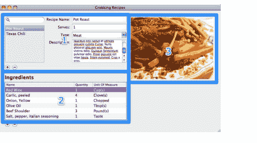

图 2.1：我们的食谱应用程序

### 2.2 我们的应用程序设计

在本章中，我们将从零开始。你将启动 Xcode，并按照所有步骤创建应用程序，使其达到可用的状态。在本章结束时，你可能会惊讶地发现，创建我们的应用程序所需的步骤竟如此之少。这正是 Cocoa 开发的魅力与优势所在，而与 Core Data 结合后，更是如此。

在我们的食谱应用程序的第一个版本中，我们将为未来的用户提供以下能力：

- 能够添加包含描述、类型、名称、图片和用餐人数的食谱
- 能够为这些食谱添加食材，食材包括名称、数量、类型和计量单位

这个应用程序的第一版特意设计得很简单。这既是为了我们后续能够为其添加功能，从而探索 Core Data 的某些能力，也是为了在探索 Core Data 时将干扰降到最低。

### 2.3 进阶读者

如果你已经对 Core Data 以及构建 Core Data 应用程序有些熟悉，请直接快速浏览本章其余内容即可。在本章中，我们将过一遍项目的构建过程，并讲解如何建立数据模型。最终得到的数据模型将如图 2.4（第 21 页）所示。


### 2.4 创建我们的 Xcode 项目

第一步是创建我们的 Xcode 项目。在最近几个版本的 Xcode 中，有相当多的项目模板可供使用，其中不止一个基于 Core Data。如果你使用的是 Leopard，那么应该使用“Core Data Application”模板；如果你使用的是 Snow Leopard，则应该选择“Cocoa Application”模板，并确保选中“Use Core Data for storage”复选框。

选定模板后，我们将项目命名为 Grokking Recipes，这也将是我们应用程序的名称。¹ 在 Xcode 的“Groups & Files”列表中，你会看到一个名为“Models”的额外文件夹，其中包含数据模型文件（参见下一页的图 2.2）。

基础的 Core Data 模板为我们提供了一个运行起来有点像通讯录（Address Book）的应用程序。在通讯录中，用户只有一个数据文件，通常通过一个窗口访问该数据文件。我们的食谱应用程序也将围绕同样的模式来设计。我们将只使用一个数据文件，所有用户的食谱都存储在其中。

项目在 Xcode 中创建完成后，就可以开始构建我们应用程序中的 Core Data 部分了。

### 2.5 构建数据模型

Core Data 应用程序类似于数据库驱动的应用程序，因此我们将先构建数据结构，然后再转向用户界面。在这一步，我们将打交道的三个组件是实体（entities）、属性（attributes）和关系（relationships）。

在我们的设计中（参见前一页的 2.2 节“我们的应用程序设计”），我们已经描述了至少两个数据对象，它们

1. 尽管以后可以更改。


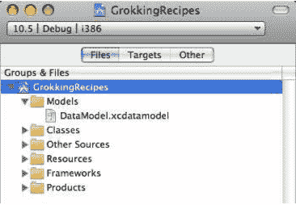

图 2.2：Xcode 中的数据模型

想要使用，并且至少需要其中一些属性。因此，我们将从它们开始。在我们的 Xcode 项目中，有一个名为 Models 的组，该组内有一个名为 DataModel.xcdatamodeld 的文件。² 该文件表示 Core Data 将使用的数据结构。该文件与实体-关系图（ERD）有很多相似之处，不同之处在于 Xcode 会将其直接编译到我们最终的数据文件结构中。

#### 向模型添加实体

在 Core Data 中，实体与普通数据库设计中的表有很多相似之处。尽管这种相似性并不完全准确，但作为起点很合适。

要向数据模型添加第一个实体，首先在 Models 组中打开 .xcdatamodeld 文件，然后从菜单栏中选择 Design > Data Model > Add Entity（或使用左上角条目区域中的 + 按钮）。这将向我们的数据模型添加一个空白实体。接下来，双击该实体的名称，并将其重命名为 Recipe。

2. 根据你使用的 Xcode 版本，此文件可能命名为 ${PROJECT_NAME}_DataModel.xcdatamodeld。

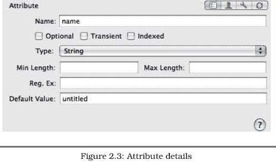

#### 添加属性特性

正如实体与表有很多相似之处，属性也与表中的列有不少相似之处。当我们开始添加关系时，这种相似性很快就不成立了，但在开始时这样理解会有帮助。属性进一步分为几个子类型；最相关的两个是属性（attributes）和关系（relationships）。关系特性描述两个实体之间的关系，而属性特性是实体的值。

要向 Recipe 实体添加第一个属性特性，请选择该实体，然后从菜单栏中选择 Design > Data Model > Add Attribute；你也可以使用顶部的 + 按钮或键盘快捷键。与创建实体类似，这将在我们的实体中创建一个新的属性特性。双击此属性的名称，并将其重命名为 name。重命名该属性后，选中它以查看其详细信息，如图 2.3 所示。

这些详细信息允许我们控制该属性的多个方面，包括默认值、它是什么类型的属性，以及它是否为瞬态、索引、可选等。稍后我们将更详细地介绍所有这些设置，因此现在将类型设置为 String，将默认值设置为 untitled，并确保它不是可选的。

完成第一个属性后，向 Recipe 对象添加以下属性：

- 将 imagePath 设置为可选 String，且无默认值。
- 将 desc 设置为可选 String，且无默认值。
- 将 serves 设置为 Integer 16，最小值为 1，默认值为 1。确保将其标记为非可选。
- 将 type 设置为可选 String，默认值为 Meat。

#### 创建第二个实体

Recipe 实体已接近完成，现在是时候创建第二个实体了。第二个实体将存储食谱中的配料，我们将其称为 RecipeIngredient。按照相同的步骤，我们可以添加以下属性：

- 将 name 设置为非可选 String，默认值为 untitled。
- 将 quantity 设置为非可选 Integer 16，最小值为 0，默认值为 1。
- 将 unitOfMeasure 设置为非可选 String，默认值为 untitled。

#### 添加关系特性

关系特性的创建方式与属性特性相同，尽管具体细节自然有所不同。通过从菜单栏中选择 Design > Data Model > Add Relationship，向 Recipe 实体添加一个关系。对于第一个关系，将其命名为 ingredients，并将其标记为可选。

然而，关系与属性的不同之处在于其特性。我们不是定义对象类型、默认值等，而是定义目标实体、反向关系，以及此关系是否为“对多”。对于此关系，我们将先将其命名为 ingredients，然后将目标实体设置为 RecipeIngredient，但暂时不设置反向关系。我们还会将其标记为对多，因为一个食谱肯定可以有多个配料。

最后一个选项是删除规则，它指示 Core Data 在删除此 Recipe 实体时如何处理该关系。在此关系中，我们将删除 RecipeIngredient 对象，以避免出现任何断开连接的对象。因此，我们将选择级联（cascade）选项，当 Recipe 实体被删除时，它会移除所有关联的 RecipeIngredient 对象。

#### Joe 问……

**什么是一对多？**

一对多是数据库术语，用于描述数据库中两个表之间的关系。通常有三种关系：一对一、一对多和多对多。一对一关系意味着，对于第一张表中的每条记录，第二张表中最多只能有一条记录。在一对多关系中，对于第一张表中的每条记录，第二张表中可以有多条记录。最后一种关系类型是多对多，意味着对于第一张表中的任意记录，第二张表中可以有任意数量的记录；同样，对于第二张表中的每条记录，第一张表中也可以有任意数量的记录。

#### 完成关系

Core Data 的开发者经常重复的一条规则是：数据库中的每个关系都应该有一个反向关系。尽管这对数据来说可能没有逻辑意义，但它对 Core Data 中的数据完整性很重要。从编程的角度来看，这意味着我们需要能够从关系的任一侧引用关系中的每个对象。Apple 出于许多原因推荐这种反向关系，本书将更详细地讨论这些原因。

要设置反向关系，我们选择 RecipeIngredient 实体，并像之前对 Recipe 实体所做的那样，向其添加一个 Relationship 特性。这个新的 Relationship 特性命名为 recipe，目标实体为 Recipe。接下来，我们将反向关系设置为 ingredients，即我们在 Recipe 实体中设置的关系名称。一旦我们在 RecipeIngredient 上设置反向关系，关系的图形视图就会改变。连接对象的线会从两条变为一条，这使得图形视图对于调试关系设置非常有用。在当前设计中，一个配料只能有一个食谱；因此，我们不选中对多选项。最后，我们将删除规则设置为置空（Nullify）。当删除 RecipeIngredient 对象时，此设置不会删除 Recipe 实体，而只会断开两者之间的连接。

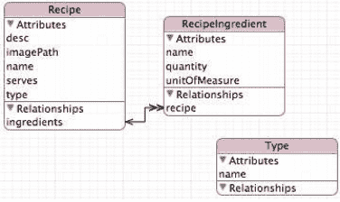

图 2.4：托管对象模型（MOM）

#### 添加最后一个实体

在这个版本的食谱应用中，我们还有一个实体要添加。我们将对添加的食谱进行分类。例如，我们会将甜点与开胃菜等分开。为了保持这些类别一致，我们将实际类别名称存储在它们自己的对象中。因此，向我们的模型中再添加一个名为 Type 的实体。此实体只有一个属性特性，名为 name，它是非可选字符串且无默认值。最后，此实体没有关系，因为它仅用作查找表，以填充第 27 页第 2.7 节“添加食谱详情”中讨论的 type NSComboBox。

添加完最后一个实体后，我们的应用程序数据模型构建就完成了。最终结果应类似于图 2.4。

#### 构建数据对象

在其他语言中，甚至在不使用 Core Data 的 Cocoa 应用程序中，下一步通常是构建与“数据库”中的“表”相关联的数据对象。幸运的是，我们使用的是 Core Data，没有需要构建的数据对象。作为 Core Data 的一部分，定义数据模型也为我们定义了基础数据对象。如果需要对对象进行自定义管理，我们可以从这些对象扩展，但此时基础数据对象（称为 NSManagedObject）已经完全满足我们的需求。


### 2.6 构建控制器层

从你开发 Cocoa 应用的经验中你会知道，Interface Builder 是任何项目中非常重要的一部分。既然我们已经构建了数据模型，并且在 Xcode 中准备好了模板，现在该组装用户界面了。

在进入 Interface Builder 的乐趣之前，我应该先说明两点：

- 这不会是 Delicious Library。我们的应用将使用标准控件，以帮助将非 Core Data 代码保持在最低限度。
- 我们*本来可以*为这个应用添加*很多*功能，但我们不会这么做。那些功能虽然有用，却会分散我们的注意力。

#### 向 xib 添加对象

我们将要处理的用户界面的第一部分是 xib 文件中的对象。与大多数应用一样，我们需要将 AppDelegate 添加到 xib，这样它既会在启动时被实例化，也会被正确地链接到应用本身中。

#### 添加 AppDelegate

打开 MainMenu.xib 后，取决于 Xcode 中模板的随意设定，AppDelegate 可能已经在 xib 文件里了。如果在，那太好了！继续下一节。如果不在，那么我们需要添加它。[^3]

要将 AppDelegate 添加到 xib 文件，请按照以下步骤操作：

1. 在库面板中找到 `NSObject`，并将其拖到 xib 的窗口中。
2. 单击 `NSObject` 的名称，当它变为可编辑状态时，将其改为 `AppDelegate`。
3. 转到检查器面板中的 Identity 标签，并将该对象的类从 `NSObject` 改为 `AppDelegate`。
4. 从应用右键拖动到 `AppDelegate` 对象，然后选择 `Delegate`。

[^3]: 请注意，根据你所运行的 Xcode 版本，应用委托的名称前面可能会加上应用名称。如果是这样，请在该上下文中用该名称替换任何对 AppDelegate 的引用。

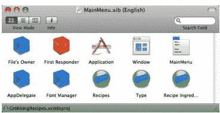

图 2.5：主菜单 xib

完成这些后，我们的应用启动时就会实例化 `AppDelegate` 类，并且应用会将所有委托消息发送给它。

#### 添加 NSArrayController 对象

我们的应用将在一个窗口中显示所有食谱。为此，我们需要能够引用这些数据，以便将其显示出来。因此，向我们的 xib 中添加三个引用该数据的 `NSArrayController` 对象。然后我们的窗口将引用这些 `NSArrayController` 对象。添加并配置好这些 `NSArrayController` 对象后，xib 将如图 2.5 所示。

要为食谱实体添加一个 `NSArrayController`，请按照以下步骤操作：

1. 在库中找到 `NSArrayController` 对象，并将其拖到 xib 文件中。
2. 单击 `NSArrayController` 的名称，当它变为可编辑状态时，将其重命名为 `Recipes`。如果你无法让该元素进入编辑模式，可以在 Interface Builder 的 Identity 检查器中更改名称，并修改 identity Name 字段。
3. 在检查器的 Attributes 标签中，将模式从 Class 改为 Entity，并将实体名称改为 Recipe。
4. 确保选中 Prepares Content 标志。

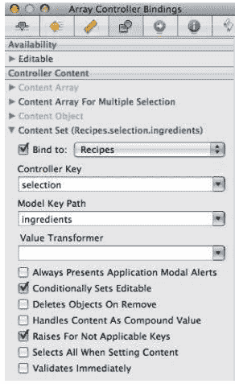

图 2.6：NSArrayController 内容集属性

5. 在检查器的 Bindings 标签中，将 ManagedObjectContext 绑定到 AppDelegate，并将模型键路径设为 managedObjectContext。

现在我们已经构建好食谱的 NSArrayController，还需要配置另外两个：食谱配料和类型。类型 NSArrayController 遵循与 Recipe 实体相同的步骤，但我们需要将实体名称设为 Type，以便它会由 Type 对象填充。除了这一处不同之外，我们可以按照前面的步骤完成类型的 NSArrayController。

将最后一个 NSArrayController（即食谱配料的 NSArrayController）的 identity 设为 RecipeIngredient。在 Attributes 检查器中，选择 Entity，并将实体名称设为 RecipeIngredient。像之前一样设置绑定，但需要额外做一处更改。在检查器的 Bindings 标签中，启用 Controller Content 中的 Content Set，并将其指向食谱的 NSArrayController，控制器键设为 selection，模型键路径设为 ingredients。参见图 2.6。

现在我们可以构建 NSWindow 本身了。

### 2.7 构建用户界面

现在我们已经正确引用了所有数据对象，是时候构建用户界面了。虽然这个界面短期内肯定不会赢得任何 ADAs[^4]，但它将允许我们查看和编辑模型中的所有数据对象。我们要构建的窗口将如图 2.7 所示，我们将快速走一遍设置步骤，并在第 3 章《Core Data 与绑定》中更详细地回顾我们所做的事情。

[^4]: Apple Design Awards（苹果设计奖）

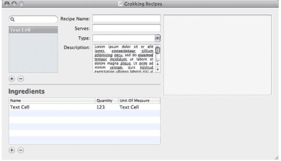

图 2.7：主窗口

#### 构建食谱源列表

我们正在构建的这个界面的第一部分位于左上角、搜索字段正下方。这个视图是一个 NSTableView，配置为一列、无水平滚动条、自动显示垂直滚动条，并将高亮设为 Source List。滚动条在 NSScrollView 的检查器中配置。列数和高亮选项在 NSTableView 检查器中配置。可以通过按住 Control+Shift 单击（或按住 Shift 右键单击）NSTableView，并从列表中选择相应的视图来访问这些检查器。如果检查器不在屏幕上，可以从 Tools > Inspector 菜单项中显示它。

不过，要将这个表格绑定到我们食谱的 NSArrayController 对象，我们需要再深入一点，获取 NSTableColumn，以便告诉该列要显示什么。我们可以在表格视图中不断单击，直到最终（理想情况下）选中 NSTableColumn，但幸运的是，有一种更简单的方法。如果我们按住 Shift 右键单击表格，就会弹出一个列出所有视图的菜单，从而让我们可以轻松选择 NSTableColumn（参见图 2.8）。选中 NSTableColumn 后，我们现在可以在检查器中打开它的 Bindings 标签，并将其 value 绑定到 Recipes NSArrayController，控制器键设为 arrangedObjects，模型键路径设为 name。设置完成后，我们的 Recipe 实体就会显示在这个表格中。更重要的是，当我们在此列表中单击某个食谱时，该食谱将成为选择项，为 UI 的其余部分提供数据。

接下来，我们需要添加用于控制 Recipe 实体创建和删除的按钮。为此，我们从 Library 中拖出一个 NSButton（哪个都可以），并将其放在 Recipe 表格视图下方。然后在按钮的 Attributes 标签中，将其图像设为 NSAddTemplate（一个可供我们使用的系统级图像），将其样式改为 Round Rect，并移除它的标题（如果有）。完成后，我们需要选择菜单项 Layout > Size to Fit，让按钮获得合适的尺寸。为添加按钮完成这些后，从主菜单中选择 Edit > Duplicate 创建第二个按钮，并将第二个按钮的图像改为 NSRemoveTemplate。

接下来，我们可以“连接” NSTableView 下方的按钮，并将它们直接连接到食谱的 NSArrayController。添加按钮将连接到 `-add:` 动作，移除按钮将连接到 Recipes NSArrayController 上的 `-remove:` 动作。可以通过按住 Control 键、单击按钮，并从选择器的已发送动作拖到 NSArrayController 来将这些按钮连接到它们的动作。完成这些小改动后，我们现在就可以随意添加和移除 Recipe 实体了。

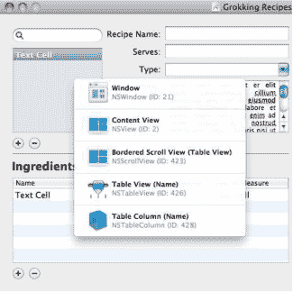

图 2.8：列表视图树

#### 添加食谱详细信息

源列表已经就位，现在该添加食谱的详细信息了。这些详细信息，具体来说是名称、份数、描述和类型，将绑定到食谱 NSArrayController 上现在有效的 selection 控制器键。这样，当用户在列表中单击时，该食谱的相关详细信息就会被选中。

前两个是文本字段，第三个是文本区域，第四个是组合框，如图 2.7 所示。除了用于类型的组合框之外，所有这些详细信息都以相同方式配置。它们都将自己的 Value 绑定关联到食谱的 NSArrayController 对象，控制器键为 selection，模型键路径则相应地设为 name、serves 和 description。关于文本区域的一个提示是：务必关闭 Rich Text 设置。开启此设置后，该字段期望的是 NSAttributedString 而不是 NSString，并且可能会有点


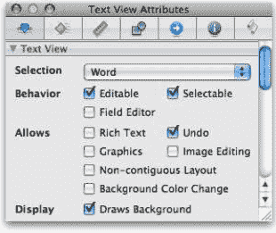

图2.9：记得关闭富文本设置。

令人困惑（见图2.9）。此外，为了成为规范的公民，我们应该将一个 NSNumberFormatter 拖到 Serves 文本字段上，并将其配置为只允许整数。

组合框稍微复杂一些。虽然它也与选中的食谱相关联，但我们需要用值填充整个列表。目前，我们将在 Interface Builder 中手动为该框输入可能的值，如下一页的图2.10所示。接下来，我们需要将其当前值绑定到选中的食谱。我们通过将 NSComboBox 的 value 绑定到当前选中食谱的 type 值来实现。在 NSComboBox 的 Bindings 选项卡上，打开 Value 部分，将其绑定到 NSArrayController，并将 controller key 设置为 selection，将 model key path 设置为 type。稍后，在第4.4节“NSManagedObjectContext”（第64页）中，我们将展示如何直接将该列表预填充到 Core Data 持久化存储中。

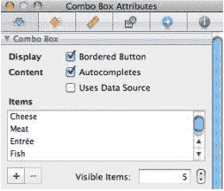

图2.10：组合框的手动数据输入

#### 添加配料

现在我们的 UI 的食谱部分已经完成，是时候添加配料了。这就是窗口左下角看到的表格。幸运的是，这部分与设置食谱源列表几乎相同。然而，与食谱源列表不同，我们的 `NSTableView` 将有三列，显示其表头和垂直滚动条，但隐藏水平滚动条。输入列标题为名称、数量和计量单位。

与食谱源列表一样，使用 controller key `arrangedObjects` 和适当的 model key path：`name`、`quantity` 和 `unitOfMeasure`，将 `NSTableView` 中每一列的值绑定到我们食谱配料的 `NSArrayController`。数量列（或更具体地说，数量列中的表格单元格）还应分配一个 `NSNumberFormatter`，以便根据其持有的值正确格式化数量。配置完成后，我们就可以看到所选食谱的配料。记住，我们已将食谱配料的 `NSArrayController` 配置为从所选食谱获取数据，因此此时无需做任何额外的事情。

与食谱源列表一样，添加和移除按钮分别通过将它们绑定到食谱配料的 `NSArrayController` 对象的 `-add:` 和 `-remove:` 方法来配置。至此，我们的配料部分已完成，UI 也接近完成。

### 2.8 添加一些代码

想知道代码在哪里吗？就目前而言，我们的食谱应用程序已经完全可用。我们无需任何实际代码即可运行它，在

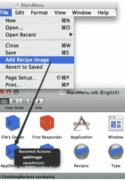

图2.11：Add Recipe Image 菜单项

一旦食谱的 NSArrayController 已添加到 AppDelegate 头文件中，我们需要短暂回到 Interface Builder，并从 AppDelegate 按住 Control 键拖拽到食谱的 NSArrayController 以完成绑定。

在这里，我们还需要向 File 菜单添加一个菜单项。我们通过确保 MainMenu 元素在 Interface Builder 中打开（它将显示为浮动菜单）并点击其 File 菜单来完成。从那里，我们可以添加一个新的 NSMenuItem，或使用一个已经存在但未被使用的菜单项。由于 Save As 菜单项与我们的应用程序无关，请继续将其重命名为 Add Recipe Image。重命名后，从它按住 Control 键拖拽到 AppDelegate，并将菜单项绑定到我们在头文件中定义的 IBAction，如图2.11所示。绑定就位后，就该实现 `-addImage:` 方法了。

```objective-c
- (IBAction)addImage:(id)sender
{
    id recipe = [[recipeArrayController selectedObjects] lastObject];
    if (!recipe) return;

    NSOpenPanel *openPanel = [NSOpenPanel openPanel];

    [openPanel setCanChooseDirectories:NO];
    [openPanel setCanChooseFiles:YES];
    [openPanel setAllowsMultipleSelection:NO];

    SEL select = @selector(addImageSheetDidEnd:returnCode:contextInfo:);
    [openPanel beginSheetForDirectory:nil
                                 file:nil
                      modalForWindow:window
                       modalDelegate:self
                      didEndSelector:select
                         contextInfo:recipe];
}
```

`-addImage:` 的实现将显示一个 NSOpenPanel，它将作为 sheet 附加到窗口，使其对窗口模态。接下来，我们对 NSOpenPanel 稍作调整，使其无法选择目录、多个文件或创建目录。你还会注意到，我们在打开面板之前先检查以确保已选择食谱。一点点错误检查可以发挥很大作用。

由于 sheet 是异步工作的，我们需要给它一个回调，指向 AppDelegate 中的另一个方法。此外，在启动 sheet 时，我们将传递当前食谱引用。当 sheet 回调时，我们保证仍然在谈论与开始时相同的食谱。

```objective-c
- (void)addImageSheetDidEnd:(NSOpenPanel *)openPanel
                 returnCode:(NSInteger)returnCode
                contextInfo:(NSManagedObject *)recipe
{
    if (returnCode == NSCancelButton) return;
    NSString *path = [openPanel filename];

    // Build the path we want the file to be at
    NSString *destPath = [self applicationSupportFolder];
    NSString *guid = [[NSProcessInfo processInfo] globallyUniqueString];
    destPath = [destPath stringByAppendingPathComponent:guid];
    NSError *error = nil;
}
```

## 第 3 章：Core Data 与绑定

Cocoa 绑定为 Core Data 提供了大量幕后魔法。Cocoa 绑定由许多 API 和概念组成，它们共同允许我们使用模型-视图-控制器范式开发应用程序，而不需要三者紧密耦合。

Cocoa 绑定允许我们设计视图、控制器和模型，它们都期望特定格式的数据，而不需要将它们绑定到特定类。这意味着我们可以在多个地方使用视图，并替换控制器甚至模型，而无需大量（如果有的话）重新编码。

在本章中，我们将研究 Cocoa 绑定的一些关键组件，然后深入探讨 Core Data 如何与这些绑定一起工作的细节。我们要研究的两个主要 API 是键值编码和键值观察。在这两个 API 之间，我们的设计获得了极大的灵活性。此外，这些 API 是允许 Interface Builder 运行的基础的一部分，并允许我们专注于应用程序的业务逻辑。最后，Core Data 大量使用这些 API，使我们能够专注于应用程序的业务逻辑，而不是数据层。

### 3.1 键值编码

Cocoa 绑定的基石之一是键值编码（KVC）。键值编码是一种访问对象属性的方法，而无需直接调用该对象的访问器。键值编码通过 NSObject 本身上的一个非正式协议实现，主要通过 getter/setter 对 -valueForKey: 和 -setValue:forKey: 使用。

并将 name 作为一个已定义的实例变量。这将告诉编译器该 ivar 存在或将存在 getter 和 setter 访问器。在 64 位应用程序中，ivar 本身不是必需的，因为属性定义也为我们处理了这一点。例如，如果我们有一个具有以下头文件的对象：

```objc
@interface MyObject : NSObject
{
    NSString *myString;
}

@property (retain) NSString *myString;
@end
```

Xcode 会将其解释为与以下头文件相同：

```objc
@interface MyObject : NSObject
{
    NSString *myString;
}

- (NSString*)myString;
- (void)setMyString:(NSString*)string;

@end
```

结合 @property 关键字，我们还有 @synthesize 和 @dynamic 关键字用于实现文件。@synthesize 将生成 @property 在头文件中暗示的实际访问器。因此，在我们的示例 MyObject.m 文件中，我们可以声明以下内容：

```objc
#import "MyObject.h"

@implementation MyObject

@synthesize myString;

@end
```

并获得与此相同的有效代码：

```objc
#import "MyObject.h"

@implementation MyObject

- (NSString*)myString
{
    return myString;
}

@end
```


```objc
- (void)setMyString:(NSString *)string
{
    @synchronized(self) {
        if ([string isEqualToString:myString]) return;
        [myString release];
        myString = [string retain];
    }
}

@end
```

setter 中的 retain 是由编译器添加的，因为我们在属性中指定了它。如果我们改为将其设置为 assign，那么就不会发生 retain。同样，加锁代码是一个默认选项，我们可以通过向属性定义添加 nonatomic 选项来关闭它。

在对象上处理多个属性时，这可以大大节省时间。也有迹象表明，编译器生成的访问器比开发者编写的“普通”访问器更快。除了生成访问器之外，@synthesize 关键字对它所实现的内容也很智能。如果我们需要为某个属性实现自己的 setter，那么它不会覆盖该 setter。

除了 @synthesize 属性之外，我们还有 @dynamic 属性。与为我们生成访问器的 @synthesize 不同，@dynamic 告诉编译器：虽然该属性的访问器在编译时不存在，但它们会在运行时存在，因此不要为它们生成警告。@synthesize 和 @dynamic 是类似的关键字。对于每个属性，我们可以使用其中一个，但不能同时使用两者。³ 如果访问器方法将在运行时实现，我们会使用 @dynamic 属性而不是 @synthesize 属性，这样编译器就不会产生警告。这对 Core Data 子类特别有用；我们将在第4章《Core Data 内幕》第51页讨论这一点。

需要注意的是，@property 定义可以不与实例变量（ivar）的名称匹配。例如，实例变量以下划线开头，而访问器不包含该下划线，这是相当常见的。@property 也可以作为 @synthesize 和 @dynamic 调用的一部分来处理这一点。

³ 然而，在我们自己实现访问器的情况下，两者都不是必需的。

```objc
@interface MyObject : NSObject
{
    NSString *_myString;
}

@property (retain) NSString *myString;

@end

@implementation MyObject

@synthesize myString = _myString;

@end
```

### 3.2 键值观察（Key Value Observing）

键值观察（Key Value Observing，KVO）是与 KVC 对应的姊妹 API。KVO 允许我们在某个属性发生变化时请求通知。通过观察对象上的属性，我们可以在这些属性发生变化时做出反应。KVO 也是通过 `NSObject` 上的非正式协议实现的，你使用 `-addObserver:forKeyPath:options:context:` 和 `-removeObserver:forKeyPath:` 来注册和移除观察者。尽管与 KVC 一样，该协议还涉及其他方法，但这两个是主要使用的方法。

如果我们想观察某个食谱上的 name 值，我们会将自己（或另一个对象）添加为该值的观察者，如下所示：

```objc
static NSString *kPragProgObserver = @"PragProgObserver";
id myRecipe = ...;
[myRecipe addObserver:self
        forKeyPath:@"name"
           options:(NSKeyValueObservingOptionNew|NSKeyValueObservingOptionOld)
           context:kPragProgObserver];
```

这段代码所做的是将 self 作为观察者添加到 `myRecipe` 对象，并请求当 name 值发生变化时通知 self 该变化，并在该通知中包含旧值和新值。我们传入一个上下文，以便确保只处理针对我们的观察通知，并且这些通知不会被意外截获。调用这段代码之后，只要该 `Recipe` 实例上的 name 属性发生变化，就会在 self 上调用 `-observeValueForKeyPath:ofObject:change:context:`。

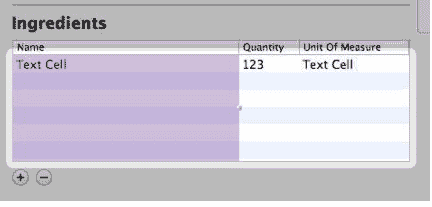

图 3.1：分别选择每个 NSTableColumn。

#### NSTableView

在我们的食谱应用中，我们大量使用 *NSTableView*。在应用的主窗口中，我们有两个表格视图，一个列出所有食谱，另一个列出这些食谱的配料。每当应用需要显示项目列表或数据网格时，*NSTableView* 就是要使用的元素。

*NSTableView* 与 *NSOutlineView*（如第3.4节 *NSOutlineView* 第46页所述）一样，与 Core Data 配合得非常好。当 *NSTableView* 由提供数据的 *NSArrayController* 支持时，尤其如此。不过，如果适合当前问题，也可以将 *NSTableView* 与自定义数据源一起使用。然而，当与 *NSArrayController* 绑定时，就可以借助其他对象来操作 *NSTableView*，例如稍后讨论的 *NSSearchView*，从而构建出集成流畅并提供出色用户体验的界面。

在 *NSTableView* 中，与 *NSOutlineView* 一样，我们实际上不会将表格本身绑定到 *NSArrayController*。相反，我们会分别选择每一列，并将其绑定到 *NSArrayController* 中对象的某个属性（见图 3.1）。正如我们在第2章 *Core Data 入门*（第14页）中所做的那样，我们将列绑定到 *arrangedObjects* 控制器键，并将模型键路径绑定到我们希望在该列中显示的值，如下图所示（图 3.2，见下页）。

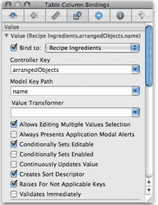

图 3.2：将表格列绑定到 Core Data 属性。

通过这种配置，NSTableView 将自动显示来自 NSArrayController 的数据，并且借助 KVO，它会与持久化层中存储的数据保持同步。

#### NSArrayController

在使用 Core Data 时，NSArrayController 是极其有用的对象，因为它了解 Core Data 层，并且知道如何与之通信，而我们无需编写任何额外代码。当我们在 Interface Builder 中配置它时，真正需要提供给它的只是 NSManagedObjectContext 和一种数据对象类型。其余工作——检索对象、更新对象以及创建新对象——都会替我们处理。

在与 Core Data 配合时，NSArrayController 也理解对象之间的关系。在我们的食谱应用中，有一个 NSArrayController 被配置为管理 RecipeIngredient 对象。根据我们的数据模型，这些是绑定到特定食谱的子对象。由于 NSArrayController 理解这些关系，我们可以将其配置为仅拉取并显示那些与另一个 NSArrayController 中选中的 Recipe 对象相关联的 RecipeIngredient 对象。这同样是借助 KVC 和 KVO 实现的。当我们配置 RecipeIngredient 的 NSArrayController 以仅提供与特定食谱相关的那些配料时，它在幕后所做的是访问 Recipe 对象，并通过 KVC 请求其 ingredients 属性。在 RecipeIngredient 的 NSArrayController 中，我们绑定 NSManagedObjectContext，以便可以添加新配料。除了能够正确地在持久化层中创建（和移除）对象之外，NSArrayController 还会管理新建或移除的 RecipeIngredient 与父 Recipe 对象之间的关系。

所有这些之所以可行，是因为 Core Data 就是整个持久化层，并且无论处理的是什么对象，都以一致的方式访问它。由于 Core Data 使用 KVO 和 KVC，我们的控制器对象除了对象的名称及其存储位置之外，不需要对对象了解太多。其余一切都会根据我们在 Interface Builder 中提供的设置在运行时解析。在我们的食谱应用中，有一个 NSArrayController 绑定到 Core Data 中的 Recipe 实体。由于我们还把该 NSArrayController 绑定到我们的 NSManagedObjectContext，它能够自动检索那些 Recipe 实体，并将它们提供给用户界面的其他部分使用。当我们的界面加载时，那些 NSArrayController 对象会访问该 NSManagedObjectContext，并请求当前存在的实体。一旦它们被加载到 NSArrayController 对象中，任何与它们关联的视图元素都会通过 KVO 收到通知：数据已可供显示。所有这些都在幕后发生，无需我们为此编写任何代码。

#### NSFormatter

用户期望界面中的字段能够接受其输入并对其进行适当格式化。这正是 NSFormatter 对象发挥作用的地方。在处理任何类型的数字时，最好添加一个 NSNumberFormatter


到文本字段或表格列，并定义其显示方式。同样，处理日期时，在字段或列上使用 NSDateFormatter，以确保数据在存储到 Core Data 存储库之前被正确格式化和验证。使用 Core Data 时，有时需要同时处理数据的显示，以便既能验证用户输入，又能以可用的形式显示数据。例如，将货币显示为 3.99 而不是 $3.99，或者以原始秒数显示日期，并不是很好的用户体验。

在我们的应用程序中，我们使用 NSNumberFormatter 在第二个 NSTableView 的配料列中显示数量。如果我们要向应用程序添加购物清单，我们还会使用 NSNumberFormatter 对象来显示货币，并使用 NSDateFormatter 对象来显示日期和时间信息。

要向字段（列或文本字段）添加 NSFormatter，请在库面板中选择它，并将其拖到界面元素上。放置到位后，你可以在属性检查器中配置其详细信息，如下一页的图 3.3 所示。属性检查器允许你精确配置数据呈现给用户的方式。

除了正确显示数字和日期数据外，NSFormatter 类还会接受用户输入，并以正确的格式将其发送回模型。例如，通过将 NSNumberFormatter 应用于配料表的数量列，我们可以保证从用户界面收到一个 NSNumber。

一旦将 NSFormatter 应用于某个对象，再次引用它以进行修改可能会有点棘手。要在应用 NSFormatter 后更改或移除它，你可以选择该用户界面元素，其下方会出现一个小双括号图标。选择该图标将再次引用 NSFormatter，以便对其进行操作。参见第 46 页的图 3.4。

### 3.4 使用 KVO、KVC 和 Core Data 的其他界面元素

尽管前面的列表展示了我们如何在食谱应用程序中使用 KVO 和 KVC 访问 Core Data 存储库，但我们应该快速回顾一下其他元素；如果我们愿意或需要，也可以利用这些元素来显示应用程序中的数据。

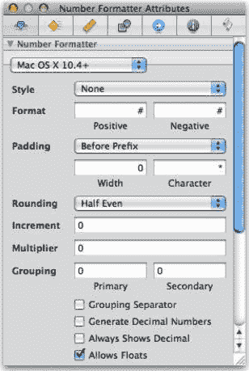

图 3.3：NSNumberFormatter 属性检查器

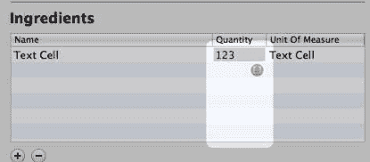

图 3.4：访问元素上现有的 NSFormatter

#### NSObjectController

NSObjectController 与前面讨论的 NSArrayController 有很多相似之处。然而，与 NSArrayController 不同，NSObjectController 旨在表示一个实例，而不是一组实例。NSObjectController 的一个常见用法是表示 NSArrayController 的选中对象，从而更清楚地表明绑定到 NSObjectController（而不是 NSArrayController）的界面元素中显示的是什么数据。另一个常见用法是让整个界面（例如详情面板或子窗口）绑定到 NSObjectController 中的值，然后由 File’s Owner 引用并填充该 NSObjectController。在这种设计中，File’s Owner（通常是 NSWindowController 的子类）只需通过调用 -setContent: 来填充 NSObjectController，整个 UI 就会自动填充。这再次使代码维护变得非常容易，并提高了可读性。

#### NSOutlineView

如果我们想改变应用程序的外观，可以显示单个 NSOutlineView，而不是当前的两个表格视图。使用 NSOutlineView，我们可以显示一个食谱列表，并在其下列出层级化的配料，如下一页的图 3.5 所示。

NSOutlineView 与 NSTableView 对象有很多共同之处。事实上，它是 NSTableView 的子类。主要区别在于，NSOutlineView 既以列格式显示数据，也以层级格式显示数据。这改变了数据需要表示和访问的方式。NSOutlineView 期望数据采用树形结构，而不是扁平的对象数组。幸运的是，有一个专门为此用途设计的控制器：NSTreeController。在使用 Core Data 和 NSOutlineView 时需要注意一些事项。一般来说，NSOutlineView 和 NSTreeController 期望数据处于相当有组织的状态。NSTreeController 期望每个父级（或分支）都能通过相同的方法访问子级。这与为对象之间的关系使用描述性名称有点反直觉，我通常会实现访问器，而不是让关系变得通用。例如，如果我们有一个食谱，其子级名为 RecipeIngredients，我会为该关系添加另一个名为 children 的访问器，纯粹供 NSOutlineView 使用。我们将在下一章讨论自定义 NSManagedObject 类。

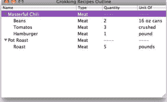

图 3.5：食谱的大纲视图

与其父对象 NSTableView 不同，NSOutlineView 并不像你可能期望的那样工作得那么干净利落。你可以将它和 NSTreeController 结合使用，但通过为 NSOutlineView 实现数据源协议而不是使用 NSTreeController 对象，你可以获得更多的功能和更强的控制力。由于在最近几个 OS X 版本中我们看到了 NSTreeController 的持续改进，我怀疑这

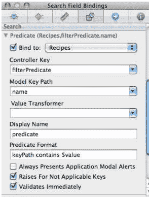

图 3.7：NSSearchField 绑定

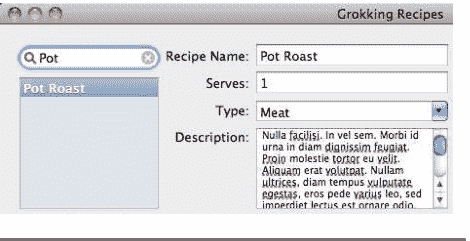

图 3.8：针对食谱列表运行搜索过滤器

## Core Data 内部机制

我们对 Core Data 的细节了解得越多，就越有能力理解何时出了问题，或者如何完成偏离常规的任务。

在我使用各种语言处理并编写持久化层的经验中，我一直惊叹于 Core Data API 是如此简单而优雅。Core Data 各个组件之间的功能重叠非常少——没有浪费空间或不必要的冗余。由于 Core Data 构建在 Objective-C 和 Core Foundation 的基础设施之上，它并不试图重复整体 API 其他部分已经存在的功能，而是充分利用这些功能。

在本章中，我们将逐一介绍构成 Core Data 的各个部分，并探讨它们如何适用于我们使用 Core Data 的方式，以及它们如何适用于本书中正在开发的应用程序。到本章结束时，我们将更牢固地掌握 Core Data 是什么、可以用它做什么，以及如何充分发挥它的能力。

Core Data API，或者通常所说的*栈*（stack），由三个主要部分组成：`NSPersistentStoreCoordinator`、`NSManagedObjectModel` 和 `NSManagedObjectContext`。它们协同工作，使程序能够检索和存储 `NSManagedObject` 对象。在大多数情况下，程序只会在栈创建完成后访问 `NSManagedObjectContext`。访问栈的其他组件是可能的，但很少有必要。

> **Joe 问……**
>
> ### 什么是栈？
>
> *栈*（stack）一词根据上下文有几种不同含义。在此上下文中，它指的是以垂直方式传递数据的多层结构。这里的“垂直”是指从顶层进入，向下到达最后一层或底层。数据永远不会直接传递到底层或任何中间层；它总是从顶层访问。

### 4.1 NSManagedObject

NSManagedObject 是我们在 Core Data 应用程序中打交道最多的对象。每个 NSManagedObject 实例代表 Core Data 存储库中的一个实体。通过将 Core Data 与 KVC 和 KVO 结合，这一个对象可以动态表示我们需要的、且可在数据模型中定义的任何对象。

数据模型中定义的所有属性和关系都可用，并且很容易直接从 NSManagedObject 访问。无需对其进行子类化，我们就可以通过以下方式访问与 NSManagedObject 关联的值。

#### 访问属性

属性是最容易访问的。通过利用 KVC，我们可以直接在 NSManagedObject 上获取或设置任何属性。你可能已经注意到，我们在上一章中没有编写 Recipe 实体。在应用程序的当前阶段，NSManagedObject 提供了我们所需的所有功能。例如，我们可以如下获取名称：

```objective-c
NSManagedObject *recipe = ...;
NSString *name = [recipe valueForKey:@"name"];
```

同样，我们可以用类似的方式设置名称：

```objective-c
NSManagedObject *recipe = ...;
[recipe setValue:@"New Name" forKey:@"name"];
```

当我们想要子类化 NSManagedObject 时，我们还可以为属性（以及稍后讨论的关系）定义属性，以便

我们可以直接访问它们。在子类的头文件中，我们会按常规方式定义属性：

下载 Spotlight/PPRecipe.h

```objc
@interface PPRecipe : NSManagedObject {

}

@property (assign) NSString *desc;
@property (assign) NSString *name;
@property (assign) NSString *type;
@property (assign) NSManagedObject *author;
@property (assign) NSDate *lastUsed;
```

如你所见，我们像平常一样定义属性，但这些属性没有关联的 ivars。由于这些属性是在运行时动态创建的，我们不需要在头文件中声明它们。然而，我们确实需要将它们标记为 dynamic，这样编译器就不会发出警告。这是在实现文件中完成的：

下载 Spotlight/PPRecipe.m

```objc
@implementation PPRecipe

@dynamic desc;
@dynamic name;
@dynamic type;
@dynamic author;
@dynamic lastUsed;
```

通过将它们声明为 @dynamic，我们是在告诉编译器忽略与这些属性相关的任何警告，因为我们“承诺”会在运行时生成它们。当然，如果它们在运行时缺失，那么我们的应用就会崩溃。然而，当我们处理 NSManagedObject 对象时，属性会为我们查找，我们不需要实现任何东西。通过添加那段代码，我们可以直接访问该属性，如下例所示：

```objc
PPRecipe *myRecipe = ...;
NSString *recipeName = [myRecipe name];
//Do something with the name
[myRecipe setName:recipeName];
```

#### 原始访问

应当注意，通过 KVC 或属性访问该属性会触发 KVO 通知，表明该属性已更改。有些情况下我们不希望这种情况发生，或者更希望它……

### 访问一对一关系

当我们访问一对一关系时，可以像对待属性一样对待它。例如，Recipe 与 RecipeIngredient 之间的关系从 RecipeIngredient 一侧看是一对一关系。因此，如果从那个视角访问此关系，代码将如下所示：

```objc
NSManagedObject *ingredient = ...;
NSManagedObject *recipe = [ingredient valueForKey:@"recipe"];
```

在这个例子中，我们使用 -valueForKey: KVC 方法访问该关系，NSManagedObject 将返回关系另一侧的对象，即 Recipe 实体。同样，要为 RecipeIngredient 设置 recipe，我们会使用以下代码：

```objc
NSManagedObject *ingredient = ...;
NSManagedObject *recipe = ...;
[ingredient setValue:recipe forKey:@"recipe"];
```

### 访问对多关系

关系的对多一侧是无序存储的。这意味着，每次我们获取关系对多一侧的对象时，顺序都无法保证，而且两次获取之间的顺序很可能发生变化。但是，我们保证每个对象只会被包含一次。换句话说，当我们使用 KVC 访问对多关系时，会得到一个 NSSet。例如，如果我们想访问某个 recipe 的 ingredients，会使用类似以下代码：

```objc
NSManagedObject *recipe = ...;
NSSet *ingredients = [recipe valueForKey:@"ingredients"];
```

同样，将 ingredients 设置到 recipe 中如下所示：

```objc
NSManagedObject *recipe = ...;
NSSet *someIngredients = ...;
[recipe setValue:someIngredients forKey:@"ingredients"];
```

### 对多关系的可变访问

你可能注意到，访问对多关系时得到的 NSSet 是不可变的。若要用可变的 NSMutableSet 向对多关系添加对象，就需要创建 NSSet 的可变副本，将新对象添加到 NSMutableSet，然后再把 NSMutableSet 设置回父对象。这很麻烦，而幸运的是，这并不必要。当我们想向对多关系添加对象时，可以使用 -mutableSetValueForKey: 代替 -valueForKey:。这会为我们返回一个已经与父对象关联的 NSMutableSet，并将我们的代码简化为以下内容：

```objective-c
NSManagedObject *newIngredient = ...;
NSManagedObject *recipe = ...;
NSMutableSet *ingredients = [recipe mutableSetValueForKey:@"ingredients"];
[ingredients addObject:newIngredient];
```

注意，我们不需要将 NSMutableSet 设置回 Recipe 实体，因此向对多关系添加对象的代码非常短。

在这些关系示例中需要注意的一个重要点是，当我们更新关系时，只更新了它的一侧。因为我们把这些关系定义为双向的（也就是说，它包含我们在第16页第2.5节*构建数据模型*中定义的反向关系），Core Data 会负责保持关系完整性不受破坏。当我们更新关系的一侧时，Core Data 会自动介入并为我们设置另一侧。

#### 原始访问

与前面讨论的访问属性类似，对关系的更改会触发 KVO 通知。由于有些情况下我们不希望这种情况发生，或者希望对通知进行更细粒度的控制，因此关系也有原始访问器。但是，没有用于为对多关系获取 NSMutableSet 的原始方法。因此，如果代码需要在对关系进行更改时延迟触发观察通知或不触发观察通知，那么我们需要使用 -primitiveValueForKey: 取回一个 NSSet，对该 NSSet 调用 -mutableCopy，将新对象添加到 NSMutableSet，最后使用 -setPrimitiveValue:forKey: 应用这些更改。

#### 属性访问器

关系可以像前面讨论的 attribute 一样使用 property。在上一页第4.1节*对多关系的可变访问*的代码中，如果我们想添加一个 property 来获取 RecipeIngredient 关系，我们会声明以下 property：

```objective-c
@property (retain) NSSet *recipeIngredients;
```

然后在实现文件中将其标记为 dynamic。

### 子类化 NSManagedObject

尽管 NSManagedObject 提供了极大的灵活性，并处理了数据对象通常要完成的大部分工作，但它并不能涵盖所有可能性，有些时候我们仍希望子类化它。为了获得对 attributes 和 relationships 的 @property 访问而进行子类化是一种常见情况，但我们也可能想向对象添加其他便利方法或额外功能。出现这种情况时，有一些通用规则需要记住。

#### 重写不安全的方法

在 Apple 的文档中，以下方法绝不应被重写：

-primitiveValueForKey:, -setPrimitiveValue:forKey:, -isEqual:, -hash, -superclass, -class, -self, -zone, -isProxy:, -isKindOfClass:, -isMemberOfClass:, -conformsToProtocol:, -respondsToSelector:, -retain, -release, -autorelease, -retainCount, -managedObjectContext, -entity, -objectID, -isInserted, -isUpdated, -isDeleted, -isFault, -alloc, -allocWithZone:, -new, +instancesRespondToSelector:, +instanceMethodForSelector:, -methodForSelector:, -methodSignatureForSelector:, 以及 -isSubclassOfClass:。

这清单可真长！其中大多数（即使不是全部）都是常识，而 Objective-C 的经验也解释了为什么不应重写这些方法。尽管这份清单已经相当长，我还是想再补充几个。

-initXXX。重写 NSManagedObject 的 -init 方法确实没有理由，也没有好处，而且有些情况下这样做会产生不可预测的结果。尽管重写 -init 方法并没有明确违反文档，但我强烈建议不要这样做。-awakeFromInsert 和 -awakeFromFetch 方法提供了足够的访问能力，因此没有必要重写 -init。本章后面会更深入地讨论 -awakeFromInsert 和 -awakeFromFetch。

所有 KVO 方法。文档将这些方法标记为“不鼓励使用”，但我会把它们列入“不要子类化”的清单。同样，没有理由重写这些方法，而你想放入这些方法中的任何逻辑，大概都可以放到别处，并且问题更少。

-description。-description 方法在日志记录中相当常用。在调试期间，它是将对象内容转储到日志中的好方法。然而，当我们处理故障（在……中讨论

第6章《性能调优》第97页），我们不希望在`-description`方法中触发故障。由于`-description`的默认实现在处理故障时行为正确，因此最好不要再试图覆盖它的行为。

`-dealloc`通常是我们在对象被释放前释放内存的地方。然而，当我们处理`NSManagedObject`对象时，对象可能并不会像我们认为的那样真正从内存中释放。事实上，`-dealloc`方法在我们的应用程序生命周期中可能永远不会被调用！与其在`-dealloc`方法中释放对象，建议我们使用`-didTurnIntoFault`作为释放临时资源的时机。每当`NSManagedObject`“转为故障”时，都会调用`-didTurnIntoFault`，这种情况发生的频率远高于对象实际从内存中移除。

`-finalize`因与`-dealloc`相同的原因也在列表中。处理`NSManagedObject`对象时，`-finalize`并不是释放资源的合适时机。

#### 应覆盖的方法

既然有一长串我们不应覆盖的方法，那么我们应该考虑覆盖哪些方法呢？有几个方法通常会被覆盖。

##### -didTurnIntoFault

此方法在`NSManagedObject`转为故障之后被调用。它是释放临时资源的好地方。需要注意的重要一点是，当此方法被调用时，`NSManagedObject`中所有存储的值/关系都已经不在内存中。如果你访问其中任何一个，就会触发故障，并将它们全部重新拉回内存。

##### -willTurnIntoFault

与`-didTurnIntoFault`类似，此方法在`NSManagedObject`即将转为故障之前被调用。如果你的代码需要在`NSManagedObject`转为故障之前访问其属性或关系，那么这就是应使用的入口点。影响属性和关系的临时资源应在此处释放。

#### 设置实体

对于每个NSFetchRequest，我们必须做的一件事就是定义我们希望从抓取中返回哪个实体。我们通过将适当的NSEntityDescription传递给NSFetchRequest来实现这一点。例如，如果我们想检索食谱实体，我们会如下构造NSFetchRequest：

```objective-c
NSManagedObjectContext *moc = [self managedObjectContext];
NSFetchRequest *request = [[NSFetchRequest alloc] init];
[request setEntity:[NSEntityDescription entityForName:@"Recipe"
                  inManagedObjectContext:moc]];
```

在这段示例代码中，我们正在构造一个新的NSFetchRequest，并在其上调用 -setEntity:。我们使用NSEntityDescription类上的类方法 -entityForName:inManagedObjectContext: 来获取适当的NSEntityDescription实例，以供设置器使用。

#### 执行抓取请求

一旦构造好NSFetchRequest，我们就需要针对NSManagedObjectContext执行它，以取回结果。就像访问数据库时的结果集一样，执行后的NSFetchRequest将返回一个NSArray，其中包含与搜索条件匹配的实体。由于搜索可能会失败，NSFetchRequest的执行接受一个指向NSError的指针，用于描述执行过程中产生的任何问题。例如，如果我们想执行上一示例中的抓取，可以使用以下代码：

```objective-c
NSManagedObjectContext *moc = [self managedObjectContext];
NSFetchRequest *request = [[NSFetchRequest alloc] init];
[request setEntity:[NSEntityDescription entityForName:@"Recipe"
                  inManagedObjectContext:moc]];

NSError *error = nil;
NSArray *results = [moc executeFetchRequest:request error:&error];
if (error) {
    [NSApp presentError:error];
    return;
}
```

在这个示例中，我们在NSManagedObjectContext上调用 -executeFetchRequest:error:，传入NSFetchRequest和一个指向本地NSError的指针。如果抓取因错误而失败，那么该指针将指向一个描述问题的NSError实例，而NSArray将被赋值为nil。在这种情况下，我们请求NSApplication为我们呈现该错误并返回。如果没有错误，那么我们可以继续执行代码。请注意，此时NSArray保证不为nil，但如果没有返回结果，它可能为空。

#### NSPredicate

当我们不希望返回实体的每个实例时，我们就会使用NSPredicate来缩小搜索范围或过滤结果。NSPredicate类相当复杂且强大，其用途远不止Core Data。它经常通过作用于KVC API并对NSArray中包含的对象进行逻辑检查，来过滤NSArray的结果。

使用NSPredicate最常见的方式之一是构造类似SQL的查询，如下例所示：

```objective-c
NSManagedObjectContext *moc = [self managedObjectContext];
NSFetchRequest *request = [[NSFetchRequest alloc] init];
[request setEntity:[NSEntityDescription entityForName:@"Recipe"
        inManagedObjectContext:moc]];
NSPredicate *predicate = [NSPredicate predicateWithFormat:@"serves > 10"];
[request setPredicate:predicate];
```

构建NSPredicate有许多不同的方法。上一示例中展示的方法接受一个类似SQL的NSString，并且可以在NSString之后接受任意数量的参数。例如，如果我们打算传入份数，我们会如下重写NSPredicate：

```objective-c
NSUInteger numberOfServings = 10;
NSManagedObjectContext *moc = [self managedObjectContext];
NSFetchRequest *request = [[NSFetchRequest alloc] init];
[request setEntity:[NSEntityDescription entityForName:@"Recipe"
        inManagedObjectContext:moc]];
NSPredicate *predicate = nil;
predicate = [NSPredicate predicateWithFormat:@"serves > %i", numberOfServings];
[request setPredicate:predicate];
```

可以根据需要向NSPredicate添加任意多个参数。

NSPredicate类非常灵活，可以以大量方式使用。要进一步了解如何充分发挥NSPredicate类的作用，我推荐Apple的*谓词编程指南*。¹

#### 存储的抓取请求

除了直接在代码中构造NSFetchRequest之外，还可以在数据模型中构建它们并存储起来以供以后使用

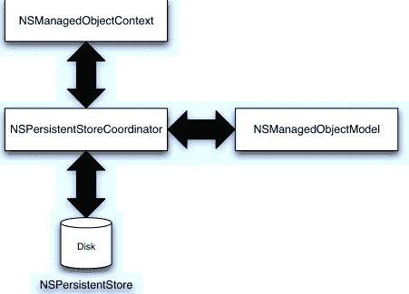
图4.2：Core Data栈

NSSortDescriptor在其 -init: 中接受两个参数：一个键和一个BOOL，表示排序是升序还是降序。在排序中，我们可以拥有任意多个NSSortDescriptor对象，因此它们会在执行排序之前被放入一个NSArray中。

添加NSSortDescriptor在Cocoa Touch上尤其有用，因为NSFetchedResultsController会继续使其结果保持排序，无需我们进行任何干预。第10章《Core Data与iPhone》第184页会更深入地讨论NSFetchedResultsController。

### 4.4 NSManagedObjectContext

除了NSManagedObject之外，NSManagedObjectContext是我们在Core Data栈中访问最多的对象。当我们想要保存到磁盘、将数据读入内存以及创建新对象时，我们访问的对象就是NSManagedObjectContext。如上一页的图4.2所示，NSManagedObjectContext位于Core Data“栈”的顶部，因为我们的代码会频繁直接访问它。我们需要深入栈的更下层的情况要少得多。

NSManagedObjectContext不是线程安全的。每个需要访问数据的线程都应拥有自己的NSManagedObjectContext。这通常不是问题，因为大多数应用程序不是多线程的，或者它们的多线程部分不需要在主线程之外的任何线程上与NSManagedObjectContext交互。然而，重要的是要记住，与UI一样，NSManagedObjectContext应仅在创建它的线程上访问，而该线程通常是主线程。

```objective-c
// Download GrokkingRecipes.xcodeproj/AppDelegate.m
- (NSManagedObjectContext *)managedObjectContext
{
    if (managedObjectContext) return managedObjectContext;

    NSPersistentStoreCoordinator *coord = [self persistentStoreCoordinator];

    if (!coord) return nil;

    managedObjectContext = [[NSManagedObjectContext alloc] init];
    [managedObjectContext setPersistentStoreCoordinator: coord];

    NSFetchRequest *request = [[[NSFetchRequest alloc] init] autorelease];
    [request setEntity:[NSEntityDescription entityForName:@"Type"
                                   inManagedObjectContext:managedObjectContext]];

    NSError *error = nil;
    NSArray *result = [managedObjectContext executeFetchRequest:request
                                                          error:&error];
    NSAssert(error == nil, [error localizedDescription]);
    if ([result count]) return managedObjectContext;

    //The types table has not been populated
    NSArray *types;
    types = [[[NSBundle mainBundle] infoDictionary] valueForKey:@"RecipeTypes"];

    for (NSString *type in types) {
        NSManagedObject *object = [NSEntityDescription
                                   insertNewObjectForEntityForName:@"Type"
                                   inManagedObjectContext:managedObjectContext];
        [object setValue:type forKey:@"name"];
    }

    return managedObjectContext;
}
```


#### 将类型实体关联到类型 NSComboBox

既然我们已经让 Type 实体在启动时填充完毕，接下来就应将其绑定到用户界面，这样对 Type 表的更改就会反映到用户界面中。为此，我们需要在 Interface Builder 中打开 MainMenu.xib 文件并选中 NSComboBox。然后在“Bindings”标签页中，展开“Content Values”部分，将其绑定到 Type 的 NSArrayController，控制器键（controller key）为 `arrangedObjects`，模型键路径（model key path）为 `name`，如图 4.3 所示（见下页）。

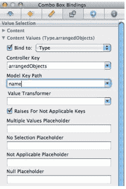

**图 4.3：** 将 NSComboBox 绑定到 Type 实体

现在，对 Type 表所做的任何更改都会自动反映到用户界面中。

NSManagedObjectContext 本身的初始化相当直接。不过，我也喜欢在此时将任何需要预填充到存储库中的对象一并加载。回顾一下：我们首先获取对 NSPersistentStoreCoordinator 的引用并初始化 NSManagedObjectContext。一旦 NSManagedObjectContext 初始化完成，我们再将 NSPersistentStoreCoordinator 传入其中。

如果我们没有任何需要加载到 NSManagedObjectContext 中的数据，那么方法通常会在这里结束。然而在我们的应用程序中，我们希望在任何人有機會创建菜谱之前就预填充 Type 实体。因此，一旦 NSManagedObjectContext 初始化完成，我们立即对 Type 表执行 NSFetchRequest，检查是否有任何结果。如果有结果，则方法结束并退出运行循环。

如果 Type 表中没有任何实体，那么我们就知道它需要填充。下一步是从 Info.plist 中获取类型列表并遍历它们。对于 Info.plist 中的每一项，我们创建一个新的 NSManagedObject，并将其 name 设置为 Info.plist 中的值。循环结束后，存储已完成预填充，我们可以退出这个运行循环周期。

预填充存储库还有其他几种方式。有些方法比上面的方法更简单，有些则更复杂。我以前用过的一个例子是直接将一个预先准备好的存储库放在应用程序包中。当用户请求新存储时，我将预填充的存储从应用程序包复制到指定位置，然后针对它初始化 NSPersistentStoreCoordinator。这样预填充很容易，但我们需要维护那个内部数据库，并在数据模型发生变化时随时更新它。

另一种预填充数据的设计是在应用程序包中保留一个 XML 存储，而不是最终的存储类型。XML 比其他存储类型更具可塑性，在开发过程中很容易操作。在运行时，我们可以针对那个内部 XML 存储搭建一个 Core Data 堆栈，然后将对象复制到最终存储中。这种设计比单纯复制文件需要更多代码，但维护内部存储会更容易。

每种设计都是可行的，最终取决于应用程序的最终设计以及开发者的偏好来决定哪种最适合。

> **Joe 问道……**
>
> **什么是 Plist？**
>
> *plist* 是一种 XML 文件，通常表示 `NSDictionary` 数据结构。plist 的顶层通常以一个 `<dict>` 标签开头，后面跟着一系列 `<key>` 标签及其对应的值。由于 `NSDictionary` 可以保存任何对象作为其值，因此值标签可以是多种类型，包括 `<string>`、`<array>` 以及其他类型，甚至包括嵌套的 `<dict>` 标签！

### 4.5 NSManagedObjectModel

`NSManagedObjectModel` 可以看作我们在 Xcode 中创建的数据模型的编译后的二进制版本。在应用程序的构建过程中，`.xcdatamodel` 文件会被编译成 `.mom` 文件，存储在应用程序包的 Resources 目录中。如果我们有多个 `.xcdatamodel` 文件，那么每个文件都会被编译成独立的 `.mom` 文件。当我们构造 `NSManagedObjectModel` 时，可以只使用其中一个 `.mom` 文件，也可以将它们全部合并到一个 `NSManagedObjectModel` 中。应用程序的设计通常决定了这一选择。然而，对于我们的菜谱应用程序，我们只有一个 `.mom` 文件用于 `NSManagedObjectModel`：

下载 `GrokkingRecipes_v1/AppDelegate.m`

```objc
- (NSManagedObjectModel *)managedObjectModel
{
    if (managedObjectModel) return managedObjectModel;
    NSString *path = [[NSBundle mainBundle] pathForResource:@"DataModel"
                                      ofType:@"mom"];
    NSAssert(path != nil, @"Unable to find DataModel in main bundle");
    if (!path) return nil;
    NSURL *url = [NSURL fileURLWithPath:path];
    managedObjectModel = [[NSManagedObjectModel alloc] initWithContentsOfURL:url];
    return managedObjectModel;
}
```

在标准配置下，`NSManagedObjectModel` 的构造涉及的代码并不多。我们首先确定 `.mom` 文件的位置。由于我们只有一个数据模型，我们使用 `NSBundle` 的 `-pathForResource:ofType:` 方法来定位模型的路径，并用它构造一个 NSURL。有了这个 NSURL，我们就可以初始化 NSManagedObjectModel。

根据应用程序的复杂程度，通常在 Core Data 堆栈初始化之后就不再需要访问 NSManagedObjectModel 了。然而，这个对象中包含了大量信息，在边缘情况下可能非常有用。

例如，由于模型中所有实体的描述都包含在 NSManagedObjectModel 中，因此可以利用它进行模型的动态发现以供显示。通过直接访问 NSManagedObjectModel，我们可以查询 Core Data 堆栈，发现所有存在的关系、实体和属性，并将它们显示给用户。虽然这在面向消费者的应用程序中可能用处不大，但作为开发者工具却非常有用。

另一个直接访问 NSManagedObjectModel 有用的场景是在处理版本控制时。当我们在开发不寻常的版本转换或自己编写版本控制代码时，查询源和目标 NSManagedObjectModel 以对版本控制过程做出逻辑决策会非常有用。Core Data 版本控制将在第 5 章《版本控制与迁移》（第 73 页）中深入讨论。

### 4.6 NSPersistentStoreCoordinator

NSPersistentStoreCoordinator 位于 Core Data 堆栈的底部。它负责将数据持久化到其存储库中。该存储库通常（但并非总是）位于磁盘上。因此，对于内存存储而言，它可能仅存在于内存中，没有磁盘表示。然而在大多数情况下，NSPersistentStoreCoordinator 处理磁盘访问。

NSPersistentStoreCoordinator 也不是线程安全的。然而，NSManagedObjectContext 知道如何正确地锁定 NSPersistentStoreCoordinator，因此可以将多个 NSManagedObjectContext 实例关联到同一个 NSPersistentStoreCoordinator 而无需担心。不过，从多个线程直接访问 NSPersistentStoreCoordinator（例如添加持久化存储对象）可能会引起问题。实际上，在多线程环境中，这正是 NSManagedObjectContext 单线程设计的处理方式。我们将在第 9 章《多线程与 Core Data》（第 162 页）中详细讨论 NSPersistentStoreCoordinator 的这一方面。

在我们的 Grokking Recipes 示例应用程序中，我们使用已知的文件位置和已知的持久化存储类型来构建 NSPersistentStoreCoordinator。这在单一持久化存储设计中很常见。然而，当我们使用文档模型时，每个文档都会有自己独立的持久化存储，并且每个存储可以是不同的类型。因此，在这种设计中，创建 NSPersistentStoreCoordinator 可能会更复杂。我们将在第 12 章《实战：动态参数》（第 228 页）中演示在文档模型中使用 NSPersistentStoreCoordinator 的方法。在我们当前的应用程序中，我们按如下方式构造 NSPersistentStoreCoordinator：

```objc
- (NSPersistentStoreCoordinator *)persistentStoreCoordinator
{
    if (persistentStoreCoordinator) return persistentStoreCoordinator;

    NSString *filename = @"GrokkingRecipes.xml";
    NSFileManager *fileManager = [NSFileManager defaultManager];
    NSString *path = [self applicationSupportFolder];
    if ( ![fileManager fileExistsAtPath:path
                              isDirectory:NULL] ) {
        [fileManager createDirectoryAtPath:path
                               attributes:nil];
    }

    path = [path stringByAppendingPathComponent:filename];
    NSURL *url = [NSURL fileURLWithPath:path];
    NSManagedObjectModel *mom = [self managedObjectModel];
    persistentStoreCoordinator = [[NSPersistentStoreCoordinator alloc]
                                   initWithManagedObjectModel:mom];

    NSError *error = nil;
    if (![persistentStoreCoordinator addPersistentStoreWithType:NSXMLStoreType
                                              configuration:nil
                                                        URL:url
                                                   options:nil
                                                     error:&error]) {
        [NSApp presentError:error];
    }
    return persistentStoreCoordinator;
}
```

在单一持久化存储设计中，NSPersistentStoreCoordinator 的构造十分直接。在确认我们尚未初始化存储之后，我们会检查文件将要写入的位置是否存在。应用程序的标准位置是


此设计的位置位于用户主目录下 Library 目录中的 Application Support 目录内。

一旦我们确认存在或添加了适当的目录，下一步就是获取对 NSManagedObjectModel 的引用，这将在第 68 页的 4.5 节“NSManagedObjectModel”中讨论。有了对 NSManagedObjectModel 的引用，我们就可以用该模型初始化 NSPersistentStoreCoordinator。

在初始化 NSPersistentStoreCoordinator 之后，我们需要将实际的 NSPersistentStore 添加到其中。可以向 NSPersistentStoreCoordinator 添加多个 NSPersistentStore，这在处理被拆分到多个文件中的数据时很有用。不过，在我们的示例中，我们只有一个文件。将 NSPersistentStore 添加到 NSPersistentStoreCoordinator 的一部分工作是指定存储的类型。不同类型的存储及其优点将在第 97 页的第 6 章“性能调优”中讨论。当我们把 NSPersistentStore 添加到 NSPersistentStoreCoordinator 时，可能会发生失败。因此，我们要检查错误，并在错误发生时进行处理。

通常，一旦我们初始化了 NSPersistentStoreCoordinator 并将其添加到 NSManagedObjectContext 中，我们就很少再碰它了。在大多数情况下，我们唯一想再次访问它的时机是处理手动迁移。

### 4.7 获取属性

除了 NSFetchRequest 对象之外，我们还能够定义对象之间的延迟关系。获取属性在某种程度上是关系与 NSFetchRequest 的混合体。严格来说，获取属性并不是一种关系，并且直到请求该属性时才会被实现。当访问该属性时，Core Data 会执行底层的 NSFetchRequest 并返回结果。与普通关系不同，获取属性返回的是 NSArray，而不是 NSSet。

在实践中，我发现获取属性不如创建存储的获取请求或在代码中构建获取请求那样有用和灵活。通常，当情况需要获取属性时，对相关实体进行子类化、在代码中执行 NSFetchRequest 并返回结果往往更容易。

### 4.8 小结

本章介绍了 Core Data 的许多组成部分。随着我们继续深入探索 Core Data，请将本章作为参考，了解 Core Data 的各个部分以及它们如何组合在一起。到本书结束时，这些元素中的每一个对你来说都应该像今天的 NSString 和 NSArray 一样熟悉。

## 版本管理与迁移

就像作战计划一样，没有任何代码库能在与用户接触后保持不变。一旦用户开始使用某个应用程序，他们就会想要改变它。即使代码只是为我们自己而写，我们作为用户也会想要改变一些东西。例如，我们可能需要添加一个属性、添加一个新对象，或者只是为了适应这些变化而重构结构。这些改动可能相当复杂，并且总是需要改变数据的存储方式。尽管即使没有存储数据，数据迁移也能正常工作，但有一些数据可供操作会对后续工作更有用。因此，如果你还没有添加任何食谱，我建议在我们继续之前先添加一些。

从 Mac OS X 10.5 Leopard 开始，Apple 已使 Core Data 用户的数据迁移几乎变得轻而易举。在为 Leopard 开发时，版本管理已包含在 Core Data API 中，作为开发者，我们只需付出相对较少的努力，就可以轻松地将数据存储从一个版本迁移到另一个版本。根据迁移的复杂程度，我们开发者所需付出的努力可能微不足道，也可能相当复杂。

以我们在第 14 页第 2 章*Core Data 入门*中开始的项目为例，我们将在后续版本中为其添加一些附加功能。在版本 2 中，我们将添加为食谱标记作者以及标记“最后使用”日期的功能。这样，我们就知道是谁创造了这道美味佳肴，以及我们最后一次制作它是什么时候。我们当然不希望连续两天不小心做同一道菜！最后，我们将从 `Recipe` 实体的 `Type` 属性中移除 Meat 和 Fish 条目。任何标记为 Meat 或 Fish 的食谱条目都将改为更新为 Entrée。

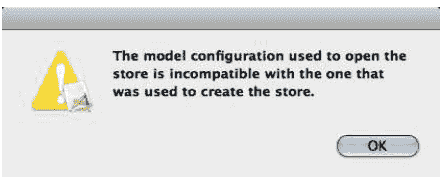

图 5.1：默认模型问题对话框

在版本 3 中，我们将通过提取配料并形成回到食谱的多对多关系，对存储库进行一些规范化。此外，我们将添加购物清单的概念，以便更容易确保我们在下次去商店时买齐所有配料。最后，我们将把 unitOfMeasure 属性从 RecipeIngredient 实体中提取到它自己的实体中，并允许这个新实体链接到新的配料实体。这将为我们提供一个用于各种计量单位的查找列表，并降低人为错误的风险。

### 5.1 迁移前的一些维护工作

在我们实际发布会迁移数据的新版应用程序之前，我们需要先为用户完成一次小幅“维护”更新。通常我们会把这段代码添加到应用程序的第一个版本中，但以防我们编写第一个版本时还没有考虑版本管理（或者以防我们是为 Tiger 编写第一个版本），我们需要回到旧版本，并添加非常少量的代码来帮助我们的用户。

有些用户会下载应用程序的新版本只是为了“试用一下”，看看它是否值得升级费用或是否值得费这个麻烦。通常这不成问题，直到我们升级了用户底层的数据。然后事情就出岔子了。我们不希望发生的就是图 5.1 中显示的错误消息。

这是一种糟糕的用户体验，也是我们想要避免的。幸运的是，避免它的方法非常简单，我们可以在进行任何迁移之前将其添加到应用程序的维护版本中。这样，当用户在“测试”第二个版本后打开我们应用程序的第一个版本时，他们会收到一条友好的错误消息，或者你可以更进一步，恢复/访问他们数据的旧版本。

下载 GrokkingRecipes_v2/AppDelegate.m

```
if (![persistentStoreCoordinator addPersistentStoreWithType:NSXMLStoreType
                                              configuration:nil
                                                        URL:url
                                                    options:dict
                                                      error:&error]) {
    NSDictionary *ui = [error userInfo];
    if (ui) {
        NSLog(@"%@:%s %@", [self class], _cmd, [error localizedDescription]);
        for (NSError *suberror in [ui valueForKey:NSDetailedErrorsKey]) {
            NSLog(@"\t%@", [suberror localizedDescription]);
        }
    } else {
        NSLog(@"%@:%s %@", [self class], _cmd, [error localizedDescription]);
    }
    NSAlert *alert = [[NSAlert alloc] init];
    [alert setAlertStyle:NSCriticalAlertStyle];
    [alert setMessageText:@"Unable to load the recipes database."];
    NSString *msgText = nil;
    msgText = [NSString stringWithFormat:@"The recipes database %@\n\n%@\n"
               @"is either corrupt or was created by a newer "
               @"version of Grokking Recipes. Please contact "
               @"support to assist with this error.\n\nError: ",
               [error localizedDescription]];
    [alert setInformativeText:msgText];
    [alert addButtonWithTitle:@"Quit"];
    [alert runModal];
    exit(1);
}
```

我们已将这段代码添加到食谱应用程序第一个版本的应用程序委托中的 -persistentStoreCoordinator 方法里。在我们应用程序的第一个版本中，如果在将 NSPersistentStore 添加到 NSPersistentStoreCoordinator 时发生错误，我们只会通过 [[NSApplication sharedApplication] presentError:error] 向用户呈现错误。通过这一更改，我们向用户提供了更多有用的信息，同时也把相当多有用的信息转储到日志中供我们查看。我们还会在所有未来版本的应用程序中保留这段代码，以帮助其“面向未来”。当然，这只是我们能做的最低限度，我建议添加其他选项。不过，最重要的一点已经到位。我们不会在没有 Core Data 栈的情况下让用户继续操作。我们最初的方式是


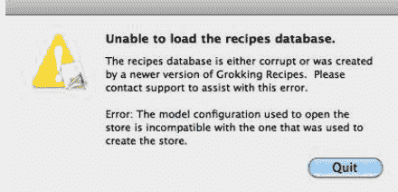

图5.2：新的、改进后的错误对话框

我们对这个错误的处理允许用户继续使用我们的应用程序并输入新信息，结果却发现无法保存。通过这条错误消息，我们强制用户在处理该错误之前退出，从而防止这种情况发生。生成的错误消息如图5.2所示。

我们对该错误检查还有另一项补充。在向用户显示 NSAlert 之前，我们还会把错误信息输出到控制台。这在开发周期中主要很有用，但当用户遇到异常问题时也可能有帮助。当 Core Data 因多个错误而失败时，它会将所有错误加载到一个 NSError 实例中并传回给我们。在这种情况下，顶层的 `-localizedDescription` 只会告诉用户“发生了多个验证错误”，这对我们开发者来说不太有用。不过，其他错误可供显示；我们可以从 `NSError` 的 `userInfo` 中获取它们，然后遍历这些错误，将其 `-localizedDescription` 打印到控制台，并揭示确切的问题。我们还会检查确保存在子错误，以便在只有一个错误时单独打印顶层错误。

### 5.2 一次简单的迁移

为了演示一次简单的迁移，我们将添加为食谱指定作者的功能。为了启动版本管理，我们需要做的第一件事是基于第一个托管对象模型（MOM）创建一个新的 MOM。为此，我们需要在 Xcode 中选择现有模型，然后选择“设计 > 数据模型 > 添加模型版本”。

#### 你的第一个数据模型版本

当你首次设置版本管理时，务必查看 Xcode 中的目标并更新“编译源文件”部分。如果你在目标中看不到 .xcdatamodeld 文件，请从中移除 xcdatamodel 引用，并将整个 xcdatamodeld 包拖入目标。否则，你的应用程序可能会抱怨无法合并实体，因为它会将模型的每个版本视为独立模型。

完成此更改后，最好从主菜单中选择“构建 > 清理所有目标”来清理项目（删除任何先前编译的代码）。

#### 创建带版本的数据模型

这是我们第一次添加模型版本；Xcode 将为我们创建一个名为 DataModel.xcdatamodeld 的新包，并将原始 MOM 连同原始 MOM 的新副本一起放入该包中。为了在示例项目中更清楚，我将这些 MOM 对象重命名为 v1.xcdatamodel 和 v2.xcdatamodel。接下来，我们需要选择 v2.xcdatamodel，然后选择“设计 > 数据模型 > 设置当前版本”。顾名思义，这会告诉 Core Data 哪个版本的 MOM 是当前版本。

现在我们有了新版本的 MOM，是时候添加新的实体和属性了。这将需要添加一个新实体，并对 Recipe 实体做一些更改。查看新模型（图5.3，下一页）并将其与原始模型（图2.4，第21页）进行比较。在这个更新后的 MOM 中，你会找到新的 Author 实体及其与 Recipe 实体的一对多关系。此外，Recipe 实体有一个名为 lastUsed 的新属性，定义为 Date。

我们还没有完全完成。如果我们现在运行应用程序，就会触发我们在第 5.1 节“迁移前的一些维护”（第 74 页）中讨论的错误。显然还缺少一些东西。


图5.4：缺少 MOM 的映射模型时的错误

如果我们在此更改后尝试运行应用程序，会得到一些新东西，如图5.4所示。

#### 创建我们的第一个映射模型

我们确实越来越接近了，但还没有完全到位。我们还缺少一样东西，那就是映射模型。映射模型描述如何将数据从一个对象模型转换到另一个对象模型。创建映射模型的方法是让 Xcode 创建一个新文件，并从选择项中选择“映射模型”。在命名新文件后（我将其命名为 v1_to_v2），Xcode 会要求你选择源模型和目标模型。适当地选择 v1 和 v2 将完成文件创建。Xcode 会完成映射模型的一些基本构建，这几乎足以完成本次迁移。

Xcode 生成的初始映射模型几乎处理了我们想要做的所有事情。它很好地将现有实体迁移到新对象模型。不过，我们还需要做几件事来调整它。

首先，我们可以从映射模型中移除 Author 实体。由于原始对象模型中没有 Author，并且该关系不是必需的，因此我们不需要在迁移期间处理它。我们还可以移除 Recipe 实体中 author 关系的映射以及 lastUsed 属性。同样，由于这些可以为 nil，并且我们在迁移期间不会填充它们，因此映射模型中不需要它们。

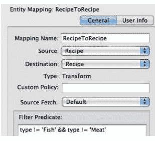

图5.6：排除过滤器谓词

RecipeToRecipe 映射。Recipe 实体的第二个映射我们将称为 Fish & Meat，其谓词如下：

```
type == 'Fish' || type == 'Meat'
```

Fish & Meat 映射与 RecipeToRecipe 映射之间的另一个区别是 type 属性。在原始的 RecipeToRecipe 映射中，它被设置为 `$source.type`，这告诉 Core Data 复制源对象的 type 属性值。在 Fish & Meat 映射中，我们将把它直接设置为 Entrée。这将导致任何 type 为 Fish 或 Meat 的 Recipe 实体在迁移期间更改为 Entrée。

现在当我们运行应用程序时，不会发生什么惊人的事情。应用程序打开，数据显示出来，一切都很正常，没有任何噪声。版本2的全部内容就是这些！

#### 我们刚刚做了什么？

我们刚刚完成了一次非常简单的数据迁移，从数据模型的版本1迁移到版本2。现在，当用户运行我们的应用程序时，无论他们拥有哪个版本的数据模型，都会自动升级到版本2，不会出现任何意外。

在此过程中，我们学习了如何创建数据模型的多个版本，以及如何创建映射模型来描述如何在版本之间转换数据。

### 5.3 Core Data 版本管理基础

那么，这一切背后的魔法是什么？数据迁移实际上是如何工作的？正如我们在前几章中已经探讨的那样，Core Data 使用 MOM 对象来描述数据实体、它们的属性和关系。Core Data 版本管理使用相同的 MOM 对象，但将设计进一步推进了一步。每个数据模型中的每个实体版本都有唯一的哈希。当 Core Data 从磁盘加载持久化存储时，它会将持久化存储中的匹配哈希与应用程序中包含的 MOM 对象进行解析。如果匹配的 MOM 未被标记为“当前”MOM，则数据迁移就会启动。

#### 数据迁移如何工作

Core Data 以非常直接的方式处理数据迁移。每当需要迁移持久化存储时，都有三个步骤。

- **复制实体及其属性**：在迁移的第一遍中，Core Data 会为旧存储中的每个实体在新持久化存储中创建新实体。这些实体会复制其属性，但不会复制其关系。在此阶段，Core Data 还会保留对每个实体旧唯一 ID 的引用，以便在第二阶段使用。
- **在实体之间创建关系**：在第二遍中，Core Data 根据先前的关系构建实体之间的所有关系。这里会使用第一阶段中的引用。
- **验证新存储**：在迁移期间，所有验证规则都会被关闭，并且 Core Data 会忽略 MOM 中定义的子类。因此，某些数据验证规则可能在迁移期间被破坏。在迁移的最后阶段，Core Data 会再次遍历存储并检查所有验证规则，以确保数据处于有效状态。


### 模型版本与哈希

*版本化*一词在本章以及其他材料中一直被用来描述 Core Data 中的数据迁移。遗憾的是，它并不准确。版本化意味着模型存在顺序或优先级。就 Core Data 中的数据模型版本化/迁移而言，这并不准确。

#### 实体哈希

Core Data 不会跟踪版本号、创建日期或其他可能按时间顺序排列的标识符，而是为模型中的每个实体生成一个哈希。随后，这些哈希会存储在使用该模型创建的持久化存储中，以便后续比较。加载持久化存储时，Core Data 做的第一件事是从该存储中检索元数据。该元数据中包含存储中每种实体类型的列表，以及该实体的哈希。Core Data 随后将该哈希列表与“当前”MOM 的哈希进行比较。如果它们匹配，则一切正常，并加载该存储。如果它们不匹配，Core Data 会检查加载持久化存储调用中的选项，以确认是否请求自动数据迁移。如果未请求，则会将第 5.1 节 *迁移前的一些维护*（第 74 页）中的错误消息呈现给用户。

#### 更改哈希值

令人惊讶的是，MOM 内部发生变化并不一定会导致其中实体的哈希发生变化。实际上，我们可以对模型做不少完全不会触发数据迁移的更改。

#### 会改变实体哈希的更改

如果实体上的以下任何内容发生更改，该实体将报告不同的哈希：

- 名称：实体的名称
- 继承：更改父实体是谁
- 持久化属性：添加或删除属性

此外，更改属性的以下内容也会触发实体哈希变化：

- 名称：属性的名称

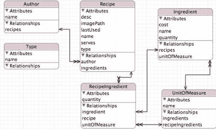

图 5.7：MOM 的版本 3

根据我们的需求，此次迁移需要用到的两个方法如下：

- `(BOOL)createDestinationInstancesForSourceInstance:(NSManagedObject*)source entityMapping:(NSEntityMapping*)mapping manager:(NSMigrationManager*)manager error:(NSError**)error`
- `(BOOL)createRelationshipsForDestinationInstance:(NSManagedObject*)dInstance entityMapping:(NSEntityMapping*)mapping manager:(NSMigrationManager*)manager error:(NSError**)error`

#### -createDestinationInstancesForSourceInstance:

第一个方法 `createDestinationInstancesForSourceInstance:` 会针对源存储中与该迁移策略关联的每个实体被调用。例如，在迁移 RecipeIngredient 实体并创建 Ingredient 实体期间，此方法会针对每个 RecipeIngredient 被调用，并且预期结果是创建一个配料实体，或将其与传入的 RecipeIngredient 关联起来。

实现此方法的代码分解如下：

[下载 GrokkingRecipes_v3/RecipeIngredient.m]

```objc
NSManagedObjectContext *destMOC = [manager destinationContext];
NSString *destEntityName = [mapping destinationEntityName];

//The name of the ingredient
NSString *name = [source valueForKey:@"name"];
```

在该方法的第一部分，我们只是设置后续会用到的引用。具体来说，我们设置对目标 NSManagedObjectContext 的引用（创建新实体时需要它）、目标实体的名称，以及最重要的——传入实体中的名称值。由于传入实体是 RecipeIngredient，名称值将是我们现在想要引用的配料名称。

[下载 GrokkingRecipes_v3/RecipeIngredientToIngredient.m]

```objc
NSMutableDictionary *userInfo = (NSMutableDictionary*)[manager userInfo];
if (!userInfo) {
    userInfo = [NSMutableDictionary dictionary];
    [manager setUserInfo:userInfo];
}
NSMutableDictionary *ingredientLookup = [userInfo valueForKey:@"ingredients"];
if (!ingredientLookup) {
    ingredientLookup = [NSMutableDictionary dictionary];
    [userInfo setValue:ingredientLookup forKey:@"ingredients"];
}
NSManagedObject *dest = [ingredientLookup valueForKey:name];
if (!dest) {
    dest = [NSEntityDescription insertNewObjectForEntityForName:destEntityName
        inManagedObjectContext:destMOC];
    [dest setValue:name forKey:@"name"];
    [ingredientLookup setValue:dest forKey:name];
}
```

在下一段代码中，我们处理所需引用的 Ingredient 实体可能已经创建的情况。我们不必每次都针对目标上下文执行抓取，而是在 NSMigrationManager 中构建并存储一个哈希表。NSMigrationManager 有一个名为 userInfo 的 NSDictionary，非常适合此用途。我们先延迟初始化该字典，然后在其内部延迟初始化另一个 NSDictionary，以配料名称为键来存储对 Ingredient 实体的引用。这样，我们可以确保每个 Ingredient 只创建一次。如果该 Ingredient 尚不存在，我们就创建它，并将其存回 userInfo 缓存中。

下载 GrokkingRecipes_v3/RecipeIngredient/Ingredient.m

```objc
[manager associateSourceInstance:source
        withDestinationInstance:dest
        forEntityMapping:mapping];

return YES;
```

我们需要做的最后一件事是告知管理器这个关联。由于管理器会跟踪两个 NSManagedObjectContext 对象之间的所有关联，我们需要告知它这个刚刚创建的新实体，以及该实体与传入的源实体相关联。完成之后，我们返回 YES，就完成了。

#### -createRelationshipsForDestinationInstance:

在设计良好的数据模型中，很少会用到这个方法，甚至可能完全不需要。该方法的目的是（它在第二遍中被调用）为上一个方法中创建的新目标实体建立任何关系。然而，如果模型中的所有关系都是双向的，则不需要这样做，因为我们已经设置了其中一侧。如果由于某种原因，模型中存在非双向的实体，则此方法中需要额外代码来处理单向关系。由于我们的模型不需要该功能，我们直接返回 YES。

下载 GrokkingRecipes_v3/RecipeIngredient/Ingredient.m

```objc
- (BOOL)createRelationshipsForDestinationInstance:(NSManagedObject*)dInstance
                                entityMapping:(NSEntityMapping*)mapping
                                      manager:(NSMigrationManager*)manager
                                        error:(NSError**)error
{
    return YES;
}
```

### 5.5 自动数据迁移

如果你的数据迁移需求容易处理，并且应用程序并非从 Tiger 而来，那么可能只需要自动迁移。自动迁移让 Core Data 处理所有细节，并假定以下条件：

- 应用程序将遇到的每个持久化存储都具有哈希元数据。
- 应用程序将遇到的每个持久化存储都在应用程序包内存储了对应的模型。
- 应用程序将遇到的每个持久化存储都有一个从其 MOM 到当前 MOM 的映射模型。

如果应用程序能满足这三个条件（任何从 Leopard 开始其生命周期的应用程序都应该满足），那么自动迁移应该能够替我们完成所有繁琐工作。

要启用自动版本化，我们需要在添加持久化存储时在 NSPersistentStoreCoordinator 上设置一个选项。之前，在我们的食谱应用程序中构建 NSPersistentStoreCoordinator 的方法如下：

```objc
- (NSPersistentStoreCoordinator *)persistentStoreCoordinator
{
    if (persistentStoreCoordinator) return persistentStoreCoordinator;

    NSString *filename = @"GrokkingRecipes.xml";
    NSFileManager *fileManager = [NSFileManager defaultManager];
    NSString *path = [self applicationSupportFolder];
    if ( ![fileManager fileExistsAtPath:path
                                  isDirectory:NULL] ) {
        [fileManager createDirectoryAtPath:path
                              attributes:nil];
    }

    path = [path stringByAppendingPathComponent:filename];
    NSURL *url = [NSURL fileURLWithPath:path];
    NSManagedObjectModel *mom = [self managedObjectModel];
    persistentStoreCoordinator = [[NSPersistentStoreCoordinator alloc]
                                  initWithManagedObjectModel:mom];

    NSError *error = nil;
    if (![persistentStoreCoordinator addPersistentStoreWithType:NSXMLStoreType
                                                  configuration:nil
                                                            URL:url
                                                        options:nil
                                                          error:&error]) {
        [NSApp presentError:error];
    }
    return persistentStoreCoordinator;
}
```


在此代码段中，我们首先从源 URL 获取元数据。如果该元数据不是 nil，我们会询问最终模型该元数据是否与其兼容。如果兼容，那么我们就满意并完成了。然后我们将错误指针设置为 nil 并返回 YES。如果不兼容，那么我们需要尝试找出映射模型，以及可能需要的临时数据模型，以便迁移到该模型。

#### 查找所有托管对象模型

为了找到迁移中的下一步，我们需要找到 bundle 中的每个托管对象模型并遍历它们。此时的目标是获取所有模型，然后确定我们可以迁移到哪一个。由于这些模型可能位于它们各自的 bundle 中，我们必须先查找这些 bundle，然后再查看每个 bundle 内部。

```objective-c
// Download ProgressiveMigration/AppDelegate.m
//Find the source model
NSManagedObjectModel *sourceModel = [NSManagedObjectModel
        mergedModelFromBundles:nil
        forStoreMetadata:sourceMetadata];
NSAssert(sourceModel != nil, ([NSString stringWithFormat:
        @"Failed to find source model\n%@",
        sourceMetadata]));

//Find all of the mom and momd files in the Resources directory
NSMutableArray *modelPaths = [NSMutableArray array];
NSArray *momdArray = [[NSBundle mainBundle] pathsForResourcesOfType:@"momd"
        inDirectory:nil];

for (NSString *momdPath in momdArray) {
    NSString *resourceSubpath = [momdPath lastPathComponent];
    NSArray *array = [[NSBundle mainBundle]
        pathsForResourcesOfType:@"mom"
        inDirectory:resourceSubpath];
    [modelPaths addObjectsFromArray:array];
}

NSArray* otherModels = [[NSBundle mainBundle] pathsForResourcesOfType:@"mom"
        inDirectory:nil];
[modelPaths addObjectsFromArray:otherModels];

if (!modelPaths || ![modelPaths count]) {
    //Throw an error if there are no models
    NSMutableDictionary *dict = [NSMutableDictionary dictionary];
    [dict setValue:@"No models found in bundle"
        forKey:NSLocalizedDescriptionKey];
    //Populate the error
    *error = [NSError errorWithDomain:@"Zarra" code:8001 userInfo:dict];
    return NO;
}
```

在此代码块中，我们首先从 mainBundle 中获取所有类型为 momd 的资源路径。这将为我们提供所有模型 bundle 的列表。然后我们遍历此列表，在每个 bundle 内部查找 mom 资源，并将它们添加到一个总数组中。完成这些后，我们再次查看 mainBundle 内部，寻找任何独立的 mom 资源。最后，我们执行失败检查，以确保有一些模型可供查看。如果找不到任何模型，那么我们就填充 NSError 并返回 NO。

#### 查找映射模型

现在复杂部分来了。由于目前无法仅使用源模型获取 NSMappingModel，然后再确定目标模型，因此我们必须改为遍历我们找到的每个模型，将其实例化，作为可能的目标模型插入，并查看是否存在映射模型。如果不存在，我们就继续处理下一个。

下载 ProgressiveMigration/AppDelegate.m

```objective-c
    NSMappingModel *mappingModel = nil;
    NSManagedObjectModel *targetModel = nil;
    NSString *modelPath = nil;
    for (modelPath in modelPaths) {
        targetModel = [[NSManagedObjectModel alloc]
            initWithContentsOfURL:[NSURL fileURLWithPath:modelPath]];
        mappingModel = [NSMappingModel mappingModelFromBundles:nil
            forSourceModel:sourceModel
            destinationModel:targetModel];
        //If we found a mapping model then proceed
        if (mappingModel) break;
        //Release the target model and keep looking
        [targetModel release], targetModel = nil;
    }
    //We have tested every model, if nil here we failed
    if (!mappingModel) {
        NSMutableDictionary *dict = [NSMutableDictionary dictionary];
        [dict setValue:@"No models found in bundle"
            forKey:NSLocalizedDescriptionKey];
        *error = [NSError errorWithDomain:@"Zarra"
            code:8001
            userInfo:dict];
        return NO;
    }
```

这一节可能是渐进迁移例程中最复杂的部分。在本节中，我们遍历之前发现的所有模型。对于其中每个模型，我们实例化该模型，然后向 NSMappingModel 请求一个实例，该实例将在我们已知的源模型和当前模型之间进行映射。如果我们找到映射模型，就跳出循环并继续。否则，我们释放已实例化的模型并继续循环。循环结束后，如果映射模型仍为 nil，我们生成一个错误，说明我们无法发现源模型和目标模型之间的演进过程，并返回 NO。此时，我们应该拥有一次迁移所需的所有组件。源模型、目标模型和映射模型都是已知量。现在该进行迁移了！

#### 执行迁移

在此代码块中，我们使用源模型和目标模型实例化一个 NSMigrationManager（如果我们需要特殊功能，则会改为构建自己的管理器）。我们还在构建一个唯一的迁移目标路径。在此示例中，我们使用目标模型的文件名作为源存储路径的唯一变更部分。目标路径构建完成后，我们告诉迁移管理器执行迁移，并检查是否成功。如果不成功，我们只需返回 NO，因为 NSError 将由 NSMigrationManager 填充。如果成功，则只剩下三件事要做：将源存储移开，然后用新的目标存储替换它，最后递归。

下载 ProgressiveMigration/AppDelegate.m

```objective-c
NSMigrationManager *manager = [[NSMigrationManager alloc]
        initWithSourceModel:sourceModel
        destinationModel:targetModel];

NSString *modelName = [[modelPath lastPathComponent]
        stringByDeletingPathExtension];
NSString *storeExtension = [[sourceStoreURL path] pathExtension];
NSString *storePath = [[sourceStoreURL path] stringByDeletingPathExtension];
//Build a path to write the new store
storePath = [NSString stringWithFormat:@"%@.%@.%@", storePath,
        modelName, storeExtension];
NSURL *destinationStoreURL = [NSURL fileURLWithPath:storePath];

if (![manager migrateStoreFromURL:sourceStoreURL
        type:type
        options:nil
        withMappingModel:mappingModel
        toDestinationURL:destinationStoreURL
        destinationType:type
        destinationOptions:nil
        error:error]) {
    return NO;
}
```

在这个最终代码块中，我们首先为要移动到的原始存储创建一个永久位置。在本例中，我们将使用由 NSProcessInfo 类生成的全局唯一字符串，并将目标模型的文件名和存储的扩展名附加到该字符串。该路径构建完成后，我们将源存储移动到该位置，然后用目标存储替换源存储。此时，我们处于与开始时相同的位置，只不过现在距离当前模型版本又近了一个版本。

现在我们需要再次回到工作流中的第 1 步。因此，我们将递归调用自身，并返回该递归调用的结果。你可能还记得在此方法开头提到，如果现在处于当前版本，我们将直接返回 YES，从而结束递归。

下载 ProgressiveMigration/AppDelegate.m

```objective-c
NSString *guid = [[NSProcessInfo processInfo] globallyUniqueString];
guid = [guid stringByAppendingPathExtension:modelName];
guid = [guid stringByAppendingPathExtension:storeExtension];
NSString *appSupportPath = [storePath stringByDeletingLastPathComponent];
NSString *backupPath = [appSupportPath stringByAppendingPathComponent:guid];

NSFileManager *fileManager = [NSFileManager defaultManager];
if (![fileManager moveItemAtPath:[sourceStoreURL path]
                         toPath:backupPath
                          error:error]) {
    //Failed to copy the file
    return NO;
}
//Move the destination to the source path
if (![fileManager moveItemAtPath:storePath
                         toPath:[sourceStoreURL path]
                          error:error]) {
    //Try to back out the source move first, no point in checking it for errors
    [fileManager moveItemAtPath:backupPath
                         toPath:[sourceStoreURL path]
                          error:nil];
    return NO;
}
//We may not be at the "current" model yet, so recurse
return [self progressivelyMigrateURL:sourceStoreURL
                            ofType:type
                           toModel:finalModel
                             error:error];
```

这种渐进迁移可以通过以下方式测试：首先运行我们 Grokking Recipes 应用的版本 1，输入一些数据，然后运行 ProgressiveMigration 版本。然后你将看到数据模型从版本 1 无缝迁移到版本 3，无需任何干预。


### 5.8 提示与技巧

#### 更新映射模型

开发过程中常常会这样：你想修改当前的对象模型，而这当然会破坏映射模型。幸运的是，可以告诉映射模型刷新源和/或目标数据模型。这可以通过 Design > Mapping Model 菜单完成。

#### 原子存储

原子存储包括 XML、二进制和自定义数据存储。所有这些存储都会以原子方式写入磁盘；换句话说，每次保存都会重写整个数据文件。尽管这些存储类型各有优势，但它们的扩展性不如 SQLite 存储。此外，它们在访问时会被完整加载到内存中。这使得原子存储的内存占用比 SQLite 存储更大。

不过，由于应用运行时它们完全驻留在内存中，所以速度可能非常快，因为只有在将文件读入内存和保存回磁盘时才会访问磁盘。SQLite 虽然仍被视为快速存储，但由于其固有的磁盘访问，在处理较小数据集时速度较慢。话虽如此，差异是以零点几秒来衡量的，因此不能指望使用原子存储能带来大幅速度提升。但如果零点几秒也很重要，这或许值得考虑。

在二进制存储和 XML 存储之间做选择时，应考虑磁盘上的格式。使用二进制格式时，查看数据的唯一方式是通过 Core Data。另一方面，XML 可以用任意文本编辑器查看，这使其在开发期间成为更优选择。

#### SQLite 持久化存储

我们能对应用程序做出的最大单项性能提升，就是将其持久化存储类型从 XML 切换为 SQLite。SQLite 是一个软件库，实现了自包含、无服务器、零配置、事务性的 SQL 数据库引擎。SQLite 是世界上部署最广泛的 SQL 数据库引擎。SQLite 的源代码属于公有领域。

#### 更好的扩展性

通过使用关系数据库作为持久化存储，我们不再需要将整个数据集加载到内存中才能使用它。由于数据存储在关系数据库中，我们的应用程序可以扩展到非常大的规模。SQLite 本身已经过 TB 级数据集的测试，几乎可以处理我们现实中能够开发的任何数据。由于我们只加载特定时刻需要的数据，SQLite 使应用程序的内存占用保持得相当低。同样，SQLite 高效利用磁盘空间，因此磁盘占用也很小。

#### 更多性能调优选项

通过使用数据库而不是平面文件，我们可以获得更多性能调优选项。例如，我们可以为实体中的列建立索引，以加快谓词查询。我们还可以精确控制哪些内容会被加载到内存中。可以只获取对象数量、只获取对象的唯一标识符，等等。这种灵活性使我们能够比使用任何其他存储类型更好地调优应用程序性能。由于 SQLite 存储是唯一不会完整加载到内存的格式，我们可以控制数据流。所有其他格式都要求在使用前将整个数据文件加载到内存中。如何利用这些功能的详细信息将在第 104 页的第 6.3 节 *获取* 中讨论。

### 6.2 优化数据模型

设计数据模型时，我们需要考虑几个因素。把二进制数据放在哪里可能极其重要，因为其大小和存储位置将对应用程序性能起关键作用。同样，关系必须仔细权衡并恰当使用。此外，实体继承是 *Core Data* 的一项强大功能，但必须谨慎使用，因为底层结构可能出人意料。

虽然很容易把 *Core Data* 看作数据库 API，但我们必须记住它并不是数据库 API，而且用数据规范化来组织数据未必能产生最高效的结果。在许多情况下，对数据进行反规范化可以带来更大的性能提升。

#### 将二进制数据放在哪里

在 *Core Data* 应用程序中，破坏性能的最简单方法之一就是把大量二进制数据塞进频繁访问的表中。例如，如果我们把食谱图片放进食谱表，那么只添加几百个食谱后，就会开始看到性能下降。每次访问 `Recipe` 实体时，我们都必须加载其图像数据，即使并不打算显示该图像。由于我们的应用程序会在列表中显示所有食谱，这意味着每个图像都会在启动后立即驻留在内存中，并一直保留到应用程序退出。想象一下有几千个食谱时的情形！

#### Joe 问……

**什么是故障（fault）？**

Core Data 的 fault 类似于虚拟内存缺页。处于 fault 状态的对象是带作用域的对象，在你实际使用它们之前，它们可能并不真的在内存中，或尚未“实体化”。虽然无法保证处于 fault 状态的 NSManagedObject 何时会被加载到内存，但可以保证它在被访问时一定会加载。不过，该对象会是相应类的实例（NSManagedObject 或指定子类），只是其属性尚未初始化。

但界线在哪里？什么样的二进制数据才算小到可以放入表中，什么又完全不应放入存储库？

#### 小型二进制数据

任何小于 100 KB 的数据都被视为小型二进制数据。图标或小头像就是这种大小的数据的几个例子。处理这么小的数据时，最高效的做法是将其直接作为属性值存储在其对应的表中。这种大小的二进制数据对性能的影响可以忽略不计。可转换属性类型非常适合这种用途。

#### 中型二进制数据

中型二进制数据是指大小大于 100 KB 且小于 1 MB 的数据。中等尺寸的图像和小型音频片段是这一大小范围内的几个示例。这种大小的数据也可以直接存储在存储库中。不过，这些数据应存放在与主表建立关系后另一端的独立表中。这样可以让二进制数据在实际需要之前一直保持为 fault。在前面的食谱示例中，即使 Recipe 实体会为显示而加载到内存中，图像也只会在 UI 需要时才加载。

SQLite 在磁盘访问方面已经证明相当高效。有些情况下，从 SQLite 存储加载数据实际上可能比直接访问磁盘更快。这也是中型二进制数据可以直接存储在存储库中的原因之一。

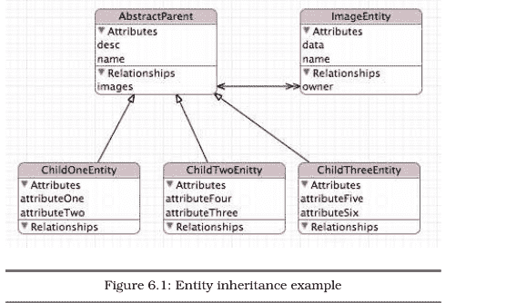

#### 大型二进制数据

大型二进制数据是指大小大于 1 MB 的数据。大型图像、音频文件和视频文件只是这种大小的数据的几个示例。这种大小的任何二进制数据都应存储在磁盘上，而不是存储库中。处理这种大小的数据时，最好将其路径信息直接存储在主导实体（例如 Recipe 实体）中，并将二进制数据存储在磁盘上的已知位置（例如应用程序的 Application Support 子目录中）。

#### 实体继承

实体继承是 Core Data 中一项非常强大的功能。它允许你在数据模型中构建类似对象的继承树。然而，这项功能代价相当大。例如，让我们看一个适度使用实体继承的示例模型，如图 6.1 所示。

对象模型本身看起来相当合理。我们共享 name、desc 以及到 ImageEntity 的一对多关系。然而，底层表结构实际上看起来像下页图 6.2 所示。原因在于 Core Data 处理对象模型到关系表映射的方式。而不是为每个子实体创建一张表


|  | 名称 | 描述 | 属性一 | 属性二 | 属性三 | 属性四 | 属性五 | 属性六 |
|---|---|---|---|---|---|---|---|---|
| 实体一 |  |  |  |  |  |  |  |  |
| 实体二 |  |  |  |  |  |  |  |  |
| 实体三 |  |  |  |  |  |  |  |  |

图 6.2：SQLite 表布局

对象，Core Data 会创建一张大表，其中包含父实体及其所有子实体的属性。最终结果是数据库中一张极其宽且高的表，其中空值占比很高。

尽管 Core Data 的实体继承特性极其有用，但我们应了解对象模型底层发生了什么，以避免性能损失。我们不应将实体继承等同于对象继承。两者确实有一些重叠，但并不相同，若将其等同对待，将对存储库的性能产生负面影响。

### 反规范化数据以提升性能

尽管 Core Data 可用的最强大持久化存储是数据库，但我们必须始终意识到 Core Data 不仅仅是数据库。Core Data 是一个对象层次结构，可持久化为数据库格式。这种差异微妙但重要。Core Data 首先是我们用于在某种用户界面中显示数据并允许用户访问这些数据的对象集合。因此，尽管数据库规范化可能是寻找性能改进的首选，但我们不应过度使用。数据库规范化有六个级别，¹ 但 Core Data 存储库很少（如果有的话）应超过第二级。有几种情况可以通过反规范化数据获得更大的性能收益。

#### 仅用于搜索的属性

在属性内搜索可能非常昂贵。对于包含大量文本的属性，更糟的是 Unicode 文本，单个搜索字段可能导致巨大的性能损失。改善这种情况的一种方法是基于实体中的文本创建派生属性。

例如，如果用户的描述冗长和/或在描述中使用 Unicode 字符，那么在 `Recipe` 实体的描述属性中搜索可能非常昂贵。

为改善该字段的搜索性能，我们可以在 `Recipe` 实体上创建第二个属性，从描述中剥离 Unicode 字符，并移除 *a*、*the* 和 *etc.* 等常见词。然后，如果我们对这个派生属性执行搜索，就可以大幅提升搜索性能。

使用仅搜索属性的缺点是必须维护它们。每次编辑描述字段时，也需要更新派生属性。

#### 昂贵的计算

在规范化数据库中，计算值不会被存储。按需重新计算值被认为比将其存储在数据库中成本更低。然而，从用户体验角度看，情况常常相反。在计算需要花费用户可察觉时间的情况下，将计算值存储在实体中并仅在其依赖值之一发生变化时重新计算，对用户来说可能更好。例如，如果我们在 Core Data 存储库中存储用户的名和姓，那么同时存储全名可能是有意义的。

#### 智能关系

关系在 Core Data 模型中就像烹饪食谱中的盐。太多会毁掉食谱；太少又缺少些什么。幸运的是，在 Core Data 存储库的关系方面，我们可以遵循一些简单规则。

#### 遵循对象模型

Core Data 首先是对象模型。我们模型中的实体应尽可能准确地表示数据。仅仅因为某个值可能在多个对象（或从数据库角度看的多行）中重复，并不意味着它应被抽取到自己的表中。很多时候，在实体本身中多次存储该字符串，比遍历关系来获取它更高效。

遍历关系通常比访问实体上的属性更昂贵。因此，如果要存储的值很简单，就把它留在与其关联的实体中。

#### 将常用数据与少用数据分开

如果对象设计要求一对多关系或多对多关系，那么一定要为其创建关系。通常，当数据不止单个属性、包含二进制数据或难以在父对象内正确建模时，就是这种情况。例如，如果我们有一个用户实体，将地址存储在独立对象中，比在用户对象中为地址、城市、州、邮政编码等设置多个属性更高效。

需要在关系另一端存储的内容与主实体中存储的内容之间仔细保持平衡。跨越关键路径比访问属性更昂贵，但创建非常宽的对象也会减慢数据访问。

### 6.3 获取

*获取*是用于描述从存储库解析 NSManagedObject 对象的术语。当我们检索 NSManagedObject 时，它被“获取”到内存中，然后我们可以访问其属性。为了帮助我们高效利用内存，获取可能并不总是一次性全部发生。具体来说，当我们使用 SQLite 存储时，我们以为在内存中的对象很可能实际上只在磁盘上，尚未读入内存。同样，我们以为已经处理完的对象可能实际上仍位于缓存中。

为了演示从 SQLite 存储将数据加载到内存的不同方式之间的差异，我使用了 Apple 在 WWDC 2007 上名为 GoFetch 的演示应用程序。² 该应用程序的整个目标是生成大量随机数据，并让我们控制如何将其取回内存。然后对每次获取计时，以演示各种选项的速度。这些测试是在 SQLite 存储库中有 3,417 条记录的情况下执行的。

2. 此应用程序的源代码作为 Core Data 的 ADC Headstart 包的一部分提供。

#### 仅加载 NSManagedObjectID 对象

作为 NSFetchRequest 的一部分，我们能检索的最小数据量仅是 NSManagedObjectID。NSManagedObjectID 是记录的唯一标识符，不包含内容。在前面讨论的测试中，测试机器从磁盘检索 3,417 条记录花了 0.004 秒。

#### 如何检索 NSManagedObjectID 对象

要仅检索 NSManagedObjectID 对象而不是完整的 NSManagedObject 对象，只需要做一处更改：

```objc
NSFetchRequest *fetchRequest = [[NSFetchRequest alloc] init];
[fetchRequest setEntity:[NSEntityDescription entityForName:@"Person"
    inManagedObjectContext:[self managedObjectContext]]];
[fetchRequest setResultType:NSManagedObjectIDResultType];
```

通过将 -resultType 改为 NSManagedObjectIDResultType，我们对 -executeFetchRequest:error: 的调用将返回 NSManagedObjectID 对象的 NSArray，而不是 NSManagedObject 对象。

为什么我们只想要 NSManagedObjectID 对象？这有几种用途：

- 包含比较。由于 NSManagedObjectID 对象保证唯一性，我们可以用它们判断某个对象是否包含在集合中，并避免为了此比较而检索整个集合。
- 预取。即使关联对象的属性没有加载到可供我们访问的 NSManagedObject 对象中，它们也会加载到 Core Data 内的缓存中。这意味着，当我们通过调用 NSManagedObjectContext 上的 objectWithID: 来访问关联的 NSManagedObject 对象时，获得结果的速度将比必须进行完整磁盘往返快得多。

你可以通过开启属性加载并保持 -resultType 为 NSManagedObjectIDResultType 来实现这一点。这通常称为 *预热缓存*。

#### 作为故障加载

我们能检索的下一个最小数据量称为 *故障化* 的 NSManagedObject。这意味着 NSFetchRequest 返回 NSManagedObject 对象的 NSArray，但这些对象只包含 NSManagedObjectID。所有属性和关系

为空或处于故障状态。一旦访问某个属性，*该对象上的所有属性*都会被载入。同样，一旦访问某个关系，该关系另一端的全部 NSManagedObject 对象都会作为故障对象载入。在此配置下执行与前面相同的查询，返回 3,417 条记录仅耗时 0.007 秒。第 6.4 节 *故障（Faulting）*（第 108 页）将更深入地讨论故障。

#### 如何检索故障 NSManagedObject 对象

要在 NSFetchRequest 中禁用属性的获取，需要在执行抓取之前将其禁用：

```objc
NSFetchRequest *fetchRequest = [[NSFetchRequest alloc] init];
[fetchRequest setIncludesPropertyValues:NO];
[fetchRequest setEntity:[NSEntityDescription entityForName:@"Person"
    inManagedObjectContext:[self managedObjectContext]]];
```

尽管这看起来是一个很好的解决方案，但它可能有点像一个陷阱。因为此配置返回的是空骨架，每个对象都会单独从磁盘载入。这比一次性载入所有所需对象*显著*更慢。不过，载入对象的时间被分散了，用户可能更不容易察觉。若追求原始速度，建议一次性载入对象的所有数据。

#### 载入属性值

比故障 NSManagedObject 对象更进一步的是预取其属性值。这不会检索关系另一端的对象。在测试存储库中，对 3,417 条记录执行此查询耗时 0.021 秒。

#### 如何仅检索属性值

检索已填充属性的 NSManagedObject 对象是 NSFetchRequest 的默认行为：

```objc
NSFetchRequest *fetchRequest = [[NSFetchRequest alloc] init];
[fetchRequest setEntity:[NSEntityDescription entityForName:@"Person"
    inManagedObjectContext:[self managedObjectContext]]];
```

此选项在抓取故障对象与后面某些选择之间提供了非常好的折中方案。在只需要立即显示所请求的对象、而暂时不需要其关系的情况下，这可能是最高效的解决方案。

#### 如何载入属性值和 NSManagedObjectID 对象

我们还可以将此选项与前面列出的 NSManagedObjectID 检索结合使用，以预热缓存。实现此目的的设置如下：

```objc
NSFetchRequest *fetchRequest = [[NSFetchRequest alloc] init];
[fetchRequest setResultType:NSManagedObjectIDResultType];
[fetchRequest setEntity:[NSEntityDescription entityForName:@"Person"
    inManagedObjectContext:[self managedObjectContext]]];
```

当整个抓取将耗费大量时间时，可以在后台线程上使用此方法并取得极佳效果。一旦检索到 NSManagedObjectID 对象，就可以安全地将它们传递到主线程，并用于向用户显示数据。第 9 章 *多线程与 Core Data*（第 162 页）将更详细地讨论在多线程应用程序中使用 Core Data。

#### 载入关系

在数据载入规模上更进一步，是在载入目标实体的同时预取关系。这不会将它们作为完整成形的对象抓取，而是作为故障对象抓取。这一升级可能会对 Core Data 应用程序的性能产生显著影响。在测试中，此次抓取耗时 1.166 秒，检索了 3,417 个对象，每个对象在一对一关系另一端只有一个*单一*对象。对于更复杂的数据模型，这可能会造成更大的性能损失。

#### 如何载入关系

幸运的是，此选项让我们可以细粒度地控制要载入哪些关系。例如，这允许我们只载入与某个人关联的地址，而跳过其图像、电话号码等。实现这一点需要传入一个由 NSString 对象组成的 NSArray，其中包含要载入的关系名称。

```objc
NSFetchRequest *fetchRequest = [[NSFetchRequest alloc] init];
NSArray *relationshipKeys = [NSArray arrayWithObject:@"addresses"];
[fetchRequest setRelationshipKeyPathsForPrefetching:relationshipKeys];
[fetchRequest setEntity:[NSEntityDescription entityForName:@"Person"
    inManagedObjectContext:[self managedObjectContext]]];
```

在此示例代码中，我们创建了一个新的 NSArray，其中包含一个 NSString，它对应 Person 实体中关系的名称。通过在该 NSArray 中使用键路径并指定要包含在抓取中的第二层对象，我们可以让此请求更加巧妙。例如，如果我们的 Address 实体与一个包含城市和州的邮政编码查找表存在关系，我们可以将创建 NSArray 的行改为以下内容：

```objc
NSArray *relationshipKeys = [NSArray arrayWithObjects:@"addresses",
    @"addresses.postalCode", nil];
```

这会使 Core Data 将两层关系作为故障对象检索。此外，此调用在执行请求之前确实会检查重复，因此在混合使用键路径时可以安全使用。换句话说，postalCode 关系（很可能是多对多关系）不会被检索多次。

#### NSFetchRequest 与磁盘访问

每次执行 NSFetchRequest 时，它都会访问磁盘。在我们使用 NSManagedObject 对象时，这一点很重要。如果我们正在进行连接、向关系添加对象等操作，执行 NSFetchRequest 来检查对象是否已在关系中或执行类似功能，可能看起来更简单、更清晰，但这会显著损害性能。即使所有相关对象都在内存中，NSFetchRequest 仍然会访问磁盘。对已在内存中的集合使用 NSPredicate 要高效得多。

我们在本节中已经看到，使用 SQLite 持久化存储时，我们可以大量控制数据载入内存的方式。我们可以调整载入方式以满足严苛需求。所有这些选项可能有点让人不知所措，但有一条很好的经验法则。尽量一次性只载入当时需要的数据。每个抓取请求都可能耗费相当多的时间，而且由于它们通常在主线程上执行，可能会损害应用程序的用户体验。

### 6.4 故障（Faulting）

逐个触发故障是 Core Data 应用程序性能不佳最常见（即使不是最常见）的原因之一。故障是一把双刃剑，既可以大幅提升应用程序的速度和性能，也可能把性能拖到无法使用的地步。我们能对 Core Data 应用程序做出的最有价值的单项性能改进，就是确保只在我们需要的时候抓取我们需要的数据。如果抓取太少，应用程序会显得无响应。如果我们……信息过载，如第 6.5 节 *访问模式*（第 112 页）所述。

#### 预热缓存

正如我们在第 6.3 节 *抓取*（第 104 页）中所讨论的，可以将数据预载入缓存，以便在需要时数据已在内存中。实现这一点的最简单方法是在后台线程上执行一次完整抓取。例如，在启动我们的食谱应用程序时，我们可以启动一个后台线程来检索所有 `Recipe` 实体。这将使我们能够用那些已知将要呈现给用户的 `Recipe` 实体填充缓存。这样主线程就可以从缓存而不是磁盘中获取这些食谱，从而在此过程中为用户提供运行更流畅的应用程序。其背后的魔法基于 `NSPersistentStoreCoordinator` 的工作方式。每当在任何线程上执行任何请求时，数据都会作为其缓存的一部分保存在 `NSPersistentStoreCoordinator` 中。当发出另一个针对相同数据的请求时，无论它来自哪个线程，都会从缓存中检索，而无需再次访问磁盘。

#### 保存

上一页第 6.4 节 *数量级* 中讨论的数字同样适用于将数据写回磁盘。事实上，写入磁盘甚至比从磁盘读取更慢。因此，分批将数据保存回磁盘对我们来说更高效。每次记录更改后都保存会让用户觉得整个应用程序变得迟缓。同样，在应用程序尝试退出时执行大量写入，会让人觉得应用程序已停止响应，并有数据丢失的风险。

与性能调优中的大多数事情一样，要留意你的保存操作，以及你保存了多少数据或保存数据的频率。尽量在应用程序流程的逻辑暂停期间执行保存。

#### 删除

这可能令人意外，但删除对象可能引发性能问题。让我们回顾第 5 章 *版本管理与迁移*（第 73 页）中的数据模型。想象一下，在我们应用程序的这个较新版本中，我们想从存储库中删除一个食谱。当我们删除该食谱时，我们设置了一条级联规则，以便同时删除所有关联的 `RecipeIngredient` 实体。我们还需要触碰

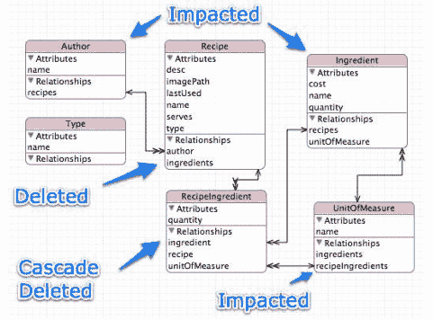

图 6.4：删除食谱的影响

Author 实体、Ingredient 实体和 UnitOfMeasure 实体，如图 6.4 所示。

显然，我们需要触及 RecipeIngredient 实体，但为什么还需要访问所有其他实体？这是因为实体之间的关系。对于每个关系，我们需要在删除后验证该关系，并确认没有悬空引用。如果这些对象当前不在内存中，那么 NSManagedObjectContext 必须从磁盘中取出它们才能完成所有这些操作。

因此，当我们执行删除时，尤其是大量删除时，在删除之前取出所有关系可以提升性能。

#### Faulting 与磁盘访问

触发一个 fault 并不总是意味着数据会从磁盘读取。取决于我们最初如何请求数据，或者 NSManagedObject 对象生命周期中先前发生了什么，数据很可能会改为从缓存加载。

同样，对 NSManagedObject 执行 faulting 既不保证它会写回磁盘，也不保证它会从缓存中移除。如果对象没有更改，那么就没有内容要写入磁盘，并且它很可能在未知的一段时间内留在缓存中。

要检查触发 fault 是否确实导致磁盘访问，最简单的方法之一就是用 Instruments 监控我们的应用程序。通过使用 Core Data 模板，我们可以使用“cache miss”工具检查磁盘命中。如果我们对磁盘的调用次数远超预期，那么就需要考虑重构代码。

### 6.5 访问模式

提升 Core Data 内的性能不一定只关乎存储库和数据加载顺序。我们还可以在用户界面中做许多事情来帮助提升性能。

#### 搜索

在存储库中搜索可能会对性能造成极大破坏。无论我们是应用户请求进行搜索，还是在后台执行搜索，都需要非常小心，以免影响应用程序的性能。

#### 顺序很重要

就像任何条件判断一样，逻辑的顺序很重要。简单相等比 in、contains 等包含操作更快。构建谓词时，尽量按从左到右、从简单到复杂的顺序组织逻辑。这将使 Core Data 能够快速失败并提升搜索性能。

#### Unicode 与正则表达式

在搜索时处理 Unicode 的代价非常高。正如前面第 102 页第 6.2 节“仅搜索属性”所建议的，尽量避免直接针对 Unicode 进行搜索。保留一个去除 Unicode 的派生值，比频繁针对 Unicode 文本进行搜索代价更低。

同样，正则表达式的代价也很高。如果情况需要使用正则表达式，尽量把它放在 NSPredicate 的最右端，如上一页第 6.5 节*顺序很重要*所述。

#### 限制跨关系查询

跨由关系连接的对象进行搜索，搜索代价可能非常高。尽管针对 person.address.postalCode.city 进行搜索看起来很了不起，但它可能并不是解决问题最高效的方式。考虑反转查询，或将其分解为几个更小的查询，以降低底层 SQL 的复杂度。当我们使用 SQLite 后端时，所有 NSPredicate 调用在访问数据库之前都会转换为 SQL。SQL 越不复杂，运行得就越快。先获取某个特定城市内所有 Address 对象的 NSArray，再针对该 NSArray 执行查询的其余部分，很可能比一次调用遍历三个关系更快。

#### 信息过载

繁杂的用户界面不仅会带来糟糕的用户体验，还会影响应用程序的性能。当我们在屏幕上显示大量数据时，必须把这些信息保存在内存中，这反过来意味着我们必须一次性从磁盘加载大量数据。将应用程序用户界面拆分成可消化的信息块，远比试图一次性在屏幕上显示每一个细节要好得多。

谨慎使用标签页、表单和面板可以改善用户界面的体验，进而提升性能。通过将用户界面拆分成更小的部分，我们可以更细粒度地控制何时加载哪些数据，并可以将磁盘访问减少到可管理的块。

保持简单。

## 第 7 章：Spotlight、Quick Look 与 Core Data

为 Mac OS X 开发，关键在于功能与质量的结合。当我们的应用程序只有其一而缺少另一时，用户就会觉得还不够。他们也许无法明确说出那是什么，但“某种东西”会缺失。Spotlight 和 Quick Look 集成就是这样的两件事：用户尝试新应用程序时不会特意寻找它们，但偶然发现时却会感到惊喜。令人惊讶的是，处理这种集成的开发者并不多。也许是因为 Spotlight 与 Core Data 相处得不太好。也许这个功能太新了。但有一点是确定的——与 Spotlight 集成是未来正确的方向。Spotlight 会一直存在，用户会越来越频繁地使用它，并以更有创意的方式使用它。

不幸的是，由于技术原因，Spotlight 和 Core Data 彼此不兼容。Spotlight 处理的是单个文件的元数据，而 Core Data 将所有内容存储在一个文件中。由于 Spotlight 旨在通过文件的元数据来发现有关该文件的信息，因此它无法很好地适用于 Core Data 这种单文件设计。当 Tiger 首次发布时，有许多应用程序（例如 Entourage）由于其单文件设计，无法与 Spotlight 良好协作。事实上，Apple 正是因为这个原因重新架构了 Mail。

Spotlight 与 Core Data 之间的不兼容在 Snow Leopard 中得到了修正，但不幸的是，这仅限于 Snow Leopard，并不向后兼容普通的旧版 Leopard。如何修正？其方式与本章描述的解决方案非常相似。

### 我应该直接使用单独的文件吗？

在本书中，我们设计的应用程序使用单个 Core Data 文件。这样做是为了清晰，并专注于 Core Data。取决于所设计的应用程序，它很可能是基于文档的，因此每个文档使用一个 Core Data 存储库会比较合适。在这种情况下，Spotlight 和 Quick Look 的集成会容易得多。

然而，对于不基于文档的应用程序，最好使用单个 Core Data 存储库，而不是多个单独文件。尽管单独文件会让 Spotlight 更容易处理，但那会是本末倒置。对象持久化（换句话说，数据文件）的主要关注点，是以合乎逻辑且可重现的方式快速、轻松地访问数据。Core Data 相当利落地解决了所有这些问题，但不幸的是，也带来了一个轻微副作用：不能完全兼容 Spotlight。

在本章中，我们将把 Spotlight 集成到食谱应用程序中。完成后，用户将能够搜索*炖肉*，并在我们的应用程序中找到它。此外，当他们选择该搜索结果时，我们的应用程序不仅会打开，还会直接打开到炖肉。在解决 Spotlight 问题的同时，我们还将看一看 Quick Look。尽管表面上这两种技术看起来完全不同，但 Mac OS X 和 Finder 处理它们的方式非常相似。而且，尽管它并不完全适用于我们的示例应用程序（因为我们只有一个数据文件，而且该数据文件隐藏在 Library/Application Support 目录中），但理解 Quick Look 如何为基于文档的 Core Data 应用程序工作仍然非常有用，因为这能让它们在 Finder、Spotlight、Time Machine、Mail 以及许多其他应用程序中更容易被找到。最后，Quick Look 与 Spotlight 能相当好地集成在一起。如果用户对某个 Spotlight 结果启用 Quick Look，我们希望他们看到有关该食谱的信息，而不是一个通用文件的图片。


### 7.1 与 Spotlight 集成

如上所述，问题在于多个文件。理想情况下，对于我们的菜谱应用，我们希望 Core Data 存储库中的每道菜谱对应一条 Spotlight“记录”。为了让 Spotlight 正常工作，我们需要为每道菜谱在磁盘上准备一个文件及其关联的元数据。因此，为了让 Spotlight 满意，我们就这么做。然而，由于我们的所有数据都存储在 Core Data 存储库中，这些文件中没有必要存储任何数据。这些额外的文件纯粹是为了供 Spotlight（和 Quick Look）使用。由于 Spotlight 不需要文件中有任何数据即可工作（它只需要元数据），我们会创建非常简单的文件，并将它们链接回我们的 Core Data 存储库。

Spotlight 的另一个棘手之处在于导入器必须尽可能快。当 Spotlight 需要处理数千个文件时，处理一个或十个文件时可以接受的方法就行不通了。由于我们编写的同一个导入器不仅会在应用内部使用，还可能在服务器环境中使用，因此我们必须让它尽可能快。所以，我们会稍微走点捷径。我们不会在 Spotlight 请求时去 Core Data 存储库中查找元数据，而是将该元数据存储在我们为 Spotlight 创建的文件中。这样一来，我们的导入器只需要处理元数据文件，而无需初始化整个 Core Data“栈”（NSManagedObjectContext、NSPersistentStoreCoordinator 和 NSManagedObjectModel）。

#### 创建元数据文件

我们首先需要动态生成并更新元数据文件。为了尽可能简单，我们将使用 plist 文件，而不是二进制表示或其他格式。由于 NSDictionary 能理解 plist 文件，这会减少我们加载和保存文件的开销。

首先，我们将创建第一个 NSManagedObject 子类。这个子类将负责生成包含所有元数据的 NSDictionary。既然我们在创建子类，不妨实现一些将要使用的属性，以减少代码复杂性并使其更易于维护。

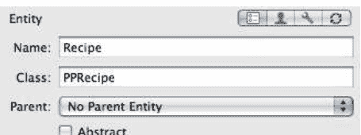

图 7.1：修改实体的类

因此，我们的头文件将如下所示：

```objc
// Download Spotlight/PPRecipe.h
#import <Cocoa/Cocoa.h>

extern NSString *kPPImagePath;
extern NSString *kPPObjectID;
extern NSString *kPPServes;

@interface PPRecipe : NSManagedObject {

}

@property (assign) NSString *desc;
@property (assign) NSString *name;
@property (assign) NSString *type;
@property (assign) NSManagedObject *author;
@property (assign) NSDate *lastUsed;

- (NSDictionary*)metadata;
- (NSString*)metadataFileName;

@end
```

我们需要确保在最新的数据模型中更改类设置，以便 Core Data 使用我们的子类而不是默认的 NSManagedObject。参见图 7.1。

#### 实现元数据方法

这个元数据文件的目标是仅包含足够的信息来填充 Spotlight 和 Quick Look，而不是包含过多信息导致文件变得庞大而笨重。我们必须始终假设会有数千个这样的文件（即使在现实中这并不实际），并且我们不想影响用户的性能或硬盘容量。对于我们的元数据文件，我们实际上只需要以下信息：

- 菜谱的名称
- 可供多少人食用
- 菜谱的图片
- 上次食用的时间
- 制作方法的描述

这个列表中的大部分内容都很轻量——只是文本。然而，图片可能太大，无法塞进 plist 文件，尤其是我们无法确定这些文件会有多大。此外，包含二进制数据会使文件格式复杂化。因此，我们将存放其路径而不是实际图片。由于图片本来就存储在磁盘上，我们只需访问那个副本即可。

除了这个列表之外，我们还需要添加一项不面向用户的内容。我们需要一种方式链接回 Core Data 存储库中的菜谱记录，这样如果用户尝试打开元数据文件，它将改为打开我们的应用并选择正确的记录。为此，我们将使用菜谱的 NSManagedObjectID，并将其 URIRepresentation（实际上是一个 NSURL）以字符串形式存储在元数据中。

```objc
- (NSDictionary*)metadata
{
    NSMutableDictionary *metadataDict = [NSMutableDictionary dictionary];

    [metadataDict setValue:[self name]
                    forKey:(id)kMDItemTitle];
    [metadataDict setValue:[self desc]
                    forKey:(id)kMDItemTextContent];
    [metadataDict setValue:[[self author] valueForKey:@"name"]
                    forKey:(id)kMDItemAuthors];
    [metadataDict setValue:[self valueForKey:@"imagePath"]
                    forKey:kPPImagePath];
    [metadataDict setValue:[self lastUsed] forKey:(id)kMDItemLastUsedDate];
    [metadataDict setValue:[self valueForKey:@"serves"] forKey:kPPServes];
    [metadataDict setValue:[NSString stringWithFormat:@"Recipe: %@", [self name]]
                    forKey:(id)kMDItemDisplayName];
    [metadataDict setValue:[[[self objectID] URIRepresentation] absoluteString]
                    forKey:kPPObjectID];
    return metadataDict;
}
```

#### 实现 metadataFileName 方法

因为我们希望用户能够在 Finder 中查看实际的元数据文件，所以文件名应该代表菜谱，而不是一个抽象的名称。因此，我们将使用菜谱本身的 name 属性作为文件名：

```objc
// Download Spotlight/PPRecipe.m
- (NSString*)metadataFileName
{
    return [[self name] stringByAppendingPathExtension:@"grokkingrecipe"];
}
```

#### 生成和更新元数据文件

既然我们已经实现了为每个菜谱生成元数据的方法，接下来需要添加填充这些文件并使其保持最新的能力。理想情况下，我们希望在每次保存 NSManagedObjectContext 时刷新元数据文件。为此，我们将在 AppDelegate 中添加一个新的 `-save:` 方法，并让所有保存操作都通过它来进行：

```objc
// Download Spotlight/AppDelegate.m
- (BOOL)save:(NSError**)error
{
    NSManagedObjectContext *moc = [self managedObjectContext];
    if (!moc) return YES;

    if (![moc hasChanges]) return YES;

    // Grab a reference to all of the objects we will need to work with
    NSSet *deleted = [moc deletedObjects];
    NSMutableSet *deletedPaths = [NSMutableSet set];
    for (NSManagedObject *object in deleted) {
        if (![object isKindOfClass:[PPRecipe class]]) continue;
        [deletedPaths addObject:[object valueForKey:@"metadataFileName"]];
    }

    NSMutableSet *updated = [NSMutableSet setWithSet:[moc insertedObjects]];
    [updated unionSet:[moc updatedObjects]];

    // Save the context
    if (![moc save:error]) {
        return NO;
    }
    return [self updateMetadataForObjects:updated
                andDeletedObjects:deletedPaths
                             error:error];
}
```

接下来，我们需要确认缓存目录已经就位，并且我们的元数据目录要么已经存在，要么我们可以创建它。如果其中任何一步失败，我们更新 NSError 对象并返回。

```objc
// Download Spotlight/AppDelegate.m
NSString *filePath = nil;
if (deletedObjects && [deletedObjects count]) {
    for (NSString *filename in deletedObjects) {
        filePath = [path stringByAppendingPathComponent:filename];
        if (![fileManager fileExistsAtPath:filePath]) continue;
        if (![fileManager removeItemAtPath:filePath error:error]) return NO;
    }
}
```

更新元数据的下一步是移除不再适用的文件。因此，如果传入的 deletedObjects 集合包含任何对象，我们需要遍历它。由于我们知道元数据文件的名称存储在 deletedObjects 变量中，我们将其追加到元数据目录路径后，检查文件是否存在。如果存在，就删除它。¹ 如果删除文件时遇到问题，则中止更新并让调用方方法处理错误。

```objc
// Download Spotlight/AppDelegate.m
if (!updatedObjects || ![updatedObjects count]) return YES;

NSNumber *_YES = [NSNumber numberWithBool:YES];
NSDictionary *attributesDictionary = [NSDictionary dictionaryWithObject:_YES forKey:NSFileExtensionHidden];

for (NSManagedObject *object in updatedObjects) {
    if (![object isKindOfClass:[PPRecipe class]]) continue;
    PPRecipe *recipe = (PPRecipe *)object;
    NSDictionary *metadata = [recipe metadata];
    filePath = [recipe metadataFileName];
    filePath = [path stringByAppendingPathComponent:filePath];
    [metadata writeToFile:filePath atomically:YES];
    [fileManager changeFileAttributes:attributesDictionary atPath:filePath];
}

return YES;
```

更新元数据文件的最后一部分是处理现有或新增的菜谱。与前面处理已删除对象一样，我们首先检查是否有需要更新的对象；如果没有，我们就

1. 一道菜谱有可能在创建后又被删除，从未保存到磁盘。这种情况不太可能，但何必冒险呢？


```objective-c
[self updateMetadataForObjects:recipes andDeletedObjects:nil error:&error];
if (error) {
    NSLog(@"%@:%s Error: %@", [self class], _cmd, error);
    return;
}
```

这里我们查找元数据缓存目录，如果该目录不存在，就从持久化存储中获取每一个食谱实体，并把 `NSSet` 传给我们的元数据构建方法。这也能防止那些喜欢定期删除缓存目录的用户给我们带来问题。该方法会调用 `-metadataFolder` 来确定元数据应存储的位置。

下载 Spotlight/AppDelegate.m

```objective-c
- (NSString*)metadataFolder:(NSError**)error
{
    NSString *path = [NSSearchPathForDirectoriesInDomains(NSCachesDirectory,
                                                          NSUserDomainMask, YES)
                                                          lastObject];

    if (!path) {
        NSMutableDictionary *errorDict = [NSMutableDictionary dictionary];
        [errorDict setValue:NSLocalizedString(@"Failed to locate caches directory",
                                               @"caches directory error description")
                     forKey:NSLocalizedDescriptionKey];
        *error = [NSError errorWithDomain:@"pragprog" code:1000 userInfo:errorDict];
        return nil;
    }

    path = [path stringByAppendingPathComponent:@"Metadata"];
    path = [path stringByAppendingPathComponent:@"GrokkingRecipes"];
    return path;
}
```

在 `-metadataFolder` 中，我们首先通过 `NSSearchPathForDirectoriesInDomains` 方法请求缓存目录列表，然后追加 `Metadata` 和 `GrokkingRecipes` 这两个路径组件。这里我们并不检查路径是否存在，而是让调用者来决定如何处理。

#### 创建 Spotlight 导入器

现在我们已经有了一些可供使用的元数据，是时候构建 Spotlight 导入器了。要开始应用的这一部分，我们首先需要处理 UTI。

##### 统一类型标识符（UTI）

Spotlight 和 Quick Look 都使用 UTI 而不是文件扩展名来将磁盘上的文件与（Spotlight）导入器及（Quick Look）生成器关联起来。UTI 是一个唯一字符串，用于标识给定文件中存储的数据类型。建议 UTI 标识创建数据文件的公司和应用，与 Bundle 标识符类似，反向域名是理想的选择。² 由于我们的应用使用 `com.pragprog.grokkingrecipe` 作为其唯一 Bundle 标识符，我们将使用同样的 UTI 作为 `LSItemContentTypes` 的值来标识这些文件。

下载 Spotlight/info.plist

```xml
<key>CFBundleDocumentTypes</key>
<array>
    <dict>
        <key>CFBundleTypeExtensions</key>
        <array>
            <string>grokkingrecipe</string>
        </array>
        <key>CFBundleTypeIconFile</key>
        <string>icon.icns</string>
        <key>CFBundleTypeName</key>
        <string>Grokking Recipe</string>
        <key>CFBundleTypeRole</key>
        <string>Editor</string>
        <key>LSItemContentTypes</key>
        <array>
            <string>com.pragprog.grokkingrecipe</string>
        </array>
        <key>NSPersistentStoreTypeKey</key>
        <string>XML</string>
    </dict>
</array>
```

`UTExportedTypeDeclarations` 部分可能非常熟悉。Xcode 会生成它来描述所构建应用处理的任何文件。唯一的区别是，我们定义的不是文件扩展名（如 `.txt`），而是应用所处理的 UTI。由于系统不认识这个 UTI，我们需要在 Info.plist 文件中再次描述它。

下载 Spotlight/info.plist

```xml
<key>UTExportedTypeDeclarations</key>
<array>
    <dict>
        <key>UTTypeConformsTo</key>
        <array>
            <string>public.data</string>
            <string>public.content</string>
        </array>
        <key>UTTypeDescription</key>
        <string>Grokking Recipe</string>
        <key>UTTypeIdentifier</key>
        <string>com.pragprog.grokkingrecipe</string>
        <key>UTTypeTagSpecification</key>
        <dict>
            <key>public.filename-extension</key>
            <string>grokkingrecipe</string>
        </dict>
    </dict>
</array>
```

2. 需要指出的是，Bundle 标识符本身实际上也是 UTI。

这个键描述了我们导出的 UTI，并告诉 Mac OS X 如何将其链接到不同的文件扩展名。此外，该部分还向 Mac OS X 描述数据，告知操作系统该数据类型的描述性名称，以及它在 UTI 树中所处的位置。³

##### Xcode 子项目

我们的 Spotlight 导入器实际上是一个独立的应用。Xcode 通过为导入器单独建立一个项目来处理这一点。⁴ 由于我们希望将导入器作为主应用的一部分，并且不想每次构建主项目时都要记得重新构建子项目，我们会在主项目中将其设置为依赖项目或子项目。要做到这一点，我们先在 Xcode 中新建一个项目，然后选择 Spotlight 导入器，如后面的图 7.2 所示。我们想把该项目保存在主食谱项目内的某个目录中。不要过于自作聪明。给子项目起一个明确的名字，比如 `SpotlightPlugin`，并将其包含在 Spotlight 示例项目中。为了让 Xcode 每次构建主项目时都构建这个插件，我们需要把两者关联起来。可以通过以下步骤完成：

- 1. 将子项目拖入主项目。参见后续的图 7.3。
- 2. 打开主项目中的 target，并选择 General 标签页。
- 3. 将子项目添加为依赖。
- 4. 在主项目的 target 中添加一个新的拷贝阶段，并将其目标设置为 wrapper，路径设置为 `Contents/Library/Spotlight`。

3. 有关 UTI 的更多信息，我建议查看 http://developer.apple.com/documentation/Carbon/Conceptual/understanding_uti/understand_uti_intro/chapter_1_section_1.html#//apple_ref/doc/uid/TP40001122

4. 实际上也可以把插件包含在主应用项目中，但我发现那样做会一团糟，麻烦远大于收益。

```objective-c
Boolean GetMetadataForFile(void* thisInterface,
                         CFMutableDictionaryRef attributes,
                         CFStringRef contentTypeUTI,
                         CFStringRef pathToFile)
{
    NSAutoreleasePool *pool = [[NSAutoreleasePool alloc] init];
    NSDictionary *metadata;
    metadata = [NSDictionary dictionaryWithContentsOfFile:(NSString*)pathToFile];
    for (NSString *key in [metadata allKeys]) {
        [(id)attributes setObject:[metadata objectForKey:key] forKey:key];
    }
    [pool release], pool = nil;
    return TRUE;
}
```

导入器的实际代码几乎令人发笑。我们只是把元数据文件重新加载到一个 `NSDictionary` 中，用 `allKeys` 方法遍历键，然后把每个关联值添加到传入的 `CFMutableDictionaryRef` 中。处理完 `NSDictionary` 后，我们返回 `TRUE` 就完成了。由于我们是在 C 函数中运行，需要把整个流程包裹在 `NSAutoreleasePool` 中，以避免内存泄漏。

##### 测试 Spotlight 导入器

有几种方法可以测试导入器，以确保一切正常。首先我们需要生成元数据文件。我们可以通过运行应用来做到这一点。一旦创建了元数据文件，我们就可以测试导入器了。

我们可以直接在命令行中获得许多有关导入器的信息。Mac OS X 自带一个名为 `mdimport` 的命令行工具。快速查看一下 man 手册就会发现，这个命令有三个可以立即用到的开关。首先，我们需要告诉 Spotlight 加载我们的导入器：

```sh
mdimport -r ${path to our project}/build/Debug/GrokkingRecipes.app/Contents/Library/Spotlight/SpotlightPlugin.mdimporter
```

一旦 Spotlight 识别了我们的导入器，我们就可以再次使用 `mdimport` 命令在命令行中查询它：

```sh
cd ~/Library/Caches/Metadata/GrokkingRecipes
mdimport -d2 Test.grokkingrecipe
```

我们可以将调试级别从 1 改为 4，以显示有关元数据文件的不同数量的信息。不过，级别 2 已经足以告诉我们导入器正在工作，并给出文件所包含数据的基本摘要。


在我们的应用委托中，需要添加方法 `-(BOOL)application:openFile:`，当操作系统尝试打开我们的某个元数据文件时，就会调用该方法。在该方法中，我们会将元数据文件加载到 NSDictionary 中，并获取 NSManagedObjectID 的 URIRepresentation。有了 NSManagedObjectID，我们就可以加载它所表示的 Recipe 实体并向用户显示。由于我们希望尽可能快地从该方法返回（因为操作系统正在等待答复），所以我们会在从该方法返回*之后*再显示食谱。为此，我们将显示食谱的调用包装在 `-(void)performSelector:withObject:afterDelay:` 中，这会在该方法返回后几乎立即将食谱传递给 `-(void)selectRecipe:` 方法。

`-(void)selectRecipe:` 方法只是将食谱的 NSArrayController 上的 selectedObjects 设置为传入的 Recipe，随后这会在 UI 中反映出来。

```objective-c
- (void)selectRecipe:(NSManagedObject *)recipe
{
    [recipeArrayController setSelectedObjects:[NSArray arrayWithObject:recipe]];
}
```

有了这段代码，我们就可以从 Spotlight 中选择一个食谱，应用会在打开时选中正确的食谱。至此，我们与操作系统集成的第一部分已经就位。

### 7.2 与 Quick Look 集成

实现 Quick Look 有两种不同的方式。应用可以将图像作为数据包的一部分生成，也可以编写生成器来动态生成图像。仅当数据以类似 Pages 或 Numbers 的方式存储在包中时，将图像与数据一起存储才可行。当数据存储在平面文件中（例如我们的元数据文件）时，生成器是与 Quick Look 集成的唯一方式。幸运的是，编写 Quick Look 生成器只比编写 Spotlight 导入器稍微复杂一点。

#### 添加子项目

与 Spotlight 导入器一样，Quick Look 生成器也在其自己的子项目中创建。

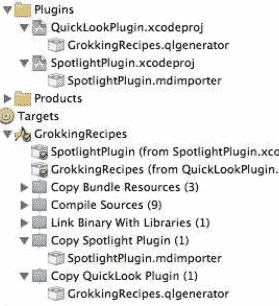

图 7.6：添加所有插件后的 Xcode 项目树

与我们之前添加的 Spotlight 导入器子项目一样，我们需要执行以下步骤：

- 1. 在我们的 recipes 项目下创建一个子项目。同样，我给我的子项目起了个非常聪明的名字：QuickLookPlugin。
- 2. 将该项目拖入主项目，并将其标记为依赖项。
- 3. 向主项目的目标添加一个新的拷贝阶段，并将其目标位置设置为 wrapper，路径设置为 Contents/Library/QuickLook。
- 4. 将 Quick Look 插件拖入新的构建阶段。

如果这些步骤中有任何令人困惑之处，请参阅第 125 页的第 7.1 节，*Xcode 子项目*。添加 Quick Look 子项目后，主项目的树形结构应与图 7.6 类似。

子项目正确设置后，我们会继续将两个 .c 文件重命名为 .m 文件，以便在其中使用 Objective-C。我们还需要将 Foundation.framework 添加到子项目，以便使用 Foundation API。

与 Spotlight 不同，Quick Look 有两个组件。一个是缩略图生成，另一个是预览生成。Finder 既会在标准文件图标的位置使用缩略图，也会在 Cover Flow 中使用缩略图。当在 Finder、Mail 等中调用 Quick Look 时，会使用预览。因此，Quick Look 模板会创建两个 .c（现在为 .m）文件，每个组件一个。我们将先处理缩略图文件。

#### 生成 Quick Look 缩略图

文件 GenerateThumbnailForURL.m 中有一个函数，它由 Quick Look 管理器（操作系统的一部分）调用。该函数期望我们填充 QLThumbnailRequestRef，并返回 noErr 的 OSStatus。根据 Quick Look 的文档，即使我们的插件内部遭遇彻底失败，也始终应返回 noErr。

你大概能猜到，我们的缩略图生成代码会非常简单。由于每个食谱都已经附带了一张图像，我们只需在请求时把该图像传回去即可。

```objective-c
Download Spotlight/QuickLookPlugin/GenerateThumbnailForURL.m
OSStatus GenerateThumbnailForURL(void *thisInterface,
                                 QLThumbnailRequestRef thumbnail,
                                 CFURLRef url,
                                 CFStringRef contentTypeUTI,
                                 CFDictionaryRef options,
                                 CGSize maxSize)
{
    NSAutoreleasePool *pool = [[NSAutoreleasePool alloc] init];
    @try {
        NSDictionary *metadata;
        metadata = [NSDictionary dictionaryWithContentsOfURL:(NSURL*)url];
        NSString *pathToImage = [metadata valueForKey:@"kPPImagePath"];
        if (!pathToImage) {
            //No image available
            return noErr;
        }
        NSData *imageData = [NSData dataWithContentsOfFile:pathToImage];
        if (!imageData) {
            //Unable to load the data for some reason.
            return noErr;
        }

        QLThumbnailRequestSetImageWithData(thumbnail, (CFDataRef)imageData, NULL);
    } @finally {
        [pool release], pool = nil;
    }
    return noErr;
}
```

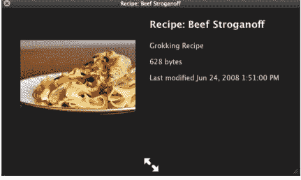

图 7.7：基本的 Quick Look 预览

在该方法中，我们再次获取元数据文件并将其加载到 NSDictionary 中。我们从该字典中获取食谱图像的路径，并将图像加载到 NSData 对象中。随后，我们调用 QLThumbnailRequestSetImageWithData(QLThumbnailRequestRef, CFDataRef, CFDictionaryRef) 方法，它会填充 QLThumbnailRequestRef。完成之后，我们释放 NSAutoreleasePool 并返回 noErr。此后，只要 Quick Look 需要该文件的缩略图，就会使用我们提供的图像。

#### 生成 Quick Look 预览

可以理解，Quick Look 预览比生成缩略图更复杂。如果我们对 Quick Look 的这一部分完全不实现任何内容，仍然会得到相当令人满意的预览，如图 7.7 所示。但既然我们能做更多，为什么止步于此呢？

与上一页第 7.2 节 *生成 Quick Look 缩略图* 中的缩略图生成器一样，预览生成器也包含在一个函数调用中，我们需要填充 QLPreviewRequestRef 并返回 noErr。此外，与缩略图生成器一样，无论函数调用中发生什么，我们都会始终返回 noErr。

与缩略图生成器不同，我们不会只处理食谱的图像。相反，我们将生成一个完整的 HTML 页面，其中包含大量关于食谱的信息，并将其用作预览。虽然在代码中生成整个 HTML 页面是可行的，但我比较懒，宁愿避免那样做。相反，我们将利用一些 XPath 查询来定位模板 HTML 文件中的正确节点，将值改为适合当前食谱的值，并用它来生成 QLPreviewRequestRef。

```objc
NSString *bundleID = @"com.pragprog.quicklook.grokkingrecipe";

OSStatus GeneratePreviewForURL(void *thisInterface,
                               QLPreviewRequestRef preview,
                               CFURLRef url,
                               CFStringRef contentTypeUTI,
                               CFDictionaryRef options)
{
    NSAutoreleasePool *pool = [[NSAutoreleasePool alloc] init];
    @try {
        NSDictionary *metadata;
        metadata = [NSDictionary dictionaryWithContentsOfURL:(NSURL *)url];
        if (!metadata) return noErr;
        NSLog(@"metadata: %@", metadata);

        NSString *imagePath = [metadata valueForKey:@"kPPImagePath"];
        NSData *imageData = [[NSData alloc] initWithContentsOfFile:imagePath];
        if (!imageData) return noErr;
```

首先，我们像之前一样加载元数据字典。我们还会再次将图像数据加载到 NSData 对象中。假设元数据或图像加载都没有问题，下一步就是为 HTML 页面设置选项。

```objc
NSMutableDictionary *imageDict = [NSMutableDictionary dictionary];
[imageDict setValue:imageData
            forKey:(id)QLPreviewPropertyAttachmentDataKey];

if (QLPreviewRequestIsCancelled(preview)) return noErr;

NSMutableDictionary *attachments = [NSMutableDictionary dictionary];
[attachments setValue:imageDict forKey:@"@preview-image"];

NSMutableDictionary *properties = [NSMutableDictionary dictionary];
[properties setValue:attachments
            forKey:(id)QLPreviewPropertyAttachmentsKey];
```


```objective-c
[properties setValue:@"text/html"
            forKey:(id)kQLPreviewPropertyMIMETypeKey];
[properties setValue:@"UTF-8"
            forKey:(id)kQLPreviewPropertyTextEncodingNameKey];
[properties setValue:@"Recipe"
            forKey:(id)kQLPreviewPropertyDisplayNameKey];
```

为了让 Quick Look 能够使用我们提供给它的 HTML 页面，我们需要向它描述该文档，并包含它所拥有的任何附件。这有助于提高 HTML 渲染的性能，因为这样它就不必获取任何附件。因此，在本节中，我们要为 HTML 页面设置属性，包括指定其编码、MIME 类型和附件。我们还会给它一个显示名称，该名称将用于 HTML 页面之外。

下载 Spotlight/QuickLookPlugin/GeneratePreviewForURL.m

```objective-c
NSBundle *bundle = [NSBundle bundleWithIdentifier:bundleID];
NSString *templatePath = [bundle pathForResource:@"preview" ofType:@"html"];
NSURL *templateURL = [NSURL fileURLWithPath:templatePath];

NSError *error = nil;
NSXMLDocument *template;
template = [[[NSXMLDocument alloc] initWithContentsOfURL:(NSURL*)templateURL
    options:NSXMLDocumentTidyHTML
    error:&error] autorelease];

if (!template) {
    NSLog(@"Failed to build template: %@", error);
    return noErr;
}
```

一旦所有准备工作完成，我们就需要从 bundle 中检索 HTML 模板。由于这段代码实际上并不是从我们的 bundle 中被调用的，所以我们不能直接执行 `[NSBundle mainBundle]` 来获取对 NSBundle 的引用。[^5] 相反，我们必须通过它的 UTI 来请求它。有了对 bundle 的引用，我们就可以获取 preview.html 的路径，我们将把它用作模板。一旦我们将 HTML 文件加载到 NSXMLDocument 中，就可以将该文件中的占位符替换为真实数据了。

[^5]: 如果我们尝试这样做，实际上会得到对 /usr/bin/qlmanage 的引用！

下载 Spotlight/QuickLookPlugin/GeneratePreviewForURL.m

```objective-c
//Updating the Title
error = nil;
NSXMLElement *element = [[template nodesForXPath:
    @"//html/body/div/[@id='title']"
    error:&error] lastObject];

if (!element) {
    NSLog(@"Failed to find element: %@", error);
    return noErr;
}
[element setStringValue:[metadata valueForKey:(id)kMDItemDisplayName]];

//Updating the description
error = nil;
element = [[template nodesForXPath:@"/html/body/div/*[@id='description']"
                              error:&error] lastObject];

if (!element) {
    NSLog(@"Failed to find element: %@", error);
    return noErr;
}
[element setStringValue:[metadata valueForKey:(id)kMDItemTextContent]];

//Updating the serves value
error = nil;
element = [[template nodesForXPath:@"/html/body/div/*[@id='serves']"
                              error:&error] lastObject];

if (!element) {
    NSLog(@"Failed to find element: %@", error);
    return noErr;
}
NSNumber *serves = [metadata valueForKey:@"kPPServes"];
[element setStringValue:[NSString stringWithFormat:@"Serves: %@",
                          [serves integerValue]]];

//Updating the last served value
error = nil;
element = [[template nodesForXPath:@"/html/body/div/*[@id='last_served']"
                              error:&error] lastObject];

if (!element) {
    NSLog(@"Failed to find element: %@", error);
    return noErr;
}
NSDate *lastServedDate = [metadata valueForKey:(id)kMDItemLastUsedDate];
if (lastServedDate) {
    NSDateFormatter *dateFormatter;
    dateFormatter = [[[NSDateFormatter alloc] init] autorelease];
    [dateFormatter setDateStyle:NSDateFormatterMediumStyle];
    [dateFormatter setTimeStyle:NSDateFormatterNoStyle];
    [element setStringValue:[NSString stringWithFormat:@"Last Served: %@",
                             [dateFormatter stringFromDate:lastServedDate]]];
} else {
    [element setStringValue:@"Last Served: Never"];
}
```

由于我们知道 HTML 文档的结构，我们可以构建简单的 XPath 查询来检索文档的每个部分，并将其值替换为 NSDictionary 元数据中的数据。

下载 Spotlight/QuickLookPlugin/GeneratePreviewForURL.m

```objective-c
QLPreviewRequestSetDataRepresentation(preview,
    (CFDataRef)[template XMLData],
    kUTTypeHTML,
    (CFDictionaryRef)properties);

} @finally {
    [pool release], pool = nil;
}

return noErr;
```

当所有数据都放入 HTML 文档后，就该渲染它并设置 QLPreviewRequestRef 了。正如你在这段代码中看到的，我们传入引用以及作为数据的 HTML 文件和属性 NSDictionary。完成后，我们弹出 NSAutoreleasePool 并返回 noErr。Quick Look 现在将生成我们的预览并呈现给用户。

#### 测试 Quick Look 插件

在撰写本文时，测试 Quick Look 插件比测试 Spotlight 对应插件更具挑战性。虽然仍然有一个命令行选项可以测试它，但让系统识别插件有点棘手。问题在于系统倾向于忽略你想要使用的生成器，而使用系统定义的生成器。

在编写本章时，我使用了以下工作流程来测试 Quick Look 插件：

- 1. 清理并构建主食谱应用程序。
- 2. 在命令行中，执行 `qlmanage -r` 来重置 Quick Look 生成器。
- 3. 运行食谱应用程序，这会使我们的 Quick Look 生成器被注册。
- 4. 从命令行（也可以在 Xcode 内部完成），我运行了 `qlmanage -p ${path to metadata test file}`，这将生成预览。使用 `-t` 开关则会生成缩略图。
- 5. 重复上述步骤。

我希望当你读到这篇文章时，工作流程已经有所改进。`qlmanage` 命令行上有一个 `-g` 开关，应该可以覆盖系统生成器，但遗憾的是，目前它似乎不起作用。

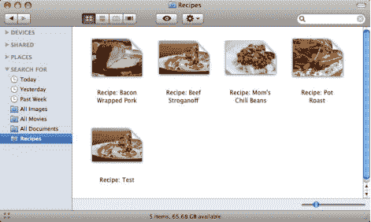

图 7.8：在智能文件夹中显示元数据文件

### 7.3 综合运用

有了 Spotlight 导入器和 Quick Look 生成器，就可以在 Mac OS X 中实现一些非常有趣的功能。例如，我们可以构建一个智能文件夹来查找所有食谱。然后我们可以将该智能文件夹放在 Finder 的边栏中，并能够直接从 Finder 轻松访问所有食谱。此外，我们可以为这个智能文件夹启用 Cover Flow，并流畅地浏览食谱的图片。参见图 7.8。

借助所包含的元数据，这将开启许多想法。例如，对于每个食谱，我们在元数据中存储了它上次被供应的时间。我们可以利用这些信息进一步优化智能文件夹，只显示过去三十天内未供应过的食谱。既然操作系统已经能够感知元数据，那么就可以非常创造性地使用元数据。

### 7.4 更进一步

#### UTIs 的进一步使用

使用 UTI，可以进一步与操作系统、Spotlight 和 Quick Look 集成。可以发布 UTI 的完整描述——有效地将其注入到树中，从而使数据类型出现在 Spotlight 规则等中。然而，这超出了本书的范围。


#### 减小元数据文件的大小

根据应用程序的不同，可以大幅减小元数据文件。由于导入器（和生成器）可以启动整个 Core Data 堆栈，因此可以只将 NSManagedObjectID（甚至 Recipe 对象中的唯一标识符）存储在元数据文件中，并让导入器和生成器从 Core Data 堆栈中检索所有元数据信息。这也会简化元数据的更新，因为到那时唯一需要的操作就是删除不再存在的记录的元数据文件。但是，必须谨慎对待这种方法，因为性能可能会受到很大影响。

#### 改进 Quick Look 缩略图生成器

你可能已经注意到，我们忽略了 Quick Look 缩略图生成器的最大尺寸设置。这是为了清晰起见而做的，在生产系统中，我们应该缩小图像以适应该设置。通过这样做，我们既成为好公民，也有助于提高 Quick Look 在处理我们的文件时的性能。

#### 基于文档的应用程序

在编写使用文档模型而不是单一存储库的应用程序时，集成 Spotlight 和 Quick Look 会更加容易。我们不必使用单独的元数据文件，而是可以将相关信息直接存储在实际文档的元数据中。这允许导入器读取元数据，而无需初始化整个 Core Data 堆栈，并且仍然可以非常快速地访问相关信息。


这可能与 Core Data 在 Snow Leopard 内部的做法非常相似。


## 同步服务与 Core Data

云计算是我们的未来。用户不希望还要操心自己把数据存储在哪台计算机上。当我在外出时在笔记本电脑上输入一个新联系人，而它会同步到我的其他计算机和手机上，知道这一点让我感到非常安心。对于每一个适合跨计算机共享数据的应用程序，作为开发者，我们都有责任为用户提供这一选项。

幸运的是，Apple 在 Leopard 中对同步服务做出了巨大改进。其中一项改进是将同步服务与 Core Data 集成。尽管使用同步服务仍然并非易事，但它比 Tiger 中显著简单得多，而且与 Core Data 结合使用时，甚至比不结合时还要容易。

当我们的数据存储在 Core Data 中，并且我们编写的应用程序至少以 Leopard 为目标平台时，同步服务可以直接使用 Core Data 模型来获取待同步数据的信息。此外，就同步服务 API 而言，Core Data 的数据格式是已知的，因此执行一次同步所需的代码只有一行。对于任何在先前版本的 Mac OS X 下编写过同步服务代码的人来说，这将是一个受欢迎的变化。

尽管同步操作本身只有一行代码，但要让同步正确工作仍然需要相当多的工作。我们需要为同步服务正确配置数据模型，创建同步模式（sync schema），并向应用程序添加同步逻辑，还需要对持久化存储协调器做几处修改。

总体而言，为应用程序添加同步可能颇具挑战，但最终结果绝对值得。完成之后，我们的用户将不必担心自己是在哪台 Mac 上添加或更新食谱的。只要在他们的笔记本电脑上更新食谱，就会使其在他们拥有的其他每台 Mac 上得到更新。

### 8.1 同步服务基础

从概念上讲，同步服务基于单一真相来源（single source of truth）的原则工作。该真相库存储在操作系统层面，其运作方式非常像数据库。每个应用程序的每个实体都作为一条记录存储在真相库中，而真相库会跟踪对每个实体的每一次更改。

#### 同步客户端

每个应用程序、设备、服务器或对等端¹都被视为同步服务的客户端，并与真相库通信。即使某个应用程序是这些数据的来源，比如我们的食谱应用程序，它仍然被视为真相库的客户端，因此会同步到该真相库。

¹ 目前唯一可用的服务器是 MobileMe，并且没有针对对等端的相关支持。

作为客户端，我们的应用程序需要向真相库注册，并向它提供一个描述。该描述会让真相库知道我们的名称、在提及我们时使用的图像，以及我们关心的实体。实体这一部分正是同步服务非常强大的原因。我们可以订阅比我们自己产生的更多的数据。例如，如果我们感兴趣，就可以接收日历、联系人或书签的同步通知。尽管此时我们只关注自己的食谱对象，但监听更多内容绝对是*可能的*。

作为注册的一部分，每个客户端定义一个回调方法，同步服务将使用该方法让客户端知道即将发生一次同步。客户端可以选择在那个时候不参与同步，但一般来说，参与同步是个好主意。除非客户端关心的数据正在被同步，否则同步服务不会调用该客户端。

执行同步时，同步过程包含三个步骤：推送（push）、混合（mingle）和拉取（pull）。在推送阶段，每个客户端会推送自上次同步以来发生的所有更改。一旦真相库接收到来自所有客户端的所有更改，就会执行一次混合。混合会将来自所有客户端的所有更改合并成一个数据集。这种混合完全在真相库内部进行，客户端只需等待该阶段结束。一旦混合阶段完成，

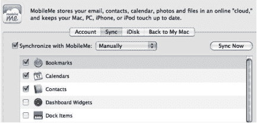

图 8.1：MobileMe 系统偏好设置

### 8.2 更新数据模型

让我们的应用程序为同步服务做好准备的第一步，是更新数据模型，以反映我们希望同步的内容、什么被视为标识项（概念上类似于数据库术语中的主键），以及什么会触发“数据已更改”通知。所有这些都直接通过数据模型进行配置，而且幸运的是，进行这些更改不会触发数据模型本身的版本差异，因此我们不必创建新的数据和映射模型。

#### 设置数据类

同步服务中令人困惑的一点是它使用的一些术语。数据类就是一个例子。由于来自 Core Data，人们会认为这指的是描述数据的对象类。不幸的是，这并不是它在同步服务中的含义。相反，它是一个唯一标识符，定义了一组逻辑数据分组。例如，整个地址簿的数据模型被称为 com.apple.contact 数据类。对于我们的应用程序，数据类将是 com.pragprog.GrokkingRecipes。这是我们将分配给数据模型中每个实体的值。你会注意到，当我们输入这个值时，Xcode 会自动将实体本身的名称追加到数据类名称的末尾。这为每个实体创建了唯一的名称。

#### 属性和关系名称

每个实体中的每个属性和关系也都有自己的唯一名称。属性和关系的格式为 DataClass.EntityName/AttributeName。例如，食谱实体的名称将被称为 com.pragprog.GrokkingRecipes.Recipe/name。

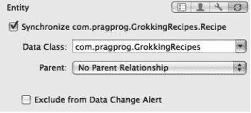

图 8.2：设置数据类

#### 设置标识属性

在为数据模型中的每个实体设置数据类之后，下一步是为同步服务设置哪些属性和/或关系是标识属性。此设置的目的是告诉同步服务，它应使用哪些属性或关系来匹配应用程序、服务器或对等端之间的记录。当同步服务尝试合并来自两个不同来源的数据时，它会查看这些标识属性，以找出会被视为相同的记录。例如，如果我们通过 MobileMe 合并来自两台计算机的食谱数据，并且正在查看 Author 实体，我们会比较每个作者的 name 属性。如果名称相同，那么出于同步目的，我们会将其视为同一条记录。

#### Author 设置

对于 Author，设置非常简单，因为对象本身非常简单。我们将 name 属性设置为标识属性，并且 name 和 recipes 都不会从数据变更提醒中排除。

#### Ingredient 设置

Ingredient 实体的配置与 Author 实体几乎完全相同。name 属性仍将用作标识属性；其余所有属性和关系都将包含在同步中，并且它们都不会从数据变更提醒中排除。

#### Recipe 设置

Recipe 实体有一种特殊情况。首先，imagePath 非常特定于存储食谱的机器。该路径不太可能（也没有必要）在多台机器上相同。因此，我们不会同步此属性。但是，我们确实希望图像本身能跨机器同步。为实现这一点，我们将稍微更改实体；我们会添加一个名为 image 的新属性，并将其配置为可选且瞬态。通过将其标记为瞬态，我们不必担心数据模型的版本变更。你会记得，将其设置为瞬态也意味着它不会存储在我们的存储库中，而这正是我们想要的。尽管我们不希望它存储在存储库中，但我们确实希望它跨机器同步。因此，我们将确保 Synchronize 选项设置为 YES。要完成此属性，我们需要向 PPRecipe 对象添加逻辑来处理图像。

下载 SyncServices/PPRecipe.m

```objective-c
- (NSData*)image
{
    NSLog(@"%@:%s entered", [self class], _cmd);
    if (image) return image;
    NSString *path = [self primitiveValueForKey:@"imagePath"];
    if (!path) return nil;
    image = [[NSData alloc] initWithContentsOfFile:path];
    return image;
}

- (void)setImage:(NSData*)data
{
    NSLog(@"%@:%s entered", [self class], _cmd);
    NSString *destPath = [self primitiveValueForKey:@"imagePath"];
    if (!destPath) {
        //Build the path we want the file to be at
        destPath = [[NSApp delegate] applicationSupportFolder];
        NSString *guid = [[NSProcessInfo processInfo] globallyUniqueString];
        destPath = [destPath stringByAppendingPathComponent:guid];
        [self setValue:destPath forKey:@"imagePath"];
    }
    [data writeToFile:destPath atomically:NO];
}
```


```
[data retain];
[image release];
    image = data;
}
```

在我们添加到 PPRecipe 对象的访问器方法中，我们正在获取存储在 imagePath 对应磁盘位置的图像数据。当数据被设置而 imagePath 未设置时，我们将在 Application Support 目录中创建一个新文件并保存它。这些访问器现在允许图像在 Sync Services 中传递，而不必存储在仓库中。

至于其余属性和关系，它们都被标记为要同步，只有 name 属性被标记为标识属性。

#### RecipeIngredient 设置

RecipeIngredient 实体在同步时并不常见。因为它基本上是一个连接表（借用数据库术语），没有任何属性可以将其标识为唯一。因此，我们将同步它的一个属性 quantity，但会将其关系标记为标识属性。通过将所有三个关系标记为记录的标识，我们保证每个 Ingredient、Recipe 和 UnitOfMeasure 组合的唯一性。

#### Type 设置

对于 Type 实体，我们同步此对象只是为了在同步客户端之间保留关系。尽管此数据永远不会改变，因此并不真正需要同步，但我们确实希望同步 Type 实体和 Recipe 实体之间的关系。因此，我们将 name 标记为标识属性，并将其关系包含在同步中。

#### UnitOfMeasure 设置

与 Author 实体一样，此实体将 name 属性作为其标识属性，并将其关系包含在同步中。

### 8.3 创建同步架构

现在我们的数据模型已准备好进行同步，是时候构建同步架构本身了。Mac OS X 使用同步架构来描述我们与同步生态系统的交互以及我们如何集成到其中。如果我们不使用 Core Data，我们就需要在同步架构中描述每个实体、属性和关系。幸运的是，由于我们使用 Core Data，那部分就不需要了。这样一来，架构中需要包含的内容就是定义数据类、本地化，以及 Sync Services 在提及我们的数据类时使用的图标。完成后，我们将有另一个捆绑包包含在应用程序中，在处理 Sync Services 时会引用它。

#### 设置同步架构子项目

就像我们在第 7 章 *Spotlight、Quick Look 与 Core Data*（第 114 页）中创建的 Spotlight 和 Quick Look 子项目一样，我们将向食谱应用程序添加第三个子项目。与前两个一样，同步架构项目模板位于 Xcode 的 Standard Apple Plugins 部分下。创建子项目后，我们将该项目拖入主项目，并在应用程序目标中将其定义为依赖项。设置依赖项后，将 .syncschema 捆绑包添加到目标的 Copy Bundle Resources 阶段。

#### 创建 Schema.plist

尽管可以向同步架构添加自定义代码，以在显示同步错误对话框时帮助显示数据，但就我们的目的而言，我们实际上只需要设置 Schema.plist 文件。使用模板创建的头文件和实现文件可以删除，因为我们不需要它们。

Schema.plist 文件描述了 Sync Services 需要了解的关于我们数据的一切。根据我们的需要，需要在此 plist 中设置三个键：DataClasses、ManagedObjectModels 和 Name。

##### DataClasses 键

DataClasses 键有两个值：Name 和 ImagePath。Name 值旨在进行本地化，因此在此文件中不需要对用户友好。对于我们的食谱，我将数据类命名为 com.pragprog.GrokkingRecipes。唯一的要求是该名称必须唯一。因此，反向点号表示法有助于保证这一点。另一个值 ImagePath 需要指向一个图像文件，Sync Services 在引用我们的数据时将使用该文件。例如，此图像用于系统偏好设置和数据更改警告对话框中。就我们的需要而言，应用程序图标已足够，因此我们在同步架构捆绑包中包含它的一个副本。

##### ManagedObjectModels 键

ManagedObjectModels 键是一个文件引用数组，指向 .mom 文件。请注意，此键不接受带版本的管理对象模型捆绑包，因此我们需要指向模型的特定版本。由于我们当前使用的是模型的第 3 版，我们将指向该模型。此键可以接受多个模型，因此如果我们已将数据模型拆分为多个管理对象模型文件，我们会将它们全部添加到这里。

##### Name 键

此 name 属性指的是 *架构* 的名称，而不是数据的名称。此名称在 Sync Services 内部使用，完全不会暴露给用户。由于我们的应用程序中只有一个数据类，我们可以将架构命名为与数据类相同的名称：com.pragprog.GrokkingRecipes。

##### 本地化架构字符串

尽管我们的应用程序除英语外没有针对任何语言进行本地化，我们仍需要为同步架构创建一个字符串文件。当 Sync Services 显示有关我们数据的信息时，此本地化文件会将唯一标识符转换为人类可读的名称。与其他本地化文件一样，此文件是一个名称–值对列表，其中名称部分是我们数据类、实体、属性和关系的唯一名称，值是人类可读的对应名称。

```
/* Localized strings for GrokkingRecipes */

"com.pragprog.GrokkingRecipes" = "Grokking Recipes";

"com.pragprog.GrokkingRecipes.Author" = "Author Entity";
"com.pragprog.GrokkingRecipes.Author/name" = "Author Name";

"com.pragprog.GrokkingRecipes.Ingredient" = "Ingredient Entity";
"com.pragprog.GrokkingRecipes.Ingredient/cost" = "Cost";
"com.pragprog.GrokkingRecipes.Ingredient/name" = "Ingredient Name";
"com.pragprog.GrokkingRecipes.Ingredient/quantity" = "Quantity";

"com.pragprog.GrokkingRecipes.Recipe" = "Recipe Entity";
"com.pragprog.GrokkingRecipes.Recipe/type" = "Recipe Type";
"com.pragprog.GrokkingRecipes.Recipe/desc" = "Description";
"com.pragprog.GrokkingRecipes.Recipe/lastUsed" = "Last Used";
"com.pragprog.GrokkingRecipes.Recipe/name" = "Recipe Name";
"com.pragprog.GrokkingRecipes.Recipe/serves" = "Serves";

"com.pragprog.GrokkingRecipes.RecipeIngredient" = "Quantity Entity";
"com.pragprog.GrokkingRecipes.RecipeIngredient/quantity" = "Quantity";

"com.pragprog.GrokkingRecipes.Type" = "Type Entity";
"com.pragprog.GrokkingRecipes.Type/name" = "Name";

"com.pragprog.GrokkingRecipes.UnitOfMeasure" = "Unit of Measure Entity";
"com.pragprog.GrokkingRecipes.UnitOfMeasure/name" = "Name";
```

### 8.4 创建客户端描述文件

现在我们已经组装好架构，是时候构建客户端描述文件了。此文件与我们刚刚构建的同步架构不同，因为它是从客户端的视角来看待同步的。同步架构告诉 Sync Services 将同步哪些数据，而客户端描述告诉 Sync Services 此应用程序将同步哪些数据。完全可能出现这样的情况：某个客户端只想要数据的一个子集，而不关心某些部分。例如，如果我们想构建一个显示食谱的 Dashboard 小部件，它可能不关心作者，因此不会将作者添加到其客户端描述中。

由于我们是此架构的主应用程序，我们将同步所有可用数据。此文件名为 ClientDescription.plist，它是主应用程序捆绑包的一部分，并将包含在应用程序捆绑包的 Resources 子目录中。此 plist 内有四个键：DisplayName、ImagePath、Type 和 Entities。当 Sync Services 需要显示关于此客户端的具体信息而不是关于架构本身的信息时，会同时使用 DisplayName 和 ImagePath。然而，由于我们的应用程序是此架构的主应用程序（而不是日历或联系人数据），我们可以使用与架构相同的名称和图像。Type 键定义我们是什么类型的客户端，选项有 app、device、server 或 peer。对于我们的应用程序，答案是 app。

剩下的是 Entities 键。Entities 键告诉 Sync Services 我们的客户端关心哪些实体，以及这些实体的属性/关系。由于我们是主应用程序，我们关心所有实体、它们的属性和关系。

```
Download SyncServices/ClientDescription.plist
<?xml version="1.0" encoding="UTF-8"?>
<!DOCTYPE plist PUBLIC "-//Apple//DTD PLIST 1.0//EN"
  "http://www.apple.com/DTDs/PropertyList-1.0.dtd">
<plist version="1.0">
<dict>
    <key>DisplayName</key>
```


```xml
<string>Grokking Recipes</string>
<key>ImagePath</key>
<string>App.icns</string>
<key>Type</key>
<string>app</string>
<key>Entities</key>
<dict>
  <key>com.pragprog.GrokkingRecipes.Author</key>
  <array>
    <string>com.apple.syncservices.RecordEntityName</string>
    <string>name</string>
    <string>recipes</string>
  </array>
  <key>com.pragprog.GrokkingRecipes.Ingredient</key>
  <array>
    <string>com.apple.syncservices.RecordEntityName</string>
    <string>cost</string>
    <string>name</string>
    <string>quantity</string>
    <string>recipes</string>
    <string>unitOfMeasure</string>
  </array>
  <key>com.pragprog.GrokkingRecipes.Recipe</key>
  <array>
    <string>com.apple.syncservices.RecordEntityName</string>
    <string>desc</string>
    <string>lastUsed</string>
    <string>name</string>
    <string>serves</string>
    <string>type</string>
    <string>author</string>
    <string>ingredients</string>
    <string>image</string>
  </array>
  <key>com.pragprog.GrokkingRecipes.RecipeIngredient</key>
  <array>
    <string>com.apple.syncservices.RecordEntityName</string>
    <string>quantity</string>
    <string>unitOfMeasure</string>
    <string>ingredient</string>
    <string>recipe</string>
  </array>
  <key>com.pragprog.GrokkingRecipes.Type</key>
  <array>
    <string>com.apple.syncservices.RecordEntityName</string>
    <string>name</string>
  </array>
  <key>com.pragprog.GrokkingRecipes.UnitOfMeasure</key>
  <array>
    <string>com.apple.syncservices.RecordEntityName</string>
    <string>name</string>
<string>ingredients</string>
<string>recipeIngredients</string>
</array>
</dict>
</dict>
</plist>
```

### 8.5 修改 NSPersistentStoreCoordinator

关于Sync Services，有一点必须始终牢记：我们希望它快速——越快越好。如果它变慢，各种坏事都可能发生。例如，电脑可能在同步过程中进入睡眠，用户可能退出应用程序，网络连接可能中断——这样的例子不胜枚举。因此，我们要确保当同步真正发生时，它能够非常迅速。不幸的是，Core Data虽然在自身环境下算得上快速，但对于同步来说可能太慢。为了解决这个问题，NSPersistentStoreCoordinator在Sync Services框架的类别中附带了一个额外的方法。这个方法`setStoresFastSyncDetailsAtURL:forPersistentStore:`定义了一个额外的存储，供Sync Services在准备下一次同步操作时存储信息。这个额外存储不是数据的副本，而是类似于关于NSPersistentStore中各种对象的备注，可在同步过程中用来加快速度。

需要注意，没有这个额外设置，Core Data存储库的同步将无法工作。如果你遇到其他应用程序的同步无法工作的问题，务必检查快速同步存储是否已设置并创建。

将这种存储添加到我们的应用程序，需要对我们的-persistentStoreCoordinator方法做一处小幅改动。

```objective-c
NSPersistentStore *store;
store = [persistentStoreCoordinator addPersistentStoreWithType:NSXMLStoreType
                                                     configuration:nil
                                                                  URL:nil
                                                               options:nil
                                                                  error:&error];

if (!store) {
    NSLog(@"%@:%s presenting error no store", [self class], __cmd);
    [[NSApplication sharedApplication] presentError:error];
    return nil;
}

NSString *fss = @"GrokkingRecipes.fastsyncstore";
fss = [applicationSupportFolder stringByAppendingPathComponent:fss];
NSURL *fsdURL = [NSURL fileURLWithPath:fss];

[persistentStoreCoordinator setStoresFastSyncDetailsAtURL:fsdURL
                                      forPersistentStore:store];

return persistentStoreCoordinator;
```

在这段代码片段中，有两个重要变化。首先，我们不再检查对addPersistentStoreWithType:configuration:URL:options:error:的调用是否返回nil，而是将其结果赋给一个局部变量。我们这样做是为了能在后面将它传递给setStoresFastSyncDetailsAtURL:forPersistentStore:方法。接下来，我们为快速同步存储构建一个写入路径。由于我们将数据存储在Application Support文件夹中，因此将它放在主持久化存储旁边是合理的。如果我们使用的是文档应用程序，那么将它存储在其他地方或使用唯一文件名可能更合适。路径构建好后，我们将该路径以及对NSPersistentStore的引用一起传递给NSPersistentStoreCoordinator上的类别方法setStoresFastSyncDetailsAtURL:forPersistentStore:。这就是我们为启用Sync Services支持而对Core Data栈所做的唯一修改。

### 8.6 创建同步助手

现在是将所有部分组合起来的时候了。虽然这段代码几乎可以放在任何地方，但为了清晰起见，我决定将所有同步代码分离到单独的类中。最初编写这段代码时，我把它放到了AppDelegate.m中，但很快就发现这导致该对象过于复杂、难以理解。因此，我决定将同步代码分离成一个小型辅助类。

#### NSPersistentStoreCoordinatorSyncing

正如我在基础知识（第8.1节，*同步服务基础知识*，第141页）中提到的，Sync Services需要一个回调来让我们的客户端了解正在发生的事情。准确地说，我们既需要一个回调，也需要一个协议。回调由Sync Services使用，让我们的应用程序知道同步即将发生。协议允许我们监听该同步，并在同步过程中回答问题。我们的同步助手将实现名为NSPersistentStoreCoordinatorSyncing的协议。

```objc
for (NSError *suberror in [ui valueForKey:NSDetailedErrorsKey]) {
    NSLog(@"%@", suberror);
}
[NSApp presentError:error];
}
error = nil;
```

我们的SyncHelper在初始化时接受两个参数：一个是对AppDelegate的引用，一个是指向NSError的指针。如果注册过程出现问题，NSError会被填充，SyncHelper将返回nil。如果发生这种情况，我们将向用户呈现错误并继续。

在SyncHelper内部，我们将对AppDelegate的引用赋给一个ivar，并尝试将我们自己注册为Sync Services的客户端，然后开始同步。

```objc
// Download SyncServices/SyncHelper.m
- (id)initWithDelegate:(id)_delegate error:(NSError**)error
{
    if (!(self = [super init])) return nil;
    delegate = _delegate;

    ISyncClient *client = [self syncClient:error];
    if (!client) {
        [self autorelease];
        return nil;
    }
    [client setSyncAlertHandler:self
            selector:@selector(client:mightWantToSyncEntityNames:)];
    if (![self performSync:error]) {
        [self autorelease];
        return nil;
    }

    return self;
}
```

在这个方法中，我们将SyncHelper的这个实例设置为Sync Services的回调，以便在同步即将于我们的应用程序外部启动时通知我们。当这发生时，我们会收到发送到-client:mightWantToSyncEntityNames:的消息，并做出相应的反应。这个对象初始化中最复杂的部分是如何获取对ISyncClient对象的引用。由于在我们的应用程序生命周期中会多次获取这个引用，因此已将它放在单独的方法中。

```objective-c
(ISyncClient *)syncClient:(NSError **)error
{
    NSString *ident = [[NSBundle mainBundle] bundleIdentifier];
    ISyncClient *client;
    NSDictionary *dict;
    ISyncManager *manager = [ISyncManager sharedManager];
    NSBundle *mainBundle = [NSBundle mainBundle];

    @try {
        client = [manager clientWithIdentifier:ident];
        if (client) return client;
```

尝试获取ISyncClient引用时，我们做的第一件事是使用我们的包标识符作为名称，向ISyncManager请求它。如果我们之前已经在ISyncManager注册过，那么这次调用将返回我们的客户端，我们就完成了。如果这是我们第一次经历这个过程，那么该调用将返回nil，我们将不得不在ISyncManager处注册。

```objective-c
NSString *path = [mainBundle pathForResource:@"GrokkingRecipes"
                                      ofType:@"syncschema"];
if (![manager registerSchemaWithPath:path]) {
    NSString *err = NSLocalizedString(@"Failed to register the schema",
                      @"Failed to register the schema");
    dict = [NSDictionary dictionaryWithObject:err
                        forKey:NSLocalizedDescriptionKey];
    *error = [NSError errorWithDomain:@"PragProg"
                                  code:8001
                              userInfo:dict];

    return nil;
}
```

这就是我们构建的同步模式发挥作用的地方。由于我们的客户端尚未注册，所以我们知道，因为我们是数据的发起者，我们的模式也尚未注册。因此，第一步是在我们的应用程序中找到GrokkingRecipes.syncschema包，并在ISyncManager中注册它。如果这步不成功，我们就会填充NSError并返回nil。假设成功了，下一步就是注册我们的客户端。

```objective-c
path = [mainBundle pathForResource:@"ClientDescription"
                             ofType:@"plist"];
client = [manager registerClientWithIdentifier:ident
                              descriptionFilePath:path];
```


模式注册完成后，现在需要注册我们的客户端。这里我们获取之前创建的 `ClientDescription.plist` 的引用，并将其连同我们的唯一标识符一起传给 ISyncManager。这会注册我们的客户端，并返回对我们 ISyncClient 对象的引用。现在客户端已注册，我们需要开启与所有其他客户端类型的同步。这样我们就能决定要参与哪些同步。同样，由于我们是数据的发起方，我们希望参与每一次同步。

```objc
[client setShouldSynchronize:YES
              withClientsOfType:ISyncClientTypeApplication];
[client setShouldSynchronize:YES
              withClientsOfType:ISyncClientTypeDevice];
[client setShouldSynchronize:YES
              withClientsOfType:ISyncClientTypeServer];
[client setShouldSynchronize:YES
              withClientsOfType:ISyncClientTypePeer];
```

此方法的最后一步是捕获并处理我们收到的任何异常。在本书写作时，这个过程仍可能抛出少数异常，因此我们要确保捕获这些异常，将它们封装进 NSError，并交回给调用方。假设没有出问题，我们就返回 ISyncClient。

```objc
} @catch (NSException *exception) {
    dict = [NSDictionary dictionaryWithObject:[exception reason]
                         forKey:NSLocalizedDescriptionKey];
    *error = [NSError errorWithDomain:@"PragProg"
                                  code:8002
                              userInfo:dict];
    return nil;
}
return client;
}
```

#### 执行同步

既然已经注册了模式和同步客户端，我们需要能够处理同步可能发生的两种方式。我们可以主动发起同步，也可以接收即将发生同步的通知。幸运的是，我们以相同方式处理这两种情况。

2. 反正它们本来就该在那里。

当同步即将开始时，我们要做的第一件事是对 NSManagedObjectContext 执行保存。保存完成后，就可以告诉 Sync Services 我们已准备好执行同步。因此，我们需要对全局保存方法做一点小改动。既然我们已经在第 7 章 *Spotlight、Quick Look 与 Core Data* 第 114 页把所有保存逻辑放进了一个方法中，那么从那里启动同步操作就非常合理。

下载 `SyncServices/AppDelegate.m`

```objc
NSLog(@"%@:%s Performing sync", [self class], _cmd);
if (![_syncHelper performSync:&error]) {
    return NO;
}
```

保存操作一返回，我们就想调用 SyncHelper，并让它执行 -performSync:。我们向该方法传入一个 NSError，以便在同步期间发生错误时能获知。

下载 `SyncServices/SyncHelper.m`

```objc
- (BOOL)performSync:(NSError **)err
{
    ISyncClient *client = [self syncClient:err];
    if (!client) return NO;

    NSLog(@"Starting sync");
    NSPersistentStoreCoordinator *store = [delegate persistentStoreCoordinator];
    return [store syncWithClient:client
                     inBackground:YES
                           handler:self
                            error:err];
}
```

在 -performSync: 方法中，我们获取 ISyncClient 的新引用以及 NSPersistentStoreCoordinator 的引用。借助这两个引用，我们将使用 Sync Services 类别中为 NSPersistentStoreCoordinator 添加的第二个方法，并通过 syncWithClient:inBackground:handler:error: 方法请求同步。如果同步失败，则向调用方返回 NO，并填充 NSError。由于我们把 SyncHelper 作为此次同步的处理程序传入，而它实现了 NSPersistentStoreCoordinatorSyncing 协议，因此它将收到前面讨论的所有通知。

为了确保元数据是最新的，我们需要完善其中一个委托回调方法，具体来说是 -persistentStoreCoordinator:didFinishSyncSession:。在该方法中，我们要检查 NSManagedObjectContext 中是否有更改；如果有，就更新元数据并保存上下文。

我们需要做的最后一件事是处理外部同步请求。既然我们已经将 `-client:mightWantToSyncEntityNames:` 定义为外部同步启动时要调用的方法，那么此时就需要请求一次保存。

```objc
- (void)client:(ISyncClient *)client mightWantToSyncEntityNames:(NSArray *)names
{
    NSError *error = nil;
    if (![delegate save:&error]) {
        [NSApp presentError:error];
    }
}
```

由于我们保存 NSManagedObjectContext 的调用也会启动同步，因此无需再做其他事情。

### 8.7 Syncrospector 工具

Sync Services 还额外复杂，调试和测试都相当困难。由于 truth 实际上是一个黑盒，通常我们只能试探它并观察响应。幸运的是，在较新的 Xcode 构建版本中，Apple 提供了一个名为 Syncrospector 的开发工具的可用副本。你可以在 Developer 目录（取决于你安装的位置，通常在 /Developer）、Applications 文件夹，最后在 Utilities 子文件夹中找到 Syncrospector。这个工具让我们可以窥探 truth 内部，甚至重置数据或强制进行不同类型的同步。

#### 客户端面板

客户端面板显示 Sync Services 的所有已知客户端。在此面板中，我们可以查看客户端是否已正确注册、它注册了哪些数据类，以及每个实体的状态。我们还可以从此面板强制同步客户端。参见下页的图 8.3。在 Syncrospector 内所有可用面板中，这是我最常用的两个面板之一。

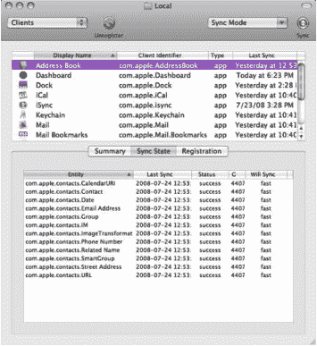

图 8.3：Syncrospector 的客户端面板

#### Truth 面板

Truth 面板允许我们查看当前位于 truth 中的数据。对于每个实体，我们可以看到它最后更新于何时，以及是谁更改了它。当我试图弄清楚数据出了什么问题并查看是谁弄乱它时，我发现这个面板很有用。

#### 历史面板

历史面板允许我们查看 truth 内部曾经发生过的每一个事务。借助此面板，无论事情发生得多久以前，都可以追踪数据在何处被搞乱以及被谁搞乱。

#### 模式面板

模式面板是我非常频繁使用的另一个面板。它显示 truth 中注册的所有模式，并允许我们检查它们的全部详细信息。此外，还可以通过此面板从 truth 中删除某个模式。最后，此面板可用于清除 truth 和客户端中的数据。这在测试期间非常有用。

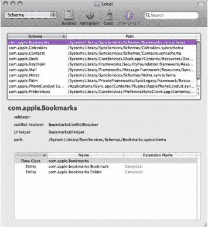

图 8.4：Syncrospector 的模式面板

### 8.8 小结

由于本书聚焦于 Core Data，我们尚未涵盖 Sync Services 的不少领域。若想全面掌握该框架的知识，你应更深入地研究以下主题。

#### 模式版本管理

这一主题目前仍在不断变化，到本书出版时可能已经改变。就目前而言，如果你的模式需要更改，那么理想情况下，该数据的所有客户端都应更新到最新模式。如果它们不更新，用户可能会得到不一致的结果。

此外，模式绑定到 NSManagedObjectModel 的特定版本。因此，如果数据模型发生变化，很可能需要新的模式，或者至少模式需要引用最新的数据模型。

## 第 9 章

## 多线程与 Core Data

你的主力机器很可能至少有两个核心。如果你开发用的每台机器都至少有两个甚至更多核心，我也不会感到惊讶。对于运行在 Mac OS X 上的每个中等复杂度应用来说，多线程很快将成为必需。这是我们开发人员在开发应用时需要接受并规划的事情。幸运的是，Mac OS X 中的新特性使我们更容易进行多线程，也更不容易出错。

然而，问题在于 Core Data 本质上并非线程安全。它仍然希望并期望在单线程中运行。因此，当我们开始为应用引入多线程时，必须注意正确使用 Core Data，以避免线程问题。

### 9.1 为什么 Core Data 不是线程安全的？

你可能会惊讶地发现，Cocoa 和 Objective-C 中有很多东西并非线程安全，而 Core Data 只是众多例子之一。例如，每当你更改 GUI 控件时，都建议在主线程上执行，因为 UI 不是线程安全的。

在多线程中处理 Core Data 的最大问题是保持 NSManagedObjectContext 同步。当在不同于创建 NSManagedObjectContext 的线程上对 NSManagedObject 做出更改时，上下文不会感知到该更改，并可能持有过期数据。这就是 Core Data 中非线程安全的部分。NSPersistentStore、NSPersistentStoreCoordinator 和 NSManagedObjectModel 都完全线程安全，但 NSManagedObjectContext 不是。


#### NSOperation 与 NSOperationQueue

在本章中，我们将大量使用 NSOperation 和 NSOperationQueue。这些类是在 Mac OS X 10.5 Leopard 中作为 Cocoa 的一部分加入的，专门用于让线程处理更容易。尽管我们不会详细讲解如何使用这些类，但充分学习这些类具有极大价值，以便你可以在自己的项目中正确使用它们。

使用 NSOperation 时，有一个命名问题常常会引起一些困惑。NSOperation 使用一个名为 -main 的方法作为入口点，用于执行 NSOperation 在后台线程上运行时要完成的工作。NSOperationQueue 会直接调用这个方法。

另一个问题是并发性。如果 NSManagedObject 在多个线程上被更新，那么其中一个或多个更新的结果将是不确定且不可预测的。因此，建议 NSManagedObject 实例不要跨越线程“边界”。

### 9.2 创建多个上下文

目前，有一种被认可的方法可以跨多个线程使用 Core Data。这种方法涉及为每个将与 Core Data 交互的线程创建一个单独的 NSManagedObjectContext。在后台线程上创建单独的上下文非常直接，并且与在主线程上创建 NSManagedObjectContext 几乎相同。

```objective-c
- (NSManagedObjectContext*)newContextToMainStore
{
    NSPersistentStoreCoordinator *coord = nil;
    coord = [AppDelegate persistentStoreCoordinator];

    NSManagedObjectContext *moc = [[NSManagedObjectContext alloc] init];
    [moc setPersistentStoreCoordinator:coord];
    return [moc autorelease];
}
```

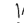

#### Joe 问……
#### 我什么时候需要担心线程问题？

确定何时适合使用线程是一件困难的事。通常，只要某个操作会阻止 UI 线程绘制，或者让操作系统认为应用程序无响应，我就会把它放到另一个线程中。当应用程序开始出现“沙滩球”（beach-balling）时，就该优化应用程序并考虑线程处理了。

如方法 -newContextToMainStore 所示，我们获取对现有 NSPersistentStoreCoordinator 的引用，并将其用于新 NSManagedObjectContext 的初始化。

尽管 NSPersistentStoreCoordinator 也不是线程安全的，但 NSManagedObjectContext 知道在使用时如何正确地锁定它。因此，我们可以按需将任意多个 NSManagedObjectContext 对象附加到单个 NSPersistentStoreCoordinator 上，而不必担心冲突。

#### 跨线程通信

建立多个 NSManagedObjectContext 实例时有一个主要问题。每个实例都不知道其他实例的存在和活动。这意味着，当一个 NSManagedObject 被某个 NSManagedObjectContext 创建、编辑或删除时，其他实例并不知道这一更改。

幸运的是，Apple 提供了一种相对简单的方法来让所有 NSManagedObjectContext 实例保持同步。每当 NSManagedObjectContext 完成保存操作时，它都会广播一个 NSNotification，其键为 NSManagedObjectContextDidSaveNotification。此外，该 NSNotification 实例将包含有关该次保存中所发生情况的所有信息。

为了配合这种 NSNotification 广播，NSManagedObjectContext 提供了一个方法，用于接收该 NSNotification 并根据其内容更新自身。这个方法 -mergeChangesFromContextDidSaveNotification: 会用这些更改更新 NSManagedObjectContext，并且还会通知这些更改的任何观察者。这意味着我们的主 NSManagedObjectContext 可以被更新

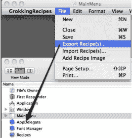

图 9.1：链接“导入”菜单项

Sheet，它将用作我们的表单。在这个表单上，我们将添加一个 NSTableView 和两个按钮，一个名为 Cancel，另一个名为 Export，如下一页的图 9.2 所示。

注意，表格中有两列，第一列中有一个复选框。第二列将显示食谱的名称。我们希望将每一列都绑定到我们之前添加的导出列表的 NSArrayController。复选框列应绑定到模型键路径 selected，名称列应绑定到模型键路径 name。两列的控制器键都应设置为 arrangedObjects。

Export 按钮需要绑定到我们添加到 AppDelegate 的 -exportApproved: 方法。同样，Cancel 按钮需要绑定到 -exportCancelled: 方法。我们需要做的最后一处更改是关闭 Visible At Launch 和 Release When Closed。我们希望重用这个 NSPanel，因此不希望释放它，也不希望在应用程序首次启动时显示它。

#### 实现导出方法

现在我们已经更新了 UI，需要在 AppDelegate 中实现这些新方法。

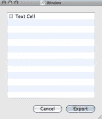

图 9.2：用于导出列表的新 NSPanel

```objective-c
#pragma mark Export methods
#pragma mark -

- (IBAction)exportRecipes:(id)sender
{
    NSFetchRequest *request = [[NSFetchRequest alloc] init];
    NSManagedObjectContext *moc = [self managedObjectContext];
    [request setEntity:[NSEntityDescription entityForName:@"Recipe"
                                      inManagedObjectContext:moc]];

    NSError *error = nil;
    NSArray *recipes = [moc executeFetchRequest:request
                                          error:&error];
    if (error) {
        [NSApp presentError:error];
        return;
    }
}
```

导出的第一步是获取所有食谱。我们通过针对 Recipe 实体执行一个不带谓词的 NSFetchRequest 来完成这一步。这将为我们提供一个包含 NSManagedObjectContext 中所有食谱的 NSArray。

```objective-c
NSMutableArray *exportList = [NSMutableArray array];
for (NSManagedObject *recipe in recipes) {
    NSMutableDictionary *entry = [NSMutableDictionary dictionary];
    [entry setValue:[NSNumber numberWithBool:NO]
            forKey:@"selected"];
    [entry setValue:[recipe valueForKey:@"name"]
            forKey:@"name"];
    [entry setValue:[recipe objectID]
            forKey:@"objectID"];
    [exportList addObject:entry];
}
[exportArrayController setContent:exportList];
```

现在我们有了食谱的 NSArray，需要将这些食谱存储到 NSArrayController 中。但是，Recipe 实体没有任何方式指定它是否已被选中，因此我们将改为把 NSDictionary 对象加载到 NSArrayController 中。因此，我们将创建一个新的 NSMutableArray，并开始遍历获取结果。对于每个结果，我们获取名称和 NSManagedObjectID，并将二者存储到一个新的 NSMutableDictionary 中。我们还需要向 NSMutableDictionary 中添加一个 NSNumber，将其设为 NO，键为 selected。这个 NSNumber 将用于确定用户是否已选择该食谱。

一旦将所有食谱添加到 NSMutableArray，我们就可以将其设置为用于在 UI 中显示导出列表的 NSArrayController 的内容。调用 NSArrayController 的 -setContent: 将触发 KVO，并让 NSTableView 为我们更新。

下载 MultiThreading/AppDelegate.m

```objective-c
[NSApp beginSheet:exportSheet
    modalForWindow:window
    modalDelegate:nil
    didEndSelector:NULL
    contextInfo:nil];
```

一旦 NSArrayController 加载完成，我们需要显示表单。这是通过调用 NSApplication 来完成的。现在，当用户从 File 菜单中选择 Export Recipe(s) 时，将向他们显示一个可供选择的表单，如下一页的图 9.3 所示。

-exportCancelled: 方法只涉及关闭表单并将控制权返回给用户。为此，需要在所得方法中进行两次调用。

下载 MultiThreading/AppDelegate.m

```objective-c
- (IBAction)exportCancelled:(id)sender
{
    [exportSheet orderOut:sender];
    [NSApp endSheet:exportSheet];
    [exportArrayController setContent:nil];
}
```


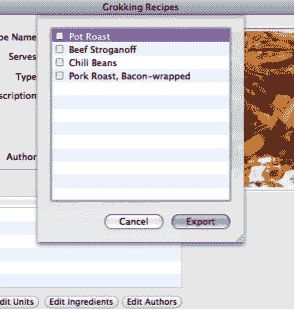

图 9.3：显示导出工作表

方法 -exportApproved: 也相当简短。在这个方法中，我们还想关闭工作表，但随后希望以工作表形式向用户呈现一个 NSSavePanel，以便用户告诉我们把导出的食谱保存到哪里。由于 NSSavePanel 作为工作表将是异步的，我们需要传递所选食谱的 NSManagedObjectID 对象，以便回调可以使用它们执行实际导出。

```objective-c
- (IBAction)exportApproved:(id)sender
{
    [exportSheet orderOut:sender];
    [NSApp endSheet:exportSheet];

    NSArray *content = [exportArrayController content];
    NSPredicate *pred = [NSPredicate predicateWithFormat:@"selected == YES"];
    NSArray *filtered = [content filteredArrayUsingPredicate:pred];
    NSArray *exportIDs = [filtered valueForKeyPath:@"objectID"];

    NSSavePanel *savePanel = [NSSavePanel savePanel];
    [savePanel setExtensionHidden:YES];
    [savePanel setRequiredFileType:@"grx"];
    [savePanel setCanSelectHiddenExtension:NO];

    SEL select = @selector(exportSaveDidEnd:returnCode:contextInfo:);
    [savePanel beginSheetForDirectory:nil
                                 file:nil
                        modalForWindow:window
                         modalDelegate:self
                        didEndSelector:select
                           contextInfo:[exportIDs retain]];
    [exportArrayController setContent:nil];
}
```

#### 启动 NSOperation

我们需要对 AppDelegate 做的最后一项修改，是为 NSSavePanel 提供回调。在这最后一个方法中，我们从 NSSavePanel 获取文件名和上下文，并构造一个新类的实例：PPExportOperation。在初始化期间，我们传入 AppDelegate 的引用、保存路径，以及需要导出的食谱的 NSManagedObjectID 对象。PPExportOperation 构造完成后，我们可以将它交给 NSOperationQueue。这将使 PPExportOperation 在另一个线程上运行，从而让 UI 继续执行。

```objective-c
// Download MultiThreading/AppDelegate.m

- (void)exportSaveDidEnd:(NSSavePanel*)savePanel
             returnCode:(NSInteger)returnCode
            contextInfo:(NSArray*)exportIDs
{
    if (returnCode == NSCancelButton) {
        [exportIDs release];
        return;
    }

    PPExportOperation *op = nil;
    op = [[PPExportOperation alloc] initWithDelegate:self
                                       objectIDs:exportIDs
                                      saveFilePath:[savePanel filename]];

    if (!genericOperationQueue) {
        genericOperationQueue = [[NSOperationQueue alloc] init];
    }

    [genericOperationQueue addOperation:op];
    [exportIDs release];
    [op release];
}
```

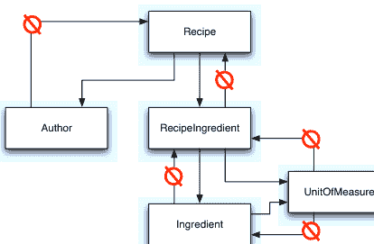

图 9.4：复制流程

```objective-c
// Download MultiThreading/PPExportOperation.m
for (NSManagedObjectID *objectID in [self objectIDs]) {
    NSManagedObject *object = [sourceMOC objectWithID:objectID];
    [self copyObject:object
         toContext:exportMOC
             parent:nil];
}
[sourceMOC release], sourceMOC = nil;
```

尽管 -main 的这一部分执行导出的所有工作，但实际上非常快。由于我们尚未向磁盘写入任何内容，而且 Recipe 对象已经在内存中，因此这段代码执行得非常快。这个复制操作不仅会复制我们正在导出的 Recipe 实体，还会复制与该食谱关联的所有其他实体。一旦所有选中的 Recipe 对象都被复制到新的 NSManagedObjectContext 中，就该解锁主 NSManagedObjectContext 了。

```objective-c
// Download MultiThreading/PPExportOperation.m
NSError *error = nil;
if (![exportMOC save:&error]) {
    [NSApp presentError:error];
}
}
```

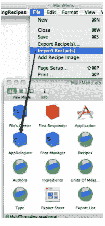

图 9.5：关联“导入”菜单项

```objective-c
- (IBAction)importRecipes:(id)sender
{
    NSOpenPanel *openPanel = [NSOpenPanel openPanel];
    [openPanel setCanChooseDirectories:NO];
    [openPanel setCanCreateDirectories:NO];
    [openPanel setRequiredFileType:@"grx"];

    SEL selector = @selector(importSheetDidEnd:returnCode:context:);
    [openPanel beginSheetForDirectory:nil
                                 file:nil
                        modalForWindow:window
                         modalDelegate:self
                        didEndSelector:selector
                           contextInfo:nil];
}
```

对于导入，在向用户显示 NSOpenPanel 之前，我们不需要做任何事情。所有工作都在用户选择要导入的文件之后完成。

```objective-c
- (void)importSheetDidEnd:(NSOpenPanel*)openPanel
    returnCode:(NSInteger)returnCode
    context:(void*)context
{
    if (returnCode == NSCancelButton) return;

    PPImportOperation *op = nil;
    op = [[PPImportOperation alloc] initWithDelegate:self
                filePath:[openPanel filename]];

    if (!genericOperationQueue) {
        genericOperationQueue = [[NSOperationQueue alloc] init];
    }

    [genericOperationQueue addOperation:op];
    [op release], op = nil;
}
```

当 NSOpenPanel 回调我们的 AppDelegate 时，我们首先检查用户是否取消了工作表。如果没有取消，我们就从 NSOpenPanel 获取文件名，并连同 AppDelegate 的引用一起传入 PPImportOperation 的新实例。PPImportOperation 初始化完成后，我们将它交给 NSOperationQueue，并把控制权交还给用户。导入的其余部分在 PPImportOperation 内执行。

#### 执行导入操作

导入比导出复杂不少。虽然概念相同，但我们是在把一个 NSManagedObjectContext 中的 NSManagedObject 对象复制到另一个 NSManagedObjectContext 中。在这种情况下，我们需要担心某些对象被重复创建。我们不介意 Recipe 和 RecipeIngredient 对象被重复创建，但不希望重复创建 UnitOfMeasure、Author 或 Ingredient 实体。因此，作为导入的一部分，每当遇到这些对象之一时，都会先在主 NSManagedObjectContext 中搜索它，然后再创建。

为了尽量保持 -main 简洁，很多初始化工作改为在 -initWithDelegate:filePath: 中完成。

```objective-c
- (id)initWithDelegate:(AppDelegate*)delegate
          filePath:(NSString*)filePath
{
    if (!(self = [super init])) return nil;

    appDelegate = delegate;

    [self setFilePath:filePath];
    [self setImportContext:[self managedObjectContext]];
    NSManagedObjectContext *mainMOC = [self newContextToMainStore];
    NSNotificationCenter *center = [NSNotificationCenter defaultCenter];
    [center addObserver:self
             selector:@selector(contextDidSave:)
                 name:NSManagedObjectContextDidSaveNotification
               object:mainMOC];
    [self setMainContext:mainMOC];
    [self setLookup:[NSMutableDictionary dictionary]];
    return self;
}
```

`[super init]` 返回后，我们将 filePath 设置到一个实例变量，为它构造一个 NSManagedObjectContext，并将其设置到另一个实例变量。一旦为要导入的文件实例化 NSManagedObjectContext，我们还希望开始监听来自该 NSManagedObjectContext 的 NSNotification 广播。

```objective-c
- (void)main
{
    NSFetchRequest *request = [[NSFetchRequest alloc] init];
    [request setEntity:[NSEntityDescription entityForName:@"Recipe"
                                    inManagedObjectContext:[self importContext]]];

    NSError *error = nil;
    NSArray *managedRecipes = [[self importContext] executeFetchRequest:request
                                                                   error:&error];

    [request release], request = nil;
    if (error) {
        [NSApp presentError:error];
        return;
    }
}
```

在 -main 的开头，我们需要获取导入文件中所有 Recipe 实体的引用。由于我们有一个附加到该文件的 NSManagedObjectContext，我们需要针对该 NSManagedObjectContext 执行 NSFetchRequest，并获取 Recipe 对象的 NSManagedObject 引用数组。


```objectivec
Download Multithreading/PPImportOperation.m

NSAutoreleasePool *pool = [[NSAutoreleasePool alloc] init];
for (NSManagedObject *recipe in incomingRecipes) {
    [self copyRecipe:recipe];
    [pool drain];
    pool = nil;
    pool = [[NSAutoreleasePool alloc] init];
}
[pool drain];
pool = nil;
```

一旦我们拥有所有食谱，就需要遍历它们，并将每个食谱复制到主 NSManagedObjectContext 中。这个复制操作相当复杂，但基本流程如下：

- 1. 复制 Recipe 实体及其属性特性。
- 2. 复制每个关系；如果对象不是 RecipeIngredient，则按名称搜索现有对象。如果它们是 RecipeIngredient，则不搜索直接复制。
- 3. 对于关系中的每个对象，复制其关系，注意绝不复制父对象。

这种复制是单向的，如第 171 页侧栏所述。复制完成后，我们需要保存主 NSManagedObjectContext，并准备更新主线程及其 NSManagedObjectContext。

```objectivec
Download Multithreading/PPImportOperation.m

error = nil;
if (![[self mainContext] save:&error]) {
    [NSApp presentError:error];
    return;
}
```

完成导入后，就该保存上下文并确认保存成功。保存完成后，我们可以退出 -main 方法并完成 NSOperation。剩下的唯一问题是：我们如何更新主 NSManagedObjectContext，并由此更新 UI？

在编写 -initWithDelegate:filePath: 时，我们将该 NSOperation 添加为其自身 NSManagedObjectContextDidSaveNotification 广播的观察者。当我们在 -main 方法中执行 -save: 时，该通知会自动触发。为了更新主 NSManagedObjectContext，我们需要将该通知转发出去。

```objectivec
id oldDestObject = nil;
id temp = nil;
NSDictionary *relationships = [[oldObject entity] relationshipsByName];
for (NSString *key in [relationships allKeys]) {
    NSRelationshipDescription *relationship = [relationships objectForKey:key];
    NSString *destEntityName = [[relationship destinationEntity] name];
    if ([destEntityName isEqualToString:parentEntity]) continue;

    if ([relationship isToMany]) {
        NSMutableSet *newDestSet = [NSMutableSet set];
        for (id oldDestObject in [oldObject valueForKey:key]) {
            temp = [[self lookup] objectForKey:[oldDestObject objectID]];
            if (!temp) {
                temp = [self associateObject:oldDestObject
                                      parent:entityName];
            }
            [newDestSet addObject:temp];
        }
        [newObject setValue:newDestSet forKey:key];
    } else {
        oldDestObject = [oldObject valueForKey:key];
        if (!oldDestObject) continue;
        temp = [[self lookup] objectForKey:[oldDestObject objectID]];
        if (!temp) {
            temp = [self associateObject:oldDestObject
                                  parent:entityName];
        }
        [newObject setValue:temp forKey:key];
    }
}
```

复制的后半部分要复杂得多。第一个问题是，关系可能指向一个对象，也可能指向多个对象，而每种可能性都需要以不同方式处理。第二个问题是，该关系另一端的对象可能存在，也可能不存在。如果目标对象存在，那么我们只需设置该关系。如果它不存在，那么我们需要创建它，这由稍后讨论的 -associateObject:parent: 方法完成。正是在这里，我们使用查找字典。通过使用 NSManagedObjectID 作为键，我们可以确保指向同一对象的不同关系保持完整。

这里需要注意的一件重要事情是传入的 parentEntity 变量。每次复制关系时，都会在开始时检查该变量。如果该关系的目标对象与此变量匹配，则跳过该关系。这保证复制只沿树向下进行，绝不会向上回退。

#### -associateObject:parent:

每当在查找字典中找不到目标对象时，就会从 -copyPropertiesFromObject:toObject:parent: 方法调用此方法。

```objectivec
Download Multithreading/PPImportOperation.m

- (id)associateObject:(NSManagedObject*)object parent:(NSString*)name
{
    NSManagedObjectContext *moc = [self mainContext];
    NSString *entityName = [[object entity] name];
    id temp = nil;

    if ([entityName isEqualToString:@"RecipeIngredient"]) {
        temp = [NSEntityDescription insertNewObjectForEntityForName:entityName
                                    inManagedObjectContext:moc];
        [[self lookup] setObject:temp forKey:[object objectID]];
        [self copyPropertiesFromObject:object toObject:temp parent:name];
        return temp;
    }

    if (temp = [self objectOfType:entityName
                withName:[object valueForKey:@"name"]]) {
        [[self lookup] setObject:temp forKey:[object objectID]];
        return temp;
    }

    temp = [NSEntityDescription insertNewObjectForEntityForName:entityName
                                inManagedObjectContext:moc];
    [[self lookup] setObject:temp forKey:[object objectID]];
    [self copyPropertiesFromObject:object toObject:temp parent:name];
    return temp;
}
```

在这个方法中，与前面讨论的方法不同，我们关心正在处理的是哪种实体。如果正在处理的是 RecipeIngredient，那么我们知道只需直接创建一个新对象。然而，对于任何其他对象，我们需要先检查它是否已经存在于 NSManagedObjectContext 中。我们通过调用 -objectOfType:withName: 来完成此检查；如果它返回 nil，那么我们需要创建一个新对象。如果它返回一个 NSManagedObject，那么我们将返回的对象与传入的原始对象关联起来，以便将来针对它的调用能在查找字典中找到。

有几点需要注意。第一，无论我们是在创建新对象还是关联现有对象，我们始终将引用存储在查找字典中。这确保我们不会重复工作，并且可以在以后需要时刷新该对象。

这里需要注意的另一件重要事情是递归。如果我们创建了一个新对象，我们会针对该对象调用 copyPropertiesFromObject:toObject:parent:，尽管这正是我们刚刚来自的方法。然而，由于父引用，我们保证复制循环绝不会沿链向上回退。

#### -objectOfType:withName:

此复制例程中的最后一个方法从 -associateObject:parent: 方法调用。此方法确定对象是否已存在于 NSManagedObjectContext 中，以避免重复。

```objectivec
Download Multithreading/PPImportOperation.m

- (id)objectOfType:(NSString*)entityName withName:(NSString*)name
{
    NSFetchRequest *request = [[NSFetchRequest alloc] init];
    [request setEntity:[NSEntityDescription entityForName:entityName
                                       inManagedObjectContext:[self mainContext]]];
    [request setPredicate:[NSPredicate predicateWithFormat:@"name == %@", name]];

    NSError *error = nil;
    id result = [[[self mainContext] executeFetchRequest:request
                                                   error:&error] lastObject];

    return result;
}
```

在我们的数据模型中，几乎每个对象都有一个 name 属性。幸运的是，在唯一不适用的情况下，我们并不关心是否存在重复对象。因此，此方法在导入操作期间会被大量使用，以帮助保证我们不会创建多个同名对象。

我们通过创建一个 NSFetchRequest 来完成此检查：在谓词中使用 name 作为测试条件，并传入传入的 entityName 来构造 NSEntityDescription。然后，我们返回从 fetch 返回的 NSArray 的 -lastObject。通过使用 -lastObject，我们可以避免检查返回数组的长度。-lastObject 会自动为我们检查长度，并在 NSArray 没有对象时返回 nil。


### 9.6 小结

在本章中，我们回顾了如何在多线程应用程序中使用 Core Data，并为我们的食谱应用程序添加了一些非常有用的功能。我们了解到，每个线程都需要有自己的 NSManagedObjectContext，并且 NSManagedObject 实例绝不应跨线程传递。我们还学习了如何跨线程发送通知，以便一个 NSManagedObjectContext 中的更改可以在其他 NSManagedObjectContext 实例中更新。

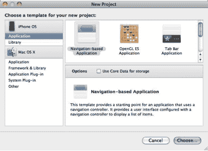

图 10.1：iPhone OS 新建项目对话框

## 将现有应用程序升级到 Core Data

我们中的许多人从 SDK 最初发布时就开始开发 iPhone 应用程序，因此你很可能有一个现有应用程序，并希望将其与 Core Data 集成。幸运的是，在现有项目中构建 Core Data 栈并不需要很多代码。

### 向项目中添加数据模型

与桌面端一样，Cocoa Touch 上的 Core Data 需要一个数据模型来定义数据实体的结构。因此，第一步是通过选择“文件”>“新建文件”向项目中添加数据模型。在出现的对话框中，如果我们选择“资源”部分，就可以创建一个新的数据模型，如下一页的图 10.2 所示。

除了创建新的数据模型之外，我们还可以使用现有应用程序中的现有数据模型。在本章后面的第 195 页第 10.4 节 *iPhone 食谱* 中，我们将在新的 iPhone 应用程序中使用桌面食谱应用程序的数据模型。数据模型在桌面端和 Cocoa Touch 之间是兼容的，这使我们不仅能够共享模型，还能共享底层的持久化存储。

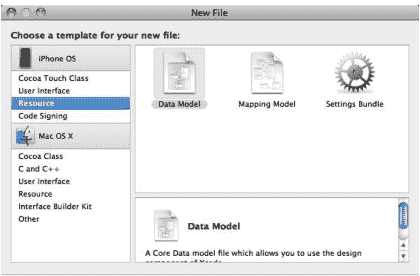

图 10.2：向项目中添加数据模型

### 添加 Core Data 代码

一旦有了可用的数据模型，下一步就需要添加代码来加载 Core Data 栈。这段代码的确切位置取决于你的应用程序设计。由于 iPhone 上没有文档式应用程序，因此每个 Cocoa Touch 应用程序通常只有一个数据模型和一个持久化存储。尽管我仍然喜欢把 Core Data 代码放在应用程序委托中，但把它放在其他地方也可能合理。无论代码放在哪里，它都与桌面端非常相似。首先，我们需要初始化数据模型。

下载 RecipeCT/Classes/AppDelegate.m

```objective-c
- (NSManagedObjectModel *)managedObjectModel
{
    if (managedObjectModel) return managedObjectModel;

    NSString *path = [[NSBundle mainBundle] pathForResource:@"DataModel"
                                                     ofType:@"momd"];
    if (!path) {
        path = [[NSBundle mainBundle] pathForResource:@"DataModel"
                                                 ofType:@"mom"];
    }
    NSAssert(path != nil, @"Unable to find DataModel in main bundle");
    NSURL *url = [NSURL fileURLWithPath:path];
    managedObjectModel = [[NSManagedObjectModel alloc] initWithContentsOfURL:url];
    return managedObjectModel;
}
```

这看起来应该非常熟悉，因为它与你在桌面端构建 NSManagedObjectModel 的方式完全相同。我们获取 .mom 文件（如果数据模型有多个版本，则为 .momd）的路径，并用它来初始化 NSManagedObjectModel。

下载 Recipe/Classes/AppDelegate.m

```objective-c
- (NSString*)documentsFolder
{
    NSArray *paths = NSSearchPathForDirectoriesInDomains(NSDocumentDirectory,
                                                         NSUserDomainMask, YES);
    NSString *filePath = [paths objectAtIndex:0];
    return filePath;
}
```

在构建 NSPersistentStoreCoordinator 之前，我们需要决定将持久化存储文件存放在哪里。在桌面端，对于只有一个持久化存储的应用程序，我们会把文件保存到 Application Support 文件夹。然而，在 Cocoa Touch 设备上，没有这样的位置。相反，每个应用程序都有自己的沙盒 Documents 目录，专门用于存储文件。我们将在这里写入持久化存储。使用与桌面端查找 Application Support 文件夹类似的代码，我们将找到特定于我们应用程序的 Documents 文件夹。

下载 Recipe/Classes/AppDelegate.m

```objective-c
- (NSPersistentStoreCoordinator*)persistentStoreCoordinator
{
    if (persistentStoreCoordinator) return persistentStoreCoordinator;

    NSFileManager *fileManager = [NSFileManager defaultManager];
    NSString *docFolder = [self documentsFolder];
    if (![fileManager fileExistsAtPath:docFolder]) {
        [fileManager createDirectoryAtPath:docFolder attributes:nil];
    }

    NSString *filePath = nil;
    filePath = [docFolder stringByAppendingPathComponent:@"recipes.sqlite"];
    if (![fileManager fileExistsAtPath:filePath]) {
        NSString *defaultDB = [[NSBundle mainBundle] pathForResource:@"recipes"
                                                            ofType:@"sqlite"];
        NSError *error = nil;
        if (![[NSFileManager defaultManager] copyItemAtPath:defaultDB
                                                   toPath:filePath
                                                    error:&error]) {
            NSLog(@"%@:%s Error copying file %@", [self class], __cmd, error);
        }
    }

    NSURL *url = [NSURL fileURLWithPath:filePath];
    NSManagedObjectModel *mom = [self managedObjectModel];
    persistentStoreCoordinator = [[NSPersistentStoreCoordinator alloc]
                                  initWithManagedObjectModel:mom];

    NSError *error = nil;
    if (![persistentStoreCoordinator addPersistentStoreWithType:NSSQLiteStoreType
                                                  configuration:nil
                                                           URL:url
                                                       options:nil
                                                         error:&error]) {
        return persistentStoreCoordinator;
    }

    [persistentStoreCoordinator release], persistentStoreCoordinator = nil;
    NSDictionary *ui = [error userInfo];
    if (![ui valueForKey:NSDetailedErrorsKey]) {
        NSLog(@"%@:%s Error adding store %@", [self class], __cmd,
              [error localizedDescription]);
    } else {
        for (NSError *suberror in [ui valueForKey:NSDetailedErrorsKey]) {
            NSLog(@"%@:%s Error: %@", [self class], __cmd,
                  [suberror localizedDescription]);
        }
    }
    NSAssert(NO, @"Failed to initialize the persistent store");
    return nil;
}
```

一旦构建好 NSManagedObjectModel，下一步就是构建持久化存储协调器。同样，这段代码与桌面版几乎相同，但有一些差异。首先，目前我已关闭版本检查，因为我们在 iPhone 上只有一个版本。将来发布版本 2 时，我们需要重新开启它。

第二个主要差异与默认设置有关。我们首先检查应用程序的 Documents 目录中是否存在数据库文件，但如果不存在，就从应用程序自身的 bundle 内复制一个。这为用户首次访问 iPhone 应用程序提供了一组“默认值”或“示例”。通过这样做，当用户启动我们的应用程序时，我们可以向他们呈现一份吸引人的食谱列表，而不是一个空表视图。

下载 Recipe07/Classes/AppDelegate.m

```objective-c
- (NSManagedObjectContext *)managedObjectContext
{
    if (managedObjectContext) return managedObjectContext;

    NSPersistentStoreCoordinator *coord = [self persistentStoreCoordinator];
    if (!coord) return nil;

    managedObjectContext = [[NSManagedObjectContext alloc] init];
    [managedObjectContext setPersistentStoreCoordinator:coord];

    return managedObjectContext;
}
```

我们需要实现的最后一个方法是 -managedObjectContext 方法。由于所有繁重工作都已经在 -managedObjectModel 方法或 -persistentStoreCoordinator 方法中完成，因此这个方法甚至比它在桌面端的对应方法更简单。我们请求对 NSPersistentStoreCoordinator 的引用，并假设它不是 nil，然后初始化一个 NSManagedObjectContext，将 NSPersistentStoreCoordinator 添加到其中，并返回得到的 NSManagedObjectContext。由于我们要么拥有用户上次运行应用程序时留下的现有持久化存储，要么已经复制了一个默认存储，因此不需要像之前那样检查 Type 表。可以保证它要么存在，要么已被用户有意清除。

### 持久化存储格式

与桌面端上的 Core Data 类似，Cocoa Touch 设备上也有几种持久化格式可用。然而，有一种我已经逐渐喜欢的格式缺失了。XML 格式目前在 iPhone 上不可用。我怀疑这是为了迫使我们使用内存效率高得多的格式，例如 SQLite 存储。也有可能是因为它依赖于目前同样不可用的其他 API 而被跳过。无论原因是什么，XML 存储对我们不可用，我们应该在所有可能的情况下使用 SQLite 存储。

除了 SQLite 持久化存储格式之外，我们还可以使用二进制格式和内存中格式。然而，这两种格式都需要


整个对象层次结构都被加载到内存中，而这通常是我们无法在 Cocoa Touch 设备上承受的。因此，除非有非常可靠的设计理由使用其他存储格式，否则应使用 SQLite。

### 10.2 内存管理

在 iPhone 上使用 Core Data 时，我们需要牢记的最重要差异之一是内存管理。取决于目标 Cocoa Touch 设备，我们可用的内存可能只有 20MB。这与以 GB 为单位衡量内存的现代桌面电脑截然不同！因此，Core Data 要在这台小得多的设备上做个良好公民，就必须以不同方式处理内存。

处理内存管理的最佳方式是让别人来做。幸运的是，Apple 已经挺身而出，为我们完成了大部分繁重工作。正如我们将在第 10.3 节 _使用 NSFetchedResultsController_（第 194 页）中深入讨论的那样，新类 NSFetchedResultsController 会为我们完成大量内存管理工作，只要我们遵守它的规则。这些规则分为两个独立部分。

#### 只获取所需内容

由于可用的内存如此之少，只保留该视图绝对需要的实体非常重要。这意味着，如果我们正在某个视图（或 _页面_，有些人这样称呼单屏信息）中工作，那么我们就应当只保留该视图所需的实体。如果视图是表格，那么情况会稍微棘手一些。但幸运的是，NSFetchedResultsController 也能帮助我们解决这个问题。

#### 处理数据变更

在 iPhone 上使用 Core Data 的第二条规则与数据实体变更的通知有关。在桌面电脑上，我们的视图元素直接绑定到数据实体；当实体发生变化时，与该实体关联的所有视图元素都会通过 KVO 自动更新，如第 3 章 _Core Data 与绑定_（第 34 页）所讨论的那样。然而，在 Cocoa Touch 设备上，这些绑定目前并不存在，视觉元素的更新需要编写代码来实现。

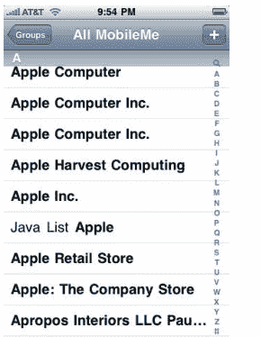

图 10.3：联系人表格视图

当我们在单个视图内工作时，这不算太大的问题。用户操作的视图元素与视图显示的元素之间存在直接关系。但是，如果层次结构中还存在其他视图，它们当前未显示，却仍有正在被操作的元素，那该怎么办？

一个很好的例子是每台 Cocoa Touch 设备上都有的“联系人”应用。该应用的主视图是一个列出数据库中所有联系人的表格，如图 10.3 所示。

除了这个表格视图，我们还有一个显示单个联系人的详细信息视图，如图 10.4（见下一页）所示。正是这个详细信息视图处理联系人的所有编辑操作。然而，当该联系人的某个详细信息被编辑，而该信息也会显示在父表格视图中时，父表格视图如何收到通知以更新其显示值呢？

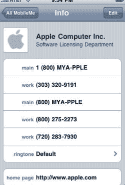

图 10.4：联系人详细信息视图

如果不使用 Cocoa Bindings，我们就需要自己处理更新。我们可以用几种方式处理这一点，并将在第 10.3 节“数据变更通知”中逐一回顾。

### 10.3 数据变更通知

正如我们在第 10.2 节“处理数据变更”（第 190 页）中所发现的那样，如果不使用 Cocoa Bindings，我们就需要考虑并设计这样一种情况：数据在某个位置发生了变化，而我们需要将该变化通知另一个位置，以便后者也能更新自身。

然而，在审视这个问题时，我们必须考虑几个需要注意的问题。第一个问题是设计优雅性。任何应用要想在外表上优雅，内部也必须优雅。因此，我们绝对希望避免视图控制器之间出现强引用。

第二个问题同样与内存有关。Cocoa Touch 系统内置了一些出色的内存管理特性，我们需要留意它们。例如，如果我们有一个非常深的 UIViewController 栈，并且开始触及内存限制，操作系统很可能会决定从内存中丢弃我们的一些视图。如果每个视图都是一个自包含的数据孤岛，这通常不是问题。然而，如果我们想开始沿栈向上广播数据变更通知，就需要意识到并检查这种情况；否则，一次数据通知可能导致整个应用崩溃。

#### 使用委托设计模式

这个问题最常见的解决方案之一是使用委托。事实上，Apple 非常频繁地使用这种模式。理想情况下，在使用委托设计时，我们希望保持委托与调用对象之间的分离。这将避免视图控制器之间产生强链接，并允许在未来的某个版本中根据需要更改视图控制器的流程。在 Cocoa Touch 中，Apple 已开始使用协议来定义委托方法。在 Cocoa Touch（以及 Objective-C 2.0）之前，更常见的做法是给 NSObject 添加一个类别，以定义在委托上被调用的方法。

随着 Objective-C 2.0 的加入，我们现在可以在协议中拥有可选方法，这使得使用协议代替类别更加容易。我们现在可以定义哪些方法是必需的（在编译时测试），以及哪些方法是可选的。以前使用类别时，我们不得不通过运行时检查和文档来定义哪些方法是必需的、哪些是可选的。

不幸的是，使用委托设计确实有一个相当重大的问题。当数据变化时，我们只能让一个委托收到通知。如果我们有一个很深的视图控制器栈，那么就需要沿栈向上构建级联的变更通知。这当然可行，但在那种情况下并不是最优雅的解决方案。

#### 使用 NSNotificationCenter

当委托无法胜任时，通知通常可以。NSNotification API 的优点是能够处理多个观察者，并依次通知每一个观察者。在 NSNotification 设计中，每个视图都会将自己添加为特定键的观察者。当带有该键的通知被广播时，视图将收到回调，并可以按需处理该通知。

NSNotification API 相当优雅，原因有很多。每个观察者都可以自行决定如何处理它收到的通知。此外，发布通知的对象不需要了解该通知使用者的任何信息。它甚至不需要知道在消费者上调用了什么方法。生产者只需发出通知，然后继续执行。这提供了视图控制器之间的出色分离。

#### 使用 NSFetchedResultsController

随着 Cocoa Touch 3.0 的发布，Apple 为我们提供了这个问题的第三种解决方案。这第三种解决方案通过 NSFetchedResultsController 提供，并且推荐用于大多数标准 Cocoa Touch 应用设计。

NSFetchedResultsController 专门设计用于管理来自 NSManagedObjectContext 的实体结果集，并提供方法来查询结果集中的实体数量以及保持它们的顺序。

此外，NSFetchedResultsController 还提供了一种方式，使 UIViewController 在结果集中的任何实体被修改（包括添加或删除实体）时收到通知。看待 NSFetchedResultsController 的最佳方式，是将其视为 NSManagedObjectContext 与 UIViewController 之间的一层，如图 10.5（见下一页）所示。

要构造 NSFetchedResultsController，我们需要先构造一个 NSFetchRequest，并将该请求传入 NSFetchedResultsController。完成之后，我们就可以向 NSFetchedResultsController 查询结果中的实体数量，并检索单个实体。

在我们的示例应用 RecipesCT 中，我们将使用 NSFetchedResultsController 来管理主表格视图，并在详细信息视图更改某个实体时接收事件。该项目将在第 10.4 节“iPhone 上的 Recipes”（见下一页）中更详细地讨论。


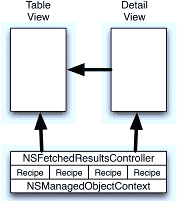

图 10.5：NSFetchedResultsController 图示

### 10.4 iPhone 食谱应用

为了演示如何在 Cocoa Touch 应用中使用 Core Data，我们将采用本书中一直在开发的食谱应用，并构建一个 Cocoa Touch 版本。我们将首先使用之前为桌面端开发的现有数据模型，并将其复制到 iPhone 上。我们还将使用桌面端持久化存储的 SQLite 版本，作为 Cocoa Touch 应用的示例数据库。这两个步骤已在第 184 页的 10.1 节*异同*中讨论过。

我们应用中的下一步是初始化并显示表视图，这是应用的主视图。完成表视图的构建后，我们将构建一个详细视图，用于显示单个食谱。尽管我们不会开发此应用的所有方面，但会涉及与处理应用 Core Data 部分相关的关键点。

#### 准备 NSFetchedResultsController

应用一启动，我们就希望显示所有可用食谱的表视图。为此，我们需要构造一个 NSFetchedResultsController，它管理所有 Recipe 实体，UITableViewController 将查询它以显示食谱。

```objc
- (void)applicationDidFinishLaunching:(UIApplication*)application
{
    window = [[UIWindow alloc] initWithFrame:[[UIScreen mainScreen] bounds]];

    NSFetchedResultsController *results = [self fetchedResultsController];
    MainViewController *controller = nil;
    controller = [[MainViewController alloc] initWithFetchController:results];

    nav = [[UINavigationController alloc] initWithRootViewController:controller];
    [controller release], controller = nil;
    // Override point for customization after app launch
    [window addSubview:[nav view]];
    [window makeKeyAndVisible];
}
```

如果你开发过 Cocoa Touch 应用，其中大部分内容对你来说都很熟悉。应用完成启动后，我们需要构建用户界面。为此，我们将窗口初始化为屏幕大小，然后构造 MainViewController，它是管理主表视图的控制器。接着，我们将该 MainViewController 放入 UINavigationController，以便轻松过渡到详细视图。UINavigationController 初始化完成后，我们将其 -view 添加到窗口中，并请求窗口变为可见。

此方法中一个有趣或不同之处是 MainViewController 的初始化。在此示例中，它在初始化时接受一个 NSFetchedResultsController。预期 MainViewController 将保留此 NSFetchedResultsController，并使用它填充表视图。

构造此 NSFetchedResultsController 的代码非常有趣。

下载代码：RecipeCT/Classes/AppDelegate.m

```objective-c
- (NSFetchedResultsController *)fetchedResultsController
{
    NSManagedObjectContext *context = [self managedObjectContext];
    NSFetchRequest *fetchRequest = [[NSFetchRequest alloc] init];
    [fetchRequest setEntity:[NSEntityDescription entityForName:@"Recipe"
                                        inManagedObjectContext:context]];

    // Configure the request's entity, and optionally its predicate.
    NSSortDescriptor *sortDescriptor = nil;
    sortDescriptor = [[NSSortDescriptor alloc] initWithKey:@"name" ascending:YES];
    NSArray *sortDescriptors = nil;
    sortDescriptors = [[NSArray alloc] initWithObjects:sortDescriptor, nil];
    [sortDescriptor release], sortDescriptor = nil;
    [fetchRequest setSortDescriptors:sortDescriptors];
    [sortDescriptors release], sortDescriptors = nil;

    NSFetchedResultsController *controller = [[NSFetchedResultsController alloc]
        initWithFetchRequest:fetchRequest
        managedObjectContext:context
        sectionNameKeyPath:nil
        cacheName:@"Recipe"];

    [fetchRequest release];

    NSError *error = nil;
    BOOL success = [controller performFetch:&error];
    if (!success) {
        NSLog(@"Error fetching request %@", [error localizedDescription]);
    }
    return [controller autorelease];
}
```

如前所述，NSFetchedResultsController 在初始化时会接受一个 NSFetchRequest。此 NSFetchRequest 用于确定哪些实体将包含在 NSFetchedResultsController 中。在此示例中，我们配置 NSFetchRequest 以请求所有 Recipe 实体，并基于 name 属性按升序对它们排序。NSFetchRequest 构造完成后，我们将其连同对 NSManagedObjectContext 的引用一起传递给 NSFetchedResultsController。我们还为缓存指定一个名称。如果合适，此缓存可以跨 NSFetchedResultsController 对象共享，不过在此示例中我们不会这样做。

NSFetchedResultsController 初始化完成后，我们请求它执行获取操作，以将实体加载到内存中。应注意，NSFetchedResultsController 非常关注设备上的可用内存，它只会将当前需要的实体保留在内存中。因此，此时我们可以预期它只将处于故障状态的对象加载到内存中，而且它们尚未完全实现。

#### 构建主表视图

现在我们已经将 NSFetchedResultsController 传入 MainViewController，接下来需要构建主表视图。此 UITableViewController 的头文件非常简单。因为我们只显示一个 UITableView，不显示其他内容，所以可以使用 UITableViewController，而不是其父类 UIViewController。UITableViewController 会为我们处理对 UITableView 的引用，并且它已经声明为 UITableViewDelegate 和 UITableViewDataSource。生成的头文件如下：

```objective-c
@interface MainViewController : UITableViewController
{
    NSFetchedResultsController *resultsController;
}

@property (retain) NSFetchedResultsController *resultsController;

- (id)initWithFetchController:(NSFetchedResultsController*)controller;

@end
```

在此类中，我们唯一保留的是 NSFetchedResultsController，它将驱动我们应用的模型。从头文件出发，我们可以构造 -initWithFetchController: 方法，它接受一个参数，即在 AppDelegate 中构造的 NSFetchedResultsController。通过调用父类的 -initWithStyle: 初始化 UITableViewController 子类后，我们使用传入的参数设置 resultsController 属性。我们还将 MainViewController 实例设置为 NSFetchedResultsController 的委托，以便当 NSFetchedResultsController 管理的任何实体发生变化时收到回调。

```objective-c
- (id)initWithFetchController:(NSFetchedResultsController*)controller
{
    if (!(self = [super initWithStyle:UITableViewStylePlain])) return nil;

    [self setResultsController:controller];
    [controller setDelegate:self];

    return self;
}
```

接下来需要实现的 MainViewController 中有趣的部分是 UITableViewDelegate 和 UITableViewDataSource 方法。

#### 实现 -numberOfSectionsInTableView: 方法

下载 RecipeCT/Classes/MainViewController.m

```objc
- (NSInteger)numberOfSectionsInTableView:(UITableView *)tableView
{
    return [[[self resultsController] sections] count];
}
```

为了能够询问某个分区中的行数，UITableView 必须首先知道分区数。在此方法中，我们请求 NSFetchedResultsController 的 sections 属性，它返回一个包含 NSFetchedResultsSectionInfo 实现的 NSArray。由于我们只需要知道分区数，因此对得到的 NSArray 调用 -count 并返回其结果。

#### 实现 -tableView:numberOfRowsInSection: 方法

表视图实现过程中最先被调用的方法之一是 -tableView:numberOfRowsInSection: 方法，它告诉 UITableView 将显示多少行。

下载 RecipeCT/Classes/MainViewController.m

```objc
- (NSInteger)tableView:(UITableView *)tableView
numberOfRowsInSection:(NSInteger)section
{
    id <NSFetchedResultsSectionInfo> sectionInfo = nil;
    sectionInfo = [[self resultsController] sections] objectAtIndex:section;
    return [sectionInfo numberOfObjects];
}
```

在此方法中，我们请求指定分区的 NSFetchedResultsSectionInfo 实例的引用。结果是一个协议实现，其中包含该分区中对象数量的计数，以及对对象和分区名称的引用。对于此方法，我们返回调用 numberOfObjects 属性的结果。

#### 实现 -tableView:cellForRowAtIndexPath: 方法

在 UITableView 控制器中，往往最复杂的一个方法是 -tableView:cellForRowAtIndexPath: 方法。此方法负责初始化（或从重用队列中取出）将显示表中特定行的 UITableViewCell 对象。


下载 RecipeCT/Classes/MainViewController.m

```objective-c
- (UITableViewCell *)tableView:(UITableView *)tableView
    cellForRowAtIndexPath:(NSIndexPath *)indexPath
{
    static NSString *cellIdentifier = @"cellIdentifier";
    UITableViewCell *cell = nil;
    cell = [tableView dequeueReusableCellWithIdentifier:cellIdentifier];
    if (!cell) {
        cell = [[[UITableViewCell alloc] initWithStyle:UITableViewCellStyleSubtitle
                                       reuseIdentifier:cellIdentifier] autorelease];
        [cell setAccessoryType:UITableViewCellAccessoryDisclosureIndicator];
    }
    [self updateCell:cell fromRecipe:[[self resultsController]
                                      objectAtIndexPath:indexPath]];

    return cell;
}
```

因为我们的表格只有一种行样式，所以这个类比那些具有多种行类型的表格中的类更简单。我们首先尝试出队一个 UITableViewCell，以便复用它。如果没有可出队的单元格，我们就构造一个新的。由于每个单元格都会显示一个披露指示器，因此我们在新单元格的初始化过程中配置它。

一旦获得单元格，就需要填充它。由于我们会在控制器中的多个位置填充和/或更新单元格，因此填充单元格的逻辑已被抽象到其自己的方法中。因此，我们的 -tableView:cellForRowAtIndexPath: 需要获取该行实体的引用，并将其传递给 -updateCell:fromRecipe: 方法。

由于 NSFetchedResultsController 类能够感知 UITableView，我们不需要编写任何复杂代码来获取指定对象。只需调用一次 -objectAtIndexPath: 并传入所引用的 NSIndexPath 对象，就能得到相关菜谱。

#### 实现 -updateCell:fromRecipe: 方法

每当创建或更新单元格时，都需要配置其内容。幸运的是，我们使用了 3.0 中包含的一种新表格视图单元格样式，因此不需要进行任何复杂的视图构建和布局。然而，由于单元格的更新可能发生在 MainViewController 中的多个位置，我们已将实现移至其自己的方法中。

```objective-c
- (void)updateCell:(UITableViewCell *)cell fromRecipe:(RecipeEntity*)recipe
{
    [[cell textLabel] setText:[recipe name]];
    NSString *text = nil;
    text = [NSString stringWithFormat:@"Serves: %@", [recipe serves]];
    [[cell detailTextLabel] setText:text];
}
```

由于我们使用的是标准单元格布局之一，填充单元格只需设置 textLabel 属性和 detailTextLabel 属性即可。

#### 实现 -controllerWillChangeContent: 方法

在回顾了更有趣的 UITableViewDataSource 方法之后，剩下的就是实现 NSFetchedResultsControllerDelegate 方法。我们需要实现四个方法。第一个是 -controllerWillChangeContent: 方法。该方法在每个通知周期（可能包含多次变更）中调用一次，它让我们有机会为即将执行的变更设置视图。由于我们只显示了一个 UITableView，因此为这些变更所做的设置非常简单。

```objective-c
- (void)controllerWillChangeContent:(NSFetchedResultsController*)controller
{
    [[self tableView] beginUpdates];
}
```

#### 实现 -controller:didChangeObject:atIndexPath:forChangeType:newIndexPath: 方法

这个方法正是 NSFetchedResultsController 的核心所在。每当实体被插入、删除、更改或移动时，都会调用此方法。此方法的确切触发时机是在通过 NSManagedObjectContext 的 -save: 方法保存变更之后。一旦保存完成，每个变更都会经过此方法。

```objective-c
- (void)controller:(NSFetchedResultsController*)controller
    didChangeObject:(id)anObject
        atIndexPath:(NSIndexPath*)indexPath
      forChangeType:(NSFetchedResultsChangeType)type
       newIndexPath:(NSIndexPath*)newIndexPath
{
    NSArray *paths = [NSArray arrayWithObject:newIndexPath];
    NSIndexSet *section = [NSIndexSet indexSetWithIndex:[newIndexPath section]];

    switch (type) {
        case NSFetchedResultsChangeInsert:
            [[self tableView] insertRowsAtIndexPaths:paths
                                  withRowAnimation:UITableViewRowAnimationFade];
            break;
        case NSFetchedResultsChangeDelete:
            [[self tableView] deleteRowsAtIndexPaths:paths
                                  withRowAnimation:UITableViewRowAnimationFade];
            break;
        case NSFetchedResultsChangeMove:
            [[self tableView] deleteRowsAtIndexPaths:paths
                                  withRowAnimation:UITableViewRowAnimationFade];
            [[self tableView] insertRowsAtIndexPaths:paths
                                  withRowAnimation:UITableViewRowAnimationFade];
            break;
        case NSFetchedResultsChangeUpdate:
            [self updateCell:[[self tableView] cellForRowAtIndexPath:indexPath]
                 fromRecipe:[[self resultsController] objectAtIndexPath:indexPath]];
            break;
    }
}
```

对于每个变更，我们首先确定发生了哪种类型的变更。如果发生了插入或删除，我们会将该信息传递给 UITableView，以便 UITableView 能够处理该变更。在插入的情况下，表格视图随后会分别查询 -tableView:numberOfRowsInSection: 和 -tableView:cellForRowAtIndexPath: 方法。在每种情况下，如果行在屏幕上可见，UITableView 都会为该行的变更添加动画。

在行被移动的情况下（如果排序属性发生足够大的变化而需要重新排序，就会出现这种情况），UITableView 会处理行位置变化的动画（同样，前提是这些行当前在屏幕上可见）。

在最后一种可能的情况下，即实体的属性发生变更，我们会调用 -updateCell:fromRecipe: 方法，并将相关的 Recipe 实体和 UITableViewCell 传递给它。

#### 实现 -controller:didChangeSection:atIndex:forChangeType: 方法

除了实体变更之外，NSFetchedResultsController 中的变更还可能导致分区数量发生变化。例如，如果每个分区代表字母表中的一个字母，而我们添加了一个新菜谱，它是该字母下的第一个菜谱，这可能会导致一个

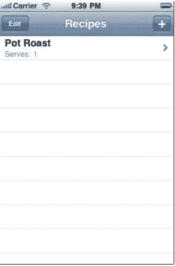

*图 10.6：Cocoa Touch 菜谱应用程序表格视图*

受 Core Data 影响的分区变更。其余方法在随附的示例代码中实现。

#### 构建详情视图控制器

好消息是，几乎所有与 Core Data 的交互都已完成。坏消息是，详情视图包含应用程序中最复杂的用户界面代码。尽管在此示例中我们不会实现整个用户界面，但仍有相当多的代码用于处理字段编辑。

详情视图的基本设计如下一页的图 10.7 所示。该视图的主要部分是一个表格视图以及一个自定义头部视图。头部视图中包含一个 UIImageView、一个 UILabel 和一个 UITextField。菜谱名称包含在 UITextField 中，该控件默认处于禁用状态。当点击编辑按钮时，

下载 RecipeCT/Classes/RecipeDetailViewController.m

```objective-c
- (void)setEditing:(BOOL)editing animated:(BOOL)animated
{
    [super setEditing:editing animated:animated];
    [self.navigationItem setHidesBackButton:editing animated:YES];

    [[self titleLabel] setEnabled:editing];

    if (editing) return;
    NSManagedObjectContext *context = recipe.managedObjectContext;
    NSError *error = nil;
    if (![context save:&error]) return;

    NSLog(@"save error %@, %@", error, [error userInfo]);
    exit(-1); // Fail
}
```

由于我们使用 NSFetchedResultsController，它会自动监视 NSManagedObjectContext 的变更并将其广播给其委托。因此，只需保存 NSManagedObjectContext，就会自动处理其他视图控制器中的任何变更通知。

#### 概述

在本节中，我们探讨了将 Core Data 添加到 Cocoa Touch 应用程序所带来的影响。与桌面端类似，Core Data 有助于消除大量处理对象层级以及将数据持久化到磁盘的代码。通过将 Core Data 添加到 Cocoa Touch 项目，我们可以进一步减少开发应用程序所需的代码量，并进一步缩短上市时间。

### 10.5 进一步探索

由于本章我们完全聚焦于 Core Data，因此没有涵盖此应用程序的所有方面。我们也没有完成该应用程序并使其达到面向消费者的就绪状态。

有趣的是，随着 Cocoa Touch v3.0 的发布，Apple 还发布了一个使用 Core Data 的 iPhone 示例菜谱应用程序。该应用程序可供所有拥有 iPhone 开发者账户的人使用，我强烈建议查看该项目中提供的解决方案。


## 第 11 章

## 配方：分布式 Core Data

想象一下，一个家庭中的所有用户都安装了我们的食谱应用，并且希望彼此能够看到其他人的食谱。你大概能想到许多在局域网中共享数据的类似场景。如果你的应用同时安装在用户的台式机和笔记本电脑上，那么用户很可能希望让这些数据保持同步。当然，这可以通过某种云同步方式实现，但请设想一个小型办公环境或由多台电脑组成的家庭环境。并非每个用户都有相同的云账户（无论是 MobileMe、Dropbox 还是其他云存储），而且你可能并不想将整个数据集共享给每个用户。能够设置局域网共享，可以满足在本地环境中共享部分或全部数据的需求。

Core Data 通常被视为单用户/单应用的持久化存储。然而，正如我们在第 10 章 *Core Data 与 iPhone*（第 184 页）中所探讨的，Core Data 的用途可以超越单用户/单应用的设计。在本章中，我们将探索将 Core Data 与分布式对象结合使用。分布式对象使 Cocoa 应用能够调用另一个 Cocoa 应用中的对象（或同一应用中不同线程中的对象）。这些应用甚至可以运行在网络中的不同计算机上。

为了进一步推进这个想法，我们将在设计中加入 Bonjour。Bonjour 也称为*零配置网络*，它能够自动发现 IP 网络上的计算机、设备和服务。通过这种组合，我们可以“自动”向网络上的任何客户端提供对 Core Data 存储库的访问，而无需用户交互。

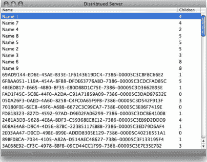

图 11.1：分布式服务器 UI

在深入细节之前，我想提一下这种设计的缺点。

- **可扩展性：** 这种设计的可扩展性完全不好。当我们在网络上只使用几个客户端时，它的性能还算不错。当我们开始将其扩展到六个或更多客户端时，它就会很快变慢。我们可以做一些优化，但如果你有超过几个客户端，就应该使用完整的数据库解决方案，而不是 Core Data。

- **线程处理：** 尽管所有对服务器的调用都在主线程上执行，但通过引用传递的对象内部的调用从本质上说并非如此。因此，如果我们通过引用将 NSManagedObject 传递给客户端，而该客户端又修改了这个 NSManagedObject，那么在线程处理方面我们就处于最糟糕的情况。

最终得到的协议如下：

下载：DistributedCDServer/PPDistributedProtocol.h

```objective-c
#define kDomainName @"local."
#define kServiceName @"_pragProgExample._tcp"

@protocol PPDistributedProtocol

- (oneway void)ping;

- (byref NSManagedObject*)createObject;
- (byref NSManagedObject*)createChildForObject:(byref NSManagedObject*)parent;
- (oneway void)deleteObject:(byref NSManagedObject*)object;
- (byref NSArray*)allObjects;
- (byref NSArray*)objectsOfName:(bycopy NSString*)name
    withPredicate:(bycopy NSPredicate*)predicate;

@end
```

在使用分布式对象时，我们需要定义如何处理非标量属性。<sup>1</sup> 在我们的协议中，我们以 byref 方式传递大多数对象，这意味着接收端会创建一个 NSDistantObject，作为服务器上对象的代理。这与 bycopy 不同，bycopy 会在接收端复制对象。它们之间一个有趣的差异是，当分布式对象以 byref 方式传递时，KVO 可以跨该分布式对象工作。我们将在构建应用的过程中演示这一点。

1. Apple 的文档中对这些内容进行了深入讨论。

### 广播服务

分布式对象通过使用经典的 Unix 套接字来工作。幸运的是，这些套接字由 NSSocketPort 为我们封装好了，因此我们不需要使用原始的 C 函数以及随之而来的所有复杂性。要使用套接字，我们需要知道要通信的套接字的地址和端口。这可以由用户输入，但用户体验并不理想；也可以使用 Bonjour 来发现它。要使用 Bonjour，我们需要在服务器上设置广播，以便客户端发现。

下载：DistributedCDServer/AppDelegate.m

```objective-c
- (void)startBroadcasting
{
    receiveSocket = [[NSSocketPort alloc] init];
    int receivePort = [self portFromSocket:receiveSocket];

    myConnection = [[NSConnection alloc] initWithReceivePort:receiveSocket
        sendPort:nil];

    [myConnection setRootObject:self];

    myService = [[NSNetService alloc] initWithDomain:kDomainName
                                                type:kServiceName
                                                name:kServerName
                                                port:receivePort];

    [myService setDelegate:self];
    [myService publish];
}
```

在 -startBroadcasting 方法中，我们首先初始化一个新的 NSSocketPort。当我们使用默认的 -init 方法时，NSSocketPort 会为我们选择一个随机的开放端口来使用。然而，我们需要将此端口信息作为 Bonjour 服务的一部分进行广播。因此，我们需要从 NSSocketPort 对象中提取端口信息。在生产环境中，我们可能希望定义一个要使用的端口，而不是随机选择一个端口。

下载：DistributedCDServer/AppDelegate.m

```objc
- (int)portFromSocket:(NSSocketPort*)socket
{
    struct sockaddr *address = (struct sockaddr *)[[receiveSocket address] bytes];
    uint16_t port;

    if (address->sa_family == AF_INET) {
        port = ntohs(((struct sockaddr_in*)address)->sin_port);
    } else if (address->sa_family == AF_INET6) {
        port = ntohs(((struct sockaddr_in6*)address)->sin6_port);
    } else {
        @throw [NSException exceptionWithName:@"Socket Error"
                                       reason:@"Unknown network type"
                                     userInfo:nil];
    }
    return port;
}
```

这段 C 代码判断从 NSSocketPort 收到的地址是 IPv4 还是 IPv6，并据此从地址中提取端口信息，然后将其返回给调用方。

拿到端口号后，我们接下来构造一个 NSConnection，并将 AppDelegate 指定为根对象。根对象就是将被“代理”给任何客户端的对象，客户端在该代理对象上调用的任何方法都会被转发到接收端的根对象。在更复杂的示例中，使用一个单独的对象作为代理而不是 AppDelegate 会更合理。创建 NSConnection 后，我们就可以初始化 NSNetService。NSNetService 负责使用 Bonjour 进行广播。Bonjour 需要四项

```objective-c
- (void)logError:(NSError*)error
{
    id sub = [[error userInfo] valueForKey:@"NSUnderlyingException"];

    if (!sub) {
        sub = [[error userInfo] valueForKey:NSUnderlyingErrorKey];
    }

    if (!sub) {
        NSLog(@"%@:%s Error Received: %@", [self class], _cmd,
              [error localizedDescription]);
        return;
    }

    if ([sub isKindOfClass:[NSArray class]] ||
        [sub isKindOfClass:[NSSet class]]) {
        for (NSError *subError in sub) {
            NSLog(@"%@:%s SubError: %@", [self class], _cmd,
                  [subError localizedDescription]);
        }
    } else {
        NSLog(@"%@:%s exception %@", [self class], _cmd, [sub description]);
    }
}
```

-logError: 方法尝试从传入的 NSError 的 userInfo 中提取 NSUnderlyingException。如果 Core Data 内部出现了不属于正常失败路径的问题，可以通过存储的 NSUnderlyingException 获取有关该失败的信息。如果没有 NSUnderlyingException，那么我们查找存储在 NSUnderlyingErrorKey 键下的值。如果从该键取回了内容，我们会检查它是否为集合，集合表示存在多个验证错误，并将 -localizedDescription 打印到控制台。如果既找不到 NSUnderlyingException，也找不到 NSUnderlyingErrorKey，那么我们就输出传入的 NSError 的 -localizedDescription。

一旦 Bonjour 服务启动且保存线程已启动，服务器就会等待来自客户端的请求。在分布式对象应用中，服务器在客户端连接时不会收到通知；它只是开始收到对已暴露方法的调用。

#### 接收来自客户端的请求

使用分布式对象看似简单，实则容易让人低估。除了对方法签名做少量修改外，方法本身及其处理方式没有其他变化。然而，每当我们编写

对于将通过分布式对象访问的方法，我们需要记住它不是在本地调用的，并牢记以下几点：

-   本示例中构建的服务器配置只有一个传入套接字。这意味着它一次只能处理一个请求。如果某个请求耗时过长（稍后我们会演示），所有其他客户端都会排队等待；这包括来自同一客户端的调用。
-   虽然我们可以按引用将对象传递给客户端，但如果这些对象又按引用传回服务器，就可能造成混乱。在处理 NSManagedObject 对象时尤其如此。因此，每当我们从客户端收到返回的 NSManagedObject 时，都会解析出一个本地引用，并针对该本地引用执行任何操作，而不是试图在服务器上再次使用客户端引用。

#### -ping 实现

构建分布式对象应用时，我始终最先实现的方法就是 -ping。我用这个方法测试客户端与服务器之间的连通性。由于该方法除了打印一条控制台消息外不做任何事，因此我可以保证在测试连通性时不会引入其他编程错误。

下载 DistributedCDServer/AppDelegate.m

```objc
- (oneway void)ping
{
    NSLog(@"%@:%s received", [self class], _cmd);
}
```

#### -allObjects 实现

这是可能耗时过长的方法之一：

下载 DistributedCDServer/AppDelegate.m

```objc
- (byref NSArray*)allObjects
{
    NSManagedObjectContext *context = [self managedObjectContext];
    NSFetchRequest *request = [[NSFetchRequest alloc] init];
    NSEntityDescription *entity = [NSEntityDescription entityForName:@"Test"
                                             inManagedObjectContext:context];

    [request setEntity:entity];

    NSError *error = nil;
    NSArray *objects = [context executeFetchRequest:request error:&error];
    [request release]; request = nil;

    if (error) {
        NSLog(@"%@%s error: %@", [self class], _cmd, error);
        return nil;
    }
    return objects;
}
```

在这个方法中，我们获取 NSManagedObjectContext 的引用，并构建一个 NSFetchRequest，以从持久化存储中检索所有 Test 实体。如果有任何错误，我们会记录它们并返回 nil。否则，我们返回得到的 NSArray。

这个方法虽然有助于演示分布式对象和 Core Data，但性能非常差。当我们开始处理持久化存储中数万个实体时，它们通过网络传输会花费很长时间。这不仅会妨碍发起请求的客户端的性能，也会妨碍每一个排队等待向服务器发起请求的客户端的性能。如果我们的需求涉及这种规模的数据，就应该考虑其他方案。一种已取得巨大成功的方案是在每台机器上保留整个存储库的本地副本，并在同步时只来回传递增量，而不是采用真正的客户端-服务器环境。

#### Joe 问道……

#### 我们可以按引用传递 NSManagedObjectContext 吗？

尽管这可行，但不推荐。当我们按引用传递对象时，会在接收方创建一个代理对象，该对象将所有消息发送回服务器执行。对于复杂度低的对象这没问题，但在处理高度复杂的对象（例如 NSManagedObjectContext）时，性能会相当差。在实验中，当按引用传递 NSManagedObjectContext 时，我在 Core Data API 深处遇到了一些非常不寻常的错误。因此，我不推荐这种做法。

#### -createObject 实现

下载 DistributedCDServer/AppDelegate.m

```objc
- (byref NSManagedObject*)createObject
{
    NSManagedObjectContext *context = [self managedObjectContext];
    NSManagedObject *object = nil;
    object = [NSEntityDescription insertNewObjectForEntityForName:@"Test"
                inManagedObjectContext:context];

    return object;
}
```

-createObject 方法演示了一种性能更高的分布式对象方法。在这个方法中，我们再次获取 NSManagedObjectContext 的引用，然后使用该引用创建一个新的 Test 对象。我们在服务器上创建和删除所有对象，而不是将 NSManagedObjectContext 拉到客户端并尝试远程删除它。这有助于防止使用 NSManagedObjectContext 时出现任何线程问题。

#### -deleteObject 实现

下载 DistributedCDServer/AppDelegate.m

```objc
- (oneway void)deleteObject:(byref NSManagedObject*)object
{
    NSManagedObjectContext *context = [self managedObjectContext];
    NSManagedObject *local = [context objectWithID:[object objectID]];
    if (![local isDeleted]) {
        return;
    }
    if (![local isInserted]) {
        [self saveAction:self];
    }
    [context deleteObject:local];
}
```

-deleteObject 与前面讨论的 -createObject 类似。不过，在这个方法中，我们需要获取传入的 NSManagedObject 的本地引用。如果我们试图直接删除所引用的 NSManagedObject，NSManagedObjectContext 会在 API 深处崩溃。毫无疑问，这是由先循环到远程再返回服务器的双重代理造成的。为了解决这个问题，我们从所引用的 NSManagedObject 中获取 NSManagedObjectID，并通过 NSManagedObjectContext 的 -objectWithID: 用它获取该 NSManagedObject 的本地引用。一旦获得 NSManagedObject 的本地引用，我们就检查它是刚插入的还是已经被删除。如果它是刚插入的，我们需要先持久化它，然后才能删除它。因此，我们保存 NSManagedObjectContext，然后删除 NSManagedObject。如果该 NSManagedObject 已经被删除，则返回给调用方。

#### -createChildForObject: 实现

下载 DistributedCDServer/AppDelegate.m

```objc
- (byref NSManagedObject*)createChildForObject:(byref NSManagedObject*)parent
{
    NSManagedObjectContext *context = [self managedObjectContext];
    NSManagedObject *localParent = [context objectWithID:[parent objectID]];
    NSManagedObject *object = nil;
    object = [NSEntityDescription insertNewObjectForEntityForName:@"Child"
                inManagedObjectContext:context];
    [object setValue:localParent forKey:@"parent"];
    return object;
}
```

-createChildForObject: 的实现与前面讨论的 -createObject 实现类似。不过，有一个重要区别。由于我们将 Child 实体定义为具有不可选的 parent 属性，因此我们仍在服务器主线程上时就立即设置它。这同样是针对分布式对象不受控制的多线程特性的一种保护。我们本可以只创建 Child 实体并将其返回给调用方，但很有可能在客户端更新关系之前就发生保存，从而导致错误。

除了在 Child 对象上设置 parent 属性外，我们还获取传入的 NSManagedObject 的本地引用。尽管我在测试此方法时通过使用远程代理没有遇到任何错误，但没有理由冒险。

#### -objectsOfName:withPredicate: 实现

下载 DistributedCDServer/AppDelegate.m

```objc
- (byref NSArray*)objectsOfName:(bycopy NSString*)name
            withPredicate:(bycopy NSPredicate*)predicate
{
    NSManagedObjectContext *context = [self managedObjectContext];
    NSError *error = nil;
    NSFetchRequest *request = [[NSFetchRequest alloc] init];
    [request setEntity:[NSEntityDescription entityForName:name
                inManagedObjectContext:context]];
    [request setPredicate:predicate];
    NSArray *results = [context executeFetchRequest:request error:&error];
    [request release], request = nil;
```


```objective-c
if (error) {
    NSLog(@"%@:%s Error on fetch %@", [self class], __cmd, error);
    return nil;
}
return results;
}
```

在最后一个示例方法中，我们处理一个更复杂的情况。在此方法的开发过程中，我最初是在服务器和客户端之间传递 NSFetchRequest。这导致 Core Data 栈内出现一些终端错误，并促使我改用这个解决方案。基于这些实验，我很清楚：传递 NSManagedObjectContext 本身会导致一些有风险的情况，应当避免。不过，NSPredicate 对象可以毫无问题地传递。因此，在此方法中，我们接收实体名称和要在 NSFetchRequest 中使用的 NSPredicate。据此，我们构建 NSFetchRequest，并针对本地 NSManagedObjectContext 执行它。如果出现错误，我们将其打印到控制台并返回 nil。否则，我们返回结果数组。

### 11.2 构建客户端

此应用程序的客户端既比服务器端更简单，也比服务器端更复杂。配置 Bonjour 和设置分布式对象比在服务器上稍微复杂一些。然而，一旦分布式对象配置完成，其余部分就会显著更容易。

在此示例中，我们将构建一个客户端，它旨在对服务器进行压力测试，而不是从用户角度真正实用。我们的客户端将连接到它找到的第一台服务器，一旦连接完成，它就会快速连续地运行 NSInvocations，对服务器上的每个方法发起调用。使用这种类型的客户端，我们可以用多个客户端对服务器进行压力测试，并查找竞态条件以及线程/锁定问题。

#### 配置 Xcode 项目

与服务器不同，客户端将从 Cocoa 非 Core Data 应用程序开始。由于服务器维护 Core Data 存储库，客户端不需要配置为 Core Data 应用程序。不过，与服务器一样，我们的用户界面是一个单一窗口，其中有一个单一表格，显示对服务器某次方法调用的结果。请参见下一页的图 11.3。

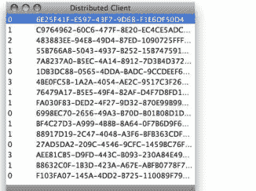

图 11.3：分布式客户端用户界面

创建 DistributedCDClient 项目后，我们需要将服务器中的 PPDistributedProtocol.h 文件复制到该项目中。通常我会直接从服务器项目引用该文件，以便两者使用同一个文件，但此示例在每个项目中都有一份副本，以防止引用中出现任何错误。接下来，我们需要创建一个名为 AppDelegate 的新类，并将其添加到项目中。将 AppDelegate 添加到项目后，我们需要配置用户界面。

在 Interface Builder 中打开 MainMenu.xib 文件，我们需要向 xib 添加一个新的 NSObject，并将其类设置为 AppDelegate。然后，我们需要将 NSApplication 的 delegate 出口绑定到 AppDelegate。接下来，我们需要向 xib 添加一个 NSArrayController，并将其 content array 绑定到 AppDelegate，模型键为 filteredObjects。最后，我们需要向窗口添加一个 NSTableView，将其扩展为占据整个窗口，并将第一列分配给 NSArrayController，控制器键为 arrangedObjects，模型键路径设置为 childCount。第二列的值也应设置为 NSArrayController，控制器键为 arrangedObjects，模型键路径设置为 name。完成这些后，我们可以关闭 Interface Builder 并打开 AppDelegate。

#### -applicationDidFinishLaunching: 实现

与大多数应用程序委托对象一样，我们的自定义代码将从 `-applicationDidFinishLaunching:` 开始。客户端需要做的第一件事是找到要连接的服务器。为此，我们初始化一个 `NSNetServiceBrowser`，并将我们的 `AppDelegate` 设置为其委托。然后，我们使用所导入协议中的 `#define` 设置来配置它搜索我们的服务器。该浏览器随后将在后台运行，并开始在本地网络上搜索服务器。如果它找到服务器，就会调用 `-netServiceBrowser:didFindService:moreComing:`。


```objective-c
- (void)applicationDidFinishLaunching:(NSNotification*)notification
{
    NSNetServiceBrowser *myBrowser = [[NSNetServiceBrowser alloc] init];
    [myBrowser setDelegate:self];
    [myBrowser searchForServicesOfType:kServiceName inDomain:kDomainName];
}
```

#### -netServiceBrowser:didFindService: 实现

每次 `NSNetServiceBrowser` 找到服务时，它都会调用此方法。如果它在一次网络扫描中找到多个服务器，那么它会为每个服务调用一次此方法，并且 `moreComing:` 将被设置为 YES。


```objective-c
- (void)netServiceBrowser:(NSNetServiceBrowser*)browser
       didFindService:(NSNetService*)service
           moreComing:(BOOL)more
{
    [service retain];
    [service setDelegate:self];
    [service resolveWithTimeout:5.0];
    [service startMonitoring];

    [browser stop];
    [browser release], browser = nil;
}
```

在我们的实现中，一旦找到服务器，我们就想连接到它。我们不担心网络上的多个服务器，因此第一个出现的服务器即可。一旦收到匹配我们搜索条件的服务可用的通知，我们就开始监视它。这将导致 `NSNetServiceBrowser` 尝试解析该服务。服务解析完成后，该服务的委托将收到通知。因此，我们将 `AppDelegate` 设置为该服务的委托。由于我们只关心单个服务，我们关闭浏览器并释放它。

#### -netServiceDidResolveAddress: 实现

服务解析完成后，NSNetService 将向其委托调用 `-netServiceDidResolveAddress:`。调用此方法时，我们可以获取有关服务的地址和端口信息，这将让我们连接到它并开始使用分布式对象。

```objective-c
- (void)netServiceDidResolveAddress:(NSNetService*)service
{
    NSConnection *clientConnection = nil;
    NSSocketPort *socket = nil;
    NSData *address = [[service addresses] lastObject];
    u_char family = (((struct sockaddr*)[address bytes])->sa_family);
    socket = [[NSSocketPort alloc] initRemoteWithProtocolFamily:family
                                                   socketType:SOCK_STREAM
                                                       protocol:IPPROTO_TCP
                                                       address:address];
    clientConnection = [NSConnection connectionWithReceivePort:nil
                                                      sendPort:socket];
    [clientConnection enableMultipleThreads];
    server = [clientConnection rootProxy];

    [socket release], socket = nil;
    [service stop];
    [service release];

    [self startTestTimers];
}
```

NSNetService 解析完成后，我们可以获取其地址并连接到它。通过访问来自 NSNetService 的地址，我们可以初始化一个 NSSocketPort，以连接到承载该服务的服务器。初始化 NSSocketPort 后，我们随后可以初始化一个 NSConnection，并最终获得对 NSConnection 的 `-rootProxy` 的引用，它实际上是服务器 AppDelegate 的 NSDistantObject 代理。一旦正确引用了服务器，我们就可以关闭 Bonjour NSNetService 并开始测试。

#### 11.2.3 测试网络代码

每当我构建需要与服务器或其他设备通信的应用程序时，我总是从简单的测试开始，以确认连接正常工作。我通常会将这些测试保留到代码进入生产环境之前。这既为我提供了一种测试连接性的简单方法，也为我提供了一个基础，以便在某些更高级功能开始失败时回退。对于此应用程序，我们将从设置一组定时器开始，这些定时器将触发我们的测试方法。

##### -startTestTimers 实现

为了模拟大量客户端-服务器流量，此应用程序以相当高的频率运行多个定时器。这将帮助我们发现此应用程序分布式特性中的任何竞态条件或其他问题。

`Download DistributedCocoaClient/AppDelegate.m`

```objective-c
- (void)startTestTimers
{
    SEL selector = @selector(testPing);
    pingTimer = [NSTimer scheduledTimerWithTimeInterval:0.5
                                                 target:self
                                               selector:selector
                                               userInfo:nil
                                                repeats:YES];

    selector = @selector(testObjectInsertion);
    insertTimer = [NSTimer scheduledTimerWithTimeInterval:0.5
                                                    target:self
                                                  selector:selector
                                                  userInfo:nil
                                                   repeats:YES];

    selector = @selector(testObjectDeletion);
    deleteTimer = [NSTimer scheduledTimerWithTimeInterval:1.0
                                                    target:self
                                                  selector:selector
                                                  userInfo:nil
                                                   repeats:YES];

    selector = @selector(testChildInsertion);
    childInsertTimer = [NSTimer scheduledTimerWithTimeInterval:1.0
                                                        target:self
                                                      selector:selector
                                                      userInfo:nil
                                                       repeats:YES];

    selector = @selector(testChildDeletion);
    childDeleteTimer = [NSTimer scheduledTimerWithTimeInterval:1.0
                                                         target:self
                                                       selector:selector
                                                       userInfo:nil
                                                        repeats:YES];
}
```


```objective-c
selector = @selector(testObjectFetch);
fetchTimer = [NSTimer scheduledTimerWithTimeInterval:15.0
                                                 target:self
                                               selector:selector
                                               userInfo:nil
                                                repeats:YES];
}
```

-startTestTimers 会启动一系列定时器，这些定时器会持续调用我们的测试方法。我们保留对每个定时器的引用，以便之后能够优雅地关闭它们。

##### -disconnect 实现

每当我们关闭客户端应用程序时，我们都希望关闭定时器，并关闭与服务器的连接。-disconnect 会逐一处理每个 NSTimer 引用并将其失效。所有定时器都关闭后，它会从服务器代理获取 NSConnection 并将其失效。

下载 DistributedCClient/AppDelegate.m

```objective-c
- (void)disconnect
{
    [pingTimer invalidate], pingTimer = nil;
    [fetchTimer invalidate], fetchTimer = nil;
    [insertTimer invalidate], insertTimer = nil;
    [deleteTimer invalidate], deleteTimer = nil;
    [childDeleteTimer invalidate], childDeleteTimer = nil;
    [childInsertTimer invalidate], childInsertTimer = nil;

    NSConnection *connection = [(NSDistantObject *)server connectionForProxy];
    [connection invalidate];
    server = nil;
}
```

##### -testPing 实现

我们的第一个测试方法也是最简单的一个。我们在服务器上调用 -ping 方法，除此之外不做任何事。我们根本不期望服务器返回任何内容。这个方法的作用是让服务器生成一条日志语句。这让我们能够观察服务器，并看到连接确实正在进入。另一个好处是它让测试保持简单。使用这个方法，我们可以确认 Bonjour 服务和分布式对象工作正常，而无需猜测应用程序其他部分的某些其他逻辑是否才是失败的真正原因。如果 ping 无法通过，我们就知道要么是 Bonjour 服务失败，要么是分布式对象失败。

```objective-c
- (void)testPing
{
    [server ping];
}
```

##### -testObjectFetch 实现

-testObjectFetch 是我们通过分布式对象链接测试的第一个复杂方法。在这个测试中，我们构造一个 NSPredicate，并将其传给服务器，以便针对 NSManagedObjectContext 执行。正如我之前提到的，将 NSManagedObjectContext 本身通过分布式对象传递，会在 Core Data 栈内部产生一些终止性异常，因此我们通过在服务器上尽可能多地执行 Core Data 工作来避免这一点。这里我们传入要搜索的实体名称和 NSPredicate。服务器将返回一个 NSArray，其中包含符合该 NSPredicate 的实体。这个方法中一个值得注意的有趣之处是，我们没有使用新的 for 循环来访问返回的 NSArray。由于这个 NSArray 实际上是服务器上 NSArray 的 NSDistantObject 代理，新的 for 循环无法正确处理它。因此，我们需要改用较旧的 NSEnumerator。

```objective-c
- (void)testObjectFetch
{
    NSString *test = [GUID substringToIndex:3];
    NSPredicate *predicate = nil;
    predicate = [NSPredicate predicateWithFormat:@"name contains[c] %@", test];

    NSArray *results = [server objectsOfName:@"Test" withPredicate:predicate];

    NSEnumerator *enumerator = [results objectEnumerator];
    NSManagedObject *object;
    while (object = [enumerator nextObject]) {
        [object setValue:GUID forKey:@"name"];
    }

    [self setFilteredObjects:results];
}
```

为了跨分布式对象展示并测试 KVO，我们遍历 NSArray 中的 NSManagedObject 对象，并将它们的 name 更新为 a

### 11.4 小结

每当我们开始处理网络上的多台计算机或应用程序间通信时，代码就会开始变得极其复杂。然而，至少通过这种设计，我们可以尽可能地将 Core Data/持久化与分布式对象/网络分离。这样做，我们避免了原本需要的大量锁和同步。

正如我们在本章开头所讨论的，这并不是一个非常可扩展的设计，但在正式独立数据库显得大材小用的情况下，这种设计实际上相当有效。没有用户配置，也不需要设置外部应用程序；我们只需在一台机器上启动一个应用程序，在另一台机器上启动另一个应用程序，然后让它们通信。最大的坑在于 NSManagedObjectContext。只要我们不去尝试跨分布式对象共享它，就可以相当透明地使用 Core Data。

我们在这里构建的设计也可以用于对等环境，而不是客户端-服务器设计。多个对等节点可以使用 Bonjour 发现彼此，并使用分布式对象同步各自的数据存储，这样每个设备都拥有完整且最新的数据集副本。在这种情况下，用户可以在自己的每台机器上安装我们的应用程序，每当它们彼此靠近（即位于同一局域网）时，它们就会自动更新彼此。这用户体验可真不错！

## 第 12 章

## 秘诀：动态参数

如果你有一个文档风格的应用程序，你将需要处理文档特定的参数或设置。例如，在文字处理器中，有些设置特定于某个文档，而有些设置则适用于整个应用程序。在存储应用程序级参数时，我们有一个很好的实现：NSUserDefaults。然而，对于文档级参数，API 并没有提供可复用的存储系统。在本章中，我们将在 Core Data 中构建这个可复用的存储系统。

系统级和用户级偏好设置在 OS X 上非常有用，而且易于访问。在应用程序任意位置调用一次 NSUserDefaults 的 standardUserDefaults，就能立即访问当前登录用户的默认设置。然而，有时我们不想在用户级别存储偏好设置，而是更愿意在文件级别存储它们。

当我们使用 Core Data 应用程序时，第一个想法就是为这些参数创建一个表，并从 Core Data API 中访问它们。然而，问题出现在访问这些参数时。它不再是对 NSUserDefaults 的 standardUserDefaults 的一次调用；现在它看起来更像这样：

```objective-c
- (void)clunkyParameterAccess
{
    NSManagedObjectContext *moc = [self managedObjectContext];
    NSFetchRequest *request = [[NSFetchRequest alloc] init];
    [request setEntity:[NSEntityDescription entityForName:@"parameter"
                                      inManagedObjectContext:moc]];

    [request setPredicate:[NSPredicate predicateWithFormat:@"name == %@",
                                              @"default1"]];

    NSError *error = nil;

    NSManagedObject *param = [[moc executeFetchRequest:request
                                                 error:&error] lastObject];
    if (error) {
        NSLog(@"%@:%s Error fetching param: %@", [self class], _cmd, error);
        return;
    }

    NSLog(@"%@:%s Parameter value %@", [self class], _cmd,
          [param valueForKey:@"value"]);
}
```

更糟的是当我们需要设置参数时：

下载 CDPreferences/MyDocument.m

```objc
- (void)clunkyParameterWrite
{
    NSManagedObjectContext *moc = [self managedObjectContext];
    NSFetchRequest *request = [[NSFetchRequest alloc] init];
    [request setEntity:[NSEntityDescription entityForName:@"parameter"
                                  inManagedObjectContext:moc]];

    [request setPredicate:[NSPredicate predicateWithFormat:@"name == %@",
                                              @"default1"]];

    NSError *error = nil;

    NSManagedObject *param = [[moc executeFetchRequest:request
                                                  error:&error] lastObject];
    if (error) {
        NSLog(@"%@:%s Error fetching param: %@", [self class], _cmd, error);
        return;
    }

    if (!param) {
        param = [NSEntityDescription insertNewObjectForEntityForName:@"Parameter"
                                            inManagedObjectContext:moc];
        [param setValue:@"default1" forKey:@"name"];
    }

    [param setValue:@"SomeValue" forKey:@"value"];
}
```

对此最明显的解决方案是将这段代码抽象到某个地方，以便我们只需一行代码就能访问它。如果……岂不是……


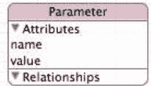

图 12.1：参数表模型

动态数量的访问器。然而，我们不希望每次添加参数时都必须编写一个访问器：理想情况下，我们只想调用 `-valueForKey:` 和 `-setValue:forKey:`，而不必担心这些值的持久化。最后，我们希望能够设置一些默认值。

关于默认值的一个重要点是，它们不会被持久化到磁盘。如果它们被持久化，那么之后更改默认值的版本将需要额外的代码来检查已持久化的默认值并重置它们。然而，如果我们不持久化它们，那么较新版本应用的用户会自动免费获得较新的默认值，更重要的是，如果他们已将值从其默认值更改，他们的偏好设置也不会被破坏。

DocumentPreferences 对象将实现所有这些目标：

下载 CDPreferences/DocumentPreferences.h

```objc
@interface DocumentPreferences : NSObject
{
    NSDictionary *_defaults;
    NSPersistentDocument *_associatedDocument;
}

@property (assign) NSPersistentDocument *associatedDocument;
@property (assign) NSDictionary *defaults;

- (id)initWithDocument:(NSPersistentDocument*)associatedDocument;
- (NSArray*)allParameterNames;
- (NSDictionary*)allParameters;

@end
```

我们的 DocumentPreferences 对象期望在初始化时接收对其 NSPersistentDocument 的引用。通过传入的引用，我们的 DocumentPreferences 将能够访问底层的 NSManagedObjectContext。我们也可以直接将这种设计纳入 NSPersistentDocument 的子类中；然而，这会导致文档对象变得相当大且难以维护。因此，尽管 NSPersistentDocument 对象与 DocumentPreferences 对象之间存在一对一关系，我们仍将它们分开以降低代码复杂度。

这个头文件缺少的一件事是访问参数本身的任何方式。没有用于此访问的方法，因为我们将利用 KVC。每当另一段代码从我们的 DocumentPreferences 对象请求参数时，都会调用 `-valueForUndefinedKey:` 方法，我们正是在那里处理对参数表的访问。

#### -valueForUndefinedKey:

```objc
- (id)valueForUndefinedKey:(NSString*)key
{
    id parameter = [self findParameter:key];
    if (!parameter && [[self defaults] objectForKey:key]) {
        return [[self defaults] objectForKey:key];
    }
    return [parameter valueForKey:@"value"];
}
```

在这个方法中，我们接收调用者试图获取的值的名称。我们使用这个名称通过 `-findParameter:` 方法获取 NSManagedObject，并返回该 NSManagedObject 对象的 value 属性。如果没有传入名称对应的参数，那么我们会检查 defaults NSDictionary，看看是否有对应的默认值。如果没有设置默认值，我们让 `-valueForKey:` 方法向调用者返回 nil。

#### -findParameter:

```objc
- (NSManagedObject*)findParameter:(NSString*)name
{
    NSManagedObjectContext *moc;
    NSManagedObject *param;
    NSError *error = nil;
    moc = [[self associatedDocument] managedObjectContext];
```

```objc
    [self didChangeValueForKey:key];
    return;
}
}

if ([value isKindOfClass:[NSNumber class]]) {
    [parameter setValue:[value stringValue] forKey:@"value"];
} else if ([value isKindOfClass:[NSDate class]]) {
    [parameter setValue:[value description] forKey:@"value"];
} else {
    [parameter setValue:value forKey:@"value"];
}
[self didChangeValueForKey:key];
}
```

除了能够访问参数之外，我们还需要设置参数。这是通过 `-valueForUndefinedKey:` 的对应方法 `-setValue:forUndefinedKey:` 完成的。在这个方法中，我们首先通知系统我们将要更改与传入键关联的值。这是 KVO 的一部分，是使通知正常工作的必要条件。开始 KVO 通知后，我们尝试从参数表中获取 NSManagedObject。如果没有传入键对应的 NSManagedObject，我们接着检查 defaults NSDictionary，看看是否有默认值。如果设置了默认值，并且传入的值与默认值匹配，我们完成 KVO 通知并返回。如果默认值与传入的值不匹配，我们为传入的键创建一个新的 NSManagedObject。

如果存在 NSManagedObject 并且为该键设置了默认值，我们将默认值与传入的值进行比较。如果它们匹配，那么我们接着*删除*该 NSManagedObject，这实际上会将参数重置为默认值。一旦我们通过了针对默认值的检查并且/或者创建了 NSManagedObject，我们就测试该值，看它是 NSNumber 还是 NSDate。如果是，那么我们将其 -stringValue 或 -description 作为 NSManagedObject 的值传入。否则，我们直接将值传入 NSManagedObject。设置值后，我们调用 -didChangeValueForKey: 来完成 KVO 通知。

#### -createParameter:

下载 CDPreferences/DocumentPreferences.m

```objc
- (NSManagedObject*)createParameter:(NSString*)name
{
    NSManagedObject *param;
    NSManagedObjectContext *moc;
    moc = [[self associatedDocument] managedObjectContext];
    param = [NSEntityDescription insertNewObjectForEntityForName:@"Parameter"
                                           inManagedObjectContext:moc];
    [param setValue:name forKey:@"name"];
    return param;
}
```

`-createParameter:` 方法创建一个新的 NSManagedObject，并使用传入的值设置 name 属性。它不设置 value 属性，而是留给调用者。这允许我们在确实需要时设置一个 nil 参数。

#### -allParameters

下载 CDPreferences/DocumentPreferences.m

```objc
- (NSDictionary*)allParameters
{
    NSManagedObjectContext *moc;
    NSError *error = nil;
    moc = [[self associatedDocument] managedObjectContext];
    NSFetchRequest *request = [[NSFetchRequest alloc] init];
    [request setEntity:[NSEntityDescription entityForName:@"Parameter"
                                   inManagedObjectContext:moc]];
    NSArray *params = [moc executeFetchRequest:request error:&error];
    if (error) {
        NSLog(@"%@:%s Error fetching parameter: %@", [self class], _cmd, error);
        return nil;
    }
    
    NSMutableDictionary *dict = [[self defaults] mutableCopy];
    for (NSManagedObject *param in params) {
        NSString *name = [param valueForKey:@"name"];
        NSString *value = [param valueForKey:@"value"];
        [dict setValue:value forKey:name];
    }
    return dict;
}
```

除了这个类的主要功能外，我们还有几个已被证明有用的便利方法。第一个是 `-allParameters`，它返回所有参数（包括默认值）的 NSDictionary。在这个方法中，我们为 Parameter 实体创建一个不带 NSPredicate 的 NSFetchRequest。我们获取结果 NSArray 并遍历它。在该循环中，我们将每个 NSManagedObject 添加到从默认 NSDictionary 派生出的 NSMutableDictionary 中。这确保最终 NSDictionary 中同时包含默认值和 Parameter 条目。

#### -allParameterNames

```objc
- (NSArray *)allParameterNames
{
    NSManagedObjectContext *moc;
    NSError *error = nil;
    moc = [[self associatedDocument] managedObjectContext];
    NSFetchRequest *request = [[NSFetchRequest alloc] init];
    [request setEntity:[NSEntityDescription entityForName:@"Parameter"
                                     inManagedObjectContext:moc]];

    NSArray *params = [moc executeFetchRequest:request error:&error];
    if (error) {
        NSLog(@"%@: %s Error fetching parameter: %@", [self class], _cmd, error);
        return nil;
    }

    NSMutableArray *keys = [[[self defaults] allKeys] mutableCopy];
    for (NSManagedObject *param in params) {
        NSString *name = [param valueForKey:@"name"];
        [keys addObject:name];
    }
    return keys;
}
```

与 `-allParameters` 类似，`-allParameterNames` 是一个便利方法，返回当前已设置或已默认的键的 NSArray。就像 `-allParameters` 方法一样，它获取所有参数 NSManagedObject 对象并遍历它们。在该循环中，它将 name 属性添加到从 defaults NSDictionary 派生出的 NSMutableArray 中。

### 12.3 回顾

通过这种设计，我们可以在每个文档中访问参数，而不必担心底层结构。我们也不需要仅仅为了跳过去向对象添加参数而停止编码。我们可以以与使用 NSUserDefaults 相同的方式来使用 DocumentPreferences。

通过将 DocumentPreferences 对象改为单例，或者将 `-valueForUndefinedKey:` 和 `-setValue:forUndefinedKey:` 方法连同 NSManagedObjectContext 直接添加到 NSApplication delegate 中，同样的设计也可以用于非文档型应用。


无论我们是否在文档模型中工作，现在都可以通过类似下面的单次调用访问持久化存储特定的参数：

```
NSString *value = [[self preferences] valueForKey:@"exampleKey1"];
```

我们也可以通过类似下面的调用设置它们：

```
[[self preferences] setValue:@"someValue" forKey:@"someKey"];
```

在这两个示例中，我们直接在 DocumentPreferences 对象上调用 -valueForKey: 和 -setValue:forKey:，而无需担心该值是否存在。如果它不存在，我们将收到 nil。如果它已设置为默认值，我们将取回该默认值；如果我们已覆盖默认值或先前设置了该属性，则将返回该属性值。

最后，与 NSUserDefaults 类似，默认值不会持久化到磁盘。因此，我们每次初始化 DocumentPreferences 时都需要设置它们：

下载 CDPreferences/MyDocument.m

```
NSMutableDictionary *defaults = [NSMutableDictionary dictionary];
[defaults setValue:[NSNumber numberWithBool:YES] forKey:@"default1"];
[defaults setValue:@"DefaultValue2" forKey:@"default2"];
[defaults setValue:@"DefaultValue3" forKey:@"default3"];
[_preferences setDefaults:defaults];
```

但是，我们不必担心以后更改默认值。如果我们在后续版本中更改默认值，只要用户尚未覆盖它们，它们就会自动更新。

## 索引

### A

- 访问模式，112–113
- add: 方法（NSArrayController），26, 29
- addImage: 方法，31
- addObserver:forKeyPath: 方法，39
- addPersistentStoreWithType: 方法，90, 152
- 地址簿应用程序，16
- allObjects 实现（DistributedCDServer），214
- allParameterNames 实现（CDPreferences），236
- allParameters 实现（CDPreferences），235
- AppDelegate 对象
  - 添加到 xib 文件，22
  - 图像路径，在头文件中，30
- applicationDidFinishLaunching: 方法，212, 220
- applicationDidFinishLaunching: 方法，122
- applicationShouldTerminate: 方法，122
- associateObject:parent: 方法，181
- 原子存储，98
- 属性特性（数据模型），18
- 属性检查器，44
- 数据类实体的属性，144
- NSManagedObject 对象的属性，52–54
  - 原始访问，53
- 自动数据迁移，88–90
  - 开启，78
- awakeFromFetch: 方法，重写，59
- awakeFromInsert: 方法，重写，59

### B

- 二进制数据，存储位置，99
- 二进制存储，97, 98, 189
- Bonjour，207, 210
- 广播服务（分布式 Core Data），210–212
- 按钮，26

### C

- 缓存数据，110
- 计算值，存储，103
- 级联选项（删除规则），19
- CDPreferences 应用程序
  - 构建，230–237
  - DocumentPreferences 对象，230–236
    - allParameterNames，236
    - allParameters，235
    - createParameter:，235
    - findParameter:，233
    - setValue:forUndefinedKey:，234, 236
    - valueForUndefinedKey:，232, 236
- 客户端，分布式 Core Data，218–221
  - allObjects，214
  - applicationDidFinishLaunching:，220
  - createChildForObject:，217
  - createObject:，216
  - deleteObject:，216
  - netServiceBrowser:didFindService:，220
  - netServiceDidResolveAddress:，221
  - objectsOfName:withPredicate:，218
  - ping，214
  - ping 实现
    - 测试，223
  - 接收来自客户端的请求，213
- 客户端描述文件（Sync Services），149
- ClientDescriptionList 文件，149
- 客户端，同步，141
  - 注册为客户端，153–156
- “客户端”面板（Synchronizers），158
- Cocoa Application 模板，16
- Cocoa 绑定，34–49
  - 键值编码（KVC），34–38
  - 键值观察（KVO），39–40
    - 与 NSArrayController 对象配合使用，42
    - 与 NSFormatter 对象配合使用，43
    - 与 NSObjectController 对象配合使用，46
    - 与 NSOutlineView 对象配合使用，46
    - 与 NSSearchField 对象配合使用，48
    - 与 NSTableView 对象配合使用，41
    - 与 NSViewController 对象配合使用，48
      - NSManagedObject 属性的原始访问，53
      - NSManagedObject 关系的原始访问，56
    - 用于食谱应用程序，40–49
- 创建 Cocoa Touch 项目，184
- 组合框（用户界面），28
  - 绑定到 Type 实体，66
- 常用数据，存储，104
- Compile Sources 部分，77
- contextDidSave: 方法，178
- 控制器层，构建，22–25
  - 将对象添加到 xib 文件，22
- controllerDidChangeContent: 方法，203
- controllerWillChangeContent: 方法，201
- copyPropertiesFromObject:toObject:parent: 方法，179–180
- copyRecipe: 方法，178
- Core Data，定义，9–10
- Core Data API（栈），51
  - 添加到 Cocoa Touch 项目，186–189
  - NSManagedObjectContext，概述，64–67
  - NSManagedObjectModel，概述，68–69
  - NSPersistentStoreCoordinator，概述，69–71
  - 需要，75
- Core Data Application 模板，16
- createChildForObject: 实现（DistributedCDServer），217
- createDestinationInstanceForSourceInstance: 方法，86–88
- createObject: 实现（DistributedCDServer），216
- createParameter: 实现（CDPreferences），235
- createRelationshipForDestinationInstance: 方法，88
- 跨线程通信，164, 177
- 自定义数据存储，98

### D

- 数据变更通知，iPhone，192–194
  - 委托设计模式，193
  - NSFetchedResultsController 对象，194
  - NSNotificationCenter 对象，193
- 数据类（同步模式），142, 143
- 数据反规范化，102
- 数据迁移，73
  - 自动迁移，88–90
    - 开启，78
  - 复杂迁移，示例，85–88
  - 手动迁移，90
  - 过程，82
  - 渐进式迁移，90–95
    - 创建迁移方法，91
    - 查找托管对象模型，92
    - 查找映射模型，93
    - 简单迁移，示例，76–82
      - 创建第一个映射模型，79–81
      - 创建带版本的数据模型，77
      - 开启自动迁移，78
- 数据模型
  - 添加到 Cocoa Touch 项目，185
  - 构建，16–21
    - 将实体添加到模型，17–21
  - 用于 DistributedCDServer 应用程序（示例），209
  - 为同步而更新，143–146
- 数据模型优化，99–104
  - 反规范化数据，102
  - 实体继承，101
  - 智能关系，103
  - 存储二进制数据，99
- 数据对象，21
- DataClasses 键（Schema.plist），147
- DataModel.xcdatamodel 文件，17
- dealloc: 方法，不重写，58
- 委托设计（iPhone），193
- 删除规则，19
- deleteObject: 实现（DistributedCDServer），216
- 删除对象，110
- 反规范化数据，102
- description: 方法，不重写，57
- 目标实体，19
- didFinishFetch: 方法，重写，58
- disconnect 方法，223
- 磁盘访问，**109**
  - 故障与磁盘访问，**111**
  - 获取请求与磁盘访问，**108**
  - SQLite 存储，**109**
  - 写入磁盘，**110**
- DisplayName 键（ClientDescription.plist），**149**
- 分布式对象，与 Core Data 配合使用，**207–227**
  - 构建客户端，**218–221**
    - applicationDidFinishLaunching:，**220**
    - netServiceBrowser:didFindService:，**220**
    - netServiceDidResolveAddress:，**221**
  - 构建服务器，**209–218**
    - allObjects，**214**
    - 广播服务，**210–212**
    - createChildForObject:，**217**
    - createObject:，**216**
    - deleteObject:，**216**
    - 分布式对象协议，**209**
    - objectsOfName:withPredicate:，**218**
    - ping，**214, 223**
    - 接收来自客户端的请求，**213**
    - 启动服务器，**212–213**
  - 使用分布式对象的缺点，**208**
  - 测试网络代码，**222–226**
    - disconnect 方法，**223**
    - startTestTimers 方法，**222**
    - testChildDeletion 方法，**226**
    - testChildInsertion 方法，**225**
    - testObjectDeletion 方法，**225**
    - testObjectFetch 方法，**224**
    - testObjectInsertion 方法，**225**
    - testPing 方法，**223**
- 分布式对象协议，**209**
- DistributedCDClient 项目，**218–221**
  - applicationDidFinishLaunching:，**220**
  - netServiceBrowser:didFindService:，**220**
  - netServiceDidResolveAddress:，**221**
- DistributedCDServer 应用程序，**209–218**
  - DistributedCDServer 应用程序对象，**214**
    - 广播服务，**210–213**
    - createChildForObject:，**217**
    - createObject:，**216**
    - deleteObject:，**216**
    - 分布式对象协议，**209**
    - objectsOfName:withPredicate:，**218**
    - ping，**214**
  - ping 实现
    - 测试，**223**
    - 接收客户端请求，**213**
- 基于文档的应用程序，**219, 228**
- @dynamic 关键字，**38, 53**
- 动态参数，**228–237**
  - 为其构建项目，**230**
  - DocumentPreferences 对象，**230–236**
    - allParameterNames，**236**
    - allParameters，**235**
    - createParameter:，**235**
    - findParameter:，**233**
    - setValue:forUndefinedKey:，**234, 236**
    - valueForUndefinedKey:，**232, 236**

### E

- Enterprise Objects，**10**
- 实体，添加到数据模型，**17–21**
- 数据类中的实体，**142**
- Entities 键（ClientDescription.plist），**149**
- 实体哈希，**83**
- 实体继承，**101**
- entityForName:inManagedObjectContext:
  - 方法，**60**
- 错误，呈现，**76**
- executeFetchRequest:error: 方法，**60**
- 导出食谱（多线程示例），**165–173**

### F

- 故障的 NSManagedObject 对象，**105**
- 故障，**108–112**
  - 磁盘访问与故障，**111**
  - 获取性能，**104–108**
    - 磁盘访问与获取性能，**108**
  - 故障的 NSManagedObject 对象的故障，**105**
  - 加载 NSManagedObjectID 对象，**105**
  - 属性值，预取，**106**
  - 关系，预取，**107, 109**
- 获取请求，**59–63**
  - 磁盘访问与获取请求，**108**
  - 执行，**60**
  - 用于导出食谱（示例），**167**
  - 用于导入食谱（示例），**176**
  - 缩小搜索范围或筛选结果，**61**
  - 设置要获取的实体，**60**
  - 存储，**62**
- 获取的属性，**71**


- fetchRequestTemplateForName: 方法，63
- 文件菜单，向其中添加项，31
- Spotlight 元数据的文件名，119
- 文件，为 Spotlight 创建，116
- 过滤
  - NSFetchRequest 搜索，61
  - NSArrayController 中的对象，48
- finalize 方法，不重写，58
- findParameter 实现（CDPPreferences），233
- 持久化存储的格式，97–99，189

### G

- GeneratePermanentURIsForURLs 方法，132
- 生成 Spotlight 元数据文件，119
- GetMetadataForFile.m 文件，127

### H

- Harrington, Tom，8
- 哈希（版本控制），83
- 历史记录窗格（Syncroscopy），159
- 食谱的 HTML 页面，134

### I

- IBAction 对象，30
- IBOutlet 对象，30
- 标识属性，用于 Sync Services，144
- imagePath 键（ClientDescription.plist），149
- 图像，添加到用户界面，30
- 导入器，Spotlight
  - 构建，123–130
  - 性能要求，116
- 导入图像，30
- 导入食谱（多线程示例），173–178
- 内存存储，97，189
- Info.plist，从其中填充 Type 表，66
- 信息过载，113
- ingredients 属性，19
- 实体继承，101
- initWithFetchController 方法，198
- initXXX 方法，不重写，57
- 检查器，26
- 智能关系，103
- Interface Builder，9，22
- 反向关系，19，20
- iPhone，184–206
  - 数据变更通知，192–194
  - 委托设计模式，193
  - NSFetchedResultsController 对象，194
  - NSNotificationCenter 对象，193
  - 内存管理，190–192
  - 其上的食谱应用，195–206
    - 构建详情视图控制器，204–206
    - 构建主表视图，198–204
    - 准备 NSFetchedResultsController，196–198
    - 将应用升级到 Core Data，185–189

### K

- 键值编码（KVC），34–38
  - 对 NSManagedObject 属性的原始访问，53
  - 对 NSManagedObject 关系的原始访问，56
- 键值观察（KVO），39–40
  - 对 NSManagedObject 属性的原始访问，53
  - 对 NSManagedObject 关系的原始访问，56

### L

- 大型二进制数据，存储，101
- 本地化文件（同步），148
- localizeDescription 方法，76，213
- logError: 方法，212

### M

- main 方法（NSOperation），163
- MainMenu 元素，31
- managedObjectContext: 方法，189
- managedObjectContextsToMonitorWhenSyncingPersistentStoreCoordinator: 方法，153
- managedObjectContextsToReloadAfterSyncingPersistentStoreCoordinator: 方法，153
- ManagedObjectModels 键（Schema.plist），148
- 手动数据迁移，90
- 映射模型，84
  - 首先，创建，79–81
  - 更新，96
- 中型二进制数据，存储，100
- 内存管理，iPhone，190–192
- 菜单项（用户界面），31，165，173
- mergeChangesFromContextDidSaveNotification: 方法，164，178
- 用于 Spotlight 集成的元数据文件，116–123，129，139
- metadataFolder 方法，123
- 方法，重写
  - 适合重写的方法，58
  - 不适合重写的方法，57
- 迁移阶段（同步过程），141
- mom 文件，68
  - 实体哈希，83
- 多线程，162–183
  - 创建多个上下文，163–165
  - 分布式对象与多线程，208
  - 导出食谱（示例），165–173
  - 导入食谱（示例），173–178
  - NSManagedObjectContext 对象与多线程，65，162
  - NSPersistentStoreCoordinator 对象与多线程，69
  - 递归复制，178–182
  - 为什么 Core Data 不是线程安全的，162–163
- 可变访问，对多关系，55
- mutableSetValueForKey: 方法，56

### N

- name 属性（Schema.plist），148
- name 属性，Type 实体，21
- Spotlight 元数据文件的名称，119
- netServiceBrowser:didFindService: 实现（DistributedCDClient），220
- netServiceDidResolveAddress: 实现（DistributedCDClient），221
- 分布式 Core Data 的网络代码，测试，222–226
  - disconnect 方法，223
  - startTestTimer 方法，222
  - testChildDeletion 方法，226
  - testChildInsertion 方法，225
  - testObjectDeletion 方法，225
  - testObjectFetch 方法，224
  - testObjectInsertion 方法，225
  - testPing 方法，223
- 新项目，创建，16
- newContextForMainStore 方法，164
- nonatomic 选项（属性定义），38
- 使用 KVO 的通知，避免，53，56
- NSAlert 对象，76
- NSArray 对象
  - 用于导出食谱（示例），167
  - 用于导入食谱（示例），176
  - 排序，63
- NSArrayController 对象，23
  - 用于导出食谱（示例），168
  - 与 Cocoa Bindings 一起使用，42
- NSAttributedString 对象，27
- NSButton 对象，26
- NSComboBox 对象，28
  - 绑定到 Type 实体，66
- NSConnection 对象，221
- NSDateFormatter 对象，与 Cocoa Bindings 一起使用，44
- NSDictionary 对象，用于 Spotlight 集成，116
- NSEntityDescription 对象，用于获取请求，60
- NSEntityMigrationPolicy 对象，85–88
- NSFetchedResultsController 对象，64，190，194，196–198
- NSFetchRequest 对象，59–63
  - 与磁盘访问，108
  - 执行获取请求，60
  - 用于导出食谱（示例），167
  - 故障的 NSManagedObject 对象，105
  - 用于导入食谱（示例），176
  - 为获取设置实体，60
  - 存储获取请求，62
  - 与 NSPredicate 对象一起使用，61
- NSFileManager 对象，33
- NSFormatter 对象，与 Cocoa Bindings 一起使用，43
- NSImageView 对象，30
- NSManagedObject 对象，52–59
  - 访问属性，52–54
    - 原始访问，53
  - 访问关系，54–56
    - 原始访问，56
    - 属性访问器，56
    - 对多关系，55
    - 对一关系，55
  - 子类化，57–59
  - 故障，105
  - 与键值编码一起使用，35
    - 预取属性值，106
- NSManagedObjectContext 对象，64–67
  - 创建多个，163–165
  - 用于导出文件，171
  - 按引用传递，215
  - 更新 Spotlight 元数据文件，119
- NSManagedObjectContextDidSaveNotification 键，164，177
- NSManagedObjectID 对象，105
  - 预取，107
- NSManagedObjectModel 对象，68–69
  - 为渐进式迁移查找，92
  - iPhone 项目，187
  - 作为线程安全的，162
- NSMappingModel 对象
  - 为渐进式迁移查找，93
  - 更新，96
- NSMapTable 对象，165，173
- NSMigratePersistentStoresAutomaticallyOption 键，90
- NSMigrationManager 对象，94
- NSMutableSet 对象，55
- NSNetService 对象，211，221
- NSNetServiceBrowser 对象，220
- NSNotification API，193
- NSNotification 对象与多线程，164，177
- NSNotificationCenter 对象，193
- NSNumberFormatter 对象，28，29
  - 与 Cocoa Bindings 一起使用，43
- NSObject 对象
  - 键值编码实现，34
  - 键值观察实现，39
- NSObjectController 对象，与 Cocoa Bindings 一起使用，46
- NSOpenPanel 对象，32
- NSOperation 对象，163，170
- NSOperationQueue 对象，163
- NSOutlineView 对象，与 Cocoa Bindings 一起使用，46
- NSPersistentDocument 对象，232
- NSPersistentStore 对象
  - 添加到 NSPersistentStoreCoordinator，71，75
  - 作为线程安全的，162
- NSPersistentStoreCoordinator 对象，69–71，110
  - 启用自动版本控制，89
  - iPhone 项目，187
  - 为同步而修改，151–152
  - 作为线程安全的，162
- NSPersistentStoreCoordinatorSyncing 协议，152
- NSPredicate 对象，48
  - 用其聚焦获取请求，61
- NSRemoveTemplateImage，26
- NSSavePanel 对象，169
- NSScrollView 对象，26
- NSSearchField 对象，与 Cocoa Bindings 一起使用，48
- NSSet 对象，55
- NSSocketPort 对象，210，211
- NSSortDescriptor 对象，63–64
- NSTableColumn 对象，26
- NSTableView 对象，26
  - 与 Cocoa Bindings 一起使用，41
- NSTreeController 对象，47
  - 与 Cocoa Bindings 一起使用，48
- NSUnderlyingErrorKey，213
- NSUnderlyingException 对象，213
- NSURL 对象，用于 NSManagedObjectModel，69
- NSUserDefaults 对象，228
- numberOfSectionsInTableView: 方法，199

### O

- 对象删除，110
- objectOfType:withName: 方法，182
- objectsOfName:withPredicate:
  - 实现（DistributedCDServer），218
- 一对多关系，20
- 存储库的单向副本，171
- 优化数据模型，99–104
  - 反规范化数据，102
  - 实体继承，101
  - 智能关系，103
  - 存储二进制数据，99
- 数量级（性能），109
- 排序数据
  - 使用 NSSortDescriptor，63–64
  - 性能与排序，112
- 大纲视图（用户界面），46
- 重写方法
  - 适合重写的方法，58


- 不安全的方法，57

### P

- 路径（图像），30
- pathForResource:ofType: 方法，68
- 访问模式，112-113
- 对等节点，同步，141n, 161
- 性能调优，97-113
  - 访问模式，112-113
  - 故障，108-112
  - 获取，104-108
    - 加载 NSManagedObjectID 对象，105
  - 优化数据模型，99-104
  - 持久化存储类型，97-99, 189
  - Spotlight 集成，116
- 执行同步，156-158
- 持久化默认设置，231
- 持久化存储类型，97-99, 189
- persistentStoreCoordinator: 方法，75
  - 开启自动迁移，78
- 将数据持久化到存储库，69
- 图片，添加到用户界面，30
- ping 实现
  - （分布式对象），214
  - 测试，223
- plist 文件
  - 定义，68
  - 作为 Spotlight 元数据文件，116
- PPDistributedProtocol.h 文件，219
- PPDistributedProtocol 协议，209
- PPExportOperation 对象，170
- PPImportOperation 对象，175
- 谓词，48
  - 聚焦获取请求，61
- 偏好设置，系统级和用户级，228
- 预取，105, 109
  - NSManagedObjectID 对象，107
  - 属性值，106
  - 关系，107, 109
- 将数据预加载到缓存，110
- 预填充存储库，66
- 预览，快速查看，133-137
- 原始访问
  - 对 NSManagedObject 属性，53
  - 对 NSManagedObject 关系，56
- primitiveValueForKey: 方法，54
- 渐进式数据迁移，90-95
  - 创建迁移方法，91
  - 查找托管对象模型，92
  - 查找映射模型，93
- 项目，创建，16
- 属性（数据模型），18
- 为搜索优化的属性，102
- @property 关键字，36-38, 57
- 属性值，预取，106
- 拉取阶段（同步过程），142
- 推送阶段（同步过程），141

### Q

- 快速查看，115, 130-138
  - 生成预览，133-137
  - 生成缩略图，132
  - 与 Spotlight 导入器配合使用，138-139
  - 测试插件，137

### R

- 不常使用的数据，存储，104
- 食谱应用程序
  - 自动迁移，88-90
    - 开启，78
  - 为其构建控制器层，22-25
    - 为其构建数据模型，16-21
      - 向模型添加实体，17-21
  - 构建 NSPersistentStoreCoordinator，70
  - Cocoa Bindings，配合使用，40-44
    - NSArrayController 对象，42
    - NSFormatter 对象，43
    - NSTableView 对象，41
  - Cocoa Touch 版本，195-206
    - 构建详情视图控制器，204-206
    - 构建主表视图，198-204
    - 准备 NSFetchedResultsController，196-198
  - 复杂迁移，使用 NSEntityMigrationPolicy，85-88
  - 控制器层，构建
    - 向 xib 文件添加对象，22
    - 使用文档级参数，228-237
    - 构建项目，230
  - DocumentPreferences 对象，230-236
  - 导出食谱（多线程），165-173
  - 为食谱生成 HTML 页面，134
  - 导入食谱（多线程），173-178
  - 维护更新，74-76
  - 手动迁移，90
  - 食谱图片，30-33
  - 渐进式迁移，90-95
    - 创建迁移方法，91
    - 查找托管对象模型，92
    - 查找映射模型，93
  - 简单迁移，76-82
    - 创建第一个映射模型，79-81
    - 创建版本化数据模型，77
    - 开启自动迁移，78
  - 为同步更新数据模型，144-146
  - 用户界面，14, 25-29
    - 配料列表，28-29
    - 食谱详情，27-28
    - 食谱来源列表，26-27
- 食谱条目，创建，17
- RecipientIdentifier，19
- 递归复制，178-182
- 注册为同步客户端，153-156
- 向真值源注册（同步），141
- 正则表达式与性能，112
- 关系数据库作为持久化存储，98
- 关系属性，19-20
  - 反向关系的需要，20
- Relationship 属性，20
- 关系
  - 在数据类实体中，144
  - 限制跨关系查询，113
  - 预取，107, 109
- NSManagedObject 对象的关系，54-56
  - 原始访问，56
  - 对关系的原始访问，56
  - 属性访问器，56
  - 对多关系，55
  - 对一关系，55
- remove: 方法（NSArrayController），26, 29
- removeObserver:forKeyPath: 方法，39
- 存储库
  - 单向副本，171
  - 将数据持久化到（存储库），69
  - 预填充对象到（存储库），66
  - 使用多个文件代替（存储库），115
- rootProxy 方法（NSConnection），221

### S

- 保存对话框（用户界面），169
- saveAction: 方法，122, 212
- 可伸缩性，分布式对象相关，208
- 同步模式，146-148
- Schema 窗格（Syncrospector），159
- Schema.strings 文件，148
- Schema.plist 文件，147
- 搜索字段（用户界面），48
- 仅搜索属性，102
- 搜索性能，112
- 服务器，分布式 Core Data，209-218
  - allObjects，214
  - 广播服务，210-212
  - createChildForObject:，217
  - createObject，216
  - deleteObject:，216
  - 分布式对象协议，209
  - objectsOfName:withPredicate:，218
  - ping，214
  - ping 实现
    - 测试，223
  - 接收来自客户端的请求，213
  - 启动，212-213
- setEditing:animated: 方法，205
- setPrimitiveValue:forKey: 方法，54
- setStoresForSyncDelegate:URL:forPersistentStore: 方法，151, 152
- setValue:forKey: 方法，36
  - 初始化 NSUserDefaults，231
- setValue:forUndefinedKey: 实现（CDPreferences），234, 236
- setValue:forUndefinedKey: 方法，36
- 单一持久化存储，70, 187
- 小型二进制数据，存储，100
- 排序数据
  - 使用 NSSortDescriptor，63-64
  - 性能相关，112
- Spotlight，114-130
  - 构建导入器，123-130
  - 创建元数据文件，116-123
  - 与快速查看生成器配合使用，138-139
  - 测试导入器，128
- SQLite 存储，97, 98, 189
- 栈（Core Data API），51
  - 添加到 Cocoa Touch 项目，186-189
  - NSManagedObjectContext 对象，64-67
- NSFetchRequest 对象，**48**
- NSTableView 对象，**41**
- NSTreeController 对象，**48**
- 用户级偏好设置，**228**
- UTI（统一类型标识符），**123, 139**
  - 将 Spotlight 导入器链接到（UTI），**127**
- 查找映射模型，**93**
- 简单迁移，示例，**76–82**
  - 创建第一个映射模型，**79–81**
  - 创建版本化数据模型，**77**
  - 开启自动迁移，**78**
- 同步模式的，**160**

### V

- valueForKey: 方法，**35, 55**
- 模拟 NSUserDefaults，**231**
- valueForUndefinedKey: 实现（CDPreferences），**232, 236**
- valueForUndefinedKey: 方法，**36**
- 版本管理
  - 自动迁移，**88–90**
    - 开启，**78**
  - 复杂迁移，示例，**85–88**
  - 基本原理，**82–85**
    - 模型版本与哈希，**83**
    - 数据迁移过程，**82**
  - 手动迁移，**90**
  - NSManagedObjectModel 与，**69**
  - 渐进式迁移，**90–95**
    - 创建迁移方法，**91**
    - 查找托管对象模型，**92**

### W

- WebObjects，**10**
- willTurnIntoFault: 方法，重写，**58**
- 写入磁盘，**110**

### X

- .xcdatamodel 文件，**17, 68**
- .xcdatamodeld 文件，**77**
- Xcode 项目，创建，**16**
- xib 文件，向其中添加对象，**22**
- XML 存储，**97, 98, 189**
- 食谱页面的 XPath，**134**

### Z

- 零配置网络，**207**


## 更多 Mac OS X 相关图书…

如需了解更多关于 Xcode、Cocoa、iPhone、TextMate 及其他 Mac 主题的图书和视频教程，请访问 [www.pragprog.com](http://www.pragprog.com)。

### Cocoa 编程

《Cocoa 编程》将向您展示如何快速掌握 Cocoa 并投入实际开发！您将学习使用 Apple 开发者工具来设计用户界面、编写代码以及创建数据模型。当您在书中准备好应用 Objective-C 概念时，我们会适时向您介绍。读完本书，您将成为一名合格的 Cocoa 程序员。

- **Cocoa 编程：开发者快速入门指南**  
  Daniel H Steinberg  
  （280 页）ISBN：978-1-9343563-0-2。$32.95  
  [http://pragprog.com/titles/dscpa](http://pragprog.com/titles/dscpa)

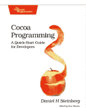

### OS X/iPhone 上的 Core Animation

您见过 Apple 的 Front Row 应用和 Cover Flow 效果吗？那您一定见识过 Core Animation 的威力。它致力于打造通过移动和变形来提供强烈视觉反馈的应用，而不是简单地重绘面板。这本全面的指南将帮助您快速上手，并深入探究这项新技术的精髓。

- **Mac OS X 与 iPhone 上的 Core Animation：打造引人入胜的动态用户界面**  
  Bill Dudney  
  （220 页）ISBN：978-1-9343561-0-4。$34.95  
  [http://pragprog.com/titles/bdcora](http://pragprog.com/titles/bdcora)


### The Pragmatic Bookshelf

The Pragmatic Bookshelf 所出版的书籍均由开发者撰写，面向开发者。这些图书延续了著名的 Pragmatic Programmer 风格，并不断赢得奖项和高度好评。随着开发难度日益增加，Pragmatic Programmers 将继续推出更多图书和产品，助您始终立于不败之地。

#### 访问我们的网站

- **Core Data 主页**  
  http://pragprog.com/titles/mzcd  
  本书的源代码、勘误表及其他资源。也欢迎您给我们反馈！
- **注册获取更新**  
  http://pragprog.com/updates  
  当有更新和新书发布时，您将收到通知。
- **加入社区**  
  http://pragprog.com/community  
  阅读我们的博客，参与在线讨论，加入邮件列表，与我们的 Wiki 互动，并从其他 Pragmatic Programmers 的经验中获益。
- **新书与值得关注的内容**  
  http://pragprog.com/news  
  查看最新的务实进展、新书及其他产品。

#### 购买本书

如果您喜欢这本电子书，也许您还想拥有一本纸质版。您可以在我们的商店购买：http://pragprog.com/titles/mzcd。

#### 联系我们

|  |  |
|---|---|
| 在线订购： | www.pragprog.com/catalog |
| 客户服务： | support@pragprog.com |
| 非英语版本： | translations@pragprog.com |
| 教学合作： | academia@pragprog.com |
| 作者投稿： | proposals@pragprog.com |
| 联系我们： | 1-800-699-PROG (+1 919 847 3884) |

