# Java 核心技术 卷I 基础知识（第11版）


此页有意留白

## 前言

### 致读者

1995年末，Java编程语言横空出世，登上互联网舞台，并迅速声名鹊起。Java技术承诺，它将成为一种*通用黏合剂*，把用户与来自各处的信息连接起来——无论是Web服务器、数据库、信息提供者，还是任何其他可以想象到的来源。事实上，Java确实处于能够兑现这一承诺的独特位置。它是一门设计得极其坚实的语言，并已获得广泛认可。其内置的安全与保障特性让程序员和Java程序用户都感到安心。Java对高级编程任务提供了内置支持，例如网络编程、数据库连接和并发。

自1995年以来，Java开发工具包已发布了11个主要修订版本。在过去20年里，应用程序编程接口（API）从约200个类增长到超过4000个类。如今，API涵盖的领域多种多样，包括用户界面构建、数据库管理、国际化、安全以及XML处理。

你现在读的这本书是*Java核心技术*第11版的第一卷。每一版都紧跟Java开发工具包的一次发布，而且每次我们都会重写本书，以利用最新的Java特性。本版已更新，以反映Java标准版（SE）9、10和11的特性。

与本书之前的版本一样，*我们仍然面向那些希望将Java应用于实际项目的严肃程序员*。我们把您——我们的读者——视为一名在Java之外的另一门编程语言方面具有扎实背景的程序员，并假定您不喜欢充斥玩具示例（例如烤面包机、动物园动物或“紧张文字”）的书。这些内容在我们的书中一个都找不到。我们的目标是让您全面理解Java语言和类库，而不是给您一种理解的错觉。

在本书中，您会找到大量示例代码，演示我们讨论的几乎每一项语言和类库特性。我们有意让示例程序保持简单，以便聚焦于重点，但在大多数情况下，它们并不虚假，也没有偷工减料。它们应当能为您自己的代码提供良好的起点。

我们假定您愿意，甚至渴望了解Java为您提供的所有高级特性。例如，我们会详细讲解

- 面向对象编程
- 反射与代理
- 接口与内部类
- 异常处理
- 泛型编程
- 集合框架
- 事件监听器模型
- 图形用户界面设计
- 并发

随着Java类库的爆炸式增长，用一卷篇幅讲完严肃程序员需要了解的所有Java特性已不再可能。因此，我们决定将本书分为两卷。本第一卷着重介绍Java语言的基本概念，以及用户界面编程的基础知识。第二卷*Java核心技术 卷II——高级特性*则进一步深入企业级特性和高级用户界面编程。它详细讨论了

- 流API
- 文件处理与正则表达式
- 数据库
- XML处理
- 注解
- 国际化
- 网络编程
- 高级GUI组件
- 高级图形
- 本地方法

写书时，错误和不准确之处在所难免。我们非常希望了解这些问题。当然，我们更希望每个问题只被告知一次。我们在网页http://horstmann.com/corejava上列出了常见问题、错误修复和变通方法。在勘误页末尾（这是有意安排，以鼓励您先通读该页）放置了一个表单，您可以用它报告错误并提出改进建议。如果我们没有回答每一个问题，或者没有立即回复您，请不要失望。我们确实会阅读所有电子邮件，并感谢您的意见，使本书的未来版本更清晰、信息更丰富。

## 本书导读

**第1章**概述Java有别于其他编程语言的能力。我们解释这门语言的设计者起初打算做什么，以及他们在多大程度上取得了成功。然后，我们简要介绍Java如何诞生及其如何演变的历史。

在**第2章**中，我们介绍如何下载并安装JDK以及本书的程序示例。然后，我们引导您编译并运行一个控制台应用程序和一个图形应用程序。您将看到如何使用普通JDK、Java IDE和JShell工具。

**第3章**开始讨论Java语言。在本章中，我们介绍基础知识：变量、循环和简单函数。如果您是C或C++程序员，这会一帆风顺，因为这些语言特性的语法与C中基本相同。如果您来自非C背景，例如Visual Basic，则需要仔细阅读本章。

面向对象编程（OOP）如今已成为编程实践的主流，而Java是一门面向对象的编程语言。**第4章**介绍封装——面向对象两大基本构件中的第一个，以及实现它的Java语言机制，即类和方法。除了Java语言的规则之外，我们还就合理的OOP设计给出建议。最后，我们介绍出色的javadoc工具，它能把代码注释格式化为一组带超链接的网页。如果您熟悉C++，可以快速浏览本章。来自非面向对象背景的程序员则应预期花一些时间掌握OOP概念，然后再继续深入学习Java。

类和封装只是OOP故事的一部分，**第5章**介绍另一部分——即_继承_。继承让您能够取得一个现有类，并根据需要修改它。这是Java编程中的一项基本技术。Java中的继承机制与C++中的相当相似。同样，C++程序员可以重点关注这些语言之间的差异。

**第6章**向您展示如何使用Java的*接口*概念。接口让您超越第5章简单的继承模型。掌握接口后，您就能充分利用Java完全面向对象编程方法的强大能力。在介绍接口之后，我们转向*lambda表达式*，这是一种简洁表达可在稍后某个时间点执行的代码块的方式。我们还介绍Java中一项有用的技术特性，称为*内部类*。

**第7章**讨论*异常处理*——Java用于应对“好程序也可能遭遇坏事”这一事实的健壮机制。异常为您提供了一种高效方式，将正常处理代码与错误处理分离。当然，即使您通过处理所有异常条件来强化程序，它仍可能无法按预期工作。在本章最后一部分，我们给出若干有用的调试技巧。

**第8章**概述泛型编程。泛型编程使您的程序更易读、更安全。我们向您展示如何使用强类型并消除难看且不安全的强制类型转换，以及如何处理因需要保持与旧版Java兼容而产生的复杂性。

**第9章**的主题是Java平台的集合框架。每当您想收集多个对象并在以后检索它们时，都应使用最适合您所处情况的集合，而不是仅仅把元素扔进一个数组。本章向您展示如何利用预先构建好供您使用的标准集合。

**第10章**介绍GUI编程。我们展示如何创建窗口、如何在窗口上绘制、如何用几何图形绘制、如何以多种字体格式化文本，以及如何显示图像。接下来，您将看到如何编写响应事件（例如鼠标单击或按键）的代码。

**第11章**非常详细地讨论Swing GUI工具包。Swing工具包允许您构建跨平台的图形用户界面。您将全面了解各种按钮、文本组件、边框、滑块、列表框、菜单和对话框。不过，一些更高级的组件将在第二卷中讨论。

**第12章**以并发讨论结束本书，并发使您能够编写并行完成任务的程序。在这个大多数处理器都拥有多个核心、而您希望让它们保持忙碌的时代，这是Java技术一项重要而令人兴奋的应用。


## 致谢

写一本书始终是一项艰巨的工作，而重写这本书似乎也并不轻松多少，尤其是在 Java 技术不断变化的情况下。让一本书成为现实需要许多敬业的人，我非常高兴地感谢整个 Core Java 团队所作出的贡献。

Pearson 的许多人提供了宝贵的帮助，却甘居幕后。我想让他们都知道我非常感激他们的努力。一如既往，我衷心感谢我的编辑 Greg Doench，感谢他引导本书完成写作和制作过程，并让我得以幸福地对所有幕后人员的存在一无所知。我非常感谢 Julie Nahil 提供制作支持，感谢 Dmitry Kirsanov 和 Alina Kirsanova 对稿件进行文字编辑和排版。我还要感谢早期版本的合著者 Gary Cornell，他后来已转向其他事业。

感谢早期版本的许多读者，他们报告了令人尴尬的错误，并提出了许多深思熟虑的改进建议。我尤其感谢优秀的审阅团队，他们以惊人的细致审阅了稿件，使我避免了许多令人尴尬的错误。

本书及早期版本的审阅者包括：Chuck Allison（犹他谷大学）、Lance Andersen（甲骨文）、Paul Anderson（Anderson Software Group）、Alec Beaton（IBM）、Cliff Berg、Andrew Binstock（甲骨文）、Joshua Bloch、David Brown、Corky Cartwright、Frank Cohen（PushToTest）、Chris Crane（devXsolution）、Nicholas J. De Lillo 博士（曼哈顿学院）、Rakesh Dhoopar（甲骨文）、David Geary（Clarity Training）、Jim Gish（甲骨文）、Brian Goetz（甲骨文）、Angela Gordon、Dan Gordon（Electric Cloud）、Rob Gordon、John Gray（哈特福德大学）、Cameron Gregory（olabs.com）、Marty Hall（coreservlets.com, Inc.）、Vincent Hardy（Adobe Systems）、Dan Harkey（圣何塞州立大学）、William Higgins（IBM）、Vladimir Ivanovic（PointBase）、Jerry Jackson（CA Technologies）、Tim Kimmet（沃尔玛）、Chris Laffra、Charlie Lai（苹果）、Angelika Langer、Doug Langston、Hang Lau（麦吉尔大学）、Mark Lawrence、Doug Lea（纽约州立大学奥斯威戈分校）、Gregory Longshore、Bob Lynch（Lynch Associates）、Philip Milne（顾问）、Mark Morrissey（俄勒冈研究生院）、Mahesh Neelakanta（佛罗里达大西洋大学）、Hao Pham、Paul Philion、Blake Ragsdell、Stuart Reges（亚利桑那大学）、Simon Ritter（Azul Systems）、Rich Rosen（Interactive Data Corporation）、Peter Sanders（法国尼斯 ESSI 大学）、Paul Sanghera 博士（圣何塞州立大学和布鲁克斯学院）、Paul Sevinc（Teamp AG）、Devang Shah（Sun Microsystems）、Yoshiki Shibata、Bradley A. Smith、Steven Stelting（甲骨文）、Christopher Taylor、Luke Taylor（Valtech）、George Thiruvathukal、Kim Topley（StreamingEdge）、Janet Traub、Paul Tyma（顾问）、Peter van der Linden、Christian Ullenboom、Burt Walsh、Dan Xu（甲骨文）和 John Zavgren（甲骨文）。

*Cay Horstmann*
*加利福尼亚州旧金山*
*2018 年 6 月*

## 第 1 章：Java 简介

### 本章内容

- 1.1 Java 作为编程平台，第 1 页
- 1.2 Java“白皮书”中的流行术语，第 2 页
- 1.3 Java Applet 与互联网，第 9 页
- 1.4 Java 简史，第 10 页
- 1.5 关于 Java 的常见误解，第 13 页

1996 年 Java 的首次发布引起了极大的轰动，不仅是在计算机媒体上，也出现在 *纽约时报*、*华盛顿邮报* 和 *商业周刊* 等主流媒体上。Java 享有殊荣，成为第一种也是唯一一种在全国公共广播电台有十分钟专题报道的编程语言。曾有一笔 1 亿美元的创业投资基金专门用于支持使用*特定*计算机语言的产品。希望你会喜欢本章中 Java 的简史。

### 1.1 Java 作为编程平台

在本书第一版中，我和合著者 Gary Cornell 曾这样写 Java：

> “作为计算机语言，Java 的炒作有些过头：Java 当然是一门*好*编程语言。毫无疑问，对于严肃的程序员来说，它是可用的较好语言之一。我们认为它*本有可能*成为一门伟大的编程语言，但可能为时已晚。一门语言一旦投入实际使用，与现有代码兼容的丑陋现实就会随之而来。”

我们的编辑因为这段话，遭到了最初开发 Java 的 Sun Microsystems 公司某位高层人士的严厉批评。Java 语言有许多优良特性，我们将在本章后面详细探讨。它也有自己的瑕疵，而且由于兼容性要求，语言中一些较新的增补并不如原有特性那样优雅。

但是，正如我们在第一版中已经说过的，Java 从来就不只是一门语言。市面上有许多编程语言，但很少能引起很大反响。Java 是一个完整的平台，拥有庞大的库（其中包含大量可复用代码）以及一个执行环境，提供安全性、跨操作系统可移植性和自动垃圾回收等服务。

作为一名程序员，你会想要一门语法令人愉快、语义易于理解的语言（即，不是 C++）。Java 符合要求，其他几十种优秀语言也同样符合。有些语言提供了可移植性、垃圾回收等特性，但库不够丰富，如果你想实现图形、网络或数据库访问，就只能自己动手。而 Java 拥有一切——良好的语言、高质量的执行环境和庞大的库。正是这种组合，使 Java 成为对众多程序员难以抗拒的选择。

### 1.2 Java“白皮书”中的流行术语

Java 的作者们撰写了一份颇具影响力的白皮书，阐述了他们的设计目标和成果。他们还发布了一份较短的概述，按照以下 11 个流行术语组织：

1. 简单
2. 面向对象
3. 分布式
4. 健壮
5. 安全
6. 体系结构中立
7. 可移植
8. 解释型
9. 高性能
10. 多线程
11. 动态

在接下来的各小节中，你将看到一份摘要，其中包含白皮书摘录，说明 Java 设计者对每个流行术语的看法，以及基于我对当前 Java 版本的经验所作的评论。


**注意：** 白皮书可在 `www.oracle.com/technetwork/java/langenv-140151.html` 找到。你可以在 `http://horstmann.com/corejava/java-an-overview/7Goals.pdf` 获取包含这 11 个流行术语的概述。

#### 1.2.1 简单

> 我们希望构建一个能够轻松编程的系统，无需大量深奥的训练，并且能利用当今的标准实践。因此，尽管我们发现 C++ 并不合适，我们还是尽可能让 Java 贴近 C++ 来设计，以使系统更易于理解。Java 省略了 C++ 中许多很少使用、不易理解且令人困惑的特性；根据我们的经验，这些特性带来的烦恼多于好处。

Java 的语法确实是 C++ 语法的清理版本。不需要头文件、指针运算（甚至不需要指针语法）、结构、联合、运算符重载、虚基类等。（有关 Java 与 C++ 差异的更多内容，请参阅全书中穿插的 C++ 注记。）然而，设计者并未试图修正 C++ 所有笨拙的特性。例如，switch 语句的语法在 Java 中保持不变。如果你懂 C++，你会发现过渡到 Java 语法很容易。

Java 发布时，C++ 实际上并不是最常用的编程语言。许多开发者使用 Visual Basic 及其拖放式编程环境。这些开发者并不觉得 Java 简单。Java 开发环境花了几年时间才赶上。如今，Java 开发环境已远远领先于大多数其他编程语言的开发环境。

> 简单的另一个方面是体积小。Java 的目标之一是能够构建可在小型机器上独立运行的软件。基本解释器和类支持的大小约为 40K；基本标准库和线程支持（本质上是一个自包含的微内核）又增加了 175K。


这在当时是一项伟大的成就。当然，此后这个类库已经发展到巨大的规模。现在还有一个独立的 Java Micro Edition，它带有较小的类库，适用于嵌入式设备。

#### 1.2.2 面向对象

*简而言之，面向对象设计是一种编程技术，它关注数据——对象——以及这些对象的接口。用木工来类比，一个“面向对象”的木匠主要关心他正在制作的椅子，其次才关心制作椅子所用的工具；而一个“非面向对象”的木匠则主要考虑他的工具。Java 的面向对象设施本质上就是 C++ 的面向对象设施。*

Java 开发时，面向对象已经相当成熟。Java 的面向对象特性可与 C++ 相媲美。Java 与 C++ 的主要区别在于多重继承，Java 用更简单的接口概念取代了多重继承。与 C++ 相比，Java 具有更丰富的运行时内省能力（将在第 5 章讨论）。

#### 1.2.3 分布式

*Java 拥有一个广泛的例程库，用于处理像 HTTP 和 FTP 这样的 TCP/IP 协议。Java 应用程序可以通过 URL 在网络上打开和访问对象，其便捷程度与访问本地文件系统时相同。*

如今，人们对此习以为常——但在 1995 年，从 C++ 或 Visual Basic 程序连接到 Web 服务器是一项重大工程。

#### 1.2.4 健壮

*Java 旨在用于编写必须在多方面可靠的程序。Java 非常强调尽早检查可能出现的问题、随后的动态（运行时）检查，以及消除容易出错的情况。Java 与 C/C++ 之间最大的单一区别是，Java 有一种指针模型，它消除了覆盖内存和损坏数据的可能性。*

Java 编译器能检测出许多在其他语言中只会在运行时才暴露的问题。至于第二点，任何曾花数小时追查由指针错误引起的内存损坏的人，都会对 Java 的这一方面非常满意。

#### 1.2.5 安全

*Java 旨在用于网络化/分布式环境。为此，Java 非常重视安全性。Java 使得构建无病毒、防篡改的系统成为可能。*

从一开始，Java 的设计就旨在使某些类型的攻击成为不可能，其中包括：

- 溢出运行时栈——蠕虫和病毒的一种常见攻击
- 破坏其自身进程空间之外的内存
- 未经许可读取或写入文件

最初，Java 对下载代码的态度是“放马过来！”不受信任的代码在沙箱环境中执行，在那里它无法影响宿主系统。用户得到保证，不会发生任何坏事，因为 Java 代码无论来自何处，都永远无法逃出沙箱。

然而，Java 的安全模型很复杂。在 Java Development Kit 的第一个版本发布后不久，普林斯顿大学的一组安全专家就发现了微妙的缺陷，这些缺陷允许不受信任的代码攻击宿主系统。

最初，安全漏洞被迅速修复。不幸的是，随着时间的推移，黑客越来越擅长发现安全架构实现中的细微缺陷。Sun 以及后来的 Oracle 在跟上漏洞修复方面疲于奔命。

在发生多起备受瞩目的攻击之后，浏览器厂商和 Oracle 变得越来越谨慎。Java 浏览器插件不再信任远程代码，除非它经过数字签名并且用户同意执行它。

> **注意：** 尽管事后看来，Java 安全模型并不像最初设想的那样成功，但 Java 远远超前于它的时代。微软的一种竞争性代码交付机制仅依靠数字签名来保证安全。显然这还不够：正如微软自己产品的任何用户都能证实的那样，来自知名厂商的程序确实会崩溃并造成破坏。

#### 1.2.6 体系结构中立

*编译器生成一种体系结构中立的目标文件格式。只要存在 Java 运行时系统，编译后的代码就可以在许多处理器上执行。Java 编译器通过生成与特定计算机体系结构无关的字节码指令来实现这一点。相反，这些指令被设计成既易于在任何机器上解释，又易于即时转换为本地机器码。*

在当时，为“虚拟机”生成代码并不是一个新想法。像 Lisp、Smalltalk 和 Pascal 这样的编程语言已经使用这种技术很多年了。

当然，解释虚拟机指令比全速运行机器指令要慢。然而，虚拟机可以选择将最常执行的字节码序列转换为机器码——这个过程称为即时编译。

Java 的虚拟机还有另一个优势。它提高了安全性，因为它可以检查指令序列的行为。

#### 1.2.7 可移植

*与 C 和 C++ 不同，规范中没有“依赖于实现”的方面。基本数据类型的大小是规定的，对它们进行算术运算的行为也是规定的。*

例如，Java 中的 int 始终是 32 位整数。在 C/C++ 中，它可以表示 16 位整数、32 位整数，或者编译器厂商喜欢的任何其他大小。唯一的限制是 int 类型至少必须具有与 short int 一样多的字节，并且不能比 long int 有更多字节。为数字类型设定固定大小消除了移植过程中的一大头痛问题。二进制数据以固定格式存储和传输，消除了关于字节顺序的混淆。字符串以标准 Unicode 格式保存。

*作为系统一部分的类库定义了可移植的接口。例如，有一个抽象的 Window 类，以及针对 UNIX、Windows 和 Macintosh 的实现。*

Window 类的例子也许选得不好。任何尝试过的人都知道，要在 Windows、Macintosh 和十种 UNIX 变体上实现一个看起来不错的用户界面，需要付出英雄般的努力。Java 1.0 做出了这种英雄般的努力，交付了一个简单的工具包，在许多平台上提供常见的用户界面元素。不幸的是，结果是一个只有经过大量工作才能在不同系统上勉强可接受的类库。最初的用户界面工具包此后被替换，又被再次替换，而跨平台可移植性仍然是一个问题。

然而，对于一切与用户界面无关的内容，Java 类库做得很好，让你能够以独立于平台的方式工作。你可以处理文件、正则表达式、XML、日期和时间、数据库、网络连接、线程等，而无需担心底层操作系统。你的程序不仅可移植，而且 Java API 往往比原生 API 质量更高。

#### 1.2.8 解释型

*Java 解释器可以在任何已移植了该解释器的机器上直接执行 Java 字节码。由于链接是一个更增量、更轻量的过程，开发过程可以更加快速和具有探索性。*

这确实有些牵强。任何用过 Lisp、Smalltalk、Visual Basic、Python、R 或 Scala 的人都知道什么是“快速且具有探索性”的开发过程。你尝试一些东西，然后立即看到结果。在 Java 存在的前 20 年里，开发环境并没有专注于这种体验。直到 Java 9，jshell 工具才支持快速且具有探索性的编程。

#### 1.2.9 高性能

*虽然解释字节码的性能通常绰绰有余，但在某些情况下需要更高的性能。字节码可以在运行时即时转换为应用程序所运行特定 CPU 的机器码。*

在 Java 的早年，许多用户不同意性能“绰绰有余”的说法。然而今天，即时编译器已经变得如此出色，以至于它们可以与传统编译器竞争，在某些情况下甚至超过传统编译器，因为它们有更多可用信息。例如，即时编译器可以监控哪些代码被频繁执行，并仅针对这些代码进行速度优化。一种更复杂的优化是消除（或“内联”）函数调用。即时编译器知道哪些类已经加载。当根据当前加载的类集合，某个特定函数从未被重写时，它可以使用内联，并且在必要时可以在稍后撤销该优化。


#### 1.2.10 多线程

> *[多线程的]好处是更好的交互响应性和实时行为。*

如今，我们关心并发，因为摩尔定律已经终结。我们得到的不是更快的处理器，而是更多的处理器，并且我们必须让它们保持忙碌。然而，当你看大多数编程语言时，它们对这一问题的漠视令人震惊。

Java 远超前于它的时代。它是第一个支持并发编程的主流语言。正如你在白皮书中所见，其动机稍有不同。当时，多核处理器还很罕见，但 Web 编程刚刚兴起，处理器花费大量时间等待服务器响应。需要并发编程来确保用户界面不会冻结。

并发编程从来都不容易，但 Java 在使其易于管理方面做得非常出色。

#### 1.2.11 动态

> *在许多方面，Java 是一种比 C 或 C++ 更具动态性的语言。它被设计为适应不断变化的环境。库可以自由地添加新方法和实例变量，而不会对它们的客户端产生任何影响。在 Java 中，查找运行时类型信息非常简单。*

在需要向正在运行的程序添加代码的情况下，这是一个重要特性。一个典型的例子是从互联网下载到浏览器中运行的代码。在 C 或 C++ 中，这确实是一个重大挑战，但 Java 的设计者非常了解那些让运行中的程序易于演进的动态语言。他们的成就是将此特性带入了一种主流编程语言。

> **注意：** 在 Java 最初成功之后不久，微软发布了一款名为 J++ 的产品，其编程语言和虚拟机与 Java 几乎完全相同。这一努力未能获得成功，微软随后又推出了一种名为 C# 的语言，它与 Java 也有很多相似之处，但在不同的虚拟机上运行。本书不涵盖 J++ 或 C#。

### 1.3 Java 小程序与互联网

这里的想法很简单：用户将从互联网下载 Java 字节码并在自己的机器上运行。在网页上运行的 Java 程序称为*小程序*。要使用小程序，你只需要一个支持 Java 的 Web 浏览器，它会为你执行字节码。你无需安装任何软件。每当你访问包含小程序的网页时，就能获得该程序的最新版本。最重要的是，由于虚拟机的安全性，你无需担心来自恶意代码的攻击。

将小程序插入网页的方式很像嵌入图像。小程序成为页面的一部分，文本围绕小程序所占空间流动。关键在于，这个图像是*活的*。它响应用户命令，改变外观，并在呈现小程序的计算机与提供小程序的计算机之间交换数据。

图 1.1 显示了展示分子结构的 Jmol 小程序。通过使用鼠标，你可以旋转和缩放每个分子，以更好地理解其结构。在小程序发明之时，这种直接操作在网页上是无法实现的——当时只有初级的 JavaScript，也没有 HTML 画布。

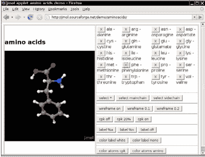

**图 1.1** Jmol 小程序

小程序首次出现时引发了巨大的兴奋。许多人认为，正是小程序的吸引力造就了 Java 惊人的流行。然而，最初的兴奋很快变成了沮丧。Netscape 和 Internet Explorer 浏览器的不同版本运行着不同版本的 Java，其中一些已严重过时。这种令人遗憾的状况使得开发利用最新 Java 版本的小程序变得越来越困难。取而代之的是，Adobe 的 Flash 技术因能在浏览器中实现动态效果而流行起来。后来，当 Java 受到严重安全问题的困扰时，浏览器和 Java 浏览器插件变得更加具有限制性。如今，要让小程序在浏览器中运行需要技巧和投入。例如，如果你访问 http://jmol.sourceforge.net/demo/aminoacids/ 上的 Jmol 网站，你很可能会遇到一条提示信息，要求你配置浏览器以允许小程序运行。

### 1.4 Java 简史

本节简要介绍 Java 的发展历史。它基于各种已发表的资料（最重要的是 *SunWorld* 在线杂志 1995 年 7 月号对 Java 创建者的采访）。

Java 的历史可以追溯到 1991 年，当时由 Patrick Naughton 和 James Gosling（Sun 公司院士、全能计算机奇才）领导的一组 Sun 工程师希望设计一种小型计算机语言，可用于有线电视开关盒等消费类设备。由于这些设备的处理能力和内存都不大，这种语言必须小巧，并生成非常紧凑的代码。此外，由于不同的制造商可能会选择不同的中央处理器（CPU），语言不能绑定到任何单一架构，这一点非常重要。该项目代号为“Green”。

对小巧、紧凑且平台无关代码的要求，促使团队设计了一种可移植语言，该语言为虚拟机生成中间代码。

Sun 的员工来自 UNIX 背景，因此他们将语言基于 C++，而不是 Lisp、Smalltalk 或 Pascal。但正如 Gosling 在采访中所说：“自始至终，语言都是一种工具，而不是目的。”Gosling 决定将他的语言称为“Oak”（大概是因为他喜欢 Sun 办公室窗外那棵橡树的样子）。Sun 的员工后来意识到 Oak 是一种现有计算机语言的名称，于是将其改名为 Java。事实证明这是一个富有灵感的决定。

1992 年，Green 项目发布了它的第一个产品，名为“\*7\*”。这是一个极其智能的遥控器。不幸的是，Sun 内部没有人有兴趣生产它，Green 项目的人不得不另寻途径推销他们的技术。然而，那些普通的消费电子公司也都不感兴趣。随后，该团队竞标了一个项目，设计一种能够处理视频点播等新兴有线电视服务的有线电视盒。他们没有拿到合同。（有趣的是，赢得合同的那家公司由 Jim Clark 领导，正是他创办了 Netscape——一家为 Java 成功做出巨大贡献的公司。）

Green 项目（更名为“First Person, Inc.”）花费了 1993 年全年和 1994 年上半年寻找买家来购买其技术。没有找到任何人。（Patrick Naughton 是该团队的创始人之一，最终承担了大部分营销工作，他声称为了推销这项技术，自己积累了 30 万英里的飞行里程。）First Person 于 1994 年解散。

就在这一切在 Sun 进行的同时，互联网的万维网部分正变得越来越大。万维网的关键在于浏览器将超文本页面翻译到屏幕上。1994 年，大多数人使用的是 Mosaic，这是一款非商业性的 Web 浏览器，于 1993 年出自伊利诺伊大学的超级计算中心。（Mosaic 有一部分是由 Marc Andreessen 作为本科生在勤工俭学项目中编写的，时薪 6.85 美元。后来，他作为 Netscape 的联合创始人之一兼首席技术官，名利双收。）

在 *SunWorld* 的采访中，Gosling 说，在 1994 年年中，语言开发者们意识到“我们可以构建一个真正酷的浏览器。这是客户端/服务器主流中少数几项需要我们所做的那些奇特特性的东西：架构中立、实时、可靠、安全——这些在工作站领域并不太重要的问题。于是我们构建了一个浏览器。”

实际的浏览器由 Patrick Naughton 和 Jonathan Payne 构建，并演变成了 HotJava 浏览器，其设计目的是展示 Java 的强大功能。该浏览器能够在网页内执行 Java 代码。这个“技术证明”于 1995 年 5 月 23 日在 SunWorld ’95 上展示，并激发了延续至今的 Java 热潮。

Sun 于 1996 年初发布了第一个 Java 版本。人们很快意识到 Java 1.0 无法胜任严肃的应用开发。当然，你可以用 Java 1.0 制作一个在画布上随机移动文字的“抖动文本”小程序。但在 Java 1.0 中你甚至无法打印。坦率地说，Java 1.0 还没有准备好迎接黄金时代。其继任者 1.1 版本填补了最明显的空白，极大地改进了反射能力，并为 GUI 编程添加了新的事件模型。不过它仍然相当有限。

1998 年 JavaOne 大会的重头戏是即将发布的 Java 1.2，它用成熟的可扩展版本取代了早期玩具般的 GUI 和图形工具包。在其 12 月发布三天后（！）


1998年，Sun的市场部门将其更名为朗朗上口的*Java 2 标准版软件开发工具包 1.2 版*。

除了标准版之外，还引入了另外两个版本：用于手机等嵌入式设备的微型版，以及用于服务器端处理的企业版。本书聚焦于标准版。

标准版1.3和1.4是对最初Java 2版本的增量改进，拥有不断增长的标准库、更高的性能，当然还有不少缺陷修复。在此期间，最初围绕Java小程序和客户端应用的大量炒作有所消退，但Java成为服务器端应用的首选平台。

5.0版本是自1.1版本以来首次对*Java语言*进行重大更新的版本。（该版本最初编号为1.5，但在2004年的JavaOne大会上版本号跳升至5.0。）经过多年研究，泛型类型（大致相当于C++模板）被添加进来——挑战在于无需修改虚拟机就能添加这一特性。其他几个有用的语言特性受到C#的启发：“for each”循环、自动装箱和注解。

版本6（不带.0后缀）于2006年底发布。同样没有语言变化，但带来了额外的性能改进和库增强。

随着数据中心越来越依赖商用硬件而不是专用服务器，Sun Microsystems陷入困境，并于2009年被Oracle收购。Java的开发停滞了很长一段时间。2011年，Oracle发布了新版本Java 7，带来了一些简单的增强。

2014年，Java 8随之发布，对Java语言进行了近二十年来最重大的改变。Java 8拥抱“函数式”编程风格，使表达可并发执行的计算变得容易。所有编程语言都必须不断演进以保持其重要性，Java已经展示出了非凡的演进能力。

Java 9的主要特性要追溯到2008年。当时，Java平台的首席工程师Mark Reinhold开始努力拆分庞大而单一的Java平台。这要通过引入*模块*来实现，模块是提供特定功能的独立代码单元。设计和实现一个适合Java平台的模块系统花了十一年时间，它是否也同样适合Java应用程序和库，仍有待观察。2017年发布的Java 9还有其他吸引人的特性，我们将在本书中介绍。

*我使用XML，所以我不需要Java。*

Java是一种编程语言；XML是一种描述数据的方式。你可以用任何编程语言处理XML数据，但Java API包含了对XML处理的出色支持。此外，许多重要的XML工具都是用Java实现的。更多信息请参见卷II。

*Java是一种容易学习的编程语言。*

没有哪种编程语言的强大程度能比得上Java的易用程度。你始终必须区分编写玩具程序有多容易，以及做严肃工作有多困难。另外，请记住，本书只有七章讨论Java语言。两卷的其余章节展示了如何使用Java库让语言发挥作用。Java库包含数千个类和接口，以及数万个函数。幸运的是，你不需要了解每一个函数，但要在任何重要的项目中使用Java，你需要了解的数目多得惊人。

*Java将成为所有平台的通用编程语言。*

这在理论上是可能的。但在实践中，有些领域已被其他语言牢牢占据。Objective C及其继任者Swift不会在iOS设备上被取代。浏览器中发生的一切都由JavaScript控制。Windows程序是用C++或C#编写的。Java在服务器端编程和跨平台客户端应用方面具有优势。

*Java只是另一种编程语言。*

Java不是一种小众编程语言；大多数程序员更喜欢它而不是C、C++或C#。但有数百种优秀的编程语言从未获得广泛普及，而像C++和Visual Basic这样有明显缺陷的语言却大获成功。

为什么？一种编程语言的成功更多地取决于其周围*支持系统*的实用性，而非其语法的优雅性。对于你需要实现的功能，是否存在有用、方便且标准的库？是否有工具供应商构建出色的编程和调试环境？该语言和工具集是否与计算基础设施的其他部分集成？Java之所以成功，是因为它的库让你可以轻松完成网络、Web应用和并发等任务。Java减少了指针错误，这是一个额外的好处，因此程序员使用Java时似乎更高效——但这些因素并非其成功的根源。

*Java是专有的，因此应该避免使用。*

当Java最初创建时，Sun向分发商和最终用户提供免费许可。尽管Sun对Java拥有最终控制权，但他们让许多人参与。

这让人联想到Java，而且这两种语言的名字听起来相似，但除此之外它们毫无关联。尤其是，Java是*强类型*的——编译器能捕获许多由类型误用引起的错误。在JavaScript中，这类错误只有在程序运行时才会被发现，这使得消除它们要费力得多。

> *使用Java，我可以用一台廉价的“网络设备”取代我的台式电脑。*

当Java刚发布时，有些人下了大赌注，认为这将会发生。公司生产了由Java驱动的网络计算机原型，但用户还没有准备好放弃强大方便的台式机，去改用一台没有本地存储的限制性设备。当然，如今世界已经改变，对绝大多数最终用户来说，真正重要的平台是手机或平板电脑。这些设备中的大多数由Android平台控制，而Android是Java的衍生物。学习Java编程也将有助于你进行Android编程。

## 第 2 章：Java 编程环境

### 本章内容

- 2.1 安装Java开发工具包，第18页
- 2.2 使用命令行工具，第23页
- 2.3 使用集成开发环境，第29页
- 2.4 JShell，第32页

在本章中，你将学习如何安装Java开发工具包（JDK），以及如何编译和运行各种类型的程序：控制台程序、图形应用程序和小程序。你可以通过在终端窗口中输入命令来运行JDK工具。然而，许多程序员更喜欢集成开发环境的舒适性。你将学习如何使用一个免费可用的开发环境来编译和运行Java程序。一旦你掌握了本章中的技术并选定了开发工具，就可以进入第3章，开始探索Java编程语言。

### 2.1 安装Java开发工具包

最完整、最新的Java开发工具包（JDK）版本可从Oracle获得，适用于Linux、Mac OS、Solaris和Windows。许多其他平台也存在不同开发状态的版本，但这些版本由这些平台的供应商许可和分发。

#### 2.1.1 下载JDK

要下载Java开发工具包，请访问网站 www.oracle.com/technetwork/java/javase/downloads，并准备解读数量惊人的行话，然后才能获得你需要的软件。参见表2.1的总结。

**表2.1 Java行话**

| 名称 | 缩写 | 说明 |
|---|---|---|
| Java开发工具包 | JDK | 供想要编写Java程序的程序员使用的软件 |
| Java运行时环境 | JRE | 供想要运行Java程序的用户使用的软件 |
| 服务器JRE | — | 用于在服务器上运行Java程序的软件 |
| 标准版 | SE | 用于桌面和简单服务器应用的Java平台 |
| 企业版 | EE | 用于复杂服务器应用的Java平台 |
| 微型版 | ME | 用于小型设备的Java平台 |
| JavaFX | — | 一种图形用户界面的替代工具包，包含在Java 11之前的某些Java SE发行版中 |
| OpenJDK | — | Java SE的一个免费开源实现 |
| Java 2 | J2 | 一个过时的术语，用于描述1998年至2006年的Java版本 |
| 软件开发工具包 | SDK | 一个过时的术语，用于描述1998年至2006年的JDK |
| 更新 | u | Oracle对Java 8及以前缺陷修复版本的称呼 |
| NetBeans | — | Oracle的集成开发环境 |


你已经见过 JDK 这个缩写，它代表 Java Development Kit（Java 开发工具包）。有点令人困惑的是，该工具包的 1.2 到 1.4 版本被称为 Java SDK（Software Development Kit，软件开发工具包）。你仍会偶尔看到对这个旧称的引用。直到 Java 10，还存在一个只包含虚拟机的 Java Runtime Environment（JRE，Java 运行时环境）。作为开发者，这不是你想要的。它面向不需要编译器的最终用户。

接下来，你会到处看到 Java SE 这个术语。它指的是 Java Standard Edition（Java 标准版），与 Java EE（Enterprise Edition，企业版）和 Java ME（Micro Edition，微型版）相对。

你可能会遇到 Java 2 这个术语，它诞生于 1998 年，当时 Sun 的市场营销人员觉得，小数版本号的递增无法恰当传达 JDK 1.2 的重大进步。然而，由于他们是在发布之后才意识到这一点，他们决定让 *开发工具包* 继续使用版本号 1.2。后续版本编号为 1.3、1.4 和 5.0。然而，*平台* 从 Java 更名为 Java 2。因此，就有了 Java 2 Standard Edition Software Development Kit Version 5.0，简称 J2SE SDK 5.0。

幸运的是，2006 年版本编号被简化了。Java 标准版的下一个版本被称为 Java SE 6，随后是 Java SE 7 和 Java SE 8。

然而，“内部”版本号是 1.6.0、1.7.0 和 1.8.0。这种小小的疯狂终于在 Java SE 9 时结束，当时版本号变成了 9，然后是 9.0.1。（为什么初始版本不是 9.0.0？为了保留一点点兴奋感，版本号规范要求在主版本发布与其首个安全更新之间的短暂间隔内去掉末尾的零。）

> **注意：** 在本书余下部分，我们将省略“SE”这一缩写。当你看到“Java 9”时，它指的是“Java SE 9”。

在 Java 9 之前，Java Development Kit 有 32 位和 64 位版本。Oracle 不再开发 32 位版本。要使用 Oracle JDK，你需要有 64 位操作系统。

在 Linux 上，你可以在 RPM 文件和 .tar.gz 文件之间选择。我们推荐后者——你可以直接将其解压缩到你喜欢的任何位置。

现在你知道如何选择正确的 JDK 了。总结如下：

- 你需要的是 JDK（Java SE Development Kit），而不是 JRE。
- Linux：选择 `.tar.gz` 版本。

接受许可协议并下载该文件。

> **注意：** 取决于行星的排列，Oracle 可能会提供一个同时包含 Java Development Kit 和 NetBeans 集成开发环境的捆绑包。我建议你远离所有捆绑包，此时只安装 Java Development Kit。如果你以后决定使用 NetBeans，只需从 http://netbeans.org 下载它。

#### 2.1.2 设置 JDK

下载 JDK 后，你需要安装它，并弄清楚它安装到了哪里——稍后你会需要这个信息。

- 在 Windows 上，启动安装程序。系统会询问你要将 JDK 安装到哪里。最好不要接受路径名中包含空格的默认位置，例如 `c:\Program Files\Java\jdk-11.0.x`。只需从路径名中去掉 Program Files 部分。
- 在 Mac 上，运行安装程序。它会将软件安装到 `/Library/Java/JavaVirtualMachines/jdk-11.0.x.jdk/Contents/Home`。用 Finder 找到它。
- 在 Linux 上，只需将 `.tar.gz` 文件解压缩到你选择的位置，例如你的主目录或 `/opt`。或者，如果你是从 RPM 文件安装的，请再次确认它安装在 `/usr/java/jdk-11.0.x`。

在本书中，安装目录记为 `jdk`。例如，当提到 `jdk/bin` 目录时，我指的是名称为 `/opt/jdk-11.0.4/bin` 或 `c:\Java\jdk-11.0.4\bin` 的目录。

在 Windows 或 Linux 上安装 JDK 时，你需要执行一个额外步骤：将 `jdk/bin` 目录添加到可执行文件路径中——也就是操作系统用来查找可执行文件的目录列表。

- 在 Linux 上，将类似下面的一行添加到 `~/.bashrc` 或 `~/.bash_profile` 文件的末尾：

  ```bash
  export PATH=jdk/bin:$PATH
  ```

  请务必使用 JDK 的正确路径，例如 `/opt/jdk-11.0.4`。
- 在 Windows 10 上，在 Windows 设置的搜索栏中输入“environment”，然后选择“编辑账户的环境变量”（见图 2.1）。应该会出现“环境变量”对话框。（它可能隐藏在 Windows 设置对话框后面。如果到处都找不到它，可以尝试从“运行”对话框中运行 `sysdm.cpl`——同时按住 Windows 和 R 键即可打开该对话框——然后选择“高级”选项卡并单击“环境变量”按钮。）在“用户变量”列表中找到并选择名为 Path 的变量。单击“编辑”按钮，再单击“新建”按钮，并添加一个指向 `jdk\bin` 目录的条目（见图 2.2）。


图 2.1  在 Windows 10 中设置系统属性

保存设置。你新启动的任何“命令提示符”窗口都将具有正确的路径。

下面说明如何测试你是否做对了：启动一个终端窗口。输入以下行

```text
javac --version
```

然后按 Enter 键。你应该会看到类似下面的显示：

```text
javac 11.0.1
```

## BIO 1113

## 第 18 章：基因表达

基因表达是利用基因中的信息合成功能性基因产物（通常是蛋白质）的过程。该过程包括两个主要步骤：转录和翻译。

**转录**是以 DNA 为模板合成 RNA 的过程。RNA 聚合酶读取模板链并生成互补的 RNA 链。转录的产物是信使 RNA（mRNA）。

- **起始**：RNA 聚合酶结合到启动子区域并解开 DNA。
- **延伸**：RNA 聚合酶沿模板链移动，添加 RNA 核苷酸。
- **终止**：RNA 聚合酶到达终止子序列，释放 mRNA。

**翻译**是以 mRNA 为模板合成多肽链的过程。核糖体通过读取 mRNA 上的密码子，并将它们与携带氨基酸的适当 tRNA 分子相匹配，来促进这一过程。

| 密码子 | 氨基酸 |
|-------|------------|
| AUG   | 甲硫氨酸（起始） |
| UAA   | 终止密码子 |
| UAG   | 终止密码子 |
| UGA   | 终止密码子 |

遗传密码具有简并性，这意味着多个密码子可以编码同一种氨基酸。阅读框由起始密码子 AUG 决定，从而确保蛋白质的正确翻译。

翻译后修饰，如磷酸化、糖基化和泛素化，可以改变蛋白质的功能和定位。这些修饰对于调节蛋白质活性至关重要。

- 2. 在主目录中创建目录 `javasrc`。如果愿意，你可以在终端窗口中执行此操作。

  ```bash
  mkdir javasrc
  ```

- 3. 在 `jdk/lib` 目录中，找到文件 `src.zip`。
- 4. 将 `src.zip` 文件解压到 `javasrc` 目录中。在终端窗口中，你可以执行以下命令

  ```bash
  cd javasrc
  jar xvf jdk/lib/src.zip
  cd ..
  ```

> **提示：** `src.zip` 文件包含所有公共库的源代码。要获取更多源代码（用于编译器、虚拟机、原生方法和私有辅助类），请访问 http://openjdk.java.net。

文档包含在一个与 JDK 分离的压缩文件中。你可以从 `www.oracle.com/technetwork/java/javase/downloads` 下载文档。请按照以下步骤操作：

- 1. 下载文档 zip 文件。它的名称为 `jdk-11.0.x_doc-all.zip`。
- 2. 解压该文件，并将 doc 目录重命名为更具描述性的名称，例如 javadoc。如果愿意，你可以在命令行中执行此操作：

  ```bash
  jar xvf Downloads/jdk-11.0.x_doc-all.zip
  mv docs jdk-11-docs
  ```

- 3. 在浏览器中，导航到 `jdk-11-docs/index.html`，并将此页面添加到书签。

你还应该安装 Core Java 程序示例。你可以从 `http://horstmann.com/corejava` 下载它们。这些程序打包在一个 zip 文件 `corejava.zip` 中。只需将它们解压到你的主目录中。它们将位于 `corejava` 目录中。如果愿意，你可以在命令行中执行此操作：

```bash
jar xvf Downloads/corejava.zip
```

### 2.2 使用命令行工具

如果你的编程经验来自 Microsoft Visual Studio 之类的开发环境，那么你习惯于一个带有内置文本编辑器、用于编译和启动程序的菜单以及调试器的系统。JDK 中没有任何哪怕稍微类似的东西。你需要通过在终端窗口中键入命令来完成所有操作。这听起来很繁琐，但它是

然而，这仍然是一项必不可少的技能。当你第一次安装 Java 时，你会希望在安装开发环境之前先排查安装问题。此外，通过自己执行这些基本步骤，你能更好地理解开发环境在幕后为你做了什么。

不过，在你掌握了编译和运行 Java 程序的基本步骤之后，就会希望使用专业的开发环境。你将在下一节看到如何做到这一点。

让我们从困难的方式开始：从命令行编译并启动一个 Java 程序。

1. 打开终端窗口。
2. 转到 `corejava/v1ch02/Welcome` 目录。（`corejava` 目录是你安装本书示例源代码的位置，如第 22 页 2.1.3 节“安装源文件和文档”所述。）
3. 输入以下命令：

```bash
javac Welcome.java
java Welcome
```

你应该会在终端窗口中看到图 2.3 所示的输出。

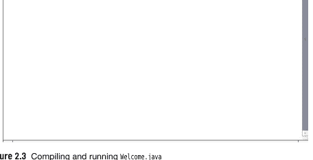

图 2.3 编译并运行 Welcome.java

## AI芯片的竞争：从云端到边缘

随着人工智能技术的快速发展，AI芯片已成为科技巨头竞争的新焦点。从云端数据中心到终端设备，AI芯片正在重塑整个计算产业的格局。

在云端，英伟达凭借其GPU在AI训练领域占据主导地位，而谷歌的TPU（张量处理单元）则展示了专用芯片在特定任务上的巨大优势。AMD也在积极追赶，其MI系列加速器在性能上不断逼近竞争对手。

在边缘侧，华为的昇腾系列、地平线的征程系列等国产AI芯片正在加速落地。苹果的A系列仿生芯片和华为的麒麟芯片将AI算力集成到移动处理器中，推动了端侧智能的发展。

AI芯片的性能评估通常从算力、功耗、生态三个维度进行。下表对比了当前主流AI芯片的关键参数：

| 芯片型号 | 算力 (TOPS) | 功耗 (W) | 制程 (nm) | 应用场景 |
|---|---|---|---|---|
| NVIDIA A100 | 312 | 400 | 7 | 云端训练 |
| Google TPU v4 | 275 | 300 | 7 | 云端推理 |
| Huawei Ascend 910 | 320 | 310 | 7 | 云端推理 |
| Horizon Journey 5 | 128 | 30 | 16 | 车载边缘 |

尽管专用AI芯片在某些任务上表现出色，但通用GPU仍拥有更成熟的软件生态。“软件才是关键的区别因素。”正如一位行业分析师所言，芯片硬件只是在编舞，软件生态才是真正的舞台。

- 算力密度：指单颗芯片在单位面积上提供的计算能力。
- 能效比：指每瓦特功耗带来的AI性能，对边缘设备尤为重要。
- 生态成熟度：包括开发框架支持、算子库丰富度及社区活跃度。

未来，AI芯片的竞争将不仅仅是硬件的较量，更是架构创新、软件生态和制造供应链的综合竞争。中国的AI芯片企业需要在开放生态中寻求突破，才能在全球市场中赢得一席之地。

3. 输入以下内容：

```bash
javac ImageViewer.java
java ImageViewer
```

会弹出一个新的程序窗口，其中运行 ImageViewer 应用程序。现在，选择“文件”→“打开”，查找要打开的图像文件。（同一目录中有几个示例文件。）图像会显示出来（见图 2.4）。要关闭程序，请单击标题栏中的关闭框，或从菜单中选择“文件”→“退出”。

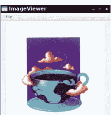

**图 2.4** 运行 ImageViewer 应用程序

快速浏览一下源代码（程序清单 2.2）。这个程序比第一个程序长得多，但如果你考虑用 C 或 C++ 编写类似应用程序需要多少代码，它并不太复杂。你将在第 10 章学习如何编写这样的图形用户界面。

### 程序清单 2.2 ImageViewer/ImageViewer.java

```java
1 import java.awt.*;
2 import java.io.*;
3 import javax.swing.*;
4
5 /**
6  * A program for viewing images.
7  * @version 1.31 2018-04-10
 * @author Cay Horstmann
 */
public class ImageViewer
{
   public static void main(String[] args)
   {
      EventQueue.invokeLater(() -> {
         var frame = new ImageViewerFrame();
         frame.setTitle("ImageViewer");
         frame.setDefaultCloseOperation(JFrame.EXIT_ON_CLOSE);
         frame.setVisible(true);
      });
   }
}

/**
 * A frame with a label to show an image.
 */
class ImageViewerFrame extends JFrame
{
   private static final int DEFAULT_WIDTH = 300;
   private static final int DEFAULT_HEIGHT = 400;

   public ImageViewerFrame()
   {
      setSize(DEFAULT_WIDTH, DEFAULT_HEIGHT);

      // use a label to display the images
      var label = new JLabel();
      add(label);

      // set up the file chooser
      var chooser = new JFileChooser();
      chooser.setCurrentDirectory(new File("."));

      // set up the menu bar
      var menuBar = new JMenuBar();
      setJMenuBar(menuBar);

      var menu = new JMenu("File");
      menuBar.add(menu);

      var openItem = new JMenuItem("Open");
      menu.add(openItem);
      openItem.addActionListener(event -> {
          // show file chooser dialog
          int result = chooser.showOpenDialog(null);

          // if file selected, set it as icon of the label
          if (result == JFileChooser.APPROVE_OPTION)
          {
              String name = chooser.getSelectedFile().getPath();
              label.setIcon(new ImageIcon(name));
          }
      });

      var exitItem = new JMenuItem("Exit");
      menu.add(exitItem);
      exitItem.addActionListener(event -> System.exit(0));
   }
}
```

### 2.3 使用集成开发环境

在上一节中，你了解了如何从命令行编译和运行 Java 程序。这是排查问题的有用技能，但大多数日常工作都应使用集成开发环境。这些环境功能强大且方便，不用它们费力工作实在没多大意义。优秀的选择有免费可用的 Eclipse、IntelliJ IDEA 和 NetBeans。本章你将学习如何开始使用 Eclipse。当然，如果你更喜欢其他开发环境，也完全可以配合本书使用。

从 http://eclipse.org/downloads 下载 Eclipse 开始。有适用于 Linux、Mac OS X 和 Windows 的版本。运行安装程序并选择名为“Eclipse IDE for Java Developers”的安装集。

以下是用 Eclipse 编写程序的步骤。

1. 启动 Eclipse 后，从菜单选择“文件”→“新建”→“项目”。
2. 在向导对话框中选择“Java 项目”（见图 2.5）。
3. 单击“下一步”。*取消选中*“使用默认位置”复选框。单击“浏览”并导航到 `corejava/v1ch02/Welcome` 目录（图 2.6）。

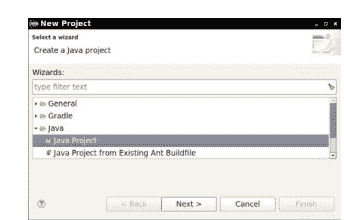

图 2.5 Eclipse 中的“新建项目”对话框

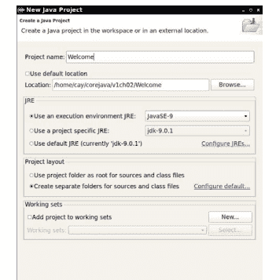

图 2.6 在 Eclipse 中配置项目

4. 单击“完成”。项目现已创建。
5. 单击左窗格中项目旁的三角形，直到找到文件 `Welcome.java`，然后双击它。现在应看到显示程序代码的窗格（见图 2.7）。

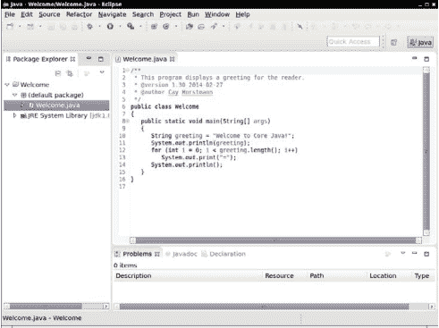

图 2.7 使用 Eclipse 编辑源文件

6. 用鼠标右键单击左窗格中的项目名（Welcome）。选择“运行”→“运行方式”→“Java 应用程序”。程序输出显示在控制台窗格中。

大概这个程序没有拼写错误或缺陷。（毕竟它只有几行代码。）为讨论方便，假设你的代码偶尔包含拼写错误（甚至可能是语法错误）。试一试——例如通过如下改变 `String` 的大小写来运行文件：

```java
string greeting = "Welcome to Core Java!";
```

注意 `string` 下方的波浪线。在源代码下方的选项卡中，单击“问题”并展开三角形，直到看到抱怨未知字符串类型的错误消息（见图 2.8）。单击错误消息。光标移到编辑窗格中匹配的行，你可以在那里更正错误。这可以让你快速修正错误。

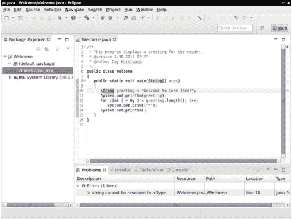

图 2.8 Eclipse 中的错误消息

> **提示：** Eclipse 错误报告通常伴有灯泡图标。单击灯泡可获取建议修复列表。

### 2.4 JShell

在上一节中，你了解了如何编译和运行 Java 程序。Java 9 引入了另一种使用 Java 的方式。JShell 程序提供“读取-求值-打印循环”，即 REPL。你输入一个 Java 表达式；JShell 会求值你的输入，打印结果，并等待下一个输入。要启动 JShell，只需在终端窗口中输入 `jshell`（见图 2.9）。

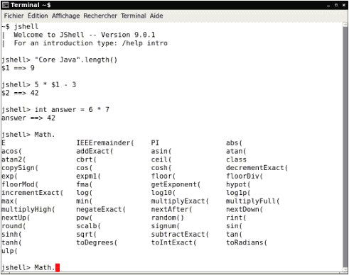

**图 2.9** 运行 JShell

JShell 以问候语开始，随后是提示符：

```text
Welcome to JShell -- Version 11.0.1
For an introduction type: /help intro
```

```text
jshell>
```

现在输入一个表达式，例如

```java
"Core Java".length()
```

JShell 用结果回应——在这个例子中，是字符串“Core Java”的字符数。

```text
$1 ==> 9
```

注意你*不要*输入 `System.out.println`。JShell 会自动打印你输入的每个表达式的值。


输出中的 `$1` 表示结果可用于后续计算。例如，如果你输入

```
5 * $1 - 3
```

响应为

```
$2 ==> 42
```

如果你需要多次使用某个变量，可以给它起一个更容易记住的名字。但是，必须遵循 Java 语法，并同时指定类型和名称。（我们将在第 3 章介绍语法。）例如，

```
jshell> int answer = 6 * 7
answer ==> 42
```

另一个有用的功能是 Tab 补全。输入

```
Math.
```

然后按 Tab 键。你会得到可以用 Math 类调用的所有方法的列表：

```text
jshell> Math.
E                  IEEEremainder(      PI             abs(
acos(              addExact(          asin(          atan(
atan2(             cbrt(              ceil(          class
copySign(           cos(               cosh(          decrementExact(
exp(               expm1(              floor(         floorDiv(
floorMod(           fma(                getExponent(   hypot(
incrementExact(     log(                log10(         max(
min(               multiplyExact(     multiplyFull(  multiplyHigh(
negateExact(       nextAfter(         nextDown(      nextUp(
pow(               random(            rint(          round(
scalb(             signum(            sin(           sinh(
sqrt(              subtractExact(     tan(           tanh(
toDegrees(         toIntExact(        toRadians(     ulp(
```

现在输入 `l` 并再次按 Tab 键。方法名补全为 log，你会得到一个更短的列表：

```text
jshell> Math.log
log(     log10(   log1p(
```

现在你可以手动填写其余部分：

```
jshell> Math.log10(0.001)
$3 ==> -3.0
```

要重复某条命令，请按 ↑ 键，直到看到想要重新执行或编辑的那一行。你可以用 ← 和 → 键在行中移动光标，并添加或删除字符。完成后按 Enter。例如，按 ↑，将 0.001 替换为 1000，然后按 Enter：

```
jshell> Math.log10(1000)
$4 ==> 3.0
```

JShell 让学习和了解 Java 语言与类库变得轻松有趣，无需启动笨重的开发环境，也无需为 public static void main 费心。

在本章中，你学习了编译和运行 Java 程序的机制。现在你可以继续学习第 3 章，在那里你将开始学习 Java 语言。

*本页有意留白*

## 第 3 章

## Java 的基本程序设计结构

### 本章内容

- 3.1 一个简单的 Java 程序，第 38 页
- 3.2 注释，第 41 页
- 3.3 数据类型，第 42 页
- 3.4 变量与常量，第 48 页
- 3.5 运算符，第 52 页
- 3.6 字符串，第 62 页
- 3.7 输入与输出，第 75 页
- 3.8 控制流，第 86 页
- 3.9 大数，第 105 页
- 3.10 数组，第 108 页

此时，我们假设你已经成功安装了 JDK，并且能够运行第 2 章中向你展示的示例程序。

现在该开始编程了。本章将展示数据类型、分支和循环等基本编程概念在 Java 中是如何实现的。

### 3.1 一个简单的 Java 程序

让我们更仔细地看看你能拥有的最简单的 Java 程序之一——它仅仅向控制台打印一条消息：

```java
public class FirstSample
{
    public static void main(String[] args)
    {
        System.out.println("We will not use 'Hello, World!'");
    }
}
```

值得花时间熟悉这个示例的框架；这些组成部分会在所有应用程序中反复出现。首先，*Java 区分大小写*。如果你在大小写上犯了任何错误（例如把 main 输入成 Main），程序将无法运行。

现在让我们逐行查看这段源代码。关键字 `public` 称为*访问修饰符*；这些修饰符控制程序其他部分对该代码的访问级别。我们将在第 5 章进一步讨论访问修饰符。关键字 `class` 提醒你，Java 程序中的一切都位于类中。虽然下一章会花更多时间讨论类，但现在可以把类看作程序逻辑的容器，这些逻辑定义应用程序的行为。正如第 1 章所述，类是构建所有 Java 应用程序和小程序的基本构件。Java 程序中的*一切*都必须位于类中。

关键字 `class` 后面是类名。Java 中类名的规则相当宽松。名称必须以字母开头，之后可以是字母和数字的任意组合。长度基本不受限制。不能使用 Java 保留字（如 `public` 或 `class`）作为类名。（保留字列表见附录。）

标准命名约定（我们在名称 `FirstSample` 中遵循该约定）是：类名是名词，并以大写字母开头。如果名称由多个单词组成，则每个单词的首字母都大写。（这种在单词中间使用大写字母的写法有时称为“驼峰式命名法”，或者自指地称为“CamelCase”。）

你需要让源代码的文件名与 public 类的名称相同，并附加扩展名 `.java`。因此，必须将此代码存储在名为 `FirstSample.java` 的文件中。（再次强调，大小写很重要——不要使用 `firstsample.java`。）

如果你正确命名了文件，并且源代码中没有拼写错误，那么编译这段源代码后，你会得到一个包含该类字节码的文件。Java 编译器会自动将字节码文件命名为 `FirstSample.class`，并将其存储在与源文件相同的目录中。最后，通过发出以下命令启动程序：

```text
java FirstSample
```

（记得省略 `.class` 扩展名。）程序执行时，只会在控制台上显示字符串 We will not use 'Hello, World!'。

当你使用

```text
java ClassName
```

运行已编译的程序时，Java 虚拟机总是从你指定的类中的 `main` 方法代码开始执行。（“方法”是 Java 中对函数的称呼。）因此，你的类的源代码中*必须*有一个 `main` 方法，代码才能执行。当然，你可以向类中添加自己的方法，并从 `main` 方法中调用它们。（我们将在下一章介绍编写自己的方法。）

> **注意：** 根据 Java 语言规范，`main` 方法必须声明为 `public`。（Java 语言规范是描述 Java 语言的官方文档。你可以从 http://docs.oracle.com/javase/specs 查看或下载它。）
>
> 然而，有几个版本的 Java 启动器即使 `main` 方法不是 `public`，也愿意执行 Java 程序。一位程序员提交了一份错误报告。要查看它，请访问 http://bugs.java.com/bugdatabase/index.jsp 并输入 Bug ID 4252539。1999 年，该错误被标记为“已关闭，将不会修复”。一位 Sun 工程师补充解释说，Java 虚拟机规范（见 http://docs.oracle.com/javase/specs/jvms/se8/html）并未强制要求 `main` 是 `public`，并且“修复它会导致潜在问题”。幸运的是，理智最终占了上风。Java 1.4 及更高版本中的 Java 启动器强制要求 `main` 方法是 `public`。
>
> 这个故事有几个有趣的方面。一方面，让质量保证工程师对错误报告做出可疑的决定令人沮丧，这些工程师往往工作过度，而且并不总是 Java 细节方面的专家。另一方面，值得注意的是，早在 Java 开源之前，Sun 就让任何人都可以查看错误报告及其解决方案。有一次，Sun 甚至让程序员投票选出他们最讨厌的错误，并利用投票数来决定哪些错误会在下一个 JDK 版本中修复。

注意源代码中的花括号 `{}`。在 Java 中，如同在 C/C++ 中一样，花括号划定程序中的各个部分（通常称为*块*）。在 Java 中，任何方法的代码都必须以左花括号 `{` 开始，并以右花括号 `}` 结束。

花括号风格引发了过多无谓的争论。我们遵循一种将匹配花括号对齐的风格。由于空白字符对 Java 编译器无关紧要，你可以使用任何你喜欢的花括号风格。在讨论各种循环时，我们会进一步说明花括号的用法。

目前，不必担心关键字 `static` `void`——只需将它们视为让 Java 程序编译所需的一部分。到第 4 章结束时，你将完全理解这个咒语。现在要记住的一点是，每个 Java 应用程序都必须有一个按以下方式声明的 main 方法：

```java
public class ClassName
{
    public static void main(String[] args)
    {
        *program statements*
    }
}
```


> **C++ 注意：** 作为 C++ 程序员，你知道类是什么。Java 类与 C++ 类相似，但有一些差异可能会让你陷入困境。例如，在 Java 中，所有函数都是某个类的方法。（标准术语称它们为方法，而不是成员函数。）因此，在 Java 中，你必须为 main 方法提供一个外壳类。你可能也熟悉 C++ 中静态*成员函数*的概念。这些是在类内部定义、不作用于对象的成员函数。Java 中的 main 方法始终是静态的。最后，与 C/C++ 一样，void 关键字表示此方法不返回值。与 C/C++ 不同的是，main 方法不会向操作系统返回“退出代码”。如果 main 方法正常退出，Java 程序的退出代码为 0，表示成功完成。要以不同的退出代码终止程序，请使用 `System.exit` 方法。


接下来，请将注意力转向以下片段：

```
    {
        System.out.println("We will not use 'Hello, World!'");
    }
```

花括号标记*方法体*的起始和结束。这个方法中只有一条语句。与大多数编程语言一样，你可以把 Java 语句看作该语言的句子。在 Java 中，每条语句都必须以分号结尾。特别是，回车符并不标记语句的结束，因此语句在需要时可以跨越多行。

`main` 方法的方法体包含一条语句，该语句向控制台输出一行文本。

这里，我们使用 `System.out` 对象并调用它的 `println` 方法。注意用于调用方法的句点。Java 使用如下通用语法

```
    object.method(parameters)
```

作为函数调用的等价形式。

在这种情况下，我们调用 `println` 方法并向它传递一个字符串参数。该方法在控制台上显示字符串参数。然后它结束输出行，因此每次调用 `println` 都会将其输出显示在新的一行。注意，Java 与 C/C++ 一样，使用双引号来界定字符串。（本章后面可以找到关于字符串的更多信息。）

Java 中的方法，和任何编程语言中的函数一样，可以使用零个、一个或多个*参数*（有些程序员称它们为*实参*）。即使一个方法不接受参数，你也仍然必须使用空括号。例如，`println` 方法的一个无参数变体只打印一个空行。你可以通过以下调用方式来调用它

```
    System.out.println();
```

> **注意：** `System.out` 还有一个 `print` 方法，它不会在输出中添加换行符。例如，`System.out.print("Hello")` 会打印 `Hello` 而不换行。下一次输出会紧接在字母 `o` 之后出现。

### 3.2 注释

Java 中的注释，与大多数编程语言中一样，不会出现在可执行程序中。因此，你可以按需添加任意多注释，而不必担心使代码膨胀。Java 有三种标记注释的方式。

最常见的形式是 `//`。将其用于从 `//` 到行末的注释。

```
System.out.println("We will not use 'Hello, World!'"); // is this too cute?
```

当需要更长的注释时，你可以用 `//` 标记每一行，也可以使用 `/*` 和 `*/` 注释分隔符，以便分隔出较长的注释。

最后，第三种注释用于自动生成文档。这种注释以 `/**` 开始，以 `*/` 结束。你可以在代码清单 3.1 中看到这种注释。有关这种注释以及自动文档生成的更多内容，请参见第 4 章。

### **代码清单 3.1** `FirstSample/FirstSample.java`

```
1  /**
2   * This is the first sample program in Core Java Chapter 3
3   * @version 3.01 1997-03-22
4   * @author Gary Cornell
5   */
6  public class FirstSample
7  {
8      public static void main(String[] args)
9      {
10         System.out.println("We will not use 'Hello, World!'");
11     }
12 }
```

> **警告：** `/* */` 注释在 Java 中不能嵌套。也就是说，你可能无法仅通过用 `/*` 和 `*/` 包围代码来停用代码，因为你想停用的代码本身可能包含 `*/` 分隔符。

### 3.3 数据类型

Java 是一种强类型语言。这意味着每个变量都必须有一个声明的类型。Java 有八种基本类型。其中四种是整数类型；两种是浮点数类型；一种是字符类型 char，用于 Unicode 编码方案中的代码单元（参见第 46 页的 3.3.3 节“char 类型”）；还有一种用于真值的布尔类型。

> **注意：** Java 有一个任意精度算术包。然而，所谓的“大数”是 Java 对象，而不是 Java 基本类型。你将在本章后面看到如何使用它们。

#### 3.3.1 整数类型

整数类型用于没有小数部分的数字。允许负值。Java 提供了表 3.1 所示的四种整数类型。

**表 3.1 Java 整数类型**

| 类型 | 存储需求 | 范围（含端点） |
|---|---|---|
| `int` | 4 字节 | −2,147,483,648 到 2,147,483,647（略超过 20 亿） |
| `short` | 2 字节 | −32,768 到 32,767 |
| `long` | 8 字节 | −9,223,372,036,854,775,808 到 9,223,372,036,854,775,807 |
| `byte` | 1 字节 | −128 到 127 |

在大多数情况下，int 类型是最实用的。如果你想表示地球上的人口数量，就需要求助于 long。byte 和 short 类型主要用于专门的应用，例如底层文件处理，或在存储空间紧张时用于大型数组。

在 Java 中，整数类型的范围不取决于运行 Java 代码的机器。这减轻了程序员在将软件从一个平台迁移到另一个平台，甚至在同一平台的不同操作系统之间迁移时的一大痛点。相比之下，C 和 C++ 程序会为每种处理器使用最高效的整数类型。因此，一个在 32 位处理器上运行良好的 C 程序，在 16 位系统上可能会出现整数溢出。由于 Java 程序必须在所有机器上运行得到相同结果，各种类型的范围是固定的。

长整型数字带有后缀 L 或 l（例如 4000000000L）。十六进制数字带有前缀 0x 或 0X（例如 0xCAFE）。八进制数字带有前缀 0（例如 010 是 8）——自然，这可能会令人困惑，因此我们建议不要使用八进制常量。

从 Java 7 开始，你可以用二进制写数字，前缀为 0b 或 0B。例如，0b1001 是 9。同样从 Java 7 开始，你可以给数字字面量添加下划线，例如 1_000_000（或 0b1111_0100_0010_0100_0000）表示一百万。下划线仅供人类阅读。Java 编译器会直接删除它们。


**C++ 注意：** 在 C 和 C++ 中，`int` 和 `long` 等类型的大小取决于目标平台。在 8086 等 16 位处理器上，整数是 2 字节，但在 Pentium 或 SPARC 等 32 位处理器上，它们是 4 字节量。同样，`long` 值在 32 位处理器上是 4 字节，在 64 位处理器上是 8 字节。这些差异使得编写跨平台程序具有挑战性。在 Java 中，所有数值类型的大小都与平台无关。

注意，Java 没有任何 `int`、`long`、`short` 或 `byte` 类型的无符号版本。


> **注意：** 如果你处理的整数值永远不会为负，并且确实需要额外一位，那么你可以小心地将有符号整数值解释为无符号值。例如，与其让 byte 值 `b` 表示 −128 到 127 的范围，你可能希望范围是 0 到 255。你可以将它存储在一个 byte 中。由于二进制算术的性质，只要不溢出，加法、减法和乘法都能正常工作。对于其他运算，请调用 `Byte.toUnsignedInt(b)` 获得一个介于 0 和 255 之间的 `int` 值，然后处理该整数值并强制转换回 `byte`。Integer 和 Long 类有用于无符号除法和求余的方法。

#### 3.3.2 浮点类型

浮点类型表示带有小数部分的数字。两种浮点类型如表 3.2 所示。

**表 3.2 浮点类型**

| 类型 | 存储需求 | 范围 |
|---|---|---|
| `float` | 4 字节 | 大约 ±3.40282347E+38<br>（6–7 位有效十进制数字） |
| `double` | 8 字节 | 大约 ±1.79769313486231570E+308<br>（15 位有效十进制数字） |

`double` 这个名称指的是这些数字的精度是 `float` 类型的两倍。（有些人称这些数字为*双精度*数字。）`float` 的有限精度（6–7 位有效数字）在许多情况下根本不够用。只有在使用需要 `float` 值的库，或者需要存储大量 `float` 值时，才应使用 `float` 值。


`float` 类型的数字带有后缀 `F` 或 `f`（例如 `3.14F`）。不带 `F` 后缀的浮点数（如 `3.14`）始终被视为 `double` 类型。你可以选择提供 `D` 或 `d` 后缀（例如 `3.14D`）。

**注意：** 可以用十六进制指定浮点字面量。例如，`0.125 = 2^-3` 可以写作 `0x1.0p-3`。在十六进制记法中，使用 `p` 而不是 `e` 表示指数。（`e` 是十六进制数字。）注意，尾数用十六进制书写，指数用十进制书写。指数的基数是 2，而不是 10。

所有浮点计算都遵循 IEEE 754 规范。特别地，有三个特殊的浮点值用于表示溢出和错误：

- 正无穷大
- 负无穷大
- NaN（非数）

例如，正数除以 0 的结果是正无穷大。计算 0/0 或负数的平方根会得到 NaN。

**注意：** 常量 `Double.POSITIVE_INFINITY`、`Double.NEGATIVE_INFINITY` 和 `Double.NaN`（以及相应的 `Float` 常量）表示这些特殊值，但在实践中很少使用它们。特别地，你不能用

```java
if (x == Double.NaN) // is never true
```

来检查某个特定结果是否等于 `Double.NaN`。所有“非数”值都被认为是互不相同的。不过，你可以使用 `Double.isNaN` 方法：

```java
if (Double.isNaN(x)) // check whether x is "not a number"
```

**警告：** 浮点数*不*适合不能容忍舍入误差的财务计算。例如，命令 `System.out.println(2.0 - 1.1)` 会输出 `0.8999999999999999`，而不是你期望的 `0.9`。这类舍入误差是由浮点数用二进制数系统表示这一事实造成的。分数 `1/10` 没有精确的二进制表示，就像分数 `1/3` 在十进制系统中没有精确表示一样。如果你需要没有舍入误差的精确数值计算，请使用 `BigDecimal` 类，本章后面会介绍它。

#### 3.3.3 `char` 类型

`char` 类型最初旨在描述单个字符。然而，现在已不再如此。如今，一些 Unicode 字符可以用一个 `char` 值描述，而另一些 Unicode 字符需要两个 `char` 值。请阅读下一节了解详细内情。

`char` 类型的字面量值用单引号括起来。例如，`'A'` 是值为 65 的字符常量。它不同于 `"A"`，后者是包含单个字符的字符串。`char` 类型的值可以表示为从 `\u0000` 到 `\uFFFF` 的十六进制值。例如，`\u2122` 是商标符号（™），`\u03C0` 是希腊字母 pi（π）。

除了 `\u` 转义序列之外，还有若干用于特殊字符的转义序列，如表 3.3 所示。你可以在带引号的字符字面量和字符串中使用这些转义序列，例如 `'\u2122'` 或 `"Hello\n"`。`\u` 转义序列（但其他转义序列都不行）甚至可以用在带引号的字符常量和字符串之外。例如，

```java
public static void main(String\u005B\u005D args)
```

是完全合法的——`\u005B` 和 `\u005D` 是 `[` 和 `]` 的编码。

**表 3.3 特殊字符的转义序列**

| 转义序列 | 名称 | Unicode 值 |
|---|---|---|
| `\b` | 退格 | `\u0008` |
| `\t` | 制表符 | `\u0009` |
| `\n` | 换行符 | `\u000a` |
| `\r` | 回车 | `\u000d` |
| `\"` | 双引号 | `\u0022` |
| `\'` | 单引号 | `\u0027` |
| `\\` | 反斜杠 | `\u005c` |

> **警告：** Unicode 转义序列在代码被解析之前处理。例如，`"\u0022+\u0022"` 不是由加号两侧各有一个引号（U+0022）组成的字符串。相反，`\u0022` 在解析前被转换为 `"`，得到 `"+"`，或者一个空字符串。
>
> 更隐蔽的是，你必须小心注释中的 `\u`。注释
>
> ```java
> // \u000a is a newline
> ```
>
> 会产生语法错误，因为程序读取时 `\u000A` 会被替换为换行符。同样，注释
>
> ```java
> // look inside c:\users
> ```
>
> 会产生语法错误，因为 `\u` 后面没有四个十六进制数字。

#### 3.3.4 Unicode 与 `char` 类型

要完全理解 `char` 类型，你必须了解 Unicode 编码方案。Unicode 的发明是为了克服传统字符编码方案的局限。在 Unicode 之前，有许多不同的标准：美国的 ASCII、用于西欧语言的 ISO 8859-1、用于俄语的 KOI-8、用于中文的 GB18030 和 BIG-5，等等。这造成了两个问题。第一，同一个特定代码值在不同编码方案中对应不同的字母。第二，字符集较大的语言的编码具有可变长度：一些常用字符编码为单字节，另一些则需要两个或更多字节。

Unicode 旨在解决这些问题。当统一工作于 20 世纪 80 年代开始时，固定的 2 字节编码足以编码世界上所有语言使用的所有字符，并且还有余量用于未来扩展——至少当时所有人都是这么认为的。1991 年，Unicode 1.0 发布，使用了可用 65,536 个代码值中略少于一半的值。Java 从一开始就设计为使用 16 位 Unicode 字符，这相对于使用 8 位字符的其他编程语言是一项重大进步。

不幸的是，随着时间推移，不可避免的事情发生了。Unicode 增长到超过 65,536 个字符，主要是由于加入了用于中文、日文和韩文的大量表意文字。现在，16 位的 `char` 类型已不足以描述所有 Unicode 字符。

我们需要一点术语来解释 Java（从 Java 5 开始）如何解决这个问题。*码点*是编码方案中与字符相关联的代码值。在 Unicode 标准中，码点用十六进制书写，并带有 U+ 前缀，例如拉丁字母 A 的码点是 U+0041。Unicode 的码点被划分为 17 个*代码平面*。第一个代码平面称为*基本多语言平面*，由码点 U+0000 到 U+FFFF 的“经典”Unicode 字符组成。另外十六个平面（码点为 U+10000 到 U+10FFFF）容纳*增补字符*。

UTF-16 编码用可变长度编码表示所有 Unicode 码点。基本多语言平面中的字符表示为 16 位值，称为*代码单元*。增补字符编码为连续的代码单元对。这种编码对中的每个值都落在基本多语言平面中 2048 个未使用值的范围内，称为代理区（第一个代码单元为 U+D800 到 U+DBFF，第二个代码单元为 U+DC00 到 U+DFFF）。这相当巧妙，因为你可以立即判断某个代码单元编码的是单个字符，还是增补字符的第一部分或第二部分。例如，𝕆（八元数集合的数学符号，http://math.ucr.edu/home/baez/octonions）的码点是 U+1D546，并由两个代码单元 U+D835 和 U+DD46 编码。（编码算法的描述见 https://tools.ietf.org/html/rfc2781。）

在 Java 中，`char` 类型描述 UTF-16 编码中的一个代码单元。

我们强烈建议：除非你确实在操作 UTF-16 代码单元，否则不要在程序中使用 `char` 类型。几乎在所有情况下，把字符串（我们将在第 62 页的 3.6 节“字符串”中讨论）当作抽象数据类型来处理都会更好。

#### 3.3.5 `boolean` 类型

`boolean` 类型有两个值：false 和 true。它用于计算逻辑条件。你不能在整数和布尔值之间进行转换。

> **C++ 注意：** 在 C++ 中，数字甚至指针都可以用来代替布尔值。值 0 等价于 bool 值 false，非零值等价于 true。Java 中**并非**如此。因此，Java 程序员可以免受诸如
>
> ```cpp
> if (x = 0) // oops... meant x == 0
> ```
>
> 这类事故的影响。在 C++ 中，这个测试可以编译并运行，且总是求值为 false。在 Java 中，这个测试无法编译，因为整数表达式 `x = 0` 不能转换为布尔值。

### 3.4 变量与常量

与每种编程语言一样，变量用于存储值。常量是其值不会改变的变量。在接下来的几节中，你将学习如何声明变量和常量。

#### 3.4.1 声明变量

在 Java 中，每个变量都有一个类型。声明变量时，先写类型，再写变量名。以下是一些示例：

```java
double salary;
int vacationDays;
long earthPopulation;
boolean done;
```

注意每个声明末尾的分号。分号是必需的，因为声明是一条完整的 Java 语句，而所有 Java 语句都以分号结尾。

变量名必须以字母开头，并且必须由字母或数字序列组成。请注意，Java 中“字母”和“数字”的含义比大多数语言宽泛得多。字母被定义为 'A'-'Z'、'a'-'z'、'_'、'$'，或任何在某种语言中表示字母的 Unicode 字符。例如，德语用户可以在变量名中使用 'ä' 等变音符号；希腊语用户可以使用 τ。同样，数字是 '0'-'9' 以及任何在某种语言中表示数字的 Unicode 字符。像 '+' 或 '@' 这样的符号不能用于变量名内部，空格也不行。变量名中的所有字符都有意义，大小写也有意义。变量名的长度基本不受限制。

> **提示：** 如果你真的好奇就 Java 而言哪些 Unicode 字符算作“字母”，可以使用 Character 类中的 `isJavaIdentifierStart` 和 `isJavaIdentifierPart` 方法进行检查。

> **提示：** 尽管 `$` 是合法的 Java 字母，但你不应在自己的代码中使用它。它是为 Java 编译器和其他工具生成的名称而准备的。

你也不能将 Java 保留字用作变量名。

从 Java 9 开始，单个下划线 `_` 不能用作变量名。Java 的未来版本可能会将 `_` 用作通配符符号。

你可以在同一行声明多个变量：

```java
int i, j; // both are integers
```

但是，我们不推荐这种风格。如果分别声明每个变量，程序会更容易阅读。

> **注意：** 如你所见，名称区分大小写，例如，`hireday` 和 `hireDay` 是两个不同的名称。一般来说，不应有两个仅字母大小写不同的名称。然而，有时很难为变量想出一个好名字。许多程序员于是给变量取与类型相同的名称，例如
>
> ```java
> Box box; // "Box" is the type and "box" is the variable name
> ```
>
> 其他程序员更喜欢为变量使用“a”前缀：
>
> ```java
> Box aBox;
> ```

#### 3.4.2 初始化变量

声明变量之后，必须通过赋值语句显式初始化它——绝不能使用未初始化变量的值。例如，Java 编译器会将以下语句序列标记为错误：

```java
int vacationDays;
System.out.println(vacationDays); // ERROR--variable not initialized
```

通过使用左侧的变量名、等号（=），以及右侧具有适当值的某个 Java 表达式，可以给之前声明的变量赋值。

```java
int vacationDays;
vacationDays = 12;
```

你也可以在同一行中声明并初始化变量。例如：

```java
int vacationDays = 12;
```

最后，在 Java 中，你可以把声明放在代码中的任何位置。例如，以下代码在 Java 中是合法的：

```java
double salary = 65000.0;
System.out.println(salary);
int vacationDays = 12; // OK to declare a variable here
```

在 Java 中，将变量声明得尽可能靠近其首次使用的位置被认为是一种好风格。

> **注意：** 从 Java 10 开始，如果局部变量的类型可以从初始值推断出来，就不需要声明其类型。只需使用关键字 `var` 代替类型：
>
> ```java
> var vacationDays = 12; // vacationDays is an int
> var greeting = "Hello"; // greeting is a String
> ```
>
> 我们将在下一章开始使用这一特性。

> **C++ 注意：** C 和 C++ 区分变量的*声明*和*定义*。例如，
>
> ```
> int i = 10;
> ```
>
> 是定义，而
>
> ```
> extern int i;
> ```
>
> 是声明。在 Java 中，声明与定义并不分离。

#### 3.4.3 常量

在 Java 中，使用关键字 `final` 表示常量。例如：

```java
public class Constants
{
   public static void main(String[] args)
   {
      final double CM_PER_INCH = 2.54;
      double paperWidth = 8.5;
      double paperHeight = 11;
      System.out.println("Paper size in centimeters: "
            + paperWidth * CM_PER_INCH + " by " + paperHeight * CM_PER_INCH);
   }
}
```

关键字 `final` 表示你可以给该变量赋值一次，之后它的值就永久固定了。按照惯例，常量名应全部大写。

在 Java 中，更常见的做法可能是创建常量，以便单个类中的多个方法都能使用它。这些通常称为*类常量*。使用关键字 `static final` 来设置类常量。下面是一个使用类常量的示例：

```java
public class Constants2
{
   public static final double CM_PER_INCH = 2.54;

   public static void main(String[] args)
   {
      double paperWidth = 8.5;
      double paperHeight = 11;
      System.out.println("Paper size in centimeters: "
            + paperWidth * CM_PER_INCH + " by " + paperHeight * CM_PER_INCH);
   }
}
```

请注意，类常量的定义出现在 *main* 方法*之外*。因此，该常量也可以在同一类的其他方法中使用。此外，如果像我们的示例中那样将常量声明为 `public`，其他类的方法也可以使用它——在我们的示例中，通过 `Constants2.CM_PER_INCH` 使用。

> **C++ 注意：** `const` 是 Java 的保留关键字，但目前并未用于任何用途。常量必须使用 `final`。

#### 3.4.4 枚举类型

有时，变量只应保存一组受限的值。例如，你可能按四种尺码销售衣服或比萨：小号、中号、大号和超大号。当然，你可以将这些尺码编码为整数 1、2、3、4 或字符 S、M、L 和 X。但这是一种容易出错的设置。变量太容易保存错误的值（例如 0 或 m）。

每当出现这种情况时，你都可以定义自己的*枚举类型*。枚举类型具有有限数量的命名值。例如，

```java
enum Size { SMALL, MEDIUM, LARGE, EXTRA_LARGE };
```

现在你可以声明这种类型的变量：

```java
Size s = Size.MEDIUM;
```

`Size` 类型的变量只能保存类型声明中列出的值之一，或者特殊值 `null`，表示该变量完全没有被设置为任何值。

我们将在第 5 章更详细地讨论枚举类型。

### 3.5 运算符

运算符用于组合值。正如你将在后续各节中看到的，Java 拥有丰富的算术运算符、逻辑运算符和数学函数。

#### 3.5.1 算术运算符

Java 中使用常见的算术运算符 +、-、*、/ 进行加法、减法、乘法和除法。如果两个参数都是整数，则 / 运算符表示整数除法，否则表示浮点除法。整数余数（有时称为*取模*）用 % 表示。例如，15 / 2 是 7，15 % 2 是 1，而 15.0 / 2 是 7.5。

请注意，整数除以 0 会引发异常，而浮点数除以 0 会得到无穷大或 NaN 结果。

> **注意：** Java 编程语言的既定目标之一是具备可移植性。无论由哪台虚拟机执行，计算都应产生相同的结果。对于浮点数的算术计算，要实现这种可移植性出乎意料地困难。`double` 类型使用 64 位存储数值，但有些处理器使用 80 位浮点寄存器。这些寄存器在计算的中间步骤中会产生更高的精度。例如，考虑以下计算：
>
> ```java
> double w = x * y / z;
> ```
>
> 许多 Intel 处理器会计算 x * y，将结果保留在 80 位寄存器中，然后除以 z，最后将结果截断回 64 位。这可以得到更精确的结果，并且可以避免指数溢出。但结果可能与全程使用 64 位的计算不同。因此，Java 虚拟机的初始规范要求必须截断所有中间计算。数值计算界对此非常不满。截断计算不仅可能导致溢出，而且实际上比更精确的计算更慢，因为截断操作需要时间。因此，Java 编程语言经过更新，以兼顾对最佳性能和完全可复现性的相互冲突的需求。现在，默认情况下允许虚拟机设计者对中间计算使用扩展精度。但是，带有 `strictfp` 关键字标记的方法必须使用严格的浮点运算，以产生可复现的结果。
>
> 例如，你可以将 `main` 标记为
>
> ```java
> public static strictfp void main(String[] args)
> ```
>
> 这样，`main` 方法内的所有指令都将使用严格的浮点计算。如果将某个类标记为 `strictfp`，那么它的所有方法都必须使用严格的浮点计算。
>
> 这些细节与 Intel 处理器的行为密切相关。在默认模式下，中间结果允许使用扩展指数，但不允许使用扩展尾数。（Intel 芯片支持在不损失性能的情况下截断尾数。）因此，默认模式和严格模式之间的唯一区别在于：严格计算可能会在默认计算不会溢出时发生溢出。
>
> 如果你在阅读这段注释时看得发懵，别担心。浮点溢出并不是大多数常见程序会遇到的问题。本书中我们不使用 `strictfp` 关键字。


#### 3.5.2 数学函数与常量

Math 类包含各种数学函数，你可能偶尔需要它们，取决于你从事的编程类型。

要求一个数的平方根，使用 sqrt 方法：

```
double x = 4;
double y = Math.sqrt(x);
System.out.println(y); // prints 2.0
```

> **注意：** `println` 方法与 `sqrt` 方法之间有一个细微差别。`println` 方法作用于 `System.out` 对象。但 `Math` 类中的 `sqrt` 方法不作用于任何对象。这样的方法称为*静态*方法。你可以在第 4 章了解更多关于静态方法的内容。

Java 编程语言没有用于将数提升到幂的运算符。必须使用 Math 类中的 pow 方法。语句

```
double y = Math.pow(x, a);
```

将 y 设为 x 的 a 次幂（x^a）。pow 方法的参数均为 double 类型，并且它也返回 double。

floorMod 方法旨在解决整数余数长期存在的问题。考虑表达式 n % 2。众所周知，如果 n 是偶数，则结果为 0；如果 n 是奇数，则结果为 1。当然，除非 n 是负奇数。那么结果为 -1。为什么？当第一批计算机被制造出来时，必须有人为负操作数的整数除法和余数制定规则。数学家们几百年前就已经知道最优（或“欧几里得”）规则：始终让余数 ≥ 0。但是，这些先驱者没有翻开数学教科书，而是提出了看似合理但实际上不方便的规则。

考虑这个问题。你计算时钟时针的位置。应用一个调整量后，你想把它归一化为 0 到 11 之间的数。这很容易：(position + adjustment) % 12。但如果调整量是负数呢？那么你可能得到负数。所以你必须引入分支，或者使用 ((position + adjustment) % 12 + 12) % 12。无论哪种方式，都很麻烦。

floorMod 方法让它更容易：floorMod(position + adjustment, 12) 总是产生 0 到 11 之间的值。（不幸的是，对于负除数，floorMod 会给出负结果，但这种情况在实践中并不经常发生。）

Math 类提供了常用的三角函数：

```
Math.sin
Math.cos
Math.tan
Math.atan
Math.atan2
```

以及指数函数及其反函数自然对数，还有十进制对数：

```
Math.exp
Math.log
Math.log10
```

最后，两个常量表示对数学常量 π 和 *e* 的最接近近似：

```
Math.PI
Math.E
```

> **提示：** 你可以通过在源文件顶部添加以下行，避免为数学方法和常量使用 Math 前缀：
> 
> ```java
> import static java.lang.Math.*;
> ```
> 
> 例如：
> 
> ```java
> System.out.println("The square root of \u03C0 is " + sqrt(PI));
> ```
> 
> 我们在第 4 章讨论静态导入。

> **注意：** Math 类中的方法使用计算机浮点单元中的例程以获得最快性能。如果完全可预测的结果比性能更重要，请改用 StrictMath 类。它实现了“Freely Distributable Math Library”（www.netlib.org/fdlibm）中的算法，保证在所有平台上得到相同结果。

> **注意：** Math 类提供了若干方法使整数运算更安全。当计算溢出时，数学运算符会悄悄返回错误结果。例如，十亿乘以三（1000000000 * 3）的计算结果为 -1294967296，因为最大的 int 值仅略大于二十亿。如果你改为调用 `Math.multiplyExact(1000000000, 3)`，则会生成异常。你可以捕获该异常，或者让程序终止，而不是悄悄继续使用错误结果。还有 `addExact`、`subtractExact`、`incrementExact`、`decrementExact`、`negateExact` 方法，它们都有 int 和 long 参数。

#### 3.5.3 数值类型之间的转换

经常需要从一种数值类型转换为另一种数值类型。图 3.1 展示了合法的转换。

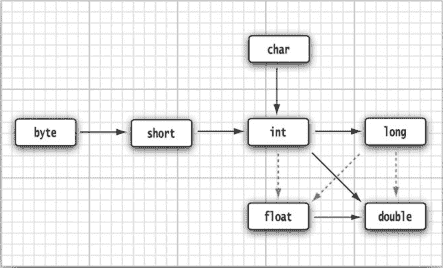

图 3.1 数值类型之间的合法转换

图 3.1 中的六条实线箭头表示无信息损失的转换。三条虚线箭头表示可能丢失精度的转换。例如，像 123456789 这样的大整数，其位数比 float 类型能表示的更多。当该整数转换为 float 时，结果值具有正确的数量级，但丢失了一些精度。

```
int n = 123456789;
float f = n; // f is 1.23456792E8
```

当两个值用二元运算符组合时（例如 n + f，其中 n 是整数，f 是浮点值），在执行运算之前，两个操作数都会转换为公共类型。

- 如果任一操作数类型为 `double`，另一个将转换为 `double`。
- 否则，如果任一操作数类型为 `float`，另一个将转换为 `float`。
- 否则，如果任一操作数类型为 `long`，另一个将转换为 `long`。
- 否则，两个操作数都将转换为 `int`。

#### 3.5.4 强制类型转换

在上一节中，你看到 int 值在必要时会自动转换为 double 值。另一方面，显然有时你想把 double 当作整数处理。在 Java 中可以进行数值转换，但当然可能会丢失信息。可能丢失信息的转换通过强制类型转换完成。强制转换的语法是在括号中给出目标类型，后面跟着变量名。例如：

```
double x = 9.997;
int nx = (int) x;
```

现在，变量 nx 的值为 9，因为将浮点值强制转换为整数会丢弃小数部分。

如果你想将浮点数舍入到最接近的整数（在大多数情况下这是更有用的操作），请使用 Math.round 方法：

```
double x = 9.997;
int nx = (int) Math.round(x);
```

现在变量 nx 的值为 10。调用 round 时仍然需要使用强制转换 `(int)`。原因是 round 方法的返回值是 long，而 long 只能通过显式强制转换赋给 int，因为存在信息丢失的可能性。

> **警告：** 如果你试图将某种类型的数强制转换为另一种类型，而该数超出目标类型的范围，结果将是一个截断后的数，其值不同。例如，`(byte) 300` 实际上是 44。

> **C++ 注意：** 不能在 boolean 值和任何数值类型之间进行强制转换。这一约定可防止常见错误。在极少数情况下，如果你想把 boolean 值转换为数字，可以使用条件表达式，例如 `b ? 1 : 0`。

#### 3.5.5 将赋值与运算符结合

在赋值中使用二元运算符有一个方便的快捷方式。例如，

```
x += 4;
```

等价于

```
x = x + 4;
```

（通常，将运算符放在 = 号的左侧，例如 *= 或 %=。）

> **注意：** 如果运算符产生的值类型与左侧类型不同，则会对其进行强制转换以适配。例如，如果 x 是 int，那么语句
> 
> ```java
> x += 3.5;
> ```
> 
> 是合法的，会将 x 设为 (int)(x + 3.5)。

#### 3.5.6 自增和自减运算符

程序员当然知道，对数值变量最常见的操作之一就是加 1 或减 1。Java 追随 C 和 C++ 的脚步，既有自增运算符也有自减运算符：n++ 将变量 n 的当前值加 1，n-- 将其减 1。例如，代码

```
int n = 12;
n++;
```

将 n 改为 13。由于这些运算符会改变变量的值，因此不能应用于数字本身。例如，4++ 不是合法语句。

这些运算符有两种形式；你刚刚看到的是放在操作数之后的后缀形式。还有前缀形式 ++n。两者都会将变量的值改变 1。两者的区别仅在表达式中使用时才会显现。前缀形式先进行加法；后缀形式求值为变量的旧值。

```
int m = 7;
int n = 7;
int a = 2 * m++; // now a is 16, m is 8
int b = 2 * ++n; // now b is 14, n is 8
```

我们建议不要在表达式中使用 ++，因为这通常会导致代码令人困惑并产生恼人的 bug。


#### 3.5.7 关系运算符与布尔运算符

Java 具有全套的关系运算符。要测试相等性，使用双等号 `==`。例如，

```java
3 == 7
```

的结果为 false。

使用 `!=` 表示不相等。例如，

```java
3 != 7
```

的结果为 true。

最后，还有常用的 `<`（小于）、`>`（大于）、`<=`（小于等于）和 `>=`（大于等于）运算符。

Java 沿袭 C++，使用 `&&` 表示逻辑“与”运算符，`||` 表示逻辑“或”运算符。从 `!=` 运算符可以很容易记住，感叹号 `!` 是逻辑非运算符。`&&` 和 `||` 运算符按“短路”方式求值：如果第一个参数已经决定了值，就不再对第二个参数求值。如果用 `&&` 运算符组合两个表达式，

```java
expression1 && expression2
```

并且第一个表达式的真值已被确定为 false，那么结果不可能为 true。因此，不会计算第二个表达式的值。可以利用这一行为来避免错误。例如，在表达式

```java
x != 0 && 1 / x > x + y // no division by 0
```

中，如果 `x` 等于 0，则第二部分永远不会被求值。因此，如果 `x` 为零，`1 / x` 不会被计算，也就不会发生除零错误。

类似地，如果第一个表达式为 true，`expression1 || expression2` 的值自动为 true，而不会求值第二个表达式。

最后，Java 支持三元 `?:` 运算符，它偶尔很有用。表达式

```java
condition ? expression1 : expression2
```

在条件为 true 时求值为第一个表达式，否则求值为第二个表达式。例如，

```java
x < y ? x : y
```

给出 `x` 和 `y` 中较小的一个。

#### 3.5.8 位运算符

对于任意整数类型，都有可以直接对组成整数的位进行操作的运算符。这意味着你可以使用掩码技术来获取一个数字中的各个位。位运算符包括

`&`（“与”） `|`（“或”） `^`（“异或”） `~`（“非”）

这些运算符作用于位模式。例如，如果 n 是一个整数变量，那么

```java
int fourthBitFromRight = (n & 0b1000) / 0b1000;
```

如果 n 的二进制表示中从右边数第 4 位是 1，则结果为 1，否则为 0。使用 `&` 与适当的 2 的幂，可以屏蔽掉除单个位以外的所有位。

> **注意：** 当应用于布尔值时，`&` 和 `|` 运算符会产生一个布尔值。这些运算符与 `&&` 和 `||` 运算符类似，区别在于 `&` 和 `|` 运算符不是按“短路”方式求值的——也就是说，在计算结果之前，两个参数都会被求值。

还有 `>>` 和 `<<` 运算符，它们将位模式向右或向左移动。当需要构建位模式来进行位掩码操作时，这些运算符很方便：

```java
int fourthBitFromRight = (n & (1 << 3)) >> 3;
```

最后，`>>>` 运算符用 0 填充高位，而 `>>` 则将符号位扩展到高位。没有 `<<<` 运算符。

> **警告：** 移位运算符的右操作数会先对 32 取模（除非左操作数是 long 类型，此时右操作数对 64 取模）。例如，`1 << 35` 的值与 `1 << 3` 相同，即 8。

> **C++ 注释：** 在 C/C++ 中，`>>` 执行的是算术移位（扩展符号位）还是逻辑移位（用 0 填充）并没有保证。实现者可以自由选择更高效的方式。这意味着 C/C++ 的 `>>` 运算符对于负数可能产生依赖于实现的结果。Java 消除了这种不确定性。

#### 3.5.9 括号与运算符优先级

表 3.4 显示了运算符的优先级。如果没有使用括号，则按照所示的层级顺序执行运算。同一层级的运算符从左到右处理，除了表中标注的右结合运算符。例如，`&&` 的优先级高于 `||`，因此表达式

```java
a && b || c
```

表示

```java
(a && b) || c
```

表 3.4 运算符优先级

| 运算符 | 结合性 |
|---|---|
| [] . ()（方法调用） | 从左到右 |
| ! ~ ++ -- +（一元） -（一元）（）（强制转换） new | 从右到左 |
| * / % | 从左到右 |
| + - | 从左到右 |
| << >> >>> | 从左到右 |
| < <= > >= instanceof | 从左到右 |
| == != | 从左到右 |
| & | 从左到右 |
| ^ | 从左到右 |
| \| | 从左到右 |
| && | 从左到右 |
| \|\| | 从左到右 |
| ?: | 从右到左 |
| = += -= *= /= %= &= \|= ^= <<= >>= >>>= | 从右到左 |

由于 `+=` 是右结合的，所以表达式

```java
a += b += c
```

表示

```java
a += (b += c)
```

#### 3.6.2 字符串拼接

与大多数编程语言一样，Java 允许使用 `+` 来连接（拼接）两个字符串。

```java
String expletive = "Expletive";
String PG13 = "deleted";
String message = expletive + PG13;
```

上述代码将变量 *message* 设置为字符串 "Expletivedeleted"。（注意单词之间没有空格：`+` 运算符按照接收到的顺序连接两个字符串，*完全*按照它们给定的样子。）

当你将一个字符串与非字符串值拼接时，后者会被转换为字符串。（正如你将在第 5 章看到的，每个 Java 对象都可以转换为字符串。）例如，

```java
int age = 13;
String rating = "PG" + age;
```

将 rating 设置为字符串 "PG13"。

这个特性常用于输出语句。例如，

```java
System.out.println("The answer is " + answer);
```

是完全可接受的，并且会输出你所期望的内容（并且由于单词 *is* 后面有空格，间距也正确）。

如果需要将多个字符串用分隔符连接在一起，请使用静态的 join 方法：

```java
String all = String.join(" / ", "S", "M", "L", "XL");
// all is the string "S / M / L / XL"
```

从 Java 11 开始，有一个 repeat 方法：

```java
String repeated = "Java".repeat(3); // repeated is "JavaJavaJava"
```

#### 3.6.3 字符串是不可变的

String 类没有提供任何方法让你*修改*现有字符串中的字符。如果你想将 *greeting* 变成 "Help!"，你不能直接更改 *greeting* 的最后几个位置为 'p' 和 '!'。如果你是 C 程序员，这可能会让你感到非常无助。我们该如何修改字符串呢？在 Java 中，这非常简单：将你想保留的子串与想替换的字符拼接起来。

```java
greeting = greeting.substring(0, 3) + "p!";
```

这个声明将 greeting 变量的当前值改为 "Help!"。

由于你无法更改 Java 字符串中的单个字符，所以文档将 String 类的对象称为不可变的。就像数字 3 永远是 3 一样，字符串 "Hello" 将永远包含字符 H、e、l、l、o 的代码单元序列。你不能更改这些值。然而，正如你刚才所见，你可以更改字符串变量 greeting 的内容，使其引用一个不同的字符串，就像你可以让当前持有值 3 的数字变量持有值 4 一样。

这样效率是不是低很多？直接更改代码单元似乎比从头构建一个全新的字符串更简单。嗯，既对也不对。确实，生成一个包含 "hel" 和 "p!" 拼接结果的新字符串并不高效。但不可变字符串有一个很大的优点：编译器可以安排字符串被共享。

要理解其工作原理，可以把各种字符串想象成位于一个公共池中。字符串变量指向池中的位置。如果你复制一个字符串变量，原始变量和副本共享相同的字符。

总的来说，Java 的设计者认为共享的效率超过了通过提取子串和拼接来编辑字符串的低效。看看你自己的程序吧；我们猜测大多数时候，你并不是在修改字符串——而只是在比较它们。（有一个常见的例外——从单个字符或来自键盘或文件的较短字符串组装字符串。对于这些情况，Java 提供了一个单独的类，我们将在第 74 页的 3.6.9 节“构建字符串”中描述。）


> **C++ 注释：** C 程序员第一次看到 Java 字符串时通常会感到困惑，因为他们把字符串当作字符数组：

```cpp
char greeting[] = "Hello";
```

这是一个错误的类比：Java 字符串大致类似于 `char*` 指针，

```cpp
char* greeting = "Hello";
```

当你用另一个字符串替换 greeting 时，Java 代码大致执行以下操作：

```cpp
char* temp = malloc(6);
strncpy(temp, greeting, 3);
strncpy(temp + 3, "p!", 3);
greeting = temp;
```

当然，现在 greeting 指向字符串 "Help!"。即使是最顽固的 C 程序员也必须承认，Java 语法比一系列 `strncpy` 调用更令人愉快。但是如果我们再次给 greeting 赋值呢？


```java
greeting = "Howdy";
```

难道我们没有内存泄漏吗？毕竟，原始字符串是分配在堆上的。幸运的是，Java 会进行自动垃圾回收。如果一块内存不再需要，它最终会被回收。

如果你是 C++ 程序员，并使用 ANSI C++ 定义的 `string` 类，你会对 Java 的 `String` 类型感到更适应。C++ 的 `string` 对象也会自动分配和释放内存。内存管理由构造器、赋值运算符和析构函数显式执行。但是，C++ 字符串是可变的——你可以修改字符串中的单个字符。

#### 3.6.4 测试字符串是否相等

要测试两个字符串是否相等，请使用 `equals` 方法。表达式

```java
s.equals(t)
```

如果字符串 `s` 和 `t` 相等则返回 `true`，否则返回 `false`。注意，`s` 和 `t` 可以是字符串变量或字符串字面量。例如，表达式

```java
"Hello".equals(greeting)
```

完全合法。要测试两个字符串是否相同（仅忽略大小写字母的区别），请使用 `equalsIgnoreCase` 方法。

```java
"Hello".equalsIgnoreCase("hello")
```

*不要*使用 `==` 运算符测试两个字符串是否相等！它只判断字符串是否存储在同一个位置。当然，如果字符串在同一个位置，它们一定相等。但完全可能将相同字符串的多个副本存储在不同位置。

```java
String greeting = "Hello"; // initialize greeting to a string
if (greeting == "Hello") . . .
    // probably true
if (greeting.substring(0, 3) == "Hel") . . .
    // probably false
```

如果虚拟机总是安排共享相等的字符串，那么你可以使用 `==` 运算符测试相等性。但只有字符串字面量会被共享，像 `+` 或 `substring` 这类操作的结果字符串不会。因此，永远不要用 `==` 比较字符串，以免最终得到一个带有最糟糕类型错误的程序——一种似乎随机出现的间歇性错误。

> **C++ 注意：** 如果你习惯了 C++ 的 string 类，就必须特别小心相等性测试。C++ 的 string 类确实重载了 == 运算符来测试字符串内容是否相等。也许不幸的是，Java 特意让字符串具有与数值相同的“外观和感觉”，却又让字符串在相等性测试时像指针一样行事。语言设计者本可以像为 + 做特殊安排那样，为字符串重新定义 ==。唉，每种语言都有自己的不一致之处。
> 
> C 程序员从不使用 == 比较字符串，而是使用 `strcmp`。Java 的 `compareTo` 方法正是 `strcmp` 的完全对应。你可以使用
> 
> `if (greeting.compareTo("Hello") == 0) . . .`
> 
> 但改用 `equals` 似乎更清晰。

#### 3.6.5 空字符串与 null 字符串

空字符串 `""` 是长度为 0 的字符串。可以通过调用以下代码测试字符串是否为空

```java
if (str.length() == 0)
```

或

```java
if (str.equals(""))
```

空字符串是一个 Java 对象，它保存字符串长度（即 0）和空内容。然而，String 变量也可以保存一个特殊值，称为 null，它表示当前没有对象与该变量关联。（关于 null 的更多信息，请参见第 4 章。）要测试字符串是否为 null，请使用

```java
if (str == null)
```

有时，你需要测试字符串既不是 null 也不是空。然后使用

```java
if (str != null && str.length() != 0)
```

你需要先测试 str 不为 null。正如你将在第 4 章中看到的，在 null 值上调用方法是错误的。

#### 3.6.6 码点与代码单元

Java 字符串是 char 值的序列。正如我们在第 46 页的 3.3.3 节“char 类型”中所讨论的，char 数据类型是在 UTF-16 编码中表示 Unicode 码点的代码单元。最常用的 Unicode 字符可以用单个代码单元表示。增补字符需要一对代码单元。

length 方法返回给定字符串在 UTF-16 编码中所需的代码单元数。例如：

```java
String greeting = "Hello";
int n = greeting.length(); // is 5
```

要获取真实长度——即码点数量——请调用

```java
int cpCount = greeting.codePointCount(0, greeting.length());
```

调用 s.charAt(n) 返回位置 n 处的代码单元，其中 n 介于 0 和 s.length() − 1 之间。例如：

```java
char first = greeting.charAt(0); // first is 'H'
char last = greeting.charAt(4); // last is 'o'
```

要获取第 i 个码点，请使用以下语句

```java
int index = greeting.offsetByCodePoints(0, i);
int cp = greeting.codePointAt(index);
```

我们为什么要对代码单元大费周章？考虑这句话：

𝕆 是八元数的集合。

字符 𝕆（U+1D546）在 UTF-16 编码中需要两个代码单元。调用

```java
char ch = sentence.charAt(1)
```

返回的不是空格，而是 𝕆 的第二个代码单元。为避免这个问题，你不应使用 char 类型。它太底层了。

> **注意：** 不要以为可以忽略代码单元高于 U+FFFF 的特殊字符。喜欢使用表情符号的用户可能会把 🍺（U+1F37A，啤酒杯）这样的字符放进字符串中。

如果你的代码遍历字符串，并且想依次查看每个码点，可以使用以下语句：

```java
int cp = sentence.codePointAt(i);
if (Character.isSupplementaryCodePoint(cp)) i += 2;
else i++;
```

可以使用以下语句向后移动：

```java
i--;
if (Character.isSurrogate(sentence.charAt(i))) i--;
int cp = sentence.codePointAt(i);
```

显然，这相当痛苦。更简单的方法是使用 `codePoints` 方法，它生成一个 int 值的“流”，每个码点对应一个值。（我们将在第 II 卷第 2 章讨论流。）你可以直接将流转为数组（参见第 108 页的 3.10 节“数组”），然后遍历它。

```java
int[] codePoints = str.codePoints().toArray();
```

反过来，要将码点数组转换为字符串，请使用*构造器*。（我们将在第 4 章详细讨论构造器和 `new` 运算符。）

```java
String str = new String(codePoints, 0, codePoints.length);
```

> **注意：** 虚拟机不必将字符串实现为代码单元序列。在 Java 9 中，仅包含单字节代码单元的字符串使用字节数组，而所有其他字符串使用 char 数组。

#### 3.6.7 String API

Java 中的 `String` 类包含 50 多个方法。其中数量多得惊人，而且足够有用，我们可以想象会经常使用它们。下面的 API 注释总结了我们认为最有用的方法。

这些贯穿全书的 API 注释将帮助你理解 Java 应用程序编程接口（API）。每条 API 注释都以类名开头，例如 `java.lang.String`。（所谓*包*名 `java.lang` 的意义将在第 4 章解释。）类名之后是一个或多个方法的名称、说明和参数描述。

我们通常不会列出某个类的所有方法，而是选择最常用的方法，并以简洁的形式描述它们。完整列表请查阅在线文档（参见第 71 页的 3.6.8 节“阅读在线 API 文档”）。

我们还会列出某个类引入时的版本号。如果某个方法是后来添加的，则它有单独的版本号。

**java.lang.String** 1.0

- `char charAt(int index)`  
  返回指定位置的代码单元。你大概不想调用这个方法，除非你对底层代码单元感兴趣。

- `int codePointAt(int index)` 5  
  返回从指定位置开始的码点。

- `int offsetByCodePoints(int startIndex, int cpCount)` 5  
  返回从 `startIndex` 处的码点偏移 `cpCount` 个码点后的码点索引。

- `int compareTo(String other)`  
  如果该字符串在字典顺序中位于 other 之前，则返回负值；如果位于 other 之后，则返回正值；如果字符串相等，则返回 0。

- `IntStream codePoints()` 8  
  以流的形式返回此字符串的码点。调用 `toArray` 将它们放入数组。

- `new String(int[] codePoints, int offset, int count)` 5  
  用数组中从 offset 开始的 count 个码点构造一个字符串。

- `boolean isEmpty()`

- `boolean isBlank()` 11  
  如果字符串为空或仅由空白字符组成，则返回 true。

- `boolean equals(Object other)`  
  如果字符串等于 other，则返回 true。

- `boolean equalsIgnoreCase(String other)`  
  如果字符串等于 other（忽略大小写区别），则返回 true。

- `boolean startsWith(String prefix)`

- `boolean endsWith(String suffix)`  
  如果字符串以 prefix 开头或以 suffix 结尾，则返回 true。

- `int indexOf(String str)`

- `int indexOf(String str, int fromIndex)`

- `int indexOf(int cp)`

- `int indexOf(int cp, int fromIndex)`  
  返回第一个等于字符串 `str` 或码点 `cp` 的子字符串的起始位置，从索引 0 或 `fromIndex` 开始查找；如果此字符串中不出现 `str`，则返回 -1。


> **注意：** 在 API 说明中，有一些类型为 `CharSequence` 的参数。这是一种接口类型，所有字符串都属于它。你将在第 6 章学习接口类型。目前，你只需要知道，每当你看到 `CharSequence` 参数时，都可以传递 `String` 类型的实参。

#### 3.6.8 阅读在线 API 文档

正如你刚刚看到的，String 类有很多方法。此外，标准库中有数千个类，方法更是多得多。要记住所有有用的类和方法显然是不可能的。因此，熟悉在线 API 文档至关重要，它让你可以查找标准库中的所有类和方法。你可以从 Oracle 下载 API 文档并保存到本地，也可以让浏览器访问 https://docs.oracle.com/en/java/javase/11/docs/api。

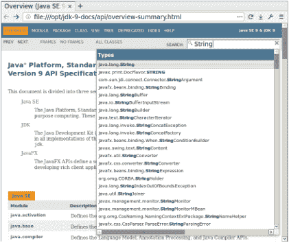

**图 3.2** Java API 文档

从 Java 9 开始，API 文档有一个搜索框（见图 3.2）。较旧版本具有带有包和类列表的框架。你仍然可以通过单击 Frames 菜单项来获取这些列表。例如，要获取有关 String 类方法的更多信息，请在搜索框中输入“String”并选择类型 java.lang.String，或者在带有类名的框架中找到链接并单击它。你将看到类描述，如图 3.3 所示。

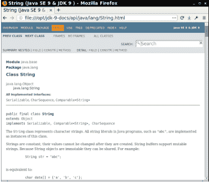

**图 3.3** String 类的类描述

向下滚动，你会看到所有方法的摘要，按字母顺序排列（见图 3.4）。单击任意方法名可查看该方法的详细描述（见图 3.5）。例如，如果单击 compareToIgnoreCase 链接，就会得到 compareToIgnoreCase 方法的描述。

> **提示：** 如果你还没有这样做，请按照第 2 章所述下载 JDK 文档。现在就在浏览器中为 `jdk-11-docs/index.html` 页面添加书签。

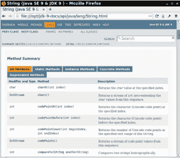

**图 3.4** String 类的方法摘要

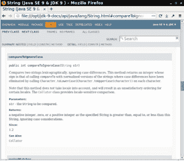

**图 3.5** 某个 String 方法的详细描述

#### 3.6.9 构建字符串

有时，你需要从较短的字符串构建字符串，例如击键或文件中的单词。为此使用字符串拼接效率很低。每次拼接字符串时，都会构造一个新的 `String` 对象。这既耗时又浪费内存。使用 `StringBuilder` 类可以避免这个问题。

如果你需要从许多小片段构建字符串，请按照以下步骤操作。首先，构造一个空字符串构建器：

```java
StringBuilder builder = new StringBuilder();
```

每次需要添加另一部分时，调用 `append` 方法。

```java
builder.append(ch); // appends a single character
builder.append(str); // appends a string
```

构建完字符串后，调用 `toString` 方法。你将得到一个包含构建器中字符序列的 `String` 对象。

```java
String completedString = builder.toString();
```

> **注意：** `StringBuilder` 类是在 Java 5 中引入的。它的前身 `StringBuffer` 效率略低，但允许多个线程添加或删除字符。如果所有字符串编辑都在单线程中进行（通常如此），则应改用 `StringBuilder`。两个类的 API 完全相同。

以下 API 说明包含 `StringBuilder` 类最重要的方法。

- `java.lang.StringBuilder` 5
  - `StringBuilder()` 构造一个空字符串构建器。
  - `int length()` 返回构建器或缓冲区的代码单元数。
  - `StringBuilder append(String str)` 追加一个字符串并返回 this。

*（续）*

**`java.lang.StringBuilder`** 5 *（续）*

| 方法 | 描述 |
|---|---|
| `StringBuilder append(char c)` | 追加一个代码单元并返回 this。 |
| `StringBuilder appendCodePoint(int cp)` | 追加一个代码点，将其转换为一个或两个代码单元，并返回 this。 |
| `void setCharAt(int i, char c)` | 将第 i 个代码单元设置为 c。 |
| `StringBuilder insert(int offset, String str)` | 在位置 offset 处插入一个字符串并返回 this。 |
| `StringBuilder insert(int offset, char c)` | 在位置 offset 处插入一个代码单元并返回 this。 |
| `StringBuilder delete(int startIndex, int endIndex)` | 删除偏移量为 startIndex 到 endIndex − 1 的代码单元并返回 this。 |
| `String toString()` | 返回一个字符串，其数据与构建器或缓冲区内容相同。 |

### 3.7 输入与输出

为了让示例程序更有趣，我们希望接受输入并正确格式化程序输出。当然，现代程序使用图形用户界面来收集用户输入。然而，编写这样的界面需要比我们目前掌握的更多的工具和技术。我们的首要任务是更熟悉 Java 编程语言，因此我们使用简陋的控制台进行输入和输出。

#### 3.7.1 读取输入

你看到了，只需调用 `System.out.println`，就可以轻松地将输出打印到“标准输出流”（即控制台窗口）。从“标准输入流” `System.in` 读取则并不那么简单。要读取控制台输入，首先构造一个附加到 `System.in` 的 `Scanner`：

```java
Scanner in = new Scanner(System.in);
```

（我们将在第 4 章详细讨论构造器和 new 运算符。）

现在你可以使用 `Scanner` 类的各种方法来读取输入。例如，`nextLine` 方法读取一行输入。

```java
System.out.print("What is your name? ");
String name = in.nextLine();
```

这里我们使用 `nextLine` 方法，因为输入可能包含空格。要读取单个单词（由空白分隔），请调用

```java
String firstName = in.next();
```

要读取一个整数，请使用 `nextInt` 方法。

```java
System.out.print("How old are you? ");
int age = in.nextInt();
```

类似地，`nextDouble` 方法读取下一个浮点数。

代码清单 3.2 中的程序询问用户的姓名和年龄，然后打印类似这样的消息

```text
Hello, Cay. Next year, you'll be 57
```

最后，注意这一行

```java
import java.util.*;
```

位于程序开头。`Scanner` 类定义在 `java.util` 包中。每当你使用一个未在基本 `java.lang` 包中定义的类时，就需要使用导入指令。我们将在第 4 章更详细地讨论包和导入指令。

### 代码清单 3.2 InputTest/InputTest.java

```java
1 import java.util.*;
2
3 /**
4  * This program demonstrates console input.
5  * @version 1.10 2004-02-10
6  * @author Cay Horstmann
7  */
8 public class InputTest
9 {
10    public static void main(String[] args)
11    {
12       Scanner in = new Scanner(System.in);
13
14       // get first input
15       System.out.print("What is your name? ");
16       String name = in.nextLine();

// get second input
System.out.print("How old are you? ");
int age = in.nextInt();

// display output on console
System.out.println("Hello, " + name + ". Next year, you'll be " + (age + 1));

}
```

> **注意：** `Scanner` 类不适合从控制台读取密码，因为输入对任何人都清晰可见。Java 6 引入了专门用于此目的的 `Console` 类。要读取密码，请使用以下代码：
>
> ```java
> Console cons = System.console();
> String username = cons.readLine("User name: ");
> char[] passwd = cons.readPassword("Password: ");
> ```
>
> 出于安全原因，密码以字符数组而不是字符串的形式返回。处理完密码后，应立即用填充值覆盖数组元素。（数组处理在 3.10 节“数组”（第 108 页）中讨论。）
>
> 使用 `Console` 对象进行输入处理不如使用 `Scanner` 方便。你必须一次读取一行输入。没有读取单个单词或数字的方法。

### `java.util.Scanner` 5

- `Scanner(InputStream in)` 从给定输入流构造一个 `Scanner` 对象。
- `String nextLine()` 读取下一行输入。
- `String next()` 读取下一个输入单词（由空白分隔）。
- `int nextInt()`
- `double nextDouble()` 读取并转换下一个表示整数或浮点数的字符序列。
- `boolean hasNext()` 测试输入中是否还有另一个单词。

*（续）*


| java.util.Scanner 5（续） |
| :--- |
| - `boolean hasNext()`<br>- `boolean hasNextDouble()`<br>测试下一个字符序列表示的是整数还是浮点数。 |

| java.lang.System 1.0 |
| :--- |
| - `static Console console() 6`<br>如果可以通过控制台窗口与用户交互，则返回一个用于此目的的 `Console` 对象；否则返回 `null`。对于任何在控制台窗口中启动的程序，都可以使用 `Console` 对象。否则，其可用性取决于系统。 |

| java.io.Console 6 |
| :--- |
| - `static char[] readPassword(String prompt, Object... args)`<br>- `static String readLine(String prompt, Object... args)`<br>显示提示并读取用户输入，直到输入行结束。`args` 参数可用于提供格式化参数，如下一节所述。 |

#### 3.7.2 格式化输出

可以使用语句 `System.out.print(x)` 将数字 x 打印到控制台。该命令会以该类型所能表示的最大非零数字位数打印 x。例如，

```java
double x = 10000.0 / 3.0;
System.out.print(x);
```

输出

```text
3333.3333333333335
```

例如，如果要显示美元和美分，这就会成为问题。

在 Java 的早期版本中，格式化数字有些麻烦。幸运的是，Java 5 从 C 库中带回了经典的 `printf` 方法。例如，以下调用

```java
System.out.printf("%8.2f", x);
```

会以 8 个字符的*字段宽度*和 2 个字符的*精度*打印 x。也就是说，输出包含一个前导空格和以下七个字符

```text
3333.33
```

可以向 `printf` 提供多个参数。例如：

```java
System.out.printf("Hello, %s. Next year, you'll be %d", name, age);
```

每个以 `%` 字符开头的*格式说明符*都会被替换为相应的参数。格式说明符末尾的*转换字符*表示要格式化的值的类型：`f` 表示浮点数，`s` 表示字符串，`d` 表示十进制整数。表 3.5 列出了所有转换字符。

**表 3.5 `printf` 的转换**

| 转换字符 | 类型 | 示例 |
|---|---|---|
| `d` | 十进制整数 | `159` |
| `x` | 十六进制整数 | `9f` |
| `o` | 八进制整数 | `237` |
| `f` | 定点浮点数 | `15.9` |
| `e` | 指数浮点数 | `1.59e+01` |
| `g` | 通用浮点数（`e` 和 `f` 中较短者） | — |
| `a` | 十六进制浮点数 | `0x1.fccdp3` |
| `s` | 字符串 | `Hello` |
| `c` | 字符 | `H` |
| `b` | 布尔值 | `true` |
| `h` | 哈希码 | `42628b2` |
| `tx` or `Tx` | 日期和时间（T 强制大写） | 已过时，请改用 `java.time` 类——见第二卷第 6 章 |
| `%` | 百分号 | `%` |
| `n` | 平台相关的行分隔符 | — |

此外，还可以指定控制格式化输出外观的标志。表 3.6 列出了所有标志。例如，逗号标志会添加分组分隔符。也就是说，

```java
System.out.printf("%,.2f", 10000.0 / 3.0);
```

输出

```text
3,333.33
```

可以使用多个标志，例如 "%,(.2f"，以使用分组分隔符并将负数括在括号中。

**表 3.6 `printf` 的标志**

| 标志 | 用途 | 示例 |
|---|---|---|
| `+` | 为正数和负数打印符号。 | `+3333.33` |
| `space` | 在正数前添加一个空格。 | ` 3333.33` |
| `0` | 添加前导零。 | `0003333.33` |
| `-` | 字段左对齐。 | `\|3333.33  \|` |
| `(` | 将负数括在括号中。 | `(3333.33)` |
| `,` | 添加分组分隔符。 | `3,333.33` |
| `# (for f format)` | 始终包含小数点。 | `3,333.` |
| `# (for x or o format)` | 添加 `0x` 或 `0` 前缀。 | `0xcafe` |
| `$` | 指定要格式化的参数索引；例如，`%1$d %1$x` 以十进制和十六进制打印第一个参数。 | `159 9F` |
| `<` | 按与前一个说明符相同的值进行格式化；例如，`%<x` 以十进制和十六进制打印同一个数字。 | `159 9F` |

> **注意：** 可以使用 `s` 转换来格式化任意对象。如果任意对象实现了 `Formattable` 接口，就会调用该对象的 `formatTo` 方法。否则，会调用 `toString` 方法将对象转换为字符串。我们将在第 5 章讨论 `toString` 方法，在第 6 章讨论接口。

可以使用静态 `String.format` 方法创建格式化字符串而不打印它：

```java
String message = String.format("Hello, %s. Next year, you'll be %d", name, age);
```

为完整起见，我们简要讨论 printf 方法的日期和时间格式化选项。对于新代码，应使用第二卷第 6 章所述的 java.time 包中的方法。但在遗留代码中，你可能会遇到 Date 类及相关的格式化选项。格式由两个字母组成，以 t 开头，并以表 3.7 中的某个字母结尾；例如，

```java
System.out.printf("%tc", new Date());
```

以以下格式打印当前日期和时间

```text
Mon Feb 09 18:05:19 PST 2015
```

**表 3.7 日期和时间转换字符**

| 转换字符 | 类型 | 示例 |
|---|---|---|
| `c` | 完整日期和时间 | Mon Feb 09 18:05:19 PST 2015 |
| `F` | ISO 8601 日期 | 2015-02-09 |
| `D` | 美国格式日期（月/日/年） | 02/09/2015 |
| `T` | 24 小时制时间 | 18:05:19 |
| `r` | 12 小时制时间 | 06:05:19 pm |
| `R` | 24 小时制时间，不含秒 | 18:05 |
| `Y` | 四位年份（带前导零） | 2015 |
| `y` | 年份的最后两位数字（带前导零） | 15 |
| `C` | 年份的前两位数字（带前导零） | 20 |
| `B` | 完整月份名称 | February |
| `b` or `h` | 缩写月份名称 | Feb |
| `m` | 两位月份（带前导零） | 02 |
| `d` | 两位日期（带前导零） | 09 |
| `e` | 两位日期（不带前导零） | 9 |
| `A` | 完整星期名称 | Monday |
| `a` | 缩写星期名称 | Mon |
| `j` | 三位一年中的第几天（带前导零），介于 001 和 366 之间 | 069 |
| `H` | 两位小时（带前导零），介于 00 和 23 之间 | 18 |
| `k` | 两位小时（不带前导零），介于 0 和 23 之间 | 18 |
| `I` | 两位小时（带前导零），介于 01 和 12 之间 | 06 |
| `l` | 两位小时（不带前导零），介于 1 和 12 之间 | 6 |
| `M` | 两位分钟（带前导零） | 05 |
| `S` | 两位秒（带前导零） | 19 |
| `L` | 三位毫秒（带前导零） | 047 |
| `N` | 九位纳秒（带前导零） | 047000000 |
| `p` | 上午或下午标记 | pm |
| `z` | 相对于 GMT 的 RFC 822 数字偏移量 | -0800 |
| `Z` | 时区 | PST |
| `s` | 自 1970–01–01 00:00:00 GMT 起的秒数 | 1078884319 |
| `Q` | 自 1970–01–01 00:00:00 GMT 起的毫秒数 | 1078884319047 |

如表 3.7 所示，有些格式只生成给定日期的一部分——例如，仅日期或仅月份。如果为了格式化每个部分而必须多次提供日期，那就有点愚蠢了。因此，格式字符串可以指示要格式化的参数索引。索引必须紧跟在 % 之后，并且必须以 $ 结尾。例如，

```java
System.out.printf("%1$s %2$tB %2$te, %2$tY", "Due date: ", new Date());
```

输出

```text
Due date: February 9, 2015
```

或者，可以使用 < 标志。它表示应再次使用与前一个格式说明符相同的参数。也就是说，以下语句

```java
System.out.printf("%s %tB %te, %tY", "Due date: ", new Date());
```

会产生与前一条语句相同的输出。

> **警告：** 参数索引值从 1 开始，而不是从 0 开始：%1$. . . 格式化第一个参数。这样可以避免与 0 标志混淆。

现在你已经了解了 printf 方法的全部特性。图 3.6 显示了格式说明符的语法图。

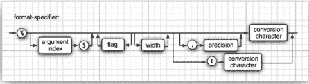

**图 3.6** 格式说明符语法

> **注意：** 数字和日期的格式是*特定于区域设置的*。例如，在德国，分组分隔符是句点而不是逗号，星期一格式化为 Montag。第二卷第 7 章说明了如何控制应用程序的国际化行为。

#### 3.7.3 文件输入与输出

要从文件读取，请像这样构造一个 Scanner 对象：

```java
Scanner in = new Scanner(Path.of("myfile.txt"), StandardCharsets.UTF_8);
```

如果文件名包含反斜杠，请记住用额外的反斜杠对每个反斜杠进行转义："c:\\mydirectory\\myfile.txt"。


> **注意：** 这里我们指定了 UTF-8 字符编码，这种编码在互联网文件中很常见（但并非唯一）。在读取文本文件时，你需要知道字符编码（更多信息请参阅第 II 卷第 2 章）。如果省略字符编码，则将使用运行 Java 程序的计算机的“默认编码”。这不是一个好主意——程序可能会根据运行位置的不同而表现迥异。

现在，你可以使用我们已经介绍过的任何 `Scanner` 方法从文件中读取数据。

要向文件写入数据，请构造一个 `PrintWriter` 对象。在构造函数中提供文件名和字符编码：

```java
PrintWriter out = new PrintWriter("myfile.txt", StandardCharsets.UTF_8);
```

如果文件不存在，则会创建它。你可以像向 `System.out` 打印时那样使用 `print`、`println` 和 `printf` 命令。

> **警告：** 你可以用字符串参数构造 `Scanner`，但扫描器会将字符串解释为数据，而不是文件名。例如，如果你调用
>
>     Scanner in = new Scanner("myfile.txt"); // ERROR?
>
> 那么扫描器将看到 10 个数据字符：`'m'`、`'y'`、`'.'`、`'f'` 等等。在这种情况下，这可能并不是你的本意。

> **注意：** 当你指定相对文件名时，例如 `"myfile.txt"`、`"mydirectory/myfile.txt"` 或 `"../myfile.txt"`，文件的位置是相对于 Java 虚拟机启动时所在目录的。如果你通过在命令 shell 中执行
>
>     java MyProg
>
> 来启动程序，那么启动目录就是命令 shell 的当前目录。但是，如果你使用集成开发环境，则由它控制启动目录。你可以通过以下调用来查找目录位置：
>
>     String dir = System.getProperty("user.dir");
>
> 如果你在定位文件时遇到麻烦，可以考虑使用绝对路径名，例如 `"c:\\mydirectory\\myfile.txt"` 或 `"/home/me/mydirectory/myfile.txt"`。

正如你所看到的，访问文件就像使用 `System.in` 和 `System.out` 一样简单。有一个问题需要注意：如果你用一个不存在的文件构造 `Scanner`，或者用一个无法创建的文件名构造 `PrintWriter`，就会发生异常。例如，Java 编译器认为这些异常比“除以零”异常更严重。在第 7 章中，你将学习处理异常的各种方法。目前，你只需告诉编译器，你已意识到可能出现“输入/输出”异常。为此，可以在 `main` 方法上标记 `throws` 子句，如下所示：

```java
public static void main(String[] args) throws IOException
{
    Scanner in = new Scanner(Path.of("myfile.txt"), StandardCharsets.UTF_8);
    . . .
}
```

你现在已经了解了如何读写包含文本数据的文件。至于更高级的主题，例如处理不同字符编码的文件、处理二进制数据、读取目录以及编写 zip 文件，请参阅第 II 卷第 2 章。

> **注意：** 当你从命令 shell 启动程序时，可以使用 shell 的重定向语法，将任意文件关联到 `System.in` 和 `System.out`：
>
> ```shell
> java MyProg < myfile.txt > output.txt
> ```
>
> 这样，你就不必担心处理 `IOException` 了。

**java.util.Scanner** 5

- `Scanner(Path p, String encoding)`  
  构造一个 `Scanner`，它使用给定的字符编码从给定路径读取数据。
- `Scanner(String data)`  
  构造一个 `Scanner`，它从给定字符串读取数据。

**java.io.PrintWriter** 1.1

- `PrintWriter(String fileName)`  
  构造一个 `PrintWriter`，它将数据写入具有给定文件名的文件。

| `java.nio.file.Path` |
|---|
| • `static Path of(String pathname)` ¹¹<br>根据给定的路径名构造一个 `Path`。 |

### 3.8 控制流

Java 和任何编程语言一样，既支持条件语句，也支持循环，以确定控制流。我们将从条件语句开始，然后介绍循环，最后介绍略显繁琐的 `switch` 语句，你可以使用它来测试单个表达式的多个值。

> **C++ 注意：** Java 的控制流结构与 C 和 C++ 中的相同，只有几个例外。没有 goto，但有一个“带标签”的 break 版本，你可以用它来跳出嵌套循环（在 C 语言中，你或许会使用 goto）。最后，还有一种 for 循环变体，类似于 C++ 中基于范围的 for 循环和 C# 中的 foreach 循环。

#### 3.8.1 块作用域

在学习控制结构之前，你需要进一步了解块。

块（block），或称复合语句（compound statement），由一对花括号括起来的若干 Java 语句组成。块定义了变量的作用域。块可以嵌套在另一个块中。下面是一个嵌套在 `main` 方法的块中的块：

```java
public static void main(String[] args)
{
    int n;
    . . .
    {
        int k;
        . . .
    } // k is only defined up to here
}
```

你不能在两个嵌套块中声明同名变量。例如，下面的代码是错误的，无法编译：

```java
public static void main(String[] args)
{
    int n;
    . . .
    {
        int k;
        int n; // ERROR -- can't redefine n in inner block
        . . .
    }
}
```

> **C++ 注意：** 在 C++ 中，可以在嵌套块中重新定义变量。内部的定义会遮蔽外部的定义。这可能会成为编程错误的根源，因此 Java 不允许这样做。

#### 3.8.2 条件语句

Java 中的条件语句具有以下形式：

```
if (*condition*) *statement*
```

条件必须用圆括号括起来。

在 Java 中，与大多数编程语言一样，当单个条件为真时，你通常需要执行多条语句。在这种情况下，请使用*块语句*，其形式如下：

```
{
    *statement_1*
    *statement_2*
    . . .
}
```

例如：

```java
if (yourSales >= target)
{
    performance = "Satisfactory";
    bonus = 100;
}
```

在这段代码中，当 yourSales 大于或等于 target 时，花括号中的所有语句都会被执行（参见图 3.7）。

> **注意：** 块（有时称为*复合语句*）允许你在任何 Java 编程结构中放置多个（简单）语句，而原本该结构只允许一个（简单）语句。

Java 中更一般的条件语句如下所示（参见图 3.8）：

```
if (*condition*) *statement_1* else *statement_2*
```

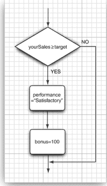

**图 3.7** `if` 语句的流程图

例如：

```java
if (yourSales >= target)
{
    performance = "Satisfactory";
    bonus = 100 + 0.01 * (yourSales - target);
}
else
{
    performance = "Unsatisfactory";
    bonus = 0;
}
```

`else` 部分始终是可选的。一个 `else` 与最近的 `if` 配对。因此，在语句

```
if (x <= 0) if (x == 0) sign = 0; else sign = -1;
```

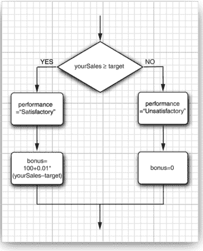

**图 3.8** if/else 语句的流程图

中，else 属于第二个 if。当然，使用花括号来明确这段代码是一个好主意：

```
if (x <= 0) { if (x == 0) sign = 0; else sign = -1; }
```

重复的 if ... else if ... 结构很常见（参见图 3.9）。例如：

```java
if (yourSales >= 2 * target)
{
    performance = "Excellent";
    bonus = 1000;
}
else if (yourSales >= 1.5 * target)
{
    performance = "Fine";
    bonus = 500;
}
else if (yourSales >= target)
{
    performance = "Satisfactory";
    bonus = 100;
}
else
{
    System.out.println("You're fired");
}
```

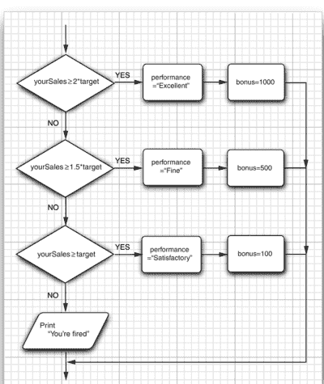

**图 3.9** if/else if（多分支）的流程图

#### 3.8.3 循环

`while` 循环在条件为真时执行一条语句（该语句可以是块语句）。其一般形式为：

```
while (condition) statement
```

如果条件一开始就为假，`while` 循环将永远不会执行（参见图 3.10）。

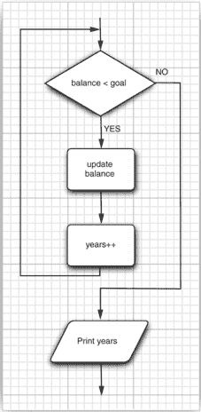

**图 3.10** while 语句的流程图


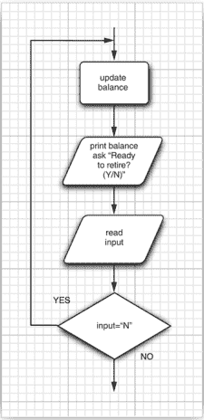

**图 3.11** do/while 语句的流程图

### 代码清单 3.3 `Retirement/Retirement.java`

```java
import java.util.*;

/**
 * This program demonstrates a <code>while</code> loop.
 * @version 1.20 2004-02-10
 * @author Cay Horstmann
 */
public class Retirement
{
Scanner in = new Scanner(System.in);

System.out.print("How much money will you contribute every year? ");
double payment = in.nextDouble();

System.out.print("Interest rate in %: ");
double interestRate = in.nextDouble();

double balance = 0;
int year = 0;

String input;

// update account balance while user isn't ready to retire
do
{
    // add this year's payment and interest
    balance += payment;
    double interest = balance * interestRate / 100;
    balance += interest;

    year++;

    // print current balance
    System.out.printf("After year %d, your balance is %,.2f%n", year, balance);

    // ask if ready to retire and get input
    System.out.print("Ready to retire? (Y/N) ");
    input = in.next();
} while (input.equals("N"));
}
}
```

#### 3.8.4 确定循环

for 循环是一种通用结构，用于支持由计数器或类似变量控制的迭代，该变量在每次迭代后更新。如图 3.12 所示，下面的循环将在屏幕上打印数字 1 到 10：

```java
for (int i = 1; i <= 10; i++)
    System.out.println(i);
```

for 语句的第一个槽通常放置计数器初始化。第二个槽给出在每次进入循环新一轮之前要测试的条件，第三个槽指定如何更新计数器。

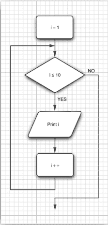

**图 3.12** for 语句的流程图

尽管 Java 和 C++ 一样，允许在 `for` 循环的各个槽中使用几乎任何表达式，但一条不成文的良好风格规则是：这三个槽应只初始化、测试和更新同一个计数器变量。无视这条规则可以写出非常晦涩的循环。

即使在良好风格的范围内，也有很多可能性。例如，你可以编写倒计时的循环：

```java
for (int i = 10; i > 0; i--)
    System.out.println("Counting down . . . " + i);
System.out.println("Blastoff!");
```

**注意：** 在循环中测试浮点数是否相等时要小心。

像下面这样的 for 循环

```
for (double x = 0; x != 10; x += 0.1) . . .
```

可能永远不会结束。由于舍入误差，可能无法精确达到最终值。在这个例子中，x 从 9.99999999999998 跳到 10.09999999999998，因为 0.1 没有精确的二进制表示。

当你在 for 语句的第一个槽中声明变量时，该变量的作用域一直延伸到 for 循环体末尾。

```
for (int i = 1; i <= 10; i++)
{
    . . .
}
// i no longer defined here
```

特别地，如果在 for 语句内部定义变量，就不能在循环外部使用它的值。因此，如果你希望在 for 循环外部使用循环计数器的最终值，务必在循环头外部声明它。

```
int i;
for (i = 1; i <= 10; i++)
{
    . . .
}
// i is still defined here
```

另一方面，你可以在不同的 for 循环中定义同名变量：

```
for (int i = 1; i <= 10; i++)
{
    . . .
}
. . .
for (int i = 11; i <= 20; i++) // OK to define another variable named i
{
    . . .
}
```

for 循环只是 while 循环的一种便捷快捷方式。例如，

```
for (int i = 10; i > 0; i--)
    System.out.println("Counting down . . . " + i);
```

可以改写为

```java
int i = 10;
while (i > 0)
{
    System.out.println("Counting down . . . " + i);
    i--;
}
```

代码清单 3.5 展示了一个 for 循环的典型示例。

该程序计算中彩票的几率。例如，如果你必须从 1 到 50 中选出六个数字才能中奖，那么共有 (50 × 49 × 48 × 47 × 46 × 45)/(1 × 2 × 3 × 4 × 5 × 6) 种可能结果，所以你的中奖机会是 15,890,700 分之一。祝你好运！

一般来说，如果你从 *n* 中选出 *k* 个数字，则有

\[
\frac{n \times (n - 1) \times (n - 2) \times \cdots \times (n - k + 1)}{1 \times 2 \times 3 \times 4 \times \cdots \times k}
\]

种可能结果。下面的 for 循环计算这个值：

```java
int lotteryOdds = 1;
for (int i = 1; i <= k; i++)
    lotteryOdds = lotteryOdds * (n - i + 1) / i;
```

> **注意：** 关于 Java 5 中添加到 Java 语言的增强 for 循环（也称为“for each”循环）的说明，请参见第 110 页的 3.10.3 节“for each”循环。

### 代码清单 3.5 `LotteryOdds/LotteryOdds.java`

```java
import java.util.*;

/**
 * This program demonstrates a <code>for</code> loop.
 * @version 1.20 2004-02-10
 * @author Cay Horstmann
 */
public class LotteryOdds
{
    public static void main(String[] args)
    {
        Scanner in = new Scanner(System.in);

        System.out.print("How many numbers do you need to draw? ");
        int k = in.nextInt();

        System.out.print("What is the highest number you can draw? ");
        int n = in.nextInt();

        /*
         * compute binomial coefficient n*(n-1)*(n-2)*...*(n-k+1)/(1*2*3*...*k)
         */

        int lotteryOdds = 1;
        for (int i = 1; i <= k; i++)
            lotteryOdds = lotteryOdds * (n - i + 1) / i;

        System.out.println("Your odds are 1 in " + lotteryOdds + ". Good luck!");
    }
}
```

#### 3.8.5 多重选择——switch 语句

当你必须处理具有许多备选项的多重选择时，if/else 结构可能很笨拙。Java 有一种 switch 语句，它与 C 和 C++ 中的 switch 语句完全一样，连缺陷也一并保留。

例如，如果你像图 3.13 那样建立一个有四个选项的菜单系统，可以使用如下所示的代码：

```java
Scanner in = new Scanner(System.in);
System.out.print("Select an option (1, 2, 3, 4) ");
int choice = in.nextInt();
switch (choice)
{
   case 1:
      ...
      break;
   case 2:
      ...
      break;
   case 3:
      ...
      break;
   case 4:
      ...
      break;
   default:
      // bad input
      ...
      break;
}
```

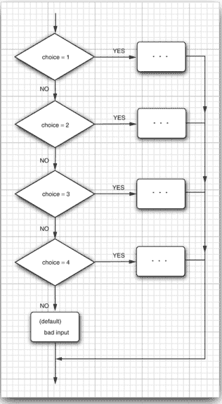

**图 3.13** switch 语句的流程图

执行从与选择所依据的值匹配的 case 标签开始，并一直继续到下一个 break 或 switch 结束。如果没有任何 case 标签匹配，那么将执行 default 子句（如果存在）。

#### 3.8.6 中断控制流的语句

尽管 Java 的设计者将 *goto* 保留为保留字，但他们决定不将其纳入语言中。一般来说，*goto* 语句被认为风格不佳。一些程序员觉得反 *goto* 的势力做得太过分了（例如，参见 Donald Knuth 的著名文章“使用 *goto* 语句的结构化程序设计”）。他们主张，无限制地使用 *goto* 容易出错，但偶尔跳出循环是有益的。Java 设计者同意这一点，甚至添加了一条新语句——带标签的 *break*，以支持这种编程风格。

让我们先看看不带标签的 *break* 语句。用于退出 *switch* 的同一个 *break* 语句也可以用来跳出循环。例如：

```
    while (years <= 100)
    {
        balance += payment;
        double interest = balance * interestRate / 100;
        balance += interest;
        if (balance >= goal) break;
        years++;
    }
```

现在，如果循环顶部出现 years > 100，或者循环中间出现 balance >= goal，就会退出循环。当然，你也可以不用 *break* 计算出相同的 years 值，像这样：

```
    while (years <= 100 && balance < goal)
    {
        balance += payment;
        double interest = balance * interestRate / 100;
        balance += interest;
        if (balance < goal)
            years++;
    }
```

但请注意，在这个版本中，测试 balance < goal 重复了两次。为了避免这种重复测试，一些程序员更喜欢 *break* 语句。

与 C++ 不同，Java 还提供带标签的 *break* 语句，允许你跳出多个嵌套循环。偶尔，在深度嵌套的循环内部会发生一些奇怪的事情。在这种情况下，你可能想完全跳出所有嵌套循环。仅仅通过向各个循环测试添加额外条件来编写这种程序并不方便。


这是一个演示 `break` 语句如何工作的示例。请注意，标签必须位于你想要跳出的最外层循环之前，并且后面必须跟一个冒号。

```java
Scanner in = new Scanner(System.in);
int n;
read_data:
while (. . .) // this loop statement is tagged with the label
{
    . . .
    for (. . .) // this inner loop is not labeled
    {
        System.out.print("Enter a number >= 0: ");
        n = in.nextInt();
        if (n < 0) // should never happen-can't go on
            break read_data;
            // break out of read_data loop
        . . .
    }
}
// this statement is executed immediately after the labeled break
if (n < 0) // check for bad situation
{
    // deal with bad situation
}
else
{
    // carry out normal processing
}
```

如果输入有误，带标签的 `break` 语句会跳转到带标签块的末尾。与 `break` 语句的任何用法一样，你随后需要测试循环是正常退出还是由于 `break` 而退出。

> **注意：** 有趣的是，你可以将标签应用于任何语句，甚至可以是 `if` 语句或块语句，如下所示：
> 
> ```java
> label:
> {
>     if (condition) break label; // exits block
>     . . .
> }
> // jumps here when the break statement executes
> ```

因此，如果你渴望使用 *goto*，但你可以将一个块放置在想要跳转到的位置之前结束，那么你可以使用 `break` 语句！当然，我们不推荐这种方法。但请注意，你只能跳出块，绝不能跳入块。

最后，有一个 `continue` 语句，与 `break` 语句一样，它会中断正常的控制流。`continue` 语句将控制权转移到最内层包含循环的头部。下面是一个示例：

```java
Scanner in = new Scanner(System.in);
while (sum < goal)
{
    System.out.print("Enter a number: ");
    n = in.nextInt();
    if (n < 0) continue;
    sum += n; // not executed if n < 0
}
```

如果 n < 0，则 `continue` 语句立即跳转到循环头部，跳过当前迭代的其余部分。

如果 `continue` 语句用在 `for` 循环中，它会跳转到 `for` 循环的“更新”部分。例如：

```java
for (count = 1; count <= 100; count++)
{
    System.out.print("Enter a number, -1 to quit: ");
    n = in.nextInt();
    if (n < 0) continue;
    sum += n; // not executed if n < 0
}
```

如果 n < 0，则 `continue` 语句跳转到 `count++` 语句。

还有一种带标签的 `continue` 语句形式，它会跳转到具有匹配标签的循环头部。

> **提示：** 许多程序员觉得 `break` 和 `continue` 语句令人困惑。这些语句完全是可选的——你总是可以在不使用它们的情况下表达同样的逻辑。在本书中，我们从不使用 `break` 或 `continue`。

### 3.9 大数

如果基本整数和浮点类型的精度不够，你可以使用 java.math 包中的几个便捷类：BigInteger 和 BigDecimal。这些类用于操作具有任意长数字序列的数。BigInteger 类实现了任意精度的整数运算，BigDecimal 则实现了任意精度的浮点数运算。

使用静态的 valueOf 方法将普通数字转换为大数：

```java
BigInteger a = BigInteger.valueOf(1000);
```

对于更长的数字，使用带字符串参数的构造器：

```java
BigInteger reallyBig
    = new BigInteger("222223244624294044552973893461909967206666693909649997649990979600");
```

还有常量 BigInteger.ZERO、BigInteger.ONE、BigInteger.TEN，以及自 Java 9 起新增的 BigInteger.TWO。

遗憾的是，你不能使用熟悉的数学运算符（如 + 和 *）来组合大数。相反，你必须使用大数类中的 add 和 multiply 等方法。

```java
BigInteger c = a.add(b); // c = a + b
BigInteger d = c.multiply(b.add(BigInteger.valueOf(2))); // d = c * (b + 2)
```

> **C++ 注释：** 与 C++ 不同，Java 没有可编程的运算符重载。BigInteger 类的程序员无法重新定义 + 和 * 运算符来提供 BigInteger 类的加法和乘法操作。语言设计者并没有重载 + 运算符来表示字符串的连接。他们选择不重载其他运算符，并且没有给 Java 程序员在自己的类中重载运算符的机会。

清单 3.6 显示了清单 3.5 的彩票赔率程序的修改版本，已更新为使用大数。例如，如果你受邀参加一个彩票活动，你需要从 490 个数字中选出 60 个数字，你可以使用这个程序来了解中奖的概率。中奖概率为 7163958434619955574151162252409929334117117612789269349335101345948110466848 分之一。祝你好运！

## java.math.BigInteger 1.1

- `BigInteger add(BigInteger other)`
- `BigInteger subtract(BigInteger other)`
- `BigInteger multiply(BigInteger other)`
- `BigInteger divide(BigInteger other)`
- `BigInteger mod(BigInteger other)`

  返回这个大整数与 other 的和、差、积、商和余数。

- `BigInteger sqrt()` 9

  返回此 BigInteger 的平方根。

- `int compareTo(BigInteger other)`

  如果此大整数等于 other，则返回 0；如果此大整数小于 other，则返回负数；否则返回正数。

- `static BigInteger valueOf(long x)`

  返回一个值等于 x 的大整数。

## java.math.BigDecimal 1.1

- `BigDecimal add(BigDecimal other)`
- `BigDecimal subtract(BigDecimal other)`
- `BigDecimal multiply(BigDecimal other)`
- `BigDecimal divide(BigDecimal other)`
- `BigDecimal divide(BigDecimal other, RoundingMode mode)` 5

  返回此大十进制数与 other 的和、差、积或商。如果商没有有限的十进制展开，第一个 divide 方法将抛出异常。要获得舍入结果，请使用第二个方法。RoundingMode.HALF_UP 模式是你在学校学到的舍入模式：数字 0 到 4 向下舍入，数字 5 到 9 向上舍入。它适用于常规计算。有关其他舍入模式，请参阅 API 文档。

- `int compareTo(BigDecimal other)`

  如果此大十进制数等于 other，则返回 0；如果此大十进制数小于 other，则返回负数；否则返回正数。

- `static BigDecimal valueOf(long x)`

- `static BigDecimal valueOf(long x, int scale)`

  返回一个值等于 x 或 x / 10^scale 的大十进制数。

### 3.10 数组

数组保存相同类型的值序列。在接下来的小节中，你将看到如何在 Java 中使用数组。

#### 3.10.1 声明数组

数组是一种数据结构，用于存储相同类型的值的集合。你可以通过整数 *索引* 访问每个单独的值。例如，如果 a 是一个整数数组，那么 a[i] 就是数组中的第 i 个整数。

声明数组变量时，需要指定数组类型——即元素类型后跟 []——以及数组变量名。例如，下面是一个整数数组的声明：

```java
int[] a;
```

但是，这条语句只声明了变量 a。它还没有用实际的数组初始化它。请使用 new 运算符创建数组。

```java
int[] a = new int[100]; // or var a = new int[100];
```

这条语句声明并初始化了一个包含 100 个整数的数组。

数组长度不必是常量：new int[n] 会创建一个长度为 n 的数组。

一旦创建了数组，你就不能更改其长度（当然，你可以更改单个数组元素）。如果程序运行期间经常需要扩展数组的长度，你应该使用 *数组列表*，这将在第 5 章中介绍。

> **注意：** 你可以定义数组变量为
> 
> ```java
> int[] a;
> ```
> 
> 或
> 
> ```java
> int a[];
> ```
> 
> 大多数 Java 程序员更喜欢前一种风格，因为它很好地将类型 `int[]`（整数数组）与变量名分开。

Java 提供了一种创建数组对象并提供初始值的快捷方式：

```java
int[] smallPrimes = { 2, 3, 5, 7, 11, 13 };
```

请注意，使用这种语法时不需要使用 new，也不需要指定长度。


允许在最后一个值后面加逗号，这对于需要随时间不断添加值的数组来说很方便：

```
    String[] authors = {
       "James Gosling",
       "Bill Joy",
       "Guy Steele",
       // add more names here and put a comma after each name
    };
```

可以声明一个*匿名数组*：

```
    new int[] { 17, 19, 23, 29, 31, 37 }
```

该表达式分配一个新数组，并用花括号内的值填充它。它会计算初始值的数量并相应设置数组大小。你可以使用此语法在不创建新变量的情况下重新初始化数组。例如，

```
    smallPrimes = new int[] { 17, 19, 23, 29, 31, 37 };
```

是以下写法的简写：

```
    int[] anonymous = { 17, 19, 23, 29, 31, 37 };
    smallPrimes = anonymous;
```

> **注意：** 允许使用长度为 0 的数组。如果你编写一个计算数组结果的方法，而结果恰好为空，这样的数组会很有用。可以这样构造一个长度为 0 的数组：
>
> `new elementType[0]`
>
> 或者
>
> `new elementType[] { }`
>
> 注意，长度为 0 的数组与 `null` 不同。

#### 3.10.2 访问数组元素

数组元素是*从 0 到 99 编号*的（而不是 1 到 100）。数组创建后，可以填充数组中的元素，例如使用循环：

```
    int[] a = new int[100];
    for (int i = 0; i < 100; i++)
        a[i] = i; // fills the array with numbers 0 to 99
```

当创建数字数组时，所有元素都初始化为零。布尔数组初始化为 `false`。对象数组初始化为特殊值 null，表示它们（尚）不包含任何对象。这对初学者来说可能令人惊讶。例如，

```java
String[] names = new String[10];
```

创建一个包含十个字符串的数组，所有这些字符串都是 null。如果你希望数组包含空字符串，则必须提供它们：

```java
for (int i = 0; i < 10; i++) names[i] = "";
```

> **警告：** 如果构造一个包含 100 个元素的数组，然后尝试访问元素 a[100]（或 0 到 99 范围之外的任何其他索引），将会发生“数组索引越界”异常。

要查找数组的元素个数，请使用 `array.length`。例如：

```java
for (int i = 0; i < a.length; i++)
    System.out.println(a[i]);
```

#### 3.10.3 “for each”循环

Java 有一种强大的循环结构，允许你遍历数组（或任何其他元素集合）中的每个元素，而无需费心处理索引值。

*增强的 for 循环*

```java
for (variable : collection) statement
```

将给定变量设置为集合中的每个元素，然后执行语句（当然，该语句可能是一个块）。*集合表达式*必须是数组或实现了 Iterable 接口的类的对象，例如 ArrayList。我们将在第 5 章讨论数组列表，在第 9 章讨论 Iterable 接口。

例如，

```java
for (int element : a)
    System.out.println(element);
```

将数组 a 的每个元素打印在单独的一行上。

你应该将这个循环理解为“对于 a 中的每个元素”。Java 语言的设计者曾考虑使用 foreach 和 in 之类的关键字。但这个循环是后来才添加到 Java 语言中的，最终没有人愿意破坏已经包含这些名称的方法或变量（例如 System.in）的旧代码。

当然，你也可以使用传统的 for 循环达到同样的效果：

```java
for (int i = 0; i < a.length; i++)
    System.out.println(a[i]);
```

然而，“for each”循环更简洁，也更不容易出错，因为你无需担心那些烦人的起始和结束索引值。

> **注意：** “for each”循环的循环变量遍历的是数组的元素，而不是索引值。

如果你需要处理集合中的所有元素，“for each”循环是对传统循环的一个很好的改进。然而，仍然有很多场景需要使用传统的 for 循环。例如，你可能不想遍历整个集合，或者你可能需要在循环内部获取索引值。

> **提示：** 有一种更简单的方法可以打印数组的所有值，即使用 Arrays 类的 toString 方法。调用 Arrays.toString(a) 会返回一个包含数组元素的字符串，用方括号括起来并用逗号分隔，例如 "[2, 3, 5, 7, 11, 13]"。要打印数组，只需调用

```java
System.out.println(Arrays.toString(a));
```

#### 3.10.4 数组复制

你可以将一个数组变量复制到另一个数组变量，但这样做之后*两个变量引用同一个数组*：

```java
int[] luckyNumbers = smallPrimes;
luckyNumbers[5] = 12; // now smallPrimes[5] is also 12
```

图 3.14 显示了结果。如果你确实希望将一个数组的所有值复制到一个新数组中，请使用 `Arrays` 类中的 `copyOf` 方法：

```java
int[] copiedLuckyNumbers = Arrays.copyOf(luckyNumbers, luckyNumbers.length);
```

第二个参数是新数组的长度。这个方法的一个常见用途是增加数组的大小：

```java
luckyNumbers = Arrays.copyOf(luckyNumbers, 2 * luckyNumbers.length);
```

如果数组包含数字，则额外元素填充 0；如果数组包含布尔值，则填充 false。相反，如果长度小于原始数组的长度，则只复制初始值。

```java
    else if (args[0].equals("-g"))
        System.out.println("Goodbye,");
    // print the other command-line arguments
    for (int i = 1; i < args.length; i++)
        System.out.println(" " + args[i]);
    System.out.println("!");
}
```

如果程序是这样调用的：

```
java Message -g cruel world
```

那么 args 数组将包含以下内容：

```
args[0]: "-g"
args[1]: "cruel"
args[2]: "world"
```

程序会打印出消息：

```
Goodbye, cruel world!
```

> **C++ 注意：** 在 Java 程序的 main 方法中，程序名称不会存储在 args 数组中。例如，当你从命令行启动程序时：
>
>     java Message -h world
>
> 那么 args[0] 将是 "-h"，而不是 "Message" 或 "java"。

#### 3.10.6 数组排序

要对数字数组进行排序，可以使用 Arrays 类中的 sort 方法之一：

```java
int[] a = new int[10000];
. . .
Arrays.sort(a)
```

该方法使用了经过调优的 QuickSort 算法版本，据称在大多数数据集上都非常高效。Arrays 类还提供了其他几个方便的数组方法，这些方法包含在本节末尾的 API 注释中。

清单 3.7 中的程序展示了数组的实际应用。该程序为彩票游戏生成一组随机数字组合。例如，如果你玩“从 49 个数字中选择 6 个”的彩票，程序可能会打印如下内容：

下注以下组合，它会让你变得富有！

+   4
+   7
+   8
+   19
+   30
+   44

为了选择这样一组随机数字，我们首先用一个数组 numbers 填充值 1, 2, ..., n：

```
int[] numbers = new int[n];
for (int i = 0; i < numbers.length; i++)
    numbers[i] = i + 1;
```

第二个数组保存要抽取的数字：

```
int[] result = new int[k];
```

现在我们抽取 k 个数字。Math.random 方法返回一个介于 0（包含）和 1（不包含）之间的随机浮点数。将结果乘以 n，我们得到一个介于 0 和 n − 1 之间的随机数。

```
int r = (int) (Math.random() * n);
```

我们将结果设置为该索引处的数字。最初，这只是 r + 1，但稍后你会看到，numbers 数组的内容在每次抽取后都会改变。

```
result[i] = numbers[r];
```

现在我们必须确保不再抽取该数字——所有彩票数字必须互不相同。因此，我们用数组中的最后一个数字覆盖 numbers[r]，并将 n 减 1。

```
numbers[r] = numbers[n - 1];
n--;
```

关键在于，每次抽取时我们选择的是一个索引，而不是实际值。该索引指向一个包含尚未抽取的值的数组。

抽取 k 个彩票数字后，我们对 result 数组进行排序，以获得更令人满意的输出：

```
Arrays.sort(result);
for (int r : result)
    System.out.println(r);
```


### 清单 3.7 LotteryDrawing/LotteryDrawing.java

```java
import java.util.*;

/**
 * This program demonstrates array manipulation.
 * @version 1.20 2004-02-10
 * @author Cay Horstmann
 */
public class LotteryDrawing
{
   public static void main(String[] args)
   {
      Scanner in = new Scanner(System.in);

      System.out.print("How many numbers do you need to draw? ");
      int k = in.nextInt();

      System.out.print("What is the highest number you can draw? ");
      int n = in.nextInt();

      // fill an array with numbers 1 2 3 . . . n
      int[] numbers = new int[n];
      for (int i = 0; i < numbers.length; i++)
         numbers[i] = i + 1;

      // draw k numbers and put them into a second array
      int[] result = new int[k];
      for (int i = 0; i < result.length; i++)
      {
         // make a random index between 0 and n - 1
         int r = (int) (Math.random() * n);

         // pick the element at the random location
         result[i] = numbers[r];

         // move the last element into the random location
         numbers[r] = numbers[n - 1];
         n--;
      }

      // print the sorted array
      Arrays.sort(result);
      System.out.println("Bet the following combination. It'll make you rich!");
      for (int r : result)
         System.out.println(r);
   }
}
```

- **java.util.Arrays** 1.2
  - `static String toString(xxx[] a)` 5

    返回包含数组 a 中元素的字符串，这些元素放在方括号内并用逗号分隔。在本方法及接下来的几个方法中，数组的元素类型 `xxx` 可以是 int、long、short、char、byte、boolean、float 或 double。
  - `static xxx[] copyOf(xxx[] a, int end)` 6
  - `static xxx[] copyOfRange(xxx[] a, int start, int end)` 6

    返回一个与 a 类型相同的数组，长度为 end 或 end − start，并用 a 中的值填充。如果 end 大于 a.length，则结果用 0 或 false 值填充。
  - `static void sort(xxx[] a)`

    使用经过调优的快速排序算法对数组进行排序。
  - `static int binarySearch(xxx[] a, xxx v)`
  - `static int binarySearch(xxx[] a, int start, int end, xxx v)` 6

    使用二分查找算法在已排序的数组 a 中搜索值 v。如果找到 v，则返回它的索引；否则返回一个负值 r，其中 −r − 1 是为保持数组有序，v 应当被插入的位置。
  - `static void fill(xxx[] a, xxx v)`

    将数组的所有元素设置为 v。
  - `static boolean equals(xxx[] a, xxx[] b)`

    如果两个数组长度相同，且对应索引处的元素也相同，则返回 true。

#### 3.10.7 多维数组

多维数组使用多个索引来访问数组元素。它们常用于表示表格和其他更复杂的排列。如果你暂时不需要这种存储机制，可以放心跳过本节。

假设你想制作一个数字表，显示一笔 10000 美元的投资，在利息按年支付并重新投资的不同利率情景下，会增长为多少（表 3.8）。

你可以将这个信息存储在一个二维数组（矩阵）中，我们称之为 balances。

在 Java 中声明二维数组非常简单。例如：

```java
double[][] balances;
```

表 3.8 不同利率下投资的增长情况

| 10% | 11% | 12% | 13% | 14% | 15% |
|---|---|---|---|---|---|
| 10,000.00 | 10,000.00 | 10,000.00 | 10,000.00 | 10,000.00 | 10,000.00 |
| 11,000.00 | 11,100.00 | 11,200.00 | 11,300.00 | 11,400.00 | 11,500.00 |
| 12,100.00 | 12,321.00 | 12,544.00 | 12,769.00 | 12,996.00 | 13,225.00 |
| 13,310.00 | 13,676.31 | 14,049.28 | 14,428.97 | 14,815.44 | 15,208.75 |
| 14,641.00 | 15,180.70 | 15,735.19 | 16,304.74 | 16,889.60 | 17,490.06 |
| 16,105.10 | 16,850.58 | 17,623.42 | 18,424.35 | 19,254.15 | 20,113.57 |
| 17,715.61 | 18,704.15 | 19,738.23 | 20,819.52 | 21,949.73 | 23,130.61 |
| 19,487.17 | 20,761.60 | 22,106.81 | 23,526.05 | 25,022.69 | 26,600.20 |
| 21,435.89 | 23,045.38 | 24,759.63 | 26,584.44 | 28,525.86 | 30,590.23 |
| 23,579.48 | 25,580.37 | 27,730.79 | 30,040.42 | 32,519.49 | 35,178.76 |

你必须先初始化数组，然后才能使用它。这里可以按如下方式初始化：

```java
balances = new double[NYEARS][NRATES];
```

在另一些情况下，如果你已知数组元素，可以使用一种简写形式来初始化多维数组，而无需调用 new。例如：

```java
int[][] magicSquare =
    {
        {16, 3, 2, 13},
        {5, 10, 11, 8},
        {9, 6, 7, 12},
        {4, 15, 14, 1}
    };
```

数组初始化之后，你可以通过提供两对方括号来访问单个元素，例如，balances[1][1]。

示例程序将利率存储在一个一维数组 interest 中，将账户余额存储在一个二维数组 balances 中，每个年份和利率对应一个余额。我们先用初始余额初始化数组的第一行：

```java
for (int j = 0; j < balances[0].length; j++)
    balances[0][j] = 10000;
```

然后按如下方式计算其他行：

```java
for (int i = 1; i < balances.length; i++)
{
   for (int j = 0; j < balances[i].length; j++)
   {
      double oldBalance = balances[i - 1][j];
      double interest = ...;
      balances[i][j] = oldBalance + interest;
   }
}
```

清单 3.8 给出了完整程序。

> **注意：**“for each”循环不会自动遍历二维数组中的所有元素。相反，它会遍历行，而这些行本身是一维数组。要访问二维数组的所有元素，需要嵌套两个循环，如下所示：
> 
> ```java
> for (double[] row : a)
>    for (double value : row)
>       do something with value
> ```

> **提示：** 要快速打印二维数组的元素列表，可以调用
> 
> ```java
> System.out.println(Arrays.deepToString(a));
> ```
> 
> 输出格式如下：
> 
> ```text
> [[16, 3, 2, 13], [5, 10, 11, 8], [9, 6, 7, 12], [4, 15, 14, 1]]
> ```

### 清单 3.8 CompoundInterest/CompoundInterest.java

```java
/**
 * This program shows how to store tabular data in a 2D array.
 * @version 1.40 2004-02-10
 * @author Cay Horstmann
 */
public class CompoundInterest
{
   public static void main(String[] args)
   {
      final double START_RATE = 10;
      final int NRATES = 6;
      final int NYEARS = 10;

      // set interest rates to 10 . . . 15%
      double[] interestRate = new double[NRATES];
      for (int j = 0; j < interestRate.length; j++)
         interestRate[j] = (START_RATE + j) / 100.0;

      double[][] balances = new double[NYEARS][NRATES];

      // set initial balances to 10000
      for (int j = 0; j < balances[0].length; j++)
         balances[0][j] = 10000;

      // compute interest for future years
      for (int i = 1; i < balances.length; i++)
      {
         for (int j = 0; j < balances[i].length; j++)
         {
            // get last year's balances from previous row
            double oldBalance = balances[i - 1][j];

            // compute interest
            double interest = oldBalance * interestRate[j];

            // compute this year's balances
            balances[i][j] = oldBalance + interest;
         }
      }

      // print one row of interest rates
      for (int j = 0; j < interestRate.length; j++)
         System.out.printf("%9.0f%%", 100 * interestRate[j]);

      System.out.println();

      // print balance table
      for (double[] row : balances)
      {
         // print table row
         for (double b : row)
            System.out.printf("%10.2f", b);

         System.out.println();
      }
   }
}
```

#### 3.10.8 不规则数组

到目前为止，你所看到的内容与其他编程语言并没有太大区别。但实际上，幕后还有某些微妙之处，有时你可以将其化为己用：Java 根本没有多维数组，只有一维数组。多维数组是作为“数组的数组”来模拟的。

例如，前面示例中的 balances 数组实际上是一个包含 10 个元素的数组，其中每个元素都是一个包含 6 个浮点数的数组（图 3.15）。

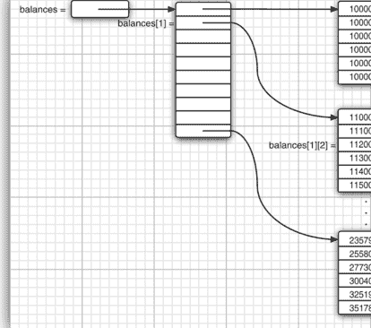

图 3.15 二维数组


表达式 `balances[i]` 指的是第 i 个子数组——也就是表中的第 i 行。它本身就是一个数组，而 `balances[i][j]` 指的是该数组的第 j 个元素。

由于数组的各行可以单独访问，你实际上可以交换它们！

```java
double[] temp = balances[i];
balances[i] = balances[i + 1];
balances[i + 1] = temp;
```

也很容易创建“参差不齐的”数组——即不同行具有不同长度的数组。下面是一个标准示例。让我们创建一个数组，其中第 i 行第 j 列的元素等于“从 i 个数中选 j 个数”的彩票可能结果数。

```text
1
1 1
1 2 1
1 3 3 1
1 4 6 4 1
1 5 10 10 5 1
1 6 15 20 15 6 1
```

由于 j 永远不可能大于 i，该矩阵是三角形的。第 i 行有 i + 1 个元素。（我们允许选择 0 个元素；这样的选择只有一种方式。）要构建这个参差不齐的数组，首先分配保存各行的数组：

```java
int[][] odds = new int[NMAX + 1][];
```

接下来，分配各行：

```java
for (int n = 0; n <= NMAX; n++)
    odds[n] = new int[n + 1];
```

现在数组已经分配好了，我们可以用常规方式访问元素，前提是不越界：

```java
for (int n = 0; n < odds.length; n++)
    for (int k = 0; k < odds[n].length; k++)
    {
        // compute lotteryOdds
        ...
        odds[n][k] = lotteryOdds;
    }
```

代码清单 3.9 给出了完整程序。

> **C++ 注：** 在 C++ 中，Java 声明
>
> ```
> double[][] balances = new double[10][6]; // Java
> ```
>
> 并不等同于
>
> ```
> double balances[10][6]; // C++
> ```
>
> 甚至也不等同于
>
> ```
> double (*balances)[6] = new double[10][6]; // C++
> ```
>
> 相反，会分配一个包含十个指针的数组：
>
> ```
> double** balances = new double*[10]; // C++
> ```
>
> 然后，指针数组中的每个元素都会用一个包含六个数字的数组填充：
>
> ```
> for (i = 0; i < 10; i++)
>     balances[i] = new double[6];
> ```
>
> 幸运的是，当你请求一个新的 `double[10][6]` 时，这个循环会自动完成。当你需要参差不齐的数组时，需要单独分配各行数组。

### 代码清单 3.9 LotteryArray/LotteryArray.java

```java
/**
 * This program demonstrates a triangular array.
 * @version 1.20 2004-02-10
 * @author Cay Horstmann
 */
public class LotteryArray
{
   public static void main(String[] args)
   {
      final int NMAX = 10;

      // allocate triangular array
      int[][] odds = new int[NMAX + 1][];
      for (int n = 0; n <= NMAX; n++)
         odds[n] = new int[n + 1];

      // fill triangular array
      for (int n = 0; n < odds.length; n++)
         for (int k = 0; k < odds[n].length; k++)
         {
            /*
             * compute binomial coefficient n*(n-1)*(n-2)*...*(n-k+1)/(1*2*3*...*k)
             */
            int lotteryOdds = 1;
            for (int i = 1; i <= k; i++)
                lotteryOdds = lotteryOdds * (n - i + 1) / i;

            odds[n][k] = lotteryOdds;
         }

      // print triangular array
      for (int[] row : odds)
      {
         for (int odd : row)
            System.out.printf("%4d", odd);
         System.out.println();
      }
   }
}
```

现在，你已经了解了 Java 语言的基本编程结构。下一章将介绍 Java 中的面向对象编程。

*本页有意留白*

## 第 4 章：对象与类

### 本章内容

- 4.1 面向对象编程简介，第 126 页
- 4.2 使用预定义类，第 131 页
- 4.3 定义自己的类，第 141 页
- 4.4 静态字段和方法，第 156 页
- 4.5 方法参数，第 163 页
- 4.6 对象构造，第 170 页
- 4.7 包，第 180 页
- 4.8 JAR 文件，第 192 页
- 4.9 文档注释，第 198 页
- 4.10 类设计提示，第 204 页

在本章中，我们将

- 向你介绍面向对象编程；
- 向你展示如何创建属于标准 Java 库中类的对象；以及
- 向你展示如何编写自己的类。

如果你没有面向对象编程的背景，你会需要仔细阅读本章。面向对象编程需要一种与过程式语言不同的思维方式。这种转变并不总是容易的，但为了深入学习 Java，你确实需要熟悉对象概念。

对于有经验的 C++ 程序员来说，本章与上一章一样，介绍的是熟悉的信息；然而，这两种语言之间有足够多的差异，因此你应当仔细阅读本章后面的小节。你会发现 C++ 注有助于完成这种转变。

### 4.1 面向对象编程简介

面向对象编程，简称 OOP，是当今主流的编程范式，已经取代了 20 世纪 70 年代发展起来的“结构化”或过程式编程技术。由于 Java 是面向对象的，你必须熟悉 OOP 才能高效地使用 Java。

面向对象的程序由对象组成。每个对象都有特定的功能，这些功能向使用者公开，而实现则隐藏起来。程序中的许多对象会从库中“现成”取用；其他对象则会定制设计。你是构建一个对象还是购买一个对象，可能取决于你的预算或时间。但基本上，只要一个对象满足你的规格要求，你就不关心功能是如何实现的。

传统的结构化编程包括设计一组过程（或算法）来解决问题。一旦确定了过程，传统的下一步就是找到合适的方法来存储数据。这就是为什么 Pascal 语言的设计者 Niklaus Wirth 将他那本著名的编程书命名为 *《算法 + 数据结构 = 程序》*（Prentice Hall，1975）。请注意，在 Wirth 的书名中，算法排在第一位，数据结构排在第二位。这反映了当时程序员的工作方式。首先，他们决定用于操作数据的过程；然后，他们决定对数据施加什么结构，以便更容易进行操作。OOP 颠倒了这个顺序：把数据放在第一位，然后寻找操作数据的算法。

对于小问题，分解为过程效果很好。但对于更大的问题，对象更合适。考虑一个简单的 Web 浏览器。它的实现可能需要 2,000 个过程，所有这些过程都操作一组全局数据。在面向对象的风格中，可能有 100 个类，每个类平均有 20 个方法（见图 4.1）。这种结构对程序员来说更容易掌握。也更容易在其中查找缺陷。假设某个特定对象处于不正确的状态。在可访问该数据项的 20 个方法中寻找罪魁祸首，要比在 2,000 个过程中寻找容易得多。

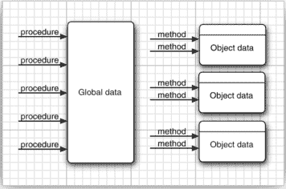

**图 4.1** 过程式编程与面向对象编程对比

#### 4.1.1 类

*类*规定了对象如何创建。可以把类想象成饼干模具；对象就是饼干本身。当你从一个类*构造*一个对象时，就称你创建了该类的一个*实例*。

正如你所见，你在 Java 中编写的所有代码都位于一个类中。标准 Java 库提供了数千个类，用于用户界面设计、日期和日历、网络编程等多种用途。尽管如此，在 Java 中你仍然必须创建自己的类来描述应用程序问题领域中的对象。

*封装*（有时称为*信息隐藏*）是处理对象时的一个关键概念。正式地说，封装就是将数据和行为组合在一个包中，并对对象的使用者隐藏实现细节。对象中的数据片段称为它的*实例字段*，操作这些数据的过程称为它的*方法*。一个作为类实例的特定对象，其实例字段会有特定的值。这些值的集合就是该对象当前的*状态*。每当你对对象调用方法时，它的状态都可能改变。

让封装发挥作用的关键在于，方法*绝不*直接访问除自身类之外的类中的实例字段。程序应当*只*通过对象的方法与对象数据进行交互。封装就是用来……

赋予对象其“黑箱”行为，这是复用和可靠性的关键。这意味着一个类可以完全改变它存储数据的方式，但只要它继续使用相同的方法来操作数据，其他对象就不会知道，也不会关心。

当你在 Java 中开始编写自己的类时，OOP 的另一条原则会让这更容易：类可以通过*扩展*其他类来构建。事实上，Java 自带一个称为 *Object* 的“宇宙超类”。所有其他类都扩展这个类。你将在下一章进一步了解 Object 类。

当你扩展现有类时，新类拥有你所扩展类的所有属性和方法。然后你提供仅适用于新类的新方法和数据字段。通过扩展一个类来获得另一个类的概念称为*继承*。有关继承的更多内容，请参阅下一章。

#### 4.1.2 对象

要使用 OOP，你应当能够识别对象的三个关键特征：

- 对象的*行为*——你能用这个对象做什么，或者可以对它应用哪些方法？
- 对象的*状态*——当你调用这些方法时，对象如何反应？
- 对象的*标识*——对象如何与可能具有相同行为和状态的其他对象区分开来？

同一类的所有实例对象都通过支持相同的*行为*而具有家族相似性。对象的行为由你可以调用的方法定义。

接下来，每个对象存储关于它当前样子的信息。这就是对象的*状态*。对象的状态可能随时间变化，但不会自发变化。对象状态的变化必须是方法调用的结果。（如果对象的状态在没有对该对象进行方法调用的情况下发生变化，那么有人破坏了封装。）

然而，对象的状态并不能完全描述它，因为每个对象都有不同的*标识*。例如，在订单处理系统中，即使两个订单期望相同的商品，它们也是不同的。请注意，作为类实例的各个对象在标识上*总是*不同，在状态上*通常*不同。

这些关键特征可以相互影响。例如，对象的状态可以影响其行为。（如果订单“已发货”或“已付款”，它可能

*依赖*（或称“使用”关系）是最明显、也最一般的。例如，Order 类使用 Account 类，因为 Order 对象需要访问 Account 对象来检查信用状态。但 Item 类不依赖 Account 类，因为 Item 对象从不需要操心客户账户。因此，如果一个类的方法使用或操作另一个类的对象，那么这个类就依赖另一个类。

尽量减少相互依赖的类的数量。关键在于，如果类 A 不知道类 B 的存在，它也不关心 B 的任何变化。（这意味着对 B 的更改不会给 A 引入缺陷。）用软件工程术语来说，你希望最小化类之间的*耦合*。

*聚合*（或称“有一个”关系）很容易理解，因为它是具体的；例如，一个 Order 对象包含 Item 对象。包含意味着类 A 的对象包含类 B 的对象。

> **注意：** 一些方法论学者轻视聚合概念，更愿意使用更一般的“关联”关系。从建模的角度来看，这是可以理解的。但对程序员来说，“有一个”关系很有意义。我们喜欢使用聚合还有另一个原因：关联的标准表示法不够清晰。参见表 4.1。

*继承*（即“是一个”关系）表达一个更特殊的类与一个更一般的类之间的关系。例如，RushOrder 类继承自 Order 类。专用的 RushOrder 类有用于优先级处理的特殊方法，以及用于计算运费的另一种方法，但它的其他方法（例如添加商品和计费）继承自 Order 类。一般来说，如果类 A 扩展类 B，那么类 A 继承类 B 的方法，但拥有更多能力。（参见下一章，我们将在那里较为详细地讨论这个重要概念。）

许多程序员使用 UML（统一建模语言）表示法绘制描述类之间关系的*类图*。你可以在图 4.2 中看到此类图的一个示例。你将类画成矩形，将关系画成带有各种装饰的箭头。表 4.1 展示了最常见的 UML 箭头样式。

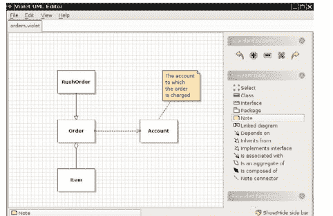

图 4.2 类图

表 4.1 类关系的 UML 表示法

| 关系 | UML 连接器 |
| --- | --- |
| 继承 | —▷ |
| 接口实现 | - - -▷ |
| 依赖 | - - -→ |
| 聚合 | ◇— |
| 关联 | — |
| 有向关联 | ——→ |

### 4.2 使用预定义类

在 Java 中，没有类就什么也做不了，而你已经见过几个类在实际工作。然而，并非所有这些类都展示了面向对象的典型特征。以 `Math` 类为例。你已经看到，可以使用 `Math` 类的方法，例如 `Math.random`，而无须知道它们是如何实现的——你只需要知道名称和参数（如果有的话）。这就是封装的意义，而且所有类都必然如此。但 `Math` 类*只*封装功能；它既不需要也不隐藏数据。既然没有数据，你就不必担心创建对象和初始化其实例字段——根本没有这些字段！

在下一节中，我们将看一个更典型的类——`Date` 类。你将看到如何构造对象并调用这个类的方法。

#### 4.2.1 对象与对象变量

要使用对象，你首先要构造它们并指定其初始状态。然后对这些对象应用方法。

在 Java 编程语言中，你使用*构造器*来构造新实例。构造器是一种特殊方法，其目的是构造并初始化对象。让我们看一个例子。标准 Java 库包含一个 `Date` 类。它的对象描述时间点，例如 1999 年 12 月 31 日 23:59:59 GMT。

> **注意：** 你可能会想：为什么要用类来表示日期，而不是（像某些语言那样）使用内置类型？例如，Visual Basic 有内置的日期类型，程序员可以按 #6/1/1995# 格式指定日期。表面上看，这听起来很方便——程序员可以简单地使用内置日期类型，而不必操心类。但实际上，Visual Basic 的设计有多合适呢？在某些区域设置中，日期被指定为月/日/年，而在另一些区域设置中则为日/月/年。语言设计者真的有能力预见这类问题吗？如果他们做得不好，语言就会变成一团令人不快的混乱，而不满意的程序员对此无能为力。使用类时，设计任务被转交给库设计者。如果类不完美，其他程序员可以轻松编写自己的类来增强或替换系统类。（为了证明这一点：Java 日期库一开始有点混乱，并且已经被重新设计了两次。）

构造器总是与类名同名。因此，`Date` 类的构造器称为 `Date`。要构造一个 `Date` 对象，请将构造器与 `new` 运算符结合使用，如下所示：

```
new Date()
```

这个表达式构造一个新对象。该对象被初始化为当前日期和时间。

如果愿意，你可以将该对象传递给方法：

```
System.out.println(new Date());
```

或者，你可以对刚刚构造的对象应用方法。Date 类的方法之一是 toString 方法。该方法生成日期的字符串表示。下面说明如何将 toString 方法应用于新构造的 Date 对象：

```
String s = new Date().toString();
```

在这两个示例中，构造的对象只使用一次。通常，你会希望保留所构造的对象，以便继续使用它们。只需将对象存储在一个变量中：

```
Date birthday = new Date();
```

图 4.3 展示了引用新构造对象的对象变量 birthday。

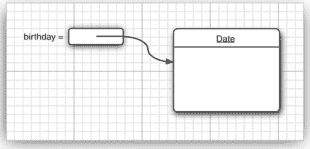

**图 4.3** 创建新对象

对象与对象变量之间存在重要区别。例如，语句

```
Date deadline; // deadline doesn't refer to any object
```

定义了一个对象变量 deadline，它可以引用 Date 类型的对象。重要的是要认识到，变量 deadline 不是对象，事实上甚至还没有引用任何对象。此时你不能在这个变量上使用任何方法。语句

```
s = deadline.toString(); // not yet
```

会导致编译时错误。


你必须首先初始化 deadline 变量。你有两种选择。当然，你可以初始化该变量，使其引用一个新构造的对象：

```java
deadline = new Date();
```

或者，你可以将变量设置为引用一个现有对象：

```java
deadline = birthday;
```

现在，这两个变量都引用*同一个*对象（参见图 4.4）。

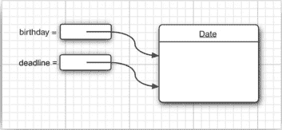

**图 4.4** 引用同一对象的对象变量

重要的是要认识到，对象变量实际上并不包含对象，它只是*引用*一个对象。

在 Java 中，任何对象变量的值都是对存储在其他位置的对象的引用。`new` 运算符的返回值也是一个引用。例如，如下语句

```java
Date deadline = new Date();
```

包含两个部分。表达式 `new Date()` 创建了一个 Date 类型的对象，其值是对该新创建对象的引用。然后该引用被存储在 deadline 变量中。

你可以显式地将对象变量设置为 `null`，以表示它当前不引用任何对象。

```java
deadline = null;

if (deadline != null)
    System.out.println(deadline);
```

我们将在 4.3.6 节“处理 `null` 引用”（第 148 页）中更详细地讨论 `null`。

> **C++ 注释：** 有些人错误地认为 Java 对象变量的行为类似于 C++ 引用。但在 C++ 中没有 null 引用，而且引用不能被赋值。你应该将 Java 对象变量视为类似于 C++ 中的对象指针。例如，
>
>     Date birthday; // Java
>
> 实际上等同于
>
>     Date* birthday; // C++
>
> 一旦你建立了这种关联，一切就都顺理成章了。当然，一个 `Date*` 指针在通过调用 `new` 初始化之前是没有初始化的。C++ 和 Java 中的语法几乎相同。
>
>     Date* birthday = new Date(); // C++
>
> 如果将某一个变量复制到另一个变量，那么两个变量都引用同一个日期——它们是指向同一个对象的指针。Java 的 `null` 引用相当于 C++ 的 `NULL` 指针。

所有 Java 对象都存在于堆上。当一个对象包含另一个对象变量时，它只包含一个指向另一个堆对象的指针。

在 C++ 中，指针让你感到紧张，因为它们太容易出错。很容易创建错误的指针或搞乱内存管理。在 Java 中，这些问题就消失了。如果你使用未初始化的指针，运行时系统会可靠地生成运行时错误，而不是产生随机结果。你不必担心内存管理，因为垃圾收集器会处理它。

C++ 通过支持拷贝构造函数和赋值运算符，在允许实现自动复制自身的对象方面付出了相当多的努力。例如，链表的副本是一个新的链表，其内容相同但链接集独立。这使得设计具有与内置类型相同复制行为的类成为可能。在 Java 中，你必须使用 `clone` 方法才能获得对象的完整副本。

#### 4.2.2 Java 库中的 LocalDate 类

在前面的示例中，我们使用了标准 Java 库中的 `Date` 类。`Date` 类的实例具有一个状态，即*一个特定的时间点*。虽然在使用 Date 类时你不需要知道这一点，但时间是用距一个固定点（即所谓的*纪元*）的毫秒数（正数或负数）来表示的，这个固定点是 1970 年 1 月 1 日 00:00:00 UTC。UTC 是协调世界时，是一种科学的计时标准，实际上它与更熟悉的 GMT（格林尼治标准时间）相同。

但事实证明，Date 类对于处理人类用于日期的日历信息（例如“1999 年 12 月 31 日”）并不是很有用。这种对一天的特定描述遵循公历，公历是世界上大多数国家使用的日历。同一个时间点，在中国或希伯来阴历中会有完全不同的描述，更不用说来自火星的客户所使用的日历了。

> **注意：** 在整个人类历史中，各个文明都在努力设计日历，以便为日期命名并让太阳和月亮周期井然有序。关于世界各地日历的精彩解释，从法国共和历到玛雅长纪历，参见 *《历法计算》* ，作者 Nachum Dershowitz 和 Edward M. Reingold（剑桥大学出版社，第 3 版，2007 年）。

库的设计者决定将计时和为时间点命名的问题分开。因此，标准 Java 库包含两个独立的类：表示时间点的 Date 类和以熟悉的日历记法表示日期的 `LocalDate` 类。Java 8 还引入了不少其他类来处理日期和时间的各个方面——参见第二卷第 6 章。

将时间测量与日历分开是良好的面向对象设计。通常，使用不同的类来表达不同的概念是一个好主意。

你不需要使用构造函数来构造 `LocalDate` 类的对象。相反，可以使用静态*工厂方法*，这些方法会替你调用构造函数。表达式

```java
LocalDate.now()
```

构造一个新对象，该对象表示构造该对象时的日期。

你可以通过提供年、月、日来构造特定日期的对象：

```java
LocalDate.of(1999, 12, 31)
```

#### 4.2.3 更改器方法与访问器方法

再看一下你在前一节中看到的 plusDays 方法调用：

```java
LocalDate aThousandDaysLater = newYearEve.plusDays(1000);
```

调用之后 newYearEve 会怎样？它是否被改变为一千天之后？事实证明，它没有。plusDays 方法会生成一个新的 LocalDate 对象，然后将其赋给 aThousandDaysLater 变量。原始对象保持不变。也就是说，plusDays 方法不会更改它所调用的对象。（这类似于你在第 3 章中看到的 String 类的 toUpperCase 方法。当你对字符串调用 toUpperCase 时，该字符串保持不变，并返回一个新的包含大写字符的字符串。）

Java 库的早期版本有一个用于处理日历的不同类，称为 GregorianCalendar。下面是你如何向该类表示的日期添加一千天：

```java
GregorianCalendar someDay = new GregorianCalendar(1999, 11, 31);
   // add 1000 days to that date; month numbers go from 0 to 11
   someDay.add(Calendar.DAY_OF_MONTH, 1000);
```

与 LocalDate.plusDays 方法不同，GregorianCalendar.add 方法是一个更改器方法。调用它之后，someDay 对象的状态发生了变化。下面是你如何找出新状态：

```java
year = someDay.get(Calendar.YEAR); // 2002
month = someDay.get(Calendar.MONTH) + 1; // 09
day = someDay.get(Calendar.DAY_OF_MONTH); // 26
```

这就是为什么我们将变量命名为 someDay 而不是 newYearEve 的原因——在调用更改器方法之后，它不再是新年前夜。

相比之下，只访问对象而不修改对象的方法有时被称为访问器方法。例如，LocalDate.getYear 和 GregorianCalendar.get 就是访问器方法。


> **C++ 注释：** 在 C++ 中，const 后缀表示访问器方法。未声明为 const 的方法被认为是更改器。但是，在 Java 编程语言中，没有任何特殊语法可以区分访问器和更改器。

我们用一个使用 LocalDate 类的程序来结束本节。该程序显示当前月份的日历，如下所示：


当前日期用星号（*）标记。正如你所看到的，程序需要知道如何计算一个月的长度以及给定日期的星期几。

让我们来看一下程序的关键步骤。首先，我们构造一个用当前日期初始化的对象。

```java
LocalDate date = LocalDate.now();
```

我们获取当前的月和日。

```java
int month = date.getMonthValue();
int today = date.getDayOfMonth();
```

然后我们将 date 设置为该月的第一天，并获取该日期的星期几。

```java
date = date.minusDays(today - 1); // set to start of month
DayOfWeek weekday = date.getDayOfWeek();
int value = weekday.getValue(); // 1 = Monday, . . . , 7 = Sunday
```

变量 weekday 被设置为 DayOfWeek 类型的对象。我们调用该对象的 getValue 方法来获取星期几的数值。这会得到一个整数，遵循国际惯例，即周末位于一周的末尾，星期一返回 1，星期二返回 2，依此类推。星期日值为 7。

请注意，日历的第一行是缩进的，以便每月的第一天落在相应的星期几上。下面是打印标题和第一行缩进的代码：

```java
System.out.println("Mon Tue Wed Thu Fri Sat Sun");
for (int i = 1; i < value; i++)
    System.out.print("   ");
```

现在，我们准备好打印日历的主体。我们进入一个循环，其中 date 遍历该月的每一天。

在每次迭代中，我们打印日期值。如果 date 是今天，则该日期用 * 标记。然后，我们将 date 推进到下一天。当到达每个新一周的开头时，我们打印一个新行：


```java
while (date.getMonthValue() == month)
{
   System.out.printf("%3d", date.getDayOfMonth());
   if (date.getDayOfMonth() == today)
      System.out.print("*");
   else
      System.out.print(" ");
   date = date.plusDays(1);
   if (date.getDayOfWeek().getValue() == 1) System.out.println();
}
```

我们何时停止？我们不知道这个月有 31、30、29 还是 28 天。相反，只要 date 仍处于当前月份，我们就继续迭代。

代码清单 4.1 展示了完整程序。

如你所见，LocalDate 类使得编写一个日历程序成为可能，该程序可以处理诸如星期几和不同月份长度之类的复杂问题。你不需要知道 LocalDate 类如何计算月份和星期几。你只需使用该类的接口——诸如 plusDays 和 getDayOfWeek 这样的方法。

这个示例程序的要点是向你展示，如何使用一个类的接口来执行相当复杂的任务，而无需了解实现细节。

### 代码清单 4.1 `CalendarTest/CalendarTest.java`

```java
import java.time.*;

/**
 * @version 1.5 2015-05-08
 * @author Cay Horstmann
 */
public class CalendarTest
{
   public static void main(String[] args)
   {
      LocalDate date = LocalDate.now();
      int month = date.getMonthValue();
      int today = date.getDayOfMonth();

      date = date.minusDays(today - 1); // set to start of month
      DayOfWeek weekday = date.getDayOfWeek();
      int value = weekday.getValue(); // 1 = Monday, . . . , 7 = Sunday

      System.out.println("Mon Tue Wed Thu Fri Sat Sun");
      for (int i = 1; i < value; i++)
         System.out.print(" ");
      while (date.getMonthValue() == month)
      {
         System.out.printf("%3d", date.getDayOfMonth());
         if (date.getDayOfMonth() == today)
            System.out.print("*");
         else
            System.out.print(" ");
         date = date.plusDays(1);
         if (date.getDayOfWeek().getValue() == 1) System.out.println();
      }
      if (date.getDayOfWeek().getValue() != 1) System.out.println();
   }
}
```

### java.time.LocalDate 8

- `static LocalDate now()`  
  构造一个表示当前日期的对象。
- `static LocalDate of(int year, int month, int day)`  
  构造一个表示给定日期的对象。
- `int getYear()`
- `int getMonthValue()`
- `int getDayOfMonth()`  
  获取此日期的年、月、日。
- `DayOfWeek getDayOfWeek()`  
  获取此日期的星期几，作为 DayOfWeek 类的实例。调用 `getValue` 可获取 1（星期一）到 7（星期日）之间的星期几。
- `LocalDate plusDays(int n)`
- `LocalDate minusDays(int n)`  
  返回此日期之后或之前 n 天的日期。

### 4.3 定义你自己的类

在第 3 章中，你开始编写简单的类。然而，所有这些类都只有一个 main 方法。现在该向你展示如何编写更复杂应用程序所需的“主力类”了。这些类通常没有 main 方法。相反，它们有自己的实例字段和方法。要构建一个完整的程序，你需要组合几个类，其中一个类含有 main 方法。

#### 4.3.1 Employee 类

Java 中类定义的最简单形式是

```java
class ClassName
{
    field₁
    field₂
    . . .
    constructor₁
    constructor₂
    . . .
    method₁
    method₂
    . . .
}
```

考虑下面这个非常简化的 Employee 类版本，企业编写工资系统时可能会使用它：

```java
class Employee
{
    // instance fields
    private String name;
    private double salary;
    private LocalDate hireDay;

    // constructor
    public Employee(String n, double s, int year, int month, int day)
    {
        name = n;
        salary = s;
        hireDay = LocalDate.of(year, month, day);
    }

    // a method
    public String getName()
    {
        return name;
    }

    // more methods
    . . .
}
```

我们将在后续各节中较为详细地剖析这个类的实现。不过首先，代码清单 4.2 是一个展示 Employee 类实际运行的程序。

在该程序中，我们构造一个 Employee 数组，并用三个 Employee 对象填充它：

```java
    Employee[] staff = new Employee[3];

    staff[0] = new Employee("Carl Cracker", . . .);
    staff[1] = new Employee("Harry Hacker", . . .);
    staff[2] = new Employee("Tony Tester", . . .);
```

接下来，我们使用 Employee 类的 raiseSalary 方法将每位员工的薪水提高 5%：

```java
    for (Employee e : staff)
        e.raiseSalary(5);
```

最后，我们通过调用 getName、getSalary 和 getHireDay 方法打印每位员工的信息：

```java
    for (Employee e : staff)
        System.out.println("name=" + e.getName()
            + ",salary=" + e.getSalary()
            + ",hireDay=" + e.getHireDay());
```

注意，示例程序由两个类组成：Employee 类和带有 public 访问修饰符的 EmployeeTest 类。我们刚才描述的那些指令所在的 main 方法包含在 EmployeeTest 类中。

源文件名为 EmployeeTest.java，因为文件名必须与 public 类的名称匹配。一个源文件中只能有一个 public 类，但可以有任意数量的非 public 类。

接下来，当你编译这段源代码时，编译器会在目录中创建两个类文件：EmployeeTest.class 和 Employee.class。

然后，你通过向字节码解释器提供包含程序 main 方法的类名来启动程序：

```bash
    java EmployeeTest
```

字节码解释器开始运行 EmployeeTest 类中 main 方法里的代码。这段代码又会构造三个新的 Employee 对象，并向你展示它们的状态。

### 代码清单 4.2 `EmployeeTest/EmployeeTest.java`

```java
import java.time.*;

/**
 * This program tests the Employee class.
 * @version 1.13 2018-04-10
 * @author Cay Horstmann
 */
public class EmployeeTest
{
   public static void main(String[] args)
   {
      // fill the staff array with three Employee objects
      Employee[] staff = new Employee[3];

      staff[0] = new Employee("Carl Cracker", 75000, 1987, 12, 15);
      staff[1] = new Employee("Harry Hacker", 50000, 1989, 10, 1);
      staff[2] = new Employee("Tony Tester", 40000, 1990, 3, 15);

      // raise everyone's salary by 5%
      for (Employee e : staff)
         e.raiseSalary(5);

      // print out information about all Employee objects
      for (Employee e : staff)
         System.out.println("name=" + e.getName() + ", salary=" + e.getSalary() + ", hireDay="
               + e.getHireDay());
   }
}

class Employee
{
   private String name;
   private double salary;
   private LocalDate hireDay;

   public Employee(String n, double s, int year, int month, int day)
   {
      name = n;
      salary = s;
      hireDay = LocalDate.of(year, month, day);
   }

   public String getName()
   {
      return name;
   }

   public double getSalary()
   {
      return salary;
   }

   public LocalDate getHireDay()
   {
      return hireDay;
   }

   public void raiseSalary(double byPercent)
   {
      double raise = salary * byPercent / 100;
      salary += raise;
   }
}
```

#### 4.3.2 使用多个源文件

代码清单 4.2 中的程序在一个源文件中有两个类。许多程序员更喜欢把每个类放到各自的源文件中。例如，你可以把 Employee 类放到 Employee.java 文件中，把 EmployeeTest 类放到 EmployeeTest.java 中。

如果你喜欢这种安排，编译该程序有两种选择。你可以使用通配符调用 Java 编译器：

```bash
javac Employee*.java
```

然后，所有匹配该通配符的源文件都会被编译成类文件。或者，你也可以直接输入

```bash
javac EmployeeTest.java
```

你可能会感到惊讶：即使从未显式编译 Employee.java 文件，第二种选择也能工作。然而，当 Java 编译器看到 EmployeeTest.java 中使用了 Employee 类时，它会查找名为 Employee.class 的文件。如果找不到该文件，它会自动搜索 Employee.java 并编译它。此外，如果它找到的 Employee.java 版本的时间戳比现有 Employee.class 文件的时间戳更新，Java 编译器将自动重新编译该文件。

> **注意：** 如果你熟悉 UNIX 的 make 工具（或它的某个 Windows 近亲，例如 nmake），你可以认为 Java 编译器已经内置了 make 功能。


#### 4.3.3 剖析 Employee 类

在接下来的几节中，我们将剖析 Employee 类。先从该类中的方法开始。通过查看源代码可以看到，这个类有一个构造函数和四个方法：

```java
public Employee(String n, double s, int year, int month, int day)
public String getName()
public double getSalary()
public LocalDate getHireDay()
public void raiseSalary(double byPercent)
```

这个类的所有方法都被标记为 public。关键字 public 表示任何类中的任何方法都可以调用该方法。（本章和下一章将介绍四种可能的访问级别。）

接下来，请注意三个实例字段，它们将保存 Employee 类实例内部操作的数据。

```java
private String name;
private double salary;
private LocalDate hireDay;
```

private 关键字确保能够访问这些实例字段的*唯一*方法是 Employee 类自身的方法。任何外部方法都不能读取或写入这些字段。

> **注意：** 你可以将 public 关键字用于实例字段，但这是一个非常糟糕的主意。拥有公共数据字段会允许程序的任何部分读取和修改实例字段，彻底破坏封装。任何类的任何方法都可以修改公共字段——而且根据我们的经验，有些代码*会*在你最意想不到的时候利用这种访问权限。我们强烈建议将所有实例字段设为 private。

最后，请注意其中两个实例字段本身就是对象：name 和 hireDay 字段分别是对 String 和 LocalDate 对象的引用。这很常见：类经常会包含类类型的实例字段。

#### 4.3.4 构造函数初探

我们来看看 Employee 类中列出的构造函数。

```java
public Employee(String n, double s, int year, int month, int day)
{
    name = n;
    salary = s;
    hireDay = LocalDate.of(year, month, day);
}
```

如你所见，构造函数的名称与类名相同。当你构造 `Employee` 类的对象时，这个构造函数会运行——为实例字段赋予你希望它们具有的初始状态。

例如，当你用如下代码创建 `Employee` 类的实例时：

```java
new Employee("James Bond", 100000, 1950, 1, 1)
```

你就将实例字段设置如下：

```java
name = "James Bond";
salary = 100000;
hireDay = LocalDate.of(1950, 1, 1); // January 1, 1950
```

构造函数与其他方法之间有一个重要区别。构造函数只能与 `new` 运算符一起调用。你不能对已有对象应用构造函数来重置实例字段。例如，

```java
james.Employee("James Bond", 250000, 1950, 1, 1) // ERROR
```

是一个编译时错误。

本章后面还会进一步讨论构造函数。目前，请记住以下几点：

- 构造函数与类同名。
- 一个类可以有多个构造函数。
- 构造函数可以接受零个、一个或多个参数。
- 构造函数没有返回值。
- 构造函数总是与 `new` 运算符一起调用。

> **C++ 注意：** 构造函数在 Java 中的工作方式与在 C++ 中相同。但请记住，所有 Java 对象都在堆上构造，并且构造函数必须与 `new` 结合使用。C++ 程序员常犯的一个错误是忘记 new 运算符：
>
> ```cpp
> Employee number007("James Bond", 100000, 1950, 1, 1); // C++, not Java
> ```
>
> 这在 C++ 中可行，但在 Java 中不行。

> **警告：** 注意不要引入与实例字段同名的局部变量。例如，下面的构造函数不会设置 salary：
>
> ```java
> public Employee(String n, double s, . . .)
> {
>    String name = n; // ERROR
>    double salary = s; // ERROR
>    . . .
> }
> ```
>
> 这个构造函数声明了局部变量 name 和 salary。这些变量只能在构造函数内部访问。它们遮蔽了同名的实例字段。有些程序员在打字速度超过思考速度时会无意中写出这种代码，因为他们的手指习惯于添加数据类型。这是一个棘手的错误，可能很难追踪。你只需在所有方法中小心，不要使用与实例字段名称相同的变量名。

#### 4.3.5 用 var 声明局部变量

从 Java 10 开始，你可以使用 var 关键字声明局部变量，而不必指定其类型，前提是类型可以从初始值推断出来。例如，不必声明

```java
Employee harry = new Employee("Harry Hacker", 50000, 1989, 10, 1);
```

你只需写

```java
var harry = new Employee("Harry Hacker", 50000, 1989, 10, 1);
```

这很好，因为它避免了重复类型名 Employee。

从现在开始，在无需了解 Java API 就能从右侧明显看出类型的情况下，我们将使用 var 表示法。但我们不会对 int、long 或 double 等数值类型使用 var，这样你就不必留意 0、0L 和 0.0 之间的区别。一旦你对 Java API 更有经验，可能会希望更频繁地使用 var 关键字。

注意，var 关键字只能用于方法内部的局部变量。必须始终声明参数和字段的类型。

#### 4.3.6 处理 null 引用

在第 132 页的 4.2.1 节“对象与对象变量”中，你已经看到，对象变量持有对对象的引用，或者持有特殊值 null 来表示缺少对象。这听起来像是处理特殊情况（例如未知的姓名或雇用日期）的便利机制。但使用 null 值时需要非常小心。

如果对 null 值应用方法，就会发生 NullPointerException。

```java
LocalDate birthday = null;
String s = birthday.toString(); // NullPointerException
```

这是一个严重错误，类似于“索引越界”异常。如果你的程序没有“捕获”异常，它就会终止。通常，程序不会捕获这类异常，而是依赖程序员一开始就不要引发它们。

定义类时，最好明确哪些字段可以为 null。在我们的示例中，我们不希望 name 或 hireDay 字段为 null。（我们不必担心 salary 字段。它具有基本类型，永远不会为 null。）

hireDay 字段保证非 null，因为它用一个新建的 LocalDate 对象初始化。但是，如果调用构造函数时传入的 n 是 null 参数，那么 name 将为 null。

有两种解决方案。“宽容”的做法是将 null 参数转换为适当的非 null 值：

```java
if (n == null) name = "unknown"; else name = n;
```

从 Java 9 开始，Objects 类为此提供了一个便捷方法：

```java
public Employee(String n, double s, int year, int month, int day)
{
   name = Objects.requireNonNullElse(n, "unknown");
   . . .
}
```

“严厉”的做法是拒绝 null 参数：

```java
public Employee(String n, double s, int year, int month, int day)
{
   Objects.requireNonNull(n, "The name cannot be null");
   name = n;
   . . .
}
```

如果有人用 null 名称构造 Employee 对象，就会发生 NullPointerException。乍一看，这似乎不是有用的补救措施。但它有两个优点：

1. 异常报告包含对问题的描述。
2. 异常报告能精确定位问题的位置。否则，`NullPointerException` 可能会在别处发生，难以追溯回有问题的构造函数参数。

> **注意：** 每当你接受一个对象引用作为构造参数时，问问自己是否真的打算为可能存在的值或可能缺失的值建模。如果不是，最好采用“严厉”的做法。

#### 4.3.7 隐式参数和显式参数

方法作用于对象并访问它们的实例字段。例如，方法

```java
public void raiseSalary(double byPercent)
{
    double raise = salary * byPercent / 100;
    salary += raise;
}
```

会为调用该方法的对象中的 salary 实例字段设置新值。考虑以下调用：

```java
number007.raiseSalary(5);
```

其效果是将 `number007.salary` 字段的值增加 5%。更具体地说，该调用会执行以下指令：

```java
double raise = number007.salary * 5 / 100;
number007.salary += raise;
```

`raiseSalary` 方法有两个参数。第一个参数称为*隐式*参数，是出现在方法名之前的 Employee 类型对象。第二个参数是方法名后括号内的数字，称为*显式*参数。（有些人将隐式参数称为方法调用的*目标*或*接收者*。）

如你所见，显式参数在方法声明中明确列出——例如，`double byPercent`。隐式参数不会出现在方法声明中。

在每个方法中，关键字 `this` 都指向隐式参数。如果你愿意，可以将 `raiseSalary` 方法写成如下形式：


这些是访问器方法的明显例子。由于它们只是返回实例字段的值，因此有时被称为*字段访问器*。

为什么不把 `name`、`salary` 和 `hireDay` 字段设为 public，而是使用单独的访问器方法呢？这样不是更容易吗？

然而，`name` 字段是只读的。一旦在构造器中设置它，就没有方法可以更改它。因此，我们可以保证 `name` 字段永远不会被破坏。

`salary` 字段不是只读的，但它只能通过 `raiseSalary` 方法更改。特别是，如果该值出现错误，只需要调试那个方法。如果 `salary` 字段是 public 的，那么弄错该值的罪魁祸首可能在任何地方。

有时，你希望获取和设置某个实例字段的值。这时需要提供*三*项内容：

- 一个私有数据字段；
- 一个公共字段访问器方法；以及
- 一个公共字段更改器方法。

这比提供一个公共数据字段要繁琐得多，但好处相当可观。

首先，你可以更改内部实现，而不影响该类方法之外的任何代码。例如，如果 name 的存储方式改为

```java
String firstName;
String lastName;
```

那么可以将 `getName` 方法改为返回

```java
firstName + " " + lastName
```

这一更改对程序其余部分完全不可见。

当然，访问器方法和更改器方法可能需要做大量工作，在旧数据表示和新数据表示之间进行转换。这就引出了第二个好处：更改器方法可以执行错误检查，而只是给字段赋值的代码可能不会费心这样做。例如，`setSalary` 方法可以检查薪水永远不小于 0。


> **警告：** 注意不要编写返回可变对象引用的访问器方法。在本书上一版中，我们在 Employee 类中违反了这条规则，其中 `getHireDay` 方法返回了 `Date` 类的对象：

```java
class Employee
{
    private Date hireDay;
    . . .
    public Date getHireDay()
    {
        return hireDay; // BAD
    }
    . . .
}
```

与没有更改器方法的 `LocalDate` 类不同，`Date` 类有一个更改器方法 `setTime`，可以用它设置毫秒数。

`Date` 对象可变这一事实破坏了封装！考虑以下恶意代码：

```java
Employee harry = . . .;
Date d = harry.getHireDay();
double tenYearsInMilliSeconds = 10 * 365.25 * 24 * 60 * 60 * 1000;
d.setTime(d.getTime() + (long) tenYearsInMilliSeconds);
// let’s give Harry ten years of added seniority
```

原因很微妙。`d` 和 `harry.hireDay` 都引用同一个对象（见图 4.5）。对 `d` 应用更改器方法会自动改变 `Employee` 对象的私有状态！

如果需要返回可变对象的引用，应该先克隆它。克隆是存储在新位置上的对象的精确副本。我们将在第 6 章详细讨论克隆。下面是修正后的代码：

```java
class Employee
{
    . . .
    public Date getHireDay()
    {
        return (Date) hireDay.clone(); // OK
    }
    . . .
}
```

作为经验法则，只要需要返回可变字段的副本，就始终使用 `clone`。

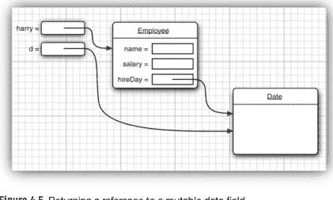

#### 4.3.9 基于类的访问权限

你知道，方法可以访问调用它的对象的私有数据。人们常常感到惊讶的是，一个方法可以访问*其所在类的所有对象*的私有数据。例如，考虑比较两个雇员的 *equals* 方法。

```java
class Employee
{
   . . .
   public boolean equals(Employee other)
   {
      return name.equals(other.name);
   }
}
```

一个典型调用是

```java
if (harry.equals(boss)) . . .
```

这个方法访问 `harry` 的私有字段，这并不奇怪。它还会访问 `boss` 的私有字段。这是合法的，因为 `boss` 是 `Employee` 类型的对象，而 `Employee` 类的方法允许访问任何 `Employee` 类型对象的私有字段。

> **C++ 注释：** C++ 也有同样的规则。一个方法可以访问其所在类的任何对象的私有特性，而不仅仅是隐式参数。

#### 4.3.10 私有方法

实现类时，我们将所有数据字段设为私有，因为公共数据是危险的。但方法呢？虽然大多数方法是公共的，但私有方法在某些情况下很有用。有时，你可能希望将某个计算的代码拆分成单独的辅助方法。通常，这些辅助方法不应成为公共接口的一部分——它们可能过于接近当前实现，或需要特殊的协议或调用顺序。这类方法最好实现为私有方法。

在 Java 中实现私有方法，只需将 public 关键字改为 private。

通过将方法设为私有，如果更改实现，你没有任何义务保持它可用。如果数据表示发生变化，该方法可能更难实现或变得不必要；这无关紧要。关键在于，只要方法是私有的，类的设计者就可以确信它不会在其他地方被使用，因此可以直接删除它。如果方法是公共的，就不能直接删除它，因为其他代码可能依赖它。

#### 4.3.11 final 实例字段

可以将实例字段定义为 **final**。这样的字段必须在构造对象时初始化。也就是说，必须保证在每个构造器结束后该字段值已经设置。此后，该字段不能再被修改。例如，Employee 类的 name 字段可以声明为 final，因为它在对象构造后从不改变——没有 `setName` 方法。

```java
class Employee
{
    private final String name;
    . . .
}
```

final 修饰符对于类型为基本类型或*不可变类*的字段特别有用。（如果一个类的任何方法都不改变其对象，则该类是不可变的。例如，String 类是不可变的。）

对于可变类，final 修饰符可能会令人困惑。例如，考虑一个字段

```java
private final StringBuilder evaluations;
```

它在 Employee 构造器中初始化为

```java
evaluations = new StringBuilder();
```

final 关键字仅仅意味着存储在 evaluations 变量中的对象引用永远不会再指向不同的 StringBuilder 对象。但该对象可以被修改：

```java
public void giveGoldStar()
{
   evaluations.append(LocalDate.now() + ": Gold star!\n");
}
```

### 4.4 静态字段与方法

在你见过的所有示例程序中，main 方法都带有 static 修饰符。现在我们可以讨论这个修饰符的含义了。

#### 4.4.1 静态字段

如果将字段定义为 static，那么每个类只有一个这样的字段。相反，每个对象都有自己的非静态实例字段副本。例如，假设我们要为每个雇员分配唯一的标识号。我们向 Employee 类添加一个实例字段 id 和一个静态字段 nextId：

```java
class Employee
{
   private static int nextId = 1;

   private int id;
   . . .
}
```

现在每个 Employee 对象都有自己的 id 字段，但只有一个 nextId 字段，由该类的所有实例共享。换句话说，如果有 1,000 个 Employee 类的对象，那么就有 1,000 个实例字段 id，每个对象一个。但只有一个静态字段 nextId。即使没有 Employee 对象，静态字段 nextId 也存在。它属于类，而不属于任何单个对象。

> **注意：** 在一些面向对象编程语言中，静态字段被称为*类字段*。“static”这个术语是从 C++ 遗留下来的、没有意义的说法。


字段）是可以的。由于 out 已被声明为 final，你不能将另一个打印流重新赋值给它：

```
System.out = new PrintStream(...); // ERROR--out is final
```

> **注：** 如果查看 System 类，你会注意到有一个 setOut 方法可以把 System.out 设置为不同的流。你可能会好奇，那个方法怎么能改变一个 final 变量的值。然而，setOut 方法是一个本地方法，并不是用 Java 编程语言实现的。本地方法可以绕过 Java 语言的访问控制机制。这是一种非常不寻常的变通方法，你不应该在程序中效仿。

#### 4.4.3 静态方法

静态方法是那些不在对象上操作的方法。例如，Math 类的 pow 方法就是一个静态方法。表达式

Math.pow(x, a)

计算 xᵃ 的幂。它不需要使用任何 Math 对象来执行任务。换句话说，它没有隐式参数。

你可以把静态方法看作没有 this 参数的方法。（在非静态方法中，this 参数指的是方法的隐式参数——见第 4.3.7 节“隐式参数和显式参数”，第 150 页。）

Employee 类的静态方法不能访问 id 实例字段，因为它不在对象上操作。然而，静态方法可以访问静态字段。下面是一个这种静态方法的示例：

```
public static int getNextId()
{
    return nextId; // returns static field
}
```

要调用这个方法，你需要提供类名：

```
int n = Employee.getNextId();
```

可以省略这个方法的 static 关键字吗？可以，但那样的话，你需要一个 Employee 类型的对象引用来调用该方法。


> **注：** 使用对象来调用静态方法是合法的。例如，如果 `harry` 是一个 `Employee` 对象，那么你可以调用 `harry.getNextId()` 而不是 `Employee.getNextId()`。不过，我们认为这种写法令人困惑。`getNextId` 方法在计算结果时根本不看 `harry` 一眼。我们建议你使用类名而不是对象来调用静态方法。

- 在两种情况下使用静态方法：
  - 当方法不需要访问对象状态，因为所有需要的参数都作为显式参数提供（例如：`Math.pow`）。
  - 当方法只需要访问类的静态字段时（例如：`Employee.getNextId()`）。


> **C++ 注：** 静态字段和静态方法在 Java 和 C++ 中具有相同的功能。但是，语法略有不同。在 C++ 中，使用 `::` 运算符在作用域外访问静态字段或静态方法，例如 `Math::PI`。
>
> “static”一词的历史颇为有趣。起初，关键字 `static` 在 C 语言中引入，用来表示当退出一个代码块时不会消失的局部变量。在这种情况下，“static”这个术语是有意义的。变量会一直存在，当再次进入该代码块时它仍然在那里。后来，`static` 在 C 语言中有了第二重含义，用来表示不能被其他文件访问的全局变量和函数。`static` 这个关键字只是被重新使用，以免引入新关键字。最后，C++ 又把这个关键字重新用于第三种、也是不相关的解释——用来表示属于某个类但不属于该类的任何特定对象的变量和函数。这正是该关键字在 Java 中的含义。

#### 4.4.4 工厂方法

这是静态方法的另一个常见用途。诸如 `LocalDate` 和 `NumberFormat` 之类的类使用**静态工厂方法**来构造对象。你已经见过工厂方法 `LocalDate.now` 和 `LocalDate.of`。下面展示了 `NumberFormat` 类如何为不同的区域设置生成格式化器对象。

```java
NumberFormat currencyFormatter = NumberFormat.getCurrencyInstance();
NumberFormat percentFormatter = NumberFormat.getPercentInstance();
double x = 0.1;
System.out.println(currencyFormatter.format(x)); // prints $0.10
System.out.println(percentFormatter.format(x)); // prints 10%
```

为什么 `NumberFormat` 类不使用构造函数呢？有两个原因：

- 你无法为构造函数命名。构造函数的名字总是与类名相同。但我们希望用两个不同的名字来获得货币实例和百分比实例。
- 使用构造函数时，你无法改变所构造对象的类型。但工厂方法实际上返回的是 `DecimalFormat` 类的对象，`DecimalFormat` 是继承自 `NumberFormat` 的子类。（有关继承的更多内容，请参阅第 5 章。）

#### 4.4.5 main 方法

请注意，你可以在不创建任何对象的情况下调用静态方法。例如，你从不需要构造 `Math` 类的对象就可以调用 `Math.pow`。

出于同样的原因，main 方法是一个静态方法。

```
public class Application
{
   public static void main(String[] args)
   {
      // construct objects here
      . . .
   }
}
```

main 方法不在任何对象上操作。事实上，程序启动时还不存在任何对象。静态 main 方法会执行，并构造程序所需的对象。


> **提示：** 每个类都可以有一个 main 方法。这是对类进行单元测试的一个便捷技巧。例如，你可以给 Employee 类添加一个 main 方法：
>
> ```java
> class Employee
> {
>    public Employee(String n, double s, int year, int month, int day)
>    {
>       name = n;
>       salary = s;
>       hireDay = LocalDate.of(year, month, day);
>    }
>    . . .
>
>    public static void main(String[] args) // unit test
>    {
>       var e = new Employee("Romeo", 50000, 2003, 3, 31);
>       e.raiseSalary(10);
>       System.out.println(e.getName() + " " + e.getSalary());
>    }
>    . . .
> }
> ```

如果希望单独测试 `Employee` 类，只需执行

java Employee

如果 `Employee` 类是一个更大应用程序的一部分，你需要用以下命令启动应用程序

java Application

那么 `Employee` 类的 `main` 方法不会被执行。

清单 4.3 中的程序包含一个简单版本的 `Employee` 类，它有一个静态字段 `nextId` 和一个静态方法 `getNextId`。我们用三个 `Employee` 对象填充一个数组，然后打印员工信息。最后，我们打印下一个可用的标识号，以演示静态方法。

注意，`Employee` 类也有一个用于单元测试的静态 `main` 方法。请尝试同时运行

java Employee

和

java StaticTest

以执行两个 `main` 方法。

**清单 4.3** StaticTest/StaticTest.java

```java
 1 /**
 2  * This program demonstrates static methods.
 3  * @version 1.02 2008-04-10
 4  * @author Cay Horstmann
 5  */
 6 public class StaticTest
 7 {
 8    public static void main(String[] args)
 9    {
10       // fill the staff array with three Employee objects
11       var staff = new Employee[3];
12

       staff[0] = new Employee("Tom", 40000);
       staff[1] = new Employee("Dick", 60000);
       staff[2] = new Employee("Harry", 65000);

       // print out information about all Employee objects
       for (Employee e : staff)
       {
           e.setId();
           System.out.println("name=" + e.getName() + ",id=" + e.getId() + ",salary="
               + e.getSalary());
       }

       int n = Employee.getNextId(); // calls static method
       System.out.println("Next available id=" + n);
   }
}

class Employee
{
    private static int nextId = 1;

    private String name;
    private double salary;
    private int id;

    public Employee(String n, double s)
    {
        name = n;
        salary = s;
        id = 0;
    }

    public String getName()
    {
        return name;
    }

    public double getSalary()
    {
        return salary;
    }

    public int getId()
    {
        return id;
    }

    public void setId()
    {
        id = nextId; // set id to next available id
        nextId++;
    }

    public static int getNextId()
    {
        return nextId; // returns static field
    }

    public static void main(String[] args) // unit test
    {
        var e = new Employee("Harry", 50000);
        System.out.println(e.getName() + " " + e.getSalary());
    }
}
```

**java.util.Objects**

- `static <T> void requireNonNull(T obj)`
- `static <T> void requireNonNull(T obj, String message)`
- `static <T> void requireNonNull(T obj, Supplier<String> messageSupplier)`

  如果 obj 为 null，这些方法会抛出一个 NullPointerException，不带消息或带有给定消息。（第 6 章将解释如何使用 supplier 惰性地获取值。第 6 章将解释 `<T>` 语法。）

- `static <T> T requireNonNullElse(T obj, T defaultObj)`
- `static <T> T requireNonNullElseGet(T obj, Supplier<T> defaultSupplier)`

  如果 obj 不为 null，则返回 obj；如果 obj 为 null，则返回默认对象。

### 4.5 方法参数

让我们回顾一下计算机科学中描述参数如何在编程语言中传递给方法（或函数）的术语。术语 *按值调用* 意味着方法只获得调用者提供的值。相反，*按引用调用* 意味着方法获得调用者提供的变量的*位置*。因此，方法可以*修改*按引用传递的变量中存储的值，但不能修改按值传递的变量中存储的值。这些“call by . . .”术语是标准的计算机科学术语，描述的是各种编程语言（不仅仅是 Java）中方法参数的行为。（还有一种 *按名称调用*，它主要具有历史意义，被用于 Algol 编程语言中，该语言是最古老的高级语言之一。）


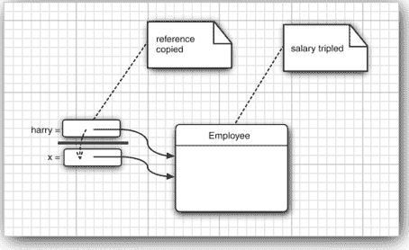

**图 4.7** 修改对象参数具有持久效果。

让我们尝试编写一个交换两个 Employee 对象的方法：

```java
public static void swap(Employee x, Employee y) // doesn't work
{
    Employee temp = x;
    x = y;
    y = temp;
}
```

如果 Java 对对象使用按引用调用，这个方法就会奏效：

```java
var a = new Employee("Alice", . . .);
var b = new Employee("Bob", . . .);
swap(a, b);
// does a now refer to Bob, b to Alice?
```

然而，该方法实际上并不会改变存储在变量 a 和 b 中的对象引用。swap 方法的 x 和 y 参数是用这些引用的副本初始化的。然后该方法继续交换这些副本。

```java
// x refers to Alice, y to Bob
Employee temp = x;
x = y;
y = temp;
// now x refers to Bob, y to Alice
```

但最终，这只是徒劳。方法结束时，参数变量 x 和 y 被丢弃。原始变量 a 和 b 仍然引用与方法调用之前相同的对象（见图 4.8）。

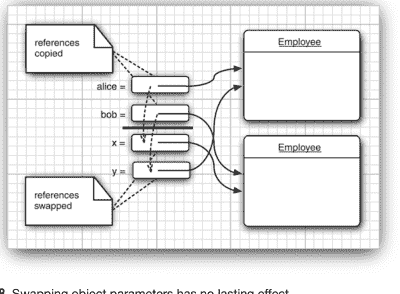

**图 4.8** 交换对象参数没有持久效果。

这表明 Java 编程语言并不对对象使用按引用调用。相反，*对象引用是按值传递的*。

下面总结在 Java 中可以用方法参数做什么、不能做什么：

- 方法不能修改基本类型（即数字或布尔值）的参数。
- 方法可以改变对象参数的*状态*。
- 方法不能使对象参数引用一个新对象。

清单 4.4 中的程序演示了这些事实。该程序首先尝试将一个数字参数的值变为三倍，但没有成功：

```text
Testing tripleValue:
Before: percent=10.0
End of method: x=30.0
After: percent=10.0
```

然后它成功地将一名员工的薪水变为三倍：

```text
Testing tripleSalary:
Before: salary=50000.0
End of method: salary=150000.0
After: salary=150000.0
```

方法执行后，harry 所引用对象的状态已经改变。这是可能的，因为该方法通过对象引用的副本修改了状态。

最后，程序演示了 swap 方法的失败：

```text
Testing swap:
Before: a=Alice
Before: b=Bob
End of method: x=Bob
End of method: y=Alice
After: a=Alice
After: b=Bob
```

如你所见，参数变量 x 和 y 被交换了，但变量 a 和 b 未受影响。

> **C++ 注：** C++ 既有按值调用，也有按引用调用。你用 `&` 标记引用参数。例如，你可以轻松实现方法 `void tripleValue(double& x)` 或 `void swap(Employee& x, Employee& y)`，这些方法会修改其引用参数。

### 清单 4.4 ParamTest/ParamTest.java

```java
/**
 * This program demonstrates parameter passing in Java.
 * @version 1.01 2018-04-10
 * @author Cay Horstmann
 */
public class ParamTest
{
    public static void main(String[] args)
    {
        /*
         * Test 1: Methods can't modify numeric parameters
         */
        System.out.println("Testing tripleValue:");
        double percent = 10;
        System.out.println("Before: percent=" + percent);
        tripleValue(percent);
        System.out.println("After: percent=" + percent);

        /*
         * Test 2: Methods can change the state of object parameters
         */
        System.out.println("\nTesting tripleSalary:");
        var harry = new Employee("Harry", 50000);
        System.out.println("Before: salary=" + harry.getSalary());
        tripleSalary(harry);
        System.out.println("After: salary=" + harry.getSalary());

        /*
         * Test 3: Methods can't attach new objects to object parameters
         */
        System.out.println("\nTesting swap:");
        var a = new Employee("Alice", 70000);
        var b = new Employee("Bob", 60000);
        System.out.println("Before: a=" + a.getName());
        System.out.println("Before: b=" + b.getName());
        swap(a, b);
        System.out.println("After: a=" + a.getName());
        System.out.println("After: b=" + b.getName());
    }

    public static void tripleValue(double x) // doesn't work
    {
        x = 3 * x;
        System.out.println("End of method: x=" + x);
    }

    public static void tripleSalary(Employee x) // works
    {
        x.raiseSalary(200);
        System.out.println("End of method: salary=" + x.getSalary());
    }

    public static void swap(Employee x, Employee y)
    {
        Employee temp = x;
        x = y;
        y = temp;
        System.out.println("End of method: x=" + x.getName());
        System.out.println("End of method: y=" + y.getName());
    }
}

class Employee // simplified Employee class
{
    private String name;
    private double salary;

    public Employee(String n, double s)
    {
        name = n;
        salary = s;
    }

    public String getName()
    {
        return name;
    }

    public double getSalary()
    {
        return salary;
    }

    public void raiseSalary(double byPercent)
    {
        double raise = salary * byPercent / 100;
        salary += raise;
    }
}
```

### 4.6 对象构造

你已经看到如何编写简单的构造器来定义对象的初始状态。然而，由于对象构造如此重要，Java 提供了相当多样的机制来编写构造器。我们将在接下来的各节中逐一介绍这些机制。

#### 4.6.1 重载

有些类有不止一个构造器。例如，你可以像这样构造一个空的 `StringBuilder` 对象：

```java
var messages = new StringBuilder();
```

或者，你可以指定一个初始字符串：

```java
var todoList = new StringBuilder("To do:\n");
```

这种能力称为*重载*。如果若干方法具有相同的名称（在这里是 `StringBuilder` 的构造器方法）但参数不同，就会发生重载。编译器必须分辨出要调用哪个方法。它

#### 4.6.3 无参数构造器

许多类包含一个无参数构造器，用于创建一个状态被设置为适当默认值的对象。例如，下面是 Employee 类的无参数构造器：

```java
public Employee()
{
    name = "";
    salary = 0;
    hireDay = LocalDate.now();
}
```

如果你编写一个完全没有构造器的类，那么系统会为你提供一个无参数构造器。这个构造器会将*所有*实例字段设置为默认值。因此，实例字段中包含的所有数值数据都会是 0，所有 `boolean` 值都会是 false，所有对象变量都会是 null。

如果一个类至少提供了一个构造器，但没有提供无参数构造器，那么在不提供参数的情况下构造对象是非法的。例如，清单 4.2 中最初的 Employee 类只提供了一个构造器：

```java
public Employee(String n, double s, int year, int month, int day)
```

对于那个类，构造默认员工对象是不合法的。也就是说，调用

```java
e = new Employee();
```

会是一个错误。

> **注意：** 请记住，*只有*当你的类没有其他构造器时，你才会免费获得一个无参数构造器。如果你为自己的类编写了哪怕一个构造器，并且你希望类的用户能够通过调用
>
>     new ClassName()
>
> 来创建实例，那么你必须提供一个无参数构造器。当然，如果你对所有字段的默认值感到满意，你可以简单地提供
>
>     public ClassName()
>     {
>     }

**C++ 注：** C++ 使用“初始化列表”语法来构造字段：

```cpp
Employee::Employee(String n, double s, int y, int m, int d) // C++
: name(n),
  salary(s),
  hireDay(y, m, d)
{
}
```

C++ 使用这种特殊语法来避免不必要地调用无参数构造器。在 Java 中，没有必要这样做，因为对象没有子对象，只有指向其他对象的指针。

#### 4.6.4 显式字段初始化

通过重载类中的构造器方法，你可以构建许多方式来设置类实例字段的初始状态。确保无论调用哪个构造器，每个实例字段都被设置为有意义的值，这始终是个好主意。

你可以直接在类定义中为任何字段赋值。例如：

```java
class Employee
{
   private String name = "";
   . . .
}
```

这个赋值在构造器执行之前完成。如果一个类的所有构造器都需要将某个特定实例字段设置为相同的值，这种语法特别有用。

初始化值不必是常量值。下面是一个用方法调用初始化字段的例子。考虑一个 Employee 类，其中每个员工都有一个 id 字段。你可以按如下方式初始化它：

```java
class Employee
{
   private static int nextId;
   private int id = assignId();

   private static int assignId()
   {
      int r = nextId;
      nextId++;
      return r;
   }
   . . .
}
```


#### 4.6.5 参数名

当你编写非常简单的构造器时（而且你会编写很多这样的构造器），想参数名可能会有点令人沮丧。

我们通常选择单字母参数名：

```java
public Employee(String n, double s)
{
    name = n;
    salary = s;
}
```

然而，缺点是你需要阅读代码才能判断 n 和 s 参数的含义。

有些程序员给每个参数加前缀“a”：

```java
public Employee(String aName, double aSalary)
{
    name = aName;
    salary = aSalary;
}
```

这相当简洁。任何读者都能立即明白这些参数的含义。

另一种常用技巧依赖于这样一个事实：参数变量会*遮蔽*同名的实例字段。例如，如果你把一个参数命名为 salary，那么 salary 指的就是该参数，而不是实例字段。但你仍然可以通过 this.salary 访问实例字段。回想一下，this 表示隐式参数——也就是正在构造的对象。下面是一个例子：

```java
public Employee(String name, double salary)
{
    this.name = name;
    this.salary = salary;
}
```

> **C++ 注：** 在 C++ 中，通常会给实例字段加上下划线或固定字母作为前缀。（字母 m 和 x 是常见选择。）例如，salary 字段可能叫作 _salary、mSalary 或 xSalary。Java 程序员通常不这样做。

#### 4.6.6 调用另一个构造器

关键字 `this` 指的是方法的隐式参数。然而，这个关键字还有第二种含义。

如果构造器的第一条语句的形式为 `this(...)`，那么这个构造器会调用同一个类的另一个构造器。下面是一个典型示例：

```java
public Employee(double s)
{
    // calls Employee(String, double)
    this("Employee #" + nextId, s);
    nextId++;
}
```

当你调用 `new Employee(60000)` 时，`Employee(double)` 构造器会调用 `Employee(String, double)` 构造器。

以这种方式使用 `this` 关键字很有用——你只需编写一次公共构造代码。


> **C++ 注：** Java 中的 `this` 引用与 C++ 中的 `this` 指针相同。然而，在 C++ 中，一个构造器不可能调用另一个构造器。如果你想在 C++ 中提取公共初始化代码，必须编写一个单独的方法。

#### 4.6.7 初始化块

你已经见过两种初始化数据字段的方法：

- 在构造器中设置值
- 在声明中赋值

Java 中还有第三种机制，称为*初始化块*。类声明中可以包含任意代码块。每当构造该类的对象时，这些块都会被执行。例如：

```java
class Employee
{
    private static int nextId;

    private int id;
    private String name;
    private double salary;

    // object initialization block
    {
        id = nextId;
        nextId++;
    }

    public Employee(String n, double s)
    {
        name = n;
        salary = s;
    }

    public Employee()
    {
        name = "";
        salary = 0;
    }
    . . .
}
```

在这个例子中，无论使用哪个构造器构造对象，`id` 字段都会在对象初始化块中初始化。初始化块先运行，然后执行构造器的主体。

这种机制从来都不是必需的，也不常见。通常把初始化代码放在构造器内部更直接。

> **注：** 在初始化块中设置字段是合法的，即使这些字段只是在类中后面才定义。然而，为了避免循环定义，从后面才初始化的字段读取是不合法的。确切规则在《Java 语言规范》第 8.3.2.3 节（http://docs.oracle.com/javase/specs）中有详细说明。这些规则复杂到足以让编译器实现者困惑——早期 Java 版本在实现它们时就出现了细微错误。因此，我们建议你始终把初始化块放在字段定义之后。

由于初始化数据字段的方式如此之多，要给出构造过程所有可能的路径可能会相当令人困惑。下面是调用构造器时详细发生的情况：

- 1. 如果构造器的第一行调用第二个构造器，那么第二个构造器会使用提供的参数执行。
- 2. 否则，
  - a) 所有数据字段都被初始化为其默认值（`0`、`false` 或 `null`）。
  - b) 所有字段初始化器和初始化块都按照它们在类声明中出现的顺序执行。
- 3. 执行构造器的主体。

当然，组织好初始化代码始终是个好主意，这样另一个程序员无需成为语言专家就能轻松理解它。例如，如果一个类的构造器依赖于数据字段的声明顺序，那会相当奇怪，而且有点容易出错。

要初始化静态字段，可以提供初始值，或者使用静态初始化块。你已经见过第一种机制：

```java
private static int nextId = 1;
```

如果你的类的静态字段需要复杂的初始化代码，请使用静态初始化块。

将代码放在一个块中，并用关键字 static 标记它。下面是一个例子。我们希望员工 ID 编号从一个小于 10,000 的随机整数开始。

```java
// static initialization block
static
{
    var generator = new Random();
    nextId = generator.nextInt(10000);
}
```

静态初始化在类首次加载时发生。与实例字段一样，除非你显式地将静态字段设置为其他值，否则它们是 0、false 或 null。所有静态字段初始化器和静态初始化块都按照它们在类声明中出现的顺序执行。

> **注：** 令人惊讶的是，直到 JDK 6，都可以在 Java 中编写一个“Hello, World”程序而无需编写 `main` 方法。

```java
public class Hello
{
    static
    {
        System.out.println("Hello, World");
    }
}
```

> 当你用 `java Hello` 调用该类时，类被加载，静态初始化块打印出“Hello, World”，然后才显示一条消息，说明 `main` 未定义。从 Java 7 开始，`java` 程序会先检查是否存在 `main` 方法。

程序清单 4.5 中的程序展示了我们在本节讨论的许多特性：

- 重载构造器
- 使用 this(. . .) 调用另一个构造器
- 无参构造器
- 对象初始化块
- 静态初始化块
- 实例字段初始化

**程序清单 4.5** ConstructorTest/ConstructorTest.java

```java
import java.util.*;

/**
 * This program demonstrates object construction.
 * @version 1.02 2018-04-10
 * @author Cay Horstmann
 */
public class ConstructorTest
{
    public static void main(String[] args)
    {
        // fill the staff array with three Employee objects
        var staff = new Employee[3];

        staff[0] = new Employee("Harry", 40000);
        staff[1] = new Employee(60000);
        staff[2] = new Employee();

        // print out information about all Employee objects
        for (Employee e : staff)
            System.out.println("name=" + e.getName() + ",id=" + e.getId() + ",salary="
                    + e.getSalary());
    }
}

class Employee
{
    private static int nextId;

    private int id;
    private String name = ""; // instance field initialization
    private double salary;

    // static initialization block
    static
    {
        var generator = new Random();
        // set nextId to a random number between 0 and 9999
        nextId = generator.nextInt(10000);
    }

    // object initialization block
    {
        id = nextId;
        nextId++;
    }

    // three overloaded constructors
    public Employee(String n, double s)
    {
        name = n;
        salary = s;
    }

    public Employee(double s)
    {
        // calls the Employee(String, double) constructor
        this("Employee #" + nextId, s);
    }

    // the default constructor
    public Employee()
    {
        // name initialized to ""—see above
        // salary not explicitly set--initialized to 0
        // id initialized in initialization block
    }

    public String getName()
    {
        return name;
    }

    public double getSalary()
    {
        return salary;
    }

    public int getId()
    {
        return id;
    }
}
```


| 类/方法 | 版本 | 说明 |
|---|---|---|
| `java.util.Random` | 1.0 | |
| `Random()` | | 构造一个新的随机数生成器。 |
| `int nextInt(int n)` | 1.2 | 返回 0 到 n − 1 之间的随机数。 |

#### 4.6.8 对象销毁与 finalize 方法

一些面向对象编程语言（尤其是 C++）为对象不再使用时可能需要的任何清理代码提供了显式析构方法。析构方法中最常见的操作是回收为对象预留的内存。由于 Java 会进行自动垃圾回收，因此不需要手动回收内存，所以 Java 不支持析构方法。

当然，有些对象会使用内存之外的资源，例如文件，或指向另一个使用系统资源的对象的句柄。在这种情况下，当不再需要该资源时，回收并再利用该资源很重要。

如果某个资源在你使用完毕后需要尽快关闭，请提供一个执行必要清理的 close 方法。你可以在用完对象后调用 close 方法。在第 7 章中，你将看到如何确保该方法被自动调用。

如果能够等到虚拟机退出，可以用 `Runtime.addShutdownHook` 方法添加一个“关闭钩子”。从 Java 9 开始，你可以使用 Cleaner 类注册一个动作，当对象不再可达（除了通过 cleaner 可达之外）时执行该动作。这些在实践中并不常见。有关这两种方法的详细信息，请参阅 API 文档。

> **警告：** 不要使用 finalize 方法进行清理。该方法原本打算在垃圾回收器清除对象之前被调用。但是，你根本无法知道该方法何时会被调用，而且它现在已被弃用。

### 4.7 包

Java 允许你将类分组到一个称为包的集合中。包便于组织你的工作，也便于将你的工作与他人提供的代码库分开。在接下来的几节中，你将学习如何使用和创建包。

#### 4.7.1 包名

使用包的主要原因是要保证类名的唯一性。假设两位程序员都灵机一动，要提供一个 `Employee` 类。只要他们都将自己的类放在不同的包中，就不会发生冲突。事实上，要绝对保证包名唯一，可以使用以倒序书写的 Internet 域名（域名已知是唯一的）。然后为不同项目使用子包。例如，考虑域名 `horstmann.com`。按倒序书写时，它变成包名 `com.horstmann`。然后你可以附加一个项目名，例如 `com.horstmann.corejava`。如果你随后将 `Employee` 类放入该包中，“完全限定”名就变成 `com.horstmann.corejava.Employee`。

> **注意：** 从编译器的角度看，嵌套包之间绝对没有任何关系。例如，包 `java.util` 和 `java.util.jar` 彼此毫无关系。每个包都是自己独立的类集合。

#### 4.7.2 类的导入

一个类可以使用其自身包中的所有类，以及其他包中的所有 *public* 类。

可以通过两种方式访问另一个包中的 public 类。第一种是直接使用 *完全限定名*；也就是包名后跟类名。例如：

```
java.time.LocalDate today = java.time.LocalDate.now();
```

这显然很繁琐。更简单也更常见的方法是使用 import 语句。import 语句的作用是为你提供一种引用包中类的简写方式。一旦添加了 import，你就不必再给出类的完整名称。

你可以导入特定的类或整个包。将 import 语句放在源文件顶部（但在任何 package 语句之后）。例如，你可以用下面的语句导入 `java.time` 包中的所有类：

```
import java.time.*;
```

然后你可以使用

```
LocalDate today = LocalDate.now();
```

> **C++ 注：** C++ 程序员有时会把 `import` 与 `#include` 混淆。二者毫无共同之处。在 C++ 中，必须使用 `#include` 来包含外部特性的声明，因为 C++ 编译器除了正在编译的文件及其显式包含的头文件之外，不会查看任何其他文件。只要你告诉 Java 编译器去哪里查找，它就会乐于查看其他文件。
>
> 在 Java 中，你可以通过显式命名所有类（例如 `java.util.Date`）来完全避免 import 机制。在 C++ 中，则无法避免 `#include` 指令。
>
> import 语句的唯一好处是方便。你可以用比完整包名更短的名称来引用类。例如，在执行 `import java.util.*`（或 `import java.util.Date`）语句之后，你可以简单地把 `java.util.Date` 类称为 `Date`。
>
> 在 C++ 中，与包机制类似的构造是命名空间特性。可以把 Java 中的 package 和 import 语句看作 C++ 中 namespace 和 using 指令的类似物。

#### 4.7.3 静态导入

import 语句的一种形式允许导入静态方法和字段，而不仅仅是类。

例如，如果你将指令

```
import static java.lang.System.*;
```

添加到源文件顶部，那么就可以在不加类名前缀的情况下使用 `System` 类的静态方法和字段：

```
out.println("Goodbye, World!");  // i.e., System.out
exit();                         // i.e., System.exit
```

你也可以导入特定的方法或字段：

```
import static java.lang.System.out;
```

在实践中，许多程序员是否愿意缩写 `System.out` 或 `System.exit` 似乎值得怀疑。这样得到的代码似乎不够清晰。另一方面，

```
sqrt(pow(x, 2) + pow(y, 2))
```

似乎比

```
Math.sqrt(Math.pow(x, 2) + Math.pow(y, 2))
```

清晰得多。

#### 4.7.4 将类加入包

要将类放入包中，请将包名放在源文件顶部，位于定义该包中类的代码之前。例如，清单 4.7 中的文件 Employee.java 开头如下：

```
package com.horstmann.corejava;

public class Employee
{
    . . .
}
```

如果你没有在源文件中放置 package 语句，那么该源文件中的类属于未命名包。未命名包没有包名。到目前为止，我们所有的示例类都位于未命名包中。

将源文件放入与完整包名匹配的子目录中。例如，com.horstmann.corejava 包中的所有源文件都应位于子目录 com/horstmann/corejava 中（在 Windows 上是 com\horstmann\corejava）。编译器将类文件放入相同的目录结构中。

清单 4.6 和 4.7 中的程序分布在两个包中：PackageTest 类属于未命名包，Employee 类属于 com.horstmann.corejava 包。因此，Employee.java 文件必须位于子目录 com/horstmann/corejava 中。换句话说，目录结构如下：

```
. (base directory)
├── PackageTest.java
├── PackageTest.class
└── com/
    └── horstmann/
        └── corejava/
            ├── Employee.java
            └── Employee.class
```

要编译该程序，只需切换到基目录并运行命令

```
javac PackageTest.java
```

编译器会自动找到文件 com/horstmann/corejava/Employee.java 并编译它。

让我们看一个更现实的示例，其中我们不使用未命名包，而是让类分布在几个包中（com.horstmann.corejava 和 com.mycompany）。

*清单 4.6*（续）

```
    8  * @version 1.11 2004-02-19
    9  * @author Cay Horstmann
    10 */
    11 public class PackageTest
    12 {
    13    public static void main(String[] args)
    14    {
    15       // because of the import statement, we don't have to use
    16       // com.horstmann.corejava.Employee here
    17       var harry = new Employee("Harry Hacker", 50000, 1989, 10, 1);
    18
    19       harry.raiseSalary(5);
    20
    21       // because of the static import statement, we don't have to use System.out here
    22       out.println("name=" + harry.getName() + ",salary=" + harry.getSalary());
    23    }
    24 }
```

*清单 4.7* PackageTest/com/horstmann/corejava/Employee.java

```
    1 package com.horstmann.corejava;
    2
    3 // the classes in this file are part of this package
    4
    5 import java.time.*;
    6
    7 // import statements come after the package statement
    8
    9 /**
    10  * @version 1.11 2015-05-08
    11  * @author Cay Horstmann
    12  */
    13 public class Employee
    14 {
    15    private String name;
    16    private double salary;
    17    private LocalDate hireDay;
    18
    19    public Employee(String name, double salary, int year, int month, int day)
    20    {
    21       this.name = name;
    22       this.salary = salary;
    23       hireDay = LocalDate.of(year, month, day);
    24    }
    25 }
```


```java
public String getName()
{
    return name;
}

public double getSalary()
{
    return salary;
}

public LocalDate getHireDay()
{
    return hireDay;
}

public void raiseSalary(double byPercent)
{
    double raise = salary * byPercent / 100;
    salary += raise;
}
```

#### 4.7.5 包访问权限

你已经见过访问修饰符 public 和 private。标记为 public 的特性可以被任何类使用。private 特性只能被定义它们的类使用。如果你既不指定 public 也不指定 private，那么该特性（即类、方法或变量）可以被同一包中的所有方法访问。

考虑程序清单 4.2 中的程序。Employee 类没有被定义为 public 类。因此，只有同一包中的其他类（例如 EmployeeTest）——在本例中为未命名包——可以访问它。对于类来说，这是一个合理的默认设置。然而，对于变量来说，这是一个不幸的选择。变量必须显式标记为 private，否则它们将默认具有包访问权限。当然，这会破坏封装。问题在于，很容易忘记键入 private 关键字。下面是 java.awt 包中 Window 类的一个示例，该类是 JDK 提供的源代码的一部分：

```java
public class Window extends Container
{
    String warningString;
    . . .
}
```

注意，warningString 变量不是 private！这意味着 java.awt 包中所有类的方法都可以访问这个变量，并把它设置成任何它们喜欢的内容（例如 "Trust me!"）。实际上，只有 Window 类中的方法会访问这个变量，因此将该变量设为 private 本来是完全合适的。也许程序员匆忙键入代码，只是忘记了 private 修饰符？也许没人在意？二十多年后，那个变量仍然不是 private。不仅如此——随着时间的推移，类中添加了新的字段，其中大约一半也不是 private。

这可能会成为问题。默认情况下，包不是封闭实体。也就是说，任何人都可以向包中添加更多类。当然，怀有敌意或一无所知的程序员随后就可以添加代码来修改具有包访问权限的变量。例如，在早期 Java 版本中，将另一个类偷偷塞进 java.awt 包是件很容易的事。只需这样开始编写类：

```java
package java.awt;
```

然后，将生成的类文件放在类路径上某个位置的 java/awt 子目录中，你就获得了对 java.awt 包内部的访问权限。通过这种诡计，就可以设置警告字符串（见图 4.9）。

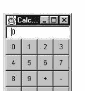

图 4.9 更改 applet 窗口中的警告字符串

从 1.2 版开始，JDK 实现者改动了类加载器，明确禁止加载包名以 "java." 开头的用户定义类。当然，你自己的类不会从这种保护中受益。另一种现已过时的机制允许 JAR 文件将包声明为密封的，从而阻止第三方扩充它们。如今，你应该使用模块来封装包。我们将在第二卷第 9 章详细讨论模块。

#### 4.7.6 类路径

正如你所见，类存储在文件系统的子目录中。类的路径必须与包名匹配。

类文件也可以存储在 JAR（Java 归档）文件中。JAR 文件以压缩格式包含多个类文件和子目录，从而节省空间并提高性能。当你在程序中使用第三方库时，通常会得到一个或多个要包含的 JAR 文件。你将在第 11 章看到如何创建自己的 JAR 文件。

> **提示：** JAR 文件使用 ZIP 格式来组织文件和子目录。你可以使用任何 ZIP 工具查看 JAR 文件内部。

要在程序之间共享类，你需要执行以下操作：

1. 将你的类文件放在一个目录中——例如 `/home/user/classdir`。注意，该目录是包树的*基*目录。如果你添加类 `com.horstmann.corejava.Employee`，那么 `Employee.class` 文件必须位于子目录 `/home/user/classdir/com/horstmann/corejava` 中。
2. 将任何 JAR 文件放在一个目录中——例如 `/home/user/archives`。
3. 设置*类路径*。类路径是可以包含类文件的所有位置的集合。

在 UNIX 中，类路径上的元素由冒号分隔：

```
/home/user/classdir:.:/home/user/archives/archive.jar
```

在 Windows 中，它们由分号分隔：

```
c:\classdir;.;c:\archives\archive.jar
```

在两种情况下，句点都表示当前目录。

这个类路径包含

- 基目录 `/home/user/classdir` 或 `c:\classdir`；
- 当前目录（`.`）；以及
- JAR 文件 `/home/user/archives/archive.jar` 或 `c:\archives\archive.jar`。

从 Java 6 开始，你可以为 JAR 文件目录指定通配符，如下所示：

```
/home/user/classdir:.:/home/user/archives/*
```

或者

```
c:\classdir;.;c:\archives\*
```

在 UNIX 中，必须对 * 进行转义以防止 shell 展开。

archives 目录中的所有 JAR 文件（但不包括 .class 文件）都包含在此类路径中。

Java API 始终会被搜索类；不要将它显式包含在类路径中。

> **警告：** javac 编译器总是在当前目录中查找文件，但 Java 虚拟机启动器只有在 “.” 目录位于类路径上时才会查看当前目录。如果你没有设置类路径，这不是问题——默认类路径由 “.” 目录组成。但是，如果你将类路径设置为指向 “.” 目录，你的程序将编译无错误，但不会运行。

类路径列出了所有作为定位类*起点*的目录和归档文件。让我们考虑示例类路径：

```
/home/user/classdir:../home/user/archives/archive.jar
```

假设虚拟机搜索 `com.horstmann.corejava.Employee` 类的类文件。它首先在 Java API 类中查找。它在那里找不到类文件，于是转向类路径。然后它查找以下文件：

- `/home/user/classdir/com/horstmann/corejava/Employee.class`
- 从当前目录开始的 `com/horstmann/corejava/Employee.class`
- `/home/user/archives/archive.jar` 内的 `com/horstmann/corejava/Employee.class`

编译器定位文件比虚拟机更困难。如果你引用一个类而没有指定其包，编译器首先需要找出包含该类的包。它会将所有 import 指令作为该类的可能来源进行查询。例如，假设源文件包含以下指令：

```java
import java.util.*;
import com.horstmann.corejava.*;
```

并且源代码引用了类 Employee。然后编译器尝试查找 `java.lang.Employee`（因为 java.lang 包总是默认导入）、`java.util.Employee`、`com.horstmann.corejava.Employee` 以及当前包中的 Employee。它会在类路径的所有位置中搜索这些类中的每一个。如果找到多个类，就会产生编译时错误。（完全限定的类名必须唯一，因此 import 语句的顺序无关紧要。）

编译器还会更进一步。它会查看源文件，判断源文件是否比类文件更新。如果是，则自动重新编译源文件。回想一下，你只能从其他包导入 public 类。一个源文件只能包含一个 public 类，并且文件名与 public 类名必须匹配。因此，编译器可以轻松定位 public 类的源文件。但是，你可以从当前包导入非 public 类。这些类可能定义在名称不同的源文件中。如果你从当前包导入一个类，编译器会搜索当前包的所有源文件，以确定哪一个定义了该类。

#### 4.7.7 设置类路径

最好使用 -classpath 选项（或 -cp，或从 Java 9 开始的 --class-path）来指定类路径：

```
java -classpath /home/user/classdir:.:/home/user/archives/archive.jar MyProg

or

java -classpath c:\classdir;.;c:\archives\archive.jar MyProg
```

整个命令必须键入到一行中。最好将这样长的命令行放入 shell 脚本或批处理文件中。

使用 -classpath 选项是设置类路径的首选方法。另一种方法是使用 CLASSPATH 环境变量。具体细节取决于你的 shell。使用 Bourne Again shell（bash）时，请使用以下命令：

```
export CLASSPATH=/home/user/classdir:.:/home/user/archives/archive.jar
```

使用 Windows shell 时，请使用

```
set CLASSPATH=c:\classdir;.;c:\archives\archive.jar
```

类路径会一直设置到 shell 退出为止。

> **警告：** 有些人建议永久设置 `CLASSPATH` 环境变量。这通常是个坏主意。人们会忘记这个全局设置，并在自己的类未正确加载时感到惊讶。一个特别应受谴责的例子是 Windows 中的 Apple QuickTime 安装程序。多年来，它在全局范围内将 `CLASSPATH` 设置为指向它所需的一个 JAR 文件，但没有在类路径中包含当前目录。结果，无数 Java 程序员在程序编译成功但运行失败时被逼得心烦意乱。


> **警告：** 过去，有人建议将所有 JAR 文件放入 `jre/lib/ext` 目录，以完全绕过类路径。该机制在 Java 9 中已过时，但这一建议从来都不是好主意。当早已被遗忘的类从扩展目录重新加载时，很容易造成混乱。

> **注意：** 从 Java 9 开始，也可以从模块路径加载类。我们将在卷 II 的第 9 章讨论模块和模块路径。

### 4.8 JAR 文件

当你打包应用程序时，你希望给用户一个单独的文件，而不是一个装满类文件的目录结构。Java 归档（JAR）文件正是为此目的而设计的。JAR 文件既可以包含类文件，也可以包含其他文件类型，如图像和声音文件。此外，JAR 文件使用熟悉的 ZIP 压缩格式进行压缩。

#### 4.8.1 创建 JAR 文件

使用 jar 工具来创建 JAR 文件。（在默认的 JDK 安装中，它位于 jdk/bin 目录。）创建新 JAR 文件最常用的命令使用以下语法：

```
jar cvf jarFileName file1 file2 ...
```

例如：

```
jar cvf CalculatorClasses.jar *.class icon.gif
```

通常，jar 命令的格式如下：

```
jar options file1 file2 ...
```

表 4.2 列出了 jar 程序的所有选项。它们类似于 UNIX tar 命令的选项。

可以将应用程序和代码库打包到 JAR 文件中。例如，如果要在 Java 程序中发送邮件，可以使用打包在 javax.mail.jar 文件中的库。

**表 4.2** jar 程序选项

| 选项 | 描述 |
|---|---|
| `c` | 创建新的或空的归档并向其中添加文件。如果指定的文件名中有目录，jar 程序会递归处理它们。 |
| `C` | 临时更改目录。例如，`jar cvf jarFileName.jar -C classes *.class` 会切换到 classes 子目录以添加类文件。 |
| `e` | 在清单中创建入口点（参见 4.8.3 节）。 |
| `f` | 将 JAR 文件名指定为第二个命令行参数。如果缺少此参数，jar 将在创建 JAR 文件时将结果写入标准输出，或在提取或列出 JAR 文件时从标准输入读取。 |
| `i` | 创建索引文件（用于加速大型归档中的查找）。 |
| `m` | 向 JAR 文件添加清单。清单是归档内容和来源的描述。每个归档都有默认清单，但如果要验证归档内容，也可以提供自己的清单。 |
| `M` | 不为条目创建清单文件。 |
| `t` | 显示目录列表。 |
| `u` | 更新现有的 JAR 文件。 |
| `v` | 生成详细输出。 |
| `x` | 提取文件。如果提供一个或多个文件名，则只提取这些文件。否则，提取所有文件。 |
| `0` | 存储而不进行 ZIP 压缩。 |

#### 4.8.2 清单

除了类文件、图像和其他资源之外，每个 JAR 文件还包含一个描述归档特殊功能的清单文件。

清单文件名为 MANIFEST.MF，位于 JAR 文件特殊的 META-INF 子目录中。最小合法清单非常简单——只有

```
Manifest-Version: 1.0
```

复杂的清单可以有更多条目。清单条目被分组为若干部分。清单中的第一部分称为*主部分*。它适用于整个 JAR 文件。后续条目可以指定命名实体的属性，如单个文件、包或 URL。这些条目必须以 `Name` 条目开头。各部分之间用空行分隔。例如：

```
Manifest-Version: 1.0
lines describing this archive

Name: Woozle.class
lines describing this file
Name: com/mycompany/mypkg/
lines describing this package
```

要编辑清单，请将想要添加到清单中的行放入一个文本文件。然后运行

```
jar cfm jarFile manifestFileName ...
```

例如，要创建一个带清单的新 JAR 文件，运行

```
jar cfm MyArchive.jar manifest.mf com/mycompany/mypkg/*.class
```

要更新现有 JAR 文件的清单，请将追加内容放入一个文本文件，并使用如下命令

```
jar ufm MyArchive.jar manifest-additions.mf
```

> **注意：** 有关 JAR 和清单文件格式的更多信息，请参阅 https://docs.oracle.com/javase/10/docs/specs/jar/jar.html

#### 4.8.3 可执行 JAR 文件

可以使用 `jar` 命令的 `e` 选项来指定程序的*入口点*——即通常在调用 `java` 程序启动器时指定的类：

```
jar cve MyProgram.jar com.mycompany.mypkg.MainAppClass files to add
```

或者，可以在清单中指定程序的*主类*，包括以下形式的语句

```
Main-Class: com.mycompany.mypkg.MainAppClass
```

不要在主类名后添加 `.class` 扩展名。


> **警告：** 清单的最后一行必须以换行符结尾。否则，清单将无法被正确读取。常见错误是生成了一个只包含 Main-Class 行而没有行终止符的文本文件。

使用任何一种方法，用户都可以简单地通过以下方式启动程序

```
java -jar MyProgram.jar
```

根据操作系统配置，用户甚至可以通过双击 JAR 文件图标来启动应用程序。以下是各种操作系统的行为：

- 在 Windows 上，Java 运行时安装程序会为“.jar”扩展名创建文件关联，使用 `java -jar` 命令启动该文件。（与 `java` 命令不同，`javaw` 命令不会打开 shell 窗口。）
- 在 Mac OS X 上，操作系统会识别“.jar”文件扩展名，并在双击 JAR 文件时执行 Java 程序。

然而，JAR 文件中的 Java 程序没有原生应用程序那样的体验。在 Windows 上，可以使用第三方包装工具将 JAR 文件转换为 Windows 可执行文件。包装器是一种带有熟悉的 .exe 扩展名的 Windows 程序，用于定位并启动 Java 虚拟机（JVM），或者在找不到 JVM 时告诉用户该怎么做。有许多商业和开源产品，例如 Launch4J (http://launch4j.sourceforge.net) 和 IzPack (http://izpack.org)。

#### 4.8.4 多版本 JAR 文件

随着模块的引入和包的强封装，一些以前可访问的内部 API 不再可用。例如，JavaFX 8 有一个内部类 `com.sun.javafx.css.CssParser`。如果你使用它来解析样式表，那么你会发现程序不再编译。补救措施很简单——改用 `javafx.css.CssParser`，该解析器在 Java 9 中可用。但现在你遇到了一个问题。你需要为 Java 8 和 Java 9 用户分发不同的应用程序，或者需要借助类加载和反射的技巧。

为了解决这类问题，Java 9 引入了*多版本 JAR*，它可以包含不同 Java 版本的类文件。

为了向后兼容，额外的类文件放在 `META-INF/versions` 目录中：

> **注意：** 诸如 javap 之类的工具尚未经过改造以处理多版本 JAR 文件。

如果调用

```
javap -classpath MyProgram.jar Application.class
```

你会得到该类的基础版本（毕竟它应该具有与较新版本相同的公共 API）。如果必须查看较新版本，请调用

```
javap -classpath MyProgram.jar!/META-INF/versions/9/Application.class
```

#### 4.8.5 关于命令行选项的说明

Java 开发工具包中命令的选项传统上使用单个短划线后跟多字母选项名称，例如

```
java -jar ...
javac -Xlint:unchecked -classpath ...
```

例外是 `jar` 命令，它遵循 `tar` 命令的经典选项格式，不带短划线：

```
jar cvf ...
```

从 Java 9 开始，Java 工具正转向更常见的选项格式，即多字母选项名称前加双短划线，并为常见选项提供单字母快捷方式。例如，Linux `ls` 命令可以使用“human-readable”选项调用，如下所示

```
ls --human-readable
```

或

```
ls -h
```

从 Java 9 开始，可以使用 `--version` 代替 `-version`，使用 `--class-path` 代替 `-classpath`。正如你将在卷 II 的第 9 章中看到的，`--module-path` 选项有快捷方式 `-p`。

可以在 http://openjdk.java.net/jeps/293 的 JEP 293 增强请求中找到详细信息。作为此次清理的一部分，作者还建议标准化选项参数。带有 `--` 和多字母的选项参数可以用空白或 `=` 号分隔：

```
javac --class-path /home/user/classdir ...
```

或

```
javac --class-path=/home/user/classdir ...
```


单字母选项的参数可以用空白分隔，也可以直接跟在选项后面：

```
javac -p moduledir . . .
```

或者

```
javac -pmoduledir . . .
```

> **注意：** 后一种写法目前不起作用，而且总体来看似乎也不是个好主意。如果模块目录恰好是 parameters 或 processor，为什么要招致与遗留选项的冲突呢？

不带参数的单字母选项可以组合在一起：

```
jar -cvf MyProgram.jar -e mypackage.MyProgram *.class
```

> **注意：** 这种做法目前不起作用，而且必然会导致混淆。假设 javac 增加了一个 -c 选项。那么 javac -cp 是指 javac -c -p，还是遗留的 -cp 优先？

这造成了一团混乱，希望随着时间推移能得到清理。尽管我们很想摆脱那些古老的 jar 选项，但最好还是等到尘埃落定。不过，如果你想彻底现代化，可以安全地使用 jar 命令的长选项：

```
jar --create --verbose --file jarFileName file1 file2 . . .
```

如果不把它们组合在一起，单字母选项也同样有效：

```
jar -c -v -f jarFileName file1 file2 . . .
```

### 4.9 文档注释

JDK 包含一个非常有用的工具，名为 javadoc，它可以根据源文件生成 HTML 文档。事实上，我们在第 3 章介绍的在线 API 文档，不过是对标准 Java 库的源代码运行 javadoc 的结果。

如果在源代码中添加以特殊分隔符 `/**` 开头的注释，你也可以轻松生成看起来专业的文档。这是一种非常好的方法，因为它让你可以把代码和文档放在同一处。如果你把文档放到单独的文件中，那么正如你可能知道的那样，代码和注释往往会随着时间推移而逐渐不一致。当文档注释与源代码位于同一文件时，同时更新两者并再次运行 javadoc 就是一件很容易的事。

#### 4.9.1 注释插入

javadoc 工具会为以下项目提取信息：

- 模块
- 包
- 公共类和接口
- 公共字段和受保护字段
- 公共和受保护的构造器与方法

受保护特性将在第 5 章介绍，接口将在第 6 章介绍，模块将在第 II 卷第 9 章介绍。

你可以（而且应该）为这些特性分别提供注释。每条注释都紧挨着放在它所描述特性的*上方*。注释以 `/**` 开始，以 `*/` 结束。

每条 `/** ... */` 文档注释都包含*自由格式*文本，后面跟着标签。标签以 `@` 开头，例如 `@since` 或 `@param`。

自由格式文本的*第一句话*应该是*摘要陈述*。javadoc 工具会自动生成摘要页，提取这些句子。

在自由格式文本中，你可以使用 HTML 修饰符，例如用 `<em>...</em>` 表示强调，用 `<strong>...</strong>` 表示强烈强调，用 `<ul>...</ul>` 表示项目符号列表，用 `` 包含图像。要输入等宽代码，请使用 `{@code ...}` 而不是 `<code>...</code>`——这样你就不必担心转义代码中的 `<` 字符。

> **注意：** 如果你的注释包含指向其他文件（例如图像，比如示意图或用户界面组件图像）的链接，请把这些文件放入包含源文件的目录下一个名为 `doc-files` 的子目录中。javadoc 工具会将 `doc-files` 目录及其内容从源目录复制到文档目录。你需要在链接中使用 `doc-files` 目录，例如 ``。

#### 4.9.2 类注释

类注释必须放在所有 import 语句*之后*，紧挨着类定义之前。

下面是一个类注释的示例：

```java
/**
 * A {@code Card} object represents a playing card, such
 * as "Queen of Hearts". A card has a suit (Diamond, Heart,
 * Spade or Club) and a value (1 = Ace, 2 . . . 10, 11 = Jack,
 * 12 = Queen, 13 = King)
 */
public class Card
{
    . . .
}
```

> **注意：** 没有必要在每一行前面添加 *。例如，下面的注释同样有效：
> 
> ```java
> /**
>     A <code>Card</code> object represents a playing card, such
>     as "Queen of Hearts". A card has a suit (Diamond, Heart,
>     Spade or Club) and a value (1 = Ace, 2 . . . 10, 11 = Jack,
>                          12 = Queen, 13 = King)
> */
> ```
> 
> 不过，大多数 IDE 会自动提供星号，并在换行位置变化时重新排列它们。

#### 4.9.3 方法注释

每条方法注释都必须紧挨着放在它所描述的方法之前。除了通用标签之外，你还可以使用以下标签：

- `@param variable description`
  
  此标签会向当前方法的“参数”部分添加一个条目。描述可以跨越多行，并且可以使用 HTML 标签。一个方法的所有 `@param` 标签必须放在一起。
- `@return description`
  
  此标签会向当前方法添加一个“返回值”部分。描述可以跨越多行，并且可以使用 HTML 标签。
- `@throws class description`
  
  此标签会添加一条说明，表示该方法可能抛出异常。异常是第 7 章的主题。

下面是一个方法注释的示例：

```java
/**
 * Raises the salary of an employee.
 * @param byPercent the percentage by which to raise the salary (e.g., 10 means 10%)
 * @return the amount of the raise
 */
public double raiseSalary(double byPercent)
{
    double raise = salary * byPercent / 100;
    salary += raise;
    return raise;
}
```

#### 4.9.4 字段注释

你只需要为公共字段编写文档——通常是指静态常量。例如：

```java
/**
 * The "Hearts" card suit
 */
public static final int HEARTS = 1;
```

#### 4.9.5 通用注释

`@since` 标签会生成一个“since”条目。文本可以是对引入此特性的版本的任意描述。例如，`@since 1.7.1`。

以下标签可用于类文档注释：

- `@author name`
  
  此标签会生成一个“作者”条目。你可以有多个 `@author` 标签，每位作者一个。不必觉得非用此标签不可——你的版本控制系统在跟踪作者身份方面做得更彻底。
- `@version text`
  
  此标签会生成一个“版本”条目。文本可以是对当前版本的任意描述。

你可以使用 `@see` 和 `@link` 标签创建指向 javadoc 文档其他相关部分或外部文档的超链接。

`@see reference` 标签会在“另见”部分添加一个超链接。它可用于类和方法。这里的 `reference` 可以是以下之一：

```text
package.class#feature label
<a href="...">label</a>
"text"
```

第一种情况最有用。你提供类、方法或变量的名称，javadoc 会插入指向文档的超链接。例如，

```
@see com.horstmann.corejava.Employee#raiseSalary(double)
```

会创建一个指向 `com.horstmann.corejava.Employee` 类中 `raiseSalary(double)` 方法的链接。你可以省略包名，或者同时省略包名和类名。这样，该特性将定位在当前包或当前类中。

注意，必须使用 `#` 而不是句点来分隔类与方法或变量名。Java 编译器本身非常擅长判断句点字符作为包、子包、类、内部类以及方法和变量之间分隔符的各种含义。但 javadoc 工具并没有那么聪明，所以你必须帮它一把。

如果 `@see` 标签后面跟着 `<` 字符，那么你需要指定一个超链接。你可以链接到任何你喜欢的 URL。例如：

```
@see <a href="www.horstmann.com/corejava.html">The Core Java home page</a>
```

在这些情况下，你都可以指定一个可选标签，它将作为链接锚文本显示。如果省略该标签，用户将看到目标代码名称或 URL 作为锚文本。

如果 `@see` 标签后面跟着 `"` 字符，那么文本会显示在“另见”部分。例如：

```
@see "Core Java 2 volume 2"
```

你可以为一个特性添加多个 `@see` 标签，但必须把它们全部放在一起。

如果你愿意，可以在任何文档注释中的任何位置放置指向其他类或方法的超链接。插入以下形式的特殊标签：

```
{@link package.class#feature label}
```

放在注释中的任意位置。特性描述遵循与 `@see` 标签相同的规则。

最后，从 Java 9 开始，你可以使用 `{@index entry}` 标签向搜索框中添加条目。

#### 4.9.6 包注释

将类、方法和变量注释直接放入 Java 源文件中，并用 `/** ... */` 文档注释包围。不过，要生成包注释，你需要在每个包目录中添加一个单独的文件。你有两种选择：


- 1. 提供一个名为 `package-info.java` 的 Java 文件。该文件必须包含一个以 `/**` 和 `*/` 分隔的初始 Javadoc 注释，后面跟一个包语句。它不应包含任何其他代码或注释。
- 2. 提供一个名为 `package.html` 的 HTML 文件。标签 `<body> . . . </body>` 之间的所有文本都会被提取。

#### 4.9.7 注释提取

这里，*docDirectory* 是希望存放 HTML 文件的目录名称。请遵循以下步骤：

- 1. 切换到包含要编写文档的源文件的目录。如果有嵌套包需要编写文档，例如 `com.horstmann.corejava`，则必须在包含子目录 `com` 的目录中工作。（如果提供了 `overview.html` 文件，这就是包含该文件的目录。）
- 2. 运行命令

```
javadoc -d docDirectory nameOfPackage
```

为单个包生成文档。或者，运行

```
javadoc -d docDirectory nameOfPackage1 nameOfPackage2 . . .
```

为多个包生成文档。如果文件位于未命名包中，则改运行

```
javadoc -d docDirectory *.java
```

如果省略 `-d docDirectory` 选项，HTML 文件将被提取到当前目录。这可能会变得混乱，我们不建议这样做。

javadoc 程序可以通过众多命令行选项进行微调。例如，可以使用 `-author` 和 `-version` 选项将 `@author` 和 `@version` 标签包含在文档中。（默认情况下，它们会被省略。）另一个有用的选项是 `-link`，用于包含指向标准类的超链接。例如，如果使用命令

```
javadoc -link http://docs.oracle.com/javase/9/docs/api *.java
```

所有标准库类将自动链接到 Oracle 网站上的文档。

如果使用 `-linksource` 选项，每个源文件都会被转换为 HTML（没有颜色编码，但有行号），并且每个类和方法名都会变成指向源代码的超链接。

还可以为所有源文件提供概述注释。将其放在诸如 `overview.html` 的文件中，并使用命令行选项 `-overview filename` 运行 javadoc 工具。标签 `<body> . . . </body>` 之间的所有文本都会被提取。当用户从导航栏中选择“概述”时，将显示该内容。

有关其他选项，请参阅 https://docs.oracle.com/javase/9/javadoc/javadoc.htm 上的 javadoc 实用程序在线文档。

### 4.10 类设计提示

我们不想面面俱到或啰嗦，只想在本章结尾提供一些提示，使你的类在规范的面向对象编程圈子里更易被接受。

- 1. *始终保持数据私有。*

这是首要的；否则就违反了封装。你可能偶尔需要编写访问器或修改器方法，但保持实例字段私有仍然是更好的选择。惨痛的经验表明，数据表示可能会改变，但数据的使用方式变化的频率要低得多。当数据保持私有时，其表示的变化不会影响类的使用者，而且 bug 更容易被检测到。

- 2. *始终初始化数据。*

Java 不会为你初始化局部变量，但它会初始化对象的实例字段。不要依赖默认值，而是显式地初始化所有变量，要么提供默认值，要么在所有构造器中设置默认值。

- 3. *不要在类中使用太多基本类型。*

其理念是用其他类替换多个相关的基本类型使用。这使你的类更容易理解和修改。例如，将 Customer 类中的以下实例字段：

```
private String street;
private String city;
private String state;
private int zip;
```

替换为一个名为 Address 的新类。这样，你就能轻松应对地址的变化，例如处理国际地址的需求。

- 4. *并非所有字段都需要单独的字段访问器和修改器。*

你可能需要获取和设置员工的薪水。你当然不需要在对象构造之后更改雇用日期。而且，通常对象会有一些你不想让其他人获取或设置的实例字段，例如 Address 类中的州缩写数组。

- 5. *拆分职责过多的类。*

这个提示当然是模糊的：“过多”显然因人而异。然而，如果有一种明显的方法可以将一个复杂的类拆分为两个概念上更简单的类，那就抓住机会。（另一方面，不要走极端；十个各只有一个方法的类通常也是过度设计。）

以下是一个糟糕设计的示例：

```
    public class CardDeck // 糟糕的设计
    {
        private int[] value;
        private int[] suit;

        public CardDeck() { . . . }
        public void shuffle() { . . . }
        public int getTopValue() { . . . }
        public int getTopSuit() { . . . }
        public void draw() { . . . }
    }
```

这个类实际上实现了两个独立的概念：一个*牌堆*，带有洗牌和抽牌方法；以及一张*牌*，带有检查其值和花色的方法。引入一个表示单张牌的 card 类是合理的。现在你有两个类，每个类都有自己的职责：

```
    public class CardDeck
    {
        private Card[] cards;

        public CardDeck() { . . . }
        public void shuffle() { . . . }
        public Card getTop() { . . . }
        public void draw() { . . . }
    }

    public class Card
    {
        private int value;
        private int suit;

        public Card(int aValue, int aSuit) { . . . }
        public int getValue() { . . . }
        public int getSuit() { . . . }
    }
```

- 6. *让类和方法的名称反映其职责。*

就像变量应该具有反映其所代表含义的有意义名称一样，类也应该如此。（标准库中当然有一些可疑的例子，比如描述时间的 Date 类。）

一个好的约定是，类名应该是名词（Order），或者名词前面加形容词（RushOrder），或者动名词（“-ing”形式的词，如 BillingAddress）。至于方法，遵循标准约定：访问器方法以小写 get 开头（getSalary），修改器方法使用小写 set（setSalary）。

- 7. *优先使用不可变类。*

LocalDate 类以及 java.time 包中的其他类都是不可变的——没有任何方法可以修改对象的状态。诸如 plusDays 之类的方法不会修改对象，而是返回具有修改后状态的新对象。

修改的问题在于，当多个线程试图同时更新一个对象时，修改可能会并发发生。结果不可预测。当类是不可变的时，在多个线程之间共享其对象是安全的。

因此，在可能的情况下，让类不可变是一个好主意。对于表示值的类来说尤其容易，例如字符串或时间点。计算可以简单地产生新值，而不是更新现有值。

当然，并非所有类都应该是不可变的。当员工加薪时，让 raiseSalary 方法返回一个新的 Employee 对象会显得很奇怪。

在本章中，我们介绍了使 Java 成为“基于对象”语言的类和对象的基础知识。要真正成为面向对象的语言，编程语言还必须支持继承和多态。Java 对这些特性的支持是下一章的主题。

## 第 5 章

## 继承

### 本章内容

- 5.1 类、超类和子类，第 208 页
- 5.2 Object：所有类的超类，第 232 页
- 5.3 泛型数组列表，第 248 页
- 5.4 对象包装器与自动装箱，第 256 页
- 5.5 参数数量可变的方法，第 260 页
- 5.6 枚举类，第 261 页
- 5.7 反射，第 264 页
- 5.8 继承的设计提示，第 290 页

第 4 章向你介绍了类和对象。在本章中，你将学习继承，这是面向对象编程的另一个基本概念。继承背后的思想是，你可以创建基于现有类构建的新类。当你继承现有类时，可以重用（或继承）其方法，并且可以添加新方法和字段，使新类适应新情况。这项技术在 Java 编程中至关重要。

本章还介绍了反射，即在正在运行的程序中找出更多关于类及其属性的能力。反射是一个强大的特性，但不可否认它很复杂。由于反射对工具构建者的兴趣大于对应用程序程序员，你在第一次阅读时可以略过本章该部分，稍后再回来阅读。


`Employee` 类是超类，但这并不是因为它比其子类更高级或包含更多功能。事实上，*情况恰恰相反*：子类比其超类具有*更多*功能。例如，当我们查看 `Manager` 类的其余代码时你会看到，`Manager` 类比其超类 `Employee` 封装了更多数据，也具有更多功能。

> **注意：** *超*（super）和*子*（sub）这两个前缀来自理论计算机科学和数学中使用的集合语言。所有员工的集合包含所有经理的集合，因此前者被称为经理集合的*超集*。或者换句话说，所有经理的集合是所有员工集合的*子集*。

我们的 `Manager` 类有一个用于存储奖金的新字段，以及一个用于设置该字段的新方法：

```java
public class Manager extends Employee
{
   private double bonus;
   . . .
   public void setBonus(double bonus)
   {
      this.bonus = bonus;
   }
}
```

这些方法和字段并没有什么特别之处。如果你有一个 `Manager` 对象，只需调用 `setBonus` 方法即可。

```java
Manager boss = . . .;
boss.setBonus(5000);
```

当然，如果你有一个 `Employee` 对象，就不能调用 `setBonus` 方法——它不在 `Employee` 类定义的方法之中。

不过，你*可以*对 `Manager` 对象使用 `getName` 和 `getHireDay` 等方法。尽管这些方法没有在 `Manager` 类中显式定义，但它们会自动从 `Employee` 超类继承。

同样，字段 `name`、`salary` 和 `hireDay` 来自超类。每个 `Manager` 对象都有四个字段：`name`、`salary`、`hireDay` 和 `bonus`。

通过扩展超类来定义子类时，你只需指出子类与超类之间的*差异*。设计类时，应将最通用的方法放在超类中，将更专门化的方法放在其子类中。将公共功能提取出来并移到超类，是面向对象编程中的常规做法。

#### 5.1.2 重写方法

超类的某些方法并不适合 Manager 子类。特别是，getSalary 方法应返回基本工资与奖金之和。你需要提供一个新方法来*重写*超类方法：

```java
public class Manager extends Employee
{
    . . .
    public double getSalary()
    {
        . . .
    }
    . . .
}
```

如何实现这个方法？乍看之下似乎很简单——只需返回 salary 和 bonus 字段之和：

```java
public double getSalary()
{
    return salary + bonus; // won't work
}
```

然而，这样做行不通。回想一下，只有 Employee 的方法才能直接访问 Employee 类的私有字段。这意味着 Manager 类的 getSalary 方法不能直接访问 salary 字段。如果 Manager 的方法想要访问这些私有字段，就必须像其他所有方法一样——使用公共接口，在这里就是 Employee 类的公共 getSalary 方法。

那么，我们再试一次。你需要调用 getSalary，而不是直接访问 salary 字段：

```java
public double getSalary()
{
    double baseSalary = getSalary(); // still won't work
    return baseSalary + bonus;
}
```

现在的问题在于，对 getSalary 的调用只是调用了*它自身*，因为 Manager 类有一个 getSalary 方法（也就是我们正试图实现的方法）。其后果是对同一方法的无限调用链，最终导致程序崩溃。

我们需要表明，我们要调用的是 Employee 超类的 getSalary 方法，而不是当前类的方法。为此，你要使用特殊关键字 *super*。调用 `super.getSalary()` 会调用 Employee 类的 getSalary 方法。下面是 Manager 类中 getSalary 方法的正确版本：

```java
public double getSalary()
{
   double baseSalary = super.getSalary();
   return baseSalary + bonus;
}
```

> **注意：** 有些人认为 *super* 类似于 *this* 引用。然而，这种类比并不十分准确：*super* 并不是对对象的引用。例如，你不能将值 *super* 赋给另一个对象变量。相反，*super* 是一个特殊关键字，指示编译器调用超类方法。

如你所见，子类可以*添加*字段，也可以*添加*方法或*重写*超类的方法。然而，继承永远不能移除任何字段或方法。

> **C++ 注意：** Java 使用关键字 *super* 来调用超类方法。在 C++ 中，则应改用超类名称配合 `::` 运算符。例如，`Manager` 类的 `getSalary` 方法会调用 `Employee::getSalary`，而不是 `super.getSalary()`。

#### 5.1.3 子类构造器

为完成我们的示例，下面提供一个构造器。

```java
public Manager(String name, double salary, int year, int month, int day)
{
   super(name, salary, year, month, day);
   bonus = 0;
}
```

在这里，关键字 *super* 的含义有所不同。指令

```java
super(name, salary, year, month, day);
```

是“以 name、salary、year、month 和 day 为参数调用 Employee 超类的构造器”的简写。

由于 Manager 构造器不能访问 Employee 类的私有字段，所以必须通过构造器来初始化它们。该构造器使用特殊的 super 语法调用。使用 `super` 的调用必须是子类构造器中的第一条语句。

如果子类构造器没有显式调用超类构造器，就会调用超类的无参构造器。如果超类没有无参构造器，而子类构造器又没有显式调用另一个超类构造器，Java 编译器就会报错。

> **注意：** 回想一下，`this` 关键字有两种含义：表示对隐式参数的引用，以及调用同一个类的另一个构造器。同样，`super` 关键字也有两种含义：调用超类方法和调用超类构造器。当用于调用构造器时，`this` 和 `super` 关键字密切相关。构造器调用只能作为另一个构造器中的第一条语句出现。构造器参数要么传给同一个类的另一个构造器（`this`），要么传给超类的构造器（`super`）。

> **C++ 注意：** 在 C++ 构造器中，不调用 `super`，而是使用初始化列表语法来构造超类。Manager 构造器在 C++ 中看起来会像这样：

```cpp
// C++
Manager::Manager(String name, double salary, int year, int month, int day)
  : Employee(name, salary, year, month, day)
{
    bonus = 0;
}
```

在为 Manager 对象重新定义 `getSalary` 方法后，经理的工资将*自动*加上奖金。

下面是一个实际运行的例子。我们创建一个新经理并设置该经理的奖金：

```java
Manager boss = new Manager("Carl Cracker", 80000, 1987, 12, 15);
boss.setBonus(5000);
```

我们创建一个包含三名员工的数组：

```java
var staff = new Employee[3];
```

我们用经理和员工的混合来填充该数组：

```java
staff[0] = boss;
staff[1] = new Employee("Harry Hacker", 50000, 1989, 10, 1);
staff[2] = new Employee("Tony Tester", 40000, 1990, 3, 15);
```

我们打印每个人的工资：

```java
for (Employee e : staff)
    System.out.println(e.getName() + " " + e.getSalary());
```

这个循环会打印以下数据：

```
Carl Cracker 85000.0
Harry Hacker 50000.0
Tony Tester 40000.0
```

现在，staff[1] 和 staff[2] 各自打印其基本工资，因为它们是 Employee 对象。然而，staff[0] 是一个 Manager 对象，其 getSalary 方法会将奖金加到基本工资上。

值得注意的是，调用 `e.getSalary()` 会选出正确的 *getSalary* 方法。注意，e 的*声明*类型是 Employee，但 e 所引用对象的*实际*类型可以是 Employee 或 Manager。

当 e 引用一个 Employee 对象时，调用 e.getSalary() 会调用 Employee 类的 getSalary 方法。然而，当 e 引用一个 Manager 对象时，则会调用 Manager 类的 getSalary 方法。虚拟机知道 e 所引用对象的实际类型，因此能够调用正确的方法。

对象变量（例如变量 e）可以引用多种实际类型，这一事实称为*多态*。在运行时自动选择合适的方法称为*动态绑定*。本章将更详细地讨论这两个主题。


> **C++ 注意：** 在 C++ 中，如果要实现动态绑定，需要将成员函数声明为 virtual。在 Java 中，动态绑定是默认行为；如果你*不*希望某个方法是虚方法，就将其标记为 final。（本章后面会讨论 final 关键字。）

清单 5.1 包含一个程序，展示 Employee（清单 5.2）和 Manager（清单 5.3）对象的工资计算有何不同。


### 清单 5.1 `inheritance/ManagerTest.java`

```java
package inheritance;

/**
 * This program demonstrates inheritance.
 * @version 1.21 2004-02-21
 * @author Cay Horstmann
 */
public class ManagerTest
{
   public static void main(String[] args)
   {
      // construct a Manager object
      var boss = new Manager("Carl Cracker", 80000, 1987, 12, 15);
      boss.setBonus(5000);

      var staff = new Employee[3];

      // fill the staff array with Manager and Employee objects

      staff[0] = boss;
      staff[1] = new Employee("Harry Hacker", 50000, 1989, 10, 1);
      staff[2] = new Employee("Tommy Tester", 40000, 1990, 3, 15);

      // print out information about all Employee objects
      for (Employee e : staff)
         System.out.println("name=" + e.getName() + ", salary=" + e.getSalary());
   }
}
```

### 清单 5.2 `inheritance/Employee.java`

```java
package inheritance;

import java.time.*;

public class Employee
{
   private String name;
   private double salary;
   private LocalDate hireDay;

   public Employee(String name, double salary, int year, int month, int day)
   {
      this.name = name;
      this.salary = salary;
      hireDay = LocalDate.of(year, month, day);
   }

   public String getName()
   {
      return name;
   }

   public double getSalary()
   {
      return salary;
   }

   public LocalDate getHireDay()
   {
      return hireDay;
   }

   public void raiseSalary(double byPercent)
   {
      double raise = salary * byPercent / 100;
      salary += raise;
   }
}
```

### 清单 5.3 `inheritance/Manager.java`

```java
package inheritance;

public class Manager extends Employee
{
    private double bonus;

    /**
     * @param name the employee's name
     * @param salary the salary
     * @param year the hire year
     * @param month the hire month
     * @param day the hire day
     */
    public Manager(String name, double salary, int year, int month, int day)
    {
        super(name, salary, year, month, day);
        bonus = 0;
    }
}
```

通常，从遥远的祖先类出发会有不止一条继承链。你可以定义`Programmer`或`Secretary`子类来扩展`Employee`，它们与`Manager`类（或彼此之间）毫无关系。这个过程可以根据需要一直持续下去。

> **C++ 注：** 在 C++ 中，一个类可以有多个超类。Java 不支持多重继承。要了解如何恢复多重继承的大部分功能，请参见第 296 页的 6.1 节“接口”。

#### 5.1.5 多态

一个简单的规则可以帮助你判断继承是否适合你的数据设计。“is-a”规则规定，子类的每个对象都是超类的对象。例如，每个经理都是员工。因此，将`Manager`类设计为`Employee`类的子类是合理的。当然，反过来并不成立——不是每个员工都是经理。

“is-a”规则的另一种表述方式是*替换原则*。该原则规定，当程序需要超类对象时，你可以使用子类对象。

例如，你可以将子类对象赋值给超类变量。

```java
Employee e;
e = new Employee(...);  // Employee object expected
e = new Manager(...);    // OK, Manager can be used as well
```

在 Java 编程语言中，对象变量是*多态的*。类型为`Employee`的变量可以引用类型为`Employee`的对象，也可以引用`Employee`类任何子类（如`Manager`、`Executive`、`Secretary`等）的对象。

我们在清单 5.1 中利用了这一原则：

```java
Manager boss = new Manager(...);
Employee[] staff = new Employee[3];
staff[0] = boss;
```

在这种情况下，变量`staff[0]`和`boss`引用同一个对象。然而，编译器认为`staff[0]`只是一个 Employee 对象。

这意味着你可以调用

```java
boss.setBonus(5000); // OK
```

但不能调用

```java
staff[0].setBonus(5000); // ERROR
```

`staff[0]`的声明类型是 Employee，而`setBonus`方法不是 Employee 类的方法。

然而，你不能将超类引用赋值给子类变量。例如，下面的赋值是不合法的：

```java
Manager m = staff[i]; // ERROR
```

原因很清楚：并非所有员工都是经理。如果这个赋值成功，并且`m`引用了一个不是经理的 Employee 对象，那么之后就有可能调用`m.setBonus(...)`，从而发生运行时错误。

> **警告：** 在 Java 中，子类引用数组可以无需强制转换地转换为超类引用数组。例如，考虑这个经理数组：
>
> ```java
> Manager[] managers = new Manager[10];
> ```
>
> 将这个数组转换为`Employee[]`数组是合法的：
>
> ```java
> Employee[] staff = managers; // OK
> ```
>
> 你可能会想，当然可以，为什么不呢？毕竟，如果`managers[i]`是一个 Manager，那么它也是一个 Employee。但实际上，令人惊讶的事情正在发生。请记住，`managers`和`staff`是对同一个数组的引用。现在考虑以下语句：
>
> ```java
> staff[0] = new Employee("Harry Hacker", ...);
> ```
>
> 编译器会欣然允许这个赋值。但是`staff[0]`和`managers[0]`是同一个引用，所以看起来我们设法将一个普通的员工偷偷塞进了管理层。这将会非常糟糕——调用`managers[0].setBonus(1000)`将试图访问一个不存在的实例字段，并破坏相邻的内存。
>
> 为了确保不会发生这种破坏，所有数组都会记住创建它们时的元素类型，并监控只有兼容的引用才能被存储到其中。例如，创建为`new Manager[10]`的数组会记住它是一个经理数组。试图存储一个`Employee`引用会导致`ArrayStoreException`。

#### 5.1.6 理解方法调用

准确理解方法调用是如何应用于对象的是很重要的。假设我们调用`x.f(args)`，隐式参数`x`被声明为类`C`的一个对象。过程如下：

- 1. 编译器查看对象的声明类型和方法名。请注意，可能有多个同名方法，都叫 *f*，但参数类型不同。例如，可能有一个方法 *f(int)* 和一个方法 *f(String)*。编译器会枚举类 C 中所有名为 *f* 的方法，以及 C 的超类中所有可访问的名为 *f* 的方法。（超类的私有方法不可访问。）
  
    现在，编译器知道了所有可能被调用的候选方法。
- 2. 接下来，编译器确定方法调用中提供的实参的类型。如果在所有名为 *f* 的方法中，有一个唯一的方法，其参数类型与提供的实参最佳匹配，那么该方法将被选中调用。这个过程称为*重载解析*。例如，在调用 x.f("Hello") 中，编译器选择 *f(String)* 而不是 *f(int)*。由于类型转换（int 到 double，Manager 到 Employee，等等），情况可能会变得复杂。如果编译器找不到任何参数类型匹配的方法，或者在应用转换后有多个方法都匹配，编译器将报告错误。
  
    现在，编译器知道了需要调用的方法的名称和参数类型。

> **注：** 回想一下，方法的名称和参数类型列表被称为方法的*签名*。例如，*f(int)* 和 *f(String)* 是两个同名但签名不同的方法。如果在子类中定义了一个与超类方法签名相同的方法，你就重写了超类方法。
>
> 返回类型不是签名的一部分。但是，当你重写方法时，需要保持返回类型的兼容性。子类可以将返回类型改为原始类型的子类型。例如，假设 Employee 类有一个方法
>
> ```java
> public Employee getBuddy() { . . . }
> ```
>
> 经理绝不会想让一个低级别的员工做自己的伙伴。为了反映这一事实，Manager 子类可以这样重写这个方法：
>
> ```java
> public Manager getBuddy() { . . . } // OK to change return type
> ```
>
> 我们说这两个 getBuddy 方法具有*协变返回类型*。


- 3. 如果方法是 private、static、final 或者是构造器，那么编译器就能确切知道该调用哪个方法。（final 修饰符将在下一节解释。）这称为*静态绑定*。否则，要调用的方法取决于隐式参数的实际类型，运行时必须使用动态绑定。在我们的示例中，编译器会生成一条指令，以动态绑定方式调用 `f(String)`。

- 4. 当程序运行并使用动态绑定调用方法时，虚拟机必须调用适合 `x` 所引用对象的*实际类型*的方法版本。假设实际类型是 `D`，它是 `C` 的子类。如果类 `D` 定义了方法 `f(String)`，就调用该方法。如果没有，则在 `D` 的超类中搜索方法 `f(String)`，依此类推。

如果每次调用方法时都执行这种搜索，将会很耗时。相反，虚拟机为每个类预先计算一个*方法表*，其中列出所有方法签名以及要调用的实际方法。当实际调用某个方法时，虚拟机只需进行一次表查找。在我们的示例中，虚拟机查询类 `D` 的方法表，并查找要为 `f(String)` 调用的方法。该方法可能是 `D.f(String)` 或 `X.f(String)`，其中 `X` 是 `D` 的某个超类。这个场景还有一个变化。如果调用的是 `super.f(param)`，那么编译器会查询隐式参数的超类的方法表。

让我们通过清单 5.1 中的调用 `e.getSalary()` 详细看看这个过程。`e` 的声明类型是 `Employee`。`Employee` 类只有一个名为 `getSalary` 的方法，且没有方法参数。因此，在这种情况下，我们不必担心重载解析。

`getSalary` 方法不是 `private`、`static` 或 `final`，因此采用动态绑定。虚拟机为 `Employee` 和 `Manager` 类生成方法表。`Employee` 表显示所有方法都定义在 `Employee` 类本身中：

```text
Employee:
   getName() -> Employee.getName()
   getSalary() -> Employee.getSalary()
   getHireDay() -> Employee.getHireDay()
   raiseSalary(double) -> Employee.raiseSalary(double)
```

实际上，这还不是全部——正如你将在本章后面看到的，`Employee` 类有一个超类 `Object`，它从该类继承了许多方法。我们暂时忽略 `Object` 的方法。

`Manager` 的方法表略有不同。它继承了三个方法，重新定义了一个方法，并添加了一个方法。

```text
Manager:
    getName() -> Employee.getName()
    getSalary() -> Manager.getSalary()
    getHireDay() -> Employee.getHireDay()
    raiseSalary(double) -> Employee.raiseSalary(double)
    setBonus(double) -> Manager.setBonus(double)
```

在运行时，调用 e.getSalary() 的解析过程如下：

- 1. 首先，虚拟机获取 `e` 的实际类型的方法表。那可能是 Employee、Manager 或 Employee 的另一个子类的方法表。

- 2. 然后，虚拟机查找 `getSalary()` 签名对应的定义类。现在它就知道该调用哪个方法。

- 3. 最后，虚拟机调用该方法。

动态绑定有一个非常重要的特性：它使程序具有可扩展性，而无需修改现有代码。假设添加了一个新类 Executive，并且变量 e 有可能引用该类的对象。包含调用 e.getSalary() 的代码无需重新编译。如果 e 恰好引用 Executive 类型的对象，就会自动调用 Executive.getSalary() 方法。

> **警告：** 当你重写一个方法时，子类方法必须*至少与超类方法一样可见*。特别是，如果超类方法是 public，那么子类方法也必须声明为 public。一个常见错误是不小心省略了子类方法的 public 修饰符。随后编译器会抱怨你试图提供更严格的访问权限。

#### 5.1.7 阻止继承：final 类和方法

有时，你希望阻止别人为你的某个类创建子类。不能被扩展的类称为*final*类，你在类定义中使用 `final` 修饰符来表示这一点。例如，假设我们想阻止其他人对 Executive 类进行子类化。只需使用 final 修饰符声明该类，如下所示：

```java
public final class Executive extends Manager
{
    . . .
}
```

你也可以将类中的某个特定方法设为 final。如果这样做，那么任何子类都不能重写该方法。（final 类中的所有方法都自动成为 final。）例如：

```java
public class Employee
{
    . . .
    public final String getName()
    {
        return name;
    }
    . . .
}
```

> **注意：** 回想一下，字段也可以声明为 `final`。final 字段在对象构造完成后就不能再更改。然而，如果一个类被声明为 `final`，那么只有方法会自动成为 `final`，字段不会。

将一个方法或类设为 `final` 只有一个正当理由：确保其语义不能在子类中改变。例如，`Calendar` 类的 `getTime` 和 `setTime` 方法是 `final`。这表明 `Calendar` 类的设计者已经承担了 `Date` 类与日历状态之间转换的责任。不应允许任何子类破坏这种安排。同样，`String` 类是一个 `final` 类。这意味着没有人能定义 `String` 的子类。换句话说，如果你有一个 `String` 引用，你就知道它引用的是一个 `String`，而且只能是 `String`。

有些程序员认为，除非你有充分的理由需要多态，否则应该将所有方法都声明为 `final`。事实上，在 C++ 和 C# 中，除非你明确要求，否则方法不会使用多态。这也许有点极端，但我们同意：在设计类层次结构时，仔细考虑 `final` 方法和类是个好主意。

在 Java 的早期，一些程序员使用 `final` 关键字，希望避免动态绑定的开销。如果一个方法没有被重写，而且很短，那么编译器可以优化掉该方法调用——这个过程称为 `inlining`。例如，内联调用 `e.getName()` 会将其替换为字段访问 `e.name`。这是一项值得的改进——CPU 讨厌分支，因为分支会干扰它们在处理当前指令时预取指令的策略。然而，如果 `getName` 可以在另一个类中被重写，那么编译器就不能内联它，因为编译器无法知道重写代码可能会做什么。

幸运的是，虚拟机中的即时编译器可以比传统编译器做得更好。它确切知道哪些类扩展了给定类，并且可以检查是否有任何类实际重写了给定方法。如果一个方法很短、经常被调用且实际上没有被重写，即时编译器就可以内联它。如果虚拟机加载了另一个重写了已内联方法的子类，会发生什么？那么优化器必须撤销内联。这需要时间，但很少发生。

#### 5.1.8 强制类型转换

回想第 3 章，强制从一种类型转换为另一种类型的过程称为强制类型转换。Java 编程语言为强制类型转换提供了一种特殊表示法。例如，

```java
double x = 3.405;
int nx = (int) x;
```

将表达式 `x` 的值转换为整数，并丢弃小数部分。

正如你偶尔需要将浮点数转换为整数一样，你也可能需要将对象引用从一个类转换为另一个类。要实际对对象引用进行强制类型转换，请使用与转换数值表达式类似的语法。将目标类名括在圆括号中，并放在要转换的对象引用之前。例如：

```java
Manager boss = (Manager) staff[0];
```

你希望进行强制类型转换只有一个原因——在对象的实际类型被暂时忘记之后，仍能充分利用该对象。例如，在 `ManagerTest` 类中，staff 数组必须是 `Employee` 对象的数组，因为其中*一些*元素是普通员工。我们需要将数组中的管理类元素强制转换回 `Manager`，才能访问其任何新变量。（注意，在第一部分的示例代码中，我们特意避免进行强制类型转换。我们在将 boss 变量存入数组之前，用 `Manager` 对象初始化了它。我们需要正确的类型来设置经理的奖金。）

如你所知，在 Java 中每个变量都有一个类型。类型描述了变量引用的是哪类对象以及它能做什么。例如，`staff[i]` 引用一个 `Employee` 对象（因此它也可以引用一个 `Manager` 对象）。

编译器会检查你在将值存入变量时没有作出过多承诺。如果将子类引用赋给超类变量，你所作的承诺较少，编译器会直接允许这样做。如果将超类引用赋给子类变量，你所作的承诺更多。这时你必须使用强制类型转换，以便你的承诺可以在运行时被检查。

如果你试图沿继承链向下强制转换，并且对对象实际包含的内容“撒谎”，会发生什么？

```java
Manager boss = (Manager) staff[1]; // ERROR
```


当程序运行时，Java 运行时系统会注意到这个被破坏的承诺，并生成一个 ClassCastException。如果你不捕获该异常，程序就会终止。因此，良好的编程实践是在尝试强制类型转换之前先判断它是否会成功。只需使用 instanceof 运算符即可。例如：

```java
if (staff[1] instanceof Manager)
{
    boss = (Manager) staff[1];
    . . .
}
```

最后，如果强制类型转换没有成功的机会，编译器就不会让你进行转换。例如，下面这个转换

```java
String c = (String) staff[1];
```

是一个编译时错误，因为 String 不是 Employee 的子类。

总结如下：

- 只能在继承层次结构内进行强制类型转换。
- 从超类转换为子类之前，使用 instanceof 进行检查。

**注意：** 测试

`x instanceof C`

在 x 为 null 时不会生成异常。它只会返回 false。这很合理：null 不指向任何对象，因此它当然不指向类型为 C 的对象。

实际上，通过强制类型转换来转换对象的类型通常并不是好主意。在我们的示例中，大多数情况下你不需要把 Employee 对象转换为 Manager 对象。getSalary 方法在这两个类的对象上都能正确工作。使多态得以工作的动态绑定会自动定位到正确的方法。

进行强制类型转换的唯一原因是要使用 Manager 特有的方法，例如 setBonus。如果由于某种原因你发现自己想在 Employee 对象上调用 setBonus，请想一想这是否表明超类存在设计缺陷。重新设计超类并添加一个 setBonus 方法可能是合理的。请记住，只需一个未捕获的 ClassCastException 就能终止你的程序。一般来说，最好尽量减少强制类型转换和 instanceof 运算符的使用。

**C++ 注意：** Java 使用 C 语言“糟糕旧时代”的强制类型转换语法，但其工作方式类似于 C++ 中安全的 dynamic_cast 操作。例如，

```java
Manager boss = (Manager) staff[1]; // Java
```

等同于

```cpp
Manager* boss = dynamic_cast<Manager*>(staff[1]); // C++
```

但有一个重要区别。如果转换失败，它不会产生 null 对象，而是抛出异常。从这个意义上说，它类似于 C++ 的引用转换。这很麻烦。在 C++ 中，你可以在一次操作中完成类型测试和类型转换。

```cpp
Manager* boss = dynamic_cast<Manager*>(staff[1]); // C++
if (boss != NULL) {
    ...
}
```

在 Java 中，你需要结合使用 instanceof 运算符和强制类型转换。

```java
if (staff[1] instanceof Manager)
{
    Manager boss = (Manager) staff[1];
    ...
}
```

#### 5.1.9 抽象类

随着你在继承层次结构中向上移动，类会变得更通用，也可能更抽象。到了某个时候，祖先类会变得如此通用，以至于你更多地把它看作其他类的基础，而不是一个拥有你想使用的具体实例的类。例如，考虑一下我们 Employee 类层次结构的一个扩展。员工是人，学生也是人。让我们扩展类层次结构，加入 Person 和 Student 类。图 5.2 展示了这些类之间的继承关系。

为什么要费心使用这么高的抽象层次呢？有些属性对每个人来说都是有意义的，例如姓名。学生和员工都有姓名，引入一个共同的超类可以让我们把 getName 方法提取到继承层次结构中更高的层次。

现在让我们添加另一个方法 getDescription，它的用途是返回该人的简要描述，例如

```text
an employee with a salary of $50,000.00
a student majoring in computer science
```

为 Employee 和 Student 类实现这个方法很容易。但是，在 Person 类中你能提供什么信息呢？Person 类除了姓名之外对该人一无所知。当然，你可以实现

```java
return name;
}
}
```

**提示：** 有些程序员没有意识到抽象类可以有具体方法。你应当始终把公共字段和方法（无论是否为抽象）移到超类（无论是否为抽象）中。

抽象方法充当在子类中实现的方法的占位符。当你扩展一个抽象类时，有两种选择。你可以不定义部分或全部抽象方法；那么你必须把子类也标记为抽象。或者你可以定义所有方法，这样子类就不再是抽象类。

例如，我们将定义一个 Student 类，它扩展抽象类 Person 并实现 `getDescription` 方法。Student 类的方法都不是抽象的，因此它不需要声明为抽象类。

一个类即使没有抽象方法，也可以被声明为抽象类。

抽象类不能被实例化。也就是说，如果一个类被声明为抽象类，就不能创建该类的任何对象。例如，下面这个表达式

```java
new Person("Vince Vu")
```

是错误的。但是，你可以创建具体子类的对象。

注意，你仍然可以创建抽象类的*对象变量*，但这种变量必须引用非抽象子类的对象。例如：

```java
Person p = new Student("Vince Vu", "Economics");
```

这里，p 是抽象类型 Person 的变量，它引用非抽象子类 Student 的一个实例。

**C++ 注意：** 在 C++ 中，抽象方法称为*纯虚函数*，并用末尾的 `= 0` 标记，例如

```cpp
class Person // C++
{
public:
    virtual string getDescription() = 0;
    . . .
};
```

如果一个 C++ 类至少有一个纯虚函数，那么它就是抽象类。在 C++ 中，没有专门的关键字来表示抽象类。

让我们定义一个具体子类 Student，它扩展抽象类 Person：

```java
public class Student extends Person
{
    private String major;

    public Student(String name, String major)
    {
        super(name);
        this.major = major;
    }

    public String getDescription()
    {
        return "a student majoring in " + major;
    }
}
```

Student 类定义了 getDescription 方法。因此，Student 类中的所有方法都是具体的，该类不再是抽象类。

清单 5.4 所示的程序定义了抽象超类 Person（清单 5.5）和两个具体子类 Employee（清单 5.6）与 Student（清单 5.7）。我们用员工对象和学生对象填充一个 Person 引用数组：

```java
var people = new Person[2];
people[0] = new Employee(...);
people[1] = new Student(...);
```

然后，我们打印这些对象的姓名和描述：

```java
for (Person p : people)
    System.out.println(p.getName() + ", " + p.getDescription());
```

有些人对下面这个调用感到困惑

```java
p.getDescription()
```

这难道不是对未定义方法的调用吗？请记住，变量 p 从不引用 Person 对象，因为不可能构造抽象类 Person 的对象。变量 p 总是引用具体子类（例如 Employee 或 Student）的对象。对于这些对象，getDescription 方法是已定义的。

你能不能从 Person 超类中完全省略抽象方法，只在 Employee 和 Student 子类中定义 getDescription 方法呢？如果那样做，你就无法在变量 p 上调用 getDescription 方法。编译器会确保你只调用类中声明的方法。

抽象方法是 Java 编程语言中的一个重要概念。你最常会在*接口*中遇到它们。有关接口的更多信息，请参阅第 6 章。

### 清单 5.4 abstractClasses/PersonTest.java

```java
 1 package abstractClasses;
 2
 3 /**
 4  * This program demonstrates abstract classes.
 5  * @version 1.01 2004-02-21
 6  * @author Cay Horstmann
 7  */
 8 public class PersonTest
 9 {
10     public static void main(String[] args)
11     {
12         var people = new Person[2];
13
14         // fill the people array with Student and Employee objects
15         people[0] = new Employee("Harry Hacker", 50000, 1989, 10, 1);
16         people[1] = new Student("Maria Morris", "computer science");
17
18         // print out names and descriptions of all Person objects
19         for (Person p : people)
20             System.out.println(p.getName() + ", " + p.getDescription());
21     }
22 }
```

### 清单 5.5 abstractClasses/Person.java

```java
 1 package abstractClasses;
 2
 3 public abstract class Person
 4 {
 5     public abstract String getDescription();
 6     private String name;
 7
 8     public Person(String name)
 9     {
10         this.name = name;
11     }
12
13     public String getName()
14     {
15         return name;
16     }
17 }
```


### 清单5.6 abstractClasses/Employee.java

```java
package abstractClasses;

import java.time.*;

public class Employee extends Person
{
    private double salary;
    private LocalDate hireDay;

    public Employee(String name, double salary, int year, int month, int day)
    {
        super(name);
        this.salary = salary;
        hireDay = LocalDate.of(year, month, day);
    }

    public double getSalary()
    {
        return salary;
    }

    public LocalDate getHireDay()
    {
        return hireDay;
    }

    public String getDescription()
    {
        return String.format("an employee with a salary of $%.2f", salary);
    }

    public void raiseSalary(double byPercent)
    {
        double raise = salary * byPercent / 100;
        salary += raise;
    }
}
```

### 清单5.7 abstractClasses/Student.java

```java
package abstractClasses;

public class Student extends Person
{
    private String major;

    /**
     * @param name the student's name
     * @param major the student's major
     */
    public Student(String name, String major)
    {
        // pass name to superclass constructor
        super(name);
        this.major = major;
    }

    public String getDescription()
    {
        return "a student majoring in " + major;
    }
}
```

#### 5.1.10 受保护访问

如你所知，类中的字段最好标记为 private，方法通常标记为 public。声明为 private 的特性在其他类中无法访问。正如本章开头所述，对子类也是如此：子类不能访问其超类的私有字段。

然而，有时你希望将方法仅限制在子类中访问，或者（较少见）允许子类方法访问超类字段。在这种情况下，你可以将类特性声明为 protected。例如，如果超类 Employee 将 hireDay 字段声明为 protected 而不是 private，那么 Manager 的方法就可以直接访问它。

在 Java 中，受保护字段可以被同一包中的任何类访问。现在考虑一个位于不同包中的 Administrator 子类。Administrator 类的方法只能查看 Administrator 对象的 hireDay 字段，而不能查看其他 Employee 对象的该字段。做出这一限制是为了防止你通过创建子类来滥用受保护机制，从而获取受保护字段的访问权。

在实践中，应谨慎使用受保护字段。假设你的类会被其他程序员使用，而你设计中使用了受保护字段。在你不了解的情况下，其他程序员可能继承你的类并开始访问你的受保护字段。这样一来，你再也无法在不影响那些程序员的情况下更改类的实现。这违背了鼓励数据封装的 OOP 精神。

受保护方法则更有意义。如果一个方法难以使用，类可以将其声明为 protected。这表明子类（通常非常了解它们的祖先类）可以被信任能正确使用该方法，而其他类则不行。

这类方法的一个很好例子是 Object 类的 clone 方法——更多细节请参见第6章。

> **C++ 注释：** 如前所述，Java 中的受保护特性对所有子类以及同一包中的所有其他类都是可访问的。这与 C++ 中 protected 的含义略有不同，这也使得 Java 中 protected 的概念比 C++ 中的更不安全。

以下是 Java 中四种访问控制修饰符的总结：

- 1. 仅在类内可访问（`private`）。
- 2. 对所有类可访问（`public`）。
- 3. 包内及所有子类可访问（`protected`）。
- 4. 包内可访问——（不幸的）默认情况。无需任何修饰符。

### 5.2 Object：所有类的超类

Object 类是所有类的终极祖先——Java 中的每个类都扩展自 Object。然而，你并不需要编写

```java
public class Employee extends Object
```

如果没有显式声明超类，终极超类 Object 就被默认使用。由于 Java 中的每个类都扩展自 Object，因此熟悉 Object 类提供的服务非常重要。本章将介绍其中的基本服务；未涉及的内容请参阅后续章节或查看在线文档。（Object 的若干方法只在处理并发时才会出现——参见第12章。）

#### 5.2.1 Object 类型的变量

你可以使用 Object 类型的变量引用任何类型的对象：

```java
Object obj = new Employee("Harry Hacker", 35000);
```

当然，Object 类型的变量只能作为任意值的通用持有者。要对该值执行任何具体操作，你需要了解其原始类型并进行强制类型转换：

```java
Employee e = (Employee) obj;
```

在 Java 中，只有*基本类型*（数字、字符和布尔值）不是对象。

所有数组类型，无论是对象数组还是基本类型数组，都是扩展 `Object` 类的类类型。

```java
Employee[] staff = new Employee[10];
obj = staff; // OK
obj = new int[10]; // OK
```

> **C++ 注释：** 在 C++ 中，没有所有类的根类。但是，每个指针都可以转换为 `void*` 指针。

#### 5.2.2 equals 方法

`Object` 类中的 `equals` 方法用于测试一个对象与另一个对象是否相等。`Object` 类中实现的 `equals` 方法确定两个对象引用是否相同。这是一个相当合理的默认行为——如果两个对象相同，它们当然应该相等。对于相当多的类来说，不需要其他任何操作。例如，比较两个 `PrintStream` 对象的相等性几乎没有意义。然而，你通常需要实现基于状态的相等性测试，即当两个对象具有相同状态时，认为它们相等。

例如，如果两个员工具有相同的姓名、薪水和雇用日期，我们就认为他们相等。（在实际的员工数据库中，比较 ID 会更合理。我们使用这个例子来演示实现 `equals` 方法的机制。）

```java
public class Employee
{
    ...

    public boolean equals(Object otherObject)
    {
        // a quick test to see if the objects are identical
        if (this == otherObject) return true;

        // must return false if the explicit parameter is null
        if (otherObject == null) return false;

        // if the classes don't match, they can't be equal
        if (getClass() != otherObject.getClass())
            return false;

        // now we know otherObject is a non-null Employee
        Employee other = (Employee) otherObject;

        // test whether the fields have identical values
        return name.equals(other.name)
              && salary == other.salary
              && hireDay.equals(other.hireDay);
    }
}
```

getClass 方法返回对象的类——我们将在本章后面详细讨论此方法。在我们的测试中，只有属于同一个类的两个对象才可能相等。

> **提示：** 为了防止 `name` 或 `hireDay` 为 null 的情况，请使用 `Objects.equals` 方法。调用 `Objects.equals(a, b)` 时，如果两个参数都为 null，则返回 true；如果只有一个为 null，则返回 false；否则调用 `a.equals(b)`。使用该方法后，`Employee.equals` 方法的最后一条语句变为：

> ```java
> return Objects.equals(name, other.name)
>       && salary == other.salary
>       && Objects.equals(hireDay, other.hireDay);
> ```

在为子类定义 equals 方法时，首先要调用超类的 equals。如果该测试未通过，则对象不相等。如果超类字段相等，则可以比较子类的实例字段。

```java
public class Manager extends Employee
{
   ...
   public boolean equals(Object otherObject)
   {
      if (!super.equals(otherObject)) return false;
      // super.equals checked that this and otherObject belong to the same class
      Manager other = (Manager) otherObject;
      return bonus == other.bonus;
   }
}
```

#### 5.2.3 相等性测试与继承

如果隐式参数和显式参数不属于同一个类，equals 方法应该如何表现？这一直是一个有争议的领域。在前面的例子中，如果类不完全匹配，equals 方法返回 false。但许多程序员使用 instanceof 测试来代替：

```java
if (!(otherObject instanceof Employee)) return false;
```


这就留下了 `otherObject` 可能属于某个子类的可能性。然而，这种做法可能会让你陷入麻烦。原因如下。Java 语言规范要求 `equals` 方法具有以下性质：

- 1. 它是*自反的*：对于任何非空引用 x，x.equals(x) 应返回 true。
- 2. 它是*对称的*：对于任何引用 x 和 y，当且仅当 y.equals(x) 返回 true 时，x.equals(y) 才应返回 true。
- 3. 它是*传递的*：对于任何引用 x、y 和 z，如果 x.equals(y) 返回 true 且 y.equals(z) 返回 true，那么 x.equals(z) 应返回 true。
- 4. 它是*一致的*：如果 x 和 y 所引用的对象没有发生变化，那么重复调用 x.equals(y) 应返回相同的值。
- 5. 对于任何非空引用 x，x.equals(null) 应返回 false。

这些规则当然合理。你不会希望库实现者在数据结构中定位元素时，还要纠结是调用 x.equals(y) 还是 y.equals(x)。

然而，当参数属于不同类时，对称规则会产生微妙的后果。考虑以下调用

```java
e.equals(m)
```

其中 e 是 Employee 对象，m 是 Manager 对象，二者恰好具有相同的姓名、工资和受雇日期。如果 Employee.equals 使用 instanceof 测试，则该调用返回 true。但这意味着反向调用

```java
m.equals(e)
```

也必须返回 true——对称规则不允许它返回 false 或抛出异常。

这就让 Manager 类陷入困境。它的 equals 方法必须愿意将自身与任何 Employee 比较，而不考虑 Manager 特有的信息！突然之间，instanceof 测试看起来就没那么有吸引力了。

一些作者公开表示 getClass 测试是错误的，因为它违反了替换原则。一个常被引用的例子是 AbstractSet 类中的 equals 方法，它测试两个集合是否具有相同元素。AbstractSet 类有两个具体子类 TreeSet 和 HashSet，它们使用不同的算法定位集合元素。你确实希望能够比较任意两个集合，无论它们如何实现。

然而，集合示例相当特殊。将 AbstractSet.equals 声明为 final 是有道理的，因为没有人应该重新定义集合相等的语义。（该方法实际上并不是 final。这允许子类实现更高效的相等性测试算法。）

在我们看来，有两种不同的情形：

- 如果子类可以有自己的相等性概念，那么对称性要求迫使你使用 `getClass` 测试。
- 如果相等性概念在超类中固定，那么你可以使用 `instanceof` 测试，并允许不同子类的对象彼此相等。

在员工和经理的示例中，当两个对象具有匹配的字段时，我们认为它们相等。如果我们有两个 Manager 对象，姓名、工资和受雇日期相同，但奖金不同，我们希望它们不同。因此，我们使用 `getClass` 测试。

但假设我们使用员工 ID 进行相等性测试。这种相等性概念对所有子类都适用。那么我们就可以使用 `instanceof` 测试，并且应该将 `Employee.equals` 声明为 final。

> **注意。** 标准 Java 库包含 150 多个 equals 方法实现，混杂着使用 `instanceof`、调用 `getClass`、捕获 `ClassCastException`，或者什么都不做。查看 `java.sql.Timestamp` 类的 API 文档，其中实现者有些尴尬地指出，他们已把自己逼入死角。`Timestamp` 类继承自 `java.util.Date`，后者的 equals 方法使用 `instanceof` 测试，因此不可能将 equals 重写为既对称又准确。

以下是编写完美 equals 方法的步骤：

- 1. 将显式参数命名为 `otherObject`——稍后，你需要将它强制转换为另一个变量，该变量应命名为 `other`。
- 2. 测试 this 是否恰好与 `otherObject` 相同：

  ```java
  if (this == otherObject) return true;
  ```

  这条语句只是一种优化。在实践中，这是一种常见情况。检查是否为同一对象比比较字段要廉价得多。
- 3. 测试 `otherObject` 是否为 null，如果是则返回 false。此测试是必需的。

  ```java
  if (otherObject == null) return false;
  ```
- 4. 比较 this 和 `otherObject` 的类。如果 equals 的语义可能在子类中改变，请使用 `getClass` 测试：

  ```java
  if (getClass() != otherObject.getClass()) return false;
  ```

  如果相同的语义适用于*所有*子类，你可以使用 instanceof 测试：

  ```java
  if (!(otherObject instanceof ClassName)) return false;
  ```
- 5. 将 `otherObject` 强制转换为你的类类型的变量：

  ```java
  ClassName other = (ClassName) otherObject;
  ```
- 6. 现在根据你的相等性概念的要求比较字段。对基本类型字段使用 `==`，对对象字段使用 `Objects.equals`。如果所有字段都匹配，则返回 true，否则返回 false。

  ```java
  return field1 == other.field1
      && Objects.equals(field2, other.field2)
      && ...;
  ```

如果在子类中重新定义 equals，请包含对 `super.equals(other)` 的调用。

> **提示：** 如果有数组类型的字段，可以使用静态 `Arrays.equals` 方法检查对应数组元素是否相等。

> **警告：** 下面是实现 equals 方法时的一个常见错误。你能看出问题所在吗？

```java
public class Employee
{
    public boolean equals(Employee other)
    {
        return other != null
            && getClass() == other.getClass()
            && Objects.equals(name, other.name)
            && salary == other.salary
            && Objects.equals(hireDay, other.hireDay);
    }
    . . .
}
```

该方法将显式参数类型声明为 `Employee`。因此，它并没有重写 `Object` 类的 equals 方法，而是定义了一个完全不相关的方法。

你可以通过用 `@Override` 标记打算重写超类方法的方法，来防止此类错误：

```java
@Override public boolean equals(Object other)
```

如果你犯了错误，定义了一个新方法，编译器会报告错误。例如，假设你将以下声明添加到 Employee 类中：

```java
@Override public boolean equals(Employee other)
```

编译器会报告错误，因为此方法没有重写 Object 超类中的任何方法。

- **java.util.Arrays** 1.2
  - `static boolean equals(xxx[] a, xxx[] b)` 5  
    如果数组长度相等且对应位置上的元素相等，则返回 true。数组的组件类型 `xxx` 可以是 `Object`、`int`、`long`、`short`、`char`、`byte`、`boolean`、`float` 或 `double`。
- **java.util.Objects** 7
  - `static boolean equals(Object a, Object b)`  
    如果 `a` 和 `b` 都为 null，则返回 true；如果其中恰好一个为 null，则返回 false；否则返回 `a.equals(b)`。

#### 5.2.4 hashCode 方法

散列码是从对象派生出的一个整数。散列码应当是杂乱无章的——如果 `x` 和 `y` 是两个不同的对象，那么 `x.hashCode()` 和 `y.hashCode()` 有很大概率不同。表 5.1 列出了由 `String` 类的 `hashCode` 方法生成的一些散列码示例。

**表 5.1** 由 `hashCode` 方法生成的散列码

| 字符串 | 散列码 |
| --- | --- |
| Hello | 69609650 |
| Harry | 69496448 |
| Hacker | -2141031506 |

`String` 类使用以下算法计算散列码：

```java
int hash = 0;
for (int i = 0; i < length(); i++)
    hash = 31 * hash + charAt(i);
```

hashCode 方法定义在 Object 类中。因此，每个对象都有一个默认散列码。该散列码派生自对象的内存地址。考虑以下示例：

```java
var s = "Ok";
var sb = new StringBuilder(s);
System.out.println(s.hashCode() + " " + sb.hashCode());
var t = new String("Ok");
var tb = new StringBuilder(t);
System.out.println(t.hashCode() + " " + tb.hashCode());
```

表 5.2 显示了结果。

**表 5.2** 字符串和 StringBuilder 的散列码

| 对象 | 散列码 | 对象 | 散列码 |
|---|---:|---|---:|
| s | 2556 | t | 2556 |
| sb | 20526976 | tb | 20527144 |

注意，字符串 s 和 t 具有相同的散列码，因为对于字符串，散列码派生自其内容。字符串构建器 sb 和 tb 具有不同的散列码，因为 StringBuilder 类没有定义 hashCode 方法，而 Object 类中的默认 hashCode 方法从对象的内存地址派生散列码。

如果重新定义 equals 方法，你还需要为用户可能插入散列表的对象重新定义 hashCode 方法。（我们将在第 9 章讨论散列表。）

hashCode 方法应返回一个整数（可以为负数）。只需组合实例字段的散列码，使不同对象的散列码很可能广泛分散。

例如，下面是 Employee 类的 hashCode 方法：

```java
public class Employee
{
    public int hashCode()
    {
        return 7 * name.hashCode()
             + 11 * new Double(salary).hashCode()
             + 13 * hireDay.hashCode();
    }
    . . . .
}
```


不过，你还可以做得更好。首先，使用空值安全的方法 `Objects.hashCode`。如果其参数为 `null`，它返回 `0`；否则返回对该参数调用 `hashCode` 的结果。另外，使用静态的 `Double.hashCode` 方法以避免创建 `Double` 对象：

```java
public int hashCode()
{
    return 7 * Objects.hashCode(name)
        + 11 * Double.hashCode(salary)
        + 13 * Objects.hashCode(hireDay);
}
```

更妙的是，当你需要组合多个哈希值时，可以用所有这些值调用 `Objects.hash`。它会为每个参数调用 `Objects.hashCode` 并组合这些值。这样，`Employee.hashCode` 方法就简化为

```java
public int hashCode()
{
    return Objects.hash(name, salary, hireDay);
}
```

你对 `equals` 和 `hashCode` 的定义必须兼容：如果 `x.equals(y)` 为 `true`，那么 `x.hashCode()` 必须返回与 `y.hashCode()` 相同的值。例如，如果你定义 `Employee.equals` 来比较员工 ID，那么 `hashCode` 方法需要对 ID 进行哈希，而不是对员工姓名或内存地址进行哈希。

> **提示：** 如果有数组类型的字段，可以使用静态的 `Arrays.hashCode` 方法计算一个由数组各元素的哈希码组成的哈希码。

### java.lang.Object 1.0

- `int hashCode()`
  返回此对象的哈希码。哈希码可以是任意整数，正数或负数均可。相等的对象必须返回相同的哈希码。

### java.util.Objects 7

- `static int hash(Object... objects)`
  返回一个哈希码，它由所有提供的对象的哈希码组合而成。
- `static int hashCode(Object a)`
  如果 `a` 为 `null`，返回 `0`；否则返回 `a.hashCode()`。

当然，子类程序员应定义自己的 toString() 方法并添加子类字段。如果超类使用 getClass().getName()，那么子类只需调用 super.toString() 即可。例如，下面是 Manager 类的 toString 方法：

```java
    public class Manager extends Employee
    {
        . . .
        public String toString()
        {
            return super.toString()
                 + "[bonus=" + bonus
                 + "]";
        }
    }
```

现在，一个 Manager 对象打印为

```
    Manager[name=...,salary=...,hireDay=...[bonus=...]]
```

toString 方法无处不在，原因很重要：每当通过“+”运算符将对象与字符串连接时，Java 编译器都会自动调用 toString 方法，以获得该对象的字符串表示形式。例如：

```java
    var p = new Point(10, 20);
    String message = "The current position is " + p;
        // automatically invokes p.toString()
```

> **提示：** 不必写 x.toString()，可以写 "" + x。这条语句将空字符串与 x 的字符串表示形式连接起来，而该表示形式正是 x.toString()。与 toString 不同，即使 x 是基本类型，这条语句也能工作。

如果 x 是任意对象，并且你调用

```java
    System.out.println(x);
```

那么 println 方法只会调用 x.toString() 并打印结果字符串。

Object 类定义 toString 方法以打印类名和对象的哈希码。例如，调用

```java
    System.out.println(System.out);
```

产生的输出类似如下：

```
java.io.PrintStream@2f6684
```

原因是 `PrintStream` 类的实现者没有费心去重写 `toString` 方法。

> **注意：** 令人烦恼的是，数组从 `Object` 继承了 `toString` 方法，还多了一个怪处：数组类型会以过时的格式打印。例如，
>
>     int[] luckyNumbers = { 2, 3, 5, 7, 11, 13 };
>     String s = "" + luckyNumbers;
>
> 得到字符串 "[I@1b16e30"。（前缀 `[I` 表示整数数组。）补救方法是改为调用静态的 `Arrays.toString` 方法。代码
>
>     String s = Arrays.toString(luckyNumbers);
>
> 得到字符串 "[2, 3, 5, 7, 11, 13]"。
>
> 要正确打印多维数组（即数组的数组），请使用 `Arrays.deepToString`。

`toString` 方法是用于日志记录的绝佳工具。标准类库中的许多类都定义了 `toString` 方法，以便你可以获得有关对象状态的有用信息。这在如下日志消息中特别有用：

```java
System.out.println("Current position = " + position);
```

正如我们在第 7 章中解释的那样，更好的解决方案是使用 `Logger` 类的对象并调用

```java
Logger.global.info("Current position = " + position);
```

> **提示：** 我们强烈建议你为编写的每个类都添加一个 `toString` 方法。你以及使用你的类的其他程序员都会感谢这种日志记录支持。

清单 5.8 中的程序测试了 `Employee` 类（清单 5.9）和 `Manager` 类（清单 5.10）的 `equals`、`hashCode` 和 `toString` 方法。

## 清单 5.8 equals/EqualsTest.java

```java
package equals;

/**
 * This program demonstrates the equals method.
 * @version 1.12 2012-01-26
 * @author Cay Horstmann
 */
public class EqualsTest
{
   public static void main(String[] args)
   {
      var alice1 = new Employee("Alice Adams", 75000, 1987, 12, 15);
      var alice2 = alice1;
      var alice3 = new Employee("Alice Adams", 75000, 1987, 12, 15);
      var bob = new Employee("Bob Brandson", 50000, 1989, 10, 1);

      System.out.println("alice1 == alice2: " + (alice1 == alice2));

      System.out.println("alice1 == alice3: " + (alice1 == alice3));

      System.out.println("alice1.equals(alice3): " + alice1.equals(alice3));

      System.out.println("alice1.equals(bob): " + alice1.equals(bob));

      System.out.println("bob.toString(): " + bob);

      var carl = new Manager("Carl Cracker", 80000, 1987, 12, 15);
      var boss = new Manager("Carl Cracker", 80000, 1987, 12, 15);
      boss.setBonus(5000);
      System.out.println("boss.toString(): " + boss);
      System.out.println("carl.equals(boss): " + carl.equals(boss));
      System.out.println("alice1.hashCode(): " + alice1.hashCode());
      System.out.println("alice3.hashCode(): " + alice3.hashCode());
      System.out.println("bob.hashCode(): " + bob.hashCode());
      System.out.println("carl.hashCode(): " + carl.hashCode());
   }
}
```

## 清单 5.9 equals/Employee.java

```java
package equals;

import java.time.*;
import java.util.Objects;

public class Employee
{
   private String name;
   private double salary;
   private LocalDate hireDay;

   public Employee(String name, double salary, int year, int month, int day)
   {
      this.name = name;
      this.salary = salary;
      hireDay = LocalDate.of(year, month, day);
   }

   public String getName()
   {
      return name;
   }

   public double getSalary()
   {
      return salary;
   }

   public LocalDate getHireDay()
   {
      return hireDay;
   }

   public void raiseSalary(double byPercent)
   {
      double raise = salary * byPercent / 100;
      salary += raise;
   }

   public boolean equals(Object otherObject)
   {
      // a quick test to see if the objects are identical
      if (this == otherObject) return true;

      // must return false if the explicit parameter is null
      if (otherObject == null) return false;

      // if the classes don't match, they can't be equal
      if (getClass() != otherObject.getClass()) return false;

      // now we know otherObject is a non-null Employee
      var other = (Employee) otherObject;

      // test whether the fields have identical values
      return Objects.equals(name, other.name)
          && salary == other.salary && Objects.equals(hireDay, other.hireDay);
   }

   public int hashCode()
   {
       return Objects.hash(name, salary, hireDay);
   }

   public String toString()
   {
       return getClass().getName() + "[name=" + name + ",salary=" + salary + ",hireDay="
           + hireDay + "]";
   }
}
```

## 清单 5.10 equals/Manager.java

```java
package equals;

public class Manager extends Employee
{
    private double bonus;

    public Manager(String name, double salary, int year, int month, int day)
    {
        super(name, salary, year, month, day);
        bonus = 0;
    }

    public double getSalary()
    {
        double baseSalary = super.getSalary();
        return baseSalary + bonus;
    }

    public void setBonus(double bonus)
    {
        this.bonus = bonus;
    }
}
```


```java
public boolean equals(Object otherObject)
{
    if (!super.equals(otherObject)) return false;
    var other = (Manager) otherObject;
    // super.equals checked that this and other belong to the same class
    return bonus == other.bonus;
}

public int hashCode()
{
    return java.util.Objects.hash(super.hashCode(), bonus);
}

public String toString()
{
    return super.toString() + "[bonus=" + bonus + "]";
}
```

- **java.lang.Object 1.0**
  - `Class getClass()`  
    返回一个包含对象信息的类对象。正如你将在本章后面看到的，Java 对类有一种运行时表示，它封装在 Class 类中。
  - `boolean equals(Object otherObject)`  
    比较两个对象是否相等；如果这两个对象指向同一块内存区域，则返回 true，否则返回 false。你应该在自己的类中重写此方法。
  - `String toString()`  
    返回表示此对象值的字符串。你应该在自己的类中重写此方法。

- **java.lang.Class 1.0**
  - `String getName()`  
    返回此类的名称。
  - `Class getSuperclass()`  
    返回此类的超类，作为一个 Class 对象。

### 5.3 泛型数组列表

在某些编程语言中——特别是 C 和 C++——必须在编译时固定所有数组的大小。程序员讨厌这一点，因为这迫使他们做出不舒服的权衡。一个部门会有多少名员工？肯定不超过 100 名。如果有一个拥有 150 名员工的庞大部门呢？难道我们愿意为每个只有 10 名员工的部门浪费 90 个条目吗？

在 Java 中，情况要好一些。你可以在运行时设置数组的大小。

```java
int actualSize = ...;
var staff = new Employee[actualSize];
```

当然，这段代码并没有完全解决在运行时动态修改数组的问题。一旦设置了数组大小，就不容易更改它。相反，在 Java 中，你可以使用另一个名为 `ArrayList` 的 Java 类来处理这种常见情况。`ArrayList` 类类似于数组，但它会在你添加和删除元素时自动调整其容量，而无需任何额外的代码。

`ArrayList` 是一个带有类型参数的泛型类。要指定数组列表所持有元素对象的类型，你需要在尖括号中附加一个类名，例如 `ArrayList<Employee>`。你将在第 8 章看到如何定义自己的泛型类，但使用数组列表类型并不需要了解任何这些技术细节。

以下各节将向你展示如何使用数组列表。

#### 5.3.1 声明数组列表

下面是声明并构造一个持有 `Employee` 对象的数组列表的方法：

```java
ArrayList<Employee> staff = new ArrayList<Employee>();
```

从 Java 10 开始，最好使用 `var` 关键字来避免重复类名：

```java
var staff = new ArrayList<Employee>();
```

如果你不使用 `var` 关键字，可以省略右侧的类型参数：

```java
ArrayList<Employee> staff = new ArrayList<>();
```

这称为“菱形”语法，因为空括号 `<>` 看起来像菱形。将菱形语法与 `new` 运算符一起使用。编译器会检查新值会发生什么。如果它被赋值给变量、传入方法或从方法返回，那么编译器会检查变量、参数或方法的泛型类型。然后它将那个类型放入 `<>` 中。在我们的示例中，新的 `ArrayList<>` 被赋值给一个 `ArrayList<Employee>` 类型的变量。因此，泛型类型是 `Employee`。

> **警告：** 如果你用 `var` 声明一个 `ArrayList`，不要使用菱形语法。
>
> 声明
>
> ```java
> var elements = new ArrayList<>();
> ```
>
> 会得到一个 `ArrayList<Object>`。

> **注释：** 在 Java 5 之前，没有泛型类。取而代之的是一个单独的 `ArrayList` 类，这是一个适用于所有情况的集合，持有 `Object` 类型的元素。你仍然可以使用不带 `<...>` 后缀的 `ArrayList`。它被视为“原始”类型，类型参数被擦除。

> **注释：** 在更早的 Java 版本中，程序员使用 `Vector` 类来实现动态数组。然而，`ArrayList` 类更高效，现在已经没有充分理由再使用 `Vector` 类了。

使用 `add` 方法向数组列表添加新元素。例如，下面展示如何用 `Employee` 对象填充数组列表：

```java
staff.add(new Employee("Harry Hacker", . . .));
staff.add(new Employee("Tony Tester", . . .));
```

数组列表管理着一个内部的对象引用数组。最终，那个数组会用完空间。这正是数组列表施展魔法的地方：如果你调用 `add` 而内部数组已满，数组列表会自动创建一个更大的数组，并将所有对象从较小的数组复制到较大的数组。

如果你已经知道，或者能较好地猜测出要存储多少个元素，请在填充数组列表之前调用 `ensureCapacity` 方法：

```java
staff.ensureCapacity(100);
```

该调用会分配一个可容纳 100 个对象的内部数组。然后，前 100 次调用 `add` 不会涉及任何代价高昂的重新分配。

你也可以向 `ArrayList` 构造函数传递一个初始容量：

```java
ArrayList<Employee> staff = new ArrayList<>(100);
```

> **警告：** 将数组列表分配为
>
> ```java
> new ArrayList<>(100) // capacity is 100
> ```
>
> 与分配一个新数组
>
> ```java
> new Employee[100] // size is 100
> ```
>
> 并不相同。
>
> 数组列表的容量与数组的大小之间有一个重要区别。如果你分配一个包含 100 个条目的数组列表，那么该数组有 100 个槽位，可供使用。一个容量为 100 个元素的数组列表具有容纳 100 个元素的*潜力*（事实上，可以容纳超过 100 个元素，代价是额外的重新分配）——但在开始时，即使在其初始构造之后，数组列表也根本不包含任何元素。

`size` 方法返回数组列表中元素的实际数量。例如，

```java
staff.size()
```

返回 `staff` 数组列表中当前元素的数量。这等价于

```java
a.length
```

对于数组 `a` 而言。

一旦你相当确定数组列表已达到其永久大小，就可以调用 `trimToSize` 方法。此方法调整内存块的大小，以使用恰好容纳当前元素数量所需的存储空间。然后垃圾回收器将回收任何多余的内存。

一旦修剪了数组列表的大小，添加新元素将再次移动该内存块，这会耗费时间。只有当你确定不会再向数组列表添加任何元素时，才应使用 `trimToSize`。

> **C++ 注释：** `ArrayList` 类类似于 C++ 的 `vector` 模板。`ArrayList` 和 `vector` 都是泛型类型。但 C++ 的 `vector` 模板重载了 `[]` 运算符，以便于访问元素。Java 没有运算符重载，因此必须改用显式方法调用。此外，C++ 向量是按值复制的。如果 `a` 和 `b` 是两个向量，那么赋值 `a = b` 会使 `a` 成为一个与 `b` 长度相同的新向量，并且所有元素都从 `b` 复制到 `a`。在 Java 中，同样的赋值会使 `a` 和 `b` 都引用同一个数组列表。

- **java.util.ArrayList\<E\> 1.2**
  - `ArrayList<>()`  
    构造一个空数组列表。
  - `ArrayList<E>(int initialCapacity)`  
    构造一个具有指定容量的空数组列表。
  - `boolean add(E obj)`  
    将 `obj` 追加到数组列表末尾。始终返回 `true`。
  - `int size()`  
    返回数组列表中当前存储的元素数量。（当然，这绝不会大于数组列表的容量。）
  - `void ensureCapacity(int capacity)`  
    确保数组列表有容量存储给定数量的元素，而无需重新分配其内部存储数组。
  - `void trimToSize()`  
    将数组列表的存储容量减小到其当前大小。

#### 5.3.2 访问数组列表元素

不幸的是，天下没有免费的午餐。数组列表自动增长的便利性需要更复杂的语法来访问元素。原因在于 `ArrayList` 类并不是 Java 编程语言的一部分；它只是一个由某人编写并随标准库提供的实用类。

访问或更改数组元素时，你使用的不是令人愉快的 `[]` 语法，而是 `get` 和 `set` 方法。

例如，要设置第 `i` 个元素，请使用

```java
staff.set(i, harry);
```

这等价于

```java
a[i] = harry;
```

对于数组 `a` 而言。（与数组一样，索引值从零开始。）


> **警告：** 在数组列表的大小大于 `i` 之前，不要调用 `list.set(i, x)`。例如，以下代码是错误的：
>
> ```java
> var list = new ArrayList<Employee>(100); // capacity 100, size 0
> list.set(0, x); // no element 0 yet
> ```
>
> 应使用 add 方法而不是 set 来填充数组，并且仅使用 set 来替换之前已添加的元素。

要获取数组列表元素，请使用

```java
Employee e = staff.get(i);
```

这等价于

```java
Employee e = a[i];
```

> **注意：** 在没有泛型类的时候，原始 ArrayList 类的 get 方法别无选择，只能返回 Object。因此，get 的调用者必须将返回值强制转换为所需类型：
>
> ```java
> Employee e = (Employee) staff.get(i);
> ```
>
> 原始 ArrayList 也有点危险。它的 add 和 set 方法接受任何类型的对象。一次调用
>
> ```java
> staff.set(i, "Harry Hacker");
> ```
>
> 编译时连警告都没有，只有在取回对象并尝试强制转换时才会遇到麻烦。如果改用 `ArrayList<Employee>`，编译器会检测到这个错误。

有时，你可以通过以下技巧兼得两者之长——灵活增长和方便的元素访问。首先，创建一个数组列表并添加所有元素：

```java
var list = new ArrayList<X>();
while (...) 
{
    x = ...;
    list.add(x);
}
```

完成后，使用 toArray 方法将元素复制到数组中：

```java
var a = new X[list.size()];
list.toArray(a);
```

有时，你需要在数组列表中间添加元素。使用带索引参数的 add 方法：

```java
int n = staff.size() / 2;
staff.add(n, e);
```

位置 n 及以上的元素会向上移动，为新条目腾出空间。如果插入后数组列表的新大小超过容量，数组列表会重新分配其存储数组。

类似地，你可以从数组列表中间移除一个元素：

```java
Employee e = staff.remove(n);
```

位于它上面的元素会被向下复制，数组列表的大小减一。

插入和移除元素的效率并不是很高。对于小型数组列表，可能不必担心。但如果你存储许多元素并频繁在集合中间插入和移除，请考虑改用链表。我们将在第 9 章解释如何用链表编程。

你可以使用“for each”循环遍历数组列表的内容：

```java
for (Employee e : staff)
    do something with e
```

这个循环与以下代码效果相同

```java
for (int i = 0; i < staff.size(); i++)
{
    Employee e = staff.get(i);
    do something with e
}
```

代码清单 5.11 是第 4 章 EmployeeTest 程序的修改版。Employee[] 数组被替换为 ArrayList<Employee>。请注意以下变化：

- 你不必指定数组大小。
- 你使用 `add` 添加任意数量的元素。
- 你使用 `size()` 而不是 length 来统计元素数量。
- 你使用 `a.get(i)` 而不是 `a[i]` 来访问元素。

**代码清单 5.11** arrayList/ArrayListTest.java

```java
1  package arrayList;
2
3  import java.util.*;

/**
 * This program demonstrates the ArrayList class.
 * @version 1.1 2012-01-26
 * @author Cay Horstmann
 */
public class ArrayListTest
{
   public static void main(String[] args)
   {
      // fill the staff array list with three Employee objects
      var staff = new ArrayList<Employee>();

      staff.add(new Employee("Carl Cracker", 75000, 1987, 12, 15));
      staff.add(new Employee("Harry Hacker", 50000, 1989, 10, 1));
      staff.add(new Employee("Tony Tester", 40000, 1990, 3, 15));

      // raise everyone's salary by 5%
      for (Employee e : staff)
         e.raiseSalary(5);

      // print out information about all Employee objects
      for (Employee e : staff)
         System.out.println("name=" + e.getName() + ",salary=" + e.getSalary() + ",hireDay="
               + e.getHireDay());
   }
}
```

**java.util.ArrayList<E> 1.2**

- `E set(int index, E obj)`  
  将值 obj 放入数组列表中指定的索引处，并返回之前的内容。
- `E get(int index)`  
  获取存储在指定索引处的值。
- `void add(int index, E obj)`  
  向上移动元素，以便在指定索引处插入 obj。
- `E remove(int index)`  
  移除给定索引处的元素，并向下移动其上方所有元素。返回被移除的元素。

在运行时，所有数组列表都是相同的——虚拟机中没有类型参数。因此，强制转换 `(ArrayList)` 和 `(ArrayList<Employee>)` 执行相同的运行时检查。

对于这种情况，你几乎无能为力。当你与遗留代码交互时，请研究编译器警告，并确信这些警告并不严重。

一旦你确认无误，就可以用 `@SuppressWarnings("unchecked")` 注解标记接收强制转换结果的变量，如下所示：

```java
@SuppressWarnings("unchecked") ArrayList<Employee> result
    = (ArrayList<Employee>) employeeDB.find(query); // yields another warning
```

### 5.4 对象包装器与自动装箱

有时，你需要将像 int 这样的基本类型转换为对象。所有基本类型都有对应的类。例如，Integer 类对应于基本类型 int。这类类通常称为*包装器*。包装器类有很明显的名称：Integer、Long、Float、Double、Short、Byte、Character 和 Boolean。（前六个继承自公共超类 Number。）包装器类是不可变的——包装器构造完成后，你不能更改其包装的值。它们也是 final 的，因此你不能对它们进行子类化。

假设我们想要一个整数数组列表。不幸的是，尖括号内的类型参数不能是基本类型。无法构成 `ArrayList<int>`。这时就要用到 Integer 包装器类。可以声明一个 Integer 对象的数组列表。

```java
var list = new ArrayList<Integer>();
```

> **警告：** `ArrayList<Integer>` 的效率远低于 `int[]` 数组，因为每个值都单独包装在一个对象中。只有在小型集合中，程序员便利性比效率更重要时，你才会想使用这种结构。

幸运的是，有一个有用的特性可以轻松地将 int 类型的元素添加到 `ArrayList<Integer>` 中。调用

```java
list.add(3);
```

会自动转换为

```java
list.add(Integer.valueOf(3));
```

这种转换称为*自动装箱*。

> **注意：** 你可能会认为*自动包装*会更一致，但“装箱”这个比喻来自 C#。

相反，当你将 Integer 对象赋值给 int 值时，它会自动拆箱。也就是说，编译器会将

```java
int n = list.get(i);
```

转换为

```java
int n = list.get(i).intValue();
```

自动装箱和拆箱甚至适用于算术表达式。例如，你可以对包装器引用应用递增运算符：

```java
Integer n = 3;
n++;
```

编译器会自动插入指令，对该对象拆箱，递增结果值，再将其装箱。

在大多数情况下，你会产生一种错觉：基本类型及其包装器完全相同。只有一点它们差异很大：同一性。如你所知，== 运算符应用于包装器对象时，只测试这些对象是否具有相同的内存位置。因此，下面的比较很可能会失败：

```java
Integer a = 1000;
Integer b = 1000;
if (a == b) . . .
```

然而，Java 实现*可以*（如果它选择这样做）将常见值包装成相同的对象，因此比较可能会成功。这种模糊性并不是你想要的。解决办法是在比较包装器对象时调用 equals 方法。

> **注意：** 自动装箱规范要求 boolean、byte、char <= 127、short 以及 -128 到 127 之间的 int 被包装成固定对象。例如，如果在前面的示例中 a 和 b 初始化为 100，那么比较就必须成功。


关于自动装箱还有其他一些微妙之处。首先，由于包装类引用可以为 null，自动拆箱可能会抛出 `NullPointerException`：

```java
Integer n = null;
System.out.println(2 * n); // throws NullPointerException
```

此外，如果在条件表达式中混合使用 Integer 和 Double 类型，那么 Integer 值会被拆箱，提升为 double，然后装箱为 Double：

```java
Integer n = 1;
Double x = 2.0;
System.out.println(true ? n : x); // prints 1.0
```

最后，我们强调一下，装箱和拆箱是*编译器*的服务，而非虚拟机。编译器在生成类的字节码时插入必要的调用。虚拟机只是执行这些字节码。

你经常看到数字包装类还有另一个原因。Java 的设计者发现包装类是放置某些基本方法的好地方，例如将数字字符串转换为数字的方法。

要将字符串转换为整数，请使用以下语句：

```java
int x = Integer.parseInt(s);
```

这与 Integer 对象无关——parseInt 是一个静态方法。但 Integer 类是放置它的好地方。

API 注释展示了 Integer 类的一些更重要方法。其他数字类实现了相应的方法。

> **警告：** 有些人认为包装类可以用来实现修改数值参数的方法。然而，这是不正确的。回想第 4 章，编写一个递增整数参数的 Java 方法是不可能的，因为 Java 方法的参数总是按值传递。

```java
public static void triple(int x) // won't work
{
    x = 3 * x; // modifies local variable
}
```

我们能否通过使用 Integer 而不是 int 来克服这个问题？

```java
public static void triple(Integer x) // won't work
{
    . . .
}
```

问题在于 Integer 对象是*不可变的*：包装器内部包含的信息无法更改。你不能使用这些包装类来创建修改数值参数的方法。

如果你真的想编写一个方法来更改数值参数，可以使用 org.omg.CORBA 包中定义的*持有者*类型之一：IntHolder、BooleanHolder 等等。每个持有者类型都有一个 public（!）字段 value，你可以通过它访问存储的值。

```java
public static void triple(IntHolder x)
{
    x.value = 3 * x.value;
}
```

- **java.lang.Integer** 1.0
  - `int intValue()`：返回此 Integer 对象的值为 int（覆盖 Number 类中的 intValue 方法）。
  - `static String toString(int i)`：返回一个新的 String 对象，表示以 10 为基数的数字 i。
  - `static String toString(int i, int radix)`：允许你返回以 radix 参数指定的基数表示的数字 i 的表示形式。
  - `static int parseInt(String s)` / `static int parseInt(String s, int radix)`：返回包含在字符串 s 中的数字所表示的整数。对于第一个方法，字符串必须表示以 10 为基数的整数；对于第二个方法，字符串必须表示以 radix 参数给定的基数表示的整数。
  - `static Integer valueOf(String s)` / `static Integer valueOf(String s, int radix)`：返回一个新的 Integer 对象，初始化为包含在字符串 s 中的数字所表示的整数。对于第一个方法，字符串必须表示以 10 为基数的整数；对于第二个方法，字符串必须表示以 radix 参数给定的基数表示的整数。

| `java.text.NumberFormat` 1.1 |
|---|
| • `Number parse(String s)`<br>返回数值，假定指定的 String 表示一个数字。 |

### 5.5 具有可变数量参数的方法

可以提供以可变数量参数调用的方法。（这些有时被称为“varargs”方法。）

你已经见过这样的方法：`printf`。例如，调用

```java
System.out.printf("%d", n);
```

和

```java
System.out.printf("%d %s", n, "widgets");
```

都调用同一个方法，尽管一个调用有两个参数，另一个有三个参数。

`printf` 方法是这样定义的：

```java
public class PrintStream
{
    public PrintStream printf(String fmt, Object... args) { return format(fmt, args); }
}
```

这里，省略号 `...` 是 Java 代码的一部分。它表示该方法可以接收任意数量的对象（除了 `fmt` 参数之外）。

`printf` 方法实际上接收两个参数：格式字符串和一个保存所有其他参数的 `Object[]` 数组。（如果调用者提供整数或其他原始类型值，自动装箱会将它们转换为对象。）现在它面临一项艰巨的任务：扫描 `fmt` 字符串，并将第 i 个格式说明符与 `args[i]` 的值匹配起来。

换句话说，对于 `printf` 的实现者来说，`Object...` 参数类型与 `Object[]` 完全相同。

编译器需要转换每次对 `printf` 的调用，将参数捆绑到一个数组中，并在必要时进行自动装箱：

```java
System.out.printf("%d %s", new Object[] { new Integer(4), "widgets" });
```

你可以定义自己的可变参数方法，并且可以为参数指定任何类型，甚至原始类型。这里有一个简单的例子：一个计算可变数量值最大值的函数。

```java
public static double max(double... values)
{
    double largest = Double.NEGATIVE_INFINITY;
    for (double v : values) if (v > largest) largest = v;
    return largest;
}
```

只需这样调用该函数：

```java
double m = max(3.1, 40.4, -5);
```

编译器将一个新的 double[] { 3.1, 40.4, -5 } 传递给 max 函数。

> **注意：** 将数组作为可变参数方法的最后一个参数传递是合法的。例如：
>
> ```java
> System.out.printf("%d %s", new Object[] { new Integer(1), "widgets" });
> ```

因此，你可以将最后一个参数为数组的现有函数重新定义为可变参数方法，而不会破坏任何现有代码。例如，MessageFormat.format 在 Java 5 中以这种方式得到了增强。如果你愿意，甚至可以将 main 方法声明为

```java
public static void main(String... args)
```

### 5.6 枚举类

你在第 3 章看到了如何定义枚举类型。这是一个典型的例子：

```java
public enum Size { SMALL, MEDIUM, LARGE, EXTRA_LARGE }
```

这个声明定义的类型实际上是一个类。该类恰好有四个实例——不可能构造新对象。

因此，你永远不需要对枚举类型的值使用 equals。只需使用 == 来比较它们即可。

如果你愿意，可以向枚举类型添加构造器、方法和字段。当然，构造器只在构造枚举常量时被调用。这里有一个例子：

```java
public enum Size
{
    SMALL("S"), MEDIUM("M"), LARGE("L"), EXTRA_LARGE("XL");

    private String abbreviation;

    private Size(String abbreviation) { this.abbreviation = abbreviation; }
    public String getAbbreviation() { return abbreviation; }
}
```

枚举的构造器总是私有的。你可以省略 private 修饰符，如前面的示例所示。将枚举构造器声明为 public 或 protected 是语法错误。

所有枚举类型都是 `Enum` 类的子类。它们从该类继承了许多方法。最有用的是 `toString`，它返回枚举常量的名称。例如，`Size.SMALL.toString()` 返回字符串 `"SMALL"`。

`toString` 的反向操作是静态 `valueOf` 方法。例如，语句

```java
Size s = Enum.valueOf(Size.class, "SMALL");
```

将 `s` 设置为 `Size.SMALL`。

每个枚举类型都有一个静态 `values` 方法，返回枚举所有值的数组。例如，调用

```java
Size[] values = Size.values();
```

返回包含元素 `Size.SMALL`、`Size.MEDIUM`、`Size.LARGE` 和 `Size.EXTRA_LARGE` 的数组。`ordinal` 方法返回枚举常量在枚举声明中的位置，从零开始计数。例如，`Size.MEDIUM.ordinal()` 返回 1。

清单 5.12 中的简短程序演示了如何使用枚举类型。

> **注意：** 为了简单起见，我们忽略了 `Enum` 类的类型参数。例如，枚举类型 `Size` 实际上继承 `Enum<Size>`。该类型参数在 `compareTo` 方法中使用。（我们将在第 6 章讨论 `compareTo` 方法，在第 8 章讨论类型参数。）

**清单 5.12** `enums/EnumTest.java`

```java
package enums;

import java.util.*;
```


```java
/**
 * This program demonstrates enumerated types.
 * @version 1.00 2004-05-24
 * @author Cay Horstmann
 */
public class EnumTest
{
   public static void main(String[] args)
   {
      var in = new Scanner(System.in);
      System.out.print("Enter a size (SMALL, MEDIUM, LARGE, EXTRA_LARGE): ");
      String input = in.next().toUpperCase();
      Size size = Enum.valueOf(Size.class, input);
      System.out.println("size=" + size);
      System.out.println("abbreviation=" + size.getAbbreviation());
      if (size == Size.EXTRA_LARGE)
         System.out.println("Good job—you paid attention to the _.");
   }
}

enum Size
{
   SMALL("S"), MEDIUM("M"), LARGE("L"), EXTRA_LARGE("XL");

   private Size(String abbreviation) { this.abbreviation = abbreviation; }
   public String getAbbreviation() { return abbreviation; }

   private String abbreviation;
}
```

**java.lang.Enum<E>**

- `static Enum valueOf(Class enumClass, String name)`  
  返回给定类中具有给定名称的枚举常量。
- `String toString()`  
  返回此枚举常量的名称。
- `int ordinal()`  
  返回此枚举常量在枚举声明中从零开始的位置。
- `int compareTo(E other)`  
  如果此枚举常量位于 other 之前，则返回负整数；如果 this == other，则返回零；否则返回正整数。常量的顺序由枚举声明给出。

### 5.7 反射

*反射库*提供了一个非常丰富且精细的工具集，可用于编写动态操作 Java 代码的程序。借助反射，Java 可以支持用户界面构建器、对象关系映射器以及许多其他动态查询类能力的开发工具。

能够分析类能力的程序称为*反射式*程序。反射机制极其强大。正如接下来的几节所示，你可以使用它来

- 在运行时分析类的能力
- 在运行时检查对象——例如，编写一个适用于*所有*类的 `toString` 方法
- 实现泛型数组操作代码
- 利用 Method 对象，它们的作用就像 C++ 等语言中的函数指针一样

反射是一种强大而复杂的机制；不过，它主要面向工具构建者，而不是应用程序员。如果你感兴趣的是编写应用程序，而不是为其他 Java 程序员编写工具，那么完全可以跳过本章剩余部分，以后再回来阅读。

#### 5.7.1 Class 类

程序运行时，Java 运行时系统始终对所有对象维护所谓的*运行时类型识别*信息。这些信息跟踪每个对象所属的类。虚拟机使用运行时类型信息来选择要执行的正确方法。

不过，你也可以通过一个特殊的 Java 类来访问这些信息。保存这些信息的类叫作 Class，这个名字有点令人困惑。Object 类中的 `getClass()` 方法返回一个 Class 类型的实例。

```
Employee e;
...
Class cl = e.getClass();
```

正如 Employee 对象描述某个特定员工的属性一样，Class 对象描述某个特定类的属性。Class 中最常用的方法大概是 `getName`。它返回类的名称。例如，下面的语句

```
System.out.println(e.getClass().getName() + " " + e.getName());
```

会打印

    Employee Harry Hacker

如果 e 是员工，或者

    Manager Harry Hacker

如果 e 是经理。

如果类位于某个包中，则包名是类名的一部分：

```java
var generator = new Random();
Class cl = generator.getClass();
String name = cl.getName(); // name is set to "java.util.Random"
```

你可以使用静态 `forName` 方法获取与类名对应的 `Class` 对象。

```java
String className = "java.util.Random";
Class cl = Class.forName(className);
```

如果类名存储在运行时才会变化的字符串中，就使用这个方法。只要 `className` 是类或接口的名称，这个方法就能正常工作。否则，`forName` 方法会抛出一个*受检异常*。关于每次使用该方法时如何提供异常处理器，请参见第 267 页的 5.7.2 节“声明异常入门”。

> **提示：** 启动时，包含 `main` 方法的类会被加载。它会加载自己需要的所有类。每个被加载的类又会加载自己需要的类，依此类推。对于大型应用程序，这可能耗时很长，令用户感到沮丧。你可以用下面的技巧让程序用户产生启动更快的错觉。确保包含 `main` 方法的类不显式引用其他类。在该类中显示启动画面。然后通过调用 `Class.forName` 手动强制加载其他类。

获取 `Class` 类型对象的第三种方法是一种便捷简写。如果 `T` 是任意 Java 类型（或 `void` 关键字），那么 `T.class` 就是与之匹配的类对象。例如：

```java
Class cl1 = Random.class; // if you import java.util.*;
Class cl2 = int.class;
Class cl3 = double[].class;
```

注意，`Class` 对象实际描述的是*类型*，这个类型可能是类，也可能不是类。例如，`int` 不是类，但 `int.class` 仍然是 `Class` 类型的对象。

> **注意：** Class 类实际上是一个泛型类。例如，`Employee.class` 的类型是 `Class<Employee>`。我们不深入讨论这个问题，因为它会让本来就很抽象的概念更加复杂。在大多数实际场景中，你可以忽略类型参数，直接使用原始 `Class` 类型。关于这个问题的更多信息，请参见第 8 章。

> **警告：** 由于历史原因，`getName` 方法对数组类型返回的名称有些奇怪：
> 
> - `Double[].class.getName()` 返回 `"[Ljava.lang.Double;"`。
> - `int[].class.getName()` 返回 `"[I"`。

虚拟机为每种类型管理一个唯一的 Class 对象。因此，你可以使用 `==` 运算符比较类对象。例如：

```
if (e.getClass() == Employee.class) ...
```

如果 e 是 Employee 的实例，这个测试就会通过。与条件 `e instanceof Employee` 不同，如果 e 是 Manager 之类子类的实例，这个测试就会失败。

如果你有一个 Class 类型的对象，就可以用它构造该类的实例。调用 `getConstructor` 方法获取 Constructor 类型的对象，然后使用 `newInstance` 方法构造实例。例如：

```
var className = "java.util.Random"; // or any other name of a class with
                                 // a no-arg constructor

Class cl = Class.forName(className);
Object obj = cl.getConstructor().newInstance();
```

如果该类没有无参构造器，`getConstructor` 方法就会抛出异常。你将在第 286 页的 5.7.7 节“调用任意方法和构造器”中看到如何调用其他构造器。

> **注意：** 有一个已弃用的 `Class.newInstance` 方法，它也会使用无参构造器构造实例。但是，如果构造器抛出受检异常，该异常会被重新抛出而不受检查。这违反了编译期的异常检查。相比之下，`Constructor.newInstance` 会把任何构造器异常包装成 `InvocationTargetException`。

> **C++ 注释：** `newInstance` 方法对应于 C++ 中*虚构造函数*的惯用法。然而，C++ 中的虚构造函数并不是语言特性，而只是一种需要由专门库支持的惯用法。`Class` 类类似于 C++ 中的 `type_info` 类，`getClass` 方法等价于 `typeid` 运算符。不过，Java 的 Class 类比 `type_info` 灵活得多。C++ 的 `type_info` 只能揭示包含类型名称的字符串，不能创建该类型的新对象。

**java.lang.Class** 1.0

- `static Class forName(String className)`
  - 返回表示名为 `className` 的类的 Class 对象。
- `Constructor getConstructor(Class... parameterTypes)` 1.1
  - 返回一个描述具有给定参数类型的构造器的对象。关于如何提供参数类型的更多信息，请参见第 286 页的 5.7.7 节“调用任意方法和构造器”。

**java.lang.reflect.Constructor** 1.1

- `Object newInstance(Object... params)`
  - 构造该构造器声明类的新实例，并将 `params` 传递给该构造器。关于如何提供参数类型的更多信息，请参见第 286 页的 5.7.7 节“调用任意方法和构造器”。

**java.lang.Throwable** 1.0

- `void printStackTrace()`
  - 将 Throwable 对象和堆栈跟踪打印到标准错误流。

#### 5.7.2 声明异常入门

我们将在第 7 章全面介绍异常处理，但在此之前，你偶尔会遇到可能会抛出异常的方法。

运行时发生错误时，程序可以“抛出异常”。抛出异常比终止程序更灵活，因为你可以提供一个*处理器*来“捕获”该异常并处理它。


如果你不提供处理器，程序将终止并向控制台打印一条消息，给出异常的类型。你可能已经见过这样的异常报告：当你意外使用空引用或越过数组边界时。

异常分为两种：*非受检异常*和*受检异常*。对于受检异常，编译器会检查你（程序员）是否意识到该异常并准备好处理其后果。然而，许多常见异常（例如边界错误或访问空引用）都是非受检的。编译器并不期望你提供处理器——毕竟，你应该把精力花在避免这些错误上，而不是为它们编写处理器。

但并非所有错误都可避免。如果尽管你尽了最大努力，异常仍可能发生，那么大多数 Java API 都会抛出受检异常。一个例子是 `Class.forName` 方法。你无法确保具有给定名称的类存在。在第 7 章中，你将看到几种异常处理策略。现在，我们只向你展示最简单的策略。

只要方法包含可能抛出受检异常的语句，就在方法名中添加 `throws` 子句。

```java
public static void doSomethingWithClass(String name)
   throws ReflectiveOperationException
{
   Class cl = Class.forName(name); // might throw exception
   do something with cl
}
```

任何调用此方法的方法也需要 `throws` 声明。这包括 `main` 方法。如果异常实际发生，`main` 方法会以堆栈跟踪终止。（你将在第 7 章学习如何捕获异常，而不是让它们终止程序。）

你只需要为受检异常提供 `throws` 子句。要找出哪些方法抛出受检异常很容易——每当你调用一个可能抛出受检异常的方法却没有提供处理器时，编译器就会报错。

#### 5.7.3 资源

类通常有与之关联的数据文件，例如：

- 图像和声音文件
- 包含消息字符串和按钮标签的文本文件

在 Java 中，这种关联文件称为*资源*。

例如，考虑一个显示消息的对话框，如图 5.3 所示。

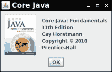

**图 5.3** 显示图像和文本资源

当然，面板中的书名和版权年份会因本书下一版而改变。为了便于跟踪这一变化，我们会将文本放入文件中，而不是将其硬编码为字符串。

但是，像 about.txt 这样的文件应该放在哪里？当然，直接将它和其余程序文件一起放入 JAR 文件会很方便。

`Class` 类提供了一项用于定位资源文件的有用服务。以下是必要的步骤：

1. 获取拥有资源的类的 `Class` 对象——例如 `ResourceTest.class`。
2. 某些方法（例如 `ImageIcon` 类的 `getImage` 方法）接受描述资源位置的 URL。然后你调用：

    ```java
    URL url = cl.getResource("about.gif");
    ```

3. 否则，使用 `getResourceAsStream` 方法获取一个输入流，用于读取文件中的数据。

关键在于，Java 虚拟机知道如何定位类，因此它可以在同一位置搜索关联资源。例如，假设 `ResourceTest` 类位于名为 `resources` 的包中。那么 `ResourceTest.class` 文件位于 resources 目录中，而你将图标文件放入同一目录。

除了将资源文件放在与类文件相同的目录中，你还可以提供相对或绝对路径，例如

```
data/about.txt
/corejava/title.txt
```

资源加载功能所做的全部事情就是自动加载文件。没有用于解释资源文件内容的标准方法。每个程序都必须有自己的方式来解释其资源文件。

资源的另一个常见应用是程序国际化。依赖语言的字符串（例如消息和用户界面标签）存储在资源文件中，每种语言一个文件。*国际化 API*（在第二卷第 7 章中讨论）支持一种用于组织和访问这些本地化文件的标准方法。

清单 5.13 是一个演示资源加载的程序。（不必担心读取文本和显示对话框的代码——我们稍后会介绍这些细节。）编译、构建 JAR 文件并执行它：

```bash
javac resource/ResourceTest.java
jar cvfe ResourceTest.jar resources.ResourceTest \
    resources/*.class resources/*.gif resources/data/*.txt corejava/*.txt
java -jar ResourceTest.jar
```

将 JAR 文件移动到另一个目录并再次运行，以检查程序是从 JAR 文件（而不是当前目录）读取资源文件。

### 清单 5.13 resources/ResourceTest.java

```java
package resources;

import java.io.*;
import java.net.*;
import java.nio.charset.*;
import javax.swing.*;

/**
 * @version 1.5 2018-03-15
 * @author Cay Horstmann
 */
public class ResourceTest
{
    public static void main(String[] args) throws IOException
    {
        Class cl = ResourceTest.class;
        URL aboutURL = cl.getResource("about.gif");
        var icon = new ImageIcon(aboutURL);

        InputStream stream = cl.getResourceAsStream("data/about.txt");
        var about = new String(stream.readAllBytes(), "UTF-8");
```

清单 5.14 向你展示如何打印出某个类的所有信息。该程序提示你输入类名，并写出所有方法和构造器的签名以及该类所有实例字段的名称。例如，如果你输入

```
    java.lang.Double
```

程序会打印

```
    public class java.lang.Double extends java.lang.Number
    {
       public java.lang.Double(java.lang.String);
       public java.lang.Double(double);

       public int hashCode();
       public int compareTo(java.lang.Object);
       public int compareTo(java.lang.Double);
       public boolean equals(java.lang.Object);
       public java.lang.String toString();
       public static java.lang.String toString(double);
       public static java.lang.Double valueOf(java.lang.String);
       public static boolean isNaN(double);
       public boolean isNaN();
       public static boolean isInfinite(double);
       public boolean isInfinite();
       public byte byteValue();
       public short shortValue();
       public int intValue();
       public long longValue();
       public float floatValue();
       public double doubleValue();
       public static double parseDouble(java.lang.String);
       public static native long doubleToLongBits(double);
       public static native long doubleToRawLongBits(double);
       public static native double longBitsToDouble(long);

       public static final double POSITIVE_INFINITY;
       public static final double NEGATIVE_INFINITY;
       public static final double NaN;
       public static final double MAX_VALUE;
       public static final double MIN_VALUE;
       public static final java.lang.Class TYPE;
       private double value;
       private static final long serialVersionUID;
    }
```

这个程序的非凡之处在于，它可以分析 Java 解释器能够加载的任何类，而不仅仅是程序编译时可用的类。我们将在下一章使用这个程序来窥探 Java 编译器自动生成的内部类。

### 清单 5.14 *（续）*

```java
48  public static void printConstructors(Class cl)
49  {
50     Constructor[] constructors = cl.getDeclaredConstructors();
51
52     for (Constructor c : constructors)
53     {
54        String name = c.getName();
55        System.out.print("  ");
56        String modifiers = Modifier.toString(c.getModifiers());
57        if (modifiers.length() > 0) System.out.print(modifiers + " ");
58        System.out.print(name + "(");
59
60        // print parameter types
61        Class[] paramTypes = c.getParameterTypes();
62        for (int j = 0; j < paramTypes.length; j++)
63        {
64           if (j > 0) System.out.print(", ");
65           System.out.print(paramTypes[j].getName());
66        }
67        System.out.println(");");
68     }
69  }
70
71  /**
72   * Prints all methods of a class
73   * @param cl a class
74   */
75  public static void printMethods(Class cl)
76  {
77     Method[] methods = cl.getDeclaredMethods();
78
79     for (Method m : methods)
80     {
81        Class retType = m.getReturnType();
82        String name = m.getName();
83
84        System.out.print("  ");
85        // print modifiers, return type and method name
86        String modifiers = Modifier.toString(m.getModifiers());
87        if (modifiers.length() > 0) System.out.print(modifiers + " ");
88        System.out.print(retType.getName() + " " + name + "(");
89
90        // print parameter types
91        Class[] paramTypes = m.getParameterTypes();
```


```java
for (int j = 0; j < paramTypes.length; j++)
{
   if (j > 0) System.out.print(", ");
   System.out.print(paramTypes[j].getName());
}
System.out.println(");");
}
}

/**
 * Prints all fields of a class
 * @param cl a class
 */
public static void printFields(Class cl)
{
   Field[] fields = cl.getDeclaredFields();

   for (Field f : fields)
   {
      Class type = f.getType();
      String name = f.getName();
      System.out.print(" ");
      String modifiers = Modifier.toString(f.getModifiers());
      if (modifiers.length() > 0) System.out.print(modifiers + " ");
      System.out.println(type.getName() + " " + name + ";");
   }
}
}
```

| java.lang.Class 1.0 |
|---|
| • `Field[] getFields()` 1.1<br>• `Field[] getDeclaredFields()` 1.1<br><br>getFields 返回一个数组，包含此类或其超类的公共字段的 Field 对象；getDeclaredFields 返回此类所有字段的 Field 对象数组。如果没有这样的字段，或者 Class 对象表示基本类型或数组类型，这些方法返回长度为 0 的数组。<br><br>• `Method[] getMethods()` 1.1<br>• `Method[] getDeclaredMethods()` 1.1<br><br>返回一个包含 Method 对象的数组：getMethods 返回公共方法并包含继承的方法；getDeclaredMethods 返回此类或接口的所有方法，但不包含继承的方法。 |

### java.lang.Class 1.0（续）

- `Constructor[] getConstructors()` 1.1
- `Constructor[] getDeclaredConstructors()` 1.1

  返回一个数组，包含 Constructor 对象，这些对象给出此 `Class` 对象所表示类的所有公共构造器（对于 `getConstructors`）或所有构造器（对于 `getDeclaredConstructors`）。

- `String getPackageName()` 9

  获取包含此类型的包名；如果此类型是数组类型，则获取元素类型的包名；如果这是基本类型，则返回 `"java.lang"`。

### java.lang.reflect.Field 1.1
### java.lang.reflect.Method 1.1
### java.lang.reflect.Constructor 1.1

- `Class getDeclaringClass()`

  返回定义此构造器、方法或字段的类的 Class 对象。

- `Class[] getExceptionTypes()`（在 Constructor 和 Method 类中）

  返回一个 Class 对象数组，表示该方法抛出的异常类型。

- `int getModifiers()`

  返回一个整数，描述此构造器、方法或字段的修饰符。使用 `Modifier` 类中的方法分析返回值。

- `String getName()`

  返回一个字符串，即构造器、方法或字段的名称。

- `Class[] getParameterTypes()`（在 Constructor 和 Method 类中）

  返回一个 Class 对象数组，表示参数的类型。

- `Class getReturnType()`（在 Method 类中）

  返回一个表示返回类型的 Class 对象。

### java.lang.reflect.Modifier 1.1

- `static String toString(int modifiers)`

  返回一个字符串，包含与 `modifiers` 中设置的位对应的修饰符。

- `static boolean isAbstract(int modifiers)`
- `static boolean isFinal(int modifiers)`
- `static boolean isInterface(int modifiers)`
- `static boolean isNative(int modifiers)`
- `static boolean isPrivate(int modifiers)`
- `static boolean isProtected(int modifiers)`
- `static boolean isPublic(int modifiers)`
- `static boolean isStatic(int modifiers)`
- `static boolean isStrict(int modifiers)`
- `static boolean isSynchronized(int modifiers)`
- `static boolean isVolatile(int modifiers)`

  测试 modifiers 值中与方法名中的修饰符对应的位。

#### 5.7.5 使用反射在运行时分析对象

在上一节中，我们看到了如何找出任何对象的数据字段的*名称*和*类型*：

- 获取对应的 `Class` 对象。
- 在 `Class` 对象上调用 `getDeclaredFields`。

在本节中，我们将更进一步，实际查看字段的*内容*。当然，查看一个在编写程序时已知名称和类型的对象的特定字段的内容很容易。但反射让你可以查看编译时未知的对象的字段。

实现这一点的关键方法是 `Field` 类中的 `get` 方法。如果 `f` 是一个 `Field` 类型的对象（例如，从 `getDeclaredFields` 获得的对象），而 `obj` 是 `f` 作为其字段的类的对象，那么 `f.get(obj)` 返回一个对象，其值为 `obj` 的该字段的当前值。这有点抽象，所以我们来看一个例子。

```java
var harry = new Employee("Harry Hacker", 50000, 10, 1, 1989);
Class cl = harry.getClass();
    // the class object representing Employee
Field f = cl.getDeclaredField("name");
    // the name field of the Employee class
Object v = f.get(harry);
    // the value of the name field of the harry object, i.e.,
    // the String object "Harry Hacker"
```

当然，你也可以设置能够获取的值。调用 `f.set(obj, value)` 会将对象 `obj` 中由 `f` 表示的字段设置为新值。

实际上，这段代码有一个问题。由于 `name` 字段是私有字段，`get` 和 `set` 方法将抛出 `IllegalAccessException`。你只能对可访问的字段使用 `get` 和 `set`。Java 的安全机制让你可以找出对象有哪些字段，但除非你有权限，否则它不会让你读取和写入这些字段的值。

反射机制的默认行为是遵循 Java 访问控制。但是，你可以通过在 `Field`、`Method` 或 `Constructor` 对象上调用 `setAccessible` 方法来覆盖访问控制。例如：

```java
f.setAccessible(true); // now OK to call f.get(harry)
```

`setAccessible` 方法是 `AccessibleObject` 类的方法，而 `AccessibleObject` 类是 `Field`、`Method` 和 `Constructor` 类的公共超类。此功能是为调试器、持久化存储和类似机制提供的。我们在本节后面会将其用于一个通用的 `toString` 方法。

如果未授予访问权限，调用 `setAccessible` 会抛出异常。访问可能被模块系统（第 II 卷第 9 章）或安全管理器（第 II 卷第 10 章）拒绝。安全管理器的使用并不常见。然而，从 Java 9 开始，由于 Java API 已模块化，每个程序都包含模块。

由于许多库都使用反射，Java 9 和 10 在你使用反射访问模块内的非公共特性时只会给出警告。例如，本节末尾的示例程序会查看 `ArrayList` 和 `Integer` 对象的内部结构。运行该程序时，控制台中会出现以下不祥消息：

```
WARNING: An illegal reflective access operation has occurred
WARNING: Illegal reflective access by objectAnalyzer.ObjectAnalyzer (file:/home/cay
/books/c11/code/v1ch05/bin/) to field java.util.ArrayList.serialVersionUID
WARNING: Please consider reporting this to the maintainers of
objectAnalyzer.ObjectAnalyzer
WARNING: Use --illegal-access=warn to enable warnings of further illegal
reflective access operations
WARNING: All illegal access operations will be denied in a future release
```

目前，你可以停用该警告。你需要将 `java.base` 模块中的 `java.util` 和 `java.lang` 包“开放”给“未命名模块”。详细信息见第 II 卷第 9 章。语法如下：

```
java --add-opens java.base/java.util=ALL-UNNAMED \
    --add-opens java.base/java.lang=ALL-UNNAMED \
    objectAnalyzer.ObjectAnalyzerTest
```

或者，你可以通过运行以下命令来查看该程序在未来 Java 版本中的行为：

```
java --illegal-access=deny objectAnalyzer/ObjectAnalyzerTest
```

然后程序将直接失败并抛出 `IllegalAccessException`。

> **注意：** 未来的库可能会使用变量句柄而不是反射来读取和写入字段。`VarHandle` 类似于 `Field`。你可以使用它读取或写入特定类的任何实例的特定字段。但是，要获得 `VarHandle`，库代码需要一个 `Lookup` 对象：

```java
public Object getFieldValue(Object obj, String fieldName, Lookup lookup)
    throws NoSuchFieldException, IllegalAccessException
{
    Class<?> cl = obj.getClass();
    Field field = cl.getDeclaredField(fieldName);
    VarHandle handle = MethodHandles.privateLookupIn(cl, lookup)
        .unreflectVarHandle(field);
    return handle.get(obj);
}
```

> 只要 `Lookup` 对象是在拥有访问该字段权限的模块中生成的，这种方式就有效。该模块中的某个方法只需调用 `MethodHandles.lookup()`，就会生成一个封装调用者访问权限的对象。通过这种方式，一个模块可以授予另一个模块访问私有成员的权限。实际问题是，如何以最少的麻烦授予这些权限。

趁着我们还能这样做，让我们看一个适用于任何类的通用 `toString` 方法（见代码清单 5.15）。通用 `toString` 方法使用 `getDeclaredFields` 获取所有数据字段，并使用 `setAccessible` 便捷方法使所有字段可访问。对于每个字段，它获取名称和值。每个值通过递归调用 `toString` 转换为字符串。

通用 `toString` 方法需要处理几个复杂问题。引用循环可能导致无限递归。因此，`ObjectAnalyzer` 会跟踪已经访问过的对象。此外，要窥视数组内部，你需要一种不同的方法。你将在下一节了解详细信息。

你可以使用这个 `toString` 方法窥视任何对象的内部。例如，以下调用

```java
var squares = new ArrayList<Integer>();
for (int i = 1; i <= 5; i++) squares.add(i * i);
System.out.println(new ObjectAnalyzer().toString(squares));
```


会打印出以下内容

```text
java.util.ArrayList[elementData=class java.lang.Object[]{java.lang.Integer[value=1][],
java.lang.Integer[value=4][], java.lang.Integer[value=9][],
java.lang.Integer[value=16][],
java.lang.Integer[value=25][],null,null,null,null,null},size=5][modCount=5][]
```

你可以使用这个通用的 toString 方法来实现你自己类的 toString 方法，如下所示：

```java
public String toString()
{
    return new ObjectAnalyzer().toString(this);
}
```

这是一种省事且无疑很有用的方法，可用于提供通用的 toString 方法。然而，在你为再也不必实现 toString 而过于兴奋之前，请记住，不受控制地访问内部结构的日子已经屈指可数了。

### 清单 5.15 objectAnalyzer/ObjectAnalyzerTest.java

```java
1 package objectAnalyzer;
2 
3 import java.util.*;
4 
5 /**
6  * This program uses reflection to spy on objects.
7  * @version 1.13 2018-03-16
8  * @author Cay Horstmann
9  */
10 public class ObjectAnalyzerTest
11 {
12    public static void main(String[] args)
13       throws ReflectiveOperationException
14    {
15       var squares = new ArrayList<Integer>();
16       for (int i = 1; i <= 5; i++)
17          squares.add(i * i);
18       System.out.println(new ObjectAnalyzer().toString(squares));
19    }
20 }
```

### 清单 5.16 objectAnalyzer/ObjectAnalyzer.java

```java
1 package objectAnalyzer;
2 
3 import java.lang.reflect.AccessibleObject;
4 import java.lang.reflect.Array;
5 import java.lang.reflect.Field;
6 import java.lang.reflect.Modifier;
7 import java.util.ArrayList;
8
9 public class ObjectAnalyzer
10 {
11    private ArrayList<Object> visited = new ArrayList<>();
12
13    /**
14     * Converts an object to a string representation that lists all fields.
15     * @param obj an object
16     * @return a string with the object's class name and all field names and values
17     */
18    public String toString(Object obj)
19          throws ReflectiveOperationException
20    {
21       if (obj == null) return "null";
22       if (visited.contains(obj)) return "...";
23       visited.add(obj);
24       Class cl = obj.getClass();
25       if (cl == String.class) return (String) obj;
26       if (cl.isArray())
27       {
28          String r = cl.getComponentType() + "[]{";
29          for (int i = 0; i < Array.getLength(obj); i++)
30          {
31             if (i > 0) r += ",";
32             Object val = Array.get(obj, i);
33             if (cl.getComponentType().isPrimitive()) r += val;
34             else r += toString(val);
35          }
36          return r + "}";
37       }
38
39       String r = cl.getName();
40       // inspect the fields of this class and all superclasses
41       do
42       {
43          r += "[";
44          Field[] fields = cl.getDeclaredFields();
45          AccessibleObject.setAccessible(fields, true);
46          // get the names and values of all fields
47          for (Field f : fields)
48          {
49             if (!Modifier.isStatic(f.getModifiers()))
50             {
51                if (!r.endsWith("[")) r += ",";
52                r += f.getName() + "=";
53                Class t = f.getType();
54                Object val = f.get(obj);
55                if (t.isPrimitive()) r += val;
56                else r += toString(val);
57             }
58          }
59          r += "]";
60          cl = cl.getSuperclass();
61       }
62       while (cl != null);
63
64       return r;
65    }
66 }
```

**java.lang.reflect.AccessibleObject** *1.2*

- `void setAccessible(boolean flag)`  
  设置或清除此可访问对象的可访问性标志；如果访问被拒绝，则抛出 `IllegalAccessException`。
- `boolean trySetAccessible()` *9*  
  设置此可访问对象的可访问性标志；如果访问被拒绝，则返回 false。
- `boolean isAccessible()`  
  获取此可访问对象的可访问性标志的值。
- `static void setAccessible(AccessibleObject[] array, boolean flag)`  
  是一个便捷方法，用于为对象数组设置可访问性标志。

**java.lang.Class** *1.1*

- `Field getField(String name)`
- `Field[] getFields()`  
  获取具有给定名称的公共字段，或获取包含所有字段的数组。
- `Field getDeclaredField(String name)`
- `Field[] getDeclaredFields()`  
  获取在此类中声明的具有给定名称的字段，或获取包含所有字段的数组。

| `java.lang.reflect.Field` 1.1 |
|---|
| - `Object get(Object obj)`<br>  获取 `obj` 对象中由此 `Field` 对象描述的字段的值。<br>- `void set(Object obj, Object newValue)`<br>  将 `obj` 对象中由此 `Field` 对象描述的字段设置为新值。 |

#### 5.7.6 使用反射编写通用数组代码

`java.lang.reflect` 包中的 `Array` 类允许动态创建数组。例如，`Arrays` 类中 `copyOf` 方法的实现就使用了这一功能。回想一下，这个方法如何用于扩充一个已满的数组。

```java
    var a = new Employee[100];
    . . .
    // array is full
    a = Arrays.copyOf(a, 2 * a.length);
```

如何编写这样一个通用方法呢？`Employee[]` 数组可以转换为 `Object[]` 数组，这一点很有帮助。听起来很有希望。下面是第一个尝试：

```java
    public static Object[] badCopyOf(Object[] a, int newLength) // not useful
    {
       var newArray = new Object[newLength];
       System.arraycopy(a, 0, newArray, 0, Math.min(a.length, newLength));
       return newArray;
    }
```

然而，实际使用结果数组时会有一个问题。这段代码返回的数组类型是对象数组（`Object[]`），因为我们使用下面这行代码创建了数组：

```java
    new Object[newLength]
```

对象数组*不能*强制转换为员工数组（`Employee[]`）。虚拟机将在运行时生成 `ClassCastException`。关键在于，正如我们之前提到的，Java 数组会记住其条目的类型——也就是创建它的 `new` 表达式中使用的元素类型。将 `Employee[]` 临时强制转换为 `Object[]` 数组，然后再转换回来是合法的，但一个最初作为 `Object[]` 数组创建的数组永远不能强制转换为 `Employee[]` 数组。要编写这种通用数组代码，我们需要能够创建一个与原始数组*相同*类型的新数组。为此，我们需要 `java.lang.reflect` 包中 `Array` 类的方法。关键是 `Array` 类中用于构造新数组的静态 `newInstance` 方法。必须向该方法提供条目类型和所需长度作为参数。

```java
    Object newArray = Array.newInstance(componentType, newLength);
```

为了实际执行这一点，我们需要获取新数组的长度和组件类型。

我们通过调用 Array.getLength(a) 获取长度。Array 类的静态 getLength 方法返回数组的长度。要获取新数组的组件类型：

- 1. 首先，获取 `a` 的类对象。
- 2. 确认它确实是一个数组。
- 3. 使用 `Class` 类的 `getComponentType` 方法（该方法仅为表示数组的类对象定义）来找到数组的正确类型。

为什么 getLength 是 Array 的方法，而 getComponentType 是 Class 的方法？我们不知道——反射方法的分布有时似乎有些随意。

代码如下：

```java
    public static Object goodCopyOf(Object a, int newLength)
    {
        Class cl = a.getClass();
        if (!cl.isArray()) return null;
        Class componentType = cl.getComponentType();
        int length = Array.getLength(a);
        Object newArray = Array.newInstance(componentType, newLength);
        System.arraycopy(a, 0, newArray, 0, Math.min(length, newLength));
        return newArray;
    }
```

注意，这个 copyOf 方法可用于扩充任意类型的数组，而不仅仅是对象数组。

```java
    int[] a = { 1, 2, 3, 4, 5 };
    a = (int[]) goodCopyOf(a, 10);
```

为了实现这一点，*goodCopyOf* 的参数被声明为 *Object* 类型，而不是对象数组（*Object[]*）。整数数组类型 *int[]* 可以转换为 *Object*，但不能转换为对象数组！

清单 5.17 展示了这两个方法的实际运行情况。注意，对 *badCopyOf* 的返回值进行强制转换将抛出异常。


## 清单 5.17 `arrays/CopyOfTest.java`

```java
package arrays;

import java.lang.reflect.*;
import java.util.*;

/**
 * This program demonstrates the use of reflection for manipulating arrays.
 * @version 1.2 2012-05-04
 * @author Cay Horstmann
 */
public class CopyOfTest
{
   public static void main(String[] args)
   {
      int[] a = { 1, 2, 3 };
      a = (int[]) goodCopyOf(a, 10);
      System.out.println(Arrays.toString(a));

      String[] b = { "Tom", "Dick", "Harry" };
      b = (String[]) goodCopyOf(b, 10);
      System.out.println(Arrays.toString(b));

      System.out.println("The following call will generate an exception.");
      b = (String[]) badCopyOf(b, 10);
   }
}

/**
 * This method attempts to grow an array by allocating a new array and copying all elements.
 * @param a the array to grow
 * @param newLength the new length
 * @return a larger array that contains all elements of a. However, the returned
 * array has type Object[], not the same type as a
 */
public static Object[] badCopyOf(Object[] a, int newLength) // not useful
{
   var newArray = new Object[newLength];
   System.arraycopy(a, 0, newArray, 0, Math.min(a.length, newLength));
   return newArray;
}

/**
 * This method grows an array by allocating a new array of the same type and
 * copying all elements.
 * @param a the array to grow. This can be an object array or a primitive
 * type array.
```

回想一下，可以使用 `Field` 类的 `get` 方法查看对象的字段。类似地，`Method` 类有一个 `invoke` 方法，让你可以调用封装在当前 `Method` 对象中的方法。`invoke` 方法的签名是

```java
Object invoke(Object obj, Object... args)
```

第一个参数是隐式参数，其余对象提供显式参数。

对于静态方法，第一个参数会被忽略——你可以将其设为 null。

例如，如果 `m1` 表示 `Employee` 类的 `getName` 方法，下面的代码展示了如何调用它：

```java
String n = (String) m1.invoke(harry);
```

如果返回类型是基本类型，`invoke` 方法将改为返回包装器类型。例如，假设 `m2` 表示 `Employee` 类的 `getSalary` 方法。那么，返回的对象实际上是 `Double`，你必须相应地进行强制转换。使用自动拆箱将其转换为 `double`：

```java
double s = (Double) m2.invoke(harry);
```

如何获得 `Method` 对象？当然，你可以调用 `getDeclaredMethods`，并在返回的 `Method` 对象数组中搜索，直到找到你想要的方法。或者，你可以调用 `Class` 类的 `getMethod` 方法。这类似于 `getField` 方法：它接受一个包含字段名的字符串并返回一个 `Field` 对象。然而，可能有多个方法具有相同的名称，因此你需要小心，确保得到正确的那一个。出于这个原因，你还必须提供所需方法的参数类型。`getMethod` 的签名是

```java
Method getMethod(String name, Class... parameterTypes)
```

例如，下面展示了如何获取 `Employee` 类的 `getName` 和 `raiseSalary` 方法的方法指针：

```java
Method m1 = Employee.class.getMethod("getName");
Method m2 = Employee.class.getMethod("raiseSalary", double.class);
```

使用类似的方法调用任意构造器。将构造器的参数类型提供给 `class.getConstructor` 方法，并将参数值提供给 `Constructor.newInstance` 方法：

```java
Class cl = Random.class; // or any other class with a constructor that
                          // accepts a long parameter
Constructor cons = cl.getConstructor(long.class);
Object obj = cons.newInstance(42L);
```

既然你已经了解了使用 `Method` 对象的规则，现在让我们把它们付诸实践。清单 5.18 是一个程序，它打印某个数学函数（例如 `Math.sqrt` 或 `Math.sin`）的值表。输出如下所示：

```text
public static native double java.lang.Math.sqrt(double)
  1.0000 |   1.0000
  2.0000 |   1.4142
  3.0000 |   1.7321
  4.0000 |   2.0000
  5.0000 |   2.2361
  6.0000 |   2.4495
  7.0000 |   2.6458
  8.0000 |   2.8284
  9.0000 |   3.0000
 10.0000 |   3.1623
```

当然，打印表格的代码与被制表的实际函数无关。

```java
double dx = (to - from) / (n - 1);
for (double x = from; x <= to; x += dx)
{
   double y = (Double) f.invoke(null, x);
   System.out.printf("%10.4f | %10.4f%n", x, y);
}
```

这里，`f` 是 `Method` 类型的对象。`invoke` 的第一个参数是 null，因为我们调用的是静态方法。

要对 `Math.sqrt` 函数制表，我们将 `f` 设置为

```java
Math.class.getMethod("sqrt", double.class)
```

也就是 `Math` 类中名为 `sqrt` 且只有一个 `double` 类型参数的方法。

清单 5.18 展示了通用制表程序的完整代码以及几次测试运行。

## 清单 5.18 methods/MethodTableTest.java

```java
package methods;

import java.lang.reflect.*;

/**
 * This program shows how to invoke methods through reflection.
 * @version 1.2 2012-05-04
 * @author Cay Horstmann
 */
public class MethodTableTest
{
   public static void main(String[] args)
      throws ReflectiveOperationException
   {
      // get method pointers to the square and sqrt methods
      Method square = MethodTableTest.class.getMethod("square", double.class);
      Method sqrt = Math.class.getMethod("sqrt", double.class);

      // print tables of x- and y-values
      printTable(1, 10, 10, square);
      printTable(1, 10, 10, sqrt);
   }

   /**
    * Returns the square of a number
    * @param x a number
    * @return x squared
    */
   public static double square(double x)
   {
      return x * x;
   }

   /**
    * Prints a table with x- and y-values for a method
    * @param from the lower bound for the x-values
    * @param to the upper bound for the x-values
    * @param n the number of rows in the table
    * @param f a method with a double parameter and double return value
    */
   public static void printTable(double from, double to, int n, Method f)
      throws ReflectiveOperationException
   {
      // print out the method as table header
      System.out.println(f);

      double dx = (to - from) / (n - 1);

      for (double x = from; x <= to; x += dx)
      {
         double y = (Double) f.invoke(null, x);
         System.out.printf("%10.4f | %10.4f%n", x, y);
      }
   }
}
```

正如这个例子清楚显示的，使用 `Method` 对象可以完成在 C 中用函数指针（或 C# 中用委托）能完成的任何事情。正如在 C 中一样，这种编程风格通常相当不方便，而且总是容易出错。

如果使用错误的参数调用方法会发生什么？`invoke` 方法会抛出异常。

此外，`invoke` 的参数和返回值必然是 `Object` 类型。这意味着你必须大量地来回强制转换。结果，编译器被剥夺了检查代码的机会，因此错误只在测试期间暴露，而那时查找和修复它们更加繁琐。而且，使用反射获取方法指针的代码比直接调用方法的代码慢得多。

因此，我们建议你在自己的程序中只在绝对必要时才使用 `Method` 对象。使用接口以及从 Java 8 开始的 lambda 表达式（下一章的主题）几乎总是更好的做法。特别是，我们赞同 Java 开发者的观点，并建议不要使用 `Method` 对象来实现回调函数。使用接口实现回调会使代码运行更快，并且可维护性高得多。

**java.lang.reflect.Method**  *1.1*

- `public Object invoke(Object implicitParameter, Object[] explicitParameters)`

  调用此对象所描述的方法，传入给定参数并返回该方法返回的值。对于静态方法，将 `null` 作为隐式参数传入。通过使用包装器传入基本类型值。基本类型返回值必须被拆箱。

### 5.8 继承的设计提示

我们想以一些在使用继承时我们发现有用的提示来结束本章。

- 1. *将公共操作和字段放在超类中。*

  这就是为什么我们将 `name` 字段放在 `Person` 类中，而不是在 `Employee` 和 `Student` 类中重复它。

- 2. *不要使用 protected 字段。*

  有些程序员认为将大多数实例字段定义为 protected 是个好主意，“以防万一”，这样子类在需要时可以访问这些字段。然而，protected 机制并不能提供太多保护，

因此，在这个例子中继承并不合适。

注意，如果扩展 `Locatable`，这个问题就不会出现。因为该类是不可变的，所以没有方法能把假日变成非假日。

- 5. *重写方法时不要改变预期行为。*

替换原则不仅适用于语法，更重要的是适用于行为。当你重写一个方法时，不应该不合理地改变它的行为。编译器帮不了你——它无法检查你的重新定义是否合理。例如，你可以通过重新定义 `add` 来“修复” Holiday 类中 `add` 方法的问题，也许让它什么都不做，或者抛出异常，或者移到下一个假日。

然而，这样的修复违反了替换原则。如下语句序列

```java
int d1 = x.get(Calendar.DAY_OF_MONTH);
x.add(Calendar.DAY_OF_MONTH, 1);
int d2 = x.get(Calendar.DAY_OF_MONTH);
System.out.println(d2 - d1);
```

无论 `x` 是 `GregorianCalendar` 类型还是 `Holiday` 类型，都应该具有*预期行为*。

当然，问题就在这里。合理的人和不合理的人可以就预期行为是什么争论很久。例如，一些作者认为，替换原则要求 `Manager.equals` 忽略奖金字段，因为 `Employee.equals` 忽略了它。如果这些讨论脱离具体语境，就毫无意义。归根结底，重要的是：在子类中重写方法时，不要规避原设计的意图。

- 6. *使用多态，而不是类型信息。*

每当你发现如下形式的代码

```
if (x is of type 1)
    action1(x);
else if (x is of type 2)
    action2(x);
```

请考虑多态。

`action1` 和 `action2` 是否表示一个共同概念？如果是，就把该概念作为这两种类型共同超类或接口中的一个方法。然后，你只需调用

```java
x.action();
```

并让多态固有的动态分派机制启动正确的操作。

使用多态方法或接口实现的代码，比使用多次类型测试的代码更容易维护和扩展。

- 7. *不要过度使用反射。*

反射机制让你能在运行时检测字段和方法，从而编写出具有惊人通用性的程序。这种能力对系统编程可能极其有用，但通常不适合应用程序。反射很脆弱——有了它，编译器无法帮你发现编程错误。任何错误都会在运行时被发现并导致异常。

现在你已经了解了 Java 如何支持面向对象编程的基础：类、继承和多态。下一章我们将讨论两个对于有效使用 Java 非常重要的高级主题：接口和 Lambda 表达式。

*本页有意留白*

## 第 6 章

## 接口、Lambda 表达式和内部类

**本章内容**

- 6.1 接口，第 296 页
- 6.2 Lambda 表达式，第 322 页
- 6.3 内部类，第 340 页
- 6.4 服务加载器，第 360 页
- 6.5 代理，第 362 页

现在你已经学习了类和继承，这是 Java 中面向对象编程的关键概念。本章将向你展示几种常用的高级技术。尽管它们不那么显而易见，但你需要掌握它们才能完善你的 Java 工具箱。

第一种技术称为*接口*，它描述类应该*做什么*，而不指定*如何*做。一个类可以*实现*一个或多个接口。当需要符合该接口时，你就可以使用这些实现类的对象。在介绍接口之后，我们将转向 *Lambda 表达式*，这是一种创建可在以后执行的代码块的简洁方式。使用 Lambda 表达式，你可以优雅简洁地表达使用回调或可变行为的代码。

然后我们讨论*内部类*的机制。内部类在技术上有些复杂——它们定义在其他类内部，其方法可以访问外围类的字段。当你设计协作类集合时，内部类很有用。

本章最后讨论*代理*，即实现任意接口的对象。代理是一种非常专用的构造，对于构建系统级工具很有用。初读时可以放心跳过那一节。

### 6.1 接口

在接下来的几节中，你将了解 Java 接口是什么以及如何使用它们。你还会了解在近期 Java 版本中接口是如何变得更强大的。

#### 6.1.1 接口概念

在 Java 编程语言中，接口不是类，而是希望符合该接口的类必须满足的一组*要求*。

通常，某个服务的提供方会声明：“如果你的类符合某个特定接口，那么我就会执行该服务。”让我们看一个具体例子。`Arrays` 类的 `sort` 方法承诺对对象数组排序，但有一个条件：这些对象必须属于实现了 `Comparable` 接口的类。

`Comparable` 接口如下所示：

```java
public interface Comparable
{
    int compareTo(Object other);
}
```

这意味着，任何实现 `Comparable` 接口的类都必须有一个 `compareTo` 方法，并且该方法必须接受一个 `Object` 参数并返回一个整数。

**注意：** 从 Java 5 起，`Comparable` 接口已增强为泛型类型。

```java
public interface Comparable<T>
{
    int compareTo(T other); // parameter has type T
}
```

例如，实现 `Comparable<Employee>` 的类必须提供如下方法

```java
int compareTo(Employee other)
```

你仍然可以使用不带类型参数的“原始”`Comparable` 类型。此时 `compareTo` 方法有一个 `Object` 类型的参数，你必须手动将 `compareTo` 方法的该参数强制转换为所需类型。我们暂时会这样做，这样你就不必同时操心两个新概念。

接口中的所有方法都自动为 `public`。因此，在接口中声明方法时不必提供 `public` 关键字。

当然，还有一个接口无法明确规定的额外要求：调用 `x.compareTo(y)` 时，`compareTo` 方法必须真正能够比较这两个对象，并返回一个表明 `x` 还是 `y` 更大的指示。如果 `x` 小于 `y`，该方法应返回负数；如果二者相等，则返回零；否则返回正数。

这个特定接口只有一个方法。有些接口有多个方法。你稍后会看到，接口也可以定义常量。然而更重要的是接口不能提供什么。接口从来没有实例字段。在 Java 8 之前，接口中从不实现方法。（你将在第 306 页的 6.1.4 节“静态方法和私有方法”以及第 307 页的 6.1.5 节“默认方法”中看到，现在可以在接口中提供简单方法。当然，那些方法不能引用实例字段——接口根本没有实例字段。）

提供实例字段以及操作这些字段的方法，是实现该接口的类的职责。你可以把接口看作没有实例字段的抽象类。然而，这两个概念之间有一些差异——我们稍后会详细讨论。

现在，假设我们想使用 `Arrays` 类的 `sort` 方法对 `Employee` 对象数组排序。那么 `Employee` 类必须实现 `Comparable` 接口。

要让一个类实现接口，需要执行两个步骤：

- 1. 声明你的类打算实现给定接口。
- 2. 为接口中的所有方法提供定义。

要声明一个类实现接口，请使用 `implements` 关键字：

```java
class Employee implements Comparable
```

当然，现在 Employee 类需要提供 `compareTo` 方法。假设我们想按薪水比较员工。以下是 `compareTo` 方法的一种实现：

```java
public int compareTo(Object otherObject)
{
   Employee other = (Employee) otherObject;
   return Double.compare(salary, other.salary);
}
```

这里，我们使用静态的 `Double.compare` 方法：如果第一个参数小于第二个参数，则返回负数；如果二者相等，则返回 0；否则返回正值。

> **警告：** 在接口声明中，`compareTo` 方法没有声明为 `public`，因为 `interface` 中的所有方法都自动为 public。然而，在实现接口时，必须将该方法声明为 `public`。否则，编译器会认为该方法具有包访问权限——这是类的默认访问权限。然后编译器会报错，说你试图提供更严格的访问权限。

我们可以做得更好一些，为泛型 `Comparable` 接口提供类型参数：

```java
class Employee implements Comparable<Employee>
{
   public int compareTo(Employee other)
   {
      return Double.compare(salary, other.salary);
   }
   . . .
}
```

注意，对 `Object` 参数难看的强制转换已经消失了。


> **提示：** `Comparable` 接口的 `compareTo` 方法返回一个整数。如果对象不相等，那么返回什么负值或正值并不重要。在比较整数字段时，这种灵活性可能很有用。例如，假设每个员工都有一个唯一的整数 `id`，并且你想按员工 ID 编号排序。那么你可以直接返回 `id - other.id`。如果第一个 ID 编号小于另一个，该值将为某个负值；如果它们相同，则为 0；否则为某个正值。然而，有一个注意事项：整数的范围必须足够小，以免减法溢出。如果你知道这些 ID 不是负数，或者它们的绝对值至多为 `(Integer.MAX_VALUE - 1) / 2`，那么你是安全的。否则，调用静态的 `Integer.compare` 方法。
> 
> 当然，减法技巧对浮点数不起作用。如果薪水很接近但不完全相同，差值 `salary - other.salary` 可能会舍入为 0。调用 `Double.compare(x, y)` 时，如果 `x < y` 就返回 `-1`，如果 `x > y` 就返回 `1`。

> **注意：** `Comparable` 接口的文档建议 `compareTo` 方法应与 equals 方法兼容。也就是说，`x.compareTo(y)` 应当恰好当 `x.equals(y)` 时为零。Java API 中大多数实现 `Comparable` 的类都遵循这一建议。一个显著的例外是 `BigDecimal`。考虑 `x = new BigDecimal("1.0")` 和 `y = new BigDecimal("1.00")`。此时 `x.equals(y)` 为 false，因为这两个数的精度不同。但 `x.compareTo(y)` 为零。理想情况下，它不应该为零，但当时没有明显的方法来决定哪一个应当排在前面。

现在你看到了一个类必须做什么才能利用排序服务——它必须实现一个 `Comparable` 方法。这非常合理。排序方法需要某种方式来比较对象。但是，为什么 `Employee` 类不能只提供一个 `compareTo` 方法，而不实现 `Comparable` 接口呢？

接口存在的原因是 Java 编程语言是*强类型*的。在进行方法调用时，编译器需要能够检查该方法确实存在。在排序方法的某处会有类似这样的语句：

```java
if (a[i].compareTo(a[j]) > 0)
{
    // rearrange a[i] and a[j]
    . . .
}
```

编译器必须知道 `a[i]` 确实有一个 `compareTo` 方法。如果 `a` 是 `Comparable` 对象数组，那么该方法的存在是有保证的，因为每个实现 `Comparable` 接口的类都必须提供该方法。

> **注意：** 你可能会期望 `Arrays` 类中的 `sort` 方法被定义为接受 `Comparable[]` 数组，这样如果任何人用元素类型未实现 `Comparable` 接口的数组调用 `sort`，编译器就能报错。遗憾的是，事实并非如此。相反，`sort` 方法接受 `Object[]` 数组，并使用动态强制转换：
> 
> ```java
> // approach used in the standard library--not recommended
> if (((Comparable) a[i]).compareTo(a[j]) > 0)
> {
>     // rearrange a[i] and a[j]
>     . . .
> }
> ```
> 
> 如果 `a[i]` 不属于实现了 `Comparable` 接口的类，虚拟机将抛出异常。

代码清单 6.1 展示了用于对 `Employee` 类实例数组进行排序的完整代码（代码清单 6.2）。

## **代码清单 6.1** `interfaces/EmployeeSortTest.java`

```java
package interfaces;

import java.util.*;

/**
 * This program demonstrates the use of the Comparable interface.
 * @version 1.30 2004-02-27
 * @author Cay Horstmann
 */
public class EmployeeSortTest
{
    public static void main(String[] args)
    {
        var staff = new Employee[3];

        staff[0] = new Employee("Harry Hacker", 35000);
        staff[1] = new Employee("Carl Cracker", 75000);
        staff[2] = new Employee("Tony Tester", 38000);

        Arrays.sort(staff);

        // print out information about all Employee objects
        for (Employee e : staff)
            System.out.println("name=" + e.getName() + ", salary=" + e.getSalary());
    }
}
```

## **代码清单 6.2** `interfaces/Employee.java`

```java
package interfaces;

public class Employee implements Comparable<Employee>
{
    private String name;
    private double salary;

    public Employee(String name, double salary)
    {
        this.name = name;
        this.salary = salary;
    }

    public String getName()
    {
        return name;
    }

    public double getSalary()
    {
        return salary;
    }

    public void raiseSalary(double byPercent)
    {
        double raise = salary * byPercent / 100;
        salary += raise;
    }

    /**
     * Compares employees by salary
     * @param other another Employee object
     * @return a negative value if this employee has a lower salary than
     * other, 0 if salaries are the same, a positive value otherwise
     */
    public int compareTo(Employee other)
    {
        return Double.compare(salary, other.salary);
    }
}
```

| `java.lang.Comparable<T>` 1.0 |
| --- |
| • `int compareTo(T other)`<br>将此对象与 other 比较：如果此对象小于 other，则返回负整数；如果两者相等，则返回零；否则返回正整数。 |

| `java.util.Arrays` 1.2 |
| --- |
| • `static void sort(Object[] a)`<br>对数组 a 中的元素进行排序。数组中的所有元素都必须属于实现了 `Comparable` 接口的类，并且它们必须彼此可比较。 |

| `java.lang.Integer` 1.0 |
| --- |
| • `static int compare(int x, int y)` 7<br>如果 x < y，则返回负整数；如果 x 和 y 相等，则返回零；否则返回正整数。 |

| `java.lang.Double` 1.0 |
| --- |
| • `static int compare(double x, double y)` 1.4<br>如果 x < y，则返回负整数；如果 x 和 y 相等，则返回零；否则返回正整数。 |

> **注意：** 根据语言标准：“实现者必须确保对于所有 x 和 y，
> `sgn(x.compareTo(y)) = -sgn(y.compareTo(x))`。（这意味着，如果
> `y.compareTo(x)` 抛出异常，那么 `x.compareTo(y)` 也必须抛出异常。）”
> 
> 这里，`sgn` 表示一个数的符号：如果 n 为负数，`sgn(n)` 为 -1；如果 n 等于 0，则为 0；如果 n 为正数，则为 1。通俗地说，如果你交换 `compareTo` 的参数，结果的符号（但不一定是实际值）也必须反转。
> 
> 与 `equals` 方法一样，当涉及继承时可能会出现问题。
> 
> 由于 `Manager` 继承 `Employee`，它实现的是 `Comparable<Employee>`，而不是 `Comparable<Manager>`。如果 `Manager` 选择重写 `compareTo`，它必须准备好将经理与员工进行比较。它不能简单地把一个员工强制转换为经理：

```java
class Manager extends Employee
{
   public int compareTo(Employee other)
   {
      Manager otherManager = (Manager) other; // NO
      ...
   }
   ...
}
```

这违反了“反对称性”规则。如果 x 是 Employee，y 是 Manager，那么调用 x.compareTo(y) 不会抛出异常——它只是把 x 和 y 当作员工来比较。但反过来，y.compareTo(x) 会抛出 ClassCastException。

这与我们在第 5 章讨论过的 equals 方法的情况相同，补救办法也相同。有两种不同的场景。

如果子类对比较有不同的理解，那么你应该禁止比较属于不同类的对象。每个 compareTo 方法都应以如下测试开头

```java
if (getClass() != other.getClass()) throw new ClassCastException();
```

如果存在比较子类对象的通用算法，只需在超类中提供一个 compareTo 方法，并将其声明为 final。

例如，假设你希望经理优于普通员工，而不考虑薪水。那么诸如 Executive 和 Secretary 等其他子类呢？如果需要建立等级顺序，可以在 Employee 类中提供一个诸如 rank 的方法。让每个子类重写 rank，并实现一个考虑 rank 值的单一 compareTo 方法。

#### 6.1.2 接口的特性

接口不是类。特别地，你永远不能使用 new 运算符来实例化接口：

```java
x = new Comparable(. . .); // ERROR
```

然而，即使不能构造接口对象，你仍然可以声明接口变量。

```java
Comparable x; // OK
```

接口变量必须引用实现了该接口的类的对象：

```java
x = new Employee(. . .); // OK provided Employee implements Comparable
```


接下来，正如你使用 `instanceof` 检查对象是否属于某个特定类一样，你也可以使用 `instanceof` 检查对象是否实现了某个接口：

```java
if (anObject instanceof Comparable) { . . . }
```

正如你可以构建类的层次结构一样，你也可以扩展接口。这允许多条接口链从较高的一般性程度延伸到较高的专门化程度。例如，假设你有一个名为 `Moveable` 的接口。

```java
public interface Moveable
{
   void move(double x, double y);
}
```

然后，你可以想象一个名为 `Powered` 的接口来扩展它：

```java
public interface Powered extends Moveable
{
   double milesPerGallon();
}
```

尽管你不能在接口中放置实例字段，但可以在其中提供常量。例如：

```java
public interface Powered extends Moveable
{
   double milesPerGallon();
   double SPEED_LIMIT = 95; // a public static final constant
}
```

正如接口中的方法自动是 public 的一样，字段总是 public static final。

> **注意：** 将接口方法标记为 public、将字段标记为 public static final 是合法的。有些程序员这样做，要么出于习惯，要么为了更清晰。然而，《Java 语言规范》建议不要提供这些冗余关键字，我们也遵循该建议。

有些接口只定义常量而不定义方法。例如，标准库包含一个接口 `SwingConstants`，它定义了常量 `NORTH`、`SOUTH`、`HORIZONTAL` 等。任何选择实现 `SwingConstants` 接口的类都会自动继承这些常量。其方法可以直接引用 `NORTH`，而不是更繁琐的 `SwingConstants.NORTH`。然而，这种接口用法似乎相当退化，我们不推荐这样做。

虽然每个类只能有一个超类，但类可以实现*多个接口*。这在你定义类的行为时提供了最大的灵活性。例如，Java 编程语言内置了一个重要的接口，称为 `Cloneable`。（我们将在第 314 页的 6.1.9 节“对象克隆”中详细讨论这个接口。）如果你的类实现了 `Cloneable`，`Object` 类中的 clone 方法将精确复制你的类的对象。如果你既想要可克隆性又想要可比较性，只需实现这两个接口即可。使用逗号分隔你要实现的接口：

```java
class Employee implements Cloneable, Comparable
```

#### 6.1.3 接口与抽象类

如果你读过第 5 章关于抽象类的那一节，你可能会想，为什么 Java 编程语言的设计者要费心引入接口这个概念。为什么不能干脆把 Comparable 定义为一个抽象类：

```java
abstract class Comparable // why not?
{
   public abstract int compareTo(Object other);
}
```

然后 Employee 类只需扩展这个抽象类并提供 `compareTo` 方法：

```java
class Employee extends Comparable // why not?
{
   public int compareTo(Object other) { . . . }
}
```

不幸的是，使用抽象基类来表达一般属性存在一个主要问题。一个类只能扩展一个类。假设 Employee 类已经扩展了另一个类，比如 Person。那么它就不能再扩展第二个类。

```java
class Employee extends Person, Comparable // ERROR
```

但是每个类可以实现任意多个接口：

```java
class Employee extends Person implements Comparable // OK
```

其他编程语言，特别是 C++，允许一个类拥有多个超类。这个特性称为*多重继承*。Java 的设计者选择不支持多重继承，因为它会使语言要么非常复杂（如 C++），要么效率较低（如 Eiffel）。相反，接口提供了多重继承的大部分好处，同时避免了复杂性和低效率。


> **C++ 注意：** C++ 有多重继承以及随之而来的所有复杂问题，例如虚拟基类、支配规则和横向指针转换。很少有 C++ 程序员使用多重继承，有些人说它根本不应该被使用。其他程序员建议仅将多重继承用于“混入”风格的继承。在“混入”风格中，一个主基类描述父对象，而额外的基类（所谓的“混入”）可以提供辅助特性。这种风格类似于一个 Java 类拥有单个超类和额外接口。

#### 6.1.4 静态方法与私有方法

从 Java 8 开始，允许向接口添加静态方法。从来没有技术上的理由禁止这样做。它只是似乎违背了接口作为抽象规范的初衷。

到目前为止，通常将静态方法放在伴随类中。在标准库中，你会找到成对的接口和工具类，例如 `Collection`/`Collections` 或 `Path`/`Paths`。

你可以从 URI 或从一系列字符串构造指向文件或目录的路径，例如 `Paths.get("jdk-11", "conf", "security")`。在 Java 11 中，`Path` 接口提供了等价的方法：

```java
public interface Path
{
    public static Path of(URI uri) { . . . }
    public static Path of(String first, String... more) { . . . }
    . . .
}
```

然后 Paths 类就不再必要了。

同样，当你实现自己的接口时，也不再需要为工具方法提供单独的伴随类。

从 Java 9 开始，接口中的方法可以是私有的。私有方法可以是静态方法或实例方法。由于私有方法只能在接口自身的方法中使用，它们的用途仅限于作为接口其他方法的辅助方法。

默认方法的一个重要用途是*接口演化*。例如，考虑多年来一直是 Java 一部分的 Collection 接口。假设很久以前，你提供了一个类

```java
public class Bag implements Collection
```

后来，在 Java 8 中，该接口添加了一个 stream 方法。

假设 stream 方法不是默认方法。那么 Bag 类将不再能编译，因为它没有实现这个新方法。向接口添加非默认方法不是*源代码兼容*的。

但是假设你不重新编译该类，而只是使用包含它的旧 JAR 文件。即使缺少该方法，该类仍会加载。程序仍然可以构造 Bag 实例，不会发生糟糕的事情。（向接口添加方法是*二进制兼容*的。）然而，如果程序在 Bag 实例上调用 stream 方法，就会发生 `AbstractMethodError`。

将该方法设为默认方法可以解决这两个问题。Bag 类将再次编译。而且，如果该类在未重新编译的情况下被加载，并且在 Bag 实例上调用了 stream 方法，则会调用 `Collection.stream` 方法。

#### 6.1.6 解决默认方法冲突

如果完全相同的方法在一个接口中定义为默认方法，随后又作为超类或另一个接口的方法再次定义，会发生什么？Scala 和 C++ 等语言有复杂的规则来解决这种歧义。幸运的是，Java 中的规则要简单得多。规则如下：

- **1. 超类胜出。** 如果超类提供了具体方法，则具有相同名称和参数类型的默认方法会被直接忽略。
- **2. 接口冲突。** 如果一个接口提供了默认方法，而另一个接口包含具有相同名称和参数类型的方法（无论是否为默认方法），那么你必须通过重写该方法来解决冲突。

让我们看看第二条规则。考虑两个带有 getName 方法的接口：

```java
interface Person
{
    default String getName() { return ""; }
}
```

```java
interface Named
{
    default String getName() { return getClass().getName() + "_" + hashCode(); }
}
```


如果形成一个同时实现这两个接口的类，会发生什么？

```java
class Student implements Person, Named { . . . }
```

这个类会继承 Person 和 Named 接口提供的两个不一致的 getName 方法。Java 编译器不会二选一，而是报告错误，并让程序员来解决这个歧义。只需在 Student 类中提供一个 getName 方法即可。在该方法中，你可以像这样选择两个冲突方法中的一个：

```java
class Student implements Person, Named
{
    public String getName() { return Person.super.getName(); }
    . . .
}
```

现在假设 Named 接口没有为 getName 提供默认实现：

```java
interface Named
{
    String getName();
}
```

那么 Student 类能否从 Person 接口继承默认方法？这或许合理，但 Java 设计者决定采用统一规则。两个接口如何冲突并不重要。只要至少一个接口提供了实现，编译器就会报告错误，程序员必须解决这个歧义。

> **注意：** 当然，如果两个接口都没有为共享方法提供默认实现，那么情形就与 Java 8 之前一样，不存在冲突。实现类有两种选择：实现该方法，或不实现它。在后一种情况下，该类本身是抽象类。

我们刚刚讨论了两个接口之间的名称冲突。现在考虑一个类既扩展超类又实现接口，并从两者继承同一方法。例如，假设 Person 是一个类，Student 定义如下：

```java
class Student extends Person implements Named { . . . }
```

在这种情况下，只有超类方法起作用，接口中的任何默认方法都会被忽略。在我们的示例中，Student 从 Person 继承 getName 方法，Named 接口是否为 getName 提供默认实现都没有区别。这就是“类优先”规则。

“类优先”规则确保与 Java 7 兼容。如果向接口添加默认方法，对在默认方法出现之前可以正常工作的代码没有影响。

> **警告：** 你永远不能让默认方法重新定义 Object 类中的某个方法。例如，不能为 `toString` 或 equals 定义默认方法，尽管这对 List 这类接口可能很有吸引力。由于“类优先”规则，这样的方法永远无法胜过 Object.toString 或 Object.equals。

#### 6.1.7 接口与回调

编程中一种常见的模式是*回调*模式。在这种模式中，你指定每当特定事件发生时应该执行的动作。例如，你可能希望在单击按钮或选择菜单项时执行特定动作。但是，由于你还没有看到如何实现用户界面，我们将考虑一个类似但更简单的情形。

`javax.swing` 包包含一个 `Timer` 类，如果你想在时间间隔过去时收到通知，它会很有用。例如，如果程序的一部分包含一个时钟，你可以请求每秒收到通知，以便更新钟面。

构造定时器时，你设置时间间隔，并告诉它每当时间间隔过去时该做什么。

如何告诉定时器该做什么？在许多编程语言中，你提供定时器应定期调用的函数名。然而，Java 标准库中的类采用面向对象的方法。你传递某个类的对象，然后定时器调用该对象的一个方法。传递对象比传递函数更灵活，因为对象可以携带额外信息。

当然，定时器需要知道调用哪个方法。定时器要求你指定一个实现了 `java.awt.event` 包的 `ActionListener` 接口的类的对象。该接口如下：

```java
public interface ActionListener
{
    void actionPerformed(ActionEvent event);
}
```

当时间间隔到期时，定时器会调用 `actionPerformed` 方法。

假设你想每秒打印一条消息“At the tone, the time is . . .”，然后发出蜂鸣声。你会定义一个实现 ActionListener 接口的类，然后将希望执行的语句放在 actionPerformed 方法中。

```java
class TimePrinter implements ActionListener
{
   public void actionPerformed(ActionEvent event)
   {
      System.out.println("At the tone, the time is "
         + Instant.ofEpochMilli(event.getWhen()));
      Toolkit.getDefaultToolkit().beep();
   }
}
```

注意 actionPerformed 方法的 ActionEvent 参数。该参数提供有关事件的信息，例如事件发生的时间。调用 event.getWhen() 会返回事件时间，以自“纪元”（1970 年 1 月 1 日）起的毫秒数度量。将它传给静态的 Instant.ofEpochMilli 方法，就能得到更易读的描述。

接下来，构造这个类的对象并传给 Timer 构造器。

```java
var listener = new TimePrinter();
Timer t = new Timer(1000, listener);
```

Timer 构造器的第一个参数是两次通知之间必须经过的时间间隔，以毫秒计。我们希望每秒收到一次通知。第二个参数是监听器对象。

最后，启动定时器。

```java
t.start();
```

每秒都会显示一条类似

```
At the tone, the time is 2017-12-16T05:01:49.550Z
```

的消息，随后发出蜂鸣声。

清单 6.3 让定时器及其动作监听器工作起来。启动定时器后，程序会弹出一个消息对话框，等待用户单击 OK 按钮停止。程序等待用户期间，每秒显示当前时间。（如果省略对话框，程序会在 main 方法退出后立即终止。）

### 清单 6.3 `timer/TimerTest.java`

```java
package timer;

/**
 * @version 1.02 2017-12-14
 * @author Cay Horstmann
 */

import java.awt.*;
import java.awt.event.*;
import java.time.*;
import javax.swing.*;

public class TimerTest
{
   public static void main(String[] args)
   {
      var listener = new TimePrinter();

      // construct a timer that calls the listener
      // once every second
      var timer = new Timer(1000, listener);
      timer.start();

      // keep program running until the user selects "OK"
      JOptionPane.showMessageDialog(null, "Quit program");
      System.exit(0);
   }
}

class TimePrinter implements ActionListener
{
   public void actionPerformed(ActionEvent event)
   {
      System.out.println("At the tone, the time is "
         + Instant.ofEpochMilli(event.getWhen()));
      Toolkit.getDefaultToolkit().beep();
   }
}
```

| API | 描述 |
|---|---|
| **javax.swing.JOptionPane 1.2** | |
| `static void showMessageDialog(Component parent, Object message)` | 显示一个带有消息提示和 OK 按钮的对话框。对话框在父组件上居中。如果 parent 为 null，则对话框在屏幕上居中。 |

| API | 描述 |
|---|---|
| **javax.swing.Timer 1.2** | |
| `Timer(int interval, ActionListener listener)` | 构造一个定时器，每当经过 interval 毫秒时通知 listener。 |
| `void start()` | 启动定时器。启动后，定时器会调用其监听器的 actionPerformed。 |
| `void stop()` | 停止定时器。停止后，定时器不再调用其监听器的 actionPerformed。 |

| API | 描述 |
|---|---|
| **java.awt.Toolkit 1.0** | |
| `static Toolkit getDefaultToolkit()` | 获取默认工具包。工具包包含有关 GUI 环境的信息。 |
| `void beep()` | 发出蜂鸣声。 |

#### 6.1.8 Comparator 接口

在 6.1.1 节“接口概念”（第 296 页）中，你已经看到，只要对象是实现了 `Comparable` 接口的类的实例，如何对对象数组排序。例如，可以对字符串数组排序，因为 `String` 类实现了 `Comparable<String>`，而 `String.compareTo` 方法按字典序比较字符串。

现在假设我们想按长度递增而不是按字典序对字符串排序。我们不能让 `String` 类以两种方式实现 `compareTo` 方法——而且无论如何，`String` 类也不是我们能修改的。

为处理这种情况，`Arrays.sort` 方法还有第二个版本，其参数是一个数组和一个*比较器*——即实现了 `Comparator` 接口的类的实例。

```java
public interface Comparator<T>
{
   int compare(T first, T second);
}
```


#### 6.1.9 对象克隆

在本节中，我们讨论 Cloneable 接口，它表示一个类提供了安全的 clone 方法。由于克隆并不十分常见，而且细节技术性很强，你可能只需要浏览一下这部分内容，直到真正需要时再深入阅读。

为了理解克隆的含义，请回想一下当你复制一个持有对象引用的变量时会发生什么。原始变量和副本变量指向同一个对象（参见图6-1）。这意味着对任一变量的修改也会影响另一个变量。

```java
var original = new Employee("John Public", 50000);
Employee copy = original;
copy.raiseSalary(10); // oops--also changed original
```

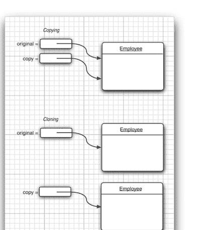

**图6-1 复制和克隆**

如果你希望 copy 是一个新对象，它最初与 original 相同，但之后状态可以随时间发生变化，请使用 clone 方法。

```java
Employee copy = original.clone();
copy.raiseSalary(10); // OK--original unchanged
```

但事情并没有那么简单。clone 方法是 Object 的一个受保护方法，这意味着你的代码不能直接调用它。只有 Employee 类可以克隆 Employee 对象。这个限制是有原因的。想一想 Object 类实现 clone 的方式。它对对象一无所知，因此只能逐字段进行复制。如果对象中的所有数据字段都是数字或其他基本类型，那么复制字段就没有问题。但如果对象包含对子对象的引用，那么复制字段只会得到对同一子对象的另一个引用，因此原始对象和克隆对象仍然会共享一些信息。

为了直观地理解这一点，考虑第4章中介绍的 Employee 类。图6-2展示了使用 Object 类的 clone 方法克隆这样一个 Employee 对象时会发生什么。正如你所看到的，默认的克隆操作是“浅拷贝”——它不会克隆在其他对象内部被引用的对象。（图中显示了一个共享的 Date 对象。由于稍后将会明确的原因，这个示例使用了 Employee 类的一个版本，其中雇用日期被表示为 Date。）

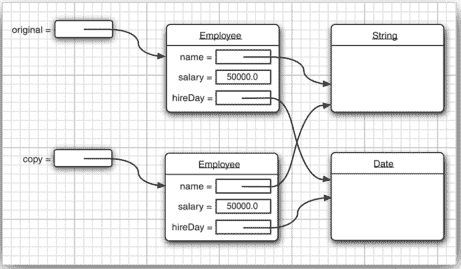

图6-2 浅拷贝

副本是浅拷贝有关系吗？这取决于具体情况。如果原始对象和浅克隆之间共享的子对象是不可变的，那么共享就是安全的。如果子对象属于不可变类（如 String），那么情况确实如此。或者，子对象在整个对象的生命周期中可能始终不变，没有修改器改变它，也没有任何方法返回它的引用。

然而，子对象经常是可变的，你必须重新定义 clone 方法来进行深拷贝，同时克隆子对象。在我们的示例中，`hireDay` 字段是一个 Date，它是可变的，因此也必须被克隆。（因此，这个示例使用 Date 类型的字段而非 LocalDate 来演示克隆过程。如果 `hireDay` 是不可变的 LocalDate 类的实例，就无需进一步的操作了。）

对于每个类，你需要决定：

- 默认的 clone 方法是否已经足够；
- 是否可以通过在可变子对象上调用 clone 来修补默认的 clone 方法；或者
- 是否不应该尝试克隆。

实际上，第三种选择是默认情况。要选择第一种或第二种方案，类必须：

- 实现 Cloneable 接口；并且
- 使用 public 访问修饰符重新定义 clone 方法。

> **注意：** clone 方法在 Object 类中被声明为 protected，因此你的代码不能直接调用 `Object.clone()`。但是，受保护的方法不是可以从任何子类访问吗？而且每个类不都是 Object 的子类吗？幸运的是，受保护访问的规则更为微妙（参见第5章）。子类只能调用受保护的 clone 方法来克隆*它自己的*对象。你必须将 clone 重新定义为 public，才能允许任何方法克隆对象。

在这种情况下，Cloneable 接口的出现与接口的正常用途无关。特别是，它并不指定 clone 方法——该方法是从 Object 类继承的。这个接口仅仅作为一个标记，表明类的设计者理解克隆过程。Java 对克隆极其谨慎，如果一个对象请求克隆但没有实现该接口，就会引发一个受检查异常。

> **注意：** Cloneable 接口是 Java 提供的少数几个*标记接口*之一。（有些程序员称其为*标签接口*。）回想一下，像 Comparable 这样的接口的通常目的是确保一个类实现了某个特定方法或一组方法。标记接口没有方法；它的唯一目的是允许在类型查询中使用 `instanceof`：
>
> ```java
> if (obj instanceof Cloneable) . . .
> ```
>
> 我们建议你不要在自己的程序中使用标记接口。

即使 clone 的默认（浅拷贝）实现已经足够，你仍然需要实现 `Cloneable` 接口，将 clone 重新定义为 public，并调用 `super.clone()`。下面是一个示例：

```java
class Employee implements Cloneable
{
    // public access, change return type
    public Employee clone() throws CloneNotSupportedException
    {
        return (Employee) super.clone();
    }
    . . .
}
```

> **注意：** 在 Java 1.4 之前，clone 方法总是具有返回类型 `Object`。如今，你可以为你的 clone 方法指定正确的返回类型。这是协变返回类型的一个示例（参见第5章）。

你刚刚看到的 clone 方法没有为 `Object.clone` 提供的浅拷贝增加任何功能。它只是将方法变为 public。要进行深拷贝，你需要做更多工作，克隆可变的实例字段。

下面是一个创建深拷贝的 clone 方法示例：

```java
class Employee implements Cloneable
{
    . . .

    public Employee clone() throws CloneNotSupportedException
    {
        // call Object.clone()
        Employee cloned = (Employee) super.clone();

        // clone mutable fields
        cloned.hireDay = (Date) hireDay.clone();

        return cloned;
    }
}
```

Object 类的 clone 方法会抛出 CloneNotSupportedException——每当在一个其类未实现 Cloneable 接口的对象上调用 clone 时，就会抛出该异常。当然，Employee 和 Date 类实现了 Cloneable 接口，所以不会抛出异常。然而，编译器并不知道这一点。因此，我们声明了该异常：

```java
public Employee clone() throws CloneNotSupportedException
```

> **注意：** 改为捕获异常是不是更好？（有关捕获异常的详细信息，请参见第7章。）

```java
public Employee clone()
{
    try
    {
        Employee cloned = (Employee) super.clone();
    }
    catch (CloneNotSupportedException e) { return null; }
    // this won't happen, since we are Cloneable
}
```

这对于 final 类是合适的。否则，最好保留 throws 说明符。这样可以让子类在无法支持克隆时选择抛出 CloneNotSupportedException。

你必须小心处理子类的克隆。例如，一旦你为 Employee 类定义了 clone 方法，任何人都可以用它来克隆 Manager 对象。Employee 的 clone 方法能否胜任这项工作？这取决于 Manager 类的字段。在我们的例子中，没有问题，因为 bonus 字段是基本类型。但 Manager 可能已经获得了需要深拷贝或不可克隆的字段。无法保证子类的实现者已经修正了 clone 以做正确的事情。因此，clone 方法在 Object 类中被声明为 protected。但如果你希望你的类的用户能够调用 clone，你就没有这种特权了。

你应该在自己的类中实现 clone 吗？如果你的客户需要深拷贝，那么你也许应该实现。有些作者认为你应该完全避免使用 clone，而是为实现相同目的另写一个方法。我们同意 clone 确实相当笨拙，但如果你把这个责任转移到另一个方法上，你也会遇到同样的问题。无论如何，克隆并不像你可能想象的那么常见。标准库中只有不到5%的类实现了 clone。

清单6.4中的程序克隆了 Employee 类（清单6.5）的一个实例，然后调用了两个更改器方法。raiseSalary 方法改变 salary 字段的值，而 setHireDay 方法改变 hireDay 字段的状态。由于 clone 被定义为进行深拷贝，这两个修改都不会影响原始对象。


> **注意：** 所有数组类型都有一个 clone 方法，它是 public 的，而不是 protected 的。你可以用它创建一个新数组，其中包含所有元素的副本。例如：
>
> ```java
> int[] luckyNumbers = { 2, 3, 5, 7, 11, 13 };
> int[] cloned = luckyNumbers.clone();
> cloned[5] = 12; // doesn't change luckyNumbers[5]
> ```

> **注意：** 第 II 卷第 2 章展示了另一种克隆对象的机制，它使用 Java 的对象序列化特性。该机制易于实现且安全，但效率不高。

## 清单 6.4 `clone/CloneTest.java`

```java
package clone;

/**
 * This program demonstrates cloning.
 * @version 1.1 2018-03-16
 * @author Cay Horstmann
 */
public class CloneTest
{
   public static void main(String[] args) throws CloneNotSupportedException
   {
      var original = new Employee("John Q. Public", 50000);
      original.setHireDay(2000, 1, 1);
      Employee copy = original.clone();
      copy.raiseSalary(10);
      copy.setHireDay(2002, 12, 31);
      System.out.println("original=" + original);
      System.out.println("copy=" + copy);
   }
}
```

## 清单 6.5 `clone/Employee.java`

```java
package clone;

import java.util.Date;
import java.util.GregorianCalendar;

public class Employee implements Cloneable
{
    private String name;
    private double salary;
    private Date hireDay;

    public Employee(String name, double salary)
    {
        this.name = name;
        this.salary = salary;
        hireDay = new Date();
    }

    public Employee clone() throws CloneNotSupportedException
    {
        // call Object.clone()
        Employee cloned = (Employee) super.clone();

        // clone mutable fields
        cloned.hireDay = (Date) hireDay.clone();

        return cloned;
    }

    /**
     * Set the hire day to a given date.
     * @param year the year of the hire day
     * @param month the month of the hire day
     * @param day the day of the hire day
     */
    public void setHireDay(int year, int month, int day)
    {
        Date newHireDay = new GregorianCalendar(year, month - 1, day).getTime();

        // example of instance field mutation
        hireDay.setTime(newHireDay.getTime());
    }

    public void raiseSalary(double byPercent)
    {
        double raise = salary * byPercent / 100;
        salary += raise;
    }

    public String toString()
    {
        return "Employee[name=" + name + ", salary=" + salary + ", hireDay=" + hireDay + "]";
    }
}
```

### 6.2 Lambda 表达式

在接下来的几节中，你将学习如何使用 lambda 表达式以简洁的语法定义代码块，以及如何编写使用 lambda 表达式的代码。

#### 6.2.1 为什么使用 Lambda？

lambda 表达式是一段可以传递的代码块，以便稍后执行一次或多次。在深入语法（甚至这个奇怪的名字）之前，让我们退一步，看看在 Java 中哪些地方用过这样的代码块。

在第 310 页的 6.1.7 节“接口与回调”中，你看到了如何按时间间隔执行工作。把工作放进 ActionListener 的 actionPerformed 方法中：

```java
class Worker implements ActionListener
{
   public void actionPerformed(ActionEvent event)
   {
      // do some work
   }
}
```

然后，当你想要重复执行这段代码时，构造一个 Worker 类的实例。再把这个实例提交给一个 Timer 对象。

关键在于，actionPerformed 方法包含了你希望稍后执行的代码。

或者考虑使用自定义比较器进行排序。如果你想按长度而不是默认的字典顺序对字符串排序，可以把一个 Comparator 对象传给 sort 方法：

```java
class LengthComparator implements Comparator<String>
{
   public int compare(String first, String second)
   {
      return first.length() - second.length();
   }
}

Arrays.sort(strings, new LengthComparator());
```

compare 方法不会立即被调用。相反，sort 方法会不断调用 compare 方法，如果元素顺序不对就重新排列它们，直到数组排好序。你给 sort 方法提供一段比较元素所需的代码片段，这段代码会被整合到排序逻辑的其余部分中，而你大概并不想重新实现那部分逻辑。

这两个例子有一个共同点。一段代码被传给了某个对象——一个计时器或一个 sort 方法。这段代码块在稍后的某个时间被调用。

到目前为止，在 Java 中把一段代码交给别人并不容易。你不能直接传递代码块。Java 是面向对象的语言，因此你必须构造一个对象，它所属的类中有一个包含所需代码的方法。

在其他语言中，可以直接使用代码块。Java 设计者长期以来一直抵制添加这一特性。毕竟，Java 的一大优势就是简洁性和一致性。如果一门语言包含了每一个只能让代码略微更简洁的特性，它可能会变得难以维护、一团乱麻。然而，在其他那些语言中，不仅仅是启动线程或注册按钮单击处理器更容易；它们的大量 API 也更简单、更一致、更强大。在 Java 中，本来可以编写类似的 API，接收实现了特定接口的类的对象，但这样的 API 用起来会很不愉快。

有一段时间，问题不是要不要为函数式编程扩展 Java，而是如何扩展。经过数年的实验，才出现了一种适合 Java 的设计。在下一节中，你将看到如何在 Java 中使用代码块。

#### 6.2.2 Lambda 表达式的语法

再次考虑上一节中的排序示例。我们传入的代码检查一个字符串是否比另一个短。我们计算

```java
first.length() - second.length()
```

这里的 *first* 和 *second* 是什么？它们都是字符串。Java 是强类型语言，我们也必须指明这一点：

```java
(String first, String second)
    -> first.length() - second.length()
```

你刚刚看到了第一个 *lambda 表达式*。这样的表达式就是一段代码块，以及必须传给该代码的任何变量的说明。

为什么叫这个名字？很多年前，在计算机出现之前，逻辑学家阿隆佐·邱奇想要形式化“数学函数有效可计算”意味着什么。（奇怪的是，有些函数已知存在，但没人知道如何计算它们的值。）他用希腊字母 lambda（λ）来标记参数。如果他知道 Java API，他会写成

```java
λfirst.λsecond.first.length() - second.length()
```

> **注意：** 为什么用字母 λ？邱奇把字母表里的其他字母都用完了吗？
> 实际上，令人尊敬的 *《数学原理》* 用 ^ 重音符号表示自由变量，这启发邱奇用大写 lambda Λ 表示参数。但最终，他改用了小写版本。从那以后，带有参数变量的表达式就一直被称为 lambda 表达式。

你刚刚看到了 Java 中 lambda 表达式的一种形式：参数、-> 箭头和一个表达式。如果代码执行的计算无法放入单个表达式，就完全像编写方法那样来写：用 {} 括起来，并显式使用 return 语句。例如，

```java
(String first, String second) ->
{
    if (first.length() < second.length()) return -1;
    else if (first.length() > second.length()) return 1;
    else return 0;
}
```

如果 lambda 表达式没有参数，仍然要提供空括号，就像无参方法一样：

```java
() -> { for (int i = 100; i >= 0; i--) System.out.println(i); }
```

如果可以推断 lambda 表达式的参数类型，就可以省略它们。例如，

```java
Comparator<String> comp
    = (first, second) // same as (String first, String second)
        -> first.length() - second.length();
```

这里，编译器可以推断 first 和 second 必定是字符串，因为该 lambda 表达式被赋给了一个字符串比较器。（下一节我们将更仔细地研究这个赋值。）

如果一个方法只有一个类型可推断的参数，甚至可以省略括号：

```java
ActionListener listener = event ->
    System.out.println("The time is "
        + Instant.ofEpochMilli(event.getWhen()));
    // instead of (event) -> . . . or (ActionEvent event) -> . . .
```


你从不指定 lambda 表达式的结果类型。它总是从上下文中推断出来。例如，表达式

```java
(String first, String second) -> first.length() - second.length()
```

可以用在期望得到 `int` 类型结果的上下文中。

> **注意：** lambda 表达式在某些分支中返回值而在其他分支中不返回值是非法的。例如，`(int x) -> { if (x > 0) return 1; }` 是无效的。

清单 6.6 中的程序展示了如何将 lambda 表达式用于比较器和动作监听器。

### 清单 6.6 `lambda/LambdaTest.java`

```java
package lambda;

import java.util.*;

import javax.swing.*;
import javax.swing.Timer;

/**
 * This program demonstrates the use of lambda expressions.
 * @version 1.0 2015-05-12
 * @author Cay Horstmann
 */
public class LambdaTest
{
   public static void main(String[] args)
   {
      var planets = new String[] { "Mercury", "Venus", "Earth", "Mars",
         "Jupiter", "Saturn", "Uranus", "Neptune" };
      System.out.println(Arrays.toString(planets));
      System.out.println("Sorted in dictionary order:");
      Arrays.sort(planets);
      System.out.println(Arrays.toString(planets));
      System.out.println("Sorted by length:");
      Arrays.sort(planets, (first, second) -> first.length() - second.length());
      System.out.println(Arrays.toString(planets));

      var timer = new Timer(1000, event ->
         System.out.println("The time is " + new Date()));
      timer.start();
```

```java
var timer = new Timer(1000, event ->
{
    System.out.println("At the tone, the time is "
        + Instant.ofEpochMilli(event.getWhen()));
    Toolkit.getDefaultToolkit().beep();
});
```

这比使用实现 `ActionListener` 接口的类那种替代方案要易读得多。

事实上，在 Java 中，将 lambda 表达式转换为函数式接口是你能对 lambda 表达式做的*唯一*事情。在其他支持函数字面量的编程语言中，你可以声明诸如 `(String, String) -> int` 这样的函数类型，声明这些类型的变量，并使用这些变量来保存函数表达式。然而，Java 设计者决定坚持使用熟悉的接口概念，而不是向语言中添加函数类型。

> **注意：** 你甚至不能将 lambda 表达式赋值给 `Object` 类型的变量——`Object` 不是函数式接口。

Java API 在 `java.util.function` 包中定义了许多非常通用的函数式接口。其中一个接口 `BiFunction<T, U, R>` 描述参数类型为 T 和 U、返回类型为 R 的函数。你可以将我们的字符串比较 lambda 保存在该类型的变量中：

```java
BiFunction<String, String, Integer> comp
    = (first, second) -> first.length() - second.length();
```

然而，这对排序没有帮助。没有哪个 `Arrays.sort` 方法需要 `BiFunction`。如果你以前使用过函数式编程语言，可能会觉得这很奇怪。但对 Java 程序员来说，这很自然。像 `Comparator` 这样的接口有特定用途，而不仅仅是一个具有给定参数和返回类型的方法。当你想用 lambda 表达式做某事时，你仍然需要牢记该表达式的用途，并为其使用特定的函数式接口。

`java.util.function` 包中一个特别有用的接口是 `Predicate`：

```java
public interface Predicate<T>
{
    boolean test(T t);
    // additional default and static methods
}
```

`ArrayList` 类有一个 `removeIf` 方法，其参数是 `Predicate`。它专门设计用于传入 lambda 表达式。例如，下面的语句从数组列表中移除所有 null 值：

```java
list.removeIf(e -> e == null);
```

另一个有用的函数式接口是 `Supplier<T>`：

```java
public interface Supplier<T>
{
   T get();
}
```

供应者没有参数，在被调用时产生一个 T 类型的值。供应者用于惰性求值。例如，考虑以下调用

```java
LocalDate hireday = Objects.requireNonNullElse(day,
   LocalDate.of(1970, 1, 1));
```

这并非最优。我们预期 day 很少为 null，因此只想在必要时构造默认的 `LocalDate`。通过使用供应者，我们可以推迟计算：

```java
LocalDate hireday = Objects.requireNonNullElseGet(day,
   () -> LocalDate.of(1970, 1, 1));
```

`requireNonNullElseGet` 方法仅在需要该值时调用供应者。

#### 6.2.4 方法引用

有时，lambda 表达式只涉及一个方法。例如，假设你只想在每次定时器事件发生时打印事件对象。当然，你可以调用

```java
var timer = new Timer(1000, event -> System.out.println(event));
```

如果你能直接把 `println` 方法传递给 `Timer` 构造函数，那就更好了。下面是实现方式：

```java
var timer = new Timer(1000, System.out::println);
```

表达式 `System.out::println` 是一个方法引用。它指示编译器生成一个函数式接口的实例，重写该接口的单个抽象方法来调用给定的方法。在这个例子中，生成一个 `ActionListener`，其 `actionPerformed(ActionEvent e)` 方法调用 `System.out.println(e)`。

> **注意：** 与 lambda 表达式一样，方法引用不是对象。当它被赋值给类型为函数式接口的变量时，才会产生一个对象。

> **注意：** `PrintStream` 类（`System.out` 是它的一个实例）中有十个重载的 `println` 方法。编译器需要根据上下文判断使用哪一个。在我们的例子中，方法引用 `System.out::println` 必须转换为一个具有如下方法的 `ActionListener` 实例
>
> ```java
> void actionPerformed(ActionEvent e)
> ```
>
> 由于 `Object` 与 `ActionEvent` 最匹配，因此从十个重载的 `println` 方法中选择了 `println(Object x)` 方法。当调用 `actionPerformed` 方法时，会打印事件对象。
>
> 现在假设我们将同一个方法引用赋值给另一个不同的函数式接口：
>
> ```java
> Runnable task = System.out::println;
> ```
>
> `Runnable` 函数式接口有一个无参数的单个抽象方法
>
> ```java
> void run()
> ```
>
> 在这种情况下，会选择无参数的 `println()` 方法。调用 `task.run()` 会向 `System.out` 打印一个空行。

再举一个例子，假设你想不区分字母大小写地对字符串排序。你可以传入这个方法表达式：

```java
Arrays.sort(strings, String::compareToIgnoreCase)
```

从这些示例中可以看出，`::` 运算符将方法名与对象名或类名分隔开。有三种变体：

- 1. `object::instanceMethod`
- 2. `Class::instanceMethod`
- 3. `Class::staticMethod`

在第一种变体中，方法引用等价于一个 lambda 表达式，其参数被传递给该方法。对于 `System.out::println`，对象是 `System.out`，方法表达式等价于 `x -> System.out.println(x)`。

在第二种变体中，第一个参数成为该方法的隐式参数。例如，`String::compareToIgnoreCase` 与 `(x, y) -> x.compareToIgnoreCase(y)` 相同。

在第三种变体中，所有参数都被传递给静态方法：`Math::pow` 等价于 `(x, y) -> Math.pow(x, y)`。

表 6.1 带你了解其他示例。

注意，只有当 lambda 表达式的主体调用单个方法且不做其他任何事情时，才能将 lambda 表达式改写为方法引用。考虑这个 lambda 表达式

```
s -> s.length() == 0
```

这里有一个单独的方法调用。但还有一个比较，因此这里不能使用方法引用。

> **注意：** 当有多个同名重载方法时，编译器会尝试从上下文中找出你指的是哪一个。例如，`Math.max` 方法有两个版本，一个用于整数，一个用于 double 值。选择哪一个取决于 `Math::max` 所转换成的函数式接口的方法参数。与 lambda 表达式一样，方法引用并不孤立存在。它们总是被转换为函数式接口的实例。

> **注意：** 有时，API 中包含专门用作方法引用的方法。例如，`Objects` 类有一个 `isNull` 方法，用于测试对象引用是否为 null。乍一看，这似乎没什么用，因为测试 `obj == null` 比 `Objects.isNull(obj)` 更易读。但你可以将方法引用传递给任何带有 `Predicate` 参数的方法。例如，要从列表中移除所有 null 引用，可以调用
>
> ```java
> list.removeIf(Objects::isNull);
> // A bit easier to read than list.removeIf(e -> e == null);
> ```

> **注意：** 带对象的方法引用与其等价的 lambda 表达式之间有细微差别。考虑 `separator::equals` 这样的方法引用。如果 `separator` 为 null，那么形成 `separator::equals` 会立即抛出 `NullPointerException`。而 lambda 表达式 `x -> separator.equals(x)` 只有在被调用时才会抛出 `NullPointerException`。

你可以在方法引用中捕获 `this` 参数。例如，`this::equals` 与 `x -> this.equals(x)` 相同。使用 `super` 也是有效的。方法表达式

```
super::instanceMethod
```


## 表 6.1 方法引用示例

| 方法引用 | 等价的 Lambda 表达式 | 说明 |
|---|---|---|
| `separator::equals` | `x -> separator.equals(x)` | 这是一个带有对象和实例方法的方法表达式。lambda 参数作为该方法的显式参数传入。 |
| `String::trim` | `x -> x.trim()` | 这是一个带有类和实例方法的方法表达式。lambda 参数成为隐式参数。 |
| `String::concat` | `(x, y) -> x.concat(y)` | 同样，这里有一个实例方法，但这次带有一个显式参数。和之前一样，第一个 lambda 参数成为隐式参数，其余参数传给该方法。 |
| `Integer.valueOf` | `x -> Integer.valueOf(x)` | 这是一个带有静态方法的方法表达式。lambda 参数传给该静态方法。 |
| `Integer.sum` | `(x, y) -> Integer.sum(x, y)` | 这是另一个静态方法，但这次带有两个参数。两个 lambda 参数都传给该静态方法。`Integer.sum` 方法就是专门为用作方法引用而创建的。如果写成 lambda，你只需写 `(x, y) -> x + y`。 |
| `Integer::new` | `x -> new Integer(x)` | 这是一个构造器引用——见 6.2.5 节。lambda 参数传给该构造器。 |
| `Integer[]::new` | `n -> new Integer[n]` | 这是一个数组构造器引用——见 6.2.5 节。lambda 参数是数组长度。 |

使用 this 作为目标，并调用给定方法的超类版本。下面是一个展示其机制的人为示例：

```java
class Greeter
{
    public void greet(ActionEvent event)
    {
        System.out.println("Hello, the time is "
            + Instant.ofEpochMilli(event.getWhen()));
    }
}
```

```java
class RepeatedGreeter extends Greeter
{
    public void greet(ActionEvent event)
    {
        var timer = new Timer(1000, super::greet);
        timer.start();
    }
}
```

当 RepeatedGreeter.greet 方法启动时，会构造一个 Timer，它在每个计时器 tick 上执行 super::greet 方法。

#### 6.2.5 构造器引用

构造器引用与方法引用类似，只不过方法名是 new。例如，Person::new 是对某个 Person 构造器的引用。是哪个构造器？这取决于上下文。假设你有一个字符串列表。然后你可以通过对每个字符串调用构造器，将它转换为 Person 对象数组，调用方式如下：

```java
ArrayList<String> names = ...;
Stream<Person> stream = names.stream().map(Person::new);
List<Person> people = stream.collect(Collectors.toList());
```

我们将在第二卷第一章讨论流、map 和 collect 方法的细节。目前重要的是，map 方法会为每个列表元素调用 Person(String) 构造器。如果有多个 Person 构造器，编译器会选择带有 String 参数的那个，因为它从上下文中推断出该构造器是用字符串调用的。

你可以用数组类型构成构造器引用。例如，int[]::new 是一个带有一个参数的构造器引用：数组的长度。它等价于 lambda 表达式 x -> new int[x]。

数组构造器引用有助于克服 Java 的一个限制。无法构造泛型类型 T 的数组。表达式 new T[n] 是错误的，因为它会被擦除为 new Object[n]。这对库来说是一个问题。

在我们的例子中，lambda 表达式有一个自由变量 `text`。表示该 lambda 表达式的数据结构必须存储自由变量的值——在我们的例子中，就是字符串 `"Hello"`。我们说这些值已被 lambda 表达式捕获。（具体如何做到是实现的细节。例如，可以将 lambda 表达式转换为一个带有单个方法的对象，这样自由变量的值就被复制到该对象的实例变量中。）

> **注意：** 代码块连同自由变量值的技术术语是 *闭包*。如果有人吹嘘自己的语言有闭包，请放心，Java 也有。在 Java 中，lambda 表达式就是闭包。

如你所见，lambda 表达式可以捕获外围作用域中某个变量的值。在 Java 中，为了确保捕获的值定义明确，有一个重要限制。在 lambda 表达式中，你只能引用值不会改变的变量。例如，下面这样是非法的：

```java
public static void countDown(int start, int delay)
{
    ActionListener listener = event ->
    {
        start--; // ERROR: Can't mutate captured variable
        System.out.println(start);
    };
    new Timer(delay, listener).start();
}
```

这个限制是有原因的。当多个动作并发执行时，修改 lambda 表达式中的变量是不安全的。对于到目前为止我们见过的那些动作，这不会发生，但一般来说，这是一个严重的问题。关于这个重要问题的更多信息，请参见第 12 章。

在 lambda 表达式中引用一个在外部被修改的变量也是非法的。例如，下面这样是非法的：

```java
public static void repeat(String text, int count)
{
    for (int i = 1; i <= count; i++)
    {
        ActionListener listener = event ->
        {
            System.out.println(i + " " + text);
            // ERROR: Cannot refer to changing i
        };
        new Timer(1000, listener).start();
    }
}
```

规则是：lambda 表达式中的任何被捕获变量都必须是 *事实上的最终变量*。事实上的最终变量是指初始化后从未被赋予新值的变量。在我们的例子中，text 始终引用同一个 String 对象，因此捕获它是可以的。然而，i 的值会被修改，因此 i 不能被捕获。

lambda 表达式的主体具有 *与嵌套块相同的作用域*。名称冲突和遮蔽的规则同样适用。在 lambda 中声明与某个局部变量同名的参数或局部变量是非法的。

```java
Path first = Path.of("/usr/bin");
Comparator<String> comp
   = (first, second) -> first.length() - second.length();
// ERROR: Variable first already defined
```

在一个方法内，不能有两个同名的局部变量，因此也不能在 lambda 表达式中引入这样的变量。当你在 lambda 表达式中使用 this 关键字时，你指的是创建该 lambda 的方法的 this 参数。例如，考虑

```java
public class Application
{
   public void init()
   {
      ActionListener listener = event ->
         {
            System.out.println(this.toString());
            ...
         };
      ...
   }
}
```

表达式 this.toString() 调用的是 Application 对象的 toString 方法，*而不是* ActionListener 实例的方法。在 lambda 表达式中使用 this 并没有什么特别之处。lambda 表达式的作用域嵌套在 init 方法内部，而 this 在该方法的任何位置都具有相同含义。

#### 6.2.7 处理 Lambda 表达式

到目前为止，你已经看到如何生成 lambda 表达式，并将它们传给期望函数式接口的方法。现在让我们看看如何编写能够使用 lambda 表达式的方法。

使用 lambda 的重点是 *延迟执行*。毕竟，如果你想现在执行某些代码，直接执行即可，而不必把它包在 lambda 里。稍后执行代码有很多原因，例如：

- 在单独的线程中运行代码
- 多次运行代码
- 在算法中的正确时点运行代码（例如排序中的比较操作）
- 在发生某事时运行代码（按钮被点击、数据到达等）
- 仅在必要时运行代码

让我们看一个简单的例子。假设你想将某个动作重复 n 次。该动作和次数被传给 repeat 方法：

```java
repeat(10, () -> System.out.println("Hello, World!"));
```

为了接收这个 lambda，我们需要选择一个（或在少数情况下提供）函数式接口。表 6.2 列出了 Java API 中提供的最重要的函数式接口。在这种情况下，我们可以使用 Runnable 接口：

```java
public static void repeat(int n, Runnable action)
{
    for (int i = 0; i < n; i++) action.run();
}
```

注意，lambda 表达式的主体在调用 action.run() 时执行。

现在让这个例子稍微复杂一些。我们想告诉该动作它发生在哪次迭代中。为此，我们需要选择一个函数式接口，它有一个带 int 参数且返回 void 的方法。处理 int 值的标准接口是

```java
public interface IntConsumer
{
    void accept(int value);
}
```

下面是 repeat 方法的改进版本：

```java
public static void repeat(int n, IntConsumer action)
{
    for (int i = 0; i < n; i++) action.accept(i);
}
```


下面是你调用它的方式：

```
repeat(10, i -> System.out.println("Countdown: " + (9 - i)));
```

**表6.2 常见函数式接口**

| 函数式接口 | 参数类型 | 返回类型 | 抽象方法名 | 描述 | 其他方法 |
|---|---|---|---|---|---|
| Runnable | 无 | void | run | 运行一个没有参数或返回值的操作 |  |
| `Supplier<T>` | 无 | T | get | 提供一个类型为 T 的值 |  |
| `Consumer<T>` | T | void | accept | 消费一个类型为 T 的值 | andThen |
| `BiConsumer<T, U>` | T, U | void | accept | 消费类型为 T 和 U 的值 | andThen |
| `Function<T, R>` | T | R | apply | 一个参数类型为 T 的函数 | compose, andThen, identity |
| `BiFunction<T, U, R>` | T, U | R | apply | 一个带有类型为 T 和 U 的参数的函数 | andThen |
| `UnaryOperator<T>` | T | T | apply | 对类型 T 的一元运算符 | compose, andThen, identity |
| `BinaryOperator<T>` | T, T | T | apply | 对类型 T 的二元运算符 | andThen, maxBy, minBy |
| `Predicate<T>` | T | boolean | test | 一个返回布尔值的函数 | and, or, negate, isEqual |
| `BiPredicate<T, U>` | T, U | boolean | test | 一个带有两个参数的返回布尔值的函数 | and, or, negate |

表6.3列出了针对基本类型 `int`、`long` 和 `double` 的34个可用特化。正如你将在第8章中看到的，使用这些特化比使用泛型接口更高效。因此，在上一节的示例中，我使用了 `IntConsumer` 而不是 `Consumer<Integer>`。

**表6.3** 基本类型的函数式接口
`p, q` 是 int、long、double；`P, Q` 是 Int、Long、Double

| 函数式接口 | 参数类型 | 返回类型 | 抽象方法名 |
| :--- | :--- | :--- | :--- |
| BooleanSupplier | 无 | boolean | getAsBoolean |
| PSupplier | 无 | P | getAsP |
| PConsumer | P | void | accept |
| `ObjPConsumer<T>` | T, P | void | accept |
| `PFunction<T>` | P | T | apply |
| PToQFunction | P | Q | applyAsQ |
| `ToPFunction<T>` | T | P | applyAsP |
| `ToPBiFunction<T, U>` | T, U | P | applyAsP |
| PUnaryOperator | P | P | applyAsP |
| PBinaryOperator | P, P | P | applyAsP |
| PPredicate | P | boolean | test |

> **提示：** 只要可以，最好使用表6.2或表6.3中的接口。例如，假设你编写一个方法来处理符合某个条件的文件。有一个遗留接口 `java.io.FileFilter`，但最好使用标准的 `Predicate<File>`。不这样做的唯一理由是你已经有许多生成 `FileFilter` 实例的有用方法。

> **注意：** 大多数标准函数式接口都有用于生成或组合函数的非抽象方法。例如，`Predicate.isEqual(a)` 与 `a::equals` 相同，但如果 a 是 `null`，它也能工作。有用于组合谓词的默认方法 `and`、`or`、`negate`。例如，`Predicate.isEqual(a).or(Predicate.isEqual(b))` 与 `x -> a.equals(x) || b.equals(x)` 相同。

> **注意：** 如果你设计自己的接口，并且它只有一个抽象方法，你可以用 `@FunctionalInterface` 注解来标记它。这有两个优点。如果你不小心添加了另一个抽象方法，编译器会给出错误消息。并且 javadoc 页面会包含一条说明，指出你的接口是函数式接口。
>
> 并不要求使用该注解。任何只有一个抽象方法的接口，按定义就是函数式接口。但使用 `@FunctionalInterface` 注解是一个好主意。

#### 6.2.8 关于比较器的更多内容

`Comparator` 接口有许多用于创建比较器的便捷静态方法。这些方法旨在与 lambda 表达式或方法引用一起使用。

静态 `comparing` 方法接受一个“键提取器”函数，该函数将类型 `T` 映射到可比较类型（例如 `String`）。该函数应用于要比较的对象，然后对返回的键进行比较。例如，假设你有一个 `Person` 对象数组。下面是如何按姓名对它们排序：

```
Arrays.sort(people, Comparator.comparing(Person::getName));
```

这当然比手动实现 `Comparator` 容易得多。而且，代码更清晰，因为很明显我们想按姓名比较人。

你可以使用 `thenComparing` 方法链接比较器来打破平局。例如，

```
Arrays.sort(people,
        Comparator.comparing(Person::getLastName)
            .thenComparing(Person::getFirstName));
```

如果两个人有相同的姓氏，则使用第二个比较器。

这些方法有几种变体。你可以指定一个比较器，用于 `comparing` 和 `thenComparing` 方法提取的键。例如，这里我们按姓名长度对人排序：

```
Arrays.sort(people, Comparator.comparing(Person::getName,
        (s, t) -> Integer.compare(s.length(), t.length())));
```

此外，`comparing` 和 `thenComparing` 方法都有避免对 `int`、`long` 或 `double` 值进行装箱的变体。产生上述操作的一种更简单方式是

```
    Arrays.sort(people, Comparator.comparingInt(p -> p.getName().length()));
```

如果你的键函数可以返回 `null`，你会喜欢 `nullsFirst` 和 `nullsLast` 适配器。这些静态方法接受一个现有比较器并修改它，使其在遇到 `null` 值时不会抛出异常，而是将它们排为比常规值更小或更大。例如，假设当一个人没有中间名时，`getMiddleName` 返回 `null`。那么你可以使用 `Comparator.comparing(Person::getMiddleName, Comparator.nullsFirst(. . .))`。

`nullsFirst` 方法需要一个比较器——在本例中，是一个比较两个字符串的比较器。`naturalOrder` 方法为任何实现 `Comparable` 的类创建一个比较器。我们需要的是 `Comparator.<String>naturalOrder()`。以下是按可能为 null 的中间名排序的完整调用。我使用了 `java.util.Comparator.*` 的静态导入，以使表达式更易读。注意 `naturalOrder` 的类型是推断出来的。

```
    Arrays.sort(people, comparing(Person::getMiddleName, nullsFirst(naturalOrder())));
```

静态 `reverseOrder` 方法给出自然顺序的逆序。要反转任何比较器，请使用 `reversed` 实例方法。例如，`naturalOrder().reversed()` 与 `reverseOrder()` 相同。

### 6.3 内部类

*内部类*是定义在另一个类内部的类。你为什么要这样做？有两个原因：

- 内部类可以对同一包中的其他类隐藏。
- 内部类方法可以访问定义它们所在作用域中的数据——包括原本会是私有的数据。

内部类过去对于简洁地实现回调非常重要，但如今 lambda 表达式做得更好。尽管如此，内部类对于组织代码仍然非常有用。以下各节将带你了解所有细节。

**C++ 注意：** C++ 有嵌套类。嵌套类包含在外层类的作用域内。下面是一个典型示例：一个链表类定义了一个用于保存链接的类，以及一个用于定义迭代器位置的类。

```cpp
class LinkedList
{
public:
    class Iterator // a nested class
    {
    public:
        void insert(int x);
        int erase();
        ...
    private:
        Link* current;
        LinkedList* owner;
    };
    ...
private:
    Link* head;
    Link* tail;
};
```

嵌套类类似于 Java 中的内部类。然而，Java 内部类有一个额外特性，使它们比 C++ 中的嵌套类更丰富、更有用。来自内部类的对象有一个隐式引用，指向实例化它的外部类对象。通过这个指针，它可以访问外部对象的全部状态。例如，在 Java 中，`Iterator` 类不需要显式指向它所指向的 `LinkedList` 的指针。

在 Java 中，静态内部类没有这个附加指针。它们相当于 C++ 中的嵌套类。

#### 6.3.1 使用内部类访问对象状态

内部类的语法相当复杂。因此，我们提供一个简单但有些人为的示例来演示内部类的使用。我们重构 `TimeTest` 示例，并提取一个 `TalkingClock` 类。一个会说话的时钟用两个参数构造：播报之间的间隔，以及一个打开或关闭蜂鸣声的标志。


```java
public class TalkingClock
{
    private int interval;
    private boolean beep;

    public TalkingClock(int interval, boolean beep) { . . . }
    public void start() { . . . }

    public class TimePrinter implements ActionListener
        // an inner class
    {
        . . .
    }
}
```

请注意，TimePrinter 类现在位于 TalkingClock 类内部。这*并不*意味着每个 TalkingClock 都有一个 TimePrinter 实例字段。正如你将看到的，TimePrinter 对象是由 TalkingClock 类的方法构造的。

下面是更详细的 TimePrinter 类。请注意，actionPerformed 方法在发出蜂鸣声之前会检查 beep 标志。

```java
public class TimePrinter implements ActionListener
{
    public void actionPerformed(ActionEvent event)
    {
        System.out.println("At the tone, the time is "
            + Instant.ofEpochMilli(event.getWhen()));
        if (beep) Toolkit.getDefaultToolkit().beep();
    }
}
```

有些令人惊讶的事情正在发生。TimePrinter 类没有名为 beep 的实例字段或变量。相反，beep 引用的是创建这个 TimePrinter 的 TalkingClock 对象的字段。正如你所看到的，内部类方法既可以访问自己的数据字段，也可以访问创建它的外部对象的数据字段。

为了实现这一点，内部类对象总是会获得一个指向创建它的对象的隐式引用（见图6.3）。

这个引用在内部类的定义中是不可见的。然而，为了阐明这个概念，让我们把这个对外部对象的引用称为 *outer*。那么 actionPerformed 方法等价于以下代码：

```java
public void actionPerformed(ActionEvent event)
{
    System.out.println("At the tone, the time is "
        + Instant.ofEpochMilli(event.getWhen()));
    if (outer.beep) Toolkit.getDefaultToolkit().beep();
}
```

> **注意：** 我们可以将 `TimePrinter` 类声明为 private。这样，只有 `TalkingClock` 的方法才能构造 `TimePrinter` 对象。只有内部类可以是 private。普通类始终具有包访问权限或公共访问权限。

## **清单 6.7** `innerClass/InnerClassTest.java`

```java
package innerClass;

import java.awt.*;
import java.awt.event.*;
import java.time.*;

import javax.swing.*;

/**
 * This program demonstrates the use of inner classes.
 * @version 1.11 2017-12-14
 * @author Cay Horstmann
 */
public class InnerClassTest
{
   public static void main(String[] args)
   {
      var clock = new TalkingClock(1000, true);
      clock.start();

      // keep program running until the user selects "OK"
      JOptionPane.showMessageDialog(null, "Quit program?");
      System.exit(0);
   }
}

/**
 * A clock that prints the time in regular intervals.
 */
class TalkingClock
{
   private int interval;
   private boolean beep;

   /**
    * Constructs a talking clock
    * @param interval the interval between messages (in milliseconds)
    * @param beep true if the clock should beep
    */
   public TalkingClock(int interval, boolean beep)
   {
       this.interval = interval;
       this.beep = beep;
   }

   /**
    * Starts the clock.
    */
   public void start()
   {
       var listener = new TimePrinter();
       var timer = new Timer(interval, listener);
       timer.start();
   }

   public class TimePrinter implements ActionListener
   {
       public void actionPerformed(ActionEvent event)
       {
           System.out.println("At the tone, the time is "
               + Instant.ofEpochMilli(event.getWhen()));
           if (beep) Toolkit.getDefaultToolkit().beep();
       }
   }
}
```

#### 6.3.2 内部类的特殊语法规则

在上一节中，我们通过将内部类的外部类引用称为 *outer* 来解释它。实际上，外部引用的正确语法要稍微复杂一些。表达式

`OuterClass.this`

表示外部类引用。例如，你可以将 `TimePrinter` 内部类的 `actionPerformed` 方法写成

```java
public void actionPerformed(ActionEvent event)
{
    if (TalkingClock.this.beep) Toolkit.getDefaultToolkit().beep();
}
```

相反，你可以使用以下语法更显式地编写内部对象构造函数：

`outerObject.new InnerClass(construction parameters)`

例如：

例如，TalkingClock 类内部的 TimePrinter 类会被转换成一个类文件 `TalkingClock$TimePrinter.class`。要了解其工作原理，请尝试以下实验：运行第5章的 ReflectionTest 程序，并将类 `TalkingClock$TimePrinter` 交给它进行反射。或者，直接使用 `javap` 工具：

```bash
javap -private ClassName
```

> **注意：** 如果你使用 UNIX，请记住在命令行中提供类名时转义 `$` 字符。也就是说，像下面这样运行 ReflectionTest 或 javap 程序：
>
> ```bash
> javap reflection.ReflectionTest innerClass.TalkingClock\$TimePrinter
> ```
>
> 或
>
> ```bash
> javap -private innerClass.TalkingClock\$TimePrinter
> ```

你将得到以下输出：

```java
public class innerClass.TalkingClock$TimePrinter
    implements java.awt.event.ActionListener
{
    final innerClass.TalkingClock this$0;
    public innerClass.TalkingClock$TimePrinter(innerClass.TalkingClock);
    public void actionPerformed(java.awt.event.ActionEvent);
}
```

你可以清楚地看到，编译器为外部类引用生成了一个额外的实例字段 `this$0`。（名称 `this$0` 是由编译器合成的——你无法在代码中引用它。）你还可以看到构造函数的 TalkingClock 参数。

如果编译器可以自动完成这种转换，难道你不能手动实现相同的机制吗？让我们试一试。我们将 TimePrinter 变成一个位于 TalkingClock 类之外的普通类。在构造 TimePrinter 对象时，我们将其创建者的 `this` 引用传递给它。

```java
class TalkingClock
{
    . . .
    public void start()
    {
        var listener = new TimePrinter(this);
        var timer = new Timer(interval, listener);
        timer.start();
    }
}
```

```java
class TimePrinter implements ActionListener
{
   private TalkingClock outer;
   . . .
   public TimePrinter(TalkingClock clock)
   {
      outer = clock;
   }
}
```

现在让我们看看 actionPerformed 方法。它需要访问 outer.beep。

```java
if (outer.beep) . . . // ERROR
```

这里我们遇到了一个问题。内部类可以访问外部类的私有数据，但我们的外部 TimePrinter 类却不能。

因此，内部类确实比普通类更强大，因为它们拥有更多的访问权限。

你可能很想知道，如果内部类被转换为带有奇怪名称的普通类——而虚拟机对它们一无所知——它们是如何获得这些额外的访问权限的。为了解开这个谜团，让我们再次使用 ReflectionTest 程序来窥探 TalkingClock 类：

```java
class TalkingClock
{
   private int interval;
   private boolean beep;

   public TalkingClock(int, boolean);

   static boolean access$0(TalkingClock);
   public void start();
}
```

注意编译器添加到外部类的静态 access$0 方法。它返回作为参数传入的对象的 beep 字段。（方法名可能略有不同，例如 access$000，具体取决于你的编译器。）

内部类的方法会调用该方法。TimePrinter 类的 actionPerformed 方法中的语句

```java
if (beep)
```

实际上会进行以下调用：

```java
if (TalkingClock.access$0(outer))
```

这是安全风险吗？当然是。别人调用 `access$0` 方法读取私有 `beep` 字段是很容易的。当然，`access$0` 不是 Java 方法的合法名称。然而，熟悉类文件结构的黑客很容易生成一个带有虚拟机指令的类文件来调用该方法，例如使用十六进制编辑器。由于这些秘密方法具有包访问权限，攻击代码需要放置在与被攻击类相同的包中。

总而言之，如果内部类访问了某个私有数据字段，那么有可能通过添加到外部类所在包中的其他类来访问该数据字段，但这需要技巧和决心。程序员不会偶然获得访问权限，必须故意为此构建或修改类文件。

> **注意：** 合成的构造函数和方法可能会变得相当复杂。（如果你对此感到不适，可以跳过此注释。）假设我们将 `TimePrinter` 变成一个私有内部类。虚拟机中没有私有类，因此编译器会生成一个次佳的选择：一个具有包访问权限和私有构造函数的类：
>
> ```java
> private TalkingClock$TimePrinter(TalkingClock);
> ```
>
> 当然，没有人能调用这个构造函数，所以还有第二个具有包访问权限的构造函数：
>
> ```java
> TalkingClock$TimePrinter(TalkingClock, TalkingClock$1);
> ```
>
> 它调用第一个构造函数。`TalkingClock$1` 类被合成出来仅仅是为了将这个构造函数与其他构造函数区分开。
>
> 编译器将 `TalkingClock` 类 start 方法中的构造函数调用转换为
>
> ```java
> new TalkingClock$TimePrinter(this, null)
> ```

#### 6.3.4 局部内部类

如果仔细查看 TalkingClock 示例的代码，你会发现你只需要一次类型名 TimePrinter：也就是在 start 方法中创建该类型的对象时。

在这种情况下，你可以在单个方法中局部地定义这个类。

```java
public void start()
{
}
```


```java
class TimePrinter implements ActionListener
{
    public void actionPerformed(ActionEvent event)
    {
        System.out.println("At the tone, the time is "
            + Instant.ofEpochMilli(event.getWhen()));
        if (beep) Toolkit.getDefaultToolkit().beep();
    }
}

var listener = new TimePrinter();
var timer = new Timer(interval, listener);
timer.start();
}
```

局部类从不用访问修饰符（即 public 或 private）声明。它们的作用域始终限制在声明它们的块中。

局部类有一个很大的优势：它们对外部世界完全隐藏——甚至 TalkingClock 类中的其他代码也无法访问它们。除了 start 之外，没有任何方法知道 TimePrinter 类。

#### 6.3.5 访问外部方法中的变量

局部类相比其他内部类还有另一个优势。它们不仅能访问外部类的字段，甚至还能访问局部变量！不过，这些局部变量必须是*事实上的 final*。这意味着，一旦赋值，它们就不能再改变。

这是一个典型示例。我们把 interval 和 beep 参数从 TalkingClock 构造器移到 start 方法中。

```java
public void start(int interval, boolean beep)
{
    class TimePrinter implements ActionListener
    {
        public void actionPerformed(ActionEvent event)
        {
            System.out.println("At the tone, the time is "
                + Instant.ofEpochMilli(event.getWhen()));
            if (beep) Toolkit.getDefaultToolkit().beep();
        }
    }

    var listener = new TimePrinter();
    var timer = new Timer(interval, listener);
    timer.start();
}
```

注意，`TalkingClock` 类不再需要存储 beep 实例字段。它只是引用 `start` 方法的 beep 参数变量。

也许这并不那么令人惊讶。下面这行

```java
if (beep) . . .
```

毕竟最终位于 `start` 方法内部，那么它为什么不能访问 beep 变量的值呢？

为了弄清这里为什么存在一个微妙的问题，让我们更仔细地考察控制流。

- 1. 调用 `start` 方法。
- 2. 通过调用内部类 `TimePrinter` 的构造器来初始化对象变量 `listener`。
- 3. 将 listener 引用传递给 `Timer` 构造器，启动计时器，然后 `start` 方法退出。此时，`start` 方法的 beep 参数变量已不再存在。
- 4. 一秒后，如果 `(beep) . . .`，则执行 `actionPerformed` 方法。

为了让 `actionPerformed` 方法中的代码能够工作，`TimePrinter` 类必须在 beep 参数值消失之前，将 beep 字段复制为 `start` 方法的局部变量。实际情况正是如此。在我们的示例中，编译器为这个局部内部类合成名称 `TalkingClock$1TimePrinter`。如果你再次使用 `ReflectionTest` 程序来窥探 `TalkingClock$1TimePrinter` 类，将得到以下输出：

```java
class TalkingClock$1TimePrinter
{
    TalkingClock$1TimePrinter(TalkingClock, boolean);

    public void actionPerformed(java.awt.event.ActionEvent);

    final boolean val$beep;
    final TalkingClock this$0;
}
```

注意构造器的 boolean 参数和 `val$beep` 实例变量。创建对象时，beep 值被传入构造器并存储在 `val$beep` 字段中。编译器会检测对局部变量的访问，为每个局部变量生成匹配的实例字段，并将局部变量复制到构造器中，以便初始化这些实例字段。

#### 6.3.6 匿名内部类

使用局部内部类时，通常还可以更进一步。如果你只想创建这个类的一个对象，甚至不需要给这个类命名。这样的类称为*匿名内部类*。

```java
public void start(int interval, boolean beep)
{
   var listener = new ActionListener()
      {
         public void actionPerformed(ActionEvent event)
         {
            System.out.println("At the tone, the time is "
               + Instant.ofEpochMilli(event.getWhen()));
            if (beep) Toolkit.getDefaultToolkit().beep();
         }
      };
   var timer = new Timer(interval, listener);
   timer.start();
}
```

这种语法确实非常晦涩。它的含义是：创建一个实现了 ActionListener 接口的类的新对象，其中所需的方法 `actionPerformed` 就是在花括号 `{ }` 内定义的那个方法。

一般来说，语法如下：

```java
new SuperType(construction parameters)
   {
      inner class methods and data
   }
```

这里，*SuperType* 可以是接口，例如 `ActionListener`；此时，内部类实现该接口。*SuperType* 也可以是类；此时，内部类扩展该类。

匿名内部类不能有构造器，因为构造器的名称必须与类名相同，而这个类没有名称。相反，构造参数会传递给*超类*构造器。特别地，每当内部类实现一个接口时，它不能有任何构造参数。不过，你必须提供一对圆括号，如下所示：

```java
new InterfaceType()
   {
      methods and data
   }
```

> **注意：** 下面这个技巧称为*双花括号初始化*，它利用了内部类语法。假设你想构造一个数组列表并将其传递给一个方法：
>
> ```java
> var friends = new ArrayList<String>();
> friends.add("Harry");
> friends.add("Tony");
> invite(friends);
> ```
>
> 如果你不再需要这个数组列表，将它设为匿名对象会很好。但这样如何添加元素呢？方法如下：
>
> ```java
> invite(new ArrayList<String>() {{ add("Harry"); add("Tony"); }});
> ```
>
> 注意双花括号。外层花括号创建了 `ArrayList` 的一个匿名子类。内层花括号是一个对象初始化块（见第 4 章）。
>
> 在实践中，这个技巧很少有用。更常见的情况是，`invite` 方法愿意接受任何 `List<String>`，你可以直接传入 `List.of("Harry", "Tony")`。

> **警告：** 创建一个与超类几乎相同、但并不完全相同的匿名子类通常很方便。但你需要小心 `equals` 方法。在第 5 章中，我们建议你的 equals 方法使用如下测试：
>
> ```java
> if (getClass() != other.getClass()) return false;
> ```
>
> 匿名子类将无法通过这个测试。

> **提示：** 在生成日志或调试消息时，你常常希望包含当前类的名称，例如
>
> ```java
> System.err.println("Something awful happened in " + getClass());
> ```
>
> 但这在静态方法中会失败。毕竟，对 `getClass` 的调用会调用 `this.getClass()`，而静态方法没有 `this`。请改用以下表达式：
>
> ```java
> new Object(){}.getClass().getEnclosingClass() // gets class of static method
> ```
>
> 这里，`new Object(){}` 创建了 `Object` 的一个匿名子类的匿名对象，而 `getEnclosingClass` 获取其外围类——也就是包含该静态方法的类。

### 清单 6.8 `anonymousInnerClass/AnonymousInnerClassTest.java`

```java
package anonymousInnerClass;
```

#### 6.3.7 静态内部类

有时，你可能只是想用一个内部类将一个类隐藏在另一个类中——但你不需要这个内部类持有对外部类对象的引用。你可以通过将内部类声明为 static 来抑制生成该引用。

下面是一个你可能需要这样做的典型示例。考虑计算数组中最小值和最大值的任务。当然，你会编写一个方法计算最小值，另一个方法计算最大值。调用这两个方法时，数组会被遍历两次。只遍历数组一次、同时计算最小值和最大值会更高效。

```java
double min = Double.POSITIVE_INFINITY;
double max = Double.NEGATIVE_INFINITY;
for (double v : values)
{
    if (min > v) min = v;
    if (max < v) max = v;
}
```

然而，该方法必须返回两个数。我们可以通过定义一个包含两个值的 Pair 类来实现：

```java
class Pair
{
    private double first;
    private double second;

    public Pair(double f, double s)
    {
        first = f;
        second = s;
    }
    public double getFirst() { return first; }
    public double getSecond() { return second; }
}
```

然后，minmax 方法可以返回一个 Pair 类型的对象。

```java
class ArrayAlg
{
    public static Pair minmax(double[] values)
    {
        ...
        return new Pair(min, max);
    }
}
```


该方法的调用者使用 `getFirst` 和 `getSecond` 方法获取答案：

```java
Pair p = ArrayAlg.minmax(d);
System.out.println("min = " + p.getFirst());
System.out.println("max = " + p.getSecond());
```

当然，`Pair` 这个名字极其常见，在大型项目中，很可能其他程序员也有同样的妙想——但创建了一个包含一对字符串的 `Pair` 类。我们可以通过将 `Pair` 设为 `ArrayAlg` 内部的公共内部类来解决这个潜在的名称冲突。这样，该类对外就被称为 `ArrayAlg.Pair`：

```java
ArrayAlg.Pair p = ArrayAlg.minmax(d);
```

然而，与之前示例中使用的内部类不同，我们不希望在 `Pair` 对象内部持有对任何其他对象的引用。可以通过将内部类声明为 `static` 来抑制该引用：

```java
class ArrayAlg
{
   public static class Pair
   {
      . . .
   }
   . . .
}
```

当然，只有内部类才能声明为 `static`。静态内部类与其他任何内部类完全一样，区别在于静态内部类的对象不持有对生成它的外部类对象的引用。在我们的示例中，必须使用静态内部类，因为内部类对象是在静态方法中构造的：

```java
public static Pair minmax(double[] d)
{
   . . .
   return new Pair(min, max);
}
```

如果 `Pair` 类没有被声明为 `static`，编译器就会报错，指出没有可用的 `ArrayAlg` 类型隐式对象来初始化该内部类对象。

> **注意：** 当内部类不需要访问外部类对象时，请使用静态内部类。有些程序员使用术语 *嵌套类* 来描述静态内部类。

> **注意：** 与常规内部类不同，静态内部类可以拥有静态字段和方法。

> **注意：** 在接口内部声明的内部类会自动成为静态且公共的。

清单 6.9 包含 ArrayAlg 类和嵌套 Pair 类的完整源代码。

### **清单 6.9** `staticInnerClass/StaticInnerClassTest.java`

```java
package staticInnerClass;

/**
 * This program demonstrates the use of static inner classes.
 * @version 1.02 2015-05-12
 * @author Cay Horstmann
 */
public class StaticInnerClassTest
{
   public static void main(String[] args)
   {
      var values = new double[20];
      for (int i = 0; i < values.length; i++)
         values[i] = 100 * Math.random();
      ArrayAlg.Pair p = ArrayAlg.minmax(values);
      System.out.println("min = " + p.getFirst());
      System.out.println("max = " + p.getSecond());
   }
}

class ArrayAlg
{
   /**
    * A pair of floating-point numbers
    */
   public static class Pair
   {
      private double first;
      private double second;

      /**
       * Constructs a pair from two floating-point numbers
       * @param f the first number
       * @param s the second number
       */
      public Pair(double f, double s)
      {
         first = f;
         second = s;
      }

      /**
       * Returns the first number of the pair
       * @return the first number
       */
      public double getFirst()
      {
         return first;
      }

      /**
       * Returns the second number of the pair
       * @return the second number
       */
      public double getSecond()
      {
         return second;
      }
   }

   /**
    * Computes both the minimum and the maximum of an array
    * @param values an array of floating-point numbers
    * @return a pair whose first element is the minimum and whose second element
    * is the maximum
    */
   public static Pair minmax(double[] values)
   {
      double min = Double.POSITIVE_INFINITY;
      double max = Double.NEGATIVE_INFINITY;
      for (double v : values)
      {
         if (min > v) min = v;
         if (max < v) max = v;
      }
      return new Pair(min, max);
   }
}
```

### 6.4 服务加载器

有时，你会开发采用服务架构的应用程序。有些平台鼓励这种做法，例如 OSGi（http://osgi.org），它们被用于开发环境、应用服务器和其他复杂应用中。此类平台远远超出了本书的范围，但 JDK 也提供了一种简单的服务加载机制，我们在此进行描述。这种机制得到了 Java 平台模块系统的良好支持——参见第二卷第 9 章。

通常，在提供服务时，程序希望给服务设计者一些实现服务特性的自由。能够有多个实现可供选择也可能很有用。ServiceLoader 类使得加载符合公共接口的服务变得容易。

定义一个接口（或者，如果你愿意，也可以定义超类），其中包含服务的每个实例应提供的方法。例如，假设你的服务提供加密功能。

```java
package serviceLoader;

public interface Cipher
{
    byte[] encrypt(byte[] source, byte[] key);
    byte[] decrypt(byte[] source, byte[] key);
    int strength();
}
```

服务提供者提供一个或多个实现此服务的类，例如

```java
package serviceLoader.impl;

public class CaesarCipher implements Cipher
{
    public byte[] encrypt(byte[] source, byte[] key)
    {
        var result = new byte[source.length];
        for (int i = 0; i < source.length; i++)
            result[i] = (byte)(source[i] + key[0]);
        return result;
    }

    public byte[] decrypt(byte[] source, byte[] key)
    {
        return encrypt(source, new byte[] { (byte) -key[0] });
    }

    public int strength() { return 1; }
}
```

实现类可以位于任何包中，不一定与服务接口位于同一个包。每个实现类都必须有一个无参构造器。

现在，将类名添加到一个 UTF-8 编码的文本文件中，该文件位于 META-INF/services 目录下，其名称与完全限定的接口名匹配。在我们的示例中，文件 META-INF/services/serviceLoader.Cipher 将包含以下行

```
serviceLoader.impl.CaesarCipher
```

在此示例中，我们只提供一个实现类。你也可以提供多个类，然后再从中选择。

完成这些准备工作后，程序按如下方式初始化服务加载器：

```java
public static ServiceLoader<Cipher> cipherLoader = ServiceLoader.load(Cipher.class);
```

这在一个程序中只应执行一次。

服务加载器的 iterator 方法返回一个迭代器，遍历所有已提供的服务实现。（有关迭代器的更多信息，参见第 9 章。）最简单的方法是使用增强型 for 循环遍历它们。在循环中，选择一个合适的对象来执行该服务。

```java
public static Cipher getCipher(int minStrength)
{
    for (Cipher cipher : cipherLoader) // implicitly calls cipherLoader.iterator()
    {
        if (cipher.strength() >= minStrength) return cipher;
    }
    return null;
}
```

或者，你可以使用流（参见第二卷第 1 章）来定位所需的服务。stream 方法产生一个由 ServiceLoader.Provider 实例组成的流。该接口具有 type 和 get 方法，分别用于获取提供者类和提供者实例。如果按类型选择提供者，那么只需调用 type，而不会不必要地实例化任何服务实例。

```java
public static Optional<Cipher> getCipher2(int minStrength)
{
    return cipherLoader.stream()
        .filter(descr -> descr.type() == serviceLoader.impl.CaesarCipher.class)
        .findFirst()
        .map(ServiceLoader.Provider::get);
}
```

最后，如果你愿意接受任何服务实例，只需调用 `findFirst`。

```java
Optional<Cipher> cipher = cipherLoader.findFirst();
```

Optional 类在第二卷第 1 章中解释。

| `java.util.ServiceLoader<S>` | 1.6 |
|---|---|
| • `static <S> ServiceLoader<S> load(Class<S> service)` | 创建一个服务加载器，用于加载实现给定服务接口的类。 |
| • `Iterator<S> iterator()` | 产生一个迭代器，以惰性方式加载服务类。也就是说，每当迭代器前进时，就加载一个类。 |
| • `Stream<ServiceLoader.Provider<S>> stream()` | 返回提供者描述符的流，以便可以惰性加载所需类的提供者。 |
| • `Optional<S> findFirst()` | 查找第一个可用的服务提供者（如果有）。 |

| `java.util.ServiceLoader.Provider<S>` | 9 |
|---|---|
| • `Class<? extends S> type()` | 获取此提供者的类型。 |
| • `S get()` | 获取此提供者的实例。 |

### 6.5 代理

在本章最后一节，我们讨论代理。你可以使用代理在运行时创建实现给定接口集的新类。只有当你尚不清楚在编译时需要实现哪些接口时，才需要代理。对于应用程序员来说，这并不是常见情况，因此如果你对高级魔法不感兴趣，可以放心跳过本节。然而，对于某些系统编程应用，代理所提供的灵活性可能非常重要。


#### 6.5.1 何时使用代理

假设你想构造一个类的对象，该类实现了一个或多个接口，而这些接口的确切性质在编译时可能并不清楚。这是一个棘手的问题。要构造一个实际的类，你可以直接使用 `newInstance` 方法，或使用反射查找构造器。但你不能实例化接口。你需要在运行中的程序里定义一个新类。

为了克服这个问题，一些程序会生成代码，将其放入文件，调用编译器，然后加载生成的类文件。自然，这样做很慢，而且还需要随程序一起部署编译器。代理机制是更好的解决方案。代理类可以在运行时创建全新的类。这样的代理类实现你指定的接口。特别是，代理类具有以下方法：

- 指定接口所需的所有方法；以及
- `Object` 类中定义的所有方法（`toString`、`equals` 等）。

但是，你无法在运行时为这些方法定义新代码。相反，必须提供一个 *调用处理器*。调用处理器是实现了 `InvocationHandler` 接口的任意类的对象。该接口只有一个方法：

```
Object invoke(Object proxy, Method method, Object[] args)
```

每当在代理对象上调用方法时，调用处理器的 invoke 方法就会被调用，并传入原始调用的 `Method` 对象和参数。然后，调用处理器必须弄清楚如何处理该调用。

#### 6.5.2 创建代理对象

要创建代理对象，请使用 Proxy 类的 `newProxyInstance` 方法。该方法有三个参数：

- *一个类加载器。* 作为 Java 安全模型的一部分，不同的类加载器可用于平台类和应用类、从 Internet 下载的类等。我们将在第 II 卷第 9 章讨论类加载器。在此示例中，我们指定加载平台类和应用类的“系统类加载器”。
- 一个 Class 对象数组，每个要实现的接口对应一个。
- 一个调用处理器。

还有两个问题。我们如何定义处理器？以及可以用生成的代理对象做什么？答案当然取决于我们想用代理机制解决的问题。代理可用于许多目的，例如

- 将方法调用路由到远程服务器
- 将用户界面事件与运行中程序里的操作关联起来
- 为调试目的跟踪方法调用

在我们的示例程序中，我们使用代理和调用处理器来跟踪方法调用。我们定义一个 TraceHandler 包装类，它存储一个被包装对象。它的 invoke 方法只是打印要调用方法的名称和参数，然后以被包装对象作为隐式参数调用该方法。

```java
class TraceHandler implements InvocationHandler
{
   private Object target;

   public TraceHandler(Object t)
   {
      target = t;
   }

   public Object invoke(Object proxy, Method m, Object[] args)
      throws Throwable
   {
      // print method name and parameters
      ...
      // invoke actual method
      return m.invoke(target, args);
   }
}
```

下面展示如何构造一个代理对象，使其任一方法被调用时都会产生跟踪行为：

```java
Object value = ...;
// construct wrapper
var handler = new TraceHandler(value);
// construct proxy for one or more interfaces
var interfaces = new Class[] { Comparable.class};
Object proxy = Proxy.newProxyInstance(
   ClassLoader.getSystemClassLoader(),
   new Class[] { Comparable.class }, handler);
```

现在，每当在 proxy 上调用某个接口中的方法时，都会打印出方法名和参数，然后在 value 上调用该方法。

```text
500.compareTo(288)
250.compareTo(288)
375.compareTo(288)
312.compareTo(288)
281.compareTo(288)
296.compareTo(288)
288.compareTo(288)
288.toString()
```

你可以看到二分查找算法如何通过在每一步将搜索区间减半来逐步定位到键。请注意，即使 toString 方法不属于 Comparable 接口，它也会被代理——正如你将在下一节看到的，某些 Object 方法总是会被代理。

### 清单 6.10 `proxy/ProxyTest.java`

```java
package proxy;

import java.lang.reflect.*;
import java.util.*;

/**
 * This program demonstrates the use of proxies.
 * @version 1.01 2018-04-10
 * @author Cay Horstmann
 */
public class ProxyTest
{
   public static void main(String[] args)
   {
      var elements = new Object[1000];

      // fill elements with proxies for the integers 1 ... 1000
      for (int i = 0; i < elements.length; i++)
      {
         Integer value = i + 1;
         var handler = new TraceHandler(value);
         Object proxy = Proxy.newProxyInstance(
               ClassLoader.getSystemClassLoader(),
               new Class[] { Comparable.class }, handler);
         elements[i] = proxy;
      }

      // construct a random integer
      Integer key = new Random().nextInt(elements.length) + 1;
```

#### 6.5.3 代理类的属性

既然你已经看到了代理类的实际应用，让我们回顾一下它们的一些属性。请记住，代理类是在运行中的程序里动态创建的。但是，一旦创建，它们就是常规类，就像虚拟机中的任何其他类一样。

所有代理类都继承 `Proxy` 类。代理类只有一个实例字段——调用处理器，它定义在 `Proxy` 超类中。执行代理对象任务所需的任何额外数据都必须存储在调用处理器中。例如，当我们在清单 6.10 所示程序中对 `Comparable` 对象进行代理时，`TraceHandler` 包装了实际对象。

所有代理类都重写 `Object` 类的 `toString`、`equals` 和 `hashCode` 方法。像所有代理方法一样，这些方法只是调用调用处理器上的 `invoke`。`Object` 类的其他方法（例如 `clone` 和 `getClass`）不会被重新定义。

代理类的名称未定义。Oracle 虚拟机中的 `Proxy` 类生成的类名以字符串 `$Proxy` 开头。

对于特定的类加载器和有序接口集合，只有一个代理类。也就是说，如果你用相同的类加载器和接口数组调用 `newProxyInstance` 方法两次，你会得到同一个类的两个对象。你也可以用 `getProxyClass` 方法获得该类：

```java
Class proxyClass = Proxy.getProxyClass(null, interfaces);
```

代理类始终是 `public` 和 `final`。如果代理类实现的所有接口都是 `public`，则该代理类不属于任何特定包。否则，所有非 public 接口必须属于同一个包，代理类也将属于该包。

你可以通过调用 `Proxy` 类的 `isProxyClass` 方法，测试某个特定的 `Class` 对象是否表示代理类。

### java.lang.reflect.InvocationHandler 1.3

- `Object invoke(Object proxy, Method method, Object[] args)`
  定义此方法，使其包含每当在代理对象上调用方法时你希望执行的操作。

### java.lang.reflect.Proxy 1.3

- `static Class<?> getProxyClass(ClassLoader loader, Class<?>... interfaces)` 返回实现给定接口的代理类。
- `static Object newProxyInstance(ClassLoader loader, Class<?>[] interfaces, InvocationHandler handler)` 构造实现给定接口的代理类的新实例。所有方法都会调用给定 handler 对象的 `invoke` 方法。
- `static boolean isProxyClass(Class<?> cl)` 如果 cl 是代理类，则返回 true。

本章是关于 Java 编程语言面向对象特性的最后一章，到此结束。接口、lambda 表达式和内部类是你将会经常遇到的概念，而克隆、服务加载器和代理则是高级技术，主要对库设计者和工具构建者感兴趣，而不是应用程序员。现在，你已经准备好学习第 7 章中如何处理程序中的异常情况。


*此页有意留空*

## 第 7 章

## 异常、断言与日志

### 本章内容包括

- 7.1 处理错误，第372页
- 7.2 捕获异常，第381页
- 7.3 使用异常的技巧，第396页
- 7.4 使用断言，第399页
- 7.5 日志，第403页
- 7.6 调试技巧，第425页

在理想的世界中，用户永远不会以错误的格式输入数据，他们选择打开的文件总会存在，代码也永远不会出现缺陷。到目前为止，我们所展示的代码大多像是生活在这样的理想世界中。现在是时候转向Java编程语言为应对现实世界中的错误数据和缺陷代码所提供的机制了。

遇到错误是令人不快的。如果用户因程序错误或某些外部环境问题而丢失了在一次程序会话中完成的所有工作，那么该用户可能会永远不再使用你的程序。至少，你必须做到：

- 将错误通知用户；
- 保存所有工作；以及
- 允许用户优雅地退出程序。

对于异常情况，例如可能导致程序崩溃的错误输入数据，Java使用一种错误捕获形式，自然而然地称之为*异常处理*。Java中的异常处理与C++或Delphi中的类似。本章第一部分介绍Java的异常。

在测试期间，你需要运行大量检查以确保程序行为正确。但在测试完成后，这些检查可能既耗时又没有必要。你可以直接删除这些检查，在需要额外测试时再重新加回来——但这很繁琐。本章第二部分介绍如何使用断言机制来选择性地激活检查。

当程序行为不正确时，你并非总能与用户沟通或终止程序。相反，你可能希望记录问题以供日后分析。本章第三部分讨论标准Java日志框架。

### 7.1 处理错误

假设Java程序运行期间发生了错误。错误可能由包含错误信息的文件、不稳定的网络连接，或者（我们不愿提及）使用无效的数组索引或尚未赋值的对象引用引起。用户期望程序在错误发生时能够理智地行动。如果某个操作因错误而无法完成，程序应该要么

- 返回到安全状态，并允许用户执行其他命令；要么
- 允许用户保存所有工作，并优雅地终止程序。

这也许并不容易做到，因为检测到（甚至导致）错误条件的代码，通常与能够将数据回滚到安全状态或保存用户工作并顺利退出的代码相距甚远。异常处理的使命是将控制权从错误发生处转移到能够处理该情况的错误处理器。要在程序中处理异常情况，你必须考虑可能发生的错误和问题。你需要考虑哪些类型的问题？

- *用户输入错误。*除了不可避免的拼写错误外，有些用户喜欢自行其是而不是遵循指示。例如，假设用户请求连接一个语法错误的URL。你的代码应该检查语法，但假设它没有检查。那么网络层就会发出抱怨。
- *设备错误。*硬件并不总是按你的意愿工作。打印机可能已关闭。网页可能暂时无法访问。设备往往会在任务中途失败。例如，打印机可能在打印过程中耗尽纸张。
- *物理限制。*磁盘可能被写满；内存可能耗尽。
- *代码错误。*方法可能无法正确执行。例如，可能返回错误结果或以错误方式使用其他方法。计算无效的数组索引、尝试在哈希表中查找不存在的条目，或尝试弹出空栈，都是代码错误的例子。

方法中遇到错误的传统反应是返回一个特殊的错误代码，由调用方法进行分析。例如，从文件读取信息的方法通常返回-1作为文件结束标记，而不是标准字符。对于处理许多异常情况来说，这可能是一种高效的方法。另一个表示错误条件的常见返回值是null引用。

遗憾的是，并非总能返回错误代码。可能没有明显的方法区分有效数据和无效数据。一个返回整数的方法不能简单地返回-1来表示错误，因为-1可能是一个完全有效的结果。

相反，正如我们在第5章中提到的，如果方法无法以正常方式完成其任务，Java允许每个方法有一个替代的退出路径。在这种情况下，方法不返回值。相反，它*抛出*一个封装了错误信息的对象。请注意，该方法会立即退出；它不会返回其正常（或任何）值。而且，执行不会从调用该方法的代码处继续；相反，异常处理机制开始搜索能够处理此特定错误条件的*异常处理器*。

异常有自己的语法，并且是特殊继承层次结构的一部分。我们首先讨论语法，然后给出一些关于如何有效使用该语言特性的提示。

#### 7.1.1 异常的分类

在Java编程语言中，异常对象始终是派生自`Throwable`的类的实例。你很快就会看到，如果Java内置的异常类不满足你的需求，你可以创建自己的异常类。

图7-1是Java中异常层次结构的简化图。

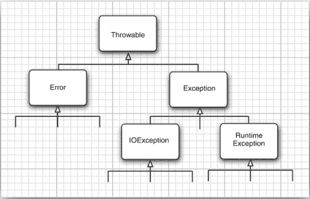

**图7-1** Java中的异常层次结构

请注意，所有异常都继承自`Throwable`，但该层次结构立即分为两个分支：`Error`和`Exception`。

`Error`层次结构描述Java运行时系统内部的错误和资源耗尽情况。你不应抛出此类型的对象。如果发生此类内部错误，除了通知用户并尝试优雅地终止程序外，你几乎无能为力。这些情况相当罕见。

在进行Java编程时，应重点关注`Exception`层次结构。`Exception`层次结构也分为两个分支：派生自`RuntimeException`的异常和并非派生自`RuntimeException`的异常。一般规则是：`RuntimeException`的发生是因为你犯了编程错误。任何其他异常的发生是因为某个糟糕的事情（如I/O错误）发生在你原本良好的程序上。

继承自`RuntimeException`的异常包括以下问题：

- 错误的强制类型转换
- 数组访问越界
- 空指针访问

不继承自`RuntimeException`的异常包括：

- 试图读取文件末尾之后的内容
- 试图打开不存在的文件
- 试图为一个不表示现有类的字符串查找`Class`对象

“如果是`RuntimeException`，那就是你的错”这条规则相当有效。通过将数组索引与数组边界进行比对，你本可以避免`ArrayIndexOutOfBoundsException`。如果你在使用变量之前检查其是否为null，`NullPointerException`就不会发生。

那么不存在的文件又怎么说呢？你不能先检查文件是否存在，然后再打开它吗？嗯，文件可能在你检查存在之后、打开之前就被删除了。因此，“存在”的概念取决于环境，而不仅仅是你的代码。

Java语言规范将任何派生自`Error`类或`RuntimeException`类的异常称为*非受查异常*。所有其他异常称为*受查异常*。这是很有用的术语，我们也采用。编译器会检查你是否为所有受查异常提供了异常处理器。

> **注释：**`RuntimeException`这个名字有点令人困惑。当然，我们讨论的所有错误都发生在运行时。

> **C++笔记：**如果你熟悉标准C++库中（有限得多）的异常层次结构，此时可能会感到非常困惑。C++有两个基本的异常类：`runtime_error`和`logic_error`。`logic_error`类相当于Java的`RuntimeException`，也表示程序中的逻辑错误。`runtime_error`类是由不可预测问题引起的异常的基类。它相当于Java中非`RuntimeException`类型的那些异常。

#### 7.1.2 声明受查异常

如果方法遇到无法处理的情况，它可以抛出异常。思路很简单：方法不仅会告诉Java编译器它可以返回什么值，*还会告诉编译器可能出错的地方*。例如，试图从文件读取的代码知道文件可能不存在，或者可能为空。试图处理文件的代码


因此，文件中的信息将需要通知编译器，它可以抛出某种 `IOException`。

你声明自己的方法可能抛出异常的位置是方法的头部；方法头部会发生变化，以反映该方法可能抛出的受检异常。例如，下面是标准库中 `FileInputStream` 类的某个构造器的声明。（有关输入和输出的更多内容，请参见第 II 卷第 1 章。）

```java
public FileInputStream(String name) throws FileNotFoundException
```

该声明表示，这个构造器根据一个 `String` 参数生成一个 `FileInputStream` 对象，但它也可能以一种特殊方式出错——抛出 `FileNotFoundException`。如果这种糟糕的情况真的发生，构造器调用将不会初始化新的 `FileInputStream` 对象，而是抛出一个 `FileNotFoundException` 类的对象。如果发生这种情况，运行时系统将开始搜索一个知道如何处理 `FileNotFoundException` 对象的 `FileNotFoundException` 处理器。

当你编写自己的方法时，不必声明你的方法实际可能抛出的每一个可抛出对象。要理解何时（以及什么）必须在所写方法的 throws 子句中声明，请记住，异常会在以下四种情况中的任何一种下抛出：

- 你调用了一个抛出受检异常的方法——例如 `FileInputStream` 构造器。
- 你检测到错误，并使用 `throw` 语句抛出一个受检异常（我们将在下一节介绍 `throw` 语句）。
- 你犯了编程错误，例如 `a[-1] = 0`，从而引发非受检异常（在本例中为 `ArrayIndexOutOfBoundsException`）。
- 虚拟机或运行时库中发生内部错误。

如果前两种情况中的任何一种发生，你必须告诉将使用你的方法的程序员存在异常的可能性。为什么？任何抛出异常的方法都是一个潜在的死亡陷阱。如果没有处理器捕获该异常，当前执行线程就会终止。

与作为所提供类一部分的 Java 方法一样，你要在方法头部用*异常说明*声明自己的方法可能抛出异常。

```java
class MyAnimation
{
    . . .
    public Image loadImage(String s) throws IOException
    {
        . . .
    }
}
```

如果一个方法可能抛出多个受检异常类型，你必须在头部列出所有异常类。用逗号分隔它们，如下例所示：

```java
class MyAnimation
{
    . . .
    public Image loadImage(String s) throws FileNotFoundException, EOFException
    {
        . . .
    }
}
```

然而，你不需要声明 Java 内部错误——也就是继承自 *Error* 的异常。任何代码都可能抛出这些异常，而且它们完全超出你的控制。

同样，你也不应声明继承自 *RuntimeException* 的非受检异常。

```java
class MyAnimation
{
    . . .
    void drawImage(int i) throws ArrayIndexOutOfBoundsException // bad style
    {
        . . .
    }
}
```

这些运行时错误完全在你的控制之下。如果你如此担心数组索引错误，你应该花时间修复它们，而不是声明它们可能发生。

总之，方法必须声明它可能抛出的所有*受检*异常。非受检异常要么超出你的控制（*Error*），要么源于你本来就不应允许出现的情况（*RuntimeException*）。如果你的方法未能如实声明所有受检异常，编译器将发出错误消息。

当然，正如你已经在不少示例中看到的那样，你也可以捕获异常，而不是声明它。这样异常就不会被抛出方法之外，也就不需要 throws 说明。你将在本章后面看到如何决定是捕获异常还是让其他人捕获它。

> **注意：** 如果覆盖超类中的方法，子类方法声明的受检异常不能比超类方法声明的受检异常更一般。（子类方法抛出更具体的异常，或者不抛出任何异常，都是可以的。）特别地，如果超类方法根本不抛出受检异常，子类方法也不能抛出。例如，如果覆盖 `JComponent.paintComponent`，你的 `paintComponent` 方法不得抛出任何受检异常，因为超类方法不抛出任何受检异常。

当一个类中的方法声明它抛出一个特定类的实例异常时，它可能抛出该类的异常或其任何子类的异常。例如，`FileInputStream` 构造器本来可以声明它抛出 `IOException`。在那种情况下，你就不知道它是哪种 `IOException`；它可能是一个普通的 `IOException`，也可能是各种子类之一的对象，例如 `FileNotFoundException`。

> **C++ 注：** throws 说明符与 C++ 中的 throw 说明符相同，但有一个重要区别。在 C++ 中，throw 说明符是在运行时强制执行的，而不是在编译时。也就是说，C++ 编译器不关注异常说明。但是，如果在一个不在 throw 列表中的函数里抛出了异常，就会调用 unexpected 函数，并且默认情况下程序会终止。
>
> 此外，在 C++ 中，如果没有给出 throw 说明，函数可以抛出任何异常。在 Java 中，没有 throws 说明符的方法根本不能抛出任何受检异常。

#### 7.1.3 如何抛出异常

现在，假设你的代码中发生了可怕的事情。你有一个方法 `readData`，它正在读取一个文件，该文件的头部承诺

```
Content-Length: 1024
```

但你在 733 个字符之后遇到了文件结尾。你可能认为这种情况太不正常了，因此想抛出一个异常。

你需要决定抛出什么异常类型。某种 `IOException` 会是不错的选择。仔细查阅 Java API 文档，你会发现一个 `EOFException`，其描述为“表示在输入过程中意外到达了 EOF”。完美。下面是你如何抛出它：

```java
throw new EOFException();
```

或者，如果你愿意，

```java
var e = new EOFException();
throw e;
```

下面是它们如何组合在一起：

```java
String readData(Scanner in) throws EOFException
{
    while (. . .)
    {
        if (!in.hasNext()) // EOF encountered
        {
            if (n < len)
                throw new EOFException();
        }
        . . .
        return s;
    }
}
```

`EOFException` 有一个接受字符串参数的第二个构造器。你可以好好利用它，更仔细地描述异常情况。

```java
String gripe = "Content-length: " + len + ", Received: " + n;
throw new EOFException(gripe);
```

如你所见，如果现有的某个异常类适合你，抛出异常就很容易。在这种情况下：

1. 查找合适的异常类。
2. 创建该类的对象。
3. 抛出它。

一旦方法抛出异常，它就不会返回给调用者。这意味着你不必费心构造默认返回值或错误代码。

> **C++ 注：** 在 C++ 和 Java 中抛出异常是相同的，只有一个小差别。在 Java 中，你只能抛出 Throwable 子类的对象。在 C++ 中，你可以抛出任何类型的值。

#### 7.1.4 创建异常类

你的代码可能会遇到某个标准异常类无法充分描述的问题。在这种情况下，创建自己的异常类很容易。只需从 Exception 派生它，或者从 Exception 的子类（如 IOException）派生它。习惯上同时提供一个默认构造器和一个包含详细消息的构造器。（Throwable 超类的 toString 方法会返回一个包含该详细消息的字符串，这对调试很方便。）

```java
class FileFormatException extends IOException
{
   public FileFormatException() {}
   public FileFormatException(String gripe)
   {
      super(gripe);
   }
}
```

现在你可以抛出你自己的异常类型了。

```java
String readData(Scanner in) throws FileFormatException
{
   . . .
   while (. . .)
   {
      if (ch == -1) // EOF encountered
      {
         if (n < len)
            throw new FileFormatException();
      }
      . . .
   }
   return s;
}
```

- **java.lang.Throwable 1.0**
  - `Throwable()`
    构造一个没有详细消息的新 Throwable 对象。
  - `Throwable(String message)`
    构造一个带有指定详细消息的新 Throwable 对象。按照惯例，所有派生异常类都支持默认构造器和带详细消息的构造器。
  - `String getMessage()`
    获取 Throwable 对象的详细消息。


### 7.2 捕获异常

你现在知道如何抛出异常了。这相当简单：抛出它，然后就不用管了。当然，必须有某些代码来捕获异常。捕获异常需要更多规划。这就是接下来几节要介绍的内容。

#### 7.2.1 捕获异常

如果发生的异常在任何地方都没有被捕获，程序将终止，并向控制台打印一条消息，给出异常的类型和堆栈轨迹。GUI 程序（包括小程序和应用程序）会捕获异常、打印堆栈轨迹消息，然后返回用户界面处理循环。（当你调试 GUI 程序时，最好让控制台保持在屏幕上而不要最小化。）

要捕获异常，请设置 try/catch 块。try 块的最简单形式如下：

```java
try
{
    code
    more code
}
catch (ExceptionType e)
{
    handler for this type
}
```

如果 try 块内的任何代码抛出了 catch 子句中指定类的异常，那么

- 1. 程序跳过 try 块中剩余的代码。
- 2. 程序执行 catch 子句中的处理程序代码。

如果 try 块内没有任何代码抛出异常，那么程序会跳过 catch 子句。

如果方法中的任何代码抛出的异常类型不同于 catch 子句中指定的类型，该方法会立即退出。（希望它的某个调用者已经为该类型提供了 catch 子句。）

为了演示实际效果，下面是一些相当典型的读取数据的代码：

```java
public void read(String filename)
{
    try
    {
        var in = new FileInputStream(filename);
        int b;
        while ((b = in.read()) != -1)
        {
            process input
        }
    }
    catch (IOException exception)
    {
        exception.printStackTrace();
    }
}
```

请注意，try 子句中的大部分代码都很直接：它读取并处理字节，直到遇到文件末尾。通过查看 Java API 可以看到，read 方法有可能抛出 IOException。在这种情况下，我们会跳出整个 while 循环，进入 catch 子句，并生成堆栈轨迹。对于示例程序来说，这似乎是处理该异常的合理方式。你还有其他选择吗？

通常，最好的选择是什么也不做，只是把异常传递给调用者。如果 read 方法中发生错误，就让 read 方法的调用者去担心它！如果采用这种方法，那么我们必须声明该方法可能抛出 IOException。

```java
public void read(String filename) throws IOException
{
    var in = new FileInputStream(filename);
    int b;
    while ((b = in.read()) != -1)
    {
        process input
    }
}
```

记住，编译器会严格强制执行 throws 说明符。如果你调用一个抛出受检异常的方法，就必须要么处理它，要么把它传递下去。

两者中哪一个更好？作为一般规则，你应该捕获那些你知道如何处理的异常，并传播那些你不知道如何处理的异常。

当你传播异常时，必须添加 throws 说明符，以提醒调用者可能抛出异常。

查看 Java API 文档，了解哪些方法抛出哪些异常。然后决定你应该处理它们，还是将它们添加到 throws 列表中。后一种选择没有什么难为情的。将异常交给能胜任的处理程序，比压制它更好。

请记住，正如我们之前提到的，这条规则有一个例外。如果你正在编写一个方法，而它重写了一个不抛出异常的超类方法（例如 `JComponent` 中的 `paintComponent`），那么你**必须**在方法代码中捕获每一个受检异常。子类方法中不允许添加比超类方法中更多的 throws 说明符。

> **C++ 注意：** 在 Java 和 C++ 中捕获异常几乎相同。严格来说，
> 
> ```java
> catch (Exception e) // Java
> ```
> 
> 的类似写法是
> 
> ```cpp
> catch (Exception& e) // C++
> ```
> 
> C++ 的 `catch (...)` 没有类似写法。Java 中不需要这样做，因为所有异常都派生自一个共同的超类。

#### 7.2.2 捕获多个异常

你可以在 `try` 块中捕获多种异常类型，并对每种类型进行不同处理。为每种类型使用单独的 `catch` 子句，如下例所示：

```java
try
{
    code that might throw exceptions
}
catch (FileNotFoundException e)
{
    emergency action for missing files
}
catch (UnknownHostException e)
{
    emergency action for unknown hosts
}
catch (IOException e)
{
    emergency action for all other I/O problems
}
```

异常对象可能包含有关异常性质的信息。要了解有关该对象的更多信息，请尝试

究竟哪里出错的详细细节，但它肯定想知道 servlet 出了故障。

下面介绍如何捕获异常并重新抛出它：

```java
try
{
    *access the database*
}
catch (SQLException e)
{
    throw new ServletException("database error: " + e.getMessage());
}
```

这里，ServletException 是用异常的消息文本构造的。

然而，更好的做法是将原始异常设置为新异常的“原因”：

```java
try
{
    *access the database*
}
catch (SQLException original)
{
    var e = new ServletException("database error");
    e.initCause(original);
    throw e;
}
```

当异常被捕获时，可以获取原始异常：

```java
Throwable original = caughtException.getCause();
```

强烈推荐这种包装技术。它允许你在子系统中抛出高层异常，同时不会丢失原始失败的详细信息。

> **提示：** 如果受检异常发生在不允许抛出受检异常的方法中，包装技术也很有用。你可以捕获该受检异常并将其包装为运行时异常。

有时，你只想记录异常并原样重新抛出它：

```java
try
{
    *access the database*
}
catch (Exception e)
{
    logger.log(level, message, e);
    throw e;
}
```

在 Java 7 之前，这种方法存在问题。假设代码位于一个方法中

```java
public void updateRecord() throws SQLException
```

Java 编译器会查看 catch 块内的 throw 语句，然后查看 e 的类型，并抱怨该方法可能抛出任何 Exception，而不仅仅是 SQLException。现在这一点已经改进。编译器现在会跟踪 e 源自 try 块这一事实。只要该块中唯一的受检异常是 SQLException 实例，并且 e 在 catch 块中未被更改，就可以合法地将外围方法声明为 throws SQLException。

#### 7.2.4 finally 子句

当你的代码抛出异常时，它会停止处理方法中剩余的代码并退出该方法。如果该方法获取了某些只有该方法知道的局部资源，而且必须清理该资源，这就会成为问题。一种解决方案是捕获所有异常，执行清理，然后重新抛出异常。但这种解决方案很乏味，因为你需要在两个地方清理资源分配——正常代码中和异常代码中。finally 子句可以解决这个问题。

> **注意：** 从 Java 7 开始，有一种更优雅的解决方案，即你将在下一节看到的 try-with-resources 语句。我们详细讨论 finally 机制，因为它是概念基础。但在实践中，你可能使用 try-with-resources 语句比 finally 子句更频繁。

无论是否捕获到异常，finally 子句中的代码都会执行。在下面的示例中，程序将在所有情况下关闭输入流：

```java
var in = new FileInputStream(. . .);
try
{
    // 1
    code that might throw exceptions
```


```java
// 2
}
catch (IOException e)
{
    // 3
    show error message
    // 4
}
finally
{
    // 5
    in.close();
}
// 6
```

让我们来看程序执行 finally 子句的三种可能情况。

- 1. 代码不抛出异常。在这种情况下，程序首先执行 try 块中的所有代码。然后，它执行 finally 子句中的代码。之后，执行继续从 finally 子句之后的第一条语句开始。换句话说，执行经过点 1、2、5 和 6。

- 2. 代码抛出一个异常，该异常在 catch 子句中被捕获——在我们的例子中，是一个 IOException。为此，程序执行 try 块中的所有代码，直到抛出异常的位置。try 块中剩余的代码被跳过。然后程序执行匹配的 catch 子句中的代码，接着执行 finally 子句中的代码。
  - 如果 catch 子句不抛出异常，程序执行 finally 子句之后的第一行。在此场景中，执行经过点 1、3、4、5 和 6。
  - 如果 catch 子句抛出异常，那么该异常被抛回给此方法的调用者，并且执行仅经过点 1、3 和 5。

- 3. 代码抛出一个异常，该异常未在任何 catch 子句中被捕获。这里，程序执行 try 块中的所有代码，直到抛出异常。try 块中剩余的代码被跳过。然后，执行 finally 子句中的代码，并且该异常被抛回给此方法的调用者。执行仅经过点 1 和 5。

可以在没有 catch 子句的情况下使用 finally 子句。例如，考虑以下 try 语句：

```java
InputStream in = . . .;
try
{
    code that might throw exceptions
}
finally
{
    in.close();
}
```

无论 `try` 块中是否遇到异常，`finally` 子句中的 `in.close()` 语句都会执行。当然，如果遇到异常，它会被重新抛出，并且必须在另一个 `catch` 子句中被捕获。

```java
InputStream in = . . .;
try
{
    try
    {
        code that might throw exceptions
    }
    finally
    {
        in.close();
    }
}
catch (IOException e)
{
    show error message
}
```

内层 `try` 块只有一个职责：确保输入流被关闭。外层 `try` 块只有一个职责：确保错误被报告。这个解决方案不仅更清晰，而且功能更强：`finally` 子句中的错误也会被报告。

> **警告：** 当 `finally` 子句包含 `return` 语句时，它可能产生意外结果。假设你用 `return` 语句从 `try` 块的中间退出。在方法返回之前，`finally` 块会执行。如果 `finally` 块也包含 `return` 语句，那么它会掩盖原来的返回值。考虑这个示例：

```java
public static int parseInt(String s)
{
    try
    {
        return Integer.parseInt(s);
    }
    finally
    {
        return 0; // ERROR
    }
}
```

看起来在调用 `parseInt("42")` 时，try 块的主体返回整数 42。然而，finally 子句在方法实际返回之前执行，并导致该方法返回 0，忽略原来的返回值。

更糟糕的是，考虑调用 `parseInt("zero")`。`Integer.parseInt` 方法抛出 `NumberFormatException`。然后 finally 子句被执行，而 return 语句吞掉了该异常！

finally 子句的主体旨在清理资源。不要把改变控制流的语句（return、throw、break、continue）放入 finally 子句内。

#### 7.2.5 try-with-resources 语句

从 Java 7 开始，有一种有用的快捷方式可用于以下代码模式：

```text
open a resource
try
{
    work with the resource
}
finally
{
    close the resource
}
```

前提是该资源属于一个实现了 `AutoCloseable` 接口的类。该接口只有一个方法：

```java
void close() throws Exception
```

> **注意：** 还有一个 `Closeable` 接口。它是 `AutoCloseable` 的子接口，同样只有一个 close 方法。但是，该方法声明为抛出 `IOException`。

在其最简单的变体中，try-with-resources 语句的形式为：

```java
try (Resource res = . . .)
{
    work with res
}
```

当 try 块退出时，`res.close()` 会被自动调用。这里有一个典型示例——读取文件中的所有单词：

```java
try (var in = new Scanner(
        new FileInputStream("/usr/share/dict/words", StandardCharsets.UTF_8)))
{
    while (in.hasNext())
        System.out.println(in.next());
}
```

当该块正常退出时，或者发生异常时，`in.close()` 方法都会被调用，就像你使用了 finally 块一样。

你可以指定多个资源。例如，

```java
try (var in = new Scanner(
        new FileInputStream("/usr/share/dict/words", StandardCharsets.UTF_8));
     var out = new PrintWriter("out.txt", StandardCharsets.UTF_8))
{
    while (in.hasNext())
        out.println(in.next().toUpperCase());
}
```

无论该块如何退出，`in` 和 `out` 都会被关闭。如果你手动编写这段代码，则需要两个嵌套的 try/finally 语句。

从 Java 9 开始，你可以在 try 头中提供先前声明的有效最终变量：

```java
public static void printAll(String[] lines, PrintWriter out)
{
    try (out) { // effectively final variable
        for (String line : lines)
            out.println(line);
    } // out.close() called here
}
```

当 try 块抛出异常并且 close 方法也抛出异常时，会出现一个难题。try-with-resources 语句相当优雅地处理了这种情况。原始异常会被重新抛出，而 close 方法抛出的任何异常都被视为“被抑制的”。它们会被自动捕获，并通过 `addSuppressed` 方法添加到原始异常中。如果你对它们感兴趣，可以调用 `getSuppressed` 方法，它会返回一个由 close 方法产生的被抑制异常数组。

你不会想手动编写这段代码。每当需要关闭资源时，请使用 try-with-resources 语句。

> **注意：** try-with-resources 语句本身可以有 catch 子句，甚至可以有 finally 子句。这些子句在关闭资源之后执行。

#### 7.2.6 分析堆栈跟踪元素

*堆栈跟踪* 是程序执行中某一特定点上所有待处理方法调用的列表。你几乎肯定见过堆栈跟踪列表——每当 Java 程序因未捕获的异常而终止时，它们就会被显示出来。

你可以通过调用 `Throwable` 类的 `printStackTrace` 方法来访问堆栈跟踪的文本描述。

```java
var t = new Throwable();
var out = new StringWriter();
t.printStackTrace(new PrintWriter(out));
String description = out.toString();
```

一种更灵活的方法是 `StackWalker` 类，它产生一个 `StackWalker.StackFrame` 实例流，每个实例描述一个堆栈帧。你可以使用以下调用遍历这些堆栈帧：

```java
StackWalker walker = StackWalker.getInstance();
walker.forEach(frame -> analyze(frame));
```

如果你想惰性地处理 `Stream<StackWalker.StackFrame>`，请调用

```java
walker.walk(stream -> process(stream));
```

流处理在第二卷第1章中有详细描述。

`StackWalker.StackFrame` 类具有一些方法，可用于获取执行代码行的文件名和行号，以及类对象和方法名。`toString` 方法会生成一个包含所有这些信息的格式化字符串。

> **注意：** 在 Java 9 之前，`Throwable.getStackTrace` 方法会生成一个 `StackTraceElement[]` 数组，其中包含与 `StackWalker.StackFrame` 实例流类似的信息。然而，该调用效率较低，因为它会捕获整个堆栈，即使调用者可能只需要少数几个帧，而且它只提供对待处理方法类名的访问，而不提供类对象的访问。


代码清单 7.1 打印一个递归阶乘函数的堆栈轨迹。例如，如果计算 factorial(3)，输出为

```
factorial(3):
stackTrace.StackTraceTest.factorial(StackTraceTest.java:20)
stackTrace.StackTraceTest.main(StackTraceTest.java:36)
factorial(2):
stackTrace.StackTraceTest.factorial(StackTraceTest.java:20)
stackTrace.StackTraceTest.factorial(StackTraceTest.java:26)
stackTrace.StackTraceTest.main(StackTraceTest.java:36)
factorial(1):
stackTrace.StackTraceTest.factorial(StackTraceTest.java:20)
stackTrace.StackTraceTest.factorial(StackTraceTest.java:26)
stackTrace.StackTraceTest.factorial(StackTraceTest.java:26)
stackTrace.StackTraceTest.main(StackTraceTest.java:36)
return 1
return 2
return 6
```

### 代码清单 7.1 stackTrace/StackTraceTest.java

```java
package stackTrace;

import java.util.*;

/**
 * A program that displays a trace feature of a recursive method call.
 * @version 1.10 2017-12-14
 * @author Cay Horstmann
 */
public class StackTraceTest
{
   /**
    * Computes the factorial of a number
    * @param n a non-negative integer
    * @return n! = 1 * 2 * ... * n
    */
   public static int factorial(int n)
   {
      System.out.println("factorial(" + n + "):");
      var walker = StackWalker.getInstance();
      walker.forEach(System.out::println);
      int r;
      if (n <= 1) r = 1;
      else r = n * factorial(n - 1);
      System.out.println("return " + r);
      return r;
   }

   public static void main(String[] args)
   {
      try (var in = new Scanner(System.in))
      {
         System.out.print("Enter n: ");
         int n = in.nextInt();
         factorial(n);
      }
   }
}
```

**java.lang.Throwable 1.0**

- `Throwable(Throwable cause)` 1.4
  用给定的原因构造一个 Throwable。
- `Throwable(String message, Throwable cause)` 1.4
  用给定的原因构造一个 Throwable。
- `Throwable initCause(Throwable cause)` 1.4
  设置此对象的原因；如果此对象已有原因，则抛出异常。返回此对象。
- `Throwable getCause()` 1.4
  获取设置为此对象原因的异常对象；如果未设置原因，则返回 null。
- `StackTraceElement[] getStackTrace()` 1.4
  获取构造此对象时的调用堆栈轨迹。
- `void addSuppressed(Throwable t)` 7
  向此异常添加一个“被抑制的”异常。这种情况发生在 try-with-resources 语句中，其中 t 是由 close 方法抛出的异常。
- `Throwable[] getSuppressed()` 7
  获取此异常的所有“被抑制的”异常。通常，这些是在 try-with-resources 语句中由 close 方法抛出的异常。

**java.lang.Exception 1.0**

- `Exception(Throwable cause)` 1.4
- `Exception(String message, Throwable cause)`
  用给定的原因构造一个 Exception。

| `java.lang.RuntimeException` | 1.0 |
|---|---|
| `RuntimeException(Throwable cause)` | 1.4 |
| `RuntimeException(String message, Throwable cause)` | 1.4 |
| | 用给定的原因构造一个 `RuntimeException`。 |

| `java.lang.StackWalker` | 9 |
|---|---|
| `static StackWalker getInstance()` | |
| `static StackWalker getInstance(StackWalker.Option option)` | |
| `static StackWalker getInstance(Set<StackWalker.Option> options)` | |
| | 获取一个 `StackWalker` 实例。选项包括 `StackWalker.Option` 枚举中的 `RETAIN_CLASS_REFERENCE`、`SHOW_HIDDEN_FRAMES` 和 `SHOW_REFLECT_FRAMES`。 |
| `forEach(Consumer<? super StackWalker.StackFrame> action)` | |
| | 对每个堆栈帧执行给定的操作，从最近调用的方法开始。 |
| `walk(Function<? super Stream<StackWalker.StackFrame>,? extends T> function)` | |
| | 将给定函数应用于堆栈帧流，并返回该函数的结果。 |

| `java.lang.StackWalker.StackFrame` | 9 |
|---|---|
| `String getFileName()` | |
| | 获取包含此元素执行点的源文件名；如果信息不可用，则返回 null。 |
| `int getLineNumber()` | |
| | 获取包含此元素执行点的源文件行号；如果信息不可用，则返回 -1。 |
| `String getClassName()` | |
| | 获取其方法包含此元素执行点的类的完全限定名。 |
| `String getDeclaringClass()` | |
| | 获取包含此元素执行点的方法的 Class 对象。如果堆栈遍历器未使用 `RETAIN_CLASS_REFERENCE` 选项构造，则抛出异常。 |

### 7.3 使用异常的建议

关于异常的正确使用存在一定争议。一些程序员认为所有受检异常都很烦人，另一些人则似乎觉得抛出再多异常也不够。我们认为异常（甚至受检异常）有其用武之地，并为您提供以下正确使用异常的建议。

- **1. 异常处理不应取代简单的测试。**

  作为示例，我们编写了一些代码，尝试对空堆栈执行 10,000,000 次弹出操作。它首先通过判断堆栈是否为空来完成此操作。

  ```java
  if (!s.empty()) s.pop();
  ```

  接下来，我们强制它无论如何都弹出堆栈，然后捕获 `EmptyStackException`，该异常告诉我们本不应这样做。

  ```java
  try
  {
      s.pop();
  }
  catch (EmptyStackException e)
  {
  }
  ```

  在我们的测试机器上，调用 `isEmpty` 的版本运行了 646 毫秒。捕获 `EmptyStackException` 的版本运行了 21,739 毫秒。

  如您所见，捕获异常所花的时间远远超过执行简单测试。寓意是：仅在异常情况下使用异常。

- **2. 不要过度管理异常。**

  许多程序员将每条语句都包装在单独的 try 块中。

  ```java
  PrintStream out;
  Stack s;

  for (i = 0; i < 100; i++)
  {
      try
      {
          n = s.pop();
      }
      catch (EmptyStackException e)
      {
          // stack was empty
      }
  }
  ```

  ```java
  try
  {
      out.writeInt(n);
  }
  catch (IOException e)
  {
      // problem writing to file
  }
  ```

  这种做法会使代码急剧膨胀。想想您希望代码完成的任务。在这里，我们想从堆栈中弹出 100 个数字并将它们保存到文件中。（不必在意原因——这只是一个玩具示例。）如果问题露出丑陋的嘴脸，我们无能为力。如果堆栈为空，它不会变得非空。如果文件包含错误，错误不会神奇地消失。因此，将*整个任务*包装在一个 try 块中是合理的。如果任何一个操作失败，您就可以放弃该任务。

  ```java
  try
  {
      for (i = 0; i < 100; i++)
      {
          n = s.pop();
          out.writeInt(n);
      }
  }
  catch (IOException e)
  {
      // problem writing to file
  }
  catch (EmptyStackException e)
  {
      // stack was empty
  }
  ```

  这段代码看起来干净得多。它实现了异常处理的承诺之一：将正常处理与错误处理*分离*。

- **3. 充分利用异常层次结构。**

  不要只是抛出一个 `RuntimeException`。要找到合适的子类，或创建自己的子类。

  不要只是捕获 `Throwable`。这会使代码难以阅读和维护。

  尊重受检异常和非受检异常之间的区别。受检异常本质上是一种负担——不要为逻辑错误抛出它们。（例如，反射库在这一点上就做错了。调用方经常需要捕获他们知道永远不会发生的异常。）

  不要犹豫，将异常转换为更合适的另一个异常。例如，当您解析文件中的整数时，捕获 `NumberFormatException`，并将其转换为 `IOException` 或 `MySubsystemException` 的子类。

- **4. 不要压制异常。**

  在 Java 中，让异常保持沉默的诱惑非常大。如果您正在编写一个方法，它调用了一个可能一百年才抛出一次异常的方法，编译器会抱怨，因为您没有在该方法的 `throws` 列表中声明该异常。您不想把它放进 `throws` 列表，因为那样编译器会抱怨所有调用您方法的方法。于是您就让它闭嘴：

  ```java
  public Image loadImage(String s)
  {
      try
      {
          code that threatens to throw checked exceptions
      }
      catch (Exception e)
      {
      } // so there
  }
  ```

  现在您的代码将顺利编译。它会运行良好，除非发生异常。那时，异常将被静默忽略。如果您认为异常哪怕有一点重要，就应该努力正确处理它们。

- **5. 当您检测到错误时，“严厉的爱”比纵容更有效。**

  一些程序员在检测到错误时担心抛出异常。当方法以无效参数被调用时，返回一个虚拟值而不是抛出异常会不会更好？例如，当堆栈为空时，`Stack.pop` 应该返回 `null`，还是抛出异常？我们认为，在失败点抛出 `EmptyStackException` 比在稍后发生 `NullPointerException` 更好。

- **6. 传播异常并不可耻。**

  许多程序员觉得必须捕获所有抛出的异常。如果他们调用一个抛出异常的方法，例如 `FileInputStream` 构造函数或 `readLine` 方法，他们会本能地捕获可能生成的异常。通常，实际上更好的做法是*传播*异常，而不是捕获它：

  ```java
  public void readStuff(String filename) throws IOException // not a sign of shame!
  {
      var in = new FileInputStream(filename, StandardCharsets.UTF_8);
  ```

> **注意：** 表达式部分的唯一目的是生成一个消息字符串。AssertionError 对象不会存储实际的表达式值，因此你无法稍后查询它。正如 JDK 文档所述，这样做“会鼓励程序员尝试从断言失败中恢复，而这违背了该机制的目的。”

要断言 x 为非负数，只需使用以下语句

```java
assert x >= 0;
```

或者，你可以将 x 的实际值传入 AssertionError 对象，以便稍后显示出来。

```java
assert x >= 0 : x;
```

> **C++ 注意：** C 语言的 assert 宏会把断言条件转换为一个字符串，如果断言失败就打印该字符串。例如，如果 `assert(x >= 0)` 失败，它会打印出失败的条件是 `"x >= 0"`。在 Java 中，条件不会自动成为错误报告的一部分。如果你想看到它，必须将其作为字符串传入 AssertionError 对象：`assert x >= 0 : "x >= 0"`。

#### 7.4.2 断言的启用和禁用

默认情况下，断言是禁用的。通过使用 `-enableassertions` 或 `-ea` 选项运行程序来启用它们：

```
java -enableassertions MyApp
```

请注意，不必重新编译程序即可启用或禁用断言。启用或禁用断言是*类加载器*的功能。当断言被禁用时，类加载器会剥离断言代码，因此不会拖慢执行速度。

你甚至可以在特定类或整个包中开启断言。例如：

```
java -ea:MyClass -ea:com.mycompany.mylib MyApp
```

此命令为 MyClass 类以及 com.mycompany.mylib 包*及其子包*中的所有类开启断言。选项 `-ea:...` 会为未命名包中的所有类开启断言。

还可以使用 `-disableassertions` 或 `-da` 选项在特定类和包中禁用断言：

```
java -ea:... -da:MyClass MyApp
```

有些类不是由类加载器加载，而是由虚拟机直接加载。你可以使用这些开关选择性地启用或禁用这些类中的断言。

但是，用于启用或禁用所有断言的 `-ea` 和 `-da` 开关不适用于没有类加载器的“系统类”。请使用 `-enablesystemassertions`/`-esa` 开关来启用系统类中的断言。

也可以通过编程方式控制类加载器的断言状态。请参阅本节末尾的 API 说明。

#### 7.4.3 使用断言进行参数检查

Java 语言提供了三种处理系统故障的机制：

- 抛出异常
- 记录日志
- 使用断言

何时应选择断言？请记住以下几点：

- 断言失败旨在表示致命、不可恢复的错误。
- 断言检查仅在开发和测试期间开启。（这有时被开玩笑地描述为“靠近岸边时穿着救生衣，而一旦到了海洋中央就把它扔下船。”）

因此，不应使用断言向程序的其他部分发出可恢复条件的信号，也不应使用断言向程序用户传达问题。断言只应用于在测试期间定位程序内部错误。

让我们看一个常见场景——检查方法参数。你应该使用断言来检查非法索引值或 null 引用吗？要回答这个问题，必须查看该方法的文档。假设你实现了一个排序方法。

```java
/**
 * Sorts the specified range of the specified array in ascending numerical order.
 * The range to be sorted extends from fromIndex, inclusive, to toIndex, exclusive.
 * @param a the array to be sorted.
 * @param fromIndex the index of the first element (inclusive) to be sorted.
 * @param toIndex the index of the last element (exclusive) to be sorted.
 * @throws IllegalArgumentException if fromIndex > toIndex
 * @throws ArrayIndexOutOfBoundsException if fromIndex < 0 or toIndex > a.length
 */
static void sort(int[] a, int fromIndex, int toIndex)
```

文档指出，如果索引值不正确，该方法会抛出异常。该行为是方法与其调用者之间契约的一部分。如果你实现该方法，就必须遵守该契约并抛出指定的异常。改用断言是不合适的。

你应该断言 a 不为 null 吗？这也不合适。方法文档没有说明当 a 为 null 时该方法的行为。调用者有权假定在这种情况下方法会成功返回，而不会抛出断言错误。

然而，假设方法契约略有不同：

```text
@param a the array to be sorted (must not be null).
```

现在，该方法的调用者已被明确告知，使用 null 数组调用该方法是非法的。那么该方法可以以如下断言开头

```java
assert a != null;
```

计算机科学家将这种契约称为*前置条件*。原始方法对其参数没有前置条件——它承诺在所有情况下都有明确定义的行为。修订后的方法有一个前置条件：a 不为 null。如果调用者未能满足该前置条件，那么一切都无法保证，方法可以做任何它想做的事。事实上，在加入断言之后，该方法在被非法调用时会有相当不可预测的行为。它有时抛出断言错误，有时抛出空指针异常，具体取决于其类加载器是如何配置的。

#### 7.4.4 使用断言记录假设

许多程序员使用注释来记录其底层假设。考虑下面这个来自 http://docs.oracle.com/javase/8/docs/technotes/guides/language/assert.html 的示例：

```java
if (i % 3 == 0)
    . . .
else if (i % 3 == 1)
    . . .
else // (i % 3 == 2)
    . . .
```

在这种情况下，改用断言就非常合理。

```java
if (i % 3 == 0)
    . . .
else if (i % 3 == 1)
    . . .
else
{
    assert i % 3 == 2;
    . . .
}
```

当然，彻底思考这个问题会更有意义。`i % 3` 可能的值有哪些？如果 `i` 为正数，余数必须是 `0`、`1` 或 `2`。如果 `i` 为负数，那么余数可以是 `-1` 或 `-2`。因此，真正的假设是 `i` 不是负数。更好的断言是在 `if` 语句之前使用 `assert i >= 0;`。

无论如何，这个示例展示了断言作为程序员自检工具的良好用法。如你所见，断言是用于测试和调试的战术性工具。相比之下，日志记录是贯穿程序整个生命周期的战略性工具。我们将在下一节探讨日志记录。

- **java.lang.ClassLoader 1.0**
  - `void setDefaultAssertionStatus(boolean b)` 1.4
    为由此类加载器加载的、没有显式类或包断言状态的所有类启用或禁用断言。
  - `void setClassAssertionStatus(String className, boolean b)` 1.4
    为给定类及其内部类启用或禁用断言。
  - `void setPackageAssertionStatus(String packageName, boolean b)` 1.4
    为给定包及其子包中的所有类启用或禁用断言。
  - `void clearAssertionStatus()` 1.4
    移除所有显式的类和包断言状态设置，并禁用由此类加载器加载的所有类的断言。

### 7.5 日志记录

每个 Java 程序员都熟悉这样的过程：将 `System.out.println` 调用插入有问题的代码中，以深入了解程序行为。当然，一旦你找出问题的原因，就会删除这些打印语句，但当下一个问题出现时又不得不把它们加回来。日志记录 API 旨在克服这个问题。以下是该 API 的主要优点：


- 很容易抑制所有日志记录，或仅抑制低于某个级别的记录，同样也很容易将它们重新打开。
- 被抑制的日志记录开销非常低，因此在应用程序中保留日志代码只会带来很小的代价。
- 日志记录可以被定向到不同的处理器——例如在控制台显示、写入文件等。
- 记录器和处理器都可以过滤记录。过滤器可以使用过滤器实现者提供的任何条件来丢弃无意义的日志条目。
- 日志记录可以以不同方式格式化——例如纯文本或 XML。
- 应用程序可以使用多个记录器，这些记录器具有类似于包名的层级名称，如 `com.mycompany.myapp`。
- 日志配置由配置文件控制。

> **注意：** 许多应用程序使用其他日志框架，例如 Log4J 2（`https://logging.apache.org/log4j/2.x/`）和 Logback（`https://logback.qos.ch`），它们比标准 Java 日志框架提供更高的性能。这些框架的 API 略有不同。诸如 SLF4J（`https://www.slf4j.org`）和 Commons Logging（`https://commons.apache.org/proper/commons-logging`）之类的日志门面提供了统一 API，使你无需重写应用程序即可替换日志框架。更令人困惑的是，Log4J 2 也可以作为使用 SLF4J 的组件的门面。在本书中，我们介绍标准 Java 日志框架。它对许多用途来说已经足够好，学习其 API 将为你理解其他替代方案做好准备。

> **注意：** 自 Java 9 起，Java 平台有一个独立的轻量级日志系统，它不依赖于 `java.logging` 模块（该模块包含标准 Java 日志框架）。此系统仅供 Java API 内部使用。如果 `java.logging` 模块存在，日志消息会自动转发给它。第三方日志框架可以提供适配器来接收平台日志消息。我们不介绍平台日志，因为它并非供应用程序程序员使用。

#### 7.5.1 基本日志记录

对于简单日志记录，使用全局记录器并调用其 info 方法：

```java
Logger.getGlobal().info("File->Open menu item selected");
```

默认情况下，记录会像下面这样打印：

```text
May 10, 2013 10:12:15 PM LoggingImageViewer fileOpen
INFO: File->Open menu item selected
```

但如果你在合适的位置（例如 main 的开头）调用

```java
Logger.getGlobal().setLevel(Level.OFF);
```

所有日志记录都将被抑制。

#### 7.5.2 高级日志记录

既然你已经了解了“傻瓜式日志”，接下来让我们看看工业级日志。在专业应用程序中，你不会希望将所有记录都记录到单个全局记录器中。相反，你可以定义自己的记录器。

调用 getLogger 方法创建或获取记录器：

```java
private static final Logger myLogger = Logger.getLogger("com.mycompany.myapp");
```

> **提示：** 未被任何变量引用的记录器可能会被垃圾回收。为了防止这种情况，请使用静态变量保存对记录器的引用，如上面的示例所示。

与包名类似，记录器名称是分层次的。实际上，它们比包更具层次性。包与其父包之间没有语义关系，但记录器的父子之间共享某些属性。例如，如果你在记录器 "com.mycompany" 上设置日志级别，那么子记录器会继承该级别。

有七个日志级别：

- SEVERE
- WARNING
- INFO
- CONFIG
- FINE
- FINER
- FINEST

默认情况下，实际上会记录最高的三个级别。你可以设置不同的级别——例如：

```java
logger.setLevel(Level.FINE);
```

现在 FINE 及其以上所有级别都会被记录。

你还可以使用 Level.ALL 为所有级别开启日志记录，或使用 Level.OFF 关闭所有日志记录。

所有级别都有对应的日志方法，例如：

```java
logger.warning(message);
logger.fine(message);
```

等等。或者，你也可以使用 log 方法并提供级别，例如：

```java
logger.log(Level.FINE, message);
```

> **提示：** 默认日志配置会记录所有级别为 INFO 或更高的记录。因此，对于对诊断有用但对用户无意义的调试消息，你应该使用 CONFIG、FINE、FINER 和 FINEST 级别。

> **警告：** 如果将日志级别设置为比 INFO 更细的值，你还需要更改日志处理器的配置。默认日志处理器会抑制低于 INFO 的消息。详见下一节。

默认日志记录会显示包含日志调用的类和方法名称，这些信息是从调用堆栈推断出来的。但是，如果虚拟机优化了执行，可能无法获得准确的调用信息。你可以使用 logp 方法指定调用类和方法的精确位置。该方法的签名是：

```java
void logp(Level l, String className, String methodName, String message)
```

有一些便捷方法可用于跟踪执行流程：

```java
void entering(String className, String methodName)
void entering(String className, String methodName, Object param)
void entering(String className, String methodName, Object[] params)
void exiting(String className, String methodName)
void exiting(String className, String methodName, Object result)
```

例如：

```java
int read(String file, String pattern)
{
   logger.entering("com.mycompany.mylib.Reader", "read",
      new Object[] { file, pattern });
   . . .
   logger.exiting("com.mycompany.mylib.Reader", "read", count);
   return count;
}
```

这些调用会生成级别为 FINER 的日志记录，这些记录以字符串 ENTRY 和 RETURN 开头。

> **注意：** 在将来的某个时候，带有 Object[] 参数的日志方法将被重写以支持可变参数列表（“varargs”）。届时，你将能够进行诸如 `logger.entering("com.mycompany.mylib.Reader", "read", file, pattern)` 之类的调用。

日志记录的一个常见用途是记录意外异常。有两个便捷方法会在日志记录中包含异常描述。

```java
void throwing(String className, String methodName, Throwable t)
void log(Level l, String message, Throwable t)
```

典型用法如下：

```java
if (...)
{
    var e = new IOException("...");
    logger.throwing("com.mycompany.mylib.Reader", "read", e);
    throw e;
}
```

以及

```java
try
{
    . . . .
}
catch (IOException e)
{
    logger.getLogger("com.mycompany.myapp").log(Level.WARNING, "Reading image", e);
}
```

throwing 调用会记录一条级别为 FINER 的日志记录，消息以 THROW 开头。

#### 7.5.3 更改日志管理器配置

你可以通过编辑配置文件来更改日志系统的各种属性。默认配置文件位于 `/jdk/conf/logging.properties`（在 Java 9 之前位于 `/jre/lib/logging.properties`）。

要使用另一个文件，请用以下命令启动应用程序，将 `java.util.logging.config.file` 属性设置为该文件的位置：

```text
java -Djava.util.logging.config.file=configFile MainClass
```

要更改默认日志级别，请编辑配置文件并修改该行：

```text
.level=INFO
```

你可以添加如下行来为自定义记录器指定日志级别：

```text
com.mycompany.myapp.level=FINE
```

也就是说，在记录器名称后面附加 `.level` 后缀。

正如你将在本节后面看到的，记录器实际上并不把消息发送到控制台——那是处理器的工作。处理器也有级别。要在控制台上看到 `FINE` 消息，你还需要设置：

```text
java.util.logging.ConsoleHandler.level=FINE
```

> **警告：** 日志管理器配置中的设置*并非*系统属性。使用 `-Dcom.mycompany.myapp.level=FINE` 启动程序不会对记录器产生任何影响。

日志管理器在 VM 启动期间、`main` 执行之前初始化。如果你想自定义日志属性，但没有使用 `-Djava.util.logging.config.file` 命令行选项启动应用程序，可以在程序中调用 `System.setProperty("java.util.logging.config.file", file)`。但你还必须调用 `LogManager.getLogManager().readConfiguration()` 来重新初始化日志管理器。

自 Java 9 起，你也可以通过调用以下方法来更新日志配置：

```java
LogManager.getLogManager().updateConfiguration(mapper);
```

新配置从 `java.util.logging.config.file` 系统属性指定的位置读取。然后应用 mapper 来解析旧配置或新配置中所有键的值。mapper 是一个 `Function<String,BiFunction<String,String,String>>`。它将现有配置中的键映射到替换函数。每个替换函数接收与该键关联的旧值和新值（如果没有关联值则为 `null`），并生成一个替换值；如果该键应在更新中被丢弃，则生成 `null`。

这听起来相当复杂，所以让我们来看几个示例。一种有用的映射方案是合并旧配置和新配置，


#### 7.5.4 本地化

你可能希望本地化日志消息，以便国际用户能够阅读。应用程序的国际化是第II卷第7章的主题。简而言之，本地化日志消息时需要牢记以下几点。

本地化应用程序在*资源包*中包含特定于区域设置的信息。资源包由针对各种区域设置（例如美国或德国）的一组映射组成。例如，资源包可以将字符串 `readingFile` 映射为英语字符串 `Reading file` 或德语字符串 `Achtung! Datei wird eingelesen`。

一个程序可能包含多个资源包——例如，一个用于菜单，另一个用于日志消息。每个资源包都有一个名称（例如 `com.mycompany.logmessages`）。要向资源包添加映射，请为每个区域设置提供一个文件。英语消息映射位于文件 `com/mycompany/logmessages_en.properties` 中，德语消息映射位于文件 `com/mycompany/logmessages_de.properties` 中。（en 和 de 是语言代码。）将这些文件与应用程序的类文件放在一起，以便 ResourceBundle 类自动定位它们。这些文件是纯文本文件，由如下条目组成：

```
readingFile=Achtung! Datei wird eingelesen
renamingFile=Datei wird umbenannt
...
```

请求记录器时，可以指定一个资源包：

```java
Logger logger = Logger.getLogger("loggerName", "com.mycompany.logmessages");
```

然后为日志消息指定资源包键，而不是实际的消息字符串：

```java
logger.info("readingFile");
```

你经常需要将参数包含到本地化消息中。一条消息可能包含占位符：{0}、{1} 等。例如，要在日志消息中包含文件名，请像这样使用占位符：

```
Reading file {0}.
Achtung! Datei {0} wird eingelesen.
```

然后，要将值传入占位符，请调用以下方法之一：

```java
logger.log(Level.INFO, "readingFile", fileName);
logger.log(Level.INFO, "renamingFile", new Object[] { oldName, newName });
```

或者，从 Java 9 开始，可以在 logrb 方法中指定资源包对象（而不是名称）：

```java
logger.logrb(Level.INFO, bundle, "renamingFile", oldName, newName);
```

> **注意：** 这是唯一一种对消息参数使用可变参数的日志记录方法。

#### 7.5.5 处理器

默认情况下，记录器将记录发送到 ConsoleHandler，后者将其打印到 System.err 流。具体来说，记录器将记录发送给父处理器，而最终祖先（名称为 ""）有一个 ConsoleHandler。

与记录器一样，处理器也有日志级别。要记录一条记录，其日志级别必须高于记录器和处理器的阈值。日志管理器配置文件将默认控制台处理器的日志级别设置为

```
java.util.logging.ConsoleHandler.level=INFO
```

要记录级别为 FINE 的记录，请在配置中同时更改默认记录器级别和处理器级别。或者，你可以完全绕过配置文件并安装自己的处理器。

```java
Logger logger = Logger.getLogger("com.mycompany.myapp");
logger.setLevel(Level.FINE);
logger.setUseParentHandlers(false);
var handler = new ConsoleHandler();
handler.setLevel(Level.FINE);
logger.addHandler(handler);
```

默认情况下，记录器将记录同时发送到自己的处理器和父处理器。我们的记录器是原始记录器（名称为 ""）的子记录器，后者将所有级别为 INFO 及以上的记录发送到控制台。然而，我们不希望两次看到这些记录，因此将 useParentHandlers 属性设置为 false。

要将日志记录发送到其他地方，请添加另一个处理器。日志 API 为此提供了两个有用的处理器：FileHandler 和 SocketHandler。SocketHandler 将记录发送到指定的主机和端口。更值得关注的是将记录收集到文件中的 FileHandler。

你可以简单地将记录发送到默认文件处理器，如下所示：

```java
var handler = new FileHandler();
logger.addHandler(handler);
```

记录被发送到用户主目录中的文件 java%u.log，其中 u 是一个使文件唯一的数字。如果系统没有用户主目录的概念（例如在 Windows 95/98/ME 中），则文件存储在默认位置，例如 C:\Windows。默认情况下，记录以 XML 格式化。典型的日志记录形式如下

```xml
<record>
  <date>2002-02-04T07:45:15</date>
  <millis>1012837515710</millis>
  <sequence>1</sequence>
  <logger>com.mycompany.myapp</logger>
  <level>INFO</level>
  <class>com.mycompany.mylib.Reader</class>
  <method>read</method>
  <thread>10</thread>
  <message>Reading file corejava.gif</message>
</record>
```

你可以通过在日志管理器配置中设置各种参数（见表 7.1）或使用另一个构造器（见本节末尾的 API 说明）来修改文件处理器的默认行为。

**表 7.1 文件处理器配置参数**

| 配置属性 | 描述 | 默认值 |
|---|---|---|
| `java.util.logging.FileHandler.level` | 处理器级别 | `Level.ALL` |
| `java.util.logging.FileHandler.append` | 控制处理器应追加到现有文件，还是为每次程序运行打开新文件 | `false` |
| `java.util.logging.FileHandler.limit` | 在打开另一个文件之前要写入文件的近似最大字节数（`0` = 无限制） | `0 (no limit) in the FileHandler class, 5000 in the default log manager configuration` |
| `java.util.logging.FileHandler.pattern` | 日志文件名的模式。有关模式变量，请参见表 7.2。 | `%h/java%u.log` |
| `java.util.logging.FileHandler.count` | 轮换序列中的日志数量 | `1 (no rotation)` |
| `java.util.logging.FileHandler.filter` | 要使用的过滤器类 | `No filtering` |
| `java.util.logging.FileHandler.encoding` | 要使用的字符编码 | `The platform encoding` |
| `java.util.logging.FileHandler.formatter` | 记录格式化器 | `java.util.logging.XMLFormatter` |

你可能不希望使用默认日志文件名。因此，应使用另一种模式，例如 `%h/myapp.log`。（有关模式变量的说明，请参见表 7.2。）

如果多个应用程序（或同一应用程序的多个副本）使用同一个日志文件，则应打开追加标志。或者，在文件名模式中使用 `%u`，以便每个应用程序创建日志的唯一副本。

**表 7.2** 日志文件模式变量

| 变量 | 描述 |
|---|---|
| `%h` | `user.home` 系统属性的值 |
| `%t` | 系统临时目录 |
| `%u` | 用于解决冲突的唯一数字 |
| `%g` | 轮换日志的代数编号（如果指定了轮换且模式中不包含 `%g`，则使用 `.%g` 后缀） |
| `%%` | `%` 字符 |

打开文件轮换也是个好主意。日志文件按轮换序列保存，例如 myapp.log.0、myapp.log.1、myapp.log.2 等。每当文件超过大小限制时，最旧的日志会被删除，其他文件会被重命名，并创建一个代数编号为 0 的新文件。

> **提示：** 许多程序员将日志记录用作技术支持人员的辅助手段。如果程序在现场出现异常行为，用户可以回传日志文件以供检查。在这种情况下，应打开追加标志、使用轮换日志，或两者兼用。

你还可以通过扩展 `Handler` 或 `StreamHandler` 类来定义自己的处理器。我们在本节末尾的示例程序中定义了这样一个处理器。该处理器在窗口中显示记录（见图 7.2）。


**图 7.2** 在窗口中显示记录的日志处理器


该处理器扩展了 `StreamHandler` 类，并安装一个流，其写入方法将流输出显示在文本区域中。

```java
class WindowHandler extends StreamHandler
{
    public WindowHandler()
    {
        . . .
        var output = new JTextArea();

        setOutputStream(new
            OutputStream()
            {
                public void write(int b) { } // not called
                public void write(byte[] b, int off, int len)
                {
                    output.append(new String(b, off, len));
                }
            });
    }
    . . .
}
```

这种方法只有一个问题——处理器会缓冲记录，并且仅在缓冲区满时才将它们写入流。因此，我们重写 publish 方法，以便在每条记录之后刷新缓冲区：

```java
class WindowHandler extends StreamHandler
{
    . . .

    public void publish(LogRecord record)
    {
        super.publish(record);
        flush();
    }
}
```

如果要编写更奇特的流处理器，请扩展 Handler 类并定义 publish、flush 和 close 方法。

#### 7.5.6 过滤器

默认情况下，记录会根据其日志级别进行过滤。每个日志记录器和处理器都可以有一个可选过滤器来执行额外过滤。要定义过滤器，请实现 Filter 接口并定义以下方法

```java
boolean isLoggable(LogRecord record)
```

使用你希望的任何标准分析日志记录，并对应该包含在日志中的记录返回 true。例如，某个特定过滤器可能只关心 entering 和 exiting 方法生成的消息。然后，该过滤器应调用 `record.getMessage()` 并检查它是否以 `ENTRY` 或 `RETURN` 开头。

要将过滤器安装到日志记录器或处理器中，只需调用 `setFilter` 方法。请注意，一次最多只能有一个过滤器。

#### 7.5.7 格式化器

ConsoleHandler 和 FileHandler 类以文本和 XML 格式发出日志记录。不过，你也可以定义自己的格式。你需要扩展 Formatter 类并重写以下方法

```java
String format(LogRecord record)
```

以你喜欢的任何方式格式化记录中的信息，并返回结果字符串。在你的 format 方法中，你可能想调用以下方法

```java
String formatMessage(LogRecord record)
```

该方法格式化记录的消息部分，替换参数并应用本地化。

许多文件格式（例如 XML）需要包围格式化记录的头部分和尾部分。为此，请重写以下方法

```java
String getHead(Handler h)
String getTail(Handler h)
```

最后，调用 `setFormatter` 方法将格式化器安装到处理器中。

#### 7.5.8 日志记录配方

日志记录有如此多的选项，很容易忽略基础知识。以下配方总结了最常见的操作。

- 1. 对于简单的应用程序，选择一个日志记录器。最好给该日志记录器取与主应用程序包相同的名称，例如 `com.mycompany.myprog`。你始终可以通过调用 `Logger logger = Logger.getLogger("com.mycompany.myprog");` 来获取该日志记录器。

   为方便起见，对于日志活动较多的类，你可能想添加静态字段 `private static final Logger logger = Logger.getLogger("com.mycompany.myprog");`。

```java
Logger logger = Logger.getLogger("com.mycompany.myprog");
```

```java
private static final Logger logger = Logger.getLogger("com.mycompany.myprog");
```

## 清单 7.2 `logging/LoggingImageViewer.java`

```java
package logging;

import java.awt.*;
import java.awt.event.*;
import java.io.*;
import java.util.logging.*;
import javax.swing.*;

/**
 * A modification of the image viewer program that logs various events.
 * @version 1.03 2015-08-20
 * @author Cay Horstmann
 */
public class LoggingImageViewer
{
   public static void main(String[] args)
   {
      if (System.getProperty("java.util.logging.config.class") == null
            && System.getProperty("java.util.logging.config.file") == null)
      {
         try
         {
            Logger.getLogger("com.horstmann.corejava").setLevel(Level.ALL);
            final int LOG_ROTATION_COUNT = 10;
            var handler = new FileHandler("%h/logging/ImageViewer.log", 0, LOG_ROTATION_COUNT);
            Logger.getLogger("com.horstmann.corejava").addHandler(handler);
         }
         catch (IOException e)
         {
            Logger.getLogger("com.horstmann.corejava").log(Level.SEVERE,
               "Can't create log file handler", e);
         }
      }

      EventQueue.invokeLater(() ->
      {
         var windowHandler = new WindowHandler();
         windowHandler.setLevel(Level.ALL);
         Logger.getLogger("com.horstmann.corejava").addHandler(windowHandler);

         var frame = new ImageViewerFrame();
         frame.setTitle("LoggingImageViewer");
         frame.setDefaultCloseOperation(JFrame.EXIT_ON_CLOSE);
         Logger.getLogger("com.horstmann.corejava").fine("Showing frame");
         frame.setVisible(true);
      });
   }
}

/**
 * The frame that shows the image.
 */
class ImageViewerFrame extends JFrame
{
   private static final int DEFAULT_WIDTH = 300;
   private static final int DEFAULT_HEIGHT = 400;

   private JLabel label;
   private static final Logger logger = Logger.getLogger("com.horstmann.corejava");

   public ImageViewerFrame()
   {
      logger.entering("ImageViewerFrame", "<init>");
      setSize(DEFAULT_WIDTH, DEFAULT_HEIGHT);

      // Set up menu bar
      var menuBar = new JMenuBar();
      setJMenuBar(menuBar);

      var menu = new JMenu("File");
      menuBar.add(menu);

      var openItem = new JMenuItem("Open");
      menu.add(openItem);
      openItem.addActionListener(new FileOpenListener());

      var exitItem = new JMenuItem("Exit");
      menu.add(exitItem);
      exitItem.addActionListener(new ActionListener()
         {
            public void actionPerformed(ActionEvent event)
            {
               logger.fine("Exiting.");
               System.exit(0);
            }
         });

      // use a label to display the images
      label = new JLabel();
      add(label);
      logger.exiting("ImageViewerFrame", "<init>");
   }

   private class FileOpenListener implements ActionListener
   {
      public void actionPerformed(ActionEvent event)
      {
         logger.entering("ImageViewerFrame.FileOpenListener", "actionPerformed", event);

         // set up file chooser
         var chooser = new JFileChooser();
         chooser.setCurrentDirectory(new File("."));

         // accept all files ending with .gif
         chooser.setFileFilter(new javax.swing.filechooser.FileFilter()
         {
            public boolean accept(File f)
            {
               return f.getName().toLowerCase().endsWith(".gif") || f.isDirectory();
            }

            public String getDescription()
            {
               return "GIF Images";
            }
         });

         // show file chooser dialog
         int r = chooser.showOpenDialog(ImageViewerFrame.this);

         // if image file accepted, set it as icon of the label
         if (r == JFileChooser.APPROVE_OPTION)
         {
            String name = chooser.getSelectedFile().getPath();
            logger.log(Level.FINE, "Reading file {0}", name);
            label.setIcon(new ImageIcon(name));
         }
         else logger.fine("File open dialog canceled.");
         logger.exiting("ImageViewerFrame.FileOpenListener", "actionPerformed");
      }
   }
}

/**
 * A handler for displaying log records in a window.
 */
class WindowHandler extends StreamHandler
{
   private JFrame frame;

   public WindowHandler()
   {
      frame = new JFrame();
      var output = new JTextArea();
      output.setEditable(false);
      frame.setSize(200, 200);
      frame.add(new JScrollPane(output));
      frame.setFocusableWindowState(false);
      frame.setVisible(true);
      setOutputStream(new OutputStream()
      {
         public void write(int b)
         {
            // not called
         }

         public void write(byte[] b, int off, int len)
         {
            output.append(new String(b, off, len));
         }
      });
   }

   public void publish(LogRecord record)
   {
      if (!frame.isVisible()) return;
      super.publish(record);
      flush();
   }
}
```

## **java.util.logging.Logger** 1.4

- `Logger getLogger(String loggerName)`
- `Logger getLogger(String loggerName, String bundleName)`

获取具有给定名称的日志记录器。如果该日志记录器不存在，则会创建它。本地化消息位于名称为 bundleName 的资源包中。


## java.util.logging.Logger 1.4

- `void severe(String message)`
- `void warning(String message)`
- `void info(String message)`
- `void config(String message)`
- `void fine(String message)`
- `void finer(String message)`
- `void finest(String message)`

  以方法名所指示的级别和给定消息记录一条日志记录。

- `void entering(String className, String methodName)`
- `void entering(String className, String methodName, Object param)`
- `void entering(String className, String methodName, Object[] param)`
- `void exiting(String className, String methodName)`
- `void exiting(String className, String methodName, Object result)`

  记录一条描述进入或退出方法（带给定参数或返回值）的日志记录。

- `void throwing(String className, String methodName, Throwable t)`

  记录一条描述抛出给定异常对象的日志记录。

- `void log(Level level, String message)`
- `void log(Level level, String message, Object obj)`
- `void log(Level level, String message, Object[] objs)`
- `void log(Level level, String message, Throwable t)`

  以给定级别和消息记录一条日志记录，可选地包含对象或可抛出对象。要包含对象，消息必须包含格式化占位符（{0}、{1} 等）。

- `void logp(Level level, String className, String methodName, String message)`
- `void logp(Level level, String className, String methodName, String message, Object obj)`
- `void logp(Level level, String className, String methodName, String message, Object[] objs)`
- `void logp(Level level, String className, String methodName, String message, Throwable t)`

  以给定级别、精确调用者信息和消息记录一条日志记录，可选地包含对象或可抛出对象。

| `java.util.logging.Logger` 1.4 |
| --- |
| • `void logrb(Level level, String className, String methodName, ResourceBundle bundle, String message, Object... params)`<br>• `void logrb(Level level, String className, String methodName, ResourceBundle bundle, String message, Throwable thrown)`<br>以给定级别、精确调用者信息、资源包和消息记录一条日志记录，后面可跟对象或可抛出对象。<br>• `Level getLevel()`<br>• `void setLevel(Level l)`<br>获取并设置此日志记录器的级别。<br>• `Logger getParent()`<br>• `void setParent(Logger l)`<br>获取并设置此日志记录器的父日志记录器。<br>• `Handler[] getHandlers()`<br>获取此日志记录器的所有处理器。<br>• `void addHandler(Handler h)`<br>• `void removeHandler(Handler h)`<br>为此日志记录器添加或移除处理器。<br>• `boolean getUseParentHandlers()`<br>• `void setUseParentHandlers(boolean b)`<br>获取并设置“使用父处理器”属性。如果此属性为 true，日志记录器会将所有日志记录转发给其父日志记录器的处理器。<br>• `Filter getFilter()`<br>• `void setFilter(Filter f)`<br>获取并设置此日志记录器的过滤器。 |

| `java.util.logging.Handler` 1.4 |
| --- |
| • `abstract void publish(LogRecord record)`<br>将记录发送到预期目标。<br>• `abstract void flush()`<br>刷新所有缓冲数据。<br>• `abstract void close()`<br>刷新所有缓冲数据并释放所有关联资源。 |

- `Filter getFilter()`
- `void setFilter(Filter f)`

  获取并设置此处理器的过滤器。

- `Formatter getFormatter()`
- `void setFormatter(Formatter f)`

  获取并设置此处理器的格式化器。

- `Level getLevel()`
- `void setLevel(Level l)`

  获取并设置此处理器的级别。

## java.util.logging.ConsoleHandler 1.4

- `ConsoleHandler()`

  构造一个新的控制台处理器。

## java.util.logging.FileHandler 1.4

- `FileHandler(String pattern)`
- `FileHandler(String pattern, boolean append)`
- `FileHandler(String pattern, int limit, int count)`
- `FileHandler(String pattern, int limit, int count, boolean append)`
- `FileHandler(String pattern, long limit, int count, boolean append)`

  构造一个文件处理器。模式格式参见表 7.2。limit 是在打开新日志文件之前的近似最大字节数。count 是轮换序列中的文件数。如果 append 为 true，则应将记录追加到现有日志文件。

## java.util.logging.LogRecord 1.4

- `Level getLevel()`

  获取此记录的日志级别。

- `String getLoggerName()`

  获取正在记录此记录的日志记录器名称。

- `ResourceBundle getResourceBundle()`
- `String getResourceBundleName()`

  获取用于本地化消息的资源包或其名称；如果未提供，则为 `null`。

- `String getMessage()`

  获取本地化或格式化之前的“原始”消息。

- `Object[] getParameters()`

  获取参数对象；如果未提供，则为 `null`。

- `Throwable getThrown()`

  获取抛出的对象；如果未提供，则为 `null`。

- `String getSourceClassName()`
- `String getSourceMethodName()`

  获取记录此日志记录的代码位置。此信息可能由日志记录代码提供，也可能从运行时堆栈自动推断。如果日志记录代码提供了错误的值，或者运行代码经过优化而无法推断确切位置，则此信息可能不准确。

- `long getMillis()`

  获取创建时间，以 1970 年以来的毫秒数表示。

- `Instant getInstant()⁹`

  以 `java.time.Instant` 获取创建时间（参见第二卷第 6 章）。

- `long getSequenceNumber()`

  获取此记录的唯一序列号。

- `int getThreadID()`

  获取创建此记录的线程的唯一 ID。这些 ID 由 `LogRecord` 类分配，与其他线程 ID 没有关系。

## java.util.logging.LogManager 1.4

- `static LogManager getLogManager()`

  获取全局 `LogManager` 实例。

| `java.util.logging.LogManager` 1.4 |
| --- |
| • `void readConfiguration()`<br>• `void readConfiguration(InputStream in)`<br>从系统属性 `java.util.logging.config.file` 指定的文件或给定输入流中读取日志记录配置。<br>• `void updateConfiguration(InputStream in, Function<String,BiFunction<String,String,String>> mapper)⁹`<br>• `void updateConfiguration(Function<String,BiFunction<String,String,String>> mapper)⁹`<br>将日志记录配置与系统属性 `java.util.logging.config.file` 指定的文件或给定输入流合并。有关 mapper 参数的说明，请参见第 407 页的 7.5.3 节“更改日志管理器配置”。 |

| `java.util.logging.Filter` 1.4 |
| --- |
| • `boolean isLoggable(LogRecord record)`<br>如果应记录给定日志记录，则返回 true。 |

| `java.util.logging.Formatter` 1.4 |
| --- |
| • `abstract String format(LogRecord record)`<br>返回格式化给定日志记录后得到的字符串。<br>• `String getHead(Handler h)`<br>• `String getTail(Handler h)`<br>返回应出现在包含日志记录的文档开头和结尾的字符串。Formatter 超类将这些方法定义为返回空字符串；如有必要，可覆盖它们。<br>• `String formatMessage(LogRecord record)`<br>返回日志记录中经过本地化和格式化的消息部分。 |

### 7.6 调试技巧

假设你编写了程序，并通过捕获和正确处理所有异常使其万无一失。然后运行它，却发现它不能正常工作。现在该怎么办？（如果你从未遇到这个问题，可以跳过本章剩余部分。）

当然，最好有一个方便而强大的调试器。Eclipse、IntelliJ 和 NetBeans 等专业开发环境都提供调试器。在本节中，我们提供了一些技巧，在你启动调试器之前可能值得一试。

1. 你可以用如下代码打印或记录任何变量的值：

   ```java
   System.out.println("x=" + x);
   ```

   或

   ```java
   Logger.getGlobal().info("x=" + x);
   ```

   如果 x 是数字，它会被转换为其字符串形式。如果 x 是对象，Java 会调用其 toString 方法。要获取隐式参数对象的状态，请打印 this 对象的状态。

   ```java
   Logger.getGlobal().info("this=" + this);
   ```

   Java 库中的大多数类都非常认真地覆盖 toString 方法，以提供有关该类的有用信息。这对调试来说真是一大福音。你也应该在自己的类中做出同样的努力。

2. 一个看似鲜为人知但非常有用的技巧是在每个类中放置一个单独的 main 方法。在其中，你可以放置一个单元测试桩，以便单独测试该类。

   ```java
   public class MyClass
   {
       methods and fields
       . . .
       public static void main(String[] args)
       {
           test code
       }
   }
   ```

   创建几个对象，调用所有方法，并检查每个方法是否都做正确的事情。你可以保留所有这些 main 方法，并分别对每个文件启动 Java 虚拟机来运行测试。运行 applet 时，这些 main 方法都不会被调用。运行应用程序时，Java 虚拟机只调用启动类的 main 方法。

3. 如果你喜欢前面的技巧，应该访问 http://junit.org 了解 JUnit。JUnit 是一个非常流行的单元测试框架，可以轻松组织测试用例套件。每当你修改某个类时，就运行测试；每当你发现一个 bug 时，就添加另一个测试用例。


- 4. **日志代理**是一个子类对象，它拦截方法调用，记录这些调用，然后调用超类。例如，如果你对 `Random` 类的 `nextDouble` 方法有疑问，可以创建一个代理对象，作为匿名子类的实例：

```java
var generator = new Random()
{
    public double nextDouble()
    {
        double result = super.nextDouble();
        Logger.getGlobal().info("nextDouble: " + result);
        return result;
    }
};
```

每当调用 nextDouble 方法时，都会生成一条日志消息。

要查明是谁调用了该方法，可以生成堆栈轨迹。

- 5. 你可以通过 `Throwable` 类中的 `printStackTrace` 方法从任何异常对象获取堆栈轨迹。下面的代码捕获任何异常，打印异常对象和堆栈轨迹，并重新抛出该异常，以便它能找到预期的处理器。

```java
try
{
    . . .
}
catch (Throwable t)
{
    t.printStackTrace();
    throw t;
}
```

你甚至不需要捕获异常就能生成堆栈轨迹。只需将语句

```java
Thread.dumpStack();
```

插入代码中的任何位置，即可获得堆栈轨迹。

- 6. 通常，堆栈轨迹会显示在 `System.err` 上。如果你想记录或显示堆栈轨迹，可以按如下方式将其捕获到字符串中：

```java
var out = new StringWriter();
new Throwable().printStackTrace(new PrintWriter(out));
String description = out.toString();
```

- 7. 将程序错误捕获到文件中通常很方便。然而，错误会发送到 `System.err`，而不是 `System.out`。因此，你不能简单地通过运行

```
java MyProgram > errors.txt
```

来捕获它们。相反，应这样捕获错误流：

```
java MyProgram 2> errors.txt
```

要将 System.err 和 System.out 捕获到同一个文件中，请使用

```
java MyProgram 1> errors.txt 2>&1
```

这在 bash 和 Windows shell 中有效。

- 8. 让未捕获异常的堆栈轨迹显示在 System.err 中并不理想。如果最终用户碰巧看到这些消息，会感到困惑；而当你需要它们进行诊断时，它们又不可用。更好的方法是将它们记录到文件中。你可以使用静态方法 `Thread.setDefaultUncaughtExceptionHandler` 更改未捕获异常的处理器：

```java
Thread.setDefaultUncaughtExceptionHandler(
    new Thread.UncaughtExceptionHandler()
    {
        public void uncaughtException(Thread t, Throwable e)
        {
            save information in log file
        }
    });
```

- 9. 要观察类加载过程，请使用 `-verbose` 标志启动 Java 虚拟机。你将得到类似下面的输出：

```
[0.012s][info][class,load] opened: /opt/jdk-11.0.1/lib/modules
[0.034s][info][class,load] java.lang.Object source: jrt:/java.base
[0.035s][info][class,load] java.io.Serializable source: jrt:/java.base
[0.035s][info][class,load] java.lang.Comparable source: jrt:/java.base
[0.035s][info][class,load] java.lang.CharSequence source: jrt:/java.base
[0.035s][info][class,load] java.lang.String source: jrt:/java.base
[0.035s][info][class,load] java.lang.constant.Constable source: jrt:/java.base
[0.036s][info][class,load] java.lang.reflect.GenericDeclaration source: jrt:/java.base
[0.036s][info][class,load] java.lang.reflect.Type source: jrt:/java.base
[0.036s][info][class,load] java.lang.Class source: jrt:/java.base
[0.036s][info][class,load] java.lang.Cloneable source: jrt:/java.base
[0.037s][info][class,load] java.lang.ClassLoader source: jrt:/java.base
[0.037s][info][class,load] java.lang.System source: jrt:/java.base
[0.037s][info][class,load] java.lang.Throwable source: jrt:/java.base
[0.037s][info][class,load] java.lang.Error source: jrt:/java.base
[0.037s][info][class,load] java.lang.Thread source: jrt:/java.base
[0.037s][info][class,load] java.lang.Exception source: jrt:/java.base
[0.037s][info][class,load] java.lang.RuntimeException source: jrt:/java.base
[0.038s][info][class,load] java.lang.SecurityManager source: jrt:/java.base
. . . . .
```

这有时有助于诊断类路径问题。

- 10. `-Xlint` 选项告诉编译器找出常见的代码问题。例如，如果你使用以下命令编译

```
javac -Xlint sourceFiles
```

编译器将报告 switch 语句中缺少 break 语句的问题。（“lint”一词最初描述一种用于定位 C 程序中潜在问题的工具，但现在一般用于任何标记可疑但不非法构造的工具。）

你将得到类似下面的消息

```
warning: [fallthrough] possible fall-through into case
```

方括号中的字符串标识警告类别。你可以启用和禁用每个类别。由于其中大多数都相当有用，最好全部保留，只禁用你不关心的类别，如下所示：

```
javac -Xlint:all,-fallthrough,-serial sourceFiles
```

你可以通过以下命令获取所有警告的列表

```
javac --help -X
```

- 11. Java 虚拟机支持对 Java 应用程序进行*监控和管理*，允许在虚拟机中安装代理，以跟踪内存消耗、线程使用、类加载等。这一特性对于大型且长时间运行的 Java 程序（例如应用服务器）尤为重要。作为这些能力的演示，JDK 附带了一个名为 jconsole 的图形工具，用于显示虚拟机的性能统计信息（参见图 7.3）。启动你的程序，然后启动 jconsole，并从正在运行的 Java 程序列表中选择你的程序。

控制台会提供关于正在运行的程序的大量信息。更多信息请参见 www.oracle.com/technetwork/articles/java/jconsole-1564139.html。

- 12. Java Mission Control 是一款专业级性能分析和诊断工具，随 Oracle JDK 提供，可免费用于开发目的。用于生产环境需要商业许可证。某个时候，开源版本将成为 OpenJDK 的一部分。与 jconsole 一样，Java Mission Control 可以附加到正在运行的虚拟机。它还可以分析 Java Flight Recorder 的输出，后者是一种从正在运行的 Java 应用程序收集诊断和性能分析数据的工具。有关这些工具的更多信息，请参见 https://docs.oracle.com/javacomponents/index.html。


**图 7.3** jconsole 程序

本章介绍了异常处理和日志记录。你还了解了用于测试和调试的有用提示。接下来的两章将介绍泛型程序设计及其最重要的应用：Java 集合框架。

## 第 8 章：泛型程序设计

### 本章内容

- 8.1 为什么要使用泛型程序设计？第 432 页
- 8.2 定义一个简单的泛型类，第 434 页
- 8.3 泛型方法，第 437 页
- 8.4 类型变量的限定，第 438 页
- 8.5 泛型代码和虚拟机，第 441 页
- 8.6 约束与局限性，第 447 页
- 8.7 泛型类型的继承规则，第 457 页
- 8.8 通配符类型，第 459 页
- 8.9 反射和泛型，第 467 页

泛型类和方法具有类型参数。这使它们能够精确描述当用特定类型实例化时应当发生什么。在泛型类出现之前，程序员必须使用 `Object` 来编写可处理多种类型的代码。这既繁琐又不安全。

随着泛型的引入，Java 拥有了一套富有表现力的类型系统，使设计者能够详细描述变量和方法的类型应当如何变化。在简单直接的情形下，你会发现实现泛型代码很简单。在更高级的情形下，对实现者来说，它可能变得相当复杂。目标是提供其他程序员可以毫无意外地使用的类和方法。

Java 5 中引入泛型，是 Java 编程语言自首次发布以来最重大的变化。一个主要设计目标是向后兼容早期版本。因此，Java 泛型存在一些令人不适的局限。你将在本章了解泛型程序设计的优势与挑战。

### 8.1 为什么要使用泛型程序设计？

*泛型程序设计*意味着编写可复用于许多不同类型对象的代码。例如，你不会想为收集 String 和 File 对象分别编写不同的类。而且你也不必这样做——单个 `ArrayList` 类可以收集任何类的对象。这就是泛型程序设计的一个例子。

实际上，Java 在拥有泛型类之前就已经有 ArrayList 类了。让我们考察泛型程序设计的机制是如何演变的，以及这对用户和实现者意味着什么。

#### 8.1.1 类型参数的优势

在 Java 添加泛型类之前，泛型程序设计是通过*继承*实现的。`ArrayList` 类只是维护一个 `Object` 引用的数组：

```java
public class ArrayList // before generic classes
{
    private Object[] elementData;

    public Object get(int i) { . . . }
    public void add(Object o) { . . . }
}
```

这种方法有两个问题。每当获取值时都必须进行强制类型转换：

```java
ArrayList files = new ArrayList();
. . .
String filename = (String) files.get(0);
```

此外，没有错误检查。你可以添加任何类的值：

```java
files.add(new File(". . ."));
```

这个调用可以编译并运行且没有错误。在其他地方，将 `get` 的结果强制转换为 String 会导致错误。


语言，就像 `String[]` 数组一样。（当然，数组列表比数组更好，因为它们可以自动扩展。）

然而，实现泛型类并不那么容易。使用你的代码的程序员会希望为你的类型参数插入各种各样的类。他们会期望一切都能正常工作，没有繁琐的限制和令人困惑的错误消息。因此，作为泛型程序员，你的工作是预见到你的类未来所有可能的用途。

这会有多难？以下是标准类库设计者不得不应对的一个典型问题。ArrayList 类有一个 addAll 方法，用于添加另一个集合的所有元素。程序员可能希望将 `ArrayList<Manager>` 中的所有元素添加到 `ArrayList<Employee>` 中。但是，当然，反过来做应该是不合法的。你如何允许一种调用而禁止另一种调用？Java 语言设计者发明了一个巧妙的新概念——通配符类型，来解决这个问题。通配符类型相当抽象，但它们允许库构建者使方法尽可能灵活。

泛型编程分为三个技能层次。在基础层次，你只需使用泛型类——通常是像 ArrayList 这样的集合——而不去思考它们如何以及为什么工作。大多数应用程序员会希望停留在这一层次，直到出现问题。然而，当你混合使用不同的泛型类，或者与对类型参数一无所知的遗留代码交互时，你可能会遇到令人困惑的错误消息；那时，你需要学习足够的 Java 泛型知识，以便系统地解决问题，而不是通过随意修补。最后，当然，你可能想要实现自己的泛型类和方法。

应用程序员可能不会编写大量泛型代码。JDK 开发者已经完成了繁重的工作，并为所有集合类提供了类型参数。根据经验，只有传统上涉及大量从非常通用的类型（如 Object 或 Comparable 接口）进行强制转换的代码，才会受益于使用类型参数。

在本章中，我们将向你展示实现自己的泛型代码所需了解的一切。然而，我们预计大多数读者将主要使用这些知识来帮助排查问题，并满足他们对参数化集合类内部工作原理的好奇心。

### 8.2 定义简单的泛型类

*泛型类* 是带有一个或多个类型变量的类。在本章中，我们将使用一个简单的 Pair 类作为示例。这个类让我们能够专注于泛型，而不被数据存储细节分散注意力。下面是泛型 Pair 类的代码：

```java
public class Pair<T>
{
    private T first;
    private T second;

    public Pair() { first = null; second = null; }
    public Pair(T first, T second) { this.first = first; this.second = second; }

    public T getFirst() { return first; }
    public T getSecond() { return second; }

    public void setFirst(T newValue) { first = newValue; }
    public void setSecond(T newValue) { second = newValue; }
}
```

Pair 类在类名之后引入了一个用尖括号 `< >` 括起来的类型变量 `T`。一个泛型类可以有多个类型变量。例如，我们可以用不同的类型来定义 Pair 类的第一个和第二个字段：

```java
public class Pair<T, U> { . . . }
```

类型变量在整个类定义中用于指定方法返回类型以及字段和局部变量的类型。例如：

```java
private T first; // uses the type variable
```

> **注意：** 通常的做法是使用大写字母表示类型变量，并保持它们简短。Java 库使用变量 E 表示集合的元素类型，K 和 V 表示表的键和值类型，T（以及必要时相邻的字母 U 和 S）表示“任意类型”。

通过用具体类型替换类型变量来实例化泛型类型，例如

```java
Pair<String>
```

你可以把结果看作一个带有以下构造函数的普通类

```java
Pair<String>()
Pair<String>(String, String)
```

以及方法

```java
String getFirst()
String getSecond()
void setFirst(String)
void setSecond(String)
```

换句话说，泛型类充当普通类的工厂。

代码清单 8.1 中的程序让 Pair 类发挥作用。静态 minmax 方法遍历一个数组，同时计算最小值和最大值。它使用一个 Pair 对象返回两个结果。回想一下，compareTo 方法比较两个字符串：如果字符串相同则返回 0，如果第一个字符串在字典顺序中位于第二个字符串之前则返回负整数，否则返回正整数。

> **C++ 注：** 表面上，Java 中的泛型类类似于 C++ 中的模板类。唯一明显的区别是 Java 没有特殊的 template 关键字。然而，正如你将在本章中看到的那样，这两种机制之间存在实质性差异。

### **代码清单 8.1** Pair1/PairTest1.java

```java
package pair1;

/**
 * @version 1.01 2012-01-26
 * @author Cay Horstmann
 */
public class PairTest1
{
   public static void main(String[] args)
   {
      String[] words = { "Mary", "had", "a", "little", "lamb" };
      Pair<String> mm = ArrayAlg.minmax(words);
      System.out.println("min = " + mm.getFirst());
      System.out.println("max = " + mm.getSecond());
   }
}

class ArrayAlg
{
   /**
    * Gets the minimum and maximum of an array of strings.
    * @param a an array of strings
    * @return a pair with the min and max values, or null if a is null or empty
    */
   public static Pair<String> minmax(String[] a)
   {
      if (a == null || a.length == 0) return null;
      String min = a[0];
      String max = a[0];
      for (int i = 1; i < a.length; i++)
      {
         if (min.compareTo(a[i]) > 0) min = a[i];
         if (max.compareTo(a[i]) < 0) max = a[i];
      }
      return new Pair<>(min, max);
   }
}
```

### 8.3 泛型方法

上一节中，你已经看到了如何定义泛型类。你也可以定义带有类型参数的单个方法。

```java
class ArrayAlg
{
    public static <T> T getMiddle(T... a)
    {
        return a[a.length / 2];
    }
}
```

这个方法定义在一个普通类中，而不是泛型类中。然而，它是一个泛型方法，你可以从尖括号和类型变量看出来。注意，类型变量插入在修饰符（在我们的例子中是 `public static`）之后、返回类型之前。

你既可以在普通类中定义泛型方法，也可以在泛型类中定义泛型方法。

调用泛型方法时，你可以将实际类型用尖括号括起来，放在方法名之前：

```java
String middle = ArrayAlg.<String>getMiddle("John", "Q.", "Public");
```

在这种情况下（以及在大多数情况下），你可以从方法调用中省略 `<String>` 类型参数。编译器有足够的信息来推断你想要的方法。它将参数的类型与泛型类型 `T...` 进行匹配，并推断出 `T` 必须是 `String`。也就是说，你可以直接调用

```java
String middle = ArrayAlg.getMiddle("John", "Q.", "Public");
```

几乎在所有情况下，泛型方法的类型推断都能顺利进行。偶尔，编译器会出错，你需要解读错误报告。考虑这个例子：

```java
double middle = ArrayAlg.getMiddle(3.14, 1729, 0);
```

错误消息会以晦涩的措辞抱怨——不同编译器版本的措辞有所不同——这段代码有两种解释方式，而且两种都同样有效。简而言之，编译器将参数自动装箱为一个 `Double` 和两个 `Integer` 对象，然后试图找到这些类的共同超类型。它实际上找到了两个：`Number` 和 `Comparable` 接口，而后者本身就是一个泛型类型。在这种情况下，解决办法是将所有参数都写成 `double` 值。

> **提示：** 如果你想查看编译器为泛型方法调用推断出哪种类型，Peter von der Ahé 推荐这个技巧：故意引入一个错误，并研究产生的错误消息。例如，考虑以下调用
>
> ```java
> ArrayAlg.getMiddle("Hello", 0, null)
> ```
>
> 将结果赋值给一个 `JButton`，这不可能正确。你会得到一条错误报告：
>
> ```text
> found:
> java.lang.Object & java.io.Serializable & java.lang.Comparable<? extends
> java.lang.Object & java.io.Serializable & java.lang.Comparable<?>>
> ```
>
> 用通俗的话说，你可以将结果赋值给 `Object`、`Serializable` 或 `Comparable`。

> **C++ 注：** 在 C++ 中，你把类型参数放在方法名之后。这可能导致棘手的解析歧义。例如，`g<fa,b>(c)` 可能意味着“用 `a<b,c>()` 的结果调用 `g`”，或者“用两个布尔值 `fa` 和 `b>c)` 调用 `g`”。

### 8.4 类型变量的边界

有时，类或方法需要对类型变量施加限制。下面是一个典型例子。我们想要计算数组中的最小元素：

```java
class ArrayAlg
{
    public static <T> T min(T[] a) // almost correct
    {
        if (a == null || a.length == 0) return null;
        T smallest = a[0];
        for (int i = 1; i < a.length; i++)
            if (smallest.compareTo(a[i]) > 0) smallest = a[i];
        return smallest;
    }
}
```


但这里有个问题。看看 `min` 方法的代码。变量 `smallest` 的类型是 T，这意味着它可能是任意类的对象。我们怎么知道 T 所属的类有一个 `compareTo` 方法呢？

解决方案是将 T 限制为实现 `Comparable` 接口的类——这是一个只包含一个方法 `compareTo` 的标准接口。可以通过为类型变量 T 指定一个界限来实现：

```java
public static <T extends Comparable> T min(T[] a) ...
```

实际上，`Comparable` 接口本身就是一个泛型类型。目前，我们将忽略这种复杂性以及编译器生成的警告。第459页的第8.8节“通配符类型”讨论了如何将类型参数与 `Comparable` 接口正确配合使用。

现在，泛型 `min` 方法只能用于调用那些元素类实现了 `Comparable` 接口的数组，例如 `String`、`LocalDate` 等。用 `Rectangle` 数组调用 `min` 会导致编译时错误，因为 `Rectangle` 类没有实现 `Comparable`。

> **C++ 注：** 在 C++ 中，你不能限制模板参数的类型。如果程序员用不合适的类型实例化模板，那么（通常是晦涩难懂的）错误消息会在模板代码内部报告出来。

你可能想知道，在这种情况下为什么我们使用 `extends` 关键字而不是 `implements` 关键字——毕竟 `Comparable` 是一个接口。下面这种写法

```java
<T extends BoundingType>
```

表示 T 应当是界定类型的子类型。T 和界定类型都可以是类或接口。选择 `extends` 关键字是因为它是对子类型概念的一个合理近似，而且 Java 设计者不想向语言中添加一个新关键字（例如 `sub`）。

类型变量或通配符可以有多个界限。例如：

```java
T extends Comparable & Serializable
```

各个界定类型用与号（`&`）分隔，因为逗号用于分隔类型变量。

与 Java 继承一样，你可以拥有任意多个接口超类型，但界限中至多只能有一个类。如果界限中包含一个类，那么它必须是界限列表中的第一个。

在下一个示例程序（清单 8.2）中，我们将 minmax 方法重写为泛型方法。该方法计算一个泛型数组的最小值和最大值，并返回一个 `Pair<T>`。

### 清单 8.2 pair2/PairTest2.java

```java
package pair2;

import java.time.*;

/**
 * @version 1.02 2015-06-21
 * @author Cay Horstmann
 */
public class PairTest2
{
   public static void main(String[] args)
   {
      LocalDate[] birthdays =
         {
            LocalDate.of(1906, 12, 9), // G. Hopper
            LocalDate.of(1815, 12, 10), // A. Lovelace
            LocalDate.of(1903, 12, 3), // J. von Neumann
            LocalDate.of(1910, 6, 22), // K. Zuse
         };
      Pair<LocalDate> mm = ArrayAlg.minmax(birthdays);
      System.out.println("min = " + mm.getFirst());
      System.out.println("max = " + mm.getSecond());
   }
}

class ArrayAlg
{
   /**
      Gets the minimum and maximum of an array of objects of type T.
      @param a an array of objects of type T
      @return a pair with the min and max values, or null if a is null or empty
   */
   public static <T extends Comparable> Pair<T> minmax(T[] a)
   {
      if (a == null || a.length == 0) return null;
      T min = a[0];
      T max = a[0];
      for (int i = 1; i < a.length; i++)
      {
         if (min.compareTo(a[i]) > 0) min = a[i];
         if (max.compareTo(a[i]) < 0) max = a[i];
      }
      return new Pair<>(min, max);
   }
}
```

### 8.5 泛型代码与虚拟机

虚拟机没有泛型类型的对象——所有对象都属于普通类。早期版本的泛型实现甚至能够把使用泛型的程序编译成可在 1.0 虚拟机上执行的类文件！在接下来的几节中，你将看到编译器如何“擦除”类型参数，以及这个过程对 Java 程序员意味着什么。

#### 8.5.1 类型擦除

每当你定义一个泛型类型时，都会自动提供一个相应的*原始类型*。原始类型的名称就是泛型类型的名称去掉类型参数。类型变量会被*擦除*，并替换为其界定类型（对于没有界限的变量，则替换为 `Object`）。

例如，`Pair<T>` 的原始类型如下所示：

```java
public class Pair
{
   private Object first;
   private Object second;

   public Pair(Object first, Object second)
   {
      this.first = first;
      this.second = second;
   }

   public Object getFirst() { return first; }
   public Object getSecond() { return second; }

   public void setFirst(Object newValue) { first = newValue; }
   public void setSecond(Object newValue) { second = newValue; }
}
```

由于 `T` 是一个无界类型变量，所以它被直接替换为 `Object`。

结果就是一个普通类，就像在 Java 加入泛型之前你可能会实现的那样。

你的程序可能包含不同种类的 `Pair`，例如 `Pair<String>` 或 `Pair<LocalDate>`，但擦除会把它们全都变成原始 `Pair` 类型。

> **C++ 注：** 在这方面，Java 泛型与 C++ 模板非常不同。C++ 会为每个模板实例化产生不同的类型——这种现象称为“模板代码膨胀”。Java 不存在这个问题。

原始类型会用第一个界限替换类型变量；如果没有给出界限，则替换为 Object。例如，类 Pair<T> 中的类型变量没有显式界限，因此原始类型会用 Object 替换 T。假设我们声明一个略有不同的类型：

```java
public class Interval<T extends Comparable & Serializable> implements Serializable
{
    private T lower;
    private T upper;
    ...
    public Interval(T first, T second)
    {
        if (first.compareTo(second) <= 0) { lower = first; upper = second; }
        else { lower = second; upper = first; }
    }
}
```

原始类型 Interval 如下所示：

```java
public class Interval implements Serializable
{
    private Comparable lower;
    private Comparable upper;
    ...
    public Interval(Comparable first, Comparable second) { . . . }
}
```

> **注意：** 你可能想知道，如果交换界限会发生什么：class Interval<T extends Serializable & Comparable>。在这种情况下，原始类型会用 Serializable 替换 T，并且编译器会在必要时插入到 Comparable 的强制类型转换。因此，为了提高效率，你应该把标记接口（即没有方法的接口）放在界限列表的末尾。

#### 8.5.2 转换泛型表达式

当你编写对泛型方法的调用时，如果返回类型已被擦除，编译器会插入强制类型转换。例如，考虑下面这组语句

```java
Pair<Employee> buddies = . . .;
Employee buddy = buddies.getFirst();
```

`getFirst` 擦除后的返回类型是 `Object`。编译器会自动插入到 `Employee` 的强制类型转换。也就是说，编译器把这个方法调用转换成两条虚拟机指令：

- 调用原始方法 `Pair.getFirst`
- 将返回的 `Object` 强制转换为 `Employee` 类型

当你访问泛型字段时，也会插入强制类型转换。假设 `Pair` 类的 first 和 second 字段是 public 的。（这也许不是好的编程风格，但它是合法的 Java。）那么表达式

```java
Employee buddy = buddies.first;
```

在生成的字节码中也会插入强制类型转换。

#### 8.5.3 转换泛型方法

泛型方法也会发生类型擦除。程序员通常会把这样一个泛型方法

```java
public static <T extends Comparable> T min(T[] a)
```

看作一整个方法家族，但在擦除之后，只剩下一个方法：

```java
public static Comparable min(Comparable[] a)
```

注意，类型参数 `T` 已被擦除，只留下它的界定类型 `Comparable`。

方法擦除会带来一些复杂情况。考虑这个例子：

```java
class DateInterval extends Pair<LocalDate>
{
    public void setSecond(LocalDate second)
    {
        if (second.compareTo(getFirst()) >= 0)
            super.setSecond(second);
        . . .
    }
}
```

日期区间是一对 `LocalDate` 对象，我们会希望重写这些方法，以确保第二个值永远不会小于第一个值。这个类被擦除为

```java
class DateInterval extends Pair // after erasure
{
    public void setSecond(LocalDate second) { . . . }
    . . .
}
```


也许令人惊讶的是，还有另一个 `setSecond` 方法，它继承自 `Pair`，即

```java
public void setSecond(Object second)
```

这显然是一个不同的方法，因为它的参数类型不同——是 `Object` 而不是 `LocalDate`。但它不应该不同。考虑下面这组语句：

```java
var interval = new DateInterval(. . .);
Pair<LocalDate> pair = interval; // OK—assignment to superclass
pair.setSecond(aDate);
```

我们期望对 `setSecond` 的调用是多态的，并且会调用合适的方法。由于 `pair` 引用一个 `DateInterval` 对象，那应该是 `DateInterval.setSecond`。问题在于 *类型擦除* 干扰了多态。为解决这个问题，编译器在 `DateInterval` 类中生成一个 *桥方法*：

```java
public void setSecond(Object second) { setSecond((LocalDate) second); }
```

要理解为什么这能起作用，让我们仔细跟踪下面这条语句的执行：

```java
pair.setSecond(aDate);
```

变量 `pair` 的声明类型是 `Pair<LocalDate>`，而该类型只有一个名为 `setSecond` 的方法，即 `setSecond(Object)`。虚拟机在 `pair` 所引用的对象上调用该方法。该对象的类型是 `DateInterval`。因此，调用的是 `DateInterval.setSecond(Object)` 方法。该方法就是合成的桥方法。它调用 `DateInterval.setSecond(LocalDate)`，这正是我们想要的。

桥方法可能变得更奇怪。假设 `DateInterval` 类还覆盖了 `getSecond` 方法：

```java
class DateInterval extends Pair<LocalDate>
{
    public LocalDate getSecond() { return (LocalDate) super.getSecond(); }
    . . .
}
```

在 `DateInterval` 类中，有两个 `getSecond` 方法：

```java
LocalDate getSecond() // defined in DateInterval
Object getSecond() // overrides the method defined in Pair to call the first method
```

你不能写出那样的 Java 代码；有两个参数类型相同的方法是非法的——在这里就是没有参数。然而，在虚拟机中，*参数类型和返回类型*共同指定一个方法。因此，编译器可以为两个仅在返回类型上不同的方法生成字节码，而虚拟机会正确处理这种情况。

> **注意：** 桥方法并不限于泛型类型。我们在第 5 章已经指出，一个方法在覆盖另一个方法时，可以指定更严格的 *返回类型*，这是合法的。例如：
>
> ```java
> public class Employee implements Cloneable
> {
>     public Employee clone() throws CloneNotSupportedException { . . . }
> }
> ```
>
> `Object.clone` 和 `Employee.clone` 方法被称为具有 *协变返回类型*。

实际上，`Employee` 类有两个 clone 方法：

```java
Employee clone() // defined above
Object clone() // synthesized bridge method, overrides Object.clone
```

合成的桥方法会调用新定义的方法。

- 虚拟机中没有泛型，只有普通类和方法。
- 所有类型参数都被替换为其边界。
- 合成桥方法以保持多态。
- 根据需要插入强制类型转换以保持类型安全。

#### 8.5.4 调用遗留代码

设计 Java 泛型时，一个主要目标是允许泛型与遗留代码之间互操作。让我们看一个这种遗留代码的具体例子。Swing 用户界面工具包提供了一个 `JSlider` 类，其“刻度”可以用包含文本或图像的标签来定制。标签通过以下调用设置：

```java
void setLabelTable(Dictionary table)
```

`Dictionary` 类将整数映射到标签。在 Java 5 之前，该类被实现为 `Object` 实例的映射。Java 5 将 `Dictionary` 变成泛型类，但 `JSlider` 从未更新。此时，不带类型参数的 `Dictionary` 是原始类型。兼容性就在这里发挥作用。

填充字典时，可以使用泛型类型。

```java
Dictionary<Integer, Component> labelTable = new Hashtable<>();
labelTable.put(0, new JLabel(new ImageIcon("nine.gif")));
labelTable.put(20, new JLabel(new ImageIcon("ten.gif")));
...
```

当你把 `Dictionary<Integer, Component>` 对象传递给 `setLabelTable` 时，编译器会发出警告。

```java
slider.setLabelTable(labelTable); // warning
```

毕竟，编译器无法保证 `setLabelTable` 可能对 `Dictionary` 对象做什么。该方法可能把所有键都替换成字符串。这会破坏键具有类型 `Integer` 的保证，后续操作可能引发错误的强制类型转换异常。

你应该仔细思考，并问一问 `JSlider` 实际上会如何处理这个 `Dictionary` 对象。在我们的例子中，很明显 `JSlider` 只读取信息，因此我们可以忽略警告。

现在考虑相反的情况：你从遗留类获得一个原始类型的对象。你可以把它赋给一个使用泛型的变量，但当然会得到警告。例如：

```java
Dictionary<Integer, Component> labelTable = slider.getLabelTable(); // warning
```

这没问题——检查警告并确保标签表确实包含 `Integer` 和 `Component` 对象。当然，从来不存在绝对保证。恶意编码者可能在滑块中安装了不同的 `Dictionary`。但同样，情况并不比泛型出现之前更糟。在最坏的情况下，你的程序会抛出异常。

仔细考虑警告之后，可以使用注解让它消失。你可以注解一个局部变量：

```java
@SuppressWarnings("unchecked")
Dictionary<Integer, Component> labelTable = slider.getLabelTable(); // no warning
```

或者你可以注解整个方法，像这样：

```java
@SuppressWarnings("unchecked")
public void configureSlider() { . . . }
```

这个注解会关闭该方法内所有代码的检查。

### 8.6 限制与局限性

在以下各节中，我们讨论使用 Java 泛型时需要考虑的一些限制。这些限制大多是类型擦除的结果。

#### 8.6.1 不能用基本类型实例化类型参数

不能用基本类型替换类型参数。因此，不存在 `Pair<double>`，只有 `Pair<Double>`。原因当然是类型擦除。擦除后，`Pair` 类具有 `Object` 类型的字段，你不能用它们存储 `double` 值。

诚然，这很烦人，但它与 Java 语言中基本类型的独立地位是一致的。这不是致命缺陷——只有八种基本类型，当包装类型不能作为可接受的替代时，你总可以用单独的类和方法处理它们。

#### 8.6.2 运行时类型查询仅对原始类型有效

虚拟机中的对象总是具有特定的非泛型类型。因此，所有类型查询只产生原始类型。例如，

```java
if (a instanceof Pair<String>) // ERROR
```

只能测试 `a` 是否是任意类型的 `Pair`。测试也是如此

```java
if (a instanceof Pair<T>) // ERROR
```

或者强制类型转换

```java
Pair<String> p = (Pair<String>) a; // warning—can only test that a is a Pair
```

为提醒你风险，当你试图查询对象是否属于泛型类型时，会得到编译器错误（使用 `instanceof` 时）或警告（使用强制类型转换时）。

同样，`getClass` 方法总是返回原始类型。例如：

```java
Pair<String> stringPair = . . .;
Pair<Employee> employeePair = . . .;
if (stringPair.getClass() == employeePair.getClass()) // they are equal
```

比较结果为 true，因为两次调用 `getClass` 都返回 `Pair.class`。

#### 8.6.3 不能创建参数化类型的数组

不能实例化参数化类型的数组，例如

```java
var table = new Pair<String>[10]; // ERROR
```

这有什么问题？擦除后，`table` 的类型是 `Pair[]`。你可以把它转换成 `Object[]`：

```java
Object[] objarray = table;
```

数组会记住其组件类型，并且如果你试图存储错误类型的元素，它会抛出 `ArrayStoreException`：

```java
objarray[0] = "Hello"; // ERROR—component type is Pair
```

但是类型擦除使这种机制对泛型类型失效。赋值

```java
objarray[0] = new Pair<Employee>();
```

会通过数组存储检查，但仍会导致类型错误。因此，参数化类型的数组被禁止。

注意，只有创建这些数组是被禁止的。你可以声明一个类型为 `Pair<String>[];` 的变量。但不能用 `new Pair<String>[10]` 初始化它。

> **注意：** 可以声明通配符类型的数组，然后强制转换它们：
>
> ```java
> var table = (Pair<String>[]) new Pair<?>[10];
> ```
>
> 结果不安全。如果你在 `table[0]` 中存储一个 `Pair<Employee>`，然后对 `table[0].getFirst()` 调用 `String` 方法，就会得到 `ClassCastException`。

> **提示：** 如果需要收集参数化类型对象，只需使用 `ArrayList`：
>
> `ArrayList<Pair<String>>` 既安全又有效。

#### 8.6.4 可变参数警告

在上一节中，你看到 Java 不支持泛型类型的数组。在本节中，我们讨论一个相关问题：将泛型类型的实例传递给具有可变数量参数的方法。

考虑这个简单的可变参数方法：

#### 8.6.6 不能构造泛型数组

正如不能实例化单个泛型实例一样，也不能实例化数组。原因不同——毕竟数组填充的是 null 值，构造它看起来是安全的。但数组还携带一个类型，用于在虚拟机中监视数组存储。该类型会被擦除。例如，考虑

```java
public static <T extends Comparable> T[] minmax(T... a)
{
    T[] mm = new T[2]; // ERROR
    ...
}
```

类型擦除会导致该方法总是构造一个 Comparable[2] 数组。

如果数组仅用作类的私有实例字段，可以将数组的元素类型声明为擦除后的类型，并使用强制类型转换。例如，ArrayList 类可以按如下方式实现：

```java
public class ArrayList<E>
{
    private Object[] elements;
    ...
    @SuppressWarnings("unchecked") public E get(int n) { return (E) elements[n]; }
    public void set(int n, E e) { elements[n] = e; } // no cast needed
}
```

实际实现并不那么干净：

```java
public class ArrayList<E>
{
    private E[] elements;
    ...
    public ArrayList() { elements = (E[]) new Object[10]; }
}
```

这里，强制转换 E[] 完全是谎言，但类型擦除使其无法被检测到。

这种技术对我们的 minmax 方法不适用，因为我们返回的是 T[] 数组，如果对其类型撒谎，就会导致运行时错误。假设我们实现

```java
public static <T extends Comparable> T[] minmax(T... a)
{
    var result = new Comparable[2]; // array of erased type
    ...
    return (T[]) result; // compiles with warning
}
```

调用

```java
String[] names = ArrayAlg.minmax("Tom", "Dick", "Harry");
```

编译时没有任何警告。当方法返回后，将 Comparable[] 引用强制转换为 String[] 时，会发生 ClassCastException。

在这种情况下，最好要求用户提供一个数组构造器表达式：

```java
String[] names = ArrayAlg.minmax(String[]::new, "Tom", "Dick", "Harry");
```

构造器表达式 String[]::new 表示一个函数，给定所需长度，构造该长度的 String 数组。

该方法使用该参数来生成正确类型的数组：

```java
public static <T extends Comparable> T[] minmax(IntFunction<T[]> constr, T... a)
{
   T[] result = constr.apply(2);
   . . .
}
```

更老式的方法是使用反射并调用 Array.newInstance：

```java
public static <T extends Comparable> T[] minmax(T... a)
{
   var result = (T[]) Array.newInstance(a.getClass().getComponentType(), 2);
   . . .
}
```

ArrayList 类的 toArray 方法就没那么幸运了。它需要生成一个 T[] 数组，但它没有组件类型。因此，有两个变体：

```java
Object[] toArray()
T[] toArray(T[] result)
```

第二个方法接收一个数组参数。如果该数组足够大，就使用它。否则，使用 result 的组件类型创建一个足够大小的新数组。

#### 8.6.7 类型变量在泛型类的静态上下文中无效

不能在静态字段或方法中引用类型变量。例如，下面这个巧妙的想法行不通：

```java
public class Singleton<T>
{
   private static T singleInstance; // ERROR
   public static T getSingleInstance() // ERROR
   {
      if (singleInstance == null) construct new instance of T
      return singleInstance;
   }
}
```

如果这能实现，程序就可以声明一个 `Singleton<Random>` 来共享随机数生成器，并声明一个 `Singleton<FileChooser>` 来共享文件选择器对话框。但这行不通。类型擦除后只有一个 Singleton 类，也只有一个单例字段。因此，带类型变量的静态字段和方法被直接禁止。

#### 8.6.8 不能抛出或捕获泛型类的实例

既不能抛出也不能捕获泛型类的对象。事实上，泛型类扩展 `Throwable` 甚至是不合法的。例如，以下定义将无法编译：

```java
public class Problem<T> extends Exception { /* . . . */ }
    // ERROR--can't extend Throwable
```

不能在 catch 子句中使用类型变量。例如，以下方法将无法编译：

```java
public static <T extends Throwable> void doWork(Class<T> t)
{
    try
    {
        do work
    }
    catch (T e) // ERROR--can't catch type variable
    {
        Logger.getGlobal().info(...);
    }
}
```

但是，在异常规范中使用类型变量是可以的。以下方法是合法的：

```java
public static <T extends Throwable> void doWork(T t) throws T // OK
{
    try
    {
        do work
    }
    catch (Throwable realCause)
    {
        t.initCause(realCause);
        throw t;
    }
}
```

#### 8.6.9 可以绕过受检异常检查

Java 异常处理的一项基本原则是，必须为所有受检异常提供处理器。可以使用泛型来绕过这一方案。关键要素是下面这个方法：

```java
@SuppressWarnings("unchecked")
static <T extends Throwable> void throwAs(Throwable t) throws T
{
    throw (T) t;
}
```

假设这个方法包含在接口 Task 中。当你有一个受检异常 e 并调用

```java
Task.<RuntimeException>throwAs(e);
```

那么编译器会认为 e 变成了非受检异常。下面的代码将所有异常都变成编译器认为是非受检异常的异常：

```java
try
{
    do work
}
catch (Throwable t)
{
    Task.<RuntimeException>throwAs(t);
}
```

让我们用这个来解决一个棘手的问题。要在一条线程中运行代码，必须将代码放入实现了 Runnable 接口的类的 run 方法中。但该方法不允许抛出受检异常。我们将提供一个从 Task 到 Runnable 的适配器，其中 Task 的 run 方法允许抛出任意异常：

```java
interface Task
{
    void run() throws Exception;

    @SuppressWarnings("unchecked")
    static <T extends Throwable> void throwAs(Throwable t) throws T
    {
        throw (T) t;
    }

    static Runnable asRunnable(Task task)
    {
        return () ->
        {
            try
            {
                task.run();
            }
            catch (Exception e)
            {
                Task.<RuntimeException>throwAs(e);
            }
        };
    }
}
```

例如，这个程序运行一条将抛出受检异常的线程：

```java
public class Test
{
    public static void main(String[] args)
    {
        var thread = new Thread(Task.asRunnable(() ->
        {
            Thread.sleep(1000);
            System.out.println("Hello, World!");
            throw new Exception("Check this out!");
        }));
        thread.start();
    }
}
```

`Thread.sleep` 方法被声明为抛出 `InterruptedException`，而我们不再需要捕获它。由于我们没有中断该线程，这个异常不会被抛出。然而，程序抛出了一个受检异常。运行该程序时，会得到堆栈跟踪。

这有什么了不起的？通常，必须在 `Runnable` 的 `run` 方法内部捕获所有受检异常，并*将它们包装成*非受检异常——因为 `run` 方法被声明为不抛出任何受检异常。

但在这里，我们不包装。我们只是抛出异常，欺骗编译器使其相信这不是受检异常。

利用泛型类、类型擦除和 `@SuppressWarnings` 注解，我们得以绕过 Java 类型系统的一个关键部分。

#### 8.6.10 当心擦除后的冲突

创建在泛型类型被擦除时导致冲突的条件是非法的。下面是一个例子。假设我们向 `Pair` 类添加一个 `equals` 方法，如下所示：

```java
public class Pair<T>
{
   public boolean equals(T value) { return first.equals(value) && second.equals(value); }
   . . .
}
```

考虑一个 Pair<String>。从概念上讲，它有两个 equals 方法：

```java
boolean equals(String) // defined in Pair<T>
boolean equals(Object) // inherited from Object
```

但这种直觉会把我们引入歧途。方法

```java
boolean equals(T)
```

擦除后是

```java
boolean equals(Object)
```

这会与 Object.equals 方法冲突。

当然，补救办法是重命名那个有问题的方法。

泛型规范还引用了另一条规则：“为了支持通过擦除进行翻译，我们施加限制：一个类或类型变量不能同时是同一接口的两个不同参数化的接口类型的子类型。”例如，以下代码是非法的：

```java
class Employee implements Comparable<Employee> { . . . }
class Manager extends Employee implements Comparable<Manager> { . . . } // ERROR
```

这样 Manager 将同时实现 Comparable<Employee> 和 Comparable<Manager>，它们是同一接口的不同参数化。

这个限制与类型擦除有什么关系并不明显。毕竟，非泛型版本

```java
class Employee implements Comparable { . . . }
class Manager extends Employee implements Comparable { . . . }
```

是合法的。原因要微妙得多。这会与合成的桥方法发生冲突。实现 Comparable<X> 的类会得到一个桥方法

```java
public int compareTo(Object other) { return compareTo((X) other); }
```

不能为不同的类型 X 拥有两个这样的方法。


### 8.7 泛型类型的继承规则

使用泛型类时，你需要了解一些关于继承和子类型的规则。让我们从一个许多程序员觉得反直觉的情形开始。考虑一个类及其子类，例如 Employee 和 Manager。`Pair<Manager>` 是 `Pair<Employee>` 的子类吗？也许令人惊讶，答案是“否”。例如，以下代码无法编译：

```java
Manager[] topHonchos = ...;
Pair<Employee> result = ArrayAlg.minmax(topHonchos); // ERROR
```

`minmax` 方法返回 `Pair<Manager>`，而不是 `Pair<Employee>`，将其中一个赋值给另一个是非法的。

一般来说，`Pair<S>` 和 `Pair<T>` 之间没有关系，无论 `S` 和 `T` 之间是什么关系（见图 8.1）。

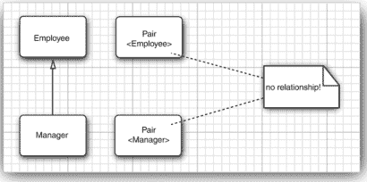

**图 8.1** Pair 类之间没有继承关系

这看起来像是一个残酷的限制，但它对类型安全是必要的。假设我们被允许将 `Pair<Manager>` 转换为 `Pair<Employee>`。考虑以下代码：

```java
var managerBuddies = new Pair<Manager>(ceo, cfo);
Pair<Employee> employeeBuddies = managerBuddies; // illegal, but suppose it wasn't
employeeBuddies.setFirst(lowlyEmployee);
```

显然，最后一条语句是合法的。但 `employeeBuddies` 和 `managerBuddies` 引用同一个对象。现在我们设法将 CFO 与一个低级别员工配成一对，而对于 `Pair<Manager>` 来说这应该是不可能的。

**注意：** 你刚刚看到了泛型类型与 Java 数组之间的一个重要区别。你可以将 `Manager[]` 数组赋值给 `Employee[]` 类型的变量：

```java
Manager[] managerBuddies = { ceo, cfo };
Employee[] employeeBuddies = managerBuddies; // OK
```

然而，数组带有特殊保护。如果你试图将一个低级别员工存入 `employeeBuddies[0]`，虚拟机会抛出 `ArrayStoreException`。

你总是可以将参数化类型转换为原始类型。例如，`Pair<Employee>` 是原始类型 `Pair` 的子类型。这种转换对于与遗留代码交互是必要的。

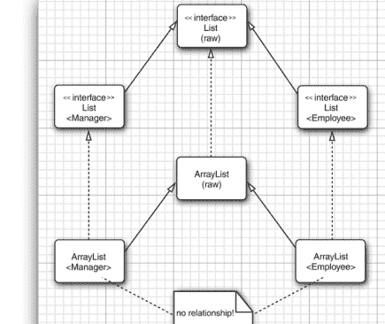

**图 8.2** 泛型列表类型之间的子类型关系

你能转换为原始类型，然后导致类型错误吗？不幸的是，可以。考虑这个例子：

```java
var managerBuddies = new Pair<Manager>(ceo, cfo);
Pair rawBuddies = managerBuddies; // OK
rawBuddies.setFirst(new File("...")); // only a compile-time warning
```

这听起来很可怕。然而，请记住，你的处境并不比使用旧版本 Java 时更糟。虚拟机的安全性并未受到威胁。当用 getFirst 取回这个外来对象并赋值给 Manager 变量时，会抛出 ClassCastException，就像过去一样。你只是失去了泛型编程通常提供的额外安全性。

最后，泛型类可以扩展或实现其他泛型类。在这方面，它们与普通类没有区别。例如，类 ArrayList<T> 实现接口 List<T>。这意味着 ArrayList<Manager> 可以转换为 List<Manager>。然而，正如你刚刚看到的，ArrayList<Manager> 不是 ArrayList<Employee> 或 List<Employee>。图 8.2 展示了这些关系。

### 8.8 通配符类型

类型系统的研究者们早就知道，僵化的泛型类型系统用起来相当令人不快。Java 设计者发明了一种巧妙（但仍然安全）的“逃生舱”：通配符类型。以下各节将展示如何使用通配符。

#### 8.8.1 通配符概念

在通配符类型中，类型参数可以变化。例如，通配符类型

```java
Pair<? extends Employee>
```

表示任何类型参数是 Employee 的子类的泛型 Pair 类型，例如 Pair<Manager>，但不是 Pair<String>。

假设你想编写一个打印员工对的方法，如下所示：

```java
public static void printBuddies(Pair<Employee> p)
{
    Employee first = p.getFirst();
    Employee second = p.getSecond();
    System.out.println(first.getName() + " and " + second.getName() + " are buddies.");
}
```

正如你在上一节看到的，不能将 `Pair<Manager>` 传给该方法，这相当受限。但解决方案很简单——使用通配符类型：

```java
public static void printBuddies(Pair<? extends Employee> p)
```

类型 `Pair<Manager>` 是 `Pair<? extends Employee>` 的子类型（见图 8.3）。

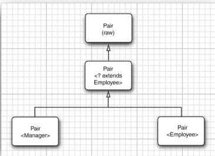

**图 8.3** 使用通配符时的子类型关系

我们能否通过 `Pair<? extends Employee>` 引用使用通配符来破坏 `Pair<Manager>`？

```java
var managerBuddies = new Pair<Manager>(ceo, cfo);
Pair<? extends Employee> wildcardBuddies = managerBuddies; // OK
wildcardBuddies.setFirst(lowlyEmployee); // compile-time error
```

不可能造成破坏。对 `setFirst` 的调用是一个类型错误。要了解原因，让我们仔细看看类型 `Pair<? extends Employee>`。它的方法如下所示：

```java
? extends Employee getFirst()
void setFirst(? extends Employee)
```

这使得无法调用 `setFirst` 方法。编译器只知道它需要 `Employee` 的某个子类型，但不知道是哪个类型。它拒绝传入任何具体类型——毕竟，`?` 可能并不匹配该类型。对于 getFirst，我们没有这个问题：将 getFirst 的返回值赋给 Employee 引用是完全合法的。

这就是有界通配符背后的关键思想。我们现在有办法区分安全的访问器方法和不安全的修改器方法。

#### 8.8.2 通配符的超类型边界

通配符边界与类型变量边界类似，但它们增加了一项能力——你可以指定一个*超类型边界*，如下所示：

```java
? super Manager
```

这个通配符被限制为 Manager 的所有超类型。（现有的 super 关键字能如此准确地描述这种关系，真是运气好。）

你为什么会想这样做呢？带有超类型边界的通配符所提供的行为，与第 459 页第 8.8 节“通配符类型”中描述的通配符行为相反。你可以向方法提供参数，但不能使用返回值。例如，`Pair<? super Manager>` 的方法可以描述如下：

```java
void setFirst(? super Manager)
? super Manager getFirst()
```

这不是实际的 Java 语法，但它展示了编译器知道什么。编译器无法知道 setFirst 方法的确切类型，因此不能接受参数类型为 Employee 或 Object 的调用。只能传递 Manager 类型或诸如 Executive 之类的子类型的对象。此外，如果你调用 getFirst，返回对象的类型没有保证。你只能将它赋给一个 Object。

这是一个典型例子。我们有一个经理数组，想将奖金最低和最高的经理放入一个 Pair 对象中。什么样的 Pair？Pair<Employee> 应该是可行的，或者就此而言，Pair<Object> 也可以（见图 8.4）。以下方法将接受任何合适的 Pair：

```java
public static void minmaxBonus(Manager[] a, Pair<? super Manager> result)
{
    if (a.length == 0) return;
    Manager min = a[0];
    Manager max = a[0];
    for (int i = 1; i < a.length; i++)
    {
        if (min.getBonus() > a[i].getBonus()) min = a[i];
        if (max.getBonus() < a[i].getBonus()) max = a[i];
    }
    result.setFirst(min);
    result.setSecond(max);
}
```

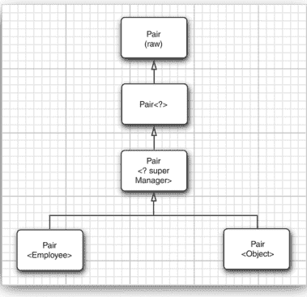

**图 8.4** 带有超类型边界的通配符

直观地说，带有超类型边界的通配符允许你写入泛型对象，而带有子类型边界的通配符允许你从泛型对象读取。

超类型边界还有另一个用途。`Comparable` 接口本身就是一个泛型类型。它的声明如下：

```java
public interface Comparable<T>
{
    public int compareTo(T other);
}
```


在这里，类型变量表示另一个参数的类型。例如，`String` 类实现了 `Comparable<String>`，其 `compareTo` 方法声明为：

```java
public int compareTo(String other)
```

这很不错——显式参数的类型是正确的。在接口泛型化之前，`other` 是 `Object` 类型，在方法实现中必须进行强制类型转换。

既然 `Comparable` 已经是泛型类型，也许我们应该把 `ArrayAlg` 类的 `minmax` 方法做得更好一些？我们可以将其声明为：

```java
public static <T extends Comparable<T>> Pair<T> minmax(T[] a)
```

这看起来比仅仅使用 `T extends Comparable` 更严谨，并且对许多类来说都能很好地工作。例如，如果计算一个 `String` 数组的最小值，那么 `T` 就是 `String` 类型，而 `String` 是 `Comparable<String>` 的子类型。但是，当处理 `LocalDate` 对象数组时，我们会遇到一个问题。实际上，`LocalDate` 实现了 `ChronoLocalDate`，而 `ChronoLocalDate` 扩展了 `Comparable<ChronoLocalDate>`。因此，`LocalDate` 实现的是 `Comparable<ChronoLocalDate>`，而不是 `Comparable<LocalDate>`。

在这种情况下，超类型就派上了用场：

```java
public static <T extends Comparable<? super T>> Pair<T> minmax(T[] a)
```

现在 `compareTo` 方法的形式为：

```java
int compareTo(? super T)
```

它或许被声明为接受 `T` 类型的对象，或者——例如当 `T` 是 `LocalDate` 时——接受 `T` 的某个超类型。无论如何，将 `T` 类型的对象传递给 `compareTo` 方法都是安全的。

对于不了解泛型的人来说，像 `<T extends Comparable<? super T>>` 这样的声明必然看起来很吓人。这很不幸，因为这个声明的目的是通过移除对调用参数不必要的限制来帮助应用程序开发人员。对泛型不感兴趣的应用程序开发人员可能会很快学会忽略这些声明，并理所当然地认为库开发人员会做正确的事情。如果你是一名库开发人员，你需要习惯通配符，否则你的用户会诅咒你，并在他们的代码中随意添加强制类型转换，直到代码能编译为止。

> **注意：** 超类型绑定的另一个常见用途是作为函数式接口的参数类型。例如，`Collection` 接口有一个方法：
>
> `default boolean removeIf(Predicate<? super E> filter)`
>
> 该方法会移除所有满足给定谓词的元素。例如，如果你有一些哈希码为奇数的员工，你可以像这样移除他们：

```java
ArrayList<Employee> staff = ...;
Predicate<Object> oddHashCode = obj -> obj.hashCode() % 2 != 0;
staff.removeIf(oddHashCode);
```

你需要能够传入 `Predicate<Object>`，而不仅仅是 `Predicate<Employee>`。超类型通配符使这成为可能。

#### 8.8.3 无界通配符

你甚至可以使用完全没有任何边界的通配符——例如 `Pair<?>`。乍一看，这似乎与原始的 `Pair` 类型相同。实际上，这两种类型有着很大的区别。`Pair<?>` 类型有这样的方法：

```java
? getFirst()
void setFirst(?)
```

`getFirst` 的返回值只能赋给一个 `Object`。`setFirst` 方法永远不能被调用，即使传入 `Object` 也不行。这就是 `Pair<?>` 和 `Pair` 之间的本质区别：你可以在原始 `Pair` 类的 `setFirst` 方法中传入任何 `Object`。

> **注意：** 可以调用 `setFirst(null)`。

为什么你会需要如此羸弱的类型呢？它对于非常简单的操作很有用。例如，下面的方法测试一个 pair 是否包含 null 引用。它根本不需要实际的类型。

```java
public static boolean hasNulls(Pair<?> p)
{
   return p.getFirst() == null || p.getSecond() == null;
}
```

你可以通过将 `hasNulls` 转换为泛型方法来避免使用通配符类型：

```java
public static <T> boolean hasNulls(Pair<T> p)
```

然而，使用通配符类型的版本似乎更容易阅读。

#### 8.8.4 通配符捕获

让我们编写一个交换 pair 元素的方法：

```java
public static void swap(Pair<?> p)
```

通配符不是类型变量，因此我们不能编写将 `?` 用作类型的代码。换句话说，下面的代码是不合法的：

```java
? t = p.getFirst(); // ERROR
p.setFirst(p.getSecond());
p.setSecond(t);
```

这是一个问题，因为在交换时我们需要临时保存第一个元素。幸运的是，这个问题有一个有趣的解决方案。我们可以编写一个辅助方法 `swapHelper`，如下所示：

```java
public static <T> void swapHelper(Pair<T> p)
{
    T t = p.getFirst();
    p.setFirst(p.getSecond());
    p.setSecond(t);
}
```

请注意，`swapHelper` 是一个泛型方法，而 `swap` 不是——它有一个固定类型 `Pair<?>` 的参数。

现在我们可以从 `swap` 调用 `swapHelper`：

```java
public static void swap(Pair<?> p) { swapHelper(p); }
```

在这种情况下，`swapHelper` 方法的参数 `T` 捕获了通配符。虽然不知道通配符表示的具体类型，但它是一个确定的类型，并且当 `T` 表示该类型时，`<T>swapHelper` 的定义完全合理。

当然，在这种情况下，我们并非必须使用通配符。我们可以直接将 `<T> void swap(Pair<T> p)` 实现为一个不使用通配符的泛型方法。但是，考虑下面这个例子，其中通配符类型自然出现在计算的中间：

```java
public static void maxminBonus(Manager[] a, Pair<? super Manager> result)
{
    minmaxBonus(a, result);
    PairAlg.swapHelper(result); // OK--swapHelper captures wildcard type
}
```

在这里，通配符捕获机制是无法避免的。

通配符捕获仅在最有限的情况下才是合法的。编译器必须能够保证通配符代表一个单一的、确定的类型。例如，`ArrayList<Pair<T>>` 中的 `T` 永远不能捕获 `ArrayList<Pair<?>>` 中的通配符。这个数组列表可能持有两个 `Pair<?>`，其中每个 `?` 都可能是不同的类型。

清单 8.3 中的测试程序汇总了我们在前面几节中讨论的各种方法，以便你在上下文中看到它们。

### 清单 8.3 pair3/PairTest3.java

```java
package pair3;

/**
 * @version 1.01 2012-01-26
 * @author Cay Horstmann
 */
public class PairTest3
{
   public static void main(String[] args)
   {
      var ceo = new Manager("Gus Greedy", 800000, 2003, 12, 15);
      var cfo = new Manager("Sid Sneaky", 600000, 2003, 12, 15);
      var buddies = new Pair<Manager>(ceo, cfo);
      printBuddies(buddies);

      ceo.setBonus(1000000);
      cfo.setBonus(500000);
      Manager[] managers = { ceo, cfo };

      var result = new Pair<Employee>();
      minmaxBonus(managers, result);
      System.out.println("first: " + result.getFirst().getName()
            + ", second: " + result.getSecond().getName());
      maxminBonus(managers, result);
      System.out.println("first: " + result.getFirst().getName()
            + ", second: " + result.getSecond().getName());
   }

   public static void printBuddies(Pair<? extends Employee> p)
   {
      Employee first = p.getFirst();
      Employee second = p.getSecond();
      System.out.println(first.getName() + " and " + second.getName() + " are buddies.");
   }

   public static void minmaxBonus(Manager[] a, Pair<? super Manager> result)
   {
      if (a.length == 0) return;
      Manager min = a[0];
      Manager max = a[0];
41    for (int i = 1; i < a.length; i++)
42    {
43       if (min.getBonus() > a[i].getBonus()) min = a[i];
44       if (max.getBonus() < a[i].getBonus()) max = a[i];
45    }
46    result.setFirst(min);
47    result.setSecond(max);
48 }
49
50 public static void maxminBonus(Manager[] a, Pair<? super Manager> result)
51 {
52    minmaxBonus(a, result);
53    PairAlg.swapHelper(result); // OK--swapHelper captures wildcard type
54 }
55 // Can't write public static <T super Manager> . . .
56
57
58 class PairAlg
59 {
60    public static boolean hasNulls(Pair<?> p)
61    {
62       return p.getFirst() == null || p.getSecond() == null;
63    }
64
65    public static void swap(Pair<?> p) { swapHelper(p); }
66
67    public static <T> void swapHelper(Pair<T> p)
68    {
69       T t = p.getFirst();
70       p.setFirst(p.getSecond());
71       p.setSecond(t);
72    }
73 }
```

### 8.9 反射与泛型

反射允许你在运行时分析任意对象。如果对象是泛型类的实例，你无法获得太多关于泛型类型参数的信息，因为它们已经被擦除了。在接下来的几节中，你将了解如何利用反射找出关于泛型类的信息。

#### 8.9.1 泛型 `Class` 类

`Class` 类现在是泛型的。例如，`String.class` 实际上是 `Class<String>` 类的一个对象（事实上是唯一对象）。


**`java.lang.reflect.Constructor<T>`** 1.1

- `T newInstance(Object... parameters)` 返回一个使用给定参数构造的新实例。

#### 8.9.2 使用 `Class<T>` 参数进行类型匹配

有时，在泛型方法中匹配 `Class<T>` 参数的类型变量很有用。下面是一个典型示例：

```java
public static <T> Pair<T> makePair(Class<T> c) throws InstantiationException,
    IllegalAccessException
{
    return new Pair<>(c.newInstance(), c.newInstance());
}
```

如果调用

```java
makePair(Employee.class)
```

那么 `Employee.class` 是类型为 `Class<Employee>` 的对象。`makePair` 方法的类型参数 `T` 与 `Employee` 匹配，编译器可以推断该方法返回 `Pair<Employee>`。

#### 8.9.3 虚拟机中的泛型类型信息

Java 泛型的一个显著特性是在虚拟机中擦除泛型类型。也许令人惊讶的是，擦除后的类仍然保留着对其泛型起源的一些模糊记忆。例如，原始 `Pair` 类知道自己源自泛型类 `Pair<T>`，尽管类型为 `Pair` 的对象无法分辨自己是被构造为 `Pair<String>` 还是 `Pair<Employee>`。

类似地，考虑一个方法

```java
public static Comparable min(Comparable[] a)
```

它是泛型方法

```java
public static <T extends Comparable<? super T>> T min(T[] a)
```

的擦除。

可以使用反射 API 确定：

- 泛型方法有一个名为 `T` 的类型参数；
- 该类型参数有一个子类型边界，而该边界本身是一个泛型类型；
- 该边界类型有一个通配符参数；
- 该通配符参数有一个超类型边界；并且
- 该泛型方法有一个泛型数组参数。

换句话说，你可以重建实现者所声明的关于泛型类和泛型方法的一切信息。但是，你无法知道对于特定对象或方法调用，类型参数是如何解析的。

为了表达泛型类型声明，请使用 `java.lang.reflect` 包中的 `Type` 接口。该接口具有以下子类型：

- `Class` 类，描述具体类型
- `TypeVariable` 接口，描述类型变量（例如 `T extends Comparable<? super T>`）
- `WildcardType` 接口，描述通配符（例如 `? super T`）
- `ParameterizedType` 接口，描述泛型类或接口类型（例如 `Comparable<? super T>`）
- `GenericArrayType` 接口，描述泛型数组（例如 `T[]`）

图 8.5 展示了继承层次结构。注意，最后四个子类型是接口——虚拟机会实例化实现这些接口的合适类。

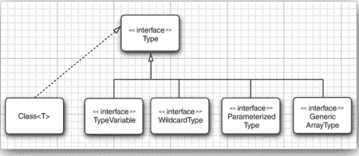

**图 8.5** `Type` 接口及其后代

清单 8.4 使用泛型反射 API 打印出它发现的关于给定类的信息。如果使用 `Pair` 类运行它，会得到以下报告：

```
class Pair<T> extends java.lang.Object
public T getFirst()
public T getSecond()
public void setFirst(T)
public void setSecond(T)
```

**清单 8.4** *（续）*

```java
42    System.out.print(cl);
43    printTypes(cl.getTypeParameters(), "<", ", ", ">", true);
44    Type sc = cl.getGenericSuperclass();
45    if (sc != null)
46    {
47        System.out.print(" extends ");
48        printType(sc, false);
49    }
50    printTypes(cl.getGenericInterfaces(), " implements ", ", ", "", false);
51    System.out.println();
52 }

54 public static void printMethod(Method m)
55 {
56    String name = m.getName();
57    System.out.print(Modifier.toString(m.getModifiers()));
58    System.out.print(" ");
59    printTypes(m.getTypeParameters(), "<", ", ", "> ", true);

61    printType(m.getGenericReturnType(), false);
62    System.out.print(" ");
63    System.out.print(name);
64    System.out.print("(");
65    printTypes(m.getGenericParameterTypes(), "", ", ", "", false);
66    System.out.println(")");
67 }
68 public static void printTypes(Type[] types, String pre, String sep, String suf,
69    boolean isDefinition)
70 {
71    if (pre.equals(" extends ") && Arrays.equals(types, new Type[] { Object.class }))
72        return;
73    if (types.length > 0) System.out.print(pre);
74    for (int i = 0; i < types.length; i++)
75    {
76        if (i > 0) System.out.print(sep);
77        printType(types[i], isDefinition);
78    }
79    if (types.length > 0) System.out.print(suf);
80 }

82 public static void printType(Type type, boolean isDefinition)
83 {
84    if (type instanceof Class)
85    {
86        var t = (Class<?>) type;
        System.out.print(t.getName());
    }
    else if (type instanceof TypeVariable)
    {
        var t = (TypeVariable<?>) type;
        System.out.print(t.getName());
        if (isDefinition)
            printTypes(t.getBounds(), " extends ", " & ", "", false);
    }
    else if (type instanceof WildcardType)
    {
        var t = (WildcardType) type;
        System.out.print("?");
        printTypes(t.getUpperBounds(), " extends ", " & ", "", false);
        printTypes(t.getLowerBounds(), " super ", " & ", "", false);
    }
    else if (type instanceof ParameterizedType)
    {
        var t = (ParameterizedType) type;
        Type owner = t.getOwnerType();
        if (owner != null)
        {
            printType(owner, false);
            System.out.print(".");
        }
        printType(t.getRawType(), false);
        printTypes(t.getActualTypeArguments(), "<", ", ", ">", false);
    }
    else if (type instanceof GenericArrayType)
    {
        var t = (GenericArrayType) type;
        System.out.print("");
        printType(t.getGenericComponentType(), isDefinition);
        System.out.print("[]");
    }
}
}
```

#### 8.9.4 类型字面量

有时，你希望根据值的类型来驱动程序行为。例如，在持久化机制中，你可能希望用户指定一种保存特定类对象的方式。这通常通过将类对象与某个动作关联来实现。

然而，对于泛型类，擦除会带来问题。例如，当 `ArrayList<Integer>` 和 `ArrayList<String>` 都擦除为相同的原始 `ArrayList` 类型时，如何为它们设置不同的动作？

有一种技巧可以在某些情况下缓解这个问题。你可以捕获上一节中遇到的 `Type` 接口的实例。像这样构造一个匿名子类：

```java
var type = new TypeLiteral<ArrayList<Integer>>() {} // note the {}
```

`TypeLiteral` 构造器会捕获泛型超类型：

```java
class TypeLiteral
{
    public TypeLiteral()
    {
        Type parentType = getClass().getGenericSuperclass();
        if (parentType instanceof ParameterizedType)
        {
            type = ((ParameterizedType) parentType).getActualTypeArguments()[0];
        }
        else
            throw new UnsupportedOperationException(
                "Construct as new TypeLiteral<...>(){}");
    }
    ...
}
```

如果我们在运行时有一个可用的泛型类型，就可以将其与 `TypeLiteral` 进行匹配。我们无法从对象中获取泛型类型——它已被擦除。但是，正如你在上一节中所见，字段和方法参数的泛型类型在虚拟机中会保留下来。

CDI 和 Guice 等注入框架使用类型字面量来控制泛型类型的注入。本书配套代码中的示例程序展示了一个更简单的例子。给定一个对象，我们枚举其字段（这些字段的泛型类型可用），并查找关联的格式化动作。

我们通过用空格分隔值来格式化 `ArrayList<Integer>`，通过将字符连接成字符串来格式化 `ArrayList<Character>`。任何其他数组都由 `ArrayList.toString` 格式化。

**清单 8.5** `genericReflection/TypeLiterals.java`

```java
package genericReflection;

/**
 * @version 1.01 2018-04-10
 * @author Cay Horstmann
 */

import java.lang.reflect.*;
import java.util.*;
```


## 代码清单 8.5 *（续）*

```java
public int hashCode()
{
    return type.hashCode();
}
}

/**
 * Formats objects, using rules that associate types with formatting functions.
 */
class Formatter
{
    private Map<TypeLiteral<?>, Function<?, String>> rules = new HashMap<>();

    /**
     * Add a formatting rule to this formatter.
     * @param type the type to which this rule applies
     * @param formatterForType the function that formats objects of this type
     */
    public <T> void forType(TypeLiteral<T> type, Function<T, String> formatterForType)
    {
        rules.put(type, formatterForType);
    }

    /**
     * Formats all fields of an object using the rules of this formatter.
     * @param obj an object
     * @return a string with all field names and formatted values
     */
    public String formatFields(Object obj)
        throws IllegalArgumentException, IllegalAccessException
    {
        var result = new StringBuilder();
        for (Field f : obj.getClass().getDeclaredFields())
        {
            result.append(f.getName());
            result.append("=");
            f.setAccessible(true);
            Function<?, String> formatterForType = rules.get(TypeLiteral.of(f.getGenericType()));
            if (formatterForType != null)
            {
                // formatterForType has parameter type ?. Nothing can be passed to its apply
                // method. Cast makes the parameter type to Object so we can invoke it.
                @SuppressWarnings("unchecked")
                Function<Object, String> objectFormatter
                    = (Function<Object, String>) formatterForType;
                result.append(objectFormatter.apply(f.get(obj)));
            }
            else
                result.append(f.get(obj).toString());
            result.append("\n");
        }
        return result.toString();
    }
}

public class TypeLiterals
{
    public static class Sample
    {
        ArrayList<Integer> nums;
        ArrayList<Character> chars;
        ArrayList<String> strings;
        public Sample()
        {
            nums = new ArrayList<>();
            nums.add(42); nums.add(1729);
            chars = new ArrayList<>();
            chars.add('H'); chars.add('i');
            strings = new ArrayList<>();
            strings.add("Hello"); strings.add("World");
        }
    }

    private static <T> String join(String separator, ArrayList<T> elements)
    {
        var result = new StringBuilder();
        for (T e : elements)
        {
            if (result.length() > 0) result.append(separator);
            result.append(e.toString());
        }
        return result.toString();
    }

    public static void main(String[] args) throws Exception
    {
        var formatter = new Formatter();
        formatter.forType(new TypeLiteral<ArrayList<Integer>>() {},
            lst -> join(", ", lst));
        formatter.forType(new TypeLiteral<ArrayList<Character>>() {},
            lst -> " " + join("", lst) + "\n");
        System.out.println(formatter.formatFields(new Sample()));
    }
}
```

**java.lang.Class<T> 1.0**

- `TypeVariable[] getTypeParameters()` 5  
  如果此类型被声明为泛型类型，则获取其泛型类型变量；否则获取长度为 0 的数组。
- `Type getGenericSuperclass()` 5  
  获取为此类型声明的超类的泛型类型；如果此类型为 Object 或不是类类型，则返回 null。
- `Type[] getGenericInterfaces()` 5  
  按声明顺序获取为此类型声明的接口的泛型类型；如果此类型不实现接口，则返回长度为 0 的数组。

**java.lang.reflect.Method 1.1**

- `TypeVariable[] getTypeParameters()` 5  
  如果此方法被声明为泛型方法，则获取其泛型类型变量；否则获取长度为 0 的数组。
- `Type getGenericReturnType()` 5  
  获取声明此方法时使用的泛型返回类型。
- `Type[] getGenericParameterTypes()` 5  
  获取声明此方法时使用的泛型参数类型。如果该方法没有参数，则返回长度为 0 的数组。

**java.lang.reflect.TypeVariable 5**

- `String getName()`  
  获取此类型变量的名称。
- `Type[] getBounds()`  
  获取此类型变量的超类型；如果该变量无界，则返回长度为 0 的数组。

| `java.lang.reflect.WildcardType` | 5 |
|---|---|
| • `Type[] getUpperBounds()` | 获取此类型变量的超类（extends）边界；如果该变量没有子类边界，则返回长度为 0 的数组。 |
| • `Type[] getLowerBounds()` | 获取此类型变量的超类（super）边界；如果该变量没有超类边界，则返回长度为 0 的数组。 |

| `java.lang.reflect.ParameterizedType` | 5 |
|---|---|
| • `Type getRawType()` | 获取此参数化类型的原始类型。 |
| • `Type[] getActualTypeArguments()` | 获取声明此参数化类型时使用的类型参数。 |
| • `Type getOwnerType()` | 如果这是内部类型，则获取外部类类型；如果这是顶层类型，则返回 null。 |

| `java.lang.reflect.GenericArrayType` | 5 |
|---|---|
| • `Type getGenericComponentType()` | 获取声明此数组类型时使用的泛型组件类型。 |

你现在已经知道如何使用泛型类，以及如何在需要时编写自己的泛型类和方法。同样重要的是，你知道如何解读在 API 文档和错误消息中可能遇到的泛型类型声明。要全面了解 Java 泛型的方方面面，请参阅 Angelika Langer 在 http://angelikalanger.com/GenericsFAQ/JavaGenericsFAQ.html 上编写的出色常见（以及不那么常见）问题列表。

在下一章中，你将看到 Java 集合框架如何运用泛型。

*此页有意留白*

## 第 9 章：集合

### 本章内容

- 9.1 Java 集合框架，第 482 页
- 9.2 集合框架中的接口，第 492 页
- 9.3 具体集合，第 494 页
- 9.4 映射，第 519 页
- 9.5 视图与包装器，第 532 页
- 9.6 算法，第 541 页
- 9.7 遗留集合，第 552 页

当你尝试以自然风格实现方法或关注性能时，选择的数据结构可能带来很大差别。是否需要在数千（甚至数百万）个已排序项中快速查找？是否需要在有序序列中间快速插入和删除元素？是否需要在键和值之间建立关联？

本章展示 Java 类库如何帮助你完成严肃编程所需的传统数据结构构建。在大学计算机科学课程中，一门名为“数据结构”的课程通常需要一学期才能完成，而且有许许多多书籍专门讨论这个重要主题。我们的讲述与大学课程不同；我们将跳过理论，只向你展示如何使用标准库中的集合类。

### 9.1 Java 集合框架

Java 的最初版本只提供了一小组用于最有用数据结构的类：`Vector`、`Stack`、`Hashtable`、`BitSet`，以及 `Enumeration` 接口，后者提供了一种用于访问任意容器中元素的抽象机制。这当然是一个明智的选择——要设计出一套全面的集合类库需要时间和技巧。

随着 Java 1.2 的问世，设计者觉得推出全套数据结构的时机已经成熟。他们面临许多相互冲突的设计挑战。他们希望这个类库小巧且易于学习。他们不想要 C++ 标准模板库（STL）的复杂性，但希望获得 STL 开创的“泛型算法”的好处。他们希望遗留类能融入新框架。正如所有集合类库的设计者一样，他们不得不做出一些艰难选择，并在过程中提出了一些独特的设计决策。在本节中，我们将探讨 Java 集合框架的基本设计，向你展示如何使用它，并解释一些较有争议特性背后的理由。

#### 9.1.1 将集合接口与实现分离

与现代数据结构类库一样，Java 集合类库将*接口*和*实现*分离。让我们用一个熟悉的数据结构——*队列*——来看这种分离。

*队列*接口规定，你可以在队列尾端添加元素、在头端移除元素，并查明队列中有多少个元素。当你需要收集对象并以“先进先出”的方式取回它们时，就使用队列（见图 9.1）。

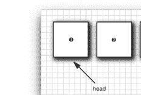

图 9.1 队列


队列接口的一种最简形式可能如下所示：

```java
public interface Queue<E> // a simplified form of the interface in the standard library
{
    void add(E element);
    E remove();
    int size();
}
```

该接口并未说明队列是如何实现的。队列的两种常见实现中，一种使用“循环数组”，另一种使用链表（见图 9.2）。

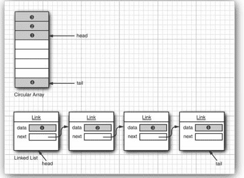

**图 9.2** 队列实现

每种实现都可以由一个实现 Queue 接口的类来表示。

```java
public class CircularArrayQueue<E> implements Queue<E> // not an actual library class
{
    private int head;
    private int tail;

    CircularArrayQueue(int capacity) { . . . }
    public void add(E element) { . . . }
    public E remove() { . . . }
    public int size() { . . . }
    private E[] elements;
}

public class LinkedListQueue<E> implements Queue<E> // not an actual library class
{
    private Link head;
    private Link tail;

    LinkedListQueue() { . . . }
    public void add(E element) { . . . }
    public E remove() { . . . }
    public int size() { . . . }
}
```

> **注意：** Java 类库实际上并没有名为 CircularArrayQueue 和 LinkedListQueue 的类。我们使用这些类作为示例，来解释集合接口与集合实现之间的概念区别。如果你需要一个循环数组队列，请使用 ArrayDeque 类。对于链表队列，只需使用 LinkedList 类——它实现了 Queue 接口。

在程序中使用队列时，一旦集合已经构造完成，你无需知道实际使用的是哪种实现。因此，只在构造集合对象时才使用具体类是有意义的。使用*接口类型*来持有集合引用。

```java
Queue<Customer> expressLane = new CircularArrayQueue<>(100);
expressLane.add(new Customer("Harry"));
```

采用这种方法，如果你改变主意，也可以轻松改用另一种实现。你只需在程序中的一个地方进行修改——即构造函数调用处。如果你最终认为 LinkedListQueue 是更好的选择，那么代码就变成

```java
Queue<Customer> expressLane = new LinkedListQueue<>();
expressLane.add(new Customer("Harry"));
```

为什么要在一种实现和另一种实现之间做选择？接口并未说明某种实现的效率。循环数组比链表稍微高效一些，因此通常更可取。然而，和往常一样，这是有代价的。循环数组是一种*有界*集合——它的容量有限。如果你的程序要收集的对象数量没有上限，那么最终可能还是链表实现更合适。

当你研究 API 文档时，会发现另一组名称以 Abstract 开头的类，例如 AbstractQueue。这些类是为类库实现者准备的。如果你想要实现自己的队列类（这种可能性也许不大），你会发现扩展 AbstractQueue 比实现 Queue 接口的所有方法更容易。

#### 9.1.2 集合接口

Java 类库中集合类的基础接口是 Collection 接口。该接口有两个基本方法：

```java
public interface Collection<E>
{
    boolean add(E element);
    Iterator<E> iterator();
    . . .
}
```

除了这两个方法之外，还有几个方法；我们将在后面讨论它们。

add 方法向集合中添加一个元素。如果添加元素确实改变了集合，add 方法返回 true；如果集合没有变化，则返回 false。例如，如果你尝试向一个集（set）中添加一个对象，而该对象已经存在，那么添加请求不会产生任何效果，因为集会拒绝重复元素。

iterator 方法返回一个实现 Iterator 接口的对象。你可以使用该迭代器对象逐个访问集合中的元素。我们将在下一节讨论迭代器。

#### 9.1.3 迭代器

Iterator 接口有四个方法：

```java
public interface Iterator<E>
{
    E next();
    boolean hasNext();
    void remove();
    default void forEachRemaining(Consumer<? super E> action);
}
```

通过反复调用 next 方法，你可以逐个访问集合中的元素。然而，如果到达集合末尾，next 方法会抛出 NoSuchElementException。因此，在调用 next 之前需要先调用 hasNext 方法。如果迭代器对象还有更多元素可访问，该方法返回 true。如果你想检查集合中的所有元素，请获取一个迭代器，然后在 hasNext 返回 true 时持续调用 next 方法。例如：

```java
Collection<String> c = ...;
Iterator<String> iter = c.iterator();
while (iter.hasNext())
{
    String element = iter.next();
    do something with element
}
```

你可以将这样的循环更简洁地写成“for each”循环：

```java
for (String element : c)
{
    do something with element
}
```

编译器只是将“for each”循环转换为使用迭代器的循环。

“for each”循环适用于任何实现了 Iterable 接口的对象，该接口只有一个抽象方法：

```java
public interface Iterable<E>
{
    Iterator<E> iterator();
    ...
}
```

Collection 接口扩展了 Iterable 接口。因此，你可以对标准库中的任何集合使用“for each”循环。

除了编写循环，你还可以使用一个消费元素的 lambda 表达式来调用 forEachRemaining 方法。该 lambda 表达式会针对迭代器的每个元素被调用，直到没有元素剩余。

```java
iterator.forEachRemaining(element -> do something with element);
```

元素的访问顺序取决于集合类型。如果你遍历 ArrayList，迭代器从索引 0 开始，并在每一步递增索引。然而，如果你访问 HashSet 中的元素，得到的顺序基本上是随机的。你可以确信在迭代过程中会遇到集合的所有元素，但不能对它们的顺序做任何假设。这通常不是问题，因为对于计算总和或计数匹配项等计算而言，顺序并不重要。

> **注意：** 老手会注意到，Iterator 接口的 next 和 hasNext 方法与 Enumeration 的 nextElement 和 hasMoreElements 方法用途相同。Java 集合库的设计者本可以选择使用 Enumeration 接口。但他们不喜欢那些冗长的方法名，于是引入了一个方法名更短的新接口。

Java 集合库中的迭代器与其他库中的迭代器之间存在一个重要的概念差异。在传统的集合库（例如 C++ 的标准模板库）中，迭代器模仿数组索引。给定这样的迭代器，你可以查找存储在该位置的元素，就像如果你有数组索引 i，就可以查找数组元素 a[i] 一样。与查找无关，你还可以将迭代器前进到下一个位置。这与通过调用 i++ 来推进数组索引而不执行查找是相同的操作。然而，Java 迭代器并非如此工作。查找和位置变更紧密耦合。查找元素的唯一方法是调用 next，而该查找会推进位置。

相反，可以把 Java 迭代器看作位于元素之间。当你调用 next 时，迭代器会跳过下一个元素，并返回它刚刚越过的那个元素的引用（见图 9.3）。

**注意：** 这里还有一个有用的类比。你可以把 Iterator.next 看作等同于 InputStream.read。从流中读取一个字节会自动“消费”该字节。下一次调用 read 会消费并返回输入中的下一个字节。类似地，反复调用 next 可以让你读取集合中的所有元素。

Iterator 接口的 remove 方法会移除上一次调用 next 所返回的元素。在许多情况下，这是合理的——你需要先看到元素，才能决定它是否应该被移除。但如果你想移除某个特定位置上的元素，仍然需要先跳过该元素。例如，下面展示了如何移除字符串集合中的第一个元素：


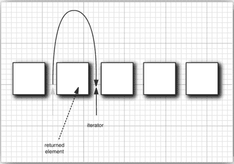

**图 9.3** 推进迭代器

```java
Iterator<String> it = c.iterator();
it.next(); // 跳过第一个元素
it.remove(); // 现在移除它
```

更重要的是，`next` 和 `remove` 方法的调用之间存在依赖关系。如果之前没有调用过 `next`，就直接调用 `remove` 是非法的。如果尝试这样做，会抛出 `IllegalStateException`。

如果你想移除两个相邻的元素，不能简单地调用

```java
it.remove();
it.remove(); // 错误
```

相反，你必须先调用 `next` 跳过一个要移除的元素。

```java
it.remove();
it.next();
it.remove(); // 正确
```

#### 9.1.4 泛型工具方法

`Collection` 和 `Iterator` 接口是泛型的，这意味着你可以编写操作任何类型集合的工具方法。例如，下面是一个泛型方法，用于测试任意集合是否包含给定元素：

```java
public static <E> boolean contains(Collection<E> c, Object obj)
{
    for (E element : c)
        if (element.equals(obj))
            return true;
    return false;
}
```

Java 库的设计者认为其中一些工具方法非常有用，因此决定在库中提供它们。这样，库的使用者就不必重复造轮子了。`contains` 方法就是这样一个方法。

实际上，`Collection` 接口声明了相当多有用的方法，所有实现类都必须提供这些方法。其中包括

```java
int size()
boolean isEmpty()
boolean contains(Object obj)
boolean containsAll(Collection<?> c)
boolean equals(Object other)
boolean addAll(Collection<? extends E> from)
boolean remove(Object obj)
boolean removeAll(Collection<?> c)
void clear()
boolean retainAll(Collection<?> c)
Object[] toArray()
<T> T[] toArray(T[] arrayToFill)
```

其中许多方法不言自明；你可以在本节末尾的 API 注释中找到完整的文档。

当然，如果每个实现 `Collection` 接口的类都必须提供这么多例程方法，那将是一件麻烦事。为了让实现者的生活更轻松，库提供了一个 `AbstractCollection` 类，它将基本方法 `size` 和 `iterator` 保持为抽象，但根据它们实现了例程方法。例如：

```java
public abstract class AbstractCollection<E>
    implements Collection<E>
{
    . . .
    public abstract Iterator<E> iterator();

    public boolean contains(Object obj)
    {
        for (E element : this) // 调用 iterator()
            if (element.equals(obj))
                return true;
        return false;
    }
    . . .
}
```

现在，一个具体的集合类可以扩展 `AbstractCollection` 类。具体的集合类需要提供 `iterator` 方法，而 `contains` 方法已经由 `AbstractCollection` 超类处理了。但是，如果子类有更有效的方法来实现 `contains`，它可以自由地这样做。

这种方法有点过时了。如果这些方法是 `Collection` 接口的默认方法会更好。但事实并非如此。不过，已经添加了几个默认方法。其中大多数涉及流（我们将在第二卷中讨论）。此外，还有一个有用的方法

```java
default boolean removeIf(Predicate<? super E> filter)
```

用于移除满足条件的元素。

**`java.util.Collection<E>` 1.2**

- `Iterator<E> iterator()`  
  返回一个可用于访问集合中元素的迭代器。
- `int size()`  
  返回集合中当前存储的元素数量。
- `boolean isEmpty()`  
  如果此集合不包含任何元素，则返回 `true`。
- `boolean contains(Object obj)`  
  如果此集合包含与 `obj` 相等的对象，则返回 `true`。

**`java.util.Collection<E>` 1.2（续）**

| 方法 | 说明 |
|---|---|
| `boolean containsAll(Collection<?> other)` | 如果此集合包含另一个集合中的所有元素，则返回 `true`。 |
| `boolean add(E element)` | 向集合中添加一个元素。如果此调用导致集合发生更改，则返回 `true`。 |
| `boolean addAll(Collection<? extends E> other)` | 将另一个集合中的所有元素添加到此集合中。如果此调用导致集合发生更改，则返回 `true`。 |
| `boolean remove(Object obj)` | 从此集合中移除与 `obj` 相等的对象。如果移除了匹配的对象，则返回 `true`。 |
| `boolean removeAll(Collection<?> other)` | 从此集合中移除另一个集合中的所有元素。如果此调用导致集合发生更改，则返回 `true`。 |
| `default boolean removeIf(Predicate<? super E> filter)` | 移除所有 `filter` 返回 `true` 的元素。如果此调用导致集合发生更改，则返回 `true`。 |
| `void clear()` | 从此集合中移除所有元素。 |
| `boolean retainAll(Collection<?> other)` | 从此集合中移除所有与另一个集合中的元素不相等的元素。如果此调用导致集合发生更改，则返回 `true`。 |
| `Object[] toArray()` | 返回集合中对象的数组。 |
| `<T> T[] toArray(T[] arrayToFill)` | 返回集合中对象的数组。如果 `arrayToFill` 长度足够，则用此集合的元素填充它。如果有剩余空间，则追加一个 `null` 元素。否则，会分配并填充一个与 `arrayToFill` 组件类型相同、长度与此集合大小相同的新数组。 |

**`java.util.Iterator<E>` 1.2**

| 方法 | 说明 |
|---|---|
| `boolean hasNext()` | 如果还有另一个元素要访问，则返回 `true`。 |
| `E next()` | 返回下一个要访问的对象。如果已达到集合末尾，则抛出 `NoSuchElementException`。 |
| `void remove()` | 移除最后访问的对象。此方法必须紧跟元素访问之后调用。如果自上次元素访问以来集合已被修改，则此方法抛出 `IllegalStateException`。 |
| `default void forEachRemaining(Consumer<? super E> action)` | 访问元素并将它们传递给给定操作，直到没有剩余元素或操作抛出异常为止。 |

### 9.2 集合框架中的接口

Java 集合框架为不同类型的集合定义了许多接口，如图 9.4 所示。

集合有两个基本接口：`Collection` 和 `Map`。如你所见，你可以通过以下方法将元素插入集合：

```java
boolean add(E element)
```

然而，映射保存键/值对，你使用 `put` 方法插入它们：

```java
V put(K key, V value)
```

要从集合中读取元素，请使用迭代器访问它们。但是，你可以使用 `get` 方法从映射中读取值：

```java
V get(K key)
```

列表是一种*有序集合*。元素被添加到容器中的特定位置。可以通过两种方式访问元素：通过迭代器或通过整数索引。后者称为*随机访问*，因为可以按任意顺序访问元素。相反，使用迭代器时，必须按顺序访问它们。

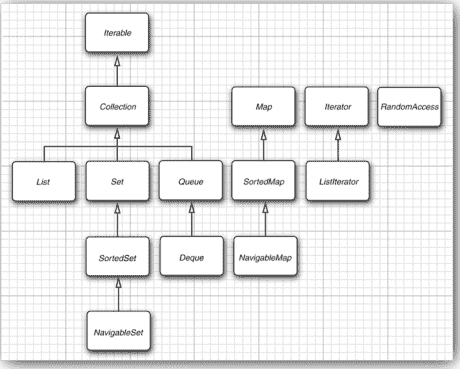

**图 9.4** 集合框架的接口

`List` 接口定义了几个用于随机访问的方法：

```java
void add(int index, E element)
void remove(int index)
E get(int index)
E set(int index, E element)
```

`ListIterator` 接口是 `Iterator` 的子接口。它定义了一个用于在迭代器位置之前添加元素的方法：

```java
void add(E element)
```

坦率地说，集合框架的这一方面设计得很差。在实践中，有两种有序集合，它们的性能权衡差异很大。由数组支持的有序集合具有快速的随机访问能力，因此使用带有整数索引的 `List` 方法是有意义的。相比之下，链表虽然也是有序的，但随机访问速度较慢，最好使用迭代器进行遍历。提供两个接口本来是一件容易的事。

> **注意：** 为避免对链表执行随机访问操作，Java 1.4 引入了一个标记接口 `RandomAccess`。该接口没有方法，但你可以使用它来测试特定集合是否支持高效的随机访问：
> 
> ```java
> if (c instanceof RandomAccess)
> {
>     使用随机访问算法
> }
> else
> {
>     使用顺序访问算法
> }
> ```

`Set` 接口与 `Collection` 接口相同，但方法的行为定义得更严格。`set` 的 `add` 方法应拒绝重复项。`set` 的 `equals` 方法应这样定义：如果两个集合具有相同的元素，则它们是相同的，但不一定顺序相同。`hashCode` 方法应这样定义：具有相同元素的两个集合产生相同的哈希码。

如果方法签名相同，为什么还要单独定义一个接口？从概念上讲，并非所有集合都是集。制作 `Set` 接口使程序员能够编写只接受集的方法。

`SortedSet` 和 `SortedMap` 接口公开了用于排序的比较器对象，并定义了获取集合子集视图的方法。我们将在第 532 页的 9.5 节“视图和包装器”中讨论这些内容。

最后，Java 6 引入了 `NavigableSet` 和 `NavigableMap` 接口，它们包含用于在有序集和映射中进行搜索和遍历的额外方法。（理想情况下，这些方法应该直接包含在 `SortedSet` 和 `SortedMap` 接口中。）`TreeSet` 和 `TreeMap` 类实现了这些接口。

### 9.3 具体集合

表 9.1 显示了 Java 库中的集合，并简要描述了每个集合类的用途。（为简单起见，我们省略了线程安全的


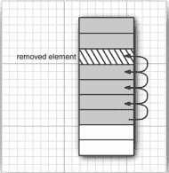

**图 9.6** 从数组中删除元素

另一种众所周知的数据结构——*链表*——解决了这个问题。数组将对象引用存储在连续的内存位置中，而链表将每个对象存储在一个单独的*链接*中。每个链接还存储对序列中下一个链接的引用。在 Java 编程语言中，所有链表实际上都是*双向链接*的；也就是说，每个链接还存储对其前驱的引用（见图 9.7）。

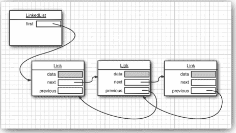

**图 9.7** 一个双向链表

从链表中间删除元素是一种开销很小的操作——只需要更新待删除元素周围的链接（见图 9.8）。

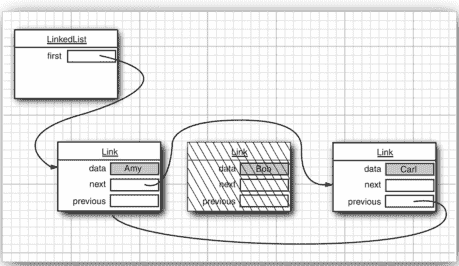

**图 9.8** 从链表中删除元素

也许你曾经上过一门数据结构课程，在课程中学习了如何实现链表。你可能对在链表中删除或添加元素时把链接弄乱有着糟糕的回忆。如果是这样，你会很高兴地了解到，Java 集合库提供了一个可供你使用的 `LinkedList` 类。

下面的代码示例添加三个元素，然后删除第二个元素：

```java
var staff = new LinkedList<String>();
staff.add("Amy");
staff.add("Bob");
staff.add("Carl");
Iterator<String> iter = staff.iterator();
String first = iter.next(); // visit first element
String second = iter.next(); // visit second element
iter.remove(); // remove last visited element
```

然而，链表与泛型集合之间有一个重要区别。链表是一种*有序集合*，其中对象的位置很重要。`LinkedList.add` 方法将对象添加到列表末尾。

但你常常会想把对象添加到列表中间的某个位置。这种依赖于位置的 add 方法由迭代器负责，因为迭代器描述集合中的位置。使用迭代器添加元素只对具有自然顺序的集合有意义。例如，我们将在下一节讨论的集合数据类型不对其元素施加任何顺序。因此，Iterator 接口中没有 add 方法。相反，集合库提供了一个包含 add 方法的子接口 ListIterator：

```java
interface ListIterator<E> extends Iterator<E>
{
    void add(E element);
    . . .
}
```

与 Collection.add 不同，此方法不返回布尔值——这里假定 add 操作总是会修改列表。

此外，ListIterator 接口有两个方法，可用于反向遍历列表。

```java
E previous()
boolean hasPrevious()
```

与 next 方法一样，previous 方法返回它跳过的对象。

`LinkedList` 类的 `listIterator` 方法返回一个实现 `ListIterator` 接口的迭代器对象。

```java
ListIterator<String> iter = staff.listIterator();
```

add 方法将新元素添加到迭代器位置之前。例如，下面的代码跳过链表中的第一个元素，并在第二个元素之前添加 "Juliet"（见图 9.9）：

```java
var staff = new LinkedList<String>();
staff.add("Amy");
staff.add("Bob");
staff.add("Carl");
ListIterator<String> iter = staff.listIterator();
iter.next(); // skip past first element
iter.add("Juliet");
```

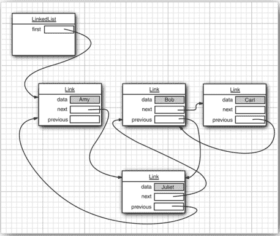

**图 9.9** 向链表中添加元素

如果多次调用 add 方法，元素只会按你提供它们的顺序添加。它们都会依次添加到当前迭代器位置之前。

当你对一个刚从 listIterator 方法返回、且指向链表开头的迭代器使用 add 操作时，新添加的元素会成为列表的新头。当迭代器已经越过列表的最后一个元素时（即 hasNext 返回 false），添加的元素会成为列表的新尾。如果链表有 n 个元素，那么有 n + 1 个位置可用于添加新元素。这些位置对应于迭代器可能的 n + 1 个位置。例如，如果链表包含三个元素 A、B 和 C，则有四个可能的位置（用 | 标记）用于插入新元素：

```text
|ABC
A|BC
AB|C
ABC|
```

> **注意：** 小心“光标”这个类比。remove 操作的工作方式并不完全像退格键。在调用 `next` 之后立即调用 `remove` 方法，确实会删除迭代器左侧的元素，就像退格键会做的那样。但是，如果你刚刚调用了 `previous`，则会删除右侧的元素。而且你不能连续两次调用 `remove`。
>
> 与仅依赖于迭代器位置的 `add` 方法不同，`remove` 方法依赖于迭代器状态。

最后，`set` 方法用新元素替换由 `next` 或 `previous` 调用返回的最后一个元素。例如，下面的代码用新值替换列表的第一个元素：

```java
ListIterator<String> iter = list.listIterator();
String oldValue = iter.next(); // returns first element
iter.set(newValue); // sets first element to newValue
```

可以想象，如果一个迭代器在遍历集合，而另一个迭代器正在修改它，就可能出现令人困惑的情况。例如，假设一个迭代器指向另一个迭代器刚刚删除的某个元素之前。该迭代器现在无效，不应再使用。链表迭代器经过设计，可以检测此类修改。如果迭代器发现其集合已被另一个迭代器或集合自身的方法修改，就会抛出 `ConcurrentModificationException`。例如，考虑以下代码：

```java
List<String> list = ... ;
ListIterator<String> iter1 = list.listIterator();
ListIterator<String> iter2 = list.listIterator();
iter1.next();
iter1.remove();
iter2.next(); // throws ConcurrentModificationException
```

对 `iter2.next` 的调用会抛出 `ConcurrentModificationException`，因为 `iter2` 检测到列表被外部修改了。

要避免并发修改异常，请遵循这条简单规则：你可以向一个集合附加任意多个迭代器，前提是它们都只是读取者。或者，你可以附加一个既能读取又能写入的迭代器。

并发修改检测以简单的方式完成。集合会跟踪修改操作（例如添加和删除元素）的次数。每个迭代器会单独记录它负责的修改操作次数。在每个迭代器方法的开头，迭代器只需检查自己的修改计数是否等于集合的修改计数。如果不等，就抛出 `ConcurrentModificationException`。

> **注意：** 不过，并发修改检测有一个奇怪的例外。链表只跟踪对列表的*结构性*修改，例如添加和删除链接。`set` 方法不算作结构性修改。你可以向一个链表附加多个迭代器，它们都调用 `set` 来更改现有链接的内容。本章后面讨论的 `Collections` 类中的许多算法都需要这种能力。

现在你已经了解了 LinkedList 类的基本方法。使用 ListIterator 可以沿任一方向遍历链表的元素，并添加和删除元素。

正如你在第 492 页第 9.2 节“集合框架中的接口”中所看到的，Collection 接口中声明了许多其他用于操作链表的有用方法。这些方法大多在 LinkedList 类的超类 AbstractCollection 中实现。例如，toString 方法会对所有元素调用 toString，并生成一个格式为 [A, B, C] 的长字符串。这对调试很方便。使用 contains 方法检查链表中是否存在某个元素。例如，如果链表已经包含一个等于字符串 "Harry" 的字符串，那么调用 `staff.contains("Harry")` 会返回 true。

该库还提供了许多从理论角度看有些可疑的方法。链表不支持快速随机访问。如果你想查看链表的第 n 个元素，必须从开头开始，跳过前 n − 1 个元素。没有捷径。因此，在需要按整数索引访问元素的情况下，程序员通常不使用链表。

尽管如此，LinkedList 类提供了一个 get 方法，让你可以访问特定元素：

```java
LinkedList<String> list = ...;
String obj = list.get(n);
```

当然，这个方法效率不高。如果你发现自己正在使用它，那么你很可能为你的问题选错了数据结构。

你*绝不应*使用这种虚假的随机访问方法来遍历链表。下面的代码

```java
for (int i = 0; i < list.size(); i++)
    do something with list.get(i)
```


效率低得惊人。每次查找另一个元素时，搜索都会从列表开头重新开始。LinkedList 对象不会缓存位置信息。

> **注意：** get 方法有一个小的优化：如果索引至少为 size() / 2，则从列表末尾开始搜索该元素。

列表迭代器接口还有一个方法可以告诉你当前位置的索引。事实上，由于 Java 迭代器在概念上指向元素之间，因此它有两个这样的方法：nextIndex 方法返回下一次调用 next 将返回的元素的整数索引；previousIndex 方法返回下一次调用 previous 将返回的元素的索引。当然，这只不过比 nextIndex 小 1。这些方法很高效——迭代器会记录其当前位置的计数。最后，如果你有一个整数索引 n，那么 list.listIterator(n) 返回一个迭代器，它指向索引为 n 的元素之前。也就是说，调用 next 产生的元素与 list.get(n) 相同；获取该迭代器是低效的。

如果你的链表只有少量元素，你不必过度担心 get 和 set 方法的开销。但既然如此，一开始为什么要使用链表呢？使用链表的唯一原因是尽量减少在列表中间插入和删除元素的成本。如果你只有少量元素，完全可以使用 ArrayList。

我们建议你干脆避开所有使用整数索引来表示链表中位置的方法。如果你想对集合进行随机访问，请使用数组或 ArrayList，而不是链表。

代码清单 9.1 中的程序让链表发挥作用。它只是创建两个列表，将它们合并，然后从第二个列表中删除每隔一个的元素，最后测试 removeAll 方法。我们建议你跟踪程序流程，并特别注意迭代器。你可能会发现画出迭代器位置示意图很有帮助，如下所示：

```text
|ACE |BDFG
A|CE |BDFG
AB|CE|B|DFG
```

请注意，调用

```java
System.out.println(a);
```

会通过调用 AbstractCollection 中的 toString 方法打印链表 a 中的所有元素。

## 代码清单 9.1 `linkedList/LinkedListTest.java`

```java
package linkedList;

import java.util.*;

/**
 * This program demonstrates operations on linked lists.
 * @version 1.2 2018-04-04
 * @author Cay Horstmann
 */
public class LinkedListTest
{
   public static void main(String[] args)
   {
      var a = new LinkedList<String>();
      a.add("Amy");
      a.add("Carl");
      a.add("Erica");

      var b = new LinkedList<String>();
      b.add("Bob");
      b.add("Doug");
      b.add("Frances");
      b.add("Gloria");

      // merge the words from b into a

      ListIterator<String> aIter = a.listIterator();
      Iterator<String> bIter = b.iterator();

      while (bIter.hasNext())
      {
         if (aIter.hasNext()) aIter.next();
         aIter.add(bIter.next());
      }

      System.out.println(a);

      // remove every second word from b

      bIter = b.iterator();
      while (bIter.hasNext())
      {
         bIter.next(); // skip one element
         if (bIter.hasNext())
         {
            bIter.next(); // skip next element
            bIter.remove(); // remove that element
         }
      }

      System.out.println(b);

      // bulk operation: remove all words in b from a

      a.removeAll(b);

      System.out.println(a);
   }
}
```

### `java.util.List<E>` 1.2

- `ListIterator<E> listIterator()` 返回用于访问列表元素的列表迭代器。
- `ListIterator<E> listIterator(int index)` 返回用于访问列表元素的列表迭代器，其第一次调用 next 将返回具有给定索引的元素。
- `void add(int i, E element)` 在指定位置添加一个元素。
- `void addAll(int i, Collection<? extends E> elements)` 将集合中的所有元素添加到指定位置。
- `E remove(int i)` 删除并返回指定位置的元素。
- `E get(int i)` 获取指定位置的元素。
- `E set(int i, E element)` 用新元素替换指定位置的元素，并返回旧元素。
- `int indexOf(Object element)` 返回等于指定元素的元素第一次出现的位置；如果未找到匹配元素，则返回 -1。
- `int lastIndexOf(Object element)` 返回等于指定元素的元素最后一次出现的位置；如果未找到匹配元素，则返回 -1。

### `java.util.ListIterator<E>` 1.2

| 方法 | 说明 |
|---|---|
| `void add(E newElement)` | 在当前迭代位置之前添加一个元素。 |
| `void set(E newElement)` | 用新元素替换 `next` 或 `previous` 最后访问的元素。如果自上次调用 `next` 或 `previous` 以来列表结构已被修改，则抛出 `IllegalStateException`。 |
| `boolean hasPrevious()` | 如果向后遍历列表时还有另一个元素可访问，则返回 true。 |
| `E previous()` | 返回前一个对象。如果已到达列表开头，则抛出 `NoSuchElementException`。 |
| `int nextIndex()` | 返回下一次调用 `next` 将返回的元素的索引。 |
| `int previousIndex()` | 返回下一次调用 `previous` 将返回的元素的索引。 |

### `java.util.LinkedList<E>` 1.2

| 方法 | 说明 |
|---|---|
| `LinkedList()` | 构造一个空链表。 |
| `LinkedList(Collection<? extends E> elements)` | 构造一个链表，并添加集合中的所有元素。 |
| `void addFirst(E element)` | 在列表开头或末尾添加一个元素。 |
| `void addLast(E element)` | 在列表开头或末尾添加一个元素。 |
| `E getFirst()` | 返回列表开头或末尾的元素。 |
| `E getLast()` | 返回列表开头或末尾的元素。 |
| `E removeFirst()` | 删除并返回列表开头或末尾的元素。 |
| `E removeLast()` | 删除并返回列表开头或末尾的元素。 |

#### 9.3.2 数组列表

在上一节中，你看到了 List 接口以及实现它的 LinkedList 类。List 接口描述了一种有序集合，其中元素的位置很重要。访问元素有两种方式：通过迭代器，以及通过 get 和 set 方法进行随机访问。后者不适用于链表，但当然，get 和 set 对数组非常有意义。集合库提供了熟悉的 ArrayList 类，它也实现了 List 接口。ArrayList 封装了一个可动态重新分配的对象数组。

> **注意：** 如果你是资深的 Java 程序员，你可能在需要动态数组时使用过 Vector 类。为什么要用 ArrayList 而不是 Vector？原因很简单：Vector 类的所有方法都是*同步的*。从两个线程访问 Vector 对象是安全的。但如果你只从单个线程访问 Vector——这是迄今为止更常见的情况——你的代码会因同步而浪费相当多的时间。相比之下，ArrayList 的方法不是同步的。我们建议，只要不需要同步，就使用 ArrayList 而不是 Vector。

#### 9.3.3 哈希集

链表和数组允许你指定元素的排列顺序。然而，如果你要查找某个特定元素，却不记得它的位置，就需要访问所有元素，直到找到匹配项。如果集合包含许多元素，这可能很耗时。如果你不关心元素的顺序，有些数据结构可以让你更快地找到元素。缺点是这些数据结构无法让你控制元素出现的顺序。这些数据结构会按照对自身目的方便的顺序来组织元素。

一种用于快速查找对象的著名数据结构是*哈希表*。哈希表为每个对象计算一个整数，称为*哈希码*。哈希码在某种程度上由对象的实例字段派生而来，最好能使具有不同数据的对象产生不同的码。表 9.2 列出了由 String 类的 hashCode 方法生成的一些哈希码示例。

如果你定义自己的类，你需要负责实现自己的 hashCode 方法——更多信息请参见第 5 章。你的实现需要与 equals 方法兼容：如果 a.equals(b) 为真，那么 a 和 b 必须具有相同的哈希码。


**表 9.2 由 hashCode 方法得到的散列码**

| 字符串 | 散列码 |
|---|---:|
| "Lee" | 76268 |
| "lee" | 107020 |
| "eel" | 100300 |

目前重要的是，散列码可以快速计算，并且计算只依赖于需要散列的对象状态，而不依赖于散列表中的其他对象。

在 Java 中，散列表实现为链表数组。每个链表称为一个*桶*（见图 9.10）。要查找对象在表中的位置，计算其散列码并对桶总数取模。所得数字就是存放该元素的桶的索引。例如，如果一个对象的散列码为 76268，且有 128 个桶，那么该对象被放入桶 108（因为 76268 % 128 的余数是 108）。也许你运气好，该桶中没有其他元素。那么，只需将元素插入该桶即可。当然，有时你会遇到已经装满的桶。这称为*散列冲突*。然后，将新对象与该桶中的所有对象进行比较，看它是否已经存在。如果散列码分布得相当随机，并且桶的数量足够大，那么应该只需要少量比较。

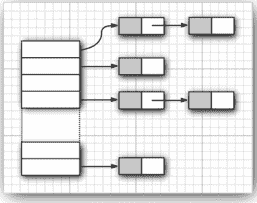

**图 9.10 散列表**

> **注意：** 从 Java 8 开始，当桶装满时，它们会从链表变为平衡二叉树。如果散列函数选择不当并产生大量冲突，或者恶意代码试图用许多具有相同散列码的值淹没散列表，这会提高性能。

如果想更好地控制散列表的性能，可以指定初始桶数。桶数给出了用于收集具有相同散列值的对象的桶数量。如果向散列表中插入太多元素，冲突数量会增加，检索性能会下降。

如果大致知道最终会有多少元素放入表中，可以设置桶数。通常，应将其设置为预期元素数的 75% 到 150% 之间。一些研究人员认为，将桶数设为素数有助于防止键聚集。然而，支持这一点的证据并不确凿。标准库使用的桶数是 2 的幂，默认值为 16。（你为表大小提供的任何值都会自动向上舍入到下一个 2 的幂。）

当然，你并不总是知道需要存储多少元素，或者初始估计可能太低。如果散列表变得太满，就需要*再散列*。要对表进行再散列，会创建一个具有更多桶的新表，将所有元素插入新表，并丢弃原表。*负载因子*决定何时对散列表进行再散列。例如，如果负载因子为 .75（这是默认值），并且表的填充程度超过 75%，它就会自动再散列，桶数变为原来的两倍。对于大多数应用，将负载因子保持为 .75 是合理的。

散列表可用于实现几种重要的数据结构。其中最简单的是*集*类型。集是不含重复元素的集合。集的 `add` 方法首先尝试查找要添加的对象，仅在它尚不存在时才添加。

Java 集合库提供了一个 `HashSet` 类，它基于散列表实现集。使用 `add` 方法添加元素。`contains` 方法被重新定义，以便快速查找某个元素是否已存在于集中。它只检查一个桶中的元素，而不是集合中的所有元素。

散列集迭代器依次访问所有桶。由于散列会将元素分散到表中，因此访问它们的顺序看似随机。只有在不关心集合中元素顺序时，才应使用 `HashSet`。

本节末尾的示例程序（程序清单 9.2）从 `System.in` 读取单词，将它们添加到一个集中，最后打印出该集中的前二十个单词。例如，你可以从命令 shell 启动程序，将 *爱丽丝梦游仙境* 的文本（可从 www.gutenberg.org 获取）输入给它，如下所示：

```
java SetTest < alice30.txt
```

该程序从输入中读取所有单词，并将它们添加到散列集。然后遍历集中的唯一单词，最后打印计数。（*爱丽丝梦游仙境* 有 5,909 个唯一单词，包括开头的版权声明。）这些单词以随机顺序出现。

> **警告：** 修改集元素时要小心。如果某个元素的散列码发生变化，该元素将不再位于数据结构中的正确位置。

**程序清单 9.2 set/SetTest.java**

```java
package set;

import java.util.*;

/**
 * This program uses a set to print all unique words in System.in.
 * @version 1.12 2015-06-21
 * @author Cay Horstmann
 */
public class SetTest
{
   public static void main(String[] args)
   {
      var words = new HashSet<String>();
      long totalTime = 0;

      try (var in = new Scanner(System.in))
      {
         while (in.hasNext())
         {
            String word = in.next();
            long callTime = System.currentTimeMillis();
            words.add(word);
            callTime = System.currentTimeMillis() - callTime;
            totalTime += callTime;
         }
      }

      Iterator<String> iter = words.iterator();
      for (int i = 1; i <= 20 && iter.hasNext(); i++)
         System.out.println(iter.next());
      System.out.println("...");
      System.out.println(words.size() + " distinct words. " + totalTime + " milliseconds.");
   }
}
```

**java.util.HashSet<E>** 1.2

- `HashSet()`  
  构造一个空散列集。
- `HashSet(Collection<? extends E> elements)`  
  构造一个散列集，并添加集合中的所有元素。
- `HashSet(int initialCapacity)`  
  构造一个具有指定容量（桶数）的空散列集。
- `HashSet(int initialCapacity, float loadFactor)`  
  构造一个具有指定容量和负载因子的空散列集。如果大小/容量之比超过负载因子，散列表将被再散列到更大的表中。

**java.lang.Object** 1.0

- `int hashCode()`  
  返回此对象的散列码。散列码可以是任意整数，正数或负数。equals 和 hashCode 的定义必须兼容：如果 x.equals(y) 为 true，那么 x.hashCode() 必须与 y.hashCode() 的值相同。

#### 9.3.4 树集

`TreeSet` 类与散列集类似，但有一项新增改进。树集是有序集合。你可以按任意顺序将元素插入集合。当遍历集合时，值会自动按排序顺序呈现。例如，假设插入三个字符串，然后访问你添加的所有元素。

```java
var sorter = new TreeSet<String>();
sorter.add("Bob");
sorter.add("Amy");
sorter.add("Carl");
for (String s : sorter) System.out.println(s);
```

然后，这些值按排序顺序打印：Amy Bob Carl。正如该类名所示，排序是通过树数据结构完成的。（当前实现使用*红黑树*。有关红黑树的详细描述，例如可参见 Thomas Cormen、Charles Leiserson、Ronald Rivest 和 Clifford Stein 所著的 *算法导论*，The MIT Press，2009。）每次向树中添加元素时，都会将其放入正确的排序位置。因此，迭代器总是按排序顺序访问元素。

向树中添加元素比向散列表中添加元素慢——比较见表 9.3。但它仍然比在数组或链表中检查重复项快得多。如果树包含 n 个元素，那么为新元素找到正确位置平均需要 log₂ n 次比较。例如，如果树已经包含 1,000 个元素，添加一个新元素大约需要 10 次比较。

> **注意：** 要使用树集，必须能够比较元素。元素必须实现 `Comparable` 接口，或者在构造集时提供 `Comparator`。（`Comparable` 和 `Comparator` 接口在第 6 章中介绍。）

**表 9.3** 向散列集和树集中添加元素

| 文档 | 单词总数 | 不同单词数 | HashSet | TreeSet |
|---|---:|---:|---:|---:|
| *爱丽丝梦游仙境* | 28195 | 5909 | 5 秒 | 7 秒 |
| *基督山伯爵* | 466300 | 37545 | 75 秒 | 98 秒 |

如果回看表 9.3，你很可能想知道是否应该始终使用树集而不是散列集。毕竟，添加元素似乎并不会花费太多额外时间，而且元素会自动排序。答案取决于你正在收集的数据。如果不需要对数据排序，就没有理由承担排序开销。更重要的是，对于某些数据，提出排序顺序比提出散列函数要困难得多。散列函数只需要相当好地打乱对象，而比较函数必须完全精确地区分对象。

为了使这一区别更具体，考虑收集一组矩形的任务。如果使用 TreeSet，需要提供 `Comparator<Rectangle>`。如何比较两个矩形？按面积？那行不通。你可能有

两个具有不同坐标但面积相同的不同矩形。树的排序顺序必须是*全序*。任意两个元素都必须可比较，并且只有当元素相等时，比较结果才能为零。对于矩形来说，确实存在这样的排序顺序（对其坐标的字典序），但计算起来既不自然又很麻烦。相比之下，`Rectangle` 类已经定义了哈希函数。它只是对坐标进行哈希。

> **注意：** 从 Java 6 开始，`TreeSet` 类实现了 `NavigableSet` 接口。该接口增加了一些便捷方法，用于定位元素和向后遍历。详见 API 注释。

清单 9.3 中的程序构建了两个 `Item` 对象的树集。第一个集合按部件编号排序，这是 `Item` 对象的默认排序顺序。第二个集合使用自定义比较器按描述排序。

**清单 9.3  `treeSet/TreeSetTest.java`**

```java
package treeSet;

import java.util.*;

/**
 * This program sorts a set of Item objects by comparing their descriptions.
 * @version 1.13 2018-04-10
 * @author Cay Horstmann
 */
public class TreeSetTest
{
   public static void main(String[] args)
   {
      var parts = new TreeSet<Item>();
      parts.add(new Item("Toaster", 1234));
      parts.add(new Item("Widget", 4562));
      parts.add(new Item("Modem", 9912));
      System.out.println(parts);

      var sortByDescription = new TreeSet<Item>(Comparator.comparing(Item::getDescription));

      sortByDescription.addAll(parts);
      System.out.println(sortByDescription);
   }
}
```

**清单 9.4  `treeSet/Item.java`**

```java
package treeSet;

import java.util.*;

/**
 * An item with a description and a part number.
 */
public class Item implements Comparable<Item>
{
    private String description;
    private int partNumber;

    /**
     * Constructs an item.
     * @param aDescription the item's description
     * @param aPartNumber the item's part number
     */
    public Item(String aDescription, int aPartNumber)
    {
        description = aDescription;
        partNumber = aPartNumber;
    }

    /**
     * Gets the description of this item.
     * @return the description
     */
    public String getDescription()
    {
        return description;
    }

    public String toString()
    {
        return "[description=" + description + ", partNumber=" + partNumber + "]";
    }

    public boolean equals(Object otherObject)
    {
        if (this == otherObject) return true;
        if (otherObject == null) return false;
        if (getClass() != otherObject.getClass()) return false;
        var other = (Item) otherObject;
        return Objects.equals(description, other.description) && partNumber == other.partNumber;
    }

    public int hashCode()
    {
        return Objects.hash(description, partNumber);
    }

    public int compareTo(Item other)
    {
        int diff = Integer.compare(partNumber, other.partNumber);
        return diff != 0 ? diff : description.compareTo(other.description);
    }
}
```

| `java.util.TreeSet<E>` 1.2 | |
|---|---|
| `TreeSet()`<br>`TreeSet(Comparator<? super E> comparator)` | 构造一个空树集。 |
| `TreeSet(Collection<? extends E> elements)`<br>`TreeSet(SortedSet<E> s)` | 构造一个树集，并添加来自集合或有序集中的所有元素（在后一种情况下，使用相同的排序）。 |

| `java.util.SortedSet<E>` 1.2 | |
|---|---|
| `Comparator<? super E> comparator()` | 返回用于对元素排序的比较器；如果元素是通过 *Comparable* 接口的 *compareTo* 方法进行比较的，则返回 null。 |
| `E first()`<br>`E last()` | 返回有序集中的最小或最大元素。 |

| `java.util.NavigableSet<E>` 6 | |
|---|---|
| `E higher(E value)`<br>`E lower(E value)` | 返回大于 value 的最小元素，或小于 value 的最大元素；如果不存在这样的元素，则返回 null。 |
| `E ceiling(E value)`<br>`E floor(E value)` | 返回大于等于 value 的最小元素，或小于等于 value 的最大元素；如果不存在这样的元素，则返回 null。 |
| `E pollFirst()`<br>`E pollLast()` | 移除并返回此集合中的最小或最大元素；如果集合为空，则返回 null。 |
| `Iterator<E> descendingIterator()` | 返回一个按降序遍历此集合的迭代器。 |

#### 9.3.5 队列与双端队列

正如我们已经讨论过的，队列允许你在尾部高效地添加元素，并从头部移除元素。双端队列，或 *deque*，允许你在头部和尾部高效地添加或移除元素。不支持在中间添加元素。Java 6 引入了 `Deque` 接口。该接口由 `ArrayDeque` 和 `LinkedList` 类实现，这两个类都提供了可随需要增长大小的双端队列。在第 12 章，你将看到有界队列和双端队列。

| `java.util.Queue<E>` 5 | |
|---|---|
| `boolean add(E element)`<br>`boolean offer(E element)` | 如果队列未满，则将给定元素添加到队列尾部并返回 true。如果队列已满，第一个方法抛出 `IllegalStateException`，而第二个方法返回 false。 |
| `E remove()`<br>`E poll()` | 如果队列非空，则移除并返回此队列头部的元素。如果队列为空，第一个方法抛出 `NoSuchElementException`，而第二个方法返回 `null`。 |
| `E element()`<br>`E peek()` | 如果队列非空，则返回此队列头部的元素但不移除。如果队列为空，第一个方法抛出 `NoSuchElementException`，而第二个方法返回 `null`。 |

| `java.util.Deque<E>` 6 | |
|---|---|
| `void addFirst(E element)`<br>`void addLast(E element)`<br>`boolean offerFirst(E element)`<br>`boolean offerLast(E element)` | 将给定元素添加到此双端队列的头部或尾部。如果双端队列已满，前两个方法抛出 `IllegalStateException`，而后两个方法返回 `false`。 |
| `E removeFirst()`<br>`E removeLast()`<br>`E pollFirst()`<br>`E pollLast()` | 如果双端队列非空，则移除并返回此双端队列头部或尾部的元素。如果双端队列为空，前两个方法抛出 `NoSuchElementException`，而后两个方法返回 `null`。 |
| `E getFirst()`<br>`E getLast()`<br>`E peekFirst()`<br>`E peekLast()` | 如果双端队列非空，则返回此双端队列头部或尾部的元素但不移除。如果双端队列为空，前两个方法抛出 `NoSuchElementException`，而后两个方法返回 `null`。 |

| `java.util.ArrayDeque<E>` 6 | |
|---|---|
| `ArrayDeque()`<br>`ArrayDeque(int initialCapacity)` | 构造一个无界双端队列，初始容量为 16 或给定的初始容量。 |

#### 9.3.6 优先级队列

优先级队列在元素以任意顺序插入后，按排序顺序检索元素。也就是说，每当你调用 remove 方法时，你会得到当前优先级队列中最小的元素。然而，优先级队列不会对其所有元素进行排序。如果你遍历这些元素，它们不一定是有序的。优先级队列使用了一种优雅而高效的数据结构，称为堆。堆是一种自组织的二叉树，其中添加和移除操作会使最小元素向根节点移动，而不会浪费时间对所有元素进行排序。

与 `TreeSet` 一样，优先级队列既可以容纳实现了 `Comparable` 接口的类的元素，也可以容纳你在构造函数中提供的 `Comparator` 对象。

优先级队列的一个典型用途是作业调度。每个作业都有一个优先级。作业按随机顺序添加。每当一个新作业可以启动时，就从队列中移除最高优先级的作业。（由于传统上优先级 1 被视为“最高”优先级，因此移除操作会得到最小元素。）

**清单 9.5  `priorityQueue/PriorityQueueTest.java`**

```java
package priorityQueue;

import java.util.*;
import java.time.*;

/**
 * This program demonstrates the use of a priority queue.
 * @version 1.02 2015-06-20
 * @author Cay Horstmann
 */
```


```java
public class PriorityQueueTest
{
   public static void main(String[] args)
   {
      var pq = new PriorityQueue<LocalDate>();
      pq.add(LocalDate.of(1906, 12, 9)); // G. Hopper
      pq.add(LocalDate.of(1815, 12, 10)); // A. Lovelace
      pq.add(LocalDate.of(1903, 12, 3)); // J. von Neumann
      pq.add(LocalDate.of(1910, 6, 22)); // K. Zuse

      System.out.println("Iterating over elements . . .");
      for (LocalDate d : pq)
         System.out.println(d);
      System.out.println("Removing elements . . .");
      while (!pq.isEmpty())
         System.out.println(pq.remove());
   }
}
```

| `java.util.PriorityQueue` | 5 |
|---|---|
| • `PriorityQueue()`<br>• `PriorityQueue(int initialCapacity)`<br>构造一个用于存储 Comparable 对象的优先队列。<br><br>• `PriorityQueue(int initialCapacity, Comparator<? super E> c)`<br>构造一个优先队列，并使用指定的比较器对其元素排序。 | |

### 9.4 映射

集合是一种可以让你快速查找现有元素的数据结构。然而，要查找一个元素，你需要拥有要查找元素的精确副本。这并不是很常见的查找方式——通常，你拥有一些键信息，并希望查找与之关联的元素。映射数据结构就是为此目的而设计的。映射存储键/值对。如果提供键，就可以找到值。例如，你可以存储一张员工记录表，其中键是员工 ID，值是 Employee 对象。在接下来的小节中，你将学习如何使用映射。

#### 9.4.1 基本映射操作

Java 类库为映射提供了两个通用实现：HashMap 和 TreeMap。这两个类都实现了 Map 接口。

哈希映射会对键进行哈希，而树映射利用键上的排序将它们组织到一棵搜索树中。哈希函数或比较函数*只应用于键*。与键关联的值不会被哈希或比较。

应该选择哈希映射还是树映射？与集合一样，哈希通常稍快一些；如果你不需要按排序顺序访问键，那么它是首选。

下面展示如何设置一个用于存储员工的哈希映射：

```java
var staff = new HashMap<String, Employee>(); // HashMap implements Map
var harry = new Employee("Harry Hacker");
staff.put("987-98-9996", harry);
. . .
```

每当向映射中添加一个对象时，还必须提供一个键。在我们的例子中，键是一个字符串，对应的值是一个 `Employee` 对象。

要检索一个对象，必须使用（因此也必须记住）键。

```java
var id = "987-98-9996";
Employee e = staff.get(id); // gets harry
```

如果映射中没有用指定的特定键存储任何信息，`get` 将返回 `null`。

`null` 返回值可能不太方便。有时，对于映射中不存在的键，你有一个合适的默认值可以使用。这时请使用 `getOrDefault` 方法。

```java
Map<String, Integer> scores = . . .;
int score = scores.getOrDefault(id, 0); // gets 0 if the id is not present
```

键必须唯一。不能使用同一个键存储两个值。如果使用同一个键调用 `put` 方法两次，第二个值会替换第一个值。实际上，`put` 返回与其键参数关联的前一个值。

`remove` 方法从映射中移除具有给定键的元素。`size` 方法返回映射中的条目数。

遍历映射的键和值的最简单方式是使用 `forEach` 方法。提供一个接收键和值的 lambda 表达式。该表达式会依次对每个映射条目调用。

```java
scores.forEach((k, v) ->
    System.out.println("key=" + k + ", value=" + v));
```

**清单 9.6** 演示了映射的使用。我们首先向映射中添加键/值对。然后，从映射中移除一个键，这也会移除其关联的值。接下来，我们更改与某个键关联的值，并调用 get 方法查找一个值。最后，我们遍历条目集。

**清单 9.6** `map/MapTest.java`

```java
package map;

import java.util.*;

/**
 * This program demonstrates the use of a map with key type String and value type Employee.
 * @version 1.12 2015-06-21
 * @author Cay Horstmann
 */
public class MapTest
{
   public static void main(String[] args)
   {
      var staff = new HashMap<String, Employee>();
      staff.put("144-25-5464", new Employee("Amy Lee"));
      staff.put("567-24-2546", new Employee("Harry Hacker"));
      staff.put("157-62-7935", new Employee("Gary Cooper"));
      staff.put("456-62-5527", new Employee("Francesca Cruz"));

      // print all entries

      System.out.println(staff);

      // remove an entry

      staff.remove("567-24-2546");

      // replace an entry

      staff.put("456-62-5527", new Employee("Francesca Miller"));

      // look up a value

      System.out.println(staff.get("157-62-7935"));

      // iterate through all entries
      staff.forEach((k, v) ->
          System.out.println("key=" + k + ", value=" + v));
   }
}
```

### `java.util.Map<K, V>` 1.2

- `V get(Object key)` 获取与键关联的值；返回与该键关联的对象，如果映射中未找到该键，则返回 `null`。实现类可能禁止 `null` 键。
- `default V getOrDefault(Object key, V defaultValue)` 获取与键关联的值；返回与该键关联的对象，如果映射中未找到该键，则返回 `defaultValue`。
- `V put(K key, V value)` 将键和值的关联放入映射。如果该键已经存在，新对象会替换先前与该键关联的旧对象。此方法返回该键的旧值，如果该键先前不存在，则返回 `null`。实现类可能禁止 `null` 键或值。
- `void putAll(Map<? extends K, ? extends V> entries)` 将指定映射中的所有条目添加到此映射。
- `boolean containsKey(Object key)` 如果映射中存在该键，则返回 `true`。
- `boolean containsValue(Object value)` 如果映射中存在该值，则返回 `true`。
- `default void forEach(BiConsumer<? super K, ? super V> action) 8` 将此操作应用于此映射的所有键/值对。

### `java.util.HashMap<K, V>` 1.2

- `HashMap()`
- `HashMap(int initialCapacity)`
- `HashMap(int initialCapacity, float loadFactor)` 构造一个具有指定容量和加载因子的空哈希映射（加载因子是 0.0 到 1.0 之间的一个数，用于确定哈希表在填满到什么百分比时会被重新哈希到更大的表中）。默认加载因子为 0.75。

### `java.util.TreeMap<K, V>` 1.2

- `TreeMap()` 构造一个空树映射，其键实现 Comparable 接口。
- `TreeMap(Comparator<? super K> c)` 构造一个树映射，并使用指定的比较器对其键进行排序。
- `TreeMap(Map<? extends K, ? extends V> entries)` 构造一个树映射，并添加一个映射中的所有条目。
- `TreeMap(SortedMap<K, ? extends V> entries)` 构造一个树映射，添加一个有序映射中的所有条目，并使用与给定有序映射相同的元素比较器。

### `java.util.SortedMap<K, V>` 1.2

- `Comparator<? super K> comparator()` 返回用于对键排序的比较器；如果键是使用 Comparable 接口的 compareTo 方法进行比较的，则返回 null。
- `K firstKey()`
- `K lastKey()` 返回映射中的最小键或最大键。

#### 9.4.2 更新映射条目

处理映射时的一个棘手部分是更新条目。通常，你会获取与某个键关联的旧值，更新它，然后把更新后的值放回去。但是你必须考虑键首次出现这种特殊情况。考虑使用映射来统计某个单词在文件中出现的次数。当我们看到一个单词时，我们希望像这样递增计数器：

```java
counts.put(word, counts.get(word) + 1);
```

这样可行，但单词第一次出现的情况除外。此时 get 返回 null，并发生 NullPointerException。

一个简单的补救方法是使用 getOrDefault 方法：

```java
counts.put(word, counts.getOrDefault(word, 0) + 1);
```

另一种方法是先调用 putIfAbsent 方法。仅当该键先前不存在（或映射到 null）时，它才会放入一个值。


    counts.putIfAbsent(word, 0);
    counts.put(word, counts.get(word) + 1); // now we know that get will succeed

但你可以做得更好。merge 方法简化了这个常见操作。调用

    counts.merge(word, 1, Integer::sum);

如果该键之前不存在，就将 word 与 1 关联；否则使用 Integer::sum 函数将先前的值与 1 合并。

API 说明描述了其他用于更新映射条目的方法，这些方法不太常用。

**java.util.Map<K, V> 1.2**

- `default V merge(K key, V value, BiFunction<? super V, ? super V, ? extends V> remappingFunction)`  
  如果 key 与非 null 值 v 关联，则将该函数应用于 v 和 value，并将 key 与结果关联；如果结果为 null，则移除该 key。否则，将 key 与 value 关联。返回 get(key)。
- `default V compute(K key, BiFunction<? super K, ? super V, ? extends V> remappingFunction)`  
  将函数应用于 key 和 get(key)。将 key 与结果关联；如果结果为 null，则移除该 key。返回 get(key)。
- `default V computeIfPresent(K key, BiFunction<? super K, ? super V, ? extends V> remappingFunction)`  
  如果 key 与非 null 值 v 关联，则将函数应用于 key 和 v，并将 key 与结果关联；如果结果为 null，则移除该 key。返回 get(key)。
- `default V computeIfAbsent(K key, Function<? super K, ? extends V> mappingFunction)`  
  除非 key 与非 null 值关联，否则将函数应用于 key。将 key 与结果关联；如果结果为 null，则移除该 key。返回 get(key)。
- `default void replaceAll(BiFunction<? super K, ? super V, ? extends V> function)`  
  对所有条目调用该函数。将键与非 null 结果关联，并移除结果为 null 的键。
- `default V putIfAbsent(K key, V value)`  
  如果 key 不存在或与 null 关联，则将其与 value 关联并返回 null。否则返回关联的值。

#### 9.4.3 映射视图

集合框架并不把映射本身视为一个集合。（其他数据结构框架将映射视为键/值对的集合，或视为按键索引的值的集合。）但是，你可以获得映射的视图——即实现 Collection 接口或其某个子接口的对象。

有三种视图：键的集合、值的集合（不是集），以及键/值对的集合。键和键/值对构成一个集，因为映射中每个键只能有一份副本。以下方法

```
Set<K> keySet()
Collection<V> values()
Set<Map.Entry<K, V>> entrySet()
```

返回这三种视图。（条目集的元素是实现 Map.Entry 接口的类的对象。）

请注意，keySet 不是 HashSet 或 TreeSet，而是实现 Set 接口的某个其他类的对象。Set 接口扩展了 Collection 接口。因此，你可以像使用任何集合一样使用 keySet。

例如，你可以枚举映射的所有键：

```
Set<String> keys = map.keySet();
for (String key : keys)
{
    do something with key
}
```

如果你想同时查看键和值，可以通过枚举条目来避免查找值。使用以下代码骨架：

```
for (Map.Entry<String, Employee> entry : staff.entrySet())
{
    String k = entry.getKey();
    Employee v = entry.getValue();
    do something with k, v
}
```


> **提示：** 你可以通过使用 var 声明来避免繁琐的 `Map.Entry`。

```
for (var entry : map.entrySet())
{
    do something with entry.getKey(), entry.getValue()
}
```

或者直接使用 forEach 方法：

```
map.forEach((k, v) -> {
    do something with k, v
});
```

如果你在键集视图上调用迭代器的 `remove` 方法，实际上会从映射中移除*键及其关联的值*。但是，你不能向键集视图中*添加*元素。只添加键而不添加值是没有意义的。如果你尝试调用 *add* 方法，它会抛出 *UnsupportedOperationException*。条目集视图也有同样的限制，尽管从概念上讲添加新的键/值对是有意义的。

**java.util.Map<K, V> 1.2**

- `Set<Map.Entry<K, V>> entrySet()`  
  返回映射中键/值对（即 Map.Entry 对象）的集视图。你可以从此集中移除元素，它们会从映射中移除，但不能添加任何元素。
- `Set<K> keySet()`  
  返回映射中所有键的集视图。你可以从此集中移除元素，键及其关联的值会从映射中移除，但不能添加任何元素。
- `Collection<V> values()`  
  返回映射中所有值的集合视图。你可以从此集合中移除元素，被移除的值及其键会从映射中移除，但不能添加任何元素。

**java.util.Map.Entry<K, V> 1.2**

- `K getKey()`
- `V getValue()`  
  返回此条目的键或值。
- `V setValue(V newValue)`  
  将*关联映射中*的值更改为新值，并返回旧值。

#### 9.4.4 弱哈希映射

集合类库有几个满足特殊需求的映射类，我们将在本节和后续几节中简要讨论它们。

`WeakHashMap` 类旨在解决一个有趣的问题。如果某个值对应的键在程序中的任何地方都不再使用，会发生什么？假设对某个键的最后一个引用已经消失。那么，就不再有任何方式可以引用该值对象。但是，由于程序的任何部分都不再拥有该键，这个键/值对无法从映射中移除。为什么垃圾回收器不能移除它呢？移除未使用的对象不正是垃圾回收器的职责吗？

不幸的是，事情并没有那么简单。垃圾回收器会追踪*存活*对象。只要映射对象还存活，其中的*所有*桶都是存活的，不会被回收。因此，你的程序应当注意从长期存活的映射中移除未使用的值。或者，你可以改用 `WeakHashMap`。当对键的唯一引用来自哈希表条目时，这种数据结构会与垃圾回收器协作移除键/值对。

以下是该机制的内部工作原理。`WeakHashMap` 使用*弱*引用来持有键。`WeakReference` 对象持有对另一个对象的引用——在我们的例子中，是一个哈希表键。垃圾回收器会以特殊方式处理这种类型的对象。通常，如果垃圾回收器发现某个特定对象没有指向它的引用，它就会直接回收该对象。但是，如果该对象*仅*能通过 `WeakReference` 到达，垃圾回收器仍会回收该对象，但会把使其可达的弱引用放入一个队列。`WeakHashMap` 的操作会定期检查该队列中是否有新到达的弱引用。弱引用到达队列意味着该键不再被任何人使用，并且已经被回收。然后，`WeakHashMap` 会移除关联的条目。

#### 9.4.5 链接哈希集与映射

`LinkedHashSet` 和 `LinkedHashMap` 类会记住你插入各项的顺序。这样，你就可以避免哈希表中看似随机的项顺序。当条目插入表中时，它们会连接成一个双向链表（见图 9.11）。

例如，考虑清单 9.6 中的以下映射插入操作：

```
var staff = new LinkedHashMap<String, Employee>();
staff.put("144-25-5464", new Employee("Amy Lee"));
staff.put("567-24-2546", new Employee("Harry Hacker"));
staff.put("157-62-7935", new Employee("Gary Cooper"));
staff.put("456-62-5527", new Employee("Francesca Cruz"));
```

然后，`staff.keySet().iterator()` 按以下顺序枚举键：

```
144-25-5464
567-24-2546
```


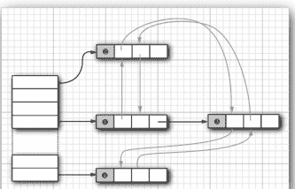

**图9.11** 链表式哈希表

```
157-62-7935
456-62-5527
```

而`staff.values().iterator()`将按照以下顺序枚举这些值：

```
Amy Lee
Harry Hacker
Gary Cooper
Francesca Cruz
```

链表式哈希映射还可以使用*访问顺序*（而不是插入顺序）来遍历映射条目。每次调用`get`或`put`时，受影响的条目会从当前位置移除，放到条目链表的*末尾*。（只有条目链表中的位置受影响，哈希表桶不受影响。条目始终停留在与键的哈希码对应的桶中。）要构造这样的哈希映射，请调用

```java
new LinkedHashMap<K, V>(initialCapacity, loadFactor, true)
```

访问顺序对于实现缓存的“最近最少使用”规则非常有用。例如，你可能希望将经常访问的条目保留在内存中，而从数据库中读取不经常访问的对象。当你在表中找不到某个条目，且表已经相当满时，你可以获取一个表上的迭代器，并删除它枚举出的前几个元素。这些条目就是最近最少使用的条目。

你甚至可以自动化这个过程。创建一个`LinkedHashMap`的子类并覆盖该方法

```java
protected boolean removeEldestEntry(Map.Entry<K, V> eldest)
```

当你的方法返回true时，添加新条目就会导致最老的条目被移除。例如，下面的缓存最多保持100个元素：

```java
var cache = new LinkedHashMap<K, V>(128, 0.75F, true)
{
    protected boolean removeEldestEntry(Map.Entry<K, V> eldest)
    {
        return size() > 100;
    }
};
```

或者，你可以检查最老的条目来决定是否移除它。例如，你可能希望检查条目中存储的时间戳。

#### 9.4.6 枚举集与映射

EnumSet是一个高效的集合实现，其中的元素属于枚举类型。由于枚举类型的实例数量有限，EnumSet在内部只是简单地实现为一个位序列。如果对应的值存在于集合中，该位即被置为1。

EnumSet类没有公有构造函数。使用静态工厂方法来构造集合：

```java
enum Weekday { MONDAY, TUESDAY, WEDNESDAY, THURSDAY, FRIDAY, SATURDAY, SUNDAY };
EnumSet<Weekday> always = EnumSet.allOf(Weekday.class);
EnumSet<Weekday> never = EnumSet.noneOf(Weekday.class);
EnumSet<Weekday> workday = EnumSet.range(Weekday.MONDAY, Weekday.FRIDAY);
EnumSet<Weekday> mwf = EnumSet.of(Weekday.MONDAY, Weekday.WEDNESDAY, Weekday.FRIDAY);
```

你可以使用Set接口的常用方法来修改EnumSet。

EnumMap是一种映射，其键属于枚举类型。它在内部简单地以值数组的形式高效实现。你需要在构造函数中指定键类型：

```java
var personInCharge = new EnumMap<Weekday, Employee>(Weekday.class);
```

> 注意：在EnumSet的API文档中，你会看到形式为`E extends Enum<E>`的古怪类型参数。这只是表示“E是一个枚举类型”。所有枚举类型都扩展了泛型Enum类。例如，`Weekday extends Enum<Weekday>`。

#### 9.4.7 标识哈希映射

IdentityHashMap有一个相当专门的用途。在这里，键的哈希值不应由hashCode方法计算，而应由System.identityHashCode方法计算。正是Object.hashCode用来根据对象的内存地址计算哈希码的那个方法。此外，在比较对象时，IdentityHashMap使用==而不是equals。

换句话说，即使不同键对象的内容相等，它们也被视为不同。这个类对于实现对象遍历算法非常有用，例如对象序列化，在这些算法中你需要跟踪哪些对象已经被遍历过。

| `java.util.WeakHashMap<K, V>` 1.2 |
|---|
| • `WeakHashMap()`<br>• `WeakHashMap(int initialCapacity)`<br>• `WeakHashMap(int initialCapacity, float loadFactor)`<br>  构造一个具有指定容量和加载因子的空哈希映射。 |

| `java.util.LinkedHashSet<E>` 1.4 |
|---|
| • `LinkedHashSet()`<br>• `LinkedHashSet(int initialCapacity)`<br>• `LinkedHashSet(int initialCapacity, float loadFactor)`<br>  构造一个具有指定容量和加载因子的空链表式哈希集合。 |

| `java.util.LinkedHashMap<K, V>` 1.4 |
|---|
| • `LinkedHashMap()`<br>• `LinkedHashMap(int initialCapacity)`<br>• `LinkedHashMap(int initialCapacity, float loadFactor)`<br>• `LinkedHashMap(int initialCapacity, float loadFactor, boolean accessOrder)`<br>  构造一个具有指定容量、加载因子和顺序的空链表式哈希映射。accessOrder参数为true表示访问顺序，false表示插入顺序。<br>• `protected boolean removeEldestEntry(Map.Entry<K, V> eldest)`<br>  如果要移除最老的条目，应重写此方法以返回true。eldest参数是正在考虑移除的条目。在向映射中添加条目后会调用此方法。默认实现返回false——默认情况下不会移除旧元素。不过，你可以重新定义此方法以选择性地返回true——例如，如果最老的条目符合某种条件，或者映射超过一定大小。 |

| `java.util.EnumSet<E extends Enum<E>>` 5 |
|---|
| • `static <E extends Enum<E>> EnumSet<E> allOf(Class<E> enumType)`<br>  返回一个包含给定枚举类型所有值的可变集合。<br>• `static <E extends Enum<E>> EnumSet<E> noneOf(Class<E> enumType)`<br>  返回一个最初为空的可变集合。<br>• `static <E extends Enum<E>> EnumSet<E> range(E from, E to)`<br>  返回一个包含from和to之间（包括端点）所有值的可变集合。<br>• `static <E extends Enum<E>> EnumSet<E> of(E e)`<br>  ...<br>• `static <E extends Enum<E>> EnumSet<E> of(E e1, E e2, E e3, E e4, E e5)`<br>• `static <E extends Enum<E>> EnumSet<E> of(E first, E... rest)`<br>  返回一个包含给定元素的可变集合，这些元素不能为null。 |

| `java.util.EnumMap<K extends Enum<K>, V>` 5 |
|---|
| • `EnumMap(Class<K> keyType)`<br>  构造一个空的可变映射，其键具有给定类型。 |

| `java.util.IdentityHashMap<K, V>` 1.4 |
|---|
| • `IdentityHashMap()`<br>• `IdentityHashMap(int expectedMaxSize)`<br>  构造一个空的标识哈希映射，其容量是超过1.5 × expectedMaxSize的最小2的幂。（expectedMaxSize的默认值为21。） |

| `java.lang.System` | 1.0 |
|---|---|
| • `static int identityHashCode(Object obj)` 1.1 | 返回与`Object.hashCode`计算的相同哈希码（派生自对象的内存地址），即使obj所属的类已经重新定义了`hashCode`方法。 |

### 9.5 视图与包装器

如果查看图9.4和图9.5，你可能会认为为了实现数量不多的具体集合类而设计大量接口和抽象类有点小题大做。然而，这些图并没有展现全貌。通过使用*视图*，你可以获得实现了Collection或Map接口的其他对象。你在映射类的keySet方法中已经看到了一个这样的例子。乍一看，似乎该方法创建了一个新集合，用映射中的所有键填充它，然后返回它。但事实并非如此。相反，keySet方法返回一个类的对象，该类实现了Set接口，其方法操作原始映射。这样的集合称为*视图*。

视图技术在集合框架中有许多有用的应用。我们将在以下小节中讨论这些应用。

#### 9.5.1 小型集合

Java 9引入了静态方法，可以生成包含给定元素的集合或列表，以及包含给定键/值对的映射。例如，

```java
List<String> names = List.of("Peter", "Paul", "Mary");
Set<Integer> numbers = Set.of(2, 3, 5);
```

生成了一个包含三个元素的列表和一个包含三个元素的集合。对于映射，你可以这样指定键和值：

```java
Map<String, Integer> scores = Map.of("Peter", 2, "Paul", 3, "Mary", 5);
```

元素、键或值不能为null。

List和Set接口有十一个方法，参数从零到十个不等，还有一个of方法，支持可变数量的参数。提供这些特化版本是为了提高效率。


对于 `Map` 接口，无法提供可变参数版本，因为参数类型在键类型和值类型之间交替。有一个静态方法 `ofEntries`，它接受任意数量的 `Map.Entry<K, V>` 对象，你可以用静态方法 `entry` 创建这些对象。例如，

```java
import static java.util.Map.*;
...
Map<String, Integer> scores = ofEntries(
    entry("Peter", 2),
    entry("Paul", 3),
    entry("Mary", 5));
```

`of` 和 `ofEntries` 方法生成的对象所属的类，会为每个元素提供一个实例变量，或者底层由数组支持。

这些集合对象是*不可修改的*。任何修改其内容的尝试都会导致 `UnsupportedOperationException`。

如果你想要一个可变集合，可以将不可修改集合传给构造器：

```java
var names = new ArrayList<>(List.of("Peter", "Paul", "Mary"));
```

方法调用

```java
Collections.nCopies(n, anObject)
```

返回一个不可变对象，该对象实现 `List` 接口，并造成一种包含 n 个元素的假象，其中每个元素都显示为 `anObject`。

例如，以下调用创建一个包含 100 个字符串的 List，全部设为 "DEFAULT"：

```java
List<String> settings = Collections.nCopies(100, "DEFAULT");
```

存储开销非常小——该对象只存储一次。

> **注意：** `of` 方法是在 Java 9 中引入的。以前有一个静态 `Arrays.asList` 方法，返回一个可变但不可调整大小的列表。也就是说，你可以调用 `set`，但不能在列表上添加或删除。还有遗留方法 `Collections.emptySet` 和 `Collections.singleton`。

> **注意：** `Collections` 类包含许多实用方法，其参数或返回值是集合。不要将其与 `Collection` 接口混淆。

> **提示：** Java 没有 Pair 类，一些程序员使用 `Map.Entry` 作为简陋的配对。在 Java 9 之前，这很痛苦——你必须构造一个新的 `AbstractMap.SimpleImmutableEntry<>(first, second)`。如今，你可以调用 `Map.entry(first, second)`。

#### 9.5.2 子范围

你可以为许多集合形成子范围视图。例如，假设你有一个列表 staff，并且想提取元素 10 到 19。使用 sublist 方法获取该列表子范围的视图：

```java
List<Employee> group2 = staff.subList(10, 20);
```

第一个索引包含在内，第二个索引不包含——就像 String 类的 substring 操作的参数一样。

你可以对子范围应用任何操作，它们会自动反映整个列表。例如，你可以清除整个子范围：

```java
group2.clear(); // staff reduction
```

这些元素会自动从 staff 列表中清除，并且 group2 变为空。

对于排序集和映射，你使用排序顺序，而不是元素位置，来形成子范围。SortedSet 接口声明了三个方法：

```java
SortedSet<E> subSet(E from, E to)
SortedSet<E> headSet(E to)
SortedSet<E> tailSet(E from)
```

这些方法返回所有大于等于 from 且严格小于 to 的元素的子集。对于排序映射，类似的方法

```java
SortedMap<K, V> subMap(K from, K to)
SortedMap<K, V> headMap(K to)
SortedMap<K, V> tailMap(K from)
```

返回映射的视图，其中包含键落在指定范围内的所有条目。

Java 6 引入的 NavigableSet 接口对这些子范围操作提供了更多控制。你可以指定边界是否包含：

```java
NavigableSet<E> subSet(E from, boolean fromInclusive, E to, boolean toInclusive)
NavigableSet<E> headSet(E to, boolean toInclusive)
NavigableSet<E> tailSet(E from, boolean fromInclusive)
```

#### 9.5.3 不可修改视图

Collections 类有一些方法，可以生成集合的*不可修改视图*。这些视图会向现有集合添加运行时检查。如果检测到修改集合的尝试，就会抛出异常，并且集合保持不变。

你可以通过八个方法获得不可修改视图：

- `Collections.unmodifiableCollection`
- `Collections.unmodifiableList`
- `Collections.unmodifiableSet`
- `Collections.unmodifiableSortedSet`
- `Collections.unmodifiableNavigableSet`
- `Collections.unmodifiableMap`
- `Collections.unmodifiableSortedMap`
- `Collections.unmodifiableNavigableMap`

每个方法都定义为作用于一个接口。例如，`Collections.unmodifiableList` 可用于 `ArrayList`、`LinkedList` 或任何其他实现 `List` 接口的类。

例如，假设你想让代码的某一部分查看但不能修改集合的内容。你可以这样做：

```java
var staff = new LinkedList<String>();
...
lookAt(Collections.unmodifiableList(staff));
```

`Collections.unmodifiableList` 方法返回一个实现 `List` 接口的类的对象。其访问器方法从 `staff` 集合中检索值。当然，`lookAt` 方法可以调用 `List` 接口的所有方法，而不仅是访问器。但所有修改器方法（如 `add`）都已被重新定义为抛出 `UnsupportedOperationException`，而不是将调用转发给底层集合。

不可修改视图并不会使集合本身不可变。你仍然可以通过其原始引用（在本例中是 `staff`）修改集合。并且你仍然可以对集合的元素调用修改器方法。

这些视图包装的是*接口*，而不是实际的集合对象，因此你只能访问接口中定义的方法。例如，`LinkedList` 类有便利方法 `addFirst` 和 `addLast`，它们不是 `List` 接口的一部分。这些方法无法通过不可修改视图访问。

> **警告：** `unmodifiableCollection` 方法（以及本节后面讨论的 `synchronizedCollection` 和 `checkedCollection` 方法）返回的集合，其 `equals` 方法**不会**调用底层集合的 `equals` 方法。相反，它继承 `Object` 类的 `equals` 方法，该方法只测试对象是否相同。如果你把一个集或列表只当作集合来使用，就无法再测试内容是否相等。视图之所以这样处理，是因为在这一层次结构级别上，相等性测试没有明确定义。视图对 `hashCode` 方法也采用同样的方式。
>
> 但是，`unmodifiableSet` 和 `unmodifiableList` 方法使用底层集合的 `equals` 和 `hashCode` 方法。

#### 9.5.4 同步视图

如果你从多个线程访问集合，就需要确保集合不会被意外损坏。例如，如果一个线程试图修改哈希表，而另一个线程正在重新哈希元素，那将是灾难性的。

库设计者没有实现线程安全的集合类，而是使用视图机制使常规集合线程安全。例如，`Collections` 类中的静态 `synchronizedMap` 方法可以将任何映射转换为具有同步访问方法的 `Map`：

```java
var map = Collections.synchronizedMap(new HashMap<String, Employee>());
```

现在你可以从多个线程访问该映射对象。诸如 get 和 put 之类的方法已同步——每次方法调用必须完全完成后，另一个线程才能调用另一个方法。我们将在第 12 章更详细地讨论数据结构的同步访问问题。

#### 9.5.5 检查视图

检查视图旨在为泛型类型可能出现的问题提供调试支持。如第 8 章所述，实际上可以将错误类型的元素偷偷放入泛型集合。例如：

```java
var strings = new ArrayList<String>();
ArrayList rawList = strings; // warning only, not an error,
                             // for compatibility with legacy code
rawList.add(new Date()); // now strings contains a Date object!
```

错误的 add 命令不会在运行时被检测到。相反，稍后代码的另一部分调用 get 并将结果强制转换为 String 时，会发生类强制转换异常。


受检视图可以发现这个问题。定义一个安全列表，如下所示：

```java
List<String> safeStrings = Collections.checkedList(strings, String.class);
```

视图的 add 方法会检查插入的对象是否属于给定的类，如果不符合则立即抛出 ClassCastException。这样做的好处是可以在正确的位置报告错误：

```java
ArrayList rawList = safeStrings;
rawList.add(new Date()); // checked list throws ClassCastException
```

> **注意：** 受检视图受到虚拟机可以执行的运行时检查的限制。例如，如果你有一个 `ArrayList<Pair<String>>`，你无法阻止插入 `Pair<Date>`，因为虚拟机只有一个“原始”Pair 类。

#### 9.5.6 关于可选操作的说明

视图通常有一些限制——它可能是只读的，可能无法改变大小，或者可能支持删除但不支持插入（例如映射的键视图）。如果尝试执行不合适的操作，受限视图会抛出 UnsupportedOperationException。

在集合和迭代器接口的 API 文档中，许多方法被描述为“可选操作”。这似乎与接口的概念相矛盾。毕竟，接口的目的不正是列出类*必须*实现的方法吗？确实，从理论角度看，这种安排并不令人满意。更好的解决方案可能是为只读视图和不能改变集合大小的视图设计单独的接口。然而，这会使接口数量增至三倍，库的设计者认为这是不可接受的。

你应该在自己的设计中扩展“可选”方法这种技术吗？我们认为不应该。尽管集合被频繁使用，但实现它们的编码风格并不典型于其他问题领域。集合类库的设计者必须解决一系列特别棘手的冲突需求。用户希望类库易于学习、使用方便、完全通用、傻瓜式，并且同时还要像手工编码的算法一样高效。显然不可能同时实现所有这些目标，甚至不可能接近。但在你自己的编程问题中，你很少会遇到如此极端的约束条件。你应该能够找到不依赖“可选”接口操作这种极端措施的解决方案。

## java.util.List 1.2

- `static <E> List<E> of()` 9
- `static <E> List<E> of(E e1)` 9
- ...
- `static <E> List<E> of(E e1, E e2, E e3, E e4, E e5, E e6, E e7, E e8, E e9, E e10)` 9
- `static <E> List<E> of(E... elements)` 9

返回一个由给定元素组成的不可变列表，这些元素不能为 null。

## java.util.Set 1.2

- `static <E> Set<E> of()` 9
- `static <E> Set<E> of(E e1)` 9
- ...
- `static <E> Set<E> of(E e1, E e2, E e3, E e4, E e5, E e6, E e7, E e8, E e9, E e10)` 9
- `static <E> Set<E> of(E... elements)` 9

返回一个由给定元素组成的不可变集，这些元素不能为 null。

## java.util.Map 1.2

- `static <K, V> Map<K, V> of()` 9
- `static <K, V> Map<K, V> of(K k1, V v1)` 9
- ...
- `static <K, V> Map<K, V> of(K k1, V v1, K k2, V v2, K k3, V v3, K k4, V v4, K k5, V v5, K k6, V v6, K k7, V v7, K k8, V v8, K k9, V v9, K k10, V v10)` 9

返回一个由给定键和值组成的不可变映射，这些键和值不能为 null。

- `static <K, V> Map.Entry<K, V> entry(K k, V v)` 9

返回一个由给定键和值组成的不可变映射条目，键和值不能为 null。

- `static <K, V> Map<K, V> ofEntries(Map.Entry<? extends K, ? extends V>... entries)` 9

返回一个由给定条目组成的不可变映射。

## java.util.Collections 1.2

| 方法/描述 | 版本 |
|---|---|
| `static <E> Collection unmodifiableCollection(Collection<E> c)` | |
| `static <E> List unmodifiableList(List<E> c)` | |
| `static <E> Set unmodifiableSet(Set<E> c)` | |
| `static <E> SortedSet unmodifiableSortedSet(SortedSet<E> c)` | |
| `static <E> SortedSet unmodifiableNavigableSet(NavigableSet<E> c)` | 8 |
| `static <K, V> Map unmodifiableMap(Map<K, V> c)` | |
| `static <K, V> SortedMap unmodifiableSortedMap(SortedMap<K, V> c)` | |
| `static <K, V> SortedMap unmodifiableNavigableMap(NavigableMap<K, V> c)` | 8 |
| 构造集合的视图；视图的修改方法会抛出 UnsupportedOperationException。 | |
| `static <E> Collection<E> synchronizedCollection(Collection<E> c)` | |
| `static <E> List synchronizedList(List<E> c)` | |
| `static <E> Set synchronizedSet(Set<E> c)` | |
| `static <E> SortedSet synchronizedSortedSet(SortedSet<E> c)` | |
| `static <E> NavigableSet synchronizedNavigableSet(NavigableSet<E> c)` | 8 |
| `static <K, V> Map<K, V> synchronizedMap(Map<K, V> c)` | |
| `static <K, V> SortedMap<K, V> synchronizedSortedMap(SortedMap<K, V> c)` | |
| `static <K, V> NavigableMap<K, V> synchronizedNavigableMap(NavigableMap<K, V> c)` | 8 |
| 构造集合的视图；视图的方法已同步。 | |
| `static <E> Collection<E> checkedCollection(Collection<E> c, Class<E> elementType)` | |
| `static <E> List<E> checkedList(List<E> c, Class<E> elementType)` | |
| `static <E> Set<E> checkedSet(Set<E> c, Class<E> elementType)` | |
| `static <E> SortedSet<E> checkedSortedSet(SortedSet<E> c, Class<E> elementType)` | |
| `static <E> NavigableSet<E> checkedNavigableSet(NavigableSet<E> c, Class<E> elementType)` | 8 |
| `static <K, V> Map<K, V> checkedMap(Map<K, V> c, Class<K> keyType, Class<V> valueType)` | |
| `static <K, V> SortedMap<K, V> checkedSortedMap(SortedMap<K, V> c, Class<K> keyType, Class<V> valueType)` | |
| `static <K, V> NavigableMap<K, V> checkedNavigableMap(NavigableMap<K, V> c, Class<K> keyType, Class<V> valueType)` | 8 |
| `static <E> Queue<E> checkedQueue(Queue<E> queue, Class<E> elementType)` | 8 |
| 构造集合的视图；如果插入的元素类型错误，视图的方法会抛出 ClassCastException。 | |
| `static <E> List<E> nCopies(int n, E value)` | |
| 返回一个包含 n 个相同值的不可变列表。 | |

```java
for (int i = 1; i < a.length; i++)
   if (largest.compareTo(a[i]) < 0)
      largest = a[i];
```

当然，要寻找数组列表的最大值，你可能会稍微不同地编写代码。

```java
if (v.size() == 0) throw new NoSuchElementException();
T largest = v.get(0);
for (int i = 1; i < v.size(); i++)
   if (largest.compareTo(v.get(i)) < 0)
      largest = v.get(i);
```

那链表呢？链表中没有高效的随机访问，但你可以使用迭代器。

```java
if (l.isEmpty()) throw new NoSuchElementException();
Iterator<T> iter = l.iterator();
T largest = iter.next();
while (iter.hasNext())
{
   T next = iter.next();
   if (largest.compareTo(next) < 0)
      largest = next;
}
```

这些循环写起来很繁琐，而且有点容易出错。是否存在差一错误？循环是否对空容器也能正确工作？对于只有一个元素的容器呢？你不想每次都测试和调试这些代码，但也不想实现一大堆方法，比如这些：

```java
static <T extends Comparable> T max(T[] a)
static <T extends Comparable> T max(ArrayList<T> v)
static <T extends Comparable> T max(LinkedList<T> l)
```

这正是集合接口发挥作用的地方。想想看，为了高效地执行算法，你需要的最小集合接口是什么。带有 get 和 set 的随机访问比简单迭代更高级。正如你在计算链表最大元素时所见，这项任务并不需要随机访问。计算最大值只需遍历元素即可完成。因此，你可以让 max 方法接受任何实现了 Collection 接口的对象。

```java
public static <T extends Comparable> T max(Collection<T> c)
{
   if (c.isEmpty()) throw new NoSuchElementException();
   Iterator<T> iter = c.iterator();
   T largest = iter.next();
   ...
```


```java
staff.sort(Comparator.comparingDouble(Employee::getSalary).reversed());
```

按薪资降序排序。

你可能会好奇 `sort` 方法是如何对列表进行排序的。通常，在算法书中看到的排序算法都是针对数组的，并且使用随机元素访问。然而，在链表中进行随机访问效率很低。实际上，你可以通过某种形式的归并排序来高效地对链表进行排序。但是，Java 编程语言中的实现并没有这样做。它只是将所有元素转储到一个数组中，对数组进行排序，然后将排序后的序列复制回列表。

集合库中使用的排序算法比快速排序（通用排序算法的传统选择）稍慢一些。但它有一个主要优点：它是*稳定*的，也就是说，它不会交换相等的元素。为什么你会关心相等元素的顺序呢？这里有一个常见场景。假设你有一个已经按姓名排序的员工列表。现在你按薪资排序。薪资相同的员工会怎样？使用稳定排序，按姓名的顺序会保留下来。换句话说，结果是一个先按薪资排序，再按姓名排序的列表。

集合并不需要实现所有“可选”方法，因此所有接收集合参数的方法都必须说明何时可以安全地将集合传递给算法。例如，你显然不能将 `unmodifiableList` 列表传递给排序算法。那你能传递什么样的列表呢？根据文档，列表必须是可修改的，但不一定是可调整大小的。

这些术语的定义如下：

- 如果列表支持 `set` 方法，则该列表是*可修改的*。
- 如果列表支持 `add` 和 `remove` 操作，则该列表是*可调整大小的*。

`Collections` 类有一个 `shuffle` 算法，它与排序相反——它随机打乱列表中元素的顺序。例如：

```java
ArrayList<Card> cards = . . .;
Collections.shuffle(cards);
```

如果你提供一个未实现 `RandomAccess` 接口的列表，`shuffle` 方法会将元素复制到一个数组中，打乱数组，然后再将打乱后的元素复制回列表。

清单 9.7 中的程序用一个包含 1 到 49 的 49 个 `Integer` 对象填充数组列表。然后，它随机打乱列表，并从打乱后的列表中选取前六个值。最后，它对选中的值进行排序并打印。

**清单 9.7** `shuffle/ShuffleTest.java`

```java
package shuffle;

import java.util.*;

/**
 * This program demonstrates the random shuffle and sort algorithms.
 * @version 1.2, 2018-04-10
 * @author Cay Horstmann
 */
public class ShuffleTest
{
   public static void main(String[] args)
   {
      var numbers = new ArrayList<Integer>();
      for (int i = 1; i <= 49; i++)
         numbers.add(i);
      Collections.shuffle(numbers);
      List<Integer> winningCombination = numbers.subList(0, 6);
      Collections.sort(winningCombination);
      System.out.println(winningCombination);
   }
}
```

| `java.util.Collections` 1.2 |
|---|
| • `static <T extends Comparable<? super T>> void sort(List<T> elements)`<br>使用稳定排序算法对列表中的元素进行排序。该算法保证在 O(n log n) 时间内运行，其中 n 是列表的长度。<br><br>• `static void shuffle(List<?> elements)`<br><br>• `static void shuffle(List<?> elements, Random r)`<br>随机打乱列表中的元素。该算法的运行时间为 O(n a(n))，其中 n 是列表的长度，a(n) 是访问一个元素的平均时间。 |

| `java.util.List<E>` 1.2 |
|---|
| • `default void sort(Comparator<? super T> comparator)`<br>使用给定的比较器对此列表进行排序。 |

- **`java.util.Comparator<T>` 1.2**
  - `static <T extends Comparable<? super T>> Comparator<T> reverseOrder() 8`  
    生成一个反转 `Comparable` 接口提供的顺序的比较器。
  - `default Comparator<T> reversed() 8`  
    生成一个反转此比较器提供的顺序的比较器。

#### 9.6.3 二分查找

要在数组中查找一个对象，你通常会访问所有元素直到找到匹配项。但是，如果数组已排序，你可以查看中间元素，并检查它是否大于你要查找的元素。如果是，则继续在数组的前半部分查找；否则，在后半部分查找。这样就把问题缩小了一半，然后继续以同样的方式进行。例如，如果数组有 1024 个元素，你将在 10 步后找到匹配项（或确认不存在），而线性搜索如果元素存在，平均需要 512 步；要确认元素不存在，则需要 1024 步。

`Collections` 类的 `binarySearch` 方法实现了这一算法。注意，集合必须已经排序，否则算法将返回错误的结果。要查找一个元素，请提供集合（必须实现 `List` 接口——在下面的注释中有更多说明）和要定位的元素。如果集合不是按 `Comparable` 接口的 `compareTo` 方法排序的，还需要提供一个比较器对象。

```java
i = Collections.binarySearch(c, element);
i = Collections.binarySearch(c, element, comparator);
```

`binarySearch` 方法的非负返回值表示匹配对象的索引。也就是说，在比较顺序下，`c.get(i)` 等于 `element`。如果值为负，则表示没有匹配的元素。但是，你可以使用返回值来计算*应该*将 `element` 插入到集合中的位置，以保持集合有序。插入位置是

```java
insertionPoint = -i - 1;
```

它不仅仅是 `-i`，因为那样的话，0 的值会产生歧义。换句话说，以下操作

```java
if (i < 0)
    c.add(-i - 1, element);
```

会在正确的位置添加元素。

例如，这里我们删除所有短单词，并将剩余的单词转换为小写：

```java
words.removeIf(w -> w.length() <= 3);
words.replaceAll(String::toLowerCase);
```

### `java.util.Collections` 1.2

- `static <T extends Comparable<? super T>> T min(Collection<?> elements)`
- `static <T extends Comparable<? super T>> T max(Collection<?> elements)`
- `static <T> T min(Collection<?> elements, Comparator<? super T> c)`
- `static <T> T max(Collection<?> elements, Comparator<? super T> c)`  
  返回集合中的最小或最大元素。（为清晰起见，参数边界已简化。）
- `static <T> void copy(List<? super T> to, List<T> from)`  
  将源列表中的所有元素复制到目标列表的相同位置。目标列表的长度必须至少与源列表一样长。
- `static <T> void fill(List<? super T> l, T value)`  
  将列表的所有位置设置为相同的值。
- `static <T> boolean addAll(Collection<? super T> c, T... values) 5`  
  将所有值添加到给定的集合中，如果集合因此发生变化，则返回 true。
- `static <T> boolean replaceAll(List<T> l, T oldValue, T newValue) 1.4`  
  将所有等于 oldValue 的元素替换为 newValue。
- `static int indexOfSubList(List<?> l, List<?> s) 1.4`
- `static int lastIndexOfSubList(List<?> l, List<?> s) 1.4`  
  返回 l 中等于 s 的第一个或最后一个子列表的索引，如果没有子列表等于 s，则返回 -1。例如，如果 l 是 [s, t, a, r]，s 是 [t, a, r]，则两个方法都返回索引 1。
- `static void swap(List<?> l, int i, int j) 1.4`  
  交换给定偏移量处的元素。
- `static void reverse(List<?> l)`  
  反转列表中元素的顺序。例如，反转列表 [t, a, r] 得到列表 [r, a, t]。此方法的运行时间为 O(n)，其中 n 是列表的长度。


| `java.util.Collections` 1.2（续） |
|---|
| - `static void rotate(List<?> l, int d)` 1.4<br>旋转列表中的元素，将索引为 i 的条目移动到位置 (i + d) % l.size()。例如，将列表 [t, a, r] 旋转 2 位得到列表 [a, r, t]。该方法运行时间为 O(n)，其中 n 是列表的长度。<br>- `static int frequency(Collection<?> c, Object o)` 5<br>返回 c 中等于对象 o 的元素数量。<br>- `static boolean disjoint(Collection<?> c1, Collection<?> c2)` 5<br>如果两个集合没有共同元素，则返回 true。 |

| `java.util.Collection<?>` 1.2 |
|---|
| - `default boolean removeIf(Predicate<? super E> filter)` 8<br>移除所有匹配的元素。 |

| `java.util.List<E>` 1.2 |
|---|
| - `default void replaceAll(UnaryOperator<E> op)` 8<br>对该列表的所有元素应用此操作。 |

#### 9.6.5 批量操作

有几种操作可以“批量”复制或移除元素。调用

```
coll1.removeAll(coll2);
```

会从 `coll1` 中移除所有存在于 `coll2` 中的元素。反过来，

```
coll1.retainAll(coll2);
```

会从 `coll1` 中移除所有不存在于 `coll2` 中的元素。下面是一个典型应用。

假设你想求两个集合的交集——即两个集合共有的元素。首先，创建一个新集合来保存结果。

```
var result = new HashSet<String>(firstSet);
```

这里，我们利用了这样一个事实：每个集合都有一个构造器，其参数是另一个保存初始化值的集合。

现在，使用 `retainAll` 方法：

```
result.retainAll(secondSet);
```

它会保留同时出现在两个集合中的所有元素。无需编写循环就形成了交集。

你可以进一步推广这个思路，将批量操作应用于一个*视图*。例如，假设你有一个将员工 ID 映射到员工对象的映射，并且你有一个包含所有将要被解雇员工 ID 的集合。

```
Map<String, Employee> staffMap = . . . ;
Set<String> terminatedIDs = . . . ;
```

只需形成键集并移除所有被解雇员工的 ID。

```
staffMap.keySet().removeAll(terminatedIDs);
```

由于键集是映射的一个视图，键及关联的员工姓名会自动从映射中移除。

通过使用子范围视图，你可以将批量操作限制在子列表和子集上。例如，假设你想将列表的前十个元素添加到另一个容器。形成一个子列表来选出前十个元素：

```
relocated.addAll(staff.subList(0, 10));
```

子范围也可以作为修改操作的目标。

```
staff.subList(0, 10).clear();
```

#### 9.6.6 在集合与数组之间转换

Java 平台 API 的很大一部分是在集合框架创建之前设计的。因此，你偶尔需要在传统数组和更现代的集合之间进行转换。

如果你有一个需要转换为集合的数组，`List.of` 包装器可以用于此目的。例如：

```
String[] values = . . . ;
var staff = new HashSet<>(List.of(values));
```

从集合获取数组则稍微棘手一些。当然，你可以使用 `toArray` 方法：

```
Object[] values = staff.toArray();
```

但结果是一个*对象*数组。即使你知道你的集合包含特定类型的对象，也不能使用强制类型转换：

```
String[] values = (String[]) staff.toArray(); // ERROR
```

由 `toArray` 方法返回的数组创建为 `Object[]` 数组，你不能改变其类型。相反，使用 `toArray` 方法的一个变体，并向其提供一个你所需类型的长度为 0 的数组。然后返回的数组会创建为*相同的数组类型*：

```
String[] values = staff.toArray(new String[0]);
```

如果你愿意，可以构造一个具有正确大小的数组：

```
staff.toArray(new String[staff.size()]);
```

在这种情况下，不会创建新数组。

> **注意：** 你可能想知道为什么不能简单地将一个 `Class` 对象（例如 `String.class`）传递给 `toArray` 方法。然而，这个方法承担了“双重职责”——既要填充现有数组（前提是它足够长），又要创建新数组。

#### 9.6.7 编写自己的算法

如果你编写自己的算法（或者实际上任何以集合为参数的方法），只要可能，就应使用*接口*，而不是具体实现。例如，假设你想处理条目。当然，你可以实现这样的方法：

```
public void processItems(ArrayList<Item> items)
{
    for (Item item : items)
        do something with item
}
```

然而，你现在限制了方法的调用者——调用者必须以 `ArrayList` 提供这些条目。如果这些条目恰好在另一个集合中，它们首先需要被重新包装。接受一个更通用的集合要好得多。

你应该问自己：能完成这项工作的最通用的集合接口是什么？你在乎顺序吗？那么你应该接受 `List`。但如果顺序无关紧要，你可以接受任何类型的集合：

```
public void processItems(Collection<Item> items)
{
    for (Item item : items)
        do something with item
}
```

现在，任何人都可以用 ArrayList 或 LinkedList 调用这个方法，甚至可以用通过 List.of 包装器包装的数组来调用。

> **提示：** 在这种情况下，通过接受 `Iterable<Item>` 可以做得更好。`Iterable` 接口有一个抽象方法 `iterator`，增强 for 循环在幕后使用它。`Collection` 接口扩展了 `Iterable`。

反过来，如果你的方法返回多个元素，你不会希望限制自己未来的改进。例如，考虑

```
public ArrayList<Item> lookupItems(. . .)
{
    var result = new ArrayList<Item>();
    . . .
    return result;
}
```

这个方法承诺返回 ArrayList，尽管调用者几乎肯定不关心它是什么类型的列表。相反，如果你返回 List，你可以随时添加一个分支，通过调用 List.of 返回空列表或单元素列表。

> **注意：** 如果使用集合接口作为参数和返回类型是如此好的做法，为什么 Java 库不始终遵循这一规则？例如，`JComboBox` 类有两个构造器：
>
>     JComboBox(Object[] items)
>     JComboBox(Vector<?> items)
>
> 原因仅仅是时机。Swing 库是在集合库之前创建的。

### 9.7 遗留集合

自 Java 首次发布以来，就存在许多“遗留”容器类，那时还没有集合框架。

如果你发现自己要与遗留类交互，可以使用 `Collections.list` 将元素收集到 `ArrayList` 中。例如，`LogManager` 类只愿意以 `Enumeration` 的形式公开日志记录器名称。以下是你如何获取全部名称：

```
ArrayList<String> loggerNames = Collections.list(LogManager.getLoggerNames());
```

或者，从 Java 9 开始，你可以将枚举转换为迭代器：

```
LogManager.getLoggerNames().iterator().forEachRemaining(n -> { ... });
```

你偶尔会遇到期望枚举参数的遗留方法。静态方法 `Collections.enumeration` 产生一个枚举对象，该对象枚举集合中的元素。例如：

```
List<InputStream> streams = ...;
var in = new SequenceInputStream(Collections.enumeration(streams));
    // the SequenceInputStream constructor expects an enumeration
```

> **注意：** 在 C++ 中，使用迭代器作为参数非常常见。幸运的是，在 Java 平台上，很少有程序员使用这种习惯用法。传递集合比传递迭代器要明智得多。集合对象更有用。接收者可以在需要时随时从集合获取迭代器，而且他们可以随意使用所有集合方法。然而，你会在一些遗留代码中看到枚举，因为在 Java 1.2 集合框架出现之前，它们是通用集合唯一可用的机制。

| `java.util.Enumeration<E>` | 1.0 |
|---|---|
| `boolean hasMoreElements()` | 如果还有更多元素待检查，则返回 true。 |
| `E nextElement()` | 返回下一个要检查的元素。如果 `hasMoreElements()` 返回 false，则不要调用此方法。 |
| `default Iterator<E> asIterator()` | 9<br>产生一个迭代器，用于遍历所枚举的元素。 |


| `java.util.Collections` | 1.2 |
|---|---|
| `static <D> Enumeration<D> enumeration(Collection<D> c)` | 返回一个枚举，用于枚举 c 的元素。 |
| `public static <D> ArrayList<D> list(Enumeration<D> e)` | 返回一个数组列表，其中包含由 e 枚举的元素。 |

#### 9.7.3 属性映射

*属性映射*是一种特殊类型的映射结构。它具有三个特点：

- 键和值都是字符串。
- 该映射可以轻松保存到文件并从文件加载。
- 有一个用于默认值的辅助表。

Java 平台中实现属性映射的类称为 `Properties`。属性映射可用于指定程序的配置选项。例如：

```java
var settings = new Properties();
settings.setProperty("width", "600.0");
settings.setProperty("filename", "/home/cay/books/cj11/code/v1ch1/raven.html");
```

使用 `store` 方法将属性映射列表保存到文件。这里，我们只是将属性映射保存到文件 `program.properties` 中。第二个参数是包含在文件中的注释。

```java
var out = new FileOutputStream("program.properties");
settings.store(out, "Program Properties");
```

示例设置产生以下输出：

```properties
#Program Properties
#Sun Dec 31 12:54:19 PST 2017
top=227.0
left=1286.0
width=423.0
height=547.0
filename=/home/cay/books/cj11/code/v1ch1/raven.html
```

要从文件加载属性，请使用

```java
var in = new FileInputStream("program.properties");
settings.load(in);
```

`System.getProperties` 方法会返回一个描述系统信息的 `Properties` 对象。例如，主目录对应的键是 `"user.home"`。可以使用 `getProperty` 方法读取它，该方法以字符串形式返回该键对应的值：

```java
String userDir = System.getProperty("user.home");
```

> **警告：** 由于历史原因，`Properties` 类实现了 `Map<Object, Object>`。因此，你可以使用 `Map` 接口的 `get` 和 `put` 方法。但是 `get` 方法返回类型 `Object`，而 `put` 方法允许插入任何对象。最好坚持使用处理字符串而非对象的 `getProperty` 和 `setProperty` 方法。

要获取虚拟机的 Java 版本，请查找 `"java.version"` 属性。你会得到一个诸如 `"11.0.1"` 的字符串（对于 Java 8，则是 `"1.8.0"`）。

> **提示：** 如你所见，版本编号在 Java 9 中发生了变化。这个看似很小的变化破坏了许多依赖旧格式的工具。如果你要解析版本字符串，请务必阅读 http://openjdk.java.net/jeps/322 上的 JEP 322，了解未来版本字符串将如何格式化——或者至少，在编号方案再次改变之前会如何格式化。

`Properties` 类有两种提供默认值的机制。首先，每当你查找某个字符串的值时，都可以指定一个默认值，在键不存在时自动使用该默认值。

```java
String filename = settings.getProperty("filename", "");
```

如果属性映射中存在 `"filename"` 属性，则 filename 被设置为该字符串。否则，filename 被设置为空字符串。

如果你觉得每次调用 `getProperty` 都指定默认值太繁琐，可以将所有默认值打包到一个辅助属性映射中，并在主属性映射的构造函数中提供该映射。

```java
var defaultSettings = new Properties();
defaultSettings.setProperty("width", "600");
defaultSettings.setProperty("height", "400");
defaultSettings.setProperty("filename", "");
...
var settings = new Properties(defaultSettings);
```

是的，如果给 `defaultSettings` 构造函数再传入另一个属性映射参数，你甚至可以指定默认值的默认值，但通常不会这样做。

配套代码中有一个示例程序，演示如何使用属性来存储和加载程序状态。该程序使用第 2 章的 `ImageViewer` 程序，并记住窗口框架的位置、大小和最后加载的文件。运行该程序，加载一个文件，并移动和调整窗口大小。然后关闭程序并重新打开，看看它是否记住了你的文件和喜欢的窗口位置。你也可以手动编辑主目录中的 `.corejava/ImageViewer.properties` 文件。

> **注：** 在 Java 9 之前，属性文件使用 7 位 ASCII 编码。如今，它们使用 UTF-8。

属性是简单的表，没有层次结构。常见的做法是使用 `window.main.color`、`window.main.title` 等键名引入伪层次结构。但是 `Properties` 类没有帮助组织这种层次结构的方法。如果要存储复杂的配置信息，应改用 `Preferences` 类——参见第 10 章。

**`java.util.Properties`** *1.0*

- `Properties()`
  - 创建一个空属性映射。
- `Properties(Properties defaults)`
  - 创建一个带有默认值集合的空属性映射。
- `String getProperty(String key)`
  - 获取一个属性。返回与键关联的字符串；如果表中不存在该键，则返回默认表中与该键关联的字符串；如果默认表中也不存在该键，则返回 null。
- `String getProperty(String key, String defaultValue)`
  - 获取一个属性，并在找不到键时使用默认值。返回与键关联的字符串；如果表中不存在该键，则返回默认字符串。
- `Object setProperty(String key, String value)`
  - 设置一个属性。返回该键之前设置的值。
- `void load(InputStream in)` throws `IOException`
  - 从输入流加载属性映射。
- `void store(OutputStream out, String header)` *1.2*
  - 将属性映射保存到输出流。header 是所保存文件的第一行。

**`java.util.Stack<E>`** 1.0

- `E push(E item)`  
  将 *item* 压入栈并返回 *item*。
- `E pop()`  
  弹出并返回栈顶项。如果栈为空，请不要调用此方法。
- `E peek()`  
  返回栈顶项但不弹出。如果栈为空，请不要调用此方法。

#### 9.7.5 位集

Java 平台的 `BitSet` 类存储一个位序列。（它不是数学意义上的*集合*——*位向量*或*位数组*会是更合适的术语。）如果需要高效地存储一个位序列（例如标志），请使用位集。位集将位打包成字节，因此使用位集比使用 `Boolean` 对象的 `ArrayList` 高效得多。

`BitSet` 类提供了方便的接口来读取、设置和重置各个位。使用此接口可以避免在将位存储在 `int` 或 `long` 变量中时所必需的掩码和其他位操作。

例如，对于名为 `bucketOfBits` 的 `BitSet`，

```java
bucketOfBits.get(i)
```

如果第 *i* 位为开，则返回 `true`，否则返回 `false`。类似地，

```java
bucketOfBits.set(i)
```

将第 *i* 位打开。最后，

```java
bucketOfBits.clear(i)
```

将第 *i* 位关闭。

> **C++ 注：** C++ 的 `bitset` 模板与 Java 平台的 `BitSet` 具有相同的功能。

| `java.util.BitSet` | 1.0 |
|---|---|
| `BitSet(int initialCapacity)` | 构造一个位集。 |
| `int length()` | 返回位集的“逻辑长度”：最高置位位的索引加 1。 |
| `boolean get(int bit)` | 获取一个位。 |
| `void set(int bit)` | 设置一个位。 |
| `void clear(int bit)` | 清除一个位。 |
| `void and(BitSet set)` | 将此位集与另一个位集进行逻辑 AND。 |
| `void or(BitSet set)` | 将此位集与另一个位集进行逻辑 OR。 |
| `void xor(BitSet set)` | 将此位集与另一个位集进行逻辑 XOR。 |
| `void andNot(BitSet set)` | 清除此位集中所有在另一个位集中已置位的位。 |

作为使用位集的示例，我们想向你展示一种用于寻找素数的“埃拉托色尼筛法”算法的实现。（素数是像 2、3 或 5 这样只能被自身和 1 整除的数，而埃拉托色尼筛法是最早被发现用来枚举这些基本构建块的方法之一。）这并不是一个特别好的寻找素数的算法，但不知为何，它已成为编译器性能的流行基准。（它也不是一个好的基准，因为它主要测试位操作。）

好吧，我们遵从传统，给出一个实现。这个程序统计 2 到 2,000,000 之间的所有素数。（这个区间内有 148,933 个素数，所以你可能不想把它们全部打印出来。）

不深入讨论这个程序的太多细节，其思路是遍历一个包含 200 万个位的位集。首先，我们打开所有位。之后，我们关闭那些是已知素数倍数的位。此过程之后保留下来的位的位置本身就是素数。


数字。程序清单 9.8 用 Java 编程语言列出了这个程序，而程序清单 9.9 是 C++ 代码。


> **注意：** 即使筛法并不是一个很好的基准测试，我们还是忍不住对算法的两种实现进行了计时。以下是使用 i7-8550U 处理器和 16 GB 内存、运行 Ubuntu 17.10 的计时结果：
>
> - C++（g++ 7.2.0）：173 毫秒
> - Java（Java 11.0.1）：41 毫秒

我们已在 *Java 核心技术* 的十个版本中运行过这项测试，而在最近六个版本中，Java 轻松胜过 C++。平心而论，如果把 C++ 编译器的优化级别调高，它能以 34 毫秒的成绩胜过 Java。只有当程序运行时间足够长，从而触发 HotSpot 即时编译器时，Java 才能与之匹敌。

### 程序清单 9.8 `sieve/Sieve.java`

```java
package sieve;

import java.util.*;

/**
 * This program runs the Sieve of Eratosthenes benchmark. It computes all primes
 * up to 2,000,000.
 * @version 1.21 2004-08-03
 * @author Cay Horstmann
 */
public class Sieve
{
   public static void main(String[] s)
   {
      int n = 2000000;
      long start = System.currentTimeMillis();
      var bitSet = new BitSet(n + 1);
      int count = 0;
      int i;
      for (i = 2; i <= n; i++)
         bitSet.set(i);
      i = 2;
      while (i * i <= n)
      {
         if (bitSet.get(i))
         {
            count++;
            int k = 2 * i;
            while (k <= n)
            {
               bitSet.clear(k);
               k += i;
            }
         }
         i++;
      }
      while (i <= n)
      {
         if (bitSet.get(i)) count++;
         i++;
      }
      long end = System.currentTimeMillis();
      System.out.println(count + " primes");
      System.out.println((end - start) + " milliseconds");
   }
}
```

### 程序清单 9.9 `sieve/sieve.cpp`

```cpp
/**
   @version 1.21 2004-08-03
   @author Cay Horstmann
*/

#include <bitset>
#include <iostream>
#include <ctime>

using namespace std;

int main()
{
    const int N = 2000000;
    clock_t cstart = clock();

    bitset<N + 1> b;
    int count = 0;
    int i;
    for (i = 2; i <= N; i++)
        b.set(i);
    i = 2;
    while (i * i <= N)
    {
        if (b.test(i))
        {
            count++;
            int k = 2 * i;
            while (k <= N)
            {
                b.reset(k);
                k += i;
            }
        }
        i++;
    }
    while (i <= N)
    {
        if (b.test(i))
            count++;
        i++;
    }

    clock_t cend = clock();
    double millis = 1000.0 * (cend - cstart) / CLOCKS_PER_SEC;

    cout << count << " primes\n" << millis << " milliseconds\n";

    return 0;
}
```

至此，我们对 Java 集合框架的巡览就结束了。如你所见，Java 类库提供了种类繁多的集合类，以满足你的编程需求。在下一章中，你将学习如何编写图形用户界面。

## 第 10 章：图形用户界面编程

### 本章内容

- 10.1 Java 用户界面工具包的历史，第 565 页
- 10.2 显示框架，第 567 页
- 10.3 在组件中显示信息，第 574 页
- 10.4 事件处理，第 598 页
- 10.5 Preferences API，第 624 页

Java 诞生之时，大多数计算机用户还在与图形桌面应用程序交互。如今，基于浏览器的应用程序和移动应用程序要常见得多，但仍有一些时候，提供桌面应用程序会很有用。在本章和下一章中，我们将讨论使用 Swing 工具包进行用户界面编程的基础知识。另一方面，如果你打算只将 Java 用于服务器端编程，并且对编写 GUI 程序不感兴趣，那么完全可以放心跳过这两章。

### 10.1 Java 用户界面工具包的历史

Java 1.0 问世时，包含一个用于基本 GUI 编程的类库，称为抽象窗口工具包（AWT）。基本的 AWT 库通过将用户界面元素的创建和行为委托给每个目标平台（Windows、Linux、Macintosh 等）上的原生 GUI 工具包来处理这些元素。例如，如果你使用最初的 AWT 在 Java 窗口中放置一个文本框，实际处理文本输入的是底层的一个“对等”文本框。由此得到的程序理论上可以运行在任何这些平台上，并具有目标平台的“外观与感觉”。

这种基于对等机制的方法对于简单应用程序来说效果很好，但很快就发现，编写一个依赖于原生用户界面元素的高质量可移植图形库是极其困难的。菜单、滚动条和文本字段等用户界面元素在不同平台上的行为可能会有细微差异。因此，用这种方法很难为用户提供一致且可预测的体验。此外，一些图形环境（例如 X11/Motif）没有 Windows 或 Macintosh 那样丰富的用户界面组件集合。这进一步限制了基于“最低共同标准”方法的可移植库。结果，用 AWT 构建的 GUI 应用程序根本不如原生 Windows 或 Macintosh 应用程序好看，也不具备这些平台的用户所期待的那种功能。更令人沮丧的是，AWT 用户界面库在不同平台上存在*不同的*缺陷。开发人员抱怨不得不在每个平台上测试自己的应用程序——这种做法被嘲讽地称为“一次编写，到处调试”。

1996 年，Netscape 创建了一个名为 IFC（Internet Foundation Classes）的 GUI 库，它采用了一种完全不同的方法。按钮、菜单等用户界面元素被*绘制*到空白窗口上。底层窗口系统唯一需要的功能就是能够创建一个窗口并在其上绘制。因此，无论程序在哪个平台上运行，Netscape 的 IFC 部件的外观和行为都相同。Sun Microsystems 与 Netscape 合作完善了这种方法，创建了一个代号为“Swing”的用户界面库。Swing 曾作为 Java 1.1 的扩展提供，并在 Java 1.2 中成为标准库的一部分。

Swing 现在是这种非对等机制 GUI 工具包的正式名称。

> **注意：** Swing 并不是 AWT 的完全替代品——它构建在 AWT 架构之上。Swing 只是为你提供了功能更强大的用户界面组件。每当你编写 Swing 程序时，都会用到 AWT 的基础——特别是事件处理。从现在起，当我们说“Swing”时，指的是“绘制型”用户界面类；当我们说“AWT”时，指的是窗口工具包的底层机制，例如事件处理。

Swing 必须费力地绘制用户界面的每一个像素。Swing 最初发布时，用户抱怨它很慢。（如果你在树莓派等硬件上运行 Swing 应用程序，仍然可以体会到这个问题。）过了一段时间，台式计算机变快了，用户又抱怨 Swing 很丑——确实，它已经落后于那些通过动画和花哨效果美化过的原生部件。更糟糕的是，Adobe Flash 越来越多地被用来创建具有更炫目效果的用户界面，而这些界面根本不使用原生控件。

2007 年，Sun Microsystems 推出了一个完全不同的用户界面工具包，称为 JavaFX，作为 Flash 的竞争者。它运行在 Java 虚拟机上，但有自己的编程语言，称为 JavaFX Script。该语言针对编写动画和花哨效果进行了优化。程序员抱怨需要学习一门新语言，于是纷纷避而远之。2011 年，Oracle 发布了新版本 JavaFX 2.0，它提供了 Java API，不再需要单独的编程语言。从 Java 7 更新 6 开始，JavaFX 已与 JDK 和 JRE 捆绑在一起。然而，在本书编写之时，Oracle 已宣布从版本 11 开始，JavaFX 将不再与 Java 捆绑。

由于本书介绍核心 Java 语言和 API，我们将重点讨论用于用户界面编程的 Swing。

> **提示：** 我们为你提供了一章介绍 JavaFX 的附赠章节。如果你拥有本书的印刷版，请从 http://horstmann.com/corejava 下载免费的 PDF。电子书将该章放在末尾。

### 10.2 显示框架

顶层窗口（即不包含在另一个窗口内部的窗口）在 Java 中称为*框架*。AWT 库有一个用于这种顶层窗口的类，称为 *Frame*。这个类的 Swing 版本称为 *JFrame*，它扩展了 *Frame* 类。*JFrame* 是少数不绘制在画布上的 Swing 组件之一。因此，装饰元素（按钮、标题栏、图标等）由用户的窗口系统绘制，而不是由 Swing 绘制。

> **警告：** 大多数 Swing 组件类都以“J”开头：JButton、JFrame 等。也有 Button 和 Frame 这样的类，但它们是 AWT 组件。如果你不小心漏掉了“J”，程序可能仍能编译和运行，但 Swing 和 AWT 组件的混用可能导致外观和行为不一致。


#### 10.2.1 创建框架

在本节中，我们将介绍使用 Swing JFrame 的最常见方法。程序清单 10.1 列出了一个简单程序，它在屏幕上显示一个空框架，如图 10.1 所示。

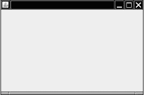

**图 10.1** 最简单的可见框架

**程序清单 10.1** `simpleframe/SimpleFrameTest.java`

```java
package simpleFrame;

import java.awt.*;
import javax.swing.*;

/**
 * @version 1.34 2018-04-10
 * @author Cay Horstmann
 */
public class SimpleFrameTest
{
   public static void main(String[] args)
   {
      EventQueue.invokeLater(() ->
         {
            var frame = new SimpleFrame();
            frame.setDefaultCloseOperation(JFrame.EXIT_ON_CLOSE);
            frame.setVisible(true);
         });
   }
}

class SimpleFrame extends JFrame
{
    private static final int DEFAULT_WIDTH = 300;
    private static final int DEFAULT_HEIGHT = 200;

    public SimpleFrame()
    {
        setSize(DEFAULT_WIDTH, DEFAULT_HEIGHT);
    }
}
```

让我们逐行分析这个程序。

Swing 类位于 `javax.swing` 包中。包名 `javax` 表示这是一个 Java 扩展包，而不是核心包。由于历史原因，Swing 被视为扩展。然而，从 1.2 版起，它存在于每一个 Java 实现中。

默认情况下，框架的大小是 0 × 0 像素，这相当无用。我们定义了一个子类 `SimpleFrame`，其构造器将大小设置为 300 × 200 像素。这是 `SimpleFrame` 与 `JFrame` 的唯一区别。

在 `SimpleFrameTest` 类的 `main` 方法中，我们构造一个 `SimpleFrame` 对象并使其可见。

每个 Swing 程序都需要处理两个技术问题。

首先，所有 Swing 组件都必须从 *事件分发线程* 进行配置，该线程是将鼠标单击和按键等事件传递给用户界面组件的控制线程。下面的代码片段用于在事件分发线程中执行语句：

```java
EventQueue.invokeLater(() ->
{
    statements
});
```

> **注意：** 你会看到许多 Swing 程序没有在事件分发线程中初始化用户界面。过去，在主线程中执行初始化是完全可接受的。遗憾的是，随着 Swing 组件变得越来越复杂，JDK 的开发者不再能够保证这种方法是安全的。发生错误的概率极低，但你不会想成为遇到间歇性问题的少数不幸者之一。最好还是做正确的事，即使代码看起来相当神秘。


**图 10.2** AWT 和 Swing 中框架类与组件类的继承层次结构

你需要在这里查找调整框架大小和形状的方法。例如，Component 类中的 setLocation 方法是重新定位组件的一种方式。如果进行如下调用

```java
setLocation(x, y)
```

左上角位于横向 x 像素、纵向 y 像素处，其中 (0, 0) 是屏幕的左上角。类似地，Component 中的 setBounds 方法允许你一步调整组件（特别是 JFrame）的大小并重新定位它，如下所示：

```java
setBounds(x, y, width, height)
```

组件类的许多方法都以 getter/setter 对的形式出现，例如 Frame 类的以下方法：

```java
public String getTitle()
public void setTitle(String title)
```

这样的 getter/setter 对称为 *属性*。属性有一个名称和一个类型。名称是通过将 get 或 set 之后的第一个字母改为小写得到的。例如，Frame 类有一个名为 title、类型为 String 的属性。

从概念上讲，title 是框架的一个属性。当我们设置该属性时，我们期望标题在用户屏幕上发生变化。当我们获取该属性时，我们期望取回已经设置的值。

get/set 约定有一个例外：对于 boolean 类型的属性，获取方法以 is 开头。例如，下面两个方法定义了 resizable 属性：

```java
public boolean isResizable()
public void setResizable(boolean resizable)
```

要确定框架的合适大小，首先要获取屏幕大小。调用 Toolkit 类的静态 getDefaultToolkit 方法以获取 Toolkit 对象。（Toolkit 类是与本地窗口系统交互的各种方法的大杂烩。）然后调用 getScreenSize 方法，该方法将屏幕大小作为 Dimension 对象返回。Dimension 对象在公共（！）实例变量 width 和 height 中同时存储宽度和高度。然后你可以使用屏幕尺寸的合适百分比来确定框架大小。代码如下：

```java
Toolkit kit = Toolkit.getDefaultToolkit();
Dimension screenSize = kit.getScreenSize();
int screenWidth = screenSize.width;
int screenHeight = screenSize.height;
setSize(screenWidth / 2, screenHeight / 2);
```

你还可以提供框架图标：

```java
Image img = new ImageIcon("icon.gif").getImage();
setIconImage(img);
```

### java.awt.Component 1.0

- `boolean isVisible()` / `void setVisible(boolean b)`
  - 获取或设置 visible 属性。组件初始时是可见的，但诸如 `JFrame` 之类的顶层组件除外。
- `void setSize(int width, int height)` **1.1**
  - 将组件调整为指定的宽度和高度。
- `void setLocation(int x, int y)` **1.1**
  - 将组件移动到新位置。如果组件不是顶层组件，则 x 和 y 坐标使用容器的坐标；如果组件是顶层组件（例如 `JFrame`），则使用屏幕的坐标。
- `void setBounds(int x, int y, int width, int height)` **1.1**
  - 移动并调整此组件的大小。
- `Dimension getSize()` **1.1** / `void setSize(Dimension d)` **1.1**
  - 获取或设置此组件的 size 属性。

### java.awt.Window 1.0

- `void setLocationByPlatform(boolean b)` **5**
  - 获取或设置 locationByPlatform 属性。如果在此窗口显示之前设置该属性，平台会选择一个合适的位置。

### java.awt.Frame 1.0

- `boolean isResizable()` / `void setResizable(boolean b)`
  - 获取或设置 resizable 属性。设置该属性后，用户可以调整框架的大小。
- `String getTitle()` / `void setTitle(String s)`
  - 获取或设置 title 属性，该属性决定框架标题栏中的文本。


**图 10.3** 显示信息的框架

*内容窗格*。添加到框架中的任何组件都会自动放入内容窗格：

```java
    Component c = . . .;
    frame.add(c); // added to the content pane
```


**图 10.4** JFrame 的内部结构

在我们的示例中，我们希望向框架中添加一个组件，并在该组件上绘制消息。要在组件上绘制，需要定义一个扩展 `JComponent` 的类，并重写该类中的 `paintComponent` 方法。

`paintComponent` 方法接受一个 `Graphics` 类型的参数。`Graphics` 对象记住一组用于绘制图像和文本的设置，例如你设置的字体或当前颜色。Java 中的所有绘制都必须通过 `Graphics` 对象进行。它提供了绘制图案、图像和文本的方法。

下面是如何创建一个可以在其上绘制的组件：

```java
class MyComponent extends JComponent
{
    public void paintComponent(Graphics g)
    {
        code for drawing
    }
}
```

每当窗口需要重绘时，无论原因是什么，事件处理器都会通知组件。这会导致所有组件的 `paintComponent` 方法被执行。

绝不要自己调用 `paintComponent` 方法。每当应用程序的某一部分需要重绘时，它都会被自动调用，你不应干扰这个自动过程。

哪些操作会触发这种自动响应？例如，当用户增大窗口大小，或者最小化然后还原窗口时，就会发生绘制。如果用户弹出了另一个窗口覆盖了现有窗口，然后让叠加的窗口消失，那么被覆盖的窗口现在已损坏，需要重新绘制。（图形系统不会保存下面的像素。）当然，当窗口第一次显示时，它需要执行代码来指定如何以及在哪里绘制初始元素。

> **提示：** 如果你需要强制重绘屏幕，请调用 `repaint` 方法而不是 `paintComponent`。`repaint` 方法会使用正确配置的 `Graphics` 对象，导致所有组件的 `paintComponent` 被调用。

正如你在上面的代码片段中所见，`paintComponent` 方法接受一个 `Graphics` 类型的参数。在用于屏幕的 `Graphics` 对象上进行测量

显示是以像素为单位完成的。(0, 0) 坐标表示你正在其表面绘制的组件的左上角。

Graphics 类有多种绘制方法，而显示文本被视为一种特殊的绘制。我们的 paintComponent 方法如下所示：

```java
public class NotHelloWorldComponent extends JComponent
{
   public static final int MESSAGE_X = 75;
   public static final int MESSAGE_Y = 100;

   public void paintComponent(Graphics g)
   {
      g.drawString("Not a Hello, World program", MESSAGE_X, MESSAGE_Y);
   }
   . . .
}
```

最后，组件应让用户知道它希望有多大。重写 getPreferredSize 方法，并返回一个 Dimension 类对象，其中包含首选宽度和高度：

```java
public class NotHelloWorldComponent extends JComponent
{
   private static final int DEFAULT_WIDTH = 300;
   private static final int DEFAULT_HEIGHT = 200;
   . . .
   public Dimension getPreferredSize()
   {
      return new Dimension(DEFAULT_WIDTH, DEFAULT_HEIGHT);
   }
}
```

当你用一个或多个组件填充框架，并且只想使用它们的首选尺寸时，应调用 pack 方法而不是 setSize 方法：

```java
class NotHelloWorldFrame extends JFrame
{
   public NotHelloWorldFrame()
   {
      add(new NotHelloWorldComponent());
      pack();
   }
}
```

代码清单 10.2 显示了完整代码。

## 代码清单 10.2 `notHelloWorld/NotHelloWorld.java`

```java
package notHelloWorld;

import javax.swing.*;
import java.awt.*;

/**
 * @version 1.34 2018-04-10
 * @author Cay Horstmann
 */
public class NotHelloWorld
{
   public static void main(String[] args)
   {
      EventQueue.invokeLater(() ->
      {
         var frame = new NotHelloWorldFrame();
         frame.setTitle("NotHelloWorld");
         frame.setDefaultCloseOperation(JFrame.EXIT_ON_CLOSE);
         frame.setVisible(true);
      });
   }
}

/**
 * A frame that contains a message panel.
 */
class NotHelloWorldFrame extends JFrame
{
   public NotHelloWorldFrame()
   {
      add(new NotHelloWorldComponent());
      pack();
   }
}

/**
 * A component that displays a message.
 */
class NotHelloWorldComponent extends JComponent
{
   public static final int MESSAGE_X = 75;
   public static final int MESSAGE_Y = 100;

   private static final int DEFAULT_WIDTH = 300;
   private static final int DEFAULT_HEIGHT = 200;

   public void paintComponent(Graphics g)
   {
      g.drawString("Not a Hello, World program", MESSAGE_X, MESSAGE_Y);
   }

   public Dimension getPreferredSize()
   {
      return new Dimension(DEFAULT_WIDTH, DEFAULT_HEIGHT);
   }
}
```

| javax.swing.JFrame 1.2 |
| --- |
| • `Component add(Component c)`<br>将给定组件添加到此框架的内容窗格并返回该组件。 |

| java.awt.Component 1.0 |
| --- |
| • `void repaint()`<br>使组件“尽快”重绘。<br><br>• `Dimension getPreferredSize()`<br>是要重写以返回此组件首选尺寸的方法。 |

| javax.swing.JComponent 1.2 |
| --- |
| • `void paintComponent(Graphics g)`<br>是要重写以描述组件需要如何绘制的方法。 |

| java.awt.Window 1.0 |
| --- |
| • `void pack()`<br>调整此窗口大小，同时考虑其各组件的首选尺寸。 |

#### 10.3.1 使用 2D 形状

从 Java 1.0 开始，Graphics 类就有绘制线条、矩形、椭圆等的方法。但这些绘制操作非常有限。我们将改用 Java 2D 库中的形状类。

要使用此库，你需要获得一个 Graphics2D 类的对象。这个类是 Graphics 类的子类。从 Java 1.2 开始，诸如 paintComponent 之类的方法会自动接收一个 Graphics2D 类的对象。只需按如下方式进行强制转换：

```java
public void paintComponent(Graphics g)
{
    Graphics2D g2 = (Graphics2D) g;
    . . .
}
```

Java 2D 库以面向对象的方式组织几何形状。特别地，有一些类用于表示线条、矩形和椭圆：

- `Line2D`
- `Rectangle2D`
- `Ellipse2D`

这些类都实现了 Shape 接口。Java 2D 库支持更复杂的形状——弧线、二次和三次曲线以及一般路径——本章不讨论这些内容。

要绘制形状，首先创建实现 Shape 接口的类的对象，然后调用 Graphics2D 类的 draw 方法。例如：

```java
Rectangle2D rect = . . .;
g2.draw(rect);
```

Java 2D 库使用浮点坐标（而不是整数）表示像素。内部计算使用单精度 float 数值进行。单精度已经足够——毕竟，几何计算的最终目的是在屏幕或打印机上设置像素。只要任何舍入误差保持在一个像素以内，视觉结果就不会受到影响。

然而，操作 float 值有时对程序员来说不太方便，因为 Java 在将 double 值转换为 float 值时会坚持要求强制转换。例如，考虑以下语句：

```java
float f = 1.2; // ERROR--possible loss of precision
```

这条语句无法编译，因为常量 1.2 的类型是 double，编译器担心精度损失。解决办法是为浮点常量添加 F 后缀：

```java
float f = 1.2F; // OK
```

现在考虑这条语句：

```java
float f = r.getWidth(); // ERROR
```

由于同样的原因，这条语句也无法编译。getWidth 方法返回 double。这一次，解决办法是提供强制转换：

```java
float f = (float) r.getWidth(); // OK
```

这些后缀和强制转换有点麻烦，因此 2D 库的设计者决定为每个形状类提供*两个版本*：一个使用 `float` 坐标，供注重节省的程序员使用；另一个使用 `double` 坐标，供图省事的程序员使用。（在本书中，我们属于后一阵营，尽可能使用 `double` 坐标。）

库设计者选择了一种奇特的方式来封装这些选择。考虑 `Rectangle2D` 类。这是一个抽象类，有两个具体子类，它们也是静态内部类：

- `Rectangle2D.Float`
- `Rectangle2D.Double`

图 10.5 显示了继承关系图。


**图 10.5** 2D 矩形类

最好忽略这两个具体类是静态内部类这一事实——这只是一个避免使用 `FloatRectangle2D` 和 `DoubleRectangle2D` 之类名称的小花招。

构造 `Rectangle2D.Float` 对象时，需要以 `float` 数值提供坐标。对于 `Rectangle2D.Double` 对象，则以 `double` 数值提供坐标。

```java
var floatRect = new Rectangle2D.Float(10.0F, 25.0F, 22.5F, 20.0F);
var doubleRect = new Rectangle2D.Double(10.0, 25.0, 22.5, 20.0);
```

构造参数表示矩形的左上角、宽度和高度。

`Rectangle2D` 的方法使用 `double` 参数和返回值。例如，即使宽度在 `Rectangle2D.Float` 对象中以 `float` 存储，`getWidth` 方法仍返回 `double` 值。

> **提示：** 直接使用 `Double` 形状类，以完全避免处理 `float` 值。但是，如果你要构造数千个形状对象，请考虑使用 `Float` 类以节省内存。

我们刚刚讨论的 `Rectangle2D` 类的情况也适用于其他形状类。此外，还有一个 `Point2D` 类，其子类为 `Point2D.Float` 和 `Point2D.Double`。下面是创建点对象的方法：

```java
var p = new Point2D.Double(10, 20);
```

`Rectangle2D` 和 `Ellipse2D` 类都继承自共同的超类 `RectangularShape`。诚然，椭圆并不是矩形，但它们有一个*边界矩形*（见图 10.6）。


**图 10.6** 椭圆的边界矩形

`RectangularShape` 类定义了 20 多个这些形状共有的方法，其中包括 `getWidth`、`getHeight`、`getCenterX` 和 `getCenterY` 等有用方法（但遗憾的是，在撰写本书时，还没有一个能将中心作为 `Point2D` 对象返回的 `getCenter` 方法）。

最后，Java 1.0 中的几个遗留类也被纳入形状类层次结构中。`Rectangle` 和 `Point` 类分别存储具有整数坐标的矩形和点，它们扩展了 `Rectangle2D` 和 `Point2D` 类。图 10.7 显示了形状类之间的关系。但是，省略了 `Double` 和 `Float` 子类。遗留类用灰色填充标记。


**图 10.7** 形状类之间的关系

`Rectangle2D` 和 `Ellipse2D` 对象构造起来很简单。你需要指定

- 左上角的 *x* 和 *y* 坐标；以及
- 宽度和高度。

对于椭圆，这些指的是包围矩形。例如，

```java
var e = new Ellipse2D.Double(150, 200, 100, 50);
```

构造一个椭圆，其包围矩形的左上角位于 (150, 200)，宽度为 100，高度为 50。

构造椭圆时，通常已知中心、宽度和高度，而不知道包围矩形的角点（这些角点甚至不在椭圆上）。`setFrameFromCenter` 方法使用中心点，但仍然需要四个角点之一。因此，通常最终会按如下方式构造椭圆：

```java
var ellipse
    = new Ellipse2D.Double(centerX - width / 2, centerY - height / 2, width, height);
```

要构造一条线，需要提供起点和终点，可以将其作为 `Point2D` 对象提供，也可以作为数值对提供：

```java
var line = new Line2D.Double(start, end);
```

或

```java
var line = new Line2D.Double(startX, startY, endX, endY);
```

清单 10.3 中的程序绘制一个矩形、该矩形内接的椭圆、矩形的一条对角线，以及与矩形同心的圆。图 10.8 显示了结果。


**图 10.8** 绘制几何形状

## 清单 10.3 draw/DrawTest.java

```java
package draw;

import java.awt.*;
import java.awt.geom.*;
import javax.swing.*;

/**
 * @version 1.34 2018-04-10
 * @author Cay Horstmann
 */
public class DrawTest
{
   public static void main(String[] args)
   {
      EventQueue.invokeLater(() ->
         {
            var frame = new DrawFrame();
            frame.setTitle("DrawTest");
            frame.setDefaultCloseOperation(JFrame.EXIT_ON_CLOSE);
            frame.setVisible(true);
         });
   }
}

/**
 * A frame that contains a panel with drawings.
 */
class DrawFrame extends JFrame
{
   public DrawFrame()
   {
      add(new DrawComponent());
      pack();
   }
}

/**
 * A component that displays rectangles and ellipses.
 */
class DrawComponent extends JComponent
{
   private static final int DEFAULT_WIDTH = 400;
   private static final int DEFAULT_HEIGHT = 400;

   public void paintComponent(Graphics g)
   {
      var g2 = (Graphics2D) g;

      // draw a rectangle

      double leftX = 100;
      double topY = 100;
      double width = 200;
      double height = 150;

      var rect = new Rectangle2D.Double(leftX, topY, width, height);
      g2.draw(rect);

      // draw the enclosed ellipse

      var ellipse = new Ellipse2D.Double();
      ellipse.setFrame(rect);
      g2.draw(ellipse);

      // draw a diagonal line

      g2.draw(new Line2D.Double(leftX, topY, leftX + width, topY + height));

      // draw a circle with the same center

      double centerX = rect.getCenterX();
      double centerY = rect.getCenterY();
      double radius = 150;

      var circle = new Ellipse2D.Double();
      circle.setFrameFromCenter(centerX, centerY, centerX + radius, centerY + radius);
      g2.draw(circle);
   }

   public Dimension getPreferredSize()
   {
      return new Dimension(DEFAULT_WIDTH, DEFAULT_HEIGHT);
   }
}
```

### java.awt.geom.RectangularShape 1.2

- `double getCenterX()`
- `double getCenterY()`
- `double getMinX()`
- `double getMinY()`
- `double getMaxX()`
- `double getMaxY()`

  返回包围矩形的中心、最小或最大 x 或 y 值。

- `double getWidth()`
- `double getHeight()`

  返回包围矩形的宽度或高度。

- `double getX()`
- `double getY()`

  返回包围矩形左上角的 *x* 或 *y* 坐标。

### java.awt.geom.Rectangle2D.Double 1.2

- `Rectangle2D.Double(double x, double y, double w, double h)`

  用给定的左上角、宽度和高度构造一个矩形。

### java.awt.geom.Ellipse2D.Double 1.2

- `Ellipse2D.Double(double x, double y, double w, double h)`

  构造一个椭圆，其包围矩形具有给定的左上角、宽度和高度。

### java.awt.geom.Point2D.Double 1.2

- `Point2D.Double(double x, double y)`

  用给定坐标构造一个点。

### java.awt.geom.Line2D.Double 1.2

- `Line2D.Double(Point2D start, Point2D end)`
- `Line2D.Double(double startX, double startY, double endX, double endY)`

  用给定的起点和终点构造一条线。

#### 10.3.2 使用颜色

`Graphics2D` 类的 `setPaint` 方法允许你选择一种颜色，该颜色将用于图形上下文上所有后续绘制操作。例如：

```java
g2.setPaint(Color.RED);
g2.drawString("Warning!", 100, 100);
```

你可以用颜色填充封闭形状（如矩形或椭圆）的内部。只需调用 `fill` 而不是 `draw`：

```java
Rectangle2D rect = . . .;
g2.setPaint(Color.RED);
g2.fill(rect); // fills rect with red
```

要用多种颜色绘制，请选择一种颜色，绘制或填充，然后选择另一种颜色，再绘制或填充。

> **注意：** `fill` 方法在右侧和底部少绘制一个像素。例如，如果你绘制一个新建的 `Rectangle2D.Double(0, 0, 10, 20)`，则绘制会包含 x = 10 和 y = 20 的像素。如果你填充同一个矩形，则不会绘制这些像素。

使用 `Color` 类定义颜色。`java.awt.Color` 类为以下 13 种标准颜色提供了预定义常量：

- BLACK, BLUE, CYAN, DARK GRAY, GRAY, GREEN, LIGHT GRAY, MAGENTA, ORANGE, PINK, RED, WHITE, YELLOW

你可以通过红色、绿色和蓝色分量（每个值在 0 到 255 之间）创建 `Color` 对象来指定自定义颜色：

```java
g2.setPaint(new Color(0, 128, 128)); // a dull blue-green
g2.drawString("Welcome!", 75, 125);
```

> **注意：** 除了纯色之外，你还可以用实现 `Paint` 接口的类的实例调用 `setPaint`。这样就可以使用渐变和纹理进行绘制。

要设置*背景色*，请使用 `Component` 类的 `setBackground` 方法，`Component` 类是 `JComponent` 的祖先类。

```java
var component = new MyComponent();
component.setBackground(Color.PINK);
```

还有一个 `setForeground` 方法。它指定在组件上绘制时使用的默认颜色。

| API | 描述 |
| --- | --- |
| **`java.awt.Color` 1.0** | |
| `Color(int r, int g, int b)` | 用给定的红色、绿色和蓝色分量（在 0 到 255 之间）创建一个颜色对象。 |
| **`java.awt.Graphics2D` 1.2** | |
| `Paint getPaint()`<br>`void setPaint(Paint p)` | 获取或设置此图形上下文的绘制属性。`Color` 类实现 `Paint` 接口。因此，你可以使用此方法将绘制属性设置为纯色。 |
| `void fill(Shape s)` | 用当前画笔填充形状。 |
| **`java.awt.Component` 1.0** | |
| `Color getForeground()`<br>`Color getBackground()`<br>`void setForeground(Color c)`<br>`void setBackground(Color c)` | 获取或设置前景色或背景色。 |

#### 10.3.3 使用字体

本章开头的“Not a Hello World”程序用默认字体显示了一个字符串。有时，你会希望用不同的字体显示文本。你可以通过*字体外观名称*来指定字体。字体外观名称由*字体家族名称*（例如“Helvetica”）和一个可选的后缀（例如“Bold”）组成。例如，字体外观“Helvetica”和“Helvetica Bold”都被视为名为“Helvetica”的家族的一部分。

要查明某台计算机上可用的字体，请调用 `GraphicsEnvironment` 类的 `getAvailableFontFamilyNames` 方法。该方法返回一个字符串数组，其中包含所有可用字体的名称。要获取描述用户系统图形环境的 `GraphicsEnvironment` 类实例，请使用静态 `getLocalGraphicsEnvironment` 方法。以下程序打印你系统上所有字体的名称：


```java
import java.awt.*;

public class ListFonts
{
    public static void main(String[] args)
    {
        String[] fontNames = GraphicsEnvironment
            .getLocalGraphicsEnvironment()
            .getAvailableFontFamilyNames();
        for (String fontName : fontNames)
            System.out.println(fontName);
    }
}
```

AWT 定义了五个逻辑字体名称：

- SansSerif
- Serif
- Monospaced
- Dialog
- DialogInput

这些名称总是映射到客户端机器上实际存在的某些字体。例如，在 Windows 系统上，SansSerif 映射为 Arial。

此外，Oracle JDK 始终包含三个字体家族，名称分别为“Lucida Sans”、“Lucida Bright”和“Lucida Sans Typewriter”。

要使用某种字体绘制字符，必须先创建 Font 类的对象。指定字体外观名称、字体样式和磅值。下面是构造 Font 对象的示例：

```java
var sansbold14 = new Font("SansSerif", Font.BOLD, 14);
```

第三个参数是磅值。点常用于排版中表示字体大小。每英寸有 72 点。

在 Font 构造函数中，可以使用逻辑字体名称代替字体外观名称。通过将 Font 构造函数的第二个参数设置为以下值之一来指定样式（普通、粗体、斜体或粗斜体）：

- Font.PLAIN
- Font.BOLD
- Font.ITALIC
- Font.BOLD + Font.ITALIC


### 图 10.9 排版术语图解

*Leading* 是一行文本的 descent 与下一行文本的 ascent 之间的间距。（该术语源于排字工人用来分隔行间的铅条。）字体的 *height* 是相邻基线之间的距离，等于 descent + leading + ascent。

getStringBounds 方法返回的矩形宽度是字符串的水平范围。矩形高度是 ascent、descent 和 leading 之和。矩形的原点位于字符串的基线。矩形顶部的 y 坐标为负。因此，可以按如下方式获取字符串宽度、高度和 ascent：

```java
double stringWidth = bounds.getWidth();
double stringHeight = bounds.getHeight();
double ascent = -bounds.getY();
```

如果需要知道 descent 或 leading，请使用 Font 类的 getLineMetrics 方法。该方法返回 LineMetrics 类的对象，该类具有获取 descent 和 leading 的方法：

```java
LineMetrics metrics = f.getLineMetrics(message, context);
float descent = metrics.getDescent();
float leading = metrics.getLeading();
```

> **注意：** 当需要在 paintComponent 方法之外计算布局尺寸时，无法从 Graphics2D 对象获取字体渲染上下文。此时，应使用 JComponent 类的 getFontMetrics 方法，然后调用 getFontRenderContext。
>
> ```java
> FontRenderContext context = getFontMetrics(f).getFontRenderContext();
> ```

为了表明定位准确，清单 10.4 中的示例程序将字符串居中于框架中，并绘制基线和边界矩形。图 10.10 显示了屏幕显示效果。


### 图 10.10 绘制基线和字符串边界

### 清单 10.4 `font/FontTest.java`

```java
package font;

import java.awt.*;
import java.awt.font.*;
import java.awt.geom.*;
import javax.swing.*;

/**
 * @version 1.35 2018-04-10
 * @author Cay Horstmann
 */
public class FontTest
{
   public static void main(String[] args)
   {
      EventQueue.invokeLater(() ->
         {
            var frame = new FontFrame();
            frame.setTitle("FontTest");
            frame.setDefaultCloseOperation(JFrame.EXIT_ON_CLOSE);
            frame.setVisible(true);
         });
   }
}

/**
 * A frame with a text message component.
 */
class FontFrame extends JFrame
{
   public FontFrame()
   {
      add(new FontComponent());
      pack();
   }
}

/**
 * A component that shows a centered message in a box.
 */
class FontComponent extends JComponent
{
    private static final int DEFAULT_WIDTH = 300;
    private static final int DEFAULT_HEIGHT = 200;

    public void paintComponent(Graphics g)
    {
        var g2 = (Graphics2D) g;

        var message = "Hello, World!";

        var f = new Font("Serif", Font.BOLD, 36);
        g2.setFont(f);

        // measure the size of the message

        FontRenderContext context = g2.getFontRenderContext();
        Rectangle2D bounds = f.getStringBounds(message, context);

        // set (x,y) = top left corner of text

        double x = (getWidth() - bounds.getWidth()) / 2;
        double y = (getHeight() - bounds.getHeight()) / 2;

        // add ascent to y to reach the baseline

        double ascent = -bounds.getY();
        double baseY = y + ascent;

        // draw the message

        g2.drawString(message, (int) x, (int) baseY);

        g2.setPaint(Color.LIGHT_GRAY);

        // draw the baseline

        g2.draw(new Line2D.Double(x, baseY, x + bounds.getWidth(), baseY));

        // draw the enclosing rectangle

        var rect = new Rectangle2D.Double(x, y, bounds.getWidth(), bounds.getHeight());
        g2.draw(rect);
    }

    public Dimension getPreferredSize()
    {
        return new Dimension(DEFAULT_WIDTH, DEFAULT_HEIGHT);
    }
}
```

| `java.awt.Font` | 1.0 |
|---|---|
| • `Font(String name, int style, int size)` | 创建一个新的字体对象。字体名称要么是字体外观名称（例如 "Helvetica Bold"），要么是逻辑字体名称（例如 "Serif"、"SansSerif"）。样式是 `Font.PLAIN`、`Font.BOLD`、`Font.ITALIC` 或 `Font.BOLD + Font.ITALIC` 之一。 |
| • `String getFontName()` | 获取字体外观名称（例如 "Helvetica Bold"）。 |
| • `String getFamily()` | 获取字体家族名称（例如 "Helvetica"）。 |
| • `String getName()` | 如果字体是使用逻辑字体名称创建的，则获取逻辑名称（例如 "SansSerif"）；否则获取字体外观名称。 |
| • `Rectangle2D getStringBounds(String s, FontRenderContext context)` 1.2 | 返回包围该字符串的矩形。矩形的原点落在基线上。矩形顶部的 y 坐标等于 ascent 的负值。矩形高度等于 ascent、descent 和 leading 之和。宽度等于字符串宽度。 |
| • `LineMetrics getLineMetrics(String s, FontRenderContext context)` 1.2 | 返回一个行度量对象，用于确定字符串的范围。 |
| • `Font deriveFont(int style)` 1.2 |  |
| • `Font deriveFont(float size)` 1.2 |  |
| • `Font deriveFont(int style, float size)` 1.2 | 返回一个新字体，该字体与此字体相同，但具有给定的大小和样式。 |

- **java.awt.font.LineMetrics** 1.2
  - `float getAscent()` 获取字体 ascent——从基线到大写字符顶部的距离。
  - `float getDescent()` 获取字体 descent——从基线到下行字母底部的距离。
  - `float getLeading()` 获取字体 leading——一行文本底部与下一行顶部之间的间距。
  - `float getHeight()` 获取字体的总高度——两行文本基线之间的距离（descent + leading + ascent）。

- **java.awt.Graphics2D** 1.2
  - `FontRenderContext getFontRenderContext()` 获取一个字体渲染上下文，该上下文指定此图形上下文中的字体特征。
  - `void drawString(String str, float x, float y)` 使用当前字体和颜色绘制字符串。

- **javax.swing.JComponent** 1.2
  - `FontMetrics getFontMetrics(Font f)` 5 获取给定字体的字体度量。FontMetrics 类是 LineMetrics 类的前身。

- **java.awt.FontMetrics** 1.0
  - `FontRenderContext getFontRenderContext()` 1.2 获取该字体的字体渲染上下文。


#### 10.3.4 显示图像

你可以使用`ImageIcon`类从文件中读取图像：

```java
Image image = new ImageIcon(filename).getImage();
```

现在变量`image`包含一个引用，该引用指向封装了图像数据的对象。使用`Graphics`类的`drawImage`方法显示图像。

```java
public void paintComponent(Graphics g)
{
    . . .
    g.drawImage(image, x, y, null);
}
```

我们可以更进一步，用图像平铺整个窗口。结果如图10.11所示。我们在`paintComponent`方法中进行平铺。首先在左上角绘制一个图像副本，然后使用`copyArea`调用将其复制到整个窗口：

```java
for (int i = 0; i * imageWidth <= getWidth(); i++)
  for (int j = 0; j * imageHeight <= getHeight(); j++)
    if (i + j > 0)
      g.copyArea(0, 0, imageWidth, imageHeight, i * imageWidth, j * imageHeight);
```


**图10.11** 以平铺图像显示的窗口

### java.awt.Graphics 1.0

- `boolean drawImage(Image img, int x, int y, ImageObserver observer)`
- `boolean drawImage(Image img, int x, int y, int width, int height, ImageObserver observer)`
  draws an unscaled or scaled image. Note: This call may return before the image is drawn. The ImageObserver object is notified of the rendering progress. This was a useful feature in the distant past. Nowadays, just pass a null observer.
- `void copyArea(int x, int y, int width, int height, int dx, int dy)`
  copies an area of the screen. The dx and dy parameters are the distance from the source area to the target area.

### 10.4 事件处理

任何支持GUI的操作环境都会持续监控键盘按键或鼠标点击等事件。这些事件随后被报告给正在运行的程序。然后每个程序决定如何响应这些事件（如果需要响应的话）。

#### 10.4.1 基本事件处理概念

在Java AWT中，*事件源*（如按钮或滚动条）具有允许你注册*事件监听器*的方法——监听器是执行对事件所需响应的对象。

当事件监听器被通知某个事件时，有关事件的信息被封装在*事件对象*中。在Java中，所有事件对象最终都派生自`java.util.EventObject`类。当然，每种事件类型都有其子类，例如ActionEvent和WindowEvent。

不同的事件源可能产生不同类型的事件。例如，按钮可以发送ActionEvent对象，而窗口可以发送WindowEvent对象。

总而言之，以下是AWT事件处理工作的概述：

- 事件监听器是实现了*监听器接口*的类的实例。
- 事件源是可以注册监听器对象并向其发送事件对象的对象。
- 当事件发生时，事件源会向所有已注册的监听器发送事件对象。
- 然后，监听器对象利用事件对象中的信息来确定它们对事件的反应。

图10.12显示了事件处理类与接口之间的关系。

以下是指定监听器的示例：

```java
ActionListener listener = . . . ;
var button = new JButton("OK");
button.addActionListener(listener);
```


**图10.12** 事件源与监听器之间的关系

现在，只要按钮中发生“动作事件”，监听器对象就会收到通知。对于按钮来说，正如你所料，动作事件就是按钮点击。

要实现ActionListener接口，监听器类必须有一个名为actionPerformed的方法，该方法接收一个ActionEvent对象作为参数。

```java
class MyListener implements ActionListener
{
    ...
    public void actionPerformed(ActionEvent event)
    {
        // reaction to button click goes here
        ...
    }
}
```

每当用户点击按钮时，JButton对象就会创建一个ActionEvent对象，并调用listener.actionPerformed(event)，将该事件对象传递过去。像按钮这样的事件源可以有多个监听器。在这种情况下，只要用户点击按钮，按钮就会调用所有监听器的actionPerformed方法。

图10.13显示了事件源、事件监听器和事件对象之间的交互。


**图10.13** 事件通知

#### 10.4.2 示例：处理按钮点击

为了熟悉事件委托模型，让我们完整地处理一个响应按钮点击的简单示例所需的所有细节。在这个示例中，我们将展示一个包含三个按钮的面板。三个监听器对象被添加为按钮的动作监听器。在这种场景下，每当用户点击面板上的任何一个按钮，相关的监听器对象都会收到一个指示按钮点击的ActionEvent。在我们的示例程序中，监听器对象接着会改变面板的背景颜色。

在我们向你展示监听按钮点击的程序之前，首先需要解释如何创建按钮以及如何将它们添加到面板中。

要创建按钮，请在按钮构造函数中指定标签字符串、图标或两者兼有。以下是两个示例：

```java
var yellowButton = new JButton("Yellow");
var blueButton = new JButton(new ImageIcon("blue-ball.gif"));
```

调用add方法将按钮添加到面板：

```java
var yellowButton = new JButton("Yellow");
var blueButton = new JButton("Blue");
var redButton = new JButton("Red");

buttonPanel.add(yellowButton);
buttonPanel.add(blueButton);
buttonPanel.add(redButton);
```

图10.14显示了结果。


**图10.14** 充满按钮的面板

接下来，我们需要添加监听这些按钮的代码。这需要实现ActionListener接口的类，正如我们刚才提到的，该接口有一个方法：actionPerformed，其签名如下：

```java
public void actionPerformed(ActionEvent event)
```

使用ActionListener接口的方式在各种情况下都是相同的：actionPerformed方法（它是ActionListener中唯一的方法）接受一个ActionEvent类型的对象作为参数。这个事件对象提供有关所发生事件的信息。

当按钮被点击时，我们希望面板的背景颜色变为特定颜色。我们将所需的颜色存储在监听器类中。

```java
class ColorAction implements ActionListener
{
    private Color backgroundColor;

    public ColorAction(Color c)
    {
        backgroundColor = c;
    }

    public void actionPerformed(ActionEvent event)
    {
        // set panel background color
        . . .
    }
}
```

然后，我们为每种颜色构造一个对象，并将这些对象设置为按钮的监听器。

```java
var yellowAction = new ColorAction(Color.YELLOW);
var blueAction = new ColorAction(Color.BLUE);
var redAction = new ColorAction(Color.RED);

yellowButton.addActionListener(yellowAction);
blueButton.addActionListener(blueAction);
redButton.addActionListener(redAction);
```

例如，如果用户点击标记为“Yellow”的按钮，yellowAction对象的actionPerformed方法就会被调用。它的backgroundColor实例字段被设置为Color.YELLOW，然后它就可以继续设置面板的背景颜色了。

只剩下一个问题。ColorAction对象无法访问buttonPanel变量。有两种方法可以解决这个问题。你可以将面板存储在ColorAction对象中，并在ColorAction构造函数中设置它。或者，更方便的是，你可以将ColorAction设置为ButtonFrame类的内部类。这样它的方法就可以自动访问外部面板了。

清单10.5包含了完整的框架类。每当你点击其中一个按钮，相应的动作监听器就会改变面板的背景颜色。


## 代码清单 10.5 button/ButtonFrame.java

```java
package button;

import java.awt.*;
import java.awt.event.*;
import javax.swing.*;

/**
 * A frame with a button panel.
 */
public class ButtonFrame extends JFrame
{
   private JPanel buttonPanel;
   private static final int DEFAULT_WIDTH = 300;
   private static final int DEFAULT_HEIGHT = 200;

   public ButtonFrame()
   {
      setSize(DEFAULT_WIDTH, DEFAULT_HEIGHT);

      // create buttons
      var yellowButton = new JButton("Yellow");
      var blueButton = new JButton("Blue");
      var redButton = new JButton("Red");

      buttonPanel = new JPanel();

      // add buttons to panel
      buttonPanel.add(yellowButton);
      buttonPanel.add(blueButton);
      buttonPanel.add(redButton);

      // add panel to frame
      add(buttonPanel);

      // create button actions
      var yellowAction = new ColorAction(Color.YELLOW);
      var blueAction = new ColorAction(Color.BLUE);
      var redAction = new ColorAction(Color.RED);

      // associate actions with buttons
      yellowButton.addActionListener(yellowAction);
      blueButton.addActionListener(blueAction);
      redButton.addActionListener(redAction);
   }

   /**
    * An action listener that sets the panel's background color.
    */
   private class ColorAction implements ActionListener
   {
      private Color backgroundColor;

      public ColorAction(Color c)
      {
         backgroundColor = c;
      }

      public void actionPerformed(ActionEvent event)
      {
         buttonPanel.setBackground(backgroundColor);
      }
   }
}
```

- **javax.swing.JButton 1.2**
  - `JButton(String label)`
  - `JButton(Icon icon)`
  - `JButton(String label, Icon icon)` —— 构造一个按钮。标签字符串可以是纯文本或 HTML；例如，`"<html><b>Ok</b></html>"`。

- **java.awt.Container 1.0**
  - `Component add(Component c)` —— 将组件 c 添加到此容器中。

#### 10.4.3 简洁地指定监听器

在上一节中，我们为事件监听器定义了一个类，并构造了该类的三个对象。一个监听器类有多个实例并不那么常见。最常见的是，每个监听器执行单独的动作。在这种情况下，没有必要创建单独的类。只需使用 lambda 表达式：

```java
exitButton.addActionListener(event -> System.exit(0));
```

现在考虑有多个相关动作的情况，例如上一节的彩色按钮。在这种情况下，实现一个辅助方法：

```java
public void makeButton(String name, Color backgroundColor)
{
    var button = new JButton(name);
    buttonPanel.add(button);
    button.addActionListener(event ->
        buttonPanel.setBackground(backgroundColor));
}
```

注意，lambda 表达式引用了参数变量 `backgroundColor`。

然后我们只需调用

```java
makeButton("yellow", Color.YELLOW);
makeButton("blue", Color.BLUE);
makeButton("red", Color.RED);
```

这里，我们构造了三个监听器对象，每种颜色一个，而没有显式定义类。每次调用辅助方法时，它都会创建一个实现 ActionListener 接口的类的实例。其 actionPerformed 动作引用了 backgroundColor 值，而该值实际上存储在监听器对象中。然而，所有这些都无需你显式定义监听器类、实例变量或设置它们的构造器。

> **注意：** 在较旧的代码中，你经常会看到使用匿名类：
>
> ```java
> exitButton.addActionListener(new ActionListener()
> {
>     public void actionPerformed(ActionEvent event)
>     {
>         System.exit(0);
>     }
> });
> ```
>
> 当然，这种相当冗长的代码已不再必要。使用 lambda 表达式更简单、更清晰。

#### 10.4.4 适配器类

并非所有事件都像按钮点击那样容易处理。假设你想监视用户何时尝试关闭主框架，以便弹出一个对话框，并且仅在用户同意时才退出程序。

当用户尝试关闭窗口时，JFrame 对象是 WindowEvent 的源。如果你想捕获该事件，必须有一个合适的监听器对象，并将其添加到框架的窗口监听器列表中。

```java
WindowListener listener = . . .;
frame.addWindowListener(listener);
```

窗口监听器必须是实现 WindowListener 接口的类的对象。WindowListener 接口实际上有七个方法。框架会调用它们，作为对窗口可能发生的七种不同事件的响应。这些名称不言自明，只是“iconified”在 Windows 下通常称为“minimized”。以下是完整的 WindowListener 接口：

```java
public interface WindowListener
{
   void windowOpened(WindowEvent e);
   void windowClosing(WindowEvent e);
   void windowClosed(WindowEvent e);
   void windowIconified(WindowEvent e);
   void windowDeiconified(WindowEvent e);
   void windowActivated(WindowEvent e);
   void windowDeactivated(WindowEvent e);
}
```

当然，我们可以定义一个实现该接口的类，在 windowClosing 方法中添加对 System.exit(0) 的调用，并为其他六个方法编写什么都不做的函数。然而，为六个什么都不做的方法输入代码是那种没人喜欢的乏味杂活。为简化这项任务，每个具有多个方法的 AWT 监听器接口都附带一个配套的适配器类，它实现接口中的所有方法，但不对它们做任何事。例如，WindowAdapter 类有七个什么都不做的方法。你扩展适配器类，以指定对接口中某些（但不是全部）事件类型的期望反应。（像 ActionListener 这样只有一个方法的接口不需要适配器类。）

下面是我们如何定义一个重写 windowClosing 方法的窗口监听器：

```java
class Terminator extends WindowAdapter
{
   public void windowClosing(WindowEvent e)
   {
      if (user agrees)
         System.exit(0);
   }
}
```

现在你可以将 Terminator 类型的对象注册为事件监听器：

```java
var listener = new Terminator();
frame.addWindowListener(listener);
```

> **注意：** 如今，人们会将 `WindowListener` 接口的空方法实现为默认方法。然而，Swing 的发明比默认方法的出现早很多年。

### java.awt.event.WindowListener 1.1

- `void windowOpened(WindowEvent e)` —— 在窗口已打开之后调用。
- `void windowClosing(WindowEvent e)` —— 当用户发出窗口管理器命令关闭窗口时调用。注意，只有当调用窗口的 hide 或 dispose 方法时，窗口才会关闭。
- `void windowClosed(WindowEvent e)` —— 在窗口已关闭之后调用。
- `void windowIconified(WindowEvent e)` —— 在窗口已图标化之后调用。
- `void windowDeiconified(WindowEvent e)` —— 在窗口已取消图标化之后调用。
- `void windowActivated(WindowEvent e)` —— 在窗口已变为活动状态之后调用。只有框架或对话框可以处于活动状态。通常，窗口管理器会装饰活动窗口——例如，高亮标题栏。
- `void windowDeactivated(WindowEvent e)` —— 在窗口已变为非活动状态之后调用。

### java.awt.event.WindowStateListener 1.4

- `void windowStateChanged(WindowEvent event)` —— 在窗口已最大化、图标化或恢复为正常大小后调用。

#### 10.4.5 动作

同一条命令通常有多种激活方式。用户可以通过菜单、按键或工具栏上的按钮选择某个功能。在 AWT 事件模型中，这很容易实现：将所有事件链接到同一个监听器。例如，假设 Action 是一个动作监听器，其 actionPerformed 方法将背景色改为蓝色。你可以将同一个对象作为监听器附加到多个事件源：

- 一个标有“Blue”的工具栏按钮
- 一个标有“Blue”的菜单项
- 一次按键 Ctrl+B

现在，无论颜色更改命令是由按钮点击、菜单选择还是按键引起的，它都会以统一的方式处理。

Swing 包提供了一种非常有用的机制来封装命令并将其附加到多个事件源：Action 接口。一个*动作*是封装以下内容的对象：

- 命令的描述（作为文本字符串和可选图标）；以及
- 执行命令所必需的参数（例如我们示例中请求的颜色）。

Action 接口具有以下方法：

```java
void actionPerformed(ActionEvent event);
void setEnabled(boolean b);
boolean isEnabled();
void putValue(String key, Object value);
Object getValue(String key);
void addPropertyChangeListener(PropertyChangeListener listener);
void removePropertyChangeListener(PropertyChangeListener listener);
```

第一个方法是 ActionListener 接口中熟悉的方法；事实上，Action 接口扩展了 ActionListener 接口。因此，凡是需要 ActionListener 对象的地方，都可以使用 Action 对象。

接下来的两个方法让你启用或禁用动作，并检查动作当前是否已启用。当动作附加到菜单或工具栏且该动作被禁用时，该选项会变灰。

putValue 和 getValue 方法让你在动作对象中存储和检索任意名称/值对。几个重要的预定义字符串，即 Action.NAME 和 Action.SMALL_ICON，将动作名称和图标存储到动作对象中：


```java
action.putValue(Action.NAME, "Blue");
action.putValue(Action.SMALL_ICON, new ImageIcon("blue-ball.gif"));
```

表 10.1 显示了所有预定义的动作表名称。

### 表 10.1 预定义动作表名称

| 名称 | 值 |
|---|---|
| `NAME` | 动作的名称，显示在按钮和菜单项上。 |
| `SMALL_ICON` | 用于存储小图标的位置，以便在按钮、菜单项或工具栏中显示。 |
| `SHORT_DESCRIPTION` | 图标的简短描述，用于在工具提示中显示。 |
| `LONG_DESCRIPTION` | 图标的详细描述，可能用于在线帮助。没有 Swing 组件使用此值。 |
| `MNEMONIC_KEY` | 用于在菜单项中显示的助记符缩写。 |
| `ACCELERATOR_KEY` | 用于存储加速键击键的位置。没有 Swing 组件使用此值。 |
| `ACTION_COMMAND_KEY` | 历史上用于现已过时的 `registerKeyboardAction` 方法。 |
| `DEFAULT` | 可能有用、包罗万象的属性。没有 Swing 组件使用此值。 |

如果将动作对象添加到菜单或工具栏，名称和图标会自动检索并显示在菜单项或工具栏按钮中。`SHORT_DESCRIPTION` 值会变成工具提示。

*Action* 接口的最后两个方法允许其他对象（特别是触发该动作的菜单或工具栏）在动作对象的属性发生变化时收到通知。例如，如果将一个菜单添加为动作对象的属性变更监听器，并且该动作对象随后被禁用，则菜单会被调用，并可以将动作名称置灰。

注意，*Action* 是一个*接口*，而不是一个类。任何实现此接口的类都必须实现我们刚刚讨论的七个方法。幸运的是，一位友善的人提供了一个类 *AbstractAction*，它实现了除 `actionPerformed` 之外的所有方法。该类负责存储所有名称/值对并管理属性变更监听器。你只需扩展 *AbstractAction* 并提供 `actionPerformed` 方法。

让我们构建一个可以执行颜色更改命令的动作对象。我们存储命令的名称、一个图标以及所需的颜色。我们将颜色存储在 AbstractAction 类提供的名称/值对表中。下面是 ColorAction 类的代码。构造函数设置名称/值对，actionPerformed 方法执行颜色更改动作。

```java
public class ColorAction extends AbstractAction
{
   public ColorAction(String name, Icon icon, Color c)
   {
      putValue(Action.NAME, name);
      putValue(Action.SMALL_ICON, icon);
      putValue("color", c);
      putValue(Action.SHORT_DESCRIPTION, "Set panel color to " + name.toLowerCase());
   }

   public void actionPerformed(ActionEvent event)
   {
      Color c = (Color) getValue("color");
      buttonPanel.setBackground(c);
   }
}
```

我们的测试程序创建了此类的三个对象，例如

```java
var blueAction = new ColorAction("Blue", new ImageIcon("blue-ball.gif"), Color.BLUE);
```

接下来，让我们将此动作与一个按钮关联。这很容易，因为我们可以使用接受 Action 对象的 JButton 构造函数。

```java
var blueButton = new JButton(blueAction);
```

该构造函数从动作中读取名称和图标，将简短描述设置为工具提示，并将该动作设置为监听器。你可以在图 10.15 中看到图标和工具提示。


图 10.15 按钮显示来自动作对象的图标。

正如我们在下一章中演示的那样，将同一个动作添加到菜单也同样容易。

最后，我们希望将动作对象关联到击键，以便当用户键入键盘命令时执行动作。要将动作与击键关联，首先需要生成 `KeyStroke` 类的对象。这个便利类封装了键的描述。要生成 `KeyStroke` 对象，不要调用构造函数，而应使用 `KeyStroke` 类的静态 `getKeyStroke` 方法。

```java
KeyStroke ctrlBKey = KeyStroke.getKeyStroke("ctrl B");
```

要理解下一步，你需要理解*键盘焦点*的概念。用户界面可以有许多按钮、菜单、滚动条和其他组件。当你按下一个键时，它会被发送到拥有焦点的组件。该组件通常（但并非总是）在视觉上有所区分。例如，在 Java 外观中，拥有焦点的按钮会在按钮文本周围有一个细矩形边框。你可以使用 Tab 键在组件之间移动焦点。当你按空格键时，拥有焦点的按钮会被点击。其他键执行不同的动作；例如，方向键可以移动滚动条。

然而，在我们的情况下，我们不希望将击键发送到拥有焦点的组件。否则，每个按钮都需要知道如何处理 Ctrl+Y、Ctrl+B 和 Ctrl+R 键。

这是一个常见问题，Swing 设计者想出了一个方便的解决方案。每个 `JComponent` 都有三个*输入映射*，每个映射都将 `KeyStroke` 对象映射到关联的动作。这三个输入映射对应三种不同的条件（见表 10.2）。

### 表 10.2 输入映射条件

| 标志 | 调用动作 |
|---|---|
| WHEN_FOCUSED | 当此组件拥有键盘焦点时 |
| WHEN_ANCESTOR_OF_FOCUSED_COMPONENT | 当此组件包含拥有键盘焦点的组件时 |
| WHEN_IN_FOCUSED_WINDOW | 当此组件与拥有键盘焦点的组件位于同一窗口中时 |

击键处理按以下顺序检查这些映射：

1. 检查拥有输入焦点的组件的 `WHEN_FOCUSED` 映射。如果该击键存在且其对应动作已启用，则执行该动作并停止处理。

2. 从拥有输入焦点的组件开始，检查其父组件的 `WHEN_ANCESTOR_OF_FOCUSED_COMPONENT` 映射。一旦找到包含该击键且对应动作已启用的映射，就执行该动作并停止处理。

3. 查看拥有输入焦点的窗口中所有*可见*且*启用*的组件，这些组件在 `WHEN_IN_FOCUSED_WINDOW` 映射中注册了该击键。给这些组件（按其击键注册顺序）一个执行对应动作的机会。一旦第一个启用的动作被执行，就停止处理。

要从组件获取输入映射，请使用 getInputMap 方法。下面是一个示例：

```java
InputMap imap = panel.getInputMap(JComponent.WHEN_FOCUSED);
```

`WHEN_FOCUSED` 条件意味着当当前组件拥有键盘焦点时，会查询此映射。在我们的情况下，这不是我们想要的映射。拥有输入焦点的是其中一个按钮，而不是面板。另外两个映射选择中的任何一个都适合插入颜色更改击键。在我们的示例程序中，我们使用 `WHEN_ANCESTOR_OF_FOCUSED_COMPONENT`。

InputMap 不直接将 KeyStroke 对象映射到 Action 对象。相反，它映射到任意对象，而第二个映射（由 ActionMap 类实现）将对象映射到动作。这使得在不同输入映射产生的击键之间共享相同动作更容易。

因此，每个组件有三个输入映射和一个动作映射。要将它们绑定在一起，你需要为动作想出名称。以下是如何将键与动作绑定：

```java
imap.put(KeyStroke.getKeyStroke("ctrl Y"), "panel.yellow");
ActionMap amap = panel.getActionMap();
amap.put("panel.yellow", yellowAction);
```

习惯上使用字符串 "none" 表示不执行任何动作。这样可以很容易地停用一个键：

```java
imap.put(KeyStroke.getKeyStroke("ctrl O"), "none");
```

> **警告：** JDK 文档建议使用动作名称作为动作的键。我们认为这不是一个好主意。动作名称显示在按钮和菜单项上；因此，它可能会随 UI 设计者的意愿而改变，并且可能被翻译成多种语言。这种不稳定的字符串不适合作为查找键，因此我们建议你使用独立于显示名称的动作名称。

总结一下，要响应按钮、菜单项或击键来执行相同的动作，你需要做以下事情：

1. 实现一个扩展 `AbstractAction` 类的类。你可能可以将同一个类用于多个相关动作。

2. 构造该动作类的对象。

3. 从动作对象构造按钮或菜单项。构造函数将从动作对象读取标签文本和图标。

4. 对于可以通过击键触发的动作，你必须执行额外的步骤。首先，定位窗口的顶层组件，例如包含所有其他组件的面板。

5. 然后，获取顶层组件的 `WHEN_ANCESTOR_OF_FOCUSED_COMPONENT` 输入映射。为所需的击键创建一个 `KeyStroke` 对象。创建一个动作键对象，例如描述你的动作的字符串。将（击键，动作键）对添加到输入映射中。

6. 最后，获取顶层组件的动作映射。将（动作键，动作对象）对添加到映射中。

| `javax.swing.Action` | 1.2 |
|---|---|
| `boolean isEnabled()` |  |
| `void setEnabled(boolean b)` | 获取或设置此动作的启用属性。 |
| `void putValue(String key, Object value)` | 将键/值对放入动作对象中。键可以是任意字符串，但有几个名称具有预定义含义——见表 10.1。 |
| `Object getValue(String key)` | 返回存储的名称/值对的值。 |


- **javax.swing.KeyStroke** 1.2
  - `static KeyStroke getKeyStroke(String description)` 根据人类可读的描述（由空白分隔的字符串序列）构造一个键击。该描述以零个或多个修饰键（shift、control、ctrl、meta、alt、altGraph）开头，然后以如下两种形式之一结尾：字符串 typed 后跟一个单字符字符串（例如 "typed a"），或者可选的事件说明符（pressed 或 released，其中 pressed 为默认值）后跟一个键码。键码在加上 VK_ 前缀后，应对应于一个 KeyEvent 常量；例如，"INSERT" 对应于 KeyEvent.VK_INSERT。
- **javax.swing.JComponent** 1.2
  - `ActionMap getActionMap()` 1.3 返回将动作映射键（可以是任意对象）与 Action 对象关联的映射。
  - `InputMap getInputMap(int flag)` 1.3 获取将键击映射到动作映射键的输入映射。flag 是表 10.2 中的一个值。

#### 10.4.6 鼠标事件

如果只是希望用户能够单击按钮或菜单，则无需显式处理鼠标事件。这些鼠标操作由用户界面中的各种组件在内部处理。但是，如果希望让用户用鼠标绘图，则需要捕获鼠标移动、单击和拖动事件。

在本节中，我们将展示一个简单的图形编辑器应用程序，它允许用户在画布上放置、移动和擦除方块（见图 10.16）。


当用户单击鼠标按钮时，会调用三个监听器方法：鼠标首次按下时调用 mousePressed，鼠标释放时调用 mouseReleased，最后调用 mouseClicked。如果只对完整的单击感兴趣，可以忽略前两个方法。通过使用 MouseEvent 参数上的 getX 和 getY 方法，可以获得鼠标单击时鼠标指针的 x 和 y 坐标。要区分单击、双击和三击（！），请使用 getClickCount 方法。

在我们的示例程序中，我们同时提供了 `mousePressed` 和 `mouseClicked` 方法。当单击一个不在任何已绘制方块内部的像素时，会添加一个新方块。我们在 `mousePressed` 方法中实现这一点，以便用户立即获得反馈，而不必等到鼠标按钮释放。当用户在现有方块内部双击时，该方块会被擦除。我们在 `mouseClicked` 方法中实现这一点，因为我们需要单击次数。

```java
public void mousePressed(MouseEvent event)
{
    current = find(event.getPoint());
    if (current == null) // not inside a square
        add(event.getPoint());
}

public void mouseClicked(MouseEvent event)
{
    current = find(event.getPoint());
    if (current != null && event.getClickCount() >= 2)
        remove(current);
}
```

当鼠标在窗口上移动时，窗口会收到稳定的鼠标移动事件流。请注意，`MouseListener` 和 `MouseMotionListener` 是分开的接口。这样做是为了提高效率——用户移动鼠标时会产生大量鼠标事件，而只关心鼠标单击的监听器不会受到不想要的鼠标移动的干扰。

我们的测试应用程序捕获鼠标运动事件，以便在鼠标位于方块上方时将光标更改为不同的形状（十字准线）。这是通过 `Cursor` 类的 `getPredefinedCursor` 方法完成的。表 10.3 列出了与该方 法一起使用的常量，以及在 Windows 下光标的外观。

以下是示例程序中 `MouseMotionListener` 的 `mouseMoved` 方法：

表 10.3 示例光标形状

| 图标 | 常量 | 图标 | 常量 |
|---|---|---|---|
| [icon] | DEFAULT_CURSOR | [icon] | NE_RESIZE_CURSOR |
| [icon] | CROSSHAIR_CURSOR | [icon] | E_RESIZE_CURSOR |
| [icon] | HAND_CURSOR | [icon] | SE_RESIZE_CURSOR |
| [icon] | MOVE_CURSOR | [icon] | S_RESIZE_CURSOR |
| [icon] | TEXT_CURSOR | [icon] | SW_RESIZE_CURSOR |
| [icon] | WAIT_CURSOR | [icon] | W_RESIZE_CURSOR |
| [icon] | N_RESIZE_CURSOR | [icon] | NW_RESIZE_CURSOR |

```java
public void mouseMoved(MouseEvent event)
{
   if (find(event.getPoint()) == null)
      setCursor(Cursor.getDefaultCursor());
   else
      setCursor(Cursor.getPredefinedCursor(Cursor.CROSSHAIR_CURSOR));
}
```

如果用户在鼠标移动时按下鼠标按钮，则会生成 mouseDragged 调用而不是 mouseMoved 调用。我们的测试应用程序允许用户拖动光标下方的方块。我们只需更新当前拖动的矩形，使其以鼠标位置为中心。然后，我们重新绘制画布以显示新的鼠标位置。

```java
public void mouseDragged(MouseEvent event)
{
   if (current != null)
   {
      int x = event.getX();
      int y = event.getY();

      current.setFrame(x - SIDELENGTH / 2, y - SIDELENGTH / 2, SIDELENGTH, SIDELENGTH);
      repaint();
   }
}
```

> **注意：** 只要鼠标停留在组件内部，就会调用 `mouseMoved` 方法。但是，即使鼠标被拖到组件外部，`mouseDragged` 方法也会继续被调用。

还有两个其他鼠标事件方法：`mouseEntered` 和 `mouseExited`。当鼠标进入或退出组件时，会调用这些方法。

最后，我们解释如何监听鼠标事件。鼠标单击通过 `MouseListener` 接口报告。许多应用程序只对鼠标单击感兴趣，而不对鼠标移动感兴趣；由于鼠标移动事件发生得如此频繁，鼠标移动和拖动事件被定义在一个名为 `MouseMotionListener` 的单独接口中。

在我们的程序中，我们对两种类型的鼠标事件都感兴趣。我们定义了两个内部类：`MouseHandler` 和 `MouseMotionHandler`。`MouseHandler` 类继承 `MouseAdapter` 类，因为它只定义了五个 `MouseListener` 方法中的两个。`MouseMotionHandler` 实现 `MouseMotionListener` 接口，并定义该接口的两个方法。程序清单 10.6 是程序代码清单。

### **程序清单 10.6** `mouse/MouseComponent.java`

```java
package mouse;

import java.awt.*;
import java.awt.event.*;
import java.awt.geom.*;
import java.util.*;
import javax.swing.*;

/**
 * A component with mouse operations for adding and removing squares.
 */
public class MouseComponent extends JComponent
{
   private static final int DEFAULT_WIDTH = 300;
   private static final int DEFAULT_HEIGHT = 200;

   private static final int SIDELENGTH = 10;
   private ArrayList<Rectangle2D> squares;
   private Rectangle2D current; // the square containing the mouse cursor

   public MouseComponent()
   {
      squares = new ArrayList<>();
      current = null;
```

### 程序清单 10.6（续）

```java
25
26    addMouseListener(new MouseHandler());
27    addMouseMotionListener(new MouseMotionHandler());
28  }
29
30  public Dimension getPreferredSize()
31  {
32      return new Dimension(DEFAULT_WIDTH, DEFAULT_HEIGHT);
33  }
34
35  public void paintComponent(Graphics g)
36  {
37      var g2 = (Graphics2D) g;
38
39      // draw all squares
40      for (Rectangle2D r : squares)
41          g2.draw(r);
42  }
43
44  /**
45   * Finds the first square containing a point.
46   * @param p a point
47   * @return the first square that contains p
48   */
49  public Rectangle2D find(Point2D p)
50  {
51      for (Rectangle2D r : squares)
52      {
53          if (r.contains(p)) return r;
54      }
55      return null;
56  }
57
58  /**
59   * Adds a square to the collection.
60   * @param p the center of the square
61   */
62  public void add(Point2D p)
63  {
64      double x = p.getX();
65      double y = p.getY();
66
67      current = new Rectangle2D.Double(x - SIDELENGTH / 2, y - SIDELENGTH / 2,
68          SIDELENGTH, SIDELENGTH);
69      squares.add(current);
70      repaint();
71  }
```


### 清单 10.6 _（续）_

```java
/**
 * Removes a square from the collection.
 * @param s the square to remove
 */
public void remove(Rectangle2D s)
{
    if (s == null) return;
    if (s == current) current = null;
    squares.remove(s);
    repaint();
}

private class MouseHandler extends MouseAdapter
{
    public void mousePressed(MouseEvent event)
    {
        // add a new square if the cursor isn't inside a square
        current = find(event.getPoint());
        if (current == null) add(event.getPoint());
    }

    public void mouseClicked(MouseEvent event)
    {
        // remove the current square if double clicked
        current = find(event.getPoint());
        if (current != null && event.getClickCount() >= 2) remove(current);
    }
}

private class MouseMotionHandler implements MouseMotionListener
{
    public void mouseMoved(MouseEvent event)
    {
        // set the mouse cursor to cross hairs if it is inside a rectangle

        if (find(event.getPoint()) == null) setCursor(Cursor.getDefaultCursor());
        else setCursor(Cursor.getPredefinedCursor(Cursor.CROSSHAIR_CURSOR));
    }

    public void mouseDragged(MouseEvent event)
    {
        if (current != null)
        {
            int x = event.getX();
            int y = event.getY();

            // drag the current rectangle to center it at (x, y)
120    current.setFrame(x - SIDELENGTH / 2, y - SIDELENGTH / 2, SIDELENGTH, SIDELENGTH);
121    repaint();
122  }
123 }
124}
125}
```

| `java.awt.event.MouseEvent` | 1.1 |
|---|---|
| `int getX()` | |
| `int getY()` | |
| `Point getPoint()` | 返回事件发生点的 *x*（水平）和 *y*（垂直）坐标，从作为事件源的组件的左上角开始度量。 |
| `int getClickCount()` | 返回与此事件关联的连续鼠标单击次数。（构成“连续”的时间间隔取决于系统。） |

| `java.awt.Component` | 1.0 |
|---|---|
| `public void setCursor(Cursor cursor)` | 1.1 |
| 将光标图像设置为指定的光标。 | |

#### 10.4.7 AWT 事件层次结构

EventObject 类有一个子类 AWTEvent，它是所有 AWT 事件类的父类。图 10.17 显示了 AWT 事件的继承关系图。

某些 Swing 组件会生成更多事件类型的事件对象；这些对象直接扩展 EventObject，而不是 AWTEvent。

事件对象封装了有关事件源传达给其监听器的事件的信息。必要时，你可以随后分析传递给监听器对象的事件对象，就像我们在按钮示例中使用 getSource 和 getActionCommand 方法所做的那样。

有些 AWT 事件类对 Java 程序员没有实际用途。例如，AWT 会将 PaintEvent 对象插入事件队列，但这些对象不会传递给监听器。Java 程序员不会监听绘制事件；相反，他们重写 paintComponent 方法来控制重绘。AWT 还会生成许多只有系统程序员才需要的事件，用于为表意文字语言提供输入系统、自动化测试机器人等。


**图 10.17** AWT 事件类的继承关系图

AWT 对*低级*事件和*语义*事件做了有用的区分。语义事件是表示用户正在做什么的事件，例如“单击那个按钮”；ActionEvent 是一种语义事件。低级事件是使这种语义事件成为可能的事件。就按钮单击而言，低级事件是鼠标按下、一系列鼠标移动和鼠标松开（但仅当鼠标在按钮区域内松开时）。或者它可能是一次按键，当用户用 Tab 键选择按钮然后用空格键激活它时就会发生。类似地，调整滚动条是语义事件，但拖动鼠标是低级事件。

以下是 `java.awt.event` 包中最常用的语义事件类：

- `ActionEvent`（用于按钮单击、菜单选择、选择列表项，或在文本字段中键入 Enter）
- `AdjustmentEvent`（用户调整了滚动条）
- `ItemEvent`（用户从一组复选框或列表项中做出选择）

常用的低级事件类有五个：

- `KeyEvent`（按下或释放了某个键）
- `MouseEvent`（鼠标按钮被按下、释放、移动或拖动）
- `MouseWheelEvent`（鼠标滚轮被旋转）
- `FocusEvent`（组件获得焦点或失去焦点）
- `WindowEvent`（窗口状态发生变化）

表 10.4 显示了最重要的 AWT 监听器接口、事件和事件源。

### 表 10.4 事件处理摘要

| 接口 | 方法 | 参数/访问器 | 生成事件的对象 |
|---|---|---|---|
| `ActionListener` | `actionPerformed` | `ActionEvent`<br>• `getActionCommand`<br>• `getModifiers` | `AbstractButton`<br>`JComboBox`<br>`JTextField`<br>`Timer` |
| `AdjustmentListener` | `adjustmentValueChanged` | `AdjustmentEvent`<br>• `getAdjustable`<br>• `getAdjustmentType`<br>• `getValue` | `JScrollbar` |
| `ItemListener` | `itemStateChanged` | `ItemEvent`<br>• `getItem`<br>• `getItemSelectable`<br>• `getStateChange` | `AbstractButton`<br>`JComboBox` |
| `FocusListener` | `focusGained`<br>`focusLost` | `FocusEvent`<br>• `isTemporary` | `Component` |
| `KeyListener` | `keyPressed`<br>`keyReleased`<br>`keyTyped` | `KeyEvent`<br>• `getKeyChar`<br>• `getKeyCode`<br>• `getKeyModifiersText`<br>• `getKeyText`<br>• `isActionKey` | `Component` |
| `MouseListener` | `mousePressed`<br>`mouseReleased`<br>`mouseEntered`<br>`mouseExited`<br>`mouseClicked` | `MouseEvent`<br>• `getClickCount`<br>• `getX`<br>• `getY`<br>• `getPoint`<br>• `translatePoint` | `Component` |
| `MouseMotionListener` | `mouseDragged`<br>`mouseMoved` | `MouseEvent` | `Component` |
| `MouseWheelListener` | `mouseWheelMoved` | `MouseWheelEvent`<br>• `getWheelRotation`<br>• `getScrollAmount` | `Component` |
| `WindowListener` | `windowClosing`<br>`windowOpened`<br>`windowIconified`<br>`windowDeiconified`<br>`windowClosed`<br>`windowActivated`<br>`windowDeactivated` | `WindowEvent`<br>• `getWindow` | `Window` |
| `WindowFocusListener` | `windowGainedFocus`<br>`windowLostFocus` | `WindowEvent`<br>• `getOppositeWindow` | `Window` |
| `WindowStateListener` | `windowStateChanged` | `WindowEvent`<br>• `getOldState`<br>• `getNewState` | `Window` |

### 10.5 Preferences API

我们以对 java.util.prefs API 的讨论来结束本章。在桌面程序中，你经常需要存储用户偏好设置，例如用户上次处理的文件、上次的窗口位置等。

正如你在第 9 章中所看到的，Properties 类使得加载和保存程序的配置信息变得简单。然而，使用属性文件有以下缺点：

- 有些操作系统没有主目录的概念，因此很难找到统一的配置文件位置。
- 配置文件命名没有标准约定，当用户安装多个 Java 应用程序时，增加了名称冲突的可能性。

有些操作系统有一个用于配置信息的中央存储库。最著名的例子是 Microsoft Windows 中的注册表。Preferences 类以平台无关的方式提供这样的中央存储库。在 Windows 中，Preferences 类使用注册表进行存储；在 Linux 上，信息则存储在本地文件系统中。当然，对于使用 Preferences 类的程序员来说，存储库的实现是透明的。

Preferences 存储库具有树结构，节点路径名如 `/com/mycompany/myapp`。与包名一样，只要程序员以反向域名开头来设置路径，就可以避免名称冲突。事实上，API 的设计者建议配置节点路径与程序中的包名相匹配。

存储库中的每个节点都有一个单独的键/值对表，你可以使用它来存储数字、字符串或字节数组。没有为存储可序列化对象提供支持。API 设计者认为序列化格式

序列化对于长期存储来说过于脆弱。当然，如果你不同意，也可以将序列化对象保存在字节数组中。

为了获得额外的灵活性，存在多棵并行的树。每个程序用户都有一棵树；另有一棵称为系统树的树，用于存放所有用户共用的设置。Preferences 类使用操作系统的“当前用户”概念来访问相应的用户树。

要访问树中的节点，请从用户根或系统根开始：

```java
Preferences root = Preferences.userRoot();
```

或者

```java
Preferences root = Preferences.systemRoot();
```

然后访问该节点。你可以直接提供节点路径名：

```java
Preferences node = root.node("/com/mycompany/myapp");
```

有一个便捷的快捷方式，可以获取路径名等于某个类的包名的节点。只需取该类的一个对象并调用

```java
Preferences node = Preferences.userNodeForPackage(obj.getClass());
```

或者

```java
Preferences node = Preferences.systemNodeForPackage(obj.getClass());
```

通常，obj 将是 `this` 引用。

获得节点后，可以使用以下方法访问键/值表

```java
String get(String key, String defval)
int getInt(String key, int defval)
long getLong(String key, long defval)
float getFloat(String key, float defval)
double getDouble(String key, double defval)
boolean getBoolean(String key, boolean defval)
byte[] getByteArray(String key, byte[] defval)
```

注意，在读取信息时必须指定默认值，以防存储库数据不可用。需要默认值有以下几个原因。数据可能缺失，因为用户从未指定过首选项。某些资源受限的平台可能没有存储库，移动设备也可能暂时与存储库断开连接。

反过来，你可以使用诸如以下 put 方法将数据写入存储库

```java
put(String key, String value)
putInt(String key, int value)
```

等等。

可以使用以下方法枚举存储在某个节点中的所有键

```java
String[] keys()
```

目前还无法查明某个特定键的值的类型。

> **注意：** 节点名称和键限制为 80 个字符，字符串值限制为 8192 个字符。

像 Windows 注册表这样的集中式存储库历来存在两个问题：

- 它们会变成堆满过时信息的“垃圾场”。
- 配置数据与存储库纠缠在一起，导致难以将首选项迁移到新平台。

Preferences 类为第二个问题提供了解决方案。你可以通过调用以下方法导出某个子树（或者较少见地，单个节点）的首选项

```java
void exportSubtree(OutputStream out)
void exportNode(OutputStream out)
```

这些数据以 XML 格式保存。你可以通过调用以下方法将它们导入另一个存储库

```java
void importPreferences(InputStream in)
```

下面是一个示例文件：

```xml
<?xml version="1.0" encoding="UTF-8"?>
<!DOCTYPE preferences SYSTEM "http://java.sun.com/dtd/preferences.dtd">
<preferences EXTERNAL_XML_VERSION="1.0">
    <root type="user">
        <map/>
        <node name="com">
            <map/>
            <node name="horstmann">
                <map/>
                <node name="corejava">
                    <map>
                        <entry key="height" value="200.0"/>
                        <entry key="left" value="1027.0"/>
                        <entry key="filename" value="/home/cay/books/cj11/code/v11ch11/raven.html"/>
                        <entry key="top" value="380.0"/>
                        <entry key="width" value="300.0"/>
                    </map>
                </node>
            </node>
        </node>
    </root>
</preferences>
```

如果你的程序使用首选项，你应该让用户能够导出和导入首选项，这样他们就可以轻松地将设置从一台计算机迁移到另一台计算机。清单 10.7 中的程序演示了这种技术。该程序仅保存窗口位置和最后加载的文件名。尝试调整窗口大小，然后导出首选项，移动窗口，退出并重新启动应用程序。窗口将与你退出时留下的状态完全一样。导入首选项后，窗口将恢复到之前的位置。

### 清单 10.7 `preferences/ImageViewer.java`

```java
package preferences;

import java.awt.EventQueue;
import java.awt.event.*;
import java.io.*;
import java.util.prefs.*;
import javax.swing.*;

/**
 * A program to test preference settings. The program remembers the
 * frame position, size, and last selected file.
 * @version 1.10 2018-04-10
 * @author Cay Horstmann
 */
public class ImageViewer
{
   public static void main(String[] args)
   {
      EventQueue.invokeLater(() -> {
         var frame = new ImageViewerFrame();
         frame.setTitle("ImageViewer");
         frame.setDefaultCloseOperation(JFrame.EXIT_ON_CLOSE);
         frame.setVisible(true);
      });
   }
}

/**
 * An image viewer that restores position, size, and image from user
 * preferences and updates the preferences upon exit.
 */
class ImageViewerFrame extends JFrame
{
   private static final int DEFAULT_WIDTH = 300;
   private static final int DEFAULT_HEIGHT = 200;
   private String image;

   public ImageViewerFrame()
   {
      Preferences root = Preferences.userRoot();
      Preferences node = root.node("/com/horstmann/corejava/ImageViewer");
      // get position, size, title from properties
      int left = node.getInt("left", 0);
      int top = node.getInt("top", 0);
      int width = node.getInt("width", DEFAULT_WIDTH);
      int height = node.getInt("height", DEFAULT_HEIGHT);
      setBounds(left, top, width, height);
      image = node.get("image", null);
      var label = new JLabel();
      if (image != null) label.setIcon(new ImageIcon(image));

      addWindowListener(new WindowAdapter()
      {
         public void windowClosing(WindowEvent event)
         {
            node.putInt("left", getX());
            node.putInt("top", getY());
            node.putInt("width", getWidth());
            node.putInt("height", getHeight());
            if (image != null) node.put("image", image);
         }
      });

      // use a label to display the images
      add(label);

      // set up the file chooser
      var chooser = new JFileChooser();
      chooser.setCurrentDirectory(new File("."));

      // set up the menu bar
      var menuBar = new JMenuBar();
      setJMenuBar(menuBar);

      var menu = new JMenu("File");
      menuBar.add(menu);

      var openItem = new JMenuItem("Open");
      menu.add(openItem);
      openItem.addActionListener(event -> {

         // show file chooser dialog
         int result = chooser.showOpenDialog(null);

         // if file selected, set it as icon of the label
         if (result == JFileChooser.APPROVE_OPTION)
         {
            image = chooser.getSelectedFile().getPath();
            label.setIcon(new ImageIcon(image));
         }
      });

      var exitItem = new JMenuItem("Exit");
      menu.add(exitItem);
      exitItem.addActionListener(event -> System.exit(0));
   }
}
```

| java.util.prefs.Preferences 1.4 |
| --- |
| • `Preferences userRoot()`<br>返回调用程序的用户的根首选项节点。<br>• `Preferences systemRoot()`<br>返回系统范围的根首选项节点。<br>• `Preferences node(String path)`<br>返回可从当前节点通过给定路径到达的节点。如果 path 是绝对路径（即，以 / 开头），则该节点从包含此首选项节点的树的根开始定位。如果不存在具有给定路径的节点，则会创建它。<br>• `Preferences userNodeForPackage(Class cl)`<br>• `Preferences systemNodeForPackage(Class cl)`<br>返回当前用户树或系统树中的一个节点，其绝对节点路径对应于类 cl 的包名。<br>• `String[] keys()`<br>返回属于此节点的所有键。 |


| java.util.prefs.Preferences 1.4 *（续）* |
|---|
| • `String get(String key, String defval)`<br>• `int getInt(String key, int defval)`<br>• `long getLong(String key, long defval)`<br>• `float getFloat(String key, float defval)`<br>• `double getDouble(String key, double defval)`<br>• `boolean getBoolean(String key, boolean defval)`<br>• `byte[] getByteArray(String key, byte[] defval)`<br>返回与给定键关联的值；如果该键没有关联的值、关联值类型不正确或偏好设置存储不可用，则返回提供的默认值。<br>• `void put(String key, String value)`<br>• `void putInt(String key, int value)`<br>• `void putLong(String key, long value)`<br>• `void putFloat(String key, float value)`<br>• `void putDouble(String key, double value)`<br>• `void putBoolean(String key, boolean value)`<br>• `void putByteArray(String key, byte[] value)`<br>将键/值对存储到此节点中。<br>• `void exportSubtree(OutputStream out)`<br>将此节点及其子节点的偏好设置写入指定流。<br>• `void exportNode(OutputStream out)`<br>将此节点（但不包括其子节点）的偏好设置写入指定流。<br>• `void importPreferences(InputStream in)`<br>导入指定流中包含的偏好设置。 |

这结束了我们对图形用户界面编程的介绍。下一章将向你展示如何使用最常见的Swing组件。

## 第 11 章：使用 Swing 的用户界面组件

### 本章内容

- 11.1 Swing与模型-视图-控制器设计模式，第632页
- 11.2 布局管理简介，第636页
- 11.3 文本输入，第643页
- 11.4 选择组件，第651页
- 11.5 菜单，第671页
- 11.6 复杂的布局管理，第690页
- 11.7 对话框，第706页

上一章主要向你展示了如何在Java中使用事件模型。在此过程中，你迈出了学习如何构建图形用户界面的第一步。本章将向你展示构建功能更完整的图形用户界面所需的最重要工具。

我们首先概述Swing的架构基础。了解“幕后”发生的事情对于有效地使用一些更高级的组件非常重要。然后，我们向你展示Swing中最常见的用户界面组件，例如文本字段、单选按钮和菜单。接下来，你将学习如何使用布局管理器来排列这些组件。最后，你将看到如何在Swing中实现对话框。

本章涵盖基本Swing组件，如文本组件、按钮和滑块。这些是你最常需要的基本用户界面组件。我们将在第二卷中介绍高级Swing组件。

### 11.1 Swing与模型-视图-控制器设计模式

让我们退一步想一想，构成一个用户界面组件的各个部分，例如按钮、复选框、文本字段或复杂的树控件。每个组件都有三个特性：

- 它的*内容*，例如按钮的状态（是否按下）或文本字段中的文本
- 它的*视觉外观*（颜色、大小等）
- 它的*行为*（对事件的反应）

即使是像按钮这样一个看似简单的组件，在这些特性之间也表现出一定程度的复杂交互。显然，按钮的视觉外观取决于*外观风格*。Metal按钮看起来与Windows按钮或Motif按钮不同。此外，外观取决于按钮状态；当按钮被按下时，需要重新绘制以使其看起来不同。状态取决于按钮接收到的事件。当用户在按钮内按下鼠标时，按钮就被按下了。

当然，当你在程序中使用按钮时，你只是把它当作一个*按钮*；你不会过多考虑其内部工作原理和特性。毕竟，这是实现按钮的程序员的工作。然而，实现按钮和所有其他用户界面组件的程序员有必要对它们多加思考，以便无论采用何种*外观风格*，它们都能很好地工作。

为此，Swing设计者采用了一种著名的设计模式：*模型-视图-控制器*（MVC）模式。这种设计模式要求我们提供三个独立的对象：

- *模型*，存储内容
- *视图*，显示内容
- *控制器*，处理用户输入

自动刷新自身。当然，对于像按钮这样简单的用户界面组件，你不会拥有同一模型的多个视图。


**图11.2** 同一模型的两种不同视图

控制器处理用户输入事件，例如鼠标点击和按键。然后它决定是将这些事件转换为模型或视图的变化。例如，如果用户在文本框中按下一个字符键，控制器会调用模型的“插入字符”命令。然后模型告诉视图更新自身。视图永远不会知道文本为什么改变。但如果用户按下光标键，控制器可能会告诉视图滚动。滚动视图对底层文本没有影响，因此模型永远不知道这个事件发生了。

图11.3显示了模型、视图和控制器对象之间的交互。


**图11.3** 模型、视图和控制器对象之间的交互

对于大多数Swing组件，模型类实现了一个名称以`Model`结尾的接口；在这种情况下，该接口被称为`ButtonModel`。实现该接口的类可以定义各种按钮的状态。实际上，按钮并不那么复杂，Swing库中包含一个名为`DefaultButtonModel`的类来实现该接口。

通过查看`ButtonModel`接口的属性，你可以了解按钮模型维护的数据类型——参见表11.1。

每个`JButton`对象都存储一个按钮模型对象，你可以获取它。

```java
var button = new JButton("Blue");
ButtonModel model = button.getModel();
```

在实践中，你并不关心——按钮状态的细节只对绘制它的视图有意义。所有重要的信息——例如按钮是否启用——都可以从`JButton`类中获取。（当然，然后`JButton`会请求其模型来检索该信息。）

**表11.1** `ButtonModel`接口的属性

| 属性名 | 值 |
|---|---|
| `actionCommand` | 与此按钮关联的操作命令字符串 |
| `mnemonic` | 此按钮的键盘助记符 |
| `armed` | 如果按钮被按下且鼠标仍在按钮上，则为true |
| `enabled` | 如果按钮可选择，则为true |
| `pressed` | 如果按钮被按下但鼠标按钮尚未释放，则为true |
| `rollover` | 如果鼠标位于按钮上方，则为true |
| `selected` | 如果按钮已被切换为打开状态（用于复选框和单选按钮），则为true |

再看一下`ButtonModel`接口，看看它*没有*什么。模型不存储按钮标签或图标。仅仅通过查看模型，无法知道按钮表面上是什么。（实际上，正如你将要在第11.4.2节“单选按钮”第654页看到的，这种设计上的纯粹性给程序员带来了些许烦恼。）

同样值得注意的是，相同的模型（即`DefaultButtonModel`）被用于普通按钮、单选按钮、复选框甚至菜单项。当然，这些按钮类型中的每一种都有不同的视图和控制器。当使用Metal外观风格时，`JButton`使用名为`BasicButtonUI`的类作为视图，并使用名为`ButtonListener`的类作为控制器。通常，每个Swing组件都有一个以UI结尾的关联视图对象。但并非所有Swing组件都有专门的控制器对象。

所以，在阅读了关于`JButton`幕后情况的简短介绍后，你可能会想：`JButton`到底是什么？它只是一个继承自`JComponent`的包装类，保存着`DefaultButtonModel`对象、一些视图数据（如按钮标签和图标），以及一个负责按钮视图的`BasicButtonUI`对象。

### 11.2 布局管理简介

在我们继续讨论单独的Swing组件（如文本字段和单选按钮）之前，我们先简要介绍如何在一个窗口内排列这些组件。


当然，Java 开发环境也有拖放式 GUI 构建器。然而，了解“底层”究竟发生了什么仍然很重要，因为即使是这些工具中最好的，也通常需要手工调整。

#### 11.2.1 布局管理器

让我们从回顾清单 10.4 中的程序开始，该程序使用按钮来改变框架的背景颜色。

这些按钮包含在一个 JPanel 对象中，并由 *流式布局管理器* 管理，这是面板的默认布局管理器。图 11.4 显示了当您向面板添加更多按钮时会发生什么。正如您所看到的，当没有更多空间时，就会开始新的一行。


**图 11.4** 由流式布局管理的包含六个按钮的面板

此外，即使当用户调整框架大小时，按钮也保持在面板中居中（见图 11.5）。


**图 11.5** 改变面板大小会自动重新排列按钮。

一般来说，*组件* 被放置在 *容器* 内部，而 *布局管理器* 决定组件在容器中的位置和大小。

按钮、文本字段和其他用户界面元素扩展自 Component 类。组件可以放置在容器（如面板）中。容器本身可以被放入其他容器中，因此 Container 类扩展了 Component。图 11.6 显示了 Component 的继承层次结构。


**图 11.6** Component 类的继承层次结构

> **注意：** 不幸的是，继承层次结构在两个方面有些不整洁。首先，顶级窗口（如 JFrame）是 Container 的子类，因此也是 Component 的子类，但它们不能放置在其他容器中。此外，JComponent 是 Container 的子类，而不是 Component。因此，您可以将其他组件添加到 JButton 中。（但是，这些组件不会被显示。）

每个容器都有一个默认布局管理器，但您始终可以设置自己的布局管理器。例如，语句

```java
panel.setLayout(new GridLayout(4, 4));
```

使用 GridLayout 类将组件布局为四行四列。当您向容器添加组件时，容器的 add 方法会将组件和任何放置指令传递给布局管理器。

| `java.awt.Container` | `1.0` |
|---|---|
| `void setLayout(LayoutManager m)` | 设置此容器的布局管理器。 |
| `Component add(Component c)` | |
| `Component add(Component c, Object constraints)` | `1.1` |
|  | 将组件添加到此容器并返回组件引用。 |

| `java.awt.FlowLayout` | `1.0` |
|---|---|
| `FlowLayout()` | |
| `FlowLayout(int align)` | |
| `FlowLayout(int align, int hgap, int vgap)` | |
|  | 构造一个新的 FlowLayout。align 参数是 `LEFT`、`CENTER` 或 `RIGHT` 之一。 |

#### 11.2.2 边框布局

*边框布局管理器* 是每个 `JFrame` 的内容窗格的默认布局管理器。与完全控制每个组件位置的流式布局管理器不同，边框布局管理器允许您选择希望将每个组件放置在哪里。您可以选择将组件放置在内容窗格的中心、北、南、东或西（见图 11.7）。

例如：

```java
frame.add(component, BorderLayout.SOUTH);
```

边缘组件首先布局，剩余可用空间由中心组件占据。当容器调整大小时，边缘组件的尺寸不变，但中心组件会改变大小。通过指定 `BorderLayout` 类的常量 `CENTER`、`NORTH`、`SOUTH`、`EAST` 或 `WEST` 来添加组件。并非所有位置都需要被占据。如果您不提供任何值，则假定为 `CENTER`。


**图 11.7** 边框布局

> **注意：** BorderLayout 常量被定义为字符串。例如，`BorderLayout.SOUTH` 被定义为字符串 "South"。这比使用字符串更安全。如果您不小心拼错了字符串，例如 `frame.add(component, "south")`，编译器不会捕获该错误。

与流式布局不同，边框布局会让所有组件扩展以填充可用空间。（流式布局让每个组件保持其首选大小。）当您添加按钮时，这就会成为一个问题：

```java
frame.add(yellowButton, BorderLayout.SOUTH); // 不要这样做
```

图 11.8 显示了使用上述代码片段时会发生什么。按钮会扩展以填充框架的整个南部区域。而且，如果您再向南部区域添加另一个按钮，它只会替换掉第一个按钮。


**图 11.8** 由边框布局管理的单个按钮

要解决这个问题，请使用额外的面板。例如，请看图 11.9。屏幕底部的三个按钮都包含在一个面板中。该面板被放入内容窗格的南部区域。


**图 11.9** 放置在框架南部区域的面板

要实现这种配置，首先创建一个新的 JPanel 对象，然后将各个按钮添加到面板中。面板的默认布局管理器是 FlowLayout，对于这种情况这是一个不错的选择。使用您之前见过的 add 方法将各个按钮添加到面板中。按钮的位置和大小由 FlowLayout 管理器控制。这意味着按钮在面板中保持居中，并且不会扩展以填充整个面板区域。最后，将面板添加到框架的内容窗格中。

```java
var panel = new JPanel();
panel.add(yellowButton);
panel.add(blueButton);
panel.add(redButton);
frame.add(panel, BorderLayout.SOUTH);
```

边框布局会扩展面板的大小以填充整个南部区域。

| `java.awt.BorderLayout` | `1.0` |
|---|---|
| • `BorderLayout()` | |
| • `BorderLayout(int hgap, int vgap)` | 构造一个新的 BorderLayout。 |

#### 11.2.3 网格布局

网格布局像电子表格一样，将所有组件按行和列排列。所有组件都被赋予相同的大小。图 11.10 中的计算器程序使用网格布局来排列计算器按钮。当您调整窗口大小时，按钮会随之增大和缩小，但所有按钮都具有相同的大小。


**图 11.10** 一个计算器

在网格布局对象的构造函数中，您需要指定所需的行数和列数。

```java
panel.setLayout(new GridLayout(4, 4));
```

添加组件时，从第一行的第一个条目开始，然后是第一行的第二个条目，依此类推。

```java
panel.add(new JButton("1"));
panel.add(new JButton("2"));
```

当然，很少有应用程序会有像计算器界面那样严格的布局。在实践中，小网格（通常只有一行或一列）可以用于组织窗口的局部区域。例如，如果您想要一行大小相同的按钮，可以将按钮放入由单行网格布局管理的面板中。

| `java.awt.GridLayout` | `1.0` |
|---|---|
| • `GridLayout(int rows, int columns)` | |
| • `GridLayout(int rows, int columns, int hgap, int vgap)` | |
| 构造一个新的 GridLayout。rows 和 columns 中的一个（但不能同时）可以为零，表示每一行或每一列的组件数量任意。 | |

### 11.3 文本输入

我们终于可以开始介绍 Swing 用户界面组件了。我们从允许用户输入和编辑文本的组件开始。您可以使用 JTextField 和 JTextArea 组件进行文本输入。文本字段只能接受一行文本；文本区域可以接受多行文本。JPasswordField 接受一行文本但不会显示内容。

这三个类都继承自一个名为 JTextComponent 的类。您无法自己构造 JTextComponent，因为它是一个抽象类。另一方面，正如 Java 中经常出现的情况，当您查阅 API 文档时，可能会发现您要找的方法实际上位于父类 JTextComponent 中，而不是派生类中。例如，获取或设置文本字段或文本区域中文本的方法实际上位于 JTextComponent 中。

| `javax.swing.text.JTextComponent` | `1.2` |
|---|---|
| `String getText()` | |
| `void setText(String text)` | 获取或设置此文本组件的文本。 |
| `boolean isEditable()` | |
| `void setEditable(boolean b)` | 获取或设置 editable 属性，该属性决定用户是否可以编辑此文本组件的内容。 |

#### 11.3.1 文本字段

向窗口添加文本字段的通常方法是将其添加到面板或其他容器中——就像添加按钮一样：

```java
var panel = new JPanel();
var textField = new JTextField("Default input", 20);
panel.add(textField);
```

这段代码添加了一个文本字段，并通过将字符串 "Default input" 放入其中来初始化它。此构造函数的第二个参数设置宽度。在这种情况下，宽度是 20“列”。不幸的是，列是一个相当不精确的度量。一列是您用于文本的字体中一个字符的预期宽度。其想法是，如果您预计输入最多为 n 个字符，则应将 n 指定为列宽。在实践中，这种度量效果不太好，为了安全起见，您应该将最大输入长度加 1 或 2。另外，请记住

列数只是向 AWT 提供的一个提示，用来给出*首选*大小。如果布局管理器需要增大或缩小文本字段，它可以调整其大小。你在 JTextField 构造函数中设置的列宽并不是用户可输入字符数的上限。用户仍然可以输入更长的字符串，但当文本超过字段长度时，输入内容会滚动。用户往往会觉得滚动的文本字段很烦人，因此你应该把字段设置得足够宽裕。如果需要在运行时重置列数，可以使用 setColumns 方法。

> **提示：** 使用 setColumns 方法更改文本框大小后，请调用周围容器的 revalidate 方法。

```java
textField.setColumns(10);
panel.revalidate();
```

revalidate 方法会重新计算容器中所有组件的大小和布局。使用 revalidate 方法后，布局管理器会调整容器大小，文本字段更改后的大小将变得可见。

revalidate 方法属于 JComponent 类。它不会立即调整组件大小，而只是将其标记为需要调整大小。如果多个组件请求调整大小，这种方法可以避免重复计算。但是，如果你想重新计算 JFrame 内的所有组件，则必须调用 validate 方法——JFrame 并不扩展 JComponent。

一般来说，用户会在文本字段中添加文本（或编辑现有文本）。很多时候，这些文本字段一开始是空白的。要创建空白文本字段，只需省略 JTextField 构造函数中的字符串参数：

```java
var textField = new JTextField(26);
```

你可以随时使用上一节提到的 JTextComponent 父类中的 setText 方法来更改文本字段的内容。例如：

```java
textField.setText("Hello!");
```

并且，如上一节所述，你可以通过调用 getText 方法查明用户输入了什么。该方法返回用户输入的精确文本。要从文本字段的数据中去除任何多余的前导和尾随空格，请对 getText 的返回值应用 trim 方法：

```java
String text = textField.getText().trim();
```

要更改用户文本显示的字体，请使用 setFont 方法。

JLabel 的构造函数允许你指定初始文本或图标，并可选地指定内容的对齐方式。使用 SwingConstants 接口中的常量来指定对齐方式。该接口定义了许多有用的常量，例如 LEFT、RIGHT、CENTER、NORTH、EAST 等。JLabel 类是实现该接口的几个 Swing 类之一。因此，你可以通过以下方式指定右对齐标签：

```java
var label = new JLabel("User name: ", SwingConstants.RIGHT);
```

或者

```java
var label = new JLabel("User name: ", JLabel.RIGHT);
```

setText 和 setIcon 方法让你可以在运行时设置标签的文本和图标。

> **提示：** 你可以在按钮、标签和菜单项中使用纯文本和 HTML 文本。
> 我们不建议在按钮中使用 HTML——它会干扰外观和感觉。
> 但在标签中使用 HTML 可能非常有效。只需用 `<html> . . . </html>` 包围标签字符串，如下所示：
>
> `label = new JLabel("<html><b>Required</b> entry</html>");`
>
> 请注意，带有 HTML 标签的第一个组件可能需要一些时间才能显示，因为必须加载相当复杂的 HTML 渲染代码。

标签可以像任何其他组件一样在容器内定位。这意味着你可以使用之前见过的技术将标签放在需要的位置。

- **javax.swing.JLabel 1.2**
  - `JLabel(String text)`
  - `JLabel(Icon icon)`
  - `JLabel(String text, int align)`
  - `JLabel(String text, Icon icon, int align)`  
    构造一个标签。align 参数是 SwingConstants 常量 LEFT（默认）、CENTER 或 RIGHT 之一。
  - `String getText()`
  - `void setText(String text)`  
    获取或设置此标签的文本。
  - `Icon getIcon()`
  - `void setIcon(Icon icon)`  
    获取或设置此标签的图标。

#### 11.3.3 密码字段

密码字段是一种特殊的文本字段。为了防止爱管闲事的旁观者看到你的密码，用户输入的字符实际上不会显示出来。相反，每个输入的字符都由一个*回显字符*表示，例如圆点（•）。Swing 提供了 `JPasswordField` 类来实现这样的文本字段。

密码字段是模型-视图-控制器架构模式强大能力的另一个示例。密码字段使用与常规文本字段相同的模型来存储数据，但其视图已更改，以便将所有字符显示为回显字符。

| `javax.swing.JPasswordField` | `1.2` |
|---|---|
| `JPasswordField(String text, int columns)` | 构造一个新的密码字段。 |
| `void setEchoChar(char echo)` | 设置此密码字段的回显字符。这是建议性的；特定的外观和感觉可能会坚持使用其自己选择的回显字符。值为 `0` 会将回显字符重置为默认值。 |
| `char[] getPassword()` | 返回此密码字段中包含的文本。为了更强的安全性，使用后应覆盖返回数组的内容。（密码不会以 `String` 形式返回，因为字符串会一直留在虚拟机中，直到被垃圾回收。） |

#### 11.3.4 文本区域

有时，你需要收集超过一行的用户输入。如前所述，你可以使用 `JTextArea` 组件来实现这一点。当你在程序中放置文本区域组件时，用户可以输入任意数量的文本行，并使用 Enter 键分隔它们。每一行都以 `\n` 结尾。图 11.11 展示了一个正在使用的文本区域。


**图 11.11** 文本组件

在 `JTextArea` 组件的构造函数中，指定文本区域的行数和列数。例如，

```java
textArea = new JTextArea(8, 40); // 8 lines of 40 columns each
```

其中 columns 参数与之前一样——并且你仍然需要额外增加几列以确保安全。此外，和之前一样，用户并不受行数和列数的限制；当用户输入过多时，文本只会滚动。你还可以使用 setColumns 方法更改列数，使用 setRows 方法更改行数。这些数字只表示首选大小——布局管理器仍然可以增大或缩小文本区域。

如果文本多于文本区域可以显示的内容，剩余文本只会被裁剪。你可以通过开启自动换行来避免裁剪长行：

```java
textArea.setLineWrap(true); // long lines are wrapped
```

这种换行只是一种视觉效果；文档中的文本不会改变——不会向文本中插入自动的 '\n' 字符。

#### 11.3.5 滚动窗格

在 Swing 中，文本区域没有滚动条。如果你想要滚动条，必须将文本区域放入*滚动窗格*中。

```java
textArea = new JTextArea(8, 40);
var scrollPane = new JScrollPane(textArea);
```

现在，滚动窗格管理文本区域的视图。如果文本多于文本区域可以显示的内容，滚动条会自动出现；如果删除文本且剩余文本适合区域内，滚动条又会消失。滚动由滚动窗格内部处理——你的程序不需要处理滚动事件。

这是一种适用于任何组件的通用机制，而不仅仅是文本区域。要为组件添加滚动条，请将其放入滚动窗格中。

清单 11.1 演示了各种文本组件。该程序显示一个文本字段、一个密码字段以及一个带滚动条的文本区域。文本字段和密码字段带有标签。点击“Insert”将字段内容插入文本区域。

> **注意：** JTextArea 组件仅显示纯文本，不支持特殊字体或格式。要显示格式化文本（例如 HTML），可以使用第二卷中讨论的 JEditorPane 类。

### **清单 11.1** `text/TextComponentFrame.java`

```java
package text;

import java.awt.BorderLayout;
import java.awt.GridLayout;

import javax.swing.JButton;
import javax.swing.JFrame;
import javax.swing.JLabel;
import javax.swing.JPanel;
import javax.swing.JPasswordField;
import javax.swing.JScrollPane;
import javax.swing.JTextArea;
import javax.swing.JTextField;
import javax.swing.SwingConstants;

/**
 * A frame with sample text components.
 */
public class TextComponentFrame extends JFrame
{
   public static final int TEXTAREA_ROWS = 8;
   public static final int TEXTAREA_COLUMNS = 20;

   public TextComponentFrame()
   {
      var textField = new JTextField();
      var passwordField = new JPasswordField();

      var northPanel = new JPanel();
      northPanel.setLayout(new GridLayout(2, 2));
      northPanel.add(new JLabel("User name: ", SwingConstants.RIGHT));
```


| javax.swing.JTextArea 1.2 *（续）* |
| --- |
| - `void setWrapStyleWord(boolean word)`<br>如果 word 为 true，长行会在单词边界处换行。如果为 false，长行会断开而不考虑单词边界。<br><br>- `void setTabSize(int c)`<br>每隔 c 列设置一个制表位。注意，制表符不会转换为空格，而是与下一个制表位对齐。 |

| javax.swing.JScrollPane 1.2 |
| --- |
| - `JScrollPane(Component c)`<br>创建一个滚动窗格，用于显示指定组件的内容。当组件大于视图时，会提供滚动条。 |

### 11.4 选择组件

你现在知道如何从用户那里收集文本输入，但在许多场合，你更愿意给用户一组有限的选择，而不是让他们在文本组件中输入数据。使用一组按钮或一个项目列表可以告诉用户你有哪些选择。（这也省去了错误检查的麻烦。）在本节中，你将学习如何编写复选框、单选按钮、选择列表和滑块的程序。

#### 11.4.1 复选框

如果你想收集的只是“是”或“否”输入，请使用复选框组件。复选框自动带有标识它们的标签。用户可以通过在框内单击来勾选复选框，再次在框内单击可取消勾选。当焦点位于复选框中时，按空格键也会切换勾选状态。

图 11.12 展示了一个带有两个复选框的简单程序，一个用于打开或关闭字体的斜体属性，另一个用于粗体。注意第二个复选框拥有焦点，这由标签周围的矩形表示。每次用户单击其中一个复选框时，屏幕都会使用新的字体属性刷新。

**程序清单 11.2** *（续）*

```java
48    add(buttonPanel, BorderLayout.SOUTH);
49    pack();
50 }
51}
52 }
```

| `javax.swing.JCheckBox` | 1.2 |
| --- | --- |
| - `JCheckBox(String label)`<br>- `JCheckBox(String label, Icon icon)` | 构造一个初始未选中的复选框。 |
| - `JCheckBox(String label, boolean state)` | 构造一个带有给定标签和初始状态的复选框。 |
| - `boolean isSelected()`<br>- `void setSelected(boolean state)` | 获取或设置复选框的选中状态。 |

#### 11.4.2 单选按钮

在上一个示例中，用户可以选中两个复选框中的任意一个、两个都选中，或两个都不选。在许多情况下，我们希望用户只选中若干个框中的一个。当另一个框被选中时，前一个框会自动取消选中。这样一组框通常称为 *单选按钮组*，因为这些按钮的工作方式类似于收音机上的电台选择按钮。当你按下一个按钮时，先前按下的按钮会弹出。图 11.13 展示了一个典型示例。我们允许用户从这些选项中选择字体大小——小、中、大或特大——但当然，我们一次只允许选择一个大小。

在 Swing 中实现单选按钮组很容易。为每一组按钮构造一个 `ButtonGroup` 类型的对象。然后，将 `JRadioButton` 类型的对象添加到按钮组中。按钮组对象负责在单击新按钮时关闭先前设置的按钮。

```java
var group = new ButtonGroup();

var smallButton = new JRadioButton("Small", false);
group.add(smallButton);

var mediumButton = new JRadioButton("Medium", true);
group.add(mediumButton);
. . .
```


**图 11.13** 一个单选按钮组

构造器的第二个参数对于最初应被选中的按钮为 true，对于所有其他按钮为 false。注意，按钮组只控制按钮的*行为*；如果为了布局目的而对按钮分组，还需要将它们添加到容器（例如 JPanel）中。

如果再看图 11.12 和 11.13，你会注意到单选按钮的外观与复选框不同。复选框是方形的，选中时包含一个复选标记。单选按钮是圆形的，选中时包含一个圆点。

单选按钮的事件通知机制与任何其他按钮相同。当用户选中一个单选按钮时，该按钮会生成一个动作事件。在我们的示例程序中，我们定义了一个动作监听器，将字体大小设置为特定值：

```java
ActionListener listener = event ->
    label.setFont(new Font("Serif", Font.PLAIN, size));
```

将这个监听器设置与复选框示例中的设置进行比较。每个单选按钮获得不同的监听器对象。每个监听器对象确切知道自己需要做什么——将字体大小设置为特定值。对于复选框，我们使用了不同的方法：两个复选框拥有相同的动作监听器，该监听器调用一个方法，查看两个复选框的当前状态。

我们这里可以采用相同的方法吗？我们可以有一个监听器，按如下方式计算大小：

```java
if (smallButton.isSelected()) size = 8;
else if (mediumButton.isSelected()) size = 12;
...
```

然而，我们更倾向于使用单独的动作监听器对象，因为它们将大小值与按钮更紧密地联系在一起。

> **注意：** 如果有一组单选按钮，你知道其中只有一个被选中。如果能快速找出是哪一个，而无需查询组中的所有按钮，那就好了。ButtonGroup 对象控制所有按钮，因此如果该对象能给我们一个指向选中按钮的引用，就会很方便。确实，ButtonGroup 类有一个 getSelection 方法，但该方法并不返回被选中的单选按钮。相反，它返回一个 ButtonModel 引用，指向按钮所附的模型。不幸的是，ButtonModel 的方法都没有太大帮助。ButtonModel 接口从 ItemSelectable 接口继承了一个 getSelectedObjects 方法，但该方法毫无用处地返回 null。getActionCommand 方法看起来有希望，因为单选按钮的“动作命令”是其文本标签。但其模型的动作命令为 null。只有当你使用 setActionCommand 方法显式设置所有单选按钮的动作命令时，模型的动作命令值才会也被设置。然后你可以用 buttonGroup.getSelection().getActionCommand() 获取当前选中按钮的动作命令。

程序清单 11.3 是完整的字体大小选择程序，它使用一组单选按钮。

**程序清单 11.3** radioButton/RadioButtonFrame.java

```java
package radioButton;

import java.awt.*;
import java.awt.event.*;
import javax.swing.*;

/**
 * A frame with a sample text label and radio buttons for selecting font sizes.
 */
public class RadioButtonFrame extends JFrame
{
   private JPanel buttonPanel;
   private ButtonGroup group;
   private JLabel label;
   private static final int DEFAULT_SIZE = 36;

   public RadioButtonFrame()
   {
      // add the sample text label

      label = new JLabel("The quick brown fox jumps over the lazy dog.");
      label.setFont(new Font("Serif", Font.PLAIN, DEFAULT_SIZE));

      add(label, BorderLayout.CENTER);

      // add the radio buttons

      buttonPanel = new JPanel();
      group = new ButtonGroup();

      addRadioButton("Small", 8);
      addRadioButton("Medium", 12);
      addRadioButton("Large", 18);
      addRadioButton("Extra large", 36);

      add(buttonPanel, BorderLayout.SOUTH);
      pack();
   }

   /**
    * Adds a radio button that sets the font size of the sample text.
    * @param name the string to appear on the button
    * @param size the font size that this button sets
    */
   public void addRadioButton(String name, int size)
   {
      boolean selected = size == DEFAULT_SIZE;
      var button = new JRadioButton(name, selected);
      group.add(button);
      buttonPanel.add(button);

      // this listener sets the label font size

      ActionListener listener = event -> label.setFont(new Font("Serif", Font.PLAIN, size));

      button.addActionListener(listener);
   }
}
```

| javax.swing.JRadioButton 1.2 |
| --- |
| - `JRadioButton(String label, Icon icon)`<br>构造一个初始未选中的单选按钮。 |
| - `JRadioButton(String label, boolean state)`<br>构造一个带有给定标签和初始状态的单选按钮。 |


| `javax.swing.ButtonGroup` 1.2 |
|---|
| • `void add(AbstractButton b)`<br>将该按钮添加到组中。<br><br>• `ButtonModel getSelection()`<br>返回所选中按钮的按钮模型。 |

| `javax.swing.ButtonModel` 1.2 |
|---|
| • `String getActionCommand()`<br>返回此按钮模型的动作命令。 |

| `javax.swing.AbstractButton` 1.2 |
|---|
| • `void setActionCommand(String s)`<br>为此按钮及其模型设置动作命令。 |

#### 11.4.3 边框

如果窗口中包含多组单选按钮，你可能希望以可视方式指示哪些按钮属于同一组。Swing 为此提供了一组有用的*边框*。你可以将边框应用到任何继承自 `JComponent` 的组件上。最常见的用法是围绕面板放置边框，并用其他用户界面元素（如单选按钮）填充该面板。

你可以从多种边框中进行选择，但所有边框的使用步骤都相同。

1. 调用 `BorderFactory` 的静态方法来创建边框。你可以在以下样式中选择（参见图 11.14）：
   - 凹陷斜面
   - 凸起斜面
   - 蚀刻
   - 直线
   - 哑光
   - 空白（仅用于在组件周围创建一些空白空间）


2. 如果需要，可以将边框传递给 `BorderFactory.createTitledBorder` 来为其添加标题。
3. 如果想要更复杂的效果，可以通过调用 `BorderFactory.createCompoundBorder` 将多个边框组合在一起。
4. 调用 `JComponent` 类的 `setBorder` 方法将生成的边框添加到组件上。

例如，下面展示了如何为面板添加带标题的蚀刻边框：

```java
Border etched = BorderFactory.createEtchedBorder();
Border titled = BorderFactory.createTitledBorder(etched, "A Title");
panel.setBorder(titled);
```

不同的边框在设置宽度和颜色时有不同的选项；详情请参阅 API 注释。真正的边框爱好者会注意到，还有一个 `SoftBevelBorder` 类用于创建边角柔化的斜面边框，并且 `LineBorder` 也可以拥有圆角。你只能通过类构造器来构建这些边框——`BorderFactory` 没有对应的方法。

### javax.swing.BorderFactory 1.2

- `static Border createLineBorder(Color color)`
- `static Border createLineBorder(Color color, int thickness)`
  创建简单的直线边框。
- `static MatteBorder createMatteBorder(int top, int left, int bottom, int right, Color color)`
- `static MatteBorder createMatteBorder(int top, int left, int bottom, int right, Icon tileIcon)`
  创建用颜色或重复图标填充的粗边框。
- `static Border createEmptyBorder()`
- `static Border createEmptyBorder(int top, int left, int bottom, int right)`
  创建空白边框。
- `static Border createEtchedBorder()`
- `static Border createEtchedBorder(Color highlight, Color shadow)`
- `static Border createEtchedBorder(int type)`
- `static Border createEtchedBorder(int type, Color highlight, Color shadow)`
  创建具有 3D 效果的边框。`type` 参数是 `EtchedBorder.RAISED`、`EtchedBorder.LOWERED` 之一。
- `static Border createBevelBorder(int type)`
- `static Border createBevelBorder(int type, Color highlight, Color shadow)`
- `static Border createLoweredBevelBorder()`
- `static Border createRaisedBevelBorder()`
  创建具有凹陷或凸起表面效果的边框。`type` 参数是 `BevelBorder.RAISED`、`BevelBorder.LOWERED` 之一。
- `static TitledBorder createTitledBorder(String title)`
- `static TitledBorder createTitledBorder(Border border)`
- `static TitledBorder createTitledBorder(Border border, String title)`
- `static TitledBorder createTitledBorder(Border border, String title, int justification, int position)`
- `static TitledBorder createTitledBorder(Border border, String title, int justification, int position, Font font)`
- `static TitledBorder createTitledBorder(Border border, String title, int justification, int position, Font font, Color color)`
  创建具有指定属性的带标题边框。`justification` 参数是 `TitledBorder` 常量 `LEFT`、`CENTER`、`RIGHT`、`LEADING`、`TRAILING` 或 `DEFAULT_JUSTIFICATION`（左对齐）之一，`position` 是 `ABOVE_TOP`、`TOP`、`BELOW_TOP`、`ABOVE_BOTTOM`、`BOTTOM`、`BELOW_BOTTOM` 或 `DEFAULT_POSITION`（顶部）之一。
- `static CompoundBorder createCompoundBorder(Border outsideBorder, Border insideBorder)`
  将两个边框组合成一个新边框。

### javax.swing.border.SoftBevelBorder 1.2

- `SoftBevelBorder(int type)`
- `SoftBevelBorder(int type, Color highlight, Color shadow)`
  创建边角柔化的斜面边框。`type` 参数是 `SoftBevelBorder.RAISED`、`SoftBevelBorder.LOWERED` 之一。

| `javax.swing.border.LineBorder` 1.2 |
|---|
| • `public LineBorder(Color color, int thickness, boolean roundedCorners)`<br>创建具有指定颜色和粗细的直线边框。如果 `roundedCorners` 为 `true`，则边框具有圆角。 |

| `javax.swing.JComponent` 1.2 |
|---|
| • `void setBorder(Border border)`<br>设置此组件的边框。 |

#### 11.4.4 组合框

如果可选选项不止几个，单选按钮并不是一个好的选择，因为它们会占用太多屏幕空间。此时可以改用组合框。当用户点击该组件时，会下拉显示一个选项列表，用户随后可以选择其中一个（参见图 11.15）。


**图 11.15** 一个组合框

如果下拉列表框被设置为*可编辑*，你可以像编辑文本字段一样编辑当前选中的内容。因此，这个组件被称为*组合框*——它结合了文本字段的灵活性和一组预定义选项。`JComboBox` 类提供了组合框组件。

自 Java 7 起，`JComboBox` 类是一个泛型类。例如，`JComboBox<String>` 存放 String 类型的对象，而 `JComboBox<Integer>` 存放整数。

调用 `setEditable` 方法可以使组合框可编辑。请注意，编辑操作只会影响当前选中的项目，绝不会改变选项列表本身。

你可以通过调用 `getSelectedItem` 方法获取当前选中的项目——如果组合框是可编辑的，该项目可能已被编辑。但是，对于可编辑的组合框，该项目可能具有任何类型，具体取决于编辑器如何将用户编辑的内容转换为对象（有关编辑器的讨论，请参见卷 II 第 6 章）。如果组合框不可编辑，最好调用

```java
combo.getItemAt(combo.getSelectedIndex())
```

这样会以正确的类型返回选中的项目。

在示例程序中，用户可以从样式列表（Serif、SansSerif、Monospaced 等）中选择字体样式，也可以直接输入其他字体。

使用 `addItem` 方法添加选项。在我们的程序中，只在构造函数中调用了 `addItem`，但你可以随时调用它。

```java
var faceCombo = new JComboBox<String>();
faceCombo.addItem("Serif");
faceCombo.addItem("SansSerif");
. . .
```

此方法会将字符串添加到列表末尾。你可以使用 `insertItemAt` 方法将新项目插入到列表中的任意位置：

```java
faceCombo.insertItemAt("Monospaced", 0); // 添加到开头
```

你可以添加任何类型的项目——组合框会调用每个项目的 `toString` 方法来显示它。

如果需要在运行时移除项目，可以使用 `removeItem` 或 `removeItemAt` 方法，具体取决于你提供的是要移除的项目还是其位置。

```java
faceCombo.removeItem("Monospaced");
faceCombo.removeItemAt(0); // 移除第一个项目
```

`removeAllItems` 方法会一次性移除所有项目。

> **提示：** 如果需要向组合框添加大量项目，`addItem` 方法的性能会较差。此时，可以构造一个 `DefaultComboBoxModel`，通过调用 `addElement` 填充它，然后调用 `JComboBox` 类的 `setModel` 方法。

当用户从组合框中选择一个项目时，组合框会生成一个动作事件。要查看选中了哪个项目，可以在事件参数上调用 `getSource` 来获取发送该事件的组合框引用。


然后调用 `getSelectedItem` 方法获取当前选中的项。需要将返回值强制转换为适当的类型，通常是 `String`。

```java
ActionListener listener = event ->
    label.setFont(new Font(
        faceCombo.getItemAt(faceCombo.getSelectedIndex()),
        Font.PLAIN,
        DEFAULT_SIZE));
```

程序清单 11.4 展示了完整程序。

## 程序清单 11.4 `comboBox/ComboBoxFrame.java`

```java
package comboBox;

import java.awt.BorderLayout;
import java.awt.Font;

import javax.swing.JComboBox;
import javax.swing.JFrame;
import javax.swing.JLabel;
import javax.swing.JPanel;

/**
 * A frame with a sample text label and a combo box for selecting font faces.
 */
public class ComboBoxFrame extends JFrame
{
    private JComboBox<String> faceCombo;
    private JLabel label;
    private static final int DEFAULT_SIZE = 24;

    public ComboBoxFrame()
    {
        // add the sample text label

        label = new JLabel("The quick brown fox jumps over the lazy dog.");
        label.setFont(new Font("Serif", Font.PLAIN, DEFAULT_SIZE));
        add(label, BorderLayout.CENTER);

        // make a combo box and add face names

        faceCombo = new JComboBox<>();
        faceCombo.addItem("Serif");
        faceCombo.addItem("SansSerif");
        faceCombo.addItem("Monospaced");
        faceCombo.addItem("Dialog");
        faceCombo.addItem("DialogInput");
```

*续*

#### 11.4.5 滑块

组合框让用户从一组离散值中选择。滑块则提供从连续值范围中选择的功能——例如，1 到 100 之间的任意数字。

构造滑块最常见的方式如下：

```java
var slider = new JSlider(min, max, initialValue);
```

如果省略最小值、最大值和初始值，它们将分别初始化为 0、100 和 50。

或者，如果希望滑块垂直显示，请使用以下构造函数调用：

```java
var slider = new JSlider(SwingConstants.VERTICAL, min, max, initialValue);
```

这些构造函数创建一个普通滑块，如图 11.16 中最上方的滑块。稍后你将看到如何为滑块添加装饰。


图 11.16 滑块

当用户拖动滑块条时，滑块的*值*在最小值和最大值之间移动。当值发生变化时，会向所有变更监听器发送一个 `ChangeEvent`。要收到变更通知，请调用 `addChangeListener` 方法，并安装一个实现函数式 `ChangeListener` 接口的对象。在回调中，获取滑块值：

```java
ChangeListener listener = event -> {
    JSlider slider = (JSlider) event.getSource();
    int value = slider.getValue();
    ...
};
```

可以通过显示*刻度线*来美化滑块。例如，在示例程序中，第二个滑块使用以下设置：

```java
slider.setMajorTickSpacing(20);
slider.setMinorTickSpacing(5);
```

该滑块每隔 20 个单位显示大刻度线，每隔 5 个单位显示小刻度线。这里的单位指的是滑块值，而不是像素。

这些设置仅指定刻度线的单位。要让刻度线实际显示出来，请调用

```java
slider.setPaintTicks(true);
```

主刻度线和次刻度线相互独立。例如，可以设置每隔 20 个单位一个主刻度线，每隔 7 个单位一个次刻度线，但这样会得到非常凌乱的刻度。

你可以强制滑块*吸附到刻度*。每当用户在吸附模式下完成拖动滑块时，滑块会立即移动到最近的刻度。可通过以下调用启用此模式

```java
slider.setSnapToTicks(true);
```

> **注意：**“吸附到刻度”的行为并不像你想象的那么好用。在滑块真正吸附之前，变更监听器仍然会报告与刻度不对应的滑块值。而且，如果你单击滑块旁边——这一操作通常会让滑块朝单击方向稍微前进——启用了“吸附到刻度”的滑块并不会移动到下一个刻度。

可以通过调用以下方法为主刻度线显示*刻度标签*：

```java
slider.setPaintLabels(true);
```

例如，对于范围为 0 到 100、主刻度间距为 20 的滑块，刻度标签为 0、20、40、60、80 和 100。

也可以提供其他刻度标签，例如字符串或图标（见图 11.16）。这个过程有点复杂。需要用 Integer 类型的键和 Component 类型的值填充一个哈希表。然后调用 setLabelTable 方法。这些组件会放置在刻度线下方。通常使用 JLabel 对象。以下是将刻度标记为 A、B、C、D、E 和 F 的方法：

```java
var labelTable = new Hashtable<Integer, Component>();
labelTable.put(0, new JLabel("A"));
labelTable.put(20, new JLabel("B"));
...
labelTable.put(100, new JLabel("F"));
slider.setLabelTable(labelTable);
```

程序清单 11.5 还展示了一个使用图标作为刻度标签的滑块。

> ✓ **提示：** 如果刻度线或标签没有显示，请仔细检查是否调用了 `setPaintTicks(true)` 和 `setPaintLabels(true)`。

图 11.16 中的第四个滑块没有轨道。要隐藏滑块移动所在的“轨道”，请调用

```java
slider.setPaintTrack(false);
```

第五个滑块通过以下调用反转了方向

```java
slider.setInverted(true);
```

程序清单 11.5 中的示例程序通过一组滑块展示了所有这些视觉效果。每个滑块都安装了一个变更事件监听器，用于将当前滑块值放入框架底部的文本字段中。

## 程序清单 11.5 `Slider/SliderFrame.java`

```java
1  package slider;
2
3  import java.awt.*;
4  import java.util.*;
5  import javax.swing.*;
6  import javax.swing.event.*;
7
8  /**
9   * A frame with many sliders and a text field to show slider values.
10  */
11 public class SliderFrame extends JFrame
12 {
13    private JPanel sliderPanel;
14    private JTextField textField;
15    private ChangeListener listener;
16
17    public SliderFrame()
18    {
19       sliderPanel = new JPanel();
20       sliderPanel.setLayout(new GridBagLayout());
21
22       // common listener for all sliders
23       listener = event -> {
24          // update text field when the slider value changes
25          JSlider source = (JSlider) event.getSource();
26          textField.setText("" + source.getValue());
27       };
28
29       // add a plain slider
30
31       var slider = new JSlider();
32       addSlider(slider, "Plain");
33
34       // add a slider with major and minor ticks
35
36       slider = new JSlider();
37       slider.setPaintTicks(true);
38       slider.setMajorTickSpacing(20);
39       slider.setMinorTickSpacing(5);
40       addSlider(slider, "Ticks");
41
42       // add a slider that snaps to ticks
43
44       slider = new JSlider();
45       slider.setPaintTicks(true);
46       slider.setSnapToTicks(true);
47       slider.setMajorTickSpacing(20);
48       slider.setMinorTickSpacing(5);
49       addSlider(slider, "Snap to ticks");
50
51       // add a slider with no track
52
53        slider = new JSlider();
54        slider.setPaintTicks(true);
55        slider.setMajorTickSpacing(20);
56        slider.setMinorTickSpacing(5);
57        slider.setPaintTrack(false);
58        addSlider(slider, "No track");
59
60        // add an inverted slider
61
62        slider = new JSlider();
63        slider.setPaintTicks(true);
64        slider.setMajorTickSpacing(20);
65        slider.setMinorTickSpacing(5);
66        slider.setInverted(true);
67        addSlider(slider, "Inverted");
68
69        // add a slider with numeric labels
70
71        slider = new JSlider();
72        slider.setPaintTicks(true);
73        slider.setPaintLabels(true);
74        slider.setMajorTickSpacing(20);
75        slider.setMinorTickSpacing(5);
76        addSlider(slider, "labels");
77
78        // add a slider with alphabetic labels
79
80        slider = new JSlider();
81        slider.setPaintLabels(true);
82        slider.setPaintTicks(true);
83        slider.setMajorTickSpacing(20);
84        slider.setMinorTickSpacing(5);
85
86        var labelTable = new Hashtable<Integer, Component>();
87        labelTable.put(0, new JLabel("A"));
88        labelTable.put(20, new JLabel("B"));
89        labelTable.put(40, new JLabel("C"));
90        labelTable.put(60, new JLabel("D"));
91        labelTable.put(80, new JLabel("E"));
92        labelTable.put(100, new JLabel("F"));
93
94        slider.setLabelTable(labelTable);
95        addSlider(slider, "Custom labels");
96
97        // add a slider with icon labels
98
99        slider = new JSlider();
100       slider.setPaintTicks(true);
```


## 清单 11.5 *（续）*

```java
101 slider.setPaintLabels(true);
102 slider.setSnapToTicks(true);
103 slider.setMajorTickSpacing(20);
104 slider.setMinorTickSpacing(20);

106 labelTable = new Hashtable<Integer, Component>();

108 // add card images

110 labelTable.put(0, new JLabel(new ImageIcon("nine.gif")));
111 labelTable.put(20, new JLabel(new ImageIcon("ten.gif")));
112 labelTable.put(40, new JLabel(new ImageIcon("jack.gif")));
113 labelTable.put(60, new JLabel(new ImageIcon("queen.gif")));
114 labelTable.put(80, new JLabel(new ImageIcon("king.gif")));
115 labelTable.put(100, new JLabel(new ImageIcon("ace.gif")));

117 slider.setLabelTable(labelTable);
118 addSlider(slider, "Icon labels");

120 // add the text field that displays the slider value

122 textField = new JTextField();
123 add(sliderPanel, BorderLayout.CENTER);
124 add(textField, BorderLayout.SOUTH);
125 pack();
126 }

128 /**
129  * Adds a slider to the slider panel and hooks up the listener
130  * @param slider the slider
131  * @param description the slider description
132  */
133 public void addSlider(JSlider slider, String description)
134 {
135    slider.addChangeListener(listener);
136    var panel = new JPanel();
137    panel.add(slider);
138    panel.add(new JLabel(description));
139    panel.setAlignmentX(Component.LEFT_ALIGNMENT);
140    var gbc = new GridBagConstraints();
141    gbc.gridy = sliderPanel.getComponentCount();
142    gbc.anchor = GridBagConstraints.WEST;
143    sliderPanel.add(panel, gbc);
144 }
145 }
```

**javax.swing.JSlider** 1.2

- `JSlider()`
- `JSlider(int direction)`
- `JSlider(int min, int max)`
- `JSlider(int min, int max, int initialValue)`
- `JSlider(int direction, int min, int max, int initialValue)`

  构造一个具有给定方向以及最小值、最大值和初始值的水平滑块。direction 参数为 `SwingConstants.HORIZONTAL` 或 `SwingConstants.VERTICAL` 之一。默认为水平。最小值、初始值和最大值的默认值分别为 0、50 和 100。

- `void setPaintTicks(boolean b)`  
  如果 b 为 true，则显示刻度。

- `void setMajorTickSpacing(int units)`
- `void setMinorTickSpacing(int units)`  
  以给定滑块单位的倍数设置主刻度或次刻度。

- `void setPaintLabels(boolean b)`  
  如果 b 为 true，则显示刻度标签。

- `void setLabelTable(Dictionary table)`  
  设置用于刻度标签的组件。表中的每个键/值对的形式为 `new Integer(value)/component`。

- `void setSnapToTicks(boolean b)`  
  如果 b 为 true，则滑块在每次调整后吸附到最近的刻度。

- `void setPaintTrack(boolean b)`  
  如果 b 为 true，则显示滑块在其上运行的轨道。

### 11.5 菜单

本章开始时，我们介绍了你可能想要放入窗口的最常见组件，例如各种按钮、文本字段和组合框。Swing 还支持另一种用户界面元素——GUI 应用程序中常见的下拉菜单。

窗口顶部的菜单栏包含下拉菜单的名称。单击某个名称会打开包含菜单项和子菜单的菜单。当用户单击菜单项时，所有菜单都会关闭，并向程序发送一条消息。图 11.17 展示了一个带子菜单的典型菜单。

`JMenu.add(String s)` 方法可以方便地将菜单项添加到菜单末尾。例如：

```java
editMenu.add("Paste");
```

add 方法返回创建的菜单项，因此你可以捕获它并添加监听器，如下所示：

```java
JMenuItem pasteItem = editMenu.add("Paste");
pasteItem.addActionListener(listener);
```

菜单项触发的命令也常常可以通过其他用户界面元素（例如工具栏按钮）激活。在第 10.4.5 节“动作”（第 608 页）中，你看到了如何通过 Action 对象指定命令。你定义一个实现 Action 接口的类，通常通过扩展 AbstractAction 便利类来实现，在 AbstractAction 对象的构造函数中指定菜单项标签，并覆盖 actionPerformed 方法以容纳菜单动作处理器。例如：

```java
var exitAction = new AbstractAction("Exit") // menu item text goes here
{
    public void actionPerformed(ActionEvent event)
    {
        // action code goes here
        System.exit(0);
    }
};
```

然后可以将该动作添加到菜单：

```java
JMenuItem exitItem = fileMenu.add(exitAction);
```

此命令使用动作名称将菜单项添加到菜单。动作对象成为其监听器。这只是以下代码的便捷快捷方式：

```java
var exitItem = new JMenuItem(exitAction);
fileMenu.add(exitItem);
```

| `javax.swing.JMenu` 1.2 |
|---|
| • `JMenu(String label)` 构造一个具有给定标签的菜单。<br>• `JMenuItem add(JMenuItem item)` 添加一个菜单项（或一个菜单）。 |

| `javax.swing.JMenu` 1.2 *（续）* |
|---|
| • `JMenuItem add(String label)`<br>将具有给定标签的菜单项添加到此菜单并返回该项。<br><br>• `JMenuItem add(Action a)`<br>将具有给定动作的菜单项添加到此菜单并返回该项。<br><br>• `void addSeparator()`<br>向菜单添加分隔线。<br><br>• `JMenuItem insert(JMenuItem menu, int index)`<br>在特定索引处向菜单添加新菜单项（或子菜单）。<br><br>• `JMenuItem insert(Action a, int index)`<br>在特定索引处添加具有给定动作的新菜单项。<br><br>• `void insertSeparator(int index)`<br>向菜单添加分隔符。<br><br>• `void remove(int index)`<br>• `void remove(JMenuItem item)`<br>从菜单中移除特定项。 |

| `javax.swing.JMenuItem` 1.2 |
|---|
| • `JMenuItem(String label)`<br>构造一个具有给定标签的菜单项。<br><br>• `JMenuItem(Action a)` 1.3<br>为给定动作构造一个菜单项。 |

| `javax.swing.AbstractButton` 1.2 |
|---|
| • `void setAction(Action a)` 1.3<br>设置此按钮或菜单项的动作。 |

| `javax.swing.JFrame` 1.2 |
|---|
| • `void setJMenuBar(JMenuBar menubar)`<br>设置此框架的菜单栏。 |

## 第3部分 基础数据类型

Python中的基本数据类型包括整型（int）、浮点型（float）、字符串（str）、布尔型（bool）和空值（None）。这些类型是构建所有程序的基础。

### 3.1 数值类型

**整型（int）**：任意大小的整数，支持四则运算。例如：`a = 10`，`b = -3`。

**浮点型（float）**：带小数的数字，使用IEEE 754标准存储。例如：`pi = 3.14159`。

**布尔型（bool）**：只有`True`和`False`两个值，常用于条件判断。

```python
# 数值类型示例
x = 42          # 整型
y = 3.14        # 浮点型
z = True        # 布尔型
print(type(x))  # <class 'int'>
```

> **提示**：Python 3中整型没有大小限制，但浮点型会有精度损失，请谨慎比较浮点数。

### 3.2 字符串类型

字符串是由单引号、双引号或三引号括起来的字符序列。支持索引、切片和拼接操作。

| 操作 | 示例 | 结果 |
|------|------|------|
| 索引 | `s[0]` | `'P'` |
| 切片 | `s[1:5]` | `'ython'` |
| 拼接 | `'Py' + 'thon'` | `'Python'` |
| 重复 | `'A' * 3` | `'AAA'` |

三引号字符串支持多行文本，常用于文档字符串和注释。

| `javax.swing.AbstractAction` | `1.2` |
|---|---|
| • `AbstractAction(String name, Icon smallIcon)` | 构造一个具有给定名称和图标的抽象动作。 |

#### 11.5.3 复选框和单选按钮菜单项

*复选框*和*单选按钮*菜单项会在名称旁边显示复选框或单选按钮（见图 11.17）。当用户选择该菜单项时，该项会自动在选中和未选中之间切换。

除了按钮装饰之外，像对待任何其他菜单项一样对待这些菜单项。例如，下面是如何创建复选框菜单项：

```java
var readonlyItem = new JCheckBoxMenuItem("Read-only");
optionsMenu.add(readonlyItem);
```

单选按钮菜单项的工作方式与常规单选按钮一样。你必须将它们添加到按钮组中。当组中的一个按钮被选中时，所有其他按钮会自动取消选中。

```java
var group = new ButtonGroup();
var insertItem = new JRadioButtonMenuItem("Insert");
insertItem.setSelected(true);
var overtypeItem = new JRadioButtonMenuItem("Overtype");
group.add(insertItem);
group.add(overtypeItem);
optionsMenu.add(insertItem);
optionsMenu.add(overtypeItem);
```

对于这些菜单项，你不一定希望在用户选择菜单项时收到通知。相反，你可以直接使用 `isSelected` 方法测试菜单项的当前状态。（当然，这意味着你应该将菜单项的引用保存在实例字段中。）使用 `setSelected` 方法设置状态。

| `javax.swing.JCheckBoxMenuItem` | `1.2` |
|---|---|
| • `JCheckBoxMenuItem(String label)` | 构造具有给定标签的复选框菜单项。 |
| • `JCheckBoxMenuItem(String label, boolean state)` | 构造具有给定标签和给定初始状态的复选框菜单项（true 表示选中）。 |


`javax.swing.JRadioButtonMenuItem 1.2`

- `JRadioButtonMenuItem(String label)`  
  使用给定标签构造单选按钮菜单项。
- `JRadioButtonMenuItem(String label, boolean state)`  
  使用给定标签和给定初始状态（true 表示已选中）构造单选按钮菜单项。

`javax.swing.AbstractButton 1.2`

- `boolean isSelected()`
- `void setSelected(boolean state)`  
  获取或设置此项的选择状态（true 表示已选中）。

#### 11.5.4 弹出菜单

*弹出菜单*是不依附于菜单栏、而是浮动在某个位置上的菜单（见图 11.18）。


**图 11.18** 一个弹出菜单

创建弹出菜单与创建常规菜单一样，只是弹出菜单没有标题。

```
var popup = new JPopupMenu();
```

然后，像往常一样添加菜单项：

```
var item = new JMenuItem("Cut");
item.addActionListener(listener);
popup.add(item);
```

与始终显示在框架顶部的常规菜单栏不同，必须使用 `show` 方法显式显示弹出菜单。指定父组件和弹出菜单的位置，使用父组件的坐标系。例如：

```
popup.show(panel, x, y);
```

通常，你希望在用户单击特定鼠标按钮时弹出菜单——即所谓的*弹出触发器*。在 Windows 和 Linux 中，弹出触发器是非主（通常是右）鼠标按钮。要在用户使用弹出触发器单击组件时弹出菜单，只需调用方法

```
component.setComponentPopupMenu(popup);
```

极少数情况下，你可能将一个组件放在另一个带有弹出菜单的组件内。子组件可以通过调用以下方法继承父组件的弹出菜单：

```
child.setInheritsPopupMenu(true);
```

| `javax.swing.JPopupMenu` | 1.2 |
|---|---|
| `void show(Component c, int x, int y)` | 在组件 c 上方显示弹出菜单，左上角位于 (x, y)（在 c 的坐标空间中）。 |
| `boolean isPopupTrigger(MouseEvent event)` | 1.3 |
|  | 如果鼠标事件是弹出菜单触发器，则返回 true。 |

| `java.awt.event.MouseEvent` | 1.1 |
|---|---|
| `boolean isPopupTrigger()` | 如果此鼠标事件是弹出菜单触发器，则返回 true。 |

#### 11.5.5 键盘助记符和加速键

对经验丰富的用户来说，通过*键盘助记符*选择菜单项确实非常方便。可以通过在菜单项构造函数中指定助记字母来为菜单项创建键盘助记符：

```
var aboutItem = new JMenuItem("About", 'A');
```

键盘助记符会自动显示在菜单中，助记字母带下划线（见图 11.19）。例如，在上一个示例定义的菜单项中，标签将显示为“About”，字母 A 带下划线。当菜单显示时，用户只需按 A 键，该菜单项即被选中。（如果助记字母不是菜单字符串的一部分，那么键入它仍会选中该项，但菜单中不会显示该助记符。自然，这种不可见的助记符用处存疑。）


**图 11.19** 键盘助记符

有时，你不希望给菜单项中与助记符匹配的第一个字母加下划线。例如，如果菜单项“Save As”的助记符是‘A’，那么给第二个‘A’（Save As）加下划线更有意义。可以通过调用 `setDisplayedMnemonicIndex` 方法指定要加下划线的字符。

如果有一个 Action 对象，可以按如下方式将助记符添加为 `Action.MNEMONIC_KEY` 键的值：

```
aboutAction.putValue(Action.MNEMONIC_KEY, new Integer('A'));
```

只能在菜单项的构造函数中提供助记字母，不能在菜单的构造函数中提供。要为菜单附加助记符，请调用 `setMnemonic` 方法：

```
var helpMenu = new JMenu("Help");
helpMenu.setMnemonic('H');
```

要从菜单栏中选择顶层菜单，请同时按 Alt 键和助记字母。例如，按 Alt+H 从菜单栏中选择 Help 菜单。

键盘助记符让你从当前打开的菜单中选择子菜单或菜单项。相比之下，加速键是键盘快捷键，让你无需打开菜单即可选择菜单项。例如，许多程序将加速键 Ctrl+O 和 Ctrl+S 附加到 File 菜单中的 Open 和 Save 项。使用 `setAccelerator` 方法为菜单项附加加速键。`setAccelerator` 方法接受一个 `KeyStroke` 类型的对象。例如，以下调用将加速键 Ctrl+O 附加到 `openItem` 菜单项：

```
openItem.setAccelerator(KeyStroke.getKeyStroke("ctrl O"));
```

键入加速键组合会自动选择该菜单选项并触发动作事件，就像用户手动选择了该菜单选项一样。

只能将加速键附加到菜单项，不能附加到菜单。加速键实际上不会打开菜单。相反，它们会直接触发与菜单关联的动作事件。

从概念上讲，向菜单项添加加速键类似于向 Swing 组件添加加速键的技术。但是，当加速键添加到菜单项时，该键组合会自动显示在菜单中（见图 11.20）。


**图 11.20** 加速键

> **注意：** 在 Windows 下，Alt+F4 会关闭窗口。但这不是要在 Java 中编程的加速键。它是操作系统定义的快捷键。
>
> 无论菜单上是否有 Close 项，此键组合都会为活动窗口触发 `WindowClosing` 事件。

| `javax.swing.JMenuItem` | 1.2 |
|---|---|
| `JMenuItem(String label, int mnemonic)` | 构造一个具有给定标签和助记符的菜单项。 |
| `void setAccelerator(KeyStroke k)` | 将击键 `k` 设置为该菜单项的加速键。加速键显示在标签旁边。 |

| `javax.swing.AbstractButton` | 1.2 |
|---|---|
| `void setMnemonic(int mnemonic)` | 设置按钮的助记字符。该字符将在标签中加下划线。 |
| `void setDisplayedMnemonicIndex(int index)` 1.4 | 设置按钮文本中要加下划线的字符索引。如果你不希望助记字符的第一次出现加下划线，请使用此方法。 |

#### 11.5.6 启用和禁用菜单项

有时，某个菜单项只应在特定上下文中被选择。例如，当文档以只读模式打开时，Save 菜单项没有意义。当然，我们可以用 `Menu.remove` 方法从菜单中移除该项，但用户会对内容不断变化的菜单感到惊讶。相反，更好的做法是停用那些会导致暂时不合适命令的菜单项。停用的菜单项显示为灰色，无法选择（见图 11.21）。


**图 11.21** 已禁用的菜单项

要启用或禁用菜单项，请使用 `setEnabled` 方法：

```
saveItem.setEnabled(false);
```

启用和禁用菜单项有两种策略。每次情况变化时，你可以对相关菜单项或动作调用 `setEnabled`。例如，一旦文档被设置为只读模式，就可以找到 Save 和 Save As 菜单项并禁用它们。或者，你可以在显示菜单之前禁用这些项。为此，必须为“menu selected”事件注册监听器。`javax.swing.event` 包定义了一个 `MenuListener` 接口，其中包含三个方法：

```
void menuSelected(MenuEvent event)
void menuDeselected(MenuEvent event)
void menuCanceled(MenuEvent event)
```

`menuSelected` 方法在菜单显示*之前*被调用。因此，它可用于禁用或启用菜单项。以下代码展示了每当选中 Read Only 复选框菜单项时，如何禁用 Save 和 Save As 动作：

```java
    public void menuSelected(MenuEvent event)
    {
        saveAction.setEnabled(!readonlyItem.isSelected());
        saveAsAction.setEnabled(!readonlyItem.isSelected());
    }
```

> **注意：** 在显示菜单之前禁用菜单项是个巧妙的想法，但对于同时具有加速键的菜单项并不起作用。因为按下加速键时菜单从未打开，所以该操作从未被禁用，并且仍会由加速键触发。

| javax.swing.JMenuItem 1.2 |
|---|
| • `void setEnabled(boolean b)`<br>启用或禁用该菜单项。 |

| javax.swing.event.MenuListener 1.2 |
|---|
| • `void menuSelected(MenuEvent e)`<br>在菜单已被选中、尚未打开时调用。 |
| • `void menuDeselected(MenuEvent e)`<br>在菜单已被取消选中、关闭之后调用。 |
| • `void menuCanceled(MenuEvent e)`<br>在菜单已被取消时调用，例如用户点击菜单外部。 |

程序清单 11.6 是一个生成一组菜单的示例程序。它展示了你在本节中看到的所有特性：嵌套菜单、禁用的菜单项、复选框和单选按钮菜单项、弹出菜单，以及键盘助记符和加速键。

**程序清单 11.6** menu/MenuFrame.java

```java
    1 package menu;
    2
    3 import java.awt.event.*;
    4 import javax.swing.*;
    5
/**
 * A frame with a sample menu bar.
 */
public class MenuFrame extends JFrame
{
   private static final int DEFAULT_WIDTH = 300;
   private static final int DEFAULT_HEIGHT = 200;
   private Action saveAction;
   private Action saveAsAction;
   private JCheckBoxMenuItem readonlyItem;
   private JPopupMenu popup;

   /**
    * A sample action that prints the action name to System.out.
    */
   class TestAction extends AbstractAction
   {
      public TestAction(String name)
      {
         super(name);
      }

      public void actionPerformed(ActionEvent event)
      {
         System.out.println(getValue(Action.NAME) + " selected.");
      }
   }

   public MenuFrame()
   {
      setSize(DEFAULT_WIDTH, DEFAULT_HEIGHT);

      var fileMenu = new JMenu("File");
      fileMenu.add(new TestAction("New"));

      // demonstrate accelerators

      var openItem = fileMenu.add(new TestAction("Open"));
      openItem.setAccelerator(KeyStroke.getKeyStroke("ctrl O"));

      fileMenu.addSeparator();

      saveAction = new TestAction("Save");
      JMenuItem saveItem = fileMenu.add(saveAction);
      saveItem.setAccelerator(KeyStroke.getKeyStroke("ctrl S"));

      saveAsAction = new TestAction("Save As");
fileMenu.add(saveAsAction);
fileMenu.addSeparator();

fileMenu.add(new AbstractAction("Exit")
{
   public void actionPerformed(ActionEvent event)
   {
      System.exit(0);
   }
});

// demonstrate checkbox and radio button menus

readonlyItem = new JCheckBoxMenuItem("Read-only");
readonlyItem.addActionListener(new ActionListener()
{
   public void actionPerformed(ActionEvent event)
   {
      boolean saveOk = !readonlyItem.isSelected();
      saveAction.setEnabled(saveOk);
      saveAsAction.setEnabled(saveOk);
   }
});

var group = new ButtonGroup();

var insertItem = new JRadioButtonMenuItem("Insert");
insertItem.setSelected(true);
var overtypeItem = new JRadioButtonMenuItem("Overtype");

group.add(insertItem);
group.add(overtypeItem);

// demonstrate icons

var cutAction = new TestAction("Cut");
cutAction.putValue(Action.SMALL_ICON, new ImageIcon("cut.gif"));
var copyAction = new TestAction("Copy");
copyAction.putValue(Action.SMALL_ICON, new ImageIcon("copy.gif"));
var pasteAction = new TestAction("Paste");
pasteAction.putValue(Action.SMALL_ICON, new ImageIcon("paste.gif"));

var editMenu = new JMenu("Edit");
editMenu.add(cutAction);
editMenu.add(copyAction);
editMenu.add(pasteAction);

// demonstrate nested menus
102    var optionMenu = new JMenu("Options");
103
104    optionMenu.add(readonlyItem);
105    optionMenu.addSeparator();
106    optionMenu.add(insertItem);
107    optionMenu.add(overtypeItem);
108
109    editMenu.addSeparator();
110    editMenu.add(optionMenu);
111
112    // demonstrate mnemonics
113
114    var helpMenu = new JMenu("Help");
115    helpMenu.setMnemonic('H');
116
117    var indexItem = new JMenuItem("Index");
118    indexItem.setMnemonic('I');
119    helpMenu.add(indexItem);
120
121    // you can also add the mnemonic key to an action
122    var aboutAction = new TestAction("About");
123    aboutAction.putValue(Action.MNEMONIC_KEY, new Integer('A'));
124    helpMenu.add(aboutAction);
125
126    // add all top-level menus to menu bar
127
128    var menuBar = new JMenuBar();
129    setJMenuBar(menuBar);
130
131    menuBar.add(fileMenu);
132    menuBar.add(editMenu);
133    menuBar.add(helpMenu);
134
135    // demonstrate pop-ups
136
137    popup = new JPopupMenu();
138    popup.add(cutAction);
139    popup.add(copyAction);
140    popup.add(pasteAction);
141
142    var panel = new JPanel();
143    panel.setComponentPopupMenu(popup);
144    add(panel);
145    }
146    }
```

#### 11.5.7 工具栏

工具栏是一个按钮栏，可让用户快速访问程序中最常用的命令（见图11.22）。


图11.22 工具栏

工具栏的特别之处在于你可以将它们移到别处。你可以将工具栏拖到框架的四个边框之一（见图11.23）。松开鼠标按钮时，工具栏会停放到新位置（见图11.24）。


图11.23 拖动工具栏

> 注意：如果工具栏位于使用边框布局或其他支持北、东、南、西约束的布局管理器的容器内，则工具栏拖动功能有效。


**图11.26** 工具提示

| javax.swing.JToolBar | 1.2 |
|---|---|
| • `JToolBar()` | |
| • `JToolBar(String titleString)` | |
| • `JToolBar(int orientation)` | |
| • `JToolBar(String titleString, int orientation)` | 用给定的标题字符串和方向构造一个工具栏。orientation 是 `SwingConstants.HORIZONTAL`（默认值）或 `SwingConstants.VERTICAL` 之一。 |
| • `JButton add(Action a)` | 根据给定动作中的名称、图标、简短描述和动作回调，在工具栏内构造一个新按钮，并将该按钮添加到工具栏末尾。 |
| • `void addSeparator()` | 在工具栏末尾添加一个分隔符。 |

| javax.swing.JComponent | 1.2 |
|---|---|
| • `void setToolTipText(String text)` | 设置当鼠标悬停在该组件上时应作为工具提示显示的文本。 |

### 11.6 复杂的布局管理

到目前为止，我们的示例应用程序的用户界面只使用了边框布局、流布局和网格布局。对于更复杂的任务，这还不够。

自 Java 1.0 起，AWT 就包含了*网格包布局（grid bag layout）*，它按行和列布置组件。行和列的大小是灵活的，组件可以跨多行和多列。这个布局管理器非常灵活，但也非常复杂。仅仅提到“网格包布局”这几个字，就足以让 Java 程序员心生畏惧。

为了设计一种能让程序员摆脱网格包布局束缚的布局管理器，Swing 设计者进行了一次不成功的尝试，提出了*箱式布局（box layout）*。根据 BoxLayout 类的 JDK 文档：“使用不同的水平和垂直组合嵌套多个面板，可以得到类似于 GridBagLayout 的效果，而没有其复杂性。”然而，由于每个箱体都是独立布局的，你无法使用箱式布局来同时水平和垂直地排列相邻组件。

Java 1.4 又进行了一次设计网格包布局替代方案的尝试——*弹簧布局（spring layout）*，其中你使用想象中的“弹簧”来连接容器中的组件。当容器调整大小时，弹簧会拉伸或收缩，从而调整组件的位置。这听起来既繁琐又令人困惑，而事实也确实如此。弹簧布局很快便湮没无闻。

NetBeans IDE 结合了一个布局工具（称为“Matisse”）和一个布局管理器。用户界面设计者使用该工具将组件拖放到容器中，并指明哪些组件应当对齐。该工具会将设计者的意图转换为*组布局管理器（group layout manager）*的指令。这比手工编写布局管理代码要方便得多。

在接下来的几节中，我们将介绍网格包布局，因为它很常用，而且仍然是通 过程序化方式生成布局代码的最简单机制。我们将向你展示一种策略，使网格包布局在常见情况下相对轻松。

最后，你将看到如何编写自己的布局管理器。

#### 11.6.1 网格包布局

网格包布局是所有布局管理器之母。你可以把网格包布局看作没有限制的网格布局。在网格包布局中，行和列可以具有可变大小。你可以合并相邻单元格，为更大的组件腾出空间。（许多文字处理器以及 HTML 都为表格提供了类似能力：你可以先从一个网格开始，然后根据需要合并相邻单元格。）组件不必填满整个单元格区域，你还可以指定它们在单元格内的对齐方式。

考虑图11.27中的字体选择器。它由以下组件组成：

要向网格包布局管理器描述布局，请使用以下过程：

- 1. 创建一个 GridBagLayout 类型的对象。你不需要告诉它底层网格有多少行和列。相反，布局管理器会尝试根据你稍后提供的信息来猜测。
- 2. 将此 GridBagLayout 对象设置为该组件的布局管理器。
- 3. 对于每个组件，创建一个 GridBagConstraints 类型的对象。设置 GridBagConstraints 对象的字段值，以指定组件在网格包中的布局方式。
- 4. 最后，使用调用 `add(component, constraints);` 将每个组件及其约束添加进去。

下面是所需代码的一个示例。（我们将在后续各节中更详细地讨论各种约束——所以如果你不知道某些约束的作用，也不必担心。）

```
var layout = new GridBagLayout();
panel.setLayout(layout);
var constraints = new GridBagConstraints();
constraints.weightx = 100;
constraints.weighty = 100;
constraints.gridx = 0;
constraints.gridy = 2;
constraints.gridwidth = 2;
constraints.gridheight = 1;
panel.add(component, constraints);
```

诀窍在于知道如何设置 GridBagConstraints 对象的状态。我们将在后续各节中讨论这个对象。

##### 11.6.1.1 gridx、gridy、gridwidth 和 gridheight 参数

gridx、gridy、gridwidth 和 gridheight 约束定义组件在网格中的位置。gridx 和 gridy 值指定要添加的组件左上角所在的列位置和行位置。gridwidth 和 gridheight 值决定组件占用多少列和多少行。

网格坐标从 0 开始。特别地，gridx = 0 和 gridy = 0 表示左上角。在我们的示例中，文本区域的 gridx = 2、gridy = 0，因为它从第 0 行的第 2 列（即第三列）开始。它的 gridwidth = 1、gridheight = 4，因为它跨一列四行。

##### 11.6.1.2 权重字段

在网格包布局中，你始终需要为每个区域设置*权重*字段（`weightx` 和 `weighty`）。如果将权重设为 0，则该区域在该方向上永远不会超出其初始大小而增大或缩小。在图 11.27 的网格包布局中，我们将标签的权重字段设为 0。这样，调整窗口大小时，标签就能保持固定宽度。另一方面，如果将所有区域的权重都设为 0，容器就会蜷缩在其分配区域的中央，而不会拉伸填满该区域。

从概念上讲，权重参数的问题在于：权重是行和列的属性，而不是单个单元格的属性。但你需要为单元格指定权重，因为网格包布局并不公开行和列。行和列的权重按每行或每列中单元格权重的最大值计算。因此，如果希望某一行或某一列保持固定大小，就需要将该行或该列中所有组件的权重都设为 0。

请注意，权重实际上并不给出各列的相对大小。它们说明的是：如果容器超过其首选大小，应按什么比例将“松弛”空间分配给每个区域。这并不特别直观。我们建议将所有权重都设为 100。然后运行程序，看看布局效果。调整对话框大小，观察行和列如何调整。如果发现某一行或某一列不应增长，就将该行或该列中所有组件的权重设为 0。你可以尝试其他权重值，但通常不值得费这个劲。

##### 11.6.1.3 fill 和 anchor 参数

如果你不希望组件拉伸并填满整个区域，请设置 fill 约束。此参数有四种可能：有效值为 `GridBagConstraints.NONE`、`GridBagConstraints.HORIZONTAL`、`GridBagConstraints.VERTICAL` 和 `GridBagConstraints.BOTH`。

如果组件不填满整个区域，可以通过设置 anchor 字段来指定希望它位于区域中的什么位置。有效值为 `GridBagConstraints.CENTER`（默认值）、`GridBagConstraints.NORTH`、`GridBagConstraints.NORTHEAST`、`GridBagConstraints.EAST` 等。

##### 11.6.1.4 填充

可以通过设置 GridBagConstraints 的 insets 字段，在组件周围添加额外的空白区域。将 Insets 对象的 left、top、right 和 bottom 值设置为希望组件周围具有的空间量。这称为*外部填充*。

`ipadx` 和 `ipady` 值设置内部填充。这些值会加到组件的最小宽度和高度上。这确保组件不会缩小到其最小尺寸。

##### 11.6.1.5 指定 `gridx`、`gridy`、`gridwidth` 和 `gridheight` 参数的另一种方法

AWT 文档建议，不要将 `gridx` 和 `gridy` 值设置为绝对位置，而应将它们设置为常量 `GridBagConstraints.RELATIVE`。然后，按标准化顺序将组件添加到网格包布局中：在第一行从左到右，然后移到下一行，依此类推。

你仍然需要通过给出适当的 `gridheight` 和 `gridwidth` 字段来指定所跨的行数和列数。但是，如果组件延伸到*最后*一行或最后一列，则不需要指定实际数字，而应使用常量 `GridBagConstraints.REMAINDER`。这告诉布局管理器，该组件是其所在行中的最后一个组件。

这种方案似乎确实有效。但向布局管理器隐藏实际放置信息，并希望它重新发现这些信息，听起来确实很古怪。

##### 11.6.1.6 网格包布局的实用步骤

在实践中，以下步骤可使网格包布局相对省心：

- 1. 在一张纸上画出组件布局草图。
- 2. 找到一个网格，使每个小组件都包含在一个单元格中，而较大的组件跨多个单元格。
- 3. 用 0、1、2、3、…… 标记网格的行和列。现在就可以读出 `gridx`、`gridy`、`gridwidth` 和 `gridheight` 的值。
- 4. 对于每个组件，问自己它是否需要水平或垂直填满其单元格。如果不需要，你希望它如何对齐？这会告诉你 `fill` 和 `anchor` 参数。
- 5. 将所有权重设为 100。但是，如果希望某一行或某一列始终保持默认大小，则将该行或该列中所有组件的 `weightx` 或 `weighty` 设为 0。
- 6. 编写代码。仔细复核 `GridBagConstraints` 的设置。一个错误的约束就可能毁掉整个布局。
- 7. 编译、运行并享受成果。

### 清单 11.7 *（续）*

```java
48    size.addActionListener(listener);
49
50    bold = new JCheckBox("Bold");
51    bold.addActionListener(listener);
52
53    italic = new JCheckBox("Italic");
54    italic.addActionListener(listener);
55
56    sample = new JTextArea(TEXT_ROWS, TEXT_COLUMNS);
57    sample.setText("The quick brown fox jumps over the lazy dog");
58    sample.setEditable(false);
59    sample.setLineWrap(true);
60    sample.setBorder(BorderFactory.createEtchedBorder());
61
62    // add components to grid, using GBC convenience class
63
64    add(faceLabel, new GBC(0, 0).setAnchor(GBC.EAST));
65    add(face, new GBC(1, 0).setFill(GBC.HORIZONTAL).setWeight(100, 0).setInsets(1));
66    add(sizeLabel, new GBC(0, 1).setAnchor(GBC.EAST));
67    add(size, new GBC(1, 1).setFill(GBC.HORIZONTAL).setWeight(100, 0).setInsets(1));
68    add(bold, new GBC(0, 2, 2, 1).setAnchor(GBC.CENTER).setWeight(100, 100));
69    add(italic, new GBC(0, 3, 2, 1).setAnchor(GBC.CENTER).setWeight(100, 100));
70    add(sample, new GBC(2, 0, 1, 4).setFill(GBC.BOTH).setWeight(100, 100));
71    pack();
72    updateSample();
73 }
74
75 public void updateSample()
76 {
77    var fontFace = (String) face.getSelectedItem();
78    int fontStyle = (bold.isSelected() ? Font.BOLD : 0)
79       + (italic.isSelected() ? Font.ITALIC : 0);
80    int fontSize = size.getSelectedIndex();
81    var font = new Font(fontFace, fontStyle, fontSize);
82    sample.setFont(font);
83    sample.repaint();
84 }
85 }
```

### 清单 11.8 `gridbag/GBC.java`

```java
1 package gridbag;
2
3 import java.awt.*;
4
5 /**
6  * This class simplifies the use of the GridBagConstraints class.
```


### **清单11.8（续）**

```java
 * @version 1.01 2004-05-06
 * @author Cay Horstmann
 */
public class GBC extends GridBagConstraints
{

   /**
    * Constructs a GBC with a given gridx and gridy position and all other grid
    * bag constraint values set to the default.
    * @param gridx the gridx position
    * @param gridy the gridy position
    */
   public GBC(int gridx, int gridy)
   {
      this.gridx = gridx;
      this.gridy = gridy;
   }

   /**
    * Constructs a GBC with given gridx, gridy, gridwidth, gridheight and all
    * other grid bag constraint values set to the default.
    * @param gridx the gridx position
    * @param gridy the gridy position
    * @param gridwidth the cell span in x-direction
    * @param gridheight the cell span in y-direction
    */
   public GBC(int gridx, int gridy, int gridwidth, int gridheight)
   {
      this.gridx = gridx;
      this.gridy = gridy;
      this.gridwidth = gridwidth;
      this.gridheight = gridheight;
   }

   /**
    * Sets the anchor.
    * @param anchor the anchor value
    * @return this object for further modification
    */
   public GBC setAnchor(int anchor)
   {
      this.anchor = anchor;
      return this;
   }

   /**
    * Sets the fill direction.
    * @param fill the fill direction
    * @return this object for further modification
    */
56 public GBC setFill(int fill)
57 {
58     this.fill = fill;
59     return this;
60 }
61
62 /**
63  * Sets the cell weights.
64  * @param weightx the cell weight in x-direction
65  * @param weighty the cell weight in y-direction
66  * @return this object for further modification
67  */
68 public GBC setWeight(double weightx, double weighty)
69 {
70     this.weightx = weightx;
71     this.weighty = weighty;
72     return this;
73 }
74
75 /**
76  * Sets the insets of this cell.
77  * @param distance the spacing to use in all directions
78  * @return this object for further modification
79  */
80 public GBC setInsets(int distance)
81 {
82     this.insets = new Insets(distance, distance, distance, distance);
83     return this;
84 }
85
86 /**
87  * Sets the insets of this cell.
88  * @param top the spacing to use on top
89  * @param left the spacing to use to the left
90  * @param bottom the spacing to use on the bottom
91  * @param right the spacing to use to the right
92  * @return this object for further modification
93  */
94 public GBC setInsets(int top, int left, int bottom, int right)
95 {
96     this.insets = new Insets(top, left, bottom, right);
97     return this;
98 }
99
    100 /**
    101  * Sets the internal padding
    102  * @param ipadx the internal padding in x-direction
    103  * @param ipady the internal padding in y-direction
    104  * @return this object for further modification
    105  */
    106 public GBC setIpad(int ipadx, int ipady)
    107 {
    108     this.ipadx = ipadx;
    109     this.ipady = ipady;
    110     return this;
    111 }
    112 }
```

### java.awt.GridBagConstraints 1.0

- **int gridx, gridy**  
  指定单元格的起始列和行。默认值为0。

- **int gridwidth, gridheight**  
  指定单元格的列和行跨度。默认值为1。

- **double weightx, weighty**  
  指定单元格的增长能力。默认值为0。

- **int anchor**  
  指示组件在单元格内的对齐方式。你可以选择绝对位置：

    | NORTHWEST | NORTH | NORTHEAST |
    |---|---|---|
    | WEST | CENTER | EAST |
    | SOUTHWEST | SOUTH | SOUTHEAST |

  或与方向无关的对应位置：

    | FIRST_LINE_START | LINE_START | FIRST_LINE_END |
    |---|---|---|
    | PAGE_START | CENTER | PAGE_END |
    | LAST_LINE_START | LINE_END | LAST_LINE_END |

  如果应用程序可能需要针对从右到左或从上到下的文本进行本地化，请使用后者。默认值为CENTER。

- **int fill**  
  指定组件在单元格内的填充行为：NONE、BOTH、HORIZONTAL或VERTICAL之一。默认值为NONE。

前两个方法在添加或移除组件时被调用。如果你不保存关于组件的任何额外信息，可以让它们什么都不做。接下来的两个方法计算组件的最小布局和首选布局所需的空间。这两者通常是相同的量。第五个方法执行实际工作，并在所有组件上调用setBounds。

> **注意：** AWT还有第二个接口，名为`LayoutManager2`，需要实现十个方法而不是五个。`LayoutManager2`接口的主要作用是允许你使用带约束条件的add方法。例如，`BorderLayout`和`GridBagLayout`实现了`LayoutManager2`接口。

清单11.9显示了CircleLayout管理器的代码，它毫无用处地将组件沿父容器内的圆形排列。示例程序的框架类在清单11.10中。

### **清单11.9** `circleLayout/CircleLayout.java`

```java
package circleLayout;

import java.awt.*;

/**
 * A layout manager that lays out components along a circle.
 */
public class CircleLayout implements LayoutManager
{
    private int minWidth = 0;
    private int minHeight = 0;
    private int preferredWidth = 0;
    private int preferredHeight = 0;
    private boolean sizesSet = false;
    private int maxComponentWidth = 0;
    private int maxComponentHeight = 0;

    public void addLayoutComponent(String name, Component comp)
    {
    }

    public void removeLayoutComponent(Component comp)
    {
    }

int width = minWidth + insets.left + insets.right;
int height = minHeight + insets.top + insets.bottom;
return new Dimension(width, height);
}

public void layoutContainer(Container parent)
{
   setSizes(parent);

   // compute center of the circle

   Insets insets = parent.getInsets();
   int containerWidth = parent.getSize().width - insets.left - insets.right;
   int containerHeight = parent.getSize().height - insets.top - insets.bottom;

   int xcenter = insets.left + containerWidth / 2;
   int ycenter = insets.top + containerHeight / 2;

   // compute radius of the circle

   int xradius = (containerWidth - maxComponentWidth) / 2;
   int yradius = (containerHeight - maxComponentHeight) / 2;
   int radius = Math.min(xradius, yradius);

   // lay out components along the circle

   int n = parent.getComponentCount();
   for (int i = 0; i < n; i++)
   {
      Component c = parent.getComponent(i);
      if (c.isVisible())
      {
         double angle = 2 * Math.PI * i / n;

         // center point of component
         int x = xcenter + (int) (Math.cos(angle) * radius);
         int y = ycenter + (int) (Math.sin(angle) * radius);

         // move component so that its center is (x, y)
         // and its size is its preferred size
         Dimension d = c.getPreferredSize();
         c.setBounds(x - d.width / 2, y - d.height / 2, d.width, d.height);
      }
   }
}
}
```

### **清单11.10 CircleLayout/CircleLayoutFrame.java**

```java
package circleLayout;

import javax.swing.*;

/**
 * A frame that shows buttons arranged along a circle.
 */
public class CircleLayoutFrame extends JFrame
{
   public CircleLayoutFrame()
   {
      setLayout(new CircleLayout());
      add(new JButton("Yellow"));
      add(new JButton("Blue"));
      add(new JButton("Red"));
      add(new JButton("Green"));
      add(new JButton("Orange"));
      add(new JButton("Fuchsia"));
      add(new JButton("Indigo"));
      pack();
   }
}
```

### java.awt.LayoutManager 1.0

- `void addLayoutComponent(String name, Component comp)`  
  将组件添加到布局中。
- `void removeLayoutComponent(Component comp)`  
  从布局中移除组件。
- `Dimension preferredLayoutSize(Container cont)`  
  返回此布局下容器的首选尺寸。
- `Dimension minimumLayoutSize(Container cont)`  
  返回此布局下容器的最小尺寸。
- `void layoutContainer(Container cont)`  
  在容器中布置组件。

### 11.7 对话框

到目前为止，我们所有的用户界面组件都出现在应用程序创建的框架窗口内。这是最常见的情况，如果你


你可以编写在 Web 浏览器中运行的小程序。但是，如果你编写应用程序，通常希望弹出单独的对话框来向用户提供信息或从用户获取信息。

与大多数窗口系统一样，AWT 区分*模态*和*非模态*对话框。在处理完模态对话框之前，用户无法与应用程序的其他窗口交互。当你在继续执行之前需要从用户那里获取信息时，请使用模态对话框。例如，当用户想要读取文件时，可以让一个模态文件对话框弹出。用户必须先指定文件名，程序才能开始读取操作。只有当用户关闭模态对话框后，应用程序才能继续。

非模态对话框允许用户同时在对话框和应用程序的其余部分中输入信息。非模态对话框的一个例子是工具栏。工具栏可以根据需要一直停留在原地，用户可以根据需要与应用程序窗口和工具栏进行交互。

在本节中，我们将从最简单的对话框开始——只包含一条消息的模态对话框。Swing 提供了一个方便的 `JOptionPane` 类，让你无需编写任何特殊的对话框代码即可弹出简单的对话框。接下来，你将看到如何通过实现自己的对话框窗口来编写更复杂的对话框。最后，你将看到如何在应用程序和对话框之间来回传输数据。

我们将通过查看 Swing 的 `JFileChooser` 来结束对对话框的讨论。

#### 11.7.1 选项对话框

Swing 提供了一组现成的简单对话框，足以向用户询问单个信息。`JOptionPane` 有四个静态方法来显示这些简单对话框：

- `showMessageDialog` — 显示消息并等待用户点击“确定”
- `showConfirmDialog` — 显示消息并获取确认（如“确定/取消”）
- `showOptionDialog` — 显示消息并从一组选项中获取用户选择
- `showInputDialog` — 显示消息并获取一行用户输入

图 11.30 显示了一个典型的对话框。如你所见，对话框包含以下组件：

- 一个图标
- 一条消息
- 一个或多个选项按钮


**图 11.30** 一个选项对话框

输入对话框有一个额外的用户输入组件。它可以是一个文本字段，用户可以在其中键入任意字符串；也可以是一个组合框，用户可以从其中选择一个项目。

这些对话框的确切布局以及标准消息类型图标的选择取决于可插拔的外观。

左侧的图标取决于五种消息类型之一：

```
ERROR_MESSAGE
INFORMATION_MESSAGE
WARNING_MESSAGE
QUESTION_MESSAGE
PLAIN_MESSAGE
```

`PLAIN_MESSAGE` 类型没有图标。每种对话框类型也有一个方法，允许你改为提供自己的图标。

对于每种对话框类型，你都可以指定一条消息。此消息可以是字符串、图标、用户界面组件或任何其他对象。下面是消息对象的显示方式：

| 消息对象类型 | 显示方式 |
|---|---|
| `String` | 绘制该字符串 |
| `Icon` | 显示该图标 |
| `Component` | 显示该组件 |
| `Object[]` | 显示数组中的所有对象，逐个堆叠 |
| 任何其他对象 | 应用 `toString` 并显示结果字符串 |

当然，提供消息字符串是迄今为止最常见的情况。提供 `Component` 则给了你极大的灵活性，因为你可以让 `paintComponent` 方法绘制任何你想要的内容。

底部的按钮取决于对话框类型和*选项类型*。调用 `showMessageDialog` 和 `showInputDialog` 时，你只能得到一组标准按钮（分别为“确定”和“确定/取消”）。调用 `showConfirmDialog` 时，你可以在四种选项类型中选择：

```
DEFAULT_OPTION
YES_NO_OPTION
YES_NO_CANCEL_OPTION
OK_CANCEL_OPTION
```

使用 `showOptionDialog` 可以指定任意一组选项。你为选项提供一个对象数组。每个数组元素的渲染方式如下：

| 选项数组元素类型 | 渲染方式 |
|---|---|
| `String` | 创建一个以该字符串为标签的按钮 |
| `Icon` | 创建一个以该图标为标签的按钮 |
| `Component` | 显示该组件 |
| 任何其他对象 | 应用 `toString` 并创建一个以结果字符串为标签的按钮 |

这些函数的返回值如下：

| 方法 | 返回值 |
|---|---|
| `showMessageDialog` | 无 |
| `showConfirmDialog` | 表示所选选项的整数 |
| `showOptionDialog` | 表示所选选项的整数 |
| `showInputDialog` | 用户提供或选择的字符串 |

`showConfirmDialog` 和 `showOptionDialog` 返回整数，指示用户选择了哪个按钮。对于选项对话框，这就是所选选项的索引；如果用户关闭了对话框而不是选择选项，则为 `CLOSED_OPTION` 值。对于确认对话框，返回值可以是以下之一：

```
OK_OPTION
CANCEL_OPTION
YES_OPTION
NO_OPTION
CLOSED_OPTION
```

这一系列选择听起来令人困惑，但实际上很简单。请按照以下步骤操作：

- 1. 选择对话框类型（消息、确认、选项或输入）。
- 2. 选择图标（错误、信息、警告、问题、无或自定义）。
- 3. 选择消息（字符串、图标、自定义组件或它们的堆叠）。
- 4. 对于确认对话框，选择选项类型（默认、是/否、是/否/取消或确定/取消）。
- 5. 对于选项对话框，选择选项（字符串、图标或自定义组件）和默认选项。
- 6. 对于输入对话框，在文本字段和组合框之间进行选择。
- 7. 在 `JOptionPane` API 中找到要调用的适当方法。

例如，假设你想显示图 11.30 中的对话框。该对话框显示一条消息并询问用户确认或取消。因此，它是一个确认对话框。图标是问号图标。消息是一个字符串。选项类型是 `OK_CANCEL_OPTION`。下面是你将进行的调用：

```
int selection = JOptionPane.showConfirmDialog(parent,
    "Message", "Title",
    JOptionPane.OK_CANCEL_OPTION,
    JOptionPane.QUESTION_MESSAGE);
if (selection == JOptionPane.OK_OPTION) ...
```

> **提示：**消息字符串可以包含换行符（`'\n'`）。这样的字符串会以多行显示。

### `javax.swing.JOptionPane` 1.2

- `static void showMessageDialog(Component parent, Object message, String title, int messageType, Icon icon)`
- `static void showMessageDialog(Component parent, Object message, String title, int messageType)`
- `static void showMessageDialog(Component parent, Object message)`
- `static void showInternalMessageDialog(Component parent, Object message, String title, int messageType, Icon icon)`
- `static void showInternalMessageDialog(Component parent, Object message, String title, int messageType)`
- `static void showInternalMessageDialog(Component parent, Object message)`

显示消息对话框或内部消息对话框。（内部对话框完全在其所有者框架内渲染。）父组件可以为 null。要显示在对话框上的消息可以是字符串、图标、组件或它们的数组。`messageType` 参数是 `ERROR_MESSAGE`、`INFORMATION_MESSAGE`、`WARNING_MESSAGE`、`QUESTION_MESSAGE`、`PLAIN_MESSAGE` 之一。

- `static int showConfirmDialog(Component parent, Object message, String title, int optionType, int messageType, Icon icon)`
- `static int showConfirmDialog(Component parent, Object message, String title, int optionType, int messageType)`
- `static int showConfirmDialog(Component parent, Object message, String title, int optionType)`
- `static int showConfirmDialog(Component parent, Object message)`
- `static int showInternalConfirmDialog(Component parent, Object message, String title, int optionType, int messageType, Icon icon)`
- `static int showInternalConfirmDialog(Component parent, Object message, String title, int optionType, int messageType)`
- `static int showInternalConfirmDialog(Component parent, Object message, String title, int optionType)`
- `static int showInternalConfirmDialog(Component parent, Object message)`

显示确认对话框或内部确认对话框。（内部对话框完全在其所有者框架内渲染。）返回用户选择的选项（`OK_OPTION`、`CANCEL_OPTION`、`YES_OPTION`、`NO_OPTION` 之一），如果用户关闭了对话框，则返回 `CLOSED_OPTION`。父组件可以为 null。要显示在对话框上的消息可以是字符串、图标、组件或它们的数组。`messageType` 参数是 `ERROR_MESSAGE`、`INFORMATION_MESSAGE`、`WARNING_MESSAGE`、`QUESTION_MESSAGE`、`PLAIN_MESSAGE` 之一，`optionType` 是 `DEFAULT_OPTION`、`YES_NO_OPTION`、`YES_NO_CANCEL_OPTION`、`OK_CANCEL_OPTION` 之一。

- `static int showOptionDialog(Component parent, Object message, String title, int optionType, int messageType, Icon icon, Object[] options, Object default)`
- `static int showInternalOptionDialog(Component parent, Object message, String title, int optionType, int messageType, Icon icon, Object[] options, Object default)`

显示选项对话框或内部选项对话框。（内部对话框完全在其所有者框架内渲染。）返回用户所选选项的索引；如果用户取消了对话框，则返回 `CLOSED_OPTION`。父组件可以为 null。要显示在对话框上的消息可以是字符串、图标、组件或它们的数组。`messageType` 参数是 `ERROR_MESSAGE`、`INFORMATION_MESSAGE`、`WARNING_MESSAGE`、`QUESTION_MESSAGE`、`PLAIN_MESSAGE` 之一，`optionType` 是 `DEFAULT_OPTION`、`YES_NO_OPTION`、`YES_NO_CANCEL_OPTION`、`OK_CANCEL_OPTION` 之一。`options` 参数是字符串、图标或组件的数组。


### javax.swing.JOptionPane 1.2（续）

- static Object showInputDialog(Component parent, Object message, String title, int messageType, Icon icon, Object[] values, Object default)
- static String showInputDialog(Component parent, Object message, String title, int messageType)
- static String showInputDialog(Component parent, Object message)
- static String showInputDialog(Object message)
- static String showInputDialog(Component parent, Object message, Object default) 1.4
- static String showInputDialog(Object message, Object default) 1.4
- static Object showInternalInputDialog(Component parent, Object message, String title, int messageType, Icon icon, Object[] values, Object default)
- static String showInternalInputDialog(Component parent, Object message, String title, int messageType)
- static String showInternalInputDialog(Component parent, Object message)

显示一个输入对话框或内部输入对话框。（内部对话框完全在其自身的框架内渲染。）返回用户键入的输入字符串；如果用户取消了该对话框，则返回 null。父组件可以为 null。对话框中要显示的消息可以是字符串、图标、组件，或它们的数组。messageType 参数是 ERROR_MESSAGE、INFORMATION_MESSAGE、WARNING_MESSAGE、QUESTION_MESSAGE、PLAIN_MESSAGE 之一。

#### 11.7.2 创建对话框

上一节中，你了解了如何使用 JOptionPane 类来显示一个简单对话框。本节中，你将了解如何手动创建这样的对话框。

图 11.31 展示了一个典型的模态对话框——一个程序信息框，当用户单击“关于”按钮时会显示。


**图 11.31** “关于”对话框

要实现一个对话框，需要扩展 `JDialog` 类。这本质上与为应用程序主窗口扩展 `JFrame` 的过程相同。更准确地说：

- 1. 在对话框的构造函数中，调用超类 `JDialog` 的构造函数。
- 2. 添加对话框的用户界面组件。
- 3. 添加事件处理器。
- 4. 设置对话框的大小。

调用超类构造函数时，需要提供*所有者框架*、对话框标题以及*模态性*。

所有者框架控制对话框显示的位置。可以将 null 作为所有者提供；这样，对话框将归一个隐藏框架所有。

模态性指定对话框显示期间会阻止应用程序的哪些其他窗口。无模式对话框不会阻止其他窗口。模态对话框会阻止应用程序的所有其他窗口（对话框的子窗口除外）。对于用户始终可以访问的工具箱，你会使用无模式对话框。另一方面，如果希望强制用户在继续之前提供必需的信息，你会使用模态对话框。

下面是对话框的代码：

```java
public class AboutDialog extends JDialog
{
    public AboutDialog(JFrame owner)
    {
        super(owner, "About DialogTest", true);
        add(new JLabel(
            "<html><h1>Core Java</h1><hr>By Cay Horstmann</html>"),
            BorderLayout.CENTER);

        var panel = new JPanel();
        var ok = new JButton("OK");

        ok.addActionListener(event -> setVisible(false));
        panel.add(ok);
        add(panel, BorderLayout.SOUTH);
        setSize(250, 150);
    }
}
```

如你所见，该构造函数添加了用户界面元素——在这里是标签和按钮。它为按钮添加了一个处理器，并设置对话框的大小。

### 清单 11.12（续）

```java
23     add(
24         new JLabel(
25             "<html><h1>Core Java</h1><hr>By Cay Horstmann</html>"),
26         BorderLayout.CENTER);
27
28     // OK button closes the dialog
29
30     var ok = new JButton("OK");
31     ok.addActionListener(event -> setVisible(false));
32
33     // add OK button to southern border
34
35     var panel = new JPanel();
36     panel.add(ok);
37     add(panel, BorderLayout.SOUTH);
38
39     pack();
40 }
41 }
```

### javax.swing.JDialog 1.2

- `public JDialog(Frame parent, String title, boolean modal)`  
  构造一个对话框。除非显式显示，否则该对话框不可见。

#### 11.7.3 数据交换

弹出对话框最常见的原因是获取用户信息。你已经看到创建对话框对象有多么容易：为它提供初始数据，并调用 `setVisible(true)` 将对话框显示在屏幕上。现在让我们看看如何在对话框中传入和传出数据。

考虑图 11.32 中的对话框，它可用于获取连接某个在线服务所需的用户名和密码。

你的对话框应提供设置默认数据的方法。例如，示例程序中的 `PasswordChooser` 类有一个 `setUser` 方法，用于将默认值放入文本字段：

```java
public void setUser(User u)
{
    username.setText(u.getName());
}
```


图 11.32 密码对话框

设置默认值（如果需要）后，通过调用 setVisible(true) 显示对话框。此时对话框就会显示出来。

随后用户填写信息并单击“确定”或“取消”按钮。这两个按钮的事件处理器都会调用 setVisible(false)，从而终止对 setVisible(true) 的调用。或者，用户也可能关闭对话框。如果你没有为对话框安装窗口监听器，则会应用默认的窗口关闭操作：对话框变为不可见，这也会终止对 setVisible(true) 的调用。

重要之处在于，对 setVisible(true) 的调用会阻塞，直到用户关闭对话框。这使得实现模态对话框变得很容易。

你需要知道用户是接受了还是取消了这个对话框。我们的示例代码在显示对话框之前将 ok 标志设为 false。只有“确定”按钮的事件处理器会将 ok 标志设为 true；这就是从对话框取回用户输入的方式。

> **注意：** 从无模式对话框传出数据就没有这么简单。当无模式对话框显示时，对 setVisible(true) 的调用不会阻塞，程序会在对话框显示期间继续运行。如果用户在一个无模式对话框上选择项目，然后单击“确定”，该对话框需要向程序中的某个监听器发送事件。

示例程序还包含另一项有用的改进。构造 Dialog 对象时，需要指定所有者框架。然而，经常会出现希望用不同的所有者框架显示同一个对话框的情况。最好在*准备显示对话框时*选择所有者框架，而不是在构造 PasswordChooser 对象时选择。

技巧是让 PasswordChooser 扩展 JPanel，而不是 JDialog。在 showDialog 方法中即时构建一个 JDialog 对象：

```java
public boolean showDialog(Frame owner, String title)
{
   ok = false;

   if (dialog == null || dialog.getOwner() != owner)
   {
      dialog = new JDialog(owner, true);
      dialog.add(this);
      dialog.pack();
   }

   dialog.setTitle(title);
   dialog.setVisible(true);
   return ok;
}
```

请注意，将 owner 设为 null 是安全的。

你还可以做得更好。有时，所有者框架并不容易获得。从任意父组件计算它很容易，如下所示：

```java
Frame owner;
if (parent instanceof Frame)
   owner = (Frame) parent;
else
   owner = (Frame) SwingUtilities.getAncestorOfClass(Frame.class, parent);
```

我们在示例程序中使用了这一增强。JOptionPane 类也使用了这一机制。

许多对话框都有一个*默认按钮*，如果用户按下触发键（在大多数外观与感觉实现中是 Enter 键），该按钮会被自动选中。默认按钮会被特殊标记，通常带有粗轮廓线。

在对话框的*根窗格*中设置默认按钮：

```java
dialog.getRootPane().setDefaultButton(okButton);
```

如果你遵循我们的建议，将对话框布局在一个面板中，那么必须注意：只有将面板包装到对话框中之后，才能设置默认按钮。面板对话框本身没有根窗格。

清单 11.13 是用于该程序的框架类，演示了数据流入和流出对话框的过程。清单 11.14 展示了对话框类。


## 清单 11.13 dataExchange/DataExchangeFrame.java

```java
package dataExchange;

import java.awt.*;
import java.awt.event.*;
import javax.swing.*;

/**
 * A frame with a menu whose File->Connect action shows a password dialog.
 */
public class DataExchangeFrame extends JFrame
{
   public static final int TEXT_ROWS = 20;
   public static final int TEXT_COLUMNS = 40;
   private PasswordChooser dialog = null;
   private JTextArea textArea;

   public DataExchangeFrame()
   {
      // construct a file menu

      var mbar = new JMenuBar();
      setJMenuBar(mbar);
      var fileMenu = new JMenu("File");
      mbar.add(fileMenu);

      // add Connect and Exit menu items

      var connectItem = new JMenuItem("Connect");
      connectItem.addActionListener(new ConnectAction());
      fileMenu.add(connectItem);

      // the Exit item exits the program

      var exitItem = new JMenuItem("Exit");
      exitItem.addActionListener(event -> System.exit(0));
      fileMenu.add(exitItem);

      textArea = new JTextArea(TEXT_ROWS, TEXT_COLUMNS);
      add(new JScrollPane(textArea), BorderLayout.CENTER);
      pack();
   }

   /**
    * The Connect action pops up the password dialog.
    */
```

## 清单 11.14 *（续）*

```java
private JTextField username;
private JPasswordField password;
private JButton okButton;
private boolean ok;
private JDialog dialog;

public PasswordChooser()
{
    setLayout(new BorderLayout());

    // construct a panel with user name and password fields

    var panel = new JPanel();
    panel.setLayout(new GridLayout(2, 2));
    panel.add(new JLabel("User name:"));
    panel.add(username = new JTextField(""));
    panel.add(new JLabel("Password:"));
    panel.add(password = new JPasswordField(""));
    add(panel, BorderLayout.CENTER);

    // create Ok and Cancel buttons that terminate the dialog

    okButton = new JButton("Ok");
    okButton.addActionListener(event -> {
        ok = true;
        dialog.setVisible(false);
    });

    var cancelButton = new JButton("Cancel");
    cancelButton.addActionListener(event -> dialog.setVisible(false));

    // add buttons to southern border

    var buttonPanel = new JPanel();
    buttonPanel.add(okButton);
    buttonPanel.add(cancelButton);
    add(buttonPanel, BorderLayout.SOUTH);
}

/**
 * Sets the dialog defaults.
 * @param u the default user information
 */
public void setUser(User u)
{
    username.setText(u.getName());
}

/**
 * Gets the dialog entries.
 * @return a User object whose state represents the dialog entries
 */
public User getUser()
{
   return new User(username.getText(), password.getPassword());
}

/**
 * Show the chooser panel in a dialog.
 * @param parent a component in the owner frame or null
 * @param title the dialog window title
 */
public boolean showDialog(Component parent, String title)
{
   ok = false;

   // locate the owner frame

   Frame owner = null;
   if (parent instanceof Frame)
      owner = (Frame) parent;
   else
      owner = (Frame) SwingUtilities.getAncestorOfClass(Frame.class, parent);

   // if first time, or if owner has changed, make new dialog

   if (dialog == null || dialog.getOwner() != owner)
   {
      dialog = new JDialog(owner, true);
      dialog.add(this);
      dialog.getRootPane().setDefaultButton(okButton);
      dialog.pack();
   }

   // set title and show dialog

   dialog.setTitle(title);
   dialog.setVisible(true);
   return ok;
}
}
```

|  |  |
|---|---|
| `javax.swing.SwingUtilities` | 1.2 |
| • `Container getAncestorOfClass(Class c, Component comp)` | 返回给定组件所属的最近父容器，该容器属于给定类或其子类之一。 |

|  |  |
|---|---|
| `javax.swing.JComponent` | 1.2 |
| • `JRootPane getRootPane()` | 获取包含此组件的根窗格；如果此组件没有带根窗格的祖先，则返回 null。 |

|  |  |
|---|---|
| `javax.swing.JRootPane` | 1.2 |
| • `void setDefaultButton(JButton button)` | 设置此根窗格的默认按钮。要停用默认按钮，请用 null 参数调用此方法。 |

|  |  |
|---|---|
| `javax.swing.JButton` | 1.2 |
| • `boolean isDefaultButton()` | 如果此按钮是其根窗格的默认按钮，则返回 true。 |

#### 11.7.4 文件对话框

在应用程序中，你常常希望能够打开和保存文件。一个能够显示文件和目录并让用户浏览文件系统的优秀文件对话框很难编写，而你肯定不想重复造轮子。幸运的是，Swing 提供了一个 `JFileChooser` 类，允许你显示一个与大多数原生应用程序所使用的文件对话框类似的对话框。`JFileChooser` 对话框始终是模态的。注意，`JFileChooser` 类不是 `JDialog` 的子类。不要调用 `setVisible(true)`，而应调用 `showOpenDialog` 来显示用于打开文件的对话框，或调用 `showSaveDialog` 来显示用于保存文件的对话框。用于接受文件的按钮随后会自动标记为“打开”或“保存”。你也可以通过 `showDialog` 方法提供自己的按钮标签。图 11.33 显示了文件选择器对话框的一个示例。

- 3. 如果你有希望用户选择的默认文件名，可以使用 `setSelectedFile` 方法提供它：

    ```java
    chooser.setSelectedFile(new File(filename));
    ```

- 4. 要允许用户在对话框中选择多个文件，请调用 `setMultiSelectionEnabled` 方法。当然，这完全是可选的，而且并不十分常见。

    ```java
    chooser.setMultiSelectionEnabled(true);
    ```

- 5. 如果希望将对话框中显示的文件限制为特定类型（例如，所有扩展名为 `.gif` 的文件），则需要设置文件过滤器。我们将在本节后面讨论文件过滤器。

- 6. 默认情况下，用户使用文件选择器只能选择文件。如果希望用户选择目录，请使用 `setFileSelectionMode` 方法。调用它时传入 `JFileChooser.FILES_ONLY`（默认值）、`JFileChooser.DIRECTORIES_ONLY` 或 `JFileChooser.FILES_AND_DIRECTORIES`。

- 7. 通过调用 `showOpenDialog` 或 `showSaveDialog` 方法显示对话框。在这些调用中必须提供父组件：

    ```java
    int result = chooser.showOpenDialog(parent);
    ```

    或

    ```java
    int result = chooser.showSaveDialog(parent);
    ```

    这些调用之间的唯一区别是“批准按钮”——用户单击以完成文件选择的按钮——的标签。你也可以调用 `showDialog` 方法，并为批准按钮传入显式文本：

    ```java
    int result = chooser.showDialog(parent, "Select");
    ```

    这些调用仅在用户批准、取消或关闭文件对话框后返回。返回值为 `JFileChooser.APPROVE_OPTION`、`JFileChooser.CANCEL_OPTION` 或 `JFileChooser.ERROR_OPTION`。

- 8. 使用 `getSelectedFile()` 或 `getSelectedFiles()` 方法获取选中的文件。这些方法返回单个 `File` 对象或 `File` 对象数组。如果你只需要文件对象的名称，请调用其 `getPath` 方法。例如：

    ```java
    String filename = chooser.getSelectedFile().getPath();
    ```

在大多数情况下，这些步骤都很简单。使用文件对话框的主要难点在于指定用户应从中选择的文件子集。例如，假设用户应选择一个 GIF 图像文件。那么，文件选择器应只显示扩展名为 `.gif` 的文件。它还应该以某种方式向用户反馈所显示的文件属于特定类别，例如“GIF 图像”。但情况可能更复杂。如果用户应选择一个 JPEG 图像文件，则扩展名可以是 .jpg 或 .jpeg。文件选择器的设计者没有采用将这些复杂性编码的方法，而是提供了一种更优雅的机制：要限制显示的文件，请提供一个扩展抽象类 `javax.swing.filechooser.FileFilter` 的对象。文件选择器将每个文件传递给文件过滤器，并且只显示过滤器接受的文件。

在撰写本文时，提供了两个这样的子类：接受所有文件的默认过滤器，以及接受具有给定扩展名的所有文件的过滤器。不过，编写临时文件过滤器很容易。只需实现 `FileFilter` 超类的两个抽象方法：

```java
public boolean accept(File f);
public String getDescription();
```

第一个方法测试是否应接受某个文件。第二个方法返回文件类型的描述，该描述可以显示在文件选择器对话框中。

> **注意：** `java.io` 包中有一个不相关的 `FileFilter` 接口，它只有一个方法：`boolean accept(File f)`。它用于 `File` 类的 `listFiles` 方法中，以列出目录中的文件。我们不知道 Swing 的设计者为什么没有扩展这个接口——也许 Java 类库现在已经变得如此复杂，以至于连 Sun 公司的程序员也不再了解所有标准类和接口了。
>
> 如果你同时导入 `java.io` 和 `javax.swing.filechooser` 包，则需要解决这两个同名类型之间的名称冲突。最简单的补救方法是导入 `javax.swing.filechooser.FileFilter`，而不是 `javax.swing.filechooser.*`。

一旦有了文件过滤器对象，就可以使用 `JFileChooser` 类的 `setFileFilter` 方法将其安装到文件选择器对象中：

```java
chooser.setFileFilter(new FileNameExtensionFilter("Image files", "gif", "jpg"));
```

你可以通过调用以下方法向文件选择器安装多个过滤器：

```java
chooser.addChoosableFileFilter(filter1);
chooser.addChoosableFileFilter(filter2);
...
```

用户从文件对话框底部的组合框中选择一个过滤器。默认情况下，“所有文件”过滤器始终存在于组合框中。这是


这是一个好主意——以防你的程序用户需要选择具有非标准扩展名的文件。但是，如果你想取消“所有文件”过滤器，请调用

```java
chooser.setAcceptAllFileFilterUsed(false)
```

> **警告：** 如果同一个文件选择器要重复用于加载和保存不同类型的文件，请先调用
>
> `chooser.resetChoosableFilters()`
>
> 来清除任何旧的过滤器，然后再添加新的过滤器。

最后，你可以通过为文件选择器显示的每种文件类型提供特殊的图标和文件描述来自定义文件选择器。具体做法是提供一个扩展 javax.swing.filechooser 包中 FileView 类的类的对象。这绝对是一项高级技术。通常，你不需要提供文件视图——可插拔外观会为你提供一个。但如果你想为特殊文件类型显示不同的图标，则可以安装自己的文件视图。你需要扩展 FileView 类并实现五个方法：

```
Icon getIcon(File f)
String getName(File f)
String getDescription(File f)
String getTypeDescription(File f)
Boolean isTraversable(File f)
```

然后，使用 setFileView 方法将你的文件视图安装到文件选择器中。

文件选择器会为每个要显示的文件或目录调用你的方法。如果你的方法对图标、名称或描述返回 null，文件选择器会查阅外观的默认文件视图。这很好，因为你只需处理那些想要有所不同的文件类型。

文件选择器调用 isTraversable 方法来决定当用户点击目录时是否打开该目录。请注意，这个方法返回的是一个 Boolean 对象，而不是 boolean 值！这看起来有点奇怪，但实际上很方便——如果你不想偏离默认文件视图，只需返回 null。文件选择器会转而查阅默认文件视图。换句话说，这个方法返回一个 Boolean，允许你在三个选项中进行选择：true（Boolean.TRUE）、false（Boolean.FALSE）或不在乎（null）。

示例程序包含一个简单的文件视图类。只要文件与某个文件过滤器匹配，该类就显示一个特定图标。我们用它在所有图像文件旁显示一个调色板图标。

```java
class FileIconView extends FileView
{
    private FileFilter filter;
    private Icon icon;

    public FileIconView(FileFilter aFilter, Icon anIcon)
    {
        filter = aFilter;
        icon = anIcon;
    }

    public Icon getIcon(File f)
    {
        if (!f.isDirectory() && filter.accept(f))
            return icon;
        else return null;
    }
}
```

使用 setFileView 方法将此文件视图安装到你的文件选择器中：

```java
chooser.setFileView(new FileIconView(filter,
    new ImageIcon("palette.gif")));
```

文件选择器随后会在所有通过过滤器的文件旁边显示调色板图标，并使用默认文件视图显示所有其他文件。自然，我们使用的是在文件选择器中设置的那个过滤器。

最后，你可以通过添加一个*附件*组件来自定义文件对话框。例如，图 11.34 显示了文件列表旁边的一个预览附件。该附件显示当前所选文件的缩略图。

附件可以是任何 Swing 组件。在我们的示例中，我们扩展了 JLabel 类，并将其图标设置为图形图像的缩放副本：

```java
class ImagePreviewer extends JLabel
{
    public ImagePreviewer(JFileChooser chooser)
    {
        setPreferredSize(new Dimension(100, 100));
        setBorder(BorderFactory.createEtchedBorder());
    }

    public void loadImage(File f)
    {
        var icon = new ImageIcon(f.getPath());
        if(icon.getIconWidth() > getWidth())
            icon = new ImageIcon(icon.getImage().getScaledInstance(
                getWidth(), -1, Image.SCALE_DEFAULT));
        setIcon(icon);
        repaint();
    }
}
```


**图 11.34** 带有预览附件的文件对话框

这里只有一个挑战。当用户选择不同的文件时，我们希望更新预览图像。文件选择器使用“JavaBeans”机制，在其某个属性发生变化时通知感兴趣的监听器。所选文件是一个属性，你可以通过安装 PropertyChangeListener 来监视它。下面是你截获这些通知所需的代码：

```java
chooser.addPropertyChangeListener(event -> {
    if (event.getPropertyName() == JFileChooser.SELECTED_FILE_CHANGED_PROPERTY)
    {
        var newFile = (File) event.getNewValue();
        // update the accessory
        ...
    }
});
```

## javax.swing.JFileChooser 1.2

- `JFileChooser()`
  创建一个可用于多个窗口的文件选择器对话框。
- `void setCurrentDirectory(File dir)`
  设置文件对话框的初始目录。
- `void setSelectedFile(File file)`
- `void setSelectedFiles(File[] file)`
  为文件对话框设置默认的文件选择。
- `void setMultiSelectionEnabled(boolean b)`
  设置或取消多选模式。
- `void setFileSelectionMode(int mode)`
  让用户只能选择文件（默认）、只能选择目录，或同时选择文件和目录。mode 参数是 `JFileChooser.FILES_ONLY`、`JFileChooser.DIRECTORIES_ONLY` 和 `JFileChooser.FILES_AND_DIRECTORIES` 之一。
- `int showOpenDialog(Component parent)`
- `int showSaveDialog(Component parent)`
- `int showDialog(Component parent, String approveButtonText)`
  显示一个对话框，其中“批准”按钮的标签为 “Open”、“Save” 或 approveButtonText 字符串。返回 `APPROVE_OPTION`、`CANCEL_OPTION`（如果用户选择了取消按钮或关闭了对话框），或 `ERROR_OPTION`（如果发生了错误）。
- `File getSelectedFile()`
- `File[] getSelectedFiles()`
  获取用户选择的文件或文件数组（如果用户没有选择任何文件，则返回 null）。
- `void setFileFilter(FileFilter filter)`
  设置文件对话框的文件过滤器。所有 filter.accept 返回 true 的文件都会显示。此外，还会将该过滤器添加到可选择的过滤器列表中。
- `void addChoosableFileFilter(FileFilter filter)`
  向可选择的过滤器列表中添加一个文件过滤器。
- `void setAcceptAllFileFilterUsed(boolean b)`
  在过滤器组合框中包含或取消“所有文件”过滤器。
- `void resetChoosableFileFilters()`
  清除可选择过滤器的列表。除非被显式取消，否则仅保留“所有文件”过滤器。
- `void setFileView(FileView view)`
  设置一个文件视图，以提供关于文件选择器显示的文件的各项信息。
- `void setAccessory(JComponent component)`
  设置附件组件。

### javax.swing.filechooser.FileFilter 1.2

- `boolean accept(File f)`
  如果文件选择器应显示此文件，则返回 true。
- `String getDescription()`
  返回此文件过滤器的描述——例如，“图像文件 (*.gif,*.jpeg)”。

### javax.swing.filechooser.FileNameExtensionFilter 6

- `FileNameExtensionFilter(String description, String... extensions)`
  构造一个具有给定描述的文件过滤器，该过滤器接受所有目录以及所有名称以句点后跟给定扩展名字符串之一结尾的文件。

### javax.swing.filechooser.FileView 1.2

- `String getName(File f)`
  返回文件 f 的名称；如果没有，则返回 null。通常，此方法直接返回 `f.getName()`。
- `String getDescription(File f)`
  返回文件 f 的可读性描述；如果没有，则返回 null。例如，如果 f 是一个 HTML 文档，此方法可能会返回它的标题。
- **String getTypeDescription(File f)**
  返回文件 f 类型的可读性描述；如果没有，则返回 null。例如，如果 f 是一个 HTML 文档，此方法可能会返回字符串 "Hypertext document"。
- **Icon getIcon(File f)**
  返回文件 f 的图标；如果没有，则返回 null。例如，如果 f 是一个 JPEG 文件，此方法可能会返回一个缩略图图标。
- **Boolean isTraversable(File f)**
  如果 f 是用户可打开的目录，则返回 Boolean.TRUE。如果目录在概念上是一个复合文档，此方法可能返回 Boolean.FALSE。与所有 FileView 方法一样，该方法可以返回 null，表示文件选择器应改为查阅默认视图。

关于 Swing 编程的讨论到此结束。有关更高级的 Swing 组件和复杂的图形技术，请参阅卷 II。


## 第 12 章

## 并发

### 本章内容

- 12.1 什么是线程？，第 734 页
- 12.2 线程状态，第 739 页
- 12.3 线程属性，第 743 页
- 12.4 同步，第 750 页
- 12.5 线程安全的集合，第 781 页
- 12.6 任务与线程池，第 800 页
- 12.7 异步计算，第 814 页
- 12.8 进程，第 831 页

你大概熟悉*多任务处理*——操作系统能让多个程序看起来在同一时间工作。例如，你可以在编辑或下载电子邮件的同时进行打印。如今，你的计算机很可能有多个 CPU，但并发执行的进程数量并不受 CPU 数量限制。操作系统为每个进程分配 CPU 时间片，从而给人一种并行活动的印象。

多线程程序通过把多任务处理降低一个层次来扩展这一思想。单个程序看起来会同时执行多个任务。每个任务都在一个*线程*中执行，线程是控制线程的简称。能够同时运行多个线程的程序称为*多线程*程序。

那么，多个*进程*和多个*线程*之间有什么区别？本质区别在于：每个进程都有自己完整的一套变量，而线程共享相同的数据。这听起来有些风险，事实上也确实可能如此，你将在本章后面看到。然而，与进程间通信相比，共享变量使线程之间的通信更高效，也更易于编程。此外，在某些操作系统上，线程比进程更“轻量”——创建和销毁单个线程的开销比启动新进程更小。

多线程在实践中非常有用。例如，浏览器应该能够同时下载多张图片。Web 服务器需要能够处理并发请求。图形用户界面（GUI）程序有一个单独的线程，用于从宿主操作环境收集用户界面事件。本章将向你展示如何为 Java 应用程序添加多线程能力。

郑重提醒：并发编程可能变得非常复杂。本章涵盖应用程序员可能需要的所有工具。不过，对于更复杂的系统级编程，我们建议你参阅更高级的参考资料，例如 Brian Goetz 等人所著的 *Java Concurrency in Practice*（Addison-Wesley Professional，2006）。

### 12.1 什么是线程？

让我们先看一个使用两个线程的简单程序。这个程序在银行账户之间转移资金。我们使用一个 `Bank` 类来存储给定数量账户的余额。`transfer` 方法将一笔金额从一个账户转移到另一个账户。实现见程序清单 12.2。

在第一个线程中，我们将钱从账户 0 转移到账户 1。第二个线程将钱从账户 2 转移到账户 3。

以下是在单独线程中运行任务的简单步骤：

- 1. 将任务代码放入实现了 `Runnable` 接口的类的 `run` 方法中。该接口非常简单，只有一个方法：

```java
public interface Runnable
{
   void run();
}
```

由于 Runnable 是函数式接口，你可以用 lambda 表达式创建实例：

```java
Runnable r = () -> { task code };
```

- 2. 从 Runnable 构造一个 Thread 对象：

```java
var t = new Thread(r);
```

- 3. 启动线程：

```java
t.start();
```

要为转账创建单独的线程，我们只需把转账代码放入 Runnable 的 run 方法中，然后启动一个线程：

```java
Runnable r = () -> {
   try
   {
      for (int i = 0; i < STEPS; i++)
      {
         double amount = MAX_AMOUNT * Math.random();
         bank.transfer(0, 1, amount);
         Thread.sleep((int) (DELAY * Math.random()));
      }
   }
   catch (InterruptedException e)
   {
   }
};
var t = new Thread(r);
t.start();
```

对于给定的步数，该线程会转移随机金额，然后休眠随机延迟。

我们需要捕获 sleep 方法声明可能抛出的 InterruptedException。我们将在第 743 页的 12.3.1 节“中断线程”中讨论这个异常。通常，中断用于请求线程终止。因此，当发生 InterruptedException 时，我们的 run 方法会退出。

我们的程序还会启动第二个线程，将钱从账户 2 转移到账户 3。运行这个程序时，你会得到类似下面的输出：

```text
Thread[Thread-1,5,main]       606.77 from 2 to 3 Total Balance:   400000.00
Thread[Thread-0,5,main]        98.99 from 0 to 1 Total Balance:   400000.00
Thread[Thread-1,5,main]       476.78 from 2 to 3 Total Balance:   400000.00
Thread[Thread-0,5,main]       653.64 from 0 to 1 Total Balance:   400000.00
Thread[Thread-1,5,main]       807.14 from 2 to 3 Total Balance:   400000.00
Thread[Thread-0,5,main]       481.49 from 0 to 1 Total Balance:   400000.00
Thread[Thread-0,5,main]       203.73 from 0 to 1 Total Balance:   400000.00
```

```java
public class ThreadTest
{
   public static final int DELAY = 10;
   public static final int STEPS = 100;
   public static final double MAX_AMOUNT = 1000;

   public static void main(String[] args)
   {
      var bank = new Bank(4, 100000);
      Runnable task1 = () ->
      {
         try
         {
            for (int i = 0; i < STEPS; i++)
            {
               double amount = MAX_AMOUNT * Math.random();
               bank.transfer(0, 1, amount);
               Thread.sleep((int) (DELAY * Math.random()));
            }
         }
         catch (InterruptedException e)
         {
         }
      };

      Runnable task2 = () ->
      {
         try
         {
            for (int i = 0; i < STEPS; i++)
            {
               double amount = MAX_AMOUNT * Math.random();
               bank.transfer(2, 3, amount);
               Thread.sleep((int) (DELAY * Math.random()));
            }
         }
         catch (InterruptedException e)
         {
         }
      };

      new Thread(task1).start();
      new Thread(task2).start();
   }
}
```

**程序清单 12.2** `threads/Bank.java`

```java
package threads;

import java.util.*;

/**
 * A bank with a number of bank accounts.
 */
public class Bank
{
    private final double[] accounts;

    /**
     * Constructs the bank.
     * @param n the number of accounts
     * @param initialBalance the initial balance for each account
     */
    public Bank(int n, double initialBalance)
    {
        accounts = new double[n];
        Arrays.fill(accounts, initialBalance);
    }

    /**
     * Transfers money from one account to another.
     * @param from the account to transfer from
     * @param to the account to transfer to
     * @param amount the amount to transfer
     */
    public void transfer(int from, int to, double amount)
    {
        if (accounts[from] < amount) return;
        System.out.printf("%s", Thread.currentThread());
        accounts[from] -= amount;
        System.out.printf("%10.2f from %d to %d", amount, from, to);
        accounts[to] += amount;
        System.out.printf(" Total Balance: %10.2f%n", getTotalBalance());
    }

    /**
     * Gets the sum of all account balances.
     * @return the total balance
     */
    public double getTotalBalance()
    {
        double sum = 0;

        for (double a : accounts)
            sum += a;
```

- 计时等待
- 终止

接下来的各节将解释这些状态中的每一种。

要确定线程的当前状态，只需调用 `getState` 方法。

#### 12.2.1 新建线程

当你用 new 运算符创建线程时——例如 `new Thread(r)`——该线程尚未运行。这意味着它处于新建状态。当线程处于新建状态时，程序还没有开始执行其中的代码。在线程能够运行之前，需要完成一定量的簿记工作。

#### 12.2.2 可运行线程

一旦调用 start 方法，线程就处于*可运行*状态。可运行线程可能实际正在运行，也可能没有运行。这由操作系统决定是否给该线程运行时间。（不过，Java 规范并不把它称为单独的状态。正在运行的线程仍处于可运行状态。）

线程一旦开始运行，并不一定持续运行。事实上，让运行中的线程偶尔暂停是理想的，这样其他线程就有机会运行。线程调度的细节取决于操作系统提供的服务。抢占式调度系统会给每个可运行线程一个时间片来执行任务。当这个时间片用完时，操作系统会*抢占*该线程，并给另一个线程工作机会（见图 12.2）。在选择下一个线程时，操作系统会考虑线程*优先级*——更多信息见第 749 页的 12.3.5 节“线程优先级”。

所有现代桌面和服务器操作系统都使用抢占式调度。然而，手机等小型设备可能使用协作式调度。在这种设备上，线程只有在调用 yield 方法、被阻塞或等待时才会失去控制。

在多处理器机器上，每个处理器都可以运行一个线程，因此你可以让多个线程并行运行。当然，如果线程数多于处理器数，调度器仍然必须进行时间分片。

始终牢记：可运行线程在任何给定时刻可能正在运行，也可能没有运行。（这就是为什么该状态称为“可运行”而不是“运行中”。）


| `java.lang.Thread` | 1.0 |
|---|---|
| • `static void yield()` | 使当前正在执行的线程让出给另一个线程。注意，这是一个静态方法。 |

#### 12.2.3 阻塞和等待线程

当线程被阻塞或等待时，它暂时处于非活动状态。它不执行任何代码，并且消耗最少的资源。是否重新激活它由线程调度器决定。具体细节取决于它是如何进入非活动状态的。

- 当线程尝试获取一个当前被另一个线程持有的内部对象锁（但不是 `java.util.concurrent` 库中的锁）时，它就会变为*阻塞*状态。（我们在第 755 页的 12.4.3 节“锁对象”中讨论 `java.util.concurrent` 锁，并在第 764 页的 12.4.5 节“synchronized 关键字”中讨论内部对象锁。）当所有其他线程都释放了该锁，并且线程调度器允许该线程持有它时，该线程就会解除阻塞。
- 当线程等待另一个线程就某个条件通知调度器时，它进入*等待*状态。我们在第 758 页的 12.4.4 节“条件对象”中讨论条件。这通过调用 `Object.wait` 或 `Thread.join` 方法，或者通过等待 `java.util.concurrent` 库中的 `Lock` 或 `Condition` 来实现。在实践中，阻塞状态和等待状态之间的区别并不显著。
- 有几个方法带有超时参数。调用它们会使线程进入*定时等待*状态。该状态会一直持续到超时到期或收到相应的通知。带超时的方法包括 `Thread.sleep` 以及 `Object.wait`、`Thread.join`、`Lock.tryLock` 和 `Condition.await` 的定时版本。

图 12.1 显示了线程可以具有的状态以及从一个状态到另一个状态的可能转换。当线程被阻塞或等待时（当然，当它终止时也是如此），另一个线程将被调度运行。当线程被重新激活时（例如，因为它的超时已到期，或者它已成功获取锁），调度器会检查它是否比当前正在运行的线程具有更高的优先级。如果是，它会抢占当前线程之一，并选择一个新的线程运行。


图 12.1 线程状态

#### 12.2.4 终止的线程

线程终止有两种原因：

- 它自然死亡，因为 run 方法正常退出。
- 它突然死亡，因为一个未捕获的异常终止了 run 方法。

特别地，你可以通过调用线程的 stop 方法来杀死线程。该方法抛出一个 `ThreadDeath` 错误对象，从而杀死该线程。然而，stop 方法已被废弃，你不应该在自己的代码中调用它。

| `java.lang.Thread` | `1.0` |
|---|---|
| • `void join()` | 等待指定线程终止。 |
| • `void join(long millis)` | 等待指定线程死亡，或等待指定的毫秒数过去。 |
| • `Thread.State getState()` | 获取此线程的状态：`NEW`、`RUNNABLE`、`BLOCKED`、`WAITING`、`TIMED_WAITING` 或 `TERMINATED` 之一。 |
| • `void stop()` | 停止该线程。此方法已被废弃。 |
| • `void suspend()` | 挂起此线程的执行。此方法已被废弃。 |
| • `void resume()` | 恢复此线程。此方法仅在已调用 `suspend()` 后才有效。此方法已被废弃。 |

### 12.3 线程属性

在以下各节中，我们讨论线程的各种属性：中断状态、守护线程、未捕获异常处理器，以及一些你不应使用的遗留特性。

#### 12.3.1 中断线程

当线程的 run 方法返回时，线程就会终止——无论是通过执行 return 语句、在执行完方法体中的最后一条语句之后，还是发生了未在该方法中捕获的异常。在 Java 的最初版本中，还存在一个 stop 方法，另一个线程可以调用它来终止线程。然而，该方法现在已被废弃。我们在第 779 页的 12.4.13 节“为什么 stop 和 suspend 方法被废弃”中讨论原因。

除了使用已废弃的 stop 方法之外，没有办法强制线程终止。但是，可以使用 interrupt 方法请求终止线程。

当对线程调用 interrupt 方法时，该线程的*中断状态*会被设置。这是一个存在于每个线程中的布尔标志。每个线程都应偶尔检查自己是否已被中断。

要查明中断状态是否已被设置，首先调用静态的 `Thread.currentThread` 方法获取当前线程，然后调用 `isInterrupted` 方法：

```java
while (!Thread.currentThread().isInterrupted() && more work to do)
{
    do more work
}
```

然而，如果线程被阻塞，它就无法检查中断状态。这就是 `InterruptedException` 的用武之地。当对一个因调用 sleep 或 wait 等而阻塞的线程调用 interrupt 方法时，该阻塞调用会被 `InterruptedException` 终止。（有些阻塞 I/O 调用无法被中断；你应该考虑可中断的替代方案。详情请参见第二卷的第 2 章和第 4 章。）

语言并不要求被中断的线程应当终止。中断线程只是引起它的注意。被中断的线程可以决定如何响应中断。有些线程非常重要，应该处理异常并继续运行。但很常见的是，线程会简单地将中断解释为终止请求。这种线程的 run 方法具有以下形式：

```java
Runnable r = () -> {
    try
    {
        . . .
        while (!Thread.currentThread().isInterrupted() && more work to do)
        {
            do more work
        }
    }
    catch(InterruptedException e)
    {
        // thread was interrupted during sleep or wait
    }
    finally
    {
        cleanup, if required
    }
    // exiting the run method terminates the thread
};
```

如果你在每次工作迭代后都调用 sleep 方法（或其他可中断方法），那么 `isInterrupted` 检查既不必要也没有用。如果在中断状态已设置时调用 sleep 方法，它不会睡眠。相反，它会清除该状态（！）并抛出 `InterruptedException`。因此，如果你的循环调用 sleep，就不要检查中断状态。相反，应像这样捕获 InterruptedException：

```java
Runnable r = () -> {
    try
    {
        ...
        while (more work to do)
        {
            do more work
            Thread.sleep(delay);
        }
    }
    catch (InterruptedException e)
    {
        // thread was interrupted during sleep
    }
    finally
    {
        cleanup, if required
    }
    // exiting the run method terminates the thread
};
```

> **注意：** 有两个非常相似的方法：`interrupted` 和 `isInterrupted`。`interrupted` 方法是一个静态方法，用于检查*当前*线程是否已被中断。此外，调用 `interrupted` 方法会*清除*该线程的中断状态。另一方面，`isInterrupted` 方法是一个实例方法，你可以用它检查任意线程是否已被中断。调用它不会改变中断状态。

你会发现很多已发布的代码在底层吞掉了 InterruptedException，像这样：

```java
void mySubTask()
{
    ...
    try { sleep(delay); }
    catch (InterruptedException e) { } // don't ignore!
    ...
}
```

不要那样做！如果你在 catch 子句中想不出什么好的处理办法，你仍然有两个合理的选择：

- 在 `catch` 子句中调用 `Thread.currentThread().interrupt()` 来设置中断状态。然后调用者可以测试它。

    ```java
    void mySubTask()
    {
        . . .
        try { sleep(delay); }
        catch (InterruptedException e) { Thread.currentThread().interrupt(); }
        . . .
    }
    ```

- 或者，更好的做法是，给你的方法标注 `throws InterruptedException`，并去掉 try 块。然后调用者（或者最终是 run 方法）可以捕获它。

    ```java
    void mySubTask() throws InterruptedException
    {
        . . .
        sleep(delay);
        . . .
    }
    ```

| `java.lang.Thread` | `1.0` |
|---|---|
| • `void interrupt()` | 向线程发送一个中断请求。该线程的中断状态被设置为 true。如果该线程当前因调用 sleep 而阻塞，则会抛出 `InterruptedException`。 |
| • `static boolean interrupted()` | 测试*当前*线程（即正在执行这条指令的线程）是否已被中断。注意，这是一个静态方法。该调用有副作用——它会将当前线程的中断状态重置为 false。 |
| • `boolean isInterrupted()` | 测试某个线程是否已被中断。与静态的 `interrupted` 方法不同，此调用不会改变该线程的中断状态。 |
| • `static Thread currentThread()` | 返回表示当前正在执行的线程的 Thread 对象。 |

#### 12.3.2 守护线程

你可以通过调用以下代码将线程变成*守护线程*：

```java
t.setDaemon(true);
```

这种线程并没有什么恶魔般的地方。守护线程只是一个在生活中除了服务其他线程之外没有其他角色的线程。例如，定期向其他线程发送“定时器滴答”的定时器线程，或者负责清理


清理过期缓存条目。当只剩下守护线程时，虚拟机就会退出。如果所有剩余线程都是守护线程，那么让程序继续运行就没有意义。

| `java.lang.Thread` | `1.0` |
|---|---|
| • `void setDaemon(boolean isDaemon)` | 将此线程标记为守护线程或用户线程。必须在启动线程之前调用此方法。 |

#### 12.3.3 线程名

默认情况下，线程具有诸如 `Thread-2` 这样易记的名称。你可以用 `setName` 方法设置任意名称：

```java
var t = new Thread(runnable);
t.setName("Web crawler");
```

这在线程转储中可能很有用。

#### 12.3.4 未捕获异常处理器

线程的 `run` 方法不能抛出任何受检异常，但它可以被非受检异常终止。在这种情况下，线程会死亡。

然而，并不存在可供异常传播到的 catch 子句。相反，就在线程死亡之前，异常会被传递给未捕获异常处理器。

该处理器必须属于一个实现了 `Thread.UncaughtExceptionHandler` 接口的类。该接口只有一个方法：

```java
void uncaughtException(Thread t, Throwable e)
```

你可以用 `setUncaughtExceptionHandler` 方法为任何线程安装处理器。还可以用 `Thread` 类的静态方法 `setDefaultUncaughtExceptionHandler` 为所有线程安装默认处理器。替代处理器可能会使用日志 API 将未捕获异常的报告发送到日志文件中。

如果你没有安装默认处理器，默认处理器就是 null。然而，如果你没有为单个线程安装处理器，那么处理器就是该线程的 `ThreadGroup` 对象。


**注意：** 线程组是一组可以一起管理的线程。默认情况下，你创建的所有线程都属于同一个线程组，但也可以建立其他分组。由于现在有更好的特性来操作线程集合，我们建议不要在程序中使用线程组。

`ThreadGroup` 类实现了 `Thread.UncaughtExceptionHandler` 接口。它的 `uncaughtException` 方法采取以下操作：

1. 如果线程组有父线程组，则调用父组的 `uncaughtException` 方法。
2. 否则，如果 `Thread.getDefaultUncaughtExceptionHandler` 方法返回非 null 处理器，则调用该处理器。
3. 否则，如果 `Throwable` 是 `ThreadDeath` 的实例，则什么也不发生。
4. 否则，线程的名称和 `Throwable` 的堆栈轨迹会打印到 `System.err` 上。

那就是你在程序中无疑已经见过很多次的堆栈轨迹。

| API | 版本 |
|---|---|
| `java.lang.Thread` | 1.0 |

- `static void setDefaultUncaughtExceptionHandler(Thread.UncaughtExceptionHandler handler)` 5  
  设置或获取未捕获异常的默认处理器。
- `void setUncaughtExceptionHandler(Thread.UncaughtExceptionHandler handler)` 5
- `Thread.UncaughtExceptionHandler getUncaughtExceptionHandler()` 5  
  设置或获取未捕获异常的处理器。如果未安装处理器，则线程组对象就是处理器。

| API | 版本 |
|---|---|
| `java.lang.Thread.UncaughtExceptionHandler` | 5 |

- `void uncaughtException(Thread t, Throwable e)`  
  定义为当线程因未捕获异常而终止时记录自定义报告。

- **`java.lang.ThreadGroup`** 1.0
  - `void uncaughtException(Thread t, Throwable e)`
    
    如果有父线程组，则调用父线程组的这个方法；如果有默认处理器，则调用 `Thread` 类的默认处理器；否则将堆栈轨迹打印到标准错误流。（不过，如果 `e` 是 `ThreadDeath` 对象，则抑制堆栈轨迹。`ThreadDeath` 对象由已废弃的 `stop` 方法生成。）

#### 12.3.5 线程优先级

在 Java 编程语言中，每个线程都有一个*优先级*。默认情况下，线程会继承构造它的线程的优先级。你可以用 `setPriority` 方法提高或降低任何线程的优先级。可以将优先级设置为 `MIN_PRIORITY`（在 `Thread` 类中定义为 1）和 `MAX_PRIORITY`（定义为 10）之间的任何值。`NORM_PRIORITY` 定义为 5。

每当线程调度器有机会选择新线程时，它更倾向于优先级较高的线程。然而，线程优先级*高度依赖于系统*。当虚拟机依赖宿主平台的线程实现时，Java 线程优先级会映射到宿主平台的优先级级别，而宿主平台可能具有更多或更少的线程优先级级别。

例如，Windows 有七个优先级级别。某些 Java 优先级会映射到相同的操作系统级别。在用于 Linux 的 Oracle JVM 中，线程优先级完全被忽略——所有线程具有相同的优先级。

在未使用操作系统线程的早期 Java 版本中，线程优先级可能曾有用。如今你不应再使用它们。

- **`java.lang.Thread`** 1.0
  - `void setPriority(int newPriority)`
    
    设置此线程的优先级。优先级必须介于 `Thread.MIN_PRIORITY` 和 `Thread.MAX_PRIORITY` 之间。普通优先级请使用 `Thread.NORM_PRIORITY`。
  - `static int MIN_PRIORITY`
    
    是线程可以具有的最低优先级。最低优先级值为 1。
  - `static int NORM_PRIORITY`
    
    是线程的默认优先级。默认优先级为 5。
  - `static int MAX_PRIORITY`
    
    是线程可以具有的最高优先级。最高优先级值为 10。

### 12.4 同步

在大多数实际的多线程应用中，两个或更多线程需要共享对同一数据的访问。如果两个线程都可以访问同一个对象，并且各自调用一个修改该对象状态的方法，会发生什么？可以想象，线程可能会相互干扰。取决于访问数据的顺序，可能会导致对象损坏。这种情况通常称为*竞态条件*。

#### 12.4.1 竞态条件示例

为了避免多个线程损坏共享数据，你必须学会如何*同步访问*。本节将展示不使用同步时会发生什么。下一节将展示如何同步数据访问。

在下一个测试程序中，我们继续使用模拟银行。与第 734 页第 12.1 节“什么是线程？”中的示例不同，我们随机选择转账的源账户和目标账户。由于这会导致问题，让我们更仔细地查看 `Bank` 类的 `transfer` 方法代码。

```java
public void transfer(int from, int to, double amount)
    // CAUTION: unsafe when called from multiple threads
{
    System.out.print(Thread.currentThread());
    accounts[from] -= amount;
    System.out.printf(" %10.2f from %d to %d", amount, from, to);
    accounts[to] += amount;
    System.out.printf(" Total Balance: %10.2f%n", getTotalBalance());
}
```

以下是 `Runnable` 实例的代码。`run` 方法不断从给定的银行账户中转出资金。在每次迭代中，`run` 方法会随机选择一个目标账户和随机金额，调用银行对象的 `transfer` 方法，然后休眠。

```java
Runnable r = () -> {
    try
    {
        while (true)
        {
            int toAccount = (int) (bank.size() * Math.random());
            double amount = MAX_AMOUNT * Math.random();
            bank.transfer(fromAccount, toAccount, amount);
            Thread.sleep((int) (DELAY * Math.random()));
        }
    }
}
```

### 清单 12.3  `unsynch/UnsynchBankTest.java`

```java
package unsynch;

/**
 * This program shows data corruption when multiple threads access a data structure.
 * @version 1.32 2018-04-10
 * @author Cay Horstmann
 */
public class UnsynchBankTest
{
   public static final int NACCOUNTS = 100;
   public static final double INITIAL_BALANCE = 1000;
   public static final double MAX_AMOUNT = 1000;
   public static final int DELAY = 10;

   public static void main(String[] args)
   {
      var bank = new Bank(NACCOUNTS, INITIAL_BALANCE);
      for (int i = 0; i < NACCOUNTS; i++)
      {
         int fromAccount = i;
         Runnable r = () -> {
            try
            {
               while (true)
               {
                  int toAccount = (int) (bank.size() * Math.random());
                  double amount = MAX_AMOUNT * Math.random();
                  bank.transfer(fromAccount, toAccount, amount);
                  Thread.sleep((int) (DELAY * Math.random()));
               }
            }
            catch (InterruptedException e)
            {
            }
         };
         var t = new Thread(r);
         t.start();
      }
   }
}
```

#### 12.4.2 竞态条件解释

在上一节中，我们运行了一个程序，其中多个线程更新银行账户余额。过了一段时间，错误逐渐出现，一些金额要么丢失，要么凭空产生。当

两个线程同时试图更新一个账户。假设两个线程同时执行指令

```c
accounts[to] += amount;
```

问题在于这些并不是原子操作。该指令可能会按如下方式处理：

- 1. 将 `accounts[to]` 加载到寄存器。
- 2. 加上 amount。
- 3. 将结果移回 `accounts[to]`。

现在，假设第一个线程执行了步骤1和步骤2，然后被抢占。假设第二个线程被唤醒并更新了账户数组中的同一项。然后，第一个线程醒来并完成其步骤3。

这个操作会抹掉另一个线程的修改。结果，总额不再正确（见图12.2）。


**图12.2** 两个线程同时访问

我们的测试程序会检测到这种破坏。（当然，如果线程在执行测试时被中断，则有极小概率出现误报！）

> **注意：** 你实际上可以查看执行类中每条语句的虚拟机字节码。运行命令
>
> ```
> javap -c -v Bank
> ```
>
> 来反编译 Bank.class 文件。例如，这一行
>
> ```
> accounts[to] += amount;
> ```
>
> 会被翻译成如下字节码：
>
> ```
> aload_0
> getfield        #2; //Field accounts:[D
> iload_2
> dup2
> daload
> dload_3
> dadd
> dastore
> ```
>
> 这些代码的含义并不重要。关键在于，这个增量命令由多条指令组成，而执行它们的线程可以在任何一条指令处被中断。

这种破坏发生的几率有多大？在具有多个核心的现代处理器上，破坏的风险相当高。我们通过在单核处理器上，将打印语句与更新余额的语句交错执行，提高了观察到该问题的机会。

如果省略打印语句，破坏的风险就会降低，因为每个线程在再次进入休眠之前所做的工作很少，并且调度器不太可能在计算过程中抢占它。然而，破坏的风险并没有完全消失。如果你在一台负载很重的机器上运行大量线程，即使去掉了打印语句，程序仍然会失败。失败可能需要几分钟、几小时或几天才会发生。坦率地说，在程序员的生活中，很少有什么比一个只会不定期出现的错误更糟糕的事情了。

真正的问题在于，`transfer` 方法的工作可能会在中间被打断。如果我们能确保该方法在线程失去控制之前运行完毕，那么银行账户对象的状态就永远不会被破坏。

#### 12.4.3 锁对象

有两种机制可以保护代码块免受并发访问。Java 语言为此提供了 synchronized 关键字，而 Java 5 引入了 ReentrantLock 类。synchronized 关键字自动提供一个锁以及一个关联的“条件”，这使得它在大多数需要显式锁定的场景中强大且方便。然而，我们认为，在单独了解了锁和条件之后，再理解 synchronized 关键字会更容易。java.util.concurrent 框架为这些基本机制提供了单独的类，我们将在本节和第 758 页的 12.4.4 节“条件对象”中进行解释。一旦你理解了这些构件，我们将在第 764 页的 12.4.5 节“synchronized 关键字”中介绍 synchronized 关键字。

使用 `ReentrantLock` 保护代码块的基本框架是：

```java
myLock.lock(); // a ReentrantLock object
try
{
    critical section
}
finally
{
    myLock.unlock(); // make sure the lock is unlocked even if an exception is thrown
}
```

这种结构保证了一次只有一个线程可以进入临界区。一旦一个线程锁定了锁对象，其他任何线程都无法通过 lock 语句。当其他线程调用 lock 时，它们会被停用，直到第一个线程解锁该锁对象。

> **警告：** 将解锁操作放在 `finally` 子句中至关重要。如果临界区中的代码抛出了异常，必须解锁该锁。否则，其他线程将被永远阻塞。

> **注意：** 使用锁时，不能使用 `try-with-resources` 语句。首先，`unlock` 方法不叫 `close`。但即使它被重命名了，`try-with-resources` 语句也不起作用。它的头部要求声明一个新变量。但是当你使用锁时，你希望能够继续使用在线程之间共享的同一个变量。

让我们使用一个锁来保护 `Bank` 类的 `transfer` 方法。

```java
public class Bank
{
    private Lock bankLock = new ReentrantLock();

    public void transfer(int from, int to, int amount)
    {
        bankLock.lock();
        try
        {
            System.out.print(Thread.currentThread());
            accounts[from] -= amount;
            System.out.printf(" %10.2f from %d to %d", amount, from, to);
            accounts[to] += amount;
            System.out.printf(" Total Balance: %10.2f%n", getTotalBalance());
        }
        finally
        {
            bankLock.unlock();
        }
    }
}
```

假设一个线程调用了 `transfer`，在完成之前被抢占。假设第二个线程也调用了 `transfer`。第二个线程无法获得锁，因而在调用 lock 方法时被阻塞。它会停用，必须等待第一个线程完成执行 `transfer` 方法。当第一个线程解锁锁时，第二个线程才能继续（见图12.3）。

试一试。将锁定代码添加到 `transfer` 方法中，然后再次运行程序。你可以永远运行它，银行余额也不会被破坏。

请注意，每个 `Bank` 对象都有自己的 `ReentrantLock` 对象。如果两个线程试图访问同一个 `Bank` 对象，那么该锁用于将访问串行化。但是，如果两个线程访问不同的 `Bank` 对象，每个线程会获取不同的锁，并且两个线程都不会被阻塞。这是应该的，因为当线程操作不同的 `Bank` 实例时，它们无法相互干扰。

该锁被称为 *可重入* 锁，因为一个线程可以重复获取它已经拥有的锁。该锁有一个 *持有计数*，用于跟踪对 `lock` 方法的嵌套调用。线程必须为每次 `lock` 调用调用 `unlock`，才能释放该锁。由于此特性，受锁保护的代码可以调用另一个使用相同锁的方法。


**图12.3** 非同步线程与同步线程的对比

例如，`transfer` 方法调用了 `getTotalBalance` 方法，该方法也会锁定 `bankLock` 对象，此时该对象的持有计数为 2。当 `getTotalBalance` 方法退出时，持有计数回到 1。当 `transfer` 方法退出时，持有计数为 0，线程释放锁。

通常，你会希望保护那些更新或检查共享对象的代码块，这样你可以确信这些操作会在另一个线程使用同一对象之前运行完毕。

> **警告：** 务必确保临界区中的代码不会因抛出异常而被绕过。如果在该区段结束之前抛出异常，`finally` 子句会释放锁，但对象可能处于损坏状态。

| `java.util.concurrent.locks.Lock` |
|---|
| • `void lock()`<br>获取此锁；如果锁当前被另一个线程拥有，则阻塞。<br><br>• `void unlock()`<br>释放此锁。 |

| `java.util.concurrent.locks.ReentrantLock` |
|---|
| • `ReentrantLock()`<br>构造一个可重入锁，可用于保护临界区。<br><br>• `ReentrantLock(boolean fair)`<br>构造具有给定公平策略的锁。公平锁会优先考虑等待时间最长的线程。然而，这种公平性保证可能会成为性能上的显著拖累。因此，默认情况下，锁并不要求是公平的。 |

> **警告：** 公平听起来不错，但公平锁比普通锁 *慢得多*。只有当你真正了解自己在做什么，并且有特定理由认为公平性对你的程序至关重要时，才应启用公平锁定。即使你使用公平锁，也无法保证线程调度器是公平的。如果线程调度器选择忽略一个已经等待锁很长时间的线程，那么该线程也没有机会得到锁的公平对待。

#### 12.4.4 条件对象

通常，一个线程进入临界区后却发现，只有满足某个条件才能继续。使用 *条件对象* 来管理那些已经获得锁但无法进行有用工作的线程。在本节中，我们将介绍 Java 库中条件对象的实现。（由于历史原因，条件对象通常被称为 *条件变量*。）

让我们完善银行的模拟。我们不希望从一个没有足够资金来支付转账的账户中转出资金。请注意，我们不能使用如下代码

```
if (bank.getBalance(from) >= amount)
    bank.transfer(from, to, amount);
```

当前线程完全有可能在测试成功之后、调用 transfer 之前被停用。


如果 `transfer` 方法发现没有足够的资金可用，它会调用

```java
    sufficientFunds.await();
```

当前线程现在被停用并放弃锁。这会让另一个线程进入，我们希望该线程能增加账户余额。

等待获取锁的线程与已调用 `await` 的线程之间存在本质区别。一旦线程调用 `await` 方法，它就会进入该条件的 *等待集*。当锁可用时，该线程*不会*变为可运行状态。相反，它会保持停用，直到另一个线程在同一条件上调用 `signalAll` 方法。

当另一个线程完成转账后，它应该调用

```java
    sufficientFunds.signalAll();
```

这个调用会重新激活所有等待该条件的线程。当这些线程从等待集中移除后，它们再次变为可运行，调度器最终会再次激活它们。届时，它们将尝试重新进入对象。一旦锁可用，其中一个线程将获取锁，并*从上次中断的地方继续*，从 `await` 调用返回。

此时，线程应再次测试条件。不能保证该条件现在已满足——`signalAll` 方法只是向等待线程发出信号，表示该条件此时*可能*已满足，值得再次检查该条件。

> **注意：** 一般来说，对 `await` 的调用应位于如下形式的循环中
>
>     while (!(OK to proceed))
>         condition.await();

至关重要的是，最终必须有*某个*其他线程调用 `signalAll` 方法。当线程调用 `await` 时，它无法自行重新激活。它把希望寄托在其他线程身上。如果其他线程都没有费心重新激活等待线程，那么它永远不会再次运行。这可能导致令人不快的*死锁*情况。如果所有其他线程都被阻塞，而最后一个活动线程调用 `await` 却没有解除其他某个线程的阻塞，那么它也会阻塞。没有线程留下来解除其他线程的阻塞，程序就会挂起。

什么时候应该调用 `signalAll`？经验法则是，只要对象状态以可能对等待中的线程有利的方式发生变化，就应调用 `signalAll`

## 代码清单 12.4  `synch/Bank.java`

```java
package synch;

import java.util.*;
import java.util.concurrent.locks.*;

/**
 * A bank with a number of bank accounts that uses locks for serializing access.
 */
public class Bank
{
    private final double[] accounts;
    private Lock bankLock;
    private Condition sufficientFunds;

    /**
     * Constructs the bank.
     * @param n the number of accounts
     * @param initialBalance the initial balance for each account
     */
    public Bank(int n, double initialBalance)
    {
        accounts = new double[n];
        Arrays.fill(accounts, initialBalance);
        bankLock = new ReentrantLock();
        sufficientFunds = bankLock.newCondition();
    }

    /**
     * Transfers money from one account to another.
     * @param from the account to transfer from
     * @param to the account to transfer to
     * @param amount the amount to transfer
     */
    public void transfer(int from, int to, double amount) throws InterruptedException
    {
        bankLock.lock();
        try
        {
            while (accounts[from] < amount)
                sufficientFunds.await();
            System.out.print(Thread.currentThread());
            accounts[from] -= amount;
            System.out.printf(" %10.2f from %d to %d", amount, from, to);
            accounts[to] += amount;
            System.out.printf(" Total Balance: %10.2f%n", getTotalBalance());
            sufficientFunds.signalAll();
        }
        finally
        {
            bankLock.unlock();
        }
    }

    /**
     * Gets the sum of all account balances.
     * @return the total balance
     */
    public double getTotalBalance()
    {
        bankLock.lock();
        try
        {
            double sum = 0;

            for (double a : accounts)
                sum += a;

            return sum;
        }
        finally
        {
            bankLock.unlock();
        }
    }

    /**
     * Gets the number of accounts in the bank.
     * @return the number of accounts
     */
    public int size()
    {
        return accounts.length;
    }
}
```

| java.util.concurrent.locks.Lock | 5 |
| --- | --- |
| • Condition newCondition()<br>返回与此锁关联的条件对象。 | |

| `java.util.concurrent.locks.Condition` | 5 |
|---|---|
| `void await()` | 将此线程放入此条件的等待集。 |
| `void signalAll()` | 解除此条件等待集中所有线程的阻塞。 |
| `void signal()` | 解除此条件等待集中随机选中的一个线程的阻塞。 |

#### 12.4.5 synchronized 关键字

在前面的小节中，你了解了如何使用 Lock 和 Condition 对象。在继续之前，让我们总结关于锁和条件的要点：

- 锁保护代码段，一次只允许一个线程执行该代码。
- 锁管理试图进入受保护代码段的线程。
- 一个锁可以有一个或多个关联的条件对象。
- 每个条件对象管理已进入受保护代码段但无法继续执行的线程。

Lock 和 Condition 接口让程序员对锁定有高度的控制权。然而，在大多数情况下，你不需要这种控制——你可以使用内置于 Java 语言中的机制。从 1.0 版开始，Java 中的每个对象都有一个内在锁。如果方法用 synchronized 关键字声明，对象的锁保护整个方法。也就是说，要调用该方法，线程必须获取对象的内在锁。

换句话说，

```java
public synchronized void method()
{
    method body
}
```

等价于

```java
public void method()
{
    this.intrinsicLock.lock();
    try
    {
        method body
    }
    finally
    {
        this.intrinsicLock.unlock();
    }
}
```

例如，我们可以简单地将在 Bank 类的 transfer 方法声明为 synchronized，而不使用显式锁。

对象的内在锁有一个关联条件。wait 方法将线程添加到等待集，而 notifyAll/notify 方法解除等待线程的阻塞。换句话说，调用 wait 或 notifyAll 等价于

```java
intrinsicCondition.await();
intrinsicCondition.signalAll();
```

> **注意。** wait、notifyAll 和 notify 方法是 Object 类的 final 方法。Condition 方法必须命名为 await、signalAll 和 signal，以免与这些方法冲突。

例如，你可以像这样用 Java 实现 Bank 类：

```java
class Bank
{
    private double[] accounts;

    public synchronized void transfer(int from, int to, int amount)
        throws InterruptedException
    {
        while (accounts[from] < amount)
            wait(); // wait on intrinsic object lock's single condition
        accounts[from] -= amount;
        accounts[to] += amount;
        notifyAll(); // notify all threads waiting on the condition
    }

    public synchronized double getTotalBalance() { . . . }
}
```

如你所见，使用 synchronized 关键字会生成简洁得多的代码。当然，要理解这段代码，你必须知道每个对象都有一个内在锁，并且该锁有一个内在条件。锁管理试图进入 synchronized 方法的线程。条件管理已调用 wait 的线程。

> **提示：** synchronized 方法相对简单。然而，初学者常常在条件方面遇到困难。在使用 wait/notifyAll 之前，你应考虑使用第 12.5 节“线程安全集合”（第 781 页）中描述的构造之一。


声明静态方法为 synchronized 也是合法的。如果调用这样的方法，它会获取关联类对象的内在锁。例如，如果 Bank 类有一个静态同步方法，那么调用它时会锁定 Bank.class 对象的锁。因此，其他线程无法调用此方法或同一类的任何其他同步静态方法。

内在锁和条件有一些限制。其中包括：

- 你无法中断正在尝试获取锁的线程。
- 尝试获取锁时无法指定超时。
- 每个锁只有一个条件可能效率低下。

在代码中应该使用什么——Lock 和 Condition 对象还是同步方法？以下是我们的建议：

- 最好既不使用 Lock/Condition 也不使用 synchronized 关键字。在许多情况下，你可以使用 java.util.concurrent 包中的某种机制，它会为你完成所有锁定。例如，在第 781 页的 12.5.1 节“阻塞队列”中，你将看到如何使用阻塞队列来同步处理共同任务的线程。你还应该探索并行流——参见第二卷第一章。
- 如果 synchronized 关键字适合你的情况，务必使用它。你会编写更少的代码，并且出错的空间更小。清单 12.5 展示了使用同步方法实现的银行示例。
- 如果你确实需要这些构造提供的额外能力，请使用 Lock/Condition。

## 清单 12.5 synch2/Bank.java

```java
package synch2;

import java.util.*;

/**
 * A bank with a number of bank accounts that uses synchronization primitives.
 */
public class Bank
{
   private final double[] accounts;

   /**
    * Constructs the bank.
    * @param n the number of accounts
    * @param initialBalance the initial balance for each account
    */
public Bank(int n, double initialBalance)
{
    accounts = new double[n];
    Arrays.fill(accounts, initialBalance);
}

/**
 * Transfers money from one account to another.
 * @param from the account to transfer from
 * @param to the account to transfer to
 * @param amount the amount to transfer
 */
public synchronized void transfer(int from, int to, double amount)
    throws InterruptedException
{
    while (accounts[from] < amount)
        wait();
    System.out.print(Thread.currentThread());
    accounts[from] -= amount;
    System.out.printf(" %10.2f from %d to %d", amount, from, to);
    accounts[to] += amount;
    System.out.printf(" Total Balance: %10.2f%n", getTotalBalance());
    notifyAll();
}

/**
 * Gets the sum of all account balances.
 * @return the total balance
 */
public synchronized double getTotalBalance()
{
    double sum = 0;

    for (double a : accounts)
        sum += a;

    return sum;
}

/**
 * Gets the number of accounts in the bank.
 * @return the number of accounts
 */
public int size()
{
    return accounts.length;
}
}
```

### `java.lang.Object` 1.0

- `void notifyAll()`  
  解除在此对象上调用 wait 的线程的阻塞。此方法只能在同步方法或同步块内调用。如果当前线程不是对象锁的所有者，则该方法抛出 `IllegalMonitorStateException`。

- `void notify()`  
  从此对象上调用 wait 的线程中随机选择一个线程解除阻塞。此方法只能在同步方法或同步块内调用。如果当前线程不是对象锁的所有者，则该方法抛出 `IllegalMonitorStateException`。

- `void wait()`  
  使线程等待，直到被通知。此方法只能在同步方法或同步块内调用。如果当前线程不是对象锁的所有者，则抛出 `IllegalMonitorStateException`。

- `void wait(long millis)`
- `void wait(long millis, int nanos)`  
  使线程等待，直到被通知或经过指定时间。这些方法只能在同步方法或同步块内调用。如果当前线程不是对象锁的所有者，则它们抛出 `IllegalMonitorStateException`。纳秒数不得超过 1,000,000。

#### 12.4.6 同步块

正如我们刚刚讨论的，每个 Java 对象都有一个锁。线程可以通过调用同步方法来获取锁。还有第二种获取锁的机制：进入同步块。当线程进入以下形式的块时

```java
synchronized (obj) // this is the syntax for a synchronized block
{
    critical section
}
```

那么它获取 obj 的锁。

你有时会发现“临时”锁，例如

```java
public class Bank
{
    private double[] accounts;
    private Object lock = new Object();
}
```

```java
public void transfer(int from, int to, int amount)
{
   synchronized (lock) // an ad-hoc lock
   {
      accounts[from] -= amount;
      accounts[to] += amount;
   }
   System.out.println(. . .);
}
```

这里，创建锁对象只是为了使用每个 Java 对象都拥有的锁。

有时，程序员使用对象的锁来实现额外的原子操作——这种做法称为*客户端锁定*。例如，考虑 `Vector` 类，它是一个方法已同步的列表。现在假设我们将银行余额存储在一个 `Vector<Double>` 中。以下是 transfer 方法的一个简单实现：

```java
public void transfer(Vector<Double> accounts, int from, int to, int amount) // ERROR
{
   accounts.set(from, accounts.get(from) - amount);
   accounts.set(to, accounts.get(to) + amount);
   System.out.println(. . .);
}
```

`Vector` 类的 get 和 set 方法是同步的，但这并不能帮助我们。线程完全可能在 transfer 方法中完成第一次 get 调用后被抢占。另一个线程随后可能将不同的值存储到同一位置。但是，我们可以劫持锁：

```java
public void transfer(Vector<Double> accounts, int from, int to, int amount)
{
   synchronized (accounts)
   {
      accounts.set(from, accounts.get(from) - amount);
      accounts.set(to, accounts.get(to) + amount);
   }
   System.out.println(. . .);
}
```

这种方法可行，但它完全依赖于 `Vector` 类对其所有修改器方法使用内在锁这一事实。然而，这真的是事实吗？`Vector` 类的文档没有做出这样的承诺。你必须仔细研究源代码，并希望未来的版本不会引入未同步的修改器。如你所见，客户端锁定非常脆弱，通常不建议使用。

> **注意：** Java 虚拟机内置支持同步方法。但是，同步块会被编译成一长串字节码来管理内在锁。

#### 12.4.7 监视器概念

锁和条件是线程同步的强大工具，但它们不是很面向对象。多年来，研究人员一直在寻找使多线程安全而不迫使程序员考虑显式锁的方法。最成功的解决方案之一是 20 世纪 70 年代由 Per Brinch Hansen 和 Tony Hoare 开创的监视器概念。用 Java 的术语来说，监视器具有以下属性：

- 监视器是一个只有私有字段的类。
- 该类的每个对象都有一个关联的锁。
- 所有方法都被该锁锁定。换句话说，如果客户端调用 `obj.method()`，那么在方法调用开始时自动获取 `obj` 的锁，并在方法返回时释放。由于所有字段都是私有的，这种安排确保当一个线程操作字段时，没有其他线程可以访问这些字段。
- 锁可以具有任意数量的关联条件。

早期版本的监视器有一个条件，语法相当优雅。你可以直接调用 await accounts[from] >= amount，而不使用显式的条件变量。然而，研究表明，不加区分地重新测试条件可能效率低下。这个问题通过显式条件变量来解决，每个条件变量管理一组单独的线程。

Java 设计者松散地改编了监视器概念。Java 中的每个对象都有一个内在锁和一个内在条件。如果方法使用 `synchronized` 关键字声明，则它就像一个监视器方法。通过调用 `wait/notifyAll/notify` 来访问条件变量。

然而，Java 对象在三个重要方面与监视器不同，这损害了线程安全：

- 字段不要求是私有的。
- 方法不要求是同步的。
- 内在锁对客户端可用。


这种对安全性的漠视激怒了 Per Brinch Hansen。在对 Java 多线程原语的严厉批评中，他写道：“令我震惊的是，在监视器和 Concurrent Pascal 发明四分之一世纪之后，编程界竟然认真对待 Java 不安全的并行机制。它毫无价值” [Java 的不安全并行机制，*ACM SIGPLAN Notices* 34:38–45，1999 年 4 月]。

#### 12.4.8 volatile 字段

有时，仅仅为了读取或写入一两个实例字段而付出同步的代价，似乎有些过分。毕竟，能出什么问题呢？不幸的是，在现代处理器和编译器下，出错的空间很大。

- 多处理器计算机可以暂时将内存值保存在寄存器或本地内存缓存中。因此，运行在不同处理器上的线程可能会看到同一内存位置的不同值！
- 编译器可以重排指令以获得最大吞吐量。编译器不会选择改变代码含义的顺序，但它们假设只有在代码中存在显式指令时内存值才会改变。然而，内存值可能被另一个线程改变！

如果使用锁来保护可被多个线程访问的代码，就不会有这些问题。编译器必须尊重锁，在必要时刷新本地缓存，并且不进行不恰当的指令重排。详细信息在 JSR 133 制定的 Java 内存模型和线程规范中说明（见 www.jcp.org/en/jsr/detail?id=133）。该规范的大部分内容高度复杂且技术性强，但文档也包含许多解释清楚的示例。Brian Goetz 撰写的一篇更易理解的概述文章可在 www.ibm.com/developerworks/library/j-jtp02244 获取。

> **注意：** Brian Goetz 创造了以下“同步格言”：“如果你写入的变量接下来可能被另一个线程读取，或者你读取的变量上一次可能由另一个线程写入，那么你必须使用同步。”

volatile 关键字提供了一种无锁机制来同步对实例字段的访问。如果将字段声明为 volatile，那么编译器和虚拟机会考虑到该字段可能被另一个线程并发更新。

例如，假设一个对象有一个布尔标志 done，由一个线程设置并由另一个线程查询。正如我们已经讨论过的，可以使用锁：

```java
private boolean done;
public synchronized boolean isDone() { return done; }
public synchronized void setDone() { done = true; }
```

也许使用对象的内置锁并不是好主意。如果另一个线程已经锁定了该对象，isDone 和 setDone 方法可能会阻塞。如果对此有顾虑，可以为这个变量单独使用一个锁。但这会变得非常麻烦。

在这种情况下，将该字段声明为 volatile 是合理的：

```java
private volatile boolean done;
public boolean isDone() { return done; }
public void setDone() { done = true; }
```

编译器将插入适当的代码，以确保一个线程对 done 变量的更改对读取该变量的任何其他线程可见。


> **警告：** volatile 变量不提供任何原子性。例如，方法
>
> ```java
> public void flipDone() { done = !done; } // not atomic
> ```
>
> 并不保证翻转该字段的值。不能保证读取、翻转和写入过程不被打断。

#### 12.4.9 final 变量

如上一节所述，除非使用锁或 volatile 修饰符，否则无法安全地从多个线程读取字段。

还有一种情况可以安全地访问共享字段——当它被声明为 final 时。考虑

```java
final var accounts = new HashMap<String, Double>();
```

构造函数完成后，其他线程就能看到 accounts 变量。

如果不使用 final，就无法保证其他线程能看到 accounts 的更新值——它们可能都看到 null，而不是构造好的 HashMap。

当然，对映射的操作不是线程安全的。如果多个线程修改并读取该映射，仍然需要同步。

当有大量线程访问相同的原子值时，性能会受到影响，因为乐观更新需要太多重试。`LongAdder` 和 `LongAccumulator` 类解决了这个问题。`LongAdder` 由多个变量组成，这些变量的总和就是当前值。多个线程可以更新不同的加数，并且当线程数量增加时会自动提供新的加数。在所有工作完成之前不需要总和值的常见情况下，这种做法很高效。性能提升可能非常可观。

如果预计会有高竞争，就应该直接使用 `LongAdder` 而不是 `AtomicLong`。方法名略有不同。调用 `increment` 增加计数器，或调用 `add` 增加一个量，调用 `sum` 获取总量。

```java
var adder = new LongAdder();
for (...) {
    pool.submit(() -> {
        while (...) {
            ...
            if (...) adder.increment();
        }
    });
    ...
}
long total = adder.sum();
```

> **注意：** 当然，`increment` 方法*不会*返回旧值。如果返回旧值，就会抵消将总和拆分到多个加数所带来的效率提升。

`LongAccumulator` 将这一思想推广到任意累积操作。在构造函数中，提供该操作及其单位元。要纳入新值，请调用 `accumulate`。调用 `get` 获取当前值。以下代码与 `LongAdder` 具有相同的效果：

```java
var adder = new LongAccumulator(Long::sum, 0);
// in some thread...
adder.accumulate(value);
```

在内部，累加器有变量 $a_1$、$a_2$、……、$a_n$。每个变量都用单位元初始化（在我们的示例中为 0）。

当以值 $v$ 调用 `accumulate` 时，其中一个变量会被原子地更新为 $a_i = a_i \mathbin{\circ} v$，其中 $\circ$ 是以中缀形式书写的累积操作。在我们的示例中，调用 accumulate 会为某个 $i$ 计算 $a_i = a_i + v$。

get 的结果是 $a_1 \mathbin{\circ} a_2 \mathbin{\circ} \cdots \mathbin{\circ} a_n$。在我们的示例中，这就是各累加器的和，$a_1 + a_2 + \cdots + a_n$。

如果选择不同的操作，可以计算最大值或最小值。通常，该操作必须满足结合律和交换律。这意味着最终结果必须与中间值的组合顺序无关。

还有 `DoubleAdder` 和 `DoubleAccumulator`，它们的工作方式相同，只是处理 double 值。

#### 12.4.11 死锁

锁和条件不能解决多线程中可能出现的所有问题。考虑以下情况：

- 账户 1：$200
- 账户 2：$300
- 线程 1：从账户 1 向账户 2 转账 $300
- 线程 2：从账户 2 向账户 1 转账 $400

如图 12.4 所示，线程 1 和线程 2 显然都被阻塞了。两者都无法继续，因为账户 1 和账户 2 的余额不足。

有可能所有线程都被阻塞，因为每个线程都在等待更多资金。这种情况称为*死锁*。

在我们的程序中，死锁不会发生，原因很简单。每笔转账金额最多为 $1,000。由于有 100 个账户，且其中总共有 $100,000，因此任何时候至少有一个账户的余额不少于 $1,000。因此，从该账户转出资金的线程可以继续执行。

但是，如果修改线程的 run 方法，去掉 $1,000 的交易限额，死锁就可能很快发生。试一试。将 `NACCOUNTS` 设置为 10。构造每个转账可运行对象时，将最大值设为 2 * `INITIAL_BALANCE`，然后运行程序。程序会运行一段时间，然后挂起。

> **提示：** 当程序挂起时，按 `Ctrl+\`。你会得到一个列出所有线程的线程转储。每个线程都有一个堆栈跟踪，告诉你它当前阻塞在哪里。或者，按照第 7 章所述运行 `jconsole`，并查看“线程”面板（见图 12.5）。

制造死锁的另一种方法是让第 i 个线程负责向第 i 个账户存入资金，而不是从第 i 个账户取出资金。在这种情况下，有可能所有线程都集中到一个账户上，每个线程都试图从该账户取出自己想要的钱。试一试。在 `SynchBankTest` 程序中，转到 `TransferRunnable` 的 run 方法


**图 12.4** 一个死锁情形

类。在调用 transfer 时，交换 fromAccount 和 toAccount。运行程序，看看它如何几乎立即死锁。

下面是另一种很容易发生死锁的情况。在 SynchBankTest 程序中，将 signalAll 方法改为 signal。你会发现程序最终会挂起。（同样，将 `NACCOUNTS` 设为 10，可以更快地观察到效果。）与会通知所有等待追加资金的线程的 signalAll 不同，signal 方法只解除一个线程的阻塞。如果该线程无法继续执行，那么所有线程都可能被阻塞。考虑下面这个逐步形成死锁的示例场景：

- 1. 账户 1：$1,990
- 2. 所有其他账户：各 $990


**图 12.5** jconsole 中的“线程”面板

- 3. 线程 1：从账户 1 向账户 2 转账 $995
- 4. 所有其他线程：从其账户向另一个账户转账 $995

显然，除线程 1 之外的所有线程都被阻塞了，因为它们的账户中没有足够的钱。

线程 1 继续执行。之后，情况如下：

- 1. 账户 1：$995
- 2. 账户 2：$1,985
- 3. 所有其他账户：各 $990

然后，线程 1 调用 signal。signal 方法随机选择一个线程来解除阻塞。假设它选中了线程 3。该线程被唤醒，发现自己的账户中没有足够的钱，于是再次调用 await。但线程 1 仍在运行。系统生成了一笔新的随机交易，比如：

- 1. 线程 1：从账户 1 向账户 2 转账 $997

现在，线程 1 也调用了 await，*所有*线程都被阻塞。系统已经死锁。

这里的罪魁祸首是调用了 signal。它只解除一个线程的阻塞，而且可能不会选中对推进进度至关重要的那个线程。（在我们的场景中，线程 2 必须继续执行，才能从账户 2 中取钱。）

不幸的是，Java 编程语言中没有任何机制可以避免或打破这些死锁。你必须设计程序，确保死锁情形不可能发生。

#### 12.4.12 线程局部变量

在前面的小节中，我们讨论了在线程之间共享变量的风险。有时，你可以通过使用 ThreadLocal 辅助类为每个线程提供自己的实例来避免共享。例如，SimpleDateFormat 类不是线程安全的。假设有一个静态变量

```java
public static final SimpleDateFormat dateFormat = new SimpleDateFormat("yyyy-MM-dd");
```

如果两个线程执行如下操作

```java
String dateStamp = dateFormat.format(new Date());
```

那么结果可能是一堆垃圾数据，因为 dateFormat 使用的内部数据结构可能会被并发访问破坏。你可以使用同步，但开销很大；也可以每当需要时构造一个局部的 SimpleDateFormat 对象，但这样做也很浪费。

要为每个线程构造一个实例，请使用以下代码：

```java
public static final ThreadLocal<SimpleDateFormat> dateFormat
    = ThreadLocal.withInitial(() -> new SimpleDateFormat("yyyy-MM-dd"));
```

要访问实际的格式化器，请调用

```java
String dateStamp = dateFormat.get().format(new Date());
```

在给定线程中第一次调用 get 时，会调用构造器中的 lambda。从那时起，get 方法会返回属于当前线程的实例。

类似的问题是在多个线程中生成随机数。java.util.Random 类是线程安全的。但如果多个线程需要等待一个共享生成器，它仍然效率低下。

你可以使用 ThreadLocal 辅助类为每个线程提供一个单独的生成器，但 Java 7 为你提供了一个便利类。只需像这样调用

```java
int random = ThreadLocalRandom.current().nextInt(upperBound);
```

调用 `ThreadLocalRandom.current()` 会返回一个属于当前线程独有的 `Random` 类实例。

- **`java.lang.ThreadLocal<T>` 1.2**
  - `T get()`：获取当前线程的当前值。如果第一次调用 `get`，则通过调用 `initialize` 来获得该值。
  - `void set(T t)`：为当前线程设置一个新值。
  - `void remove()`：移除当前线程的值。
  - `static <S> ThreadLocal<S> withInitial(Supplier<? extends S> supplier)`⁸：创建一个线程局部变量，其初始值通过调用给定的 supplier 生成。

- **`java.util.concurrent.ThreadLocalRandom`**⁷
  - `static ThreadLocalRandom current()`：返回一个属于当前线程独有的 `Random` 类实例。

#### 12.4.13 为什么 stop 和 suspend 方法已废弃

Java 最初的版本定义了一个 `stop` 方法，用于直接终止线程；还定义了一个 `suspend` 方法，用于阻塞线程，直到另一个线程调用 `resume`。`stop` 和 `suspend` 方法有一个共同点：它们都试图在线程不配合的情况下控制给定线程的行为。

`stop`、`suspend` 和 `resume` 方法都已被废弃。`stop` 方法本质上是不安全的，而经验表明，`suspend` 方法经常导致死锁。在本节中，你将看到这些方法为什么有问题，以及你可以做些什么来避免问题。

我们先来看 `stop` 方法。该方法会终止所有待执行的方法，包括 `run` 方法。当一个线程被停止时，它会立即放弃它锁定的所有对象上的锁。这可能会使对象处于不一致状态。例如，假设一个 `TransferRunnable` 在从一个账户向另一个账户转移资金的过程中被停止，此时取款已经完成，但存款尚未进行。现在银行对象已经受损。由于锁已被释放，其他未被停止的线程可以观察到这种损坏。

当一个线程想要停止另一个线程时，它无法知道 stop 方法何时是安全的、何时会导致对象受损。因此，该方法已被废弃。当你想要停止一个线程时，应该中断它。被中断的线程随后可以在安全的时候停止。

> **注意：** 一些作者声称 stop 方法被废弃是因为它可能导致对象被已停止的线程永久锁定。然而，这种说法并不成立。已停止的线程会退出它调用过的所有同步方法——从技术上讲，是通过抛出 `ThreadDeath` 异常。因此，该线程会释放它持有的固有对象锁。

接下来，让我们看看 suspend 方法有什么问题。与 stop 不同，suspend 不会损坏对象。然而，如果你挂起一个拥有锁的线程，那么在该线程恢复之前，这个锁将不可用。如果调用 suspend 方法的线程试图获取同一个锁，程序就会死锁：被挂起的线程等待被恢复，而执行挂起的线程等待获取锁。

这种情况在图形用户界面中经常发生。假设我们有一个银行的图形化模拟。一个标有 Pause 的按钮会挂起转账线程，一个标有 Resume 的按钮会恢复它们。

```java
pauseButton.addActionListener(event -> {
    for (int i = 0; i < threads.length; i++)
        threads[i].suspend(); // don't do this
});
resumeButton.addActionListener(event -> {
    for (int i = 0; i < threads.length; i++)
        threads[i].resume();
});
```

假设一个 paintComponent 方法绘制每个账户的图表，并调用 getBalances 方法获取余额数组。

正如你将在第 823 页的第 12.7.3 节“用户界面回调中的长时间运行任务”中看到的，按钮操作和重绘都发生在同一个线程中，即事件调度线程。考虑以下场景：

- 1. 其中一个转账线程获取了银行对象的锁。
- 2. 用户点击 Pause 按钮。
- 3. 所有转账线程都被挂起；其中一个仍然持有银行对象的锁。


*阻塞队列*会在你试图向当前已满的队列添加元素，或从空队列移除元素时，使线程阻塞。阻塞队列是协调多个线程工作的有用工具。工作线程可以定期将中间结果存入阻塞队列。其他工作线程则取出这些中间结果并进一步修改它们。队列会自动平衡工作负载。如果第一组线程比第二组运行得慢，第二组线程就会在等待结果时阻塞。如果第一组线程运行得更快，队列就会逐渐填满，直到第二组线程赶上。表 12.1 显示了阻塞队列的方法。

**表 12.1** 阻塞队列方法

| 方法 | 正常操作 | 特殊情况下的操作 |
| --- | --- | --- |
| add | 添加元素 | 如果队列已满，则抛出 IllegalStateException |
| element | 返回头元素 | 如果队列为空，则抛出 NoSuchElementException |
| offer | 添加元素并返回 true | 如果队列已满，则返回 false |
| peek | 返回头元素 | 如果队列为空，则返回 null |
| poll | 移除并返回头元素 | 如果队列为空，则返回 null |
| put | 添加元素 | 如果队列已满，则阻塞 |
| remove | 移除并返回头元素 | 如果队列为空，则抛出 NoSuchElementException |
| take | 移除并返回头元素 | 如果队列为空，则阻塞 |

阻塞队列方法分为三类，区别在于当队列已满或为空时它们执行的操作。如果将队列用作线程管理工具，请使用 `put` 和 `take` 方法。当你试图向已满队列添加元素或获取空队列的头元素时，`add`、`remove` 和 `element` 操作会抛出异常。当然，在多线程程序中，队列可能随时变满或变空，因此你会转而希望使用 `offer`、`poll` 和 `peek` 方法。如果这些方法无法完成其任务，它们只会返回一个失败指示，而不是抛出异常。

> **注意：** `poll` 和 `peek` 方法返回 `null` 来表示失败。因此，将 `null` 值插入这些队列是非法的。

`offer` 和 `poll` 方法还有带超时的变体。例如，调用

```java
boolean success = q.offer(x, 100, TimeUnit.MILLISECONDS);
```

会尝试 100 毫秒将元素插入队列尾部。如果成功，则返回 `true`；否则，在超时时返回 `false`。类似地，调用

```java
Object head = q.poll(100, TimeUnit.MILLISECONDS);
```

会尝试 100 毫秒移除队列的头元素。如果成功，则返回该头元素；否则，在超时时返回 `null`。

如果队列已满，`put` 方法会阻塞；如果队列为空，`take` 方法会阻塞。它们相当于不带超时的 `offer` 和 `poll`。

`java.util.concurrent` 包提供了几种阻塞队列变体。默认情况下，`LinkedBlockingQueue` 的容量没有上限，但可以选择指定最大容量。`LinkedBlockingDeque` 是双端版本。`ArrayBlockingQueue` 使用给定容量和一个可选参数构造，该参数用于要求公平性。如果指定了公平性，那么等待时间最长的线程将获得优先处理。一如既往，公平性会带来显著的性能损失，因此只有当你的问题特别需要时才应使用它。

`PriorityBlockingQueue` 是优先队列，而不是先进先出队列。元素按其优先级顺序被移除。该队列容量无界，但如果队列为空，检索操作将阻塞。（有关优先队列的更多信息，请参见第 9 章。）

`DelayQueue` 包含实现 `Delayed` 接口的对象：

```java
interface Delayed extends Comparable<Delayed>
{
    long getDelay(TimeUnit unit);
}
```

`getDelay` 方法返回对象的剩余延迟。负值表示延迟已经过去。只有当元素的延迟已经过去时，才能从 `DelayQueue` 中移除该元素。你还需要实现 `compareTo` 方法。`DelayQueue` 使用该方法对条目进行排序。

Java 7 新增了 `TransferQueue` 接口，它允许生产者线程等待，直到消费者准备好接收一个项。当生产者调用

```java
q.transfer(item);
```

该调用会阻塞，直到另一个线程移除它。`LinkedTransferQueue` 类实现了此接口。

程序清单 12.6 中的程序展示了如何使用阻塞队列控制一组线程。该程序搜索一个目录及其子目录中的所有文件，并打印包含给定关键字的行。

一个生产者线程枚举所有子目录中的所有文件，并将它们放入阻塞队列。此操作很快；如果队列没有边界，它很快就会填满文件系统中的所有文件。

我们还启动了大量搜索线程。每个搜索线程从队列中取出一个文件，打开它，打印所有包含关键字的行，然后取出下一个文件。我们使用一个技巧来在不再需要工作时终止应用程序。为了发出完成信号，枚举线程将一个虚拟对象放入队列。（这类似于行李提取传送带上贴有“最后一件行李”标签的虚拟手提箱。）当搜索线程取出该虚拟对象时，它会将其放回并终止。

请注意，不需要显式的线程同步。在此应用程序中，我们将队列数据结构用作同步机制。

**程序清单 12.6** BlockingQueue/BlockingQueueTest.java

```java
package blockingQueue;

import java.io.*;
import java.nio.charset.*;
import java.nio.file.*;
import java.util.*;
import java.util.concurrent.*;
import java.util.stream.*;

/**
 * @version 1.03 2018-03-17
 * @author Cay Horstmann
 */
public class BlockingQueueTest
{
    private static final int FILE_QUEUE_SIZE = 10;
    private static final int SEARCH_THREADS = 100;
    private static final Path DUMMY = Path.of("");
    private static BlockingQueue<Path> queue = new ArrayBlockingQueue<>(FILE_QUEUE_SIZE);

    public static void main(String[] args)
    {
        try (var in = new Scanner(System.in))
        {
            System.out.print("Enter base directory (e.g. /opt/jdk-11-src): ");
            String directory = in.nextLine();
            System.out.print("Enter keyword (e.g. volatile): ");
            String keyword = in.nextLine();

            Runnable enumerator = () -> {
                try
                {
                    enumerate(Path.of(directory));
                    queue.put(DUMMY);
                }
                catch (IOException e)
                {
                    e.printStackTrace();
                }
                catch (InterruptedException e)
                {
                }
            };

            new Thread(enumerator).start();
            for (int i = 1; i <= SEARCH_THREADS; i++)
            {
                Runnable searcher = () -> {
                    try
                    {
                        var done = false;
                        while (!done)
                        {
                            Path file = queue.take();
                            if (file == DUMMY)
                            {
                                queue.put(file);
                                done = true;
                            }
                            else search(file, keyword);
                        }
                    }
                    catch (IOException e)
                    {
                        e.printStackTrace();
                    }
                    catch (InterruptedException e)
                    {
                    }
                };
                new Thread(searcher).start();
            }
        }
    }

    /**
     * Recursively enumerates all files in a given directory and its subdirectories.
     * See Chapters 1 and 2 of Volume II for the stream and file operations.
     * @param directory the directory in which to start
     */
    public static void enumerate(Path directory) throws IOException, InterruptedException
    {
        try (Stream<Path> children = Files.list(directory))
        {
            for (Path child : children.collect(Collectors.toList()))
            {
                if (Files.isDirectory(child))
                    enumerate(child);
                else
                    queue.put(child);
            }
        }
    }

    /**
     * Searches a file for a given keyword and prints all matching lines.
     * @param file the file to search
     * @param keyword the keyword to search for
     */
    public static void search(Path file, String keyword) throws IOException
    {
        try (var in = new Scanner(file, StandardCharsets.UTF_8))
        {
            int lineNumber = 0;

            while (in.hasNextLine())
            {
                lineNumber++;
                String line = in.nextLine();
                if (line.contains(keyword))
                    System.out.printf("%s:%d:%s%n", file, lineNumber, line);
            }
        }
    }
}
```


**`java.util.concurrent.ArrayBlockingQueue<E>`** 5

- `ArrayBlockingQueue(int capacity)`
- `ArrayBlockingQueue(int capacity, boolean fair)`

构造一个具有给定容量和公平性设置的阻塞队列。该队列实现为循环数组。

**`java.util.concurrent.LinkedBlockingQueue<E>`** 5  
**`java.util.concurrent.LinkedBlockingDeque<E>`** 6

- `LinkedBlockingQueue()`
- `LinkedBlockingDeque()`

构造一个无界阻塞队列或双端队列，实现为链表。

- `LinkedBlockingQueue(int capacity)`
- `LinkedBlockingDeque(int capacity)`

构造一个具有给定容量的有界阻塞队列或双端队列，实现为链表。

**`java.util.concurrent.DelayQueue<E extends Delayed>`** 5

- `DelayQueue()`

构造一个包含延迟元素的无界阻塞队列。只有延迟已到期的元素才能从队列中移除。

**`java.util.concurrent.Delayed`** 5

- `long getDelay(TimeUnit unit)`

获取此对象的延迟，以给定时间单位计量。

**`java.util.concurrent.PriorityBlockingQueue<E>`** 5

- `PriorityBlockingQueue()`
- `PriorityBlockingQueue(int initialCapacity)`
- `PriorityBlockingQueue(int initialCapacity, Comparator<? super E> comparator)`

构造一个实现为堆的无界阻塞优先级队列。初始容量的默认值为 11。如果未指定比较器，则元素必须实现 `Comparable` 接口。

| API | 起始版本 | 方法 | 描述 |
|---|---|---|---|
| `java.util.concurrent.BlockingQueue<E>` | 5 | `void put(E element)` | 添加元素，必要时阻塞。 |
| `java.util.concurrent.BlockingQueue<E>` | 5 | `E take()` | 移除并返回头元素，必要时阻塞。 |
| `java.util.concurrent.BlockingQueue<E>` | 5 | `boolean offer(E element, long time, TimeUnit unit)` | 添加给定元素，如果成功则返回 true；必要时阻塞，直到元素已添加或时间已过。 |
| `java.util.concurrent.BlockingQueue<E>` | 5 | `E poll(long time, TimeUnit unit)` | 移除并返回头元素；必要时阻塞，直到有元素可用或时间已过。失败时返回 null。 |
| `java.util.concurrent.BlockingDeque<E>` | 6 | `void putFirst(E element)`<br>`void putLast(E element)` | 添加元素，必要时阻塞。 |
| `java.util.concurrent.BlockingDeque<E>` | 6 | `E takeFirst()`<br>`E takeLast()` | 移除并返回头元素或尾元素，必要时阻塞。 |
| `java.util.concurrent.BlockingDeque<E>` | 6 | `boolean offerFirst(E element, long time, TimeUnit unit)`<br>`boolean offerLast(E element, long time, TimeUnit unit)` | 添加给定元素，如果成功则返回 true；必要时阻塞，直到元素已添加或时间已过。 |
| `java.util.concurrent.BlockingDeque<E>` | 6 | `E pollFirst(long time, TimeUnit unit)`<br>`E pollLast(long time, TimeUnit unit)` | 移除并返回头元素或尾元素；必要时阻塞，直到有元素可用或时间已过。失败时返回 null。 |
| `java.util.concurrent.TransferQueue<E>` | 7 | `void transfer(E element)`<br>`boolean tryTransfer(E element, long time, TimeUnit unit)` | 传输一个值，或尝试在给定超时时间内传输它，阻塞直到另一个线程已移除该项。第二个方法如果成功则返回 true。 |

#### 12.5.2 高效映射、集合和队列

`java.util.concurrent` 包为映射、有序集合和队列提供了高效实现：`ConcurrentHashMap`、`ConcurrentSkipListMap`、`ConcurrentSkipListSet` 和 `ConcurrentLinkedQueue`。

这些集合使用复杂算法，通过允许并发访问数据结构的各个不同部分来尽量减少争用。

与大多数集合不同，这些类的 `size` 方法不一定在常数时间内运行。确定这些集合之一的当前大小通常需要遍历。

> **注意：** 某些应用使用超大的并发哈希映射，大到 `size` 方法不够用，因为它返回 int。对于拥有超过二十亿个条目的映射该怎么办？`mappingCount` 方法以 long 返回大小。

这些集合返回*弱一致*迭代器。这意味着迭代器可能反映也可能不反映在其构造之后所做的所有修改，但它们不会两次返回同一个值，也不会抛出 `ConcurrentModificationException`。

> **注意：** 相比之下，`java.util` 包中集合的迭代器在迭代器构造之后集合被修改时会抛出 `ConcurrentModificationException`。

并发哈希映射可以高效支持大量读取者和有限数量的写入者。

> **注意：** 哈希映射将所有具有相同哈希码的条目保存在同一个“桶”中。某些应用使用劣质哈希函数，结果所有条目最终落入少数几个桶中，严重降低性能。即使是通常合理的哈希函数，例如 `String` 类的哈希函数，也可能有问题。例如，攻击者可以精心构造大量哈希到相同值的字符串来拖慢程序。在较新的 Java 版本中，当键类型实现 `Comparable` 时，并发哈希映射将桶组织为树而不是列表，从而保证 **O(log n)** 的性能。

| API | 起始版本 | 描述 |
|---|---|---|
| `java.util.concurrent.ConcurrentLinkedQueue<E>` | 5 | `ConcurrentLinkedQueue<E>()`<br>构造一个无界、非阻塞队列，可由多个线程安全访问。 |
| `java.util.concurrent.ConcurrentSkipListSet<E>` | 6 | `ConcurrentSkipListSet<E>()`<br>`ConcurrentSkipListSet<E>(Comparator<? super E> comp)`<br>构造一个有序集合，可由多个线程安全访问。第一个构造函数要求元素实现 `Comparable` 接口。 |
| `java.util.concurrent.ConcurrentHashMap<K,V>` | 5 | `ConcurrentHashMap<K,V>()`<br>`ConcurrentHashMap<K,V>(int initialCapacity)`<br>`ConcurrentHashMap<K,V>(int initialCapacity, float loadFactor, int concurrencyLevel)`<br>构造一个可由多个线程安全访问的哈希映射。初始容量的默认值为 16。如果每个桶的平均负载超过负载因子，则会调整表的大小。默认值为 0.75。并发级别是并发写入线程的估计数量。 |
| `java.util.concurrent.ConcurrentSkipListMap<K,V>` | 6 | `ConcurrentSkipListMap<K,V>()`<br>`ConcurrentSkipListMap<K,V>(Comparator<? super K> comp)`<br>构造一个有序映射，可由多个线程安全访问。第一个构造函数要求键实现 `Comparable` 接口。 |

#### 12.5.3 映射条目的原子更新

`ConcurrentHashMap` 的原始版本只有少数几个用于原子更新的方法，这使得编程有些笨拙。假设我们要统计某些特性被观察到的频率。作为一个简单示例，假设多个线程遇到单词，我们想统计它们的出现频率。

我们可以使用 `ConcurrentHashMap<String, Long>` 吗？考虑递增计数的代码。显然，以下代码不是线程安全的：

```java
Long oldValue = map.get(word);
Long newValue = oldValue == null ? 1 : oldValue + 1;
map.put(word, newValue); // ERROR--might not replace oldValue
```

另一个线程可能同时正在更新完全相同的计数。

> **注意：** 一些程序员感到惊讶：一个据称线程安全的数据结构竟然允许非线程安全的操作。但这是两个完全不同的考虑。如果多个线程修改一个普通 `HashMap`，它们可能破坏内部结构（一个链表数组）。一些链接可能丢失，甚至形成环，使数据结构无法使用。`ConcurrentHashMap` 永远不会发生这种情况。在上面的示例中，`get` 和 `put` 的代码永远不会破坏数据结构。但是，由于操作序列不是原子的，结果不可预测。

在旧版本的 Java 中，必须使用 `replace` 方法，它原子地将旧值替换为新值，前提是没有其他线程先来并将旧值替换为其他内容。你必须不断尝试，直到尝试成功：

```java
do
{
    oldValue = map.get(word);
    newValue = oldValue == null ? 1 : oldValue + 1;
}
while (!map.replace(word, oldValue, newValue));
```

另一种选择是使用 `ConcurrentHashMap<String, AtomicLong>` 以及以下更新代码：

```java
map.putIfAbsent(word, new AtomicLong());
map.get(word).incrementAndGet();
```

不幸的是，无论是否需要，每次递增都会构造一个新的 `AtomicLong`。

如今，Java API 提供了使原子更新更方便的方法。调用 `compute` 方法时传入一个键和一个用于计算新值的函数。该函数接收键和关联值（如果没有则为 null），并计算新值。例如，下面是我们如何更新一个整数计数器映射：

```java
map.compute(word, (k, v) -> v == null ? 1 : v + 1);
```


> **注意：** ConcurrentHashMap 中不能有 null 值。很多方法都用 null 值来表示某个键不在映射中。

还有 `computeIfPresent` 和 `computeIfAbsent` 变体，它们仅当已有旧值或尚无值时才计算新值。一个 `LongAdder` 计数器的映射可以通过以下方式更新：

```
map.computeIfAbsent(word, k -> new LongAdder()).increment();
```

这几乎就像你之前看到的 `putIfAbsent` 调用，但只有在确实需要新计数器时才会调用 `LongAdder` 构造函数。

当一个键首次被添加时，你常常需要做一些特殊处理。`merge` 方法让这变得特别方便。它有一个用于初始值的参数，当键尚不存在时使用该初始值。否则，会调用你提供的函数，将现有值与初始值组合起来。（与 `compute` 不同，该函数不处理键。）

```
map.merge(word, 1L, (existingValue, newValue) -> existingValue + newValue);
```

或者简单地写为

```
map.merge(word, 1L, Long::sum);
```

没有比这更简洁的了。

> **注意：** 如果传递给 `compute` 或 `merge` 的函数返回 `null`，则现有条目会从映射中移除。

> **警告：** 使用 `compute` 或 `merge` 时，请记住你提供的函数不应做大量工作。在该函数运行期间，对映射的其他一些更新可能会被阻塞。当然，该函数也不应更新映射的其他部分。

清单 12.7 中的程序使用并发哈希映射来统计目录树中所有 Java 文件里的单词。

### **清单 12.7** concurrentHashMap/CHMDemo.java

```java
1 package concurrentHashMap;
2
3 import java.io.*;
import java.nio.file.*;
import java.util.*;
import java.util.concurrent.*;
import java.util.stream.*;

/**
 * This program demonstrates concurrent hash maps.
 * @version 1.0 2018-01-04
 * @author Cay Horstmann
 */
public class CHMDemo
{
   public static ConcurrentHashMap<String, Long> map = new ConcurrentHashMap<>();

   /**
    * Adds all words in the given file to the concurrent hash map.
    * @param file a file
    */
   public static void process(Path file)
   {
      try (var in = new Scanner(file))
      {
         while (in.hasNext())
         {
            String word = in.next();
            map.merge(word, 1L, Long::sum);
         }
      }
      catch (IOException e)
      {
         e.printStackTrace();
      }
   }

   /**
    * Returns all descendants of a given directory--see Chapters 1 and 2 of Volume II.
    * @param rootDir the root directory
    * @return a set of all descendants of the root directory
    */
   public static Set<Path> descendants(Path rootDir) throws IOException
   {
      try (Stream<Path> entries = Files.walk(rootDir))
      {
         return entries.collect(Collectors.toSet());
      }
   }

51  public static void main(String[] args)
52      throws InterruptedException, ExecutionException, IOException
53  {
54      int processors = Runtime.getRuntime().availableProcessors();
55      ExecutorService executor = Executors.newFixedThreadPool(processors);
56      Path pathToRoot = Path.of(".");
57      for (Path p : descendants(pathToRoot))
58      {
59          if (p.getFileName().toString().endsWith(".java"))
60              executor.execute(() -> process(p));
61      }
62      executor.shutdown();
63      executor.awaitTermination(10, TimeUnit.MINUTES);
64      map.forEach((k, v) ->
65      {
66          if (v >= 10)
67              System.out.println(k + " occurs " + v + " times");
68      });
69  }
70 }
```

#### 12.5.4 并发哈希映射的批量操作

Java API 提供了并发哈希映射的批量操作，即使其他线程同时操作该映射，这些操作也能安全执行。批量操作会遍历映射，并沿途对找到的元素进行处理。它不会尝试在某个时间点冻结映射的快照。除非你恰好知道在批量操作运行期间映射没有被修改，否则应将其结果视为映射状态的近似值。

有三种操作类型：

- `search` 对每个键和/或值应用一个函数，直到函数产生非 null 结果。然后搜索终止并返回函数的结果。
- `reduce` 使用提供的累加函数组合所有键和/或值。
- `forEach` 对所有键和/或值应用一个函数。

每种操作有四个版本：

- *operationKeys*：操作键。
- *operationValues*：操作值。
- *operation*：操作键和值。
- *operationEntries*：操作 `Map.Entry` 对象。

对于每种操作，你都需要指定一个*并行阈值*。如果映射包含的元素数超过阈值，则批量操作会被并行化。如果你希望批量操作在单个线程中运行，请使用 `Long.MAX_VALUE` 作为阈值。如果你希望为批量操作提供最大可用线程数，请使用阈值 1。

让我们先看看 search 方法。以下是各个版本：

```
U searchKeys(long threshold, BiFunction<? super K, ? extends U> f)
U searchValues(long threshold, BiFunction<? super V, ? extends U> f)
U search(long threshold, BiFunction<? super K, ? super V, ? extends U> f)
U searchEntries(long threshold, BiFunction<? super Map.Entry<K, V>, ? extends U> f)
```

例如，假设我们要找到第一个出现次数超过 1000 次的单词。我们需要搜索键和值：

```
String result = map.search(threshold, (k, v) -> v > 1000 ? k : null);
```

然后 result 会被设置为第一个匹配项；如果搜索函数对所有输入都返回 null，则 result 为 null。

forEach 方法有两个变体。第一个变体只是对每个映射条目应用一个*消费者*函数，例如

```
map.forEach(threshold,
    (k, v) -> System.out.println(k + " -> " + v));
```

第二个变体接受一个额外的*转换器*函数，该函数首先被应用，其结果再传递给消费者：

```
map.forEach(threshold,
    (k, v) -> k + " -> " + v, // transformer
    System.out::println); // consumer
```

转换器可以用作过滤器。只要转换器返回 null，该值就会被静默跳过。例如，这里我们只打印具有较大值的条目：

```
map.forEach(threshold,
    (k, v) -> v > 1000 ? k + " -> " + v : null, // filter and transformer
    System.out::println); // the nulls are not passed to the consumer
```

reduce 操作使用累加函数组合它们的输入。例如，以下是如何计算所有值的总和：

```
Long sum = map.reduceValues(threshold, Long::sum);
```

与 `forEach` 一样，你也可以提供一个转换器函数。这里我们计算最长键的长度：

```
Integer maxlength = map.reduceKeys(threshold,
    String::length, // transformer
    Integer::max); // accumulator
```

转换器可以充当过滤器，通过返回 null 来排除不需要的输入。这里，我们统计值大于 1000 的条目数：

```
Long count = map.reduceValues(threshold,
    v -> v > 1000 ? 1 : null,
    Long::sum);
```

> **注意：** 如果映射为空，或者所有条目都被过滤掉，reduce 操作会返回 null。如果只有一个元素，则返回其转换结果，并且不应用累加器。

还有针对 int、long 和 double 输出的特化版本，后缀分别为 ToInt、ToLong 和 ToDouble。你需要将输入转换为原始类型，并指定一个默认值和一个累加函数。当映射为空时，返回默认值。

```
long sum = map.reduceValuesToLong(threshold,
    Long::longValue, // transform to primitive type
    0, // default value for empty map
    Long::sum); // primitive type accumulator
```

> **警告：** 这些特化版本与对象版本的行为不同，在对象版本中只需考虑一个元素。它不是返回转换后的元素，而是与默认值累加。因此，默认值必须是累加器的中性元素。

#### 12.5.5 并发 Set 视图

假设你需要一个大的、线程安全的 Set 而不是 Map。没有 `ConcurrentHashSet` 类，而且你最好不要尝试自己创建。当然，你可以使用带伪造值的 `ConcurrentHashMap`，但那样得到的是 Map 而不是 Set，并且无法应用 Set 接口的操作。

静态的 `newKeySet` 方法会生成一个 `Set<K>`，它实际上是对 `ConcurrentHashMap<K, Boolean>` 的包装。（所有映射值都是 `Boolean.TRUE`，但你不会真正关心，因为你只是把它当作 Set 使用。）

```
Set<String> words = ConcurrentHashMap.<String>newKeySet();
```


#### 12.5.6 写时复制数组

CopyOnWriteArrayList 和 CopyOnWriteArraySet 是线程安全的集合，其中所有修改器都会复制底层数组。如果遍历该集合的线程数量远远超过修改它的线程数量，这种安排很有用。当你构造一个迭代器时，它包含对当前数组的引用。如果该数组后来被修改，迭代器仍然拥有旧数组，但集合的数组已被替换。因此，较旧的迭代器拥有一个一致（但可能过时）的视图，它可以在没有任何同步开销的情况下访问该视图。

#### 12.5.7 并行数组算法

Arrays 类有许多并行化操作。静态方法 Arrays.parallelSort 可以对基本类型值或对象数组进行排序。例如，

```java
var contents = new String(Files.readAllBytes(
      Path.of("alice.txt")), StandardCharsets.UTF_8); // read file into string
String[] words = contents.split("[\\P{L}]+"); // split along nonletters
Arrays.parallelSort(words);
```

对对象排序时，你可以提供一个 Comparator。

```java
Arrays.parallelSort(words, Comparator.comparing(String::length));
```

对于所有方法，你都可以提供一个范围边界，例如

```java
Arrays.parallelSort(words, words.length / 2, words.length); // sort the upper half
```

> **注意：** 乍一看，这些方法的名字里带有 parallel 似乎有点奇怪，因为用户不应该关心排序是如何发生的。然而，API 设计者希望明确表示排序是并行化的。这样，用户就会注意到要避免使用带有副作用的比较器。

parallelSetAll 方法用一个由函数计算出的值填充数组。该函数接收元素索引，并计算该位置上的值。

```java
Arrays.parallelSetAll(values, i -> i % 10);
   // fills values with 0 1 2 3 4 5 6 7 8 9 0 1 2 . . .
```

显然，这个操作受益于并行化。对于所有基本类型数组和对象数组，都有相应的版本。

最后，还有一个 parallelPrefix 方法，它用给定结合运算的前缀累积结果替换每个数组元素。嗯？这里有一个例子。考虑数组 [1, 2, 3, 4, . . .] 和 × 运算。执行 Arrays.parallelPrefix(values, (x, y) -> x * y) 后，数组包含

```text
[1, 1 × 2, 1 × 2 × 3, 1 × 2 × 3 × 4, . . .]
```

也许令人惊讶的是，这个计算可以并行化。首先，连接相邻元素，如下所示：

```text
[1, 1 × 2, 3, 3 × 4, 5, 5 × 6, 7, 7 × 8]
```

灰色值保持不变。显然，可以在数组的各个独立区域中并行完成这个计算。在下一步中，通过将指示的元素与其下方一个或两个位置的元素相乘来更新这些元素：

```text
[1, 1 × 2, 1 × 2 × 3, 1 × 2 × 3 × 4, 5, 5 × 6, 5 × 6 × 7, 5 × 6 × 7 × 8]
```

这同样可以并行完成。经过 log n 步后，该过程完成。如果有足够的处理器可用，这比直接的线性计算更胜一筹。在专用硬件上，这种算法很常用，而此类硬件的用户非常巧妙地将它适配于各种问题。

#### 12.5.8 较早的线程安全集合

自 Java 最初发布以来，Vector 和 Hashtable 类就提供了动态数组和哈希表的线程安全实现。这些类现在被认为已过时，已被 ArrayList 和 HashMap 类取代。那些类不是线程安全的。相反，集合库中提供了一种不同的机制。任何集合类都可以通过 *同步包装器* 变为线程安全：

```java
List<E> synchArrayList = Collections.synchronizedList(new ArrayList<E>());
Map<K, V> synchHashMap = Collections.synchronizedMap(new HashMap<K, V>());
```

所得集合的方法受锁保护，从而提供线程安全的访问。

你应该确保没有线程通过原始的非同步方法访问该数据结构。确保这一点的最简单方法是不保存对原始对象的任何引用。只需构造一个集合，并立即将其传递给包装器，就像我们在示例中所做的那样。

如果你希望在另一个线程有机会修改集合时 *迭代* 该集合，你仍然需要使用“客户端”锁定：

```java
synchronized (synchHashMap)
{
    Iterator<K> iter = synchHashMap.keySet().iterator();
    while (iter.hasNext()) . . .;
}
```

如果使用“for each”循环，也必须使用相同的代码，因为该循环使用迭代器。请注意，如果在迭代进行过程中另一个线程修改了集合，迭代器实际上会抛出 ConcurrentModificationException 而失败。仍然需要同步，以便能够可靠地检测到并发修改。

通常，使用 java.util.concurrent 包中定义的集合比使用同步包装器更好。特别是，ConcurrentHashMap 经过了精心实现，使得多个线程可以访问它而不会互相阻塞，前提是它们访问不同的桶。一个例外是频繁被修改的数组列表。在这种情况下，同步的 ArrayList 可能比 CopyOnWriteArrayList 性能更好。

### java.util.Collections 1.2

- `static <E> Collection<E> synchronizedCollection(Collection<E> c)`
- `static <E> List<E> synchronizedList(List<E> c)`
- `static <E> Set<E> synchronizedSet(Set<E> c)`
- `static <E> SortedSet<E> synchronizedSortedSet(SortedSet<E> c)`
- `static <K, V> Map<K, V> synchronizedMap(Map<K, V> c)`
- `static <K, V> SortedMap<K, V> synchronizedSortedMap(SortedMap<K, V> c)`

构造该集合的一个视图，其方法已同步。

### 12.6 任务与线程池

构造一个新线程有些昂贵，因为它涉及与操作系统的交互。如果你的程序创建大量短生命周期的线程，你不应该将每个任务映射到单独的线程，而应使用 *线程池*。线程池包含若干准备运行的线程。你向池中提交一个 `Runnable`，其中一个线程会调用 `run` 方法。当 `run` 方法退出时，该线程不会死亡，而是继续留在池中服务下一个请求。

在以下各节中，你将看到 Java 并发框架为协调并发任务所提供的工具。

#### 12.6.1 Callable 与 Future

`Runnable` 封装了一个异步运行的任务；你可以把它看作一个没有参数也没有返回值的异步方法。`Callable` 与 `Runnable` 类似，但它会返回一个值。`Callable` 接口是一个参数化类型，只有一个方法 `call`。

```java
public interface Callable<V>
{
   V call() throws Exception;
}
```

类型参数是返回值的类型。例如，`Callable<Integer>` 表示一个最终返回 `Integer` 对象的异步计算。

`Future` 保存异步计算的 *结果*。你启动一个计算，把 future 对象交给某人，然后就不再管它。future 对象的所有者可以在结果准备好时获取它。

`Future<V>` 接口具有以下方法：


```java
V get()
V get(long timeout, TimeUnit unit)
boolean cancel(boolean mayInterrupt)
boolean isCancelled()
boolean isDone()
```

调用第一个 `get` 方法会阻塞，直到计算完成。第二个 `get` 方法也会阻塞，但如果调用在计算完成前超时，它会抛出 `TimeoutException`。如果运行计算的线程被中断，两个方法都会抛出 `InterruptedException`。如果计算已经完成，`get` 会立即返回。

如果计算仍在进行中，`isDone` 方法返回 `false`；如果计算已完成，则返回 `true`。

> **警告：** 取消任务涉及两个步骤。必须定位并中断底层线程。并且任务实现（在 `call` 方法中）必须感知中断并放弃其工作。如果 `Future` 对象不知道任务在哪个线程上执行，或者任务不监视其执行所在线程的中断状态，那么取消将不会生效。

```java
Callable<Integer> task = ...;
var futureTask = new FutureTask<Integer>(task);
var t = new Thread(futureTask); // it's a Runnable
t.start();

Integer result = futureTask.get(); // it's a Future
```

更常见的是，你会将 `Callable` 传给执行器。这是下一节的主题。

| `java.util.concurrent.Callable<V>` ⁵ |
|---|
| • `V call()`<br>&nbsp;&nbsp;&nbsp;&nbsp;运行一个会产生结果的任务。 |

| `java.util.concurrent.Future<V>` ⁵ |
|---|
| • `V get()`<br>• `V get(long timeout, TimeUnit unit)`<br>&nbsp;&nbsp;&nbsp;&nbsp;获取结果，阻塞直到结果可用或给定时间已过。如果未成功，第二个方法会抛出 `TimeoutException`。<br>• `boolean cancel(boolean mayInterrupt)`<br>&nbsp;&nbsp;&nbsp;&nbsp;尝试取消此任务的执行。如果任务已经启动且 `mayInterrupt` 参数为 `true`，则会被中断。如果取消成功，则返回 `true`。<br>• `boolean isCancelled()`<br>&nbsp;&nbsp;&nbsp;&nbsp;如果任务在完成前被取消，则返回 `true`。<br>• `boolean isDone()`<br>&nbsp;&nbsp;&nbsp;&nbsp;如果任务已完成（通过正常完成、取消或异常），则返回 `true`。 |

| `java.util.concurrent.FutureTask<V>` ⁵ |
|---|
| • `FutureTask(Callable<V> task)`<br>• `FutureTask(Runnable task, V result)`<br>&nbsp;&nbsp;&nbsp;&nbsp;构造一个既是 `Future<V>` 又是 `Runnable` 的对象。 |

#### 12.6.2 执行器

`Executors` 类有许多用于构造线程池的静态工厂方法；摘要见表 12.2。

`newCachedThreadPool` 方法构造一个线程池，它会立即执行每个任务：如果有可用的空闲线程，就使用现有空闲线程，否则创建一个新线程。`newFixedThreadPool` 方法构造一个固定大小的线程池。如果提交的任务多于空闲线程，尚未得到服务的任务会被放入队列。当其他任务完成后，它们就会运行。`newSingleThreadExecutor` 是一个大小为 1 的退化线程池，其中单个线程依次执行提交的任务。这三个方法返回一个 `ThreadPoolExecutor` 类的对象，该类实现了 `ExecutorService` 接口。

当线程生命周期很短或会花费大量时间阻塞时，使用缓存线程池。但是，如果线程一直在努力工作且不阻塞，你不会希望同时运行大量这样的线程。

第二个 `submit` 方法返回一个看起来有些奇怪的 `Future<?>`。你可以使用这样的对象调用 `isDone`、`cancel` 或 `isCancelled`，但 `get` 方法在完成时只会返回 `null`。

`submit` 的第三个版本产生一个 `Future`，其 `get` 方法在完成时返回给定的结果对象。

线程池使用完毕后，请调用 `shutdown`。此方法启动线程池的关闭序列。已关闭的执行器不再接受新任务。当所有任务完成后，线程池中的线程会终止。或者，你可以调用 `shutdownNow`。线程池随后会取消所有尚未开始的任务。

下面总结使用线程池的步骤：

1. 调用 `Executors` 类的静态 `newCachedThreadPool` 或 `newFixedThreadPool` 方法。
2. 调用 `submit` 提交 `Callable` 或 `Runnable` 对象。
3. 保留返回的 `Future` 对象，以便获取结果或取消任务。
4. 当不再想提交任何任务时，调用 `shutdown`。

`ScheduledExecutorService` 接口具有用于定时或重复执行任务的方法。它是 `java.util.Timer` 的泛化，允许使用线程池。`Executors` 类的 `newScheduledThreadPool` 和 `newSingleThreadScheduledExecutor` 方法返回实现 `ScheduledExecutorService` 接口的对象。

你可以安排一个 `Runnable` 或 `Callable` 在初始延迟后运行一次。你也可以安排一个 `Runnable` 周期性运行。详情请参阅 API 说明。

| `java.util.concurrent.Executors` ⁵ |
|---|
| • `ExecutorService newCachedThreadPool()`<br>&nbsp;&nbsp;&nbsp;&nbsp;返回一个缓存线程池，它按需创建线程，并终止已空闲 60 秒的线程。<br>• `ExecutorService newFixedThreadPool(int threads)`<br>&nbsp;&nbsp;&nbsp;&nbsp;返回一个使用给定数量线程执行任务的线程池。<br>• `ExecutorService newSingleThreadExecutor()`<br>&nbsp;&nbsp;&nbsp;&nbsp;返回一个在单个线程中按顺序执行任务的执行器。<br>• `ScheduledExecutorService newScheduledThreadPool(int threads)`<br>&nbsp;&nbsp;&nbsp;&nbsp;返回一个使用给定数量线程来调度任务的线程池。<br>• `ScheduledExecutorService newSingleThreadScheduledExecutor()`<br>&nbsp;&nbsp;&nbsp;&nbsp;返回一个在单个线程中调度任务的执行器。 |

| `java.util.concurrent.ExecutorService` ⁵ |
|---|
| • `Future<T> submit(Callable<T> task)`<br>• `Future<T> submit(Runnable task, T result)`<br>• `Future<?> submit(Runnable task)`<br>&nbsp;&nbsp;&nbsp;&nbsp;提交给定任务以供执行。<br>• `void shutdown()`<br>&nbsp;&nbsp;&nbsp;&nbsp;关闭服务，完成已经提交的任务，但不接受新的提交。 |

| `java.util.concurrent.ThreadPoolExecutor` ⁵ |
|---|
| • `int getLargestPoolSize()`<br>&nbsp;&nbsp;&nbsp;&nbsp;返回此执行器生命周期内线程池的最大大小。 |

| `java.util.concurrent.ScheduledExecutorService` ⁵ |
|---|
| • `ScheduledFuture<?> schedule(Callable<V> task, long time, TimeUnit unit)`<br>• `ScheduledFuture<?> schedule(Runnable task, long time, TimeUnit unit)`<br>&nbsp;&nbsp;&nbsp;&nbsp;在给定时间过后调度给定任务。<br>• `ScheduledFuture<?> scheduleAtFixedRate(Runnable task, long initialDelay, long period, TimeUnit unit)`<br>&nbsp;&nbsp;&nbsp;&nbsp;安排给定任务在初始延迟过后周期性运行，每隔 period 个时间单位运行一次。<br>• `ScheduledFuture<?> scheduleWithFixedDelay(Runnable task, long initialDelay, long delay, TimeUnit unit)`<br>&nbsp;&nbsp;&nbsp;&nbsp;安排给定任务在初始延迟过后周期性运行，在一次调用完成与下一次调用开始之间间隔 delay 个时间单位。 |

#### 12.6.3 控制任务组

你已经看到如何将执行器服务用作线程池来提高任务执行效率。有时，使用执行器是出于更战术性的原因——仅仅为了控制一组相关任务。例如，你可以用 `shutdown` 方法取消执行器中的所有任务。

`invokeAny` 方法提交 `Callable` 对象集合中的所有对象，并返回某个已完成任务的结果。你不知道是哪个任务——大概是完成得最快的那个。将此方法用于你愿意接受任何解的搜索问题。例如，假设你需要分解一个大整数——这是破解 RSA 密码所需的一项计算。你可以提交多个任务，每个任务尝试用不同范围内的数进行因式分解。一旦其中一个任务得到答案，你的计算就可以停止。

`invokeAll` 方法提交 `Callable` 对象集合中的所有对象，阻塞直到它们全部完成，并返回一个 `Future` 对象列表，这些对象表示所有任务的解。你可以在计算结果可用时像这样处理它们：

```java
List<Callable<T>> tasks = . . .;
List<Future<T>> results = executor.invokeAll(tasks);
for (Future<T> result : results)
   processFurther(result.get());
```

在 `for` 循环中，第一次调用 `result.get()` 会阻塞，直到第一个结果可用。如果所有任务大约在同一时间完成，这不成问题。然而，按结果可用的顺序获取结果可能更值得。这可以通过 `ExecutorCompletionService` 来安排。

首先以通常方式获得一个执行器。然后构造一个 `ExecutorCompletionService`。向完成服务提交任务。该服务管理一个 `Future` 对象的阻塞队列，其中包含已提交任务在结果可用时的结果。因此，对前面的计算来说，更高效的组织方式如下：

```java
var service = new ExecutorCompletionService<T>(executor);
for (Callable<T> task : tasks) service.submit(task);
for (int i = 0; i < tasks.size(); i++) {
   processFurther(service.take().get());
}
```

程序清单 12.8 中的程序展示了如何使用可调用对象和执行器。在第一个计算中，我们统计目录树中有多少个文件包含给定单词。我们为每个文件创建一个单独的任务：

```java
Set<Path> files = descendants(Path.of(start));
var tasks = new ArrayList<Callable<Long>>();
```


```java
for (Path file : files)
{
    Callable<Long> task = () -> occurrences(word, file);
    tasks.add(task);
}
```

然后我们将这些任务传递给一个执行器服务：

```java
ExecutorService executor = Executors.newCachedThreadPool();
List<Future<Long>> results = executor.invokeAll(tasks);
```

为了得到组合后的计数，我们将所有结果相加，并阻塞直到它们可用：

```java
long total = 0;
for (Future<Long> result : results)
    total += result.get();
```

该程序还会显示搜索期间花费的时间。解压 JDK 的源代码到某个位置，然后运行搜索。接着将执行器服务替换为单线程执行器，再试一次，看并发计算是否更快。

在程序的第二部分，我们搜索第一个包含给定单词的文件。我们使用 `invokeAny` 来并行化搜索。在这里，我们需要更加小心地构造任务。`invokeAny` 方法会在任意任务返回时立即终止。因此，我们不能让搜索任务返回一个布尔值来表示成功或失败。我们不希望当一个任务失败时就停止搜索。相反，失败的任务会抛出 `NoSuchElementException`。此外，当一个任务成功后，其他任务会被取消。因此，我们监视中断状态。如果底层线程被中断，搜索任务会在终止前打印一条消息，以便你能看到取消是有效的。

```java
public static Callable<Path> searchForTask(String word, Path path)
{
    return () -> {
        try (var in = new Scanner(path))
        {
            while (in.hasNext())
            {
                if (in.next().equals(word)) return path;
                if (Thread.currentThread().isInterrupted())
                {
                    System.out.println("Search in " + path + " canceled.");
                    return null;
                }
            }
            throw new NoSuchElementException();
        }
    };
}
```

为了提供更多信息，该程序会打印出执行期间的最大池大小。此信息无法通过 `ExecutorService` 接口获得。因此，我们必须将池对象强制转换为 `ThreadPoolExecutor` 类。

> **提示：** 在阅读该程序时，你会体会到执行器服务是多么有用。在你自己的程序中，应该使用执行器服务来管理线程，而不是单独启动线程。

## 清单 12.8 `executors/ExecutorDemo.java`

```java
package executors;

import java.io.*;
import java.nio.file.*;
import java.time.*;
import java.util.*;
import java.util.concurrent.*;
import java.util.stream.*;

/**
 * This program demonstrates the Callable interface and executors.
 * @version 1.0 2018-01-04
 * @author Cay Horstmann
 */
public class ExecutorDemo
{
   /**
    * Counts occurrences of a given word in a file.
    * @return the number of times the word occurs in the given word
    */
   public static long occurrences(String word, Path path)
   {
      try (var in = new Scanner(path))
      {
         int count = 0;
         while (in.hasNext())
            if (in.next().equals(word)) count++;
         return count;
      }
      catch (IOException ex)
      {
         return 0;
      }
   }

   /**
    * Returns all descendants of a given directory--see Chapters 1 and 2 of Volume II.
    * @param rootDir the root directory
    * @return a set of all descendants of the root directory
    */
   public static Set<Path> descendants(Path rootDir) throws IOException
   {
      try (Stream<Path> entries = Files.walk(rootDir))
      {
         return entries.filter(Files::isRegularFile)
            .collect(Collectors.toSet());
      }
   }

   /**
    * Yields a task that searches for a word in a file.
    * @param word the word to search
    * @param path the file in which to search
    * @return the search task that yields the path upon success
    */
   public static Callable<Path> searchForTask(String word, Path path)
   {
      return () -> {
         try (var in = new Scanner(path))
         {
            while (in.hasNext())
            {
               if (in.next().equals(word)) return path;
               if (Thread.currentThread().isInterrupted())
               {
                  System.out.println("Search in " + path + " canceled.");
                  return null;
               }
            }
            throw new NoSuchElementException();
         }
      };
   }
```

_（续）_

### 清单 12.8 （续）

```java
75 public static void main(String[] args)
76     throws InterruptedException, ExecutionException, IOException
77 {
78     try (var in = new Scanner(System.in))
79     {
80         System.out.print("Enter base directory (e.g. /opt/jdk-9-src): ");
81         String start = in.nextLine();
82         System.out.print("Enter keyword (e.g. volatile): ");
83         String word = in.nextLine();
84 
85         Set<Path> files = descendants(Path.of(start));
86         var tasks = new ArrayList<Callable<Long>>();
87         for (Path file : files)
88         {
89             Callable<Long> task = () -> occurrences(word, file);
90             tasks.add(task);
91         }
92         ExecutorService executor = Executors.newCachedThreadPool();
93         // use a single thread executor instead to see if multiple threads
94         // speed up the search
95         // ExecutorService executor = Executors.newSingleThreadExecutor();
96 
97         Instant startTime = Instant.now();
98         List<Future<Long>> results = executor.invokeAll(tasks);
99         long total = 0;
100        for (Future<Long> result : results)
101            total += result.get();
102        Instant endTime = Instant.now();
103        System.out.println("Occurrences of " + word + ": " + total);
104        System.out.println("Time elapsed: "
105            + Duration.between(startTime, endTime).toMillis() + " ms");
106 
107        var searchTasks = new ArrayList<Callable<Path>>();
108        for (Path file : files)
109            searchTasks.add(searchForTask(word, file));
110        Path found = executor.invokeAny(searchTasks);
111        System.out.println(word + " occurs in: " + found);
112 
113        if (executor instanceof ThreadPoolExecutor) // the single thread executor isn't
114            System.out.println("Largest pool size: "
115                + ((ThreadPoolExecutor) executor).getLargestPoolSize());
116        executor.shutdown();
117    }
118 }
119 }
```

```java
        将问题分解为子问题
        递归地解决每个子问题
        合并结果
    }
```

一个例子是图像处理。为了增强图像，你可以变换上半部分和下半部分。如果你有足够的空闲处理器，这些操作可以并行运行。（你需要沿分隔两半的条带做一些额外的工作，但这是一个技术细节。）

这里，我们讨论一个更简单的例子。假设我们要计算一个数组中有多少个元素满足某个特定属性。我们将数组切成两半，计算每一半的计数，然后将它们相加。

为了将递归计算组织成框架可用的形式，提供一个继承自 `RecursiveTask<T>`（如果计算产生类型为 `T` 的结果）或 `RecursiveAction`（如果不产生结果）的类。重写 `compute` 方法来生成并调用子任务，以及合并它们的结果。

```java
class Counter extends RecursiveTask<Integer>
{
    ...
    protected Integer compute()
    {
        if (to - from < THRESHOLD)
        {
            直接解决问题
        }
        else
        {
            int mid = (from + to) / 2;
            var first = new Counter(values, from, mid, filter);
            var second = new Counter(values, mid, to, filter);
            invokeAll(first, second);
            return first.join() + second.join();
        }
    }
}
```

在这里，`invokeAll` 方法接收多个任务并阻塞，直到它们全部完成。`join` 方法返回结果。本例中，我们对每个子任务调用 `join` 并返回总和。

> **注意：** 还有一个 `get` 方法用于获取当前结果，但它不太理想，因为它可能抛出受检异常，而我们在 `compute` 方法中不允许抛出这类异常。


### 清单12.9（续）

```java
public static final int THRESHOLD = 1000;
private double[] values;
private int from;
private int to;
private DoublePredicate filter;

public Counter(double[] values, int from, int to, DoublePredicate filter)
{
    this.values = values;
    this.from = from;
    this.to = to;
    this.filter = filter;
}

protected Integer compute()
{
    if (to - from < THRESHOLD)
    {
        int count = 0;
        for (int i = from; i < to; i++)
        {
            if (filter.test(values[i])) count++;
        }
        return count;
    }
    else
    {
        int mid = (from + to) / 2;
        var first = new Counter(values, from, mid, filter);
        var second = new Counter(values, mid, to, filter);
        invokeAll(first, second);
        return first.join() + second.join();
    }
}
}
```

### 12.7 异步计算

到目前为止，我们的并发计算方法都是将任务分解，然后等待所有部分完成。但等待并不总是一个好主意。在以下小节中，你将了解如何实现无等待（即异步）计算。

#### 12.7.1 可完成的 Future

当你有一个 future 对象时，你需要调用 `get` 来获取值，这会阻塞直到值可用。`CompletableFuture` 类实现了 `Future` 接口，并提供了第二种获取结果的机制。你可以注册一个 `callback`，一旦结果可用，它就会被（在某个线程中）调用并传入结果。

```java
CompletableFuture<String> f = ...;
f.thenAccept(s -> Process the result string s);
```

这样，你就可以在结果可用时非阻塞地处理结果。有少数 API 方法会返回 `CompletableFuture` 对象。例如，你可以使用实验性的 `HttpClient` 类异步获取网页，你将在第二卷的第 4 章中遇到这个类：

```java
HttpClient client = HttpClient.newHttpClient();
HttpRequest request = HttpRequest.newBuilder(URI.create(urlString)).GET().build();
CompletableFuture<HttpResponse<String>> f = client.sendAsync(
      request, BodyHandlers.ofString());
```

如果有一个方法能够生成现成的 `CompletableFuture` 那就太好了，但大多数时候，你需要自己创建。要以异步方式运行任务并获取 `CompletableFuture`，你不能直接将其提交给执行器服务。相反，你应该调用静态方法 `CompletableFuture.supplyAsync`。下面是不借助 `HttpClient` 类来读取网页的方法：

```java
public CompletableFuture<String> readPage(URL url)
{
   return CompletableFuture.supplyAsync(() ->
      {
         try
         {
            return new String(url.openStream().readAllBytes(), "UTF-8");
         }
         catch (IOException e)
         {
            throw new UncheckedIOException(e);
         }
      }, executor);
}
```

如果省略执行器，任务将在默认执行器（即 `ForkJoinPool.commonPool()` 返回的执行器）上运行。你通常不会希望这样做。

> **警告：** 请注意，`supplyAsync` 方法的第一个参数是 `Supplier<T>`，而不是 `Callable<T>`。这两个接口都描述了无参数且返回值类型为 `T` 的函数，但 `Supplier` 函数不能抛出受检异常。从上面的代码可以看出，这并非一个明智的选择。

`CompletableFuture` 可以通过两种方式完成：要么带有结果，要么带有未捕获的异常。为了处理这两种情况，可以使用 `whenComplete` 方法。所提供的函数会以结果（如果没有则为 `null`）和异常（如果没有则为 `null`）为参数被调用。

```java
f.whenComplete((s, t) -> {
    if (t == null) { Process the result s; }
    else { Process the Throwable t; }
});
```

`CompletableFuture` 之所以被称为 *可完成（completable）*，是因为你可以手动设置完成值。（在其他并发库中，这样的对象被称为 *承诺（promise）*。）当然，当你使用 `supplyAsync` 创建 `CompletableFuture` 时，完成值会在任务完成时隐式设置。但显式设置结果会带来额外的灵活性。例如，两个任务可以同时计算一个答案：

```java
var f = new CompletableFuture<Integer>();
executor.execute(() ->
    {
        int n = workHard(arg);
        f.complete(n);
    });
executor.execute(() ->
    {
        int n = workSmart(arg);
        f.complete(n);
    });
```

若要改为用异常完成 future，请调用

```java
Throwable t = ...;
f.completeExceptionally(t);
```

> **注意：** 在多线程中对同一个 future 调用 `complete` 或 `completeExceptionally` 是安全的。如果 future 已经完成，这些调用将没有效果。

`isDone` 方法会告诉你一个 `Future` 对象是否已经完成（正常完成或发生异常）。在前面的例子中，`workHard` 和 `workSmart` 方法可以利用该信息，在另一个方法已经确定结果时停止工作。

> **警告：** 与普通 future 不同，当你调用 `CompletableFuture` 的 `cancel` 方法时，其计算不会被中断。取消只是将 `Future` 对象设置为以 `CancellationException` 异常完成。一般来说，这是合理的，因为 `CompletableFuture` 可能没有一个专门负责其完成的线程。然而，这种限制也适用于 `applyAsync` 等方法返回的 `CompletableFuture` 实例，而这些实例原则上是可以被中断的。

#### 12.7.2 组合可完成的 Future

非阻塞调用是通过回调实现的。程序员为任务完成后的动作注册一个回调。当然，如果下一个动作也是异步的，那再下一个动作就会在不同的回调中。即使程序员按照“先做第1步，再做第2步，然后做第3步”的思路思考，程序逻辑也可能分散在“回调地狱”中。当需要添加错误处理时，情况会更糟。假设第2步是“用户登录”。由于用户可能输错凭据，你可能需要重复该步骤。试图在一组回调中实现这样的控制流，或者在其实现后理解它，可能相当具有挑战性。

`CompletableFuture` 类通过提供一种将异步任务 *组合* 成处理流水线的机制来解决这个问题。

例如，假设我们要从网页中提取所有图片。假设我们有一个方法 `public CompletableFuture<String> readPage(URL url)`，它会在网页文本可用时返回该文本。如果方法 `public List<URL> getImageURLs(String page)` 能返回 HTML 页面中图片的 URL，你就可以安排它在页面可用时被调用：

```java
CompletableFuture<String> contents = readPage(url);
CompletableFuture<List<URL>> imageURLs = contents.thenApply(this::getImageURLs);
```

`thenApply` 方法也不会阻塞。它会返回另一个 future。当第一个 future 完成时，其结果会被传递给 `getImageURLs` 方法，该方法的返回值将成为最终结果。

```java
CompletableFuture<List<URL>> imageURLs = readPage(url)
    .exceptionally(ex -> "<html></html>")
    .thenApply(this::getImageURLs)
```

你可以用同样的方式设置超时限制：

```java
CompletableFuture<List<URL>> imageURLs = readPage(url)
    .completeOnTimeout("<html></html>", 30, TimeUnit.SECONDS)
    .thenApply(this::getImageURLs)
```

或者，你也可以在超时时抛出异常：

```java
CompletableFuture<String> f = readPage(url).orTimeout(30, TimeUnit.SECONDS);
```

表12.3中返回 `void` 的方法通常用于处理流水线的末端。

### 表12.3 向 `CompletableFuture<T>` 对象添加动作

| 方法 | 参数 | 描述 |
|---|---|---|
| `thenApply` | `T -> U` | 将函数应用于结果。 |
| `thenAccept` | `T -> void` | 类似于 `thenApply`，但结果为 `void`。 |
| `thenCompose` | `T -> CompletableFuture<U>` | 对结果调用函数并执行返回的 future。 |
| `handle` | `(T, Throwable) -> U` | 处理结果或错误并产生新的结果。 |
| `whenComplete` | `(T, Throwable) -> void` | 类似于 `handle`，但结果为 `void`。 |
| `exceptionally` | `Throwable -> T` | 根据错误计算出结果。 |
| `completeOnTimeout` | `T, long, TimeUnit` | 在超时的情况下，将给定的值作为结果返回。 |
| `orTimeout` | `long, TimeUnit` | 在超时的情况下抛出一个 `TimeoutException`。 |
| `thenRun` | `Runnable` | 执行 `Runnable`，结果为 `void`。 |

现在让我们来看看组合多个 future 的方法（见表12.4）。

前三个方法会并发运行一个 `CompletableFuture<T>` 和一个 `CompletableFuture<U>` 动作，并组合结果。

接下来三个方法会并发运行两个 `CompletableFuture<T>` 动作。只要其中一个完成，其结果就会被传递，另一个结果则被忽略。


最后，静态的 allOf 和 anyOf 方法接受可变数量的可完成future，并返回一个 `CompletableFuture<Void>`，当所有（或任意一个）future 完成时，该 CompletableFuture 也完成。allOf 方法不产生结果。anyOf 方法不会终止其余任务。

**表 12.4 组合多个组合对象**

| 方法 | 参数 | 描述 |
|---|---|---|
| thenCombine | CompletableFuture<U>, (T, U) -> V | 执行两者，并使用给定函数合并结果。 |
| thenAcceptBoth | CompletableFuture<U>, (T, U) -> void | 类似于thenCombine，但结果为void。 |
| runAfterBoth | CompletableFuture<?>, Runnable | 两者都完成后执行runnable。 |
| applyToEither | CompletableFuture<T>, T -> V | 当其中一个有可用结果时，将其传递给给定函数。 |
| acceptEither | CompletableFuture<T>, T -> void | 类似于applyToEither，但结果为void。 |
| runAfterEither | CompletableFuture<?>, Runnable | 当其中一个完成后执行runnable。 |
| static allOf | CompletableFuture<?>... | 在所有给定future完成后完成，结果为void。 |
| static anyOf | CompletableFuture<?>... | 在任一给定future完成后完成，并产生其结果。 |

> **注意：** 从技术上讲，本节中的方法接受的是 CompletionStage 类型的参数，而不是 CompletableFuture。CompletionStage 接口描述了如何组合异步计算，而 Future 接口关注的是计算的结果。CompletableFuture 既是 CompletionStage，也是 Future。

清单 12.10 展示了一个完整的程序：它读取一个网页、扫描其中的图片、加载图片并将它们保存在本地。请注意，所有耗时的方法都返回一个 CompletableFuture。为了启动异步计算，我们使用了一个小技巧。与其直接调用 readPage 方法，不如制作一个带有URL参数的已完成future，然后将该future与 this::readPage 组合。这样，整个流水线看起来非常统一：

```java
CompletableFuture.completedFuture(url)
    .thenComposeAsync(this::readPage, executor)
    .thenApply(this::getImageURLs)
    .thenCompose(this::getImages)
    .thenAccept(this::saveImages);
```

### 清单 12.10 completableFutures/CompletableFutureDemo.java

```java
1 package completableFutures;
2
3 import java.awt.image.*;
4 import java.io.*;
5 import java.net.*;
6 import java.nio.charset.*;
7 import java.util.*;
8 import java.util.concurrent.*;
9 import java.util.regex.*;
10
11 import javax.imageio.*;
12
13 public class CompletableFutureDemo
14 {
15   private static final Pattern IMG_PATTERN = Pattern.compile(
16     "<i?[!?]?[Mm][Gg][^>]*?[\\s]+[Ss][Rr][Cc][\\s]*=[\\s]*[\"']?([^\"'>]+)[\"']?[^>]*>");
17   private ExecutorService executor = Executors.newCachedThreadPool();
18   private URL urlToProcess;
19
20   public CompletableFuture<String> readPage(URL url)
21   {
22     return CompletableFuture.supplyAsync(() ->
23     {
24       try
25       {
26         var contents = new String(url.openStream().readAllBytes(),
27           StandardCharsets.UTF_8);
28         System.out.println("Read page from " + url);
29         return contents;
30       }
31       catch (IOException e)
32       {
33         throw new UncheckedIOException(e);
34       }
35     }, executor);
36   }
37
38   public List<URL> getImageURLs(String webpage) // not time-consuming
39   {
try
{
    var result = new ArrayList<URL>();
    Matcher matcher = IMG_PATTERN.matcher(webpage);
    while (matcher.find())
    {
        var url = new URL(urlToProcess, matcher.group(1));
        result.add(url);
    }
    System.out.println("Found URLs: " + result);
    return result;
}
catch (IOException e)
{
    throw new UncheckedIOException(e);
}
}

public CompletableFuture<List<BufferedImage>> getImages(List<URL> urls)
{
    return CompletableFuture.supplyAsync(() ->
    {
        try
        {
            var result = new ArrayList<BufferedImage>();
            for (URL url : urls)
            {
                result.add(ImageIO.read(url));
                System.out.println("Loaded " + url);
            }
            return result;
        }
        catch (IOException e)
        {
            throw new UncheckedIOException(e);
        }
    }, executor);
}

public void saveImages(List<BufferedImage> images)
{
    System.out.println("Saving " + images.size() + " images");
    try
    {
        for (int i = 0; i < images.size(); i++)
        {
```

例如，如果希望在用户点击按钮时读取一个文件，不要这样做：

```java
var open = new JButton("Open");
open.addActionListener(event ->
   { // BAD--long-running action is executed on UI thread
      var in = new Scanner(file);
      while (in.hasNextLine())
      {
         String line = in.nextLine();
         . . .
      }
   });
```

相反，应该在单独的线程中执行该工作。

```java
open.addActionListener(event ->
   { // GOOD--long-running action in separate thread
      Runnable task = () ->
      {
         var in = new Scanner(file);
         while (in.hasNextLine())
         {
            String line = in.nextLine();
            . . .
         }
      };
      executor.execute(task);
   });
```

然而，你不能从执行长时间运行任务的工作线程中直接更新用户界面。Swing、JavaFX 或 Android 等用户界面并不是线程安全的。你不能从多个线程操纵用户界面元素，否则它们有被损坏的风险。事实上，JavaFX 和 Android 会对此进行检查，如果你试图从 UI 线程以外的线程访问用户界面，它们就会抛出异常。

因此，你需要将所有 UI 更新安排到 UI 线程上执行。每个用户界面库都提供某种机制来安排 Runnable 在 UI 线程上执行。例如，在 Swing 中，你可以调用

```java
EventQueue.invokeLater(() -> label.setText(percentage + "% complete"));
```

在工作线程中实现用户反馈非常繁琐，因此每个用户界面库都提供了某种辅助类来管理这些细节，例如 Swing 中的 SwingWorker、JavaFX 中的 Task 以及 Android 中的 AsyncTask。你需要指定长时间运行任务的操作（该任务在单独的线程中运行），以及进度更新和最终处理（这些操作在 UI 线程上运行）。

每当你想在工作线程中执行某些工作时，都要构造一个新的 worker。（每个 worker 对象都只能使用一次。）然后调用 execute 方法。通常你会在事件分发线程上调用 execute，但这并不是必须的。

我们假设 worker 会产生某种结果；因此，`SwingWorker<T, V>` 实现了 `Future<T>`。可以通过 Future 接口的 get 方法获得该结果。由于 get 方法会阻塞，直到结果可用，所以你不想在调用 execute 后立即调用它。最好只在你知道 worker 已经完成时才调用它。通常，你会在 done 方法中调用 get。（并不要求一定要调用 get。有时候，处理进度数据就足够了。）

中间进度数据和最终结果都可以是任意类型。`SwingWorker` 类将这些类型作为类型参数。`SwingWorker<T, V>` 产生类型为 T 的结果和类型为 V 的进度数据。

要取消正在进行的工作，可以使用 Future 接口的 cancel 方法。当工作被取消时，get 方法会抛出 CancellationException。

如前所述，工作线程对 publish 的调用将导致在事件分发线程上调用 process。为了提高效率，多次调用 publish 的结果可能会在单次 process 调用中批量处理。process 方法接收一个包含所有中间结果的 `List<V>`。

让我们用这个机制来读取一个文本文件。事实证明，`JTextArea` 相当慢。从长文本文件（例如 *《基督山伯爵》* 中的所有行）追加行会花费相当长的时间。

为了向用户显示进度，我们希望在一个状态行中显示已读取的行数。因此，进度数据由当前行号和当前文本行组成。我们将它们封装到一个简单的内部类中：

```java
private class ProgressData
{
    public int number;
    public String line;
}
```

最终结果是被读取到 `StringBuilder` 中的文本。因此，我们需要一个 `SwingWorker<StringBuilder, ProgressData>`。

在 doInBackground 方法中，我们一次一行地读取文件。每读一行，我们调用 publish 来发布当前行的行号和文本。

```java
@Override public StringBuilder doInBackground() throws IOException, InterruptedException
{
    int lineNumber = 0;
```


```java
var in = new Scanner(new FileInputStream(file), StandardCharsets.UTF_8);
while (in.hasNextLine())
{
   String line = in.nextLine();
   lineNumber++;
   text.append(line).append("\n");
   var data = new ProgressData();
   data.number = lineNumber;
   data.line = line;
   publish(data);
   Thread.sleep(1); // to test cancellation; no need to do this in your programs
}
return text;
}
```

我们在每一行之后还会休眠一毫秒，这样你就可以从容地测试取消操作；但你显然不想在自己的程序里通过休眠来降低速度。如果你注释掉这一行，你会发现 *基督山伯爵* 加载得非常快，只有少数几次批量的用户界面更新。

在 process 方法中，我们忽略除最后一个之外的所有行号，并为文本区域的一次性更新拼接所有行。

```java
@Override public void process(List<ProgressData> data)
{
   if (isCancelled()) return;
   var b = new StringBuilder();
   statusLine.setText("" + data.get(data.size() - 1).number);
   for (ProgressData d : data) b.append(d.line).append("\n");
   textArea.append(b.toString());
}
```

在 done 方法中，文本区域会用完整文本进行更新，同时“取消”菜单项被禁用。

请注意观察工作线程是如何在“打开”菜单项的事件监听器中启动的。

这个简单的技术使你能够执行耗时的任务，同时保持用户界面响应。

## 清单 12.11 `swingWorker/SwingWorkerTest.java`

```java
1  package swingWorker;

2
3  import java.awt.*;
4  import java.io.*;
import java.nio.charset.*;
import java.util.*;
import java.util.List;
import java.util.concurrent.*;

import javax.swing.*;

/**
 * This program demonstrates a worker thread that runs a potentially time-consuming task.
 * @version 1.12 2018-03-17
 * @author Cay Horstmann
 */
public class SwingWorkerTest
{
   public static void main(String[] args) throws Exception
   {
      EventQueue.invokeLater(() -> {
         var frame = new SwingWorkerFrame();
         frame.setDefaultCloseOperation(JFrame.EXIT_ON_CLOSE);
         frame.setVisible(true);
      });
   }
}

/**
 * This frame has a text area to show the contents of a text file, a menu to open a file
 * and cancel the opening process, and a status line to show the file loading progress.
 */
class SwingWorkerFrame extends JFrame
{
   private JFileChooser chooser;
   private JTextArea textArea;
   private JLabel statusLine;
   private JMenuItem openItem;
   private JMenuItem cancelItem;
   private SwingWorker<StringBuilder, ProgressData> textReader;
   public static final int TEXT_ROWS = 20;
   public static final int TEXT_COLUMNS = 60;

   public SwingWorkerFrame()
   {
      chooser = new JFileChooser();
      chooser.setCurrentDirectory(new File("."));

      textArea = new JTextArea(TEXT_ROWS, TEXT_COLUMNS);
      add(new JScrollPane(textArea));
```

> **注意：** ProcessBuilder 类是比 `Runtime.exec` 调用更灵活的替代方案。

#### 12.8.1 构建进程

首先指定你想要执行的命令。你可以提供一个 `List<String>`，或者直接提供组成该命令的字符串。

```java
var builder = new ProcessBuilder("gcc", "myapp.c");
```

> **警告：** 第一个字符串必须是可执行命令，而不能是 shell 内建命令。例如，要在 Windows 中运行 `dir` 命令，你需要使用字符串 "cmd.exe"、"/C" 和 "dir" 来构建一个进程。

每个进程都有一个*工作目录*，用于解析相对目录名。默认情况下，进程的工作目录与虚拟机相同，通常就是你启动 Java 程序时所在的目录。你可以使用 directory 方法更改它：

```java
builder = builder.directory(path.toFile());
```

> **注意：** 配置 ProcessBuilder 的每个方法都会返回自身，因此你可以链式调用命令。最终，你会调用

```java
Process p = new ProcessBuilder(command).directory(file)....start();
```

接下来，你需要指定进程的标准输入、输出和错误流应当如何处理。默认情况下，它们各自都是一个管道，你可以通过以下方式访问：

```java
OutputStream processIn = p.getOutputStream();
InputStream processOut = p.getInputStream();
InputStream processErr = p.getErrorStream();
```

请注意，进程的输入流在 JVM 中是一个输出流！你向该流写入，写入的内容就会成为进程的输入。反过来，你读取进程写入输出流和错误流的内容；对你来说，它们是输入流。

你可以指定新进程的输入、输出和错误流应与 JVM 的相同。如果用户在控制台中运行 JVM，任何用户输入都会转发给进程，进程的输出也会显示在控制台中。调用

```java
builder.inheritIO()
```

即可对所有三个流进行此设置。如果你只想继承部分流，请将值

```java
ProcessBuilder.Redirect.INHERIT
```

传递给 redirectInput、redirectOutput 或 redirectError 方法。例如：

```java
builder.redirectOutput(ProcessBuilder.Redirect.INHERIT);
```

你可以通过提供 File 对象将进程流重定向到文件：

```java
builder.redirectInput(inputFile)
    .redirectOutput(outputFile)
    .redirectError(errorFile)
```

当进程启动时，输出文件和错误文件会被创建或截断。若想追加到现有文件，请使用

```java
builder.redirectOutput(ProcessBuilder.Redirect.appendTo(outputFile));
```

合并输出流和错误流通常很有用，这样你可以按照进程生成它们的顺序查看输出和错误消息。调用

```java
builder.redirectErrorStream(true)
```

即可启用合并。如果这样做，你将无法再在 ProcessBuilder 上调用 redirectError，也无法在 Process 上调用 getErrorStream。

你可能还想要修改进程的环境变量。这里，构建器链式语法就不适用了。你需要获取构建器的环境（它由运行 JVM 的进程的环境变量初始化），然后添加或删除条目。

```java
Map<String, String> env = builder.environment();
env.put("LANG", "fr_FR");
env.remove("JAVA_HOME");
Process p = builder.start();
```

如果你想把一个进程的输出通过管道送入另一个进程的输入（就像 shell 中的 | 运算符那样），Java 9 提供了 startPipeline 方法。传入一个进程构建器列表，并从最后一个进程读取结果。下面是一个示例，枚举目录树中的所有唯一扩展名：

```java
List<Process> processes = ProcessBuilder.startPipeline(List.of(
    new ProcessBuilder("find", "/opt/jdk-9"),
    new ProcessBuilder("grep", "-o", "\\.[^./]*$"),
    new ProcessBuilder("sort"),
    new ProcessBuilder("uniq")
));
Process last = processes.get(processes.size() - 1);
var result = new String(last.getInputStream().readAllBytes());
```

当然，这个特定任务通过用 Java 进行目录遍历会比运行四个进程更高效。第二卷的第 2 章将向你展示如何做到这一点。

#### 12.8.2 运行进程

配置好构建器后，调用它的 start 方法启动进程。如果你将输入、输出和错误流配置为管道，那么现在就可以向输入流写入，并读取输出流和错误流。例如：

```java
Process process = new ProcessBuilder("/bin/ls", "-l")
    .directory(Path.of("/tmp").toFile())
    .start();
try (var in = new Scanner(process.getInputStream())) {
    while (in.hasNextLine())
        System.out.println(in.nextLine());
}
```

> **警告：** 进程流的缓冲区空间有限。你不应向输入流写入过多数据，并且应及时读取输出。如果输入和输出量很大，你可能需要在单独的线程中生成和消费它们。

要等待进程结束，请调用

```java
int result = process.waitFor();
```

或者，如果你不想无限期等待，

```java
long delay = . . .;
if (process.waitFor(delay, TimeUnit.SECONDS)) {
    int result = process.exitValue();
} else {
    process.destroyForcibly();
}
```

第一种 waitFor 调用会返回进程的退出值（按惯例，0 表示成功，非零表示错误码）。第二种调用在进程没有超时时返回 true。然后你需要调用 exitValue 方法来获取退出值。

如果不等待进程结束，你也可以让它继续运行，并偶尔调用 isAlive 查看它是否仍然存活。要终止进程，


调用 destroy 或 destroyForcibly。这两个调用的区别取决于平台。在 UNIX 上，前者用 SIGTERM 终止进程，后者用 SIGKILL。（如果 destroy 方法能够正常终止进程，则 supportsNormalTermination 方法返回 true。）

最后，当进程完成时，你可以收到异步通知。调用 `process.onExit()` 会生成一个 `CompletableFuture<Process>`，你可以用它来安排任何操作。

```
process.onExit().thenAccept(
    p -> System.out.println("Exit value: " + p.exitValue()));
```

#### 12.8.3 进程句柄

要获取有关程序启动的进程或机器上当前正在运行的任何其他进程的更多信息，请使用 `ProcessHandle` 接口。可以通过四种方式获取 `ProcessHandle`：

- 1. 给定一个 `Process` 对象 `p`，`p.toHandle()` 会生成其 `ProcessHandle`。
- 2. 给定一个长整型操作系统进程 ID，`ProcessHandle.of(pid)` 会生成该进程的句柄。
- 3. `ProcessHandle.current()` 是运行此 Java 虚拟机的进程的句柄。
- 4. `ProcessHandle.allProcesses()` 会生成一个 `Stream<ProcessHandle>`，其中包含当前进程可见的所有操作系统进程。

给定一个进程句柄，你可以获取其进程 ID、父进程、子进程和后代进程：

```
long pid = handle.pid();
Optional<ProcessHandle> parent = handle.parent();
Stream<ProcessHandle> children = handle.children();
Stream<ProcessHandle> descendants = handle.descendants();
```

> **注意：** `allProcesses`、`children` 和 `descendants` 方法返回的 `Stream<ProcessHandle>` 实例只是时间上的快照。流中的任何进程在你来得及查看它们时可能已经终止，而其他进程可能已经启动但不在流中。

info 方法会生成一个 `ProcessHandle.Info` 对象，该对象包含用于获取进程信息的方法。

```
Optional<String[]> arguments()
Optional<String> command()
Optional<String> commandLine()
Optional<Instant> startInstant()
Optional<Duration> totalCpuDuration()
Optional<String> user()
```

所有这些方法都返回 `Optional` 值，因为特定操作系统可能无法报告这些信息。

为了监控或强制终止进程，`ProcessHandle` 接口具有与 `Process` 类相同的 `isAlive`、`supportsNormalTermination`、`destroy`、`destroyForcibly` 和 `onExit` 方法。但是，没有与 `waitFor` 方法等效的方法。

### java.lang.ProcessBuilder 5

- `ProcessBuilder(String... command)`
- `ProcessBuilder(List<String> command)`
  使用给定命令和参数构造进程构建器。
- `ProcessBuilder directory(File directory)`
  设置进程的工作目录。
- `ProcessBuilder inheritIO()` 9
  使进程使用虚拟机的标准输入、标准输出和标准错误。
- `ProcessBuilder redirectErrorStream(boolean redirectErrorStream)`
  如果 `redirectErrorStream` 为 true，则将进程的标准错误合并到标准输出中。
- `ProcessBuilder redirectInput(File file)` 7
- `ProcessBuilder redirectOutput(File file)` 7
- `ProcessBuilder redirectError(File file)` 7
  将进程的标准输入、标准输出或标准错误重定向到给定文件。
- `ProcessBuilder redirectInput(ProcessBuilder.Redirect source)` 7
- `ProcessBuilder redirectOutput(ProcessBuilder.Redirect destination)` 7
- `ProcessBuilder redirectError(ProcessBuilder.Redirect destination)` 7
  重定向进程的标准输入、标准输出或标准错误，其中 destination 是以下之一：
  - `Redirect.PIPE`——默认行为，通过 `Process` 对象访问
  - `Redirect.INHERIT`——来自虚拟机的流
  - `Redirect.DISCARD`
  - `Redirect.from(file)`
  - `Redirect.to(file)`
  - `Redirect.appendTo(file)`
- `Map<String, String> environment()`
  生成一个可变映射，用于设置进程的环境变量。
- `Process start()`
  启动进程并生成其 Process 对象。
- `static List<Process> startPipeline(List<ProcessBuilder> builders) 9`
  启动进程管道，将每个进程的标准输出连接到下一个进程的标准输入。

### java.lang.Process 1.0

- `abstract OutputStream getOutputStream()`
  获取用于写入进程输入流的流。
- `abstract InputStream getInputStream()`
- `abstract InputStream getErrorStream()`
  获取用于读取进程输出流或错误流的输入流。
- `abstract int waitFor()`
  等待进程完成并生成退出值。
- `boolean waitFor(long timeout, TimeUnit unit) 8`
  等待进程完成，但等待时间不超过给定超时时间。如果进程已退出，则返回 true。
- `abstract int exitValue()`
  返回进程的退出值。按照惯例，非零退出值表示错误。
- `boolean isAlive() 8`
  检查此进程是否仍然存活。
- `abstract void destroy()`
- `Process destroyForcibly() 8`
  正常或强制终止此进程。
- `boolean supportsNormalTermination() 9`
  检查此进程是可以正常终止，还是必须强制销毁。
- `ProcessHandle toHandle() 9`
  生成描述此进程的 `ProcessHandle`。

## 附录

本附录列出了 Java 语言的所有关键字。有些关键字是“受限的”。它们仅在特定情况下（例如在模块声明中）具有特殊含义。在其他地方，它们可以用作标识符。

### 表 A.1 Java 关键字

| 关键字 | 含义 | 参见章节 |
| --- | --- | --- |
| abstract | 抽象类或抽象方法 | 5 |
| assert | 用于定位内部程序错误 | 7 |
| boolean | 布尔类型 | 3 |
| break | 跳出 switch 或循环 | 3 |
| byte | 8 位整数类型 | 3 |
| case | switch 的一个分支 | 3 |
| catch | 捕获异常的 try 块子句 | 7 |
| char | Unicode 字符类型 | 3 |
| class | 定义类类型 | 4 |
| const | 未使用 |  |
| continue | 在循环末尾继续 | 3 |
| default | switch 的默认子句，或接口中的默认方法 | 3, 6 |
| opens | 打开模块中的包（受限） | 9 (Vol. II) |
| package | 类的包 | 4 |
| private | 仅可由本类的方法访问的特性 | 4 |
| protected | 仅可由本类、其子类以及同一包中的其他类的方法访问的特性 | 5 |
| provides | 表示模块提供服务（受限） | 9 (Vol. II) |
| public | 可由所有类的方法访问的特性 | 4 |
| return | 从方法返回 | 3 |
| short | 16 位整数类型 | 3 |
| static | 类或接口特有的特性，而非类实例特有的特性 | 3, 6 |
| strictfp | 对浮点计算使用严格规则 | 2 |
| super | 超类对象或构造器，或通配符中的下界 | 5 |
| switch | 选择语句 | 3 |
| synchronized | 对线程具有原子性的方法或代码块 | 12 |
| this | 方法的隐式参数，或本类的构造器 | 4 |
| throw | 抛出异常 | 7 |
| to | exports 或 opens 声明的一部分（受限） | 9 (Vol. II) |
| throws | 方法可以抛出的异常 | 7 |
| transient | 标记不应持久化的数据 | 2 (Vol. II) |
| transitive | 修饰 requires 声明（受限） | 9 (Vol. II) |
| try | 捕获异常的代码块 | 7 |
| uses | 表示模块使用服务（受限） | 9 (Vol. II) |


### 表 A.1（*续*）

| 关键字 | 含义 | 参见章节 |
|---|---|---|
| `var` | 声明类型推断的变量（受限） | 3 |
| `void` | 表示不返回值的方法 | 3 |
| `volatile` | 确保字段被多个线程一致地访问 | 12 |
| `with` | 在 provides 语句中定义服务类（受限） | 9（第 II 卷） |
| `while` | 循环 | 3 |

## 索引

### 符号

- `-`（减号）
  - 算术运算符，52，61
  - printf 标志，80
- `->` 运算符，58，61
- `->`（在 lambda 表达式中），323–326
- `_`（下划线）
  - 作为变量名，49
  - 数字字面量中的分隔符，43
  - 在实例字段名中（C++），174
- `,`（逗号）
  - 运算符（C++），62
  - printf 标志，80
- `;`（分号）
  - 用于语句，41，48
  - 在类路径中（Windows），189
- `:`（冒号）
  - 在断言中，399
  - 在类路径中（UNIX），189
  - 继承标记（C++），208
- `::` 运算符（C++），151，159，211，328
- `!` 运算符，59，61
- `!=` 运算符，59，61，97
- `? :` 运算符，59，61
- `/`（斜杠），算术运算符，52，61
- `//` 注释，42
- `/* ... */` 注释，42
- `/** ... */` 注释，42，198–199
- `.`（句点），在类路径中，189–190
- `...`（省略号），在可变参数中，260
- `^` 运算符，60–61，324
- `~` 运算符，60–61
- `'`、`"`（单引号、双引号）的转义序列，46
- `"..."`（双引号），用于字符串，41
- `(`（左括号），printf 标志，80
- `()`（空括号），在方法调用中，41
- `(...)`（括号）
  - 用于强制类型转换，57，61，223
  - 用于运算符优先级，61–62
- `[]`（空方括号），在泛型中，437
- `[...]`（方括号），用于数组，108，112
- `{...}`（花括号）
  - 用于块，40–41，86
  - 用于枚举类型，52
  - 在 lambda 表达式中，324
- `{{...}}`（双花括号），在内部类中，354
- `@`（at），在 javadoc 注释中，199–200
- `$`（美元符号）
  - 内部类的分隔符，346
  - 在变量名中，49
  - printf 标志，80，82
- `*`（星号）
  - 算术运算符，52，61
  - 回显字符，647
  - 在类路径中，189
  - 在导入中，182
- `\`（反斜杠）
  - 用于转义序列，46
  - 在文件名中，83
- `&`（和号）
  - 按位运算符，60–61
  - 在边界类型中，439
  - 在引用参数中（C++），168
- `&&` 运算符，59，61
- `#`（井号）
  - 在 javadoc 超链接中，202
  - printf 标志，80
- `%`（百分号）
  - 算术运算符，52，61
  - 格式化输出，79
  - printf 标志，82
- `+`（加号）
  - 算术运算符，52，56，61
  - 用于对象和字符串，63，242
  - printf 标志，80
- `++` 运算符，58，61
- `<`（左尖括号）
  - 在 shell 语法中，85
  - printf 标志，80，83
  - 关系运算符，59，61
- `<?`（在通配符类型中），459
- `<<, >>, >>>` 运算符，60–61
- `<=` 运算符，59，61
- `<...>`（尖括号），用于类型参数，248，435
- `>`（右尖括号）
  - 在 shell 语法中，85，427
  - 关系运算符，59，61
- `>&`（在 shell 语法中），427
- `>=` 运算符，59，61
- `=` 运算符，50，58
- `==` 运算符，59，61
  - 用于类对象，266
  - 用于枚举类型，261
  - 用于浮点数，97
  - 用于身份哈希映射，530
  - 用于字符串，65
  - 用于包装器，257
- `|` 运算符，60–61
- `||` 运算符，59，61
- `0, 0b, 0x` 前缀（在整数中），43
- `0`，printf 标志，80
- `2>`（在 shell 语法中），427
- 二维形状，579–587
- 🍺（啤酒杯），67
- ⊙（八元数），48，67

### A

- 抽象类，225–231
  - 扩展，227
  - 接口与抽象类，305–306
  - 抽象类的对象变量，227
- `abstract` 关键字，225–231
- 抽象方法，226
  - 在函数式接口中，326
- `AbstractAction` 类，609，613，673，676
- `AbstractButton` 类，622–623，674–677
  - `is/setSelected` 方法，677
  - `setAction` 方法，674
  - `setActionCommand` 方法，658
  - `setDisplayedMnemonicIndex` 方法，680–681
  - `setHorizontalTextPosition` 方法，675
  - `setMnemonic` 方法，681
- `abstractClasses/Employee.java`，230
- `abstractClasses/Person.java`，229
- `abstractClasses/PersonTest.java`，229
- `abstractClasses/Student.java`，230
- `AbstractCollection` 类，307，489，502
- `AbstractQueue` 类，485
- 加速键（在菜单中），680–681
- `accept` 方法
  - `FileFilter`（Swing）的，726，731
  - `java.io.FileFilter` 的，726
- `acceptEither` 方法（`CompletableFuture`），819–820
- 访问修饰符
  - 检查，271
  - `final`，51，155，221–223，303，350–351，772
  - `private`，146，187–188，344
  - `protected`，231–232，290–291，319
  - `public`，38–39，52，143–146，187–188，297–298
  - `public static final`，304
  - `static`，40，156–163
  - `static final`，51
  - `void`，40
- 访问顺序，528
- `AccessibleObject` 类
  - `isAccessible`、`trySetAccessible` 方法，282
  - `setAccessible` 方法，278，282
- 访问器方法，138–141，152–153，461
- 辅助组件，728
- `accumulate` 方法（`LongAccumulator`），774
- `accumulateAndGet` 方法（`AtomicType`），773
- Action 接口，608–614，673
  - `actionPerformed` 方法，608
  - `add/removePropertyChangeListener` 方法，608–609
  - `get/putValue` 方法，608，613
  - `is/setEnabled` 方法，608，613
  - 预定义动作表名称，609
- Action 监听器，608–614
- `ActionEvent` 类，598，622
  - `getActionCommand`、`getModifiers` 方法，622
- `ActionListener` 接口
  - `actionPerformed` 方法，310–311，322，342，348，352，599，608–609，622，780
  - 重写，673
  - 实现，327，599
- `ActionMap` 类，612
- 动作，608–614
  - 与击键关联，611
  - 名称，613
  - 预定义，609
- ActiveX，5，15
- 适配器类，605–607
- add 方法
  - ArrayList 的，249–254
  - BigDecimal、BigInteger 的，107
  - BlockingQueue 的，782–783
  - ButtonGroup 的，658
  - Collection 的，485，489–492
  - Container 的，601，604，639
  - GregorianCalendar 的，138
  - HashSet 的，509
  - JFrame 的，579
  - JMenu 的，672–674
  - JToolBar 的，689–690
  - List 的，492，505
  - ListIterator 的，493，499–501，506
  - LongAdder 的，774
  - Queue 的，516
  - Set 的，494
- addAll 方法
  - ArrayList 的，434
  - Collection 的，489，491
  - Collections 的，548
  - List 的，505
- addChoosableFileFilter 方法（JFileChooser），730
- addExact 方法（Math），55
- addFirst 方法
  - Deque 的，517
  - LinkedList 的，506
- addHandler 方法（Logger），422
- addItem 方法（JComboBox），662–664
- 加法运算符，52，61
  - 用于不同数值类型，56
  - 用于对象和字符串，63，242
- addLast 方法
  - Deque 的，517
  - LinkedList 的，506
- addLayoutComponent 方法（LayoutManager），706
- addPropertyChangeListener 方法（Action），608–609
- addSeparator 方法
  - JMenu 的，672，674
  - JToolBar 的，689–690
- addShutdownHook 方法（Runtime），180
- addSuppressed 方法（Throwable），390，393
- AdjustmentEvent 类，622
- AdjustmentListener 接口，622
- Adobe Flash，10
- 聚合，129–131
- 算法，126
  - 用于二分查找，546–547
  - 用于混排，544
  - 用于排序，543–546
  - QuickSort，113，544
  - 标准库中的简单算法，547–549
  - 编写，551–552
- *算法 + 数据结构 = 程序*（Wirth），126
- *C++ 算法*（Sedgewick），544
- *爱丽丝梦游仙境*（Carroll），510，512
- allOf 方法
  - CompletableFuture 的，819–820
  - EnumSet 的，531
- allProcesses 方法（ProcessHandle），835，838
- Alt+F4，在 Windows 中，681
- and、andNot 方法（BitSet），560
- Andreessen, Mark，11
- Android，824
- 注解，446
- 匿名数组，108
- 匿名内部类，352–355
- anonymousInnerClass/AnonymousInnerClassTest.java，354
- 反对称规则，303
- anyOf 方法（CompletableFuture），819–820
- append 方法
  - JTextArea 的，650
  - StringBuilder 的，74–75
- appendCodePoint 方法（StringBuilder），75
- 小程序，9–10，15
  - 更改其中的警告字符串，188
  - 在浏览器中运行，9
- 应用程序编程接口（API）的在线文档，68，71–73
- 应用程序
  - 由用户关闭，570
  - 从命令行编译/启动，24–26，39
  - 调试，25–26，372–380
  - 可扩展的，221
  - 针对不同 Java 版本，195–197
  - 本地化，132，270，409–410
  - 在 JVM 中管理，429
  - 响应式，823
  - 终止，40
  - 测试，399–403


- applyToEither 方法（CompletableFuture），819–820
- arguments 方法（ProcessHandleImpl），838
- 实参。参见形参
- 算术运算符，52–53
  - 精度，53
  - 与自动装箱一起使用，257
  - 与赋值结合，58
  - 优先级，61
- Array 类，283–286
  - get、getXxx、set、setXxx 方法，286
  - getLength 方法，284、286
  - newInstance 方法，283、286
- 数组列表，108、507
  - 匿名数组列表，354
  - 容量，250
  - 元素：
    - 访问，251–254
    - 添加，249–253
    - 删除，253
    - 遍历，253
  - 泛型数组列表，248–256
  - 原始类型与参数化类型，255–256
- 数组变量，108
- ArrayBlockingQueue 类，782、787
- ArrayDeque 类，484、516、518
  - 作为一种具体集合类型，495
- ArrayIndexOutOfBoundsException，110、375–377
- ArrayList 列表，110、248–256、432–434、496
  - add 方法，249–254
  - addAll 方法，434
  - 作为一种具体集合类型，495
  - ensureCapacity 方法，249、251
  - get、set 方法，251、254
  - 遍历，486
  - remove 方法，253–254
  - removeIf 方法，328
  - size、trimToSize 方法，250–251
  - 同步，799
  - toArray 方法，452
- arrayList/ArrayListTest.java，253
- 数组，108–123
  - 匿名数组，108
  - 循环数组，484–485
  - 克隆，320
  - 转换为集合，550–551
  - 复制，111–112
  - 写时复制，797
  - 创建，108
  - 元素：
    - 并行计算，798
    - 编号，109
    - 记住元素类型，218
    - 从中间删除，496–497
    - 遍历，108、110、118
  - 相等性测试，238
  - 泛型方法，283–286
  - 哈希码，241
  - 在命令行参数中，112–113
  - 初始化，108–109
  - 多维数组，116–121、243
  - 不是泛型类型，332、448、458
  - 整数数组，243
  - 子类/超类引用的数组，218
  - 通配符类型的数组，448
  - 越界访问，374
  - 并行操作，797
  - 打印，118、243
  - 不规则数组，120–123
  - 大小，110、250、284
    - 等于 0，109、551
    - 增大，111
    - 运行时设置，248
  - 排序，113–116、300、797
  - 类型擦除与数组，451–452
- Arrays 类
  - asList 方法，533、540、550
  - binarySearch 方法，116、365
  - copyOf 方法，111、116、283
  - copyOfRange 方法，116
  - deepToString 方法，118、243
  - equals 方法，116、238
  - fill 方法，116
  - hashCode 方法，241
  - parallelXxx 方法，797–798
  - sort 方法，113–116、297、300、302、322、326
  - toString 方法，111、116
- arrays/CopyOfTest.java，285
- ArrayStoreException，218、448–449、458
- Ascender、ascent（排版中的），591
- ASCII 标准，47
- asIterator 方法（Enumeration），554
- asList 方法（Arrays），533、540、550
- assert 关键字，399–403
- 断言，399–403
  - 用断言检查参数，401–402
  - 定义，399
  - 用断言记录假设，402–403
  - 启用/禁用断言，399–401
- 赋值运算符，50、58
- 异步计算，814–831
- 异步方法，800
- AsyncTask 类，824
- atan、atan2 方法，54
- 原子操作，773–775
  - 客户端锁定，769
  - 在并发哈希映射中，790–794
  - 性能，774
- AtomicType 类，773
- @author 注释（javadoc），201、203
- 自动装箱，256–260
- AutoCloseable 接口，389
  - close 方法，389–390
- await 方法（条件），741、760–764
- AWT（抽象窗口工具包），565
  - 事件层次结构，620–624
  - 首选字段大小，643
- AWTEvent 类，620

### B

- \b（退格转义序列），46
- 背景色
  - 默认，570
  - 设置，588–589、602
- BadCastException，468
- 基类。参见超类
- 基线（排版中的），591
- 基本多文种平面，47
- BasicButtonUI 类，636
- 批处理文件，191
- Bean，192
- beep 方法（Toolkit），313
- BiConsumer 接口，337
- BiFunction 接口，327、337
- BIG-5 标准，47
- BigDecimal、BigInteger 类，105–107
  - add、compareTo、subtract、multiply、divide、mod、sqrt 方法，107
  - valueOf 方法，105–107
- BigIntegerTest/BigIntegerTest.java，106
- 二分查找，546–547
- BinaryOperator 接口，337
- binarySearch 方法
  - Arrays 的，116、365
  - Collections 的，546–547
- BiPredicate 接口，337
- 位掩码，60
- 位集，559–563
- 字节码文件，39
- BitSet 接口，482、559–563
  - 方法，560
- 按位运算符，60–61
- 空行，打印，41
- 阻塞队列，781–788
  - BlockingQueue 接口的方法，788
    - add、element、peek、remove 方法，782–783
    - offer、poll、put、take 方法，782–783、788
  - blockingQueue/BlockingQueueTest.java，784
- 块，40–41、86–87
  - 嵌套，86
- Boolean 类
  - 从 boolean 转换，256
  - hashCode 方法，241
- boolean 运算符，59、61
- boolean 类型，48
  - 默认初始化，171
  - 格式化输出，79
  - 不能转换为数值类型，57
- BooleanHolder 类，259
- 边框布局管理器，639–641
- BorderFactory 类，createTypeBorder 方法，658–660
- BorderLayout 类，639–641
- 边框，658–661
  - 复合边框，659
  - 样式设置，658–659
  - 带标题的边框，659
- 有界集合，485
- 边界矩形，582–583
- 边界检查，112
- Box 布局，691
- break 语句，100–104
  - 带标签/不带标签，102
- 桥方法，444–445、456
- 桶（哈希表的），508
- 批量操作，549–550
- button/ButtonFrame.java，603
- ButtonGroup 类，654
  - add 方法，658
  - getSelection 方法，656、658
- ButtonModel 接口，634
  - getActionCommand 方法，656、658
  - getSelectedObjects 方法，656
  - 属性，636
- 按钮
  - 外观，632
  - 将动作与按钮关联，610
  - 单击，602
  - 创建，601
  - 事件处理，600–604
  - 模型-视图-控制器分析，634、637
  - 自动重排，637
- ButtonUIListener 类，636
- Byte 类
  - 从 byte 转换，256
  - hashCode 方法，241
  - toUnsignedInt 方法，44
- byte 类型，43

### C

- C 编程语言
  - assert 宏，400
  - 函数指针，286
  - 整数类型，6
- C# 编程语言，8
  - foreach 循环，86
  - 多态，222
  - 有用的特性，12
- C++ 编程语言
  - 逗号（,）运算符，62
  - :: 运算符，151、211
  - >> 运算符，60
  - 访问权限，154
  - 算法，543
  - 数组，112、122
  - bitset 模板，559
  - 布尔值，48
  - 类，40
    - 嵌套类，341
  - 代码单元和代码点，62
  - 复制构造函数，135
  - 动态绑定，213
  - 动态转换，225
  - 异常，375、378–379、383
  - 字段：
    - 构造，173
    - 静态，159
  - for 循环，86、96
  - 函数指针，286
  - #include，183
  - 继承，208、217、305
  - 整数类型，6、43
  - 作为参数的迭代器，554
  - 方法：
    - 访问器，138
    - 默认方法，308
    - 析构函数，180
    - 静态方法，159
  - 命名空间中的 using 指令，183
  - new 运算符，147
  - NULL，对象指针，135
  - 运算符重载，105
  - 传递参数，165、168
  - 与 Java 相比的性能，561
  - 多态，222
  - protected 修饰符，232
  - 纯虚函数（= 0），227
  - 引用，135
  - 标准模板库，482、487
  - 静态成员函数，40
  - 字符串，64–66
  - 超类，212
  - 语法，3
  - 模板，12、436、439、442
  - this 指针，175
  - 类型参数，438
  - 变量，51
    - 在嵌套块中重定义，87
  - vector 模板，250
  - 虚构造函数，267
  - void* 指针，233
- Calendar 类，136
  - get/setTime 方法，222
- 日历
  - 显示，138–140
  - 与时间测量的比较，136
- CalendarTest/CalendarTest.java，140
- 按引用调用，163
- 按值调用，163–170
- Callable 接口，806
  - call 方法，800–801
  - 包装器，801
- Callable，800–802
- 回调，310–313
- 驼峰命名法（CamelCase），38
- cancel 方法（Future），801–802、804、826
- CancellationException，826
- 回车转义序列，46


-   case 语句，100
-   cast 方法（Class），468
-   强制类型转换，57，223–225
    -   错误转换，374
    -   尝试前检查，224
-   catch 语句，381–395
-   ceiling 方法（NavigableSet），516
-   *ChangeListener* 接口，*stateChanged* 方法，666
-   char 类型，46–47
-   Character 类
    -   从 char 转换，256
    -   hashCode 方法，241
    -   isJavaIdentifierXxx 方法，49
-   字符输出格式化，79
-   charAt 方法（String），67–68
-   checkBox/CheckBoxFrame.java，653
-   复选框，651–654
    -   在菜单中，676–677
-   受检异常，257–268
    -   适用性，397
    -   声明，375–378
    -   使用泛型抑制，454–455
-   受检视图，536
-   checkedCollection 方法（Collections），539
-   子类。参见 Subclasses
-   children 方法（ProcessHandle），835，838
-   选择组件，651–671
    -   边框，658–661
    -   复选框，651–654
    -   组合框，661–664
    -   单选按钮，654–658
    -   滑块，665–671
-   *ChronoLocalDate* 接口，463
-   丘奇，阿隆佐，323
-   circleLayout/CircleLayout.java，703
-   circleLayout/CircleLayoutFrame.java，706
-   循环数组，484–485
-   克拉克，吉姆，11
-   Class，264–267
    -   cast 方法，468
    -   forName 方法，265，267
    -   泛型，450，467–470
    -   getAudioClip 方法，269
    -   getClass 方法，264
    -   getComponentType 方法，284
    -   getConstructor 方法，267，468
    -   getConstructors、getDeclaredConstructors 方法，271，276
    -   getDeclaredConstructor 方法，468
    -   getDeclaredMethods 方法，271，275，287
    -   getEnumConstants 方法，468
    -   getField、getDeclaredField 方法，282
    -   getFields、getDeclaredFields 方法，271，275，279，282
    -   getGenericXxx 方法，478
    -   getImage 方法，269
    -   getMethod 方法，287
    -   getMethods 方法，271，275
    -   getName 方法，247，264–266
    -   getPackageName 方法，276
    -   getResource、getResourceAsStream 方法，269，271
    -   getSuperclass 方法，247，468
    -   getTypeParameters 方法，478
    -   newInstance 方法，266，468
-   类常量，51
-   类图，130–131
-   .class 文件扩展名，39
-   类文件，184，189
    -   编译，39
    -   定位，190–191
    -   名称，39，143
-   class 关键字，38
-   类加载器，363，399–400
-   类路径，189–191
    -   设置，191–192
-   类优先规则，310
-   Class<T> 参数，469
-   ClassTestException，224，283，303，452，459，537
-   类，127–128，208–232
    -   抽象类，225–231，305–306
    -   访问权限，154
    -   适配器，605–607
    -   添加到包，184–187
    -   分析：
        -   能力，271–277
        -   运行时对象，277–283
    -   伴生类，306–307
    -   构造函数，146
    -   定义，141–156
        -   在运行时，363
    -   设计，129，204–206
    -   文档注释，199–202
    -   封装，127–128，151–153
    -   扩展，128
    -   final 类，221–223
    -   泛型类，248–249，434–437，459，661
    -   辅助类，696
    -   不可变类，155
    -   实现多个接口，305
    -   导入，181–183
    -   内部类，340–359
    -   实例，127，132
    -   加载，265，428
    -   多个源文件，145
    -   名称，25，38，181，206
        -   完整包名，181
    -   基本类型数量，204
    -   包作用域，187
    -   参数，150–151
    -   预定义类，131–141
    -   私有方法，155
    -   受保护类，231–232
    -   公共类，199
        -   访问，181
    -   类之间的关系，129–131
    -   在程序间共享，189
    -   单元测试，160
    -   包装类，256–260
-   ClassLoader 类，403
-   CLASSPATH 环境变量，26，191
-   cleaner 类，180
-   clear 方法
    -   BitSet 的，560
    -   Collection 的，489，491
-   clearAssertionStatus 方法（ClassLoader），403
-   客户端锁定，768–769
-   clone 方法
    -   数组类型的，320
    -   Object 的，153，314–321，326
-   clone/CloneTest.java，320
-   clone/Employee.java，320
-   Cloneable 接口，314–321
-   CloneNotSupportedException，318
-   close 方法
    -   AutoCloseable 的，389–390
    -   Handler 的，422
-   Closeable 接口，close 方法，389
-   闭包，334
-   代码错误，373
-   代码计划，47
-   代码点，代码单元，47，66
-   codePointAt、codePoints 方法（String），69
-   codePointCount 方法（String），67，70
-   Collection 接口，485，492，502
    -   add 方法，485，489–492
    -   addAll 方法，489，491
    -   clear 方法，489，491
    -   contains 方法，489–490，502
    -   containsAll 方法，489，491，502
    -   equals 方法，489
    -   泛型，489–491
    -   实现，307
    -   isEmpty 方法，307，489–490
    -   iterator 方法，485，490
    -   remove、removeAll 方法，489，491
    -   removeIf 方法，491，549
    -   retainAll 方法，489，491
    -   retainAll 方法，491
    -   size 方法，489–490
    -   stream 方法，308
    -   toArray 方法，252，489，491
-   集合，481–563
    -   算法，541–543
    -   有界集合，485
    -   批量操作，549–550
    -   具体集合，494–519
    -   并发修改，501
    -   转换为数组，550–551
    -   调试，502
    -   元素：
        -   插入，492
        -   最大，541
        -   删除，488
        -   遍历，486–487
    -   接口，482–492
    -   遗留集合，552–563
    -   可变，533
    -   有序，492，498
    -   性能，493–494，509
    -   搜索，546–547
    -   排序集合，511
    -   线程安全，536，781–800
    -   类型参数，434
    -   用于方法参数，552
-   Collections 类，544
    -   addAll 方法，548
    -   binarySearch 方法，546–547
    -   checkedCollection 方法，539
    -   copy 方法，548
    -   disjoint 方法，549
    -   emptyCollection 方法，540
    -   emptySet 方法，533，540
    -   enumeration 方法，554–555
    -   fill 方法，548
    -   frequency 方法，549
    -   indexOfSubList、lastIndexOfSubList 方法，548
    -   list 方法，555
    -   max、min 方法，548
    -   nCopies 方法，533，539
    -   replaceAll 方法，548
    -   reverse 方法，548
    -   rotate 方法，549
    -   shuffle 方法，544–545
    -   singleton、singletonXxx 方法，533，540
    -   sort 方法，543–546
    -   swap 方法，548
    -   synchronizedCollection 方法，536，539，800
    -   unmodifiableCollection 方法，535–536，539
-   集合框架。参见 Java collections framework（JCF）
-   Color 类，587–589
-   颜色
    -   背景/前景，588
    -   更改，609
    -   预定义/自定义，588
-   列（文本字段的），643
-   组合框，661–664
    -   添加项，662
    -   当前选择，662
-   comboBox/ComboBox.java，663
-   command 方法（ProcessHandle.Info），838
-   命令行
    -   从中编译/启动应用程序，24–26，39
    -   参数，112–113
-   commandLine 方法（ProcessHandle.Info），838
-   注释，41–42
    -   块注释，42
    -   用于自动文档，42，198–204
    -   不嵌套，42
    -   到行尾，42
-   伴生类，306–307
-   Comparable 接口，296，365，439，462，543
    -   compareTo 方法，297–302
-   comparator 方法（SortedMap），515，523
-   Comparator 接口，313–314，322，339–340，543
    -   链接比较器，339
    -   comparing 方法，339–340
        -   lambda 表达式与，326
    -   naturalOrder 方法，340
    -   nullsFirst/nullsLast 方法，340
    -   reversed、reverseOrder 方法，340，543，546
    -   thenComparing 方法，339–340
-   compare 方法（Integer 类型），302，326
-   compareAndSet 方法（AtomicType），773
-   compareTo 方法
    -   在子类中，303
    -   BigInteger、BigDecimal 的，107
    -   Comparable 的，297–302，439，462
    -   Enum 的，263
    -   String 的，69
-   编译错误，31
-   编译器
    -   自动装箱，258
    -   桥方法，444
    -   命令行选项，429
    -   创建字节码文件，39
    -   推断方法类型，438
    -   强制 throws 说明符，382
    -   错误消息，31，377
    -   即时编译，6–7，15，151，222，561
    -   启动，25
    -   优化方法调用，7，222
    -   重载解析，219
    -   共享字符串，64–65
    -   转换内部类，346
    -   转换类型化数组列表，255
    -   类型参数，433
    -   警告，101，255
    -   空白，40
-   CompletableFuture 类，817–823
    -   acceptEither、applyToEither 方法，819–820
    -   allOf、anyOf 方法，819–820
    -   handle 方法，819
    -   runAfterXxx 方法，819–820
    -   thenAccept、thenAcceptBoth、thenCombine、thenRun、whenComplete 方法，819
    -   thenApply、thenApplyAsync、thenCompose 方法，817，819
-   completableFutures/CompletableFutureDemo.java，821
-   CompletionStage 接口，820
-   Component 类，623
    -   getBackground/foreground 方法，589
    -   getFont 方法，645


- Component 类（续）
  - getPreferredSize 方法，577，579
  - getSize 方法，573
  - 其继承层次结构，638
  - isVisible 方法，573
  - repaint 方法，576，579
  - setBackground/setForeground 方法，588-589
  - setBounds、setLocation 方法，570，572-573
  - setCursor 方法，620
  - setSize 方法，573
  - setVisible 方法，570，573
  - validate 方法，645
- 组件，638
  - 在组件中显示信息，574
  - 为组件添加标签，645-646
- CompoundInterest/CompoundInterest.java，118
- 计算
  - 异步计算，814-831
  - 性能，53，55
  - 截断，53
- compute、computeIfPresent/computeIfAbsent 方法（Map），524
- 具体集合，494-519
- 具体方法，226
- 并发哈希映射
  - 其中的原子更新，790-794
  - 对其的批量操作，794-796
  - 效率，789
  - 大小，789
  - 与同步包装器对比，799
- 并发修改检测，501
- 并发编程，8，733-834
  - 其中的同步，750-781
- 并发集，796-797
- ConcurrentHashMap 类，789-790
  - 其中的原子更新，790-794
  - compute、computeIfXxx 方法，791-792
  - forEach 方法，794-796
  - get 方法，791
  - keySet、newKeySet 方法，796
  - mappingCount 方法，789
  - merge 方法，792
  - 其中将桶组织为树，789
  - put、putIfAbsent 方法，791
  - reduce、reduceXxx 方法，794-796
  - replace 方法，791
  - search、searchXxx 方法，794-796
- ConcurrentHashMap/ChMDemo.java，792
- ConcurrentLinkedQueue 类，789-790
- ConcurrentModificationException，501，789，799
- ConcurrentSkipListMap/Set 类，789-790
- Condition 接口，764
  - await 方法，741
  - signal、signalAll 方法，775
  - 与同步方法对比，766
- 条件对象，758-764
- 条件变量，758
- 条件语句，87-90
- config 方法（logger），406，421
- 配置文件，624-630
- 确认对话框，709
- Console 类
  - 使用其读取密码，77
  - readLine/Password 方法，78
- console 方法（System），78
- 向 Console 打印消息，38-41
- ConsoleHandler 类，410-415，423
- const 关键字，52
- 常量，51-52
  - 其文档注释，201
  - 其名称，51
  - public 常量，52，157
  - static 常量，157-158
- Constructor 类，271
  - getDeclaringClass 方法，276
  - getModifiers、getName 方法，271，276
  - getXxxTypes 方法，276
  - newInstance 方法，267，469
- 构造器表达式，450
- 构造器引用，332-333
- 构造器，146-148，170-180
  - 在其中调用另一个构造器，175
  - 定义，132
  - 其文档注释，199
  - 其中的字段初始化：
    - 默认初始化，171
    - 显式初始化，173
    - final 初始化，271
  - 其中的初始化块，175-180
  - 其名称，132，147
  - 无参构造器，172，212，361
  - 重载，170-171
  - 其中的参数名，174
  - private 构造器，271
  - protected 构造器，199
  - public 构造器，199，271
  - 使用 super 关键字，211
- ConstructorTest/ConstructorTest.java，178
- Consumer 接口，337
- 消费者线程，781
- Container 类，638
  - add 方法，601，604，639
  - setLayout 方法，639
- 容器，638
  - contains 方法
    - Collection 的，489–490，502
    - HashSet 的，509
- containsAll 方法（Collection），489，491，502
- containsKey/Value 方法（Map），522
- 内容窗格，575
- continue 语句，104
- 控制流，86–105
  - 块作用域，86–87
  - 跳出，102–105
  - 条件语句，87–90
  - 循环，91–95
    - 确定性循环，95–99
    - “for each”循环，110–111
    - 多重选择，99–101
- 控制器，632
- 转换字符，79
- 协作式调度，740
- 协调世界时（UTC），136
- copy 方法（Collections），548
- copyArea 方法（Graphics），597
- copyOf 方法（Arrays），111，116，283
- copyOfRange 方法（Arrays），116
- CopyOnWriteArrayList 类，797，799
- CopyOnWriteArraySet 类，797
- Core Java 程序示例，23
- Cornell, Gary，1
- 数据损坏，750–754
- cos 方法（Math），54
- 《基督山伯爵》（Dumas），512，825–827
- 协变返回类型，445
- createTitledBorder 方法（BorderFactory），658–660
- Ctrl+\，用于线程转储，775
- Ctrl-C，用于终止程序，751，761
- Ctrl-O、Ctrl-S 快捷键，680
- current 方法
  - ProcessHandle 的，835，838
  - ThreadLocalRandom 的，779
- 当前用户，625
- currentThread 方法（Thread），743–746
- Cursor 类，getPredefinedCursor 方法，615
- 光标形状，616
- 自定义布局管理器，702–706
- 自定义。参见 Preferences

### D

- D 后缀（double 数字），45
- 守护线程，746
- 数据交换，716–723
- 数据字段
  - 初始化，175–180
  - public，146
- 数据类型，42–48
  - boolean 类型，48
  - 在它们之间强制转换，57
  - char 类型，46–47
  - 它们之间的转换，56–57，223–225
  - 浮点类型，44–45
  - 整数类型，43–44
- dataExchange/DataExchangeFrame.java，719
- dataExchange/PasswordChooser.java，720
- 日期和时间
  - 为其格式化输出，79–82
  - 没有内置类型，132
- Date 类，136
  - getDay/Month/Year 方法（已弃用），137
  - toString 方法，133
- DateInterval 类，444
- 死锁，760，775–779
  - GUI 中的死锁，780
- 调试，8，425–430
  - 集合，502
  - 用于调试的调试器，426
  - 泛型类型，536
  - GUI 程序，381
  - 在其中包含类名，354
  - 间歇性 bug，65，569
  - 调试消息，380
  - 用于调试的反射，278
  - 将程序错误捕获到文件中以进行调试，427
  - 在终端窗口中运行应用程序时，25–26
- 递减运算符，58
- decrementExact 方法（Math），55
- 深拷贝，316
- deepToString 方法（Arrays），118，243
- 默认方法，307–308
  - 解决其中的冲突，308–310
- default 语句，100，307–308
- DefaultButtonModel 类，634，636
- DefaultComboBoxModel 类，662
- 延迟执行，336
- Deferred 接口，783
  - getDeferred 方法，783，787
- DelayQueue 类，783，787
- delete 方法（StringBuilder），75
- 依赖，129–131
- 已弃用方法，137–138
- Deque 接口，516–518
  - 其方法，517
- 双端队列，516–518
- 派生类。参见子类
- deriveFont 方法（Font），591，595
- descendants 方法（ProcessHandle），835，838
- 下伸部、下伸（排版中），591
- descendingIterator 方法（NavigableSet），516
- destroy、destroyForcibly 方法（Process），834，837
- 确定性循环，95–99
- 开发环境
  - 选择，23–29
  - 在终端窗口中，25
  - 集成开发环境，29–32
- 设备错误，373
- dialog/AboutDialog.java，715
- dialog/DialogFrame.java，714
- 对话框，706–732
  - 接受/取消，717
  - 居中，712
  - 关闭，606，681，714，717
  - 确认对话框，709
  - 创建，712–716
  - 其中的数据交换，716–723
  - 其中的默认按钮，718
  - 显示，714
  - 模态，707–712
  - 非模态，707，713–714
    - 与其进行数据交换，717
  - 其根窗格，718
- 菱形语法，248
  - 与匿名子类一起使用，433
- 目录
  - 起始目录，用于已启动的程序，84
  - 工作目录，用于进程，832
- directory 方法（ProcessBuilder），832，836
- disjoint 方法（Collections），549
- divide 方法（BigInteger/BigDecimal），107
- 除法运算符，52
- do/while 循环，92–93
- 文档注释，42，198–204
  - 提取，203–204
  - 用于字段，201
  - 用于方法，200–201
  - 用于包，202
  - 通用，201
  - 其中的 HTML 标记，199
  - 其中的超链接，202
  - 插入，199
  - 其中指向其他文件的链接，199
  - 概述，204
- doInBackground 方法（SwingWorker），825–826，831
- 空方法，606
- 双大括号初始化，354
- Double 类
  - compare 方法，302
  - 从 double 转换，256
  - hashCode 方法，241
  - POSITIVE_INFINITY、NEGATIVE_INFINITY、NaN 常量，45
- double 类型，44
  - 使用其进行算术计算，53
  - 转换为其他数值类型，56–57
- DoubleAccumulator、DoubleAdder 类，775
- 双精度数，44–45
- 双向链表，497
- draw 方法（Graphics2D），580
- draw/DrawTest.java，584
- drawImage 方法（Graphics），597
- 使用鼠标绘图，614–620
- drawString 方法（Graphics/Graphics2D），596
- 下拉列表，661
- 动态绑定，213，218–221
- 动态语言，8

### E

- e（指数），在数字中，45
- E
  - 作为类型变量，435
  - 常量（Math），55
- 回显字符，647
- Eclipse，24，29–32，425
  - 在其中配置项目，30


- 事件源，598–599
- EventObject 类，598
  - getActionCommand、getSource 方法，620
- Exception 类，374、393
- 异常处理器，267、373
- 异常规范，376
- 异常
  - ArrayIndexOutOfBoundsException，110、375–377
  - ArrayStoreException，218、448–449、458
  - BadCastException，468
  - CancellationException，826
  - 捕获，267–268、377、381–395
    - 多重捕获，383–384
  - 更改异常类型，384
  - 受检异常，265–268、375–378、397
  - ClassCastException，224、283、303、452、459、537
  - 异常分类，373–375
  - CloneNotSupportedException，318
  - ConcurrentModificationException，501、789、799
  - 为其创建类，379–380
  - 文档注释，200
  - EmptyStackException，396–398
  - EOFException，378–379
  - FileNotFoundException，376–378
  - 其中的 finally 子句，386–389
  - 其中的泛型，454–455
  - 异常层次结构，373、397
  - IllegalAccessException，278–279、282
  - IllegalStateException，488、492、506、516–517、783
  - InterruptedException，735、743–746、801
  - InvocationTargetException，266
  - IOException，85、376–378、382、389
  - 日志记录，407、416
  - 过度管理，396
  - NoSuchElementException，486、492、506、517
  - NullPointerException，149–150、163、258、330、375、398
  - NumberFormatException，398
  - 传播，382、398
  - 重新抛出与链式处理，384、427
  - RuntimeException，374、397
  - ServletException，384
  - 抑制，398
  - 堆栈轨迹，391–395
  - “尽早抛出，延迟捕获”，399
  - 抛出，267–268、378–379
  - TimeoutException，801
  - 使用建议，396–399
  - 未捕获，428、742、747–749
  - 非受检异常，268、375–377、397
  - 意外异常，407、416
  - UnsupportedOperationException，526、535、537、539
  - 使用类型变量，453
  - 用于异常的变量，隐式为 final，384
  - 与简单测试的对比，396
  - 包装，385
- .exe 文件扩展名，195
- exec 方法（Runtime），832
- 可执行 JAR 文件，194–195
- 可执行路径，20
- execute 方法（SwingWorker），826、831
- 执行流程，跟踪，406
- ExecutorCompletionService 类，806
  - poll、submit、take 方法，811
- Executors，800–814
  - 任务组，控制，806–811
  - 调度，804
- Executors 类
  - newSingleThreadExecutor 方法，803–804
  - newSingleThreadScheduledExecutor 方法，803–805
  - newXXThreadPool 方法，803–805
- executors/ExecutorDemo.java，808
- ExecutorService 接口，802–805
  - invokeAny/invokeAll 方法，806、811
  - shutdown 方法，804–805
  - shutdownNow 方法，804、806
  - submit 方法，803–805
- 退出码，40
- exit 方法（System），40
- exiting 方法（Logger），406、421
- exitValue 方法（Process），834、837
- exp 方法（Math），55
- 显式参数，150–151
- 探索式编程，7
- exportXXX 方法（Preferences），626、630
- extends 关键字，208–232、439
- 外部填充，694

### F

- F 后缀（浮点数），45
- 阶乘函数，392
- 工厂方法，159
- 公平锁，758
- 贯穿行为，101
- fdlibm（自由可分发的数学库），55
- Field 类，271
  - get 方法，277、283
  - getDeclaringClass 方法，276
  - getModifiers、getName 方法，271、276
  - getType 方法，271
  - set 方法，283
- 数字的字段宽度，79
- 字段
  - 添加，在子类中，211
  - 默认初始化，171
  - 文档注释，199、201
  - final，157、222
  - 实例字段，127、146–152、155、173、204
  - private 字段，204、210
  - protected 字段，199、231、290–291
  - public 字段，199、201
  - public static final 字段，304
  - static 字段，156–157、177、183、452
  - volatile 字段，771–772
- 文件对话框，723–732
  - 向其添加辅助组件，728
- FileFilter 类（Swing）的方法，726、731
- FileFilter 接口（java.io 包），726
- FilenameFilter 类，410–415、423
  - 配置参数，412
- FilenameExtensionFilter 接口，731
- FileNotFoundException，376–378
- 文件
  - 文件过滤器，726–728
  - 定位，84
  - 文件名称，25、83
  - 在 GUI 中打开/保存，723–732
  - 读取，83
    - 从中读取所有单词，390
    - 在单独线程中，825
  - 写入，84
- FileView 类，727
  - getDescription、getIcon 方法，727、731
  - getIcon、getTypeDescription 方法，727、732
  - isTraversable 方法，727、732
- fill 方法
  - Arrays 的 fill 方法，116
  - Collections 的 fill 方法，548
  - Graphics2D 的 fill 方法，588–589
- filter 接口，414
  - toString 方法，414、425
- final 访问修饰符，51、221–223
  - 检查，271
  - 用于接口中的字段，304
  - 用于实例字段，155
  - 用于超类中的方法，303
  - 用于共享字段，772
  - 内部类与 final，350–351
- finalize 方法，180
- finally 子句，386–389
  - 其中的 return 语句，368
  - 其中的解锁操作，755
  - 不带 catch，387
- 财务计算，45
- fine、finer、finest 方法（Logger），406、421
- first 方法（SortedSet），515
- First Person, Inc.，11
- firstKey 方法（SortedMap），523
- FirstSample/FirstSample.java，42
- Flash，567
- Float 类
  - 从 float 转换，256
  - hashCode 方法，241
  - POSITIVE_INFINITY、NEGATIVE_INFINITY、NaN 常量，45
- float 类型，44
  - 转换为其他数值类型，56–57
- 浮点数，44–45
  - 算术计算，53
  - 相等性，97
  - 格式化输出，79
  - 舍入，45、57
- 浮点溢出，53
- floor 方法（NavigableSet），516
- floorMod 方法（Math），54
- 流布局管理器，637
- FlowLayout 类，639
- flush 方法（Handler），422
- FocusEvent 类，622
  - isMemory 方法，623
- FocusListener 接口的方法，623
- Font 类，590–595
  - deriveFont 方法，591、595
  - getFamily、getFontName、getFrame 方法，595
  - getLineMetrics 方法，592、595
  - getStringBounds 方法，591–592、595
- font/FontTest.java，593
- FontMetrics 类，getFontRenderContext 方法，596
- 字体，589-596
  - 检查可用性，589
  - 名称，589-590
  - 大小，590-591
  - 样式，590
  - 排版属性，591
- 'for each' 循环，108-111
  - 用于数组列表，253
  - 用于集合，486、799
  - 用于多维数组，118
- for 循环，95-99
  - 其中以逗号分隔的表达式列表，62
  - 在其中定义变量，97
  - 用于集合，486
- forEach 方法
  - ConcurrentHashMap 的 forEach 方法，794-796
  - Map 的 forEach 方法，522
  - StackWalker 的 forEach 方法，394
- forEachRemaining 方法（Iterator），485、492
- 前景色，指定，588
- ForkJoin 框架，811
- forkJoin/ForkJoinTest.java，813
- 格式说明符（printf），79
  - format、formatTo 方法（String），80
- Formattable 接口，80
- Formatter 类的方法，415、425
- forName 方法（Class），265、267
- Frame 类，567
  - getIconImage 方法，574
  - getTitle 方法，573
  - isResizable 方法，573
  - setIconImage 方法，570、574
  - setResizable 方法，570、573
  - setTitle 方法，570、573
- Frame 窗口
  - 由用户关闭，570
  - 创建，567
  - 显示：
    - 其中的信息，574-597
    - 其中的文本，577
  - 定位，570-574
  - 属性，570-574
- frequency 方法（Collections），549
- 函数式接口，337
- 函数式接口，326-328
  - 其中的抽象方法，326
  - 注解标注，339
  - 转换为函数式接口，326
  - 泛型函数式接口，327
    - 使用超类型边界，464
  - @FunctionalInterface 注解，339
- 函数。参见方法
- Future 接口，806
  - cancel、get 方法，801-802、804、826
  - isCancelled、isDone 方法，801-802、804
- Futures，800-802
  - 组合，819-820
  - 可完成 Future，817-823
- FutureTask 类，800-802

### G

- 垃圾回收，65、135
  - 与哈希映射，526-527
- GB18030 标准，47
- 通用公共许可证（GPL），15
- 泛型编程，431-479
  - 其中的类，248-249、434-437、661
    - 扩展/实现其他泛型类，459
    - 不能抛出或捕获其泛型实例，453
  - 其中的集合接口，550
  - 转换为原始类型，458
  - 调试，536
  - 其中的表达式，442
  - 在 JVM 中，441、469-473
  - 继承规则，457-458
  - 遗留代码与泛型，445
  - 其中的方法，437-438、443-445、489-492
    - 不适用于数组，451-452
    - 反射与泛型，467-479
    - 所需技能水平，433
    - 静态字段或方法与泛型，452
    - 其中的类型擦除，441-447、451
      - 擦除后的冲突，455-456
    - 其中的类型匹配，469
  - 与数组的对比，332
  - 与继承的对比，432-434
  - 其中的通配符类型，459-467
- GenericArrayType 接口，470
- getGenericComponentType 方法，479
- genericReflection/GenericReflectionTest.java，471
- genericReflection/TypeLiterals.java，474
- get 方法
  - Array 的 get 方法，286


- ArrayList 的，251, 254
- BitSet 的，560
- ConcurrentHashMap 的，791
- Field 的，277, 283
- Future 的，801–802, 804, 826
- LinkedList 的，502
- List 的，492, 505
- LongAccumulator 的，774
- Map 的，492, 520, 522
- Paths 的，306
- Preferences 的，625, 630
- ServiceLoader.Provider 的，361–362
- ThreadLocal 的，779
- Vector 的，769
- getActionCommand 方法
  - ActionEvent 的，622
  - ButtonModel 的，656, 658
  - EventObject 的，620
- getActionMap 方法（JComponent），614
- getActualTypeArguments 方法（ParameterizedType），479
- getAdjustable、getAdjustableType 方法（AdjustmentEvent），622
- getAncestorOfClass 方法（SwingUtilities），718, 723
- getAndXxx 方法（AtomicType），773
- getAscent 方法（LineMetrics），596
- getAudioClip 方法（Class），269
- getAvailableFontFamilyNames 方法（GraphicsEnvironment），589
- getBackground 方法（Component），589
- getBoolean 方法（Array），286
- getBounds 方法（TypeVariable），478
- getByte 方法（Array），286
- getCause 方法（Throwable），393
- getCenterX/Y 方法（RectangularShape），582, 586
- getChar 方法（Array），286
- getClass 方法
  - 始终返回原始类型，447
  - Class 的，264
  - Object 的，247
- getClassName 方法
  - StackFrame 的，394
  - StackTraceElement 的，395
- getClickCount 方法（MouseEvent），614, 620, 623
- getColumns 方法（JTextField），645
- getComponentPopupMenu 方法（JComponent），679
- getComponentType 方法（Class），284
- getConstructor 方法（Class），267, 468
- getConstructors 方法（Class），271, 276
- getDataType 方法（Preferences），625, 630
- getDay 方法（Date，已弃用），137
- getDayXxx 方法（LocalDate），137, 141
- getDeclaredConstructor 方法（Class），468
- getDeclaredConstructors 方法（Class），271, 276
- getDeclaredField 方法（Class），282
- getDeclaredFields 方法（Class），271, 275, 279, 282
- getDeclaredMethods 方法（Class），271, 275, 287
- getDeclaringClass 方法
  - java.lang.reflect 的，276
  - StackFrame 的，394
- getDefaultToolkit 方法（Toolkit），313, 572, 574
- getDefaultUncaughtExceptionHandler 方法（Thread），748
- getDelay，783, 787
- getDescent 方法（LineMetrics），596
- getDescription 方法
  - FileFilter 的，726, 731
  - FileView 的，727, 731
- getDouble 方法（Array），286
- getEnumConstants 方法（Class），468
- getErrorStream 方法（Process），832–833, 837
- getExceptionTypes 方法（Constructor），276
- getFamily 方法（Font），595
- getField 方法（Class），282
- getFields 方法（Class），271, 275, 282
- getFileName 方法
  - StackFrame 的，394
  - StackTraceElement 的，395
- getFilter 方法（Handler、Logger），422
- getFirst 方法（Deque），517
- getFloat 方法（Array），286
- getFont 方法（Component），645
- getFontMetrics 方法（JComponent），592, 596
- getFontName 方法（Font），595
- getFontRenderContext 方法
  - FontMetrics 的，596
  - Graphics2D 的，591, 596
- getForeground 方法（Component），589
- getFormatter 方法（Handler），423
- getGenericComponentType 方法（GenericArrayType），479
- getGenericParameterTypes、getGenericReturnType 方法（Method），478
- getGenericXxx 方法（Class），478
- getGlobal 方法（Logger），404, 427
- getHandlers 方法（Logger），422
- getHead 方法（Formatter），415, 425
- getHeight 方法
  - LineMetrics 的，596
  - RectangularShape 的，582, 587
- getIcon 方法
  - FileView 的，727, 732
  - JLabel 的，646
- getIconImage 方法（Frame），574
- getImage 方法
  - Class 的，269
  - ImageIcon 的，574, 597
- getInheritsPopupMenu 方法（JComponent），679
- getInputMap 方法（JComponent），612, 614
- getInputStream 方法（Process），832, 837
- getInstance 方法（StackWalker），391, 394
- getInstance 方法（LogRecord），424
- getInt 方法（Array），286
- getItem、getItemSelectable 方法（ItemEvent），623
- getItemAt 方法（JComboBox），662
- getKey 方法（Map.Entry），526
- getKeyStroke 方法（KeyStroke），611, 614
- getKeyXxx 方法（KeyEvent），623
- getLargestPoolSize 方法（ThreadPoolExecutor），805
- getLast 方法（Deque），517
- getLeading 方法（LineMetrics），596
- getLength 方法（Array），284, 286
- getLevel 方法
  - Handler 的，423
  - Logger 的，422
  - LogRecord 的，423
- getLineMetrics 方法（Font），592, 595
- getLineNumber 方法
  - StackFrame 的，394
  - StackTraceElement 的，395
- getLogger 方法（Logger），405, 420
- getLoggerName 方法（LogRecord），423
- getLogManager 方法（LogManager），424
- getLong 方法（Array），286
- getLowerBounds 方法（WildcardType），479
- getMaxX/Y 方法（RectangularShape），586
- getMessage 方法
  - LogRecord 的，424
  - Throwable 的，380
- getMethod 方法（Class），287
- getMethodName 方法（StackFrame、StackTraceElement），395
- getMethods 方法（Class），271, 275
- getMillis 方法（LogRecord），424
- getMinX/Y 方法（RectangularShape），586
- getModifiers 方法
  - ActionEvent 的，622
  - java.lang.reflect 的，271, 276
- getMonth 方法（Date，已弃用），137
- getMonthXxx 方法（LocalDate），137, 141
- getName 方法
  - Class 的，247, 264–266
  - FileView 的，727, 731
  - Font 的，595
  - java.lang.reflect 的，271, 276
  - TypeVariable 的，478
- getNewState、getOldState 方法（WindowEvent），624
- getOppositeWindow 方法（WindowEvent），624
- getOrDefault 方法（Map），522
- getOutputStream 方法（Process），832, 837
- getOwnerType 方法（ParameterizedType），479
- getPackageName 方法（Class），276
- getPaint 方法（Graphics2D），589
- getParameters 方法（LogRecord），424
- getParameterTypes 方法（Method），276
- getParent 方法（Logger），422
- getPassword 方法（JPasswordField），647
- getPoint 方法（MouseEvent），620, 623
- getPredefinedCursor 方法（Cursor），615
- getPreferredSize 方法（Component），577, 579
- getProperties 方法（System），556, 558
- getProperty 方法
  - Properties 的，556–557
  - System 的，84, 558
- getProxyClass 方法（Proxy），368–369
- getRawType 方法（ParameterizedType），479
- getResource、getResourceAsStream 方法（Class），269, 271
- getResourceBundle、getResourceBundleName 方法（LogRecord），424
- getReturnType 方法（Method），276
- getRootPane 方法（JComponent），718, 723
- getScreenSize 方法（Toolkit），572, 574
- getScrollAmount 方法（MouseWheelEvent），623
- IllegalStateException，488, 492, 506, 516–517, 783
- ImageIcon 类，572
  - getImage 方法，574, 597
- 图像显示，597
- ImageViewer/ImageViewer.java，27
- 不可变类，155
- 实现，482–485
- implements 关键字，298
- 隐式参数，150–151
  - 静态方法中没有，158
  - 状态，426
- import 语句，181–183
- importPreferences 方法（Preferences），626, 630
- 不一致状态，779
- increment 方法（LongAdder），774
- 递增运算符，58
- 增量链接，7
- incrementAndGet 方法（AtomicType），773
- incrementExact 方法（Math），55
- 索引（数组中的），108
- @index 注释（javadoc），202
- indexOf 方法
  - List 的，505
  - String 的，69
- indexOfSubList 方法（Collections），548
- info 方法
  - Logger 的，404, 406, 421
  - ProcessHandle 的，838
- 信息隐藏。参见封装
- 继承，129–131, 207–293
  - 设计提示，290–293
  - 相等性测试，234–238
  - 层次结构，216–217
  - 多重继承，217, 305
  - 防止，221–223
  - 与类型参数对比，432, 457–459
- inheritance/Employee.java，214
- inheritance/Manager.java，215
- inheritance/ManagerTest.java，214
- inheritIO 方法（ProcessBuilder），836
- initCause 方法（Throwable），393
- 初始化块，175–180
  - 静态，177
- initialize 方法（ThreadLocal），779
- 内联，7, 222
- 内部类，340–359
  - 访问对象状态，341–345
  - 匿名，352–355
  - 适用性，346–349
  - 定义，340
  - 局部，349
  - 私有，344
  - 静态，341, 356–359
  - 语法，345–346
  - 与 lambda 表达式对比，327
- innerClass/InnerClassTest.java，344
- 输入对话框，710
- 输入映射，611–613
- 读取输入，75–78
- InputTest/InputTest.java，76
- insert 方法
  - JMenu 的，674
  - StringBuilder 的，75
- insertInto 方法（JComboBox），662, 664
- insertSeparator 方法（JMenu），674
- 实例字段，127
  - final，155
  - 初始化，204
  - 显式，173
  - 接口中不存在，297, 304
  - 私有，146, 204
  - 受保护，290–291
  - 公有，146
  - 遮蔽，148, 174
  - 值，152
  - volatile，771–772
  - 与局部变量对比，148, 151, 171
- instanceof 运算符，61, 224–225, 304
- 实例，127
  - 即时创建，266
- int 类型，43
  - 转换为其他数值类型，56–57
  - 固定大小，6
  - 平台无关，44
  - 随机数生成器，180
- Integer 类
  - compare 方法，302, 326
  - 从 int 转换，256
  - hashCode 方法，241
  - intValue 方法，259
  - parseInt 方法，258–259
  - toString 方法，259
  - valueOf 方法，259
- 整数类型，43–44
  - 算术运算，52


- 整数类型（续）
  - 数组，243
  - 计算，55
  - 格式化输出，79
  - Java 中没有无符号类型，44
- 集成开发环境（IDE），20，29–32
- interface 关键字，296
- 接口类型，484
- 接口变量，303
- 接口，296–313
  - 抽象类与接口，305–306
  - 二进制兼容与源代码兼容，308
  - 回调与接口，310–313
  - 接口中的常量，304
  - 定义，296
  - 接口的文档注释，199
  - 接口的演化，308
  - 扩展接口，304
  - 用于自定义算法，551–552
  - 函数式接口，326–328
  - 实现接口，298，304–306
  - 接口中的方法，304
    - 方法之间的冲突，308–310
    - 无操作方法，606
    - 非抽象方法，326
    - 私有方法，306
    - 静态方法，306
  - 接口中没有实例字段，297，304
  - 接口的属性，303–305
  - public 接口，199
  - 标记接口，317，442，494
  - 与实现相比，482–485
- interfaces/Employee.java，301
- interfaces/EmployeeSortTest.java，300
- 间歇性缺陷，65，569
- 内部错误，374，377，401
- 内部填充，694
- 国际化。参见本地化
- Internet Explorer 浏览器
  - 其中的 Java，10
  - 其安全性，15
- 解释型语言，15
- 解释器，7
- interrupt 方法（Thread），743–746
- interrupted 方法（Thread），745–746
- InterruptedException，735，743–746，801
- IntHolder 类，259
- 内部锁，764，770
- 《算法导论》（Cormen 等），512
- intValue 方法（Integer），259
- 调用处理器，363
- InvocationHandler 接口，363，368
- InvocationTargetException，266
- invoke 方法
  - InvocationHandler 的 invoke 方法，363，368
  - Method 的 invoke 方法，286–290
- invokeAny/All 方法（ExecutorService），806，811
- IOException，85，376–378，382，389
- is-a 关系，129–131，217，291
- isAbstract 方法（Modifier），277
- isAccessible 方法（AccessibleObject），282
- isActionKey 方法（KeyEvent），623
- isAlive 方法（Process），834，837
- isBlank 方法（String），69
- isCancelled、isDone 方法（Future），801–804
- isDefaultButton 方法（JButton），723
- isEditable 方法
  - JComboBox 的 isEditable 方法，664
  - JTextComponent 的 isEditable 方法，643
- isEmpty 方法
  - Collection 的 isEmpty 方法，307，489–490
  - String 的 isEmpty 方法，69
- isEnabled 方法（Action），608，613
- isFinal 方法（Modifier），271，277
- isInterface 方法（Modifier），277
- isInterrupted 方法（Thread），743–746
- isInvalidKeyXXX 方法（Character），49
- isLoggable 方法（Filter），414，425
- isNaN 方法（Double），45
- isNative 方法（Modifier），277
- isNativeMethod 方法（StackFrame、StackTraceElement），395
- ISO 8859-1 标准，47
- isPopupTrigger 方法（JPopupMenu、MouseEvent），678
- isPrivate、isProtected、isPublic 方法（Modifier），271，277
- isProxyClass 方法（Proxy），368–369
- isResizable 方法（Frame），573
- isSelected 方法
  - AbstractButton 的 isSelected 方法，677
  - JCheckBox 的 isSelected 方法，652，654
- isStatic、isStrict、isSynchronized、isVolatile 方法（Modifier），277
- isTemporary 方法（FocusEvent），623
- isTraversable 方法（FileView），727，732
- isVisible 方法（Component），573
- ItemEvent 类，622
  - getXxx 方法，623
- ItemListener 接口，itemStateChanged 方法，623
- ItemSelectable 接口，getSelectedObjects 方法，656
- Iterable 接口，110
  - iterator 方法
    - Collection 的 iterator 方法，485，490
    - ServiceLoader 的 iterator 方法，362
- Iterator 接口，485–488
  - “for each”循环，486
  - forEachRemaining 方法，485，492
  - 泛型，489
  - hasNext 方法，485–487，492
  - next 方法，485–488，492
  - remove 方法，485，487–488，492
- 迭代器，485–488
  - 位于元素之间，487
  - 弱一致，487
- IzPack 工具，195

### J

- J#、J++ 编程语言，8
- Jar Bundler 工具，195
- JAR 文件，189，192–198
  - 创建 jar，192–193
  - 放入 jre/lib/ext 目录，192
  - 可执行文件，194–195
  - JAR 文件的清单，193–194
  - 多发行版，195–197
  - 资源与 JAR 文件，268–271
- jar 程序，192–193
  - jar 程序的命令行选项，193–194，197–198
- Java 2（J2），19
- Java 2D 库，579–587
  - 浮点坐标，580
- Java 浏览器插件，10
- Java bug parade，39
- Java 集合框架（JCF），481–563
  - 其中的算法，541–543
  - 与数组之间的转换，550–551
  - 其中的接口，492–494
  - 其中的遗留类，552–563
  - 其中的操作：
    - 批量操作，549–550
    - 可选操作，537
  - 将接口与实现分离，482–485
  - 其中的视图和包装器，532–541
  - 与传统集合库相比，487
- 《Java 并发编程实战》（Goetz），734
- Java 开发工具包（JDK），6，17–35
  - 其中的文档，71–73，613
  - 下载，18–20
  - 随附的字体，590
  - 安装，18–23，192
  - 设置，20–22
- .java 文件扩展名，39
- Java 语言规范，39
- Java 外观，611
- Java 内存模型与线程规范，771
- java 程序，25
  - java 程序的命令行选项，197，400–401
- Java 编程语言
  - 体系结构中立的目标文件格式，6
  - 作为编程平台，1–2
  - 在 GPL 下可用，15
  - 基本语法，38–41，142
  - 按值调用，164
  - 区分大小写，26，38，48–50，553
  - 设计，2–8
  - 文档，23
  - 动态性，8
  - 动态绑定，213，218–221
  - 垃圾回收，65，135
  - 历史，10–13
  - 解释器，7
  - 库，12，14
    - 安装，22–23
  - 常见误解，13–16
  - 多线程，8，733–838
  - 网络功能，4
  - 没有多重继承，305
  - 没有运算符重载，105
  - 没有无符号类型，44
  - 性能，7，561
  - 可移植性，6，14，53
  - 可靠性，4
  - 保留字，38，49，52
  - 安全性，5，15
  - 简单性，3–4，323
  - 强类型，42，299
  - 版本，11，13，565，691
  - 与 C++ 相比，3
- Java 运行时环境（JRE），19
- Java 虚拟机（JVM），6
  - 泛型，441，469–473
  - 启动，25
  - 管理应用程序，429
  - 优化执行，406
  - 预计算方法表，220
  - 线程优先级，749
  - 截断算术计算，53
  - 监视类加载，428
- Java 虚拟机规范，39
- java.awt.BorderLayout API，641
- java.awt.Color API，589
- java.awt.Component API，573，579，589，620，645
- java.awt.Container API，604，639
- java.awt.event.MouseEvent API，620，678
- java.awt.event.WindowListener API，607
- java.awt.event.WindowStateListener API，607
- java.awt.FlowLayout API，639
- java.awt.Font API，595
- java.awt.font.LineMetrics API，596
- java.awt.font.TextLayout API，596
- java.awt.Frame API，573–574
- java.awt.geom.RectangularShape API，586–587
- java.awt.geom.Xxx2D.Double API，587
- java.awt.Graphics API，597
- java.awt.Graphics2D API，589，596
- java.awt.GridBagConstraints API，701–702
- java.awt.GridLayout API，642
- java.awt.LayoutManager API，706
- java.awt.Toolkit API，313，574
- java.awt.Window API，573，579
- java.io.Console API，78
- java.io.PrintWriter API，85
- java.lang.Boolean API，241
- java.lang.Byte API，241
- java.lang.Character API，241
- java.lang.Class API，241，247，267，271，275–276，282，468，478
- java.lang.ClassLoader API，403
- java.lang.Comparable API，302
- java.lang.Double API，241，302
- java.lang.Enum API，263
- java.lang.Exception API，393
- java.lang.Float API，241
- java.lang.Integer API，239，241，302
- java.lang.Long API，241
- java.lang.Object API，128，240，247，511，768
- java.lang.Objects API，240
- java.lang.Process API，837–838
- java.lang.ProcessBuilder API，836–837
- java.lang.ProcessHandle API，838
- java.lang.ProcessHandle.Info API，838
- java.lang.reflect 包，271，283
- java.lang.reflect.AccessibleObject API，282
- java.lang.reflect.Array API，286
- java.lang.reflect.Constructor API，267，276，469
- java.lang.reflect.Field API，276，283
- java.lang.reflect.GenericArrayType API，479
- java.lang.reflect.InvocationHandler API，368
- java.lang.reflect.Method API，276，290，478
- java.lang.reflect.Modifier API，276–277
- java.lang.reflect.ParameterizedType API，479
- java.lang.reflect.Proxy API，369
- java.lang.reflect.TypeVariable API，478
- java.lang.reflect.WildcardType API，479
- java.lang.Runnable API，739
- java.lang.RuntimeException API，394
- java.lang.Short API，241
- java.lang.StackTraceElement API，395
- java.lang.StackWalker API，394
- java.lang.StackWalker.StackFrame API，394–395
- java.lang.String API，68–70
- java.lang.StringBuilder API，74–75
- java.lang.System API，78，532，558
- java.lang.Thread API，739，741，743，746–749
- java.lang.Thread.UncaughtExceptionHandler API，748
- java.lang.ThreadGroup API，749
- java.lang.ThreadLocal API，779
- java.lang.Throwable API，267，380，393
- java.util.logging 模块，404
- java.math.BigDecimal API，107
- java.math.BigInteger API，107
- java.nio.file.Path API，86
- java.text.NumberFormat API，260
- java.time.LocalDate API，141
- java.util.ArrayDeque API，518
- java.util.ArrayList API，251，254
- java.util.Arrays API，116，238，241，302，540
- java.util.BitSet API，560
- java.util.Collection API，490–491，549


- java.util.Collections API, 539–540, 544–545, 547–549, 555, 800
- java.util.Comparator API, 546
- java.util.concurrent 包, 755
    - 其中的高效集合, 789–790
- java.util.concurrent.ArrayBlockingQueue API, 787
- java.util.concurrent.atomic 包, 773
- java.util.concurrent.BlockingDeque API, 788
- java.util.concurrent.BlockingQueue API, 788
- java.util.concurrent.Callable API, 801
- java.util.concurrent.ConcurrentXxx API, 790
- java.util.concurrent.Delayed API, 787
- java.util.concurrent.Deque API, 787
- java.util.concurrent.ExecutorCompletionService API, 811
- java.util.concurrent.Executors API, 804–805
    - ExecutorService API, 805, 811
- java.util.concurrent.Future API, 802
- java.util.concurrent.FutureTask API, 802
- java.util.concurrent.LinkedBlockingDeque API, 787
- java.util.concurrent.LinkedBlockingQueue API, 787
- java.util.concurrent.locks.Condition API, 764
- java.util.concurrent.locks.Lock API, 758, 763
- java.util.concurrent.locks.ReentrantLock API, 758
- java.util.concurrent.PriorityBlockingQueue API, 787
- java.util.concurrent.ScheduledExecutorService API, 805
- java.util.concurrent.ThreadLocalRandom API, 779
- java.util.concurrent.ThreadPoolExecutor API, 805
- java.util.concurrent.TransferQueue API, 788
- java.util.Dictionary API, 517
- java.util.Enumeration API, 554
- java.util.EnumMap API, 531
- java.util.EnumSet API, 531
- java.util.function API, 327
- java.util.HashMap API, 522
- java.util.HashSet API, 511
- java.util.IdentityHashMap API, 531
- java.util.Iterator API, 492
- java.util.LinkedHashMap API, 530–531
- java.util.LinkedHashSet API, 530
- java.util.LinkedList API, 506
- java.util.List API, 505, 538, 540, 545, 549
- java.util.ListIterator API, 506
- java.util.logging.ConsoleHandler API, 423
- java.util.logging.FileHandler API, 423
- java.util.logging.Filter API, 425
- java.util.logging.Formatter API, 425
- java.util.logging.Handler API, 422–423
- java.util.logging.Logger API, 420–422
- java.util.logging.LogManager API, 424–425
- java.util.logging.LogRecord API, 423–424
- java.util.Map API, 522, 524, 526, 538
- java.util.Map.Entry API, 526
- java.util.NavigableMap API, 541
- java.util.NavigableSet API, 516, 541
- java.util.Objects API, 238
- java.util.prefs.Preferences API, 629–630
- java.util.PriorityQueue API, 519
- java.util.Properties API, 557
- java.util.Queue API, 516–517
- java.util.Random API, 180
- java.util.Scanner API, 77–78, 85
- java.util.ServiceLoader API, 362
- java.util.ServiceLoader.Provider API, 362
- java.util.Set API, 538
- java.util.SortedMap API, 523, 541
- java.util.SortedSet API, 515, 540
- java.util.Stack API, 559
- java.util.TreeMap API, 523
- java.util.TreeSet API, 515
- java.util.WeakHashMap API, 530
- JavaBeans, 729
- javac 程序, 25
    - 的命令行选项, 197–198
    - 中的当前目录, 190
- javadoc 程序, 198–204
    - 的命令行选项, 203
    - 中的注释, 199–202
        - 提取, 203–204
        - 概述, 204
        - 为其重新声明 Object 方法, 326
    - 中的 HTML 标记, 199
    - 中的超链接, 202
    - 中指向其他文件的链接, 199
    - 的在线文档, 204
- JavaFX 平台
    - 与线程, 824
    - 的版本, 195–197, 567
- javafx.css.CssParser 类, 195–197
- javap 程序, 197, 347
- JavaScript 编程语言, 15
- javax.swing 包, 569
- javax.swing.AbstractAction API, 676
- javax.swing.AbstractButton API, 658, 674–677, 681
- javax.swing.Action API, 613
- javax.swing.border.LineBorder API, 661
- javax.swing.border.SoftBevelBorder API, 660
- javax.swing.BorderFactory API, 659–660
- javax.swing.ButtonGroup API, 658
- javax.swing.ButtonModel API, 658
- javax.swing.event.MenuListener API, 683
- javax.swing.filechooser.FileFilter API, 731
- javax.swing.filechooser.FileNameExtensionFilter API, 731
- javax.swing.filechooser.FileView API, 731–732
- javax.swing.ImageIcon API, 574
- javax.swing.JButton API, 604, 723
- javax.swing.JCheckBox API, 654
- javax.swing.JCheckBoxMenuItem API, 676
- javax.swing.JComboBox API, 664
- javax.swing.JComponent API, 579, 596, 614, 645, 661, 679, 690, 723
- javax.swing.JDialog API, 716
- javax.swing.JFileChooser API, 730–731
- javax.swing.JFrame API, 579, 674
- javax.swing.JLabel API, 646
- javax.swing.JMenu API, 673–674
- javax.swing.JMenuItem API, 674–675, 681, 683
- javax.swing.JOptionPane API, 312, 710–712
- javax.swing.JPasswordField API, 647
- javax.swing.JPopupMenu API, 678
- javax.swing.JRadioButton API, 657
- javax.swing.JRadioButtonMenuItem API, 677
- javax.swing.JScrollPane API, 651
- javax.swing.JSlider API, 671
- javax.swing.JTextArea API, 650–651
- javax.swing.JTextField API, 645
- javax.swing.JToolBar API, 690
- javax.swing.KeyStroke API, 614
- javax.swing.SwingUtilities API, 723
- javax.swing.SwingWorker API, 831
- javax.swing.text.JTextComponent API, 643
- javax.swing.Timer API, 313
- JButton 类, 601, 604, 610, 635
    - isDefaultButton 方法, 723
- JCheckBox 类, 651–654
    - isSelected 方法, 652, 654
- JCheckBoxMenuItem 类, 676–677
- JComboBox 类, 622–623, 661–664
    - addItem 方法, 662–664
    - getItemAt 方法, 662
    - getSelectedItem 方法, 662–664
    - insertItemAt 方法, 662, 664
    - isEditable 方法, 664
    - removeItem 方法, 662, 664
    - setEditable 方法, 662, 664
    - setModel 方法, 662
- JComponent 类, 575
    - 动作映射, 612
    - get/setComponentPopupMenu 方法, 678–679
    - get/setInheritsPopupMenu 方法, 678–679
    - getActionMap 方法, 614
    - getFontMetrics 方法, 592, 596
    - getInputMap 方法, 612, 614
    - getRootPane 方法, 718, 723
    - 输入映射, 611–613
    - paintComponent 方法, 575–577, 579, 592, 597
    - revalidate 方法, 644–645
    - setBorder 方法, 659, 661
    - setFont 方法, 645
    - setToolTipText 方法, 690
- JConsole 程序, 429, 775
    - 使用它进行日志控制, 409
- JDialog 类, 712–716
    - setDefaultCloseOperation 方法, 714
    - setVisible 方法, 714, 716–717
- JDK。参见 Java Development Kit
- JEditorPane 类, 649
- JFileChooser 类, 723–732
    - addChoosableFileFilter 方法, 730
    - getSelectedFile/Files 方法, 725, 730
    - resetChoosableFileFilters 方法, 727, 731
    - setAcceptAllFileFilterUsed 方法, 726, 730
    - setAccessory 方法, 731
    - setCurrentDirectory 方法, 724, 730
    - setFileFilter 方法, 726, 730
    - setFileSelectionMode 方法, 725, 730
    - setFileView 方法, 727–728, 731
    - setMultiSelectionEnabled 方法, 725, 730
    - setSelectedFile/Files 方法, 725, 730
    - showDialog、showOpenDialog 方法, 718, 723, 725, 730
- JFrame 类, 567–571, 638
    - add 方法, 579
    - 的内部结构, 575
    - setJMenuBar 方法, 672, 674
- JLabel 类, 645–646, 728
    - 的方法, 646
- JMenu 类
    - add 方法, 672–674
    - addSeparator 方法, 672, 674
    - insert、insertSeparator 方法, 674
    - remove 方法, 674
- JMenuBar 类, 672–674
- JMenuItem 类, 674–675
    - setAccelerator 方法, 680–681
    - setEnabled 方法, 682–683
    - setIcon 方法, 675
- Jmol 小程序, 9
- join 方法（Thread）, 70, 741–743
- JOptionPane 类, 707–712
    - 消息类型, 708
    - showConfirmDialog 方法, 707–711
    - showInputDialog 方法, 707–709, 712
    - showInternalConfirmDialog 方法, 711
    - showInternalInputDialog 方法, 712
    - showInternalMessageDialog 方法, 710
    - showInternalOptionDialog 方法, 711
    - showMessageDialog 方法, 312, 707–710
    - showOptionDialog 方法, 707–709, 711
- JPanel 类, 637
- JPasswordField 类，getPassword、setEchoChar 方法, 647
- JPopupMenu 类, 677–679
    - isPopupTrigger、show 方法, 678
- JRadioButton 类, 654–658
- JRadioButtonMenuItem 类, 677
- JRootPane 类，setDefaultButton 方法, 718, 723
- JScrollBar 类, 622
- JScrollPane 类, 651
- JShell 程序, 7, 32–35
- JSlider 类, 665–671
    - setInverted 方法, 667
    - setLabelTable 方法, 445, 667, 671
    - setPaintLabels、setPaintTicks、setSnapToTicks 方法, 666, 671
    - setPaintTrack 方法, 667, 671
    - setXxxTickSpacing 方法, 671
- JTextArea 类, 647–648
    - append 方法, 650
    - setColumns、setRows 方法, 647, 650
    - setLineWrap 方法, 648, 650
    - setTabSize 方法, 651
    - setWrapStyleWord 方法, 651
- JTextComponent 类
    - getText 方法, 644
    - isEditable 方法, 643
    - setText 方法, 643–644
- JTextField 类, 622, 643–645
    - getColumns 方法, 645
    - setColumns 方法, 644–645
- JToolBar 类, 688–689
    - add、addSeparator 方法, 689–690
- JUnit 框架, 426
- 即时编译器, 6–7, 15, 151, 222, 561
- JVM。参见 Java 虚拟机

### K

- K 类型变量, 435
- 键/值对。参见 Properties
- 键盘
    - 与动作关联, 611
    - 的焦点, 611
    - 的助记符, 679–681
- KeyEvent 类, 622
    - getKeyXxx、isActionKey 方法, 623
- KeyListener 接口，keyXxx 方法, 623
- keys 方法（Preferences）, 626, 629
- keySet 方法
    - ConcurrentHashMap 的, 796
    - Map 的, 525–526
- KeyStroke 类，getKeyStroke 方法, 611, 614
- 唐纳德·克努特, 102
- KOI-8 标准, 47

### L

- L 后缀（长整数）, 43
- 带标签的 break 语句, 102
- 标签
    - 用于组件, 645–646
    - 用于滑块刻度, 666
- Lambda 表达式, 322–340
    - 访问其中的变量, 333–335
    - 使用它进行原子更新, 773
    - 通过它捕获值, 334
    - 用于事件监听器, 604
    - 与函数式接口, 326
    - 与方法引用, 328
    - 不能赋值给 Object 类型的变量, 327
    - 的参数类型, 324
    - 处理, 335–339
    - 的结果类型, 325
    - 的作用域, 335
    - 的语法, 323–326
    - 其中的 this 关键字, 335


- Lambda 表达式（续）
  - 与内部类对比，327
- lambda/LambdaTest.java，325
- Langer, Angelika，479
- last 方法（SortedSet），515
- lastIndexOf 方法
  - List 的，505
  - String 的，70
- lastIndexOfSubList 方法（Collections），548
- lastKey 方法（SortedMap），523
- Launch4j 工具，195
- 布局管理，636–642
  - 边框布局，639–641
  - 盒式布局，691
  - 自定义布局，702–706
  - 流式布局，637
  - 网格布局，642
  - 网格包布局，691–702
  - 组布局，691
  - 复杂布局，690–706
  - 弹簧布局，691
- layoutContainer 方法（LayoutManager），706
- LayoutManager 接口
  - 设计自定义布局，702–706
  - 其方法，706
- LayoutManager2 接口，703
- Leading（排版中的行距），592
- 遗留代码与泛型，445–446
- 遗留集合，552–563
  - 位集，559–563
  - 枚举，553–555
  - 哈希表，553
  - 属性映射，555–558
  - 栈，558
- length 方法
  - 数组的，110
  - BitSet 的，560
  - String 的，66–67, 70
  - StringBuilder 的，74
- Line2D 类，580, 584
- Line2D.Double 类，587
- LineBorder 类，659, 661
- LineFeed 的转义序列，46
- LineMetrics 类，592
  - getXxx 方法，596
- Lines，580
  - 构造，584
- @link 注释（javadoc），202
- Linked 哈希映射/集，527–529
- 链表，496–506
  - 并发修改，501
  - 双向链接，497
  - 打印，503
  - 随机访问，502, 542
  - 移除元素，498
- LinkedBlockingQueue 类，787
- LinkedBlockingDeque 类，782, 787
- LinkedHashMap 类，527–531
  - 访问顺序与插入顺序，528
  - 作为具体集合类型，495
  - removeEldestEntry 方法，528, 531
- LinkedHashSet 类，527–530
  - 作为具体集合类型，495
- LinkedList 类，484, 498, 502, 516
  - addFirst/last、getFirst/last 方法，506
  - 作为具体集合类型，495
  - get 方法，502
  - listIterator 方法，499
  - next/previousIndex 方法，503
  - removeAll 方法，503
  - removeFirst/last 方法，506
- LinkedList/LinkedListTest.java，504
- Linux 操作系统
  - 适用于它的 Eclipse 版本，29
  - 适用于它的 JDK 版本，18
  - 其 Oracle JVM 中没有线程优先级，749
  - 其中的弹出菜单，678
  - 在其中设置路径，20, 189–191
  - 在其中设置 JDK，20
  - 在其中排查 Java 程序问题，26
- list 方法（Collections），555
- List 接口，492
  - add 方法，492, 505
  - addAll 方法，505
  - get 方法，492, 505
  - indexOf、lastIndexOf 方法，505
  - listIterator 方法，505
  - of 方法，532–533, 538, 540
  - remove 方法，492, 505
  - replaceAll 方法，549
  - set 方法，492, 505
  - sort 方法，545
  - subList 方法，534, 540
- 监听器接口，598
- 监听器对象，598
- 监听器。参见操作监听器、事件监听器、窗口监听器
- *ListIterator* 接口，502
  - add 方法，493, 499–501, 506
  - hasPrevious 方法，499, 506
  - next/previousIndex 方法，506
  - previous 方法，499, 506
  - remove 方法，501
  - set 方法，501, 506
- listIterator 方法
  - LinkedList 的，499
  - List 的，505
- 列表，492
  - 可修改/可调整大小，544
  - 使用给定元素，532
- load 方法
  - Properties 的，555, 557
  - ServiceLoader 的，362
- 局部内部类，349
  - 在局部内部类中从外部方法访问 final 变量，350–351
- 局部变量
  - 注解，446
  - 与实例字段对比，148, 151, 171
- LocalDate 类，135–137
  - 扩展，292
  - getXXX 方法，137, 141
  - minusDays 方法，141
  - now、of 方法，136, 141
  - plusDays 方法，137, 141
  - 处理其数组，463
- 区域设置，409
- 本地化，132, 269–270, 409–410
- *Lock* 接口，764
  - await 方法，760–764
  - lock 方法，758
  - newCondition 方法，759, 763
  - signal 方法，761–764
  - signalAll 方法，760–764
  - tryLock 方法，741
  - unlock 方法，755, 758
  - 与同步方法对比，766
- 锁，755–758
  - 客户端锁，769
  - 条件对象，758–764
  - 死锁，760, 775, 779
  - 公平锁，758
  - 保持计数，756
  - 在同步块中，768–770
  - 不一致状态，779
  - 内在锁，764, 770
  - 不用于 try-with-resources 语句，755
  - 可重入，756
- log、log10 方法（Math），55
- Logger 类
  - add/removeHandler 方法，422
  - entering、exiting 方法，406, 421
  - get/setFilter 方法，415, 422
  - get/setParent 方法，422
  - get/setUseParentHandlers 方法，422
  - getGlobal 方法，404, 427
  - getHandlers 方法，422
  - getLevel 方法，422
  - getLogger 方法，405, 420
  - info 方法，404
  - log 方法，406–407, 421
  - logp 方法，406, 421
  - logrb 方法，422
  - setLevel 方法，404, 422
  - severe、warning、info、config、fine、finer、finest 方法，406, 421
  - throwing 方法，407, 421
- 日志记录器
  - 配置，407–409
  - 默认，404, 406
  - 分层名称，405
  - 编写自己的，405–407
- 日志记录，403–425
  - 高级，405–407
  - 基础，404
  - 文件模式变量，413
  - 文件轮换，413
  - 过滤器，414
  - 格式化器，415
  - 处理器，410–414
    - 配置处理器，412
  - 在日志中包含类名，354
  - 日志级别，405–406
    - 更改级别，408–409
  - 日志本地化，409–410
  - 日志消息，243
  - 日志记录方案，415–425
  - 资源包与日志记录，409–410
- 日志代理，427
- logging/LoggingImageViewer.java，417
- logging.properties 文件，407–409
- 逻辑条件，48
- 逻辑“与”、“或”，59
- LogManager 类，409
  - getLogManager 方法，424
  - read/updateConfiguration 方法，408, 425
- LogRecord 类的方法，423–424
- Long 类
  - 从 long 转换，256
  - hashCode 方法，241
- long 类型，43
  - 与平台无关，44
- LongAccumulator 类的方法，774
- LongAdder 类，774, 792
  - add、increment、sum 方法，774
- 外观（Look-and-feel）
  - 按钮外观，632
  - 可插拔，727
- 循环
  - 其中的 break 语句，102–105
  - 其中的 continue 语句，104
  - 确定次数循环（for），95–99
  - “for each”循环，110–111
  - while 循环，91–95
- LotteryArray/LotteryArray.java，122
- LotteryDrawing/LotteryDrawing.java，115
- LotteryOdds/LotteryOdds.java，98
- lower 方法（MapValues），516
- 低级事件，621–622

### M

- Mac OS X 操作系统
  - 适用于它的 Eclipse 版本，29
  - 在其中执行 JAR，195
  - 适用于它的 JDK 版本，18
  - 在其中设置 JDK，20
- main 方法，160–163
  - 方法体，40
  - 声明为 public，39
  - 声明为 static void，40
  - 从 main 方法加载类，265
  - 未定义，141, 177
  - 每个类单独定义，426
  - 其 String[] args 参数，112–113
  - 用 throws 标记，85
- make 程序（UNIX），145
- MANIFEST.MF（清单文件），193–194
  - 编辑，194
  - 其中的换行字符，195
- Map 接口，492
  - compute、computeIfPresent/absent 方法，524
  - containsKey/Value 方法，522
  - entry 方法，533, 538
  - entrySet、keySet 方法，525–526
  - forEach 方法，522
  - get、put 方法，492, 520, 522
  - getOrDefault 方法，522
  - merge 方法，524
  - of 方法，532–533, 538, 540
  - ofEntries 方法，533, 538
  - putAll 方法，522
  - putIfAbsent 方法，524
  - remove 方法，520
  - replaceAll 方法，524
  - values 方法，525–526
- map/MapTest.java，521
- Map.Entry 接口，525
  - getKey、get/setValue 方法，526
- mappingCount 方法（ConcurrentHashMap），789
- 映射，519–532
  - 向映射添加对象/从映射获取对象，520
  - 并发映射，789–790
  - 垃圾回收，527
  - 哈希映射与树映射，520
  - 映射的实现，519
  - 映射的键，520
    - 枚举键，525
  - 映射的子范围，534
  - 使用给定的键/值对，532
- 标记接口，317
- Math 类，54–55
  - E、PI 静态常量，55, 157–158
  - floorMod 方法，54
  - log、log10 方法，55
  - pow 方法，54, 158
  - round 方法，57
  - sqrt 方法，54
  - 三角函数，54
  - xxxExact 方法，55
- Matisse，691
- max 方法（Collections），548
- 计算最大值，436
- menu/MenuFrame.java，683
- MenuListener 接口，682
- menuXXX 方法，682–683
- 菜单，671–690
  - 快捷键，680–681
  - 菜单中的复选框和单选按钮，676–677
  - 菜单中的图标，675–676
  - 键盘助记符，679–681


- newScheduledThreadPool 方法（Executors），803-805
- newSingleThreadExecutor 方法（Executors），803-804
- newSingleThreadScheduledExecutor 方法（Executors），803-805
- next 方法
  - Iterator 中的，485-488, 492
  - Scanner 中的，77
- nextDouble 方法（Scanner），76-77
- nextElement 方法（Enumeration），487, 553-554
- nextIndex 方法
  - LinkedList 中的，503
  - ListIterator 中的，506
- nextInt 方法
  - Random 中的，180
  - Scanner 中的，76-77
- nextLine 方法（Scanner），76-77
- 无参数构造器，172, 212, 361
- NoClassDefFoundError，26
- node 方法（Preferences），625, 629
- noneOf 方法（EnumSet），531
- NoSuchElementException，486, 492, 506, 517
- 记事本文本编辑器，26
- notify 方法（Object）（Java），578
- notify、notifyAll 方法（Object），765, 768
- now 方法（LocalDate），136, 141
- null 值，134
  - 与之进行相等性测试，235
- nullFirst/Last 方法（Comparator），340
- NullPointerException，149-150, 163, 258, 330, 375, 398
- Number 类，256
- NumberFormat 类
  - 工厂方法，159
  - parse 方法，260
- NumberFormatException，398
- 数字
  - 随机生成的，180, 778
  - 舍入，107
  - 无符号的，44
- 数值类型
  - 强制转换，57
  - 比较，59, 340
  - 转换：
    - 转换为其他数值类型，56-57
    - 转换为字符串，258
  - 默认初始化，171
  - 固定大小，6
  - 精度，105
  - 打印，78

### O

- Oak 编程语言，10
- Object 类，128, 232-247
  - clone 方法，153, 314-321, 326
  - equals 方法，233-238, 247, 310, 536
  - getClass 方法，247
  - hashCode 方法，239-240, 511
  - 其方法不可重定义，310
  - notify、notifyAll 方法，765, 768
  - toString 方法，241-247, 310, 326
  - wait 方法，741, 765, 768
- 对象引用
  - 作为方法参数，164
  - 转换，223
  - 默认初始化，171
  - 修改，164
- 对象遍历算法，530
- 对象变量，227
  - 在预定义类中，132-135
  - 初始化，134
  - 设置为 null，134
  - 与 C++ 对象指针的对比，135
  - 与对象的对比，133
- objectAnalyzer/ObjectAnalyzer.java，280
- objectAnalyzer/ObjectAnalyzerTest.java，280
- 面向对象编程（OOP），4, 126-131, 207
  - 其中传递对象，310
  - 其中时间测量，136
  - 与过程式编程的对比，126-131
- 对象，126-129
  - 运行时分析，277-283
  - 将方法应用于对象，133
  - 行为，128
  - 克隆，314-321
  - 比较，303
  - 与字符串连接，242
  - 构造，127, 170-180
  - 损坏的，779-780
  - 默认哈希码，239
  - 销毁，180
  - 相等性测试，233-238, 266
  - finalize 方法，180
  - 标识，128
  - 实现接口，304
  - 在预定义类中，132–135
  - 初始化，132
  - 内置锁，764
  - 将对象传递给方法，133
  - 引用，134
  - 运行时类型识别，264
  - 序列化，530
  - 排序，297
  - 状态，127–128, 341–345
  - 与对象变量的对比，133
- Objects 类
  - hash、hashCode 方法，240
  - requireNonNull、requireNonNullElse 方法，149, 163
- 八进制数
  - 格式化输出，79
  - 前缀，43
- 八元数，48, 67
- of 方法
  - EnumSet 中的，531
  - List、Map、Set 中的，532–533, 538, 540
  - Locale 中的，136, 141
  - Path 中的，83, 85–86, 306
  - ProcessHandle 中的，835, 838
- ofEntries 方法（Map），533, 538
- offer 方法
  - BlockingQueue 中的，782–783, 788
  - Queue 中的，516
- offerFirst/Last 方法
  - BlockingQueue 中的，788
  - Deque 中的，517
- offsetByCodePoints 方法（String），67, 69
- onExit 方法（Process），838
- 在线文档，68, 71–73, 198, 203
- 运算符
  - 算术运算符，52–53
  - 位运算符，60
  - 布尔运算符，59
  - 层次结构，61–62
  - 自增/自减，58
  - 不支持重载，105
  - 关系运算符，59
- 选项对话框，707–712
- 可选操作，537
  - of 方法（BitSet），560
- Oracle，12, 20
- 有序集合，492, 498
- ordinal 方法（Enum），263
- org.omg.CORBA 包，259
- OSGi 平台，360
- 输出语句，63
- 输出，格式化，78–83
- 重载解析，170–171, 219
- @Override 注解，237
- overview.html，204
- 所有者框架，713

### P

- p（指数），在十六进制数中，45
- pack 方法（Window），577, 579
- package 语句，181, 184
- package.html，202
- package-info.java，203
- 包，180–192
  - 访问，187–188
  - 向其中添加类，184–187
  - 文档注释，199, 202
  - 导入，181
  - 名称，181, 265
  - 未命名的，184, 187, 203, 400
- Package.getPackage/com/example/Employee.java，186
- Package.getPackageTest.java，185
- paintComponent 方法（JComponent），575–577, 579, 592, 597, 780
  - 重写，621
- pair1/PairTest1.java，436
- pair2/PairTest2.java，440
- pair3/PairTest3.java，466
- 并行阈值，795
- parallelXxx 方法（Arrays），797–798
- 参数化类型。参见类型参数
- ParameterizedType 接口，470
  - getXxx 方法，479
- 参数，41, 163–170
  - 使用断言检查，401–402
  - 文档注释，200
  - 显式参数，150–151
  - 隐式参数，150–151, 158, 426
  - 修改，164–167
  - 名称，174
  - 字符串参数，41
  - 在参数中使用集合接口，552
  - 可变数量的参数，260–261
    - 向其传递泛型类型，448–449
- Parent/Parent.java，168
- 父类。参见超类
- parse 方法（NumberFormat），260
- parseInt 方法（Integer），258–259
- Pascal 编程语言，10
  - 其与体系结构无关的对象文件格式，6
  - 其中的参数传递，165
- 密码字段，647
- PasswordChooser 类，716
- 密码
  - 对话框，717
  - 从控制台读取，77
- PATH 环境变量，20
- Path 接口，of 方法，83, 85–86, 306
- Paths 类，get 方法，306
- Payne, Jonathan，11
- peek 方法
  - BlockingQueue 中的，782–783
  - Queue 中的，517
  - Stack 中的，559
- peekFirst/Last 方法（Deque），517
- 性能，7
  - 计算，53, 55
  - JAR 文件，189
  - 测量，560–563
  - 多线程，758, 774, 783
  - 集合的，493–494, 509, 789
  - Java 与 C++ 的对比，561
  - 简单测试与捕获异常的对比，396
- 物理限制，373
- PI 常量（Math），55, 157–158
- pipe 方法（ProcessHandle），838
- plusDays 方法（LocalDate），137, 141
- Point 类，582
- 磅值（排版中），590–591
- Point2D 类，582
- Point2D.Double 类，582, 587
- Point2D.Float 类，582
- poll 方法
  - BlockingQueue 中的，782–783, 788
  - ExecutorCompletionService 中的，811
  - Queue 中的，517
- pollFirst/Last 方法
  - Deque 中的，517, 788
  - NavigableSet 中的，516
- 多态，213, 217–218, 292
- pop 方法（Stack），559
- 弹出菜单，677–679
- 正无穷大，45
- pow 方法（Math），54, 158
- 数值精度，79
- 前置条件，402
- 预定义动作表名称，609
- 预定义类，131–141
  - 其中的修改器与访问器方法，138–141
  - 其中的对象和对象变量，132–135
- Predicate 接口，327, 337
- 抢占式调度，740
- 首选项
  - 访问，625
  - 枚举其中的键，626
  - 导入/导出，626
- Preferences 类，624–630
  - exportXXX 方法，626, 630
  - get、getDataType 方法，625, 630
  - importPreferences 方法，626, 630
  - keys 方法，626, 629
  - node 方法，625, 629
  - 平台无关性，624
  - put、putDataType 方法，625, 630
  - systemUserNodeForPackage 方法，625, 629
  - systemUserRoot 方法，625, 629
- preferences/ImageViewer.java，627
- preferredLayoutSize 方法（LayoutManager），706
- previous 方法（ListIterator），499, 506
- previousIndex 方法
  - LinkedList 中的，503
  - ListIterator 中的，506
- 质数，560
- 基本类型，42–48
  - 作为方法参数，164
  - 比较，340
  - 转换为对象，256
  - 其 final 字段，155
  - 不用于类型参数，447
  - 将哈希映射值转换为基本类型，796
  - 其值不是对象，233
- 普林斯顿大学，5
- print 方法（System.out），41, 78
- printf 方法（System.out），79–83
  - 转换字符，79
  - 标志，80
  - 用于日期和时间，81–82
  - 其参数，260
- println 方法（System.out），41, 75, 328, 403


- *printStackTrace* 方法 (Throwable), 267, 391, 427
- PrintWriter 类, 84–85
- 优先队列, 518
- PriorityBlockingQueue 类, 783, 787
- PriorityQueue 类, 519
  - 作为具体集合类型, 495
  - priorityQueue/PriorityQueueTest.java, 518
- private 访问修饰符, 146, 187–188, 344
  - 检查, 271
  - 用于超类中的字段, 210
  - 用于方法, 155
- 生产者, 126
- process 方法 (SwingWorker), 825–827, 831
- Process 类, 831–838
  - destroy、destroyForcibly 方法, 834, 837
  - exitValue 方法, 834, 837
  - getInputStream 方法, 832–833, 837
  - isAlive 方法, 834, 837
  - onExit 方法, 838
  - supportsNormalTermination 方法, 837
  - toHandle 方法, 835, 837
  - waitFor 方法, 834, 837
- ProcessBuilder 类, 831–838
  - directory 方法, 832, 836
  - environment 方法, 837
  - inheritIO 方法, 836
  - redirectXxx 方法, 833, 836
  - start 方法, 834, 837
  - startPipeline 方法, 833, 837
- 进程, 831–838
  - 构建, 832–834
  - 终止, 834
  - 运行, 834–835
  - 与线程的比较, 734
- ProcessHandle 接口
  - allProcesses 方法, 835, 838
  - children、descendants 方法, 835, 838
  - current 方法, 835, 838
  - info 方法, 838
  - of 方法, 835, 838
  - pid 方法, 838
- *ProcessHandle.Info* 的方法, 838
- 生产者线程, 781
- 程序。*参见* 应用程序
- 属性, 572
  - 允许检索, 558
- Properties 类, 552
  - getProperty 方法, 556–557
  - load、store 方法, 555, 557
  - setProperty 方法, 557
- 属性映射, 555–558
  - 读取/写入, 555
- *PropertyChangeListener* 接口, 729
- protected 访问修饰符, 231–232, 290–291, 319
- 代理, 362–369
  - 其属性, 368–369
  - 其用途, 364
- Proxy 类, 368–369
  - getProxyClass/isProxyClass 方法, 368–369
  - newProxyInstance 方法, 363, 368–369
  - proxy/ProxyTest.java, 366
- public 访问修饰符, 38, 52, 143–146, 187–188, 298
  - 检查, 271
  - 用于接口中的字段, 304
  - 用于 main 方法, 39
  - 用于源文件中唯一的类, 143
  - 未对接口指定, 297
- publish 方法
  - Handler 的, 414, 422
  - SwingWorker 的, 825–826, 831
- 纯虚函数（C++）, 227
- push 方法 (Stack), 559
- put 方法
  - BlockingQueue 的, 782–783, 788
  - ConcurrentHashMap 的, 791
  - Map 的, 492, 520, 522
  - Preferences 的, 625, 630
- putAll 方法 (Map), 522
- putXxx 方法 (Preferences), 625, 630
- putFirst/Last 方法 (BlockingDeque), 788
- putIfAbsent 方法
  - ConcurrentHashMap 的, 791
  - Map 的, 524
- putValue 方法 (Action), 608, 613

### Q

- Queue 接口, 516–518
  - 实现, 483–485
  - 其方法, 516–517
- 队列, 482–485, 516–518
  - 阻塞, 781–788
  - 并发, 789–790
  - 双端。*参见* Deques
- 快速排序算法, 113, 544

### R

- `\r`（回车转义序列）, 46
- 竞态条件, 750–754
  - 与原子操作, 773
- 单选按钮, 654–658
  - 在菜单中, 676–677
- `radioButton/RadioButtonFrame.java`, 656
- 锯齿数组, 120–123
- Random 类, 180
  - `nextInt` 方法, 180
  - 线程安全, 778
- `RandomAccess` 接口, 494, 544, 547
- range 方法 (EnumSet), 531
- 原始类型, 441–442
  - 将类型参数转换为原始类型, 458
  - 运行时类型查询, 447
- `readConfiguration` 方法 (Logger), 408, 425
- `readLine`/`readPassword` 方法 (Console), 78
- Rectangle 类, 513, 582
- Rectangle2D 类, 580–583
- Rectangle2D.Double 类, 581, 587
- Rectangle2D.Float 类, 581
- 矩形, 580
  - 比较, 513
  - 绘制, 580
  - 用颜色填充, 588
- RectangularShape 类, 582
  - `getCenterX/Y` 方法, 582, 586
  - `getHeight/Width` 方法, 582, 587
  - `getMaxX/Y`、`getMinX/Y` 方法, 586
  - `getX/Y` 方法, 587
- 递归计算, 812
- RecursiveAction、RecursiveTask 类, 812
- 红黑树, 512
- `redirectXxx` 方法 (ProcessBuilder), 833, 836
- reduce、`reduceXxx` 方法 (ConcurrentHashMap), 794–796
- 冗余关键字, 304
- ReentrantLock 类, 755–758, 756
- 反射, 208, 264–290
  - 用它访问非公有特性, 278
  - 分析：
    - 类, 271–277
    - 对象（运行时）, 277–283
    - 泛型与反射, 283–286, 467–479
    - 过度使用, 293
- `reflection/ReflectionTest.java`, 273
- Reinhold, Mark, 12
- 关系运算符, 59, 61
- 相对资源名称, 269
- remove 方法
  - ArrayList 的, 253–254
  - BlockingQueue 的, 782–783
  - Collection 的, 489, 491
  - Iterator 的, 485, 487–488, 492
  - JMenu 的, 674
  - List 的, 492, 505
  - ListIterator 的, 501
  - Map 的, 520
  - Queue 的, 517
  - ThreadLocal 的, 779
- removeAll 方法
  - Collection 的, 489, 491
  - LinkedList 的, 503
- removeEldestEntry 方法 (LinkedHashMap), 528, 531
- removeFirst/Last 方法
  - Deque 的, 517
  - LinkedList 的, 506
- removeHandler 方法 (Logger), 422
- removeIf 方法
  - ArrayList 的, 328
  - Collection 的, 491, 549
- removeLayoutComponent 方法 (LayoutManager), 706
- removePropertyChangeListener 方法 (Action), 608–609
- removeXxx 方法 (JComboBox), 662, 664
- repaint 方法
  - Component 的, 576
  - JComponent 的, 579
- repeat 方法 (String), 63, 70
- REPL（读取-求值-打印循环）, 32
- replace 方法
  - ConcurrentHashMap 的, 791
  - String 的, 70
- replaceAll 方法
  - Collections 的, 548
  - List 的, 549
  - Map 的, 524
- requireNonNull、requireNonNullElse 方法 (Objects), 149, 163
- 保留字, 38
  - 禁止用于变量名, 49
  - 未使用, 52
- resetChoosableFileFilters 方法 (JFileChooser), 727, 731
- 资源包, 409–410
- ResourceBundle 类, 410
- 资源, 268–271
  - 资源耗尽, 374
  - 本地化, 269
  - 名称, 269
- resources/ResourceTest.java, 270
- 受限视图, 537
- resume 方法 (Thread), 743
- retain 方法 (Collection), 489
- retainAll 方法 (Collection), 491
- Retirement/Retirement.java, 93
- Retirement2/Retirement2.java, 94
- return 语句
  - 在 finally 块中, 388
  - 在 lambda 表达式中, 324
- @return 注释 (javadoc), 200
- 返回类型, 219
  - 协变, 445
  - 其文档注释, 200
  - 用于被重写的方法, 443
- 返回值, 134
- revalidate 方法 (JComponent), 644–645
- reverse 方法 (Collections), 548
- reversed、reverseOrder 方法 (Comparator), 340, 543, 546
- rotate 方法 (Collections), 549
- round 方法 (Math), 57
- RoundingMode 类, 107
- rt.jar 文件, 192
- run 方法 (Thread), 736, 739
- runAfterXxx 方法 (CompletableFuture), 819–820
- runFinalizersOnExit 方法 (System), 180
- Runnable 接口, 337, 734
  - lambda 表达式与它, 326
  - run 方法, 336, 739
- Runtime
  - 添加关闭钩子, 180
  - 在运行时分析对象, 277–283
  - 在运行时创建类, 363
  - exec 方法, 832
  - 在运行时设置数组大小, 248
  - 在运行时进行类型识别, 224, 264, 447
- RuntimeException, 374, 394, 397

### S

- @SafeVarargs 注解, 449
- Scala 编程语言中的默认方法, 308
- Scanner 类, 75–78, 83–85
  - hasNext 方法, 77
  - hasNextXxx 方法, 77–78
  - next 方法, 77
  - nextXxx 方法, 76–77
- 定时执行, 804
- ScheduledExecutorService 类的方法, 805
- 滚动窗格, 647–651
- search、searchXxx 方法 (ConcurrentHashMap), 794–796
- 安全性, 5, 15
- @see 注释 (javadoc), 201–202
- 语义事件, 621–622
- 序列化, 530
- 服务加载器, 360–362
- ServiceLoader 类, 360
  - iterator、load 方法, 362
  - stream 方法, 361–362
- ServiceLoader.Provider 接口的方法, 361–362
- 服务, 360–362
- ServletException, 384
- Servlet, 384
- Set 接口
  - 其 add、equals、hashCode 方法, 494
  - of 方法, 532–533, 538, 540
- set 方法
  - Array 的, 286
  - ArrayList 的, 251, 254
  - BitSet 的, 560
  - Field 的, 283
  - List 的, 492, 505
  - ListIterator 的, 501, 506
  - ThreadLocal 的, 779
  - Vector 的, 769
- set/SetTest.java, 510
- setAccelerator 方法 (JMenuItem), 680–681
- setAcceptAllFileFilterUsed 方法 (JFileChooser), 726, 730
- setAccessible 方法 (AccessibleObject), 278, 282
- setAccessory 方法 (JFileChooser), 731
- setAction 方法 (AbstractButton), 674
- setActionCommand 方法 (AbstractButton), 658


- setBackground 方法（Component），588–589
- setBoolean、setByte、setChar 方法（Array），286
- setBorder 方法（JComponent），659，661
- setBounds 方法（Component），570，573
    - 其中的坐标，572
- setCharAt 方法（StringBuilder），75
- setClassAssertionStatus 方法（ClassLoader），403
- setColumns 方法
    - JTextArea 的，647，650
    - JTextField 的，644–645
- setComponentPopupMenu 方法（JComponent），678–679
- setCurrentDirectory 方法（JFileChooser），724，730
- setCursor 方法（Component），620
- setDaemon 方法（Thread），746–747
- setDefaultAssertionStatus 方法（ClassLoader），403
- setDefaultButton 方法（JRootPane），718，723
- setDefaultCloseOperation 方法（JDialog），714
- setDefaultUncaughtExceptionHandler 方法（Thread），428，747–748
- setDisplayedMnemonicIndex 方法（AbstractButton），680–681
- setDouble 方法（Array），286
- setEchoChar 方法（JPasswordField），647
- setEditable 方法
    - JComboBox 的，662，664
    - JTextComponent 的，643
- setEnabled 方法
    - Action 的，608，613
    - JMenuItem 的，682–683
- setFileFilter 方法（JFileChooser），726，730
- setFileSelectionMode 方法（JFileChooser），725，730
- setFileView 方法（JFileChooser），727–728，731
- setFilter 方法
    - Handler 的，443
    - Logger 的，415，422
- setFloat 方法（Array），286
- setFont 方法（JComponent），645
- setForeground 方法（Component），588–589
- setFormatter 方法（Handler），415，423
- setFrameFromCenter 方法（Ellipse2D），583
- setHorizontalTextPosition 方法（AbstractButton），675
- setIcon 方法
    - JLabel 的，646
    - JMenuItem 的，675
- setIconImage 方法（Frame），570，574
- setInheritsPopupMenu 方法（JComponent），678–679
- setInt 方法（Array），286
- setInverted 方法（JSlider），667
- setMenuBar 方法（JFrame），672，674
- setLabelTable 方法（JSlider），445，667，671
- setLayout 方法（Container），639
- setLevel 方法
    - Handler 的，423
    - Logger 的，404，422
- setLineWrap 方法（JTextArea），648，650
- setLocation 方法（Component），570，573
    - 其中的坐标，572
- setLocationByPlatform 方法（Window），573
- setLong 方法（Array），286
- setMnemonic 方法（AbstractButton），680–681
- setModel 方法（JComboBox），662
- setMultiSelectionEnabled 方法（JFileChooser），725，730
- setOut 方法（System），158
- setPackAssertionStatus 方法（ClassLoader），403
- setPaint 方法（Graphics2D），587–589
- setPaintLabels 方法（JSlider），666–667，671
- setPaintTicks 方法（JSlider），666–667，671
- setPaintTrack 方法（JSlider），671
- setParent 方法（Logger），422
- setPriority 方法（Thread），749
- setProperty 方法
    - Properties 的，557
    - System 的，408
- setResizable 方法（Frame），570，573
- setRows 方法（JTextArea），647，650
- Set 集合，509
    - 并发，789–790
    - 交集，549
    - 修改其元素，510
    - 其子范围，534
    - 线程安全，796–797
    - 使用给定元素，532
- setSelected 方法
    - AbstractButton 的，677
    - JCheckBox 的，652，654
- setSelectedFile/Files 方法（JFileChooser），725，730
- setShort 方法（Array），286
- setSize 方法（Component），573
- setSnapToTicks 方法（JSlider），666，671
- setTabSize 方法（JTextArea），651
- setText 方法
    - JLabel 的，646
    - JTextComponent 的，643–644
- setTime 方法（Calendar），222
- setTitle 方法（JFrame），570，573
- setToolTipText 方法（JComponent），690
- setUncaughtExceptionHandler 方法（Thread），748
- setUseParentHandlers 方法（Logger），422
- setValue 方法（Map.Entry），526
- setVisible 方法
    - Component 的，570，573
    - JDialog 的，714，716–717
- setWrapStyleWord 方法（JTextArea），651
- setXxxTickSpacing 方法（JSlider），671
- severe 方法（Logger），406，421
- 浅拷贝，316–318
- Shape 接口，580
- Shell
    - 其重定向语法，85
    - 其中的脚本，191
- 移位运算符，60
- short 类型，43
- Short 类
    - 从 short 转换，256
    - hashCode 方法，241
- show 方法（JPopupMenu），678
- showConfirmDialog 方法（JOptionPane），707–711
- showDialog 方法（JFileChooser），718，725，730
- showInputDialog 方法（JOptionPane），707–709，712
- showInternalConfirmDialog 方法（JOptionPane），711
- showInternalInputDialog 方法（JOptionPane），712
- showInternalMessageDialog 方法（JOptionPane），710
- showInternalOptionDialog 方法（JOptionPane），711
- showMessageDialog 方法（JOptionPane），312，707–710
- showOptionDialog 方法（JOptionPane），707–709，711
- showXxxDialog 方法（JFileChooser），718，723，725，730
- shuffle 方法（Collections），544–545
- shuffle/ShuffleTest.java，545
- 混排，544
- 关闭钩子，180
- shutdown 方法（ExecutorService），804–805
- shutdownNow 方法（ExecutorService），804，806
- 埃拉托斯特尼筛法基准测试，560–563
- sieve/sieve.cpp，562
- sieve/sieve.java，561
- signal 方法（Condition），761–764，775
- signalAll 方法（Condition），760–764，775
- 签名（方法的），171，219
- simpleframe/SimpleFrameTest.java，568
- sin 方法（Math），54
- singleton、singletonXxx 方法（Collections），533，540
- sort 方法
    - ArrayList 的，250–251
    - Collection 的，489–490
    - 并发集合的，789
- sleep 方法（Thread），735，739，744
- slider/SliderFrame.java，667
- 滑块，665–671
    - 其刻度，666–667
    - 垂直，665
- SoftBevelBorder 类，659–660
- 软件开发工具包（SDK），19
- Solaris 操作系统
    - 适用的 Eclipse 版本，29
    - 适用的 JDK 版本，18
- sort 方法
    - Arrays 的，113–116，297，300，302，322，326
    - Collections 的，543–546
    - List 的，545
- SortedMap 接口，494
    - comparator、first/lastKey 方法，523
    - subMap、headMap、tailMap 方法，534，541
- SortedSet 接口，494
    - comparator、first、last 方法，515
    - subSet、headSet、tailSet 方法，534，540
- 排序
    - 排序算法，113，543–546
    - 数组，113–116，300
    - 用于排序的断言，401
    - 按逆序，543
    - 按姓名对人排序，339–340
    - 按长度对字符串排序，314，322–324
- 源文件，191
    - 在 Eclipse 中编辑，31
    - 安装，22–23
- 特殊字符，46
- 启动画面，265
- Spring 布局，691
- sqrt 方法（Math），54
    - BigDecimal、BigInteger 的，107
- src.zip 文件，22
- Stack 接口，482，552，558
    - 其方法，559
- 堆栈跟踪，391–395，775
- StackFrame 类
    - getClassName 方法，394
    - getDeclaringClass 方法，394
    - getFileName 方法，394
    - getLineNumber 方法，394
    - getMethodName 方法，395
    - isNativeMethod 方法，395
    - toString 方法，391，395
- 栈，558
- StackTrace/StackTraceTest.java，392
- StackTraceElement 类的方法，395
- StackWalker 类，391
    - forEach 方法，394
    - getInstance 方法，391，394
    - walk 方法，391，394
- 标准版（Java SE），12，19
- 标准 Java 库
    - 其中的伴随类，306
    - 其在线 API 文档，68，71–73，198，203
- 标准模板库（STL），482，487
- start 方法
    - ProcessBuilder 的，834，837
    - Thread 的，736，739–740
    - Timer 的，313
- 启动目录，对于启动的程序，84
- startInstant 方法（ProcessHandle.Info），838
- startPipeline 方法（ProcessBuilder），833，837
- startsWith 方法（String），69
- stateChanged 方法（ChangeListener），666
- 语句，41
    - 复合语句。参见“块”
    - static 访问修饰符，156–163
        - 用于接口中的字段，304
        - 用于 main 方法，40
- 静态绑定，220
- 静态常量，157–158
    - 其文档注释，201
- 静态字段，156–157
    - 在静态方法中访问，158
    - 导入，183
    - 初始化，177
    - 其中没有类型变量，452
    - static final 访问修饰符，51
- 静态导入，183
- 静态内部类，341，356–359
- 静态方法，158–159
    - 在其中访问静态字段，158
    - 添加到接口，306
    - 导入，183
    - 其中没有类型变量，452
- 静态变量，157
- staticInnerClass/StaticInnerClassTest.java，358
- StaticTest/StaticTest.java，161
- stop 方法
    - Thread 的（已废弃），743，779–781
    - Timer 的，313
- store 方法（Properties），555，557
- stream 方法
    - Collection 的，308
    - ServiceLoader 的，361–362
- Stream 接口的 toArray 方法，332
- StreamHandler 类，413–414
- strictfp 关键字，53
- StrictMath 类，54–55
- String 类，62–75
    - charAt 方法，67–68
    - codePointAt、codePoints 方法，69
    - codePointCount 方法，67，70
    - compareTo 方法，69
    - endsWith 方法，69
    - equals、equalsIgnoreCase 方法，65，69
    - format、formatTo 方法，80
    - hashCode 方法，238，507
    - 其不可变性，63，155，222
    - indexOf 方法，69，171
    - isBlank、isEmpty 方法，69
    - join 方法，70
    - lastIndexOf 方法，70
    - length 方法，66–67，70
    - offsetByCodePoints 方法，67，69
    - repeat 方法，63，70


- *String 类（续）*
  - replace 方法，70
  - startsWith 方法，69
  - strip 方法，70
  - substring 方法，62、70、534
  - toLowerCase、toUpperCase 方法，70
  - trim 方法，70、644
- *StringBuilder 类*，74–75
  - append 方法，74–75
  - appendCodePoint 方法，75
  - delete 方法，75
  - insert 方法，75
  - length 方法，74
  - setCharAt 方法，75
  - toString 方法，74–75
- *字符串*，62–75
  - 构建，74–75
  - 代码点/代码单元，66
  - 比较，314
  - 拼接，63
    - 与对象拼接，242
  - 转换为数字，258
  - 空字符串，66、69
  - 相等性，65
  - 格式化输出，78–83
  - 不可变性，63
  - 长度，62、66
  - null，66
  - 编译器中的共享，64–65
  - 按长度排序，314、322–324
  - 子串，62
  - 使用“. . .”表示，41
- strip 方法（String），70
- *强类型语言*，42、299
- *子类*，208–232
  - 向其中添加字段/方法，211
  - 匿名子类，354、433
  - 克隆，319
  - 比较来自子类的对象，303
  - 构造器，211
  - 定义，208
  - 方法可见性，221
  - 无法访问超类的私有字段，231
  - 重写超类方法，211
- subList 方法（List），534、540
- subMap 方法
  - *NavigableMap* 的，541
  - *SortedMap* 的，534、541
- *子菜单*，671–672
  - submit 方法
    - ExecutorCompletionService 的，811
    - *ExecutorService* 的，803–805
- *子范围*，534
  - *NavigableSet* 的，534、541
  - *SortedSet* 的，534、540
- *替换原则*，217
- substring 方法（String），62、70、534
- subtract 方法（BigDecimal/BigInteger），107
- subtractExact 方法（Math），55
- *减法运算符*，52
- sum 方法（LongAdder），774
- *Sun Microsystems*，2、5–12、14、566
  - HotJava 浏览器，11
- super 关键字，210、461
  - 在方法引用中，330
  - 与 this 对比，211–212
- *超类*与*子类*，308
- *超类*，208–232
  - 访问其私有字段，210
  - 其中的公共字段和方法，227、290
  - 重写其方法，237
  - 其中的 throws 说明符，378、383
- *超类型边界*，461–464
- *增补字符*，47
- *Supplier* 接口，337
- supportsNormalTermination 方法（Process），837
- @SuppressWarnings 注解，101、256、446、449、454–455
- *代理项*区（Unicode），47
- suspend 方法（Thread，已弃用），743、779–781
- swap 方法（Collections），548
- *Swing* 工具包，565–630、824
  - 使用其构建 GUI，631–732
  - 模型-视图-控制器分析，634、636
  - 启动，569
- *SwingConstants* 接口，304、646
- *SwingUtilities* 类，getAncestorOfClass 方法，718、723
- *SwingWorker* 类，824
  - doInBackground 方法，825–826、831
  - execute 方法，826、831
  - getState 方法，831
  - process 方法，825–827、831
  - publish 方法，825–826、831
- swingWorker/SwingWorkerTest.java，827
- switch 语句，99–101
  - 其中的枚举常量，101
- synch/Bank.java，762
- synch/Bank.java，766
- 同步，750–781
  - 条件对象，758–764
  - final 变量，772
  - 在 Vector 中，507
  - 锁对象，755–758
  - 监视器概念，770–771
  - 竞态条件，750–754、773
  - volatile 字段，771–772
- 同步包装器，799–800
- 同步块，768–770
- synchronized 关键字，754、764–770
- 同步视图，536
- synchronizedCollection 方法（Collections），536、539、800
- System 类
  - console 方法，78
  - exit 方法，40
  - getProperties 方法，556、558
  - getProperty 方法，84、558
  - identityHashCode 方法，530、532
  - runFinalizersOnExit 方法，180
  - setOut 方法，158
  - setProperty 方法，408
- System.err 类，427
- System.in 类，75
- System.out 类，41、157、427
  - print 方法，78
  - printf 方法，79–83、260
  - println 方法，75、403
- systemNodeForPackage、systemRoot 方法（Preferences），625、629

### T

- T 类型变量，435
- \t（制表符转义序列），46
- Tab 补全，34
- 标记接口，317、442、494
- tailMap 方法
  - NavigableMap 的，541
  - SortedMap 的，534、541
- tailSet 方法
  - NavigableSet 的，534、541
  - SortedSet 的，534、540
- take 方法
  - BlockingQueue 的，782–783、788
  - ExecutorCompletionService 的，811
- takeFirst/Last 方法（BlockingDeque），788
- tan 方法（Math），54
- tar 命令，192
- 任务
  - 控制任务组，806–811
  - 与运行机制解耦，736
  - 长时间运行，823–831
  - 多个任务，733
  - 异步运行，800
  - 定时任务，804
  - 工作窃取，813
- 模板代码膨胀，442
- 终端窗口，25
- 文本
  - 居中，591
  - 显示，577
  - 字体，589–596
  - 排版属性，591
- 文本区域，647–648
  - 其中的格式化文本，649
  - 首选大小，648
- 文本字段，643–645
  - 列数，643
  - 创建空白字段，644
  - 首选大小，643
- 文本输入，643–651
  - 标签，645–646
  - 密码字段，647
  - 滚动窗格，647
- text/TextComponentFrame.java，649
- thenAccept、thenAcceptBoth、thenCombine 方法（CompletableFuture），819
- thenAccept、thenAcceptBoth、thenCombine、thenRun 方法（CompletableFuture），819
- thenApply、thenApplyAsync 方法（CompletableFuture），817、819
- thenComparing 方法（Comparator），339–340
- thenCompose 方法（CompletableFuture），818–819
- this 关键字，150、174
  - 在构造器的第一条语句中，175
  - 在内部类中，346
  - 在 lambda 表达式中，335
  - 在方法引用中，330
  - 与 super 对比，211–212
- toHandle 方法（Process），835、837
- toLowerCase 方法（String），70
- 工具栏，687–689
  - 分离，688
  - 拖动，687
  - 标题，689
  - 垂直，689
- Toolkit 类
  - beep 方法，313
  - getDefaultToolkit 方法，313、572、574
  - getScreenSize 方法，572、574
- 工具提示，689–690
- toString 方法
  - 添加到所有类，243
  - *Formattable* 与，80
  - Arrays 的，111、116
  - Date 的，133
  - Enum 的，262–263
  - Integer 的，259
  - Modifier 的，271、276
  - Object 的，241–247、310
  - 代理类的，368
  - StackFrame 的，391、395
  - StackTraceElement 的，395
  - StringBuilder 的，74–75
  - Throwable 的，380
  - 重新声明，326
  - 与任意类配合使用，279
- 全序，513
- totalCpuDuration 方法（*ProcessHandle.Info*），838
- toUnsignedInt 方法（Byte），44
- toUpperCase 方法（String），70
- TraceHandler 类，364
- 跟踪执行流，406
- TransferQueue 接口，783
  - transfer、tryTransfer 方法，788
- translatePoint 方法（MouseEvent），623
- 树映射，510–516
  - 向其中添加元素，512
  - 红黑，512
  - 全序，513
  - 与优先队列对比，518
- TreeMap 类，494、519、523
  - 作为具体集合类型，495
  - 与 HashMap 对比，520
- TreeSet 类，494、511–516
  - 作为具体集合类型，495
- treeSet/Item.java，514
- treeSet/TreeSetTest.java，513
- 三角函数，54
- trim 方法（String），70、644
- trimToSize 方法（ArrayList），250–251
- 故障排除。参见调试
- 截断计算，53
- try/catch 语句，381–386
  - 泛型与，453
  - 将整个任务包装在 try 块中，397
- try/finally 语句，386–389
- tryLock 方法（Lock），741
- trySetAccessible 方法（AccessibleObject），282
- try-with-resources 语句，389–391
  - 其中的实际 final 变量，390
  - 不与其一起使用锁，755
- 二维数组，116–121
- 类型擦除，441–447
  - 擦除后的冲突，455–456
- Type 接口，470
- Type 方法（*ServiceLoader.Provider*），361–362
- 类型参数，248
  - 转换为原始类型，458
  - 不用于数组，448、458
  - 不用基本类型实例化，447
  - 与继承对比，432
- 类型变量
  - 边界，438–441
  - 在异常中，453
  - 在静态字段或方法中，452
  - 在泛型方法中匹配，469
  - 名称，435
  - 不能实例化，450
  - 替换为边界类型，441–442
- 排版术语，592
- TypeVariable 接口，470
  - getBounds、getName 方法，478

### U

- UCSD Pascal 系统，6
- UML（统一建模语言）
  - 表示法，130–131
- UnaryOperator 接口，337
- uncaughtException 方法（ThreadGroup），748–749
- UncaughtExceptionHandler 接口，747–749
  - uncaughtException 方法，748


- 未检查异常，268，375–377
  - 适用性，397
- 不等运算符，59
- Unicode 标准，6，47–48，62
  - 在 char 类型中，46
- 单元测试，160
- 伊利诺伊大学，11
- UNIX 操作系统
  - 适用的 Eclipse 版本，29
  - 在其中设置路径，20，189–191
  - 在其中设置 JDK，20
  - 在其中排查 Java 程序故障，26
- unlock 方法（Lock），755，758
- 不可修改视图，534–536
- unmodifiableCollection 方法（Collections），535–536，539
- 未命名包，184，187，203，400
- UnsupportedOperationException，526，533，535，537，539
- unsynch/UnsynchBankTest.java，752
- updateAndGet 方法（AtomicType），773
- updateConfiguration 方法（LogManager），408，425
- user 方法（ProcessHandle.Info），838
- 用户输入，644
  - 中的错误，373
- 用户界面。参见图形用户界面
- userNameForPackage、userRoot 方法（Preferences），625，629
- “使用一个”关系，129–131
- UTC（协调世界时），136
- UTF-8 标准，84
- 工具类/方法，306–307

### V

- V 类型变量，435
- validate 方法（Component），645
- valueOf 方法
  - BigDecimal、BigInteger 的，105–107
  - Enum 的，262–263
  - Integer 的，259
- values 方法（Map），525–526
- 值，由 lambda 表达式捕获，334
- 可变参数，260–261
  - 向其中传递泛型类型，448–449
- VarHandle 类，279
- 变量句柄，279
- 变量，48–50
  - 在 lambda 中访问，333–335
  - 注解，446
  - 复制，314
  - 声明，48
  - 有效 final，335，390
  - final，从外部方法访问，350–351
  - 初始化，50，204
  - 局部，446
  - 在 lambda 表达式中修改，334
  - 名称，48–50
  - 包作用域，187
  - 打印/记录其值，426
  - 静态，157
  - 线程局部，778–779
- Vector 类，482，552–553，769，799–800
  - 用于动态数组，249
  - get、set 方法，769
  - 中的同步，507
- @version 注释（javadoc），201，203
- 视图，532，632
  - 的批量操作，550
  - 受检查的，536
  - 受限的，537
  - 的子范围，534
  - 同步的，536
  - 不可修改的，534–536
- Visual Basic 编程语言
  - 中的内置日期类型，132
  - 中的事件处理，598
  - 的语法，3
- Visual Studio，23
- void 关键字，40
- volatile 字段，771–772
- volatile 关键字，771–773
- von der Ahé, Peter，438

### W

- wait 方法（Object），741，765，768
- 等待集，760
- waitFor 方法（Process），834，837
- walk 方法（StackWalker），391，394
- warning 方法（Logger），406，421
- 警告
  - fallthrough 行为，101
  - 泛型类型，256，446，449，454–455
  - 抑制，449，454–455
  - 使用反射时，278
- 弱哈希映射，526–527
- 弱引用，527
- WeakHashMap 类，526–527，530
  - 作为一种具体集合类型，495
- 弱一致性迭代器，789
- WeakReference 对象，527
- 网页
  - 动态，9
  - 从中提取链接，817
  - 读取，818，824
- Welcome/Welcome.java，25
- whenComplete 方法（CompletableFuture），819
- while 循环，91–95
- 空白，对编译器无关紧要，40
- 通配符类型，434，459–467
  - 的数组，448
  - 捕获，465–467
  - 的超类型边界，461–464
  - 无界的，464
- WildcardType 接口，470
  - getLowerBounds、getUpperBounds 方法，479
- Window 类，623
  - pack 方法，577，579
  - setLocationByPlatform 方法，573
- 窗口监听器，605–607
- WindowClosing 事件，681
- WindowEvent 类，598，606，622
  - getNewState、getOldState 方法，624
  - getWindow、getOppositeWindow、getScrollAmount 方法，623
- WindowFocusListener 接口的方法，624
- WindowListener 接口的方法，606–607，623
- 窗口。参见对话框
- Windows 操作系统
  - 中的 Alt+F4 键盘快捷方式，681
  - 中的默认位置，411
  - 适用的 Eclipse 版本，29
  - 在其中执行 JAR，195
  - 适用的 JDK 版本，18
  - 中的弹出菜单，678
  - 中的注册表，624，626
  - 在其中设置路径，20–22，189，191
  - 在其中设置 JDK，20
  - 中的线程优先级，749
- WindowStateListener 接口，windowStateChanged 方法，607，624
- Wirth, Niklaus，6，10，126
- withInitial 方法（ThreadLocal），779
- 工作窃取，813
- 工作线程，823–831
- 工作目录，对于进程，832
- 包装器，256–260
  - 的相等性测试，257
  - 的不可变性，256

### X

- XML（可扩展标记语言），12，14
- xor 方法（BitSet），560

### Y

- yield 方法（Thread），741

### Z

- ZIP 格式，189，192

## 致谢

- 第1章：“作为一种计算机语言……现有代码集”，Cay S. Horstmann。
- 第1章：“简单、面向对象……动态”，“Java 语言环境：内容，一份白皮书，1996 年 5 月，James Gosling，Henry McGilton。
- 第1章：“简单 我们想构建一个……非常出色地使其易于管理”，《Java：概述》，James Gosling，1995 年 2 月。
- 第1章，图1.1：Jmol 的截图 © Jmol。
- 第1章：“一直以来，语言是工具，而不是目的。”与 Java 创建者的访谈，载于 SunWorld 在线杂志 1995 年 7 月号。
- 第1章：“我们可以构建一个真正的……我们构建了一个浏览器”。与 Java 创建者的访谈，载于 SunWorld 在线杂志 1995 年 7 月号。
- 第2章，图2.1：Windows 10 的截图 © Microsoft 2018。
- 第2章，图2.2：Windows 10 的截图 © Microsoft 2018。
- 第2章，图2.5：Eclipse 的截图 © Eclipse Foundation。
- 第2章，图2.6：Eclipse 的截图 © Eclipse Foundation。
- 第2章，图2.7：Eclipse 的截图 © Eclipse Foundation。
- 第2章，图2.8：Eclipse 的截图 © Eclipse Foundation。
- 第2章，图2.9：JShell 的截图 © Oracle Corporation。
- 第3章，图3.2：Java 的截图 © Oracle Corporation。
- 第3章，图3.3：Java 的截图 © Oracle Corporation。
- 第3章，图3.4：Java 的截图 © Oracle Corporation。
- 第3章，图3.5：Java 的截图 © Oracle Corporation。
- 第4章，图4.2：Java 的截图 © Oracle Corporation。
- 第4章，图4.11：Java 的截图 © Oracle Corporation。
- 第5章，图5.3：Java 的截图 © Oracle Corporation。
- 第7章，图7.3：Java 的截图 © Oracle Corporation。
- 第10章，图10.1：Java 的截图 © Oracle Corporation。
- 第10章，图10.3：Java 的截图 © Oracle Corporation。
- 第10章，图10.8：Java 的截图 © Oracle Corporation。
- 第10章，图10.11：Java 的截图 © Oracle Corporation。
- 第10章，图10.14：Java 的截图 © Oracle Corporation。
- 第10章，图10.15：Java 的截图 © Oracle Corporation。
- 第10章，图10.16：Java 的截图 © Oracle Corporation。
- 第11章，图11.4：Java 的截图 © Oracle Corporation。
- 第11章，图11.5：Java 的截图 © Oracle Corporation。
- 第11章，图11.8：Java 的截图 © Oracle Corporation。
- 第11章，图11.9：Java 的截图 © Oracle Corporation。
- 第11章，图11.10：Java 的截图 © Oracle Corporation。
- 第11章，图11.11：Java 的截图 © Oracle Corporation。
- 第11章，图11.12：Java 的截图 © Oracle Corporation。
- 第11章，图11.13：Java 的截图 © Oracle Corporation。
- 第11章，图11.14：Java 的截图 © Oracle Corporation。
- 第11章，图11.15：Java 的截图 © Oracle Corporation。
- 第11章，图11.16：Java 的截图 © Oracle Corporation。
- 第11章，图11.17：Java 的截图 © Oracle Corporation。
- 第11章，图11.18：Java 的截图 © Oracle Corporation。
- 第11章，图11.19：Java 的截图 © Oracle Corporation。
- 第11章，图11.20：Java 的截图 © Oracle Corporation。
- 第11章，图11.21：Java 的截图 © Oracle Corporation。
- 第11章，图11.22：Java 的截图 © Oracle Corporation。
- 第11章，图11.23：Java 的截图 © Oracle Corporation。
- 第11章，图11.24：Java 的截图 © Oracle Corporation。
- 第11章，图11.25：Java 的截图 © Oracle Corporation。
- 第11章，图11.26：Java 的截图 © Oracle Corporation。
- 第11章，图11.27：Java 的截图 © Oracle Corporation。
- 第11章，图11.29：Java 的截图 © Oracle Corporation。
- 第11章，图11.30：Java 的截图 © Oracle Corporation。


- 第 11 章，图 11.31：Java 截图 © Oracle Corporation。
- 第 11 章，图 11.32：Java 截图 © Oracle Corporation。
- 第 11 章，图 11.34：Java 截图 © Oracle Corporation。
- 第 12 章：“令人震惊……毫无价值，”Java 的不安全并行机制，ACM SIGPLAN Notices 34:38–45，1999 年 4 月。
- 第 12 章，图 12.5：Java 截图 © Oracle Corporation。
- 第 12 章，图 12.6：Java 截图 © Oracle Corporation。
- 第 902 页：照片由 izusek/gettyimages 拍摄。


- 3+ 小时
- 适合希望快速掌握 Java SE 9、10 和 11 新特性的经验丰富的 Java 开发者
- 包含大量实用见解和示例代码
- 涵盖 Java SE 9 期待已久的“Project Jigsaw”模块中新增且便捷的 API 特性


- 11+ 小时
- 面向经验丰富程序员的实用教程
- 学习如何用 Java 完成你已会用另一种编程语言完成的工作
- 涵盖从面向对象编程到接口编程的内容
- 学习足够的 Java 知识，以便在 Java 的所有应用场景中使用它：后端服务器、桌面、移动设备和嵌入式系统


- 8+ 小时
- 涵盖高级 Java 语言特性以及标准库中最有用的部分
- 通过适应客户在日期、时间和时区等方面的偏好，编写让全球客户满意的程序
- 配合配套源代码进行详细演示

## 第 13 章：JavaFX

### 本章内容

- 13.1 Java GUI 编程简史，第 1 页
- 13.2 在场景中显示信息，第 3 页
- 13.3 事件处理，第 16 页
- 13.4 布局，第 28 页
- 13.5 用户界面控件，第 47 页
- 13.6 属性与绑定，第 82 页
- 13.7 用户界面回调中的长时间运行任务，第 91 页

JavaFX 是一个用于通过 Java 编写富客户端应用程序的用户界面工具包。它随部分 Java 7 到 10 版本捆绑发布，而对于较新版本的 Java，则可通过 OpenJFX 项目（https://wiki.openjdk.java.net/display/OpenJFX/Main）获取。在本章中，你将学习 JavaFX 开发的基础知识。

### 13.1 Java GUI 编程简史

当 Java 诞生时，互联网还处于起步阶段，个人电脑遍布每张桌面。商业应用程序是用“胖客户端”实现的——这类程序带有大量按钮、滑块和文本字段，并与服务器通信。与更早时代的“哑终端”应用程序相比，这被认为要好得多。Java 1.0 包含了 AWT，这是一个图形用户界面工具包，其显著特点是跨平台。其理念是通过新兴的 Web 提供胖客户端，从而消除管理和更新每台桌面应用程序的成本。

AWT 有一个崇高的理念：为各种操作系统的原生按钮、滑块、文本字段等提供统一的编程接口。但它运行得并不好。每个操作系统中用户界面控件的功能都存在细微差异，本应“一次编写，到处运行”的理念变成了“多次编写，到处调试”。

接下来是 Swing。Swing 背后的核心思想是不使用原生控件，而是自行绘制控件。这样一来，用户界面在每个平台上看起来和用起来都相同。或者，如果用户愿意，他们可以要求使用所在平台的原生外观，Swing 控件就会被绘制成与原生控件匹配的样子。当然，所有这些绘制都很慢，用户纷纷抱怨。过了一段时间，计算机变快了，用户又抱怨 Swing 很丑——确实，它已经落后于那些通过动画和炫目效果美化过的原生控件。更糟糕的是，Flash 越来越多地被用于创建效果更炫、且完全不使用原生控件的用户界面。

2007 年，Sun Microsystems 推出了一项名为 JavaFX 的新技术，作为 Flash 的竞争对手。它运行在 Java VM 上，但有自己的编程语言，称为 JavaFX Script。该语言针对动画和炫目效果的编程进行了优化。程序员抱怨需要学习一门新语言，于是纷纷避而远之。2011 年，Oracle 发布了新版本 JavaFX 2.0，它提供了 Java API，不再需要单独的编程语言。从 Java 7 update 6 开始，JavaFX 2.2 已随 JDK 和 JRE 捆绑发布。如果版本号没有疯狂跳跃，它就不算 Java 的真正组成部分，因此随 Java 8 发布的版本被称为 JavaFX 8。JavaFX 9 和 10 版本随 Java 9 和 10 捆绑发布。

当然，Flash 如今已成为一段糟糕的回忆，大多数用户界面都存在于浏览器或移动设备中。不过，在某些情况下，桌面上的“胖客户端”能提高用户的工作效率。此外，Java 现在可运行在 ARM 处理器上，而有些嵌入式系统需要用户界面，例如自助终端和车载显示屏。Oracle 为什么不直接把 JavaFX 的优点放进 Swing 呢？Swing 必须从头重新设计，才能在现代图形硬件上高效运行。Oracle 认为不值得费这个劲。事实上，从 Java 11 开始，Oracle 甚至认为不值得费心将 JavaFX 与 Java 捆绑在一起。希望 JavaFX 能作为一个开源项目继续蓬勃发展。

```java
Pane root = new Pane(message);
root.setPrefSize(PREFERRED_WIDTH, PREFERRED_HEIGHT);
```

然后，你从该窗格构造一个场景。

```java
Scene scene = new Scene(root);
```

接下来，场景必须位于一个 *舞台* 中，也就是桌面上的窗口（见图 13.2）。舞台作为参数传递给 `start` 方法，你在 `Application` 类的子类中重写该方法。你可以选择设置窗口标题。最后，调用 `show` 方法显示窗口。


**图 13.2** 舞台的内部结构

```java
public class NotHelloWorld extends Application
{
    public void start(Stage stage)
    {
        ...
        stage.setScene(scene);
        stage.setTitle("NotHelloWorld");
        stage.show();
    }
}
```

你可以在清单 13.1 中看到完整程序。图 13.3 中的 UML 图展示了本程序所用 JavaFX 类之间的关系。


**图 13.3** 核心 JavaFX 类之间的关系

**清单 13.1** notHelloWorld/NotHelloWorld.java

```java
1 package notHelloWorld;
2
3 import javafx.application.*;
4 import javafx.scene.*;
5 import javafx.scene.layout.*;
6 import javafx.scene.text.*;
7 import javafx.stage.*;
8
9 /**
10  * @version 1.4 2017-12-23
11  * @author Cay Horstmann
12  */
public class NotHelloWorld extends Application
{
    private static final int MESSAGE_X = 75;
    private static final int MESSAGE_Y = 100;

    private static final int PREFERRED_WIDTH = 300;
    private static final int PREFERRED_HEIGHT = 200;

    public void start(Stage stage)
    {
        Text message = new Text(MESSAGE_X, MESSAGE_Y,
            "Not a Hello World program");

        Pane root = new Pane(message);
        root.setPrefSize(PREFERRED_WIDTH, PREFERRED_HEIGHT);

        Scene scene = new Scene(root);
        stage.setScene(scene);
        stage.setTitle("NotHelloWorld");
        stage.show();
    }
}
```


> **注意：** 从这个示例可以看出，启动 JavaFX 应用程序不需要 main 方法。Java 程序启动器了解 JavaFX，并调用其 launch 方法。

在以前版本的 JavaFX 中，你必须包含如下形式的 main 方法：

```java
public class MyApp extends Application
{
    public static void main(String[] args)
    {
        launch(args);
    }
    . . . .
}
```

如果你的工具链因为缺少 public static void main 而不知所措，你仍然可以这样做。


| `javafx.stage.Stage` |
|---|
| • `void setScene(Scene value)`<br>设置要显示在此舞台上的场景。<br><br>• `void setTitle(String value)`<br>设置显示在窗口标题栏中的标题。<br><br>• `void show()`<br>显示窗口。 |

| `javafx.scene.layout.Pane` |
|---|
| • `Pane(Node... children)`<br>构造一个包含给定子节点的窗格。 |

| `javafx.scene.layout.Region` |
|---|
| • `void setPrefSize(double prefWidth, double prefHeight)`<br>设置此区域的首选大小为给定宽度和高度。 |

| `javafx.scene.text.Text` |
|---|
| • `Text(double x, double y, String text)`<br>构造一个具有给定位置和内容的文本节点。 |

#### 13.2.2 绘制形状

在 JavaFX 中，几何形状是 Shape 类的子类，而 Shape 类本身又是 Node 的子类。要绘制由矩形、直线、圆和其他形状组成的图像，你只需构造这些形状，然后构造一个包含这些形状的根节点：

```
Rectangle rect = new Rectangle(leftX, topY, width, height);
Line line = new Line(centerX, centerY, centerX + radius, centerY);
Pane root = new Pane(rect, line);
Circle circle = new Circle(centerX, centerY, radius);
root.getChildren().add(circle);
```

如果之后需要添加节点，请调用根窗格的 getChildren 方法，它会生成一个可变的 List<Node>。通过添加或移除节点，你可以更新窗格的子节点。

> **注意：** 面向对象设计的纯粹主义者抱怨说，像 `getChildren` 这样的方法违反了“迪米特法则”，因为它们暴露了对象的可变内部结构。但这是 JavaFX 中的常见做法。

> **注意：** 在 JavaFX 中，你通过圆心和半径来构造圆和椭圆。这与 AWT 和 Swing 不同（也更方便），在后者中需要指定边界矩形。

> **注意：** 在 Swing 或 Android 中绘制形状时，需要将绘制操作放入 `paintComponent` 或 `onDraw` 回调中。JavaFX API 要简单得多。你只需将要绘制的节点添加到场景中。如果移动节点，场景会自动重绘。

### **清单 13.2** `draw/DrawTest.java`

```java
package draw;

import javafx.application.*;
import javafx.scene.*;
import javafx.scene.layout.*;
import javafx.scene.paint.*;
import javafx.scene.shape.*;
import javafx.stage.*;

/**
 * @version 1.4 2017-12-23
 * @author Cay Horstmann
 */
public class DrawTest extends Application
{
   private static final int PREFERRED_WIDTH = 400;
   private static final int PREFERRED_HEIGHT = 400;

   public void start(Stage stage)
   {
      double leftX = 100;
      double topY = 100;
      double width = 200;
      double height = 150;

      Rectangle rect = new Rectangle(leftX, topY, width, height);
      rect.setFill(Color.TRANSPARENT);
      rect.setStroke(Color.BLACK);
      // an ellipse touching the rectangle
      double centerX = leftX + width / 2;
      double centerY = topY + height / 2;
      Ellipse ellipse = new Ellipse(centerX, centerY, width / 2, height / 2);
      ellipse.setFill(Color.PEACHPUFF);
      // a diagonal line
      Line diagonal = new Line(leftX, topY, leftX + width, topY + height);
      // a circle with the same center as the ellipse
      double radius = 150;
      Circle circle = new Circle(centerX, centerY, radius);
      circle.setFill(Color.TRANSPARENT);
      circle.setStroke(Color.RED);
      Pane root = new Pane(rect, ellipse, diagonal, circle);
      root.setPrefSize(PREFERRED_WIDTH, PREFERRED_HEIGHT);
      stage.setScene(new Scene(root));
      stage.setTitle("DrawTest");
      stage.show();
   }
}
```

`Line`、`Path` 和 `Polygon` 类型的节点默认以黑色绘制。要使用不同颜色，请调用 `setStroke` 方法：

`circle.setStroke(Color.RED);`

除 `Line`、`Path` 和 `Polygon` 之外的形状会用黑色填充。你可以更改填充颜色：

`rect.setFill(Color.YELLOW);`

或者，如果你不希望形状内部着色，请选择透明填充。然后需要为形状轮廓设置描边颜色：

```java
rect.setFill(Color.TRANSPARENT);
rect.setStroke(Color.BLACK);
```

`setFill` 和 `setStroke` 方法接受 `Paint` 参数类型。`Color` 类是 `Paint` 的子类，用于渐变和图像图案的类（此处不讨论）也是如此。对于从 `Color.ALICEBLUE` 到 `Color.YELLOWGREEN` 的所有 147 个 CSS3 颜色名称，都有预定义常量。

清单 13.2 包含一个绘制图 13.4 所示形状的程序。


图 13.4 绘制几何形状

| javafx.scene.shape.Rectangle |
| --- |
| • Rectangle(double x, double y, double width, double height)<br>构造一个具有给定左上角、宽度和高度的矩形。 |

| javafx.scene.shape.Circle |
| --- |
| • Circle(double centerX, double centerY, double radius)<br>构造一个具有给定圆心和半径的圆。 |

| javafx.scene.shape.Ellipse |
| --- |
| • Ellipse(double centerX, double centerY, double radiusX, double radiusY)<br>构造一个具有给定圆心和半径的椭圆。 |

| javafx.scene.shape.Line |
| --- |
| • Line(double startX, double startY, double endX, double endY)<br>构造一条具有给定起点和终点的线。 |

| class javafx.scene.layout.Pane |
|---|
| • `ObservableList<Node> getChildren()`<br>生成此窗格所有子节点的可变列表。 |

| javafx.scene.shape.Shape |
|---|
| • `void setStroke(Paint value)`<br>设置用于绘制此形状边界的绘制对象；对于 Line、Polyline 和 Path，则设置用于绘制形状本身的绘制对象。<br><br>• `void setFill(Paint value)`<br>设置用于绘制此形状内部的绘制对象。 |

#### 13.2.3 文本和图像

本章开头的“Not a Hello World”程序以默认大小显示了“System”字体的字符串。通常，你会希望用不同字体显示文本。使用静态 `Font.font` 方法之一获取字体，然后在 `Text` 对象上调用 `setFont` 方法设置字体。

```
message.setFont(Font.font("Times New Roman", 36));
```

这个 Font 工厂方法创建一个字体对象，表示具有给定字体族名称和磅值的字体。你可以通过调用以下方法指定粗体和斜体版本：

```
Font.font("Times New Roman", FontWeight.BOLD, FontPosture.ITALIC, 36);
```

以下字体族名称的字体始终可用：

- System
- Serif
- SansSerif
- Monospaced

JDK 自带三个字体族：

- Lucida Bright
- Lucida Sans
- Lucida Sans Typewriter

静态方法 `Font.getFamilies` 生成所有可用字体族名称的列表。

> **警告：** 任意数量的字体都可能共享同一个字体族名称。例如，Lucida Bright 字体族包含名为 Lucida Bright Regular、Lucida Bright Demibold 和 Lucida Bright Demibold Italic 的成员。这些名称用处有限，因为 JavaFX API 不允许按名称选择字体。
> 
> 更令人困惑的是，FontWeight 枚举具有 THIN、EXTRA_LIGHT、LIGHT、NORMAL、MEDIUM、SEMI_BOLD、BOLD、EXTRA_BOLD 和 BLACK 等值，而你需要自行尝试将诸如 “Demibold” 这样的字符串映射到受支持的粗细值。

Text 节点的 *y* 位置表示文本的*基线*（见图 13.5）。要查找文本的范围，请调用

```
Bounds messageBounds = message.getBoundsInParent();
```

然后可以计算上伸高度（从基线到字母如 ‘b’ 或 ‘k’ 顶部的距离）和下伸高度（从基线到字母如 ‘p’ 或 ‘q’ 底部的距离）：

```
double ascent  = message.getY() - messageBounds.getMinY();
double descent = messageBounds.getMaxY() - message.getY();
double width   = messageBounds.getWidth();
```

> **警告：** Node 类有三个方法用于确定节点的边界：getLayoutBounds、getBoundsInLocal 和 getBoundsInParent。只有 getBoundsInParent 方法会考虑描边宽度、效果和变换。当你想知道节点实际绘制时的范围时，请使用该方法。


**图 13.5** 排版术语示意图

清单 13.3 中的程序展示了如何准确定位 Text 节点。我们在原点构造文本，并测量其上伸高度、下伸高度和宽度。然后，我们使用 Node 类的 relocate 方法将文本水平居中，并将基线放置在所需位置。该方法


## 清单 13.3（续）

```java
/**
@version 1.4 2017-12-23
@author Cay Horstmann
*/
public class FontTest extends Application
{
   private static final int PREFERRED_WIDTH = 400;
   private static final int PREFERRED_HEIGHT = 400;

   public void start(Stage stage)
   {
      // construct message at (0, 0)
      Text message = new Text("Bonjour le monde!");
      Font f = Font.font("Lucida Bright", FontWeight.BOLD, 36);
      message.setFont(f);

      // get message dimensions
      Bounds messageBounds = message.getBoundsInParent();
      double ascent = -messageBounds.getMinY();
      double descent = messageBounds.getMaxY();
      double width = messageBounds.getWidth();

      // center message horizontally
      double baseY = 100;
      double topY = baseY - ascent;
      double leftX = (PREFERRED_WIDTH - width) / 2;
      message.relocate(leftX, topY);

      // construct bounding rectangle and baseline
      Rectangle rect = new Rectangle(leftX, topY, width, ascent + descent);
      rect.setFill(Color.TRANSPARENT);
      rect.setStroke(Color.GRAY);
      Line baseline = new Line(leftX, baseY, leftX + width, baseY);
      baseline.setStroke(Color.GRAY);

      // center image directly below the message
      ImageView image = new ImageView("font/world.png");
      Bounds imageBounds = image.getBoundsInParent();
      image.relocate((PREFERRED_WIDTH - imageBounds.getWidth()) / 2, baseY + descent);

      Pane root = new Pane(message, rect, baseline, image);
      root.setPrefSize(PREFERRED_WIDTH, PREFERRED_HEIGHT);
      stage.setScene(new Scene(root));
      stage.setTitle("FontTest");
      stage.show();
   }
}
```

## javafx.scene.text.Font

- `static Font.font(double size)`
- `static Font.font(String family)`
- `static Font.font(String family, double size)`
- `static Font.font(String family, FontWeight weight, double size)`
- `static Font.font(String family, FontPosture posture, double size)`
- `static Font.font(String family, FontWeight weight, FontPosture posture, double size)`

获取一个字体，使用给定的族名称（或 "System"）、字重和字形（或 FontWeight.NORMAL 和 FontPosture.REGULAR）以及磅值大小。

## javafx.scene.text.Text

- `void setFont(Font value)`
  将此文本设置为给定字体。
- `double getX()`
- `double getY()`

  获取此文本节点基线的 x 和 y 位置。

## javafx.scene.Node

- `Bounds getBoundsInParent()`
  获取应用任何描边、裁剪、效果和变换后此节点的边界。
- `void relocate(double x, double y)`
  重新定位此节点，使其左上角位于给定的 x 和 y 值处。

## javafx.geometry.Bounds

- `double getMinX()`
- `double getMinY()`
- `double getMaxX()`
- `double getMaxY()`

  获取这些边界的 x 和 y 值的最小值或最大值。
- `double getWidth()`
- `double getHeight()`

  获取这些边界的宽度和高度。

## javafx.scene.image.ImageView

| 方法 | 说明 |
|---|---|
| `ImageView(String url)` | 从给定 url 字符串构造一个图像。该字符串必须是 `java.net.URL` 类的有效构造参数，或者是资源的路径。（关于资源，请参阅第 5 章。） |

### 13.3 事件处理

图形用户界面环境监视输入设备上的事件，例如按键或鼠标点击，并将它们导向适当的程序。程序随后确定哪个用户界面控件应处理该事件，并适当地将低级事件转换为语义事件。例如，当用户点击按钮时，JavaFX 会处理一系列事件，包括在按钮控件表面上按下和释放鼠标按钮。该事件序列随后被解释为一次“点击”。

为了让程序对此类事件做出反应，程序员需要向事件来源的用户界面控件注册一个*事件处理器*。

#### 13.3.1 实现事件处理器

对于按钮点击，事件处理器必须实现 `EventHandler<ActionEvent>` 接口。`EventHandler<T>` 是一个函数式接口，只有一个方法：

```java
void handle(T event)
```

你可以直接使用 lambda 表达式来指定按钮动作：

```java
Button button = new Button("Click me!");
button.setOnAction(event -> System.out.println("I was clicked"));
```

在这个例子中，lambda 表达式没有使用事件参数。ActionEvent 没有太多有趣的属性。其中最有用的大概是事件源——即动作发起的控件。在这个例子中，我们知道哪个按钮是事件源。但是，如果你在多个控件之间共享一个处理器，可以调用 event.getSource() 来找出是哪一个触发了事件。

这里还有另一个事件处理的应用，你会对事件对象感兴趣。当用户关闭窗口时，窗口会收到一个“关闭请求”事件。如果你想拒绝该请求，可以安装一个处理器，在其中 *消费* 该事件：

```java
stage.setOnCloseRequest(event ->
{
    if (not OK to close) event.consume()
});
```

> **注意：** 如果需要向节点添加多个事件，请使用 addEventHandler 方法：
>
> ```java
> button.addEventHandler(javafx.event.ActionEvent.ACTION,
>     event -> System.out.println("I was clicked"));
> ```

#### 13.3.2 响应属性更改

许多 JavaFX 控件为事件处理提供了不同的机制。考虑一个滑块，如图 13.7 所示。当滑块被调整时，它的值会改变。然而，你不应该监听滑块发出的指示这些变化的低级事件。相反，滑块有一个称为 value 的 JavaFX *属性*，当它改变时会发出事件。我们将在第 82 页的 13.6 节“属性和绑定”中详细讨论属性。下面是你如何监听该属性的事件并调整消息字体大小的方法：

```java
slider.valueProperty().addListener(property ->
    message.setFont(Font.font(family, slider.getValue())));
```

这里，property 参数并不是很有用——从滑块获取更新后的值更容易。

监听属性在 JavaFX 中非常常见。例如，如果你想在用户向文本字段输入文本时更改用户界面的某一部分，只需向 text 属性添加一个监听器即可。

清单 13.4 中的程序演示了动作事件和属性更改事件的工作方式。当你点击“Random font”按钮时，一个 Text 节点会被设置为随机字体的名称，并以同一种字体显示——参见图 13.7。

当滑块移动时，字体大小会被调整。

当用户关闭窗口时，事件监听器检查滑块是否位于 100%。如果是，程序将拒绝关闭，并假设用户尚未尝试使用滑块。

按钮、滑块和文本节点垂直堆叠在一个 VBox 中。我们将在第 28 页的 13.4 节“布局”中讨论这个类。


**图 13.7** 处理动作和属性更改事件

## 清单 13.4 `event/EventTest.java`

```java
package event;

import java.util.*;

import javafx.application.*;
import javafx.scene.*;
import javafx.scene.control.*;
import javafx.scene.control.Alert.*;
import javafx.scene.layout.*;
import javafx.scene.text.*;
import javafx.stage.*;

/**
   @version 1.0 2017-12-23
   @author Cay Horstmann
*/
public class EventTest extends Application
{
   public void start(Stage stage)
   {
      Button button = new Button("Random font");
      Text message = new Text("Times New Roman");
      message.setFont(Font.font("Gloucester MT Extra Condensed", 100));
      List<String> families = Font.getFamilies();
      Random generator = new Random();
      button.setOnAction(event ->
         {
            String newFamily = families.get(
               generator.nextInt(families.size()));
            message.setText(newFamily);
            message.setFont(Font.font(
               newFamily, message.getFont().getSize()));
         });

      Slider slider = new Slider();
      slider.setValue(100);
```


```java
slider.valueProperty().addListener(property ->
{
    double newSize = slider.getValue();
    message.setFont(Font.font(
        message.getFont().getFamily(), newSize));
});

VBox root = new VBox(button, slider, message);
Scene scene = new Scene(root);

stage.setTitle("EventTest");
stage.setScene(scene);
stage.setOnCloseRequest(event ->
{
    if (slider.getValue() == 100)
    {
        event.consume(); // Stops window from closing
        Alert alert = new Alert(AlertType.INFORMATION,
            "Move the slider before quitting.");
        alert.showAndWait();
    }
});
stage.show();
}
```

| `EventHandler<T extends Event>` |
|---|
| • `void handle(T event)`<br>重写此方法以处理给定的事件。 |

| `javafx.scene.control.ButtonBase` |
|---|
| • `void setOnAction(EventHandler<ActionEvent> value)`<br>设置此控件的动作事件监听器。 |

| `javafx.event.Event` |
|---|
| • `void consume()`<br>将此事件标记为已消费。<br><br>• `boolean isConsumed()`<br>如果此事件已被标记为已消费，则返回 true。 |

**java.util.EventObject**  1.1

- `Object getSource()`

  获取负责发出此事件的对象。

**javafx.stage.Window**

- `public final void setOnCloseRequest(EventHandler<WindowEvent> value)`

  设置此窗口的关闭请求处理器。处理器应消费该事件以拒绝关闭请求。

#### 13.3.3 鼠标和键盘事件

如果你只是想让用户能够单击按钮或拖动滑块，则不需要显式处理鼠标事件。这些鼠标操作完全由用户界面中的各种控件处理。但是，如果你想让用户用鼠标绘图，就需要捕获用户移动鼠标和单击鼠标按钮时发生的事件。

本节将展示一个简单的图形编辑器应用，允许用户在画布上放置、移动和擦除圆点（见图 13.8）。


**图 13.8** 用鼠标和键盘排列圆点

当用户单击鼠标按钮时，会生成三个事件：首次按下鼠标按钮时的“鼠标按下”；释放鼠标按钮时的“鼠标释放”；以及按下并释放按钮后的“鼠标单击”。在我们的示例中，我们捕获鼠标按下事件，因为我们不想把视觉反馈延迟到鼠标按钮释放时。

通过在 MouseEvent 参数上使用 getX 和 getY 方法，可以获取鼠标指针的 x 和 y 坐标。

```java
root.setOnMousePressed(event ->
{
    double x = event.getX();
    double y = event.getY();
    Circle dot = new Circle(x, y, RADIUS);
    root.getChildren().add(dot);
});
```

要区分单击、双击和三击（！），请使用 getClickCount 方法。要查明按下了哪个按钮，请调用 getButton 方法：

```java
if (event.getButton() == MouseButton.SECONDARY) . . . // right click
```

有些用户界面设计师会给用户强加鼠标单击与键盘修饰键的组合，例如 Control+Shift+单击。我们认为这种做法应受谴责，但如果你不同意，可以调用以下方法之一：

- isShiftDown
- isControlDown
- isAltDown
- isMetaDown
- isShortcutDown

Alt 键在 Mac 上标记为 Option（⌥）。Meta 键是 Windows 或 Command（⌘）键。isShortcutDown 方法测试平台偏好的修饰键——Linux 和 Windows 上是 Control，Mac 上是 Meta。

当鼠标移动时，会持续生成鼠标移动事件。任何节点都可以请求在鼠标经过它时收到通知。我们的测试应用会捕获鼠标移动事件，以便在鼠标位于圆点上时将光标更改为另一种形状（十字准线）：

```java
dot.setOnMouseEntered(event -> scene.setCursor(Cursor.CROSSHAIR));
dot.setOnMouseExited(event -> scene.setCursor(Cursor.DEFAULT));
```

表 13.1 列出了可用的光标。

## 表 13.1 光标形状

| 图标 | 常量 | 图标 | 常量 |
|---|---|---|---|
| ↖ | `DEFAULT` | ↕ | `N_RESIZE` |
| + | `CROSSHAIR` | ↗ | `NE_RESIZE` |
| 手形 | `HAND` | ↔ | `E_RESIZE` |
| 张开的手 | `OPEN_HAND` | ↘ | `SE_RESIZE` |
| 握紧的手 | `CLOSED_HAND` | ↕ | `S_RESIZE` |
| 移动 | `MOVE` | ↙ | `SW_RESIZE` |
| 文本 | `TEXT` | ↔ | `W_RESIZE` |
| 等待 | `WAIT` | ↖ | `NW_RESIZE` |
| 消失 | `DISAPPEAR` | ↔ | `H_RESIZE` |
|  | `NONE` | ↕ | `V_RESIZE` |

> **注意：** 还可以通过使用 `ImageCursor` 类来定义自己的光标类型。
> 
> ```java
> Image img = new Image("dynamite.gif");
> Cursor dynamiteCursor = new ImageCursor(img, 10, 10);
> ```
> 
> 构造函数的第二个和第三个参数给出光标“热点”的偏移量，该热点表示鼠标位置。

如果用户在鼠标移动时按下鼠标按钮，则会生成“鼠标拖动”事件而不是“鼠标移动”事件。我们的测试应用允许用户拖动光标下的圆点。我们只需更新圆点，使其以鼠标位置为中心。

```java
dot.setOnMouseDragged(event ->
{
    dot.setCenterX(event.getX());
    dot.setCenterY(event.getY());
});
```

鼠标事件会发送到鼠标光标下的节点。但如果发生键事件，应该通知哪个节点？接收者是具有*键盘焦点*的特定节点。节点可以使用 `requestFocus` 方法请求键盘焦点。

与单击鼠标按钮类似，键事件在按下或释放键时发生。当按下并释放一个或多个键产生文本输入时，会生成“键输入”事件。例如，如果用户按下 Shift 键，然后按下并释放 A 键，则会输入大写字母“A”。

```java
source.setOnKeyTyped(event ->
{
  String input = event.getCharacter();
  . . .
});
```

`getCharacter` 方法以字符串形式获取输入（以防某些键盘产生需要两个 UTF-16 代码单元的 emoji、分解重音符号，或其他无法放入单个 `char` 值的输入）。

但是，如果要处理光标键或功能键，则需要监听“键按下”事件并调用 `getCode` 方法。你会得到 `KeyCode` 枚举的一个值，该枚举有 200 多个值，涵盖某人键盘上可能出现的所有可想象按键，例如 `KeyCode.A`、`KeyCode.DELETE` 和 `KeyCode.EURO_SIGN`。

```java
source.setOnKeyPressed(event ->
{
  KeyCode code = event.getCode();
  if (code == KeyCode.DELETE) . . .;
});
```

清单 13.5 中的程序演示了鼠标和键事件。使用鼠标单击空白区域以添加新圆点，或将现有圆点拖动到新位置。如果双击某个圆点，它将被擦除。具有键盘焦点的圆点显示为红色。可以使用 Delete 键删除它，并使用光标键移动它。如果按住 Shift 键，它会移动更大的距离。

注意，每个圆点都会监听“鼠标进入/退出/按下/拖动”和“键按下”事件。我们只需依赖 JavaFX 框架将事件传递给受影响的节点。“鼠标按下”事件也由根面板处理，以便我们可以添加新圆点。

鼠标事件首先呈现给子节点，然后呈现给父节点。为避免创建另一个圆点，圆点的“鼠标按下”处理器会消费该事件。

或者，我们本可以为根面板实现单个“鼠标按下”处理器。但那样一来，我们就必须检查鼠标指针下是否有节点。JavaFX 的方式是尽可能使用“场景图”（节点及其父/子关系）来工作。

## 清单 13.5 mouse/MouseTest.java

```java
package mouse;

import javafx.application.*;
import javafx.scene.*;
import javafx.scene.input.*;
import javafx.scene.layout.*;
import javafx.scene.paint.*;
import javafx.scene.shape.*;
import javafx.stage.*;

/**
   @version 1.40 2017-12-27
   @author Cay Horstmann
*/
public class MouseTest extends Application
{
   private static final int PREFERRED_WIDTH = 300;
   private static final int PREFERRED_HEIGHT = 200;
   private static final int RADIUS = 5;
   private static Scene scene;
   private Pane root;
   private Circle selected;

   private Circle makeDot(double x, double y)
   {
      Circle dot = new Circle(x, y, RADIUS);
      dot.setOnMouseEntered(event ->
         scene.setCursor(Cursor.CROSSHAIR));
      dot.setOnMouseExited(event ->
         scene.setCursor(Cursor.DEFAULT));
      dot.setOnMouseDragged(event ->
         {
            dot.setCenterX(event.getX());
            dot.setCenterY(event.getY());
         });
      dot.setOnMousePressed(event ->
         {
            if (event.getClickCount() > 1)
            {
               root.getChildren().remove(selected);
               select(null);
            }
            else
            {
               select(dot);
            }
            event.consume();
         });
```


```java
49
50    dot.setOnKeyPressed(event ->
51    {
52        KeyCode code = event.getCode();
53        int distance = event.isShiftDown() ? 10 : 1;
54        if (code == KeyCode.DELETE)
55            root.getChildren().remove(dot);
56        else if (code == KeyCode.UP)
57            dot.setCenterY(dot.getCenterY() - distance);
58        else if (code == KeyCode.DOWN)
59            dot.setCenterY(dot.getCenterY() + distance);
60        else if (code == KeyCode.LEFT)
61            dot.setCenterX(dot.getCenterX() - distance);
62        else if (code == KeyCode.RIGHT)
63            dot.setCenterX(dot.getCenterX() + distance);
64    });
65
66    return dot;
67  }
68
69  private void select(Circle dot)
70  {
71      if (selected == dot) return;
72      if (selected != null) selected.setFill(Color.BLACK);
73      selected = dot;
74      if (selected != null)
75      {
76          selected.requestFocus();
77          selected.setFill(Color.RED);
78      }
79  }
80
81  public void start(Stage stage)
82  {
83      root = new Pane();
84      root.setOnMousePressed(event ->
85      {
86          double x = event.getX();
87          double y = event.getY();
88          Circle dot = makeDot(x, y);
89          root.getChildren().add(dot);
90          select(dot);
91      });
92      scene = new Scene(root);
93      root.setPrefSize(PREFERRED_WIDTH, PREFERRED_HEIGHT);
94      stage.setScene(scene);
95      stage.setTitle("MouseTest");
96      stage.show();
97  }
98 }
```

### javafx.scene.Node

- `void setOnMousePressed(EventHandler<? super MouseEvent> value)`
- `void setOnMouseReleased(EventHandler<? super MouseEvent> value)`
- `void setOnMouseClicked(EventHandler<? super MouseEvent> value)`
- `void setOnMouseEntered(EventHandler<? super MouseEvent> value)`
- `void setOnMouseExited(EventHandler<? super MouseEvent> value)`
- `void setOnMouseMoved(EventHandler<? super MouseEvent> value)`
- `void setOnMouseDragged(EventHandler<? super MouseEvent> value)`
  - 为给定鼠标事件类型设置处理器。
- `void setOnKeyPressed(EventHandler<? super KeyEvent> value)`
- `void setOnKeyReleased(EventHandler<? super KeyEvent> value)`
- `void setOnKeyTyped(EventHandler<? super KeyEvent> value)`
  - 为给定键事件类型设置处理器。
- `void requestFocus()`
  - 请求将键盘焦点设置到此节点。

### javafx.scene.input.MouseEvent

- `double getX()`
- `double getY()`
  - 给出鼠标指针在事件源坐标系中的 *x* 和 *y* 坐标。
- `double getScreenX()`
- `double getScreenY()`
  - 给出鼠标指针在屏幕坐标系中的 *x* 和 *y* 坐标。
- `int getClickCount()`
  - 获取鼠标按钮被点击的次数（在小范围内且时间间隔很短）。
- `MouseButton getButton()`
  - 返回 MouseButton 枚举的 PRIMARY、SECONDARY、MIDDLE 或 NONE 值之一。
- `boolean isShiftDown()`
- `boolean isControlDown()`
- `boolean isAltDown()`
- `boolean isMetaDown()`
- `boolean isShortcutDown()`

如果在此事件期间按下 Shift、Control、Alt/Option、Windows/Command 或 Control/Command 修饰键，则返回 true。

### javafx.scene.Scene

- `void setCursor(Cursor value)`
  设置此场景的鼠标光标。有关预定义光标形状，请参见表 10.3。

### javafx.scene.ImageCursor

- `ImageCursor(Image image, double hotspotX, double hotspotY)`
  根据给定图像构造图像光标。光标将放置为使给定热点偏移位于光标位置。

### javafx.scene.input.KeyEvent

- `String getCharacter()`
  如果这是“键键入”事件，则获取所键入的输入。
- `KeyCode getCode()`
  如果这是“键按下”或“键释放”事件，则获取按下或释放的键。
- `boolean isShiftDown()`
- `boolean isControlDown()`
- `boolean isAltDown()`
- `boolean isMetaDown()`
- `boolean isShortcutDown()`

如果在此事件期间按下 Shift、Control、Alt/Option、Windows/Command 或 Control/Command 修饰键，则返回 true。

### 13.4 布局

当图形用户界面包含多个控件时，需要以实用且美观的方式将它们排列在屏幕上。获得布局的一种方式是使用设计工具。该工具的使用者（通常是图形设计师）将控件的图像拖到设计视图上，并对它们进行排列、调整大小和配置。然而，当元素的大小发生变化时——例如，因为标签在国际版本的程序中长度不同——这种方法可能会出现问题。

另一种方式是以编程方式实现布局，即在设置方法中编写代码，将用户界面控件添加到特定位置。Swing 中就是这样做的，使用的是布局管理器对象。

还有一种方式是用声明式语言指定布局。例如，网页使用 HTML 和 CSS 进行布局。类似地，Android 有一种用于指定布局的 XML 语言。

JavaFX 支持所有这三种方式。JavaFX Scene Builder 是一个可视化 GUI 构建器。你可以从 http://gluonhq.com/products/scene-builder 下载它。图 13.9 显示了一个屏幕截图。


图 13.9 JavaFX Scene Builder

我们不再进一步讨论 Scene Builder 程序。当你理解以下各节的概念后，你会发现使用它很简单。继续阅读，了解如何使用布局窗格和 FXML 标记语言来布局元素。

#### 13.4.1 布局窗格

在 JavaFX 中，可以使用窗格来排列控件——窗格是具有布局策略的父节点。例如，BorderPane 有五个区域：顶部、底部、左侧、右侧和中心。这里我们在每个区域放置一个按钮。

```java
BorderPane pane = new BorderPane();
pane.setTop(new Button("Top"));
pane.setRight(new Button("Right"));
pane.setBottom(new Button("Bottom"));
pane.setLeft(new Button("Left"));
pane.setCenter(new Button("Center"));
stage.setScene(new Scene(pane));
```

图 13.10 显示了结果。


> **注意：** 在 Swing 的 BorderLayout 中，按钮会扩展以填充布局的每个区域。在 JavaFX 中，按钮不会扩展到超过其自然大小。

现在假设你希望在底部区域放置多个按钮。使用 HBox（见图 13.11）：

```java
HBox buttons = new HBox(10, yesButton, noButton, maybeButton);
// ten pixels between controls
pane.setBottom(buttons);
```

当然，还有一个用于垂直布局控件的 VBox。图 13.11 中的布局是这样实现的：

```java
VBox pane = new VBox(10, question, buttons);
pane.setPadding(new Insets(10));
```

```java
pane.add(usernameLabel, 0, 0);
pane.add(username, 1, 0);
pane.add(passwordLabel, 0, 1);
pane.add(password, 1, 1);
```

如果子节点跨越多列或多行，请在位置之后指定跨度。例如，按钮面板跨越两列和一行：

```java
pane.add(buttons, 0, 2, 2, 1);
```

如果希望子节点跨越所有剩余的行或列，请使用 GridPane.REMAINING。要设置子节点的水平对齐方式，请使用静态 setHalignment 方法，并传入子节点引用以及 HPos 枚举中的常量 LEFT、CENTER 或 RIGHT。

```java
GridPane.setHalignment(usernameLabel, HPos.RIGHT);
```

类似地，对于垂直对齐，请调用 setValignment，并使用 VPos 枚举中的 TOP、CENTER、BASELINE 或 BOTTOM。

> **注意：** 这些静态调用在 Java 代码中看起来相当不优雅，但它们在 FXML 标记语言中是有意义的——请参见下一节。

> **提示：** 调试时，查看单元格边界（见图 13.13）可能很有用。调用

```java
pane.setGridLinesVisible(true);
```

如果你想查看单个子节点的边框（例如，查看它是否已增长以填充整个单元格），请设置其边框。使用 CSS 最容易做到这一点：

```java
buttons.setStyle("-fx-border-color: red;");
```


**图 13.13** 调试 GridPane 时使用可见网格线。


> **警告：** 不要将包含按钮的 HBox 在网格中居中。该 HBox 已扩展到完整的水平尺寸，居中将不会改变其位置。相反，应让 HBox 将其内容居中：
>
> `buttons.setAlignment(Pos.CENTER);`

你还需要在行和列周围设置一些间距，并在表格周围设置一些内边距：

```java
pane.setHgap(0.8 * rem);
pane.setVgap(0.8 * rem);
pane.setPadding(new Insets(0.8 * rem));
```

你在本节中看到的布局面板应该足以满足大多数应用程序的需求。表 13.2 显示了 JavaFX 附带的所有布局。清单 13.6 显示了此布局的完整程序。有关该程序使用的用户界面控件的更多信息，请参阅第 47 页的 13.5.1 节“文本输入”。

**表 13.2 JavaFX 布局**

| 面板类 | 说明 |
| --- | --- |
| HBox、VBox | 水平或垂直排列子节点。 |
| GridPane | 以表格网格形式布局子节点，类似于 Swing 的 GridBagLayout。 |
| TilePane | 以网格形式布局子节点，使它们具有相同的大小，类似于 Swing 的 GridLayout。 |
| BorderPane | 提供北、东、南、西和中心区域，类似于 Swing 的 BorderLayout。 |
| FlowPane | 按行排列子节点，空间不足时换行，类似于 Swing 的 FlowLayout。 |
| AnchorPane | 将子节点放置在绝对位置或相对于面板边界的位置。这是 Scene Builder 布局工具中的默认面板。 |
| StackPane | 将子节点堆叠在一起。可用于装饰控件，例如将按钮叠放在彩色矩形上。 |

> **提示：** Scala、Kotlin 和 Groovy 提供了 JavaFX 绑定（http://www.scalafx.org、http://tornadofx.io、http://groovyfx.org），并带有便捷的“领域特定语言”用于构建用户界面，这些语言让人联想到旧版 FX Script 构建器语法。

## 清单 13.6 `gridPane/GridPaneDemo.java`

```java
package gridPane;

import javafx.application.*;
import javafx.geometry.*;
import javafx.scene.*;
import javafx.scene.control.*;
import javafx.scene.layout.*;
import javafx.scene.text.*;
import javafx.stage.*;

public class GridPaneDemo extends Application
{
    public void start(Stage stage)
    {
        final double rem = new Text("").getLayoutBounds().getHeight();

        GridPane pane = new GridPane();
        // uncomment for debugging
        // pane.setGridLinesVisible(true);

        pane.setHgap(0.8 * rem);
        pane.setVgap(0.8 * rem);
        pane.setPadding(new Insets(0.8 * rem));
        Label usernameLabel = new Label("User name:");
        Label passwordLabel = new Label("Password:");
        TextField username = new TextField();
        PasswordField password = new PasswordField();

        Button okButton = new Button("Ok");
        Button cancelButton = new Button("Cancel");

        HBox buttons = new HBox(0.8 * rem);
        buttons.getChildren().addAll(okButton, cancelButton);
        buttons.setAlignment(Pos.CENTER);
        // uncomment for debugging
        // buttons.setStyle("-fx-border-color: red;");

        pane.add(usernameLabel, 0, 0);
        pane.add(username, 1, 0);
        pane.add(passwordLabel, 0, 1);
        pane.add(password, 1, 1);
        pane.add(buttons, 0, 2, 2, 1);

        GridPane.setHalignment(usernameLabel, HPos.RIGHT);
        GridPane.setHalignment(passwordLabel, HPos.RIGHT);

        stage.setScene(new Scene(pane));
        stage.show();
    }
}
```

| `javafx.scene.layout.BorderPane` |
| --- |
| • `BorderPane()`<br>构造一个空的边界面板。<br><br>• `void setTop(Node value)`<br>• `void setRight(Node value)`<br>• `void setBottom(Node value)`<br>• `void setLeft(Node value)`<br>• `void setCenter(Node value)`<br>将节点放置到此边界面板的某个区域中。 |

| `javafx.scene.layout.HBox` |
| --- |
| • `HBox(double spacing, Node... children)`<br>用给定的子节点构造一个水平框，子节点之间以 spacing 参数指定的像素数分隔。<br><br>• `void setAlignment(Pos pos)`<br>设置子节点的对齐方式。Pos 枚举的值为 `TOP_LEFT`、`TOP_CENTER`、`TOP_RIGHT`、`CENTER_LEFT`、`CENTER`、`CENTER_RIGHT`、`BASELINE_LEFT`、`BASELINE_CENTER`、`BASELINE_RIGHT`、`BOTTOM_LEFT`、`BOTTOM_CENTER`、`BOTTOM_RIGHT`。 |

| `javafx.scene.layout.VBox` |
| --- |
| • `VBox(double spacing, Node... children)`<br>用给定的子节点构造一个垂直框，子节点之间以 spacing 参数指定的像素数分隔。 |

| `class javafx.scene.layout.Region` |
| --- |
| • `void setPadding(Insets value)`<br>设置此区域内容周围的内边距。 |

- **javafx.geometry.Insets**
  - `public Insets(double topRightBottomLeft)`
  - `public Insets(double top, double right, double bottom, double left)` 用给定的上、右、下、左像素数构造内边距。

- **javafx.scene.layout.GridPane**
  - `GridPane()` 构造一个空的网格面板。
  - `void add(Node child, int columnIndex, int rowIndex)`
  - `void add(Node child, int columnIndex, int rowIndex, int colSpan, int rowSpan)` 在指定位置添加节点。第二个方法使控件占据多个网格单元。若要占据所有剩余的行或列，可传入 `GridPane.REMAINING`。
  - `static void setHalignment(Node child, HPos value)` 设置给定节点在其网格单元内的水平对齐方式。`HPos` 枚举的值为 `LEFT`、`RIGHT` 和 `CENTER`。
  - `static void setValignment(Node child, VPos value)` 设置给定节点在其网格单元内的垂直对齐方式。`VPos` 枚举的值为 `TOP`、`CENTER`、`BASELINE` 和 `BOTTOM`。
  - `void setHgap(double value)`
  - `void setVgap(double value)` 将行或列之间的水平或垂直间距设置为给定的像素数。

#### 13.4.2 FXML

JavaFX 用于描述布局的标记语言称为 FXML。我们将对其作较为详细的讨论，因为这些概念不仅对 JavaFX 有意义，而且其实现也相当通用。

下面是上一节中登录对话框的 FXML 标记：

```xml
<?xml version="1.0" encoding="UTF-8"?>

<?import java.lang.*?>
<?import java.util.*?>
<?import javafx.geometry.*?>
<?import javafx.scene.control.*?>
<?import javafx.scene.text.*?>
<?import javafx.scene.layout.*?>

<GridPane hgap="10" vgap="10">
    <padding>
        <Insets top="10" right="10" bottom="10" left="10"/>
    </padding>
    <children>
        <Label text="User name:" GridPane.columnIndex="0" GridPane.rowIndex="0"
            GridPane.halignment="RIGHT"/>
        <Label text="Password:" GridPane.columnIndex="0" GridPane.rowIndex="1"
            GridPane.halignment="RIGHT"/>
        <TextField GridPane.columnIndex="1" GridPane.rowIndex="0"/>
        <PasswordField GridPane.columnIndex="1" GridPane.rowIndex="1"/>
        <HBox GridPane.columnIndex="0" GridPane.rowIndex="2"
            GridPane.columnSpan="2" alignment="CENTER" spacing="10">
            <children>
                <Button text="OK"/>
                <Button text="Cancel"/>
            </children>
        </HBox>
    </children>
</GridPane>
```

仔细看一下 FXML 文件。注意用于导入 Java 包的“处理指令”`<?import . . . ?>`。（一般来说，XML 处理指令是应用程序特定处理 XML 文档的“逃生舱口”。）

现在来看文档的结构。首先，GridPane、标签和文本字段、HBox 及其按钮子节点的嵌套关系，反映了我们在上一节中使用 Java 代码构建的嵌套结构。

大多数属性对应于属性的 setter 方法。例如，

```xml
<GridPane hgap="10" vgap="10">
```

意思是“构造一个 GridPane，然后设置 hgap 和 vgap 属性。”

当属性以类名和静态方法开头时，将调用该方法。例如，

```xml
<TextField GridPane.columnIndex="1" GridPane.rowIndex="0"/>
```

意味着将调用静态方法 GridPane.setColumnIndex(thisTextField, 1) 和 GridPane.setRowIndex(thisTextField, 0)。

当属性值过于复杂而无法用字符串表示时，可以使用嵌套元素来代替属性。例如，


```xml
<GridPane hgap="10" vgap="10">
    <padding>
        <Insets top="10" right="10" bottom="10" left="10"/>
    </padding>
    ...
```

`padding` 属性的类型为 `Insets`，而 `Insets` 对象通过 `<Insets ...>` 子元素构造，该子元素指定如何设置其属性。

最后，列表属性有一条特殊规则。例如，`children` 是一个列表属性。调用

```xml
<HBox ...>
    <children>
        <Button text="OK" />
        <Button text="Cancel" />
    </children>
</HBox>
```

会将按钮添加到 `getChildren` 返回的列表中。

> **注意：** 你可以使用以 `%` 开头的资源键来本地化文本字符串，例如 `<Button text="%ok" />`。然后必须提供一个资源包，将资源键映射到本地化值。我们将在第二卷第 7 章讨论资源包。

你可以手动编写 FXML 文件，也可以使用 GUI 构建器（如 Scene Builder）。一旦有了这样的文件，就可以像这样加载它：

```java
public void start(Stage stage)
{
    try
    {
        Parent root = FXMLLoader.load(getClass().getResource("dialog.fxml"));
        stage.setScene(new Scene(root));
        stage.show();
    }
    catch (IOException e)
    {
        e.printStackTrace();
        System.exit(0);
    }
}
```

当然，这本身还没有用。用户界面显示出来了，但程序无法访问用户提供的值。在控件与程序之间建立连接的一种方法是使用 `id` 属性，就像在 JavaScript 中那样。在 FXML 文件中提供 `id` 属性：

```xml
<TextField id="username" GridPane.columnIndex="1" GridPane.rowIndex="0"/>
```

在程序中查找该控件：

```java
TextField username = (TextField) root.lookup("#username");
```

但还有更好的方法。你可以使用 `@FXML` 注解将控件对象“注入”到控制器类中。控制器类必须实现 `Initializable` 接口。在控制器的 initialize 方法中，连接事件处理器。任何类都可以作为控制器，甚至 FX 应用程序本身也可以。

例如，下面是我们的登录对话框的控制器：

```java
public class LoginDialogController implements Initializable
{
    @FXML private TextField username;
    @FXML private PasswordField password;
    @FXML private Button okButton;
    @FXML private Button cancelButton;

    public void initialize(URL url, ResourceBundle rb)
    {
        okButton.setOnAction(event -> ...);
        cancelButton.setOnAction(event ->
        {
            username.setText("");
            password.setText("");
        });
    }
}
```

使用 `fx:id`（而不是 `id`）属性，将控制器实例变量的名称提供给 FXML 文件中对应的控件元素：

```xml
<TextField fx:id="username" GridPane.columnIndex="1" GridPane.rowIndex="0"/>
<PasswordField fx:id="password" GridPane.columnIndex="1" GridPane.rowIndex="1" />
<Button fx:id="okButton" text="OK" />
```

在根元素中，还需要使用 `fx:controller` 属性声明控制器类：

```xml
<GridPane xmlns:fx="http://javafx.com/fxml" hgap="10" vgap="10"
    fx:controller="LoginDialogController">
```

注意用于引入 FXML 命名空间的命名空间属性。

加载 FXML 文件时，会构造场景图，并将对命名控件对象的引用注入到控制器对象的带注解字段中。然后调用其 `initialize` 方法。

**注意：** 如果你的控制器没有默认构造器（也许是因为它正使用对业务服务的引用进行初始化），可以通过编程方式设置它：

```java
FXMLLoader loader = new FXMLLoader(getClass().getResource(...));
loader.setController(new Controller(service));
Parent root = loader.load();
```

**警告：** 如果以编程方式设置控制器，务必使用前一条说明中的代码。以下代码可以编译，但它会调用静态 `FXMLLoader.load` 方法，忽略已构造的加载器：

```java
FXMLLoader loader = new FXMLLoader();
loader.setController(new Controller(service));
Parent root = loader.load(getClass().getResource(...));
// ERROR—calls static method
```

甚至可以在 FXML 文件中完成大量初始化工作。你可以定义简单绑定，也可以将带注解的控制器方法设置为事件监听器。还可以向 FXML 文件添加 JavaScript 或其他脚本语言的脚本。语法文档位于 https://docs.oracle.com/javase/9/docs/api/javafx/fxml/doc-files/introduction_to_fxml.html。不过，我们不要详述这些特性。将视觉设计与程序行为分离似乎更好，这样用户界面设计人员可以完成设计，程序员可以实现行为。

## 清单 13.7 `fxml/FXMLDemo.java`

```java
package fxml;

import java.io.*;
import java.net.*;
import java.util.*;

import javafx.application.*;
import javafx.fxml.*;
import javafx.scene.*;
import javafx.scene.control.*;
```

## 清单 13.8 `fxml/dialog.fxml`

```xml
<?xml version="1.0" encoding="UTF-8"?>

<?import java.lang.*?>
<?import java.util.*?>
<?import javafx.geometry.*?>
<?import javafx.scene.control.*?>
<?import javafx.scene.text.*?>
<?import javafx.scene.layout.*?>

<GridPane xmlns:fx="http://javafx.com/fxml" hgap="10" vgap="10"
    fx:controller="fxml.FXMLDemo">
  <padding>
    <Insets top="10" right="10" bottom="10" left="10"/>
  </padding>
  <children>
    <Label text="User name:" GridPane.columnIndex="0"
      GridPane.rowIndex="0" GridPane.halignment="RIGHT"/>
    <Label text="Password:" GridPane.columnIndex="0"
      GridPane.rowIndex="1" GridPane.halignment="RIGHT"/>
    <TextField fx:id="username" GridPane.columnIndex="1"
      GridPane.rowIndex="0"/>
    <PasswordField fx:id="password"
      GridPane.columnIndex="1" GridPane.rowIndex="1"/>
    <HBox GridPane.columnIndex="0" GridPane.rowIndex="2"
      GridPane.columnSpan="2" alignment="CENTER" spacing="10">
      <children>
        <Button fx:id="okButton" text="OK"/>
        <Button fx:id="cancelButton" text="Cancel"/>
      </children>
    </HBox>
  </children>
</GridPane>
```

## javafx.fxml.FXMLLoader

| 方法 | 描述 |
| --- | --- |
| `static <T> T load(URL location)`<br>`static <T> T load(URL location, ResourceBundle resources)` | 返回给定位置处 FXML 文档所描述的对象。第二个方法使用给定的资源包来解析以 `%` 为前缀的资源键。 |
| `FXMLLoader(URL location)`<br>`FXMLLoader(URL location, ResourceBundle resources)` | 构造一个加载器，它将从给定位置处的 FXML 文档加载对象，并使用给定的资源包解析资源键。 |
| `void setController(Object controller)` | 设置根元素的控制器。必须在加载 FXML 文档之前调用此方法。 |
| `<T> T load()` | 返回此加载器的 FXML 文档所描述的对象。 |

## javafx.fxml.Initializable

| 方法 | 描述 |
| --- | --- |
| `void initialize(URL location, ResourceBundle resources)` | 当 FXMLLoader 已构造根元素及其控制器时调用此方法。location 和 resources 是加载器的对应值。 |

#### 13.4.3 CSS

JavaFX 允许你使用 CSS 更改用户界面的视觉外观，这通常比提供 FXML 属性或调用 Java 方法更方便。

你可以通过编程方式加载 CSS 样式表，并将其应用于场景图：

```java
Scene scene = new Scene(pane);
scene.getStylesheets().add("scene.css");
```

在样式表中，可以引用任何具有 ID 的控件。例如，下面介绍如何控制 GridPane 的外观。在代码中设置 ID：

```java
GridPane pane = new GridPane();
pane.setId("pane");
```

不要在代码中设置任何内边距或间距。而应使用 CSS。

```css
#pane {
    -fx-padding: 0.5em;
    -fx-hgap: 0.5em;
    -fx-vgap: 0.5em;
}
```


你也可以将 CSS 与 FXML 布局一起使用。将样式表附加到根窗格：

```xml
<GridPane id="pane" stylesheets="scene.css">
```

在 FXML 代码中提供 id 或 styleClass 属性。例如，

```xml
<HBox styleClass="buttonRow">
```

然后，你可以在 CSS 中指定大部分样式，而仅将 FXML 用于布局。不幸的是，你无法完全从 FXML 中移除所有样式。例如，目前还没有办法在 CSS 中指定网格单元格的对齐方式。

> **注意：** 你也可以以编程方式应用 CSS 样式，例如
>
> `buttons.setStyle("-fx-border-color: red;");`
>
> 这对调试很有用，但通常来说，最好使用外部样式表。

程序清单 13.9 中的程序演示了样式表的使用。程序清单 13.10 中的样式表由程序直接加载。第二个样式表（程序清单 13.11）由程序清单 13.12 中的 FXML 文件加载。

### **程序清单 13.9** css/CSSDemo.java

```java
package css;

import java.io.*;
import javafx.application.*;
import javafx.fxml.*;
import javafx.scene.*;
import javafx.scene.control.*;
import javafx.stage.*;

public class CSSDemo extends Application
{
   public void start(Stage stage)
   {
      try
      {
         Parent root = FXMLLoader.load(getClass().getResource("dialog.fxml"));
         root.lookup("#username").getStyleClass().add("highlight");
         Scene scene = new Scene(root);
         scene.getStylesheets().add("css/scene.css");
         stage.setScene(scene);
         stage.setTitle("CSSDemo");
         stage.show();
      }
      catch (IOException ex)
      {
         ex.printStackTrace();
         Platform.exit();
      }
   }
}
```

### **程序清单 13.10** `css/scene.css`

```css
.label {
    -fx-text-fill: white;
    -fx-font-family: "Comic Sans MS";
}

#pane {
    -fx-padding: 0.5em;
    -fx-hgap: 0.5em;
    -fx-vgap: 0.5em;
    -fx-background-image: url("metal.jpg");
}

.highlight:focused {
    -fx-border-color: yellow;
}
```

### **程序清单 13.11** `css/scene2.css`

```css
.buttonrow {
    -fx-spacing: 0.5em;
    -fx-alignment: center;
}
```

### **程序清单 13.12** `css/dialog.fxml`

```xml
<?xml version="1.0" encoding="UTF-8"?>

<?import java.lang.*?>
<?import java.util.*?>
<?import javafx.geometry.*?>
<?import javafx.scene.control.*?>
<?import javafx.scene.text.*?>
<?import javafx.scene.layout.*?>

<GridPane id="pane" xmlns:fx="http://javafx.com/fxml" stylesheets="css/scene2.css">
  <children>
    <Label text="User name:" GridPane.columnIndex="0" GridPane.rowIndex="0"
      GridPane.halignment="RIGHT"/>
    <Label text="Password: " GridPane.columnIndex="0" GridPane.rowIndex="1"
      GridPane.halignment="RIGHT"/>
    <TextField id="username" GridPane.columnIndex="1" GridPane.rowIndex="0"/>
    <PasswordField GridPane.columnIndex="1" GridPane.rowIndex="1"/>
    <HBox styleClass="buttonrow" GridPane.columnIndex="0" GridPane.rowIndex="2"
      GridPane.columnSpan="2">
      <children>
        <Button text="OK"/>
        <Button text="Cancel"/>
      </children>
    </HBox>
  </children>
</GridPane>
```

### **javafx.scene.Scene**

- `ObservableList<String> getStylesheets()`
  返回此场景的 CSS 样式表的 URL 字符串列表。

### **javafx.scene.Node**

- `void setId(String value)`
  为此节点设置 ID。该 ID 可用于 CSS 样式表。
- `void setStyle(String value)`
  设置此节点的 CSS 样式。

### **javafx.css.Styleable**

- `ObservableList<String> getStyleClass()`
  返回此节点的 CSS 样式类名称列表。

### 13.5 用户界面控件

在接下来的章节中，我们将介绍常见的用户界面控件：文本控件、复选框、单选按钮、组合框、菜单和简单对话框。

#### 13.5.1 文本输入

我们从允许用户输入和编辑文本的控件开始。`TextField` 只能接受一行文本；`TextArea` 接受多行文本。正如你在图 13.15 中看到的，它们都是 `TextInputControl` 的子类，而 `TextInputControl` 本身又是 `Control` 的子类，`Control` 是 JavaFX 中所有用户界面控件的祖先。`PasswordField` 类是 `TextField` 的子类，接受一行文本但不显示内容。


**图 13.15** 文本输入控件的继承层次结构

`TextInputControl` 类具有 `getText`、`setText` 和 `appendText` 方法，用于获取和设置文本，或向其中追加文本。

通过调用 `TextField` 的 `setPrefColumnCount` 方法，你可以给出首选大小的提示。一列就是你所使用的字体中一个字符的预期宽度。用户仍然可以输入更长的字符串，但当文本超出字段宽度时，输入会滚动。对于文本区域，还有一个 `setPrefRowCount` 方法。

> **注意：** 如果文本多于文本区域可显示的数量，滚动条会自动出现；如果文本被删除且剩余文本适合该区域，滚动条会再次消失。

你可以通过调用以下代码启用文本区域中长行的换行：

```java
textArea.setWrapText(true);
```

然后文本区域将不会使用水平滚动条。

所有文本控件都可以设为只读：

```java
textArea.setEditable(false);
```

只读文本区域可用于显示大量信息。这不会改变文本区域的外观。相比之下，禁用的控件具有截然不同的视觉外观，向用户表明其禁用状态。

如果你设置*提示文本*，当控件为空时，它会显示为灰色（见图 13.16）。


**图 13.16** 文本控件

```java
username.setPromptText("Choose a user name");
```

与按钮不同，文本控件需要使用放置在附近的外部 Label 实例来标记：

```java
Label userNameLabel = new Label("User name:");
```

Label 类似于 Text 节点，但 Text 是 Shape，用于绘图。相比之下，Label 是 Control。它从 Labeled 超类继承方法，用于设置图形装饰以及控制在显示空间不足时如何截断文本等任务。

程序清单 13.13 演示了各种文本控件。该程序显示了一个文本字段、一个密码字段和一个带滚动条的文本区域。文本字段和密码字段都带有标签。点击“Ok”将字段内容插入文本区域。

### **程序清单 13.13** text/TextControlTest.java

```java
package text;

import javafx.application.*;
import javafx.geometry.*;
import javafx.scene.*;
import javafx.scene.control.*;
import javafx.scene.layout.*;
import javafx.scene.text.*;
import javafx.stage.*;

/**
 * @version 1.5 2017-12-29
 * @author Cay Horstmann
 */
public class TextControlTest extends Application
{
   public void start(Stage stage)
   {
      final double rem = new Text("").getLayoutBounds().getHeight();

      GridPane pane = new GridPane();
      pane.setHgap(0.8 * rem);
      pane.setVgap(0.8 * rem);
      pane.setPadding(new Insets(0.8 * rem));

      Label userNameLabel = new Label("User name:");
      Label passwordLabel = new Label("Password:");

      TextField username = new TextField();
      username.setPromptText("Choose a user name");
      PasswordField password = new PasswordField();
      password.setPromptText("Choose a password");
      TextArea textArea = new TextArea();
      textArea.setPrefRowCount(10);
      textArea.setPrefColumnCount(20);
      textArea.setWrapText(true);
      textArea.setEditable(false);

      Button okButton = new Button("Ok");
      okButton.setOnAction(event ->
         textArea.appendText("User name: " + username.getText()
            + "\nPassword: " + password.getText() + "\n");
      );

      pane.add(usernameLabel, 0, 0);
      pane.add(username, 1, 0);
      pane.add(passwordLabel, 0, 1);
      pane.add(password, 1, 1);
      pane.add(textArea, 0, 2, 2, 1);
      pane.add(okButton, 0, 3, 2, 1);

      GridPane.setHalignment(usernameLabel, HPos.RIGHT);
      GridPane.setHalignment(passwordLabel, HPos.RIGHT);
      GridPane.setHalignment(okButton, HPos.CENTER);

      stage.setScene(new Scene(pane));
      stage.setTitle("TextControlTest");
      stage.show();
   }
}
```

| javafx.scene.Node |
|---|
| • `void setDisable(boolean value)`<br>禁用或启用此节点及其子节点。Control 的子类在禁用时会以不同的方式呈现自身。 |


| `javafx.scene.control.Labeled` |
|---|
| • `void setGraphic(Node value)`<br>向此标签控件添加一个装饰性节点。<br><br>• `void setTextOverrun(OverrunStyle value)`<br>设置文本溢出策略，以指示当标签文本需要截断时省略号（...）应出现在何处：完全不显示；在开头、中间或结尾；在字符或单词边界处。请使用`OverrunStyle`枚举的以下值之一：`CLIP`、`WORD_ELLIPSIS`、`LEADING_ELLIPSIS`、`LEADING_WORD_ELLIPSIS`、`CENTER_ELLIPSIS`、`CENTER_WORD_ELLIPSIS`。 |

#### 13.5.2 选择

你现在已经知道如何从用户那里收集文本输入，但很多时候，你宁愿给用户一组有限的选择，也不愿让他们在文本控件中输入数据。使用单选按钮或选项列表可以让用户知道他们有哪些选择。这也省去了你进行错误检查的麻烦。在本节中，你将学习如何编写复选框、单选按钮和组合框的代码。

在我们的示例程序中，你将能够选择字体的粗细、样式、大小和字体系列，如图13.17所示。


**图13.17** 用于选择字体的选择控件

如果你只想收集“是”或“否”的输入，请使用复选框控件。例如，字体是否为斜体，或者不是。复选框带有用于标识它们的标签。在构造函数中给出标签文本：

```
CheckBox italic = new CheckBox("Italic");
```

用户可以通过单击框内来勾选该框，并通过再次单击框内来取消勾选。当焦点在复选框上时，按空格键也会切换勾选状态。

使用`setSelected`方法打开或关闭复选框。例如：

```
italic.setSelected(true);
```

`isSelected`方法检索复选框的当前状态。如果未选中则为false，如果选中则为true。

当用户点击复选框时，会触发一个动作事件。和往常一样，你调用`setOnAction`方法将事件处理器附加到复选框上。`CheckBox`类从`ButtonBase`超类继承此方法。

在我们的示例程序中，我们提供了用于粗体和斜体字体的复选框。用户可以勾选其中任意一个、两个都勾选，或者两个都不勾选。

在许多情况下，我们希望用户只勾选多个框中的一个。当另一个框被勾选时，之前的框会自动取消勾选。这样一组框被称为单选按钮组，因为这些按钮的工作原理类似于老式收音机上的电台选择按钮。当你按下一个按钮时，之前按下的按钮会弹出来。（无可否认，这个类比在三十年前比现在更有意义。但这些控件仍然被称为单选按钮。）

一个典型的例子是我们示例程序中的字体大小选择。我们允许用户从四个选项中选择字体大小——小、中、大或特大——但当然，我们一次只允许选择一个大小。

构造单选按钮很简单：

```
RadioButton small = new RadioButton("Small");
```

要实现当选择新按钮时先前选中的按钮关闭的所需行为，所有按钮都需要位于同一个切换组中：

```
ToggleGroup group = new ToggleGroup();
small.setToggleGroup(group);
medium.setToggleGroup(group);
. . . .
```

你还需要确保一开始就选中其中一个按钮：

```
medium.setSelected(true);
```

与复选框一样，单选按钮在被点击时会发送动作事件。你可以为每个单选按钮附加单独的事件处理器，但这会变得重复。我们将共享一个处理器，但我们希望避免检查事件源是“小”、“中”、“大”还是“特大”按钮的代码。我们只关心所需字体的大小。

用户数据提供了一种便捷机制，可以将任意数据从控件传输到共享处理器。你可以将任意对象设置为控件的用户数据。我们将设置所需的字体大小：

```
small.setUserData(8);
medium.setUserData(14);
. . .
```

在共享事件处理器中，我们从切换组中当前选中的按钮检索用户数据：

```
int size = (int) group.getSelectedToggle().getUserData();
```

如果你再看一下图13.17，你会注意到单选按钮的外观与复选框不同。复选框是方形的，选中时包含一个对勾。单选按钮是圆形的，选中时包含一个圆点。

如果你的备选项不止几个，单选按钮就不是一个好的选择，因为它们会占用太多屏幕空间。此时应使用组合框。当用户点击此控件时，会下拉一个选项列表，然后用户可以选择其中一个（见图13.18）。

如果下拉列表框设置为可编辑，你可以像编辑文本字段一样编辑当前选择。因此，此控件被称为组合框——它结合了文本字段的灵活性和一组预定义的选择。`ComboBox`类提供了组合框控件。

调用`setEditable`方法使组合框可编辑。请注意，编辑仅影响所选项。它不会以任何方式更改选项列表。

在示例程序中，用户可以从所有可用字体系列的列表中选择一个字体系列。我们将所有选项添加到`getItems`返回的列表中：

```
ComboBox<String> families = new ComboBox<>();
families.getItems().addAll(Font.getFamilies());
```

> **注意：** `ComboBox<T>`是一个泛型类。类型参数表示条目的类型。如果条目类型不是String，则需要一个转换器在条目类型和用户查看并可能编辑的字符串之间进行转换。我们将在第二卷第11章中讨论这个问题。


**图13.18** 组合框

你可以通过调用`getValue`方法获取当前选择，如果组合框是可编辑的，该选择可能已被编辑。调用`setValue`来指定初始值。

与其他选择控件一样，`ComboBox`在用户做出选择时会触发动作事件。在清单13.14所示的示例程序中，为每个控件设置单独的事件处理器并不值得。相反，所有控件共享一个处理器，该处理器根据复选框、单选按钮和组合框中的选中值来确定字体。

### 清单13.14 `choices/ChoiceTest.java`

```java
package choices;

import javafx.application.*;
import javafx.event.*;
import javafx.geometry.*;
import javafx.scene.*;
import javafx.scene.control.*;
import javafx.scene.layout.*;
import javafx.scene.text.*;
import javafx.stage.*;

/**
 * @version 1.4 2017-12-29
 * @author Cay Horstmann
 */
public class ChoiceTest extends Application
{
   private static final double rem = new Text("").getLayoutBounds().getHeight();

   private static HBox hbox(Node... children)
   {
      HBox box = new HBox(0.8 * rem, children);
      box.setPadding(new Insets(0.8 * rem));
      return box;
   }

   public void start(Stage stage)
   {
      Label sampleText = new Label("The quick brown fox jumps over the lazy dog.");
      sampleText.setPrefWidth(40 * rem);
      sampleText.setPrefHeight(5 * rem);
      sampleText.setFont(Font.font(14));

      CheckBox bold = new CheckBox("Bold");
      CheckBox italic = new CheckBox("Italic");

      RadioButton small = new RadioButton("Small");
      RadioButton medium = new RadioButton("Medium");
      RadioButton large = new RadioButton("Large");
      RadioButton extraLarge = new RadioButton("Extra Large");

      small.setUserData(8);
      medium.setUserData(14);
      large.setUserData(18);
      extraLarge.setUserData(36);

      ToggleGroup group = new ToggleGroup();
      small.setToggleGroup(group);
      medium.setToggleGroup(group);
      large.setToggleGroup(group);
      extraLarge.setToggleGroup(group);
      medium.setSelected(true);

      ComboBox<String> families = new ComboBox<>();
      families.getItems().addAll(Font.getFamilies());
```


```java
families.setValue("System");

EventHandler<ActionEvent> listener = event ->
{
    int size = (int) group.getSelectedToggle().getUserData();
    Font font = Font.font(
        families.getValue(),
        bold.isSelected() ? FontWeight.BOLD : FontWeight.NORMAL,
        italic.isSelected() ? FontPosture.ITALIC : FontPosture.REGULAR,
        size);
    sampleText.setFont(font);
};
small.setOnAction(listener);
medium.setOnAction(listener);
large.setOnAction(listener);
extraLarge.setOnAction(listener);
bold.setOnAction(listener);
italic.setOnAction(listener);
families.setOnAction(listener);

VBox root = new VBox(0.8 * rem,
    hbox(sampleText),
    hbox(bold, italic),
    hbox(small, medium, large, extraLarge),
    hbox(families));

stage.setScene(new Scene(root));
stage.setTitle("ChoiceTest");
stage.show();

}
```

| javafx.scene.control.CheckBox |
|---|
| • `CheckBox(String text)`<br>用给定文本构造一个复选框。<br>• `boolean isSelected()`<br>• `void setSelected(boolean value)`<br>获取或设置此复选框的选中状态。 |

| javafx.scene.control.RadioButton |
|---|
| • `RadioButton(String text)`<br>用给定文本构造一个单选按钮。 |

| `javafx.scene.control.ToggleButton` |
|---|
| • `void setToggleGroup(ToggleGroup value)`<br>设置此按钮的切换组。<br>• `boolean isSelected()`<br>• `void setSelected(boolean value)`<br>获取或设置此按钮的选中状态。 |

| `javafx.scene.control.ToggleGroup` |
|---|
| • `ToggleGroup()`<br>构造一个空的切换组。<br>• `Toggle getSelectedToggle()`<br>获取此切换组中选中的项。 |

| `javafx.scene.control.Toggle` |
|---|
| • `void setUserData(Object value)`<br>• `Object getUserData()`<br>设置和获取与此切换控件关联的数据项。 |

| `javafx.scene.control.ComboBox<T>` |
|---|
| • `ComboBox()`<br>构造一个没有项的组合框。<br>• `ObservableList<T> getItems()`<br>返回此组合框中项的可变列表。 |

| `javafx.scene.control.ComboBoxBase<T>` |
|---|
| • `void setValue(T)`<br>• `T getValue()`<br>设置或获取当前选中的值。<br>• `void setOnAction(EventHandler<ActionEvent>)`<br>设置此控件的动作事件监听器。 |

#### 13.5.3 菜单

我们首先介绍了你可能想要放入窗口的最常见控件，例如各种按钮、文本字段和组合框。JavaFX 还支持另一种用户界面元素——GUI 应用程序中常见的下拉菜单。

*窗口顶部的菜单栏包含下拉菜单的名称。单击某个名称会打开包含菜单项和子菜单的菜单。当用户单击菜单项时，会触发一个动作事件。图 13.19 显示了一个带有子菜单的典型菜单。*


**图 13.19** 带有子菜单的菜单

你可以通过提供菜单文本以及可选的图形装饰来构造菜单项。装饰可以是任何 Node，但最常见的是提供图像。

```java
MenuItem newItem = new MenuItem("New");
MenuItem cutItem = new MenuItem("Cut", new ImageView("menu/cut.gif"));
```

你可以用同样的方式构造 Menu 对象。

```java
Menu editMenu = new Menu("Edit");
```

通过将菜单项、分隔符和子菜单添加到菜单对象的项列表中，可以把它们加入菜单对象：

```java
editMenu.getItems().addAll(cutItem, copyItem, pasteItem);
```

或者，你可以在构造菜单时提供子节点：

```java
Menu optionsMenu = new Menu("Options", new ImageView("menu/options.gif"),
    readOnlyItem, insertItem, overwriteItem);
```

如果你不想要装饰，请将 null 作为第二个参数传入。

将顶层菜单添加到 MenuBar，再将菜单栏添加到根面板：

```java
MenuBar bar = new MenuBar(fileMenu, editMenu, helpMenu);
VBox root = new VBox(bar, ...);
```

当用户选择菜单时，会触发一个动作事件。你需要为每个菜单项安装事件处理器：

```java
exitItem.setOnAction(event -> Platform.exit());
```

CheckMenuItem 和 RadioMenuItem 控件会在项旁边显示一个勾选标记。它们的工作方式与复选框和单选按钮完全相同。你必须将单选按钮添加到切换组。当组中的某一项被选中时，所有其他项都会自动取消选择。

```java
CheckMenuItem readOnlyItem = new CheckMenuItem("Read-only");

ToggleGroup group = new ToggleGroup();
RadioMenuItem insertItem = new RadioMenuItem("Insert");
insertItem.setToggleGroup(group);
insertItem.setSelected(true);
RadioMenuItem overtypeItem = new RadioMenuItem("Overtype");
overtypeItem.setToggleGroup(group);
```

在我们的示例应用程序中，选中“只读”项会停用“保存”和“另存为”菜单项。你可以通过安装事件监听器来实现这一点：

```java
readOnlyItem.setOnAction(event ->
{
    saveItem.setDisable(readOnlyItem.isSelected());
    saveAsItem.setDisable(readOnlyItem.isSelected());
});
```

或者，正如你将在第 84 页的第 13.6.2 节“绑定”中看到的，你可以使用更优雅的方法并绑定属性：

```java
saveItem.disableProperty().bind(readOnlyItem.selectedProperty());
saveAsItem.disableProperty().bind(readOnlyItem.selectedProperty());
```

禁用的菜单项会变灰——见图 13.20。

*加速键*是键盘快捷键，让你无需打开菜单即可选择菜单项。例如，许多程序将加速键 Control+O 和 Control+S（在 Mac 上为 Command+O 和 Command+S）附加到文件菜单中的打开和保存项。使用 setAccelerator 方法可将加速键附加到菜单项。

```java
openItem.setAccelerator(KeyCombination.keyCombination("Shortcut+O"));
```


**图 13.20** 禁用的菜单项

“Shortcut”修饰键在 Windows/Linux 上表示 Control 键，在 Mac 上表示 Command 键。加速键会显示在菜单项旁边——见图 13.21。

键入加速键组合会自动选择该菜单选项并触发一个动作事件，就像用户手动选择了该菜单选项一样。你只能将加速键附加到菜单项，而不能附加到菜单。


**图 13.21** 加速键

即使添加修饰键，可用的加速键数量也有限。此外，很少有用户有足够的脑力记住像 Control+Shift+F11 这样的快捷键。在 Linux 和 Windows 上，*键盘助记符*允许用户通过按 Alt 键并键入带下划线的字母来用键盘导航菜单。例如，在图 13.22 所示的菜单中，依次按下 Alt+H C 会选择帮助菜单，然后选择“关于 Core Java”项。与键盘快捷键不同，助记符让你用相当容易记住的键组合访问所有菜单项。


**图 13.22** 键盘助记符

你可以通过在菜单项构造函数中在助记符字母前添加下划线，为菜单或菜单项创建键盘助记符：

```java
MenuItem aboutProgramItem = new MenuItem("_About this program");
MenuItem aboutCoreJavaItem = new MenuItem("About _Core Java");
Menu helpMenu = new Menu("_Help", null, aboutProgramItem, aboutCoreJavaItem);
```

> **注意：** 为了减少“视觉噪声”（这种做法并不妥当），大多数用户界面环境（包括 JavaFX）都会隐藏助记符，直到你按下 Alt 键。macOS 根本不支持助记符。

*上下文菜单*是不附加到菜单栏而是浮动在某处的菜单（见图 13.23）。创建上下文菜单的方式与创建常规菜单相同，只是上下文菜单没有标题。然后，将上下文菜单附加到控件。右键单击控件时，上下文菜单会弹出。（在 Mac 上，按住 Control 键并单击。）

```java
ContextMenu contextMenu = new ContextMenu(cutItem, copyItem, pasteItem);
textArea.setContextMenu(contextMenu);
```


**图 13.23** 上下文菜单


> **注意：** 如果希望上下文菜单在任意节点上弹出，则必须多做一些工作，并在用户右击该节点时显示菜单。
>
> ```java
> node.setOnContextMenuRequested(e ->
>     contextMenu.show(node, e.getScreenX(), e.getScreenY()));
> ```

清单 13.15 中的程序演示了本节中看到的全部特性：嵌套菜单、禁用的菜单项、复选框菜单项和单选菜单项、上下文菜单，以及键盘助记符和快捷键。

### 清单 13.15 `menu/MenuTest.java`

```java
package menu;

import javafx.application.*;
import javafx.event.*;
import javafx.scene.*;
import javafx.scene.control.*;
import javafx.scene.image.*;
import javafx.scene.input.*;
import javafx.scene.layout.*;
import javafx.stage.*;

/**
   @version 1.3 2017-12-29
   @author Cay Horstmann
*/
public class MenuTest extends Application
{
   private TextArea textArea = new TextArea();

   /**
      Makes this item or, if a menu, its descendant items, carry out the
      given action if there isn't already an action defined.
      @param item the menu item (which may be a menu)
      @param action the default action
   */
   private void defaultAction(MenuItem item, EventHandler<ActionEvent> action)
   {
      if (item instanceof Menu)
         for (MenuItem child : ((Menu) item).getItems())
            defaultAction(child, action);
      else if (item.getOnAction() == null)
         item.setOnAction(action);
   }

// demonstrate icons

MenuItem cutItem = new MenuItem("Cut",
    new ImageView("menu/cut.gif"));
MenuItem copyItem = new MenuItem("Copy",
    new ImageView("menu/copy.gif"));
MenuItem pasteItem = new MenuItem("Paste",
    new ImageView("menu/paste.gif"));

// demonstrate context menu

ContextMenu contextMenu = new ContextMenu(cutItem, copyItem, pasteItem);
textArea.setContextMenu(contextMenu);

editMenu.getItems().addAll(cutItem, copyItem, pasteItem);
    // Bug or restriction—must add to context menu first
    // http://bugs.java.com/bugdatabase/view_bug.do?bug_id=JDK-8194270

// demonstrate nested menus

Menu optionsMenu = new Menu("Options",
    new ImageView("menu/options.gif"), readOnlyItem,
    insertItem, overwriteItem);

editMenu.getItems().add(optionsMenu);

// demonstrate mnemonics

MenuItem aboutProgramItem = new MenuItem("About this program");
MenuItem aboutCoreJavaItem = new MenuItem("About Core Java");
Menu helpMenu = new Menu("Help", null,
    aboutProgramItem, aboutCoreJavaItem);

// add menu bar

MenuBar bar = new MenuBar(fileMenu, editMenu, helpMenu);
VBox root = new VBox(bar, textArea);
for (Menu menu : bar.getMenus()) defaultAction(menu, event ->
{
    MenuItem item = (MenuItem) event.getSource();
    textArea.appendText(item.getText() + " selected\n");
});

stage.setScene(new Scene(root));
stage.setTitle("MenuTest");
stage.show();
}
}
```

| `javafx.scene.control.MenuItem` |
| --- |
| • `MenuItem(String text)`<br>• `MenuItem(String text, Node graphic)`<br>&nbsp;&nbsp;&nbsp;&nbsp;使用给定文本和图形构造菜单项。<br>• `public void setOnAction(EventHandler<ActionEvent> value)`<br>&nbsp;&nbsp;&nbsp;&nbsp;设置当选择此项时调用的处理程序。<br>• `Menu getParentMenu()`<br>&nbsp;&nbsp;&nbsp;&nbsp;返回包含此项的菜单。<br>• `void setAccelerator(KeyCombination value)`<br>&nbsp;&nbsp;&nbsp;&nbsp;设置此菜单项的快捷键。 |

| `javafx.scene.input.KeyCombination` |
| --- |
| • `static KeyCombination keyCombination(String name)`<br>&nbsp;&nbsp;&nbsp;&nbsp;为给定描述生成一个键组合。使用修饰键（Shift、Ctrl、Alt、Meta、Shortcut）后跟 +，然后是按键名称，按键名称由 `KeyCode.getName` 方法生成；例如，"Ctrl+Shift+F1"。 |

| `javafx.scene.control.Menu` |
| --- |
| • `Menu(String text)`<br>• `Menu(String text, Node graphic)`<br>• `Menu(String text, Node graphic, MenuItem... items)`<br>&nbsp;&nbsp;&nbsp;&nbsp;使用给定文本、图形和项构造菜单。<br>• `ObservableList<MenuItem> getItems()`<br>&nbsp;&nbsp;&nbsp;&nbsp;返回此菜单中项的可变列表。 |

| `javafx.scene.control.MenuBar` |
| --- |
| • `MenuBar(Menu... menus)`<br>&nbsp;&nbsp;&nbsp;&nbsp;使用给定菜单构造菜单栏。<br>• `ObservableList<Menu> getMenus()`<br>&nbsp;&nbsp;&nbsp;&nbsp;返回此菜单栏中菜单的可变列表。 |

- `javafx.scene.control.CheckMenuItem`
  - `CheckMenuItem(String text)`
  - `CheckMenuItem(String text, Node graphic)`  
    使用给定文本和图形构造复选菜单项。
  - `boolean isSelected()`  
    如果此项被选中，则返回 true。
- `javafx.scene.control.RadioMenuItem`
  - `RadioMenuItem(String text)`
  - `RadioMenuItem(String text, Node graphic)`  
    使用给定文本和图形构造单选菜单项。
  - `boolean isSelected()`  
    如果此项被选中，则返回 true。
  - `void setToggleGroup(ToggleGroup value)`  
    设置此项的切换组。
- `javafx.scene.control.ContextMenu`
  - `ContextMenu(MenuItem... items)`  
    使用给定项构造上下文菜单。
- `javafx.scene.control.Control`
  - `void setContextMenu(ContextMenu value)`  
    设置此控件的上下文菜单。
- `javafx.scene.Node`
  - `void setOnContextMenuRequested(EventHandler<? super ContextMenuEvent> value)`  
    设置在此节点上右击时调用的处理程序。

#### 13.5.4 简单对话框

JavaFX 提供了一组现成的简单对话框，用于显示消息和获取单个输入。

要显示消息，请通过提供警报类型和文本来构造 Alert 对象。然后调用 `showAndWait` 方法。

```java
Alert alert = new Alert(Alert.AlertType.INFORMATION,
    "Everything is fine.");
alert.showAndWait();
```

对话框会一直显示，直到用户将其关闭（通过单击“确定”按钮、关闭窗口或按 Escape 键）。将类型更改为 `CONFIRMATION`、`WARNING` 或 `ERROR` 类型后，标题文本和图像会发生变化——见图 13.24。


**图 13.24** 警报对话框

`CONFIRMATION` 警报类型显示两个按钮。要查看用户是确认还是取消，你需要捕获 `showAndWait` 方法的返回值。它的类型为 `Optional<ButtonType>`。`ButtonType` 枚举列出了警报对话框中允许的按钮类型。`Optional` 类（我们将在第二卷第 1 章讨论）表示可能存在或缺失的值。确认对话框总是返回包装在 `Optional` 中的 `ButtonType.OK` 或 `ButtonType.CANCEL`。由于不可能出现空的 Optional，因此可以调用 `get` 方法来判断用户是否单击了“确定”：

```java
if (alert.showAndWait().get() == ButtonType.OK)
{
    // the user has confirmed
    ...
}
```

你可以将任何受支持的按钮类型添加到警报中——见图 13.25。在构造函数中列出按钮类型：

```java
Alert alert = new Alert(Alert.AlertType.NONE,
      "Now what?", ButtonType.NEXT, ButtonType.PREVIOUS, ButtonType.FINISH);
```

`showAndWait` 方法返回选中的按钮类型，它包装在 `Optional` 中，且该 `Optional` 永不为空。

> **注意：** 如果对话框有多个按钮且没有“取消”按钮，则无法关闭它。用户必须单击其中一个按钮才能继续。


**图 13.25** 具有多个按钮的警报对话框

图 13.25 中的警报对话框的警报类型为 NONE。由于此类型的标题文本和图形为 null，因此不显示标题。

你可以提供自己的标题文本和图形，就像我们在图 13.26 所示示例中所做的那样：

```java
alert.setHeaderText("Exception");
alert.setGraphic(new ImageView("dialogs/bomb.png"));
```


**图 13.26** 可展开内容


此对话框还显示一个*可展开内容*节点，单击“显示详细信息”即可显示——在我们的示例中，是一个包含异常堆栈跟踪的文本区域。下面说明如何设置这样的节点：

```java
TextArea stackTrace = new TextArea();
alert.getDialogPane().setExpandableContent(stackTrace);
```

如果希望接受用户的文本输入，请使用 `TextInputDialog`，如图 13.27 所示。


**图 13.27** 文本输入对话框

`showAndWait` 方法返回一个 `Optional<String>`；如果用户单击了取消按钮或关闭了对话框，则该值为空。下面是一种处理方式：

```java
TextInputDialog dialog = new TextInputDialog();
dialog.setHeaderText("What is your name?");
dialog.showAndWait().ifPresentOrElse(
    result -> { do something with result },
    () -> { deal with cancellation }
);
```

`ChoiceDialog` 类类似。你提供默认选项以及选项数组或列表。如果默认值不为 null，则在显示对话框时选中它（见图 13.28）。`showAndWait` 方法返回一个 `Optional`，其中包含选中项；如果对话框被取消，则为空。

```java
ChoiceDialog<String> dialog = new ChoiceDialog<>("System", Font.getFamilies());
dialog.setHeaderText("Pick a font:");
Optional<String> choice = dialog.showAndWait();
```

泛型 `ChoiceDialog<T>` 类的类型参数是选项的类型。你可以提供任意类型的选项，前提是其 `toString` 方法为组合框生成有意义的字符串。


**图 13.28** 选择对话框

> **注意：** 与 `ComboBox<T>` 控件不同，`ChoiceDialog<T>` 控件不允许你设置字符串转换器。

最后，还有一个 `FileChooser`，允许用户选择一个或多个文件。该对话框是系统原生对话框，外观与其他 JavaFX 对话框不同。你可以指定默认目录以及文件扩展名过滤器。

```java
FileChooser dialog = new FileChooser();
dialog.setInitialDirectory(new File("images"));
dialog.getExtensionFilters().addAll(
    new FileChooser.ExtensionFilter("GIF images", "*.gif"),
    new FileChooser.ExtensionFilter("JPEG images", "*.jpg"));
File result = dialog.showSaveDialog(stage);
```

显示对话框时，请提供 `Stage` 对象，如下所示。如果传入 null，则不会阻止向该 `Stage` 输入。

`showSaveDialog` 方法生成一个对话框，让你选择现有文件或输入新名称。`showOpenDialog` 方法只允许选择现有文件。还有一个 `showOpenMultipleDialog` 方法，返回所有已选文件的 `List`。如果对话框被取消，这三个方法都返回 null。

要选择目录，请改用 `DirectoryChooser`：

```java
DirectoryChooser dialog = new DirectoryChooser();
File result = dialog.showDialog(stage);
```

## 文档标题示例

这是一个示例段落，用于演示图像中文档结构的提取结果。段落中可能包含一些说明文字。

- 项目一
- 项目二
- 项目三

| 列1 | 列2 |
| --- | --- |
| A | B |
| C | D |


> 这是一个引用示例。

```java
136    VBox buttons = new VBox(8 * rem,
137        information, warning, error, confirmation,
138        multipleButtons, expandableContent, textInput, choiceDialog,
139        fileChooser, directoryChooser);
140    buttons.setPadding(new Insets(8 * rem));
141
142    HBox root = new HBox(textArea, buttons);
143
144    stage.setScene(new Scene(root));
145    stage.setTitle("DialogDemo");
146    stage.show();
147 }
148 }
```

### `javafx.scene.control.Alert`

- `Alert(Alert.AlertType alertType)`  
  构造给定类型的警报对话框。`Alert.AlertType` 枚举的值为 `INFORMATION`、`WARNING`、`ERROR`、`CONFIRMATION` 和 `NONE`。
- `Alert(Alert.AlertType alertType, String contentText, ButtonType... buttons)`  
  构造具有给定消息和按钮的给定类型警报对话框。`ButtonType` 枚举的值为 `OK`、`CANCEL`、`YES`、`NO`、`NEXT`、`PREVIOUS`、`FINISH`、`APPLY` 和 `CLOSE`。`CANCEL` 和 `CLOSE` 都会取消对话框。

### `javafx.scene.control.Dialog<T>`

- `Optional<T> showAndWait()`  
  显示对话框并等待用户输入。返回一个表示用户输入的 `T` 类型对象，该对象包装在 `Optional` 中；如果对话框被关闭，则返回空 `Optional`。
- `void setHeaderText(String value)`  
  设置在此对话框标题栏中显示的文本。
- `void setGraphic(Node value)`  
  设置在此对话框中显示的图形。
- `DialogPane getDialogPane()`  
  获取包含此对话框所有控件的窗格。

### `javafx.scene.control.DialogPane`

- `void setExpandableContent(Node content)`  
  设置一个可展开和隐藏的节点。

| 类 | 成员 |
| --- | --- |
| `javafx.scene.control.TextInputDialog` | • `TextInputDialog()`<br>构造用于输入字符串的对话框。 |
| `javafx.scene.control.ChoiceDialog` | • `ChoiceDialog(T defaultChoice, T... choices)`<br>• `ChoiceDialog(T defaultChoice, Collection<T> choices)`<br><br>构造用于选择 T 类型项的对话框。如果 defaultChoice 不为 null，则将其选中。 |
| `javafx.stage.FileChooser` | • `FileChooser()`<br>构造文件选择器。<br><br>• `File showOpenDialog(Window ownerWindow)`<br>• `List<File> showOpenMultipleDialog(Window ownerWindow)`<br>返回所选文件；如果对话框被关闭，则返回 null。显示对话框时，ownerWindow 会被阻止接收输入。<br><br>• `File showSaveDialog(Window ownerWindow)`<br>显示一个用于选择现有文件或输入新文件的对话框，并返回所选文件；如果对话框被关闭，则返回 null。显示对话框时，ownerWindow 会被阻止接收输入。<br><br>• `void setInitialDirectory(File value)`<br>设置此文件选择器的初始目录。 |
| `FileChooser.ExtensionFilter` | • `ExtensionFilter(String description, String... extensions)`<br>• `ExtensionFilter(String description, List<String> extensions)`<br>构造一个扩展名过滤器，接受具有任意给定扩展名的文件。扩展名字符串的格式为 `*.extension`。 |

### `javafx.stage.DirectoryChooser`

- `DirectoryChooser()`  
  构造目录选择器。
- `File showDialog(Window ownerWindow)`  
  显示一个用于选择现有目录或创建新目录的对话框，并返回所选目录；如果对话框被关闭，则返回 null。显示对话框时，ownerWindow 会被阻止接收输入。
- `void setInitialDirectory(File value)`  
  设置此目录选择器的初始目录。

#### 13.5.5 高级控件

当然，JavaFX 和 Swing 一样有选项卡窗格、树和表格，还有一些 Swing 从未拥有的用户界面控件，例如日期选择器和手风琴控件。在本节中，我想通过向你展示三个远超 Swing 所能提供的功能的高级控件，来消除任何残留的 Swing 怀旧情绪。

图 13.29 展示了你可以使用 JavaFX 开箱即用地制作的众多图表之一，无需安装任何第三方库。


**图 13.29** 一个 JavaFX 饼图

### 而且易如反掌：

```java
PieChart chart = new PieChart();
chart.getData().addAll(
    new PieChart.Data("Asia", 4298723000.0),
    new PieChart.Data("North America", 355361000.0),
    new PieChart.Data("South America", 616644000.0),
    new PieChart.Data("Europe", 742452000.0),
    new PieChart.Data("Africa", 1110635000.0),
    new PieChart.Data("Oceania", 38304000.0));
chart.setTitle("Population of the Continents");
```

总共有六种图表类型可供使用和自定义。有关更多信息，请参见 https://docs.oracle.com/javase/8/javafx/user-interface-tutorial/charts.htm。

在 Swing 中，你可以在 `JEditorPane` 中显示 HTML，但对于大多数实际 HTML，渲染效果很差。这是可以理解的——实现浏览器是艰难的工作。事实上，它如此困难，以至于大多数浏览器都构建在开源 WebKit 引擎之上。JavaFX 也是如此。`WebView` 显示一个嵌入式原生 WebKit 窗口（见图 13.30）。


**图 13.30** 浏览网页（图片来源：Cay Horstmann）


以下是显示网页的代码：

```java
String location = "http://horstmann.com";
WebView browser = new WebView();
WebEngine engine = browser.getEngine();
engine.load(location);
```

这个浏览器是可交互的——你可以像平常一样点击链接。JavaScript 也能正常工作。不过，如果你要显示来自 JavaScript 的状态栏或弹出消息，就需要安装通知处理器，并实现自己的状态栏和弹出窗口。

> **注意：** WebView 不支持任何插件，因此不能用它显示 Flash 动画或 PDF 文档。它也不显示 applet。

在 JavaFX 之前，Java 中的媒体播放能力非常糟糕。Java Media Framework 曾作为可选下载项提供，但并没有得到开发者的太多青睐。当然，实现音频和视频播放甚至比编写浏览器更难。因此，JavaFX 利用了一个现有工具包：开源的 GStreamer 框架。

要播放视频，请根据 URL 字符串构造一个 `Media` 对象，构造一个 `MediaPlayer` 来播放它，并使用 `MediaView` 显示播放器：

```java
Path path = Paths.get("moonlanding.mp4");
Media media = new Media(path.toUri().toString());
MediaPlayer player = new MediaPlayer(media);
player.setAutoPlay(true);
MediaView video = new MediaView(player);
video.setOnError(System.out::println);
```

如图 13.31 所示，视频可以播放——但遗憾的是，没有视频控件。你可以添加自己的控件（参见 https://docs.oracle.com/javase/8/javafx/media-tutorial/playercontrol.htm），但如果能提供一组默认控件就更好了。

> **注意：** GStreamer 有时无法处理某个特定的视频文件。代码示例中的错误处理器会显示 GStreamer 消息，以便你诊断播放问题。

程序清单 13.17 展示了本节所有示例的完整代码。


*图 13.31  播放视频（图片来源：NASA）*

**程序清单 13.17  `fancy/FancyControls.java`**

```java
package fancy;

import java.nio.file.*;
import javafx.application.*;
import javafx.geometry.*;
import javafx.scene.*;
import javafx.scene.chart.*;
import javafx.scene.layout.*;
import javafx.scene.media.*;
import javafx.scene.web.*;
import javafx.stage.*;

/**
   @version 1.0 2017-12-29
   @author Cay Horstmann
*/
public class FancyControls extends Application
{
    public void start(Stage stage)
    {
        PieChart chart = new PieChart();
        chart.getData().addAll(
            new PieChart.Data("Asia", 4298732300.0),
            new PieChart.Data("North America", 353561000.0),
            new PieChart.Data("South America", 616644000.0),
            new PieChart.Data("Europe", 742452000.0),
            new PieChart.Data("Africa", 1116305000.0),
            new PieChart.Data("Oceania", 38304000.0));
        chart.setTitle("Population of the Continents");

        String location = "http://horstmann.com";
        WebView browser = new WebView();
        WebEngine engine = browser.getEngine();
        engine.load(location);

        Path path = Paths.get("fancy/moonlanding.mp4");
        Media media = new Media(path.toUri().toString());
        MediaPlayer player = new MediaPlayer(media);
        player.setAutoPlay(true);
        MediaView video = new MediaView(player);
        video.setOnError(ex -> System.out.println(ex));

        stage.setWidth(500);
        stage.setHeight(500);
        stage.setScene(new Scene(browser));
        stage.show();

        Stage stage2 = new Stage();
        stage2.setWidth(500);
        stage2.setHeight(500);
        stage2.setX(stage.getX() + stage.getWidth());
        stage2.setY(stage.getY());
        stage2.setScene(new Scene(chart));
        stage2.show();

        HBox box = new HBox(video);
        box.setAlignment(Pos.CENTER);
        Stage stage3 = new Stage();
        stage3.setWidth(500);
        stage3.setHeight(500);
        stage3.setX(stage.getX());
        stage3.setY(stage.getY() + stage.getHeight());
        stage3.setScene(new Scene(box));
        stage3.show();
    }
}
```

### 13.6 属性与绑定

*属性*是类的一个特性，你可以读取或写入它。通常，属性由一个字段支持，属性的 getter 和 setter 只是读写该字段。但 getter 和 setter 也可以执行其他操作，例如从数据库读取值或发出变更通知。

在 JavaFX 中，属性尤其重要，因为很容易将它们“绑定”，使一个属性在另一个属性变化时更新。在以下小节中，我们将详细讨论属性和绑定。

#### 13.6.1 JavaFX 属性

在许多编程语言中，有方便的语法来调用属性 getter 和 setter。在赋值语句右侧使用属性会调用 getter，在左侧使用则调用 setter。

```text
value = obj.property; // in many languages (but not Java), this calls the property getter
obj.property = value; // and this calls the property setter
```

遗憾的是，Java 没有这种语法。但自 Java 1.1 起，它就按约定支持属性。JavaBeans 规范规定，属性应从 getter/setter 对推断出来。例如，一个具有方法 `String getText()` 和 `void setText(String newValue)` 的类被视为具有 text 属性。`java.beans` 包中的 `Introspector` 和 `BeanInfo` 类可以让你枚举一个类的所有属性。

JavaBeans 规范还定义了*绑定属性*，当调用 setter 时对象会发出属性变更事件。JavaFX 并未使用规范的这一部分。相反，JavaFX 属性除了 getter 和 setter 之外还有第三个方法，返回一个实现 `Property` 接口的对象。例如，JavaFX 的 text 属性有三个方法

```java
String getText()
void setText(String value)
Property<String> textProperty()
```

> **注意：** `Node` 类有 80 多个 JavaFX 属性，而 `Rectangle` 或 `Button` 等子类有一百多个。Java API 文档会在构造器和方法之前单独列出它们。

你可以将监听器附加到属性对象上。这与老式 JavaBeans 不同。在 JavaFX 中，发出通知的是属性对象，而不是 bean。这一变化有充分的理由。实现绑定的 JavaBeans 属性需要样板代码来添加、移除和触发监听器；在 JavaFX 中则简单得多，因为有许多库类完成了大部分工作。

看看如何在 `Greeting` 类中实现属性 `text`。下面是最简单的方法：

```java
public class Greeting
{
    private StringProperty text = new SimpleStringProperty("");

    public final StringProperty textProperty() { return text; }
    public final void setText(String newValue) { text.set(newValue); }
    public final String getText() { return text.get(); }
}
```

`StringProperty` 类包装了一个字符串。它具有获取和设置所包装值以及管理监听器的方法。

如你所见，实现 JavaFX 属性需要一些样板代码，遗憾的是 Java 无法自动生成这些代码。但至少不必编写管理监听器的代码。

并不要求将属性 getter 和 setter 声明为 `final`，但 JavaFX 设计者建议这样做。

> **注意：** 使用这种模式时，每个属性都需要一个属性对象，无论是否有人监听它。如果你实现一个具有许多属性的类，并预期会构造该类的许多实例，就应该按需实例化属性对象。使用普通字段保存属性值，仅在有人调用 `xxxProperty()` 方法时才切换到属性对象。

在前面的示例中，我们定义了一个 `StringProperty`。对于基本类型属性，请使用 `IntegerProperty`、`LongProperty`、`DoubleProperty`、`FloatProperty` 或 `BooleanProperty` 之一。还有 `ListProperty`、`MapProperty` 和 `SetProperty` 类。对于其他所有情况，请使用 `ObjectProperty<T>`。这些都是抽象类，具体子类包括 `SimpleIntegerProperty`、`SimpleObjectProperty<T>` 等。

> **注意：** 如果你只关心管理监听器，属性方法可以返回 `ObjectProperty<T>` 类型的对象，甚至 `Property<T>` 接口。更专门的类有助于利用属性进行计算，下一节将对此进行说明。


可以附加到属性上的监听器有两种。`ChangeListener` 在属性值已更改时收到通知，而 `InvalidationListener` 在属性值*可能*已更改时被调用。对于采用惰性求值的属性，这种区别很重要。正如你在下一节中看到的，有些属性是由其他属性计算得出的，并且只在必要时才进行计算。`ChangeListener` 回调会告诉你旧值和新值，这意味着它必须计算新值。`InvalidationListener` 不计算新值，但这意味着当值实际上并未更改时，你也可能收到回调。在大多数情况下，两者之间的差异无关紧要。

下面介绍如何添加一个失效监听器，每当 greeting 的 text 属性发生变化时就会调用它：

```java
Greeting greeting = new Greeting();
greeting.setText("Hello");
greeting.textProperty().addListener(event ->
{
    System.out.println("greeting is now " + greeting.getText());
});
greeting.setText("Goodbye"); // the listener is now invoked
```

相比之下，下面介绍如何附加一个更改监听器：

```java
greeting.textProperty().addListener((property, oldValue, newValue) ->
{
    System.out.println("greeting is now " + newValue);
});
```

> **注意：** 对数值属性使用 `ChangeListener` 接口有点棘手。人们可能想调用
>
> ```java
> slider.valueProperty().addListener((property, oldValue, newValue) ->
>     message.setFont(Font.font(newValue));
> ```
>
> 但那样行不通。`DoubleProperty` 实现的是 `Property<Number>` 而不是 `Property<Double>`。因此，`oldValue` 和 `newValue` 的类型是 `Number` 而不是 `Double`，所以必须手动拆箱：
>
> ```java
> slider.valueProperty().addListener((property, oldValue, newValue) ->
>     message.setFont(Font.font(oldValue.doubleValue()));
> ```

#### 13.6.2 绑定

JavaFX 属性存在的理由在于*绑定*这一概念：当一个属性发生变化时自动更新另一个属性。例如，考虑图 13.32 中的应用程序。当用户编辑顶部的收货地址时，底部的账单地址也会更新。


**图 13.32** 绑定的文本属性会自动更新。

这是通过将一个属性绑定到另一个属性来实现的：

```java
billing.textProperty().bind(shipping.textProperty());
```

在底层，会向 shipping 的 text 属性添加一个更改监听器，由它设置 billing 的 text 属性。

你也可以调用

```java
billing.textProperty().bindBidirectional(shipping.textProperty());
```

现在，当其中任一属性发生变化时，另一个属性都会更新。

要撤销绑定，请调用 `unbind` 或 `unbindBidirectional`。

绑定机制解决了用户界面编程中的一个常见问题。例如，考虑一个日期字段和一个日历选择器。当用户从日历中选择日期时，日期字段应自动更新，模型的日期属性也应如此。

当然，在许多情况下，一个属性依赖于另一个属性，但关系更为复杂。考虑图 13.33 中所示的程序。我们总是希望圆位于场景中央。也就是说，它的 `centerX` 属性应为场景 width 属性的一半。


**图 13.33** 这个圆的中心绑定到场景宽度和高度的一半。

为此，我们需要生成一个计算属性。`Bindings` 类为此提供了静态方法。例如，`Bindings.divide(scene.widthProperty(), 2)` 是一个属性，其值为场景宽度的一半。当场景宽度变化时，该属性也会变化。剩下的就是将该计算属性绑定到圆的 `centerX` 属性：

```java
circle.centerXProperty().bind(Bindings.divide(scene.widthProperty(), 2));
```

> **注意：** 或者，你可以调用 `scene.widthProperty().divide(2)`。对于更复杂的表达式，静态 `Bindings` 方法似乎更易读，特别是如果你使用
>
> ```java
> import static javafx.beans.binding.Bindings.*;
> ```
>
> 并写成 `divide(scene.widthProperty(), 2)`。

下面是一个更现实的例子。当仪表太小或太大时，我们希望禁用 Smaller 和 Larger 按钮（图 13.34）。

```java
smaller.disableProperty().bind(Bindings.lessThanOrEqual(gauge.widthProperty(), 0));
larger.disableProperty().bind(Bindings.greaterThanOrEqual(gauge.widthProperty(), 100));
```

当宽度 ≤ 0 时，Smaller 按钮被禁用。当宽度 ≥ 100 时，Larger 按钮被禁用。

表 13.3 列出了 `Bindings` 类提供的所有运算符。其中一个或两个参数实现 `Observable` 接口或其子接口之一。`Observable` 接口提供了添加和移除 `InvalidationListener` 的方法。`ObservableValue` 接口增加了 `ChangeListener` 管理和一个 `getValue` 方法。其子接口提供了以适当类型获取值的方法。例如，`ObservableValue` 的 `get` 方法返回 `String`，而 `ObservableIntegerValue` 的 `get` 方法返回 `int`。`Bindings` 方法的返回类型是 `Binding` 接口的子接口，而 `Binding` 接口本身又是 `Observable` 接口的子接口。`Binding` 知道它所依赖的所有属性。

在实践中，你不需要担心所有这些接口。你组合属性，然后得到可以绑定到另一个属性的东西。

**表 13.3** `Bindings` 类提供的运算符

| 方法名 | 参数 |
| --- | --- |
| add、subtract、multiply、divide、max、min | 一个 `ObservableNumberValue`（作为第一个或第二个参数）以及一个 `int`、`long`、`float`、`double` 或另一个 `ObservableNumberValue`。 |
| negate | 一个 `ObservableNumberValue`。 |
| greaterThan、greaterThanOrEqual、lessThan、lessThanOrEqual | 一个 `ObservableNumberValue` 和一个 `int`、`long`、`float`、`double` 或 `ObservableNumberValue`；或者一个 `ObservableStringValue` 和一个 `String` 或 `ObservableStringValue`。 |
| equal、notEqual | 一个 `ObservableNumberValue` 和一个 `int`、`long`、`float`、`double` 或 `ObservableNumberValue`；或者一个 `ObservableStringValue` 和一个 `String` 或 `ObservableStringValue`；或者一个 `ObservableObjectValue` 和一个 `Object` 或 `ObservableObjectValue`。 |
| equalIgnoreCase、notEqualIgnoreCase | 一个 `ObservableStringValue` 和一个 `String` 或 `ObservableStringValue`。 |
| isEmpty、isNotEmpty | 一个 `Observable(List\|Map\|Set\|String)Value`。 |
| isNull、isNotNull | 一个 `ObservableObjectValue`。 |
| length | 一个 `ObservableStringValue`。 |
| size | 一个 `Observable(List\|Map\|Set)`。 |
| and、or | 两个 `ObservableBooleanValue`。 |
| not | 一个 `ObservableBooleanValue`。 |
| convert | 一个被转换为字符串绑定的 `ObservableValue`。 |
| concat | 一个对象序列，其 `toString` 值被连接起来。如果其中任何对象是会发生变化的 `ObservableValue`，连接结果也会变化。 |
| format | 一个可选的 locale、一个 `MessageFormat` 字符串，以及一个被格式化的对象序列。如果其中任何对象是会发生变化的 `ObservableValue`，格式化后的字符串也会变化。 |
| valueAt<br>(double\|float\|integer\|long\|ValueAt<br>stringValueAt) | 一个 `ObservableList` 和一个索引，或者一个 `ObservableMap` 和一个键。 |
| createBoolean\|Double\|Float\|Integer\|Long\|Object\|String\|Binding | 一个 `Callable` 和一个依赖项列表。 |
| select<br>select(Boolean\|Double\|Float\|Integer\|Long\|String) | 一个 `Object` 或 `ObservableValue` 以及一个公共属性名序列，产生属性 `obj.p1.p2....pn`。 |
| when | 产生一个条件运算符的构建器。绑定 `when(p).then(v1).otherwise(v2)` 会产生 `v1` 或 `v2`，取决于 `ObservableBooleanValue` 是否为 true。这里 `v1` 或 `v2` 可以是常规值或可观察值。只要某个可观察值发生变化，条件值就会被重新计算。 |


**图 13.34** 当仪表到达任一端时，一个按钮被禁用。

使用 `Bindings` 类的方法构建计算属性可能会变得相当复杂。还有另一种生成计算绑定的方法，你可能觉得更容易。只需放入你希望拥有的表达式


将其计算为一个 lambda，并提供依赖属性列表。当其中任一属性发生变化时，就会重新计算该 lambda。例如，

```java
larger.disableProperty().bind(
    createBooleanBinding(
        () -> gauge.getWidth() >= 100, // this expression is computed. . .
        gauge.widthProperty())); // . . . when this property changes
```

> **注意：** 在 JavaFX Script 语言中，编译器会分析绑定表达式并自动推断出依赖属性。你只需声明 `larger.disable bind gauge.width >= 100`，编译器就会给 `gauge.width` 属性附加一个监听器。当然，在 Java 中，程序员需要提供这些信息。

清单 13.18 至 13.20 展示了本节三个示例的完整程序。

### 清单 13.18 `binding/BindingDemo1.java`

```java
1  package binding;
2
3  import javafx.application.*;
4  import javafx.scene.*;
5  import javafx.scene.control.*;
6  import javafx.scene.layout.*;
7  import javafx.stage.*;
8
9  /**
10   * @version 1.0 2017-12-29
11   * @author Cay Horstmann
12   */
13  public class BindingDemo1 extends Application
14  {
15      public void start(Stage stage)
16      {
17          TextArea shipping = new TextArea();
18          TextArea billing = new TextArea();
19          billing.textProperty().bindBidirectional(shipping.textProperty());
20          VBox root = new VBox(
21              new Label("Shipping"), shipping,
22              new Label("Billing"), billing);
23          Scene scene = new Scene(root);
24          stage.setScene(scene);
25          stage.show();
26      }
27  }
```

### 清单 13.19 `binding/BindingDemo2.java`

```java
package binding;

import javafx.application.*;
import javafx.beans.binding.*;
import javafx.scene.*;
import javafx.scene.layout.*;
import javafx.scene.paint.*;
import javafx.scene.shape.*;
import javafx.stage.*;

/**
   @version 1.0 2017-12-29
   @author Cay Horstmann
*/
public class BindingDemo2 extends Application
{
   public void start(Stage stage)
   {
      Circle circle = new Circle(100, 100, 100);
      circle.setFill(Color.RED);
      Pane pane = new Pane(circle);
      Scene scene = new Scene(pane);
      circle.centerXProperty().bind(
         Bindings.divide(scene.widthProperty(), 2));
      circle.centerYProperty().bind(
         Bindings.divide(scene.heightProperty(), 2));
      stage.setScene(scene);
      stage.show();
   }
}
```

### 清单 13.20 `binding/BindingDemo3.java`

```java
package binding;

import static javafx.beans.binding.Bindings.*;

import javafx.application.*;
import javafx.scene.*;
import javafx.scene.control.*;
import javafx.scene.layout.*;
import javafx.scene.paint.*;
import javafx.scene.shape.*;
import javafx.stage.*;

/**
 * @version 1.0 2017-12-29
 * @author Cay Horstmann
 */
public class BindingDemo3 extends Application
{
   public void start(Stage stage)
   {
      Button smaller = new Button("Smaller");
      Button larger = new Button("Larger");
      Rectangle gauge = new Rectangle(0, 5, 50, 15);
      Rectangle outline = new Rectangle(0, 5, 100, 15);
      outline.setFill(null);
      outline.setStroke(Color.BLACK);
      Pane pane = new Pane(gauge, outline);

      smaller.setOnAction(
         event -> gauge.setWidth(gauge.getWidth() - 10));
      larger.setOnAction(
         event -> gauge.setWidth(gauge.getWidth() + 10));

      // using Bindings operator

      smaller.disableProperty().bind(
         lessThanOrEqual(gauge.widthProperty(), 0));

      // creating a binding from a lambda

      larger.disableProperty().bind(
         createBooleanBinding(
            () -> gauge.getWidth() >= 100, // this lambda is computed . . .
            gauge.widthProperty())); // . . . when this property changes

      Scene scene = new Scene(new HBox(10, smaller, pane, larger));
      stage.setScene(scene);
      stage.show();
   }
}
```

### 13.7 用户界面回调中的长时间运行任务

使用线程的原因之一是让程序响应更灵敏。这在具有用户界面的应用中尤为重要。当程序需要执行耗时操作时，不能在用户界面线程中完成该工作，否则用户界面会冻结。而应启动另一个工作线程。

在 JavaFX 中，使用 `Task<V>` 类来处理长时间运行的任务。方便的是，该类扩展了 `FutureTask<V>`，因此你不必再学习另一种自定义结构。

Task 类提供了在工作线程中更新某些任务属性的方法。你将这些属性绑定到用户界面元素，随后这些元素会在 UI 线程中更新。以下属性可用：

- `String message`
- `double progress`
- `double workDone`
- `double totalWork`
- `String title`
- `V value`

这里我们将 message 属性绑定到状态标签：

```java
status.textProperty().bind(task.messageProperty());
```

在工作线程中，调用 `updateMessage` 方法，而不是 `setMessage`。该方法会合并属性变更。也就是说，如果多个属性变更接连快速发生，只有最新的变更会在用户界面线程上产生相应的属性变更。

```java
task = new Task<>()
{
    public Integer call()
    {
        while (...)
        {
            ...
            lines++;
            updateMessage(lines + " lines read");
        }
    }
};
```

要取消 Task，请调用 `cancel` 方法。这会中断执行该任务的线程。在任务中，应定期调用 `isCancelled` 来检查任务是否已被取消。

```java
task = new Task<>()
{
    public Integer call()
    {
        while (!isCancelled() && !done)
        {
            ...
        }
    }
};
```

安装事件处理器，以便在任务被调度、开始运行，以及因成功、异常或取消而终止时收到通知。所有处理器都在 UI 线程上执行。

```java
task.setOnScheduled(event -> cancel.setDisable(false));
task.setOnRunning(event -> status.setText("Running"));
task.setOnSucceeded(event -> status.setText("Read " + task.getValue() + " lines"));
task.setOnFailed(event -> status.setText("Failed due to " + task.getException()));
task.setOnCancelled(event -> status.setText("Canceled"));
```

清单 13.21 中的程序提供了用于打开文本文件和取消文件加载过程的命令。你应该用一个很长的文件来尝试该程序，例如本书配套代码的 gutenberg 目录中提供的 *基督山伯爵* 全文。该文件会在单独的线程中加载。在读取文件期间，Open 按钮被禁用，Cancel 按钮被启用（见图 13.35）。每读取一行后，状态栏中的行计数器会更新。读取过程完成后，Open 按钮重新启用，Cancel 按钮被禁用，状态行文本被设置为一条“完成”消息。我们在各行之间添加了 10 毫秒延迟，以便你可以清楚地观察状态更新。在你自己的程序中不应这样做。


**图 13.35** 在工作线程中从网页读取行

请密切关注工作线程和 UI 线程上发生的事情：

- call 方法在工作线程上执行。
- 传递给 `Platform.runLater` 的 lambda 在 UI 线程上执行。
- 用于“on scheduled”、“on running”、“on failed”、“on cancelled”和“on succeeded”事件的事件处理器在 UI 线程上执行。
- 调用 `updateMessage` 会在 UI 线程上引起属性变更，从而触发绑定属性的 setter。

### 清单 13.21 `uitask/TaskDemo.java`

```java
package uitask;

import java.io.*;
import java.nio.charset.*;
import java.util.*;
import java.util.concurrent.*;

import javafx.application.*;
import javafx.concurrent.*;
import javafx.geometry.*;
import javafx.scene.*;
import javafx.scene.control.*;
import javafx.scene.layout.*;
import javafx.stage.*;

public class TaskDemo extends Application
{
    private TextArea content = new TextArea("");
    private Label status = new Label();
    private ExecutorService executor = Executors.newCachedThreadPool();
    private Task<Integer> task;
    private Button open = new Button("Open");
    private Button cancel = new Button("Cancel");

    public void start(Stage stage)
    {
        open.setOnAction(event -> read(stage));
        cancel.setOnAction(event ->
        {
            if (task != null) task.cancel();
        });
        cancel.setDisable(true);
        stage.setOnCloseRequest(event ->
        {
            if (task != null) task.cancel();
            executor.shutdown();
            Platform.exit();
        });

        HBox box = new HBox(10, open, cancel);
        VBox pane = new VBox(10, content, box, status);
        pane.setPadding(new Insets(10));
        stage.setScene(new Scene(pane));
```


## 清单 13.21 *（续）*

```java
44    stage.setTitle("TaskDemo");
45    stage.show();
46 }
47
48 private void read(Stage stage)
49 {
50    if (task != null) return;
51    FileChooser chooser = new FileChooser();
52    chooser.setInitialDirectory(new File(".."));
53    File file = chooser.showOpenDialog(stage);
54    if (file == null) return;
55    content.setText("");
56    task = new Task<>()
57    {
58       public Integer call()
59       {
60          int lines = 0;
61          try (Scanner in = new Scanner(file, StandardCharsets.UTF_8))
62          {
63             while (!isCancelled() && in.hasNextLine())
64             {
65                Thread.sleep(10); // simulate work
66                String line = in.nextLine();
67                Platform.runLater(() ->
68                   content.appendText(line + "\n"));
69                lines++;
70                updateMessage(lines + " lines read");
71             }
72          }
73          catch (InterruptedException e)
74          {
75             // task was canceled in sleep
76          }
77          catch (IOException e)
78          {
79             throw new UncheckedIOException(null, e);
80          }
81          return lines;
82       }
83    };
84    executor.execute(task);
85    task.setOnSucceeded(event ->
86    {
87       cancel.setDisable(false);
88       open.setDisable(true);
89    });
task.setOnRunning(event ->
{
    status.setText("Running");
    status.textProperty().bind(task.messageProperty());
});
task.setOnFailed(event ->
{
    cancel.setDisable(true);
    status.textProperty().unbind();
    status.setText("Failed due to " + task.getException());
    task = null;
    open.setDisable(false);
});
task.setOnCancelled(event ->
{
    cancel.setDisable(true);
    status.textProperty().unbind();
    status.setText("Canceled");
    task = null;
    open.setDisable(false);
});
task.setOnSucceeded(event ->
{
    cancel.setDisable(true);
    status.textProperty().unbind();
    status.setText("Done reading " + task.getValue() + " lines");
    task = null;
    open.setDisable(false);
});
}
```

| `javafx.application.Platform` |
|---|
| • `static void runLater(Runnable runnable)`<br>&nbsp;&nbsp;&nbsp;&nbsp;在 UI 线程上调用 `runnable.run()`。 |

| `javafx.concurrent.Task<V>` |
|---|
| • `protected abstract V call()`<br>&nbsp;&nbsp;&nbsp;&nbsp;重写此方法以执行任务的工作。<br><br>• `boolean cancel()`<br>&nbsp;&nbsp;&nbsp;&nbsp;取消此任务。 |

## `javafx.concurrent.Task<V>` *（续）*

- `V getValue()`  
  在成功完成后，产生由 `updateValue` 方法设置的值，即 `call` 方法返回的值。
- `Throwable getException()`  
  产生终止 `call` 方法的异常；如果没有抛出异常，则为 `null`。
- `void setOnCancelled(EventHandler<WorkerStateEvent> value)`
- `void setOnFailed(EventHandler<WorkerStateEvent> value)`
- `void setOnRunning(EventHandler<WorkerStateEvent> value)`
- `void setOnScheduled(EventHandler<WorkerStateEvent> value)`
- `void setOnSucceeded(EventHandler<WorkerStateEvent> value)`  
  为给定的工作程序状态事件设置事件处理程序。
- `protected void updateMessage(String message)`
- `protected void updateProgress(double workDone, double max)`
- `protected void updateProgress(long workDone, long max)`
- `protected void updateTitle(String title)`
- `protected void updateValue(V value)`  
  更新给定的属性。`updateProgress` 方法将 `workDone` 和 `totalWork` 属性设置为参数，并将 `progress` 属性设置为参数的比值。属性更新会被合并，并随后在 UI 线程上执行。

至此，我们对 JavaFX 的快节奏介绍就结束了。JavaFX 还有一些粗糙之处，主要是由于从最初的脚本语言仓促转型所致。但它使用起来肯定不比 Swing 难，而且拥有的实用且美观的控件比 Swing 多得多。

