# Java核心技术 第I卷：基础知识


## 前言

### 致读者

1995 年末，Java 编程语言横空出世，登上互联网舞台，并一举成名。Java 技术所承诺的是，它将成为*通用粘合剂*，将用户与其信息连接起来，无论这些信息来自何处——Web 服务器、数据库、信息提供商，还是任何其他可想象的来源。事实上，Java 处于独特的位置，能够兑现这一承诺。它是一门工程设计极其扎实的语言，并已获得广泛认可。其内置的安全性和安全性特性让程序员和 Java 程序用户都感到安心。Java 内置了对高级编程任务的支持，例如网络编程、数据库连接和并发。

自 1995 年以来，Java 开发工具包已发布了十二个主要版本。在过去的 25 年里，应用程序编程接口（API）已从大约 200 个类增长到超过 4,000 个类。如今，API 已涵盖用户界面构建、数据库管理、国际化、安全性和 XML 处理等多个不同领域。

你现在正在阅读的这本书是 *Java 核心技术* 第十二版的第一卷。每一版都紧跟 Java 开发工具包的发布，并且每次我都重写本书，以利用最新的 Java 特性。本版已更新，以反映 Java 17 的特性。

与之前的版本一样，*本书仍然面向希望将 Java 应用于实际项目的严肃程序员*。我把你，也就是读者，看作是一位在 Java 以外的编程语言方面有扎实背景的程序员。我假设你不喜欢充斥着小玩具示例（如烤面包机、动物园动物或“紧张文本”）的书。你在本书中找不到任何这类示例。我的目标是让你完全理解 Java 语言和类库，而不是给你一种理解的错觉。

在本书中，你会找到大量示例代码，演示几乎每一项语言和类库特性。示例程序特意保持简单，以聚焦主要知识点，但在大多数情况下，它们并不是伪造的，也没有偷工减料。它们应当能成为你自己代码的良好起点。

我假设你愿意，甚至渴望，了解 Java 提供给你使用的所有高级特性。例如，你会看到对以下内容的详细讲解：

- 面向对象编程
- 反射与代理
- 接口与内部类
- 异常处理
- 泛型编程
- 集合框架
- 事件监听器模型
- 图形用户界面设计
- 并发

随着 Java 类库的爆炸式增长，用一卷书涵盖严肃程序员需要了解的所有 Java 特性已不再可能。因此，本书分为两卷。本第一卷专注于 Java 语言的基本概念，以及用户界面编程的基础知识。第二卷 *Java 核心技术，第 II 卷：高级特性* 进一步探讨企业级特性和高级用户界面编程。它包括对以下内容的详细讨论：

- Stream API
- 文件处理与正则表达式
- 数据库
- XML 处理

**第8章** 概述泛型编程。泛型编程使你的程序更易读、更安全。我会向你展示如何使用强类型并移除不美观且不安全的强制转换，以及如何处理为兼容旧版 Java 而产生的复杂性。

**第9章** 的主题是 Java 平台的集合框架。每当你想要收集多个对象并在以后检索它们时，都应该使用最适合你具体情况的集合，而不是简单地把元素扔进数组。本章展示如何利用为你预先构建的标准集合。

**第10章** 介绍 GUI 编程。我会展示如何创建窗口、如何在窗口上绘制、如何用几何形状绘图、如何以多种字体格式化文本，以及如何显示图像。接下来，你将看到如何编写响应事件（如鼠标点击或按键）的代码。

**第11章** 详细讨论 Swing GUI 工具包。Swing 工具包允许你构建跨平台的图形用户界面。你将学习各种按钮、文本组件、边框、滑块、列表框、菜单和对话框。不过，一些更高级的组件将在第二卷中讨论。

**第12章** 以并发讨论结束本书，并发使你能够编写并行执行的任务。在一个大多数处理器都有多个核心、你希望让它们保持忙碌的时代，这是 Java 技术一个重要而令人兴奋的应用。

**附录**列出了 Java 语言的保留字。

### 约定

正如许多计算机书籍中的常见做法，我使用等宽字体表示计算机代码。


**注意：** 注释使用如下所示的“note”图标标记。


**提示：** 提示使用如下所示的“tip”图标标记。


**警告：** 前方有危险时，我会用“caution”图标警告你。


**C++ 注意：** 书中有很多 C++ 注释，解释 Java 与 C++ 的差异。如果你没有 C++ 背景，或者你认为自己对该语言的经验是一场不愿被提醒的噩梦，可以跳过这些注释。

Java 附带一个大型编程库，即应用程序编程接口（API）。首次使用某个 API 调用时，我会在该节末尾添加简短的摘要说明。这些说明略显非正式，但希望能比官方在线 API 文档中的说明更具信息量。接口名称用斜体表示，与官方文档中一样。类、接口或方法名后面的数字是该特性引入的 JDK 版本，如下例所示：

源代码位于本书配套网站上的程序以清单形式呈现，例如：

```
**Listing 1.1** `InputTest/InputTest.java`
```

## 示例代码

本书网站 [http://horstmann.com/corejava](http://horstmann.com/corejava) 包含书中的所有示例代码。有关安装 Java 开发工具包和示例代码的更多信息，请参见[第2章](#)。

> 在 InformIT 网站上注册您购买的 *Core Java, Volume I: Fundamentals, Twelfth Edition*，以便在更新和/或更正发布时方便地获取。要开始注册流程，请访问 informit.com/register 并登录或创建账户。输入产品 ISBN（9780137673629）并点击“提交”。在“已注册产品”选项卡中查找此产品旁边的“访问奖励内容”链接，然后按照该链接访问任何可用的奖励材料。如果您希望收到有关新版本和更新的独家优惠通知，请勾选接收我们电子邮件的复选框。

## 致谢

本内容目前正在开发中。

# 第1章 Java 简介

本章内容

- 1.1 Java 作为编程平台
- 1.2 Java“白皮书”中的流行术语
- 1.3 Java Applet 与 Internet
- 1.4 Java 简史
- 1.5 关于 Java 的常见误解

Java 于 1996 年首次发布，不仅在计算机媒体上，而且在*《纽约时报》*、*《华盛顿邮报》*和*《商业周刊》*等主流媒体上引发了难以置信的轰动。Java 的独特之处在于，它是第一种也是唯一一种在国家公共广播电台有十分钟报道的编程语言。一个 1 亿美元的创业投资基金专门为使用*特定*计算机语言的产品而设立。我希望你会喜欢本章中 Java 的简史。

## 1.1 Java 作为编程平台

在本书第一版中，我的合著者 Gary Cornell 和我这样写道：

> “作为计算机语言，Java 的炒作过头了：Java 当然是一种*优秀*的编程语言。毫无疑问，它是严肃程序员可用的较好语言之一。我们认为它*可能*本可以成为一种伟大的编程语言，但可能为时已晚。一旦一种语言进入实际应用领域，与现有代码兼容的丑陋现实就会浮现。”

我们的编辑因这段话受到 Sun Microsystems 某位高层的许多指责，Sun Microsystems 是最初开发 Java 的公司。Java 语言有许多不错的特性，我们将在本章后面详细探讨。它也有自己的缺陷，而且由于兼容性要求，语言中一些较新的增补不如原有特性优雅。

但是，正如我们在第一版中已经说过的，Java 从来就不只是一种语言。市面上有许多编程语言，但很少有能引起很大轰动的。Java 是一个完整的*平台*，拥有庞大的库，包含大量可复用代码，以及一个提供安全性、跨操作系统可移植性和自动垃圾回收等服务的执行环境。

作为程序员，你会想要一种语法愉悦、语义易懂的语言（也就是说，不是 C++）。Java 符合要求，其他几十种优秀语言也是如此。有些语言提供了可移植性、垃圾回收等特性，但它们的库不大，如果你想实现花哨的图形、网络或数据库访问，就不得不自己动手。而 Java 拥有一切——一种优秀的语言、高质量的执行环境和庞大的库。这种组合使 Java 对众多程序员来说具有不可抗拒的吸引力。

## 1.2 Java“白皮书”中的流行术语

Java 的作者们撰写了一份有影响力的白皮书，解释他们的设计目标和成就。他们还发布了一份更简短的概述，按照以下 11 个流行术语组织：

- 1. 简单
- 2. 面向对象
- 3. 分布式
- 4. 健壮
- 5. 安全
- 6. 体系结构中立
- 7. 可移植
- 8. 解释型
- 9. 高性能
- 10. 多线程
- 11. 动态

在以下小节中，你将看到 Java 设计者对每个流行术语看法的摘要，其中摘录了白皮书的内容，并附有我基于当前 Java 版本经验的评论。

> **注意：**
>
> 白皮书可在 [www.oracle.com/technetwork/java/langenv-140151.html](http://www.oracle.com/technetwork/java/langenv-140151.html) 找到。你可以在 [http://horstmann.com/corejava/java-an-overview/7Gosling.pdf](http://horstmann.com/corejava/java-an-overview/7Gosling.pdf) 获取包含 11 个流行术语的概述。

### 1.2.1 简单

> *我们想构建一个无需大量深奥培训即可轻松编程、并能利用当今标准实践的系统。因此，尽管我们发现 C++ 不合适，我们还是尽可能按照 C++ 来设计 Java，以使系统更易理解。Java 省略了 C++ 中许多很少使用、鲜为人知、令人困惑的特性，根据我们的经验，这些特性带来的麻烦多于好处。*

Java 的语法确实是 C++ 语法的清理版本。不需要头文件、指针运算（甚至指针语法）、结构、联合、运算符重载、虚基类等。（有关 Java 与 C++ 差异的更多内容，请参见文中穿插的 C++ 注释。）然而，设计者并未试图修复 C++ 的所有笨拙特性。例如，`switch` 语句的语法在 Java 中未变。如果你了解 C++，你会发现过渡到 Java 语法很容易。

Java 发布时，C++ 实际上并不是最常用的编程语言。许多开发者使用 Visual Basic 及其拖放式编程环境。这些开发者并不觉得 Java 简单。Java 开发环境用了几年时间才赶上。如今，Java 开发环境已远远领先于大多数其他编程语言的环境。

> 简单的另一个方面是体积小。Java 的目标之一是能够构建可在小型机器上独立运行的软件。基本解释器和类支持的大小约为 40K；基本标准库和线程支持（本质上是一个自包含的微内核）再增加 175K。

这在当时是一项伟大的成就。当然，此后库已经发展到巨大的规模。现在有使用较小库的独立版本，适合嵌入式设备和智能卡。

### 1.2.2 面向对象

> 简单地说，面向对象设计是一种编程技术，它关注数据——对象——以及这些对象的接口。用木工来类比，“面向对象”的木匠主要关心他正在制作的椅子，其次才关心制作它所用的工具；“非面向对象”的木匠则会首先考虑他的工具。Java 的面向对象设施本质上就是 C++ 的那些设施。

Java 开发时，面向对象已经相当成熟。Java 的面向对象特性与 C++ 相当。Java 与 C++ 的主要区别在于多重继承，Java 用更简单的接口概念取代了多重继承。Java 在运行时内省方面的能力比 C++ 更丰富（在第5章讨论）。

### 1.2.3 分布式


*Java 拥有一个庞大的例程库，用于处理 HTTP 和 FTP 等 TCP/IP 协议。Java 应用程序可以通过 URL 像访问本地文件系统一样轻松地访问网络上的对象。*

如今，人们对此习以为常——但在 1995 年，从 C++ 或 Visual Basic 程序连接 Web 服务器还是一项艰巨的任务。

### 1.2.4 健壮性

*Java 旨在编写必须以多种方式确保可靠性的程序。Java 非常强调对可能存在的问题进行早期检查，随后进行动态（运行时）检查，并消除容易出错的情况。... Java 与 C/C++ 之间最大的区别在于，Java 的指针模型消除了覆盖内存和破坏数据的可能性。*

Java 编译器能检测出许多在其他语言中要到运行时才会暴露的问题。至于第二点，任何花过数小时追踪指针错误导致的内存破坏的人，都会对 Java 的这一特性感到非常满意。

### 1.2.5 安全性

*Java 旨在用于网络/分布式环境。为此，安全性被置于非常重要的地位。Java 使得构建无病毒、防篡改的系统成为可能。*

从一开始，Java 的设计目标就是让某些类型的攻击不可能发生，其中包括：

- 溢出运行时栈——蠕虫和病毒常见的攻击方式
- 破坏自身进程空间之外的内存
- 未经许可读取或写入文件

最初，Java 对下载代码的态度是“放马过来！”不受信任的代码在沙箱环境中执行，无法影响主机系统。用户确信不会发生任何坏事，因为 Java 代码无论来自何处，都永远无法逃出沙箱。

然而，Java 的安全模型非常复杂。在 Java 开发工具包的第一个版本发布后不久，普林斯顿大学的一组安全专家就发现了允许不受信任的代码攻击主机系统的细微缺陷。

最初，安全漏洞很快就被修复。可惜的是，随着时间推移，黑客越来越善于发现安全架构实现中的细微缺陷。Sun 公司以及后来的 Oracle 公司疲于应付漏洞修复。

在经历了一系列高调攻击之后，浏览器厂商和 Oracle 变得更加谨慎。有一段时间，远程代码必须经过数字签名。如今，通过浏览器交付 Java 应用程序已成为遥远的记忆。


> **注意：**
>
> 尽管事后看来，Java 的安全模型并不像最初设想的那样成功，但 Java 当时远远领先于它的时代。微软提出的一个竞争性代码交付机制 ActiveX，仅仅依赖数字签名来保证安全。这显然不够充分：正如任何微软自家产品的用户都可以证实的那样，来自知名厂商的程序确实会崩溃并造成损害。

### 1.2.6 体系结构中立

*编译器生成一种与体系结构无关的目标文件格式。只要有 Java 运行时系统，编译后的代码就可以在许多处理器上执行。Java 编译器通过生成与特定计算机体系结构无关的字节码指令来实现这一点。相反，这些指令的设计目标是在任何机器上都易于解释，并且可以随时轻松地翻译成本地机器代码。*

为“虚拟机”生成代码在当时并不是什么新想法。Lisp、Smalltalk 和 Pascal 等编程语言已经使用这项技术很多年了。

当然，解释虚拟机指令比全速运行机器指令要慢。然而，虚拟机可以选择将最频繁执行的字节码序列翻译成机器代码——这一过程称为即时编译。

Java 的虚拟机还有另一个优势：它可以检查指令序列的行为，从而增强安全性。

### 1.2.7 可移植性

*与 C 和 C++ 不同，Java 规范中没有“依赖实现”的方面。原始数据类型的大小以及对其执行算术运算的行为都有明确规定。*

例如，Java 中的 `int` 始终是一个 32 位整数。在 C/C++ 中，`int` 可以是 16 位整数、32 位整数，或者编译器厂商喜欢的任何其他大小。唯一的限制是 `int` 类型必须至少与 `short int` 拥有相同的字节数，且不能超过 `long int`。为数字类型设置固定大小消除了移植过程中的一大头疼问题。二进制数据以固定格式存储和传输，消除了字节序的混乱。字符串以标准的 Unicode 格式保存。

*作为系统一部分的库定义了可移植的接口。例如，有一个抽象的 `Window` 类，以及针对 UNIX、Windows 和 Macintosh 的实现。*

以 `Window` 类为例也许选得不太好。任何尝试过的人都知道，要在 Windows、Macintosh 和十种不同风格的 UNIX 上实现一个美观的用户界面，需要付出巨大的努力。Java 1.0 做出了这种英勇的努力，提供一个简单的工具包，在多个平台上提供了通用的用户界面元素。

不幸的是，最终得到的库即使经过大量工作，也只能在不同系统上获得勉强可接受的结果。最初的那个用户界面工具包后来被一次又一次地替换，跨平台可移植性仍然是一个问题。

然而，对于所有与用户界面无关的部分，Java 库在让你以与平台无关的方式工作方面做得非常出色。你可以处理文件、正则表达式、XML、日期和时间、数据库、网络连接、线程等，而无需担心底层操作系统。不仅你的程序是可移植的，而且 Java API 的质量通常也高于原生 API。

### 1.2.8 解释型

> *Java 解释器可以在任何已移植了解释器的机器上直接执行 Java 字节码。由于链接是一个更加增量式和轻量级的过程，开发过程可以更加快速且更具探索性。*

这确实有点牵强。任何使用过 Lisp、Smalltalk、Visual Basic、Python、R 或 Scala 的人都知道什么是“快速且具探索性”的开发过程。你尝试一些东西，然后立即看到结果。在 Java 存在的前 20 年里，开发环境并未专注于这种体验。直到 Java 9，jshell 工具才支持快速且具探索性的编程。

### 1.2.9 高性能

> *虽然解释型字节码的性能通常已经足够，但在某些情况下需要更高的性能。字节码可以在运行过程中（运行时）即时翻译成应用程序所运行的特定 CPU 的机器代码。*

在 Java 早期，许多用户不同意性能“已经足够”的说法。然而如今，即时编译器已经变得非常出色，足以与传统编译器竞争，甚至在某些情况下超越它们，因为它们拥有更多可用的信息。例如，即时编译器可以监视哪些代码被频繁执行，并仅针对这些代码进行速度优化。更复杂的优化是消除（或“内联”）函数调用。即时编译器知道哪些类已被加载。当基于当前已加载的类集合，某个特定函数从未被重写时，它可以使用内联；如果之后有必要，它还可以撤销该优化。

### 1.2.10 多线程

> *多线程的好处是更好的交互响应能力和实时行为。*

如今，我们关注并发是因为摩尔定律已经走到尽头。我们得到的不是更快的处理器，而是更多的处理器，我们必须让它们保持忙碌。然而，当你审视大多数编程语言时，它们令人震惊地无视了这一问题。

Java 远远领先于它的时代。它是第一个支持并发编程的主流语言。正如你在白皮书中所看到的，其动机有些不同。当时，多核处理器还很罕见，但 Web 编程刚刚兴起，处理器花费大量时间等待服务器的响应。需要并发编程来确保用户界面不会冻结。

并发编程从来都不容易，但 Java 在使其易于管理方面做得非常出色。

### 1.2.11 动态性

> *在许多方面，Java 是一种比 C 或 C++ 更具动态性的语言。它旨在适应不断变化的环境。库可以随意添加新的方法和实例变量，而不会对它们的客户端产生任何影响。在 Java 中，获取运行时类型信息非常简单。*

在需要向运行中的程序添加代码的情况下，这是一个重要特性。一个典型的例子是从……下载的代码。


1998 年 JavaOne 大会的重磅消息是即将发布的 Java 1.2，它以成熟的可扩展版本取代了早期玩具般的 GUI 和图形工具包。1998 年 12 月发布三天（！）后，Sun 的市场部门将其更名为朗朗上口的 *Java 2 标准版软件开发工具包 1.2 版*。

除了标准版之外，还引入了另外两个版本：面向手机等嵌入式设备的微型版，以及面向服务器端处理的企业版。本书重点介绍标准版。

标准版的 1.3 和 1.4 版是对最初 Java 2 版本的增量改进，标准库不断增长，性能提高，当然也修复了不少缺陷。在此期间，关于 Java applet 和客户端应用的最初炒作大多已经消退，但 Java 成为服务器端应用的首选平台。

5.0 版是自 1.1 版以来第一个以显著方式更新 Java *语言* 的版本。（该版本最初编号为 1.5，但在 2004 年 JavaOne 大会上版本号跳到了 5.0。）经过多年研究，泛型类型（大致相当于 C++ 模板）被加入——挑战在于添加此特性而无需修改虚拟机。其他一些有用的语言特性则受 C# 启发：“for each”循环、自动装箱和注解。

6 版（不带 .0 后缀）于 2006 年底发布。同样没有语言变化，但带来了额外的性能改进和库增强。

随着数据中心越来越依赖商用硬件而不是专用服务器，Sun Microsystems 陷入困境，并于 2009 年被 Oracle 收购。Java 的开发长期停滞。2011 年，Oracle 发布了一个带有简单增强的新版本，称为 Java 7。

2014 年，Java 8 发布，带来了近二十年来 Java 语言最重大的变化。Java 8 拥抱“函数式”编程风格，使表达可并发执行的计算变得容易。所有编程语言都必须不断演进以保持相关性，而 Java 已展现出非凡的适应能力。

Java 9 的主要特性可以追溯到 2008 年。当时，Java 平台首席工程师 Mark Reinhold 启动了一项拆分庞大单体式 Java 平台的工作。这要通过引入*模块*来实现，模块是提供特定功能的自包含代码单元。设计并实现一个适合 Java 平台的模块系统花了十一年，而它是否也适合 Java 应用和库仍有待观察。2017 年发布的 Java 9 还有其他吸引人的特性，本书会介绍。

从 2018 年开始，Java 版本每六个月发布一次，以便更快引入新特性。每隔一段时间，会有一个版本——迄今为止是 Java 11 和 Java 17——被指定为长期支持版本。中间版本提供了一种试用实验性特性的机制。

表1.1 展示了 Java 语言和库的演化。如你所见，应用程序编程接口（API）的规模已大幅增长。

**表1.1** Java 语言的演化

| 版本 | 年份 | 新增语言特性 | 类和接口数量 |
|---|---:|---|---:|
| 1.0 | 1996 | 语言本身 | 211 |
| 1.1 | 1997 | 内部类 | 477 |
| 1.2 | 1998 | `strictfp` 修饰符 | 1,524 |
| 1.3 | 2000 | 无 | 1,840 |
| 1.4 | 2002 | 断言 | 2,723 |
| 5.0 | 2004 | 泛型类、“for each”循环、可变参数、自动装箱、元数据、枚举、静态导入 | 3,279 |
| 6 | 2006 | 无 | 3,793 |
| 7 | 2011 | 支持字符串的 switch、菱形运算符、二进制字面量、异常处理增强 | 4,024 |
| 8 | 2014 | Lambda 表达式、带默认方法的接口、流以及日期/时间库 | 4,240 |
| 9 | 2017 | 模块、杂项语言和库增强 | 6,005 |
| 11 | 2018 | 局部变量类型推断（var）、HTTP 客户端、移除 JavaFX、JNLP、Java EE 重叠部分和 CORBA | 4,410 |
| 17 | 2021 | switch 表达式、文本块、`instanceof` 模式匹配、记录、密封类 | 4,859 |

## 1.5 关于 Java 的常见误解

本章最后以带注释的列表形式介绍一些关于 Java 的常见误解。

- *Java 是 HTML 的扩展。*

为什么？编程语言的成功，更多取决于围绕它的*支持系统*的实用性，而不是其语法的优雅程度。对于你需要实现的功能，是否有有用、方便且标准的库？是否有工具供应商构建出色的编程和调试环境？语言和工具集能否与计算基础设施的其余部分集成？Java 之所以成功，是因为其库让你可以轻松完成网络、Web 应用和并发等任务。Java 减少指针错误这一事实是额外好处，因此程序员使用 Java 似乎更高效——但这些因素并不是其成功的根源。

- *Java 是专有软件，因此应当避免使用。*

Java 最初创建时，Sun Microsystems 向发行商和最终用户提供了免费许可证。尽管 Sun 对 Java 拥有最终控制权，但他们让许多其他公司参与语言修订和新库的设计。虚拟机和库的源代码一直可以免费获取，但仅限查看，不可修改和再分发。Java 曾是“闭源，但表现友好”。

2007 年，这种情况发生了巨大变化：Sun 宣布未来版本的 Java 将根据通用公共许可证（GPL）提供，这与 Linux 使用的开源许可证相同。Oracle 已承诺保持 Java 开源。现在有多个开放 Java 实现的提供者，其承诺和支持程度各不相同。

- *Java 是解释执行的，因此对于严肃应用来说太慢。*

在 Java 早期，该语言是解释执行的。如今，Java 虚拟机使用即时编译器。你代码中的“热点”在 Java 中运行速度将与在 C++ 中一样快，某些情况下甚至更快。

- *所有 Java 程序都在网页内运行。*

曾经有一段时间，Java *applet* 在 Web 浏览器内运行。如今，Java 程序是独立应用程序，运行在 Web 之外

# 第2章 Java 编程环境

本章内容

- 2.1 安装 Java 开发工具包
- 2.2 使用命令行工具
- 2.3 使用集成开发环境
- 2.4 JShell

本章将学习如何安装 Java 开发工具包（JDK），以及如何编译和运行 Java 程序。你可以在终端窗口中输入命令来运行 JDK 工具。不过，许多程序员更喜欢集成开发环境带来的舒适体验。你将学习如何使用一个可免费获取的开发环境来编译和运行 Java 程序。掌握本章的技巧并选好开发工具后，你就可以继续学习第 3 章，开始探索 Java 编程语言。

## 2.1 安装 Java 开发工具包

过去，最完整、最新的 Java 开发工具包（JDK）版本可从 Oracle 获取。如今，包括 Microsoft、Amazon、Red Hat 和 Azul 在内的许多不同公司都提供最新的 OpenJDK 构建版本，其中一些的许可条件比 Oracle 更优。在撰写本章时，我最喜欢的网站是 https://adoptium.net，它由供应商、开发者和用户组组成的社区运营。他们为 Linux、Mac OS 和 Windows 提供免费构建版本。

### 2.1.1 下载 JDK


你可以从 [https://adoptium.net](https://adoptium.net)、Oracle 的 [www.oracle.com/technetwork/java/javase/downloads](www.oracle.com/technetwork/java/javase/downloads) 或其他提供商处下载 Java 开发工具包。你应该使用 Java SE 17 (LTS) JDK。有关下载站点上可能遇到的缩略词和术语的汇总，请参见[表2.1](#)。

**表2.1 Java 术语**

| 名称 | 缩写 | 说明 |
|---|---|---|
| Java Development Kit | JDK | 供想要编写 Java 程序的程序员使用的软件 |
| Java Runtime Environment | JRE | 用于运行 Java 程序的软件，不包含开发工具。你不需要那个。 |
| Standard Edition | SE | 用于桌面和简单服务器应用的 Java 平台。你需要那个。 |
| Micro Edition | ME | 用于小型设备的 Java 平台。 |
| OpenJDK | — | Java SE 的一个免费开源实现。 |
| HotSpot | — | Oracle 开发的“即时”编译器。如果被问到，就选这个。 |
| OpenJ9 | — | IBM 开发的另一个“即时”编译器。 |
| Long Term Support | LTS | 会得到多年支持的版本，不同于展示新功能的六个月发布版。请选择最新的 LTS 版本。 |

### 2.1.2 设置 JDK

下载 JDK 后，你需要安装它，并弄清楚它安装在哪里——稍后你会需要这个信息。

- 在 Windows 下，启动安装程序。系统会询问你要将 JDK 安装到哪里。最好不要接受路径中包含空格的默认位置。务必使用正确的 JDK 路径，例如 `/opt/jdk-17.0.4`。
- 在 Windows 10 下，在 Windows 设置的搜索栏中输入“environment”，然后选择“编辑你的账户的环境变量”（见图2.1）。应该会出现一个“环境变量”对话框。（它可能是从 Windows 设置对话框中打开的。如果你在任何地方都找不到它，可以尝试从同时按住 Windows 和 R 键打开的“运行”对话框中运行 `sysdm.cpl`，然后选择“高级”选项卡并单击“环境变量”按钮。）在“用户变量”列表中找到并选择一个名为 Path 的变量。单击“编辑”按钮，再单击“新建”按钮，并添加一个包含 `jdk\bin` 目录的条目（见图2.2）。


**图2.1** 在 Windows 中设置系统属性

保存你的设置。你之后启动的任何新“命令提示符”窗口都将具有正确的路径。

### 2.1.3 安装源文件和文档

库源文件以压缩文件 `lib/src.zip` 的形式随 JDK 提供。解压该文件即可访问源代码。只需执行以下操作：

- 1. 确保 JDK 已安装，并且 `jdk/bin` 目录位于可执行文件路径中。
- 2. 在你的主目录中创建一个目录 `javsrc`。如果愿意，你可以在终端窗口中完成此操作。
- 3. 在 `jdk/lib` 目录中，找到文件 `src.zip`。
- 4. 将 `src.zip` 文件解压到 `javsrc` 目录中。在终端窗口中，你可以执行以下命令

```
mkdir javsrc
cd javsrc
jar xvf jdk/lib/src.zip
cd ..
```

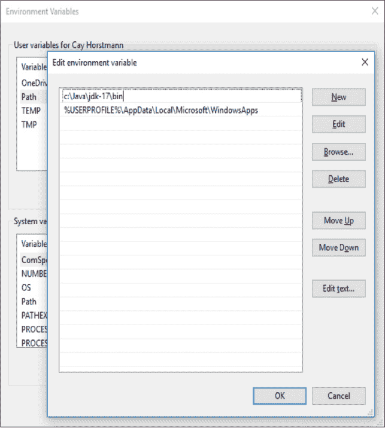

**图2.2** 在 Windows 中设置 Path 环境变量

**提示：**

环境。此外，通过自己执行这些基本步骤，你会更好地理解开发环境在幕后做了什么。

然而，在你掌握了编译和运行 Java 程序的基本步骤之后，你会希望使用专业的开发环境。你将在下一节中看到如何做到这一点。

让我们从困难的方式开始：从命令行编译并启动一个 Java 程序。

- 1. 打开一个终端窗口。
- 2. 转到 `corejava/v1ch02/Welcome` 目录。（`corejava` 目录是你安装本书示例源代码的位置，如第 20 页第 2.1.3 节“安装源文件和文档”所述。）
- 3. 输入以下命令：

```
javac Welcome.java
java Welcome
```

你应该会在终端窗口中看到图2.3所示的输出。

恭喜！你刚刚编译并运行了你的第一个 Java 程序。

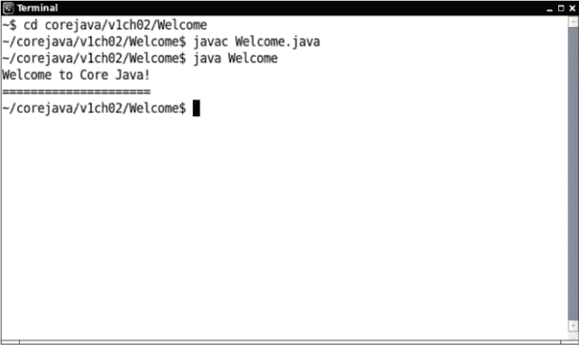

**图2.3** 编译并运行 `Welcome.java`

发生了什么？`javac` 程序是 Java 编译器。它将文件 `Welcome.java` 编译为文件 `Welcome.class`。`java` 程序启动 Java 虚拟机。它执行编译器放入类文件中的字节码。

`Welcome` 程序非常简单。它只是向终端打印一条消息。你可能会喜欢看看代码清单 2.1 中展示的程序内部。你将在下一章中看到它如何工作。

**代码清单 2.1** `Welcome/Welcome.java`

```java
/**
 * This program displays a greeting for the reader.
 * @version 1.30 2014-02-27
 * @author Cay Horstmann
 */
public class Welcome
{
    public static void main(String[] args)
    {
        String greeting = "Welcome to Core Java!";
        System.out.println(greeting);
        for (int i = 0; i < greeting.length(); i++)
            System.out.print("=");
        System.out.println();
    }
}
```

在集成开发环境的时代，许多程序员不熟悉在终端窗口中运行程序。任何事情都可能出错，导致令人沮丧的结果。

请注意以下几点：

- 如果你是手动输入程序，请确保正确输入大写和小写字母。特别是，类名是 `Welcome`，而不是 `welcome` 或 `WELCOME`。
- 编译器要求提供*文件名*（`Welcome.java`）。运行程序时，你指定的是*类名*（`Welcome`），不带 `.java` 或 `.class` 扩展名。
- 如果你收到诸如“错误的命令或文件名”或“javac: 未找到命令”的消息，请回去再次检查你的安装，特别是可执行文件路径设置。
- 如果 `javac` 报告找不到文件 `Welcome.java`，你应该检查该文件是否存在于该目录中。
  - 在 Linux 下，检查你是否为 `Welcome.java` 使用了正确的大小写。
  - 在 Windows 下，使用 `dir` 命令，而*不是*图形化资源管理器工具。有些文本编辑器（特别是记事本）坚持为每个文件名添加扩展名 `.txt`。如果你使用记事本编辑 `Welcome.java`，它实际上会将其保存为 `welcome.java.txt`。在默认 Windows 设置下，资源管理器会与记事本合谋隐藏 `.txt` 扩展名，因为它属于“已知文件类型”。在这种情况下，你需要使用 `ren` 命令重命名该文件，或者再次保存它，并在文件名两边加上引号："Welcome.java"。
- 如果你启动程序并收到抱怨 `java.lang.NoClassDefFoundError` 的错误消息，请仔细检查出错的类名。
  - 如果你收到关于 `welcome`（带有小写 `w`）的抱怨，那么你应该用大写 `W` 重新发出 `java Welcome` 命令。一如既往，在 Java 中大小写很重要。
  - 如果你收到关于 `welcome/java` 的抱怨，这意味着你不小心输入了 `java Welcome.java`。请以 `java Welcome` 重新发出该命令。
- 如果你输入了 `java Welcome`，而虚拟机找不到 `Welcome` 类，请检查是否有人在你的系统上设置了 `CLASSPATH` 环境变量。全局设置这个变量并不是个好主意，但 Windows 中一些编写不良的软件安装程序正是这样做的。按照设置 `PATH` 环境变量时的相同步骤操作，但这次要删除该设置。

> **提示：**
>
> [http://docs.oracle.com/javase/tutorial/getStarted/cupojava](http://docs.oracle.com/javase/tutorial/getStarted/cupojava) 上的优秀教程更详细地介绍了初学者可能遇到的“陷阱”。

> **注意：**
>
> 如果你只有一个源文件，可以跳过 `javac` 命令。这一功能面向 shell 脚本（以 `#!/path/to/java` 这样的“shebang”行开头），也许还面向简单的学生程序。一旦你的程序变得更复杂，就需要使用 `javac`。

`Welcome` 程序并不是特别令人兴奋。接下来，试试一个图形应用程序。这个程序是一个简单的图像文件查看器，它会加载并

显示一张图像。和之前一样，从命令行编译并运行程序。

- 1. 打开一个终端窗口。
- 2. 切换到目录 `corejava/v1ch02/ImageViewer`。
- 3. 输入以下内容：

```text
javac ImageViewer.java
java ImageViewer
```

一个新的程序窗口弹出，显示 ImageViewer 应用程序。现在，选择 文件 → 打开 并查找要打开的图像文件。（同一目录中有几个示例文件。）图像显示出来（见图 2.4）。要关闭程序，请单击标题栏中的关闭框，或从菜单中选择 文件 → 退出。


**图 2.4** 运行 ImageViewer 应用程序

快速浏览一下源代码（[清单 2.2](#)）。该程序比第一个程序长得多，但如果你考虑到用 C 或 C++ 编写类似应用程序需要多少代码，就会发现它并不太复杂。当然，如今编写具有图形用户界面的桌面应用程序已不常见，但如果你感兴趣，可以在第 10 章找到更多细节。

### 清单 2.2 ImageViewer/ImageViewer.java

```java
1  import java.awt.*;
2  import java.io.*;
3  import javax.swing.*;
4
5  /**
6   * A program for viewing images.
7   * @version 1.31 2018-04-10
8   * @author Cay Horstmann
9   */
10 public class ImageViewer
11 {
12    public static void main(String[] args)
13    {
14       EventQueue.invokeLater(() ->
15          {
16             var frame = new ImageViewerFrame();
17             frame.setTitle("ImageViewer");
18             frame.setDefaultCloseOperation(JFrame.EXIT_ON_CLOSE);
19             frame.setVisible(true);
20          });
21    }
22 }
23
24 /**
25  * A frame with a label to show an image.
26  */
27 class ImageViewerFrame extends JFrame
28 {
29    private static final int DEFAULT_WIDTH = 300;
30    private static final int DEFAULT_HEIGHT = 400;
31
32    public ImageViewerFrame()
33    {
34       setSize(DEFAULT_WIDTH, DEFAULT_HEIGHT);
35
36       // use a label to display the images
37       var label = new JLabel();
38       add(label);
39
40       // set up the file chooser
41       var chooser = new JFileChooser();
42       chooser.setCurrentDirectory(new File("."));
43
44       // set up the menu bar
45       var menuBar = new JMenuBar();
46       setJMenuBar(menuBar);
47
48       var menu = new JMenu("File");
49       menuBar.add(menu);
50
51       var openItem = new JMenuItem("Open");
52       menu.add(openItem);
53       openItem.addActionListener(event ->
54       {
55          // show file chooser dialog
56          int result = chooser.showOpenDialog(null);
57
58          // if file selected, set it as icon of the label
59          if (result == JFileChooser.APPROVE_OPTION)
60          {
61             String name = chooser.getSelectedFile().getPath();
62             label.setIcon(new ImageIcon(name));
63          }
64       });
65
66       var exitItem = new JMenuItem("Exit");
67       menu.add(exitItem);
68       exitItem.addActionListener(event -> System.exit(0));
69    }
70 }
```

## 2.3 使用集成开发环境

在前一节中，你看到了如何从命令行编译和运行 Java 程序。这是一种有用的故障排除技能，但对于大多数日常工作，你应该使用集成开发环境。这些环境功能强大且方便，不使用它们而辛苦劳作完全没有意义。优秀的选择是免费提供的 Eclipse、IntelliJ IDEA 和 NetBeans。在本章中，你将学习如何开始使用 Eclipse。当然，如果你喜欢其他开发环境，也完全可以配合本书使用。

首先从 [http://eclipse.org/downloads](http://eclipse.org/downloads) 下载 Eclipse。有适用于 Linux、Mac OS X 和 Windows 的版本。运行安装程序，并选择名为“Eclipse IDE for Java Developers”的安装集。

以下是通过 Eclipse 编写程序的步骤。

- 1. 启动 Eclipse 后，从菜单中选择 文件 → 新建 → 项目。
- 2. 从向导对话框中选择“Java Project”（见图 2.5）。

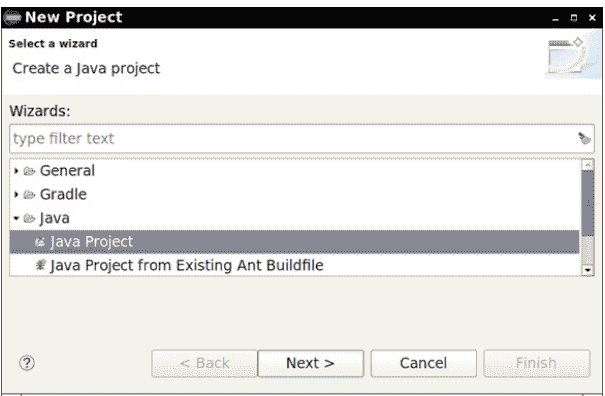

**图 2.5** Eclipse 中的“新建项目”对话框

- 3. 单击 Next 按钮。*取消勾选* “Use default location” 复选框。单击 Browse，导航到 corejava/v1ch02/Welcome 目录（图 2.6）。

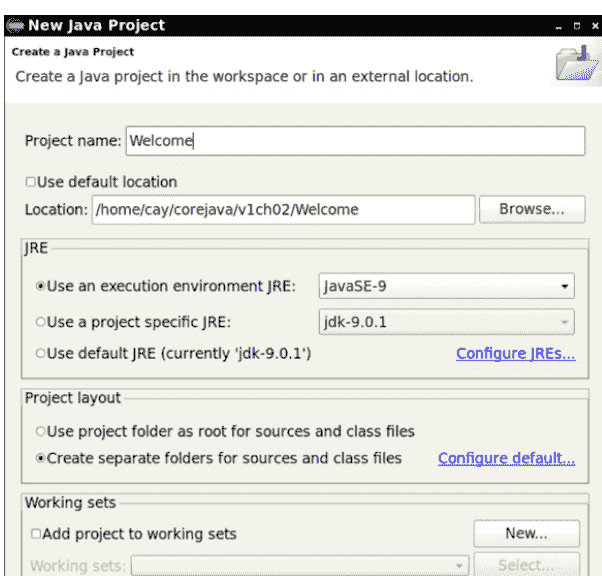

**图 2.6** 在 Eclipse 中配置项目

- 4. 单击 Finish 按钮。项目即创建完成。
- 5. 单击左窗格中项目旁边的三角形，直到找到文件 `Welcome.java`，然后双击它。现在你应该会看到一个包含程序代码的窗格（见图 2.7）。

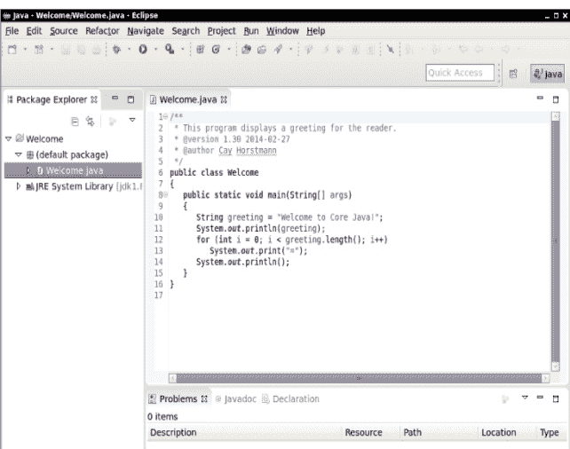

**图 2.7** 使用 Eclipse 编辑源文件

- 6. 在左窗格中，用鼠标右键单击项目名称（Welcome）。选择 运行 → 运行方式 → Java 应用程序。程序输出将显示在控制台窗格中。

想必这个程序没有拼写错误或 bug。（毕竟它只有几行代码。）为了便于讨论，我们假设你的代码偶尔会出现拼写错误（甚至可能是语法错误）。试一试。例如，通过修改 String 的大小写来破坏你的文件，如下所示：

```java
string greeting = "Welcome to Core Java!";
```

注意 `string` 下方的波浪线。在源代码下方的选项卡中，单击 Problems 并展开三角形，直到看到一条关于未知 string 类型的错误消息（见图 2.8）。单击错误消息。光标将移动到编辑窗格中匹配的行，你可以在那里纠正错误。这使你可以快速修复错误。

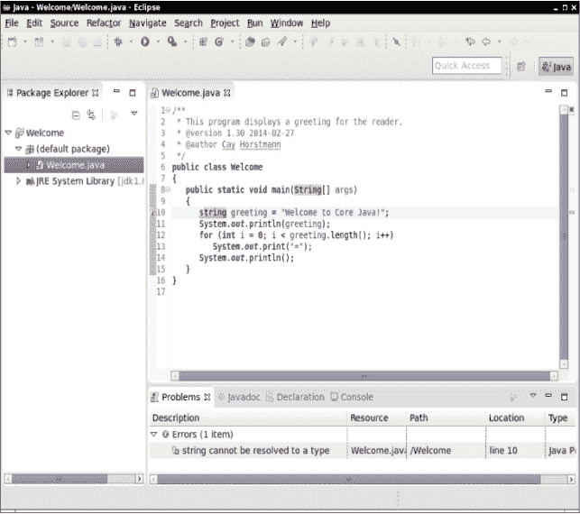

**图 2.8** Eclipse 中的错误消息

另一个有用的功能是制表符补全。输入 `Math.`，然后按 Tab 键。你会得到可以通过 Math 类调用的所有方法的列表：

```text
jshell> Math.
E                 IEEERemainder(    PI                abs(
absExact(         acos(            addExact(         asin(
atan(             atan2(           cbrt(             ceil(
class             copySign(        cos(              cosh(
decrementExact(   exp(             expm1(            floor(
floorDiv(         floorMod(        fma(              getExponent(
hypot(            incrementExact(  log(              log10(
log1p(            max(             min(              multiplyExact(
multiplyFull(     multiplyHigh(    negateExact(      nextAfter(
nextDown(         nextUp(          pow(              random()
rint(             round(           scalb(            signum(
sin(              sinh(            sqrt(             subtractExact(
tan(              tanh(            toDegrees(        toIntExact(
toRadians(        ulp(
```

现在输入 `l`，然后再按 Tab 键。方法名补全为 `log`，你会得到一个更短的列表：

```text
jshell> Math.log
log(      log10(   log1p(
```

现在你可以手动填写其余部分：

```text
jshell> Math.log10(0.001)
$3 ==> -3.0
```

要重复命令，请按 ↑ 键，直到看到要重新发出或编辑的行。你可以使用 ← 和 → 键在行内移动光标，并添加或删除字符。完成后按 Enter。例如，按 ↑ 并将 `0.001` 替换为 `1000`，然后按 Enter：

```text
jshell> Math.log10(1000)
$4 ==> 3.0
```

JShell 让你轻松愉快地学习 Java 语言和库，而无需启动重量级的开发环境，也无需费心处理 `public static void main`。

在本章中，你学习了编译和运行 Java 程序的机制。现在你可以继续学习[第 3 章](#)，在那里你将开始学习 Java 语言。

# 第3章 Java 的基本编程结构

本章内容

- 3.1 一个简单的 Java 程序
- 3.2 注释
- 3.3 数据类型
- 3.4 变量与常量
- 3.5 运算符
- 3.6 字符串
- 3.7 输入与输出
- 3.8 控制流
- 3.9 大数
- 3.10 数组

至此，你应该已经成功安装了 JDK，并执行了第 2 章中的示例程序。是时候开始编程了。本章将向你展示数据类型、分支和循环等基本编程概念在 Java 中是如何实现的。

## 3.1 一个简单的 Java 程序

让我们更仔细地看一下最简单的 Java 程序之一——一个仅仅向控制台打印消息的程序：

```java
public class FirstSample
{
    public static void main(String[] args)
    {
        System.out.println("We will not use 'Hello, World!'");
```


```
}
}
```

值得花上所有必要的时间来熟悉这个示例的框架；这些内容将在所有应用程序中反复出现。首先，*Java 区分大小写*。如果你在大小写上犯了任何错误（例如输入 `Main` 而不是 `main`），程序将无法运行。

现在让我们逐行查看这段源代码。关键字 `public` 被称为*访问修饰符*；这些修饰符控制程序的其他部分对此代码的访问级别。有关访问修饰符的更多信息，请参阅[第5章](#)。关键字 `class` 提醒你，Java 程序中的所有内容都存在于类中。在下一章中，你将学习更多关于类的知识。目前，可以把类看作定义应用程序行为的程序逻辑容器。如[第1章](#)所述，类是所有 Java 应用程序的构建块。Java 程序中的*所有内容*都必须放在类中。

在关键字 `class` 之后是类的名称。Java 中类名的规则相当宽松。名称必须以字母开头，之后可以是字母和数字的任意组合。长度基本上没有限制。你不能使用 Java 保留字（如 `public` 或 `class`）作为类名。（有关保留字的列表，请参阅附录。）

标准命名约定（用于名称 `firstSample`）是类名采用以大写字母开头的名词。如果名称由多个单词组成，每个单词的首字母大写。这种在名称中间使用大写字母的做法有时被称为“驼峰式大小写”或自指地称为“CamelCase”。

你需要使源代码的文件名与公共类的名称相同，并附加扩展名 `.java`。因此，你必须将此代码存储在名为 `FirstSample.java` 的文件中。（再次强调，大小写很重要——不要使用 `firstsample.java`。）

如果你正确命名了文件并且在源代码中没有拼写错误，那么当你编译此源代码时，最终会得到一个包含该类字节码的文件。Java 编译器会自动将字节码文件命名为 `FirstSample.class`，并将其存储在与源文件相同的目录中。最后，通过发出以下命令来启动程序：

```
    java FirstSample
```

（记住要去掉 `.class` 扩展名。）当程序执行时，它会在控制台上简单地显示字符串 We will not use 'Hello, World!'。

当你使用 `java ClassName` 运行已编译的程序时，Java 虚拟机总是从你所指示的类中的 main 方法的代码开始执行。（术语“方法”是 Java 对函数的说法。）因此，你必须让类的源代码中包含 main 方法，代码才能执行。当然，你也可以向类中添加自己的方法，并从 main 方法中调用它们。（你将在下一章中看到如何编写自己的方法。）


### 注意

根据 Java 语言规范，main 方法必须声明为 public。（Java 语言规范是描述 Java 语言的官方文档。你可以从 http://docs.oracle.com/javase/specs 查看或下载它。）

然而，有几个版本的 Java 启动器即使 main 方法不是 public 也愿意执行 Java 程序。一位程序员提交了一个 bug 报告。要查看它，请访问 https://bugs.openjdk.java.net/browse/JDK-4252539。1999 年，该 bug 被标记为“已关闭，不会修复”。一位 Sun 工程师补充解释说，Java 虚拟机规范并未强制要求 main 是 public 的，并且“修复它可能会带来潜在的麻烦”。幸运的是，理智占了上风。Java 1.4 及更高版本中的 Java 启动器强制要求 `main` 方法是 public 的。

当然，让那些经常过度劳累、并不总是精通 Java 细节的质量保证工程师对 bug 报告做出可疑的决定，确实令人沮丧。但值得注意的是，早在 Java 开源之前，bug 报告及其解决方案就已经可供任何人仔细审查。

注意源代码中的花括号 `{ }`。在 Java 中，与 C/C++ 一样，花括号划分程序中的各个部分（通常称为*块*）。在 Java 中，任何方法的代码都必须以左花括号 `{` 开始，以右花括号 `}` 结束。

花括号的风格引发了过多的无谓争论。本书采用一种使匹配的花括号对齐的风格。由于空格与 Java 编译器无关，你可以使用自己喜欢的任何花括号风格。

目前，不要担心关键字 `static void`——只需将它们视为让 Java 程序编译所需的一部分。到第 4 章结束时，你将完全理解这个“咒语”。目前要记住的一点是，每个 Java 应用程序都必须有一个 `main` 方法，其声明方式如下：

```java
public class ClassName
{
    public static void main(String[] args)
    {
        program statements
    }
}
```


### C++ 注意

作为 C++ 程序员，你知道什么是类。Java 类与 C++ 类类似，但有一些差异可能会让你陷入困境。例如，在 Java 中，*所有*函数都是某个类的方法。（标准术语称它们为方法，而非成员函数。）因此，在 Java 中，你必须为 `main` 方法提供一个外壳类。你可能还熟悉 C++ 中*静态成员函数*的概念。这些是在类内定义且不操作对象的成员函数。Java 中的 `main` 方法始终是 static 的。最后，与 C/C++ 一样，`void` 关键字表示该方法不返回值。与 C/C++ 不同，`main` 方法不向操作系统返回“退出码”。如果 `main` 方法正常退出，Java 程序的退出码为 `0`，表示成功完成。要使用不同的退出码终止程序，请使用 `System.exit` 方法。

接下来，请注意这个代码片段：

```
{
    System.out.println("We will not use 'Hello, World!'");
}
```

花括号标记方法*主体*的开始和结束。此方法只有一个语句。与大多数编程语言一样，你可以将 Java 语句视为语言的句子。在 Java 中，每条语句都必须以分号结尾。特别要注意，回车不表示语句的结束，因此语句在需要时可以跨多行。

`main` 方法的主体包含一条向控制台输出单行文本的语句。

这里，我们使用 `System.out` 对象并调用其 `println` 方法。注意用于调用方法的句点。Java 使用一般语法 `object.method(parameters)` 作为函数调用的等价形式。

在这种情况下，println 方法接收一个字符串参数。该方法在控制台上显示字符串参数。然后它终止输出行，因此每次调用 println 都会在新的一行上显示其输出。注意，Java 与 C/C++ 一样，使用双引号来界定字符串。（本章稍后会提供有关字符串的更多信息。）

Java 中的方法，与任何编程语言中的函数一样，可以使用零个、一个或多个*参数*（有些程序员称其为*实参*）。即使方法不带参数，也必须使用空括号。例如，println 方法的一个无参数变体只打印一个空行。你可以通过以下调用来调用它：

```
    System.out.println();
```

### 注意

System.out 还有一个 print 方法，它不会在输出中添加换行符。例如，`System.out.print("Hello")` 会打印 `Hello` 而不换行。下一个输出会紧跟在字母 o 之后出现。

## 3.2 注释

Java 中的注释，与大多数编程语言一样，不会出现在可执行程序中。因此，你可以根据需要添加任意多的注释，而不必担心代码膨胀。Java 有三种标记注释的方式。最常见的形式是 `//`。使用它来表示从 `//` 到行尾的注释。

```java
System.out.println("We will not use 'Hello, World!'"); // is this too cute?
```

当需要较长的注释时，你可以用 `//` 标记每一行，或者使用 `/*` 和 `*/` 注释分隔符来圈住较长的注释。


最后，第三种注释用于自动生成文档。这种注释以 `/**` 开始，以 `*/` 结束。你可以在代码清单 3.1 中看到这种注释。关于这种注释以及自动文档生成的更多内容，请参见第 4 章。

**代码清单 3.1** FirstSample/FirstSample.java

```java
/**
 * This is the first sample program in Core Java Chapter 3
 * @version 1.01 1997-03-22
 * @author Gary Cornell
 */
public class FirstSample
{
    public static void main(String[] args)
    {
        System.out.println("We will not use 'Hello, World!'");
    }
}
```


> **警告：**
>
> `/* */` 注释在 Java 中不能嵌套。也就是说，你可能无法仅通过用 `/*` 和 `*/` 包围代码来停用代码，因为你想停用的代码本身可能包含 `*/` 分隔符。

## 3.3 数据类型

Java 是一种*强类型语言*。这意味着每个变量都必须声明类型。Java 中有八种*基本类型*。其中四种是整数类型；两种是浮点数类型；一种是字符类型 `char`，用于 Unicode 编码方案中的代码单元（见第 43 页第 3.3.3 节“char 类型”）；还有一种是用于真值的布尔类型。


> **注意：**
>
> Java 有一个任意精度算术包。然而，所谓的“大数”是 Java *对象*，而不是 Java 的基本类型。你将在本章后面看到如何使用它们。

### 3.3.1 整数类型

整数类型用于没有小数部分的数。允许负值。Java 提供了表 3.1 所示的四种整数类型。

**表 3.1 Java 整数类型**

| 类型 | 存储需求 | 范围（含端点） |
|---|---|---|
| int | 4 字节 | −2,147,483,648 到 2,147,483,647（略高于 20 亿） |
| short | 2 字节 | −32,768 到 32,767 |
| long | 8 字节 | −9,223,372,036,854,775,808 到 9,223,372,036,854,775,807 |
| byte | 1 字节 | −128 到 127 |

在大多数情况下，int 类型最实用。如果你想表示地球上的人口数量，就需要使用 long。byte 和 short 类型主要用于专门的应用，例如底层文件处理，或者在存储空间非常宝贵时用于大型数组。

在 Java 中，整数类型的范围不取决于运行 Java 代码的机器。这大大减轻了程序员在将软件从一个平台迁移到另一个平台，甚至在同一平台的不同操作系统之间迁移时的痛苦。相比之下，C 和 C++ 程序会为每种处理器使用最高效的整数类型。因此，一个在 32 位处理器上运行良好的 C 程序，在 16 位系统上可能会出现整数溢出。由于 Java 程序必须在所有机器上运行并得到相同结果，各种类型的范围是固定的。

长整型数有后缀 `L` 或 `l`（例如 `4000000000L`）。十六进制数有前缀 `0x` 或 `0X`（例如 `0xCAFE`）。八进制数有前缀 `0`（例如 `010` 表示 8）——当然，这可能令人困惑，很少有程序员使用八进制常量。

你可以用二进制写数字，前缀为 `0b` 或 `0B`。例如，`0b1001` 是 9。你可以给数字字面量添加下划线，例如 `1_000_000`（或用 `0b1111_0100_0010_0100_0000` 表示一百万）。下划线仅供人眼阅读。Java 编译器会直接删除它们。


> **C++ 注意：**
>
> 在 C 和 C++ 中，像 `int` 和 `long` 这样的类型的大小取决于目标平台。在 8086 这样的 16 位处理器上，整数是 2 字节，但在 Pentium 或 SPARC 这样的 32 位处理器上，它们是 4 字节量。同样，long 值在 32 位处理器上是 4 字节，在 64 位处理器上是 8 字节。这些差异使编写跨平台程序具有挑战性。在 Java 中，所有数值类型的大小都与平台无关。
>
> 请注意，Java 没有 `int`、`long`、`short` 或 `byte` 类型的任何无符号版本。


> **注意：**
>
> 如果你处理的是永远不会为负的整数值，并且确实需要额外一位，那么你可以小心地将有符号整数值解释为无符号值。例如，与其让 byte 值 `b` 表示 −128 到 127 的范围，你可能希望表示 0 到 255 的范围。你可以将它存储在 `byte` 中。由于二进制算术的性质，只要不发生溢出，加法、减法和乘法都能正常工作。对于其他操作，调用 `Byte.toUnsignedInt(b)` 可获得 0 到 255 之间的 int 值，然后处理该整数值并强制转换回 byte。Integer 和 Long 类具有无符号除法和取余的方法。

### 3.3.2 浮点类型

浮点类型表示带小数部分的数。两种浮点类型如表 3.2 所示。

**表 3.2 浮点类型**

| 类型 | 存储需求 | 范围 |
|---|---|---|
| `float` | 4 字节 | 约 ±3.40282347×10^38（6–7 位有效十进制数字） |
| `double` | 8 字节 | 约 ±1.79769313486231570×10^308（15 位有效十进制数字） |

`double` 这个名称表示这些数字的精度是 `float` 类型的两倍。（有些人把这类数字称为*双精度*数。）`float` 的有限精度（6–7 位有效数字）在许多情况下根本不够用。只有在使用要求 `float` 的库时，或者需要存储数量非常多的 `float` 值时，才应使用 `float` 值。

`float` 类型的数字有后缀 F 或 f（例如 `3.14F`）。不带 F 后缀的浮点数（如 `3.14`）始终被视为 `double` 类型。你可以选择提供 D 或 d 后缀（例如 `3.14D`）。

e 或 E 表示十进制指数。例如，`1.729E3` 与 `1729` 相同。

> **注意：**
>
> 你可以用十六进制指定浮点字面量。例如，0.125 = 2^{-3} 可以写成 0x1.0p-3。在十六进制记法中，使用 p 而不是 e 来表示指数。（e 是十六进制数字。）请注意，尾数用十六进制书写，而指数用十进制书写。指数的底是 2，而不是 10。

所有浮点计算都遵循 IEEE 754 规范。特别地，有三个特殊的浮点值用于表示溢出和错误：

- 正无穷大
- 负无穷大
- NaN（非数）

例如，正数除以 0 的结果是正无穷大。计算 0/0 或负数的平方根会得到 NaN。


> **注意：**
>
> 常量 `Double.POSITIVE_INFINITY`、`Double.NEGATIVE_INFINITY` 和 `Double.NaN`（以及相应的 `float` 常量）表示这些特殊值，但它们在实际中很少使用。特别地，你不能用
>
> ```java
> if (x == Double.NaN) // is never true
> ```
>
> 来检查某个特定结果是否等于 `Double.NaN`。所有“非数”值都被视为互不相同。不过，你可以使用 `Double.isNaN` 方法：
>
> ```java
> if (Double.isNaN(x)) // check whether x is "not a number"
> ```

> **警告：**
>
> 浮点数*不*适合无法容忍舍入误差的财务计算。例如，命令 `System.out.println(2.0 - 1.1)` 打印的是 `0.8999999999999999`，而不是你期望的 `0.9`。这类舍入误差是由于浮点数用二进制数系统表示造成的。分数 1/10 没有精确的二进制表示，正如分数 1/3 在十进制系统中没有精确表示一样。如果你需要没有舍入误差的精确数值计算，请使用 `BigDecimal` 类，本章后面会介绍它。

### 3.3.3 char 类型

`char` 类型最初旨在描述单个字符。然而，现在情况已不再如此。如今，一些 Unicode 字符可以用一个 `char` 值来描述，而另一些 Unicode 字符需要两个 `char` 值。下一节将介绍这些令人头疼的细节。

`char` 类型的字面值用单引号括起来。例如，`'A'` 是值为 65 的字符常量。它与 `"A"` 不同，后者是包含单个字符的字符串。`char` 类型的值可以表示为从 `\u0000` 到 `\uFFFF` 的十六进制值。例如，`\u2122` 是商标符号（™），`\u03c0` 是希腊字母 pi（π）。

除了 `\u` 转义序列之外，还有几种用于特殊字符的转义序列，如表 3.3 所示。你可以在带引号的字符字面量和字符串中使用这些转义序列，例如 `'\u2122'` 或 `"Hello\n"`。`\u` 转义序列（但其他转义序列都不行）甚至可以*在带引号的字符常量和字符串之外*使用。例如，

```java
public static void main(String\u005B\u005D args)
```


这是完全合法的——\u005B 和 \u005D 是 [ 和 ] 的编码。

**表 3.3** 特殊字符的转义序列

| 转义序列 | 名称 | Unicode 值 |
| --- | --- | --- |
| `\b` | 退格 | `\u0008` |
| `\t` | 制表符 | `\u0009` |
| `\n` | 换行 | `\u000a` |
| `\r` | 回车 | `\u000d` |
| `\f` | 换页 | `\u000c` |
| `\"` | 双引号 | `\u0022` |
| `\'` | 单引号 | `\u0027` |
| `\\` | 反斜杠 | `\u005c` |
| `\s` | 空格。在文本块中用于保留尾随空格。 | `\u0020` |
| `\newline` | 仅用于文本块：将本行与下一行连接 | — |

> **警告：**
>
> Unicode 转义序列在代码解析之前被处理。例如，"\u0022+\u0022" *不是*一个由引号包围加号组成的字符串（U+0022）。相反，在解析之前，\u0022 会被转换为 "，从而得到 ""+""，即一个空字符串。

更隐蔽的是，你必须当心注释中的 \u。这个注释

Unicode 的设计初衷就是为了解决这些问题。当统一工作于 20 世纪 80 年代开始时，固定 2 字节的编码足以编码世界上所有语言中使用的所有字符，并且还有余量用于未来扩展——至少当时每个人都这么认为。1991 年，Unicode 1.0 发布，使用了 65,536 个可用编码值中略少于一半的值。Java 从一开始就被设计为使用 16 位 Unicode 字符，这相对于使用 8 位字符的其他编程语言是一个重大进步。

不幸的是，随着时间的推移，不可避免的事情发生了。Unicode 扩展到了超过 65,536 个字符，这主要是由于增加了用于中文、日文和韩文的一大套表意文字。现在，16 位的 char 类型不足以描述所有 Unicode 字符。

我们需要一些术语来解释 Java 如何解决这个问题。*码点*（code point）是与编码方案中的字符相关联的码值。在 Unicode 标准中，码点用十六进制书写，并以 u+ 作为前缀，例如 u+0041 是拉丁字母 A 的码点。Unicode 的码点被分为 17 个*码平面*（code planes）。第一个码平面称为*基本多语言平面*（basic multilingual plane），它由码点 U+0000 到 U+FFFF 的“经典” Unicode 字符组成。另外 16 个平面，码点从 U+10000 到 U+10FFFF，包含*增补字符*（supplementary characters）。

UTF-16 编码以可变长度编码表示所有 Unicode 码点。基本多语言平面中的字符表示为 16 位值，称为*码元*（code units）。增补字符被编码为连续的码元对。这种编码对中的每个值都落在基本多语言平面中 2048 个未使用值的范围内，这个范围称为*代理区*（surrogates area）（第一个码元为 u+D800 到 u+DBFF，第二个码元为 u+DC00 到 u+DFFF）。这相当巧妙，因为你可以立即判断一个码元是编码单个字符，还是增补字符的第一部分或第二部分。例如，（八元数集合的数学符号，http://math.ucr.edu/home/baez/octonions）的码点为 U+1D546，由两个码元 U+D835 和 U+DD46 编码。（有关编码算法的描述，请参阅 https://tools.ietf.org/html/rfc2781。）

在 Java 中，`char` 类型描述 UTF-16 编码中的一个*码元*。

我强烈建议不要在程序中使用 `char` 类型，除非你实际上是在操作 UTF-16 码元。你几乎总是最好将字符串视为抽象数据类型——参见第 61 页的 3.6 节“字符串”。

### 3.3.4 boolean 类型

`boolean` 类型有 `false` 和 `true` 两个值。它用于计算逻辑条件。你不能在整数和 `boolean` 值之间进行转换。


**C++ 注释：**

在 C++ 中，数字甚至指针都可以替代布尔值使用。值 0 等价于 bool 值 false，非零值等价于 true。在 Java 中*并非如此*。因此，Java 程序员不会遇到这样的意外：

```cpp
if (x = 0) // oops... meant x == 0
```

在 C++ 中，这个测试可以编译并运行，但总是求值为 false。在 Java 中，这个测试无法编译，因为整数表达式 `x = 0` 不能转换为 boolean 值。

## 3.4 变量与常量

与每种编程语言一样，变量用于存储值。常量是其值不会改变的变量。在以下各节中，你将学习如何声明变量和常量。

### 3.4.1 声明变量

在 Java 中，每个变量都有一个*类型*。声明变量时，先将类型放在前面，后跟变量名。下面是一些示例：

```java
double salary;
int vacationDays;
long earthPopulation;
boolean done;
```

注意每个声明末尾的分号。分号是必需的，因为声明是一条完整的 Java 语句，必须以分号结尾。

变量名（以及其他名称）的标识符由字母、数字、货币符号和“标点连接符”组成。第一个字符不能是数字。

像 '+' 或 '@' 这样的符号不能用于变量名中，空格也不行。字母大小写是敏感的：`main` 和 `Main` 是不同的标识符。标识符的长度基本上没有限制。

在 Java 中，“字母”、“数字”和“货币符号”的含义比大多数语言更广泛。字母是*任何*表示某种语言中字母的 Unicode 字符。例如，德语用户可以在变量名中使用变音符号，如 ‘ä’；希腊语使用者可以使用 π。类似地，数字包括 0–9 以及*任何*表示数字的 Unicode 字符。货币符号包括 $、€、¥ 等等。标点连接符包括下划线字符 _、“波浪底线”‿ 以及其他一些字符。实际上，大多数程序员仅限于使用 A-Z、a-z、0-9 和下划线 _。

**提示：**

如果你真的想知道哪些 Unicode 字符可以用于标识符，可以使用 `Character` 类中的 `isJavaIdentifierStart` 和 `isJavaIdentifierPart` 方法来检查。

### 3.4.2 初始化变量

声明变量后，你必须通过赋值语句显式地初始化它——你永远不能使用未初始化变量的值。例如，Java 编译器会将以下语句序列标记为错误：

```java
int vacationDays;
System.out.println(vacationDays); // ERROR—variable not initialized
```

要对先前声明的变量赋值，请在左侧使用变量名，然后是等号（=），再在右侧使用具有适当值的某个 Java 表达式。

```java
int vacationDays;
vacationDays = 12;
```

你可以在同一行中既声明又初始化变量。例如：

```java
int vacationDays = 12;
```

最后，在 Java 中，你可以将声明放在代码中的任何位置。例如，以下是在 Java 中有效的代码：

```java
double salary = 65000.0;
System.out.println(salary);
int vacationDays = 12; // OK to declare a variable here
```

在 Java 中，将变量声明在尽量靠近它们首次使用的位置被认为是一种良好的风格。

> **注意：**


从 Java 10 开始，如果局部变量的类型可以从初始值推断出来，则无需声明其类型。只需使用关键字 `var` 代替类型即可：

```java
var vacationDays = 12; // vacationDays is an int
var greeting = "Hello"; // greeting is a String
```

正如你将在下一章中看到的，这一特性可以使对象的声明更加简洁。

**C++ 注释：**

C 和 C++ 区分变量的*声明*和*定义*。例如，

```cpp
int i = 10;
```

是一个定义，而

```cpp
extern int i;
```

是一个声明。在 Java 中，声明与定义不是分开的。

### 3.4.3 常量

在 Java 中，使用关键字 `final` 表示常量。例如：

```java
public class Constants
{
    public static void main(String[] args)
    {
        final double CM_PER_INCH = 2.54;
```


```java
double paperWidth = 8.5;
double paperHeight = 11;
System.out.println("Paper size in centimeters: "
    + paperWidth * CM_PER_INCH + " by " + paperHeight * CM_PER_INCH);
}
}
```

关键字 `final` 表示你可以给变量赋值一次，此后它的值就永久固定了。通常用全大写字母命名常量。

在 Java 中，更常见的做法是创建一个常量，使同一类中的多个方法都能使用它。这类常量通常称为*类常量*。

使用关键字 `static final` 来定义类常量。下面是一个使用类常量的示例：

```java
public class Constants2
{
    public static final double CM_PER_INCH = 2.54;

    public static void main(String[] args)
    {
        double paperWidth = 8.5;
        double paperHeight = 11;
        System.out.println("Paper size in centimeters: "
            + paperWidth * CM_PER_INCH + " by " + paperHeight * CM_PER_INCH);
    }
}
```

注意，类常量的定义出现在 `main` 方法*之外*。因此，该常量也可以在同一类的其他方法中使用。此外，如果像本例中那样将常量声明为 `public`，其他类的方法也可以使用它——在我们的示例中，可以通过 `Constants2.CM_PER_INCH` 使用。


### C++ 注：

> `const` 是 Java 的保留关键字，但目前并未用于任何用途。
> 定义常量必须使用 `final`。

### 3.4.4 枚举类型

有时，变量只应保存一组受限的值。例如，你可能销售四种尺码的衣服或比萨：小号、中号、大号和特大号。当然，你可以将这些尺码编码为整数 1、2、3、4，或字符 s、M、L 和 x。但这种做法容易出错。变量太容易保存错误的值（例如 0 或 m）。

只要出现这种情况，你就可以定义自己的*枚举类型*。枚举类型具有有限个命名值。例如，

```java
enum Size { SMALL, MEDIUM, LARGE, EXTRA_LARGE };
```

现在可以声明这种类型的变量：

```java
Size s = Size.MEDIUM;
```

`Size` 类型的变量只能保存类型声明中列出的值之一，或者特殊值 `null`，后者表示该变量未设置为任何值。

枚举类型将在[第 5 章](#)中更详细地讨论。

## 3.5 运算符

运算符用于组合值。正如你将在后续章节中看到的，Java 拥有丰富的算术运算符、逻辑运算符和数学函数。

### 3.5.1 算术运算符

Java 使用常见的算术运算符 `+`、`-`、`*`、`/` 进行加、减、乘、除。如果两个操作数都是整数，`/` 运算符表示整数除法；否则表示浮点除法。整数余数（有时称为*取模*）用 `%` 表示。例如，`15 / 2` 为 7，`15 % 2` 为 1，`15.0 / 2` 为 7.5。

注意，整数除以 0 会引发异常，而浮点数除以 0 会得到无穷大或 NaN 结果。


### 注：

> Java 编程语言宣称的目标之一是可移植性。无论由哪台虚拟机执行，计算都应产生相同的结果。对于浮点数的算术计算，要实现这种可移植性可能出奇地困难。`double` 类型使用 64 位存储数值，但某些处理器使用 80 位浮点寄存器。这些寄存器会在计算的中间步骤中提供更高的精度。
>
> 但结果可能与全程使用 64 位的计算*不同*。为了实现完美的可移植性，Java 虚拟机的初始规范要求所有中间计算都必须截断为 64 位。数值计算社区对此深恶痛绝。由于在流行处理器上截断操作需要时间，计算变得*更慢*。因此，Java 编程语言经过更新，以兼顾最佳性能和完美可复现性这两个相互冲突的需求。允许虚拟机设计者对中间计算使用扩展精度。但是，标记为 `strictfp` 关键字的方法必须使用严格的浮点运算，以产生可复现的结果。
>
> 处理器变得更加灵活，现在可以高效地执行 64 位算术运算。从 Java 17 开始，虚拟机再次被要求执行严格的 64 位算术运算，`strictfp` 关键字现已过时。

### 3.5.2 数学函数和常量

`Math` 类包含各种数学函数，你偶尔可能会用到它们，具体取决于你从事的编程类型。

要计算一个数的平方根，请使用 `sqrt` 方法：

```java
double x = 4;
double y = Math.sqrt(x);
System.out.println(y); // prints 2.0
```

### 注：

> `println` 方法和 `sqrt` 方法之间有一个细微差别。`println` 方法作用于 `System.out` 对象。但 `Math` 类中的 `sqrt` 方法不作用于任何对象。这种方法称为*静态*方法。你可以在[第 4 章](#)中进一步了解静态方法。

Java 编程语言没有用于将某个量提升到幂的运算符。必须使用 `Math` 类中的 `pow` 方法。以下语句

```java
double y = Math.pow(x, a);
```

将 y 设置为 x 的 a 次幂（xᵃ）。`pow` 方法的两个参数都是 `double` 类型，并且它也返回一个 `double`。

`floorMod` 方法旨在解决整数余数的一个长期存在的问题。考虑表达式 `n % 2`。众所周知，如果 n 为偶数，结果为 0；如果 n 为奇数，结果为 1。当然，当 n 为奇数且为负数时除外。此时结果为 -1。为什么？在最早的计算机诞生时，必须有人为负操作数的整数除法和余数制定规则。数学家们已经知道最优（或“欧几里得”）规则数百年了：始终让余数 ≥ 0。但是，那些先驱没有翻开数学教科书，而是提出了看起来合理但实际上并不方便的规则。

考虑这个问题。你计算时钟时针的位置。应用一个调整量后，你想将其归一化为 0 到 11 之间的数。这很简单：`(position + adjustment) % 12`。但如果调整量为负数呢？那么你可能会得到一个负数。因此，你必须引入一个分支，或者使用 `((position + adjustment) % 12 + 12) % 12`。无论哪种方式，都很麻烦。

`floorMod` 方法让这件事更容易：`floorMod(position + adjustment, 12)` 始终产生 0 到 11 之间的值。（不幸的是，`floorMod` 对负除数会给出负结果，但这种情况在实践中不常发生。）

`Math` 类提供了常见的三角函数：

```
Math.sin
Math.cos
Math.tan
Math.atan
Math.atan2
```

以及指数函数及其反函数自然对数，还有十进制对数：

```
Math.exp
Math.log
Math.log10
```

最后，有两个常量表示数学常量 $\pi$ 和 $e$ 的最接近近似值：

```java
Math.PI
Math.E
```

### 提示：

你可以通过在源文件顶部添加以下行，避免为数学方法和常量使用 `Math` 前缀：

```java
import static java.lang.Math.*;
```

例如：

```java
System.out.println("The square root of \u03C0 is " + sqrt(PI));
```

静态导入将在[第 4 章](#)中介绍。

### 注：

> `Math` 类中的方法使用计算机浮点单元中的例程，以获得最快的性能。如果完全可预测的结果比性能更重要，请改用 `StrictMath` 类。它实现了“Freely Distributable Math Library”（[www.netlib.org/fdlibm](http://www.netlib.org/fdlibm)）中的算法，保证在所有平台上结果相同。

### 注：


`Math` 类提供了几种方法，使整数运算更安全。当计算溢出时，数学运算符会悄无声息地返回错误结果。例如，十亿乘以三（1000000000 * 3）的结果为 -1294967296，因为 int 类型的最大值仅略高于二十亿。如果改为调用 `Math.multiplyExact(1000000000, 3)`，则会生成异常。你可以捕获该异常，或者让程序终止，而不是悄无声息地继续使用错误结果。还有 `addExact`、`subtractExact`、`incrementExact`、`decrementExact`、`negateExact` 和 `absExact` 方法，它们都有 int 和 long 参数。

### 3.5.3 数值类型之间的转换

经常需要从一种数值类型转换为另一种数值类型。[图3.1](#figure-3-1)展示了合法的转换。

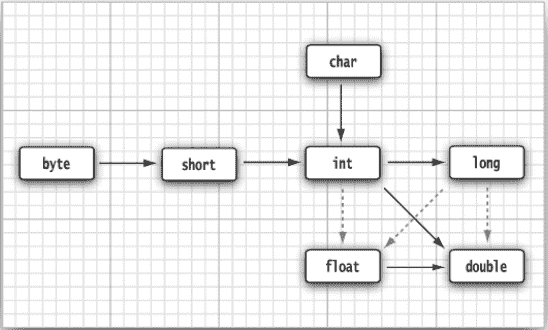

**图3.1** 数值类型之间的合法转换

[图3.1](#figure-3-1)中的六条实线箭头表示不丢失信息的转换。三条虚线箭头表示可能丢失精度的转换。

例如，像 `123456789` 这样的大整数，其位数多于 `float` 类型所能表示的范围。当该整数转换为 `float` 时，结果值具有正确的量级，但会丢失一些精度。

```java
int n = 123456789;
float f = n; // f is 1.23456792E8
```

当两个值使用二元运算符组合时（例如 `n + f`，其中 `n` 是整数，`f` 是浮点值），两个操作数都会在运算执行之前转换为共同的类型。

- 如果其中一个操作数的类型为 `double`，则另一个操作数将转换为 `double`。
- 否则，如果其中一个操作数的类型为 `float`，则另一个操作数将转换为 `float`。
- 否则，如果其中一个操作数的类型为 `long`，则另一个操作数将转换为 `long`。
- 否则，两个操作数都将转换为 `int`。

### 3.5.4 强制类型转换

在上一节中，你看到 `int` 值在必要时会自动转换为 `double` 值。另一方面，显然有时你想将 `double` 视为整数。在 Java 中可以进行数值转换，但当然可能会丢失信息。可能丢失信息的转换通过*强制类型转换*完成。强制类型转换的语法是在括号中给出目标类型，后面跟变量名。例如：

```java
double x = 9.997;
int nx = (int) x;
```

现在，变量 `nx` 的值为 9，因为将浮点值强制转换为整数会丢弃小数部分。

如果你想将浮点数*舍入*到*最接近*的整数（在大多数情况下这是更有用的操作），请使用 `Math.round` 方法：

```java
double x = 9.997;
int nx = (int) Math.round(x);
```

现在变量 `nx` 的值为 10。调用 `round` 时仍然需要使用强制类型转换 `(int)`。原因是 `round` 方法的返回值是 `long`，而 `long` 只能通过显式强制类型转换赋值给 `int`，因为可能存在信息丢失。

> **注意：**
>
> 如果你尝试将一种类型的数字强制转换为另一种类型，而该值超出目标类型的范围，则结果将是一个截断后的数字，其值会不同。例如，`(byte) 300` 实际上是 44。

> **C++ 注：**
>
> 你不能在 `boolean` 值和任何数值类型之间进行强制类型转换。这一约定可防止常见错误。在极少数情况下，当你希望将 `boolean` 值转换为数字时，可以使用条件表达式，例如 `b ? 1 : 0`。

### 3.5.5 赋值

在赋值中使用二元运算符有一个方便的快捷方式。例如，

```text
3 == 7
```

为 `false`。

使用 `!=` 表示不等于。例如，以下表达式的值

```text
3 != 7
```

为 `true`。

最后，还有常见的 <（小于）、>（大于）、<=（小于或等于）和 >=（大于或等于）运算符。Java 沿用 C++，使用 && 表示逻辑“与”运算符，使用 || 表示逻辑“或”运算符。正如你可以很容易地从 != 运算符记住的那样，感叹号 ! 是逻辑非运算符。&& 和 || 运算符以“短路”方式求值：如果第一个参数已经确定了值，则不会对第二个参数求值。如果用 && 运算符组合两个表达式，

```text
expression₁  &&  expression₂
```

并且第一个表达式的真值已确定为 `false`，那么结果不可能为 `true`。因此，第二个表达式的值*不会*被计算。可以利用这种行为来避免错误。例如，在表达式

```text
x != 0 && 1 / x > x + y // no division by 0
```

中，如果 x 等于零，则第二部分永远不会被求值。因此，如果 x 为零，则不会计算 1 / x，也就不会发生除零错误。

同样，如果第一个表达式为真，则 *expression₁ || expression₂* 的值自动为真，而不会对第二个表达式求值。

### 3.5.8 条件运算符

Java 提供了*条件*运算符 ?:，它根据布尔表达式选择一个值。表达式 *条件* ? *表达式1* : *表达式2* 在条件为真时求值为第一个表达式，否则求值为第二个表达式。例如，

```text
x < y ? x : y
```

给出 x 和 y 中较小的一个。

### 3.5.9 switch 表达式

如果需要在两个以上的值中做出选择，那么可以使用 switch 表达式（从 Java 14 开始）。它看起来像这样：

```java
String seasonName = switch (seasonCode)
{
    case 0 -> "Spring";
    case 1 -> "Summer";
    case 2 -> "Fall";
    case 3 -> "Winter";
    default -> "???";
};
```

case 标签也可以是字符串或枚举类型的常量。

> **注：**
> switch 表达式和每个表达式一样，都有一个值。注意每个分支中值前面的 -> 箭头。

> **注：**
> 从 Java 14 开始，`switch` 有四种（！）形式。本节重点介绍最有用的一种。关于所有形式的 `switch` 表达式和语句的详尽讨论，请参见第 98 页的 3.8.5 节“使用 `switch` 进行多重选择”。

可以为每个 `case` 提供多个标签，用逗号分隔：

```java
int numLetters = switch (seasonName)
    {
        case "Spring", "Summer", "Winter" -> 6;
        case "Fall" -> 4;
        default -> -1;
    };
```

当将 `switch` 表达式与枚举常量一起使用时，无需在每个标签中提供枚举名称——它会从 switch 值中推断出来。例如：

```java
enum Size { SMALL, MEDIUM, LARGE, EXTRA_LARGE }; . . .
Size itemSize = . . .;
String label = switch (itemSize)
    {
        case SMALL -> "S"; // no need to use Size.SMALL
        case MEDIUM -> "M";
        case LARGE -> "L";
        case EXTRA_LARGE -> "XL";
    };
```

在该示例中，省略 `default` 是合法的，因为每个可能的值都有对应的 case。

> **注意：**
> 带有整数或 `String` 操作数的 switch 表达式必须始终有 default，因为它必须产生一个值，无论操作数是什么值。

> **注意：**
> 如果操作数为 `null`，则会抛出 `NullPointerException`。

### 3.5.10 位运算符

对于任何整数类型，都有可以直接处理构成整数的位的运算符。这意味着你可以使用掩码技术来获取数字中的各个位。位运算符包括

- `&`（“与”）
- `|`（“或”）
- `^`（“异或”）
- `~`（“非”）

这些运算符作用于位模式。例如，如果 n 是一个整数变量，那么

```java
int fourthBitFromRight = (n & 0b1000) / 0b1000;
```

如果 n 的二进制表示中从右数第四位是 1，则结果为 1，否则为 0。将 & 与适当的 2 的幂一起使用，可以屏蔽掉除单个位之外的所有位。

> **注：**
> 当应用于布尔值时，`&` 和 `|` 运算符产生布尔值。这些运算符类似于 `&&` 和 `||` 运算符，不同之处在于 `&` 和 `|` 运算符不以“短路”方式求值——也就是说，两个参数都会在计算结果之前求值。


还有 >> 和 << 运算符，它们将位模式右移或左移。当你需要构造位模式来进行位掩码时，这些运算符会很方便：

```java
int fourthBitFromRight = (n & (1 << 3)) >> 3;
```

最后，>>> 运算符用零填充高位，而 >> 则会将符号位扩展到高位。没有 <<< 运算符。

> **注意：**
>
> 移位运算符的右操作数会对 32 取模（除非左操作数是 `long`，此时右操作数会对 64 取模）。例如，`1 << 35` 的值与 `1 << 3` 或 `8` 相同。

> **C++ 注意：**
>
> 在 C/C++ 中，无法保证 >> 执行的是算术移位（扩展符号位）还是逻辑移位（用零填充）。实现者可以自由选择更高效的方式。这意味着 C/C++ 的 >> 运算符对负数可能产生依赖于具体实现的结果。Java 消除了这种不确定性。

### 3.5.11 括号与运算符层级

表 3.4 显示了运算符的优先级。如果不使用括号，则按所示的层级顺序执行运算。同一层级的运算符从左到右处理，但表中标明的右结合运算符除外。例如，`&&` 的优先级高于 `||`，因此表达式

## 大数据平台技术及应用

本文档介绍大数据平台的核心技术架构与设计思路，涵盖数据采集、存储、计算与可视化等多个层面，为大规模数据处理提供系统化的解决方案。

- 数据采集层：支持多源异构数据的实时采集与传输
- 数据存储层：提供分布式文件存储与NoSQL数据库
- 计算引擎层：支持批处理、流计算与交互式分析
- 数据服务层：提供数据查询、挖掘与可视化能力

| 层次 | 核心组件 | 说明 |
|------|---------|------|
| 采集层 | Flume、Kafka | 日志采集与消息队列 |
| 存储层 | HDFS、HBase | 分布式存储 |
| 计算层 | Spark、Flink | 批流一体计算 |
| 服务层 | Hive、Kylin | 数据仓库与OLAP |

| 运算符 | 结合性 |
|---|---|
| [] . ()（方法调用） | 从左到右 |
| ! ~ ++ -- +（一元） -（一元） ()（强制类型转换） new | 从右到左 |
| * / % | 从左到右 |
| + - | 从左到右 |
| << >> >>> | 从左到右 |
| < <= > >= instanceof | 从左到右 |
| == != | 从左到右 |
| & | 从左到右 |
| ^ | 从左到右 |
| \| | 从左到右 |
| && | 从左到右 |
| \|\| | 从左到右 |
| ?: | 从右到左 |
| = += -= *= /= %= &= \|= ^= <<= >>= >>>= | 从右到左 |

> **C++ 注意：**
>
> 与 C 或 C++ 不同，Java 没有逗号运算符。不过，你可以在 for 语句的第一和第三个槽位中使用*逗号分隔的表达式列表*。

## 3.6 字符串

从概念上讲，Java 字符串是 Unicode 字符序列。例如，字符串 `"Java\u2122"` 由五个 Unicode 字符 J、a、v、a 和 ™ 组成。Java 没有内置的字符串类型。相反，标准 Java 库包含一个预定义类，很自然地称为 `String`。每个带引号的字符串都是 `String` 类的实例：

```java
String e = ""; // an empty string
String greeting = "Hello";
```

### 3.6.1 子串

你可以使用 `String` 类的 `substring` 方法从较大的字符串中提取子串。例如，

```java
String greeting = "Hello";
String s = greeting.substring(0, 3);
```

会创建一个由字符 `"Hel"` 组成的字符串。

> **注意：**
> 与 C 和 C++ 一样，Java 对字符串中的代码单元和码点从 0 开始计数。

`substring` 的第二个参数是第一个你*不想*复制的字符位置。在我们的例子中，我们想复制位置 0、1 和 2（从位置 0 到位置 2，包含两端）。按照 `substring` 的计数方式，这意味着从位置 0（包含）到位置 3（*不包含*）。

`substring` 的这种工作方式有一个优点：计算子串长度很容易。字符串 `s.substring(a, b)` 的长度始终为 b − a。例如，子串 `"Hel"` 的长度为 3 − 0 = 3。

### 3.6.2 拼接

Java 与大多数编程语言一样，允许使用 + 连接（拼接）两个字符串。

```java
String expletive = "Expletive";
String PG13 = "deleted";
String message = expletive + PG13;
```

前一段代码将变量 `message` 设置为字符串 "Expletivedeleted"。（注意单词之间没有空格：+ 运算符按照接收顺序连接两个字符串，*完全* 按照它们给出的样子。）

当你将一个字符串与非字符串值拼接时，后者会被转换为字符串。（你将在第 5 章看到，每个 Java 对象都可以转换为字符串。）例如，

```java
int age = 13;
String rating = "PG" + age;
```

会将 `rating` 设置为字符串 "PG13"。

这个特性常用于输出语句。例如，

```java
System.out.println("The answer is " + answer);
```

是完全可以接受的，并且会打印出你期望的内容（而且由于单词 `is` 后面有空格，间距也正确）。

如果你需要将多个字符串放在一起，并用分隔符分隔，请使用静态 `join` 方法：

```java
String all = String.join(" / ", "S", "M", "L", "XL");
    // all is the string "S / M / L / XL"
```

从 Java 11 开始，有一个 `repeat` 方法：

```java
String repeated = "Java".repeat(3); // repeated is "JavaJavaJava"
```

### 3.6.3 字符串不可变

String 类没有提供任何方法让你*更改*现有字符串中的某个字符。如果你想将 greeting 变成 "Help!"，你不能直接把 greeting 的最后几个位置改成 'p' 和 '!'。如果你是 C 程序员，这可能会让你感到相当无助。我们该如何修改字符串呢？在 Java 中，这很容易：将你想保留的子串与你想替换的字符拼接起来。

```java
String greeting = "Hello";
greeting = greeting.substring(0, 3) + "p!";
```

这个声明将 greeting 变量的当前值改为 "Help!"。

由于你不能更改 Java 字符串中的单个字符，文档将 String 类的对象称为*不可变*。正如数字 3 始终是 3 一样，字符串 "Hello" 将始终包含字符 h、e、l、l、o 的代码单元序列。你不能更改这些值。然而，正如你刚才所见，你可以更改字符串变量 greeting 的内容，使其引用另一个字符串，就像你可以让当前保存值 3 的数值变量保存值 4 一样。

这难道不是效率低得多吗？从零开始构建一个全新的字符串，似乎比更改代码单元更简单。嗯，既对也不对。确实，生成一个保存 "Hel" 和 "p!" 拼接结果的新字符串并不高效。但不可变字符串有一个很大的优点：编译器可以安排字符串*共享*。

为了理解这是如何工作的，可以想象各种字符串都放在一个公共池中。字符串变量随后指向池中的位置。如果你复制一个字符串变量，原变量和副本共享相同的字符。

总体而言，Java 的设计者认为，共享带来的效率提升超过了通过提取子串和拼接来编辑字符串的低效。看看你自己的程序；大多数时候，你可能不会更改字符串——你只是比较它们。（有一个常见的例外——从单个字符或从键盘或文件得到的较短字符串组装字符串。对于这些情况，Java 提供了一个单独的类——参见第 73 页的 3.6.9 节“构建字符串”。）

> **C++ 注意：**
>
> C 程序员第一次看到 Java 字符串时通常会感到困惑，因为他们把字符串看作字符数组：
>
> ```c
> char greeting[] = "Hello";
> ```
>
> 这是一个错误的类比：Java 字符串大致类似于 char* 指针，
>
> ```c
> char* greeting = "Hello";
> ```
>
> 当你用另一个字符串替换 greeting 时，Java 代码大致会执行以下操作：
>
> ```c
> char* temp = malloc(6);
> strncpy(temp, greeting, 3);
> strncpy(temp + 3, "p!", 3);
> greeting = temp;
> ```
>
> 当然，现在 greeting 指向字符串 "Help!"。即使最顽固的 C 程序员也必须承认，Java 语法比一连串 strncpy 调用更令人愉快。但是，如果我们再对 greeting 做一次赋值呢？
>
> ```c
> greeting = "Howdy";
> ```


难道我们没有内存泄漏吗？毕竟，原始字符串是在堆上分配的。幸运的是，Java 会进行自动垃圾回收。如果一块内存不再需要，它最终会被回收。

如果你是 C++ 程序员，并使用 ANSI C++ 定义的 string 类，那么你会对 Java 字符串类型感到更加适应。C++ string 对象也会自动分配和释放内存。内存管理由构造函数、赋值运算符和析构函数显式执行。然而，C++ 字符串是可变的——你可以修改字符串中的单个字符。

### 3.6.4 测试字符串是否相等

要测试两个字符串是否相等，请使用 `equals` 方法。表达式

```java
s.equals(t)
```

在字符串 s 和 t 相等时返回 true，否则返回 false。注意，s 和 t 可以是字符串变量或字符串字面量。

例如，表达式

```java
"Hello".equals(greeting)
```

完全合法。要测试两个字符串除大小写字母区别外是否相同，请使用 `equalsIgnoreCase` 方法。

```java
"Hello".equalsIgnoreCase("hello")
```

请*不要*使用 `==` 运算符来测试两个字符串是否相等！它只判断字符串是否存储在相同位置。当然，如果字符串位于相同位置，它们必然相等。但完全可能将相同字符串的多个副本存储在不同位置。

空字符串 "" 是长度为 0 的字符串。你可以通过调用

```java
if (str.length() == 0)
```

或

```java
if (str.equals(""))
```

来测试字符串是否为空。空字符串是一个 Java 对象，它保存字符串长度（即 0）和空内容。然而，`String` 变量也可以保存一个特殊值，称为 `null`，它表示当前没有对象与该变量关联。（有关 `null` 的更多信息，请参见第 4 章。）要测试字符串是否为 `null`，请使用

```java
if (str == null)
```

有时，你需要测试一个字符串既不是 `null` 也不是空字符串。那么使用

```java
if (str != null && str.length() != 0)
```

你需要先测试 `str` 不是 `null`。正如你将在第 4 章中看到的，对 `null` 值调用方法是一种错误。

### 3.6.6 码点与代码单元

Java 字符串是 `char` 值的序列。正如你在第 3.3.3 节“`char` 类型”（第 43 页）中所看到的，`char` 数据类型是用于在 UTF-16 编码中表示 Unicode 码点的代码单元。最常用的 Unicode 字符可以用单个代码单元表示。增补字符需要一对代码单元。

`length` 方法返回给定字符串在 UTF-16 编码中所需的代码单元数量。例如：

```java
String greeting = "Hello";
int n = greeting.length(); // is 5
```

要获取真实长度——也就是码点数量——请调用

```java
int cpCount = greeting.codePointCount(0, greeting.length());
```

`s.charAt(n)` 返回位置 n 处的代码单元，其中 n 介于 0 和 `s.length() − 1` 之间。例如：

```java
char first = greeting.charAt(0); // first is 'H'
char last = greeting.charAt(4);  // last is 'o'
```

要获取第 i 个码点，请使用以下语句

```java
int index = greeting.offsetByCodePoints(0, i);
int cp = greeting.codePointAt(index);
```

为什么代码单元会如此麻烦？考虑下面这句话

𝕆 是八元数的集合。

字符 (U+1D546) 在 UTF-16 编码中需要两个代码单元。调用

```java
char ch = sentence.charAt(1)
```

不会返回空格，而是返回 𝕆 的第二个代码单元。为避免这个问题，你不应使用 char 类型。它太底层了。

> **NOTE:**
>
> 不要以为可以忽略码点高于 U+FFFF 的异域字符。喜欢表情符号的用户可能会将诸如 (U+1F37A，啤酒杯) 这样的字符放入字符串中。

如果你的代码遍历字符串，并且你想依次查看每个码点，可以使用以下语句：

```java
int cp = sentence.codePointAt(i);
if (Character.isSupplementaryCodePoint(cp)) i += 2;
else i++;
```

你可以使用以下语句向后移动：

```java
i--;
if (Character.isSurrogate(sentence.charAt(i))) i--;
int cp = sentence.codePointAt(i);
```

显然，这相当痛苦。更简单的方法是使用 codePoints 方法，它生成一个 int 值的“流”，每个码点对应一个值。（流将在第 II 卷中介绍。）你只需将流转换为数组（参见第 3.10 节“数组”，第 109 页）并遍历该数组。

```java
int[] codePoints = str.codePoints().toArray();
```

反过来，要将码点数组转换为字符串，请使用构造函数。（第 4 章详细介绍了构造函数和 new 运算符。）

```java
String str = new String(codePoints, 0, codePoints.length);
```

要将单个码点转换为字符串，请使用 Character.toString(int) 方法：

```java
int codePoint = 0x1F37A;
str = Character.toString(codePoint);
```

> **NOTE:**
>
> 虚拟机不必将字符串实现为代码单元序列。从 Java 9 开始使用更紧凑的表示形式。仅包含单字节代码单元的字符串使用字节数组，所有其他字符串使用 char 数组。

### 3.6.7 `String` API

Java 中的 `String` 类包含近 100 个方法。下面的 API 说明总结了最有用的方法。

这些 API 说明贯穿全书，将帮助你理解 Java 应用程序编程接口（API）。每个 API 说明都以类名开头，例如 `java.lang.String`。（所谓*包*名 `java.lang` 的意义在第 4 章中解释。）类名后面是一个或多个方法的名称、说明和参数描述。

API 说明不会列出某个类的所有方法，而是以简洁形式呈现最常用的方法。如需完整列表，请查阅在线文档（参见第 3.6.8 节“阅读在线 API 文档”，第 70 页）。

类名后面的数字是引入该类的 JDK 版本号。如果某个方法是后来添加的，则它有单独的版本号。

**`java.lang.String`** 1.0

---

- `char charAt(int index)`

  返回指定位置的代码单元。除非你关注低层代码单元，否则可能不想调用此方法。

从 Oracle 下载 API 文档并保存到本地，或者可以将浏览器指向 [https://docs.oracle.com/en/java/javase/11/docs/api/](https://docs.oracle.com/en/java/javase/11/docs/api/)。

从 Java 9 开始，API 文档有一个搜索框（参见图 3.2）。较旧版本具有带包和类列表的框架。你仍然可以通过单击 Frames 菜单项来获取这些列表。例如，要获取有关 `String` 类方法的更多信息，请在搜索框中输入“String”并选择类型 `java.lang.String`，或者在带类名的框架中找到链接并单击它。你会得到类描述，如图 3.3 所示。

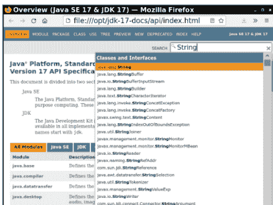

图 3.2 Java API 文档

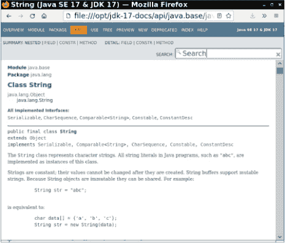

**图 3.3** `String` 类的类描述

向下滚动时，你会看到所有方法的摘要，按字母顺序排序（参见图 3.4）。单击任何方法名可查看该方法的详细描述（参见图 3.5）。例如，如果单击 compareToIgnoreCase 链接，你将获得 compareToIgnoreCase 方法的描述。

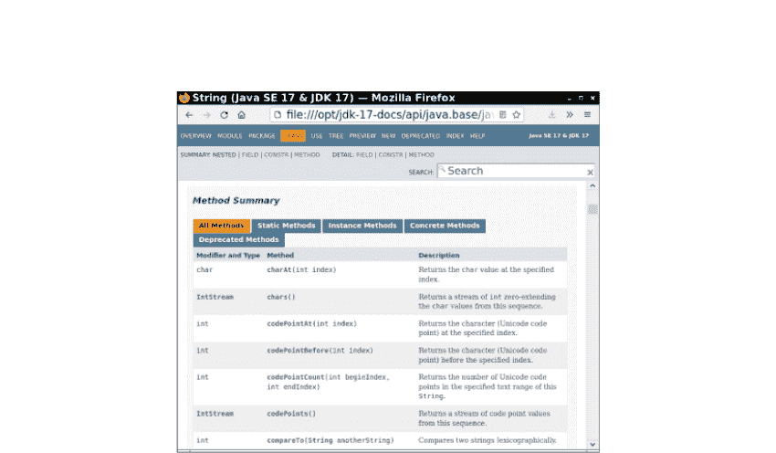

图 3.4 string 类的方法摘要

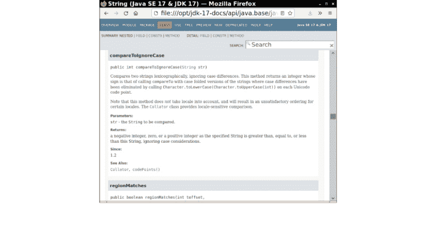


**图 3.5** `String` 方法的详细描述


**提示：**

如果你还没有下载 JDK 文档，请按照[第2章](#)中的描述进行下载。现在就请在浏览器中将文档的 `index.html` 页面加入书签！

### 3.6.9 构建字符串

有时，你需要从较短的字符串构建字符串，例如来自按键或文件中的单词。为此使用字符串连接效率不高。每次连接字符串时，都会构造一个新的 `String` 对象。这既耗时又浪费内存。使用 `StringBuilder` 类可以避免这个问题。

如果你需要从许多小片段构建字符串，请按照以下步骤操作。首先，构造一个空的字符串构建器：

```java
StringBuilder builder = new StringBuilder();
```

每次需要添加另一部分时，调用 `append` 方法。

```java
builder.append(ch);  // appends a single character
builder.append(str); // appends a string
```

完成字符串构建后，调用 `toString` 方法。你将得到一个包含构建器中字符序列的字符串对象。

```java
String completedString = builder.toString();
```

- 在偏移量 offset 处插入一个代码单元，并返回 this。
- `StringBuilder delete(int startIndex, int endIndex)` 删除偏移量从 `startIndex` 到 `endIndex − 1` 的代码单元，并返回 this。
- `String toString()` 返回一个字符串，其数据与构建器或缓冲区内容相同。

### 3.6.10 文本块

文本块功能在 Java 15 中引入，可以轻松提供跨多行的字符串字面量。文本块以 `"""` 开头，后面跟一个换行符。该块以另一个 `"""` 结束。

```java
String greeting = """
Hello
World
""";
```

文本块比等效的字符串字面量更易于读写：

```
"Hello\nWorld\n"
```

此字符串包含两个 `\n`：一个在 Hello 之后，一个在 World 之后。开头 `"""` 之后的换行符不包含在字符串字面量中。

如果你不希望在最后一行之后有换行符，请将结束的 `"""` 紧跟在最后一个字符之后：

```java
String prompt = """
Hello, my name is Hal.
Please enter your name: """;
```

文本块特别适合包含其他语言的代码，例如 SQL 或 HTML。你可以直接将其粘贴在三引号之间：

```java
String html = """
<div class="Warning">
    Beware of those who say "Hello" to the world
</div>
""";
```

请注意，你不必转义引号。只需在两种情况下转义它们：

- 如果文本块以引号*结尾*
- 如果文本块包含三个或更多引号的序列

不幸的是，你仍然需要转义所有反斜杠。

所有来自常规字符串的转义序列在文本块中的工作方式相同。

有一种转义序列只在文本块中有效。一个直接位于行末之前的 \ 会将这一行与下一行连接起来。例如，

```java
"""
Hello, my name is Hal. \
Please enter your name: """;
```

等同于

```
"Hello, my name is Hal. Please enter your name: "
```

行结束符会被规范化，删除尾部空白，并将任何 Windows 行结束符（`\r\n`）改为简单的换行符（`\n`）。在极少数情况下，如果需要保留尾部空格，请将最后一个空格转换为 `\s` 转义序列。

对于前导空白，情况更为复杂。考虑一个典型的、从左边缘缩进的变量声明。你也可以同样缩进文本块：

```java
String html = """
    <div class="Warning">
        Beware of those who say "Hello" to the world
    </div>
""";
```

文本块中所有行共有的缩进会被减去。实际的字符串是

```
"<div class=\"Warning\">\n    Beware of those who say \"Hello\" to the world\n</div>\n"
```

请注意，第一行和第三行没有缩进。

你的 IDE 可能会主动提议为所有文本块缩进，可以只使用制表符、只使用空格，或者适当的组合。

Java 明智地没有规定制表符的宽度。文本块中所有行的空白前缀必须*完全*匹配。

在去除缩进的过程中，完全空白的行不会被考虑。然而，结束的 `"""` 之前的空白非常重要。请确保（结束的 `"""`）缩进到你想去除的空白部分的末尾。


**警告：**

在缩进的文本块公共前缀中，要小心混合使用制表符和空格。一个被忽略的空格很容易产生一个缩进错误的字符串。


**提示：**

如果文本块包含非 Java 代码，你实际上可能更希望将其放在左边缘。这样可以突出于 Java 代码，并为长行留出更多空间。

## 3.7 输入与输出

为了让我们的示例程序更有趣味性，我们希望接受输入并正确格式化程序输出。当然，现代程序使用 GUI 来收集用户输入。然而，编写这样的界面所需要的工具和技术超出了我们目前所掌握的。我们的首要任务是进一步熟悉 Java 编程语言，因此我们使用简单的控制台进行输入和输出。

### 3.7.1 读取输入

你已经看到，只需调用 `System.out.println` 就可以很容易地将输出打印到“标准输出流”（即控制台窗口）。从“标准输入流” `System.in` 读取则不那么简单。要读取控制台输入，首先构造一个连接到 `System.in` 的 `Scanner`：

```java
Scanner in = new Scanner(System.in);
```

（构造函数和 new 运算符将在[第4章](#chapter-4)中详细讨论。）

现在，你可以使用 `Scanner` 类的各种方法来读取输入。例如，`nextLine` 方法读取一行输入。

```java
System.out.print("What is your name? ");
String name = in.nextLine();
```

这里，我们使用 `nextLine` 方法，因为输入可能包含空格。要读取单个单词（以空白字符分隔），请调用

```java
String firstName = in.next();
```

要读取整数，请使用 `nextInt` 方法。

```java
System.out.print("How old are you? ");
int age = in.nextInt();
```

类似地，`nextDouble` 方法读取下一个浮点数。

[程序清单 3.2](#) 中的程序会询问用户的姓名和年龄，然后打印如下消息：

```
Hello, Cay. Next year, you'll be 57
```

最后，请注意这一行

```
import java.util.*;
```

位于程序的开头。`Scanner` 类定义在 `java.util` 包中。每当你使用一个不是在基本 `java.lang` 包中定义的类时，你都需要使用导入指令。包和导入指令将在[第4章](#)中更详细地介绍。

**程序清单 3.2** `InputTest/InputTest.java`

```java
1   import java.util.*;
2
3   /**
4    * This program demonstrates console input.
5    * @version 1.10 2004-02-10
6    * @author Cay Horstmann
7    */
8   public class InputTest
9   {
10      public static void main(String[] args)
11      {
12      Scanner in = new Scanner(System.in);

14      // get first input
15      System.out.print("What is your name? ");
16      String name = in.nextLine();

18      // get second input
19      System.out.print("How old are you? ");
20      int age = in.nextInt();

22      // display output on console
23      System.out.println("Hello, " + name + ". Next year, you'll be " + (age + 1));
24      }
25 }
```

> **注意：**
>
> `Scanner` 类不适合从控制台读取密码，因为输入对任何人都是清晰可见的。此时应使用 `Console` 类。要读取密码，请使用以下代码：


```java
Console cons = System.console();
String username = cons.readLine("User name: ");
char[] passwd = cons.readPassword("Password: ");
```

出于安全原因，密码以字符数组而不是字符串的形式返回。处理完密码后，应立即用填充值覆盖数组元素。（数组处理将在第 109 页的 3.10 节“数组”中讨论。）

使用 `Console` 对象处理输入不如使用 `Scanner` 方便。你必须一次一行地读取输入。没有用于读取单个单词或数字的方法。


## java.util.Scanner 5

- `Scanner(InputStream in)`  
  从给定的输入流构造一个扫描器对象。
- `String nextLine()`  
  读取下一行输入。
- `String next()`  
  读取下一个单词输入（以空白字符分隔）。
- `int nextInt()`
- `double nextDouble()`  
  读取并转换下一个表示整数或浮点数的字符序列。
- `boolean hasNext()`  
  测试输入中是否还有另一个单词。
- `boolean hasNextInt()`
- `boolean hasNextDouble()`  
  测试下一个字符序列是否表示整数或浮点数。

## java.lang.System 1.0

- `static Console console()` 6  
  如果可以通过控制台窗口与用户交互，则返回一个用于通过控制台窗口与用户交互的 Console 对象，否则返回 null。任何在控制台窗口中启动的程序都可以使用 Console 对象。否则，可用性取决于系统。

## java.io.Console 6

- `static char[] readPassword(String prompt, Object... args)`
- `static String readLine(String prompt, Object... args)`

显示提示符并读取用户输入，直到输入行末尾。可选的 `args` 参数用于提供格式化参数，如下一节所述。

### 3.7.2 格式化输出

可以使用语句 `System.out.print(x)` 将数字 `x` 打印到控制台。该命令会以该类型最大数量的非零数字打印 `x`。例如，

```java
double x = 10000.0 / 3.0;
System.out.print(x);
```

打印

```
3333.3333333333335
```

例如，如果你想显示美元和美分，这就是个问题。

补救方法是 `printf` 方法，它遵循 C 库中由来已久的约定。例如，调用

```java
System.out.printf("%8.2f", x);
```

会以 8 个字符的*字段宽度*和 2 个字符的*精度*打印 `x`。也就是说，输出包含一个前导空格和以下七个字符

```
 3333.33
```

可以向 `printf` 提供多个参数。例如：

```java
System.out.printf("Hello, %s. Next year, you'll be %d", name,
age);
```

每个以 % 字符开头的*格式说明符*都会被替换为相应的参数。结束格式说明符的*转换字符*表示要格式化的值的类型：f 是浮点数，s 是字符串，d 是十进制整数。[表 3.5](#table-3-5) 显示了所有转换字符。

大写变体会生成大写字母。例如，"%8.2E" 将 3333.33 格式化为 3.33E+03，其中 E 为大写。

**表 3.5** `printf` 的转换

| 转换字符 | 类型 | 示例 |
|---|---|---|
| `d` | 十进制整数 | `159` |
| `x` 或 `X` | 十六进制整数。若要对十六进制格式进行更多控制，请使用 HexFormat 类。 | `9f` |
| `o` | 八进制整数 | `237` |
| `f` 或 `F` | 定点浮点数 | `15.9` |
| `e` 或 `E` | 指数浮点数 | `1.59e+01` |
| `g` 或 `G` | 通用浮点数（e 和 f 中较短者） | — |
| `a` 或 `A` | 十六进制浮点数 | `0x1.fccd3` |
| `s` 或 `S` | 字符串 | `Hello` |
| `c` 或 `C` | 字符 | `H` |
| `b` 或 `B` | 布尔值 | `true` |
| `h` 或 `H` | 哈希码 | `42628b2` |
| `tx` 或 `Tx` | 旧式日期和时间格式化。请改用 java.time 类——参见第二卷第 6 章。 | — |
| `%` | 百分号 | `%` |
| `n` | 平台相关的行分隔符 | — |

**注意：**

可以使用 `s` 转换来格式化任意对象。如果任意对象实现了 `Formattable` 接口，则调用该对象的 `formatTo` 方法。否则，调用 `toString` 方法将对象转换为字符串。`toString` 方法在[第 5 章](#)中讨论，接口在[第 6 章](#)中讨论。

此外，可以指定控制格式化输出外观的*标志*。表 3.6 显示了所有标志。例如，逗号标志添加分组分隔符。即，

```java
System.out.printf("%,.2f", 10000.0 / 3.0);
```

打印

```
3,333.33
```

可以使用多个标志，例如 "%(,.2f" 以使用分组分隔符并将负数括在括号中。

**表 3.6** printf 的标志

| 标志 | 用途 | 示例 |
| --- | --- | --- |
| + | 为正数和负数打印符号。 | +3333.33 |
| space | 在正数前添加一个空格。 | \| 3333.33\| |
| 0 | 添加前导零。 | 003333.33 |
| - | 左对齐字段。 | \|3333.33 \| |
| ( | 将负数括在括号中。 | (3333.33) |
| , | 添加分组分隔符。 | 3,333.33 |
| #（用于 f 格式） | 始终包含小数点。 | 3,333. |
| #（用于 x 或 o 格式） | 添加 0x 或 0 前缀。 | 0xcafe |
| $ | 指定要格式化的参数索引；例如，%1$d %1$x 以十进制和十六进制打印第一个参数。 | 159 9F |
| < | 使用与上一个说明相同的值进行格式化；例如，%d %<x 以十进制和十六进制打印同一个数。 | 159 9F |

可以使用静态 `String.format` 方法创建格式化字符串而不打印它：

```java
String message = String.format("Hello, %s. Next year, you'll be %d", name, age + 1);
```

**注意：**

从 Java 15 开始，可以改用 `formatted` 方法，从而少写五个字符：

```java
String message = "Hello, %s. Next year, you'll be %d".formatted(name, age + 1);
```

现在你已经了解了 `printf` 方法的所有功能。[图 3.6](#) 显示了格式说明符的语法图。

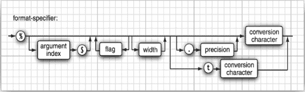

**图 3.6** 格式说明符语法

> **注意：**
> 
> 格式化是*区域设置特定的*。例如，在德国，分组分隔符是句点，而不是逗号。第二卷的[第 7 章](#)展示了如何控制应用程序的国际化行为。

### 3.7.3 文件输入和输出

要从文件读取，请像这样构造一个 `Scanner` 对象：

```java
Scanner in = new Scanner(Path.of("myfile.txt"),
    StandardCharsets.UTF_8);
```

如果文件名包含反斜杠，请记得用额外的反斜杠对每个反斜杠进行转义：`"c:\\mydirectory\\myfile.txt"`。

现在可以使用你已经遇到的任何 Scanner 方法从文件读取。


**注意：**

此处，我们指定了 UTF-8 字符编码，这对于 Internet 上的文件很常见（但并非普遍）。读取文本文件时需要知道字符编码（更多信息参见第二卷第 2 章）。如果省略字符编码，则会使用运行 Java 程序的计算机的“默认编码”。这不是个好主意——程序的行为可能因运行位置而异。


**警告：**

可以使用字符串参数构造 Scanner，但扫描器会将字符串解释为数据，而不是文件名。例如，如果调用

```java
Scanner in = new Scanner("myfile.txt"); // ERROR?
```

那么扫描器将看到十个字符的数据：'m'、'y'、'f' 等。在此情况下，这很可能不是本意。

要写入文件，请构造一个 PrintWriter 对象。在构造函数中，提供文件名和字符编码：

```java
PrintWriter out = new PrintWriter("myfile.txt",
StandardCharsets.UTF_8);
```

如果文件不存在，则会创建它。可以像打印到 `System.out` 时那样使用 `print`、`println` 和 `printf` 命令。


**注意：**

当你指定相对文件名（例如 `"myfile.txt"`、`"mydirectory/myfile.txt"` 或 `"../myfile.txt"`）时，文件将相对于启动 Java 虚拟机的目录来定位。如果你从命令 shell 启动程序，通过执行

```java
java MyProg
```

那么起始目录就是命令 shell 的当前目录。但是，如果你使用集成开发环境，则由它控制起始目录。可以通过以下调用找到目录位置：

```java
String dir = System.getProperty("user.dir");
```

如果在定位文件时遇到麻烦，请考虑使用绝对路径名，例如 `"c:\\mydirectory\\myfile.txt"` 或 `"/home/me/mydirectory/myfile.txt"`。

如你所见，访问文件就像使用 `System.in` 和 `System.out` 一样容易。只有一个问题：如果用一个不存在的文件构造 `Scanner`，或者用一个无法创建的文件名构造 `PrintWriter`，就会发生异常。例如，Java 编译器认为这些异常比“除以零”异常更严重。在第 7 章中，你将学习处理异常的各种方式。目前，你只需告诉编译器你已意识到可能发生“输入/输出”异常。为此，用 `throws` 子句标记 `main` 方法，如下所示：


```java
public static void main(String[] args) throws IOException
{
    Scanner in = new Scanner(Path.of("myfile.txt"),
    StandardCharsets.UTF_8);
    . . .
}
```

你现在已经了解了如何读写包含文本数据的文件。对于更高级的主题，例如处理不同的字符编码、处理二进制数据、读取目录以及编写 zip 文件，请参阅卷 II 的[第 2 章](#)。


**注意：**

当你从命令行启动程序时，可以使用 shell 的重定向语法，将任何文件附加到 `System.in` 和 `System.out`：

```shell
java MyProg < myfile.txt > output.txt
```

这样，你就不必担心处理 `IOException` 了。

### `java.util.Scanner` ⁵

- `Scanner(Path p, String encoding)`  
    构造一个 Scanner，它使用给定的字符编码从给定路径读取数据。
- `Scanner(String data)`  
    构造一个 Scanner，从给定的字符串读取数据。

### `java.io.PrintWriter` 1.1

- `PrintWriter(String fileName)`  
    构造一个 PrintWriter，它将数据写入具有给定文件名的文件。

### `java.nio.file.Path`

- `static Path of(String pathname)` 11  
    从给定的路径名构造一个 Path。

## 3.8 控制流

与任何编程语言一样，Java 支持条件语句和循环来确定控制流。我将从条件语句开始，然后介绍循环，最后介绍 `switch` 语句，你可以使用它来测试单个表达式的多个值。


**C++ 注意：**

Java 的控制流结构与 C 和 C++ 中的结构相同，但有一些例外。没有 goto，但有一个“带标签”的 break 版本，你可以用它从嵌套循环中跳出（在 C 中，你可能会使用 goto）。最后，`for` 循环有一个变体，类似于 C++ 中的基于范围的 for 循环和 C# 中的 foreach 循环。

### 3.8.1 块作用域

在学习控制结构之前，你需要更多了解 *块*。

块，或称复合语句，是由一对花括号括起来的一些 Java 语句组成的。块定义了变量的作用域。块可以*嵌套*在另一个块中。下面是一个嵌套在 main 方法块中的块：

```java
public static void main(String[] args)
{
    int n;
    . . .
    {
        int k;
        . . .
    } // k is only defined up to here
}
```

你不能在两个嵌套块中声明同名局部变量。例如，下面的代码是错误的，无法编译：

```java
public static void main(String[] args)
{
    int n;
    . . .
    {
        int k;
        int n; // ERROR--can't redeclare n in inner block
        . . .
    }
}
```

**C++ 注意：**

在 C++ 中，可以在嵌套块内重新定义变量。内部定义会遮蔽外部定义。这可能是编程错误的根源；因此，Java 不允许这样做。

### 3.8.2 条件语句

Java 中的条件语句具有如下形式：

```java
if (condition) statement
```

条件必须用括号括起来。

在 Java 中，与大多数编程语言一样，当单个条件为真时，你通常希望执行多条语句。在这种情况下，使用*块语句*，其形式为：

```java
{
    statement1
    statement2
    . . .
}
```

例如：

```java
if (yourSales >= target)
{
    performance = "Satisfactory";
    bonus = 100;
}
```

在这个代码中，当 yourSales 大于或等于 target 时，将执行大括号括起来的所有语句（参见图 3.7）。

**注意：**

块（有时称为*复合语句*）允许你在任何只能容纳一条（简单）语句的 Java 编程结构中放置多条（简单）语句。

Java 中更一般的条件语句如下所示（参见[图 3.8]）：

```java
if (condition) statement₁ else statement₂
```

例如：

```java
if (yourSales >= target)
{
    performance = "Satisfactory";
    bonus = 100 + 0.01 * (yourSales - target);
}
```

```c
if (x <= 0) if (x == 0) sign = 0; else sign = -1;
```

else 属于第二个 if。当然，使用花括号来让这段代码更清晰是一个好主意：

```c
if (x <= 0) { if (x == 0) sign = 0; else sign = -1; }
```

重复的 `if ... else if ...` 结构很常见（参见图 3.9）。例如：

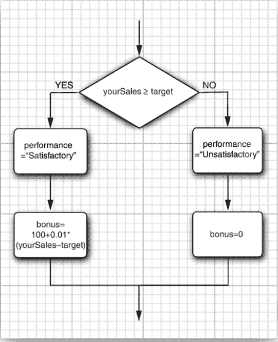

**图 3.8** if/else 语句的流程图

```java
if (yourSales >= 2 * target)
{
    performance = "Excellent";
    bonus = 1000;
}
else if (yourSales >= 1.5 * target)
{
    performance = "Fine";
    bonus = 500;
}
else if (yourSales >= target)
{
    performance = "Satisfactory";
    bonus = 100;
}
else
{
    System.out.println("You're fired");
}
```

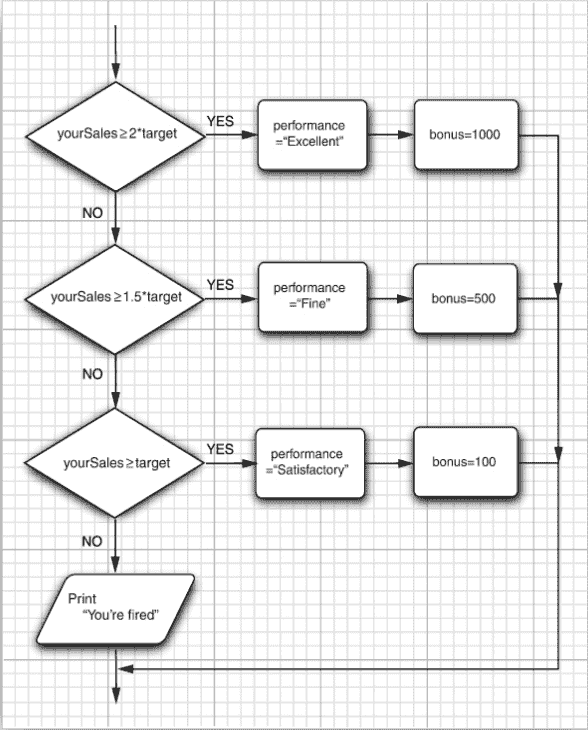

**图 3.9** `if/else if`（多分支）的流程图

### 3.8.3 循环

while 循环在条件为真时执行一条语句（可以是块语句）。一般形式是：

```java
while (condition) statement
```

如果条件一开始就为假，while 循环将永远不会执行（参见[图 3.10](#figure-3.10)）。

在循环体中累计的金额，直到总额超过目标金额。

```java
while (balance < goal)
{
    balance += payment;
    double interest = balance * interestRate / 100;
    balance += interest;
    years++;
}
System.out.println(years + " years.");
```

（不要依赖这个程序来规划你的退休生活。它缺少一些细节，比如通货膨胀和你的预期寿命。）

while 循环在顶部测试。因此，块中的代码可能永远不会执行。如果你想确保块至少执行一次，则需要使用 do/while 循环将测试移到末尾。其语法如下：

```java
do statement while (condition);
```

这个循环先执行语句（通常是一个块），然后才测试条件。如果条件为真，则重复执行语句并重新测试条件，依此类推。清单 3.4 中的代码计算退休账户中的新余额，然后询问你是否准备退休：

```java
do
{
    balance += payment;
    double interest = balance * interestRate / 100;
    balance += interest;
    years++;
    // print current balance
    . . .
    // ask if ready to retire and get input
    . . .
} while (input.equals("N"));
```

只要用户回答 "N"，循环就会重复执行（参见[图 3.11](#)）。这个程序是一个需要至少进入一次的循环的好例子，因为用户需要先看到余额，然后才能决定它是否足够用于退休。

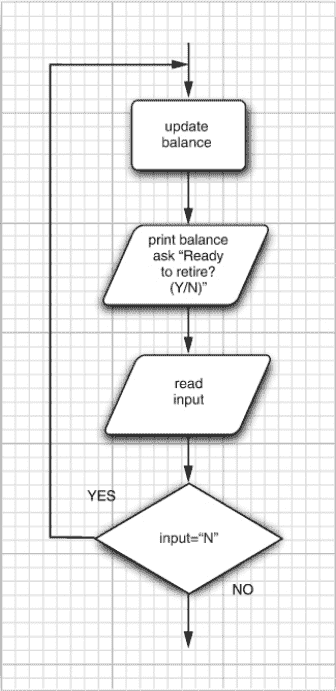

**图 3.11** do/while 语句的流程图

### 清单 3.3 `Retirement/Retirement.java`

```java
import java.util.*;

/**
 * This program demonstrates a <code>while</code> loop.
 * @version 1.20 2004-02-10
 * @author Cay Horstmann
 */
public class Retirement
{
    public static void main(String[] args)
    {
        // read inputs
        Scanner in = new Scanner(System.in);

        System.out.print("How much money do you need to retire? ");
        double goal = in.nextDouble();

        System.out.print("How much money will you contribute every year? ");
        double payment = in.nextDouble();

        System.out.print("Interest rate in %: ");
        double interestRate = in.nextDouble();

        double balance = 0;
        int years = 0;

        // update account balance while goal isn't reached
        while (balance < goal)
        {
            // add this year's payment and interest
            balance += payment;
            double interest = balance * interestRate / 100;
            balance += interest;
            years++;
        }

        System.out.println("You can retire in " + years + " years.");
    }
}
```


```
38    }
39  }
```

### 清单 3.4 Retirement2/Retirement2.java

```java
1  import java.util.*;
2
3  /**
4   * This program demonstrates a <code>do/while</code> loop.
5   * @version 1.20 2004-02-10
6   * @author Cay Horstmann
7   */
8  public class Retirement2
9  {
10    public static void main(String[] args)
11    {
12       Scanner in = new Scanner(System.in);
13
14       System.out.print("How much money will you contribute every year? ");
15       double payment = in.nextDouble();
16
17       System.out.print("Interest rate in %: ");
18       double interestRate = in.nextDouble();
19
20       double balance = 0;
21       int year = 0;
22
23       String input;
24
25       // update account balance while user isn't ready to retire
26       do
27       {
28          // add this year's payment and interest
29          balance += payment;
30          double interest = balance * interestRate / 100;
31          balance += interest;
32
33            year++;
34
35            // print current balance
36            System.out.printf("After year %d, your balance is %,.2f%n", year, balance);
37
38            // ask if ready to retire and get input
39            System.out.print("Ready to retire? (Y/N) ");
40            input = in.next();
41        }
42        while (input.equals("N"));
43    }
44 }
```

### 3.8.4 确定循环

`for` 循环是一种通用结构，用于支持由计数器或类似变量控制的迭代，该变量在每次迭代后更新。如[图3.12](#)所示，下面的循环在屏幕上打印从 1 到 10 的数字：

```java
for (int i = 1; i <= 10; i++)
    System.out.println(i);
```

`for` 语句的第一个槽通常存放计数器初始化。第二个槽给出在每次新一轮循环之前要测试的条件，第三个槽指定如何更新计数器。

尽管 Java 和 C++ 一样，允许在 `for` 循环的各个槽中放入几乎任何表达式，但良好风格的一条不成文规则是：这三个槽只应初始化、测试和更新同一个计数器变量。无视这条规则可以写出非常晦涩的循环。

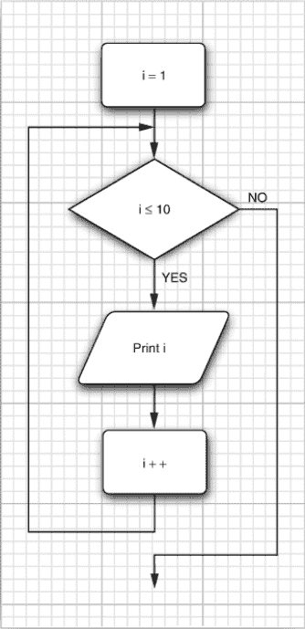

**图3.12** `for` 语句的流程图

即使在良好风格的范围内，也有很多可能。例如，你可以有倒计数的循环：

```java
for (int i = 10; i > 0; i--)
    System.out.println("Counting down . . . " + i);
System.out.println("Blastoff!");
```

**注意：**

在循环中测试浮点数是否相等时要小心。像下面这样的 `for` 循环

```java
for (double x = 0; x != 10; x += 0.1) . . .
```

可能永远不会结束。由于舍入误差，最终值可能无法精确达到。在这个例子中，x 从 9.99999999999998 跳到 10.09999999999998，因为 0.1 没有精确的二进制表示。

当你在 `for` 语句的第一个槽中声明变量时，该变量的作用域一直延伸到 `for` 循环体的末尾。

```java
for (int i = 1; i <= 10; i++)
{
    . . .
}
// i no longer defined here
```

特别是，如果你在 `for` 语句内部定义变量，就不能在循环外部使用它的值。因此，如果你希望在 `for` 循环外部使用循环计数器的最终值，务必在循环头外部声明它。

```java
int i;
for (i = 1; i <= 10; i++)
{
    . . .
}
```

```java
18        int n = in.nextInt();
19
20        /*
21         * compute binomial coefficient n*(n-1)*(n-2)*...*(n-k+1)/(1*2*3*...*k)
22         */
23
24        int lotteryOdds = 1;
25        for (int i = 1; i <= k; i++)
26            lotteryOdds = lotteryOdds * (n - i + 1) / i;
27
28        System.out.println("Your odds are 1 in " + lotteryOdds + ". Good luck!");
29    }
30 }
```

### 3.8.5 使用 `switch` 进行多重选择

当必须为同一个表达式处理多个备选情况时，`if/else` 结构可能很笨拙。`switch` 语句使这更容易，特别是 Java 14 中引入的形式。

例如，如果你建立一个具有四个备选项的菜单系统，如图3.13所示，你可以使用类似下面的代码：

```java
Scanner in = new Scanner(System.in);
System.out.print("Select an option (1, 2, 3, 4) ");
int choice = in.nextInt();
switch (choice)
{
    case 1 ->
        . . .
    case 2 ->
        . . .
    case 3 ->
        . . .
    case 4 ->
        . . .
    default ->
        System.out.println("Bad input");
}
```

**图3.13** `switch` 语句的流程图

case 标签可以是

- 类型为 char、byte、short 或 int 的常量表达式
- 枚举常量
- 字符串字面量
- 上述多项，用逗号分隔

例如，

```java
String input = . . .;
switch (input.toLowerCase())
{
    case "yes", "y" ->
        . . .
    case "no", "n" ->
        . . .
    default ->
        . . .
}
```

`switch` 语句的“经典”形式可以追溯到 C 语言，自 Java 1.0 起就得到支持。它的形式如下：

```java
int choice = . . .;
switch (choice)
{
    case 1:
        . . .
        break;
    case 2:
        . . .
        break;
    case 3:
        . . .
        break;
    case 4:
        . . .
        break;
    default:
        // bad input
        . . .
        break;
}
```

执行从与所执行选择的值匹配的 `case` 标签开始，并一直持续到下一个 `break` 或 `switch` 的末尾。如果没有 case 标签匹配，则执行 `default` 子句（如果存在）。

**注意：**

多个备选情况可能被触发。如果你忘记在一个备选情况的末尾添加 `break`，执行会贯穿到下一个备选情况！这种行为显然很危险，也是常见的错误原因。

要检测这类问题，请使用 `-Xlint:fallthrough` 选项编译代码，如下所示：

```java
javac -Xlint:fallthrough Test.java
```

这样，只要某个备选情况没有以 `break` 语句结束，编译器就会发出警告。

如果你确实想使用贯穿行为，请用注解 `@SuppressWarnings("fallthrough")` 标记周围的方法。这样该方法就不会生成警告。（注解是一种向编译器或处理 Java 源文件或类文件的工具提供信息的机制。第 II 卷深入介绍了注解。）

`switch` 的这两种形式是*语句*。在第 58 页的[第 3.5.9 节“Switch 表达式”]中，你看到了会产生值的 `switch` *表达式*。它没有贯穿行为。

为了对称，Java 14 还引入了带贯穿行为的 `switch` 表达式，因此 `switch` 总共有四种形式。[表3.7]展示了全部形式。

在贯穿变体中，每个 case 以冒号结尾。如果 case 以箭头 `->` 结尾，则没有贯穿行为。在单个 `switch` 语句中不能混用冒号和箭头。

注意 `switch` 表达式中的 `yield` 关键字。与 `break` 一样，它会终止执行。与 `break` 不同，它还会产生一个值——表达式的值。

要在 `switch` 表达式的分支中使用语句且不产生贯穿，必须使用花括号和 `yield`，如表中的示例所示，该示例向一个分支添加了日志语句：

```java
case "Spring" ->
    {
        System.out.println("spring time!");
        yield 6;
    }
```

`switch` *表达式*的每个分支都必须产生一个值。最常见的是，每个值跟在 `->` 箭头之后：

```java
case "Summer", "Winter" -> 6;
```

如果这不可能，请使用 `yield` 语句。

**表3.7** `switch` 的四种形式


异常在第 7 章中详细讨论。

> **注意：**
>
> `switch` 表达式的目的是产生一个值（或抛出异常失败）。不允许“跳出”：

```java
default -> { return -1; } // ERROR
```

具体来说，不能在 `switch` 表达式中使用 return、break 或 continue 语句。（后两者见第 103 页的 3.8.6 节“打破控制流的语句”。）

`switch` 有这么多变体，应该选择哪一种呢？

优先使用 `switch` 表达式而不是语句。如果每个分支都为变量赋值或方法调用计算值，就用表达式产生该值，然后再使用它。例如，

```java
numLetters = switch (seasonName)
    {
        case "Spring", "Summer", "Winter" -> 6
        case "Fall" -> 4
        default -> -1
    };
```

优于

```java
switch (seasonName)
    {
        case "Spring", "Summer", "Winter" ->
            numLetters = 6;
        case "Fall" ->
            numLetters = 4;
        default ->
            numLetters = -1;
    }
```

只有在确实需要穿透，或必须向 `switch` 表达式中添加语句时，才使用 break 或 yield。这些情况极其罕见。

### 3.8.6 打破控制流的语句

尽管 Java 的设计者将 `goto` 保留为保留字，但他们决定不将其纳入语言。一般来说，`goto` 语句被认为是不良风格。一些程序员觉得反 `goto` 的势力走得太远了（例如，参见 Donald Knuth 的著名文章《使用 `goto` 语句的结构化编程》）。他们主张，无限制地使用 `goto` 容易出错，但偶尔*跳出循环*是有益的。Java 设计者同意这一点，甚至添加了一条新语句——带标签的 `break`，以支持这种编程风格。

让我们先看看不带标签的 `break` 语句。用于退出 `switch` 语句的同一个 `break` 语句也可以用于跳出循环。例如：

```java
while (years <= 100)
{
    balance += payment;
    double interest = balance * interestRate / 100;
    balance += interest;
    if (balance >= goal) break;
    years++;
}
```

现在，如果循环顶部出现 `years > 100`，或者循环中间出现 `balance >= goal`，循环就会退出。当然，也可以不用 `break` 计算出相同的 `years` 值，像这样：

```java
while (years <= 100 && balance < goal)
{
    balance += payment;
    double interest = balance * interestRate / 100;
    balance += interest;

    if (balance < goal)
        years++;
}
```

但请注意，在这个版本中，测试 `balance < goal` 重复了两次。为了避免重复测试，一些程序员更喜欢 `break` 语句。

与 C++ 不同，Java 还提供了*带标签的 break* 语句，可以让你跳出多个嵌套循环。有时在深度嵌套的循环内部会发生奇怪的事情。在这种情况下，你可能想完全跳出所有嵌套循环。仅通过向各个循环测试添加额外条件来编程实现这一点很不方便。

下面是一个展示 break 语句实际用法的示例。注意，标签必须位于你想跳出的最外层循环之前。标签后面还必须跟一个冒号。

```java
Scanner in = new Scanner(System.in);
int n;
read_data:
while (...) // this loop statement is tagged with the label
{
    ...
    for (...) // this inner loop is not labeled
    {
        System.out.print("Enter a number >= 0: ");
        n = in.nextInt();
        if (n < 0) // should never happen—can't go on
            break read_data;
            // break out of read_data loop
        ...
    }
}
// this statement is executed immediately after the labeled
```

```java
Scanner in = new Scanner(System.in);
while (sum < goal)
{
    System.out.print("Enter a number: ");
    n = in.nextInt();
    if (n < 0) continue;
    sum += n; // not executed if n < 0
}
```

如果 `n < 0`，那么 `continue` 语句会立即跳到循环头，跳过当前迭代的剩余部分。

如果在 `for` 循环中使用 `continue` 语句，它会跳到 `for` 循环的“更新”部分。例如：

```java
for (count = 1; count <= 100; count++)
{
    System.out.print("Enter a number, -1 to quit: ");
    n = in.nextInt();
    if (n < 0) continue;
    sum += n; // not executed if n < 0
}
```

如果 `n < 0`，那么 `continue` 语句会跳到 `count++` 语句。

还有一种带标签的 `continue` 语句形式，它会跳到具有匹配标签的循环头。

> **提示：**
>
> 许多程序员觉得 `break` 和 `continue` 语句令人困惑。这些语句完全是可选的——你总能在不使用它们的情况下表达同样的逻辑。本书中的程序都没有使用 `break` 或 `continue`。

## 3.9 大数

如果基本整数和浮点类型的精度不够，你可以求助于 `java.math` 包中的几个便捷类：`BigInteger` 和 `BigDecimal`。这些类用于操作具有任意长数字序列的数字。`BigInteger` 类实现任意精度整数运算，`BigDecimal` 对浮点数做同样的事情。

使用静态 `valueOf` 方法将普通数字转换为大数：

```java
BigInteger a = BigInteger.valueOf(100);
```

对于更长的数字，使用带字符串参数的构造器：

```java
BigInteger reallyBig
    = new BigInteger("222232244629420445529739893461909967206666939096499764990979600");
```

还有常量 `BigInteger.ZERO`、`BigInteger.ONE`、`BigInteger.TEN`，以及自 Java 9 起的 `BigInteger.TWO`。


> **注意：**
>
> 使用 `BigDecimal` 类时，应始终使用带字符串参数的构造器。有一个 `BigDecimal(double)` 构造器，它天生容易产生舍入误差：`new BigDecimal(0.1)` 的数字是 0.1000000000000000055511151231257827021181583404541015625。

遗憾的是，不能使用熟悉的数学运算符（如 `+` 和 `*`）来组合大数。相反，必须使用大数类中的 `add` 和 `multiply` 等方法。

### 清单 3.6 BigIntegerTest/BigIntegerTest.java

```java
import java.math.*;
import java.util.*;

/**
 * This program uses big numbers to compute the odds of winning the grand prize in a lottery.
 * @version 1.20 2004-02-10
 * @author Cay Horstmann
 */
public class BigIntegerTest
{
   public static void main(String[] args)
   {
      Scanner in = new Scanner(System.in);

      System.out.print("How many numbers do you need to draw? ");
      int k = in.nextInt();

      System.out.print("What is the highest number you can draw? ");
      BigInteger n = in.nextBigInteger();

      /*
       * compute binomial coefficient n*(n-1)*(n-2)*...*(n-k+1)/(1*2*3*...*k)
       */
      BigInteger lotteryOdds = BigInteger.ONE;

      for (int i = 1; i <= k; i++)
         lotteryOdds = lotteryOdds
            .multiply(n.subtract(BigInteger.valueOf(i - 1)))
            .divide(BigInteger.valueOf(i));

      System.out.printf("Your odds are 1 in %s. Good luck!%n", lotteryOdds);
   }
}
```

### java.math.BigInteger 1.1

- `BigInteger add(BigInteger other)`
- `BigInteger subtract(BigInteger other)`
- `BigInteger multiply(BigInteger other)`
- `BigInteger divide(BigInteger other)`
- `BigInteger mod(BigInteger other)`  
  返回此大整数与 `other` 的和、差、积、商和余数。
- `BigInteger sqrt()`⁹  
  产生此 `BigInteger` 的平方根。
- `int compareTo(BigInteger other)`  
  如果此大整数等于 `other`，则返回 `0`；如果此大整数小于 `other`，则返回负数；否则返回正数。
- `static BigInteger valueOf(long x)`  
  返回一个值等于 `x` 的大整数。

### java.math.BigDecimal 1.1

- `BigDecimal(String digits)`  
  用给定的数字构造一个大十进制数。
- `BigDecimal add(BigDecimal other)`
- `BigDecimal subtract(BigDecimal other)`
- `BigDecimal multiply(BigDecimal other)`


- `BigDecimal divide(BigDecimal other)`
- `BigDecimal divide(BigDecimal other, RoundingMode mode)`

返回此 BigDecimal 与 other 的和、差、积或商。第一个 divide 方法在商没有有限十进制展开时抛出异常。要获得舍入结果，请使用第二个方法。模式 `RoundingMode.HALF_UP` 是你在学校学到的舍入模式：将数字 0 到 4 舍去，将数字 5 到 9 进位。它适合日常计算。其他舍入模式请参阅 API 文档。

- `int compareTo(BigDecimal other)`

如果此 BigDecimal 等于 other，则返回 0；如果此 BigDecimal 小于 other，则返回负数；否则返回正数。

## 3.10 数组

数组保存相同类型值的序列。在以下小节中，你将看到如何在 Java 中使用数组。

### 3.10.1 声明数组

数组是一种存储相同类型值集合的数据结构。你可以通过整数*索引*访问每个值。例如，如果 `a` 是整数数组，则 `a[i]` 是数组中的第 i 个整数。

声明数组变量时，需要指定数组类型（即元素类型后跟 `[]`）和数组变量名。例如，下面声明了一个整数数组 `a`：

```java
int[] a;
```

然而，这条语句只声明了变量 `a`，并未用实际数组初始化 `a`。使用 new 运算符创建数组。

```java
int[] a = new int[100]; // or var a = new int[100];
```

这条语句声明并初始化了一个包含 100 个整数的数组。

数组长度不必是常量：`new int[n]` 创建一个长度为 n 的数组。

一旦创建数组，就无法更改其长度（当然，可以更改单个数组元素）。如果程序运行期间需要频繁扩展数组长度，应使用*数组列表*，相关内容见[第5章]。


**注释：**

你可以将数组变量定义为

```java
int[] a;
```

或

```java
int a[];
```

大多数 Java 程序员更喜欢前者，因为它将类型 `int[]`（整数数组）与变量名清晰地分开。

Java 提供了一种快捷方式，用于创建数组对象并提供初始值：

```java
int[] smallPrimes = { 2, 3, 5, 7, 11, 13 };
```

注意，此语法不使用 `new`，也无需指定长度。

或者

```java
new elementType[] {}
```

注意，长度为 0 的数组与 `null` 不同。

### 3.10.2 访问数组元素

数组元素*从 0 开始编号*。最后一个有效索引比长度小 1。在下面的示例中，索引值范围从 0 到 99。创建数组后，可以填充数组中的元素，例如通过循环：

```java
int[] a = new int[100];
for (int i = 0; i < 100; i++)
    a[i] = i; // fills the array with numbers 0 to 99
```

创建数字数组时，所有元素初始化为 0。布尔数组初始化为 false。对象数组初始化为特殊值 `null`，表示它们尚未持有任何对象。这对初学者来说可能出乎意料。例如，

```java
String[] names = new String[10];
```

创建一个包含 10 个字符串的数组，所有元素都为 `null`。如果希望数组包含空字符串，必须自行提供：

```java
for (int i = 0; i < 10; i++) names[i] = "";
```


> **警告：**
>
> 如果构造一个包含 100 个元素的数组，然后尝试访问元素 `a[100]`（或 0 到 99 范围之外的任何其他索引），将发生“数组索引越界”异常。

要获取数组的元素个数，请使用 *array.length*。例如：

```java
for (int i = 0; i < a.length; i++)
    System.out.println(a[i]);
```

### 3.10.3 “for each” 循环

Java 有一种强大的循环结构，允许你遍历数组（或任何其他元素集合）中的每个元素，而无需费心处理索引值。

*增强的* for 循环

```java
for (variable : collection) statement
```

将给定变量设置为集合中的每个元素，然后执行语句（当然，语句可以是一个块）。*collection* 表达式必须是数组或实现了 *Iterable* 接口的类的对象，例如 ArrayList。数组列表见[第5章]，*Iterable* 接口见[第9章]。

例如，

```java
for (int element : a)
    System.out.println(element);
```

将数组 a 的每个元素打印在单独一行上。

你应该将这个循环理解为“对于 a 中的每个元素”。Java 语言的设计者曾考虑使用 foreach 和 in 等关键字。但这个循环是 Java 语言后期才加入的，最终没有人愿意破坏已经包含这些名称的方法或变量的旧代码（例如 `System.in`）。

当然，你可以使用传统的 `for` 循环实现相同的效果：

```java
for (int i = 0; i < a.length; i++)
    System.out.println(a[i]);
```

然而，“for each” 循环更简洁且更不易出错，因为你不必担心那些恼人的起始和结束索引值。

**注释：**

“for each” 循环的循环变量遍历数组的*元素*，而不是索引值。

如果需要处理集合中的所有元素，“for each” 循环是对传统循环的一个很好的改进。不过，仍有许多场合需要使用传统的 `for` 循环。例如，你可能不想遍历整个集合，或者需要在循环内使用索引值。

**提示：**

有一种更简单的打印数组所有值的方法，即使用 `Arrays` 类的 `toString` 方法。调用 `Arrays.toString(a)` 会返回一个包含数组元素的字符串，用方括号括起来并用逗号分隔，例如 `"[2, 3, 5, 7, 11, 13]"`。要打印数组，只需调用

```java
System.out.println(Arrays.toString(a));
```

原始数组的长度，只复制初始值。

### C++ 注释

Java 数组与栈上的 C++ 数组有很大不同。然而，它本质上等同于指向*堆*上分配的数组的指针。也就是说，

```java
int[] a = new int[100]; // Java
```

与下面的并不相同

```cpp
int a[100]; // C++
```

而是

```cpp
int* a = new int[100]; // C++
```

在 Java 中，`[]` 运算符预定义为执行*边界检查*。此外，没有指针算术——你不能递增 a 来指向数组中的下一个元素。

### 3.10.5 命令行参数

你已经多次看到 Java 数组的一个例子。每个 Java 程序都有一个带 `String[] args` 参数的 `main` 方法。该参数表示 `main` 方法接收一个字符串数组——即命令行上指定的参数。

例如，考虑以下程序：

```java
public class Message
{
    public static void main(String[] args)
```

从命令行传入时，`args[0]` 将是 `"-h"`，而不是 `"Message"` 或 `"java"`。

### 3.10.6 数组排序

要对数字数组排序，可以使用 Arrays 类中的 sort 方法之一：

```java
int[] a = new int[10000];
...
Arrays.sort(a);
```

此方法使用经过调优的 QuickSort 算法版本，据称在大多数数据集上都非常高效。Arrays 类还为数组提供了其他几个便捷方法，这些方法包含在本节末尾的 API 注释中。

清单 3.7 中的程序展示了数组的实际应用。该程序为彩票游戏随机抽取一组数字。例如，如果你玩“从 49 个数字中选 6 个”的彩票，程序可能打印如下：

```text
Bet the following combination. It'll make you rich!
4
7
8
19
30
44
```

要选择这样一组随机数字，首先用一个数组 `numbers` 填充值 1, 2, ..., n：


```java
// pick the element at the random location
result[i] = numbers[r];

// move the last element into the random location
numbers[r] = numbers[n - 1];
n--;
}

// print the sorted array
Arrays.sort(result);
System.out.println("Bet the following combination. It'll make you rich!");
for (int r : result)
    System.out.println(r);
}
}
```

### java.util.Arrays 1.2

- `static String toString(XXX[] a)` 5  
  返回一个字符串，包含 a 的元素，这些元素用括号括起来并用逗号分隔。在此方法及以下方法中，数组的组件类型 `XXX` 可以是 int、long、short、char、byte、boolean、float 或 double。
- `static XXX[] copyOf(XXX[] a, int end)` 6
- `static XXX[] copyOfRange(XXX[] a, int start, int end)` 6  
  返回一个与 a 类型相同的数组，长度为 end 或 end − start，并用 a 的值填充。如果 end 大于 a.length，则结果用 0 或 false 值填充。
- `static void sort(XXX[] a)`  
  使用经过调优的快速排序算法对该数组进行排序。
- `static int binarySearch(XXX[] a, XXX v)`
- `static int binarySearch(XXX[] a, int start, int end, XXX v)`  
  使用二分查找算法在已排序数组 a 中查找值 v。如果找到 v，则返回其索引。否则，返回一个负值 r；−r − 1 是为保持 a 有序而应插入 v 的位置。
- `static void fill(XXX[] a, XXX v)`  
  将数组的所有元素设置为 v。
- `static boolean equals(XXX[] a, XXX[] b)`  
  如果两个数组长度相同，且对应索引处的元素匹配，则返回 true。

### 3.10.7 多维数组

多维数组使用多个索引来访问数组元素。它们用于表格和其他更复杂的排列。在需要这种存储机制之前，你可以安全地跳过本节。

假设你想制作一个数字表格，显示在每年支付利息并再投资的不同利率情景下，10,000 美元的投资将增长多少（表 3.8）。

**表 3.8** 不同利率下的投资增长

| 10% | 11% | 12% | 13% | 14% | 15% |
| --- | --- | --- | --- | --- | --- |
| 10,000.00 | 10,000.00 | 10,000.00 | 10,000.00 | 10,000.00 | 10,000.00 |
| 11,000.00 | 11,100.00 | 11,200.00 | 11,300.00 | 11,400.00 | 11,500.00 |
| 12,100.00 | 12,321.00 | 12,544.00 | 12,769.00 | 12,996.00 | 13,225.00 |
| 13,310.00 | 13,676.31 | 14,049.28 | 14,428.97 | 14,815.44 | 15,208.75 |
| 14,641.00 | 15,180.70 | 15,735.19 | 16,304.74 | 16,889.60 | 17,490.06 |
| 16,105.10 | 16,850.58 | 17,623.42 | 18,424.35 | 19,254.15 | 20,113.57 |
| 17,715.61 | 18,704.15 | 19,738.23 | 20,819.52 | 21,949.73 | 23,130.61 |
| 19,487.17 | 20,761.60 | 22,106.81 | 23,526.05 | 25,022.69 | 26,600.20 |
| 21,435.89 | 23,045.38 | 24,759.63 | 26,584.44 | 28,525.86 | 30,590.23 |
| 23,579.48 | 25,580.37 | 27,730.79 | 30,040.42 | 32,519.49 | 35,178.76 |

你可以将这些信息存储在一个名为 balances 的二维数组（矩阵）中。

在 Java 中声明二维数组非常简单。例如：

```java
double[][] balances;
```

在初始化之前，你不能使用该数组。在这种情况下，可以按如下方式进行初始化：

```java
balances = new double[NYEARS][NRATES];
```

在其他情况下，如果你知道数组元素，可以使用简写表示法初始化多维数组，而无需调用 new。例如：

```java
int[][] magicSquare =
    {
        {16, 3, 2, 13},
        {5, 10, 11, 8},
        {9, 6, 7, 12},
        {4, 15, 14, 1}
    };
```

数组初始化后，你可以通过提供两对括号来访问单个元素——例如，balances[i][j]。

示例程序存储一个利率的一维数组 `interest` 和一个账户余额的二维数组 `balances`，每个年份和利率对应一个余额。用初始余额初始化数组的第一行：

```java
for (int j = 0; j < balances[0].length; j++)
    balances[0][j] = 10000;
```

然后按如下方式计算其他行：

```java
for (int i = 1; i < balances.length; i++)
{
    for (int j = 0; j < balances[i].length; j++)
    {
        double oldBalance = balances[i - 1][j];
        double interest = . . .;
        balances[i][j] = oldBalance + interest;
    }
}
```

[程序清单 3.8](#) 显示了完整程序。

> **注意：**
>
> “for each”循环不会自动遍历二维数组中的所有元素。相反，它遍历的是行，而这些行本身

```java
// set interest rates to 10 . . . 15%
double[] interestRate = new double[NRATES];
for (int j = 0; j < interestRate.length; j++)
    interestRate[j] = (STARTRATE + j) / 100.0;

double[][] balances = new double[NYEARS][NRATES];

// set initial balances to 10000
for (int j = 0; j < balances[0].length; j++)
    balances[0][j] = 10000;

// compute interest for future years
for (int i = 1; i < balances.length; i++)
{
    for (int j = 0; j < balances[i].length; j++)
    {
        // get last year's balances from previous row
        double oldBalance = balances[i - 1][j];

        // compute interest
        double interest = oldBalance * interestRate[j];

        // compute this year's balances
        balances[i][j] = oldBalance + interest;
    }
}

// print one row of interest rates
for (int j = 0; j < interestRate.length; j++)
    System.out.printf("%9.0f%%", 100 * interestRate[j]);

System.out.println();

// print balance table
for (double[] row : balances)
{
    // print table row
    for (double b : row)
        System.out.printf("%10.2f", b);
    System.out.println();
}
}
}
```

### 3.10.8 参差数组

到目前为止，你所看到的内容与其他编程语言并没有太大不同。但实际上，幕后有一些微妙之处，你有时可以将其转化为自己的优势：Java *没有*多维数组，只有一维数组。多维数组是伪装成“数组的数组”。

例如，前面示例中的 `balances` 数组实际上是一个包含十个元素的数组，其中每个元素都是一个包含六个浮点数的数组（图 3.15）。

表达式 `balances[i]` 指的是第 i 个子数组——也就是表格的第 i 行。它本身就是一个数组，而 `balances[i][j]` 指的是该数组的第 j 个元素。

由于数组的行可以单独访问，你实际上可以交换它们！

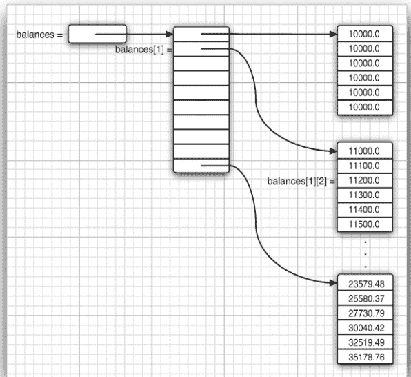

**图 3.15** 一个二维数组

```java
double[] temp = balances[i];
balances[i] = balances[i + 1];
balances[i + 1] = temp;
```

制作“参差”数组也很容易——即不同行具有不同长度的数组。下面是标准示例。让我们创建一个数组，其中第 i 行第 j 列的元素等于“从 i 个数字中选择 j 个数字”彩票的可能结果数。

```
1
1  1
1  2  1
1  3  3  1
1  4  6  4  1
1  5 10 10  5  1
1  6 15 20 15  6  1
```

由于 j 永远不会大于 i，该矩阵是三角形的。第 i 行有 i + 1 个元素。（选择 0 个元素是可以的；只有一种方式做出这样的选择。）要构建这个参差数组，首先分配用于保存各行的数组：

```java
final int NMAX = 10;
int[][] odds = new int[NMAX + 1][];
```

接下来，分配各行：

```java
for (int n = 0; n <= NMAX; n++)
    odds[n] = new int[n + 1];
```

现在数组已分配，只要不越界，你就可以用常规方式访问元素：

```java
for (int n = 0; n < odds.length; n++)
    for (int k = 0; k < odds[n].length; k++)
    {
        // compute lotteryOdds
        . . .
        odds[n][k] = lotteryOdds;
    }
```

程序清单 3.9 给出了完整程序。


### C++ 注意：


在 C++ 中，下面的 Java 声明

```java
double[][] balances = new double[10][6]; // Java
```

与

```cpp
double balances[10][6]; // C++
```

并不相同，

甚至与

```cpp
double (*balances)[6] = new double[10][6]; // C++
```

也不相同。

相反，这里分配的是一个包含十个指针的数组：

```cpp
double** balances = new double*[10]; // C++
```

然后，指针数组中的每个元素都用包含六个数字的数组填充：

```cpp
for (i = 0; i < 10; i++)
    balances[i] = new double[6];
```

幸运的是，当你请求一个 new double[10][6] 时，这个循环会自动完成。当你需要不规则数组时，可以分别分配各行数组。

### 清单 3.9 `LotteryArray/LotteryArray.java`

```java
/**
 * This program demonstrates a triangular array.
 * @version 1.20 2004-02-10
 * @author Cay Horstmann
 */
public class LotteryArray
{
    public static void main(String[] args)
    {
        final int NMAX = 10;

        // allocate triangular array
        int[][] odds = new int[NMAX + 1][];
        for (int n = 0; n <= NMAX; n++)
            odds[n] = new int[n + 1];

        // fill triangular array
        for (int n = 0; n < odds.length; n++)
            for (int k = 0; k < odds[n].length; k++)
            {
                /*
                 * compute binomial coefficient n*(n-1)*(n-
                 2)*...*(n-k+1)/(1*2*3*...*k)
                 */
                int lotteryOdds = 1;
                for (int i = 1; i <= k; i++)
                    lotteryOdds = lotteryOdds * (n - i + 1) / i;

                odds[n][k] = lotteryOdds;
            }

        // print triangular array
        for (int[] row : odds)
        {
            for (int odd : row)
                System.out.printf("%4d", odd);
            System.out.println();
        }
    }
}
```

现在你已经了解了 Java 语言的基本编程结构。下一章将介绍 Java 中的面向对象编程。

# 第 4 章 对象与类

本章内容

- 4.1 面向对象编程简介
- 4.2 使用预定义类
- 4.3 定义自己的类
- 4.4 静态字段和方法
- 4.5 方法参数
- 4.6 对象构造
- 4.7 记录
- 4.8 包
- 4.9 JAR 文件
- 4.10 文档注释
- 4.11 类设计提示

在本章中，我将

- 向你介绍面向对象编程：
- 向你展示如何创建属于标准 Java 库中类的对象；以及
- 向你展示如何编写自己的类。

如果你没有面向对象编程的背景，你会想仔细阅读本章。面向对象编程需要一种不同于过程式语言的思维方式。这种转变并不总是容易的，但为了进一步学习 Java，你确实需要熟悉一些对象概念。

对于有经验的 C++ 程序员来说，本章和上一章一样，介绍的是熟悉的信息；不过，这两种语言之间有足够多的差异，因此你应当仔细阅读本章后面的各节。你会发现 C++ 备注有助于完成这种转变。

## 4.1 面向对象编程简介

面向对象编程（简称 OOP）是当今占主导地位的编程范式，它已经取代了 20 世纪 70 年代发展起来的“结构化”或过程式编程技术。由于 Java 是面向对象的，你必须熟悉 OOP 才能高效地使用 Java。

面向对象的程序由对象组成。每个对象都有特定的功能，这些功能向使用者公开，而实现则隐藏起来。程序中的许多对象将是取自库的“现成”对象；其他对象则将是定制设计的。你构建一个对象还是购买一个对象，可能取决于你的预算或时间。但基本上，只要对象满足你的规格要求，你就不关心功能是如何实现的。

传统的结构化编程包括设计一组过程（或*算法*）来解决问题。一旦确定了过程，传统的下一步就是找到合适的方式来存储数据。这就是 Pascal 语言的设计者尼克劳斯·维尔特把他那本著名的编程书命名为*算法 + 数据结构 = 程序*（Prentice Hall，1976）的原因。注意，在维尔特的标题中，算法排在第一位，数据结构排在第二位。这反映了当时程序员的工作方式。首先，他们确定用于操作数据的过程；然后，他们决定对数据施加什么结构，以便更容易地进行操作。OOP 颠倒了这个顺序：先把数据放在首位，然后再考虑用于操作数据的算法。

对于小问题，分解为过程的方法效果很好。但对象更适合较大的问题。考虑一个简单的网页浏览器。它的实现可能需要 2,000 个过程，而这些过程全都操作一组全局数据。在面向对象的风格中，可能有 100 个类，每个类平均有 20 个方法（见*图 4.1*）。这种结构对程序员来说更容易掌握。也更容易在其中查找缺陷。假设某个特定对象的数据处于不正确的状态。在访问过该数据项的 20 个方法中查找问题所在，要比在 2,000 个过程中查找容易得多。

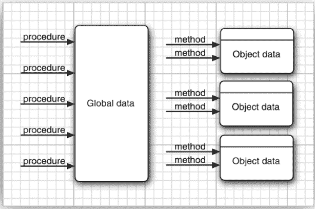

**图 4.1** 过程式编程与面向对象编程对比

### 4.1.1 类

*类*规定了对象如何创建。可以把类想象成饼干模具；对象就是饼干本身。当你从一个类*构造*一个对象时，可以说你创建了该类的一个*实例*。

正如你已经看到的，你在 Java 中编写的所有代码都位于某个类中。标准 Java 库提供了数千个类，用于用户界面设计、日期和日历、网络编程等各种不同目的。尽管如此，在 Java 中你仍然必须创建自己的类，来描述应用程序问题域中的对象。

*封装*（有时称为*信息隐藏*）是处理对象时的一个关键概念。形式上，封装就是将数据和行为组合在一个包中，并对对象的使用者隐藏实现细节。对象中的数据项称为它的*实例字段*，操作这些数据的过程称为它的*方法*。作为某个类实例的特定对象，其实例字段会有特定的值。这些值的集合就是该对象当前的*状态*。每当你对某个对象调用方法时，它的状态都可能改变。

让封装发挥作用的关键在于，方法*绝不*直接访问其所属类以外的类中的实例字段。程序应当*只*通过对象的方法与对象数据进行交互。封装是赋予对象“黑箱”行为的方式，而这是重用和可靠性的关键。这意味着，一个类可以完全改变其存储数据的方式，但只要它继续使用相同的方法来操作数据，其他对象就不会知道，也不会在意。

当你开始在 Java 中编写自己的类时，OOP 的另一条原则会让这件事更容易：类可以通过*扩展*其他类来构建。事实上，Java 附带了一个名为 Object 的“宇宙超类”。所有其他类都扩展这个类。你将在下一章进一步了解 Object 类。

当你扩展一个现有类时，新类拥有你所扩展的类的所有属性和方法。然后，你提供仅适用于新类的新方法和实例字段。通过扩展一个类来获得另一个类的概念称为*继承*。关于继承的更多内容，请参阅下一章。

### 4.1.2 对象

要使用 OOP，你应当能够识别对象的三个关键特征：

- 对象的*行为*——你能用这个对象做什么，或者能对它应用哪些方法？
- 对象的*状态*——当你调用这些方法时，对象如何反应？


- 对象的*标识*——如何将对象与那些可能具有相同行为和状态的其他对象区分开来？

同一类的所有实例对象都通过支持相同的*行为*而具有家族相似性。对象的行为由你可以调用的方法定义。

接下来，每个对象存储关于它当前样子的信息。这就是对象的*状态*。对象的状态可能随时间变化，但不会自发变化。对象状态的改变必须是方法调用的结果。（如果对象的状态在没有对该对象进行方法调用的情况下发生了改变，那就有人破坏了封装。）

然而，对象的状态并不能完全描述它，因为每个对象都有一个独特的*标识*。例如，在订单处理系统中，两个订单即使请求相同的物品也是不同的。请注意，作为某个类实例的各个对象在标识上*总是*不同，在状态上*通常*不同。

这些关键特征可以相互影响。例如，对象的状态可以影响其行为。（如果一个订单是“已发货”或“已付款”，它可能会拒绝要求其添加或移除物品的方法调用。相反，如果一个订单是“空的”——也就是尚未订购任何物品——它就不应允许自己被发货。）

### 4.1.3 识别类

在传统的面向过程程序中，你从顶层的`main`函数开始。在设计面向对象系统时，并不存在“顶层”，面向对象编程的新手常常想知道从哪里开始。答案是：识别你的类，然后为每个类添加方法。

识别类的一个简单经验法则是，在问题分析中寻找名词。另一方面，方法对应动词。

例如，在订单处理系统中，一些名词是

- 物品
- 订单
- 收货地址
- 付款
- 账户

这些名词可能引出`Item`、`Order`等类。

接下来，寻找动词。物品被*添加*到订单中。订单被*发货*或*取消*。付款被*应用*到订单。对于每个动词，例如“添加”、“发货”、“取消”或“应用”，你识别出承担执行该动作主要责任的对象。例如，当新物品被添加到订单时，订单对象应该负责，因为它知道如何存储和排序物品。也就是说，add 应该是 Order 类的一个方法，它接受一个 Item 对象作为参数。

当然，“名词和动词”只是一个经验法则；只有经验才能帮助你在构建类时决定哪些名词和动词是重要的。

### 4.1.4 类之间的关系

类之间最常见的关系是

- *依赖*（“uses–a”）
- *聚合*（“has–a”）
- *继承*（“is–a”）

*依赖*关系，或称“uses–a”关系，是最明显也是最一般的关系。例如，Order 类使用 Account 类，因为 Order 对象需要访问 Account 对象来检查信用状况。但 Item 类不依赖 Account 类，因为 Item 对象永远不需要关心客户账户。因此，如果一个类的方法使用或操作另一个类的对象，那么这个类就依赖另一个类。

尽量减少相互依赖的类的数量。关键在于，如果类 A 不知道类 B 的存在，它也就不关心 B 的任何变化。（这意味着 B 的变化不会给 A 引入缺陷。）用软件工程术语来说，你希望最小化类之间的*耦合*。

*聚合*关系，或称“has–a”关系，很容易理解，因为它是具体的；例如，一个 Order 对象包含 Item 对象。包含意味着类 A 的对象包含类 B 的对象。


> **注意：**
>
> 一些方法论者鄙视聚合概念，更喜欢使用更一般的“关联”关系。从建模的角度来看，这是可以理解的。但对程序员来说，“has–a”关系非常有意义。我喜欢使用聚合还有另一个原因：关联的标准表示法不够清晰。参见[表4.1]。

*继承*关系，或称“is–a”关系，表达一个更特殊的类与一个更一般的类之间的关系。例如，RushOrder 类继承自 Order 类。特殊的 RushOrder 类具有用于优先级处理的特殊方法，以及用于计算运费的另一种方法，但它的其他方法，例如添加物品和计费，是从 Order 类继承的。一般来说，如果类 D 扩展类 C，则类 D 从类 C 继承方法，但具有更多能力。（参见下一章，那里会较为详细地讨论这个重要概念。）

许多程序员使用 UML（统一建模语言）表示法绘制*类图*，以描述类之间的关系。你可以在[图4.2]中看到此类图的一个示例。你将类画成矩形，将关系画成带有各种装饰的箭头。[表4.1]展示了最常见的 UML 箭头样式。

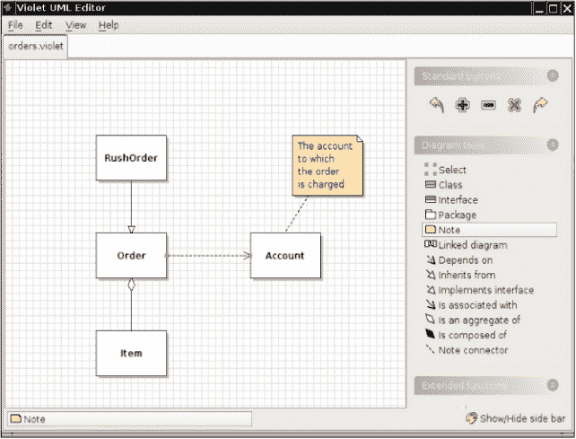

**图4.2** 一个类图

### 表4.1 类关系的 UML 表示法

| 关系 | UML 连接符 |
|---|---|
| 继承 | ─────────▷ |
| 接口实现 | - - - - - - -▷ |
| 依赖 | - - - - - - -➜ |
| 聚合 | ◇───────── |
| 关联 | ────────── |
| 有向关联 | ─────────▷ |

## 4.2 使用预定义类

在 Java 中，没有类就什么也做不了，而你已经看到过几个类在发挥作用。然而，并非所有这些类都展示了面向对象的典型特征。以`Math`类为例。你已经看到，你可以使用`Math`类的方法，例如`Math.random`，而不需要知道它们是如何实现的——你只需要知道名称和参数（如果有的话）。这就是封装的意义，而且对所有类来说肯定都是如此。但是`Math`类*只*封装了功能；它既不需要也不隐藏数据。既然没有数据，你就不需要担心创建对象和初始化它们的实例字段——根本没有任何实例字段！

在下一节中，我们将看一个更典型的类——`Date`类。你将看到如何构造对象并调用这个类的方法。

### 4.2.1 对象与对象变量

要使用对象，你首先要构造它们并指定它们的初始状态。然后你对这些对象应用方法。

在 Java 编程语言中，你使用*构造器*来构造新实例。构造器是一种特殊方法，其目的是构造并初始化对象。让我们看一个例子。标准 Java 库包含一个`Date`类。它的对象描述时间点，例如 1999 年 12 月 31 日 23:59:59 GMT。

> **注意：**
>
> 你可能会想：为什么要用类来表示日期，而不是（像某些语言那样）使用内置类型？例如，Visual Basic 有一种内置日期类型，程序员可以按 #12/31/1999# 的格式指定日期。表面上看，这听起来很方便——程序员可以直接使用内置日期类型，而不必担心类。但实际上，Visual Basic 的设计有多合适呢？在某些区域设置中，日期指定为月/日/年，而在另一些区域设置中则为日/月/年。语言设计者真的有能力预见这类问题吗？如果他们做得不好，语言就会变成一团令人不快的混乱，而不满意的程序员却无能为力。使用类，设计任务就被转移给库设计者。如果类不完美，其他程序员可以轻松编写自己的类来增强或替换系统类。（为证明这一点：Java 日期库一开始有点混乱，并且已经被重新设计了两次。）

构造器总是与类名同名。因此，Date 类的构造器称为 Date。要构造一个 Date 对象，请将构造器与 new 运算符结合使用，如下所示：

```java
new Date()
```

这个表达式构造一个新对象。该对象被初始化为当前日期和时间。

如果愿意，你可以将该对象传递给一个方法：

```java
System.out.println(new Date());
```

或者，你可以对刚刚构造的对象应用一个方法。Date 类的方法之一是 toString 方法。该方法生成日期的字符串表示形式。下面是如何将 toString 方法应用于一个新构造的 Date 对象：

```java
String s = new Date().toString();
```

在这两个示例中，构造的对象只使用一次。通常，你会希望保留你构造的对象，以便可以继续使用它们。只需将对象存储在一个变量中：

```java
Date rightNow = new Date();
```


图4.3 展示了对象变量 `rightNow`，它引用新构造的对象。

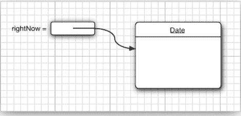

**图4.3** 创建新对象

对象与对象变量之间存在重要区别。例如，以下语句

```java
Date startTime;  // startTime doesn't refer to any object
```

定义了一个对象变量 `startTime`，它可以引用 `Date` 类型的对象。重要的是要认识到，变量 `startTime` *不是对象*，事实上它甚至尚未引用任何对象。此时不能在该变量上使用任何 `Date` 方法。以下语句

```java
s = startTime.toString();  // not yet
```

会导致编译时错误。

必须先初始化 `startTime` 变量。有两种选择。当然，可以将该变量初始化为引用一个新构造的对象：

```java
startTime = new Date();
```

或者可以将该变量设置为引用一个已有对象：

```java
startTime = rightNow;
```

现在两个变量都引用*同一个*对象（见图4.4）。

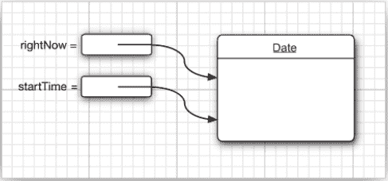

**图4.4** 引用同一对象的对象变量

重要的是要认识到，对象变量实际上并不包含对象。它只是*引用*一个对象。

在 Java 中，任何对象变量的值都是对存储在别处的对象的引用。`new` 运算符的返回值也是一个引用。如下语句

```java
Date startTime = new Date();
```

包含两部分。表达式 `new Date()` 创建一个 `Date` 类型的对象，其值是对该新创建对象的引用。然后该引用被存储在 `startTime` 变量中。

可以显式地将对象变量设置为 `null`，以表示它当前不引用任何对象。

```java
startTime = null; . . .
if (startTime != null)
    System.out.println(startTime);
```

我在第149页的4.3.6节“使用 null 引用”中更详细地讨论 null。


**C++ 注意：**

有些人错误地认为 Java 对象变量的行为像 C++ 引用。但 C++ 中没有空引用，且引用不能被赋值。应将 Java 对象变量视为类似于 C++ 中的*对象指针*。例如，

```java
Date rightNow; // Java
```

实际上等同于

```cpp
Date* rightNow; // C++
```

一旦建立这种关联，一切就都清楚了。当然，Date* 指针只有在通过调用 new 进行初始化后才会被初始化。C++ 和 Java 中的语法几乎相同。

```cpp
Date* rightNow = new Date(); // C++
```

如果将一个变量复制到另一个变量，那么两个变量都引用同一个日期——它们是指向同一对象的指针。Java 的 null 引用相当于 C++ 的 NULL 指针。

所有 Java 对象都位于堆上。当一个对象包含另一个对象变量时，它只包含一个指向另一个堆对象的指针。

在 C++ 中，指针让人紧张，因为它们很容易出错。很容易创建错误指针或搞乱内存管理。在 Java 中，这些问题都不复存在。如果使用未初始化的指针，运行时系统会可靠地生成运行时错误，而不是产生随机结果。不必担心内存管理，因为垃圾回收器会处理它。

C++ 通过支持拷贝构造函数和赋值运算符，付出了相当大的努力，以允许实现自动复制自身的对象。例如，链表的副本是一个具有相同内容但链接集独立的新链表。这使得可以设计出与内置类型具有相同复制行为的类。在 Java 中，必须使用 `clone` 方法才能获得对象的完整副本。

### 4.2.2 Java 类库中的 `LocalDate` 类

在前面的示例中，我们使用了标准 Java 库中的 `Date` 类。`Date` 类的实例有一个状态——即，*一个特定的时间点。*

尽管使用 `Date` 类时不需要知道这一点，但时间是由距一个固定点（即所谓的*纪元*）的毫秒数（正或负）表示的，该固定点为 1970 年 1 月 1 日 00:00:00 UTC。UTC 是协调世界时，这是一种科学时间标准，实际上与更熟悉的 GMT（格林尼治标准时间）相同。

但事实证明，`Date` 类对于处理人类用于日期的日历信息（例如“1999年12月31日”）并不是很有用。这种对某一天的特定描述遵循公历，这是世界上大多数国家使用的日历。同一时间点在中国农历或希伯来历中会有相当不同的描述，更不用说来自火星的客户所使用的日历了。

**注意：**

```java
GregorianCalendar someDay = new GregorianCalendar(1999, 11,
31);
   // odd feature of that class: month numbers go from 0 to 11
someDay.add(Calendar.DAY_OF_MONTH, 1000);
```

与 `LocalDate.plusDays` 方法不同，`GregorianCalendar.add` 方法是一个*修改器方法*。调用它之后，`someDay` 对象的状态已经改变。以下方法可以查明新状态：

```java
year = someDay.get(Calendar.YEAR); // 2002
month = someDay.get(Calendar.MONTH) + 1; // 09
day = someDay.get(Calendar.DAY_OF_MONTH); // 26
```

这就是为什么该变量名为 `someDay` 而不是 `newYearsEve`——在调用修改器方法后，它不再是除夕了。

相比之下，只访问对象而不修改对象的方法有时称为*访问器方法*。例如，`LocalDate.getYear` 和 `GregorianCalendar.get` 是访问器方法。

> **C++ 注意：**
>
> 在 C++ 中，`const` 后缀表示访问器方法。未声明为 `const` 的方法被视为修改器。然而，在 Java 编程语言中，没有特殊语法区分访问器和修改器。

本节以一个使用 `LocalDate` 类的程序结束。该程序显示当前月份的日历，如下所示：

| 周一 | 周二 | 周三 | 周四 | 周五 | 周六 | 周日 |
|---|---|---|---|---|---|---|
|     |     |     |     |     |     | 1   |
| 2   | 3   | 4   | 5   | 6   | 7   | 8   |
| 9   | 10  | 11  | 12  | 13  | 14  | 15  |
| 16  | 17  | 18  | 19  | 20  | 21  | 22  |
| 23  | 24  | 25  | 26\* | 27  | 28  | 29  |
| 30  |     |     |     |     |     |     |

当前日期用星号（\*）标记。如你所见，程序需要知道如何计算一个月的长度和给定日期是星期几。

让我们逐步了解该程序的关键步骤。首先，我们构造一个用当前日期初始化的对象。

```java
LocalDate date = LocalDate.now();
```

我们获取当前月份和日期。

```java
int month = date.getMonthValue();
int today = date.getDayOfMonth();
```

然后将 date 设置为该月第一天，并获取该日期的星期几。

```java
date = date.minusDays(today - 1); // set to start of month
DayOfWeek weekday = date.getDayOfWeek();
int value = weekday.getValue(); // 1 = Monday, . . . 7 = Sunday
```

变量 weekday 被设置为 `DayOfWeek` 类型的对象。我们调用该对象的 `getValue` 方法以获取星期几的数值。这会生成一个整数，遵循国际惯例，即周末在一周的最后，周一返回 1，周二返回 2，依此类推。周日值为 7。

注意，日历的第一行有缩进，以便该月第一天落在适当的星期几位置。以下是打印表头和第一行缩进的代码：

```java
    System.out.println("Mon Tue Wed Thu Fri Sat Sun");
    for (int i = 1; i < value; i++)
        System.out.print("  ");
```

现在，我们准备打印日历主体。我们进入一个循环，其中 `date` 遍历该月的各天。

在每次迭代中，我们打印 `date` 值。如果 `date` 是今天，则用 \* 标记该 `date`。然后，我们将 `date` 推进到下一天。当到达每个新一周的开头时，我们打印一个换行：

```java
    while (date.getMonthValue() == month)
    {
        System.out.printf("%3d", date.getDayOfMonth());
        if (date.getDayOfMonth() == today)
            System.out.print("*");
        else
            System.out.print(" ");
        date = date.plusDays(1);
        if (date.getDayOfWeek().getValue() == 1)
        System.out.println();
    }
```

何时停止？我们不知道这个月有 31、30、29 还是 28 天。相反，只要 `date` 仍在当前月份中，我们就继续迭代。

程序清单 4.1 展示了完整程序。

如你所见，`LocalDate` 类使得编写一个能够处理星期几和不同月份长度等复杂问题的日历程序成为可能。你不需要知道 `LocalDate` 类*如何*计算月份和星期几。你只需使用该类的*接口*——诸如 `plusDays` 和 `getDayOfWeek` 之类的方法。

这个示例程序的要点是向你展示，如何使用类的*接口*来完成相当复杂的任务，而无需了解实现细节。


## **代码清单 4.1** `CalendarTest/CalendarTest.java`

```java
import java.time.*;

/**
 * @version 1.5 2015-05-08
 * @author Cay Horstmann
 */
public class CalendarTest
{
   public static void main(String[] args)
   {
      LocalDate date = LocalDate.now();
      int month = date.getMonthValue();
      int today = date.getDayOfMonth();

      date = date.minusDays(today - 1); // set to start of month
      DayOfWeek weekday = date.getDayOfWeek();
      int value = weekday.getValue(); // 1 = Monday, . . . , 7 = Sunday

      System.out.println("Mon Tue Wed Thu Fri Sat Sun");
      for (int i = 1; i < value; i++)
         System.out.print("   ");
      while (date.getMonthValue() == month)
      {
         System.out.printf("%3d", date.getDayOfMonth());
         if (date.getDayOfMonth() == today)
            System.out.print("*");
         else
            System.out.print(" ");
         date = date.plusDays(1);
         if (date.getDayOfWeek().getValue() == 1)
            System.out.println();
      }
      if (date.getDayOfWeek().getValue() != 1)
         System.out.println();
   }
}
```

### 4.3.1 Employee 类

Java 中类定义的最简单形式是

```java
class ClassName
{
  field1
  field2
  . . .
  constructor1
  constructor2
  . . .
  method1
  method2
  . . .
}
```

考虑下面这个非常简化的 Employee 类版本，企业编写工资系统时可能会用到它：

```java
class Employee
{
  // instance fields
  private String name;
  private double salary;
  private LocalDate hireDay;

  // constructor
  public Employee(String n, double s, int year, int month, int day)
  {
    name = n;
    salary = s;
    hireDay = LocalDate.of(year, month, day);
  }

  // a method
  public String getName()
  {
    return name;
  }

  // more methods
  . . .
}
```

在接下来的各节中，我们将较为详细地剖析这个类的实现。不过首先，代码清单 4.2 是一个展示 `Employee` 类实际运行的程序。

在该程序中，我们构造一个 `Employee` 数组，并用三个 `Employee` 对象填充它：

```java
Employee[] staff = new Employee[3];

staff[0] = new Employee("Carl Cracker", . . .);
staff[1] = new Employee("Harry Hacker", . . .);
staff[2] = new Employee("Tony Tester", . . .);
```

接下来，我们使用 `Employee` 类的 `raiseSalary` 方法将每位员工的薪水提高 5%：

```java
for (Employee e : staff)
    e.raiseSalary(5);
```

最后，我们通过调用 `getName`、`getSalary` 和 `getHireDay` 方法打印每位员工的信息：

```java
for (Employee e : staff)
    System.out.println("name=" + e.getName()
        + ",salary=" + e.getSalary()
        + ",hireDay=" + e.getHireDay());
```

```java
);
staff[1] = new Employee("Harry Hacker", 50000, 1989, 10,
1);
staff[2] = new Employee("Tony Tester", 40000, 1990, 3,
15);

// raise everyone's salary by 5%
for (Employee e : staff)
    e.raiseSalary(5);

// print out information about all Employee objects
for (Employee e : staff)
    System.out.println("name=" + e.getName() + ",salary="
        + e.getSalary() + ",hireDay="
        + e.getHireDay());
}

class Employee
{
    private String name;
    private double salary;
    private LocalDate hireDay;

    public Employee(String n, double s, int year, int month, int day)
    {
        name = n;
        salary = s;
        hireDay = LocalDate.of(year, month, day);
    }

    public String getName()
    {
        return name;
    }

    public double getSalary()
    {
50    return salary;
51  }
52
53  public LocalDate getHireDay()
54  {
55      return hireDay;
56  }
57
58  public void raiseSalary(double byPercent)
59  {
60      double raise = salary * byPercent / 100;
61      salary += raise;
62  }
63 }
```

### 4.3.2 使用多个源文件

*代码清单 4.2* 中的程序在单个源文件里包含两个类。许多程序员更喜欢把每个类放到各自的源文件中。例如，你可以把 `Employee` 类放到文件 `Employee.java` 中，把 `EmployeeTest` 类放到 `EmployeeTest.java` 中。

如果你喜欢这种安排，编译程序时有两种选择。你可以使用通配符调用 Java 编译器：

```bash
javac Employee*.java
```

这样，所有匹配该通配符的源文件都会被编译成类文件。或者，你也可以直接输入

```bash
javac EmployeeTest.java
```

你可能会感到惊讶：即使从未显式编译 `Employee.java` 文件，第二种选择也能工作。然而，当 Java 编译器看到 `EmployeeTest.java` 中使用了 `Employee` 类时，它会查找名为 `Employee.class` 的文件。如果找不到该文件，它会自动搜索 `Employee.java` 并编译它。此外，如果它找到的 `Employee.java` 版本的时戳比现有 `Employee.class` 文件的时戳更新，Java 编译器会*自动*重新编译该文件。


> **注意：**
>
> 如果你熟悉 UNIX 的 make 工具（或它的某个 Windows 近亲，例如 nmake），可以把 Java 编译器看作已经内置了 make 功能。

### 4.3.3 剖析 `Employee` 类

在接下来的各节中，我们将剖析 `Employee` 类。先从该类中的方法开始。通过查看源代码可以看到，这个类有一个构造器和四个方法：

```java
public Employee(String n, double s, int year, int month, int day)
public String getName()
public double getSalary()
public LocalDate getHireDay()
public void raiseSalary(double byPercent)
```

这个类的所有方法都被标记为 public。关键字 public 表示任何类中的任何方法都可以调用该方法。（本章和下一章会介绍四种可能的访问级别。）

接下来，请注意三个实例字段，它们将保存 `Employee` 类实例内部操作的数据。

```java
private String name;
private double salary;
private LocalDate hireDay;
```

`private` 关键字确保：能够访问这些实例字段的方法*只有* `Employee` 类自身的方法。任何外部方法都不能读写这些字段。

> **注意：**
>
> 你可以对实例字段使用 `public` 关键字，但这是个非常糟糕的主意。将实例字段设为 `public` 会允许程序任何部分读取和修改这些实例字段，彻底破坏封装。任何类的任何方法都可以修改 public 字段——而且根据我们的经验，有些代码*会*在你最意想不到的时候利用这种访问权限。我强烈建议把所有实例字段都设为 `private`。

最后，请注意其中两个实例字段本身就是对象：`name` 和 `hireDay` 字段分别是对 `String` 和 `LocalDate` 对象的引用。这很常见：类经常会包含类类型的实例字段。

### 4.3.4 构造器入门

我们来看 `Employee` 类中列出的构造器。

```java
public Employee(String n, double s, int year, int month, int day)
{
    name = n;
    salary = s;
    hireDay = LocalDate.of(year, month, day);
}
```

如你所见，构造器的名称与类名相同。当你构造 `Employee` 类的对象时，这个构造器会运行——为实例字段赋予你希望它们具有的初始状态。

例如，当你用如下代码创建 `Employee` 类的实例时：

```java
new Employee("James Bond", 100000, 1950, 1, 1)
```

你就把实例字段设置如下：

```java
name = "James Bond";
salary = 100000;
hireDay = LocalDate.of(1950, 1, 1); // January 1, 1950
```

构造器与其他方法之间有一个重要区别。构造器只能与 new 运算符一起调用。你不能对已有对象应用构造器来重置实例字段。例如，

```java
james.Employee("James Bond", 250000, 1950, 1, 1) // ERROR
```

这是一个编译期错误。

本章后面还会更详细地讨论构造器。现在，请记住以下几点：

- 构造器的名称与类名相同。
- 一个类可以有多个构造器。
- 构造器可以接受零个、一个或多个参数。
- 构造器没有返回值。
- 构造器总是与 new 运算符一起调用。


### C++ 注意：

构造器在 Java 中的工作方式与 C++ 中相同。但请记住，所有 Java 对象都构造在堆上，并且一个


构造器必须与 `new` 结合使用。C++ 程序员常犯的一个错误是忘记 `new` 运算符：

```cpp
Employee number007("James Bond", 100000, 1950, 1, 1); // C++, not Java
```

这在 C++ 中可行，但在 Java 中不可行。


### 注意：

注意不要引入与实例字段同名的局部变量。例如，下面的构造器不会设置 name 或 salary 实例字段：

```java
public Employee(String n, double s, . . .)
{
    String name = n; // ERROR
    double salary = s; // ERROR
    . . .
}
```

该构造器声明了*局部变量* `name` 和 `salary`。这些变量只能在构造器内部访问。它们*遮蔽*了同名的实例字段。有些程序员在打字速度快于思考速度时会意外写出这种代码，因为他们的手指习惯了添加数据类型。这是一个棘手的错误，可能很难追踪。你只需在所有方法中都小心，不要使用与实例字段名称相同的变量名。

### 4.3.5 使用 `var` 声明局部变量

从 Java 10 开始，你可以使用 `var` 关键字声明局部变量，而不必指定其类型，前提是类型可以从初始值推断出来。例如，不必声明

```java
Employee harry = new Employee("Harry Hacker", 50000, 1989, 10, 1);
```

只需写

```java
var harry = new Employee("Harry Hacker", 50000, 1989, 10, 1);
```

这很好，因为它避免了重复类型名 `Employee`。

从现在起，在无需了解 Java API、仅从右侧就能明显看出类型的情况下，我将使用 *var* 表示法。但我不会对 `int`、`long` 或 `double` 等数值类型使用 *var*，这样你就不必留意 `0`、`0L` 和 `0.0` 之间的区别。一旦你对 Java API 更有经验，你可能会想更频繁地使用 *var* 关键字。

请注意，*var* 关键字只能用于方法内部的*局部*变量。你必须始终声明参数和字段的类型。

### 4.3.6 处理 null 引用

在[第 4.2.2.1 节](#)“对象与对象变量”（第 132 页）中，你看到对象变量持有对对象的引用，或特殊值 `null` 表示对象不存在。

这听起来像是一种处理特殊情况（例如未知的姓名或雇用日期）的便捷机制。但你需要非常小心 `null` 值。

如果对 `null` 值应用方法，就会发生 `NullPointerException`。

```java
LocalDate rightNow = null;
String s = rightNow.toString(); // NullPointerException
```

这是一个严重错误，类似于“索引越界”异常。如果你的程序没有“捕获”异常，程序就会终止。通常，程序不会捕获这类异常，而是依赖程序员从一开始就不要引发它们。


### 提示：

当你的程序因 `NullPointerException` 而终止时，堆栈跟踪会显示问题发生在代码的哪一行。从 Java 17 开始，错误消息会包含值为 null 的变量或方法的名称。例如，在调用

```java
String s = e.getHireDay().toString();
```

时，错误消息会告诉你 `e` 是 null，还是 `getHireDay` 返回了 null。

定义类时，最好明确哪些字段可以为 null。在我们的示例中，我们不希望 name 或 hireDay 字段为 null。（我们不必担心 salary 字段。它具有基本类型，永远不可能为 null。）

hireDay 字段保证非 null，因为它用新的 LocalDate 对象初始化。但是，如果以 null 作为 n 的参数调用构造器，name 将为 null。

有两种解决方案。“宽容”的做法是将 null 参数转换为合适的非 null 值：

```java
if (n == null) name = "unknown"; else name = n;
```

Objects 类为此提供了一个便捷方法：

```java
public Employee(String n, double s, int year, int month, int day)
{
    name = Objects.requireNonNullElse(n, "unknown");
    . . .
}
```

“严厉的爱”做法是拒绝 `null` 参数：

```java
public Employee(String n, double s, int year, int month, int day)
{
    name = Objects.requireNonNull(n, "The name cannot be null");
    . . .
}
```

如果有人用 `null` 名称构造 `Employee` 对象，就会发生 `NullPointerException`。乍一看，这似乎不是有用的补救措施。但有两个优点：

-   异常报告包含对问题的描述。
-   异常报告精确定位问题的位置。否则，`NullPointerException` 会在其他地方发生，且很难追溯回有问题的构造器参数。

> **注意：**
>
> 每当你接受对象引用作为构造参数时，问问自己是否真的打算对可能存在或不存在的值进行建模。如果不是，最好采用“严厉的爱”做法。

### 4.3.7 隐式参数和显式参数

方法对对象进行操作并访问其实例字段。例如，方法

```java
public void raiseSalary(double byPercent)
{
    double raise = salary * byPercent / 100;
    salary += raise;
}
```

会为调用此方法的对象中的 salary 实例字段设置新值。考虑以下调用

```java
number007.raiseSalary(5);
```

其效果是将 `number007.salary` 字段的值增加 5%。更具体地说，该调用执行以下指令：

```java
double raise = number007.salary * 5 / 100;
number007.salary += raise;
```

`raiseSalary` 方法有两个参数。第一个参数称为*隐式*参数，是出现在方法名之前的 Employee 类型对象。第二个参数是方法名后括号内的数字，是*显式*参数。（有些人把隐式参数称为方法调用的*目标*或*接收者*。）

如你所见，显式参数在方法声明中显式列出——例如 `double byPercent`。隐式参数不出现在方法声明中。

在每个方法中，关键字 `this` 都指向隐式参数。如果你愿意，可以按如下方式编写 `raiseSalary` 方法：

```java
public void raiseSalary(double byPercent)
{
    double raise = this.salary * byPercent / 100;
    this.salary += raise;
}
```

有些程序员喜欢这种风格，因为它清楚地区分实例字段和局部变量。

### C++ 注意：

在 C++ 中，通常将方法定义在类外：

```cpp
void Employee::raiseSalary(double byPercent) // C++, not Java
{
    . . .
}
```

如果在类内定义方法，那么它自动就是内联方法。

```cpp
class Employee
{
    . . .
    int getName() { return name; } // inline in C++
}
```

在 Java 中，所有方法都定义在类本身内部。这不会使它们成为内联方法。寻找内联替换机会是 Java 虚拟机的工作。即时编译器会监视对短小、经常调用且未被重写的方法的调用，并将它们优化掉。

### 4.3.8 封装的好处

最后，让我们更仔细地看看相当简单的 getName、getSalary 和 getHireDay 方法。

```java
public String getName()
{
    return name;
}
public double getSalary()
{
    return salary;
}
public LocalDate getHireDay()
{
    return hireDay;
}
```

这些是访问器方法的明显例子。由于它们只是返回实例字段的值，有时被称为*字段访问器*。

把 `name`、`salary` 和 `hireDay` 字段设为 public，而不是使用单独的访问器方法，不是更容易吗？

然而，`name` 字段是只读的。一旦在构造器中设置它，就没有方法可以更改它。因此，我们保证 `name` 字段永远不会被破坏。

`salary` 字段不是只读的，但它只能由 `raiseSalary` 方法更改。特别是，如果该值万一出错，只需要调试那个方法。如果 `salary` 字段是 public，那么搞乱该值的罪魁祸首可能在任何地方。

有时，你希望获取和设置实例字段的值。那么你需要提供*三项*内容：

-   一个私有实例字段；
-   一个 public 字段访问器方法；以及
-   一个 public 字段修改器方法。

这比提供一个 public 实例字段要繁琐得多，但好处相当多。

首先，你可以更改内部实现，而不会影响该类方法之外的任何代码。例如，如果 name 的存储

改为

```java
String firstName;
String lastName;
```

然后 getName 方法可以改为返回

```java
firstName + " " + lastName
```

这一改动对程序其余部分完全不可见。

当然，访问器方法和修改器方法可能需要进行大量工作，以便在旧数据表示和新数据表示之间转换。这引出了第二个好处：修改器方法可以执行错误检查，而只是简单给字段赋值的代码可能不会费这个心。例如，`setSalary` 方法可以检查薪水永远不低于 0。


**警告：**

> 注意不要编写返回可变对象引用的访问器方法。在本书的上一版中，我在 Employee 类中违反了这条规则，其中 `getHireDay` 方法返回了一个 `Date` 类的对象：

```java
class Employee
{
    private Date hireDay;
    . . .
    public Date getHireDay()
    {
        return hireDay; // BAD
    }
    . . .
}
```

与没有修改器方法的 LocalDate 类不同，Date 类有一个修改器方法 setTime，可以在其中设置毫秒数。

Date 对象可变这一事实破坏了封装！考虑以下恶意代码：

```java
Employee harry = . . .;
Date d = harry.getHireDay();
double tenYearsInMilliseconds = 10 * 365.25 * 24 * 60 * 60 * 1000;
d.setTime(d.getTime() - (long) tenYearsInMilliseconds);
// let's give Harry ten years of added seniority
```

原因很微妙。d 和 harry.hireDay 都引用同一个对象（见图 4.5）。对 d 应用修改器方法会自动改变 Employee 对象的私有状态！

如果需要返回可变对象的引用，应首先*克隆*它。克隆是存储在新位置的对象精确副本。第 6 章将详细讨论克隆。下面是修正后的代码：

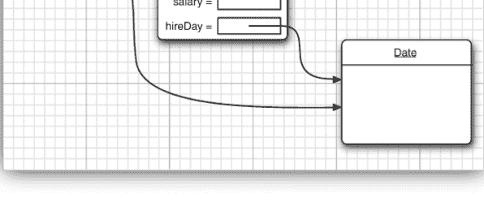

**图 4.5** 返回可变实例字段的引用

```java
class Employee
{
    . . .
    public Date getHireDay()
    {
        return (Date) hireDay.clone(); // OK
    }
    . . .
}
```

根据经验，每当需要返回可变字段的副本时，应始终使用 `clone`。

### 4.3.9 基于类的访问权限

你知道，一个方法可以访问调用它的对象的私有数据。人们常感到惊讶的是，一个方法可以访问*其类的所有对象*的私有数据。例如，考虑一个比较两个雇员的 `equals` 方法。

```java
class Employee
{
    . . .
    public boolean equals(Employee other)
    {
        return name.equals(other.name);
    }
}
```

典型调用是

```java
if (harry.equals(boss)) . . .
```

这个方法访问 `harry` 的私有字段，这并不奇怪。它还访问 `boss` 的私有字段。这是合法的，因为 `boss` 是 `Employee` 类型的对象，而 `Employee` 类的方法允许访问 `Employee` 类型*任意*对象的私有字段。

**C++ 注意：**

> C++ 有相同的规则。一个方法可以访问其类任意对象的私有特性，而不只是隐式参数的对象。

### 4.3.10 私有方法

实现类时，我们将所有实例字段设为私有，因为公共数据是危险的。但方法呢？虽然大多数方法是公有的，但私有方法在某些情况下很有用。有时，你可能希望将计算代码拆分为单独的辅助方法。通常，这些辅助方法不应属于公共接口——它们可能过于接近当前实现，或者需要特殊协议或调用顺序。这类方法最好实现为私有方法。

在 Java 中实现私有方法，只需将 `public` 关键字改为 `private`。

将方法设为私有后，如果更改实现，你没有义务继续保留它可用。如果数据表示发生变化，该方法可能*更难*实现或变得*不必要*；这无关紧要。关键在于，只要方法是私有的，类的设计者就可以确信它不会在其他地方被使用，因此可以简单地删除它。如果方法是公有的，就不能简单删除它，因为其他代码可能依赖它。

### 4.3.11 final 实例字段

可以将实例字段定义为 *final*。这样的字段必须在构造对象时初始化。也就是说，必须保证在每个构造器结束后该字段值已被设置。此后，该字段不能再被修改。例如，Employee 类的 *name* 字段可以声明为 *final*，因为它在对象构造后从不改变——没有 setName 方法。

```java
class Employee
{
    private final String name;
    . . .
}
```

*final* 修饰符对于类型为基本类型或*不可变类*的字段特别有用。（如果一个类的方法从不修改其对象，则该类是不可变的。例如，String 类是不可变的。）

对于可变类，*final* 修饰符可能令人困惑。例如，考虑一个字段

```java
private final StringBuilder evaluations;
```

它在 Employee 构造器中初始化为

```java
evaluations = new StringBuilder();
```

*final* 关键字仅仅意味着存储在 evaluations 变量中的对象引用将永远不会再指向不同的 StringBuilder 对象。但该对象本身可以被修改：

```java
public void giveGoldStar()
{
    evaluations.append(LocalDate.now() + ": Gold star!\n");
}
```

## 4.4 静态字段和方法

在你见过的所有示例程序中，`main` 方法都带有 `static` 修饰符。现在可以讨论这个修饰符的含义了。

### 4.4.1 静态字段

如果将字段定义为 `static`，那么该字段不会存在于类的对象中。每个静态字段只有一份副本。可以将静态字段视为属于类，而不是属于各个对象。例如，假设我们想为每个雇员分配唯一的标识号。我们向 `Employee` 类添加一个实例字段 `id` 和一个静态字段 `nextId`：

```java
class Employee
{
    private static int nextId = 1;

    private int id;
    . . .
}
```

现在每个 `Employee` 对象都有自己的 `id` 字段，但只有一个 `nextId` 字段，由该类的所有实例共享。换一种说法。如果有 1,000 个 `Employee` 类的对象，那么就有 1,000 个实例字段 `id`，每个对象一个。但只有一个静态字段 `nextId`。即使没有 `Employee` 对象，静态字段 `nextId` 也存在。它属于类，而不属于任何单个对象。

> **注意：**
>
> 在某些面向对象编程语言中，静态字段被称为 *类字段*。“static”这个术语是从 C++ 遗留下来的无意义称呼。

在构造器中，我们将下一个可用 ID 赋给新的 `Employee` 对象，然后将其递增：

```java
id = nextId;
nextId++;
```

假设我们构造对象 `harry`。那么 `harry` 的 `id` 字段被设为静态字段 `nextId` 的当前值，并且静态字段的值递增：

```java
harry.id = Employee.nextId;
Employee.nextId++;
```

### 4.4.2 静态常量

静态变量相当罕见。然而，静态常量更常见。例如，`Math` 类定义了一个静态常量：

```java
public class Math
{
    . . .
    public static final double PI = 3.14159265358979323846;
    . . .
}
```

在程序中可以通过 `Math.PI` 访问这个常量。

如果省略关键字 `static`，那么 `PI` 就会是 `Math` 类的一个实例字段。也就是说，你需要这个类的对象来访问 `PI`，并且每个 `Math` 对象都会有自己的 `PI` 副本。

你多次使用过的另一个静态常量是 `System.out`。它在 `System` 类中声明如下：

```java
public class System
{

```java
. . .    public static final PrintStream out = . . .;
. . .
}
```

正如多次提到的，使用公共字段从来都不是好主意，因为每个人都可以修改它们。不过，公共常量（也就是 `final` 字段）没有问题。由于 `out` 已声明为 `final`，你不能再将另一个打印流重新赋给它：

```java
System.out = new PrintStream(...); // ERROR--out is final
```


> **注意：**
>
> 如果查看 `System` 类，你会注意到一个 `setOut` 方法，它把 `System.out` 设置为不同的流。你可能想知道该方法如何能改变 `final` 变量的值。然而，`setOut` 方法是*原生*方法，并非用 Java 编程语言实现。原生方法可以绕过 Java 语言的访问控制机制。这是一种非常不寻常的变通做法，你不应在自己的程序中效仿。

### 4.4.3 静态方法

静态方法是不对对象进行操作的方法。例如，`Math` 类的 `pow` 方法就是静态方法。表达式

```java
Math.pow(x, a)
```

计算 x^a 次幂。它不使用任何 `Math` 对象来完成其任务。换句话说，它没有隐式参数。

你可以把静态方法看作没有 *this* 参数的方法。（在非静态方法中，*this* 参数指的是该方法的隐式参数——见[第 4.3.7 节](#)，“隐式参数和显式参数”，第 150 页。）

Employee 类的静态方法不能访问 id 实例字段，因为它不对对象进行操作。但是，静态方法可以访问静态字段。下面是一个这样的静态方法示例：

```java
public static int advanceId()
{
    int r = nextId; // obtain next available id
    nextId++;
    return r;
}
```

要调用这个方法，需要提供类名：

```java
int n = Employee.advanceId();
```

你可以省略这个方法的 `static` 关键字吗？可以，但那样你就需要有一个 `Employee` 类型的对象引用来调用该方法。

> **注意：**
>
> 使用对象调用静态方法是合法的。例如，如果 harry 是一个 `Employee` 对象，那么你可以调用 `harry.advanceId()` 而不是 `Employee.advanceId()`。不过，我觉得这种写法令人困惑。`advanceId` 方法在计算结果时根本不查看 harry。我建议使用类名而不是对象来调用静态方法。

在两种情况下使用静态方法：

- 当方法不需要访问对象状态，因为所有需要的参数都作为显式参数提供时（示例：`Math.pow`）。

`Employee` 类：

```java
class Employee
{
    public Employee(String n, double s, int year, int month, int day)
    {
        name = n;
        salary = s;
        hireDay = LocalDate.of(year, month, day);
    }
    . . .
    public static void main(String[] args) // unit test
    {
        var e = new Employee("Romeo", 50000, 2003, 3, 31);
        e.raiseSalary(10);
        System.out.println(e.getName() + " " + e.getSalary());
    }
    . . .
}
```

要查看 `Employee` 类的演示，只需执行 `java Employee`。

如果 `Employee` 类是更大应用程序的一部分，你会用 `java Application` 启动应用程序，而 `Employee` 类的 main 方法永远不会被执行。

[代码清单 4.3](#) 中的程序包含 `Employee` 类的一个简单版本，它有一个静态字段 `nextId` 和一个静态方法 `advanceId`。我们用一个数组装入三个 `Employee` 对象，然后打印员工信息。最后，我们打印下一个可用的标识号，以演示静态方法。

```java
24        int n = Employee.advanceId(); // calls static method
25        System.out.println("Next available id=" + n);
26    }
27 }
28
29 class Employee
30 {
31    private static int nextId = 1;
32
33    private String name;
34    private double salary;
35    private int id;
36
37    public Employee(String n, double s)
38    {
39        name = n;
40        salary = s;
41        id = advanceId();
42    }
43
44    public String getName()
45    {
46        return name;
47    }
48
49    public double getSalary()
50    {
51        return salary;
52    }
53
54    public int getId()
55    {
56        return id;
57    }
58
59    public static int advanceId()
60    {
61        int r = nextId; // obtain next available id
62        nextId++;
63        return r;
64    }
65
66    public static void main(String[] args) // unit test
67    {
68        var e = new Employee("Harry", 50000);
69        System.out.println(e.getName() + " " + e.getSalary());
70    }
71}
```

### `java.util.Objects`

- `static <T> void requireNonNull(T obj)`
- `static <T> void requireNonNull(T obj, String message)`
- `static <T> void requireNonNull(T obj, Supplier<String> messageSupplier)`

如果 obj 为 null，这些方法会抛出 NullPointerException，不带消息或带给定消息。（*第 6 章*解释了如何通过供应器延迟获取值。*第 8 章*解释了 `<T>` 语法。）

- `static <T> T requireNonNullElse(T obj, T defaultObj)`
- `static <T> T requireNonNullElseGet(T obj, Supplier<T> defaultSupplier)`

如果 obj 不为 null，则返回 obj；如果 obj 为 null，则返回默认对象。

## 4.5 方法参数

让我们回顾一下计算机科学术语，这些术语描述了在编程语言中参数如何传递给方法（或函数）。术语 *按值调用* 意味着方法只得到调用方提供的值。相反，*按引用调用* 意味着方法得到调用方提供的变量位置。因此，方法可以 *修改* 通过引用传递的变量中存储的值，但不能修改通过值传递的变量中存储的值。这些“按……调用”术语是标准的计算机科学术语，描述各种编程语言（而不仅仅是 Java）中方法参数的行为。（还有一种 *按名调用*，主要具有历史意义，曾用于 Algol 编程语言——最古老的高级语言之一。）

Java 编程语言 *总是* 使用按值调用。这意味着方法得到所有参数值的副本。特别是，方法不能修改传递给它的任何参数变量的内容。

例如，考虑以下调用：

```java
double percent = 10;
harry.raiseSalary(percent);
```

无论该方法如何实现，我们都知道在方法调用之后，`percent` 的值仍然是 10。

让我们更仔细地看看这种情况。假设一个方法试图将某个方法参数的值变为三倍：

```java
public static void tripleValue(double x) // doesn't work
{
    x = 3 * x;
}
```

我们来调用这个方法：

```java
double percent = 10;
tripleValue(percent);
```

然而，这并不起作用。方法调用之后，`percent` 的值仍然是 10。发生的情况如下：

- `x` 用 `percent` 值的副本（即 10）初始化。
- `x` 变为三倍——现在为 30。但 `percent` 仍然是 10（见 *图 4.6*）。
- 方法结束，参数变量 `x` 不再使用。

不过，方法参数有两种：

- 基本类型（数字、布尔值）
- 对象引用

你已经看到，方法不可能改变基本类型参数。对象参数的情况则不同。你可以轻松实现一个将员工薪水变为三倍的方法：

```java
public static void tripleSalary(Employee x) // works
{
    x.raiseSalary(200);
}
```

当你调用

```java
harry = new Employee(. . .);
tripleSalary(harry);
```

那么会发生以下情况：


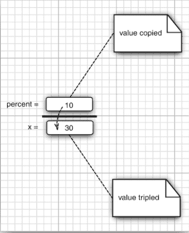

**图 4.6** 修改参数变量不会产生持久影响。

1. `x` 用 `harry` 的值的副本初始化——也就是说，一个对象引用。
2. `raiseSalary` 方法应用于该对象引用。`x` 和 `harry` 共同引用的 `Employee` 对象的工资提高了 200%。
3. 方法结束，参数变量 `x` 不再使用。当然，对象变量 `harry` 继续引用那个工资已变为三倍的对象（见*图 4.7*）。

如你所见，实现会改变对象参数状态的方法很容易——事实上非常常见。原因很简单。方法获得的是对象引用的副本，而原始引用和副本都指向同一个对象。

许多编程语言（尤其是 C++ 和 Pascal）有两种参数传递机制：按值调用和按引用调用。一些程序员（不幸的是，甚至一些书籍作者）声称 Java 对对象使用按引用调用。这是错误的。由于这是一个如此常见的误解，值得详细研究一个反例。

让我们尝试编写一个交换两个 `Employee` 对象的方法：

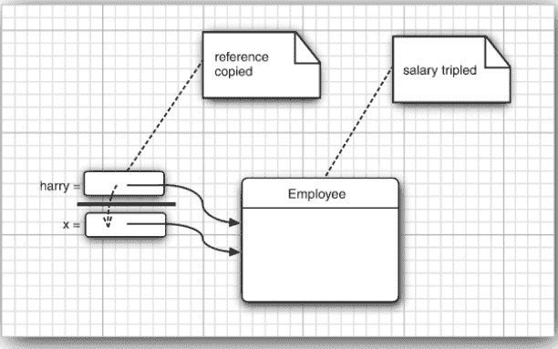

**图 4.7** 修改由参数引用的对象会产生持久影响。

```java
public static void swap(Employee x, Employee y) // doesn't work
{
    Employee temp = x;
    x = y;
    y = temp;
}
```

如果 Java 对对象使用按引用调用，这个方法就会起作用：

```java
var a = new Employee("Alice", . . .);
var b = new Employee("Bob", . . .);
swap(a, b);
// does a now refer to Bob, b to Alice?
```

然而，该方法实际上不会改变存储在变量 `a` 和 `b` 中的对象引用。`swap` 方法的 `x` 和 `y` 参数是用这些引用的*副本*初始化的。然后该方法继续交换这些副本。

```java
// x refers to Alice, y to Bob
Employee temp = x;
x = y;
y = temp;
// now x refers to Bob, y to Alice
```

但最终，这只是徒劳。方法结束时，参数变量 `x` 和 `y` 被丢弃。原始变量 `a` 和 `b` 仍然指向与方法调用之前相同的对象（见图 4.8）。

## 数据可视化入门

数据可视化是指将数据以图形或图表的形式呈现，使信息的表达更直观、更容易理解。通过可视化，我们可以快速识别数据中的模式、趋势和异常。

常见的数据可视化工具包括：

- Python (Matplotlib, Seaborn)
- R (ggplot2)
- JavaScript (D3.js, ECharts)
- 商业智能工具 (Power BI, Tableau)

> 一张图胜过千言万语 —— 数据可视化的核心理念。

本文使用 Python 的 Matplotlib 库演示基础图表的绘制。在开始之前，请确保已安装相关依赖：

```bash
pip install matplotlib pandas
```

以下示例展示了一个简单的折线图：

```python
import matplotlib.pyplot as plt
import numpy as np

x = np.linspace(0, 10, 100)
y = np.sin(x)

plt.plot(x, y)
plt.title('Sine Curve')
plt.show()
```

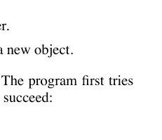

```
End of method: x=30.0
After: percent=10.0
```

然后，它成功地将一名员工的工资变为三倍：

```
Testing tripleSalary:
Before: salary=50000.0
End of method: salary=150000.0
After: salary=150000.0
```

方法执行后，harry 所引用的对象的状态已经改变。这是可能的，因为该方法通过对象引用的副本修改了状态。

最后，程序演示了 swap 方法的失败：

```
Testing swap:
Before: a=Alice
Before: b=Bob
End of method: x=Bob
End of method: y=Alice
After: a=Alice
After: b=Bob
```

如你所见，参数变量 x 和 y 被交换了，但变量 a 和 b 不受影响。


### C++ 备注

C++ 既有按值调用，也有按引用调用。你用 & 标记引用参数。例如，你可以轻松实现 void tripleValue(double& x) 或 void swap(Employee& x, Employee& y) 这类会修改其引用参数的方法。

## 清单 4.4 `ParamTest/ParamTest.java`

```java
/**
 * This program demonstrates parameter passing in Java.
 * @version 1.01 2018-04-10
 * @author Cay Horstmann
 */
public class ParamTest
{
   public static void main(String[] args)
   {
      /*
       * Test 1: Methods can't modify numeric parameters
       */
      System.out.println("Testing tripleValue:");
      double percent = 10;
      System.out.println("Before: percent=" + percent);
      tripleValue(percent);
      System.out.println("After: percent=" + percent);

      /*
       * Test 2: Methods can change the state of object parameters
       */
      System.out.println("\nTesting tripleSalary:");
      var harry = new Employee("Harry", 50000);
      System.out.println("Before: salary=" +
         harry.getSalary());
      tripleSalary(harry);
      System.out.println("After: salary=" + harry.getSalary());

      /*
       * Test 3: Methods can't attach new objects to object parameters
       */
      System.out.println("\nTesting swap:");
      var a = new Employee("Alice", 70000);
      var b = new Employee("Bob", 60000);
      System.out.println("Before: a=" + a.getName());
      System.out.println("Before: b=" + b.getName());

      swap(a, b);
      System.out.println("After: a=" + a.getName());
      System.out.println("After: b=" + b.getName());
   }

   public static void tripleValue(double x) // doesn't work
   {
      x = 3 * x;
      System.out.println("End of method: x=" + x);
   }

   public static void tripleSalary(Employee x) // works
   {
      x.raiseSalary(200);
      System.out.println("End of method: salary=" +
         x.getSalary());
   }

   public static void swap(Employee x, Employee y)
   {
      Employee temp = x;
      x = y;
      y = temp;
      System.out.println("End of method: x=" + x.getName());
      System.out.println("End of method: y=" + y.getName());
   }
}

class Employee // simplified Employee class
{
   private String name;
   private double salary;

   public Employee(String n, double s)
   {
      name = n;
      salary = s;
   }

   public String getName()
```

不同的参数。编译器必须弄清楚该调用哪个方法。它通过将各个方法头部中的参数类型与特定方法调用中所用值的类型进行匹配，来挑选正确的方法。如果编译器无法匹配参数——要么因为完全没有匹配，要么因为没有一个匹配比所有其他匹配更好——就会发生编译时错误。（查找匹配的过程称为*重载解析*。）


### 注意

Java 允许你重载任何方法——不仅仅是构造器方法。因此，要完整描述一个方法，你需要指定其名称及其参数类型。这称为方法的*签名*。例如，`String` 类有四个名为 `indexOf` 的公共方法。它们的签名是

```text
indexOf(int)
indexOf(int, int)
indexOf(String)
indexOf(String, int)
```

返回类型不是方法签名的一部分。也就是说，不能有两个名称和参数类型相同但返回类型不同的方法。

### 4.6.2 默认字段初始化

如果你没有在构造器中显式设置字段，它会被自动设为默认值：数字为 `0`，布尔值为 `false`，对象引用为 `null`。有些人认为依赖默认值是不好的编程实践。当然，如果字段在不可见的情况下被初始化，会让别人更难理解你的代码。

### 注意

这是字段和局部变量之间的一个重要区别。在方法中，你必须始终显式初始化局部变量。但在类中，如果你不初始化字段，它会自动初始化为默认值（0、`false` 或 `null`）。

例如，考虑 `Employee` 类。假设你没有在构造器中指定如何初始化某些字段。默认情况下，`salary` 字段会被初始化为 `0`，而 `name` 和 `hireDay` 字段会被初始化为 `null`。

然而，这并不是一个好主意。如果有人调用 `getName` 或 `getHireDay` 方法，他们会得到一个可能没预料到的 `null` 引用：

```java
LocalDate h = harry.getHireDay();
int year = h.getYear(); // throws exception if h is null
```

### 4.6.3 无参数构造器

许多类包含一个无参数构造器，用于创建一个状态被设为合适默认值的对象。例如，下面是 `Employee` 类的无参数构造器：

```java
public Employee()
{
    name = "";
    salary = 0;
    hireDay = LocalDate.now();
}
```

如果你编写的类完全没有构造器，那么系统会为你提供一个无参数构造器。这个构造器会将*所有*实例字段设为默认值。因此，实例字段中包含的所有数值数据


对于基本类型数值为 0，所有布尔值为 `false`，所有对象变量为 `null`。

如果某个类至少提供了一个构造器，但没有提供无参构造器，那么在构造对象时不提供参数是非法的。例如，我们在[列表 4.2](#)中的原始 `Employee` 类只提供了一个构造器：

```java
public Employee(String n, double s, int year, int month, int day)
```

对于该类，构造默认雇员是不合法的。也就是说，调用

```java
e = new Employee();
```

将会是一个错误。


**警告：**

请记住，只有当你的类没有其他构造器时，你才会免费获得一个无参构造器。如果你自己编写的类哪怕只含有一个构造器，并且你希望类的使用者能够通过调用

```java
new ClassName()
```

来创建实例，那么你必须提供一个无参构造器。当然，如果你对所有字段的默认值感到满意，你可以简单地提供

```java
public ClassName()
{
}
```

## 4.6 对象构造


**C++ 注释：**

C++ 有一种特殊的初始化列表语法来构造字段，例如

```cpp
Employee::Employee(String n, double s, int y, int m, int d) // C++
:   name(n),
    salary(s),
    hireDay(y, m, d)
{
}
```

C++ 使用这种特殊语法是为了避免不必要的无参构造器调用。在 Java 中，这没有必要，因为对象没有子对象，只有对其他对象的引用。

### 4.6.4 显式字段初始化

通过重载类中的构造器方法，你可以构建多种方式来设置类实例字段的初始状态。确保无论调用哪个构造器，每个实例字段都被设置为有意义的值，始终是一个好主意。

你可以简单地在类定义中为任何字段赋值。例如：

```java
class Employee
{
    private String name = "";
    ...
}
```

这个赋值在构造器执行之前完成。如果类的所有构造器都需要将某个特定实例字段设置为相同的值，这种语法尤其有用。

初始化值不一定是常量。下面是一个通过方法调用来初始化字段的示例。考虑 `Employee` 类，其中每个雇员都有一个 `id` 字段。你可以这样初始化它：

```java
class Employee
{
    private static int nextId;
    private int id = advanceId();
    . . .
    private static int advanceId()
    {
        int r = nextId;
        nextId++;
        return r;
    }
    . . .
}
```

### 4.6.5 参数命名

当你编写非常简单的构造器时（而且你会编写很多这类构造器），为参数起名可能会有些令人烦恼。

我们通常选择单字母参数名：

```java
public Employee(String n, double s)
{
    name = n;
    salary = s;
}
```

然而，缺点是您需要阅读代码才能明白 `n` 和 `s` 参数的含义。

有些程序员会为每个参数加上“a”前缀：

```java
public Employee(String aName, double aSalary)
{
    name = aName;
    salary = aSalary;
}
```

这样更好。任何读者都能立即明白参数的含义。

另一种常用的技巧利用了参数变量会*遮蔽*（shadow）同名的实例字段这一事实。例如，如果你将参数命名为 `salary`，那么 `salary` 指的是参数，而不是实例字段。但你仍然可以通过 `this.salary` 访问实例字段。回想一下，`this` 表示隐式参数——即正在构造的对象。下面是一个示例：

```java
public Employee(String name, double salary)
{
    this.name = name;
    this.salary = salary;
}
```

> **C++ 注释：**
> 
> 在 C++ 中，通常使用下划线或固定字母作为实例字段的前缀。（字母 `m` 和 `x` 是常见选择。）例如，工资字段可能被命名为 `_salary`、`mSalary` 或 `xSalary`。Java 程序员通常不这样做。

### 4.6.6 调用另一个构造器

关键字 `this` 指的是方法的隐式参数。然而，这个关键字还有第二种含义。

如果构造器的*第一条*语句具有 `this(...)` 的形式，那么该构造器会调用同一个类的另一个构造器。下面是一个典型示例：

```java
public Employee(double s)
{
    // 调用 Employee(String, double)
    this("Employee #" + nextId, s);
    nextId++;
}
```

当你调用 `new Employee(60000)` 时，`Employee(double)` 构造器会调用 `Employee(String, double)` 构造器。

以这种方式使用 `this` 关键字非常有用——你只需要编写一次公共的构造代码。


> **C++ 注释：**
> 
> Java 中的 `this` 引用与 C++ 中的 `this` 指针相同。然而，在 C++ 中，一个构造器不可能调用另一个构造器。如果你想在 C++ 中提取公共的初始化代码，你必须编写一个单独的方法。

### 4.6.7 初始化块

你已经看到了两种初始化实例字段的方法：

- 在构造器中设置值
- 在声明中赋值

Java 中还有第三种机制，称为*初始化块*（initialization block）。类声明中可以包含任意的代码块。每当构造该类的对象时，这些代码块就会执行。例如：

```java
class Employee
{
    private static int nextId;
    private int id;
    private String name;
    private double salary;

    // 对象初始化块
    {
        id = nextId;
        nextId++;
    }

    public Employee(String n, double s)
    {
        name = n;
        salary = s;
    }

    public Employee()
    {
        name = "";
        salary = 0;
    }
    . . .
}
```

在这个示例中，`id` 字段在对象初始化块中被初始化，无论使用哪个构造器来构造对象。初始化块首先运行，然后执行构造器的主体。

这种机制并非必要，也不常见。通常将初始化代码直接放在构造器中更为直接明了。

**注释：**

在初始化块中设置字段是合法的，即使这些字段在类中稍后才定义。然而，为了避免循环定义，读取那些仅在后面才初始化的字段是不合法的。具体规则在 Java 语言规范的 8.3.3 节（[http://docs.oracle.com/javase/specs](http://docs.oracle.com/javase/specs)）中有详细说明。这些规则复杂到足以难倒编译器实现者——早期版本的 Java 在实现它们时存在细微错误。因此，你应该始终将初始化块放在字段定义之后。

有这么多种初始化实例字段的方法，要列出构造过程的所有可能路径可能会让人相当困惑。下面是调用构造器时实际发生的详细过程：

1. 如果构造器的第一行调用了另一个构造器，那么第二个构造器会使用提供的参数执行。
2. 否则：
   - 所有实例字段都被初始化为其默认值（`0`、`false` 或 `null`）。
   - 所有字段初始化器和初始化块按照它们在类声明中出现的顺序执行。
3. 执行构造器的主体。

当然，最好总是将你的初始化代码组织得清晰易懂，让其他程序员无需成为语言专家也能轻松理解。例如，如果一个类的构造器依赖于实例字段的声明顺序，那将是非常奇怪且容易出错的。

要初始化静态字段，要么提供一个初始值，要么使用静态初始化块。你已经看到了第一种机制：

```java
private static int nextId = 1;
```

如果你的类的静态字段需要复杂的初始化代码，请使用静态初始化块。


将代码放在一个块中，并用关键字 `static` 标记它。下面是一个示例。我们希望员工 ID 号从小于 10,000 的随机整数开始。

```java
private static Random generator = new Random();

// static initialization block
static
{
    nextId = generator.nextInt(10000);
}
```

静态初始化在类首次加载时发生。与实例字段一样，静态字段的值为 0、false 或 null，除非你显式地将它们设置为其他值。所有静态字段初始化器和静态初始化块都按照它们在类声明中出现的顺序执行。


## 注意：

> 令人惊讶的是，直到 JDK 6，都可以在 Java 中编写一个“Hello, World”程序，而无需编写 main 方法。

```java
public class Hello
{
    static
    {
        System.out.println("Hello, World");
    }
}
```

当你用 `java Hello` 调用该类时，类被加载，静态初始化块打印出“Hello, World”，然后才显示一条消息，指出未定义 main。从 Java 7 开始，`java` 程序会首先检查是否存在 main 方法。

本示例使用 Random 类生成随机数。自 JDK 17 起，`java.util.random` 包提供了具有各种权衡的强算法实现。请阅读 `java.util.random` 包的 API 文档，以获取关于选择哪种算法的建议。然后通过像这样提供算法名称来获取一个实例：

```java
RandomGenerator generator =
    RandomGenerator.of("L64X128MixRandom");
```

通过调用 `generator.nextInt(n)` 或其他 `RandomGenerator` 方法来生成随机数。（`RandomGenerator` 是一个*接口*，这一概念在第 6 章中介绍。你可以对 `Random` 类的对象使用所有 `RandomGenerator` 方法。）

清单 4.5 中的程序展示了本节讨论的许多特性：

- 重载构造器
- 使用 `this(...)` 调用另一个构造器
- 无参构造器
- 对象初始化块
- 静态初始化块
- 实例字段初始化

### **清单 4.5** ConstructorTest/ConstructorTest.java

```java
1  import java.util.*;
2
3  /**
4   * This program demonstrates object construction.
5   * @version 1.02 2018-04-10
6   * @author Cay Horstmann
7   */
8  public class ConstructorTest
9  {
10     public static void main(String[] args)
11     {
12         // fill the staff array with three Employee objects
13         var staff = new Employee[3];
14
15         staff[0] = new Employee("Harry", 40000);
16         staff[1] = new Employee(60000);
17         staff[2] = new Employee();
18
19         // print out information about all Employee objects
20         for (Employee e : staff)
21             System.out.println("name=" + e.getName() + ",id=" +
22                 e.getId() + ",salary=" + e.getSalary());
23     }
24 }
25
26 class Employee
27 {
28     private static int nextId;
29
30     private int id;
31     private String name = ""; // instance field initialization
32     private double salary;
33
34     private static Random generator = new Random();
35
36     // static initialization block
37     static
38     {
39         // set nextId to a random number between 0 and 9999
40         nextId = generator.nextInt(10000);
41     }
42
43     // object initialization block
44     {
45         id = nextId;
46         nextId++;
47     }
48
49     // three overloaded constructors
50     public Employee(String n, double s)
51     {
52         name = n;
53         salary = s;
54     }
55
56     public Employee(double s)
57     {
58         // calls the Employee(String, double) constructor
59         this("Employee #" + nextId, s);
60     }
61
62     // the default constructor
63     public Employee()
64     {
65         // name initialized to ""--see above
66         // salary not explicitly set--initialized to 0
67         // id initialized in initialization block
68     }
69
70     public String getName()
71     {
72         return name;
73     }
74
75     public double getSalary()
76     {
77         return salary;
78     }
79
80     public int getId()
81     {
82         return id;
83     }
84 }
```

- `Random()`  
  构造一个新的随机数生成器。

### `java.util.random.RandomGenerator`

- `int nextInt(int n)`  
  返回 0 到 n − 1 之间的随机整数。
- `static RandomGenerator of(String name)`  
  为给定算法名称生成一个随机生成器。名称为 `L64X128MixRandom` 的算法适用于大多数应用。

### 4.6.8 对象析构与 `finalize` 方法

一些面向对象编程语言，尤其是 C++，具有显式的析构函数，用于在对象不再使用时执行可能需要的任何清理代码。析构函数中最常见的活动是回收为对象预留的内存。由于 Java 执行自动垃圾回收，不需要手动内存回收，因此 Java 不支持析构函数。

当然，有些对象使用内存以外的资源，例如文件或另一个使用系统资源的对象的句柄。在这种情况下，重要的是在不再需要该资源时将其回收并再利用。

如果某个资源在你使用完毕后需要立即关闭，请提供一个执行必要清理的 close 方法。你可以在用完对象后调用 close 方法。在第 7 章中，你将看到如何确保此方法被自动调用。

我们是否会想要更改 Point 的实现？当然，存在极坐标，但你不会在图形 API 中使用它们。在实践中，平面上的一个点完全由它的 *x* 坐标和 *y* 坐标描述。

为了更简洁地定义此类类，JDK 14 引入了“记录”作为预览特性。最终版本在 JDK 16 中交付。

### 4.7.1 记录概念

记录是类的一种特殊形式，其状态不可变且可被公开读取。下面是将 Point 定义为记录的方式：

```java
record Point(double x, double y) { }
```

结果是一个具有实例字段的类：

```java
private final double x;
private final double y;
```

在 Java 语言规范中，记录的实例字段称为它的*组件*。

该类有一个构造器

```java
Point(double x, double y)
```

以及访问器方法

```java
public double x()
public double y()
```

请注意，访问器称为 x 和 y，而不是 getX 和 getY。（在 Java 中，拥有同名的实例字段和方法是合法的。）

```java
record Point(double x, double y)
{
    public double distanceFromOrigin() { return Math.hypot(x,
    y); }
}
```

记录与任何类一样，可以具有静态字段和方法：

```java
record Point(double x, double y)
{
    public static Point ORIGIN = new Point(0, 0);
    public static double distance(Point p, Point q)
    {
        return Math.hypot(p.x - q.x, p.y - q.y);
    }
    ...
}
```

但是，你不能向记录中添加*实例*字段。

```java
record Point(double x, double y)
{
    private double r; // ERROR
    ...
}
```

> **注意：**
>
> 记录的实例字段自动为 final。但是，它们可能是对可变对象的引用：

```java
record PointInTime(double x, double y, Date when) { }
```

那么记录实例是可变的：

```java
var pt = new PointInTime(0, 0, new Date());
pt.when().setTime(0);
```

如果你希望记录实例不可变，请不要为字段使用可变类型。


> **提示：**
>
> 对于完全由一组变量表示的不可变数据，请使用记录而不是类。如果数据可变，或者表示可能随时间演变，请使用类。记录更易读、更高效，并且在并发程序中更安全。

### 4.7.2 构造器：规范、自定义和紧凑

自动定义的、设置所有实例字段的构造器称为*规范构造器*。

你可以定义额外的*自定义构造器*。此类构造器的第一条语句必须调用另一个构造器，以便最终调用规范构造器。下面是一个示例：

```java
record Point(double x, double y)
{
    public Point() { this(0, 0); }
}
```

该记录有两个构造器：规范构造器和一个生成原点的无参构造器。

如果规范构造器需要执行额外工作，你可以提供自己的实现：


```java
record Range(int from, int to)
{
    public Range(int from, int to)
    {
        if (from <= to)
        {
            this.from = from;
            this.to = to;
        }
        else
        {
            this.from = to;
            this.to = from;
        }
    }
}
```

不过，在实现规范构造器时，建议使用*紧凑*形式。你无需指定参数列表：

```java
record Range(int from, int to)
{
    public Range // Compact form
    {
        if (from > to) // Swap the bounds
        {
            int temp = from;
            from = to;
            to = temp;
        }
    }
}
```

紧凑形式的主体是规范构造器的“前奏”。它只是在参数变量`from`和`to`被赋值给实例字段`this.from`和`this.to`之前修改这些参数变量。在紧凑构造器的主体中，你不能读取或修改实例字段。

## 清单 4.6 RecordTest/RecordTest.java

```java
 1  import java.util.*;
 2
 3  /**
 4   * This program demonstrates records.
 5   * @version 1.0 2021-05-13
 6   * @author Cay Horstmann
 7   */
 8  public class RecordTest
 9  {
10      public static void main(String[] args)
11      {
12          var p = new Point(3, 4);
13          System.out.println("Coordinates of p: " + p.x() + " " + p.y());
14          System.out.println("Distance from origin: " + p.distanceFromOrigin());
15          // Same computation with static field and method
16          System.out.println("Distance from origin: " + Point.distance(Point.ORIGIN, p));
17
18          // A mutable record
19          var pt = new PointInTime(3, 4, new Date());
20          System.out.println("Before: " + pt);
21          pt.when().setTime(0);
22          System.out.println("After: " + pt);
23
24          // Invoking a compact constructor
25
26          var r = new Range(4, 3);
27          System.out.println("r: " + r);
28      }
29  }
30
31  record Point(double x, double y)
32  {
33      // A custom constructor
34      public Point() { this(0, 0); }
```

使用包的主要原因是保证类名的唯一性。假设有两位程序员都想出了提供`Employee`类的好主意。只要他们都把自己的类放在不同的包中，就不会发生冲突。事实上，要绝对保证包名唯一，可以使用倒序书写的 Internet 域名（域名已知是唯一的）。然后，你可以为不同项目使用子包。例如，考虑域名`horstmann.com`。按倒序书写时，它就变成包名`com.horstmann`。然后你可以追加项目名，例如`com.horstmann.corejava`。如果你随后把`Employee`类放入该包中，“完全限定”名就变成`com.horstmann.corejava.Employee`。

> **注意：**
> 
> 从编译器的角度来看，嵌套包之间绝对没有任何关系。例如，包`java.util`和`java.util.jar`彼此毫无关系。它们各自都是独立的类集合。

### 4.8.2 类的导入

一个类可以使用其自身包中的所有类，以及其他包中的所有*public*类。

可以通过两种方式访问另一个包中的*public*类。第一种方式是直接使用*完全限定名*，即包名后跟类名。例如：

```java
java.time.LocalDate today = java.time.LocalDate.now();
```

这显然很繁琐。更简单也更常见的做法是使用`import`语句。`import`语句的作用是为你提供一种简写方式来引用包中的类。一旦添加了`import`，就不必再给出类的全名。

你可以导入某个特定的类，也可以导入整个包。`import`语句应放在源文件顶部（但要位于任何`package`语句之下）。例如，可以用下面的语句导入`java.time`包中的所有类

```java
import java.time.*;
```

然后就可以使用

```java
LocalDate today = LocalDate.now();
```

而无需包前缀。你也可以导入包中的特定类：

```java
import java.time.LocalDate;
```

`java.time.*`语法不那么繁琐，并且不会对代码大小产生负面影响。不过，如果显式导入类，代码的读者就能确切知道你在使用哪些类。

**提示：**

在 Eclipse 中，你可以选择菜单项 Source → Organize Imports。诸如`import java.util.*;`这样的包语句会自动展开为具体导入列表，例如

```java
import java.util.ArrayList;
import java.util.Date;
```

这是一个极其方便的功能。

不过请注意，只能使用`*`表示法导入单个包。不能使用`import java.*`或`import java.*.*`来导入所有以 java 为前缀的包。

大多数时候，你只需导入需要的包，不必过于担心它们。唯一需要关注包的时候是发生名称冲突时。例如，`java.util`和`java.sql`包都有一个`Date`类。假设你编写一个同时导入这两个包的程序。

```java
import java.util.*;
import java.sql.*;
```

如果现在使用`Date`类，就会遇到编译时错误：

```java
Date today; // ERROR--java.util.Date or java.sql.Date?
```

编译器无法判断你想要哪个`Date`类。可以通过添加一条特定导入语句来解决此问题：

```java
import java.util.*;
import java.sql.*;
import java.util.Date;
```

如果你确实需要同时使用两个`Date`类，该怎么办？那么就在每个类名处使用完整包名：

```java
var startTime = new java.util.Date();
var today = new java.sql.Date(. . .);
```

在包中定位类是*编译器*的活动。类文件中的字节码始终使用完整包名来引用其他类。

**C++ 注意：**

C++ 程序员有时会把`import`和`#include`混淆。二者毫无共同之处。在 C++ 中，必须使用`#include`来包含外部功能的声明，因为 C++ 编译器除了正在编译的文件及其显式包含的头文件之外，不会查看任何其他文件。而 Java 编译器只要你告诉它去哪里查找，就会乐于查看其他文件。

在 Java 中，你可以通过显式命名所有类（例如`java.util.Date`）来完全避免使用`import`机制。在 C++ 中，则无法避免`#include`指令。

`import`语句的唯一好处是方便。你可以用比完整包名更短的名称来引用类。例如，在`import java.util.*`（或`import java.util.Date`）语句之后，就可以简单地把`java.util.Date`类称为`Date`。

在 C++ 中，与包机制类似的构造是`namespace`特性。可以把 Java 中的包和`import`语句看作 C++ 中`namespace`和`using`指令的对应物。

### 4.8.3 静态导入

`import`语句的一种形式允许导入静态方法和字段，而不仅仅是类。

例如，如果在源文件顶部添加指令

```java
import static java.lang.System.*;
```

那么就可以使用`System`类的静态方法和字段，而无需类名前缀：

```java
out.println("Goodbye, World!"); // i.e., System.out
exit(0); // i.e., System.exit
```

清单 4.7 和 4.8 中的程序分布在两个包中：`PackageTest`类属于未命名包，`Employee`类属于`com.horstmann.corejava`包。因此，`Employee.java`文件必须位于子目录`com/horstmann/corejava`中。换句话说，目录结构如下：

```
. (base directory)
├── PackageTest.java
├── PackageTest.class
└── com/
    └── horstmann/
        └── corejava/
            ├── Employee.java
            └── Employee.class
```

要编译此程序，只需切换到基目录并运行命令

```
javac PackageTest.java
```

编译器会自动找到文件`com/horstmann/corejava/Employee.java`并编译它。

让我们看一个更贴近实际的示例，其中不使用未命名包，而是把类分布在多个包（`com.horstmann.corejava`和`com.mycompany`）中。

```
. (base directory)
└── com/
    ├── horstmann/
    │   └── corejava/
    │       ├── Employee.java
    │       └── Employee.class
    └── mycompany/
        ├── PayrollApp.java
        └── PayrollApp.class
```

在这种情况下，仍然必须从*基*目录（即包含`com`目录的目录）编译和运行类：


```text
javac com/mycompany/PayrollApp.java
java com.mycompany.PayrollApp
```

再次注意，编译器操作的是*文件*（使用文件分隔符和 .java 扩展名），而 Java 解释器加载的是*类*（使用点分隔符）。

### **提示：**

从下一章开始，我们将对源代码使用包。这样，你可以为每一章而不是每一节创建一个 IDE 项目。

### **注意：**

编译器在编译源文件时*不*检查目录结构。例如，假设你有一个源文件，其开头是以下指令

```java
package com.mycompany;
```

即使该文件不包含在 com/mycompany 子目录中，你也可以编译它。源文件将编译无错误，*如果它不依赖于其他包。* 但是，除非你先把所有类文件移到正确的位置，否则生成的程序将无法运行。如果包与目录不匹配，*虚拟机*将找不到这些类。

### **清单 4.7** PackageTest/PackageTest.java

```java
1  import com.horstmann.corejava.*;
2  // the Employee class is defined in that package
import static java.lang.System.*;

/**
 * This program demonstrates the use of packages.
 * @version 1.11 2004-02-19
 * @author Cay Horstmann
 */
public class PackageTest
{
   public static void main(String[] args)
   {
      // because of the import statement, we don't have to use
      // com.horstmann.corejava.Employee here
      var harry = new Employee("Harry Hacker", 50000, 1989,
         10, 1);

      harry.raiseSalary(5);

      // because of the static import statement, we don't have
      // to use System.out.println.
      out.println("name=" + harry.getName() + ",salary=" +
         harry.getSalary());
   }
}
```

### **清单 4.8** PackageTest/com/horstmann/corejava/Employee.java

```java
package com.horstmann.corejava;

// the classes in this file are part of this package

import java.time.*;

// import statements come after the package statement

/**
 * @version 1.11 2015-05-08
 * @author Cay Horstmann
12    */
13    public class Employee
14    {
15        private String name;
16        private double salary;
17        private LocalDate hireDay;
18
19        public Employee(String name, double salary, int year, int
   month, int day)
20        {
21            this.name = name;
22            this.salary = salary;
23            hireDay = LocalDate.of(year, month, day);
24        }
25
26        public String getName()
27        {
28            return name;
29        }
30
31        public double getSalary()
32        {
33            return salary;
34        }
35
36        public LocalDate getHireDay()
37        {
38            return hireDay;
39        }
40
41        public void raiseSalary(double byPercent)
42        {
43            double raise = salary * byPercent / 100;
44            salary += raise;
45        }
46    }
```

### 4.8.5 包访问

你已经遇到过访问修饰符 `public` 和 `private`。标记为 `public` 的特性可以被任何类使用。私有特性只能由定义它们的类使用。如果你既不指定 `public` 也不指定 `private`，则该特性（即类、方法或变量）可以被同一*包*中的所有方法访问。

考虑清单 4.2 中的程序。`Employee` 类没有定义为 public 类。因此，只有同一包中的其他类（例如 `EmployeeTest`）可以访问它——在这种情况下是未命名包。对于类来说，这是一个合理的默认设置。然而，对于变量来说，这是一个不幸的选择。变量必须显式标记为 `private`，否则它们将默认具有包访问权限。当然，这会破坏封装。问题在于，忘记键入 `private` 关键字实在太容易了。下面是 `java.awt` 包中 `Window` 类的一个示例，它是 JDK 附带的源代码的一部分：

```java
public class Window extends Container
{
    String warningString;
    . . .
}
```

注意，`warningString` 变量不是 `private`！这意味着 `java.awt` 包中所有类的方法都可以访问这个变量，并把它设置成任何它们喜欢的内容（例如 `"Trust me!"`）。实际上，访问这个变量的唯一方法位于 `Window` 类中，因此将该变量设为 private 本来是完全合适的。也许是程序员匆忙键入代码，只是忘记了 `private` 修饰符？也许没人在意？二十多年后，该变量仍然不是 private。不仅如此——随着时间的推移，该类中添加了新的字段，其中大约一半也不是 private。

这可能是一个问题。默认情况下，包不是封闭的实体。也就是说，任何人都可以向包中添加更多类。当然，怀有敌意或一无所知的程序员随后可以添加代码来修改具有包访问权限的变量。例如，在早期 Java 版本中，将另一个类偷偷放入 `java.awt` 包是件容易的事。只需让该类以如下内容开头

```java
package java.awt;
```

然后，将生成的类文件放在类路径某处的 java/awt 子目录中，你就获得了对 java.awt 包内部的访问权限。通过这种诡计，就可以修改警告字符串（见图 4.9）。

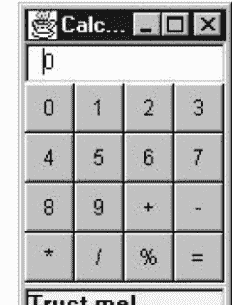

**图 4.9** 更改 applet 窗口中的警告字符串

从 1.2 版开始，JDK 实现者改造了类加载器，明确禁止加载包名以 “java.” 开头的用户定义类。当然，你自己的类不会从这种保护中受益。另一种现已过时的机制允许 JAR 文件将包声明为*密封*，防止第三方扩充它们。如今，你应该使用模块来封装包。模块将在第 II 卷第 9 章中详细讨论。

### 4.8.6 类路径

如你所见，类存储在文件系统的子目录中。类的路径必须与包名匹配。

类文件也可以存储在 JAR（Java 归档）文件中。JAR 文件以压缩格式包含多个类文件和子目录，从而节省空间并提高性能。当你在程序中使用第三方库时，通常会得到一个或多个要包含的 JAR 文件。你将在[第 11 章](#)中看到如何创建自己的 JAR 文件。


### **提示：**

JAR 文件使用 ZIP 格式来组织文件和子目录。你可以使用任何 ZIP 实用工具查看 JAR 文件的内部。

要在程序之间共享类，你需要执行以下操作：

1. 将类文件放在一个目录中——例如 `/home/user/classdir`。注意，这个目录是包树的*基础*目录。如果你添加类 `com.horstmann.corejava.Employee`，那么 `Employee.class` 文件必须位于子目录 `/home/user/classdir/com/horstmann/corejava` 中。
2. 将任何 JAR 文件放在一个目录中——例如 `/home/user/archives`。
3. 设置*类路径*。类路径是所有可以包含类文件的位置的集合。

在 UNIX 中，类路径上的元素用冒号分隔：

```text
/home/user/classdir:.:/home/user/archives/archive.jar
```

在 Windows 中，它们用分号分隔：

```text
c:\classdir;.;c:\archives\archive.jar
```

在这两种情况下，句点表示当前目录。

这个类路径包含

- 基础目录 `/home/user/classdir` 或 `c:\classdir`；
- 当前目录（`.`）；以及
- JAR 文件 `/home/user/archives/archive.jar` 或 `c:\archives\archive.jar`。

从 Java 6 开始，你可以为 JAR 文件目录指定通配符，如下所示：

```text
/home/user/classdir:.:/home/user/archives/'*'
```

或

```text
c:\classdir;.;c:\archives\*
```

在 UNIX 中，必须对 `*` 进行转义，以防止 shell 展开。

archives 目录中的所有 JAR 文件（但不包括 .class 文件）都包含在这个类路径中。

查找类时始终会搜索 Java API；不要把它显式包含在类路径中。

> **注意：**
>
> `javac` 编译器总是在当前目录中查找文件，但 `java` 虚拟机启动器只有在 “.” 目录位于类路径上时才会查看当前目录。如果你没有设置类路径，这不是问题——默认类路径由 “.” 目录组成。但是，如果你设置了类路径却忘记包含 “.” 目录，你的程序将编译无错误，但不会运行。

类路径列出了所有作为定位类*起点*的目录和归档文件。让我们考虑一下示例类路径：


```
/home/user/classdir:.:/home/user/archives/archive.jar
```

假设虚拟机搜索 `com.horstmann.corejava.Employee` 类的类文件。它首先在 Java API 类中查找。它在那里找不到该类文件，因此转向类路径。然后它查找以下文件：

- `/home/user/classdir/com/horstmann/corejava/Employee.class`
- 从当前目录开始的 `com/horstmann/corejava/Employee.class`
- `/home/user/archives/archive.jar` 中的 `com/horstmann/corejava/Employee.class`

编译器定位文件比虚拟机更困难。如果你引用一个类而未指定其包，编译器首先需要找出包含该类的包。它会查询所有 `import` 指令，作为该类的可能来源。例如，假设源文件包含指令

```
import java.util.*;
import com.horstmann.corejava.*;
```

并且源代码引用了一个类 `Employee`。然后编译器会尝试查找 `java.lang.Employee`（因为 `java.lang` 包总是默认导入）、`java.util.Employee`、`com.horstmann.corejava.Employee`，以及当前包中的 `Employee`。它会在类路径的所有位置搜索这些类中的*每一个*。如果找到多个类，则会出现编译时错误。（完全限定类名必须唯一，因此 `import` 语句的顺序无关紧要。）

编译器还会更进一步。它会查看*源文件*，以判断源文件是否比类文件更新。如果是，则自动重新编译源文件。回想一下，你只能从其他包中 `import` `public` 类。一个源文件只能包含一个 `public` 类，并且文件名和 `public` 类的名称必须匹配。因此，编译器可以轻松定位 `public` 类的源文件。但是，你可以从当前包中 `import` `nonpublic` 类。这些类可能定义在名称不同的源文件中。如果你从当前包导入一个类，编译器会搜索当前包的*所有*源文件，以确定哪一个定义了该类。

### 4.8.7 设置类路径

最好使用选项 `-classpath`（或 `-cp`，或从 Java 9 开始使用 `--class-path`）来指定类路径：

```
java -classpath /home/user/classdir:.:/home/user/archives/archive.jar MyProg
```

或者

```
java -classpath c:\classdir;.;c:\archives\archive.jar MyProg
```

整个命令必须输入在一行上。最好将如此长的命令行放入 shell 脚本或批处理文件中。

使用 `-classpath` 选项是设置类路径的首选方法。另一种方法是使用 `CLASSPATH` 环境变量。具体细节取决于你的 shell。使用 Bourne Again shell（bash）时，使用命令

```
export CLASSPATH=/home/user/classdir:.:/home/user/archives/archive.jar
```

使用 Windows shell 时，使用

```
set CLASSPATH=c:\classdir;.;c:\archives\archive.jar
```

类路径会一直设置到 shell 退出为止。

**警告：**

有些人建议永久设置 `CLASSPATH` 环境变量。这通常是个坏主意。人们会忘记这个全局设置，并在他们的类未正确加载时感到惊讶。一个特别应受谴责的例子是 Windows 中 Apple 的 QuickTime 安装程序。多年来，它全局设置 `CLASSPATH` 指向它需要的一个 JAR 文件，但没有将当前目录包含在类路径中。结果，无数 Java 程序员在程序编译成功却无法运行时被搞得心烦意乱。

**警告：**

过去，有些人建议通过将所有 JAR 文件放入 `jre/lib/ext` 目录来完全绕过类路径。这种机制在 Java 9 中已过时，而且它一直是个糟糕的建议。当早已遗忘的类从扩展目录加载时，很容易让人困惑。

**注意：**

从 Java 9 开始，类还可以从*模块路径*加载。模块和模块路径将在第二卷第 9 章讨论。

## 4.9 JAR 文件

当你打包应用程序时，你希望给用户一个单独的文件，而不是充满类文件的目录结构。Java 归档（JAR）文件就是为此目的而设计的。JAR 文件可以同时包含类文件和

| 选项 | 说明 |
|---|---|
| c | 创建新的或空的归档，并向其中添加文件。如果指定的任何文件名是目录，jar 程序会递归处理它们。 |
| C | 临时更改目录。例如，<br><br>`jar cvf jarfilename.jar -C classes *.class`<br><br>切换到 classes 子目录以添加类文件。 |
| e | 在清单中创建入口点（见 4.9.3 节）。 |
| f | 将 JAR 文件名指定为第二个命令行参数。如果缺少此参数，jar 在创建 JAR 文件时会将结果写入标准输出，在提取或列出 JAR 文件内容时从标准输入读取。 |
| i | 创建索引文件（用于加速大型归档中的查找）。 |
| m | 向 JAR 文件添加*清单*。清单是对归档内容和来源的描述。每个归档都有默认清单，但如果你想要验证归档内容，可以提供自己的清单。 |
| M | 不为条目创建清单文件。 |
| t | 显示目录表。 |
| u | 更新现有的 JAR 文件。 |
| v | 生成详细输出。 |
| x | 提取文件。如果你提供一个或多个文件名，则只提取这些文件。否则，提取所有文件。 |
| 0 | 存储时不使用 ZIP 压缩。 |

### 4.9.2 清单

除了类文件、图像和其他资源外，每个 JAR 文件还包含一个*清单*文件，用于描述该归档的特殊功能。

清单文件名为 `MANIFEST.MF`，位于 JAR 文件的特殊 `META-INF` 子目录中。最小的合法清单相当乏味——只有

```
Manifest-Version: 1.0
```

复杂的清单可以包含更多条目。清单条目被分组为节。清单中的第一节称为*主节*。它适用于整个 JAR 文件。后续条目可以指定命名实体的属性，例如单个文件、包或 URL。这些条目必须以 `Name` 条目开头。各节之间用空行分隔。例如：

```
Manifest-Version: 1.0
lines describing this archive

Name: Wozzle.class
lines describing this file

Name: com/mycompany/mypkg/
lines describing this package
```

要编辑清单，请将要添加到清单中的行放入一个文本文件。然后运行

```
jar cfm jarFileName manifestFileName . . .
```

例如，要创建一个带清单的新 JAR 文件，请运行

```
jar cfm MyArchive.jar manifest.mf com/mycompany/mypkg/*.class
```

要更新现有 JAR 文件的清单，请将新增内容放入一个文本文件，并使用如下命令

```
jar ufm MyArchive.jar manifest-additions.mf
```


**注意：**

有关 JAR 和清单文件格式的更多信息，请参见 [https://docs.oracle.com/javase/10/docs/specs/jar/jar.html](https://docs.oracle.com/javase/10/docs/specs/jar/jar.html)。

### 4.9.3 可执行 JAR 文件

你可以使用 `jar` 命令的 `e` 选项来指定程序的*入口点*——通常调用 java 程序启动器时要指定的类：

```
jar cvfe MyProgram.jar com.mycompany.mypkg.MainAppClass files to add
```

或者，你可以在清单中指定程序的*主类*，包括如下形式的语句

```
Main-Class: com.mycompany.mypkg.MainAppClass
```

不要在主类名中添加 `.class` 扩展名。


**警告：**

清单中的最后一行必须以换行符结尾。否则，清单将无法正确读取。一个常见错误是生成的文本文件只包含 `Main-Class` 行而没有行终止符。

使用任一方法，用户都可以简单地这样启动程序

```
java -jar MyProgram.jar
```


根据操作系统配置，用户甚至可以通过双击 JAR 文件图标来启动应用程序。以下是各种操作系统的行为：

- 在 Windows 上，Java 运行时安装程序会为“.jar”扩展名创建文件关联，使用 `javaw -jar` 命令启动该文件。（与 `java` 命令不同，`javaw` 命令不会打开 shell 窗口。）
- 在 Mac OS X 上，操作系统会识别“.jar”文件扩展名，并在你双击 JAR 文件时执行 Java 程序。

然而，JAR 文件中的 Java 程序并不具备原生应用程序那样的体验。在 Windows 上，你可以使用第三方包装实用程序将 JAR 文件转换为 Windows 可执行文件。包装器是一个带有熟悉的 `.exe` 扩展名的 Windows 程序，它会定位并启动 Java 虚拟机（JVM），或者在找不到 JVM 时告诉用户该怎么做。有许多商业和开源产品，例如 Launch4J（http://launch4j.sourceforge.net）和 IzPack（http://izpack.org）。

### 4.9.4 多版本 JAR 文件

随着模块和包的强封装机制的引入，一些以前可访问的内部 API 不再可用。这可能需要库提供者为不同的 Java 版本分发不同的代码。Java 9 为此引入了*多版本 JAR*。

为了向后兼容，特定于版本的类文件放置在

从 Java 9 开始，`-d` 选项会在目录不存在时创建该目录。

`--release` 标志也是 Java 9 新增的。在较旧版本中，你需要使用 `-source`、`-target` 和 `-bootclasspath` 标志。JDK 现在附带 API 前两个版本的符号文件。在 Java 9 中，你可以将 `--release` 设置为 9、8 或 7 进行编译。

多版本 JAR 并非用于程序或库的不同版本。所有类的公共 API 在两个版本中都应相同。多版本 JAR 的唯一目的是使你的程序或库的特定版本能够与多个 JDK 版本配合工作。如果你添加功能或更改 API，则应改为提供新版本的 JAR。

> **注意：**
>
> `javap` 等工具并未经过改造以处理多版本 JAR 文件。如果你调用
>
> ```text
> javap -classpath MyProgram.jar Application.class
> ```
>
> 你会得到该类的基准版本（毕竟，它应当与较新版本具有相同的公共 API）。如果你必须查看较新版本，请调用
>
> ```text
> javap -classpath MyProgram.jar!/META-INF/versions/9/Application.class
> ```

### 4.9.5 关于命令行选项的说明

Java 开发工具包中命令的选项传统上使用单破折号后跟多字母选项名，例如

单字母选项的参数可以用空白分隔，也可以直接跟在选项后面：

```text
javac -p moduledir . . .
```

或

```text
javac -pmoduledir . . .
```


> **警告：**
>
> 后者目前不起作用，而且总体上也似乎是个坏主意。如果模块目录恰好是参数或处理器，为什么要招致与遗留选项的冲突呢？

不带参数的单字母选项可以组合在一起：

```text
jar -cvf MyProgram.jar -e mypackage.MyProgram */*.class
```


> **警告：**
>
> 那目前不起作用，而且必然会导致混淆。假设 `javac` 增加了一个 `-c` 选项。`javac -cp` 是指 `javac -c -p`，还是遗留的 `-cp` 优先？

这造成了一团混乱，但愿随着时间推移会得到清理。尽管我很想摆脱古老的 jar 选项，但最好还是等到尘埃落定。不过，如果你想彻底现代化，可以放心使用 jar 命令的长选项：

```text
jar --create --verbose --file jarFileName file1 file2 . . .
```

如果不组合它们，单字母选项也可以使用：

```text
jar -c -v -f jarFileName file1 file2 . . .
```

## 4.10 文档注释

JDK 包含一个非常有用的工具，称为 `javadoc`，它可以从源文件生成 HTML 文档。事实上，第 3 章描述的在线 API 文档不过是对标准 Java 库的源代码运行 `javadoc` 的结果。

如果你向源代码中添加以特殊分隔符 `/**` 开头的注释，你也可以轻松生成看起来专业的文档。这是一种非常好的方法，因为它让你将代码和文档放在同一处。如果你将文档放入单独的文件，那么正如你可能知道的那样，代码和注释往往会随着时间推移而逐渐偏离。当文档注释与源代码位于同一文件时，更新两者并再次运行 `javadoc` 就是一件容易的事。

### 4.10.1 注释插入

`javadoc` 实用程序会提取以下各项的信息：

- 模块
- 包
- 公共类和接口
- 公共字段和受保护字段
- 公共和受保护的构造函数与方法

受保护特性在第 5 章介绍，接口在第 6 章介绍，模块在第 II 卷第 9 章介绍。

```java
/**
 * A {@code Card} object represents a playing card, such
 * as "Queen of Hearts". A card has a suit (Diamond, Heart,
 * Spade or Club) and a value (1 = Ace, 2 . . . 10, 11 = Jack,
 * 12 = Queen, 13 = King)
 */
public class Card
{
   . . .
}
```

**注意：**

没有必要在每一行前面添加 `*`。例如，以下注释同样有效：

```java
/**
   A <code>Card</code> object represents a playing card, such
   as "Queen of Hearts". A card has a suit (Diamond, Heart,
   Spade or Club) and a value (1 = Ace, 2 . . . 10, 11 = Jack,
   12 = Queen, 13 = King).
*/
```

然而，大多数 IDE 会自动提供星号，并在换行位置变化时重新排列它们。

### 4.10.3 方法注释

每个方法注释必须紧挨在它所描述的方法之前。除了通用标签外，你还可以使用以下标签：

- `@param` *变量描述*
  
  此标签向当前方法的“参数”部分添加一个条目。描述可以跨多行，并可以使用 HTML 标签。一个方法的所有 `@param` 标签必须放在一起。
- `@return` *描述*
  
  此标签向当前方法添加一个“返回值”部分。描述可以跨多行，并可以使用 HTML 标签。
- `@throws` *类描述*
  
  此标签添加一条说明，表示此方法可能抛出异常。异常是第 7 章的主题。

以下是一个方法注释的示例：

```java
/**
 * Raises the salary of an employee.
 * @param byPercent the percentage by which to raise the salary (e.g., 10 means 10%)
 * @return  the amount of the raise
 */
public double raiseSalary(double byPercent)
{
    double raise = salary * byPercent / 100;
    salary += raise;
    return raise;
}
```

### 4.10.4 字段注释

你只需要为公共字段编写文档——通常这意味着静态常量。例如：

```java
/**
 * The "Hearts" card suit
 */
public static final int HEARTS = 1;
```

### 4.10.5 通用注释

`@since` *文本* 标签会生成一个“since”条目。*文本* 可以是对引入此特性的版本的任意描述。例如，`@since 1.7.1`。

以下标签可用于类文档注释：

- `@author` *姓名*
  
  此标签会生成一个“author”条目。你可以有多个 `@author` 标签，每位作者一个。不必觉得必须使用此标签——你的版本控制系统在跟踪作者身份方面做得更彻底。
- `@version` *文本*
  
  此标签会生成一个“version”条目。*文本* 可以是对当前版本的任意描述。

你可以使用 `@see` 和 `@link` 标签，创建指向 javadoc 文档其他相关部分或外部文档的超链接。

`@see` *引用* 标签会在“另见”部分添加一个超链接。它可用于类和方法。此处，*引用* 可以是以下之一：

```text
package.class#feature label
<a href="..">label</a>
"text"
```

第一种情况最有用。你提供类、方法或变量的名称，javadoc 会插入指向文档的超链接。例如，

`@see com.horstmann.corejava.Employee#raiseSalary(double)`

会创建一个指向 `com.horstmann.corejava.Employee` 类中 `raiseSalary(double)` 方法的链接。你可以省略包名，或者同时省略包名和类名。这样，该特性将定位在当前包或类中。请注意，必须使用 `#` 而不是句点来分隔类与方法或变量名。Java

编译器本身非常擅长判断句点字符作为包、子包、类、内部类、方法和变量之间分隔符的各种含义。但 javadoc 工具并没有那么聪明，所以你需要帮它一把。

如果 `@see` 标签后面跟着一个 `<` 字符，那么你需要指定一个超链接。你可以链接到你喜欢的任何 URL。例如：

```html
@see <a href="www.horstmann.com/corejava.html">The Core Java home page</a>
```

在每种情况下，你都可以指定一个可选的*标签*，它将作为链接锚点显示。如果省略标签，用户将看到目标代码名或 URL 作为锚点。

如果 `@see` 标签后面跟着一个 `"` 字符，那么该文本会显示在“参见”部分。例如：

```
@see "Core Java 2 volume 2"
```

你可以为一个功能添加多个 `@see` 标签，但必须将它们放在一起。

如果你愿意，可以在任何文档注释中的任何位置放置指向其他类或方法的超链接。在注释中的任何位置插入一个形如

```
{@link package.class#feature label}
```

的特殊标签。功能描述遵循与 `@see` 标签相同的规则。

最后，从 Java 9 开始，你可以使用 `{@index entry}` 标签向搜索框添加一个条目。

### 4.10.6 包注释

将类、方法和变量的注释直接放在 Java 源文件中，用 `/** . . . */` 文档注释分隔。但是，要生成*包*注释，你需要在每个包目录中添加一个单独的文件。你有两种选择：

- 1. 提供一个名为 `package-info.java` 的 Java 文件。该文件必须包含一个初始的 Javadoc 注释，用 `/**` 和 `*/` 分隔，后面跟一个 `package` 语句。它不应包含任何其他代码或注释。
- 2. 提供一个名为 `package.html` 的 HTML 文件。`<body> . . . </body>` 标签之间的所有文本都会被提取。

### 4.10.7 注释提取

这里，*docDirectory* 是你希望 HTML 文件存放的目录名称。请遵循以下步骤：

- 1. 切换到包含你想要文档化的源文件的目录。如果你有嵌套包要文档化，例如 `com.horstmann.corejava`，你必须在包含子目录 `com` 的目录中工作。（如果你提供了 `overview.html` 文件，这就是包含该文件的目录。）
- 2. 运行命令

```
javadoc -d docDirectory nameOfPackage
```

用于单个包。或者，运行

```
javadoc -d docDirectory nameOfPackage1 nameOfPackage2 . . .
```

来文档化多个包。如果你的文件在未命名包中，则改为运行

```
javadoc -d docDirectory *.java
```

如果你省略 `-d` *docDirectory* 选项，HTML 文件会被提取到当前目录。那可能会变得杂乱，我不推荐这样做。

- 1. *保持私有。* 它们表示形式的改变不会影响类的用户，并且 bug 更容易被发现。
- 2. *始终初始化数据。*

Java 不会为你初始化局部变量，但它会初始化对象的实例字段。不要依赖默认值，要显式初始化所有变量，要么提供默认值，要么在所有构造方法中设置默认值。

- 3. *不要在类中使用过多的基本类型。*

其思想是用其他类替换基本类型的多个*相关*使用。这会使你的类更容易理解和修改。例如，将 Customer 类中的以下实例字段：

```
private String street;
private String city;
private String state;
private int zip;
```

替换为一个名为 Address 的新类。这样，你就能轻松应对地址的变更，比如需要处理国际地址的情况。

- 4. *并非所有字段都需要单独的字段访问器和修改器。*

你可能需要获取和设置员工的薪水。一旦对象被构造，你当然不需要更改雇用日期。而且，很多时候对象拥有你不希望他人获取或设置的实例字段，例如 Address 类中的州缩写数组。

- 5. *分解职责过多的类。*

当然，这个提示很模糊：“过多”显然因人而异。然而，如果有一种明显的方法可以将一个复杂的类拆分成两个概念上更简单的类，那就抓住这个机会。（另一方面，也不要走极端；十个类，每个只有一个方法，通常也属于过度设计。）

下面是一个糟糕设计的例子：

```java
public class CardDeck // bad design
{
    private int[] value;
    private int[] suit;
    public CardDeck() { ... }
    public void shuffle() { ... }
    public int getTopValue() { ... }
    public int getTopSuit() { ... }
    public void draw() { ... }
}
```

这个类实际上实现了两个独立的概念：*一副牌*，包含洗牌和抽牌方法；以及*一张牌*，包含检查其值和花色的方法。引入一个表示单张牌的 Card 类是有意义的。现在你有两个类，每个类都有自己的职责：

```java
public class CardDeck
{
    private Card[] cards;
    public CardDeck() { ... }
    public void shuffle() { ... }
    public Card getTop() { ... }
    public void draw() { ... }
}
public class Card
{
    private int value;
    private int suit;
    public Card(int aValue, int aSuit) { ... }
    public int getValue() { ... }
    public int getSuit() { ... }
}
```

- 6. *让你的类和方法名称反映其职责。*

正如变量应该具有反映其含义的有意义名称一样，类也应该如此。（标准库中确实有一些可疑的例子，比如描述时间的 date 类。）

一个好的约定是，类名应是一个名词（Order），或者是形容词修饰的名词（RushOrder），或者是动名词（以“-ing”结尾的词，如 BillingAddress）。至于方法，遵循标准约定：访问器方法以小写 get 开头（`getSalary`），修改器方法使用小写 set（`setSalary`）。

- 7. *优先使用不可变类。*

`LocalDate` 类以及 `java.time` 包中的其他类都是不可变的——没有任何方法可以修改对象的状态。像 `plusDays` 这样的方法不会修改对象，而是返回具有修改后状态的新对象。

修改的问题在于，当多个线程同时尝试更新一个对象时，修改可能会并发发生。结果是不可预测的。当类是不可变的，就可以安全地在多个线程之间共享它们的对象。

因此，在可能的情况下，使类不可变是一个好主意。对于表示值的类来说尤其容易，比如字符串或时间点。计算可以直接产生新值，而不是更新现有值。

当然，并非所有类都应该是不可变的。当员工加薪时，让 `raiseSalary` 方法返回一个新的 `Employee` 对象会显得很奇怪。

在本章中，我们介绍了使 Java 成为“基于对象”的语言的类和对象的基础知识。要真正成为面向对象的语言，编程语言还必须支持继承和多态。Java 对这些特性的支持是下一章的主题。

# 第5章 继承

### 本章内容

- 5.1 类、超类和子类
- 5.2 Object：宇宙超类
- 5.3 泛型数组列表
- 5.4 对象包装器与自动装箱
- 5.5 参数数量可变的方法
- 5.6 抽象类
- 5.7 枚举类
- 5.8 密封类
- 5.9 反射
- 5.10 继承的设计提示

第4章向你介绍了类和对象。在本章中，你将学习*继承*，这是面向对象编程的另一个基本概念。继承背后的思想是，你可以创建基于现有类构建的新类。当你继承自现有类时，你会重用（或继承）其方法，并且可以添加新的方法和字段，以使你的新类适应新的情况。这种技术在 Java 编程中至关重要。

本章还涵盖*反射*，即在程序运行时发现更多关于类及其属性的能力。反射是一个强大的特性，但不可否认它很复杂。由于反射对工具构建者比对应用程序程序员更有吸引力，你大概可以在初读时略过这一部分，之后再回来阅读。


## 5.1 类、超类与子类

让我们回到上一章讨论过的 Employee 类。假设（唉）你在一家经理与其他员工待遇不同的公司工作。当然，经理在许多方面和员工一样。员工和经理都领取薪水。然而，员工需要完成分配的任务才能获得薪水，而经理如果确实完成了应做的工作，就会得到奖金。这正是迫切需要继承的情形。为什么？你需要定义一个新类 Manager，并添加功能。但可以保留已在 Employee 类中编写的一些内容，并且原类的所有字段都可以保留。更抽象地说，Manager 与 Employee 之间存在明显的“is–a”关系。每位经理都是员工：这种“is–a”关系是继承的标志。

> **注意：**
>
> 本章使用员工和经理的经典示例，但我必须请你对这个例子有所保留。在现实世界中，员工可以成为经理，因此你会希望把“担任经理”建模为员工的一种角色，而不是一个子类。不过，在我的示例中，我假设企业界由两类人组成：永远是员工的人，以及一直是经理的人。

### 5.1.1 定义子类

下面说明如何定义继承自 Employee 类的 Manager 类。使用 Java 关键字 extends 表示继承。

```java
public class Manager extends Employee
{
    added methods and fields
}
```

> **C++ 注意：**
>
> Java 和 C++ 中的继承类似。Java 使用 `extends` 关键字而不是 `:` 标记。Java 中的所有继承都是公有继承；没有与 C++ 的私有继承和受保护继承特性类似的东西。

关键字 `extends` 表示你正在创建一个派生自现有类的新类。现有类称为*超类*、*基类*或*父类*。新类称为*子类*、*派生类*或*子类*。超类和子类这两个术语是 Java 程序员最常用的，尽管一些程序员更喜欢父/子类比，这也与“继承”主题很好地契合。

`Employee` 类是超类，但这并不是因为它比其子类更高级或包含更多功能。*事实上，情况正好相反：*子类比其超类具有*更多*功能。例如，当我们浏览 `Manager` 类其余代码时你会看到，`Manager` 类封装了更多数据，并且比其超类 `Employee` 具有更多功能。

> **注意：**
>
> 前缀*超*（super）和*子*（sub）来自理论计算机科学和数学中使用的集合语言。所有员工的集合包含所有经理的集合，因此被称为经理集合的*超集*。或者换一种说法，所有经理的集合是所有员工集合的*子集*。

我们的 `Manager` 类有一个用于存储奖金的新字段，以及一个用于设置该字段的新方法：

```java
public class Manager extends Employee
{
   private double bonus;
   . . .
   public void setBonus(double bonus)
   {
      this.bonus = bonus;
   }
}
```

这些方法和字段没有什么特别之处。如果你有一个 `Manager` 对象，只需调用 `setBonus` 方法即可。

```java
Manager boss = . . .;
boss.setBonus(5000);
```

当然，如果你有一个 `Employee` 对象，就不能调用 `setBonus` 方法——它不在 `Employee` 类定义的方法之中。

不过，你*可以*对 `Manager` 对象使用 `getName` 和 `getHireDay` 等方法。尽管这些方法没有在 `Manager` 类中显式定义，它们会自动从 `Employee` 超类继承。

每个 `Manager` 对象都有四个字段：name、salary、hireDay 和 bonus。其中 name、salary 和 hireDay 字段来自超类。

> **注意：**
>
> Java 语言规范指出：“类中声明为 private 的成员不会被该类的子类继承。”多年来这一点让我的读者感到困惑。该规范狭义地使用了“继承”一词。它认为私有字段是非继承的，因为 `Manager` 类不能直接访问它们。因此，每个 `Manager` 对象都有三个来自超类的字段，但 `Manager` 类并不“继承”它们。

通过扩展超类来定义子类时，你只需指出子类与超类之间的*差异*。设计类时，你把最通用的方法放在超类中，把更专门的方法放在其子类中。通过将公共功能移到超类中来提取公共功能，是面向对象编程中的常规做法。

> **注意：**
>
> 在第 4 章中，你学习了*记录*：其状态完全由构造器参数定义的类。你不能扩展记录，记录也不能扩展另一个类。

### 5.1.2 覆盖方法

超类的某些方法不适用于 `Manager` 子类。特别是，`getSalary` 方法应返回基本工资与奖金之和。你需要提供一个新方法来*覆盖*超类方法：

```java
public class Manager extends Employee
{
   . . .
   public double getSalary()
   {
      . . .
   }
   . . .
}
```

如何实现这个方法？乍看之下似乎很简单——只需返回 `salary` 和 `bonus` 字段之和：

```java
public double getSalary()
{
    return salary + bonus; // won't work
}
```

然而，这样做行不通。回想一下，只有 `Employee` 的方法才能直接访问 Employee 类的私有字段。这意味着 Manager 类的 `getSalary` 方法不能直接访问 salary 字段。如果 Manager 的方法想访问这些私有字段，就必须像其他所有方法一样——使用公共接口，在这里就是 `Employee` 类的公共 `getSalary` 方法。

所以，我们再试一次。你需要调用 `getSalary`，而不是简单地访问 salary 字段：

```java
public double getSalary()
{
    double baseSalary = getSalary(); // still won't work
    return baseSalary + bonus;
}
```

现在的问题是，对 `getSalary` 的调用只是调用了*它自身*，因为 Manager 类有一个 `getSalary` 方法（也就是我们正试图实现的方法）。其后果是对同一方法的无限调用链，最终导致程序崩溃。

我们需要表明：我们要调用的是 `Employee` 超类的 `getSalary` 方法，而不是当前类的方法。为此使用特殊关键字 `super`。调用

```java
super.getSalary()
```

会调用 `Employee` 类的 `getSalary` 方法。下面是 Manager 类中 `getSalary` 方法的正确版本：

```java
public double getSalary()
{
    double baseSalary = super.getSalary();
    return baseSalary + bonus;
}
```

> **注意：**
>
> 有些人认为 `super` 类似于 `this` 引用。然而，这种类比并不十分准确：`super` 不是对对象的引用。例如，你不能把 `super` 的值赋给另一个对象变量。相反，`super` 是一个特殊关键字，它指示编译器调用超类方法。

如你所见，子类可以*添加*字段，也可以*添加*方法或*覆盖*超类的方法。然而，继承永远不能移除任何字段或方法。

> **C++ 注意：**
>
> Java 使用关键字 `super` 调用超类方法。在 C++ 中，你会改用超类的名称配合 `::` 运算符。例如，`Manager` 类的 `getSalary` 方法会调用 `Employee::getSalary`，而不是 `super.getSalary`。

### 5.1.3 子类构造器

为完成我们的示例，让我们提供一个构造器。

```java
public Manager(String name, double salary, int year, int month,
               int day)
```


```java
{
    super(name, salary, year, month, day);
    bonus = 0;
}
```

在这里，关键字 `super` 具有不同的含义。以下指令

```java
super(name, salary, year, month, day);
```

是“以 name、salary、year、month 和 day 作为参数调用 `Employee` 超类的构造器”的简写。

由于 `Manager` 构造器不能访问 `Employee` 类的私有字段，因此必须通过构造器来初始化它们。该构造器通过特殊的 `super` 语法调用。使用 `super` 的调用必须是子类构造器中的第一条语句。

当构造子类对象时没有显式调用超类构造器，则超类必须有一个无参构造器。该构造器会在子类构造之前被调用。

> **注意：**
>
> 回想一下，`this` 关键字有两种含义：表示对隐式参数的引用，以及调用同一个类的另一个构造器。同样，`super` 关键字也有两种含义：调用超类方法和调用超类构造器。当用于调用构造器时，`this` 和 `super` 关键字密切相关。构造器调用只能作为另一个构造器中的第一条语句出现。构造器参数要么传递给同一个类的另一个构造器（`this`），要么传递给超类的构造器（`super`）。

### C++ 注意：

在 C++ 构造器中，你不调用 super，而是使用初始化列表语法来构造超类。在 C++ 中，`Manager` 构造器会像这样：

```cpp
// C++
Manager::Manager(String name, double salary, int year, int
month, int day)
: Employee(name, salary, year, month, day)
{
    bonus = 0;
}
```

在为 Manager 对象重新定义 getSalary 方法后，管理者的薪水中将*自动*加上奖金。

下面是一个实际示例。我们创建一个新的管理者并设置该管理者的奖金：

```java
Manager boss = new Manager("Carl Cracker", 80000, 1987, 12,
15);
boss.setBonus(5000);
```

我们创建一个包含三名员工的数组：

```java
var staff = new Employee[3];
```

我们用管理者和员工混合填充该数组：

```java
staff[0] = boss;
staff[1] = new Employee("Harry Hacker", 50000, 1989, 10, 1);
staff[2] = new Employee("Tommy Tester", 40000, 1990, 3, 15);
```

我们打印每个人的薪水：

```java
for (Employee e : staff)
    System.out.println(e.getName() + " " + e.getSalary());
```

该循环打印以下数据：

```text
Carl Cracker 85000.0
Harry Hacker 50000.0
Tommy Tester 40000.0
```

现在 `staff[1]` 和 `staff[2]` 各自打印其基本工资，因为它们是 `Employee` 对象。然而，`staff[0]` 是一个 `Manager` 对象，其 `getSalary` 方法会将奖金加到基本工资上。

值得注意的是，调用

```java
e.getSalary()
```

会选择*正确*的 `getSalary` 方法。注意，`e` 的*声明*类型是 `Employee`，但 `e` 所引用对象的*实际*类型可以是 `Employee` 或 `Manager`。

当 `e` 引用一个 `Employee` 对象时，调用 `e.getSalary()` 会调用 `Employee` 类的 `getSalary` 方法。然而，当 `e` 引用一个 `Manager` 对象时，则会改为调用 `Manager` 类的 `getSalary` 方法。虚拟机知道 `e` 所引用对象的实际类型，因此能够调用正确的方法。

对象变量（例如变量 `e`）可以引用多种实际类型，这一事实称为*多态*。在运行时自动选择合适的方法称为*动态绑定*。本章将更详细地讨论这两个主题。

### C++ 注意：

在 C++ 中，如果需要动态绑定，就必须将成员函数声明为 *virtual*。在 Java 中，动态绑定是默认行为；如果你*不*希望某个方法成为 *virtual*，就将其标记为 *final*。（本章稍后将讨论 *final* 关键字。）

[代码清单 5.1](#) 包含一个程序，演示 Employee（[代码清单 5.2](#)）和 Manager（[代码清单 5.3](#)）对象的薪水计算有何不同。

### 代码清单 5.1 `inheritance/ManagerTest.java`

```java
package inheritance;

/**
 * This program demonstrates inheritance.
 * @version 1.21 2004-02-21
 * @author Cay Horstmann
 */
public class ManagerTest
{
   public static void main(String[] args)
   {
      // construct a Manager object
      var boss = new Manager("Carl Cracker", 80000, 1987, 12, 15);
      boss.setBonus(5000);

      var staff = new Employee[3];

      // fill the staff array with Manager and Employee objects
      staff[0] = boss;
      staff[1] = new Employee("Harry Hacker", 50000, 1989, 10, 1);
      staff[2] = new Employee("Tommy Tester", 40000, 1990, 3, 15);
24        // print out information about all Employee objects
25        for (Employee e : staff)
26            System.out.println("name=" + e.getName() +
",salary=" + e.getSalary());
27        }
28    }
```

### 代码清单 5.2 `inheritance/Employee.java`

```java
1  package inheritance;
2
3  import java.time.*;
4
5  public class Employee
6  {
7      private String name;
8      private double salary;
9      private LocalDate hireDay;
10
11     public Employee(String name, double salary, int year, int
month, int day)
12     {
13         this.name = name;
14         this.salary = salary;
15         hireDay = LocalDate.of(year, month, day);
16     }
17
18     public String getName()
19     {
20         return name;
21     }
22
23     public double getSalary()
24     {
25         return salary;
26     }
27
28     public LocalDate getHireDay()
29    {
30        return hireDay;
31    }
32
33    public void raiseSalary(double byPercent)
34    {
35        double raise = salary * byPercent / 100;
36        salary += raise;
37    }
38 }
```

### 代码清单 5.3 `inheritance/Manager.java`

```java
1  package inheritance;
2
3  public class Manager extends Employee
4  {
5      private double bonus;
6
7      /**
8       * @param name the employee's name
9       * @param salary the salary
10      * @param year the hire year
11      * @param month the hire month
12      * @param day the hire day
13      */
14     public Manager(String name, double salary, int year, int
month, int day)
15     {
16         super(name, salary, year, month, day);
17         bonus = 0;
18     }
19
20     public double getSalary()
21     {
22         double baseSalary = super.getSalary();
23         return baseSalary + bonus;
24     }
25    public void setBonus(double b)
26    {
27        bonus = b;
28    }
29 }
30
```

### 5.1.4 继承层次结构

继承不必止步于派生一层类。例如，我们可以有一个扩展 `Manager` 的 `Executive` 类。所有扩展同一个超类的类所构成的集合称为*继承层次结构*，如图 5.1 所示。从某个特定类到其在继承层次结构中各祖先的路径称为它的*继承链*。

从一个较远的祖先类向下通常存在不止一条继承链。你可以创建扩展 `Employee` 的子类 `Programmer` 或 `Secretary`，它们与 `Manager` 类（或彼此之间）没有任何关系。这个过程可以按需一直继续下去。

因此，`Manager` 类作为 `Employee` 类的子类是合理的。自然，反过来并不成立——并非每位员工都是管理者。

表述“is–a”规则的另一种方式是*替换原则*。该原则指出，只要程序期望一个超类对象，就可以使用一个子类对象。

例如，你可以将子类对象赋给超类变量。

```java
Employee e;
e = new Employee(. . .); // Employee object expected
e = new Manager(. . .); // OK, Manager can be used as well
```

在 Java 编程语言中，对象变量是*多态的*。一个 `Employee` 类型的变量可以引用一个 `Employee` 类型的对象，也可以引用 `Employee` 类的任意子类（例如 `Manager`、`Executive`、`Secretary` 等）的对象。

我们在代码清单 5.1 中利用了这一原则：

```java
Manager boss = new Manager(. . .);
Employee[] staff = new Employee[3];
staff[0] = boss;
```

在这种情况下，变量 `staff[0]` 和 `boss` 引用同一个对象。然而，编译器只将 `staff[0]` 视为一个 `Employee` 对象。

这意味着你可以调用

```java
boss.setBonus(5000); // OK
```

但不能调用

```java
staff[0].setBonus(5000); // ERROR
```


一个普通员工进入管理层。那将非常糟糕——调用 `managers[0].setBonus(1000)` 会试图访问一个不存在的实例字段，并破坏相邻的内存。

为了确保不会发生这种破坏，所有数组都会记住创建它们时的元素类型，并监视只有兼容的引用才能被存入其中。例如，创建为 `new Manager[10]` 的数组会记住它是一个经理数组。试图存入 `Employee` 引用会引发 `ArrayStoreException`。

### 5.1.6 理解方法调用

准确理解方法调用是如何应用于对象的非常重要。假设我们调用 `x.f(args)`，隐式参数 `x` 被声明为类 `c` 的对象。下面是发生的过程：

- 1. 编译器查看对象的声明类型和方法名。请注意，可能有多个同名方法 `f`，但参数类型不同。例如，可能有一个 `f(int)` 方法和一个 `f(String)` 方法。编译器枚举类 `c` 中所有名为 `f` 的方法，以及 `c` 的超类中所有可访问的名为 `f` 的方法。（超类中的私有方法不可访问。）
  
  现在编译器知道了所有可能被调用的候选方法。
- 2. 接下来，编译器确定方法调用中提供的参数的类型。如果在所有名为 `f` 的方法中，存在唯一一个参数类型与提供的参数最匹配的方法，那么该方法就会被选中调用。这个过程称为*重载解析*。例如，在调用 `x.f("hello")` 时，编译器会选择 `f(String)` 而不是 `f(int)`。由于类型转换（`int` 转换为 `double`、`Manager` 转换为 `Employee` 等）的存在，情况可能会变得复杂。如果编译器找不到任何参数类型匹配的方法，或者在应用转换后有多个方法都匹配，编译器就会报告错误。

实际上，这还不是全部——正如你将在本章后面看到的，`Employee` 类有一个超类 `Object`，它从中继承了许多方法。我现在暂时忽略 `Object` 的方法。

`Manager` 的方法表略有不同。三个方法被继承，一个方法被重新定义，一个方法被添加。

```text
Manager:
    getName() -> Employee.getName()
    getSalary() -> Manager.getSalary()
    getHireDay() -> Employee.getHireDay()
    raiseSalary(double) -> Employee.raiseSalary(double)
    setBonus(double) -> Manager.setBonus(double)
```

在运行时，调用 `e.getSalary()` 按如下方式解析：

- 1. 首先，虚拟机获取 `e` 的实际类型的方法表。这可能是 `Employee`、`Manager` 或 `Employee` 的另一个子类的方法表。
- 2. 然后，虚拟机查找 `getSalary()` 签名所对应的定义类。现在它知道要调用哪个方法了。
- 3. 最后，虚拟机调用该方法。

动态绑定有一个非常重要的特性：它使程序*可扩展*，而无需修改现有代码。假设添加了一个新类 `Executive`，并且变量 `e` 有可能引用该类的对象。包含调用 `e.getSalary()` 的代码不需要重新编译。如果 `e` 恰好引用了 `Executive` 类型的对象，`Executive.getSalary()` 方法会被自动调用。

**警告：**

当你重写一个方法时，子类方法必须*至少具有与超类方法相同的可见性*。特别是，如果超类方法是 `public`，子类方法也必须声明为 `public`。这是一个常见的

### 5.1.7 阻止继承：final 类和方法

本实验使用高分二号遥感影像，对某地区进行地物分类，类别包括：耕地、林地、草地、水体、建筑、道路等。实验流程包括数据预处理、模型训练、精度评估与结果可视化。

- 1. 数据预处理：影像裁剪、辐射定标、大气校正、样本标注；
- 2. 模型构建：使用 U-Net 作为基础分割网络，编码器采用 ResNet-50 预训练权重；
- 3. 训练策略：Adam 优化器，初始学习率 1e-4，批量大小 8，训练轮数 100；
- 4. 精度评估：采用 MIoU、Kappa 系数、F1-Score 等指标。

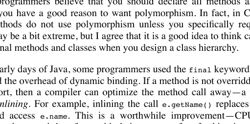

| 类别 | MIoU | Kappa | F1-Score |
| --- | --- | --- | --- |
| 耕地 | 0.853 | 0.824 | 0.891 |
| 林地 | 0.871 | 0.845 | 0.902 |
| 草地 | 0.792 | 0.761 | 0.833 |
| 水体 | 0.938 | 0.915 | 0.956 |
| 建筑 | 0.814 | 0.786 | 0.852 |
| 道路 | 0.745 | 0.712 | 0.793 |

综合评估结果表明，基于 U-Net 的模型在本数据集上取得了较好的分割效果，其中水体类别精度最高，道路类别因细长结构容易出现断裂，后续可引入注意力机制进一步提升性能。

> **注意：**
>
> 枚举和记录始终是 final 的——你不能扩展它们。

### 5.1.8 类型转换

回顾第 3 章，强制将一种类型转换为另一种类型的过程称为类型转换。Java 编程语言对类型转换有特殊的表示法。例如：

```java
double x = 3.405;
int nx = (int) x;
```

将表达式 `x` 的值转换为整数，丢弃小数部分。

就像你偶尔需要将浮点数转换为整数一样，你可能需要将对象引用从一个类转换为另一个类。让我们再次使用一个包含 `Employee` 和 `Manager` 对象混合的数组的例子：

```java
var staff = new Employee[3];
staff[0] = new Manager("Carl Cracker", 80000, 1987, 12, 15);
staff[1] = new Employee("Harry Hacker", 50000, 1989, 10, 1);
staff[2] = new Employee("Tony Tester", 40000, 1990, 3, 15);
```

要实际进行对象引用的类型转换，可以使用与转换数值表达式类似的语法。将目标类名用括号括起来，放在要转换的对象引用之前。例如：

```java
Manager boss = (Manager) staff[0];
```

你想进行类型转换只有一个原因——在对象的实际类型被暂时遗忘后，以完整的能力使用它。例如，在 `ManagerTest` 类中，staff 数组必须是 `Employee` 对象的数组，因为*一些*元素是普通员工。我们需要将数组中的管理元素转换回 `Manager`，才能访问它的任何新变量。（注意，在第一部分的示例代码中，我特别努力地避免了类型转换。我在将 boss 变量存入数组之前，用 `Manager` 对象初始化了它。我需要正确的类型来设置经理的奖金。）

如你所知，在 Java 中每个变量都有一个类型。类型描述了变量所引用的对象种类以及它能做什么。例如，`staff[i]` 引用一个 `Employee` 对象（因此它也可以引用 `Manager` 对象）。

编译器会检查你在向变量存储值时没有做出过度的承诺。如果你将子类引用赋给超类变量，你是在做出较少的承诺，编译器会直接允许。如果你将超类引用赋给子类变量，你是在做出更多的承诺。那么你必须使用类型转换，以便在运行时检查你的承诺。

如果你尝试沿继承链向下转换，并且对对象包含的内容“撒谎”，会发生什么？

```java
Manager boss = (Manager) staff[1]; // ERROR
```

当程序运行时，Java 运行时系统会发现未兑现的承诺并生成 `ClassCastException`。如果你不捕获该异常，程序就会终止。因此，在尝试转换之前先弄清楚转换是否会成功是一种良好的编程实践。只需使用 `instanceof` 运算符。例如：

```java
if (staff[i] instanceof Manager)
{
    boss = (Manager) staff[i];
    . . .
}
```

最后，如果转换没有成功的可能，编译器不会允许你进行类型转换。例如，这个转换

```java
String c = (String) staff[i];
```

是一个编译时错误，因为 `String` 不是 `Employee` 的子类。

总而言之：

- 你只能在继承层次结构内进行类型转换。
- 在从超类转换为子类之前，使用 `instanceof` 进行检查。


> **注意：**
>
> 测试
>
> ```java
> x instanceof C
> ```
>
> 如果 `x` 为 `null`，不会生成异常。它只是返回 `false`。这很有道理：`null` 不引用任何对象，所以它当然不引用 `C` 类型的对象。

实际上，通过类型转换来转换对象的类型通常不是一个好主意。在我们的例子中，大多数情况下你不需要将 `Employee` 对象转换为 `Manager` 对象。`getSalary` 方法对两个类的对象都能正常工作。使多态得以工作的动态绑定会自动定位正确的方法。

进行类型转换的唯一原因是使用经理独有的方法，如 `setBonus`。如果出于某种原因你发现自己想在 `Employee` 对象上调用 `setBonus`，请问问自己这是否表明超类存在设计缺陷。重新设计超类并添加 `setBonus` 方法可能是合理的。记住，只需要一个

未捕获的`ClassCastException`会终止你的程序。一般来说，最好尽量减少强制类型转换和`instanceof`运算符的使用。

### C++ 注意：

Java使用C语言“糟糕的旧时代”的强制类型转换语法，但其工作方式类似于C++中安全的`dynamic_cast`操作。例如，

```
    Manager boss = (Manager) staff[i]; // Java
```

等同于

```
    Manager* boss = dynamic_cast<Manager*>(staff[i]); // C++
```

但有一个重要区别。如果强制类型转换失败，它不会产生null对象，而是抛出异常。从这个意义上说，它类似于C++中对*引用*的强制类型转换。这很令人头疼。在C++中，你可以在一次操作中完成类型检查和类型转换。

```
    Manager* boss = dynamic_cast<Manager*>(staff[i]); // C++
    if (boss != NULL) . . .
```

在Java中，你需要结合使用`instanceof`运算符和强制类型转换。

```
    if (staff[i] instanceof Manager)
    {
        Manager boss = (Manager) staff[i];
        . . .
    }
```

### 5.1.9 `instanceof`的模式匹配

代码

```java
if (staff[i] instanceof Manager)
{
    Manager boss = (Manager) staff[i];
    boss.setBonus(5000);
}
```

相当冗长。我们真的需要三次提到子类`Manager`吗？

从Java 16开始，有一种更简单的方法。你可以直接在`instanceof`测试中声明子类变量：

```java
if (staff[i] instanceof Manager boss)
{
    boss.setBonus(5000);
}
```

如果`staff[i]`是`Manager`类的实例，那么变量`boss`被设置为`staff[i]`，你可以把它当作`Manager`使用。这样便省略了强制类型转换。

如果`staff[i]`不引用`Manager`对象，则不会设置`boss`，`instanceof`运算符返回`false`值。`if`语句的主体被跳过。


> **提示：**
>
> 在大多数使用`instanceof`的场景中，你需要调用子类方法。这时应使用`instanceof`的这种“模式匹配”形式，而不是强制类型转换。

无用的`instanceof`模式是错误：

变量`m`在`?`之后的子表达式中定义，但在`:`之后的子表达式中没有定义。

### **注意：**

声明变量的`instanceof`形式被称为“模式匹配”，因为它类似于switch中的类型模式，这是Java 17的“预览”特性。我不详细讨论预览特性，但这里给出一个语法示例：

```java
String description = switch (e) {
    case Executive exec -> "An executive with a fancy title of "
 + exec.getTitle();
    case Manager m -> "A manager with a bonus of " +
m.getBonus();
    default -> "A lowly employee with a salary of " +
e.getSalary();
}
```

与`instanceof`模式一样，每个类型模式都声明一个变量。

### **警告：**

与任何局部变量一样，由`instanceof`模式定义的局部变量可以遮蔽字段。例如：

```java
class Value
{
    private double v;
    public boolean equals(Value other)
    {
        if (other instanceof LabeledValue v)
            // v is the same as other
        else
            // v denotes the field
    }
    . . .
}
```

### 5.1.10 受保护访问

如你所知，类中的字段最好标记为`private`，方法通常标记为`public`。任何声明为`private`的特性在其他类中不可访问。正如本章开头所解释的，对子类也是如此：子类不能访问其超类的私有字段。

然而，有时你希望将方法限制为仅子类可用，或者（较少见地）允许子类方法访问超类字段。在这种情况下，你可以将类特性声明为`protected`。例如，如果超类`Employee`将`hireDay`字段声明为`protected`而不是`private`，那么`Manager`的方法可以直接访问它。

在Java中，受保护字段可被同一包中的任何类访问。现在考虑不同包中的`Administrator`子类。`Administrator`类的方法只能查看`Administrator`对象的`hireDay`字段，而不能查看其他`Employee`对象的该字段。做出这一限制是为了防止你滥用`protected`机制，仅仅为了获得对受保护字段的访问权而创建子类。

在实践中，应谨慎使用受保护字段。假设你的类被其他程序员使用，并且你设计时使用了受保护字段。在你不知情的情况下，其他程序员可能从你的类继承，并开始访问你的受保护字段。在这种情况下，你不能再修改类的实现而不让那些程序员感到不安。这违背了面向对象编程（OOP）的精神，OOP鼓励数据封装。

有关此处未涵盖的内容，请参阅在线文档。（`Object`的若干方法仅在处理并发时才会出现——见第12章。）

### 5.2.1 `Object`类型的变量

可以使用`Object`类型的变量引用任何类型的对象：

```java
Object obj = new Employee("Harry Hacker", 35000);
```

当然，`Object`类型的变量仅适合作为任意值的通用容器。要对值执行任何具体操作，你需要了解其原始类型并进行强制类型转换：

```java
Employee e = (Employee) obj;
```

在Java中，只有*基本类型*的值（数字、字符和布尔值）不是对象。

所有数组类型，无论它们是对象数组还是基本类型数组，都是扩展`Object`类的类类型。

```java
Employee[] staff = new Employee[10];
obj = staff; // OK
obj = new int[10]; // OK
```

> **C++ 注意：**
>
> 在C++中，没有万物的根类。但是，每个指针都可以转换为`void*`指针。

### 5.2.2 equals方法

`Object`类中的equals方法测试一个对象是否被认为等于另一个对象。`Object`类中实现的equals方法判断两个对象引用是否相同。这是一个相当合理的默认行为——如果两个对象相同，它们当然应该相等。对于相当多的类，不需要其他操作。例如，比较两个`PrintStream`对象是否相等没有多大意义。然而，你常常希望实现基于状态的相等性测试，即当两个对象具有相同状态时认为它们相等。

例如，如果两个员工具有相同的姓名、工资和雇用日期，我们就认为他们相等。（在实际的员工数据库中，比较ID会更合理。我使用这个示例来演示实现equals方法的机制。）

```java
public class Employee
{
    . . .
    public boolean equals(Object otherObject)
    {
        // a quick test to see if the objects are identical
        if (this == otherObject) return true;
        // must return false if the explicit parameter is null
        if (otherObject == null) return false;
        // if the classes don't match, they can't be equal
        if (getClass() != otherObject.getClass())
            return false;
        // now we know otherObject is a non-null Employee
        Employee other = (Employee) otherObject;
        // test whether the fields have identical values
        return name.equals(other.name)
            && salary == other.salary
            && hireDay.equals(other.hireDay);
    }
}
```

`getClass`方法返回对象的类——本章后面将详细讨论这个方法。在我们的测试中，两个对象只有属于同一个类时才可能相等。

> **提示：**
>
> 为了防止`name`或`hireDay`为null的可能性，请使用`Objects.equals`方法。调用`Objects.equals(a, b)`时，如果两个参数都为null则返回true，如果只有一个为null则返回false，否则调用`a.equals(b)`。使用该方法后，`Employee.equals`方法的最后一条语句变为

```java
return Objects.equals(name, other.name)
    && salary == other.salary
    && Objects.equals(hireDay, other.hireDay);
```

当你为子类定义`equals`方法时，首先调用超类的`equals`。如果该测试不通过，那么对象不可能相等。如果超类字段相等，就可以比较子类的实例字段了。

```java
public class Manager extends Employee
{
    . . .
    public boolean equals(Object otherObject)
    {
        if (!super.equals(otherObject)) return false;
        // super.equals checked that this and otherObject belong to the same class
        Manager other = (Manager) otherObject;
        return bonus == other.bonus;
    }
}
```

### **注意：**


回顾第 4 章，记录（record）是一种特殊形式的不可变类，其状态完全由在“规范”构造函数中设置的字段定义。记录会自动定义比较字段的 `equals` 方法。当对应字段值相等时，两个记录实例相等。

### 5.2.3 相等性测试与继承

如果隐式参数和显式参数不属于同一个类，`equals` 方法应如何表现？这方面一直存在一些争议。在前面的示例中，如果类不完全匹配，`equals` 方法会返回 `false`。但许多程序员改用 `instanceof` 测试：

```java
if (!(otherObject instanceof Employee)) return false;
```

这就使 `otherObject` 有可能属于某个子类。然而，这种方法可能会给你带来麻烦。原因如下。Java 语言规范要求 `equals` 方法具有以下性质：

1. 它是*自反的*：对于任何非空引用 `x`，`x.equals(x)` 应返回 `true`。
2. 它是*对称的*：对于任何引用 `x` 和 `y`，当且仅当 `y.equals(x)` 返回 `true` 时，`x.equals(y)` 才应返回 `true`。
3. 它是*传递的*：对于任何引用 `x`、`y` 和 `z`，如果 `x.equals(y)` 返回 `true` 且 `y.equals(z)` 返回 `true`，那么 `x.equals(z)` 应返回 `true`。
4. 它是*一致的*：如果 `x` 和 `y` 所引用的对象没有改变，那么重复调用 `x.equals(y)` 会返回相同的值。
5. 对于任何非空引用 `x`，`x.equals(null)` 应返回 `false`。

这些规则当然是合理的。你不会希望库实现者在数据结构中定位元素时，还要斟酌是调用 `x.equals(y)` 还是 `y.equals(x)`。

然而，当参数属于不同类时，对称性规则会产生微妙的后果。考虑以下调用

```java
e.equals(m)
```

其中 `e` 是 `Employee` 对象，`m` 是 `Manager` 对象，二者恰好具有相同的姓名、工资和入职日期。如果 `Employee.equals` 使用 `instanceof` 测试，则该调用返回 true。但这意味着反向调用

```java
m.equals(e)
```

也必须返回 `true`——对称性规则不允许它返回 `false` 或抛出异常。

这使 `Manager` 类陷入困境。它的 `equals` 方法必须愿意将自身与任何 `Employee` 比较，而不考虑经理特有的信息！突然之间，`instanceof` 测试显得不那么有吸引力了。

一些作者公开表示，`getClass` 测试是错误的，因为它违反了替换原则。一个常被引用的例子是 `AbstractSet` 类中的 `equals` 方法，它测试两个集合是否具有相同的元素。`AbstractSet` 类有两个具体子类 `TreeSet` 和 `HashSet`，它们使用不同的算法定位集合元素。你确实希望能够比较任意两个集合，无论它们是如何实现的。

然而，集合示例相当特殊。将 `AbstractSet.equals` 声明为 final 是合理的，因为不应有人重新定义集合相等性的语义。（该方法实际上并不是 final。这允许子类为相等性测试实现更高效的算法。）

在我看来，有两种不同的场景：

- 如果子类可以有自己的相等性概念，那么对称性要求迫使你使用 `getClass` 测试。
- 如果相等性概念在超类中固定，那么你可以使用 `instanceof` 测试，并允许不同子类的对象彼此相等。

在员工和经理的示例中，当两个对象具有匹配的字段时，我们认为它们相等。如果我们有两个 `Manager` 对象，姓名、工资和入职日期相同，但奖金不同，我们希望它们不同。因此，我们使用 `getClass` 测试。

但假设我们使用员工 ID 进行相等性测试。这种相等性概念对所有子类都有意义。那么我们可以使用 `instanceof` 测试，并且应该将 `Employee.equals` 声明为 `final`。

### 注意：

标准 Java 库包含 150 多个 `equals` 方法的实现，其中混杂着使用 `instanceof`、调用 `getClass`、捕获 `ClassCastException` 或什么都不做的情况。查看 `java.sql.Timestamp` 类的 API 文档，实现者有些尴尬地指出，他们已把自己逼入困境。`Timestamp` 类继承自 `java.util.Date`，其 `equals` 方法使用 `instanceof` 测试，而无法重写 `equals` 使其既对称又准确。

以下是编写完美 `equals` 方法的步骤：

- 1. 将显式参数命名为 `otherObject`——稍后，你需要将它强制转换为另一个变量，该变量应命名为 `other`。

- 2. 测试 `this` 是否恰好与 `otherObject` 相同：

    ```java
    if (this == otherObject) return true;
    ```

    这条语句只是一种优化。在实践中，这是一种常见情况。检查是否为同一对象比比较字段的开销小得多。

- 3. 测试 `otherObject` 是否为 `null`，如果是则返回 `false`。此测试是必需的。

    ```java
    if (otherObject == null) return false;
    ```

- 4. 比较 `this` 和 `otherObject` 的类。如果 `equals` 的语义可以在子类中改变，请使用 `getClass` 测试：

    ```java
    if (getClass() != otherObject.getClass()) return false;
    ClassName other = (ClassName) otherObject;
    ```

    如果相同的语义适用于*所有*子类，你可以使用 `instanceof` 测试：

    ```java
    if (!(otherObject instanceof ClassName other)) return false;
    ```

    注意，如果 `instanceof` 测试成功，它会将 `other` 设为 `otherObject`。无需强制转换。

- 5. 现在按照你的相等性概念比较字段。对于基本类型字段使用 `==`，对于对象字段使用 `Objects.equals`。如果所有字段都匹配则返回 `true`，否则返回 `false`。

    ```java
    return field1 == other.field1
        && Objects.equals(field2, other.field2)
        && ...;
    ```

    如果在子类中重新定义 `equals`，请包含对 `super.equals(other)` 的调用。


### 提示：

如果有数组类型的字段，可以使用静态方法 `Arrays.equals` 检查对应数组元素是否相等。对于多维数组，请使用 `Arrays.deepEquals` 方法。


### 警告：

以下是实现 `equals` 方法时的一个常见错误。你能发现问题吗？

```java
public class Employee
{
    public boolean equals(Employee other)
    {
        return other != null
            && getClass() == other.getClass()
            && Objects.equals(name, other.name)
            && salary == other.salary
            && Objects.equals(hireDay, other.hireDay);
    }
    . . .
}
```

此方法将显式参数类型声明为 `Employee`。因此，它不会重写 `Object` 类的 `equals` 方法，而是定义了一个完全不相关的方法。

你可以通过用 `@Override` 标记旨在重写超类方法的方法，来防止此类错误：

```java
@Override public boolean equals(Object other)
```

如果你犯了错误，正在定义一个新方法，编译器会报告错误。例如，假设你将以下声明添加到 `Employee` 类中：

```java
@Override public boolean equals(Employee other)
```

会报告错误，因为此方法没有重写 `Object` 超类中的任何方法。

### java.util.Arrays 1.2

- `static boolean equals(XXX[] a, XXX[] b)` ⁵

  如果数组长度相等且对应位置上的元素相等，则返回 true。数组的组件类型 XXX 可以是 Object、int、long、short、char、byte、boolean、float 或 double。

### `java.util.Objects` ⁷

- `static boolean equals(Object a, Object b)`

  如果 a 和 b 均为 null，则返回 true；如果其中恰好一个为 null，则返回 false；否则返回 a.equals(b)。

### 5.2.4 hashCode 方法

哈希码是从对象派生出的一个整数。哈希码应当是散乱的——如果 x 和 y 是两个不同的对象，那么 x.hashCode() 与 y.hashCode() 不同的概率应当很高。[表 5.1](#table-5-1) 列出了由 String 类的 hashCode 方法生成的一些哈希码示例。

String 类使用以下算法计算哈希码：

```java
int hash = 0;
for (int i = 0; i < length(); i++)
    hash = 31 * hash + charAt(i);
```

**表 5.1** 由 hashCode 方法生成的哈希码


`hashCode` 方法应返回一个整数（可以是负数）。只需将各实例字段的哈希码组合起来，使不同对象的哈希码尽可能广泛分散。

例如，下面是 `Employee` 类的 `hashCode` 方法：

```java
public class Employee
{
   public int hashCode()
   {
      return 7 * name.hashCode()
         + 11 * Double.valueOf(salary).hashCode()
         + 13 * hireDay.hashCode();
   }
   . . .
}
```

不过，还可以做得更好。首先，使用空值安全的 `Objects.hashCode` 方法。如果其参数为 `null`，则返回 `0`；否则返回对该参数调用 `hashCode` 的结果。另外，使用静态的 `Double.hashCode` 方法以避免创建 `Double` 对象：

```java
public int hashCode()
{
   return 7 * Objects.hashCode(name)
      + 11 * Double.hashCode(salary)
      + 13 * Objects.hashCode(hireDay);
}
```

更好的是，当需要组合多个哈希值时，用所有这些值调用 `Objects.hash`。它会为每个参数调用 `Objects.hashCode` 并组合这些值。这样，`Employee.hashCode` 方法就简化为

```java
public int hashCode()
{
   return Objects.hash(name, salary, hireDay);
}
```

你对 equals 和 hashCode 的定义必须兼容：如果 x.equals(y) 为 true，那么 x.hashCode() 必须返回与 y.hashCode() 相同的值。例如，如果你定义 `Employee.equals` 来比较员工 ID，那么 `hashCode` 方法需要对 ID 进行哈希，而不是对员工姓名或内存地址进行哈希。

**提示：**

如果字段是数组类型，可以使用静态的 `Arrays.hashCode` 方法计算一个由数组各元素的哈希码组成的哈希码。

**注意：**

记录类型会自动提供 `hashCode` 方法，该方法根据字段值的哈希码推导出哈希码。

**警告：**

如果实例变量的可能取值范围很小，你需要获得尽可能多的不同哈希码。考虑对日历日期进行哈希。计算 7 * year + 11 * month + 13 * day 会产生很多冲突。相比之下，31 * 12 * year + 31 * month + day 是一个“完美哈希函数”。假设年份范围合理，没有两个日期会有相同的哈希码。（`LocalDate` 类的实际 `hashCode` 方法支持 ±999,999,999 年的范围，要稍微复杂一些。）

### java.lang.Object 1.0

- `int hashCode()` 返回此对象的哈希码。哈希码可以是任意整数，正数或负数。相等的对象需要返回相同的哈希码。

### java.util.Objects 7

- `static int hash(Object... objects)` 返回一个由所有提供的对象的哈希码组合而成的哈希码。

- `static int hashCode(Object a)` 如果 a 为 null，则返回 0；否则返回 `a.hashCode()`。

### java.lang.(Integer|Long|Short|Byte|Double|Float|Character|Boolean) 1.0

- `static int hashCode(xxx value)` 8 返回给定值的哈希码。这里的 `xxx` 是对应于给定包装类型的基本类型。

### java.util.Arrays 1.2

- `static int hashCode(xxx[] a)` 5 计算数组 a 的哈希码。数组的组件类型 xxx 可以是 Object、int、long、short、char、byte、boolean、float 或 double。

### 5.2.5 toString 方法

`Object` 中另一个重要的方法是 `toString` 方法，它返回表示此对象值的字符串。下面是一个典型示例。`Point` 类的 `toString` 方法返回如下字符串：

```text
java.awt.Point[x=10,y=20]
```

大多数（但不是全部）`toString` 方法遵循这种格式：类名，然后是括在方括号中的字段值。下面是 `Employee` 类的 `toString` 方法的一个实现：

```java
public String toString()
{
    return "Employee[name=" + name
        + ",salary=" + salary
        + ",hireDay=" + hireDay
        + "]";
}
```

实际上，还可以做得稍好一些。不要在 `toString` 方法中硬编码类名，而是调用 `getClass().getName()` 来获得包含类名的字符串。

```java
public String toString()
{
    return getClass().getName()
        + "[name=" + name
        + ",salary=" + salary
        + ",hireDay=" + hireDay
        + "]";
}
```

这样的 toString 方法对子类也同样有效。

当然，子类程序员应该定义自己的 toString 方法并添加子类字段。如果超类使用 getClass().getName()，那么子类可以简单地调用 super.toString()。例如，下面是 Manager 类的 toString 方法：

```java
public class Manager extends Employee
{
    . . .
    public String toString()
    {
        return super.toString()
            + "[bonus=" + bonus
            + "]";
    }
}
```

现在，一个 Manager 对象会打印为

```text
Manager[name=. . .,salary=. . .,hireDay=. . .][bonus=. . .]
```

toString 方法无处不在，原因很重要：每当对象通过“+”运算符与字符串连接时，Java 编译器都会自动调用 toString 方法以获得对象的字符串表示。例如：

```java
var p = new Point(10, 20);
String message = "The current position is " + p;
  // automatically invokes p.toString()
```

**提示：**

不必写 `x.toString()`，可以写 `"" + x`。这条语句将空字符串与 x 的字符串表示连接起来，而该表示恰好就是 `x.toString()`。与 `toString` 不同，即使 x 是基本类型，这条语句也能工作。

如果 x 是任意对象，并且你调用

```java
System.out.println(x);
```

那么 `println` 方法只是调用 `x.toString()` 并打印结果字符串。

`Object` 类定义的 toString 方法会打印类名和对象的哈希码。例如，调用

```java
System.out.println(System.out)
```

产生的输出类似下面这样：

```text
java.io.PrintStream@2f6684
```

原因是 `PrintStream` 类的实现者没有费心重写 `toString` 方法。


**警告：**

令人烦恼的是，数组从 Object 继承了 `toString` 方法，而且还多了一个奇怪之处：数组类型会以古老格式打印。例如，

```java
int[] luckyNumbers = { 2, 3, 5, 7, 11, 13 };
String s = "" + luckyNumbers;
```

## 第2章 卒中

卒中是由脑血管损伤引起的突发性神经功能缺损——要么由缺血（血流阻塞）引起，要么由出血（血液流入大脑）引起。

卒中的两大类别是缺血性和出血性，二者具有不同的病理生理机制和治疗方法。

大脑中动脉（MCA）是缺血性卒中中最常受累的血管，会导致对侧运动和感觉缺损，如果优势半球受累，还会导致失语症。

累及椎基底动脉系统的后循环卒中可引起脑干体征、视野缺损和共济失调，并且临床上通常更难诊断。

出血性卒中虽然比缺血性卒中少见，但早期死亡率更高，并且常与高血压、破裂动脉瘤或动静脉畸形相关。

代码清单 5.4 中的程序测试了 Employee 类（代码清单 5.5）和 Manager 类（代码清单 5.6）的 equals、hashCode 和 toString 方法。

### **代码清单 5.4** equals/EqualsTest.java

```java
 1  package equals;
 2
 3  /**
 4   * This program demonstrates the equals method.
 5   * @version 1.12 2012-01-26
 6   * @author Cay Horstmann
 7   */
 8  public class EqualsTest
 9  {
10     public static void main(String[] args)
11     {
12        var alice1 = new Employee("Alice Adams", 75000, 1987, 12, 15);
13        var alice2 = alice1;
14        var alice3 = new Employee("Alice Adams", 75000, 1987, 12, 15);
15        var bob = new Employee("Bob Brandson", 50000, 1989, 10, 1);
16
17        System.out.println("alice1 == alice2: " + (alice1 == alice2));
18
19        System.out.println("alice1 == alice3: " + (alice1 == alice3));
20
21        System.out.println("alice1.equals(alice3): " + alice1.equals(alice3));
22
23        System.out.println("alice1.equals(bob): " + alice1.equals(bob));
24
25        System.out.println("bob.toString(): " + bob);
26
27        var carl = new Manager("Carl Cracker", 80000, 1987, 12,
```


```java
15);
28     var boss = new Manager("Carl Cracker", 80000, 1987, 12,
       15);
29     boss.setBonus(5000);
30     System.out.println("boss.toString(): " + boss);
31     System.out.println("carl.equals(boss): " +
       carl.equals(boss));
32     System.out.println("alice1.hashCode(): " +
       alice1.hashCode());
33     System.out.println("alice3.hashCode(): " +
       alice3.hashCode());
34     System.out.println("bob.hashCode(): " + bob.hashCode());
35     System.out.println("carl.hashCode(): " +
       carl.hashCode());
36   }
37 }
```

## 清单 5.5 `equals/Employee.java`

```java
1   package equals;
2
3   import java.time.*;
4   import java.util.Objects;
5
6   public class Employee
7   {
8       private String name;
9       private double salary;
10      private LocalDate hireDay;
11
12      public Employee(String name, double salary, int year, int month, int day)
13      {
14          this.name = name;
15          this.salary = salary;
16          hireDay = LocalDate.of(year, month, day);
17      }
18
19      public String getName()
20      {
21          return name;
22      }
23
24      public double getSalary()
25      {
26          return salary;
27      }
28
29      public LocalDate getHireDay()
30      {
31          return hireDay;
32      }
33
34      public void raiseSalary(double byPercent)
35      {
36          double raise = salary * byPercent / 100;
37          salary += raise;
38      }
39
40      public boolean equals(Object otherObject)
41      {
42          // a quick test to see if the objects are identical
43          if (this == otherObject) return true;
44
45          // must return false if the explicit parameter is null
46          if (otherObject == null) return false;
47
48          // if the classes don't match, they can't be equal
49          if (getClass() != otherObject.getClass()) return false;
50
51          // now we know otherObject is a non-null Employee
52          var other = (Employee) otherObject;
53
54          // test whether the fields have identical values
55          return Objects.equals(name, other.name)
56              && salary == other.salary && Objects.equals(hireDay, other.hireDay);
57      }
58
59      public int hashCode()
60      {
61          return Objects.hash(name, salary, hireDay);
62      }
63
64      public String toString()
65      {
66          return getClass().getName() + "[name=" + name + ",salary=" + salary + ",hireDay="
67              + hireDay + "]";
68      }
69  }
```

## 清单 5.6 equals/Manager.java

```java
1  package equals;
2
3  public class Manager extends Employee
4  {
5      private double bonus;
6
7      public Manager(String name, double salary, int year, int month, int day)
8      {
9          super(name, salary, year, month, day);
10         bonus = 0;
11     }
12
13     public double getSalary()
14     {
15         double baseSalary = super.getSalary();
16         return baseSalary + bonus;
17     }
18
19     public void setBonus(double bonus)
20     {
21         this.bonus = bonus;
22     }
23
24     public boolean equals(Object otherObject)
25     {
26         if (!super.equals(otherObject)) return false;
27         var other = (Manager) otherObject;
28         // super.equals checked that this and other belong to the same class
29         return bonus == other.bonus;
30     }
31
32     public int hashCode()
33     {
34         return java.util.Objects.hash(super.hashCode(), bonus);
35     }
36
37     public String toString()
38     {
39         return super.toString() + "[bonus=" + bonus + "]";
40     }
41 }
```

## java.lang.Object 1.0

- `Class getClass()`

  返回一个包含该对象信息的类对象。正如本章后面将看到的，Java 为类提供了一种运行时表示，它封装在 `Class` 类中。

- `boolean equals(Object otherObject)`

  比较两个对象是否相等；如果这两个对象指向同一内存区域，则返回 true，否则返回 false。你应该在自己的类中重写此方法。

- `String toString()`

  返回表示该对象值的字符串。你应该在自己的类中重写此方法。

## java.lang.Class 1.0

- `String getName()`
  - 返回此类的名称。
- `Class getSuperclass()`
  - 以 `Class` 对象的形式返回此类的超类。

## 5.3 泛型数组列表

在某些编程语言中——尤其是 C 和 C++——必须在编译时固定所有数组的大小。程序员讨厌这一点，因为它迫使他们做出不舒服的权衡。一个部门会有多少名员工？肯定不超过 100 名。如果一个庞大的部门有 150 名员工，那该怎么办？难道我们愿意为每个只有 10 名员工的部门浪费 90 个条目吗？

在 Java 中，情况要好一些。你可以在运行时设置数组的大小。

```java
int actualSize = . . .;
var staff = new Employee[actualSize];
```

当然，这段代码并没有完全解决在运行时动态修改数组的问题。一旦设置了数组大小，就无法轻易更改它。相反，在 Java 中，你可以使用另一个名为 `ArrayList` 的 Java 类来处理这种常见情况。`ArrayList` 类类似于数组，但当你添加和删除元素时，它会自动调整容量，无需任何额外代码。

`ArrayList` 是一个带有*类型参数*的*泛型类*。要指定数组列表所容纳元素对象的类型，请在尖括号中附加一个类名，例如 `ArrayList<Employee>`。你将在[第8章](#)中看到如何定义自己的泛型类，但使用 `ArrayList` 类型并不需要了解这些技术细节。

以下各节将向你展示如何使用数组列表。

### 5.3.1 声明数组列表

下面说明如何声明并构造一个容纳 `Employee` 对象的数组列表：

```java
ArrayList<Employee> staff = new ArrayList<Employee>();
```

从 Java 10 开始，最好使用 `var` 关键字来避免重复类名：

```java
var staff = new ArrayList<Employee>();
```

如果不使用 `var` 关键字，可以省略右侧的类型参数：

```java
ArrayList<Employee> staff = new ArrayList<>();
```

这称为“菱形”语法，因为空括号 `<>` 看起来像菱形。将菱形语法与 `new` 运算符一起使用。编译器会检查新值会发生什么。如果它被赋给变量、传入方法或从方法返回，那么编译器会检查变量、参数或方法的泛型类型。然后它将那个类型放入 `<>` 中。在我们的示例中，`new ArrayList<>()` 被赋给一个类型为 `ArrayList<Employee>` 的变量。因此，泛型类型是 `Employee`。

数组列表管理一个内部的对象引用数组。最终，该数组会用尽空间。这正是数组列表施展魔力的地方：如果你调用 add 而内部数组已满，数组列表会自动创建一个更大的数组，并将所有对象从较小的数组复制到较大的数组。

如果你已经知道或大致猜到你想要存储多少个元素，请在填充数组列表之前调用 ensureCapacity 方法：

```java
staff.ensureCapacity(100);
```

该调用会分配一个可容纳 100 个对象的内部数组。然后，前 100 次调用 add 都不会涉及任何代价高昂的重新分配。

你也可以向 ArrayList 构造器传递初始容量：

```java
ArrayList<Employee> staff = new ArrayList<>(100);
```


**注意：**

按如下方式分配数组列表

```java
new ArrayList<>(100) // capacity is 100
```

与按如下方式分配新数组*不*相同

```java
new Employee[100] // size is 100
```

数组列表的容量与数组的大小之间存在重要区别。如果分配一个包含 100 个条目的数组，那么该数组有 100 个槽位，随时可用。容量为 100 个元素的数组列表具有容纳 100 个元素的*潜力*（事实上，还可以容纳超过 100 个元素，代价是额外的重新分配）——但在开始时，即使在其初始构造之后，数组列表也根本不包含任何元素。


`size` 方法返回数组列表中元素的实际数量。例如，

```
staff.size()
```

返回 `staff` 数组列表中当前元素的数量。这等价于

```
a.length
```

对于数组 a 而言。

一旦你相当确定数组列表已达到其最终大小，就可以调用 `trimToSize` 方法。此方法会调整内存块的大小，使其正好使用容纳当前元素数量所需的存储空间。垃圾回收器将回收任何多余的内存。

一旦修剪了数组列表的大小，添加新元素将再次移动该内存块，这需要时间。只有当你确定不会再向数组列表添加任何元素时，才应使用 `trimToSize`。

### C++ 注意：

`ArrayList` 类与 C++ 的 vector 模板类似。ArrayList 和 vector 都是泛型类型。但 C++ 的 vector 模板重载了 `[]` 运算符，以便于访问元素。Java 不支持运算符重载，因此必须改用显式方法调用。此外，C++ 的 vector 是按值复制的。如果 a 和 b 是两个 vector，那么赋值 a = b 会使 a 成为一个新 vector，其长度与 b 相同，并且所有元素都从 b 复制到 a。而在 Java 中，同样的赋值会使 a 和 b 都引用同一个数组列表。

## `java.util.ArrayList<E>` 1.2

- `ArrayList<E>()`
  构造一个空数组列表。
- `ArrayList<E>(int initialCapacity)`
  构造一个具有指定容量的空数组列表。
- `boolean add(E obj)`
  将 obj 追加到数组列表末尾。始终返回 true。
- `int size()`
  返回当前存储在数组列表中的元素数量。（当然，这永远不会大于数组列表的容量。）
- `void ensureCapacity(int capacity)`
  确保数组列表具有存储给定数量元素的能力，而无需重新分配其内部存储数组。
- `void trimToSize()`
  将数组列表的存储容量减少到其当前大小。

### 5.3.2 访问数组列表元素

不幸的是，天下没有免费的午餐。数组列表自动增长的便利性要求使用更复杂的语法来访问元素。原因是 `ArrayList` 类并不是 Java 编程语言的一部分；它只是一个由某人编写并随标准库提供的实用类。

不能使用令人愉快的 `[ ]` 语法来访问或修改数组元素，而应使用 get 和 set 方法。

例如，要设置第 i 个元素，请使用

```
staff.set(i, harry);
```

这等价于

```
a[i] = harry;
```

对于数组 a 而言。（与数组一样，索引值从零开始。）

### 警告：

在数组列表的*大小*大于*i*之前，不要调用 `list.set(i, x)`。例如，以下代码是错误的：

```
var list = new ArrayList<Employee>(100); // capacity 100, size 0
list.set(0, x); // no element 0 yet
```

使用 add 方法而不是 set 方法来填充数组，并且仅使用 set 来替换先前添加的元素。

要获取数组列表元素，请使用

```
Employee e = staff.get(i);
```

这等价于

```
Employee e = a[i];
```

### 注意：

当还没有泛型类时，原始 `ArrayList` 类的 `get` 方法别无选择，只能返回 `Object`。因此，`get` 的调用者必须将返回值强制转换为所需类型：

```
Employee e = (Employee) staff.get(i);
```

原始 `ArrayList` 也有点危险。它的 add 和 set 方法接受任何类型的对象。调用

```
staff.set(i, "Harry Hacker");
```

编译时甚至连警告都不会有，只有当你取出该对象并尝试强制转换时才会遇到麻烦。如果改用 `ArrayList<Employee>`，编译器将检测到此错误。

有时，你可以通过以下技巧兼得两者之长——灵活的增长和方便的元素访问。首先，创建一个数组列表并添加所有元素：

```
var list = new ArrayList<X>();
while (. . .)
{
    x = . . .;
    list.add(x);
}
```

完成后，使用 `toArray` 方法将元素复制到数组中：

```
var a = new X[list.size()];
list.toArray(a);
```

有时，你需要在数组列表中间添加元素。使用带索引参数的 add 方法：

```
int n = staff.size() / 2;
staff.add(n, e);
```

位置 n 及以上的元素会向上移动，为新条目腾出空间。如果插入后数组列表的新大小超过容量，数组列表将重新分配其存储数组。

类似地，你可以从数组列表中间删除一个元素：

```
Employee e = staff.remove(n);
```

位于其上的元素会向下复制，数组列表的大小减一。

插入和删除元素的效率并不是很高。对于小型数组列表，可能不值得担心。但如果你存储许多元素并频繁在集合中间插入和删除，请考虑改用链表。我将在第 9 章解释如何使用链表编程。

你可以使用“for each”循环遍历数组列表的内容：

```
for (Employee e : staff)
    do something with e
```

此循环与以下代码效果相同：

```
for (int i = 0; i < staff.size(); i++)
{
    Employee e = staff.get(i);
    do something with e
}
```

程序清单 5.7 是第 4 章 `EmployeeTest` 程序的修改版。`Employee[]` 数组被替换为 `ArrayList<Employee>`。请注意以下变化：

- 不必指定数组大小。
- 使用 `add` 添加任意数量的元素。
- 使用 `size()` 而不是 `length` 来统计元素数量。

## `java.util.ArrayList<E>` 1.2

- `E set(int index, E obj)`
  将值 obj 放入数组列表中指定索引处，并返回先前的内容。
- `E get(int index)`
  获取存储在指定索引处的值。
- `void add(int index, E obj)`
  向上移动元素，以便在指定索引处插入 obj。
- `E remove(int index)`
  删除给定索引处的元素，并向下移动其上方所有元素。返回被删除的元素。

### 5.3.3 类型化数组列表与原始数组列表的兼容性

在你自己的代码中，为了增加安全性，你总是希望使用类型参数。在本节中，你将看到如何与不使用类型参数的遗留代码进行互操作。

假设你有以下遗留类：

```
public class EmployeeDB
{
    public void update(ArrayList list) { . . . }
    public ArrayList find(String query) { . . . }
}
```

你可以将类型化数组列表传递给 update 方法，而无需任何强制转换。

```
ArrayList<Employee> staff = . . .;
employeeDB.update(staff);
```

staff 对象被直接传递给 update 方法。

### 警告：

即使编译器没有给出错误或警告，此调用也并非完全安全。`update` 方法可能会向数组列表中添加不是 `Employee` 类型的元素。当取出这些元素时，会发生异常。这听起来很可怕，但如果你仔细想想，这种行为与 Java 添加泛型之前完全一样。虚拟机的完整性永远不会受到损害。在这种情况下，你没有失去安全性，但也没有从编译时检查中获益。

相反，当你将原始 `ArrayList` 赋值给类型化 `ArrayList` 时，会收到警告。

```
ArrayList<Employee> result = employeeDB.find(query); // yields warning
```

### 注意：

要查看警告文本，请使用 `-Xlint:unchecked` 选项进行编译。

使用强制转换并不能使警告消失。

```
ArrayList<Employee> result = (ArrayList<Employee>) employeeDB.find(query);
    // yields another warning
```

相反，你会收到另一个警告，告诉你该强制转换具有误导性。


这是 Java 泛型类型某个略显不幸的限制所带来的后果。为了兼容性，编译器在检查类型规则未被违反之后，会将所有带类型的数组列表转换为原始 `ArrayList` 对象。在运行中的程序里，所有数组列表都是相同的——虚拟机中不存在类型参数。因此，强制转换 `(ArrayList)` 和 `(ArrayList<Employee>)` 执行相同的运行时检查。

对于这种情况，你几乎无能为力。与遗留代码交互时，请仔细研究编译器警告，并确认这些警告并不严重。

确认无误后，可以用 `@SuppressWarnings("unchecked")` 注解标记接收强制转换结果的变量，如下所示：

```java
@SuppressWarnings("unchecked") ArrayList<Employee> result
      = (ArrayList<Employee>) employeeDB.find(query); // yields another warning
```

## 5.4 对象包装器与自动装箱

有时，你需要将 `int` 这样的基本类型转换为对象。所有基本类型都有对应的类。例如，类 `Integer` 对应基本类型 `int`。这类类通常称为*包装器*。包装器类的名称很直观：`Integer`、`Long`、`Float`、`Double`、`Short`、`Byte`、`Character` 和 `Boolean`。（前六个继承自公共超类 `Number`。）包装器类是不可变的——包装器构造完成后，就不能再更改其中包装的值。它们也是 final 的，因此不能创建它们的子类。

假设我们想要一个整数数组列表。不幸的是，尖括号内的类型参数不能是基本类型。无法构造 `ArrayList<int>`。这时就要用到 `Integer` 包装器类。声明一个 `Integer` 对象的数组列表是可以的。

```java
var list = new ArrayList<Integer>();
```


### 警告：

由于每个值都单独包装在一个对象中，`ArrayList<Integer>` 的效率远低于 `int[]` 数组。只有当程序员便利性比效率更重要时，才应将该结构用于小型集合。

幸运的是，有一个有用的特性可以轻松将 `int` 类型的元素添加到 `ArrayList<Integer>` 中。调用

```java
list.add(3);
```

会自动转换为

```java
list.add(Integer.valueOf(3));
```

这种转换称为*自动装箱*。


### 说明：

你可能会认为*自动包装*会更一致，但“装箱”这个比喻取自 C#。

相反，当你将 `Integer` 对象赋给 `int` 值时，它会自动拆箱。也就是说，编译器会将

```java
int n = list.get(i);
```

转换为

```java
int n = list.get(i).intValue();
```

自动装箱和拆箱甚至适用于算术表达式。例如，你可以对包装器引用应用递增运算符：

```java
Integer n = 3;
n++;
```

编译器会自动插入指令，将该对象拆箱，对结果值递增，再将其装箱。

在大多数情况下，你会产生一种错觉：基本类型与其包装器是一回事。只有一点它们差异很大：同一性。如你所知，`==` 运算符应用于包装器对象时，只测试这些对象是否具有相同的内存位置。因此，下面的比较很可能会失败：

```java
Integer a = 1000;
Integer b = 1000;
if (a == b) . . .
```

不过，Java 实现*可以*自行选择将常见值包装为相同对象，因此比较也可能成功。这种不确定性并不是你想要的。解决办法是在比较包装器对象时调用 `equals` 方法。

### 说明：

自动装箱规范要求，boolean、byte、char <= 127、short，以及 -128 到 127 之间的 int 被包装到固定对象中。例如，如果前一个示例中的 a 和 b 用 100 初始化，那么比较就必须成功。

### 提示：

绝不要依赖包装器对象的同一性。不要用 `==` 比较它们，也不要把它们用作锁（见第 14 章）。

不要使用包装器类的构造器。它们已被弃用，并计划移除。例如，使用 `Integer.valueOf(1000)`，绝不要使用 `new Integer(1000)`。或者，直接依赖自动装箱：`Integer a = 1000`。

关于自动装箱还有其他一些细微之处。首先，由于包装器类引用可以为 `null`，自动拆箱可能会抛出 `NullPointerException`：

```java
Integer n = null;
System.out.println(2 * n); // throws NullPointerException
```

此外，如果在条件表达式中混用 `Integer` 和 `Double` 类型，那么 `Integer` 值会被拆箱、提升为 `double`，再装箱为 `Double`：

```java
Integer n = 1;
Double x = 2.0;
System.out.println(true ? n : x); // prints 1.0
```

最后，我们要强调，装箱和拆箱是*编译器*提供的便利，而不是虚拟机。编译器在生成类的字节码时插入必要的调用。虚拟机只是执行这些字节码。

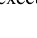

### 说明：

未来版本的 Java 将允许用户定义类似基本类型的类型——其值不存储在对象内部。例如，一个具有 `double` 字段 `x` 和 `y` 的基本类型 `Point` 的值，只是内存中的一个 16 字节块，其中包含两个相邻的 `double` 值。你可以复制它，但不能拥有对它的引用。

如果需要引用，请使用自动生成的伴生类（在当前提案中名为 `Point.ref`）。装箱和拆箱是自动的，就像今天的基本类型一样。

在某个时候，基本类型包装器类将与这些类统一。例如，`Double` 将成为 `double.ref` 的别名。

你还会经常因为另一个原因看到数字包装器。Java 的设计者发现包装器是放置某些基本方法的便利之处，例如将数字字符串转换为数字的方法。

要将字符串转换为整数，请使用以下语句：

```java
int x = Integer.parseInt(s);
```

这与 `Integer` 对象无关——`parseInt` 是一个静态方法。但 `Integer` 类是一个放置它的好地方。

API 注释展示了 `Integer` 类的一些较重要方法。其他数字类实现了相应的方法。


### 警告：

有些人认为包装器类可用于实现能够修改数值参数的方法。然而，这是不正确的。回想[第 4 章](#)，不可能编写一个递增整数参数的 Java 方法，因为 Java 方法的参数总是按值传递。

```java
public static void triple(int x) // won't work
{
    x = 3 * x; // modifies local variable
}
```

我们能否通过使用 `Integer` 而不是 `int` 来克服这个问题？

```java
public static void triple(Integer x) // won't work
{
    . . .
}
```

问题在于 `Integer` 对象是*不可变*的：包装器内部包含的信息不能改变。你无法使用这些包装器类创建能够修改数值参数的方法。

### `java.lang.Integer` 1.0

- `int intValue()` 以 `int` 形式返回此 `Integer` 对象的值（覆盖 `Number` 类中的 `intValue` 方法）。
- `static String toString(int i)` 返回一个新的 `String` 对象，表示十进制数字 `i`。
- `static String toString(int i, int radix)` 允许你返回数字 `i` 在 `radix` 参数所指定进制下的表示。
- `static int parseInt(String s)`
- `static int parseInt(String s, int radix)`
  返回其数字包含在字符串 `s` 中的整数。该字符串必须表示一个十进制整数（对于第一个方法），或由 `radix` 参数给定进制表示的整数（对于第二个方法）。
- `static Integer valueOf(String s)`
- `static Integer valueOf(String s, int radix)`


返回一个新的 `Integer` 对象，该对象初始化为字符串 `s` 中包含的数字所表示的整数。该字符串必须表示一个十进制整数（对于第一个方法），或表示一个由 `radix` 参数给定进制的整数（对于第二个方法）。

### `java.text.NumberFormat` 1.1

- `Number parse(String s)` 返回数值，前提是指定的 `String` 表示一个数字。

## 5.5 参数数量可变的方法

可以提供能够以可变数量的参数调用的方法。（这些方法有时称为“varargs”方法。）

你已经见过这样一个方法：`printf`。例如，以下调用

```java
System.out.printf("%d", n);
```

以及

```java
System.out.printf("%d %s", n, "widgets");
```

都调用同一个方法，尽管一个调用有两个参数，另一个调用有三个参数。

`printf` 方法定义如下：

```java
public class PrintStream
{
    public PrintStream printf(String fmt, Object... args)
    {
        return format(fmt, args);
    }
}
```

在这里，省略号 `...` 是 Java 代码的一部分。它表示该方法可以接收任意数量的对象（除了 `fmt` 参数之外）。

`printf` 方法实际上接收两个参数：格式字符串和一个保存所有其他参数的 `Object[]` 数组。（如果调用方提供整数或其他基本类型值，自动装箱会将它们转换为对象。）现在，它面临一项并不轻松的任务：扫描 `fmt` 字符串，并将第 i 个格式说明符与值 `args[i]` 匹配。

换句话说，对于 `printf` 的实现者来说，`Object...` 参数类型与 `Object[]` 完全相同。

编译器需要转换每一次对 `printf` 的调用，将参数打包进一个数组，并在必要时进行自动装箱：

```java
System.out.printf("%d %s", new Object[] { Integer.valueOf(n),
        "widgets" });
```

你可以定义自己的可变参数方法，并且可以为参数指定任意类型，甚至是基本类型。下面是一个简单示例：一个计算可变数量值中最大值的函数。

```java
public static double max(double... values)
{
    double largest = Double.NEGATIVE_INFINITY;
    for (double v : values) if (v > largest) largest = v;
    return largest;
}
```

只需像这样调用该函数：

```java
double m = max(3.1, 40.4, -5);
```

编译器会将一个新的 `double[] { 3.1, 40.4, -5 }` 传递给 `max` 函数。

**注意：**

可以将数组作为可变参数方法的最后一个参数传递，这是合法的。例如：

```java
System.out.printf("%d %s", new Object[] { Integer.valueOf(1),
        "widgets" });
```

因此，你可以将最后一个参数为数组的现有函数重新定义为可变参数方法，而不会破坏任何现有代码。例如，`MessageFormat.format` 在 Java 5 中就以这种方式得到了增强。如果你愿意，甚至可以将 `main` 方法声明为

```java
public static void main(String... args)
```

## 5.6 抽象类

随着你在继承层次结构中向上移动，类会变得更通用，也可能更抽象。在某一点上，祖先类会变得*如此*通用，以至于你更多地将它视为其他类的基础，而不是一个包含你想使用的特定实例的类。例如，考虑我们 `Employee` 类层次结构的一个扩展。员工是人，学生也是人。让我们扩展类层次结构，加入 `Person` 和 `Student` 类。图 5.2 展示了这些类之间的继承关系。

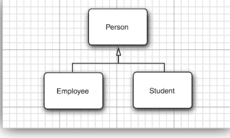

**图 5.2** `Person` 及其子类的继承图

为什么要费心使用如此高的抽象层次呢？有些属性对每个人来说都有意义，例如姓名。学生和员工都有姓名，引入一个公共超类可以让我们将 `getName` 方法提取到继承层次结构中更高的层次。

现在，让我们添加另一个方法 `getDescription`，其目的是返回该人的简要描述，例如

```
an employee with a salary of $50,000.00
a student majoring in computer science
```

为 `Employee` 和 `Student` 类实现这个方法很容易。但是，在 `Person` 类中你能提供什么信息呢？`Person` 类除了姓名之外，对该人一无所知。当然，你可以实现 `Person.getDescription()` 来返回空字符串。但还有更好的方法。如果使用 `abstract` 关键字，你根本不需要实现该方法。

```java
public abstract String getDescription();
// no implementation required
```

为更清晰起见，包含一个或多个抽象方法的类本身必须声明为抽象类。

```java
public abstract class Person
{
    . . .
    public abstract String getDescription();
}
```

除了抽象方法之外，抽象类还可以有字段和具体方法。例如，`Person` 类存储该人的姓名，并有一个返回该姓名的方法。

```java
public abstract class Person
{
    private String name;

    public Person(String name)
    {
        this.name = name;
    }

    public abstract String getDescription();

    public String getName()
    {
        return name;
    }
}
```


> **提示：**
>
> 有些程序员没有意识到抽象类可以有具体方法。你应该始终将公共字段和方法（无论是否为抽象）移到超类（无论是否为抽象）中。

抽象方法充当在子类中实现的方法的占位符。当你扩展一个抽象类时，有两种选择。你可以不定义部分或全部抽象方法；那么，你必须也将该子类标记为抽象类。或者，你可以定义所有方法，这样该子类就不再是抽象类。

例如，我们将定义一个 `Student` 类，它扩展抽象类 `Person` 并实现 `getDescription` 方法。`Student` 类的方法都不是抽象的，因此它不需要声明为抽象类。

一个类甚至可以声明为抽象类，即使它没有抽象方法。

抽象类不能被实例化。也就是说，如果一个类声明为抽象类，就不能创建该类的对象。例如，以下表达式

```java
new Person("Vince Vu")
```

是错误的。但是，你可以创建具体子类的对象。

请注意，你仍然可以创建抽象类的*对象变量*，但这种变量必须引用非抽象子类的对象。例如：

```java
Person p = new Student("Vince Vu", "Economics");
```

这里，`p` 是抽象类型 `Person` 的变量，它引用非抽象子类 `Student` 的一个实例。


**C++ 注意：**

在 C++ 中，抽象方法称为*纯虚函数*，并在末尾标记 `= 0`，例如：

```cpp
class Person // C++
{
public:
    virtual string getDescription() = 0;
    ...
};
```

如果一个 C++ 类至少有一个纯虚函数，那么它就是抽象类。在 C++ 中，没有专门的关键字来表示抽象类。

让我们定义一个具体子类 `Student`，它扩展抽象类 `Person`：

```java
public class Student extends Person
{
    private String major;

    public Student(String name, String major)
    {
        super(name);
        this.major = major;
    }

    public String getDescription()
    {
        return "a student majoring in " + major;
    }
}
```

`Student` 类定义了 `getDescription` 方法。因此，`Student` 类中的所有方法都是具体方法，该类不再是抽象类。

程序清单 5.8 中展示的程序定义了抽象超类 `Person`（程序清单 5.9）以及两个具体子类：`Employee`（程序清单 5.10）和 `Student`（程序清单 5.11）。我们用员工对象和学生对象填充一个 `Person` 引用数组：

```java
var people = new Person[2];
people[0] = new Employee(...);
```


```java
people[1] = new Student(. . .);
```

然后，我们打印这些对象的名称和描述：

```java
for (Person p : people)
   System.out.println(p.getName() + ", " + p.getDescription());
```

有些人对下面这个调用感到困惑：

```java
p.getDescription()
```

这不是对未定义方法的调用吗？请记住，变量 p 从不引用 Person 对象，因为不可能构造抽象类 Person 的对象。变量 p 总是引用具体子类的对象，例如 Employee 或 Student。对于这些对象，getDescription 方法是已定义的。

你能否从 Person 超类中完全省略这个抽象方法，只在 Employee 和 Student 子类中定义 getDescription 方法？如果那样做，你就无法在变量 p 上调用 getDescription 方法。编译器确保你只调用类中声明的方法。

抽象方法是 Java 编程语言中的一个重要概念。你最常会在*接口*中遇到它们。有关接口的更多信息，请参阅[第 6 章](#)。

### 清单 5.8 `abstractClasses/PersonTest.java`

```java
1  package abstractClasses;
2
3  /**
4   * This program demonstrates abstract classes.
5   * @version 1.01 2004-02-21
6   * @author Cay Horstmann
7   */
8  public class PersonTest
{
    public static void main(String[] args)
    {
        var people = new Person[2];

        // fill the people array with Student and Employee objects
        people[0] = new Employee("Harry Hacker", 50000, 1989, 10, 1);
        people[1] = new Student("Maria Morris", "computer science");

        // print out names and descriptions of all Person objects
        for (Person p : people)
            System.out.println(p.getName() + ", " + p.getDescription());
    }
}
```

### 清单 5.9 `abstractClasses/Person.java`

```java
package abstractClasses;

public abstract class Person
{
    public abstract String getDescription();
    private String name;

    public Person(String name)
    {
        this.name = name;
    }

    public String getName()
    {
        return name;
16    }
17 }
```

### **清单 5.10** `abstractClasses/Employee.java`

```java
1  package abstractClasses;
2
3  import java.time.*;
4
5  public class Employee extends Person
6  {
7      private double salary;
8      private LocalDate hireDay;
9
10     public Employee(String name, double salary, int year, int
   month, int day)
11     {
12         super(name);
13         this.salary = salary;
14         hireDay = LocalDate.of(year, month, day);
15     }
16
17     public double getSalary()
18     {
19         return salary;
20     }
21
22     public LocalDate getHireDay()
23     {
24         return hireDay;
25     }
26
27     public String getDescription()
28     {
29         return "an employee with a salary of
   $%.2f".formatted(salary);
30     }
31
    public void raiseSalary(double byPercent)
    {
        double raise = salary * byPercent / 100;
        salary += raise;
    }
}
```

### **清单 5.11** `abstractClasses/Student.java`

```java
package abstractClasses;

public class Student extends Person
{
    private String major;

    /**
     * @param name the student's name
     * @param major the student's major
     */
    public Student(String name, String major)
    {
        // pass name to superclass constructor
        super(name);
        this.major = major;
    }

    public String getDescription()
    {
        return "a student majoring in " + major;
    }
}
```

## 5.7 枚举类

你在[第 3 章](#)中看到了如何定义枚举类型。下面是一个典型示例：

```java
public enum Size { SMALL, MEDIUM, LARGE, EXTRA_LARGE }
```

这个声明定义的类型实际上是一个类。该类恰好有四个实例——不可能构造新对象。

因此，对于枚举类型的值，你永远不需要使用 `equals`。只需使用 `==` 来比较它们。

如果你愿意，可以向枚举类型添加构造器、方法和字段。当然，构造器只在构造枚举常量时被调用。下面是一个示例：

```java
public enum Size
{
    SMALL("S"), MEDIUM("M"), LARGE("L"), EXTRA_LARGE("XL");
    private String abbreviation;
    Size(String abbreviation) { this.abbreviation =
    abbreviation; }
        // automatically private
    public String getAbbreviation() { return abbreviation; }
}
```

枚举的构造器总是私有的。你可以像前面的示例那样省略 `private` 修饰符。将枚举构造器声明为 `public` 或 `protected` 是语法错误。

所有枚举类型都是抽象类 `Enum` 的子类。它们从该类继承了许多方法。最有用的一个是 `toString`，它返回枚举常量的名称。例如，`Size.SMALL.toString()` 返回字符串 `"SMALL"`。

`toString` 的反操作是静态 `valueOf` 方法。例如，语句

```java
Size s = Enum.valueOf(Size.class, "SMALL");
```

将 `s` 设置为 `Size.SMALL`。

每个枚举类型都有一个静态 values 方法，它返回该枚举所有值的数组。例如，调用

```java
Size[] values = Size.values();
```

返回包含元素 `Size.SMALL`、`Size.MEDIUM`、`Size.LARGE` 和 `Size.EXTRA_LARGE` 的数组。

ordinal 方法给出枚举常量在枚举声明中的位置，从零开始计数。例如，`Size.MEDIUM.ordinal()` 返回 1。

[清单 5.12](#) 中的简短程序演示了如何使用枚举类型。

> **注意：**
>
> `Enum` 类有一个类型参数，为简单起见我忽略了它。例如，枚举类型 `Size` 实际上扩展了 `Enum<Size>`。该类型参数用于 `compareTo` 方法。我在第 6 章讨论 `compareTo` 方法，并在第 8 章讨论类型参数。

### **清单 5.12** `enums/EnumTest.java`

```java
1  package enums;
2
3  import java.util.*;
4
5  /**
6   * This program demonstrates enumerated types.
7   * @version 1.0 2004-05-24
8   * @author Cay Horstmann
9   */
10 public class EnumTest
11 {
12  public static void main(String[] args)
13  {
14      var in = new Scanner(System.in);
15      System.out.print("Enter a size: (SMALL, MEDIUM, LARGE,
    EXTRA_LARGE) ");
16      String input = in.next().toUpperCase();
17      Size size = Enum.valueOf(Size.class, input);
18      System.out.println("size=" + size);
19      System.out.println("abbreviation=" +
    size.getAbbreviation());
20      if (size == Size.EXTRA_LARGE)
21          System.out.println("Good job--you paid attention to
    the __");
22  }
23 }

25 enum Size
26 {
27     SMALL("S"), MEDIUM("M"), LARGE("L"), EXTRA_LARGE("XL");

29     private Size(String abbreviation) { this.abbreviation =
    abbreviation; }
30     public String getAbbreviation() { return abbreviation; }

32     private String abbreviation;
33 }
```

### java.lang.Enum&lt;E&gt; 5

- `static Enum valueOf(Class enumClass, String name)`：返回给定类中具有给定名称的枚举常量。
- `String toString()`：返回此枚举常量的名称。
- `int ordinal()`：返回此枚举常量在枚举声明中从零开始的位置。
- `int compareTo(E other)`：如果此枚举常量位于 other 之前，则返回负整数；如果 this == other，则返回 0；否则返回正整数。常量的顺序由枚举声明给出。

## 5.8 密封类

除非一个类被声明为 final，否则任何人都可以创建它的子类。如果你想要更多控制权呢？例如，假设你需要编写自己的 JSON 库，因为现有库没有一个能完全满足你的需求。

JSON 标准规定，JSON 值是一个数组、数字、字符串、布尔值、对象或 null。一种显而易见的做法是用扩展抽象类 `JSONValue` 的 `JSONArray`、`JSONNumber` 等类来建模：

```java
public abstract class JSONValue
{
    // Methods that apply to all JSON values
}
public final class JSONArray extends JSONValue
{
    . . .
}
public final class JSONNumber extends JSONValue
{
    . . .
}
```

通过将 `JSONArray`、`JSONNumber` 等类声明为 `final`，我们可以确保没有人创建子类。但我们无法阻止任何人创建 `JSONValue` 的另一个子类。


我们为什么可能需要这种控制？考虑以下代码：

```java
JSONValue v = . . .;
if (v instanceof JSONArray a) . . .
else if (v instanceof JSONNumber n) . . .
else if (v instanceof JSONString s) . . .
else if (v instanceof JSONBoolean b) . . .
else if (v instanceof JSONObject o) . . .
else . . . // Must be JSONNull
```

在这里，控制流意味着我们知道 `JSONValue` 的所有直接子类。这不是一个开放式的层次结构。JSON 标准不会改变；如果它改变了，作为库实现者的我们会添加第七个子类。我们不希望其他任何人乱动这个类层次结构。

在 Java 中，*密封*类控制哪些类可以继承它。密封类在 Java 15 中作为预览特性加入，并在 Java 17 中最终确定。

下面说明如何将 JSONValue 类声明为密封类：

```java
public abstract sealed class JSONValue
    permits JSONArray, JSONNumber, JSONString, JSONBoolean,
JSONObject, JSONNull
{
    . . .
}
```

定义未被允许的子类是错误的：

```java
public class JSONComment extends JSONValue { . . . } // Error
```

这也没什么问题，因为 JSON 不允许注释。因此，密封类允许对领域约束进行准确建模。

密封类的允许子类必须可访问。它们不能是嵌套在另一个类中的私有类，也不能是来自另一个包的包可见类。

对于 public 的允许子类，规则更严格。它们必须与密封类位于同一个包中。但是，如果你使用模块（见第 II 卷第 9 章），那么它们必须只位于同一个模块中。


**注意：**

密封类可以在没有 permits 子句的情况下声明。此时，它的所有直接子类都必须声明在同一个文件中。无法访问该文件的程序员不能形成子类。

一个文件最多只能有一个 public 类，因此这种安排似乎只有在子类不供公众使用时才有用。

不过，正如你将在下一章看到的，你可以使用内部类作为 public 子类。

密封类的一个重要动机是编译时检查。考虑 JSONValue 类的这个方法，它使用带模式匹配的 switch 表达式（Java 17 中的预览特性）：

```java
public String type()
{
    return switch (this)
    {
        case JSONArray j -> "array";
        case JSONNumber j -> "number";
        case JSONString j -> "string";
        case JSONBoolean j -> "boolean";
        case JSONObject j -> "object";
        case JSONNull j -> "null";
        // No default needed here
    };
}
```

编译器可以检查出不需要 `default` 子句，因为 `JSONValue` 的所有直接子类都作为 case 出现。

> **注意：**
>
> 前面的 `type` 方法看起来不太面向对象。让六个类各自提供自己的 `type` 方法、依靠多态而不是 switch，会更符合 OOP 的精神。对于开放式层次结构，这是一种好方法。但当类集合固定时，把所有备选情况放在一个方法中通常更方便。

乍一看，密封类的子类似乎必须是 final。但对于穷尽性检查，我们只需要知道所有直接子类。这些类是否还有更多子类并不是问题。例如，我们可以像图 5.3 所示那样重新组织 JSON 层次结构。

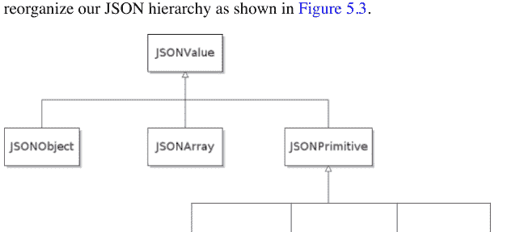

**图 5.3** 用于表示 JSON 值的完整类层次结构

在这个层次结构中，`JSONValue` 允许三个子类：

```java
public abstract sealed class JSONValue permits JSONObject,
JSONArray, JSONPrimitive
{
  . . .
}
```

JSONPrimitive 类也是密封的：

```java
public abstract sealed class JSONPrimitive extends JSONValue
    permits JSONString, JSONNumber, JSONBoolean, JSONNull
{
  . . .
}
```

密封类的子类必须指定它是 sealed、final，还是开放以供子类化。在后一种情况下，必须将其声明为 non-sealed。


**注意：**

non-sealed 关键字是第一个带连字符的 Java 关键字。这很可能是一种未来趋势。向语言添加关键字总是伴随风险。现有代码可能无法再编译。因此，sealed 是一个“上下文”关键字。你仍然可以声明名为 sealed 的变量或方法：

```java
int sealed = 1; // OK to use contextual keyword as identifier
```

对于带连字符的关键字，人们不必担心这一点。唯一的歧义在于减法：

```java
int non = 0;
non = non-sealed; // Subtraction, not keyword
```

```java
import java.util.*;

sealed interface JSONValue permits JSONArray, JSONObject, JSONPrimitive
{
    public default String type()
    {
        if (this instanceof JSONArray) return "array";
        else if (this instanceof JSONObject) return "object";
        else if (this instanceof JSONNumber) return "number";
        else if (this instanceof JSONString) return "string";
        else if (this instanceof JSONBoolean) return "boolean";
        else return "null";
    }
}

final class JSONArray extends ArrayList<JSONValue> implements
JSONValue {}

final class JSONObject extends HashMap<String, JSONValue>
implements JSONValue
{
    public String toString()
    {
        StringBuilder result = new StringBuilder();
        result.append("{");
        for (Map.Entry<String, JSONValue> entry : entrySet())
        {
            if (result.length() > 1) result.append(",");
            result.append("\"");
            result.append(entry.getKey());
            result.append("\": ");
            result.append(entry.getValue());
        }
        result.append(" }");
        return result.toString();
    }
}
```

```java
sealed interface JSONPrimitive extends JSONValue
        permits JSONNumber, JSONString, JSONBoolean, JSONNull
{
}

final record JSONNumber(double value) implements JSONPrimitive
{
    public String toString() { return "" + value; }
}

final record JSONString(String value) implements JSONPrimitive
{
    public String toString() { return "\"" +
value.translateEscapes() + "\""; }
}

enum JSONBoolean implements JSONPrimitive
{
    FALSE, TRUE;
    public String toString() { return
super.toString().toLowerCase(); }
}

enum JSONNull implements JSONPrimitive
{
    INSTANCE;
    public String toString() { return "null"; }
}

public class SealedTest
{
    public static void main(String[] args)
    {
        JSONObject obj = new JSONObject();
        obj.put("name", new JSONString("Harry"));
        obj.put("salary", new JSONNumber(90000));
        obj.put("married", JSONBoolean.FALSE);
        JSONArray arr = new JSONArray();
        arr.add(new JSONNumber(13));
```

信息被虚拟机用来选择要执行的正确方法。

然而，你也可以通过使用一个特殊的 Java 类来访问这些信息。保存这些信息的类叫作 `Class`，这个名字有点令人困惑。`Object` 类中的 `getClass()` 方法返回一个 `Class` 类型的实例。

```java
Employee e; . . .
Class cl = e.getClass();
```

正如 `Employee` 对象描述某个特定员工的属性一样，`Class` 对象描述某个特定类的属性。`Class` 最常用的方法大概是 `getName`。它返回类的名称。例如，下面的语句

```java
System.out.println(e.getClass().getName() + " " + e.getName());
```

会打印

```
Employee Harry Hacker
```

如果 e 是员工，或者

```
Manager Harry Hacker
```

如果 e 是经理。

如果类位于某个包中，则包名是类名的一部分：

```java
var generator = new Random();
Class cl = generator.getClass();
String name = cl.getName(); // name is set to
"java.util.Random"
```

你可以使用 `static forName` 方法获取与类名对应的类对象。

```java
String className = "java.util.Random";
Class cl = Class.forName(className);
```

如果类名存储在运行时可能变化的字符串中，请使用此方法。如果 `className` 是类或接口的名称，则此方法有效。否则，`forName` 方法会抛出一个*受检异常*。有关在使用此方法时如何提供*异常处理器*，请参见第 283 页的[第 5.9.2 节“声明异常入门”](#)。

获取 `Class` 类型对象的第三种方法是一种便捷简写。如果 `T` 是任意 Java 类型（或 `void` 关键字），那么 `T.class` 就是与之匹配的类对象。例如：

```java
Class cl1 = Random.class; // if you import java.util.*;
Class cl2 = int.class;
Class cl3 = Double[].class;
```

注意，类对象实际上描述的是一个*类型*，该类型可能是类，也可能不是类。例如，`int` 不是类，但 `int.class` 仍然是 `Class` 类型的对象。

> **注意：**
>
> `class` 类实际上是一个泛型类。例如，`Employee.class` 的类型是 `Class<Employee>`。我不深入讨论这个问题，因为它会使一个本就抽象的概念进一步复杂化。在大多数实际用途中，你可以忽略类型参数，直接使用原始类类型。有关此问题的更多信息，请参见[第 8 章](#)。


**警告：**

由于历史原因，`getName` 方法对数组类型返回的名称有些奇怪：

- `Double[].class.getName()` 返回 `"[Ljava.lang.Double;"`。
- `int[].class.getName()` 返回 `"[I"`。

虚拟机为每种类型管理一个唯一的类对象。因此，你可以使用 `==` 运算符比较类对象。例如：

```java
if (e.getClass() == Employee.class) . . .
```

如果 `e` 是 `Employee` 的实例，则此测试通过。与条件 `e instanceof Employee` 不同，如果 `e` 是诸如 `Manager` 之类的子类的实例，则此测试失败。

如果你有一个 `Class` 类型的对象，可以使用它构造该类的实例。调用 `getConstructor` 方法获取一个 `Constructor` 类型的对象，然后使用 `newInstance` 方法构造实例。例如：

```java
var className = "java.util.Random"; // or any other name of a class with a no-arg constructor
Class cl = Class.forName(className);
Object obj = cl.getConstructor().newInstance();
```

如果该类没有无参构造器，`getConstructor` 方法会抛出异常。你将在第 304 页的[第 5.9.7 节“调用任意方法和构造器”](#)中看到如何调用其他构造器。

**java.lang.reflect.Constructor 1.1**

- `Object newInstance(Object... params)` 构造构造器声明类的新实例，并将 params 传递给该构造器。有关如何提供参数的更多信息，请参见第 304 页的 5.9.7 节“调用任意方法和构造器”。

**java.lang.Throwable 1.0**

- `void printStackTrace()` 将 Throwable 对象和堆栈轨迹打印到标准错误流。

### 5.9.2 声明异常入门

我将在第 7 章全面介绍异常处理，但在此期间，你偶尔会遇到可能抛出异常的方法。

当运行时发生错误时，程序可以“抛出异常”。抛出异常比终止程序更灵活，因为你可以提供一个*处理器*来“捕获”异常并处理它。

如果你不提供处理器，程序将终止并向控制台打印一条消息，给出异常的类型。当你意外使用 `null` 引用或超出数组边界时，可能已经见过异常报告。

异常有两种：*非受检*异常和*受检*异常。对于受检异常，编译器会检查你（程序员）是否意识到该异常并准备好处理其后果。然而，许多常见异常（例如边界错误或访问 null 引用）都是非受检的。编译器不期望你提供处理器——毕竟，你应该把精力花在避免这些错误上，而不是为它们编写处理器。

但并非所有错误都可以避免。如果尽管你尽了最大努力，异常仍可能发生，那么大多数 Java API 都会抛出受检异常。一个例子是 `Class.forName` 方法。你无法确保具有给定名称的类存在。在[第 7 章](#)中，你将看到几种异常处理策略。现在，我只向你展示最简单的策略。

只要方法包含可能抛出受检异常的语句，就要在方法名后添加 `throws` 子句。

```java
public static void doSomethingWithClass(String name)
      throws ReflectiveOperationException
{
   Class cl = Class.forName(name); // might throw exception
   do something with cl
}
```

任何调用此方法的方法也需要 `throws` 声明。这包括 `main` 方法。如果异常实际发生，`main` 方法会以堆栈轨迹终止。（你将在[第 7 章](#)中学习如何捕获异常，而不是让异常终止程序。）

你只需要为受检异常提供 `throws` 子句。要找出哪些方法会抛出受检异常很容易——每当你调用一个可能抛出受检异常的方法而你又没有提供处理器时，编译器就会报错。

### 5.9.3 资源

类通常有与之关联的数据文件，例如：

- 图像和声音文件
- 包含消息字符串和按钮标签的文本文件

在 Java 中，这种关联文件称为*资源*。

例如，考虑一个显示消息的对话框，如图 5.4 所示。

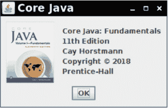

**图 5.4** 显示图像和文本资源

当然，面板中的书名和版权年份会因本书下一版而改变。为了便于跟踪此更改，我们将把文本放入文件中，而不是将其硬编码为字符串。

但是，你应该把诸如 `about.txt` 之类的文件放在哪里？当然，简单地将其与其余程序文件一起放入 JAR 文件中会很方便。

`Class` 类提供了一项用于定位资源文件的有用服务。以下是必要的步骤：

- 1. 获取拥有资源的类的 `Class` 对象——例如，`ResourceTest.class`。
- 2. 某些方法（例如 `ImageIcon` 类的 `getImage` 方法）接受描述资源位置的 URL。然后你调用

  ```java
  URL url = cl.getResource("about.gif");
  ```

- 3. 否则，使用 `getResourceAsStream` 方法获取用于读取文件中数据的输入流。

关键在于，Java 虚拟机知道如何定位类，因此它随后可以在*同一位置*搜索关联资源。例如，假设 `ResourceTest` 类位于包 `resources` 中。那么 `ResourceTest.class` 文件位于 `resources` 目录中，而你将图标文件放入同一目录。

除了将资源文件放在与类文件相同的目录中，你还可以提供相对或绝对路径，例如

```
data/about.txt
/corejava/title.txt
```

资源加载功能所做的全部事情就是自动化文件加载。没有用于解释资源文件内容的标准方法。每个程序都必须有自己的方式来解释其资源文件。

资源的另一个常见应用是程序国际化。与语言相关的字符串（例如消息和用户界面标签）存储在资源文件中，每种语言一个文件。*国际化 API* 在第二卷的[第 7 章](#)中讨论，它支持一种用于组织和访问这些本地化文件的标准方法。

[代码清单 5.13](#) 是一个演示资源加载的程序。（不必担心读取文本和显示对话框的代码——我们稍后会介绍这些细节。）编译、构建 JAR 文件并执行它：

```
javac resource/ResourceTest.java
jar cvfe ResourceTest.jar resources.ResourceTest \
   resources/*.class resources/*.gif resources/data/*.txt \
   corejava/*.txt
java -jar ResourceTest.jar
```

将 JAR 文件移到另一个目录并再次运行，以检查程序是从 JAR 文件而不是从当前目录读取资源文件。


## 清单 5.14 `resources/ResourceTest.java`

```java
package resources;

import java.io.*;
import java.net.*;
import java.nio.charset.*;
import javax.swing.*;

/**
 * @version 1.5 2018-03-15
 * @author Cay Horstmann
 */
public class ResourceTest
{
    public static void main(String[] args) throws IOException
    {
        Class<?> cl = ResourceTest.class;
        URL aboutURL = cl.getResource("about.gif");
        var icon = new ImageIcon(aboutURL);

        InputStream stream = cl.getResourceAsStream("data/about.txt");
        var about = new String(stream.readAllBytes(), "UTF-8");

        InputStream stream2 = cl.getResourceAsStream("/corejava/title.txt");
        var title = new String(stream2.readAllBytes(), StandardCharsets.UTF_8).strip();

        JOptionPane.showMessageDialog(
            null, about, title, JOptionPane.INFORMATION_MESSAGE, icon);
    }
}
```

- `URL getResource(String name)` 1.1
- `InputStream getResourceAsStream(String name)` 1.1

  在与类相同的位置查找资源，然后返回可用于加载资源的 URL 或输入流。如果未找到资源则返回 null，因此不会因 I/O 错误抛出异常。

### 5.9.4 使用反射分析类的能力

下面简要概述反射机制中最重要的部分，让你能够检查类的结构。

`java.lang.reflect` 包中的 `Field`、`Method` 和 `Constructor` 三个类分别描述类的字段、方法和构造函数。这三个类都有一个名为 `getName` 的方法，返回该项的名称。`Field` 类有一个 `getType` 方法，返回一个同样为 `Class` 类型的对象，用于描述字段类型。`Method` 和 `Constructor` 类有报告参数类型的方法，`Method` 类还报告返回类型。这三个类还都有一个名为 `getModifiers` 的方法，返回一个整数，其中不同的位被置位或清除，用于描述所使用的修饰符，例如 `public` 和 `static`。然后可以使用 `java.lang.reflect` 包中 `Modifier` 类的静态方法来分析 `getModifiers` 返回的整数。使用 `Modifier` 类中的 `isPublic`、`isPrivate` 或 `isFinal` 等方法来判断某个方法或构造函数是 public、private 还是 final。你只需让 `Modifier` 类中相应的方法作用于 `getModifiers` 返回的整数即可。还可以使用 `Modifier.toString` 方法打印修饰符。

`Class` 类的 `getFields`、`getMethods` 和 `getConstructors` 方法返回该类支持的*公共*字段、方法和构造函数数组。这包括超类的公共成员。`Class` 类的 `getDeclaredFields`、`getDeclaredMethods` 和 `getDeclaredConstructors` 方法返回由该类中声明的所有字段、方法和构造函数组成的数组。这包括私有、包级和受保护成员，以及具有包访问权限的成员，但不包括超类成员。

[清单 5.15](#) 展示了如何打印出类的所有信息。程序会提示你输入类名，并写出所有方法和构造函数的签名以及类中所有实例字段的名称。例如，如果输入

```text
java.lang.Double
```

程序将打印

```java
public final class java.lang.Double extends java.lang.Number
{
    public java.lang.Double(double);
    public java.lang.Double(java.lang.String);
    public boolean equals(java.lang.Object);
    public static java.lang.String toString(double);
    public java.lang.String toString();
    public static int hashCode(double);
    public int hashCode();
    public static double min(double, double);
    public static double max(double, double);
    public static native long doubleToRawLongBits(double);
    public static long doubleToLongBits(double);
    public static native double longBitsToDouble(long);
    public int compareTo(java.lang.Double);
    public volatile int compareTo(java.lang.Object);
    public static int compare(double, double);
    public byte byteValue();
    public short shortValue();
    public int intValue();
    public long longValue();
    public float floatValue();
    public double doubleValue();
    public static java.lang.Double valueOf(java.lang.String);
    public static java.lang.Double valueOf(double);
    public static java.lang.String toHexString(double);
    public volatile java.lang.Object resolveConstantDesc(
        java.lang.invoke.MethodHandles$Lookup);
    public java.lang.Double resolveConstantDesc(java.lang.invoke.MethodHandles$Lookup);
    public java.util.Optional describeConstable();
    public boolean isNaN();
    public static boolean isNaN(double);
    public static double sum(double, double);
    public boolean isInfinite();
    public static boolean isInfinite(double);
    public static boolean isFinite(double);
    public static double parseDouble(java.lang.String);
    public static final double POSITIVE_INFINITY;
    public static final double NEGATIVE_INFINITY;
    public static final double NaN;
    public static final double MAX_VALUE;
    public static final double MIN_NORMAL;
    public static final double MIN_VALUE;
    public static final int MAX_EXPONENT;
    public static final int MIN_EXPONENT;
    public static final int SIZE;
    public static final int BYTES;
    public static final java.lang.Class TYPE;
    private final double value;
    private static final long serialVersionUID;
}
```

这个程序的非凡之处在于，它可以分析 Java 解释器能够加载的任何类，而不仅仅是程序编译时可用的类。在下一章中，我们将使用这个程序来窥探 Java 编译器自动生成的内部类。

## 清单 5.15 `reflection/ReflectionTest.java`

```java
package reflection;

import java.util.*;
import java.lang.reflect.*;

/**
 * This program uses reflection to print all features of a class.
 * @version 1.12 2021-06-15
 * @author Cay Horstmann
 */
public class ReflectionTest
{
    public static void main(String[] args)
            throws ReflectiveOperationException
    {
        // read class name from command line args or user input
        String name;
        if (args.length > 0) name = args[0];
        else
        {
            var in = new Scanner(System.in);
            System.out.println("Enter class name (e.g. java.util.Date): ");
            name = in.next();
        }

        // print class modifiers, name and superclass name (if != Object)
        Class<?> cl = Class.forName(name);
        String modifiers = Modifier.toString(cl.getModifiers());
        if (modifiers.length() > 0) System.out.print(modifiers + " ");

        if (cl.isSealed())
            System.out.print("sealed ");
        if (cl.isEnum())
            System.out.print("enum " + name);
        else if (cl.isRecord())
            System.out.print("record " + name);
        else if (cl.isInterface())
            System.out.print("interface " + name);
        else
            System.out.print("class " + name);
        Class<?> supercl = cl.getSuperclass();
40        if (supercl != null && supercl != Object.class)
41            System.out.print(" extends "
42                    + supercl.getName());
43
44        printInterfaces(cl);
45        printPermittedSubclasses(cl);
46
47        System.out.print("\n\n");
48        printConstructors(cl);
49        System.out.println();
50        printMethods(cl);
51        System.out.println();
52        printFields(cl);
53        System.out.println("}");
54    }
55
56    /**
57     * Prints all constructors of a class
58     * @param cl a class
59     */
60    public static void printConstructors(Class<?> cl)
61    {
62        Constructor<?>[] constructors = cl.getDeclaredConstructors();
63
64        for (Constructor<?> c : constructors)
65        {
66            String name = c.getName();
67            System.out.print("  ");
68            String modifiers = Modifier.toString(c.getModifiers());
69            if (modifiers.length() > 0) System.out.print(modifiers + " ");
70
71            System.out.print(name + "(");
72
73            // print parameter types
74            Class<?>[] paramTypes = c.getParameterTypes();
75            for (int j = 0; j < paramTypes.length; j++)
76            {
77                if (j > 0) System.out.print(", ");
78                System.out.print(paramTypes[j].getName());
```


```java
/**
 * Prints all directly implemented interfaces of a class
 * @param cl a class
 */
public static void printInterfaces(Class cl)
{
    Class<?>[] interfaces = cl.getInterfaces();
    for (int i = 0; i < interfaces.length; i++)
    {
        if (i == 0)
            System.out.print(cl.isInterface() ? " extends " : " implements ");
        else
            System.out.print(", ");
        System.out.print(interfaces[i].getName());
    }
}
```

### java.lang.Class 1.0

- `Field[] getFields()` 1.1
- `Field[] getDeclaredFields()` 1.1

  `getFields` 返回一个数组，其中包含此类或其超类的公共字段的 `Field` 对象；`getDeclaredFields` 返回一个数组，其中包含此类的所有字段的 `Field` 对象。如果没有此类字段，或者类对象表示基本类型或数组类型，则这些方法返回长度为 0 的数组。

- `Method[] getMethods()` 1.1
- `Method[] getDeclaredMethods()` 1.1

  返回一个包含 `Method` 对象的数组：`getMethods` 返回公共方法并包括继承的方法；`getDeclaredMethods` 返回此类或接口的所有方法，但不包括继承的方法。

- `Constructor[] getConstructors()` 1.1
- `Constructor[] getDeclaredConstructors()` 1.1

  返回一个包含构造器对象的数组，这些对象给出此 `Class` 对象所表示类的所有公共构造器（对于 `getConstructors`）或所有构造器（对于 `getDeclaredConstructors`）。

- `isInterface()`

  如果此 `Class` 对象描述的是 `interface`，则返回 true。（关于接口，请参见[第6章](#)。）

- `isEnum()` 1.5

  如果此 `Class` 对象描述的是 `enum`，则返回 true。

- `isRecord()` 16

  如果此 `Class` 对象描述的是 `record`，则返回 true。

- `RecordComponent[] getRecordComponents()` 16

  返回一个由 `RecordComponent` 对象组成的数组，这些对象描述记录字段；如果此类不是记录，则返回 null。

- `String getPackageName()` 9

  获取包含此类型的包的名称；如果此类型是数组类型，则获取元素类型的包；如果此类型是基本类型，则获取 "java.lang"。

### `java.lang.reflect.Field` 1.1

### `java.lang.reflect.Method` 1.1

### `java.lang.reflect.Constructor` 1.1

- `Class getDeclaringClass()`

  返回定义此构造器、方法或字段的类的类对象。

- `Class[] getExceptionTypes()`（在 `Constructor` 和 `Method` 类中）

  返回一个类对象数组，这些类对象表示该方法抛出的异常类型。

- `int getModifiers()`

  返回一个整数，描述此构造器、方法或字段的修饰符。使用 `Modifier` 类中的方法分析返回值。

- `String getName()`

  返回一个字符串，即构造器、方法或字段的名称。

- `Class[] getParameterTypes()`（在 `Constructor` 和 `Method` 类中）

  返回一个类对象数组，这些类对象表示参数的类型。

- `Class getReturnType()`（在 `Method` 类中）

  返回一个表示返回类型的类对象。

### `java.lang.reflect.RecordComponent` 16

- `String getName()`
- `Class<?> getType()`

  获取此记录组件的名称和类型。

- `Method getAccessor()`

  返回用于访问此记录组件的 `Method` 对象。

### `java.lang.reflect.Modifier` 1.1

- `static String toString(int modifiers)`

  返回一个字符串，其中包含与 `modifiers` 中设置的位相对应的修饰符。

- `static boolean isAbstract(int modifiers)`
- `static boolean isFinal(int modifiers)`
- `static boolean isInterface(int modifiers)`
- `static boolean isNative(int modifiers)`
- `static boolean isPrivate(int modifiers)`
- `static boolean isProtected(int modifiers)`
- `static boolean isPublic(int modifiers)`
- `static boolean isStatic(int modifiers)`
- `static boolean isStrict(int modifiers)`
- `static boolean isSynchronized(int modifiers)`
- `static boolean isVolatile(int modifiers)`

  测试 `modifiers` 值中与方法名中的修饰符相对应的位。

### 5.9.5 使用反射在运行时分析对象

在上一节中，我们了解了如何找出任意对象实例字段的*名称*和*类型*：

- 获取对应的 `Class` 对象。
- 在类对象上调用 `getDeclaredFields`。

在本节中，我们将更进一步，实际查看字段的*内容*。当然，查看一个在编写程序时名称和类型已知的对象的特定字段的内容很容易。但反射允许你查看在编译时未知的对象的字段。

实现这一点的关键方法是 `Field` 类中的 `get` 方法。如果 `f` 是 `Field` 类型的对象（例如，从 `getDeclaredFields` 获得的对象），而 `obj` 是 `f` 所表示字段所属类的对象，那么 `f.get(obj)` 返回一个对象，其值是 `obj` 的该字段的当前值。这一切有点抽象，所以我们来看一个示例。

```java
var harry = new Employee("Harry Hacker", 50000, 10, 1, 1989);
Class cl = harry.getClass();
    // the class object representing Employee
Field f = cl.getDeclaredField("name");
    // the name field of the Employee class
Object v = f.get(harry);
    // the value of the name field of the harry object, i.e.,
    // the String object "Harry Hacker"
```

当然，你也可以设置能够获取的值。调用 `f.set(obj, value)` 会将对象 `obj` 中由 `f` 表示的字段设置为新值。

实际上，这段代码有一个问题。由于 `name` 字段是私有字段，`get` 和 `set` 方法将抛出 `IllegalAccessException`。你只能对可访问的字段使用 `get` 和 `set`。Java 的安全机制允许你找出对象有哪些字段，但除非你有权限，否则它不允许你读取和写入这些字段的值。

反射机制的默认行为是遵循 Java 访问控制。但是，你可以通过在 `Field`、`Method` 或 `Constructor` 对象上调用 `setAccessible` 方法来覆盖访问控制。例如：

```java
f.setAccessible(true); // now OK to call f.get(harry)
```

`setAccessible` 方法是 `AccessibleObject` 类的方法，而 `AccessibleObject` 是 `Field`、`Method` 和 `Constructor` 类的共同超类。此功能是为调试器、持久化存储和类似机制提供的。我们将在本节后面将它用于一个通用的 `toString` 方法。

如果未授予访问权限，调用 `setAccessible` 会抛出异常。访问权限可能被模块系统（第二卷[第9章](#)）或安全管理器（第二卷[第10章](#)）拒绝。安全管理器的使用并不常见，并且自 Java 17 起已被弃用。但是，从 Java 9 开始，由于 Java API 已模块化，每个程序都包含模块。

例如，本节末尾的示例程序会查看 `ArrayList` 和 `Integer` 对象的内部结构。当你在 Java 9 到 Java 16 中运行它时，会出现以下不祥消息：

```text
WARNING: An illegal reflective access operation has occurred
WARNING: Illegal reflective access by
objectAnalyzer.ObjectAnalyzer (file:/home/cay
    /books/cj11/code/v1ch05/bin/) to field
java.util.ArrayList.serialVersionUID
WARNING: Please consider reporting this to the maintainers of
    objectAnalyzer.ObjectAnalyzer
WARNING: Use --illegal-access=warn to enable warnings of
    further illegal reflective access operations
WARNING: All illegal access operations will be denied in a
    future release
```

当你使用 Java 17 运行该程序时，会发生 `InaccessibleObjectException` 异常。

为了让程序继续运行，请将 `java.base` 模块中的 `java.util` 和 `java.lang` 包“开放”给“未命名模块”。详细信息见第二卷[第9章](#)。语法如下：

```text
java --add-opens java.base/java.util=ALL-UNNAMED \
    --add-opens java.base/java.lang=ALL-UNNAMED \
    objectAnalyzer.ObjectAnalyzerTest
```


**注意：**


未来的库可能会使用*变量句柄*而不是反射来读写字段。`VarHandle` 类似于 `Field`。你可以用它读取或写入特定类的任何实例的特定字段。然而，要获得 `VarHandle`，库代码需要一个 `Lookup` 对象：

```java
public Object getFieldValue(Object obj, String fieldName,
                             Lookup lookup)
        throws NoSuchFieldException, IllegalAccessException
{
    Class<?> cl = obj.getClass();
    Field field = cl.getDeclaredField(fieldName);
    VarHandle handle = MethodHandles.privateLookupIn(cl, lookup)
        .unreflectVarHandle(field);
    return handle.get(obj);
}
```

只要 `Lookup` 对象是在有权访问该字段的模块中生成的，这种方法就可行。该模块中的某个方法只需调用 `MethodHandles.lookup()`，就会生成一个封装了调用方访问权限的对象。通过这种方式，一个模块可以授予另一个模块访问私有成员的权限。实际问题在于，如何以最少的麻烦授予这些权限。

虽然我们仍然可以这样做，但让我们看看一个适用于任何类的泛型 `toString` 方法（参见[代码清单 5.16]）。这个泛型 `toString` 方法使用 `getDeclaredFields` 获取所有实例字段，并使用 setAccessible 便捷方法使所有字段可访问。对于每个字段，它获取名称和值。每个值都通过递归调用 `toString` 转换为字符串。

泛型 `toString` 方法需要处理几个复杂问题。引用循环可能导致无限递归。因此，`ObjectAnalyzer` 会跟踪已经访问过的对象。此外，要查看数组内部，需要使用不同的方法。你将在下一节了解详细信息。

```java
57            }
58        }
59        r += "]";
60        cl = cl.getSuperclass();
61      }
62      while (cl != null);
63
64      return r;
65   }
66 }
```

## java.lang.reflect.AccessibleObject 1.2

- `void setAccessible(boolean flag)`  
  设置或清除此可访问对象的可访问性标志；如果访问被拒绝，则抛出 `IllegalAccessException`。
- `boolean trySetAccessible()`⁹  
  设置此可访问对象的可访问性标志；如果访问被拒绝，则返回 `false`。
- `boolean canAccess(Object obj)`⁹  
  检查调用方能否通过此字段、方法或构造器对象访问 `obj`。对于静态字段或方法，或者对于构造器，请传入 `null`。
- `static void setAccessible(AccessibleObject[] array, boolean flag)`  
  是一个便捷方法，用于为一组对象设置可访问性标志。

## java.lang.Class 1.1

- `Field getField(String name)`
- `Field[] getFields()`  
  获取具有给定名称的公共字段，或获取所有字段的数组。
- `Field getDeclaredField(String name)`
- `Field[] getDeclaredFields()`  
  获取在此类中声明的具有给定名称的字段，或获取所有字段的数组。

## java.lang.reflect.Field 1.1

- `Object get(Object obj)`  
  获取此 Field 对象所描述的字段在对象 obj 中的值。
- `void set(Object obj, Object newValue)`  
  将此 Field 对象所描述的字段在对象 obj 中设置为新值。

### 5.9.6 使用反射编写泛型数组代码

java.lang.reflect 包中的 Array 类允许你动态创建数组。例如，Arrays 类中 copyOf 方法的实现就使用了这一功能。回想一下，这个方法如何用于扩充一个已经满了的数组。

```java
var a = new Employee[100];
. . .
// array is full
a = Arrays.copyOf(a, 2 * a.length);
```

如何编写这样一个泛型方法？`Employee[]` 数组可以转换为 `Object[]` 数组，这很有帮助。听起来很有希望。下面是第一次尝试：

```java
public static Object[] badCopyOf(Object[] a, int newLength) // not useful
{
    var newArray = new Object[newLength];
    System.arraycopy(a, 0, newArray, 0, Math.min(a.length, newLength));
    return newArray;
}
```

然而，实际使用得到的数组时存在一个问题。这段代码返回的数组类型是*对象*数组（`Object[]`），因为我们使用下面这行代码创建了该数组

```java
new Object[newLength]
```

对象数组*不能*强制转换为员工数组（`Employee[]`）。虚拟机将在运行时生成 `ClassCastException`。关键在于，如前所述，Java 数组会记住其元素的类型——也就是创建它的 new 表达式中使用的元素类型。将 `Employee[]` 临时强制转换为 `Object[]` 数组，然后再转换回来是合法的，但一个最初作为 `Object[]` 数组创建的数组永远不能强制转换为 `Employee[]` 数组。要编写这种泛型数组代码，我们需要能够创建一个与原始数组*相同*类型的新数组。为此，我们需要 `java.lang.reflect` 包中 `Array` 类的方法。关键在于 `Array` 类的静态 `newInstance` 方法，它构造一个新数组。你必须向此方法提供元素的类型和所需长度作为参数。

```java
Object newArray = Array.newInstance(componentType, newLength);
```

要实际执行此操作，我们需要获取新数组的长度和组件类型。我们通过调用 `Array.getLength(a)` 获取长度。`Array` 类的静态 `getLength` 方法返回数组的长度。要获取新数组的组件类型：

- 1. 首先，获取 `a` 的类对象。
- 2. 确认它确实是一个数组。
- 3. 使用 `Class` 类的 `getComponentType` 方法（该方法仅为表示数组的类对象定义）来查找数组的正确类型。
- 4. 反过来，对于表示类 `C` 的任何 `Class` 对象，`arrayType` 方法会生成表示 `C[]` 的 `Class` 对象。

为什么 `getLength` 是 `Array` 的方法，而 `getComponentType` 是 `Class` 的方法？我不知道——反射方法的分布有时似乎有点随意。

代码如下：

```java
public static Object goodCopyOf(Object a, int newLength)
{
    Class cl = a.getClass();
    if (!cl.isArray()) return null;
    Class componentType = cl.getComponentType();
    int length = Array.getLength(a);
    Object newArray = Array.newInstance(componentType, newLength);
    System.arraycopy(a, 0, newArray, 0, Math.min(length, newLength));
    return newArray;
}
```

请注意，这个 `copyOf` 方法可用于扩充任何类型的数组，而不仅仅是对象数组。

```java
int[] a = { 1, 2, 3, 4, 5 };
a = (int[]) goodCopyOf(a, 10);
```

为了实现这一点，`goodCopyOf` 的参数被声明为 `Object` 类型，*而不是对象数组*（`Object[]`）。整数数组类型 `int[]` 可以转换为 `Object`，但不能转换为对象数组！

[代码清单 5.18](#) 展示了这两个方法的实际运行。请注意，对 `badCopyOf` 的返回值进行强制转换将抛出异常。

### **代码清单 5.18** arrays/CopyOfTest.java

```java
package arrays;

import java.lang.reflect.*;
import java.util.*;

/**
 * This program demonstrates the use of reflection for
 * manipulating arrays.
 * @version 1.2 2012-05-04
 * @author Cay Horstmann
 */
public class CopyOfTest
{
   public static void main(String[] args)
   {
      int[] a = { 1, 2, 3 };
      a = (int[]) goodCopyOf(a, 10);
      System.out.println(Arrays.toString(a));

      String[] b = { "Tom", "Dick", "Harry" };
      b = (String[]) goodCopyOf(b, 10);
      System.out.println(Arrays.toString(b));

      System.out.println("The following call will generate an exception.");
      b = (String[]) badCopyOf(b, 10);
   }

   /**
    * This method attempts to grow an array by allocating a new
```


```java
 * array and
29 * copying all elements.
30 * @param a the array to grow
31 * @param newLength the new length
32 * @return a larger array that contains all elements of a. However, the returned
33 * array has type Object[], not the same type as a
34 */
35 public static Object[] badCopyOf(Object[] a, int newLength) // not useful
36 {
37     var newArray = new Object[newLength];
38     System.arraycopy(a, 0, newArray, 0, Math.min(a.length, newLength));
39     return newArray;
40 }
41
42 /**
43 * This method grows an array by allocating a new array of the same type and
44 * copying all elements.
45 * @param a the array to grow. This can be an object array or a primitive
46 * type array
47 * @return a larger array that contains all elements of a.
48 */
49 public static Object goodCopyOf(Object a, int newLength)
50 {
51     Class cl = a.getClass();
52     if (!cl.isArray()) return null;
53     Class componentType = cl.getComponentType();
54     int length = Array.getLength(a);
55     Object newArray = Array.newInstance(componentType, newLength);
56     System.arraycopy(a, 0, newArray, 0, Math.min(length, newLength));
57     return newArray;
58 }
59 }
```

## java.lang.Class 1.1

- `boolean isArray()`
  如果此对象表示数组类型，则返回 true。

- `Class<?> getComponentType()`
  `Class<?> componentType()` 12
  如果此对象表示数组类型，则返回描述组件类型的 `Class`，否则返回 null。

- `Class<?> arrayType()` 12
  返回描述数组类型的 `Class`，该数组类型的组件类型由当前对象表示。

## java.lang.reflect.Array 1.1

- `static Object get(Object array, int index)`

- `static xxx getXxx(Object array, int index)`
  （`xxx` 是基本类型 boolean、byte、char、double、float、int、long 或 short 之一。）这些方法返回给定数组中存储在给定索引处的值。

- `static void set(Object array, int index, Object newValue)`

- `static void setXxx(Object array, int index, xxx newValue)`
  （`xxx` 是基本类型 boolean、byte、char、double、float、int、long 或 short 之一。）这些方法将新值存储到给定数组的给定索引处。

- `static int getLength(Object array)`
  返回给定数组的长度。

- `static Object newInstance(Class componentType, int length)`

- `static Object newInstance(Class componentType, int[] lengths)`
  返回具有给定组件类型和给定维度的新数组。

### 5.9.7 调用任意方法和构造函数

在 C 和 C++ 中，可以通过函数指针执行任意函数。表面上看，Java 没有方法指针——也就是没有把方法的位置传给另一个方法、以便第二个方法稍后调用它的方式。事实上，Java 的设计者曾表示，方法指针危险且容易出错，而 Java 接口和 lambda 表达式（将在下一章讨论）是更好的解决方案。不过，反射机制允许你调用任意方法。

回想一下，可以使用 `Field` 类的 get 方法查看对象的字段。类似地，`Method` 类有一个 invoke 方法，可用于调用当前 `Method` 对象中包装的方法。invoke 方法的签名是

```java
Object invoke(Object obj, Object... args)
```

第一个参数是隐式参数，其余对象提供显式参数。

对于静态方法，第一个参数会被忽略——可以将其设为 `null`。

例如，如果 `m1` 表示 `Employee` 类的 getName 方法，以下代码展示了如何调用它：

```java
String n = (String) m1.invoke(harry);
```

如果返回类型是基本类型，invoke 方法将改为返回包装类型。例如，假设 `m2` 表示 `Employee` 类的 getSalary 方法。那么，返回的对象实际上是 `Double`，必须进行相应的强制类型转换。使用自动拆箱将其转换为 double：

```java
double s = (Double) m2.invoke(harry);
```

如何获得 Method 对象？当然，可以调用 getDeclaredMethods，并在返回的 Method 对象数组中搜索，直到找到所需的方法。或者，可以调用 Class 类的 getMethod 方法。这类似于 getField 方法：它接收包含字段名的字符串并返回 Field 对象。但是，可能有多个方法具有相同名称，因此需要小心获取正确的方法。为此，还必须提供所需方法的参数类型。getMethod 的签名是

```java
Method getMethod(String name, Class... parameterTypes)
```

例如，下面展示了如何获取 Employee 类的 getName 和 raiseSalary 方法的“方法指针”：

```java
Method m1 = Employee.class.getMethod("getName");
Method m2 = Employee.class.getMethod("raiseSalary", double.class);
```

调用任意构造函数时可采用类似方法。将构造函数的参数类型提供给 class.getConstructor 方法，并将参数值提供给 Constructor.newInstance 方法：

```java
Class cl = Random.class; // or any other class with a constructor that
                // accepts a long parameter
Constructor cons = cl.getConstructor(long.class);
Object obj = cons.newInstance(42L);
```

> **注意：**
>
> Method 和 Constructor 类继承自 Executable 类。从 Java 17 开始，Executable 类是密封类，仅允许 Method 和 Constructor 作为子类。

现在你已经了解了使用 Method 对象的规则，让我们把它们付诸实践。代码清单 5.19 是一个程序，用于打印数学函数（如 `Math.sqrt` 或 `Math.sin`）的值表。输出如下所示：

```
public static native double java.lang.Math.sqrt(double)
1.0000  |  1.0000
2.0000  |  1.4142
3.0000  |  1.7321
4.0000  |  2.0000
5.0000  |  2.2361
6.0000  |  2.4495
7.0000  |  2.6458
8.0000  |  2.8284
9.0000  |  3.0000
10.0000 |  3.1623
```

当然，打印表格的代码与被制表的实际函数无关。

```java
double dx = (to - from) / (n - 1);
for (double x = from; x <= to; x += dx)
{
    double y = (Double) f.invoke(null, x);
    System.out.printf("%10.4f | %10.4f%n", x, y);
}
```

这里，f 是 Method 类型的对象。invoke 的第一个参数为 null，因为我们调用的是静态方法。

要对 `Math.sqrt` 函数制表，我们将 $f$ 设置为

```java
Math.class.getMethod("sqrt", double.class)
```

这就是 `Math` 类中名称为 `sqrt`、且只有一个 `double` 类型参数的方法。

[代码清单 5.19](#) 展示了通用制表程序的完整代码以及几次测试运行。

### **代码清单 5.19** methods/MethodTableTest.java

```java
package methods;

import java.lang.reflect.*;

/**
 * This program shows how to invoke methods through reflection.
 * @version 1.2 2012-05-04
 * @author Cay Horstmann
 */
public class MethodTableTest
{
   public static void main(String[] args)
         throws ReflectiveOperationException
   {
      // get method pointers to the square and sqrt methods
      Method square =
         MethodTableTest.class.getMethod("square", double.class);
      Method sqrt = Math.class.getMethod("sqrt", double.class);

      // print tables of x- and y-values
      printTable(1, 10, 10, square);
      printTable(1, 10, 10, sqrt);
   }
}
```

## 2024 年度业绩快报

报告期内，公司实现营业总收入 1,234.56 亿元，同比增长 12.34%；实现归属于上市公司股东的净利润 89.01 亿元，同比增长 8.76%。

截至 2024 年 12 月 31 日，公司总资产 2,345.67 亿元，较期初增长 6.45%；归属于上市公司股东的所有者权益 567.89 亿元，较期初增长 5.23%。

| 项目 | 2024年 | 2023年 | 变动幅度 |
| --- | --- | --- | --- |
| 营业总收入（亿元） | 1,234.56 | 1,098.76 | 12.34% |
| 归属于上市公司股东的净利润（亿元） | 89.01 | 81.82 | 8.76% |
| 基本每股收益（元/股） | 1.25 | 1.15 | 8.70% |
| 加权平均净资产收益率 | 16.52% | 15.87% | 0.65个百分点 |

注：本公告所载 2024 年度主要财务数据为初步核算数据，未经会计师事务所审计，最终数据以公司 2024 年年度报告为准。

> 敬请广大投资者注意投资风险。

特此公告。


如果用错误的参数调用方法会发生什么？`invoke` 方法会抛出异常。

此外，`invoke` 的参数和返回值必然都是 `Object` 类型。这意味着你必须大量来回进行强制类型转换。结果就是，编译器被剥夺了检查代码的机会，因此错误只在测试期间才会暴露出来，而此时查找和修复这些错误会更加繁琐。而且，使用反射获取方法指针的代码，比直接调用方法的代码要慢得多。

因此，我建议你在自己的程序中只在绝对必要时才使用 `Method` 对象。使用接口，以及从 Java 8 开始的 lambda 表达式（下一章的主题），几乎总是更好的选择。特别地，我赞同 Java 开发者的观点，并建议不要使用 `Method` 对象来实现回调函数。用接口实现回调，会使代码运行得更快，也更容易维护。

```
java.lang.reflect.Method 1.1
----------------------------------------
• public Object invoke(Object implicitParameter, Object[] explicitParameters)
    invokes the method described by this object, passing the given
    parameters and returning the value that the method returns. For static
    methods, pass null as the implicit parameter. Pass primitive type
    values by using wrappers. Primitive type return values must be
    unwrapped.
```

## 5.10 继承的设计建议

我想用一些我在使用继承时发现有用的建议来结束本章。

- 1. 将公共操作和字段放在超类中。

  这就是为什么我们把 `name` 字段放在 `Person` 类中，而不是在 `Employee` 和 `Student` 类中重复它。

- 2. *不要使用受保护字段。*

  有些程序员认为，把大多数实例字段定义为 `protected` 是个好主意，“以防万一”，这样子类在需要时就可以访问这些字段。然而，protected 机制并不能提供多少保护，原因有两个。第一，子类的集合是无界的——任何人都可以形成你类的子类，然后编写直接访问受保护实例字段的代码，从而破坏封装。第二，在 Java 中，同一个包中的所有类都可以访问受保护字段，无论它们是不是子类。

  不过，受保护方法可以用于表明某些方法尚未准备好供一般使用，并且应该在子类中重新定义。

- 3. *使用继承来建模“is-a”关系。*

  继承是一种方便的代码节省手段，但有时人们会过度使用它。例如，假设我们需要一个 `Contractor` 类。承包商有姓名和雇用日期，但没有薪水。相反，他们按小时计酬，而且不会待得足够久以获得加薪。人们很容易想从 `Employee` 派生一个子类 `Contractor`，并添加一个 `hourlyWage` 字段。

  ```java
  public class Contractor extends Employee
  {
      private double hourlyWage;
      . . .
  }
  ```

  然而，这并不是一个好主意，因为现在每个承包商对象都同时拥有薪水和小时工资字段。当你实现打印工资单或税表的方法时，这会给你带来无穷无尽的麻烦。最终你写出的代码会比一开始不继承时写的代码更多。

  承包商与雇员的关系无法通过“is-a”测试。承包商并不是雇员的一种特殊情况。

- 4. *除非所有继承的方法都有意义，否则不要使用继承。*

  假设我们想编写一个 `Holiday` 类。每个假日当然都是一个日子，而日子可以表示为 `GregorianCalendar` 类的实例，所以我们可以使用继承。

  ```java
  class Holiday extends GregorianCalendar { ... }
  ```

  不幸的是，假日集合在继承而来的操作下并不是*封闭*的。`GregorianCalendar` 的一个公共方法是 `add`。而 `add` 可以把假日变成非假日：

  ```java
  Holiday christmas;
  christmas.add(Calendar.DAY_OF_MONTH, 12);
  ```

  因此，在这个例子中继承并不合适。

  请注意，如果你扩展一个不可变类，这个问题就不会出现。假设你有一个不可变日期类，类似于 `LocalDate`，但不是 `final`。如果你形成一个假日子类，就没有任何方法可以把假日变成非假日。

- 5. *重写方法时不要改变预期行为。*

  替换原则不仅适用于语法，更重要的是适用于行为。当你重写一个方法时，不应该不合理地改变它的行为。编译器帮不了你——它无法检查你的重新定义是否有意义。例如，你可以通过重新定义 `add` 来“修复”`Holiday` 类中 `add` 方法的问题，比如让它什么都不做，或者抛出异常，或者移动到下一个假日。

  然而，这样的修复违反了替换原则。下面这组语句

  ```java
  int d1 = x.get(Calendar.DAY_OF_MONTH);
  x.add(Calendar.DAY_OF_MONTH, 1);
  int d2 = x.get(Calendar.DAY_OF_MONTH);
  System.out.println(d2 - d1);
  ```

  无论 `x` 的类型是 `GregorianCalendar` 还是 `Holiday`，都应该具有*预期行为*。

  当然，问题就出在这里。讲理的人和不讲理的人都能就预期行为究竟是什么争论很久。例如，有些作者认为，替换原则要求 `Manager.equals` 忽略奖金字段，因为 `Employee.equals` 忽略了它。如果这些讨论脱离具体情境，那就毫无意义。归根结底，重要的是你在子类中重写方法时，不要绕开原始设计的意图。

- 6. *使用多态，而不是类型信息。*

  每当你发现如下形式的代码

  ```
  if (x is of type 1)
      action1(x);
  else if (x is of type 2)
      action2(x);
  ```

  就应考虑多态。

  *action1* 和 *action2* 是否表示一个共同概念？如果是，就把这个概念变成这两种类型的共同超类或接口中的一个方法。然后，你只需调用

  ```
  x.action();
  ```

  并让多态固有的动态分派机制执行正确的操作。

  使用多态方法或接口实现的代码，比使用多个类型测试的代码更容易维护和扩展。

- 7. *不要过度使用反射。*

  反射机制让你可以在运行时检测字段和方法，从而编写出具有惊人通用性的程序。这种能力对于系统编程可能极其有用，但在应用程序中通常并不合适。反射很脆弱——使用它时，编译器无法帮助你发现编程错误。任何错误都会在运行时被发现，并导致异常。

现在你已经了解了 Java 如何支持面向对象编程的基础：类、继承和多态。在下一章中，我将讨论两个对于高效使用 Java 非常重要的高级主题：接口和 lambda 表达式。

# 第 6 章 接口、Lambda 表达式与内部类

本章内容

- 6.1 接口
- 6.2 Lambda 表达式
- 6.3 内部类
- 6.4 服务加载器
- 6.5 代理

现在你已经学习了类和继承，这是 Java 中面向对象编程的关键概念。本章将向你展示几种常用的高级技术。尽管它们不那么显而易见，但你需要掌握它们，才能完善你的 Java 工具箱。

第一种技术称为*接口*，它描述类应该*做什么*，而不指定*如何*做。一个类可以*实现*一个或多个接口。然后，只要需要符合该接口，你就可以使用这些实现类的对象。讨论接口之后，我们将转向*lambda 表达式*，这是一种创建可在以后某个时间点执行的代码块的简洁方式。使用 lambda 表达式，你可以以优雅而简洁的方式表达使用回调或可变行为的代码。

然后我们讨论*内部类*机制。内部类在技术上有些复杂——它们定义在其他类内部，其方法可以访问外围类的字段。当你设计相互协作的类集合时，内部类会很有用。


本章最后讨论*代理*，即实现任意接口的对象。代理是一种非常专用的构造，对于构建系统级工具很有用。初读时可以放心跳过那一节。

## 6.1 接口

在接下来的几节中，你将了解 Java 接口是什么以及如何使用它们。你还会发现，在较新的 Java 版本中，接口是如何变得更加强大的。

### 6.1.1 接口概念

在 Java 编程语言中，接口不是类，而是希望符合该接口的类的一组*要求*。

通常，某项服务的提供方会声明：“如果你的类符合某个特定接口，那么我就执行该服务。”让我们看一个具体例子。`Arrays` 类的 `sort` 方法承诺对对象数组进行排序，但有一个条件：这些对象必须属于*实现* `Comparable` 接口的类。

下面是 `Comparable` 接口的样子：

```java
public interface Comparable
{
   int compareTo(Object other);
}
```

在该接口中，`compareTo` 方法是*抽象*的——它没有实现。实现 `Comparable` 接口的类需要有一个 `compareTo` 方法，并且该方法必须接受一个 `Object` 参数并返回一个整数。否则，该类也是抽象的——也就是说，你不能构造任何对象。

> **注意：**
>
> 从 Java 5 开始，`Comparable` 接口已被增强为泛型类型。
>
> ```java
> public interface Comparable<T>
> {
>    int compareTo(T other); // parameter has type T
> }
> ```
>
> 例如，实现 `Comparable<Employee>` 的类必须提供方法
>
> ```java
> int compareTo(Employee other)
> ```
>
> 你仍然可以使用不带类型参数的“原始”`Comparable` 类型。此时 `compareTo` 方法有一个 `Object` 类型的参数，你必须手动将 `compareTo` 方法的该参数强制转换为所需类型。我会先这样做一小段时间，这样你就不必同时担心两个新概念。

接口的所有方法都自动是 `public`。因此，在接口中声明方法时不必提供 `public` 关键字。

当然，还有一个接口*无法*明确说明的附加要求：调用 `x.compareTo(y)` 时，`compareTo` 方法必须真正能够*比较*这两个对象，并返回一个指示 `x` 还是 `y` 更大的结果。如果 `x` 小于 `y`，该方法应返回负数；如果它们相等，则返回零；否则返回正数。

这个特定接口只有一个方法。有些接口有多个方法。你稍后会看到，接口还可以定义常量。然而，更重要的是接口*不能*提供什么。接口从来没有实例字段。在 Java 8 之前，接口中的所有方法都是抽象的。正如你将在第 322 页的 6.1.4 节“静态方法和私有方法”以及第 323 页的 6.1.5 节“默认方法”中看到的，现在接口中可以包含其他方法。当然，那些方法不能引用实例字段——接口根本没有实例字段。

现在，假设我们想使用 `Arrays` 类的 `sort` 方法对 `Employee` 对象数组进行排序。那么 `Employee` 类必须*实现* `Comparable` 接口。

要让一个类实现接口，需要执行两个步骤：

1. 声明你的类打算实现给定接口。
2. 为接口中的所有方法提供定义。

要声明一个类实现接口，请使用 `implements` 关键字：

```java
class Employee implements Comparable
```

当然，现在 `Employee` 类需要提供 `compareTo` 方法。假设我们想按薪水比较员工。下面是 `compareTo` 方法的一个实现：

```java
public int compareTo(Object otherObject)
{
    Employee other = (Employee) otherObject;
    return Double.compare(salary, other.salary);
}
```

这里，我们使用静态的 `Double.compare` 方法，如果第一个参数小于第二个参数，它返回负数；如果它们相等，返回 0；否则返回正值。

> **警告：**
>
> 在接口声明中，`compareTo` 方法没有被声明为 `public`，因为*接口*中的所有方法都自动是 public。然而，在实现接口时，你必须将该方法声明为 public。否则，编译器会假定该方法具有包访问权限——这是*类*的默认访问权限。然后编译器会抱怨你试图提供更严格的访问权限。

我们可以通过为泛型 `Comparable` 接口提供类型参数来做得更好一些：

```java
class Employee implements Comparable<Employee>
{
    public int compareTo(Employee other)
    {
        return Double.compare(salary, other.salary);
    }
    . . .
}
```

注意，对 Object 参数那难看的强制转换已经消失了。


> **提示：**
>
> `Comparable` 接口的 `compareTo` 方法返回一个整数。如果对象不相等，那么你返回负值还是正值都无关紧要。在比较整数字段时，这种灵活性可能很有用。例如，假设每个员工都有一个唯一的整数 id，并且你想按员工 ID 号排序。那么你可以直接返回 `id - other.id`。如果第一个 ID 号小于另一个，该值将是某个负值；如果它们是相同的 ID，则为 0；否则为某个正值。然而，有一个注意事项：整数的范围必须足够小，以免减法溢出。如果你知道 ID 不是负数，或者它们的绝对值至多为 `(Integer.MAX_VALUE - 1) / 2`，那么你是安全的。否则，请调用静态的 `Integer.compare` 方法。

当然，减法技巧对浮点数不适用。如果薪水很接近但不完全相同，差值 `salary - other.salary` 可能会舍入为 0。调用 `Double.compare(x, y)` 时，如果 x < y 就返回 -1，如果 x > y 就返回 1。

> **注意：**
>
> `Comparable` 接口的文档建议 `compareTo` 方法应与 `equals` 方法兼容。也就是说，当且仅当 `x.equals(y)` 时，`x.compareTo(y)` 应为零。Java API 中大多数实现 `Comparable` 的类都遵循这一建议。一个值得注意的例外是 `BigDecimal`。考虑 `x = new BigDecimal("1.0")` 和 `y = new BigDecimal("1.00")`。那么 `x.equals(y)` 为 false，因为这些数字的精度不同。但 `x.compareTo(y)` 为零。理想情况下它不应该为零，但当时没有明显的方法来决定哪一个应该排在前面。

现在你看到了，一个类要想利用排序服务必须做什么——它必须实现 `compareTo` 方法。这非常合理。排序方法需要有某种方式来比较对象。但是，为什么 `Employee` 类不能只提供一个 `compareTo` 方法，而不实现 `Comparable` 接口呢？

接口存在的原因是 Java 编程语言是*强类型*的。在进行方法调用时，编译器需要能够检查该方法确实存在。在 sort 方法的某个地方会有类似这样的语句：

```java
if (a[i].compareTo(a[j]) > 0)
{
   // rearrange a[i] and a[j]
   . . .
}
```

编译器必须知道 `a[i]` 确实有一个 `compareTo` 方法。如果 `a` 是一个 `Comparable` 对象数组，那么该方法的存在就得到了保证，因为每个实现 `Comparable` 接口的类都必须提供该方法。


> **注意：**
>
> 你可能会期望 `Arrays` 类中的 sort 方法被定义为接受 `Comparable[]` 数组，这样如果有人用元素类型未实现 `Comparable` 接口的数组调用 sort，编译器就会报错。遗憾的是，事实并非如此。相反，sort 方法接受 `Object[]` 数组，并使用一种笨拙的强制转换：
>
> ```java
> // approach used in the standard library—not recommended
> if (((Comparable) a[i]).compareTo(a[j]) > 0)
> {
>    // rearrange a[i] and a[j]
>    . . .
> }
> ```
>
> 如果 `a[i]` 不属于实现 `Comparable` 接口的类，虚拟机将抛出异常。

清单 6.1 给出了对 `Employee` 类实例数组进行排序的完整代码（清单 6.2）。

**清单 6.1** `interfaces/EmployeeSortTest.java`

```java
package interfaces;

import java.util.*;

/**
 * This program demonstrates the use of the Comparable
 * interface.
 * @version 1.30 2004-02-27
 * @author Cay Horstmann
```

```java
 9  */
10  public class EmployeeSortTest
11  {
12      public static void main(String[] args)
13      {
14          var staff = new Employee[3];
15  
16          staff[0] = new Employee("Harry Hacker", 35000);
17          staff[1] = new Employee("Carl Cracker", 75000);
18          staff[2] = new Employee("Tony Tester", 38000);
19  
20          Arrays.sort(staff);
21  
22          // print out information about all Employee objects
23          for (Employee e : staff)
24              System.out.println("name=" + e.getName() + ",salary=" + e.getSalary());
25      }
26  }
```

### 清单 6.2 interfaces/Employee.java

```java
 1  package interfaces;
 2  
 3  public class Employee implements Comparable<Employee>
 4  {
 5      private String name;
 6      private double salary;
 7  
 8      public Employee(String name, double salary)
 9      {
10          this.name = name;
11          this.salary = salary;
12      }
13  
14      public String getName()
15      {
16          return name;
17      }
18  
19      public double getSalary()
20      {
21          return salary;
22      }
23  
24      public void raiseSalary(double byPercent)
25      {
26          double raise = salary * byPercent / 100;
27          salary += raise;
28      }
29  
30      /**
31       * Compares employees by salary
32       * @param other another Employee object
33       * @return a negative value if this employee has a lower salary than
34       * otherObject, 0 if the salaries are the same, a positive value otherwise
35       */
36      public int compareTo(Employee other)
37      {
38          return Double.compare(salary, other.salary);
39      }
40  }
```

> **`java.lang.Comparable<T>`** 1.0
>
> - `int compareTo(T other)`
>
>   将此对象与 other 比较：如果此对象小于 other，则返回负整数；如果二者相等，则返回零；否则返回正整数。

> **`java.util.Arrays`** 1.2
>
> - `static void sort(Object[] a)`
>
>   对数组 `a` 中的元素排序。数组中的所有元素都必须属于实现了 `Comparable` 接口的类，并且它们必须能够相互比较。

> `java.lang.Integer` 1.0
>
> - `static int compare(int x, int y)` 1.7
>
>   如果 x < y，则返回负整数；如果 x 和 y 相等，则返回零；否则返回正整数。

> `java.lang.Double` 1.0
>
> - `static int compare(double x, double y)` 1.4
>
>   如果 x < y，则返回负整数；如果 x 和 y 相等，则返回零；否则返回正整数。

**注意：** 根据语言标准：“实现者必须确保对于所有 x 和 y，`sgn(x.compareTo(y))` = `-sgn(y.compareTo(x))`。（这意味着如果 `y.compareTo(x)` 抛出异常，那么 `x.compareTo(y)` 也必须抛出异常。）”这里，`sgn` 是数的*符号*：如果 n 为负，`sgn(n)` 为 -1；如果 n 等于 0，则为 0；如果 n 为正，则为 1。通俗地说，如果交换 `compareTo` 的参数，结果的符号（但不一定是实际值）也必须反转。

与 `equals` 方法一样，当涉及继承时，问题可能会出现。由于 `Manager` 继承 `Employee`，它实现的是 `Comparable<Employee>` 而不是 `Comparable<Manager>`。如果 `Manager` 选择重写 `compareTo`，它必须准备好将管理者与员工进行比较。它不能简单地把一个员工强制转换为管理者：

```java
class Manager extends Employee
{
    public int compareTo(Employee other)
    {
        Manager otherManager = (Manager) other; // NO
        . . .
    }
    . . .
}
```

这违反了“反对称性”规则。如果 x 是一个 `Employee`，y 是一个 `Manager`，那么调用 `x.compareTo(y)` 不会抛出异常——它只是把 x 和 y 作为员工进行比较。但反过来，`y.compareTo(x)` 会抛出 `ClassCastException`。

这与第 5 章中讨论的 equals 方法面临的情况相同，补救方法也相同。有两种不同的情形。

如果子类对比较有不同的概念，那么你应该禁止比较属于不同类的对象。每个 `compareTo` 方法都应该以如下测试开头：

```java
if (getClass() != other.getClass()) throw new ClassCastException();
```

如果存在用于比较子类对象的通用算法，只需在超类中提供一个 `compareTo` 方法，并将其声明为 `final`。

例如，假设你希望管理者优于普通员工，而不考虑薪水。那么其他子类如 `Executive` 和 `Secretary` 呢？如果你需要建立等级次序，可以在 `Employee` 类中提供一个诸如 `rank` 的方法。让每个子类重写 rank，并实现一个考虑 rank 值的单一 `compareTo` 方法。

### 6.1.2 接口的属性

接口不是类。特别是，你永远不能使用 new 运算符来实例化接口：

```java
x = new Comparable(. . .); // ERROR
```

然而，即使你不能构造接口对象，你仍然可以声明接口变量。

```java
Comparable x; // OK
```

接口变量必须引用某个实现了该接口的类的对象：

```java
x = new Employee(. . .); // OK provided Employee implements Comparable
```

接下来，正如你使用 instanceof 检查一个对象是否属于特定类一样，你也可以使用 instanceof 检查一个对象是否实现了某个接口：

```java
if (anObject instanceof Comparable) { . . . }
```

正如你可以构建类的层次结构一样，你也可以扩展接口。这允许形成多条接口链，从更高程度的通用性走向更高程度的专门化。例如，假设你有一个名为 Moveable 的接口。

```java
public interface Moveable
{
    void move(double x, double y);
}
```

然后，你可以想象一个名为 Powered 的接口扩展它：

```java
public interface Powered extends Moveable
{
    double milesPerGallon();
}
```

虽然你不能在接口中放置实例字段，但可以在其中提供常量。例如：

```java
public interface Powered extends Moveable
{
    double milesPerGallon();
    double SPEED_LIMIT = 95;  // a public static final constant
}
```

正如接口中的方法自动是 public 一样，字段总是 public static final。

> **注意：**
>
> 将接口方法标记为 public、将字段标记为 public static final 是合法的。有些程序员这样做，要么出于习惯，要么为了更清晰。不过，《Java 语言规范》建议不要提供这些冗余关键字，我也遵循这一建议。

虽然每个类只能有一个超类，但类可以实现*多个接口*。这使你在定义类的行为时拥有最大的灵活性。例如，Java 编程语言内置了一个重要的接口，称为 `Cloneable`。（该接口在第 330 页的[第 6.1.9 节“对象克隆”](#)中有详细讨论。）如果你的类实现了 `Cloneable`，那么 `Object` 类中的 clone 方法将精确复制你的类的对象。如果你既想要可克隆性又想要可比较性，只需实现这两个接口。使用逗号分隔你想要实现的接口：

```java
class Employee implements Cloneable, Comparable
```

> **注意：**
>
> 记录类和枚举类不能继承其他类（因为它们隐式继承 `Record` 和 `Enum` 类）。但是，它们可以实现接口。

> **注意：**
>
> 接口可以是密封的。与密封类一样，直接子类型（可以是类或接口）必须在 `permits` 子句中声明，或者位于同一源文件中。

### 6.1.3 接口与抽象类

如果你读过[第 5 章](#)中关于抽象类的一节，你可能会想，Java 编程语言的设计者为什么还要引入接口这一概念。为什么 `Comparable` 不能简单地作为一个抽象类：

```java
abstract class Comparable // why not?
{
    public abstract int compareTo(Object other);
}
```


然后，Employee 类只需扩展这个抽象类并提供 `compareTo` 方法：

```java
class Employee extends Comparable // why not?
{
    public int compareTo(Object other) { . . . }
}
```

不幸的是，使用抽象基类来表达通用属性存在一个重大问题。一个类只能扩展一个类。假设 Employee 类已经扩展了另一个类，比如 Person。那么它就不能再扩展第二个类。

```java
class Employee extends Person, Comparable // ERROR
```

但是每个类可以实现任意多个接口：

```java
class Employee extends Person implements Comparable // OK
```

其他编程语言，特别是 C++，允许一个类拥有多个超类。这一特性称为*多重继承*。Java 的设计者选择不支持多重继承，因为这会使语言要么非常复杂（如 C++），要么效率较低（如 Eiffel）。

相反，接口提供了多重继承的大部分好处，同时避免了复杂性和低效率。


> **C++ 附注：**
>
> C++ 具有多重继承以及随之而来的所有复杂性，例如虚基类、支配规则和横向指针转换。很少有 C++ 程序员使用多重继承，有些人说永远不应使用它。其他程序员建议仅将多重继承用于“混入”式继承。在混入风格中，一个主基类描述父对象，而附加基类（所谓的混入）可以提供辅助特性。这种风格类似于具有单个超类和附加接口的 Java 类。

> **提示：**
>
> 你已经在第 3 章见过 `CharSequence` 接口。`String` 和 `StringBuilder`（以及一些更少见的类字符串类）都实现了这个接口。该接口包含所有管理字符序列的类共有的方法。一个公共接口鼓励程序员编写使用 `CharSequence` 接口的方法。这些方法可用于 `String`、`StringBuilder` 以及其他类字符串类的实例。
>
> 遗憾的是，`CharSequence` 接口相当贫乏。你可以获取长度、遍历码点或代码单元、提取子序列，并按字典顺序比较两个序列。Java 17 增加了一个 `isEmpty` 方法。
>
> 如果你处理字符串，并且这些操作足以完成你的任务，那么应接受 `CharSequence` 实例而不是字符串。

### 6.1.4 静态方法与私有方法

从 Java 8 开始，允许向接口添加静态方法。从来没有什么技术理由禁止这样做。它只是看起来违背了接口作为抽象规范的精神。

到目前为止，将静态方法放在伴生类中一直很常见。在标准库中，你会发现成对的接口和工具类，例如 `Collection`/`Collections` 或 `Path`/`Paths`。

你可以从 URI 或从一系列字符串构造指向文件或目录的路径，例如 `Paths.get("jdk-17", "conf", "security")`。在 Java 11 中，`Path` 接口提供了等价的方法：

```java
public interface Path
{
    public static Path of(URI uri) { . . . }
    public static Path of(String first, String... more) { . . . }
    . . .
}
```

这样一来，Paths 类就不再必要了。

同样，当你实现自己的接口时，也不再需要为工具方法提供单独的伴生类。

从 Java 9 开始，接口中的方法可以是私有的。私有方法可以是静态方法或实例方法。由于私有方法只能在接口自身的方法中使用，因此它们的用途仅限于作为接口其他方法的辅助方法。

### 6.1.5 默认方法

你可以为任何接口方法提供*默认*实现。必须用 default 修饰符标记这样的方法。

```java
public interface Comparable<T>
{
    default int compareTo(T other) { return 0; }
        // by default, all elements are the same
}
```

当然，这并不十分有用，因为每个现实的 Comparable 实现都会覆盖此方法。但在其他情况下，默认方法可能有用。例如，在第 9 章中，你将看到一个用于访问数据结构中元素的 Iterator 接口。它声明了一个 remove 方法，如下所示：

```java
public interface Iterator<E>
{
    boolean hasNext();
    E next();
    default void remove() { throw new UnsupportedOperationException("remove"); }
    ...
}
```

如果实现迭代器，你需要提供 `hasNext` 和 `next` 方法。这些方法没有默认实现——它们取决于你正在遍历的数据结构。但如果你的迭代器是只读的，就不必担心 remove 方法。

默认方法可以调用其他方法。例如，`Collection` 接口可以定义一个便捷方法

```java
public interface Collection
{
    int size(); // an abstract method
    default boolean isEmpty() { return size() == 0; }
    ...
}
```

这样，实现 `Collection` 的程序员就不必担心实现 `isEmpty` 方法。

> **注意：**
>
> Java API 中的 `Collection` 接口实际上并没有这样做。相反，有一个 `AbstractCollection` 类实现了 `Collection`，并根据 `size` 定义 `isEmpty`。建议集合的实现者扩展 `AbstractCollection`。该技术已经过时。只需在接口中实现这些方法即可。

默认方法的一个重要用途是*接口演进*。例如，考虑多年来一直是 Java 一部分的 Collection 接口。假设很久以前，你提供了一个类

```java
interface Person
{
    default String getName() { return ""; }
}
interface Named
{
    default String getName() { return getClass().getName() + "_" + hashCode(); }
}
```

如果你形成一个同时实现这两个接口的类，会发生什么？

```java
class Student implements Person, Named { . . . }
```

该类继承了 Person 和 Named 接口提供的两个不一致的 getName 方法。Java 编译器不会选择其中一个，而是报告错误，并让程序员来解决歧义。只需在 Student 类中提供一个 getName 方法。在该方法中，你可以选择两个冲突方法之一，如下所示：

```java
class Student implements Person, Named
{
    public String getName() { return Person.super.getName(); }
    . . .
}
```

现在假设 Named 接口没有为 getName 提供默认实现：

```java
interface Named
{
    String getName();
}
```

Student 类能否从 Person 接口继承默认方法？这或许是合理的，但 Java 设计者决定采用统一性。两个接口如何冲突并不重要。如果至少有一个接口提供了实现，编译器就会报告错误，程序员必须解决歧义。


> **注意：**
>
> 当然，如果两个接口都没有为共享方法提供默认实现，那么我们就处于 Java 8 之前的情形，不存在冲突。实现类有两种选择：实现该方法，或者不实现它。在后一种情况下，该类本身是抽象的。

我们刚刚讨论了两个接口之间的名称冲突。现在考虑一个类，它扩展一个超类并实现一个接口，同时从两者继承相同的方法。例如，假设 `Person` 是一个类，而 `Student` 定义为

```java
class Student extends Person implements Named { ... }
```

在这种情况下，只有超类方法起作用，接口中的任何默认方法都会被直接忽略。在我们的示例中，Student 从 Person 继承 `getName` 方法，而 `Named` 接口是否为 `getName` 提供默认实现没有任何区别。这就是“类优先”规则。

“类优先”规则确保与 Java 7 的兼容性。如果你向接口添加默认方法，它对默认方法出现之前可以正常工作的代码没有影响。


> **警告：**
>
> 你永远不能创建重新定义 `Object` 类中某个方法的默认方法。例如，你不能为 `toString` 或 equals 定义默认方法，即使这对这样的接口可能很有吸引力


如 `List`。由于“类优先”规则，这样的方法永远无法胜过 `Object.toString` 或 `Object.equals`。

### 6.1.7 接口与回调

编程中一种常见模式是*回调*模式。在这种模式中，你指定每当特定事件发生时应该执行的操作。例如，你可能希望当按钮被点击或菜单项被选中时执行某个特定操作。不过，由于你尚未了解如何实现用户界面，我们将考虑一个类似但更简单的情形。

`javax.swing` 包包含一个 `Timer` 类，如果你希望在某个时间间隔过去时收到通知，这个类会很有用。例如，如果程序的一部分包含一个时钟，你可以请求每秒收到一次通知，以便更新钟面。

构造计时器时，你设置时间间隔，并告诉它每当该时间间隔过去时应该做什么。

你如何告诉计时器它应该做什么？在许多编程语言中，你提供一个函数名，让计时器定期调用该函数。然而，Java 标准库中的类采用面向对象的方式。你传入某个类的对象。然后计时器调用该对象上的某个方法。传递对象比传递函数更灵活，因为对象可以携带附加信息。

当然，计时器需要知道调用哪个方法。计时器要求你指定一个类的对象，该类实现 `java.awt.event` 包的 `ActionListener` 接口。该接口如下：

```java
public interface ActionListener
{
    void actionPerformed(ActionEvent event);
}
```

每隔一秒，会显示类似

```
At the tone, the time is 2017-12-16T05:01:49.550Z
```

的消息，随后发出一声蜂鸣。

**注意：**

务必导入 `javax.swing.Timer`。还有一个 `java.util.Timer` 类，它略有不同。

程序清单 6.3 让计时器及其动作监听器开始工作。计时器启动后，程序弹出一个消息对话框，并等待用户单击“确定”按钮来停止。在程序等待用户期间，当前时间会每秒显示一次。（如果省略该对话框，程序会在 `main` 方法退出后立即终止。）

**程序清单 6.3** timer/TimerTest.java

```java
1  package timer;
2
3  /**
4     @version 1.02 2017-12-14
5     @author Cay Horstmann
6  */
7
8  import java.awt.*;
9  import java.awt.event.*;
10 import java.time.*;
11 import javax.swing.*;
12
13 public class TimerTest
14 {
15    public static void main(String[] args)
16    {
var listener = new TimePrinter();

// construct a timer that calls the listener once every second
var timer = new Timer(1000, listener);
timer.start();

// keep program running until the user selects "OK"
JOptionPane.showMessageDialog(null, "Quit program?");
System.exit(0);
}
}

class TimePrinter implements ActionListener
{
   public void actionPerformed(ActionEvent event)
   {
      System.out.println("At the tone, the time is " +
      Instant.ofEpochMilli(event.getWhen()));
      Toolkit.getDefaultToolkit().beep();
   }
}
```

**javax.swing.JOptionPane** 1.2

- `static void showMessageDialog(Component parent, Object message)`

  显示一个带有消息提示和“确定”按钮的对话框。该对话框在父组件上方居中。如果 parent 为 null，则对话框在屏幕上居中。

**javax.swing.Timer** 1.2

- `Timer(int interval, ActionListener listener)`

```java
public interface Comparator<T>
{
    int compare(T first, T second);
}
```

要按长度比较字符串，定义一个实现 `Comparator<String>` 的类：

```java
class LengthComparator implements Comparator<String>
{
    public int compare(String first, String second)
    {
        return first.length() - second.length();
    }
}
```

要实际进行比较，需要创建一个实例：

```java
var comp = new LengthComparator();
if (comp.compare(words[i], words[j]) > 0) . . .
```

将此调用与 `words[i].compareTo(words[j])` 对比。compare 方法是在比较器对象上调用的，而不是在字符串本身上调用的。


> **注意：**
>
> 即使 `LengthComparator` 对象没有状态，你仍然需要创建它的一个实例。你需要该实例来调用 compare 方法——它不是静态方法。

要对数组排序，将一个 `LengthComparator` 对象传递给 `Arrays.sort` 方法：

```java
String[] friends = { "Peter", "Paul", "Mary" };
Arrays.sort(friends, new LengthComparator());
```

现在该数组要么是 `["Paul", "Mary", "Peter"]`，要么是 `["Mary", "Paul", "Peter"]`。

你将在第 338 页的[6.2 节“Lambda 表达式”](#)中看到如何使用 lambda 表达式更轻松地使用 Comparator。

### 6.1.9 对象克隆

本节讨论 `Cloneable` 接口，它表示某个类提供了安全的 clone 方法。由于克隆并不十分常见，而且细节相当技术化，你可能只想在需要之前大致浏览一下这些内容。

要理解克隆的含义，回想一下当你复制一个持有对象引用的变量时会发生什么。原始变量和副本都是对同一对象的引用（见[图 6.1](#)）。这意味着对任一变量的修改也会影响另一个。

```java
var original = new Employee("John Public", 50000);
Employee copy = original;
copy.raiseSalary(10); // oops--also changed original
```

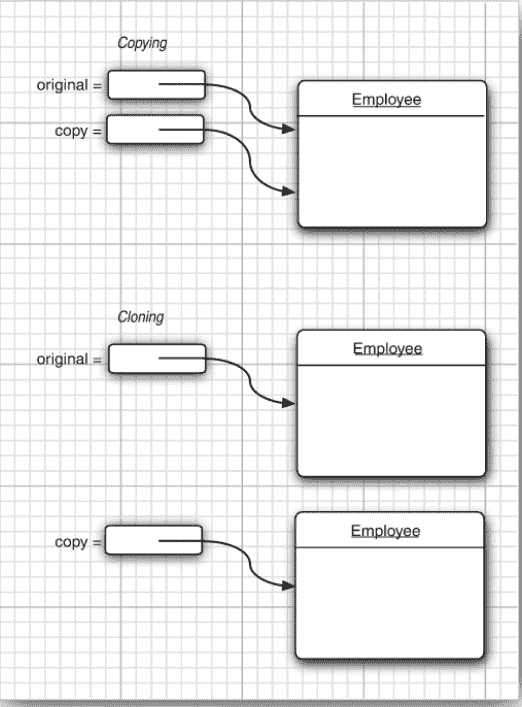

**图 6.1** 复制与克隆

如果你希望 copy 成为一个新对象，它在创建时与 original 相同，但其状态可以随时间而不同，请使用 clone 方法。

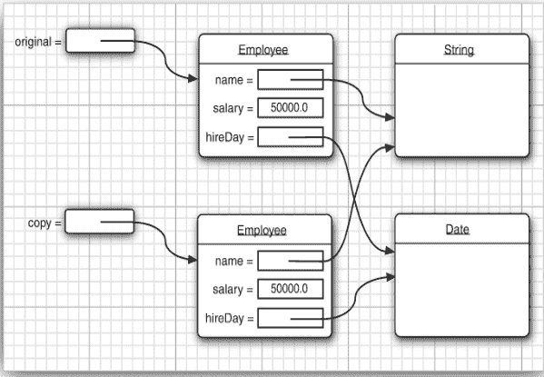

图 6.2 浅拷贝

副本是浅拷贝会有影响吗？这取决于情况。如果原始对象与浅克隆之间共享的子对象是*不可变的*，那么共享是安全的。如果该子对象属于不可变类，例如 `String`，就确实会如此。另一种情况是，该子对象可能在对象的整个生命周期内保持不变，没有修改器接触它，也没有方法返回对它的引用。

然而，子对象经常是*可变的*，你必须重新定义 `clone` 方法来进行*深拷贝*，同时克隆子对象。在我们的示例中，`hireDay` 字段是 `Date`，它是可变的，因此它也必须被克隆。（出于这个原因，本示例使用 `Date` 类型的字段，而不是 `LocalDate`，来演示克隆过程。如果 `hireDay` 是不可变 `LocalDate` 类的实例，则不需要进一步操作。）

对于每个类，你需要决定是否：

- 1. 默认的 `clone` 方法已经足够好；
- 2. 默认的 `clone` 方法可以通过对可变子对象调用 `clone` 来修补；或者
- 3. 不应尝试 `clone`。

第三个选项实际上是默认选项。要选择第一个或第二个选项，类必须：

- 1. 实现 `Cloneable` 接口；并且
- 2. 用 `public` 访问修饰符重新定义 `clone` 方法。

**注意：**

`clone` 方法在 `Object` 类中声明为 `protected`，因此你的代码不能简单地调用 `anObject.clone()`。但是，protected 方法不是可以从任何子类访问吗？而且每个类不都是 `Object` 的子类吗？幸运的是，protected 访问的规则更加微妙（见第 5 章）。子类只能调用 protected 的 `clone` 方法来克隆*它自己的*对象。你必须将 `clone` 重新定义为 public，才能允许任何方法克隆对象。

在这种情况下，`Cloneable` 接口的出现与接口的常规用法无关。特别地，它*并不*指定 `clone` 方法——该方法继承自 `Object` 类。该接口仅充当一个标记，表明类设计者理解克隆过程。对象对克隆如此偏执，以至于如果某个对象请求克隆但没有实现该接口，就会生成一个受检异常。

**注意：**

`Cloneable` 接口是 Java 提供的少数*标签接口*之一。（有些程序员称它们为*标记接口*。）回想一下，

像 `Comparable` 这样的接口，其通常用途是确保某个类实现特定的一个方法或一组方法。标记接口没有任何方法；其唯一用途是允许在类型查询中使用 `instanceof`：

```java
if (obj instanceof Cloneable) . . .
```

我建议你不要在自己的程序中使用标记接口。

即使 `clone` 的默认（浅拷贝）实现已经足够，你仍然需要实现 `Cloneable` 接口，将 `clone` 重新定义为 public，并调用 `super.clone()`。下面是一个示例：

```java
class Employee implements Cloneable
{
    // public access, change return type
    public Employee clone() throws CloneNotSupportedException
    {
        return (Employee) super.clone();
    }
    . . .
}
```

> **注意：**
>
> 直到 Java 1.4，`clone` 方法的返回类型一直是 `Object`。如今，你可以为自己的 `clone` 方法指定正确的返回类型。这是协变返回类型的一个例子（参见第 5 章）。

你刚才看到的 `clone` 方法并未给 `Object.clone` 提供的浅拷贝增加任何功能。它只是将该方法变为 public。要制作深拷贝，你必须付出更多努力，并克隆可变的实例字段。

下面是一个创建深拷贝的 `clone` 方法示例：

```java
class Employee implements Cloneable
{
    . . .
    public Employee clone() throws CloneNotSupportedException
    {
        // call Object.clone()
        Employee cloned = (Employee) super.clone();
        // clone mutable fields
        cloned.hireDay = (Date) hireDay.clone();
        return cloned;
    }
}
```

`Object` 类的 `clone` 方法会抛出 `CloneNotSupportedException`——只要对一个其类未实现 `Cloneable` 接口的对象调用 `clone`，它就会这样做。当然，`Employee` 和 `Date` 类都实现了 `Cloneable` 接口，因此不会抛出该异常。然而，编译器并不知道这一点。因此，我们声明了该异常：

```java
public Employee clone() throws CloneNotSupportedException
```

> **注意：**
>
> 改为捕获该异常会不会更好？（有关捕获异常的详细信息，请参见[第 7 章](#)。）

```java
public Employee clone()
{
    try
    {
        Employee cloned = (Employee) super.clone();
        . . .
    }
    catch (CloneNotSupportedException e) { return null; }
    // this won't happen, since we are Cloneable
}
```

这对 final 类来说是合适的。否则，最好保留 `throws` 说明符。这样，如果子类无法支持克隆，它们就可以选择抛出 `CloneNotSupportedException`。

你必须小心子类的克隆。例如，一旦你为 `Employee` 类定义了 `clone` 方法，任何人都可以用它来克隆 `Manager` 对象。`Employee` 的 clone 方法能完成这项工作吗？这取决于 `Manager` 类的字段。在我们的例子中，没有问题，因为 `bonus` 字段是基本类型。但 `Manager` 可能已经获得了需要深拷贝或不可克隆的字段。无法保证子类的实现者已经修正 `clone` 以做出正确行为。因此，`clone` 方法在 `Object` 类中声明为 `protected`。但是，如果你希望自己类的用户调用 `clone`，就不能再享受这种便利。

你应该在自己的类中实现 `clone` 吗？如果你的客户端需要制作深拷贝，那么你大概应该实现。有些作者认为，你应当完全避免 `clone`，而是为实现同一目的实现另一个方法。我同意 `clone` 相当别扭，但如果你把责任转移到另一个方法上，也会遇到同样的问题。无论如何，克隆并没有你想象的那么常见。标准库中不到 5% 的类实现了 `clone`。

清单 6.4 中的程序克隆了一个 `Employee` 类的实例（清单 6.5），然后调用了两个修改器。`raiseSalary` 方法改变 `salary` 字段的值，而 `setHireDay` 方法改变 `hireDay` 字段的状态。两次修改都不会影响原始对象，因为 `clone` 已被定义为制作深拷贝。

> **注意：**
>
> 所有数组类型都有一个 `clone` 方法，它是 public 的，而不是 protected 的。你可以用它创建一个包含所有元素副本的新数组。例如：

```java
int[] luckyNumbers = { 2, 3, 5, 7, 11, 13 };
int[] cloned = luckyNumbers.clone();
cloned[5] = 12; // doesn't change luckyNumbers[5]
```

> **注意：**
>
> 第 II 卷第 2 章展示了另一种克隆对象的机制，使用 Java 的对象序列化特性。该机制易于实现且安全，但效率不是很高。

**清单 6.4 `clone/CloneTest.java`**

```java
package clone;

/**
 * This program demonstrates cloning.
 * @version 1.11 2018-03-16
 * @author Cay Horstmann
 */
public class CloneTest
{
    public static void main(String[] args) throws CloneNotSupportedException
    {
        var original = new Employee("John Q. Public", 50000);
        original.setHireDay(2000, 1, 1);
        Employee copy = original.clone();
        copy.raiseSalary(10);
        copy.setHireDay(2002, 12, 31);
        System.out.println("original=" + original);
        System.out.println("copy=" + copy);
    }
}
```

**清单 6.5 `clone/Employee.java`**

```java
package clone;

import java.util.Date;
import java.util.GregorianCalendar;

public class Employee implements Cloneable
{
    private String name;
    private double salary;
    private Date hireDay;

    public Employee(String name, double salary)
    {
        this.name = name;
        this.salary = salary;
        hireDay = new Date();
    }

    public Employee clone() throws CloneNotSupportedException
    {
        // call Object.clone()
        Employee cloned = (Employee) super.clone();

        // clone mutable fields
        cloned.hireDay = (Date) hireDay.clone();

        return cloned;
    }

    /**
     * Set the hire day to a given date.
     * @param year the year of the hire day
     * @param month the month of the hire day
     * @param day the day of the hire day
     */
    public void setHireDay(int year, int month, int day)
    {
        Date newHireDay = new GregorianCalendar(year, month - 1, day).getTime();

        // example of instance field mutation
        hireDay.setTime(newHireDay.getTime());
    }

    public void raiseSalary(double byPercent)
    {
        double raise = salary * byPercent / 100;
        salary += raise;
    }

    public String toString()
    {
        return "Employee{name=" + name + ",salary=" + salary +
                ",hireDay=" + hireDay + "}";
    }
}
```

## 6.2 Lambda 表达式

在接下来的几节中，你将学习如何使用 lambda 表达式以简洁的语法定义代码块，以及如何编写使用 lambda 表达式的代码。

### 6.2.1 为什么使用 Lambda？

Lambda 表达式是一段可以传递的代码块，以便稍后执行一次或多次。在深入语法（或

比较元素，而该代码被集成到排序逻辑的其余部分，你可能并不想重新实现这部分逻辑。

这两个例子有共同之处。一个代码块被传递给某个对象——一个定时器或一个排序方法。该代码块在稍后的某个时间被调用。

到目前为止，在 Java 中把代码块交给别人并不容易。你不能直接传递代码块。Java 是面向对象的语言，因此你必须构造一个对象，它属于某个类，而这个类有一个包含所需代码的方法。

在其他语言中，可以直接处理代码块。Java 设计者长期以来一直抵制添加此特性。毕竟，Java 的一大优势就是其简单性和一致性。如果一门语言包含每一个只能略微提高代码简洁性的特性，它就可能变得难以维护。然而，在其他那些语言中，不仅启动线程或注册按钮单击处理程序更容易；它们的大量 API 也更简单、更一致、更强大。在 Java 中，本可以编写类似的 API，接收实现了特定接口的类的对象，但这样的 API 用起来会很不愉快。

有一段时间，问题不是是否要为函数式编程增强 Java，而是如何增强。经过数年的实验，才出现了一种适合 Java 的设计。在下一节中，你将看到如何在 Java 中处理代码块。

### 6.2.2 Lambda 表达式的语法

再次考虑上一节中的排序示例。我们传入一段代码，用于检查一个字符串是否比另一个短。我们计算

```java
first.length() - second.length()
```

`first` 和 `second` 是什么？它们都是字符串。Java 是强类型语言，我们也必须指明这一点：

```java
(String first, String second)
    -> first.length() - second.length()
```

你刚刚看到了你的第一个 *lambda 表达式*。这种表达式不过是一段代码，以及必须传递给这段代码的变量的规格说明。

为什么叫这个名字？许多年前，在计算机问世之前，逻辑学家阿隆佐·丘奇想要形式化“数学函数可有效计算”的含义。（奇怪的是，有些函数已知是存在的，但没有人知道如何计算它们的值。）他用希腊字母 lambda（λ）来标记参数。如果他当时知道 Java API，他就会这样写：

```
λfirst. λsecond. first.length() - second.length()
```

> **注意：**
>
> 为什么用字母 λ？是丘奇用完了字母表中的其他字母吗？实际上，著名的 *《数学原理》* 使用 ^ 重音符号来表示自由变量，这启发了丘奇使用大写的 lambda Λ 来表示参数。但最终，他改用小写版本。从那时起，带有参数变量的表达式就被称为 lambda 表达式。

你刚才看到的是 Java 中 lambda 表达式的一种简单形式：参数、`->` 箭头和一个表达式。如果代码要执行的计算无法放入单个表达式中，就按照编写方法的方式来写：用 `{}` 括起来，并使用显式的 `return` 语句。例如：

```java
(String first, String second) ->
{
    if (first.length() < second.length()) return -1;
    else if (first.length() > second.length()) return 1;
    else return 0;
}
```

如果 lambda 表达式没有参数，你仍然需要提供空括号，就像无参数方法一样：

```java
() -> { for (int i = 100; i >= 0; i--) System.out.println(i); }
```

如果 lambda 表达式的参数类型可以被推断出来，你可以省略它们。例如：

```java
Comparator<String> comp
    = (first, second) // same as (String first, String second)
    -> first.length() - second.length();
```

在这里，编译器可以推断出 first 和 second 必须是字符串，因为该 lambda 表达式被赋值给了一个字符串比较器。（我们将在下一节仔细研究这个赋值。）

如果方法只有一个参数且类型可推断，你甚至可以省略括号：

```java
ActionListener listener = event ->
    System.out.println("The time is "
    + Instant.ofEpochMilli(event.getWhen()));
    // instead of (event) -> . . . or (ActionEvent event) -> . . .
```

你永远不需要指定 lambda 表达式的结果类型。它总是根据上下文推断。例如，表达式

```java
(String first, String second) -> first.length() - second.length()
```

可以用于期望 `int` 类型结果的环境中。

```java
System.out.println(Arrays.toString(planets));
System.out.println("Sorted in dictionary order:");
Arrays.sort(planets);
System.out.println(Arrays.toString(planets));
System.out.println("Sorted by length:");
Arrays.sort(planets, (first, second) -> first.length() - second.length());
System.out.println(Arrays.toString(planets));

var timer = new Timer(1000, event ->
    System.out.println("The time is " + new Date()));
timer.start();

// keep program running until user selects "OK"
JOptionPane.showMessageDialog(null, "Quit program?");
System.exit(0);
}
}
```

### 6.2.3 函数式接口

正如我们讨论过的，Java 中有许多现有接口封装了代码块，例如 `ActionListener` 或 `Comparator`。lambda 与这些接口兼容。

只要需要具有单个抽象方法的接口的对象，你就可以提供 lambda 表达式。这种接口被称为 *函数式接口*。

> **注意：**
>
> 你可能想知道为什么函数式接口必须只有一个 *抽象* 方法。难道接口中的所有方法不都是抽象的吗？实际上，接口一直可以重新声明来自 Object 类的方法，如 `toString` 或 `clone`，而这些声明并不会使这些方法变成抽象的。（Java API 中的一些接口会重新声明 Object 方法，以便附加 javadoc 注释。例如，可以查看 Comparator API。）更重要的是，正如你在 [6.1.5 节](#)的“默认方法”（第 323 页）中看到的，接口可以声明非抽象方法。

为了演示到函数式接口的转换，考虑 `Arrays.sort` 方法。它的第二个参数需要一个 `Comparator` 实例，这是一个具有单个方法的接口。只需提供一个 lambda：

```java
Arrays.sort(words,
    (first, second) -> first.length() - second.length());
```

在幕后，`Arrays.sort` 方法接收某个实现了 `Comparator<String>` 的类的对象。在该对象上调用 compare 方法会执行 lambda 表达式的主体。这些对象和类的管理完全取决于实现，并且可能比使用传统内部类高效得多。最好将 lambda 表达式视为一个函数，而不是一个对象，并接受它可以传递给函数式接口这一事实。

正是这种到接口的转换使 lambda 表达式如此引人注目。语法简短而简单。这里有另一个例子：

```java
var timer = new Timer(1000, event ->
{
    System.out.println("At the tone, the time is "
        + Instant.ofEpochMilli(event.getWhen()));
    Toolkit.getDefaultToolkit().beep();
});
```

与使用一个实现 `ActionListener` 接口的类的替代方案相比，这读起来要容易得多。

事实上，转换为函数式接口是你在 Java 中能对 lambda 表达式做的 *唯一* 事情。在其他支持函数字面量的编程语言中，你可以声明诸如 `(String, String) -> int` 的函数类型，声明这些类型的变量，并使用这些变量来

`ArrayList` 类有一个 `removeIf` 方法，其参数是一个 `Predicate`。它专门设计用于传递 lambda 表达式。例如，下面的语句会从数组列表中删除所有 null 值：

```java
list.removeIf(e -> e == null);
```

另一个有用的函数式接口是 `Supplier<T>`：

```java
public interface Supplier<T>
{
    T get();
}
```

Supplier 没有参数，在被调用时会产生一个类型为 T 的值。Supplier 用于 *惰性求值*。例如，考虑以下调用：

```java
LocalDate hireDay = Objects.requireNonNullElse(day,
    LocalDate.of(1970, 1, 1));
```

这并不理想。我们预期 day 很少为 null，所以我们只想在必要时构造默认的 `LocalDate`。通过使用 supplier，我们可以推迟计算：

```java
LocalDate hireDay = Objects.requireNonNullElseGet(day,
    () -> LocalDate.of(1970, 1, 1));
```

`requireNonNullElseGet` 方法仅在需要该值时才调用 supplier。

### 6.2.4 方法引用

有时，lambda 表达式只涉及单个方法。例如，假设你只想在每次定时器事件发生时打印事件对象。当然，你可以调用：

```java
var timer = new Timer(1000, event ->
    System.out.println(event));
```

如果能直接将 `println` 方法传递给 `Timer` 构造器，那就更好了。你可以这样做：

```java
var timer = new Timer(1000, System.out::println);
```

表达式 `System.out::println` 是一个 *方法引用*。它指示编译器生成一个函数式接口的实例，并重写该接口的单个抽象方法，以调用给定的方法。在这个例子中，生成了一个 `ActionListener`，其 `actionPerformed(ActionEvent e)` 方法调用 `System.out.println(e)`。

**注意：**

与 lambda 表达式一样，方法引用不是对象。当它被赋值给一个函数式接口类型的变量时，会产生一个对象。

**注意：**

`PrintStream` 类中有十个重载的 `println` 方法（`System.out` 是其实例）。编译器需要根据上下文确定使用哪一个。在我们的例子中，方法引用 `System.out::println` 必须转换成一个带有如下方法的 `ActionListener` 实例：

```java
void actionPerformed(ActionEvent e)
```

然后从十个重载的 `println` 方法中选出 `println(Object x)`，因为 `Object` 与 `ActionEvent` 最匹配。当 `actionPerformed` 方法被调用时，事件对象就会被打印出来。


现在假设我们将同一个方法引用赋给另一个不同的函数式接口：

```java
Runnable task = System.out::println;
```

Runnable 函数式接口有一个无参数的抽象方法

```java
void run()
```

在这种情况下，会选择无参数的 println() 方法。调用 task.run() 会向 System.out 打印一个空行。

再举一个例子，假设你想忽略字母大小写对字符串排序。可以传入这个方法表达式：

```java
Arrays.sort(strings, String::compareToIgnoreCase);
```

从这些示例可以看出，:: 操作符将方法名与对象名或类名分隔开。共有三种形式：

- 1. *对象*::*实例方法*
- 2. *类*::*实例方法*
- 3. *类*::*静态方法*

在第一种形式中，方法引用等价于一个 lambda 表达式，其参数被传递给该方法。对于 System.out::println，对象是 System.out，而方法表达式等价于 x -> System.out.println(x)。

在第二种形式中，第一个参数成为该方法的隐式参数。例如，`String::compareToIgnoreCase` 与 `(x, y) -> x.compareToIgnoreCase(y)` 相同。

在第三种形式中，所有参数都被传递给静态方法：`Math::pow` 等价于 `(x, y) -> Math.pow(x, y)`。

表 6.1 介绍了更多示例。

注意，只有当 lambda 表达式的主体调用单个方法且不做其他任何事情时，才能将 lambda 表达式改写为方法引用。考虑这个 lambda 表达式

```java
s -> s.length() == 0
```

这里只有一次方法调用。但还有一个比较操作，因此这里不能使用方法引用。

**注意：**

当存在多个同名重载方法时，编译器会尝试根据上下文找出你指的是哪一个。例如，`Math.max` 方法有两个版本，一个用于整数，一个用于 double 值。具体选择哪一个取决于 `Math::max` 所转换到的函数式接口的方法参数。就像 lambda 表达式一样，方法引用并非孤立存在。它们总是被转换为函数式接口的实例。

**注意：**

有时，API 包含专门设计用作方法引用的方法。例如，`Objects` 类有一个 `isNull` 方法，用于测试对象引用是否为 `null`。乍一看，这似乎没什么用，因为测试 `obj == null` 比 `Objects.isNull(obj)` 更易读。但你可以将方法引用传递给任何带有 `Predicate` 参数的方法。例如，要从列表中移除所有 `null` 引用，可以调用

```java
list.removeIf(Objects::isNull);
// A bit easier to read than list.removeIf(e -> e == null);
```

## 表 6.1 方法引用示例

| 方法引用 | 等价的 Lambda 表达式 | 说明 |
|---|---|---|
| `separator::equals` | `x -> separator.equals(x)` | 这是带对象和实例方法的方法表达式。lambda 参数作为方法的显式参数传递。 |
| `String::trim` | `x -> x.trim()` | 这是带类和实例方法的方法表达式。lambda 参数成为隐式参数。 |
| `String::concat` | `(x, y) -> x.concat(y)` | 同样是实例方法，但这次带有显式参数。和前面一样，第一个 lambda 参数成为隐式参数，其余参数传递给该方法。 |
| `Integer::valueOf` | `x -> Integer.valueOf(x)` | 这是带静态方法的方法表达式。lambda 参数被传递给静态方法。 |
| `Integer::sum` | `(x, y) -> Integer.sum(x, y)` | 这是另一个静态方法，但这次有两个参数。两个 lambda 参数都被传递给静态方法。Integer.sum 方法就是专门为用作方法引用而创建的。如果写成 lambda，你只需写 `(x, y) -> x + y`。 |
| `String::new` | `x -> new String(x)` | 这是构造器引用——见第 6.2.5 节。lambda 参数被传递给构造器。 |
| `String[]::new` | `n -> new String[n]` | 这是数组构造器引用——见第 6.2.5 节。lambda 参数是数组长度。 |


**注意：**

带对象的方法引用与其等价的 lambda 表达式之间有一个细微差别。考虑诸如 `separator::equals` 这样的方法引用。如果 `separator` 为 null，那么形成 `separator::equals` 会立即抛出 `NullPointerException`。而 lambda 表达式 `x -> separator.equals(x)` 只在被调用时才会抛出 `NullPointerException`。

你可以在方法引用中捕获 `this` 参数。例如，`this::equals` 与 `x -> this.equals(x)` 相同。使用 `super` 也是合法的。方法表达式

```java
super::instanceMethod
```

使用 `this` 作为目标，并调用给定方法的超类版本。下面是一个展示其机制的人为示例：

```java
class Greeter
{
    public void greet(ActionEvent event)
    {
        System.out.println("Hello, the time is "
            + Instant.ofEpochMilli(event.getWhen()));
    }
}
class RepeatedGreeter extends Greeter
{
    public void greet(ActionEvent event)
    {
        var timer = new Timer(1000, super::greet);
        timer.start();
    }
}
```

要理解发生了什么，我们需要更深入地理解 lambda 表达式。lambda 表达式有三个组成部分：

- 1. 代码块
- 2. 参数
- 3. *自由*变量的值——即不是参数且未在代码内部定义的变量

在我们的示例中，lambda 表达式有一个自由变量 `text`。表示 lambda 表达式的数据结构必须存储自由变量的值——在我们的例子中，就是字符串 `"Hello"`。我们说这些值已被 lambda 表达式*捕获*。（具体如何实现是细节问题。例如，可以将 lambda 表达式转换为一个带有单个方法的对象，从而将自由变量的值复制到该对象的实例变量中。）


**注意：**

代码块连同自由变量值的专业术语是*闭包*。如果有人炫耀他们的语言有闭包，请放心，Java 也有。在 Java 中，lambda 表达式就是闭包。

正如你所见，lambda 表达式可以捕获外围作用域中变量的值。在 Java 中，为了确保捕获的值是明确定义的，有一个重要限制。在 lambda 表达式中，只能引用值不会改变的变量。例如，以下代码是非法的：

```java
public static void countDown(int start, int delay)
{
    ActionListener listener = event ->
        {
            start--; // ERROR: Can't mutate captured variable
            System.out.println(start);
        };
    new Timer(delay, listener).start();
}
```

这个限制是有原因的。当多个操作并发执行时，在 lambda 表达式中修改变量是不安全的。对于我们目前所见过的这类操作，这不会发生，但一般来说，这是一个严重的问题。有关这个重要问题的更多信息，请参见[第12章](#)。

在 lambda 表达式中引用在外部被修改的变量也是非法的。例如，以下代码是非法的：

```java
public static void repeat(String text, int count)
{
    for (int i = 1; i <= count; i++)
    {
        ActionListener listener = event ->
        {
            System.out.println(i + ": " + text);
            // ERROR: Cannot refer to changing i
        };
        new Timer(1000, listener).start();
    }
}
```

规则是：lambda 表达式中捕获的任何变量都必须是*事实上的最终变量*。事实上的最终变量是指初始化后从未被赋予新值的变量。在我们的例子中，`text` 始终引用同一个 `String` 对象，因此可以捕获它。然而，`i` 的值被修改了，因此 `i` 不能被捕获。

lambda 表达式的主体具有*与嵌套块相同的作用域*。名称冲突和遮蔽的规则同样适用。在 lambda 中声明与局部变量同名的参数或局部变量是非法的。


```java
Path first = Path.of("/usr/bin");
Comparator<String> comp
    = (first, second) -> first.length() - second.length();
    // ERROR: Variable first already defined
```

在方法内部，不能有两个同名的局部变量，因此，你也不能在 lambda 表达式中引入这样的变量。

当你在 lambda 表达式中使用 `this` 关键字时，你引用的是创建该 lambda 的方法的 `this` 参数。例如，考虑

```java
public class Application
{
    public void init()
    {
        ActionListener listener = event ->
        {
            System.out.println(this.toString());
            . . .
        };
        . . .
    }
}
```

表达式 `this.toString()` 调用的是 Application 对象的 `toString` 方法，*而不是* `ActionListener` 实例的方法。在 lambda 表达式中使用 `this` 并没有什么特别之处。lambda 表达式的作用域嵌套在 `init` 方法内，而 `this` 在该方法中的任何位置都具有相同的含义。

### 6.2.7 处理 Lambda 表达式

到目前为止，你已经看到如何生成 lambda 表达式，并将它们传递给期望函数式接口的方法。现在让我们看看如何编写能够消费 lambda 表达式的方法。

| 函数式接口 | 参数类型 | 返回类型 | 抽象方法名 | 描述 | 其他方法 |
|---|---|---|---|---|---|
| Runnable | 无 | void | run | 运行一个无参数、无返回值的动作 | |
| Supplier<T> | 无 | T | get | 提供一个 T 类型的值 | |
| Consumer<T> | T | void | accept | 消费一个 T 类型的值 | andThen |
| BiConsumer<T, U> | T, U | void | accept | 消费 T 和 U 类型的值 | andThen |
| Function<T, R> | T | R | apply | 一个参数类型为 T 的函数 | compose, andThen, identity |
| BiFunction<T, U, R> | T, U | R | apply | 一个参数类型为 T 和 U 的函数 | andThen |
| UnaryOperator<T> | T | T | apply | 作用于类型 T 的一元运算符 | compose, andThen, identity |
| BinaryOperator<T> | T, T | T | apply | 作用于类型 T 的二元运算符 | andThen, maxBy, minBy |
| Predicate<T> | T | boolean | test | 一个返回布尔值的函数 | and, or, negate, isEqual, not |
| BiPredicate<T, U> | T, U | boolean | test | 一个带两个参数的返回布尔值的函数 | and, or, negate |

请注意，当调用 `action.run()` 时，lambda 表达式的主体才会被执行。

现在让我们把这个例子变得稍微复杂一些。我们希望告诉该动作它发生在哪一次迭代中。为此，我们需要选择一个函数式接口，其方法带有一个 `int` 参数并返回 `void`。用于处理 `int` 值的标准接口是

```java
public interface IntConsumer
{
    void accept(int value);
}
```

下面是 repeat 方法的改进版本：

```java
public static void repeat(int n, IntConsumer action)
{
    for (int i = 0; i < n; i++) action.accept(i);
}
```

下面是如何调用它：

```java
repeat(10, i -> System.out.println("Countdown: " + (9 - i)));
```

[表 6.3](#) 列出了用于基本类型 `int`、`long` 和 `double` 的 34 个可用特化。正如你将在[第 8 章](#)中看到的，使用这些特化比使用泛型接口更高效。因此，在上一节的示例中，我使用了 `IntConsumer` 而不是 `Consumer<Integer>`。

**表 6.3 基本类型的函数式接口** *p, q* 为 `int`、`long`、`double`；*P, Q* 为 `Int`、`Long`、`Double`

与 `a::equals` 相同，但它在 `a` 为 `null` 时也能工作。有默认方法 `and`、`or`、`negate` 可用于组合谓词。例如，`Predicate.isEqual(a).or(Predicate.isEqual(b))` 与 `x -> a.equals(x) || b.equals(x)` 相同。

### 注意：

如果你设计一个只含单个抽象方法的接口，可以用 `@FunctionalInterface` 注解标记它。这有两个好处。如果你不小心添加了另一个抽象方法，编译器会给出错误信息。并且 javadoc 页面会包含一条说明，指出你的接口是函数式接口。

并不要求使用该注解。按照定义，任何只含单个抽象方法的接口都是函数式接口。但使用 `@FunctionalInterface` 注解是个好主意。

### 注意：

有些程序员喜欢方法调用链，例如

```java
String input = " 618970019642690137449562111 ";
boolean isPrime =
    input.strip().transform(BigInteger::new).isProbablePrime(20);
```

String 类的 transform 方法（在 Java 12 中加入）将一个 Function 应用于该字符串并产生结果。你同样可以写成

```java
boolean prime = new
    BigInteger(input.strip()).isProbablePrime(20);
```

但这样一来，你的眼睛就得由内向外、从左到右地跳来跳去，才能弄清先发生什么、后发生什么：先调用 `strip`，再构造 `BigInteger`，最后测试它是否可能为素数。

我不确定这种由内向外、从左到右的视线跳跃是不是一个大问题。但如果你更喜欢链式方法调用那种有序的从左到右顺序，那么 `transform` 就是你的好帮手。

遗憾的是，它只适用于字符串。为什么 Object 类中没有 `transform(java.util.function.Function)` 方法呢？

Java API 设计者动作不够快。他们只有一次做对的机会——在 Java 8 中，当 `java.util.function.Function` 接口被加入 API 时。在那之前，没有人能在自己的类中添加 `transform(java.util.function.Function)` 方法。但到了 Java 12，已经太晚了。某个地方的某个人可能已经在自己的类中定义了含义不同的 `transform(java.util.function.Function)`。诚然，这种情况实际发生的可能性不大，但无从得知。

Java 就是这样运作的。它认真对待自己的承诺，不会为了便利而背弃它们。

### 6.2.8 关于比较器的更多内容

Comparator 接口有许多用于创建比较器的便捷静态方法。这些方法旨在与 lambda 表达式或方法引用一起使用。

静态方法 `comparing` 接受一个“键提取器”函数，它将类型 `T` 映射为可比较类型（例如 `String`）。该函数会应用于待比较的对象，然后根据返回的键进行比较。例如，假设你有一个 `Person` 对象数组。下面是如何按姓名对它们排序：

```java
Arrays.sort(people, Comparator.comparing(Person::getName));
```

这无疑比手工实现比较器容易得多。此外，代码也更清晰，因为很明显我们想按姓名比较人。

你可以用 `thenComparing` 方法串联比较器来打破平局。例如，

```java
Arrays.sort(people,
    Comparator.comparing(Person::getLastName)
    .thenComparing(Person::getFirstName));
```

如果两个人的姓氏相同，则使用第二个比较器。

这些方法还有几种变体。你可以为 `comparing` 和 `thenComparing` 方法提取的键指定一个要使用的比较器。例如，下面我们按姓名的长度对人排序：

```java
Arrays.sort(people, Comparator.comparing(Person::getName,
    (s, t) -> Integer.compare(s.length(), t.length())));
```

此外，`comparing` 和 `thenComparing` 方法都有避免对 `int`、`long` 或 `double` 值进行装箱的变体。实现前面操作的更简单方式是

```java
Arrays.sort(people, Comparator.comparingInt(p ->
    p.getName().length()));
```

如果你的键函数可能返回 `null`，你会喜欢 `nullsFirst` 和 `nullsLast` 适配器。这些静态方法接收一个现有比较器并对其进行修改，使其在遇到 `null` 值时不会抛出异常，而是将 `null` 值排为比常规值更小或更大。例如，假设当一个人没有中间名时，`getMiddleName` 返回 `null`。那么你可以使用 `Comparator.comparing(Person::getMiddleName, Comparator.nullsFirst(. . .))`。


`nullsFirst` 方法需要一个比较器——在这里，是一个比较两个字符串的比较器。`naturalOrder` 方法为任何实现了 `Comparable` 的类生成一个比较器。我们需要的是 `Comparator<String> naturalOrder()`。下面是按可能为 null 的中间名排序的完整调用。我使用了 `java.util.Comparator.*` 的静态导入，以使表达式更易读。注意，`naturalOrder` 的类型是推断出来的。

```java
Arrays.sort(people, comparing(Person::getMiddleName,
    nullsFirst(naturalOrder())));
```

静态 `reverseOrder` 方法给出自然顺序的逆序。要反转任何比较器，请使用 reversed 实例方法。例如，`naturalOrder().reversed()` 与 `reverseOrder()` 相同。

## 6.3 内部类

一个*内部类*是定义在另一个类内部的类。为什么要这样做？有两个原因：

- 内部类可以对同一包中的其他类隐藏。
- 内部类方法可以访问其定义所在作用域中的数据——包括原本会是私有的数据。

内部类过去对于简洁地实现回调非常重要，但如今 lambda 表达式做得更好。不过，内部类对于组织代码仍然非常有用。以下各节将详细介绍所有细节。


### C++ 注记

C++ 有*嵌套类*。嵌套类包含在封闭类的作用域内。下面是一个典型示例：链表类定义了一个用于保存链接的类，以及一个用于定义迭代器位置的类。

```cpp
class LinkedList
{
public:
    class Iterator // a nested class
    {
    public:
        void insert(int x);
        int erase();
        . . .
    private:
        Link* current;
        LinkedList* owner;
    };
    . . .
private:
    Link* head;
    Link* tail;
};
```

嵌套类与 Java 中的内部类相似。然而，Java 内部类有一个额外特性，使其比 C++ 中的嵌套类更丰富、更有用。来自内部类的对象有一个隐式引用，指向实例化它的外部类对象。通过这个指针，它可以访问外部对象的全部状态。例如，在 Java 中，`Iterator` 类不需要显式指针指向它所指向的 `LinkedList`。

在 Java 中，静态内部类没有这个额外添加的指针。它们相当于 C++ 中嵌套类的 Java 对应物。

### 6.3.1 使用内部类访问对象状态

内部类的语法相当复杂。因此，我给出一个简单但略显人为的示例来演示内部类的使用。让我们重构 `TimerTest` 示例，并提取一个 `TalkingClock` 类。会说话的时钟由两个参数构造：两次报时之间的间隔，以及一个用于打开或关闭提示音的标志。

```java
public class TalkingClock
{
    private int interval;
    private boolean beep;
    public TalkingClock(int interval, boolean beep) { . . . }
    public void start() { . . . }
    public class TimePrinter implements ActionListener
        // an inner class
    {
        . . .
    }
}
```

注意，TimePrinter 类现在位于 TalkingClock 类内部。这*并不*意味着每个 TalkingClock 都有一个 TimePrinter 实例字段。你将看到，TimePrinter 对象是由 TalkingClock 类的方法构造的。

下面是更详细的 TimePrinter 类。注意，actionPerformed 方法在发出提示音之前检查 beep 标志。

```java
public class TimePrinter implements ActionListener
{
    public void actionPerformed(ActionEvent event)
    {
        System.out.println("At the tone, the time is "
            + Instant.ofEpochMilli(event.getWhen()));
        if (beep) Toolkit.getDefaultToolkit().beep();
    }
}
```

发生了一些令人惊讶的事情。TimePrinter 类没有名为 beep 的实例字段或变量。相反，beep 指的是创建这个 TimePrinter 的 TalkingClock 对象的字段。如你所见，内部类对象有一个指向外部类对象的引用。

**图 6.3** 内部类对象有一个指向外部类对象的引用。

```java
public TimePrinter(TalkingClock clock) // automatically generated code
{
    outer = clock;
}
```

再次请注意，*outer* 不是 Java 关键字。我们只是用它来说明内部类所涉及的机制。

当在 `start` 方法中构造 `TimePrinter` 对象时，编译器会将当前会说话时钟的 `this` 引用传递给构造函数：

```java
var listener = new TimePrinter(this); // parameter automatically added
```

*代码清单 6.7* 展示了测试内部类的完整程序。请再看一下访问控制。如果 `TimePrinter` 类是一个常规类，它就需要通过 `TalkingClock` 类的公共方法访问 beep 标志。使用内部类是一种改进。没有必要提供只对另一个类感兴趣的访问器。

> **注意：**
>
> 我们本可以将 `TimePrinter` 类声明为 private。那样只有 `TalkingClock` 方法能够构造 `TimePrinter` 对象。只有内部类可以是 private。常规类始终具有包访问权限或公共访问权限。

**代码清单 6.7** `innerClass/InnerClassTest.java`

```java
package innerClass;

{
    this.interval = interval;
    this.beep = beep;
}

/**
 * Starts the clock.
 */
public void start()
{
    var listener = new TimePrinter();
    var timer = new Timer(interval, listener);
    timer.start();
}

public class TimePrinter implements ActionListener
{
    public void actionPerformed(ActionEvent event)
    {
        System.out.println("At the tone, the time is "
            + Instant.ofEpochMilli(event.getWhen()));
        if (beep) Toolkit.getDefaultToolkit().beep();
    }
}
```

### 6.3.2 内部类的特殊语法规则

上一节中，我们通过称外部类引用为 *outer* 来解释内部类的外部类引用。实际上，外部引用的正确语法要更复杂一些。表达式

```java
OuterClass.this
```

表示外部类引用。例如，你可以将 TimePrinter 内部类的 `actionPerformed` 方法写成

```java
public void actionPerformed(ActionEvent event)
{
    . . .
    if (TalkingClock.this.beep)
    Toolkit.getDefaultToolkit().beep();
}
```

反过来，你可以使用以下语法更显式地编写内部对象构造函数

```
outerObject.new InnerClass(construction parameters)
```

例如：

```
ActionListener listener = this.new TimePrinter();
```

这里，新构造的 `TimePrinter` 对象的外部类引用被设置为创建该内部类对象的方法的 `this` 引用。这是最常见的情况。一如既往，`this.` 限定符是多余的。然而，也可以通过显式命名将外部类引用设置为另一个对象。例如，由于 `TimePrinter` 是一个公共内部类，你可以为任何会说话时钟构造一个 `TimePrinter`：

```java
var jabber = new TalkingClock(1000, true);
TalkingClock.TimePrinter listener = jabber.new TimePrinter();
```

注意，当内部类出现在外部类的作用域之外时，你将其称为

```
OuterClass.InnerClass
```

。

> **注意：**
>
> 在内部类中声明的任何静态字段都必须是 final，并使用编译期常量初始化。如果该字段不是常量，它可能不唯一。

内部类不能有静态方法。《Java语言规范》没有给出这一限制的原因。本来可以允许只访问封闭类中的静态字段和静态方法的静态方法。显然，语言设计者认为复杂性超过了收益。

### 6.3.3 内部类有用吗？真的必要吗？安全吗？

当内部类在 Java 1.1 中被加入 Java 语言时，许多程序员认为它们是一个重要的新特性，与 Java 比 C++ 更简单的哲学格格不入。内部类语法无可否认地复杂。（当我们在本章后面学习匿名内部类时，它会变得更加复杂。）内部类如何与语言的其他特性（如访问控制和安全）交互并不明显。

内部类会被翻译成常规类文件，并用 `$`（美元符号）分隔外部类名和内部类名。例如，`TalkingClock` 类中的 `TimePrinter` 类会被翻译成类文件 `TalkingClock$TimePrinter.class`。要查看实际效果，请尝试以下实验：运行[第5章](#)的 `ReflectionTest` 程序，并将类 `TalkingClock$TimePrinter` 交给它进行反射。或者，直接使用 javap 工具：

```
javap -private ClassName
```


> **注意：**
>
> 如果你使用 UNIX，请记住在命令行中提供类名时转义 `$` 字符。也就是说，按如下方式运行 `ReflectionTest` 或 `javap` 程序：

```text
java --classpath ...:/v1ch05 reflection.ReflectionTest \
    innerClass.TalkingClock\$TimePrinter
```

或者

```text
javap -private innerClass.TalkingClock\$TimePrinter
```

你会得到以下输出：

```java
public class innerClass.TalkingClock$TimePrinter
    implements java.awt.event.ActionListener
{
    final innerClass.TalkingClock this$0;
    public innerClass.TalkingClock$TimePrinter(innerClass.TalkingClock);
    public void actionPerformed(java.awt.event.ActionEvent);
}
```

你可以清楚地看到，编译器生成了一个额外的实例字段 `this$0`，用于保存对外部类的引用。（`this$0` 这个名字是由编译器合成的——你不能在自己的代码中引用它。）你还可以看到构造函数的 `TalkingClock` 参数。

如果编译器能自动完成这种转换，那你为什么不直接手写同样的机制呢？让我们试一试。我们将 `TimePrinter` 定义为一个普通类，放在 `TalkingClock` 类的外部。在构造 `TimePrinter` 对象时，我们把创建它的对象的 `this` 引用传给它。

```java
class TalkingClock
{
    . . .
    public void start()
    {
        var listener = new TimePrinter(this);
        var timer = new Timer(interval, listener);
        timer.start();
    }
}
class TimePrinter implements ActionListener
{
    private TalkingClock outer;
    . . .
    public TimePrinter(TalkingClock clock)
    {
        outer = clock;
    }
}
```

现在让我们看看 `actionPerformed` 方法。它需要访问 `outer.beep`。

```java
if (outer.beep) . . . // ERROR
```

这里我们遇到了一个问题。内部类可以访问外部类的私有数据，但我们的外部 `TimePrinter` 类不能。

因此，内部类确实比普通类更强大，因为它们拥有更多的访问权限。

你可能很想知道内部类是如何获得这些额外访问权限的。在 Java 11 之前，内部类纯粹是 *编译器* 的产物，虚拟机对它们没有任何特殊了解。那时，用 `ReflectionTest` 程序或带 `-private` 选项的 `javap` 来窥探 `TalkingClock` 类，会显示：

```java
class TalkingClock
{
    private int interval;
    private boolean beep;
    public TalkingClock(int, boolean);
    static boolean access$0(TalkingClock); // Prior to Java 11
    public void start();
}
```

请注意编译器添加到外部类的静态 `access$0` 方法。它返回作为参数传入的对象的 `beep` 字段。（方法名可能略有不同，例如 `access$000`，具体取决于编译器。）

这是一个潜在的安全风险，也让分析类文件的工具变得复杂。从 Java 11 开始，虚拟机理解类之间的嵌套关系，不再生成这些访问方法。

### 6.3.4 局部内部类

如果你仔细查看 `TalkingClock` 示例的代码，你会发现你只需要用到 `TimePrinter` 类型名称一次：在 `start` 方法中创建该类型的对象时。

在这种情况下，你可以在*单个方法*中*局部地*定义这个类。

```java
public void start()
{
   class TimePrinter implements ActionListener
   {
      public void actionPerformed(ActionEvent event)
      {
         System.out.println("At the tone, the time is "
            + Instant.ofEpochMilli(event.getWhen()));
         if (beep) Toolkit.getDefaultToolkit().beep();
      }
   }
   var listener = new TimePrinter();
   var timer = new Timer(interval, listener);
   timer.start();
}
```

局部类从不使用访问修饰符（即 `public` 或 `private`）声明。它们的作用域始终限于声明它们的块中。

局部类有一个很大的优点：它们对外部世界完全隐藏——即使是 `TalkingClock` 类中的其他代码也无法访问它们。除了 `start` 方法之外，没有任何方法知道 `TimePrinter` 类的存在。

### 6.3.5 访问外部方法中的变量

与其他内部类相比，局部类还有另一个优势。它们不仅可以访问外部类的字段，甚至可以访问局部变量！不过，这些局部变量必须是 *有效的 final*。这意味着，它们一旦被赋值，就永远不能改变。

下面是一个典型的例子。我们把 `interval` 和 `beep` 参数从 `TalkingClock` 构造函数移到 `start` 方法中。

```java
public void start(int interval, boolean beep)
{
    class TimePrinter implements ActionListener
    {
        public void actionPerformed(ActionEvent event)
        {
            System.out.println("At the tone, the time is "
                + Instant.ofEpochMilli(event.getWhen()));
            if (beep) Toolkit.getDefaultToolkit().beep();
        }
    }
    var listener = new TimePrinter();
    var timer = new Timer(interval, listener);
    timer.start();
}
```

请注意，`TalkingClock` 类不再需要存储 `beep` 实例字段。它只需引用 `start` 方法的 `beep` 参数变量即可。

也许这并不应该令人惊讶。这行代码

```java
if (beep) . . .
```

毕竟，它最终是在 `start` 方法内部，为什么它不能访问 `beep` 变量的值呢？

为了看清这里为什么存在一个微妙的问题，让我们更仔细地考虑控制流。

- 1. 调用 `start` 方法。
- 2. 对象变量 `listener` 通过调用内部类 `TimePrinter` 的构造函数进行初始化。
- 3. `listener` 引用被传递给 `Timer` 构造函数，计时器启动，然后 `start` 方法退出。此时，`start` 方法的 `beep` 参数变量已不存在。
- 4. 一秒钟后，`actionPerformed` 方法执行 `if (beep) . . .`

为了让 `actionPerformed` 方法中的代码能够工作，`TimePrinter` 类必须在 `beep` 参数值消失之前，把 `beep` 字段复制为 `start` 方法中的一个局部变量。事实确实如此。在我们的示例中，编译器为局部内部类生成了名称 `TalkingClock$1TimePrinter`。如果再次使用 `ReflectionTest` 程序或 `javap` 工具来窥探 `TalkingClock$1TimePrinter` 类，你将得到以下输出：

```java
class TalkingClock$1TimePrinter
{
    TalkingClock$1TimePrinter();
    public void actionPerformed(java.awt.event.ActionEvent);
    final boolean val$beep;
    final TalkingClock this$0;
}
```

创建对象时，`beep` 变量的当前值会存储在 `val$beep` 字段中。从 Java 11 开始，这是通过“嵌套成员”（nest mate）访问实现的。此前，内部类构造函数会有一个额外的参数来设置该字段。无论哪种方式，即使局部变量超出了作用域，内部类字段仍然存在。

### 6.3.6 匿名内部类

使用局部内部类时，你通常可以更进一步。如果你只想要这个类的一个对象，甚至不需要给类命名。这样的类称为*匿名内部类*。

```java
public void start(int interval, boolean beep)
{
    var listener = new ActionListener()
    {
        public void actionPerformed(ActionEvent event)
        {
            System.out.println("At the tone, the time is "
                + Instant.ofEpochMilli(event.getWhen()));
            if (beep) Toolkit.getDefaultToolkit().beep();
        }
    };
    var timer = new Timer(interval, listener);
    timer.start();
}
```

这种语法确实非常晦涩。它的含义是：创建一个实现了 `ActionListener` 接口的类的对象，其中所需的方法 `actionPerformed` 是在花括号 `{ }` 内定义的那个方法。

通常，语法是

```java
new SuperType(construction parameters)
{
    inner class methods and data
}
```

在这里，*SuperType* 可以是一个接口，例如 `ActionListener`；此时，内部类实现该接口。*SuperType* 也可以是一个类；此时，

内部类扩展该类。

匿名内部类不能有构造器，因为构造器的名称必须与类的名称相同，而该类没有名称。相反，构造参数会传递给*超类*构造器。特别地，每当内部类实现一个接口时，它不能有任何构造参数。不过，你必须提供一对圆括号，如下所示：

```java
new InterfaceType()
{
    methods and data
}
```

你必须仔细查看，才能看出构造一个类的新对象与构造一个扩展该类的匿名内部类的对象之间的区别。

```java
var queen = new Person("Mary");
    // a Person object
var count = new Person("Dracula") { ... };
    // an object of an inner class extending Person
```

如果构造参数列表的右圆括号后面跟着一个左花括号，那么就是在定义匿名内部类。

> **注意：**
> 
> 尽管匿名类不能有构造器，但你可以提供一个对象初始化块：


```java
var count = new Person("Dracula")
{
    { initialization }
    . . .
};
```

清单 6.8 包含带有匿名内部类的报时时钟程序的完整源代码。如果你将此程序与清单 6.7 比较，就会看到在这种情况下，使用匿名内部类的解决方案要简短不少，并且希望经过一些练习后，也同样容易理解。

多年来，Java 程序员惯常使用匿名内部类来实现事件监听器和其他回调。如今，最好使用 lambda 表达式。例如，本节开头的 `start` 方法可以用如下 lambda 表达式写得更简洁：

```java
public void start(int interval, boolean beep)
{
    var timer = new Timer(interval, event -> {
        System.out.println(
            "At the tone, the time is " +
            Instant.ofEpochMilli(event.getWhen()));
        if (beep) Toolkit.getDefaultToolkit().beep(); });
    timer.start();
}
```

**注意：**

如果用 `var` 定义的变量存储匿名类实例，则该变量知道新增的方法或字段：

```java
var bob = new Object() { String name = "Bob"; };
System.out.println(bob.name);
```

如果将 bob 声明为 `Object` 类型，那么 `bob.name` 无法编译。

### 警告

创建一个几乎（但不完全）像其超类的匿名子类通常很方便。但是，你需要小心 equals 方法。在[第 5 章]中，我建议你的 equals 方法使用如下测试

```java
if (getClass() != other.getClass()) return false;
```

匿名子类将无法通过此测试。

### 提示

当你生成日志或调试消息时，常常希望包含当前类的名称，例如

```java
System.err.println("Something awful happened in " +
getClass());
```

但这在静态方法中会失败。毕竟，对 getClass 的调用会调用 `this.getClass()`，而静态方法没有 this。请改用以下表达式：

```java
new Object(){}.getClass().getEnclosingClass() // gets class of static method
```

这里，`new Object(){}` 创建了一个 Object 的匿名子类的匿名对象，而 getEnclosingClass 获取其外围类——也就是包含该静态方法的类。

### 清单 6.8 `anonymousInnerClass/AnonymousInnerClassTest.java`

```java
package anonymousInnerClass;

import java.awt.*;
import java.awt.event.*;
import java.time.*;

import javax.swing.*;

/**
 * This program demonstrates anonymous inner classes.
 * @version 1.12 2017-12-14
 * @author Cay Horstmann
 */
public class AnonymousInnerClassTest
{
   public static void main(String[] args)
   {
      var clock = new TalkingClock();
      clock.start(1000, true);

      // keep program running until the user selects "OK"
      JOptionPane.showMessageDialog(null, "Quit program?");
      System.exit(0);
   }
}

/**
 * A clock that prints the time in regular intervals.
 */
class TalkingClock
{
   /**
    * Starts the clock.
    * @param interval the interval between messages (in milliseconds)
    * @param beep true if the clock should beep
    */
   public void start(int interval, boolean beep)
   {
      var listener = new ActionListener()
      {
          public void actionPerformed(ActionEvent event)
          {
              System.out.println("At the tone, the time is "
                  + Instant.ofEpochMilli(event.getWhen()));
              if (beep) Toolkit.getDefaultToolkit().beep();
          }
      };
      var timer = new Timer(interval, listener);
      timer.start();
   }
}
```

### 6.3.7 静态内部类

有时，你可能想使用内部类只是将一个类隐藏在另一个类中——但你不需要内部类持有对外部类对象的引用。你可以通过将内部类声明为 static 来抑制该引用的生成。

下面是一个典型示例，说明你会在什么情况下这样做。考虑计算数组中最小值和最大值的任务。当然，你会写一个方法计算最小值，再写另一个方法计算最大值。当调用这两个方法时，数组会被遍历两次。只遍历数组一次、同时计算最小值和最大值会更高效。

```java
double min = Double.POSITIVE_INFINITY;
double max = Double.NEGATIVE_INFINITY;
for (double v : values)
{
    if (min > v) min = v;
    if (max < v) max = v;
}
```

然而，该方法必须返回两个数。我们可以通过定义一个保存两个值的类 `Pair` 来实现：

```java
class Pair
{
    private double first;
    private double second;
    public Pair(double f, double s)
    {
        first = f;
        second = s;
    }
    public double getFirst() { return first; }
    public double getSecond() { return second; }
}
```

然后 minmax 方法可以返回一个 `Pair` 类型的对象。

```java
class ArrayAlg
{
    public static Pair minmax(double[] values)
    {
        . . .
        return new Pair(min, max);
    }
}
```

该方法的调用者使用 `getFirst` 和 `getSecond` 方法获取结果：

```java
Pair p = ArrayAlg.minmax(d);
System.out.println("min = " + p.getFirst());
System.out.println("max = " + p.getSecond());
```

当然，Pair 这个名称极其常见，在大型项目中，很可能另一位程序员也有同样的妙想——但做了一个包含一对字符串的 Pair 类。我们可以通过将 `Pair` 设为 `ArrayAlg` 内部的公共内部类来解决这个潜在的名称冲突。这样，该类就会以 `ArrayAlg.Pair` 为公众所知：

```java
ArrayAlg.Pair p = ArrayAlg.minmax(d);
```

然而，与前面示例中使用的内部类不同，我们不希望在 `Pair` 对象内部持有对任何其他对象的引用。可以通过将内部类声明为 `static` 来抑制该引用：

```java
class ArrayAlg
{
    public static class Pair
    {
        . . .
    }
    . . .
}
```

当然，只有内部类才能声明为 static。静态内部类与任何其他内部类完全相同，只不过静态内部类的对象不持有对其生成它的外部类对象的引用。在我们的示例中，我们必须使用静态内部类，因为内部类对象是在静态方法内部构造的：

```java
public static Pair minmax(double[] d)
{
    . . .
    return new Pair(min, max);
}
```

如果 `Pair` 类没有被声明为 `static`，编译器就会报错，说没有可用的 `ArrayAlg` 类型的隐式对象来初始化该内部类对象。


> **注意：**
>
> 当内部类不需要访问外部类对象时，应使用静态内部类。有些程序员使用术语 *嵌套类* 来描述静态内部类。

> **注意：**
>
> 与常规内部类不同，静态内部类可以拥有静态字段和方法。

> **注意：**
>
> 在接口内部声明的类自动为 `static` 和 `public`。

> **注意：**
>
> 在类内部声明的接口、记录和枚举自动为 `static`。

[清单 6.9](#) 包含 `ArrayAlg` 类和嵌套 `Pair` 类的完整源代码。

**清单 6.9** `staticInnerClass/StaticInnerClassTest.java`

```java
package staticInnerClass;

/**
 * This program demonstrates the use of static inner classes.
 * @version 1.02 2015-05-12
 * @author Cay Horstmann
 */
public class StaticInnerClassTest
{
   public static void main(String[] args)
   {
      var values = new double[20];
      for (int i = 0; i < values.length; i++)
         values[i] = 100 * Math.random();
      ArrayAlg.Pair p = ArrayAlg.minmax(values);
      System.out.println("min = " + p.getFirst());
      System.out.println("max = " + p.getSecond());
   }
}

class ArrayAlg
{
   /**
    * A pair of floating-point numbers
    */
   public static class Pair
   {
      private double first;
      private double second;

      /**
       * Constructs a pair from two floating-point numbers
       * @param f the first number
       * @param s the second number
       */
      public Pair(double f, double s)
      {
         first = f;
         second = s;
      }

      /**
       * Returns the first number of the pair
       * @return the first number
       */
      public double getFirst()
      {
         return first;
      }

      /**
       * Returns the second number of the pair
       * @return the second number
       */
      public double getSecond()
      {
         return second;
      }
   }

   /**
    * Computes both the minimum and the maximum of an array
    * @param values an array of floating-point numbers
    * @return a pair whose first element is the minimum and whose second element
    * is the maximum
    */
   public static Pair minmax(double[] values)
   {
      double min = Double.POSITIVE_INFINITY;
      double max = Double.NEGATIVE_INFINITY;
      for (double v : values)
      {
         if (min > v) min = v;
         if (max < v) max = v;
      }
      return new Pair(min, max);
   }
}
```

## 6.4 服务加载器

有时，你会开发采用服务架构的应用程序。有些平台鼓励这种做法，例如 OSGi（[http://osgi.org](http://osgi.org)），它们用于开发环境、应用服务器和其他复杂应用。此类平台远远超出本书范围，但 JDK 也提供了一种简单的服务加载机制，这里将予以描述。Java 平台模块系统很好地支持这种机制——参见第 II 卷的[第 9 章]。

通常，在提供服务时，程序希望给服务设计者一些自由，让他们决定如何实现服务的特性。可能还希望有多个实现可供选择。`ServiceLoader` 类使加载符合公共接口的服务变得容易。

定义一个接口（或者，如果你愿意，也可以定义一个超类），其中包含服务的每个实例都应提供的方法。例如，假设你的服务提供加密功能。

```java
package serviceLoader;
public interface Cipher
{
    byte[] encrypt(byte[] source, byte[] key);
    byte[] decrypt(byte[] source, byte[] key);
    int strength();
}
```

服务提供者提供一个或多个实现该服务的类，例如

```java
package serviceLoader.impl;
public class CaesarCipher implements Cipher
{
    public byte[] encrypt(byte[] source, byte[] key)
    {
        var result = new byte[source.length];
        for (int i = 0; i < source.length; i++)
            result[i] = (byte)(source[i] + key[0]);
        return result;
    }
    public byte[] decrypt(byte[] source, byte[] key)
    {
        return encrypt(source, new byte[] { (byte) -key[0] });
    }
    public int strength() { return 1; }
}
```

实现类可以位于任意包中，不一定与服务接口位于同一个包。每个实现类都必须有一个无参构造器。

现在，将类名添加到 `META-INF/services` 目录下、文件名与接口的完全限定名匹配的 UTF-8 编码文本文件中。在我们的示例中，文件 `META-INF/services/serviceLoader.Cipher` 将包含以下行

```text
serviceLoader.impl.CaesarCipher
```

在这个示例中，我们提供了一个实现类。你也可以提供多个类，稍后再从中选择。

完成这些准备工作后，程序按如下方式初始化服务加载器：

```java
public static ServiceLoader<Cipher> cipherLoader =
    ServiceLoader.load(Cipher.class);
```

在程序中只应执行一次。

服务加载器的 iterator 方法返回一个迭代器，遍历该服务所有已提供的实现。（有关迭代器的更多信息，请参见[第 9 章]。）最简单的方法是使用增强 for 循环遍历它们。在循环中，选择一个合适的对象来执行该服务。

```java
public static Cipher getCipher(int minStrength)
{
    for (Cipher cipher : cipherLoader) // implicitly calls cipherLoader.iterator()
    {
        if (cipher.strength() >= minStrength) return cipher;
    }
    return null;
}
```

或者，你可以使用流（参见第 II 卷第 1 章）来定位所需的服务。stream 方法会生成一个由 ServiceLoader.Provider 实例组成的流。该接口有 type 和 get 方法，分别用于获取提供者类和提供者实例。如果按类型选择提供者，那么只需调用 type，就不会无谓地实例化服务实例。

```java
public static Optional<Cipher> getCipher2(int minStrength)
{
    return cipherLoader.stream()
        .filter(descr -> descr.type() == serviceLoader.impl.CaesarCipher.class)
        .findFirst()
        .map(ServiceLoader.Provider::get);
}
```

最后，如果你愿意接受任意一个服务实例，只需调用 findFirst：

```java
Optional<Cipher> cipher = cipherLoader.findFirst();
```

Optional 类在第 II 卷第 1 章中讲解。

### `java.util.ServiceLoader<S>` 1.6

- `static <S> ServiceLoader<S> load(Class<S> service)` 创建一个服务加载器，用于加载实现给定服务接口的类。
- `Iterator<S> iterator()` 生成一个迭代器，以延迟加载服务类。也就是说，每当迭代器向前推进时，就会加载一个类。
- `Stream<ServiceLoader.Provider<S>> stream()` 9 返回一个提供者描述符流，以便可以延迟加载所需类的提供者。
- `Optional<S> findFirst()` 9 查找第一个可用的服务提供者（如果有）。

### `java.util.ServiceLoader.Provider<S>` 9

- `Class<? extends S> type()` 获取此提供者的类型。
- `S get()` 获取此提供者的一个实例。

## 6.5 代理

在本章最后一节中，我们讨论*代理*。你可以使用代理在运行时创建实现给定一组接口的新类。只有在编译时还不知道需要实现哪些接口时，代理才是必要的。对于应用程序员来说，这不是常见情况，所以如果你对高级技巧不感兴趣，完全可以跳过本节。然而，对于某些系统编程应用，代理所提供的灵活性可能非常重要。

### 6.5.1 何时使用代理

假设你想构造一个类的对象，该类实现了一个或多个接口，而这些接口的确切性质在编译时可能还不清楚。这是一个棘手的问题。要构造一个实际的类，你可以直接使用 `newInstance` 方法，或使用反射查找构造器。但你不能实例化接口。你需要在运行中的程序里定义一个新类。

为了克服这个问题，一些程序会生成代码，将其放入文件，调用编译器，然后加载生成的类文件。自然，这很慢，而且还要求将编译器与程序一起部署。代理机制是更好的解决方案。代理类可以在运行时创建全新的类。这样的代理类实现你指定的接口。具体来说，代理类具有以下方法：

- 指定接口所要求的所有方法；以及
- Object 类中定义的所有方法（`toString`、`equals` 等）。

但是，你无法在运行时为这些方法定义新代码。相反，你必须提供一个*调用处理器*。调用处理器是实现了 `InvocationHandler` 接口的任意类的对象。该接口只有一个方法：

```java
Object invoke(Object proxy, Method method, Object[] args)
```

每当在代理对象上调用方法时，调用处理器的 invoke 方法就会被调用，并传入原始调用的 Method 对象和参数。然后，调用处理器必须弄清楚如何处理该调用。

### 6.5.2 创建代理对象


要创建代理对象，请使用 `Proxy` 类的 `newProxyInstance` 方法。该方法有三个参数：

- 一个*类加载器*。作为 Java 安全模型的一部分，平台类和应用类、从 Internet 下载的类等可以使用不同的类加载器。我们将在第二卷的[第 9 章](#)中讨论类加载器。在此示例中，我们指定加载平台类和应用类的“系统类加载器”。
- 一个 `Class` 对象数组，每个待实现的接口对应一个对象。
- 一个调用处理器。

还剩下两个问题。我们如何定义处理器？以及可以用生成的代理对象做什么？答案当然取决于我们想用代理机制解决的问题。代理可用于许多目的，例如

- 将方法调用路由到远程服务器
- 将用户界面事件与正在运行的程序中的操作关联起来
- 出于调试目的跟踪方法调用

在示例程序中，我们使用代理和调用处理器来跟踪方法调用。我们定义一个 `TraceHandler` 包装类，用于存储被包装的对象。它的 `invoke` 方法只是打印要调用的方法的名称和参数，然后以被包装对象作为隐式参数调用该方法。

```java
class TraceHandler implements InvocationHandler
{
   private Object target;
   public TraceHandler(Object t)
   {
      target = t;
   }
   public Object invoke(Object proxy, Method m, Object[] args)
         throws Throwable
   {
      // print method name and parameters
      . . .
      // invoke actual method
      return m.invoke(target, args);
   }
}
```

下面说明如何构造一个代理对象，使其任一方法被调用时都会产生跟踪行为：

```java
Object value = . . .;
// construct wrapper
var handler = new TraceHandler(value);
// construct proxy for one or more interfaces
var interfaces = new Class[] { Comparable.class};
Object proxy = Proxy.newProxyInstance(
    ClassLoader.getSystemClassLoader(),
    new Class[] { Comparable.class }, handler);
```

现在，每当在 proxy 上调用某个接口中的方法时，都会打印出方法名称和参数，然后在该 value 上调用该方法。

在清单 6.10 所示的程序中，我们使用代理对象来跟踪二分查找。我们用整数 1 . . . 1000 的代理填充一个数组。然后调用 `Arrays` 类的 `binarySearch` 方法在数组中搜索一个随机整数。最后，打印匹配的元素。

```java
var elements = new Object[1000];
// fill elements with proxies for the integers 1 . . . 1000
for (int i = 0; i < elements.length; i++)
{
    Integer value = i + 1;
    elements[i] = Proxy.newProxyInstance(. . .); // proxy for value;
}
// construct a random integer
Integer key = (int) (Math.random() * elements.length) + 1;
// search for the key
int result = Arrays.binarySearch(elements, key);
// print result if found
if (result >= 0) System.out.println(elements[result]);
```

Integer 类实现了 Comparable 接口。代理对象属于一个在运行时定义的类。（它的名称类似于 $Proxy0。）该类也实现了 Comparable 接口。但是，它的 compareTo 方法会调用代理对象处理器的 invoke 方法。

> **注意：**
>
> 正如本章前面所见，`Integer` 类实际上实现的是 `Comparable<Integer>`。但是，在运行时，所有泛型类型都会被擦除，代理是使用原始 `Comparable` 类的类对象构造的。

binarySearch 方法会进行如下调用：

```java
if (elements[i].compareTo(key) < 0) . . .
```

由于我们用代理对象填充了数组，因此 compareTo 方法会调用 TraceHandler 类的 invoke 方法。该方法打印方法名称和参数，然后在被包装的 Integer 对象上调用 compareTo。

最后，在示例程序的末尾，我们调用

```java
System.out.println(elements[result]);
```

println 方法会在代理对象上调用 toString，而该调用也会被重定向到调用处理器。

下面是程序运行的完整跟踪输出：

```
500.compareTo(288)
250.compareTo(288)
375.compareTo(288)
312.compareTo(288)
281.compareTo(288)
296.compareTo(288)
288.compareTo(288)
288.toString()
```

你可以看到二分查找算法如何通过每一步将搜索区间减半来逐步锁定键。注意，即使 `toString` 方法不属于 `Comparable` 接口，它也会被代理——正如你将在下一节看到的，某些 `Object` 方法总是会被代理。

### **清单 6.10** proxy/ProxyTest.java

```java
1  package proxy;
2
3  import java.lang.reflect.*;
4  import java.util.*;
5
6  /**
7   * This program demonstrates the use of proxies.
8   * @version 1.02 2021-06-16
9   * @author Cay Horstmann
10  */
11 public class ProxyTest
12 {
13    public static void main(String[] args)
14    {
15       var elements = new Object[1000];
16
17       // fill elements with proxies for the integers 1 . . . 1000
18       for (int i = 0; i < elements.length; i++)
19       {
20          Integer value = i + 1;
21          var handler = new TraceHandler(value);
Object proxy = Proxy.newProxyInstance(
    ClassLoader.getSystemClassLoader(),
    new Class[] { Comparable.class }, handler);
    elements[i] = proxy;
}

// construct a random integer
Integer key = (int) (Math.random() * elements.length) + 1;

// search for the key
int result = Arrays.binarySearch(elements, key);

// print match if found
if (result >= 0) System.out.println(elements[result]);
}
}

/**
 * An invocation handler that prints out the method name and parameters, then
 * invokes the original method
 */
class TraceHandler implements InvocationHandler
{
    private Object target;

    /**
     * Constructs a TraceHandler
     * @param t the implicit parameter of the method call
     */
    public TraceHandler(Object t)
    {
        target = t;
    }

    public Object invoke(Object proxy, Method m, Object[] args)
throws Throwable
    {
58      // print implicit argument
        System.out.print(target);
60      // print method name
        System.out.print("." + m.getName() + "(");
62      // print explicit arguments
        if (args != null)
        {
            for (int i = 0; i < args.length; i++)
            {
                System.out.print(args[i]);
                if (i < args.length - 1) System.out.print(", ");
            }
        }
        System.out.println(")");

73      // invoke actual method
        return m.invoke(target, args);
75  }
76  }
```

### 6.5.3 代理类的属性

现在你已经看到了代理类的实际运用，下面来回顾它们的一些属性。请记住，代理类是在运行中的程序里动态创建的。但是，一旦创建，它们就是常规类，就像虚拟机中的任何其他类一样。

所有代理类都扩展 Proxy 类。代理类只有一个实例字段——调用处理器，它定义在 Proxy 超类中。执行代理对象任务所需的任何额外数据都必须存储在调用处理器中。例如，当我们在清单 6.10 所示的程序中代理 Comparable 对象时，TraceHandler 包装了实际对象。

所有代理类都会重写 Object 类的 toString、equals 和 hashCode 方法。与所有代理方法一样，这些方法只是调用调用处理器上的 invoke。Object 类的其他方法（例如 clone 和 getClass）不会被重新定义。

代理类的名称并未定义。Oracle 虚拟机中的 `Proxy` 类生成的类名以字符串 `$Proxy` 开头。

对于特定的类加载器和有序接口集合，只有一个代理类。也就是说，如果你用相同的类加载器和接口数组调用 `newProxyInstance` 方法两次，你会得到同一个类的两个对象。你也可以使用 `getProxyClass` 方法获得该类：

```java
Class proxyClass = Proxy.getProxyClass(null, interfaces);
```

代理类始终是 `public` 和 `final`。如果代理类实现的所有接口都是 public，则该代理类不属于任何特定包。否则，所有非 public 接口必须属于同一个包，并且该代理类也将属于该包。

你可以通过调用 Proxy 类的 `isProxyClass` 方法来测试某个特定类对象是否表示代理类。

> **注意：**
>
> 调用代理的默认方法会触发调用处理器。要实际调用该方法，请使用 `InvocationHandler` 接口的静态 `invokeDefault` 方法。例如，下面是一个调用默认方法并将抽象方法传递给另一个目标的调用处理器。

```java
InvocationHandler handler = (proxy, method, args) =>
    {
        if (method.isDefault())
            return InvocationHandler.invokeDefault(proxy, method,
                    args);
        else
            return method.invoke(target, args);
    }
```

### **java.lang.reflect.InvocationHandler** 1.3

- `Object invoke(Object proxy, Method method, Object[] args)`

  定义此方法，使其包含每当代理对象上调用方法时你希望执行的操作。

- `static Object invokeDefault(Object proxy, Method method, Object... args)` 16

  使用给定参数调用代理实例的默认方法，并绕过调用处理器。

### **java.lang.reflect.Proxy** 1.3

- `static Class<?> getProxyClass(ClassLoader loader, Class<?>... interfaces)`

  返回实现给定接口的代理类。

- `static Object newProxyInstance(ClassLoader loader, Class<?>[] interfaces, InvocationHandler handler)`

  构造实现给定接口的代理类的新实例。所有方法都会调用给定处理器对象的 invoke 方法。

- `static boolean isProxyClass(Class<?> cl)`

  如果 cl 是代理类，则返回 true。

关于 Java 编程语言面向对象特性的最后一章到此结束。接口、lambda 表达式和内部类是你会经常遇到的概念，而克隆、服务加载器和代理是高级技术，主要面向库设计者和工具构建者，而不是应用程序员。现在，你已准备好学习如何在程序中处理异常情况，见[第7章](#)。

# 第7章 异常、断言和日志

本章内容

- 7.1 处理错误
- 7.2 捕获异常
- 7.3 使用异常的建议
- 7.4 使用断言
- 7.5 日志
- 7.6 调试建议

在一个完美的世界里，用户永远不会输入格式错误的数据，他们选择打开的文件将始终存在，代码也永远不会有缺陷。到目前为止，我大多是把代码呈现得好像我们都生活在这样一个完美的世界里。现在该转向 Java 编程语言用来处理充满错误数据和缺陷代码的现实世界的机制了。

遇到错误令人不快。如果用户因为编程错误或某些外部环境而丢失了在程序会话期间所做的全部工作，那么该用户可能会永远弃用你的程序。至少，你必须：

- 通知用户发生错误；
- 保存所有工作；以及
- 允许用户优雅地退出程序。

对于异常情况，例如可能导致程序崩溃的错误输入数据，Java 使用一种错误捕获形式，自然地，它被称为*异常处理*。Java 中的异常处理与 C++ 或 Delphi 中的类似。本章第一部分介绍 Java 的异常。

在测试期间，你需要运行大量检查，以确保程序行为正确。但在测试完成后，这些检查可能既耗时又没有必要。你可以直接移除这些检查，并在需要额外测试时再把它们放回去——但这很繁琐。本章第二部分展示如何使用断言机制有选择地激活检查。

当程序行为错误时，你并不总能与用户通信或终止程序。相反，你可能希望记录问题以供后续分析。本章第三部分讨论标准的 Java 日志框架。

## 7.1 处理错误

假设 Java 程序运行时发生错误。该错误可能由包含错误信息的文件、不稳定的网络连接，或（我不愿提这一点）使用无效的数组索引或尚未指向任何对象的对象引用引起。用户期望程序在发生错误时做出合理反应。如果某项操作因错误而无法完成，程序应该要么

- 返回安全状态，并使用户能够执行其他命令；要么
- 允许用户保存所有工作并优雅地终止程序。

这可能并不容易做到，因为检测（甚至导致）错误条件的代码，通常与能够将数据回滚到安全状态，或保存用户工作并愉快退出的代码相隔很远。异常处理的任务是将控制权从错误发生的位置转移到能够处理该情况的错误处理器。要在程序中处理异常情况，你必须考虑可能发生的错误和问题。你需要考虑哪些类型的问题？

- *用户输入错误。* 除了不可避免的拼写错误外，一些用户喜欢自行其是，而不遵循指示。例如，假设用户请求连接一个语法错误的 URL。你的代码应该检查语法，但假设它没有检查。那么网络层就会报错。
- *设备错误。* 硬件并不总是按你的意愿行事。打印机可能被关闭。网页可能暂时不可用。设备经常会在任务执行到一半时发生故障。例如，打印机可能在打印过程中纸张用完。
- *物理限制。* 磁盘可能被写满；可用内存可能耗尽。
- *代码错误。* 方法可能执行不正确。例如，它可能给出错误答案，或错误地使用其他方法。计算无效的数组索引、试图在哈希表中查找不存在的条目，或试图从空栈中弹出元素，都是代码错误的例子。

对方法中错误的传统做法是返回一个特殊的错误代码，由调用方法进行分析。例如，从文件读回信息的方法通常返回 −1 作为文件结束值标记，而不是标准字符。对于处理许多异常条件来说，这可能是一种高效的方法。另一个用于表示错误条件的常见返回值是空引用。

不幸的是，并不总是能够返回错误代码。可能没有明显的方法来区分有效数据和无效数据。返回整数的方法不能简单地返回 −1 来表示错误；值 −1 可能是一个完全有效的结果。

相反，正如我在第5章提到的，如果方法无法以正常方式完成其任务，Java 允许每个方法有一条替代退出路径。在这种情况下，方法不返回值。相反，它*抛出*一个封装了错误信息的对象。注意，方法会立即退出；它不会返回其正常值（或任何值）。此外，执行不会在调用该方法的代码处恢复；相反，异常处理机制开始搜索能够处理这个特定错误条件的*异常处理器*。

异常有自己的语法，并且属于一个特殊的继承层次结构。我将先讨论语法，然后给出一些关于如何有效使用这一语言特性的提示。

### 7.1.1 异常的分类

在 Java 编程语言中，异常对象始终是派生自 `Throwable` 的类的实例。你很快就会看到，如果 Java 内置的异常类不满足你的需要，你可以创建自己的异常类。

[图7.1](#figure-71) 是 Java 中异常层次结构的简化图。

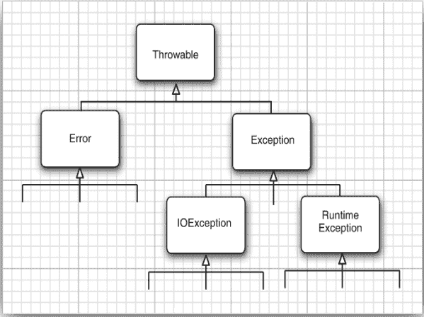

**图7.1** Java中的异常层次结构

注意，所有异常都继承自 `Throwable`，但该层次结构立即分为两个分支：`Error` 和 `Exception`。

`Error` 层次结构描述 Java 运行时系统内部的内部错误和资源耗尽情况。你不应抛出这种类型的对象。如果发生这样的内部错误，除了通知用户并尝试优雅地终止程序外，你几乎无能为力。这些情况相当罕见。

在进行 Java 编程时，请关注 `Exception` 层次结构。`Exception` 层次结构也分为两个分支：派生自 `RuntimeException` 的异常和不派生自 `RuntimeException` 的异常。一般规则是：`RuntimeException` 的发生是因为你犯了编程错误。任何其他异常的发生，是因为原本正常的程序遇到了糟糕的情况，例如 I/O 错误。

继承自 `RuntimeException` 的异常包括以下问题：

- 错误的强制类型转换
- 数组越界访问
- 空指针访问

不继承自 `RuntimeException` 的异常包括：

- 试图读取超出文件末尾的内容
- 试图打开一个不存在的文件
- 试图为一个并不表示现有类的字符串查找 `Class` 对象

规则“如果它是 `RuntimeException`，那就是你的过错”很管用。你本可以通过检查数组索引是否在数组边界内来避免那个 `ArrayIndexOutOfBoundsException`。如果你在使用变量之前检查它是否为 null，就不会发生 `NullPointerException`。

那文件不存在的情况呢？你不能先检查文件是否存在，然后再打开它吗？嗯，文件可能在你检查其存在性之后立刻被删除。因此，“存在”这一概念取决于环境，而不仅仅取决于你的代码。

Java语言规范将任何派生自 `Error` 类或 `RuntimeException` 类的异常称为*非受检异常*。所有其他异常称为*受检异常*。这是一个有用的术语，我在本书中也采用它。编译器会检查你是否为所有受检异常提供了异常处理器。


### 注意：

`RuntimeException` 这个名字有点令人困惑。当然，我们讨论的所有错误都发生在运行时。这个名字起源于远古时代，当时 Java 的前身 Oak 的“运行时”会生成越界异常和空指针异常。据推测，I/O 异常是由其他某个组件产生的。


### C++ 注意：

如果你熟悉标准 C++ 库的（范围要有限得多的）异常层次结构，那么此时你可能会非常困惑。C++ 有两个基本异常类：`runtime_error` 和 `logic_error`。`logic_error` 类相当于 Java 的 `RuntimeException`，同样表示程序中的逻辑错误。`runtime_error` 类是由不可预测问题引起的异常的基类。它相当于 Java 中那些*不是* `RuntimeException` 类型的异常。

### 7.1.2 声明受检异常

Java 方法在遇到无法处理的情况时可以抛出异常。这个想法很简单：方法不仅会告诉 Java 编译器它可以返回哪些值，*还会告诉编译器哪里可能出错*。例如，尝试从文件读取的代码知道文件可能不存在，或者文件可能为空。因此，试图处理文件中信息的代码需要通知编译器，它可能抛出某种异常。

你声明方法可能抛出异常的位置是方法头；方法头会发生变化，以反映该方法可以抛出的受检异常。例如，下面是标准库中 `FileInputStream` 类的某个构造器的声明。（关于输入和输出的更多内容，请参见第 II 卷第 1 章。）

```java
public FileInputStream(String name) throws
FileNotFoundException
```

该声明表示，这个构造器会从 `String` 参数生成一个 `FileInputStream` 对象，但它*还*可能以特殊方式出错——抛出一个 `FileNotFoundException`。如果这种糟糕的情况真的发生，构造器调用将不会初始化一个新的 `FileInputStream` 对象，而是抛出一个 `FileNotFoundException` 类的对象。如果确实如此，运行时系统将开始搜索一个知道如何处理 `FileNotFoundException` 对象的异常处理器。

当你编写自己的方法时，不必声明方法实际可能抛出的每一个可抛出对象。要理解何时（以及什么）必须在所编写方法的 `throws` 子句中声明，请记住，异常会在以下四种情况中的任意一种下抛出：

- 你调用了一个抛出受检异常的方法——例如 `FileInputStream` 构造器。
- 你检测到错误，并用 `throw` 语句抛出一个受检异常（`throw` 语句将在下一节介绍）。
- 你犯了一个编程错误，例如 `a[-1] = 0`，从而引发一个非受检异常（在本例中，是 `ArrayIndexOutOfBoundsException`）。
- 虚拟机或运行时库中发生内部错误。

如果前两种情形中的任意一种发生，你必须告知将使用你方法的程序员存在异常的可能性。为什么？任何抛出异常的方法都是一个潜在死亡陷阱。如果没有处理器捕获该异常，当前执行线程就会终止。

与作为所提供类一部分的 Java 方法一样，你在方法头中用*异常规范*声明你的方法可能抛出异常。

```java
class MyAnimation
{
    . . .
    public Image loadImage(String s) throws IOException
    {
        . . .
    }
}
```

如果一个方法可能抛出不止一种受检异常类型，你必须在方法头中列出所有异常类。用逗号分隔它们，如下例所示：

```java
class MyAnimation
{
    . . .
    public Image loadImage(String s) throws
        FileNotFoundException, EOFException
    {
        . . .
    }
}
```

然而，你不需要声明 Java 内部错误——也就是继承自 `Error` 的异常。任何代码都可能抛出这些异常，而且它们完全超出你的控制。

同样，你也不应声明继承自 `RuntimeException` 的非受检异常。

```java
class MyAnimation
{
    . . .
    void drawImage(int i) throws ArrayIndexOutOfBoundsException
    // bad style
    {
        . . .
    }
}
```

这些运行时错误完全在你的控制之下。如果你如此担心数组索引错误，你应该花时间修复它们，而不是声明它们可能发生。

总之，方法必须声明它可能抛出的所有*受检*异常。非受检异常要么超出你的控制（`Error`），要么源于你本就不应允许出现的情况（`RuntimeException`）。如果你的方法未能如实声明所有受检异常，编译器将发出错误消息。

当然，正如你已经在不少示例中看到的那样，除了声明异常，你也可以捕获它。这样异常就不会从方法中抛出，也就不需要 throws 规范。你将在本章后面看到如何决定是捕获异常，还是让其他人捕获它。


### 警告：

如果重写超类中的方法，子类方法声明的受检异常不能比超类方法的受检异常更一般。（抛出更具体的异常，或者子类方法不抛出任何异常，都是可以的。）特别地，如果超类方法完全不抛出受检异常，子类也不能抛出。例如，如果重写 `JComponent.paintComponent`，你的 `paintComponent` 方法绝不能抛出任何受检异常，因为超类方法不抛出任何受检异常。

当类中的方法声明它抛出一个特定类的实例异常时，它可能抛出该类的异常，也可能抛出该类的任意子类的异常。例如，`FileInputStream` 构造器本可以声明它抛出 `IOException`。在那种情况下，你将不知道它是哪种 `IOException`；它可能是一个普通的 `IOException`，也可能是各种子类之一的对象，例如 `FileNotFoundException`。

### C++ 注意：

throws 说明符与 C++ 中的 throw 说明符相同，但有一个重要区别。在 C++ 中，throw 说明符是在运行时强制执行的，而不是在编译时。也就是说，C++ 编译器不关注异常规范。但是，如果在不在 throw 列表中的函数里抛出了异常，就会调用 unexpected 函数，并且默认情况下程序会终止。

另外，在 C++ 中，如果没有给出 throw 说明符，函数可以抛出任何异常。在 Java 中，没有 throws 说明符的方法完全不能抛出任何受检异常。

### 7.1.3 如何抛出异常

现在，假设你的代码中发生了糟糕的事情。你有一个方法 readData，它正在读取一个文件，而该文件的头部承诺

```
Content-length: 1024
```

但在读取 733 个字符后却遇到了文件结束。你可能认为这种情况太不正常，因此想抛出一个异常。

你需要决定抛出什么异常类型。某种 IOException 会是不错的选择。翻阅 Java API 文档时，你会发现一个 `EOFException`，其描述为“表示在输入过程中意外到达了 EOF。”完美。下面是你抛出它的方式：

```java
throw new EOFException();
```

或者，如果你愿意：

```java
var e = new EOFException();
throw e;
```

下面是将这些组合在一起的方式：

```java
String readData(Scanner in) throws EOFException
{
    . . .
    while (. . .)
    {
        if (!in.hasNext()) // EOF encountered
        {
            if (n < len)
                throw new EOFException();
        }
        . . .
    }
    return s;
}
```

`EOFException` 还有一个接受字符串参数的第二个构造器。你可以充分利用这一点，更仔细地描述异常条件。

```java
String gripe = "Content-length: " + len + ", Received: " + n;
throw new EOFException(gripe);
```

如你所见，如果某个现有异常类适合你，那么抛出异常就很容易。在这种情况下：

- 1. 找到一个合适的异常类。
- 2. 创建该类的对象。
- 3. 抛出它。


一旦方法抛出异常，它就不会返回其调用者。这意味着你不用担心去编造默认返回值或错误代码。

**C++ 注意：**

在 C++ 和 Java 中，抛出异常的方式是相同的，只有一点小差别。在 Java 中，你只能抛出 `Throwable` 子类的对象。在 C++ 中，你可以抛出任何类型的值。

### 7.1.4 创建异常类

你的代码可能会遇到标准异常类无法充分描述的问题。在这种情况下，创建自己的异常类很容易。只需从 `Exception` 或 `Exception` 的子类（如 `IOException`）派生即可。通常需要同时提供默认构造函数和包含详细消息的构造函数。（`Throwable` 超类的 `toString` 方法会返回包含该详细消息的字符串，这对调试很方便。）

```java
class FileFormatException extends IOException
{
    public FileFormatException() {}
    public FileFormatException(String gripe)
    {
        super(gripe);
    }
}
```

现在，你已经准备好抛出自定义的异常类型了。

```java
String readData(Scanner in) throws FileFormatException
{
   . . .
   while (. . .)
   {
      if (ch == -1) // EOF encountered
      {
         if (n < len)
            throw new FileFormatException();
      }
      . . .
   }
   return s;
}
```

**java.lang.Throwable 1.0**

---

- **Throwable()**  
  构造一个没有详细消息的新的 Throwable 对象。
- **Throwable(String message)**  
  构造一个带有指定详细消息的新的 Throwable 对象。按照惯例，所有派生的异常类都支持默认构造函数和带详细消息的构造函数。
- **String getMessage()**  
  获取 Throwable 对象的详细消息。

## 7.2 捕获异常

现在你已经知道如何抛出异常了。这非常简单：抛出它，然后忘记它。当然，必须有代码来捕获异常。捕获异常需要更多的规划。这正是接下来的章节要介绍的内容。

### 7.2.1 捕获异常

如果某个异常在任何地方都没有被捕获，程序将终止，并向控制台打印一条消息，其中包含异常类型和堆栈跟踪。但是，GUI 程序可以捕获异常，打印堆栈跟踪消息，然后返回到用户界面处理循环。（在调试 GUI 程序时，最好让控制台保持在屏幕上，而不是最小化。）

要捕获异常，需要设置一个 `try/catch` 块。`try` 块最简单的形式如下：

```java
try
{
    code
    more code
    more code
}
catch (ExceptionType e)
{
    handler for this type
}
```

如果 `try` 块中的任何代码抛出了 `catch` 子句中指定类的异常，那么：

1. 程序跳过 `try` 块中剩余的代码。
2. 程序执行 `catch` 子句中的处理代码。

如果 `try` 块中的任何代码都没有抛出异常，则程序跳过 `catch` 子句。

如果方法中的任何代码抛出的异常类型不是 `catch` 子句中指定的类型，则此方法立即退出。（希望它的某个调用者已经为该类型提供了 `catch` 子句。）

为了说明这一点，下面是一些读取数据的非常典型的代码：

```java
public void read(String filename)
{
    try
    {
        var in = new FileInputStream(filename);
        int b;
        while ((b = in.read()) != -1)
        {
            process input
        }
    }
    catch (IOException exception)
    {
        exception.printStackTrace();
    }
}
```

请注意，`try` 子句中的大部分代码都很简单：它读取并处理字节，直到遇到文件末尾。通过查看 Java API 可以看到，`read` 方法有可能抛出 `IOException`。在这种情况下，我们会跳出整个 while 循环，进入 `catch` 子句，并生成一个堆栈跟踪。对于一个玩具程序来说，这似乎是处理该异常的一种合理方式。你还有其他选择吗？

通常，最好的选择是什么也不做，直接将异常传递给调用者。如果 `read` 方法中出现错误，就让 `read` 方法的调用者去处理吧！如果我们采用这种方法，那么我们必须声明该方法可能抛出 `IOException`。

```java
public void read(String filename) throws IOException
{
    var in = new FileInputStream(filename);
    int b;
    while ((b = in.read()) != -1)
    {
        process input
    }
}
```

请记住，编译器会严格执行 `throws` 标识。如果调用一个抛出已检查异常的方法，你必须要么处理它，要么传递它。

两者哪个更好？作为一般规则，你应该捕获那些你知道如何处理的异常，并传播那些你不知道如何处理的异常。

当你传播异常时，必须添加 `throws` 标识，以提醒调用者可能抛出异常。

查看 Java API 文档，了解哪些方法会抛出哪些异常。然后决定是应该处理它们，还是将它们添加到 throws 列表中。选择后者并没什么不好意思的。将异常交给一个能胜任的处理器，比压制它要好。

请记住，如前所述，这条规则有一个例外。如果你正在编写一个方法，它覆盖了一个不抛出任何异常的超类方法（例如 `JComponent` 中的 `paintComponent`），那么你*必须*在方法代码中捕获每个已检查异常。不允许在子类方法中添加比超类方法更多的 `throws` 标识。


**C++ 注意：**

在 Java 和 C++ 中捕获异常的方式几乎相同。严格来说，Java 的

```java
catch (Exception e) // Java
```

对应的是

```cpp
catch (Exception& e) // C++
```

Java 中没有与 C++ 的 `catch (...)` 对应的写法。这在 Java 中并不需要，因为所有异常都派生自一个共同的超类。

### 7.2.2 捕获多个异常

你可以在一个 `try` 块中捕获多种异常类型，并对每种类型进行不同的处理。对每种类型使用一个单独的 `catch` 子句，如下例所示：

```java
try
{
    code that might throw exceptions
}
catch (FileNotFoundException e)
{
    emergency action for missing files
}
catch (UnknownHostException e)
{
    emergency action for unknown hosts
}
catch (IOException e)
{
    emergency action for all other I/O problems
}
```

异常对象可能包含有关异常性质的信息。要了解更多关于该对象的信息，请尝试

```java
e.getMessage()
```

获取详细的错误消息（如果有的话），或者

**注意：**

捕获多个异常不仅让你的代码看起来更简单，而且更高效。生成的字节码为共享的 catch 子句包含一个单独的代码块。

### 7.2.3 重新抛出和异常链

你可以在 `catch` 子句中抛出一个异常。通常，当你想改变异常类型时会这样做。如果你构建了一个供其他程序员使用的子系统，使用一种表示该子系统失败的异常类型是很有意义的。这种异常类型的一个例子是 `ServletException`。执行 servlet 的代码可能不想细致地知道出了什么问题，但它肯定想知道 servlet 是否有错。

下面演示如何捕获异常并重新抛出它：

```java
try
{
    access the database
}
catch (SQLException e)
{
    throw new ServletException("database error: " +
    e.getMessage());
}
```

这里，`ServletException` 是用异常的消息文本构造的。

然而，更好的做法是将原始异常设置为新异常的“原因”：

```java
try
{
    access the database
}
catch (SQLException original)
{
    var e = new ServletException("database error");
    e.initCause(original);
    throw e;
}
```

捕获异常后，可以获取原始异常：

```java
Throwable original = caughtException.getCause();
```

强烈推荐使用这种包装技术。它允许你在子系统中抛出高层异常，同时不丢失原始故障的细节。


**提示：**

如果某个方法不允许抛出受检异常，但其中发生了受检异常，那么包装技术也很有用。你可以捕获该受检异常并将其包装为运行时异常。

有时，你只想记录异常并在不做任何更改的情况下重新抛出它：

```java
try
{
    access the database
}
catch (Exception e)
{
    logger.log(level, message, e);
    throw e;
}
```

在 Java 7 之前，这种方法存在一个问题。假设该代码位于一个方法中

```java
public void updateRecord() throws SQLException
```

Java 编译器查看 `catch` 块内的 `throw` 语句，然后查看 `e` 的类型，并报错说此方法可能抛出任意 `Exception`，而不只是 `SQLException`。现在这一点已经得到改进。编译器现在会跟踪 `e` 源自 `try` 块这一事实。只要该块中唯一的受检异常是 `SQLException` 实例，并且 `e` 在 `catch` 块中未被更改，那么将所在方法声明为 `throws SQLException` 就是有效的。

### 7.2.4 finally 子句

当代码抛出异常时，它会停止处理方法中剩余的代码并退出该方法。如果该方法获取了一些只有该方法知道的本地资源，而且该资源必须被清理，那么这就是一个问题。一种解决方案是捕获所有异常，执行清理，然后重新抛出异常。但这种方案很繁琐，因为你需要在两个地方清理资源分配——正常代码中和异常代码中。`finally` 子句可以解决这个问题。


**注意：**

从 Java 7 开始，有一种更优雅的解决方案，即你将在下一节中看到的 `try-with-resources` 语句。我们详细讨论 `finally` 机制，因为它是概念基础。但在实践中，你使用 `try-with-resources` 语句的频率可能会高于 `finally` 子句。

无论是否捕获到异常，`finally` 子句中的代码都会执行。在下面的示例中，程序将在*所有情况下*关闭输入流：

```java
var in = new FileInputStream(...);
try
{
    // 1
    *code that might throw exceptions*
    // 2
}
catch (IOException e)
{
    // 3
    *show error message*
    // 4
}
finally
{
    // 5
    in.close();
}
// 6
```

让我们看看程序执行 `finally` 子句的三种可能情况。

- 1. 代码不抛出异常。在这种情况下，程序首先执行 `try` 块中的所有代码。然后，执行 `finally` 子句中的代码。之后，执行继续到 `finally` 子句之后的第一个语句。换句话说，执行经过点 1、2、5 和 6。
- 2. 代码抛出的异常在某个 `catch` 子句中被捕获——在我们的例子中，是 `IOException`。在这种情况下，程序会执行 `try` 块中的所有代码，直到抛出异常的位置。`try` 块中剩余的代码被跳过。然后，程序执行匹配的 `catch` 子句中的代码，接着执行 `finally` 子句中的代码。如果 `catch` 子句不抛出异常，程序会执行 `finally` 子句之后的第一行。在这种情况下，执行会经过点 1、3、4、5 和 6。如果 `catch` 子句抛出异常，那么该异常会被抛回给此方法的调用者，执行仅经过点 1、3 和 5。
- 3. 代码抛出的异常未在任何 `catch` 子句中被捕获。此时，程序会执行 `try` 块中的所有代码，直到抛出异常为止。`try` 块中剩余的代码被跳过。然后，执行 `finally` 子句中的代码，并且该异常会被抛回给此方法的调用者。执行仅经过点 1 和 5。

你可以使用不带 `catch` 子句的 `finally` 子句。例如，考虑以下 `try` 语句：

```java
InputStream in = ...;
try
{
    code that might throw exceptions
}
finally
{
    in.close();
}
```

无论 `try` 块中是否遇到异常，`finally` 子句中的 `in.close()` 语句都会执行。当然，如果遇到异常，它会被重新抛出，并且必须在另一个 `catch` 子句中捕获。

```java
InputStream in = ...;
try
{
    try
    {
        code that might throw exceptions
    }
    finally
    {
        in.close();
    }
}
catch (IOException e)
{
    show error message
}
```

内层 `try` 块只有一个职责：确保输入流被关闭。外层 `try` 块只有一个职责：确保错误被报告。这种解决方案不仅更清晰，而且更实用：`finally` 子句中的错误也会被报告。

**警告：**

当 `finally` 子句包含 `return` 语句时，它可能产生意外结果。假设你通过 `return` 语句从 `try` 块中间退出。在方法返回之前，会执行 `finally` 块。如果 `finally` 块也包含 `return` 语句，那么它会掩盖原始返回值。考虑以下示例：

```java
public static int parseInt(String s)
{
    try
    {
        return Integer.parseInt(s);
    }
    finally
    {
        return 0; // ERROR
    }
}
```

看起来，在调用 `parseInt("42")` 时，try 块的主体返回整数 42。然而，`finally` 子句会在方法实际返回之前执行，并导致该方法返回 0，从而忽略原始返回值。

更糟糕的是，考虑调用 `parseInt("zero")`。`Integer.parseInt` 方法会抛出 `NumberFormatException`。然后执行 `finally` 子句，而 return 语句吞掉了该异常！

finally 子句的主体用于清理资源。不要把改变控制流的语句（`return`、`throw`、`break`、`continue`）放在 finally 子句内。

### 7.2.5 try-with-resources 语句

从 Java 7 开始，有一种有用的快捷方式可用于以下代码模式

```
open a resource
try
{
    work with the resource
}
finally
{
    close the resource
}
```

前提是该资源属于实现了 `AutoCloseable` 接口的类。该接口只有一个方法

```java
void close() throws Exception
```

> **注意：**
> 还有一个 `Closeable` 接口。它是 `AutoCloseable` 的子接口，同样只有一个 `close` 方法。然而，该方法被声明为抛出 `IOException`。

在其最简单的形式中，try-with-resources 语句的形式如下

```java
try (Resource res = . . .)
{
    work with res
}
```

当 try 块退出时，`res.close()` 会被自动调用。下面是一个典型示例——读取文件中的所有单词：

```java
try (var in = new Scanner(Path.of("in.txt"),
    StandardCharsets.UTF_8))
{
    while (in.hasNext())
        System.out.println(in.next());
}
```

当该块正常退出时，或者发生异常时，`in.close()` 方法都会被调用，就像你使用了 `finally` 块一样。

你可以指定多个资源。例如，

```java
try (var in = new Scanner(Path.of("in.txt"),
    StandardCharsets.UTF_8);
        var out = new PrintWriter("out.txt",
            StandardCharsets.UTF_8))
{
    while (in.hasNext())
```


```java
out.println(in.next().toUpperCase());
}
```

无论代码块以何种方式退出，`in` 和 `out` 都会被关闭。如果手工编写这段代码，你需要两个嵌套的 `try/finally` 语句。

从 Java 9 开始，可以在 `try` 头部提供先前声明的实际最终（effectively final）变量：

```java
public static void printAll(String[] lines, PrintWriter out)
{
    try (out)
    { // effectively final variable
        for (String line : lines)
            out.println(line);
    } // out.close() called here
}
```

当 `try` 块抛出异常且 `close` 方法也抛出异常时，就会出现一个难题。`try-with-resources` 语句相当优雅地处理了这种情况。原始异常会被重新抛出，而 `close` 方法抛出的任何异常都被视为“被抑制的”异常。它们会被自动捕获，并通过 `addSuppressed` 方法添加到原始异常中。如果你对它们感兴趣，可以调用 `getSuppressed` 方法，它会返回一个由 `close` 方法产生的被抑制异常组成的数组。

你不会想手工编写这些逻辑。每当需要关闭资源时，请使用 `try-with-resources` 语句。

> **注意：**
>
> `try-with-resources` 语句本身也可以有 `catch` 子句，甚至可以有 `finally` 子句。它们会在关闭资源之后执行。

### 7.2.6 分析堆栈跟踪元素

*堆栈跟踪* 是程序执行过程中某一特定时间点上所有待处理方法调用的列表。你几乎肯定见过堆栈跟踪列表——只要 Java 程序因未捕获异常而终止，就会显示它们。

你可以通过调用 `Throwable` 类的 `printStackTrace` 方法来获取堆栈跟踪的文本描述。

```java
var t = new Throwable();
var out = new StringWriter();
t.printStackTrace(new PrintWriter(out));
String description = out.toString();
```

更灵活的方法是使用 `StackWalker` 类，它会生成一个由 `StackWalker.StackFrame` 实例组成的流，每个实例描述一个栈帧。你可以用下面的调用遍历这些栈帧：

```java
StackWalker walker = StackWalker.getInstance();
walker.forEach(frame -> analyze(frame));
```

如果你想以惰性方式处理 `Stream<StackWalker.StackFrame>`，请调用

```java
walker.walk(stream -> process(stream));
```

流处理在第 II 卷的 [第 1 章](#) 中有详细描述。

`StackWalker.StackFrame` 类提供了一些方法，可用于获取正在执行的代码行的文件名和行号，以及类对象和方法名。`toString` 方法会生成一个包含所有这些信息的格式化字符串。

### java.lang.Throwable 1.0

- `Throwable(String message, Throwable cause)` 1.4 构造一个带有给定原因的 Throwable。
- `Throwable initCause(Throwable cause)` 1.4 设置此对象的原因；如果此对象已经有一个原因，则抛出异常。返回 `this`。
- `Throwable getCause()` 1.4 获取被设置为该对象原因的异常对象；如果未设置原因，则返回 null。
- `StackTraceElement[] getStackTrace()` 1.4 获取构造此对象时的调用堆栈跟踪。
- `void addSuppressed(Throwable t)` 7 向此异常添加一个“被抑制的”异常。这发生在 `try-with-resources` 语句中，其中 `t` 是 `close` 方法抛出的异常。
- `Throwable[] getSuppressed()` 7 获取此异常的所有“被抑制的”异常。通常，这些是 `try-with-resources` 语句中 `close` 方法抛出的异常。

### java.lang.Exception 1.0

- `Exception(Throwable cause)` 1.4
- `Exception(String message, Throwable cause)` 构造一个带有给定原因的 Exception。

### java.lang.RuntimeException 1.0

- `RuntimeException(Throwable cause)` 1.4
- `RuntimeException(String message, Throwable cause)` 1.4 构造一个带有给定原因的 `RuntimeException`。

### java.lang.StackWalker

- `static StackWalker getInstance()`
- `static StackWalker getInstance(StackWalker.Option option)`
- `static StackWalker getInstance(Set<StackWalker.Option> options)` 获取一个 `StackWalker` 实例。选项包括 `StackWalker.Option` 枚举中的 `RETAIN_CLASS_REFERENCE`、`SHOW_HIDDEN_FRAMES` 和 `SHOW_REFLECT_FRAMES`。
- `forEach(Consumer<? super StackWalker.StackFrame> action)` 对每个栈帧执行给定操作，从最近调用的方法开始。
- `walk(Function<? super Stream<StackWalker.StackFrame>, ? extends T> function)` 将给定函数应用于栈帧流，并返回该函数的结果。

### java.lang.StackWalker.StackFrame

- `String getFileName()` 获取包含此元素执行点的源文件名；如果信息不可用，则返回 null。
- `int getLineNumber()` 获取包含此元素执行点的源文件行号；如果信息不可用，则返回 -1。
- `String getClassName()` 获取其方法包含此元素执行点的类的完全限定名。
- `Class<?> getDeclaringClass()` 获取包含此元素执行点的方法的类对象。如果堆栈遍历器不是使用 `RETAIN_CLASS_REFERENCE` 选项构造的，则会抛出异常。
- `String getMethodName()` 获取包含此元素执行点的方法名。构造方法的名称为 `<init>`。静态初始化器的名称为 `<clinit>`。无法区分同名的重载方法。
- `boolean isNativeMethod()` 如果此元素的执行点位于本地方法内，则返回 true。
- `String toString()` 返回一个格式化字符串，其中包含类名和方法名以及文件名和行号（如果可用）。

### java.lang.StackTraceElement 1.4

- `String getFileName()` 获取包含此元素执行点的源文件名；如果信息不可用，则返回 null。
- `int getLineNumber()` 获取包含此元素执行点的源文件行号；如果信息不可用，则返回 -1。
- `String getClassName()` 获取包含此元素执行点的类的完全限定名。
- `String getMethodName()` 获取包含此元素执行点的方法名。构造方法的名称为 `<init>`。静态初始化器的名称为 `<clinit>`。无法区分同名的重载方法。
- `boolean isNativeMethod()` 如果此元素的执行点位于本地方法内，则返回 true。
- `String toString()` 返回一个格式化字符串，其中包含类名和方法名以及文件名和行号（如果可用）。

## 7.3 使用异常的建议

关于如何正确使用异常，存在一定争议。有些程序员认为所有受检异常都很烦人，另一些程序员则似乎怎么抛出异常都不够。我认为异常（甚至受检异常）有其用武之地，因此提供以下建议，帮助你正确使用它们。

- 1. 异常处理不应取代简单的测试。

作为示例，下面这段代码会尝试 10,000,000 次从空栈中弹出元素。它首先通过判断栈是否为空来完成操作。

```java
if (!s.empty()) s.pop();
```

接下来，我们强制它无论如何都从栈中弹出元素，并捕获 `EmptyStackException`，该异常告诉我们本不该这样做。

```java
try
{
    s.pop();
}
catch (EmptyStackException e)
{
}
```

在我的测试机器上，调用 `isEmpty` 的版本运行了 646 毫秒。捕获 `EmptyStackException` 的版本运行了 21,739 毫秒。

如你所见，捕获异常所需的时间远长于执行简单测试。其寓意是：只在异常情况下使用异常。

- 2. 不要过度管理异常。

有些程序员把每条语句都包在单独的 `try` 块中。

```java
PrintStream out;
Stack s;
for (i = 0; i < 100; i++)
{
    try
    {
        n = s.pop();
    }
    catch (EmptyStackException e)
    {
        // stack was empty
    }
    try
    {
        out.writeInt(n);
    }
    catch (IOException e)
    {
        // problem writing to file
    }
}
```

这种做法会使代码急剧膨胀。想一想你希望代码完成的任务。这里，我们希望从栈中弹出 100 个数字并将它们保存到文件中。（不必在意原因——这只是一个玩具示例。）如果问题冒出来，我们无能为力。如果栈是

空着，它不会变成被占用。如果文件包含错误，错误不会神奇地消失。因此，将*整个*任务包装在 try 块中是合理的。如果任何一个操作失败，你就可以放弃该任务。

```java
try
{
    for (i = 0; i < 100; i++)   {
        n = s.pop();
        out.writeInt(n);
    }
}
catch (IOException e)
{
        // problem writing to file
}
catch (EmptyStackException e)
{
        // stack was empty
}
```

这段代码看起来干净多了。它实现了异常处理的一项承诺：将正常处理与错误处理*分离*。

- **3. 充分利用异常层次结构。**

  不要只是抛出 `RuntimeException`。应找到合适的子类，或创建自己的子类。

  不要只是捕获 `Throwable`。这会让你的代码难以阅读和维护。

  尊重受检异常与非受检异常之间的区别。受检异常本质上是一种负担——不要为逻辑错误抛出它们。（例如，反射库在这方面就做错了。调用方常常需要捕获他们知道永远不会发生的异常。）

  不要犹豫，将异常转换为另一个更合适的异常。例如，当你在文件中解析一个整数时，捕获 `NumberFormatException` 并将其转换为 `IOException` 或 `MySubsystemException` 的子类。

- **4. 不要压制异常。**

  在 Java 中，人们有极大的诱惑去让异常闭嘴。如果你正在编写一个方法，它调用了一个可能一百年才抛出一次异常的方法，编译器会抱怨，因为你没有在你的方法的 throws 列表中声明该异常。你不想把它放进 throws 列表，因为那样编译器会抱怨所有调用你的方法的方法。于是你就让它闭嘴：

```java
public Image loadImage(String s)
{
    try
    {
        code that threatens to throw checked exceptions
    }
    catch (Exception e)       {} // so there
}
```

  现在你的代码会顺利编译。它会运行良好，除非发生异常。而那时，异常会被静默忽略。如果你认为异常确实重要，就应当付出一些努力正确处理它们。

- **5. 当你检测到错误时，“严厉的爱”比纵容更有效。**

  有些程序员在检测到错误时担心抛出异常。当方法以无效参数被调用时，返回一个占位值而不是抛出异常，也许会更好？例如，当栈为空时，`Stack.pop` 应该返回 `null`，还是抛出异常？我认为，在失败发生的位置抛出 `EmptyStackException`，比在之后某个时刻出现 `NullPointerException` 更好。

- **6. 传播异常并不是一件丢脸的事。**

  有些程序员觉得必须捕获所有抛出的异常。如果他们调用了一个会抛出异常的方法，例如 `FileInputStream` 构造函数或 `readLine` 方法，他们会本能地捕获可能生成的异常。在许多情况下，实际上更好的做法是*传播*异常，而不是捕获它：

```java
public void readStuff(String filename) throws IOException // not a sign of shame!
{
    var in = new FileInputStream(filename,
    StandardCharsets.UTF_8);
    . . .
}
```

  较高级别的方法通常更有能力告知用户错误，或放弃不成功的命令。

- **7. 使用标准方法报告空指针异常和越界异常。**

  Objects 类有以下方法

  - `requireNonNull`
  - `checkIndex`
  - `checkFromToIndex`
  - `checkFromIndexSize`

  用于这些常见检查。将它们用于参数验证：

```java
public void putData(int position, Object newValue)
{
    Objects.checkIndex(position, data.length);
    Objects.requireNonNull(newValue);
    . . .
}
```

  如果方法以无效索引或 null 参数被调用，就会抛出一个异常，并使用 Java 库惯用的消息。

- **8. 不要向最终用户显示堆栈跟踪。**

  如果你的程序遇到意外异常，显示堆栈跟踪似乎是个好主意，这样用户就可以报告它，使你更容易定位问题。然而，堆栈跟踪可能包含你不希望向潜在攻击者泄露的实现细节，例如你正在使用的库的版本。

  将堆栈跟踪记录到日志中，以便你可以检索它，但只向用户显示一条摘要消息。

> **注意：**
>
> 规则 5 和 6 可以概括为“尽早抛出，尽晚捕获”。

## 7.4 使用断言

断言是防御式编程中常用的一种惯用法。在接下来的几节中，你将学习如何有效地使用它们。

### 7.4.1 断言的概念

假设你确信某个特定性质成立，并且你的代码依赖该性质。例如，你可能正在计算

```java
double y = Math.sqrt(x);
```

你确定 x 不是负数。也许它是另一个不可能产生负数的计算的结果，或者它是某个方法的参数，而该方法要求调用方只提供正数输入。尽管如此，你还是想再次检查，而不是让令人困惑的“非数”浮点值悄悄进入你的计算。当然，你可以抛出异常：

```java
if (x < 0) throw new IllegalArgumentException("x < 0");
```

但这段代码会留在程序中，即使测试已经完成。如果你有很多这类检查，程序的运行速度可能会比应有的慢不少。

断言机制允许你在测试期间加入检查，并在生产代码中自动移除它们。

Java 语言有一个关键字 `assert`。它有两种形式：

```java
assert condition;
```

以及

```java
assert condition : expression;
```

两条语句都会对条件求值，如果条件为 false，则抛出一个 `AssertionError`。在第二条语句中，表达式会被传递给 `AssertionError` 对象的构造函数，并转换为一条消息字符串。


> **注意：**
>
> *表达式*部分的唯一目的是生成一条消息字符串。`AssertionError` 对象不会存储实际的表达式值，因此你之后无法查询它。正如 JDK 文档所述，这样做“会鼓励程序员尝试从断言失败中恢复，而这违背了该机制的目的。”

要断言 x 非负，你可以直接使用语句

```java
assert x >= 0;
```

或者，你可以将 x 的实际值传入 `AssertionError` 对象，以便稍后显示。

```java
assert x >= 0 : x;
```

### C++ 注意：

C 语言的 `assert` 宏会把断言条件转换为一个字符串，如果断言失败，就打印该字符串。例如，如果 `assert(x >= 0)` 失败，它会打印 `x >= 0` 是失败的条件。在 Java 中，条件不会自动成为错误报告的一部分。如果你想看到它，必须将它作为字符串传入 `AssertionError` 对象：`assert x >= 0 : "x >= 0"`。

### 7.4.2 断言的启用与禁用

默认情况下，断言是禁用的。通过使用 `-enableassertions` 或 `-ea` 选项运行程序来启用它们：

```text
java -enableassertions MyApp
```

请注意，你不必重新编译程序来启用或禁用断言。启用或禁用断言是*类加载器*的功能。当断言被禁用时，类加载器会剥离断言代码，这样它就不会拖慢执行。

你甚至可以在特定类或整个包中启用断言。例如：

```text
java -ea:MyClass -ea:com.mycompany.mylib MyApp
```

该命令为 `MyClass` 类以及 `com.mycompany.mylib` 包*及其子包*中的所有类启用断言。选项 `-ea...` 会为未命名包中的所有类启用断言。

你也可以使用 `-disableassertions` 或 `-da` 选项在特定类和包中禁用断言：


```bash
java -ea:... -da:MyClass MyApp
```

有些类不是由类加载器加载，而是由虚拟机直接加载。你可以使用这些开关有选择地启用或禁用这些类中的断言。

然而，用于启用或禁用所有断言的 `-ea` 和 `-da` 开关并不适用于没有类加载器的“系统类”。请使用 `-enablesystemassertions/-esa` 开关来启用系统类中的断言。

也可以通过编程方式控制类加载器的断言状态。请参阅本节末尾的 API 说明。


> **注意：**
>
> Java 库的源代码中有四百多个被注释掉的断言。有些程序员在测试后会将断言注释掉，因为否则它们会占用类文件中的空间。如果你对此有顾虑，可以按如下方式有条件地包含它们：

```java
public static final boolean asserts = true;  // Recompile with false for production
...
if (asserts) assert x >= 0;
```

### 7.4.3 使用断言进行参数检查

Java 语言为你提供了三种处理系统故障的机制：

- 抛出异常
- 记录日志
- 使用断言

什么时候应该选择断言？请记住以下几点：

- 断言失败旨在表示致命、不可恢复的错误。
- 断言检查仅在开发和测试期间开启。（这有时被开玩笑地描述为“在靠近岸边时穿上救生衣，一旦到了海洋中间就把它扔下船。”）

因此，你不会使用断言向程序的其他部分发出可恢复条件的信号，也不会用断言向程序用户传达问题。断言只应用于在测试期间定位程序内部错误。

让我们看一个常见场景——检查方法参数。你应该使用断言来检查非法的索引值或空引用吗？要回答这个问题，你必须查看该方法的文档。假设你实现了一个排序方法。

```java
/**
   Sorts the specified range of the specified array in ascending numerical order.
   The range to be sorted extends from fromIndex, inclusive, to toIndex, exclusive.
   @param a the array to be sorted.
   @param fromIndex the index of the first element (inclusive) to be sorted.
   @param toIndex the index of the last element (exclusive) to be sorted.
   @throws IllegalArgumentException if fromIndex > toIndex
   @throws ArrayIndexOutOfBoundsException if fromIndex < 0 or toIndex > a.length
*/
static void sort(int[] a, int fromIndex, int toIndex)
```

文档说明，如果索引值不正确，该方法会抛出异常。该行为是该方法与其调用者之间约定的一部分。如果你实现该方法，就必须遵守该约定并抛出指定的异常。改用断言是不合适的。

你应该断言 `a` 不为 `null` 吗？这同样不合适。方法文档未说明当 `a` 为 `null` 时该方法的行为。调用者有权假定在这种情况下方法会成功返回，而不会抛出断言错误。

然而，假设方法约定略有不同：

```text
@param a the array to be sorted (must not be null).
```

现在，该方法的调用者已被明确告知，使用空数组调用该方法是非法的。那么该方法可以以如下断言开头

```java
assert a != null;
```

计算机科学家将这种约定称为*前置条件*。原始方法对其参数没有前置条件——它承诺在所有情况下都具有明确定义的行为。修订后的方法有一个前置条件：`a` 不为 `null`。如果调用者未能满足该前置条件，那么一切都不再有保证，方法可以为所欲为。事实上，在加入断言后，该方法被非法调用时会表现出相当不可预测的行为。它有时抛出断言错误，有时抛出空指针异常，具体取决于其类加载器的配置方式。

### 7.4.4 使用断言记录假设

程序员经常使用注释来记录其底层假设。考虑来自 http://docs.oracle.com/javase/8/docs/technotes/guides/language/assert.html 的以下示例：

```java
if (i % 3 == 0)
    . . .
else if (i % 3 == 1)
    . . .
else // (i % 3 == 2)
    . . .
```

在这种情况下，改用断言非常合理。

```java
if (i % 3 == 0)
    . . .
else if (i % 3 == 1)
    . . .
else
{
    assert i % 3 == 2;
    . . .
}
```

当然，彻底思考这个问题会更有意义。`i % 3` 可能的值有哪些？如果 i 为正数，余数必定是 0、1 或 2。如果 i 为负数，那么余数可以是 −1 或 −2。因此，真正的假设是 i 不为负数。更好的断言应该是

```java
assert i >= 0;
```

放在 if 语句之前。

无论如何，这个示例展示了断言作为程序员自检工具的良好用法。如你所见，断言是用于测试和调试的战术性工具。相比之下，日志记录是贯穿程序整个生命周期的战略性工具。我们将在下一节探讨日志记录。

| API | 描述 | 版本 |
|---|---|---|
| **java.lang.ClassLoader** |  | 1.0 |
| `void setDefaultAssertionStatus(boolean b)` | 为此类加载器加载的、没有显式类或包断言状态的所有类启用或禁用断言。 | 1.4 |
| `void setClassAssertionStatus(String className, boolean b)` | 为给定类及其内部类启用或禁用断言。 | 1.4 |
| `void setPackageAssertionStatus(String packageName, boolean b)` | 为给定包及其子包中的所有类启用或禁用断言。 | 1.4 |
| `void clearAssertionStatus()` | 移除所有显式的类和包断言状态设置，并为此类加载器加载的所有类禁用断言。 | 1.4 |

## 7.5 日志记录

每位 Java 程序员都熟悉这样的过程：在出问题的代码中插入对 `System.out.println` 的调用，以深入了解程序行为。当然，一旦你找出问题的原因，就会删除这些打印语句，结果下一次问题出现时又得把它们加回来。日志 API 的设计就是为了克服这个问题。以下是该 API 的主要优点：

- 很容易抑制所有日志记录，或仅抑制低于某个级别的日志记录，也同样容易重新启用它们。
- 被抑制的日志开销非常低，因此在应用程序中保留日志记录代码只会带来极小的性能损失。
- 日志记录可以被定向到不同的处理器——例如显示在控制台、写入文件等。
- 日志记录器和处理器都可以过滤记录。过滤器可以使用过滤器实现者提供的任意条件丢弃无趣的日志条目。
- 日志记录可以按不同方式格式化——例如纯文本或 XML。
- 应用程序可以使用多个日志记录器，其名称具有层次结构，例如 `com.mycompany.myapp`，类似于包名。
- 日志配置由配置文件控制。

**注意：**

许多应用程序使用其他日志框架，例如 Log4J 2（https://logging.apache.org/log4j/2.x）和 Logback（https://logback.qos.ch），它们提供比标准 Java 日志框架更高的性能。这些框架的 API 略有不同。SLF4J（https://www.slf4j.org）和 Commons Logging（https://commons.apache.org/proper/commons-logging）等日志门面提供了统一的 API，因此你无需重写应用程序即可替换日志框架。更令人困惑的是，Log4J 2 也可以作为使用 SLF4J 的组件的门面。在本书中，我介绍标准 Java 日志框架。它对许多用途来说已经足够好，学习其 API 将为你理解替代方案做好准备。

**注意：**

从 Java 9 开始，Java 平台有一个单独的轻量级日志系统，它不依赖于 `java.logging` 模块（该模块包含标准 Java 日志框架）。该系统仅供 Java API 内部使用。如果存在 `java.logging` 模块，日志消息会自动转发给它。第三方日志框架可以提供适配器来接收平台日志消息。我不介绍平台日志记录，因为它不是供应用程序程序员使用的。

### 7.5.1 基本日志记录

对于简单日志记录，请使用全局日志记录器并调用其 `info` 方法：


```java
Logger.getGlobal().info("File->Open menu item selected");
```

默认情况下，该记录会像下面这样打印：

```
May 10, 2013 10:12:15 PM LoggingImageViewer fileOpen
INFO: File->Open menu item selected
```

但是，如果你在适当的位置（例如 `main` 的开头）调用

```java
Logger.getGlobal().setLevel(Level.OFF);
```

所有日志记录都会被抑制。

### 7.5.2 高级日志

现在你已经看到了“傻瓜式日志”，让我们继续来学习工业级强度的日志记录。在专业的应用程序中，你不会希望将所有记录都记录到单一的全局日志器上。相反，你可以定义自己的日志器。

调用 getLogger 方法以创建或获取一个日志器：

```java
private static final Logger myLogger =
Logger.getLogger("com.mycompany.myapp");
```


> **提示：**
>
> 未被任何变量引用的日志器可能会被垃圾回收。为了防止这种情况，请像上面的示例一样，使用静态变量保存对日志器的引用。

与包名类似，日志器名称是分层次的。事实上，它们*比包名更具层次性*。包与其父包之间没有语义关系，但日志器的父级和子级共享某些属性。例如，如果你在日志器“com.mycompany”上设置日志级别，那么子日志器将继承该级别。

共有七个日志级别：

- SEVERE
- WARNING
- INFO
- CONFIG
- FINE
- FINER
- FINEST

默认情况下，实际上只会记录前三个级别。你可以设置不同的级别，例如：

```java
logger.setLevel(Level.FINE);
```

现在，FINE 及其以上所有级别都会被记录。

你还可以使用 Level.ALL 开启所有级别的日志记录，或者使用 Level.OFF 关闭所有日志记录。

每个级别都有相应的日志方法，例如：

```java
logger.warning(message);
logger.fine(message);
```

等等。或者，你也可以使用 log 方法并提供级别，例如：

```java
logger.log(Level.FINE, message);
```

> **提示：**
>
> 默认的日志配置会记录所有级别为 `INFO` 或更高的记录。因此，对于调试消息，你应该使用 `CONFIG`、`FINE`、`FINER` 和 `FINEST` 级别，这些消息对诊断很有用，但对用户来说毫无意义。

> **警告：**
>
> 如果你将日志级别设置为比 `INFO` 更精细的值，还需要更改日志处理器的配置。默认的日志处理器会抑制低于 `INFO` 的消息。详见下一节。

默认的日志记录显示包含日志调用的类和方法的名称，这些名称是从调用栈推断出来的。但是，如果虚拟机优化了执行，则可能无法获得准确的调用信息。你可以使用 `logp` 方法来提供调用类和方法的精确位置。该方法的签名是：

```java
void logp(Level l, String className, String methodName, String
    message)
```

有一些用于跟踪执行流程的便捷方法：

```java
void entering(String className, String methodName)
void entering(String className, String methodName, Object
    param)
void entering(String className, String methodName, Object[]
    params)
void exiting(String className, String methodName)
void exiting(String className, String methodName, Object
    result)
```

例如：

```java
int read(String file, String pattern)
{
    logger.entering("com.mycompany.mylib.Reader", "read",
        new Object[] { file, pattern });
    . . .
    logger.exiting("com.mycompany.mylib.Reader", "read", count);
    return count;
}
```

这些调用会生成级别为 FINER 的日志记录，消息以字符串 ENTRY 和 RETURN 开头。

**注意：**

在未来的某个时候，带有 `Object[]` 参数的日志方法将被重写以支持可变参数列表（“varargs”）。届时，你将能够进行诸如 `logger.entering("com.mycompany.mylib.Reader", "read", file, pattern)` 之类的调用。

日志记录的一个常见用途是记录意外的异常。两个便捷方法会在日志记录中包含异常的描述。

```java
void throwing(String className, String methodName, Throwable t)
void log(Level l, String message, Throwable t)
```

典型的用法如下：

```java
if (. . .)
{
    var e = new IOException(". . .");
    logger.throwing("com.mycompany.mylib.Reader", "read", e);
    throw e;
}
```

以及

```java
try
{
    . . .
}
catch (IOException e)
{
    Logger.getLogger("com.mycompany.myapp").log(Level.WARNING,
"Reading image", e);
}
```

throwing 调用会记录一条级别为 FINER 的日志记录，消息以 THROW 开头。

### 7.5.3 更改日志管理器配置

你可以通过编辑配置文件来更改日志系统的各种属性。默认配置文件位于 jdk/conf/logging.properties（在 Java 9 之前位于 jre/lib/logging.properties）。

```
conf/logging.properties
```

（在 Java 9 之前位于 jre/lib/logging.properties）。

要使用另一个文件，请将 java.util.logging.config.file 属性设置为文件所在位置，并这样启动应用程序：

```
java -Djava.util.logging.config.file=configFile MainClass
```

要更改默认的日志级别，请编辑配置文件并修改这一行：

```properties
.level=INFO
```

你可以通过添加如下行来为你的日志器指定日志级别：

```properties
com.mycompany.myapp.level=FINE
```

也就是说，在日志器名称后面附加 `.level` 后缀。

正如你将在本节后面看到的，日志器实际上并不会将消息发送到控制台——这是处理器（handlers）的工作。处理器也有级别。要在控制台上看到 `FINE` 消息，你还需要设置：

```properties
java.util.logging.ConsoleHandler.level=FINE
```


> **警告：**
>
> 日志管理器配置中的设置*不是*系统属性。使用 `-Dcom.mycompany.myapp.level=FINE` 启动程序不会对日志器产生任何效果。

日志管理器在虚拟机启动期间、`main` 执行之前完成初始化。如果你想自定义日志属性，但启动应用程序时没有使用 `-Djava.util.logging.config.file` 命令行选项，那么可以在程序中调用 `System.setProperty("java.util.logging.config.file", file)`。不过，此时你还必须调用 `LogManager.getLogManager().readConfiguration()` 来重新初始化日志管理器。

从 Java 9 开始，你可以改为通过调用以下方法来更新日志配置：

```java
LogManager.getLogManager().updateConfiguration(mapper);
```

新配置将从 `java.util.logging.config.file` 系统属性指定的位置读取。然后，映射器会被应用于解析旧配置或新配置中所有键的值。映射器是一个 `Function<String,BiFunction<String,String,String>>`。它将现有配置中的键映射到替换函数。每个替换函数接收与该键关联的旧值和新值（如果没有关联值则为 `null`），并生成替换值；如果应在更新中删除该键，则返回 `null`。

这听起来相当复杂，所以让我们来看几个例子。一种有用的映射方案是合并旧配置和新配置，当一个键在旧配置和新配置中都存在时，优先采用新值。那么映射器为：

```
    key -> ((oldValue, newValue) -> newValue == null ? oldValue :
    newValue)
```

或者，你可能只想更新以 `com.mycompany` 开头的键，而保持其他键不变：

```
    key -> key.startsWith("com.mycompany")
        ? ((oldValue, newValue) -> newValue)
        : ((oldValue, newValue) -> oldValue)
```

还可以使用 `jconsole` 程序在运行中的程序里更改日志级别。有关信息，请参阅 [www.oracle.com/technetwork/articles/java/jconsole-1564139.html#LoggingControl](http://www.oracle.com/technetwork/articles/java/jconsole-1564139.html#LoggingControl)。

**注意：**

日志属性文件由 `java.util.logging.LogManager` 类处理。你可以通过将 `java.util.logging.manager` 系统属性设置为某个子类的名称来指定不同的日志管理器。或者，你可以保留标准的日志管理器


然后，为日志消息指定资源包键，而不是实际的消息字符串：

```
logger.info("readingFile");
```

你经常需要将参数包含到本地化消息中。消息可能包含占位符：{0}、{1}，等等。例如，要在日志消息中包含文件名，请像这样使用占位符：

```
Reading file {0}.
Achtung! Datei {0} wird eingelesen.
```

然后，要将值传递给占位符，请调用以下方法之一：

```
logger.log(Level.INFO, "readingFile", fileName);
logger.log(Level.INFO, "renamingFile", new Object[] { oldName, newName });
```

另外，从 Java 9 开始，你可以在 logrb 方法中指定资源包对象（而不是名称）：

```
logger.logrb(Level.INFO, bundle, "renamingFile", oldName, newName);
```

> **注意：**
>
> 这是唯一一种对消息参数使用可变参数的日志方法。

### 7.5.5 处理器

默认情况下，日志记录器会将记录发送到 `ConsoleHandler`，后者将它们打印到 `System.err` 流。具体来说，日志记录器将记录发送给父处理器，而最终的祖先（名为 `""`）有一个 `ConsoleHandler`。

与日志记录器一样，处理器也有日志级别。要使一条记录被记录，其日志级别必须*同时*高于日志记录器和处理器的阈值。日志管理器配置文件将默认控制台处理器的日志级别设置为：

```
java.util.logging.ConsoleHandler.level=INFO
```

要记录级别为 `FINE` 的记录，请在配置中同时更改默认日志记录器级别和处理器级别。或者，你也可以完全绕过配置文件，安装自己的处理器。

```
Logger logger = Logger.getLogger("com.mycompany.myapp");
logger.setLevel(Level.FINE);
logger.setUseParentHandlers(false);
var handler = new ConsoleHandler();
handler.setLevel(Level.FINE);
logger.addHandler(handler);
```

默认情况下，日志记录器会将记录同时发送到自己的处理器和父级的处理器。我们的日志记录器是原始日志记录器（名为 `""`）的子级，原始日志记录器会将所有级别为 `INFO` 及以上的记录发送到控制台。然而，我们不希望重复看到这些记录，因此我们将 `useParentHandlers` 属性设置为 false。

要将日志记录发送到其他位置，请添加另一个处理器。日志 API 为此提供了两个有用的处理器：`FileHandler` 和 `SocketHandler`。`SocketHandler` 将记录发送到指定的主机和端口。更令人感兴趣的是 `FileHandler`，它把记录收集到文件中。

你可以简单地将记录发送到默认的文件处理器，如下所示：

```
var handler = new FileHandler();
logger.addHandler(handler);
```

记录会被发送到用户主目录下的 java*n*.log 文件中，其中 *n* 是一个用于使文件唯一的编号。如果系统没有用户主目录的概念（例如在 Windows 95/98/ME 中），则文件会存储在默认位置，例如 c:\windows。默认情况下，记录以 XML 格式进行格式化。一条典型的日志记录具有如下形式：

```xml
<record>
  <date>2002-02-04T07:45:15</date>
  <millis>1012837515710</millis>
  <sequence>1</sequence>
  <logger>com.mycompany.myapp</logger>
  <level>INFO</level>
  <class>com.mycompany.mylib.Reader</class>
  <method>read</method>
  <thread>10</thread>
  <message>Reading file corejava.gif</message>
</record>
```

你可以通过在日志管理器配置中设置各种参数（参见表 7.1）或使用另一个构造函数（参见本节末尾的 API 说明）来修改文件处理器的默认行为。

你可能不想使用默认的日志文件名。因此，你应该使用其他模式，例如 %h/myapp.log。（模式变量的说明参见表 7.2。）

如果多个应用程序（或同一个应用程序的多个副本）使用同一个日志文件，你应该开启追加标志。或者，在文件名称模式中使用 %u，以便每个应用程序创建唯一的日志副本。

开启文件轮转也是一个好主意。日志文件按轮转顺序保存，例如 myapp.log.0、myapp.log.1、myapp.log.2，依此类推。每当文件超过大小限制时，最旧的日志会被删除，其他文件会被重命名，并创建一个世代编号为 0 的新文件。

**表 7.1** 文件处理器配置参数

| 配置属性 | 描述 | 默认值 |
|---|---|---|
| `java.util.logging.FileHandler.level` | 处理器级别 | `Level.ALL` |
| `java.util.logging.FileHandler.append` | 控制处理器是追加到现有文件，还是为每次程序运行打开一个新文件 | `false` |
| `java.util.logging.FileHandler.limit` | 在打开另一个文件之前，可写入一个文件的大致最大字节数（0 = 无限制） | 在 FileHandler 类中为 `0`（无限制），在默认日志管理器配置中为 `50000` |
| `java.util.logging.FileHandler.pattern` | 日志文件名的模式。模式变量参见表 7.2。 | `%h/java%u.log` |
| `java.util.logging.FileHandler.count` | 轮转序列中的日志数量 | `1`（不轮转） |
| `java.util.logging.FileHandler.filter` | 要使用的过滤器类 | 不过滤 |
| `java.util.logging.FileHandler.encoding` | 要使用的字符编码 | 平台编码 |
| `java.util.logging.FileHandler.formatter` | 记录格式化器 | `java.util.logging.XMLFormatter` |

**表 7.2** 日志文件模式变量

| 变量 | 描述 |
|---|---|
| `%h` | user.home 系统属性的值 |
| `%t` | 系统临时目录 |
| `%u` | 用于解决冲突的唯一编号 |
| `%g` | 轮转日志的世代编号（如果指定了轮转且模式中不包含 `%g`，则使用 `.%g` 后缀） |
| `%%` | % 字符 |


**提示：**

有些程序员使用日志来为技术支持人员提供帮助。如果程序在现场出现问题，用户可以把日志文件发送回来以供检查。在这种情况下，你应该开启追加标志，使用轮转日志，或者两者都采用。

你还可以通过扩展 `Handler` 或 `StreamHandler` 类来定义自己的处理器。我们在本节末尾的示例程序中定义了这样一个处理器。该处理器在窗口中显示记录（参见 *图 7.2*）。

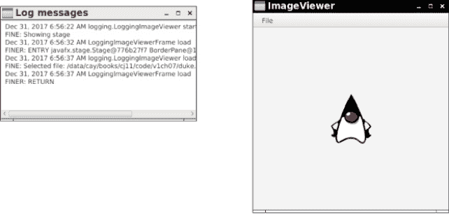

**图 7.2** 在窗口中显示记录的日志处理器

该处理器扩展了 `StreamHandler` 类，并安装了一个流，其 write 方法将流输出显示在文本区域中。

```java
class WindowHandler extends StreamHandler
{
    public WindowHandler()
    {
        . . .
        var output = new JTextArea();
        setOutputStream(new
            OutputStream()
            {
                public void write(int b) { } // not called
                public void write(byte[] b, int off, int len)
                {
                    output.append(new String(b, off, len));
                }
            });
    }
    . . .
}
```

这种方法只有一个问题——处理器会缓冲记录，并且只在缓冲区满时才将它们写入流。因此，我们重写 publish 方法，以便在每条记录之后刷新缓冲区：

```
class WindowHandler extends StreamHandler
{
    . . .
    public void publish(LogRecord record)
    {
        super.publish(record);
        flush();
    }
}
```

如果你想编写更特别的流处理器，可以扩展 Handler 类，并定义 publish、flush 和 close 方法。

### 7.5.6 过滤器

默认情况下，记录会根据其日志级别进行过滤。每个日志记录器和处理器都可以有一个可选的过滤器来执行额外的过滤。要定义过滤器，请实现 Filter 接口并定义该方法：

```
boolean isLoggable(LogRecord record)
```

使用你想要的任何标准分析日志记录，并对于应该包含在日志中的记录返回 true。例如，某个过滤器可能只对 entering 和 exiting 方法生成的消息感兴趣。那么该过滤器应调用 record.getMessage()，并检查它是否以 ENTRY 或 RETURN 开头。

要将过滤器安装到日志记录器或处理器中，只需调用 setFilter 方法。请注意，同一时间最多只能有一个过滤器。

### 7.5.7 格式化器


ConsoleHandler 和 FileHandler 类以文本和 XML 格式输出日志记录。不过，你也可以定义自己的格式。你需要扩展 Formatter 类并重写该方法

```java
String format(LogRecord record)
```

你可以按照自己喜欢的方式格式化记录中的信息，并返回结果字符串。在你的 format 方法中，你可能想要调用以下方法

```java
String formatMessage(LogRecord record)
```

该方法会格式化记录的消息部分，替换参数并应用本地化。

许多文件格式（如 XML）需要头部和尾部来包围格式化的记录。要实现这一点，请重写以下方法

```java
String getHead(Handler h)
String getTail(Handler h)
```

最后，调用 setFormatter 方法将格式化器安装到处理器中。

### 7.5.8 日志记录配方

日志记录有如此多的选项，很容易忽略基本要点。下面的配方总结了最常见的操作。

- **1.** 对于简单的应用程序，选择一个单独的日志记录器。最好将日志记录器的名称与主应用程序包保持一致，例如 `com.mycompany.myprog`。你可以随时通过调用以下代码获取日志记录器

  ```java
  Logger logger = Logger.getLogger("com.mycompany.myprog");
  ```

  为方便起见，你可能希望将静态字段添加到日志活动很多的类中：

  ```java
  private static final Logger logger = Logger.getLogger("com.mycompany.myprog");
  ```

- **2.** 默认的日志配置会将所有级别为 `INFO` 或更高的消息记录到控制台。用户可以覆盖默认配置，但正如你所见，这个过程有点复杂。因此，最好在应用程序中设置一个更合理的默认配置。

  下面的代码确保所有消息都被记录到应用程序专用的文件中。请将这段代码放入应用程序的 `main` 方法中。

  ```java
  if (System.getProperty("java.util.logging.config.class") == null
      && System.getProperty("java.util.logging.config.file") == null)
  {
      try
      {
          Logger.getLogger("").setLevel(Level.ALL);
          final int LOG_ROTATION_COUNT = 10;
          var handler = new FileHandler("%h/myapp.log", 0, LOG_ROTATION_COUNT);
          Logger.getLogger("").addHandler(handler);
      }
      catch (IOException e)
      {
          logger.log(Level.SEVERE, "Can't create log file handler", e);
      }
  }
  ```

- **3.** 现在你可以尽情地记录日志了。请记住，所有级别为 `INFO`、`WARNING` 和 `SEVERE` 的消息都会显示在控制台上。因此，请将这些级别保留给对程序用户有意义的消息。`FINE` 级别是记录面向程序员的消息的好选择。

每当你想要调用 `System.out.println` 时，改用日志消息来输出：

```java
logger.fine("File open dialog canceled");
```

记录意外异常也是一个好主意。例如：

```java
try
{
    . . .
}
catch (SomeException e)
{
    logger.log(Level.FINE, "explanation", e);
}
```

[清单 7.2](#listing-7-2) 使用了这个配方，并增加了一个变化：日志消息也会显示在日志窗口中。

### 清单 7.2 `logging/LoggingImageViewer.java`

```java
1  package logging;
2
3  import java.awt.*;
4  import java.awt.event.*;
5  import java.io.*;
6  import java.util.logging.*;
7  import javax.swing.*;
8
9  /**
10  * A modification of the image viewer program that logs various events.
11  * @version 1.03 2015-08-20
12  * @author Cay Horstmann
13  */
14  public class LoggingImageViewer
15  {
16      public static void main(String[] args)
17      {

47            });
48        }
49    }
50
51    /**
52     * The frame that shows the image.
53     */
54    class ImageViewerFrame extends JFrame
55    {
56        private static final int DEFAULT_WIDTH = 300;
57        private static final int DEFAULT_HEIGHT = 400;
58
59        private JLabel label;
60        private static Logger logger = Logger.getLogger("com.horstmann.corejava");
61
62        public ImageViewerFrame()
63        {
64            logger.entering("ImageViewerFrame", "<init>");
65            setSize(DEFAULT_WIDTH, DEFAULT_HEIGHT);
66
67            // set up menu bar
68            var menuBar = new JMenuBar();
69            setJMenuBar(menuBar);
70
71            var menu = new JMenu("File");
72            menuBar.add(menu);
73
74            var openItem = new JMenuItem("Open");
75            menu.add(openItem);
76            openItem.addActionListener(new FileOpenListener());
77
78            var exitItem = new JMenuItem("Exit");
79            menu.add(exitItem);
80            exitItem.addActionListener(new ActionListener()
81            {
82                public void actionPerformed(ActionEvent event)
83                {
84                    logger.fine("Exiting.");
85                    System.exit(0);
86                }
87            });
88
89            // use a label to display the images
90            label = new JLabel();
91            add(label);
92            logger.exiting("ImageViewerFrame", "<init>");
93        }
94
95        private class FileOpenListener implements ActionListener
96        {
97            public void actionPerformed(ActionEvent event)
98            {
99                logger.entering("ImageViewerFrame.FileOpenListener", "actionPerformed", event);
100
101                // set up file chooser
102                var chooser = new JFileChooser();
103                chooser.setCurrentDirectory(new File("."));
104
105                // accept all files ending with .gif
106                chooser.setFileFilter(new javax.swing.filechooser.FileFilter()
107                {
108                    public boolean accept(File f)
109                    {
110                        return f.getName().toLowerCase().endsWith(".gif") || f.isDirectory();
111                    }
112
113                    public String getDescription()
114                    {
115                        return "GIF Images";
116                    }
117                });
118
119                // show file chooser dialog
120                int r = chooser.showOpenDialog(ImageViewerFrame.this);
                // if image file accepted, set it as icon of the label
                if (r == JFileChooser.APPROVE_OPTION)
                {
                    String name = chooser.getSelectedFile().getPath();
                    logger.log(Level.FINE, "Reading file {0}", name);
                    label.setIcon(new ImageIcon(name));
                }
                else logger.fine("File open dialog canceled.");
                logger.exiting("ImageViewerFrame.FileOpenListener", "actionPerformed");
            }
        }
    }

    /**
     * A handler for displaying log records in a window.
     */
    class WindowHandler extends StreamHandler
    {
        private JFrame frame;

        public WindowHandler()
        {
            frame = new JFrame();
            var output = new JTextArea();
            output.setEditable(false);
            frame.setSize(200, 200);
            frame.add(new JScrollPane(output));
            frame.setFocusableWindowState(false);
            frame.setVisible(true);
            setOutputStream(new OutputStream()
            {
                public void write(int b)
                {
                } // not called
156
157                 public void write(byte[] b, int off, int len)
158                 {
159                     output.append(new String(b, off, len));
160                 }
161             });
162         }
163
164         public void publish(LogRecord record)
165         {
166             if (!frame.isVisible()) return;
167             super.publish(record);
168             flush();
169         }
170     }
```

### java.util.logging.Logger 1.4

- `Logger getLogger(String loggerName)`
- `Logger getLogger(String loggerName, String bundleName)`

  获取具有给定名称的日志记录器。如果该日志记录器不存在，则会创建它。本地化消息位于名为 `bundleName` 的资源包中。

- `void severe(String message)`
- `void warning(String message)`
- `void info(String message)`
- `void config(String message)`
- `void fine(String message)`
- `void finer(String message)`
- `void finest(String message)`

  使用方法名指示的级别和给定的消息记录一条日志。


- `void entering(String className, String methodName)`
- `void entering(String className, String methodName, Object param)`
- `void entering(String className, String methodName, Object[] param)`
- `void exiting(String className, String methodName)`
- `void exiting(String className, String methodName, Object result)`

记录一条描述使用给定参数或返回值进入或退出方法的日志记录。

- `void throwing(String className, String methodName, Throwable t)`

记录一条描述抛出给定异常对象的日志记录。

- `void log(Level level, String message)`
- `void log(Level level, String message, Object obj)`
- `void log(Level level, String message, Object[] objs)`
- `void log(Level level, String message, Throwable t)`

记录一条具有给定级别和消息的日志记录，可选地包含对象或可抛出对象。要包含对象，消息必须包含格式占位符（{0}、{1} 等）。

- `void logp(Level level, String className, String methodName, String message)`
- `void logp(Level level, String className, String methodName, String message, Object obj)`
- `void logp(Level level, String className, String methodName, String message, Object[] objs)`
- `void logp(Level level, String className, String methodName, String message, Throwable t)`

记录一条具有给定级别、精确调用方信息和消息的日志记录，可选地包含对象或可抛出对象。

- `void logrb(Level level, String className, String methodName, ResourceBundle bundle, String message, Object... params)`
- `void logrb(Level level, String className, String methodName, ResourceBundle bundle, String message, Throwable thrown)`

记录一条具有给定级别、精确调用方信息、资源包和消息的日志记录，后跟对象或可抛出对象。

- `Level getLevel()`
- `void setLevel(Level l)`

获取并设置此日志记录器的级别。

- `Logger getParent()`
- `void setParent(Logger l)`

获取并设置此日志记录器的父日志记录器。

- `Handler[] getHandlers()`

获取此日志记录器的所有处理器。

- `void addHandler(Handler h)`
- `void removeHandler(Handler h)`

为此日志记录器添加或移除处理器。

- `boolean getUseParentHandlers()`
- `void setUseParentHandlers(boolean b)`

获取并设置“使用父处理器”属性。如果此属性为 true，则日志记录器会将所有已记录的日志记录转发给其父级的处理器。

- `Filter getFilter()`
- `void setFilter(Filter f)`

获取并设置此日志记录器的过滤器。

- `abstract void publish(LogRecord record)`
  将记录发送到预期目标。
- `abstract void flush()`
  刷新任何缓冲数据。
- `abstract void close()`
  刷新任何缓冲数据并释放所有关联资源。
- `Filter getFilter()`
- `void setFilter(Filter f)`
  获取并设置此处理器的过滤器。
- `Formatter getFormatter()`
- `void setFormatter(Formatter f)`
  获取并设置此处理器的格式化器。
- `Level getLevel()`
- `void setLevel(Level l)`
  获取并设置此处理器的级别。

### java.util.logging.ConsoleHandler 1.4

- `ConsoleHandler()`
  构造一个新的控制台处理器。

### java.util.logging.FileHandler 1.4

- `FileHandler(String pattern)`
- `FileHandler(String pattern, boolean append)`
- `FileHandler(String pattern, int limit, int count)`
- `FileHandler(String pattern, int limit, int count, boolean append)`
- `FileHandler(String pattern, long limit, int count, boolean append)`

构造一个文件处理器。模式格式见表 7.2。`limit` 是打开新日志文件之前的近似最大字节数。`count` 是轮换序列中的文件数。如果 `append` 为 true，则记录应追加到现有日志文件。

### `java.util.logging.LogRecord` 1.4

- `Level getLevel()`
  获取此记录的日志级别。
- `String getLoggerName()`
  获取正在记录此记录的日志记录器的名称。
- `ResourceBundle getResourceBundle()`
- `String getResourceBundleName()`
  获取用于本地化消息的资源包或其名称；如果未提供，则返回 null。
- `String getMessage()`
  获取本地化或格式化之前的“原始”消息。
- `Object[] getParameters()`
  获取参数对象；如果未提供，则返回 null。
- `Throwable getThrown()`
  获取抛出的对象；如果未提供，则返回 null。
- `String getSourceClassName()`
- `String getSourceMethodName()`

获取记录此日志的代码位置。此信息可能由日志记录代码提供，也可能从运行时堆栈自动推断。如果日志记录代码提供了错误的值，或者运行代码经过优化而无法推断确切位置，则此信息可能不准确。

- `long getMillis()`

  获取创建时间，以自 1970 年以来的毫秒数表示。

- `Instant getInstant()`

  以 `java.time.Instant` 形式获取创建时间（见第二卷[第 6 章](#)）。

- `long getSequenceNumber()`

  获取此记录的唯一序列号。

- `long getLongThreadID()`

  获取创建此记录的线程的唯一 ID。这些 ID 由 `LogRecord` 类分配，与其他线程 ID 没有关系。（`getThreadID` 方法返回 `int` 类型的 ID。它现在已被弃用，因为长时间运行的程序可能生成超过 `Integer.MAX_VALUE` 条日志记录。）

### `java.util.logging.LogManager` 1.4

- `static LogManager getLogManager()`

  获取全局 LogManager 实例。

- `void readConfiguration()`
- `void readConfiguration(InputStream in)`

  从系统属性 `java.util.logging.config.file` 指定的文件或给定输入流中读取日志配置。

- `void updateConfiguration(InputStream in, Function<String,BiFunction<String,String,String>> mapper)`
- `void updateConfiguration(Function<String,BiFunction<String,String,String>> mapper)`

  将日志配置与系统属性 `java.util.logging.config.file` 指定的文件或给定输入流合并。关于 mapper 参数的说明，见第 424 页的[第 7.5.3 节“更改日志管理器配置”](#)。

### java.util.logging.Filter 1.4

- `boolean isLoggable(LogRecord record)`

  如果应记录给定的日志记录，则返回 true。

### java.util.logging.Formatter 1.4

- `abstract String format(LogRecord record)`

  返回格式化给定日志记录后得到的字符串。

- `String getHead(Handler h)`
- `String getTail(Handler h)`

  返回应出现在包含日志记录的文档开头和结尾的字符串。Formatter 超类将这些方法定义为返回空字符串；如有必要，请覆盖它们。

- `String formatMessage(LogRecord record)`

  返回日志记录中已本地化并格式化的消息部分。

## 7.6 调试技巧

假设你编写了程序，并通过捕获和正确处理所有异常使其无懈可击。然后运行它，却发现它不能正常工作。现在该怎么办？（如果你从未遇到这个问题，可以跳过本章的剩余部分。）

当然，最好有一个方便而强大的调试器。Eclipse、IntelliJ 和 NetBeans 等专业开发环境都提供调试器。在本节中，我会提供一些技巧，在你启动调试器之前可能值得一试。

- 1. 可以使用如下代码打印或记录任何变量的值：

  ```java
  System.out.println("x=" + x);
  ```

  或者

  ```java
  Logger.getGlobal().info("x=" + x);
  ```

  如果 x 是数字，则将其转换为等效字符串。如果 x 是对象，Java 会调用其 toString 方法。要获取隐式参数对象的状态，请打印 this 对象的状态。

  ```java
  Logger.getGlobal().info("this=" + this);
  ```

  Java 库中的大多数类都非常认真地重写 toString 方法，以提供有关该类的有用信息。这对调试确实大有帮助。你也应该在自己的类中做出同样的努力。

- 2. 一个看似鲜为人知但非常有用的技巧是在每个类中放置一个单独的 main 方法。在其中，你可以放置一个单元测试桩，以便单独测试该类。

  ```java
  public class MyClass
  {
     methods and fields
     . . .
     public static void main(String[] args)
     {
        test code
  }
  ```


```
}
}
```

创建几个对象，调用所有方法，并检查每个方法的行为是否正确。你可以把这些 `main` 方法都留在原处，然后分别在每个文件上启动 Java 虚拟机来运行测试。当你运行小程序（applet）时，这些 `main` 方法都不会被调用。当你运行应用程序时，Java 虚拟机只会调用启动类的 `main` 方法。

- 3. 如果你喜欢前面的技巧，那么你应该试试 [http://junit.org](http://junit.org) 上的 JUnit。JUnit 是一个非常流行的单元测试框架，它可以方便地组织测试用例套件。每当你修改一个类时就运行这些测试，每当你发现一个 bug 时就添加一个新的测试用例。

- 4. *日志代理* 是一个子类对象，它拦截方法调用，记录日志，然后调用超类的方法。例如，如果你在 `Random` 类的 `nextDouble` 方法上遇到问题，你可以创建一个代理对象，作为匿名子类的实例：

```java
var generator = new Random()
{
    public double nextDouble()
    {
        double result = super.nextDouble();
        Logger.getGlobal().info("nextDouble: " + result);
        return result;
    }
};
```

每当调用 `nextDouble` 方法时，就会生成一条日志消息。要想知道是谁调用了该方法，可以生成一个堆栈轨迹。

- 5. 你可以通过 `Throwable` 类中的 `printStackTrace` 方法从任何异常对象获取堆栈轨迹。下面的代码捕获任何异常，打印异常对象和堆栈轨迹，然后重新抛出该异常，以便它能找到预期的处理器。

```java
try
{
    ...
}
catch (Throwable t)
{
    t.printStackTrace();
    throw t;
}
```

你甚至不需要捕获异常来生成堆栈轨迹。只需在你的代码中插入以下语句：

```java
Thread.dumpStack();
```

即可获得堆栈轨迹。

- 6. 通常，堆栈轨迹显示在 `System.err` 上。如果你想记录或显示堆栈轨迹，可以这样将其捕获到字符串中：

```java
var out = new StringWriter();
new Throwable().printStackTrace(new PrintWriter(out));
String description = out.toString();
```

- 7. 将程序错误捕获到文件中通常很方便。然而，错误会发送到 `System.err`，而不是 `System.out`。因此，你不能简单地通过运行以下命令来捕获它们：

```bash
java MyProgram > errors.txt
```

相反，应该这样捕获错误流：

```bash
java MyProgram 2> errors.txt
```

要将 `System.err` 和 `System.out` 同时捕获到同一个文件中，请使用：

```bash
java MyProgram 1> errors.txt 2>&1
```

这在 bash 和 Windows shell 中都可以工作。

- 8. 未捕获异常的堆栈轨迹显示在 `System.err` 中并不理想。如果最终用户碰巧看到这些消息，会感到困惑，而且当你需要它们进行诊断时，它们又不可用。更好的方法是将其记录到文件中。你可以使用静态的 `Thread.setDefaultUncaughtExceptionHandler` 方法来更改未捕获异常的处理程序：

```java
Thread.setDefaultUncaughtExceptionHandler(
    new Thread.UncaughtExceptionHandler()
    {
        public void uncaughtException(Thread t, Throwable e)
        {
            *在日志文件中保存信息*
        }
    });
```

- 9. 要观察类加载，请使用 `-verbose` 标志启动 Java 虚拟机。你将得到类似如下所示的输出：

```text
[0.012s][info][class,load] opened: /opt/jdk-11.0.1/lib/modules
[0.034s][info][class,load] java.lang.Object source: jrt:/java.base
[0.035s][info][class,load] java.io.Serializable source: jrt:/java.base
[0.035s][info][class,load] java.lang.Comparable source: jrt:/java.base
[0.035s][info][class,load] java.lang.CharSequence source: jrt:/java.base
[0.035s][info][class,load] java.lang.String source: jrt:/java.base
[0.036s][info][class,load] java.lang.reflect.AnnotatedElement source: jrt:/java.base
[0.036s][info][class,load] java.lang.reflect.GenericDeclaration source: jrt:/java.base
[0.036s][info][class,load] java.lang.reflect.Type source: jrt:/java.base
[0.036s][info][class,load] java.lang.Class source: jrt:/java.base
[0.036s][info][class,load] java.lang.Cloneable source: jrt:/java.base
[0.037s][info][class,load] java.lang.ClassLoader source: jrt:/java.base
[0.037s][info][class,load] java.lang.System source: jrt:/java.base
[0.037s][info][class,load] java.lang.Throwable source: jrt:/java.base
[0.037s][info][class,load] java.lang.Error source: jrt:/java.base
[0.037s][info][class,load] java.lang.ThreadDeath source: jrt:/java.base
[0.037s][info][class,load] java.lang.Exception source: jrt:/java.base
[0.037s][info][class,load] java.lang.RuntimeException source: jrt:/java.base
[0.038s][info][class,load] java.lang.SecurityManager source: jrt:/java.base
. . .
```

这有时有助于诊断类路径问题。

- 10. `-Xlint` 选项告诉编译器找出常见的代码问题。例如，如果你使用以下命令编译：

```text
javac -Xlint sourceFiles
```

编译器会报告 `switch` 语句中缺失的 `break` 语句。（“lint” 一词最初用于描述一种在 C 程序中定位潜在问题的工具，现在泛指任何标记可疑但不违法的构造的工具。）

你会看到类似这样的消息：

```text
warning: [fallthrough] possible fall-through into case
```

方括号中的字符串标识了警告类别。你可以启用和禁用每个类别。由于大多数警告都相当有用，因此最好保留所有警告，只禁用那些你不关心的类别，如下所示：

```text
javac -Xlint:all,-fallthrough,-serial sourceFiles
```

你还可以通过以下命令获取所有警告的列表：

```text
javac --help -X
```

- 11. Java 虚拟机支持对 Java 应用程序进行*监视和管理*，允许在虚拟机中安装代理，以跟踪内存消耗、线程使用、类加载等。这一特性对于大型和长时间运行的 Java 程序（如应用服务器）尤其重要。作为这些能力的演示，JDK 附带了一个名为 jconsole 的图形工具，它可以显示虚拟机的性能统计信息（参见[图 7.3](#)）。启动你的程序，然后启动 jconsole 并从运行中的 Java 程序列表中选择你的程序。

该控制台会提供大量有关正在运行的程序的信息。更多信息请参见 [www.oracle.com/technetwork/articles/java/jconsole-1564139.html](http://www.oracle.com/technetwork/articles/java/jconsole-1564139.html)。

- 12. Java Mission Control 是一款专业级的性能分析和诊断工具，可在 [https://adoptopenjdk.net/jmc.html](https://adoptopenjdk.net/jmc.html) 获取。与 jconsole 类似，Java Mission Control 可以连接到正在运行的虚拟机。它还可以分析 Java Flight Recorder 的输出，后者是一款从正在运行的 Java 应用程序收集诊断和性能分析数据的工具。全面的教程请参见 [https://github.com/thegreystone/jmc-tutorial](https://github.com/thegreystone/jmc-tutorial)。

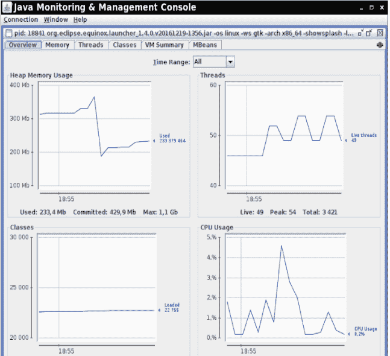

**图 7.3** jconsole 程序

本章向你介绍了异常处理和日志记录。你还看到了一些关于测试和调试的有用提示。接下来的两章将介绍泛型编程及其最重要的应用：Java 集合框架。

# 第 8 章 泛型编程

本章内容

- 8.1 为什么使用泛型编程？
- 8.2 定义一个简单的泛型类
- 8.3 泛型方法
- 8.4 类型变量的限定
- 8.5 泛型代码与虚拟机
- 8.6 限制与局限性
- 8.7 泛型类型的继承规则
- 8.8 通配符类型
- 8.9 反射与泛型

泛型类和泛型方法具有类型参数。这使得它们能够精确地描述当使用特定类型实例化时会发生什么。在泛型类出现之前，程序员必须使用 `Object` 来编写能够处理多种类型的代码。这既繁琐又不安全。

随着泛型的引入，Java 拥有了一个富有表现力的类型系统，允许设计者详细描述变量和方法的类型应如何变化。在简单的情况下，你会发现实现泛型代码很容易。在更高级的情况下，对于实现者来说可能会变得相当复杂。其目标是提供其他程序员可以放心使用的类和方法，不会让他们感到意外。

Java 5 中引入的泛型是 Java 编程语言自最初发布以来最重大的变化。一个主要的设计目标是向后兼容早期版本。因此，Java 泛型存在一些令人不适的限制。在本章中，你将了解泛型编程的好处和挑战。


## 8.1 为什么使用泛型编程？

*泛型编程*是指编写可复用于许多不同类型对象的代码。例如，你不会希望为收集 `String` 和 `File` 对象分别编写不同的类。而且你也不必这样做——单个 `ArrayList` 类可以收集任何类的对象。这就是泛型编程的一个例子。

实际上，Java 在引入泛型类之前就已经有了 `ArrayList` 类。让我们考察泛型编程机制是如何演变的，以及这对使用者和实现者意味着什么。

### 8.1.1 类型参数的优势

在 Java 加入泛型类之前，泛型编程是通过*继承*实现的。`ArrayList` 类只是维护一个 `Object` 引用数组：

```java
public class ArrayList // before generic classes
{
    private Object[] elementData;
    . . .
    public Object get(int i) { . . . }
    public void add(Object o) { . . . }
}
```

这种方法有两个问题。每当你取出一个值时，都必须进行强制类型转换：

```java
ArrayList files = new ArrayList(); . . .
String filename = (String) files.get(0);
```

此外，没有任何错误检查。你可以添加任何类的值：

```java
files.add(new File(". . ."));
```

这个调用可以编译并运行且不会出错。但在其他地方，将 `get` 的结果强制转换为 `String` 会导致错误。

泛型提供了更好的解决方案：*类型参数*。现在 `ArrayList` 类有一个类型参数，用来指明元素类型：

```java
var files = new ArrayList<String>();
```

这使你的代码更易读。你一眼就能看出这个特定的数组列表包含 `String` 对象。

**注意：**

如果你用显式类型而不是 `var` 声明变量，就可以使用“菱形”语法在构造器中省略类型参数：

```java
ArrayList<String> files = new ArrayList<>();
```

省略的类型会从变量的类型推断出来。

Java 9 将菱形语法的使用扩展到以前不被接受的情形。例如，现在可以在匿名子类中使用菱形语法：

```java
ArrayList<String> passwords = new ArrayList<>() // diamond OK in Java 9
{
    public String get(int n)
    {
        return super.get(n).replaceAll(".", "*");
    }
};
```

编译器也能很好地利用类型信息。调用 `get` 时不需要强制类型转换。编译器知道返回类型是 `String`，而不是 `Object`：

```java
String filename = files.get(0);
```

编译器还知道 `ArrayList<String>` 的 `add` 方法有一个 `String` 类型的参数。这比使用 `Object` 参数安全得多。现在编译器可以检查你不会插入错误类型的对象。例如，下面这条语句

```java
files.add(new File(". . .")); // 只能向 ArrayList<String> 添加 String 对象
```

无法编译。编译器错误比运行时类转换异常要好得多。

这就是类型参数的吸引力：它们让你的程序更易读、更安全。

### 8.1.2 谁想成为泛型程序员？

使用像 `ArrayList` 这样的泛型类很容易。大多数 Java 程序员会直接使用 `ArrayList<String>` 这样的类型，就好像它们已经内建到语言中一样，就像 `String[]` 数组那样。（当然，数组列表比数组更好，因为它们可以自动扩展。）

然而，实现一个泛型类并不容易。使用你代码的程序员会想为你的类型参数插入各种类。他们会期望一切都能正常工作，没有繁琐的限制和令人困惑的错误消息。因此，作为一名泛型程序员，你的工作是预见你的类的所有潜在未来用途。

这能有多难？这里有一个标准类库设计者必须应对的典型问题。`ArrayList` 类有一个方法 `addAll`，用于添加另一个集合的所有元素。程序员可能想将 `ArrayList<Manager>` 中的所有元素添加到 `ArrayList<Employee>` 中。但是，当然，反过来做不应该合法。你如何允许一个调用而禁止另一个？Java 语言设计者发明了一个巧妙的新概念——*通配符类型*，来解决这个问题。通配符类型相当抽象，但它们允许库构建者使方法尽可能灵活。

泛型编程分为三个技能层次。在基础层次，你只需使用泛型类——通常是 `ArrayList` 这样的集合——而不必考虑它们如何以及为何工作。大多数应用程序员会希望停留在这一层次，直到出现问题。不过，当你混用不同的泛型类，或者与完全不了解类型参数的遗留代码交互时，可能会遇到令人困惑的错误消息；到那时，你需要充分了解 Java 泛型，以便系统地解决问题，而不是靠随意修补。最后，当然，你可能还想实现自己的泛型类和方法。

应用程序员可能不会编写大量泛型代码。JDK 开发者已经完成了繁重的工作，并为所有集合类提供了类型参数。根据经验法则，只有那些传统上涉及大量从非常通用的类型（如 `Object` 或 `Comparable` 接口）进行强制类型转换的代码，才会从使用类型参数中受益。

在本章中，我将向你展示实现自己的泛型代码所需了解的一切。不过，我预计大多数读者主要会利用这些知识来帮助排查故障，以及满足自己对参数化集合类内部工作机制的好奇心。

## 8.2 定义简单的泛型类

*泛型类*是带有一个或多个类型变量的类。本章用一个简单的 `Pair` 类作为示例。这个类让我们可以专注于泛型，而不会被数据存储细节分散注意力。下面是泛型 `Pair` 类的代码：

```java
public class Pair<T>
{
    private T first;
    private T second;

    public Pair() { first = null; second = null; }
    public Pair(T first, T second) { this.first = first; this.second = second; }

    public T getFirst() { return first; }
    public T getSecond() { return second; }

    public void setFirst(T newValue) { first = newValue; }
    public void setSecond(T newValue) { second = newValue; }
}
```

Pair 类在类名之后引入了用尖括号 < > 括起来的类型变量 T。一个泛型类可以有多个类型变量。例如，我们可以为第一个和第二个字段定义具有不同类型的 Pair 类：

```java
public class Pair<T, U> { . . . }
```

类型变量在整个类定义中用于指定方法返回类型以及字段和局部变量的类型。例如：

```java
private T first; // uses the type variable
```

**注意：**

通常的做法是使用大写字母表示类型变量，并保持简短。Java 库使用变量 E 表示集合的元素类型，K 和 V 表示表的键和值类型，T（必要时还有相邻的字母 U 和 S）表示“任意类型”。

你通过用具体类型替换类型变量来*实例化*泛型类型，例如

```java
Pair<String>
```

你可以把结果看作一个具有以下构造器的普通类

```java
Pair<String>()
Pair<String>(String, String)
```

以及方法

```java
String getFirst()
String getSecond()
void setFirst(String)
void setSecond(String)
```

换句话说，泛型类充当普通类的工厂。

[清单 8.1](#listing-81) 中的程序让 Pair 类发挥作用。静态方法 minmax 遍历数组，同时计算最小值和最大值。它使用一个 Pair 对象返回这两个结果。回顾一下，compareTo 方法比较两个字符串：如果字符串相同则返回 0；如果按字典顺序第一个字符串位于第二个字符串之前，则返回负整数；否则返回正整数。


**C++ 注：** 表面上看，Java 中的泛型类类似于 C++ 中的模板类。唯一明显的区别是 Java 没有特殊的 template 关键字。然而，正如你将在本章中看到的那样，这两种机制之间存在重大差异。

**清单 8.1** `pair1/PairTest1.java`

```java
package pair1;

/**
 * @version 1.01 2012-01-26
 * @author Cay Horstmann
 */
public class PairTest1
{
    public static void main(String[] args)
    {
        String[] words = { "Mary", "had", "a", "little", "lamb" };
        Pair<String> mm = ArrayAlg.minmax(words);
        System.out.println("min = " + mm.getFirst());
        System.out.println("max = " + mm.getSecond());
    }
}

class ArrayAlg
{
    /**
     * Gets the minimum and maximum of an array of strings.
     * @param a an array of strings
     * @return a pair with the min and max values, or null if a
     * is null or empty
     */
    public static Pair<String> minmax(String[] a)
    {
        if (a == null || a.length == 0) return null;
        String min = a[0];
        String max = a[0];
        for (int i = 1; i < a.length; i++)
        {
            if (min.compareTo(a[i]) > 0) min = a[i];
            if (max.compareTo(a[i]) < 0) max = a[i];
        }
        return new Pair<>(min, max);
    }
}
```

## 8.3 泛型方法

在上一节中，你已经了解了如何定义泛型类。你也可以定义带有类型参数的单个方法。


```java
class ArrayAlg
{
    public static <T> T getMiddle(T... a)
    {
        return a[a.length / 2];
    }
}
```

该方法定义在一个普通类中，而不是泛型类中。然而，它是一个泛型方法，从尖括号和类型变量可以看出这一点。注意，类型变量插入在修饰符（本例中为 public static）之后、返回类型之前。

既可以在普通类中定义泛型方法，也可以在泛型类中定义泛型方法。

调用泛型方法时，可以将实际类型放在尖括号中，置于方法名之前：

```java
String middle = ArrayAlg.<String>getMiddle("John", "Q.", "Public");
```

在这种情况下（实际上在大多数情况下），可以从方法调用中省略 `<String>` 类型参数。编译器有足够的信息来推断你想要的方法。它将参数的类型与泛型类型 `T...` 进行匹配，并推断出 `T` 必须是 `String`。也就是说，你可以直接调用

```java
String middle = ArrayAlg.getMiddle("John", "Q.", "Public");
```

几乎在所有情况下，泛型方法的类型推断都能顺利进行。偶尔编译器会出错，这时你需要解读错误报告。考虑下面这个例子：

```java
double middle = ArrayAlg.getMiddle(3.14, 1729, 0);
```

错误消息会以晦涩的措辞（不同编译器版本措辞不同）抱怨说，这段代码有两种解释方式，而且两种都同样有效。简而言之，编译器将参数自动装箱为一个 `Double` 和两个 `Integer` 对象，然后试图找到这些类的公共超类型。它实际上找到了两个：`Number` 和 `Comparable` 接口，而 `Comparable` 本身就是一个泛型类型。在这种情况下，解决办法是将所有参数都写成 `double` 值。

**提示：**

如果你想查看编译器为泛型方法调用推断出哪种类型，Peter von der Ahé 推荐这个技巧：故意引入一个错误，并研究由此产生的错误消息。例如，考虑调用 `ArrayAlg.getMiddle("Hello", 0, null)`。将结果赋给一个 `JButton`，这不可能正确。你会得到如下错误报告：

```
found:
java.lang.Object&java.io.Serializable&java.lang.Comparable<? extends java.lang.Object&java.io.Serializable&java.lang.Comparable<?>>
```

通俗地说，你可以将结果赋给 `Object`、`Serializable` 或 `Comparable`。

**C++ 注：**

在 C++ 中，类型参数放在方法名之后。这可能导致棘手的解析歧义。例如，`g(f<a,b>(c))` 可能表示“用 `f<a,b>(c)` 的结果调用 `g`”，也可能表示“用两个布尔值 `f<a` 和 `b>(c)` 调用 `g`”。

## 8.4 类型变量的限定

有时，类或方法需要对类型变量施加限制。下面是一个典型示例。我们想计算数组中的最小元素：

```java
class ArrayAlg
{
   public static <T> T min(T[] a) // almost correct
   {
      if (a == null || a.length == 0) return null;
      T smallest = a[0];
      for (int i = 1; i < a.length; i++)
         if (smallest.compareTo(a[i]) > 0) smallest = a[i];
      return smallest;
   }
}
```

但这里有一个问题。看看 `min` 方法的代码内部。变量 `smallest` 的类型是 `T`，这意味着它可能是任意类的对象。我们怎么知道 `T` 所属的类有 `compareTo` 方法呢？解决方案是将 `T` 限制为实现 `Comparable` 接口的类——这是一个只包含一个方法 `compareTo` 的标准接口。可以通过为类型变量 `T` 指定一个*限定*来实现：

```java
public static <T extends Comparable> T min(T[] a) . . .
```

实际上，`Comparable` 接口本身就是一个泛型类型。目前，请忽略这种复杂性以及编译器生成的警告。第 475 页的 8.8 节“通配符类型”讨论了如何正确地将类型参数与 `Comparable` 接口一起使用。

现在，泛型 `min` 方法只能使用实现了 `Comparable` 接口的类的数组来调用，例如 `String`、`LocalDate` 等。用 `Rectangle` 数组调用 `min` 会导致编译时错误，因为 `Rectangle` 类没有实现 `Comparable`。


**C++ 注：**

在 C++ 中，你不能限制模板参数的类型。如果程序员用不合适的类型实例化模板，模板代码内部会报告一条（通常晦涩的）错误消息。

你可能想知道，在这种情况下为什么我使用 `extends` 关键字而不是 `implements` 关键字——毕竟 Comparable 是一个接口。记法

```java
<T extends BoundingType>
```

表示 T 应当是限定类型的子类型。T 和限定类型都可以是类或接口。选择 `extends` 关键字，是因为它合理地近似了子类型的概念，而且 Java 设计者不想为语言添加新关键字（例如 `sub`）。

一个类型变量或通配符可以有多个限定。例如：

```java
T extends Comparable & Serializable
```

各个限定类型之间用和号（`&`）分隔，因为逗号用于分隔类型变量。

与 Java 继承一样，你可以拥有任意多个接口超类型，但限定中最多只能有一个是类。如果限定中包含类，它必须是限定列表中的第一个。

在下一个示例程序（清单 8.2）中，我们将 `minmax` 方法改写为泛型方法。该方法计算泛型数组的最小值和最大值，并返回一个 `Pair<T>`。

### 清单 8.2 pair2/PairTest2.java

```java
package pair2;

import java.time.*;

/**
 * @version 1.02 2015-06-21
 * @author Cay Horstmann
 */
public class PairTest2
{
   public static void main(String[] args)
   {
      LocalDate[] birthdays =
         {
            LocalDate.of(1906, 12, 9), // G. Hopper
            LocalDate.of(1815, 12, 10), // A. Lovelace
            LocalDate.of(1903, 12, 3), // J. von Neumann
            LocalDate.of(1910, 6, 22), // K. Zuse
         };
      Pair<LocalDate> mm = ArrayAlg.minmax(birthdays);
      System.out.println("min = " + mm.getFirst());
      System.out.println("max = " + mm.getSecond());
   }
}

class ArrayAlg
{
   /**
      Gets the minimum and maximum of an array of objects of
      type T.
      @param a an array of objects of type T
      @return a pair with the min and max values, or null if a
      is null or empty
   */
   public static <T extends Comparable> Pair<T> minmax(T[] a)
   {
      if (a == null || a.length == 0) return null;
      T min = a[0];
      T max = a[0];
      for (int i = 1; i < a.length; i++)
      {
         if (min.compareTo(a[i]) > 0) min = a[i];
         if (max.compareTo(a[i]) < 0) max = a[i];
      }
      return new Pair<>(min, max);
   }
}
```

## 8.5 泛型代码和虚拟机

虚拟机没有泛型类型的对象——所有对象都属于普通类。早期版本的泛型实现甚至能够将使用泛型的程序编译成可在 1.0 虚拟机上执行的类文件！在接下来的几节中，你将看到编译器如何“擦除”类型参数，以及这一过程对 Java 程序员意味着什么。

### 8.5.1 类型擦除

每当你定义泛型类型时，都会自动提供一个相应的*原始*类型。原始类型的名称就是泛型类型的名称去掉类型参数后的名称。类型变量会被*擦除*，并替换为其限定类型（对于没有限定的变量，则替换为 *Object*）。

例如，`Pair<T>` 的原始类型看起来像这样：

```java
public class Pair
{
    private Object first;
    private Object second;

    public Pair(Object first, Object second)
    {
        this.first = first;
        this.second = second;
```


```java
    }

    public Object getFirst() { return first; }
    public Object getSecond() { return second; }

    public void setFirst(Object newValue) { first = newValue; }
    public void setSecond(Object newValue) { second = newValue;
    }
    }
```

由于 T 是无界类型变量，因此它被简单地替换为 Object。

结果是一个普通类，就像在 Java 添加泛型之前你可能实现的那样。

你的程序可能包含不同种类的 Pair，例如 Pair<String> 或 Pair<LocalDate>，但类型擦除会把它们全都变成原始 Pair 类型。

> **C++ 注意：**
>
> 在这方面，Java 泛型与 C++ 模板非常不同。C++ 会为每个模板实例化产生不同的类型——这种现象称为“模板代码膨胀”。Java 不会遇到这个问题。

原始类型会用第一个上界替换类型变量；如果没有给出上界，则用 Object 替换。例如，类 Pair<T> 中的类型变量没有显式上界，因此原始类型会用 Object 替换 T。假设我们声明一个稍有不同的类型：

```java
public class Interval<T extends Comparable & Serializable>
implements Serializable
{
    private T lower;
    private T upper;
    . . .
    public Interval(T first, T second)
    {
        if (first.compareTo(second) <= 0) { lower = first; upper = second; }
        else { lower = second; upper = first; }
    }
}
```

原始类型 `Interval` 看起来像这样：

```java
public class Interval implements Serializable
{
    private Comparable lower;
    private Comparable upper;
    . . .
    public Interval(Comparable first, Comparable second) { . . .
    }
}
```

**注意：**

你可能想知道如果交换上界会发生什么：`class Interval<T extends Serializable & Comparable>`。在这种情况下，原始类型会用 `Serializable` 替换 `T`，并且编译器会在必要时插入到 `Comparable` 的强制类型转换。因此，为了提高效率，你应该把标记接口（即没有方法的接口）放在上界列表的末尾。

### 8.5.2 翻译泛型表达式

当你编写对泛型方法的调用时，如果返回类型已被擦除，编译器会插入强制类型转换。例如，考虑下面这组语句

```java
Pair<Employee> buddies = . . .;
Employee buddy = buddies.getFirst();
```

`getFirst` 的擦除结果返回类型为 `Object`。编译器会自动插入到 `Employee` 的强制类型转换。也就是说，编译器把该方法调用翻译成两条虚拟机指令：

- 调用原始方法 Pair.getFirst
- 将返回的 Object 强制转换为 Employee 类型

当你访问泛型字段时，也会插入强制类型转换。假设 Pair 类的 first 和 second 字段是 public 的。（也许这不是良好的编程风格，但它是合法的 Java。）那么表达式

```java
Employee buddy = buddies.first;
```

在生成的字节码中也会插入强制类型转换。

### 8.5.3 翻译泛型方法

类型擦除也会发生在泛型方法上。程序员通常会把这样一个泛型方法

```java
public static <T extends Comparable> T min(T[] a)
```

看作一整族方法，但擦除之后，只剩下一个方法：

```java
public static Comparable min(Comparable[] a)
```

注意，类型参数 T 已被擦除，只留下它的上界类型 Comparable。

方法的擦除会带来几个复杂问题。考虑这个例子：

```java
class DateInterval extends Pair<LocalDate>
{
    public void setSecond(LocalDate second)
    {
        if (second.compareTo(getFirst()) >= 0)
            super.setSecond(second);
    }
    . . .
}
```

日期区间是一对 LocalDate 对象，我们会想要重写这些方法，以确保第二个值永远不会小于第一个值。这个类被擦除为

```java
class DateInterval extends Pair // after erasure
{
    public void setSecond(LocalDate second) { . . . }
    . . .
}
```

也许令人惊讶的是，还有另一个从 Pair 继承来的 setSecond 方法，即

```java
public void setSecond(Object second)
```

这显然是一个不同的方法，因为它的参数类型不同——是 Object 而不是 LocalDate。但它不应该是不同的。考虑下面这组语句：

```java
var interval = new DateInterval(. . .);
Pair<LocalDate> pair = interval; // OK--assignment to superclass
pair.setSecond(aDate);
```

我们期望对 setSecond 的调用是多态的，并且会调用合适的方法。由于 pair 引用的是一个 DateInterval 对象，因此那个

你不能那样写 Java 代码；有两个参数类型相同的方法——在这里是没有参数——是非法的。然而，在虚拟机中，参数类型*和返回类型*共同指定一个方法。因此，编译器可以为两个仅在返回类型上不同的方法生成字节码，而虚拟机会正确处理这种情况。

**注意：**

桥方法并不限于泛型类型。你在第 5 章已经看到，在重写另一个方法时，方法可以指定一个限制更严格的返回类型，这是合法的。例如：

```java
public class Employee implements Cloneable
{
    public Employee clone() throws CloneNotSupportedException {
    . . . }
}
```

`Object.clone` 和 `Employee.clone` 方法被称为具有*协变返回类型*。

实际上，`Employee` 类有*两个* clone 方法：

```java
Employee clone() // defined above
Object clone()   // synthesized bridge method, overrides Object.clone
```

合成的桥方法会调用新定义的方法。

总之，你需要记住以下关于 Java 泛型翻译的事实：

- 虚拟机中没有泛型，只有普通类和方法。
- 所有类型参数都被它们的上界替换。
- 合成桥方法以保持多态性。
- 根据需要插入强制类型转换以保持类型安全。

### 8.5.4 调用遗留代码

设计 Java 泛型时，一个主要目标是允许泛型与遗留代码之间具有互操作性。让我们看一个这种遗留代码的具体例子。Swing 用户界面工具包提供了一个 JSlider 类，它的“刻度”可以用包含文本或图像的标签来定制。这些标签通过以下调用设置

```java
void setLabelTable(Dictionary table)
```

Dictionary 类将整数映射到标签。在 Java 5 之前，该类被实现为 Object 实例的映射。Java 5 使 Dictionary 成为泛型类，但 JSlider 从未更新。此时，不带类型参数的 Dictionary 是一个原始类型。兼容性就在这里发挥作用。

当你填充字典时，可以使用泛型类型。

```java
Dictionary<Integer, Component> labelTable = new Hashtable<>();
labelTable.put(0, new JLabel(new ImageIcon("nine.gif")));
labelTable.put(20, new JLabel(new ImageIcon("ten.gif")));
. . .
```

当你把 Dictionary<Integer, Component> 对象传递给 setLabelTable 时，编译器会发出警告。

```java
slider.setLabelTable(labelTable); // warning
```

毕竟，编译器无法保证 setLabelTable 会对 Dictionary 对象做什么。该方法可能把所有键替换为字符串。这就破坏了键具有 `Integer` 类型的保证，未来的操作可能引发错误的强制类型转换异常。

你应该仔细想一想，并问一问 `JSlider` 实际上会拿这个 `Dictionary` 对象做什么。在我们的例子中，很清楚 `JSlider` 只读取信息，因此你可以忽略该警告。

现在考虑相反的情况：你从遗留类得到一个原始类型的对象。你可以把它赋给一个使用泛型的变量，但当然会收到警告。例如：

```java
Dictionary<Integer, Component> labelTable =
slider.getLabelTable(); // warning
```

这没问题——检查该警告，并确保标签表确实包含 `Integer` 和 `Component` 对象。当然，从来就没有绝对的保证。恶意程序员可能在滑块中安装了不同的 `Dictionary`。但同样，这种情况并不比泛型出现之前更糟。最坏情况下，你的程序会抛出异常。

在你仔细考虑完警告之后，可以使用一个*注解*让它消失。你可以注解一个局部变量：

```java
@SuppressWarnings("unchecked")
Dictionary<Integer, Component> labelTable =
slider.getLabelTable(); // no warning
```

或者你可以注解整个方法，像这样：

```java
@SuppressWarnings("unchecked")
public void configureSlider() { ... }
```

这个注解会关闭该方法内部所有代码的检查。

## 8.6 限制与局限性


在接下来的几节中，我将讨论在使用 Java 泛型时需要考虑的一些限制。这些限制大多是类型擦除的结果。

### 8.6.1 不能用基本类型实例化类型参数

不能用基本类型替换类型参数。因此，不存在 `Pair<double>`，只有 `Pair<Double>`。原因当然是类型擦除。擦除后，`Pair` 类具有 `Object` 类型的字段，你不能用它们存储 `double` 值。

诚然，这很烦人，但它与 Java 语言中基本类型的独立地位是一致的。这不是致命缺陷——基本类型只有八种，当包装类型不可接受时，你总是可以用单独的类和方法来处理它们。

### 8.6.2 运行时类型查询仅适用于原始类型

虚拟机中的对象总是具有特定的非泛型类型。因此，所有类型查询只能得到原始类型。例如，

```
    if (a instanceof Pair<String>) // ERROR
```

只能测试 `a` 是否是任意类型的 `Pair`。下面的测试也是如此

```
    if (a instanceof Pair<T>) // ERROR
```

或者强制转换

```
    Pair<String> p = (Pair<String>) a; // warning--can only test that a is a Pair
```

为了提醒你注意风险，当你试图查询某个对象是否属于泛型类型时，会得到编译器错误（使用 `instanceof` 时）或警告（使用强制转换时）。

注意，只有创建这些数组是被禁止的。你可以声明 `Pair<String>[]` 类型的变量。但不能用 `new Pair<String>[10]` 初始化它。


**注意：**

你可以声明通配符类型的数组，然后进行强制转换：

```
var table = (Pair<String>[]) new Pair<?>[10];
```

结果并不安全。如果你将 `Pair<Employee>` 存入 `table[0]`，然后对 `table[0].getFirst()` 调用 `String` 方法，就会得到 `ClassCastException`。


**提示：**

如果需要收集参数化类型对象，只需使用 ArrayList：`ArrayList<Pair<String>>` 既安全又有效。

### 8.6.4 可变参数警告

在上一节中，你看到 Java 不支持泛型类型的数组。在本节中，我将讨论一个相关问题：将泛型类型的实例传递给可变数量参数的方法。

考虑这个简单的可变参数方法：

```
public static <T> void addAll(Collection<T> coll, T... ts)
{
    for (T t : ts) coll.add(t);
}
```

回想一下，参数 `ts` 实际上是一个数组，保存所有传入的实参。

现在考虑这个调用：

```java
Collection<Pair<String>> table = . . .;
Pair<String> pair1 = . . .; Pair<String> pair2 = . . .;
addAll(table, pair1, pair2);
```

为了调用这个方法，Java 虚拟机必须创建一个 `Pair<String>` 数组，这违反了规则。不过，针对这种情况规则已经放宽，你只会得到警告，而不是错误。

你可以用以下两种方式之一抑制该警告。你可以将注解 `@SuppressWarnings("unchecked")` 添加到包含 `addAll` 调用的方法上。或者，从 Java 7 开始，你可以用 `@SafeVarargs` 注解 `addAll` 方法本身：

```java
@SafeVarargs
public static <T> void addAll(Collection<T> coll, T... ts)
```

现在可以用泛型类型调用这个方法。你可以对任何仅读取参数数组元素的方法使用该注解，这必然是最常见的用例。

`@SafeVarargs` 只能用于构造器以及 static、final 或（从 Java 9 开始）private 的方法。任何其他方法都可能被重写，从而使该注解毫无意义。

**注意：**

你可以使用 `@SafeVarargs` 注解来绕过禁止创建泛型数组的限制，方法如下：

```java
@SafeVarargs static <E> E[] array(E... array) { return array; }
```

现在你可以调用

```java
Pair<String>[] table = array(pair1, pair2);
```

这看起来很方便，但存在隐藏的危险。下面的代码

```java
Object[] objarray = table;
objarray[0] = new Pair<Employee>();
```

运行时不会抛出 ArrayStoreException（因为数组存储只检查擦除后的类型），而当你操作 `table[0]` 时，会在别处得到异常。

### 8.6.5 不能实例化类型变量

不能在诸如 `new T(. . .)` 这样的表达式中使用类型变量。例如，下面的 `Pair<T>` 构造器是非法的：

```java
public Pair() { first = new T(); second = new T(); } // ERROR
```

类型擦除会将 `T` 变为 `Object`，而你肯定不希望调用 `new Object()`。

自 Java 8 起可用的最佳变通方法是让调用者提供一个构造器表达式。例如：

```java
Pair<String> p = Pair.makePair(String::new);
```

`makePair` 方法接收一个 `Supplier<T>`，这是一个表示无参数且结果为 `T` 类型函数的函数式接口：

```java
public static <T> Pair<T> makePair(Supplier<T> constr)
{
    return new Pair<>(constr.get(), constr.get());
}
```

更传统的变通方法是通过反射构造泛型对象，即调用 `Constructor.newInstance` 方法。

不幸的是，细节有点复杂。你不能调用

```java
first = T.class.getConstructor().newInstance(); // ERROR
```

表达式 `T.class` 是非法的，因为它会擦除为 `Object.class`。相反，你必须设计 API，让它接收一个 Class 对象，像这样：

```java
public static <T> Pair<T> makePair(Class<T> cl)
{
    try
    {
        return new Pair<>(cl.getConstructor().newInstance(),
                          cl.getConstructor().newInstance());
    }
    catch (Exception e) { return null; }
}
```

可以像下面这样调用这个方法：

```java
Pair<String> p = Pair.makePair(String.class);
```

注意，`Class` 类本身是泛型的。例如，`String.class` 是 `Class<String>` 的一个实例（实际上是唯一实例）。因此，`makePair` 方法可以推断它正在创建的 Pair 的类型。

### 8.6.6 不能构造泛型数组

正如不能实例化单个泛型实例一样，你也不能实例化数组。原因不同——毕竟，数组会填充 null 值，构造它似乎很安全。但数组还携带一个类型，用于监视虚拟机中的数组存储。该类型会被擦除。例如，考虑

```java
public static <T extends Comparable> T[] minmax(T... a)
{
    T[] mm = new T[2]; // ERROR
    . . .
}
```

类型擦除会导致这个方法总是构造一个 `Comparable[2]` 数组。

如果数组仅用作类的私有实例字段，你可以将数组的元素类型声明为擦除后的类型并使用强制转换。例如，`ArrayList` 类可以按如下方式实现：

```java
public class ArrayList<E>
{
    private Object[] elements;
    . . .
    @SuppressWarnings("unchecked") public E get(int n) { return (E) elements[n]; }
    public void set(int n, E e) { elements[n] = e; } // no cast needed
}
```

实际实现并没有这么干净：

```java
public class ArrayList<E>
{
    private E[] elements;
    . . .
    public ArrayList() { elements = (E[]) new Object[10]; }
}
```

这里，强制转换 `E[]` 完全是个谎言，但类型擦除使它无法被检测到。

这种技术不适用于我们的 `minmax` 方法，因为我们要返回一个 `T[]` 数组，而且如果对其类型撒谎，就会导致运行时错误。假设我们实现

```
public static <T extends Comparable> T[] minmax(T... a)
{
    var result = new Comparable[2]; // array of erased type
    . . .
    return (T[]) result; // compiles with warning
}
```

下面的调用

```
String[] names = ArrayAlg.minmax("Tom", "Dick", "Harry");
```

编译时不会有任何警告。当方法返回后，将 `Comparable[]` 引用强制转换为 `String[]` 时，会发生 `ClassCastException`。

在这种情况下，最好让用户提供一个数组构造器表达式：

```
String[] names = ArrayAlg.minmax(String[]::new, "Tom", "Dick", "Harry");
```

构造器表达式 `String[]::new` 表示一个函数，给定所需长度，构造该长度的 String 数组。

该方法使用该参数生成正确类型的数组：

```
public static <T extends Comparable> T[] minmax(IntFunction<T[]> constr, T... a)
{
    T[] result = constr.apply(2);
    . . .
}
```

```java
{
    do work
}
catch (Throwable realCause)
{
    t.initCause(realCause);
    throw t;
}
```

### 8.6.9 你可以绕过受检异常检查

Java 异常处理的一条基本原则是：必须为所有受检异常提供处理器。你可以使用泛型来绕过这个机制。关键要素是下面这个方法：

```java
@SuppressWarnings("unchecked")
static <T extends Throwable> void throwAs(Throwable t) throws T
{
    throw (T) t;
}
```

假设这个方法包含在接口 `Task` 中。当你有一个受检异常 `e` 并调用

```java
Task.<RuntimeException>throwAs(e);
```

那么编译器会认为 `e` 变成了非受检异常。下面的代码把所有异常都变成编译器认为的非受检异常：

```java
try
{
    do work
}
catch (Throwable t)
{
    Task.<RuntimeException>throwAs(t);
}
```

让我们用这个办法来解决一个棘手的问题。要在一条线程中运行代码，必须把它放进一个实现了 Runnable 接口的类的 run 方法中。但那个方法不允许抛出受检异常。我们将提供一个适配器，把 Task（其 run 方法允许抛出任意异常）适配为 Runnable：

```java
interface Task
{
    void run() throws Exception;

    @SuppressWarnings("unchecked")
    static <T extends Throwable> void throwAs(Throwable t)
    throws T
    {
        throw (T) t;
    }

    static Runnable asRunnable(Task task)
    {
        return () ->
        {
            try
            {
                task.run();
            }
            catch (Exception e)
            {
                Task.<RuntimeException>throwAs(e);
            }
        };
    }
}
```

例如，下面这个程序运行一个会抛出受检异常的线程：

```java
public class Test
{
    public static void main(String[] args)
    {
        var thread = new Thread(Task.asRunnable(() ->
        {
            Thread.sleep(1000);
            System.out.println("Hello, World!");
            throw new Exception("Check this out!");
        }));
        thread.start();
    }
}
```

`Thread.sleep` 方法被声明为抛出 `InterruptedException`，而我们不再需要捕获它。由于我们没有中断该线程，所以不会抛出那个异常。然而，程序抛出了一个受检异常。运行该程序时，你会得到一个堆栈跟踪。

这有什么了不起的？通常，你必须在 `Runnable` 的 `run` 方法内部捕获所有受检异常，并把它们*包装*成非受检异常——`run` 方法被声明为不抛出任何受检异常。

但在这里，我们不包装。我们只是抛出异常，欺骗编译器让它相信这不是一个受检异常。

使用泛型类、擦除和 `@SuppressWarnings` 注解，我们得以绕过 Java 类型系统的一个基本部分。

### 8.6.10 注意擦除后的冲突

创建在泛型类型被擦除时导致冲突的条件是非法的。下面是一个例子。假设我们给 `Pair` 类添加一个 `equals` 方法，如下所示：

```java
public class Pair<T>
{
    public boolean equals(T value) { return first.equals(value)
        && second.equals(value); }
    . . .
}
```

考虑一个 `Pair<String>`。从概念上讲，它有两个 equals 方法：

```java
boolean equals(String) // defined in Pair<T>
boolean equals(Object) // inherited from Object
```

但这种直觉会把我们引入歧途。方法

```java
boolean equals(T)
```

的擦除结果是

```java
boolean equals(Object)
```

这与 `Object.equals` 方法冲突。

当然，补救办法是重命名那个有问题的方法。

泛型规范引用了另一条规则：“为了支持通过擦除进行转换，我们施加这样的限制：一个类或类型变量不能同时是两个接口类型的子类型，而这两个接口类型是同一个接口的不同参数化。”例如，下面这样是非法的：

```java
class Employee implements Comparable<Employee> { . . . }
class Manager extends Employee implements Comparable<Manager> {
    . . . } // ERROR
```

这样 `Manager` 就会同时实现 `Comparable<Employee>` 和 `Comparable<Manager>`，而它们是同一个接口的不同参数化。

这个限制与类型擦除有什么关系并不明显。毕竟，非泛型版本

```java
class Employee implements Comparable { . . . }
class Manager extends Employee implements Comparable { . . . }
```

是合法的。原因要微妙得多。这会与合成的桥方法发生冲突。实现了 `Comparable<X>` 的类会得到一个桥方法

```java
public int compareTo(Object other) { return compareTo((X) other); }
```

对于不同的类型 X，不能有两个这样的方法。

## 8.7 泛型类型的继承规则

使用泛型类时，你需要学习一些关于继承和子类型的规则。让我们从一个许多程序员觉得反直觉的情况开始。考虑一个类及其子类，例如 Employee 和 Manager。`Pair<Manager>` 是 `Pair<Employee>` 的子类型吗？也许令人惊讶，答案是“否”。例如，下面的代码将无法编译：

```java
Pair<Employee> buddies = new Pair<Manager>(ceo, cfo); // illegal
```

一般来说，无论 S 和 T 之间是什么关系，`Pair<S>` 和 `Pair<T>` 之间都*没有*关系（见[图 8.1](#)）。

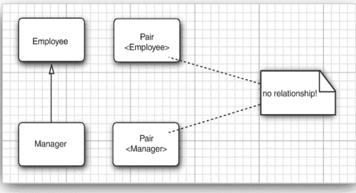

**图 8.1** Pair 类之间没有继承关系

这看起来像是一个残酷的限制，但它对类型安全是必要的。假设我们允许把 `Pair<Manager>` 转换为 `Pair<Employee>`。考虑下面这段代码：

```java
var managerBuddies = new Pair<Manager>(ceo, cfo);
Pair<Employee> employeeBuddies = managerBuddies; // illegal, but suppose it wasn't
employeeBuddies.setFirst(lowlyEmployee);
```

显然，最后一条语句是合法的。但 `employeeBuddies` 和 `managerBuddies` 引用的是*同一个对象*。我们现在竟然把 CFO 和一个低级别员工配成了一对，而这对于 `Pair<Manager>` 来说本应是不可能的。

> **注意：**
>
> 你刚刚看到了泛型类型与 Java 数组之间的一个重要区别。你可以把一个 `Manager[]` 数组赋给类型为 `Employee[]` 的变量：
>
> ```java
> Manager[] managerBuddies = { ceo, cfo };
> Employee[] employeeBuddies = managerBuddies; // OK
> ```
>
> 然而，数组带有特殊保护。如果你试图把一个低级别员工存入 `employeeBuddies[0]`，虚拟机会抛出 `ArrayStoreException`。

你总是可以把参数化类型转换为原始类型。例如，`Pair<Employee>` 是原始类型 `Pair` 的子类型。这种转换对于与遗留代码交互是必要的。

你能转换为原始类型然后再造成类型错误吗？不幸的是，可以。考虑下面这个例子：

```java
var managerBuddies = new Pair<Manager>(ceo, cfo);
Pair rawBuddies = managerBuddies; // OK
rawBuddies.setFirst(new File("...")); // only a compile-time warning
```

这听起来很吓人。然而，请记住，你的处境并不比使用旧版 Java 时更糟。虚拟机的安全性并没有受到威胁。当用 `getFirst` 取出那个外来对象并赋给一个 `Manager` 变量时，会抛出一个 `ClassCastException`，就像过去那些好日子里一样。你只是失去了泛型编程通常提供的额外安全性。

最后，泛型类可以扩展或实现其他泛型类。在这方面，它们与普通类没有区别。例如，类 `ArrayList<T>` 实现了接口 `List<T>`。这意味着一个 `ArrayList<Manager>` 可以转换为 `List<Manager>`。然而，正如你刚才看到的，`ArrayList<Manager>` *不是* `ArrayList<Employee>` 或 `List<Employee>`。图 8.2 展示了这些关系。


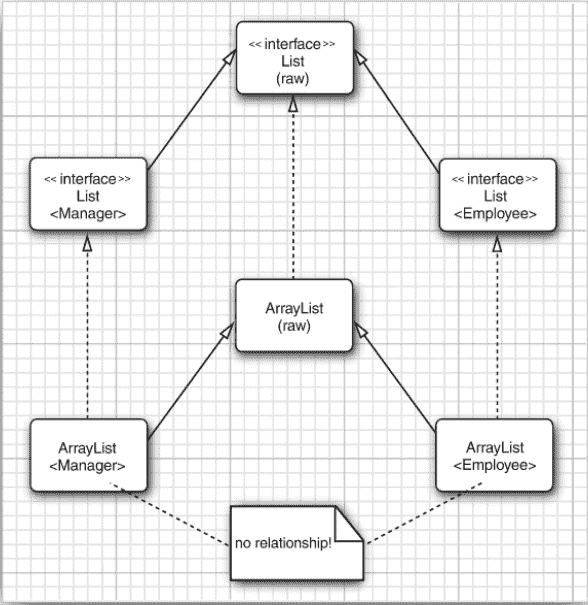

**图 8-2** 泛型列表类型之间的子类型关系

## 8.8 通配符类型

类型系统研究者早已知道，一个僵硬的泛型类型系统使用起来非常不愉快。Java 设计者发明了一种巧妙（但依然安全）的“逃生舱”：*通配符类型*。下面几节将向你展示如何使用通配符。

### 8.8.1 通配符概念

在通配符类型中，类型参数可以被允许变化。例如，通配符类型

```java
Pair<? extends Employee>
```

表示任何类型参数为 `Employee` 子类的泛型 `Pair` 类型，例如 `Pair<Manager>`，但不包括 `Pair<String>`。

假设你要编写一个打印员工对的方法，如下所示：

```java
public static void printBuddies(Pair<Employee> p)
{
    Employee first = p.getFirst();
    Employee second = p.getSecond();
    System.out.println(first.getName() + " and " +
second.getName() + " are buddies.");
}
```

如前一节所见，你不能将 `Pair<Manager>` 传递给该方法，这相当受限。但解决方案很简单——使用通配符类型：

```java
public static void printBuddies(Pair<? extends Employee> p)
```

类型 `Pair<Manager>` 是 `Pair<? extends Employee>` 的子类型（参见[图 8-3](#figure-8-3)）。

我们能否使用通配符通过 `Pair<? extends Employee>` 引用来破坏 `Pair<Manager>`？

```java
var managerBuddies = new Pair<Manager>(ceo, cfo);
Pair<? extends Employee> wildcardBuddies = managerBuddies; // OK
wildcardBuddies.setFirst(lowlyEmployee); // compile-time error
```

破坏是不可能的。对 `setFirst` 的调用是类型错误。为了理解原因，让我们仔细看看 `Pair<? extends Employee>` 类型。它的方法看起来像这样：

```text
? extends Employee getFirst()
void setFirst(? extends Employee)
```

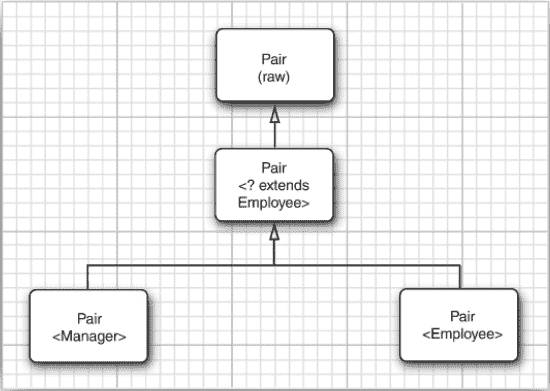

**图 8-3** 带通配符的子类型关系

无法调用 `setFirst` 方法！考虑调用 `wildcardBuddies.setFirst(lowlyEmployee)`。编译器知道 `setFirst` 的参数具有某个特定类型，该类型扩展了 `Employee`。那个特定类型是 `Employee` 吗？是 `Manager`，还是其他某个子类？编译器无从知道。因此，编译器不能接受 `lowlyEmployee`。同理，调用 `wildcardBuddies.setFirst(cio)`（其中 `cio` 是 `Manager` 实例）也会失败。编译器必须拒绝除 `null` 以外的所有 `setFirst` 参数。

`getFirst` 方法仍然可以工作。`getFirst` 的返回值是某个特定类型的实例，该类型是 `Employee` 的子类型。编译器不知道那个特定类型是什么，但可以保证赋值给 `Employee` 引用是安全的。

这就是有界通配符背后的关键思想。现在我们有了区分安全访问器方法和不安全修改器方法的方式。

### 8.8.2 通配符的超类型限定

通配符限定与类型变量限定类似，但它们有一个额外的能力——你可以指定一个*超类型限定*，如下所示：

```text
? super Manager
```

这个通配符被限制为 `Manager` 的所有超类型。（现有的 `super` 关键字如此准确地描述了这种关系，实属幸运。）

为什么要这样做呢？带有超类型限定的通配符所提供的行为与第 8.8 节“通配符类型”中描述的通配符行为相反。你可以向方法提供参数，但不能使用返回值。例如，`Pair<? super Manager>` 的方法可以描述如下：

```text
void setFirst(? super Manager)
? super Manager getFirst()
```

这不是真正的 Java 语法，但展示了编译器所知道的内容。`setFirst` 的参数类型，记为 `? super Manager`，是某个特定类型 `T`，并且 `Manager` 是 `T` 的子类型。`T` 恰好有三种选择：`Object`、`Employee` 或 `Manager`。（如果 `Manager` 或 `Employee` 实现了接口，会有更多选择。）然而，编译器无法知道这些选择中哪一个适用。因此，编译器不能接受参数类型为 `Employee` 或 `Object` 的调用。毕竟，`T` 可能是 `Manager`。只有传递 `Manager` 类型的对象或其子类型（如 `Executive`）才是可能的。

反过来，如果调用 `getFirst`，则无法保证返回对象的类型。你只能将其赋给 `Object`。

这里有一个典型例子。我们有一个经理数组，想把奖金最低和最高的经理放入一个 `Pair` 对象中。什么样的 `Pair`？`Pair<Employee>` 应该是合理的，甚至 `Pair<Object>` 也可以（参见图 8.4）。下面的方法将接受任何合适的 `Pair`：

```java
public static void minmaxBonus(Manager[] a, Pair<? super Manager> result)
{
    if (a.length == 0) return;
    Manager min = a[0];
    Manager max = a[0];
    for (int i = 1; i < a.length; i++)
    {
        if (min.getBonus() > a[i].getBonus()) min = a[i];
        if (max.getBonus() < a[i].getBonus()) max = a[i];
    }
    result.setFirst(min);
    result.setSecond(max);
}
```

直观地说，带有超类型限定的通配符允许你写入泛型对象，而带有子类型限定的通配符允许你从泛型对象读取。

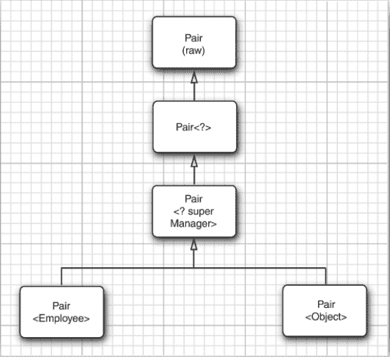

**图 8-4** 带有超类型限定的通配符

以下是超类型限定的另一个用途。`Comparable` 接口本身就是一个泛型类型。它声明如下：

```java
public interface Comparable<T>
{
    public int compareTo(T other);
}
```

这里，类型变量指示 `other` 参数的类型。例如，`String` 类实现了 `Comparable<String>`，其 `compareTo` 方法声明为

```java
public int compareTo(String other)
```

这很好——显式参数具有正确的类型。在接口泛型化之前，`other` 是 `Object`，在方法实现中需要进行强制转换。

既然 `Comparable` 是泛型类型，也许我们应该把 `ArrayAlg` 类的 `minmax` 方法做得更好？我们可以将其声明为

```java
public static <T extends Comparable<T>> Pair<T> minmax(T[] a)
```

这看起来比仅仅使用 `T extends Comparable` 更周全，并且对许多类都能正常工作。例如，如果计算 `String` 数组的最小值，那么 `T` 是类型 `String`，而 `String` 是 `Comparable<String>` 的子类型。但是在处理 `LocalDate` 对象数组时，我们会遇到问题。实际上，`LocalDate` 实现了 `ChronoLocalDate`，而 `ChronoLocalDate` 扩展了 `Comparable<ChronoLocalDate>`。因此，`LocalDate` 实现了 `Comparable<ChronoLocalDate>`，而*不是* `Comparable<LocalDate>`。

在这种情况下，超类型可以救场：

```java
public static <T extends Comparable<? super T>> Pair<T> minmax(T[] a)
```

现在 `compareTo` 方法具有如下形式

```java
int compareTo(? super T)
```

也许它被声明为接受类型 `T` 的对象，或者——例如，当 `T` 是 `LocalDate` 时——接受 `T` 的超类型。无论如何，将类型 `T` 的对象传递给 `compareTo` 方法是安全的。

对于不熟悉的人来说，像 `<T extends Comparable<? super T>>` 这样的声明看起来必然很吓人。这很不幸，因为其意图是

`getFirst` 的返回值只能赋给 `Object`。`setFirst` 方法永远不能被调用，*即使使用 `Object` 参数也不行*。这就是 `Pair<?>` 和 `Pair` 之间的本质区别：你可以用任何 `Object` 调用原始 `Pair` 类的 `setFirst` 方法。


**注意：**

你可以调用 `setFirst(null)`。

为什么你会想要这样一个虚弱的类型？它对于非常简单的操作很有用。例如，下面的方法测试一个对是否包含空引用。它永远不需要实际类型。

```java
public static boolean hasNulls(Pair<?> p)
{
    return p.getFirst() == null || p.getSecond() == null;
}
```

你可以通过将 `hasNulls` 转换为泛型方法来避免使用通配符类型：

```java
public static <T> boolean hasNulls(Pair<T> p)
```

然而，使用通配符类型的版本似乎更容易阅读。

### 8.8.4 通配符捕获

让我们编写一个交换对中元素的方法：

```java
public static void swap(Pair<?> p)
```

通配符不是类型变量，因此我们不能编写使用 `?` 作为类型的代码。换句话说，以下内容是非法的：


```java
? t = p.getFirst(); // ERROR
p.setFirst(p.getSecond());
p.setSecond(t);
```

这是一个问题，因为在交换时我们需要临时保存第一个元素。幸运的是，这个问题有一个有趣的解决方案。我们可以编写一个辅助方法 `swapHelper`，像这样：

```java
public static <T> void swapHelper(Pair<T> p)
{
    T t = p.getFirst();
    p.setFirst(p.getSecond());
    p.setSecond(t);
}
```

注意，`swapHelper` 是一个泛型方法，而 `swap` 不是——它有一个固定类型为 `Pair<?>` 的参数。

现在我们可以从 `swap` 调用 `swapHelper`：

```java
public static void swap(Pair<?> p) { swapHelper(p); }
```

在这种情况下，`swapHelper` 方法的类型参数 T 就*捕获了通配符*。我们不知道通配符表示什么类型，但它是一个确定的类型，当 T 表示该类型时，`<T>swapHelper` 的定义完全合理。

当然，在这个例子中，我们并不是非用通配符不可。我们完全可以不用通配符，直接把 `<T> void swap(Pair<T> p)` 实现为泛型方法。不过，请看下面这个例子，其中通配符类型自然出现在计算过程的中间：

```java
public static void maxminBonus(Manager[] a, Pair<? super Manager> result)
{
    minmaxBonus(a, result);
    PairAlg.swapHelper(result); // OK--swapHelper captures wildcard type
}
```

在这里，通配符捕获机制是无法避免的。

通配符捕获只在非常有限的情况下才是合法的。编译器必须能够保证该通配符表示一个单一的、确定的类型。例如，`ArrayList<Pair<T>>` 中的 `T` 永远无法捕获 `ArrayList<Pair<?>>` 中的通配符。因为数组列表可能持有两个 `Pair<?>`，而每个 `Pair<?>` 中的 `?` 可能是不同的类型。

[清单 8.3](#) 中的测试程序汇集了前面几节讨论的各种方法，以便你在上下文中查看它们。

### 清单 8.3 `pair3/PairTest3.java`

```java
package pair3;

/**
 * @version 1.01 2012-01-26
 * @author Cay Horstmann
 */
public class PairTest3
{
   public static void main(String[] args)
   {
      var ceo = new Manager("Gus Greedy", 800000, 2003, 12, 15);
      var cfo = new Manager("Sid Sneaky", 600000, 2003, 12, 15);
      var buddies = new Pair<Manager>(ceo, cfo);
      printBuddies(buddies);

      ceo.setBonus(1000000);
      cfo.setBonus(500000);
      Manager[] managers = { ceo, cfo };

      var result = new Pair<Employee>();
      minmaxBonus(managers, result);
      System.out.println("first: " +
         result.getFirst().getName()
         + ", second: " + result.getSecond().getName());
      maxminBonus(managers, result);
      System.out.println("first: " +
         result.getFirst().getName()
         + ", second: " + result.getSecond().getName());
   }

   public static void printBuddies(Pair<? extends Employee> p)
   {
      Employee first = p.getFirst();
      Employee second = p.getSecond();
      System.out.println(first.getName() + " and " +
         second.getName() + " are buddies.");
   }

   public static void minmaxBonus(Manager[] a, Pair<? super Manager> result)
   {
      if (a.length == 0) return;
      Manager min = a[0];
      Manager max = a[0];
      for (int i = 1; i < a.length; i++)
      {
         if (min.getBonus() > a[i].getBonus()) min = a[i];
         if (max.getBonus() < a[i].getBonus()) max = a[i];
      }
      result.setFirst(min);
      result.setSecond(max);
   }

   public static void maxminBonus(Manager[] a, Pair<? super Manager> result)
   {
      minmaxBonus(a, result);
      PairAlg.swapHelper(result); // OK--swapHelper captures
                                  // wildcard type
   }
   // can't write public static <T super Manager> . . .
}

class PairAlg
{
   public static boolean hasNulls(Pair<?> p)
   {
      return p.getFirst() == null || p.getSecond() == null;
   }

   public static void swap(Pair<?> p) { swapHelper(p); }

   public static <T> void swapHelper(Pair<T> p)
   {
      T t = p.getFirst();
      p.setFirst(p.getSecond());
      p.setSecond(t);
   }
}
```

## 8.9 反射与泛型

反射让你能够在运行时分析任意的对象。如果这些对象是泛型类的实例，那么你关于泛型类型参数能获得的信息并不多，因为它们已经被擦除了。在接下来的几节中，你将了解尽管如此，我们仍然可以通过反射发现关于泛型类的哪些信息。

### 8.9.1 泛型 Class 类

`Class` 类现在也是泛型的。例如，`String.class` 实际上是 `Class<String>` 类的一个对象（实际上是唯一对象）。

这个类型参数很有用，因为它使得 `Class<T>` 的方法可以更精确地指定其返回类型。`Class<T>` 的以下方法就利用了类型参数：

```java
T newInstance()
T cast(Object obj)
T[] getEnumConstants()
Class<? super T> getSuperclass()
Constructor<T> getConstructor(Class... parameterTypes)
Constructor<T> getDeclaredConstructor(Class... parameterTypes)
```

`newInstance` 方法返回该类的一个实例，它是通过无参数构造器得到的。现在它的返回类型可以被声明为 T，这与 `Class<T>` 所描述的类类型一致，从而省去了强制类型转换。

`cast` 方法返回给定的对象，如果该对象的类型确实是 T 的子类型，则将其声明为类型 T；否则抛出 `BadCastException`。

如果该类不是枚举类，`getEnumConstants` 方法返回 `null`；否则返回一个包含所有枚举值的数组，这些值已知属于类型 T。

最后，`getConstructor` 和 `getDeclaredConstructor` 方法返回 `Constructor<T>` 对象。构造器类也被做成了泛型，这样它的 `newInstance` 方法就有了正确的返回类型。

**`java.lang.Class<T>` 1.0**

- `T newInstance()` — 返回通过无参数构造器构造的新实例。
- `T cast(Object obj)` — 如果 `obj` 为 `null` 或可以转换为类型 `T`，则返回 `obj`；否则抛出 `BadCastException`。
- `T[] getEnumConstants()`⁵ — 如果 `T` 是枚举类型，返回包含所有值的数组；否则返回 `null`。
- `Class<? super T> getSuperclass()` — 返回该类的超类；如果 `T` 不是类或者是 `Object` 类，则返回 `null`。
- `Constructor<T> getConstructor(Class... parameterTypes)` 1.1
- `Constructor<T> getDeclaredConstructor(Class... parameterTypes)` 1.1 — 获取公共构造器，或获取具有给定参数类型的构造器。

**`java.lang.reflect.Constructor<T>` 1.1**

- `T newInstance(Object... parameters)` — 返回使用给定参数构造的新实例。

### 8.9.2 使用 Class\<T\> 参数进行类型匹配

在泛型方法中，将 `Class<T>` 参数的类型变量与目标类型进行匹配有时是很有用的。下面是一个典型示例：

```java
public static <T> Pair<T> makePair(Class<T> c) throws
    InstantiationException,
        IllegalAccessException
{
    return new Pair<>(c.newInstance(), c.newInstance());
}
```

如果你调用

```java
makePair(Employee.class)
```

那么 `Employee.class` 就是 `Class<Employee>` 类型的对象。`makePair` 方法的类型参数 T 与 `Employee` 匹配，编译器可以推断出该方法返回一个 `Pair<Employee>`。

### 8.9.3 虚拟机中的泛型类型信息

Java 泛型的一个显著特征就是泛型类型在虚拟机中被擦除。令人惊讶的是，擦除后的类仍然保留着其泛型来源的一些模糊记忆。例如，原始的 `Pair` 类知道它源于泛型类 `Pair<T>`，尽管一个类型为 `Pair` 的对象无法判断它当初是被构造成 `Pair<String>` 还是 `Pair<Employee>`。

类似地，考虑一个方法：

```java
public static Comparable min(Comparable[] a)
```

它是以下泛型方法的擦除形式：

```java
public static <T extends Comparable<? super T>> T min(T[] a)
```

你可以使用反射 API 来确定以下事实：

- 该泛型方法有一个名为 `T` 的类型参数；
- 该类型参数有一个子类型边界，而这个边界本身又是一个泛型类型；
- 该边界类型有一个通配符参数；
- 该通配符参数有一个超类型边界；
- 该泛型方法有一个泛型数组参数。

换句话说，你可以重建有关泛型类和泛型方法的实现者所声明的全部信息。但是，你无法知道这些类型参数是如何针对特定对象或方法调用进行解析的。

为了表达泛型类型声明，需要使用 `java.lang.reflect` 包中的 `Type` 接口。该接口有以下子类型：

- `Class` 类，用于描述具体类型


-   `TypeVariable` 接口，描述类型变量（例如 `T extends Comparable<? super T>`）
-   `WildcardType` 接口，描述通配符（例如 `? super T`）
-   `ParameterizedType` 接口，描述泛型类或接口类型（例如 `Comparable<? super T>`）
-   `GenericArrayType` 接口，描述泛型数组（例如 `T[]`）

图 8.5 展示了继承层次结构。注意后四个子类型是接口——虚拟机实例化实现这些接口的合适类。

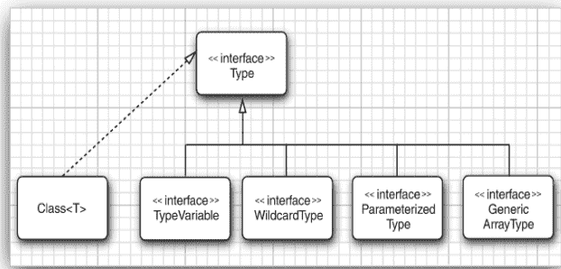

**图 8.5** Type 接口及其子类型

代码清单 8.4 使用泛型反射 API 打印出它发现的关于给定类的信息。如果对 `Pair` 类运行它，会得到以下报告：

```java
class Pair<T> extends java.lang.Object
public T getFirst()
public T getSecond()
public void setFirst(T)
public void setSecond(T)
```

如果在 `PairTest2` 目录中对 `ArrayAlg` 运行它，报告会显示以下方法：

```java
public static <T extends java.lang.Comparable> Pair<T> minmax(T[])
```

## 代码清单 8.4 `genericReflection/GenericReflectionTest.java`

```java
package genericReflection;

import java.lang.reflect.*;
import java.util.*;

/**
 * @version 1.12 2021-05-30
 * @author Cay Horstmann
 */
public class GenericReflectionTest
{
   public static void main(String[] args)
   {
      // read class name from command line args or user input
      String name;
      if (args.length > 0) name = args[0];
      else
      {
         try (var in = new Scanner(System.in))
         {
            System.out.println("Enter class name (e.g., java.util.Collections): ");
            name = in.next();
         }
      }

      try
      {
         // print generic info for class and public methods
         Class<?> cl = Class.forName(name);
         printClass(cl);
         for (Method m : cl.getDeclaredMethods())
            printMethod(m);
      }
      catch (ClassNotFoundException e)
      {
         e.printStackTrace();
      }
   }

   public static void printClass(Class<?> cl)
   {
      System.out.print(cl);
      printTypes(cl.getTypeParameters(), "<", ", ", ">", true);
      Type sc = cl.getGenericSuperclass();
      if (sc != null)
      {
         System.out.print(" extends ");
         printType(sc, false);
      }
      printTypes(cl.getGenericInterfaces(), " implements ", ", ", "", false);
      System.out.println();
   }

   public static void printMethod(Method m)
   {
      String name = m.getName();
      System.out.print(Modifier.toString(m.getModifiers()));
      System.out.print(" ");
      printTypes(m.getTypeParameters(), "<", ", ", ">", true);
      printType(m.getGenericReturnType(), false);
      System.out.print(" ");
      System.out.print(name);
      System.out.print("(");
      printTypes(m.getGenericParameterTypes(), "", ", ", "", false);
      System.out.println(")");
   }

   public static void printTypes(Type[] types, String pre,
         String sep, String suf,
         boolean isDefinition)
   {
      if (pre.equals(" extends ") && Arrays.equals(types, new Type[] { Object.class }))
         return;
      if (types.length > 0) System.out.print(pre);
      for (int i = 0; i < types.length; i++)
      {
         if (i > 0) System.out.print(sep);
         printType(types[i], isDefinition);
      }
      if (types.length > 0) System.out.print(suf);
   }

   public static void printType(Type type, boolean isDefinition)
   {
      if (type instanceof Class t)
      {
         System.out.print(t.getName());
      }
      else if (type instanceof TypeVariable t)
      {
         System.out.print(t.getName());
         if (isDefinition)
            printTypes(t.getBounds(), " extends ", " & ", "", false);
      }
      else if (type instanceof WildcardType t)
      {
         System.out.print("?");
         printTypes(t.getUpperBounds(), " extends ", " & ", "", false);
         printTypes(t.getLowerBounds(), " super ", " & ", "", false);
      }
      else if (type instanceof ParameterizedType t)
      {
         printType(t.getRawType(), false);
         printTypes(t.getActualTypeArguments(), "<", ", ", ">", false);
      }
      else if (type instanceof GenericArrayType t)
      {
         printType(t.getGenericComponentType(), false);
         System.out.print("[]");
      }
   }
}
```

```java
var type = new TypeLiteral<ArrayList<Integer>>() {} // note the {}
```

`TypeLiteral` 构造函数捕获泛型超类型：

```java
class TypeLiteral
{
    public TypeLiteral()
    {
        Type parentType = getClass().getGenericSuperclass();
        if (parentType instanceof ParameterizedType paramType)
            type = paramType.getActualTypeArguments()[0];
        else
            throw new UnsupportedOperationException(
                "Construct as new TypeLiteral<...>(){}");
    }
    . . .
}
```

如果运行时可以获得泛型类型，就可以将其与 `TypeLiteral` 进行匹配。我们无法从对象中获取泛型类型——它已被擦除。但是，正如你在上一节中所见，字段和方法参数的泛型类型在虚拟机中仍然保留。

CDI 和 Guice 等注入框架使用类型字面量来控制泛型类型的注入。本书配套代码中的示例程序展示了一个更简单的例子。给定一个对象，我们枚举其字段（这些字段的泛型类型可用），并查找关联的格式化操作。

我们用空格分隔值来格式化 `ArrayList<Integer>`，将字符连接成字符串来格式化 `ArrayList<Character>`。任何其他数组列表都用 `ArrayList.toString` 格式化。

## 代码清单 8.5 `genericReflection/TypeLiterals.java`

```java
package genericReflection;

import java.lang.reflect.*;
import java.util.*;
import java.util.function.*;

class TypeLiteral<T>
{
    private Type type;

    public TypeLiteral()
    {
        Type parentType = getClass().getGenericSuperclass();
        if (parentType instanceof ParameterizedType paramType)
            type = paramType.getActualTypeArguments()[0];
        else
            throw new UnsupportedOperationException(
                "Construct as new TypeLiteral<...>(){}");
    }

    private TypeLiteral(Type type)
    {
        this.type = type;
    }

    /**
     * Yields a type literal that describes the given type.
     */
    public static TypeLiteral<?> of(Type type)
    {
        return new TypeLiteral<Object>(type);
    }

    public String toString()
    {
        if (type instanceof Class clazz) return clazz.getName();
        else return type.toString();
    }

    public boolean equals(Object otherObject)
    {
        return otherObject instanceof TypeLiteral otherLiteral
            && type.equals(otherLiteral.type);
    }

    public int hashCode()
    {
        return type.hashCode();
    }
}

/**
 * Formats objects, using rules that associate types with
 * formatting functions.
 */
class Formatter
{
    private Map<TypeLiteral<?>, Function<?, String>> rules = new HashMap<>();

    /**
     * Add a formatting rule to this formatter.
     * @param type The type to which this rule applies
     * @param formatterForType the function that formats objects of this type
     */
    public <T> void forType(TypeLiteral<T> type, Function<T, String> formatterForType)
    {
        rules.put(type, formatterForType);
    }

    /**
     * Formats all fields of an object using the rules of this formatter.
     * @param obj an object
     * @return a string with all field names and formatted values
     */
    public String formatFields(Object obj)
            throws IllegalArgumentException, IllegalAccessException
    {
        var result = new StringBuilder();
        for (Field f : obj.getClass().getDeclaredFields())
        {
            result.append(f.getName());
            result.append("=");
            f.setAccessible(true);
            Function<?, String> formatterForType = rules.get(TypeLiteral.of(f.getGenericType()));
            if (formatterForType != null)
            {
                // formatterForType has parameter type ?. Nothing can be passed to its apply
                // method. Cast makes the parameter type to Object so we can invoke it.
                @SuppressWarnings("unchecked")
                Function<Object, String> objectFormatter
                        = (Function<Object, String>) formatterForType;
                result.append(objectFormatter.apply(f.get(obj)));
            }
            else
                result.append(f.get(obj).toString());
            result.append("\n");
        }
        return result.toString();
    }
}

public class TypeLiterals
{
    public static class Sample
    {
        ArrayList<Integer> nums;
        ArrayList<Character> chars;
        ArrayList<String> strings;

        public Sample()
        {
            nums = new ArrayList<>();
            nums.add(42); nums.add(1729);
            chars = new ArrayList<>();
            chars.add('H'); chars.add('i');
            strings = new ArrayList<>();
            strings.add("Hello"); strings.add("World");
        }
    }

    private static <T> String join(String separator, ArrayList<T> elements)
    {
        var result = new StringBuilder();
        for (T e : elements)
        {
            if (result.length() > 0) result.append(separator);
            result.append(e.toString());
        }
        return result.toString();
    }

    public static void main(String[] args) throws Exception
    {
        var formatter = new Formatter();
        formatter.forType(new TypeLiteral<ArrayList<Integer>>() {},
            lst -> join(" ", lst));
        formatter.forType(new TypeLiteral<ArrayList<Character>>() {},
            lst -> join("", lst));
        System.out.println(formatter.formatFields(new Sample()));
    }
}
```


```java
{},
147        lst -> join(" ", lst);
148    formatter.forType(new TypeLiteral<ArrayList<Character>>() {},
149        lst -> "\"" + join("", lst) + "\"");
150    System.out.println(formatter.formatFields(new Sample()));
151  }
152 }
```

### `java.lang.Class<T>` 1.0

- `TypeVariable[] getTypeParameters()` 5  
  如果此类型被声明为泛型类型，则获取泛型类型变量；否则获取长度为0的数组。
- `Type getGenericSuperclass()` 5  
  获取为此类型声明的超类的泛型类型；如果此类型是Object或不是类类型，则返回null。
- `Type[] getGenericInterfaces()` 5  
  按声明顺序获取为此类型声明的接口的泛型类型；如果此类型未实现接口，则返回长度为0的数组。

### `java.lang.reflect.Method` 1.1

- `TypeVariable[] getTypeParameters()` 5  
  如果此方法被声明为泛型方法，则获取泛型类型变量；否则获取长度为0的数组。
- `Type getGenericReturnType()` 5  
  获取声明此方法时使用的泛型返回类型。
- `Type[] getGenericParameterTypes()` 5  
  获取声明此方法时使用的泛型参数类型。如果方法没有参数，则返回长度为0的数组。

### `java.lang.reflect.TypeVariable` 5

- `String getName()`  
  获取此类型变量的名称。
- `Type[] getBounds()`  
  获取此类型变量的子类边界；如果该变量无界，则返回长度为0的数组。

### `java.lang.reflect.WildcardType` 5

- `Type[] getUpperBounds()`  
  获取此类型变量的子类（`extends`）边界；如果该变量没有子类边界，则返回长度为0的数组。
- `Type[] getLowerBounds()`  
  获取此类型变量的超类（`super`）边界；如果该变量没有超类边界，则返回长度为0的数组。

### `java.lang.reflect.ParameterizedType` 5

- `Type getRawType()`  
  获取此参数化类型的原始类型。
- `Type[] getActualTypeArguments()`  
  获取声明此参数化类型时使用的类型参数。
- `Type getOwnerType()`  
  如果这是内部类型，则获取外部类类型；如果这是顶层类型，则返回null。

### `java.lang.reflect.GenericArrayType` 5

- `Type getGenericComponentType()`  
  获取声明此数组类型时使用的泛型组件类型。

现在你已经知道如何使用泛型类，以及在需要时如何编写自己的泛型类和方法。同样重要的是，你知道如何解读在API文档和错误消息中可能遇到的泛型类型声明。关于Java泛型的详尽讨论，请参阅Angelika Langer整理的出色常见（以及不那么常见）问题列表：[http://angelikalanger.com/GenericsFAQ/JavaGenericsFAQ.html](http://angelikalanger.com/GenericsFAQ/JavaGenericsFAQ.html)。

在下一章中，你将看到Java集合框架如何运用泛型。

# 第9章 集合

本章内容

- 9.1 Java集合框架
- 9.2 集合框架中的接口
- 9.3 具体集合
- 9.4 映射
- 9.5 副本与视图
- 9.6 算法
- 9.7 遗留集合

当你试图以自然风格实现方法或关注性能时，所选择的数据结构可能会产生很大差异。你需要快速地在数千（甚至数百万）个已排序项中搜索吗？你需要快速地在有序序列中间插入和删除元素吗？你需要在键和值之间建立关联吗？

本章展示Java库如何帮助你完成严肃编程所需的传统数据结构构建。在大学计算机科学课程中，一门名为*数据结构*的课程通常需要一个学期才能完成，而且有许多许多书籍专门讨论这个重要主题。我们的讲解与大学课程不同；我们将跳过理论，只关注如何使用标准库中的集合类。

## 9.1 Java集合框架

Java最初的版本只提供了一小部分用于最有用数据结构的类：Vector、Stack、Hashtable、BitSet，以及Enumeration接口，该接口提供了一种抽象机制来访问任意容器中的元素。这无疑是一个明智的选择——设计一个全面的集合类库需要时间和技巧。

随着Java 1.2的问世，设计者觉得推出全套数据结构的时机已经成熟。他们面临许多相互冲突的设计挑战。他们希望这个库小巧且易于学习。他们不想要C++标准模板库（STL）的复杂性，但又希望获得STL开创的“泛型算法”带来的好处。他们希望遗留类能融入新框架。正如所有集合库的设计者一样，他们不得不做出一些艰难的选择，并在此过程中提出了一些独特的设计决策。在本节中，我们将探讨Java集合框架的基本设计，演示如何使用它，并解释一些较有争议特性背后的理由。

### 9.1.1 分离集合接口与实现

与现代数据结构库的常见做法一样，Java集合库将*接口*和*实现*分离。让我们通过一个熟悉的数据结构——*队列*——来看看这种分离。

*队列接口*规定，你可以在队列尾部添加元素，在头部移除元素，并查明队列中有多少元素。当你需要收集对象并以“先进先出”的方式取回它们时，就可以使用队列（见图9.1）。

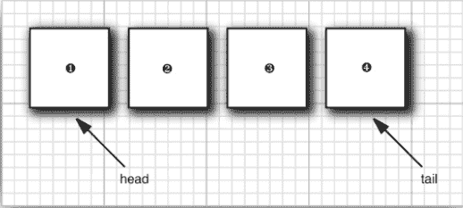

**图9.1** 一个队列

队列接口的一种最简单形式可能如下所示：

```java
public interface Queue<E> // a simplified form of the interface in the standard library
{
    void add(E element);
    E remove();
    int size();
}
```

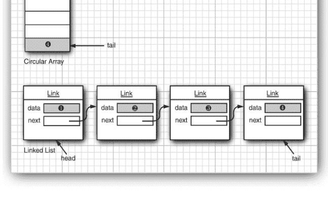

**图9.2** 队列实现

每种实现都可以由一个实现队列接口的类来表示。

```java
public class CircularArrayQueue<E> implements Queue<E> // not an actual library class
{
    private int head;
    private int tail;

    CircularArrayQueue(int capacity) { . . . }
    public void add(E element) { . . . }
    public E remove() { . . . }
    public int size() { . . . }
    private E[] elements;
}

public class LinkedListQueue<E> implements Queue<E> // not an actual library class
{
    private Link head;
    private Link tail;

    LinkedListQueue() { . . . }
    public void add(E element) { . . . }
    public E remove() { . . . }
    public int size() { . . . }
}
```

> **注意：**
>
> Java库实际上并没有名为`CircularArrayQueue`和`LinkedListQueue`的类。我使用这些类作为示例，来解释集合接口与实现之间的概念区别。如果你需要环形数组队列，请使用`ArrayDeque`类。对于链表队列，只需使用`LinkedList`类——它实现了`Queue`接口。

当你在程序中使用队列时，一旦集合构造完成，你不需要知道实际使用的是哪种实现。因此，仅在构造集合对象时使用具体类*才*有意义。使用*接口类型*来持有集合引用。

```java
Queue<Customer> expressLane = new CircularArrayQueue<>(100);
expressLane.add(new Customer("Harry"));
```

采用这种方法，如果你改变主意，可以轻松地使用另一种实现。你只需要在程序中的一个地方进行修改——即构造函数调用处。如果你最终决定`LinkedListQueue`是更好的选择，你的代码就变成

```java
Queue<Customer> expressLane = new LinkedListQueue<>();
expressLane.add(new Customer("Harry"));
```

为什么你会选择一种实现而不是另一种？接口没有说明实现的效率。环形数组比链表效率稍高，因此通常更可取。然而，和往常一样，这是有代价的。

环形数组是一种*有界*集合——它具有有限容量。如果你的程序要收集的对象数量没有上限，那么最终可能还是链表实现更好。

当你研究API文档时，你会发现另一组名称以`Abstract`开头的类，例如`AbstractQueue`。这些类是为库实现者准备的。如果你想要实现自己的队列类（这种情况也许不太可能），你会发现扩展`AbstractQueue`比实现`Queue`接口的所有方法更容易。

### 9.1.2 集合接口


Java 类库中集合类的基本接口是 `Collection` 接口。该接口有两个基本方法：

```java
public interface Collection<E>
{
    boolean add(E element);
    Iterator<E> iterator();
    . . .
}
```

除了这两个方法之外，还有几个方法；我们稍后讨论它们。

add 方法向集合中添加一个元素。如果添加元素确实改变了集合，add 方法返回 true；如果集合未改变，则返回 false。例如，如果你试图向一个集（set）中添加一个对象，而该对象已经存在，那么添加请求不会产生任何效果，因为集会拒绝重复项。

`iterator` 方法返回一个实现了 `Iterator` 接口的对象。你可以使用迭代器对象逐个访问集合中的元素。我们将在下一节讨论迭代器。

### 9.1.3 迭代器

`Iterator` 接口有四个方法：

```java
public interface Iterator<E>
{
    E next();
    boolean hasNext();
    void remove();
    default void forEachRemaining(Consumer<? super E> action);
}
```

通过反复调用 next 方法，你可以逐个访问集合中的元素。然而，如果到达集合末尾，`next` 方法会抛出 `NoSuchElementException`。因此，在调用 `next` 之前需要调用 `hasNext` 方法。如果迭代器对象还有更多元素要访问，该方法返回 `true`。如果你想检查集合中的所有元素，可以请求一个迭代器，然后在 `hasNext` 返回 `true` 时持续调用 `next` 方法。例如：

```java
Collection<String> c = . . .;
Iterator<String> iter = c.iterator();
while (iter.hasNext())
{
    String element = iter.next();
    do something with element
}
```

你可以将这样的循环更简洁地写成“for each”循环：

```java
for (String element : c)
{
    do something with element
}
```

编译器只是将“for each”循环转换为使用迭代器的循环。

“for each”循环适用于任何实现了 `Iterable` 接口的对象，该接口只有一个抽象方法：

```java
public interface Iterable<E>
{
    Iterator<E> iterator();
    . . .
}
```

`Collection` 接口扩展了 `Iterable` 接口。因此，你可以对标准库中的任何集合使用“for each”循环。

除了编写循环之外，你还可以调用 `forEachRemaining` 方法，并传入一个消费元素的 lambda 表达式。该 lambda 表达式会针对迭代器的每个元素被调用，直到没有剩余元素为止。

```java
iterator.forEachRemaining(element -> do something with element);
```

元素的访问顺序取决于集合类型。如果遍历 `ArrayList`，迭代器从索引 0 开始，并在每一步递增索引。然而，如果访问 `HashSet` 中的元素，你得到的顺序基本上是随机的。可以保证在迭代过程中会遇到集合的所有元素，但无法对其顺序做任何假设。这通常不是问题，因为对于计算总和或统计匹配项等计算而言，顺序并不重要。


> **注意：**
>
> 老用户会注意到，`Iterator` 接口的 `next` 和 `hasNext` 方法与 `Enumeration` 的 `nextElement` 和 `hasMoreElements` 方法作用相同。Java 集合库的设计者本可以选择使用 `Enumeration` 接口。但他们不喜欢那些繁琐的方法名，于是引入了一个方法名更短的新接口。

Java 集合库中的迭代器与其他库中的迭代器之间存在重要的概念差异。在传统的集合库中，例如 C++ 的标准模板库，迭代器是仿照数组索引建模的。给定这样的迭代器，你可以查找存储在该位置上的元素，很像如果你有一个数组索引 `i`，就可以查找数组元素 `a[i]`。与查找无关，你可以将迭代器推进到下一个位置。这与通过调用 `i++` 推进数组索引而不执行查找是相同的操作。然而，Java 迭代器不是这样工作的。查找和位置变更紧密耦合。查找元素的唯一方法是调用 next，而该查找会推进位置。

相反，要把 Java 迭代器看作位于*元素之间*。当你调用 next 时，迭代器会*跳过*下一个元素，并返回对刚刚越过的元素的引用（见图 9.3）。

> **注意：**
>
> 这里还有一个有用的类比。你可以把 `Iterator.next` 看作等同于 `InputStream.read`。从流中读取一个字节会自动“消费”该字节。下一次调用 `read` 会消费并返回输入中的下一个字节。同样，重复调用 `next` 可以让你读取集合中的所有元素。

`Iterator` 接口的 `remove` 方法删除最后一次调用 `next` 返回的元素。在许多情况下，这样做是合理的——你需要先看到元素，才能决定它就是应该被删除的那个元素。但如果你想删除特定位置的元素，仍然需要跳过该元素。例如，下面展示了如何删除字符串集合中的第一个元素：

```java
Iterator<String> it = c.iterator();
it.next(); // skip over the first element
it.remove(); // now remove it
```

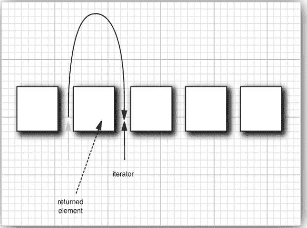

**图 9.3** 推进迭代器

更重要的是，对 `next` 和 `remove` 方法的调用之间存在依赖关系。如果调用 `remove` 之前没有调用 `next`，那么调用 `remove` 是非法的。如果尝试这样做，就会抛出 `IllegalStateException`。

如果你想删除两个相邻元素，不能简单地调用

```java
it.remove();
it.remove(); // ERROR
```

相反，你必须先调用 `next` 跳过要删除的元素。

```java
it.next();
it.remove();
it.next();
it.remove(); // OK
```

### 9.1.4 泛型实用方法

Collection 和 Iterator 接口是泛型的，这意味着你可以编写能操作任何类型集合的实用方法。例如，下面是一个泛型方法，用于测试任意集合是否包含给定元素：

```java
public static <E> boolean contains(Collection<E> c, Object obj)
{  for (E element : c)
       if (element.equals(obj))
           return true;
   return false;
}
```

Java 库的设计者认为，其中一些实用方法非常有用，库应当提供它们。这样，库用户就不必不断重复造轮子。contains 方法就是这样一个方法。

事实上，Collection 接口声明了相当多有用的方法，所有实现类都必须提供这些方法。其中包括

```java
int size()
boolean isEmpty()
boolean contains(Object obj)
boolean containsAll(Collection<?> c)
boolean equals(Object other)
boolean addAll(Collection<? extends E> from)
boolean remove(Object obj)
boolean removeAll(Collection<?> c)
void clear()
boolean retainAll(Collection<?> c)
Object[] toArray()
```

其中许多方法不言自明；你可以在本节末尾的 API 注释中找到完整文档。

当然，如果每个实现 `Collection` 接口的类都必须提供这么多常规方法，那会很麻烦。为了让实现者的工作更轻松，库提供了一个 `AbstractCollection` 类，它把基本方法 `size` 和 `iterator` 保留为抽象方法，但基于这些方法实现常规方法。例如：

```java
public abstract class AbstractCollection<E>
    implements Collection<E>
{
    . . .
    public abstract Iterator<E> iterator();

    public boolean contains(Object obj)
    {
        for (E element : this) // calls iterator()
            if (element.equals(obj))
                return true;
        return false;
    }
    . . .
}
```

具体集合类现在可以扩展 `AbstractCollection` 类。提供 `iterator` 方法由具体集合类负责，但 `contains` 方法已由 `AbstractCollection` 超类处理。不过，如果子类有更高效的 `contains` 实现方式，它可以自行这样做。

这种方法有点过时。如果这些方法是 `Collection` 接口的默认方法，那会更好。但事实并非如此。不过，已经添加了几个默认方法。其中大多数与流有关（将在第 II 卷讨论）。此外，还有一个有用的方法

```java
default boolean removeIf(Predicate<? super E> filter)
```

用于移除满足条件的元素。

## java.util.Collection<E> 1.2

- `Iterator<E> iterator()` 返回一个迭代器，可用于访问集合中的元素。
- `int size()` 返回当前存储在集合中的元素数量。
- `boolean isEmpty()` 如果此集合不包含任何元素，则返回 true。
- `boolean contains(Object obj)` 如果此集合包含与 obj 相等的对象，则返回 true。
- `boolean containsAll(Collection<?> other)` 如果此集合包含另一个集合中的所有元素，则返回 true。
- `boolean add(E element)` 向集合中添加一个元素。如果此调用导致集合发生变化，则返回 true。
- `boolean addAll(Collection<? extends E> other)` 将另一个集合中的所有元素添加到此集合。如果此调用导致集合发生变化，则返回 true。
- `boolean remove(Object obj)` 从此集合中移除与 obj 相等的对象。如果移除了匹配的对象，则返回 true。
- `boolean removeAll(Collection<?> other)` 从此集合中移除另一个集合中的所有元素。如果此调用导致集合发生变化，则返回 true。
- `default boolean removeIf(Predicate<? super E> filter)` [8] 移除所有使 filter 返回 true 的元素。如果此调用导致集合发生变化，则返回 true。
- `void clear()` 从此集合中移除所有元素。
- `boolean retainAll(Collection<?> other)` 从此集合中移除所有不等于另一个集合中某个元素的元素。如果此调用导致集合发生变化，则返回 true。
- `Object[] toArray()` 返回集合中对象的数组。
- `<T> T[] toArray(IntFunction<T[]> generator)` [11] 返回集合中对象的数组。该数组由 generator 构造，generator 通常是构造器表达式 `T[]::new`。

## java.util.Iterator<E> 1.2

- `boolean hasNext()` 如果还有另一个元素可访问，则返回 true。
- `E next()` 返回下一个要访问的对象。如果已到达集合末尾，则抛出 `NoSuchElementException`。
- `void remove()` 移除最后访问的对象。此方法必须紧跟在一次元素访问之后。如果自上次元素访问以来集合已被修改，则此方法抛出 `IllegalStateException`。
- `default void forEachRemaining(Consumer<? super E> action)` 访问元素并将它们传递给给定的 action，直到没有元素剩余或 action 抛出异常。

## 9.2 集合框架中的接口

Java 集合框架为不同类型的集合定义了许多接口，如图 9.4 所示。

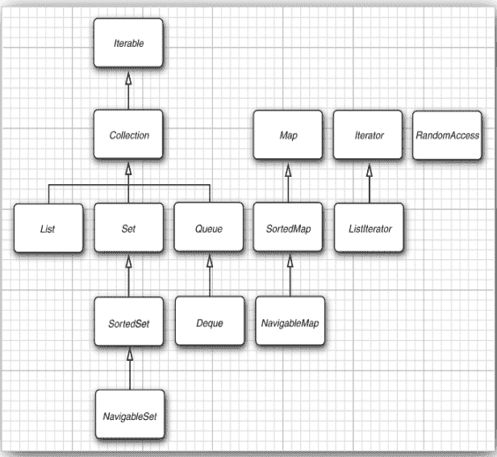

**图 9.4** 集合框架的接口

集合有两个基本接口：`Collection` 和 `Map`。正如你已经看到的，可以使用以下方法将元素插入集合：

```java
boolean add(E element)
```

然而，映射保存键/值对，你可以使用 `put` 方法插入它们：

```java
V put(K key, V value)
```

要从集合中读取元素，可以使用迭代器访问它们。然而，你可以使用 `get` 方法从映射中读取值：

```java
V get(K key)
```

List 是一个*有序集合*。元素被添加到容器中的特定位置。可以通过两种方式访问元素：通过迭代器或通过整数索引。后者称为*随机访问*，因为可以按任意顺序访问元素。相比之下，使用迭代器时，必须按顺序访问它们。

List 接口定义了几个用于随机访问的方法：

```java
void add(int index, E element)
void remove(int index)
E get(int index)
E set(int index, E element)
```

ListIterator 接口是 Iterator 的子接口。它定义了一个用于在迭代器位置之前添加元素的方法：

```java
void add(E element)
```

坦率地说，集合框架的这一方面设计得很糟糕。在实践中，有两种有序集合，它们的性能权衡差异很大。由数组支持的有序集合具有快速的随机访问能力，因此使用带整数索引的 `List` 方法是有意义的。相比之下，链表虽然也是有序的，但随机访问速度慢，最好使用迭代器遍历。提供两个接口本应是一件容易的事。


### 注意：

为了避免对链表执行随机访问操作，Java 1.4 引入了一个标记接口 `RandomAccess`。该接口没有方法，但你可以使用它来测试某个特定集合是否支持高效的随机访问：

```text
if (c instanceof RandomAccess)
{
    use random access algorithm
}
else
{
    use sequential access algorithm
}
```

`Set` 接口与 `Collection` 接口相同，但方法的行为定义得更严格。集合的 add 方法应拒绝重复项。集合的 equals 方法应定义为：如果两个集合具有相同的元素，则它们相同，但不一定要求顺序相同。hashCode 方法应定义为：具有相同元素的两个集合产生相同的哈希码。

如果方法签名相同，为什么要单独定义一个接口？从概念上讲，并非所有集合都是集。定义 Set 接口使程序员能够编写只接受集的方法。

`SortedSet` 和 `SortedMap` 接口公开用于排序的比较器对象，并定义了获取集合子集视图的方法。我们将在第 548 页的 [9.5 节](#)“副本与视图”中讨论这些内容。

最后，Java 6 引入了接口 `NavigableSet` 和 `NavigableMap`，它们包含用于在有序集和映射中搜索和遍历的附加方法。（理想情况下，这些方法本应直接包含在 `SortedSet` 和 `SortedMap` 接口中。）`TreeSet` 和 `TreeMap` 类实现了这些接口。

## 9.3 具体集合

[表 9.1](#) 显示了 Java 库中的集合，并简要描述了每个集合类的用途。（为简单起见，我省略了将在[第 12 章](#)中讨论的线程安全集合。）

[表 9.1](#) 中的所有类都实现 `Collection` 接口，名称以 Map 结尾的类除外。那些类改为实现 `Map` 接口。我们将在第 535 页的 [9.4 节](#)“映射”中讨论映射。

[图 9.5](#) 显示了这些类之间的关系。

**表 9.1** Java 库中的具体集合

| 集合类型 | 描述 | 参见页码 |
| --- | --- | ---: |
| ArrayList | 一个可动态增长和收缩的索引序列 | 523 |
| LinkedList | 一个有序序列，允许在任意位置高效插入和删除 | 512 |
| ArrayDeque | 一个实现为循环数组的双端队列 | 532 |
| HashSet | 一个拒绝重复项的无序集合 | 523 |
| TreeSet | 一个有序集 | 527 |
| EnumSet | 一组枚举类型值 | 545 |
| LinkedHashSet | 一个记住元素插入顺序的集 | 543 |
| PriorityQueue | 一个允许高效移除最小元素的集合 | 533 |
| HashMap | 一种存储键/值关联的数据结构 | 542 |
| TreeMap | 一个键有序的映射 | 535 |
| EnumMap | 一个键属于枚举类型的映射 | 545 |
| LinkedHashMap | 一个记住条目添加顺序的映射 | 543 |
| WeakHashMap | 一个其值在未在其他地方使用时可由垃圾回收器回收的映射 | 542 |
| IdentityHashMap | 一个键通过 == 而不是 equals 进行比较的映射 | 545 |


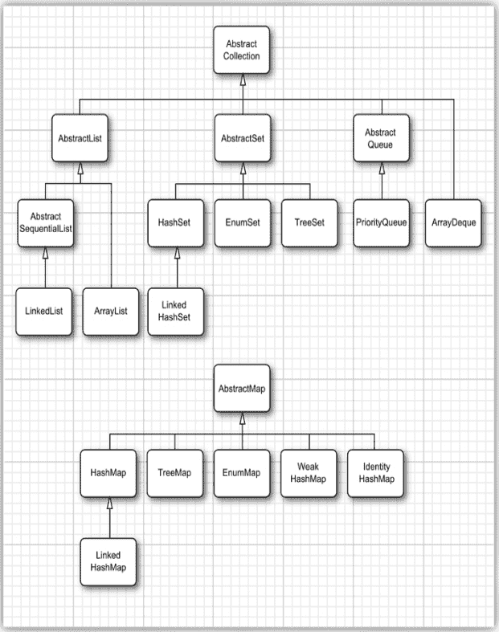

**图9.5** 集合框架中的类

### 9.3.1 链表

我们在本书的许多示例中已经使用了数组及其动态变体`ArrayList`类。然而，数组和数组列表有一个重大缺陷。从数组中间移除一个元素的代价很高，因为被移除元素之后的所有数组元素都必须向数组开头移动（见图9.6）。在中间插入元素也是如此。

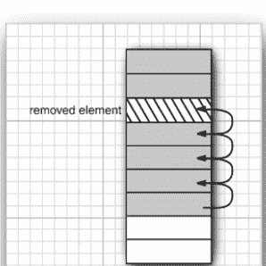

**图9.6** 从数组中移除元素

另一种众所周知的数据结构——*链表*解决了这个问题。数组将对象引用存储在连续的内存位置，而链表将每个对象存储在单独的*链接*中。每个链接还存储指向序列中下一个链接的引用。在Java编程语言中，所有链表实际上都是*双向链接*的；也就是说，每个链接还存储指向前驱的引用（见图9.7）。

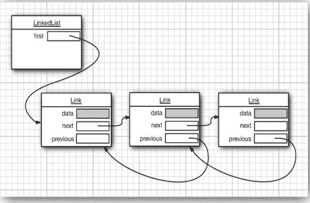

**图9.7** 双向链表

从链表中间移除元素代价很低——只需更新被移除元素周围的链接（见图9.8）。

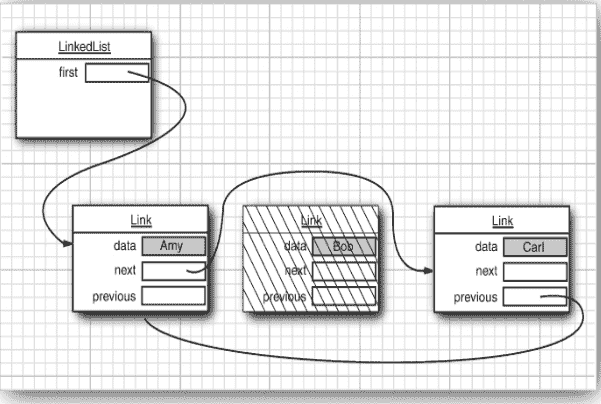

**图9.8** 从链表中移除元素

也许你上过数据结构课程，学过如何实现链表。你可能还记得在链表中删除或添加元素时把链接搞乱的糟糕经历。如果是这样，你会很高兴地知道Java集合库提供了一个`LinkedList`类供你使用。

下面的代码示例添加了三个元素，然后移除第二个元素：

```java
var staff = new LinkedList<String>();
staff.add("Amy");
staff.add("Bob");
staff.add("Carl");
Iterator<String> iter = staff.iterator();
String first = iter.next(); // visit first element
String second = iter.next(); // visit second element
iter.remove(); // remove last visited element
```

但是，链表与泛型集合之间有一个重要区别。链表是一个*有序集合*，对象的位置很重要。`LinkedList.add`方法将对象添加到列表末尾。但你通常希望将对象添加到列表中间的某个位置。这种依赖于位置的添加方法由迭代器负责，因为迭代器描述集合中的位置。使用迭代器添加元素仅对具有自然顺序的集合有意义。例如，我们下一节将讨论的*集*数据类型不对其元素施加任何顺序。因此，`Iterator`接口中没有add方法。相反，集合库提供了一个包含add方法的子接口`ListIterator`：

```java
interface ListIterator<E> extends Iterator<E>
{
    void add(E element);
    . . .
}
```

与`Collection.add`不同，此方法不返回`boolean`——假定add操作总是会修改列表。

此外，`ListIterator`接口有两个可用于向后遍历列表的方法。

```java
E previous();
boolean hasPrevious();
```

与next方法一样，previous方法返回它跳过的对象。

`LinkedList`类的`listIterator`方法返回一个实现`ListIterator`接口的迭代器对象。

```java
ListIterator<String> iter = staff.listIterator();
```

add方法在迭代器位置*之前*添加新元素。例如，下面的代码跳过链表中的第一个元素，并在第二个元素之前添加“Juliet”（见图9.9）：

```java
var staff = new LinkedList<String>();
staff.add("Amy");
staff.add("Bob");
staff.add("Carl");
ListIterator<String> iter = staff.listIterator();
iter.next(); // skip past first element
iter.add("Juliet");
```

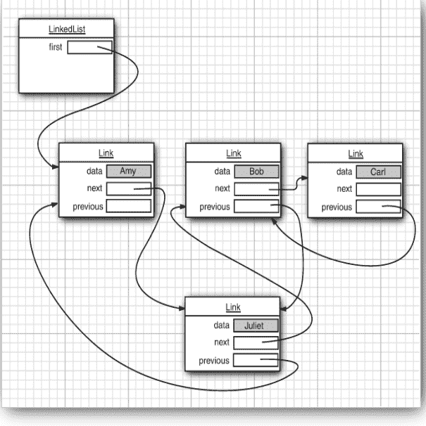

**图9.9** 向链表中添加元素

如果你多次调用add方法，元素将按照你提供的顺序依次添加。它们都会依次添加在当前迭代器位置之前。

当你使用刚刚从listIterator方法获得且指向链表开头的迭代器执行add操作时，新添加的元素将成为链表的新头。当迭代器已越过链表的最后一个元素（即hasNext返回*false*）时，新添加的元素将成为链表的新尾。如果链表有*n*个元素，则有*n + 1*个位置可以添加新元素。这些位置对应于迭代器的*n + 1*个可能位置。例如，如果链表包含三个元素A、B和C，则有四个可能的位置（标记为|）用于插入新元素：

| 位置 |
| --- |
| \|ABC |
| A\|BC |
| AB\|C |
| ABC\| |

**注意：**

要小心“光标”类比。remove操作并不完全像退格键那样工作。在调用next后立即调用remove，确实会删除迭代器左侧的元素，就像按退格键一样。然而，如果你刚刚调用了previous，右侧的元素将被删除。而且你不能连续调用两次remove。

与仅依赖于迭代器位置的add方法不同，remove方法依赖于迭代器的状态。

最后，set方法用新元素替换上一次调用next或previous返回的元素。例如，以下代码用新值替换列表的第一个元素：

```java
ListIterator<String> iter = list.listIterator();
String oldValue = iter.next(); // returns first element
iter.set(newValue); // sets first element to newValue
```

可以想象，如果一个迭代器正在遍历集合，而另一个迭代器正在修改它，就可能出现令人困惑的情况。例如，假设一个迭代器指向另一个迭代器刚刚删除的元素之前。该迭代器现在无效，不应再使用。链表迭代器在设计上可以检测此类修改。如果迭代器发现其集合被另一个迭代器或集合自身的方法修改，则会抛出`ConcurrentModificationException`。例如，考虑以下代码：

```java
List<String> list = . . .;
ListIterator<String> iter1 = list.listIterator();
ListIterator<String> iter2 = list.listIterator();
iter1.next();
iter1.remove();
iter2.next(); // throws ConcurrentModificationException
```

对`iter2.next`的调用会抛出`ConcurrentModificationException`，因为`iter2`检测到列表被外部修改了。

为了避免并发修改异常，请遵循这个简单规则：你可以为一个集合附加任意数量的迭代器，前提是它们都只是读取者。或者，你可以附加一个既可以读也可以写的迭代器。

并发修改检测以简单的方式完成。集合跟踪修改操作（如添加和删除元素）的数量。每个迭代器分别统计它负责的修改操作数量。在每个迭代器方法开始时，迭代器只需检查其自身的修改计数是否等于集合的修改计数。如果不相等，则抛出`ConcurrentModificationException`。


> **注意：**
>
> 然而，并发修改检测有一个奇怪的例外。链表只跟踪对列表的*结构性*修改，例如添加和删除链接。`set`方法*不*算作结构性修改。你可以为一个链表附加多个迭代器，它们都调用`set`来更改现有链接的内容。本章后面讨论的`Collections`类中的许多算法都需要这个能力。

现在你已经看到了`LinkedList`类的基本方法。使用`ListIterator`可以沿任一方向遍历链表的元素，并添加和删除元素。

正如你在第9.2节“集合框架中的接口”（第508页）中所看到的，`Collection`接口中声明了许多其他用于操作链表的有用方法。这些方法大部分是在`LinkedList`类的超类`AbstractCollection`中实现的。例如，`toString`方法对所有元素调用`toString`并产生一个长


格式为 `[A, B, C]` 的字符串。这对调试很方便。使用 `contains` 方法检查链表中是否存在某个元素。例如，如果链表已经包含一个等于字符串 "Harry" 的字符串，那么调用 `staff.contains("Harry")` 会返回 true。

该库还提供了若干从理论角度看有些存疑的方法。链表不支持快速随机访问。如果你想查看链表的第 *n* 个元素，就必须从开头开始，跳过前 *n − 1* 个元素。没有捷径。因此，程序员通常不会在需要按整数索引访问元素的场景中使用链表。

不过，`LinkedList` 类提供了一个 `get` 方法，可用于访问特定元素：

```java
LinkedList<String> list = . . .;
String obj = list.get(n);
```

当然，这个方法效率不高。如果你发现自己正在使用它，那么很可能为你的问题选错了数据结构。

你*绝对不应*使用这种虚假的随机访问方法来遍历链表。下面的代码

```java
for (int i = 0; i < list.size(); i++)
    do something with list.get(i);
```

效率低得惊人。每次查找另一个元素时，搜索都会从链表开头重新开始。`LinkedList` 对象根本不会尝试缓存位置信息。


> **注意：**
> 
> `get` 方法有一个小优化：如果索引至少为 `size() / 2`，则从链表末尾开始搜索该元素。

列表迭代器接口还提供了一种方法，用于告诉你当前位置的索引。事实上，由于 Java 迭代器在概念上指向元素之间，所以它有两个这样的方法：`nextIndex` 方法返回下一次调用 `next` 时将返回的元素的整数索引；`previousIndex` 方法返回下一次调用 `previous` 时将返回的元素的索引。当然，后者只是比 `nextIndex` 小 1。这些方法是高效的——迭代器会记录当前位置的计数。最后，如果你有一个整数索引 `n`，那么 `list.listIterator(n)` 返回一个迭代器，它指向索引为 `n` 的元素之前。也就是说，调用 `next` 会得到与 `list.get(n)` 相同的元素；获取该迭代器的效率不高。

如果你的链表只有少量元素，就不必过度担心 `get` 和 `set` 方法的开销。但话说回来，一开始为什么要用链表呢？使用链表的唯一理由是最小化在链表中间插入和删除元素的开销。如果你只有少量元素，直接使用 `ArrayList` 即可。

我建议你完全避开所有用整数索引表示链表中位置的方法。如果你想对集合进行随机访问，请使用数组或 `ArrayList`，而不是链表。

代码清单 9.1 中的程序展示了链表的实际运用。它只是创建两个链表，将它们合并，然后从第二个链表中删除每隔一个的元素，最后测试 `removeAll` 方法。我建议你跟踪程序流程，并特别注意迭代器。你可能会发现画出迭代器位置示意图很有帮助，如下所示：

```text
|ACE    |BDFG
A|CE    |BDFG
AB|CE  B|DFG
. . .
```

请注意，调用

```java
System.out.println(a);
```

会通过调用 `AbstractCollection` 中的 `toString` 方法打印链表 a 中的所有元素。

### 代码清单 9.1 `linkedList/LinkedListTest.java`

```java
package linkedList;

import java.util.*;

/**
 * This program demonstrates operations on linked lists.
 * @version 1.12 2018-04-10
 * @author Cay Horstmann
 */
public class LinkedListTest
{
   public static void main(String[] args)
   {
      var a = new LinkedList<String>();
      a.add("Amy");
      a.add("Carl");
      a.add("Erica");

      var b = new LinkedList<String>();
      b.add("Bob");
      b.add("Doug");
      b.add("Frances");
      b.add("Gloria");

      // merge the words from b into a

      ListIterator<String> aIter = a.listIterator();
      Iterator<String> bIter = b.iterator();

      while (bIter.hasNext())
      {
         if (aIter.hasNext()) aIter.next();
         aIter.add(bIter.next());
      }

      System.out.println(a);

      // remove every second word from b

      bIter = b.iterator();
      while (bIter.hasNext())
      {
         bIter.next(); // skip one element
         if (bIter.hasNext())
         {
            bIter.next(); // skip next element
            bIter.remove(); // remove that element
         }
      }

      System.out.println(b);

      // bulk operation: remove all words in b from a

      a.removeAll(b);

      System.out.println(a);
   }
}
```

### `java.util.List<E>` 1.2

- `ListIterator<E> listIterator()`  
  返回用于访问该列表元素的列表迭代器。
- `ListIterator<E> listIterator(int index)`  
  返回用于访问该列表元素的列表迭代器，其第一次调用 `next` 将返回具有给定索引的元素。
- `void add(int i, E element)`  
  在指定位置添加一个元素。
- `void addAll(int i, Collection<? extends E> elements)`  
  将集合中的所有元素添加到指定位置。
- `E remove(int i)`  
  删除并返回指定位置的元素。
- `E get(int i)`  
  获取指定位置的元素。
- `E set(int i, E element)`  
  用新元素替换指定位置的元素，并返回旧元素。
- `int indexOf(Object element)`  
  返回等于指定元素的元素第一次出现的位置；如果未找到匹配元素，则返回 −1。
- `int lastIndexOf(Object element)`  
  返回等于指定元素的元素最后一次出现的位置；如果未找到匹配元素，则返回 −1。

### `java.util.ListIterator<E>` 1.2

- `void add(E newElement)`  
  在当前迭代器位置之前添加一个元素。
- `void set(E newElement)`  
  用新元素替换由 `next` 或 `previous` 最后访问的元素。如果自上次调用 `next` 或 `previous` 以来列表结构已被修改，则抛出 `IllegalStateException`。
- `boolean hasPrevious()`  
  如果向后遍历列表时还有另一个元素可访问，则返回 true。
- `E previous()`  
  返回前一个对象。如果已到达列表开头，则抛出 `NoSuchElementException`。
- `int nextIndex()`  
  返回下一次调用 `next` 时将返回的元素的索引。
- `int previousIndex()`  
  返回下一次调用 `previous` 时将返回的元素的索引。

### `java.util.LinkedList<E>` 1.2

- `LinkedList()`  
  构造一个空链表。
- `LinkedList(Collection<? extends E> elements)`  
  构造一个链表，并添加集合中的所有元素。
- `void addFirst(E element)`
- `void addLast(E element)`  
  在链表开头或末尾添加一个元素。
- `E getFirst()`
- `E getLast()`  
  返回链表开头或末尾的元素。
- `E removeFirst()`
- `E removeLast()`  
  删除并返回链表开头或末尾的元素。

### 9.3.2 数组列表

在上一节中，你看到了 `List` 接口以及实现它的 `LinkedList` 类。`List` 接口描述了一种有序集合，其中元素的位置很重要。访问元素有两种方式：通过迭代器，以及通过 `get` 和 `set` 方法进行随机访问。后者不适合链表，但当然，`get` 和 `set` 对数组非常有用。集合库提供了熟悉的 `ArrayList` 类，它也实现了 `List` 接口。`ArrayList` 封装了一个动态重新分配的对象数组。


> **注意：**
> 
> 如果你是资深 Java 程序员，可能曾在需要动态数组时使用过 `Vector` 类。为什么要用 `ArrayList` 而不是 `Vector`？原因很简单：`Vector` 类的所有方法都是*同步的*。从两个线程访问一个向量对象是安全的。但如果你只从单线程访问向量——这是常见得多的情形——你的代码会因同步而浪费相当多的时间。相比之下，`ArrayList` 的方法不是同步的。我建议，在不需要同步时，应使用 `ArrayList` 而不是 `Vector`。

### 9.3.3 哈希集

链表和数组允许你指定元素的排列顺序。然而，如果你要查找某个特定元素，却不记得它的位置，就需要访问所有元素，直到找到匹配项。如果集合包含许多元素，这可能很耗时。如果你不关心元素的顺序，有些数据结构可以让你更快地找到元素。缺点是，这些数据结构让你无法控制元素出现的顺序。这些数据结构会按照便于自身实现目的的顺序来组织元素。

一种用于快速查找对象的著名数据结构是*哈希表*。哈希表会为每个对象计算一个整数，称为*哈希码*。哈希码在某种程度上由对象的实例字段推导而来，最好以

使得具有不同数据的对象产生不同的编码。[表 9.2](#) 列出了几个由 `String` 类的 `hashCode` 方法生成的哈希码示例。

如果你定义自己的类，就需要负责实现自己的 `hashCode` 方法——更多信息见[第 5 章](#)。你的实现需要与 `equals` 方法兼容。如果 `a.equals(b)`，那么 a 和 b 必须具有相同的哈希码。

## 表 9.2 由 `hashCode` 方法生成的哈希码

| 字符串 | 哈希码 |
|---|---:|
| "Lee" | 76268 |
| "lee" | 107020 |
| "eel" | 100300 |

目前重要的是，哈希码可以快速计算，并且计算只取决于需要哈希的对象的状态，而不取决于哈希表中的其他对象。

在 Java 中，哈希表实现为链表数组。每个列表称为一个*桶*（见[图 9.10](#)）。要查找对象在表中的位置，先计算其哈希码，再对桶的总数取模。所得数字就是存放该元素的桶的索引。例如，如果一个对象的哈希码为 76268，且有 128 个桶，那么该对象被放入 108 号桶（因为 76268 % 128 的余数是 108）。也许你很幸运，该桶中没有其他元素。那么，你只需将该元素插入该桶。当然，有时你会碰到一个已经装满的桶。这称为*哈希冲突*。然后，将新对象与该桶中的所有对象进行比较，看看它是否已经存在。如果哈希码分布得相当随机，并且桶的数量足够大，那么应该只需要少量比较。


**图 9.10** 哈希表

### **注意：**

从 Java 8 开始，当桶装满时，它们会从链表变成平衡二叉树。如果哈希函数选择不当并产生许多冲突，或者恶意代码试图用大量具有相同哈希码的值淹没哈希表，这可以提高性能。

### **提示：**

如果可能，哈希表的键应该属于实现了 `Comparable` 接口的类。这样就能保证不会因哈希码分布不佳而遭受性能下降。

如果你想更好地控制哈希表的性能，可以指定初始桶数。桶数给出了用于收集具有相同哈希值的对象的桶的数量。如果向哈希表中插入过多元素，冲突数量会增加，检索性能会下降。

如果你大致知道最终表中会有多少元素，就可以设置桶数。通常，应将其设置为预期元素数量的 75% 到 150% 之间。一些研究人员认为，将桶数设为质数有助于防止键聚集。然而，支持这一点的证据尚无定论。标准库使用的桶数是 2 的幂，默认值为 16。（你为表大小提供的任何值都会自动向上取整到下一个 2 的幂。）

当然，你并不总是知道需要存储多少元素，或者初始估计可能过低。如果哈希表变得太满，就需要*再哈希*。要对表进行再哈希，会创建一个具有更多桶的表，将所有元素插入新表，并丢弃原表。*负载因子*决定哈希表何时进行再哈希。例如，如果负载因子为 0.75（这是默认值），且表的填充率超过 75%，它就会自动再哈希为桶数翻倍的表。对于大多数应用，将负载因子保持为 0.75 是合理的。

哈希表可用于实现几种重要的数据结构。其中最简单的是*集合*类型。集合是不包含重复元素的元素集合。集合的 add 方法首先尝试查找要添加的对象，仅当该对象尚不存在时才添加它。

Java 集合库提供了一个基于哈希表实现集合的 `HashSet` 类。使用 add 方法添加元素。contains 方法被重新定义，以便快速查找集合中是否已存在某个元素。它只检查一个桶中的元素，而不是集合中的所有元素。

哈希集合迭代器会依次访问所有桶。由于哈希会将元素分散到表中，因此它们会以看似随机的顺序被访问。只有在不关心集合中元素顺序时，才会使用 `HashSet`。

```java
13     {
14         var words = new HashSet<String>();
15         long totalTime = 0;
16
17         try (var in = new Scanner(System.in))
18         {
19             while (in.hasNext())
20             {
21                 String word = in.next();
22                 long callTime = System.currentTimeMillis();
23                 words.add(word);
24                 callTime = System.currentTimeMillis() - callTime;
25                 totalTime += callTime;
26             }
27         }
28
29         Iterator<String> iter = words.iterator();
30         for (int i = 1; i <= 20 && iter.hasNext(); i++)
31             System.out.println(iter.next());
32         System.out.println(". . .");
33         System.out.println(words.size() + " distinct words. " +
                totalTime + " milliseconds.");
34     }
35 }
```

### `java.util.HashSet<E>` 1.2

- `HashSet()`
  构造一个空哈希集合。
- `HashSet(Collection<? extends E> elements)`
  构造一个哈希集合，并添加集合中的所有元素。
- `HashSet(int initialCapacity)`
  构造一个具有指定容量（桶数）的空哈希集合。
- `HashSet(int initialCapacity, float loadFactor)`
  构造一个具有指定容量和负载因子的空哈希集合。如果大小/容量之比超过负载因子，哈希表将被再哈希到更大的表中。

### `java.lang.Object` 1.0

- `int hashCode()`
  返回此对象的哈希码。哈希码可以是任意整数，正数或负数。`equals` 和 `hashCode` 的定义必须兼容：如果 `x.equals(y)` 为 true，那么 `x.hashCode()` 必须与 `y.hashCode()` 的值相同。

### 9.3.4 树集

`TreeSet` 类与哈希集合类似，但有一项新增改进。树集是一个*有序集合*。你可以按任意顺序将元素插入集合。当你遍历集合时，这些值会自动按*排序顺序*呈现。例如，假设你插入三个字符串，然后访问你添加的所有元素。

```java
var sorter = new TreeSet<String>();
sorter.add("Bob");
sorter.add("Amy");
sorter.add("Carl");
for (String s : sorter) System.out.println(s);
```

然后，这些值会按排序顺序打印：Amy Bob Carl。正如该类名所示，排序是通过树数据结构完成的。（当前实现使用*红黑树*。关于红黑树的详细描述，例如参见 Thomas Cormen、Charles Leiserson、Ronald Rivest 和 Clifford Stein 所著的*《算法导论》*，MIT Press，2009。）每当向树中添加元素时，都会将其放入正确的排序位置。因此，迭代器总是按排序顺序访问元素。

向树中添加元素比向哈希表中添加元素更慢——比较参见[表 9.3](#table-9-3)。但它仍然比在数组或链表中检查重复项快得多。如果树包含 *n* 个元素，那么平均需要 log₂ *n* 次比较才能为新元素找到正确位置。例如，如果树已经包含 1,000 个元素，添加一个新元素大约需要 10 次比较。

### **注意：**

要使用树集，你必须能够比较元素。元素必须实现 `Comparable` 接口，或者在构造集合时提供一个比较器。（`Comparable` 和 `Comparator` 接口在[第 6 章](#chapter-6)中介绍。）

**表 9.3** 向哈希集合和树集中添加元素

| 文档 | 总词数 | 不同词数 | HashSet | TreeSet |
|---|---:|---:|---:|---:|
| *《爱丽丝梦游仙境》* | 28195 | 5909 | 5 秒 | 7 秒 |
| *《基督山伯爵》* | 466300 | 37545 | 75 秒 | 98 秒 |

如果你回看[表 9.3](#table-9-3)，你很可能会想是否应该始终使用树集而不是哈希集合。毕竟，添加元素似乎并不会慢太多，而且元素会自动排序。答案取决于你正在收集的数据。如果你不需要对数据排序，就没有理由承担排序开销。更重要的是，对于某些数据，提出排序顺序比哈希函数要困难得多。哈希函数只需要相当好地打乱对象，而比较函数必须以完全精确的方式区分对象。


为了使这种区别更具体，考虑收集一组矩形的任务。如果使用 `TreeSet`，就需要提供一个 `Comparator<Rectangle>`。如何比较两个矩形？按面积吗？这行不通。两个不同的矩形可以具有不同的坐标但面积相同。树的排序顺序必须是*全序*。任意两个元素都必须可比较，并且只有当元素相等时，比较结果才能为零。矩形确实存在这样的排序顺序（按其坐标的字典序），但它不自然且计算起来很繁琐。相比之下，`Rectangle` 类已经定义了哈希函数。它只是对坐标进行哈希。

> **注意：**
>
> 从 Java 6 开始，`TreeSet` 类实现了 `NavigableSet` 接口。该接口新增了几个用于定位元素和反向遍历的便捷方法。详情请参阅 API 说明。

[清单 9.3](#listing-9.3) 中的程序构建了两个 `Item` 对象的树集合。第一个按部件编号排序，这是 `Item` 对象的默认排序顺序。第二个集合使用自定义比较器按描述排序。

### **清单 9.3** `treeSet/TreeSetTest.java`

```java
package treeSet;

import java.util.*;

/**
 * This program sorts a set of Item objects by comparing their descriptions.
 * @version 1.13 2018-04-10
 * @author Cay Horstmann
 */
public class TreeSetTest
{
12  public static void main(String[] args)
13  {
14      var parts = new TreeSet<Item>();
15      parts.add(new Item("Toaster", 1234));
16      parts.add(new Item("Widget", 4562));
17      parts.add(new Item("Modem", 9912));
18      System.out.println(parts);
19
20      var sortByDescription = new TreeSet<Item>
    (Comparator.comparing(Item::getDescription));
21
22      sortByDescription.addAll(parts);
23      System.out.println(sortByDescription);
24  }
25  }
```

### **清单 9.4** `treeSet/Item.java`

```java
1   package treeSet;
2
3   import java.util.*;
4
5   /**
6    * An item with a description and a part number.
7    */
8   public class Item implements Comparable<Item>
9   {
10      private String description;
11      private int partNumber;
12
13      /**
14       * Constructs an item.
15       * @param aDescription the item's description
16       * @param aPartNumber the item's part number
17       */
18      public Item(String aDescription, int aPartNumber)
19      {
20          description = aDescription;
        partNumber = aPartNumber;
    }

    /**
     * Gets the description of this item.
     * @return the description
     */
    public String getDescription()
    {
        return description;
    }

    public String toString()
    {
        return "[description=" + description + ", partNumber=" +
            partNumber + "]";
    }

    public boolean equals(Object otherObject)
    {
        if (this == otherObject) return true;
        if (otherObject == null) return false;
        if (getClass() != otherObject.getClass()) return false;
        var other = (Item) otherObject;
        return Objects.equals(description, other.description) &&
            partNumber == other.partNumber;
    }

    public int hashCode()
    {
        return Objects.hash(description, partNumber);
    }

    public int compareTo(Item other)
    {
        int diff = Integer.compare(partNumber,
            other.partNumber);
        return diff != 0 ? diff :
            description.compareTo(other.description);
    }
}
```

- `E lower(E value)`
  返回大于 value 的最小元素或小于 value 的最大元素，如果不存在这样的元素则返回 `null`。
- `E ceiling(E value)`
- `E floor(E value)`
  返回大于或等于 value 的最小元素或小于或等于 value 的最大元素，如果不存在这样的元素则返回 `null`。
- `E pollFirst()`
- `E pollLast()`
  移除并返回此集合中最小或最大的元素，如果集合为空则返回 `null`。
- `Iterator<E> descendingIterator()`
  返回一个按降序方向遍历此集合的迭代器。

### 9.3.5 队列与双端队列

正如我们已经讨论过的，队列允许你高效地在尾部添加元素并从头部移除元素。双端队列（*deque*）允许你高效地在头部和尾部添加或移除元素。不支持在中间添加元素。Java 6 引入了 `Deque` 接口。它由 `ArrayDeque` 和 `LinkedList` 类实现，这两个类都提供大小可按需增长的双端队列。在第 12 章中，你将看到有界队列和双端队列。

`java.util.Queue<E>` 5

- `boolean add(E element)`
- `boolean offer(E element)`
  在队列未满时，将给定元素添加到此队列的尾部并返回 `true`。如果队列已满，第一个方法抛出 `IllegalStateException`，而第二个方法返回 `false`。

- `E remove()`
- `E poll()`
  在队列非空时，移除并返回此队列头部的元素。如果队列为空，第一个方法抛出 `NoSuchElementException`，而第二个方法返回 `null`。

- `E element()`
- `E peek()`
  在队列非空时，返回此队列头部的元素但不移除它。如果队列为空，第一个方法抛出 `NoSuchElementException`，而第二个方法返回 `null`。

### `java.util.Deque<E>`

- `void addFirst(E element)`
- `void addLast(E element)`
- `boolean offerFirst(E element)`
- `boolean offerLast(E element)`
  将给定元素添加到此双端队列的头部或尾部。如果双端队列已满，前两个方法抛出 `IllegalStateException`，而后两个方法返回 `false`。

- `E removeFirst()`
- `E removeLast()`
- `E pollFirst()`
- `E pollLast()`
  在双端队列非空时，移除并返回此双端队列头部的元素。如果双端队列为空，前两个方法抛出 `NoSuchElementException`，而后两个方法返回 `null`。

- `E getFirst()`
- `E getLast()`
- `E peekFirst()`
- `E peekLast()`
  在双端队列非空时，返回此双端队列头部的元素但不移除它。如果双端队列为空，前两个方法抛出 `NoSuchElementException`，而后两个方法返回 `null`。

### `java.util.ArrayDeque<E>` 6

- `ArrayDeque()`
- `ArrayDeque(int initialCapacity)`
  构造一个无界双端队列，初始容量为 16 或给定的初始容量。

### 9.3.6 优先队列

优先队列在元素以任意顺序插入后，会按排序顺序取出元素。也就是说，每当你调用 remove 方法时，得到的是当前优先队列中最小的元素。然而，优先队列并不会对所有元素进行排序。如果遍历这些元素，它们不一定是有序的。优先队列利用了一种称为堆的优雅且高效的数据结构。堆是一种自组织二叉树，其中 add 和 remove 操作会使最小元素逐渐移动到根，而不会浪费时间对所有元素排序。

就像 `TreeSet` 一样，优先队列既可以保存实现了 `Comparable` 接口的类的元素，也可以保存你在构造函数中提供的比较器对象。

优先队列的一个典型用途是作业调度。每个作业都有一个优先级。作业以随机顺序添加。每当可以开始一个新作业时，就会从队列中移除优先级最高的作业。（由于传统上优先级 1 是“最高”优先级，因此 remove 操作产生的是最小元素。）

[清单 9.5](#) 展示了优先队列的实际运行。与 `TreeSet` 中的迭代不同，这里的迭代不会按排序顺序访问元素。然而，移除操作总是产生剩余元素中最小的元素。

### **清单 9.5** `priorityQueue/PriorityQueueTest.java`

```java
package priorityQueue;

import java.util.*;
import java.time.*;

/**
 * This program demonstrates the use of a priority queue.
 * @version 1.02 2015-06-20
 * @author Cay Horstmann
 */
public class PriorityQueueTest
{
   public static void main(String[] args)
   {
      var pq = new PriorityQueue<LocalDate>();
      pq.add(LocalDate.of(1906, 12, 9)); // G. Hopper
      pq.add(LocalDate.of(1815, 12, 10)); // A. Lovelace
      pq.add(LocalDate.of(1903, 12, 3)); // J. Von Neumann
      pq.add(LocalDate.of(1910, 6, 22)); // K. Zuse

      System.out.println("Iterating over elements . . .");
      for (LocalDate date : pq)
         System.out.println(date);
      System.out.println("Removing elements . . .");
```


```java
25        while (!pq.isEmpty())
26            System.out.println(pq.remove());
27    }
28 }
```

### java.util.PriorityQueue<E> 5

- `PriorityQueue()`
- `PriorityQueue(int initialCapacity)`  
  构造一个用于存储 `Comparable` 对象的优先队列。
- `PriorityQueue(int initialCapacity, Comparator<? super E> c)`  
  构造一个优先队列，并使用指定的比较器对其元素排序。

## 9.4 映射

集是一种集合，可以让你快速查找已存在的元素。但是，要查找一个元素，你需要拥有该元素的完全相同的副本。这并不是一种很常见的查找方式——通常，你拥有一些键信息，并希望查找与之关联的元素。*映射*数据结构就是为此而设计的。映射存储键/值对。如果提供键，就能找到值。例如，你可以存储一个员工记录表，其中键是员工 ID，值是 `Employee` 对象。在接下来的小节中，你将学习如何使用映射。

### 9.4.1 基本的映射操作

Java 库为映射提供了两个通用实现：`HashMap` 和 `TreeMap`。这两个类都实现了 `Map` 接口。

哈希映射对键进行散列，而树映射利用键上的排序将它们组织到一棵搜索树中。散列函数或比较函数*仅应用于键*。与键关联的值不进行散列或比较。

应该选择哈希映射还是树映射？与集一样，散列通常要快一些；如果不需要按排序顺序访问键，则它是首选。

下面说明如何设置一个用于存储员工的哈希映射：

```java
var staff = new HashMap<String, Employee>(); // HashMap implements Map
var harry = new Employee("Harry Hacker");
staff.put("987-98-9996", harry);
. . .
```

每当向映射中添加对象时，还必须提供一个键。在我们的例子中，键是一个字符串，对应的值是一个 `Employee` 对象。

要获取对象，必须使用（并因此记住）键。

```java
var id = "987-98-9996";
Employee e = staff.get(id); // gets harry
```

如果映射中没有用指定的特定键存储任何信息，`get` 将返回 `null`。

`null` 返回值可能不太方便。有时，对于映射中不存在的键，有一个合适的默认值可用。这时请使用 `getOrDefault` 方法。

```java
Map<String, Integer> scores = . . .;
int score = scores.getOrDefault(id, 0); // gets 0 if the id is not present
```

键必须唯一。不能存储两个具有相同键的值。如果使用同一个键调用 `put` 方法两次，第二个值将替换第一个值。实际上，put 返回与其键参数关联的前一个值。

remove 方法从映射中移除具有给定键的元素。size 方法返回映射中的条目数。

遍历映射的键和值最简单的方法是 forEach 方法。提供一个接收键和值的 lambda 表达式。该表达式会依次对每个映射条目调用。

```java
scores.forEach((k, v) ->
    System.out.println("key=" + k + ", value=" + v));
```

[清单 9.6](#) 演示了映射的实际使用。我们首先向映射添加键/值对。然后，从映射中移除一个键，这也会移除其关联的值。接下来，更改与某个键关联的值，并调用 get 方法查找一个值。最后，遍历条目集。

### 清单 9.6 `map/MapTest.java`

```java
package map;

import java.util.*;

/**
 * This program demonstrates the use of a map with key type
 * String and value type Employee.
 * @version 1.12 2015-06-21
 * @author Cay Horstmann
 */
public class MapTest
{
   public static void main(String[] args)
   {
      var staff = new HashMap<String, Employee>();
      staff.put("144-25-5464", new Employee("Amy Lee"));
      staff.put("567-24-2546", new Employee("Harry Hacker"));
      staff.put("157-62-7935", new Employee("Gary Cooper"));
      staff.put("456-62-5527", new Employee("Francesca Cruz"));
19
20      // print all entries
21
22      System.out.println(staff);
23
24      // remove an entry
25
26      staff.remove("567-24-2546");
27
28      // replace an entry
29
30      staff.put("456-62-5527", new Employee("Francesca Miller"));
31
32      // look up a value
33
34      System.out.println(staff.get("157-62-7935"));
35
36      // iterate through all entries
37
38      staff.forEach((k, v) ->
39          System.out.println("key=" + k + ", value=" + v));
40  }
41 }
```

### java.util.Map<K, V> 1.2

- `V get(Object key)`  
  获取与键关联的值；返回与该键关联的对象，如果映射中找不到该键，则返回 `null`。实现类可能禁止 `null` 键。
- `default V getOrDefault(Object key, V defaultValue)`  
  获取与键关联的值；返回与该键关联的对象，如果映射中找不到该键，则返回 `defaultValue`。
- `V put(K key, V value)`  
  将键和值的关联放入映射。如果键已经存在，新对象将替换先前与该键关联的旧对象。此方法返回该键的旧值，如果该键之前不存在，则返回 `null`。实现类可能禁止 null 键或值。
- `void putAll(Map<? extends K, ? extends V> entries)`  
  将指定映射中的所有条目添加到此映射。
- `boolean containsKey(Object key)`  
  如果映射中存在该键，则返回 true。
- `boolean containsValue(Object value)`  
  如果映射中存在该值，则返回 true。
- `default void forEach(BiConsumer<? super K, ? super V> action)`  
  对此映射的所有键/值对应用该操作。

### java.util.HashMap<K, V> 1.2

- `HashMap()`
- `HashMap(int initialCapacity)`
- `HashMap(int initialCapacity, float loadFactor)`  
  构造一个具有指定容量和加载因子的空哈希映射（加载因子是 `0.0` 到 `1.0` 之间的一个数，用于确定哈希表在达到多满的百分比时重新散列到更大的表中）。默认加载因子为 `0.75`。

### java.util.TreeMap<K, V> 1.2

```java
counts.put(word, counts.get(word) + 1);
```

这样可以工作，除非 word 是第一次遇到。此时 get 返回 `null`，并发生 `NullPointerException`。

一个简单的补救方法是使用 getOrDefault 方法：

```java
counts.put(word, counts.getOrDefault(word, 0) + 1);
```

另一种方法是先调用 putIfAbsent 方法。仅当键之前不存在（或映射到 null）时，它才放入一个值。

```java
counts.putIfAbsent(word, 0);
counts.put(word, counts.get(word) + 1); // now we know that get will succeed
```

但还可以做得更好。merge 方法简化了这一常见操作。如下调用

```java
counts.merge(word, 1, Integer::sum);
```

如果键之前不存在，则将 word 与 1 关联；否则使用 `Integer::sum` 函数合并前一个值和 1。

API 注释描述了其他用于更新映射条目的方法，这些方法不太常用。

### java.util.Map<K, V> 1.2

- `default V merge(K key, V value, BiFunction<? super V, ? super V, ? extends V> remappingFunction)` 8  
  如果 key 与非 null 值 v 关联，则将该函数应用于 v 和 value，并将 key 与结果关联；如果结果为 null，则移除该 key。否则，将 key 与 value 关联。返回 get(key)。
- `default V compute(K key, BiFunction<? super K, ? super V, ? extends V> remappingFunction)` 8  
  将该函数应用于 key 和 get(key)。将 key 与结果关联；如果结果为 null，则移除该 key。返回 get(key)。
- `default V computeIfPresent(K key, BiFunction<? super K, ? super V, ? extends V> remappingFunction)` 8  
  如果 key 与非 null 值 v 关联，则将该函数应用于 key 和 v，并将 key 与结果关联；如果结果为 null，则移除该 key。返回 get(key)。
- `default V computeIfAbsent(K key, Function<? super K, ? extends V> mappingFunction)` 8  
  除非 key 与非 null 值关联，否则将该函数应用于 key。将 key 与结果关联；如果结果为 null，则移除该 key。返回 get(key)。
- `default void replaceAll(BiFunction<? super K, ? super V, ? extends V> function)` 8  
  对所有条目调用该函数。将键与非 null 结果关联，并移除结果为 null 的键。
- `default V putIfAbsent(K key, V value)` 8  
  如果 key 不存在或与 null 关联，则将其与 value 关联并返回 null。否则返回关联的值。

### 9.4.3 映射视图

集合框架并不把映射本身视为一个集合。（其他数据结构框架将映射视为键/值对的集合，或视为按键索引的值的集合。）但是，你可以获得映射的*视图*——即实现 Collection 接口或其某个子接口的对象。


## ✓ **提示：**

你可以通过使用 `var` 声明来避免繁琐的 `Map.Entry`。

```java
for (var entry : map.entrySet())
{
    do something with entry.getKey(), entry.getValue()
}
```

或者直接使用 `forEach` 方法：

```java
map.forEach((k, v) ->
{
    do something with k, v
});
```

如果你在键集视图上调用迭代器的 remove 方法，实际上会从映射中删除该键*及其关联的值*。但是，你不能向键集视图添加元素。只添加键而不添加值是没有意义的。如果你尝试调用 add 方法，它会抛出 `UnsupportedOperationException`。条目集视图也有同样的限制，尽管添加新的键/值对在概念上是合理的。

**java.util.Map<K, V>** 1.2

- `Set<Map.Entry<K, V>> entrySet()`  
  返回映射中键/值对的 `Map.Entry` 对象的集合视图。你可以从此集合中删除元素，它们也会从映射中删除，但不能添加任何元素。

- `Set<K> keySet()`  
  返回映射中所有键的集合视图。你可以从此集合中删除元素，相应的键及其关联值也会从映射中删除。

为什么垃圾回收器不能删除它？删除未使用的对象不正是垃圾回收器的工作吗？

不幸的是，事情并没有那么简单。垃圾回收器会追踪*存活*对象。只要映射对象存活，其中的*所有*桶都存活，不会被回收。因此，程序应当注意从长生命周期的映射中删除未使用的值。或者，你可以改用 `WeakHashMap`。这种数据结构与垃圾回收器协作，当某个键的唯一引用来自哈希表条目时，删除对应的键/值对。

以下是该机制的内部工作原理。`WeakHashMap` 使用*弱引用*来持有键。一个 `WeakReference` 对象持有对另一个对象的引用——在我们的例子中，是哈希表键。垃圾回收器会以特殊方式处理这种类型的对象。通常，如果垃圾回收器发现某个对象没有指向它的引用，就会直接回收该对象。但是，如果该对象*仅*可通过一个 `WeakReference` 到达，垃圾回收器仍会回收该对象，但会把指向它的弱引用放入一个队列。`WeakHashMap` 的操作会定期检查该队列，看是否有新到达的弱引用。弱引用出现在队列中，意味着该键已不再被任何人使用，并且已被回收。随后 `WeakHashMap` 会删除关联的条目。

### 9.4.5 链接哈希集和链接哈希映射

`LinkedHashSet` 和 `LinkedHashMap` 类会记住你插入项目的顺序。这样，你就可以避免哈希表中看似随机的项目顺序。当条目插入表中时，它们会被连接到一个双向链表中（见*图 9.11*）。


**图 9.11** 一个链接哈希表

例如，考虑下面来自 [程序清单 9.6](#) 的映射插入：

```java
var staff = new LinkedHashMap<String, Employee>();
staff.put("144-25-5464", new Employee("Amy Lee"));
staff.put("567-24-2546", new Employee("Harry Hacker"));
staff.put("157-62-7935", new Employee("Gary Cooper"));
staff.put("456-62-5527", new Employee("Francesca Cruz"));
```

然后，`staff.keySet().iterator()` 按以下顺序枚举键：

```
144-25-5464
567-24-2546
157-62-7935
456-62-5527
```

而 `staff.values().iterator()` 按以下顺序枚举值：

链接哈希映射也可以使用*访问顺序*而非插入顺序来遍历映射条目。每次调用 get 或 put 时，受影响的条目都会从其当前位置移除，并放到条目链表的*末尾*。（只影响条目链表中的位置，而不影响哈希表桶。条目始终留在与键的哈希码对应的桶中。）要构造这样的哈希映射，请调用

```java
LinkedHashMap<K, V>(initialCapacity, loadFactor, true)
```

访问顺序对于实现缓存的“最近最少使用”策略很有用。例如，你可能希望将频繁访问的条目保留在内存中，而从数据库读取访问频率较低的对象。当你在表中找不到某个条目，而表已经相当满时，可以获取表中的迭代器并删除它枚举出的前几个元素。那些条目就是最近最少使用的条目。

你甚至可以自动化该过程。创建 `LinkedHashMap` 的子类并重写方法

```java
protected boolean removeEldestEntry(Map.Entry<K, V> eldest)
```

这样，当你的方法返回 true 时，添加新条目会导致最旧的条目被删除。例如，下面的缓存最多保持 100 个元素：

```java
var cache = new LinkedHashMap<K, V>(128, 0.75F, true)
{
    protected boolean removeEldestEntry(Map.Entry<K, V>
    eldest)
    {
        return size() > 100;
    }
};
```

或者，你可以考虑 `eldest` 条目来决定是否删除它。例如，你可能想检查与该条目一起存储的时间戳。

### 9.4.6 枚举集和枚举映射

`EnumSet` 是一种高效集合实现，其元素属于枚举类型。由于枚举类型具有有限数量的实例，`EnumSet` 在内部简单地实现为位序列。如果对应值存在于集合中，则相应位被置位。

`EnumSet` 类没有公共构造器。请使用静态工厂方法构造该集合：

```java
enum Weekday { MONDAY, TUESDAY, WEDNESDAY, THURSDAY, FRIDAY,
    SATURDAY, SUNDAY };
EnumSet<Weekday> always = EnumSet.allOf(Weekday.class);
EnumSet<Weekday> never = EnumSet.noneOf(Weekday.class);
EnumSet<Weekday> workday = EnumSet.range(Weekday.MONDAY,
    Weekday.FRIDAY);
EnumSet<Weekday> mwf = EnumSet.of(Weekday.MONDAY,
    Weekday.WEDNESDAY, Weekday.FRIDAY);
```

你可以使用 `Set` 接口的常用方法来修改 `EnumSet`。

`EnumMap` 是一种键属于枚举类型的映射。它简单而高效地实现为值数组。你需要在构造器中指定键类型：

```java
var personInCharge = new EnumMap<Weekday, Employee>
(Weekday.class);
```


> **注意：**
> 
> 在 `EnumSet` 的 API 文档中，你会看到形式为 `E extends Enum<E>` 的奇怪类型参数。这仅仅意味着“E 是枚举类型”。所有枚举类型都扩展泛型 `Enum` 类。例如，`Weekday` 扩展 `Enum<Weekday>`。

### 9.4.7 标识哈希映射

`IdentityHashMap` 有一个相当专门化的用途。在这里，键的哈希值不应由 `hashCode` 方法计算，而应由 `System.identityHashCode` 方法计算。`Object.hashCode` 正是使用该方法根据对象的内存地址计算哈希码。此外，在比较对象时，`IdentityHashMap` 使用 `==`，而不是 `equals`。

换句话说，不同的键对象即使内容相等，也会被视为不同。该类对于实现对象遍历算法（例如对象序列化）很有用，因为在这类算法中，你需要跟踪哪些对象已经被遍历过。

**java.util.WeakHashMap<K, V>** 1.2

- `WeakHashMap()`
- `WeakHashMap(int initialCapacity)`
- `WeakHashMap(int initialCapacity, float loadFactor)`

构造一个具有指定容量和加载因子的空哈希映射。

**java.util.LinkedHashSet<E>** 1.4

- `LinkedHashSet()`
- `LinkedHashSet(int initialCapacity)`
- `LinkedHashSet(int initialCapacity, float loadFactor)`

构造一个具有指定容量和加载因子的空链接哈希集。

**java.util.LinkedHashMap<K, V>** 1.4

- `LinkedHashMap()`
- `LinkedHashMap(int initialCapacity)`
- `LinkedHashMap(int initialCapacity, float loadFactor)`
- `LinkedHashMap(int initialCapacity, float loadFactor, boolean accessOrder)`

构造一个具有指定容量、加载因子和排序方式的空链接哈希映射。accessOrder 参数为 true 表示访问顺序，为 false 表示插入顺序。

- `protected boolean removeEldestEntry(Map.Entry<K, V> eldest)`

如果你希望删除最旧的条目，应重写该方法并返回 true。eldest 参数是正在考虑删除的条目。该方法在条目添加到映射之后被调用。默认实现返回 false——默认不会删除旧元素。但是，你可以重新定义该方法以有选择地返回 true——例如，如果最旧条目符合某个条件，或者映射超过一定大小。

**java.util.EnumSet<E extends Enum<E>>** 5

- `static <E extends Enum<E>> EnumSet<E> allOf(Class<E> enumType)`

返回一个包含给定枚举类型所有值的可变集合。


- `static <E extends Enum<E>> EnumSet<E> noneOf(Class<E> enumType)` 返回一个最初为空的可变集合。
- `static <E extends Enum<E>> EnumSet<E> range(E from, E to)` 返回一个包含 `from` 和 `to`（含）之间所有值的可变集合。
- `static <E extends Enum<E>> EnumSet<E> of(E e)`
  . . .
- `static <E extends Enum<E>> EnumSet<E> of(E e1, E e2, E e3, E e4, E e5)`
- `static <E extends Enum<E>> EnumSet<E> of(E first, E... rest)` 返回一个包含给定元素的可变集合，这些元素不能为 null。
- `public static <E extends Enum<E>> EnumSet<E> copyOf(EnumSet<E> s)`  
  `public static <E extends Enum<E>> EnumSet<E> copyOf(Collection<E> c)`  
  创建一个最初包含给定元素的可变集合。在第二个方法中，`c` 必须是 `EnumSet` 或非空（以便确定元素类型）。

### `java.util.EnumMap<K extends Enum<K>, V>` 5

- `EnumMap(Class<K> keyType)` 构造一个键为给定类型的空可变映射。

### `java.util.IdentityHashMap<K, V>` 1.4

- `IdentityHashMap()` 
- `IdentityHashMap(int expectedMaxSize)` 构造一个空的标识哈希映射，其容量是大于 1.5 × `expectedMaxSize` 的最小的 2 的幂。（`expectedMaxSize` 的默认值为 21。）

### **java.lang.System** 1.0

- `static int identityHashCode(Object obj)` 1.1 返回与 `Object.hashCode` 计算的哈希码相同的哈希码（源自对象的内存地址），即使 `obj` 所属类重新定义了 `hashCode` 方法。

## 9.5 副本和视图

如果你查看图 9.4 和图 9.5，你可能会认为要用大量的接口和抽象类来实现少量的具体集合类，未免有些小题大做。然而，这些图并没有展示全部情况。通过使用*视图*，你可以获得实现 `Collection` 或 `Map` 接口的其他对象。你已经在映射类的 `keySet` 方法中见过一个这样的例子。乍一看，该方法似乎创建了一个新集合，用映射中的所有键填充它，然后返回它。但事实并非如此。实际上，`keySet` 方法返回一个实现了 `Set` 接口的类的对象，其方法操纵原始映射。这样的集合称为*视图*。

视图技术在集合框架中有许多有用的应用。我们将在以下小节中讨论这些应用。

### 9.5.1 小型集合

Java 9 引入了静态方法，用于生成具有给定元素的集合或列表，以及具有给定键/值对的映射。例如，

```java
List<String> names = List.of("Peter", "Paul", "Mary");
Set<Integer> numbers = Set.of(2, 3, 5);
```

生成一个包含三个元素的列表和一个包含三个元素的集合。对于映射，你可以像这样指定键和值：

```java
Map<String, Integer> scores = Map.of("Peter", 2, "Paul", 3, "Mary", 5);
```

元素、键或值不能为 null。集合和映射的键不能重复：

```java
numbers = Set.of(13, null); // Error—null element
scores = Map.of("Peter", 4, "Peter", 2); // Error—duplicate key
```


**注意：**

对这些集合和映射的迭代顺序不作任何保证。实际上，顺序会以每次虚拟机启动时随机化的种子刻意打乱。请看以下两次 jshell 运行：

```text
$ jshell -q
jshell> Set.of("Peter", "Paul", "Mary")
$1 ==> [Peter, Mary, Paul]
jshell> /exit
$ jshell -q
jshell> Set.of("Peter", "Paul", "Mary")
$1 ==> [Paul, Mary, Peter]
```

一些 Java 程序员编写的程序的正确性依赖于“实现细节永远不会改变”的假设。这可能使库实现者很难进行有用的实现更改。在这种情况下，信息很明确——不要编写对元素顺序做任何假设的程序。

`List` 和 `Set` 接口有十一个带零到十个参数的 `of` 方法，以及一个带可变数量参数的 `of` 方法。这些特化是为了提高效率而提供的。

对于 `Map` 接口，无法提供可变参数版本，因为参数类型在键类型和值类型之间交替。有一个静态方法 `ofEntries` 接受任意数量的 `Map.Entry<K, V>` 对象，你可以使用静态 `entry` 方法创建这些对象。例如，

```java
import static java.util.Map.*;
. . .
Map<String, Integer> scores = ofEntries(
    entry("Peter", 2),
    entry("Paul", 3),
    entry("Mary", 5));
```

`of` 和 `ofEntries` 方法生成的对象所属的类，要么为每个元素提供一个实例变量，要么由数组支持。

这些集合对象是*不可修改*的。任何更改其内容的尝试都会导致抛出 `UnsupportedOperationException`。

如果你想要一个可变集合，可以将不可修改的集合传递给构造函数：

```java
var names = new ArrayList<>(List.of("Peter", "Paul", "Mary"));
// A mutable list of names
```

方法调用 `Collections.nCopies(n, anObject)` 返回一个不可变对象，该对象实现 `List` 接口，并给人一种拥有 n 个元素的错觉，每个元素都显示为 `Object`。

例如，以下调用创建一个包含 100 个字符串的 `List`，所有字符串都设置为 `"DEFAULT"`：

```java
List<String> settings = Collections.nCopies(100, "DEFAULT");
```

存储成本非常低——该对象只存储一次。


> **注意：**
>
> `of` 方法是在 Java 9 中引入的。以前有一个静态 `Arrays.asList` 方法，返回一个可变但大小不可调整的列表。也就是说，你可以在列表上调用 `set`，但不能添加或移除。还有旧版方法 `Collections.emptySet` 和 `Collections.singleton`。


> **注意：**
>
> `Collections` 类包含许多参数或返回值为集合的实用方法。不要将其与 `Collection` 接口混淆。


> **提示：**
>
> Java 没有 pair 类，一些程序员使用 `Map.Entry` 作为穷人的 pair。在 Java 9 之前，这很痛苦——你必须构造一个新的 `AbstractMap.SimpleImmutableEntry<>(first, second)`。现在，你可以调用 `Map.entry(first, second)`。

### 9.5.2 不可修改的副本和视图

要制作集合的*不可修改副本*，请使用集合类型的 `copyOf` 方法：

```java
ArrayList<String> names = . . .;
Set<String> nameSet = Set.copyOf(names); // The names as an unmodifiable set
List<String> nameList = List.copyOf(names); // The names as an unmodifiable list
```

每个 `copyOf` 方法都会制作集合的副本。如果修改了原始集合，副本不会受到影响。

如果原始集合恰好是正确类型的不可修改集合，那么 `copyOf` 会直接返回它：

```java
Set<String> names = Set.of("Peter", "Paul", "Mary");
Set<String> nameSet = Set.copyOf(names); // No need to make a copy: names == nameSet
```

`Collections` 类有一些方法可以生成集合的*不可修改视图*。这些视图为现有集合添加运行时检查。如果检测到试图修改不可修改集合，就会抛出异常。

但是，如果原始集合发生变化，视图会反映这些变化。这正是视图与副本的不同之处。

通过八个方法可以获得不可修改视图：

```java
Collections.unmodifiableCollection
Collections.unmodifiableList
Collections.unmodifiableSet
Collections.unmodifiableSortedSet
Collections.unmodifiableNavigableSet
Collections.unmodifiableMap
Collections.unmodifiableSortedMap
Collections.unmodifiableNavigableMap
```


每个方法都是针对接口来定义的。例如，`Collections.unmodifiableList` 可以与 `ArrayList`、`LinkedList` 或任何其他实现 `List` 接口的类一起使用。

例如，假设你想让代码的某部分查看但不修改集合的内容，可以这样做：

```java
var staff = new LinkedList<String>();
. . .
lookAt(Collections.unmodifiableList(staff));
```

`Collections.unmodifiableList` 方法返回一个实现 `List` 接口的类的对象。它的访问器方法从 staff 集合中检索值。当然，`lookAt` 方法可以调用 `List` 接口的所有方法，而不仅仅是访问器。但所有修改器方法（如 `add`）都被重新定义为抛出 `UnsupportedOperationException`，而不是将调用转发给底层集合。

不可修改视图并不会使集合本身变为不可变。你仍然可以通过原始引用（在此例中为 `staff`）修改集合。你仍然可以对集合中的元素调用修改器方法。

这些视图包装的是*接口*而非实际的集合对象，因此你只能访问接口中定义的那些方法。例如，`LinkedList` 类有一些便捷方法 `addFirst` 和 `addLast`，它们不属于 `List` 接口的一部分。通过这些不可修改视图无法访问这些方法。


## 警告：

`unmodifiableCollection` 方法（以及本节后面讨论的 `synchronizedCollection` 和 `checkedCollection` 方法）返回的集合，其 `equals` 方法*不会*调用底层集合的 `equals` 方法。相反，它继承 `Object` 类的 `equals` 方法，而该方法仅仅测试对象是否相同。如果你将一个 Set 或 List 仅转换为一个 Collection，就无法再测试内容是否相等。视图之所以这样做，是因为在该层次结构的这一层，相等性测试没有很好的定义。这些视图对 `hashCode` 方法也采用同样的处理方式。

不过，`unmodifiableSet` 和 `unmodifiableList` 方法会使用底层集合的 `equals` 和 `hashCode` 方法。

### 9.5.3 子范围

你可以为许多集合形成子范围视图。例如，假设你有一个员工列表，想要提取第 10 到 19 个元素。使用 `subList` 方法获取列表子范围的视图：

```java
List<Employee> group2 = staff.subList(10, 20);
```

第一个索引是包含的，第二个索引是排除的——就像 `String` 类的 `substring` 操作的参数一样。

你可以对子范围应用任何操作，这些操作会自动反映到整个列表上。例如，你可以清空整个子范围：

```java
group2.clear(); // staff reduction
```

这些元素会自动从 staff 列表中清除，group2 变为空。

对于有序集合（sorted set）和映射（map），你使用排序顺序而不是元素位置来形成子范围。`SortedSet` 接口声明了三个方法：

```java
SortedSet<E> subSet(E from, E to)
SortedSet<E> headSet(E to)
SortedSet<E> tailSet(E from)
```

### 9.5.4 受检视图

```java
List<String> safeStrings = Collections.checkedList(strings, String.class);
```

该视图的 `add` 方法会检查插入的对象是否属于给定类，如果不是，则立即抛出 `ClassCastException`。这样做的好处是错误会在正确的位置报告：

```java
ArrayList rawList = safeStrings;
rawList.add(new Date()); // checked list throws a ClassCastException
```


> **警告：**
>
> 受检视图受限于虚拟机能够执行的运行时检查。例如，如果你有一个 `ArrayList<Pair<String>>`，你无法防止它插入 `Pair<Date>`，因为虚拟机只有一个“原始” `Pair` 类。

### 9.5.5 同步视图

如果从多个线程访问同一个集合，你需要确保集合不会意外受损。例如，如果在一个线程尝试向哈希表添加元素的同时，另一个线程正在对元素进行重新哈希，那将是灾难性的。

库的设计者没有实现线程安全的集合类，而是使用视图机制使常规集合变得线程安全。例如，`Collections` 类中的静态 `synchronizedMap` 方法可以将任何映射转换为具有同步访问方法的映射：

```java
var map = Collections.synchronizedMap(new HashMap<String, Employee>());
```

现在你可以从多个线程访问这个映射对象。像 `get` 和 `put` 这样的方法是同步的——每次方法调用必须完全结束后，另一个线程才能调用另一个方法。我们将在[第12章]中更详细地讨论对数据结构进行同步访问的问题。

### 9.5.6 关于可选操作的说明

视图通常有一些限制——它可能是只读的，可能无法改变大小，或者可能支持删除但不支持插入（例如映射的键视图）。如果你尝试执行不适当的操作，受限视图会抛出 `UnsupportedOperationException`。

在集合和迭代器接口的 API 文档中，许多方法被描述为“可选操作”。这似乎与接口的概念相矛盾。毕竟，接口的目的不就是为了列出类*必须*实现的方法吗？确实，从理论角度来看，这种安排并不令人满意。一个更好的解决方案可能是为只读视图和不能改变集合大小的视图设计单独的接口。然而，这会使接口数量增加两倍，库的设计者认为这是不可接受的。

你是否应该将“可选”方法的技术扩展到自己的设计中？我认为不应该。尽管集合被频繁使用，但实现集合的编码风格在其他问题领域并不典型。集合类库的设计者必须解决一系列特别苛刻的冲突需求。用户希望这个库易于学习、使用方便、完全通用、傻瓜式操作，并且同时具有与手写算法一样高的效率。显然，不可能同时实现所有这些目标，甚至连接近也不可能。但在你自己的编程问题中，你很少会遇到如此极端的约束条件。你应该能够找到不依赖“可选”接口操作这种极端措施的解决方案。

| java.util.List | 1.2 |
|---|---|

- `static <K, V> Map<K, V> of(K k1, V v1)` 9
- . . .
- `static <K,V> Map<K,V> of(K k1, V v1, K k2, V v2, K k3, V v3, K k4, V v4, K k5, V v5, K k6, V v6, K k7, V v7, K k8, V v8, K k9, V v9, K k10, V v10)` 9
  生成指定键和值的不可修改映射，这些键和值不能为 null。
- `static <K,V> Map.Entry<K,V> entry(K k, V v)` 9
  生成指定键和值的不可修改映射条目，这些键和值不能为 null。
- `static <K,V> Map<K,V> ofEntries(Map.Entry<? extends K,? extends V>... entries)` 9
  生成指定条目的不可修改映射。
- `static <K, V> Map<K,V> copyOf(Map<? extends K,? extends V> map)` 10
  生成指定映射的不可修改副本。

## `java.util.Collections` 1.2

- `static <E> Collection unmodifiableCollection(Collection<E> c)`
- `static <E> List unmodifiableList(List<E> c)`
- `static <E> Set unmodifiableSet(Set<E> c)`
- `static <E> SortedSet unmodifiableSortedSet(SortedSet<E> c)`
- `static <E> SortedSet unmodifiableNavigableSet(NavigableSet<E> c)` 8
- `static <K, V> Map unmodifiableMap(Map<K, V> c)`
- `static <K, V> SortedMap unmodifiableSortedMap(SortedMap<K, V> c)`


- `static <K, V> NavigableMap<K, V> unmodifiableNavigableMap(NavigableMap<K, V> c)`
  
  构造集合的视图；该视图的修改器方法会抛出 UnsupportedOperationException。
- `static <E> Collection<E> synchronizedCollection(Collection<E> c)`
- `static <E> List<E> synchronizedList(List<E> c)`
- `static <E> Set<E> synchronizedSet(Set<E> c)`
- `static <E> SortedSet<E> synchronizedSortedSet(SortedSet<E> c)`
- `static <E> NavigableSet<E> synchronizedNavigableSet(NavigableSet<E> c)`
- `static <K, V> Map<K, V> synchronizedMap(Map<K, V> c)`
- `static <K, V> SortedMap<K, V> synchronizedSortedMap(SortedMap<K, V> c)`
- `static <K, V> NavigableMap<K, V> synchronizedNavigableMap(NavigableMap<K, V> c)`
  
  构造集合的视图；该视图的方法是同步的。
- `static <E> Collection<E> checkedCollection(Collection<E> c, Class<E> elementType)`
- `static <E> List<E> checkedList(List<E> c, Class<E> elementType)`
- `static <E> Set<E> checkedSet(Set<E> c, Class<E> elementType)`
- `static <E> SortedSet<E> checkedSortedSet(SortedSet<E> c, Class<E> elementType)`
- `static <E> NavigableSet<E> checkedNavigableSet(NavigableSet<E> c, Class<E> elementType)`
- `static <K, V> Map<K, V> checkedMap(Map<K, V> c, Class<K> keyType, Class<V> valueType)`
- `static <K, V> SortedMap<K, V> checkedSortedMap(SortedMap<K, V> c, Class<K> keyType, Class<V> valueType)`
- `static <K, V> NavigableMap<K, V> checkedNavigableMap(NavigableMap<K, V> c, Class<K> keyType, Class<V> valueType)`
- `static <E> Queue<E> checkedQueue(Queue<E> queue, Class<E> elementType)`
  
  构造集合的视图；如果插入类型错误的元素，该视图的方法会抛出 `ClassCastException`。
- `static <E> List<E> nCopies(int n, E value)`
  
  生成一个包含 n 个相同值的不可修改列表。
- `static <E> List<E> singletonList(E value)`
- `static <E> Set<E> singleton(E value)`
- `static <K, V> Map<K, V> singletonMap(K key, V value)`
  
  生成单元素列表、集合或映射。从 Java 9 开始，请改用这些方法之一。
- `static <E> List<E> emptyList()`
- `static <T> Set<T> emptySet()`
- `static <E> SortedSet<E> emptySortedSet()`
- `static <E> NavigableSet<E> emptyNavigableSet()`
- `static <K, V> Map<K, V> emptyMap()`
- `static <K, V> SortedMap<K, V> emptySortedMap()`
- `static <K, V> NavigableMap<K, V> emptyNavigableMap()`
- `static <T> Enumeration<T> emptyEnumeration()`
- `static <T> Iterator<T> emptyIterator()`
- `static <T> ListIterator<T> emptyListIterator()`
  
  生成空集合、映射或迭代器。
- `static <E> List<E> asList(E... array)`
  
  返回数组中元素的列表视图，该视图可修改但不可调整大小。

### java.util.List<E> 1.2

- `List<E> subList(int firstIncluded, int firstExcluded)`
  
  返回某个位置范围内元素的列表视图。

### java.util.SortedSet<E> 1.2

- `SortedSet<E> subSet(E firstIncluded, E firstExcluded)`
- `SortedSet<E> headSet(E firstExcluded)`
- `SortedSet<E> tailSet(E firstIncluded)`
  
  返回某个范围内元素的视图。

### java.util.NavigableSet<E> 1.6

- `NavigableSet<E> subSet(E from, boolean fromIncluded, E to, boolean toIncluded)`
- `NavigableSet<E> headSet(E to, boolean toIncluded)`
- `NavigableSet<E> tailSet(E from, boolean fromIncluded)`
  
  返回某个范围内元素的视图。布尔标志决定边界是否包含在视图中。

### java.util.SortedMap<K, V> 1.2

- `SortedMap<K, V> subMap(K firstIncluded, K firstExcluded)`
- `SortedMap<K, V> headMap(K firstExcluded)`
- `SortedMap<K, V> tailMap(K firstIncluded)`
  
  返回键在某个范围内的条目的映射视图。

### java.util.NavigableMap<K, V> 1.6

- `NavigableMap<K, V> subMap(K from, boolean fromIncluded, K to, boolean toIncluded)`
- `NavigableMap<K, V> headMap(K from, boolean fromIncluded)`
- `NavigableMap<K, V> tailMap(K to, boolean toIncluded)`
  
  返回键在某个范围内的条目的映射视图。布尔标志决定边界是否包含在视图中。

## 9.6 算法

除了实现集合类之外，Java 集合框架还提供了许多有用的算法。在接下来的几节中，你将看到如何使用这些算法，以及如何编写能与集合框架良好配合的自有算法。

### 9.6.1 为什么需要泛型算法？

泛型集合接口有一个很大的优势——你只需实现一次算法。例如，考虑一个计算集合中最大元素的简单算法。传统上，程序员会将这样的算法实现为一个循环。下面展示了如何找出数组中的最大元素。

```java
if (a.length == 0) throw new NoSuchElementException();
T largest = a[0];
for (int i = 1; i < a.length; i++)
    if (largest.compareTo(a[i]) < 0)
        largest = a[i];
```

当然，要找出数组列表的最大值，你会稍微不同地编写代码。

```java
if (v.size() == 0) throw new NoSuchElementException();
T largest = v.get(0);
for (int i = 1; i < v.size(); i++)
    if (largest.compareTo(v.get(i)) < 0)
        largest = v.get(i);
```

那链表呢？在链表中你无法进行高效的随机访问，但可以使用迭代器。

```java
if (l.isEmpty()) throw new NoSuchElementException();
Iterator<T> iter = l.iterator();
T largest = iter.next();
while (iter.hasNext())
{
    T next = iter.next();
    if (largest.compareTo(next) < 0)
        largest = next;
}
```

这些循环写起来很繁琐，而且容易出错。是否存在差一错误？这些循环对空容器能正确工作吗？对只有一个元素的容器呢？你不想每次都测试和调试这段代码，但也不想实现一大堆方法，例如下面这些：

```java
static <T extends Comparable> T max(T[] a)
static <T extends Comparable> T max(ArrayList<T> v)
static <T extends Comparable> T max(LinkedList<T> l)
```

这正是集合接口的用武之地。想一想高效执行该算法所需的*最小*集合接口。带有 get 和 set 的随机访问在层次上高于简单迭代。正如你在计算链表最大元素时所见，此任务不需要随机访问。只需遍历元素即可完成最大值计算。因此，你可以实现 max 方法，让它接受*任何*实现了 Collection 接口的对象。

```java
public static <T extends Comparable> T max(Collection<T> c)
{
    if (c.isEmpty()) throw new NoSuchElementException();
    Iterator<T> iter = c.iterator();
    T largest = iter.next();
    while (iter.hasNext())
    {
        T next = iter.next();

        if (largest.compareTo(next) < 0)
            largest = next;
    }
    return largest;
}
```

现在，你可以用单个方法计算链表、数组列表或数组的最大值。

这是一个强大的概念。事实上，标准 C++ 库有几十种有用的算法，每种算法都作用于泛型集合。Java 库没有那么丰富，但确实包含基础功能：排序、二分查找和一些实用算法。

### 9.6.2 排序与混排

计算机老手有时会回忆过去不得不使用穿孔卡片，并亲手为排序算法编程的日子。当然，如今排序算法已成为大多数编程语言标准库的一部分，Java 编程语言也不例外。

Collections 类中的 sort 方法对实现了 List 接口的集合进行排序。

```java
var staff = new LinkedList<String>();
// fill collection
Collections.sort(staff);
```

此方法假定列表元素实现了 `Comparable` 接口。如果你想以其他方式对列表排序，可以使用 `List` 接口的 `sort` 方法并传入一个 `Comparator` 对象。下面展示了如何按薪水对员工列表排序：

```java
staff.sort(Comparator.comparingDouble(Employee::getSalary));
```

如果你想按*降序*对列表排序，请使用静态便捷方法 `Comparator.reverseOrder()`。它返回一个返回 `b.compareTo(a)` 的比较器。例如，

```java
staff.sort(Comparator.reverseOrder());
```

会根据元素类型的 `compareTo` 方法给出的顺序，按相反顺序对列表 `staff` 中的元素排序。类似地，

```java
staff.sort(Comparator.comparingDouble(Employee::getSalary).reversed());
```

按薪水降序排序。

你可能想知道 sort 方法如何对列表排序。通常，当你在算法书中查看排序算法时，它是针对数组介绍的，并使用随机元素访问。然而，链表中的随机访问效率低下。实际上，你可以使用某种形式的归并排序高效地对链表排序。然而，Java 编程语言中的实现并没有这样做。它只是将所有元素转储到一个数组中，对该数组排序，然后将排序后的序列复制回列表。


### 清单 9.7 `shuffle/ShuffleTest.java`

```java
package shuffle;

import java.util.*;

/**
 * This program demonstrates the random shuffle and sort algorithms.
 * @version 1.12 2018-04-10
 * @author Cay Horstmann
 */
public class ShuffleTest
{
   public static void main(String[] args)
   {
      var numbers = new ArrayList<Integer>();
      for (int i = 1; i <= 49; i++)
         numbers.add(i);
      Collections.shuffle(numbers);
      List<Integer> winningCombination = numbers.subList(0, 6);
      Collections.sort(winningCombination);
      System.out.println(winningCombination);
   }
}
```

### `java.util.Collections` 1.2

- `static <T extends Comparable<? super T>> void sort(List<T> elements)`
  对列表中的元素进行排序，使用稳定的排序算法。该算法保证在 O(n log n) 时间内运行，其中 n 是列表的长度。
- `static void shuffle(List<?> elements)`
- `static void shuffle(List<?> elements, Random r)`
  随机打乱列表中的元素。该算法运行时间为 O(n a(n))，其中 n 是列表的长度，a(n) 是访问一个元素的平均时间。

### `java.util.List<E>` 1.2

- `default void sort(Comparator<? super T> comparator)`
  使用给定的比较器对此列表进行排序。

### `java.util.Comparator<T>` 1.2

- `static <T extends Comparable<? super T>> Comparator<T> reverseOrder()`
  返回一个比较器，该比较器反转由 Comparable 接口提供的排序。
- `default Comparator<T> reversed()`
  返回一个比较器，该比较器反转此比较器提供的排序。

### 9.6.3 二分查找

要在数组中查找一个对象，通常需要访问所有元素，直到找到匹配项。然而，如果数组已经排序，你可以查看中间元素，并检查它是否大于你要查找的元素。如果是，就继续在数组的前半部分查找；否则，在数组的后半部分查找。这样就把问题缩小了一半，然后以同样的方式继续。例如，如果数组有 1024 个元素，你将在 10 步后定位到匹配项（或确认没有匹配项），而线性查找在元素存在时平均需要 512 步，在确认元素不存在时需要 1024 步。

Collections 类的 `binarySearch` 方法实现了此算法。注意，集合必须已经排序，否则该算法将返回错误答案。要查找一个元素，请提供该集合（它必须实现 `List` 接口——更多内容见下面的注释）以及要定位的元素。如果集合未按 `Comparable` 接口的 `compareTo` 方法排序，则还要提供一个比较器对象。

```
i = Collections.binarySearch(c, element);
i = Collections.binarySearch(c, element, comparator);
```

`binarySearch` 方法返回的非负值表示匹配对象的索引。也就是说，在比较顺序下，`c.get(i)` 等于 `element`。如果该值为负数，则没有匹配的元素。不过，你可以使用返回值来计算为了保持集合有序而*应该*将 `element` 插入集合的位置。插入位置是

```
insertionPoint = -i - 1;
```

它不简单地是 -i，因为那样值 0 会有歧义。换句话说，以下操作

```
if (i < 0)
    c.add(-i - 1, element);
```

会将元素添加到正确的位置。

为了值得使用，二分查找需要随机访问。如果你必须逐个遍历链表的一半来找到中间元素，那么你就失去了二分查找的所有优势。因此，如果你传入的是链表，`binarySearch` 算法会退回到线性查找。

### `java.util.Collections` 1.2

- `static <T extends Comparable<? super T>> int binarySearch(List<T> elements, T key)`
- `static <T> int binarySearch(List<T> elements, T key, Comparator<? super T> c)`
  在已排序的列表中查找一个键；如果元素类型实现了 `RandomAccess` 接口，则使用二分查找，否则在所有其他情况下使用线性查找。这些方法保证在 O(*a(n)* log *n*) 时间内运行，其中 *n* 是列表的长度，*a(n)* 是访问一个元素的平均时间。这些方法返回键在列表中的索引；如果键不在列表中，则返回一个负值。在这种情况下，应将键插入索引 -i - 1 处，以使列表保持有序。

### 9.6.4 简单算法

Collections 类包含若干简单但有用的算法。其中包括本节开头的示例——查找集合中的最大值。其他算法包括将元素从一个列表复制到另一个列表、用常量值填充容器以及反转列表。

为什么要在标准库中提供这样简单的算法？大多数程序员当然可以轻松地用简单循环实现它们。我喜欢这些算法，因为它们让阅读代码的程序员的生活更轻松。当你阅读别人实现的循环时，你必须解读原程序员的意图。例如，看看这个循环：

```java
for (int i = 0; i < words.size(); i++)
    if (words.get(i).equals("C++")) words.set(i, "Java");
```

现在将该循环与以下调用进行比较

```java
Collections.replaceAll(words, "C++", "Java");
```

当你看到方法调用时，你立刻就知道代码在做什么。

本节末尾的 API 说明描述了 Collections 类中的简单算法。

默认方法 `Collection.removeIf` 和 `List.replaceAll` 只是稍微复杂一点。你提供一个 lambda 表达式来测试或转换元素。例如，这里我们删除所有短单词，并将剩余的单词改为小写：

```java
words.removeIf(w -> w.length() <= 3);
words.replaceAll(String::toLowerCase);
```

### `java.util.Collections` 1.2

- `static <T extends Comparable<? super T>> T min(Collection<T> elements)`
- `static <T extends Comparable<? super T>> T max(Collection<T> elements)`
- `static <T> T min(Collection<T> elements, Comparator<? super T> c)`
- `static <T> T max(Collection<T> elements, Comparator<? super T> c)`
  返回集合中最小或最大的元素。（为清晰起见，参数边界已简化。）
- `static <T> void copy(List<? super T> to, List<T> from)`
  将源列表中的所有元素复制到目标列表中的相同位置。目标列表的长度至少必须与源列表一样长。
- `static <T> void fill(List<? super T> l, T value)`
  将列表的所有位置设置为同一个值。
- `static <T> boolean addAll(Collection<? super T> c, T... values)` 5
  将所有值添加到给定集合，如果集合因此发生变化则返回 true。
- `static <T> boolean replaceAll(List<T> l, T oldValue, T newValue)` 1.4
  将所有等于 oldValue 的元素替换为 newValue。
- `static int indexOfSubList(List<?> l, List<?> s)` 1.4
- `static int lastIndexOfSubList(List<?> l, List<?> s)` 1.4
  返回 l 中第一个或最后一个等于 s 的子列表的索引；如果 l 中没有等于 s 的子列表，则返回 -1。例如，如果 l 是 [s, t, a, r]，s 是 [t, a, r]，那么这两个方法都返回索引 1。
- `static void swap(List<?> l, int i, int j)` 1.4
  交换给定偏移处的元素。
- `static void reverse(List<?> l)`
  反转列表中元素的顺序。例如，反转列表 [t, a, r] 得到列表 [r, a, t]。此方法运行时间为 O(n)，其中 n 是列表的长度。
- `static void rotate(List<?> l, int d)` 1.4
  旋转列表中的元素，将索引为 i 的条目移动到位置 (i + d) % l.size()。例如，将列表 [t, a, r] 旋转 2 位得到列表 [a, r, t]。此方法运行时间为 O(n)，其中 n 是列表的长度。
- `static int frequency(Collection<?> c, Object o)` 5
  返回 c 中等于对象 o 的元素数量。
- `static boolean disjoint(Collection<?> c1, Collection<?> c2)` 5
  如果这些集合没有共同元素，则返回 true。


- `default boolean removeIf(Predicate<? super E> filter)` 8 移除所有匹配的元素。

**`java.util.List<E>` 1.2**

- `default void replaceAll(UnaryOperator<E> op)` 8 将操作应用于此列表的所有元素。

### 9.6.5 批量操作

有若干操作可以“批量”复制或移除元素。调用

```java
coll1.removeAll(coll2);
```

将从 `coll1` 中移除所有存在于 `coll2` 中的元素。相反，

```java
coll1.retainAll(coll2);
```

将从 `coll1` 中移除所有*不*存在于 `coll2` 中的元素。下面是一个典型的应用。

假设你想要找出两个集合的*交集*——即两个集合共同拥有的元素。首先，创建一个新的集合来保存结果。

```java
var result = new HashSet<String>(firstSet);
```

这里，我们利用了一个事实：每个集合都有一个构造器，其参数是另一个包含初始化值的集合。

现在，使用 `retainAll` 方法：

```java
result.retainAll(secondSet);
```

它会保留两个集合中都出现的所有元素。这样你就无需编写循环就构造出了交集。

你可以进一步扩展这个思路，将批量操作应用于视图。例如，假设你有一个将员工 ID 映射到员工对象的映射，并且你有一个包含所有将被解雇员工 ID 的集合。

```java
Map<String, Employee> staffMap = . . .;
Set<String> terminatedIDs = . . .;
```

只需构造键集，然后移除所有被解雇员工的 ID。

```java
staffMap.keySet().removeAll(terminatedIDs);
```

由于键集是映射的一个视图，这些键及关联的员工姓名会自动从映射中移除。

通过使用子范围视图，你可以将批量操作限制在子列表和子集上。例如，假设你想将列表的前十个元素添加到另一个容器中。构造一个子列表来选出前十个：

```java
relocated.addAll(staff.subList(0, 10));
```

子范围也可以作为修改操作的目标。

```java
staff.subList(0, 10).clear();
```

### 9.6.6 集合与数组之间的转换

Java 平台 API 的很大一部分是在集合框架出现之前设计的。因此，你偶尔需要在传统数组和更现代的集合之间进行转换。

如果你有一个需要转换为集合的数组，`List.of` 方法可以满足这个需求。例如：

```java
String[] names = . . .;
List<String> staff = List.of(names);
```

从集合中获取数组则要稍微棘手一些。你可以使用 `toArray` 方法：

```java
Object[] names = staff.toArray();
```

但结果是一个*对象*数组。即使你知道你的集合中包含特定类型的对象，你也不能使用强制类型转换：

```java
String[] names = (String[]) staff.toArray(); // ERROR
```

`toArray` 方法返回的数组是以 `Object[]` 数组的形式创建的，你无法改变其类型。相反，你应该向 `toArray` 方法传递一个数组构造器表达式。这样返回的数组就会以*正确的数组类型*创建：

```java
String[] values = staff.toArray(String[]::new);
```


**注释：**

在 JDK 11 之前，你必须使用另一种形式的 `toArray` 方法，传入一个正确类型的数组：

```java
String[] values = staff.toArray(new String[0]);
```

这种 `toArray` 方法会构造另一个相同类型的数组。或者，如果数组长度足够，它会被重新使用：

```java
staff.toArray(new String[staff.size()]);
```

**提示：**

在这种情况下，通过接受 `Iterable<Item>` 你可以做得更好。`Iterable` 接口只有一个抽象方法 `iterator`，增强的 `for` 循环在后台使用它。`Collection` 接口扩展了 `Iterable`。

反过来，如果你的方法返回多个元素，你不想限制自己未来的改进。例如，考虑

```java
public ArrayList<Item> lookupItems(. . .)
{
    var result = new ArrayList<Item>();
    . . .
    return result;
}
```

这个方法承诺返回一个 `ArrayList`，尽管调用者几乎肯定不关心它是什么类型的列表。如果你改为返回 `List`，你可以随时通过调用 `List.of` 添加一个返回空列表或单元素列表的分支。

**注释：**

既然使用集合接口作为参数和返回类型是个好主意，为什么 Java 库没有始终遵循这一规则呢？例如，`JComboBox` 类有两个构造器：

```java
JComboBox(Object[] items)
JComboBox(Vector<?> items)
```

原因很简单，就是时机问题。Swing 库是在集合库之前创建的。

## 9.7 遗留集合

自 Java 首次发布以来，在集合框架出现之前，已经存在许多“遗留”容器类。

它们已被整合到集合框架中——参见图 9.12。我将在接下来的小节中简要介绍它们。


**图 9.12** 集合框架中的遗留类

### 9.7.1 Hashtable 类

经典的 `Hashtable` 类与 `HashMap` 类的用途相同，并且本质上具有相同的接口。与 `Vector` 类的方法一样，`Hashtable` 的方法是同步的。如果不需要与遗留代码兼容，你应该改用 `HashMap`。如果需要并发访问，请使用 `ConcurrentHashMap`——参见[第12章](#)。

### 9.7.2 枚举

遗留集合使用 `Enumeration` 接口来遍历元素序列。`Enumeration` 接口有两个方法：`hasMoreElements` 和 `nextElement`。它们与 `Iterator` 接口的 `hasNext` 和 `next` 方法完全类似。

如果你在遗留类中遇到这个接口，可以使用 `Collections.list` 将元素收集到 `ArrayList` 中。例如，`LogManager` 类只愿意以 `Enumeration` 的形式公开日志记录器名称。下面是如何获取所有这些名称：

```java
ArrayList<String> loggerNames = Collections.list(LogManager.getLoggerNames());
```

另外，从 Java 9 开始，你可以将枚举转换为迭代器：

```java
LogManager.getLoggerNames().asIterator().forEachRemaining(n -> { ... });
```

你偶尔会遇到一个需要枚举参数的遗留方法。静态方法 `Collections.enumeration` 会生成一个枚举对象，用于枚举集合中的元素。例如：

```java
List<InputStream> streams = ...;
var in = new SequenceInputStream(Collections.enumeration(streams));
// the SequenceInputStream constructor expects an enumeration
```

**注释：**

在 C++ 中，使用迭代器作为参数是非常常见的。幸运的是，在 Java 平台上，很少有程序员使用这种习惯用法。传递集合比传递迭代器要明智得多。集合对象更有用。接收者随时可以在需要时从集合中获取迭代器，而且他们还可以使用所有的集合方法。然而，你会在一些遗留代码中发现枚举，因为在 Java 1.2 中集合框架出现之前，枚举是通用集合唯一可用的机制。

**`java.util.Enumeration<E>` 1.0**

- `boolean hasMoreElements()` 如果还有更多元素待检查，则返回 true。
- `E nextElement()` 返回下一个待检查的元素。如果 `hasMoreElements()` 返回 `false`，则不要调用此方法。
- `default Iterator<E> asIterator()` 9 生成一个迭代器，用于遍历被枚举的元素。

**`java.util.Collections` 1.2**

- `static <T> Enumeration<T> enumeration(Collection<T> c)` 返回一个枚举，用于枚举 c 中的元素。
- `public static <T> ArrayList<T> list(Enumeration<T> e)` 返回一个包含 e 所枚举元素的数组列表。


### 9.7.3 属性映射

*属性映射*是一种特殊类型的映射结构。它具有三个显著特征：

- 键和值都是字符串。
- 该映射可以轻松保存到文件并从文件加载。
- 有一个用于默认值的辅助表。

实现属性映射的 Java 平台类称为 `Properties`。属性映射可用于指定程序的配置选项。例如：

```java
var settings = new Properties();
settings.setProperty("width", "600.0");
settings.setProperty("filename", "/home/cay/books/cj12/code/v1ch09/raven.html");
```

使用 `store` 方法将属性映射列表保存到文件。这里，我们只是将属性映射保存到文件 `program.properties` 中。第二个参数是包含在文件中的注释。

```java
var out = new FileWriter("program.properties", StandardCharsets.UTF_8);
settings.store(out, "Program Properties");
```

示例设置产生以下输出：

```
#Program Properties
#Sun Dec 31 12:54:19 PST 2017
top=227.0
left=1286.0
width=423.0
height=547.0
filename=/home/cay/books/cj12/code/v1ch09/raven.html
```

要从文件加载属性，请使用

```java
var in = new FileReader("program.properties",
    StandardCharsets.UTF_8);
settings.load(in);
```

> **注意：**
>
> 如果将 `load` 和 `store` 方法与输入/输出流一起使用，则会使用古老的 ISO 8859-1 字符编码，并且大于 U+00FF 的字符会保存为 Unicode 转义。对于 UTF-8，请使用读取器/写入器，如上面的代码片段所示。

`System.getProperties` 方法产生一个 `Properties` 对象来描述系统信息。例如，主目录具有键 "user.home"。你可以用 `getProperty` 方法读取它，该方法以字符串形式返回该键的值：

```java
String userDir = System.getProperty("user.home");
```

> **注意：**
>
> 由于历史原因，`Properties` 类实现了 `Map<Object, Object>`。因此，你可以使用 `Map` 接口的 `get` 和 `put` 方法。但 `get` 方法返回类型 `Object`，而 `put` 方法允许你插入任何对象。最好坚持使用处理字符串而非对象的 `getProperty` 和 `setProperty` 方法。

要获取虚拟机的 Java 版本，请查找 "java.version" 属性。你会得到一个字符串，例如 "17.0.1"（但在 Java 8 及之前是 "1.8.0"。）

> **提示：**
>
> 如你所见，版本编号在 Java 9 中发生了变化。这个看似微小的变化破坏了许多依赖旧格式的工具。如果你要解析版本字符串，请务必阅读位于 [http://openjdk.java.net/jeps/322](http://openjdk.java.net/jeps/322) 的 JEP 322，了解将来版本字符串将如何格式化——或者至少，直到编号方案再次改变。

`Properties` 类有两种提供默认值的机制。首先，每当你查找某个字符串键的值时，你可以指定一个默认值，当键不存在时应自动使用该默认值。

```java
String filename = settings.getProperty("filename", "");
```

如果属性映射中存在 `"filename"` 属性，则 `filename` 被设置为该字符串。否则，`filename` 被设置为空字符串。

如果你觉得在每次调用 `getProperty` 时都指定默认值太繁琐，你可以将所有默认值打包到一个辅助属性映射中，并在主属性映射的构造函数中提供该映射。

```java
var defaultSettings = new Properties();
defaultSettings.setProperty("width", "600");
defaultSettings.setProperty("height", "400");
defaultSettings.setProperty("filename", "");
...
var settings = new Properties(defaultSettings);
```

是的，如果你给 `defaultSettings` 构造函数再提供一个属性映射参数，你甚至可以指定默认值的默认值，但这通常不是人们会做的事。

配套代码有一个示例程序，展示如何使用属性来存储和加载程序状态。该程序使用[第 2 章](#)中的 `ImageViewer` 程序，并记住窗口位置、大小和最后加载的文件。运行程序，加载一个文件，并移动和调整窗口大小。然后关闭程序并重新打开它，看看它是否记住了你的文件和常用的窗口位置。你也可以手动编辑主目录中的 `.corejava/ImageViewer.properties` 文件。

属性是没有层次结构的简单表。通常会用诸如 `window.main.color`、`window.main.title` 等键名来引入一种伪层次结构。但 Properties 类没有帮助组织这种层次结构的方法。如果你要存储复杂的配置信息，应改用 Preferences 类——参见[第 10 章](#)。

### `java.util.Properties` 1.0

- `Properties()`  
  创建一个空属性映射。
- `Properties(Properties defaults)`  
  创建一个带有默认值映射的空属性映射。
- `String getProperty(String key)`  
  获取一个属性。返回与该键关联的字符串；如果该键不在表中，则返回默认表中与该键关联的字符串；如果该键在默认表中也不存在，则返回 `null`。
- `String getProperty(String key, String defaultValue)`  
  获取一个属性，如果找不到该键则使用默认值。返回与该键关联的字符串；如果该键不在表中，则返回默认字符串。
- `Object setProperty(String key, String value)`  
  设置一个属性。返回该键之前设置的值。
- `Set<String> stringPropertyNames()`<sup>6</sup>  
  返回所有键的集合，包括默认映射中的键。
- `void load(Reader in) throws IOException`  
  从读取器加载属性映射。
- `void store(Writer out, String header)`  
  将属性映射保存到写入器。header 位于所保存文件的第一行。

### `java.lang.System` 1.0

- `Properties getProperties()`  
  获取所有系统属性。应用程序必须具有获取所有属性的权限，否则会抛出安全异常。
- `String getProperty(String key)`  
  获取具有给定键名的系统属性。应用程序必须具有获取该属性的权限，否则会抛出安全异常。以下属性始终可以获取：

  ```
  java.version
  java.vendor
  java.vendor.url
  java.home
  java.class.path
  java.library.path
  java.class.version
  os.name
  os.version
  os.arch
  file.separator
  path.separator
  line.separator
  java.io.tmpdir
  user.name
  user.home
  user.dir
  java.compiler
  java.specification.version
  java.specification.vendor
  java.specification.name
  java.vm.specification.version
  java.vm.specification.vendor
  java.vm.specification.name
  java.vm.version
  java.vm.vendor
  java.vm.name
  ```

### 9.7.4 栈

自 1.0 版以来，标准库中有一个 `Stack` 类，具有熟悉的 `push` 和 `pop` 方法。然而，`Stack` 类扩展了 `Vector` 类，从理论角度看并不令人满意——你可以应用诸如 `insert` 和 `remove` 之类不符合栈操作的操作，在任意位置插入和删除值，而不仅仅是在栈顶。

### `java.util.Stack<E>` 1.0

- **E** `push(E item)`  
  将 `item` 压入栈并返回 `item`。
- **E** `pop()`  
  弹出并返回栈顶项。如果栈为空，不要调用此方法。
- **E** `peek()`  
  返回栈顶项而不弹出它。如果栈为空，不要调用此方法。

### `java.util.BitSet` 1.0

- `BitSet(int initialCapacity)`  
  构造一个位集。
- `int cardinality()` 1.4  
  返回置位的位数，或者，当被视为整数集合时，返回元素个数。
- `int length()` 1.2  
  返回“逻辑长度”（最高置位位的索引加 1）。这对于遍历元素很有用。
- `int size()`  
  返回内部数据结构中当前可用的位数，*不是*已设置元素的个数。
- `boolean get(int bit)`  
  获取一个位。
- `void set(int bit)`  
  设置一个位。
- `void clear(int bit)`  
  清除一个位。
- `void and(BitSet set)`  
  将此位集与另一个位集进行逻辑与。
- `void or(BitSet set)`  
  将此位集与另一个位集进行逻辑或。
- `void xor(BitSet set)`  
  将此位集与另一个位集进行逻辑异或。
- `void andNot(BitSet set)`  
  清除此位集中所有在另一个位集中置位的位。


- `IntStream stream()` 8  
  生成一个由已设置位的索引值组成的流，或者当将其视为整数集合时，生成一个元素流。

作为使用位集的示例，我想向你展示用于查找素数的“埃拉托斯特尼筛法”算法的一种实现。（素数是指像 2、3 或 5 这样只能被自身和 1 整除的数，而埃拉托斯特尼筛法是发现的最早用于枚举这些基本构建块的方法之一。）对于查找素数来说，这并不是一个特别好的算法，但不知为何，它已成为编译器性能的一个流行基准测试。（它也不是一个好的基准测试，因为它主要测试位操作。）

好吧，我遵从传统，给出一个实现。这个程序统计 2 到 2,000,000 之间的所有素数。（这个区间内有 148,933 个素数，所以你大概不想把它们全部打印出来。）

不深入讨论这个程序的太多细节，其思路是遍历一个包含 200 万位的位集。首先，打开所有位。之后，关闭那些已知素数的倍数所对应的位。此过程之后剩下的位的位置本身就是素数。代码清单 9.8 用 Java 编程语言列出了这个程序，代码清单 9.9 是 C++ 代码。

> **注意：**
>
> 尽管筛法并不是一个好的基准测试，我还是忍不住对算法的两种实现进行了计时。以下是在 Intel i5–8265U 处理器、16 GB 内存、运行 Ubuntu 20.04 的环境下的计时结果：
>
> - C++（g++ 9.3.0）：115 毫秒
> - Java（Java 17）：31 毫秒
>
> 我为 *Java核心技术* 的十一个版本运行过这个测试，而在最近七个版本中，Java 轻松击败了 C++。公平地说，如果把 C++ 编译器的优化级别调高，它就能以 14 毫秒的时间击败 Java。Java 只有在程序运行时间足够长、触发 HotSpot 即时编译器时才能与之匹敌。

**代码清单 9.8** `sieve/Sieve.java`

```java
    1  package sieve;
    2
    3  import java.util.*;
    4
    5  /**
    6   * This program runs the Sieve of Eratosthenes benchmark.
        * It computes all primes
    7   * up to 2,000,000.
    8   * @version 1.22 2021-06-17
    9   * @author Cay Horstmann
    10  */
    11 public class Sieve
    12 {
    13      public static void main(String[] s)
    14     {
    15         int n = 2000000;
    16         long start = System.currentTimeMillis();
    17         var bitSet = new BitSet(n + 1);
    18         int i;
    19         for (i = 2; i <= n; i++)
    20             bitSet.set(i);
    21         i = 2;
    22         while (i * i <= n)
    23         {
    24             if (bitSet.get(i))
    25             {
    26                 int k = i * i;
    27                 while (k <= n)
    28                 {
    29                     bitSet.clear(k);
    30                     k += i;
    31                 }
```

# 第10章 图形用户界面

两个物体之间的作用力和反作用力总是大小相等，方向相反，作用在同一条直线上。


基于对等组件（peer-based）的方法对于简单应用效果很好，但很快就明显看出，依赖原生用户界面元素来编写高质量的可移植图形库是极其困难的。菜单、滚动条和文本字段等用户界面元素在不同平台上的行为可能存在细微差异。因此，用这种方法很难为用户提供一致且可预测的体验。此外，一些图形环境（如 X11/Motif）的用户界面组件集合不如 Windows 或 Macintosh 那样丰富。这进一步限制了基于“最低共同标准”方法的可移植库。结果，用 AWT 构建的 GUI 应用程序看起来就是不如原生 Windows 或 Macintosh 应用程序美观，也不具备这些平台的用户所期望的那种功能。更令人沮丧的是，AWT 用户界面库在不同平台上存在 *不同的* 缺陷。开发者抱怨他们不得不在每个平台上测试自己的应用程序——这种做法被嘲讽地称为“一次编写，到处调试”。

1996 年，Netscape 创建了一个 GUI 库，称为 IFC（Internet Foundation Classes，Internet 基础类），它使用了一种完全不同的方法。按钮、菜单等用户界面元素被 *绘制* 到空白窗口上。底层窗口系统唯一需要的功能是能够创建窗口并在其上绘制。因此，无论程序运行在哪个平台上，Netscape 的 IFC 小部件的外观和行为都相同。Sun Microsystems 与 Netscape 合作完善了这种方法，创建了一个代号为“Swing”的用户界面库。Swing 作为 Java 1.1 的扩展提供，并在 Java 1.2 中成为标准库的一部分。

Swing 现在是非基于对等组件的 GUI 工具包的正式名称。

> **注意：**
> Swing 并不是 AWT 的完全替代品——它构建在 AWT 架构之上。Swing 只是为你提供了功能更强大的用户界面组件。每当你编写 Swing 程序时，你都在使用 AWT 的基础——尤其是事件处理。从现在起，当我说“Swing”时，指的是“绘制型”用户界面类；当我说“AWT”时，指的是窗口工具包的底层机制，例如事件处理。

Swing 必须努力绘制用户界面的每一个像素。Swing 刚发布时，用户抱怨它很慢。（如果你在树莓派等硬件上运行 Swing 应用程序，仍然能感受到这个问题。）过了一段时间，台式计算机变快了，用户又抱怨 Swing 很丑——确实，它已经落后于那些通过动画和花哨效果美化过的原生小部件。更不祥的是，Adobe Flash 越来越多地被用于创建具有更炫效果的用户界面，而这些界面根本不使用原生控件。

2007 年，Sun Microsystems 推出了一款完全不同的用户界面工具包，称为 JavaFX，作为 Flash 的竞争者。它运行在 Java VM 上，但有自己的编程语言，称为 JavaFX Script。该语言针对动画和花哨效果的编程进行了优化。程序员抱怨需要学习一门新语言，于是纷纷避而远之。2011 年，Oracle 发布了一个新版本 JavaFX 2.0，它拥有 Java API，不再需要单独的编程语言。从 Java 7 update 6 开始，JavaFX 已与 JDK 和 JRE 捆绑在一起。然而，在本书编写之时，Oracle 已宣布从版本 11 开始，JavaFX 将不再与 Java 捆绑。

由于本书是关于核心 Java 语言和 API 的，我将重点介绍用于用户界面编程的 Swing。

## 10.2 显示框架

在 Java 中，顶层窗口（即不包含在另一个窗口内部的窗口）称为 *框架*。AWT 库有一个名为 `Frame` 的类用于这个顶层。该类的 Swing 版本称为 `JFrame`，它扩展了 `Frame` 类。`JFrame` 是少数不绘制在画布上的 Swing 组件之一。因此，装饰（按钮、标题栏、图标等）由用户的窗口系统绘制，而不是由 Swing 绘制。

> **警告：**
> 大多数 Swing 组件类都以“J”开头：`JButton`、`JFrame` 等。
> 也存在诸如 `Button` 和 `Frame` 这样的类，但它们是 AWT 组件。
> 如果不小心漏掉“J”，程序可能仍会编译并运行，但 Swing 和 AWT 组件的混用可能导致外观和行为不一致。

### 10.2.1 创建框架

在本节中，我们将介绍使用 Swing `JFrame` 的最常见方法。代码清单 10.1 列出了一个在屏幕上显示空框架的简单程序，如图 10.1 所示。


**图 10.1** 最简单的可见框架

```java
// Listing 10.1 simpleFrame/SimpleFrameTest.java
1  package simpleFrame;

3  import java.awt.*;
4  import javax.swing.*;

6  /**
```


```java
/**
 * @version 1.34 2018-04-10
 * @author Cay Horstmann
 */
public class SimpleFrameTest
{
    public static void main(String[] args)
    {
        EventQueue.invokeLater(() ->
        {
            var frame = new SimpleFrame();
            frame.setDefaultCloseOperation(JFrame.EXIT_ON_CLOSE);
            frame.setVisible(true);
        });
    }
}

class SimpleFrame extends JFrame
{
    private static final int DEFAULT_WIDTH = 300;
    private static final int DEFAULT_HEIGHT = 200;

    public SimpleFrame()
    {
        setSize(DEFAULT_WIDTH, DEFAULT_HEIGHT);
    }
}
```

让我们逐行分析这个程序。

Swing 类位于 `javax.swing` 包中。包名 `javax` 表示 Java 扩展包，而不是核心包。由于历史原因，Swing 被视为扩展。然而，自 1.2 版以来，它出现在每个 Java 实现中。

默认情况下，框架的尺寸是相当无用的 0 × 0 像素。我们定义一个子类 `SimpleFrame`，其构造函数将大小设置为 300 × 200 像素。这是 `SimpleFrame` 与 `JFrame` 之间的唯一区别。

在 `SimpleFrameTest` 类的 `main` 方法中，我们构造一个 `SimpleFrame` 对象并使其可见。

在每个 Swing 程序中，我们都需要解决两个技术问题。

首先，所有 Swing 组件都必须从*事件分派线程*进行配置；该线程是将鼠标单击和按键等事件传递给用户界面组件的控制线程。以下代码片段用于在事件分派线程中执行语句：

```java
EventQueue.invokeLater(() ->
{
    statements
});
```


> **注意：**
>
> 你会看到许多 Swing 程序没有在事件分派线程中初始化用户界面。过去，在主线程中执行初始化是完全可接受的。遗憾的是，随着 Swing 组件变得越来越复杂，JDK 的开发者不再能够保证这种方法是安全的。出错概率极低，但你不会想成为遇到间歇性问题的少数不幸者之一。即使代码看起来相当神秘，最好还是做正确的事。

接下来，我们定义当用户关闭应用程序框架时应该发生什么。对于这个特定程序，我们希望程序退出。要选择这种行为，我们使用以下语句

```java
frame.setDefaultCloseOperation(JFrame.EXIT_ON_CLOSE);
```

在具有多个框架的其他程序中，你不会希望仅仅因为用户关闭了其中一个框架就让程序退出。默认情况下，用户关闭框架时，框架会被隐藏，但程序不会终止。（如果*最后*一个框架变为不可见时程序就终止，那可能会很好，但 Swing 并不是这样工作的。）

仅仅构造框架并不会自动显示它。框架初始是不可见的。这使程序员有机会在首次显示框架之前向其中添加组件。要显示框架，`main` 方法会调用框架的 `setVisible` 方法。

在安排完初始化语句后，`main` 方法退出。请注意，退出 `main` 并不会终止程序——只会终止主线程。事件分派线程会让程序保持存活，直到程序被终止——可以通过关闭框架或调用 `System.exit` 方法来终止。

运行中的程序如[图10.1](#)所示——它确实是一个极其单调的顶级窗口。如图所示，标题栏和周围装饰（例如调整大小的角）是由操作系统绘制的，而不是由 Swing 库绘制的。Swing 库绘制框架内部的所有内容。在这个程序中，它只是用默认背景色填充框架。

### 10.2.2 框架属性

`JFrame` 类本身只有少数几个用于更改框架外观的方法。当然，借助继承的魔力，大多数用于处理框架大小和位置的方法都来自 `JFrame` 的各个超类。以下是一些最重要的方法：

- 用于设置框架位置的 `setLocation` 和 `setBounds` 方法
- `setIconImage` 方法，它告诉窗口系统在标题栏、任务切换窗口等位置显示哪个图标
- 用于更改标题栏文本的 `setTitle` 方法
- `setResizable` 方法，它接受一个布尔值，以确定框架是否可由用户调整大小

图10.2 展示了 `JFrame` 类的继承层次结构。


### **图10.2** AWT 和 Swing 中框架与组件类的继承层次结构

正如 API 说明所指出的，`Component` 类（所有 GUI 对象的祖先）和 `Window` 类（`Frame` 类的超类）是你需要查找调整框架大小和形状的方法的地方。例如，`Component` 类中的 `setLocation` 方法是一种重新定位组件的方法。如果进行以下调用

```java
setLocation(x, y)
```

左上角位于横向 `x` 像素、纵向 `y` 像素处，其中 (0, 0) 是屏幕的左上角。类似地，`Component` 中的 `setBounds` 方法让你可以一步调整组件（特别是 `JFrame`）的大小和位置，如下所示

```java
setBounds(x, y, width, height)
```

组件类的许多方法都以 getter/setter 对的形式出现，例如 `Frame` 类的以下方法：

```java
public String getTitle()
public void setTitle(String title)
```

这样的 getter/setter 对称为*属性*。属性有一个名称和一个类型。名称是通过将 get 或 set 后的首字母改为小写得到的。例如，`Frame` 类有一个名称为 `title`、类型为 `String` 的属性。

从概念上讲，`title` 是框架的一个属性。当我们设置该属性时，我们期望用户屏幕上的标题发生变化。当我们获取该属性时，我们期望返回我们已设置的值。

get/set 约定有一个例外：对于 `boolean` 类型的属性，getter 以 is 开头。例如，以下两个方法定义了 `resizable` 属性：

```java
public boolean isResizable()
public void setResizable(boolean resizable)
```

要确定框架的合适大小，首先查明屏幕尺寸。调用 `Toolkit` 类的静态 `getDefaultToolkit` 方法以获取 `Toolkit` 对象。（`Toolkit` 类是与本机窗口系统交互的各种方法的聚集地。）然后调用 `getScreenSize` 方法，它将屏幕尺寸作为 `Dimension` 对象返回。`Dimension` 对象同时在 public（！）实例变量 `width` 和 `height` 中存储宽度和高度。然后，你可以使用屏幕尺寸的合适百分比来设置框架大小。代码如下：

```java
Toolkit kit = Toolkit.getDefaultToolkit();
Dimension screenSize = kit.getScreenSize();
int screenWidth = screenSize.width;
int screenHeight = screenSize.height;
setSize(screenWidth / 2, screenHeight / 2);
```

你也可以提供框架图标：

```java
Image img = new ImageIcon("icon.gif").getImage();
setIconImage(img);
```

### java.awt.Component 1.0

- `boolean isVisible()`
- `void setVisible(boolean b)`  
  获取或设置 visible 属性。组件初始是可见的，但顶层组件（例如 `JFrame`）除外。
- `void setSize(int width, int height) 1.1`  
  将组件调整为指定的宽度和高度。
- `void setLocation(int x, int y) 1.1`  
  将组件移动到新位置。如果组件不是顶层组件，则 x 和 y 坐标使用容器的坐标；如果组件是顶层组件（例如 `JFrame`），则使用屏幕的坐标。
- `void setBounds(int x, int y, int width, int height) 1.1`  
  移动并调整此组件的大小。
- `Dimension getSize() 1.1`
- `void setSize(Dimension d) 1.1`  
  获取或设置此组件的 size 属性。

### java.awt.Window 1.0

- `void setLocationByPlatform(boolean b) 5`  
  获取或设置 locationByPlatform 属性。当在此窗口显示之前设置该属性时，平台会选择一个合适的位置。

### java.awt.Frame 1.0

- `boolean isResizable()`
- `void setResizable(boolean b)`  
  获取或设置 resizable 属性。设置该属性后，用户可以调整框架大小。
- `String getTitle()`
- `void setTitle(String s)`  
  获取或设置 title 属性，该属性决定框架标题栏中的文本。
- `Image getIconImage()`


- `void setIconImage(Image image)`
  获取或设置 iconImage 属性，该属性决定框架的图标。窗口系统可能会将图标显示为框架装饰的一部分，或显示在其他位置。

### java.awt.Toolkit 1.0
- `static Toolkit getDefaultToolkit()`
  返回默认工具包。
- `Dimension getScreenSize()`
  获取用户屏幕的大小。

### javax.swing.ImageIcon 1.2
- `ImageIcon(String filename)`
  构造一个图标，其图像存储在文件中。
- `Image getImage()`
  获取此图标的图像。

## 10.3 在组件中显示信息

在本节中，我将展示如何在框架内显示信息（[图 10.3](#)）。

你可以将消息字符串直接绘制到框架上，但这不被认为是良好的编程实践。在 Java 中，框架实际上被设计为组件的容器，例如菜单栏和其他用户界面元素。通常，你在添加到框架中的另一个组件上绘制。


**图 10.3** 一个显示信息的框架

`JFrame` 的结构出奇地复杂。请看图 10.4，它展示了 `JFrame` 的组成。如你所见，`JFrame` 中分层放置了四个窗格。根窗格、分层窗格和玻璃窗格与我们无关；它们用于组织菜单栏和内容窗格，并实现外观与感觉。最让 Swing 程序员关心的是*内容窗格*。你添加到框架中的任何组件都会自动放入内容窗格：

```java
Component c = ...;
frame.add(c); // added to the content pane
```

在我们的例子中，我们想向框架添加一个组件，并在该组件上绘制消息。要在组件上绘制，你需要定义一个扩展 `JComponent` 的类，并重写该类中的 `paintComponent` 方法。

`paintComponent` 方法接受一个 `Graphics` 类型的参数。`Graphics` 对象保存用于绘制图像和文本的一组设置，例如你设置的字体或当前颜色。Java 中的所有绘制都必须通过 `Graphics` 对象进行。它具有绘制图案、图像和文本的方法。

下面说明如何创建一个可在其上绘制的组件：

```java
class MyComponent extends JComponent
{
    public void paintComponent(Graphics g)
    {
        code for drawing
    }
}
```


**图 10.4** JFrame 的内部结构

绝不要自己调用 `paintComponent` 方法。当应用程序的某一部分需要重绘时，它会被自动调用，你不应干预这个自动过程。

哪些操作会触发这种自动响应？例如，当用户增大窗口尺寸，或最小化然后还原窗口时，就会发生绘制。如果用户弹出了另一个窗口，覆盖了现有窗口，然后让覆盖的窗口消失，那么被覆盖的窗口现在已损坏，需要重绘。（图形系统不会保存下面的像素。）当然，当窗口第一次显示时，它需要执行代码来指定如何以及在哪里绘制初始元素。


> **提示：**
>
> 如果需要强制重绘屏幕，请调用 `repaint` 方法而不是 `paintComponent`。repaint 方法会使所有组件调用 `paintComponent`，并传入配置正确的 `Graphics` 对象。

如你在上面的代码片段中所见，`paintComponent` 方法接受一个 `Graphics` 类型的参数。在 `Graphics` 对象上为屏幕显示进行度量时，以像素为单位。(0, 0) 坐标表示你正在其表面绘制的组件的左上角。

`Graphics` 类有各种绘图方法，而显示文本被视为一种特殊的绘图。我们的 `paintComponent` 方法如下所示：

```java
public class NotHelloWorldComponent extends JComponent
{
    public static final int MESSAGE_X = 75;
    public static final int MESSAGE_Y = 100;
    public void paintComponent(Graphics g)
    {
        g.drawString("Not a Hello, World program", MESSAGE_X,
                     MESSAGE_Y);
    }
  . . .
}
```

最后，组件应告诉用户它希望有多大。重写 `getPreferredSize` 方法，并返回一个具有首选宽度和高度的 `Dimension` 类对象：

```java
public class NotHelloWorldComponent extends JComponent
{
    private static final int DEFAULT_WIDTH = 300;
    private static final int DEFAULT_HEIGHT = 200;
    . . .
    public Dimension getPreferredSize()
    {
        return new Dimension(DEFAULT_WIDTH, DEFAULT_HEIGHT);
    }
}
```

当你用一个或多个组件填充框架，并且只想使用它们的首选大小时，请调用 `pack` 方法而不是 `setSize` 方法：

```java
class NotHelloWorldFrame extends JFrame
{
    public NotHelloWorldFrame()
    {
        add(new NotHelloWorldComponent());
        pack();
    }
}
```

[代码清单 10.2]() 显示了完整代码。

### 代码清单 10.2 notHelloWorld/NotHelloWorld.java

```java
package notHelloWorld;

import javax.swing.*;
import java.awt.*;

/**
 * @version 1.34 2018-04-10
 * @author Cay Horstmann
 */
public class NotHelloWorld
{
    public static void main(String[] args)
    {
        EventQueue.invokeLater(() ->
        {
            var frame = new NotHelloWorldFrame();
            frame.setTitle("NotHelloWorld");
            frame.setDefaultCloseOperation(JFrame.EXIT_ON_CLOSE);
            frame.setVisible(true);
        });
    }
}

/**
 * A frame that contains a message panel.
 */
class NotHelloWorldFrame extends JFrame
{
    public NotHelloWorldFrame()
    {
        add(new NotHelloWorldComponent());
        pack();
    }
}

/**
 * A component that displays a message.
 */
```

### javax.swing.JComponent 1.2
- `void paintComponent(Graphics g)`
  是要重写的方法，用于描述组件需要如何绘制。

### java.awt.Window 1.0
- `void pack()`
  调整此窗口的大小，同时考虑其组件的首选大小。

### 10.3.1 处理二维形状

从 Java 1.0 开始，`Graphics` 类具有绘制线条、矩形、椭圆等的方法。但这些绘图操作非常有限。我们将改用 *Java 2D* 库中的形状类。

要使用此库，你需要获取一个 `Graphics2D` 类的对象。该类是 `Graphics` 类的子类。从 Java 1.2 起，诸如 `paintComponent` 之类的方法会自动接收一个 `Graphics2D` 类的对象。只需使用强制类型转换，如下所示：

```java
public void paintComponent(Graphics g)
{
    Graphics2D g2 = (Graphics2D) g;
    . . .
}
```

*Java 2D* 库以面向对象的方式组织几何形状。特别是，有一些类用于表示线条、矩形和椭圆：

- `Line2D`
- `Rectangle2D`
- `Ellipse2D`

这些类都实现 `Shape` 接口。Java 2D 库支持更复杂的形状——弧、二次和三次曲线以及通用路径——本章不讨论这些内容。

要绘制形状，首先创建实现 `Shape` 接口的类的对象，然后调用 `Graphics2D` 类的 `draw` 方法。例如：

```java
Rectangle2D rect = . . .;
g2.draw(rect);
```

Java 2D 库使用浮点坐标而非整数坐标来表示像素。内部计算使用单精度 `float` 值进行。单精度已经足够——毕竟，几何计算的最终目的是在屏幕或打印机上设置像素。只要任何舍入误差保持在一个像素以内，视觉结果就不会受到影响。

然而，操作 `float` 值有时对程序员不方便，因为 Java 坚持在将 double 值转换为 float 值时要求进行强制类型转换。例如，考虑以下语句：

```java
float f = 1.2; // ERROR--possible loss of precision
```

这条语句无法编译，因为常量 1.2 的类型是 double，而编译器担心精度损失。解决办法是在浮点常量后添加 f 后缀：

```java
float f = 1.2F; // OK
```


现在考虑以下语句：

```java
float f = r.getWidth(); // ERROR
```

这条语句同样无法编译，原因相同。getWidth 方法返回一个 double。这一次的解决办法是提供强制类型转换：

```java
float f = (float) r.getWidth(); // OK
```

这些后缀和强制转换有点麻烦，因此 2D 库的设计者决定为每个形状类提供*两个版本*：一个使用 float 坐标，适合精打细算的程序员；另一个使用 double 坐标，适合偷懒的程序员。（在本书中，我们属于后一阵营，只要可能就使用 double 坐标。）

库的设计者选择了一种奇特机制来打包这些选择。考虑 Rectangle2D 类。这是一个抽象类，有两个具体子类，它们同时也是静态内部类：

```java
Rectangle2D.Float
Rectangle2D.Double
```

图10.5展示了继承关系图。


**图10.5** 2D 矩形类

最好忽略这两个具体类是静态内部类这一事实——这只是一个花招，用来避免出现诸如 FloatRectangle2D 和 DoubleRectangle2D 这样的名称。

构造 Rectangle2D.Float 对象时，需要以 float 数提供坐标。对于 Rectangle2D.Double 对象，则需要以 double 数提供坐标。

```java
var floatRect = new Rectangle2D.Float(10.0F, 25.0F, 22.5F, 20.0F);
var doubleRect = new Rectangle2D.Double(10.0, 25.0, 22.5, 20.0);
```

构造参数表示矩形的左上角、宽度和高度。

Rectangle2D 的方法使用 double 参数和返回值。例如，getWidth 方法返回 double 值，即使宽度在 Rectangle2D.Float 对象中以 float 存储。

## 提示：

只需使用 `Double` 形状类，即可完全避免处理 `float` 值。不过，如果你要构造数千个形状对象，可以考虑使用 `Float` 类以节省内存。

我们刚刚讨论的关于 `Rectangle2D` 类的内容也适用于其他形状类。此外，还有一个 `Point2D` 类，其子类为 `Point2D.Float` 和 `Point2D.Double`。下面是创建点对象的方法：

```java
var p = new Point2D.Double(10, 20);
```

`Rectangle2D` 和 `Ellipse2D` 类都继承自共同的超类 `RectangularShape`。诚然，椭圆并不是矩形，但它们有一个*边界矩形*（见图10.6）。


**图10.6** 椭圆的边界矩形

`RectangularShape` 类定义了 20 多个这些形状共有的方法，其中包括 `getWidth`、`getHeight`、`getCenterX` 和 `getCenterY` 等有用方法（但遗憾的是，在撰写本书时，还没有一个能将中心作为 `Point2D` 对象返回的 `getCenter` 方法）。

最后，Java 1.0 的几个遗留类也被纳入了形状类层次结构。`Rectangle` 和 `Point` 类分别存储整数坐标的矩形和点，它们扩展了 `Rectangle2D` 和 `Point2D` 类。

图10.7展示了各形状类之间的关系。不过，省略了 `Double` 和 `Float` 子类。遗留类用灰色填充标记。


**图10.7** 形状类之间的关系

构造 `Rectangle2D` 和 `Ellipse2D` 对象很简单。你需要指定：

- 左上角的 *x* 和 *y* 坐标；以及
- 宽度和高度。

对于椭圆，这些指的是边界矩形。例如，

```java
var e = new Ellipse2D.Double(150, 200, 100, 50);
```

构造一个椭圆，其边界矩形的左上角位于 (150, 200)，宽度为 100，高度为 50。

构造椭圆时，通常已知中心、宽度和高度，但不知道边界矩形的角点（这些角点甚至不在椭圆上）。setFrameFromCenter 方法使用中心点，但仍然需要四个角点之一。因此，通常最终会像下面这样构造椭圆：

```java
var ellipse = new Ellipse2D.Double(centerX - width / 2, centerY - height / 2, width, height);
```

要构造一条线段，需要提供起点和终点，既可以作为 Point2D 对象提供，也可以作为数值对提供：

```java
var line = new Line2D.Double(start, end);
```

或者

```java
var line = new Line2D.Double(startX, startY, endX, endY);
```

程序清单10.3中的程序绘制了一个矩形、矩形内接的椭圆、矩形的一条对角线，以及与矩形同心的一个圆。图10.8展示了结果。

```java
{
    var frame = new DrawFrame();
    frame.setTitle("DrawTest");
    frame.setDefaultCloseOperation(JFrame.EXIT_ON_CLOSE);
    frame.setVisible(true);
});
}
}

/**
 * A frame that contains a panel with drawings.
 */
class DrawFrame extends JFrame
{
    public DrawFrame()
    {
        add(new DrawComponent());
        pack();
    }
}

/**
 * A component that displays rectangles and ellipses.
 */
class DrawComponent extends JComponent
{
    private static final int DEFAULT_WIDTH = 400;
    private static final int DEFAULT_HEIGHT = 400;

    public void paintComponent(Graphics g)
    {
        var g2 = (Graphics2D) g;

        // draw a rectangle

        double leftX = 100;
        double topY = 100;
        double width = 200;
54        double height = 150;
55
56        var rect = new Rectangle2D.Double(leftX, topY, width, height);
57        g2.draw(rect);
58
59        // draw the enclosed ellipse
60
61        var ellipse = new Ellipse2D.Double();
62        ellipse.setFrame(rect);
63        g2.draw(ellipse);
64
65        // draw a diagonal line
66
67        g2.draw(new Line2D.Double(leftX, topY, leftX + width, topY + height));
68
69        // draw a circle with the same center
70
71        double centerX = rect.getCenterX();
72        double centerY = rect.getCenterY();
73        double radius = 150;
74
75        var circle = new Ellipse2D.Double();
76        circle.setFrameFromCenter(centerX, centerY, centerX + radius, centerY + radius);
77        g2.draw(circle);
78    }
79
80    public Dimension getPreferredSize()
81    {
82        return new Dimension(DEFAULT_WIDTH, DEFAULT_HEIGHT);
83    }
84 }
```

### `java.awt.geom.RectangularShape` 1.2

- `double getCenterX()`
- `double getCenterY()`
- `double getMinX()`
- `double getMinY()`
- `double getMaxX()`
- `double getMaxY()`

  返回包围矩形的中心、最小或最大 *x* 或 *y* 值。

- `double getWidth()`
- `double getHeight()`

  返回包围矩形的宽度或高度。

- `double getX()`
- `double getY()`

  返回包围矩形左上角的 *x* 或 *y* 坐标。

### `java.awt.geom.Rectangle2D.Double` 1.2

- `Rectangle2D.Double(double x, double y, double w, double h)`

  构造一个具有给定左上角、宽度和高度的矩形。

### `java.awt.geom.Ellipse2D.Double` 1.2

- `Ellipse2D.Double(double x, double y, double w, double h)`

  构造一个椭圆，其边界矩形具有给定的左上角、宽度和高度。

### `java.awt.geom.Point2D.Double` 1.2

- `Point2D.Double(double x, double y)`

  构造一个具有给定坐标的点。

### `java.awt.geom.Line2D.Double` 1.2

- `Line2D.Double(Point2D start, Point2D end)`
- `Line2D.Double(double startX, double startY, double endX, double endY)`

  构造一条具有给定起点和终点的线段。

### 10.3.2 使用颜色

`Graphics2D` 类的 `setPaint` 方法允许你选择一种颜色，该颜色将用于图形上下文上所有后续绘制操作。例如：

```java
g2.setPaint(Color.RED);
g2.drawString("Warning!", 100, 100);
```

可以用颜色填充闭合形状（如矩形或椭圆）的内部。只需调用 `fill` 而不是 `draw`：

```java
Rectangle2D rect = . . .;
g2.setPaint(Color.RED);
g2.fill(rect); // fills rect with red
```

要用多种颜色绘制，先选择一种颜色，绘制或填充，然后选择另一种颜色，再次绘制或填充。


### 注意：

填充方法向右和向下会少绘制一个像素。例如，如果你绘制一个新的 `Rectangle2D.Double(0, 0, 10, 20)`，那么绘制会包含 x = 10 和 y = 20 的像素。如果你填充同一个矩形，这些像素不会被绘制。

用 Color 类定义颜色。java.awt.Color 类为以下 13 种标准颜色提供了预定义常量：

```
BLACK, BLUE, CYAN, DARK_GRAY, GRAY, GREEN, LIGHT_GRAY,
MAGENTA, ORANGE, PINK, RED, WHITE, YELLOW
```

你可以通过其红、绿、蓝分量创建 Color 对象来指定自定义颜色，每个分量的值介于 0 和 255 之间：

```java
g2.setPaint(new Color(0, 128, 128)); // a dull blue-green
g2.drawString("Welcome!", 75, 125);
```

### 注意：

除了纯色之外，你还可以使用实现了 Paint 接口的类的实例来调用 setPaint。这样就可以使用渐变和纹理进行绘制。

要设置*背景*颜色，可以使用 Component 类的 setBackground 方法，该类是 JComponent 的祖先类。

```java
var component = new MyComponent();
component.setBackground(Color.PINK);
```

还有一个 `setForeground` 方法。它指定在组件上绘制时使用的默认颜色。

### **java.awt.Color** 1.0

- `Color(int r, int g, int b)`  
  创建具有给定红、绿、蓝分量的颜色对象，分量值介于 0 和 255 之间。

### **java.awt.Graphics2D** 1.2

- `Paint getPaint()`
- `void setPaint(Paint p)`  
  获取或设置此图形上下文的 paint 属性。Color 类实现了 Paint 接口。因此，你可以使用此方法将 paint 属性设置为纯色。
- `void fill(Shape s)`  
  使用当前 paint 填充该形状。

### **java.awt.Component** 1.0

- `Color getForeground()`
- `Color getBackground()`
- `void setForeground(Color c)`
- `void setBackground(Color c)`  
  获取或设置前景色或背景色。

### 10.3.3 使用字体

本章开头展示的“不是 Hello World”程序以默认字体显示了一个字符串。有时，你会希望用不同的字体来显示文本。你可以通过*字体外观名称*来指定字体。字体外观名称由*字体族名称*（如“Helvetica”）和可选后缀（如“Bold”）组成。例如，字体外观“Helvetica”和“Helvetica Bold”都被视为名为“Helvetica”的字体族的一部分。

要查看特定计算机上有哪些可用字体，可以调用 `GraphicsEnvironment` 类的 `getAvailableFontFamilyNames` 方法。该方法返回一个字符串数组，其中包含所有可用字体的名称。要获得描述用户系统图形环境的 `GraphicsEnvironment` 类实例，可以使用静态的 `getLocalGraphicsEnvironment` 方法。下面的程序会打印你系统上所有字体的名称：

```java
import java.awt.*;
public class ListFonts
{
    public static void main(String[] args)
    {
        String[] fontNames = GraphicsEnvironment
            .getLocalGraphicsEnvironment()
            .getAvailableFontFamilyNames();
        for (String fontName : fontNames)
            System.out.println(fontName);
    }
}
```

AWT 定义了五个*逻辑*字体名称：

- SansSerif
- Serif
- Monospaced
- Dialog
- DialogInput

这些名称总是映射到客户端机器上实际存在的某些字体。例如，在 Windows 系统上，SansSerif 映射到 Arial。

此外，Oracle JDK 始终包含三个字体族，分别是“Lucida Sans”、“Lucida Bright”和“Lucida Sans Typewriter”。

要以某种字体绘制字符，必须首先创建一个 `Font` 类的对象。指定字体外观名称、字体样式和磅值。下面是一个如何构造 Font 对象的示例：

```java
var sansbold14 = new Font("SansSerif", Font.BOLD, 14);
```

第三个参数是磅值。磅是排版中常用的字体大小单位。每英寸有 72 磅。

在 `Font` 构造方法中，你可以使用逻辑字体名称代替字体外观名称。通过将 Font 构造方法的第二个参数设置为以下值之一来指定样式（常规、**粗体**、*斜体*或***粗斜体***）：

- `Font.PLAIN`
- `Font.BOLD`
- `Font.ITALIC`
- `Font.BOLD + Font.ITALIC`

该字体是常规字体，字号为 1 磅。使用 `deriveFont` 方法可以获得所需大小的字体：


### 警告：

deriveFont 方法有两个重载版本。其中一个（带 float 参数）设置字体大小，另一个（带 int 参数）设置字体样式。因此，`f1.deriveFont(14)` 设置的是样式而不是大小！（结果是*斜体*字体，因为 14 的二进制表示恰好设置了 ITALIC 位但没有设置 BOLD 位。）

下面的代码以系统上的标准无衬线字体显示字符串“Hello, World!”，使用 14 磅粗体：

```java
var sansbold14 = new Font("SansSerif", Font.BOLD, 14);
g2.setFont(sansbold14);
var message = "Hello, World!";
g2.drawString(message, 75, 100);
```

接下来，让我们将字符串*居中*显示在组件中，而不是绘制在任意位置。我们需要知道字符串的像素宽度和高度。这些尺寸取决于三个因素：

- 所使用的字体（在此例中为无衬线、粗体、14 磅）；
- 字符串（在此例中为“Hello, World!”）；以及
- 绘制字体所用的设备（在此例中为用户的屏幕）。

要获得表示屏幕设备字体特征的对象，可以调用 `Graphics2D` 类的 `getFontRenderContext` 方法。它返回一个 `FontRenderContext` 类的对象。将该对象传递给 `Font` 类的 `getStringBounds` 方法即可：

```java
FontRenderContext context = g2.getFontRenderContext();
Rectangle2D bounds = sansbold14.getStringBounds(message, context);
```

`getStringBounds` 方法返回一个包围该字符串的矩形。

要理解该矩形的尺寸，你需要了解一些基本的排版术语（参见图 10.9）。*基线*是一条假想的线，例如像 'e' 这样的字符的底部就在这条线上。*上升距离*是从基线到*上升部*顶部的距离，上升部是像 'b' 或 'k' 这样的字母或大写字母的上半部分。*下降距离*是从基线到*下降部*的距离，下降部是像 'p' 或 'g' 这样的字母的下半部分。


**图 10.9** 排版术语图示

*行距*是一行的下降距离与下一行的上升距离之间的空间。（该术语源于排版工人用来分隔线条的铅条。）字体的*高度*是连续基线之间的距离，等于下降距离 + 行距 + 上升距离。

`getStringBounds` 方法返回的矩形的宽度是字符串的水平范围。矩形的高度是上升距离、下降距离和行距之和。矩形的原点位于字符串的基线处。矩形的顶部 y 坐标为负数。因此，你可以按如下方式获得字符串的宽度、高度和上升距离：

```java
double stringWidth = bounds.getWidth();
double stringHeight = bounds.getHeight();
double ascent = -bounds.getY();
```

如果你需要知道下降距离或行距，可以使用 Font 类的 `getLineMetrics` 方法。该方法返回一个 `LineMetrics` 类的对象，该对象包含获取下降距离和行距的方法：

```java
LineMetrics metrics = f.getLineMetrics(message, context);
float descent = metrics.getDescent();
float leading = metrics.getLeading();
```

```java
6  import javax.swing.*;
7
8  /**
9   * @version 1.35 2018-04-10
10  * @author Cay Horstmann
11  */
12 public class FontTest
13 {
14    public static void main(String[] args)
15    {
16       EventQueue.invokeLater(() ->
17          {
18             var frame = new FontFrame();
19             frame.setTitle("FontTest");
20             frame.setDefaultCloseOperation(JFrame.EXIT_ON_CLOSE);
21             frame.setVisible(true);
22          });
23    }
24 }
25
26 /**
27  * A frame with a text message component.
28  */
29 class FontFrame extends JFrame
30 {
31    public FontFrame()
32    {
33       add(new FontComponent());
34       pack();
35    }
36 }
37
38 /**
39  * A component that shows a centered message in a box.
40  */
41 class FontComponent extends JComponent
42 {
43    private static final int DEFAULT_WIDTH = 300;
```


```java
44    private static final int DEFAULT_HEIGHT = 200;

46    public void paintComponent(Graphics g)
47    {
48        var g2 = (Graphics2D) g;

50        String message = "Hello, World!";

52        var f = new Font("Serif", Font.BOLD, 36);
53        g2.setFont(f);

55        // measure the size of the message

57        FontRenderContext context = g2.getFontRenderContext();
58        Rectangle2D bounds = f.getStringBounds(message, context);

60        // set (x,y) = top left corner of text

62        double x = (getWidth() - bounds.getWidth()) / 2;
63        double y = (getHeight() - bounds.getHeight()) / 2;

65        // add ascent to y to reach the baseline

67        double ascent = -bounds.getY();
68        double baseY = y + ascent;

70        // draw the message

72        g2.drawString(message, (int) x, (int) baseY);
73        g2.setPaint(Color.LIGHT_GRAY);

76        // draw the baseline

78        g2.draw(new Line2D.Double(x, baseY, x +
79        bounds.getWidth(), baseY));

80        // draw the enclosing rectangle

82        var rect = new Rectangle2D.Double(x, y,
83            bounds.getWidth(), bounds.getHeight());
84        g2.draw(rect);
85    }
86
87    public Dimension getPreferredSize()
88    {
89        return new Dimension(DEFAULT_WIDTH, DEFAULT_HEIGHT);
90    }
```

### java.awt.Font 1.0

- `Font(String name, int style, int size)` 创建一个新的字体对象。字体名称可以是字体面名称（例如 "Helvetica Bold"）或逻辑字体名称（例如 "Serif"、"SansSerif"）。样式是 `Font.PLAIN`、`Font.BOLD`、`Font.ITALIC` 或 `Font.BOLD + Font.ITALIC` 之一。
- `String getFontName()` 获取字体面名称（例如 "Helvetica Bold"）。
- `String getFamily()` 获取字体系列名称（例如 "Helvetica"）。
- `String getName()` 如果字体是使用逻辑字体名称创建的，则获取逻辑名称（例如 "SansSerif"）；否则，获取字体面名称。
- `Rectangle2D getStringBounds(String s, FontRenderContext context)` 1.2 返回一个包围字符串的矩形。该矩形的原点位于基线上。矩形顶部的 y 坐标等于上坡度的负值。矩形的高度等于上坡度、下坡度和行距之和。宽度等于字符串宽度。
- `LineMetrics getLineMetrics(String s, FontRenderContext context)` 1.2 返回一个行度量对象，用于确定字符串的范围。
- `Font deriveFont(int style)` 1.2
- `Font deriveFont(float size)` 1.2
- `Font deriveFont(int style, float size)` 1.2 返回一个新字体，该字体与此字体相同，只是具有给定的大小和样式。

### java.awt.font.LineMetrics 1.2

- `float getAscent()` 获取字体上坡度——从基线到大写字符顶部的距离。
- `float getDescent()` 获取字体下坡度——从基线到下行字符底部的距离。
- `float getLeading()` 获取字体行距——一行文本底部与下一行顶部之间的空间。
- `float getHeight()` 获取字体的总高度——两行文本基线之间的距离（descent + leading + ascent）。

### java.awt.Graphics2D 1.2

- `FontRenderContext getFontRenderContext()` 获取一个字体渲染上下文，该上下文指定此图形上下文中的字体特征。
- `void drawString(String str, float x, float y)` 使用当前字体和颜色绘制一个字符串。

### javax.swing.JComponent 1.2

- `FontMetrics getFontMetrics(Font f)` 5 获取给定字体的字体度量。`FontMetrics` 类是 `LineMetrics` 类的前身。

### java.awt.FontMetrics 1.0

- `FontRenderContext getFontRenderContext()` 1.2 获取该字体的字体渲染上下文。

### 10.3.4 显示图像

你可以使用 `ImageIcon` 类从文件中读取图像：

```java
Image image = new ImageIcon(filename).getImage();
```

现在，变量 image 包含一个对象的引用，该对象封装了图像数据。使用 `Graphics` 类的 `drawImage` 方法显示图像。

```java
public void paintComponent(Graphics g)
{
    . . .
    g.drawImage(image, x, y, null);
}
```

我们可以再进一步，用图形图像平铺窗口。结果看起来像**图 10.11**中所示的屏幕。我们在 `paintComponent` 方法中完成平铺。首先在左上角绘制图像的一份副本，然后使用 `copyArea` 调用将其复制到整个窗口：

```java
for (int i = 0; i * imageWidth <= getWidth(); i++)
    for (int j = 0; j * imageHeight <= getHeight(); j++)
        if (i + j > 0)
            g.copyArea(0, 0, imageWidth, imageHeight, i * imageWidth, j * imageHeight);
```


**图 10.11** 使用图形图像平铺的窗口

### java.awt.Graphics 1.0

- `boolean drawImage(Image img, int x, int y, ImageObserver observer)`
- `boolean drawImage(Image img, int x, int y, int width, int height, ImageObserver observer)` 绘制未缩放或缩放后的图像。注意：此调用可能会在图像绘制完成之前返回。`imageObserver` 对象会收到渲染进度通知。这在很久以前是一个有用的特性。如今，只需传入 `null` 观察器。
- `void copyArea(int x, int y, int width, int height, int dx, int dy)` 复制屏幕的一个区域。`dx` 和 `dy` 参数是从源区域到目标区域的距离。

## 10.4 事件处理

任何支持 GUI 的操作环境都会持续监视击键或鼠标点击等事件。然后，这些事件会被报告给正在运行的程序。每个程序随后决定要针对这些事件做什么（如果有的话）。

### 10.4.1 基本事件处理概念

在 Java AWT 中，*事件源*（例如按钮或滚动条）具有允许你注册*事件监听器*的方法——这些对象会对事件执行所需的响应。

当事件监听器收到关于某个事件的通知时，有关该事件的信息会封装在一个*事件对象*中。在 Java 中，所有事件对象最终都派生自 `java.util.EventObject` 类。当然，每种事件类型都有子类，例如 `ActionEvent` 和 `WindowEvent`。

不同的事件源可以产生不同种类的事件。例如，按钮可以发送 `ActionEvent` 对象，而窗口可以发送 `WindowEvent` 对象。

总结一下，以下是 AWT 中事件处理工作方式的概述：

- 事件监听器是实现*监听器接口*的类的实例。
- 事件源是一个可以注册监听器对象并向它们发送事件对象的对象。
- 当该事件发生时，事件源会向所有已注册的监听器发送事件对象。
- 然后，监听器对象使用事件对象中的信息来确定它们对该事件的反应。

图 10.12 展示了事件处理类与接口之间的关系。

下面是一个指定监听器的示例：

```java
ActionListener listener = . . .;
var button = new JButton("OK");
button.addActionListener(listener);
```


**图 10.12** 事件源与监听器之间的关系

现在，只要按钮中发生“动作事件”，监听器对象就会收到通知。对于按钮，正如你所料，动作事件就是按钮点击。

要实现 `ActionListener` 接口，监听器类必须有一个名为 `actionPerformed` 的方法，该方法接收一个 `ActionEvent` 对象作为参数。

```java
class MyListener implements ActionListener
{
    . . .
    public void actionPerformed(ActionEvent event)
    {
        // reaction to button click goes here
        . . .
    }
}
```

每当用户点击按钮时，`JButton` 对象会创建一个 `ActionEvent` 对象，并调用 `listener.actionPerformed(event)`，传入该事件对象。像按钮这样的事件源可以有多个监听器。在这种情况下，每当用户点击按钮时，按钮会调用所有监听器的 `actionPerformed` 方法。

[图 10.13](#) 展示了事件源、事件监听器和事件对象之间的交互。


**图 10.13** 事件通知

### 10.4.2 示例：处理按钮点击

为了熟悉事件委托模型，让我们完整梳理响应按钮点击这个简单示例所需的所有细节。在这个示例中，我们将展示一个填充了三个按钮的面板。三个监听器对象作为动作监听器被添加到这些按钮上。

在这种场景下，每当用户点击面板上的任意按钮时，相关联的监听器对象都会收到一个表示按钮点击的 `ActionEvent`。在我们的示例程序中，监听器对象随后会改变面板的背景颜色。

在我向你展示监听按钮点击的程序之前，我需要解释如何创建按钮以及如何将它们添加到面板中。

要创建按钮，请在按钮构造函数中指定标签字符串、图标或两者。下面有两个示例：

```java
var yellowButton = new JButton("Yellow");
var blueButton = new JButton(new ImageIcon("blue-ball.gif"));
```

调用 `add` 方法将按钮添加到面板：

```java
var yellowButton = new JButton("Yellow");
var blueButton = new JButton("Blue");
var redButton = new JButton("Red");

buttonPanel.add(yellowButton);
buttonPanel.add(blueButton);
buttonPanel.add(redButton);
```

图 10.14 显示了结果。


**图 10.14 填充了按钮的面板**

接下来，我们需要添加监听这些按钮的代码。这需要实现 `ActionListener` 接口的类，正如我刚才提到的，该接口有一个方法：`actionPerformed`，其签名如下：

```java
public void actionPerformed(ActionEvent event)
```

在所有情况下，使用 `ActionListener` 接口的方式都相同：`actionPerformed` 方法（它是 `ActionListener` 中唯一的方法）接受一个 `ActionEvent` 类型的对象作为参数。这个事件对象会向你提供所发生事件的信息。

当点击按钮时，我们希望面板的背景颜色变为特定颜色。我们将所需的颜色存储在监听器类中。

```java
class ColorAction implements ActionListener
{
    private Color backgroundColor;
    public ColorAction(Color c)
    {
        backgroundColor = c;
    }
    public void actionPerformed(ActionEvent event)
    {
        // set panel background color
        . . .
    }
}
```

然后，我们为每种颜色构造一个对象，并将这些对象设置为按钮监听器。

```java
var yellowAction = new ColorAction(Color.YELLOW);
var blueAction = new ColorAction(Color.BLUE);
var redAction = new ColorAction(Color.RED);
```

```java
yellowButton.addActionListener(yellowAction);
blueButton.addActionListener(blueAction);
redButton.addActionListener(redAction);
```

例如，如果用户点击标有“Yellow”的按钮，就会调用 `yellowAction` 对象的 `actionPerformed` 方法。它的 `backgroundColor` 实例字段被设置为 `Color.YELLOW`，现在它可以继续设置面板的背景颜色。

还剩下一个问题。`ColorAction` 对象无法访问 `buttonPanel` 变量。你可以用两种方法解决这个问题。你可以将面板存储在 `ColorAction` 对象中，并在 `ColorAction` 构造函数中设置它。或者，更方便的是，你可以将 `ColorAction` 设为 `ButtonFrame` 类的内部类。这样它的方法就可以自动访问外部面板。

[清单 10.5](#) 包含完整的框架类。每当你点击其中一个按钮时，相应的动作监听器就会改变面板的背景颜色。

### 清单 10.5 `button/ButtonFrame.java`

```java
package button;

import java.awt.*;
import java.awt.event.*;
import javax.swing.*;

/**
 * A frame with a button panel.
 */
public class ButtonFrame extends JFrame
{
    private JPanel buttonPanel;
    private static final int DEFAULT_WIDTH = 300;
    private static final int DEFAULT_HEIGHT = 200;

    public ButtonFrame()
    {
    18        setSize(DEFAULT_WIDTH, DEFAULT_HEIGHT);
    19
    20        // create buttons
    21        var yellowButton = new JButton("Yellow");
    22        var blueButton = new JButton("Blue");
    23        var redButton = new JButton("Red");
    24
    25        buttonPanel = new JPanel();
    26
    27        // add buttons to panel
    28        buttonPanel.add(yellowButton);
    29        buttonPanel.add(blueButton);
    30        buttonPanel.add(redButton);
    31
    32        // add panel to frame
    33        add(buttonPanel);
    34
    35        // create button actions
    36        var yellowAction = new ColorAction(Color.YELLOW);
    37        var blueAction = new ColorAction(Color.BLUE);
    38        var redAction = new ColorAction(Color.RED);
    39
    40        // associate actions with buttons
    41        yellowButton.addActionListener(yellowAction);
    42        blueButton.addActionListener(blueAction);
    43        redButton.addActionListener(redAction);
    44        }
    45
    46        /**
    47         * An action listener that sets the panel's background
            color.
    48         */
    49        private class ColorAction implements ActionListener
    50        {
    51            private Color backgroundColor;
    52
    53            public ColorAction(Color c)
    54            {
    55                backgroundColor = c;
    56        }
    57
    58        public void actionPerformed(ActionEvent event)
    59        {
    60            buttonPanel.setBackground(backgroundColor);
    61        }
    62    }
    63 }
```

**javax.swing.JButton 1.2**

- `JButton(String label)`
- `JButton(Icon icon)`
- `JButton(String label, Icon icon)`

构造一个按钮。标签字符串可以是纯文本或 HTML；例如，"<html><b>Ok</b></html>"。

**java.awt.Container 1.0**

- `Component add(Component c)`

将组件 c 添加到此容器中。

### 10.4.3 简洁地指定监听器

在上一节中，我们为事件监听器定义了一个类，并构造了该类的三个对象。监听器类有多个实例并不常见。最常见的情况是，每个监听器执行单独的动作。在这种情况下，不需要创建单独的类。只需使用 lambda 表达式：

```java
exitButton.addActionListener(event -> System.exit(0));
```

现在考虑我们有多个相关动作的情况，例如上一节中的颜色按钮。在这种情况下，实现一个辅助方法：

```java
public void makeButton(String name, Color backgroundColor)
{
    var button = new Button(name);
    buttonPanel.add(button);
    button.addActionListener(event ->
        buttonPanel.setBackground(backgroundColor));
}
```

注意，lambda 表达式引用了参数变量 `backgroundColor`。

然后我们只需调用

```java
makeButton("yellow", Color.YELLOW);
makeButton("blue", Color.BLUE);
makeButton("red", Color.RED);
```

在这里，我们构造了三个监听器对象，每种颜色一个，而没有显式定义类。每次调用辅助方法时，它都会创建一个实现 `ActionListener` 接口的类的实例。它的 `actionPerformed` 动作引用了 `backgroundColor` 值，而该值实际上存储在监听器对象中。然而，所有这些都不需要你显式定义监听器类、实例变量或设置它们的构造函数。


**注意：**

在较旧的代码中，你经常会看到使用匿名类：

```java
exitButton.addActionListener(new ActionListener()
{
    public void actionPerformed(new ActionEvent)
```

```java
void windowActivated(WindowEvent e);
void windowDeactivated(WindowEvent e);
}
```

当然，我们可以定义一个实现该接口的类，在 `windowClosing` 方法中添加对 `System.exit(0)` 的调用，并为其他六个方法编写什么都不做的函数。然而，为六个什么都不做的方法键入代码是那种没人喜欢的乏味苦差事。为了简化这项任务，每个具有多个方法的 AWT 监听器接口都附带一个配套的 *适配器* 类，它实现接口中的所有方法，但不对它们做任何事。例如，`WindowAdapter` 类有七个什么都不做的方法。你扩展适配器类，以指定对接口中某些（但并非全部）事件类型的所需反应。（像 `ActionListener` 这样只有一个方法的接口不需要适配器类。）

下面是我们如何定义一个覆盖 `windowClosing` 方法的窗口监听器：

```java
class Terminator extends WindowAdapter
{
    public void windowClosing(WindowEvent e)
    {
        if (user agrees)
            System.exit(0);
    }
}
```

现在你可以将 `Terminator` 类型的对象注册为事件监听器：

```java
var listener = new Terminator();
frame.addWindowListener(listener);
```


**注意：**


如今，人们会把 `WindowListener` 接口的空方法实现为默认方法。然而，Swing 的发明比默认方法的出现早很多年。

### java.awt.event.WindowListener 1.1

- `void windowOpened(WindowEvent e)` 在窗口打开后调用。
- `void windowClosing(WindowEvent e)` 在用户发出窗口管理器命令关闭窗口时调用。注意，只有当调用了窗口的 `hide` 或 `dispose` 方法时，窗口才会关闭。
- `void windowClosed(WindowEvent e)` 在窗口关闭后调用。
- `void windowIconified(WindowEvent e)` 在窗口被图标化后调用。
- `void windowDeiconified(WindowEvent e)` 在窗口取消图标化后调用。
- `void windowActivated(WindowEvent e)` 在窗口变为活动状态后调用。只有框架或对话框可以处于活动状态。通常，窗口管理器会装饰活动窗口——例如，高亮标题栏。
- `void windowDeactivated(WindowEvent e)` 在窗口变为非活动状态后调用。

### java.awt.event.WindowStateListener 1.4

- `void windowStateChanged(WindowEvent event)` 在窗口被最大化、图标化或恢复为正常大小后调用。

### 10.4.5 动作

同一条命令通常有多种激活方式。用户可以通过菜单、键击或工具栏按钮选择某个功能。在 AWT 事件模型中这很容易实现：将所有事件链接到同一个监听器。例如，假设 `blueAction` 是一个动作监听器，其 `actionPerformed` 方法将背景色改为蓝色。你可以将同一个对象作为监听器附加到多个事件源：

- 一个标有“Blue”的工具栏按钮
- 一个标有“Blue”的菜单项
- 键击 Ctrl+B

现在，无论颜色更改命令是由按钮单击、菜单选择还是按键引起，都会以统一的方式处理。

Swing 包提供了一种非常有用的机制来封装命令并将其附加到多个事件源：`Action` 接口。一个*动作*是封装了以下内容的对象：

- 命令的描述（作为文本字符串和可选图标）；以及
- 执行命令所必需的参数（例如我们示例中请求的颜色）。

`Action` 接口具有以下方法：

```java
void actionPerformed(ActionEvent event)
void setEnabled(boolean b)
boolean isEnabled()
void putValue(String key, Object value)
Object getValue(String key)
void addPropertyChangeListener(PropertyChangeListener listener)
void removePropertyChangeListener(PropertyChangeListener listener)
```

第一个方法是 `ActionListener` 接口中熟悉的方法；事实上，`Action` 接口扩展了 `ActionListener` 接口。因此，凡是需要 `ActionListener` 对象的地方，都可以使用 `Action` 对象。

接下来两个方法让你启用或禁用动作，并检查动作当前是否已启用。当动作附加到菜单或工具栏且动作被禁用时，选项会变灰。

`putValue` 和 `getValue` 方法让你在动作对象中存储和检索任意名称/值对。两个重要的预定义字符串，即 `Action.NAME` 和 `Action.SMALL_ICON`，会将动作名称和图标存入动作对象：

```java
action.putValue(Action.NAME, "Blue");
action.putValue(Action.SMALL_ICON, new ImageIcon("blue-ball.gif"));
```

表10.1 列出了所有预定义动作表名称。

**表 10.1** 预定义动作表名称

| 名称 | 值 |
| --- | --- |
| `NAME` | 动作的名称，显示在按钮和菜单项上。 |
| `SMALL_ICON` | 用于存储小图标的位置，以便在按钮、菜单项或工具栏中显示。 |
| `SHORT_DESCRIPTION` | 图标的简短描述，用于在工具提示中显示。 |
| `LONG_DESCRIPTION` | 图标的长描述，可能用于在线帮助。没有 Swing 组件使用此值。 |
| `MNEMONIC_KEY` | 用于在菜单项中显示的助记符缩写。 |
| `ACCELERATOR_KEY` | 用于存储加速键击的位置。没有 Swing 组件使用此值。 |
| `ACTION_COMMAND_KEY` | 历史上曾用于现已过时的 `registerKeyboardAction` 方法。 |
| `DEFAULT` | 可能有用的兜底属性。没有 Swing 组件使用此值。 |

我们来构建一个可执行颜色更改命令的动作对象。我们存储命令的名称、一个图标和所需颜色。我们将颜色存储在 `AbstractAction` 类提供的名称/值对表中。以下是 `ColorAction` 类的代码。构造函数设置名称/值对，`actionPerformed` 方法执行颜色更改动作。

```java
public class ColorAction extends AbstractAction
{
    public ColorAction(String name, Icon icon, Color c)
    {
        putValue(Action.NAME, name);
```


**图 10.15** 按钮显示来自动作对象的图标。

最后，我们希望将动作对象添加到键击，以便用户输入键盘命令时执行动作。要将动作与键击关联，首先需要生成 `KeyStroke` 类的对象。这个便利类封装了按键的描述。要生成 `KeyStroke` 对象，不要调用构造函数，而应使用 `KeyStroke` 类的静态 `getKeyStroke` 方法。

```java
KeyStroke ctrlBKey = KeyStroke.getKeyStroke("ctrl B");
```

要理解下一步，你需要理解*键盘焦点*的概念。用户界面可以有许多按钮、菜单、滚动条和其他组件。当你按下一个键时，它会被发送到具有焦点的组件。该组件通常（但不总是）在视觉上有所区分。例如，在 Java 外观中，具有焦点的按钮会在按钮文本周围有一个细矩形边框。你可以使用 Tab 键在组件之间移动焦点。按空格键时，具有焦点的按钮会被单击。其他键执行不同的动作；例如，方向键可以移动滚动条。

然而，在我们的例子中，我们不希望将键击发送到具有焦点的组件。否则，每个按钮都需要知道如何处理 Ctrl+Y、Ctrl+B 和 Ctrl+R 键。这是一个常见问题，Swing 设计者提出了一个方便的解决方案。每个 `JComponent` 都有三个*输入映射*，每个映射将键击对象映射到关联的*动作*。三个输入映射对应三种不同条件（见表10.2）。

**表 10.2** 输入映射条件

| 标志 | 调用动作 |
|---|---|
| `WHEN_FOCUSED` | 当此组件具有键盘焦点时 |
| `WHEN_ANCESTOR_OF_FOCUSED_COMPONENT` | 当此组件包含具有键盘焦点的组件时 |
| `WHEN_IN_FOCUSED_WINDOW` | 当此组件与具有键盘焦点的组件位于同一窗口中时 |

键击处理按以下顺序检查这些映射：

- 1. 检查具有输入焦点的组件的 `WHEN_FOCUSED` 映射。如果键击存在且其对应动作已启用，则执行该动作并停止处理。
- 2. 从具有输入焦点的组件开始，检查其父组件的 `WHEN_ANCESTOR_OF_FOCUSED_COMPONENT` 映射。一旦找到包含该键击且对应动作已启用的映射，就执行该动作并停止处理。
- 3. 在具有输入焦点的窗口中，查看所有*可见*且*已启用*的组件，这些组件在 `WHEN_IN_FOCUSED_WINDOW` 映射中注册了该键击。给这些组件（按其键击注册顺序）一个执行对应动作的机会。一旦第一个启用的动作被执行，就停止处理。

要从组件获取输入映射，请使用 `getInputMap` 方法。示例如下：

```java
InputMap imap = panel.getInputMap(JComponent.WHEN_FOCUSED);
```


`WHEN_FOCUSED` 条件表示：当当前组件具有键盘焦点时，会查询此映射。在我们的情况下，这并不是我们想要的映射。获得输入焦点的是某个按钮，而不是面板。另外两个映射选择中的任意一个都适合插入更改颜色的击键。我们在示例程序中使用 `WHEN_ANCESTOR_OF_FOCUSED_COMPONENT`。

`InputMap` 不会直接将 `KeyStroke` 对象映射到 `Action` 对象。相反，它映射到任意对象，而第二个映射（由 `ActionMap` 类实现）将对象映射到动作。这样更容易在不同输入映射产生的击键之间共享相同的动作。

因此，每个组件有三个输入映射和一个动作映射。为了将它们关联起来，需要为动作命名。下面说明如何将键与动作关联起来：

```java
imap.put(KeyStroke.getKeyStroke("ctrl Y"), "panel.yellow");
ActionMap amap = panel.getActionMap();
amap.put("panel.yellow", yellowAction);
```

习惯上使用字符串 "none" 表示不做任何操作的动作。这样可以很容易地停用一个键：

```java
imap.put(KeyStroke.getKeyStroke("ctrl C"), "none");
```


> **警告：**
>
> JDK 文档建议将动作名称用作动作的键。我认为这不是一个好主意。动作名称会显示在按钮和菜单项上；因此，它可能会随 UI 设计者的意愿而改变，并且可能被翻译成多种语言。这种不稳定的字符串不适合作为查找键，所以我建议你使用独立于显示名称的动作名称。

总结一下，要让按钮、菜单项或击键执行相同的动作，可以按以下步骤操作：

1. 实现一个扩展 `AbstractAction` 类的类。对于多个相关动作，你或许可以使用同一个类。
2. 构造动作类的对象。
3. 根据动作对象构造按钮或菜单项。构造函数将从动作对象中读取标签文本和图标。
4. 对于可由击键触发的动作，还必须执行额外步骤。首先，找到窗口的顶层组件，例如包含所有其他组件的面板。
5. 然后，获取顶层组件的 `WHEN_ANCESTOR_OF_FOCUSED_COMPONENT` 输入映射。为所需击键创建一个 `KeyStroke` 对象。创建一个动作键对象，例如描述动作的字符串。将（击键，动作键）对添加到输入映射中。
6. 最后，获取顶层组件的动作映射。将（动作键，动作对象）对添加到该映射中。

### javax.swing.Action 1.2

- `boolean isEnabled()`
- `void setEnabled(boolean b)`
  获取或设置此动作的 enabled 属性。
- `void putValue(String key, Object value)`
  将一个键/值对放入动作对象中。键可以是任意字符串，但有几个名称具有预定义含义——见表 10.1。
- `Object getValue(String key)`
  返回已存储的名称/值对的值。

### javax.swing.KeyStroke 1.2

- `static KeyStroke getKeyStroke(String description)`
  根据人类可读的描述（由空白分隔的字符串序列）构造一个击键。该描述以零个或多个修饰符（shift、control、ctrl、meta、alt、altGraph）开头，并以以下任一项结尾：字符串 `typed` 后跟一个单字符字符串（例如 "typed a"），或者一个可选的事件说明符（pressed 或 released，默认是 pressed）后跟一个键码。键码在加上 `VK_` 前缀后，应对应一个 `KeyEvent` 常量；例如，"INSERT" 对应 `KeyEvent.VK_INSERT`。

### javax.swing.JComponent 1.2

- `ActionMap getActionMap()` 1.3
  返回将动作映射键（可以是任意对象）与 `Action` 对象关联起来的映射。
- `InputMap getInputMap(int flag)` 1.3
  获取将击键映射到动作映射键的输入映射。flag 是表 10.2 中的值之一。

### 10.4.6 鼠标事件

如果你只希望用户能够单击按钮或菜单，则不需要显式处理鼠标事件。这些鼠标操作由用户界面中的各种组件内部处理。但是，如果想让用户用鼠标绘图，就需要捕获鼠标移动、单击和拖动事件。

在本节中，我将展示一个简单的图形编辑器应用程序，它允许用户在画布上放置、移动和擦除方块（见图 10.16）。


**图 10.16** 一个鼠标测试程序

当用户单击鼠标按钮时，会调用三个监听器方法：鼠标刚按下时调用 `mousePressed`，鼠标释放时调用 `mouseReleased`，最后调用 `mouseClicked`。如果只关心完整的单击，可以忽略前两个方法。通过使用 `MouseEvent` 参数上的 `getX` 和 `getY` 方法，可以获取鼠标被单击时鼠标指针的 `x` 和 `y` 坐标。要区分单击、双击和三击（！），请使用 `getClickCount` 方法。

在我们的示例程序中，我们同时提供了 `mousePressed` 和 `mouseClicked` 方法。当单击一个不在任何已绘制方块内部的像素时，会添加一个新方块。我们在 `mousePressed` 方法中实现这一点，以便用户立即获得反馈，而不必等到鼠标按钮释放。当用户在现有方块内部双击时，该方块会被擦除。我们在 `mouseClicked` 方法中实现这一点，因为需要点击次数。

```java
public void mousePressed(MouseEvent event)
{
    current = find(event.getPoint());
    if (current == null) // not inside a square
        add(event.getPoint());
}
public void mouseClicked(MouseEvent event)
{
    current = find(event.getPoint());
    if (current != null && event.getClickCount() >= 2)
        remove(current);
}
```

当鼠标在窗口上移动时，窗口会收到源源不断的鼠标移动事件。请注意，`MouseListener` 和 `MouseMotionListener` 是分开的接口。这样做是为了效率——用户移动鼠标时会产生大量鼠标事件，而只关心鼠标*单击*的监听器不会被不需要的鼠标*移动*事件打扰。

我们的测试应用程序会捕获鼠标移动事件，以便在鼠标位于方块上时将光标更改为不同形状（十字准星）。这是通过 cursor 类的 `getPredefinedCursor` 方法完成的。表 10.3 列出了可与该方法一起使用的常量，以及在 Windows 下这些光标的外观。

**表 10.3** 示例光标形状

| 图标 | 常量 | 图标 | 常量 |
| --- | --- | --- | --- |
| ↖ | DEFAULT_CURSOR | ↗ | NE_RESIZE_CURSOR |
| + | CROSSHAIR_CURSOR | ↔ | E_RESIZE_CURSOR |
| ☝ | HAND_CURSOR | ↘ | SE_RESIZE_CURSOR |
| ✥ | MOVE_CURSOR | ↕ | S_RESIZE_CURSOR |
| I | TEXT_CURSOR | ↙ | SW_RESIZE_CURSOR |
| ⏳ | WAIT_CURSOR | ↔ | W_RESIZE_CURSOR |
| ↕ | N_RESIZE_CURSOR | ↖ | NW_RESIZE_CURSOR |

下面是示例程序中 `MouseMotionListener` 的 `mouseMoved` 方法：

```java
public void mouseMoved(MouseEvent event)
{
    if (find(event.getPoint()) == null)
        setCursor(Cursor.getDefaultCursor());
    else
        setCursor(Cursor.getPredefinedCursor(Cursor.CROSSHAIR_CURSOR));
}
```

如果用户在鼠标移动时按下鼠标按钮，则会生成 `mouseDragged` 调用，而不是 `mouseMoved` 调用。我们的测试应用程序允许用户拖动光标下的方块。我们只需更新当前拖动的矩形，使其以鼠标位置为中心。然后，重绘画布以显示新的鼠标位置。

```java
public void mouseDragged(MouseEvent event)
{
    if (current != null)
    {
        int x = event.getX();
        int y = event.getY();
        current.setFrame(x - SIDELENGTH / 2, y - SIDELENGTH / 2,
        SIDELENGTH, SIDELENGTH);
        repaint();
    }
}
```


> **注意：**
>
> 只要鼠标停留在组件内部，就会调用 `mouseMoved` 方法。但是，即使鼠标被拖动到组件外部，`mouseDragged` 方法仍会持续被调用。

还有两个其他鼠标事件方法：mouseEntered 和 mouseExited。当鼠标进入或离开组件时，会调用这些方法。

最后，我们来看看如何监听鼠标事件。鼠标单击通过 mouseClicked 方法报告，该方法是 MouseListener 接口的一部分。许多应用程序只关心鼠标单击，而不关心鼠标移动；由于鼠标移动事件发生得如此频繁，鼠标移动和拖动事件被定义在一个名为 MouseMotionListener 的单独接口中。

在我们的程序中，我们对这两种鼠标事件都感兴趣。我们定义两个内部类：MouseHandler 和 MouseMotionHandler。MouseHandler 类继承 MouseAdapter 类，因为它只定义了 MouseListener 五个方法中的两个。（MouseAdapter 类将所有这些方法都定义为空方法。）MouseMotionHandler 实现 MouseMotionListener，并定义该接口的两个方法。[清单 10.6]


## 代码清单 10.6 `mouse/MouseComponent.java`

```java
package mouse;

import java.awt.*;
import java.awt.event.*;
import java.awt.geom.*;
import java.util.*;
import javax.swing.*;

/**
 * A component with mouse operations for adding and removing
 * squares.
 */
public class MouseComponent extends JComponent
{
    private static final int DEFAULT_WIDTH = 300;
    private static final int DEFAULT_HEIGHT = 200;

    private static final int SIDELENGTH = 10;
    private ArrayList<Rectangle2D> squares;
    private Rectangle2D current; // the square containing the mouse cursor

    public MouseComponent()
    {
        squares = new ArrayList<>();
        current = null;

        addMouseListener(new MouseHandler());
        addMouseMotionListener(new MouseMotionHandler());
    }

    public Dimension getPreferredSize()
    {
        return new Dimension(DEFAULT_WIDTH, DEFAULT_HEIGHT);
    }

    public void paintComponent(Graphics g)
    {
        var g2 = (Graphics2D) g;

        // draw all squares
        for (Rectangle2D r : squares)
            g2.draw(r);
    }

    /**
     * Finds the first square containing a point.
     * @param p a point
     * @return the first square that contains p
     */
    public Rectangle2D find(Point2D p)
    {
        for (Rectangle2D r : squares)
        {
            if (r.contains(p)) return r;
        }
        return null;
    }

    /**
     * Adds a square to the collection.
     * @param p the center of the square
     */
    public void add(Point2D p)
    {
        double x = p.getX();
        double y = p.getY();

        current = new Rectangle2D.Double(x - SIDELENGTH / 2, y - SIDELENGTH / 2,
            SIDELENGTH, SIDELENGTH);
        squares.add(current);
        repaint();
    }

    /**
     * Removes a square from the collection.
     * @param s the square to remove
     */
    public void remove(Rectangle2D s)
    {
        if (s == null) return;
        if (s == current) current = null;
        squares.remove(s);
        repaint();
    }

    private class MouseHandler extends MouseAdapter
    {
        public void mousePressed(MouseEvent event)
        {
            // add a new square if the cursor isn't inside a square
            current = find(event.getPoint());
            if (current == null) add(event.getPoint());
        }

        public void mouseClicked(MouseEvent event)
        {
            // remove the current square if double clicked
            current = find(event.getPoint());
            if (current != null && event.getClickCount() >= 2)
                remove(current);
        }
    }

    private class MouseMotionHandler implements MouseMotionListener
    {
        public void mouseMoved(MouseEvent event)
        {
            // set the mouse cursor to cross hairs if it is inside a rectangle
            if (find(event.getPoint()) == null)
                setCursor(Cursor.getDefaultCursor());
            else
                setCursor(Cursor.getPredefinedCursor(Cursor.CROSSHAIR_CURSOR));
        }

        public void mouseDragged(MouseEvent event)
        {
            if (current != null)
            {
                int x = event.getX();
                int y = event.getY();

                // drag the current rectangle to center it at (x, y)
                current.setFrame(x - SIDELENGTH / 2, y - SIDELENGTH / 2, SIDELENGTH, SIDELENGTH);
                repaint();
            }
        }
    }
}
```

### java.awt.event.MouseEvent 1.1

- `int getX()`
- `int getY()`
- `Point getPoint()`
  
  返回事件发生点的 x（水平）和 y（垂直）坐标，从作为事件源的组件的左上角开始度量。
- `int getClickCount()`
  
  返回与此事件关联的连续鼠标单击次数。（“连续”的时间间隔取决于系统。）

### java.awt.Component 1.0

- `public void setCursor(Cursor cursor)` 1.1
  
  将光标图像设置为指定的光标。

### 10.4.7 AWT 事件层次结构

`EventObject` 类有一个子类 `AWTEvent`，它是所有 AWT 事件类的父类。[图 10.17](#) 展示了 AWT 事件的继承图。


图 10.17 AWT 事件类的继承图

一些 Swing 组件会生成更多事件类型的事件对象；这些对象直接扩展 `EventObject`，而不是 `AWTEvent`。

事件对象封装了事件源向其监听器传达的事件信息。必要时，你可以随后分析传递给监听器对象的事件对象，就像我们在按钮示例中使用 `getSource` 和 `getActionCommand` 方法所做的那样。

有些 AWT 事件类对 Java 程序员没有实际用途。例如，AWT 会将 `PaintEvent` 对象插入事件队列，但这些对象不会传递给监听器。Java 程序员不会监听绘制事件；相反，他们会重写 `paintComponent` 方法来控制重绘。AWT 还会生成一些只有系统程序员才需要的事件，用于为表意文字语言提供输入系统、自动化测试机器人等。

AWT 对*低层*事件和*语义*事件做了有用的区分。语义事件表达用户正在做什么，例如“单击那个按钮”；`ActionEvent` 就是一种语义事件。低层事件则是实现这一操作的事件。就按钮单击而言，这包括鼠标按下、一系列鼠标移动和鼠标释放（但仅当鼠标释放在按钮区域内时）。也可能是一次击键，即用户用 Tab 键选择按钮，然后用空格键激活它时发生。类似地，调整滚动条是语义事件，而拖动鼠标是低层事件。

以下是 `java.awt.event` 包中最常用的语义事件类：

- `ActionEvent`（用于按钮单击、菜单选择、选择列表项，或在文本字段中键入 Enter）
- `AdjustmentEvent`（用户调整了滚动条）
- `ItemEvent`（用户从一组复选框或列表项中做出选择）

常用的低层事件类有五个：

- `KeyEvent`（按下或释放了某个键）
- `MouseEvent`（鼠标按钮被按下、释放、移动或拖动）
- `MouseWheelEvent`（鼠标滚轮被旋转）
- `FocusEvent`（组件获得或失去焦点）
- `WindowEvent`（窗口状态改变）

表 10.4 列出了最重要的 AWT 监听器接口、事件和事件源。

### 表 10.4 事件处理摘要

| 接口 | 方法 | 参数/访问器 | 生成事件的组件 |
|---|---|---|---|
| `ActionListener` | `actionPerformed` | `ActionEvent`<br>• `getActionCommand`<br>• `getModifiers` | `AbstractButton`<br>`JComboBox`<br>`JTextField`<br>`Timer` |
| `AdjustmentListener` | `adjustmentValueChanged` | `AdjustmentEvent`<br>• `getAdjustable`<br>• `getAdjustmentType`<br>• `getValue` | `JScrollbar` |
| `ItemListener` | `itemStateChanged` | `ItemEvent`<br>• `getItem`<br>• `getItemSelectable`<br>• `getStateChange` | `AbstractButton`<br>`JComboBox` |
| `FocusListener` | `focusGained`<br>`focusLost` | `FocusEvent`<br>• `isTemporary` | `Component` |
| `KeyListener` | `keyPressed`<br>`keyReleased`<br>`keyTyped` | `KeyEvent`<br>• `getKeyChar`<br>• `getKeyCode`<br>• `getKeyModifiersText`<br>• `getKeyText`<br>• `isActionKey` | `Component` |
| `MouseListener` | `mousePressed`<br>`mouseReleased`<br>`mouseEntered`<br>`mouseExited`<br>`mouseClicked` | `MouseEvent`<br>• `getClickCount`<br>• `getX`<br>• `getY`<br>• `getPoint`<br>• `translatePoint` | `Component` |
| `MouseMotionListener` | `mouseDragged`<br>`mouseMoved` | `MouseEvent` | `Component` |
| `MouseWheelListener` | `mouseWheelMoved` | `MouseWheelEvent`<br>• `getWheelRotation`<br>• `getScrollAmount` | `Component` |
| `WindowListener` | `windowClosing`<br>`windowOpened`<br>`windowIconified`<br>`windowDeiconified`<br>`windowClosed`<br>`windowActivated`<br>`windowDeactivated` | `WindowEvent`<br>• `getWindow` | `Window` |
| `WindowFocusListener` | `windowGainedFocus`<br>`windowLostFocus` | `WindowEvent`<br>• `getOppositeWindow` | `Window` |
| `WindowStateListener` | `windowStateChanged` | `WindowEvent`<br>• `getOldState`<br>• `getNewState` | `Window` |


操作系统的“当前用户”概念，用于访问相应的用户树。

要访问树中的节点，从用户根或系统根开始：

```java
Preferences root = Preferences.userRoot();
```

或

```java
Preferences root = Preferences.systemRoot();
```

然后访问该节点。你可以直接提供一个节点路径名：

```java
Preferences node = root.node("/com/mycompany/myapp");
```

还有一个便捷的快捷方式，可以获取路径名等于某个类包名的节点。只需获取该类的对象并调用

```java
Preferences node =
Preferences.userNodeForPackage(obj.getClass());
```

或

```java
Preferences node =
Preferences.systemNodeForPackage(obj.getClass());
```

通常，`obj` 就是 `this` 引用。

一旦拥有了节点，就可以通过以下方法访问键/值表：

```java
String get(String key, String defval)
int getInt(String key, int defval)
long getLong(String key, long defval)
float getFloat(String key, float defval)
double getDouble(String key, double defval)
boolean getBoolean(String key, boolean defval)
byte[] getByteArray(String key, byte[] defval)
```

注意，在读取信息时必须指定默认值，以防仓库数据不可用。默认值是必需的，原因有几个。数据可能缺失，因为用户从未指定偏好。某些资源受限的平台可能没有仓库，移动设备可能暂时与仓库断开连接。

相反，你可以通过诸如

```java
put(String key, String value)
putInt(String key, int value)
```

等 put 方法将数据写入仓库。

你可以通过以下方法枚举存储在节点中的所有键：

```java
String[] keys()
```

目前还没有办法找出某个特定键的值的类型。

> **注意：**
> 
> 节点名称和键限制为 80 个字符，字符串值限制为 8192 个字符。

诸如 Windows 注册表之类的中心仓库传统上存在两个问题：

- 它们变成了充满过时信息的“垃圾场”。
- 配置数据与仓库纠缠在一起，使得将偏好迁移到新平台变得困难。

Preferences 类为第二个问题提供了解决方案。你可以通过调用以下方法导出子树（或较少见的单个节点）的偏好：

```java
void exportSubtree(OutputStream out)
void exportNode(OutputStream out)
```

数据以 XML 格式保存。你可以通过调用以下方法将它们导入到另一个仓库：

```java
void importPreferences(InputStream in)
```

下面是一个示例文件：

```xml
<?xml version="1.0" encoding="UTF-8"?>
<!DOCTYPE preferences SYSTEM
"http://java.sun.com/dtd/preferences.dtd">
<preferences EXTERNAL_XML_VERSION="1.0">
    <root type="user">
        <map/>
        <node name="com">
            <map/>
            <node name="horstmann">
                <map/>
                <node name="corejava">
                    <map>
                        <entry key="height" value="200.0"/>
                        <entry key="left" value="1027.0"/>
                        <entry key="filename"
value="/home/cay/books/cj11/code/v1ch11/raven.html"/>
                        <entry key="top" value="380.0"/>
                        <entry key="width" value="300.0"/>
                    </map>
                </node>
            </node>
        </node>
    </root>
</preferences>
```

如果你的程序使用偏好，你应该给用户导入和导出的机会，这样他们就可以轻松地将设置从一台计算机迁移到另一台。**清单 10.7** 中的程序演示了这种技术。该程序简单地保存了窗口位置和最后加载的文件名。尝试调整窗口大小，然后导出偏好，移动窗口，退出并重新启动应用程序。窗口将保持在你退出时的状态。导入偏好后，窗口将恢复到之前的位置。

## 清单 10.7 `preferences/ImageViewer.java`

```java
1   package preferences;
2
3   import java.awt.EventQueue;
4   import java.awt.event.*;
5   import java.io.*;
6   import java.util.prefs.*;
7   import javax.swing.*;
8
9   /**
10   * A program to test preference settings. The program
     remembers the
11   * frame position, size, and last selected file.
12   * @version 1.10 2018-04-10
13   * @author Cay Horstmann
14   */
15   public class ImageViewer
16   {
17      public static void main(String[] args)
18      {
19         EventQueue.invokeLater(() ->
20         {
21            var frame = new ImageViewerFrame();
22            frame.setTitle("ImageViewer");
23            frame.setDefaultCloseOperation(JFrame.EXIT_ON_CLOSE);
60    node.putInt("height", getHeight());
61    if (image != null) node.put("image", image);
62        }
63    });
64
65    // use a label to display the images
66    add(label);
67
68    // set up the file chooser
69    var chooser = new JFileChooser();
70    chooser.setCurrentDirectory(new File("."));
71
72    // set up the menu bar
73    var menuBar = new JMenuBar();
74    setJMenuBar(menuBar);
75
76    var menu = new JMenu("File");
77    menuBar.add(menu);
78
79    var openItem = new JMenuItem("Open");
80    menu.add(openItem);
81    openItem.addActionListener(event ->
82    {
83        // show file chooser dialog
84        int result = chooser.showOpenDialog(null);
85
86        // if file selected, set it as icon of the label
87        if (result == JFileChooser.APPROVE_OPTION)
88        {
89            image = chooser.getSelectedFile().getPath();
90            label.setIcon(new ImageIcon(image));
91        }
92    });
93
94    var exitItem = new JMenuItem("Exit");
95    menu.add(exitItem);
96    exitItem.addActionListener(event -> System.exit(0));
97    }
98 }
```

## java.util.prefs.Preferences 1.4

- `Preferences userRoot()`  
  返回调用程序的用户的首选项根节点。

- `Preferences systemRoot()`  
  返回系统范围的首选项根节点。

- `Preferences node(String path)`  
  返回从当前节点通过给定路径可以到达的节点。如果路径是绝对的（即以 `/` 开头），则从包含此首选项节点的树的根开始定位该节点。如果不存在具有给定路径的节点，则会创建它。

- `Preferences userNodeForPackage(Class cl)`
- `Preferences systemNodeForPackage(Class cl)`  
  返回当前用户树或系统树中的一个节点，其绝对节点路径与类 `cl` 的包名相对应。

- `String[] keys()`  
  返回属于此节点的所有键。

- `String get(String key, String defval)`
- `int getInt(String key, int defval)`
- `long getLong(String key, long defval)`
- `float getFloat(String key, float defval)`
- `double getDouble(String key, double defval)`
- `boolean getBoolean(String key, boolean defval)`
- `byte[] getByteArray(String key, byte[] defval)`  
  返回与给定键关联的值，如果键没有关联值、关联值的类型不正确或首选项存储不可用，则返回提供的默认值。

- `void put(String key, String value)`
- `void putInt(String key, int value)`
- `void putLong(String key, long value)`
- `void putFloat(String key, float value)`
- `void putDouble(String key, double value)`
- `void putBoolean(String key, boolean value)`
- `void putByteArray(String key, byte[] value)`  
  在此节点上存储一个键/值对。

- `void exportSubtree(OutputStream out)`  
  将此节点及其子节点的首选项写入指定的流。

- `void exportNode(OutputStream out)`  
  将此节点（但不包括其子节点）的首选项写入指定的流。

- `void importPreferences(InputStream in)`  
  导入指定流中包含的首选项。

至此，我们结束了图形用户界面编程的入门介绍。下一章将向你展示如何使用最常见的 Swing 组件。


# 第11章 使用 Swing 的用户界面组件

### 本章内容

- 11.1 Swing 与模型-视图-控制器设计模式
- 11.2 布局管理简介
- 11.3 文本输入
- 11.4 选择组件
- 11.5 菜单
- 11.6 高级布局管理
- 11.7 对话框

上一章主要向你展示如何在 Java 中使用事件模型。在此过程中，你迈出了学习如何构建图形用户界面的第一步。本章将向你展示构建功能更完整的 GUI 所需的最重要工具。

我们先概览 Swing 的架构基础。了解“幕后”发生了什么，对于理解如何有效使用一些更高级组件很重要。然后，我会向你展示 Swing 中最常见的用户界面组件，例如文本字段、单选按钮和菜单。接下来，你将学习如何使用布局管理器来排列这些组件。最后，你将看到如何在 Swing 中实现对话框。

本章涵盖基本的 Swing 组件，例如文本组件、按钮和滑块。这些是你最常需要的基本用户界面组件。我们将在第二卷中介绍高级 Swing 组件。

## 11.1 Swing 与模型-视图-控制器设计模式

让我们退后一步，思考构成用户界面组件的各个部分，例如按钮、复选框、文本字段或复杂的树控件。每个组件都有三个特征：

- 它的*内容*，例如按钮的状态（按下或未按下），或文本字段中的文本
- 它的*视觉外观*（颜色、大小等）
- 它的*行为*（对事件的反应）

即使像按钮这样看似简单的组件，也会在这些特征之间表现出某种中等复杂的交互。显然，按钮的视觉外观取决于外观风格。Metal 按钮看起来与 Windows 按钮或 Motif 按钮不同。此外，外观取决于按钮状态；当按钮被按下时，需要重新绘制以显示不同外观。状态取决于按钮接收到的事件。当用户在按钮内部按下鼠标时，按钮就被按下。

当然，当你在程序中使用按钮时，你只把它看作一个*按钮*；你不会过多考虑其内部工作机制和特征。毕竟，那是实现按钮的程序员的工作。然而，实现按钮和所有其他用户界面组件的程序员有动力更深入地思考它们，以便无论当前生效的是哪种外观风格，它们都能良好工作。

为此，Swing 设计者采用了一种著名的设计模式：*模型-视图-控制器*（MVC）模式。该设计模式要求我们提供三个独立的对象：

- *模型*，存储内容
- *视图*，显示内容
- *控制器*，处理用户输入

该模式精确规定了这三个对象如何交互。模型存储内容，并且*没有用户界面*。对于按钮，内容相当琐碎——只是一小组标志，用来表明按钮当前是按下还是未按下、是活动还是非活动，等等。对于文本字段，内容则更有趣一些。它是一个保存当前文本的字符串对象。这与内容的视图*并不相同*——如果内容大于文本字段，用户只能看到所显示文本的一部分（见图11.1）。


**图11.1** 文本字段的模型和视图

模型必须实现修改内容以及获取内容的方法。例如，文本模型具有在当前文本中添加或删除字符的方法，以及将当前文本作为字符串返回的方法。再次记住，模型完全是非可视的。绘制模型中存储的数据是视图的工作。

> **注意：**
>
> “模型”这个术语也许不太恰当，因为我们常把模型视为抽象概念的表示。汽车和飞机设计师构建模型来模拟真实的汽车和飞机。但在思考模型-视图-控制器模式时，这个类比确实会让你误入歧途。在此设计模式中，模型存储完整内容，而视图给出内容的（完整或不完整）视觉表示。更好的类比可能是为艺术家摆姿势的模特。艺术家要看着模特并创建视图。取决于艺术家，该视图可能是正式肖像、印象派绘画，或四肢扭曲得奇怪的立体派画作。

模型-视图-控制器模式的优点之一是，一个模型可以有多个视图，每个视图显示完整内容的不同部分或不同方面。例如，一个 HTML 编辑器可以为同一内容提供两个*同时*视图：一个*所见即所得*视图和一个*“原始标签”*视图（见图11.2）。当通过其中一个视图的控制器更新模型时，模型会告知两个已附加的视图该变化。当视图收到通知时，它们会自动刷新。当然，对于像按钮这样简单的用户界面组件，你不会拥有同一模型的多个视图。


**图11.2** 同一模型的两个独立视图

控制器处理用户输入事件，例如鼠标点击和按键。然后它决定是否将这些事件转换为模型或视图中的变化。例如，如果用户在文本框中按下字符键，控制器会调用模型的“插入字符”命令。然后模型告诉视图更新自身。视图永远不知道文本为何改变。但如果用户按下光标键，控制器可能会告诉视图滚动。滚动视图对底层文本没有影响，因此模型永远不知道此事件发生过。

图11.3展示了模型、视图和控制器对象之间的交互。

对于大多数 Swing 组件，模型类实现一个名称以 Model 结尾的接口；在本例中，该接口称为`ButtonModel`。实现该接口的类可以定义各种按钮的状态。实际上，按钮并没有那么复杂，Swing 库包含一个名为`DefaultButtonModel`的类，它实现了该接口。

通过查看 `ButtonModel` 接口的属性，你可以了解按钮模型维护的数据类型——见表11.1。


**图11.3** 模型、视图和控制器对象之间的交互

**表11.1** `ButtonModel`接口的属性

| 属性名 | 值 |
|---|---|
| `actionCommand` | 与此按钮关联的动作命令字符串 |
| `mnemonic` | 此按钮的键盘助记符 |
| `armed` | 如果按钮已被按下且鼠标仍在按钮上，则为 true |
| `enabled` | 如果按钮可选中，则为 true |
| `pressed` | 如果按钮已被按下但鼠标按钮尚未释放，则为 true |
| `rollover` | 如果鼠标位于按钮上，则为 true |
| `selected` | 如果按钮已切换为打开状态（用于复选框和单选按钮），则为 true |

每个`JButton`对象都存储一个按钮模型对象，你可以检索它。

```java
var button = new JButton("Blue");
ButtonModel model = button.getModel();
```

在实践中，你不会关心——按钮状态的细节只对绘制它的视图有意义。所有重要信息——例如按钮是否启用——都可以从`JButton`类获得。（当然，`JButton`随后会请求其模型检索该信息。）

再仔细看看`ButtonModel`接口，看看其中*不*存在什么。模型*不*存储按钮标签或图标。仅通过查看按钮的模型，无法得知按钮表面上有什么。（实际上，正如你将在第11.4.2节“单选按钮”（第670页）中看到的，这种设计的纯粹性会给程序员带来一些烦恼。）

同样值得注意的是，*同一*模型（即`DefaultButtonModel`）用于普通按钮、单选按钮、复选框甚至菜单项。当然，这些按钮类型各自都有不同的视图和控制器。使用 Metal 外观风格时，`JButton`使用一个名为`BasicButtonUI`的类。


用于视图，以及一个名为 `ButtonUIListener` 的类作为控制器。一般来说，每个 Swing 组件都有一个以 UI 结尾的关联视图对象。但并非所有 Swing 组件都有专用的控制器对象。

那么，在读完这段关于 `JButton` 底层工作原理的简短介绍后，你可能会想：`JButton` 到底是什么？它只是一个继承自 `JComponent` 的包装类，其中持有 `DefaultButtonModel` 对象、一些视图数据（例如按钮标签和图标），以及一个负责按钮视图的 `BasicButtonUI` 对象。

## 11.2 布局管理简介

在继续讨论各个 Swing 组件（例如文本字段和单选按钮）之前，让我们简要介绍一下如何在框架内安排这些组件。

当然，Java 开发环境提供了拖放式 GUI 构建器。尽管如此，确切了解“幕后”发生了什么仍然很重要，因为即使是最好的此类工具通常也需要手工调整。

### 11.2.1 布局管理器

让我们先回顾[程序清单 10.4](#)中的程序，它使用按钮来改变框架的背景色。

这些按钮包含在一个 `JPanel` 对象中，并由*流布局管理器*管理，这是面板的默认布局管理器。[图 11.4](#)展示了向面板中添加更多按钮时会发生什么。如你所见，当没有更多空间时，就会开始新的一行。


**图 11.4** 一个由流布局管理、包含六个按钮的面板

此外，即使用户调整框架大小，按钮也会保持在面板中居中（参见[图 11.5](#)）。


**图 11.5** 更改面板大小会自动重新排列按钮。

一般来说，*组件*放置在*容器*内，而*布局管理器*决定容器中组件的位置和大小。

按钮、文本字段和其他用户界面元素都扩展自 `Component` 类。组件可以放在容器内，例如面板。容器本身也可以放在其他容器内，因此 `Container` 类扩展了 `Component`。因此，可以把其他组件添加到 `JButton` 中。（不过，这些组件不会被显示。）

每个容器都有默认的布局管理器，但你始终可以设置自己的布局管理器。例如，语句

```java
panel.setLayout(new GridLayout(4, 4));
```

使用 `GridLayout` 类将组件按四行四列布局。当你向容器添加组件时，容器的 `add` 方法会将组件和任何放置方向传递给布局管理器。

**java.awt.Container** 1.0

- `void setLayout(LayoutManager m)`  
  设置此容器的布局管理器。
- `Component add(Component c)`
- `Component add(Component c, Object constraints)` 1.1  
  向此容器添加一个组件并返回该组件的引用。

**java.awt.FlowLayout** 1.0

- `FlowLayout()`
- `FlowLayout(int align)`
- `FlowLayout(int align, int hgap, int vgap)`  
  构造一个新的 `FlowLayout`。`align` 参数是 `LEFT`、`CENTER` 或 `RIGHT` 之一。

### 11.2.2 边界布局

*边界布局管理器*是每个 `JFrame` 内容窗格的默认布局管理器。与完全控制每个组件位置的流布局管理器不同，边界布局管理器让你选择每个组件要放置的位置。你可以选择将组件放在内容窗格的中心、北部、南部、东部或西部（参见[图 11.7](#)）。


**图 11.7** 边界布局

例如：

```java
frame.add(component, BorderLayout.SOUTH);
```

边缘组件会先布局，剩余可用空间由中心组件占据。当容器调整大小时，边缘组件的尺寸不变，但中心组件会改变大小。通过指定 `BorderLayout` 类的常量 `CENTER`、`NORTH`、`SOUTH`、`EAST` 或 `WEST` 来添加组件。并非所有位置都需要被占用。如果你不提供任何值，则假定为 `CENTER`。

**注意：** `BorderLayout` 常量被定义为字符串。例如，`BorderLayout.SOUTH` 被定义为字符串 `"South"`。这比使用字符串更安全。如果你不小心拼错了字符串，例如 `frame.add(component, "south")`，编译器不会捕获该错误。

与流布局不同，边界布局会扩展所有组件以填充可用空间。（流布局会让每个组件保持其首选大小。）当你添加一个按钮时，这会成为问题：

```java
frame.add(yellowButton, BorderLayout.SOUTH); // don't
```

图 11.8 展示了使用前面代码片段时会发生什么。按钮已经扩展以填满框架的整个南部区域。而且，如果你再向南部区域添加另一个按钮，它只会取代第一个按钮。


**图 11.8** 一个由边界布局管理的单个按钮

要解决这个问题，请使用额外的面板。例如，请看图 11.9。屏幕底部的三个按钮都包含在一个面板中。该面板被放入内容窗格的南部区域。


**图 11.9** 放置在框架南部区域的面板

要实现这种配置，首先创建一个新的 `JPanel` 对象，然后将各个按钮添加到该面板中。面板的默认布局管理器是 `FlowLayout`，在这种情况下是一个很好的选择。使用你之前见过的 `add` 方法将各个按钮添加到面板中。按钮的位置和大小由 `FlowLayout` 管理器控制。这意味着按钮会保持在面板内居中，并且不会扩展以填满整个面板区域。最后，将面板添加到框架的内容窗格中。

```java
var panel = new JPanel();
panel.add(yellowButton);
panel.add(blueButton);
panel.add(redButton);
frame.add(panel, BorderLayout.SOUTH);
```

边界布局会扩展面板的大小以填满整个南部区域。

**java.awt.BorderLayout** 1.0

- `BorderLayout()`
- `BorderLayout(int hgap, int vgap)`  
  构造一个新的 `BorderLayout`。

### 11.2.3 网格布局

网格布局像电子表格一样按行和列排列所有组件。所有组件都被赋予相同的大小。图 11.10 中的计算器程序使用网格布局来排列计算器按钮。当你调整窗口大小时，按钮会变大或变小，但所有按钮的大小都相同。


**图 11.10** 一个计算器

在网格布局对象的构造函数中，你需要指定所需的行数和列数。

```java
panel.setLayout(new GridLayout(4, 4));
```

添加组件时，从第一行的第一个条目开始，然后是第一行的第二个条目，依此类推。

```java
panel.add(new JButton("1"));
panel.add(new JButton("2"));
```

当然，很少有应用程序会像计算器面板那样具有如此固定的布局。在实践中，小网格（通常只有一行或一列）对于组织窗口的部分区域很有用。例如，如果你想要一行大小相同的按钮，可以将这些按钮放入一个由单行网格布局控制的面板中。

**java.awt.GridLayout** 1.0

- `GridLayout(int rows, int columns)`
- `GridLayout(int rows, int columns, int hgap, int vgap)`  
  构造一个新的 `GridLayout`。`rows` 和 `columns` 之一（但不能两者都）可以为零，表示每行或每列任意数量的组件。

## 11.3 文本输入

我们终于准备好开始介绍 Swing 用户界面组件了。让我们从允许用户输入和编辑文本的组件开始。你可以使用 `JTextField` 和 `JTextArea` 组件进行文本输入。文本字段只能接受一行文本；文本区域可以接受多行文本。`JPasswordField` 接受一行文本，但不显示内容。

这三个类都继承自一个名为 `JTextComponent` 的类。你无法自行构造 `JTextComponent`，因为它是抽象类。另一方面，正如 Java 中经常发生的情况一样，当你搜索 API 文档时，可能会发现你要找的方法实际上位于父类 `JTextComponent` 中，而不是派生类中。例如，获取或设置文本字段或文本区域中文本的方法实际上位于 `JTextComponent` 中。

**javax.swing.text.JTextComponent** 1.2


- `String getText()`
- `void setText(String text)`  
  获取或设置此文本组件的文本。
- `boolean isEditable()`
- `void setEditable(boolean b)`  
  获取或设置可编辑属性，该属性决定用户是否可以编辑此文本组件的内容。

### 11.3.1 文本字段

向窗口添加文本字段的常见方式是将其添加到面板或其他容器中——就像添加按钮一样：

```
var panel = new JPanel();
var textField = new JTextField("Default input", 20);
panel.add(textField);
```

这段代码添加一个文本字段，并通过在其中放置字符串 "Default input" 来初始化它。此构造方法的第二个参数设置宽度。在此例中，宽度为 20 个“列”。遗憾的是，列是一种相当不精确的度量。一列是文本所用字体中一个字符的预期宽度。其思路是，如果你预计输入不超过 *n* 个字符，就应将 *n* 指定为列宽。在实践中，这种度量效果并不太好，为稳妥起见，你应该在最大输入长度上加 1 或 2。另外，请记住，列数只是给 AWT 的一个提示，用于给出*首选*大小。如果布局管理器需要增大或缩小文本字段，它可以调整其大小。你在 `JTextField` 构造方法中设置的列宽并不是用户可输入字符数的上限。用户仍然可以输入更长的字符串，但当文本超过字段长度时，输入内容会滚动。用户往往觉得滚动的文本字段很烦人，因此你应该把字段设置得足够宽裕。如果需要在运行时重置列数，可以使用 `setColumns` 方法。


**提示：**

使用 `setColumns` 方法更改文本框大小后，请调用周围容器的 revalidate 方法。

```
textField.setColumns(10);
panel.revalidate();
```

`revalidate` 方法会重新计算容器中所有组件的大小和布局。使用 `revalidate` 方法后，布局管理器会调整容器大小，文本字段更改后的大小将变得可见。

`revalidate` 方法属于 `JComponent` 类。它不会立即调整组件大小，而只是将其标记为需要调整大小。如果多个组件请求调整大小，这种方法可以避免重复计算。但是，如果要重新计算 `JFrame` 内的所有组件，则必须调用 `validate` 方法——`JFrame` 并不继承 `JComponent`。

一般来说，用户会在文本字段中添加文本（或编辑现有文本）。这些文本字段经常一开始是空白的。要创建空白文本字段，只需省略 `JTextField` 构造方法中的字符串参数：

```
var textField = new JTextField(20);
```

你可以随时使用上一节提到的 `JTextComponent` 父类中的 `setText` 方法来更改文本字段的内容。例如：

```
textField.setText("Hello!");
```

并且，如上一节所述，你可以通过调用 `getText` 方法了解用户输入了什么。此方法返回用户输入的精确文本。要删除文本字段数据中多余的前导和尾随空格，请对 `getText` 的返回值应用 `trim` 方法：

```java
String text = textField.getText().trim();
```

要更改用户文本显示的字体，请使用 `setFont` 方法。

**javax.swing.JTextField 1.2**

- `JTextField(int cols)`  
  构造一个具有指定列数的空 `JTextField`。
- `JTextField(String text, int cols)`  
  构造一个新的 `JTextField`，其中包含初始字符串和指定列数。
- `int getColumns()`
- `void setColumns(int cols)`  
  获取或设置此文本字段应使用的列数。

**javax.swing.JComponent 1.2**

- `void revalidate()`  
  使组件的位置和大小被重新计算。
- `void setFont(Font f)`  
  设置此组件的字体。

**java.awt.Component 1.0**

- `void validate()`  
  重新计算组件的位置和大小。如果该组件是容器，则重新计算其各个组件的位置和大小。
- `Font getFont()`  
  获取此组件的字体。

### 11.3.2 标签和组件标注

标签是包含文本的组件。它们没有装饰（例如，没有边框）。它们也不响应用户输入。你可以使用标签来标识组件。例如，与按钮不同，文本字段没有用于标识它们的标签。要为本身不带标识符的组件添加标签：

- 1. 使用正确的文本构造一个 JLabel 组件。
- 2. 将其放置得离要标识的组件足够近，以便用户能够看出该标签标识的是正确的组件。

JLabel 的构造方法允许你指定初始文本或图标，并且可以选择指定内容的对齐方式。使用 SwingConstants 接口中的常量来指定对齐方式。该接口定义了许多有用的常量，例如 LEFT、RIGHT、CENTER、NORTH、EAST 等。JLabel 类是实现该接口的多个 Swing 类之一。因此，你可以通过以下任一方式指定右对齐标签：

```
var label = new JLabel("User name: ", SwingConstants.RIGHT);
```

或者

```
var label = new JLabel("User name: ", JLabel.RIGHT);
```

setText 和 setIcon 方法让你可以在运行时设置标签的文本和图标。

**提示：**

你可以在按钮、标签和菜单项中同时使用纯文本和 HTML 文本。我不建议在按钮中使用 HTML——它会干扰外观风格。但标签中的 HTML 可能非常有效。只需用 `<html>. . .</html>` 包裹标签字符串，如下所示：

```java
label = new JLabel("<html><b>Required</b> entry:</html>");
```

请注意，第一个带有 HTML 标签的组件可能需要一些时间才能显示，因为必须加载相当复杂的 HTML 渲染代码。

标签可以像任何其他组件一样放置在容器内。这意味着你可以使用之前见过的技术，将标签放置在需要的位置。

**javax.swing.JLabel 1.2**

- `JLabel(String text)`
- `JLabel(Icon icon)`
- `JLabel(String text, int align)`
- `JLabel(String text, Icon icon, int align)`  
  构造一个标签。align 参数是 `SwingConstants` 常量 `LEFT`（默认）、`CENTER` 或 `RIGHT` 之一。
- `String getText()`
- `void setText(String text)`  
  获取或设置此标签的文本。
- `Icon getIcon()`
- `void setIcon(Icon icon)`  
  获取或设置此标签的图标。

### 11.3.3 密码字段

密码字段是一种特殊的文本字段。为了防止爱窥探的旁观者看到你的密码，用户输入的字符实际上不会显示出来。相反，每个输入的字符都由一个*回显字符*表示，例如圆点（•）。Swing 提供了一个 `JPasswordField` 类来实现这种文本字段。

密码字段是模型-视图-控制器架构模式强大能力的另一个示例。密码字段使用与常规文本字段相同的模型来存储数据，但其视图已改为将所有字符显示为回显字符。

**`javax.swing.JPasswordField`** 1.2

---

- `JPasswordField(String text, int columns)`  
  构造一个新的密码字段。
- `void setEchoChar(char echo)`  
  设置此密码字段的回显字符。这只是建议性的；特定的外观风格可能会坚持自己选择的回显字符。值为 0 会将回显字符重置为默认值。
- `char[] getPassword()`  
  返回此密码字段中包含的文本。为了更强的安全性，使用后应覆盖返回数组的内容。（密码不会以 `String` 形式返回，因为字符串会一直留在虚拟机中，直到被垃圾回收。）

### 11.3.4 文本区域


有时，你需要收集超过一行的用户输入。如前所述，你可以为此使用 `JTextArea` 组件。当你在程序中放置文本区域组件时，用户可以输入任意多行文本，并使用 Enter 键分隔各行。每一行以 '\n' 结尾。图 11.11 展示了一个正在使用的文本区域。

在 `JTextArea` 组件的构造函数中，指定文本区域的行数和列数。例如，

```java
textArea = new JTextArea(8, 40); // 8 lines of 40 columns each
```

其中 columns 参数的作用与之前相同——而且为了保险起见，你仍然需要再多加几列。同样和之前一样，用户并不受行数和列数的限制；当用户输入过多时，文本只会滚动。你还可以使用 setColumns 方法更改列数，使用 setRows 方法更改行数。这些数字只表示首选大小——布局管理器仍然可以增大或缩小文本区域。


**图 11.11** 文本组件

如果文本多于文本区域所能显示的内容，剩余文本就会被裁剪。你可以通过开启行换行来避免长行被裁剪：

```java
textArea.setLineWrap(true); // long lines are wrapped
```

这种换行只是一种视觉效果；文档中的文本并不会改变——不会自动向文本中插入 '\n' 字符。

### 11.3.5 滚动窗格

在 Swing 中，文本区域没有滚动条。如果需要滚动条，就必须把文本区域放在一个*滚动窗格*中。

```java
textArea = new JTextArea(8, 40);
var scrollPane = new JScrollPane(textArea);
```

现在，滚动窗格负责管理文本区域的视图。如果文本多于文本区域所能显示的内容，滚动条会自动出现；如果删除了文本，且剩余文本能放入该区域，滚动条又会消失。滚动由滚动窗格在内部处理——你的程序不需要处理滚动事件。

这是一种通用机制，适用于任何组件，而不仅仅是文本区域。要为某个组件添加滚动条，就把它放入滚动窗格中。

[清单 11.1](#) 演示了各种文本组件。该程序显示一个文本字段、一个密码字段和一个带滚动条的文本区域。文本字段和密码字段都有标签。点击 “Insert” 可将字段内容插入文本区域。


> **注意：**
> 
> `JTextArea` 组件只显示纯文本，不显示特殊字体或格式。要显示带格式的文本（例如 HTML），可以使用第二卷中讨论的 `JEditorPane` 类。

### **清单 11.1** `text/TextComponentFrame.java`

```java
package text;

import java.awt.BorderLayout;
import java.awt.GridLayout;

import javax.swing.JButton;
import javax.swing.JFrame;
import javax.swing.JLabel;
import javax.swing.JPanel;
import javax.swing.JPasswordField;
import javax.swing.JScrollPane;
import javax.swing.JTextArea;
import javax.swing.JTextField;
import javax.swing.SwingConstants;

/**
 * A frame with sample text components.
 */
public class TextComponentFrame extends JFrame
{
    public static final int TEXTAREA_ROWS = 8;
    public static final int TEXTAREA_COLUMNS = 20;

    public TextComponentFrame()
    {
        var textField = new JTextField();
        var passwordField = new JPasswordField();

        var northPanel = new JPanel();
        northPanel.setLayout(new GridLayout(2, 2));
        northPanel.add(new JLabel("User name: ", SwingConstants.RIGHT));
        northPanel.add(textField);
        northPanel.add(new JLabel("Password: ", SwingConstants.RIGHT));
        northPanel.add(passwordField);

        add(northPanel, BorderLayout.NORTH);

        var textArea = new JTextArea(TEXTAREA_ROWS, TEXTAREA_COLUMNS);
        var scrollPane = new JScrollPane(textArea);

        add(scrollPane, BorderLayout.CENTER);

        // add button to append text into the text area

        var southPanel = new JPanel();

        var insertButton = new JButton("Insert");
        southPanel.add(insertButton);
        insertButton.addActionListener(event ->
            textArea.append("User name: " + textField.getText() + "\nPassword: "
                + new String(passwordField.getPassword()) + "\n"));

        add(southPanel, BorderLayout.SOUTH);
        pack();
    }
}
```

### **javax.swing.JTextArea 1.2**

- `JTextArea()`
- `JTextArea(int rows, int cols)`
- `JTextArea(String text, int rows, int cols)`  
  构造一个新的文本区域。
- `void setColumns(int cols)`  
  告诉文本区域其应使用的首选列数。
- `void setRows(int rows)`  
  告诉文本区域其应使用的首选行数。
- `void append(String newText)`  
  将给定文本追加到文本区域中已有文本的末尾。
- `void setLineWrap(boolean wrap)`  
  开启或关闭行换行。
- `void setWrapStyleWord(boolean word)`  
  如果 word 为 true，长行会在单词边界处换行。如果为 false，长行会在不考虑单词边界的情况下断开。
- `void setTabSize(int c)`  
  每隔 c 列设置一个制表位。注意，制表符不会被转换为空格，而是会与下一个制表位对齐。

### **javax.swing.JScrollPane 1.2**

- `JScrollPane(Component c)`  
  创建一个显示指定组件内容的滚动窗格。当组件大于视图时，会提供滚动条。

## 11.4 选择组件

你现在已经知道如何收集用户的文本输入，但在许多情况下，你更愿意给用户一组有限的选择，而不是让他们在文本组件中输入数据。使用一组按钮或一个项目列表可以告诉用户他们有哪些选择。（这也省去了你进行错误检查的麻烦。）在本节中，你将学习如何编写复选框、单选按钮、选择列表和滑块的程序。

### 11.4.1 复选框

如果你只想收集“是”或“否”输入，请使用复选框组件。复选框会自动带有标识它们的标签。用户可以通过在框内单击来选中该框，并再次在框内单击来取消选中标记。当焦点位于复选框中时，按空格键也会切换选中标记。

[图 11.12](#) 展示了一个带有两个复选框的简单程序，一个用于打开或关闭字体的斜体属性，另一个用于粗体。请注意，第二个复选框具有焦点，这由标签周围的矩形表示。每次用户点击其中一个复选框时，屏幕都会使用新的字体属性刷新。


**图 11.12** 复选框

复选框需要旁边有一个标签来标识其用途。在构造函数中给出标签文本：

```java
bold = new JCheckBox("Bold");
```

使用 `setSelected` 方法打开或关闭复选框。例如：

```java
bold.setSelected(true);
```

然后，`isSelected` 方法会获取每个复选框的当前状态。如果未选中，则为 `false`；如果选中，则为 `true`。

当用户点击复选框时，这会触发一个动作事件。一如既往，你需要给复选框附加一个动作监听器。在我们的程序中，两个复选框共享同一个动作监听器。

```java
ActionListener listener = . . .;
bold.addActionListener(listener);
italic.addActionListener(listener);
```

该监听器查询粗体和斜体复选框的状态，并将面板的字体设置为普通、粗体、斜体或粗斜体。

```java
ActionListener listener = event ->
{
    int mode = 0;
    if (bold.isSelected()) mode += Font.BOLD;
    if (italic.isSelected()) mode += Font.ITALIC;
    label.setFont(new Font(Font.SERIF, mode, FONTSIZE));
};
```

[清单 11.2](#) 是复选框示例的程序清单。

### **清单 11.2** checkBox/CheckBoxFrame.java

```java
1  package checkBox;
2
3  import java.awt.*;
4  import java.awt.event.*;
5  import javax.swing.*;
6
7  /**
8   * A frame with a sample text label and check boxes for
```

```java
 * selecting font
 9    * attributes.
10    */
11 public class CheckBoxFrame extends JFrame
12 {
13    private JLabel label;
14    private JCheckBox bold;
15    private JCheckBox italic;
16    private static final int FONTSIZE = 24;
17
18    public CheckBoxFrame()
19    {
20       // add the sample text label
21
22       label = new JLabel("The quick brown fox jumps over the lazy dog.");
23       label.setFont(new Font("Serif", Font.BOLD, FONTSIZE));
24       add(label, BorderLayout.CENTER);
25
26       // this listener sets the font attribute of
27       // the label to the check box state
28
29       ActionListener listener = event ->
30       {
31          int mode = 0;
32          if (bold.isSelected()) mode += Font.BOLD;
33          if (italic.isSelected()) mode += Font.ITALIC;
34          label.setFont(new Font("Serif", mode, FONTSIZE));
35       };
36
37       // add the check boxes
38       var buttonPanel = new JPanel();
39
40       bold = new JCheckBox("Bold");
41       bold.addActionListener(listener);
42       bold.setSelected(true);
43       buttonPanel.add(bold);
44
45       italic = new JCheckBox("Italic");
46       italic.addActionListener(listener);
47       buttonPanel.add(italic);
48
49       add(buttonPanel, BorderLayout.SOUTH);
50       pack();
51    }
52 }
```

### javax.swing.JCheckBox 1.2

- `JCheckBox(String label)`
- `JCheckBox(String label, Icon icon)`  
  构造一个初始未被选中的复选框。
- `JCheckBox(String label, boolean state)`  
  使用给定的标签和初始状态构造一个复选框。
- `boolean isSelected()`
- `void setSelected(boolean state)`  
  获取或设置复选框的选中状态。

### 11.4.2 单选按钮

在之前的示例中，用户可以选择两个复选框中的任意一个、两个都选，或者两个都不选。但在许多情况下，我们希望用户只能从几个选项中选择一个。每当选中另一个选项时，之前选中的选项会自动取消选中。这样的一组选项通常被称为*单选按钮组*，因为这些按钮的工作方式类似于收音机上的电台选择按钮。当你按下一个按钮时，之前按下的按钮会自动弹起。图11.13展示了一个典型示例。我们允许用户从“小”“中”“大”“特大”这几个选项中选择字体大小——但当然，每次只能选中一个大小。


**图11.13** 单选按钮组

在Swing中实现单选按钮组非常简单。你需要为每一组按钮构造一个类型为`ButtonGroup`的对象，然后将类型为`JRadioButton`的对象添加到该按钮组中。按钮组对象负责在点击新按钮时取消选中之前被选中的按钮。

```
var group = new ButtonGroup();

var smallButton = new JRadioButton("Small", false);
group.add(smallButton);

var mediumButton = new JRadioButton("Medium", true);
group.add(mediumButton);
. . .
```

构造函数的第二个参数为`true`表示该按钮应在初始时被选中，其余按钮则为`false`。请注意，按钮组只控制按钮的*行为*；如果你需要从布局角度对按钮进行分组，还需要将它们添加到一个容器中，例如`JPanel`。

如果再看一下图11.12和图11.13，你会注意到单选按钮的外观与复选框不同。复选框是方形的，选中时会出现一个对勾；单选按钮是圆形的，选中时会出现一个圆点。

单选按钮的事件通知机制与其他任何按钮相同。当用户选中一个单选按钮时，该按钮会生成一个动作事件。在我们的示例程序中，我们定义了一个动作监听器，将字体大小设置为特定值：

```
ActionListener listener = event ->
    label.setFont(new Font("Serif", Font.PLAIN, size));
```

将这个监听器的设置与复选框示例中的设置进行比较。每个单选按钮都获得一个不同的监听器对象。每个监听器对象都确切地知道自己需要做什么——将字体大小设置为特定值。对于复选框，我们使用了不同的方法：两个复选框使用同一个动作监听器，它调用一个方法来检查两个复选框的当前状态。

我们在这里能采用相同的方法吗？我们可以使用一个单一的监听器，按如下方式计算大小：

```
if (smallButton.isSelected()) size = 8;
else if (mediumButton.isSelected()) size = 12;
. . .
```

然而，我们更倾向于使用单独的动作监听器对象，因为它们能将大小值与按钮更紧密地关联起来。


**注意：**

如果你有一组单选按钮，你就知道其中只有一个会被选中。如果能快速找出是哪一个，而不必查询组中的所有按钮，那将会很方便。`ButtonGroup`对象控制着所有按钮，因此如果这个对象能提供对选中按钮的引用，那将会很方便。实际上，`ButtonGroup`类确实有一个`getSelection`方法，但该方法并不会返回被选中的单选按钮。相反，它返回一个指向按钮所附带模型的`ButtonModel`引用。遗憾的是，`ButtonModel`的方法中没有一个是有用的。`ButtonModel`接口从`ItemSelectable`接口继承了一个`getSelectedObjects`方法，但该方法很无用，返回的是`null`。`getActionCommand`方法看起来很有希望，因为单选按钮的“动作命令”就是它的文本标签。但它的模型的动作命令是`null`。只有当你使用`setActionCommand`方法显式地设置所有单选按钮的动作命令时，模型的动作命令值才会被设置。这时，你就可以通过`buttonGroup.getSelection().getActionCommand()`获取当前选中按钮的动作命令了。

`Listing 11.3` 是字体大小选择的完整程序，它使用了一组单选按钮。

### Listing 11.3 radioButton/RadioButtonFrame.java

```java
 1 package radioButton;
 2
 3 import java.awt.*;
 4 import java.awt.event.*;
 5 import javax.swing.*;
 6
 7 /**
 8  * A frame with a sample text label and radio buttons for selecting font sizes.
 9  */
10 public class RadioButtonFrame extends JFrame
11 {
12    private JPanel buttonPanel;
13    private ButtonGroup group;
14    private JLabel label;
15    private static final int DEFAULT_SIZE = 36;
16
17    public RadioButtonFrame()
18    {
19       // add the sample text label
20
21       label = new JLabel("The quick brown fox jumps over the lazy dog.");
       label.setFont(new Font("Serif", Font.PLAIN, DEFAULT_SIZE));
       add(label, BorderLayout.CENTER);

       // add the radio buttons

       buttonPanel = new JPanel();
       group = new ButtonGroup();

       addRadioButton("Small", 8);
       addRadioButton("Medium", 12);
       addRadioButton("Large", 18);
       addRadioButton("Extra large", 36);

       add(buttonPanel, BorderLayout.SOUTH);
       pack();
    }

    /**
     * Adds a radio button that sets the font size of the sample text.
     * @param name the string to appear on the button
     * @param size the font size that this button sets
     */
    public void addRadioButton(String name, int size)
    {
        boolean selected = size == DEFAULT_SIZE;
        var button = new JRadioButton(name, selected);
        group.add(button);
        buttonPanel.add(button);

        // this listener sets the label font size

        ActionListener listener = event -> label.setFont(new Font("Serif", Font.PLAIN, size));

        button.addActionListener(listener);
    }
}
```

### 11.4.3 边框

如果在窗口中有多组单选按钮，你会希望以视觉方式指示哪些按钮属于同一组。为此，Swing提供了一组有用的*边框*。你可以将边框应用于任何继承自`JComponent`的组件。最常见的用法是在面板周围放置边框，并用其他用户界面元素（如单选按钮）填充该面板。

你可以从相当多的边框中进行选择，但所有边框都需要遵循相同的步骤。

1. 调用`BorderFactory`的静态方法来创建边框。你可以从以下样式中选择（参见[图11.14](#figure-1114)）：
   - 低凹陷斜面
   - 高凸起斜面
   - 蚀刻
   - 直线
   - 哑光
   - 空（仅在组件周围创建一些空白空间）


**图11.14** 测试边框类型

2. 如果你愿意，可以通过将边框传递给`BorderFactory.createTitledBorder`来为边框添加标题。


- 3. 如果你真想做到极致，可以将多个边框与一次 `BorderFactory.createCompoundBorder` 调用组合使用。
- 4. 然后通过调用 `JComponent` 类的 `setBorder` 方法，将生成的边框添加到你的组件上。

例如，下面演示了如何为面板添加带标题的蚀刻边框：

```java
Border etched = BorderFactory.createEtchedBorder();
Border titled = BorderFactory.createTitledBorder(etched, "A Title");
panel.setBorder(titled);
```

不同的边框在设置宽度和颜色时有不同的选项；详细信息请参阅 API 说明。真正的边框爱好者会欣赏到，还有一个 `SoftBevelBorder` 类用于创建边角柔化的斜面边框，并且 `Border` 也可以拥有圆角。你只能通过使用类构造函数来构造这些边框——`BorderFactory` 没有提供对应的方法。

### **javax.swing.BorderFactory** *1.2*

- `static Border createLineBorder(Color color)`
- `static Border createLineBorder(Color color, int thickness)`  
  创建简单的线状边框。
- `static MatteBorder createMatteBorder(int top, int left, int bottom, int right, Color color)`
- `static MatteBorder createMatteBorder(int top, int left, int bottom, int right, Icon tileIcon)`  
  创建用颜色或重复图标填充的粗边框。
- `static Border createEmptyBorder()`
- `static Border createEmptyBorder(int top, int left, int bottom, int right)`  
  创建空边框。
- `static Border createEtchedBorder()`
- `static Border createEtchedBorder(Color highlight, Color shadow)`
- `static Border createEtchedBorder(int type)`
- `static Border createEtchedBorder(int type, Color highlight, Color shadow)`  
  创建具有 3D 效果的线状边框。type 参数是 `EtchedBorder.RAISED`、`EtchedBorder.LOWERED` 之一。
- `static Border createBevelBorder(int type)`
- `static Border createBevelBorder(int type, Color highlight, Color shadow)`
- `static Border createLoweredBevelBorder()`
- `static Border createRaisedBevelBorder()`  
  创建具有凹陷或凸起表面效果的边框。type 参数是 `BevelBorder.RAISED`、`BevelBorder.LOWERED` 之一。
- `static TitledBorder createTitledBorder(String title)`
- `static TitledBorder createTitledBorder(Border border)`
- `static TitledBorder createTitledBorder(Border border, String title)`
- `static TitledBorder createTitledBorder(Border border, String title, int justification, int position)`
- `static TitledBorder createTitledBorder(Border border, String title, int justification, int position, Font font)`
- `static TitledBorder createTitledBorder(Border border, String title, int justification, int position, Font font, Color color)`  
  创建具有指定属性的标题边框。justification 参数是 `TitledBorder` 常量 `LEFT`、`CENTER`、`RIGHT`、`LEADING`、`TRAILING` 或 `DEFAULT_JUSTIFICATION`（左对齐）之一，position 是 `ABOVE_TOP`、`TOP`、`BELOW_TOP`、`ABOVE_BOTTOM`、`BOTTOM`、`BELOW_BOTTOM` 或 `DEFAULT_POSITION`（顶部）之一。
- `static CompoundBorder createCompoundBorder(Border outsideBorder, Border insideBorder)`  
  将两个边框组合成一个新边框。

### **javax.swing.border.SoftBevelBorder** 1.2

- `SoftBevelBorder(int type)`
- `SoftBevelBorder(int type, Color highlight, Color shadow)`  
  创建具有柔化边角的斜面边框。type 参数是 `SoftBevelBorder.RAISED`、`SoftBevelBorder.LOWERED` 之一。

### **javax.swing.border.LineBorder** 1.2

- `public LineBorder(Color color, int thickness, boolean roundedCorners)`  
  使用给定的颜色和厚度创建线状边框。如果 roundedCorners 为 true，则边框带有圆角。

### **javax.swing.JComponent** 1.2

- `void setBorder(Border border)`  
  设置此组件的边框。

### 11.4.4 组合框

对于可编辑的组合框，该项可以是任何类型，具体取决于编辑器——编辑器接收用户的编辑并将结果转换为对象。（关于编辑器的讨论，请参阅第 II 卷第 6 章。）如果你的组合框不可编辑，最好调用

```java
combo.getItemAt(combo.getSelectedIndex())
```

它会以正确的类型返回所选项目。

在示例程序中，用户可以从样式列表（Serif、SansSerif、Monospaced 等）中选择字体样式。用户也可以输入另一种字体。

使用 `addItem` 方法添加选项项。在我们的程序中，`addItem` 只在构造函数中调用，但你可以在任何时候调用它。

```java
var faceCombo = new JComboBox<String>();
faceCombo.addItem("Serif");
faceCombo.addItem("SansSerif");
. . .
```

该方法将字符串添加到列表末尾。你可以使用 `insertItemAt` 方法在列表中的任意位置添加新项：

```java
faceCombo.insertItemAt("Monospaced", 0); // 添加到开头
```

你可以添加任何类型的项——组合框会调用每个项的 `toString` 方法来显示它。

如果需要在运行时移除项，请使用 `removeItem` 或 `removeItemAt` 方法，具体取决于你提供的是要移除的项还是其位置。

```java
faceCombo.removeItem("Monospaced");
faceCombo.removeItemAt(0); // 移除第一项
```

`removeAllItems` 方法一次移除所有项。

> **提示：**
>
> 如果需要向组合框添加大量项，`addItem` 方法的性能会很差。此时，应构造一个 `DefaultComboBoxModel`，通过调用 `addElement` 填充它，然后调用 `JComboBox` 类的 `setModel` 方法。

当用户从组合框中选择一个项时，组合框会生成一个动作事件。要找出选择了哪一项，请对事件参数调用 `getSource` 以获取发送事件的组合框引用。然后调用 `getSelectedItem` 方法获取当前选中的项。你需要将返回值转换为适当的类型，通常是 `String`。

```java
ActionListener listener = event ->
    label.setFont(new Font(
        faceCombo.getItemAt(faceCombo.getSelectedIndex()),
        Font.PLAIN,
        DEFAULT_SIZE));
```

清单 11.4 显示了完整程序。

### **清单 11.4** comboBox/ComboBoxFrame.java

```java
package comboBox;

import java.awt.BorderLayout;
import java.awt.Font;

import javax.swing.JComboBox;
import javax.swing.JFrame;
import javax.swing.JLabel;
import javax.swing.JPanel;

/**
 * A frame with a sample text label and a combo box for
 * selecting font faces.
 */
public class ComboBoxFrame extends JFrame
{
    private JComboBox<String> faceCombo;
    private JLabel label;
    private static final int DEFAULT_SIZE = 24;

    public ComboBoxFrame()
    {
        // add the sample text label

        label = new JLabel("The quick brown fox jumps over the lazy dog.");
        label.setFont(new Font("Serif", Font.PLAIN, DEFAULT_SIZE));
        add(label, BorderLayout.CENTER);

        // make a combo box and add face names

        faceCombo = new JComboBox<>();
        faceCombo.addItem("Serif");
        faceCombo.addItem("SansSerif");
        faceCombo.addItem("Monospaced");
        faceCombo.addItem("Dialog");
        faceCombo.addItem("DialogInput");

        // the combo box listener changes the label font to the selected face name

        faceCombo.addActionListener(event ->
            label.setFont(
                new Font(faceCombo.getItemAt(faceCombo.getSelectedIndex()),
                    Font.PLAIN, DEFAULT_SIZE)));

        // add combo box to a panel at the frame's southern
45        // border
46    var comboPanel = new JPanel();
47    comboPanel.add(faceCombo);
48    add(comboPanel, BorderLayout.SOUTH);
49    pack();
50 }
51}
```

### javax.swing.JComboBox 1.2

- `boolean isEditable()`
- `void setEditable(boolean b)`  
  获取或设置此组合框的可编辑属性。
- `void addItem(Object item)`  
  将项添加到项列表中。
- `void insertItemAt(Object item, int index)`  
  在项列表的给定索引处插入项。
- `void removeItem(Object item)`  
  从项列表中移除项。
- `void removeItemAt(int index)`  
  移除索引处的项。
- `void removeAllItems()`  
  从项列表中移除所有项。
- `Object getSelectedItem()`  
  返回当前选中的项。

### 11.4.5 滑块


组合框允许用户从一组离散的值中进行选择。滑块则提供从连续值中选择的可能——例如，1 到 100 之间的任意数字。

构造滑块最常见的方式如下：

```java
var slider = new JSlider(min, max, initialValue);
```

如果省略最小值、最大值和初始值，则它们分别初始化为 0、100 和 50。

或者，如果你希望滑块是垂直的，可以使用以下构造器调用：

```java
var slider = new JSlider(SwingConstants.VERTICAL, min, max,
initialValue);
```

这些构造器会创建一个普通滑块，例如图 11.16 中的顶部滑块。稍后你将看到如何为滑块添加装饰。

当用户拖动滑块时，滑块的*值*在最小值和最大值之间移动。当值发生变化时，一个 ChangeEvent 被发送给所有变更监听器。要收到变更通知，可以调用 addChangeListener 方法，并安装一个实现了函数式 ChangeListener 接口的对象。在回调中获取滑块的值：

```java
ChangeListener listener = event ->
{
    JSlider slider = (JSlider) event.getSource();
    int value = slider.getValue();
    . . .
};
```

你可以通过显示*刻度*来美化滑块。例如，在示例程序中，第二个滑块使用了以下设置：


**图 11.16** 滑块

```java
slider.setMajorTickSpacing(20);
slider.setMinorTickSpacing(5);
```

滑块会每隔 20 个单位显示大刻度，每隔 5 个单位显示小刻度。这些单位指的是滑块值，而非像素。

这些指令仅仅设置了刻度的单位。要让刻度真正显示出来，需要调用

```java
slider.setPaintTicks(true);
```

主刻度和次刻度是相互独立的。例如，你可以设置主刻度每隔 20 个单位，次刻度每隔 7 个单位，但这会产生一个非常凌乱的刻度标尺。

你可以强制滑块*吸附到刻度*。当用户在吸附模式下完成拖动滑块时，它会立即移动到最近的刻度。你可以使用以下调用激活该模式：

```java
slider.setSnapToTicks(true);
```


> **注意：**
> 
> “吸附到刻度”的行为并不像你想象的那样好用。在滑块真正吸附之前，变更监听器报告的滑块值并不对应于刻度。而且，如果你点击滑块的旁边——这个操作通常会让滑块向点击方向移动一点——一个处于“吸附到刻度”模式的滑块不会移动到下一个刻度。

你可以通过调用以下方法为主刻度显示*刻度标签*：

```java
slider.setPaintLabels(true);
```

例如，对于一个范围从 0 到 100、主刻度间隔为 20 的滑块，刻度会被标记为 0、20、40、60、80 和 100。

你也可以提供其他刻度标签，例如字符串或图标（参见[图 11.16](#)）。这个过程有点复杂。你需要填充一个哈希表，键为 Integer 类型，值为 Component 类型。然后调用 `setLabelTable` 方法。这些组件会被放置在刻度下方。通常使用 JLabel 对象。下面是如何将刻度标记为 A、B、C、D、E、F 的方法：

```java
var labelTable = new Hashtable<Integer, Component>();
labelTable.put(0, new JLabel("A"));
labelTable.put(20, new JLabel("B"));
. . . .
labelTable.put(100, new JLabel("F"));
slider.setLabelTable(labelTable);
```

[清单 11.5](#) 还展示了一个使用图标作为刻度标签的滑块。

> **提示：**
> 
> 如果刻度或标签没有显示，请再次确认你调用了 `setPaintTicks(true)` 和 `setPaintLabels(true)`。

[图 11.16](#) 中的第四个滑块没有滑轨。要隐藏滑块移动的“滑轨”，调用

```java
slider.setPaintTrack(false);
```

第五个滑块通过调用以下方法反转了方向：

```java
slider.setInverted(true);
```

[清单 11.5](#) 中的示例程序通过一组滑块展示了所有这些视觉效果。每个滑块都安装了一个变更事件监听器，将当前的滑块值放入框架底部的文本字段中。

## **清单 11.5** `slider/SliderFrame.java`

```java
package slider;

import java.awt.*;
import java.util.*;
import javax.swing.*;
import javax.swing.event.*;

/**
 * A frame with many sliders and a text field to show slider values.
 */
public class SliderFrame extends JFrame
{
    private JPanel sliderPanel;
    private JTextField textField;
    private ChangeListener listener;

    public SliderFrame()
    {
        sliderPanel = new JPanel();
        sliderPanel.setLayout(new GridBagLayout());

        // common listener for all sliders
        listener = event ->
        {
            // update text field when the slider value changes
            JSlider source = (JSlider) event.getSource();
            textField.setText("" + source.getValue());
        };

        // add a plain slider

        var slider = new JSlider();
        addSlider(slider, "Plain");

        // add a slider with major and minor ticks

        slider = new JSlider();
        slider.setPaintTicks(true);
        slider.setMajorTickSpacing(20);
        slider.setMinorTickSpacing(5);
        addSlider(slider, "Ticks");

        // add a slider that snaps to ticks

        slider = new JSlider();
        slider.setPaintTicks(true);
        slider.setSnapToTicks(true);
        slider.setMajorTickSpacing(20);
        slider.setMinorTickSpacing(5);
        addSlider(slider, "Snap to ticks");

        // add a slider with no track

        slider = new JSlider();
        slider.setPaintTicks(true);
        slider.setMajorTickSpacing(20);
        slider.setMinorTickSpacing(5);
        slider.setPaintTrack(false);
        addSlider(slider, "No track");

        // add an inverted slider

        slider = new JSlider();
        slider.setPaintTicks(true);
        slider.setMajorTickSpacing(20);
        slider.setMinorTickSpacing(5);
        slider.setInverted(true);
        addSlider(slider, "Inverted");

        // add a slider with numeric labels

        slider = new JSlider();
        slider.setPaintTicks(true);
        slider.setPaintLabels(true);
        slider.setMajorTickSpacing(20);
        slider.setMinorTickSpacing(5);
        addSlider(slider, "Labels");

        // add a slider with alphabetic labels

        slider = new JSlider();
        slider.setPaintLabels(true);
        slider.setPaintTicks(true);
        slider.setMajorTickSpacing(20);
        slider.setMinorTickSpacing(5);

        var labelTable = new Hashtable<Integer, Component>();
        labelTable.put(0, new JLabel("A"));
        labelTable.put(20, new JLabel("B"));
        labelTable.put(40, new JLabel("C"));
        labelTable.put(60, new JLabel("D"));
        labelTable.put(80, new JLabel("E"));
        labelTable.put(100, new JLabel("F"));

        slider.setLabelTable(labelTable);
        addSlider(slider, "Custom labels");

        // add a slider with icon labels

        slider = new JSlider();
        slider.setPaintTicks(true);
        slider.setPaintLabels(true);
        slider.setSnapToTicks(true);
        slider.setMajorTickSpacing(20);
        slider.setMinorTickSpacing(20);

        labelTable = new Hashtable<Integer, Component>();

        // add card images

        labelTable.put(0, new JLabel(new ImageIcon("nine.gif")));
        labelTable.put(20, new JLabel(new ImageIcon("ten.gif")));
        labelTable.put(40, new JLabel(new ImageIcon("jack.gif")));
        labelTable.put(60, new JLabel(new ImageIcon("queen.gif")));
        labelTable.put(80, new JLabel(new ImageIcon("king.gif")));
        labelTable.put(100, new JLabel(new ImageIcon("ace.gif")));

        slider.setLabelTable(labelTable);
        addSlider(slider, "Icon labels");

        // add the text field that displays the slider value
        textField = new JTextField();
        add(sliderPanel, BorderLayout.CENTER);
        add(textField, BorderLayout.SOUTH);
        pack();
    }

    /**
     * Adds a slider to the slider panel and hooks up the listener
     * @param slider the slider
     * @param description the slider description
     */
    public void addSlider(JSlider slider, String description)
    {
        slider.addChangeListener(listener);
        var panel = new JPanel();
        panel.add(slider);
        panel.add(new JLabel(description));
        panel.setAlignmentX(Component.LEFT_ALIGNMENT);
        var gbc = new GridBagConstraints();
        gbc.gridy = sliderPanel.getComponentCount();
        gbc.anchor = GridBagConstraints.WEST;
        sliderPanel.add(panel, gbc);
    }
}
```

## javax.swing.JSlider 1.2

- `JSlider()`
- `JSlider(int direction)`
- `JSlider(int min, int max)`
- `JSlider(int min, int max, int initialValue)`


- `JSlider(int direction, int min, int max, int initialValue)`  
  使用给定的方向以及最小值、最大值和初始值构造一个水平滑块。direction 参数取 `SwingConstants.HORIZONTAL` 或 `SwingConstants.VERTICAL` 之一，默认为水平。最小值、初始值和最大值的默认值分别为 0、50 和 100。
- `void setPaintTicks(boolean b)`  
  如果 b 为 true，则显示刻度。
- `void setMajorTickSpacing(int units)`
- `void setMinorTickSpacing(int units)`  
  按给定滑块单位的倍数设置主刻度或次刻度。
- `void setPaintLabels(boolean b)`  
  如果 b 为 true，则显示刻度标签。
- `void setLabelTable(Dictionary table)`  
  设置用于刻度标签的组件。表中的每个键/值对采用 `Integer.valueOf(value)/component` 的形式。
- `void setSnapToTicks(boolean b)`  
  如果 b 为 true，则滑块在每次调整后自动吸附到最近的刻度。
- `void setPaintTrack(boolean b)`  
  如果 b 为 true，则显示滑块运行的轨道。

## 11.5 菜单

本章开始时介绍了你可能希望放入窗口的最常见组件，例如各种按钮、文本框和组合框。Swing 还支持另一种用户界面元素——下拉菜单，这在 GUI 应用程序中很常见。

窗口顶部的*菜单栏*包含下拉菜单的名称。单击名称会打开包含*菜单项*和子菜单的*菜单*。当用户单击某个菜单项时，所有菜单都会关闭，并向程序发送一条消息。图 11.17 显示了一个带有子菜单的典型菜单。


**图 11.17** 带子菜单的菜单

### 11.5.1 菜单构建

构建菜单非常简单。首先，创建一个菜单栏：

```java
var menuBar = new JMenuBar();
```

菜单栏只是一个可以放在任何位置的组件。通常，你希望它出现在框架顶部。可以使用 `setJMenuBar` 方法将其添加到那里：

```java
frame.setJMenuBar(menuBar);
```

每个菜单创建一个菜单对象：

```java
var editMenu = new JMenu("Edit");
```

将顶级菜单添加到菜单栏：

```java
menuBar.add(editMenu);
```

将菜单项、分隔符和子菜单添加到菜单对象：

```java
var pasteItem = new JMenuItem("Paste");
editMenu.add(pasteItem);
editMenu.addSeparator();
JMenu optionsMenu = . . .; // 一个子菜单
editMenu.add(optionsMenu);
```

在 [图 11.17](#) 中，你可以看到“Paste”和“Read-only”菜单项下方的分隔符。

当用户选择某个菜单项时，会触发一个动作事件。你需要为每个菜单项安装一个动作监听器：

```java
ActionListener listener = . . .;
pasteItem.addActionListener(listener);
```

方法 `JMenu.add(String s)` 可以方便地将菜单项添加到菜单末尾。例如：

```java
editMenu.add("Paste");
```

`add` 方法返回创建的菜单项，因此你可以捕获它并添加监听器，如下所示：

```java
JMenuItem pasteItem = editMenu.add("Paste");
pasteItem.addActionListener(listener);
```

菜单项经常触发也可以通过其他用户界面元素（如工具栏按钮）激活的命令。在 第 623 页的 [10.4.5 节“动作”](#) 中，你看到了如何通过 `Action` 对象指定命令。你可以定义一个实现 `Action` 接口的类，通常通过扩展 `AbstractAction` 便捷类来实现；在 `AbstractAction` 对象的构造函数中指定菜单项标签，并重写 `actionPerformed` 方法来放置菜单动作处理程序。例如：

```java
var exitAction = new AbstractAction("Exit") // 菜单项文本放在这里
{
    public void actionPerformed(ActionEvent event)
    {
        // 动作代码放在这里
        System.exit(0);
    }
};
```

然后可以将动作添加到菜单中：

```java
JMenuItem exitItem = fileMenu.add(exitAction);
```

此命令使用动作名称将一个菜单项添加到菜单中，动作对象成为其监听器。这只是以下代码的便捷简写：

```java
var exitItem = new JMenuItem(exitAction);
fileMenu.add(exitItem);
```

#### `javax.swing.JMenu` 1.2

- `JMenu(String label)`  
  使用给定标签构造一个菜单。
- `JMenuItem add(JMenuItem item)`  
  添加一个菜单项（或一个菜单）。
- `JMenuItem add(String label)`  
  将具有给定标签的菜单项添加到此菜单并返回该项。
- `JMenuItem add(Action a)`  
  将具有给定动作的菜单项添加到此菜单并返回该项。
- `void addSeparator()`  
  向菜单添加一条分隔线。
- `JMenuItem insert(JMenuItem menu, int index)`  
  在指定索引处向菜单添加新的菜单项（或子菜单）。
- `JMenuItem insert(Action a, int index)`  
  在指定索引处添加具有给定动作的新菜单项。
- `void insertSeparator(int index)`  
  向菜单添加分隔符。
- `void remove(int index)`
- `void remove(JMenuItem item)`  
  从菜单中移除特定项。

#### `javax.swing.JMenuItem` 1.2

- `JMenuItem(String label)`  
  使用给定标签构造一个菜单项。
- `JMenuItem(Action a)` 1.3  
  为给定动作构造一个菜单项。

#### `javax.swing.AbstractButton` 1.2

- `void setAction(Action a)` 1.3  
  为此按钮或菜单项设置动作。

#### `javax.swing.JFrame` 1.2

- `void setJMenuBar(JMenuBar menubar)`  
  为此框架设置菜单栏。

### 11.5.2 菜单项中的图标

菜单项与按钮非常相似。实际上，`JMenuItem` 类扩展了 `AbstractButton` 类。与按钮一样，菜单可以只有文本标签、只有图标，或者两者都有。你可以使用 `JMenuItem(String, Icon)` 或 `JMenuItem(Icon)` 构造函数来指定图标，也可以使用 `JMenuItem` 类从 `AbstractButton` 类继承的 `setIcon` 方法来设置图标。下面是一个示例：

```java
var cutItem = new JMenuItem("Cut", new ImageIcon("cut.gif"));
```

在图 11.17 中，你可以看到多个菜单项旁边有图标。默认情况下，菜单项文本位于图标的右侧。如果你希望文本位于左侧，请调用 `JMenuItem` 类从 `AbstractButton` 类继承的 `setHorizontalTextPosition` 方法。例如，调用

```java
cutItem.setHorizontalTextPosition(SwingConstants.LEFT);
```

会将菜单项文本移动到图标左侧。

你也可以向动作添加图标：

```java
cutAction.putValue(Action.SMALL_ICON, new ImageIcon("cut.gif"));
```

每当你从一个 `Action` 构造菜单项时，`Action.NAME` 的值会成为菜单项的文本，`Action.SMALL_ICON` 的值会成为图标。

或者，你也可以在 `AbstractAction` 构造函数中设置图标：

```java
cutAction = new AbstractAction("Cut", new ImageIcon("cut.gif"))
{
    public void actionPerformed(ActionEvent event)
    {
        . . .
    }
};
```

#### `javax.swing.JMenuItem` 1.2

- `JMenuItem(String label, Icon icon)`  
  使用给定标签和图标构造一个菜单项。

#### `javax.swing.AbstractButton` 1.2

- `void setHorizontalTextPosition(int pos)`  
  设置文本相对于图标的水平位置。`pos` 参数为 `SwingConstants.RIGHT`（文本在图标右侧）或 `SwingConstants.LEFT`（文本在图标左侧）。

#### `javax.swing.AbstractAction` 1.2

- `AbstractAction(String name, Icon smallIcon)`  
  使用给定名称和图标构造一个抽象动作。

### 11.5.3 复选框和单选按钮菜单项

*复选框*和*单选按钮菜单项*会在名称旁边显示一个复选框或单选按钮（参见 [图 11.17](#)）。当用户选择该菜单项时，该项会自动在选中和未选中状态之间切换。

除了按钮装饰之外，请像对待任何其他菜单项一样对待这些菜单项。例如，下面是如何创建复选框菜单项：

```java
var readonlyItem = new JCheckBoxMenuItem("Read-only");
optionsMenu.add(readonlyItem);
```

单选按钮菜单项的工作方式与普通单选按钮类似。你必须将它们添加到按钮组中。当组中的一个按钮被选中时，其他所有按钮都会自动取消选中。

```java
var group = new ButtonGroup();
var insertItem = new JRadioButtonMenuItem("Insert");
insertItem.setSelected(true);
var overtypeItem = new JRadioButtonMenuItem("Overtype");
group.add(insertItem);
group.add(overtypeItem);
optionsMenu.add(insertItem);
optionsMenu.add(overtypeItem);
```

对于这些菜单项，你不一定需要在用户选择该项时收到通知。相反，你可以直接使用 `isSelected` 方法来测试菜单项的当前状态。（当然，这意味着你应该将菜单项的引用保存在实例字段中。）使用 `setSelected` 方法设置状态。

| 类 | 版本 |
| --- | --- |
| `javax.swing.JCheckBoxMenuItem` | 1.2 |


- `JCheckBoxMenuItem(String label)`  
  使用给定标签构造复选框菜单项。
- `JCheckBoxMenuItem(String label, boolean state)`  
  使用给定标签和给定的初始状态构造复选框菜单项（true 表示选中）。

### javax.swing.JRadioButtonMenuItem 1.2

- `JRadioButtonMenuItem(String label)`  
  使用给定标签构造单选按钮菜单项。
- `JRadioButtonMenuItem(String label, boolean state)`  
  使用给定标签和给定的初始状态构造单选按钮菜单项（true 表示选中）。

### javax.swing.AbstractButton 1.2

- `boolean isSelected()`
- `void setSelected(boolean state)`  
  获取或设置此项的选中状态（true 表示选中）。

### 11.5.4 弹出菜单

*弹出菜单*是没有附着在菜单栏上，而是浮动在某处的菜单（参见图 11-18）。


**图 11-18** 弹出菜单

创建弹出菜单的方式与创建常规菜单完全相同，只是弹出菜单没有标题。

```java
var popup = new JPopupMenu();
```

然后，像通常那样添加菜单项：

```java
var item = new JMenuItem("Cut");
item.addActionListener(listener);
popup.add(item);
```

与始终显示在框架顶部的常规菜单栏不同，你必须显式地使用 `show` 方法显示弹出菜单。指定父组件以及弹出菜单位置，该位置使用父组件的坐标系。例如：

```java
popup.show(panel, x, y);
```

通常，你希望在用户点击特定鼠标按钮时弹出菜单——这就是所谓的*弹出触发器*。在 Windows 和 Linux 中，弹出触发器指的是非主鼠标按钮（通常是右键）。要在用户使用弹出触发器点击某个组件时弹出菜单，只需调用方法：

```java
component.setComponentPopupMenu(popup);
```

极少数情况下，你可能会将一个组件放置在另一个带有弹出菜单的组件内部。子组件可以通过调用以下方法继承父组件的弹出菜单：

```java
child.setInheritsPopupMenu(true);
```

### javax.swing.JPopupMenu 1.2

- `void show(Component c, int x, int y)`  
  在组件 c 上方显示弹出菜单，其左上角位于 (x, y)（在 c 的坐标系中）。
- `boolean isPopupTrigger(MouseEvent event)` 1.3  
  如果该鼠标事件是弹出菜单的触发事件，则返回 true。

### java.awt.event.MouseEvent 1.1

- `boolean isPopupTrigger()`  
  如果该鼠标事件是弹出菜单的触发事件，则返回 true。

### javax.swing.JComponent 1.2

- `JPopupMenu getComponentPopupMenu()` 5
- `void setComponentPopupMenu(JPopupMenu popup)` 5

  获取或设置此组件的弹出菜单。

- `boolean getInheritsPopupMenu()` 5
- `void setInheritsPopupMenu(boolean b)` 5

  获取或设置 inheritsPopupMenu 属性。如果该属性被设置为 true 且此组件的弹出菜单为 null，则它将使用父组件的弹出菜单。

### 11.5.5 键盘助记符和快捷键

对于有经验的用户来说，使用*键盘助记符*选择菜单项确实很方便。你可以在菜单项构造函数中指定一个助记符字母，从而为菜单项创建键盘助记符：

```java
var aboutItem = new JMenuItem("About", 'A');
```

键盘助记符会自动显示在菜单中，助记符字母带有下划线（参见图 11-19）。例如，在最后一个示例定义的菜单项中，标签将显示为“About”，其中字母“A”带有下划线。当菜单显示时，用户只需按 A 键即可选中该菜单项。（如果助记符字母不是菜单字符串的一部分，那么输入该字母仍然会选中该项，但助记符不会显示在菜单中。当然，这种不可见的助记符是否真的有用，很值得怀疑。）


**图 11-19** 键盘助记符

有时候，你并不希望将菜单项中与助记符匹配的第一个字母加下划线。例如，如果菜单项“Save As”的助记符是“A”，那么更合理的做法是对第二个“A”（Save As）加下划线。你可以通过调用 `setDisplayedMnemonicIndex` 方法来指定希望加下划线的字符。

如果你有一个 `Action` 对象，可以将助记符作为 `Action.MNEMONIC_KEY` 键的值添加，如下所示：

```java
aboutAction.putValue(Action.MNEMONIC_KEY,
Integer.valueOf('A'));
```

你只能在菜单项的构造函数中提供助记符字母，而不能在菜单的构造函数中提供。要将助记符附加到菜单，请调用 `setMnemonic` 方法：

```java
var helpMenu = new JMenu("Help");
helpMenu.setMnemonic('H');
```

要从菜单栏中选择顶级菜单，请同时按下 Alt 键和助记符字母。例如，按 Alt+H 可从菜单栏中选择 Help 菜单。

键盘助记符允许你从当前打开的菜单中选择子菜单或菜单项。相比之下，*快捷键*是让你无需打开菜单即可选择菜单项的键盘快捷方式。例如，许多程序将快捷键 Ctrl+O 和 Ctrl+S 附加到 File 菜单中的 Open 和 Save 项。使用 `setAccelerator` 方法可以将快捷键附加到菜单项。`setAccelerator` 方法接受一个 `KeyStroke` 类型的对象。例如，下面的调用将快捷键 Ctrl+O 附加到 `openItem` 菜单项：

```java
openItem.setAccelerator(KeyStroke.getKeyStroke("ctrl O"));
```

输入快捷键组合会自动选择该菜单选项并触发一个动作事件，就好像用户手动选择了该菜单选项一样。

你只能将快捷键附加到菜单项，而不能附加到菜单。快捷键实际上不会打开菜单，而是直接触发与菜单关联的动作事件。

从概念上讲，向菜单项添加快捷键与向 Swing 组件添加快捷键的技巧类似。但是，当快捷键添加到菜单项时，组合键会自动显示在菜单中（参见[图 11-20](#figure-11-20)）。

> **注意：**
>
> 在 Windows 中，Alt+F4 关闭窗口。但这并不是要在 Java 中编程实现的快捷键。它是由操作系统定义的快捷方式。无论菜单上是否有 Close 项，此组合键都将始终触发活动窗口的 `windowClosing` 事件。


**图 11-20** 快捷键

### javax.swing.JMenuItem 1.2

- `JMenuItem(String label, int mnemonic)`  
  使用给定的标签和助记符构造菜单项。
- `void setAccelerator(KeyStroke k)`  
  将按键 `k` 设置为该菜单项的快捷键。快捷键显示在标签旁边。

### javax.swing.AbstractButton 1.2

- `void setMnemonic(int mnemonic)`  
  设置按钮的助记符字符。该字符将在标签中加下划线。
- `void setDisplayedMnemonicIndex(int index)` 1.4  
  设置按钮文本中要加下划线的字符的索引。如果你不想让助记符字符的第一次出现加下划线，可以使用此方法。

### 11.5.6 启用和禁用菜单项

有时，某个特定的菜单项只应在某些情况下才可选择。例如，当文档以只读模式打开时，Save 菜单项就没有意义。当然，我们可以使用 `JMenu.remove` 方法从菜单中移除该项，但用户会对内容不断变化的菜单感到惊讶。相反，更可取的做法是禁用那些会触发暂时不合适命令的菜单项。被禁用的菜单项以灰色显示，并且无法被选择（参见图 11-21）。


**图 11-21** 禁用的菜单项

要启用或禁用菜单项，请使用 `setEnabled` 方法：

```java
saveItem.setEnabled(false);
```

启用和禁用菜单项有两种策略。每当情况发生变化时，你可以对相关的菜单项或动作调用 setEnabled。例如，一旦文档被设置为只读模式，你就可以找到 Save 和 Save As 菜单项并禁用它们。或者，你也可以在显示菜单之前禁用某些项。为此，你必须为“菜单选中”事件注册一个监听器。`javax.swing.event` 包定义了一个 `MenuListener` 接口，其中包含三个方法：

```java
void menuSelected(MenuEvent event)
void menuDeselected(MenuEvent event)
void menuCanceled(MenuEvent event)
```

menuSelected 方法会在菜单显示*之前*被调用。因此，它可用于禁用或启用菜单项。下面的代码展示了每当选中 Read Only 复选框菜单项时，如何禁用 Save 和 Save As 操作：


```java
public void menuSelected(MenuEvent event)
{
    saveAction.setEnabled(!readonlyItem.isSelected());
    saveAsAction.setEnabled(!readonlyItem.isSelected());
}
```

> ⚠️ **注意：**
>
> 在显示菜单之前禁用菜单项是个聪明的想法，但对于同时带有快捷键的菜单项并不起作用。因为按下快捷键时菜单从未打开，所以该操作从未被禁用，并且仍然会由快捷键触发。

- **javax.swing.JMenuItem 1.2**
  - `void setEnabled(boolean b)` — 启用或禁用该菜单项。

- **javax.swing.event.MenuListener 1.2**
  - `void menuSelected(MenuEvent e)` — 在菜单被选中之后、打开之前调用。
  - `void menuDeselected(MenuEvent e)` — 在菜单取消选中之后、关闭之后调用。
  - `void menuCanceled(MenuEvent e)` — 在菜单被取消时调用，例如用户点击菜单外部时。

清单 11.6 是一个生成一组菜单的示例程序。它展示了你在本节中见过的所有功能：嵌套菜单、禁用的菜单项、复选框和单选按钮菜单项、弹出菜单，以及键盘助记键和快捷键。

### **清单 11.6** menu/MenuFrame.java

```java
 1  package menu;
 2
 3  import java.awt.event.*;
 4  import javax.swing.*;
 5
 6  /**
 7   * A frame with a sample menu bar.
 8   */
 9  public class MenuFrame extends JFrame
10 {
11    private static final int DEFAULT_WIDTH = 300;
12    private static final int DEFAULT_HEIGHT = 200;
13    private Action saveAction;
14    private Action saveAsAction;
15    private JCheckBoxMenuItem readonlyItem;
16    private JPopupMenu popup;
17
18    /**
19     * A sample action that prints the action name to
       System.out.
20     */
21    class TestAction extends AbstractAction
22    {
23      public TestAction(String name)
24      {
25        super(name);
26      }
27
28      public void actionPerformed(ActionEvent event)
29      {
30        System.out.println(getValue(Action.NAME) + "selected.");
31      }
32    }
33
34    public MenuFrame()
35    {
36      setSize(DEFAULT_WIDTH, DEFAULT_HEIGHT);
37
38      var fileMenu = new JMenu("File");
39      fileMenu.add(new TestAction("New"));
40
41      // demonstrate accelerators
42
43      var openItem = fileMenu.add(new TestAction("Open"));
44      openItem.setAccelerator(KeyStroke.getKeyStroke("ctrl O"));
45
46      fileMenu.addSeparator();
47
48      saveAction = new TestAction("Save");
49      JMenuItem saveItem = fileMenu.add(saveAction);
50      saveItem.setAccelerator(KeyStroke.getKeyStroke("ctrl S"));
51
52      saveAsAction = new TestAction("Save As");
53      fileMenu.add(saveAsAction);
54      fileMenu.addSeparator();
55
56      fileMenu.add(new AbstractAction("Exit")
57      {
58        public void actionPerformed(ActionEvent event)
59        {
60          System.exit(0);
61        }
62      });
63
64      // demonstrate checkbox and radio button menus
65
66      readonlyItem = new JCheckBoxMenuItem("Read-only");
102    var optionMenu = new JMenu("Options");
103
104    optionMenu.add(readonlyItem);
105    optionMenu.addSeparator();
106    optionMenu.add(insertItem);
107    optionMenu.add(overtypeItem);
108
109    editMenu.addSeparator();
110    editMenu.add(optionMenu);
111
112    // demonstrate mnemonics
113
114    var helpMenu = new JMenu("Help");
115    helpMenu.setMnemonic('H');
116
117    var indexItem = new JMenuItem("Index");
118    indexItem.setMnemonic('I');
119    helpMenu.add(indexItem);
120
121    // you can also add the mnemonic key to an action
122    var aboutAction = new TestAction("About");
123    aboutAction.putValue(Action.MNEMONIC_KEY,
Integer.valueOf('A'));
124    helpMenu.add(aboutAction);
125
126    // add all top-level menus to menu bar
127
128    var menuBar = new JMenuBar();
129    setJMenuBar(menuBar);
130
131    menuBar.add(fileMenu);
132    menuBar.add(editMenu);
133    menuBar.add(helpMenu);
134
135    // demonstrate pop-ups
136
137    popup = new JPopupMenu();
138    popup.add(cutAction);
139    popup.add(copyAction);
140        popup.add(pasteAction);
141
142        var panel = new JPanel();
143        panel.setComponentPopupMenu(popup);
144        add(panel);
145    }
146 }
```

### 11.5.7 工具栏

工具栏是一个按钮栏，可让用户快速访问程序中最常用的命令（见图 11.22）。


**图 11.22** 一个工具栏

工具栏的特别之处在于你可以将其移动到其他位置。你可以将工具栏拖到框架的四个边框之一（见图 11.23）。释放鼠标按钮时，工具栏会停放到新位置（见图 11.24）。


**图 11.23** 拖动工具栏


**图 11.24** 工具栏已被拖动到另一个边框

**注意：**

如果工具栏位于使用边框布局或任何其他支持北、东、南、西约束的布局管理器的容器中，则工具栏拖动功能可用。

工具栏甚至可以完全从框架中分离出来。分离的工具栏包含在它自己的框架中（见图 11.25）。当你关闭包含分离工具栏的框架时，工具栏会跳回原来的框架。


**图 11.25** 分离工具栏

工具栏的编程很直接。将组件添加到工具栏中：

```java
var toolbar = new JToolBar();
toolbar.add(blueButton);
```

JToolBar 类还有一个添加 Action 对象的方法。只需像下面这样用 Action 对象填充工具栏：

```java
toolbar.add(blueAction);
```

操作的小图标会显示在工具栏中。

你可以用分隔符分隔按钮组：

```java
toolbar.addSeparator();
```

例如，图 11.22 中的工具栏在第三个和第四个按钮之间有一个分隔符。

然后，将工具栏添加到框架中：

```java
add(toolbar, BorderLayout.NORTH);
```

你还可以为工具栏指定一个标题，该标题会在工具栏取消停靠时显示：

```java
toolbar = new JToolBar(titleString);
```

默认情况下，工具栏最初是水平的。要让工具栏一开始就是垂直的，请使用

```java
toolbar = new JToolBar(SwingConstants.VERTICAL);
```

或

```java
toolbar = new JToolBar(titleString, SwingConstants.VERTICAL);
```

按钮是工具栏中最常见的组件。但你可以添加到工具栏中的组件没有限制。例如，你可以向工具栏添加一个组合框。

### 11.5.8 工具提示

工具栏的一个缺点是用户常常对工具栏中微小图标的含义感到困惑。为了解决这个问题，用户界面设计者发明了*工具提示*。当光标在按钮上停留片刻时，工具提示会被激活。工具提示文本显示在一个彩色矩形内。当用户将鼠标移开时，工具提示消失。（见[图 11.26](#)。）


**图 11.26** 一个工具提示

在 Swing 中，只需调用 setToolTipText 方法，就可以向任何 JComponent 添加工具提示：

```java
exitButton.setToolTipText("Exit");
```

或者，如果你使用 Action 对象，可以将工具提示与 SHORT_DESCRIPTION 键关联：

```java
exitAction.putValue(Action.SHORT_DESCRIPTION, "Exit");
```

### javax.swing.JToolBar 1.2

- `JToolBar()`
- `JToolBar(String titleString)`
- `JToolBar(int orientation)`
- `JToolBar(String titleString, int orientation)`

构造一个具有给定标题字符串和方向的工具栏。orientation 是 SwingConstants.HORIZONTAL（默认值）或 SwingConstants.VERTICAL 之一。

- `JButton add(Action a)` — 在工具栏内构造一个新按钮，其名称、图标、简短描述和操作回调来自给定的 action，并将该按钮添加到工具栏末尾。
- `void addSeparator()` — 在工具栏末尾添加一个分隔符。

### javax.swing.JComponent 1.2

- `void setToolTipText(String text)` — 设置当鼠标悬停在该组件上时应显示为工具提示的文本。

## 11.6 复杂的布局管理

到目前为止，我们在示例应用程序的用户界面中只使用了边框布局、流式布局和网格布局。对于更复杂的任务，这还不够。

自 Java 1.0 起，AWT 就包含了*网格包布局*，它按行和列布置组件。行和列的大小可以灵活调整，组件可以跨越多行和多列。这个布局管理器非常灵活，但也非常复杂。众所周知，仅仅提到“网格包布局”这个词，就会让 Java 程序员心生畏惧。

Swing 设计者曾试图设计一种布局管理器，以将程序员从网格包布局的暴政中解放出来，但这一尝试并未成功，他们由此提出了*箱式布局*。根据 `BoxLayout` 类的 JDK 文档：“将多个面板以不同的水平和垂直[原文如此]组合进行嵌套，会产生类似于 `GridBagLayout` 的效果，而没有那么复杂。”然而，由于每个箱都是独立布局的，你不能使用箱式布局来同时水平和垂直地排列相邻组件。


Java 1.4 又尝试设计一种替代网格包布局的方案——*弹簧布局*，其中使用假想的弹簧连接容器中的组件。当容器大小改变时，弹簧会拉伸或收缩，从而调整组件的位置。这听起来既繁琐又令人困惑，而事实也确实如此。弹簧布局很快便湮没无闻。

NetBeans IDE 将一种布局工具（称为“Matisse”）与一种布局管理器结合起来。用户界面设计者使用该工具将组件拖放到容器中，并指出哪些组件应当对齐。该工具会把设计者的意图转换为给*组布局管理器*的指令。这比手工编写布局管理代码要方便得多。

在接下来的几节中，我将介绍网格包布局，因为它很常用，而且仍然是编程生成布局代码的最简单机制。我将向你展示一种策略，使网格包布局在常见情况下相对轻松。

最后，你将看到如何编写自己的布局管理器。

### 11.6.1 网格包布局

网格包布局是所有布局管理器之母。你可以把网格包布局看作没有限制的网格布局。在网格包布局中，行和列的大小可以不同。你可以合并相邻单元格，为更大的组件腾出空间。（许多文字处理器以及 HTML 都为表格提供类似能力：你可以先从一个网格开始，然后按需合并相邻单元格。）组件不必填满整个单元格区域，你还可以指定它们在单元格内的对齐方式。

请考虑图 11.27 中的字体选择器。它由以下组件构成：

- 两个用于指定字体外观和大小的组合框
- 这两个组合框的标签
- 两个用于选择粗体和斜体的复选框
- 一个用于显示示例字符串的文本区域


**图 11.27** 一个字体选择器

现在，将容器划分成单元格网格，如图 11.28 所示。（各行和各列的大小不必相等。）每个复选框跨越两列，文本区域跨越四行。


**图 11.28** 设计中使用的对话框网格

要向网格包管理器描述布局，请使用以下过程：

- 1. 创建一个 `GridBagLayout` 类型的对象。你不需要告诉它底层网格有多少行和列。相反，布局管理器会尝试根据你稍后提供的信息来猜测。
- 2. 将这个 `GridBagLayout` 对象设置为组件的布局管理器。
- 3. 对于每个组件，创建一个 `GridBagConstraints` 类型的对象。设置 `GridBagConstraints` 对象的字段值，以指定组件在网格包内如何布局。
- 4. 最后，通过以下调用将每个组件及其约束添加进去

```
add(component, constraints);
```

下面是所需代码的一个示例。（我们将在后续各节中更详细地讨论各种约束——所以如果你不知道某些约束的作用，也不必担心。）

```
var layout = new GridBagLayout();
panel.setLayout(layout);
var constraints = new GridBagConstraints();
constraints.weightx = 100;
constraints.weighty = 100;
constraints.gridx = 0;
constraints.gridy = 2;
constraints.gridwidth = 2;
constraints.gridheight = 1;
panel.add(component, constraints);
```

诀窍在于知道如何设置 `GridBagConstraints` 对象的状态。我们将在后续各节中讨论这个对象。

#### 11.6.1.1 gridx、gridy、gridwidth 和 gridheight 参数

`gridx`、`gridy`、`gridwidth` 和 `gridheight` 约束定义组件在网格中的位置。`gridx` 和 `gridy` 值指定要添加的组件左上角所在的列位置和行位置。`gridwidth` 和 `gridheight` 值决定组件占用多少列和多少行。

网格坐标从 0 开始。特别地，`gridx = 0` 和 `gridy = 0` 表示左上角。我们示例中的文本区域具有 `gridx = 2`、`gridy = 0`，因为它从第 0 行的第 2 列（即第三列）开始。它具有 `gridwidth = 1` 和 `gridheight = 4`，因为它跨越一列和四行。

#### 11.6.1.2 权重字段

在网格包布局中，你始终需要为每个区域设置*权重*字段（`weightx` 和 `weighty`）。如果将权重设为 `0`，该区域在该方向上就绝不会超出其初始大小而增大或缩小。在图 11.27 的网格包布局中，我们将标签的 `weightx` 字段设为 `0`。这使标签在调整窗口大小时保持固定宽度。另一方面，如果你将所有区域的权重都设为 `0`，容器就会蜷缩在分配给它的区域的中央，而不会拉伸以填满该区域。

从概念上讲，权重参数的问题在于：权重是行和列的属性，而不是单个单元格的属性。但你需要为单元格指定权重，因为网格包布局并不暴露行和列。行权重和列权重按每一行或每一列中各单元格权重的最大值计算。因此，如果你希望某一行或某一列保持固定大小，就需要将该行或该列中所有组件的权重设为零。

请注意，权重实际上并不给出各列的相对大小。它们说明的是：如果容器超过其首选大小，每个区域应分配到多大比例的“松弛”空间。这并不特别直观。我建议你将所有权重都设为 `100`。然后运行程序，看看布局效果。调整对话框大小，观察行和列如何调整。如果你发现某一行或某一列不应增大，就将该行或该列中所有组件的权重设为零。你可以尝试其他权重值，但通常不值得费这个劲。

#### 11.6.1.3 `fill` 和 `anchor` 参数

如果你不希望组件拉伸并填满整个区域，请设置填充约束。该参数有四种可能：有效值为 `GridBagConstraints.NONE`、`GridBagConstraints.HORIZONTAL`、`GridBagConstraints.VERTICAL` 和 `GridBagConstraints.BOTH`。

如果组件没有填满整个区域，你可以通过设置 anchor 字段来指定希望它位于该区域中的哪个位置。有效值为 `GridBagConstraints.CENTER`（默认值）、`GridBagConstraints.NORTH`、`GridBagConstraints.NORTHEAST`、`GridBagConstraints.EAST` 等。

#### 11.6.1.4 内边距

你可以通过设置 `GridBagConstraints` 的 `insets` 字段，在组件周围添加额外的空白空间。将 `insets` 对象的 `left`、`top`、`right` 和 `bottom` 值设置为希望组件周围具有的空间量。这称为*外部边距*。

`ipadx` 和 `ipady` 值设置*内部边距*。这些值会加到组件的最小宽度和高度上。这确保组件不会收缩到其最小尺寸。

#### 11.6.1.5 指定 `gridx`、`gridy`、`gridwidth` 和 `gridheight` 参数的另一种方法

AWT 文档建议，不要将 `gridx` 和 `gridy` 值设为绝对位置，而应将其设为常量 `GridBagConstraints.RELATIVE`。然后，按照标准化顺序将组件添加到网格包布局中：在第一行中从左到右，然后移到下一行继续，依此类推。

你仍然需要通过给出适当的 `gridheight` 和 `gridwidth` 字段来指定跨越的行数和列数。不过，如果组件延伸到*最后*一行或最后一列，你不需要指定实际数字，而应使用常量 `GridBagConstraints.REMAINDER`。这告诉布局管理器：该组件是其所在行中的最后一个组件。

这个方案似乎确实可行。但向布局管理器隐藏实际放置信息，并希望它会

重新发现它。

#### 11.6.1.6 网格包布局诀窍

在实践中，以下诀窍能让网格包布局相对省心：

- 1. 在纸上勾勒出组件布局。
- 2. 找到一个网格，使小组件各自包含在一个单元格中，而较大的组件跨多个单元格。
- 3. 用 0、1、2、3、……标记网格的行和列。现在你就可以读出 gridx、gridy、gridwidth 和 gridheight 的值。
- 4. 对每个组件，问自己它是否需要水平或垂直填满其单元格。如果不需要，你希望它如何对齐？这会告诉你 fill 和 anchor 参数。
- 5. 将所有权重设为 100。不过，如果你希望某一行或某一列始终保持其默认大小，就把属于该行或该列的所有组件的 weightx 或 weighty 设为 0。
- 6. 编写代码。仔细复查你对 `GridBagConstraints` 的设置。一个错误的约束就可能毁掉整个布局。
- 7. 编译、运行，然后享受成果。

#### 11.6.1.7 用于驯服网格包约束的辅助类

网格包布局最繁琐的方面是编写设置约束的代码。大多数程序员为此编写辅助函数或一个小型辅助类。我会在字体对话框示例的完整代码之后给出这样一个类。这个类具有以下特点：

- 它的名字很短：用 `GBC` 代替 `GridBagConstraints`。
- 它扩展了 `GridBagConstraints`，因此可以使用更短的名称（例如 `GBC.EAST`）来表示常量。
- 添加组件时使用 `GBC` 对象，例如

    ```java
    add(component, new GBC(1, 2));
    ```

- 有两个构造函数用于设置最常见的参数：`gridx` 和 `gridy`，或者 `gridx`、`gridy`、`gridwidth` 和 `gridheight`。

    ```java
    add(component, new GBC(1, 2, 1, 4));
    ```

- 对于成对出现的 x/y 字段，提供了便捷的 setter：

    ```java
    add(component, new GBC(1, 2).setWeight(100, 100));
    ```

- setter 方法返回 `this`，因此可以链式调用：

    ```java
    add(component, new GBC(1, 2).setAnchor(GBC.EAST).setWeight(100, 100));
    ```

- `setInsets` 方法会为你构造 `Insets` 对象。要获得一像素的内边距，只需调用

    ```java
    add(component, new GBC(1, 2).setAnchor(GBC.EAST).setInsets(1));
    ```

[清单 11.7](#) 展示了字体对话框示例的框架类。GBC 辅助类位于[清单 11.8](#)。以下是将组件添加到网格包中的代码：

```java
add(faceLabel, new GBC(0, 0).setAnchor(GBC.EAST));
add(face, new GBC(1, 0).setFill(GBC.HORIZONTAL).setWeight(100, 0).setInsets(1));
add(sizeLabel, new GBC(0, 1).setAnchor(GBC.EAST));
add(size, new GBC(1, 1).setFill(GBC.HORIZONTAL).setWeight(100, 0).setInsets(1));
add(bold, new GBC(0, 2, 2, 1).setAnchor(GBC.CENTER).setWeight(100, 100));
add(italic, new GBC(0, 3, 2, 1).setAnchor(GBC.CENTER).setWeight(100, 100));
add(sample, new GBC(2, 0, 1, 4).setFill(GBC.BOTH).setWeight(100, 100));
```

一旦理解了网格包约束，这类代码就相当容易阅读和调试。

### 清单 11.7 `gridbag/FontFrame.java`

```java
package gridbag;

import java.awt.Font;
import java.awt.GridBagLayout;
import java.awt.event.ActionListener;

import javax.swing.BorderFactory;
import javax.swing.JCheckBox;
import javax.swing.JComboBox;
import javax.swing.JFrame;
import javax.swing.JLabel;
import javax.swing.JTextArea;

/**
 * A frame that uses a grid bag layout to arrange font selection components.
 */
public class FontFrame extends JFrame
{
   public static final int TEXT_ROWS = 10;
   public static final int TEXT_COLUMNS = 20;

   private JComboBox<String> face;
   private JComboBox<Integer> size;
   private JCheckBox bold;
   private JCheckBox italic;
   private JTextArea sample;

   public FontFrame()
   {
      var layout = new GridBagLayout();
      setLayout(layout);

      ActionListener listener = event -> updateSample();

      // construct components
37    var faceLabel = new JLabel("Face: ");
38
39    face = new JComboBox<>(new String[] { "Serif", "SansSerif", "Monospaced",
40        "Dialog", "DialogInput" });
41
42    face.addActionListener(listener);
43
44    var sizeLabel = new JLabel("Size: ");
45
46    size = new JComboBox<>(new Integer[] { 8, 10, 12, 15, 18, 24, 36, 48 });
47
48    size.addActionListener(listener);
49
50    bold = new JCheckBox("Bold");
51    bold.addActionListener(listener);
52
53    italic = new JCheckBox("Italic");
54    italic.addActionListener(listener);
55
56    sample = new JTextArea(TEXT_ROWS, TEXT_COLUMNS);
57    sample.setText("The quick brown fox jumps over the lazy dog");
58
59    sample.setEditable(false);
60    sample.setLineWrap(true);
61    sample.setBorder(BorderFactory.createEtchedBorder());
62
63    // add components to grid, using GBC convenience class
64
65    add(faceLabel, new GBC(0, 0).setAnchor(GBC.EAST));
66    add(face, new GBC(1, 0).setFill(GBC.HORIZONTAL).setWeight(100, 0).setInsets(1));
67    add(sizeLabel, new GBC(0, 1).setAnchor(GBC.EAST));
68    add(size, new GBC(1, 1).setFill(GBC.HORIZONTAL).setWeight(100, 0).setInsets(1));
69    add(bold, new GBC(0, 2, 2, 1).setAnchor(GBC.CENTER).setWeight(100, 100));
70    add(sample, new GBC(2, 0, 1, 4).setFill(GBC.BOTH).setWeight(100, 100));
71    pack();
72    updateSample();
73    }
74
75    public void updateSample()
76    {
77      var fontFace = (String) face.getSelectedItem();
78      int fontStyle = (bold.isSelected() ? Font.BOLD : 0)
79          + (italic.isSelected() ? Font.ITALIC : 0);
80      int fontSize = size.getItemAt(size.getSelectedIndex());
81      var font = new Font(fontFace, fontStyle, fontSize);
82      sample.setFont(font);
83      sample.repaint();
84    }
85  }
```

### 清单 11.8 `gridbag/GBC.java`

```java
1  package gridbag;
2
3  import java.awt.*;
4
5  /**
6   * This class simplifies the use of the GridBagConstraints class.
7   * @version 1.01 2004-05-06
8   * @author Cay Horstmann
9   */
10 public class GBC extends GridBagConstraints
11 {
12   /**
13    * Constructs a GBC with a given gridx and gridy position and all other grid
14    * bag constraint values set to the default.
15    * @param gridx the gridx position
16    * @param gridy the gridy position
17    */
18    public GBC(int gridx, int gridy)
19    {
20        this.gridx = gridx;
21        this.gridy = gridy;
22    }
23
24    /**
25     * Constructs a GBC with given gridx, gridy, gridwidth, gridheight and all
26     * other grid bag constraint values set to the default.
27     * @param gridx the gridx position
28     * @param gridy the gridy position
29     * @param gridwidth the cell span in x-direction
30     * @param gridheight the cell span in y-direction
31     */
32    public GBC(int gridx, int gridy, int gridwidth, int gridheight)
33    {
34        this.gridx = gridx;
35        this.gridy = gridy;
36        this.gridwidth = gridwidth;
37        this.gridheight = gridheight;
38    }
39
40    /**
41     * Sets the anchor.
42     * @param anchor the anchor value
43     * @return this object for further modification
44     */
45    public GBC setAnchor(int anchor)
46    {
47        this.anchor = anchor;
48        return this;
49    }
50
51    /**
52     * Sets the fill direction.
53     * @param fill the fill direction
54     * @return this object for further modification
55     */
56    public GBC setFill(int fill)
57    {
58        this.fill = fill;
59        return this;
60    }
61
62    /**
63     * Sets the cell weights.
64     * @param weightx the cell weight in x-direction
65     * @param weighty the cell weight in y-direction
66     * @return this object for further modification
67     */
68    public GBC setWeight(double weightx, double weighty)
69    {
70        this.weightx = weightx;
71        this.weighty = weighty;
72        return this;
73    }
74
75    /**
76     * Sets the insets of this cell.
77     * @param distance the spacing to use in all directions
78     * @return this object for further modification
79     */
80    public GBC setInsets(int distance)
81    {
82        this.insets = new Insets(distance, distance, distance,
83        distance);
84        return this;
85    }
86
87    /**
88     * Sets the insets of this cell.
89     * @param top the spacing to use on top
90     * @param left the spacing to use to the left
91     * @param bottom the spacing to use on the bottom
```


## java.awt.GridBagConstraints 1.0

```java
 * @param right the spacing to use to the right
 * @return this object for further modification
 */
public GBC setInsets(int top, int left, int bottom, int right)
{
    this.insets = new Insets(top, left, bottom, right);
    return this;
}

/**
 * Sets the internal padding
 * @param ipadx the internal padding in x-direction
 * @param ipady the internal padding in y-direction
 * @return this object for further modification
 */
public GBC setIpad(int ipadx, int ipady)
{
    this.ipadx = ipadx;
    this.ipady = ipady;
    return this;
}
}
```

- `int gridx, gridy`：指定单元格的起始列和行。默认值为 0。
- `int gridwidth, gridheight`：指定单元格的列跨度和行跨度。默认值为 1。
- `double weightx, weighty`：指定单元格的增长能力。默认值为 0。
- `int anchor`：指示组件在单元格内的对齐方式。你可以在绝对位置之间选择：

    |   |   |   |
    |---|---|---|
    | NORTHEAST | NORTH | NORTHWEST |
    | WEST | CENTER | EAST |
    | SOUTHWEST | SOUTH | SOUTHEAST |

    或者选择与方向无关的对应位置：

    |   |   |   |
    |---|---|---|
    | FIRST_LINE_END | LINE_START | LAST_LINE_END |
    | PAGE_START | CENTER | PAGE_END |
    | FIRST_LINE_START | LAST_LINE_START | LINE_END |

    如果应用程序可能需要针对从右到左或从上到下的文本进行本地化，请使用后者。默认值为 CENTER。
- `int fill`：指定组件在单元格内的填充行为：`NONE`、`BOTH`、`HORIZONTAL` 或 `VERTICAL` 之一。默认值为 `NONE`。
- `int ipadx, ipady`：指定组件周围的“内部”填充。默认值为 `0`。
- `Insets insets`：指定单元格边界处的“外部”填充。默认无填充。
- `GridBagConstraints(int gridx, int gridy, int gridwidth, int gridheight, double weightx, double weighty, int anchor, int fill, Insets insets, int ipadx, int ipady)`：构造一个 GridBagConstraints，其所有字段均在参数中指定。此构造函数应仅供自动代码生成器使用，因为它会使你的源代码非常难以阅读。

### 11.6.2 自定义布局管理器

你可以设计自己的 `LayoutManager` 类来以特殊方式管理组件。作为一个有趣的示例，让我们将容器中的所有组件排列成一个圆形（参见[图 11.29](#)）。

你自己的布局管理器必须实现 `LayoutManager` 接口。你需要重写以下五个方法：

```java
void addLayoutComponent(String s, Component c)
void removeLayoutComponent(Component c)
Dimension preferredLayoutSize(Container parent)
Dimension minimumLayoutSize(Container parent)
void layoutContainer(Container parent)
```


**图 11.29** 圆形布局

前两个方法在添加或移除组件时被调用。如果你不保留有关组件的任何额外信息，可以让它们不执行任何操作。接下来两个方法计算组件的最小布局和首选布局所需的空间。这两个值通常相同。第五个方法执行实际工作，并在所有组件上调用 `setBounds`。

**注意：** AWT 还有第二个接口，称为 `LayoutManager2`，需要实现十个方法而不是五个。`LayoutManager2` 接口的主要意义在于允许你使用带约束的 `add` 方法。例如，`BorderLayout` 和 `GridBagLayout` 实现了 `LayoutManager2` 接口。

[清单 11.9](#) 显示了 `CircleLayout` 管理器的代码，该管理器将组件沿父容器内的圆形排列，虽然这没什么实际用处。示例程序的框架类位于[清单 11.10](#) 中。

### 清单 11.9 `circleLayout/CircleLayout.java`

```java
package circleLayout;

import java.awt.*;

/**
 * A layout manager that lays out components along a circle.
 */
public class CircleLayout implements LayoutManager
{
    private int minWidth = 0;
    private int minHeight = 0;
    private int preferredWidth = 0;
    private int preferredHeight = 0;
    private boolean sizesSet = false;
    private int maxComponentWidth = 0;
    private int maxComponentHeight = 0;

    public void addLayoutComponent(String name, Component comp)
    {
    }

    public void removeLayoutComponent(Component comp)
    {
    }

    public void setSizes(Container parent)
    {
        if (sizesSet) return;
        int n = parent.getComponentCount();

        preferredWidth = 0;
        preferredHeight = 0;
        minWidth = 0;
        minHeight = 0;
        maxComponentWidth = 0;
        maxComponentHeight = 0;

        // compute the maximum component widths and heights
        // and set the preferred size to the sum of the component sizes
        for (int i = 0; i < n; i++)
        {
            Component c = parent.getComponent(i);
            if (c.isVisible())
            {
                Dimension d = c.getPreferredSize();
                maxComponentWidth = Math.max(maxComponentWidth, d.width);
                maxComponentHeight = Math.max(maxComponentHeight, d.height);
                preferredWidth += d.width;
                preferredHeight += d.height;
            }
        }
        minWidth = preferredWidth / 2;
        minHeight = preferredHeight / 2;
        sizesSet = true;
    }

    public Dimension preferredLayoutSize(Container parent)
    {
        setSizes(parent);
        Insets insets = parent.getInsets();
        int width = preferredWidth + insets.left + insets.right;
        int height = preferredHeight + insets.top + insets.bottom;
        return new Dimension(width, height);
    }

    public Dimension minimumLayoutSize(Container parent)
    {
        setSizes(parent);
        Insets insets = parent.getInsets();
        int width = minWidth + insets.left + insets.right;
        int height = minHeight + insets.top + insets.bottom;
        return new Dimension(width, height);
    }

    public void layoutContainer(Container parent)
    {
        setSizes(parent);

        // compute center of the circle

        Insets insets = parent.getInsets();
        int containerWidth = parent.getSize().width - insets.left
            - insets.right;
        int containerHeight = parent.getSize().height - insets.top
            - insets.bottom;

        int xcenter = insets.left + containerWidth / 2;
        int ycenter = insets.top + containerHeight / 2;

        // compute radius of the circle

        int xradius = (containerWidth - maxComponentWidth) / 2;
        int yradius = (containerHeight - maxComponentHeight) / 2;
        int radius = Math.min(xradius, yradius);

        // lay out components along the circle

        int n = parent.getComponentCount();
        for (int i = 0; i < n; i++)
        {
            Component c = parent.getComponent(i);
            if (c.isVisible())
            {
                double angle = 2 * Math.PI * i / n;

                // center point of component
                int x = xcenter + (int) (Math.cos(angle) * radius);
                int y = ycenter + (int) (Math.sin(angle) * radius);

                // move component so that its center is (x, y)
                // and its size is its preferred size
                Dimension d = c.getPreferredSize();
                c.setBounds(x - d.width / 2, y - d.height / 2,
                    d.width, d.height);
            }
        }
    }
}
```

### 清单 11.10 `circleLayout/CircleLayoutFrame.java`

```java
package circleLayout;

import javax.swing.*;

/**
 * A frame that shows buttons arranged along a circle.
 */
public class CircleLayoutFrame extends JFrame
{
    public CircleLayoutFrame()
    {
        setLayout(new CircleLayout());
        add(new JButton("Yellow"));
        add(new JButton("Blue"));
        add(new JButton("Red"));
        add(new JButton("Green"));
```


弹出的是模态文件对话框。用户必须先指定文件名，程序才能开始读取操作。只有当用户关闭模态对话框后，应用程序才能继续。

非模态对话框允许用户在对话框和应用程序其余部分中输入信息。非模态对话框的一个例子是工具栏。工具栏可以按需一直保留在原位，用户可以根据需要同时与应用程序窗口和工具栏交互。

本节我们从最简单的对话框开始——只包含一条消息的模态对话框。Swing 有一个方便的 JOptionPane 类，可以让你无需编写任何特殊的对话框代码就能弹出一个简单对话框。接下来，你将看到如何通过实现自己的对话框窗口来编写更复杂的对话框。最后，你将看到如何将数据从应用程序传入对话框并再传回。

我们将通过查看 Swing JFileChooser 来结束对话框的讨论。

### 11.7.1 选项对话框

Swing 提供了一组现成的简单对话框，足以向用户询问一条信息。JOptionPane 有四个静态方法用于显示这些简单对话框：

| 方法 | 描述 |
| --- | --- |
| `showMessageDialog` | 显示一条消息并等待用户单击“确定” |
| `showConfirmDialog` | 显示一条消息并获取确认（如“确定/取消”） |
| `showOptionDialog` | 显示一条消息并从一组选项中获取用户选项 |
| `showInputDialog` | 显示一条消息并获取一行用户输入 |

图 11.30 显示了一个典型对话框。如你所见，该对话框包含以下组件：

- 图标
- 消息
- 一个或多个选项按钮


**图 11.30** 一个选项对话框

输入对话框有一个额外的用户输入组件。它可以是一个文本字段，用户可在其中输入任意字符串；也可以是一个组合框，用户可从中选择一项。

这些对话框的确切布局以及标准消息类型的图标选择取决于可插拔外观。

左侧的图标取决于五种*消息类型*之一：

```
ERROR_MESSAGE
INFORMATION_MESSAGE
WARNING_MESSAGE
QUESTION_MESSAGE
PLAIN_MESSAGE
```

PLAIN_MESSAGE 类型没有图标。每种对话框类型还都有一个方法，可让你改为提供自己的图标。

对于每种对话框类型，你都可以指定一条消息。这条消息可以是字符串、图标、用户界面组件或任何其他对象。消息对象的显示方式如下：

- 字符串：绘制字符串
- 图标：显示图标
- 组件：显示组件
- Object[]：显示数组中的所有对象，并将它们堆叠在一起
- 任何其他对象：调用 `toString` 并显示结果字符串

当然，提供消息字符串是最常见的情况。提供 Component 可带来终极灵活性，因为你可以让 `paintComponent` 方法绘制任何你想要的内容。

底部的按钮取决于对话框类型和*选项类型*。调用 `showMessageDialog` 和 `showInputDialog` 时，你只会得到一组标准按钮（分别为“确定”和“确定/取消”）。调用 `showConfirmDialog` 时，可以在四种选项类型中选择：

```
DEFAULT_OPTION
YES_NO_OPTION
YES_NO_CANCEL_OPTION
OK_CANCEL_OPTION
```

使用 `showOptionDialog` 时，你可以指定任意一组选项。你为选项提供一个对象数组。每个数组元素的呈现方式如下：

- 字符串：创建一个以该字符串为标签的按钮
- 图标：创建一个以该图标为标签的按钮
- 组件：显示该组件
- 任何其他对象：调用 `toString`，并创建一个以结果字符串为标签的按钮

这些函数的返回值如下：

| 方法 | 返回值 |
|---|---|
| `showMessageDialog` | 无 |
| `showConfirmDialog` | 表示所选选项的整数 |
| `showOptionDialog` | 表示所选选项的整数 |
| `showInputDialog` | 用户提供或选择的字符串 |

`showConfirmDialog` 和 `showOptionDialog` 返回整数，以指示用户选择了哪个按钮。对于选项对话框，该整数就是所选选项的索引；如果用户关闭对话框而没有选择选项，则为值 `CLOSED_OPTION`。对于确认对话框，返回值可以是以下之一：

```
OK_OPTION
CANCEL_OPTION
YES_OPTION
NO_OPTION
CLOSED_OPTION
```

这一切听起来像是一组令人眼花缭乱的选择，但实际上很简单。请遵循以下步骤：

1. 选择对话框类型（消息、确认、选项或输入）。
2. 选择图标（错误、信息、警告、问题、无或自定义）。
3. 选择消息（字符串、图标、自定义组件或它们的堆叠）。
4. 对于确认对话框，选择选项类型（默认、是/否、是/否/取消或确定/取消）。
5. 对于选项对话框，选择选项（字符串、图标或自定义组件）和默认选项。
6. 对于输入对话框，在文本字段和组合框之间选择。
7. 在 JOptionPane API 中找到要调用的适当方法。

例如，假设你想显示图 11.30 中的对话框。该对话框显示一条消息，并要求用户确认或取消。因此，它是一个确认对话框。图标是问题图标。消息是字符串。选项类型是 `OK_CANCEL_OPTION`。你会进行如下调用：

```java
int selection = JOptionPane.showConfirmDialog(parent,
    "Message", "Title",
    JOptionPane.OK_CANCEL_OPTION,
    JOptionPane.QUESTION_MESSAGE);
if (selection == JOptionPane.OK_OPTION) . . .
```


### 提示：

消息字符串可以包含换行符（`\n`）字符。这样的字符串会显示为多行。

### javax.swing.JOptionPane 1.2

- `static void showMessageDialog(Component parent, Object message, String title, int messageType, Icon icon)`
- `static void showMessageDialog(Component parent, Object message, String title, int messageType)`
- `static void showMessageDialog(Component parent, Object message)`
- `static void showInternalMessageDialog(Component parent, Object message, String title, int messageType, Icon icon)`
- `static void showInternalMessageDialog(Component parent, Object message, String title, int messageType)`
- `static void showInternalMessageDialog(Component parent, Object message)`

显示消息对话框或内部消息对话框。（内部对话框完全在其所有者框架内呈现。）父组件可以为 null。对话框中要显示的消息可以是字符串、图标、组件或它们的数组。`messageType` 参数是 `ERROR_MESSAGE`、`INFORMATION_MESSAGE`、`WARNING_MESSAGE`、`QUESTION_MESSAGE`、`PLAIN_MESSAGE` 之一。

- `static int showConfirmDialog(Component parent, Object message, String title, int optionType, int messageType, Icon icon)`
- `static int showConfirmDialog(Component parent, Object message, String title, int optionType, int messageType)`
- `static int showConfirmDialog(Component parent, Object message, String title, int optionType)`
- `static int showConfirmDialog(Component parent, Object message)`
- `static int showInternalConfirmDialog(Component parent, Object message, String title, int optionType, int messageType, Icon icon)`
- `static int showInternalConfirmDialog(Component parent, Object message, String title, int optionType, int messageType)`
- `static int showInternalConfirmDialog(Component parent, Object message, String title, int optionType)`
- `static int showInternalConfirmDialog(Component parent, Object message)`

显示确认对话框或内部确认对话框。（内部对话框完全在其所有者框架内呈现。）返回用户选择的选项（`OK_OPTION`、`CANCEL_OPTION`、`YES_OPTION`、`NO_OPTION` 之一），如果用户关闭对话框，则返回 `CLOSED_OPTION`。父组件可以为 null。对话框中要显示的消息可以是字符串、图标、组件或它们的数组。`messageType` 参数是 `ERROR_MESSAGE`、`INFORMATION_MESSAGE`、`WARNING_MESSAGE`、`QUESTION_MESSAGE`、`PLAIN_MESSAGE` 之一，`optionType` 是 `DEFAULT_OPTION`、`YES_NO_OPTION`、`YES_NO_CANCEL_OPTION`、`OK_CANCEL_OPTION` 之一。

- `static int showOptionDialog(Component parent, Object message, String title, int optionType, int messageType, Icon icon, Object[] options, Object default)`


- `static int showInternalOptionDialog(Component parent, Object message, String title, int optionType, int messageType, Icon icon, Object[] options, Object defaultValue)`
- `static Object showInputDialog(Component parent, Object message, String title, int messageType, Icon icon, Object[] values, Object defaultValue)`
- `static String showInputDialog(Component parent, Object message, String title, int messageType)`
- `static String showInputDialog(Component parent, Object message)`
- `static String showInputDialog(Object message)`
- `static String showInputDialog(Component parent, Object message, Object defaultValue) 14`
- `static String showInputDialog(Object message, Object defaultValue) 14`
- `static Object showInternalInputDialog(Component parent, Object message, String title, int messageType, Icon icon, Object[] values, Object defaultValue)`
- `static String showInternalInputDialog(Component parent, Object message, String title, int messageType)`
- `static String showInternalInputDialog(Component parent, Object message)`

显示一个选项对话框或内部选项对话框。（内部对话框完全在其所有者框架内渲染。）返回用户所选选项的索引；如果用户取消该对话框，则返回 CLOSED_OPTION。父组件可以为 null。对话框中显示的消息可以是字符串、图标、组件或它们的数组。messageType 参数是 ERROR_MESSAGE、INFORMATION_MESSAGE、WARNING_MESSAGE、QUESTION_MESSAGE、PLAIN_MESSAGE 之一，optionType 是 DEFAULT_OPTION、YES_NO_OPTION、YES_NO_CANCEL_OPTION、OK_CANCEL_OPTION 之一。options 参数是字符串、图标或组件的数组。

显示一个输入对话框或内部输入对话框。（内部对话框完全在其所有者框架内渲染。）返回用户键入的输入字符串；如果用户取消该对话框，则返回 `null`。父组件可以为 `null`。对话框中显示的消息可以是字符串、图标、组件或它们的数组。`messageType` 参数是 `ERROR_MESSAGE`、`INFORMATION_MESSAGE`、`WARNING_MESSAGE`、`QUESTION_MESSAGE` 或 `PLAIN_MESSAGE` 之一。

### 11.7.2 创建对话框

上一节中，你了解了如何使用 `JOptionPane` 类显示一个简单对话框。本节中，你将了解如何手动创建这样的对话框。

[图 11.31](#figure-11-31) 展示了一个典型的模态对话框——当用户单击“关于”按钮时显示的程序信息框。


**图 11.31** 一个“关于”对话框

要实现一个对话框，需要扩展 `JDialog` 类。这本质上与为应用程序主窗口扩展 `JFrame` 的过程相同。更准确地说：

- 1. 在对话框的构造函数中，调用超类 `JDialog` 的构造函数。
- 2. 添加对话框的用户界面组件。
- 3. 添加事件处理器。
- 4. 设置对话框的大小。

调用超类构造函数时，需要提供*所有者框架*、对话框标题和*模态*。

所有者框架控制对话框显示的位置。可以将 `null` 作为所有者提供；这样，对话框就归一个隐藏框架所有。

模态指定对话框显示时阻止应用程序中的哪些其他窗口。无模式对话框不会阻止其他窗口。模式对话框会阻止应用程序的所有其他窗口（对话框的子窗口除外）。对于用户始终可以访问的工具箱，你会使用无模式对话框。另一方面，如果希望强制用户在继续之前提供必需信息，你会使用模式对话框。

下面是对话框的代码：

```java
public class AboutDialog extends JDialog
{
    public AboutDialog(JFrame owner)
    {
        super(owner, "About DialogTest", true);
        add(new JLabel(
            "<html><h1><i>Core Java</i></h1><hr>By Cay Horstmann</html>"),
            BorderLayout.CENTER);
        var panel = new JPanel();
        var ok = new JButton("OK");
        ok.addActionListener(event -> setVisible(false));
        panel.add(ok);
        add(panel, BorderLayout.SOUTH);
        setSize(250, 150);
    }
}
```

如你所见，构造函数添加了用户界面元素——在本例中是标签和一个按钮。它为按钮添加处理器，并设置对话框的大小。

要显示对话框，请创建一个新的对话框对象并使其可见：

```java
var dialog = new AboutDialog(this);
dialog.setVisible(true);
```

实际上，在下面的示例代码中，我们只创建一次对话框，并且可以在用户每次单击“关于”按钮时复用它。

```java
if (dialog == null) // first time
    dialog = new AboutDialog(this);
dialog.setVisible(true);
```

当用户单击“确定”按钮时，对话框应当关闭。这由“确定”按钮的事件处理器处理：

```java
ok.addActionListener(event -> setVisible(false));
```

当用户通过单击“关闭”按钮关闭对话框时，对话框也会隐藏。与 JFrame 一样，你可以用 setDefaultCloseOperation 方法覆盖此行为。

[清单 11.11] 是测试程序的框架类代码。[清单 11.12] 显示了对话框类。

### 清单 11.11 `dialog/DialogFrame.java`

```java
package dialog;

import javax.swing.JFrame;
import javax.swing.JMenu;
import javax.swing.JMenuBar;
import javax.swing.JMenuItem;

/**
 * A frame with a menu whose File->About action shows a dialog.
 */
public class DialogFrame extends JFrame
{
    private static final int DEFAULT_WIDTH = 300;
    private static final int DEFAULT_HEIGHT = 200;
    private AboutDialog dialog;

    public DialogFrame()
    {
        setSize(DEFAULT_WIDTH, DEFAULT_HEIGHT);

        // construct a File menu

        var menuBar = new JMenuBar();
        setJMenuBar(menuBar);
        var fileMenu = new JMenu("File");
        menuBar.add(fileMenu);

        // add About and Exit menu items

        // the About item shows the About dialog

        var aboutItem = new JMenuItem("About");
        aboutItem.addActionListener(event ->
        {
            if (dialog == null) // first time
                dialog = new AboutDialog(DialogFrame.this);
            dialog.setVisible(true); // pop up dialog
        });
        fileMenu.add(aboutItem);

        // the Exit item exits the program

        var exitItem = new JMenuItem("Exit");
        exitItem.addActionListener(event -> System.exit(0));
        fileMenu.add(exitItem);
    }
}
```

### 清单 11.12 `dialog/AboutDialog.java`

```java
package dialog;

import java.awt.BorderLayout;

import javax.swing.JButton;
import javax.swing.JDialog;
import javax.swing.JFrame;
import javax.swing.JLabel;
import javax.swing.JPanel;

/**
 * A sample modal dialog that displays a message and waits for the user to click
 * the OK button.
 */
public class AboutDialog extends JDialog
{
    public AboutDialog(JFrame owner)
    {
        super(owner, "About DialogTest", true);

        // add HTML label to center

        add(
            new JLabel(
                "<html><h1><i>Core Java</i></h1><hr>By Cay Horstmann</html>"),
                BorderLayout.CENTER);

        // OK button closes the dialog

        var ok = new JButton("OK");
        ok.addActionListener(event -> setVisible(false));

        // add OK button to southern border

        var panel = new JPanel();
        panel.add(ok);
        add(panel, BorderLayout.SOUTH);

        pack();
    }
}
```

> **javax.swing.JDialog** 1.2
>
> - `public JDialog(Frame parent, String title, boolean modal)`
>
> 构造一个对话框。对话框在显式显示之前不可见。

### 11.7.3 数据交换

弹出对话框最常见的原因是获取用户信息。你已经看到创建对话框对象有多么容易：为它提供初始数据，并调用 `setVisible(true)` 在屏幕上显示对话框。现在让我们看看如何向对话框传入数据以及从对话框取出数据。

考虑 **图 11.32** 中的对话框，它可用于获取用户名和密码，以连接到某个在线服务。


**图 11.32** 密码对话框

你的对话框应提供设置默认数据的方法。例如，示例程序的 `PasswordChooser` 类有一个方法 `setUser`，用于将默认值放入文本字段：

```java
public void setUser(User u)
{
    username.setText(u.getName());
}
```

设置默认值（如果需要）后，通过调用 `setVisible(true)` 显示对话框。此时对话框就会显示出来。

然后用户填写信息，并单击“确定”或“取消”按钮。两个按钮的事件处理器都会调用 `setVisible(false)`，从而终止对 `setVisible(true)` 的调用。或者，用户也可能关闭对话框。如果你没有为对话框安装窗口监听器，则会应用默认的窗口关闭操作：对话框变为不可见，这也会终止对 `setVisible(true)` 的调用。

重要的一点是，对 `setVisible(true)` 的调用会一直阻塞，直到用户关闭对话框。这使得实现模态对话框变得很容易。

你希望知道用户是接受了还是取消了这个对话框。我们的示例代码在显示对话框之前将 `ok` 标志设为 `false`。只有“确定”按钮的事件处理器会将 `ok` 标志设为 true；这就是从对话框中获取用户输入的方式。


### 注意：

从非模态对话框中传出数据就没有那么简单。显示非模态对话框时，对 `setVisible(true)` 的调用不会阻塞，程序会在对话框显示期间继续运行。如果用户在非模态对话框中选择项目，然后单击“确定”，该对话框需要向程序中的某个监听器发送事件。

示例程序还包含另一项有用的改进。构造 `JDialog` 对象时，需要指定所有者框架。然而，很多时候你希望用不同的所有者框架显示同一个对话框。最好在*准备显示对话框时*选择所有者框架，而不是在构造 `PasswordChooser` 对象时选择。

技巧是让 `PasswordChooser` 继承 `JPanel` 而不是 `JDialog`。在 `showDialog` 方法中动态构建一个 `JDialog` 对象：

```java
public boolean showDialog(Frame owner, String title)
{
    ok = false;
    if (dialog == null || dialog.getOwner() != owner)
    {
        dialog = new JDialog(owner, true);
        dialog.add(this);
        dialog.pack();
    }
    dialog.setTitle(title);
    dialog.setVisible(true);
    return ok;
}
```

注意，让 owner 等于 `null` 是安全的。

你还可以做得更好。有时，所有者框架并不容易获得。从任意 `parent` 组件计算它很容易，如下所示：

```java
Frame owner;
if (parent instanceof Frame)
    owner = (Frame) parent;
else
    owner = (Frame)
        SwingUtilities.getAncestorOfClass(Frame.class, parent);
```

我们在示例程序中使用了这一增强。`JOptionPane` 类也使用这种机制。

许多对话框都有一个*默认按钮*；如果用户按下触发键（在大多数外观与感觉实现中为 Enter），该按钮会自动被选中。默认按钮会有特殊标记，通常带有粗轮廓线。

在对话框的*根窗格*中设置默认按钮：

```java
dialog.getRootPane().setDefaultButton(okButton);
```

如果你遵循将对话框布局在面板中的建议，那么必须注意：只有在将面板包装到对话框中之后，才能设置默认按钮。面板本身没有根窗格。

[代码清单 11.13](#) 是用于说明数据流入和流出对话框的程序的框架类。[代码清单 11.14](#) 显示了对话框类。

## 代码清单 11.13 `dataExchange/DataExchangeFrame.java`

```java
package dataExchange;

import java.awt.*;
import java.awt.event.*;
import javax.swing.*;

/**
 * A frame with a menu whose File->Connect action shows a
 * password dialog.
 */
public class DataExchangeFrame extends JFrame
{
    public static final int TEXT_ROWS = 20;
    public static final int TEXT_COLUMNS = 40;
    private PasswordChooser dialog = null;
    private JTextArea textArea;

    public DataExchangeFrame()
    {
        // construct a File menu

        var mbar = new JMenuBar();
        setJMenuBar(mbar);
        var fileMenu = new JMenu("File");
        mbar.add(fileMenu);

        // add Connect and Exit menu items

        var connectItem = new JMenuItem("Connect");
        connectItem.addActionListener(new ConnectAction());
        fileMenu.add(connectItem);

        // the Exit item exits the program

        var exitItem = new JMenuItem("Exit");
        exitItem.addActionListener(event -> System.exit(0));
        fileMenu.add(exitItem);

        textArea = new JTextArea(TEXT_ROWS, TEXT_COLUMNS);
        add(new JScrollPane(textArea), BorderLayout.CENTER);
        pack();
    }

    /**
     * The Connect action pops up the password dialog.
     */
    private class ConnectAction implements ActionListener
    {
        public void actionPerformed(ActionEvent event)
        {
            // if first time, construct dialog

            if (dialog == null) dialog = new PasswordChooser();

            // set default values
            dialog.setUser(new User("yourname", null));

            // pop up dialog
            if (dialog.showDialog(DataExchangeFrame.this, "Connect"))
            {
                // if accepted, retrieve user input
                User u = dialog.getUser();
                textArea.append("user name = " + u.getName() + ",\npassword = "
                        + (new String(u.getPassword())) + "\n");
            }
        }
    }
}
```

## 代码清单 11.14 `dataExchange/PasswordChooser.java`

```java
package dataExchange;

import java.awt.BorderLayout;
import java.awt.Component;
import java.awt.Frame;
import java.awt.GridLayout;

import javax.swing.JButton;
import javax.swing.JDialog;
import javax.swing.JLabel;
import javax.swing.JPanel;
import javax.swing.JPasswordField;
import javax.swing.JTextField;
import javax.swing.SwingUtilities;

/**
 * A password chooser that is shown inside a dialog.
 */
public class PasswordChooser extends JPanel
{
    private JTextField username;
    private JPasswordField password;
    private JButton okButton;
    private boolean ok;
    private JDialog dialog;

    public PasswordChooser()
    {
        setLayout(new BorderLayout());

        // construct a panel with user name and password fields

        var panel = new JPanel();
        panel.setLayout(new GridLayout(2, 2));
        panel.add(new JLabel("User name:"));
        panel.add(username = new JTextField(""));
        panel.add(new JLabel("Password:"));
        panel.add(password = new JPasswordField(""));
        add(panel, BorderLayout.CENTER);

        // create Ok and Cancel buttons that terminate the dialog

        okButton = new JButton("Ok");
        okButton.addActionListener(event ->
        {
            ok = true;
            dialog.setVisible(false);
        });

        var cancelButton = new JButton("Cancel");
        cancelButton.addActionListener(event ->
            dialog.setVisible(false));

        // add buttons to southern border

        var buttonPanel = new JPanel();
        buttonPanel.add(okButton);
        buttonPanel.add(cancelButton);
        add(buttonPanel, BorderLayout.SOUTH);
    }

    /**
     * Sets the dialog defaults.
     * @param u the default user information
     */
    public void setUser(User u)
    {
        username.setText(u.getName());
    }

    /**
     * Gets the dialog entries.
     * @return a User object whose state represents the dialog entries
     */
    public User getUser()
    {
        return new User(username.getText(),
            password.getPassword());
    }

    /**
     * Show the chooser panel in a dialog.
     * @param parent a component in the owner frame or null
     * @param title the dialog window title
     */
    public boolean showDialog(Component parent, String title)
    {
```

```java
86    ok = false;
87
88    // locate the owner frame
89
90    Frame owner = null;
91    if (parent instanceof Frame)
92        owner = (Frame) parent;
93    else
94        owner = (Frame)
SwingUtilities.getAncestorOfClass(Frame.class, parent);
95
96    // if first time, or if owner has changed, make new dialog
97
98    if (dialog == null || dialog.getOwner() != owner)
99    {
100        dialog = new JDialog(owner, true);
101        dialog.add(this);
102        dialog.getRootPane().setDefaultButton(okButton);
103        dialog.pack();
104    }
105
106    // set title and show dialog
107
108    dialog.setTitle(title);
109    dialog.setVisible(true);
110    return ok;
111    }
112 }
```

### javax.swing.SwingUtilities 1.2

- `Container getAncestorOfClass(Class c, Component comp)` 返回给定组件的最内层父容器，该父容器属于给定类或其某个子类。

### javax.swing.JComponent 1.2

- `JRootPane getRootPane()` 获取包围此组件的根窗格；如果此组件没有带根窗格的祖先，则返回 `null`。

### javax.swing.JRootPane 1.2

- `void setDefaultButton(JButton button)` 设置此根窗格的默认按钮。要停用默认按钮，请用 `null` 参数调用此方法。

### javax.swing.JButton 1.2

- `boolean isDefaultButton()` 如果此按钮是其根窗格的默认按钮，则返回 true。

### 11.7.4 文件对话框

在应用程序中，你经常希望能够打开和保存文件。一个能显示文件和目录、让用户在文件系统中导航的好的文件对话框很难编写，你肯定不想重新发明轮子。幸运的是，Swing 提供了 `JFileChooser` 类，允许你显示一个与大多数原生应用程序使用的文件对话框类似的文件对话框。`JFileChooser` 对话框始终是模态的。注意，`JFileChooser` 类不是 `JDialog` 的子类。不要调用 `setVisible(true)`，而应调用 `showOpenDialog` 显示用于打开文件的对话框，或调用 `showSaveDialog` 显示用于保存文件的对话框。用于接受文件的按钮随后会自动标记为“打开”或“保存”。你也可以用 `showDialog` 方法提供自己的按钮标签。**图 11.33** 展示了文件选择器对话框的一个示例。


**图 11.33** 文件选择器对话框

以下是显示文件对话框并获取用户从该对话框中所选内容的步骤：

- 1. 创建一个 `JFileChooser` 对象。与 `JDialog` 类的构造函数不同，你不需要提供父组件。这允许你在多个框架中复用同一个文件选择器对话框。

  例如：

  ```java
  var chooser = new JFileChooser();
  ```


### 提示：

复用文件选择器对象是个好主意，因为 `JFileChooser` 构造函数可能相当慢，尤其是在 Windows 上用户映射了许多网络驱动器时。

- 2. 通过调用 `setCurrentDirectory` 方法设置目录。

  例如，要使用当前工作目录，你需要提供一个 `File` 对象。File 对象在第二卷第 2 章中有详细说明。目前你只需要知道，构造函数 `File(String filename)` 会将文件或目录名转换为 `File` 对象。

  ```java
  chooser.setCurrentDirectory(new File("."));
  ```

- 3. 如果你有一个希望用户选择的默认文件名，请用 `setSelectedFile` 方法提供它：

  ```java
  chooser.setSelectedFile(new File(filename));
  ```

- 4. 要允许用户在对话框中选择多个文件，请调用 `setMultiSelectionEnabled` 方法。当然，这完全是可选的，而且并不十分常见。

  ```java
  chooser.setMultiSelectionEnabled(true);
  ```

- 5. 如果你想把对话框中显示的文件限制为特定类型（例如所有扩展名为 `.gif` 的文件），则需要设置一个*文件过滤器*。我们将在本节后面讨论文件过滤器。

- 6. 默认情况下，用户使用文件选择器只能选择文件。如果你希望用户选择目录，请使用 `setFileSelectionMode` 方法。调用它时传入 `JFileChooser.FILES_ONLY`（默认值）、`JFileChooser.DIRECTORIES_ONLY` 或 `JFileChooser.FILES_AND_DIRECTORIES`。

- 7. 通过调用 `showOpenDialog` 或 `showSaveDialog` 方法显示对话框。在这些调用中必须提供父组件：

  ```java
  int result = chooser.showOpenDialog(parent);
  ```

  或

  ```java
  int result = chooser.showSaveDialog(parent);
  ```

  这些调用唯一的区别是“批准按钮”的标签——即用户完成文件选择时单击的按钮。你也可以调用 `showDialog` 方法，并为批准按钮传入显式文本：

  ```java
  int result = chooser.showDialog(parent, "Select");
  ```

  这些调用仅在用户批准、取消或关闭文件对话框后才返回。返回值为 `JFileChooser.APPROVE_OPTION`、`JFileChooser.CANCEL_OPTION` 或 `JFileChooser.ERROR_OPTION`。

- 8. 使用 `getSelectedFile()` 或 `getSelectedFiles()` 方法获取选中的文件。这些方法返回单个 `File` 对象或 `File` 对象数组。如果你只需要文件对象的名称，请调用其 `getPath` 方法。例如：

  ```java
  String filename = chooser.getSelectedFile().getPath();
  ```

这些步骤大部分都很简单。使用文件对话框的主要难点在于指定用户应从中选择的一组文件子集。例如，假设用户应选择一个 GIF 图像文件。那么，文件选择器应只显示扩展名为 `.gif` 的文件。它还应向用户提供某种反馈，表明所显示的文件属于特定类别，例如“GIF 图像”。但情况可能更复杂。如果用户应选择一个 JPEG 图像文件，扩展名可以是 `.jpg` 或 `.jpeg`。文件选择器的设计者没有提供将这些复杂性编码的方法，而是提供了一种更优雅的机制：要限制显示的文件，请提供一个扩展抽象类 `javax.swing.filechooser.FileFilter` 的对象。文件选择器将每个文件传递给文件过滤器，并且只显示过滤器接受的文件。

在撰写本书时，已经提供了两个这样的子类：接受所有文件的默认过滤器，以及接受所有具有给定扩展名的文件的过滤器。不过，编写临时文件过滤器很容易。只需实现 `FileFilter` 超类的两个抽象方法：

```java
public boolean accept(File f);
public String getDescription();
```

第一个方法测试是否应接受某个文件。第二个方法返回可在文件选择器对话框中显示的文件类型描述。


### 注意：

`java.io` 包中有一个不相关的 `FileFilter` 接口，它只有一个方法 `boolean accept(File f)`。它用于 `File` 类的 `listFiles` 方法中列出目录中的文件。我不知道 Swing 的设计者为什么没有扩展这个接口——也许 Java 类库现在已经变得如此复杂，以至于连 Sun 的程序员也不再了解所有标准类和接口了。

如果你同时导入 `java.io` 和 `javax.swing.filechooser` 包，就需要解决这两个同名类型之间的名称冲突。最简单的补救方法是导入 `javax.swing.filechooser.FileFilter`，而不是 `javax.swing.filechooser.*`。

一旦有了文件过滤器对象，就使用 `JFileChooser` 类的 `setFileFilter` 方法将其安装到文件选择器对象中：

```java
chooser.setFileFilter(new FileNameExtensionFilter("Image files", "gif", "jpg"));
```

你可以通过调用以下方法向文件选择器安装多个过滤器


## **图 11.34** 带有预览附件组件的文件对话框

```java
class ImagePreviewer extends JLabel
{
    public ImagePreviewer(JFileChooser chooser)
    {
        setPreferredSize(new Dimension(100, 100));
        setBorder(BorderFactory.createEtchedBorder());
    }
    public void loadImage(File f)
    {
        var icon = new ImageIcon(f.getPath());
        if(icon.getIconWidth() > getWidth())
            icon = new ImageIcon(icon.getImage().getScaledInstance(
                getWidth(), -1, Image.SCALE_DEFAULT));
        setIcon(icon);
        repaint();
    }
}
```

这里只有一个挑战。我们希望在用户选择不同文件时更新预览图像。文件选择器使用“JavaBeans”机制，在其某个属性发生变化时通知感兴趣的监听器。选中的文件是一个属性，你可以通过安装 `PropertyChangeListener` 来监视它。以下是你捕获通知所需的代码：

```java
chooser.addPropertyChangeListener(event ->
{
    if (event.getPropertyName() == JFileChooser.SELECTED_FILE_CHANGED_PROPERTY)
    {
        var newFile = (File) event.getNewValue();
        // update the accessory
        . . .
    }
});
```

### javax.swing.JFileChooser 1.2

- `JFileChooser()`  
  创建一个可用于多个窗口的文件选择器对话框。
- `void setCurrentDirectory(File dir)`  
  设置文件对话框的初始目录。
- `void setSelectedFile(File file)`, `void setSelectedFiles(File[] file)`  
  设置文件对话框的默认文件选择。
- `void setMultiSelectionEnabled(boolean b)`  
  设置或清除多选模式。
- `void setFileSelectionMode(int mode)`  
  允许用户仅选择文件（默认）、仅选择目录，或同时选择文件和目录。模式参数是 `JFileChooser.FILES_ONLY`、`JFileChooser.DIRECTORIES_ONLY` 和 `JFileChooser.FILES_AND_DIRECTORIES` 之一。
- `int showOpenDialog(Component parent)`, `int showSaveDialog(Component parent)`, `int showDialog(Component parent, String approveButtonText)`  
  显示一个对话框，其中确认按钮标记为“打开”、“保存”，或使用 `approveButtonText` 字符串作为标记。返回 `APPROVE_OPTION`、`CANCEL_OPTION`（如果用户选择了取消按钮或关闭了对话框），或 `ERROR_OPTION`（如果发生错误）。
- `File getSelectedFile()`, `File[] getSelectedFiles()`  
  获取用户选中的文件（如果用户未选择任何文件，则返回 null）。
- `void setFileFilter(FileFilter filter)`  
  设置文件对话框的文件掩码。所有使 `filter.accept` 返回 true 的文件都将显示。此外，将该过滤器添加到可选择的过滤器列表中。
- `void addChoosableFileFilter(FileFilter filter)`  
  将文件过滤器添加到可选择的过滤器列表中。
- `void setAcceptAllFileFilterUsed(boolean b)`  
  在过滤器组合框中包含或禁止“所有文件”过滤器。
- `void resetChoosableFileFilters()`  
  清除可选择的过滤器列表。除非显式禁止，否则只保留“所有文件”过滤器。
- `void setFileView(FileView view)`  
  设置文件视图，以提供有关文件选择器所显示文件的信息。
- `void setAccessory(JComponent component)`  
  设置附件组件。

### javax.swing.filechooser.FileFilter 1.2

- `boolean accept(File f)`  
  如果文件选择器应显示此文件，则返回 true。
- `String getDescription()`  
  返回此文件过滤器的描述——例如，“图像文件 (*.gif,*.jpeg)”。

### javax.swing.filechooser.FileNameExtensionFilter 6

# 第 12 章 并发

本章内容

- 12.1 什么是线程？
- 12.2 线程状态
- 12.3 线程属性
- 12.4 同步
- 12.5 线程安全的集合
- 12.6 任务与线程池
- 12.7 异步计算
- 12.8 进程

你可能熟悉*多任务*——操作系统能够使多个程序看起来在同一时间工作。例如，你可以在编辑或下载电子邮件的同时进行打印。如今，你的计算机很可能拥有多个 CPU，但并发执行的进程数量并不受 CPU 数量的限制。操作系统为每个进程分配 CPU 时间片，从而营造出并行活动的印象。

多线程程序将多任务的思想进一步扩展了一层：单个程序看起来会同时执行多个任务。每个任务都在一个*线程*中执行，线程是“控制线程”的简称。能够同时运行多个线程的程序被称为*多线程*程序。

那么，多个*进程*和多个*线程*之间有什么区别？本质区别在于，每个进程都拥有自己完整的一套变量，而线程共享相同的数据。这听起来有些风险，事实上也确实可能如此，你将在本章后面看到。然而，与进程间通信相比，共享变量使线程间通信更高效，也更易于编程。此外，在某些操作系统上，线程比进程更“轻量”——创建和销毁单个线程的开销比启动新进程更小。

多线程在实践中极其有用。例如，浏览器应能够同时下载多张图片。Web 服务器需要能够处理并发请求。图形用户界面（GUI）程序有一个单独的线程，用于从宿主操作环境中收集用户界面事件。本章将向你展示如何为 Java 应用程序添加多线程能力。

友情提醒：并发编程可能变得非常复杂。本章涵盖应用程序员可能需要的所有工具。不过，对于更复杂的系统级编程，我们建议你参考更高级的资料，例如 Brian Goetz 等人所著的 *Java 并发编程实战*（Addison-Wesley Professional，2006）。

## 12.1 什么是线程？

让我们先看一个使用两个线程的简单程序。这个程序在银行账户之间转移资金。我们使用一个 Bank 类来存储给定数量账户的余额。transfer 方法将一笔金额从一个账户转移到另一个账户。实现见[代码清单 12.2](#listing-12.2)。

在第一个线程中，我们将资金从账户 0 转移到账户 1。第二个线程将资金从账户 2 转移到账户 3。

以下是在单独线程中运行任务的简单步骤：

1. 将任务的代码放入实现 `Runnable` 接口的类的 `run` 方法中。该接口非常简单，只有一个方法：

   ```
   public interface Runnable
   {
      void run();
   }
   ```

   由于 Runnable 是函数式接口，你可以用 lambda 表达式创建实例：

   ```java
   Runnable r = () ->
   {
       task code
   };
   ```

2. 根据 Runnable 构造一个 Thread 对象：

   ```
   var t = new Thread(r);
   ```

3. 启动线程：

   ```
   t.start();
   ```

要为转账创建一个单独的线程，我们只需将转账代码放入 Runnable 的 run 方法中，然后启动一个线程：

```java
Runnable r = () ->
{
    try
    {
        for (int i = 0; i < STEPS; i++)
        {
            double amount = MAX_AMOUNT * Math.random();
            bank.transfer(0, 1, amount);
            Thread.sleep((int) (DELAY * Math.random()));
        }
    }
    catch (InterruptedException e)
    {
    }
};
var t = new Thread(r);
t.start();
```

对于给定的步数，该线程会转移一个随机金额，然后休眠一段随机延迟。

我们需要捕获 sleep 方法可能抛出的 `InterruptedException`。我们将在第 757 页的[12.3.1 节“中断线程”](#)中讨论这个异常。通常，中断用于请求线程终止。因此，当发生 `InterruptedException` 时，我们的 run 方法会退出。

我们的程序还启动第二个线程，将资金从账户 2 转移到账户 3。运行此程序时，你会得到类似下面的输出：

```
Thread[Thread-1,5,main]  606.77 from 2 to 3 Total Balance:  400000.00
Thread[Thread-0,5,main]   98.99 from 0 to 1 Total Balance:  400000.00
Thread[Thread-1,5,main]  476.78 from 2 to 3 Total Balance:  400000.00
Thread[Thread-0,5,main]  653.64 from 0 to 1 Total Balance:  400000.00
Thread[Thread-1,5,main]  807.14 from 2 to 3 Total Balance:  400000.00
Thread[Thread-0,5,main]  481.49 from 0 to 1 Total Balance:  400000.00
Thread[Thread-0,5,main]  203.73 from 0 to 1 Total Balance:  400000.00
Thread[Thread-1,5,main]  111.76 from 2 to 3 Total Balance:  400000.00
Thread[Thread-1,5,main]  794.88 from 2 to 3 Total Balance:  400000.00
. . .
```

如你所见，两个线程的输出交错在一起，表明它们并发运行。事实上，当两行输出交错时，有时输出会稍显混乱。

就是这样！现在你知道了如何并发运行任务。本章余下部分将介绍如何控制线程之间的交互。


完整代码见代码清单 12.1。


**注意：**

你也可以通过创建 Thread 类的子类来定义线程，如下所示：

```java
class MyThread extends Thread
{
    public void run()
    {
        task code
    }
}
```

然后构造该子类的对象并调用其 `start` 方法。然而，不再推荐这种做法。你应当将并行运行的*任务*与运行它的*机制*解耦。如果你有许多任务，为每个任务创建单独线程的代价太高。相反，你可以使用线程池——参见第 12.6.2 节“执行器”（第 818 页）。


**警告：**

*不要*调用 `Thread` 类或 `Runnable` 对象的 `run` 方法。直接调用 `run` 方法只会在*同一个*线程中执行任务——不会启动新线程。而应调用 `Thread.start` 方法。它会创建一个新线程来执行 run 方法。

**代码清单 12.1** `threads/ThreadTest.java`

```java
41            }
42        }
43        catch (InterruptedException e)
44        {
45        }
46    };
47
48        new Thread(task1).start();
49        new Thread(task2).start();
50    }
51 }
```

**代码清单 12.2** `threads/Bank.java`

```java
1  package threads;
2
3  import java.util.*;
4
5  /**
6   * A bank with a number of bank accounts.
7   */
8  public class Bank
9  {
10     private final double[] accounts;
11
12     /**
13      * Constructs the bank.
14      * @param n the number of accounts
15      * @param initialBalance the initial balance for each
         account
16      */
17     public Bank(int n, double initialBalance)
18     {
19         accounts = new double[n];
20         Arrays.fill(accounts, initialBalance);
21     }
22
23     /**
```

### `java.lang.Thread` 1.0

- `Thread(Runnable target)`
  构造一个新线程，该线程调用指定目标的 run() 方法。
- `void start()`
  启动此线程，导致 run() 方法被调用。此方法将立即返回。新线程并发运行。
- `void run()`
  调用关联 Runnable 的 run 方法。
- `static void sleep(long millis)`
  休眠给定的毫秒数。

### `java.lang.Runnable` 1.0

- `void run()`
  必须重写，并提供你希望执行的任务的指令。

## 12.2 线程状态

线程可以处于六种状态之一：

- 新建
- 可运行
- 被阻塞
- 等待
- 计时等待
- 终止

这些状态将在后续各节中逐一解释。

要确定线程的当前状态，只需调用 `getState` 方法。

### 12.2.1 新建线程

当你使用 `new` 运算符创建线程时——例如 `new Thread(r)`——该线程尚未运行。这意味着它处于*新建*状态。当线程处于新建状态时，程序尚未开始执行其中的代码。在线程能够运行之前，需要完成一定量的簿记工作。

### 12.2.2 可运行线程

一旦调用 `start` 方法，线程就处于*可运行*状态。一个可运行线程可能实际正在运行，也可能没有运行。是否给该线程时间运行由操作系统决定。（不过，Java 规范并不把它称为单独的状态。正在运行的线程仍处于可运行状态。）

一旦线程开始运行，它不一定会持续运行。事实上，让运行中的线程偶尔暂停一下，以便其他线程有机会运行，是可取的。线程调度的细节取决于操作系统提供的服务。抢占式调度系统为每个可运行线程分配一个时间片来执行其任务。当该时间片耗尽时，操作系统会*抢占*该线程，并给另一个线程执行机会（见图 12.2）。在选择下一个线程时，操作系统会考虑线程*优先级*——更多信息参见第 12.3.5 节“线程优先级”（第 763 页）。

所有现代桌面和服务器操作系统都使用抢占式调度。然而，手机等小型设备可能使用协作式调度。在这类设备中，线程只有在调用 `yield` 方法时，或者被阻塞或等待时，才会失去控制权。

在多处理器机器上，每个处理器可以运行一个线程，并且你可以让多个线程并行运行。当然，如果线程数多于处理器数，调度器仍然必须进行时间分片。

始终要记住，一个可运行线程在任何给定时刻可能正在运行，也可能没有运行。（这就是为什么该状态称为“可运行”而不是“运行中”。）

### `java.lang.Thread` 1.0

- `static void yield()`
  使当前正在执行的线程让出给另一个线程。注意这是一个静态方法。

### 12.2.3 被阻塞和等待的线程

当线程被阻塞或等待时，它暂时处于非活动状态。它不执行任何代码，并且消耗最少资源。由线程调度器负责重新激活它。具体细节取决于如何进入非活动状态。

- 当线程尝试获取一个当前由另一个线程持有的内部对象锁（但不是 `java.util.concurrent` 库中的 `Lock`）时，它就会变为*被阻塞*。（我们在第 12.4.3 节“锁对象”（第 769 页）中讨论 `java.util.concurrent` 锁，并在第 12.4.5 节“synchronized 关键字”（第 778 页）中讨论内部对象锁。）当所有其他线程都释放该锁，并且线程调度器允许该线程持有它时，该线程就会解除阻塞。
- 当线程等待另一个线程向调度器通知某个条件时，它进入*等待*状态。我们在第 12.4.4 节“条件对象”（第 772 页）中讨论条件。这通过调用 `Object.wait` 或 `Thread.join` 方法，或者通过等待 `java.util.concurrent` 库中的 `Lock` 或 `Condition` 来实现。在实践中，被阻塞状态和等待状态之间的差异并不显著。


图 12.1 线程状态

### 12.2.4 终止线程

线程终止有两种原因之一：

- 它因 run 方法正常退出而自然死亡。
- 它因未捕获的异常终止 run 方法而突然死亡。

特别地，可以通过调用线程的 stop 方法来杀死线程。该方法抛出一个 ThreadDeath 错误对象，从而杀死线程。然而，stop 方法已弃用，你不应在自己的代码中调用它。

### `java.lang.Thread` 1.0

- `void join()`

  等待指定线程终止。

- `void join(long millis)`

  等待指定线程死亡或经过指定毫秒数。

- `Thread.State getState()` 5

  获取此线程的状态：`NEW`、`RUNNABLE`、`BLOCKED`、`WAITING`、`TIMED_WAITING` 或 `TERMINATED` 之一。

- `void stop()`

  停止线程。此方法已弃用。

- `void suspend()`

  暂停此线程的执行。此方法已弃用，将被移除。

- `void resume()`

  恢复此线程。此方法仅在调用 `suspend()` 后有效。此方法已弃用，将被移除。

## 12.3 线程属性

以下各节讨论线程的各种属性：中断状态、守护线程、未捕获异常处理器，以及一些你不应使用的遗留特性。

### 12.3.1 中断线程

当线程的 `run` 方法返回时，线程就会终止——这可能是通过执行 `return` 语句、在执行完方法体中的最后一条语句之后，或者发生了方法中未捕获的异常。在 Java 的初始版本中，还有一个 `stop` 方法，另一个线程可以调用它来终止线程。然而，该方法现已弃用。我们在第 12.4.12 节“为什么 stop 和 suspend 方法被弃用”（第 793 页）中讨论其原因。

除了使用已弃用的 `stop` 方法之外，没有办法*强制*线程终止。但是，可以使用 `interrupt` 方法*请求*线程终止。

当对线程调用 `interrupt` 方法时，该线程的*中断状态*会被设置。这是一个存在于每个线程中的布尔标志。每个线程都应偶尔检查自己是否已被中断。

要查明中断状态是否已设置，首先调用静态 `Thread.currentThread` 方法获取当前线程，然后调用 `isInterrupted` 方法：

```java
while (!Thread.currentThread().isInterrupted() && more work to do)
{
    do more work
}
```

然而，如果线程被阻塞，它就无法检查中断状态。`InterruptedException` 正是为此而生。当对因调用 `sleep` 或 `wait` 之类而阻塞的线程调用 `interrupt` 方法时，该阻塞调用会被 `InterruptedException` 终止。（有些阻塞 I/O 调用无法被中断；你应考虑可中断的替代方案。详见第 II 卷第 2 章和第 4 章。）


```java
. . .
try
{
    sleep(delay);
}
catch (InterruptedException e)
{
}
// 不要忽略！
. . .
}
```

不要这样做！如果你在`catch`子句中想不出什么好的处理方式，你仍然有两个合理的选择：

- 在`catch`子句中，调用`Thread.currentThread().interrupt()`来设置中断状态。然后调用者可以测试它。

  ```java
  void mySubTask()
  {
      . . .
      try
      {
          sleep(delay);
      }
      catch (InterruptedException e)
      {
          Thread.currentThread().interrupt();
      }
      . . .
  }
  ```

- 或者，更好的做法是，在你的方法上标记`throws InterruptedException`，并去掉`try`块。然后由调用者（或者最终由`run`方法）来捕获它。

  ```java
  void mySubTask() throws InterruptedException
  {
      . . .
  }
  ```

当只剩下守护线程时，虚拟机就会退出。如果所有剩余的线程都是守护线程，那么让程序继续运行就没有意义了。

### **java.lang.Thread** 1.0

- `void setDaemon(boolean isDaemon)`  
  将此线程标记为守护线程或用户线程。此方法必须在线程启动之前调用。

### 12.3.3 线程名称

默认情况下，线程有着诸如Thread-2这样好记的名字。你可以使用`setName`方法设置任何名称：

```java
var t = new Thread(runnable);
t.setName("Web crawler");
```

这在线程转储中很有用。

### 12.3.4 未捕获异常的处理程序

线程的`run`方法不能抛出任何受检异常，但它可能会因未受检异常而终止。在这种情况下，线程会死亡。

然而，此时并没有可以传播该异常的`catch`子句。相反，就在线程死亡之前，该异常会被传递给未捕获异常的处理程序。

该处理程序必须属于一个实现了`Thread.UncaughtExceptionHandler`接口的类。该接口只有一个方法：

```java
void uncaughtException(Thread t, Throwable e)
```

你可以使用`setUncaughtExceptionHandler`方法将处理程序安装到任何线程中。你也可以使用`Thread`类的静态方法`setDefaultUncaughtExceptionHandler`为所有线程安装默认处理程序。替换的处理程序可以使用日志API将未捕获异常的报告发送到日志文件中。

如果你没有安装默认处理程序，默认处理程序为`null`。但是，如果你没有为单个线程安装处理程序，则该线程的处理程序就是其`ThreadGroup`对象。

> **注意：**  
> 线程组是一个可以一起管理的线程集合。默认情况下，你创建的所有线程都属于同一个线程组，但也可以建立其他的分组。既然现在有更好的特性来对线程集合进行操作，我建议你不要在程序中使用线程组。

`ThreadGroup`类实现了`Thread.UncaughtExceptionHandler`接口。它的`uncaughtException`方法采取以下操作：

1. 如果该线程组有父线程组，则调用父线程组的`uncaughtException`方法。
2. 否则，如果`Thread.getDefaultUncaughtExceptionHandler`方法返回一个非`null`的处理程序，则调用它。
3. 否则，如果该`Throwable`是`ThreadDeath`的实例，则不执行任何操作。
4. 否则，线程的名称和`Throwable`的堆栈跟踪会被打印到`System.err`上。

这就是你在程序中无疑已经多次见过的堆栈跟踪。

### **java.lang.Thread** 1.0

- `static void setDefaultUncaughtExceptionHandler(Thread.UncaughtExceptionHandler handler)` 5
- `static Thread.UncaughtExceptionHandler getDefaultUncaughtExceptionHandler()` 5

  设置或获取未捕获异常的默认处理程序。

- `void setUncaughtExceptionHandler(Thread.UncaughtExceptionHandler handler)` 5
- `Thread.UncaughtExceptionHandler getUncaughtExceptionHandler()` 5

  设置或获取未捕获异常的处理程序。如果没有安装处理程序，则线程组对象就是处理程序。

### **java.lang.Thread.UncaughtExceptionHandler** 5

- `void uncaughtException(Thread t, Throwable e)`

  定义此方法以在线程因未捕获异常而终止时记录自定义报告。

### **java.lang.ThreadGroup** 1.0

- `void uncaughtException(Thread t, Throwable e)`

  如果有父线程组，则调用父线程组的此方法；如果有默认处理程序，则调用`Thread`类的默认处理程序；否则，将堆栈跟踪打印到标准错误流。（但是，如果`e`是一个`ThreadDeath`对象，则不会打印堆栈跟踪。`ThreadDeath`对象是由已弃用的`stop`方法生成的。）

### 12.3.5 线程优先级

在Java编程语言中，每个线程都有一个*优先级*。默认情况下，线程继承构造它的那个线程的优先级。你可以使用`setPriority`方法提高或降低任何线程的优先级。你可以将优先级设置为`MIN_PRIORITY`（在`Thread`类中定义为1）到`MAX_PRIORITY`（定义为10）之间的任何值。`NORM_PRIORITY`被定义为5。

每当线程调度器有机会选择新线程时，它会倾向于选择优先级较高的线程。然而，线程优先级是*高度依赖于系统的*。当虚拟机依赖于宿主平台的线程实现时，Java线程优先级会被映射到宿主平台的优先级级别，而宿主平台可能拥有更多或更少的线程优先级级别。

例如，Windows有七个优先级级别。某些Java优先级会映射到相同的操作系统级别。在Oracle JVM for Linux中，线程优先级完全被忽略——所有线程都具有相同的优先级。

线程优先级在早期不使用操作系统线程的Java版本中可能很有用。如今你不应该再使用它们。

### **java.lang.Thread** 1.0

- `void setPriority(int newPriority)`

  设置此线程的优先级。优先级必须在`Thread.MIN_PRIORITY`和`Thread.MAX_PRIORITY`之间。对于普通优先级，使用`Thread.NORM_PRIORITY`。

- `static int MIN_PRIORITY`

  是`Thread`可以具有的最小优先级。最小优先级值为1。

- `static int NORM_PRIORITY`  
  是`Thread`的默认优先级。默认优先级为5。

- `static int MAX_PRIORITY`  
  是`Thread`可以具有的最大优先级。最大优先级值为10。

## 12.4 同步

在大多数实际的多线程应用程序中，两个或更多线程需要共享对同一数据的访问。如果两个线程访问同一个对象，并且每个线程都调用了一个修改对象状态的方法，会发生什么？正如你可能想象的那样，线程之间可能会互相干扰。根据数据被访问的顺序，可能会导致对象损坏。这种情况通常被称为竞态条件。

### 12.4.1 一个竞态条件的示例

为了避免多个线程破坏共享数据，你必须学习如何同步访问。在本节中，你将看到如果不使用同步会发生什么。在下一节中，你将看到如何同步数据访问。

在下一个测试程序中，我们继续使用我们模拟的银行。与第748页12.1节“什么是线程？”中的示例不同，我们随机选择转账的源账户和目标账户。由于这会引起问题，让我们更仔细地看一下`Bank`类中`transfer`方法的代码。

```java
public void transfer(int from, int to, double amount)
    // 注意：从多个线程调用时不安全
{
    System.out.print(Thread.currentThread());
    accounts[from] -= amount;
    System.out.printf(" %10.2f from %d to %d", amount, from,
        to);
    accounts[to] += amount;
    System.out.printf(" Total Balance: %10.2f%n",
        getTotalBalance());
}
```

以下是`Runnable`实例的代码。`run`方法不断从给定的银行账户中转出资金。在每次迭代中，`run`方法随机选择一个目标账户和一个随机金额，在银行对象上调用`transfer`，然后休眠。

```java
Runnable r = () ->
{
    try
    {
        while (true)
        {
            int toAccount = (int) (bank.size() * Math.random());
            double amount = MAX_AMOUNT * Math.random();
            bank.transfer(fromAccount, toAccount, amount);
            Thread.sleep((int) (DELAY * Math.random()));
        }
    }
    catch (InterruptedException e)
    {
    }
};
```

当这个模拟运行时，我们不知道在任何时间任何一个银行账户中有多少钱。但我们知道所有账户中的总金额应该保持不变，因为我们所做的只是将钱从一个账户转移到另一个账户。

在每次交易结束时，`transfer`方法重新计算总额并打印出来。

这个程序永远不会结束。只需按下Ctrl+C即可终止程序。


下面是一个典型的输出：

```text
...
Thread[Thread-11,5,main]    588.48 from 11 to 44 Total Balance:  100000.00
Thread[Thread-12,5,main]    976.11 from 12 to 22 Total Balance:  100000.00
Thread[Thread-14,5,main]    521.51 from 14 to 22 Total Balance:  100000.00
Thread[Thread-13,5,main]    359.89 from 13 to 81 Total Balance:  100000.00
...
Thread[Thread-36,5,main]    401.71 from 36 to 73 Total Balance:  99291.06
Thread[Thread-35,5,main]    691.46 from 35 to 77 Total Balance:  99291.06
Thread[Thread-37,5,main]    78.64 from 37 to 3 Total Balance:  99291.06
Thread[Thread-34,5,main]    197.11 from 34 to 69 Total Balance:  99291.06
Thread[Thread-36,5,main]    85.96 from 36 to 4 Total Balance:  99291.06
...
Thread[Thread-4,5,main]Thread[Thread-33,5,main]    7.31 from 31 to 32 Total Balance:  99979.24
    627.50 from 4 to 5 Total Balance:  99979.24
...
```

如你所见，情况非常不对劲。在前几笔交易中，银行余额保持在 $100,000，这是 100 个账户、每个账户 $1,000 的正确总额。但过了一段时间后，余额会略微变化。运行这个程序时，错误可能很快出现，也可能要过很长时间余额才会被破坏。这种情况无法让人放心，你大概不会愿意把辛苦挣来的钱存入这样的银行。

看看你能否找出 [代码清单 12.3](#) 中的代码以及 [代码清单 12.2](#) 中的 Bank 类的问题。我们将在下一节揭开这个谜团。

### 代码清单 12.3 unsynch/UnsynchBankTest.java

```java
 1 package unsynch;
 2 
 3 /**
 4  * This program shows data corruption when multiple threads access a data structure.
 5  * @version 1.32 2018-04-10
 6  * @author Cay Horstmann
 7  */
 8 public class UnsynchBankTest
 9 {
10     public static final int NACCOUNTS = 100;
11     public static final double INITIAL_BALANCE = 1000;
12     public static final double MAX_AMOUNT = 1000;
13     public static final int DELAY = 10;
14 
15     public static void main(String[] args)
16     {
17         var bank = new Bank(NACCOUNTS, INITIAL_BALANCE);
18         for (int i = 0; i < NACCOUNTS; i++)
19         {
20             int fromAccount = i;
21             Runnable r = () ->
22                 {
23                     try
24                     {
25                         while (true)
26                         {
27                             int toAccount = (int) (bank.size() * Math.random());
28                             double amount = MAX_AMOUNT * Math.random();
29                             bank.transfer(fromAccount, toAccount, amount);
30                             Thread.sleep((int) (DELAY * Math.random()));
31                         }
32                     }
33                     catch (InterruptedException e)
34                     {
35                     }
36                 };
37             var t = new Thread(r);
38             t.start();
39         }
40     }
41 }
```

### 12.4.2 竞态条件解析

上一节中，我们运行了一个程序，其中多个线程更新银行账户余额。过了一段时间后，错误悄悄出现，一些金额要么丢失，要么凭空产生。当两个线程同时尝试更新同一个账户时，就会出现这个问题。假设两个线程同时执行指令

```java
accounts[to] += amount;
```

问题在于，这些操作不是*原子*操作。该指令可能会按如下方式处理：

- 1. 将 `accounts[to]` 加载到寄存器中。
- 2. 加上 `amount`。
- 3. 将结果写回 `accounts[to]`。

现在，假设第一个线程执行了步骤 1 和 2，然后被抢占。假设第二个线程醒来并更新了账户数组中的同一个条目。然后，第一个线程醒来并完成它的步骤 3。

这一操作会抹掉另一个线程所做的修改。结果，总额不再正确（见*图 12.2*）。

反编译 `Bank.class` 文件。例如，代码行

```java
accounts[to] += amount;
```

会被翻译成以下字节码：

```text
aload_0
getfield        #2; //Field accounts:[D
iload_2
dup2
daload
dload_3
dadd
dastore
```

这些代码的含义并不重要。关键在于，递增命令由若干条指令组成，而执行这些指令的线程可能在任意一条指令处被中断。

这种破坏发生的概率有多大？在具有多个核心的现代处理器上，发生破坏的风险相当高。在单核处理器上，我通过将打印语句与更新余额的语句交错执行，提高了观察到该问题的概率。

如果省略打印语句，发生破坏的风险会较低，因为每个线程在再次休眠之前做的工作很少，调度器不太可能在计算过程中抢占它。然而，破坏的风险并不会完全消失。如果你在负载很重的机器上运行大量线程，即使已经删除了打印语句，程序仍然会失败。失败可能需要几分钟、几小时或几天才会发生。坦率地说，程序员生涯中很少有比一个只不定期出现的错误更糟糕的事情。

真正的问题在于，`transfer` 方法的工作可能会在中途被中断。如果我们能确保该方法在线程失去控制之前运行到完成，那么银行账户对象的状态就永远不会被破坏。

### 12.4.3 锁对象

有两种机制可以保护代码块免受并发访问。Java 语言为此提供了 synchronized 关键字，Java 5 还引入了 ReentrantLock 类。synchronized 关键字会自动提供锁以及关联的“条件”，这使得它在大多数需要显式锁定的情况下既强大又方便。不过，我认为在单独了解锁和条件之后，会更容易理解 synchronized 关键字。java.util.concurrent 框架为这些基本机制提供了单独的类，我在这里以及第 772 页的 12.4.4 节“条件对象”中对此进行解释。一旦你理解了这些构建块，我会在第 778 页的 12.4.5 节“synchronized 关键字”中介绍 synchronized 关键字。

使用 ReentrantLock 保护代码块的基本框架如下：

```java
myLock.lock(); // a ReentrantLock object
try
{
    critical section
}
finally
{
    myLock.unlock(); // make sure the lock is unlocked even if an exception is thrown
}
```

这种结构保证一次只有一个线程能进入临界区。一旦某个线程锁定了锁对象，其他线程就无法通过 lock 语句。当其他线程调用 lock 时，它们会被停用，直到第一个线程解锁该锁对象。

**警告：**

将 `unlock` 操作包含在 `finally` 子句中至关重要。如果临界区中的代码抛出异常，必须解锁。否则，其他线程将被永久阻塞。

**注意：**

使用锁时，不能使用 `try-with-resources` 语句。首先，`unlock` 方法并不叫 `close`。但即使它被重命名，`try-with-resources` 语句也无法工作。它的头部期望声明一个新变量。而使用锁时，你希望继续使用线程之间共享的同一个变量。

让我们使用锁来保护 `Bank` 类的 `transfer` 方法。

```java
public class Bank
{
    private Lock bankLock = new ReentrantLock();
    . . .
    public void transfer(int from, int to, int amount)
    {
        bankLock.lock();
        try
        {
            System.out.print(Thread.currentThread());
            accounts[from] -= amount;
            System.out.printf(" %10.2f from %d to %d", amount, from, to);
            accounts[to] += amount;
            System.out.printf(" Total Balance: %10.2f%n", getTotalBalance());
        }
        finally
```

```java
{
    bankLock.unlock();
  }
}
}
}
```

假设一个线程调用 `transfer`，并在完成之前被抢占。假设第二个线程也调用 `transfer`。第二个线程无法获取锁，并在调用 `lock` 方法时被阻塞。它被停用，必须等待第一个线程执行完 `transfer` 方法。当第一个线程解锁后，第二个线程才能继续执行（见图 12.3）。

试试看。将锁定代码添加到 `transfer` 方法中，然后再次运行程序。你可以一直运行它，银行余额也不会被破坏。

注意，每个 Bank 对象都有自己的 ReentrantLock 对象。如果两个线程尝试访问同一个 Bank 对象，那么该锁用于将访问串行化。然而，如果两个线程访问不同的 Bank 对象，每个线程会获取不同的锁，并且两个线程都不会被阻塞。这是应该的，因为当线程操作不同的银行实例时，它们无法相互干扰。

该锁被称为*可重入*锁，因为一个线程可以重复获取它已经拥有的锁。该锁有一个*持有计数*，用于跟踪对 lock 方法的嵌套调用。线程必须为每一次 `lock` 调用都调用 `unlock`，才能释放锁。由于这一特性，受锁保护的代码可以调用另一个使用同一把锁的方法。

例如，`transfer` 方法调用 `getTotalBalance` 方法，后者也会锁定 `bankLock` 对象，此时该对象的持有计数为 2。当 `getTotalBalance` 方法退出时，持有计数回到 1。当 `transfer` 方法退出时，持有计数为 0，线程释放该锁。


**图 12.3** 未同步线程与同步线程的比较

通常，你会希望保护那些更新或检查共享对象的代码块，这样就能确保这些操作在另一个线程使用同一对象之前运行完成。

**注意：**

务必小心确保临界区中的代码不会因为抛出异常而被绕过。如果在临界区结束之前抛出异常，finally 子句会释放锁，但对象可能处于受损状态。

### java.util.concurrent.locks.Lock⁵

- `void lock()` — 获取此锁；如果该锁当前由另一个线程拥有，则阻塞。
- `void unlock()` — 释放此锁。

### java.util.concurrent.locks.ReentrantLock⁵

- `ReentrantLock()` — 构造一个可重入锁，可用于保护临界区。
- `ReentrantLock(boolean fair)` — 构造一个具有给定公平策略的锁。公平锁偏向等待时间最长的线程。然而，这种公平性保证可能会显著拖累性能。因此，默认情况下，锁不要求是公平的。


**注意：**

公平听起来不错，但公平锁比普通锁*慢得多*。只有当你真正了解自己在做什么，并且有特定理由认为公平性对你的程序至关重要时，才应启用公平锁。

即使使用公平锁，也不能保证线程调度器是公平的。如果线程调度器选择忽略一个已经等待锁很长时间的线程，该线程就没有机会被锁公平对待。

### 12.4.4 条件对象

通常，线程进入临界区后才发现，直到某个条件得到满足，它才能继续执行。使用*条件对象*来管理那些已经获取锁但无法做有用工作的线程。本节介绍 Java 库中条件对象的实现。（由于历史原因，条件对象通常被称为*条件变量*。）

让我们改进银行模拟。我们不希望从一个没有足够资金完成转账的账户中转出资金。注意，我们不能使用如下代码

```java
if (bank.getBalance(from) >= amount)
    bank.transfer(from, to, amount);
```

当前线程完全可能在测试成功之后、调用 `transfer` 之前被停用。

```java
if (bank.getBalance(from) >= amount)
    // thread might be deactivated at this point
    bank.transfer(from, to, amount);
```

当线程再次运行时，账户余额可能已经低于取款金额。必须确保在测试和转账操作之间没有其他线程能修改余额。为此，用锁同时保护测试和转账操作：

```java
public void transfer(int from, int to, int amount)
{
    bankLock.lock();
    try
    {
        while (accounts[from] < amount)
        {
            // wait
            . . .
        }
        // transfer funds
        . . .
    }
    finally
    {
        bankLock.unlock();
    }
}
```

那么，当账户中没有足够的钱时，我们该怎么办？我们等待其他线程存入资金。但这个线程刚刚获得了对 bankLock 的独占访问权，因此其他线程没有机会存款。条件对象正是在这里发挥作用。

一个锁对象可以有一个或多个关联的条件对象。通过 `newCondition` 方法获得条件对象。习惯上给每个条件对象起一个能体现它所表示条件的名称。例如，这里我们建立一个条件对象来表示“资金充足”条件。

```java
class Bank
{
    private Condition sufficientFunds;
    . . .
    public Bank()
    {
        . . .
        sufficientFunds = bankLock.newCondition();
    }
}
```

如果 `transfer` 方法发现没有足够的资金可用，它会调用

```java
sufficientFunds.await();
```

当前线程现在被停用并放弃锁。这会让另一个线程进入，我们希望该线程能增加账户余额。

等待获取锁的线程与已经调用 `await` 的线程之间存在本质区别。一旦线程调用 `await` 方法，它就会进入该条件的一个*等待集*。当锁可用时，该线程*不会*变为可运行状态。相反，它会保持停用状态，直到另一个线程在同一个条件上调用 `signalAll` 方法。

当另一个线程完成转账后，它应该调用

```java
sufficientFunds.signalAll();
```

这个调用会重新激活所有等待该条件的线程。当这些线程从等待集中移除后，它们再次变为可运行状态，调度器最终会再次激活它们。届时，它们将尝试重新进入该对象。一旦锁可用，其中一个线程将获取锁，*并从上次离开的地方继续执行*，从 `await` 调用处返回。

此时，线程应再次测试该条件。不能保证条件现在已满足——`signalAll` 方法只是向等待线程发出信号，表示此时条件*可能*已满足，值得再次检查该条件。

**注意：**

通常，对 `await` 的调用应位于如下形式的循环中

```java
while (!(OK to proceed))
    condition.await();
```

若无法继续执行，它就会再次阻塞。如果没有其他线程再次调用 signal，系统就会死锁。

**注意：**

只有线程拥有某个条件的锁时，才能在该条件上调用 `await`、`signalAll` 或 `signal`。

如果运行代码清单 12.4 中的示例程序，你会注意到永远不会出错。总余额永远保持在 $100,000。任何账户都不会出现负余额。（再次按 Ctrl+C 终止程序。）你可能还会注意到程序运行得稍慢一些——这是同步机制中额外簿记工作带来的代价。

在实践中，正确使用条件可能相当具有挑战性。在开始实现自己的条件对象之前，应考虑使用第 12.5 节“线程安全集合”（第 797 页）中描述的构造之一。

**代码清单 12.4** synch/Bank.java

```java
package synch;

import java.util.*;
import java.util.concurrent.locks.*;

/**
 * A bank with a number of bank accounts that uses locks for serializing access.
 */
public class Bank {
    private final double[] accounts;
    private Lock bankLock;
    private Condition sufficientFunds;
}
```


```java
/**
 * Constructs the bank.
 * @param n the number of accounts
 * @param initialBalance the initial balance for each account
 */
public Bank(int n, double initialBalance)
{
    accounts = new double[n];
    Arrays.fill(accounts, initialBalance);
    bankLock = new ReentrantLock();
    sufficientFunds = bankLock.newCondition();
}

/**
 * Transfers money from one account to another.
 * @param from the account to transfer from
 * @param to the account to transfer to
 * @param amount the amount to transfer
 */
public void transfer(int from, int to, double amount)
throws InterruptedException
{
    bankLock.lock();
    try
    {
        while (accounts[from] < amount)
            sufficientFunds.await();
        System.out.print(Thread.currentThread());
        accounts[from] -= amount;
        System.out.printf(" %10.2f from %d to %d", amount, from, to);
        accounts[to] += amount;
        System.out.printf(" Total Balance: %10.2f%n", getTotalBalance());
        sufficientFunds.signalAll();
    }
    finally
    {
        bankLock.unlock();
    }
}

/**
 * Gets the sum of all account balances.
 * @return the total balance
 */
public double getTotalBalance()
{
    bankLock.lock();
    try
    {
        double sum = 0;

        for (double a : accounts)
            sum += a;

        return sum;
    }
    finally
    {
        bankLock.unlock();
    }
}

/**
 * Gets the number of accounts in the bank.
 * @return the number of accounts
 */
public int size()
{
    return accounts.length;
}
```

返回与此锁关联的条件对象。

| `java.util.concurrent.locks.Condition` | 5 |
|---|---|
| `void await()` | 将此线程放入此条件的等待集。 |
| `void signalAll()` | 解除此条件等待集中所有线程的阻塞。 |
| `void signal()` | 随机解除此条件等待集中一个线程的阻塞。 |

### 12.4.5 synchronized 关键字

在前面的小节中，你看到了如何使用锁和条件对象。在继续之前，让我们总结关于锁和条件的要点：

- 锁保护代码段，一次只允许一个线程执行该代码。
- 锁管理试图进入受保护代码段的线程。
- 一个锁可以有一个或多个关联的条件对象。
- 每个条件对象管理已经进入受保护代码段但无法继续执行的线程。

锁和条件接口让程序员对锁定有高度控制。然而，在大多数情况下，你不需要这种控制——你可以使用内置于 Java 语言中的机制。自 1.0 版以来，Java 中的*每个对象*都有一个内部锁。如果一个方法用 `synchronized` 关键字声明，那么对象的锁保护整个方法。也就是说，要调用该方法，线程必须获取内部对象锁。

换言之，

```java
public synchronized void method()
{
    method body
}
```

等价于

```java
public void method()
{
    this.intrinsicLock.lock();
    try
    {
        method body
    }
    finally
    {
        this.intrinsicLock.unlock();
    }
}
```

例如，我们可以简单地将 Bank 类的 `transfer` 方法声明为 synchronized，而不使用显式锁。

内部对象锁只有一个关联条件。`wait` 方法将线程添加到等待集，而 `notifyAll`/`notify` 方法解除等待线程的阻塞。换言之，调用 `wait` 或 `notifyAll` 等价于

```java
intrinsicCondition.await();
intrinsicCondition.signalAll();
```

例如，你可以像这样用 Java 实现 Bank 类：

```java
class Bank
{
    private double[] accounts;

    public synchronized void transfer(int from, int to, int amount)
        throws InterruptedException
    {
        while (accounts[from] < amount)
            wait(); // wait on intrinsic object lock's single condition
        accounts[from] -= amount;
        accounts[to] += amount;
        notifyAll(); // notify all threads waiting on the condition
    }

    public synchronized double getTotalBalance()
    {
        . . .
    }
}
```

如你所见，使用 synchronized 关键字生成的代码要简洁得多。当然，要理解这段代码，你必须知道每个对象都有一个内部锁，并且该锁有一个内部条件。锁管理试图进入同步方法的线程。条件管理已经调用 wait 的线程。

### 提示：

同步方法相对简单。然而，初学者常常在条件上遇到困难。在使用 `wait/notifyAll` 之前，你应该考虑使用第 797 页 12.5 节“线程安全集合”中描述的一种结构。

也可以将静态方法声明为 synchronized。如果调用这样的方法，它会获取关联类对象的内部锁。例如，如果 `Bank` 类有一个静态同步方法，那么调用它时会锁定 `Bank.class` 对象的锁。因此，其他线程不能调用同一个类的这个静态同步方法或任何其他同步静态方法。

内部锁和条件有一些限制。其中包括：

- 你无法中断试图获取锁的线程。
- 尝试获取锁时无法指定超时。
- 每个锁只有一个条件可能效率低下。

在代码中应该使用什么——`Lock` 和 `Condition` 对象还是同步方法？以下是我的建议：

- 最好既不要使用 `Lock`/`Condition`，也不要使用 `synchronized` 关键字。在许多情况下，你可以使用 `java.util.concurrent` 包中的某种机制，它会为你完成所有锁定。例如，在第 797 页 12.5.1 节“阻塞队列”中，你将看到如何使用阻塞队列来同步处理共同任务的线程。你还应该探索并行流——参见第二卷第 1 章。
- 如果 `synchronized` 关键字适用于你的情况，那么务必使用它。你会编写更少的代码，并且出错的空间更小。程序清单 12.5 展示了用同步方法实现的银行示例。
- 如果你确实需要这些结构提供的额外能力，请使用 `Lock`/`Condition`。

### 程序清单 12.5 synch2/Bank.java

```java
1  package synch2;
2
3  import java.util.*;
4
5  /**
6   * A bank with a number of bank accounts that uses synchronization primitives.
7   */
8  public class Bank
9  {
10     private final double[] accounts;
11
12     /**
13      * Constructs the bank.
14      * @param n the number of accounts
15      * @param initialBalance the initial balance for each account
16      */
17     public Bank(int n, double initialBalance)
18     {
19         accounts = new double[n];
20         Arrays.fill(accounts, initialBalance);
21     }
22
23     /**
24      * Transfers money from one account to another.
25      * @param from the account to transfer from
26      * @param to the account to transfer to
27      * @param amount the amount to transfer
28      */
29     public synchronized void transfer(int from, int to, double amount)
30         throws InterruptedException
31     {
32         while (accounts[from] < amount)
33             wait();
34         System.out.print(Thread.currentThread());
35         accounts[from] -= amount;
36         System.out.printf(" %10.2f from %d to %d", amount, from, to);
37         accounts[to] += amount;
38         System.out.printf(" Total Balance: %10.2f%n", getTotalBalance());
39         notifyAll();
40     }
41
42     /**
43      * Gets the sum of all account balances.
44      * @return the total balance
45      */
46     public synchronized double getTotalBalance()
47     {
48         double sum = 0;
49
50         for (double a : accounts)
51             sum += a;
52
53         return sum;
54     }
55
56     /**
57      * Gets the number of accounts in the bank.
58      * @return the number of accounts
59      */
60     public int size()
61     {
62         return accounts.length;
63     }
64 }
```


- `void notifyAll()` 解除那些在此对象上调用 wait 的线程的阻塞。此方法只能在同步方法或同步块内调用。如果当前线程不是该对象锁的持有者，该方法会抛出 `IllegalMonitorStateException`。
- `void notify()` 在此对象上调用 wait 的线程中随机选择一个线程并解除其阻塞。此方法只能在同步方法或同步块内调用。如果当前线程不是该对象锁的持有者，该方法会抛出 `IllegalMonitorStateException`。
- `void wait()` 使线程等待，直到被通知。此方法只能在同步方法或同步块内调用。如果当前线程不是该对象锁的持有者，它会抛出 `IllegalMonitorStateException`。
- `void wait(long millis)`
- `void wait(long millis, int nanos)` 使线程等待，直到被通知或指定的时间已经过去。这些方法只能在同步方法或同步块内调用。如果当前线程不是该对象锁的持有者，它们会抛出 `IllegalMonitorStateException`。纳秒数不得超过 1,000,000。

### 12.4.6 同步块

正如我们刚刚讨论的，每个 Java 对象都有一个锁。线程可以通过调用同步方法来获取该锁。还有第二种获取锁的机制：进入一个*同步块*。当线程进入如下形式的块时

```java
synchronized (obj) // this is the syntax for a synchronized block
{
    critical section
}
```

那么它就会获取 obj 的锁。

有时你会遇到“临时”锁，例如

```java
public class Bank
{
    private double[] accounts;
    private Object lock = new Object();
    . . .
    public void transfer(int from, int to, int amount)
    {
        synchronized (lock) // an ad-hoc lock
        {
            accounts[from] -= amount;
            accounts[to] += amount;
        }
        System.out.println(. . .);
    }
}
```

这里，创建锁对象只是为了使用每个 Java 对象都拥有的锁。

**注意：**

使用同步块时，要小心锁对象。例如，下面的做法行不通：

```java
private final String lock = "LOCK";
. . .
synchronized (lock) { . . . } // Don't lock on string literal!
```

如果这在同一个程序中出现两次，那么由于字符串字面量是共享的，这些锁就是*同一个对象*。这可能导致死锁。

另外，要避免使用基本类型包装器作为锁：

```java
private final Integer lock = new Integer(42); // Don't lock on wrappers
```

构造函数调用 `new Integer(42)` 已被弃用，而且你不会希望维护程序员将该调用改成 `Integer.valueOf(42)`。如果对相同的魔法数执行两次，锁就会被意外共享。

如果需要修改静态字段，请锁定具体的类，而不是 `getClass()` 返回的值：

```java
synchronized (MyClass.class) { staticCounter++; } // OK
synchronized (getClass()) { staticCounter++; } // Don't
```

如果包含此代码的方法从子类中调用，那么 `getClass()` 会返回一个不同的 `Class` 对象！你不再能保证互斥！

一般来说，如果必须使用 `synchronized` 块，*要清楚你的锁对象是什么！* 你必须对所有受保护的访问路径使用同一个锁，并且其他任何人都不能使用你的锁。

有时，程序员会使用对象的锁来实现额外的原子操作——这种做法称为*客户端加锁*。例如，考虑 `Vector` 类，它是一个方法都同步的列表。现在假设我们将银行余额存储在一个 `Vector<Double>` 中。下面是一个转账方法的朴素实现：

```java
public void transfer(Vector<Double> accounts, int from, int to, int amount) // ERROR
{
    accounts.set(from, accounts.get(from) - amount);
    accounts.set(to, accounts.get(to) + amount);
    System.out.println(. . .);
}
```

`Vector` 类的 `get` 和 `set` 方法是同步的，但这并不能帮助我们。线程完全可能在转账方法中完成第一次 `get` 调用之后被抢占。然后另一个线程可能会将不同的值存储到同一位置。不过，我们可以劫持这个锁：

```java
public void transfer(Vector<Double> accounts, int from, int to, int amount)
{
    synchronized (accounts)
    {
        accounts.set(from, accounts.get(from) - amount);
        accounts.set(to, accounts.get(to) + amount);
    }
    System.out.println(. . .);
}
```

这种方法可行，但它完全依赖于 `Vector` 类对其所有修改器方法都使用内在锁这一事实。然而，这真的是事实吗？`Vector` 类的文档并没有做出这样的承诺。你必须仔细研究源代码，并希望未来的版本不会引入未同步的修改器方法。如你所见，客户端加锁非常脆弱，通常不推荐使用。

**注意：**

Java 虚拟机对同步方法有内置支持。然而，同步块会被编译成一长串字节码来管理内在锁。

### 12.4.7 监视器概念

锁和条件是用来进行线程同步的强大工具，但它们并不太面向对象。多年来，研究人员一直在寻找使多线程安全而又不强迫程序员考虑显式锁的方法。最成功的解决方案之一是由 Per Brinch Hansen 和 Tony Hoare 在 20 世纪 70 年代开创的*监视器*概念。用 Java 的术语来说，监视器具有以下属性：

- 监视器是一个只包含私有字段的类。
- 该类的每个对象都有一个关联的锁。
- 所有方法都由该锁锁定。换句话说，如果客户端调用 `obj.method()`，那么在方法调用开始时就会自动获取 `obj` 的锁，并在方法返回时释放该锁。由于所有字段都是私有的，这种安排确保在一个线程操作字段时，没有其他线程可以访问这些字段。
- 锁可以具有任意数量的关联条件。

早期版本的监视器只有一个条件，其语法相当优雅。你可以直接调用 `await accounts[from] >= amount`，而不需要使用显式的条件变量。然而，研究表明，不加区分地重新测试条件可能效率低下。这个问题通过显式条件变量来解决，每个条件变量管理一组单独的线程。

Java 设计者松散地借鉴了监视器概念。Java 中的*每个对象*都有一个内在锁和一个内在条件。如果一个方法用 `synchronized` 关键字声明，它就像监视器方法一样工作。条件变量通过调用 `wait/notifyAll/notify` 来访问。

然而，Java 对象在三个重要方面与监视器不同，从而损害了线程安全性：

- 字段不要求是私有的。
- 方法不要求是同步的。
- 内在锁可供客户端使用。

这种对安全性的漠视激怒了 Per Brinch Hansen。在对 Java 多线程原语的严厉评论中，他写道：“令我震惊的是，在监视器和 Concurrent Pascal 发明四分之一个世纪之后，编程界竟然认真对待 Java 不安全的并行机制。它毫无价值”[Java’s Insecure Parallelism, *ACM SIGPLAN Notices* 34:38–45, April 1999]。

### 12.4.8 volatile 字段

有时，仅仅为了读取或写入一两个实例字段而付出同步的代价似乎有些过度。毕竟，能出什么问题呢？不幸的是，对于现代处理器和编译器来说，出错的空间很大。

- 具有多个处理器的计算机可以暂时将内存值保存在寄存器或本地内存缓存中。因此，运行在不同处理器上的线程可能会看到同一内存位置的不同值！
- 编译器可以重新排序指令以获得最大吞吐量。编译器不会选择改变代码含义的顺序，但它们假设只有在代码中存在显式指令时内存值才会被更改。然而，内存值可以被另一个线程更改！

如果使用锁来保护可能被多个线程访问的代码，就不会有这些问题。编译器必须尊重锁，必要时刷新本地缓存，并且不进行不恰当的指令重排序。详细信息在 JSR 133 制定的《Java 内存模型与线程规范》中说明（见 www.jcp.org/en/jsr/detail?id=133）。该规范的许多内容高度复杂且技术性强，但文档也包含许多清晰的


已解释的示例。Brian Goetz 撰写了一篇更通俗易懂的概述文章，可在 www.ibm.com/developerworks/library/j-jtp02244 获取。


## 注意：

> Brian Goetz 提出了以下“同步格言”：“如果你写入一个可能被另一个线程接下来读取的变量，或者你读取一个可能由另一个线程最后写入的变量，那么你必须使用同步。”

`volatile` 关键字提供了一种无锁机制，用于同步对实例字段的访问。如果将字段声明为 `volatile`，编译器和虚拟机就会考虑到该字段可能被另一个线程并发更新。

例如，假设一个对象有一个布尔标志 `done`，由一个线程设置，由另一个线程查询。正如我们已讨论过的，你可以使用锁：

```java
private boolean done;
public synchronized boolean isDone() { return done; }
public synchronized void setDone() { done = true; }
```

也许使用内部对象锁并不是一个好主意。如果另一个线程锁定了该对象，`isDone` 和 `setDone` 方法可能会阻塞。如果担心这一点，可以为这个变量单独使用一个锁。但这会变得非常麻烦。

在这种情况下，将字段声明为 `volatile` 是合理的：

```java
private volatile boolean done;
public boolean isDone() { return done; }
public void setDone() { done = true; }
```

只要你不执行除赋值之外的操作，就可以将共享变量声明为 `volatile`。

`java.util.concurrent.atomic` 包中有许多类使用高效机器级指令来保证其他操作的原子性，而无需使用锁。例如，`AtomicInteger` 类有 `incrementAndGet` 和 `decrementAndGet` 方法，可以原子地递增或递减整数。例如，你可以安全地生成一系列数字，如下所示：

```java
public static AtomicLong nextNumber = new AtomicLong();
// in some thread. . .
long id = nextNumber.incrementAndGet();
```

`incrementAndGet` 方法原子地递增 `AtomicLong` 并返回递增后的值。也就是说，获取值、加 1、设置值以及产生新值的操作不会被中断。即使多个线程同时访问同一个实例，也能保证计算并返回正确的值。

有用于原子设置、加和减的方法，但如果想要进行更复杂的更新，则必须使用 `compareAndSet` 方法。例如，假设你想跟踪不同线程观察到的最大值。以下做法行不通：

```java
public static AtomicLong largest = new AtomicLong();
// in some thread. . .
largest.set(Math.max(largest.get(), observed)); // ERROR--race condition!
```

这种更新不是原子的。相反，提供一个 lambda 表达式来更新变量，更新操作会为你完成。在我们的例子中，我们可以调用

```java
largest.updateAndGet(x -> Math.max(x, observed));
```

或

```java
largest.accumulateAndGet(observed, Math::max);
```

`accumulateAndGet` 方法接受一个二元运算符，用来组合原子值和提供的参数。

还有 `getAndUpdate` 和 `getAndAccumulate` 方法返回旧值。

> **注意：**
>
> `AtomicInteger`、`AtomicIntegerArray`、`AtomicIntegerFieldUpdater`、`AtomicLongArray`、`AtomicLongFieldUpdater`、`AtomicReference`、`AtomicReferenceArray` 和 `AtomicReferenceFieldUpdater` 这些类也提供了这些方法。

当有大量线程访问相同的原子值时，性能会受到影响，因为乐观更新需要过多的重试。`LongAdder` 和 `LongAccumulator` 类解决了这个问题。`LongAdder` 由多个变量组成，它们的总和就是当前值。多个线程可以更新不同的加数，当线程数量增加时，会自动提供新的加数。这在常见的情况下是高效的，即所有工作完成之后才需要总和的值。性能提升可能非常显著。

如果你预期高竞争，应该使用 `LongAdder` 而不是 `AtomicLong`。方法名略有不同。调用 `increment` 来递增计数器或增加数量，调用 `sum` 来获取总数。

```java
var adder = new LongAdder();
for (...)
    pool.submit(() ->
    {
        while (...)
        {
            ...
            if (...) adder.increment();
        }
    });
...
long total = adder.sum();
```

> **注意：**
>
> 当然，`increment` 方法*不会*返回旧值。这样做会抵消将总和拆分成多个加数所带来的效率提升。

`LongAccumulator` 将这一想法推广到任意累积操作。在构造函数中，你提供操作及其中性元素。要纳入新值，调用 `accumulate`。调用 `get` 获取当前值。以下代码与 `LongAdder` 的效果相同：

```java
var adder = new LongAccumulator(Long::sum, 0);
// in some thread. . .
adder.accumulate(value);
```

在内部，累加器包含变量 $a_1$、$a_2$、...、$a_n$。每个变量都初始化为中性元素（在我们的例子中为 0）。

当使用值 $v$ 调用 `accumulate` 时，其中一个变量会被原子地更新为 $a_i = a_i \operatorname{op} v$，其中 $op$ 是以中缀形式书写的累积操作。在我们的例子中，调用 `accumulate` 会计算某个 $i$ 的 $a_i = a_i + v$。

`get` 的结果是 $a_1 \operatorname{op} a_2 \operatorname{op} \ldots \operatorname{op} a_n$。在我们的例子中，这就是所有累加器的总和，即 $a_1 + a_2 + \ldots + a_n$。

如果你选择不同的操作，就可以计算最大值或最小值。通常，该操作必须是可结合且可交换的。这意味着最终结果必须与中间值组合的顺序无关。

还有 `doubleAdder` 和 `doubleAccumulator`，它们的工作方式相同，只不过处理的是 double 值。

### 12.4.11 死锁

锁和条件不能解决多线程中可能出现的所有问题。考虑以下情况：

- 1. 账户 1：$200
- 2. 账户 2：$300
- 3. 线程 1：从账户 1 转账 $300 到账户 2
- 4. 线程 2：从账户 2 转账 $400 到账户 1

如[图 12.4](#)所示，线程 1 和线程 2 显然被阻塞了。两者都无法继续，因为账户 1 和账户 2 的余额不足。


**图 12.4** 死锁情况

所有线程都有可能被阻塞，因为每个线程都在等待更多的钱。这种情况称为*死锁*。

在我们的程序中，死锁不可能发生，原因很简单。每笔转账金额最多为 1000 美元。由于有 100 个账户，总金额为 100,000 美元，因此任何时候至少有一个账户至少有 1000 美元。从该账户转出资金的线程因此可以继续执行。


**图 12.5** jconsole 中的线程面板

另一种产生死锁的方法，是让第 i 个线程负责向第 i 个账户存入资金，而不是从第 i 个账户取出资金。在这种情况下，所有线程有可能联合起来对付一个账户，每个线程都试图从该账户中取出超过其余额的钱。试试看。在 `SynchBankTest` 程序中，转到 `TransferRunnable` 类的 run 方法。在 transfer 调用中，交换 `fromAccount` 和 `toAccount`。运行程序，观察它几乎立即死锁。

以下是另一种容易发生死锁的情况。将 `SynchBankTest` 程序中的 `signalAll` 方法改为 `signal`。你会发现程序最终会挂起。（同样，将 `NACCOUNTS` 设置为 10 来观察


（效果更快。）与 `signalAll`（它会通知所有等待资金增加的线程）不同，`signal` 方法只会解除一个线程的阻塞。如果该线程无法继续，所有线程都可能被阻塞。考虑下面这个逐渐形成死锁的示例场景：

- 1. 账户 1：$1,990
- 2. 所有其他账户：各 $990
- 3. 线程 1：从账户 1 转账 $995 到账户 2
- 4. 所有其他线程：从各自账户转账 $995 到另一个账户

显然，除线程 1 外，所有线程都被阻塞，因为它们的账户中没有足够的资金。

线程 1 继续执行。之后，我们得到以下情形：

- 1. 账户 1：$995
- 2. 账户 2：$1,985
- 3. 所有其他账户：各 $990

然后，线程 1 调用 `signal`。`signal` 方法随机选择一个线程来解除阻塞。假设它选择了线程 3。该线程被唤醒，发现账户中没有足够的资金，于是再次调用 `await`。但线程 1 仍在运行。此时生成了一笔新的随机交易，例如：

- 1. 线程 1：从账户 1 转账 $997 到账户 2

现在，线程 1 也调用 `await`，*所有*线程都被阻塞。系统陷入了死锁。

这里的罪魁祸首是对 `signal` 的调用。它只解除一个线程的阻塞，而且可能没有选择那个对推进至关重要的线程。（在我们的场景中，线程 2 必须继续从账户 2 中取出资金。）

遗憾的是，Java 编程语言中没有任何机制可以避免或打破这些死锁。你必须设计程序，确保不会发生死锁。

### 12.4.12 为什么 `stop` 和 `suspend` 方法已被弃用

Java 最初版本定义了一个 `stop` 方法，用于简单地终止线程，以及一个 `suspend` 方法，用于阻塞线程直到另一个线程调用 `resume`。`stop` 和 `suspend` 方法有一个共同点：两者都试图在不经线程协作的情况下控制特定线程的行为。

`stop`、`suspend` 和 `resume` 方法已被弃用。`stop` 方法本质上不安全，而且经验表明 `suspend` 方法经常导致死锁。在本节中，你将了解这些方法为何存在问题，以及如何避免这些问题。

我们先来看 `stop` 方法。该方法会终止所有挂起的方法，包括 `run` 方法。当线程被停止时，它会立即放弃它锁定的所有对象上的锁。这可能导致对象处于不一致的状态。例如，假设一个 `TransferRunnable` 在将资金从一个账户转移到另一个账户的过程中被停止，即已经取款但尚未存款。此时银行对象就 *损坏* 了。由于锁已经被释放，其他未被停止的线程可以观察到这种损坏。

当一个线程想要停止另一个线程时，它无法知道何时调用 `stop` 方法是安全的，何时会导致对象损坏。因此，该方法被弃用了。当你希望线程停止时，应该中断它。被中断的线程可以在安全的时候停止。


> **注意：**
> 
> 有些作者声称，`stop` 方法之所以被弃用，是因为它可能导致对象被已停止的线程永久锁定。然而，这种说法并不成立。一个已停止的线程会退出它调用的所有同步方法——从技术上讲，是通过抛出 `ThreadDeath` 异常。因此，该线程会释放它所持有的内置对象锁。

接下来，让我们看看 `suspend` 方法有什么问题。与 `stop` 不同，`suspend` 不会损坏对象。但是，如果你挂起一个持有锁的线程，那么在该线程恢复之前，这把锁将不可用。如果调用 `suspend` 方法的线程试图获取同一把锁，程序就会死锁：被挂起的线程等待恢复，而挂起线程的线程等待锁。

这种情况在图形用户界面中经常发生。假设我们有一个银行系统的图形模拟界面。一个标记为“暂停”的按钮会挂起转账线程，一个标记为“恢复”的按钮会恢复它们。

```java
pauseButton.addActionListener(event ->
{
    for (int i = 0; i < threads.length; i++)
        threads[i].suspend(); // don't do this
});

resumeButton.addActionListener(event ->
{
    for (int i = 0; i < threads.length; i++)
        threads[i].resume();
});
```

假设一个 `paintComponent` 方法绘制每个账户的图表，调用 `getBalances` 方法获取余额数组。

正如你将在[第 12.7.3 节“用户界面回调中的长时间运行任务”](#)（第 839 页）看到的那样，按钮操作和重绘都发生在同一个线程中，即 *事件分发线程*。考虑以下场景：

- 1. 某个转账线程获取了银行对象的锁。
- 2. 用户点击“暂停”按钮。
- 3. 所有转账线程被挂起；其中有一个仍然持有银行对象的锁。
- 4. 由于某种原因，账户图表需要重新绘制。
- 5. `paintComponent` 方法调用 `getBalances` 方法。
- 6. 该方法试图获取银行对象的锁。

现在程序卡死了。

事件分发线程无法继续，因为锁被某个挂起的线程持有。因此，用户无法点击“恢复”按钮，线程永远不会恢复。

如果你想安全地挂起线程，可以引入一个变量 `suspendRequested`，并在 `run` 方法的安全位置测试它——即在你的线程不会锁定其他线程所需对象的位置测试。当你的线程发现 `suspendRequested` 变量已被设置时，它应该持续等待，直到该变量再次变为未设置状态。

### 12.4.13 按需初始化

有时候，你有一个数据结构，希望只在首次需要时才初始化。并且你想确保初始化只发生一次。与其设计自己的机制，不如利用这样一个事实：虚拟机会在类首次使用时恰好执行一次静态初始化器。虚拟机通过锁来保证这一点，因此你无需自己编写锁。

```java
public class OnDemandData
{
    // private constructor to ensure only one object is constructed
    private OnDemandData()
    {
        . . .
    }

    public static OnDemandData getInstance()
    {
        return Holder.INSTANCE;
    }

    // only initialized on first use, i.e. in the first call to getInstance
    private static class Holder
    {
        // VM guarantees that this happens at most once
        static final OnDemandData INSTANCE = new OnDemandData();
    }
}
```

**警告：**

要使用这种惯用法，你必须确保构造函数不会抛出任何异常。虚拟机不会第二次尝试初始化 Holder 类。

### 12.4.14 线程局部变量

在前面的章节中，我们讨论了在线程之间共享变量的风险。有时，你可以通过使用 `ThreadLocal` 辅助类为每个线程提供自己的实例来避免共享。例如，`SimpleDateFormat` 类不是线程安全的。假设我们有一个静态变量

```java
public static final SimpleDateFormat dateFormat = new SimpleDateFormat("yyyy-MM-dd");
```

如果两个线程执行这样的操作

```java
String dateStamp = dateFormat.format(new Date());
```

那么结果可能是垃圾数据，因为 `dateFormat` 使用的内部数据结构可能会被并发访问破坏。你可以使用同步，但代价高昂；也可以在需要时构造一个局部的 `SimpleDateFormat` 对象，但这也是一种浪费。

要为每个线程构造一个实例，请使用以下代码：

```java
public static final ThreadLocal<SimpleDateFormat> dateFormat
    = ThreadLocal.withInitial(() -> new SimpleDateFormat("yyyy-MM-dd"));
```

要访问实际的格式化器，请调用

```java
String dateStamp = dateFormat.get().format(new Date());
```

当你在某个线程中第一次调用 `get` 时，构造函数中的 lambda 会被调用。此后，`get` 方法返回属于当前线程的实例。

一个类似的问题是多个线程中随机数的生成。`java.util.Random` 类是线程安全的。但如果多个线程需要等待一个共享的生成器，效率仍然很低。

你可以使用 `ThreadLocal` 辅助类为每个线程提供单独的生成器，但 Java 7 为你提供了一个便捷类。只需进行如下调用

```java
int random = ThreadLocalRandom.current().nextInt(upperBound);
```

调用 `ThreadLocalRandom.current()` 会返回一个对当前线程唯一的随机数生成器实例。

线程局部变量有时也用于让对象对协作完成一项任务的所有方法都可用，而不必在调用者之间传递该对象。例如，假设你想共享一个数据库连接。声明一个变量

```java
public static final ThreadLocal<Connection> connection =
    ThreadLocal.withInitial(() -> null);
```

当任务开始时，为该线程初始化连接：

```java
connection.set(connect(url, username, password));
```


该任务调用一些方法，所有这些方法都在同一个线程内，最终其中一个方法需要该连接：

```java
var result = connection.get().executeQuery(query);
```

请注意，同一个调用可能发生在多个线程上。每个线程都会获得自己的连接对象。

> **警告：**
>
> 在前面的示例中，至关重要的是只有一个任务使用该线程。当使用线程池执行任务时，你不希望让其他共享同一线程的任务可以使用你的数据库连接。


## `java.lang.ThreadLocal<T>` 1.2

- `T get()`：获取此线程的当前值。如果首次调用 `get`，则通过调用 `initialValue` 获取该值。
- `void set(T t)`：为此线程设置新值。
- `void remove()`：移除此线程的值。
- `static <S> ThreadLocal<S> withInitial(Supplier<? extends S> supplier)` 8：创建一个线程局部变量，其初始值通过调用给定的 supplier 产生。

`java.util.concurrent.ThreadLocalRandom⁷`

- `static ThreadLocalRandom current()`：返回当前线程独有的 `Random` 类实例。

## 12.5 线程安全的集合

如果多个线程并发修改一个数据结构（例如哈希表），则很容易损坏该数据结构。（有关哈希表的更多信息，请参见第 9 章。）例如，一个线程可能开始插入一个新元素。假设它在重新路由哈希表桶之间的链接的过程中被抢占。如果另一个线程开始遍历同一个链表，它可能沿着无效链接前进并造成严重破坏，甚至可能抛出异常或陷入无限循环。

你可以通过提供锁来保护共享数据结构，但通常更简单的做法是选择线程安全的实现。在以下各节中，我们将讨论 Java 库提供的其他线程安全集合。

### 12.5.1 阻塞队列

通过使用一个或多个队列，可以优雅且安全地表述许多线程问题。生产者线程将项插入队列，消费者线程从中取出它们。队列让你可以安全地将数据从一个线程移交给另一个线程。例如，考虑我们的银行转账程序。转账线程不是直接访问银行对象，而是将转账指令对象插入一个队列。另一个线程从队列中移除这些指令并执行转账。只有该线程可以访问银行对象的内部结构。不需要同步。（当然，线程安全队列类的实现者不得不考虑锁和条件，但那是他们的问题，不是你的问题。）

当你尝试在队列当前已满时添加元素，或在队列为空时移除元素时，*阻塞队列* 会导致线程阻塞。阻塞队列是协调多个线程工作的有用工具。工作线程可以定期将中间结果存入阻塞队列。其他工作线程移除这些中间结果并进一步修改它们。队列会自动平衡工作负载。如果第一组线程比第二组运行得慢，第二组就会在等待结果时阻塞。如果第一组线程运行得更快，队列就会填满，直到第二组赶上。[表 12.1](#) 展示了阻塞队列的方法。

**表 12.1** 阻塞队列方法

| 方法 | 正常操作 | 特殊情况下的操作 |
|---|---|---|
| add | 添加一个元素 | 如果队列已满，则抛出 IllegalStateException |
| element | 返回头元素 | 如果队列为空，则抛出 NoSuchElementException |
| offer | 添加一个元素并返回 true | 如果队列已满，则返回 false |
| peek | 返回头元素 | 如果队列为空，则返回 null |
| poll | 移除并返回头元素 | 如果队列为空，则返回 null |
| put | 添加一个元素 | 如果队列已满，则阻塞 |
| remove | 移除并返回头元素 | 如果队列为空，则抛出 NoSuchElementException |
| take | 移除并返回头元素 | 如果队列为空，则阻塞 |

阻塞队列方法分为三类，区别在于队列已满或为空时它们执行的动作。如果你将队列用作线程管理工具，请使用 put 和 take 方法。当你尝试向已满队列添加元素或获取空队列的头元素时，add、remove 和 element 操作会抛出异常。当然，在多线程程序中，队列可能随时变满或变空，因此你会希望改用 offer、poll 和 peek 方法。如果这些方法无法执行其任务，它们只会返回失败指示符，而不是抛出异常。

> **注意：**
>
> `poll` 和 `peek` 方法返回 `null` 表示失败。因此，向这些队列中插入 `null` 值是非法的。

offer 和 poll 方法还有带超时的变体。例如，以下调用

```java
boolean success = q.offer(x, 100, TimeUnit.MILLISECONDS);
```

会尝试 100 毫秒将元素插入队列尾部。如果成功，则返回 true；否则，在超时时返回 false。类似地，以下调用

```java
Object head = q.poll(100, TimeUnit.MILLISECONDS);
```

会尝试 100 毫秒移除队列头元素。如果成功，则返回头元素；否则，在超时时返回 null。

如果队列已满，put 方法会阻塞；如果队列为空，take 方法会阻塞。它们等同于不带超时的 offer 和 poll。

java.util.concurrent 包提供了多种阻塞队列变体。默认情况下，LinkedBlockingQueue 的容量没有上限，但可以选择指定最大容量。LinkedBlockingDeque 是双端版本。ArrayBlockingQueue 使用给定容量和一个用于要求公平性的可选参数构造。如果指定了公平性，那么等待时间最长的线程将获得优先处理。一如既往，公平性会带来显著的性能损失，因此只有你的问题特别需要时才应使用它。

`PriorityBlockingQueue` 是一个优先级队列，而不是先进先出队列。元素按其优先级顺序被移除。该队列容量无界，但如果队列为空，检索将阻塞。（有关优先级队列的更多信息，请参见第 9 章。）

`DelayQueue` 包含实现 `Delayed` 接口的对象：

```java
interface Delayed extends Comparable<Delayed>
{
    long getDelay(TimeUnit unit);
}
```

`getDelay` 方法返回对象的剩余延迟。负值表示延迟已经过去。只有当元素的延迟已经过去时，才能从 `DelayQueue` 中移除它们。你还需要实现 `compareTo` 方法。`DelayQueue` 使用该方法对条目进行排序。

Java 7 增加了 `TransferQueue` 接口，它允许生产者线程等待，直到消费者准备好接收一个项。当生产者调用

```java
q.transfer(item);
```

时，该调用会阻塞，直到另一个线程将其移除。`LinkedTransferQueue` 类实现了此接口。

清单 12.6 中的程序展示了如何使用阻塞队列控制一组线程。该程序搜索一个目录及其子目录中的所有文件，并打印包含给定关键字的行。

一个生产者线程枚举所有子目录中的所有文件，并将它们放入一个阻塞队列。此操作很快，如果队列没有容量上限，那么文件系统中的所有文件会很快将其填满。

我们还启动大量搜索线程。每个搜索线程从队列中取出一个文件，打开它，打印包含该关键字的所有行，然后取出下一个文件。我们使用一个技巧，在不再需要进一步工作时终止应用程序。为了发出完成信号，枚举线程将一个占位对象放入队列。（这类似于行李提取传送带上贴有“最后一件行李”标签的假行李箱。）当搜索线程取出该占位对象时，会将其放回并终止。

请注意，不需要显式的线程同步。在此应用程序中，我们将队列数据结构用作同步机制。

**清单 12.6** blockingQueue/BlockingQueueTest.java

```java
package blockingQueue;

import java.io.*;
import java.nio.charset.*;
import java.nio.file.*;
import java.util.*;
import java.util.concurrent.*;
import java.util.stream.*;

/**
 * @version 1.03 2018-03-17
 * @author Cay Horstmann
 */
public class BlockingQueueTest
{
    private static final int FILE_QUEUE_SIZE = 10;
    private static final int SEARCH_THREADS = 100;
    private static final Path DUMMY = Path.of("");
    private static BlockingQueue<Path> queue = new ArrayBlockingQueue<>(FILE_QUEUE_SIZE);

    public static void main(String[] args)
    {
        try (var in = new Scanner(System.in))
        {
```


```java
System.out.print("Enter base directory (e.g. /opt/jdk-11-src): ");
String directory = in.nextLine();
System.out.print("Enter keyword (e.g. volatile): ");
String keyword = in.nextLine();

Runnable enumerator = () -> {
    try
    {
        enumerate(Path.of(directory));
        queue.put(DUMMY);
    }
    catch (IOException e)
    {
        e.printStackTrace();
    }
    catch (InterruptedException e)
    {
    }
};

new Thread(enumerator).start();
for (int i = 1; i <= SEARCH_THREADS; i++) {
    Runnable searcher = () -> {
        try
        {
            boolean done = false;
            while (!done)
            {
                Path file = queue.take();
                if (file == DUMMY)
                {
                    queue.put(file);
                    done = true;
                }
                else search(file, keyword);
            }
        }
        catch (IOException e)
        {
            e.printStackTrace();
        }
        catch (InterruptedException e)
        {
        }
    };
    new Thread(searcher).start();
}
}
}

/**
 * Recursively enumerates all files in a given directory
 * and its subdirectories.
 * See Chapters 1 and 2 of Volume II for the stream and
 * file operations.
 * @param directory the directory in which to start
 */
public static void enumerate(Path directory) throws IOException, InterruptedException
{
    try (Stream<Path> children = Files.list(directory))
    {
        for (Path child : children.toList())
        {
            if (Files.isDirectory(child))
                enumerate(child);
            else
                queue.put(child);
        }
    }
}

/**
 * Searches a file for a given keyword and prints all
 * matching lines.
 * @param file the file to search
 * @param keyword the keyword to search for
 */
public static void search(Path file, String keyword) throws IOException
{
    try (var in = new Scanner(file, StandardCharsets.UTF_8))
    {
        int lineNumber = 0;
        while (in.hasNextLine())
        {
            lineNumber++;
            String line = in.nextLine();
            if (line.contains(keyword))
                System.out.printf("%s:%d:%s%n", file, lineNumber, line);
        }
    }
}
```

## `java.util.concurrent.ArrayBlockingQueue<E>` 5

- `ArrayBlockingQueue(int capacity)`
- `ArrayBlockingQueue(int capacity, boolean fair)`

构造具有给定容量和公平性设置的阻塞队列。该队列实现为循环数组。

## `java.util.concurrent.LinkedBlockingQueue<E>` 5
## `java.util.concurrent.LinkedBlockingDeque<E>` 6

- `LinkedBlockingQueue()`
- `LinkedBlockingDeque()`

构造无界阻塞队列或双端队列，实现为链表。

- `LinkedBlockingQueue(int capacity)`
- `LinkedBlockingDeque(int capacity)`

构造具有给定容量的有界阻塞队列或双端队列，实现为链表。

## `java.util.concurrent.DelayQueue<E extends Delayed>` 5

- `DelayQueue()`

构造由 Delayed 元素组成的无界阻塞队列。只有延迟已过期的元素才能从队列中移除。

## `java.util.concurrent.Delayed` 5

- `long getDelay(TimeUnit unit)`

获取此对象的延迟，以给定时间单位计量。

## `java.util.concurrent.PriorityBlockingQueue<E>` 5

- `PriorityBlockingQueue()`
- `PriorityBlockingQueue(int initialCapacity)`
- `PriorityBlockingQueue(int initialCapacity, Comparator<? super E> comparator)`

构造实现为堆的无界阻塞优先级队列。初始容量的默认值为 11。如果未指定比较器，则元素必须实现 `Comparable` 接口。

## `java.util.concurrent.BlockingQueue<E>` 5

- `void put(E element)`  
  添加元素，必要时阻塞。
- `E take()`  
  移除并返回头元素，必要时阻塞。
- `boolean offer(E element, long time, TimeUnit unit)`  
  添加给定元素，如果成功则返回 true；必要时阻塞，直到元素已添加或时间已过。
- `E poll(long time, TimeUnit unit)`  
  移除并返回头元素；必要时阻塞，直到有元素可用或时间已过。失败时返回 null。

## `java.util.concurrent.BlockingDeque<E>` 6

- `void putFirst(E element)`
- `void putLast(E element)`  
  添加元素，必要时阻塞。
- `E takeFirst()`
- `E takeLast()`  
  移除并返回头元素或尾元素，必要时阻塞。
- `boolean offerFirst(E element, long time, TimeUnit unit)`
- `boolean offerLast(E element, long time, TimeUnit unit)`

一些应用使用巨大的并发哈希映射，大到 `size` 方法不够用，因为它返回 `int`。对于拥有超过二十亿个条目的映射该怎么办？`mappingCount` 方法以 `long` 返回大小。

这些集合返回*弱一致*迭代器。这意味着迭代器可能反映也可能不反映在其构造后所做的所有修改，但它们不会两次返回同一个值，也不会抛出 `ConcurrentModificationException`。

> **注意：**
>
> 相反，`java.util` 包中集合的迭代器在迭代器构造后集合被修改时会抛出 `ConcurrentModificationException`。

并发哈希映射可以高效支持大量读取者和有限数量的写入者。

> **注意：**
>
> 哈希映射将所有具有相同哈希码的条目放在同一个“桶”中。一些应用使用糟糕的哈希函数，结果所有条目最终都落入少量桶中，严重降低性能。即使通常合理的哈希函数，例如 `String` 类的哈希函数，也可能有问题。例如，攻击者可以通过构造大量哈希到相同值的字符串来拖慢程序。在较新的 Java 版本中，当键类型实现 `Comparable` 时，并发哈希映射将桶组织为树而不是列表，从而保证 *O(log n)* 性能。

## `java.util.concurrent.ConcurrentLinkedQueue<E>` 5

- `ConcurrentLinkedQueue()`

构造可由多个线程安全访问的无界非阻塞队列。

## `java.util.concurrent.ConcurrentSkipListSet<E>` 6

- `ConcurrentSkipListSet()`
- `ConcurrentSkipListSet(Comparator<? super E> comp)`

构造可由多个线程安全访问的有序集合。第一个构造函数要求元素实现 `Comparable` 接口。

## `java.util.concurrent.ConcurrentHashMap<K, V>` 5

- `ConcurrentHashMap()`
- `ConcurrentHashMap(int initialCapacity)`
- `ConcurrentHashMap(int initialCapacity, float loadFactor, int concurrencyLevel)`

构造可由多个线程安全访问的哈希映射。初始容量的默认值为 16。如果每个桶的平均负载超过负载因子，则调整表大小。默认值为 0.75。并发级别是估计的并发写入线程数。

## `java.util.concurrent.ConcurrentSkipListMap<K, V>` 6

- `ConcurrentSkipListMap()`
- `ConcurrentSkipListMap(Comparator<? super K> comp)`

构造可由多个线程安全访问的有序映射。第一个构造函数要求键实现 `Comparable` 接口。

### 12.5.3 映射条目的原子更新

`ConcurrentHashMap` 的原始版本只有少数用于原子更新的方法，这使编程有些笨拙。假设我们想要统计某些特征被观察到的频率。作为一个简单示例，假设多个线程遇到单词，而我们想要统计它们的频率。

我们可以使用 `ConcurrentHashMap<String, Long>` 吗？考虑用于递增计数的代码。显然，以下代码不是线程安全的：

```java
Long oldValue = map.get(word);
Long newValue = oldValue == null ? 1 : oldValue + 1;
map.put(word, newValue); // ERROR--might not replace oldValue
```

另一个线程可能同时更新完全相同的计数。


> **注意：**
>
> 一些程序员感到惊讶：一个据称线程安全的数据结构竟允许非线程安全的操作。但这是两个完全不同的考虑。如果多个线程修改一个普通 `HashMap`，它们可能破坏内部结构（一个链表数组）。一些链接可能丢失，甚至形成环，使数据结构无法使用。`ConcurrentHashMap` 永远不会发生这种情况。在上面的示例中，`get` 和 `put` 的代码永远不会损坏数据结构。但是，由于操作序列不是原子的，结果不可预测。


在旧版 Java 中，需要使用 `replace` 方法，该方法会在没有其他线程抢先一步将旧值替换为其他值的情况下，原子性地将旧值替换为新值。你必须不断尝试，直到成功为止：

```java
do
{
    oldValue = map.get(word);
    newValue = oldValue == null ? 1 : oldValue + 1;
}
while (!map.replace(word, oldValue, newValue));
```

另一种方案是使用 `ConcurrentHashMap<String, AtomicLong>` 和如下的更新代码：

```java
map.putIfAbsent(word, new AtomicLong());
map.get(word).incrementAndGet();
```

遗憾的是，无论是否需要，每次递增时都会构造一个新的 `AtomicLong`。

如今，Java API 提供了一些方法，使原子更新更加便捷。`compute` 方法接收一个键和一个用于计算新值的函数。该函数接收键以及关联的值（如果没有值则为 null），并计算出新值。例如，下面是我们如何更新整数计数器映射的方式：

```java
map.compute(word, (k, v) -> v == null ? 1 : v + 1);
```

> **注意：**
>
> 在 `ConcurrentHashMap` 中不能有 null 值。许多方法将 null 值视为映射中不存在给定键的指示。

当你使用 **compute** 或 **merge** 时，请记住，你提供的函数不应执行大量工作。在该函数运行期间，对映射的其他更新可能会被阻塞。当然，该函数也不应更新映射的其他部分。

[清单 12.7](#) 中的程序使用并发哈希映射来统计目录树中 Java 文件里的所有单词。

### **清单 12.7** `concurrentHashMap/CHMDemo.java`

```java
package concurrentHashMap;

import java.io.*;
import java.nio.file.*;
import java.util.*;
import java.util.concurrent.*;
import java.util.stream.*;

/**
 * This program demonstrates concurrent hash maps.
 * @version 1.0 2018-01-04
 * @author Cay Horstmann
 */
public class CHMDemo
{
   public static ConcurrentHashMap<String, Long> map = new ConcurrentHashMap<>();

   /**
    * Adds all words in the given file to the concurrent hash map.
    * @param file a file
    */
   public static void process(Path file)
   {
      try (var in = new Scanner(file))
      {
         while (in.hasNext())
         {
            String word = in.next();
            map.merge(word, 1L, Long::sum);
         }
      }
      catch (IOException e)
      {
         e.printStackTrace();
      }
   }

   /**
    * Returns all descendants of a given directory—see Chapters 1 and 2 of Volume II
    * @param rootDir the root directory
    * @return a set of all descendants of the root directory
    */
   public static Set<Path> descendants(Path rootDir) throws IOException
   {
      try (Stream<Path> entries = Files.walk(rootDir))
      {
         return entries.collect(Collectors.toSet());
      }
   }

   public static void main(String[] args)
       throws InterruptedException, ExecutionException, IOException
   {
      int processors = Runtime.getRuntime().availableProcessors();
      ExecutorService executor = Executors.newFixedThreadPool(processors);
      Path pathToRoot = Path.of(".");
      for (Path p : descendants(pathToRoot))
      {
         if (p.getFileName().toString().endsWith(".java"))
            executor.execute(() -> process(p));
      }
      executor.shutdown();
      executor.awaitTermination(10, TimeUnit.MINUTES);
      map.forEach((k, v) ->
      {
         if (v >= 10)
            System.out.println(k + " occurs " + v + " times");
      });
   }
}
```

### 12.5.4 并发哈希映射的批量操作

Java API 提供了针对并发哈希映射的批量操作，即使在有其他线程操作该映射时，这些操作也能安全执行。批量操作会遍历映射，并沿途对找到的元素进行操作。它并不会努力在某个时间点冻结映射的快照。除非你恰好知道在批量操作运行期间映射未被修改，否则应将结果视为映射状态的近似值。

共有三种操作：

- `search` 对每个键和/或值应用一个函数，直到该函数产生非 null 结果。然后搜索终止并返回该函数的结果。
- `reduce` 使用提供的累积函数组合所有键和/或值。
- `forEach` 对所有键和/或值应用一个函数。

每种操作有四个版本：

- *operation*`Keys`：对键进行操作。
- *operation*`Values`：对值进行操作。
- *operation*：对键和值进行操作。
- *operation*`Entries`：对 `Map.Entry` 对象进行操作。

对于每种操作，你都需要指定一个*并行阈值*。如果映射包含的元素数超过该阈值，批量操作将被并行化。如果你希望批量操作在单个线程中运行，请使用 `Long.MAX_VALUE` 作为阈值。如果你希望为批量操作提供最大数量的线程，请使用阈值 1。

我们先来看 search 方法，以下是这些版本：

```java
U searchKeys(long threshold, BiFunction<? super K, ? extends U> f)
U searchValues(long threshold, BiFunction<? super V, ? extends U> f)
U search(long threshold, BiFunction<? super K, ? super V, ? extends U> f)
U searchEntries(long threshold, BiFunction<Map.Entry<K, V>, ? extends U> f)
```

例如，假设我们要查找第一个出现次数超过 1,000 次的单词。我们需要搜索键和值：

```java
String result = map.search(threshold, (k, v) -> v > 1000 ? k : null);
```

于是 `result` 被设置为第一个匹配项，如果搜索函数对所有输入都返回 `null`，则结果为 `null`。

`forEach` 方法有两个变体。第一个变体简单地针对每个映射条目应用一个*消费者*函数，例如：

```java
map.forEach(threshold,
    (k, v) -> System.out.println(k + " -> " + v));
```

第二个变体接受一个额外的*转换器*函数，该函数首先被应用，其结果再传递给消费者：

```java
map.forEach(threshold,
    (k, v) -> k + " -> " + v, // transformer
    System.out::println); // consumer
```

转换器可以用作过滤器。每当转换器返回 null 时，该值会被静默跳过。例如，这里我们只打印值较大的条目：

```java
map.forEach(threshold,
    (k, v) -> v > 1000 ? k + " -> " + v : null, // filter and transformer
    System.out::println); // the nulls are not passed to the consumer
```

reduce 操作使用累积函数组合其输入。例如，下面是如何计算所有值的总和：

```java
Long sum = map.reduceValues(threshold, Long::sum);
```

与 `forEach` 一样，你也可以提供一个转换器函数。这里我们计算最长键的长度：

```java
Integer maxlength = map.reduceKeys(threshold,
    String::length, // transformer
    Integer::max); // accumulator
```

转换器可以通过返回 null 来排除不需要的输入，从而充当过滤器。这里我们统计值大于 1,000 的条目数量：

```java
Long count = map.reduceValues(threshold,
    v -> v > 1000 ? 1L : null,
    Long::sum);
```


> **注意：**
>
> 如果映射为空，或者所有条目都被过滤掉，`reduce` 操作将返回 `null`。如果只有一个元素，则返回其转换结果，并且不会应用累积函数。

针对 `int`、`long` 和 `double` 输出还有带有 `ToInt`、`ToLong` 和 `ToDouble` 后缀的专用版本。你需要将输入转换为原始类型，并指定默认值和累积函数。当映射为空时，将返回默认值。

```java
long sum = map.reduceValuesToLong(threshold,
    Long::longValue, // transformer to primitive type
    0, // default value for empty map
    Long::sum); // primitive type accumulator
```

> **警告：**
>
> 这些专用版本与对象版本在处理只有一个元素时有所不同。不会返回转换后的元素，而是将其与默认值进行累积。因此，默认值必须是累积函数的单位元素。

### 12.5.5 并发集合视图

假设你需要一个大型的线程安全集合，而不是映射。Java 中没有 `ConcurrentHashSet` 类，你也不会天真地试图自己实现一个。当然，你可以使用带虚拟值的 `ConcurrentHashMap`，但那样得到的是映射而不是集合，而且你无法应用 set 接口的操作。

静态的 `newKeySet` 方法生成一个 `Set<K>`，它实际上是 `ConcurrentHashMap<K, Boolean>` 的包装器。（所有映射值都是 `Boolean.TRUE`，但你实际上并不关心，因为你只是将其用作集合。）


```java
Set<String> words = ConcurrentHashMap.<String>newKeySet();
```

当然，如果你已有一个映射，`keySet` 方法会生成键的集合。该集合是可变的。如果移除该集合中的元素，键（及其值）会从映射中移除。但向键集合添加元素没有意义，因为没有对应的值可添加。`ConcurrentHashMap` 还有第二个 `keySet` 方法，它带有一个默认值，用于向集合中添加元素时使用：

```java
Set<String> words = map.keySet(1L);
words.add("Java");
```

如果 words 中原本没有“Java”，那么它现在的值为 1。

### 12.5.6 写时复制数组

`CopyOnWriteArrayList` 和 `CopyOnWriteArraySet` 是线程安全的集合，其中所有修改器都会复制底层数组。如果遍历集合的线程数量远远多于修改它的线程数量，这种安排很有用。构造迭代器时，它包含对当前数组的引用。如果数组后来被修改，迭代器仍然持有旧数组，但集合的数组已被替换。因此，较旧的迭代器拥有一个一致（但可能过时）的视图，访问它无需任何同步开销。

### 12.5.7 并行数组算法

`Arrays` 类有许多并行化操作。静态 `Arrays.parallelSort` 方法可以对基本类型值或对象数组排序。例如，

```java
var contents = new String(Files.readAllBytes(
      Path.of("alice.txt")), StandardCharsets.UTF_8); // read file into string
String[] words = contents.split("[\\P{L}]+"); // split along nonletters
Arrays.parallelSort(words);
```

对对象排序时，可以提供 `Comparator`。

```java
Arrays.parallelSort(words,
Comparator.comparing(String::length));
```

对于所有方法，都可以提供范围边界，例如

```java
Arrays.parallelSort(words.length / 2, words.length); // sort the upper half
```

**注意：** 乍一看，这些方法名称中包含 *parallel* 似乎有点奇怪，因为用户不应该关心排序是如何发生的。然而，API 设计者希望明确表示排序是并行化的。这样，用户就会注意到要避免使用带有副作用的比较器。

`parallelSetAll` 方法用一个函数计算出的值填充数组。该函数接收元素索引并计算该位置的值。

```java
Arrays.parallelSetAll(values, i -> i % 10);
    // fills values with 0 1 2 3 4 5 6 7 8 9 0 1 2 . . .
```

显然，此操作受益于并行化。对于所有基本类型数组和对象数组都有相应版本。

最后，有一个 `parallelPrefix` 方法，它用给定结合操作的累积前缀替换每个数组元素。嗯？这里有一个例子。考虑数组 `[1, 2, 3, 4, . . .]` 和 × 操作。执行

```java
Arrays.parallelPrefix(values, (x, y) -> x * y)
```

后，数组包含

```
[1, 1 × 2, 1 × 2 × 3, 1 × 2 × 3 × 4, ...]
```

也许令人惊讶的是，这个计算可以并行化。首先，合并相邻元素，如下所示：

```
[1, 1 × 2, 3, 3 × 4, 5, 5 × 6, 7, 7 × 8]
```

灰色值保持不变。显然，可以在数组的不同区域并行进行此计算。下一步，通过将指定元素与其下方一个或两个位置的元素相乘来更新它们：

```
[1, 1 × 2, 1 × 2 × 3, 1 × 2 × 3 × 4, 5, 5 × 6, 5 × 6 × 7, 5 × 6 × 7 × 8]
```

这同样可以并行完成。经过 log n 步后，过程完成。如果有足够的处理器可用，这比直接的线性计算更胜一筹。在专用硬件上，这种算法很常用，此类硬件的用户非常巧妙地将它适配到各种问题中。

### 12.5.8 较旧的线程安全集合

自 Java 最初发布以来，`Vector` 和 `Hashtable` 类就提供了动态数组和哈希表的线程安全实现。这些类现在被认为已过时，已被 `ArrayList` 和 `HashMap` 类取代。那些类不是线程安全的。相反，集合库中提供了另一种机制。任何集合类都可以通过同步包装器变为线程安全：

```java
List<E> synchArrayList = Collections.synchronizedList(new ArrayList<E>());
Map<K, V> synchHashMap = Collections.synchronizedMap(new HashMap<K, V>());
```

生成的集合的方法受锁保护，提供线程安全访问。

应确保没有线程通过原始的非同步方法访问数据结构。确保这一点的最简单方法是不要保存对原始对象的任何引用。只需构造一个集合，并立即将其传递给包装器，就像我们在示例中所做的那样。

如果你希望在另一个线程可能修改集合时*遍历*该集合，仍然需要使用“客户端”锁定：

```java
synchronized (synchHashMap)
{
    Iterator<K> iter = synchHashMap.keySet().iterator();
    while (iter.hasNext()) . . .;
}
```

如果使用“for each”循环，也必须使用相同的代码，因为该循环使用迭代器。注意，如果另一个线程在迭代进行期间修改集合，迭代器实际上会失败并抛出 `ConcurrentModificationException`。仍然需要同步，以便能够可靠地检测并发修改。

通常最好使用 `java.util.concurrent` 包中定义的集合，而不是同步包装器。特别是，`ConcurrentHashMap` 经过精心实现，使得多个线程可以访问它而不会相互阻塞，前提是它们访问不同的桶。一个例外是频繁修改的数组列表。在这种情况下，同步的 `ArrayList` 可能比 `CopyOnWriteArrayList` 性能更好。

### `java.util.Collections` 1.2

- `static <E> Collection<E> synchronizedCollection(Collection<E> c)`
- `static <E> List<E> synchronizedList(List<E> c)`
- `static <E> Set<E> synchronizedSet(Set<E> c)`
- `static <E> SortedSet<E> synchronizedSortedSet(SortedSet<E> c)`
- `static <K, V> Map<K, V> synchronizedMap(Map<K, V> c)`
- `static <K, V> SortedMap<K, V> synchronizedSortedMap(SortedMap<K, V> c)`

构造一个集合视图，其方法是同步的。

## 12.6 任务与线程池

构造新线程的代价有些高，因为它涉及与操作系统交互。如果你的程序创建大量短生命周期线程，不应将每个任务映射到单独的线程，而应使用*线程池*。线程池包含若干准备运行的线程。你向池中提供一个 `Runnable`，其中一个线程会调用 `run` 方法。当 `run` 方法退出时，线程不会死亡，而是留在原地服务下一个请求。

在以下各节中，你将看到 Java 并发框架为协调并发任务提供的工具。

### 12.6.1 Callable 与 Future

`Runnable` 封装一个异步运行的任务；可以把它看作一个没有参数和返回值的异步方法。`Callable` 与 `Runnable` 类似，但它会返回一个值。`Callable` 接口是一个参数化类型，只有一个方法 `call`。

```java
public interface Callable<V>
{
    V call() throws Exception;
}
```

类型参数是返回值的类型。例如，`Callable<Integer>` 表示一个最终返回 `Integer` 对象的异步计算。

`Future` 保存异步计算的*结果*。你启动一个计算，把 `Future` 对象交给某人，然后就不再管它。`Future` 对象的所有者可以在结果准备好时获取它。

`Future<V>` 接口具有以下方法：

```java
V get()
V get(long timeout, TimeUnit unit)
void cancel(boolean mayInterruptIfRunning)
boolean isCancelled()
boolean isDone()
```

调用第一个 `get` 方法会阻塞，直到计算完成。第二个 `get` 方法也会阻塞，但如果调用在计算完成前超时，它会抛出 `TimeoutException`。如果运行计算的线程被中断，两个方法都会抛出 `InterruptedException`。如果计算已经完成，`get` 会立即返回。

如果计算仍在进行中，`isDone` 方法返回 `false`；如果已完成，则返回 `true`。

可以使用 `cancel` 方法取消计算。如果计算尚未开始，它会被取消，并且永远不会开始。如果计算当前正在进行中，且 `mayInterruptIfRunning` 参数为 `true`，它会被中断。


> **警告：** 取消任务涉及两个步骤。必须定位并中断底层线程。并且任务实现（在 `call` 方法中）必须感知到中断并放弃其工作。如果 `Future` 对象不知道任务在哪个线程上执行，或者任务没有监视


执行该任务的线程若处于中断状态，取消将不会产生任何效果。

执行 Callable 的一种方式是使用 FutureTask，它同时实现了 Future 和 Runnable 接口，因此你可以构造一个线程来运行它：

```java
Callable<Integer> task = . . .;
var futureTask = new FutureTask<Integer>(task);
var t = new Thread(futureTask); // it's a Runnable
t.start();
. . .
Integer result = futureTask.get(); // it's a Future
```

更常见的是，你会将一个可调用对象传给执行器。这是下一节的主题。

### `java.util.concurrent.Callable<V>` 5

- `V call()`
  运行一个会产生结果的任务。

### `java.util.concurrent.Future<V>` 5

- `V get()`
- `V get(long time, TimeUnit unit)`
  获取结果，阻塞直到结果可用或给定时间已过。如果未成功，第二个方法抛出 `TimeoutException`。
- `boolean cancel(boolean mayInterrupt)`
  尝试取消此任务的执行。如果任务已经开始，并且 `mayInterrupt` 参数为 true，则它会被中断。如果取消成功，则返回 true。
- `boolean isCancelled()`
  如果任务在完成前被取消，则返回 true。
- `boolean isDone()`
  如果任务已完成（无论是正常完成、取消还是异常），则返回 true。

### `java.util.concurrent.FutureTask<V>` 5

- `FutureTask(Callable<V> task)`
- `FutureTask(Runnable task, V result)`
  构造一个既是 `Future<V>` 又是 `Runnable` 的对象。

### 12.6.2 Executors

Executors 类有许多用于构造线程池的静态工厂方法；摘要请参见[表 12.2](#table-12.2)。

### 表 12.2 Executors 工厂方法

| 方法 | 描述 |
|---|---|
| `newCachedThreadPool` | 按需创建新线程；空闲线程保留 60 秒。 |
| `newFixedThreadPool` | 池中包含一组固定线程；空闲线程无限期保留。 |
| `newWorkStealingPool` | 适合“fork-join”任务的池（见 12.6.4 节），其中复杂任务被分解为更简单的任务，空闲线程“窃取”更简单的任务。 |
| `newSingleThreadExecutor` | 一个具有单线程的“池”，顺序执行提交的任务。 |
| `newScheduledThreadPool` | 用于定时执行的固定线程池。 |
| `newSingleThreadScheduledExecutor` | 用于定时执行的单线程“池”。 |

`newCachedThreadPool` 方法构造一个线程池，它会立即执行每个任务：如果有可用的空闲线程，就使用现有空闲线程，否则创建新线程。`newFixedThreadPool` 方法构造一个固定大小的线程池。如果提交的任务多于空闲线程，尚未获得线程执行的任务会被放入队列。它们会在其他任务完成后运行。`newSingleThreadExecutor` 是一个大小为 1 的退化池，其中单个线程一个接一个地执行提交的任务。这三个方法返回一个 `ThreadPoolExecutor` 类的对象，该对象实现了 `ExecutorService` 接口。

当线程生命周期短或大量时间处于阻塞状态时，使用缓存线程池。但是，如果线程一直在努力工作而不阻塞，你就不希望同时运行大量此类线程。为获得最佳速度，并发线程数应等于处理器核心数。在这种情况下，应使用固定线程池来限制并发线程总数。

单线程执行器对性能分析很有用。如果临时用单线程池替换缓存线程池或固定线程池，就可以测量应用程序在没有并发优势时运行慢多少。


### 注意

> Java EE 提供了一个 `ManagedExecutorService` 子类，适合 Java EE 环境中的并发任务。类似地，Play 等 Web 框架提供了用于框架内任务的执行器服务。

你可以使用以下方法之一向 `ExecutorService` 提交 `Runnable` 或 `Callable`：

```java
Future<T> submit(Callable<T> task)
Future<?> submit(Runnable task)
Future<T> submit(Runnable task, T result)
```

线程池会尽早运行提交的任务。调用 `submit` 时，你会得到一个 `Future` 对象，可用于获取结果或取消任务。

第二个 submit 方法返回一个看起来奇怪的 `Future<?>`。你可以使用这样的对象调用 isDone、cancel 或 isCancelled，但 get 方法在完成时只返回 null。

submit 的第三个版本产生一个 `Future`，其 get 方法在完成时返回给定的结果对象。

线程池使用完毕后，调用 `shutdown`。此方法启动线程池的关闭序列。已关闭的执行器不接受新任务。所有任务完成后，池中的线程会终止。或者，你可以调用 `shutdownNow`。然后线程池会取消所有尚未开始的任务。

总之，使用线程池的步骤如下：

- 1. 调用 Executors 类的静态 `newCachedThreadPool` 或 `newFixedThreadPool` 方法。
- 2. 调用 `submit` 提交 `Callable` 或 `Runnable` 对象。
- 3. 保留返回的 `Future` 对象，以便获取结果或取消任务。
- 4. 当不再想提交任何任务时，调用 `shutdown`。

`ScheduledExecutorService` 接口具有用于定时或重复执行任务的方法。它是 `java.util.Timer` 的泛化，允许线程池化。Executors 类的 `newScheduledThreadPool` 和 `newSingleThreadScheduledExecutor` 方法返回实现 `ScheduledExecutorService` 接口的对象。

你可以调度 `Runnable` 或 `Callable` 在初始延迟后运行一次。也可以调度 `Runnable` 周期性运行。详情请参见 API 说明。

### `java.util.concurrent.Executors` 5

- `ExecutorService newCachedThreadPool()`
  返回一个缓存线程池，它按需创建线程，并终止已空闲 60 秒的线程。
- `ExecutorService newFixedThreadPool(int threads)`
  返回一个使用给定数量线程执行任务的线程池。
- `ExecutorService newSingleThreadExecutor()`
  返回一个在单个线程中顺序执行任务的执行器。
- `ScheduledExecutorService newScheduledThreadPool(int threads)`
  返回一个使用给定数量线程调度任务的线程池。
- `ScheduledExecutorService newSingleThreadScheduledExecutor()`
  返回一个在单个线程中调度任务的执行器。

### `java.util.concurrent.ExecutorService` 5

- `Future<T> submit(Callable<T> task)`
- `Future<T> submit(Runnable task, T result)`
- `Future<?> submit(Runnable task)`
  提交给定任务以供执行。
- `void shutdown()`
  关闭服务，完成已提交的任务，但不接受新提交。

### `java.util.concurrent.ThreadPoolExecutor` 5

- `int getLargestPoolSize()`
  返回此执行器生命周期内线程池的最大大小。

### `java.util.concurrent.ScheduledExecutorService` 5

- `ScheduledFuture<V> schedule(Callable<V> task, long time, TimeUnit unit)`
- `ScheduledFuture<?> schedule(Runnable task, long time, TimeUnit unit)`
  在给定时间过去后调度给定任务。
- `ScheduledFuture<?> scheduleAtFixedRate(Runnable task, long initialDelay, long period, TimeUnit unit)`
  在初始延迟过去后，调度给定任务每隔 period 个时间单位周期性运行。
- `ScheduledFuture<?> scheduleWithFixedDelay(Runnable task, long initialDelay, long delay, TimeUnit unit)`
  在初始延迟过去后，调度给定任务周期性运行，在一次调用完成与下一次调用开始之间间隔 delay 个时间单位。

### 12.6.3 控制任务组

你已经看到如何将执行器服务用作线程池来提高任务执行效率。有时，执行器用于更具战术性的原因——仅仅为了控制一组相关任务。例如，你可以使用 `shutdownNow` 方法取消执行器中的所有任务。

`invokeAny` 方法提交可调用对象集合中的所有对象，并返回某个已完成任务的结果。你不知道是哪个任务——大概是完成得最快的那个。将此方法用于你愿意接受任意解法的搜索问题。例如，假设你需要分解一个大整数——这是破解 RSA 密码所需的一项计算。你可以提交若干任务，每个任务尝试在不同范围内分解数字。一旦其中一个任务得到答案，你的计算就可以停止。

`invokeAll` 方法提交可调用对象集合中的所有对象，阻塞直到它们全部完成，并返回一个 `Future` 对象列表，这些对象表示所有任务的解决方案。你可以在计算结果可用时像这样处理它们：

```java
List<Callable<T>> tasks = ...;
List<Future<T>> results = executor.invokeAll(tasks);
for (Future<T> result : results)
    processFurther(result.get());
```

在for循环中，第一次调用`result.get()`会阻塞，直到第一个结果可用。如果所有任务大约同时完成，这不是问题。然而，按照结果可用的顺序获取结果可能是有益的。这可以通过`ExecutorCompletionService`来安排。

首先，以通常的方式获得一个执行器。然后构造一个`ExecutorCompletionService`。将任务提交给完成服务。该服务管理一个future对象的阻塞队列，其中包含已提交任务的结果（一旦可用）。因此，对于前面的计算，一个更有效的组织形式如下：

```java
var service = new ExecutorCompletionService<T>(executor);
for (Callable<T> task : tasks) service.submit(task);
for (int i = 0; i < tasks.size(); i++)
    processFurther(service.take().get());
```

[清单12.8](#)中的程序演示了如何使用callables和executors。在第一个计算中，我们统计目录树中有多少文件包含给定单词。我们为每个文件创建一个单独的任务：

```java
Set<Path> files = descendants(Path.of(start));
var tasks = new ArrayList<Callable<Long>>();
for (Path file : files)
{
    Callable<Long> task = () -> occurrences(word, file);
    tasks.add(task);
}
```

然后我们将任务传递给一个执行器服务：

```java
{
    System.out.println("Search in " + path + " canceled.");
    return null;
}
}
throw new NoSuchElementException();
}
};
}
```

为了提供信息，该程序在执行期间打印出最大池大小。该信息不能通过`ExecutorService`接口获得。因此，我们必须将池对象强制转换为`ThreadPoolExecutor`类。


> **提示：**
>
> 当你通读这个程序时，你会体会到执行器服务是多么有用。在你自己的程序中，你应该使用执行器服务来管理线程，而不是单独启动线程。

### 清单12.8 `executors/ExecutorDemo.java`

```java
package executors;

import java.io.*;
import java.nio.file.*;
import java.time.*;
import java.util.*;
import java.util.concurrent.*;
import java.util.stream.*;

/**
 * This program demonstrates the Callable interface and
 * executors.
 *
 * @version 1.01 2021-05-30
 * @author Cay Horstmann
 */
public class ExecutorDemo
{
   /**
    * Counts occurrences of a given word in a file.
    * @return the number of times the word occurs in the given file
    */
   public static long occurrences(String word, Path path)
   {
      try (var in = new Scanner(path))
      {
         int count = 0;
         while (in.hasNext())
            if (in.next().equals(word)) count++;
         return count;
      }
      catch (IOException ex)
      {
         return 0;
      }
   }

   /**
    * Returns all descendants of a given directory--see Chapters 1 and 2 of Volume II.
    * @param rootDir the root directory
    * @return a set of all descendants of the root directory
    */
   public static Set<Path> descendants(Path rootDir) throws IOException
   {
      try (Stream<Path> entries = Files.walk(rootDir))
      {
         return entries.filter(Files::isRegularFile)
               .collect(Collectors.toSet());
      }
   }

   /**
    * Yields a task that searches for a word in a file.
    * @param word the word to search
    * @param path the file in which to search
    * @return the search task that yields the path upon
    * success
    */
   public static Callable<Path> searchForTask(String word,
         Path path)
   {
      return () -> {
         try (var in = new Scanner(path))
         {
            while (in.hasNext())
            {
               if (in.next().equals(word)) return path;
               if (Thread.currentThread().isInterrupted())
               {
                  System.out.println("Search in " + path + " canceled.");
                  return null;
               }
            }
            throw new NoSuchElementException();
         }
      };
   }

   public static void main(String[] args)
         throws InterruptedException, ExecutionException, IOException
   {
      try (var in = new Scanner(System.in))
      {
         System.out.print("Enter base directory (e.g. /opt/jdk-src): ");
         String start = in.nextLine();
         System.out.print("Enter keyword (e.g. volatile): ");
         String word = in.nextLine();

         Set<Path> files = descendants(Path.of(start));
         var tasks = new ArrayList<Callable<Long>>();
         for (Path file : files)
         {
            Callable<Long> task = () -> occurrences(word, file);
            tasks.add(task);
         }
         ExecutorService executor =
               Executors.newCachedThreadPool();
         // use a single thread executor instead to see if multiple threads
         // speed up the search
         // ExecutorService executor =
         //       Executors.newSingleThreadExecutor();

         Instant startTime = Instant.now();
         List<Future<Long>> results = executor.invokeAll(tasks);
         long total = 0;
         for (Future<Long> result : results)
            total += result.get();
         Instant endTime = Instant.now();
         System.out.println("Occurrences of " + word + ": " + total);
         System.out.println("Time elapsed: "
               + Duration.between(startTime, endTime).toMillis() + " ms");

         var searchTasks = new ArrayList<Callable<Path>>();
         for (Path file : files)
            searchTasks.add(searchForTask(word, file));
         Path found = executor.invokeAny(searchTasks);
         System.out.println(word + " occurs in: " + found);

         if (executor instanceof ThreadPoolExecutor tpExecutor)
            // the single thread executor isn't
            System.out.println("Largest pool size: "
                  + tpExecutor.getLargestPoolSize());
         executor.shutdown();
      }
   }
}
```

### java.util.concurrent.ExecutorService 5

- `T invokeAny(Collection<Callable<T>> tasks)`
- `T invokeAny(Collection<Callable<T>> tasks, long timeout, TimeUnit unit)`  
  执行给定的任务，并返回其中一个任务的结果。如果发生超时，第二个方法会抛出`TimeoutException`。
- `List<Future<T>> invokeAll(Collection<Callable<T>> tasks)`
- `List<Future<T>> invokeAll(Collection<Callable<T>> tasks, long timeout, TimeUnit unit)`  
  执行给定的任务，并返回所有任务的结果。如果发生超时，第二个方法会抛出`TimeoutException`。

### java.util.concurrent.ExecutorCompletionService<V> 5

- `ExecutorCompletionService(Executor e)`  
  构造一个执行器完成服务，用于收集给定执行器的结果。
- `Future<V> submit(Callable<V> task)`
- `Future<V> submit(Runnable task, V result)`  
  向底层执行器提交一个任务。
- `Future<V> take()`  
  移除下一个已完成的结果，如果尚无已完成的结果，则阻塞。
- `Future<V> poll()`
- `Future<V> poll(long time, TimeUnit unit)`  
  移除并返回下一个已完成的结果，如果没有可用的已完成结果，则返回`null`。第二个方法会等待指定的时间。

### 12.6.4 Fork-Join 框架

有些应用使用大量线程，这些线程大多处于空闲状态。例如，一个Web服务器为每个连接使用一个线程。另一些应用则为每个处理器核心使用一个线程，以执行计算密集型任务，如图像或视频处理。出现于Java 7的Fork-Join框架就是为支持后者而设计的。假设你有一个处理任务，它自然地分解为子任务，如下所示：

```text
if (problemSize < threshold)
    solve problem directly
else
{
    break problem into subproblems
    recursively solve each subproblem
    combine the results
}
```

一个例子是图像处理。要增强图像，你可以变换上半部分和下半部分。如果你有足够的空闲处理器，这些操作可以并行运行。（你需要沿着分隔两部分的条带做一些额外的工作，但这是一个技术细节。）

这里，我们讨论一个更简单的例子。假设我们要统计数组中满足特定属性的元素个数。我们将数组切成两半，分别计算每一半的个数，然后把它们相加。


```java
        final int SIZE = 10000000;
        var numbers = new double[SIZE];
        for (int i = 0; i < SIZE; i++) numbers[i] = Math.random();
        var counter = new Counter(numbers, 0, numbers.length, x -> x > 0.5);
        var pool = new ForkJoinPool();
        pool.invoke(counter);
        System.out.println(counter.join());
    }
}

class Counter extends RecursiveTask<Integer>
{
    public static final int THRESHOLD = 1000;
    private double[] values;
    private int from;
    private int to;
    private DoublePredicate filter;

    public Counter(double[] values, int from, int to, DoublePredicate filter)
    {
        this.values = values;
        this.from = from;
        this.to = to;
        this.filter = filter;
    }

    protected Integer compute()
    {
        if (to - from < THRESHOLD)
        {
            int count = 0;
            for (int i = from; i < to; i++)
            {
                if (filter.test(values[i])) count++;
            }
            return count;
51        }
52        else
53        {
54            int mid = from + (to - from) / 2;
55            var first = new Counter(values, from, mid, filter);
56            var second = new Counter(values, mid, to, filter);
57            invokeAll(first, second);
58            return first.join() + second.join();
59        }
60    }
61}
```

## 12.7 异步计算

### 12.7.1 可完成的 Future

当你有一个 Future 对象时，你需要调用 `get` 来获取值，并阻塞直到该值可用。CompletableFuture 类实现了 Future 接口，并提供了另一种获取结果的机制。你可以注册一个*回调*，一旦结果可用，它（在某个线程中）将使用该结果被调用。

```java
CompletableFuture<String> f = ...;
f.thenAccept(s -> Process the result string s);
```

这样，你可以在结果可用时立即处理它，而无需阻塞。

有一些 API 方法会返回 CompletableFuture 对象。例如，你可以使用 HttpClient 类异步获取网页，你将在第二卷的[第 4 章](#)中遇到该类：

```java
HttpClient client = HttpClient.newHttpClient();
HttpRequest request =
    HttpRequest.newBuilder(URI.create(urlString)).GET().build();
CompletableFuture<HttpResponse<String>> f = client.sendAsync(
    request, BodyHandlers.ofString());
```

如果有一个方法能生成现成的 `CompletableFuture`，那当然很好，但大多数时候，你需要自己创建。要异步运行任务并获得 `CompletableFuture`，你不能直接将其提交给执行器服务。相反，你应该调用静态方法 `CompletableFuture.supplyAsync`。下面是不借助 `HttpClient` 类读取网页的方法：

```java
public CompletableFuture<String> readPage(URL url)
{
    return CompletableFuture.supplyAsync(() ->
    {
        try
        {
            return new String(url.openStream().readAllBytes(),
        "UTF-8");
        }
        catch (IOException e)
        {
            throw new UncheckedIOException(e);
        }
    }, executor);
}
```

如果你省略执行器，任务将在默认执行器上运行（即由 `ForkJoinPool.commonPool()` 返回的执行器）。你通常不希望这样做。


**警告：**

请注意，`supplyAsync` 方法的第一个参数是 `Supplier<T>`，而不是 `Callable<T>`。这两个接口都描述了无参数且返回类型为 `T` 的函数，但 `Supplier` 函数不能抛出受检异常。正如你从上面的代码看到的，这并不是一个明智的选择。

`CompletableFuture` 可以通过两种方式完成：要么带有结果，要么带有未捕获的异常。为了处理这两种情况，请使用 `whenComplete` 方法。所提供的函数将接收结果（如果没有则为 `null`）和异常（如果没有则为 `null`）作为参数被调用。

```java
f.whenComplete((s, t) ->
{
    if (t == null)
    {
        Process the result s;
    }
    else
    {
        Process the Throwable t;
    }
});
```

`CompletableFuture` 之所以被称为“可完成”，是因为你可以手动设置完成值。（在其他并发库中，这样的对象被称为 *promise*。）当然，当你使用 `supplyAsync` 创建 `CompletableFuture` 时，完成值会在任务结束后被隐式设置。但显式设置结果会给你额外的灵活性。例如，两个任务可以同时工作来计算一个答案：

```java
var f = new CompletableFuture<Integer>();
executor.execute(() ->
{
    int n = workHard(arg);
    f.complete(n);
});
```

确定按钮。那也是一个未来的事件：

```java
public CompletableFuture<URL> getURLInput(String prompt)
```

这里我们有两个函数 `T -> CompletableFuture<U>` 和 `U -> CompletableFuture<V>`。显然，如果第二个函数在第一个函数完成后被调用，它们可以组合成一个函数 `T -> CompletableFuture<V>`。这正是 `thenCompose` 所做的。

在上一节中，你看到了用于处理异常的 `whenComplete` 方法。还有一个 `handle` 方法，它需要一个处理结果或异常并计算新结果的函数。在许多情况下，调用 `exceptionally` 方法会更简单。该方法在异常发生时计算一个虚拟值：

```java
CompletableFuture<List<URL>> imageURLs = readPage(url)
    .exceptionally(ex -> "<html></html>")
    .thenApply(this::getImageURLs)
```

你可以用同样的方式处理超时：

```java
CompletableFuture<List<URL>> imageURLs = readPage(url)
    .completeOnTimeout("<html></html>", 30, TimeUnit.SECONDS)
    .thenApply(this::getImageURLs)
```

或者，你可以在超时时抛出一个异常：

```java
CompletableFuture<String> = readPage(url).orTimeout(30, TimeUnit.SECONDS)
```

表 12.3 中结果为 void 的方法通常用于处理管道的末端。

现在让我们转向组合多个 Future 的方法（参见表 12.4）。

**注意：**

从技术上讲，本节中的方法接受 `CompletionStage` 类型的参数，而不是 `CompletableFuture`。`CompletionStage` 接口描述了如何组合异步计算，而 `Future` 接口侧重于计算的结果。`CompletableFuture` 既是 `CompletionStage` 又是 `Future`。

[清单 12.10](#) 展示了一个完整的程序，它读取网页、扫描其中的图像、加载图像并将它们保存到本地。注意所有耗时的方法如何返回一个 `CompletableFuture`。为了启动异步计算，我们使用了一个小技巧。我们不直接调用 `readPage` 方法，而是使用 URL 参数创建一个已完成的 future，然后将该 future 与 `this::readPage` 组合。这样，管道的外观非常统一：

```java
CompletableFuture.completedFuture(url)
    .thenComposeAsync(this::readPage, executor)
    .thenApply(this::getImageURLs)
    .thenCompose(this::getImages)
    .thenAccept(this::saveImages);
```

**表 12.4** 组合多个组合对象

| 方法 | 参数 | 描述 |
|---|---|---|
| thenCombine | `CompletableFuture<U>, (T, U) -> V` | 执行两者，并用给定的函数组合结果。 |
| thenAcceptBoth | `CompletableFuture<U>, (T, U) -> void` | 类似于 thenCombine，但结果为 void。 |
| runAfterBoth | `CompletableFuture<?>, Runnable` | 在两者都完成后执行该 runnable。 |
| applyToEither | `CompletableFuture<T>, T -> V` | 当其中一个的结果可用时，将其传递给给定的函数。 |
| acceptEither | `CompletableFuture<T>, T -> void` | 类似于 applyToEither，但结果为 void。 |
| runAfterEither | `CompletableFuture<?>, Runnable` | 在其中一个完成后执行该 runnable。 |
| static allOf | `CompletableFuture<?>...` | 在所有给定 future 完成后，以 void 结果完成。 |
| static anyOf | `CompletableFuture<?>...` | 在任何一个给定 future 完成后完成，并产生其结果。 |

**清单 12.10** completableFutures/CompletableFutureDemo.java

```java
 1  package completableFutures;
 2
 3  import java.awt.image.*;
 4  import java.io.*;
 5  import java.net.*;
 6  import java.nio.charset.*;
 7  import java.util.*;
 8  import java.util.concurrent.*;
 9  import java.util.regex.*;
10
11  import javax.imageio.*;
12
```


```java
File(filename));
88        }
89    }
90    catch (IOException e)
91    {
92        throw new UncheckedIOException(e);
93    }
94    executor.shutdown();
95}
96
97    public void run(URL url)
98        throws IOException, InterruptedException
99    {
100       urlToProcess = url;
101       CompletableFuture.completedFuture(url)
102           .thenComposeAsync(this::readPage, executor)
103           .thenApply(this::getImageURLs)
104           .thenCompose(this::getImages)
105           .thenAccept(this::saveImages);
106
107       /*
108        // or use the HTTP client:
109
110        HttpClient client = HttpClient.newBuilder().build();
111        HttpRequest request =
     HttpRequest.newBuilder(urlToProcess.toURI()).GET()
112            .build();
113        client.sendAsync(request, BodyHandlers.ofString())
114            .thenApply(HttpResponse::body)
115            .thenApply(this::getImageURLs)
116            .thenCompose(this::getImages)
117            .thenAccept(this::saveImages);
118       */
119    }
120
121    public static void main(String[] args)
122        throws IOException, InterruptedException
123    {
124       new CompletableFutureDemo().run(new
     URL("http://horstmann.com/index.html"));
125  }
126  }
```

### 12.7.3 用户界面回调中的长时间运行任务

使用线程的原因之一是让你的程序响应更灵敏。这在带用户界面的应用程序中尤为重要。当你的程序需要做耗时操作时，不能在用户界面线程中完成这些工作，否则用户界面会冻结。相反，应启动另一个工作线程。

例如，如果要在用户单击按钮时读取文件，不要这样做：

```java
var open = new JButton("Open");
open.addActionListener(event ->
   { // BAD—long-running action is executed on UI thread
      var in = new Scanner(file);
      while (in.hasNextLine())
      {
         String line = in.nextLine();
         . . .
      }
   });
```

相反，应在单独的线程中完成工作。

```java
open.addActionListener(event ->
   { // GOOD—long-running action in separate thread
      Runnable task = () ->
      {
         var in = new Scanner(file);
         while (in.hasNextLine())
         {
            String line = in.nextLine();
            . . .
         }
      }
    };
executor.execute(task);
});
```

但是，不能从执行长时间任务的工作线程直接更新用户界面。Swing、JavaFX 或 Android 等用户界面不是线程安全的。不能从多个线程操作用户界面元素，否则它们有损坏的风险。事实上，JavaFX 和 Android 会检查这一点，如果你试图从 UI 线程以外的线程访问用户界面，它们会抛出异常。

因此，需要将任何 UI 更新安排到 UI 线程上执行。每个用户界面库都提供某种机制来安排 `Runnable` 在 UI 线程上执行。例如，在 Swing 中，可以调用

```java
EventQueue.invokeLater(() -> label.setText(percentage + "% complete"));
```

在工作线程中实现用户反馈很繁琐，因此每个用户界面库都提供某种辅助类来管理细节，例如 Swing 中的 `SwingWorker`、JavaFX 中的 `Task` 以及 Android 中的 `AsyncTask`。你为长时间任务指定操作（在单独线程上运行），并指定进度更新和最终处理（在 UI 线程上运行）。

程序清单 12.11 中的程序具有加载文本文件和取消文件加载过程的命令。你应该用一个长文件来试试这个程序，例如本书配套代码的 `gutenberg` 目录中提供的*《基督山伯爵》*全文。文件在单独的线程中加载。读取文件期间，“打开”菜单项被禁用，“取消”项被启用（见图 12.6）。每读取一行后，状态栏中的行计数器会更新。读取过程完成后，“打开”菜单项重新启用，“取消”项被禁用，状态行文本设置为“完成”。


**图 12.6** 在单独的线程中加载文件

这个示例展示了后台任务典型的 UI 活动：

- 每个工作单元之后，更新 UI 以显示进度。
- 工作完成后，对 UI 做最后一次更改。

`SwingWorker` 类使实现这样的任务变得容易。重写 `doInBackground` 方法来完成耗时工作，并偶尔调用 `publish` 来传达工作进度。此方法在工作线程中执行。`publish` 方法会使 `process` 方法在事件调度线程中执行，以处理进度数据。工作完成后，`done` 方法在事件调度线程中被调用，以便你可以完成 UI 更新。

每当你想在工作线程中做一些工作时，就构造一个新的 worker。（每个 worker 对象只应使用一次。）然后调用 `execute` 方法。通常会在事件调度线程上调用 `execute`，但这不是必需的。

最终结果是读入 `StringBuilder` 的文本。因此，我们需要一个 `SwingWorker<StringBuilder, ProgressData>`。

在 `doInBackground` 方法中，我们一次一行地读取文件。每读取一行后，调用 `publish` 发布行号和当前行的文本。

```java
@Override public StringBuilder doInBackground() throws IOException, InterruptedException
{
    int lineNumber = 0;
    var in = new Scanner(new FileInputStream(file), StandardCharsets.UTF_8);
    while (in.hasNextLine())
    {
        String line = in.nextLine();
        lineNumber++;
        text.append(line).append("\n");
        var data = new ProgressData();
        data.number = lineNumber;
        data.line = line;
        publish(data);
        Thread.sleep(1); // to test cancellation; no need to do this in your programs
    }
    return text;
}
```

我们还在每行之后休眠一毫秒，以便你可以测试取消而不会感到紧张，但你不希望通过休眠来减慢自己的程序。如果注释掉这一行，你会发现*《基督山伯爵》*加载得相当快，只有少数几批用户界面更新。

在 `process` 方法中，我们忽略除最后一个之外的所有行号，并连接所有行以对文本区域进行一次更新。

```java
@Override public void process(List<ProgressData> data)
{
    if (isCancelled()) return;
    var b = new StringBuilder();
    statusLine.setText("" + data.get(data.size() - 1).number);
    for (ProgressData d : data) b.append(d.line).append("\n");
    textArea.append(b.toString());
}
```

在 `done` 方法中，文本区域用完整文本更新，并且“取消”菜单项被禁用。

注意 worker 是如何在“打开”菜单项的事件监听器中启动的。

这种简单的技术允许你执行耗时任务，同时保持用户界面响应灵敏。

### **程序清单 12.11** `swingWorker/SwingWorkerTest.java`

```java
 1  package swingWorker;
 2
 3  import java.awt.*;
 4  import java.io.*;
 5  import java.nio.charset.*;
 6  import java.util.*;
 7  import java.util.List;
 8  import java.util.concurrent.*;
 9
10  import javax.swing.*;
11
12  /**
13   * This program demonstrates a worker thread that runs a
   * potentially time-consuming task.
14   * @version 1.12 2018-03-17
15   * @author Cay Horstmann
16   */
17  public class SwingWorkerTest
18  {
19    public static void main(String[] args) throws Exception
20    {
21        EventQueue.invokeLater(() ->
22        {
23            var frame = new SwingWorkerFrame();
24            frame.setDefaultCloseOperation(JFrame.EXIT_ON_CLOSE);
25            frame.setVisible(true);
26        });
27    }
28 }
29
30 /**
31  * This frame has a text area to show the contents of a text file, a menu to open a file and
32  * cancel the opening process, and a status line to show the file loading progress.
33  */
34 class SwingWorkerFrame extends JFrame
35 {
36    private JFileChooser chooser;
37    private JTextArea textArea;
38    private JLabel statusLine;
39    private JMenuItem openItem;
40    private JMenuItem cancelItem;
41    private SwingWorker<StringBuilder, ProgressData> textReader;
42    public static final int TEXT_ROWS = 20;
43    public static final int TEXT_COLUMNS = 60;
44
45    public SwingWorkerFrame()
46    {
47        chooser = new JFileChooser();
48        chooser.setCurrentDirectory(new File("."));
49
50        textArea = new JTextArea(TEXT_ROWS, TEXT_COLUMNS);
51        add(new JScrollPane(textArea));
52
53        statusLine = new JLabel(" ");
54        add(statusLine, BorderLayout.SOUTH);
```

```java
var menuBar = new JMenuBar();
setJMenuBar(menuBar);

var menu = new JMenu("File");
menuBar.add(menu);

openItem = new JMenuItem("Open");
menu.add(openItem);
openItem.addActionListener(event -> {
    // show file chooser dialog
    int result = chooser.showOpenDialog(null);

    // if file selected, set it as icon of the label
    if (result == JFileChooser.APPROVE_OPTION)
    {
        textArea.setText("");
        openItem.setEnabled(false);
        textReader = new TextReader(chooser.getSelectedFile());
        textReader.execute();
        cancelItem.setEnabled(true);
    }
});

cancelItem = new JMenuItem("Cancel");
menu.add(cancelItem);
cancelItem.setEnabled(false);
cancelItem.addActionListener(event -> textReader.cancel(true));
pack();
}

private class ProgressData
{
    public int number;
    public String line;
}

92  private class TextReader extends SwingWorker<StringBuilder, ProgressData>
93  {
94      private File file;
95      private StringBuilder text = new StringBuilder();
96
97      public TextReader(File file)
98      {
99          this.file = file;
100     }
101
102     // the following method executes in the worker thread; it doesn't touch Swing components
103
104     public StringBuilder doInBackground() throws IOException, InterruptedException
105     {
106         int lineNumber = 0;
107         try (var in = new Scanner(new FileInputStream(file), StandardCharsets.UTF_8))
108         {
109             while (in.hasNextLine())
110             {
111                 String line = in.nextLine();
112                 lineNumber++;
113                 text.append(line).append("\n");
114                 var data = new ProgressData();
115                 data.number = lineNumber;
116                 data.line = line;
117                 publish(data);
118                 Thread.sleep(1); // to test cancellation; no need to do this in your programs
119             }
120         }
121         return text;
122     }
123
124     // the following methods execute in the event dispatch thread
125
126     public void process(List<ProgressData> data)
127     {
128         if (isCancelled()) return;
129         var builder = new StringBuilder();
130         statusLine.setText("" + data.get(data.size() - 1).number);
131         for (ProgressData d : data)
132             builder.append(d.line).append("\n");
133         textArea.append(builder.toString());
134     }
135     public void done()
136     {
137         try
138         {
139             StringBuilder result = get();
140             textArea.setText(result.toString());
141             statusLine.setText("Done");
142         }
143         catch (InterruptedException ex)
144         {
145         }
146         catch (CancellationException ex)
147         {
148             textArea.setText("");
149             statusLine.setText("Cancelled");
150         }
151         catch (ExecutionException ex)
152         {
153             statusLine.setText("" + ex.getCause());
154         }
155
156         cancelItem.setEnabled(false);
157         openItem.setEnabled(true);
158     }
159     }
160 }
```

## javax.swing.SwingWorker<T, V>

- `abstract T doInBackground()`
  是要重写的方法，用于执行后台任务并返回工作结果。
- `void process(List<V> data)`
  是要重写的方法，用于在事件调度线程中处理中间进度数据。
- `void publish(V... data)`
  将中间进度数据转发到事件调度线程。从 `doInBackground` 中调用此方法。
- `void execute()`
  安排此工作器在工作线程上执行。
- `SwingWorker.StateValue getState()`
  获取此工作器的状态，为 `PENDING`、`STARTED` 或 `DONE` 之一。

## 12.8 进程

到目前为止，你已经了解了如何在同一个程序内的单独线程中执行 Java 代码。有时，你需要执行另一个程序。为此，请使用 `ProcessBuilder` 和 `Process` 类。`Process` 类在单独的操作系统进程中执行命令，并允许你与其标准输入、输出和错误流交互。`ProcessBuilder` 类允许你配置 `Process` 对象。


> **注意：**
> 
> `ProcessBuilder` 类是对 `Runtime.exec` 调用的更灵活的替代。

### 12.8.1 构建进程

首先指定要执行的命令。你可以提供一个 `List<String>`，或者直接提供组成该命令的各个字符串。

```java
var builder = new ProcessBuilder("gcc", "myapp.c");
```

> **警告：**
> 
> 第一个字符串必须是可执行命令，而不是 shell 内建命令。例如，要在 Windows 中运行 `dir` 命令，需要用字符串 `"cmd.exe"`、`"/C"` 和 `"dir"` 构建一个进程。

每个进程都有一个*工作目录*，用于解析相对目录名。默认情况下，进程的工作目录与虚拟机相同，通常就是你启动 `java` 程序时所在的目录。你可以用 `directory` 方法更改它：

```java
builder = builder.directory(path.toFile());
```

> **注意：**
> 
> 用于配置 `ProcessBuilder` 的每个方法都返回自身，因此你可以链式调用这些方法。最终，你会调用
> 
> ```java
> Process p = new ProcessBuilder(command).directory(file)...start();
> ```

接下来，你会希望指定进程的标准输入、输出和错误流应当如何处理。默认情况下，它们各自都是一个管道，你可以通过以下方式访问：

```java
OutputStream processIn = p.getOutputStream();
InputStream processOut = p.getInputStream();
InputStream processErr = p.getErrorStream();
```

注意，进程的输入流在 JVM 中是一个输出流！你向该流写入内容，写入的内容就会成为进程的输入。反过来，你读取进程写入输出流和错误流的内容。对你而言，它们是输入流。

你可以指定新进程的输入、输出和错误流与 JVM 的相同。如果用户在控制台中运行 JVM，任何用户输入都会转发给该进程，而进程输出会显示在控制台中。调用

```java
builder.inheritIO()
```

即可对全部三个流进行此设置。如果你只想继承其中一些流，请将值

```java
ProcessBuilder.Redirect.INHERIT
```

传递给 `redirectInput`、`redirectOutput` 或 `redirectError` 方法。例如，

```java
builder.redirectOutput(ProcessBuilder.Redirect.INHERIT);
```

你可以通过提供 `File` 对象将进程流重定向到文件：

```java
builder.redirectInput(inputFile)
        .redirectOutput(outputFile)
        .redirectError(errorFile)
```

输出和错误对应的文件会在进程启动时创建或截断。要追加到现有文件，请使用

```java
builder.redirectOutput(ProcessBuilder.Redirect.appendTo(outputFile));
```

合并输出流和错误流通常很有用，这样你就能按进程生成它们的顺序看到输出和错误消息。调用

```java
builder.redirectErrorStream(true)
```

以启用合并。如果这样做，你就不能再在 `ProcessBuilder` 上调用 `redirectError`，也不能在 `Process` 上调用 `getErrorStream`。

你可能还想修改进程的环境变量。这时，构建器的链式语法就不适用了。你需要获取构建器的环境（它由运行 JVM 的进程的环境变量初始化），然后放入或移除条目。

```java
Map<String, String> env = builder.environment();
env.put("LANG", "fr_FR");
env.remove("JAVA_HOME");
Process p = builder.start();
```

如果你想把一个进程的输出通过管道送入另一个进程的输入（就像 shell 中的 `|` 运算符那样），Java 9 提供了 `startPipeline` 方法。传入一个进程构建器列表，并从最后一个进程读取结果。下面是一个示例，枚举目录树中不重复的扩展名：

```java
List<Process> processes = ProcessBuilder.startPipeline(List.of(
    new ProcessBuilder("find", "/opt/jdk-17"),
    new ProcessBuilder("grep", "-o", "\\.[^.]*$"),
    new ProcessBuilder("sort"),
    new ProcessBuilder("uniq")
));
```


```java
Process last = processes.get(processes.size() - 1);
var result = new String(last.getInputStream().readAllBytes());
```

当然，如果改用 Java 进行目录遍历，而不是运行四个进程，这个特定任务会更高效地解决。第 II 卷第 2 章将展示如何做到这一点。

### 12.8.2 运行进程

配置构建器后，调用其 `start` 方法启动进程。如果你将输入流、输出流和错误流配置为管道，现在就可以向输入流写入，并读取输出流和错误流。例如，

```java
Process process = new ProcessBuilder("/bin/ls", "-l")
    .directory(Path.of("/tmp").toFile())
    .start();
try (var in = new Scanner(process.getInputStream()))
{
    while (in.hasNextLine())
        System.out.println(in.nextLine());
}
```

> **警告：**
>
> 进程流的缓冲区空间有限。你不应大量灌入输入，并且应及时读取输出。如果有大量输入和输出，你可能需要在单独的线程中生成和消费它们。

要等待进程结束，请调用

```java
int result = process.waitFor();
```

或者，如果你不想无限期等待，

```java
long delay = . . .;
if (process.waitFor(delay, TimeUnit.SECONDS))
{
    int result = process.exitValue();   . . .
}
else
{
    process.destroyForcibly();
}
```

第一次调用 waitFor 会返回进程的退出值（按照惯例，0 表示成功，非零表示错误码）。如果进程未超时，第二次调用返回 true。然后你需要调用 exitValue 方法获取退出值。

与其等待进程结束，你可以让它继续运行，并偶尔调用 isAlive 查看它是否仍然存活。要终止进程，请调用 destroy 或 destroyForcibly。这些调用的区别取决于平台。在 UNIX 上，前者用 SIGTERM 终止进程，后者用 SIGKILL 终止进程。（如果 destroy 方法能够正常终止进程，supportsNormalTermination 方法会返回 true。）

最后，你可以在进程完成时收到异步通知。调用 process.onExit() 会生成一个 CompletableFuture<Process>，你可以用它来调度任意操作。

```java
process.onExit().thenAccept(
    p -> System.out.println("Exit value: " + p.exitValue()));
```

### 12.8.3 进程句柄

要获取有关程序启动的进程或当前机器上运行的任何其他进程的更多信息，请使用 ProcessHandle 接口。你可以通过四种方式获取 ProcessHandle：

- 1. 给定一个 `Process` 对象 `p`，`p.toHandle()` 会生成其 `ProcessHandle`。
- 2. 给定一个 long 类型的操作系统进程 ID，`ProcessHandle.of(id)` 会生成该进程的句柄。
- 3. `ProcessHandle.current()` 是运行此 Java 虚拟机的进程的句柄。
- 4. `ProcessHandle.allProcesses()` 会生成一个 `Stream<ProcessHandle>`，其中包含当前进程可见的所有操作系统进程。

给定一个进程句柄，你可以获取其进程 ID、父进程、子进程和后裔进程：

```java
long pid = handle.pid();
Optional<ProcessHandle> parent = handle.parent();
Stream<ProcessHandle> children = handle.children();
Stream<ProcessHandle> descendants = handle.descendants();
```

> **注意：**
>
> `allProcesses`、`children` 和 `descendants` 方法返回的 `Stream<ProcessHandle>` 实例只是某个时间点的快照。等你查看时，流中的任何进程都可能已经终止，而其他进程可能已经启动但不在该流中。

`info` 方法会生成一个 `ProcessHandle.Info` 对象，其中包含用于获取进程信息的方法。

```java
Optional<String[]> arguments()
Optional<String> command()
Optional<String> commandLine()
Optional<Instant> startInstant()
Optional<Duration> totalCpuDuration()
Optional<String> user()
```

所有这些方法都返回 `Optional` 值，因为特定操作系统可能无法报告这些信息。

重定向进程的标准输入、输出或错误，其中 `destination` 是以下之一：

- `Redirect.PIPE` — 默认行为，通过 Process 对象访问
- `Redirect.INHERIT` — 来自虚拟机的流
- `Redirect.DISCARD`
- `Redirect.from(file)`
- `Redirect.to(file)`
- `Redirect.appendTo(file)`

- `Map<String,String> environment()`
  
  生成一个可变映射，用于设置该进程的环境变量。
- `Process start()`
  
  启动该进程并生成其 Process 对象。
- `static List<Process> startPipeline(List<ProcessBuilder> builders)`
  
  启动一个进程管道，将每个进程的标准输出连接到下一个进程的标准输入。

### java.lang.Process 1.0

- `abstract OutputStream getOutputStream()`
  
  获取一个用于写入进程输入流的流。
- `abstract InputStream getInputStream()`
- `abstract InputStream getErrorStream()`
  
  获取一个用于读取进程输出流或错误流的输入流。
- `abstract int waitFor()`

# 附录 A

本附录列出了 Java 语言的所有关键字和类似关键字的词。“受限关键字”仅在模块声明中是关键字，在其他情况下是标识符。“受限标识符”是标识符，除非它用在某些位置。例如，`var` 始终是标识符，除非它用在期望类型的位置。符号 `null`、`false` 和 `true` 不是关键字，而是字面量。

### 表 A.1 Java 关键字

| 关键字 | 含义 | 类型 | 参见章节 |
|---|---|---|---|
| `abstract` | 抽象类或方法 | 关键字 | 5 |
| `assert` | 用于定位程序内部错误 | 关键字 | 7 |
| `boolean` | 布尔类型 | 关键字 | 3 |
| `break` | 跳出 switch 或循环 | 关键字 | 3 |
| `byte` | 8 位整数类型 | 关键字 | 3 |
| `case` | switch 的一个分支 | 关键字 | 3 |
| `catch` | 捕获异常的 try 块子句 | 关键字 | 7 |
| `char` | Unicode 字符类型 | 关键字 | 3 |
| `class` | 定义类类型 | 关键字 | 4 |
| `const` | 未使用 | 关键字 | |
| `continue` | 在循环末尾继续 | 关键字 | 3 |
| `default` | switch 的默认分支，或接口中的默认方法 | 关键字 | 3, 6 |
| `do` | do/while 循环的开头 | 关键字 | 3 |
| `double` | 双精度浮点类型 | 关键字 | 3 |
| `else` | if 语句的 else 子句 | 关键字 | 3 |
| `enum` | 枚举类型 | 关键字 | 3 |
| `exports` | 导出模块中的一个包 | 受限关键字 | 9（第 II 卷） |
| `extends` | 定义类的父类，或通配符的上界 | 关键字 | 4 |
| `false` | 两个布尔值之一 | 字面量 | 3 |
| `final` | 常量，或不能被覆盖的类或方法 | 关键字 | 5 |
| `finally` | try 块中始终执行的部分 | 关键字 | 7 |
| `float` | 单精度浮点类型 | 关键字 | 3 |
| `for` | 一种循环类型 | 关键字 | 3 |
| `goto` | 未使用 | 关键字 | |
| `if` | 条件语句 | 关键字 | 3 |
| `implements` | 定义类实现的接口 | 关键字 | 6 |
| `import` | 导入包 | 关键字 | 4 |
| `instanceof` | 测试对象是否为某个类的实例 | 关键字 | 5 |
| `int` | 32 位整数类型 | 关键字 | 3 |
| `interface` | 一种抽象类型，带有类可以实现的方法 | 关键字 | 6 |
| `long` | 64 位长整数类型 | 关键字 | 3 |
| `native` | 由宿主系统实现的方法 | 关键字 | 12（第 II 卷） |
| `new` | 分配新对象或数组 | 关键字 | 3 |
| `non-sealed` | 一种密封类型的子类型，允许形成任意子类型 | 关键字 | 5 |
| `null` | 空引用 | 字面量 | 3 |
| `module` | 声明模块 | 受限关键字 | 9（第 II 卷） |
| `open` | 修饰模块声明 | 受限关键字 | 9（第 II 卷） |
| `opens` | 打开模块中的一个包 | 受限关键字 | 9（第 II 卷） |
| `package` | 类的包 | 关键字 | 4 |
| `permits` | 引入密封类型的允许子类型列表 | 受限标识符 | 3 |
| `private` | 仅可由本类方法访问的特性 | 关键字 | 4 |
| `protected` | 仅可由本类、其子类以及同一包中其他类的方法访问的特性 | 关键字 | 5 |
| `provides` | 表示模块提供服务 | 受限关键字 | 9（第 II 卷） |
| `public` | 可由所有类的方法访问的特性 | 关键字 | 4 |
| `record` | 声明具有一组给定 final 实例变量的类 | 受限标识符 | 4 |


|  |  |  |  |
|---|---|---|---|
| return | 从方法中返回 | 关键字 | 3 |
| sealed | 具有受控直接子类型集的类型 | 受限标识符 | 5 |
| short | 16位整数类型 | 关键字 | 3 |
| static | 类或接口特有的特性，而非类实例所特有 | 关键字 | 3, 6 |
| strictfp | 对浮点计算使用严格规则（已过时） | 关键字 | 2 |
| super | 超类对象或构造器，或通配符中的下界 | 关键字 | 5 |
| switch | 选择语句或表达式 | 关键字 | 3 |
| synchronized | 方法或代码块，对线程具有原子性 | 关键字 | 12 |
| this | 方法的隐式参数，或本类的构造器 | 关键字 | 4 |
| throw | 抛出异常 | 关键字 | 7 |
| throws | 方法可能抛出的异常 | 关键字 | 7 |
| to | exports 或 opens 声明的一部分 | 受限关键字 | 9 (第 II 卷) |
| transient | 标记不应持久化的数据 | 关键字 | 2 (第 II 卷) |
| transitive | 修饰 requires 声明 | 受限关键字 | 9 (第 II 卷) |
| true | 两个布尔值之一 | 字面量 | 3 |
| try | 捕获异常的代码块 | 关键字 | 7 |
| uses | 表示模块使用某个服务 | 受限关键字 | 9 (第 II 卷) |
| var | 声明一个类型被推断的变量 | 受限标识符 | 3 |
| void | 表示不返回值的方法 | 关键字 | 3 |
| volatile | 确保字段被多个线程一致地访问 | 关键字 | 12 |
| while | 一种循环 | 关键字 | 3 |
| with | 在 provides 语句中定义服务类 | 受限关键字 | 9 (第 II 卷) |
| yield | 产生 switch 表达式的值 | 受限标识符 | 3 |
| _ (下划线) | 当前未使用 | 关键字 | |
