# Core-Plus 数学资源手册：情境中的当代数学·课程3

## Core-Plus Mathematics
### 使用单元资源母版

### 单元资源母版概述

为协助您教授 *Core-Plus Mathematics* 第3课程，已开发了针对各单元的资源书。所提供的单元资源可帮助您将学生的注意力集中到正在学习的重要数学内容上。它们可用于帮助学生整理与特定问题相关的结果、综合所学内容，并为标准化考试进行练习。

单元资源书按照单元中的使用顺序提供以下类型的母版。

- *透明胶片母版*
    1. 思考此情境（TATS）母版，用于帮助引入本课
    2. 用于收集班级结果的母版
    3. 总结数学（STM）母版，用于帮助促进对探究活动中数学思想的综合（为指导您的规划，教师指南中针对部分 TATS 和 STM 讨论提供了名为“促进数学对话”的示例讨论场景。）

- *学生用母版*
    1. 帮助学生整理或展示其结果或思考的母版。
    2. 帮助学生培养证明写作能力的母版（差异化）
    3. 技术提示，用于促进学习图形计算器、*CPMP*-Tools 软件和计算机代数系统（CAS）的技术功能
    4. 操作教具模板
    5. 单元总结母版，为汇集一个单元的主要数学思想提供起点
    6. 标准化考试练习母版，为学生提供机会完成以大多数高风险考试格式呈现的任务，并考虑应试策略。（这些任务的解答印在教师指南中最后一个单元“总结数学”之后。这使您可以选择是否向学生提供解答。）

- *评估母版*
    1. 测验（每课两种版本）
    2. 课堂测试（每单元两种版本）
    3. 家庭评估题（每单元三题）
    4. 项目（除第1单元外，每单元两个）
    5. 期中与课程结业评估题（第4单元和第8单元包含题库，可用于设计累积性期末考试。）

本书中的所有题目均包含在 *Core-Plus Mathematics* TeacherWorks Plus CD-ROM 中，可供查看和打印。使用 ExamView Assessment Suite 可对本书中的评估题进行定制调整，并创建额外题目。

## Core-Plus 数学中的评估

在 *Core-Plus Mathematics* 课程中，“评估”一词旨在包括为作出教学决策而收集有关学生理解水平及其对数学态度的信息的所有情形。本课程所评估的学生表现维度（见下表）与全国数学教师委员会在 *学校数学评估标准*（NCTM，1995）中提出的评估建议一致。这些维度比典型测试项目的维度更全面。

| **评估维度** |  |  |
| --- | --- | --- |
| **过程** | **内容** | **态度** |
| 问题解决 推理 交流 联系 | 概念 应用 表征策略 程序 | 信念 坚持 自信 热情 |

这些单元资源母版包含用于正式评估学生表现的过程维度和内容维度的工具。在大多数情况下，这些评估假定使用计算器。对于学生在评估期间能否使用教科书和数学工具包，教师应自行斟酌。一般来说，如果评估目标是问题解决和推理，而不太关注事实记忆和程序技能，则应允许使用资源。然而，如果评估的是程序的自动化或无辅助回忆，则适宜禁止使用资源材料。

您可能想查阅第3课程 *Core-Plus Mathematics Teacher’s Guide and Implementing Core-Plus Mathematics* 前文中的评估扩展章节。这些资料中介绍的主题包括课程嵌入式评估、学生生成的评估，以及评估评分和成绩评定。由于 *Core-Plus Mathematics* 的方法和材料提供了多种多样的评估信息，教师将能够很好地评定成绩。面对如此丰富的评估机会，适当的提醒是：*很容易对学生评估过度，必须注意避免这样做。* 由于课程本身嵌入了许多丰富的学生评估机会，您可以选择不在每课结束时使用测验，或用家庭任务或项目替换全部或部分课堂测试。

## 思考这个情境

研究拟建过山车设计的第一部分和第二部分的草图。

- a. 哪些熟悉的函数的图像与设计草图的全部或部分匹配？
- b. 你可以使用什么策略来找到图像可以模拟这些草图的函数？
- c. 你认为每幅草图上，哪些关键点应该用于找到该图形模式的函数模型？

### Custom Thrills 公司

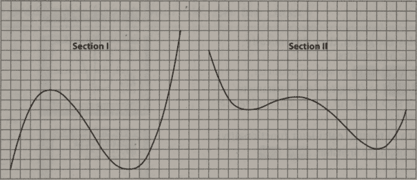

## 变换作图应用程序

变换作图应用程序® 是一个动态应用程序，允许你基于参数输入函数的一般方程，然后在参数变化时查看其图像的变化。

| 计算器命令 | 预期显示 |
|---|---|
| **启动应用程序：** `APPS`，高亮 **Transfrm**，`ENTER` | 计算器应用程序菜单，其中 **Transfrm** 被高亮显示。 |
| **输入一般方程：** `Y=`，然后输入，例如 **AX^2+BX+C**。（注意，变量系数不需要用乘号与 **X** 分隔。） | 一般方程已输入到计算器的函数编辑器中。 |
| **设置初始参数值：** `WINDOW`，调整窗口设置，输入 `.5`、`ENTER`、`1.5`、`ENTER`、`-5`、`ENTER`、`.5` | 显示初始参数值的窗口设置。 |
| **显示图像，然后动态更改参数：** `GRAPH`，使用箭头键选择参数；使用左、右箭头键按步长值更改所选参数，或使用键盘输入数值。 | 显示图像并显示参数值。 |
| **返回正常计算器功能：** `APPS`，高亮 **Transfrm**，`ENTER`，`ENTER` | 变换作图菜单，包含 **1：卸载** 和 **2：继续**。 |

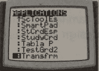

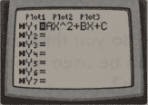

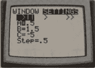

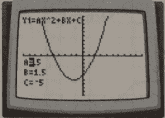

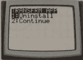

* 此应用程序预装在 TI-84 Plus 和 TI-84 Plus Silver Edition 上。TI-83 Plus 和 TI-83 Plus Silver Edition 可在德州仪器网站下载：education.ti.com/educationportal/sites/US/productDetail/us_transng_83_84.html。

## 数学总结

**在本探究中，你探索了多项式函数和表达式的一些基本性质与用途。**

- a. 什么样的表达式和函数称为多项式？
- b. 什么是多项式的次数？
- c. 什么是图像的局部最大值点和局部最小值点？多项式函数图像上这类点的个数与其规则中多项式表达式的次数有何关系？
- d. 需要使用多少个点，才能用曲线拟合工具找到拟合数据或图形模式的 $n$ 次多项式函数？

***准备好向全班解释你的想法。***

## 多项式的加法与减法

当一个小型音乐演出场所预订了一支热门乐队，如*冰与火*时，该活动的商业前景取决于门票价格如何设定。例如，如果门票价格设为 $x$ 美元，收入和支出可能如下估算。

- 门票销售收入：$t(x)=-25x^2+750x$
- 小吃吧收入：$s(x)=7{,}500-250x$
- 演唱会运营支出：$c(x)=4{,}750-125x$
- 小吃吧运营支出：$b(x)=2{,}250-75x$

## 多项式的乘法

| 多项式的乘法 | |
|---|---|
| **计算器命令** | **预期显示** |
| `F2` `ENTER`  用于输入和展开多项式表达式的计算器按键顺序。 | 参见下方计算器显示。 |

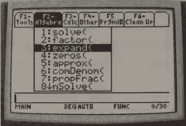

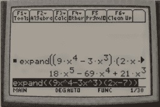

## 数学总结

在本探究中，你发现了多项式函数的因式、零点与展开形式之间的联系。

- a. 多项式乘积的次数如何由其因式的次数决定？
- b. 可以使用哪些策略来找到多项式乘积的标准形式？
- c. 多项式函数的零点与其因式的零点有什么关系？
- d. 在什么情况下，多项式函数的次数不等于其零点的个数？

*准备好向全班解释你的想法。*

## 第 1 课测验

### 试卷 A

- 1. 考虑下面显示的多项式函数图像。

  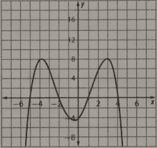

  - a. 这个多项式函数的最小可能次数是多少？解释你的推理。
  - b. 估计所有局部最大值点的坐标。
  - c. 估计所有局部最小值点的坐标。
  - d. 估计这个多项式函数的零点。

- 2. 考虑函数 $f(x)=(x^2-x)(x+5)$。

  - a. $f(x)$ 的零点是什么？
  - b. 将 $f(x)$ 写成标准多项式形式。

- 3. 考虑多项式函数 $f(x)=7x^3+x^2-4x+10$。

  - a. 写出 $g(x)$ 的多项式函数规则，使得 $f(x)+g(x)$ 的次数为 4。解释你的推理。
  - b. 写出 $h(x)$ 的多项式函数规则，使得 $f(x)-h(x)$ 的次数为 2。解释你的推理。
  - c. 写出 $p(x)$ 的多项式函数规则，使得 $f(x)\cdot p(x)$ 的次数为 6。解释你的推理。

- 4. 写出一个三次函数的规则，使其零点仅在 $(3, 0)$ 和 $(-2, 0)$ 处。解释你的推理。

- 5. Lensic 电影院的日收入取决于票价 $x$，函数为 $R(x)=x(250-5x)$。电影院的日支出与票价的关系规则为 $E(x)=1{,}250-30x$。

  - a. 求日利润的标准多项式形式的规则。
  - b. 如果票价是 \$8，日利润是多少？

### 参考答案

- 1.
  - a. 该多项式至少是 4 次，因为它有三个局部最大值或最小值点和四个 $x$ 轴截距。
  - b. 局部最大值点为 $(-3.9, 8.1)$ 和 $(2.9, 8.1)$。学生的估计应接近这些值。
  - c. 局部最小值点为 $(-0.5, -4.6)$。
  - d. 函数的零点为 $x=-5$、$x=-2$、$x=1$ 和 $x=4$。

- 2.
  - a. $f(x)$ 的零点为 $x=0$、$x=1$ 和 $x=-5$。
  - b. $f(x)=x^3+4x^2-5x$。

- 3.
  - a. 任何 4 次多项式都是正确的。
  - b. 任何以 $7x^3$ 为首项的 3 次多项式都是正确的。
  - c. 任何 3 次多项式都是正确的。

- 4. 可能的规则有两种形式：
  - $f(x)=a(x-3)^2(x+2)$，其中 $a$ 是任意实数；
  - $f(x)=a(x-3)(x+2)^2$，其中 $a$ 是任意实数。

- 5.
  - a. $P(x)=x(250-5x)-(1{,}250-30x)=-5x^2+280x-1{,}250$。
  - b. 日利润为 \$670，因为 $P(8)=670$。

### 试卷 B

- 1. 考虑下面显示的多项式函数图像。

  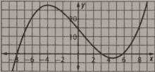

  - a. 这个多项式函数的最小可能次数是多少？解释你的推理。
  - b. 使用曲线拟合工具，找出一个模拟该图形模式的多项式函数规则。列出你用作曲线拟合基础的点。
  - 点：________________________________
  - 函数规则：________________________________

- 2. 写出标准多项式形式的等价代数表达式。

  - a. $(6x^3+3x^2-x+5)+(2x^3-3x^2-2)$
  - b. $(12x^2+7x-1)-(5+3x-2x^2)$
  - c. $(6x-5)(9x+1)$
  - d. $(x+3)(2x^2+3x+6)$

- 3. 假设 $f(x)$ 是三次函数，$g(x)$ 是二次函数。判断以下每个陈述是真还是假。在每种情况下解释你的推理。

  - a. 多项式函数 $h(x)=f(x)+g(x)$ 总是二次函数。
  - b. 如果 $k(x)=f(x)\cdot g(x)$，那么 $k(x)$ 的次数必定是 5。
  - c. 如果 $-1.6$ 是 $f(x)$ 的零点，那么 $-1.6$ 也必定是 $k(x)=f(x)\cdot g(x)$ 的零点。

- 4. 考虑函数 $c(x)=(x+5)(x-3)^2$。

  - a. $c(x)$ 的零点是什么？
  - b. $c(x)$ 的次数是多少？

- 5. 罗伯特经营两个水上乐园。他已决定两个水上乐园的门票价格应该相同。每个水上乐园的每周利润（以美元计）由以下函数规则给出，其中 $t$ 是票价。

  Raging Waters（狂野水域）：$P_r(t)=-8t^2+300t-2{,}450$

  Wonderful Waves（美妙波浪）：$P_w(t)=-8t^2+250t-1{,}800$

  - a. 写出两个水上乐园合并后每周利润的函数规则。
  - b. 如果票价是 \$16，罗伯特每周利润是多少？
  - c. 为了最大化合并后的每周利润，他应该收取多少门票价格？

### B 卷：建议解答

- **1. a.** 该多项式至少为 3 次，因为它有一个局部最大值、一个局部最小值和三个 \(x\) 截距。
- **1. b.** 学生至少需要使用 4 个点作为曲线拟合的基础。一组效果不错的点是 \((-8, 0)\)、\((-4, 27)\)、\((4.5, -2.5)\) 和 \((8, 15)\)。利用这些点，函数规则为 \(f(x) = 0.1x^3 - 0.1x^2 - 5.2x + 14.1\)。
- **2. a.** \(8x^3 - x + 3\)
- **2. b.** \(14x^2 + 4x - 6\)
- **2. c.** \(54x^2 - 39x - 5\)
- **2. d.** \(2x^3 + 9x^2 + 15x + 18\)
- **3. a.** 错误。如果两个多项式次数不同，那么多项式之和的次数总是等于被相加的多项式中的最高次数，因此这个和是三次的。
- **3. b.** 正确。两个多项式乘积的次数等于它们次数之和。
- **3. c.** 正确。如果 \(f(-1.6) = 0\)，则 \(k(-1.6) = f(-1.6) \cdot g(-1.6) = 0 \cdot g(-1.6) = 0\)。
- **4. a.** \(c(x)\) 的零点为 \(x = -5\) 和 \(x = 3\)。
- **4. b.** \(c(x)\) 的次数是 3。
- **5. a.** \(P_r(t) + P_w(t) = -16t^2 + 550t - 4,250\)
- **5. b.** 周利润为 454 美元，因为 \(P_r(16) + P_w(16) = 454\)。
- **5. c.** 为使利润最大化，票价应为 17.19 美元。

## 思考这个情境

回顾你在处理线性和二次表达式与函数时学到的各种代数推理方法，以及基于计算器或计算机的方法。

- **a.** 对于寻找用于模拟问题中的条件或数据模式的线性或二次函数规则，你可以运用哪些策略？
- **b.** 对于求解线性或二次方程与不等式的任务，你可以运用哪些策略？
- **c.** 对于求二次函数的最大值或最小值，你可以运用哪些策略？

## 代数拼图

### 问题 6

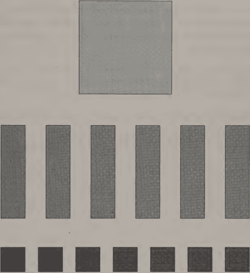

## 数学总结

在本探究中，你掌握了将标准形式的二次表达式转换为顶点形式的技能，并会利用该形式分析相应二次函数的图像。

- **a.** 像 $(x-h)^2+k$ 这样的二次表达式的顶点形式，如何用于确定相应二次函数图像上的最大值/最小值点和截距？
- **b.** 将 $x^2+bx+c$ 转换为顶点形式的关键步骤是什么？

*请准备好向全班解释你的想法。*

## 证明二次公式

### 问题 1

- **开始：** 如果 $ax^2+bx+c=0$（且 $a\ne0$），
- **第 1 步：** 那么 $\frac{ax^2}{a}+\frac{bx}{a}+\frac{c}{a}=0$。
- **第 2 步：** $x^2+\frac{b}{a}x+\frac{c}{a}=0$
- **第 3 步：** $x^2+\frac{b}{a}x=-\frac{c}{a}$
- **第 4 步：** $x^2+\frac{b}{a}x+\frac{b^2}{4a^2}=-\frac{c}{a}+\frac{b^2}{4a^2}$
- **第 5 步：** $x^2+\frac{b}{a}x+\frac{b^2}{4a^2}=\frac{b^2}{4a^2}+\frac{-c}{a}$
- **第 6 步：** $\left(x+\frac{b}{2a}\right)^2=\frac{b^2}{4a^2}+\frac{-c}{a}$
- **第 7 步：** $\left(x+\frac{b}{2a}\right)^2=\frac{b^2}{4a^2}+\frac{-4ac}{4a^2}$
- **第 8 步：** $\left(x+\frac{b}{2a}\right)^2=\frac{b^2-4ac}{4a^2}$
- **第 9 步：** $x+\frac{b}{2a}=\frac{\sqrt{b^2-4ac}}{2a}$ 或 $x+\frac{b}{2a}=\frac{-\sqrt{b^2-4ac}}{2a}$
- **第 10 步：** 所以，$x=\frac{-b}{2a}+\frac{\sqrt{b^2-4ac}}{2a}$ 或 $x=\frac{-b}{2a}-\frac{\sqrt{b^2-4ac}}{2a}$。

## 数学总结

在本探究中，你运用配方法推导出了二次公式，并练习了用该公式求解二次方程。

- **a.** 求解形如 $ax^2 + bx + c = 0$ 的方程的二次公式是什么？
- **b.** 判别式 $b^2 - 4ac$ 的值能告诉你关于二次方程 $ax^2 + bx + c = 0$ 的解的数目和类型的哪些信息？
- **c.** 函数 $f(x) = ax^2 + bx + c$ 的图像如何表明二次方程 $ax^2 + bx + c = 0$ 有 2 个、1 个或 0 个实数解？图像又能说明判别式 $b^2 - 4ac$ 的值的哪些情况？

**请准备好向全班解释你的想法。**

## 第 2 课测验

### A 卷

- **1.** 考虑下面所示的正方形和长方形集合。

  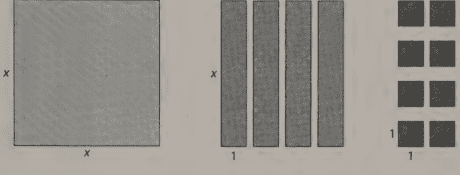

  - **a.** 上面的正方形和长方形表示什么多项式表达式？
  - **b.** 重新排列这些正方形和长方形，以帮助你写出该多项式表达式的完全平方形式。在下方画出你的重新排列方式，然后写出该多项式表达式的完全平方形式。展示或解释你的解答过程。

- **2.** 考虑二次函数 $f(x)=x^2-10x+3$。仅通过代数推理完成下列各项任务。展示你的全部解答过程以支持你的答案。

  - **a.** 将函数规则改写为顶点形式。
  - **b.** 这个函数的图像有最大值还是最小值？确定该函数图像上最大值或最小值点的坐标。
  - **c.** 这个函数图像的 x 截距坐标是多少？
  - **d.** 这个函数的 y 截距坐标是多少？

- **3.** 考虑方程 $2x^2 + 7x + c = 0$。

  - **a.** 求一个 $c$ 的值，使得方程有两个无理数解。解释你的推理。
  - **b.** 求一个 $c$ 的值，使得方程有两个有理数解。解释你的推理。
  - **c.** 求一个 $c$ 的值，使得方程有两个复数解。解释你的推理。

- **4.** 解下列每个二次方程。

  - **a.** $2x^2 + 5x + 1 = 0$
  - **b.** $(x - 7)^2 - 10 = 0$

### 第 2 课测验：A 卷 — 建议解答

- **1. a.** $x^2 + 4x + 8$

  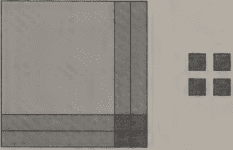

  $(x+2)^2+4$

- **2. a.** $f(x)=(x-5)^2-22$
- **2. b.** 最小值点的坐标为 $(5,-22)$。
- **2. c.** \(x\) 截距为 $(5+\sqrt{22},0)$ 和 $(5-\sqrt{22},0)$。
- **2. d.** \(y\) 截距为 $(0,3)$。
- **3. a.** 任何使 $b^2-4ac$ 为正数且不是完全平方数的 $c$ 值，都会使方程有两个无理数解。由于 $b^2-4ac>0$，$7^2-4(2c)>0$ 意味着 $c<\frac{49}{8}$。
- **3. b.** 为了使解为有理数，$b^2-4ac$ 必须是一个完全平方数。$c$ 的一些可能取值为 $c=-4$、$c=3$ 和 $c=5.21375$。

  当 $c=-4$ 时，$b^2-4ac=49-4(2)(-4)=81$。

  当 $c=3$ 时，$b^2-4ac=49-4(2)(3)=25$。

  当 $c=5.21375$ 时，$b^2-4ac=49-4(2)(5.21375)=7.29$。

- **3. c.** 任何使 $49-4(2)c<0$，即 $c>\frac{49}{8}$ 的 $c$ 值，都会使方程有两个复数解。
- **4. a.** $x=\frac{-5\pm\sqrt{25-4(2)(1)}}{4}=\frac{-5\pm\sqrt{17}}{4}$
- **4. b.** $x=7\pm\sqrt{10}$

## 第 2 课测验

### B 卷

- **1.** 给出形式为 \(y=a(x-h)^2+k\) 的函数规则，使其图像满足下列各组条件。分别解释你的推理。

  - **a.** 开口向上，且 y 截距为 6
  - **b.** 最大值点为 \((-3, 8)\)
  - **c.** x 截距为 \((2, 0)\) 和 \((8, 0)\)

- **2.** 如何使用判别式 \((b^2-4ac)\) 的值来确定 \(y=ax^2+bx+c\) 图像与 x 轴交点（x 截距）的个数？
- **3.** 将下列每个二次表达式改写为顶点形式。

  - **a.** \(x^2+16x+60\)
  - **b.** \(x^2-6x+10\)

- **4.** 解下列每个二次方程。如果解是非实数复数，请以标准形式 \(a\pm bi\) 写出解。

  - **a.** \((x+4)^2-5=0\)
  - **b.** \(3x^2-2x-1=0\)
  - **c.** \(3x^2+3x=4\)
  - **d.** \(x^2-4x+29=0\)

### B 卷：建议解答

- **1. a.** 任何满足 $6=a(0-h)^2+k$（其中 $a>0$）的方程都是正确的。例如 $y=(x-1)^2+5$。
- **1. b.** 任何形如 $y=a(x+3)^2+8$（其中 $a<0$）的方程，其最大值点都在 $(-3,8)$。
- **1. c.** 如果 $x$ 截距为 $(2,0)$ 和 $(8,0)$，那么函数规则必须具有形式 $y=a(x-2)(x-8)$。然后学生可以将该规则改写为顶点形式。若 $a=1$，$y=x^2-10x+16$。其顶点形式为 $y=(x-5)^2-9$。
- **2.** 若 $b^2-4ac>0$，则图像有 2 个 $x$ 截距。

  若 $b^2-4ac=0$，则图像有 1 个 $x$ 截距。

  若 $b^2-4ac<0$，则图像不与 $x$ 轴相交。

- **3. a.** $(x+8)^2-4$
- **3. b.** $(x-3)^2+1$
- **4. a.** $x=-4\pm\sqrt{5}$
- **4. b.** $x=-\frac{1}{3}$ 和 $x=1$
- **4. c.** $x=\frac{-3\pm\sqrt{57}}{6}$
- **4. d.** $x=2\pm5i$

## 思考这个情境

观察下面的每张门票利润图。

- a. 随着票价接近 30 美元，每张门票利润的变化模式是怎样的？
- b. 当票价定为 15 美元时，商业计划预测将售出 375 张门票。门票销售总利润预计为 2,750 美元。你将如何计算票价为 15 美元时每张售出门票的利润？你的答案在图中是如何显示的？
- c. 你将如何找到计算任意票价下每张门票利润的规则？

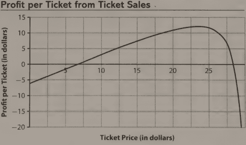

## 第 5 单元：多项式函数与有理函数

### 数学总结

在本项探究中，你探索了有理表达式的化简。

- a. 化简有理表达式是什么意思？
- b. 对于给定的有理表达式，可以运用哪些策略来找到另一个更简单但与原式几乎等价的表达式？
- c. 在化简有理表达式时必须注意哪些事项？

*请准备好向全班同学解释你的想法。*

### 数学总结

在本项探究中，你学习了如何加减有理表达式。

- a. 当两个表达式以某种特定方式相关联时，加法运算会很简单。这种关系是什么？如果满足该关系，你如何进行加法运算？
- b. 如果有理表达式之间最便捷的关系*不*成立，你可以采取什么措施使表达式的加法或减法得以进行？

*请准备好向全班同学解释你的想法。*

### 第 3 课测验

#### A 卷

- 1. 对过去几年数据的分析使喷泉山水上乐园的经营者能够根据公园门票价格 \(x\) 制定出顾客数量 \(n(x)\) 和总利润 \(p(x)\) 的函数规则。

  \(n(x)=300-10x\)

  \(p(x)=-10x^2+350x-2{,}000\)

  - **a.** 写出以门票价格 \(x\) 表示的每位顾客利润的代数规则。
  - **b.** 估算使每位顾客利润最大化的门票价格。水上乐园每人将获得多少利润？
  - **c.** 你从第 a 部分得到的规则图像是否会有任何垂直渐近线？如果有，请描述它们。如果没有，请解释原因。

- 2. 考虑表达式 \(\frac{x^2-4x+5}{x+5}\)。

  - **a.** 找出使该表达式无定义的所有值。解释你的推理。
  - **b.** 该表达式能否化简？如果能，请化简该表达式。如果不能，请解释原因。

### 一种用于音乐对齐的动态时间规整新算法

**匿名作者**  
单位  
地址  
电子邮件

#### 摘要

动态时间规整（DTW）是对齐两个序列的常用方法，广泛用于音频对齐、生物信息学等领域。传统 DTW 需要 \(O(N^2)\) 的时间和空间，这限制了其在大规模数据上的应用。本文提出一种新算法，将时间复杂度降低至 \(O(N \log N)\)，同时保持高精度。我们在音乐对齐任务上评估了该算法，并证明了其相对于现有方法的优越性。

#### 1. 引言

时间序列数据的对齐是许多领域的基本问题。例如，在音乐信息检索中，将演奏与乐谱对齐可实现乐谱跟随和自动伴奏等应用。最广泛使用的方法是动态时间规整（DTW），它在特定约束条件下计算两个序列之间的最优对齐。然而，经典 DTW 算法具有二次方的时间和空间复杂度，这使得它难以处理长序列。

近年来的工作尝试通过近似方法或并行计算来加速 DTW。这些方法往往牺牲精度或依赖特定硬件。相比之下，我们的算法以显著更低的复杂度提供精确解。主要思想是结合分治策略与快速距离计算。

本文其余部分组织如下。第 2 节回顾经典 DTW 算法及其变体。第 3 节详细介绍我们提出的算法。第 4 节描述实验设置和结果。第 5 节总结全文并讨论未来工作。

#### 2. 预备知识

设 \(X = (x_1, x_2, ..., x_n)\) 和 \(Y = (y_1, y_2, ..., y_m)\) 为两个序列。规整路径 \(P = (p_1, p_2, ..., p_k)\) 是索引对 \(p_t = (i_t, j_t)\) 的序列，满足以下条件：

$$
\begin{aligned}
\text{(1)}&\quad p_1 = (1,1),\quad p_k = (n,m) \\
\text{(2)}&\quad 0 \le i_{t+1}-i_t \le 1 \quad \text{and} \quad 0 \le j_{t+1}-j_t \le 1 \\
\text{(3)}&\quad \text{No two consecutive steps are both diagonal.}
\end{aligned}
$$

路径的代价定义为对齐元素之间距离的总和。DTW 距离是所有有效规整路径中的最小代价，可通过动态规划计算：

#### 参考文献

[1] H. Sakoe and S. Chiba. Dynamic programming algorithm optimization for spoken word recognition. *IEEE Transactions on Acoustics, Speech, and Signal Processing*, 26(1):43–49, 1978.

[2] D. Ellis and G. Poliner. Identifying cover songs with chroma features and dynamic programming. In *Proc. ISMIR*, 2007.

- 算我一个
- 我还是不了
- 我拿不定主意
- 我乐意参加
- 我无所谓
- 我愿意

- 4. 假设一种氨溶液由 15 加仑水和 4 加仑氨混合而成。再向混合物中加入 \(x\) 加仑的氨。

  - a. 用含 \(x\) 的式子表示，现在混合物中有多少加仑的氨？
  - b. 用含 \(x\) 的式子表示，现在液体的总体积是多少加仑？
  - c. 混合物中氨的浓度定义为氨的体积与液体体积之比。这是加入混合物的氨的加仑数 \(x\) 的函数。求 \(C(x)\) 的公式，即混合物中氨的浓度。
  - d. 求第 c 部分中 \(C(x)\) 的水平渐近线方程。解释该渐近线对混合物的含义。

- 5. 将下列每个和、差、积或商写成等价形式的单个代数分式，然后尽可能化简结果。

  - a. \(\frac{6x+1}{8x-2}+\frac{2x-17}{8x-2}\)
  - b. \(\frac{7x+12}{x+1}-\frac{3x+8}{x+1}\)
  - c. \(\frac{x+5}{x-2}+\frac{3x+1}{x}\)
  - d. \(\frac{3x}{x+5}\cdot\frac{5}{12x}\)
  - e. \(\frac{x+7}{x}\div\frac{2x+14}{x}\)
  - f. \(\frac{15x}{x+5}\cdot\frac{x^2+10x+25}{6x^2}\)

### 第 3 课测验

#### B 卷：参考答案

- 1.
  - a. \(f(x)\) 的定义域是除 8 和 0 之外的所有实数。
  - b. 图像的唯一 \(x\) 截距是 \((−1, 0)\)。该 \(x\) 截距的 \(x\) 坐标是函数分子的零点，但不是函数分母的零点。
  - c. 在 \(x = 0\) 处只有一条垂直渐近线。0 是唯一一个为分母零点但不是分子零点的值。

- 2.
  - a. \((x − 5) / 10\)
  - b. 不能。它们在 \(x = −5\) 处不等价。原表达式在 \(x = −5\) 处无定义，但化简后的表达式在 \(x = −5\) 时等于 \(−1\)。

- 3. 答案会有所不同。学生应提供一个形如 \(f(x) = p(x) / ((x − a)(x − b))\) 的有理函数，使得 \((x − a)\) 和 \((x − b)\) 都不是 \(p(x)\) 的因式。在这种情况下，\(x = a\) 和 \(x = b\) 是垂直渐近线。

- 4.
  - a. \(x + 4\)
  - b. \(x + 15\)
  - c. \(C(x) = (x + 4) / (x + 15)\)
  - d. 水平渐近线是 \(C(x) = 1\)，表示 100% 的氨。随着越来越多的氨被加入溶液，即当 \(x\) 变大（\(|x| \to \infty\)）时，氨的浓度趋近于 100%。

- 5.
  - a. \((8x − 16) / (8x − 2) = (4x − 8) / (4x − 1)\)
  - b. \((4x + 4) / (x + 1) = (4(x + 1)) / (x + 1) = 4\)
  - c. \(x(x + 5) / (x(x − 2)) + ((x − 2)(3x + 1)) / (x(x − 2)) = (x^2 + 5x + 3x^2 − 5x − 2) / (x(x − 2)) = (4x^2 − 2) / (x^2 − 2x)\)
  - d. \(5 / (4(x + 5)) = 5 / (4x + 20)\)
  - e. \(1/2\)
  - f. \(5(x + 5) / (2x) = (5x + 25) / (2x)\)

### 数学总结

在本单元中，你使用多项式和有理函数对问题情境进行建模，并加深了对这些函数族某些性质的理解。你还学习了如何对多项式和有理表达式进行加、减、乘运算。

- a. 哪些类型的函数被称为：
  - i. 多项式函数？
  - ii. 有理函数？
- b. 描述你如何确定：
  - i. 多项式的次数。
  - ii. 多项式函数图像上的局部最大值点或局部最小值点。
  - iii. 多项式函数的零点。
  - iv. 两个多项式的和或差。
  - v. 两个多项式的积。
- c. 二次函数的顶点式是什么？
  - i. 使用这种形式有哪些优点和缺点？
  - ii. 你会如何将任何形如 ax² + bx + c 的二次表达式转换为顶点式？

### 单元总结

在本单元中，你学习了如何使用多项式和有理函数及方程来表示和分析各种数量模式与关系。你还拓展了处理二次函数、表达式和方程的能力，以及处理将二次函数和反比例函数推广为多项式和有理函数的代数表达式和函数的能力。

- **1.** 给出一个多项式函数 f(x) 的标准表达式和因式分解表达式，该函数在 −3、1 和 2 处有零点。指出所涉及多项式的次数。
- **2.** 给出 (1) 中多项式函数 f(x) 图像上所有局部最大值点和局部最小值点的坐标。解释你是如何找到每个局部最大值/最小值点的。
- **3.** 使用 (1) 中的多项式 f(x) 和 g(x) = 3x² + 7x − 4，求下列 f(x) 与 g(x) 组合的最简标准多项式表达式。指出每个结果的次数。
  - f(x) + g(x) =
  - f(x) − g(x) =
  - f(x) · g(x) =
- **4.** 解释多项式 p(x) 的次数与以下内容有何关系。
  - p(x) 的零点个数：
  - p(x) 的局部最大值/最小值点个数：
- **5.** 给出二次多项式 q(x) 的顶点式，其图像的最小值点为 (3, −5)，并且是 y = x² 的平移。
- **6.** 给出 q(x) 图像与 y 轴交点的坐标。
- **7.** 使用 q(x) 的顶点式解方程 q(x) = 11。
- **8.** 求下列函数的等价顶点式。
  - \(p(x)=x^2-6x+11\)
  - \(s(n)=n^2-n-3\)
- **9.** 给出具有整数系数的二次方程的例子，这些方程具有：
  - 两个不同的整数解。
  - 两个不同的无理数解。
  - 两个不同的复数解。
  
  *指出每种情况下的解。*
- **10.** 考虑有理函数 \(f(x)=\frac{x^2+2x-3}{x^2-9}\)。
  - 描述 \(f(x)\) 的定义域。
  - 画出 \(f(x)\) 的草图。给出所有垂直渐近线的方程。估计所有局部最大值和/或最小值点的坐标。
  - 化简 \(f(x)\) 的规则所对应的有理表达式。描述其定义域。
- **11.** 假设 \(f(x)=\frac{x^2+2x-3}{x^2-9}\) 且 \(g(x)=\frac{x-1}{x-3}\)。说明如何求下列各函数的最简有理表达式。
  - \(f(x)+g(x)=\)
  - \(f(x)-g(x)=\)
  - \(f(x) \cdot g(x) =\)
  - \(f(x) \div g(x) =\)
- **12.** 解释解决下列与有理函数相关问题的通用策略。
  - **求定义域：** ________________________________________________
    ________________________________________________
    ________________________________________________
  - **求垂直渐近线方程：** __________________________
    ________________________________________________
    ________________________________________________
  - **求和与差：** _____________________________________
    ________________________________________________
    ________________________________________________
  - **求积：** ________________________________________________
    ________________________________________________
    ________________________________________________
  - **求商：** _______________________________________________
    ________________________________________________
    ________________________________________________

### 单元测试

#### A 卷

- **1.** 美国邮政署只接受长度与围长（环绕距离）之和不超 108 英寸的国内运输箱子。假设你想求出一个具有正方形端面且体积最大的箱子的尺寸。

  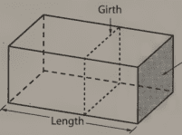

  - a. 解释为什么箱子的体积可以表示为 \(V(x)=x^2(108-4x)\)，其中 \(x\) 是箱子正方形端面的边长。
  - b. 将 \(V(x)\) 写成标准多项式形式。
  - c. 这个体积函数的次数是多少？
  - d. 这个函数的零点是什么？
  - e. 确定最大体积以及具有最大体积的箱子的尺寸。
- **2.** 将每个描述与适当的方程匹配。
  - a. 一个四次多项式函数
  - b. 一个渐近线为 x = 2 的有理函数
  - c. 一个有一个局部最大值的多项式函数
  - d. 一个恰有一个实数零点的二次函数
  - e. 一个在 x = 3 时无定义的有理函数

  - I. \(y=\frac{x+2}{x^2-4}\)
  - II. \(y=\frac{x}{x^2-2x-3}\)
  - III. \(y=2x^2(x-3)\)
  - IV. \(y=(x+2)(-x^3-3x^2)\)
  - V. \(y=(x^2+2x+1)+(x^2-5x-6)\)
  - VI. \(y=\frac{x-2}{x^2-2x}\)
  - VII. \(y=(x+1)^2\)
- **3.** 考虑二次函数 \(f(x)=x^2+6x-4\)。
  - a. 将函数规则改写为顶点式。
  - b. 确定该函数图像的最大值点或最小值点的坐标。
  - c. 解方程 \(x^2+6x-4=0\)。
- **4.** 将每个和或差改写为标准多项式形式。
  - a. \((5x^3+3x^2-4)+(x^4-3x^2+10)\)
  - b. \((15-3x^3+4x)-(5x^3+8)\)
- **5.** 将每个和或差写成最简形式。
  - a. \(\frac{x-7}{x-5}+\frac{2x-8}{x-5}\)
  - b. \(\frac{4x^2+6x}{x+3}-\frac{x^2}{x+3}\)
  - c. \(\frac{x+4}{x}-\frac{3}{x-4}\)
- **6.** 将每个积或商改写为等价的更简形式。
  - a. \((x^2+5x)(3x^2-6)\)
  - b. \((x+1)(2x^2+5x+3)\)
  - c. \(\frac{x^2-6x}{4}\cdot\frac{12x}{x-6}\)
  - d. \(\frac{3x^2-21x}{5x^2}\div\frac{x^2-2x-35}{10x}\)
- **7.** Tran 用计算器观察 \(f(x)=\frac{x^2+7x+6}{x+1}\) 的图像。当他看到一条直线的图像时，感到很惊讶。
  - a. 解释为什么这个函数的图像看起来像一条直线。
  - b. 这个函数的图像真的是一条直线吗？解释。

#### A 卷——建议答案

- **1.**
  - **a.** 箱子的围长为 4x。因此，最大长度必须是 108 − 4x。箱子一个端面的面积是 x²。由于体积等于端面面积乘以长度，所以体积为 x²(108 − 4x)。
  - **b.** V(x) = −4x³ + 108x²
  - **c.** 3
  - **d.** 零点是 0 和 27。
  - **e.** 箱子的最大体积为 11,664 in³。这个箱子的尺寸是 18 in. × 18 in. × 36 in.
- **2.**
  - **a.** IV
  - **b.** I
  - **c.** III
  - **d.** VII
  - **e.** II
- **3.**
  - **a.** f(x) = x² + 6x + 9 − 4 − 9
  
    f(x) = (x + 3)² − 13
  - **b.** 最小值点的坐标为 (−3, −13)。
  - **c.** x = [−6 ± √(6² − 4(1)(−4))] / [2(1)] = −6/2 ± √52/2 = −3 ± √13
- **4.**
  - **a.** x⁴ + 5x³ + 6
  - **b.** −8x³ + 4x + 7
- **5.**
  - **a.** (3x − 15)/(x − 5) = 3(x − 5)/(x − 5) = 3
  - **b.** (3x² + 6x)/(x + 3)
  - **c.** (x² − 3x − 16)/(x² − 4x)
- **6.**
  - **a.** 3x⁴ + 15x³ − 6x² − 30x
  - **b.** 2x³ + 7x² + 8x + 3
  - **c.** 3x²
  - **d.** 6/(x + 5)
- **7.**
  - **a.** 它看起来像一条直线，因为 f(x) = (x² + 7x + 6)/(x + 1) 的化简形式是 f(x) = x + 6，而这是线性函数的规则。
  - **b.** 这个图像并不真的是一条直线，因为原函数在 x = −1 时无定义。但线性函数的定义域是所有实数。

### 单元测试

#### B 卷

- **1.** 艾米莉正在看一个图像，该图像在 \((-1, 4)\) 处有一个局部最大值，并在 \((-5, -6)\) 和 \((3, -6)\) 处有局部最小值。

  - **a.** 在右侧的网格上，画出一个图像，显示具有这些特征的多项式函数的形状。
  - **b.** 这可能是三次函数的图像吗？解释你的推理。

  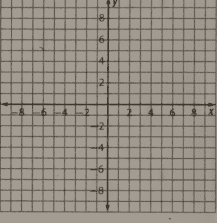

- **2.** 写出一个有两个非实复数解的二次方程。

- **3.** 考虑二次函数 \(f(x) = -4(x + 2)^2 + 9\)。

  - **a.** 该函数图像的顶点是最大值还是最小值？你如何在不看函数图像的情况下确定这一点？
  - **b.** 求该函数图像顶点的坐标。
  - **c.** 求该图像 \(x\) 轴截距的坐标。
  - **d.** 求该图像 \(y\) 轴截距的坐标。
  - **e.** 用标准多项式形式写出函数法则。

- **4.** Outpost Packaging 公司受委托设计一个金属容器，其长方形底面的长度是宽度的两倍。此外，该容器的体积必须为 1,000 cm³。

  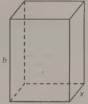

  - **a.** 解释为什么珍妮可以使用公式 \(h=\frac{500}{x^2}\) 来确定宽度为 \(x\) cm 的容器所需的高度。
  - **b.** 制作容器顶部和底部的材料每平方厘米花费 5 美分。制作容器侧面的材料每平方厘米花费 2 美分。验证公式 \(C(x)=\frac{20x^3+6,000}{x}\) 表示制作满足这些条件的盒子所需材料的总成本（以美分为单位）。（你将需要使用 a 部分中关于 \(h\) 的公式。）
  - **c.** b 部分中的成本函数是有理函数、多项式函数，还是两者都不是？解释你的推理。
  - **d.** 确定满足这些条件的盒子的最低成本。成本最低的盒子的尺寸是多少？
  - **e.** 成本函数的图像是否有任何垂直渐近线？解释你的推理。

- **5.** 将表达式 \(x^2 + 8x - 10\) 改写为顶点式。

- **6.** 将每个和或差改写为等价的更简形式。

  - **a.** \((3x^3 - 8x^2) + (7x^3 - 3x^2 + 5)\)
  - **b.** \((x^2 + 10x + 11) - (3x^2 - 5x + 4)\)
  - **c.** \(\frac{2x+5}{x-1} + \frac{x-6}{x-1}\)
  - **d.** \(\frac{15}{3x+5} - \frac{5-6x}{3x+5}\)
  - **e.** \(\frac{x^2+2}{x+4} + \frac{9}{x}\)

- **7.** 将每个积或商改写为等价的更简形式。

  - **a.** \((5x + 2)(x^2 + 6x - 8)\)
  - **b.** \(\frac{x}{x^2+5x} \div \frac{x}{x^2-25}\)
  - **c.** \(\frac{x^2+7x+12}{4x+12} \cdot \frac{x+5}{x+4}\)

### 家庭评估

- **1.** 两个主要力决定热气球上升或下降：升力和由重力引起的阻力。球形气球所受以磅为单位的力 \(F\) 的公式为

  \[
  F=\frac{4}{3}\pi bR^3-4\pi wR^2-c,
  \]

  其中 \(R\) 是气球的半径（英尺），\(b\) 是升力（磅/立方英尺），\(w\) 是阻力（磅/平方英尺），\(c\) 是包括吊篮及其乘员在内的设备重量（磅）。

  - **a.** 假设 \(w\) 和 \(c\) 都是正数，解释为什么 \(F\) 公式中的最后两项前面带有负号。
  - **b.** 气球上升还是下降取决于 \(F\) 是正还是负。忽略设备重量，即假设 \(c=0\)。使气球保持稳定（既不上升也不下降）的最小半径 \(R\) 用 \(b\) 和 \(w\) 表示是什么？展示或解释你的工作。
  - **c.** 假设对于某个气球，\(b=0.1\,\text{lb/ft}^3\)，\(w=0.2\,\text{lb/ft}^2\)。要提升重 \(c=750\) 磅的设备，所需气球的最小半径是多少？

- **2.** 求方程的三个实数或非实复数解

  \[
  x^3-2x^2+26x=0.
  \]

- **3.** 为下图确定一个可能的函数法则。两个坐标轴上的刻度均为 1。\(x\) 轴截距似乎是 \(\frac{1}{2}\) 和 2。解释图像的特征如何帮助你确定这个函数法则。

  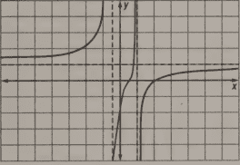

  函数法则：______________________________

#### 参考答案

- **1.**

  - **a.** 这些项表示将气球向下拉的力。
  - **b.** 解 \(\frac{4}{3}\pi bR^3 - 4\pi wR^2 = 4\pi R^2\left(\frac{bR}{3}-w\right)=0\)。由于 \(4\pi R^2>0\)，因此 \(R=\frac{3w}{b}\)。
  - **c.** 解 \(\frac{4}{3}\pi R^3(0.1)-4\pi R^2(0.2)-750\ge0\)。求该图像的 \(x\) 轴截距可知，气球的最小半径约为 14.51 英尺。

- **2.** 由于 \(x^3-2x^2+26x=x(x^2-2x+26)\)，我们知道 \(x=0\) 是方程的一个解。另外的解将是 \(x^2-2x+26=0\) 的解。它们是 \(1\pm5i\)。因此，三个解是 \(x=0\)、\(x=1+5i\) 和 \(x=1-5i\)。

- **3.** 零点在 \(x=2\) 和 \(x=0.5\) 处，因此分子可能是 \((x-2)(2x-1)\)。水平渐近线是 \(y=1\)，因此分子和分母的次数相等，且它们的首项系数相等。在 \(x=1\) 和 \(x=-0.5\) 处有垂直渐近线，因此分母可能是 \((x-1)(2x+1)\)。方程 \(y=\frac{(x-2)(2x-1)}{(x-1)(2x+1)}\) 是一个不错的选择，并且可以通过检查图像上的其他点来验证。

### 项目：体积与压强

#### 目的

在本单元以及之前的单元中，你已经在各种现实世界应用中使用了代数模型。在这个项目中，你将探索一个涉及体积和压强的此类应用，这是物理学中两个重要的变量。

#### 说明

当发动机的活塞旋转时，它会压缩和释放腔室中的空气。当火花塞点燃气体时，压缩的空气和燃料混合物比未压缩的混合物产生更大的力。为了模拟活塞的压缩，本项目将探索连接压力传感器的 60 立方厘米（cc）注射器中体积与压强之间的关系。注射器内的空气没有出口。

- **1.** 使用注射器和压力传感器，收集你自己的数据，以帮助你确定注射器中空气体积与压强之间的关系。如果你无法收集自己的数据，右侧表格给出了注射器每隔 5 cc 的压强读数。额外的 3 cc 体积用于计入连接管中的空气体积。绘制 \((体积, 压强)\) 数据的散点图。

- **2.** 当体积继续减小时，你预期压强会发生什么变化？这告诉你关于 \((体积, 压强)\) 数据的图像什么信息？

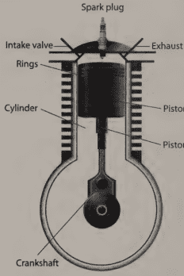

| 体积（cc） | 压强 |
|---:|---:|
| 63 | 0.448 |
| 58 | 0.487 |
| 53 | 0.526 |
| 48 | 0.577 |
| 43 | 0.638 |
| 39 | 0.716 |
| 33 | 0.823 |
| 28 | 0.963 |
| 23 | 1.190 |
| 18 | 1.530 |

- **3.** 如果不是推入注射器的活塞，而是拉出活塞（假设注射器足够长），你预期压强会发生什么变化？如果有注射器可用，尝试这样做并检验你的猜想。你的猜想应如何反映在 \((体积, 压强)\) 数据的图像中？

- **4.** 找出你认为最拟合数据的代数模型。

- **5.** 将你的模型与散点图绘制在同一屏幕上。解释任何渐近线的意义。

- **6.** 写一份报告，包括你对上述第 1–5 项的完整回答。在你的报告中，包含将你在第 5 项中得到的关系与玻意耳定律进行比较。玻意耳定律指出，理想气体将满足方程 \(PV = nRT\)，其中 \(P\) 是压强，\(V\) 是体积，\(n\) 是摩尔数，\(T\) 是气体温度，\(R\) 是气体常数。此外，包含一个总结，讨论上述各部分中的想法如何相互联系。

### 项目
#### 色多项式

**目的**

在之前的课程中，你可能已经学习过如何通过对顶点-边图进行着色来帮助解决问题。你很可能发现，你和同学经常对同一个图作出不同的着色。在本项目中，你将研究用 *k* 种颜色对一个图进行着色的方法数。

**说明**

网络或顶点-边图的一个 *k*-着色，是将 *k* 种颜色分配给顶点，使得由一条边相连的两个顶点不具有相同颜色。过去，你们已经探讨过使用最少颜色数进行着色的存在性。（见课程1，第4单元，第2课。）右图展示了用3种颜色对一个4顶点图进行着色的两种不同方式。如果至少有一个顶点的颜色不同，则两种着色不同。

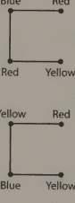

- **1.** 下图所示的图有多少种不同的3-着色？解释你的推理。

  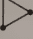

- **2.** 给出图 *G* 的 *k*-着色数量的函数称为色多项式，记作 $C_G(k)$。思考下面两个图的色多项式。

  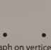
  4个顶点且无边的图

  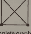
  4个顶点的完全图（每两个顶点之间都有边）

  - **a.** 设 *G* 是一个有4个顶点且无边的图。解释为什么一个有4个顶点且无边的图 *G* 的色多项式是 $C_G(k)=k^4$。
  - **b.** 解释为什么4个顶点的完全图 *G* 的色多项式是 $C_G(k)=k(k-1)(k-2)(k-3)$。这个多项式的零点是什么？解释为什么对于这些 *k* 值，色多项式必须为零。
  - **c.** 一个有 *p* 个顶点且无边的图 *G* 的色多项式是什么？一个有 *p* 个顶点的完全图 *G* 的色多项式是什么？

- **3.** 求下列每个4顶点图的色多项式。

  

  

- **4.** 下图是一个长度为4的环。长度为4的环的色多项式为 \(k^4 - 4k^3 + 6k^2 - 3k\)。

  

  给出一个能说明该多项式正确的论证。

- **5.** 制作一张图表，展示1个、2个、3个和4个顶点的所有可能图及其对应的色多项式。（提示：3个顶点上有4种可能的图，4个顶点上有11种可能的图。）

- **6.** 构造至少三个不同的5顶点图，并能够确定它们的色多项式。给出色多项式的清晰论证。

- **7.** 写一份报告，包括你对第1—6项的完整回答。清楚解释你完成每一项所用的推理。你的绘图应整洁准确。包含一个总结，讨论你对如何求一个图的色多项式的观察和想法。

### 项目
#### 建议解答
**色多项式**

学生可以独自或两人一组完成本项目。在学生开始本项目之前，你可能希望花一些时间介绍或复习计数乘法原理。每个图都有一个相关的*色多项式*。使用计数乘法原理，对于最多4个顶点的图，这些多项式相当容易求出。然而，很容易构造一个5顶点图，其色多项式复杂且难以论证。存在一种用于计算任意图 G 的色多项式的递归算法。该算法表明每个图都有色多项式。然而，哪些多项式有对应的图，在数学中仍是一个未解问题。对于准备好接受挑战的学生，应鼓励他们研究一些图论教材中描述的、用于计算色多项式的递归算法：$C_G(k)=C_{G-e}(k)-C_{G/e}(k)$，其中 $G-e$ 是删除边 $e$ 后得到的图，$G/e$ 是将 $e$ 的两个顶点合并（视为一个）后得到的图。

**建议时间安排**

给学生几天时间完成第1—6项。让他们以草稿形式提交解答。检查他们的草稿并提供反馈。当你确信他们的解答基本正确后，给他们几天时间准备报告草稿。在他们及时得到你对其草稿的反馈后，他们应该能在再过几天内完成最终报告。

**解答**

- **1.** 给定图有6种不同的3-着色。从任意顶点开始；给该顶点着色有3种选择。然后，对于下一个被选中的顶点有2种可能的颜色，而最后一个顶点必须使用剩余的颜色着色。这样得到6种可能的3-着色。有些学生可能选择展示全部6种可能性。在这种情况下，要确保他们能论证自己列出了所有可能的3-着色。

- **2.**
  - **a.** 由于每个顶点都可以分配 $k$ 种颜色中的任意一种，因此有 $k^4$ 种可能的分配。因此，4个顶点的空图（无边图）的色多项式是 $C_G(k)=k^4$。
  - **b.** 从任意顶点开始；选择 $k$ 种颜色中的一种。选择第二个顶点。由于它与第一个顶点相邻，因此可以用 $(k-1)$ 种颜色给它着色。选择其中一种颜色。第三个顶点可以用 $(k-2)$ 种颜色着色，第四个顶点可以用 $(k-3)$ 种颜色着色。因此，4个顶点的完全图的色多项式是 $C_G(k)=k(k-1)(k-2)(k-3)$。这个多项式的零点是0、1、2和3，这表明如果只使用0、1、2或3种颜色，则不存在着色。
  - **c.** 有 $p$ 个顶点且无边的图：$C_G(k)=k^p$；有 $p$ 个顶点的完全图：$C_G(k)=k(k-1)(k-2)\cdots(k-p+1)$。

### 标准化考试练习
#### 练习集

解答每一题。然后记录与正确答案对应的字母。

- **1.** 如果 $a>0$ 且 $b>0$，且经过 $(-2a,a)$ 和 $(b,3a)$ 的直线的斜率为2，那么下列哪一项是用 $a$ 表示 $b$ 的表达式？(a) $-a$ (b) $-2a$ (c) $-2a-2$ (d) $3a$ (e) $4a$

- **2.** 奥利维娅正在筹划数学俱乐部的年度野餐。她可以从3种肉类选择、4种蔬菜和5种饼干中选择。她可以选出多少种不同的菜单，每种菜单包含一种肉、一种蔬菜和一种饼干？(a) 12 (b) 17 (c) 23 (d) 35 (e) 60

- **3.** 在右图的 $\triangle PQR$ 中，如果 $y=35^\circ$，那么 $x$ 的值是多少？(a) $30^\circ$ (b) $35^\circ$ (c) $40^\circ$ (d) $45^\circ$ (e) $50^\circ$

  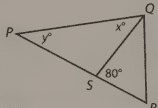

- **4.** 一所学校的荣誉学会有150名成员。其中有70名男生和80名女生，其中40名是三年级学生，110名是四年级学生。该学会中四年级女生的最小可能人数是多少？(a) 0 (b) 20 (c) 40 (d) 60 (e) 80

- **5.** 什么值同时满足 $|3x-4|=5$ 和 $|1-2x|=5$？(a) $-2$ (b) $-\frac{1}{3}$ (c) $1$ (d) $3$ (e) $5$

- **6.** 如果 $p+q=5$ 且 $2pq=8$，那么 $p^2+q^2$ 是多少？(a) 1 (b) 3 (c) 9 (d) 13 (e) 17

- **7.** 如果 \(\sqrt{k}\) 是整数，下列哪些必定是整数？I. \(\sqrt{\frac{k}{4}}\) II. \((\sqrt{5k})^2\) III. \(\sqrt{9k}\) (a) 无 (b) 仅 I 和 II (c) 仅 I 和 III (d) 仅 II 和 III (e) I、II 和 III

- **8.** 如果 \(m^2 - 4n^2 = 32\) 且 \(m + 2n = 8\)，那么 \(m - 2n\) 的值是多少？(a) \(-4\) (b) \(\frac{1}{4}\) (c) 2 (d) 4 (e) 16

- **9.** 在图中，\(\overline{AD} \parallel \overline{HE}\) 且 \(\overline{BH} \parallel \overline{DF}\)。下列哪一个四边形是平行四边形？(a) ADEH (b) CDFG (c) BDEH (d) BDFH (e) CDEG

  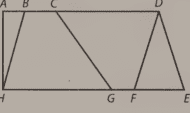

- **10.** 售出的汽车中大约25%是红色的。迈克尔正在观察从他家旁驶过的汽车。他必须至少观察三辆车经过才能看到一辆红色汽车的概率是多少？(a) 0.140625 (b) 0.25 (c) 0.4375 (d) 0.5625 (e) 0.75

#### 考试技巧

**对二次表达式进行因式分解往往能使问题变得清晰。**

大学入学考试命题者认为，学生能够分解几个简单的二次表达式（如 \(ax^2 + bx\)、\(x^2 + 2ax + a^2\) 和 \(x^2 - y^2\)）很重要。然而，你很少被直接要求进行因式分解。相反，你被问的问题一旦你看出其中涉及二次表达式的因式分解，就会变得简单。

**示例** 回顾第8题。要使用因式分解，注意在 \(m^2 - 4n^2 = 32\) 中，左边表达式是平方差，即 \(m^2\) 与 \((2n)^2\) 的差。因此，\(m^2 - 4n^2 = (m + 2n)(m - 2n) = 32\)。由于 \(m + 2n = 8\)，所以 \(m - 2n = 4\)。因此，答案是 (d)。

如果可能，在练习集中找出另一道该策略可能有所帮助的测试题。

## 目录

- 第1单元 推理与证明
- 第2单元 不等式与线性规划
- 第3单元 相似与全等
- 第4单元 样本与变异
- 第5单元 多项式函数与有理函数
- 第6单元 圆与圆函数
- 第7单元 递归与迭代
- 第8单元 反函数

请访问我们的网站 www.glencoe.com

Macmillan/McGraw-Hill  
Glencoe

麦格劳-希尔公司

ISBN: 978-0-07-890725-8  
MHID: 0-07-890725-X

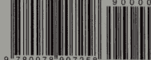

9 780078 907258

www.glencoe.com

P2-BGC-06+

