# 恒河猴母亲乳汁中的皮质醇浓度与儿子（而非女儿）的自信性情相关

- **增刊编辑**：Herb Brody
- **副编辑**：Michelle Grayson
- **文字编辑**：Tony Scully
- **制作编辑**：Donald McDonald
- **美术编辑**：Wes Fernandes
- **图片研究员**：Madeline Hutchinson
- **生产控制**：Emilia Orviss
- **网络制作**：Terhi Raukko
- **赞助**：Reya Silao, Stephen Russell, Yvette Smith, Gerard Preston
- **市场营销**：Elena Woodstock, Hannah Phipps
- **项目经理**：Helen Anthony
- **杂志编辑**：Tim Appenzeller
- **执行编辑**：Nick Campbell
- **主编**：Philip Campbell

食物。我们对它的需求是原始的，但我们与食物的关系复杂且不断变化。对发达国家的许多人来说，进食已成为一种休闲追求，烹饪则是一种爱好。但我们的身体仍为更严酷的世界而天生设定——在那里，食物意味着生存。例如，我们的味觉进化成抵御毒素的前线防御，以及帮助探测能量最丰富食物的传感器。然而，我们天生对甜食和脂肪的渴望，如今似乎正把我们引向身体毁灭之路。

食物对人的影响因人而异。当前营养研究涉及超越成分层面，试图理解食物在遗传和表观遗传层面的影响。从我们吃下的第一口奶，到盛宴与饥荒；我们的基因影响我们的饮食，而营养素——或营养素的缺乏——影响基因表达。

食物和文化的地区差异在我们的基因组上留下了印记。在世界各地，人群已适应其饮食，以充分利用当地资源。在某些情况下，一种食物可以抵御致命感染，使那些能够容易消化它的人获得选择优势。营养也引导了我们物种的进化。

只有*智人*和我们已灭绝的类人猿近亲曾使用火来加工生食，从而创造出更安全、更易消化且更美味的食谱。结合工具的使用以及杂食、广泛的食欲，烹饪的出现提高了代谢的能量产出，并供养了我们不断增大的大脑。

由于食物充满复杂的、具有生物活性的分子，它对我们的健康产生影响并不令人意外。然而，厘清每种成分对身体的影响是一项艰巨任务，而且在未来许多年里仍将继续。有人预测将迎来根据个人能量需求和疾病易感性定制饮食的时代。但无论科学多么出色，或我们多么善于把食物用作促进健康的工具，在未来一段时间里，我们仍会为了愉悦而进食。

我们很高兴感谢雀巢研究中心在制作本期《展望》时提供的资金支持。一如既往，*《自然》*对所有编辑内容承担全部责任。

**Michelle Grayson**  
*《自然·展望》副编辑。*

## 跨学科研究

## 餐桌上的大科学

*研究人员正在采用生物信息学和药物研发的工具，来研究和解读关于饮食与基因相互作用且不断增长的数据。*

**作者：LUCAS LAURSEN**

José Ordovas 在西班牙马德里一家气氛慵懒的咖啡馆里啜饮薄荷茶。他一边查看两部手机，一边确认接下来的预约。交谈中，他在西班牙语和英语之间自如切换，以找到恰当的表达。如果这位遗传学家看起来与其他顾客不在同一频率上，他可以归咎于时差：他刚从波士顿飞来，那里现在是凌晨5点。这是他本月第三次海外之行，但 Ordovas 辩称，他从任职的塔夫茨大学频繁前往欧洲并没有不良影响。他说：“对我来说，时差不成问题。我在家时反正也会凌晨4点起来给欧洲打电话，然后又会熬夜与加利福尼亚通话。”

Ordovas 体现了“大科学”方法的忙碌喧嚣，这种方法在过去十年里改变了营养研究。这个领域曾局限于小型研究团队，研究单一营养素——如特定维生素或蛋白质——对几十名志愿者的影响；如今它正采用为遗传学和药物研究开发的重量级工具。它还有一个朗朗上口的名字：营养基因组学。研究人员越是了解我们的基因如何与饮食相互作用，就越能体会跨学科方法所带来的更深洞察。这类知识可能带来突破，帮助我们理解糖尿病和心血管疾病的风险因素（见第S10页“可食用的建议”），或者例如改进减重饮食的设计。

营养基因组学开始揭示，一个人的饮食不只是其摄入的卡路里数量，或蛋白质与碳水化合物或脂肪的比例。这些固然重要，但把人体代谢比作需要特定类型和数量燃料的汽车发动机，在全基因组分析时代已站不住脚。营养研究人员正意识到，我们的饮食不只是点燃活塞。就好像我们摄入的燃料能够从发动机的燃烧室伸出来——通过掌管我们代谢的遗传通路——在比赛途中调整发动机。

把这些细微调整乘以人类基因组每个基因中所有可能的突变——总共或许有1000万处微调——你就能大致了解 Ordovas 任务的规模。他说：“实现这一概念的唯一途径就是大科学。”

Ordovas 研究食物如何影响大量人群的胆固醇和其他心血管健康指标。“你选取大量具有良好特征描述的个体

**NATURE.COM** 欲了解更多关于大科学如何塑造营养基因组学的内容，请访问 [go.nature.com/4qL2jY](http://go.nature.com/4qL2jY)

饮食，”他的合作者、英国纽卡斯尔大学营养科学家约翰·马瑟斯说，“然后你做一项基因组研究来提出这个问题：饮食如何与基因相互作用以产生特定表型？”马瑟斯说，心血管健康可能是营养基因组学迄今最强的应用，但研究人员也开始研究营养对大脑和衰老的长期影响。

### 采纳与适应

回答这些问题需要考察称为单核苷酸多态性（SNPs）的小型基因突变如何影响控制代谢的酶和激素的产生。每个人体内都有数千个此类突变和无数反馈回路，这意味着新兴代谢组学领域的研究人员必须使用复杂的生物信息学模型。“这些工具中有许多最初是为药物研究开发的，如今在包括营养学在内的所有生物学领域几乎已司空见惯，”马瑟斯说。

荷兰马斯特里赫特大学的生物信息学家克里斯·埃弗洛说，药物研究的进展推动了微阵列、高通量测序、多态性鉴定和DNA甲基化技术的改进，这些技术用于扫描可能对潜在药物分子作出反应的新受体。在大型临床试验中，研究人员通常会在试验前后收集个体多个健康层面的信息，以防例如一种靶向心脏的药物对肝脏产生意外影响。同样，营养基因组学专家关注任何实验性饮食干预的更广泛影响。“这种全系统方法一直是营养基因组学研究的惯例。饮食变化往往没有明确的靶基因，”埃弗洛说。这个问题迫使研究人员寻找代谢系统许多要素与相关基因之间的微妙相互作用。

除了在不干预任何人饮食的情况下研究全球人群的流行病学研究外，许多营养基因组学研究人员正在采用干预研究，这类研究更像药物和医疗器械制造商使用的临床试验。“在另一种类型的研究中，你有意改变细胞、动物或人的营养暴露，”马瑟斯解释说，“然后使用全基因组表达微阵列测量基因表达，试图理解改变后的营养暴露如何调控基因表达，并最终影响表型。”

> **营养研究经历了向更像制药领域的全基因组干预研究的转变。**

新西兰奥克兰大学的营养研究员林内特·弗格森经历了这种向更像制药领域的全基因组干预研究的转变。她指出，就在2003年，她和同事还在“谈论单个基因、单个营养素”。然而，许多基于单分子的有前景疗法在实验室中有明显效果，但从未通过动物试验。这是因为，正如埃弗洛所说，“如果你在一个地方推动系统，它会通过另一种机制进行补偿，最终期望的效果不会出现。”自那以后，微阵列和“深度测序”技术的快速进步使研究人员能够考虑食物在单个SNP层面上的影响。这也为他们提供了一种更客观的工具，用于测量志愿者实际吃什么，而不是依赖自我报告。

采用传统营养科学之外的技术意味着采用新的研究方法。“我自己的优势在于，我曾参与一个癌症研究项目，”弗格森说。“我观察了药物研发的进展，看到同事们如何使用它们，也看到他们使用的模型。”弗格森的团队使用高通量测序筛查人类细胞中白细胞介素-12/23受体通路的修饰——该通路对肠道健康很重要——他们怀疑这些修饰由某些食物引起。这项工作帮助他们开发了一种细胞检测方法，用于测量特定食物成分对人类细胞基因表达的影响。下一步是在计划人体试验之前，验证这种营养素-基因相互作用是否存在于动物模型中，就像测试一种新药一样。

### 基因分型

这些检测不会简单，因为并非所有人对饮食变化的反应都相同，就像并非所有人对某种特定药物都有反应一样。奥多瓦斯表示，基于遗传反应性识别不同人群正开始显现前景。在最佳情况下，研究人员会根据一组遗传风险因素筛查个体。就胆固醇而言，奥多瓦斯及其同事发现，胆固醇水平会因改变饮食而受影响的人与仅对药物有反应的人之间存在特定的遗传差异。目前，医生会在开具降胆固醇药物前让患者尝试多种饮食，以避免副作用。但有了可靠的基因筛查检测，医生可以为不太可能对饮食变化产生反应的患者开具药物，从而节省时间，并帮助减少因胆固醇水平升高而造成的危害。

然而，大多数饮食效应都很微妙，某些基因图谱可能相对罕见且更难筛查。这需要大型队列来检测和识别信号。“在任何基因中，都有少数我们会扫描的关键多态性，但其他多态性可能不那么常见，可能不在我们使用的芯片上，或不在我们研究的特定族裔群体中，但仍可能致病，”奥多瓦斯说。这意味着他可能需要扫描越来越大量的志愿者——也许达到数十万人。当然，要解锁将出现的海量数据集，将需要数十名研究人员——超过20世纪80年代参与奥多瓦斯研究的志愿者人数——他在介绍这一新兴领域时会提到这一事实。

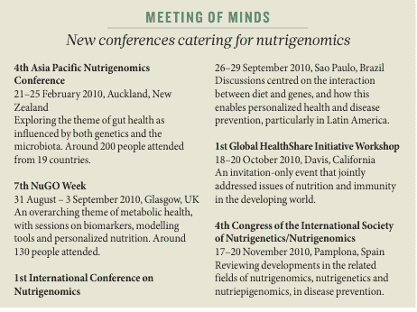

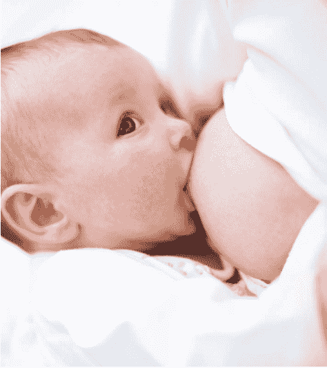

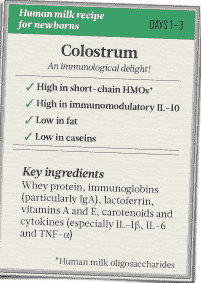

## 发育

### 母乳：丰富的机遇

*关于乳汁成分以及母乳喂养如何惠及成长中儿童的研究正令科学家感到惊讶。*

**作者：安娜·佩瑟里克**

如果你曾经需要为塔马尔沙袋鼠配制配方奶，你将面对一个复杂的配方。在从出生到断奶、待在育儿袋中的300天里，袋鼠幼崽每周都会饮用不同的乳汁。

早期，幼崽需要初乳，其中富含抗体。60天后，配方奶应富含含天冬酰胺的肽，这些肽被认为有助于大脑发育。90天后，袋鼠幼崽将需要一剂含硫氨基酸，如半胱氨酸和蛋氨酸，这会促使毛囊和指甲生长。

为了健康发育，乳汁所含的热量也必须增加，以至于幼崽断奶时所饮乳汁的能量密度是其最初饮用液体的四倍半。这种成分变化序列似乎完全由母体决定。而且奇怪的是，她的乳头可以独立运作，每只袋鼠幼崽在育儿袋中的前300天实际上都固定在一个乳头上。事实上，一只幼崽可能有一个年龄不同的同袋伙伴，它吸吮相邻的乳头——并接受适合其年龄的不同成分的乳汁¹。

与沙袋鼠的乳汁不同，人类乳汁不会随时间发生如此剧烈的变化，因为沙袋鼠通过乳汁传递的发育信号，可以通过人类胎盘传递。人类乳汁的主要成分——脂肪、蛋白质和碳水化合物——在整个哺乳期变化很小。但更仔细的分析揭示了人类乳汁中生物活性成分组成的重要时间依赖性变化——这些分子和细胞除了供能并为婴儿生长提供原料之外，还具有生物学功能。弄清这些成分是什么以及它们有何作用，推动了当今许多泌乳研究。

### 哺乳动物的混合物

直到最近，人类泌乳研究主要还是从公共卫生角度构思的。现在的趋势是从进化角度探讨这一主题。这种观点假定，婴儿应尽可能多地接受母乳喂养以最大化其存活机会，而母亲必须平衡当前用于产奶的代谢投入与未来后代的潜在投入。

例如，进化理论表明，母亲应更多投入喂养儿子，因为一个成功的儿子能产生的后代比女儿多得多。近期几项研究通过识别男性和女性所摄入母乳的明显差异支持这一观点。例如，在人类中，男婴获得的乳汁脂肪和蛋白质含量显著高于女婴获得的乳汁²。

NATURE.COM  
了解更多关于母乳喂养背后的科学  
nature.com/95cSV7

在恒河猴中，雄性幼崽饮用的乳汁含有更高浓度的皮质醇，这是一种调节……的激素

## 展望：营养基因组学

代谢：尽管母亲在哺乳儿子时血液中循环的皮质醇并不比哺乳女儿时更多。目前尚不清楚这种与皮质醇相关的性别差异是否具有功能。但已有线索：摄入含高水平该激素乳汁的幼年猕猴会表现出大胆行为，而乳汁中的皮质醇似乎对雌性猕猴幼崽没有影响³。这是否在人类中有对应现象，仍有待确定。

人类泌乳研究的第二大转变在于纳入新工具，以回答传统问题——例如比较母乳喂养与配方奶喂养的效果——并应对进化与功能问题。与其他胎盘哺乳动物的乳汁相比，人乳更稀，但它确实含有一些令人惊讶的成分。例如，高通量质谱法的进步揭示了200多种人乳寡糖（HMO）的存在。加利福尼亚大学戴维斯分校的分析化学家Carlito Lebrilla发现，母亲似乎各自产生约100种HMO的个体化组合——但没有人弄清楚为什么不同母亲会产生不同的HMO组合，甚至不清楚每个孩子得到的是否为同一组HMO。

尽管HMO属于碳水化合物，但它们似乎并不为婴儿提供营养。相反，它们喂养某些肠道细菌，使这些细菌比其他菌种更具竞争优势。“孩子出生后，其肠道会迅速被病原菌定植，”Lebrilla说。“然而，随着孩子摄入人乳，菌群会转变为有益菌种。”婴儿双歧杆菌（Bifidobacterium infantis）可预防腹泻，尤其擅长代谢泌乳早期大量存在的小分子量HMO⁴。因此，母乳使婴儿双歧杆菌在建立肠道菌群方面比其他菌种更具优势。“所以，母亲通过她的HMO‘选择’了要在婴儿肠道中生长的特定细菌，”Lebrilla说。

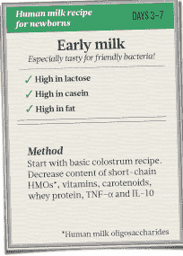

此外，一些HMO可以直接抑制有害细菌和病毒。例如，某些HMO可阻断空肠弯曲杆菌（细菌性腹泻最常见的原因）与肠黏膜的结合，从而抑制致病过程⁵。

人乳还会将一些微生物直接递送到肠道。母乳中含有来自母亲肠道的数种乳酸菌，据认为这些乳酸菌会在白细胞内到达她的乳腺。其中大多数菌种通过分泌过氧化氢和被称为细菌素的化合物来抑制病原菌。

过去十年间，人乳中存在的免疫因子清单大幅扩展。长期以来，人们认为母乳仅通过分泌型免疫球蛋白A形式的母体抗体为婴儿提供被动免疫。然而，新发现的一批免疫调节蛋白可能在促进和调节婴儿自身免疫系统的发育。尤其令人感兴趣的是细胞因子，它们通过细胞间信号传导来协调免疫系统。

甚至有证据表明，母乳会影响婴儿肠道细胞的基因表达。在一项初步研究中，伊利诺伊大学儿科营养学家Sharon Donovan和得克萨斯A&M大学生化学家Robert Chapkin从几名3个月大婴儿脱落的肠道细胞中提取了RNA。他们评估了母乳喂养婴儿与配方奶喂养婴儿之间RNA表达的统计学差异。若干有变化的基因被鉴定为推测的主控基因，这些基因控制其他基因的表达。其中大多数基因编码与血管生成和伤口修复相关的转录因子——包括EPAS1，该基因在母乳喂养婴儿的肠道细胞中转录量是原来的三倍¹。

### 聪明宝宝

**母乳会让你更聪明吗？**

2002年末至2005年春季，13,889名约六岁的白俄罗斯儿童参加了智商测试，并由教师评估其阅读和写作技能。其中约一半儿童的母亲曾在世界卫生组织（WHO）一项名为“爱婴医院倡议”的项目下被鼓励母乳喂养。结果，这些母亲纯母乳喂养至孩子3个月大的可能性是其他母亲的七倍。

这项名为“母乳喂养促进干预试验（PROBIT）”的研究结果显示，母亲参与WHO倡议的6岁儿童从教师那里获得更好的学业评分，智商分数平均高5.9分¹⁰。“PROBIT发现生命第一年有许多健康益处，”加拿大蒙特利尔麦吉尔大学的流行病学家Michael Kramer说，“但从长期看，唯一的差异是认知能力。”

没有人十分确定是什么造成了这种智力提升。但杜克大学心理学家Avshalom Caspi在2007年的一项研究中确定了一个候选因素：一个似乎介导人乳对大脑发育影响的基因¹¹。Caspi及其同事检索了京都基因与基因组百科全书（KEGG）数据库中参与长链多不饱和脂肪酸代谢的基因。这些脂肪酸与神经元发育的多个方面有关。其中两种脂肪——二十二碳六烯酸（DHA）和花生四烯酸（AA）——存在于人母乳中，但不存在于牛乳或大多数婴儿配方奶粉中。

KEGG检索在11号染色体上鉴定出一个名为FADS2的基因，它既受膳食AA和DHA调控，也编码一种催化这两种酸代谢的酶。FADS2基因的一个特定变体存在于该研究超过90%的队列中。研究人员发现，只有携带这一特定FADS2变体的母乳喂养婴儿表现出智商优势。该研究暗示，脂肪酸代谢可能是母乳喂养与智商之间缺失环节的一部分。据估计，这一FADS2变体可解释4.1个智商点的差异，这在很大程度上解释了PROBIT试验中发现的5.9个智商点差异。

测试表明母乳喂养儿童智商更高。

Donovan和Chapkin的研究首次提供证据表明，富含天然细菌的母乳会影响婴儿基因表达，但Donovan提醒不要过度解读他们的发现。然而，随着益生菌越来越普遍地用作配方奶成分，这很可能是一个不断扩大的研究领域。“我们不知道这些益生菌可能如何影响基因表达，”Donovan说。

多年来，“母乳与配方奶”之争已变得两极分化，本文联系过的几位研究人员抱怨说，母乳喂养倡导组织或配方奶公司过去曾夸大其研究结果。Donovan最近的基因表达研究由一家配方奶制造商资助，但她正在申请美国国立卫生研究院的资助以开展进一步研究，以避免商业资助带来的批评。

### 健康争议

研究人员试图厘清用婴儿配方奶而非母乳喂养的影响。“绝大多数研究倾向于认为母乳更好，而非同等，但证据质量参差不齐，”在伦敦大学学院研究人类生态学的Jonathan Wells说。“人乳许多公认的益处与避免病原体有关。虽然与在发展中国家相比，这些病原体在医疗更发达社会中对婴儿的危险性可能更低，但母乳仍为所有婴儿提供益处。一致发现，母乳喂养可保护早产儿免患坏死性小肠结肠炎（部分肠组织死亡），并保护足月儿免患腹泻和耳部感染。”

对日后健康的影响在数据中不那么明显，尽管已观察到配方奶喂养与2型糖尿病和炎症性肠病之间的关联。一些荟萃分析报告称，母乳喂养可将儿童学龄期肥胖的几率降低约20%。但这些结果并非决定性结论。最大的母乳喂养试验——母乳喂养促进干预试验（PROBIT）——发现，两组六岁半白俄罗斯儿童的胖瘦程度没有差异，其中一组在引入配方奶前接受母乳喂养的时间长得多²。

### 人乳中含有什么

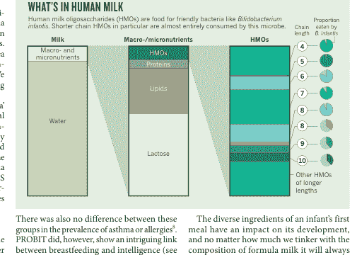

这些组之间哮喘或过敏的患病率也没有差异³。然而，PROBIT确实显示了母乳喂养与智力之间有趣的联系（见“聪明宝宝”，第S6页）。

母乳喂养与智商之间的关联此前已有报道，但使PROBIT结果重要的是其数据集规模。要消除混杂因素，非常大的样本量至关重要。肥胖和智商等特征在各富裕国家的差异模式，常与母亲母乳喂养倾向相似。在发达国家，较富裕女性更可能母乳喂养——但她们通常也更苗条、受教育程度更高，并花更多时间与婴儿说话。

配方奶中的某些成分可能导致日后体重问题。欧洲儿童肥胖项目的结果支持“早期蛋白质假说”，该假说认为标准婴儿配方奶中较高水平的蛋白质会使身体在日后变得更胖⁴。

### 新生儿人乳配方——第2周起

**成熟乳**

为生长提供营养！

- 更多乳汁
- 更少脂肪
- 更少乳清蛋白

**方法**

- HMO†含量应降至初始水平的一半。IL-1β、IL-6、维生素和类胡萝卜素也大幅减少。
- 维持乳糖、IFN-γ和酪蛋白的浓度。

†人乳寡糖

该项目将1,000名欧洲婴儿随机分配接受高蛋白浓度配方奶（标准配方奶）、低蛋白浓度配方奶（接近人乳蛋白质含量）或母乳。结果是：与高蛋白组不同，低蛋白组并不比母乳喂养对照组更胖。

婴儿第一餐的多样成分对其发育有影响，而无论我们如何调整配方奶的组成，它始终会缺乏人乳的许多微量成分。随着研究识别出这些物质，它们的作用似乎越来越超出直接营养益处：向婴儿传递关于环境乃至母亲周围社会结构的信息，这影响她饮食的丰富程度和体力活动水平，从而也影响她的乳汁。

Wells认为，人类幼崽应被视为必须适应母亲周围环境，而非更广阔的世界。事实上，母乳中存在如此多生物活性分子，意味着母乳喂养是一项赋予母亲能力的行为。他补充说：“我们对母乳细节了解得越多，就越意识到男性通过非遗传途径影响后代的机会很小。母亲则拥有非常丰富的机会。” ■

*Anna Petherick* 是布宜诺斯艾利斯的一名记者。

- 1. LeBlanc, J. G. et al. *Genomics and Human Genetics* **11**, 219–238 (2010).
- 2. Powe, C. E. et al. *Am. J. Hum. Biol.* **22**(1), 50–54 (2010).
- 3. Sullivan, E. C. et al. *Developmental Psychology* DOI: 10.1038/jp.2043 (2010).
- 4. Ward, R. E. et al. *Appl. Environ. Microbiol.* **72**(6), 4497–4499 (2006).
- 5. Ruiz-Palacios, G. M. et al. *J. Biol. Chem.* **278**(15), 14112–14120 (2003).
- 6. Chapkin, R. S. et al. *Am. J. Physiol. Gastrointest. Liver Physiol.* **296**, G892–G900 (2009).
- 7. Kramer, M. S. et al. *Am. J. Clin. Nutr.* **86**, 1717–1721 (2007).
- 8. Kramer, M. S. et al. *Br. Med. J.* **301**, 136–139 (2009).
- 9. Koletzko, B. et al. *Adv. Exp. Med. Biol.* **646**, 15–29 (2009).
- 10. Kramer, M. S. et al. *Arch. Gen. Psychiatry* **65**(5), 578–584 (2008).
- 11. Caspi, A. et al. *Proc. Natl. Acad. Sci. USA* **104**(47), 18860–18865 (2007).

# 进化

## 最早的超级食物

*饮食驱动的进化塑造了我们的大脑，但究竟是肉类还是块茎，抑或是对它们的加工，促使我们与其他灵长类分道扬镳，仍是一个激烈争论的问题。*

**作者：迈克尔·艾森斯坦**

鉴于我们的祖先与黑猩猩分道扬镳已有数百万年，黑猩猩对美餐的理解与我们不同并不令人意外。“当我访问我们在乌干达的研究站点时，我在森林里跟着一只黑猩猩待了一天，尝试吃它吃的一切，”德国莱比锡马克斯·普朗克研究所的进化遗传学家斯万特·帕博回忆道。“那太恶心了，也无法消化——你真的做不到。”

部分原因在于遗传。2008年，帕博及其同事发现了黑猩猩与人类共有的饮食相关基因的调控序列和编码序列均加速进化的证据¹。许多人类学家现在认为，饮食的剧烈变化可能是人类祖先进化的主要驱动力，甚至可能是推动我们*人属*这一支前进的首要因素，因为它使我们得以生存和繁荣。

一个进化里程碑是脑化：据估计，大脑的增大始于约180万年前，当时*能人*向*直立人*过渡。是什么为这一生长突增提供了动力，仍是持续争论的主题。

### 肉与土豆

从代谢角度看，大脑袋是一项巨大的投资。20世纪90年代中期提出的一个模型——昂贵组织假说——认为，我们的祖先通过获得更有营养的饮食来支付这笔账单，这促进了大脑生长，同时缩小了肠道体积。科学家提出，肉类中丰富的维生素、蛋白质和脂肪是一大福音，并且有证据表明我们的祖先早在250万年前就使用石器切割食物。今年发表在*《自然》*上的一篇文章报告了发现340万年前带有切割工具痕迹的化石骨骼，这将时间进一步推回到南方古猿。

“有相当不错的证据表明，肉类很可能是南方古猿饮食的一部分，”俄勒冈大学人类学家乔希·斯诺德格拉斯说，“但他们吃的饮食可能以植物为主得多。”鉴于肉类营养丰富，斯诺德格拉斯认为，即使微小的变化也会对热量摄入产生很大影响，并主张使用更复杂的工具可能增加了早期人类祖先的肉类消费。“获得高质量动物性食物，可能至少是使[脑化]得以发生的主要驱动因素之一，”他说。

另一方面，南非开普敦大学考古学家戴维·布朗认为，追求一顿牛排晚餐并非没有风险。“做出这种转变会带来多重后果，”他说。“有捕食者与猎物互动的代价，有进入人类祖先未必那么适应的生态位的代价，还有各种寄生虫学上的代价。”

达特茅斯学院人类学家纳撒尼尔·多米尼倾向于认为，我们的祖先可能把工具更好地用于挖掘根茎类蔬菜。他观察了现代狩猎采集者如何在非洲类似稀树草原的环境中生存，那里可能与*直立人*繁盛的地方并没有根本不同。他认为，块茎为抵御狩猎生活方式的变迁提供了一种重要缓冲。“现代狩猎采集者有语言、技术和铁头长矛，他们仍然难以获得足够的肉类来生存，”他说。“很难想象一群没有这些装备的人类祖先能获得大量肉类。”块茎很丰富，在容易获得肉类并非确定之事时，可能提供了使大脑生长具有适应性所需的主要营养。

然而，高效消化块茎取决于另一项重大技术进步——烹饪。“大多数块茎绝对需要烤制，”多米尼说。哈佛大学人类学家理查德·兰厄姆认为这不是问题。1999年，他发表了一篇有争议的文章，推广他的假说：受控用火和烹饪早在200万年前就成为人类祖先工具箱的组成部分。此后，兰厄姆发展了这一概念，以解释我们的祖先如何最大化块茎、肉类和其他食物的营养益处。“直到最近，大多数人才认识到烹饪对净能量收益有很大影响，”兰厄姆说。“通常认为烹饪是必要的，因为它扩大了可能的饮食范围并使食物更安全，但能量是进化适应如此关键的变量。”

> **NATURE.COM**
>
> 关于食物和火如何塑造人类，更多内容见 [go.nature.com/txnfil](https://go.nature.com/txnfil)

## 人类祖先食谱

我们饮食和食物制备技术的进化。

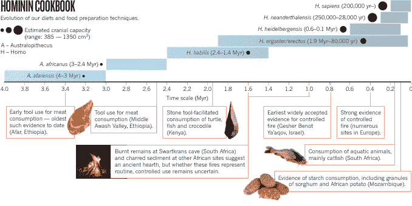

兰厄姆及其同事的初步分析表明，烹饪可能使蛋白质和淀粉更易消化，同时降低了免疫系统抵御寄生虫或细菌感染的成本。

### 确凿事实

许多人类学家仍对兰厄姆假说中的证据缺口持谨慎态度。受控用火的最早迹象来自以色列，可追溯到约80万年前——比200万年短得多。尽管如此，布朗不愿排除兰厄姆的理论，并指出烹饪火堆的遗迹可能转瞬即逝。在以色列遗址发现的证据尤其不寻常。“Gesher Benot Ya’aqov 是考古学家梦寐以求的那种地方，”他说。“那里的木材得以保存，各种在其他地方无法保存的活动痕迹也保存了下来。”

布朗也遇到过类似挑战：他的团队最近在肯尼亚图尔卡纳一个195万年前的遗址进行的研究发现了骨骼和石器遗存，表明*直立人*的前身可能经常食用鱼类和其他海洋生物。如果这代表一种真实的饮食模式，那么“健脑食物”可能名副其实，因为它提供了促进大脑皮层生长的丰富多不饱和脂肪酸来源。

然而，水生动物在人类祖先饮食中的早期作用仍存争议，因为考古证据表明，海鲜直到15万至20万年前才成为菜单上的常规项目。这可以用实际寻找这些食物被加工的证据所面临的挑战来解释。“我认为，那个特定遗址发生的保存情况异常好，”布朗说。“我们通常把骨骼表面的痕迹视为判断某种东西是否属于饮食的决定性因素，[而]这些痕迹对水生动物来说保存得并不好。”

不幸的是，任何将食物选择与人类进化联系起来的努力，都将继续取决于能否在此类遗址中发掘出什么；来自遗传记录的证据可能更难找到。帕博及其同事组装了尼安德特人基因组草图。这提供了关于过去5万年人类进化的大量信息。然而，此类分析存在一个“保质期”。“即使在可能是理想环境的永久冻土中，[这个]限制也大约是5万年，”帕博说。因此，从我们早期非洲祖先那里获得可用基因组数据的任何希望都是白日梦，而试图描述人类祖先遗传进化特征的工作通常集中在我们现存最近的亲属——黑猩猩和倭黑猩猩。

> 追求一顿牛排晚餐并非没有风险。

一些最好的证据，可能就藏在我们祖先化石化住所的内壁上。阿肯色大学古人类学家彼得·昂加尔一直在使用数字分析来绘制古代牙齿的“景观”，精确到覆盖咀嚼表面的细微磨损。“那些划痕是人类祖先让食物经过牙齿的实际结果，我们可以将其与该动物适应做的事情联系起来，”他说。

基于越来越多的*能人*和*直立人*样本，昂加尔看到了向薄釉质且高度纹理化牙齿的显著转变，这是饮食多样化的线索。“如果我们*人属*祖先更多地用工具在口腔外加工食物，那么你就不会得到同样的选择压力来维持大而厚釉、平坦的牙齿，”他说。“釉质更薄、起伏更多的牙齿实际上更适合咬碎和研磨更坚硬的食物，比如肉类和树叶。”他认为，尽管个别的*直立人*未必沉迷于多样化的饮食，但他们发展出了一种依赖广泛“备用食物”的能力——这种技能在旧石器时代早期快速变化的气候中会被证明有用，并使人类得以在非洲大陆之外远居。

布朗认为这是一个合理的理论，但他也认识到需要进一步研究这种日益多样化饮食的营养构成。“每进行10年野外工作，我们只能回答一两个问题，”他说。“这将需要更多实地研究人员。”与此同时，人类学家和考古学家将不得不继续满足于一道菜一道菜地重建旧石器时代的自助餐。■

**迈克尔·艾森斯坦**是费城的一名记者

- 1. Somel, M. et al. PLoS One 3(1): e1504 (2008).
- 2. Braun, D. R. et al. Proc. Natl Acad. Sci. USA 107, 10002–10007 (2010).
- 3. Green, R. E. et al. Science 328, 710–722 (2010).

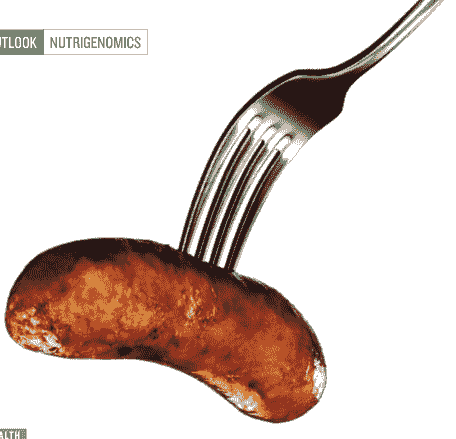

## 健康

### 可食用的建议

*饮食相关疾病是当今最大的杀手之一。我们能否通过调整食物摄入来预防这些疾病？大型国际项目正在开展，以寻找答案。*

**作者：法鲁克·艾哈迈德**

“饮茶过多会使女性患癌风险增至三倍”“茶可降低卵巢癌风险”。这只是相互矛盾的报纸标题中的两个例子，这些标题让公众对食物的健康益处——或风险——以及真正的营养相关研究感到困惑。

对于糖尿病等某些疾病，其与食物的联系较为微妙。英国医学研究理事会流行病学部门负责人 Nick Wareham 解释说：“尽管我们知道饮食因素与糖尿病风险有关，但关于究竟哪些微量营养素或宏量营养素与该疾病相关，各项研究之间存在许多不一致。我们在数据方面相当有限。”

利用新工具和新方法，一些雄心勃勃的项目正在开展，以弥补这一不足。其中一项由 Wareham 协调的工作是 InterAct——一项跨国研究，旨在明确饮食和生活方式如何影响 2 型糖尿病风险。这种血糖调节障碍在欧洲日益成为问题，近40%的人口在一生中某个阶段会受其影响。InterAct 估计，糖尿病占欧洲医疗保健费用的比例高达10%。

通过 InterAct 等努力，研究人员正开始揭示遗传、饮食和疾病之间复杂的相互作用，并为纷繁混乱的营养信息带来秩序。

InterAct 始于2006年，是欧洲共同体第六框架计划的一部分。该项目预算为1000万欧元，涉及10个国家（欧洲9国加印度）的逾1.2万名新近确诊的糖尿病患者。如此广泛的队列很重要。Wareham 说：“有时一个国家内部的差异并不那么大。”“国际性努力能带来患者生活方式的异质性，尤其是在饮食方面，这是一个主要优势。”这种多样性为科学家提供了更多可研究的变量，帮助他们试图厘清哪些因素导致了疾病。

### 规模越大，优势越大

这项研究是有史以来规模最大的饮食与疾病研究——欧洲癌症与营养前瞻性调查（EPIC）的一部分。EPIC 始于1992年，已招募超过50万人。参与者在23个中心之一接受体检，完成包括详细饮食问卷在内的生活方式调查，并接受血液检测。他们的 DNA 会被扫描以寻找疾病相关基因，所用技术可在大量个体中检测数十万个遗传变异。

Wareham 说：“大型项目确实可以成为催化剂，促使多个中心汇聚起来共享仪器。”“InterAct 从庞大的 EPIC 队列以及对这些技术的使用中受益匪浅。”

另一项大型研究是 Interheart——它与 InterAct 类似，但不属于 EPIC——考察了饮食模式与心脏病发作风险之间的联系。1999年至2003年间，这项由加拿大牵头的研究在六大洲52个国家招募了5,761名患者和10,646名对照受试者。各团队利用问卷、体检和血液分析，汇编了受试者的数据，包括人口学信息、饮食、体重指数等人体测量指标，以及胆固醇和脂蛋白等生物标志物水平。

Interheart 研究人员得出结论：西方模式饮食的全球化——即动物制品、油炸食品和咸味零食含量高——造成了全球三分之一的心脏病发作风险。¹ 无论身处何地，富含水果和蔬菜的谨慎饮食都能降低风险。在 Interheart 之前，很少有流行病学研究将不同族裔人群和文化中的饮食模式与疾病联系起来。营养遗传学家 Jim Kaput 说，像这样的研究“至关重要——如果我们真的想理解这些疾病的话，因为它们在欧洲和其他人群中表现不同”。他还担任美国食品药品监督管理局个性化营养与医学部主任。

### 交叉通路

InterAct 和 Interheart 都表明，处于饮食相关疾病（如糖尿病和心血管疾病）核心的代谢通路密切相关。原因之一是，发现一种疾病的线索可以揭示另一种疾病。

Wareham 指出：“血压、胆固醇和甘油三酯水平等因素可预测冠心病，同时也与糖尿病相关。”

生菜和菠菜等叶菜是谨慎饮食的核心组成部分，也是 Interheart 研究确定的成分。这些蔬菜富含多不饱和脂肪酸（PUFAs）——这是一类必需宏量营养素，也存在于某些鱼类、坚果和奶酪中。其中，omega-3 和 omega-6 这两类 PUFAs 是强有力的膳食成分，因为它们能直接和间接地改变基因表达。俄勒冈州立大学的营养科学家 Donald Jump 研究这些宏量营养素，他说 PUFAs“更像激素，而不是典型食物”。

例如，PUFAs 有两种方式调节基因活性并降低肝脏中的脂肪酸和甘油三酯水平：它们可以结合并激活一个名为过氧化物酶体增殖物激活受体（PPARs）的转录因子家族，从而加速脂肪酸分解；PUFAs 还能消耗另一种转录因子——甾醇调节元件结合蛋白-1——从而抑制脂肪酸合成。这种双管齐下的作用带来了显著的健康益处。Jump 解释说：“与胆固醇一样，甘油三酯升高是防治动脉粥样硬化、心血管疾病和中风的常见靶点。”

尽管大多数关于 PUFAs 的研究都集中在其与心血管疾病的关联上，但 Jump 的团队通过操控一种参与脂肪酸代谢的酶，证明 PUFAs 还能平衡血糖水平，这提示其可能成为 2 型糖尿病的治疗方法。

Jump 说：“膳食 omega-3 通常不被视为高血糖的治疗手段。”然而，通过研究饮食及其对代谢通路的影响，这类关联正不断被发现。

在饮食和代谢之后，饮食相关疾病发生的第三个要素是基因组。Jump 说：“在人类中，遗传背景在是否对特定营养素反应良好方面发挥作用。”将全球遗传多样性纳入其中，大大增加了研究的复杂性。国际 HapMap 计划是一个遗传变异数据库，始于2002年，存储来自加拿大、中国、日本、尼日利亚、英国和美国的数据。迄今为止，该项目已鉴定出数千万个与疾病和药物反应相关的单核苷酸多态性（SNPs）。受 PUFAs 调控的 PPAR 基因中的 SNPs 影响诸多方面，其中包括减重能力，而减重是控制糖尿病的关键一步。尤其是一个 SNP 被发现可解释人们减重差异的7%。

## 有风险的食物

某些食物类型含量高的饮食会增加心脏病发作风险。

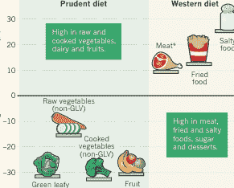

来源：Interheart 研究。*无显著关联。

2010年，InterAct 在寻找可揭示肥胖和运动在糖尿病发病风险中作用的标志物过程中，招募了第一万名受试者。对他们的基因组分析将于2011年发表，Wareham 相信这种方法将揭示新的相互作用。他说：“我们正在采用大规模发现式方法。我们不太关注特定基因的表达，而是关注先天易感性与饮食和生活方式因素之间的相互作用。”

这样的关联将填补我们知识中的空白。Wareham 沉思道：“假设而言，饮食和生活方式因素的全基因组影响，或许可以解释我们在糖尿病中观察到的、基于简单遗传变异仍无法解释的遗传率。”细微变化会淹没在标准单基因研究的背景噪声中。但它们确实有影响——尤其是对我们定义疾病的方式以及临床试验设计方式的影响。Kaput 说：“在判定我们是否患病时，遗传学家一直把我们所有人当作硬币来对待：正面还是反面——你患还是不患糖尿病？许多研究就是这样设计的。”

我们需要以承认基因贡献的新方式来解释疾病。

## 发展中国家的营养基因组学

*扭转健康与营养的关系。*

随着全球化将高脂快餐饮食输出到世界各地，许多发展中国家营养不良问题猖獗。据无国界医生组织称，在发展中国家，营养不良占五岁以下儿童死因的60%。既能提供营养又能治疗疾病的新技术可能挽救数百万人的生命。

正是这一严峻现实促使 Raymond Rodriguez 发起全球健康共享倡议（GHSI）。加州大学戴维斯分校营养基因组学卓越中心主任 Rodriguez 解释说：“我们开始关注种族、族裔和经济弱势群体中的健康差异。往往最需要食物和药物的人却最后才能得到它们。”

缺乏适当营养会为疾病打开大门。GHSI 的 Somen Nandi 说：“营养不良者免疫力下降，因此疫苗效果较差。”这种新思路的一项切实益处是，正在开发一种新型稻米基质，作为霍乱和腹泻疫苗的递送载体。这既有助于为营养不良者提供营养支持并增强其免疫力，又能使其获得针对这些疾病的免疫保护。

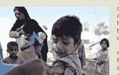

GHSI 的疫苗开发项目也认识到其中涉及的经济因素。Rodriguez 和 Nandi 的宏伟目标是帮助在腹泻性疾病流行的国家（如孟加拉国）建立可持续经济。他们希望在资源有限的国家确定并开发可用于治疗药物配制、生产和分销的场地。

Rodriguez 说：“我们认为，GHSI 将为未参与全球经济的40亿人创造机会，让他们享有更好的健康和更高的生活水平。”因此，营养基因组学研究的成果不仅能帮助西方人应对过度饮食，还能为发展中国家的贫困人口带来更好的生活。

**NATURE.COM**  
**查看关于饮食与疾病的最新研究**  
`go.nature.com/cthpue`

以及代谢通路。代谢物是循环中的小分子——氨基酸、维生素及其他化学物质——同时受基因和营养摄入的影响。代谢组学，即对这些代谢物的研究，或许为以微创方式观察这些相互作用提供了最佳机会。

代谢表型可以被非常精细地区分，对来自中国、日本、英国和美国数千人的尿液代谢物模式分析就证明了这一点。不仅东亚人与西方人群的代谢物模式不同，而且中国北方人与南方人也能区分开来。两个中国人群都不同于日本人，而日本人又不同于日裔美国人。与以素食为主的人相比，肉类摄入较多（如西方饮食中常见）的人，其提示高血压的生物标志物水平更高。

InterAct 项目还在寻找随着个体糖尿病风险升高而积累的新型生物标志物。与流行病学研究相结合时，这类代谢表型分析可以在疾病显现之前就识别出个体的生物学风险标记。代谢物生物标志物有一天也可能成为治疗靶点。

## 打破壁垒

尽管 InterAct 和 Interheart 等大规模科学项目已取得成功，但国际合作仍存在障碍。研究人员偶尔会遇到不愿或无法分享信息的情况。“有时，说服各中心的负责人相信合作最终能带来更好的科学成果，是一项挑战，”韦勒姆说。

卡普特表示同意。他建议生物学家借鉴物理学家的做法。“他们建造了大型强子对撞机，从而实现了跨学科合作，”他说，“但我们仍未让生物科学界的壁垒消失。”

韦勒姆相信这种鼓励并促进合作的技术驱动型方法。他说，这些大型项目可以拉近不同学科的距离——正如 HapMap 项目所展示的那样。“以极低成本大规模测量多个 SNP 的能力彻底改变了这一领域，我认为这也将是饮食和营养等其他风险因素研究的方向，”韦勒姆主张道。

卡普特和美国食品药品监督管理局（FDA）化学家卡罗琳·怀斯正在采用这种大规模、系统性的方法。他们在定义人类肥胖和 2 型糖尿病的遗传-代谢联合类型时，考虑了早期环境影响、微量营养素可用性、代谢与调控通路以及全基因组关联图谱。⁶ 这种方法可以在其他研究中被仿效和扩展，以帮助研究人员在努力理解海量数据时共同合作、分享信息。

## 补充评估

常见成分和营养补充剂及其相对健康益处。更大、更深的圆圈表示补充剂可能更有帮助。

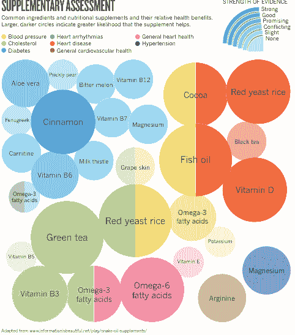

改编自 www.informationisbeautiful.net/play/snake-oil-supplements/

随着这些营养基因组学研究开始根据个体的生活方式、代谢通路和遗传变异的相互作用将其分为特定群体，定制饮食可能会成为早期治疗干预手段。个性化饮食甚至可以指导那些有糖尿病遗传风险但尚未处于糖尿病前状态的人，通过精细调整饮食来避免患上该疾病。恰如其分的预防或许能免去治疗的必要。

## 预防胜于治疗

然而，个性化饮食在此之前就曾被过早承诺过。21 世纪初，许多公司声称能够基于基因检测提供个性化营养建议。美国政府问责局 2006 年的一项调查发现，这些公司“误导消费者”，只提供了泛泛的建议。美国参议院老龄问题特别委员会举行听证会，进一步批评了这些直接面向消费者的基因检测。由于无法获得资金，其中几家公司破产了。

卡普特说，这正是 FDA 的个性化营养与医学部领先一步之处。“目前，我们还没有需要监管的产品。我们也不确定这一领域的发展方向，但当产品进入可能需要 FDA 监管的流程时，我们将具备研究背景，帮助监管中心作出评估。”

厘清食物与疾病之间的关系是一项棘手的任务，涉及数万人，涵盖数百种营养和遗传因素。它也不太可能提供简单或快速的解决方案，这意味着至少目前，“茶致癌”的说法可以放心地忽略。

*法鲁克·艾哈迈德是纽约的一名科学作家。*

- 1. Iqbal R. et al. *Circulation* 118, 1929–1937 (2008).
- 2. Tripathy, S. *Trends Genet.* 26, 1–7 (2010). D. B.
- 3. J. Lipid Res. 26, 2642–2654 (2010).
- 4. Matsuo, T. et al. *Obesity* 10, 1924–1931 (2009).
- 5. Holmes, E. *Nature* 453, 396–400 (2008).
- 6. Wise, C. & Kaput, J. *J. Diabetes Sci. Technol.* 3, 710–721 (2009).

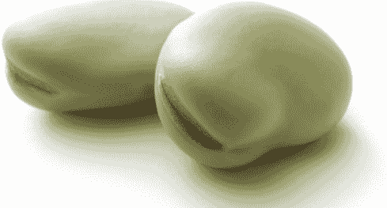

## 多样性

### 豆类与基因

*若干参与消化的人类基因已因文化差异而发生了分化。研究表明，这些适应性变化影响着人们能耐受的食物范围，甚至影响着某些疾病。*

**作者：迈克尔·爱因斯坦**

纳撒尼尔·多米尼惊讶地发现，与饮食相关的基因就像人一样，有时只是简单地重复自己来传达要点，而不是改变信息。

2007 年，当大多数进化生物学家在寻找基因突变形式的自然选择证据时，多米尼及其同事发现，高淀粉饮食的人拥有更多编码唾液淀粉酶的基因拷贝，而这些重复提高了这种碳水化合物加工酶的产生。“当时很少有人会想到[这些重复]能产生任何影响……而且它们产生了很大的影响，”新罕布什尔州达特茅斯学院的人类学家多米尼回忆道。

这一发现还为越来越多的进化遗传学家提供了证据，他们相信，饮食等特定文化因素对人类进化产生了强大影响，就像气候和栖息地等更明显的外部因素一样——有些人甚至认为这些因素可能加速了整体进化步伐。“我不认为我们有足够的数据来提出这些论断，”德国莱比锡马克斯·普朗克研究所的群体遗传学家马克·斯通金警告道。

> “[但是]现代人类中确实存在因自然选择而产生的近期进化，文化很可能在其中许多进化中发挥着作用。”

### 午餐的遗传学

即使你能享受一杯冷牛奶而不感到胃部不适，但你很可能认识某个做不到这一点的人。事实上，成年人的乳糖不耐受在生物学上是‘正常’现象。“哺乳动物的基因模式是在断奶后失去乳糖酶表达，”伦敦大学学院的遗传学家达拉斯·斯沃洛解释道。

尽管如此，具有‘乳糖酶持久性’的成年人在世界许多地方都很普遍。例如，乳糖酶持久性是 89%–96% 的斯堪的纳维亚人和英国人的特征，在非洲和中东的牧民文化中普遍存在，但在中国人中仅占 1%。

尽管影响乳糖酶基因表达的一个单核苷酸多态性（SNP）导致了欧洲绝大多数病例，但这种特征似乎是在非洲不同地区独立出现的，原因是乳糖酶基因的一个调控区段内存在几个不同但又紧密聚集的变异。“这就是趋同进化或平行进化，”斯沃洛说。“同一表型被选择，而不同的突变导致了该表型。”

这些变异被认为都是在过去 1 万年内出现的，大致与农业和奶牛养殖的出现相吻合，并给这些文化带来了明显的优势。“牛奶营养丰富，如果没有乳糖酶，你就无法消化其中的主要碳水化合物：你可能会腹泻或胀气，并且失去了一个食物、水分和钙的来源，”斯沃洛说。“在非洲部落的背景下，最合理的解释是它是一种干净、营养的液体来源。”

大多数遗传学家将乳糖酶持久性视为由文化和饮食变迁驱动的近期人类进化的典型例子。“这恰好是一个‘低垂的果实’，”宾夕法尼亚大学遗传学家莎拉·蒂什科夫说。“这是一个孟德尔性状，留下了非常强烈的选择特征。”要找到其他同样清晰的例子已被证明具有挑战性，尽管多米尼及其同事随后在淀粉酶方面的突破表明，其他

**NATURE.COM**

了解更多关于饮食适应如何影响健康的信息

go.nature.com/6yJSud

- 这样的痕迹是有迹可循的。

如今，许多人选择享用富含淀粉的饮食，但对早期人类而言，块茎和其他富含淀粉的植物可能在食物匮乏时期是必不可少的主食（见第8页《第一餐》）。多米尼说：“淀粉酶是唯一能水解淀粉的酶。如果你能产生大量淀粉酶，你就拥有很大优势，因为几乎在口腔层面就能瞬间提取并吸收碳水化合物。”

唾液淀粉酶基因 AMY1 的拷贝数此前已知会因个体而异。多米尼与亚利桑那州立大学的安妮·斯通以及当时的研究生乔治·佩里合作，证明这一拷贝数不仅与酶水平直接相关，而且一个群体内的平均拷贝数也与其传统饮食中的淀粉含量相关。例如，日本人日常摄入大量大米和其他淀粉，而雅库特人作为西伯利亚的狩猎和捕鱼文化，其饮食以鱼和肉为主；这些差异反映在日本人和雅库特人群体的 AMY1 基因水平上。多米尼说：“尽管他们在遗传上关系密切，在地理上相隔也不远，但这两个群体的平均拷贝数存在差异。”

## 为健康付出代价

从活跃的觅食生活方式转向更久坐的农业生存方式，似乎也引入了选择压力，因为人群要努力在营养缺乏中存活下来。在编码 N-乙酰转移酶2（NAT2）的基因中，已检测到一些有趣但费解的、与生活方式特异性适应有关的迹象；这种酶最著名的作用是参与药物代谢，但也参与植物和熟肉中摄入毒素的解毒。在最近的一系列研究中，巴斯德研究所的遗传学家路易斯·金塔纳-穆尔西及其同事研究了不同人群在表达 NAT2 变体方面的差异，这些变体或快或慢地乙酰化——从而帮助分解——目标分子。他说：“我们表明，大多数狩猎采集者群体携带快乙酰化等位基因，而慢乙酰化者在农民后裔群体中非常常见，比如大多数欧洲人，尤其是中东人群。” NAT2 还与叶酸代谢有关；叶酸是叶酸的天然形式，通常从绿叶蔬菜或动物肝脏中获得。金塔纳-穆尔西的团队提出一个模型：与转向富含谷物和谷类饮食相关的叶酸摄入量急剧下降，促进了抑制叶酸储备使用的等位基因出现，不过他强调，在获得进一步数据之前，这纯粹是推测。

NAT2 酶的两种版本都有某些缺点，因为乙酰化实际上可能增强而非降低某些化合物的毒性：快乙酰化与结肠癌和肺癌相关，而慢乙酰化与前列腺癌和膀胱癌相关。因此，任何营养益处都可能与 NAT2 变异潜在的有害后果紧密权衡。

还有许多其他例子表明，选择压力似乎导致了权衡。例如，尽管参与苦味感知的二十多种 T2R 蛋白是警告人们不要摄入有害化合物的有力盟友，但编码这些因子的基因也表现出惊人的变异性（见第S18页《味觉之外》）。对于若干可能改变口腔对苦味化学物质敏感性的变体，已观察到不寻常的分布模式。位于努特塔尔的德国人类营养研究所遗传学家沃尔夫冈·迈耶霍夫说：“很明显，T2R 单倍型的组成存在种族差异。”

在迈耶霍夫及其同事对中非人群味觉变异的一项研究中，T2R16 苦味受体的一个低敏感性变体被发现意外地常见；该受体通常对富含淀粉的块茎木薯中的生氰糖苷作出反应。这些糖苷在肠道中被代谢，释放出有毒的氰化物。研究人员推测，摄入潜在有毒化合物的健康代价必定被某种正选择所平衡，这种正选择也许源于对当地广泛流行的疟原虫的抵抗力增强，从而使该等位基因在群体中得以维持。

事实上，有几个例子表明，降低病原体易感性的益处显然足以选择出原本有害的等位基因。

> 大多数性状在本质上是复杂且多因素的。

蒂什科夫说：“传染病可能是过去或迄今为止最强的选择压力之一。”她举了葡萄糖-6-磷酸脱氢酶（G6PD）缺乏症的例子，这是一种广泛存在的酶病，与血细胞缺陷以及对蚕豆等食物的潜在严重毒性反应有关（见第S13页主图）。与 G6PD 缺乏症（又称“蚕豆病”）相关的基因变体在几个经常食用这些豆类的族群中广泛存在。尽管存在近期的饮食和健康代价，这些变体的普遍性可能源于它们提供的针对疟疾的保护。

与乳糖酶持续表达一样，这种表型的强大适应优势通过其在不同人群中的独立出现而得到证明；不同的 G6PD 缺乏等位基因已在非洲、地中海和中东出现。最近，金塔纳-穆尔西及其同事确定，该基因一个在东南亚流行的等位基因仅导致中度酶缺乏，似乎能防止间日疟原虫感染——这是一个意外发现，因为间日疟原虫很少致命，并且被认为在短期人类进化中远比其高度危险的近亲恶性疟原虫作用弱。金塔纳-穆尔西说：“关键在于后果。间日疟原虫会在儿童或感染孕妇中引起疾病——也许她们不会死，但她们的婴儿出生时体重偏低，这最终会使他们虚弱并提高死亡几率。”

然而，并非所有表型都能直接与遗传变异联系起来。正如多年全基因组关联研究所表明的，大多数性状在本质上要复杂得多且是多因素的，追踪这些复杂变化将需要另类的等位基因搜寻策略。

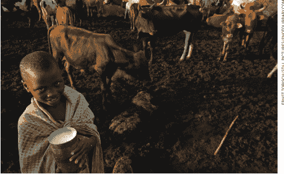

牛奶为能够耐受它的人提供许多营养（见对页地图）。

### 牛奶与淀粉消费

与消化淀粉类食物和牛奶中乳糖能力相关的基因的全球分布。

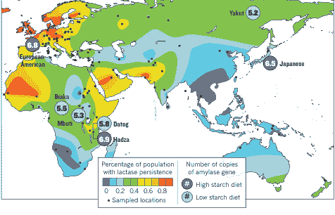

## 错综复杂的网络

芝加哥大学遗传学家安娜·迪·里恩佐最近试图找出一些等位基因变体，这些变体在居住于相似地理区域或生态系统、但饮食或生存方式（如农耕或觅食）不同的人群中频率存在差异。通过这种方法，她的团队发现了碳水化合物代谢和叶酸产生方面与采用以根和块茎为基础饮食相关的遗传适应线索。反过来，与不食用谷物的对应人群相比，富含谷物饮食的文化更可能产生截短、过度活跃的 PLRP2——一种负责分解植物糖脂的酶——版本。迪·里恩佐说：“人群之间存在一致的频率变化。与不食用富含谷物饮食但生活在同一地理区域的人群相比，[PLRP2 中的]终止密码子总是在食用富含谷物饮食的人群中以更高频率出现。”

然而，要将这些散布在整个基因组中的微小遗传变异拼凑起来仍然是一项挑战。迪·里恩佐说：“这些不是会让你立刻死掉的突变。它们对基因功能或表达造成细微变化，而检测这些细微变化可能真的相当困难。”

对于更近期的适应，突变也可能非常罕见，使得检测清晰模式变得困难。即使数据似乎表明某一给定变体背后存在选择压力，也必须对该地区的文化历史有扎实了解，以消除人口统计学偏差。斯沃洛解释说：“如果你测试的许多个体拥有相同的曾祖父母，那与它们相对无亲缘关系的情况就大不相同。”

最重要的是，研究需要证明某一特定变体或变体子集具有明确的功能贡献，并为这些变化为何在某些情况下具有适应性而在另一些情况下不具有适应性得出合理原因。斯通金说：“我们想知道这些不寻常模式影响的是什么生物学过程。其中有多少是真实的，多少是假阳性，背后的故事又是什么？这正是该领域目前有些卡住的地方。”

## 需要一个群落

显然，在数万个相互连接的人类基因和调控区域中搜寻近期进化的信号，可以比作寻找谚语中的干草堆里的针——但如果这个干草堆比大多数人想象的要大得多呢？

伦敦帝国理工学院的生物化学家杰里米·尼科尔森指出了肠道微生物菌群的巨大多样性，并引用2010年的一份报告，该报告显示每个欧洲人至少携带160种细菌，这些人合计拥有超过536,000个细菌基因——远远超过人类基因数量的20倍¹。他补充说：“实际上，它应该被视为一个多细胞生物——一个拥有非常大基因组的生物。”

即使我们对在消化道和身体其他部位繁衍生息的微生物群落了解有限，越来越清楚的是，它们的净基因组输出与我们的代谢功能密不可分，而这些群落的组成和活动是我们环境、文化和饮食的直接副产物。密苏里州圣路易斯华盛顿大学的微生物学家杰弗里·戈登说：“肠道微生物群落可以被视为一个代谢器官——器官中的器官；它们感知、适应并处理我们饮食中的成分，其代谢产物深刻影响我们的生理。这就像自带一套餐具去参加晚宴，而主人并没有这些餐具。”

尼科尔森已经发现一些有力证据，表明肠道菌群表达的基因所产生的影响远远超出消化道。他说：“我们发现微生物状态与胆汁酸代谢之间存在深层的区室联系，[而且]血压与肠道微生物代谢物之间存在一些惊人的关联。”

戈登实验室的研究表明，个体肠道中定植的细菌种类集合存在差异，即使是同卵双胞胎也是如此。尼科尔森说：“你体内的细菌中，肯定不到10%——甚至可能不到2%——也存在于我体内。”戈登和其他人确信，文化变异的影响至少同样强烈。

我们对即使相对研究得较清楚的饮食变异现象（如乳糖酶持续表达）的遗传基础的理解，也可能被这些共生菌的影响所混淆。斯沃洛说：“有些中国学生来到西方后能喝相当多的牛奶，尽管他们来自没有乳糖酶持续表达的遗传背景。我们认为这是由于肠道菌群的适应。”口腔中微生物群落虽然规模小得多，但可能同样多样，它们也可能在进食消化的早期阶段发挥重要作用；最近一项研究表明，口腔细菌可能促进小麦面筋的加工。

最引人注目的发现之一来自法国国家科学研究中心一个团队最近的研究，该研究提供了有力证据，表明日本人能更有效地消化海藻碳水化合物⁴。这得益于一次祖先基因转移事件：来自海带的细菌赋予了他们肠道菌群产生紫菜多糖酶和琼脂酶的能力。这种适应似乎在历史上未食用生海带的北美人中不存在。像尼科尔森这样的微生物观察者认为，这项研究可能是未来的有力指示，因为研究界开始认识到，人类基因对饮食的影响可能在多大程度上被我们携带的细菌所压倒。他说：“这是一个天才之作。我现在在幻灯片演示中使用它来让遗传学家担心。”

迈克尔·艾森斯坦是费城的一名记者。

- 1. Qin, J. et al. Nature 464, 59–65.
- 2. Hehemann, J. H. et al. Nature 464, 908–912 (2010).
- 3. Itan, Y. et al. BMC Evolutionary Biology 10, 36 (2010).
- 4. Perry GH et al. Nat. Genet. 39 (10), 1256–1260 (2007).

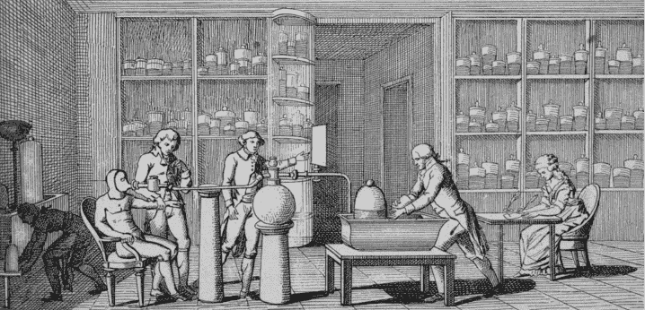

十八世纪化学家安托万·拉瓦锡研究呼出的气体是否类似于燃烧引擎的烟气。

## 历史

## 食物观念的变迁

营养学研究的先驱们测定了食物的能量含量，还帮助推翻了对困扰人类的各种疾病的误解。

**作者：内德·斯塔福德**

营养基因组学——以及现代营养科学的其余部分——建立在十八世纪末奠定的基础之上。

这并不是说在此之前没有人对食物如何发挥作用产生过兴趣。古埃及、希腊、罗马、波斯、中国和印度的文明都意识到食物与健康之间存在联系。“它们都有自己的饮食规则，其中许多至今仍然有效，”德国吉森大学的人类营养学家克劳斯·莱茨曼说。“古埃及人曾将大蒜用于医疗。”

我们的一些食物真理可以追溯到几千年前。古希腊医生希波克拉底建议，食物应在吞咽前充分咀嚼，并应适量食用以保持健康。在中世纪，德国修女、基督教神秘主义者宾根的希尔德加德“对食物了解很多”，莱茨曼说。“她提出了一些非常明智的建议”，比如吃煮熟的食物而不是生食。

但在十八世纪之前，人们对食物的组成或身体如何处理食物几乎没有进行科学研究。莱茨曼说，当时的研究人员“依赖于实验观察”。他们的方法是“喂食并观察”。正是被视为现代化学之父的法国化学家安托万·拉瓦锡首次开展了导向当今营养基因组学的研究。

## 食物作为燃料

拉瓦锡是最早设计实验室设备来测试食物被吞下后会发生什么的科学家之一。在他之前的工作中，科学家们知道摄入食物的重量超过排出的粪便和尿液的重量。他们将这种损失归因于出汗。但拉瓦锡认为食物是燃料，而身体就像当时正在开发的燃烧燃料的引擎一样，必须作为燃烧产物排出二氧化碳。他怀疑呼出的二氧化碳解释了这种丢失的物质。

为了检验自己的理论，拉瓦锡在18世纪80年代初发明了一种新型装置——冰量热计。它由一个装满冰的外壳组成，以维持0°C的恒定温度，内部包裹着一个放置豚鼠的腔室。动物的体温使冰融化。通过称量从量热计流出的水，拉瓦锡能够估算代谢热量，并将其与点燃的蜡烛或燃烧的木炭产生的热量进行比较。

他的理论被证明是正确的。拉瓦锡宣称：“呼吸气体交换就像蜡烛燃烧一样，是一种燃烧。”

在当今这个计算卡路里的世界里，这听起来算不上什么重大启示。但在当时，这是一项突破。“认识到身体需要能量才能运转，而食物的一个主要功能就是提供能量，这在理论上很重要，”加拿大安大略省布鲁克大学的科学史学家伊丽莎白·纽博尔德说。“这是确定一个人需要什么才能生存的基础；什么会导致体重增加，什么会导致体重减轻，什么能支持体力劳动，以及食物与体力劳动之间是什么关系。”

拉瓦锡的研究还强调了食物组成的重要性，以及认识到粪便、尿液、汗液和呼吸是这一等式的重要组成部分。

> “早期营养科学家花了很大一部分时间检查别人的排泄物。”

“这些早期营养科学家花了很大一部分时间——或者说他们助手的时间——来检查和分析别人的排泄物，”内斯瓦尔德说。“在营养实验中，评估输入与输出之间的差异至关重要——也就是吃进去的食物和排出的所有产物。”

这种方法被称为“平衡试验”，由法国化学家让-巴蒂斯特·布森戈于1836年首创。他针对氮——蛋白质的一种组成元素——进行了平衡试验，比较喂给牛和马的干草、燕麦和土豆中的氮含量与动物的排泄物，以及奶牛的牛奶中的氮含量。他表明，动物饲料含有足够的氮来满足身体需求，从而结束了关于额外氮是从大气中获得的猜测。

### 宏量营养素探索

到19世纪中叶，科学家已经了解到食物中的主要元素是碳、氮、氢和氧，并将食物成分分为四大类：碳水化合物、脂肪、蛋白质和水。然而，前三类的化学组成仍不清楚。

德国化学家尤斯图斯·冯·李比希实现了下一次飞跃。早慧的冯·李比希（21岁时被任命为吉森大学教授）发明了“Kaliapparat”，这是一种用于分析有机化合物中碳的特殊玻璃器皿。

冯·李比希的实验室可以说是第一个教学实验室，吸引了来自世界各地的科学家。他帮助培养了一代营养研究人员，他们的工作一直延续到20世纪初。

例如，在19世纪60年代，冯·李比希的两位门生——生理学家卡尔·福伊特和化学家马克斯·约瑟夫·冯·佩滕科费尔——从巴伐利亚政府获得资助，建造了一个足以容纳一个人的最先进的呼吸室。该呼吸室可以测量碳和氮的每日平衡，从而估算人体蛋白质需求。

内斯瓦尔德指出，这一时期的营养研究大多不是关注个人健康，而是寻找最便宜、最简单的方法来养活“被收容机构和贫困人群”，以防止食物骚乱。内斯瓦尔德说，冯·福伊特访问监狱和济贫院，“评估人们吃什么以及他们的健康状况，目的是提供膳食指南”。

食物作为燃料并含有重要膳食成分的概念在美国得到进一步完善。农业化学家威尔伯·奥林·阿特沃特曾在冯·福伊特的实验室做博士后，1871年回到美国，带头开展营养科学。阿特沃特在19世纪90年代花了五年时间建造了一个比冯·福伊特的更大、能够容纳人类超过一天的呼吸量热计。他的测量非常精确，以至于他得出的蛋白质、脂肪和碳水化合物的能量当量至今仍在使用。阿特沃特是第一个采用“卡路里”一词作为食物能量单位的人。（一卡路里食物能量实际上相当于1000卡路里热能。）

### 越来越小

科学家很快开始意识到，除了提供能量和宏量营养素外，食物在健康和疾病中还发挥着更微妙的作用。日本医生高木兼宽于19世纪70年代在伦敦圣托马斯医院医学院学习，是19世纪德国主导营养学的罕见例外。“他是第一个表明脚气病源于营养不良的人，”日本圣德大学人类营养学家横井克彦说。此前，脚气病被认为是一种传染病。

到20世纪初，世界各地的其他科学家已开始探索营养缺乏与其他疾病之间的联系，包括佝偻病和

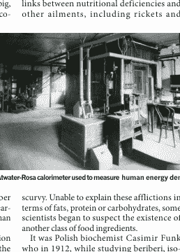

坏血病。由于无法用脂肪、蛋白质或碳水化合物来解释这些疾病，一些科学家开始怀疑还存在另一类食物成分。

波兰生物化学家卡西米尔·芬克于1912年在研究脚气病时分离出了硫胺素，即预防这种疾病的营养素。他将这种物质称为“生命胺”，这个词很快变成了“维生素”。

对抗坏血病的斗争是科学后来完善营养相关疾病关联的一个例子。18世纪中叶，苏格兰海军医生詹姆斯·林德发现坏血病可以通过食用柑橘类水果来治疗或预防。但他错误地认为海风是导致这种疾病的原因。随后又出现了其他错误建议。例如，1846年，苏格兰毒理学家罗伯特·克里斯蒂森假设坏血病是由蛋白质缺乏引起的。坏血病一直是一个偶发问题，直到20世纪初。直到1932年，美国生物化学家查尔斯·格伦·金才证明坏血病是由新发现的维生素C缺乏引起的。

动物研究带来了更多关于维生素和疾病的发现。美国生物化学家埃尔默·弗农·麦科勒姆学习了德语，以便阅读过去营养研究人员的著作，这激发了他用大鼠做实验。在麦科勒姆最初工作的威斯康星大学，研究方案规定使用奶牛作为动物模型。但麦科勒姆说服上级让他尝试更小的动物。他从宠物店买了12只白化大鼠，并在美国建立了第一个用于营养实验的大鼠群体。1913年，他用这些大鼠进行的研究使他鉴定出第一种脂溶性维生素——维生素A，后来还表明，预防佝偻病的是维生素D——而不是一些人认为的维生素A。

证明微量营养素与疾病之间的联系并非易事。美国公共卫生服务署工作人员、流行病学家约瑟夫·戈德伯格提出理论认为，糙皮病——当时一种导致腹泻、皮炎、痴呆和死亡的主要疾病——与饮食有关，而不是当时医学界主流观点所认为的传染病。1916年，为了证明自己的观点，戈德伯格和他的助手对自己进行了一系列测试——他们互相注射糙皮病患者的血液，擦拭糙皮病感染者鼻子和喉咙的分泌物并涂到自己身上，还吞下含有糙皮病患者皮疹结痂的胶囊。然而，尽管有如此严重的暴露，他们并没有患上糙皮病。但是，戈德伯格未能找到与饮食有关的原因。又过了二十年，美国生物化学家康拉德·埃尔维耶姆才意识到糙皮病是由烟酸（维生素B3）缺乏引起的。

到1944年，已经发现了如此多的微量营养素，以至于一些人认为营养学领域已被完全定义，几乎没有其他可发现的东西。然而，尽管食物的组成成分可能已被厘清，但它们对身体的影响才刚刚开始被人们认识。

从拉瓦锡，到冯·李比希，再到何塞·奥尔多瓦斯等当今科学家（见《餐桌上的大科学》，第S2页），营养研究一直聚焦于越来越小的元素。随着科学家更深入地探究人体吸收和功能的生化机制——并在此过程中解开谜团——他们也引发了新的问题，直到我们追问“我们的基因如何与我们吃的食物相互作用？”而这正是我们今天仍在努力回答的问题。■

*内德·斯塔福德是汉堡的一名科学作家。*

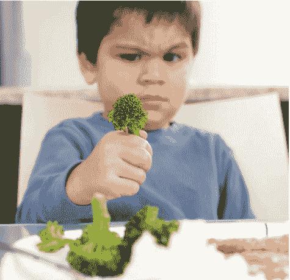

## 味觉

### 不止于口舌之感

*某些东西在不同人尝来味道不同。为什么会这样，这是否会影响我们对食物的选择？*

**迈克尔·艾森斯坦 撰**

近80年前，杜邦公司的化学家偶然发现，人们对苦味化合物苯硫脲（PTC）的感知存在遗传变异；如今，宾夕法尼亚州费城莫内尔化学感官中心的丹妮尔·里德团队也做出了一个同样意外的发现。

一位实验室技术员找到里德，担心自己把实验用的奎宁制剂弄错了。“她说：‘我觉得我把溶液配错了——来，尝尝这个，’”里德回忆道，随后她尝了那种苦味化合物。“我说：‘呃，我觉得没问题啊。’但她说：‘我尝起来就像水一样。’”

这一奇怪的现象最终促成了一个遗传位点的发现，该位点影响舌头检测奎宁苦味的能力——这是理解人与人之间味觉差异、以及这些差异如何塑造我们饮食偏好的重要一步。

### 苦味

苦味是构成味觉系统的五种基本味之一——另外四种是甜、酸、咸和鲜味。其中，就遗传变异对味觉的影响而言，苦味或许是研究得最清楚的。

在人类中，负责苦味感知的细胞表达25种受体（T2Rs），这些受体识别的化学物质各不相同，但似乎共同发挥着防止人们摄入有毒化合物的作用。因此，一些科学家确信，人类进化出味觉是为了检测有害物质。“新生儿天生喜欢甜味、讨厌苦味——不需要任何经验，”佛罗里达大学嗅觉与味觉中心人类研究主任琳达·巴托舒克说。

已在若干苦味受体基因中发现了不敏感变异，且这些变异在普通人群中很常见。例如，T2R38的突变使个体无法尝出PTC或相关化合物6-正丙基硫氧嘧啶（PROP）。

这种有限的敏感性也可能是一种优势，因为许多营养丰富的蔬菜——包括西兰花和芽菜——也会产生带苦味的硫代葡萄糖苷。这些化合物包括致甲状腺肿素，大剂量时是一种甲状腺毒素，但较低剂量时可能具有防癌作用。

减轻回避芽菜的冲动显然有营养上的好处，而这种降低敏感性的等位基因的适应价值，也体现在它与更常见的高敏感版本一起分布于全球。

“等位基因的比例因地区而异，”莫内尔味觉感知研究员保罗·布雷斯林说，“但你会发现，在地球上任何地方观察到的几乎每个群体中，这两种等位基因都得以保留。”

然而，要将个体遗传变异与食物偏好改变 firmly 联系起来并非易事。若干研究揭示了味觉受体变异分布在地区和族群上的差异，这些差异可能源于选择压力（见 *豆子与基因*，第S13页），但它们对饮食的影响——以及与整体健康的关联——仍存在争议。“我是一个PTC尝不出味道的人：我不太能尝出蔬菜里的致甲状腺肿素。但我认为这和我每天选择吃多少西兰花几乎没什么关系，”里德说。

试图在疾病与味觉之间建立类似关联的努力同样问题重重。例如，对甜味的敏感性与肥胖、糖尿病或其他与糖摄入过量相关的疾病之间，并没有明确联系。

目前已识别出的一些最强关联与酒精偏好有关。在一项研究中，巴托舒克与耶鲁大学遗传学家肯·基德合作，考察苦味如何在一组学生中塑造酒精感知。“敏感性与乙醇被感知为苦涩刺激还是略带甜味之间存在明显关系，”基德说。“在高敏感[苦味等位基因]纯合的人中，没有人喝很多酒。”莫内尔的其他研究提示，甜味受体变异可能也有类似作用：对甜味的敏感性和对甜味的偏好似乎与酒精消费相关。不过，基德等人指出，必须将这种变异性与饮酒涉及的众多其他大脑和代谢因素一并考虑。

**NATURE.COM**

欲了解更多关于我们感官的最新研究，请访问 go.nature.com/BK7ZI

### 为味觉命名

这一问题很大程度上源于实验上的挑战：如何将高度主观的味觉体验与生物学机制联系起来。但我们对味觉感知基本机制的理解仍存在空白。今年春天，纽约哥伦比亚大学查尔斯·朱克团队证实，上皮钠通道ENaC是小鼠感知氯化钠咸味的组成部分。其他盐受体仍未找到。“人们把氯化钾描述为有点咸腥味，也许有点金属味，像脏的盐溶液。它显然是咸的，”布雷斯林说。“这不可能通过ENaC实现，因为那些通道对钾离子的通透性很差。”

此外，尽管研究人员自2006年起就知道负责酸味的细胞，但确切的受体尚未被识别。部分原因是口腔对酸的反应本质复杂，味觉效应与躯体感觉重叠；躯体感觉是一类感知信息，涵盖温度、质地或辛辣等非味觉品质。

初步报告还暗示存在额外的味觉品质，使舌头能够识别脂肪酸或钙之类的东西。但对此几乎没有共识，部分原因是没有识别出专门的味觉品质细胞，也因为候选受体只能部分解释我们区分这些推测味觉的能力。一些科学家还持怀疑态度，因为人类缺乏描述这些品质的词汇。“就拿一点菜籽油尝尝——它其实没什么味道，”巴托舒克说。“我猜脂肪带来的真正感官输入是触觉性的——脂肪黏稠、油腻、黏滑又柔滑。”

大多数研究者仍愿意接受一种可能性：口腔能感知的不止“基本五味”。朱克团队2009年的一项研究发现，酸味细胞中表达的一种蛋白质显然与躯体感觉受体共同作用，参与辨别“碳酸味”，他们还在寻找监测其他未发现品质的机制。“如果你取一只动物，标记所有甜、酸、苦、咸和鲜味细胞，仍然会剩下大量细胞，”他说。“我们现在正在寻找那些[其他]细胞中独特存在的东西。”

### 肠道感觉

味觉并不止于舌根。许多在味蕾中表达的味觉受体基因，也在整个消化系统和其他组织中表达。初步研究表明，这些非口腔受体有助于调节食欲和代谢。“还有什么比让同样的受体从胃肠道发回信号更好的办法呢？”朱克问道。

已有强有力的证据表明，口腔中的味觉受体帮助生物体转向身体最需要的营养物质。“如果你给营养不良的孩子喝汤，有的是清汤、普通高汤，有的是强化高汤，他们通常更喜欢氨基酸强化汤，胜过其他所有汤，包括非常美味的高热量汤，”布雷斯林说。“这些还是小孩子，根本不知道是怎么回事。这表明身体在某种程度上自有智慧。”

有证据表明，这种活动至少有一部分可能源于味觉受体激活所触发的代谢信号。“味觉细胞表达各种不同的肽类激素，这些激素在身体其他部位用于调节饱腹感或血糖，”马里兰大学神经生物学家史蒂文·芒格说。

过去几年的若干研究表明，这些受体还指导下消化道分泌代谢激素，以响应甜、苦或鲜味刺激；例如，肠道甜味受体信号可能有助于调节血液中的葡萄糖吸收。芒格补充说，他自己对阿米什人中与糖尿病相关基因的研究，就受到这些肠道受体及其功能模糊性的干扰。“我们确实看到了一种特定苦味受体的变异与非糖尿病个体调节血糖能力之间的关联，”他说。然而，目前尚不清楚这种关联是源于受体变异对舌头层面味觉偏好和食物选择的影响，还是差异在于肠道对特定食物的反应方式。

### 拆解风味

对许多味觉科学家来说，最大的未解问题是理解传递味觉的各种原始化学感觉如何被整合为更细致、更复杂的风味感。这一层面的感知还依赖于嗅觉接收到的信号，而嗅觉表现出远为更大的复杂性、环境适应性和个体差异。“你有这样一种感觉——味觉，它与情感硬连接，”巴托舒克说，“还有另一种感觉——嗅觉，它的情感反应极不稳定，学得极快，也可以被消退。”

同样重要的是，大脑如何决定自己是否喜欢所感觉到的东西。莫内尔遗传学家亚历山大·巴赫曼诺夫举了他实验室培育出的喜甜小鼠的例子。“通过选择性育种，我们培育出了味觉受体相同的小鼠，但有些非常热衷于摄入甜味剂，另一些则只摄入非常少的量，”他说，并提出这种行为源于与味觉反应相关的更中枢神经机制的变异。这种额外的复杂性为文化影响和环境因素留下了很大空间，它们可以塑造我们如何给一种风味赋予奖赏价值，进而可能影响更微妙的基因组层面因素的作用。因此，单凭味觉受体表达或功能的遗传差异，可能不足以解释我们许多人如何克服对苦味和酸味的先天厌恶，从而尽情享受一小杯热腾腾的浓缩咖啡或一杯提神的金汤力。

尽管如此，有证据表明遗传变化可以调节这个通常硬连接的感官系统的反应。朱克的结论是，要理清食物选择背后的神经过程并取得有意义的进展，需要扎实理解食物入口时发生了什么。“在我们理解大脑如何知道之前，”他说，“我们需要弄清楚舌头如何知道。”

迈克尔·艾森斯坦是费城的一名记者。

1944—1945年荷兰饥饿冬季期间，等待被喂食的儿童。

## 表观遗传学

## 逆境的故事

对饥荒期间受孕人群的遗传学研究显示，产前营养不良的影响在事件过去很久之后依然存在。

**作者：法鲁克·艾哈迈德**

众所周知，孕妇的习惯会影响胎儿的健康，但其影响程度尚不十分清楚。近期对悲惨历史事件——即荷兰饥饿冬季和中国大饥荒——的研究，已开始凸显食物与基因之间的跨代关系。

饥饿冬季始于1944年末，临近第二次世界大战结束。随着德国人停止向阿姆斯特丹及附近城市运送陆路货物，纳粹占领下的荷兰北部和西部地区的粮食供应日益紧张。

严冬使运河结冰，切断了重要的供应路线，进一步加剧了封锁。城市口粮降至每天仅500卡路里，不足建议摄入量的四分之一，直到1945年5月国家解放；但在此之前已有18000人饿死。

许多在饥饿冬季期间受孕的儿童身材矮小、体重不足。此外，某些健康问题一直持续到他们成年后很久。例如，与在饥荒前或饥荒后受孕的兄弟姐妹相比，饥饿冬季儿童患肥胖症的风险更高。

尼日利亚最近一项研究还发现，1968—1970年比夫拉饥荒期间出生的儿童也有肥胖倾向。

1958年至1961年的中国大饥荒，是由毛泽东在大跃进期间的农业政策、普遍的管理不善以及恶劣天气共同造成的。数千万人死亡。对这一时期出生的中国人的研究，将产前饥荒暴露与精神分裂症风险增加联系起来——荷兰饥饿冬季队列中也发现了这一联系。

“这些极端事件为人类研究提供了否则可能没有的特殊机会，”纽约哥伦比亚大学流行病学家兰伯特·卢梅伊说，他正在研究饥饿冬季的影响。其中涉及明显的伦理问题和漫长的时间跨度，使得重现饥荒情形不可能。“这些事件对于我们发展和发现潜在的疾病机制至关重要，”卢梅伊说。

### 显露端倪的DNA

科学家发现，在长期饥饿期间受孕的儿童，其某些基因会通过一种称为甲基化的过程获得特殊的表观遗传“标签”——这种基因修饰通常会关闭一个基因，但不会改变遗传密码。

甲基化是正常发育的一部分，但其模式因人而异。

饥荒发生近六十年后，卢梅伊及其同事从饥饿冬季个体中分离出DNA。他们发现，胰岛素样生长因子IGF2的甲基化水平低于平均水平，该基因编码一种对妊娠至关重要的生长激素。降低IGF2的甲基化应会增加该激素的表达。相反，该队列后来研究发现另外五个基因的甲基化增加，其中包括与胆固醇转运和衰老相关的基因，以及产生IL-10的基因，后者与精神分裂症有关。

这些表观遗传变化的机制，以及它们是否与疾病有关，仍不清楚。“在人类中，这些是价值十万美元的问题，”德克萨斯州贝勒医学院的表观遗传学家罗伯特·沃特兰说。

卢梅伊希望研究这些“被标记”个体的子女，看看这些变化是否会延续到下一代。表观遗传信息在发育极早期几乎完全重置，因此他说，结果难以预测。“无论数据日后显示什么，这都是一个重要问题。”

尽管如此，沃特兰指出，对这些极端事件的研究“提供了首批令人信服的证据，表明早期营养暴露会导致人类表观遗传调控发生持久变化”。“这是原理性证明。”

卢梅伊现在正着眼于高通量测序方法来测量全基因组DNA甲基化。“我们预期，这将告诉我们，产前暴露个体与其未暴露兄弟姐妹之间，是否还存在比我们在研究候选位点时发现的更多的表观遗传差异，”与卢梅伊合作的荷兰莱顿大学表观遗传学家巴斯蒂安·海曼斯说。如果这些修饰确实广泛存在于整个基因组中，那么饥荒诱导的表观遗传改变的累积效应，可能在疾病进展中发挥重要作用。

其他研究表明，不那么极端的饮食也会影响甲基化模式和疾病易感性。例如，叶酸是孕妇的重要补充剂，有助于预防发育中胚胎的神经管缺陷。已证明它会增加IGF2的甲基化，暗示它通过表观遗传机制发挥作用。

尽管如此，研究此类灾难为研究人员提供了原本无法获得的宝贵信息，揭示出饥荒和产前营养不良的后果在救命食物到来后仍会长期持续。■

**法鲁克·艾哈迈德**是纽约的科学作家。

## 技术

## 未来的滋味

*健康生物标志物、智能技术和社交网络正在加速一个根据个人需求量身定制营养的时代，但它依赖于群体生成的信息。*

一名男子在完成每月营养状况分析后走出健康诊所。他把一枚戒指戴到手指上，这项免注射技术将他血液成分的读数传输到中央服务器。他浏览发送到智能手机上的数据，查看针对他晚间零食的建议——来点硒含量稍高的东西：也许巴西坚果。他考虑接下来一周的饮食——已与冰箱记录同步——并确认更新后的家庭配送购物清单。最后，他累计因与一项全人群基因组研究共享这些个人健康数据而获得的积分——可抵扣他的健康保险和营养补充剂费用。这对他的女朋友来说已是司空见惯。“明天我们在我父母家吃晚饭。你敢让FatNav告诉你该吃什么，或者告诉我该喝什么。”

有迹象表明，这样的未来正在迅速临近。家用睡眠和体重监测器可以通过Wi-Fi传输结果；记录你吃过什么的冰箱正在开发中；晚宴也因食物不耐受和流行饮食而变得复杂。糖尿病指尖采血检测结果已经可以上传到网上。patientslikeme.org等网站提供有关药物和营养补充剂方案的提示。在SNPedia.com和DIYgenomics.org上，人们可以共享自己的全部基因组数据，以汇集资源并就健康问题提供更个性化的指导。

所有这些平台能创建基于遗传学的营养建议吗？这是否会影响我们对健康的定义，或食物与药物之间的界限？我们的饮食将变得多么个性化？

### 不止于疾病，更在于健康

许多研究人员认为，个性化营养必须从一套新的生物标志物开始：衡量健康而非疾病的标志物。但这意味着什么？“我们身处21世纪，除了‘没有疾病’之外，我们没有健康的定义，”英国食品研究所营养研究员伊恩·阿斯特利说。“健康远不止于此。”

阿斯特利说，要理解生物活性食物化合物在做什么，我们必须首先了解身体在生病之前发生了什么。“我们的困难在于，我们拥有的唯一生物标志物都是在疾病过程已经开始时才有的。”

转录组学、蛋白质组学和代谢组学等“组学”科学，在一项称为“广泛表型分析”的过程中研究成千上万个推定生物标志物。“我们现在有一些例子表明，组织中的蛋白质指纹可以在症状出现很久之前指示前兆变化，”阿斯特利说。“蛋白质指纹为我们提供了早期诊断，也让我们洞察通过给人们喂食不同饮食可能引发的潜在变化。”

阿斯特利还为营养基因组学组织（NuGO）工作，这是一个由欧盟资助、涉及23所大学和研究机构的项目。NuGO研究人员认为，要找到这些健康生物标志物，需要重新考虑测试条件。例如，尽管我们都处于稳态平衡状态，但代谢物（包括葡萄糖、血浆蛋白、细胞因子和信号分子）的“正常”水平因人而异。

## 细节中的魔鬼

大规模表型分析是一项艰巨的工作，且耗资巨大。资源有限的研究人员有两种选择：以较低细节测量许多人，或以更高细节测量较少的人。大规模人群研究具有更强的统计效力，但由于最终目标是个性化营养，对个体的研究将提供更深入的信息。

这是都柏林大学学院食品与健康研究所所长 Mike Gibney 面临的一个难题。“一项研究中人数太多会使数据趋于平滑，而且在需要如此多测量指标的时代成本太高，”他说。Gibney 认为我们正处于向个性化营养过渡的阶段，并主张暂时放弃“个体”这一口号。相反，人们应根据生物标志物被划分为更宽泛的类别，这些生物标志物例如可指示不同糖类或蛋白质的代谢效率。“我正在把研究转向聚类方向，”他说。“我认为这是一种折中方案。”这些更宽泛的分组具有包含更大规模人群的优势，并可作为概念验证。

> “终于，布丁里有了证据——饮食建议中的遗传差异是相关的。”

支持这些聚类概念的结果正在涌现。Kenneth Kornman 是 InterLeukin Genetics（ILG）的创始人，这是一家总部位于马萨诸塞州的公司，基于单核苷酸多态性（SNP）开发影响食物代谢的基因检测。Kornman 最近重新分析了 Christopher Gardner 及其斯坦福大学同事 2007 年的一项研究。在 Gardner 的研究中，311 名女性被随机分配到四种碳水化合物含量不同的饮食中。12 个月后，采用低碳水、高蛋白阿特金斯饮食的女性体重下降最多。

Kornman 的重新分析将其中 101 名女性（可进行随访研究者）归入三组之一，分组依据是与膳食脂肪和碳水化合物代谢相关的三个 SNP。‘脂肪敏感’组女性共有一种 SNP，使她们在高脂饮食下比‘碳水化合物敏感’组女性增重更多，反之亦然。第三组对脂肪和碳水化合物均不敏感。“我们公司筛查了已发表的 200 多个 SNP 的证据，并确定这三个是唯一符合我们标准的 SNP，”Kornman 说。这些标准是：每个 SNP 至少应有三项验证性临床研究，应具有功能性（直接与生物学或临床效应相关），并与体重相关。

Kornman 发现，采用与自身基因型匹配的饮食的女性，其体重下降幅度是采用不匹配饮食者的两到三倍。这项由 ILG 赞助的研究在旧金山举行的 2010 年美国心脏协会联合会议上公布。“听众中的科学家们感到震惊，”荷兰应用科学研究组织及 NuGO 主任 Ben van Ommen 回忆道，他曾邀请 Kornman 发言。他说，Kornman“受到了听众的严格审视，并经受住了考验。终于，布丁里有了证据——饮食建议中的遗传差异是相关的。”

### 食物部落

要迈向营养谱系中更个性化的一端，将需要来自许多不同群体的数百万个额外数据点。从不同人群收集信息的一种方法是使用众包技术。许多已发现更多或全部遗传信息的人，正通过 SNPedia、DIYGenomics 和哈佛医学院个人基因组计划等网站分享或提供这些信息以供分析。随着基因组检测变得更便宜，将会有更多数据可以以这种方式使用。

个人基因组信息分享网站的创始人，例如 DIYGenomics 的 Melanie Swan，表示他们可以通过提供一种吸引受试者的新科研方式来促进这一数据收集过程。“我们的目标是让个人有机会参与公民科学研究，”Swan 说。“关键就在于进行实验，并找出最适合你的方法。”

一项典型实验可能会研究维生素补充剂及其前体。参与者将同意定期服用补充剂，自费进行基因测序检测，向经批准的实验室提交定期检测，并将结果上传到网站。将所有参与者的数据结合起来，可以描绘出某些基因与维生素或维生素前体对健康影响之间的关系。DIYGenomics 的第一项研究——已提交给同行评审期刊——是一项概念验证，扩展了关于基因突变和维生素 B 缺乏的现有研究。另一项关于衰老的研究已完成设计，并准备招募参与者。

这种新的研究方法模糊了研究组织者与参与者之间的界限。“我们都设计研究，也都参与其中。我们也有自己的知情同意流程，”Swan 说，并补充说，她看到一种‘公民伦理学家’版本的希波克拉底誓言正在演变，以适应新的研究开展方式。

### NATURE.COM

**更多关于技术如何影响临床试验的内容**
go.nature.com/07K55S

有些人将个人基因组学视为社交网络的合理延续和宝贵资产。“公民科学方法肯定有潜力，”孟菲斯大学传播学研究员 Marina Levina 说。然而，Levina 也提出了几点告诫。“公民科学暗示传统科学在某些方面辜负了我们，而我认为，那些或许会拖慢传统科学的指南和限制之所以存在，是因为存在合理的伦理问题。”

还有其他潜在陷阱。提供基因组分享网站的基因检测公司因提供不一致的结果和关于疾病遗传倾向的薄弱诊断而受到批评。有迹象表明，美国食品药品监督管理局正采取行动限制它们，或许会通过执行更严格的监管。这与美国和欧洲正在进行的营养补充剂行业监管变化相呼应，该行业将更多地被当作制药行业来对待。

在制定量身定制的营养建议时，基因并不是唯一重要的考虑因素。新兴的表观遗传学描述了基因在体内如何以及何时被开启和关闭，它预示着通往个性化营养的道路将既复杂又令人沮丧。

ILG 的 Kornman 说，在确定最佳饮食方面，表观遗传学是房间里的大象：“越来越多的证据表明，产前营养和环境效应在胎儿发育和幼儿期营养方面具有终身、甚至可能跨代的影响。”即使我们能够解码饮食—健康关系的遗传配方，如果对生命早期——或母亲、或许祖母一生中——形成的表观遗传修饰没有更多了解，这个配方仍可能味道不对。

此外，我们究竟能否克服对甜、脂肪和咸味食物的喜爱？“人们在饮食选择上很反常，”伦敦国王学院营养与饮食学负责人 Tom Sanders 说。“他们往往会用自己认为不好的食物来抵消自己认为好的食物。”换句话说，我们不擅长吃好食物，却很擅长吃坏食物。

营养基因组学很可能改变我们对健康和疾病的定义；模糊食物与药物之间、实验者与受试者之间的界限；并展示由食物部落、公民科学家和在线社交网络驱动的新科学方法模型。悖论在于，随着我们的生活方式变得越来越个性化，可能正是群体才能为健康饮食提供最佳建议。

*Arran Frood 是英国的自由撰稿人。*

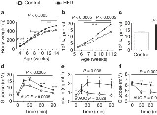

**图1 | HFD导致雌性脂肪堆积、葡萄糖不耐受和胰岛素抵抗。** a，体重变化轨迹（对照组、HFD组：n 分别为 8 和 9）。b，累积能量摄入（n 分别为 4 和 5）。c，总能量摄入（n 分别为 4 和 5）。d–f，葡萄糖耐量试验期间的血糖（n 分别为 8 和 9）、葡萄糖耐量试验期间的胰岛素分泌（n 分别为 7 和 9），以及胰岛素耐量试验期间的血糖（n 分别为 7 和 9）。数据以平均值 ± s.e.m. 表示。\*P < 0.05，\*\*P < 0.01，\*\*\*P < 0.0005，与对照组相比。重复测量分析中雄性亲本组间显著差异的P值显示于各面板顶部。

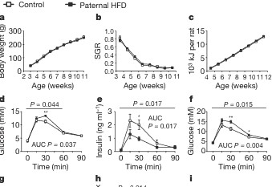

**图2 | 雌性后代在葡萄糖刺激下表现出葡萄糖耐量受损和胰岛素分泌受损。** a，体重（对照组、HFD组：n 分别为 8 和 9）。b，特定生长率（SGR，体重变化/体重，n 分别为 8 和 9）。c，累积能量摄入（n 分别为 9 和 7）。d–g，6周龄时葡萄糖耐量试验期间的血糖（d）和血浆胰岛素（e）（n 分别为 8 和 8），以及12周龄时的相应指标（f 和 g，n 分别为 5 和 7）。h，12周龄时的胰岛素抵抗指数（葡萄糖（mM）× 胰岛素（ng ml⁻¹）× 0.0417/22.5）。i，11周龄时胰岛素耐量试验（0.5 kg⁻¹）期间的血糖（n 分别为 8 和 9）。数据为平均值 ± s.e.m.。\*P < 0.05，\*\*P < 0.01，与对照组相比。组间显著差异显示于面板顶部。

出现不耐受和胰岛素抵抗，表现为空腹及葡萄糖耐量试验期间血糖和血浆胰岛素升高（图1d、e）。胰岛素抵抗稳态模型评估（HOMA-IR；表1）升高，胰岛素耐量试验反应减弱（图1f）。父代HFD未改变性别比例。

在人类中，父代肥胖与后代低出生体重相关⁶。在这里，HFD父代的雌性后代第1天体重呈降低趋势（6.61 ± 0.15 对 对照组 7.08 ± 0.26 g；n 分别为 9 和 8；P = 0.07）；雄性为（7.40 ± 0.21 对 对照组 7.30 ± 0.20 g；n 分别为 9 和 9；P = 0.74）。在女孩中，脂肪堆积⁸,¹⁵和胰岛素抵抗¹⁶与其肥胖父亲的情况非常相似。由于一项初步研究发现雌性后代而非雄性后代的葡萄糖耐量显著受损（S.F.N. 和 M.J.M.，未发表数据），我们在雌性断奶并改用对照饮食后进一步评估了它们。父代HFD未改变雌性后代的体重、特定生长率、能量摄入（图2a–c）或能量效率（未显示）。

在人类中，父代脂肪堆积可预测其月经初潮前女儿的脂肪堆积¹⁵。在这里，父代HFD未改变成年雌性后代的脂肪堆积、肌肉量、空腹血浆瘦素、甘油三酯或非酯化脂肪酸（NEFA）浓度（表1）。要么肥胖可能较晚出现，要么它可能不会通过父系在啮齿动物中传递，正如对营养不良¹⁷和HFD喂养¹²祖母的后代所报道的那样。

接下来，我们评估了雌性大鼠后代的葡萄糖耐量及其两个关键决定因素：胰岛素分泌和敏感性。父代HFD未改变雌性后代的空腹血糖（图2d、f）或血浆胰岛素（图2e、g），但在6周龄葡萄糖耐量试验期间增加了血糖升幅（峰值 13.6 ± 0.3 对 12.3 ± 0.4 mM；P = 0.043）并降低了胰岛素分泌（峰值 0.24 ± 1.4 对 0.25 ± 0.4 mM；P = 0.043）（图2d、e）。在12周龄时观察到类似模式（图2f、g），但父代HFD后代的葡萄糖耐量进一步受损，表现为葡萄糖峰值更大（较对照组 +10% 至 +23%）以及葡萄糖耐量试验期间葡萄糖曲线下面积增加，AUCglucose（+9% 至 +19%）。HFD父代后代在葡萄糖负荷后前30分钟内的胰岛素分泌（胰岛素分泌 AUC₍₀–₃₀ min₎）减半（38.7 ± 5.8 对 86.8 ± 7.3 ng ml⁻¹；P = 0.004）；但其胰岛素抵抗指数和胰岛素耐量试验中的反应未改变（图2h、i）。

在6周时检查时，我们检查了胰岛和β细胞丰度，并对分离的胰岛进行全基因组微阵列分析，以探索胰岛素分泌受损的机制。父代HFD降低了后代的相对胰岛面积（−23%；P = 0.04），主要由于大胰岛减少（−18%；P = 0.031），并使β细胞面积呈降低趋势（P = 0.09；表1），提示β细胞复制受损。我们还观察到HFD父代后代的小胰岛增加（+6%；P = 0.034；表1），表明存在维持正常β细胞量的代偿反应。我们提出，HFD父代雌性后代有限的β细胞储备足以维持正常空腹血糖和胰岛素水平，但不足以保持葡萄糖刺激的胰岛素分泌和葡萄糖耐量。

父代HFD改变了成年雌性后代中77个基因的表达（21个上调，56个下调，P < 0.001；补充表2）；在P < 0.01水平上的642个基因富集了属于与胰岛素和葡萄糖代谢相关的调控通路的基因本体论术语，即阳离子和ATP结合、细胞骨架和细胞内运输（补充图1）。对2,492个基因（P < 0.05）进行的京都基因与基因组百科全书（KEGG）通路广泛分析揭示了钙、MAPK和Wnt信号传导、凋亡和细胞周期的参与（表2）。还识别了分子网络，包括Jak–Stat与MAPK信号传导成员之间的直接相互作用（补充图2和补充表3）以及其他功能富集的通路（补充表3）。总体而言，这些分子发现与胰腺形态的改变一致，并表明胰岛素颗粒胞吐受损¹⁹,²⁰。基因表达倍数增加最大的是Il13ra2，它是Jak–Stat信号通路的一部分（表2）。Il13ra2在多种胰腺癌细胞系中表达并调节其生长和侵袭²¹，并被TNF-α（Tnf）上调²²。定量聚合酶链反应（qPCR）与

### 表2 | 功能性富集通路中雌性子代差异表达的胰岛基因（P < 0.05）

| 基因符号 | RefSeq | 探针组ID | HFD均值（n = 5） | 对照均值^a（n = 6） | HFD相对于对照的倍数变化 | HFD相对于对照的P值 |
|---|---|---|---|---|---|---|
| **钙信号通路（KEGG 04020）** |  |  |  |  |  |  |
| Adrb1 (d) | NM_012701 | 10716262 | 5.51 | 5.70 | −1.14 | 0.035 |
| Chrm1 (d) | NM_080773 | 10713581 | 6.01 | 6.17 | −1.12 | 0.041 |
| Htr6 (d) | NM_024365 | 10882383 | 5.50 | 5.69 | −1.14 | 0.004 |
| Htr7 (d) | NM_022938 | 10729825 | 5.12 | 5.37 | −1.19 | 0.024 |
| Adcy2 (d) | NM_031007 | 10739336 | 5.58 | 5.71 | −1.09 | 0.026 |
| Cacna1c (d) | NM_012517 | 10779405 | 4.85 | 5.01 | −1.11 | 0.026 |
| Ryr1 (d) | ENSRNOT00000027893 | 10720308 | 5.65 | 5.78 | −1.10 | 0.020 |
| Camk2a (d) | NM_012920 | 10802026 | 5.47 | 5.58 | −1.07 | 0.036 |
| Pde1b (d) | NM_022710 | 10899676 | 5.88 | 6.13 | −1.19 | 0.039 |
| Sphk1 (d) | NM_133386 | 10739796 | 5.38 | 5.59 | −1.15 | 0.022 |
| Grm1 (d) | NM_017010 | 10843400 | 7.16 | 6.92 | 1.18 | 0.006 |
| Plcb3 (d) | NM_013135 | 10739827 | 10.66 | 10.52 | 1.11 | 0.010 |
| Pth2r (d) | NM_080584 | 1071127 | 8.15 | 8.06 | 1.07 | 0.019 |
| Pde1c (d) | NM_031078 | 10862700 | 7.00 | 6.68 | 1.26 | 0.007 |
| **MAPK信号通路（KEGG 04010）** |  |  |  |  |  |  |
| Cacna2d (d) | NM_019294 | 10768765 | 4.85 | 5.01 | −1.11 | 0.026 |
| Cacna2d3 (d) | NM_175595 | 10789819 | 5.14 | 5.26 | −1.09 | 0.032 |
| Cacna2d4 (d) | ENSRNOT00000010746 | 10858218 | 5.19 | 5.32 | −1.09 | 0.014 |
| Tgfa (d) | NM_012666 | 10790031 | 5.21 | 5.30 | −1.02 | 0.019 |
| Fos (d) | NM_022197 | 10886031 | 7.91 | 8.82 | −1.87 | 0.014 |
| Ptpn7 (d) | NM_145683 | 10764196 | 5.28 | 5.44 | −1.12 | 0.004 |
| Map3k4 (d) | NM_001107456 | 10717995 | 6.24 | 6.53 | −1.22 | 0.005 |
| Rap1a (u) | NM_001005765 | 10825727 | 8.81 | 8.69 | 1.09 | 0.046 |
| Rasd1 (u) | NM_013135 | 10824268 | 9.33 | 9.25 | 1.06 | 0.002 |
| Mapk8 (u) | NM_053842 | 10736603 | 8.25 | 8.22 | 1.09 | 0.002 |
| Crk (u) | NM_019302 | 10736033 | 9.25 | 9.19 | 1.04 | 0.047 |
| Casp3 (u) | NM_012922 | 10791652 | 8.60 | 8.53 | 1.05 | 0.050 |
| Daxx (u) | NM_080891 | 10831792 | 7.14 | 7.00 | 1.10 | 0.031 |
| Il1r1 (u) | NM_001127689 | 10922857 | 5.60 | 4.79 | 1.75 | 0.025 |
| Mknk2 (u) | NM_001011985 | 10893744 | 7.72 | 7.55 | 1.13 | 0.050 |
| **Wnt信号通路（KEGG 04310）** |  |  |  |  |  |  |
| Wnt5a (d) | NM_001105783 | 10733966 | 5.83 | 6.03 | −1.15 | 0.003 |
| Wnt5b (d) | NM_001107055 | 10748113 | 6.19 | 6.39 | −1.15 | 0.001 |
| Fzd9 (d) | NM_153305 | 10757698 | 6.02 | 6.15 | −1.09 | 0.014 |
| Ctnnb1 (u) | NM_053357 | 10914371 | 10.07 | 9.96 | 1.08 | 0.049 |
| Ppp2r5a (u) | NM_001107891 | 10770721 | 9.52 | 9.36 | 1.12 | 0.036 |
| Skp1 (u) | NM_001007608 | 10733430 | 10.81 | 10.64 | 1.12 | 0.024 |
| Cul1 (u) | NM_001108327 | 10855163 | 10.03 | 9.96 | 1.05 | 0.041 |
| Rock1 (u) | NM_031098 | 10803158 | 9.29 | 9.20 | 1.06 | 0.016 |
| **凋亡（KEGG 04210）** |  |  |  |  |  |  |
| Tnf (d) | NM_012675 | 10828021 | 5.21 | 5.50 | −1.22 | 0.019 |
| Bcl2l1 (d) | NM_031535 | 10850826 | 7.01 | 7.07 | −1.04 | 0.045 |
| Il1r1 (u) | NM_001127689 | 10922857 | 5.60 | 4.79 | 1.75 | 0.025 |
| Casp3 (u) | NM_012922 | 10791652 | 8.60 | 8.53 | 1.05 | 0.050 |
| Casp9 (u) | NM_031632 | 10791652 | 8.60 | 8.53 | 1.05 | 0.050 |
| Xiap (u) | AF034334 | 10921195 | 9.98 | 9.85 | 1.10 | 0.020 |
| Aifm1 (u) | NM_031356 | 10939955 | 7.98 | 7.83 | 1.11 | 0.029 |
| **细胞周期（KEGG 04110）** |  |  |  |  |  |  |
| Orc1l (d) | NM_177931 | 10870791 | 4.47 | 4.72 | −1.19 | 0.015 |
| Skp1b (d) | NM_00130498 | 10733430 | 10.81 | 10.64 | 1.12 | 0.024 |
| Cul1 (u) | NM_001108327 | 10855163 | 10.03 | 9.96 | 1.05 | 0.041 |
| Prkdc (u) | NM_001108327 | 10755897 | 8.37 | 8.29 | 1.05 | 0.025 |
| Stag1 (u) | NM_001108179 | 10912525 | 8.06 | 7.89 | 1.12 | 0.003 |
| E2f3 (u) | NM_001137626 | 10798213 | 5.85 | 5.59 | 1.20 | 0.017 |
| **Jak-Stat信号通路（KEGG 04630）** |  |  |  |  |  |  |
| Mdk (u) | ENSRNOT00000042602 | 10879267 | 4.65 | 4.99 | −1.27 | 0.001 |
| Stat1 (d) | ENSRNOT00000052121 | 10927873 | 7.18 | 7.43 | −1.16 | 0.006 |
| Ifnb1 (d) | NM_019127 | 10877952 | 4.10 | 4.31 | −1.16 | 0.012 |
| Jak3 (d) | NM_012855 | 10787364 | 6.56 | 6.77 | −1.15 | 0.035 |
| Il9 (d) | NM_001105747 | 10793945 | 5.73 | 5.92 | −1.14 | 0.022 |
| Ifna1 (d) | NM_001014786 | 10877972 | 5.56 | 5.73 | −1.13 | 0.013 |
| Ifna2 (d) | NM_001014787 | 10877972 | 5.67 | 5.82 | −1.11 | 0.022 |
| Socs3 (d) | NM_053565 | 10749372 | 6.08 | 6.24 | −1.11 | 0.033 |
| Il2rb (d) | NM_130410 | 10899749 | 6.11 | 6.22 | −1.08 | 0.042 |
| Bcl2l1 (d) | NM_031535 | 10850826 | 7.01 | 7.07 | −1.04 | 0.045 |
| Il13ra2 (u) | NM_133538 | 10937279 | 3.77 | 2.95 | 1.76 | 0.018 |
| Il13ra2 (u) | NM_133538 | 10937292 | 3.97 | 3.16 | 1.75 | 0.033 |

^a u，上调基因；d，下调基因。
^b 数值代表探针组的荧光强度，以log2尺度表示。
^c 倍数变化是HFD父亲子代相对于对照的基因表达。

逆转录（RT–PCR）证实了子代胰岛中Il13ra2（+6.3；P < 0.05）和Klk8（+2.9；P < 0.01）的信使RNA表达上调（每组n = 5），以及Fos（−4.0；P < 0.05）的表达下降。与对照（33.6 ± 4.0%，P < 0.001）相比，HFD子代中Il13ra2胞嘧啶−960处的甲基化降低（8.9 ± 2.2%）。发现胞嘧啶−960位于T细胞因子1和NF-κB的假定结合位点，后者是一种甲基化DNA结合蛋白3。Il13ra2的这种表观遗传修饰——该基因是关键分子网络的一部分（表2、补充表3和补充图4）——表明父源性HFD改变子代胰岛功能，部分是通过影响子代的表观基因组实现的。

在人类中，父源性胰岛素抵抗/糖尿病与子代出生体重呈负相关，并增加随后患糖尿病的风险。尽管遗传因素可能起作用，但我们的发现表明，父代HFD暴露可在子代中诱导相似的表型，揭示了一条额外且具有影响力的途径。值得注意的是，这些雌性子代在没有肥胖的情况下出现葡萄糖耐量受损和胰岛素分泌受损，表明父源性HFD特别靶向子代早期的内分泌胰腺和β细胞。雄性后代是否会出现类似缺陷仍有待确定。

父代生活方式和特定环境因素可在生殖细胞和支持细胞水平以及精液组成方面影响精子发生。脂肪积累导致的睾丸温度升高、膳食脂肪增加以及细胞代谢副产物可直接对成熟睾丸内的生殖细胞产生遗传毒性，通过氧化损伤导致DNA损伤增加。此外，肥胖男性的高胰岛素血症、高脂血症和相对性低促性腺激素性性腺功能减退可能继而影响精子发生。HFD还可能干扰支持细胞增殖和血睾屏障的完整性，从而影响配子的DNA重编程。鉴于儿童肥胖流行日益加剧，一个尚未回答的关键问题是，早期发生和长期HFD暴露是否也可能影响配子发生，从而提供。

据我们所知，这是首次在任何物种中直接证明父代环境暴露——HFD摄入——可诱导其雌性子代葡萄糖-胰岛素稳态受损的跨代传递。潜在机制似乎包括表观遗传修饰，其功能意义仍有待阐明。这些发现扩展了发育和适应性可塑性的概念，将父代作用纳入疾病的早期生命起源和糖尿病流行的放大。

## 方法摘要

### 动物实验

纳入来自八只对照和九只HFD父亲的窝；每个测试使用每窝一只动物。实验方案经新南威尔士大学动物护理与伦理委员会批准。

### 微阵列基因表达分析

使用miRNeasy Mini Kits（Qiagen）提取总胰岛mRNA。选择来自六只对照和五只HFD子代的样本（每只来自不同父亲），RNA完整性值（RIN）≥ 7.5，用于使用Affymetrix GeneChip Rat Gene ST 1.0 arrays进行转录组学分析。

### 统计分析

表型数据在对数转换或平方根转换后使用SPSS 16.0分析，除非原始数据呈正态分布。单时间测量使用双尾Student's t检验或Mann-Whitney U检验分析，时间过程使用重复测量ANOVA分析。完整方法和任何相关参考文献可在论文在线版www.nature.com/nature获取。

2009年12月27日收到；2010年9月10日接受。

- 1. Wang, Y. & Lobstein, T. 全球儿童超重和肥胖趋势。Int. J. Pediatr. Obes. 1, 11–25 (2006).
- 2. Pinhas-Hamiel, O. & Zeitler, P. 儿童和青少年2型糖尿病的全球传播。J. Pediatr. 146, 693–700 (2005).
- 3. Whitaker, R. C., Wright, J. A., Pepe, M. S., Seidel, K. D. & Dietz, W. H. 从儿童期和父母肥胖预测成年早期肥胖。N. Engl. J. Med. 337, 869–873 (1997).
- 4. Morris, M. J. 生命早期对肥胖风险的影响：母体营养过剩与肥胖的程序化。Expert Rev. Endocrinol. Metab. 4, 625–637 (2009).
- 5. Tarquini, B., Tarquini, R., Perfetto, F., Cornelissen, G. & Halberg, F. 遗传和环境对人类脐带血瘦素浓度的影响。Pediatrics 103, 998–1006 (1999).
- 6. Power, C., Li, L., Manor, O. & Davey Smith, G. 低出生体重与成年高体重指数的组合：在什么年龄确立及其决定因素是什么？J. Epidemiol. Community Health 57, 969–973 (2003).
- 7. Bouchard, C. 儿童肥胖：涉及遗传差异。Ann. Nutr. Clin. Metab. 49, 89–95 (2005).
- 8. Maes, H. H., Neale, M. C. & Eaves, L. J. 相对体重和人类肥胖中的遗传与环境因素。Behav. Genet. 27, 325–351 (1997).
- 9. Le Stunff, C., Fallin, D. & Bougneres, P. 非常常见的I类INS VNTR等位基因的父系传递易导致儿童肥胖。Nature Genet. 29, 96–99 (2001).
- 10. Gluckman, P. D. et al. 迈向新的发育综合：适应性发育可塑性与人类疾病。Lancet 373, 1654–1657 (2009).
- 11. Li, L., Law, C., Lo Conte, R. & Power, C. 对儿童体重指数的跨代影响：父亲体重指数轨迹的作用。Am. J. Clin. Nutr. 89, 551–557 (2009).
- 12. Figueroa-Colon, R., Arani, R. B., Goran, M. I. & Weinsier, R. L. 父亲体脂是初潮前女孩体脂变化的纵向预测因素。Am. J. Clin. Nutr. 71, 829–834 (2000).
- 13. Leibel, N. I., Bauman, E. E., Koscs, M. & Reisman, A. R. 青少年多囊卵巢综合征与父母代谢综合征的关系。J. Clin. Endocrinol. Metab. 91, 1275–1283 (2006).
- 14. Hofman, P. L. et al. 宫内发育迟缓的矮小儿童的胰岛素抵抗。J. Clin. Endocrinol. Metab. 82, 402–406 (1997).
- 15. Hattersley, A. T. & Tooke, J. E. 胎儿胰岛素假说：低出生体重与糖尿病和血管疾病关联的另一种解释。Lancet 353, 1789–1792 (1999).
- 16. Sone, H. & Kagawa, Y. 胰腺β细胞衰老促进高脂饮食诱导的糖尿病小鼠2型糖尿病的发病机制。Diabetologia 48, 58–67 (2005).
- 17. Marchetti, P. et al. 胰腺β细胞衰老与糖尿病。Diabetologia 48, 58–67 (2005).
- 18. Yoshikawa, H. et al. β细胞中的聚(ADP-核糖)聚合酶与糖尿病。Diabetes 48, 58–67 (1999).
- 19. Zehetner, J., K., W. & M., A. Z. 2型糖尿病的胰岛病理学。Diabetes Metab. 11 (suppl. 4), 168–179 (2000).
- 20. Wang, Z. & Thurmond, D. C. 双相胰岛素颗粒胞吐的机制——细胞骨架、小GTP酶和SNARE蛋白的作用。J. Cell Sci. 122, 893–903 (2009).
- 21. Fujisawa, T., Joshi, B., Nakajima, A. & B, R. K. 白细胞介素-13受体α2在胰腺癌侵袭和转移中的新作用。Cancer Res. 69, 8678–8685 (2009).
- 22. David, M., Borresen, J. P., Pierre, T. & El, R. J. IL-13Rα2和IL-13Rα1的鉴定作为IL-13Rα2在胰腺癌侵袭和转移中的新作用。Cancer Res. 69, 8678–8685 (2009).
- 23. Zhang, Y. et al. 主要组织相容性复合体II类反式激活蛋白CIITA是甲基化DNA结合蛋白的抑制因子。Mol. Cell. Biol. 13, 6810–6818 (1993).
- 24. Hattersley, A. T. & Tooke, J. E. 胎儿胰岛素假说：低出生体重与糖尿病和血管疾病关联的另一种解释。Lancet 353, 1789–1792 (1999).
- 25. Hypponen, E., Smith, G. D. & Power, C. 父母糖尿病与子代出生体重：跨代队列研究。Br. Med. J. 326, 19–20 (2003).
- 26. Davey Smith, G. et al. 胰岛素抵抗与低出生体重和糖尿病及血管疾病的关联。Lancet 353, 1789–1792 (1999).
- 27. Sharpe, R. M. 环境/生活方式对精子发生的影响。Phil. Trans. R. Soc. Lond. B 365, 1697–1712 (2010).
- 28. Sharpe, R. M. & Skakkebaek, N. E. 睾丸发育不良综合征：机制见解和潜在的新下游效应。Fertil. Steril. 89, e33–e38 (2008).
- 29. Aitken, R. J., Koopman, P. & Lewis, S. E. 令人担忧的种子。Nature 432, 48–52 (2004).
- 30. Du Plessis, S. S., Cabler, S., McAlister, D. A., Sabanegh, E. & Agarwal, A. 肥胖对精子疾病和男性不育的影响。Nature Rev. Urol. 7, 153–161 (2010).

补充信息可在论文在线版www.nature.com/nature上链接获取。

## 致谢

本工作由澳大利亚国家健康与医学研究委员会（NHMRC）支持（M.J.M.）。S.F.由马来西亚高等教育部和马来西亚国立大学支持，R.C.Y.L.由NHMRC Peter Doherty Fellowship支持。

## 作者贡献

S.F.N.和M.J.M.设计了研究。S.F.N.进行了动物实验、组织学、胰岛采集和RNA提取、数据分析并撰写了手稿。A.K.2.监督了项目并撰写了手稿。D.R.L.协助胰岛采集，R.B.进行了微阵列数据分析，D.R.L.协助胰岛采集，R.B.进行了亚硫酸氢盐测序和DNA甲基化分析。J.A.O.进行了Ingenuity分析并撰写了手稿。所有作者对数据解释有贡献，审阅了手稿并批准了最终版本。

## 作者信息

基因表达数据已存入美国国家生物技术信息中心基因表达综合数据库（GEO；http://www.ncbi.nlm.nih.gov/geo/），可通过GEO系列登录号GSE21765访问。转载和许可信息可在www.nature.com/reprints获取。作者声明无竞争性经济利益。欢迎读者在www.nature.com/nature上对本文在线版发表评论。通讯和材料请求应致M.J.M.（m.morris@unsw.edu.au）。

## 方法

### 动物饲养

Sprague-Dawley大鼠购自动物资源中心，饲养于22 ± 2 °C、12:12小时光照/黑暗循环环境中。雄性F0代创始鼠在4周龄时被分配至高脂饮食（HFD，SF01-025，SF03-020；40.7%能量来自脂肪；Specialty Feeds）组或对照（Gordon's Stockdiet）组。13周龄时，HFD组雄性体重增加22%（522 ± 11 g对428 ± 13 g，P = 0.008）；与摄食对照饮食的雌性交配于13周龄开始。交配期间，一只雄性和一只雌性共同饲养，从0800–1800 h可自由获取对照饮食，连续8天。雄性夜间返回笼中继续其指定饮食，而雌性在整个交配、妊娠和哺乳期均摄食对照饮食。雄性及雌性创始鼠在幼崽被采集后不久于禁食状态下处死。与两个父本组交配的雌性在体重、肥胖程度、空腹血糖、胰岛素和HOMA-IR方面无差异（补充表1）。仅纳入窝产仔数为9–16只的幼崽，并在第1天按父本组将窝仔标准化为12只，以控制宫内及出生后营养。每只父本随机选择一只后代，获取其表型数据（体重、特定生长率、葡萄糖耐量、胰岛素耐量、死后检查）。第13周处死动物，从5只HFD和6只对照后代（各来自不同父本）中分离胰岛。第14周处死幼崽进行胰腺组织学及死后分析。

每周监测体重和能量摄入，后者通过收集并称量24小时后剩余食物获得。能量摄入在每笼3–4只动物之间取平均值，以减少应激。计算特定生长率（SGR；两个时间点间的体重增加除以上一测量时的体重^1）和能量效率（两个时间点间的能量增加除以能量摄入）。

### 葡萄糖测量

测定了血糖（Accu-Chek Advantage血糖仪；罗氏）、血浆瘦素和胰岛素（Linco放射免疫测定）、血浆NEFA（Wako）和甘油三酯（罗氏比色酶法）。

### 葡萄糖耐量试验

葡萄糖耐量试验在过夜禁食15小时后进行，胰岛素耐量试验在移去食物2小时后进行。葡萄糖（2 g kg−1体重）和胰岛素（Actrapid，诺和诺德；父本为1 U kg−1，后代根据其预测的胰岛素抵抗程度为0.5 U kg−1）经腹腔注射。为减少采血相关应激，另一批幼崽在6周龄时接受葡萄糖耐量试验，用于血糖和血浆胰岛素测定。

### 免疫组织化学和形态计量分析

每只动物取3张固定的胰腺切片（5 μm），间隔200 μm，用豚鼠抗胰岛素多克隆一抗染色，随后使用山羊抗兔免疫球蛋白二抗（DAKO）。相邻切片用苏木精和伊红染色。所有载玻片使用Aperio ScanScope XT Slide Scanner扫描。使用ImageJ 1.40软件（http://rsb.info.nih.gov/ij/）测定胰腺、胰岛和β细胞面积。胰岛分为小（1–5,000 μm^2）、中（5,001–10,000 μm^2）和大（>10,000 μm^2）三类。

### 胰岛分离

大鼠过夜禁食后，通过插管麻醉大鼠的胰管^27，采用标准技术采集胰岛。

### 胰岛转录组学

Affymetrix探针组数据使用稳健多阵列平均（RMA）方法^28进行标准化，该方法对低表达水平基因的差异表达估计可能产生衰减，但具有较高精度。使用单因素方差分析比较基因表达水平。在未调整的P < 0.001、P < 0.01和P < 0.05水平下，分别得到77、642和2,492个差异表达基因。根据基因本体论术语对差异表达基因（P < 0.01）进行功能注释，并使用DAVID^29计算富集术语（补充图1）。此外，我们基于欧几里得距离对差异表达基因进行了层次聚类^29，以寻找可能共同调节影响胰岛代谢的通路。我们还将P < 0.05的差异表达基因映射至KEGG^30。

### 定量RT-PCR

使用miRNeasy Mini试剂盒（Qiagen）提取总胰岛RNA（每只父本一个后代；n = 5，HFD；n = 5，对照），作为互补DNA合成的模板，使用SuperScript III第一链合成试剂盒（Invitrogen）和随机六聚体引物。使用定量RT–PCR（Stratagene Mx3000P；安捷伦）测定mRNA表达，引物序列见补充表4，使用Platinum SYBR Green SuperMix UDG（Invitrogen），以β-肌动蛋白为参照进行标准化。

### 使用 Ingenuity 通路分析生成分子网络

通过Ingenuity通路分析（Ingenuity Systems，http://www.ingenuity.com）生成网络。简言之，使用P < 0.01或P < 0.05的差异表达基因及其相应的倍数变化；每个网络的网络数和符合条件的分子数分别限制为25和35。网络基于其连通性算法生成，并按分数（右侧Fisher精确检验结果的负指数）排序。分子表示为节点，两个节点之间的生物学关系表示为边（线）。节点使用多种形状显示，代表基因产物的功能类别，而边描述节点之间关系的性质，如Ingenuity Systems所定义。

### 通过亚硫酸氢盐测序进行DNA甲基化分析

亚硫酸氢盐处理按所述^40进行。将1微克NaOH变性DNA包埋在2%低熔点琼脂糖溶液中；加入亚硫酸氢盐溶液（Sigma），然后在50 °C避光孵育4小时。用Wizard DNA Clean-Up系统（Promega）终止处理，并用50 μl 1 mM NaOH洗脱DNA。使用引物进行PCR扩增：5′-TTTAAAATTTTAAATTTAAAATTGGAGG-3′（正向），5′-AATTAAAAAACCCCTAAAATTCAAAATACTAAC-3′（反向）。所得PCR片段使用MinElute凝胶提取试剂盒（Qiagen）纯化，并使用TOPO TA克隆试剂盒（Invitrogen）克隆到pCR-TOPO载体中。培养单个克隆，并使用PureLink Miniprep试剂盒（Invitrogen）纯化质粒。对于每个样品，在Ramaciotti中心使用ABI 3730xl DNA分析仪平台上的T7引物对8至9个克隆进行测序。结果使用MethTools 2.0分析。

### 统计分析

结果以平均值 ± 标准误表示。P < 0.05被认为具有统计学显著性。

- 31. Pröhl, J., Leikola, E., Vatt, R., Cameron-Smith, D. & Morris, M. J. 大鼠哺乳期营养不良可升高血浆脂联素及其在骨骼肌中的受体，无论饮食组成如何：一种保护作用？Int. J. Obes. (Lond) 32, 1585–1594 (2008)。
- 32. Chamson-Reig, A., Thyssen, S. M., Arany, E. & Hill, D. J. 出生小型或追赶性生长Wistar大鼠的胰腺生长和胰岛素分泌改变。J. Endocrinol. 191, 83–92 (2006)。
- 33. Lavy, P. E. & Koshinaka, Y. 从大鼠胰腺中鉴定胰岛的分子方法。Diabetes 16, 35–39 (1967)。
- 34. Laybutt, D. R. 等。胰岛中抗氧化和抗凋亡基因表达增加，可能有助于慢性高血糖期间β细胞存活。Diabetes 51, 413–423 (2002)。
- 35. Laybutt, D. R. 等。β细胞质量的严重减少随时间导致两种不同结果：葡萄糖耐量受损的适应或失代偿性糖尿病。J. Biol. Chem. 278, 2997–3005 (2003)。
- 36. Irizarry, R. A. 等。高密度寡核苷酸阵列探针水平数据的探索、标准化和总结。Biostatistics 4, 249–264 (2003)。
- 37. Huang, da W., Sherman, B. T. & Lempicki, R. A. 使用DAVID生物信息学资源对大型基因列表进行系统和整合分析。Nature Protocols 4, 44–57 (2009)。
- 38. Dennis, G. Jr 等。DAVID：用于注释、可视化和整合发现的数据库。Genome Biol. 4, P3 (2003)。
- 39. Saeed, A. I. 等。TM4：一个用于微阵列数据管理和分析的免费开源系统。Biotechniques 34, 374–378 (2003)。
- 40. Kanehisa, M. & Goto, S. KEGG：京都基因与基因组百科全书。Nucleic Acids Res. 28, 27–30 (2000)。
- 41. Clark, S. J., Statham, A. L., Stirzaker, C. & Molloy, P. L. 一种改进的基于亚硫酸氢盐的胞嘧啶甲基化分析方法。Nucleic Acids Res. 24, 5064–5066 (1996)。
- 42. Grunau, C., Schattevoy, R., Machen, N. & Rosenthal, A. MethTools——一个可视化和分析DNA甲基化数据的工具箱。Nucleic Acids Res. 28, 1053–1058 (2000)。

## 原始文章

### 每日摄入量与 *IGF1 rs680* 多态性在青春期前后儿童身高变异中的关联

GV Dedoussis, E Louizou, C Papoutsakis, KP Skenderi and M Yannakoulia

*希腊雅典Harokopio大学营养-饮食学系*

**背景/目的：** 身高是经典的多基因性状，其变异由多个基因决定。我们在儿童队列中评估了基因-饮食交互作用与胰岛素样生长因子 II（*IGF rs680*）多态性及身高变异关联的可能性。

**对象/方法：** 我们从基因与饮食阿提卡调查（GENDAI）儿科队列中筛查了795名10–11岁青春期前后儿童（424名女孩）的 *IGF rs680* 多态性（rs680）。

**结果：** 在校正年龄、性别和乳制品摄入后，常见等位基因纯合子（GG）儿童比携带A等位基因的儿童更高（148.9 ± 7.9 cm 对比 148.1 ± 7.9 cm）（*P* = 0.024）。还发现rs680 × 乳制品摄入交互作用的趋势（*P* = 0.09）。按 *IGF rs680* 基因型分层显示，在校正年龄和性别后，A等位基因儿童的乳制品摄入与身高呈显著正相关（*P* = 0.014）。每日增加四份乳制品与身高增加0.4 cm相关。将乳制品摄入分为低（1.9 ± 0.7份/天）和高乳制品消费（4.4 ± 1.5份/天）后，携带A等位基因且高乳制品消费的儿童比低乳制品消费者更高（分别为148.8 ± 7.9 vs 147.4 ± 7.7 cm，*P* = 0.05）。

**结论：** 较高的乳制品消费与身高增加相关，这取决于IGF2 rs680基因型。

**关键词：** 身高；多态性；*IGF*；儿童；饮食；乳制品

**通信作者：** G V Dedoussis教授，希腊雅典El. Venizelou街70号，Harokopio大学营养-饮食学系，邮编17671。  
E-mail: dedousi@hua.gr

**贡献者：** GVD设计研究并撰写手稿；MY和CP负责饮食数据收集；KPS进行生化分析；EL进行基因分型。所有作者参与结果解释和手稿修订。

2008年11月14日收到；2009年7月30日修订；2009年8月5日接受；2009年12月2日在线发表

#### 引言

成人身高是经典的复杂人类性状之一，反映了多个遗传因素的综合影响，人群中高达90%的变异可由遗传变异解释（Silventoinen *et al.*, 2003; Mullis, 2005; MacGregor *et al.*, 2006; Perola *et al.*, 2007）。与此同时，正如过去一个世纪工业化社会所证明的那样，环境因素，尤其是饮食习惯，被广泛认为会显著影响一个人的身高（Ogden *et al.*, 2004; Rosenfeld, 2007）。

尽管身高具有强遗传力，但直到最近，在普通人群中识别特定遗传变异方面取得的成功仍然有限。与极端身材相关的罕见病例不能解释普通人群中的正常变异（Palmert and Hirschhorn, 2003）。最近，全基因组关联（GWA）研究已鉴定出多个与身高变异强相关的位点（Perola *et al.*, 2007; Weedon *et al.*, 2007; Gudbjartsson *et al.*, 2008; Lettre *et al.*, 2008; Sanna *et al.*, 2008）。最初，发现12号染色体上 *HMGA2* 癌基因的常见变异可解释人群中0.3%的身高变异（Weedon *et al.*, 2007），而其他研究（Perola *et al.*, 2007; Sanna *et al.*, 2008）报告了8q21.3上主要数量性状位点（QTLs）的证据，以及20号染色体上与骨关节炎相关位点 *GDF5 UQCC* 的常见变异。更近期（Gudbjartsson *et al.*, 2008; Lettre *et al.*, 2008; Weedon *et al.*, 2008），在>30个位点发现了新的序列变异。

采用国际肥胖工作组（IOTF）提出的儿童超重和肥胖切点（Cole et al., 2000）。此外，通过测量腰围和臀围并计算比值（WHR）评估中心性肥胖。使用一套Lange皮褶卡尺（Cambridge Scientific Instruments, Cambridge, MA, USA）对右侧身体肱三头肌和肩胛下皮褶进行两次重复测量，精确到0.2 mm。计算两次测量的平均值。使用性别和年龄特异性Slaughter方程估计体脂百分比（Slaughter et al., 1988）。

##### 血液采样

过夜空腹（≥10 h）后采集20 ml静脉血。样本置于普通管以及含乙二胺四乙酸（EDTA）的管中，分别作为血清和血浆等分试样。血浆立即通过离心（1800 g，10 min，4°C）分离，等分试样储存于−80°C直至检测。DNA提取采用盐析法（Miller et al., 1988）。IGF2 rs680多态性采用TaqMan检测法进行检测。简言之，每个DNA样本取5 ng/μl用于PCR。正向和反向引物以及荧光标记的VIC和FAM探针购自Applied Biosystems（Foster City, California, USA: www.appliedbiosystems.com）。在bijou（Sterilin, London, UK）中使用以下试剂制备预混液：Sigma Jump Start Taq Ready Mix for High Throughput # D644Z-(2000RXN)（Sigma-Aldrich, Gillingham, Dorset, UK）。使用Finnpipette多通道分配器（Life Sciences, Basingstoke, UK）将5 μl预混液加入反应板的每个384孔中。使用光学粘合膜（Applied Biosystems）密封板。然后将板以1000 r.p.m.离心1 min。每块板随后按照ABI在Thermo Hybaid（Basingstoke, Hampshire, UK）384孔头上确定的通用热循环方案处理。PCR扩增后，使用7900HT Fast Real-Time PCR System和Sequence Detection Software version 2.1（Applied Biosystems）进行等位基因判别。基因型由两名经验丰富的技术人员确定并确认，他们对所有研究数据不知情。对于343名受试者，DNA样本量有限或质量不佳。因此，我们呈现了795名儿童（424名女孩和371名男孩）的数据，这些儿童具有完整信息和高品质基因型数据。

##### 统计方法

连续变量以均值 ± 标准差表示，而分类变量以频率或比例（%）表示。使用Kolmogorov–Smirnov标准评估所研究变量的正态分布。然而，表中呈现的是未转换的均值。分类变量的频率分布使用χ²独立性检验分析。在控制若干潜在混杂因素（如年龄、性别和乳制品摄入，现有文献已知这些因素对身高有影响）后，应用线性回归模型检验基因型与身高的关联。每个混杂因素的选择基于Pearson系数（*P* < 0.05）。基因型与乳制品摄入之间的交互项也通过线性回归分析检验。所有统计分析使用SPSS 13.0 for Windows（SPSS Inc., Chicago, IL, USA）进行。

#### 结果

G等位基因总体频率为72%，而次要A等位基因频率为28%。基因型频率为GG 51.9%、GA 39.9%和AA 8.2%，且符合Hardy–Weinberg平衡（*P* = 0.94）。由于AA纯合子数量有限，所有分析均将GA和AA合并为一组。Tanner分期分布在GG和A等位基因受试者之间无差异（*P* = 0.65）。表1显示了根据 *IGF rs680* 基因型的人体测量和饮食参数。与A等位基因携带者相比，常见等位基因纯合子（GG）儿童有身高较高的趋势（分别为148.9 ± 7.9 vs 148.1 ± 7.9 cm；*P* = 0.19）。当按IGF2基因型评估宏量营养素和食物类别摄入时，所评估的任何参数均未检测到统计学显著差异。多变量分析显示，在校正年龄、性别和乳制品摄入后，IGF2 rs680基因型是身高的统计学显著预测因子。

**表1** 按 *IGF rs680* 基因型分层的研究参与者人体测量、生化和饮食参数（数据以均值 ± 标准差表示）

| 变量 | GG | GA + AA | *P*-值 |
|---|---:|---:|---:|
| **N** | 412 | 383 |  |
| 年龄 | 11.15 ± 0.62 | 11.13 ± 0.65 | 0.69 |
| 男/女 | 188/224 | 183/200 | 0.54 |
| **人体测量变量** |  |  |  |
| 体重（kg） | 44.3 ± 9.6 | 44.3 ± 9.8 | 0.94 |
| 身高（cm） | 148.9 ± 7.9 | 148.1 ± 7.9 | 0.19 |
| BMI（kg/m²） | 20 ± 3.5 | 20.3 ± 3.7 | 0.23 |
| 腰臀比 | 0.80 ± 0.05 | 0.81 ± 0.09 | 0.45 |
| **饮食变量** |  |  |  |
| 能量（kcal） | 1848.3 ± 566.5 | 1889.8 ± 575.4 | 0.30 |
| 脂肪（g） | 81.7 ± 28.9 | 83.6 ± 29.5 | 0.19 |
| 碳水化合物（g） | 210.4 ± 72 | 213.6 ± 71.3 | 0.53 |
| 蛋白质（g） | 69.3 ± 22.3 | 70.2 ± 26.9 | 0.63 |
| 乳制品（份/天） | 3.0 ± 1.4 | 3.2 ± 1.7 | 0.30 |

（P = 0.026）（表2），同时还发现与乳制品摄入存在交互作用的趋势（P = 0.09）。按 IGF2 rs680 基因型分层显示，仅在 A 等位基因携带者中，乳制品摄入与身高呈显著正相关，并校正了相同的混杂因素（标准化 β = 0.111，P = 0.014）（图1）。当根据中位数将乳制品摄入量分为人数相等的低摄入组（1.9 ± 0.7 份/天）和高摄入组（4.4 ± 1.5 份/天）时，发现在 A 等位基因儿童中，高乳制品摄入者的身高显著高于低乳制品摄入者（分别为 148.8 ± 7.9 cm 与 147.4 ± 7.7 cm，校正年龄和性别；P = 0.05）。

表2 使用多元回归模型分析乳制品摄入和 IGF2 rs680 多态性对 GENDAI 队列儿童身高的影响（校正年龄和性别）

| 自变量 | β ± 标准误 | P |
|---|---|---|
| 年龄（岁） | 5.7 ± 0.38 | 0.0004 |
| 性别 | -1.0 ± 0.50 | 0.04 |
| 乳制品摄入量（份/天） | -0.5 ± 0.78 | 0.03 |
| IGF2 rs680（GG 与 GA + AA 比较） | 2.1 ± 0.95 | 0.026 |
| IGF2 rs680（GG × 乳制品摄入量）与（GA + AA × 乳制品摄入量）比较 | -0.442 ± 0.26 | 0.09 |
| 解释方差 | 0.23 | 0.0003 |

β 系数以 cm 变化表示。“解释方差”所示的 P 值为完整模型的 P 值。

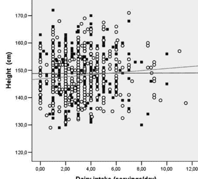

图1 按乳制品摄入量（份/天，作为连续变量）分组的 IGF2 rs680 多态性（n = 795）与身高的散点图：观测值（空心方块表示 GA + AA 受试者，实心方块表示 GG 受试者）及预测值回归线（绿线表示 GA + AA 受试者，蓝线表示 GG 受试者）。潜在混杂因素为年龄和性别。

#### 讨论

据我们所知，这是首次报告基因型驱动的乳制品摄入与儿童身高变异之间关联的研究。人类 IGF2/rs680 多态性与儿童期身高之间可能存在联系，这是一个引人注目但尚未解决的问题。我们儿科队列中的基因型频率与既往一项成人研究描述的几乎相同（GG：51.9% 对 51.7%，GA：39.9% 对 40.6%，AA：8.2% 对 7.7%）（Heude 等，2007）。在该研究中，即欧洲癌症前瞻性研究（EPIC）的诺福克分支，作者报告 rs680 SNP 与 BMI 无显著关联，但他们发现 rs680 IGF2 SNP 与身高独立相关。与他们的发现一致，我们未发现与 BMI 的任何关联，尽管其他研究表明较少见的 rs680 A 等位基因与较低的 BMI 相关（Gaunt 等，2001）。在英国赫特福德郡人群中，GG 纯合子往往比 AA 纯合子更重且更高，杂合子（GA）居中（Sayer 等，2002）。在巴尔的摩老龄化纵向研究中，A/A 基因型女性比 G/G 携带者更矮，男性中也观察到类似趋势（Roth 等，2002）。

可能解释 IGF2 与身高关系的机制存在于儿童早期。与 A 等位基因相比，rs680 G 等位基因与显著更高水平的 IGF2 mRNA 相关，表明该多态性在该基因转录中发挥作用（Vafiadis 等，1998）。体质性高身材儿童比正常身高儿童具有显著更高的生长速度和更高的 IGF2 水平（Garone 等，2002）。有研究提示，IGF2 可能通过增强对靶组织的作用，尤其是对软骨和骨组织的作用，导致体质性高身材儿童过度生长。

我们在儿科队列中发现乳制品摄入与身高变异之间存在关联。更准确地说，在 IGF2 多态性 A 等位基因携带者儿童中，乳制品摄入与身高呈正相关。NHANES 研究（Wiley，2005）的结果表明，在控制性别、教育程度和种族后，成年身高与 5–12 岁和 13–17 岁时的牛奶摄入量呈正相关。牛奶和乳制品摄入刺激线性生长的最强证据来自发展中国家的观察性和干预性研究，这些研究显示出相当大的效应。此外，来自营养良好人群的许多观察性研究也显示牛奶摄入与生长之间存在关联。这些结果表明，即使在营养素摄入充足的情况下，牛奶仍具有促进生长的作用。在一项随机对照喂养干预研究中，增加牛奶摄入量可改善年龄较小且已生长迟缓儿童的线性生长（Neumann 等，2007）。青春期前儿童膳食摄入与 IGF 水平及生长之间的关联研究较少，但具有相当大的意义。在此背景下，牛奶和乳制品与 IGF-I 的关联尤其值得关注，因为儿童是这些食物的高消费人群。

Silventoinen 等（2000）的研究表明，变化的环境因素会影响身高的遗传力。生活水平越好，遗传力越高。我们最近表明（Yannakoulia 等，2008），包括离婚在内的家庭因素会影响 GENDAI 人群的肥胖状态。与已婚父母的孩子相比，离婚父母的孩子即使在调整社会经济状况和体力活动等各种混杂因素后，BMI 水平仍显著更高。因此，不利的家庭环境与儿童超重以及其饮食行为的某些方面相关。当我们按家庭状况对样本进行分层时，基因对身高的效应在离婚父母的孩子中被掩盖。另一方面，在稳定的家庭环境中（似乎即双亲均在场的家庭），IGF2 基因对身高变异的效应仍具有统计学意义（数据未显示）。因此，探索身高变异并阐明其与饮食等环境因素的可能交互作用，有助于我们设计预防身高相关疾病的有效策略。

#### 利益冲突

作者声明无利益冲突。

#### 致谢

我们感谢参与研究的儿童及其学校给予的帮助和热情。我们也感谢现场调查人员在体格检查、生化分析和营养评估方面提供的协助。GENDAI 队列的收集由 Coca-Cola Hellas 资助。

#### 参考文献

- Bonat S, Pathomvanich A, Keil MF, Field AE, Yanovski JA (2002). 超重儿童青春期阶段的自我评估. Pediatrics 110, 743–747.
- Cadogan J, Eastell R, Jones N, Barker ME (1997). 青春期女孩的牛奶摄入与骨矿物质获得：随机对照干预试验. Br Med J 315, 1255–1260.
- Cole TJ, Bellizzi MC, Flegal KM, Dietz WH (2000). 建立全球儿童超重和肥胖的标准定义：国际调查. Br Med J 320, 1240–1243.
- Engel JR, Smallwood A, Harper A, Higgins MJ, Oshimura M, Reik W et al. (2000). Beckwith-Wiedemann 综合征中表观基因型-表型相关性. J Med Genet 37, 921–926.
- Frank GC, Berenson GS, Schilling PE, Moore MC (1977). 将 24 小时回顾法应用于学龄儿童流行病学研究. J Am Diet Assoc 71, 26–31.
- Garone C, Radetti G, Sidoti M, Bozzola M, Minuto F, Barreca A (2002). 青春期前体质性高身材儿童中胰岛素样生长因子（IGF）-I 及 IGF-I/IGF 结合蛋白比值升高. J Clin Endocrinol Metab 87, 5455–5460.
- Garrone C, Cooper JA, Maher G, Day IN, O'Dell SD (2001). IGF2 基因区域单核苷酸多态性与成年男性体重指数呈正相关. Hum Mol Genet 10, 1491–1501.
- Guillaud C, Rossignol S, Cabrol S, Houang M, Steunou V, Barbu V et al. (2005). Silver-Russell 综合征中染色体 11p15 端粒印记中心区域的表观突变. Nat Genet 37, 1003–1007.
- Gudbjartsson DF, Walters GB, Thorleifsson G, Stefansson H, Halldorsson BV, Zusmanovich P et al. (2008). 许多影响成年人类身高多样性的序列变异. Nat Genet 40, 609–615.
- Heude B, Ong KK, Luben R, Wareham NJ, Sandhu MS (2007). 胰岛素样生长因子 2 基因常见变异与中年男性和女性肥胖及体型指标之间关联的研究. J Clin Endocrinol Metab 92, 2734–2738.
- Hoppe C, Mølgaard C, Juul A, Michaelsen KF (2004). 高摄入脱脂牛奶而非肉类可增加 8 岁男孩血清 IGF-I 和 IGFBP-3. Eur J Clin Nutr 58, 1211–1216.

- Kafatos A, Verhagen H, Moschandreas J, Apostolaki I, Van Westerop JJ (2000). 克里特岛的地中海饮食：食物与营养素含量. J Am Diet Assoc 100, 1487-1493.
- Lettre G, Jackson AA, Gieger C, Schumacher FR, Berndt SI, Sanna S et al. (2008). 识别出十个与身高相关的基因座，凸显了人类生长中的新生物学通路. Nat Genet 40, 584-591.
- Macgregor S, Cornes BK, Martin NG, Visscher PM (2006). 澳大利亚双胞胎中自我报告和临床测量身高的偏倚、精确度与遗传力. Hum Genet 120, 571-580.
- Miller SA, Dykes DD, Polesky HF (1988). 从人体有核细胞中提取DNA的一种简单盐析法. Nucleic Acids Res 16, 1215.
- Mullis PE (2005). 生长的遗传控制. Eur J Endocrinol 152, 11-31.
- Neumann CG, Murphy SP, Gewa C, Grillenberger M, Bwibo NO (2007). 肉类补充改善肯尼亚儿童的生长、认知和行为结果. J Nutr 137, 1119-1123.
- O'Dell SD, Day IN (1998). 胰岛素样生长因子II（IGF-II）. Int J Biochem Cell Biol 30, 767-771.
- O'Dell SD, Miller GJ, Cooper JA, Hindmarsh PC, Pringle PJ, Ford H et al. (1997). 中年男性胰岛素样生长因子II（IGF2）基因的ApaI多态性与体重. Int J Obes Relat Metab Disord 21, 822-825.
- Ogden CL, Fryar CD, Carroll MD, Flegal KM (2004). 美国1960-2002年平均体重、身高和体质指数. Adv Data 347, 1-17.
- Palmert MR, Hirschhorn JN (2003). 身高、青春期时相及其他复杂性状的遗传学方法. Mol Genet Metab 80, 1-10.
- Papadopoulou C, Vidra N, Hatzopoulou I, Tzirkalli M, Farmaki AE, Evagelidaki E et al. (2007). 基因-饮食阿提卡儿童肥胖调查（GENDAI）：研究设计概述. Clin Chem Lab Med 45, 309-315.
- Perola M, Sammalisto S, Hiekkalinna T, Martin NG, Visscher PM, Montgomery GW et al. (2007). 对6602名欧洲双胞胎身高进行的联合基因组扫描：常见白种人基因座的证据. PLoS Genet 3, e97.
- Reik W, Walter J (2001). 基因组印记：父母对基因组的影响. Nat Rev Genet 2, 21-32.
- Rice T, Chagnon YC, Perusse L, Borecki IB, Ukkola O, Rankinen T et al. (2002). 黑白家庭腹部皮下脂肪和内脏脂肪的全基因组连锁扫描：HERITAGE家族研究. Diabetes 51, 848-855.
- Rogol AD (2007). 药物基因组学和药物遗传学在身材矮小评估和管理中的应用. Eur J Endocrinol 157 (Suppl 1), S27-S31.
- Roth SM, Schrager MA, Metter EJ, Riechman SE, Fleg JL, Hurley BF et al. (2002). 成年各年龄段男性和女性的IGF2基因型与肥胖. Int J Obes Relat Metab Disord 26, 585-587.
- Sallis JF, Strikmiller PK, Harsha DW, Feldman HA, Ehlinger S, Stone EJ et al. (1996). 五年级学生访谈者和自我管理体力活动清单的效度验证. Med Sci Sports Exerc 28, 840-851.
- Sanna S, Jackson AU, Nagaraja R, Willer CJ, Chen WM, Bonnycastle LL et al. (2008). GDF5-UQCC区域的常见变异与人类身高差异相关. Nat Genet 40, 198-203.
- Sayer AA, Syddall H, O'Dell SD, Chen XH, Briggs PJ, Briggs R et al. (2002). 成年男性IGF2基因多态性、出生体重和握力. Age Ageing 31, 468-470.
- Silventoinen K, Kaprio J, Lahelma E, Koskenvuo M (2000). 遗传和环境因素对身高的相对影响：芬兰男性和女性不同出生队列之间的差异. Am J Public Health 90, 627-630.
- Silventoinen K, Sammalisto S, Perola M, Boomsma DI, Cornes BK, Davis C et al. (2003). 成年身高的遗传力：八个国家双胞胎队列的比较研究. Twin Res 6, 399-408.
- Slaughter MH, Lohman TG, Boileau RA, Horswill CA, Stillman RJ, Van Loan MD et al. (1988). 用于评估儿童和青少年身体肥胖程度的皮褶厚度方程. Hum Biol 60, 709-723.
- Vafiadis P, Bennett ST, Todd JA, Grabs R, Polychronakos C (1998). 白细胞中IGF2转录水平的遗传决定因素与IDDM2编码的1型糖尿病易感性之间的差异. J Clin Endocrinol Metab 83, 2933-2939.
- Walenkamp MJ, Wit JM (2007). 小鼠和人类GH-IGF-I轴的遗传性疾病. Eur J Endocrinol 157 (Suppl 1), S15-S26.
- Weedon MN, Lango H, Lindgren CM, Wallace C, Evans DM, Mangino M et al. (2008). 全基因组关联分析识别出影响成年身高的20个基因座. Nat Genet 40, 575-583.
- Weedon MN, Lettre G, Freathy RM, Lindgren CM, Voight BF, Perry JR et al. (2007). HMGA2的常见变异与一般人群的成人和儿童身高相关. Nat Genet 39, 1245-1250.
- Wiley AS (2005). 牛奶能让儿童长高吗？NHANES 1999-2002中牛奶消费与身高之间的关系. Am J Hum Biol 17, 425-441.
- Yannakoulia M, Papanikolaou K, Hatzopoulou I, Efstathiou E, Papoutsakis C, Dedoussis GV (2008). 家庭离异与儿童BMI和膳食模式之间的关联：GENDAI研究. Obesity (Silver Spring) 16, 1382-1387.

## 功能基因组学

### 维生素D与疾病

最近的一项研究展示了将染色质免疫沉淀测序（ChIP–seq）与全基因组关联（GWA）研究数据相结合，以探索复杂疾病分子基础的能力。Ramagopalan及其同事使用ChIP–seq技术，在有或没有维生素D配体的情况下，绘制了人淋巴母细胞系中维生素D受体（VDR）——一种配体激活的转录因子——的基因组结合高分辨率图谱。在存在配体的情况下，他们鉴定出2,776个结合位点，其中许多位于与活性染色质相关的区域，这与VDR在基因调控元件中的预期作用一致。维生素D与多种疾病有关，尤其是自身免疫性疾病，但这种关联的基础尚不清楚。作者将他们的ChIP–seq数据与47种常见性状的GWA研究数据集进行比较，发现VDR位点在与多发性硬化症和1型糖尿病以及其他自身免疫性疾病、癌症和身高等性状相关的基因组区间内显著富集。结果提示VDR控制着许多先前被认为不受该转录因子调控的基因。在大多数情况下，疾病相关的SNP不会破坏VDR结合基序，因此进一步的重新测序可能有助于确定哪些遗传变异改变了基因调控。有趣的是，VDR结合也在具有正选择特征的区域中富集，因此未来的研究可能旨在探究维生素D在人类进化中的作用。

*Mary Muers*

#### 原始研究论文

Ramagopalan, S. V. 等人。ChIP-seq定义的维生素D受体结合全基因组图谱：与疾病和进化的关联。*Genome Research* 2010年8月24日（doi:10.1101/gr.107920.110）。

#### 延伸阅读

Ren, B. 等人。下一代基因组学：一种整合方法。*Nature Reviews Genetics* 11, 476–486（2010）。

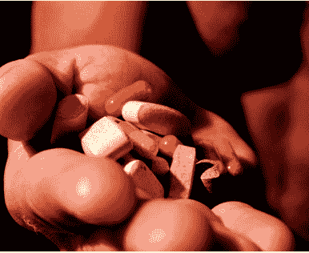

## 原创文章

### CLOCK基因与参加基于地中海饮食的饮食计划的肥胖患者体重减轻有关

M Garaulet¹,²、MD Corbalán¹、JA Madrid¹、E Morales¹、JC Baraza¹、YC Lee² 和 JM Ordovas²

¹西班牙穆尔西亚大学物理系，穆尔西亚，西班牙；²美国农业部吉恩·迈耶人类营养衰老研究中心，塔夫茨大学医学院，波士顿，马萨诸塞州，美国

- **引言：** 肥胖治疗的成功取决于患者的遗传背景。昼夜节律运动输出周期Kaput（CLOCK）是分子时钟正反馈臂中的转录因子之一，参与代谢改变。
- **目的：** 研究CLOCK的五个候选多态性是否与人体测量、代谢指标以及基于地中海饮食的行为减重计划的体重减轻相关。
- **方法：** 研究纳入了500名年龄20–65岁、在肥胖专科门诊就诊的超重/肥胖受试者。分析了人体测量、生化和膳食摄入值。评估了该计划的有效性以及28周治疗期间的体重减轻进展。
- **结果：** 选定的五个CLOCK SNP中有四个与肥胖变量显著相关（P < 0.05）。rs1801260 CLOCK的遗传变异与基线肥胖相关，并影响体重减轻。携带变异等位基因（G）的患者体重减轻显著少于野生型（P = 0.008）。重复测量分析显示，rs1801260 CLOCK变异随时间推移的体重减轻存在显著差异（P = 0.038）。G等位基因携带者在减重方面比非携带者面临更大困难。在该特定多态性中，短时间睡眠者（每天≤6小时）在次要等位基因携带者中的频率高于非携带者（59%对41%；P < 0.05）。CLOCK多态性与饮食治疗完成时总血浆胆固醇的显著差异也相关（P < 0.05）。
- **结论：** 我们重复了先前研究，显示CLOCK基因多态性与肥胖之间存在关系。CLOCK rs1801260 SNP可能预测基于低能量饮食的体重减轻策略的结果。

*国际肥胖杂志（2010）第34卷，516–523页；doi:10.1038/ijo.2009.255；2010年1月12日在线发表*

**关键词：** CLOCK；多态性；行为治疗

#### 引言

针对肥胖管理策略的体重减轻显示出广泛的个体间差异，这在很大程度上受营养、激素和心理行为因素的影响。此外，肥胖治疗的成功可能受到患者遗传背景的调节¹，同卵双胞胎的研究证明了这一点；体重减轻似乎表现出显著的遗传性。此外，父母肥胖对于后代肥胖的可能性也有影响。¹ 先前已经研究了许多潜在候选基因与体重减轻和体重维持的关联。²–⁵

人类肥胖基因图谱列出了约250个可能参与肥胖发展的基因座。¹ 然而，对于大多数这些基因座，关联研究的结果在肥胖和体重减轻结局方面尚无定论。尽管一些研究发现体重减轻与候选基因之间没有关联⁶，但另一些研究表明，脂肪量的变化可由多个肥胖候选基因的多态性预测，可解释高达8.5%的脂肪量变异。¹ 与脂肪量变化相关的基因示例包括瘦素、G蛋白、ADRB3、PPARγ和脂滴蛋白（perilipin）。²–⁵

最近的临床和流行病学研究表明，时间生物学与肥胖之间存在显著关系。例如，轮班工作、睡眠剥夺和夜间强光照射已被认为与……增加有关

通讯作者：M Garaulet博士，西班牙穆尔西亚30100，Espinardo校区，生物学系，穆尔西亚大学物理系。  
电子邮件：garaulet@um.es  
收稿日期：2009年6月18日；修回日期：2009年9月24日；接受日期：2009年10月2日；在线发表日期：2010年1月12日

肥胖。7 尽管我们对生物钟模型的理解仍在不断发展，但先前的研究已经证实，昼夜节律运动输出周期循环 kaput（CLOCK）蛋白——分子钟正反馈回路中的转录因子之一——参与代谢功能的改变。8 动物模型显示，*Clock* 基因被破坏的小鼠容易发生肥胖。9 2004 年，Rudic *等人*10 的研究表明 *Clock* 基因突变与葡萄糖耐量受损有关。近期，这些研究进一步扩展，旨在更深入地了解 *CLOCK* 基因变异在人类肥胖中的作用。到目前为止，只有两项针对肥胖的研究显示了不同 *CLOCK* 基因多态性与体质指数（BMI）之间存在有趣的关联。11,12 然而，尚无研究报告 *CLOCK* 基因多态性与减重方案导致的体重减轻之间的关系。

基于上述研究和一些尚未探索的问题，我们调查了 *CLOCK* 基因的五个候选多态性是否与西班牙东南部肥胖人群的人体测量指标、代谢指标以及基于地中海饮食的行为减重方案后的体重减轻相关。

#### 研究对象与方法

##### 研究对象

我们招募了年龄在 20–65 岁之间的超重或肥胖受试者（BMI > 25 kg m⁻² 且 < 40 kg m⁻²）（*n* = 500），他们在 2008 年期间就诊于位于西班牙东南部穆尔西亚市的五家肥胖门诊。服用产热或生脂药物，或被诊断为糖尿病、慢性肾功能衰竭、肝脏疾病或癌症的患者被排除在研究之外（11%）。最终样本包括 454 名个体。

所有程序均符合良好临床实践规范。每位患者在参与前均获得书面知情同意，研究原则经 Virgen de la Arrixaca 医院研究伦理委员会批准。患者数据已编码以保证匿名性。

##### 治疗方案的特征

减重方案的特征已在别处描述。13,14 简要来说，在最初的 4 个月中，受试者每周参加一次 60 分钟的支持小组治疗课程（*n* = 10），随后是 5 个月的维持期。课程由营养师主持。治疗基于以下内容：

- *饮食治疗。* 通过计算（1）根据 Harris–Benedict 公式估算的静息能量消耗（REE）和（2）根据体力活动的类型和持续时间估算的总能量消耗（TEE）来评估个体膳食能量需求。然后，从 TEE 中减去约每天 2.6 MJ。最终膳食能量含量为女性每天 1200–1800 kcal，男性每天 1500–2000 kcal，以实现每周约 0.5–1 kg 的体重减轻。这些建议与地中海饮食类型一致14，宏量营养素分布遵循西班牙社区营养学会的建议。15
- *营养教育* 在小组治疗课程中提供，以帮助受试者计划自己的菜单，并教育受试者养成适当的终身饮食习惯。
- *体力活动* 强调每周至少 2 或 3 次、每次 15–30 分钟或更长时间的中等强度体力活动的个人目标。鼓励患者使用计步器达到每天至少 10000 步。
- *行为技术* 包括刺激控制、自我监测、正强化和认知行为疗法。

##### 人体测量

受试者在每天同一时间、赤脚、身着轻便衣物的情况下，使用数字秤称重，精确到 0.1 kg。身高使用 Harpenden 数字身高计（范围 0.7–2.05）测量。受试者直立、放松，头部处于法兰克福平面。根据这些测量值计算 BMI，公式为体重(kg)/(身高(m))²。使用 TANITA TBF-300（TANITA Corporation of America, Arlington Heights, IL, USA）设备通过生物电阻抗法测量全身脂肪。身体脂肪分布通过测量不同围度来评估：腰围在脐水平测量，臀围为大转子处最宽围度。16 所有测量均使用柔性且不可伸缩的卷尺进行。然后计算腰臀比（WHR）。

##### 生化分析

使用商业试剂盒（Roche Diagnostics GmbH, Mannheim, Germany）从隔夜空腹后的静脉血样本中测定血浆葡萄糖、总胆固醇、总血红蛋白和尿酸的浓度。

##### 习惯性膳食摄入

为了评估饮食习惯，通过 24 小时膳食回顾法确定初始营养素摄入量。访谈在周一至周五进行，包括周末和工作日的 24 小时食物摄入回顾。使用基于西班牙食物成分表的数字评估软件程序 Grunm17 分析初始 24 小时回顾中的总能量摄入和宏量营养素组成。18

##### DNA 提取与 CLOCK 基因分型

我们使用基于 HapMap 白种人欧洲犹他州数据（www.hapmap.org）20 的 Tagger19 选择 tagSNP，作为强连锁不平衡（LD）中未分型 SNP 的有效代理，次要等位基因频率（MAF）≥0.10，最小 r² 为 0.8。Tagger 使用一种算法来选择 tagSNP，以构建单标记和多标记检验，基于它们之间计算的相关性 r² 来捕获感兴趣的等位基因。

使用常规 DNA 分离试剂盒（Qiagen）从血液样本中分离 DNA。我们使用带有等位基因特异性探针的 TaqMan 检测方法，在 ABI Prism 7900HT 序列检测系统（Applied Biosystems, Foster City, CA, USA）上按照标准化实验室方案进行 *CLOCK* 基因多态性的基因分型。21

##### 生物信息学分析

所研究 SNP 之间的 LD 图如图 1 所示。使用三个标准选择 SNP：文献报道的遗传关联或生物学功能、生物信息学功能评估和 LD 结构。结合 tagSNP 的选择，我们还对包含不同 SNP 的基因组 DNA 序列进行了生物信息学分析，以确定不同等位基因可能产生的生物学后果。使用 MAPPER22 研究映射到转录起始位点上游区域或内含子内的 SNP，以识别潜在的等位基因特异性转录因子结合位点。

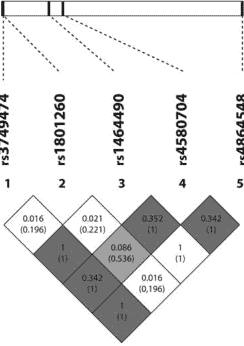

**图 1** *CLOCK* 基因的连锁不平衡（LD）图。水平白色条表示样本中分析的染色体 4q12 的 113 kb DNA 片段。5 个 tagSNP 的位置用刻度线标出。图底部为 LD 图：每个菱形代表一对标记的 LD 大小。黑色表示强 LD（r² = 1.0），白色表示无 LD（r² = 0），灰色色调表示中间 LD。菱形内的数字表示 r²（D′）值。

没有内含子 SNP 改变剪接受体或供体位点，或剪接机制识别的其他信号（如多嘧啶束）。mRNA 3′-UTR 内的多态性可能影响 mRNA 的折叠，并伴随 mRNA 稳定性的变化。使用维也纳 RNA 包中的 RNAfold23 测试了 3′-UTR SNP 的潜在影响。

##### 统计分析

我们使用 Pearson χ² 检验和 Fisher 检验来检验频率差异。为评估方案的有效性，使用 Student 配对 t 检验评估治疗开始和结束时人群特征的变化。我们应用 ANOVA 和 Student t 检验来比较各基因型组之间的粗略均值。我们检验了不同的遗传遗传模型，并在最终分析中对所有选定的 SNP 应用显性模型，但 rs4580704 除外，它遵循隐性模型。我们通过协方差分析对关联进行多变量调整，并估计调整后均值。我们按性别、年龄和中心调整分析。我们还在相应的交互项回归模型中检验了性别效应的统计同质性。使用 SPSS 15.0 软件（SPSS）进行统计分析。双侧 P 值 <0.05 被认为具有统计学显著性。

#### 结果

##### 人群特征

研究对象的一般特征，包括人体测量指标、生化变量、膳食摄入和体力活动特征，列于表 1。454 名受试者（380 名女性，74 名男性）的平均年龄为 39 ± 12 岁，BMI 为 31 ± 5.3 kg m⁻²（平均值 ± 标准差）。75% 的人群被认为久坐不动（每周体力活动少于 1 小时）。平均每日睡眠时间为 7 小时。通过 24 小时回顾获得的饮食习惯显示，碳水化合物百分比低于西班牙建议值，而蛋白质和脂肪百分比高于建议水平。

##### Garaulet 受试者中 CLOCK 变异体的基因型频率及其与肥胖参数的关联

选择 SNP rs1464490 是因为它是大 LD 块（LD1）的 tagSNP；rs3749474 也来自 LD1，是在生物信息学功能评估表明 mRNA 结构发生重要变化后选择的；rs4864548 是因为它先前与超重/肥胖相关。11,12 在构成 LD2 的不同 SNP 中，选择 rs4580704 是基于其先前与 BMI 的关系。12 从 LD3 中，我们根据先前的报告选择了 rs1801260 SNP。

**表1** 研究人群的特征

|  | 总人群 |
|---|---:|
| N | 447 |
| **人体测量学** | |
| 年龄（岁） | 39 (12) |
| 体重（kg） | 84.61 (16.72) |
| BMI（kg m^-2） | 31.3 (5.3) |
| 体脂（%） | 37.5 (7.5) |
| 臀围（cm） | 114 (10) |
| 腰围（cm） | 102 (14) |
| WHR | 0.89 (0.08) |
| **血浆指标** | |
| 葡萄糖（mg/100 ml） | 90.7 (22.4) |
| 胆固醇（mg/100 ml） | 173.8 (40.6) |
| 尿酸（mg/100 ml） | 4.4 (1.5) |
| 血红蛋白（mg/100 ml） | 14.6 (7.1) |
| **活动** | |
| 睡眠（小时/天） | 7.1 (1.5) |
| 运动（METs） | 4140 (4426) |
| **膳食摄入** | |
| 总能量（kcal/天） | 1903 (709) |
| 碳水化合物（%） | 39.6 (10.5) |
| g/天 | 148.6 (52.7) |
| 蛋白质（%） | 16.9 (3.8) |
| g/天 | 65.6 (26.6) |
| 脂肪（%） | 43.5 (10.7) |
| g/天 | 79.0 (38.3) |
| **CLOCK多态性，n（%）** | |
| rs4580704 | |
| GG | 65 (14.4) |
| CG | 202 (44.8) |
| CC | 166 (36.8) |
| rs1801260 | |
| GG | 33 (7.7) |
| AG | 170 (37.7) |
| AA | 220 (54.6) |
| rs3749474 | |
| TT | 46 (10.2) |
| TC | 178 (39.5) |
| CC | 204 (45.2) |

缩写：WHR，腰臀比。

**表2** 行为治疗前后研究人群的特征

| 指标 | 总组：治疗前（N = 447） | 总组：治疗后（N = 447） | P |
|---|---:|---:|---:|
| 体重（kg） | 84.60 ± 0.79 | 75.27 ± 0.72 | 0.0001 |
| BMI（kg m^-2） | 31.4 ± 0.3 | 28.1 ± 0.2 | 0.0001 |
| 臀围（cm） | 115 ± 0.76 | 108 ± 0.86 | 0.0001 |
| 腰围（cm） | 105 ± 1.17 | 97 ± 1.22 | 0.0001 |
| WHR | 0.91 ± 0.08 | 0.89 ± 0.08 | 0.0001 |
| 葡萄糖（mg/100 ml） | 89.4 ± 2.5 | 89.0 ± 3.0 | 0.897 |
| 胆固醇（mg/100 ml） | 180.1 ± 3.78 | 163.8 ± 4.94 | 0.002 |
| 尿酸（mg/100 ml） | 4.63 ± 0.15 | 4.01 ± 0.15 | 0.001 |
| 舒张压（mm Hg） | 70 ± 1.0 | 66 ± 1.1 | 0.010 |
| 收缩压（mm Hg） | 112 ± 1.7 | 107 ± 1.6 | 0.005 |

缩写：BMI，体质指数；WHR，腰臀比。数据以均值 ± SEM 表示。Student t检验：P < 0.05视为显著。

显示该SNP与睡眠改变^24和暴食症^25之间的关联。它们在*CLOCK*基因中的位置、哈迪-温伯格平衡和最小等位基因频率列于表2中。*CLOCK*基因型频率未偏离哈迪-温伯格平衡。由于SNP rs3749474、rs1464490和rs4864548几乎处于完全连锁不平衡（LD），并表现出相似的表型关联模式，因此仅展示rs3749474的结果。

我们首先考察了*CLOCK* SNP与肥胖参数之间的关联（图2）。在所检测的任何SNP中，我们均未发现性别异质性。因此，我们展示男性和女性合并后的结果。我们发现rs3749474和rs1801260与体重和BMI显著相关，rs3749474与腰围显著相关。rs4580704也呈现相似趋势，但未达到统计学显著性：体重（P = 0.077）、腰围（P = 0.07）和WHR（P = 0.097）。

对于rs3749474，次要等位基因T携带者的体重、BMI和腰围显著高于CC受试者。rs1801260也发现类似结果，其次要等位基因携带者也表现出最高的BMI值。在额外校正性别、年龄、治疗中心和初始BMI后，这些差异仍具有统计学显著性（图2）。对于rs4580704，趋势相反；次要等位基因纯合受试者的体重、腰围和WHR低于非携带者。

##### 纵向数据

饮食行为治疗前后的人群特征见表2。治疗后，所有人体测量变量均显著改善。总胆固醇、尿酸和血压在治疗后也显著降低。

治疗的平均持续时间为26 ± 17周。平均减重8.85 kg。与初始体重相比，减重百分比为10.24，减重速率为每周450 g。

*CLOCK* rs1801260 SNP的遗传变异与体重下降差异相关。

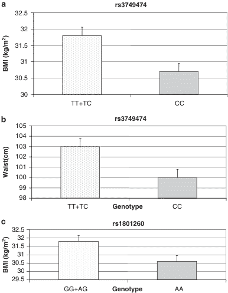

**图2** *CLOCK* SNP与肥胖参数之间的显著关联。(a) *CLOCK* rs3749474与BMI；(b) *CLOCK* rs3749474与腰围；(c) *CLOCK* rs1801260（3111T>C）与BMI。

**表3** *CLOCK* SNP的描述

| 名称 | 位置 | HWE/P值 | MAF | 等位基因 | 次要等位基因 |
|---|---|---:|---:|---|---|
| rs3749474 | 3′-UTR | 0.444 | 0.32 | C/T | T |
| rs1801260 | 3′-UTR | 0.984 | 0.28 | A/G | G |
| rs1464490 | 内含子11 | 0.453 | 0.42 | C/T | T |
| rs4580704 | 内含子9 | 0.782 | 0.38 | C/G | G |
| rs4864548 | 启动子 | 0.445 | 0.41 | G/A | A |

缩写：HWE，哈迪-温伯格平衡；P值；MAF，最小等位基因频率。

**表4** *CLOCK*多态性与体重及代谢参数变化的关联

| *CLOCK* | 总减重（kg） | P值ᵇ | 血清胆固醇变化 | P值 |
|---|---:|---:|---:|---:|
| rs4580704 GGᵃ | 8.82 ± 5.13 | 0.877 | 6.80 ± 14.96 | 0.026 |
| CG+CC | 8.99 ± 5.54 |  | 44.61 ± 7.30 |  |
| rs1801260 GG+AG | 7.96 ± 0.57 | 0.008 | 25.08 ± 9.65 | 0.064 |
| AA | 10.41 ± 0.53 |  | 52 ± 9.45 |  |
| rs3749474 TT+TC | 9.37 ± 0.56 | 0.513 | 49.58 ± 9.54 | 0.047 |
| CC | 8.70 ± 0.62 |  | 22.42 ± 9.54 |  |

所有数据以均值 ± s.e.m. 表示。ᵃ隐性模型。ᵇ按初始BMI校正。

在按基线BMI校正后，携带次要等位基因的患者减重效果较差（*P* = 0.008）（表4）。减重困难在治疗12周后尤为明显，这一点由按基线BMI校正后的重复测量分析所证实（*P* = 0.038）。所分析的其他*CLOCK* SNP未发现统计学显著差异（*P* > 0.05）（图3a–c）。

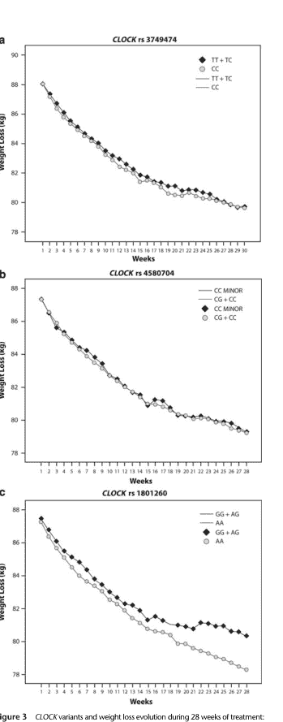

**图3** *CLOCK*变异与28周治疗期间的减重。(a) *CLOCK* rs3749474；(b) *CLOCK* rs4580704；(c) *CLOCK* rs1801260（3111T>C）。

然而，*CLOCK*多态性与总血浆胆固醇变化之间存在显著关联，即使对于那些与减重无统计学关联的SNP（如rs3749474和rs4580704）也是如此（表4）。

在考察睡眠时长与*CLOCK* SNP之间的潜在关联时，发现rs1801260存在趋势。携带次要等位基因的受试者每天睡眠≤6小时的可能性是非携带者的2.10倍（95% CI 0.95–4.45）（P = 0.066）。此外，短睡眠者（每天≤6小时）的频率在次要等位基因携带者中高于主要等位基因纯合受试者（59 vs 41%），而每天睡眠超过6小时者则相反，次要等位基因携带者为41%，非携带者为69%（P < 0.05）。

#### 讨论

在本研究中，我们确认了*CLOCK*基因在体重调节中的作用。具体而言，所检测的5个*CLOCK* SNP中有4个，即rs3749474、rs4864548、rs1464490和rs1801260，与肥胖参数显著相关，第5个（rs4580704）则呈现趋势。我们还表明，*CLOCK* rs1801260与对饮食和行为减重方案的应答相关。具体而言，G变异携带者可能具有更高的肥胖风险，且他们对减重干预的应答较差。

在本研究中，我们重复了既往发现，即不同*CLOCK* SNP与肥胖相关，尤其是rs4864548和rs4580704.11,12。此外，我们表明，在*CLOCK* rs3749474位点携带至少一个T等位基因拷贝的次要等位基因携带者，其肥胖程度（体重和BMI）和腹型肥胖（腰围）显著高于主要等位基因携带者。选择该SNP是因其位于3′-UTR。该特定SNP与肥胖相关的机制可能归因于mRNA结构的变化。事实上，我们的分析表明，*CLOCK* 3′-UTR中的这一单碱基改变（T/C）改变了该特定区域的结构（图2）。3′-UTR的特征在于含有SECIS或AU富集元件（ARE）等序列，这些序列被特定蛋白质识别，从而影响mRNA稳定性或其在细胞中的定位。尽管本文分析未阐明具体结合位点，但预测的等位基因特异性结构差异与以下假设一致：该SNP强烈影响mRNA结构和稳定性。另一方面，该SNP与位于启动子区域的rs4864548完全连锁不平衡（图1）。启动子活性的变异也可能解释我们观察到的结果。

这些发现支持了不断发展的观点，即昼夜节律振荡器在肥胖和代谢综合征的发生中具有重要作用。7 最近，若干研究提示昼夜节律系统的紊乱可能促进肥胖。26 轮班工作、睡眠剥夺和夜间暴露于强光与脂肪堆积增加有关。27 在动物模型中开展的研究

研究已揭示，Clock基因被破坏的小鼠易于发生肥胖并出现类似MetS的表型。9 与此相似，我们最近提供了CLOCK基因在人类脂肪组织中表达的证据，并表明其与腰围及代谢综合征不同组分相关。28 将代谢综合征与昼夜节律系统紊乱联系起来的精确机制尚不十分清楚。然而，大多数假说认为，代谢所涉及的不同昼夜节律之间的内部失同步（ID）是代谢综合征发生的关键因素。29

我们的饮食干预研究表明，与AA纯合子相比，CLOCK基因座rs1801260的次要等位基因携带者对体重减轻以及能量限制饮食引起的代谢变化更具抵抗性。既往研究支持以下假说：个体CLOCK基因型可能影响健康个体和精神疾病患者中与行为相关的多个变量。30 具体而言，针对rs1801260，已发现该多态性与情绪障碍的临床特征相关，可影响健康人的昼夜节律偏好，并可导致抑郁症和双相情感障碍患者出现睡眠时相延迟和失眠。30,32 这些改变不仅可能与肥胖有关，也可能与体重减轻有关。同样，我们此前已表明，体重减轻的大部分障碍与受试者的饮食行为和心理特征有关，而这些障碍与减重难度直接相关。14 此外，既往研究已将rs1801260与进食障碍和肥胖联系起来。1,2,25

这一观点得到了动物研究结果的支持，表明Clock基因直接参与体重调节：纯合Clock突变小鼠出现肥胖、食欲亢进，并伴有进食行为、睡眠模式和情绪的改变。4 有趣的是，我们发现rs1801260变异体的次要等位基因携带者比主要等位基因携带者倾向于睡眠更少。我们的数据与将rs1801260与失眠相关联的早期研究30，以及表明睡眠剥夺可能增加肥胖和体重增加风险的流行病学研究33一致。尽管观察到的结果背后的分子机制仍不清楚，但我们可以从本研究中推测，rs1801260变异等位基因携带者可能经历与Clock基因敲除小鼠相似的生物钟系统紊乱。动物模型中Clock基因的缺失会影响肥胖、睡眠和进食行为，而这些在人类受试者中可能进而影响体重减轻。

在一项既往研究中，研究者报告称，一组肥胖相关候选基因的多态性在调节中度低能量饮食引起的体重变化方面作用甚微（如果有的话）。4 研究者得出结论，他们所检测的遗传变异均与干预中的体重减轻无显著关联。虽然该研究未包含CLOCK基因，但先前研究与本研究之间的一个重要区别在于，先前研究的干预时间限制为10周，而本研究的减重治疗持续了28周。Sørensen等6 提出，要有效评估特定多态性在体重减轻中的作用并检测变异之间的差异，需要更长期的干预。事实上，在本研究中，rs1801260变异体在体重减轻方面的最重要差异在治疗第3个月起就已显现。其他在肥胖人群中识别出遗传变异与体重减轻之间关联的研究所使用的干预时间与我们的研究相似。1 到目前为止，大多数评估遗传变异与通过干预实现的体重减轻之间关系的研究，都集中于与能量消耗、食欲控制、脂肪生成或与胰岛素抵抗和脂质代谢相关的基因。1 我们的研究显示昼夜节律基因在体重减轻中可能发挥的作用，从而拓展了当前的知识领域。

总之，在这项针对地中海人群进行的干预试验中，我们重复验证了既往研究报告的CLOCK基因多态性与肥胖之间的关系。我们的结果表明，rs1801260可以预测基于低能量饮食的减重策略的结局。G等位基因携带者可能表现出更高程度的肥胖，并且在低能量饮食干预下更难减轻体重。这种困难在整个治疗期间持续可见，但在治疗第3个月后最为明显。这些数据表明，CLOCK基因多态性可以预测低能量饮食干预下的体重减轻幅度。

#### 利益冲突

作者声明不存在利益冲突。

#### 致谢

本工作得到穆尔西亚教育、科学和研究政府（项目BIO/FFA 07/01-0004）、西班牙科学与创新政府（项目AGL2008-01655/ALI）、NIDDK基金DK075030，以及美国农业部农业研究服务处合同53-K06-5-10和58-1950-9-001的资助。

#### 参考文献

- 1. Hainer V, Zamrazilová H, Spálová J, Hainerová I, Kunešová M, Aldhoon B 等. 遗传因素在体重减轻及其维持中的作用. Physiol Res 2008; 57: S1–S15.
- 2. Corella D, Qi L, Sorlí JV, Godoy D, Portolés O, Coltell O 等. 携带perilipin基因座11482G>A多态性的肥胖受试者在饮食能量限制后对体重减轻具有抵抗性. J Clin Endocrinol Metab 2009; 90: 5121–5126.
- 3. Martí A, Moreno-Aliaga MJ, Zulet MA, Martínez JA. 分子营养学进展：营养基因组学和/或营养遗传学. Nutr Hosp 2005; 20: 157–164.
- 4. Haupt A, Thamer C, Machann J, Kirchhoff K, Stefan N, Machicao F 等. FTO基因变异对全身脂肪分布、异位脂肪和体重减轻的影响. Obesity 2008; 16: 1969–1972.
- 5. Aberle J, Flitsch J, Beck NA, Mann O, Busch P, Peitmeier P 等. 遗传变异可能仅在饮食条件下影响肥胖：三个候选基因的分析. Mol Genet Metab 2008; 95: 188–191.
- 6. Sørensen TI, Boutin P, Taylor MA, Larsen LH, Verdich C, Petersen L 等. NUGENOB联盟. 遗传多态性与肥胖中的体重减轻：低能量高脂与低脂饮食的随机试验. PLoS Clin Trials 2006; 1: e12.
- 7. Garaulet M, Madrid JA. 时间生物学、遗传学与代谢综合征. Curr Opin Lipidol 2009; 20: 127–134.
- 8. Fuller RM, Lu J, Saper CB. 光诱导和食物诱导昼夜节律的差异性恢复. Science 2008; 320: 1074–1077.
- 9. Turek FW, Joshu C, Kohsaka A. 昼夜节律Clock突变小鼠中的肥胖与代谢综合征. Science 2005; 308: 1043–1045.
- 10. Rudic RD, McNamara P, Curtis AM. BMAL1和CLOCK这两个昼夜节律钟的重要组成部分参与葡萄糖稳态. PLoS Biol 2006; 4: e377.
- 11. Scott EM, Carter AM, Grant PJ. 人类Clock基因多态性与肥胖和代谢综合征之间的关联. Int J Obes 2008; 32: 658–662.
- 12. Sookoian S, Gemma C, Gianotti TF, Burgueño A, Castaño G, Pirola CJ. CLOCK转录因子的遗传变异与个体对肥胖的易感性相关. Am J Clin Nutr 2008; 87: 1606–1615.
- 13. Garaulet M, Pérez-Llamas F, Zamora S, Tébar FJ. 超重患者治疗中体重减轻及退出饮食/行为干预计划可能的原因. J Hum Nutr Diet 1999; 12: 219–227.
- 14. Corbalán MD, Morales EM, Canteras M, Espallardo A, Hernández T, Garaulet M. 基于地中海饮食的认知行为疗法治疗肥胖的有效性. Nutrition 2009. (印刷中): 1–4.
- 15. Serra-Majem L, Aranceta J. 西班牙人群营养目标SENC工作组. 西班牙社区营养学会. 西班牙人群营养目标. 西班牙社区营养学会共识. Public Health Nutr 2001; 4: 1409–1413.
- 16. Ferrario FV, Sforza C, Schmitz JH, Miani A, Taroni G. 人体软组织面部形态的傅里叶分析：正常成年人的性别差异. J Anat 1995; 187: 593–602.
- 17. Pérez-Llamas F, Garaulet M, Herrero F, Palma JT, Pérez de Heredia F, Marín R 等. 用于人群营养状况研究的多价信息学应用.
- 18. Mataix J, Mañas M, Llopis J, Martínez E. 西班牙食物成分表, 1995. 营养与技术研究所. 格拉纳达大学. 西班牙.
- 19. de Bakker PIJ, Yelensky R, Pe’er I, Gabriel SB, Daly MJ, Altshuler D. 遗传关联研究的效率与检验效能. Nat Genet 2005; 37: 1217–1223.
- 20. 犹他州欧洲白人数据. 互联网 www.hapmap.org.
- 21. HelixTree 手册 5.3.0. 互联网: http://goldenhelix.com/HelixTreeManual/compisotepolyheaderm.html.
- 22. Marinescu VD, Kohane IS, Riva A. MAPPER：一种用于在多个基因组中计算识别推定转录因子结合位点的搜索引擎. BMC Bioinform 2005; 6: 79.
- 23. Gruber AR, Lorenz R, Bernhart SH, Neuböck R, Hofacker IL. 维也纳RNA网页套件. Nucleic Acids Res 2008; 36 (Web Server issue): W70–W74. 互联网: http://rna.tbi.univie.ac.at/cgi-bin/RNAfold.cgi.
- 24. Iwase T, Kajimura N, Uchiyama M. 昼夜节律睡眠障碍中人类Clock基因的突变筛查. Psychiatry Res 2002; 109: 121–128.
- 25. Monteleone P, Tortorella A, Docimo L. 伴有或不伴有暴食障碍的肥胖个体中CLOCK基因3111T/C多态性的研究：与较高体质指数的关联. Neurosci Lett 2008; 435: 30–33.
- 26. Hamet P, Tremblay J. 睡眠-觉醒周期及其障碍的遗传学. Metabolism 2006; 55 (Suppl 2): S7–S12.
- 27. Kohler HP, Grant PJ. 纤溶酶原激活物抑制剂1型与冠状动脉疾病. N Engl J Med 2000; 342: 1792–1801.
- 28. Gómez-Abellán P, Hernández-Morante JJ, Luján JA. 时钟基因与人类代谢综合征相关. Int J Obes 2008; 32: 121–128.
- 29. Hernández-Morante JJ, Gómez-Santos C, Milagro F. 皮质醇代谢相关基因在人类脂肪组织中的表达呈现昼夜节律模式. Int J Obes 2009.
- 30. Benedetti F, Radaelli D, Bernasconi A, Dallaspezia S, Falini A, Scotti G, Lorenzi C 等. 时钟之外的时钟基因：CLOCK基因型影响抑郁症患者道德效价决策的神经相关活动. Genes Brain Behav 2008; 7: 20–25.
- 31. Benedetti F, Dallaspezia S, Fulghesu MC, Lorenzi C, Serretti A, Barbini B 等. 活动记录证据表明CLOCK 3111T/C SNP影响双相抑郁患者的睡眠和活动模式. Am J Med Genet B Neuropsychiatr Genet 2007; 144B: 631–635.
- 32. Lee HJ, Paik JW, Kang SG, Lim SW, Kim L. CLOCK基因与G蛋白β3亚基基因的等位变异与昼夜节律偏好的相互作用. Chronobiol Int 2007; 24: 589–597.
- 33. Van Cauter E, Knutson KL. 睡眠与儿童和成人肥胖流行. Eur J Endocrinol 2008; 159 (Suppl 1): S59–S66.
