# C 语言面试攻坚：500+面试题与解析，助你强化 C 语言概念，开启高薪编程生涯（英文版）

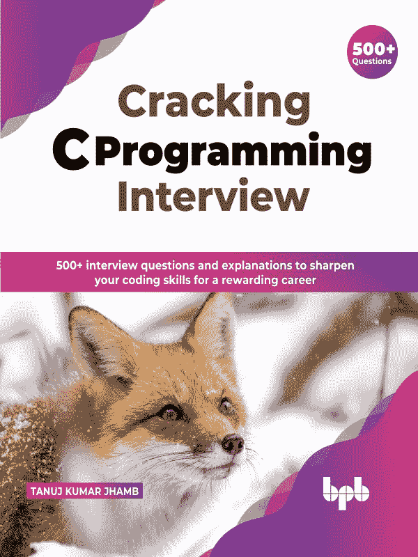


[www.bpbonline.com](http://www.bpbonline.com)

版权所有 ©2022 BPB Online

保留所有权利。未经出版者事先书面许可，本书的任何部分不得以任何形式或通过任何手段复制、存储在检索系统中或传输，但性文章或评论中嵌入的简短引用除外。

在本书的准备过程中，我们已尽力确保所陈述信息的准确性。然而，书中包含的信息按现状出售，不提供任何明示或隐含的保证。作者、BPB Online 或其及其分销商均不对因本书直接或间接引起或声称因本书引起的任何损害承担责任。

BPB Online 已努力通过正确使用大写字母，提供书中提到的所有公司和产品的商标信息。然而，BPB Online 无法无法这些信息的准确性。

- **产品群经理：**Marianne Conor
- **出版产品经理：**Eva Brawn
- **高级编辑：**Connell
- **内容开发编辑：**Melissa Monroe
- **技术编辑：**Anne Stokes
- **文字编辑：**Joe Austin
- **语言支持编辑：**Justin Baldwin
- **项目协调员：**Tyler Horan
- **校对：**Khloe Styles
- **索引员：**V. Krishnamurthy
- **制作设计：**Malcolm D'Souza
- **市场协调员：**Kristen Kramer
- **首次出版：**2022 年 7 月

BPB Online 出版

WeWork, 119 Marylebone Road

London NW1 5PU

**英国 | 阿联酋 | 印度 | 新加坡**

ISBN 978-93-89845-587

**[www.bpbonline.com](http://www.bpbonline.com)**

# 献给

给所有的计算机工程师

## 关于作者

**Tanuj Kumar Jhamb** 拥有在世界顶尖 IT 公司工作的经验。他目前在 Arista Networks 担任软件工程师。在此之前，他曾在 Amazon 担任软件开发工程师-II，在华为担任系统架构师，在 Oracle 公司担任高级软件开发人员。他擅长解决具有挑战性的现实世界数据结构问题和系统设计模式。他于 2015 年毕业于 NIT Calicut 的计算机科学硕士学位。他在第一次尝试的 Gate-2013 考试中获得了全国第 416 名，百分比 99.81%。最后但同样重要的是，自 2014 年以来，他一直在声誉良好的培训机构向 Gate 考生教授数据结构和算法。

## 关于评审员

**Dr. R Rajkumar** 在学术和工业界拥有超过 21 年的经验，目前在班加罗尔的 RNS 技术学院担任副教授。他在教学和指导本科及研究生方面拥有丰富经验，涵盖计算机体系结构、`UNIX` 和 `C Programming`、数据库管理系统、数字通信、物联网、`Java Programming` 等课程。他在经过同行评审的期刊上发表了多篇关于深度学习技术的论文。他目前的研究领域是数据和智能系统的算法优化。

## 致谢

我想特别向 Mahipal Singh Parmar 先生表示感谢和深深敬意，感谢他分享软件技术专业知识以及丰富的编程概念知识。没有 Mahipal 宝贵且建设性的建议，我无法完成这本书。

我想感谢其他同事：Mr Lalit Kumar、Mrs. Madhu、Mr Kuldeep Kumar、Mrs. Ridhi、4 Jyotsna、Mr Pratap Singh、Mrs Basanti、Mr Harsh Kumar、Mrs. Smriti 以及 Mr Chandan Kumar，感谢他们在本书编写期间给予给我的持续支持。

我还要感谢 BPB Publications 团队，他们提供了足够的支持，让我有充足的时间完成并出版这本书。我要感谢 Dr. R Rajkumar 博士和 Mr Ravi Kumar Pedappu 先生对本书的评审。

## 前言

学习新事物的最好方法是实践。`C programming` 中有很多概念在互联网或教科书中并不容易找到。我们尽力通过对 `C` 题的解析来传递这些概念。每一个问题背后都有一个概念。这些概念对于计划参加任何跨国 IT 公司面试的学生来说至关重要。每家公司都需要逻辑良好、基础扎实的程序员/编码员。这本书被证明是真正的 `C` 程序员和严肃求职者的瑰宝。书中包含了 500 多道 `C programming` 问题。你最多只需要 25 天即可完成这本书。本书的阅读指南如下。我们建议你遵循这些指南并尝试在截止日期前完成本书。在每组的末尾，提供了一些其他重要的面试题。尝试编写程序并执行它们。如果你时间不足且编程技巧良好，请尝试为这些题编写至少一个算法或伪代码。

所有 `C` 代码均在运行 `ubuntu-14.04` 32 位操作系统、内核为 `3.13.0-32-generic` 的 `Linux` 系统上的 `gcc 4.8.2` 编译器驱动进行编译和执行。我们也建议你在自己的系统中执行给定的代码以获得更好的理解，如果有任何错误请告诉我们。

### 书的结构

第一章“初识 C 语言”描述了概念理解。书中包含了 500 多道 `C programming` 问题。你最多只需要 25 天即可完成这本书。

### 前提条件

阅读本书需要对 `C` 概念有非常基础的理解。

### 阅读本书指南

- 尝试在 2 小时内完成第一章“初识 C 语言”。
- 本书分为 7 组组，每组约 60 道题。
- 每天解决 20 道题。因此，每组需要 3 天解决。
- 仅用 21 天解决所有的概念性 `C programming` 问题。
- 下方提供了一个解题表。

| 序号 | 题名称 | 日期 | 时间（你花费的时间） |
| :--- | :--- | :--- | :--- |
| 1 | 初识 C 语言 | | |
| 2 | 第一组题目 | | |
| 3 | 第二组题目 | | |
| 4 | 第三组题目 | | |
| 5 | 第四组题目 | | |
| 6 | 第五组题目 | | |
| 7 | 第六组题目 | | |
| 8 | 第七组题目 | | |
| 9 | 样例题 1 | | |
| 10 | 样例题 2 | | |
| 11 | 样例题 3 | | |
| 12 | 样例题 4 | | |
| 13 | 样例题 5 | | |

# 彩色图片

请通过以下链接下载本书的***彩色图片***：

[`rebrand.ly/zlis9i8`](https://rebrand.ly/zlis9i8)

我们在丰富的书籍和视频目录中提供了代码包，地址位于 GitHub **[`github.com/bpbpublications`](https://github.com/bpbpublications)**。快去看看吧！

# 勘误

我们对 BPB Publications 的工作感到非常自豪，并遵循最佳实践以确保内容的准确性，从而为订阅者提供沉浸式的阅读体验。我们的读者是我们的镜子，我们利用他们的反馈来反映并改进出版过程中可能出现的任何人为错误（如果有的话）。为了让我们保持质量并帮助我们联系可能因不可见错误而遇到困难的读者，请通过以下邮箱与我们联系：

`errata@bpbonline.com`

BPB Publications 全体非常感谢您的支持、建议和反馈。

您知道吗？BPB 为每部书籍都提供电子版，并提供 PDF 和 ePub 文件。您可以在 `[www.bpbonline.com](http://www.bpbonline.com)` 升级到电子版，作为纸质书客户，您有权享受电子版折扣。更多详情请通过以下邮箱与我们联系：`business@bpbonline.com`

在 `[www.bpbonline.com](http://www.bpbonline.com)`，您还可以阅读免费技术文章集，订阅一系列免费新闻邮件，并获取 BPB 书籍和电子书的专属折扣和优惠。

# 盗版

如果您在网上发现任何形式的我们作品的非法副本，如果您能向我们提供地址或网站名称，我们将不胜感激。请通过 `business@bpbonline.com` 联系我们并提供链接。

# 如果您对成为作者感兴趣

如果您有擅长的领域，并且对编写或为书籍贡献感兴趣，请访问 `[www.bpbonline.com](http://www.bpbonline.com/)`。我们已经与成千上万像您这样的开发者和技术专家合作，帮助他们与全球技术社区分享见解。您可以进行通用申请、申请我们正在招募作者的特定话题，或提交自己的想法。

# 评论

请留下您的评价。在您阅读并使用此书后，为什么不在您购买的网站上留评价呢？潜在读者就可以查看并利用您的中偏意见来做出购买决策。我们 BPB 可以了解您对我们产品的看法，我们的作者也可以看到您对他们书的反馈。感谢！

有关 BPB 的更多信息，请访问 `[www.bpbonline.com](http://www.bpbonline.com/)`。

# 目录简介

*想象比知识更有力量。*

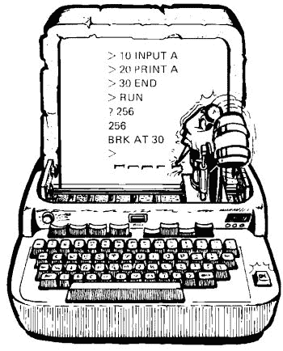

# 历史视角

C 语言是由 Dennis Ritchie 在 1969 年至 1973 年间在贝尔实验室开发的。美国国家标准协会（ANSI）于 1989 年签署了 ANSI C 标准。Kernighan 和 Ritchie 在他们的书中描述了 ANSI C，该书被亲切地称为“K&R”。

**C 与 Unix：** C 语言从一开始就被开发为 Unix 操作系统的系统编程语言。Unix 内核几乎所有的组件和库都是用 C 语言实现的。它可以轻松地移植到新机器（具有不同的架构），仅需编译几个 C 文件即可在新机器上运行 Unix。

**C 是一种简单的语言：** C 是一种高级编程语言，允许程序员编写独立于特定类型机器的程序。C 语言完全遵循*编写一次，随处编译*。这类语言被认为是高级的，因为它们更接近人类语言，而远离机器语言。相反，汇编语言被认为是低级的，因为它们非常接近机器语言。高级语言最大的优点是它们对程序员来说易于理解。但在计算机系统中运行程序，程序必须翻译成机器语言（低级语言）。编译器或解释器执行这种翻译。

# 结构

在本章中，我们将涵盖以下主题：

* 目标
* C 程序简介
* C 程序的执行
* C 程序的内存管理与组织结构
* C 语言中的错误类型
* 假设
* 其他 C 语言编程的重要要方面
* 结论
* 关键术语
* 尝试一试

# 目标

本章的意图是让读者理解 C 程序的构造，有助于有助于揭 C 程序的抽象（隐藏的细节）。它将帮助读者可视化 C 程序的运行，这在操作系统术中被称为“进程”（Process）。本章还解释了对于初学者/中级程序员来说通常不清楚的错误类型。

# C 程序简介

它是按照 Brian Kernighan、Dennis Ritchie 以及后来的 ANSI 引入的语法编写的一种类英语语言代码。

**一个简单的 C 代码**

| `#include<stdio.h>` | 头文件 / 预处理器指令 |
| :--- | :--- |
| `int main()` | 起点 |
| `{` | C 程序块体开始 |
| `printf("hello India");` | C 程序正文 |
| `return 0;` | 返回语句 |
| `}` | C 程序块结束 |

**表 1.1：** C 程序的概述

**头文件/预处理器指令：** 这些应该插入在 C 程序的开头，帮助我们包含在 C 程序中使用的额外常用 C 代码声明。

**起点：** `main()` 被认为是每个 C 程序的起点。

**大括号：** 大括号（`{`, `}`）表示特定块的开始和结束。

**正文：** 这些是位于大括号内的一系列逻辑指令，它们赋予了 C 程序实际的意义。

**返回语句：** 这个 `return 0` 语句应该包含在任何 C 函数的最后一行，向 shell/编译器（执行该程序的程序）返回 0。

# C 程序的执行

执行是指使用系统资源（如 CPU、内存、I/O 设备）来完成特定的任务。对于 `hello.c` 程序的执行，它需要使用所有资源，例如用于处理的 CPU、用于显示结果“hello India”的 I/O 设备——显示器等。

问题在于我们编写的源程序 `hello.c` 是机器无法理解的。它需要更多的处理。给定的程序是以人类可读的形式（高级语言）编写的，机器无法理解这种形式。因此，`hello.c` 需要从高级形式翻译为低级形式（机器可理解的形式）。这种翻译可以通过编译器或解释器来完成。

编译过程取决于我们所使用的编译器，某些编译器如 `Turbo C`、`Dev-C`、`GCC` 等。它们的翻译过程完全不同。编译后的文件被称为可执行对象文件。在 Unix 系统上，可以使用 `GCC` 编译器按照如下方式执行 C 程序：

```bash
unix> gcc -o hello hello.c
```

源文件 `hello.c` 被 `GCC` 编译器驱动程序读取，并翻译成可执行对象文件。

```bash
unix> ./hello
```

加载器（loader）将此可执行文件加载到主内存中，随后 CPU 开始处理。

使用 `GCC` 进行翻译并不是单一阶段的。`GCC` 将源程序传递给它的四个组件：(i) 预处理器、(ii) 编译器、(iii) 汇编器和 (iv) 链接器。它们统称为编译系统`图 1.2` 将让你更好地了解编译系统，如下所示：

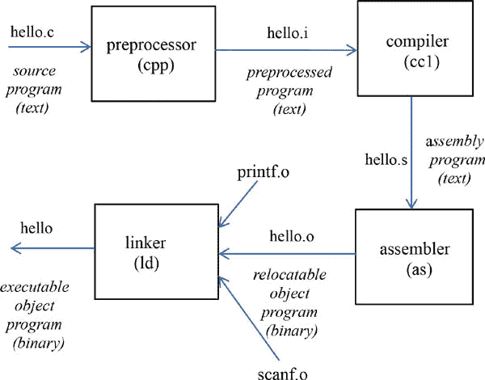

**图 1.2:** 编译系统

**预处理器：** 预处理器 (`cpp`) 直接替换原始 C 程序文本中从以 `#` 字符开头的宏和指令。它产生另一个后缀为 `.i` 的 C 程序。

**编译器：** 它涉及许多子阶段，如词法分析、语法分析等。它获取的是一个汇编语言程序，该程序以文本形式（也称为助记符）描述机器指令。编译阶段的输出文件后缀为 `.s`。

**汇编器：** 它将文本文件 `hello.s` 翻译成机器级指令，并封装成可重定位对象程序的形式，将输出存储在文件 `hello.o` 中。

**链接器：** 正如我们观察调用的 `printf()` 函数程序所示，我们的源程序中并没有 `printf()` 函数。`printf()` 函数是每个 C 编译器提供的标准 C 库的一部分。`printf` 函数已经以编译文件的形式存在，并作为 `printf.o` 文件存在于 C 库中。链接器管理这些新编译（源程序）和预编译（`printf.o`）文件的合并。合并后，链接器获得可执行文件，由加载器加载到内存中，并由 CPU 执行。

这只是所有阶段的概述。我们可以通过向 `gcc` 命令传递不同的参数，查看所有这些中间文件（`hello.i`、`hello.s`、`hello.o`）的内容。关于此的更多细节将超出本文讨论范围。

任何编程语言最重要的问题就是内存管理，我们将在下一节介绍 C 程序的内存管理和内存组织。

# C 程序的内存管理与组织](#toc.xhtml_s6a)

C 程序的内存组织取决于变量在可重定位对象文件（`hello.o`）中的组织方式。对象文件的内存表示可以分为 10 多个区域。但为了更好地理解，我们将关注四个区域（`图 1.3`），它们如下：

* 文本区 (Text Area)
* 数据区 (Data Area)
    * 初始化数据段
    * 未初始化数据段 (bss)
* 堆区 (Heap Area)
* 栈区 (Stack Area)

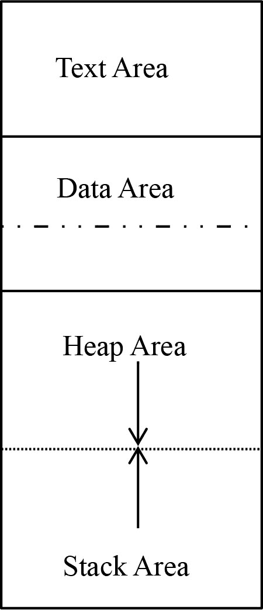

**图 1.3:** C 程序的内存组织

1. **文本区：** 它包含编译后程序的机器代码。它也被称为 `code area`（代码区）。它是只读的，防止机器指令被意外修改。文本区在程序的所有函数之间是共享的。该区域的存在持续到 `main()` 退出。

2. **数据区：** 全局 C 变量和静态变量的内存在此区域维护。该区域既可读又可写。它在程序的所有函数之间也是共享的。它的寿命也持续到程序结束。它被进一步分为两个段：
    1. **初始化数据段：** 所有初始化了某些值的全局和静态变量都会在此区域分配内存。
    2. **未初始化数据段：** 所有未初始化的全局和静态变量都位于此区域，并在此区域分配内存。该区域也被称为符号起始段 (bss)。

3. **堆区：** 动态内存分配在此区域进行。该区域的大小不是固定的，它会增长到最大的可用地址。在 C 中，它由 `malloc`、`calloc`、`realloc` 和 `free` 库函数管理，这些函数使用 `brk` 和 `sbrk` 系统调用来调节大小。该区域也被程序的所有函数共享。它的存在持续到程序结束。

4. **栈区：** 它位于堆区旁边，栈区堆区的内存地址不是固定的，而数据区和文本区是固定的。堆和栈互相生长。所有的局部变量（自动变量）都存储在栈区。当程序开始执行时，首先 `main()` 被推入栈，然后其他函数在被调用时被推入栈。当调用任何函数时，机器状态会发生很多变化。程序计数器更新为新地址。

C 内存组织的示例见 `图 1.4`。

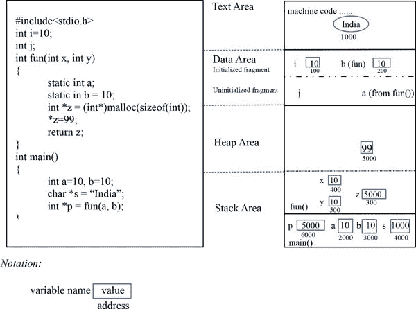

**图 1.4:** 程序内存组织的示例

# C 语言中的错误类型](#toc.xhtml_s7a)

通常，程序中发生四种错误，如下：

**逻辑错误：** 在编写程序时，程序中存在一些逻辑错误。它会导致输出异常。编译器无法检查，因此程序员需要扫描代码。

**编译时错误：** 当程序员不遵守特定语言的规则时发生。因此，编译器抛出错误。有很多编译时错误，如语法错误、语义错误。

**链接时错误：** 它发生在链接阶段，这意味着我们的代码没有问题，编译正常，但缺少要链接的函数或库模块。链接器不允许生成最终的可执行文件。许多编译器将编译和链接结合。在 GCC 编译器中，链接时错误仅在编译阶段发生。


**运行时错误：** 这些错误在程序执行期间发生。假设在程序中，我们正在除以零，这是一个运行时错误。假设我们的程序试图访问一个不允许访问或不存在的内存地址，导致段错误。

**字长：** 32 位

**模式：** 小端序（我们将在 G-2 的问题 25 中进行讨论）

### 数据类型的大小：

`char` - 1B

`short` - 2B

`int` - 4B

`long` - 4B

`long int` - 4B

`float` - 4B

`double` - 8B

# 其他 C 语言重要方面

**关键字：** C89 有 32 个关键字，关键字是具有特殊含义的保留字。`表 1.2` 表示 C 中可用的关键字。

| autobreakcasecharconstefaultdo | doubleelseenumexternfloatforgotoif | intlongregisterreturnshortsignedsizeofstatic | structswitchtypedefunionunsignedvoidvolatilewhile |

**表 1.2：** C 语言中的关键字

**字符集：** C 包含以下字符：

*   小写和大写写字母：a–z A–Z
*   数字：0–9
*   图形字符：! " #% & ‘ ( ) * + , - . /:; < = >? [ \ ] ^ _ { | } ~
*   空白字符：*空格*、*水平制表符*、*垂直制表符*、*分页*、*换行*

### C 中的运算符：

C 支持大量的运算符，如下如下：

*   算术：`+`, `-`, `*`, `/`, `%`
*   赋值：`=`
*   复合赋值：`+=`, `-=`, `*=`, `/=`, `%=`, `&=`, `|=`, `^=`, `<<=`, `>>=`
*   位逻辑：`~`, `&`, `|`, `^`
*   位移：`<<`, `>>`
*   布尔逻辑：`!`, `&&`, `||`
*   条件求值：`? :`
*   相等性测试：`==`, `!=`
*   函数调用：`( )`
*   增、减：`++`, `--`
*   成员选择：`.`, `->`
*   对象大小：`sizeof`
*   关系运算：`<`, `<=`, `>`, `>=`
*   引用与解引用：`&`, `*`, `[ ]`
*   序列化：`,`
*   子表达式分组：`( )`
*   类型转换：`(*typename*)`

**运算符优先级表：** `表 1.3` 比较了 C 中不同类型运算符的优先级和结合性。表格中的上方行优先级高于下方行，依此类推。同一行的运算符具有相同的优先级。如果两个运算符的优先级相同，则根据运算符的结合性评估表达式。

| **运算符** | **描述** | **结合性** |
| :--- | :--- | :--- |
| `()` `[]` `.` `->` `++ --` | 括号（函数调用）方（数组下标）通过对象名进行成员选择 通过指针进行成员选择 后置增/减 | 从左到右 |
| `++` `--` `+` `-` `!` `~` `(*type*)` `&` `sizeof` | 前置增/减 一元正/负 逻辑取反/位取反 强制类型转换（更改 `*type`） 解引用 确定字节大小 | 从右到左 |
| `/` `*` `%` | 乘法/除法/取模 | 从左到右 |
| `+` `-` | 加法/减法 | 从左到右 |
| `<<` `>>` | 位左移，位右移 | 从左到右 |
| `<` `<=` `>` `>=` | 关系小于/小于等于 关系大于/大于等于 | 从左到右 |
| `==` `!=` | 关系相等/不相等 | 从左到右 |
| `&` | 位与 | 从左到右 |
| `^` | 位异或 | 从左到右 |
| `|` | 位或 | 从左到右 |
| `&&` | 逻辑与 | 从左到右 |
| `||` | 逻辑或 | 从左到右 |
| `?:` | 三元条件 运算符 | 从右到左 |
| `=` `+=` `-=` `*=` `/=` `%=` `&=` `^=` `|=` `<<=` `>>=` | 赋值 加法赋值减法赋值 乘法/除法赋值 取模/位与赋值 位异或/位或赋值 左右移赋值 | 从右到左 |
| `,` | 逗号（分隔表达式） | 从左到右 |

**表 1.3：** 运算符的优先级和结合性

**ASCII 字符编码表：** `表 1.4` 如下：

| **ASCII** | **字符值** | **ASCII** | **字符值** | **ASCII** | **字符值** |
| :--- | :--- | :--- | :--- | :--- | :--- |
| **0** | 空字符 | **43** | 加号 | **86** | 大写 V |
| **1** | 头部开始 | **44** | 逗号 | **87** | 大写 W |
| **2** | 文本开始 | **45** | 字符 | **88** | 大写 X |
| **3** | 文本结束 | **46** | 点或句号 | **89** | 大写 Y |
| **4** | 传输结束 | **47** | 斜杠 | **90** | 大写 Z |
| **5** | 询问 | **48** | 0 | **91** | 左括号 |
| **6** | 确认 | **49** | 1 | **92** | 反斜杠 |
| **7** | 响铃 | **50** | 2 | **93** | 右括号 |
| **8** | 空格 | **51** | 3 | **94** | 脱符号 |
| **9** | 水平制表符 | **52** | 4 | **95** | 下划线 |
| **10** | 换行 | **53** | 5 | **96** | 反引号 |
| **11** | 垂直制表符 | **54** | 6 | **97** | 小写 a |
| **12** | 分页 | **55** | 7 | **98** | 小写 b |
| **13** | 回车 | **56** | 8 | **99** | 小写 c |
| **14** | 切换开启 | **57** | 9 | **100** | 小写 d |
| **15** | 切换关闭 | **58** | 冒号 | **101** | 小写 e |
| **16** | 数据行逸 | **59** | 分号 | **102** | 小写 f |
| **17** | 设备控制 1 | **60** | 小于 | **103** | 小写 g |
| **18** | 设备控制 2 | **61** | 等号 | **104** | 小写 h |
| **19** | 设备控制 3 | **62** | 大于 | **105** | 小写 i |
| **20** | 设备控制 4 | **63** | 问号 | **106** | 小写 j |
| **21** | 否定确认 | **64** | @ 符号 | **107** | 小写 k |
| **22** | 同步空闲 | **65** | 大写 A | **108** | 小写 l |
| **23** | 传输块 | **66** | 大写 B | **109** | 小写 m |
| **24** | 取消 | **67** | 大写 C | **110** | 小写 n |
| **25** | 媒体结束 | **68** | 大写 D | **111** | 小写 o |
| **26** | 替换 | **69** | 大写 E | **112** | 小写 p |
| **27** | 逸 | **70** | 大写 F | **113** | 小写 q |
| **28** | 文件分隔符 | **71** | 大写 G | **114** | 小写 r |
| **29** | 分组分隔符 | **72** | 大写 H | **115** | 小写 s |
| **30** | 记录分隔符 | **73** | 大写 I | **116** | 小写 t |
| **31** | 单元分隔符 | **74** | 大写 J | **117** | 小写 u |
| **32** | 空格 | **75** | 大写 K | **118** | 小写 v |
| **33** | 感叹号 | **76** | 大写 L | **119** | 小写 w |
| **34** | 双引号 | **77** | 大写 M | **120** | 小写 x |
| **35** | 数字 | **78** | 大写 N | **121** | 小写 y |
| **36** | 美元符号 | **79** | 大写 O | **122** | 小写 z |
| **37** | 百分号 | **80** | 大写 P | **123** | 左括号 |
| **38** | 间隔符号 | **81** | 大写 Q | **124** | 竖线 |
| **39** | 单引号 | **82** | 大写 R | **125** | 右括号 |
| **40** | 左括号 | **83** | 大写 S | **126** | 等价符号 - 波浪线 |
| **41** | 右括号 | **84** | 大写 T | **127** | 删除 |
| **42** | 星号 | **85** | 大写 U | | |

**表 1.4：** ASCII 字符编码映射到字符值

# 结论

在本章中，我们学习了 C 程序的结构和执行行为。我们涵盖了从源文件创建可执行二进制文件期间遇到的几个阶段。我们理解了 C 程序的内存管理，并获取了关于 C 程序在机器中何种的知识。我们概述了 C 程序执行期间可能产生的错误类型，这是一个在技术论文/面试中非常重要的概念。

# 关键术语

*   预处理器指令
*   编译器
*   汇编器
*   链接器
*   加载器
*   文本区、数据区、堆区、栈区

# 尝试自己

1.  函数和变量声明与定义之间的区别是什么？
2.  什么是 C 存储类（`extern`, `auto`, `typedef`, `static`）？类型限定符是什么？
3.  C 程序中变量的作用域是什么？请举例。
4.  编写一个程序创建一个新的头文件并在你自己的 C 程序中使用？

## 任务 1
将在这里学到的概念教给你的朋友/同事/同学。

## 任务 2
尝试专注于实现，而不是阅读或做笔记。

*预测未来的最好方式是创造它。*

# 第 1 组问题
## 'C' 类问题数量: 60
## 其他重要面试题: 15


1. **以下程序的输出是什么？**

```c
#include<stdio.h>

int *fun()
{
    int b = 10;
    return &b;
}

int main()
{
    int *p;
    p = fun();
    printf("%d\n", *p);
    return 0;
}
```
(a) 10
(b) 变量 'b' 的地址
(c) 意外行为
(d) 以上均不是

2. **我们应该对上述程序进行什么修改，使其返回被调用函数中定义的变量 `b` 的地址？**

3. **以下程序的输出是什么？**

```c
#include<stdio.h>

int main()
{
    int b = 65;
    void *p = &b;
    int *j = (int*)p;
    char *ch = (char*)p;
    printf("%d, %c\n", *j, *ch);
    return 0;
}
```
(a) 65, 65
(b) 65, A
(c) 错误-编译时
(d) 错误-运行期

4. **以下程序的输出是什么？**

```c
#include<stdio.h>

int main()
{
    int b=65;
    void p = b;
    int c = (int)p;
    printf("%d\n", p);
    return 0;
}
```
(a) 65
(b) A
(c) 错误-编译时
(d) 错误-运行时

5. **以下程序的输出是什么？**

```c
#include<stdio.h>
#include<stdlib.h>

int main()
{
    int *p = NULL;
    p = (int*)malloc(sizeof(int));
    *p = 10;
    free(p);
    int * q = (int*)malloc(sizeof(int));
    *q = 15;
    printf("%d, %d\n", *p, *q);
    return 0;
}
```
(a) 10, 15
(b) 15, 15
(c) 错误-运行时
(d) 0, 15

6. **以下程序的输出是什么？假设：p 的地址为 1000，q 的地址为 2000。**

```c
#include<stdio.h>
#include<stdlib.h>

void *fun(int **q)
{
    int r = 20;
    **q=r;
    printf("%u ", *q);
}

int main()
{
    int *p = (int *)malloc(sizeof(int));
    *p = 55;
    fun(&p);
    printf("%d %u\n", *p, p);
    return 0;
}
```
(a) 1000 55 2000
(b) 1000 20 1000
(c) 1000 garbage 1000
(d) 1000 55 2000

7. **关于给定程序，以下哪些陈述是正确的？**

```c
#include<stdio.h>
#include<stdlib.h>

void fun()
{
    int *q = (int *)malloc(sizeof(int));
    *q = 20;
}

int main()
{
    int *p;
    int *r=NULL;
    fun();
    return 0;
}
```
(i) p 是野指针
(ii) q 是悬空指针
(iii) r 是空指针
(iv) p 是悬空指针
(v) fun() 正在导致内存泄漏

**选项：**
(a) i, ii, iii, v
(b) ii, iii, iv
(c) ii, iii, v
(d) i, iii, v

8. **以下程序的输出是什么？**

```c
#include<stdio.h>

int main()
{
    char *p = "hello";
    char q[5] = "hello" ;
    p[2] = 'r'; //line3
    q[2] = 'r'; //line4
    printf("%s %s", p, q);
    return 0;
}
```
(a) hello hello
(b) herlo herlo
(c) 因为 line3 导致运行时错误
(d) 因为 line4 导致运行时错误

9. **以下程序的输出是什么？**

```c
#include<stdio.h>

int main()
{
    char *p = "hello";
    char *q = "hello";
    if(p == q)
        printf("hello");
    else
        printf("hi");
    return 0;
}
```
(a) hello
(b) hi
(c) hello
(d) 错误-编译时

10. **以下程序的输出是什么？**

```c
#include<stdio.h>
#include<string.h>

int main()
{
    char *p = "hello";
    char q[] = "hello";
    printf("%d %d ", sizeof(*p), sizeof(q));
    printf("%d %d", strlen(p), strlen(q));
    return 0;
}
```
(a) 1 4 5
(b) 1 4 6
(c) 1 5 5
(d) 1 4 infinity

11. **以下哪些陈述是正确的？**
(i) `(void*)0` 是 void 指针
(ii) `(void*)0` 是空指针
(iii) `int *p = (int *)0;` 是空指针
(iv) `a[i] == *(a+i);`
(a) i, ii, iii, iv
(b) ii, iii, iv
(c) 等等, 源码不完整

12. **每个选项中都有两个声明。说明两者是否等价？**
(a) `char *p=0;`
(ii) `char *t = NULL;`
(b) `int i=0;`
(ii) `char *q = (char*)i;`
(c) `char *q = 0;`
(ii) `char *q = (char *)0;`
(d) `char **a;`
(ii) `char *a[];`

13. **以下程序的输出是什么？**

```c
#include<stdio.h>

int main()
{
    float a = 3.14;
    char *j;
    j = (char*)&a;
    printf("%d\n", *j);
    return 0;
}
```
(a) 3
(b) 打印 'a' 的 ASCII
(c) 打印 float 的第一个字节
(d) 编译错误

14. **以下程序的输出是什么？**

```c
#include<stdio.h>

int main()
{
    int const *p = 5; //line1
    ++(*p); //line2
    printf("%d", *p);
    *(p) = 2; //line4
    return 0;
}
```
(a) 5
(b) 垃圾值
(c) Line2 错误
(d) Line4 错误

15. **以下程序的输出是什么？**

```c
#include<stdio.h>

int main()
{
```


`int i = -1, j=-1, k=0, l=2, m;`

`m = ++i || ++j || l++;`

`printf("%d %d %d %d %d", i, j, k, l, m);`

`return 0;`

```
(a) 0, -1, 0, 2, 1
(b) 0, -1, 0, 3, 1
(c) 0, -1, 1, 3, 1
(d) 以上均不是
```

## 16. 以下程序的输出是什么？

```c
#include<stdio.h>

int main()

{

int p=9;

int *q = &p;

printf("%ld %ld %ld %ld ", sizeof(p++), sizeof(q), sizeof(++p), sizeof(++q));

printf("%d", p);

return 0;

}
```
(a) 2 4 2 11
(b) 2 2 4 12
(c) 4 2 4 12
(d) 4 4 4 9

## 17. 以下程序的输出是什么？

```c
#include<stdio.h>

#define A 2 //line2

#if B && A //line3

#define C 3 //line4

#else //line5

#define C 4 //line6

#endif

int main()

{

printf("%d",C);//line9

return 0;

}
```
(a) 3
(b) 4
(c) 错误-编译
(d) 垃圾值

## 18. 以下程序的输出是什么？

```c
#include<stdio.h>

void fun(int *p)

{

printf("%d\t", *p);

if(*p > 0)

{

*p = *p-2;

fun(p);

}

else

*p=0;

}

int main()

{

int i=10, j=9;

fun(&i);

printf("%d\n", i);

fun(&j);

printf("%d\n", j);

return 0;

}
```
(a) 10, 8, 6, 4, 2, 0, 0 9, 7, 5, 3, 1, -1, -1
(b) 10, 8, 6, 4, 2, 0, 0 9, 7, 5, 3, 1, 0, 0
(c) 10, 8, 6, 4, 2, 0, 0 9, 7, 5, 3, 1, -1, 0
(d) 以上均不是

## 19. 以下程序的输出是什么？

```c
#include<stdio.h>

int main()

{

#define int char

int i=65;

printf("%d", sizeof(i)); //line3

printf(" %d",sizeof('A')); //line4

return 0;

}
```
(a) 2 1
(b) 1 1
(c) 0 0
(d) 1 4

## 20. 以下程序的输出是什么？

```c
#include<stdio.h>int main()

{

int i = 7;

switch(i)

{

default:

printf("zero ");

case 1:

printf("one ");

case 2:

printf("two ");

case 3:

printf("three ");

case 4:

printf("four ");

}

return 0;

}
```
(a) zero
(b) zero one two
(c) zero one two three four
(d) 错误- 默认语句位置错误

### 21. 下列程序的输出是什么？

```c
#include<stdio.h>

int main()

{

    int i=500, j=700;

    printf("%d %d\n");

    return 0;

}
```
(a) 500, 700
(b) 700, 500
(c) 取决于编译器
(d) 垃圾值垃圾垃圾

### 22. 下列程序的输出是什么？

```c
#include<stdio.h>

int main()

{

    int p=1, q=5;

    switch(p)

    {

    case 1:

    printf("hi\n");

    case q:

    printf("Bye\n");

    }

    return 0;

}
```
(a) hi
(b) Bye
(c) hi Bye
(d) 错误- 编译时

### 23. 下列程序的输出是什么？

```c
#include<stdio.h>

int main()

{

    int p=1;

    switch(p)

    {

    case 1:

    printf("Hi\n");

    case 5-4:

    printf("Bye\n");

    }

    return 0;

}
```
(a) hi
(b) bye
(c) 错误- 编译时
(d) Hi Bye

### 24. 下列程序的输出是什么？

```c
#include<stdio.h>

int main()

{

    int *j;

    {

    int i=10;

    j=&i;

    }

    printf("%d", *j); //line 6

    return 0;

}
```
(a) 错误- 第 6 行
(b) 垃圾值
(c) 10
(d) 取决于编译器

### 25. 下列程序的输出是什么？

```c
#include<stdio.h>

int main()

{

    const int p = 4;

    int q = ++p; //line 2

    printf("%d, %d\n", p, q);

    return 0;

}
```
(a) 5, 5
(b) 4, 5
(c) 错误- 编译时
(d) 错误- 运行时

### 26. 下列程序的输出是什么？

```c
#include<stdio.h>

int main()

{

    int i=10, j=6;

    printf("%d\n", i+++j);

    return 0;

}
```
(a) 17
(b) 16
(c) 错误- 编译时
(d) 以上皆非

### 27. 下列程序的输出是什么？

```c
#include<stdio.h>

int main()

{

    void *p;

    int i=20;

    p = &i;

    void *q = p; //line 4

    printf("%d, %d, %d\n", i, *p, *q); //line 5

    return 0;

}
```
(a) 20, 20, 20
(b) 20, g, g
(c) 第 4 行编译器错误
(d) 第 5 行编译器错误

### 28. 下列程序的输出是什么？

```c
#include<stdio.h>

int main()

{

    int a[] = {10, 20, 30, 40, 50};

    printf("%u %u %u", sizeof(a[1]), sizeof(*a), sizeof(a));

    return 0;

}
```
(a) 4 8 20
(b) 4 4 20
(c) 4 4 4
(d) 8 8 20

### 29. 下列程序的输出是什么？

```c
#include<stdio.h>

int main()

{

    void *p;

    int *q;

    int a[1] = {10, 11};

    q = a;

    q++;

    printf("%d ", *q);

    p = a;

    p++;

    printf("%d\n", *p);

    return 0;

}
```
(a) 10 11
(b) 11 11
(c) 错误- 编译时
(d) 错误- 运行时

### 30. 下列程序的输出是什么？

```c
#include<stdio.h>

int main()

{

    int p, r;

    int q = scanf("%d %d", &p, &r);

    printf("%d", q+printf("India"));

    return 0;

}
```
(a) 5
(b) 7
(c) 垃圾值
(d)

### 31. while 循环执行了多少？

```c
#include<stdio.h>

int main()

{

    int x, y;

    while(y = scanf("%d", &x)) //line 2

    {

    printf("hello\n");

    y=-2;

    }

    return 0;

}
```
(a) 执行一次
(b) 执行两次
(c) 执行三次
(d) 直到输入整数

### 32. 关于声明和定义，以下哪个陈述正确？

(a) 声明说明了变量的类型且未分配内存。
(b) 定义为变量预留了空间或进行了初始化。
(c) 声明指定了变量的存储空间和类型。
(d) 定义说明了变量的类型而不关心空间。

### 33. 下列程序的输出是什么？

```c
#include<stdio.h>

int main()

{

    extern int p;

    p = 20;

    printf("%d", p);

    return 0;

}
```
(a) 20
(b) 错误 - 链接时
(c) 错误 - 编译时
(d) 40

### 34. 下列程序的输出是什么？

```c
#include<stdio.h>

int main()

{

    printf("%d\n", p);

    return 0;

}

int p = 20;

```
(a) 20
(b) 错误- 未声明 'p'
(c) 0
(d) 取决于编译器

### 35. 下列程序的输出是什么？

```c
#include<stdio.h>

int main()

{

    extern int p;

    printf("%d", p);

    return 0;

}

int p=20;

```
(a) 20
(b) 错误- 编译时
(c) 0
(d) 取决于编译器

### 36. 下列程序的输出是什么？

```c
#include<stdio.h>

int main()

{

    char *a, b;

    void *p, q;

    a = "hello";

    p = a;

    q = a[2];

    printf("%s, %c", p, q);

    return 0;

}
```
(a) hello, l
(b) hello, 垃圾值
(c) 取决于编译器
(d) 错误- q 的大小未知

### 37. 下列程序的输出是什么？

```c
#include<stdio.h>

int main()

{

    int i;

    for(i=0; i<25; i++)

    {

    switch(i)

    {

    case 0: i+=5;

    case 1: i+=10;

    case 2: i+=6;

    default: i+=1;

    break;

    }

    printf("%d, \n", i);

    }

    return 0;

}
```
(a) 22, 23, 24, 25
(b) 22, 24, 25
(c) 22, 25, 27
(d) 22, 24

### 38. 下列程序的输出是什么？

```c
#include<stdio.h>

int fun(int i, int j)

{

    if(i/2 == 0) return 0;

    else if(i%2 == 1)

    return fun(i/2, 3*j) + i+j;

    else

    return fun(i/2, 2*j) + i+j;

}

int main()

{

    printf("%d", fun(20, 1));

    return 0;

}
```
(a) 48
(b) 49
(c) 54
(d) 56

### 39. 下列程序的输出是什么？

```c
#include<stdio.h>

int main()

{

    int p = printf("");

    switch(p)

    {

    case 0: printf("India");

    default: printf("is great");

    }

    return 0;

}
```
(a) India
(b) is great
(c) India great
(d) 错误- 运行时

### 40. 下列程序的输出是什么？

```c
#include<stdio.h>

int main()

{

    int p = 10;

    int q = 0;

    while(q++ < p) printf("%d, ", q);

    printf("\n");

    q = 0;

    while(++q < p) printf("%d, ", q);

    printf("\n");

    q=0;

    while(p-- > q) printf("%d, ", p);

    printf("\n");

    return 0;

}
```
(a) 0 to 9, 1 to 9, 10 to 1, 9 to 1
(b) 无限循环
(c) 1 to 10, 1 to 9, 9 to 0, 9 to 1
(d) 0 to 9, 0 to 9, 10 to 1, 10 to 1

### 41. 下列程序的输出是什么？

```c
#include<stdio.h>

int main()

{

    float f = 0.7;

    if(0.7 > f)

    printf("India");

    else

    printf("Bharat\n");

    return 0;

}
```
(a) India
(b) Bharat
(c) else 语句位置错误
(d) India Bharat

### 42. 下列程序的输出是什么？

```c
#include<stdio.h>

int main()

{

    int p = 4;

    switch(p)

    {

    case 4:

    printf("hello, ");

    case 3:

    printf("bye");

    case 6: continue;

    default: break;

    }

    return 0;

}
```
(a) hello, bye
(b) hello
(c) 错误- 编译时
(d) 未定义行为

### 43. 下列程序的输出是什么？

```c
#include<stdio.h>

int main()

{

    int i = 5;

    int j;

    i = j = 4;

    printf("%d, ", i);

    if(j=(i=0))

    printf("India");

    else

    printf("Bharat");

    return 0;

}
```
(a) 1, Bharat
(b) 0, India
(c) 4, Bharat
(d) 4, India

## 44. 以下程序的输出结果是什么？

```c
#include<stdio.h>

int main()

{

    int i;

    for(i=0; i<10;i++)

    {

        if(i<=5)

        {

            printf("%d\n", i);

            continue;

        }

        else break;

        printf("hello, ");

    }

    return 0;

}
```
(a) 0, 1, 2, 3, 4, 5, hello,
(b) 0, hello, 1, hello, 2, hello, 3, hello, 4, hello, 5, hello,
(c) 0, 1, 2, 3, 4, 5
(d) 0, 1, 2, 3, 4, 5, hello, hello, hello, hello,

## 45. 以下程序的输出结果是什么？

```c
#include<stdio.h>

int main()

{

    int i=3;

    int x = ++i;

    int y = i++;

    printf("%d, %d, %d, ", x, y, i);

    printf("%d, ", i++);

    printf("%d", ++i);

    return 0;

}
```
(a) 4, 4, 5, 6, 7
(b) 3, 3, 5, 6, 7
(c) 4, 4, 5, 5, 7
(d) error- l-value required

## 46. 以下程序的输出结果是什么？

```c
#include<stdio.h>

int main()

{

    int i = 3>4;

    int j = 4>3;

    int k = (i=j);

    int l = (k==j);

    printf("%d %d %d %d", i, j, k, l);

    return 0;

}
```


### 47. 确定以下程序的输出结果？

```c
#include<stdio.h>

int main()
{
    int i = 1, j=-1;
    while(j)
    {
        printf("%d, %d,", i, j);
        j=-5 < i--;
    }
    return 0;
}
```

(a) 0, 1, 0, 1
(b) 0, 0, 1, 1
(c) 0, 1, 1, 1
(d) 1, 1, 1, 1

### 48. 以下程序的输出结果是什么？

```c
#include<stdio.h>
#define fn(v , a , r) v##a##r

int main()
{
    int var = 10;
    printf("%d" , fn(v,a,r));
    return 0;
}
```

(a) `v##a##r`
(b) error : `v`, `a` and `r` are not declared
(c) 10
(d) `var`

### 49. 以下程序的输出结果是什么？

```c
#include<stdio.h>

int main()
{
    int p=2;
    int j = p+(3, 7, 9, 10);
    printf("%d\n", j);
    return 0;
}
```

(a) 5
(b) 31
(c) 12
(d) error- syntax error

### 50. 以下程序的输出结果是什么？

```c
#include<stdio.h>

int main()
{
    int x = 150;
    printf("%d, %d\n", x=40, x>=50);
    return 0;
}
```

(a) 1, 0
(b) 40, 1
(c) 40, 0
(d) compiler dependent

### 51. 以下程序的输出结果是什么？

```c
#include<stdio.h>

int main()
{
    char ch[] = "Hello India";
    printf("%s ", &ch[8]-&ch[2] + ch); //line 3
    return 0;
}
```

(a) `lo India`
(b) `India`
(c) `llo India`
(d) syntax error at line 3

### 52. 以下程序的输出结果是什么？

```c
#include<stdio.h>

int main()
{
    float f = 0.4;
    if(0.4 > f) //line 2
        printf("India");
    else
        printf("Bharat\n");
    return 0;
}
```

(a) `India`
(b) `Bharat`
(c) error at 2
(d) `India Bharat`

### 53. 以下程序的输出结果是什么？

```c
#include<stdio.h>
#define FOO(x) foo(x)

int foo(char x)
{
    return (int)x;
}

int main()
{
    char x = 'a';
    printf("%d",FOO(x));
    return 0;
}
```

(a) 97
(b) undefined behavior
(c) error- compile time
(d) garbage

### 54. 以下程序的输出结果是什么？

```c
#include<stdio.h>

int x, y;
void Q();
void P(int);

int main()
{
    x = 7, y=8;
    Q();
    printf("%d\n", x);
    return 0;
}

void Q()
{
    int x, y;
    x=3; y=4;
    P(y);
    printf("%d, ", x);
}

void P(int n)
{
    x = n+2 / n-3;
}
```

(a) 6, 3
(b) 3, 6
(c) 3, 4
(d) 3, 1

### 55. 以下程序的输出结果是什么？

```c
#include<stdio.h>

int r;
void two();
void one();

int main()
{
    two();
    one();
    two();
    return 0;
}

void two()
{
    printf("%d, ", r++);
}

void one()
{
    int r=5;
    two();
    printf("%d, ",r++);
}
```

(a) 1, 2, 5, 3,
(b) 0, 1, 5, 2,
(c) 0, 0, 5, 0,
(d) 1, 2, 6, 3,

### 56. 以下程序的输出结果是什么？

```c
#include<stdio.h>

void test(int*, int*);

int main()
{
    int a=5;
    test(&a, &a);
    printf("%d ", a);
    return 0;
}

void test(int *c, int *d)
{
    *c += *d * 2;
    *d *= *c - 3;
}
```

(a) 180
(b) 12
(c) 60
(d) 144

### 57. 以下程序的输出结果是什么？

```c
#include<stdio.h>

void fun(int x, int *y, int *z)
{
    *y += 4;
    *z = *z + x + *y;
}

int main()
{
    int x=10, y=3;
    fun(y, &x, &x);
    printf("%d, %d\n", x, y);
    return 0;
}
```

(a) 31, 3
(b) 32, 2
(c) 31, 2
(d) 32, 3

### 58. 以下程序的输出结果是什么？

```c
#include<stdio.h>

i=0, j=1;
void f(int *p, int *q)
{
    p = q;
    *p = 2;
}

int main()
{
    f(&j, &i);
    printf("%d, %d", i, j);
    return 0;
}
```

(a) 0, 2
(b) 0, 0
(c) 2, 2
(d) 2, 1

### 59. 以下程序的输出结果是什么？

```c
#include<stdio.h>

i=0, j=1;
void f(int *p, int *q)
{
    p = q;
    *p = 2;
}

int main()
{
    f(&j, &i);
    printf("%d, %d", i, j);
    return 0;
}
```

### 60. 以下程序的输出结果是什么？

```c
#include<stdio.h>

int a;
void q(int c);
void p(int *b);
...
{
    c-=a;
    printf("%d, ", c);
}
...
```

- 因此，变量`b`的地址在`fun()`执行完成后就不再有效。如果我们尝试访问`b`，无法保证赋值给`b`的值是否仍然存在。有时它可能还在那里，有时它可能会被其他函数调用覆盖。这取决于编译器的实现。
- 就像在 Turbo C 中一样，它会报错；而在 `gcc` 编译器中，它只会给出一个警告。

### 2. 解释：使用静态内存分配
`b`的内存被分配在数据区（data area）中，现在`fun()`返回该地址，该地址在`fun()`执行完成后仍然可用。它不会抛出任何错误。

正如我们在"C 语言简介"章节中所讨论的，数据区域在所有函数之间共享。

```c
int *fun()
{
    static int b = 10;
    return &b;
}
```

**使用动态内存分配**：这里，`b`的内存是动态分配的，位于堆区域（heap area）中。现在变量`b`持有堆内存的地址。

正如我们已经讨论过的，堆区域在所有函数之间也是共享的。

```c
int *fun()
{
    int *b = (int *)malloc(sizeof(int));
    return b;
}
```

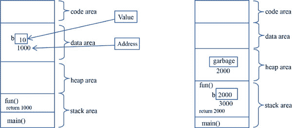

**图 2.2：** C 程序的内存布局

### 3. b
**解释：** `void`指针是一种通用指针类型。它可以持有所有数据类型的地址。它在指针的实际数据类型暂时未知时使用，之后可能会被确定。在给定的代码中，我们正在使用`void`指针，它持有整数类型和字符类型的地址。

### 4. c
**解释：** 不允许`void`数据类型，因为`void`数据类型的大小是未知的。它不能用作通用数据类型。

### 5. b
**解释：** `malloc`的内存是通过`brk`（关键字）系统调用在堆区域中动态分配的。正如图 (i) 所示，`brk`指向空闲（未分配）内存池。当我们调用`malloc()`函数时，`brk`指针为`p`分配了 4B 的内存，其本身向右移动，并且 (ii) 也为分配的空间赋值了值 10。

现在我们执行`free(p)`，(iii) 由`malloc`分配的内存被释放，其内容变为零或 NULL，`brk`返回到其之前的位置。我们可以注意到`p`仍然指向相同的地址（图 iii）。我们再次执行`malloc()`为`q`分配内存（图 iv）。如果我们尝试访问指针`q`的内容，它如预期地返回 15。假设我们访问指针`p`的内容，它也会返回与`q`相同的内容。这对于`p`来说是不符合预期的，因为我们已经释放了`p`，但实际发生的情况是我们释放了堆区域的内存，但`p`仍然指向一个内存位置/地址，由于`p`只是一个指针变量，这个`p`被称为悬指针（dangling pointer）。

通过在`free(p)`语句之后令`p = NULL`可以避免程序中的悬空指针。

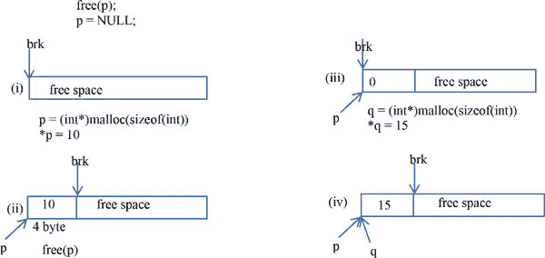

**图 2.3：** 在堆区域分配动态内存期间演示的`brk`系统调用。

### 6. b
**解释：** `p`的内是在`main()`中通过`malloc()`分配的，该内存对其他函数也可用，在这里在`fun()`中，我们正在修改由指针`p`指向的共享内存值，该值被更新为 20。（看下图）

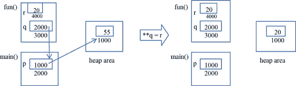

**图 2.4：** 堆区和栈区指针与变量分配的演示

### 7. d
**解释：**
**野指针（Wild Pointer）：** 这些指针未初始化并指向某个随机位置，例如`p`。

**悬指针（Dangling Pointer）：** 检查问题 5 的解释，给定程序中没有悬指针。

**空指针（NULL Pointer）：** 这些指针被初始化为 NULL 值，不指向任何位置，例如`r`。

**内存泄漏（Memory Leak）：** 当在某个函数中使用`malloc()`动态分配内存，且该内存没有被程序中的任何其他函数使用。此外，该函数没有使用`free()`释放内存。执行该函数后，无法访问该内存，因为我们丢失了存储分配内存地址的指针变量（`q`），该内存保持未使用的状态。这种未使用的内存被称为内存泄漏，`fun()`正在导致内存泄漏。

### 8. c
**解释：** 当字符指针赋值为一个字符串时。字符串存储在文本区（text area）或代码区中，该区域是只读的。在给定程序的第 3 行，我们尝试更新只读区域。因此，发生了运行时错误。看图。

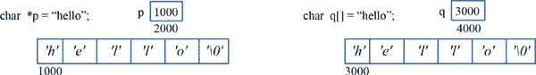

**图 2.5：** 字符串在文本区和栈区内存分配的表示

`p`指向的 "hello"存储在代码/文本区（只读）。它无法更新。变量`p`本身存在于栈区。`q`指向的 "hello"存储在栈区。

```c
printf("%s", p);
```

### 9. a
**解释：** `p`指向的 "hello"存储在代码/文本区（只读）。它无法更新。变量`p`本身存在于栈区。`q`指向的 "hello"存储在栈区。

### 10. b
**解释：** `sizeof()`运算符返回操作数占用的字节数。这里`p`是一个字符指针，只需要 1 字节。

```c
sizeof(p)
```


### 11. c

**解释：** `strlen()` 是库函数，存在于 `string.h` 头文件中，计算字符串中的字符数，它不计算 `\0`。

### 12. a, c- true; b, d- false

**解释：** 不需要。

### 13. c

**解释：** 字符指针旨在一次指向一个字节，这里字符指针 `j` 指向 4 字节的浮点变量 `a`。当访问字符指针时，它返回浮点变量 `a` 的第一个字节。

### 14. c

**解释：** 常量值不能修改。在第 2 行中我们正在这样做，因此编译器报错。

### 15. c

**解释：** `||` 运算符：它首先检查表达式左侧的值，如果为真，则不评估右侧表达式并返回 1。如果左侧表达式为假，则才评估右侧表达式。

`&&` 运算符：它首先检查左侧表达式的值，如果为真，则才评估右侧表达式；如果为假，则不评估右侧表达式并返回 0。

### 16. d

### 16. 解释

**解释：** `sizeof()` 运算符不会求值其操作数，它只检查其操作数的数据类型。因此，`sizeof(p++)` 或 `sizeof(++p)` 不会改变变量 `p` 的值。

### 17. b

**解释：** 在给定的程序中，宏 `A` 被引用为 2。在第 2 行中，宏 `B` 和 `A` 通过 `&&` 运算符进行比较，但宏 `B` 尚未定义。如果宏在使用之前没有定义，则它的默认取值为 0。第 3 行的 `if` 条件结果为假（false），因此宏 `C` 在第 6 行被引用为值 4。

### 18. c

**解释：** 这是一个简单的递归程序，不需要解释。

### 19. d

**解释：** 首先，宏 `int` 被替换为 `char`。预处理后的程序实际上是 `char i = 65`，而不是 `int i = 65`。第 3 行的 `sizeof()` 运算符返回字符数据类型的大小，即 1。

在 C 语言中，所有的字符字面量都被视为整数。因此，第 4 行的 `sizeof` 运算符将返回整数数据类型的大小。因此，将打印 4。

### 20. c

**解释：** `default case` 可以放在 `switch` 内部的任何位置。当所有其他 `case` 都不匹配时执行它。如果任何 `case` 匹配 `switch` 条件，则所有随后的 `case` 和默认（如果存在）将继续执行，直到遇到 `break` 或 `switch` 结束。

### 21. c

**gcc:** 垃圾值，垃圾值  
**turboC:** 700, 500

**解释：** 这是一个取决于编译器的程序。

### 22. d

**解释：** `case` 标签必须是一个常量或常量表达式。`case` 标签中不允许变量或非常量表达式。枚举类型也可以作为 `case` 标签语句。

### 23. c

**解释：** 正如我们在上面的解释中所讨论的，常量表达式允许作为 `case` 标签。在这里，错误是由于 `case` 标签重复导致的。

### 24. c

**解释：** 变量 `i` 仅对块内部可见。但我们可以通过块外的地址访问它的值，因为 `main` 函数中块地址的生命周期一直持续到 `main` 函数退出。

### 25. c

**解释：** 变量 `p` 是一个常量整数，存储在只读内存区域。它的值无法更新。在我们的程序中，我们试图在第 2 行更新 `p` 的值。因此，编译器将抛出错误。

### 26. b

**解释：** 在 `gcc` 编译器中，符号的词法扫描（编译阶段）从左到右开始。首先出现的运算符（`++`、`+`、`-` 等）将被视为第一个符号。在这里，`i+++j` 可以被视为两种方式：`(i++)+j` 或 `i+(++j)`。第一个运算符是 `+`，它在词法扫描中出现，但在 `+` 之后又遇到了一个 `+` 符号，现在第一个运算符变成了 `++`。

### 27. d

**解释：** 编译器将在第 5 行抛出错误，由于 `*p` 和 `*q` 是 `void` 类型，它们的 `sizeof()` 是未知的。如果我们将 `p` 和 `q` 转换为任何数据类型指针，例如 `(int *)p` 和 `(int*) q`，它将正常工作。

### 28. b

**解释：** 该程序的相同版本已在问题 10 的解释中讨论过。

### 29. c

**解释：** `void` 指针是一种通用指针类型，不允许对 `void` 指针进行算术运算。`void` 指针通常用于将 `void` 指针传递给函数，传递后可以进行类型转换。`void` 指针也被称为中间指针类型。（查看问题 3 和问题 4 的解释）。

### 30. c

**解释：** `scanf` 返回它接受的有效输入总数，而 `printf` 返回在显示器上打印的字符数。在给定的程序中，`scanf` 接收两个有效的整数输入，所以 `q` 是 2，`printf` 内部将打印 `"India"` 并返回 5。`printf` 外部将打印 2+5，即 7。因此，输出将是 `"India7"`。

### 31. d

**解释：** 如果输入非格式化值，`scanf` 将返回 0。在给定的程序中，我们在第 2 行使用 `%d` 格式化 `scanf`。因此，`scanf` 期望整数类型值，如果是整数值，`while` 将变成无限循环 `while(1)`，但如果给出字符或其他任何数据类型的值，`scanf` 将返回 0，`while` 循环将终止。

### 32. a- true, b- true, c- false, d- false

**解释：** 不需要。

### 33. b

**解释：** `extern` 仅仅作为一个声明。（注：原文中大量重复了此描述，已提取核心含义）。

### 34. c

**解释：** 变量 `i` 仅对块内部可见。但我们可以通过块外的地址访问它的值，因为 `main` 函数中块地址的生命周期一直持续到 `main` 函数退出。

### 35. c

**解释：** 变量 `p` 是一个常量整数，存储在只读内存区域。它的值无法更新。在我们的程序中，我们试图在第 2 行更新 `p` 的值。因此，编译器将抛出错误。

### 36. b

**解释：** 在 `gcc` 编译器中，符号的词法扫描（编译阶段）从左到右开始。首先出现的运算符（`++`、`+`、`-` 等）将被视为第一个符号。在这里，`i+++j` 可以被视为两种方式：`(i++)+j` 或 `i+(++j)`。第一个运算符是 `+`，它在词法扫描中出现，但在 `+` 之后又遇到了一个 `+` 符号，现在第一个运算符变成了 `++`。它将 `++` 运算符与 `i` 相关，第二个运算符是 `+`，它是一个二元运算符并应用于两个操作数。表示表达式 `i+(++j)` 的另一种方式被丢弃。

### 37. d

**解释：** 编译器将在第 5 行抛出错误，由于 `*p` 和 `*q` 是 `void` 类型，它们的 `sizeof()` 是未知的。如果我们将 `p` 和 `q` 转换为任何数据类型指针，例如 `(int *)p` 和 `(int*) q`，它将正常工作。

### 38. b

**解释：** 该程序的相同版本已在问题 10 的解释中讨论过。

### 39. c

**解释：** `void` 指针是一种通用指针类型，不允许对 `void` 指针进行算术运算。`void` 指针通常用于将 `void` 指针传递给函数，传递后可以进行类型转换。`void` 指针也被称为中间指针类型。（查看问题 3 和问题 4 的解释）。

**解释：** 关系运算符的优先级高于赋值运算符 `=`。因此，首先进行 `>` 的求值，`x > y` 返回 1；如果 `x` 大于 `y`，否则返回 0。参见“C 语言初探”章节中的优先级表。

### 47. 1, -1, 0, 1, -1, 1, -2, 1, -3, 1, -4, 1, -5, 1

**解释：** 表达式 `j = -5<i--;` 可以写为两个步骤指令：

1. `j = -5 < i;`
2. `i = i - 1;`

现在，很容易得到给定程序的答案。

### 48. c

**解释：** 宏中的 `##` 符号用于连接它所作用的字符串。在给定的程序中，`##` 符号作用于 `v`、`a` 和 `r`。预处理器在 `main()` 函数中将 `fn(v,a,r)` 替换为 `var`。

### 49. c

**解释：** 逗号运算符具有从左到右的结合性。在左右结合中，先评估左侧，然后评估右侧。在这里，评估顺序为 3, 7, 9, 10。因此 3, 7, 9 被丢弃，括号运算符返回 10。

### 50. d

**解释：** 在 `gcc` 和 `Turbo C` 中，函数调用从右到左传递参数，给定的程序输出选项 b。对于在线编译器，它也可以给出选项 c。因此，我们可以说它是取决于编译器的。

### 51. b

```c
printf("%s ", &ch[8] - &ch[2] + ch);
```

→ 1009-1003+1000 = 1006

```c
printf("%s", 1006);
```

**输出：** India

`%s` 的行为已经在问题 8 的解释中讨论过了。

**解释：** `ch[] = "Hello India";`

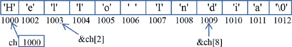

**图 2.6：** 栈区域字符串内存分配的表示

### 52. b

**解释：** 我们所知道，在标准 C 编译器中，实数常量值默认是 `double` 类型，但如果你给任何实数常量加上后缀 `f`，例如 `0.4f`，它将等同于 `float` 形式的 `0.399999`。

### 53. a

**解释：** `macros` 也可以与函数名一起使用。

### 54. d

**解释：** 注意函数 `P()` 中的 `global`、`local` 变量和运算符的 `priority`。

### 55. b

**解释：** 如果 `global` 变量未初始化，它们会自动初始化为 0。

### 56. a

**解释：**

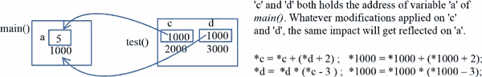

**图 2.7：** 栈区域中的指针表示

### 57. a

**解释：** 请参考问题 56 的解释。

### 58. d

**解释：**

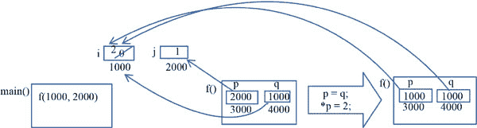

**图 2.8：** 栈区域中的指针表示

`i` 和 `j` 是 `global` 变量（所有函数可用）。在函数 `f()` 中，最初 `p` 指向 `j`，`q` 指向 `i`，但在 `p = q` 语句后，两个指针都指向 `i`，执行 `p = 2*` 语句后 `i` 更新为 2。

### 59. b

**解释：** 它遵循引用传递（call by reference）的概念。请参考问题 58 的解释。

### 60. c

**解释：** 它遵循引用传递的概念。请参考问题 58 的解释。

*不要忘记你为什么开始它。*

# 第 2 组题目

# C 题数：60

## 其他重要面试题：15


### 1. 下列程序的输出是什么？假设给定数组 `a` 的基地址为 1000。

```c
#include<stdio.h>

int main()
{
    int a[3][3] = {4, 5, 6, 7, 8, 9, 1, 2, 3};

    printf("%u %u %u", a[1] + 2, *(a + 1) + 2, *(a[1] + 2));

    return 0;
}
```

(a) 1000 1008 6  
(b) 1008 1012 7  
(c) 1012 1016 8  
(d) 1016 1016 9

### 2. 下列程序的输出是什么？

```c
#include<stdio.h>

int f(int n)
{
    while (--n >= 0)
    {
        printf("%d ", n - 2);
    }

    return 1;
}

int main()
{
    int (*p)(int) = f; // line 1

    (*p)(6); // line 2

    return 0;
}
```

(a) 第 1 行错误  
(b) 第 2 行错误  
(c) 3 2 1 0  
(d) 3 2

### 3. 下列程序的输出是什么？

```c
#include<stdio.h>

int f(int *a, int n)
{
    if (n <= 0)
        return 0;
    else if (*a == 0)
        return *a + f(a + 1, n - 1);
    else
        return *a - f(a + 1, n - 1);
}

int main()
{
    int a[] = {12, 7, 13, 4, 11, 6};

    printf("%d", f(a, 6));

    return 0;
}
```

(a) 17  
(b) 21  
(c) 19  
(d) 15

### 4. 下列程序的输出是什么？

```c
#include<stdio.h>

void demo()
{
    printf("xx");
}

int main()
{
    void demo();
    void (*fun)();

    fun = demo;

    (*fun)(); // line 4
    fun();    // line 5

    return 0;
}
```

(a) xxxx  
(b) yyyy  
(c) xx  
(d) 编译错误

### 5. 在函数声明前加上 `extern` 的意义是什么？例如：

```c
extern int sum(int x, int y, int z)
{
    return x + y + z;
}
```

### 6. 在函数声明前加上 `static` 的意义是什么？

```c
#include<stdio.h>

static int sum(int x, int y, int z)
{
    return x + y + z;
}
```

### 7. 下列程序的输出是什么？

```c
#include<stdio.h>

void fun(int x, int *y);

{
    int i = 0, j = 0;

    if (x == 0)
        return;

    i = x % 10;
    j = x / 10;

    *y += i;
}

int main()
{
    int p = 0;

    fun(124, &p);

    printf("%d ", p);

    return 0;
}
```

(a) 3  
(b) 5  
(c) 6  
(d) 7

### 8. 下列程序的输出是什么？

```c
#include<stdio.h>

int fun(int p)
{
    static int count = 0;

    count += p;

    return count;
}

int main()
{
    int i, j;

    for (i = 0; i <= 4; i++)
    {
        j = fun(i);
    }

    printf("%d", j);

    return 0;
}
```

(a) 4  
(b) 9  
(c) 10  
(d) 11

### 9. 关于给函数，下列陈述是正确的或错误的？

```c
int fun(int p)
{
    int i = 50;

    if (i == p)
    {
        printf("hi\n");

        int k = fun(p);

        return 5;
    }
    else
        return 0;
}
```

**陈述：**

(i) 对于除 50 以外的所有 `p` 值，函数返回 0。  
(ii) 对于除 50 以外的所有 `p` 值，函数无限打印“hi”直到栈溢出。  
(iii) 当 `p = 50` 时，函数返回 5。  
(iv) 当 `p = 50` 时，函数无限打印“hi”直到栈溢出。

上述哪些正确的？

(a) (i), (ii)  
(b) (iii), (iv)  
(c) (i), (iv)  
(d) (iv)

### 10. 下列程序的输出是什么？

```c
#include<stdio.h>

int main()
{
    int n = 0, m = 0;

    if (n > 0) // line 2
        if (m > 0) // line 3
            printf("true");
        else // line 5
            printf("false");

    return 0;
}
```

(a) false  
(b) true  
(c) 什么都不打印  
(d) 编译错误

### 11. 下列程序的输出是什么？

```c
#include<stdio.h>

int main()
{
    if (sizeof(int) > -5) // line 1
        printf("True\n");
    else
        printf("False");

    return 0;
}
```

(a) True  
(b) False  
(c) 编译错误  
(d) 取决于编译器

### 12. 下列程序的输出是什么？假设给定数组 `a` 的基地址为 1000。

```c
#include<stdio.h>

int main()
{
    int a[][3] = {{4, 5, 6}, {7, 8, 9}, {1, 2, 3}};

    printf("%u, %u, %u", *a[2], a[2][0], *(a + 1 + ('b' - 'a')));

    return 0;
}
```

(a) 1024 1 1  
(b) 1024, 1024, 1024  
(c) 1 1 1  
(d) 1024, 2, 1024

### 13. 下列程序的输出是什么？

```c
```


```c
#include<stdio.h>

int main()
{
    int i = 3, j = 0, l; // line 1
    int k;

    k = j = l; // line 3
    l = i && j;

    printf("%d\n", l);

    return 0;
}
```

(a) 0

(b) 1

(c) 未定义行为

(d) 错误-编译时

### 14. 以下程序的输出是什么？

```c
#include<stdio.h>

int main()
{
    int i = 3;
    int j = i + (i = 10); // line 2

    printf("%d\n", j);

    return 0;
}
```

(a) 13

(b) 20

(c) 30

(d) 取决于编译器

### 15. 下列程序的输出是什么？

```c
#include<stdio.h>

void print(int i)
{
    if (i < 5)
        return;

    printf("%d ", i);
    print((i--, i)); // line 3
}

int main()
{
    print(10);

    return 0;
}
```

(a) 10 9 8 7 6

(b) 10 9 8 7 6 5

(c) 10 9 8 7

(d) 第 3 行语法错误

### 16. 下列程序的输出是什么？

```c
#include<stdio.h>

int main()
{
    int i = 1;
    int j = 2;

    if (i & j == 1)
    {
        printf("true");
    }
    else
        printf("false");

    return 0;
}
```

(a) true

(b) false

(c) 什么都没有打印

(d) 错误-编译时

### 17. 下列程序的输出是什么？

```c
#include<stdio.h>

int main()
{
    int i = 2, j = 3;
    int k = i & j == 3;

    printf("%d\n", k);

    return 0;
}
```

(a) 0

(b) 1

(c) 2

(d) 3

### 18. 下列程序的输出是什么？

```c
#include<stdio.h>

int main()
{
    int i = 3, j = 2;
    int k = i << 1 > 5; // line 2

    printf("%d\n", k);

    return 0;
}
```

(a) 0

(b) 1

(c) 5

(d) 3

### 19. 下列程序的输出是什么？

```c
#include<stdio.h>

int main()
{
    int x = 3;
    const int *p = &x;

    *p++;

    printf("%d", *p);

    return 0;
}
```

(a) 4

(b) 3

(c) 垃圾值

(d) 错误-编译时

### 20. 下列程序的输出是什么？

```c
#include<stdio.h>

int main()
{
    int i = 2, j = 2;
    int k = i ^ j & 1; // line 2

    printf("%d", k);

    return 0;
}
```

(a) 0

(b) 1

(c) 2

(d) 垃圾值

### 21. 下列程序的输出是什么？

```c
#include<stdio.h>

int main()
{
    int i = 2, j = 0;
    int k = i && j = 1; // line 2

    printf("%d\n", k);

    return 0;
}
```

(a) 0

(b) 1

(c) 2

(d) 错误-需要左值。

### 22. 下列程序的输出是什么？

```c
#include<stdio.h>

int main()
{
    int i = 0, j = 2;

    if (!i && j)
        printf("true");
    else
        printf("false");

    return 0;
}
```

(a) true

(b) false

(c) 错误-编译时

(d) 未定义行为

### 23. 下列程序的输出是什么？

```c
#include<stdio.h>

int main()
{
    int i = 0, j = 2;
    int k = ~i & j;

    printf("%d\n", k);

    return 0;
}
```

(a) 2

(b) 1

(c) 3

(d) 4

### 24. 下列程序的输出是什么？

```c
#include<stdio.h>

int main()
{
    int y = 6;
    int z = 7;
    int x = ++y + z--;

    printf("%d\n", x);

    return 0;
}
```

(a) 13

(b) 15

(c) 14

(d) 语法错误

### 25. 下列程序的输出是什么？

```c
#include<stdio.h>

int main()
{
    int a[3] = {5, 6, 7};
    char *c = (char *)a;

    printf("%d, %d, %d ", c[0], c[1], c[2]);

    return 0;
}
```

(a) 0, 5, 7

(b) 5, 5, 7, 垃圾

(c) 5, 5, 0

(d) 5, 5, 0, 垃圾

### 26. 下列程序的输出是什么？

```c
#include<stdio.h>

#define FOO(x) foo(x) // line 2

int foo(char *x)
{
    printf("%c %c", x[1]); // line 4
}

int main()
{
    FOO(65); // line 8

    return 0;
}
```

(a) 5 6

(b) 7 8

(c) 6 5

(d) 错误-编译时

### 27. 下列程序的输出是什么？

```c
#include<stdio.h>

int main()
{
    int main = 3;

    printf("%d\n", main);

    return 0;
}
```

(a) 垃圾

(b) `main` 的地址

(c) 3

(d) 错误-重复定义 `main`

### 28. 下列程序的输出是什么？

```c
#include<stdio.h>

int main()
{
    int i = 1;

    for (i = 1; i <= 4; i++)
        switch (i)
        {
            case 1:
                printf("%d", i);
                break;

            case 2:
                printf("%d", i);
                break;

            case 3:
                printf("%d", i);
                break;

            default:
                printf("%d", i);
        }

    return 0;
}
```

(a) 123

(b) 1234

(c) 1

(d) 语法错误

### 29. 下列程序的输出是什么？

```c
#include<stdio.h>

int main()
{
    double ch = 0.45;

    switch (ch)
    {
        case 1:
            printf("hello ");

        case 0:
            printf("hi");
    }

    return 0;
}
```

(a) hello

(b) hi

(c) hello hi

(d) 错误

### 30. 找出给定 `if` 语句中的无效声明。

(a) `if(if(p==1)){}`

(b) `if(fun(p)){}`

(c) `if(p){}`

(d) `if((char)p){}`

### 31. 下列程序的输出是什么？

```c
#include<stdio.h>

int main()
{
    int a = 1;

    if (a)
        printf("All is well, "); // line 3

    printf("I am well\n"); // line 4
    else
        printf("I am not well");

    return 0;
}
```

(a) All is well, I am well

(b) I am not well

(c) I am well

(d) 错误-编译时

### 32. 下列程序的输出是什么？

```c
#include<stdio.h>
#include<string.h>

#define strcpy(x, y) x = y

int main()
{
    int i;
    char s[10];

    strcpy(i, 10); // line 4
    strcpy(s, "hello"); // line 5

    printf("%d %s", i, s);

    return 0;
}
```

(a) 10 hello

(b) 第 4 行错误：整数 `strcpy`

(c) 第 5 行错误

(d) 错误：宏定义

### 33. 下列程序的输出是什么？

```c
#include<stdio.h>

int main()
{
    int a[3][3] = {4, 5, 6, 7, 8, 9};
    int *p = a[2];

    printf("%d %d", p, q);

    return 0;
}
```

(a) 1 2

(b) 8 9

(c) 8 8

(d) 1

### 34. 计算 `b`、`c`、`d`、`e`、`f`、`g`、`i`、`j`？

```c
b = 5 - 4 + 2 * 5
c = 5 & 4 & 6
d = 5 | 4 | 6
e = 7 * 9 * (3, 2)
h = 8;
f = (h++, h++)
g = h++ + h++
i = 7 * 8 + 6 ? 7 : 6
j = 2 + 3 - 4 + 8 - 5
```

### 35. 下列程序的输出是什么？

```c
#include<stdio.h>

int main()
{
    type_char a, b; // line 1
    char c[10], d[10];

    strcpy(c, "hello");
    strcpy(d, "world");

    a = c;
    b = d; // line 6

    printf("%c %c", a[2], b[2]); // line 7

    return 0;
}
```

(a) l r

(b) llo rld

(c) 错误-编译时

(d) 错误–运行时

### 36. 下列程序的输出是什么？

```c
#include<stdio.h>

int main()
{
    int n = 3, i = 0;

    do
    {
        n = n++;
        i++;
    } while (i != 3);

    printf("%d\n", n);

    return 0;
}
```

(a) 3

(b) 5

(c) 6

(d) 7

### 37. 下列程序的输出是什么？

```c
#include<stdio.h>

int main()
{
    int x = 65;

    switch (x)
    {
        case ‘A’:
            printf("yes");
            break;

        case 65:
            printf("no");
            break;
    }

    return 0;
}
```

(a) yes

(b) no

(c) yes no

(d) 错误-编译时

### 38. 下列程序的输出是什么？

```c
#include<stdio.h>

int main()
{
    int a[3][3] = {5, 6, 7, 8, 9, 10, 1, 2, 3};
    int *p = &a[2];
    int *q = a[2];

    printf("%d %d", p[1], q[2]);

    return 0;
}
```

(a) 6 7

(b) 8 9

(c) 2 3

(d) 1 2

### 39. 下列程序的输出是什么？

```c
#include<stdio.h>

int main()
{
    int i = 0;

    for (i++; i == 1; i = 2)
        printf("Inside loop ");

    printf("Outside loop");

    return 0;
}
```

(a) Inside loop Outside loop

(b) Outside loop

(c) Infinite time Inside loop

(d) `for` 循环语句中语法错误

### 40. 下列程序的输出是什么？

```c
#include<stdio.h>

int main()
{
    do
        printf("Inside loop ");
    while (0);

    printf("Outside loop");

    return 0;
}
```

(a) Inside loop

(b) Outside loop

(c) Inside loop Outside loop

(d) `do-while` 循环中语法错误

### 41. 下列程序的输出是什么？

```c
#include<stdio.h>

int main()
{
    char *s = "";

    do
    {
        printf("hello");
    } while (s);

    return 0;
}
```

(a) hello

(b) hello 被无限次打印

(c) hello hello

(d) `do-while` 循环中语法错误

### 42. 下列程序的输出是什么？

```c
#include<stdio.h>

int main()
{
    int i = 0, p = 0;

    while (i < 10)
    {
        i++;
        printf("hi ");

        while (i < 8)
        {
            i++;
            printf("hello ");
        }
    }

    return 0;
}
```

(a) hi-10 次, hello-7 次

(b) hi-10 次

(c) hi hello-10 次

(d) hi-1 次, hello-7 次, hi-2 次

### 43. 下列程序的输出是什么？

```c
#include<stdio.h>

int main()
{
    int x = 0, y = 0;

    while (x < 4, y < 7)
    {
        x++;
        y++;
    }

    printf("%d, %d\n", x, y);

    return 0;
}
```

(a) 4, 7

(b) 4, 4

(c) 7, 7

(d) `while` 循环中语法错误

### 44. 下列程序中 `"hi"` 会打印多少次？

```c
#include<stdio.h>

int main()
{
    int i = 0, j = 0;

    for (i = 0; i < 3; i++)
    {
        for (j = 0; j < 3; j++)
        {
            if (i > 1)
                continue;

            printf("hi\n");
        }
    }

    return 0;
}
```

(a) 7 次

(b) 3 次

(c) 6 次

(d) 14 次

### 45. 下列程序中 `"Inside loop"` 会打印多少次？

```c
#include<stdio.h>

int main()
{
    int x = 0;

    do
    {
        x++;

        if (x == 3)
            continue;

        printf("Inside loop");
    } while (x < 4);

    return 0;
}
```

(a) 2 次

(b) 4 次

(c) 3 次

(d) 12 次

### 46. 下列程序的输出是什么？

```c
#include<stdio.h>

int main()
{
    int i = 0, j = 0;

    for (; i < 3; i++)
    {
        for (; j < 4; j++)
        {
            printf("hi");
            break;
        }

        printf("bye, ");
    }

    return 0;
}
```

(a) hibye, hibye,

(b) hibye, hibye,

(c) hihihibye,

(d) 错误：`break` 不能在 `if` 或 `switch` 外使用。

### 47. 下列程序的输出是什么？

```c
#include<stdio.h>

int main()
{
    int x = 0;

    while (x < 2)
    {
        if (x == 1)
            break;

        x++;

        if (x == 1)
            continue;

        printf("Inside loop ");
    }

    printf("Outside loop\n");

    return 0;
}
```

(a) Inside loop Outside loop

(b) Inside loop loop

(c) Outside loop

(d) Inside loop

### 48. 下列程序的输出是什么？

```c
#include<stdio.h>

int main()
{
    int i = 3, j = 5;

    if (i == 3)
        goto label;

    while (i < j)
```


```c
{
    printf("hi ");

    label: printf("%d ", i);

    i++;
}

return 0;
```

(a) 3 hi 4  
(b) 3 hi 4  
(c) 3  
(d) 3 4 5

### 49. 下列程序的输出是什么？

```c
#include <stdio.h>

int main()
{
    int i = 0, j;

    label: printf("hi ");

    if (i == 0)
        goto label;

    return 0;
}
```

(a) hi  
(b) 无限次打印  
(c) hi hi  
(d) 错误-label 不能放在 goto 之前

### 50. 下列程序的输出是什么？

```c
#include <stdio.h>

void fun()
{
    label1: printf("3");
}

int main()
{
    printf("1 ");

    goto label1;

    printf("2");

    return 0;
}
```

(a) 1 3 2  
(b) 1 2 3  
(c) 3 2 1  
(d) 编译错误

### 51. 下列程序的输出是什么？

```c
#include <stdio.h>

void fun1()
{
    printf("hello");
}

int main()
{
    void fun1();

    void fun2()
    {
        fun1();
    }

    fun2();

    return 0;
}
```

(a) hello hello  
(b) hello  
(c) hello hello  
(d) 编译器相关

### 52. 下列程序的输出是什么？假设数组 ‘a’ 的基地址为 1000，整数大小为 4B。

```c
#include <stdio.h>

int main()
{
    int a[2][2][3] = {
        {
            5, 6, 7,
            8, 9, 10
        },
        {
            1, 2, 3,
            11, 12, 13
        }
    };

    printf("%u, %u, %u, %u", a[0], a[0][1], **a[1], *(*a[1] + 2));

    return 0;
}
```

(a) 1000, 1004, 1, 3  
(b) 1000, 1012, 1 1  
(c) 1000, 1004, 3, 1  
(d) 1000, 1012, 1, 3

### 53. 下列程序的输出是什么？

```c
#include <stdio.h>

int main()
{
    int a[2][2][3] = {5, 6, 7, 8, 9, 10, 1, 2, 3, 11, 12, 13};

    int *x = &a[1][1][2];

    int *y = (int *)a;

    printf("%d %d", *x, *y);

    return 0;
}
```

(a) 垃圾 垃圾  
(b) 5 垃圾  
(c) 13 5  
(d) 13

### 54. 下列程序的输出是什么？

```c
#include <stdio.h>

int main()
{
    int a[2][2][3] = {5, 6, 7, 8, 9, 10, 1, 2, 3, 11, 12, 13};

    int *x = &a[1][1][2];

    int *y = (int *)a;

    printf("%d %d", *x, *y);

    return 0;
}
```

（注：用户提示提供的 53 和 54 代码重复，我已按要求维持了结构格式。）

```c
{
    while (1)
    {
        int *p = (int *)malloc(sizeof(int));

        *p = 10;

        printf("hello%d", *p);
    }

    return 0;
}
```


(a) `"hello10"` 被无限打印  
(b) 栈溢出  
(c) 堆溢出  
(d) 错误 - 编译时

## 其他面试问题如下：

1. 编写一个 C 程序统计给定数字的位数。  
2. 编写一个 C 程序求两个数的最小公倍数 (L.C.M.)。  
3. 编写一个 C 程序求两个数的公约数 (H.C.F.)。  
4. 编写一个 C 程序打开文件、写入一些文本并关闭它。  
5. 编写一个 C 程序删除文件。  
6. 编写一个 C 程序将文件从一个位置复制到另一个位置。  
7. 编写一个 C 程序将数据从一个文件复制到另一个文件。  
8. 编写一个 C 程序将源代码作为输出。  
9. 编写一个 C 程序在文件中写入一个字符串。  
10. 编写一个 C 程序从文件中读取一个字符串。  
11. 编写一个 C 程序在文件中写入一个数组。  
12. 编写一个 C 程序合并两个文件并将其写入第三个文件。  
13. 编写一个 C 程序获取任何文件的大小。  
14. 编写一个 C 程序获取文件的类型。  
15. 编写一个 C 程序获取任何文件的权限。

## 组 2 解释

### 1. **d**

**解释：**

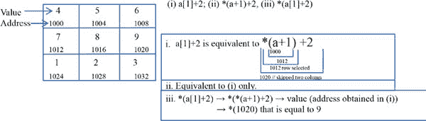

**图 3.1：** 栈区中二维数组的表示

**二维数组：** 二维数组是 1 维数组的集合。数组的元素存储在内存中连续的地址上。在标准 C 编译器中，二维数组按行优先顺序存储（第 1 行，第 2 行，依此类推）。`a[1][2]` 也可以写为 `*(*(a+1)+2)`。这里，`1` 表示跳过一行，`2` 表示跳过两列。第一个 `*`（配合 `a+1`）意味着选择特定的行，第二个 `*` 意味着选择特定的列。`a+1` 的地址是 `1012`（跳过一行），`a+2` 的地址是 `1024`（跳过两行），依此类推。

例如：获取 `a[1][2]` 或 `*(*(a+1)+2)`？

`(a+1)` 意味着我们跳过了第一行，并选择了地址为 `1012` 的第二行。`*(a+1)+2` 意味着我们在所选行中跳过了 2 个元素。`(*(a+1)+2)` 的地址为 `1020`。`*(*(a+1)+2)` 是在跳过一行和一列中的两个元素后选择一个元素。它得到了 `a[1][2]` 的一个特定元素，值为 9。

### 2. **c**

**解释：** 这是一个函数指针的概念。C 允许创建能够存储函数地址的指针。在给定的程序中，`p` 是指向函数 `f()` 的指针。需要注意的是，`p` 的类型必须与函数 `f()` 的类型相同。一旦指针开始指向函数，我们就可以使用该指针调用函数，并像第 2 行所示那样传递参数。因此，程序没有错误。

### 3. **d**

**解释：** 这是一个简单的递归程序，不需要解释。

### 4. **a**

**解释：** 函数指针可以用两种方式应用（第 4 行和第 5 行）。参见问题 2 的解释。

### 5. **无**

**解释：** `extern` 也用于使变量/函数变为全局的。函数默认始终是全局的。在函数前加上 `extern` 没有任何区别。

### 6. **无**

**解释：** `static` 意味着函数不能从其他 C 文件访问。它不能与其他 C 程序共享。对静态函数/变量的访问限制在声明它们的文件中。在 C 中，`static` 提供了文件级封装。静态变量/函数的作用域在一个文件内。如果变量在某个函数内部声明为 `static`，则该变量的作用域仅在函数内部，但通过该静态变量的地址，我们也可以在程序中的其他函数中访问它，但限于同一个程序内。静态变量/函数的生命周期持续到 `main()` 退出。

### 7. **d**

**解释：** 该程序正在计算一个数字各位数字的和。`fun(number, &var);` 将数字各位数字存储在 `main()` 中声明的变量 `var` 中。

### 8. **c**

**解释：** 在函数 `fun()` 中，变量 `count` 是静态的，`count` 的内存在一个数据区分配一次。`main()` 多次调用 `fun()`，`fun()` 在每次调用时更新 `count`。`count` 值的变化发生在相同的地址。此程序返回 4 的和。

### 9. **c**

**解释：** 这是一个简单的递归程序，只需追踪即可。不需要解释。

*提示*：在给定的函数 `fun()` 中，`"return 5;"` 语句永远不会执行。

### 10. **c**

**解释：** 在给程序中，`else` 与第 3 行的 `if` 语句关联，而不是第 2 行的 `if` 语句。

### 11. **b**

**解释：** 在 C 中，`sizeof()` 运算符返回无符号整数值。在第 1 行，无符号整数和默认整数（符号）值正在进行比较。关系运算符只允许在相同数据类型之间进行比较。因此，标准 C 编译器将符号整数提升为无符号整数。无符号整数中的 -5 是一个非常大的正数。这使得 `if` 条件为假，`else` 部分执行。

### 12. **c**

**解释：** 详尽研究问题 1 的解释。

### 13. **c**

**解释：** 这是一个简单的递归程序，不需要解释。（注：提供的文本从第 13 项开始是重复或合并的，遵循提供的结构）。

### 14. **b**

**解释：** 函数指针可以用两种方式应用（第 4 行和第 5 行）。参见问题 2 的解释。

### 15. **无**

**解释：** `extern` 也用于使变量/函数变为全局。函数默认始终是全局的。在函数前加上 `extern` 没有任何区别。

### 16. **无**

**解释：** `static` 意味着函数不能从其他 C 文件访问。它不能与其他 C 程序共享。对静态函数/变量的访问限制在声明它们的文件中。在 C 中，`static` 提供了文件级封装。静态变量/函数的作用域在一个文件内。如果变量在某个函数内部声明为 `static`，则该变量的作用域仅在函数内部，但通过该静态变量的地址，我们也可以在程序中的其他函数中访问它，但限于同一个程序内。静态变量/函数的生命周期持续到 `main()` 退出。

### 17. **d**

**解释：** 该程序正在计算一个数字各位数字的和。`fun(number, &var);` 将数字各位数字存储在 `main()` 中声明的变量 `var` 中。

### 18. **c**

**解释：** 在函数 `fun()` 中，变量 `count` 是静态的，`count` 的内存在一个数据区分配一次。`main()` 多次调用 `fun()`，`fun()` 在每次调用时更新 `count`。`count` 值的变化发生在相同的地址。此程序返回 4 的和。

### 19. **c**

**解释：** 这是一个简单的递归程序，只需追踪即可。不需要解释。

*提示*：在给定的函数 `fun()` 中，`"return 5;"` 语句永远不会执行。

### 20. **c**

**解释：** 在给定的程序中 `else` 与第 3 行的 `if` 语句关联，而不是第 2 行的 `if` 语句。因此，屏幕上不会打印任何内容。

### 21. **b**

**解释：** 在 C 中，`sizeof()` 运算符返回无符号整数值。在第 1 行，无符号整数和默认整数（符号）值正在进行比较。关系运算符只允许在相同数据类型之间进行比较。因此，标准 C 编译器将符号整数提升为无符号整数。无符号整数中的 -5 是一个非常大的正数。这使得 `if` 条件为假，`else` 部分执行，并打印“False”。

### 22. **c**

**解释：** 详尽研究问题 1 的解释。

### 23. **c**

**解释：** 这是一个简单的递归程序，不需要解释。

### 解释

对于赋值操作，赋值运算符的左侧必须是一个变量。常量或任何类型的表达式都不允许出现在赋值运算符的左侧。在第 2 行中，赋值运算符的左侧存在歧义。因此，编译器将抛出 L-value required（需要左值）的错误。如果我们把表达式改为：`k = i&&(j=1)`，那么它是可以解决的。

### 22. **a**

**解释：** `!`（非）是一个逻辑运算符，它的优先级高于关系运算符 `&&`。`!` 将 0 变为非零，反之亦然。给出的表达式可以表示为：

→ `!i && j;` → `(!0) && 2;` // 左侧是一个表达式，右侧是非零

→ `1&& 2;` → `1;` // 左侧为非零且右侧也非零，它返回 1。

### 23. **a**

**解释：** `~` 运算符确定给定数字的反码。

`i = 00 00 00 00;` （十六进制形式表示）

`~i = ff ff ff ff ;` 等于 -1;

`k = ~i & j;` // `~` 是一个一元逻辑运算符，它的优先级高于二逻辑运算符。

= `(~i) & j ;` → `-1 & 2 ;` → 全为 1 & `0010 ;` → `2 ;`

### 24. **c**

**解释：** `y = 6, z = 7 ;` → `x = ++y + z--;` → `y = y+1;` // `y = 7 .`

→ `x = y+z;` // `x = 7+7 = 14\.` → `z = z-1;` // `z = 6\.`

### 25. **c**

**解释：小序（Little-Endian）**

像 Intel 和 AMD 的常用机器使用小序。这意味着低位字节存储在高内存地址，高位字节存储在低内存地址。整数 258 的二进制形式可以表示为（MSB）00000001 00000010（LSB），在小序机器中，存储如下：

MSB 存储在低地址

| 00000000 | 00000000 | 00000001 | 00000010 |
| :--- | :--- | :--- | :--- |
| 1000 | 1001 | 1002 | 1003 |

LSB 存储在高地址

**图 3.3：** 小序模式下的整数表示

**大序（Big-Endian）：** 与小序相反，这里低位字节存储在低地址，高位字节存储在高地址。258 在大序机器中的表示如下：

LSB 存储在低地址地址

| 00000010 | 00000001 | 00000000 | 00000000 |
| :--- | :--- | :--- | :--- |
| 1000 | 1001 | 1002 | 1003 |

MSB 存储在高地址

**图 3.4：** 大序模式下的整数表示

几乎所有用于编程的机器 Intel、 AMD 都遵循小序。在这里我们担心的是概念误解。实际上，这些机器是小小序，但如果我们想通过 C 程序追踪数组、结构体等地址，将会困难。但如果考虑大序，通过 C 程序追踪内存地址总是很容易的。`int a[3] = {5, 6, 7};` 在遵循小序的机器中存储如下：

| 00 | 00 | 00 | 05 | 00 | 00 | 00 | 06 | 00 | 00 | 00 | 07 |
| :--- | :--- | :--- | :--- | :--- | :--- | :--- | :--- | :--- | :--- | :--- | :--- |
| 1000 | 1001 | 1002 | 1003 | 1004 | 1005 | 1006 | 1007 | 1008 | 1009 | 1010 | 1011 |

**图 3.5：** 小序模式下十六进制形式的数组元素

在我们的问题中，我们将使用大序来解释该概念以便更好地理解。使用大序机器的数组表示如下：

`int a[3]={5,6,7};`

| 05 | 00 | 00 | 00 | 06 | 00 | 00 | 00 | 07 | 00 | 00 | 00 |
| :--- | :--- | :--- | :--- | :--- | :--- | :--- | :--- | :--- | :--- | :--- | :--- |
| 1000 | 1001 | 1002 | 1003 | 1004 | 1005 | 1006 | 1007 | 1008 | 1009 | 1010 | 1011 |

因此，`c[0] = 5;` `c[1] = 0;` `c[2] = 0;` `c[8] = 7;`

**图 3.6：** 大序模式下十六进制形式的数组元素

表达式 `char *c = (char *)a;`，char 指针只能访问一个字节。现在访问 a 的步长变为 1，但存储的步长是 4B。

### 26. **c**

**解释：** 给定程序的执行分两步完成：(i) 宏 `FOO(x)` 将被替换为 `(x)`，其中 `#` 将 `x` 转换为字符串。(ii) 将发生函数调用 `foo("65")`。在函数 `foo()` 中，字符串 "65" 由字符 `x` 指。因此，`x[0]` 将得到 `6`，`x[1]` 将得到 `5`。

### 27. **c**

**解释：** 程序可以在不同作用域拥有相同的函数名和变量名，给定的问题将打印 3。假设我们将 `int main = 3;` 设全局变量，那么程序将报错错误，因为 `int main = 3;` 和 `int main()` 变成全局且处于同一作用域内。

### 28. **b**

**解释：** `case 1` 之后的大括号永远不会执行，因为它们在 case 的作用域之外。

### 29. **d**

**解释：** 像 Intel 和 AMD 的常用机器使用小序。这意味着低位字节存储在高内存地址，高位字节存储在低内存地址。整数 258 的二进制形式可以表示为（MSB）00000001 00000010（LSB），在小序机器中，存储如下：

MSB 存储在低地址

| 00000000 | 00000000 | 00000001 | 00000010 |
| :--- | :--- | :--- | :--- |
| 1000 | 1001 | 1002 | 1003 |

LSB 存储在高地址

**图 3.3：** 小序模式下的整数表示

**大序（Big-Endian）：** 与小序相反，这里低位字节存储在低地址，高位字节存储在高地址。258 在大序机器中的表示如下：

LSB 存储在低地址地址

| 00000010 | 00000001 | 00000000 | 00000000 |
| :--- | :--- | :--- | :--- |
| 1000 | 1001 | 1002 | 1003 |

MSB 存储在高地址

**图 3.4：** 大序模式下的整数表示

几乎所有用于编程的机器 Intel、 AMD 都遵循小序。在这里我们担心的是概念误解。实际上，这些机器是小小序，但如果我们想通过 C 程序追踪数组、结构体等地址，将会困难。但如果考虑大序，通过 C 程序追踪内存地址总是很容易的。`int a[3] = {5, 6, 7};` 在遵循小序的机器中存储如下：

| 00 | 00 | 00 | 05 | 00 | 00 | 00 | 06 | 00 | 00 | 00 | 07 |
| :--- | :--- | :--- | :--- | :--- | :--- | :--- | :--- | :--- | :--- | :--- | :--- |
| 1000 | 1001 | 1002 | 1003 | 1004 | 1005 | 1006 | 1007 | 1008 | 1009 | 1010 | 1011 |

**图 3.5：** 小序模式下十六进制形式的数组元素

在我们的问题中，我们将使用大序来解释该概念以便更好地理解。使用大序机器的数组表示如下：

`int a[3]={5,6,7};`

| 05 | 00 | 00 | 00 | 06 | 00 | 00 | 00 | 07 | 00 | 00 | 00 |
| :--- | :--- | :--- | :--- | :--- | :--- | :--- | :--- | :--- | :--- | :--- | :--- |
| 1000 | 1001 | 1002 | 1003 | 1004 | 1005 | 1006 | 1007 | 1008 | 1009 | 1010 | 1011 |

因此，`c[0] = 5;` `c[1] = 0;` `c[2] = 0;` `c[8] = 7;`

**图 3.6：** 大序模式下十六进制形式的数组元素

表达式 `char *c = (char *)a;`，char 指针只能访问一个字节。现在访问 a 的步长变为 1，但存储的步长是 4B。

### 30. **a**

**解释：** `for` 循环的初始化、决策和更新部分允许任何表达式。

### 31. **d**

**解释：** `else` 语句在 `while` 中是不允许。

### 32. **c**

**解释：** 赋值运算符的左侧必须是一个变量。常量或任何类型的表达式都不允许出现在赋值运算符的左侧。在第 2 行中，赋值运算符的左侧存在歧义。因此，编译器将抛出 L-value required（需要左值）的错误。如果我们把表达式改为：`k = i&&(j=1)`，那么它是可以解决的。

### 33. **a**

**解释：** `!`（非）是一个逻辑运算符，它的优先级高于关系运算符 `&&`。`!` 将 0 变为非零，反之亦然。给出的表达式可以表示为：

→ `!i && j;` → `(!0) && 2;` // 左侧是一个表达式，右侧是非零

→ `1&& 2;` → `1;` // 左侧为非零且右侧也非零，它返回 1。

### 34. **a**

**解释：** `~` 运算符确定给定数字的反码。

`i = 00 00 00 00;` （十六进制形式表示）

`~i = ff ff ff ff ;` 等于 -1;

`k = ~i & j;` // `~` 是一个一元逻辑运算符，它的优先级高于二逻辑运算符。

= `(~i) & j ;` → `-1 & 2 ;` → 全为 1 & `0010 ;` → `2 ;`

### 35. **c**

**解释：** `y = 6, z = 7 ;` → `x = ++y + z--;` → `y = y+1;` // `y = 7 .`

→ `x = y+z;` // `x = 7+7 = 14\.` → `z = z-1;` // `z = 6\.`

### 36. **c**

**解释：小序（Little-Endian）**

像 Intel 和 AMD 的常用机器使用小序。这意味着低位字节存储在高内存地址，高位字节存储在低内存地址。整数 258 的二进制形式可以表示为（MSB）00000001 00000010（LSB），在小序机器中，存储如下：

MSB 存储在低地址

| 00000000 | 00000000 | 00000001 | 00000010 |
| :--- | :--- | :--- | :--- |
| 1000 | 1001 | 1002 | 1003 |

LSB 存储在高地址

**图 3.3：** 小序模式下的整数表示

**大序（Big-Endian）：** 与小序相反，这里低位字节存储在低地址，高位字节存储在高地址。258 在大序机器中的表示如下：

LSB 存储在低地址地址

| 00000010 | 00000001 | 00000000 | 00000000 |
| :--- | :--- | :--- | :--- |
| 1000 | 1001 | 1002 | 1003 |

MSB 存储在高地址

**图 3.4：** 大序模式下的整数表示

几乎所有用于编程的机器 Intel、 AMD 都遵循小序。在这里我们担心的是概念误解。实际上，这些机器是小小序，但如果我们想通过 C 程序追踪数组、结构体等地址，将会困难。但如果考虑大序，通过 C 程序追踪内存地址总是很容易的。`int a[3] = {5, 6, 7};` 在遵循小序的机器中存储如下：

| 00 | 00 | 00 | 05 | 00 | 00 | 00 | 06 | 00 | 00 | 00 | 07 |
| :--- | :--- | :--- | :--- | :--- | :--- | :--- | :--- | :--- | :--- | :--- | :--- |
| 1000 | 1001 | 1002 | 1003 | 1004 | 1005 | 1006 | 1007 | 1008 | 1009 | 1010 | 1011 |

**图 3.5：** 小序模式下十六进制形式的数组元素

在我们的问题中，我们将使用大序来解释该概念以便更好地理解。使用大序机器的数组表示如下：

`int a[3]={5,6,7};`

| 05 | 00 | 00 | 00 | 06 | 00 | 00 | 00 | 07 | 00 | 00 | 00 |
| :--- | :--- | :--- | :--- | :--- | :--- | :--- | :--- | :--- | :--- | :--- | :--- |
| 1000 | 1001 | 1002 | 1003 | 1004 | 1005 | 1006 | 1007 | 1008 | 1009 | 1010 | 1011 |

因此，`c[0] = 5;` `c[1] = 0;` `c[2] = 0;` `c[8] = 7;`

**图 3.6：** 大序模式下十六进制形式的数组元素

表达式 `char *c = (char *)a;`，char 指针只能访问一个字节。现在访问 a 的步长变为 1，但存储的步长是 4B。

### 37. **c**

**解释：** 给定程序的执行分两步完成：(i) 宏 `FOO(x)` 将被替换为 `(x)`，其中 `#` 将 `x` 转换为字符串。(ii) 将发生函数调用 `foo("65")`。在函数 `foo()` 中，字符串 "65" 由字符 `x` 指。因此，`x[0]` 将得到 `6`，`x[1]` 将得到 `5`。

### 38. **c**

**解释：** 程序可以在不同作用域拥有相同的函数名和变量名，给定的问题将打印 3。假设我们将 `int main = 3;` 设全局变量，那么程序将报错错误，因为 `int main = 3;` 和 `int main()` 变成全局且处于同一作用域内。

### 39. **b**

**解释：** `case 1` 之后的大括号永远不会执行，因为它们在 case 的作用域之外。

### 40. **d**

**解释：** 像 Intel 和 AMD 的常用机器使用小序。这意味着低位字节存储在高内存地址，高位字节存储在低内存地址。整数 258 的二进制形式可以表示为（MSB）00000001 00000010（LSB），在小序机器中，存储如下：

MSB 存储在低地址

| 00000000 | 00000000 | 00000001 | 00000010 |
| :--- | :--- | :--- | :--- |
| 1000 | 1001 | 1002 | 1003 |

LSB 存储在高地址

**图 3.3：** 小序模式下的整数表示

**大序（Big-Endian）：** 与小序相反，这里低位字节存储在低地址，高位字节存储在高地址。258 在大序机器中的表示如下：

LSB 存储在低地址地址

| 00000010 | 00000001 | 00000000 | 00000000 |
| :--- | :--- | :--- | :--- |
| 1000 | 1001 | 1002 | 1003 |

MSB 存储在高地址

**图 3.4：** 大序模式下的整数表示

几乎所有用于编程的机器 Intel、 AMD 都遵循小序。在这里我们担心的是概念误解。实际上，这些机器是小小序，但如果我们想通过 C 程序追踪数组、结构体等地址，将会困难。但如果考虑大序，通过 C 程序追踪内存地址总是很容易的。`int a[3] = {5, 6, 7};` 在遵循小序的机器中存储如下：

| 00 | 00 | 00 | 05 | 00 | 00 | 00 | 06 | 00 | 00 | 00 | 07 |
| :--- | :--- | :--- | :--- | :--- | :--- | :--- | :--- | :--- | :--- | :--- | :--- |
| 1000 | 1001 | 1002 | 1003 | 1004 | 1005 | 1006 | 1007 | 1008 | 1009 | 1010 | 1011 |

**图 3.5：** 小序模式下十六进制形式的数组元素

在我们的问题中，我们将使用大序来解释该概念以便更好地理解。使用大序机器的数组表示如下：

`int a[3]={5,6,7};`

| 05 | 00 | 00 | 00 | 06 | 00 | 00 | 00 | 07 | 00 | 00 | 00 |
| :--- | :--- | :--- | :--- | :--- | :--- | :--- | :--- | :--- | :--- | :--- | :--- |
| 1000 | 1001 | 1002 | 1003 | 1004 | 1005 | 1006 | 1007 | 1008 | 1009 | 1010 | 1011 |

因此，`c[0] = 5;` `c[1] = 0;` `c[2] = 0;` `c[8] = 7;`

**图 3.6：** 大序模式下十六进制形式的数组元素

表达式 `char *c = (char *)a;`，char 指针只能访问一个字节。现在访问 a 的步长变为 1，但存储的步长是 4B。

### 41. **a**

**解释：** `for` 循环的初始化、决策和更新部分允许任何表达式。

### 42. **d**

**解释：** `else` 语句在 `while` 中是不允许。

### 43. **c**

**解释：** 对于赋值操作，赋值运算符的左侧必须是一个变量。常量或任何类型的表达式都不允许出现在赋值运算符的左侧。在第 2 行中，赋值运算符的左侧存在歧义。因此，编译器将抛出 L-value required（需要左值）的错误。如果我们把表达式改为：`k = i&&(j=1)`，那么它是可以解决的。

### 解释

`,` 运算符具有从左到右的结合性。在左右结合性中，先评估左侧，然后评估右侧。在这里评估按顺序进行：首先执行 `"x < 4"`，然后执行 `"y < 7"`。`"x < 4"` 的结果会被丢弃，while 循环只检查条件 `"y < 7"`。

### 44. **c**

**解释：** 不需要。

### 45. **c**

**解释：** 这是一个继续使用 `do-while` 循环的示例。

### 46. **b**

**解释：** `break` 语句也可以用于循环中。

### 47. **c**

**解释：** 这是一道练习题。不需要解释。

### 48. **b**

**解释：** `goto` 语句将执行控制从当前指令转移到带标签的指令。它的步长是不固定的。在 C 语言中不频繁使用 `goto` 语句。它会让程序的控制流在逻辑上变得复杂，难以理解。在程序中使用 `goto` 不是一种良好的编程习惯。

### 49. **b**

**解释：** 不需要。

### 50. **d**

**解释：** 在给定的程序中，从 `main()` 尝试在不调用函数的情况下使用不同函数的指令。在不调用函数的情况下，无法访问函数体。函数必须被推入内存区域（栈）后才能被使用。在这里，编译器抛出错误- `label1 is undefined`。如果我们要想在 `goto` 中使用标签，它必须是函数局部的。

### 51. **b**

**解释：** 它在 `gcc` 中运行正常，但在 Turbo C 中会报错。GNU C 支持函数的**嵌套**。

### 52. **d**

**解释：** 假定 `a[2][2][3]`，表示是两个大小为 2x3 的二维数组。

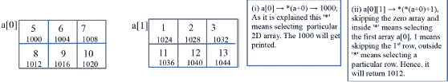

假设我们想访问元素 `a[1][1][2]`。在 3 维数组中，`a[1]` 意味着跳过一个二维数组，`a[1][1]`（或 `(*(*a+1)+1)`），高亮的 `*` 表示选择第二个数组，高亮的 `1` 意味着跳过所选二维数组中的行，`a[1][1][2]` 意味着跳过 2 列。

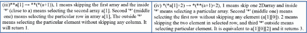

### 53. **c**

**解释：** 参考问题 52 的解释，我们可以直接使用 `*` 运算符访问地址，无需跳过任何列或行。例如 `x = &a[1][1][2]` 直接获取地址 1044，我们可以通过 `*x` (`*1040`) 访问 1044 处的元素。指针变量 `y` 持有地址 1000，我们可以通过 `*1000` 直接访问 1000 处的值。因此，程序将返回 `*1044` 和 `*1000`，即值 13 和 5。

`x : 1044 y : 1000`

### 54. **a**

**解释：** 假定 `a[2][2][3]` 意味着我们有两个大小为 2x3 的二维数组。正如我们在问题 52 的解释中讨论的，`a[1][2]` 意味着跳过一个二维数组，然后在所选数组中跳过 2 行。在这里，每个二维数组只包含两行，如果我们跳过两行，意味着我们超出了数组空间。将打印垃圾值。`a[2][1][0]`，`2` 意味着跳过两个二维数组。我们只有两个二维数组，正尝试访问数组空间之外的地址。因此，将打印垃圾内容。

*注意：* 它不会报错，因为数组空间之外的地址也是可读的，并且会返回垃圾值。

### 55. **b**

**解释：** 参考问题 25 的解释。

在第 4 行，`(int*)p+2;` 我们再次将字符指针转换为整数类型。现在步长变为 4，这与整数指针的步长相同。这类似于 `a[2]`。

### 56. 给定数组中的元素个数为 16。

**解释：** `int number_of_elements = sizeof(a)/sizeof(a[0]);`

### 57. Nil

**解释：**

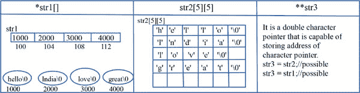

**图 3.7：** 文本和栈区域中字符指针的表示

所有三种类型的声明在考虑一些条件的情况下是可以互换使用的，(i) 数组的基地址不能更新。下表简要描述了这三种类型声明的可能的赋值操作。

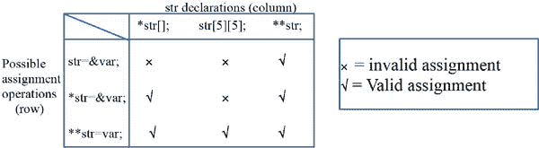

**表 3.1：** 给定声明下 str 的赋值

### 58. **c**

**解释：**

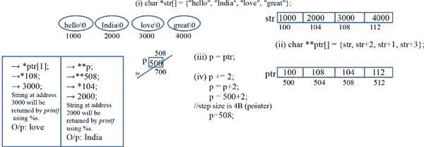

### 59. **d**

**解释：** 变量赋值与上一个问题相同，仅在步骤 (iv) 中发生了变化，在这里，是 `p = p+3.`。

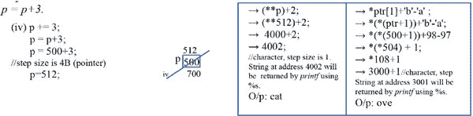

### 60. **c**

**解释：** 当用户请求动态内存分配时，C 程序请求操作系统分配内存。如果内存可用，操作系统的内存管理器会将内存分配给程序。


### 解释
`,` 运算符具有从左到右的结合性。在左右结合性中，先评估左侧，然后评估右侧。在这里评估按顺序进行：首先执行`"x < 4"`，然后执行`"y < 7"`。`"x < 4"`的结果会被丢弃，`while`循环只检查条件`"y < 7"`。

### 44. c
**解释：** 不需要。

### 45. c
**解释：** 这是一个继续使用`do-while`循环的示例。

### 46. b
**解释：** `break`语句也可以用于循环中。

### 47. c
**解释：** 这是一道练习题。不需要解释。

### 48. b
**解释：** `goto`语句将执行控制从当前指令转移到带标签的指令。它的步长是不固定的。在 C 语言中不频繁使用`goto`语句。它会让程序的控制流在逻辑上变得复杂，难以理解。在程序中使用`goto`不是一种良好的编程习惯。

### 49. b
**解释：** 不需要。

### 50. d
**解释：** 在给定的程序中，从`main()`尝试在不调用函数的情况下使用不同函数的指令。在不调用函数的情况下，无法访问函数体。函数必须被推入内存区域（栈）后才能被使用。在这里，编译器抛出错误- `label1 is undefined`。如果我们要想在`goto`中使用标签，它必须是函数局部的。

### 51. b
**解释：** 它在`gcc`中运行正常，但在 Turbo C 中会报错。GNU C 支持函数的**嵌套**。

### 52. d
**解释：** 假定`a[2][2][3]`，表示是两个大小为 2x3 的二维数组。


假设我们想访问元素`a[1][1][2]`。在 3 维数组中，`a[1]`意味着跳过一个二维数组，`a[1][1]`（或`(*(*a+1)+1)`），高亮的`*`表示选择第二个数组，高亮的`1`意味着跳过所选二维数组中的行，`a[1][1][2]`意味着跳过 2 列。


### 53. c
**解释：** 参考问题 52 的解释，我们可以直接使用`*`运算符访问地址，无需跳过任何列或行。例如`x = &a[1][1][2]`直接获取地址 1044，我们可以通过`*x` (`*1040`) 访问 1044 处的元素。指针变量`y`持有地址 1000，我们可以通过`*1000`直接访问 1000 处的值。因此，程序将返回`*1044`和`*1000`，即值 13 和 5。

`x : 1044 y : 1000`

### 54. a
**解释：** 假定`a[2][2][3]`意味着我们有两个大小为 2x3 的二维数组。正如我们在问题 52 的解释中讨论的，`a[1][2]`意味着跳过一个二维数组，然后在所选数组中跳过 2 行。在这里，每个二维数组只包含两行，如果我们跳过两行，意味着我们超出了数组空间。将打印垃圾值。`a[2][1][0]`，`2`意味着跳过两个二维数组。我们只有两个二维数组，正尝试访问数组空间之外的地址。因此，将打印垃圾内容。

*注意：* 它不会报错，因为数组空间之外的地址也是可读的，并且会返回垃圾值。

### 55. b
**解释：** 参考问题 25 的解释。

在第 4 行，`(int*)p+2;`我们再次将字符指针转换为整数类型。现在步长变为 4，这与整数指针的步长相同。这类似于`a[2]`。

### 56. 给定数组中的元素个数为 16。
**解释：** `int number_of_elements = sizeof(a)/sizeof(a[0]);`

### 57. Nil
**解释：**


**图 3.7：** 文本和栈区域中字符指针的表示

所有三种类型的声明在考虑一些条件的情况下是可以互换使用的，(i) 数组的基地址不能更新。下表简要描述了这三种类型声明的可能的赋值操作。


**表 3.1：** 给定声明下`str`的赋值

### 58. c
**解释：**


### 59. d
**解释：** 变量赋值与上一个问题相同，仅在步骤 (iv) 中发生了变化，在这里，是`p = p+3`。


### 60. c
**解释：** 当用户请求动态内存分配时，C 程序请求操作系统分配内存。如果内存可用，操作系统的内存管理器会将内存分配给程序。

---

## 注意事项

-   粗体（**bold**）和斜体（*itatic*）需要翻译内容并保留符号。
-   内联代码（`code`）代码块不需要翻译。
-   链接（[link](https://example.org)）需要翻译其内容，但保留网址。
-   列表，表格，引用块保留格式，翻译内容。
-   原文有多行，不要漏掉任何行，并且注意不要重复原文！！！

```c

int a[] = {5, 7, 1, -2, 8};

fun(a);

int i=0;

for(; i<5; i++)

{

    printf("%d ", a[i]);

}

return 0;

}

```
(a) 5 7 1 -2 8
(b) 10 14 2 -4 16
(c) 15, 21, 3, -6, 24
(d) 以上均不是

**8. **下列程序的输出结果是什么？**

```c

#include<stdio.h>

int main()

{

    int x=5;

    int *p = &x;

    printf("%d", x**p+((p+2)-(p+1))**p);

    return 0;

}

```
(a) 5
(b) 25
(c) 30
(d) 8

**9. **下列程序的输出结果是什么？**

```c

#include<stdio.h>

int *fun(int *a, int *b)

{

    *a = *a-*b+1;

    *b = *a*4 + 2;

    return b;

}

int main()

{

    int x=5, y=6;

    int *z = fun(&x, &x);

    printf("%d", *z+y);

    return 0;

}

```
(i) `z`包含哪个变量地址？
(a) x (b) y (c) 否
(ii) 程序的输出是
(a) 11 (b) 20
(c) 10 (d) 12

**10. **下列程序的输出结果是什么？**

```c

#include<stdio.h>

void fun(static int a, auto int b, register int c)

{

    if(a>2)

    {

        printf("%d %d %d", a--, b, ++c);

        fun(a, b, c);

    }

}

int main()

{

    fun(5, 6, 7);

    return 0;

}

```
(a) 5 6 4 6 3 6
(b) 5 6 5 6 5 6
(c) 无限时间
(d) 错误- 编译错误

**11. **下列程序的输出结果是什么？假设‘a’的地址为 1000，“x’的地址为 2000。**

```c

#include<stdio.h>

int main()

{

    int a = 10, *b = &a;

    int x = 20, *y = &x;

    *b-- = *y++;

    printf("%u %u %u %u", &a, b, &x, y );

    return 0;

}

```
(a) 1000 1000 2000 2000
(b) 20 1000 20 2000
(c) 1000 996 2000 2004
(d) 错误- 第 3 行需要左值

**12. **下列程序的输出结果是什么？**

```c

#include<stdio.h>

int main()

{

    register int i=10;

    int *p = &i;

    *p = 11;

    printf("%d %d", i, *p);

}

```
(a) 10, 11
(b) 11, 11
(c) 11, 10
(d) 错误- 编译错误

13. `register int i=10;`
**变量‘i’强制要求存储在寄存器中吗？**
(a) 是的
(b) 否
(c) 取决于编译器
(d) 以上均不是

**14. **下列程序的输出结果是什么？**

```c

#include<stdio.h>

int main()

{

    register static int i=10;

    i=11;

    printf("%d", i);

    return 0;

}

```
(a) 10
(b) 11
(c) 21
(d) 错误- 编译错误

15. **编译器何时接受将变量用寄存器的请求？关于变量的描述中哪些是正确的？**
(a) 它存储在缓存内存中
(b) 它存储在 CPU 中
(c) 它存储在次级存储器中。
(d) 它存储在内存中。

16. **给操作中不能通过寄存器完成的是？**
(a) 从寄存器读取并更新（写入）寄存器。
(b) 寄存器变量的全局声明。
(c) 从内存拷贝值到寄存器变量。
(d) 以上所有

17. **下列程序的输出结果是什么？假设‘a’的地址为 1000，“x’的地址为 2000。**

```c

#include<stdio.h>

int main()

{

    int a = 10, *b = &a;

    int x = 20, *y = &x;

    ++*y = 3; // 第 3 行

    x = ++*y; // 第 4 行

    printf("%u %u %u", &a, b, &x, y );

    return 0;

}

```
(a) 1000 1000 2000
(b) 21000 2000
(c) 错误- 第 3 行需要左值
(d) 错误- 第 4 行需要左值

18. **下列程序的输出是什么？**

```c

#include<stdio.h>

int main()

{

    char *str = "India";

    printf("%s", str+++2);

    return 0;

}

```
(a) India
(b) dia
(c) 无输出
(d) a

19. **下列程序的输出是什么？**

```c

#include<stdio.h>

int i;

int main()

{

    char *str1 = "Hello";

    char str2[] = "India is great";

    while(*str1){

        str2[i] = *str1++;

        i++;

    }

    printf("%s", str2);

}

```
(a) Hello is great
(b) India is great
(c) 垃圾值
(d) Hello

20. **在上题中，我们可以将`str2`拷贝到`str1`吗？可以请给出理由；如果不行，请如何修改代码？**

21. **下列程序的输出是什么？**

```c

#include<stdio.h>

int main()

{

    int i=10;

    void *p = &i;

    printf("%d", (int)*p);

    return 0;

}

```
(a) 10
(b) 变量`i`的地址
(c) 变量`p`的地址
(d) 错误- 运行时

22. **下列程序的输出是什么？**

```c

#include<stdio.h>

void fun(int *arr)

{

    printf("%u, ", *arr);

    printf("%u, ", *(arr+4));

}

int main()

{

    int a[2][4] = {5, 6, 7, 8, 9, 1, 2, 3};

    fun(a);

    printf("%u, ", *a);

    printf("%u, %u", *(a+1), **(a+1));

    return 0;

}

```
(a) 5, 9, 地址 5, 地址 6, 6
(b) 5, 9, 地址 5, 地址 9, 9
(c) 地址 5, 地址 9, 地址 5, 地址 9, 地址 9
(d) 5, 9, 5, 6, 9

23. **用 C 语言编写代码在内存中动态分配一个二维数组？**

24. **给定：`const int *ptr;`**
**关于该声明，以下哪个说法是正确的？**
(a) 我们不能修改指针本身，`ptr++`不允许；
(b) 我们不能修改`ptr`指向的值，`(*ptr)++`不允许。
(c) a 和 b 都；
(d) 我们可以修改指针和指针所指向的值

25. **下列程序的输出是什么？**

```c

#include<stdio.h>

#include<string.h>

int main()

{

    printf("%u, %u, %d, %u", sizeof(NULL), sizeof(""), strlen(""), sizeof('\0'));

    return 0;

}

```
(a) 1, 1, 1, 1
(b) 1, 1, 2, 1
(c) 4 , 2, 0, 1
(d) 4, 2, 0, 1

26. **下列程序的输出是什么？**

```c

#include<stdio.h>

int x;

int main()

{

    int *y = 5;

    int const ptr = &x;

    ptr++;

    (*ptr)++;

    printf("%p %d", ptr, *y);

}

```
(a) 5
(b) 地址
(c) 5
(d) 错误- 编译错误

27. **下列程序的输出是什么？**

```c

#include<stdio.h>

int main()

{

    int i=10;

    fun((&i)++);

    return 0;

}

void fun(int *p)

{

    printf("%d", *p);

}

```
(a) 10
(b) 垃圾值
(c) 11
(d) 错误- 编译错误

28. **下列程序的输出是什么？**

```c

#include<stdio.h>

void fun2(int *y)

{

    printf("%d ", *y);

}

void fun1(int *x)

{

    printf("%d ", *x);

    fun2(x);

}

int main()

{

    int i=10;

    int *p = &i;

    fun1(p++);

    printf("%d", *p);

    return 0;

}

```
(a) 10 10 10
(b) 10 垃圾值 10
(c) 11 11 11
(d) 10 10 垃圾值

29. **下列程序的输出是什么？**

```c

#include<stdio.h>

void fun(float *p)

{


`printf("%d", (int *)p);`

}

`int main()`

{

    `int i=10;`

    `int *p = &i;`

    `fun(p);`

    `return 0;`

}

```
(a) 0.00000
(b) 10
(c) 10.00000
(d) 错误-类型转换
```

30. **下列程序的输出是什么？**

```c
#include<stdio.h>

void fun(int *p)

{

    int j=4;

    p = &j;

    printf("%d ", *p);

}

int main()

{

    int i = 50;

    fun(&i);

    printf("%d", i);

    return 0;

}
```

(a) 4 50
(b) 50 50
(c) 4 4
(d) 50 4

31. **下列程序的输出是什么？**

```c
#include<stdio.h>

void fun(int **p)

{

    static int j=4;

    *p = &j;

    printf("%d ", **p);

}

int main()

{
```

```c
int i=50;

int *a = &i;

fun(&a);

printf("%d", *a);

return 0;

}
```

(a) 4 50
(b) 50 50
(c) 4 4
(d) 50 4

### 32. 下列程序的输出是什么？

```c
#include<stdio.h>

void fun(int *const *p)

{

    int j=4; // line 1

    *p = &j; // line 2

    printf("%d ", **p);

}

int main()

{

    int i=50;

    int *a = &i;

    fun(&a);

    printf("%d", *a);

    return 0;

}
```

(a) 4 50
(b) 50 50
(c) 4 4
(d) 错误-编译时

### 33. 下列程序的输出是什么？

```c
#include<stdio.h>

void fun(int **const p)

{

    int j=4;

    *p = &j;

    printf("%d ", **p);

}

int main()

{

    int i=50;

    int *a = &i;

    fun(&a);

    printf("%d", *a);

    return 0;

}
```

(a) 4 50
(b) 50 50
(c) 4 4
(d) 错误-编译时

### 34. 下列程序的输出是什么？

```c
#include<stdio.h>

void fun(int **p)

{

    int j=4;

    *p = &j;

    printf("%d ", **p);

}

int main()

{

    int i = 50;

    int * const a = &i;

    fun(&a);

    printf("%d", *a);

    return 0;

}
```

(a) 4 50
(b) 50 50
(c) 4 4
(d) 错误-编译时

### 35. 下列程序的输出是什么？

```c
#include<stdio.h>

int main()

{

    const int a[5] = {3, 1, 5, 4, 2};

    int *p;

    p = a+3;

    *p = 99;

    //a[3] = 78;

    printf("%d, %d, %d", a[2], a[3], a[4]);

    return 0;

}
```

(a) 5, 4, 2
(b) 5, 99, 2
(c) 5, 78, 2
(d) 编译时错误

### 36. 如果我们取消注释行 `a[3] = 78;`，上述程序的输出将会是什么？

(a) 5, 4, 2
(b) 5, 99, 2
(c) 5, 78, 2
(d) 错误-编译时

### 37. 下列程序的输出是什么？

```c
#include<stdio.h>

void fun(int *p)

{

    printf("%d, %d, %d ", p[2], p[3], p[4]);

}

int main()

{

    int a[5] = {3, 1, 5, 4, 2};

    int p[4];

    //p = a;

    int *ptr = a;

    fun(a);

    fun(&a);

}
```

(a) 5, 4, 2
(b) 5, 4, 2 5, 4, 2
(c) 2, 5, 4 2, 5, 4
(d) 错误-编译时

### 38. 如果我们取消注释行 `p = a;`，上述程序的输出将会是什么？

(a) 相同输出
(b) 错误-数组的基地址无法更新

### 39. 下列程序的输出是什么？

```c
#include<stdio.h>

int main()

{

    int a[4] = {5, 6, 7, 8};

    int *p = a+3;

    printf("%d ", p[-2]);

    return 0;

}
```

(a) 8
(b) 6
(c) 5
(d) 错误-对 `p[-2]` 编译时

### 40. 下列程序的输出是什么？

```c
#include<stdio.h>

int main()

{

    double *ptr = (double *)100;

    ptr += 2;

    printf("%u ", ptr);

    return 0;

}
```

(a) 102
(b) 100
(c) 108
(d) 16

### 41. 下列程序的输出是什么？

```c
#include<stdio.h>

int main()

{

    int *p = (int *)200;

    int *q = (int *)300;

    printf("%u", p+q);

    return 0;

}
```

(a) 500
(b) 5
(c) -100
(d) 错误-编译

### 42. 指针的以下操作是可能的？

给定：`int *p = (int *)200;` `int *q = (int *)300;`

**算术：** (a) `p+q` (b) `p-q` (c) `p*q` (d) `p/q`
**逻辑：** (a) `a|b` (b) `a&b` (c) `a^b` (d) 以上均不是 (e) 都是
**关系：** (a) `p||q` (b) `p&&q` (c) `p<q` (d) `p>q` (e) `p==q` (f) 以上均不是 (g) 都是

### 43. 下列程序中 ‘j’ 和 ‘i’ 的值是多少？

```c
#include<stdio.h>

int main()

{

    int i=5;

    int j = 3*i++ + 2*i++;

    //i++ = 3*i++;

    printf("%d %d", j, i);

    return 0;

}
```

(a) 3 7
(b) 错误-需要左值
(c) 2 7
(d) 2 7

### 44. 如果我们取消注释第 `3` 行，上述程序的输出是什么？

(a) 3 8
(b) 错误-需要左值
(c) 2 8
(d) 取决于编译器

### 45. 下列程序的输出是什么？

```c
#include<stdio.h>

int main()

{

    char *s = "hello";

    char *p = s; //line 2

    printf("%c %c", *(p+1), s[1]);

    return 0;

}
```

(a) h e
(b) e e
(c) e h
(d) 错误-第 2 行编译时

### 46. 下列程序的输出是什么？

```c
#include<stdio.h>

int main()

{

    int a[4][] = {4, 5, 6, 7, 8, 9, 10, 2}; //line 1

    int i=0, j=0;

    for(i=0; i<4; i++)

    {

        for(j=0; j<4; j++)

        {

            printf("%d\t", a[i][j]);

        }

        printf("\n");

    }

    return 0;

}
```

(a) 打印二维数组的所有元素
(b) 第 1 行语法错误

### 47. 下列哪项是声明数组的正确方式？

(i) `int a[]; int a[10];`
(ii) `int a[3][3]; int a[][3];`
(iii) `int a[3][4][5]; int a[][4][5]; int [][2][4][5];`
(iv) `int a[][][5]; int a[][]; int [][4][5];`

(a) i, ii, iv
(b) i, ii, iii
(c) ii, iii, iv
(d) 均正确

### 48. 下列哪项是声明参数为数组（1D、2D 或 3D）函数的正确方式？

```c
int main()

{

    int a1[10]; a2[4][5]; a3[2][4][5];

    fun1(a1);

    fun2(a2);

    fun3(&a2)

}
```

声明为：
(i) `fun1(int a[])`
(ii) `fun2(int a[][5])`
(iii) `fun3(int a[][][5])`
(iv) `fun3(int a[][4][5])` (等待，48 题的源文本不完整，按照提供的结构处理)。

```c
return 0;

}
```

(a) 你好
(b) 你好印度
(c) 错误- 编译时
(d) 错误- 运行时

### 55. 确定下面程序的输出输出？假设数组的基地址为 1000。

```c
#include<stdio.h>

int main()

{

    int a[2][2][3] = {7, 6, 5, 4, 3, 2, 1, 8, 9, 10, 11, 12};

    printf("%u %u %u %u %u", a, a+1, &a+1, a[1]+2, a[1][2]);

    return 0;

}
```

### 56. 下一个程序的输出是什么？

```c
#include<stdio.h>

int main()

{

    int *s = "hello"; // line 1

    printf("%c %s", s[1], s);

    return 0;

}
```

(a) h hello
(b) e herlo
(c) 错误- 在第 1 行
(d) o hello

### 57. 下一个程序的输出是什么？

```c
#include<stdio.h>

int main()

{

    char *str1 = "hello world";

    char str2[] = "hello world";

    printf("%ld %ld ", sizeof(str1), sizeof(str2));

    printf("%ld %ld", strlen(str1), strlen(str2));

    return 0;

}
```

(a) 11 11 11 11
(b) 12 12 12 12
(c) 4 11 11 11
(d) 4 12 11 11

### 58. 确定下面程序的输出？假设数组的基地址为 1000。

```c
#include<stdio.h>

int main()

{

    int a[3][4] = {7, 6, 5, 4, 3, 2, 1, 8, 9, 10, 11, 12};

    printf("%u %u %u %u %u ", a, a+1, *(a+2), *a+3, a[2]);

    printf("%u %u %u %u %u %u", *a[1], a[1][0], *a, &a, &a+1, &a+2);

    return 0;

}
```

### 59. 下一个程序的输出是什么？

```c
#include<stdio.h>

void f(char *k)

{

    k++;

    k[2] = ‘m’;

    printf("%c", *k);

}

int main()

{

    char str[] = "hello";

    f(str);

    return 0;

}
```

(a) e
(b) m
(c) 错误- 运行时
(d) 错误- 编译时

### 60. 对于给定的程序，以下哪些述是/是正确的？

```c
#include<stdio.h>

int main()

{

    char *str1 = "hello";

    char *str2 = "India";

    str1 = str2; //line 3

    printf("%s %s", str1, str2);

}
```


(a) 存储 `"hello"` 的内存在第 3 行被清除；
(b) 存储 `"hello"` 的内存在第 3 行丢失了引用；
(c) 我们不能像第 3 行那样赋值指针，它会抛出错误
(d) 输出将是 `"hello India"`
(e) 输出将是 `"India India"`

# 面试的其他重要问题如下：

1. 编写一个返回文件最后修改日期的 C 程序。
2. 编写一个查找任何文件的大小和存储位置的 C 程序。
3. 编写一个 C 程序从数组中找到最大的元素。
4. 编写一个 C 程序从无序数组中找到第二大的元素。
5. 编写一个 C 程序从无序数组中找到第二小的元素。
6. 编写一个 C 程序删除数组中的重复元素。
7. 编写一个 C 程序删除数组中指定位置的元素。
8. 编写一个 C 程序在数组的指定位置插入一个元素。
9. 编写一个 C 程序从数组中找到最大和最小的数字。
10. 编写一个冒泡排序的 C 程序。
11. 编写一个插入排序的 C 程序。
12. 编写一个选择排序的 C 程序。
13. 编写一个快速排序的 C 程序。
14. 编写一个堆排序的 C 程序。
15. 编写一个合并排序的 C 程序。

# 组-3 解释

1. **b**
解释：`(images/c04-1.jpg)`
2. **b**
解释：`printf(str2, str1);` 变为 `printf("x%s", str2);` 将打印字符串直到遇到空字符。因此，将把 `"Hello"` 打印出来。
3. **d**
解释：`sizeof()` 是一个运算符，它返回字符串占用的总字节数。`strlen()` 是一个函数，它返回字符串的长度。
4. **c**
解释：存储 `"hello"` 的内存在第 3 行被清除；
存储 `"hello"` 的内存在第 3 行丢失了引用；
我们不能像第 3 行那样赋值指针，它会抛出错误
输出将是 `"hello India"`
输出将是 `"India India"`

## 解析：
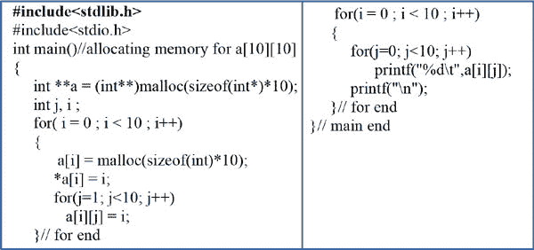

### 24. **b**
**解析：** 不需要。

### 25. **d**
**解析：**
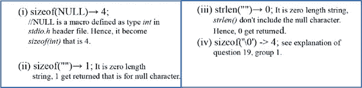

### 26. **d**
**解析：** 语句 `ptr++;` 会出错误，且 `int *y = &5;` 也是无效。

### 27. **d**
**解析：** 因为语句 `foo((&i)++);` 会导致 `"l-value required"` 错误。

### 28. **d**
**解析：** 关于引用传递的简单练习题。不需要解析。

### 29. **b**
**解析：** `gcc` 编译器支持隐式类型转换。整数指针首先被隐式转换为浮点指针，然后在 `fun()` 函数中，浮点指针被显式地强制转换为整数指针。地址 `'i'` 处的值 10 将被打印出来。

### 30. **a**
**解析：** 不需要。

### 31. **c**
**解析：** 双指针的简单概念。我们已经讨论过这些问题了。

### 32. **d**
**解析：** `fun()` 中的函数参数 `int *const*p;` // `*p*` 是常量（即只读的），但我们在第 2 行尝试更新它。因此，编译器抛出错误。

### 33. **c**
**解析：** 程序在这里可以正常运行，这里 `'p'` 在 `fun()` 中是常量。我们正在更新 `p`，这是可能的。

### 34. **c**
**解析：** 在这里，我们无法在 `main()` 函数中更新 `'a'`。但在指针的帮助下，也可以更新 `const` 变量，就像这里我们在 `fun()` 中更新 `'a'` 一。这被称为“变量黑客（Variable Hacking）”。如果我们想防止变量黑客，只需将函数 `fun()` 的原型改为 `void fun(int *const *p).`

### 35. **b**
**解析：** 变量黑客的另一个例子。

### 36. **d**
**解析：** 给定的数组 `'a'` 是常量的，`a[3] = 78;` 是无效操作。

### 37. **b**
**解析：** 不需要。

### 38. **b**
**解析：** 数组的基础地址不能更新。编译器因为语句 `p=a;` 抛出错误。

### 39. **b**
**解析：**
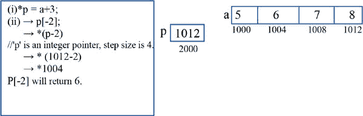
*注意：* 访问 `p[-2]` 是可能的，而 `a[-2]` 会报错，因为数组索引不能为负值。

### 40. **d**
**解析：** `double` 类型变量的大小为 8 字节，所以双指针的步长为 8。我们在双指针上增加了 2 个步长。因此，它将在地址 100 上增加 16，输出将为 116。

### 41. **d**
**解析：** own 下一题。

### 42. **算术: b, 逻辑: d 和 关系: g**
**解析：** 不需要。

### 43. **d**
**解析：** 后自增运算符中值的变化会在遇到分号（；）或任何其他运算符（如给定表达式中出现的 `+`）时更新。例如在给定的表达式 `j = 3*i++ + 2*i++;` 中 →*3*5 + 2*6* → *27*.. `'i'` 被增了两次。程序将打印 27, 7。

### 44. **b**
**解析：** 在第 17 题的解析中讨论过类似的问题。

### 45. **b**
**解析：** 已经讨论过类似的问题。

### 46. **b**
**解析：** 不需要

### 47. **b**
**解析：** 仔细阅读题目，不需要解析。

### 48. **d**
**解析：** 仔细阅读题目，不需要解析。

### 49. **d**
**解析：** `void` 指针的步长无法确定，因此编译器将抛出错误。但如果我们执行 `int n = (int*)p-ptr;` → `n = 1`，输出为选项 a。对于字符也是可能的，`char c = (char*)p-(char*)ptr;` → `c = 4`，输出为选项 b。

### 50. **b**
**解析：** 在 `turbo C` 编译器中会报错，在 `gcc` 中会输出 0, 4。

### 51. **d**
**解析：** 指针不允许与小数进行算术运算。如果我们在第 3 行使用 `int*` 代替 `float`，答案将是 8。

### 52. **d**
**解析：** 表达式 `p = &a;` 意味着 `&a` 的步长等于数组的大小（即 24）。表达式 `q = &a+1;` 意味着 `&1000+1` → *1024,*，其中 24 是 `&a` 的步长。

### 53. **d**
**解析：** 我们已经讨论过几个类似此的问题，`str1` 和 `str2` 的内存区域分配在 `code area`（只读）。现在我们尝试将 `str2` 拷贝到 `str1`；两者都在只读区域，这是不可行的。会发生运行时错误。

### 54. **a**
**解析：** 不需要。

### 55. **1000, 1024, 1048**
**解析：**
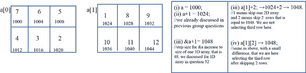

### 56. **d**
**解析：** 语句 `int *s = "hello";` 是好的，不会报错。`int *s = "hello";` 和 `char *s = "hello";` 的区别在于步长。我们多次讨论过整数指针和字符指针的步长分别是 4。当我们使用字符指针访问 `s[1]` 时，它将返回 `'e'`。使用整数指针访问 `s[1]` 时它将返回 `'o'`。

### 57. **d**
**解析：** 简单练习题，讨论过类似的问题，不需要解析。

### 58. **1000, 1016, 1032, 1032, 3, 1000, 1048**
**解析：** 练习题。

### 59. **a**
**解析：** 不需要。

### 60. **b, e**
**解析：** `"hello"` 仍在只读内存中。我们在第 3 行丢失了 `"hello"` 的引用。

### 1. **以下程序的输出是什么？**
```c
//基础指针示例

#include<stdio.h>

int fun(int x, int y)

{

    int z = x*y+x;

    return z;

}

int main()

{

    int (*fun_ptr)(int, int); //第 1 行

    fun_ptr = fun;

    int x = (int)fun_ptr(1, 2);

    printf("%d", x);

    return 0;

}
```
(a) 3
(b) 4
(c) 1
(d) 第一 1 语法错误

### 2. **以下程序的输出是什么？**
```c
#include<stdio.h>

int fun1(int x, int y)

{

    return x+y;

}

int fun2(int x, int y)

{

    return x*y;

}

int main()

{

    int (*fun_ptr[2])(int, int);

    fun_ptr[0] = fun1;

    int x = fun_ptr0;

    fun_ptr[1] = fun2;

    int y = fun_ptr1;

    printf("%d %d", x, y);

    return 0;

}
```
(a) 4 5
(b) 20 9
(c) 9 20
(d) 以上皆不是

### 3. **以下语法表示固定指针地址？**
(a) `const <type> *ptr`
(b) `<type> *const ptr`
(c) `<type> const *ptr`
(d) `<type> const *const ptr`

### 4. **声明和初始化函数指针的正确方式是：**
(a) `int (*f_pointer)(int, int) = funName;`
(b) `int *f_pointer(int, int) = funName;`
(c) `int *f_pointer(int, int) = &funName;`
(d) `(int *)f_pointer(int, int) = funName;`

### 5. **以下程序的输出是什么？**
```c
#include<stdio.h>

void fun(char *k)

{

    k++;

    k[2] = 'm';

    printf("%c ", *k);

}

int main()

{

    char str[] = "hello";

    fun(str);

    printf("%c ", *str);

    printf("%s ", str);

    return 0;

}
```
(a) e h helmo
(b) e h hello
(c) h e hemlo
(d) e h hemlo

### 6. **以下程序的输出是什么？**
```c
#include<stdio.h>

int main()

{

    int a = 7;

    int *b = &a;

    int **c = &a;

    printf("%d, %u, %u", a, *b, *c);

    return 0;

}
```
(a) 7, 7, 7
(b) 7, 7, garbage
(c) 7, garbage, garbage
(d) 错误-编译时错误

### 7. **以下程序的输出是什么？**
```c
#include<stdio.h>

int main()

{

    int a[4] = {10, 20, 30, 40};

    int *p = a;

    int **r = &p;

}
```
```c
p++;

(*r)++;

printf("%d", **r);

return 0;

}
```
(a) 11
(b) 21
(c) 31
(d) 20

### **8. 对于给程序，下列哪个陈述是正确的？**
```c
#include<stdio.h>

int main()

{

    int x=4, y=6, z=7;

    int *p1 = &x, *p2 = &y, *p3 = &z;

    int **ptr = &p2;

    p2 = p1;

    p3 = p2;

    return 0;

}
```
(a) `ptr` 指向 `x`;
(b) `ptr` 指向 `y`;
(c) `ptr` 指向 `z`;
(d) 编译时错误

### **9. 下述程序的输出是什么？**
```c
#include<stdio.h>

int main()

{

    int a[5] = {50, 60, 70, 80, 90};

    int *p = a;

    int *q = &a[2];

    p++;

    int **ptr = p+1;

    ++*ptr;

    printf("%d %d %d", p[2], *q, ptr[0]);

    return 0;

}
```
(a) 80 70 70
(b) 80 71 71
(c) 80 74 74
(d) 80 5 6

### **10. 下列哪个声明会产生运行时错误？**
(a) `int **ptr = &ptr;`
(b) `int **ptr = &*ptr;`
(c) `int **ptr = **ptr;`
(d) `int **ptr = ptr;`

### **11. 下述程序的输出是什么？**
```c
#include<stdio.h>

int main()

{

    char str[] = "India";

    const char *ptr;

    ptr = str;

    ptr++;

    //++*ptr;

    printf("%s", ptr);

    return 0;

}
```
(a) India
(b) ndia
(c) dia
(d) error- 不允许更新常量表达式

### **12. 如果我们取消上述程序中注释行的注释，输出将是什么？**
(a) Jndia
(b) ndia
(c) dia
(d) error- 不允许更新常量表达式

### **13. 下述程序的输出是什么？**
```c
#include<stdio.h>

int main()

{

    char str[] = "India";

    char *const ptr;

    ptr = str;

    ptr++;

    printf("%s", ptr);

    return 0;

}
```
(a) India
(b) ndia
(c) dia
(d) error- 不允许更新常量表达式

### **14. 下述程序的输出是什么？**
```c
#include<stdio.h>

int main()

{

    char str[] = "Hello";

    const char * const ptr;

    ptr = str; //line 3

    //ptr++; //line 4

    ++*ptr; //line 5

    printf("%s", ptr);

    return 0;

}
```
(a) Iello
(b) error- 第 3 行错误
(c) error- 第 5 行错误
(d) (b) 和 (c) 都是

### **15. 如果我们取消上述程序中注释行的注释，输出将是什么？**
(a) Jello
(b) 第 4 行无错误
(c) ello
(d) 第 3 行、第 4 行和第 5 行错误。

### **16. 下述程序的输出是什么？**
```c
#include<stdio.h>

int main()

{

    char str[] = "India";

    char *ptr;

    ptr = str;

    ptr++;

    ++*ptr;

    printf("%s", ptr);

}
```
(a) Imdia
(b) Jndia
(c) mdia
(d) odia

### **17. 如果数组的基地址为 1000，确定下述程序的输出。**
```c
#include<stdio.h>

void fun(int arr[][3])

{

    printf("%u %u %u", *(*(arr+2)+1), (*arr)+2, *(((*arr)+1)+1));

}

int main()

{

    int a[][3] = {5, 6, 7, 8, 9, 4, 3, 2, 1};

    fun(&a);

    return 0;

}
```

### **18. 下述程序的输出是什么？**
```c
#include<stdio.h>

int main()

{

    int a[][2][4] = {5, 6, 7, 8, 9, 11, 12};

    printf("%d ", *(*(a+0))+1);

    return 0;

}
```
(a) 11
(b) 8
(c) 1
(d) error- 无效的引用操作

### **19. 下述程序的输出是什么？**
```c
#include<stdio.h>

#include<string.h>

int main()

{

    char str[] = "India";

    char s[5];

    int i=0, len = strlen(str);

    while(len > 0)

    {

        s[i++] = str[--len];

    }

    s[i] = '\0';

    printf("%s ", s);

    return 0;

}
```
(a) India
(b) aidn
(c) 空格
(d) 死循环

### **20. 下述程序的输出是什么？**
```c
#include<stdio.h>
```


# C 语言程序输出预测题

## 题目 1

有以下程序段：

```c
int main()
{
    char str1[] = "India";
    char str2[] = "Bharat";
    char *s1 = str1;
    char *s2 = str2;
    while(*s1)
    {
        *s2++ = *s1;
    }
    printf("%s %s", str1, str2);
    return 0;
}
```

输出是什么？

(a) `India India`  
(b) `India Indiat`  
(c) `India Bharat`  
(d) `India Bharat`

## 题目 2

下列哪个函数会给出 `x` 和 `y` 的和？

```c
int add(int x , int y)
{
    return printf("%c%c", x,"y");
}
```

```c
int add(int x , int y)
{
    while(y != 0)
    {
        int c = x&y;
        x = x^y;
        y = c << 1;
    }
    return x;
}
```

```c
int add(int x , int y)
{
    if(y == 0)
        return x;
    else
        return add(x^y ,1);
}
```

(a) 仅 `i`  
(b) 仅 `ii`  
(c) 仅 `iii`  
(d) 仅 `i` 和 `iii`  
(e) 仅 `i`, `ii` 和 `iii`  
(f) 仅 `ii` 和 `iii`  
(g) 仅 `i` 和 `iii`  
(h) 以上都不是

## 题目 3

下述程序的输出是什么？

```c
#include<stdio.h>
int main()
{
    int i = -3<<4;
    printf("%x", i);
    return 0;
}
```

(a) `abcdef33`  
(b) `ffffffff`  
(c) `ffffffd1`  
(d) `fffff0`

## 题目 4

下述程序的输出是什么？

```c
#include<stdio.h>
int main()
{
    int i=-2;
    printf("%d",i);
    return 0;
}
```

(a) `0`  
(b) `1`  
(c) `2`  
(d) `error - 需要左值`

## 题目 5

下述程序的输出是什么？

```c
#include<stdio.h>
int main()
{
    int x = 7;
    x = !7>7;
    printf("%d",x);
    return 0;
}
```

(a) `14`  
(b) `10`  
(c) `0`  
(d) `1`

## 题目 6

下述程序的输出是什么？

```c
#include<stdio.h>
int main()
{
    char a[]={'a','s','c','\n','i','\0'};
    char *b,*q1;
    b=a+3; //line 3
    q1=a;
    printf("%c",++*b + *q1++-30);
    return 0;
}
```

(a) `M`  
(b) `N`  
(c) `O`  
(d) `P`

## 题目 7

下述程序的输出是什么？

```c
#include<stdio.h>
int main()
{
    int x[2][4] = {5, 6, 7, 8, 9, 11, 12};
    int *i,*j;
    i=&x;
    j=**x;
    printf("%d ", *i);
    return 0;
}
```

*（注：原文 26 有一些语法错误/括号，这里已清理了结构但保留了逻辑）*

## 题目 8

下述程序的输出是什么？

```c
#include<stdio.h>
int main()
{
    struct student {
        int roll=3;
        char name[]="mahi";
    };
    struct student *s1;
    printf("%d ",s1->roll);
    printf("%s",s1->name);
    return 0;
}
```

(a) `3 mahi`  
(b) `garbage mahi`  
(c) `3 garbage`  
(d) `error - 编译时错误`

## 题目 9

下述程序的输出是什么？

```c
#include<stdio.h>
int main()
{
    struct student {
        int roll;
        struct clg {
            char grade;
            struct student *p;
        };
    };
    struct student s;
    s.roll = 10;
    s.clg.grade = 'A';
    s.clg.p = NULL;
    printf("%d %c ",s.roll, s.clg.grade);
    return 0;
}
```

(a) `10 A`  
(b) `garbage A`  
(c) `10 garbage`  
(d) `error - 编译时错误`

## 题目 10

下述程序的输出是什么？

```c
#include<stdio.h>
#define sqr(x) x*x
int main()
{
    int p;
    p = 32/sqr(8);
    printf("%d",p);
    return 0;
}
```

(a) `32`  
(b) `0`  
(c) `64`  
(d) `0.5`

## 题目 11

下述程序的输出是什么？

```c
#include<stdio.h>
int main()
{
    char q[] = "Hello India",*ptr;
    ptr=q;
    while(*ptr!='\0')
    {
        ++*ptr++; // line 4
    }
    printf("%s %s",ptr,q);
    return 0;
}
```

(a) `Ifmmp!Joejb`  
(b) `Ifmmp Joejb`  
(c) `Hello India`  
(d) `error - 需要左值`

## 题目 12

以下程序的输出是什么？

```c
#include <stdio.h>
#define p 10
int main()
{
    #define p 50
    printf("%d",p);
    return 0;
}
```

(a) `10`  
(b) `50`  
(c) `error - 不允许重定义宏 'p'`  
(d) `5010`

## 题目 13

以下程序的输出是什么？

```c
#include<stdio.h>
int main()
{
    char str[4][20]={"hello", "India", "love", "great"};
    int i;
    char *temp;
    temp=str[2];
    str[2]=str[3];
    str[3]=temp;
    for (i=0;i<4;i++)
        printf("%s",str[i]);
    return 0;
}
```

(a) `hello India love great`  
(b) `hello India great love`  
(c) 全是垃圾值  
(d) `error - 编译时错误`

## 题目 14

以下程序的输出是什么？

```c
#include<stdio.h>
int main()
{
    int x[2][3][2] = {{{2,4},{7,8},{3,4}},{{2,2},{2,3},{3,4}}};
    printf("%u %u %u %d ",x,*x,**x,***x);
    printf("%u %u %u %d \n",x+1,*x+1,**x+1,***x+1);
    return 0;
}
```

(a) `1000 1000 1000 2 1004 1008 10024 3`  
(b) `1000 1000 2 2 1024 1008 1004 3`  
(c) `1000 1000 1000 2 1004 1008 1004 3`  
(d) `1000 1000 1000 2 1024 1008 1004 3`

## 题目 15

确定以下程序的输出是什么？

```c
#include<stdio.h>
#include<string.h>
int main()
{
    int i, len;
    char x[] = "India";
    len = strlen(x);
    *x = x[len];
    char *ptr = x;
    for(i=0; i<len; ++i)
    {
        printf("%s ",ptr);
        ptr++;
    }
    return 0;
}
```

## 题目 16

以下程序的输出是什么？

```c
#include<stdio.h>
int main()
{
    char *s[] = {"hello", "India", "love", "great"};
    char **ptr[] = {s+3, s+2, s+1, s}, ***p;
    p = ptr;
    **++p;
    printf("%s",*--*++p + 3);
    return 0;
}
```

(a) `lo`  
(b) `ia`  
(c) `ve`  
(d) `at`

## 题目 17

以下程序的输出是什么？

```c
#include<stdio.h>
int main()
{
    int x[] = {5,6,7,8,9};
    int *p[] = {x,x+1,x+2,x+3,x+4};
    int **ptr = p;
    ptr++;
    printf("\n %d %d %d", ptr-p, *ptr-x, **ptr);
    return 0;
}
```

(a) `4 4 6`  
(b) `4 4 8`  
(c) `1 1 6`  
(d) `error - 编译时错误`

## 题目 18

以下程序的输出是什么？

```c
#include<stdio.h>
int main()
{
    int x=-5;
    +x; //line 2
    printf("%d %d \n",x,+x);
    return 0;
}
```

(a) `-5 -5`  
(b) `5 5`  
(c) `-5 5`  
(d) `error at line 2`

## 题目 19

以下程序的输出是什么？

```c
#include<stdio.h>
#define cal(a , b ,c, d) {
    int d = 10;
    int c = 20;
    a = b + c + d;
}

int main()
{
    int a = 2 , b = 3 , d = 4;
    cal(a ,b ,c ,d);
    printf("%d, %d, %d",a,b,c,d);
    return 0;
}
```

(a) `32, 2, 10`  
(b) `32, 2, 4`  
(c) `9, 2, 4`  
(d) `error - 编译时错误`

## 题目 20

以下程序的输出是什么？

```c
#include<stdio.h>
int main()
{
    int k=1;
    printf("%d==1 is%s",k,k==1?"TRUE":"FALSE");
    return 0;
}
```

(a) `error in printf()`  
(b) `0==1 is FALSE`  
(c) `1==1 is TRUE`  
(d) `1==1 is garbage`

## 题目 21

以下程序的输出是哪个？

```c
#include<stdio.h>
#define max 5
#define arr1[max]
int main()
{
    typedef char arr2[max];
    arr1={0,1,2,3,4}; //line 2
    arr2="name"; //line 3
    printf("%d %s",arr1[0],arr2);
    return 0;
}
```

(a) `0 name`  
(b) `1 name`  
(c) `error at line 2`  
(d) `error at line 3`

## 题目 22

以下程序的输出是哪个？

```c
#include<stdio.h>
char *fun()
{
    char *p = "Hello India";
    return p;
}
int main()
{
    printf(fun());
    return 0;
}
```

(a) `garbage value`  
(b) `error - compile time`  
(c) `"Hello India"`  
(d) `"Hello"`

## 题目 23

以下程序的输出是哪个？

```c
#include<stdio.h>
char *foo1()
{
    char a[] = "India";
    return a;
}
char *foo2()
{
    char a[] = {'I','n','d','i','a'};
    return a;
}
int main()
{
    char a[] = "India";
    char b[] = {'I','n','d','i','a'};
    printf("%u %u",sizeof(a),sizeof(b));
    printf("%s",foo1()); //line 4
    printf("%s",foo2()); //line 5
    return 0;
}
```

(a) `6 6 India India`  
(b) `6 6 garbage garbage`  
(c) `6 5 India India`  
(d) `6 5 garbage garbage`

## 题目 24

以下程序的输出是哪个？

```c
#include<stdio.h>
int main()
{
    char a[4]="kind";
    printf("%s",a);
    return 0;
}
```

(a) `kind`  
(b) `kind<some garbage values>`  
(c) `error`  
(d) `kind`

## 题目 25

这两个声明之间有区别吗？

1. `int fun(int *a[])`
2. `int fun(int *a[2])`

(a) `No`  
(b) `Yes`

## 题目 26

以下程序的输出是哪个？

```c
#include<stdio.h>
int main()
{
    int x=300;
    char *p = &x;
    *++p=2;
    printf("%d",x);
    return 0;
}
```

(a) `300`  
(b) `554`  
(c) `301`  
(d) `556`

## 题目 27

以下程序的输出是哪个？

```c
#include<stdio.h>
int main()
{
    int i = 258;
    int *ptr = &i;
    printf("%d %d", *((char*)ptr), *((char*)ptr+1));
    return 0;
}
```

(a) `255 0`  
(b) `255 1`  
(c) `0 2`  
(d) `1`

## 题目 28

以下程序的输出是哪个？

```c
#include<stdio.h>
#include<stdlib.h>
#define pi 3.14
void main()
{
    printf("%f \n",pi);
}
```

(a) `3.140000`  
(b) `3.140000`  
(c) `3.14`  
(d) `Compile Time`

## 题目 29

以下程序的输出是哪个？

```c
#include<stdio.h>
#include<stdlib.h>
int main()
{
    int *ptr1, *ptr2;
    ptr1 = malloc(sizeof(int));
    ptr2 = (int*)calloc(1,sizeof(int));
    printf("%d ",*ptr1);
    return 0;
}
```

(a) `garbage`  
(b) `0`  
(c) `error in malloc`  
(d) `error at runtime`

## 题目 30

以下程序的输出是哪个？

```c
#include<stdio.h>
int main()
{
    int i;
    char a[]="\0";
    char b[] = "\n";
    if(printf("%s",a ))
        if(printf("%s",b ))
            printf("1\n");
        else
            printf("2\n");
    else
        if(printf("%s",b ))
            printf("3 \n");
        else
            printf("4 \n");
    return 0;
}
```

(a) `1`  
(b) `2`  
(c) `3`  
(d) `4`

## 题目 31

以下程序的输出是哪个？

```c
#include<stdio.h>
int i = 10;
int main()
{
    int i=i++; //line 1
    printf("%d ",i);
    return 0;
}
```

(a) `10`  
(b) `11`  
(c) `garbage`  
(d) `error - invalid assignment`

## 题目 32

以下程序的输出是哪个？

```c
#include<stdio.h>
int main()
{
    while(1)
    {
        if(printf("%d",printf("%d", 10)))
            break;
        else
            continue;
    }
    return 0;
}
```


### 52. 解释下面的函数指针声明

`int (*fun(float, void (*pqr)()))();`

### 53. 以下程序的输出是哪个？

```c
#include<stdio.h>

int main()
{
    int x = 7;
    int k = x = ++x == 7;

    printf("%d %d", k, x);

    return 0;
}
```

(a) 1 8  
(b) 0 8  
(c) 7 0  
(d) 0 0

### 54. 以下程序的输出是哪个？

```c
#include<stdio.h>
```

```c
int main()
{
    char p[] = "Hello India";
    char c;
    char *ptr = p;

    c = ++*ptr++;
    printf("%c", ++*ptr++);

    return 0;
}
```

(a) I  
(b) f  
(c) H  
(d) e

### 55. 以下程序的输出是什么？

```c
#include<stdio.h>

int main()
{
    char p[] = "hello India";
    char *ptr = p;

    printf("%c", ++*(ptr++));

    return 0;
}
```

(a) i  
(b) h  
(c) l  
(d) a

### 56. “hello India”会被打印几次？

```c
#include<stdio.h>

int main()
{
    int i = 0;

    while ((+i--) != 0) //第 2 行
    {
        printf("hello India\n");
        i -= i++;
    }

    return 0;
}
```

(a) 2  
(b) 1  
(c) 0  
(d) 第 2 行语法错误

### 57. 以下程序的输出是什么？

```c
#include<stdio.h>

int main()
{
    signed char i = 0;

    for (; i >= 0; i++);

    printf("%d\n", i);

    return 0;
}
```

(a) -127  
(b) -128  
(c) 死循环  
(d) 0

### 58. 以下程序的输出是什么？

```c
#include<stdio.h>

int main()
{
    unsigned char i = 0;

    for (; i >= 0; i++);

    printf("%d\n", i);

    return 0;
}
```

(a) -127  
(b) -128  
(c) 死循环  
(d) 0

### 59. 以下程序的输出是什么？

```c
#include<stdio.h>

int main()
{
    char *ptr;
    char str[] = "India is great";

    ptr += 4; //第 4 行
    printf("%s", ptr);

    return 0;
}
```

(a) India is great  
(b) is great  
(c) a is great  
(d) 无输出

### 60. 对于给定的程序，以下哪个 `printf` 打印出的值为 2？

```c
#include<stdio.h>

int main()
{
    int a[6][10][15] = {0};
    a[4][2][0] = 2;

    return 0;
}
```

(a) `printf("%d", *(((a + 4) + 2) + 0));`  
(b) `printf("%d", ***((a + 4) + 2) + 0);`  
(c) `printf("%d", *(*(*(a + 4) + 2) + 0));`  
(d) 以上都不是

# 面试的其他重要问题如下所示

1. 编写一个用于两个矩阵相加的 C 程序。
2. 编写一个使用递归找到给定数字阶乘的 C 程序。
3. 编写一个用于两个矩阵相减的 C 程序。
4. 编写一个使用递归找到给定数字各位数字和的 C 程序。
5. 编写一个使用递归反转任何数字的 C 程序。
6. 编写一个不使用 `sizeof` 运算符查找 `int` 大尺寸的 C 程序。
7. 编写一个不使用 `sizeof` 运算符查找 `double` 大尺寸的 C 程序。
8. 编写一个不使用 `sizeof` 运算符查找结构体大小的 C 程序。
9. 编写一个不使用 `sizeof` 运算符查找联合体大小的 C 程序。
10. 编写一个用于线性搜索的 C 程序。
11. 编写一个用于二分查找的 C 程序。
12. 编写一个使用递归进行二分查找的 C 程序。
13. 编写一个将一维数组传递给函数的 C 程序。
14. 编写一个将二维数组传递给函数的 C 程序。
15. 编写一个用于两个矩阵相乘的 C 程序。

# 第 4 组解析

1. **a**

   **解析：** 函数指针的演示。

2. **c**

   **解析：** 函数指针数组的演示，其中每个函数接收两个 `int` 并返回 `int`。

3. **b, d**

   **解析：** 选项 (a) 是 `ptr` 指向的固定值，`**ptr` 无法更新。选项 (b) 是固定指针地址，我们无法更新 `ptr`；选项 (c) 等于 (a)。选项 (d) 是固定值和固定地址，不允许更新 `**ptr` 和 `*ptr`。

4. **a**

   **解析：** 不需要。

5. **a**

   **解析：** 一道练习题。

6. **a**

   **解析：** 不需要。

7. **b**

   **解析：** 一道练习题。

8. **a**

   **解析：** 在步骤 (i) 中，`p2 = p1`；`p2` 现在持有 `x` 的地址，`ptr` 仍然指向 `p2`。因此。

9. **c**

   **解析：** 选项 (a) 是固定值，由 `ptr` 指向，`**ptr` 无法更新。选项 (b) 是固定指针地址，我们无法更新 `ptr`；选项 (c) 等于 (a)。选项 (d) 是固定值和固定地址，不允许更新 `**ptr` 和 `*ptr`。

10. **a**

    **解析：** 不需要。

11. **b**

    **解析：** 不需要。

12. **b**

    **解析：** 不需要。

13. **d**

    **解析：** 不需要。

14. **d**

    **解析：** 不需要。

15. **d**

    **解析：** 不需要。

16. **d**

    **解析：** 不需要。

17. **d**

    **解析：** 数组的演示。

18. **b**

    **解析：** 数组的演示。

19. **b**

    **解析：** 练习题。

20. **b**

    **解析：** 不需要。

21. **f**

    **解析：** 练习题。

22. **d**

    **解析：** 不需要。

23. **c**

    **解析：** 练习题。

24. **c**

    **解析：** 练习题。

25. **b**

    **解析：** 整数指针 `b` 指向数组 `a` 的第三元素，`q1` 指向 `a` 的第一个元素，第一个元素是 `a`，其 ASCII 值为 97。`printf()` 中的表达式将求值为：

    `++(*b) + (*(q1++) - 30)` → `++10 + ((97)++ - 30)` → `11 + (97 - 30)` → `11 + 67` → `78`

    因为 `%c` 格式说明符，输出将是 78 的 ASCII 值 `N`。

### 解析

我们已经讨论过这类问题了，第 4 行的表达式 `++*ptr++` 被展开为 `++*ptr` 和 `ptr++;`。在 `while` 循环执行后，给定字符串的每个字符都会加 1。根据 ASCII 规范，字符 “H” 变成 “I”，“e” 变成 “f”，空格转换为 “！” 等。

### 31. **b**

### 解析

允许重新定义预处理器指令，其值将从最新的预处理器指令进行替换。

### 32. **d**

### 解析

我们在第 57 题第 2 组解释中讨论过类似的概念。二维数组是 1D 数组的集合，每个字符串都以 1D 数组的形式存储。每个 1D 数组的基地址不能被修改。如果我们把给定的二维数组声明为 `*str[4]`，即 `*char *str[4] = {"hello", "India", "love", "great"};`，程序将输出 `"hello India great love"`。

### 33. **d**

### 解析

我们已经讨论过这类问题了。不需要解释。

### 34. **<blank space> ndia dia ia a**

### 解析

一道练习题，不需要解释。

### 35. **a**

### 解析

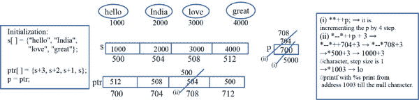

### 36. **c**

### 解析

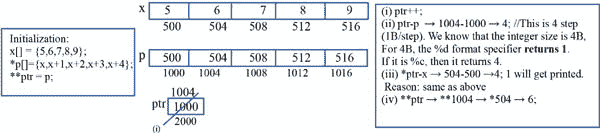

### 37. **a**

### 解析

一元运算符 `+` 是一个无效运算符，因为它不会产生任何变化。我们可以简单地忽略这个运算符。

### 38. **b**

### 解析

编译器不会报错，这就是我们声明多行宏的方法，每行（最后一行除外）以 `\` 结尾表示代表多行。宏 `(a, b, c, d)` 被替换右侧所示：

`images/c05-5.jpg`

### 39. **c**

### 解析

在给定的程序中，两个字符串由空格分隔，在 `printf()` 函数中将拼接，`printf()` 函数变为 `printf("%d", k == 1 ? "TRUE" : "FALSE");`。条件 `k == 1` 的求值为 `"TRUE"`。

### 40.

### 解析

`images/c05-6.jpg`

### 41. **c**

### 解析

在给定的程序中，在函数 `fun()` 中，`p` 指向的字符串 `"Hello India"` 存储在代码区，该区域是所有函数共享且……因此我们可以通过它的地址访问该字符串。

### 42. **d**

### 解析

在函数 `foo1()` 和 `foo2()` 中，数组 `a` 的内存仅在局部（栈）区域分配。在执行函数 `foo1()` 和 `foo2()` 后，它们都返回数组 `a` 的基地址，且 `a` 指向的内存在 `main` 中是不可用的。在 `main()` 的第 4 行和第 5 行，我们尝试访问不可用的内存，它会返回垃圾值，有时也会返回相同的字符串但可能是错误。另外，`foo2()` 中的数组没有以空字符结束，如果我们在 `foo2()` 中用 `%s` 打印 `a`，它将一直打印 `"India"` 直到遇到空字符。

### 43. **b**

### 解析

字符数组 `a` 有 4 个字节来存储字符串，我们也恰好给了它 4 个字符，因此没有空间存放终止字符 `\0`。当我们使用 `printf()` 的 `"%s"` 格式符打印数组 `a` 时，它将一直打印字符直到遇到终止字符。因此，打印出了垃圾值。

### 44. **a**

### 解析

在函数参数中，数组只传递指针，如果传递数组，它会被视为指针。因此这两种声明是相同的。第二种比第一种好。

### 45. **d**

### 解析

`x` 将存储在内存中，类似于 `00101100 00000001 00000000 00000000`（小端格式）。`p` 是一个字符指针，步长为 1，它指向整数变量 `x`。

在第 3 行，操作 `*(++p) = 2` 将分为两个步骤：

1. `p = p + 1`
2. `*p = 2`

在第一步中，`p` 开始指向 `x` 的第二个字节，在步骤 (ii) 中，`p` 使 `x` 的第二个字节变为 2。最后，我们得到 `x` 的二进制表示：`00101100 00000010 00000000 00000000`，其十进制等效值为 556。

### 46. **d**

### 解析

我们已经讨论过这类问题了。258 可以用二进制形式表示为 `(msb)00000000 00000000 00000001 00000010(lsb)`。我们可以使用字符指针单独访问这些字节，`(char*)ptr` 返回 2，因为在第一个位置存储了 2，而 `(char*)ptr + 1` 返回第二个字节。

### 47. **c**

### 解析

C 预处理器从上到下解析文件，并将 `#define` 语句视为复制粘贴操作。一旦它遇到 `#define pi 3.14`，它开始替换所有的 `pi` 单词为 `3.14`。预处理器不处理 C 语言的作用域机制，如括号和大括号。该定义一直有效直到文件结束，或者（在本情况下）宏通过另一个 `#define` 被重新定义。

### 48. **c**

### 解析

`malloc()` 分配的内存未初始化，返回垃圾值，而 `calloc()` 返回初始化为零的分配内存空间。`calloc()` 函数调用两个参数：

1. 块的大小（类型大小）
2. 块的数量（对于整数是 4B）我们正在分配，这里给了 1，这意味着我们只为 1 个整数分配内存。

### 49. **c**

### 解析

正如我们讨论的，`printf` 返回在显示器上打印的字符数。在这里，`printf` 读取了一个空字符且不在显示器上打印内容。这意味着 `printf` 返回 0。第 4 行的 `if` 语句为假。执行第 9 行的 `else` 语句。第 10 行的 `printf` 语句打印了一个字符 `\n` 并返回 1。因此，如果条件为真，循环将在第一次迭代中中断。

### 50. **c**

### 解析

在给定的程序中，有两个 `i` 的定义，一个是全局的，一个是 `main` 局部的。从程序此处起如果我们使用 `i`，将考虑局部的 `i`，因此 `i` 包含某个垃圾值。

### 51. **a**

### 解析

在给定的程序中，在函数 `fun()` 中，`p` 指向的字符串 `"Hello India"` 存储在代码区，该区域是所有函数共享且……因此我们可以从 `main` 函数通过地址访问该字符串。

### 52. **Nil**

### 解析

`fun` 是一个带有两个参数的指针：

1. 浮点数（`float*`）
2. 一个指针函数 `pqr`，它可以指向一个不接受任何参数并返回 `void` 类型的函数。

最后，`fun` 返回 `int` 类型。

### 57. 解析

需要注意的是，`for` 循环以分号结尾。`i` 的初始值为 0。`signed char` 的范围是从 -128 到 +127，当该类型的任何变量达到 +127 值时，再加 1，`signed char` 会旋转到 -128。因此，`for` 循环的条件失败。打印值 -128。

### 58. **c**

**解释：** 在这里，`char` 被声明为 `unsigned`，`unsigned` 的范围是从 0 到 255，当它达到 255 并发生任何递增时，其值再次变为 0。因此，`i++` 永远不会变为小于 0 的值，`for` 循环条件永远不会为假。循环将无限进行。

### 59. **c**

**解释：** 一道练习题。不需要解释。

### 60. **c**

**解释：** 一道练习题。不需要解释。

> 所有成就的起点都是欲望。

# 第 5 组题目

## “C”题数量：60

## 其他重要面试题：15


### 1. 下列程序的输出是什么？

```c
#include<stdio.h>

int main()
{
    int x = 2, y = 5;

    x = x ^ y;
    y = y ^ x;

    printf("%d %d", x, y);

    return 0;
}
```

(a) 5 2  
(b) 2 5  
(c) 7 7  
(d) 7 2

### 2. 下列程序的输出是什么？

```c
#include<stdio.h>

int main()
{
    int x = 7;

    switch (x)
    {
    default:
        x = 6;

    case 8:
        x--;

    case 7:
        x = x + 1;

    case 3:
        x = x - 1;
    }

    printf("%d\n", x);

    return 0;
}
```

(a) 7  
(b) 6  
(c) 5  
(d) 8

### 3. 下列程序的输出是什么？

```c
#include<stdio.h>

int main()
{
    int x = 2, y = 5;

    x = x ^ y;
    y = x ^ y;
    x = x ^ y;

    printf("%d %d", x, y);

    return 0;
}
```

(a) 2 5  
(b) 2 7  
(c) 5 2  
(d) 7 2

### 4. 下列程序的输出是什么？

```c
#include <stdio.h>

int main()
{
    int a[][4] = {3, 4, 5, 6, 7, 8, 9, 10};
    int (*ptr)[4] = a;

    printf("%d %d ", (*ptr)[1], (*ptr)[2]);

    ++ptr;

    printf("%d %d\n", (*ptr)[1], (*ptr)[2]);

    return 0;
}
```

(a) 4 5 8 9  
(b) 4 5 7 8  
(c) 6 7 4 5  
(d) 3 4 5 6

### 5. 下列程序的输出是什么？

```c
#include <stdio.h>

int main()
{
```


```c
int a[][4] = {3, 4, 5, 6, 7, 8, 9, 10};

int (*ptr)[4] = a;

printf("%d %d ", sizeof(ptr), sizeof(*ptr));

return 0;
}
```

(a) 4, 4  
(b) 16 16  
(c) 4 32  
(d) 4 16

### 6. 下列程序的输出是什么？

```c
#include<stdio.h>

int main()
{
    char c=124;

    c=c+9; //line 2

    printf("%d",c);

    return 0;
}
```

(a) 135  
(b) infinite  
(c) -8  
(d) -123

### 7. 下列程序的输出是什么？

```c
#include<stdio.h>

int main()
{
    int x, a=5, b=10; //line 1

    x=a+b;

    static int y = x; //line 3

    if(y==x)
        printf("Hello");
    else if(y>x)
        printf("Hi");
    else
        printf("Bye");

    return 0;
}
```

(a) Hello  
(b) Hi  
(c) Bye  
(d) error- compile

### 8. 下列程序的输出是什么？

```c
#include <stdio.h>

int main()
{
    int x = 3;
    int y;

    y = sizeof(++x);

    printf("%d %d\n", x, y);

    return 0;
}
```

(a) 4 4  
(b) 3 4  
(c) 5 4  
(d) error- compile

### 9. 下列程序的输出是什么？

```c
#include <stdio.h>

void fun1(int*, int);
void fun2(int*, int);
void (*fun_ptr[2])(int*, int);

int main()
{
    int x = 4;
    int y = 7;

    fun_ptr[0] = fun1;
    fun_ptr[1] = fun2;

    fun_ptr0;
    printf("%d %d ", x, y);

    fun_ptr1;
    printf("%d %d\n", x, y);

    return 0;
}

void fun1(int *a, int b)
{
    int temp = *a;
    *a = b;
    b = temp;
}

void fun2(int *a, int b)
{
    int temp = *a;
    *a = b;
    b = temp;
}
```

(a) 5 5 5  
(b) 3 5 3 5  
(c) 4 4 4 4  
(d) 7 7 7

### 10. 在 if 块中编写条件，使得该程序输出 "Hello India"。

```c
#include<stdio.h>

int main()
{
    if(<condition>)
    {
        printf("Hello ");
    }
    else
    {
        printf("India\n");
    }

    return 0;
}
```

### 11. 下列程序的输出是什么？

```c
#include<stdio.h>

int main()
{
    char str[] = "India";

    str[0] += 32; //line 2

    printf("%s",str);

    return 0;
}
```

(a) India  
(b) garbage  
(c) india  
(d) error- compile

### 12. 如果 5.375 的二进制规范形式为 0100 0000 1010 1100 0000 0000，那么程序的输出是什么？

```c
#include<stdio.h>
#include<math.h>

int main()
{
    float a=5.375;

    char *p= (char*)&a; //line 2

    int x = p[2]^p[3]; //line 3

    printf("%d ", x);

    return 0;
}
```

(a) 5  
(b) -20  
(c) -23  
(d) 20

### 13. 下列程序的输出是什么？

```c
#include<stdio.h>
#include<string.h>

void foo(char *);

int main()
{
    char a[100] = {0};

    printf("%u %u",sizeof(a),strlen(a));

    return 0;
}
```

(a) 100 100  
(b) 100 99  
(c) 101 1  
(d) 100 0

### 14. 下列程序的输出是什么？

```c
#include<stdio.h>

int fun()
{
    int a = 10;

    return a;
}

int main()
{
    int *a = NULL;

    *a = fun();

    printf("%d ",*a);

    return 0;
}
```

(a) 10  
(b) garbage  
(c) error- compile  
(d) error- run

### 15. 下列程序的输出是什么？假设数组 `a` 的基地址为 1000。

```c
#include<stdio.h>

int main()
{
    int a[3][4]={0};

    printf("%u %u",&a, &a+1);

    return 0;
}
```

(a) 1000 12  
(b) 1000 20  
(c) 1000 4  
(d) 1000 16

### 16. 下列程序的输出是什么？

```c
#include<stdio.h>

int fun()
{
    int a = 10;

    return a;
}

int main()
{
    int *a = fun();

    printf("%d %u ",a, a+1);

    return 0;
}
```

(a) 10 14  
(b) garbage garbage  
(c) error- compile  
(d) 10 11

### 17. 下列程序的输出是什么？

```c
#include <stdio.h>

int main()
{
    struct student
    {
        int a;
        int b;
        int c;
    } s1 = { 3, 5, 6 }; //line 7

    struct student *p = &s1; //line 8

    printf("%d\n",*((int*)p+1)); //line 9

    return 0;
}
```

(a) 3  
(b) 5  
(c) 6  
(d) 7

### 18. 下列程序的输出是什么？

```c
#include <stdio.h>

void fun(int);

int main()
{
    int x = 3;

    fun(x);

    return 0;
}

void fun(int i)
{
    if (i > 0)
    {
        fun(--i);
        printf("%d ", i);
        fun(--i);
    }
}
```

(a) 0 1 2 0  
(b) 0 1 2 1  
(c) 1 2 0 1  
(d) 0 2 1 1

### 19. 下列程序的输出是什么？

```c
#include <stdio.h>

int main(void)
{
    char a[5] = { 6, 7, 8, 9, 10 };

    char *ptr = (char*)(&a + 1);

    printf("%d %d\n", *(a + 1), *(ptr - 1));

    return 0;
}
```

(a) 7 9  
(b) 7 6  
(c) 7 10  
(d) 7 garbage

### 20. 下列程序的输出是什么？

```c
#include <stdio.h>

void fun(int[][3]);

int main(void)
{
    int a[3][3] = {
        {10, 20, 30},
        {40, 50, 60},
        {70, 80, 90}
    };

    fun(a);
}
```

```c
printf("%d\n", a[2][1]);

return 0;
}

void fun(int b[][3])
{
    ++b;
    b[1][1] = 777;
}
```

(a) 777  
(b) 80  
(c) 70  
(d) error- 数组基地址无法更新

### 21. 下列程序的输出结果是什么？

```c
#include<stdio.h>

int main()
{
    int i = 0;

    switch(i)
    {
        default:
            i = 4;

        case 6:
            i--;

        case 5:
            i = i+1;
            break;

        case 1:
            i = i-1;
            break;
    }

    printf("%d \n",i);

    return 0;
}
```

(a) 3  
(b) 4  
(c) 5  
(d) 0

### 22. 下列程序的输出结果是什么？

```c
#include<stdio.h>

int main()
{
    int a = 2;

    if(a == (1,2))
        printf("Hello ");

    if(a == 1,2)
        printf("India");

    return 0;
}
```

(a) Hello  
(b) World  
(c) Hello India  
(d) error- 编译时

### 23. 下列程序的输出结果是什么？

```c
#include<stdio.h>

int main()
{
    int a = 3,4; //line 1;

    int b = (3,4);

    if(a == b)
        printf("Equal");
    else
        printf("Not Equal");

    return 0;
}
```

(a) Equal  
(b) Not Equal  
(c) error- 运行时  
(d) error- 编译时

### 24. 下列程序的输出结果是什么？

```c
#include<stdio.h>

void fun(char *);

int main()
{
    char *str = "Hello India";

    fun(str);

    printf("%s",str);

    return 0;
}

void fun(char *ptr)
{
    while(*ptr)
    {
        *ptr += 1;
        ptr++;
    }
}
```

(a) Hello India  
(b) Ifmmp Jmejb  
(c) error- 编译时  
(d) error- 运行时（段错误）

### 25. 下列程序的输出结果是什么？

```c
#include<stdio.h>
#include<stdlib.h>

int main()
{
    char a[] = "Hello India";
    char *ptr = a;
    int len = 0;

    while(*(ptr))
    {
        len++;
        ptr++;
    }

    printf("%d",len);

    return 0;
}
```

(a) error- 运行时（段错误）  
(b) error- 编译时  
(c) 11  
(d) 0

### 26. 下列程序的输出结果是什么？

```c
#include<stdio.h>

int a = 10;

void fun2()
{
    int *p;

    {
        int a=5;
        p = &a;
    }

    a++;
    ++*p;

    printf("%d ", *p);
}

void fun1()
{
    a = 1;

    printf("%d ",a);

    a++;

    fun2();

    int a=4;

    printf("%d ", --a);
}

int main()
{
    fun1();
    fun2();

    pintf("%d ", a);

    return 0;
}
```

(a) 1 3 5 3 4  
(b) 1 6 3 6 4  
(c) 1 6 3 5 4  
(d) 1 3 3 5 4

### 27. 区分给定的函数声明？

(i) `int fun(int a[])`  
(ii) `int fun(int a[2])`  
(iii) `int fun(int *a)`

### 28. 下列程序的输出结果是什么？

```c
#include<stdio.h>

void fun(int arr[])
{
    int a, b, c, d;

    a = ++arr[1];
    a ++;

    b = arr[1]++;

    c = a++ - arr[1];

    d = arr[1];

    printf("%d %d %d %d", a, b, c, d);
}

int main()
{
    int a[] = {5, 6, 7, 8, 9};

    fun(a);

    return 0;
}
```

(a) 7 7 0 1  
(b) 9 7 0 1  
(c) 8 7 0 1  
(d) 9 7 8

### 29. 下列程序的输出结果是什么？

```c
#include<stdio.h>

int main()
{
    printf(7+"Conceptual C");

    return 0;
}
```

(a) Conceptual C question  
(b) Conceptual C q  
(c) C q  
(d) error- 编译

### 30. 下列程序的输出结果是什么？

```c
#include<stdio.h>

void change(char (*ptr)[6])
{
    (*ptr)[2] = 'x'; // line 1
    (*ptr+1)[2] = 'x'; // line 2

    ptr++; // line 3

    (*ptr)[2] = 'x'; // line 4
    (*ptr+1)[2] = 'x'; // line 5
}

int main()
{
    char str[][6] = {"hello", "India"};

    change(str);

    printf("%s %s", str[0], str[1]);

    return 0;
}
```

(a) hello India  
(b) hello India  
(c) hello India  
(d) hello India

### 31. 下列程序的输出结果是什么？

```c
#include<stdio.h>

void change(char (*ptr)[6])
{
    char temp;

    temp = (*ptr)[1];
    (*ptr)[1] = *ptr[0];
    (*ptr)[0] = temp;

    ptr++;

    temp = (*ptr)[1];
    (*ptr)[1] = *ptr[0];
    (*ptr)[0] = temp;
}

int main()
{
    char str[][6] = {"Hello", "India"};

    change(str);

    printf("%s %s", str[0], str[1]);

    return 0;
}
```

(a) Hello India  
(b) India Hello  
(c) Hello India  
(d) Hello India

### 32. 下列程序的输出结果是什么？

```c
#include<stdio.h>

void change(char *ptr)
{
    ptr[2] = 'x';
    ptr[6] = 'x';
}

int main()
{


### 31. 下列程序的输出结果是什么？

```c
char str[][6] = {"hello", "India"};

change((char*)str);

printf("%s %s", str[0], str[1]);

return 0;
```

(a) hello India
(b) hello India
(c) hello India
(d) hello India

### 33. 下列程序的输出结果是什么？

```c
#include<stdio.h>

void change(char *ptr[6])
{
    char *temp=ptr[0];
    ptr[0] = ptr[1];
    ptr[1] = temp;
}

int main()
{
    char *str[6] = {"hello", "India"};
    change(str);
    printf("%s %s", str[0], str[1]);
    return 0;
}
```
(a) hello India
(b) India hello
(c) hello India
(d) hello India

### 34. 下列程序的输出结果是什么？

```c
#include<stdio.h>

int main()
{
    char *str1 = "hello";
    char *str2 = "hello";
    char str3[] = "hello";
    char str4[] = "hello";

    if(str1 == str2)
        printf("one ");
    else
        printf("zero ");

    if(str3 == str4)
        printf("yes ");
    else
        printf("no ");

    return 0;
}
```
(a) one yes
(b) zero no
(c) zero yes
(d) one no

### 35. 下列程序的输出结果是什么？

```c
#include<stdio.h>

int main()
{
    printf("%u %u", &"hello", &"hello");
    printf("%s", &"hello");
    return 0;
}
```
(a) error- 编译时
(b) 1000 2000
(c) 1000 1000
(d) 1000 hello

### 36. 下列程序的输出结果是什么？

```c
#include<stdio.h>

int main()
{
    char str[8] = "India";
    str[6] = 'x'; // line 2
    printf("%s", str); // line 3
    return 0;
}
```
(a) India x
(b) Indiax
(c) India
(d) India\0x

### 37. 下列哪个选项返回数组‘a’中的值 9。

```c
#include<stdio.h>

int main()
{
    int a[][2][3] = {3, 4, 5, 6, 7, 8, 9, 10, 1, 2, 11, 12};
    return 0;
}
```
(a) `a[1][0]`
(b) `***a+1`
(c) `*a[1][0]`
(d) `**a[1]`
(e) 全部正确

### 38. 关于给定的声明，下列哪个说法正确？

`char a[] = "India", *b = "India";`

(i) `a` 是指向非常量字符串的常量。
(ii) `b` 是指向常量字符串的非常量指针。
(iii) `a` 是指向非常量字符串的非常量指针。
(iv) 在两个字符串中都会自动加上 `\0`。

(a) i, ii
(b) ii, iii, iv
(c) i, iv
(d) i, ii, iv

### 39. 下列程序的输出结果是什么？

```c
#include<stdio.h>

int main()
{
    char *str1 = "India is great";
    int i=0 , j =0;
    char str2[10] = "hello";
    str2[j++] = str1[i++];
    str2[j++] = i++[str1];
    str2[j++] = (++i)[str1];
    str2[i++] = '\0';
    printf("%s %d", str2,j);
    return 0;
}
```
(a) Ini 3
(b) hnd 3
(c) Ini 4
(d) Ind 4

### 40. 下面程序的输出是什么？

```c
#include<stdio.h>

int main()
{
    int x = 0xabcdef;
    char p = x;
    printf("%d\n",p);
    return 0;
}
```
(a) ab
(b) ef
(c) -17
(d) 0

### 41. 下面程序的输出是什么？

```c
#include<stdio.h>

#define abc() 30
#define xyz 20)
#define num abc()-(xyz)

int main()
{
    int x = 10*(num; //line 1
    printf("%d", x);
    return 0;
}
```
(a) 100
(b) 280
(c) 320
(d) error- 编译错误

### 42. 下面程序的输出是什么？

```c
#include<stdio.h>

struct xx
{
    int a;
    char b;
    void *p;
};

int main()
{
    struct xx x ;
    printf("%d", sizeof(x.b));
    return 0;
}
```
(a) 12
(b) 4
(c) 1
(d) 8

### 43. 下面程序的输出是什么？

```c
#include<stdio.h>

int main()
{
    int a[5];
    int *q = &a[1];
    int *p = &a[4];
    printf("%d %d", p-q, &p-&q);
    return 0;
}
```
(a) 3 未知
(b) 4 未知
(c) 12 未知
(d) 1 未知

### 44. 下面程序的输出是什么？

```c
#include<stdio.h>

void fun(char str[3][20])
{
    char str2 = *(str[2]+8);
    *(str[2]+8) = *(str[0]+9);
    *(str[0]+9) = str2;
}

int main()
{
    char table[3][20] = {"India is great", "Hello masters", "Love to work"};
    fun(table);
    printf("%s %s", table[0], table[2]);
    return 0;
}
```
(a) wndia is great Love to work
(b) India is wreat Love to gork
(c) India is great Love to work
(d) India iswgreat Love to gork

### 45. 确定下面程序的输出？

```c
#include<stdio.h>

int main()
{
    int a[] = {10, 20, 30, 40, 50};
    int*p[] = {a, a+1, a+2, a+3, a+4};
    int **ptr = p;
    ptr++;
    printf("%d %d %d\n", ptr-p, *ptr-a, **ptr);
    *(++ptr);
    printf("%d %d %d\n", ptr-p, *ptr-a, **ptr);
    ++(*ptr);
    printf("%d %d %d\n", ptr-p, *ptr-a, **ptr);
    *ptr++;
    printf("%d %d %d\n", ptr-p, *ptr-a, **ptr);
    return 0;
}
```

### 46. 确定下面程序的输出？

```c
#include<stdio.h>

int main()
{
    int a[] = {0, 1, 2, 3, 4};
    int*p[] = {a, a+1, a+2, a+3, a+4};
    int **ptr = p;
    **ptr++;
    printf("%d %d %d\n", ptr-p, *ptr-a, **ptr);
    *(++(*ptr));
    printf("%d %d %d\n", ptr-p, *ptr-a, **ptr);
    ++**ptr;
    printf("%d %d %d\n", ptr-p, *ptr-a, **ptr);
    return 0;
}
```

### 47. 下面程序的输出是什么？

```c
#include<stdio.h>

int main()
{
    char p[] = "Conceptual C questions";//line 1
    printf("%s", p+4]-p[3]);
    return 0;
}
```
(a) Conceptual C questions
(b) C questions
(c) nceptual C questions
(d) ptual C questions

### 48. 下面程序的输出是什么？

```c
#include<stdio.h>
#include<string.h>

int main()
{
    char p[20];
    char *s = "string";
    int length = strlen(s);
    int i;
    for(i=0; i<length; i++)
    {
        p[i] = s[length-i];
    }
    printf("%s", p);
    return 0;
}
```
(a) string
(b) nothing printed
(c) gnirts
(d) none of

### 49. 下面程序的输出是什么？

```c
#include<stdio.h>

int main()
{
    char *str = "India";
    printf("%c", str);
    return 0;
}
```
(a) India
(b) I
(c) ndia
(d) error- 编译错误

### 50. 下面程序的输出是什么？

```c
#include<stdio.h>

int fun(int n)
{
    static int r=0;
    if(n<=0) return 1;
    if(n>3)
    {
        r = n;
        return fun(n-2)+2;
    }
    return fun(n-1)+2;
}

int main()
{
    printf("%d", fun(5));
    return 0;
}
```
(a) 8
(b) 9
(c) 10
(d) 11

### 51. 下面程序的输出是什么？

```c
#include<stdio.h>

int main()
{
    struct a
    {
        char ch[7];
        char *str;
    };
    struct b
    {
        char *c;
        struct a ssl;
    };
    struct b s2 = {"Raipur", "Kanpur", "Jaipur"};
    printf("%s %s ", s2.c, s2.str);
    printf("%s %s ", ++s2.c, ++s2.ssl.str);
    return 0;
}
```
(a) Raipur aipur
(b) Jaipur aipur
(c) Raipur Jaipur aipur
(d) Raipur aipur

### 52. 下面程序的输出是什么？

```c
#include<stdio.h>

int main()
{
    struct a
    {
        char *z;
        int i;
        struct a *p;
    };
    struct a a[] = {"Nagpur", 1}, {"Raipur", 2}, {"Kanpur", 3};
    struct a *ptr = a;
    printf("%s %s %s %s", a[0].z, (*ptr).z, ptr->z, a[2].p->z);
    return 0;
}
```
(a) Nagpur Raipur Raipur
(b) Nagpur Nagpur Nagpur
(c) Nagpur Raipur Kanpur
(d) Nagpur Raipur Kanpur

### 53. 下面程序的输出是什么？

```c
#include<stdio.h>

int main()
{
    struct a
    {
        char *z;
        int i;
        struct a *p;
    };
    struct a a[] = {"Nagpur", 1}, {"Raipur", 2}, {"Kanpur", 3};
    struct a *ptr = a;
    printf("%s ", ++(ptr->z));
    printf("%s ", a[(++ptr)->i].z);
    printf("%s ", a[--(ptr->p->i)].z);
    printf("%d ",--a[2].i);
    return 0;
}
```
(a) agpur Kanpur 1
(b) aipur Kanpur aipur 2
(c) Raipur Kanpur Kanpur 3
(d) aipur Kanpur aipur 3

### 54. 确定下面程序的输出？

```c
#include<stdio.h>

struct Test
{
    int i;
    char *c;
};

int main()
{
    struct Test st[] = {5, "become", 4, "jungle", 6, "ancestor", 7, "b"};
    struct Test *p = st;
    p+=1;
    printf("%s ", ++(p->c));
    printf("%s ", *p++->c);
    printf("%d ", ++p->i);
    printf("%s ", p[0].c);
    printf("%s ", p->c);
    return 0;
}
```

### 55. 下面程序的输出是什么？

```c
#include<stdio.h>

int main()
{
    char *s[] = {"ice", "green", "cone", "please"};
    char **ptr[] = {s+3, s+2, s+1};
    printf("%s ", **ptr);
    printf("%s ", *++ptr+1);
    return 0;
}
```
(a) ice ce
(b) green one
(c) cone ce
(d) cone ice

### 56. 下面程序的输出是什么？

```c
#include<stdio.h>

int main()
{
    int a1[] = {6, 7, 8, 34, 67};
    int a2[] = {25, 56, 28, 29};
    int a3[] = {-12, 27, -34};
    int *x[] = {a1, a2, a3};
    int **a = x;
    printf("%d ", a[0][2]);
    printf("%d ", *a[2]);
    printf("%d ", *++a[0]);
    printf("%d", *(++a)[0]);
    return 0;
}
```
(a) 6 25 -12 7
(b) 8 -12 7
(c) 8 27 25
(d) 6 25 -12 7

### 57. 确定下面程序的输出？

```c
#include<stdio.h>

int main()
{
    char c[100];
    int *a = (int *)c;
    float *b = (float *)c;
    char *d = (char *)c;
    int (*e)[5] = (int *)c;

    for(i=1; i<=5; i++)
    {


```c
printf("%u, %u, %u, %u, %u\n", c, a, b, d, e);

a++;
b++;
d++;
e++;
```

## 58. 下面程序的输出是什么？

```c
#include <stdio.h>
#include <stdlib.h>

void fun(int **i)
{
    (*i)[4] = 99;
    (*i)++; // line 2
}

int main()
{
    int *p = (int *)malloc(sizeof(int) * 10); // line 4

    fun(&p);
    printf("%d\n", p[3]);
    free(p); // line 7

    return 0;
}
```

(a) 99

(b) 0

(c) 垃圾数据

(d) 99, 错误 - 第 7 行运行时错误

## 59. 给定一个函数指针 `f`，指向接收两个整数作为输入参数并返回整数指针类型的函数。

```c
int *(*f)(int, int);
```

用一个示例演示它？

## 60. 给定一个函数指针 `funptr`，指向一个接收一个整数和一个函数指针 `f` 作为输入参数并返回 `void` 的函数。

`ff` 是一个指向函数的指针，该函数接收两个整数作为参数并返回整数指针（`int *`）。

```c
void (*funptr)(int, int *(*f)(int, int));
```

用一个示例演示它？

# 面试的其他重要问题如下

1. 编写一个 C 程序，找到矩阵对角线元素的和。
2. 编写一个 C 程序，找到矩阵的转置。
3. 编写一个 C 程序，将字符串从大写转换为小写。
4. 编写一个 C 程序，删除给定字符串中的所有辅音。
5. 编写一个 C 程序，对字符串的字符进行排序。
6. 编写一个 C 程序，在不使用 `string.h` 头文件中连接两个字符串。
7. 编写一个 C 程序，使用指针找到字符串的长度。
8. 编写一个 C 程序，从给定字符开始打印字符串。
9. 编写一个 C 程序反转字符串。
10. 编写一个 C 程序，使用递归反转给定字符串。
11. 编写一个 C 程序，在不使用 `strcpy()` 的情况下将给定字符串拷贝到另一个字符串中。
12. 如何在 C 中不使用 `strcmp` 比较两个字符串。
13. 使用系统调用概念为 `scanf()` 编写算法。
14. 使用系统调用概念为 `printf()` 编写算法。
15. 回顾 C 语言中的 `volatile` 关键字？

# 五组解析

1. **d**

   **解释：** `^` 是位异或运算符。在给定的程序中，`x` 的二进制形式可以写为 `x = 0010`，`y` 可以写为 `0101`。表达式 `x = x ^ y` 的求值结果为 `x = 0010 ^ 0101` → `0111` = `7`；表达式 `y = x ^ y` 的求值结果为 `y = 0101 ^ 0111` → `0010` = `2`。

2. **a**

   **解释：** `case 7` 先执行，它使 `x = 8`；`case 7` 之后没有 `break` 语句。正如我们之前讨论的，如果没有 `break` 语句，匹配后所有的 `case` 都会执行。然后，`case 3` 再次使 `x` 为 `7`。

3. **c**

   **解释：** 这是异或操作交换两个数字的应用之一。变量 `x` 和 `y` 分别可以写为二进制形式 `0010` 和 `0101`。第一个表达式 `x = x ^ y` 的求值为 → `x = 0010 ^ 0101` → `x = 0111`。第二个表达式 `y = x ^ y`（将考虑更新后的 `x`）的求值为 `y = 0111 ^ 0101` → `y = 0010 = 2`。第三个表达式 `x = x ^ y` 的求值为 `x = 0111 ^ 0010` → `x = 0101 = 5`。因此，`x` 和 `y` 更新为交换的初始值。

4. **a**

   **解释：** 这是一个新概念，`ptr` 指向数组的前 4 个元素。如果我们执行 `(*ptr)[0]`，将返回 3，依此类推。`(*ptr)[4]` 和 `ptr` 之间的区别仅仅是步长大小。在这里，`ptr` 的步长是 `4 * sizeof(int)`。如果我们执行 `ptr++`，它指向数组的下一行。建议在你的系统中运行此程序并尝试玩玩。`ptr` 是一个指向数组的指针。

   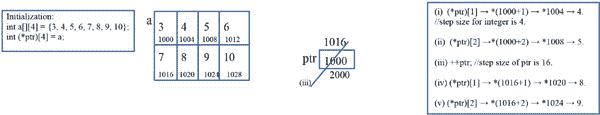

5. **d**

   **解释：** 指针 `ptr` 是一个普通指针，它取决于机器地址线的数量。由于我们假设有 32 条地址线，运算符 `sizeof(ptr)` 返回 4。`ptr` 包含数组的一行。`sizeof(*ptr)` 返回该行的大小，这里是 16。

6. **d**

   **解释：** 我们已经在第 4 组讨论过此题的类似版本。`char` 的范围是从 -128 到 +127。当该类型的任何变量达到 +127 值时，`char` 会发生回绕到 -128。在给定的程序第 2 行，表达式变为 `c = 124 + 9` → `127 + 6` → 它发生回绕并使其变为 -128 + 5，结果为 -123。

7. **d**

   **解释：** 静态变量的初始化……（此处省略重复的初始化描述……）

## 20. 解释

**解释：** 在给定函数 `fun()` 中，`b` 并不是数组的基地址，因此我们可以更新它。正如我们讨论过的，在函数调用期间，数组传递的只有一个指针。在执行语句 `++b;` 之后，变量 `b` 开始指向数组 `a` 的第 2 行。对于 `b` 来说，剩余的数组为 `b[2][2]`，包含了给定数组的第 2 行和第 3 行。`b[2][2]` 中的索引按照通常的 0..1 行和 0..1 列开始。对于此，`b[1][1]` 等于数组 `a[2][1]`。因此，`a[2][1]` 被更新为 777。

### 21. **b**

**解释：** 我们已经讨论过这类问题。当没有任何 `case` 标签匹配 `switch` 条件时，`default` 将执行。在执行 `default` 语句之后，`default` 之后的所有后续 `case` 都会被执行，而不再匹配 `switch` 条件，直到 `switch` 块结束或遇到 `break`。

### 22. **c**

**解释：** 一道练习题，我们已经讨论过关于括号运算符的问题。

### 23. **c**

**解释：** 在第 1 行，没有这种语法，编译器会报错。这类似于 `int a = 3, 4;`。

### 24. **d**

**解释：** 一道练习题，我们已经讨论过这类问题。在代码区域（只读区域）不允许进行更新。

### 25. **c**

**解释：** 不需要，这是一道练习题。

### 26. **b**

**解释：** 一道很好的练习题，不需要解释。

### 27. **Nil**

**解释：** 所有的给定声明都是相同的，因为当我们把数组传递给函数时，它会立即拆分为指针。我们已经讨论过二维数组和三维数组。

### 28. **b**

**解释：** 一道很好的练习题，不需要解释。

### 29. **c**

**解释：** 不需要。`%s` 格式说明符只返回遇到空字符之前的字符串。

### 30. **d**

**解释：** 这是一个很好的题目之一。关于“指向数组的指针”的基础知识，请参考问题 4。请彻底理解它。

► `(*ptr)[6]` 可以指向一个有 6 列的二维数组，这里 `ptr` 指向数组的第一行。◄

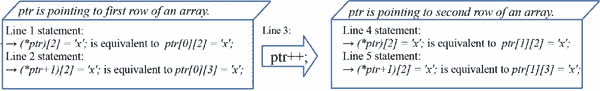

► 给定的数组被更新为 `{"hexxo", "Inxxa"}`。

### 31. **c**

**解释：** 遵循上述问题概念的练习题。不需要解释。

### 32. **b**

**解释：** 我们正将一个二维数组传递给单指针。正如我们所知，C 语言中的二维数组是按行顺序存储的。该二维数组已转换成一维数组，如下：

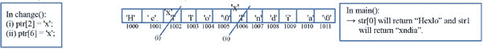

### 33. **b**

**解释：** 另一道很好的练习题。不需要解释。

### 34. **d**

**解释：** 参考问题 9 第 1 组的解释。只读区域是有限的，因此为了利用内存分配，编译器首先检查内存中是否分配了相同的字符串。如果是，内存管理器简单返回之前的地址；否则分配新内存并返回新地址。这里，`str1` 和 `str2` 包含相同的字符串，字符串存储在内存的只读区域。因此地址是相同的。`str3[]` 和 `str4[]` 在栈区域分配内存，它们各自获得独立的地址空间。因此，它们存储在不同的位置。

### 35. **d**

**解释：** 不需要。提示：在 `printf()` 函数中，只读内存中只创建了一个 `"hello"` 实例。

### 36. **c**

**解释：** 字符数组用字符串 `"India"` 初始化。在数组 `str` 中，`"India"` 从索引 0 存储到 4，剩余从索引 5 到 7 的元素以空字符（`\0`）作为初始化值（不是垃圾值）。在第 2 行，`'x'` 存储在索引 6 处，但在 `str[5]` 处为空字符。在第 3 行，`printf()` 打印从 `str[0]` 开始的字符串，直到遇到空字符（此处空字符在索引 5）。因此，打印了 `"India"`。

### 37. **e**

**解释：** 不需要。

### 38. **d**

**解释：** 不需要。

### 39. **a**

**解释：** 不需要。

### 40. **c**

**解释：** 在 gcc 中，整数被隐式转换为字符。我们可以在语句 `char p = x;` 中看到这一点。这个问题是小端存储机制的一种版本。`x = 0xabcdef;` 是十六进制形式，它以小端模式存储在内存中。我们已经假设以大端模式存储的情况下讨论过这类问题的答案。

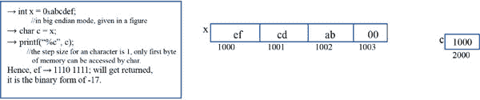

### 41. **a**

**解释：** 在给定程序中，所有宏将在预处理阶段替换为它们的定义。

### 42. **c**

**解释：** 在 gcc 中，整数被隐式转换为字符。我们可以在语句 `char p = x;` 中看到这一点。这个问题是小端存储机制的一种版本。`x = 0xabcdef;` 是十六进制形式，它以小端模式存储在内存中。我们已经假设以大端模式存储讨论过这类问题的答案。

### 43. **a**

**解释：** 在 gcc 中，整数被隐式转换为字符。我们可以在语句 `char p = x;` 中看到这一点。这个问题是小端存储机制的一种版本。`x = 0xabcdef;` 是十六进制形式，它以小端模式存储在内存中。我们已经假设以大端模式存储讨论过这类问题的答案。

### 44. **b**

**解释：** 在 gcc 中，整数被隐式转换为字符。我们可以在语句 `char p = x;` 中看到这一点。这个问题是小端存储机制的一种版本。`x = 0xabcdef;` 是十六进制形式，它以小端模式存储在内存中。我们已经假设以大端模式存储讨论过这类问题的答案。

### 45. **c**

**解释：** 在 gcc 中，整数被隐式转换为字符。我们可以在语句 `char p = x;` 中看到这一点。这个问题是小端存储机制的一种版本。`x = 0xabcdef;` 是十六进制形式，它以小端模式存储在内存中。我们已经假设以大端模式存储讨论过这类问题的答案。

### 46. **b**

**解释：** 在 gcc 中，整数被隐式转换为字符。我们可以在语句 `char p = x;` 中看到这一点。这个问题是小端存储机制的一种版本。`x = 0xabcdef;` 是十六进制形式，它以小端模式存储在内存中。我们已经假设以大端模式存储讨论过这类问题的答案。

### 47. **c**

**解释：** 在 gcc 中，整数被隐式转换为字符。我们可以在语句 `char p = x;` 中看到这一点。这个问题是小端存储机制的一种版本。`x = 0xabcdef;` 是十六进制形式，它以小端模式存储在内存中。我们已经假设以大端模式存储讨论过这类问题的答案。

### 48. **b**

**解释：** 在 gcc 中，整数被隐式转换为字符。我们可以在语句 `char p = x;` 中看到这一点。这个问题是小端存储机制的一种版本。`x = 0xabcdef;` 是十六进制形式，它以小端模式存储在内存中。我们已经假设以大端模式存储讨论过这类问题的答案。

### 49. **d**

**解释：** 在 gcc 中，整数被隐式转换为字符。我们可以在语句 `char p = x;` 中看到这一点。这个问题是小端存储机制的一种版本。`x = 0xabcdef;` 是十六进制形式，它以小端模式存储在内存中。我们已经假设以大端模式存储讨论过这类问题的答案。

### 50. **b**

**解释：** 在 gcc 中，整数被隐式转换为字符。我们可以在语句 `char p = x;` 中看到这一点。这个问题是小端存储机制的一种版本。`x = 0xabcdef;` 是十六进制形式，它以小端模式存储在内存中。我们已经假设以大端模式存储讨论过这类问题的答案。

### 51. **a**

**解释：** 在 gcc 中，整数被隐式转换为字符。我们可以在语句 `char p = x;` 中看到这一点。这个问题是小端存储机制的一种版本。`x = 0xabcdef;` 是十六进制形式，它以小端模式存储在内存中。我们已经假设以大端模式存储讨论过这类问题的答案。

### 52. **b**

**解释：** 在 gcc 中，整数被隐式转换为字符。我们可以在语句 `char p = x;` 中看到这一点。这个问题是小端存储机制的一种版本。`x = 0xabcdef;` 是十六进制形式，它以小端模式存储在内存中。我们已经假设以大端模式存储讨论过这类问题的答案。

### 53. **a**

**解释：** 在 gcc 中，整数被隐式转换为字符。我们可以在语句 `char p = x;` 中看到这一点。这个问题是小端存储机制的一种版本。`x = 0xabcdef;` 是十六进制形式，它以小端模式存储在内存中。我们已经假设以大端模式存储讨论过这类问题的答案。

### 54. **a**

**解释：** 在 gcc 中，整数被隐式转换为字符。我们可以在语句 `char p = x;` 中看到这一点。这个问题是小端存储机制的一种版本。`x = 0xabcdef;` 是十六进制形式，它以小端模式存储在内存中。我们已经假设以大端模式存储讨论过这类问题的答案。

### 55. **c**

**解释：** 在 gcc 中，整数被隐式转换为字符。我们可以在语句 `char p = x;` 中看到这一点。这个问题是小端存储机制的一种版本。`x = 0xabcdef;` 是十六进制形式，它以小端模式存储在内存中。我们已经假设以大端模式存储讨论过这类问题的答案。

### 56. **b**

**解释：** 在 gcc 中，整数被隐式转换为字符。我们可以在语句 `char p = x;` 中看到这一点。这个问题是小端存储机制的一种版本。`x = 0xabcdef;` 是十六进制形式，它以小端模式存储在内存中。我们已经假设以大端模式存储讨论过这类问题的答案。

## 57. **见下文**

**解释：** 参考第 4、5 和 30 题的解释。`sizeof(char)` 为 1（变量 `c`、`d`），`sizeof(a)` 为 4，`sizeof(b)` 为 4，`sizeof(*e)` 为 20。假设数组 `c` 的基地址为 1000。

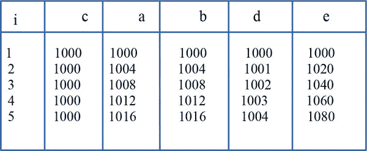

## 58. **d**

**解释：** 动态内存分配函数 `malloc()` 和 `free()`，我们在第 5 题第 1 组的解释中讨论过。

► 函数 `malloc()` 以块的形式分配内存，块的大小是存储该类型单个元素所需的字节数。例如，对于一个整数，其块大小为 4。同样，对于字符和浮点数，它们的块大小分别为 1 和 4。

► 如果我们在给定程序的第 4 行为 10 个整数动态分配内存，那么分配的内存在堆区域内以连续形式存在。第一个块包含头部（header），其中包含关于剩余块和内存分配方案的信息。`p` 仅包含第 1 个块的地址。它可以被视为基地址，我们可以通过增加索引访问其他块。它的工作方式类似于数组。这种数组与实际数组的区别在于它的基地址不是固定的，而实际数组的基地址始终是常量。

► 如果我们执行 `free(p)`，`p` 包含第一个块的地址。第一个块包含头部，头部也包含关于其他块的信息。`free(p)` 将释放所有 10 个整数的内存。

► 假设我们执行 `p++`，现在 `p` 指向第 2 个块。假设我们要释放内存 `free(p)`，它会抛出运行时错误，因为第二个块没有关于剩余块的任何信息。我们试图在不知道块数量的情况下释放内存块。因此，这是可能的。

在这里，在给定的程序中，第 2 行 `i` 被更新，间接地导致 `p` 也被更新。现在，`p` 开始指向数组的第 2 个块（元素）。在第 7 行，我们尝试释放动态内存。但指针 `p` 并不知道内存分配方案，因为它没有指向包含内存分配方案信息的第一个块。因此，抛出了运行时错误。

## 59. **Nil**

**解释：**

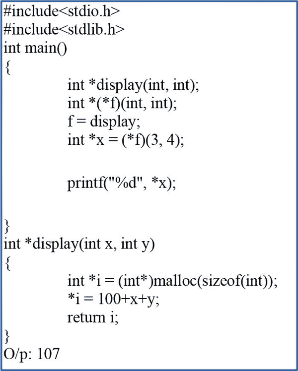

## 60. **Nil**

**解释：**

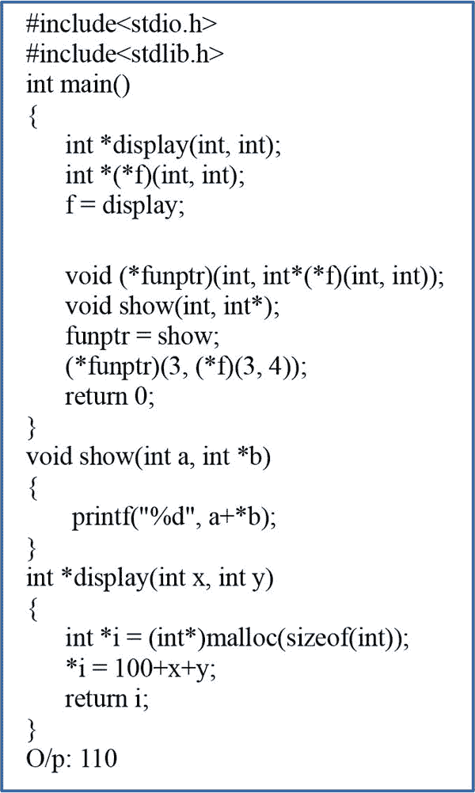

*不要让你的学校干扰了你的教育。*

# 第 6 组题目

## C 语言题数量：60

## 其他重要面试题：20


1. **以下程序的输出是什么？**

```c
#include <stdio.h>

int main()
{
    int a = 10, b = 20;

    b = printf("%d ", sizeof(sizeof(a *= a + b))); // line 2
    printf("%d %d ", a, b);

    return 0;
}
```

(a) 4 300 20  
(b) 4 300 1  
(c) 4 10 2  
(d) error - 编译错误

2. **以下程序的输出是什么？**

```c


## C语言程序输出预测练习

以下是一系列C语言程序输出预测题，请根据每个程序代码选择正确的输出结果。

---

**1. 以下程序的输出是什么？**

```c
#include<stdio.h>

int main()
{
    int x = 10 , y = 10 , z = 10;
    x = y == z && 5;
    printf("%d",x);
    return 0;
}
```

(a) 0
(b) 1
(c) error- 编译错误
(d) 10

---

**2. 以下程序的输出是什么？**

```c
#include<stdio.h>

int main()
{
    int a = 10;
    a = 5 , 100;
    printf("%d",a);
    return 0;
}
```

(a) 10
(b) 5
(c) 100
(d) error- 编译错误

---

**3. 以下程序的输出是什么？**

```c
#include<stdio.h>
#include<string.h>

int main()
{
    int i = 0;
    char c[] = "hello";
    char d[] = "India";
    char b[] = i ? c : d ; //line 3
    printf("%s",b);
    return 0;
}
```

(a) India
(b) hello
(c) error- 编译错误
(d) 码

---

**4. 以下程序的输出是什么？**

```c
#include<stdio.h>

int main()
{
    int a = 0 , b = 20 , 10; //line 1
    b = (110 ,120);
    printf("%d",b);
    return 0;
}
```

(a) 20
(b) 10
(c) 110
(d) 120
(e) error- 编译错误

---

**5. 以下程序的输出是什么？**

```c
#include<stdio.h>

int main()
{
    int a = 10;
    a++;
    (a++) //line 3
    printf("%d",a);
    return 0;
}
```

(a) 13
(b) 12
(c) error- 需要左值
(d) error- 运行时错误

---

**6. 以下程序的输出是什么？**

```c
#include<stdio.h>
#include<string.h>

int main()
{
    int i = 0;
    char c[] = "hello";
    char d[] = "India";
    char *b = i ? c : d ; //line 3
    printf("%s",b);
    return 0;
}
```

(a) India
(b) hello
(c) error- 编译错误
(d) 码

---

**7. 以下程序的输出是什么？**

```c
#include<stdio.h>

int main()
{
    int b = 20;
    int c = sizeof(scanf("%d",&b));
    printf("%d %d",b,c);
    return 0;
}
```

(a) errror- 编译错误
(b) 20 4
(c) 30 4

---

**8. 以下程序的输出是什么？**

```c
#include<stdio.h>
#include<string.h>

int main()
{
    int i = 1;
    char c[] = "hello";
    char d[] = "India";
    char *b;
    b = i ? c : d ; //line 3
    printf("%s",b);
    return 0;
}
```

(a) India
(b) hello
(c) error- 编译错误
(d) 码

---

**9. 以下程序的输出是什么？**

```c
#include<stdio.h>

int main()
{
    int a = 1 , b = 0;
    int c = ++(b)||a++;
    printf("%d %d %d",a,b,c);
    return 0;
}
```

(a) 1 2 1
(b) 1 1 1
(c) 2 2 1
(d) error- 需要左值

---

**10. 考虑以下声明：**

(i) `short i=10;`
(ii) `static i=10;`
(iii) `unsigned i=10;`
(iv) `const i=10;`

(a) i, iv, v
(b) ii, iii, v
(c) i, iii, v
(d) i, ii, iii, v

---

**11. 以下程序的输出是什么？**

```c
#include<stdio.h>

int main()
{
    int x = 010 , y = 0x10 , z = 10;
    printf("%d %d %d",x,y,z);
    return 0;
}
```

(a) 8 16 10
(b) 10 10 10
(c) error : x 使用无效
(d) 010 010 10

---

**12. 以下哪一个会导致编译错误？**

(a)
```c
#include<stdio.h>

#define display(A,B) {
    printf(A , B);
}

int main(){
    display("%d",10);
    return 0;
}
```

(b)
```c
#include<stdio.h>

#define display(A,B) do{
    printf(A , B);
}while(1 == 2)

int main(){
    display("%d",10);
    return 0;
}
```

(c)
```c
#include<stdio.h>

#define display(A,B) {
    printf(A , B);
}

int main(){
    display("%d",10)
    return 0;
}
```

(d) 以上均不是

---

**13. 以下程序的输出是什么？**

```c
#include<stdio.h>

#define cal(a,b,c,d) a+b*c+d

int main()
{
    int a = 1 , b = 2 , c = 3 , d = 4 , e = 5;
    int f = e * cal(a,b,c,d); //line 2
    printf("%d",f);
    return 0;
}
```

(a) 55
(b) 15
(c) 16
(d) 54

---

**14. 以下程序的输出是什么？**

```c
#include<stdio.h>

#define sqrt(x) x+++x*++x

int main()
{
    int x = 10;
    int y = sqrt(x); //line 2
    printf("%d %d",x,y);
    return 0 ;
}
```

(a) 13 120
(b) 13 182
(c) 13 153
(d) error- 编译错误

---

**15. 以下程序的输出是什么？**

```c
#include<stdio.h>
#include<string.h>

#define type_char char*

int main()
{
    type_char a ;
    type_char b;
    char c[10] , d[10];
    strcpy(c , "hello");
    strcpy(d , "India");
    a = c;
    b = d;
    printf("%s %s" , &a[2], &b[2]);
    return 0;
}
```

(a) 码
(b) llo dia
(c) error- 编译错误
(d) error- 运行时错误

---

**16. 下面程序的输出是什么？**

```c
#include<stdio.h>
#include<string.h>

#define type_char char*

int main()
{
    type_char a ;
    type_char b;
    char c[10] , d[10];
    strcpy(c , "hello");
    strcpy(d , "India");
    a = c;
    b = d;
    printf("%c %c" , a[2],b[2]);
    return 0;
}
```

(a) l d
(b) llo dia
(c) 错误-编译时
(d) 错误-运行时

---

**17. 下一个程序的输出是什么？**

```c
#include<stdio.h>

typedef char *str ;

int main()
{
    str a , b;
    char A[10] , B[10];
    strcpy(A,"hello");
    strcpy(B,"world");
    a = A; b = B;
    printf("%c %c" , a[2] , b[2]);
    return 0 ;
}
```

(a) l r
(b) 垃圾值
(c) 错误-编译时
(d) 错误-运行时

---

**18. 下面程序的输出是什么？**

```c
#include<stdio.h>

#define cal(a,b) a = b++

int main()
{
    int a = 1 , b = 5;
    cal(a , 2); // line 2
    printf("%d",a);
    printf("%d",b);
    return 0;
}
```

(a) 2 5
(b) 2 3
(c) 3 5
(d) 错误-编译时

---

**19. 下面程序的输出是什么？**

```c
#include<stdio.h>

int x = 2;
#if Y == 2 //line 3
x = 5; //line 4
#else
x = 6; //line 6
#endif

int main()
{
    printf("%d",x);
    return 0;
}
```

(a) 2
(b) 5
(c) 6
(d) 错误-编译时

---

**20. 下面程序的输出是什么？**

```c
#include<stdio.h>

#define a 100

int foo()
{
    printf("%d ",a); //line 5
    return 0;
}

int main()
{
    int b = a; //line 10
    #define a 200 //line 11
    printf("%d ",b);
    printf("%d ",a); //line 13
    foo();
    return 0;
}
```

(a) 100 200 200
(b) 100 200 100
(c) 200 200 200
(d) 错误-不允许重复定义宏

---

**21. 下面程序的输出是什么？**

```c
#include<stdio.h>
#include<string.h>

void mystrcpy(char p[] , const char q[])
{
    while(*p++ = *q++);
}

int main()
{
    char a[10];
    char b[] = "hello masters";
    mystrcpy(a , b);
    printf("%s",a);
    return 0;
}
```

(a) hello
(b) masters
(c) hello masters
(d) 什么都不会打印

---

**22. 下面程序的输出是什么？**

```c
#include<stdio.h>

#define abc main

int main()
{
    int abc = 10;
    static int i = 1;
    while(abc > 5)
    {
        i++;
        abc--;
    }
    i++;
    if(abc == 5)
    {
        abc--;
        i++;
        printf("%d",i);
    }
}
```

(a) 9
(b) 8
(c) 5
(d) 错误-编译时

---

**23. 下面程序的输出是什么？**

```c
#include<stdio.h>

#define fun1 fun2 //line 2
#if x == 1 //line 3
#define fun2 fun3 //line 4
#else //line 5
#define fun2 fun4 //line 6
#endif

int main()
{
    int fun1 = 2 , fun2 = 3 , fun4 = 4; //line 10
    fun1 = fun2 + fun1;
    printf("%d",fun1);
    return 0;
}
```

(a) 8
(b) 6
(c) 错误-编译时
(d) 错误-运行时

---

**24. 下面程序的输出是什么？**

```c
#include<stdio.h>

#define fun1 fun2
#define x 1
#if x == 1
#define fun2 fun3
#else
#define fun2 fun4
#endif

int main()
{
    int fun1 = 2 , fun2 = 3 , fun4 = 4;
    fun1 = fun2 + fun1;
    printf("%d",fun1);
    return 0;
}
```

(a) 8
(b) 6
(c) 错误-编译时
(d) 错误-运行时

---

**25. 下面程序的输出是什么？**

```c
#include<stdio.h>

#define fun1 fun2
#if x == 1
#define fun2 fun3
#else
#define fun2 fun4
#endif

int main()
{
    int fun3 = 3 , fun4 = 4;
    fun1 = fun2 + fun1;
    printf("%d",fun1);
    return 0;
}
```

(a) 8
(b) 6
(c) 错误-编译时
(d) 错误-运行时

---

**26. 下面程序的输出是什么？假设 `main()` 的地址为 `0x1000`。**

```c
#include<stdio.h>

#define abc main

int main()
{
    int abc = 10;
    printf("the value of abc : %d",abc);
    return 0;
}
```

(a) the value of main : 10
(b) the value of abc : 10
(c) the value of abc : 0x1000
(d) 错误-编译时

---

**27. 下面程序的输出是什么？**

```c
#include<stdio.h>

#define fun(a , b) (a ; b = 10)

int main()
{
    fun(int , a);
    printf("%d",a);
    return 0;
}
```

(a) 10
(b) 错误-编译时
(c) 错误-运行时
(d) 垃圾值

---

**28. 下面程序的输出是什么？**

```c
#include<stdio.h>

#define fun(var) printf("var is %s",#var);

int main()
{
    int i = 10;
    fun(i);
    return 0;
}
```

(a) i is 10
(b) var is i
(c) var is 10
(d) 10 is 10

---

**29. 下面程序的输出是什么？**

```c
#include<stdio.h>

#define fun max

void max()
{
    printf("Hello");
    return 0;
}

void fun()
{
    printf("World");
    return 0;
}

int main()
{
    fun();
    max();
    return 0;
}
```

(a) World Hello
(b) 宏定义错误
(c) 函数重复定义错误
(d) 编译器相关

---

**30. 下面程序的输出是什么？**

```c
#include<stdio.h>

#define fun(x) x*x

int main()
{
    int x = 2;
    int y = fun(x+2); // line 2
    printf("%d ", y);
    return 0;
}
```

(a) 20
(b) 9
(c) 8
(d) 2

---

**31. 找出两个两个包含指令之间的区别。**

(i) `#include<stdio.h>`
(ii) `#include"stdio.h"`

---

**32. 下面程序的输出是什么？**

```c
#include<stdio.h>
#include<stdlib.h>

void fun();

int main()
{
    typedef int a; //line 1
    a p; //line 2
    p = 10;
    printf("%d",p);
    return 0;
}

void fun();
```

(a) 10 1
(b) typedef 不能是函数局部的
(c) 第 2 行错误
(d) 第 8 行错误

---

**33. 下面程序的输出是什么？**

```c
#include<stdio.h>

int main()
{
    enum block{one , two = 5 , three , four = 10, five};
}
```


### 34. 下面程序的输出是什么？

```c
printf("%d %d %d ",one , three, five);

return 0;

}
```

(a) 编译  
(b) 1 2 3  
(c) 0 6 7  
(d) 0 6 11  

### 35. 下面程序的输出是什么？

```c
#include<stdio.h>

enum block{one = 1 , two , three = 1};

int main()

{

    enum block{one = 2, two , three = 2};

    printf("%d %d ",one , two);

    return 0;

}
```

(a) 错误-编译时  
(b) 1 0  
(c) 2 0  
(d) 2 3  

### 36. 下面程序的输出是什么？

```c
#include<stdio.h>

enum block{first = 2.5, second , third = 0.5};

int main()

{

    printf("%d ",second);

    return 0;

}
```

(a) 0  
(b) 1.5  
(c) 3.5  
(d) 错误-编译时  

### 37. "hello" 会打印多少次？

```c
#include<stdio.h>

enum block{one = 1 , two , three = 3};

int main()

{

    while(two != 2)

    {

        printf("Hello");

        two++; //line 3

    }

    return 0;

}
```

(a) 2  
(b) 1  
(c) 0  
(d) 错误-编译时  

### 38. 下面程序的输出是什么？

```c
#include<stdio.h>

enum block{one = 1 , two , three };

int abc(enum*);

int main()

{
```

```c
enum block2 {one = 2 , two , three};

int i = abc(&block2);

printf("%d",i);

return 0;

}

int abc(enum *temp)

{

return (temp->two);

}
```

(a) 0  
(b) 3  
(c) 2  
(d) 错误- 编译时  

### 39. 下列程序的输出是什么？

```c
#include<stdio.h>

enum block{first = 1 , second , third };

int main()

{

  enum block a = second;

  if(third) //line 2

  a = first;

  printf("%d",strcmp(a,"first"));

  return 0;

}
```

(a) 0  
(b) 1  
(c) 2  
(d) 错误- 运行时  

### 40. 下列程序的输出是什么？

```c
#include<stdio.h>

enum block1{one = 1 , two };

enum block2{two = 3 , three};

int main()

{

  enum block2 b = two;

  printf("%d",b);

  return 0;

}
```

(a) 3  
(b) 2  
(c) 0  
(d) 错误- 编译时  

### 41. 下列程序的输出是什么？

```c
#include<stdio.h>

enum block{one = "a" , two = "b" };

int main()

{

  printf("%s",one);

  return 0;

}
```

(a) a  
(b) 97  
(c) 错误- 编译时  
(d) 垃圾值  

### 42. 下列程序的输出是什么？

```c
#include<stdio.h>

enum block{one = ‘a’ , two = ‘b’ };

int main()

{

  printf("%c ",one);

  printf("%d",two);

  return 0;

}
```

(a) a 98  
(b) 垃圾值  
(c) 错误- enum 中不允许字符  
(d) 错误- 运行时  

### 43. 下列程序的输出是什么？

```c
#include<stdio.h>

enum block{one = 1 , two = ‘b’ , three = "c" };

int main()

{

  printf("%d",one);

  printf("%c",two); //line 2

  printf("%s",three); //line 3

  return 0;

}
```

(a) 1 b c  
(b) 错误: enum 中不允许不同类型的元素  
(c) 错误: 第 2 行 enum 不可以为 char  
(d) 错误: 第 3 行 enum 不可以为字符串  

### 44. 下列程序的输出是什么？

```c
#include<stdio.h>

#define i 10

int main()

{

  enum block{int = i , two };

  printf("%d",two);

  return 0;

}
```

(a) 0  
(b) 1  
(c) 11  
(d) 错误- 编译时  

### 45. 给定的定义之间有什么区别？

(i) `const int i = 10;`  
(ii) `int const i = 10;`

(a) 两者都合法但不等效。  
(b) (i) 非法但 (ii) 不是。  
(c) (i) 合法但 (ii) 不是。  
(d) 两者都合法且等效。  

### 46. 关于给定的声明，以下哪个选项是正确的？

(i) `const char *p.`  
(ii) `char const *p.`  
(iii) `char *const p.`  

(a) (i) 和 (ii) 等效且 (iii) 无效  
(b) 全部有效且等效  
(c) 仅 (i) 有效  
(d) 全部有效，且 (i) 和 (ii) 等效，但 (iii) 不等于 (i) 和 (ii)。  

### 47. 下列程序的输出是什么？

```c
#include<stdio.h>

int fun()

{

  return 20;

}

int main()

{

  const int i = fun();

  const int *p = &i;

  printf("%d" , *p);

  return 0;

}
```

(a) 20  
(b) 错误- 运行时  
(c) 10  
(d) 错误- 编译时  

### 48. 下列程序的输出是什么？

```c
#include<stdio.h>

int fun(){return 1;

int main()

{

  enum block{int = fun() , two };

  printf("%d",two);

  return 0;

}
```

(a) 1  
(b) 垃圾值  
(c) 2  
(d) 错误- 编译时  

### 49. 下列程序的输出是什么？

```c
#include<stdio.h>

enum block {one = 1 , two = 2};

int main()

{

  enum block = two; //line 1

  printf("%d",block);

  return 0;

}
```

(a) 2  
(b) 1  
(c) 错误- 编译时  
(d) 垃圾值  

### 50. 下列程序的输出是什么？

```c
#include<stdio.h>

enum block1 {sun = 1 , mon };

enum block2 {ue = 1 , thus};

int main()

{

  enum block1 day = thus; //line 1

  printf("%d",day);

  return 0;

}
```

(a) 2  
(b) 0  
(c) 错误- 编译时  
(d) 1  

### 51. 下列程序的输出是什么？

```c
#include<stdio.h>

#include<string.h>

enum block1 {sun = 1 , mon };

enum block2 {sun = 1 , mon};

int main()

{

  enum block1 a = sun;

  enum block2 b = sun;

  printf("%d",strcmp(a,b));

  return 0;

}
```

(a) 1  
(b) 0  
(c) 错误- 编译时  
(d) 2  

### 52. 下列程序的输出是什么？

```c
#include<stdio.h>

enum block {one = 1+2 , two };

int main()

{

  enum block a = two;

  if(two)

  a = two+1;

  printf("%d",a);

  return 0;

}
```

(a) 0  
(b) 3  
(c) 5  
(d) 错误- 编译时  

### 53. 下列程序的输出是什么？

```c
#include<stdio.h>

int sun = 10;

enum block {sun , mon};

int main()

{

  int i = block.sun + mon;

  printf("%d",i);

  return 0;

}
```

(a) 21  
(b) 11  
(c) 1  
(d) 错误- 编译时  

### 54. 下列程序的输出是什么？

```c
#include<stdio.h>

int one = 10;

enum block {one , two};

int main()

{

  int i = one + two;

  printf("%d",i);

  return 0;

}
```

(a) 21  
(b) 11  
(c) 1  
(d) 错误- 编译时  

### 55. 下列程序的输出是什么？

```c
#include<stdio.h>

enum block {first = 1 , second = 2};

int main()

{

  enum block a ;

  printf("%d ",sizeof(a));

  return 0;

}
```

(a) 错误- 编译时  
(b) 8  
(c) 1  
(d) 4  

### 56. 下列程序的输出是什么？

```c
#include<stdio.h>

int main()

{

  union unit

  {

    int marks = 95;

    int roll ;

  } std1 , std2;

  std2.roll = 512;

  std1.marks = 68;

  printf("%d %d",std1.marks , std2.marks);

  return 0;

}
```

(a) 68 95  
(b) 68 垃圾值  
(c) 68 512  
(d) 错误-编译时  

### 57. 下列程序的输出是什么？

```c
#include<stdio.h>

int main()

{

  union unit{

    int marks ;

    int roll ;

  } ;

  union unit a;

  a.marks = 90;

  printf("%d",a.roll);

  return 0;

}
```

(a) 垃圾值  
(b) 0  
(c) 90  
(d) 错误- 编译时  

### 58. 下列程序的输出是什么？

```c
#include<stdio.h>

union unit{

  int a ;

  double c;

  float b;

} obj;

int main()

{

  int i = printf("%d",sizeof(obj));

  printf(" %d",i);

  return 0;

}
```

(a) 16 2  
(b) 20 2  
(c) 8 1  
(d) 8 8  

### 59. 下列程序的输出是什么？

```c
#include<stdio.h>

union unit{

  int a;

  char b[4];

} obj;

int main()

{

  obj.a = 100; //line 1

  printf("%s ",obj.b); //line 2

  strcpy(obj.b , "baby"); //line 3

  printf("%d %s\n",obj.a,obj.b); //line 4

  return 0;

}
```

(a) 错误- 编译时  
(b) 垃圾值 100  
(c) d 100 baby  
(d) d baby 的整数值 baby  

### 60. 下列程序的输出是什么？

```c
#include<stdio.h>

union unit{

  int a;

  char b[4];

} obj;

int main()

{

  obj.a = 100;

  printf("%s ",obj.b);

  obj.b[0] = ‘a’;

  printf("%d ",obj.a);

  obj.b[1] = ‘b’;

  printf("%d %s",obj.a,obj.b);

  return 0;

}
```


```
(a) 垃圾值 100 100 ab
(b) d 97 9798 ab
(c) d 97 25185 ab
(d) 错误- 编译时
```

# 其他面试问题如下：

1. 写一个 C 语言来实现你自己的`sizeof()`。
2. 写一个没有`main()`函数的可执行程序。
3. 编写一个 C 程序，在给定的链表中插入一个节点。
4. 编写一个 C 程序，删除整个链表。
5. 编写一个 C 程序，从链表中删除一个节点。你得到了两个指针：指向链表第一个节点的`start`指针和指向要删除节点的`ptr`指针。你不能使用`start`指针。
6. 编写一个 C 程序，打印链表中从尾倒数的第 N 个节点。
7. 编写一个 C 程序，统计给定键（`key`）在链表中出现的次数。
8. 编写一个 C 程序，检查单向链表是否为回文。
9. 编写一个 C 程序，在有序链表中插入一个键（`key`），插入后链表应保持有序状态。
10. 编写一个 C 程序，从有序链表中删除重复元素。
11. 编写一个 C 程序，从无序链表中删除重复元素。
12. 将给定链表的最后一个元素移动到表头。
13. 用 C 语言编写合并两个有序链表的程序。
14. 用 C 语言编写用于链表的归并排序。
15. 编写一个 C 程序，删除右侧值大于当前值的节点。
16. 编写一个 C 程序，求两个链表的并集（`Union`）和交集（`Intersection`）。
17. 编写一个 C 程序，不使用递归反转链表。
18. 编写一个 C 程序，每 n 个节点一组反转链表。你有一个链表和一个数字`n`，你必须反转前 n 个节点，然后是后 n 个，以此类推；最后如果剩余节点少于 n 个则不反转。
19. 编写一个 C 程序，找到链表的中间节点。
20. 编写一个 C 程序，检查给定的链表是否以 `NULL` 终止。

# Group-6 解释

1. **c**
   **解释：** 在第 2 行，内部的`sizeof()`运算符没有计算，因为它是外部`sizeof()`运算符的操作数。`sizeof()`运算符返回的类型是`unsigned int`。外部`sizeof()`运算符计算的是内部`sizeof()`返回的`unsigned int`的大小，即 4。我们已经讨论过`sizeof()`不会计算任何表达式，因此`a`的值保持为 10，`b`被`printf()`函数更新，其值变为 2，因为`printf()`只打印了一个字符。

2. **b**
   **解释：** 关系运算符的优先级高于逻辑运算符（高于赋值运算符）。给定表达式`x=y==z&&5`的计算过程为：`x = ((y == z) && 5)` → `x = ((10==10) && 5)` → `x = (1&&5))` → `x = 1`。

3. **b**
   **解释：** 不需要。我们已经讨论过这类问题了。

4. **c**
   **解释：** 在第 3 行，三元运算符在这里返回了一个值。数组不能这样初始化。数组可以使用大括号`{}`逐元素地初始化，或者如果是字符数组，可以这样初始化：`char str[] = "hello";`；而`char str[] = <expression>;`是不允许的。第 3 行的语句是无效的。

5. **e**
   **解释：** 在第 1 行，我们尝试定义一个名为 10 的变量。在 C 语言中，变量名不能以数字和特殊符号开头（`_`除外）。

6. **c**
   **解释：** 不需要。*提示：* 我们不能给数字赋值，赋值运算符的左侧必须有一个变量来存储该值。

7. **a**
   **解释：** 不需要。参考第 4 题。

8. **b**
   **解释：** `scanf()`库函数的返回类型是`int`。在第 2 行，`sizeof()`运算符返回`int`数据类型的大小，即 4。变量`c`被赋值为 4。

9. **b**
   **解释：** 不需要。参考第 4 和第 7 题。

10. **d**
    **解释：** 不需要。*提示：* 在第 2 行，我们是对值而非变量应用了`++`运算符，即`(++(++b))`。

11. **d**
    **解释：** 所有存储类的默认数据类型都是`int`。

12. **a**
    **解释：** 在第 1 行，`x`被赋值为 010，如果数字以 `'0'` 开头，则该数字变为八进制，八进制 10 等于十进制的 8；`y`被赋值为 0x10，如果数字以 `'0x'` 开头，则该数字变为十六进制，十六进制 10 等于十进制的 16；`z`被赋值为 10。在第 2 行，`printf()`打印`x`、`y`和`z`的十进制值。因此打印 8 16 10。

13. **a**
    **解释：** 选项(a)错误，因为多行宏的最后一行没有`\`。

14. **b**
    **解释：** 不需要。*提示：* 选项(a)错误，因为多行宏的最后一行没有`\`。

15. **c**
    **解释：** 在第 2 行，三元运算符在这里返回了一个值。数组不能这样初始化。数组可以使用大括号`{}`逐元素地初始化，或者如果是字符数组，可以这样初始化：`char str[] = "hello";`；而`char str[] = <expression>;`是不允许的。第 3 行的语句是无效的。

16. **b**
    **解释：** 不需要。

17. **a**
    **解释：** 不需要。

18. **a**
    **解释：** 不需要。

19. **d**
    **解释：** 在第 2 行，内部的`sizeof()`运算符没有计算，因为它是外部`sizeof()`运算符的操作数。`sizeof()`运算符返回的类型是`unsigned int`。外部`sizeof()`运算符计算的是内部`sizeof()`返回的`unsigned int`的大小，即 4。我们已经讨论过`sizeof()`不会计算任何表达式，因此`a`的值保持为 10，`b`被`printf()`函数更新，其值变为 2，因为`printf()`只打印了一个字符。

20. **d**
    **解释：** 检查给定的链表是否以 `NULL` 终止。

**解释：** 在第 3 行，宏`x`的值为 0（因为未定义，这是宏的默认值），条件变为假，且宏`fun2`被定义为`fun4`。在第 2 行，`fun1`被定义为`fun2`，在第 6 行，`fun2`被定义为`fun4`。最后，`fun1`和`fun2`都定义为`fun4`。在宏替换后，第 10 行变为：`int fun4 = 1, fun4 = 2, fun3 = 3, fun4 = 4;` 变量`fun4`存在重复定义，因此编译器报错。

### 25. **c**
**解释：** 不需要。

### 26. **a**
**解释：** 不需要。

### 27. **b**
**解释：** 给定的程序在预处理阶段替换宏`abc`之后，写法如下：

```c
#include<stdio.h>

int main()

{

int main = 10;

printf("the value of abc: %d", main);

return 0;

}
```

局部变量可以命名为`main`。函数`printf()`输出值 10。

### 28. **b**
**解释：** 给定的程序在宏替换后：

```c
#include<stdio.h>

int main()

{

(int a ; a = 10;)

printf("%d", a);

return 0;

}
```

在这里，我们在括号内给出了`a`的定义，这是不允许的。因此，编译器报错。

### 29. **b**
**解释：** 在给定的程序中，我们使用`#`作为宏定义，正如我们讨论过的，`#`将宏的元素转换为字符串。在第 3 行，`fun(i)`被替换为`printf("var is %s","i");`。`printf()`将输出 "var is i"。

### 30. **c**
**解释：** 不需要。*提示：* 在宏替换后，存在两个函数`max`的定义。

### 31. **c**
**解释：** 在宏替换后，第 2 行变为：`int y = x+2*x+2;` → `y = 2+2*2+2;` → `y = 8`。

### 32. **Nil**
**解释：** (i) "include" 指令在 gcc 器的标准`bin`目录搜索`stdio.h`头文件，(ii) "include" 指令先在本地目录搜索`stdio.h`头文件，然后在标准 `bin` 目录搜索。

### 33. **d**
**解释：** 在第 18 题的解释中讨论过。*提示：* `typedef`在`fun()`中可见。

### 34. **d**
**解释：** 给定的程序不会产生任何错误。应该了解关于`enum`的以下事实：(i) `enum`可以是局部的或全局。(ii) 如果`enum`的任何元素未初始化，如果它是第一个元素，则值为 0，否则取其前一个元素的值加 1。(iii) `enum`元素可以有负值。给定程序的`enum`为`enum block{one = 0, two = 5 , three = 6 , four = 10, five = 11};`。`printf()`函数输出 0 6 11。

### 35. **d**
**解释：** `main()`函数中的`printf()`取了局部`enum block`中的`enum`元素。

### 36. **d**
**解释：** `enum`元素必须是整数类型，不允许使用浮点数作为`enum`元素的值。

### 37. **d**
**解释：** 一旦 `enum` 元素被初始化，我们就无法更改它们的值。在第 3 行，我们尝试更改元素`two`的值，编译器报错：`l-value required as increment operand.`。

### 38. **d**
**解释：** 我们不能将`enum`作为参数传递给函数，只能传递它的元素。

### 39. **d**
**解释：** 在给定的程序中，在`printf()`之前的所有语句都是有效的。如果第 2 行的条件为真，类型为 "block" 的 enum 变量 `a` 的值将等于 enum "block" 元素 "first" 的值，即 1。现在在`printf()`语句中，我们通过`strcmp()`函数将整数值 1 与字符串 "first" 进行比较。因此，错误发生在运行时。

### 40. **d**
**解释：** 两个 enum 在同一个作用域内不能相同的变量名。在给定程序中，`enum block1`和`enum block2`作用域相同，且都具有元素 "two"，这是不允许的。

### 41. **c**
**解释：** 不需要。*提示：* `enum`元素必须是`int`类型，在给定的代码中我们用字符串初始化元素`one`和`two`。

### 42. **a**
**解释：** 给定的程序没有报告任何错误，在这里我们用字符字面量初始化`enum block`元素。在 C 语言中提供了从字符到整数的隐式类型转换，元素`one`获得值 97（字符的 ASCII 值），`two`获得值 98。`printf()`输出 97 98。

### 43. **d**
**解释：** 不需要。

### 44. **d**
**解释：** `Union`是用户定义的类型。在给定的程序中，我们定义了`union unit`，它包含两个字段 (i) 整数类型的`marks`和 (ii) 整数类型的`roll`，但我们在定义中提供了`marks`的值，这是不允许的。无法在创建实例的情况下为`union`字段赋值。对于`struct`也是如此。因此编译器报错。

### 45. **d**
**解释：** 不需要。

### 46. **d**
**解释：** `Union`是用户定义的类型。在给定的程序中，我们定义了`union unit`，它包含两个字段 (i) 整数类型的`marks`和 (ii) 整数类型的`roll`，但我们在定义中提供了`marks`的值，这是不允许的。无法在创建实例的情况下为`union`字段赋值。对于`struct`也是如此。因此编译器报错。

### 47. **a**
**解释：** 不需要。

### 48. **d**
**解释：** 不需要。

### 49. **c**
**解释：** 不需要。

### 50. **a**
**解释：** 不需要。

### 51. **c**
**解释：** 不需要。

### 52. **c**
**解释：** 不需要。

### 53. **d**
**解释：** `enum`是定义常量整数变量的另一种方法，如果定义为`int const a = 10;`它等同于`enum {a = 10};`。在给定的程序中，我们提供了变量`sun`的两个定义，分别在第 2 行和第 3 行。在同一个作用域内不能对变量有多个定义。因此，编译器报错。

### 54. **d**
**解释：** 第 53 题的另一个版本。

**解释：** `union`（联合体）有一个属性，它不会为所有元素分配内存，而是分配与最大元素大小相同的内存。在这里，最大的元素是类型为`double`的`c`。`union unit`分配的内存等于`double`的大小，即 8B。因此，`sizeof(obj)`返回 8。

### 59. **d**
**解释：** 正如我们之前讨论的，联合体不会为它的所有元素分配内存，而是获得可以容纳最大元素的内存。对于给程序，`union unit`将获得 4 字节的内存，联合体中任何元素进行的任何修改都只会反映在这 4 个字节上。在第 1 行，这 4 个字节被赋值为数字 100。在第 2 行，可以使用`%s`格式指定符打印这 4 个字节。它打印字符串`"d"`（`d`的 ASCII 值为 100）。在第 3 行，字符串`"baby"`被复制到这 4 个字节中。在第 5 行，使用整数格式指定符（`%d`）和字符串格式指定符（`%s`）打印这 4 个字节。将打印`"baby"`的整数值，字符串`"baby"`也将被打印。如果运行程序，`"baby"`的整数值将是 2036490594。该值的评估结果如下。

2036490594 的二进制：`'01111001 01100010 01100001 01100010'` [小端序：低字节位于高地址，`y`位于最高位 MSB，`b`位于最低位 LSB ]

`binary(ascii('b'))` ::: `'01100010'`

`binary(ascii('a'))` ::: `'01100001'`

`binary(ascii('b'))` ::: `'01100010'`

`binary(ascii('y'))` ::: `'01111001'`

### 60. **c**
**解释：** 正如我们在之前的组中讨论的，为了简化概念和方便我们，存储存储遵循了`big-endian`（大端序）模式。

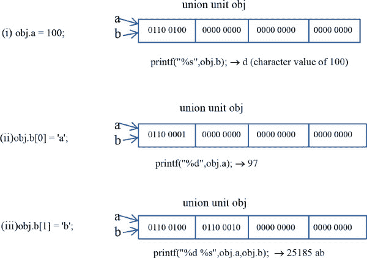

*世界上没有任何什么是不屈服于你的意志力的。*

# 第 7 组问题

# 'C'语言题目数量: 60

## 其他重要面试题: 15


### **1. 下一个程序的输出是什么？**

```c
#include<stdio.h>

union unit {

  char a[4];

  int b;

} obj;

int main()

{

  obj.b = 4;

  obj.a[2] = 'A';

  obj.b = obj.b >> 8;

  printf("%s",obj.a);

  return 0;

}
```
(a) 40A
(b) 错误 - 编译时错误
(c) A
(d) 什么都不会打印

### **2. 下一个程序的输出是什么？**

```c
#include<stdio.h>

union unit{

} obj;

struct student{

} s1;

int main()

{

  printf("%d %d",sizeof(obj) , sizeof(s1));

  return 0;

}
```
(a) 0 0
(b) 0 1
(c) 1 0
(d) 1 1

### **3. 下一段代码的输出是什么？**

```c
#include<stdio.h>

int main()

{

  const int i = 10;

  const int j = 20;

  const int *p = &i;

  p = &j;

  printf("%d",*p);

  return 0;

}
```
(a) 错误 - 编译时错误
(b) 错误 - 运行时错误
(c) 10
(d) 20

### **4. 下一个程序的输出是什么？**

```c
#include<stdio.h>

union unit {

  int i;

  char str[10]; //line2

} obj;

int main()

{

  obj.i = 0;

  printf("%s",obj.str);

  obj.str = "hello";//line 5

  printf("%s",obj.str);

  return 0;

}
```


### 5. 请对上述代码进行修改，允许在`main()`函数中为`enum`赋值字符串`"hello"`？

### 6. 下一个程序的输出是什么？

```c
#include<stdio.h>

union {
  int i;
  char j;
} obj;

int main()
{
  obj.j = 'a';
  printf("%d",sizeof(obj));
  return 0;
}
```
(a) 1  
(b) 垃圾值  
(c) 4  
(d) 取决于编译器

### 7. 下一个程序的输出是什么？

```c
#include<stdio.h>

int main()
{
  int i = 64 , j = 5 , res1 , res2;
  res1 = res2 = i;
  for( j > 0 ; j--)
  {
    res1 = res1 >> 1;
    res2 = res2 << 1;
  }
  printf("%d %d",res1,res2);
  return 0;
}
```
(a) 2048  
(b) 2048  
(c) 1024  
(d) 1048

### 8. 下一个程序的输出是什么？

```c
#include<stdio.h>

union {
  int i;
  static char j;
} obj;

int main()
{
  obj.i = 65;
  printf("%d",sizeof(obj));
  return 0;
}
```
(a) 错误 - 编译时错误  
(b) 垃圾值  
(c) 4  
(d) i

### 9. 下一个程序的输出是什么？

```c
#include<stdio.h>

int main()
{
  const int i = 10;
  int *p = &i;
  *p = 20;
  printf("%d %d",i,*p);
  return 0;
}
```
(a) 10 20  
(b) 10 10  
(c) 20 20  
(d) 错误 - 编译时错误

### 10. 下一个程序的输出是什么？

```c
#include<stdio.h>

int i;

void fun()
{
  printf("%d ",i);
  i++;
}

int main()
{
  const int *p = &i;
  fun();
  printf("%d",*p);
  return 0;
}
```
(a) 垃圾值  
(b) 错误 - 编译时错误  
(c) 0 1  
(d) 0 0

### 11. 下一个程序的输出是什么？

```c
#include<stdio.h>

int main()
{
  int i = 10 , j = 20;
  int *const p = &i; //line1
  *p = 20; //line2
  printf("%d %d",i,*p);
  return 0;
}
```
(a) 10 20  
(b) 20 20  
(c) line1 错误  
(d) line2 错误

### 12. 下一个程序的输出是什么？

```c
#include<stdio.h>

int fun()
{
  static int const i = 10;
  int j = i+1;
  return j;
}

int main()
{
  int i , j = 0 ;
  for(i = 1 ; i <= 5 ; i++)
  j += fun();
  printf("%d", j);
  return 0;
}
```
(a) 55  
(b) 0  
(c) fun 中错误 - 编译时  
(d) main 中错误 - 编译时

### 13. 下一个程序的输出是什么？

```c
#include<stdio.h>
#include<stdlib.h>

int* fun(){
  const int *i = calloc(sizeof(int), 1);
  return i;
}

int main(){
  int *p = fun();
  printf("%d ",*p);
  *p = 10;
  printf("%d",*p);
  return 0;
}
```
(a) fun()中错误  
(b) main()中错误  
(c) 垃圾值 10  
(d) 0 10

### 14. 下一个程序的输出是什么？

```c
#include<stdio.h>

int main()
{
  int *const i = (int*)malloc(sizeof(int)); //line1
  *i = 10; //line2
  printf("%d",*i);
  return 0;
}
```
(a) line1 错误  
(b) line2 错误  
(c) 10  
(d) 垃圾值

### 15. 下一个程序的输出是什么？

```c
#include<stdio.h>
#include<string.h>

int main()
{
  char const name[20]; //line1
  char *p = name; //line2
  strcpy(p , "john"); //line3
  printf("%s",name);
  return 0;
}
```
(a) line1 中错误 - 编译时  
(b) line2 中错误 - 编译时  
(c) line3 中错误 - 编译时  
(d) john

### 16. 下一个程序的输出是什么？

```c
#include<stdio.h>

union unit {
  int i;
  char k;
} ;

int main()
{
  union unit obj; obj = {10 , '\0'}; //line 1
  if(obj.i == 0)
    printf("hi");
  else
    printf("bye");
  return 0;
}
```
(a) hi  
(b) bye  
(c) 错误 - 编译时错误  
(d) 错误 - 运行时错误

### 17. 下一个程序的输出是什么？

```c
#include <stdio.h>

int main()
{
  char a;
  char arr[10] = {1, 2, 3, 4, 5, 6, 9, 8};
  a = (arr + 1)[5]; //line 3
  printf("%d\n", a);
  return 0;
}
```
(a) 5  
(b) 6  
(c) 9  
(d) 以上均不是

### 18. 下一个程序的输出是什么？

```c
#include<stdio.h>

struct student{
  char name[10];
} ;

int main()
{
  struct student s1;
  strcpy(s1.name , "john");
  printf("%s",s1.name);
}
```

```c
return 0;
}
```
(a) 错误- 编译时  
(b) 错误- 运行时  
(c) john  
(d) 垃圾值

### 19. 下列程序的输出是什么？

```c
#include<stdio.h>

extern int j = 20;

int main()
{
extern int i; //line 1
i = 10; //line 2
printf("%d ",i);
printf("%d",j);
return 0;
}
```
(a) 垃圾值 垃圾值  
(b) 10 20  
(c) 10 10  
(d) 错误- 链接时

### 20. 下列程序的输出是什么？

```c
#include<stdio.h>

extern int i;

int main()
{
extern int i; //line 1
int i = 10; //line 2
printf("%d",i);
return 0;
}
```
(a) 10  
(b) 错误，由于 line 2  
(c) 垃圾值  
(d) 0

### 21. 下列程序的输出是什么？

```c
#include<stdio.h>

int i = 10;
int fun();

int main()
{
extern int i;
int p , res = 0;
for( p = 1 ; p <= 2 ; p++)
res += fun();
printf("%d ",res);
printf("%d",i);
return 0;
}

int fun()
{
extern int i;
return (++i);
}
```
(a) 23 12  
(b) 错误- 在 fun() 中  
(c) 错误- 在 main() 中  
(d) 垃圾值 垃圾值

### 22. 下列程序的输出是什么？

```c
#include<stdio.h>

int i = 10;

int main()
{
extern int i; //line1
int i = 1; //line2
printf("%d",i);
return 0;
}
```
(a) 1  
(b) 10  
(c) 错误，由于 line1  
(d) 错误，由于 line2

### 23. 下列程序的输出是什么？

给出两个文件`one.c`和`two.c`。

**one.c**
```c
#include<stdio.h>

extern int i;
int i = 10;
extern int p;

int main()
{
extern int i;
printf("%d %d",i,p);
return 0;
}
```
**two.c**
```c
int p = 20;
```
(a) 10 20  
(b) 错误- two.c 编译时，由于缺少头文件和/或没有 main()  
(c) 错误- one.c 编译时，由于 extern int i 和/或 extern int p 的使用不当  
(d) 错误- 运行时

### 24. 下列程序的输出是什么？

给出两个文件`one.c`和`two.c`。

**one.c**
```c
#include<stdio.h>

extern int i;
int i = 10;
extern int p;

int main()
{
extern int i;
printf("%d %d",i,p);
return 0;
}
```
**two.c**
```c
#include<stdio.h>

int p = 20;

int main()
{
printf("%d",p);
return 0;
}
```
(a) 10 20 或 20 10，取决于编译器的实现  
(b) 错误，由于头文件 `<stdio.h>` 多次出现  
(c) 错误，由于 main() 重复定义  
(d) (b) 和 (c) 均正确

### 25. 关于给定陈述，哪个选项正确？

(i) `extern int i;`  
(ii) `int i = 10;`  
(iii) `extern int i = 10;`  
(a) 都是 i 的定义  
(b) (i) 是 i 的声明，(ii) 和 (iii) 是等效的  
(c) 都是 i 的声明  
(d) (i) 和 (iii) 相同，但 (ii) 不相同

### 26. 关于给定陈述，哪个选项正确？

(i) `int fun();`  
(ii) `extern int fun();`  
(a) 均相同。  
(b) 均不同  
(c) (i) 有效，(ii) 无效  
(d) (ii) 有效，(i) 无效

### 27. 下列程序的输出是什么？

```c
#include<stdio.h>

void fun(char a[])
{
int i;
for (i = 0; i < sizeof(a)/sizeof(a[0]); i++)
a[i] = (char)i;
}

int main()
{
int i;
char a[] = "India";
fun(a);
printf("%s",a+1);
return 0;
}
```
(a) 012345  
(b) 0123467  
(c) India  
(d) 什么都不会打印。

### 28. 下列程序的输出是什么？

```c
#include<stdio.h>

int j = 1;

int fun()
{
static int i = 10;
i += j;
j++;
return i;
}

int main()
{
int i = 10 , res = 0;
for(p = 0 ; p <= 5 ; p++)
res += fun();
printf("%d",res);
return 0;
}
```
(a) 85  
(b) 16  
(c) 65  
(d) 错误- 编译时

### 29. 下列程序的输出是什么？

```c
#include<stdio.h>

int i = 20;
int j;

int main()
{
printf("%d %d",i,j);
return 0;
}

i = 10; //line 8
j = 5; //line 9
```
(a) 20 0  
(b) 10 5  
(c) 20 5  
(d) 错误- 编译时

### 30. 下列程序的输出是什么？

给出两个文件`one.c`和`two.c`。  
编译`gcc one.c two.c`  
执行`./a.out`

**one.c**
```c
#include<stdio.h>

static int i = 10;
extern int p;

int main()
{
printf("%d %d",i,p);
return 0;
}
```
**two.c**
```c
static int p = 100;
```
(a) 10 100  
(b) 错误- 编译时，two.c 不完整  
(c) 错误- 编译时，没有 static 变量  
(d) 错误- one.c 中缺少符号 p

### 31. 下列程序的输出是什么？

```c
#include<stdio.h>
#include<stdlib.h>

int* abc()
{
int *i = malloc(sizeof(int));
*i = 1;
return i;
}

int main()
{
static int *p;
p = abc();
printf("%d",*p);
return 0;
}
```
(a) 1  
(b) 错误在 abc() 中  
(c) 错误在 main() 中  
(d) 垃圾值

### 32. 当 n=10 时，下列程序的输出是什么？

```c
#include<stdio.h>

int fun(int);

int main()
{
static auto n;
printf("%d",res);
scanf("%d",&n);
int res = fun(n);
return 0;
}

int fun(int n)
{
if(n == 0)
return 0;
else if(n == 1)
return 1;
else
return (fun(n-1) + fun(n-2));
}
```
(a) 34  
(b) 21  
(c) 55  
(d) 错误- 编译时

### 33. 下列程序的输出是什么？

```c
#include<stdio.h>

int main()
{
int a = 10;
register int *p = &a;
printf("%d",*p); //line 3
return 0;
}
```
(a) 10  
(b) 错误- register 无法存储地址  
(c) 错误- line 3 的 *p，我们无法引用 register  
(d) 取决编译器

### 34. 下列程序的输出是什么？

假设`sizeof(int) = 4`, `sizeof(char) = 1`, `sizeof(double) = 8`, `sizeof(float) = 4`

```c
#include<stdio.h>

struct student {
int roll = 50;
char name[50] = "john";
double marks = 90.5;
};
```
(a) 62  
(b) 16  
(c) 17  
(d) 错误- 编译时

### 35. 下列程序的输出是什么？

```c
#include<stdio.h>

struct student {
int roll ;
struct student s1;
}s2;

int main()
{
s2.roll = 10;
s2.s1.roll = 20;
printf("%d",s2.roll);
return 0;
}
```
(a) 10  
(b) 20  
(c) 错误- 编译时  
(d) 垃圾值

### 36. 下列程序的输出是什么？

```c
#include<stdio.h>

struct student {
int roll ;
float marks;
} s1 , s2;

int main()
{
printf("%d ",sizeof(s1));
s1.roll = 10;
s1.marks = 95.5;
s2 = s1;
printf("%d %f ",s2.roll , s2.marks);
return 0;
}
```


```c
(a) 错误- 编译时
(b) 4 垃圾值 垃圾值
(c) 8 垃圾值 垃圾值
(d) 8 10 95.5
```

### 37. 下列程序的输出是什么？

```c
#include<stdio.h>

struct student {
    int roll;
    float marks;
} s1, s2;

int main()
{
    s1.roll = 90;
    s1.marks = 95;

    s2.roll = 90;
    s2.marks = 90;

    if (s1 == s2)
        printf("hi");
    else
        printf("bye");

    return 0;
}
```

(a) `bye`  
(b) `hi`  
(c) `error- 编译错误`  
(d) 没有任何输出

### 38. 以下程序的输出结果是什么？

```c
#include<stdio.h>

struct student {
    int roll;
    char name[0];
};

int main()
{
    struct student s1, s2;

    s1.roll = 1;
    strcpy(s1.name, "hist");

    printf("%d %s", s1.roll, s1.name); // line 5

    s2 = s1;

    printf("%d %s", s2.roll, s2.name); // line 7

    return 0;
}
```

(a) `error- 编译错误`  
(b) 第 5 行：未定义行为，第 7 行：未定义行为  
(c) 第 5 行：`1 hist`，第 7 行：未定义行为  
(d) 段错误（Segmentation Fault）

### 39. 以下程序的输出结果是什么？

```c
#include<stdio.h>

struct student {
    int roll;
    char name[0];
};

struct student *s1 = malloc(sizeof(int)); // line 1

int main()
{
    s1->roll = 1;

    printf("%d %s", s1->roll, s1->name); // line 4

    return 0;
}
```

(a) `1 垃圾值`  
(b) `1 <没有任何输出>`  
(c) 第 4 行错误  
(d) 第 1 行错误

### 40. 以下程序的输出结果是什么？

```c
#include<stdio.h>

struct student {
    int roll;
    char name[0];
};

int main()
{
    struct student *s1 = malloc(sizeof(int) + 10); // line 1

    s1->roll = 1;

    strcpy(s1->name, "jack"); // line 2

    printf("%d %s", s1->roll, s1->name);

    return 0;
}
```

(a) 第 1 行错误  
(b) 第 2 行错误  
(c) `1 垃圾值`  
(d) `1 Jack`

### 41. 以下程序的输出结果是什么？

```c
#include<stdio.h>
#include<stdlib.h>

struct student {
    int roll;
    float marks;
    char name[0];
};

int main()
{
    struct student *s1 = malloc(20);
    struct student *s2 = malloc(100);

    printf("%d %d ", sizeof(s1), sizeof(s2)); // line 3
    printf("%d %d", sizeof(*s1), sizeof(*s2)); // line 4

    return 0;
}
```

(a) `20 100 20 100`  
(b) `4 4 20 100`  
(c) `4 4 8 8`  
(d) `error- 编译错误`

### 42. 以下程序的输出结果是什么？

```c
#include<stdio.h>

struct std {
    int roll;
    float marks;
} s1, s2;

int main()
{
    struct std s1 = {1, 10.5}; // line 1

    s2 = s1; // line 2

    printf("%d %f ", s2.roll, s2.marks);

    if (s1 == s2) // line 4
        s2.marks = s2.marks + 1;

    printf("%f", s2.marks);

    return 0;
}
```

(a) `1 10.5 11.5`  
(b) `1 10.5 10.5`  
(c) `1 10.5 11.0`  
(d) `error- 编译错误`

### 43. 以下程序的输出结果是什么？

```c
#include<stdio.h>

struct student1 {
    char a;
    int b;
    char c;
    double d;
} s1;

struct student2 {
    double a;
    char b;
} s2;

struct student3 {
    char a;
    double b;
    int c;
} s3[10];

int main()
{
    printf("%d %d %d", sizeof(s1), sizeof(s2), sizeof(s3));

    return 0;
}
```

(a) `14 9 30`  
(b) `16 10 40`  
(c) `20 12 160`  
(d) `18 10 140`

### 44. 以下程序的输出结果是什么？

```c
#include<stdio.h>

struct std {
    int sn;
    char name[20];
} s1;

int main()
{
    struct std s2 = {1, "john"};

    s1 = s2; // line 2

    printf("%p %p", &s1.name, &s2.name); // line 3

    strcpy(s2.name, "will");

    printf("%s %s", s1.name, s2.name); // line 5

    return 0;
}
```

(a) 第 3 行：打印两个地址，第 5 行：`will`  
(b) 第 3 行：打印不同的地址，第 5 行：`will`  
(c) 第 2 行错误：数组无法赋值  
(d) `error- 运行错误`

### 45. 结构体的默认访问修饰符是什么？

(a) Private（私有）  
(b) Public（公共）  
(c) Protected（保护）  
(d) Extern（外部）

### 46. 以下程序的输出结果是什么？

```c
#include<stdio.h>

struct student {
    unsigned int roll : 4;
    unsigned int marks : 5;
} s1;

int main()
{
    s1.roll = 14;
    s1.marks = 30;

    printf("%d %d %ld ", s1.roll, s1.marks, sizeof(s1));

    return 0;
}
```

(a) `14 30 4`  
(b) `14 30 8`  
(c) `error- 编译错误`  
(d) `error- 运行错误`

### 47. 以下程序的输出结果是什么？

```c
#include<stdio.h>

struct student {
    int sn : 10;
    int roll : 10;
    int room : 10;
    int id : 10;
} s1;

int main()
{
    s1.sn = 100;
    s1.roll = 1;
    s1.id = s1.roll; // L1

    printf("%d %ld", s1.id, sizeof(s1));

    return 0;
}
```

(a) 结构体定义时的编译错误  
(b) L1 处赋值时的编译错误  
(c) `1 16`  
(d) `1 8`

### 48. 以下程序的输出结果是什么？

```c
#include<stdio.h>

struct student {
    int a : 4;
    int b : 5;
} s1;

int main()
{
    s1.a = 10;
    s1.b = 17;

    char *p = &s1;

    printf("%d ", *p);

    p++;

    printf("%d", *p);

    return 0;
}
```

(a) `10 17`  
(b) `41 64`  
(c) `26 1`  
(d) `41 17`

### 49. 以下程序的输出结果是什么？

```c
#include<stdio.h>

struct student {
    int SN;
    char grade;
} s1;

int main()
{
    s1.SN = 1;
    s1.grade = 'A';

    printf("%c %ld ", s1.grade, sizeof(s1)); // line 3

    char *p = &s1; // line 4

    *p = 10; // line 5

    p += 4;
    *p = 'B'; // line 7

    printf("%d %c", s1.SN, s1.grade); // line 8

    return 0;
}
```

(a) `error- 编译错误`  
(b) `A 5 10 B`  
(c) `A 8 10 A`  
(d) `A 8 10 B`

### 50. 以下程序的输出结果是什么？

```c
struct student {
    int roll;

    struct dob {
        int dd;
        int mm;
        int yyyy;
    };
} s1;

int main()
{
    s1.roll = 1;
    s1.dob.dd = 6;
    s1.dob.mm = 1;
    s1.dob.yyyy = 2006;

    printf("%d %ld", s1.dob.yyyy, sizeof(s1));

    return 0;
}
```

(a) `2006 16`  
(b) `2006 12`  
(c) 定义处有错误  
(d) 函数内部处有错误

### 51. 以下程序的输出结果是什么？

```c
struct student {
    int roll;

    struct dob {
        int dd;
        int mm;
        int yyyy;
    } u;
} s1;

int main()
{
    s1.roll = 14;
    s1.u.dd = 6;
    s1.u.mm = 1;
    s1.u.yyyy = 2006;

    printf("%d %ld", s1.u.yyyy, sizeof(s1));

    return 0;
}
```

(a) `2006 16`  
(b) `2006 24`  
(c) 定义处有错误  
(d) 函数内部有错误

### 52. 以下程序的输出结果是什么？

```c
#include<stdio.h>
#include<stdlib.h>

struct addr {
    int h_no[2];
    char streat[40];
    char city[40];
};

struct one {
    int SN;
    char name[10];
    struct addr loc;
};

int main()
{
    struct one obj1 = {
        1, "Ranbir", 80, 81, "Mandakiny", "Mumbai"
    }; // line 1

    printf("%s %d %s", obj1.name, obj1.loc.h_no[0], obj1.loc.city); // line 2

    return 0;
}
```

(a) 结构体 `one` 有错误  
(b) 第 1 行错误  
(c) 第 2 行错误  
(d) `Ranbir 80 Mumbai`

### 53. 以下程序的输出结果是什么？

```c
#include<stdio.h>

struct node {
    int key1;
    int key2;
    struct node *next;
} s1;

struct nodetab {
    int hash;
    struct node *item;
    struct nodetab *next;
} nt;

int main()
{
    printf("%ld %ld", sizeof(s1), sizeof(nt));

    return 0;
}
```

(a) `12 20`  
(b) `16 40`  
(c) `error- 编译错误`  
(d) `12 12`

### 54. 此处考虑上述程序的结构。以下程序的输出结果是什么？

```c
#include<stdio.h>

struct node fun(struct node);
```

```c
int main()
{
    struct node s1, s2;

    s1.key1 = 10;
    s1.key2 = 20;
    s1.next = NULL;

    s2 = fun(s1);

    printf("%d %d", s1.key1, s1.key2);
    printf("%d %d", s2.key1, s2.key2);

    return 0;
}

struct node fun(struct node s3)
{
    s3.key1 = s3.key1 ^ s3.key2;
    s3.key2 = s3.key1 ^ s3.key2;
    s3.key1 = s3.key1 ^ s3.key2;

    return s3;
}
```

(a) `20 10 20 10`  
(b) 错误-编译时  
(c) `fun` 函数产生取决于编译器的输出  
(d) `fun` 函数始终交换 `s3` 的 `key1` 和 `key2`

### 55. 下列程序的输出结果是什么？

```c
#include<stdio.h>
#include<string.h>

struct student {
    int roll;
    char name[10];

    int getRoll(struct student *s1)
    {
        return s1->roll;
    }

    void show(struct student *s1)
    {
        printf("%d %s", s1->roll, s1->name);
    }
} s1;

int main()
{
    s1.roll = 10;
    strcpy(s1.name, "john");

    s1.show(&s1);

    int i = s1.getRoll(&s1);

    printf("%d %ld", i, sizeof(s1));

    return 0;
}
```

(a) `10 john 10 16`  
(b) `10 john 10 14`  
(c) `10 john 10 24`  
(d) 错误-编译时

### 56. 以下代码的输出是什么？

```c
#include<stdio.h>

union unit {
    int a;
    int b;

    struct std {
        char name[4];
    } s1;
} u1;

int main()
{
    u1.a = 67;
    u1.b = 68;

    printf("%ld %s", sizeof(u1), u1.s1.name);

    return 0;
}
```

(a) `8 C`  
(b) `4 D`  
(c) 错误-编译时  
(d) `12 D`

### 57. 下列程序的输出结果是什么？

```c
#include<stdio.h>

struct student {
    char *name;
} s1;

int main()
{
    strcpy(s1.name, "john"); // 第 1 行

    printf("%s", s1.name); // 第 2 行

    s1.name[0] = 'T'; // 第 3 行

    printf("%s", s1.name);

    return 0;
}
```

(a) `john Tohn`  
(b) 第 1 行错误  
(c) 第 2 行错误  
(d) 第 3 行错误

### 58. 下列程序的输出结果是什么？

```c
#include<stdio.h>
#include<stdlib.h>

struct node {
    int key1;
    int key2;
};

void swap(struct node *start)
{
    struct node *root = malloc(sizeof(struct node));

    root->key1 = 10;
    root->key2 = 20;

    root->key1 = root->key1 ^ root->key2;
    root->key2 = root->key1 ^ root->key2;
    root->key1 = root->key1 ^ root->key2;

    start = root; // 第 8 行
}

int main()
{
    struct node *start = malloc(sizeof(int) * 2);

    start = NULL; // 第 12 行

    swap(start);

    printf("%d %d", start->key1, start->key2);

    return 0;
}
```

(a) `20 10`  
(b) `10 20`  
(c) 垃圾值  
(d) 错误-运行时

### 59. 上述代码需要什么样的修改，才能使 `swap` 函数正确地交换两个数字？

### 60. 确定下列程序的输出结果？

```c
#include<stdio.h>

struct student {
```


```c
    int roll;

    int class_no;

};

void foo(struct student temp)
{
    static struct student s1 = {44, 1};

    s1.roll++;
    s1.class_no++;

    temp = s1;

    printf("%d %d ", s1.roll, s1.class_no);
}

int main()
{
    struct student s1 = {50, 50};
    int i;

    for (i = 1; i < 5; i++)
        foo(s1);

    printf("%d %d ", s1.roll, s1.class_no);

    return 0;
}
```

### 17. 解释

**解释：** 第 3 行的表达式等同于 `a = *(arr + 1 + 5) → *(arr + 6)`。`printf()` 将打印存储在 `*(arr+6)` 处的值，即 9。

### 18. c

**解释：** 不需要。

### 19. d

**解释：** 在给定的程序中，第 1 行我们是在声明变量 `i`，而不是定义。当变量被声明时，编译器只知道变量的类型但没有为变量分配内存；当变量被定义时，才会为变量分配内存。编译器将定义 `i` 和 `j` 的工作推到了链接阶段。编译器认为这些变量的定义可能存在于其他程序或标准库中。对于变量 `i` 和 `j` 来说并非如此，它们只是被声明了，在任何地方都没有定义。因此，编译器产生链接时错误。第 2 行中，我们试图将值 10 存储在变量 `i` 中，而变量 `i` 尚未绑定内存。因此编译器产生链接时错误。

### 20. b

**解释：** 不需要。

### 21. a

**解释：** 不需要。**提示：** `extern` 存储类用于引用全局变量或定义在其他文件变量。

### 22. d

**解释：** 第 1 行不会产生任何错误，因为编译器从全局作用域获取了 `extern` 变量 `i` 的定义。编译器在第 2 行由于变量 `i` 重复定义产生错误。

### 23. a

**解释：** 给定的程序不会报告任何错误。在 `one.c` 文件中，变量 `p` 是一个 `extern` 变量，可以引用其他文件的变量；而在 `two.c` 中我们有了 `p` 的定义。

### 24. c

**解释：** 如我们所讨论，程序中的所有函数默认都是 `extern` 的。在链接给定的 C 文件后，我们将有两个 `main()` 函数的实例，而不能有两个同名的函数。因此，编译器报告错误。

### 25. b

**解释：** 语句 (i) 只是变量 `i` 的声明，还没有为 `i` 分配内存。语句 (ii) 是 `i` 的定义，为 `i` 分配了内存并初始化为 10。语句 (iii) 也是 `i` 的定义，我们初始化一个 `extern` 变量时，该变量会获得内存，而不需要等到链接阶段。

### 26. a

**解释：** 不需要。

### 27. d

**解释：** 正如我们在函数 `fun()` 中看到的，第一个索引值为 0，这与空字符 `\0` 相似。因此，在第一个索引处 `\0`，什么都没有打印。

### 28. b

**解释：** 不需要。这是一个练习程序。

### 29. d

**解释：** 在给定的程序中，我们在第 8 行和第 9 行执行赋值操作，这是不允许的，任何可执行语句只能在函数内部执行。

### 30. d

**解释：** 在文件 `two.c` 中，变量 `p` 被定义为 `static`，静态变量的作用域仅限文件。在 `two.c` 中定义的 `p` 不在 `one.c` 文件中。因此，编译器产生错误。如果我们将 `two.c` 文件中变量 `p` 的存储类从 `static` 改为全局，则两个程序都能正常工作。

### 31. a

**解释：** 不需要。

### 32. d

**解释：** 给定的程序报告错误。变量不能有多个存储类，因为每个存储类都有自己的生命周期规则和作用域规则，定义具有多个存储类的变量没有意义。所有多个存储类的组合都是非法的，例如 `static auto n; static extern int i; register static int i;` 等。

### 33. a

**解释：** 给定的程序不会报告任何错误，原因是寄存器指针（register pointer）可以指向变量的地址。在这里，我们定义了一个 `int` 类型的变量，它将在栈中占用内存，而我们将这个栈位置存储在 `p` 中，这不会产生任何问题。变量 `a` 的值 10 被打印出来。

### 34. d

**解释：** 给定的程序报告错误。不允许对结构体元素进行初始化。

### 35. c

**解释：** 给定的程序报告错误，是因为我们在编译 `struct student` 之前尝试 `struct student` 类型的对象。在创建对象时，编译器必须知道对象的大小，而在给定的程序中，我们在其类型定义内部创建对象。这使得无法计算 `struct student` 的大小。在结构体定义内部不允许定义自类型对象。

### 36. d

**解释：** 给定的程序运行正常，赋值运算符兼容结构体。赋值运算符将对象 `s1` 的所有元素拷贝到对象 `s2` 的元素中。

### 37. c

**解释：** 在给定的程序中，我们使用关系运算符“等于”（`==`）比较对象 `s1` 和对象 `s2`。关系运算符与结构体不兼容。因此，编译器报告错误。

### 38. c

**解释：** 在给定的程序中，我们使用关系运算符“等于”（`==`）比较对象 `s1` 和对象 `s2`。……（此处重复内容已按翻译逻辑）

### 39. d

**解释：** 在给定的程序中，编译器报告错误，是因为我们尝试写一个必须在函数内部的可执行语句。

### 40. d

**解释：** 在文件 `two.c` 中，变量 `p` 被定义为 `static`，静态变量的作用域仅限文件。在 `two.c` 中定义的 `p` 不在 `one.c` 文件中。因此，编译器产生错误。如果我们将 `two.c` 文件中变量 `p` 的存储类从 `static` 改为全局，则两个程序都能正常工作。

### 41. a

**解释：** 不需要。

### 42. d

**解释：** 给定的程序报告错误。变量不能有多个存储类，因为每个存储类都有自己的生命周期规则和作用域规则，定义具有多个存储类的变量没有意义。所有多个存储类的组合都是非法的，例如 `static auto n; static extern int i; register static int i;` 等。

### 43. c

**解释：** 这遵循了*结构体填充*（structure padding）的概念。假设有一台 32 位的机器。结构的所有成员存储在内存位置上，使得所需的内存访问次数最少。在 32 位机器中，总线每次传输 4 字节。考虑 `struct student1`，字符变量 `a` 存储在 `student1` 的第一个字节，如果我们把整数变量 `b` 放在第 2、3、4 和 5 字节，那么读取变量 `b` 时机器需要两次内存访问：第一次访问是读取第 2 到 4 字节，第二次访问是读取第 5 字节。这是不可行的，因此从第 2 到 4 字节的内存将用 `NULL` 填充，变量 `b` 将存储从第 5 到第 8 字节。变量 `c` 将存储在第 9 字节，第 10、11、12 字节将用 `NULL` 填充。变量 `d` 将存储在第 13 到第 20 字节。因此，对象 `s1` 的大小变为 20B。

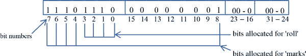

### 44. b

**解释：** 在给定的程序中，赋值运算符会将字符串 `name` 从对象 `s1` 复制到 `s2`，它不会报错。由于我们创建了两个不同的 `std` 结构体对象，它们存储在不同的内存位置，`s1` 和 `s2` 中 `name` 的地址是不同的。

### 45. b

**解释：** 不需要。

### 46. a

**解释：** 在给定的程序中，我们在结构体中使用了位域字段（bit fields）。考虑一种情况：你需要存储班级中所有学生的学号和分数，班级有 14 名学生，最高分为 30 分。现在定义一个占用内存最小的结构体 `student`。众所周知，班级有 14 名学生，如果使用 `integer` 数据类型来存储他们的学号，将浪费内存，因为 `integer` 数据类型占用 4 字节，而表示 14 只需要 4 位，同样地我们可以为结构体成员 `marks` 留 5 位。

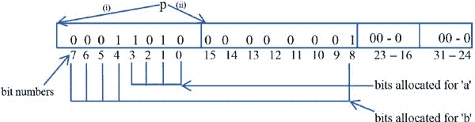

结构体 `student` 的成员 `roll` 存储在位 0、1、2 和 3，成员 `marks` 存储在位 4、5、6、7 和 8。当我们以十进制打印成员 `roll` 时，得到二进制数 1110 的十进制等值 14；当我们以十进制打印成员 `marks` 时，得到二进制数 11110 的十进制等值 30。结构体 `student` 的大小将是 4B，而不是 2B。

### 47. d

**解释：** 在给定的程序中，我们为结构体成员 `sn` 分配了 10 位，为 `roll` 分配了 10 位，为 `room` 分配了 10 位，为 `id` 分配了 10 位，分配的总位数为 4 位。在结构体中，如果我们使用位域字段，则结构体的大小将是结构体成员中最大数据类型大小的倍数。这里，`student` 结构体成员中最大数据类型的大小是 4B，结构体 `student` 的大小是 4 的倍数，由于我们为 `student` 的成员分配了 40 位，`student` 的大小可以是 4B，因此 `student` 的大小变为 8B。

### 48. c

**解释：** 在给定的程序中，我们在结构体成员 `a` 中存储了 10，在结构体成员 `b` 中存储了 17。结构体成员 `a` 和 `b` 的存储如下：

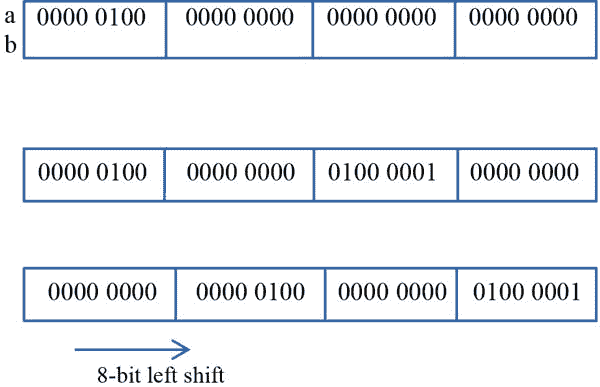

```c
char *p = &s1;

printf("%d", *p); → 26; // 字符指针的步长为 1B。*p 将打印第一个字节的十进制等值。

p++; // 步长为 1B，指针 p 开始指向第二个字节。

printf("%d", *p); → 1.
```

### 49. d

**解释：** 给定程序运行正常，正如我们之前讨论的结构体填充，结构体 `student` 的大小为 8B，它等于 `integer` 变量的大小（即 4B）加上字符变量的大小（即 1B）以及三个填充字节。在第 3 行，打印了 ‘A’ 和 8。在第 4 行，字符指针 `p` 指向结构体对象 `s1`。字符指针的步长为 1 字节，在第 5 行，指针 `p` 在整数变量 `SN` 的第一个字节存储 10，然后增加 4 步（即 4 字节），开始指向字符变量 `grade`。在第 7 行，指针 `p` 在 `grade` 的地址处存储了 ‘B’。在第 8、10 行，打印了 10 和 ‘B’。

### 50. d

**解释：** 在给定的程序中，我们正在定义嵌套结构体，在没有其实例的情况下无法访问内部结构体的成员。我们正尝试通过结构体名称来访问内部结构体的成员，这是被不允许的。因此，编译器报告错误。为了避免此错误，我们应该在定义中声明内部结构体 `dob` 的对象。

### 51. a

**解释：** 正如我们之前讨论的结构体填充，结构体 `student` 的大小为 8B，它等于 `integer` 变量的大小（4B）加上字符变量的大小（1B）以及三个填充字节。在第 3 行，打印了 ‘A’ 和 8。在第 4 行，字符指针 `p` 指向结构体对象 `s1`。字符指针的步长为 1 字节，在第 5 行，指针 `p` 在整数变量 `SN` 的第一个字节存储 10，然后增加 4 步（即 4 字节），开始指向字符变量 `grade`。在第 7 行，指针 `p` 在 `grade` 的地址处存储了 ‘B’。在第 8、10 行，打印了 10 和 ‘B’。

### 52. d

**解释：** 在给定的程序中，我们正在定义嵌套结构体，在没有其实例的情况下无法访问内部结构体的成员。我们正尝试通过结构体名称来访问内部结构体的成员，这是被不允许的。因此，编译器报告错误。为了避免此错误，我们应该在定义中声明内部结构体 `dob` 的对象。

### 53. d

**解释：** 在给定的程序中，我们正在定义嵌套结构体，在没有其实例的情况下无法访问内部结构体的成员。我们正尝试通过结构体名称来访问内部结构体的成员，这是被不允许的。因此，编译器报告错误。为了避免此错误，我们应该在定义中声明内部结构体 `dob` 的对象。

### 54. d

**解释：** 在给定的程序中，我们正在定义嵌套结构体，在没有其实例的情况下无法访问内部结构体的成员。我们正尝试通过结构体名称来访问内部结构体的成员，这是被不允许的。因此，编译器报告错误。为了避免此错误，我们应该在定义中声明内部结构体 `dob` 的对象。

### 55. d

**解释：** 不需要。

### 56. b

**解释：** 不需要。

### 57. d

**解释：** 在给定的程序中，我们正在定义嵌套结构体，在没有其实例的情况下无法访问内部结构体的成员。我们正尝试通过结构体名称来访问内部结构体的成员，这是被不允许的。因此，编译器报告错误。为了避免此错误，我们应该在定义中声明内部结构体 `dob` 的对象。

### 58. d

**解释：** 在给定的程序中，我们正在定义嵌套结构体，在没有其实例的情况下无法访问内部结构体的成员。我们正尝试通过结构体名称来访问内部结构体的成员，这是被不允许的。因此，编译器报告错误。为了避免此错误，我们应该在定义中声明内部结构体 `dob` 的对象。

### 59. c

**解释：** 在给定的程序中，我们在结构体成员 `a` 中存储了 10，在结构体成员 `b` 中存储了 17。结构体成员 `a` 和 `b` 的存储如下：


```c
char *p = &s1;

printf("%d", *p); → 26; // 字符指针的步长为 1B。*p 将打印第一个字节的十进制等值。

p++; // 步长为 1B，指针 p 开始指向第二个字节。

printf("%d", *p); → 1.
```

### 60. 45 2 46 3 47 4 48 5 50 50

**解释：** 不需要。

## 样例卷 - 1

*题目数量：20 最大时间：45 分钟。*

### 1. 以下程序的输出是什么？

```c
int main()
{
    int a[2][2][2] = {{10, 2, 3, 4}, {5, 6, 7, 8}};
    int *p, *q;

    p = &a[2][2][2];
    q = a;

    printf("%d %d", *p, *q);

    return 0;
}
```

(a) 垃圾 10  
(b) 垃圾 垃圾  
(c) 10 10  
(d) 编译错误

### 2. 以下程序的输出是什么？

```c
struct point
{
    int x;
    int y;
};

struct point origin, *pp;

int main()
{
    pp = &origin;

    printf(“origin is (%d, %d)\t”, (*pp).x, (*pp).y);
    printf("origin is (%d, %d)\n", pp->x, pp->y);

    return 0;
}
```

(a) 原点是 (0, 0) 原点是 (0, 0)  
(b) 原点是 (1, 1) 原点是 (1, 1)  
(c) 原点是 (garbage, garbage)  
(d) 错误-编译时

### 3. 下述程序的输出是什么？

```c
#include <stdio.h>

int _l_abc(int i)
{
    return (i++);
}

int main()
{
    int i = _l_abc(10);

    printf("%d\n", -i);

    return 0;
}
```

(a) -10  
(b) 9  
(c) garbage  
(d) 错误-无效函数名

### 4. 下述程序的输出是什么？

```c
#include <stdio.h>

int main()
{
    char *p;
    int *q;
    long *r;

    p = q = r = 0;

    p++;
    q++;
    r++;

    printf("%u %u %u", p, q, r);
}
```

(a) 0 0 0  
(b) garbage garbage garbage  
(c) 1 4 4  
(d) 错误-编译时

### 5. 下述程序的输出是什么？

```c
#include <stdio.h>

int main()
{
    int one_d[3] = {1, 2, 3};
    int *ptr;

    ptr = one_d;
    ptr += 3;

    printf("%d", *ptr);

    return 0;
}
```

(a) 3  
(b) 2  
(c) 1  
(d) garbage

### 6. 下述程序的输出是什么？

```c
#include <stdio.h>

void aaa()
{
    printf("hi");
}

void bbb()
{
    printf("hello");
}

void ccc()
{
    printf("bye");
}

int main()
{
    void (*ptr[3])();

    ptr[0] = aaa;
    ptr[1] = bbb;
    ptr[2] = ccc;

    ptr[2]();

    return 0;
}
```


### 7. 下述程序的输出是什么？

```
(a) hello
(b) bye
(c) 错误- 编译时
```

```c
#include<stdio.h>

int main()
{
  int a= 0;int b = 0;char x ='\0';char y =1;

  if(a,b,x,y)
    printf("hello");
  else
    printf("bye");

  return 0;
}
```

(a) hello  
(b) bye  
(c) 错误- 编译时  
(d) 未定义行为

### 8. 下述程序的输出是什么？

```c
#include<stdio.h>

int main()
{
  printf(" %d ", sizeof( void *));
  printf("%d ", sizeof(int *));
  printf("%d ", sizeof(double *));
  printf("%d \n", sizeof(struct *));

  return 0;
}
```

(a) 0 0 0  
(b) 0 4 8  
(c) 4 4 4  
(d) 错误- 编译时

### 9. 下述代码合法吗？

```c
struct a
{
  int x;
  struct a b;
};
```

### 10. 确定下述代码的输出？

```c
#include<stdio.h>

int main()
{
  int a[3][3]={1,2,3,4,5,6,7,8,9};
  int i,j;
  int *p[]={a,a+1,a+2};

  for(i=0;i<2;i++)
  {
    for(j=0;j<1;j++)
      printf("%d\t%d\t%d\t%d\n",*(p+i)+j, *(j+p)+i,*(i+p)+j,*(p+j)+i);
  }

  return 0;
}
```

### 11. 确定下述程序的输出？

```c
#include<stdio.h>
#include<string.h>

int main()
{
  char *p="India";
  char a[]="India";

  printf("%d %d ", sizeof(p), sizeof(*p));
  printf("%d %d", sizeof(a), strlen(a));

  return 0;
}
```

### 12. 确定下述代码的输出？

```c
#include<stdio.h>

int main()
{
  int i=4,j=7;
  j = j || i++ && printf("YOU CAN");
  printf("%d %d", i, j);

  return 0;
}
```

(a) 4 7  
(b) 4 1  
(c) 4 8  
(d) 5 7

### 13. 确定下述代码的输出？

```c
#include<stdio.h>

int main()
{
  int i=5,j=10;
  i=i&&10;
  printf("%d %d",i,j);

  return 0;
}
```

(a) 5 10  
(b) 1 10  
(c) 1 11  
(d) 10 10

### 14. 区分以下声明。

(i) `const char *a;`  
(ii) `char* const a;`  
(iii) `char const *a;`

### 15. 确定下述代码的输出？

```c
#include<stdio.h>

int main()
{
  static int i=5;

  if(--i)
  {
    main();
    printf("%d ",i);
  }

  return 0;
}
```

### 16. 确定下述代码的输出。

```c
#include<stdio.h>
#include<string.h>

int main()
{
  char a[]="12345\0";
  int i=strlen(a);
  printf("%d\n",++i);

  return 0;
}
```

(a) 5  
(b) 4  
(c) 7

### 17. 确定下述代码的输出？

```c
#include<stdio.h>

int main()
{
  int i=i++, j=j++, k=k++;
  printf("%d %d %d", i, j, k);

  return 0;
}
```

### 18. 确定下述代码的输出？

```c
#include<stdio.h>

int main()
{
  signed char i=125;

  while(i++>=0)
    printf("%d ",i);

  return 0;
}
```

### 19. 确定下述程序的输出？

```c
#include<stdio.h>

int main()
{
  int i=0;

  for(i=0; i<20; i++)
  {
    switch(i)
    {
      case 0: i += 5;
      case 1: i += 2;
      case 5: i += 5;
      default: i += 4;
      break;
    }
  }

  printf("%d ", i);

  return 0;
}
```

### 20. 下述程序的输出是什么？

```c
#include<stdio.h>

int main()
{
  int arr2[3][3];
  printf("%d\n", ((arr2==arr2) == arr2[0]));

  return 0;
}
```

(a) 0  
(b) 1  
(c) 语法错误  
(d) garbage

# 试卷 1 答案

1. a  
2. a  
3. a  
4. c  
5. d  
6. c  
7. a  
8. c  
9. 1 1 4 2  
10. 4 5 6 5  
12. b  
13. b  
14. (i) `const` 作用于 `char *`而非 `a` (指向常量字符的指针) `a='F'`：非法；  
(ii) `const` 作用于 `a`而非 `a` 的值 (常量指针) `a='F'`：非法；  
(iii) 与 (i) 相同。  
15. 0 0 0  
16. d  
17. garbage garbage  
18. 26 27 -28  
19. 16 21  
20. b

# 试卷 -2

题目数量：20 最大时间：45 分钟

### 1. 下述程序的输出是什么？

```c
#include<stdio.h>

int main()
{
  int x=0,y=2,z;

  if(x=y%2)
    z=2;

  printf("%d %d ",z,x);

  return 0;
}
```

(a) 2 0  
(b) garbage 0  
(c) 0 0  
(d) 错误- 编译时

### 2. 下述程序的输出是什么？

```c
#include<stdio.h>

int main()
{
  int a[10];
  printf("%d",*a+1-*a+3);

  return 0;
}
```

(a) garbage  
(b) 0  
(c) 4  
(d) 错误- 编译时

### 3. 下述语句代表什么？
`int (*x)[10];`

### 4. 下述程序的输出是什么？

```c
#include<stdio.h>

int main()
{
  const int x=5;
  const int *ptrx;
  ptrx = &x;
  *ptrx = 10;
  printf("%d\n", x);

  return 0;
}
```

(a) 5  
(b) 10  
(c) 错误- 编译时  
(d) garbage

### 5. 下述程序的输出是什么？

```c
#include<stdio.h>
#define x 4+1 //第 2 行

int main()
{
  int i;
  i = x*x*x;
  printf("%d",i);

  return 0;
}
```

(a) 125  
(b) 13  
(c) 17  
(d) 第 2 行错误

### 6. 哪些函数正确使用了指针？

```c
#include <stdio.h>

int *f1()
{
  int x = 10;
  return &x;
}

int *f2()
{
  int *ptr;
  *ptr = 10;
  return ptr;
}

int *f3()
{
  int *ptr;
  ptr = (int*) malloc(sizeof (*ptr));
  return ptr;
}
```

(a) 仅 f3  
(b) f1 和 f3  
(c) f1 和 f2  
(d) f1, f2 和 f3

### 7. 下述程序的输出是什么？假设数组 `a` 的基地址为 1000。

```c
#include<stdio.h>

int main()
{
  int a[2][3][4] = {0};
  int *b = a;
  int *c = a+1;
  printf("%u %u", b, c);

  return 0;
}
```

(a) 1000 1048  
(b) 1000 1096  
(c) 1000 1001  
(d) 1000 1004

### 8. 给定函数 `foo(x, n)` 计算的是哪个数学函数？

```c
int foo(int x, int n)
{
    int val = 1;

    if (n > 0)
    {
        if (n % 2 == 1)
            val *= x;
        val *= foo(x * x, n / 2);
    }

    return val;
}
```

(a) $x^n$  
(b) $n^x$  
(c) $n^n$  
(d) $n * x$

### 9. 下一个程序的输出是什么？

```c
#include<stdio.h>

int main()
{
    char a[] = "India";
    char *b = "is great";
    a = "Love";
    b = "yes";
    printf("%s %s", a, b);

    return 0;
}
```

(a) India is great  
(b) Love is great  
(c) yes is great  
(d) 错误- 编译错误

### 10. 下一个程序的输出是什么？

```c
#include<stdio.h>

int main()
{
    char *str = "Love p\0eop\0le";
    printf("%ld %ld", sizeof(str), strlen(str));
}
```

(a) 6 6  
(b) 7 6  
(c) 13 6  
(d) 4 6

### 11. 确定下一个程序的输出？假设数组的基地址为 1000。

```c
#include<stdio.h>

int main()
{
    int a[2][3][2] = {2, 4, 7, 3, 3, 2, 2, 3, 3, 4};

    printf("%u %u %u %d ", a, *a, **a, ***a);
    printf("%u %u %u %d ", a+1, *a+1, *(*a+1), ***a+1);
    printf("%u %u %u %d\n", *(*(a+2)+3), *(*a[1]+2), *(a+2), *(*(a[1]+1)));

    return 0;
}
```

### 12. 考虑以下声明
(i) `int a[10][10];`  
(ii) `int *b[10];`

以下哪些赋值操作是无效的？  
(a) `a[5][6] = 10;`  
(b) `a[5] = 1000;`  
(c) `b[5][6] = 10;`  
(d) `b[5] = 1000;`

### 13. 下一个程序的输出将是什么？

```c
#include<stdio.h>

int main()
{
    int a = 10;
    a = (5 , 100);
    printf("%d",a);

    return 0;
}
```

(a) 10  
(b) 5  
(c) 100  
(d) 编译错误

### 14. 下一个程序的输出将是什么？

```c
#include<stdio.h>

int main()
{
    int a = 10 , b = sizeof(a++);
    printf("%d %d", a, b);

    return 0;
}
```

(a) 错误- 编译错误  
(b) 11 4  
(c) 错误- 运行错误  
(d) 10 4

### 15. 下一个程序的输出是什么？

```c
#include<stdio.h>

int main()
{
    const a = 10; //line1
    const b = 2.5; //line2
    printf("%d %d",a,b);

    return 0;
}
```

(a) 第 1 行错误  
(b) 第 2 行错误  
(c) 10 2.5  
(d) 10 2

### 16. 下一个程序的输出是什么？

```c
#include<stdio.h>

int main()
{
    register int i = 10;
    int *p = &i;
    printf("%d",*p);

    return 0;
}
```

(a) 10  
(b) 错误- 编译错误  
(c) 错误- 运行错误  
(d) 垃圾值

### 17. 下一个程序的输出是什么？

```c
void two()
{
    static int r = 2;
    r++;
    printf("%d ", r);
}

void one()
{
    int r=5;
    two();
    printf("%d ", r);
}

#include<stdio.h>
int r = 10;

int main()
{
    int r=2;
    two();
    one();
    two();
    printf("%d",r);

    return 0;
}
```

(a) 3 4 5 2  
(b) 3 3 5 2  
(c) 错误- 编译错误  
(d) 3 4 5 2

### 18. 确定下一个程序的输出？

```c
#include<stdio.h>

int main()
{
    char a=-10;
    int b=-5 ;
    int c =-3;

    if(c>a)
    {
        printf("hello ");
        if(c<b)
            printf("Bharat ");
        else
            printf("India ");
    }
    else
    {
        printf("hello ");
        if(a<b)
            printf("Bharat ");
        else
            printf("India ");
    }

    return 0;
}
```

### 19. 确定下一个程序的输出？

```c
#include<stdio.h>

int main()
{
    char *str1="abcd";
    char str2[]="abcd";
    printf("%d %d %d",sizeof(str1), sizeof(str2),sizeof("abcd"));

    return 0;
}
```

### 20. 下一个程序的输出是什么？

```c
#include<stdio.h>

int main()
{
    char *p;
    printf("%d %d", sizeof(*p), sizeof(p));

    return 0;
}
```

(a) 1 4  
(b) 1 1  
(c) 4 4  
(d) 以上都不是

# 试卷-2 答案

1. **b**  
2. **c**  
3. `x` 是指向大小为 10 的数组的指针。  
4. **c**  
5. **b**  
6. **a**  
7. **a**  
8. **a**  
9. **d**  
10. **d**  
11. 1000 1000 2 1024 1008 3 172 1048 3  
12. **b**  
13. **c**  
14. **d**  
15. **d**  
16. **b**  
17. **a**  
18. **hello Bharat**  
19. **4 5 5**  
20. **a**

# 试卷 - 3

***题目数量：22 最大时间：45 min.***

### 1. 下一个程序的输出是什么？

```c
#include<stdio.h>

int main()
{
    int i=5;
    if(i<1);
    printf("hello");

    return 0;
}
```

(a) 什么都没有打印  
(b) hello  
(c) hello 无时间  
(d) 错误- 编译错误

### 2. 下一个程序的输出是什么？

```c
#include<stdio.h>
#define num(a) a

int main()
{
    int a=1;
    switch(a)
    {


        case num(2):

            printf("yes ");

        case num(1):

            printf("no ");

            break;

    }

    switch(a)

    {

        case 1:

            printf("%d ", a);

        case 2:

            printf("%d ", a);

        case 3:

            printf("%d ", a);

        default:

            printf("%d", a);

    }

    return 0;

}

```

(a) yes 1 1 1  
(b) no 1 1 1  
(c) yes no 1 1 1  
(d) case label 错误  

### 3. 下一个程序的输出是什么？

```c
#include<stdio.h>

int main()

{

    int x=1;

    printf("%d, %d", 74*x, x++);

    return 0;

}
```

(a) 74, 74  
(b) 1, 75  
(c) 74, 75  
(d) 取决编译器  

### 4. 确定下一个程序的输出？

```c
#include<stdio.h>

int main()

{

    char str[ ]="India";

    int i=0;

    while(str[i])

    {

        printf("%c", str[i]);

        i++;

    }

    return 0;

}
```

### 5. 确定下一个程序的输出？

```c
#include<stdio.h>

int main()

{

    char *cptr,*vptr;

    c=10; v=0; //line2

    cptr=&c; vptr=&v;

    printf("%c %d",c,v); // line 5

    return 0;

}
```

(a) 10 0  
(b) 10-垃圾值  
(c) 第 2 行和第 5 行错误  
(d) 10 10  

### 6. 下一个程序的输出是什么？

```c
#include <stdio.h>

int counter(int i)

{

    static int count = 0;

    count = count + i;

    return count;

}

int main()

{

    int i, j;

    for (i = 0; i <= 5; i++)

    j = counter(i);

    printf("%d\n", j);

    return 0;

}
```

(a) 10  
(b) 15  
(c) 6  
(d) 7  

### 7. 下一个程序的输出是什么？

```c
#include<stdio.h>

#define x 0abcdef12

int main()

{

    int i=x;

    char *p= &i;

    printf("%x \t", p[0], p[0]);

}
```

(a) 12 -17  
(b) 12 18  
(c) 12 12  
(d) 18 18  

### 8. 下一个程序的输出是什么？

```c
#include<stdio.h>

#define MAN(x,y) (x)>(y)?(x):(y)

int main()

{

    int i=10;

    int j=5;

    int k=0;

    k=MAN(i++,++j);

    printf("%d %d %d",i,j,k);

    return 0;

}
```

(a) 12 6 10  
(b) 10 5 0  
(c) 12 6 11  
(d) 12 7 11  

```c
int main()

{

    int x=5;

    printf("%d %d %d\n",x,x = x<<2,x = x>>2);

    return 0;

}
```

(a) 4 4 4  
(b) 5 5 5  
(c) 取于编译器  
(d) 错误- 编译时错误  

### 11. 以下程序的输出是什么？ 

```c
#include<stdio.h>

int main()

{

    static int a;

    int x = 5;

    while( x-- != a);

    printf("%d ",x);

    return 0;

}
```

(a) 5 4 3 2 1 0  
(b) 5 4 3 2 1 0 -1  
(c) -1  
(d) 5  

### 12. 下一个程序的输出是什么？ 

```c
int main()

{

    int p = fun1() + fun2();

    printf("%d",p);

    return 0;

}

#include <stdio.h>

int fun1()

{

    return printf("hello");

}

int fun2() {

    return printf("world");

}
```

(a) helloworld 10  
(b) 取于编译器  
(c) worldhello 10  
(d) 错误- 编译时错误  

### 13. 下一个程序的输出是什么？ 

```c
#include <stdio.h>

int main()

{

    printf("%c ", "India"[2]);

    return 0;

}
```

(a) I  
(b) n  
(c) d  
(d) dia  

### 14. 下一个程序的输出是什么？ 

```c
#include <stdio.h>

int main()

{

    if (sizeof(int) > -1) //line1

    printf("Love");

    else

    printf("India");

    return 0;

}
```

(a) Love  
(b) India  
(c) 什么都没有输出  
(d) 第 1 行错误  

### 15. 下一个程序的输出是什么？ 

```c
#include<stdio.h>

#include<stdlib.h>

int a ;

int main()

{

    int b = 10;

    b = b + a + c;

    printf("%d",b);

    return 0;

}

int c = 5;
```

(a) 垃圾值  
(b) 错误- 未声明的符号 'c'  
(c) 15  
(d) 16  

### 16. 下一个程序的输出是什么？ 

```c
#include<stdio.h>

int main()

{

    const int a = 5;

    int i = 5;

    int *p = &a;

    while(i)

    switch(*p)//line 5

    {

        case 5

        printf("%d ",a);

        i--;

        *p = i;

        default :

        printf("exit");

        exit(0);

    }

    return 0;

}
```

(a) 第 5 行错误  
(b) 54321 exit  
(c) 543210 exit  
(d) 5 exit  

### 17. 确定下一个程序的输出？ 

```c
#include <stdio.h>

int main(void)

{

    int a[] = {1, 2} , b[] = {3 , 4} , c[] = { 5 , 6};

    int *p = a , *q = b , *r = c;

    ++*p; *q++ ; *++r;

    printf("%d %d %d ", a[0], a[1], *p);

    printf("%d %d %d ", b[0], b[1], *q);

    printf("%d %d %d", c[0], c[1], *r);

    return 0;

}
```

### 18. 下一个程序的输出是什么？ 

```c
#include<stdio.h>

void fun(char * , char *);

int main()

{

    char *s1 = "hello";

    char *s2 = "India";

    fun(s1, s2);

    printf("%s %s", s1, s2);

    return 0;

}

void fun(char *s1, char *s2) {

    char *temp = s1;

    s1 = s2;

    s2 = temp;

}
```

(a) India hello  
(b) hello India  
(c) hello hello  
(d) India India  

### 19. 下一个程序的输出是什么？ 

```c
#include<stdio.h>

int main(){

    int a=10 , b;

    b=a++ + ~a;

    printf("%d %d",a,b);

    return 0;

}
```

(a) 错误- 编译时错误  
(b) 12 -2  
(c) 12 -1  
(d) 12 -3  

### 20. 下一个程序的输出是什么？ 

```c
#include<stdio.h>

int main()

{

    printf("%d",sizeof(1)+sizeof(1.0)+sizeof("1"));

    return 0;

}
```

(a) 12  
(b) 15  
(c) 16  
(d) 20  

### 21. 下一个程序的输出是什么？ 

```c
#include<stdio.h>

int main()

{

    int i = 1;

    int j = i+++2;

    printf("%d",j);

    return 0;

}
```

(a) 3  
(b) 4  
(c) 5  
(d) 6  

### 22. 下一个程序的输出是什么？ 

```c
#include<stdio.h>

enum block {one , two = -10 , three};

int main()

{

    printf("%d %d",one , three);

    return 0;

}
```

(a) 错误- enum 不能有负元素  
(b) 0 1  
(c) 1 2  
(d) 0 -9  

# 试卷-3 解答

1. **b**  
2. **b**  
3. **d**  
4. **I I**, **n n**, **d d**, **i i**, **a a**  
5. **c**  
6. **b**  
7. **b**  
8. **c**  
9. **a**  
10. **c**  
11. **c**  
12. **b**  
13. **c**  
14. **b**  
15. **b**  
16. **d**  
17. **2 2 3 4 4 6**  
18. **b**  
19. **d**  
20. **d**  
21. **c**  
22. **d**  

# 试卷 - 4
***题数：23 时间：45 min.***

### 1. 以下程序的输出是什么？ 

```c
#include<stdio.h>

int main()

{

    int i = 4;

    while(i)

    {

        switch(i)

        {

            case 1: printf("%d ",i--);break;

            {

                case 2:printf("%d ",i--);break;

                i = 4;

            }

            case 3:printf("%d ",i--);break;

            case 4:printf("%d ",i--);

            default : printf("%d",i--);

        }

    }

}
```

(a) while 循环将无限执行  
(b) 4 3 2 1  
(c) 语法错误  
(d) 4 3  

### 2. 以下程序的输出是什么？ 

```c
#include<stdio.h>

#include<stdlib.h>

#include<string.h>

int main()

{

    char a[];

    char *p= "hello India";

    char *q = &a;

    a = malloc(strlen(p)); //line 1

    strcpy(a,p); //line 2

    printf("%s %s ",p,q);

    return 0;

}
```

(a) 第 1 行错误  
(b) 第 2 行错误  
(c) hello India <因为 q 中缺少 '\0’ 导致某些垃圾值>.  
(d) hello India  

### 3. 以下程序的输出是什么？ 

```c
#include<stdio.h>

int main()

{

    int x;

    unsigned int y=-10;

    x = ~0 - 9; //line1

    if(x == y) //line2

    printf("Bharat");

    else

    printf("India");

    return 0;

}
```

(a) Bharat  
(b) India  
(c) 第 1 行错误  
(d) 第 2 行错误  

### 4. 以下程序的输出是什么？ 

```c
#include<stdio.h>

int* fun(){

    static int i = 10;

    return &i;

}

int main()

{

    int *p ;

    p = fun();

    printf("%d",*p);

    return 0;

}
```

(a) 局部变量地址错误  
(b) 错误：fun 的类型应该是 static int*  
(c) 10  
(d) 垃圾值  

### 5. 关于函数的下列哪些陈述是正确的？ 

(i) 函数的默认返回类型是 int。  
(ii) 函数的默认返回类型是 void。  
(iii) 函数可以返回结构体。  
(iv) 函数可以返回枚举。  
(v) 函数不能返回枚举。  
(vi) 所有的类型的变量、函数和结构体在 C 中都可以变成 static。  

(a) i, iii, v  
(b) i, iv, v  
(c) i, iii, iv, vi  
(d) ii, iii, iv, vi  

### 6. 以下程序的输出是什么？ 

```c
#include<stdio.h>

int main(){

    const enum block{a = 1 , b = 5 , Z = 1 } i = 23; //line 1

    static q = 12; //line 2

    enum block p;

    p = a;

    p += i + q; //line 3

    printf("%d",i);

    return 0;

}
```

(a) 第 1 行错误  
(b) 第 2 行错误：无效的数据类型  
(c) 第 3 行错误：无法修改 const  
(d) 23  

### 7. 以下程序的输出是什么？ 

```c
#include<stdio.h>

enum block{a = 0 , b = -4 , enum subbloc{i , j = 3} sb, c}; // line1

int main()

{

    enum block bl.

    static register p ; //line 4

    p = a + bl.sb.i; //line 5

    printf("%d ",p);

    return 0;

}
```

(a) 第 1 行、第 4 行和第 5 行错误  
(b) 第 4 行错误  
(c) 4  
(d) 0  

### 8. 以下程序的输出是什么 ? 

```c
#include<stdio.h>

union {

    int i;

    char j;

} obj;

int main()

{

    obj.i = 65;

    printf("%d ",sizeof(obj));

    printf("%c",obj.j); //line 3

    return 0;

}
```

(a) 错误-编译时  
(b) 垃圾值  
(c) 4 A  
(d) 4 \0  

9. **考虑以下两个程序：**

***程序 2:***
```c
#include <stdio.h>

#include <string.h>

#include<stdlib.h>

struct student

{

    char name[20];

};

int main()

{

    struct student s1 , s2;

    strcpy(s1.name, "masters");

    s2 = s1;

    s1.name[2] = ‘P’;

    s1.name[3] = ‘Q’;

    printf("%s\n%s",s1.name,s2.name);

    return 0;

}
```

***程序 1:***
```c
#include <stdio.h>

#include <string.h>
```


#include<stdlib.h>

struct student

{

    char *name;

};

int main()

{

    struct student s1 , s2;

    s1.name = malloc(10);

    strcpy(s1.name, "masters");

    s2 = s1;

    s1.name[2] = ‘P’;

    s1.name[3] = ‘Q’;

    printf("%s\n%s",s1.name,s2.name);

    return 0;

}

```

比较程序 1 和程序 2 的输出。

(a) 均相同
(b) 均不同
(c) 错误：程序 1 在编译时出错
(d) 错误：程序 2 在编译时出错

10. **考虑以下两个程序：**

***程序 2:***
```c

#include<stdio.h>

int main()

{

    char a[] = {‘m’,’a’,’s’,’t’,’e’,’r’,’s’};

    printf("%d",sizeof(a));

    return 0;

}

```

*程序 1:*
```c

#include<stdio.h>

int main()

{

    char a[] = "masters";

    printf("%d",sizeof(a));

    return 0;

}

```

比较程序 1 和程序 2 的输出。

(a) 均为 7
(b) 均为 8
(c) 程序 1: 7, 程序 2: 8
(d) 程序 1: 8, 程序 2: 7

11. **下列程序的输出输出什么？**
```c

#include "stdio.h"

int main()

{

    char array[100] ;

    int i;

    printf("%d", scanf("%s%d", array , &i));

    return 0;

}

```

假设赋给 `scanf` 的值为 "India" 和 10

(a) 9
(b) 2
(c) 10
(d) 1

12. **下列程序将执行什么？**
```c

#include<stdio.h>

#include<stdlib.h>

int main()

{

    int i;

    char a[]="India";

    char *p="is great";

    char *Temp;

    Temp=a;

    a=malloc(strlen(p) + 1); //line 6

    strcpy(a,p); //line 7

    p = malloc(strlen(Temp) + 1);

    strcpy(p,Temp);

    printf("%s %s",a,p);

    free(p);

    free(a);

    return 0;

}

```

(a) India is great
(b) is great India
(c) 第 6 行错误
(d) 第 7 行错误

13. **下列程序的运行将是什么？**
```c

#include<stdio.h>

#include<string.h>

char *gxxx()

{

    static char xxx[1024];

    return xxx;

}

int main()

{

    char *g="India";

    strcpy(gxxx(),g); //line 2

    g = gxxx();

    strcpy(g,"is great");

    printf("%s",gxxx());

    return 0;

}

```

(a) India
(b) India is great
(c) is great
(d) 第 2 行导致运行错误

14. **确定下列程序的输出？**
```c

#include<stdio.h>

#include<string.h>

int main()

{

    typedef union {

    int a;

    char b[10];

    float c;

    } Union;

    Union x,y = {100};

    x.a = 50;

    strcpy(x.b,"hello");

    x.c =21.50;

    printf("%f ", x.c);

    printf("%d %s",y.a,y.b);

    return 0;

}

```

15. **下列程序的输出输出什么？**
```c

#include<stdio.h>

int main()

{

    printf("%d\t",sizeof(0.5));

    printf("%d\t",sizeof(9000));

    printf("%d",sizeof('X'));

    return 0;

}

```

(a) 4 4 4
(b) 8 4
(c) 4 1
(d) 8 1

16. **考虑下列 enum 声明，选择正确的：**
(i) `enum college {student, staff}x;`
(ii) `enum college {student, staff};`
(iii) `enum college {student, teacher = -5, staff}x;`
(iv) `enum x {student, staff};`

(a) i, ii, iv
(b) ii, iii
(c) i, iii, iv
(d) i, ii, iii

17. **下列程序的输出是什么？**
```c

#include<stdio.h>

int main(){

    signed x;

    unsigned y;

    x = 10+-10u;

    y = x;

    if(x==y)

    printf("%d %d",x,y);

    else(x!=y)

    printf("%u",x,y);

    return 0;

}

```

(a) 0 0
(b) 65536 -10
(c) 0 65536
(d) 65536 0

18. **下列程序的输出是什么？**
```c

#include<stdio.h>

int j = 1;

int fun(int n)

{

    static int i = 0;

    i = n;

    i += j;

    j++;

    return i;

}

int main()

{

    int i = 10 , p , res = 0;

    for(p = 0 ; p <= 5 ; p++)

    res += fun(i);

    printf("%d",res);

    return 0;

}

```

(a) 85
(b) 16
(c) 81
(d) 错误

19. **执行下列 c 代码将输出什么？**
```c

#include<stdio.h>

int main()

{

    int a=-7;

    unsigned int b=-7u; //line 2

    if(a==b)

    printf("India");

    else

    printf("Bharat");

    return 0;

}

```

(a) India
(b) Bharat
(c) 第 2 行错误
(d) 错误：signed int 和 unsigned int 不能比较

20. **下列程序的输出是什么？**
```c

#include<stdio.h>

int main(){

    int a=5;

    {

        int b=10;

        ++b;

        ++a;

        {

            int a=20;

            ++a;

            a=++b;

        }

        ++a;

        ++b;

        printf("%d %d",a,b);

    }

    printf(" %d",a);

    return 0;

}

```

(a) 10 20 10
(b) 6 14 6
(c) 7 13 7
(d) 6 13 6

21. **下列程序的输出是什么？**
```c

#include<stdio.h>

union unit {

    int i;

    char k;

} ;

int main()

{

    typedef unit x,y = {100};

    x.k = ‘0’; //line 1

    if(x.i==y.i)

    printf("hi");

    else

    printf("bye");

    return 0;

}

```

(a) hi
(b) bye
(c) 错误错误
(d) 运行时错误

22. **下列程序的输出是什么？**
```c

#include<stdio.h>

int main()

{

    struct student {

    int a;

    char b[10];

    } s1;

    printf("%d\t",sizeof(0.5));

    printf("%d\t",sizeof(9000));

    printf("%d",sizeof('X'));

    return 0;

}

```

(a) 4 4 4
(b) 8 4
(c) 4 1
(d) 8 1

23. **下列程序的输出是什么？**
```c

#include<stdio.h>

struct std

{

    int a;

    union unit

    {

        int i;

        char b;

    } u;

};

int main()

{

    struct std s = {1, 2, 3};

    printf("%d %d %d",s.a,s.u.a,s.u.b);

    return 0;

}

```

(a) 1 2 3
(b) 1 3 3
(c) 3 2 2
(d) 1 2 2

# Sample 卷-4 答案

1. **b**
2. **a**
3. **a**
4. **c**
5. **c**
6. **d**
7. **a**
8. **c**
9. **a**
10. **d**
11. **b**
12. **c**
13. **c**
14. **21.5 100**
15. **b**
16. **d**
17. **a**
18. **c**
19. **a**
20. **c**
21. **a**
22. **a**
23. **d**

# Sample 卷-5

*它包含往年 GATE 题目。*

***题目数量：29 建议用时间：1 小时。***

1. **给定代码，定义 ‘s’ 为(GATE CS 2000)**
```c

struct node

{

    int i;

    float j;

};

struct node *s[10] ;

```

(a) 数组，每个元素都是指向类型为 node 的指针
(b) 包含 2 个字段的结构，每个字段都是指向 10 个元素数组的指针
(c) 包含 3 个字段的结构：一个整数，一个浮点和一个 10 个元素的数组
(d) 数组，每个元素都是类型为 node 的结构。

2. **下列 C 语句中的标记数量为(GATE 2000)**
```c

printf("i = %d, &i = %x", i, &i);

```

(a) 3
(b) 26
(c) 10

# 21

### 3. 考虑以下 C 声明 (GATE CS 2000)

```c

struct {

    short s [5]

    union {

        float y;

        long z;

    }u;

} t;

```

假设类型 `short`、`float` 和 `long` 的对象分别占用 2 字节、4 字节和 8 字节。在不考虑对齐的情况下，变量 `t` 的内存需求为：

(a) 22 字节
(b) 14 字节
(c) 18 字节
(d) 10 字节

### 4. 下述 C 程序执行结束时 `j` 的值 (GATE CS 2000)

```c

#include<stdio.h>

int incr (int i)

{

    static int count = 0;

    count = count + i;

    return (count);

}

int main ()

{

    int i,j;

    for (i = 0; i <=4; i++)

    j = incr(i);

    return 0;

}

```

(a) 10
(b) 4
(c) 6
(d) 7

### 5. 下列组合最合适的匹配是 (GATE CS 2000)

X: `m=malloc(5); m= NULL;` 1: 使用悬空指针
Y: `free(n); n->value=5;` 2: 使用未初始化的指针
Z: `char *p; *p = ’a’;` 3. 内存泄漏是：

(a) X—1 Y—3 Z-2
(b) X—2 Y—1 Z-3
(c) X —3 Y—2 Z-1
(d) X—3 Y—1 Z-2

### 6. 考虑以下三个 C 函数 (GATE 2001)

```c

[P1] int * g (void)

{

    int x = 10;

    return (&x);

}

[P2] int * g (void)

{

    int * px;

    *px = 10;

    return px;

}

[P3] int *g (void)

{

    int *px;

    px = (int *) malloc (sizeof(int));

    *px = 10;

    return px;

}

```

上述三个函数中哪些可能引起指针问题？

(a) 仅 P3
(b) 仅 P1 和 P3
(c) 仅 P1 和 P2
(d) P1, P2, 和 P3

### 7. 考虑以下 C 语言二维数组的声明 (GATE CS 2002)

```c

char a[100][100];

```

假设主内存是字节寻址的且数组从内存地址 0 开始存储，`a[40][50]` 的地址是：

a) 4040
b) 4050
c) 5040
d) 5050

### 8. C 语言是 (GATE CS 2002)

(a) 上文无关语言
(b) 上文相关语言
(c) 正则语言
(d) 仅能通过图灵机解析

### 9. 假设以下 C 变量声明 (GATE CS 2003)

```c

int *A [10], B[10][10];

```

在以下表达式：
I `A[2]`
II `A[2][3]`
III `B[1]`
IV `B[2][3]`

作为 C 程序中赋值语句的左值时，哪些不会产生编译错误？

(a) 仅 I, II, 和 IV
(b) 仅 II, III, 和 IV
(c) 仅 II 和 IV
(d) 仅 IV

### 10. 考虑下所示的 C 程序 (GATE CS 2003)

```c

# include <stdio.h>

#define print(x) printf ("%d ", x)

void P(int *y)

{

    int x = *y+2;

    Q(x);

    *y = x-1;

    print(x);

}

main(void)

{

    x=5;

    P(&x);

    print(x);

    getchar();

}

int x;

void Q(int z)

{

    z += x;

    print(z);

}

```

该程序的输出是：

a) 12 7 6
(b) 22 12 11
(c) 14 6 6
(d) 7 6 6

### 11. 考虑以下 C 程序段段 (GATE CS 2004)

```c

char p[20];

char *s = "string";

int length = strlen(s);

int i;

for (i = 0; i < length; i++)

p[i] = s[length];

printf("%s",p);

```

该程序的输出是：

(a) gnirts
(b) gnirt
(c) string
(d) 无输出

### 12. 考虑以下 C 函数 (GATE 2004)

```c

void swap (int a, int b)

{

    int temp;

    a = b;

    b = temp;

}

```

为了交换 `x` 和 `y` 的值：

(a) `call swap (x, y)`
(b) `call swap (&x, &y)`
(c) `swap (x,y)` 不能，因为它没有返回值
(d) `swap (x,y)` 不能，因为参数按值传递的

### 13. 考虑以下 C 函数 (GATE CS 2004)

```c

int f(int n)

{

    static int i = 1;

    if (n >= 5)

    return n;

    n = n+i;

    i++;

    return f(n);

}

```

`f(1)` 返回的值是：

(a) 5
(b) 6
(c) 7
(d) 8

### 14. 考虑以下反转整数数字的程序片段 (GATE CS 2004)

```c

int n, rev;

rev = 0;

while (n > 0)

{


`rev = rev*10 + n%10;`

`n = n/10;`

```

第 `i` 次迭代结束时的不变式是：

(a) `n = 10^i` 且 `rev = ...`
(b) `n = 10^{i+1}` 且 `rev = ...`
(c) `n != rev`
(d) `n = 10^i` 且 `rev = ...`

### 15. 考虑以下 C 函数 (GATE CS 2004)

```c
main()
{
    int x, y, m, n;
    scanf ("%d %d", &x, &y);
    /* x > 0 and y > 0 */
    m = x; n = y;
    while (m != n)
    {
        if(m>n)
            m = m - n;
        else
            n = n - m;
    }
    printf("%d", n);
}
```

该程序计算：

(a) 使用重复减法的 `x + y`
(b) 使用重复减法的 `x mod y`
(c) `x` 和 `y` 的最大公约数
(d) `x` 和 `y` 的最小公倍数

### 16. 考虑以下 C 程序 (GATE CS 2005)

```c
int main ()
{
    int a = 2048, sum = 0;
    foo (a, sum);
    printf ("d\n", sum);
    getchar();
}

void foo(int n, int sum)
{
    int k = 0, j = 0;
    if (n == 0) return;
    k = n % 10;
    j = n / 10;
    sum = sum + k;
    foo (j, sum);
    printf ("d,", k);
}
```

该程序打印什么？

(a) 8, 4, 0, 2, 14
(b) 8, 4, 0, 2, 0
(c) 2, 0, 4, 8, 14
(d) 2, 0, 4, 8, 0

### 17. 下述 C 程序打印什么？ (GATE 2008)

```c
int f(int x, int *py, int **ppz)
{
    int y, z;
    **ppz += 1;
    z = **ppz;
    *py += 2;
    y = *py;
    x += 3;
    return x + y + z;
}

void main()
{
    int c, *b, **a;
    c = 4;
    b = &c;
    a = &b;
    printf( "%d", f(c,b,a));
    getchar();
}
```

(a) 18
(b) 19
(c) 21
(d) 22

### 18. 下述程序打印什么？ (GATE 2010)

```c
#include<stdio.h>
void f(int *p, int *q)
{
    p = q;
    *p = 2;
}

int i = 0, j = 1;
int main()
{
    f(&i, &j);
    printf("%d %n", i, j);
    getchar();
    return 0;
}
```

(a) 2 2
(b) 2 1
(c) 0 1
(d) 0 2

### 19. 下述程序打印的值是多少？ (GATE 2010)

```c
#include<stdio.h>
int f(int *a, int n)
{
    if(n <= 0) return 0;
    else if(*a % 2 == 0) return *a + f(a+1, n-1);
    else return *a - f(a+1, n-1);
}

int main()
{
    int a[] = {12, 7, 13, 4, 11, 6};
    printf("%d", f(a, 6));
    getchar();
    return 0;
}
```

(a) -9
(b) 5
(c) 15
(d) 19

### 20. 下述 C 程序片段打印什么？ (GATE 2011)

```c
char c[] = "GATE2011";
char *p =c;
printf("%s", p + p[3] - p[1]);
```

(a) GATE2011
(b) E2011
(c) 2011
(d) 011

### 21. 考虑以下带有两个参数的递归 C 函数 (GATE 2011)

```c
unsigned int foo(unsigned int n, unsigned int r) {
    if (n > 0) return (n%r + foo (n/r, r ));
    else return 0;
}
```

调用 `foo(513, 2)` 时，函数 `foo` 的返回值是多少？

(a) 9
(b) 8
(c) 5
(d) 2

### 22. 下述 C 程序段的输出是什么？ (GATE 2012)

```c
char inchar = 'A';
switch (inchar)
{
    case 'A' :
        printf ("choice A \n") ;
    case 'B' :
        printf ("choice B ") ;
    case 'C' :
    case 'D' :
    case 'E' :
    default:
        printf ("No Choice") ;
}
```

(a) No choice
(b) Choice A
(c) 选项 A 选项 B 无选项
(d) 程序因错误无输出

### 23. 考虑以下 C 语言程序，生成的输出是什么？(GATE 2014)

```c
int a, b, c = 0;
void prtFun (void);
int main ()
{
    static int a = 1; /* line 1 */
    prtFun();
    a += 1;
    prtFun();
    printf ( "\t %d %d " , a, b) ;
}

void prtFun (void)
{
    static int a = 2; /* line 2 */
    int b = 1;
    a += ++b;
    printf ( "\t %d %d " , a, b) ;
}
```

(a) 3 1 4 1 4 2
(b) 4 2 6 1 6 1
(c) 4 2 6 2 2 0
(d) 3 1 5 2 5 2

### 24. 下一个程序的输出是什么？

```c
#include<stdio.h>
int main(){
    int a = 10;
    a = (5 , 100);
    printf("%d",a);
    return 0;
}
```

(a) 10
(b) 5
(c) 100
(d) 编译时错误。

### 25. 考虑以下 C 语言程序:(GATE 2014)

```c
#include <stdio.h>
main()
{
    int i;
    int *pi = &i;
    scanf("%d", pi);
    printf("%d\n", i+5);
}
```

以下哪个陈述是正确的？
(a) 编译失败。
(b) 运行会导致运行时错误。
(c) 执行时，打印出的值比变量 `i` 的地址大 5。
(d) 执行时，打印出的值比输入的整数值大 5。

### 26. 考虑下面所示函数 func:(GATE 2014)

```c
int func(int num)
{
    int count = 0;
    while (num)
    {
        count++;
        num >>= 1;
    }
    return (count);
}
```

`func(435)` 的返回值为 __________。

### 27. 考虑给出的 C 函数。(GATE 2014)

```c
int f(int j)
{
    static int i = 50;
    int k;
    if (i == j)
    {
        printf("something");
        k = f(i);
        return 0;
    }
    else return 0;
}
```

以下哪个是正确的？
(a) 函数对于所有 `j` 的值都返回 0。
(b) 函数对于所有 `j` 的值都打印字符串 something。
(c) 当 `j = 50` 时，函数返回 0。
(d) 当 `j = 50` 时，函数将耗尽运行栈或进入无限循环。

### 28. 考虑给出的 C 函数。假设数组 `listA` 包含 `n` (> 0) 个元素，并升序排序。(GATE 2014)

```c
int ProcessArray(int *listA, int x, int n)
{
    int i, j, k;
    i = 0;
    j = n-1;
    do{
        k = (i+j)/2;
        if (x <= listA[k])
            j = k-1;
        if (listA[k] <= x)
            i = k+1;
    } while (i <= j);
    if (listA[k] == x)
        return(k);
    else
        return -1;
}
```

关于函数 `ProcessArray` 的哪个陈述是正确的？
(a) 当 `x` 不在 `listA` 中时，将进入无限循环。
(b) 它是二分查找的实现。
(c) 它始终能找到 `listA` 中的最大元素。
(d) 即使 `x` 存在于 `listA` 中，也会返回 -1。

### 29. 考虑以下函数(GATE 2014)

```c
double f(double x)
{
    if (abs(x*x - 3) < 0.01) return x;
    else return f(x/2 + 1.5/x);
}
```

给出一个值 `q`（保留两位小数），使得 `f(q)` 返回 `q`：_____.

# 模拟试卷-5 答案
1. a
2. c
3. c
4. a
5. d
6. c
7. b
8. a
9. a
10. a
11. d
12. d
13. c
14. a
15. c
16. d
17. b
18. d
19. c
20. c
21. d
22. c
23. c
24. c
25. d
26. 9
27. d
28. b
29. 1.73

# 参考文献
[1] Randall E. David R. "Computer Systems: A programmer's Perspective", (Beta Draft) 2001.
[2] Nageswara Karanchi "The Ultimate C: Concepts, Programs, and Interview Questions", Care Publication, Published: June 2012.
[3] https://www.geeksforgeeks.org

# 索引
D 数组 [92]
`&&` 运算符 [51]
`||` 运算符 [51]
A ASCII 代码 [12]
B 大端序 [96]
C C [1] 假设 [9]
字符集 [10]
关键字 [9]
运算符优先级表 [10]
`calloc()` 函数 [180]
字符集 [10]
代码段 [7]
编译系统, C 语言
汇编器 [5]
链接器 [5]
预处理器 [5]
编译时错误 [8]
`continue` 语句 [56]
C 程序 [2]
函数体 [3]
编译 [4], [5]
大括号 [3]
错误类型 [8]
执行 [4]
头文件/预处理器指令 [3]
内存组织 [6]
`return` 语句 [3]
起始点 [3]
D 悬指针 [48]
数据段 [7]
初始化数据段 [7]
未初始化数据段 [7]
声明 [30]
定义 [30]
动态内存分配 [47]
E 枚举元素 [266]
错误类型, 在 C 中
编译时错误 [8]
链接时错误 [8]
逻辑错误 [8]
运行时错误 [9]
`extern` [54]
F 函数指针 [92]
G 第 1 组题 [15]-[46]
解释 [46]-[59]
第 2 组题 [61-91]
解释 [91-104]
第 3 组题 [105-132]
解释 [132-141]
第 4 组题 [143-172]
解释 [172-182]
第 5 组题 [183-215]
解释 [215-228]
第 6 组题 [229-259]
解释 [259-268]
第 7 组题 [269-303]
解释 [303-314]

# 解 347, 348
# 样本试卷 - 4 349-361
# 解 361, 362
# 样本试卷 - 5 363-377
# 解 377, 378

## `sizeof()` 运算符 51
## 栈区域 7
## 静态内存分配 47
## `strlen()` 51
## 结构体破解 309
## 结构体填充 310
## `swap()` 函数 313

## 文本区域 7
## 联合体单元 267
## Unix 1
## 变量破解 137
## `void` 数据类型 48
## `void` 指针 48
## 野指针 48

