# 破解编程面试：350 道题解答


Microsoft Library  
3315600131087


**借阅流程**  
**微软雷德蒙德图书馆副本**

请使用图书馆前台的自助借阅电脑。微软图书馆条码位于封面左上角。如有任何问题，请寻求帮助。

*谢尔盖·纳卡里亚科夫*

**微软图书馆财产**

| 书目编号 | 副本 | 供应商 | 收到日期 | 价格 |
| --- | --- | --- | --- | --- |
| 23334 | 26 | AZ | 2015年4月 | $23.99 |

QA 76.2526 N34 2013  
破解编程面试：350个问题及解答  
图书 纳卡里亚科夫，谢尔盖  
3315600131087

**废弃**

## 前言

本书收录了顶级科技公司（包括Facebook、微软、谷歌、苹果、雅虎等）技术面试中最常被问及的350个编程问题。所有问题均提供了详细解答，包括解决类似问题的技巧和方法。

如需建议、反馈和评论，请联系：  
*sergei.nakariakov.5@gmail.com*

谢尔盖·纳卡里亚科夫  
高级科学家（国防实验室）  
美国  
2013年7月7日


由互联网档案馆于2022年数字化  
资金来自  
Kahle/Austin基金会

https://archive.org/details/crackingprogramm0000naka
## 第一部分：算法与数据结构

## 第1章：基础

### 1.1 近似计算一个数的平方根

#### 问题描述

编写一个程序，在给定固定整数 $n \ge 0$ 的情况下，确立下式的真值：

$$R : 0 \le a^2 \le n < (a + 1)^2$$

#### 解法

对 $R$ 中所有项取平方根，我们发现 $R$ 等价于 $0 \le a \le \sqrt{n} < a + 1$。因此，$a$ 是不超过 $\sqrt{n}$ 的最大整数。第一步是将 $R$ 改写为一组合取项：

$$R : 0 \le a^2 \land a^2 \le n \land n < (a + 1)^2$$

删除 $R$ 的第三个合取项可得到一个可能的不变式：

$$P : 0 \le a^2 \le n.$$

因为 $n \ge 0$，所以可通过赋值 $a \leftarrow 0$ 建立 $P$。对于循环条件，使用被删除合取项的否定，这样当循环因条件为假而终止时，被删除的合取项为真。由此得到几乎完成的程序：

```
1: a ← 0
2: while (a + 1)² ≤ n do
3:   ?
4: end while
```

循环中命令的目的是向终止推进。显然，如果循环条件为真，则 $a$ 太小，因此可以通过增大 $a$ 取得进展。由于 $a$ 的上界为 $\sqrt{n}$，一个可能的界函数是 $t = \lceil\sqrt{n}\rceil - a$。采用增大 $a$ 的最简单方式，即每次加 1，得到程序

```
1: $a \leftarrow 0$
2: while $(a + 1)^2 \le n$ do
3:     $a \leftarrow a + 1$
4: end while
```

我们证明 $P$ 确实是循环的不变式：

$$P \land B \equiv 0 \le a^2 < n \land (a + 1)^2 \le n \Rightarrow 0 \le (a + 1)^2 \le n$$

该程序的执行时间与 $\sqrt{n}$ 成正比。此程序是通过删除合取项 $n < (a+1)^2$ 推导出来的。现在让我们尝试使用“将常量替换为变量”的方法。

首先尝试将表达式 $a + 1$ 替换为新变量 $b$，得到

$$a^2 \le n < b^2$$

显然，若该谓词为真，则 $b$ 必须大于 $a$。此外，该谓词可通过执行 $a \leftarrow 0$ 和 $b \leftarrow n+1$ 建立。因此，$b$ 的界为 $a+1$ 和 $n+1$，不变式为

$$P: a < b \le n + 1 \land 0 \le a^2 \le n < b^2$$

通过研究 $P \land \neg B \Rightarrow R$ 得到的循环条件 $B$ 为 $a + 1 \ne b$。至此，程序为

```
1: $a \leftarrow 0$
2: $b \leftarrow n + 1$
3: while $a + 1 \ne b$ do
4:     ?
5: end while
```

由于 $P$ 表明 $a + 1 < b$，且循环应在 $a + 1 = b$ 时终止，因此每次迭代的任务是使 $a$ 和 $b$ 更接近，即减小 $b - a$ 的值。应继续执行直到 $b - a = 1$。因此，一个可能的界函数是 $t = b - a - 1$。

区间 $(a, b)$ 的大小可以每次迭代减小 1，但也许存在更快的方法。也许可以将区间折半，即将 $a$ 或 $b$ 设为中点 $\frac{a+b}{2}$。若是如此，循环中的命令可具有如下形式

```
1: if ? then
2:     a ← (a + b) / 2
3: else if ? then
4:     b ← (a + b) / 2
5: end if
```

每条命令都必须保持不变式 $P$。为第一条命令找到合适的条件，先计算

$$(a + b) / 2 < b \le n + 1 \land ((a + b) / 2)^2 \le n \land b^2 > n$$

其前置条件将是不变式与循环条件

$$P \land a + 1 \neq b$$

所需的额外条件是 $((a + b) / 2)^2 \le n$，因此我们将其作为第一条命令的条件。类似地，第二条命令的条件为 $((a + b) / 2)^2 > n$。引入新变量 $d$ 以保存局部计算，得到程序

```
1:  a ← 0
2:  b ← n + 1
3:  Invariant: P : a < b ≤ n + 1 ∧ a² ≤ n < b²
4:  bound t: b − a − 1
5:  while a + 1 ≠ b do
6:      d ← (a + b) / 2
7:      if d × d ≤ n then
8:          a ← d
9:      else if d × d > n then
10:         b ← d
11:     end if
12: end while                                      ▷ a² ≤ n < (a + 1)²
```

看起来区间折半技巧像是凭空变出来的。它只是程序员必须了解的有用技巧之一，因为它的使用常常能显著加速程序。该程序的执行时间与 $\log n$ 成正比，而先前推导出的程序的执行时间与 $\sqrt{n}$ 成正比。

这个程序说明了引入变量 $d$ 的另一个原因：引入 $d$ 是为了进行局部优化。引入 $d$ 不仅减少了表达式 $(a + b) / 2$ 的求值次数，还使程序更具可读性。

注意，没有给出 $d$ 的定义。变量 $d$ 本质上是循环体的常量。它在进入循环体时被赋值，并且该值在整个循环体中使用。它不跨迭代传递值。此外，$d$ 仅在相邻两行中使用，且其用途从这两行中显而易见。为 $d$ 给出定义会对显而易见之事赘述，因此省略。

如果差值 $b-a$ 始终为偶数，则 $d$ 可用下式计算

$$d \leftarrow a + \frac{b-a}{2}$$

因此，让我们尝试处理 $b$ 与 $a$ 之间的差值，记为 $c$，并保持该差值为偶数。若 $c$ 始终为 $2$ 的幂，这将最为容易。于是有：

$$b = a + c$$
$$d = a + c/2$$
$$(\exists p : 1 \le p : c = 2^p) \Longleftrightarrow c \text{ is even.}$$

因为 $b$ 和 $d$ 是用 $a$ 和 $c$ 定义的，所以也许可以仅使用 $a$ 和 $c$ 来编写程序。于是，我们尝试如下循环不变式和界函数

$$P : a^2 \le n < (a+c)^2 \land (\exists p : 1 \le p : c = 2^p)$$
$$t : c+1$$

由于 $c$ 必须是 $2$ 的幂，初始化将需要一个循环来建立 $P$。程序的其余部分由先前的程序推导而来，基本上是通过删除对 $b$ 和 $d$ 的赋值，并将其他命令转换为涉及 $c$ 的命令：

```
Algorithm 1  Computing Square Root Program

1:  a \leftarrow 0
2:  c \leftarrow 1
3:  while $c^2 \leq n$ do
4:      c \leftarrow 2 \times c
5:  end while                                      ▷ $P$
6:  while $c \neq 1$ do
7:      c \leftarrow c/2
8:      if $(a+c)^2 \leq n$ then
9:          a \leftarrow a+c
10:     else if $(a+c)^2 > n$ then
11:         skip
12:     end if
13: end while                                      ▷ $a^2 \leq n < (a+1)^2$
```


### 1.2 高效生成排列

### 问题描述

设计一个程序，按照如下顺序生成从 0 到 n−1 的值的 n! 个排列：从一个排列到下一个排列的转换总是恰好通过交换两个相邻元素来完成。

### 解决方案

### 归约方法（转为逆序数）

在排列中，每一对较大的值位于较小值之前的数值对构成一个所谓的逆序。特别地：唯一具有零个逆序的排列是将值按单调递增顺序放置的那个排列。

可以预期逆序的概念在这里是相关的，因为交换两个相邻元素会使逆序总数（即顺序错误的数值对数量）改变（加或减）1，因此建议

*用其逆序数刻画每个排列。*

这可以通过为 $0 \le i < n$ 引入逆序计数器 inversion[i] 来实现，其中 inversion[i] 等于值 i 与小于 i 的值之间的逆序数。

换句话说，inversion[i] 等于位于 i 错误一侧的小于 i 的数的个数，因此我们可以说

*inversion[i] = 值 i 与更小值之间的逆序数。*

由这个定义可得

$$0 \leq \mathit{inversion}[i] \leq i$$

；

*一个排列的逆序总数是对应 inversion[i] 值之和。*

即，该排列的逆序总数是所有 inversion[i] 值之和。

因此很明显：

- 1. 每个排列唯一地定义了 inversion[i] 值，并且
- 2. inversion[i] 值唯一地定义了排列。

上面第二点通过考虑从 inversion[i] 值构造排列的算法很容易看出，该算法按 i 递增的顺序处理这些值。

因此，在 n! 个可能的逆序值与 n! 个排列之间存在一一对应。有了这个洞见，原问题被归约为以下问题：

> inversion 值的哪些修改对应于交换相邻元素？

每交换两个相邻元素恰好改变一个 inversion[i] 值，改变量为 1，即 i = 被交换的两个值中较大的那个。如果交换增加逆序数，则 inversion[i] 的值应增加；否则应减少。

现在，要生成的可行 inversion 值序列似乎相当明显；它是格雷码的推广。对于 n = 4，它将开始为

| inversion[0] | inversion[1] | inversion[2] | inversion[3] |
|---|---|---|---|
| 0 | 0 | 0 | 0 |
| 0 | 0 | 0 | 1 |
| 0 | 0 | 0 | 2 |
| 0 | 0 | 0 | 3 |
| 0 | 0 | 1 | 3 |
| 0 | 0 | 1 | 2 |
| 0 | 0 | 1 | 1 |
| 0 | 0 | 1 | 0 |
| 0 | 0 | 2 | 0 |
| 0 | 0 | 2 | 1 |
| 0 | 0 | 2 | 2 |
| 0 | 0 | 2 | 3 |
| 0 | 1 | 2 | 3 |
| 0 | 1 | 2 | 2 |
| ⋮ | ⋮ | ⋮ | ⋮ |

### 算法

逻辑很简单：一个数可改变，当

- 1. 它可以增加 1 ⇒ 如果其左侧数字之和为偶数且它尚未达到最大值。
- 2. 它可以减少 1 ⇒ 如果其左侧数字之和为奇数且它尚未达到最小值零。

请注意，在每一步，总是改变最右侧可改变的数。不难看出，在排列中，值 i 确实与一个更小的值交换。

在确定值 i（使得 inversion[i] 必须改变），以及值 i 是否必须与排列中的前驱交换（对应于 inversion[i] 的增加）还是与排列中的后继交换（对应于 inversion[i] 的减少）之后，我们必须确定值 i 在排列中的位置 c，因为 $\forall j > i$，inversion[j] 具有极值，c 由下式给出：

$$c = i - \mathit{inversion}[i] + (\text{满足 } j > i \ \& \ \mathit{inversion}[j] = j \text{ 的值 } j \text{ 的个数})$$

原因很简单：i 是它的原始位置，inversion[i] 是它右侧较小元素的个数；我们必须在它上面加上元素 ≤ i 的区段前面的较大元素个数。

### C++ 实现

现在把这个算法写成 C++ 代码很容易：

程序 1.1：高效生成排列

```cpp
#include <iostream>
#include <algorithm>

bool odd(int i)
{
    return i & 1;
}

bool even(int i)
{
    return !odd(i);
}

int main()
{
    const int n = 4;

    int permuted_array[n], inversion[n];
    bool ready;
    int total_inversion, i, c, sum_left_inversion;
    i = 0;

    while (i < n)
    {
        permuted_array[i] = i;
        inversion[i] = 0;
        ++i;
    }

    inversion[0] = -2;

    ready = false;
    total_inversion = 0;

    while (!ready)
    {
        for(auto e : permuted_array)
            std::cout << e << '\t';
        std::cout << std::endl;
        i = n - 1;
        c = 0;
        sum_left_inversion = total_inversion -
            inversion[i];

        while ((inversion[i] == i) && even(
            sum_left_inversion))
        {
            c = c + 1;
            i = i - 1;
            sum_left_inversion = sum_left_inversion
                - inversion[i];
        }

        while ((inversion[i] == 0) && odd(
            sum_left_inversion))
        {
            i = i - 1;
            sum_left_inversion = sum_left_inversion
                - inversion[i];
        }

        c = c + i - inversion[i];

        if (even(sum_left_inversion) && i > 0)
        {
            inversion[i] = inversion[i] + 1;
            total_inversion = total_inversion + 1;
            std::swap(permuted_array[c - 1],
                permuted_array[c]);
        }
        else if (odd(sum_left_inversion) && i > 0)
        {
            inversion[i] = inversion[i] - 1;
            total_inversion = total_inversion - 1;
            std::swap(permuted_array[c],
                permuted_array[c + 1]);
        }
        else if (i == 0)
        {
            ready = true;
        }
    }
}
```

在上面的程序中，inversion[0] 本应恒为 0，却被赋了一个有趣的值 -2；这是常用的小编码技巧，以便在没有更多这样的 inversion[j] 值时，让对最右侧可改变 inversion[j] 值的搜索人为终止。值 *total_inversion* 记录数组 *permuted_array* 中的逆序总数，该数组用于记录排列；变量 *sum_left_inversion* 记录 inversion[i] 左侧（即 j < i）的（非有趣）inversion[j] 值之和。

### 1.3 唯一的 5 位序列

### 问题描述

考虑 36 位序列。每个这样的序列有 32 个由相邻位组成的 5 位序列。例如，序列 1101011 ... 包含 5 位序列 11010、10101、01011、...。编写一个程序，打印所有具有以下两个性质的 36 位序列：

- 1. 序列的前 5 位是 00000。
- 2. 没有两个 5 位子序列相同。

将以 0000（即 4 个零）开头并满足性质 (2) 的零一序列称为 *好序列*。将具有 k 位的序列称为 *k 序列*。

按如下方式定义好序列之间的顺序：

- 序列 $s_1$ 小于序列 $s_2$，记作 $s_1 < s_2$，如果把它们看作小数点在最左边的十进制数时，$s_1$ 小于 $s_2$。
  
  例如，$101 < 1011$，因为 $.101 < .1011$。
- 以类似方式，我们写 $101 = 101000$，因为 $.101 = .101000$。在一个序列后追加 *零* 会得到相等的序列；追加 *一* 会得到更大的序列。
- 任何要打印的 *好序列* $s$ 都满足 $0 < s < .00001$，并且必须以 00000 开头。

下面的程序按顺序迭代生成所有满足 $0 \le s \le .00001$ 的 *好序列*，并在生成时打印其中的 36 位序列。当前正在考虑的序列将称为 s。不会有变量 s；它只是当前正在考虑的序列的名称。s 始终至少包含 5 位。此外，为了消除相等序列带来的问题，我们将始终确保 s 是等于自身的最长 *好序列*。


### 1.3 唯一的 5 位序列

$P_1$: $good(s) \land \neg good(s \mid 0) \land 5 \le |s| \land 0 \le s_n \le 00001A$。所有良好序列 $s$、$|s|$ 都会被打印。

具有 $n$ 位的序列 $s$ 可以用位数组表示。然而，更好的做法是用整数数组 $c[4..n-1]$ 表示 $s$，其中 $c[i]$ 是 $s$ 中以第 $i$ 位结尾的 5 位子序列的十进制表示。因此，我们将维护主循环不变式中的这一部分，即断言

$P_2$: $[i \le n \Rightarrow s[i] \le 36 \land c[i] = s[i-4] \times 2^4 + s[i-3] \times 2^3 + s[i-2] \times 2^2 + s[i-1] \times 2 + s[i]]$，对于 $4 \le i < n$

此外，为了跟踪 $s$ 包含哪些 5 位子序列，我们使用布尔数组 $in[0..31]$：

$P_3$: $i: 0 \le i < 32 : in[i] = (i \in c[4..n-1])$

有了这些介绍，程序应该很容易理解。

**算法 2：唯一 5 位序列程序**

```text
 1: n ← 5
 2: c[4] ← 0
 3: in[0] ← T
 4: in[1..31] ← F                         ▷ s = (0, 0, 0, 0)
 5: invariant: P₁ ∧ P₂ ∧ P₃ ∧ ¬good(s | 0)
 6: while c[4] ≠ 1 do
 7:     if n = 36 then
 8:         Print sequence s
 9:     else if n ≠ 36 then
10:         skip
11:     end if
12:     Change s to next higher good sequence:
13:     while in[((n − 1) × 2 + 1) mod 32] do       ▷ i.e. ¬good(s | 1)
14:         Delete ending 1's from s:
15:         while odd(c[n − 1]) do
16:             n ← n − 1
17:             in[c[n]] ← F
18:         end while
19:         Delete ending 0.
20:         n ← n − 1
21:         in[c[n]] ← F
22:     end while
23:     Append 1 to s:
24:     c[n] ← (c[n − 1] × 2 + 1) mod 32
25:     in[c[n]] ← T
26:     n ← n + 1
27: end while
```

### 1.4 选择第 K 小元素

### 问题

设计并实现一个高效算法，用于选择数组中的第 K 小元素。

### 基本分析

#### 同时求最小-最大算法

在着手解决这个选择问题之前，让我们先设计一种求输入序列最大值和最小值的一般方案。最小-最大算法在各种应用中无处不在，尤其是几何应用。本节我们将重新审视几个版本，主要关注点是找到最高效的一个。

*设计一个高效算法，同时求出一个整数序列的最小值和最大值。*

让我们重新审视一个求整数序列最大值的典型设置：我们依次检查序列中的每个元素，同时跟踪目前所见的最大元素。

**算法 3：序列的最大值**

```text
1: function MAXVAL(a, l, r)
2:     0 < n
3:     a[k] ≥ a[0..n − 1]
4:     i ← 1
5:     k ← 0
6:     while i < n do
7:         if a[i] ≤ a[k] then
8:             do nothing
9:         else if a[i] ≥ a[k] then
10:            k ← i
11:        end if
12:        i ← i + 1
13:    end while
14:    return k
15: end function
```

程序 1.2：在整数数组中查找最大值

```cpp
#include <vector>
#include <algorithm>
#include <cassert>

template <typename T>
size_t maxValArray(std::vector<T> & v)
{
    size_t i = 1, k = 0;
    size_t n = v.size();

    while(i < n)
    {
        if(v[i] >= v[k]) k = i;
        ++i;
    }

    assert(v[k] == *std::max_element(v.begin(),
                                    v.end()));

    return k;
}
int main()
{
    std::vector<int> v {10, 12, 2, 8, 5, 20, 7};
    maxValArray(v);
}
```

可以看出，这并没有处理存在多个相同值的情形。让我们提出一些显而易见的解决方案。

程序 1.3：在整数数组中查找第一个最大值

```cpp
template <typename ForwardIterator>
ForwardIterator first_max_element(
    ForwardIterator first , ForwardIterator last )
{
    if (first == last) return last;
    ForwardIterator max_result = first;
    while (++first != last)
    {
        if (*max_result < *first)
            max_result = first;
    }
    return max_result;
}
```

程序 1.4：查找满足谓词的第一个最大值

```cpp
#include <boost/iterator_adaptors.hpp>
template <typename ForwardIterator,
          typename Predicate>
ForwardIterator
first_max_element_if(ForwardIterator first,
                     ForwardIterator last,
                     Predicate pred)
{

    return first_max_element(
        boost::make_filter_iterator(first, last,
                                    pred),
        boost::make_filter_iterator(last, last,
                                    pred)
    );
}
```

程序 1.5：在整数数组中查找第一个最小值

```cpp
template <typename ForwardIterator>
ForwardIterator first_min_element(
    ForwardIterator first, ForwardIterator last)
{
    if (first == last) return last;
    ForwardIterator min_result = first;
    while (++first != last)
    {
        if (*first < *min_result)
            min_result = first;
    }
    return min_result;
}
```

请注意：

程序 1.6：排序等价性

```cpp
std::min_element(v.begin(), v.end(),
                 std::less<int>()),
std::max_element(v.begin(), v.end(),
                 std::greater<int>())
```

程序 1.7：在整数数组中查找最后一个最大值

```cpp
template <typename ForwardIterator>
ForwardIterator last_max_element(
    ForwardIterator first, ForwardIterator last)
{
    if (first == last) return last;
    ForwardIterator max_result = first;
    while (++first != last)
    {
        if (*first < *max_result)
            max_result = first;
    }
    return max_result;
}
```

程序 1.8：在整数数组中查找最后一个最小值

```cpp
template <typename ForwardIterator>
ForwardIterator last_min_element(
    ForwardIterator first, ForwardIterator last)
{
    if (first == last) return last;
    ForwardIterator min_result = first;
    while (++first != last)
    {
        if (*min_result < *first)
            min_result = first;
    }
    return min_result;
}
```

请注意：

程序 1.9：另一种排序等价性

```cpp
std::reverse_iterator(
    first_min_element(v.begin(), v.end(),
                      std::less<int>()))
last_max_element(v.rbegin(), v.rend(),
                 std::greater<int>())
```

所有这些算法的工作方式类似，在最坏情况下需要 n - 1 次比较。

那么同时求序列的最大值和最小值又如何呢？

朴素地，我们可以分两趟完成：一趟用于求最大值，另一趟用于求最小值：总共需要 2n - 2 次比较。但如果我们限制为单趟，并依靠维护目前所见的最大值和最小值，我们肯定可以做得更好。与其取一个元素并拿它与当前最大值或最小值比较，不如一次检查两个元素，将它们视为一对。过程如下：

- 1. 维护目前所见元素的最小值和最大值。
- 2. 不要将每个元素分别与最小值和最大值比较，因为那需要每个元素两次比较。
- 3. 成对选取元素。
- 4. 比较一对中的两个元素。
- 5. 然后将较大的元素与目前最大值比较，并将较小的元素与目前最小值比较。

上述方法每两个元素只需要三次比较。最小值和最大值的初始值设置取决于 n 是奇数还是偶数。

```cpp
if (first != last) ++second;

while (second != last)
{
    if (*first < *second)
    {
        if (*first < *min_result)
        {
            min_result = first;
            potential_min_result = last;
        }

        if (*max_result < *second)
            max_result = second;
    }
    else
    {
        if (*second < *min_result)
        {
            min_result = second;
            potential_min_result = first;
        }

        if (*max_result < *first)
            max_result = first;
    }

    first = ++second;

    if (first != last) ++second;
}

// if odd number of elements,
// treat last element
if (first != last)
{
    // if odd number of elements
    if (*first < *min_result)
    {
        min_result = first;
        potential_min_result = last;
    }
    else if (*max_result < *first)
        max_result = first;
}

// resolve min_result being incorrect
// with one extra comparison
// (in which case potential_min_result
// is necessarily the
// correct result)
if (potential_min_result != last &&
    !(*min_result < *potential_min_result))
```


```cpp
min_result = potential_min_result;

return std::make_pair(min_result, max_result);
}
```

请注意，对于前两个元素（即第一对元素）只需要进行一次比较。上述代码每对元素最多需要三次比较。类似地，还可以有多种组合方式，例如：

- first_min_first_max_element
- first_min_last_max_element
- last_min_first_max_element
- last_min_last_max_element

让我们参考 first_min_last_max_element 的实现来获得灵感。

### 程序 1.11: first_min_last_max_element

```cpp
template <typename ForwardIterator>
std::pair<ForwardIterator, ForwardIterator>
first_min_last_max_element(
    ForwardIterator first,
    ForwardIterator last)
{
    if (first == last)
        return std::make_pair(last, last);

    ForwardIterator min_result = first,
                   max_result = first;

    ForwardIterator second = ++first;

    if (second == last)
        return std::make_pair(min_result,
                              max_result);

    if (*second < *min_result)
        min_result = second;
    else max_result = second;
    first = ++second;

    if (first != last) ++second;

    while (second != last)
    {
        if (!(*second < *first))
        {
            if (*first < *min_result)
                min_result = first;
            if (!(*second < *max_result))
                max_result = second;
        }
        else
        {
            if (*second < *min_result)
                min_result = second;
            if (!(*first < *max_result))
                max_result = first;
        }
        first = ++second;
        if (first != last) ++second;
    }
    if (first != last)
    {
        if (*first < *min_result)
            min_result = first;
        else if (!(*first < *max_result))
            max_result = first;
    }
    return std::make_pair(min_result, max_result);
}
```

### 1.4 选择第 K 小元素

### 泛型选择

选择可以简化为排序：先对序列进行排序，然后提取所需的元素。当需要从一个序列中进行多次选择时，这种方法更高效；此时只需要一次初始的、所谓的昂贵排序，随后进行许多相对廉价的提取操作，通常以摊还常数时间完成。一般来说，这种方法需要 $O(n \log n)$ 时间，其中 $n$ 是序列的长度。

让我们尝试使用类似于在给定序列中寻找最小值和最大值的思路，来寻找序列中的第 $k$ 小或第 $k$ 大的元素。

### 算法 4: 泛型第 K 小元素选择

```text
1: function GENERIC-KTH-MIN-SELECT(a, l, r, k)
2:     numElements ← r - l + 1
3:     for i ← 1, k do
4:         minIndex ← i
5:         minVal ← a[i]
6:         for j ← i + 1, numElements do
7:             if a[j] < minVal then
8:                 minIndex ← j
9:                 minVal ← a[j]
10:            end if
11:        end for
12:        swap(a[i], a[minIndex])
13:    end for
14:    return a[k]
15: end function
```

### 程序 1.12: 泛型第 K 小元素选择

```cpp
#include <algorithm>
#include <utility>
#include <vector>
#include <cassert>

int generic_kth_minselect(std::vector<int>& a,
                          size_t k)
{
    size_t minIndex = 0;
    size_t minVal = a[0];

    size_t numElements = a.size();

    for(size_t i = 0; i < k; ++i)
    {
        minIndex = i;
        minVal = a[i];

        for(size_t j = i + 1;
            j < numElements; ++j)
        {
            if (a[j] < minVal)
            {
                minIndex = j;
                minVal = a[j];
            }
        }
        std::swap(a[i], a[minIndex]);
    }
    return a[k - 1];
}


int main()
{
    std::vector<int> v {1, 23, 12, 9, 30, 2, 50};

    int fourth_min = generic_kth_minselect(v, 4);

    assert(fourth_min == 12);
}
```

可以看出，这种低效的选择算法的时间复杂度为 $O(kn)$，其中 $n$ 是序列的长度；当 $k$ 足够小时，该复杂度是可以接受的。它的工作原理很简单：不断找出最小的元素并将其移到序列开头，直到达到我们想要的索引，即 $k$。它类似于*部分选择排序*。

### 随机快速选择算法

让我们回顾一下 RANDOMIZED-PARTITION 和 RANDOMIZED-QUICKSORT 算法，以帮助我们构建一个高效的选择算法。

```text
Algorithm 5 Partitioning a sequence
1:  function PARTITION(a, l, r)
2:      p ← a[r]
3:      i ← l - 1
4:      for j ← l, r - 1 do
5:          if a[j] ≤ p then
6:              i ← i + 1
7:              swap(a[i], a[j])
8:          end if
9:      end for
10:     return i + 1
11: end function
```

```text
Algorithm 6 Randomized Partition Algorithm
1:  function RANDOMIZED-PARTITION(a, l, r)
2:      i ← random(l, r)
3:      swap(a[i], a[r])
4:      return PARTITION(a, l, r)
5:  end function
```

```text
Algorithm 7 Randomized Quicksort Algorithm
1: function RANDOMIZED-QUICKSORT(a, l, r)
2:     p ← RANDOMIZED-PARTITION(a, l, r)
3:     RANDOMIZED-QUICKSORT(a, l, p - 1)
4:     RANDOMIZED-QUICKSORT(a, p + 1, r)
5: end function
```

让我们基于 *randomized-quicksort* 构建 *randomized-select* 算法；但与快速排序不同，快速排序需要对输入数组进行分区，然后递归处理分区的两侧，而 *randomized-select* 只处理分区的一侧，从而丢弃另一侧。

### 算法

```text
Algorithm 8 Randomized Kth Min Select Algorithm
 1: function RANDOMIZED-KTH-MIN-SELECT(a, l, r, k)
 2:     p ← RANDOMIZED-PARTITION(a, l, r)
 3:     pdist ← p - l + 1
 4:     if k == pdist then
 5:         return a[p]
 6:     else if k < pdist then
 7:         return RANDOMIZED-KTH-MIN-SELECT(a, l, p - 1, k)
 8:     else if k > pdist then
 9:         return RANDOMIZED-KTH-MIN-SELECT(a, p + 1, r, k - pdist)
10:     end if
11: end function
```

不难看出，RANDOMIZED-KTH-MIN-SELECT 算法在平均情况下的时间复杂度为 Θ(n)，最坏情况下的时间复杂度为 Θ(n²)，这里假设元素互不相同。

### C++11 实现

### 程序 1.13: 第 K 小元素选择的随机化版本

```cpp
#include <utility>
#include <cassert>
#include <cstdlib>

int partition(int a[], int l, int r)
{
    int p = a[r];
    int i = l - 1;
    for(int j = l; j <= r - 1; j++)
    {
        if (a[j] <= p)
        {
            i = i + 1;
            std::swap(a[i], a[j]);
        }
    }

    std::swap(a[i + 1], a[r]);
    return i + 1;
}

int randomized_partition(int a[], int l, int r)
{
    int i = l + std::rand() % (r - l + 1);
    std::swap(a[r], a[i]);
    return partition(a, l, r);
}

int randomized_select(int a[], int l, int r,
                      size_t k)
{
    int p, pdist;
    if (l < r)
    {
        p = randomized_partition(a, l, r);

        pdist = p - l + 1;

        if (k == pdist) // pivot is the element
            return a[p];
        else if (k < pdist)
            return randomized_select(
                a, l, p - 1, k);
        else // k > pdist
            return randomized_select(
                a, p + 1, r, k - pdist);
    }
}

int main()
{
    int a[] = {8, 1, 6, 4, 0, 3, 9, 5};

    int sixth_min = 0;
    sixth_min = randomized_select(a, 0, 7, 6);

    assert(sixth_min == 8);
}
```

RANDOMIZED-KTH-MIN-SELECT 与 RANDOMIZED-QUICKSORT 的不同之处在于，它只在分区的一侧上进行递归。调用 RANDOMIZED-PARTITION 之后，序列 a[l..r] 被划分为两个子序列 a[l..p - 1] 和 a[p + 1..r]，以及一个基准元素 a[p]：

- 子序列 a[l..p - 1] 中的所有元素均 ≤ a[p]。
- 子序列 a[p + 1..r] 中的所有元素均 > a[p]。
- 基准元素是子序列 a[l..r] 中的第 pdist 个元素，其中 pdist = p - l + 1。
- 如果基准元素是第 k 小元素（即 k = pdist），则返回 a[p]。
- 否则，在包含第 k 小元素的子序列上递归。
  - 如果 k < pdist，则该子序列是 a[l..p - 1]，我们需要其中的第 k 小元素。
  - 如果 k > pdist，则该子序列是 a[p + 1..r]；由于 a[l..r] 中有 pdist 个元素位于 a[p + 1..r] 之前，我们需要该子序列中的第 (k - pdist) 小元素。

它类似于*部分快速排序*，仅生成并划分其 O(n) 个分区中的 O(n) 个。这个简单的算法具有期望的线性时间性能，并且与快速排序一样，在实践中性能相当好。它也是一种*原地*算法，只需要恒定的内存开销，因为尾递归可以用等价的迭代版本消除，如下一节所示。在*尾递归*中，调用总是算法中的最后一个操作。尾递归算法总是可以转换为带有*while*循环的等价迭代算法，如下文所示。


## 快速选择算法的迭代版本

**算法 9：快速选择算法的迭代版本**

```text
1: function RANDOMIZED-KTH-MIN-SELECT(a, l, r, k)
2:     while l < r do
3:         p ← RANDOMIZED-PARTITION(a, l, r)
4:         p_dist ← p − l + 1
5:         if k = p_dist then
6:             return a[p]
7:         else if k < p_dist then
8:             r ← p − 1
9:         else if k > p_dist then
10:            l ← p + 1
11:            k ← k − p_dist
12:        end if
13:    end while
14: end function
```

### 1.5 非骗子问题

### 问题描述

数组 $f[0..F-1]$ 按字母顺序包含在康奈尔工作的人名。数组 $g[0..G-1]$ 按字母顺序包含运动队中的人名。因此，两个数组都不包含重复项，且均为单调递增：

$f[0] < f[1] < f[2] < \cdots < f[F-1]$

$g[0] < g[1] < g[2] < \cdots < g[G-1]$

统计可能不是骗子的人数：那些至少出现在一个数组中但不同时出现在两个数组中的人。

### 解答

结果断言为

$$R := (i : 0 \le i < F : f[i] \notin g[0..G-1]) + (j : 0 \le j < G : g[j] \notin f[0..F-1])$$

我们期望编写一个程序，以某种同步方式将两个数组一起按序处理，并在进行过程中计数。因此，通过将 $R$ 的两个常量 $F$ 和 $G$ 替换为如下形式来构造不变式是合理的：

$$0 \le h \le F \land 0 \le k \le G \land (i : 0 \le i < h : f[i] \notin g[0..G-1]) + (j : 0 \le j < k : g[j] \notin f[0..F-1])$$

现在考虑执行 $h \leftarrow h+1$。在什么条件下，它的执行会使 $p$ 保持为真？该命令的条件显然必须蕴含 $f[h] \ne g[k-1]$，但我们希望条件简单。就目前形式而言，这似乎不可能。

也许加强不变式能让我们找到简单的方案。我们尚未尝试利用的一点是：以同步方式遍历数组；当前不变式根本不蕴含这一点。假设我们向不变式添加条件 $f[h-1] < g[k]$ 和 $g[k-1] < f[h]$，这可能提供我们所需的同步搜索。也就是说，我们使用不变式

$$P: 0 \le h \le F \land 0 \le k \le G \land f[h-1] < g[k] \land g[k-1] < f[h]$$

$$C: (i: 0 \le i < h: f[i] \ne g[0 \ldots G-1]) \land (j: 0 \le j < k: g[j] \ne f[0 \ldots F-1])$$

那么附加条件 $f[h] < g[k]$ 可推出

$$g[k-1] < f[h] < g[k]$$

因此 $f[h]$ 不出现在 $G$ 中，并且增加 $h$ 将保持该不变式。类似地，$k \leftarrow k+1$ 的条件将是 $g[k] < f[h]$。

由此得到下面写出的程序。我们假设存在虚拟值 $f[-1] = g[-1] = -\infty$ 和 $f[F] = g[G] = +\infty$；这使我们无需担心不变式中的边界条件。

**算法 10：非骗子程序**

```text
 1: h ← 0, k ← 0, c ← 0
 2: invariant P; bound: F − h + G − k
 3: while h < F ∧ k < G do
 4:     if f[h] < g[k] then
 5:         h ← h + 1
 6:         c ← c + 1
 7:     else if f[h] = g[k] then
 8:         h ← h + 1
 9:         k ← k + 1
10:     else if f[h] > g[k] then
11:         k ← k + 1
12:         c ← c + 1
13:     end if
14: end while
15: Add to c the number of unprocessed elements of f and g:
16: c ← c + F − h + G − k
```

### 1.6 这是（几乎）有序的吗？

因《霍格沃茨》成名的儿童巫师哈利·波特又一次遇到了麻烦。斯内普教授罚哈利关禁闭，并布置了任务

我接到任务，要把过去 200 年所有旧作业排序。身为巫师，哈利挥动魔杖并念道 *ordinatus sortitus*，纸张便迅速按顺序堆叠起来。

然而，斯内普教授想确定哈利的咒语是否正确地给纸张排了序。不幸的是，纸张数量 $n$ 很大，而判断它们是否处于完美顺序需要 $\Omega(n)$ 时间。

斯内普教授转而决定检查这些纸张是否几乎有序。他想知道是否有 90% 的纸张是有序的：是否可能移除 10% 的纸张，并使得到的列表有序？

在这个问题中，我们将帮助斯内普教授找到一个算法，该算法以包含 $n$ 个不同元素的列表 $A$ 为输入，并执行如下操作：

- 如果列表 $A$ 有序，算法总是返回 true。
- 如果列表 $A$ 不是 90% 有序的，算法以至少 $\frac{2}{3}$ 的概率返回 false。

1. 斯内普教授首先考虑以下算法：

   重复 $k$ 次：

   a. 独立且均匀地随机从开区间 $(1,n)$ 中选择一张纸 $i$。（也就是说，$1<i<n$。）

   b. 比较纸张 $A[i-1]$ 和 $A[i]$。如果它们的顺序不正确，则输出 false 并停止。

   c. 比较纸张 $A[i]$ 和 $A[i+1]$。如果它们的顺序不正确，则输出 false 并停止。

   输出 true。

   证明：为了使该算法以至少 $\frac{2}{3}$ 的概率正确发现列表是否几乎有序，需要 $k=\Omega(n)$。

   *提示：* 找一个不是几乎有序的序列，但只有少量元素会导致算法返回 false。

2. 想象你有一个装有 $n$ 个球的袋子。你被告知至少有 10% 的球是蓝色的，且至多有 90% 的球是红色的。渐近地（对于大的 $n$），你必须从袋中抽出多少个球，才能以至少 $\frac{2}{3}$ 的概率看到一个蓝球？（可以假设球是有放回抽取的。）

3. 考虑在一个未排序的列表上执行二分查找：

   **算法 11：未排序列表上的二分查找**

   ```text
   1: function BINARY-SEARCH(A, key, left, right) ▷ Search for key in A[left...right].
   2:     if left = right then
   3:         return left
   4:     else
   5:         mid ← ⌊(left+right)/2⌋
   6:         if key < A[mid] then
   7:             return BINARY-SEARCH(A, key, left, mid − 1)
   8:         else
   9:             return BINARY-SEARCH(A, key, mid, right)
   10:        end if
   11:    end if
   12: end function
   ```

   假设在 $A$ 中对 key₁ 进行二分查找（即使 $A$ 未排序）返回槽位 $i$。类似地，在 $A$ 中对 key₂ 进行二分查找返回槽位 $j$。解释为什么以下事实成立：如果 $i<j$，则 key₁<key₂。提示：画一幅图。然后思考如果列表 $A$ 有序，为什么这显然是正确的。

4. 沙皮尔教授提出一种随机算法来确定列表是否 90% 有序。该算法使用函数 RANDOM(1, n) 在闭区间 [1, n] 中独立且均匀地随机选择一个整数。该算法如下所示。

   **算法 12：是否几乎有序**

   ```text
   1: function IS-ALMOST-SORTED(A, n, k) ▷ Determine if A[1...n] is almost sorted
   2:     for r ← 1 to k do
   3:         i ← RANDOM(1, n) ▷ Pick i uniformly and independently
   4:         j ← BINARY-SEARCH(A, A[i], 1, n)
   5:         if i ≠ j then
   6:             return false
   7:         end if
   8:     end for
   9:     return true
   10: end function
   ```

   证明如果 $k$ 是足够大的常数，则该算法是正确的。也就是说，在适当选择 $k$ 的情况下，如果列表正确排序，算法总是输出 true；如果列表不是 90% 有序的，则算法以至少 2/3 的概率输出 false。

5. 相反，想象斯内普教授想确定对于某个 $0<\epsilon<1$，列表是否是 $1-\epsilon$ 有序的。（在前面的部分中 $\epsilon=0.10$。）对于大的 $n$，确定 $k$ 的适当值（假定……），并说明该算法是正确的。总运行时间是多少？

### 解答

1. 我们通过构造一个具有以下两个性质的反例，来证明斯内普的算法不起作用：

   - $A$ 不是 90% 有序的。
   - 斯内普的算法仅当 $k=\Omega(n)$ 时才以概率 $\frac{2}{3}$ 输出 false。

   特别地，我们考虑以下反例：

   $$A=\left[\left\lfloor\frac{n}{2}\right\rfloor+1,\ldots,n,1,2,3,\ldots,\left\lfloor\frac{n}{2}\right\rfloor\right]$$

### 引理 1

$A$ 不是 90% 有序的。

### 证明

反设该列表是 90% 有序的。那么，必定存在某些 90% 的元素彼此之间顺序正确。在这些正确排序的元素中，必定有一个位于列表的前半部分，即索引 $i\leq\lfloor n/2\rfloor$。同时，在这些正确排序的元素中，必定有一个位于列表的后半部分，即索引 $j>\lfloor n/2\rfloor$。然而，根据构造，$A[i]>A[j]$，这与顺序正确矛盾。因此 $A$ 不是 90% 有序的。

### 引理 2

斯内普的算法仅当 $k=\Omega(n)$ 时才以概率 $\frac{2}{3}$ 输出 false。

### 证明

注意，在算法的每次迭代中，只有两种选择能让算法检测到列表未排序：$i=\lfloor n/2\rfloor$ 或 $i=\lfloor n/2\rfloor+1$。定义指示随机变量如下：

$$X_i=\begin{cases}1,&\text{if }i=\lfloor n/2\rfloor+1\text{ on iteration 1,}\\0,&\text{otherwise.}\end{cases}\tag{1.1}$$

那么注意，$\Pr\{X_i=1\}=\frac{2}{n}$ 且 $\Pr\{X_i=0\}=\left(1-\frac{2}{n}\right)$。因此，斯内普算法不输出……的概率

对于所有 $k$ 次迭代均为假（也就是说，斯内普算法不成立）的概率是：

$$\prod_{i=1}^{k}\Pr(X_i=0)$$
$$=\left(1-\frac{2}{n}\right)^k$$

我们想确定使斯内普算法成立的最小 $k$ 值，也就是使失败概率不超过 $\frac{1}{3}$ 的最小 $k$ 值：

$$\left(1-\frac{2}{n}\right)^k\leq\frac{1}{3}$$

求解 $k$，我们得到：

$$k\geq\frac{\log_e\frac{1}{3}}{\log_e\left(1-\frac{2}{n}\right)}$$

现在我们回忆以下数学事实

$$\left(1-\frac{1}{x}\right)^x\leq\frac{1}{e}$$

由此我们计算得出：

$$\log_e\left(1-\frac{1}{x}\right)\leq-\frac{1}{x}$$

接着我们得出以下结论：

$$k\geq\frac{\log_e\frac{1}{3}}{\log_e\left(1-\frac{2}{n}\right)}$$
$$k\geq\frac{n\log_e\frac{1}{3}}{-2}$$
$$k\geq\frac{n\log_e 3}{2}$$

我们得出结论：只有当 $k=\Omega(n)$ 时，斯内普算法才是正确的。

2. 由于题目只要求抽取球数的渐近数量，$\Theta(1)$（加上一些说明）就足以作为答案。下面我们给出更完整的解答。

   假设你从袋子中抽取 $k$ 个球（每检查完一个球就放回）。

### 引理 3

对于某个足够大的常数 $k$，至少有一个球是蓝球的概率为 $\frac{2}{3}$。

### 1.6 这是（几乎）有序的吗？

**证明** 定义如下指示器随机变量：

$$X_i=\begin{cases}1,&\text{if ball }i\text{ is blue},\\0,&\text{if ball }i\text{ is red.}\end{cases} \tag{1.2}$$

注意，此时 $\Pr X_i=1=\frac{1}{10}$ 且 $\Pr X_i=0=\frac{9}{10}$。然后我们计算至少有一个球是蓝球的概率：

$$=1-\prod_{i=1}^{k}\Pr(X_i=0)$$
$$=1-\left(\frac{9}{10}\right)^k$$
$$\ge \frac{2}{3}.$$

因此，如果 $k\ge \frac{\log(1/3)}{\log(9/10)}$，则至少抽到一个蓝球的概率至少为 $\frac{2}{3}$。

## 3. 无序数组的二分查找决策树示例：

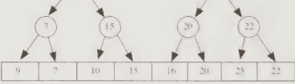

为了理解这个问题，可以想想二分查找算法的决策树版本。（注意，与排序算法不同，二分查找的决策树相对较小，即 $O(n)$ 个节点。）

考虑前面给出的图示例，其中对无序数组 $[9\ 7\ 10\ 15\ 16\ 20\ 25\ 22]$ 执行二分查找。假设 $key_1=20$ 且 $key_2=25$。20 和 25 都 $\ge 15$，因此它们在根节点选择右分支。此时，两次二分查找出现分歧：$20<25$ 且 $25\ge25$。因此 $key_1$ 走左分支，$key_2$ 走右分支。这确保最终 $key_1$ 和 $key_2$ 按正确顺序排列。

现在我们推广这一论证。对于 $key_1$，设 $x_1, x_2,\ldots,x_k$ 为二分查找第 6 行中与 $key_1$ 进行比较的 $k$ 个元素（其中 $k=O(\log n)$）。（在示例中，$x_1=15, x_2=25$，且 $x_3 = 20$。）设 $y_1,y_2,\ldots,y_t$ 为与 $key_2$ 进行比较的 $t$ 个元素。我们知道 $x_1 = y_1$。设 $l$ 为使得 $x_l \ne y_l$ 的最小数。（特别地，$l > 1$。）由于 $i < j$，根据假设，我们知道 $key_1$ 不可能在 $key_2$ 同时转向左分支时转向右分支。因此我们得出结论

$$key_1 < x_{l-1}=y_{l-1}\le key_2$$

（请注意，对于这个问题，给出相对非正式的解答是可以接受的，因为我们只要求你*解释为什么*这是成立的。上述论证可以更严格地形式化。）

4. **概述：** 为了证明算法正确，需要证明两个主要引理：
   - a) 如果列表 $A$ 是有序的，算法总是返回 *真*；
   - b) 如果列表 $A$ 不是 90% 有序的，算法以至少 $\frac{2}{3}$ 的概率返回假。

我们首先证明较直接的引理，它本质上论证了二分查找是正确的。然后我们证明，如果列表不是 90% 有序的，那么至少有 10% 的元素无法通过*二分查找检验*。最后我们得出结论：对于足够大的常数 $k$，如果列表不是 90% 有序的，算法将以至少 $\frac{2}{3}$ 的概率输出假。

### 引理 4

如果列表 $A$ 是*有序*的，算法总是返回 *真*。

**证明** 该引理由二分查找在有序列表上的正确性得出，这已在第一次习题课中证明。不变式为：$key$ 位于数组 $A$ 的 *左边界* 和 *右边界* 之间。

在本问题的其余部分，我们根据元素是否通过二分查找检验，将元素标记为 *好* 或 *坏*。

$$\operatorname{label}(i)=\begin{cases}\mathit{good}, & \text{if } i=\operatorname{BINARY-SEARCH}(A,A[i],1,n),\\ \mathit{bad}, & \text{if } i\ne\operatorname{BINARY-SEARCH}(A,A[i],1,n).\end{cases}\qquad (1.3)$$

注意，哪些元素是好元素、哪些是坏元素并不是显而易见的。特别地，有些元素看起来排序正确，但可能因为其他元素排序错误而成为坏元素。类似地，有些元素看起来完全不在正确位置，但可能因为其他元素错位而成为好元素。证明的一个关键部分是说明：排序很差的列表包含大量坏元素。

### 引理 5

如果列表 $A$ 不是 90% 有序的，那么至少有 10% 的元素是坏的。

**证明** 反设只有不到 10% 的元素是坏的。那么至少有 90% 的元素是好的。回顾 90% 有序列表的定义：如果移除 10% 的元素，剩余元素按有序排列。因此，从数组中移除所有坏元素。我们现在论证剩余元素是有序的。考虑剩余好元素中的任意两个 $key_i$ 和 $key_j$，其中 $key_i$ 位于下标 $i$，$key_j$ 位于下标 $j$。如果 $i < j$，那么第三部分的解答表明 $key_i \le key_j$。类似地，如果 $j < i$，那么第三部分的解答表明 $key_j \le key_i$。也就是说，这两个元素按正确的顺序排列。由于所有元素对都按顺序排列，好元素组成的数组是有序的。一旦我们证明存在大量坏元素，还需要说明我们可以通过随机抽样找到一个坏元素。

### 引理 6

如果列表不是 90% 有序的，算法以至少 $\frac{2}{3}$ 的概率返回假。

**证明** 由引理 5，我们知道至少有 10% 的元素是坏的。由第二部分，我们知道如果选择 $k > \frac{\log(1/3)}{\log(0.9)}$，那么我们以 $\frac{2}{3}$ 的概率找到一个坏元素。因此，我们得出结论：算法以至少 $\frac{2}{3}$ 的概率返回 *假*。

5. 引理 4 与第四部分中的相同。对引理 5 做简单修改即可证明：如果数组不是 $(1-\epsilon)$ 有序的，那么至少有 $\epsilon$ 个坏元素；否则，剩余的 $(1-\epsilon)n$ 个元素将构成一个 $(1-\epsilon)$ 有序列表。最后，还需要确定合适的 $k$ 值。

在这种情况下，我们希望选择满足下式的 $k$：

$$ (1 - \epsilon)^k \leq \frac{1}{3} $$

我们选择 $k = \frac{c}{\epsilon}$，则可以得出结论

$$ (1 - \epsilon)^k \leq \left((1 - \epsilon)^{\frac{1}{\epsilon}}\right)^c $$
$$ (1 - \epsilon)^k \leq \left(\frac{1}{e}\right)^c $$

### 引理 7

INSERTION-SORT(A) 的运行时间为 O(n+I)，其中 I 是 A 中的逆序对数量。

**证明** 考虑 INSERTION-SORT 对数组 A 的一次执行。在外层循环中，有 O(n) 的工作量。内层循环的每次迭代恰好修复一个逆序对。当算法终止时，不再有逆序对。因此，内层循环必然执行 I 次，产生 O(I) 的工作量。所以算法的运行时间为 O(n+I)。

接下来，我们统计一个数组中逆序对的数量，其中每个元素与其正确位置相距不超过 k 个位置。

### 引理 8

如果每个元素与其正确位置相距不超过 k 个位置，那么逆序对数量至多为 O(nk)。

**证明** 我们给出逆序对数量的一个上界。考虑某个特定元素 A[i]。能与 A[i] 构成逆序对的元素至多有 4k 个，特别是 A[i−2k..i+2k] 范围内的那些元素。因此，i 最多参与 4k 个逆序对，所以逆序对总数至多为 4nk。

由此我们得出结论：在一个每个元素与其正确位置相距不超过 k 个位置的数组上，插入排序的运行时间为 O(nk)。

顺便提一句，似乎可以不用逆序对来直接证明这一点，只需证明插入排序的内层循环永远不会将某个元素移动超过 k 个位置。然而，这并不像看起来那么容易：尽管一个元素开始时总是在其最终位置的 k 个位置以内，但仍需证明它永远不会移得更远。例如，如果它先向后移动 k+2 个位置，然后又被向前移动 3 个位置呢？不过，也许可以证明一个元素永远不会移动超过 4k 个位置。

3. 我们已经知道，对数组进行排序需要 Ω(n log n) 次比较。如果 k > n/2，那么 n log n = Ω(n log k)，证明到此结束。在本证明的其余部分，假设 k ≤ n/2。

   我们的目标是为一个算法的决策树中的叶子节点数量提供一个下界，该算法对一个数组进行排序，其中每个


元素位于其正确位置 \(k\) 个槽位以内。因此，我们给出满足该条件的可能排列数量的下界。

首先，将大小为 \(n\) 的数组分成 \(\lfloor n/k \rfloor\) 个块，每块大小为 \(k\)，余数部分大小为 \(n \bmod k\)。对于每个块，存在 \(k!\) 种排列，因此整个数组至少有 \((k!)^{\lfloor n/k \rfloor}\) 种总排列。这些排列都不会使任一元素移动超过 \(k\) 个槽位。

注意，这低估了排列总数，因为没有任何元素会从一个 \(k\) 元素块移动到另一个块，并且我们忽略了余数块中元素的排列。

因此我们得出结论，决策树至少有 \((k!)^{\lfloor n/k \rfloor}\) 个叶子。由于决策树是二叉树，我们可以得出决策树的高度为

$$
\begin{aligned}
&\ge \log\left((k!)^{\lfloor n/k \rfloor}\right)\\
&\ge \left\lfloor\frac{n}{k}\right\rfloor \log(k!)\\
&\ge \left\lfloor\frac{n}{k}\right\rfloor(c_1 k\log k)\\
&\ge c_1(n-k)\log k\\
&\ge \frac{c_1 n\log k}{2}\\
&= \Omega(n\log k)
\end{aligned}
$$

（最后一步成立是因为我们假设 \(k \le n/2\)。）

4. 对于这个问题的解决方案，我们将使用一个堆。我们假设有一个具有以下子例程的堆：

- **MAKE-HEAP()** 返回一个新的空堆。
- **INSERT(H, key, value)** 将键/值对插入堆中。
- **EXTRACT-MIN(H)** 从堆中删除具有最小键的键/值对，并返回其值。

首先，考虑合并 \(t\) 个有序列表的问题。假设我们有列表 \(A_1,\ldots,A_t\)，其中每个列表都是有序的。我们使用以下策略（伪代码如下）：

- a) 创建一个新堆 \(H\)。
- b) 对于 \(t\) 个列表中的每一个，将第一个元素插入堆中。对于列表 \(i\)，执行 \(\operatorname{INSERT}(H, A_i[1], i)\)。
- c) 重复 \(n\) 次：
  - i. 使用 \(\operatorname{EXTRACT-MIN}(H)\) 从堆中删除最小元素。令 \(v\) 为返回的值，即列表的标识。
  - ii. 将列表 \(v\) 中取出的元素按顺序放入一个新数组。
  - iii. 插入列表 \(v\) 中的下一个元素。

关键不变量是证明在循环的每次迭代之后，堆包含每个列表中的最小元素。（我们省略形式化归纳证明，因为题目只要求你设计算法。）注意，每次 EXTRACT-MIN 和 INSERT 操作需要 \(O(\log k)\) 时间，因为堆中元素从不超过 \(2k\) 个。该循环只需要常数量的其他工作，并重复 \(n\) 次，因此运行时间为 \(O(n\log k)\)。

为了将其应用于我们的问题，我们将 \(A\) 视为一组有序列表。特别地，注意对于所有 \(i \le n - 2k - 1\)，有 \(A[i] < A[i + 2k + 1]\)：位于槽位 \(i\) 的元素在排序过程中最多向前移动到槽位 \(i + k\)，而位于槽位 \(i + 2k + 1\) 的元素在排序过程中最多向后移动到槽位 \(i + k + 1\)。

暂时假设 \(n\) 能被 \(2k\) 整除。我们考虑如下定义的 \(t = 2k\) 个列表：

$$
\begin{aligned}
A_1 &= A[1], A[2k+1], A[4k+1], \ldots, A[n-(2k-1)] \\
A_2 &= A[2], A[2k+2], A[4k+2], \ldots, A[n-(2k-2)] \\
&\vdots \\
A_t &= A[2k], A[4k], A[6k], \ldots, A[n]
\end{aligned}
$$

这些列表中的每一个都是有序的，并且每个列表的大小都 \(\le n\)。因此，我们可以使用上述过程在 \(O(n\log k)\) 时间内对这些列表进行排序。

我们现在给出更精确的伪代码：

```text
Algorithm 13 Sort Almost Sorted Algorithm
1: function SORT-ALMOST-SORTED(A, n, k)        ▷ Sort A if every element is within k slots of its proper position
2:     H ← MAKE-HEAP()
3:     for i ← 1 to 2k do
4:         INSERT(H, A[i], i)
5:     end for
6:     for i ← 1 to n do
7:         j ← EXTRACT-MIN(H)
8:         B[i] ← A[j]
9:         if j + 2k ≤ n then
10:            INSERT(H, A[j + 2k], j)
11:        end if
12:    end for
13:    return B
14: end function
```

回想一下，堆通常用于存储键及其关联的值，尽管在描述堆操作时我们经常忽略该值。在这种情况下，值是索引 \(j\)，而键是元素 \(A[j]\)。因此，堆返回数组中下一个最小元素的索引。

正确性和性能由上述论证得出。

注意，还有第二种解决此问题的方法。回想一下，我们已经知道如何在 \(O(n)\) 时间内合并两个（共同）包含 \(n\) 个元素的有序列表。于是，可以以锦标赛方式合并这些列表。我们给出 \(k = 8\) 的示例，其中 \(A+B\) 表示合并列表 \(A\) 和 \(B\)：

- 第 1 轮：\((A_1 + A_2), (A_3 + A_4), (A_5 + A_6), (A_7 + A_8)\)
- 第 2 轮：\((A_1 + A_2 + A_3 + A_4), (A_5 + A_6 + A_7 + A_8)\)
- 第 3 轮：\((A_1 + A_2 + A_3 + A_4 + A_5 + A_6 + A_7 + A_8)\)

注意，共有 \(\log k\) 个合并步骤，每个步骤合并 \(n\) 个元素（分散在最多 \(k\) 个列表中），因此代价为 \(O(n)\)。这便得到所需的 \(O(n \log k)\) 运行时间。

### 1.8 最长上升序列问题

### 问题描述

考虑一个值序列 \((v_0, v_1, \ldots, v_{n-1})\)。如果从列表中删除 \(i\) 个值（不一定是相邻的值），则得到一个长度为 \(n-i\) 的子序列。如果该子序列的值按非递减顺序排列，则称其为 *上升序列*。例如，列表 \((1, 3, 4, 6, 2, 4)\) 有一个子序列 \((1, 3, 2)\)，它不是上升序列；还有另一个子序列 \((1, 3, 6)\)，它是上升序列。

编写一个程序，给定 \(b[0..n-1]\) 中的序列，其中 \(n > 0\)，计算 \(b[0..n-1]\) 的最长上升序列的长度。

### 解法

作为缩写，我们使用记号 \(lup(s)\) 表示：

\(lup(s) =\) 序列 \(s\) 的最长上升序列的长度。

因此，使用变量 \(k\) 保存答案，程序具有如下前置条件和后置条件：

\(Q : n > 0\)  
\(R : k = lup(b[0..n-1])\)

注意，序列中任意一个值的变化都可能改变其最长上升序列，这意味着为了确定 \(lup(s)\)，可能必须检查序列 \(s\) 的每一个值。这提示我们使用循环。让我们先写出一个可能的不变量以及循环的概要。

该循环将按某种顺序检查 \(b[0..n-1]\) 的值。由于 \(lup(b[0..0])\) 为 1，可以通过将 \(R\) 中的常量 \(n\) 替换为变量来导出一个可能的不变量：

$$
P : 1 \leq i \leq n \wedge k = lup(b[0..i-1])
$$

循环本身将具有以下形式

```text
1: i <- 1
2: k <- 1
3: while i != n do
4:     increase i, maintaining P
5: end while
```

增加 \(i\) 会扩展序列 \(b[0..i-1]\)，而 \(k\) 是该序列的最长上升序列的长度，因此可能需要增加 \(k\)。是否增加 \(k\) 取决于 \(b[i]\) 是否至少与某个结束 \(b[0..i-1]\) 的某个最长上升序列的值一样大；最长上升序列可能不止一个。用其他变量维护信息，以便能够高效地进行这种测试，是合理的。确定是否应增加 \(k\) 所需的最少信息是什么？

必须知道结束 \(b[0..i-1]\) 的长度为 \(k\) 的上升序列的*最小*值，记为 \(m\)，因为此时 \(b[0..i]\) 具有长度为 \(k+1\) 的上升序列当且仅当 \(b[i] \ge m\)。因此，我们修改不变量 \(P\) 以包含 \(m\)：

$$
P : 1 \leq i \leq n \wedge k = lup(b[0..i-1]) \wedge m \text{ is the smallest value in } b[0..i-1] \text{ that ends an upsequence of length } k.
$$

在 \(b[i] \ge m\) 的情况下，可以增加 \(k\) 并将 \(m\) 设为 \(b[i]\)，因此程序到目前为止如下所示：

```text
1: i <- 1
2: k <- 1
3: m <- b[0]                                 ▷ P
4: while i != n do
5:     if b[i] >= m then
6:         k <- k + 1
7:         m <- b[i]
8:     else if b[i] < m then
9:         ?
10:    end if
11:    i <- i + 1
12: end while
```


现在的问题变成了：如果 b[i] < m 该怎么办。变量 k 不应改变，但 m 呢？在什么条件下必须改变 m？

如果 b[0..i − 1] 包含一个长度为 k − 1、以某个 ≤ b[i] 的值结尾的上升子序列，那么 b[i] 可以作为 b[0..i] 中一个长度为 k 的上升子序列的末尾元素。此外，如果 b[i] < m，那么必须改变 m。为了检查这个条件，考虑维护最小值 m1，它作为 b[0..i − 1] 中某个长度为 k − 1 的上升子序列的末尾元素。

这意味着需要两个值：作为长度为 k 的上升子序列末尾元素的最小值 m，以及作为长度为 k − 1 的上升子序列末尾元素的最小值 m1。

维护 m 导致我们引入 m1；维护 m1 又会导致我们引入 m2 来保存作为长度为 k − 2 的上升子序列末尾元素的最小值。依此类推。因此，需要一个值数组。我们再次修改不变式：

P : 1 ≤ i ≤ n ∧ k = lup(b[0..i − 1]) ∧ (j : 1 ≤ j ≤ k : m[j] 是 b[0..i − 1] 中长度为 j 的上升子序列的最小末尾元素)

程序随之改为：

```text
1: i ← 1
2: k ← 1
3: m[1] ← b[0]                  ▷ P
4: while i ≠ n do
5:   if b[i] ≥ m[k] then
6:      k ← k + 1
7:      m[k] ← b[i]
8:   else if b[i] < m[k] then
9:      ?
10:  end if
11:  i ← i + 1
12: end while
```

在继续之前，有必要研究一下数组 m；它是否具有某些可能有用的性质？

数组 m 是有序的，因为长度为 j（比如说）的上升子序列的最小末尾元素必然不超过长度为 j + 1 的上升子序列的最小末尾元素。

我们现在面临的问题是：在 b[i] < m[k] 的情况下，必须确定 m[1..k] 中的哪些值需要改变。

b[i] < m[1] 的情况最容易处理。由于 m[1] 是 b[0..i − 1] 中长度为 1 的上升子序列的最小末尾元素，如果 b[i] < m[1]，那么 b[i] 就是 b[0..i] 中的最小值，它应当成为新的 m[1]。m 的其他值都不需要改变，因为 b[0..i − 1] 的所有上升子序列都以一个大于 b[i] 的值作为末尾元素。

最后，考虑 $m[1] \le b[i] < m[k]$ 的情况。m 的哪些值应当改变？显然，只有那些大于 $b[i]$ 的值才可能被改变，因为它们代表的是最小值。因此，假设我们找到满足下式的 $j$：

$$m[j-1] \le b[i] < m[j]$$

那么 $m[1..j-1]$ 不应改变。接下来，由于 $m[j-1]$ 是 $b[0..i-1]$ 中一个长度为 $j-1$ 的上升子序列的末尾元素，$b[i]$ 可以作为 $b[0..i]$ 中一个长度为 $j$ 的上升子序列的末尾元素。因此，$m[j]$ 应改为 $b[i]$。最后，$m[j+1..k]$ 不应改变。可以使用二分查找来定位 $j$。最终程序如下：

### 算法 14：最长上升子序列程序

```text
1:  i ← 1
2:  k ← 1
3:  m[1] ← b[0]                                      ▷ P
4:  while i ≠ n do
5:      if b[i] ≥ m[k] then
6:          k ← k + 1
7:          m[k] ← b[i]
8:      else if b[i] < m[1] then
9:          m[1] ← b[i]
10:     else if m[1] ≤ b[i] < m[k] then
11:         Establish m[j − 1] ≤ b[i] < m[j]
12:         h ← 1
13:         j ← k
14:         while h ≠ j − 1 do
15:             invariant : 1 ≤ h < j ≤ k ∧ m[h] ≤ b[i] < m[j], bound : j − h − 1    ▷ P
16:             e ← (h+j)/2
17:             if m[e] ≤ b[i] then
18:                 h ← e
19:             else if m[e] > b[i] then
20:                 j ← e
21:             end if
22:         end while
23:         m[j] ← b[i]
24:     end if
25:     i ← i + 1
26: end while
```

该程序的执行时间在最坏情况下与 $n \log n$ 成正比，在最好情况下与 $n$ 成正比。在最坏情况下，它需要与 $n$ 成正比的空间，用于数组 $m$。它使用了一种称为动态规划的技术，尽管在开发这一程序时并未明确意识到该技术。

### 1.9 C++ 中的固定大小泛型数组

### 问题描述

在 C++ 中设计并实现一个泛型数组容器，该容器封装了具有以下接口的定长数组：

```cpp
template<typename T, std::size_t N> struct array;
```

请注意，该结构体应具有与 C 风格数组相同的聚合类型语义。对于给定数量的元素，array<T, N> 的大小和效率应与相应的 C 风格数组 T[N] 的大小和效率相当。该结构体应提供标准容器的优点，例如知道自身大小、支持赋值、随机访问迭代器等。

### 解决方案

**程序 1.14：C++ 中的泛型数组**

```cpp
#include <type_traits>
#include <utility>
#include <iterator>
#include <algorithm>
#include <cassert>

template <class ElementType, size_t N>
struct array
{
    // types:
    typedef array self;
    typedef ElementType
        value_type;
    typedef value_type&
        reference;
    typedef const value_type&
        const_reference;
    typedef value_type*
        iterator;
    typedef const value_type*
        const_iterator;
    typedef value_type*
        pointer;
    typedef const value_type*
        const_pointer;
    typedef size_t
        size_type;
    typedef ptrdiff_t
        difference_type;
    typedef std::reverse_iterator<iterator>
        reverse_iterator;
    typedef std::reverse_iterator<const_iterator>
        const_reverse_iterator;
    value_type elements[N > 0 ? N : 1];

    void fill(const value_type u)
    {
        std::fill_n(elements, N, u);
    }

    void swap(array& a)
    {
        std::swap_ranges(elements, elements + N, a.elements);
    }

    // iterators:
    iterator begin() {return iterator(elements);}
    const_iterator begin() const {return const_iterator(elements);}
    iterator end() {return iterator(elements + N);}
    const_iterator end() const {return const_iterator(elements + N);}

    reverse_iterator rbegin() {return reverse_iterator(end());}
    const_reverse_iterator rbegin() const {return const_reverse_iterator(end());}
    reverse_iterator rend() {return reverse_iterator(begin());}
    const_reverse_iterator rend() const {return const_reverse_iterator(begin());}

    const_iterator cbegin() const {return begin();}
    const_iterator cend() const {return end();}
    const_reverse_iterator crbegin() const {return rbegin();}
    const_reverse_iterator crend() const {return rend();}

    // capacity:
    constexpr size_type size() const {return N;}
    constexpr size_type max_size() const {return N;}
    constexpr bool empty() const {return N == 0;}

    // element access:
    reference operator[](size_type n) {
        return elements[n];
    }
    const_reference operator[](size_type n) const {
        return elements[n];
    }
    reference at(size_type n);
    const_reference at(size_type n) const;

    reference front() { return elements[0]; }
    const_reference front() const { return elements[0]; }
    reference back() { return elements[N > 0 ? N - 1 : 0]; }
    const_reference back() const { return elements[N > 0 ? N - 1 : 0]; }

    value_type* data() { return elements; }
    const value_type* data() const { return elements; }
};

template <class ElementType, size_t N>
typename array<ElementType, N>::reference
array<ElementType, N>::at(size_type n)
{
    if (n >= N)
        assert(!"array::at out_of_range");
    return elements[n];
}

template <class ElementType, size_t N>
typename array<ElementType, N>::const_reference
array<ElementType, N>::at(size_type n) const
{
    if (n >= N)
        assert(!"array::at out_of_range");
    return elements[n];
}

template <class ElementType, size_t N>
inline bool
operator==(const array<ElementType, N>& x, const array<ElementType, N>& y)
{
    return std::equal(x.elements, x.elements + N, y.elements);
}

template <class ElementType, size_t N>
inline bool
operator!=(const array<ElementType, N>& x, const array<ElementType, N>& y)
{
    return !(x == y);
}

template <class ElementType, size_t N>
inline bool
operator<(const array<ElementType, N>& x, const array<ElementType, N>& y)
{
    return std::lexicographical_compare(x.elements,
        x.elements + N, y.elements, y.elements + N);
}

template <class ElementType, size_t N>
inline bool
operator>(const array<ElementType, N>& x, const array<ElementType, N>& y)
{
    return y < x;
}

template <class ElementType, size_t N>
inline bool
operator<=(const array<ElementType, N>& x, const array<ElementType, N>& y)
{
    return !(y < x);
}

template <class ElementType, size_t N>
inline bool
operator>=(const array<ElementType, N>& x, const array<ElementType, N>& y)
{
    return !(x < y);
}

template <class ElementType, size_t N>
inline void
swap(array<ElementType, N>& x, array<ElementType, N>& y)
{
    x.swap(y);
}

template <size_t Index, class ElementType, size_t N>
inline ElementType&
get(array<ElementType, N>& a)
{
    static_assert(Index < N, "Index out of bounds in std::get<> (std::array)");
    return a[Index];
}
```


```cpp
}

template <size_t Index, class ElementType, size_t N>
inline const ElementType&
get(const array<ElementType, N>& a)
{
    static_assert(Index < N, "Index out of bounds in std::get<> (const std::array&)");
    return a[Index];
}

template <size_t Index, class ElementType, size_t N>
inline ElementType&&
get(array<ElementType, N>&& a)
{
    static_assert(Index < N, "Index out of bounds in std::get<> (std::array&&)");
    return std::move(a[Index]);
}
```

### 1.10 座位问题

### 问题描述

GreedSox 是一支受欢迎的大联盟棒球队，他们只关心一件事：赚钱。他们聘请您作为顾问，帮助提升他们的团体票销售。他们注意到了以下问题。当一个团体想观看棒球比赛时，团体所有成员都需要座位（在看台区），否则他们就会离开。由于不完整的团体无法安排座位，看台常常没有坐满。仍有可用空间，但不足以容纳整个团体。在这种情况下，该团体无法安排座位，GreedSox 因此损失收入。

GreedSox 希望您就新的座位安排策略提出建议。GreedSox 决定不采用先到先得的方式安排人员，而是先安排大团体，再安排较小团体，最后安排单人（即人数为 1 的团体）。

给定一组团体，$G[1..m] = [g_1, g_2, \ldots, g_m]$，其中 $g_i$ 是表示团体大小的数字。假设看台可容纳 n 人。考虑以下贪心座位安排算法，其中函数 ADMIT(i) 接纳团体 i，REJECT(i) 拒绝团体 i。

### 算法 15 Seat 算法

```text
1: function SEAT(G[1..m], n)
2:     admitted ← 0
3:     G ← SORT(G)                    ▷ Sort groups largest to smallest.
4:     for i ← 1 to m do
5:         if G[i] ≤ n then
6:             ADMIT(i)
7:             n ← n - G[i]
8:             admitted ← admitted + G[i]
9:         else
10:            REJECT(i)
11:        end if
12:    end for
13:    return admitted
14: end function
```

SEAT 算法首先按大小对团体排序。然后它从大到小遍历这些团体，为任何能容纳在看台中的团体安排座位。它返回接纳的人数。

- 1. GreedSox 老板们是对的：贪心座位安排算法效果相当好。证明：给定 G 和 n，如果可以接纳 k 人，那么贪心座位安排算法至少接纳 k/2 人。
- 2. 不幸的是，SEAT 算法并非完美。通过给出一个反例来证明 SEAT 不是最优的，其中当 n 变大时，渐近地，贪心座位安排与最优座位安排之间的比率趋近于 1/2。

当您向 GreedSox 老板们展示结果时，他们指出了以下问题：与计算机内存中的数字不同，现实中的人很难移动。特别是，排队等候的人不喜欢被排序。GreedSox 老板们要求您开发一个不修改集合 G 的贪心座位安排算法版本。（您可以把 G 看作存储在只读存储器中。）您建议以下算法：

### 算法 16 ReSeat 算法

```text
1: function RESEAT(G[1..m], n)
2:     admitted ← 0
3:     for j ← 1 to ⌈log n⌉ do
4:         for i ← 1 to m do
5:             if G[i] ≥ n/2^j and G[i] ≤ n then
6:                 ADMIT(i)
7:                 n ← n - G[i]
8:                 admitted ← admitted + G[i]
9:             else if G[i] > n then
10:                REJECT(i)
11:            end if
12:        end for
13:    end for
14:    return admitted
15: end function
```

RESEAT 算法会多次遍历团体列表。在第一轮迭代中，它接纳任何大小至少为 n/2 的团体。在第二轮迭代中，它接纳任何大小至少为 n/4 的团体。它以同样方式继续，安排越来越小的团体就座，直到场馆被填满。当 RESEAT 结束时，它返回接纳的人数。

- 3. 假设给定 G 和 n，至少可以接纳 k 人。证明 RESEAT 算法仍至少安排 k/2 人就座。
- 4. RESEAT 算法运行时间为 O(m log n)。设计一个新算法，使其运行时间为 O(m)，并且仍保证：如果可安排 k 人就座，你的算法至少安排 k/2 人就座。

### 解答

- 1. 我们首先证明一个关于 SEAT 算法接纳人数的引理。

**引理 1**

SEAT 算法要么接纳所有*大小* ≤ n 的团体，要么*接纳* ≥ n/2 人。

**证明** 假设 SEAT 算法没有接纳所有*大小* ≤ n 的团体。也就是说，存在某个*大小* ≤ n 的团体 $g_i$，SEAT 没有接纳它。

需要考虑两种情况。首先，假设 $g_i \geq n/2$。那么，由于该算法是贪心的，我们知道它一定已经接纳了某个比 $g_i$ 更大的团体；否则，团体 $g_i$ 就会被接纳。因此，我们可以得出结论：该算法安排至少 $\frac{n}{2}$ 人就座，符合要求。

对于第二种情况，假设 $g_i < \frac{n}{2}$。由于 $g_i$ 未被接纳，我们知道在某个时刻 $\mathrm{remaining} < \frac{n}{2}$。由于 remaining 是非递增的，因此我们得出结论：至少有 $\frac{n}{2}$ 人就座。

我们论证该引理立即推出 SEAT 算法是 2-竞争的。首先，如果 SEAT 接纳所有大小 ≤ n 的团体，那么它接纳的人数与最优座位安排算法完全相同。其次，如果 SEAT 接纳至少 $\frac{n}{2}$ 人，我们知道最优座位安排算法至多能安排 n 人就座。因此 $\frac{n}{2} \geq \frac{k}{2}$，符合要求。

- 2. 考虑团体 $G = \left\{\frac{n+2}{2}, \frac{n}{2}, \frac{n}{2}\right\}$。注意贪心座位安排算法接纳大小为 $\frac{n+2}{2}$ 的团体，然后无法接纳任何其他团体。最优算法接纳两个大小为 $\frac{n}{2}$ 的团体，坐满全部 n 个座位。注意当 n 变大时，渐近地，$\frac{(n+2)/2}{n}$ 趋近于 $\frac{1}{2}$。

- 3. 这种情况下的论证与第一部分的证明非常相似。我们首先重新证明上面关于 RESEAT 算法接纳人数的同一引理。

**引理 2**

RESEAT 算法要么接纳所有大小 ≤ n 的团体，要么接纳 ≥ $\frac{n}{2}$ 人。

**证明** 假设 RESEAT 算法没有接纳所有大小 ≤ n 的团体。也就是说，存在某个大小 ≤ n 的团体 $g_i$，RESEAT 没有接纳它。

需要考虑两种情况。首先，假设 $g_i \geq \frac{n}{2}$。那么，由于算法首先考虑所有大小 ≥ $\frac{n}{2}$ 的团体（当 $j=1$ 时），我们知道它一定已经接纳了某个大小 ≥ $\frac{n}{2}$ 的团体；否则，团体 $g_i$ 在 $j=1$ 的循环中就会被接纳。因此，我们可以得出结论：该算法安排至少 $\frac{n}{2}$ 人就座，符合要求。

对于第二种情况，假设 $g_i < \frac{n}{2}$。注意当 $j=\lceil\log n\rceil$ 时，$g_i \geq \frac{n}{2^j}$。因此，如果 $g_i$ 未被接纳，我们可以得出结论：在某个时刻 $\mathrm{remaining} < g_i$。也就是说，$\mathrm{remaining} < g_i < \frac{n}{2}$。由于 remaining 是非递增的，因此我们得出结论：至少有 $\frac{n}{2}$ 人就座。

与之前一样，该引理立即推出 RESEAT 算法是 2-竞争的，符合要求。

### 算法 17 ReSeat 线性时间算法

```text
1: function FAST-RESEAT(G[1...m], n)
2:     admitted ← 0
3:     remaining ← n
4:     for i ← 1 to m do
5:         if G[i] ≥ n/2 and G[i] ≤ remaining then
6:             ADMIT(i)
7:             admitted ← admitted + G[i]
8:             remaining ← remaining − G[i]
9:         end if
10:    end for
11:    for i ← 1 to m do
12:        if G[i] ≤ remaining then
13:            ADMIT(i)
14:            admitted ← admitted + G[i]
15:            remaining ← remaining − G[i]
16:        end if
17:    end for
18:    return admitted
19: end function
```

证明该算法正确的论证与第三部分的证明基本相同。特别地，我们再次证明关于就座人数的同一引理。

**引理 3**

FAST-RESEAT 算法要么接纳所有大小 ≤ n 的团体，要么接纳 ≥ n/2 人。

**证明** 假设 FAST-RESEAT 算法没有接纳所有大小 ≤ n 的团体。也就是说，存在某个大小 ≤ n 的团体 $g_i$，FAST-RESEAT 没有接纳它。

需要考虑两种情况。首先，假设 $g_i \geq n/2$。那么，由于算法首先考虑所有大小 ≥ n/2 的团体，我们知道如果 $g_i$ 被拒绝，它一定已经接纳了某个大小 ≥ n/2 的团体；否则，团体 $g_i$ 就会被接纳。因此，我们可以得出结论：该算法安排至少 n/2 人就座，符合要求。

对于第二种情况，假设 $g_i < n/2$。如果 $g_i$ 未被接纳，我们可以得出结论：$g_i > \mathrm{remaining}$。也就是说，$\mathrm{remaining} < g_i < n/2$。


### 1.11 段问题

段问题涉及计算满足某个谓词的最长或最短段，该谓词通常根据给定数组定义。

### 最长段

令 $N \ge 0$，并令 $X[0..N)$ 为一个整数数组。我们关心的是 $[0..N)$ 中满足某个由 $X$ 定义的谓词的最长子序列 $[p..q)$ 的长度。此类谓词的例子有：

- 所有元素为零：$\forall i : p \le i < q : X.i = 0$
- 该段是左极小的：$\forall i : p \le i < q : X.p \le X.i$
- 该段至多包含 10 个零：$(\#i : p \le i < q : X.i = 0) \le 10$
- 所有值都不同：$\forall i, j : p \le i < j < q : X.i \neq X.j$

### 全零

让我们解决确定 $X[0..N)$ 中仅包含零的最长段长度的问题。这大概是可以想象的最简单的最长段问题。该问题可以重新表述如下。

```text
1: N : int{N ≥ 0}
2: X : array[0..N) of int
3: r : int
4: r = (max p, q : 0 ≤ p ≤ q ≤ N ∧ (∀i : p ≤ i < q : X.i = 0) : q − p)
```

我们的第一步是为 $(\forall i : p \le i < q : X.i = 0)$ 引入一个名称。这不仅缩写后置条件，更重要的是，它使我们能够找出推导中哪些部分独立于谓词的具体形式。

对于 $0 \le p \le q \le N$，我们通过下式定义 $A.p.q$：

$$A.p.q \equiv (\forall i : p \le i < q : X.i = 0)$$

后置条件 $R$ 于是可以写成

$$R : r = (\max p,q : 0 \le p \le q \le N \land A.p.q : q - p)$$

关于谓词 $A$ 可以说些什么？它的项 $X.i = 0$ 不依赖于 $p$ 或 $q$。它对空段成立，即，

$$A.n.n \quad \text{for } 0 \le n \le N$$

此外，$A$ 是前缀封闭的，即，若一个段满足 $A$，则该段的所有前缀也满足 $A$。更形式化地，

$$A.p.q \Rightarrow (\forall i : p \le i \le q : A.p.i) \quad \text{for } 0 \le p \le q \le N$$

并且 $A$ 是后缀封闭的：

$$A.p.q \Rightarrow (\forall i : p \le i \le q : A.i.q) \quad \text{for } 0 \le p \le q \le N$$

由于 $A$ 中的项 $X.i = 0$ 既不依赖于 $p$ 也不依赖于 $q$，因此无论我们在 $R$ 中用变量替换常量 $0$ 还是常量 $N$ 都无关紧要。我们提出由下式定义的不变式 $P_0$ 和 $P_1$：

$$P_0 : r = (\max p,q : 0 \le p \le q \le n \land A.p.q : q - p)$$

和

$$P_1 : 0 \le n \le N$$

对于初始化，我们推导出

$$
\begin{aligned}
&\max p,q : 0 \le p \le q \le 0 \land A.p.q : q-p \\
&= \max p,q : p = 0 \land q = 0 \land A.p.q : q-p \\
&= 0
\end{aligned}
$$

由此我们推断，$P_0 \land P_1$ 通过 $n \leftarrow 0$ 和 $r \leftarrow 0$ 初始化。对于 $n$ 增加 1，在假设 $P_0 \land P_1 \land n \neq N$ 下，我们推导出

$$
\begin{aligned}
&\max p,q : 0 \le p \le q \le n+1 \land A.p.q : q-p \\
&= \max(\max p,q : 0 \le p \le q \le n \land A.p.q : q-p,\ \max p : 0 \le p \le n+1 \land A.p.(n+1) : n+1-p) \\
&= r \max (\max p : 0 \le p \le n+1 \land A.p.(n+1) : n+1-p) \\
&= \{\text{distribute over max for a non-empty range, } A.(n+1).(n+1)\} \\
&\quad r \max (n+1 + (\max p : 0 \le p \le n+1 \land A.p.(n+1) : -p)) \\
&= r \max (n+1 - (\min p : 0 \le p \le n+1 \land A.p.(n+1) : p))
\end{aligned}
$$

这导致引入整数变量 $s$ 以及伴随的不变式

$$Q : s = (\min p : 0 \le p \le n \land A.p.n : p)$$

由 $(\min p : 0 \le p \le 0 \land A.p.0 : p) = 0$，我们推断 $s$ 应在零处初始化，并得到如下形式的程序：

```text
1: N ≥ 0 ∧ (∀n : 0 ≤ n ≤ N : A.n.n)
2: n ← 0
3: r ← 0
4: s ← 0
5: Invariant : P₀ ∧ P₁ ∧ Q
6: bound : N - n
7: while n ≠ N do
8:     establish Q(n ← n + 1)
9:     r ← r max (n + 1 - s)
10:    n ← n + 1
11: end while    ▷ r = ( max p,q : 0 ≤ p ≤ q ≤ N ∧ A.p.q : q - p)
```

该程序将“建立 $Q(n \leftarrow n + 1)$”留作子问题。由于 $A$ 对空段成立，$Q$ 中量词的范围非空，并且 $Q$ 可以写成 $Q_0$、$Q_1$ 和 $Q_2$ 的合取，定义如下：

- $Q_0 : 0 \le s \le n$
- $Q_1 : A.s.n$
- $Q_2 : (\forall p : 0 \le p < s : \neg A.p.n)$

由于 $A$ 是前缀封闭的，对于 $0 \le p < n$，我们有 $\neg A.p.n \Rightarrow \neg A.p.(n+1)$，因此

$$Q_2 \Rightarrow Q_2(n \leftarrow n + 1)$$

我们也有 $Q_0 \Rightarrow Q_0(n \leftarrow n + 1)$，并得出结论

$$Q_0 \land Q_2 \land A.s.(n + 1) \Rightarrow Q(n \leftarrow n + 1)$$

$Q_2$ 蕴含 $Q_2(n \leftarrow n + 1)$ 这一事实还有另一个推论。由

$$Q_2(n \leftarrow n + 1) \equiv (\forall p : 0 \le p < s : \neg A.p.(n + 1))$$

我们推断

$$Q_2 \Rightarrow (\min p : 0 \le p \le n + 1 \land A.p.(n + 1) : p) \ge s$$

即，只需考察满足 $s \le p \le n + 1$ 的值 $p$。对于 $p = n + 1$，我们知道 $A.p.(n + 1)$ 成立，因此我们通常从计算 $s \le p \le n$ 时的 $A.p.(n + 1)$ 开始考察。

我们回到全零问题，其中 $A.p.q \equiv (\forall i : p \le i < q : X.i = 0)$，并计算 $s \le p \le n$ 时的 $A.p.(n + 1)$：

$$
\begin{aligned}
A.p.(n+1) &\equiv (\forall i : p \le i < n+1 : X.i = 0) \\
&\equiv (\forall i : p \le i < n : X.i = 0) \land X.n = 0 \\
&\equiv A.p.n \land X.n = 0
\end{aligned}
$$

因此，

$$Q \land X.n = 0 \Rightarrow Q(n \leftarrow n+1)$$

并且

$$X.n \neq 0 \Rightarrow (\forall p : s \le p \le n : \neg A.p.(n+1))$$

由此，由于 $A.(n+1).(n+1)$ 成立，我们推断

$$X.n \neq 0 \Rightarrow Q(n \leftarrow n+1)(s \leftarrow n+1)$$

这引出了全零问题的以下解法：

### 算法 18 全零程序

```text
1: n, s : int
2: n ← 0
3: r ← 0
4: s ← 0
5: while n ≠ N do
6:     if X.n == 0 then
7:         skip
8:     else if X.n ≠ 0 then
9:         s ← n + 1
10:    end if
11:    r ← r max (n + 1 - s)
12:    n ← n + 1
13: end while
```

请注意，我们没有使用 $A$ 的后缀封闭性。

### 1.12 幂运算

### 问题描述

编写一个程序，给定两个固定整数 $X \ge 0$ 和 $Y \ge 0$，建立 $z = X^Y$。

### 解法

我们定义 $0^0 = 1$。程序应由一个循环组成，该循环具有以下不变式和界函数：

- $P : 0 \le y \land z \times x^y = X^Y$。
- $t : y$

### 算法 20 幂运算再探

```text
1: 0 ≤ X ∧ 0 ≤ Y
2: x ← X
3: y ← Y
4: z ← 1
5: while 0 < y ∧ even(y) do
6:     y ← y / 2
7:     x ← x × x
8:     if 0 < y ∧ odd(y) then
9:         y ← y − 1
10:        z ← z × x
11:    end if
12: end while
                         ▷ z = X^Y
```

在初步的非确定性版本中，循环最多可迭代 $Y$ 次；在最终的确定性版本中，迭代次数至多为 $1 + 2 \times \lceil \log Y \rceil$。该算法可以再次改写为

### 算法 21 高效幂运算

```text
1: 0 ≤ X ∧ 0 ≤ Y
2: x ← X
3: y ← Y
4: z ← 1
5: while 0 < y do
6:     while even(y) do
7:         y ← y / 2
8:         x ← x × x
9:     end while
10:    y ← y − 1
11:    z ← z × x
12: end while
                         ▷ z = X^Y
```

### 1.13 搜索二维有序数组

### 问题描述

让我们从考察与搜索空间相关的隐含性质开始分析该问题。该数组具有以下性质：

1. 行数 $m \ge 1$
2. 列数 $n \ge 1$
3. 每一行中的条目按 $\le$ 排序，即，对于 $0 \le i < m$ && $0 \le j < n$：

   $$a[i][j] \le a[i][j+1]$$

   - $a_{11} \le a_{12} \le \cdots \le a_{1n}$
   - $a_{21} \le a_{22} \le \cdots \le a_{2n}$
   - $\vdots$
   - $a_{m1} \le a_{m2} \le \cdots \le a_{mn}$

4. 每一列中的条目按 $\le$ 排序，即，对于 $0 \le i < m$ && 对于 $0 \le j < n$：

   $$a[i][j] \le a[i+1][j]$$

   - $a_{11} \le a_{21} \le \cdots \le a_{m1}$
   - $a_{12} \le a_{22} \le \cdots \le a_{m2}$
   - $\vdots$
   - $a_{1n} \le a_{2n} \le \cdots \le a_{mn}$

二维有序数组的图示如下：

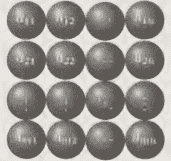

基于上述性质，我们必须开发一种高效算法来查找给定整数 $x$ 在数组 $a$ 中的位置，即该算法应找到 $i$ 和 $j$，使得 $x = a[i,j]$。所谓高效，是指尽可能最小化比较次数。

让我们将输入数组视为某种矩形区域。

问题要求整数 $x$ 确实存在于该区域中的某处。我们将这一条件标记为*输入断言*或*前置条件*。

### 前置条件（又名 *输入断言*）

$$x \in a[0..m-1, 0..n-1]$$

即，$x$ 存在于该矩形区域 $a$ 中的某处。


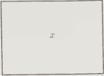

程序成功终止后，x 必定位于 a 的某个矩形区域中，且该矩形区域只包含一行和一列。我们将此条件称为输出断言、结果断言或后置条件。

## 后置条件（又称结果断言）

$$0 \le i \le m-1 \;\&\&\; 0 \le j \le n-1 \;\&\&\; x=a[i,j]$$

即 x 位于 a 的某个矩形区域中，该矩形区域仅由一行和一列组成，也就是说，x 出现在 a 的第 i 行第 j 列。

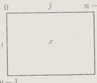

## 不变量

观察前置条件和后置条件，不难发现在算法执行过程中，x 被保证限制在 a 的某个矩形区域内，即：

$$0 \le i \le p \le m-1 \;\&\&$$
$$0 \le q \le j \le n-1 \;\&\&$$
$$x \in a[i..p,q..j]$$

简单来说，该不变量意味着：

-   我们已经搜索完第 a[0..p-1] 行，并且 x 不存在于这些已搜索的行中。
-   我们已经搜索完第 a[0..q-1] 列，并且 x 不存在于这些已搜索的列中。

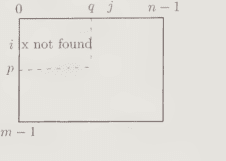

## 收缩矩形区域

我们必须选择一个包含 x 的矩形区域 a[i..p, q..j]，然后不断缩小该区域，直到找到 x。

初始的有界可搜索区域表示为：

```
i = 0    p = m - 1    q = 0    j = n - 1
```

观察矩形的边界，有 4 种方式可以朝着收缩的方向推进：

-   如果 a[i, j] < x，由于该行是有序的，因此 i ← i + 1；因为如果 a[i, j] > x，则该行的所有条目也都大于 x。请注意，如果在 a[i, 0..n-1]（即第 i 行）中没有找到 x，那么执行此操作将保持所声明的不变量。
-   如果 a[p, q] > x，则 p ← p - 1
-   如果 a[p, q] < x，则 q ← q + 1
-   如果 a[i, j] > x，则 j ← j - 1

这些条件也称为守卫（guard）[?]。

## 鞍背搜索算法

让我们将完整解整合如下：

### 算法 22：鞍背搜索算法

```
1. 前置条件：x ∈ a[0..m − 1, 0..n − 1]
2. 后置条件：0 ≤ i ≤ m − 1 && 0 ≤ j ≤ n − 1 && x = a[i, j]
3. function SADDLEBACK-SEARCH(a[0..m-1, 0..n-1], x)
4.     i ← 0
5.     p ← m − 1
6.     q ← 0
7.     j ← n − 1
8.     不变量：0 ≤ i ≤ p ≤ m − 1 && 0 ≤ q ≤ j ≤ n − 1 && x ∈ a[i..p, q..j]
9.     while x ≠ a[i, j] do
10.        if a[i, j] < x then
11.            i ← i + 1
12.        end if
13.        if a[p, q] > x then
14.            p ← p − 1
15.        end if
16.        if a[p, q] < x then
17.            q ← q + 1
18.        end if
19.        if a[i, j] > x then
20.            j ← j − 1
21.        end if
22.    end while
23. end function
```

这种布局已经足够简单，可以让我们以较为务实的方式开始使用形式化编程方法学来解决各类问题。

在上述设定就绪之后，现在该考虑如何在终止时证明结果的正确性了。作为敏锐的读者，不难推断出，搜索空间中形如 p、q 的点这类中间条件，实际上并不需要用来检验终止时结果的真实性。只有第一个和最后一个条件对于证明而言是必要且充分的。因此，让我们去掉中间（两个）条件，以得到实践中的可运行程序，如下所示：

### 算法 1.5：实践中的鞍背搜索算法

```
1: 前置条件：x ∈ a[0..m − 1, 0..n − 1]
2: 后置条件：0 ≤ i ≤ m − 1 && 0 ≤ j ≤ n − 1 && x = a[i, j]
3: 不变量：x 在 a[0..i − 1, 0..j − 1] 中
4: function SADDLEBACK-SEARCH(a[0..m−1, 0..n−1], x)
5:     while x ≠ a[i, j] do
6:         if a[i, j] < x then
7:             i ← i + 1
8:         else j ← j − 1
9:         end if
10:    end while
11: end function
```

我们仍然需要说明为什么选择从最右上角开始。当然，我们也可以从最左下角开始。我们将此留作练习，请读者自行思考选择起始点的优缺点。

## C++11 实现

让我们尝试用一种真实语言（例如 C++11）来编写该算法，使自己处于实际工作环境之中。

### 程序 1.15：C++11 中的鞍背搜索

```cpp
#include <algorithm>
#include <array>

using Point = std::pair<int, int>;

template <int m, int n>
using TwoDimArray
    = std::array<std::array<int, n>, m>;

template <int m, int n>
Point saddleback_search(TwoDimArray<m, n> & a,
                        int x)
{
    Point p(-1, -1);

    int i = 0, j = n - 1;

    while (x != a[i][j])
    {
        if (a[i][j] < x) i += 1;
        else j -= 1;
    }
    p.first = i;
    p.second = j;
    return p;
}
```

### 程序 1.16：使用鞍背搜索

```cpp
#include "saddleback_search.hpp"
#include <iostream>

int main()
{
    TwoDimArray<4, 4> a = {
                                2, 2, 3, 5,
                                3, 4, 5, 6,
                                3, 5, 6, 8,
                                3, 6, 7, 9
                           };

    Point p = saddleback_search<4, 4>(a, 6);
    std::cout << "6 is found at : a["
              << p.first << "]["
              << p.second << "]"
              << std::endl;

}
```

程序输出为：

```text
6 is found at : a[1][3]
```

## 时间复杂度

可以看出，鞍背搜索算法所需的比较次数最多为 n + m。因此时间复杂度为 O(n + m)。

## 如何进一步改进？可能吗？

让我们用一个简单的例子来更好地理解它。假设该数组是一个 n x n 的方阵，即 m = n。请注意，矩形区域中位于反对角线上的元素构成一个无序的整数序列，即 a[0, n-1]、a[1, n-2]、a[2, n-3]、...、a[n-2, 1] 和 a[n-1, 0] 构成一个无序列表，因为该特定序列完全不受行和列索引顺序的影响。因此，即使我们假设 x 可能位于这条反对角线集合上，在最坏情况下至少也需要 n 次比较。

我们已经尽力了吗？还没有。我们请读者思考一下这个问题，并暂且保持耐心；关于可能改进的想法将在不久后讨论，是否能够进一步改进届时自然会见分晓。但现在，我们先考虑问题陈述中的一个简单变体，并尝试借助迄今讨论的方法来求解。

## 变体

如前所述，在目标值多次出现的情况下，我们希望找到其中任意一个。那么，如果改为找到所有这些出现位置呢？这个问题是*鞍背搜索*（在前一节中讨论过）的变体之一。这里不是定位某次出现，而是统计出现的次数。

### 查找第一次出现

在继续求解之前，我们需要先制定一个策略来定位 x 的第一次出现，因为此前的方法侧重于在多次出现时找到任意一次。因此，如果我们尝试在先前方法的基础上构建逻辑，可能会漏掉某些出现位置。

所以，我们在起始点的选择上必须更加谨慎，不能简单地将起始点设为最右上角或最左下角。

为了更好地理解这一点，让我们暂时继续使用之前的解决方案，如下所示，并由此出发去寻找合适的解决方案。

我们需要设计一个高效的算法，在二维有序数组 a[0..m][0..n] 中搜索给定的整数 x。请注意，该数组按行和按列均以升序排列。在多次出现的情况下，请找到第一次出现的位置，即行索引最小且同时列索引也最小的出现位置。请注意，最左上角的行索引和列索引被视为 (0, 0)。

-   1. 使用原始鞍背搜索算法找到任意一次出现，该算法会找到对应最小行索引和最大列索引的条目，也就是说，它会找到包含该值的第一行，但列索引表示的是该行中最后一次出现的位置。
-   2. 向后搜索以调整列索引，使其指向该行中对应条目的最小索引。


## 算法 24 鞍背搜索算法：查找首次出现

```text
1: function SADDLEBACK-SEARCH(a[0..m−1, 0..n−1], x)
2:     i ← 0
3:     j ← n − 1
4:     while x ≠ a[i, j] do
5:         if a[i, j] < x then
6:             i ← i + 1
7:         else if a[i, j] > x then
8:             j ← j − 1
9:         end if
10:    end while
11:    while x = a[i, j] do
12:        j ← j − 1
13:    end while
14:    j ← j + 1
15: end function
```

## 程序 1.17：鞍背搜索：首次出现

```cpp
#include <algorithm>
#include <array>

using Point = std::pair<int, int>;

template <int m, int n>
using TwoDimArray
    = std::array<std::array<int, n>, m>;

template <int m, int n>
Point saddleback_search_first(TwoDimArray<m, n>
                              & a, int x)
{
    Point p(-1, -1);

    int i = 0, j = n - 1;

    while(x != a[i][j])
    {
        if(a[i][j] < x) ++i;
        else --j;
    }

    while(x == a[i][j]) --j;
    ++j;

    p.first = i;
    p.second = j;

    return p;
}
```

## 程序 1.18：使用鞍背搜索——首次出现

```cpp
#include "saddleback_search_first.hpp"
#include <iostream>

int main()
{
    TwoDimArray<4, 4> a = {
                              2, 2, 3, 5,
                              3, 4, 6, 6,
                              3, 5, 6, 6,
                              3, 6, 6, 9
                            };

    Point p
        = saddleback_search_first<4, 4>(a, 6);

    std::cout << "6 is found at : a["
              << p.first << "]["
              << p.second << "]"
              << std::endl;
}
```

输出为：

> 在 a[1][2] 找到 6

该算法的第一部分使用原始的鞍背搜索，其复杂度为 $O(n + m)$。第二部分涉及在给定行中沿反向维度进行线性搜索，复杂度为 $O(n)$。因此，*鞍背搜索——查找首次出现* 的时间复杂度为 $O(n + m)$。请注意，该算法的第二部分可以使用二分搜索完成。我们将其留作读者的练习。

## 查找所有出现位置

在我们着手解决求 $x$ 的计数问题之前，让我们将注意力转向一个相关的难题：它要求报告给定整数 $x$ 在数组 $a[m, n]$ 中的所有出现位置，即报告数组中满足 $x == a[i, j]$ 的所有行索引（$i$）和列索引（$j$）。

到目前为止，我们的终止条件是基于数组中 $x$ 的首次出现推导出来的，但现在我们需要修改它，以便继续前进，直到数组被完全遍历，并维护到目前为止找到的相关顶点列表。

## 算法 25 鞍背搜索算法：查找所有出现位置

```text
1: function SADDLEBACK-FINDALL(a[0..m-1, 0..n-1], x)
2:     i ← 0
3:     j ← n − 1
4:     current_col_index ← j
5:     List < Pair <rowindex, columnindex> > list_indices
6:     while j ≤ n − 1 do
7:         if a[i, j] < x then
8:             i ← i + 1
9:         else if a[i, j] > x then
10:            j ← j − 1
11:        else if a[i, j] == x then
12:            current_col_index ← j
13:            while current_col_index ≥ 0 and
14:                  a[i][current_col_index] == x do
15:                list_indices.insert(Pair<rowindex, columnindex>(i,
16:                    current_col_index))
17:                current_col_index ← current_col_index − 1
18:            end while
19:            i ← i + 1
20:        end if
21:    end while
22: end function
```

这里需要注意的关键点是：在报告首次出现（例如 a[i, j]）之后，如何开始下一次搜索？

如果对于给定的行索引 i 和列索引 j，有 x 等于 a[i, j]，那么显然这些对应的是行索引和列索引的最小值。我们为查找首次出现而开发的算法最终会遍历给定行中从最靠后到最靠前的路径，因此我们需要做的就是记录这条路径，并前进到下一行。

## 程序 1.19：鞍背查找所有出现位置

```cpp
#include <algorithm>
#include <array>
#include <vector>

template <int m, int n>
using TwoDimArray
    = std::array<std::array<int, n>, m>;

typedef std::pair<int, int> PairIndices;

typedef std::vector<PairIndices> ListIndices;

template <int m, int n>
ListIndices saddleback_findall(
    TwoDimArray<m, n> & a, int x)
{
    size_t i = 0, j = n - 1;
    ListIndices list_indices;
    int current_col_index = j;

    while(j <= n - 1)
    {
        if(a[i][j] < x) i += 1;
        else if(a[i][j] > x) j -= 1;
        else // a[i][j] == x
        {
            current_col_index = j;
            while(current_col_index >= 0 &&
                a[i][current_col_index] == x)
                list_indices.push_back(
                    PairIndices(i, current_col_index--));

            ++i;
        }

    }

    return list_indices;
}
```

## 程序 1.20：使用鞍背查找所有出现位置

```cpp
#include "saddleback_findall.hpp"
#include <iostream>

int main()
{
    TwoDimArray<4, 4> a = { { 2, 2, 3, 5,
                              3, 1, 5, 6,
                              3, 5, 6, 8,
                              3, 6, 7, 9
                           } };

    ListIndices indexList
        = saddleback_findall<4, 4>(a, 6);

    std::cout << "6 is found at : \n";
    for(PairIndices & p : indexList)
        std::cout << "[" << p.first << ", "
                  << p.second << "]" << "\n"
                  << std::endl;

}
```

输出为：

```text
6 is found at :
a[1][3]
a[2][2]
a[3][1]
```

## 程序 1.21：鞍背查找所有出现位置的另一种用法

```cpp
#include "saddleback_findall.hpp"
#include <iostream>

int main()
{
    TwoDimArray<4, 4> a = {
                               2, 2, 3, 5,
                               3, 4, 6, 6,
                               3, 5, 6, 6,
                               3, 6, 6, 9
                           };

    ListIndices indexList
        = saddleback_findall<4, 4>(a, 6);

    std::cout << "6 is found at :\n";
    for (PairIndices & p : indexList)
        std::cout << "a[" << p.first << "]["
                  << p.second << "]"
                  << std::endl;
}
```

输出为：

```text
6 is found at :
a[1][3]
a[1][2]
a[2][3]
a[2][2]
a[3][2]
a[3][1]
```

## 程序 1.22：继续使用鞍背查找所有出现位置

```cpp
#include "saddleback_findall.hpp"
#include <iostream>

int main()
{
    TwoDimArray<4, 4> a = {
                               6, 6, 6, 6,
                               6, 6, 6, 6,
```

## 算法 26 鞍背计数算法：初始方法

```text
1: function SADDLEBACK-COUNT(a[0..m-1, 0..n-1], x)
2:   i ← 0
3:   j ← n - 1
4:   count ← 0
5:   while j ≤ n - 1 do
6:     if a[i, j] < x then
7:       i ← i + 1
8:     else if a[i, j] > x then
9:       j ← j - 1
10:    else if a[i, j] == x then
11:      i ← i + 1
12:      j ← j - 1
13:      count ← count + 1
14:    end if
15:  end while
16: end function
```

## C++11 实现

## 程序 1.23：鞍背计数：初始方法

```cpp
#include <algorithm>
#include <array>

template <int m, int n>
using TwoDimArray
  = std::array<std::array<int, n>, m>;

template <int m, int n>
size_t saddleback_count(
  TwoDimArray<m, n> & a, int x)
{
  size_t i = 0, j = n - 1, count = 0;

  while (j <= n - 1)
  {
    if (a[i][j] < x) i += 1;
    else if (a[i][j] > x) j -= 1;
    else // a[i][j] == x
    {
      count += 1;
      i += 1;
      j -= 1;
    }
  }

  return count;
}
```

## 程序 1.24：使用鞍背计数

```cpp
#include "saddleback_count.hpp"
#include <iostream>

int main()
{
    TwoDimArray<4, 4> a = {
                              2, 2, 3, 5,
                              3, 4, 5, 6,
                              3, 5, 6, 6,
                              3, 6, 7, 9
                          };

    size_t count
        = saddleback_count<4, 4>(a, 6);

    std::cout << "Count of 6 is: "
              << count << std::endl;
}
```

输出为：6 的计数为 3，到目前为止没有问题。

让我们再看一个例子：

## 程序 1.25：使用鞍背计数：6 的计数应为 6

```cpp
#include "saddleback_count.hpp"
#include <iostream>

int main()
{
    TwoDimArray<4, 4> a = {
                              2, 2, 3, 5,
                              3, 4, 5, 6,
                              3, 5, 6, 6,
                              3, 6, 6, 9
                          };

    size_t count
        = saddleback_count<4, 4>(a, 6);

    std::cout << "Count of 6 is: "
              << count << std::endl;
}
```

这也会输出：6 的计数为 3，这是错误的，因为它应输出：6 的计数为 6。

作为一名敏锐的读者，你可以看出，行和列的排序在这里起着关键作用。鞍背搜索必须定位这样的出现位置，更准确地说，是行索引值最小的出现位置，同时也是列索引值最小的出现位置。请注意，先前的逻辑依赖于定位行索引值最小的出现位置，同时定位……最大值的出现位置


### 1.13 搜索二维有序数组

列索引。因此，让我们利用在查找第一次出现位置并进而查找所有出现位置的解法中获得的洞见，对鞍背搜索进行必要的修改。

### 算法 27 鞍背计数——正确算法

```text
function SADDLEBACK-COUNT(a[0..m-1, 0..n-1], x)
i ← 0
j ← n − 1
current_col_index ← j
count ← 0
while j ≤ n − 1 do
    if a[i, j] < x then
        i ← i + 1
    else if a[i, j] > x then
        j ← j − 1
    else if a[i, j] == x then
        current_col_index ← j
        while current_col_index ≥ 0 and
              a[i][current_col_index] == x do
            count ← count + 1
            current_col_index ← current_col_index − 1
        end while
        i ← i + 1
    end if
end while
return count
end function
```

### 程序 1.26：实现鞍背计数

```cpp
#include <algorithm>
#include <array>

template <int m, int n>
using TwoDimArray
    = std::array<std::array<int, n>, m>;

template <int m, int n>
size_t saddleback_count(
    TwoDimArray<m, n> & a, int x)
{
    size_t i = 0, j = n - 1, count = 0;
    int current_col_index = j;

    while (j <= n - 1)
    {
        if (a[i][j] < x) i += 1;
        else if (a[i][j] > x) j -= 1;
        else // a[i][j] == x
        {
            current_col_index = j;
            while (current_col_index >= 0 &&
                   a[i][current_col_index] == x)
            {
                ++count;
                current_col_index--;
            }
            ++i;
        }
    }

    return count;
}
```

### 程序 1.27：使用鞍背计数

```cpp
1 #include "saddleback_count_correct.hpp"
2 #include <iostream>
3
4 int main()
5 {
6     TwoDimArray<4, 4> a = { 2, 2, 3, 5,
7                            3, 4, 6, 6,
8                            3, 5, 6, 6,
9                            3, 6, 6, 9
10                        };
11
12     size_t count
13         = saddleback_count<4, 4>(a, 6);
14
15     std::cout << "Count of 6 is: "
16               << count << std::endl;
17 }
```

输出结果为：

```text
Count of 6 is: 6
```

### 程序 1.28：鞍背计数的另一种用法

```cpp
#include "saddleback_count_correct.hpp"
#include <iostream>

int main()
{
    TwoDimArray<4, 4> a = {
        6, 6, 6, 6,
        6, 6, 6, 6,
        6, 6, 6, 6,
        6, 6, 6, 6
    };

    size_t count
        = saddleback_count<4, 4>(a, 6);

    std::cout << "Count of 6 is: "
              << count << std::endl;
}
```

输出结果为：

```text
Count of 6 is: 16
```

时间复杂度与查找所有出现位置的算法相同，即 $O(mn)$。

### 备注

该算法被称为*鞍背搜索*，因为搜索空间被限制在一个区域内，该区域左上角为最小元素，右下角为最大元素，两个环使其看起来像一个马鞍。

### 1.14 汉明问题

### 问题描述

考虑序列 $Seq: q = 1, 2, 3, 4, 5, 6, 8, 9, 10, 12, \ldots$，该序列由所有除 2、3 和 5 之外没有其他质因数的数组成。描述 $Seq$ 的另一种方式是给出其中数值的出现顺序：

- 1. **公理 1：** 1 在 $Seq$ 中。
- 2. **公理 2：** 如果 $x$ 在 $Seq$ 中，那么 $2 \times x$、$3 \times x$ 和 $5 \times x$ 也在 $Seq$ 中。
- 3. **公理 3：** $Seq$ 中唯一的数值由公理 1 和公理 2 给出。

编写一个程序，按顺序将 $Seq$ 的前 1000 个值存储在数组 $q[0..999]$ 中，即建立……

$R: q[0..999]$ 按顺序包含 $Seq$ 的前 1000 个值。

### 解法

由于公理 2 规定，如果一个较小的值在 $Seq$ 中，那么某个值也在 $Seq$ 中，因此按顺序生成这些值可能是有意义的。那么，一种可能性是将 $R$ 中的常量 1000 替换为变量 $i$，从而得到不变量

$P = 1 \leq i \leq 1000 \land q[0..i-1]$ 包含 $Seq$ 的前 $i$ 个值。

有了这个不变量，明显的程序结构是：

```text
1: i ← 1
2: q[0] ← 1                                          ▷ P
3: while i ≠ 1000 do                 ▷ 不变量：P；界：1000 − i
4:     计算 xnext，即 Seq 中的第 i 个值
5:     i ← i + 1
6:     q[i] ← xnext
7: end while
```

剩下的问题是确定如何计算 xnext，即要生成的下一个 Seq 值。由于 Seq 的值是按顺序生成的，xnext 必须 ≥ q[i − 1]。其次，由于 1 已经在 q[0..i − 1] 中，xnext 必须满足上述公理 2。这意味着 xnext 必须具有 2 × x、3 × x 或 5 × x 的形式，其中 x 是 q[0..i − 1] 中已有的某个值。因此

xnext 是形式为 2 × x、3 × x 或 5 × x（x 在 q[0..i − 1] 中）的大于 q[i − 1] 的最小值。

因此，我们引入三个变量 x2、x3 和 x5，其含义如以下断言 P1 所述：

  - x2 是形式为 2 × x（x 在 q[0..i − 1] 中）的大于 q[i − 1] 的最小值
  - x3 是形式为 3 × x（x 在 q[0..i − 1] 中）的大于 q[i − 1] 的最小值
  - x5 是形式为 5 × x（x 在 q[0..i − 1] 中）的大于 q[i − 1] 的最小值

值 xnext 是 x2、x3 和 x5 中的最小值。因此，我们看到变量 xnext 实际上并不需要，我们将程序结构修改为：

```text
1: i ← 1
2: q[0] ← 1
3: while i ≠ 1000 do                 ▷ 不变量：P；界：1000 − i
4:     计算 x2, x3, x5 以满足 P1
5:     i ← i + 1
6:     q[i] ← min(x2, x3, x5)
7: end while
```

现在我们演示如何将断言从循环中取出。在每次迭代中计算 x2、x3 和 x5 以建立 P1 可能很耗时。然而，随着 i 的增加并且 P1 保持为不变量，它们的变化相当缓慢，因此有可能通过将 P1 从循环中取出并使其成为循环不变量的一部分来加速算法。q[0..i − 1] 有序这一事实也带来了额外的希望。因此，我们研究以下程序结构：

### 算法 28 汉明问题

```text
 1: i ← 1
 2: q[0] ← 1                                      ▷ P
 3: 建立 P₁
 4: x₂ ← 2
 5: x₃ ← 3
 6: x₅ ← 5
 7: j₂ ← 0
 8: j₃ ← 0
 9: j₅ ← 0
10: while i ≠ 1000 do                             ▷ 不变量：P ∧ P₁；界：1000 − i
11:     i ← i + 1
12:     q[i] ← min(x₂, x₃, x₅)                     ▷ 重新建立 P₁
13:     while x₂ ≤ q[i − 1] do
14:         j₂ ← j₂ + 1
15:         x₂ ← 2 × q[j₂]
16:     end while
17:     while x₃ ≤ q[i − 1] do
18:         j₃ ← j₃ + 1
19:         x₃ ← 3 × q[j₃]
20:     end while
21:     while x₅ ≤ q[i − 1] do
22:         j₅ ← j₅ + 1
23:         x₅ ← 5 × q[j₅]
24:     end while
25: end while
```

### 1.15 常数时间范围查询

### 问题

描述一种算法，给定 0 到 k 范围内的 n 个整数，该算法处理其输入，然后以 O(1) 时间回答关于这 n 个整数中有多少个落在范围 [a..b] 内的任何查询。该算法应使用 Θ(n + k) 的预处理时间。

### 解法

按照下面描述的计数排序方式计算 C 数组。

计数排序假设 n 个输入元素中的每一个都是 0 到 k 范围内的整数，其中 k 为某个整数。当 k = O(n) 时，排序运行时间为 Θ(n)。

计数排序的基本思想是：对于每个输入元素 x，确定小于 x 的元素个数。此信息可用于将元素 x 直接放置到输出数组中的相应位置。

在计数排序的代码中，我们假设输入是数组 A[1..n]，因此 length[A] = n。我们还需要另外两个数组：

- 1. 数组 B[1..n] 保存排序后的输出，
- 2. 数组 C[0..k] 提供临时工作存储。

```text
算法 29 计数排序算法
1: function COUNTING-SORT(A, B, k)
2:     for i ← 0 to k do
3:         C[i] ← 0
4:     end for
5:     for j ← 1 to length[A] do
6:         C[A[j]] ← C[A[j]] + 1    ▷ C[i] 现在包含等于 i 的元素个数。
7:     end for
8:     for i ← 1 to k do
9:         C[i] ← C[i] + C[i - 1]   ▷ C[i] 现在包含小于或等于 i 的元素个数。
10:    end for
11:    for j ← length[A] downto 1 do
12:        B[C[A[j]]] ← A[j]
13:        C[A[j]] ← C[A[j]] - 1
14:    end for
15: end function
```

### 时间复杂度

- 1. 第 2-4 行的 for 循环耗时 Θ(k)，
- 2. 第 5-7 行的 for 循环耗时 Θ(n)，
- 3. 第 8-10 行的 for 循环耗时 Θ(k)，
- 4. 第 11-14 行的 for 循环耗时 Θ(n)。

因此，总时间为 Θ(k + n)。

在实践中，我们通常在使用计数排序时令 k = O(n)，这种情况下运行时间为 Θ(n)。

计数排序击败了 Ω(n log n) 的下界，因为它不是比较排序。实际上，程序中任何地方都不会对输入元素进行比较。相反，计数排序使用元素的实际值来索引数组。当我们偏离比较排序模型时，排序的 Θ(n log n) 下界不适用。

计数排序的一个重要性质是它是稳定的：具有相同


输出数组中相同值出现的顺序与它们在输入数组中出现的顺序相同。也就是说，两个数之间的并列关系由以下规则打破：输入数组中先出现的数，在输出数组中也先出现。

在计数排序和数组 C 就位的情况下，让我们解决之前提出的问题。范围 [a..b] 内整数的数量为 C[b] − C[a − 1]，其中我们将 C[−1] 解释为 0。

### 1.16 线性时间排序

### 问题

在 O(n) 时间内对 0 到 n² − 1 范围内的 n 个整数进行排序。

### 解决方案

将这些数视为基数为 n 的 2 位数。每一位的范围是 0 到 n − 1。使用下面给出的基数排序算法对这些 2 位数进行排序。

为了说明基数排序，假设 n 个元素的数组 A 中的每个元素都有 d 位数字，其中第 1 位是最低位，第 d 位是最高位。

**算法 30 基数排序算法**

```text
1: function RADIX-SORT(A, d)
2:     for i ← 1 to d do
3:         use a stable sort to sort array A on digit i    ▷ For example, Counting Sort
4:     end for
5: end function
```

在我们的问题中，计数排序被调用 2 次，每次花费 Θ(n + n) 时间，因此总时间为 Θ(n)。

### 1.17 将一个值表示为平方和

### 问题描述

编写一个程序，给定固定整数 r ≥ 0，生成将 r 表示为两个平方之和的所有不同方式，即生成所有满足下式的数对 (x, y)

$$x^2 + y^2 = r \land 0 \le y \le x$$

### 解决方案

假设两个数组 xv 和 yv 将保存满足 x² + y² = r ∧ 0 ≤ y ≤ x 的数对 (x, y) 的值。此外，这些数对按其 x 值递增的顺序生成，并使用变量 x 表示所有 x 值小于 x 的数对都已生成。因此，程序主循环不变式的第一个近似为

P₁：0 ≤ i ∧ ordered(xv[0..i − 1]) ∧ 数对 (xv[j], yv[j])（0 ≤ j < i）是所有满足 x² + y² = r ∧ 0 ≤ y ≤ x 且 x 值小于 x 的数对。

使用 i ← 0 和 x ← 0 很容易建立 P₁。如果 (xv[i], yv[i]) 是 x² + y² = r ∧ 0 ≤ y ≤ x 的解，那么

r = (xv[i])² + (yv[i])² ≤ 2 × (xv[i])²

因此，该问题的所有解 (xv[i], yv[i]) 都满足 r ≤ 2 × (xv[i])²。我们将编写一个初始循环来确定满足 r ≤ 2 × x² 的最小 x，程序的第一个近似为

```text
1: i ← 0
2: x ← 0
3: while r > 2 × x² do
4:     x ← x + 1
5: end while
6: while x² ≤ r do                         ▷ P₁ ∧ r ≤ 2 × x²
7:     Increase x, keeping invariant true
8: end while
```

为了增加 x 并保持 P₁ 为真，必须确定对于 x 是否存在合适的 y，如果存在，则将数对 (x, y) 插入数组中。为此，首先需要找到满足下式的 y 值

x² + y² ≤ r ∧ x² + (y + 1)² > r

取第二个合取项，

P₂：x² + (y + 1)² > r

作为内层循环的不变式，将程序重写为

**算法 31 将一个值表示为平方和**

```text
1: i ← 0
2: x ← 0
3: while r > 2 × x² do
4:    x ← x + 1
5: end while
6: while x² ≤ r do                         ▷ invariant : P₁ ∧ r ≤ 2 × x²
7:    Increase x, keeping invariant true: Determine y to satisfy x² + y² ≤ r ∧ x² + (y + 1)² > r.
8:    y ← x
9:    while x² + y² > r do
10:       y ← y − 1
11:    end while
12:    if x² + y² == r then
13:       xv[i] ← x
14:       yv[i] ← y
15:       i ← i + 1
16:       x ← x + 1
17:    else if x² + y² < r then
18:       x ← x + 1
19:    end if
20: end while
```

现在注意，主循环体的执行不会破坏 P₂，因此可以将 P₂ 移到循环外。重新排列后得到更高效的程序

**算法 32 将一个值表示为平方和**

```text
1: i ← 0
2: x ← 0
3: while r > 2 × x^2 do
4:     x ← x + 1
5: end while
6: y ← x
7: while x^2 ≤ r do                ▷ invariant : P₁ ∧ P₂
8:     Increase x, keeping invariant true: Determine y to satisfy x^2 + y^2 ≤ r ∧ x^2 + (y + 1)^2 > r.
9:     while x^2 + y^2 > r do
10:        y ← y − 1
11:    end while
12:    if x^2 + y^2 == r then
13:        xv[i] ← x
14:        yv[i] ← y
15:        i ← i + 1
16:        x ← x + 1
17:    else if x^2 + y^2 < r then
18:        x ← x + 1
19:    end if
20: end while
```

### 1.18 名人问题

### 问题描述

在 n 个人中，*名人*被定义为被所有人认识但不认识任何人的人。问题是通过只提出如下形式的问题来识别名人（如果存在）：“打扰一下，你认识那边那个人吗？”假设所有回答都是正确的，并且连名人也会回答。目标是最小化问题数量。

### 解决方案

由于有 n(n − 1)/2 对人，如果任意提问，最坏情况下可能需要问 n(n − 1) 个问题。目前尚不清楚在最坏情况下我们能否做得更好。

### 基于图的方法

我们可以使用图论表述。我们可以构建有向图 G = (V, E)（例如用其关联矩阵表示），其中顶点对应人，如果人 u 认识人 v，则有一条从 u 到 v 的边。我们将有向图的*汇点*定义为入度为 n − 1 且出度为 0 的顶点。

*名人对应于图的一个汇点。*

我们注意到一个图最多只能有一个汇点。该问题的输入对应于一个 n × n 邻接矩阵，如果第 i 个人认识第 j 个人，则其 (i, j) 项为 1，否则为 0。

采用这种表述，问题可以重述为：

> *给定一个 n × n 邻接矩阵，判断是否存在 i | 第 i 列的所有项（除第 (i, i) 项外）均为 1，且第 i 行的所有项（除第 (i, i) 项外）均为 0。*

**归纳法** 两个人的基本情况很简单。让我们考虑 n − 1 个人的问题与 n 个人的问题之间的差异。我们假设可以通过归纳法在前 n − 1 个人中找到名人。由于最多只有一个名人，因此有三种可能：

- 1. 名人在前 n − 1 个人中
- 2. 名人是第 n 个人，或
- 3. 不存在名人。

第一种情况最容易处理。我们只需检查第 n 个人认识名人，并且名人不认识第 n 个人。另外两种情况更困难，因为要确定第 n 个人是否是名人，我们可能需要问 2(n − 1) 个问题。如果我们在第 n 步问 2(n − 1) 个问题，那么总问题数将是 n(n − 1)，这正是我们迄今为止一直试图避免的！我们肯定需要另一种方法。

这里的技巧是反向考虑问题。识别名人可能很难，但识别某人是非名人可能更容易。毕竟，非名人肯定比名人多。如果我们从考虑中淘汰某个人，那么就将问题规模从 n 减小到 n − 1。此外，我们不需要淘汰特定的人；任何人都可以。假设我们问 Alice 是否认识 Bob。如果她认识，那么她不可能是名人；如果她不认识，那么 Bob 不可能是名人。我们可以用一个问题淘汰其中一个人。

现在我们再次考虑开始时的三种情况。我们并不只是随意取一个人作为第 n 个人。我们使用上一段中的思想淘汰 Alice 或 Bob，然后对另外 n − 1 个人求解问题。我们可以保证情况 2 不会发生，因为被淘汰的人不可能是名人。

此外，如果情况 3 发生，即前 n − 1 个人中不存在名人，那么 n 个人中也不存在名人。只剩下情况 1，但这种情况很容易。如果前 n − 1 个人中存在名人，则还需要问两个问题来验证此人是否是整个集合的名人。否则就不存在名人。

### 最优算法

算法如下进行。我们问 u 是否认识 v，并根据回答淘汰 u 或 v。假设我们淘汰 u。然后我们（通过归纳法）在剩余的 n − 1 个人中找到名人。如果不存在名人，算法终止；否则我们检查 u 认识名人，并且名人不认识 u。

### 实现

迭代实现名人算法比递归实现更高效。该算法分为两个阶段：

- *淘汰阶段*：在第一阶段，我们淘汰除一个候选人之外的所有人。
- *验证阶段*：在第二阶段，我们检查该候选人是否确实是名人。

我们从 n 个候选人开始，并且为了讨论方便，假设他们存储在一个栈中。对于每一对候选人，我们可以通过问一个问题来淘汰一个候选人：*其中一人是否认识另一人*。我们首先从栈中取出前两个候选人，并淘汰其中一人。然后，在每一步中，我们有一个剩余的候选人，并且只要栈非空，我们就从栈中再取一个候选人，并淘汰这两个候选人中的一个。当栈变为空时，剩下一个候选人。然后我们检查该候选人是否确实是名人。


## 复杂度

最多会提出 3(n - 1) 个问题：

- 1. 第一阶段提出 n - 1 个问题，用来淘汰 n - 1 个人，接着
- 2. 最多提出 2(n - 1) 个问题，用来验证候选者确实是名人。

请注意，输入的规模不是 n，而是 n(n - 1)，即矩阵的条目数。这个解法说明，即使在最坏情况下解可能依赖于 n(n - 1) 个条目中的每一个，我们仍然只需要查看邻接矩阵中的 O(n) 个条目就能识别出名人。

## 备注

这个优雅解法的关键思想是巧妙地使问题规模从 n 减小到 n - 1。不要一开始就简单地考虑规模为 n - 1 的任意输入并试图扩展它；而要选择一个特定的规模为 n - 1 的输入。

## 名人的唯一性

> 在由 n 个人组成的集合 S 中，至多只能有一位名人。

采用反证法，假设 S 中有两位名人 C₁ 和 C₂。根据名人的定义，每个人都认识名人。因此 ∀a ∈ S − {C₁}，a 认识 C₁。因为 C₂ ∈ S − {C₁}，所以 C₂ 认识 C₁。但名人谁也不认识。因此，C₂ 就不是名人。这与我们假设 C₂ 是名人相矛盾。因此假设不成立。于是，我们不能同时拥有两位名人。

第一种算法基于暴力方法。我们本质上检查每一对人，看他们是否互相认识。如果找到一个人，他/她谁都不认识，但其他所有人都认识他/她，这个人就是名人：

```text
Algorithm 34 Celebrity Algorithm Brute Force
1: Input : set S of n people
2: Output : a celebrity, or _no celebrity_ if there is no celebrity.
3: for all A ∈ S do
4:     for all B ∈ S − {A} do
5:         if A knows B then
6:             Break out of inner loop
7:         else
8:             C ← A
9:         end if
10:    end for
11: end for
12: for all α ∈ S do
13:    if α does not know C then
14:        return “No Celebrity”
15:    end if
16:    return C
17: end for
```

该算法的时间复杂度为 O(n^2)。我们能否做得更好？可以。下面的算法基于这样一个观察：每提出一个问题，就可以淘汰一个可能的名人候选人。因此，如果我问“A 认识 B 吗？”，答案是“不”，那么 B 不可能是名人，因为名人必须被其他所有人认识。另一方面，如果答案是“是”，那么 A 不可能是名人，因为名人谁也不认识。因此，单问一句“A 认识 B 吗？”，无论答案是什么，我们都会有所收获。这就引出了如下算法：

```text
Algorithm 35 Celebrity Algorithm Optimized
1: Input : set S of n people
2: Output : a celebrity, or no celebrity if there is no celebrity.
3: Candidates ← S
4: while |Candidates| > 1 do
5:     Choose A and B | A ∈ Candidates and B ∈ Candidates
6:     if A knows B then
7:         Candidates ← Candidates - {A}
8:     else
9:         Candidates ← Candidates - {B}
10:    end if
11: end while
12: Let C be the only remaining element of Candidates
13: for all α ∈ S - {C} do
14:     if α does not know C or C knows α then
15:         return "No Celebrity"
16:     end if
17:     return C
18: end for
```

这里的第一个循环运行 *n - 1* 次，因为每轮循环都会排除一种可能性（当只剩下一种可能性时停止）。第二个循环也运行 *n - 1* 次，因为我们让 α 取遍 |S| - 1 个不同的值。因此总运行时间为 O(n)。

淘汰阶段维护一个可能的名人候选者列表。初始时列表中包含全部 n 个人。每一轮迭代，我们从列表中删除一个人。我们利用以下关键观察：*如果第 1 个人认识第 2 个人，那么第 1 个人不是名人；如果第 1 个人不认识第 2 个人，那么第 2 个人不是名人。* 因此，通过询问第 1 个人是否认识第 2 个人，我们可以从候选者列表中排除第 1 个人或第 2 个人。我们可以反复使用这一思想，最终淘汰所有人，只剩下一个人，设为这个人 p。现在我们用暴力方法验证 p 是否是名人：对于其他每个人 i，我们询问 p 是否认识 i，并询问 i 是否认识 p。如果 p 总是回答“不”，而其他人总是回答“是”，那么我们就宣布 p 是名人。否则，我们得出结论：这个群体中没有名人。

## 正确性

在淘汰阶段，我们维护这样一个不变式：如果存在名人，那么名人一定在候选列表中。我们可以通过对迭代次数进行归纳来证明这一点。因此，当淘汰阶段结束时，要么 p 是名人，要么不存在名人。淘汰阶段恰好需要 n - 1 个问题，因为每个问题都会使列表规模减少 1。在验证阶段，我们会问 p n − 1 个问题，并问其他 n − 1 个人每人一个问题。这一阶段最多需要 2(n − 1) 个问题；如果 p 不是名人，则可能更少。因此总问题数为 3(n − 1)。为了高效实现淘汰阶段，我们维护一个包含剩余候选者的队列。初始时，我们将全部 n 个人插入队列。每一轮迭代，我们从队列头部取出两个元素，设为 v 和 w，然后询问 v 是否认识 w。根据结果，我们把 v 或 w 插入队列尾部。每个队列操作耗时 Θ(1)，因此整个过程耗时 Θ(n)。

## 一个更好的解法

我们注意到，在验证阶段不重复淘汰阶段已经问过的问题，可以额外节省 log² n 个问题。由于使用队列维护元素，在淘汰阶段，名人至少会涉及（即被询问或作为被询问对象）log² n 个问题。这就解释了为什么我们选择队列而不是栈。此外，不难看出，如果存在名人，任何算法至少必须提出 2(n − 1) 个问题，因为我们必须验证名人谁也不认识，而且每个人都认识该名人。

## C++11 实现

*程序 1.29：寻找名人程序*

```cpp
#include <iostream>
#include <stack>
#include <array>

template <int n, int m>
using CelebrityMatrix =
    std::array<std::array<bool, n>, m>;

// Person with 2 is the celebrity
CelebrityMatrix<4, 4> KnowCeleb =
{
    0, 0, 1, 0,
    0, 0, 1, 0,
    0, 0, 1, 0,
    0, 0, 1, 0
};

template<int Size>
int FindCelebrity()
{
    // Handle trivial case of size = 2
    std::stack<int> person_stack;

    int i;
    int C; // Celebrity
    i = 0;
    while(i < Size)
    {
        person_stack.push(i);
        i = i + 1;
    }

    int A = person_stack.top();
    person_stack.pop();

    int B = person_stack.top();
    person_stack.pop();

    while(person_stack.size() != 1)
    {
        if( KnowCeleb[A][B] )
        {
            A = person_stack.top();
            person_stack.pop();
        }
        else
        {
            B = person_stack.top();
            person_stack.pop();
        }
    }

    // Potential celebrity candidate
    C = person_stack.top();
    person_stack.pop();

    // Last candidate was not examined,
    // it leads one excess comparison (optimize)
    if (KnowCeleb[C][B])
        C = B;

    if (KnowCeleb[C][A])
        C = A;

    i = 0;
    while(i < Size)
    {
        if(C != i)
            person_stack.push(i);
        i = i + 1;
    }

    while(!person_stack.empty())
    {
        i = person_stack.top();
        person_stack.pop();

        // C must not know i
        if (KnowCeleb[C][i])
            return -1;

        // i must know C
        if (!KnowCeleb[i][C])
            return -1;
    }

    return C;
}

int main()
{
    int id = FindCelebrity<4>();

    id == -1 ? std::cout << "No celebrity" : std::cout << "Celebrity ID " << id;
}
```

### 1.19 运输问题

### 问题描述

设 $C_1,C_2,\ldots,C_n$ 是沿一条直线排列的 n 座城市。令 $d_i$ 表示 $C_i$ 与 $C_{i+1}$ 之间的距离，其中 $1 \leq i < n$。最初每座城市 $C_i$ 拥有一定数量 $x_i \in \mathbb{R}$ 的某种资源，比如说水。如果 $x_i < 0$，那么 $C_i$ 拥有的并不是真正的水，而是水的短缺量；例如，如果 $C_i$ 有 -5.5 单位的水，之后我们给它运输 6 单位的水，那么它将拥有 +0.5 单位。每座 $C_i$ 需要一定数量 $l_i \in \mathbb{R}^+$ 的水。我们说 $C_i$ 被满足 $\Longleftrightarrow l_i \leq x_i$。

水可以在任意两座相邻城市之间运输，但运输是有损耗的：如果我们从 $C_i$ 向 $C_{i+1}$ 运输数量为 z 的水，或者反向运输，最终送达的数量为 $\max\{z-d_i,0\}$。

设计一个算法：如果存在一种在城市之间运输水的方式，使得每座城市都得到满足，则输出 TRUE，否则输出 FALSE。假设任何城市中的水量都是恒定的，除非有水流向它或从它流出。证明你所设计算法的正确性，并分析其时间复杂度。

### 解法

定义 $d_\pi$ 为零。考虑如下算法：


## 算法 36 运输算法

```text
1: function TRANSPORT(x₁, ..., xₙ, d₁, ..., dₙ, l₁, ..., lₙ)
2:     s ← 0
3:     for i ← 1 to n do
4:         Δ ← xᵢ − lᵢ
5:         if s + Δ ≥ 0 then
6:             s ← max(s + Δ − dᵢ, 0)
7:         else
8:             s ← s + Δ − dᵢ
9:         end if
10:    end for
11:    if s ≥ 0 then
12:        return TRUE
13:    else
14:        return FALSE
15:    end if
16: end function
```

对于任意满足 \(1 \le i \le n\) 的 \(i\)，令 \(A_i\) 为城市子数组 \([C_1, C_2, \ldots, C_i]\)。如果存在一种仅在这些城市之间运输水就能满足其需求的方式，则称 \(A_i\) 是良好的。否则，称 \(A_i\) 是欠缺的。假设 \(q\) 是一个正量。当我们说 \(A_i\) 是 \(q\)-冗余的时，我们的意思是：

- \(A_i\) 是良好的，并且即使事先将 \(C_i\) 中的水量减少 \(q\) 个单位，它仍然保持良好。
- 然而，如果事先将 \(C_i\) 中的水量减少 \(q + \epsilon\) 个单位，对于任意 \(\epsilon > 0\)，\(A_i\) 都会变为欠缺的。

当我们说 \(A_i\) 是孤立的时，我们的意思是：

- \(A_i\) 是良好的。
- 然而，如果事先将 \(C_i\) 中的水量减少 \(d_i + \epsilon\) 个单位，对于任意 \(\epsilon > 0\)，\(A_i\) 都会变为欠缺的。

当我们说 \(A_i\) 是 \(q\)-欠缺的时，我们的意思是：

- \(A_i\) 是欠缺的，但如果事先将 \(C_i\) 中的水量增加 \(q\) 个单位，它就会变为良好。
- 然而，如果事先将 \(C_i\) 中的水量增加 \(q - \epsilon\) 个单位，对于任意 \(\epsilon > 0\)，\(A_i\) 仍然保持欠缺。

注意孤立与冗余之间的区别：孤立并不是冗余的一种特殊情况，尽管它听起来可能像是一种特殊情况，即对于 \(q = d_i\) 而言。现在指出二者的差异。如果 \(A_i\) 是 \(d_i\)-冗余的，那么它是良好的，并且 \(d_i\) 恰好等于能够事先从 \(C_i\) 运出的最大水量（同时保持 \(A_i\) 良好）。因此，\(d_i\) 是一个阈值。另一方面，如果 \(A_i\) 是孤立的，那么它是良好的，并且可以确定：从 \(C_i\) 运出任意 \(\ge d_i\) 的量都会破坏其良好性；关键观察是，从 \(C_i\) 运出即使最小的量也可能破坏良好性：孤立性的定义允许这种情况。因此，在孤立的情形下，不存在一个确定的阈值水量能够安全地从 \(C_i\) 运出。请注意：

*算法* `TRANSPORT` 返回 True \(\Leftrightarrow A_n\) 是良好的。

### 证明

以下是对 **for 循环**（第3–10行）的循环不变式：
每当 `TRANSPORT` 的执行到达第3行时，

- 如果 \(s > 0\)，那么 \(A_{i-1}\) 是 \((s + d_{i-1})\)-冗余的。
- 如果 \(s = 0\)，那么 \(A_{i-1}\) 是孤立的。
- 如果 \(s < 0\)，那么 \(A_{i-1}\) 是 \(|s + d_{i-1}|\)-欠缺的。

### 基础

第一次执行到第3行时，\(i\) 等于1，因此 \(A_{i-1}\) 为空。空的城市子数组是平凡孤立的，因为它平凡地良好（无欠缺），并且它的水——实际上并不存在——不能被减少任何数量。另一方面，由于第2行的赋值，\(s\) 等于0。所以，不变式成立。

### 保持

假设在某一时刻执行第3行时该断言成立，并且 for 循环至少还要再执行一次。在第4行，\(\Delta\) 被设为 \(x_i - l_i\)。我们将第6行或第8行执行之前的 \(s\) 值称为 \(s_{old}\)，将该次执行之后的 \(s\) 值称为 \(s_{new}\)。

### 情形 I

假设 \(s_{old} > 0\)。根据假设，\(A_{i-1}\) 是 \((s_{old} + d_{i-1})\)-冗余的。这意味着，我们可以通过从 \(C_{i-1}\) 向 \(C_i\) 运输 \(s_{old} + d_{i-1}\) 单位水（途中保留 \(d_{i-1}\) 单位）来向 \(C_i\) 输送 \(s_{old}\) 单位水，同时使 \(A_{i-1}\) 保持良好。然而，如果我们从 \(C_{i-1}\) 向 \(C_i\) 运输更多水，\(A_{i-1}\) 就会变为欠缺的。因此，在保持 \(A_{i-1}\) 良好的情况下，\(C_i\) 最多还能获得 \(s_{old}\) 单位水。

1. 假设 \(s_{old} + \Delta \ge 0\)。那么第6行的赋值发生。以下两个事实：

   a) \(A_{i-1}\) 是良好的，并且 \(C_i\) 还能获得 \(s_{old}\) 单位水，同时 \(A_{i-1}\) 保持良好。

   b) \(s_{old} + \Delta \ge 0\)。

   蕴含 \(A_i\) 是良好的。此外，\(s_{old} + \Delta\) 是 \(C_i\) 中可以运出 \(C_i\)（朝向 \(C_{i+1}\)）且保持 \(A_i\) 良好的盈余水量；这就是阈值，从 \(C_i\) 运出更多任何量都会使 \(A_i\) 变为欠缺的。因此，\(A_i\) 是 \((s_{old} + \Delta)\)-冗余的。

   - 假设 \(s_{old} + \Delta - d_i > 0\)。那么 \(s_{new} = s_{old} + \Delta - d_i\)。现在我们证明 \(A_i\) 是 \((s_{new} + d_i)\)-冗余的。我们知道 \(A_i\) 是良好的且是 \((s_{old} + \Delta)\)-冗余的。观察到 \(s_{old} + \Delta = s_{old} + \Delta - d_i + d_i = s_{new} + d_i\)，因此 \(A_i\) 是 \((s_{new} + d_i)\)-冗余的。下一次执行到第3行时，\(i\) 增加1。相对于新的 \(i\) 值，有 \(A_{i-1}\) 是 \((s_{new} + d_{i-1})\)-冗余的。

   - 假设 \(s_{old} + \Delta - d_i = 0\)。那么 \(s_{new} = 0\)。回忆 \(A_i\) 是良好的。注意对于任意 \(\epsilon > 0\)，\(s_{old} + \Delta - d_i - \epsilon < 0\)。由此可知 \(A_i\) 是孤立的。如前所述，\(A_i\) 可以同时是孤立的和冗余的。下一次执行到第3行时，\(i\) 增加1。相对于新的 \(i\) 值，有 \(A_{i-1}\) 是孤立的。

2. 假设 \(s_{old} + \Delta < 0\)，这意味着 \(\Delta < 0\)，因为 \(s_{old} > 0\)。但此时 \(A_i\) 是欠缺的，因为正如我们已经指出的，如果 \(C_i\) 获得比 \(s_{old}\) 更多的水，\(A_{i-1}\) 就会变为欠缺的。为了使 \(A_i\) 良好，至少必须向 \(C_i\) 运输 \(|s_{old} + \Delta|\) 单位水。根据定义，\(A_i\) 是 \(|s_{old} + \Delta|\)-欠缺的。考虑到 \(s_{old} + \Delta = s_{old} + \Delta - d_i + d_i = s_{new} + d_i\)，可推出 \(A_i\) 是 \(s_{new} + d_i\)-欠缺的。下一次执行到第3行时，\(i\) 增加1。相对于新的 \(i\) 值，有 \(A_{i-1}\) 是 \(|s_{new} + d_{i-1}|\)-欠缺的。

### 情形 II

假设 \(s_{old} = 0\)。根据归纳假设，\(A_{i-1}\) 是孤立的。这意味着 \(A_{i-1}\) 是良好的，但对于任意 \(\epsilon > 0\)，我们不能从 \(C_{i-1}\) 向 \(C_i\) 运输 \(d_{i-1} + \epsilon\) 单位水并保持 \(A_{i-1}\) 良好。因此，如果要保持 \(A_{i-1}\) 良好，来自 \(A_{i-1}\) 的任何水量都不能进入 \(C_i\)。由此可知，\(A_i\) 的状态完全取决于 \(\Delta\) 和 \(d_i\)。

1. 假设 \(s_{old} + \Delta \ge 0 \iff \Delta \ge 0\)。那么第6行的赋值发生。

   a) 假设 \(\Delta - d_i > 0\)。那么 \(s_{new} = \Delta - d_i\)。\(A_i\) 是良好的，并且可以从 \(C_i\) 向 \(C_{i+1}\) 运出 \(\Delta\) 单位水而保持 \(A_i\) 良好；此外，\(\Delta\) 是阈值，运出更多任何量都会使 \(A_i\) 变为欠缺的。那么 \(A_i\) 是 \(\Delta\)-冗余的，即 \((s_{new} + d_i)\)-冗余的。下一次执行到第3行时，\(i\) 增加1。相对于新的 \(i\) 值，有 \(A_{i-1}\) 是 \((s_{new} + d_{i-1})\)-冗余的。

   b) 假设 \(\Delta - d_i = 0\)。那么 \(s_{new} = 0\)。显然，\(A_i\) 是良好的，但若要保持 \(A_i\) 良好，就不能从 \(C_i\) 运出任何水。由此可知 \(A_i\) 是 \(d_i\)-冗余的。下一次执行到第3行时，\(i\) 增加1。相对于新的 \(i\) 值，有 \(A_{i-1}\) 是 \(|s_{new} + d_{i-1}|\)-冗余的。

2. 假设 \(s_{old} + \Delta < 0 \iff \Delta < 0\)。那么第8行的赋值发生，且 \(s_{new} = \Delta - d_i\)，由于 \(d_i > 0\)，这是一个负数。显然，\(A_i\) 是欠缺的。如果至少向 \(C_i\) 运输 \(|\Delta|\) 单位水，它就会变为良好；任何更少的水量都会使它保持欠缺。根据定义，\(A_i\) 是 \(|\Delta|\)-欠缺的，即 \(s_{new} + d_i\)-欠缺的。下一次执行到第3行时，\(i\) 增加1。相对于新的 \(i\) 值，有 \(A_{i-1}\) 是 \(|s_{new} + d_{i-1}|\)-欠缺的。

### 情形 III

假设 \(s_{old} < 0\)。根据归纳假设，\(A_{i-1}\) 是 \(|s_{old} + d_{i-1}|\)-欠缺的。这意味着 \(A_{i-1}\) 是欠缺的，除非我们向 \(C_{i-1}\) 输送至少 \(|s_{old} + d_{i-1}|\) 单位水，否则它保持欠缺。向 \(C_{i-1}\) 输送至少 \(|s_{old} + d_{i-1}|\) 单位水，意味着要从 \(C_i\) 向 \(C_{i-1}\) 运出至少 \(|s_{old} + d_{i-1}| + d_{i-1}\) 单位水，以补偿途中 \(d_{i-1}\) 单位的损失。

我们断言 \(|s_{old}| > d_{i-1}\)。要明白原因，注意负值 \(s_{old}\) 是在 for 循环前一次执行第8行时赋给 \(s\) 的。现在我们讨论前一次迭代，因此将当时变量 \(i\) 的值称为 \(i_{old}\)。为了到达第8行，必定有 \(s + \Delta\) 为负数。但第8行中的 \(-d_{i_{old}}\) 也是负数。由此可知，第8行赋给 \(s\) 的值的绝对值严格大于 \(d_{i_{old}}\)。

换句话说，\(|s_{old}| > d_{i_{old}}\)。最后注意，自前一次迭代以来 \(i\) 增加了1，因此相对于当前的 \(i\)，有 \(i_{old} = i - 1\)。

在证明了 \(|s_{old}| > d_{i-1}\) 并且考虑到 \(s_{old} < 0\) 之后，显然有 \(|s_{old} + d_{i-1}| = |s_{old}| - d_{i-1}\)。因此，为使 \(A_{i-1}\) 良好而从 \(C_i\) 向 \(C_{i-1}\) 运出的阈值水量是 \(|s_{old}| + d_{i-1}\)。任何更少的水量都会使 \(A_{i-1}\) 保持欠缺。

1. 假设 \(s_{old} + \Delta \ge 0\)。那么第6行的赋值发生。

   a) 假设 \(s_{old} + \Delta - d_i > 0\)，那么 \(s_{new} = s_{old} + \Delta - d_i\)。由于 \(s_{old}\) 为负且 \(-d_i\) 为负，必定有 \(\Delta > |s_{old}| + d_i\)。现在我们证明 \(A_i\) 是 \((s_{old} + \Delta)\)-冗余的。

$C_i$ 中有 $\Delta$ 单位的水。将 $|s_{old}|$ 单位的水输送到 $C_{i-1}$，从而使 $A_{i-1}$ 良好。这相当于将 $C_i$ 中的水减少到 $s_{old}+\Delta$ 单位（回想一下，$s_{old}$ 是负数，所以 $s_{old}+\Delta$ 小于 $\Delta$，但仍是一个正量）。由于 $|s_{old}|$ 是一个阈值量，因此不可能在使 $A_{i-1}$ 良好的同时让 $C_i$ 中保留超过 $s_{old}+\Delta$ 单位的水。

由于 $C_i$ 中的剩余量 $s_{old}+\Delta$ 是非负的，并且 $A_{i-1}$ 良好，所以 $A_i$ 是 $(s_{old}+\Delta)$-冗余的。换言之，$A_i$ 是 $(s_{new}+d_i)$-冗余的。下一次执行到第 3 行时，$i$ 会加一。相对于 $i$ 的新值，有 $A_{i-1}$ 是 $(s+d_{i-1})$-冗余的。

- b) 假设 $s_{old}+\Delta-d_i=0$。那么 $s_{new}=0$。我们证明 $A_i$ 是闭合的。注意，$C_i$ 中的水是 $\Delta=-s_{old}+d_i$，其中 $-s_{old}$ 是正量，且 $A_{i-1}$ 是欠缺的。我们将 $|s_{old}|$ 单位的水从 $C_i$ 输送回 $C_{i-1}$，使 $A_{i-1}$ 良好。我们知道，输送任何更少的水都会使 $A_{i-1}$ 保持欠缺。输送之后，$C_i$ 也将得到满足，其中有 $d_i$ 单位的水。因此，输送之后 $A_i$ 是良好的。然而，对于任意 $\varepsilon>0$，利用 $C_i$ 中的水，不可能既使 $A_{i-1}$ 良好，又保持 $C_i$ 满足，并向 $C_{i+1}$ 输送 $\varepsilon$ 单位的水。由此可知 $A_i$ 是孤立的。下一次执行到第 3 行时，$i$ 会加一。相对于 $i$ 的新值，有 $A_{i-1}$ 是孤立的。

- 2. 假设 $s_{old}+\Delta<0$。那么第 8 行的赋值发生，且 $s_{new}=s_{old}+\Delta-d_i$，由于 $d_i>0$，这是一个负量。我们证明 $A_i$ 是 $|s_{old}+\Delta|$-不足的。回想 $A_{i-1}$ 是欠缺的，并且除非将 $|s_{old}|$ 单位的水输送到 $C_{i-1}$，否则它保持欠缺。$C_i$ 中的量，即 $\Delta$，可能是正的、零或负的；我们不知道；重要的是 $\Delta$ 减去 $|s_{old}|$，即 $s_{old}+\Delta$，是负的：这一事实意味着 $A_i$ 是欠缺的。此外，为了使 $A_i$ 良好，$C_i$ 中的水量必须至少增加 $|s_{old}+\Delta|$，任何更小的增加都会使 $A_i$ 保持欠缺。要理解为何如此，注意在当前假设下，$\Delta-|s_{old}|+|s_{old}+\Delta|=0$。而后一个等式成立是因为

$$\forall x,y\in\mathbb{R}\mid x<0 \text{ and } x+y<0.\quad y-|x|+|x+y|=0.$$

由于 $|s_{old}+\Delta|$ 是为了使 $A_i$ 良好而需要向 $C_i$ 中的水添加的阈值量，根据定义，$A_i$ 是 $|s_{old}+\Delta|$-不足的。显然，这等价于说 $A_i$ 是 $|s_{new}-d_i|$-不足的。下一次执行到第 3 行时，$i$ 会加一。相对于 $i$ 的新值，有 $A_{i-1}$ 是 $|s_{new}+d_{i-1}|$-不足的。

### 终止性

考虑执行最后一次位于第 3 行的时刻。显然，$i=n+1$。如果当前的 $s$ 非负，那么 $A_{i-1}=A_n$ 要么是 $s$-冗余的（回想此时 $d_n$ 被定义为零），要么是孤立的，因此它是良好的。相应地，返回值（第 12 行）为 TRUE。如果 $s$ 为负，那么它是欠缺的。相应地，返回值（第 14 行）为 FALSE。

时间复杂度显然是 $\Theta(n)$。

### 1.20 求绳子的长度

### 问题描述

一根绳子绕过滑轮。一端是一只猴子，另一端是一个重物。两者保持平衡。绳子的重量为每英尺四分之一磅，猴子和猴子母亲的年龄之和为四岁。猴子的重量与绳子的重量之和等于猴子母亲年龄的一倍半。

重物的重量超过绳子重量的磅数，等于猴子在下列情况下的年龄（岁数）：当时猴子母亲的年龄是猴子兄弟年龄的两倍，而猴子兄弟当时的年龄又满足——当时猴子母亲的年龄是猴子兄弟将来年龄的一半，而猴子兄弟将来的年龄又满足——当猴子兄弟的年龄是猴子母亲年龄的三倍时，猴子母亲那时的年龄又是上一段中猴子年龄的三倍。

猴子母亲的年龄是猴子年龄的两倍，当时猴子母亲的年龄是猴子将来年龄的一半；而猴子将来的年龄，是当猴子年龄为猴子母亲年龄三倍时猴子的年龄；而猴子母亲那时的年龄，又是第一段中猴子年龄的三倍。

猴子母亲的年龄超过猴子兄弟年龄的数值，与猴子兄弟年龄超过猴子年龄的数值相同。

*绳子的长度是多少？*

### 解答

实际上，一旦我们理解了这个问题，求解它并没有那么困难：前提是我们知道如何用合适的方程来建模。这里第二难的部分只是理解问题描述中给出的所有信息。最难的部分无疑是有耐心去理解这些信息。耐心是有效解决问题的先决条件。

首先引入一些变量：

- $x$：猴子的年龄，
- $y$：猴子兄弟的年龄，
- $z$：猴子母亲的年龄，
- $W$：重物的重量，以及
- $r$：绳子的长度。

现在我们可以把谜题中的每个句子转化为方程。如果我们从下往上读这个谜题，也就是从最后一段开始解释，会更容易。谜题的第四段（最后一段）简单地说就是

$$z-y=y-x \tag{1.4}$$

这很直接，不需要进一步评论。

现在，让我们尝试第三段中的句子。*猴子母亲的年龄是猴子的两倍*……可以写成

$$z-A=2(x-A) \tag{1.5}$$

其中 $A$ 表示某个（不一定是整数）年数，因为这句话指的是过去。类似地，我们可以解释这一段剩余的句子。第三段说，对于某些 $A$、$B$ 和 $C$，以下等式成立：

$$
\begin{aligned}
z-A&=2(x-A),\\
z-A&=0.5(x+B),\\
x+B&=3(z-C),\ \text{and}\\
z-C&=3x.
\end{aligned}
$$

这可以简化为

$$4z=13x \tag{1.6}$$

第二段与第三段非常相似，可以用同样的方式解释。（注意绳子的重量是 $r/4$。）它说，对于某些 $A$、$B$、$C$ 和 $D$，以下方程成立：

$$
\begin{aligned}
W-r/4&=x-A,\\
z-A&=2(y-B),\\
z-B&=0.5(y+C),\\
y+C&=3(z-D),\ \text{and}\\
z-D&=3x,\\
\Rightarrow W-r/4&=11x-2z. \tag{1.7}
\end{aligned}
$$

第一段提供了更多信息。首先，猴子和猴子母亲的年龄之和为四岁：

$$x+z=4 \tag{1.8}$$

猴子的重量与绳子的重量之和等于猴子母亲年龄的一倍半：

$$W+r/4=3z/2 \tag{1.9}$$

猴子的重量是 $W$，并且猴子与重物保持平衡。由方程 1.4、1.6 和 1.8 可得

$$
x=\frac{16}{17},\qquad y=2,\qquad z=\frac{52}{17}.
$$

然后方程 1.7 和 1.9 给出

$$
W-\frac r4=\frac{72}{17},\qquad W+\frac r4=\frac{78}{17},
$$
$$
\Rightarrow r=\frac{12}{17}.
$$

因此，绳子的长度是 $12/17$ 英尺。

### 1.21 开关灯泡问题

### 问题描述

房间外有三个开关，控制房间内的三个电灯泡。它们各自悬挂在一根长电线上，所以你进入房间时必须小心不要撞到它们！你知道开关和灯泡之间是一一对应的关系。每个开关恰好控制一个灯泡。你还知道开关处于关闭位置，房间是黑暗的。现在我们关上门，你看不到房间里的任何东西。

你的任务是弄清楚哪个开关连接哪个灯泡，但你面临一个相当严苛的限制：你只有一次尝试机会。你可以任意设置开关，然后必须进入房间。你可以检查房间，并且基于这次检查，你必须能够告诉我们哪个开关控制哪个灯泡。注意，进入房间后，你不允许再出去触碰任何开关。你可以对开关做任何你想做的事，但一旦你打开房间的门，就只能这样了。


## 解答

起初你可能会认为这是一个不可能解决的问题！毕竟，如果你不碰任何开关，那么进入房间就毫无意义，因为你已经知道房间里是暗的，而且没有办法弄清楚哪个开关对应哪盏灯。所以你必须对开关做点什么。但做什么呢？

如果你只把一个开关拨到*开启*位置，然后打开门，当然会有一盏灯亮着，但你无法区分剩下的两个开关分别对应剩下的两盏灯中的哪一盏。

同样，如果你把某一对开关拨到*开启*位置，你会从仍然不亮的那盏灯知道它对应哪个开关，但你无法区分亮着的两盏灯和你拨动过的两个开关。真是进退两难。

这里问题的关键在于*从正确的模型出发*。前面的思考依赖的模型只刻画了灯泡的一个属性，即它们是*开启*还是*关闭*。但灯泡还有其他属性。比如什么呢？

*温度怎么样？*

上面的描述中没有任何内容把我们的注意力仅仅限制在灯泡的照明上。事实上，那真的只是你逐渐看清这个问题的一部分。

一旦我们把灯泡的温度纳入模型，这个问题其实就很容易解决了。你所要做的就是

- 1. 将两个开关置于*开启*位置，
- 2. 等几分钟，然后
- 3. 将其中一个拨到*关闭*位置，并且
- 4. 进入房间。

当你这样做时，其中一盏灯会*亮着*，另外两盏会*熄灭*。然而，那两盏不亮的灯中有一盏会是*热的*，这确实使给出正确答案变得非常容易。但要小心手指，别被烫到！

### 1.22 在内、在上或在外

### 问题描述

我们考虑平面上的一个点 *x* 和一个凸多边形 *u*。假定顶点按顺时针方向给出。此外，没有三个顶点共线。请设计一个算法，判断点 *x* 是在多边形 *u* 的内部、边界上，还是在外部。此外，该算法所需计算步数应与多边形顶点数的对数成正比。

### 解答

对于一个简单多边形 Z，我们使用记号 in.Z、on.Z 和 out.Z 作为以下条件的简写：

- x 在 Z 的内部，
- x 在 Z 的边界上，
- x 分别在 Z 的外部。

此外，我们假定可用一个三值函数 p.e，它给出点 x 相对于有向直线 e 的顺时针位置：

- 如果 x 在 e 的顺时针侧，则 p.e = 1，
- 如果 x 在 e 上，则 p.e = 0，且
- 如果 x 在 e 的逆时针侧，则 p.e = −1。

首先，我们给出一个关于 *u* 的顶点数线性的算法。令 e 取遍 *u* 的顺时针有向边界线，由于 *u* 的凸性，我们有

- in.u ≡ ∀e : p.e = 1
- on.u ≡ ∀e : p.e ≥ 0 ∧ ∃e : p.e = 0
- out.u ≡ ∃e : p.e = −1

现在通过计算 p 值的最小值来计算 x 相对于 u 的位置：in.u、on.u 和 out.u 分别对应于该最小值等于 1、0 和 −1。

对于对数级解法，我们建议对多边形进行二分，直到剩下一个三角形。那么问题就在于如何精确地二分，以及在哪个不变式的控制下进行二分。

设 V 是一个凸多边形（没有三个顶点共线，且顶点按顺时针方向给出，但我们不会一直重复这一点），至少有四个顶点。对于 V 的两个不相邻顶点 y 和 z，由 V 的凸性可推出线段 yz 的内部位于 V 的内部。连接 y 和 z 的直线将 V 分成两个凸多边形 V0 和 V1。现在我们可以陈述 p.(从 y 到 z 的直线) ≥ 0。

由对称性，我们默认 p.(从 z 到 y 的直线) ≥ 0。

接下来我们给出三角形分析。用线性算法计算三角形 V 的 in.V、on.V 和 out.V。如果 out.V 成立，那么根据 P₁，out.V 也成立。如果 in.V 成立，那么根据 P₀ 和 u 的凸性，in.u 也成立。如果 on.V 成立（即三角形的每条边都有 p 值 ≥ 0，并且有一个或两个 p 值（= 0）），我们区分两种情况：

- 1. 两条边的 p 值 = 0；并且它们与连接这两条边的顶点重合，即 x 与 u 的一个顶点重合，因此 on.u 成立。
- 2. 一条边的 p 值 = 0；此时 x 在该边的内部。如果该边是 u 的一条边，则 on.u 成立。如果该边不是 u 的一条边，那么它是 u 的两个不相邻顶点之间的边，因此（u 是凸的）in.u 成立。

### 备注

首先我们观察到，从 y 到 z 的直线是 V₀ 的一条顺时针边界线，从 z 到 y 的直线是 V₁ 的一条顺时针边界线，并且 p.(从 y 到 z 的直线) = −p.(从 z 到 y 的直线)。

其次，对于 p.(从 y 到 z 的直线) ≥ 0，我们考虑两种情况：

- 1. p.(从 y 到 z 的直线) = 1，因此 p.(从 z 到 y 的直线) = −1，因此（因为从 z 到 y 的直线是 V₁ 的一条顺时针边界线）out.V₁，因此 out.V₀ ⇒ out.V₁。
- 2. p.(从 y 到 z 的直线) = 0。我们再次区分两种情况：
  - a) x 在线段 yz 上（包含端点），因此 on.V₀ 和 on.V₁，因此 ¬out.V₀ 和 ¬out.V₁，因此 out.V₀ ⇒ out.V₁。
  - b) x 不在线段 yz 上，因此因为 y 与 z 之间的直线是 V₁ 的一条边界线，所以 out.V₁，因此 out.V₀ ⇒ out.V₁。

### 1.23 平衡段问题

### 问题描述

对于一个由 0 和 1 组成的序列 X（i: 0 ≤ i < N），N ≥ 0，长度为 q − p 的平衡段 X(i : p ≤ i ≤ q) 被定义为这样的段，使得

在检查下面的程序时，建议读者依次检查 $P_1$、$P_2$ 和 $P_3$ 的不变性。对于 $P_3$ 的不变性，给出一个提示。

```text
 1: n, d, m, M : int
 2: C(i: −N ≤ i ≤ N): array of int
 3: n ← 0; d ← 0; m ← −1; M ← 1; C(0) ← 0; r ← 0
 4: while n ≠ N do
 5:     if X(n) == 0 then
 6:         d ← d + 1
 7:     else if X(n) == 1 then
 8:         d ← d − 1
 9:     end if
10:     if m < d ∧ d < M then
11:         skip
12:     else if m == d then                 ▷ P₁(n + 1/n) ∧ P₂ ∧ P₃ ∧ m = d
13:         C(m) ← n + 1
14:         m ← m − 1                         ▷ P₃(n + 1/n)
15:     else if M == d then
16:         C(M) ← n + 1
17:         M ← M + 1
18:     end if
19:     n ← n + 1
20:     r ← r max (n − C(d))
21: end while
22: print(r)
```

### 提示

$$\operatorname{wp}\{C(m) = n + 1;\ m \leftarrow m - 1,\ P_3(n+1/n)\}$$
$$= \{P_3(n+1/n)\}$$

$$\operatorname{wp}\{C(m) = n + 1;\ m \leftarrow m - 1,\ P_3\}$$
$$= \{\text{$P_3$ 的定义，以及谓词演算}\}$$

$P_3 \land m+1 =$ 满足 $h: 0 \le h \land D(h)=m$ 的最小解

$$\Longleftrightarrow \{\text{由 }P_2,\ (h: 0 \le h+1 \land D(h) \ne m)\}$$

$P_2 \land P_3 \land m+1 =$ 满足 $h: n+1 \le h \land D(h)=m$ 的最小解

蕴含 $P_2 \land P_3 \land m=d \land n+1$ 是满足 $h: n+1 \le h \land D(h)=d$ 的最小解

$$\Longleftrightarrow \{\text{由 }P_1(n+1/n),\ d=d(n+1)\}$$

$$P_1(n+1/n) \land P_2 \land P_3 \land m=d$$

### 1.24 最孤立村庄问题

### 问题描述

我们考虑 *n* 个村庄（*n* > 1），编号从 0 到 *n* − 1；对于 0 ≤ *i* < *n* 和 0 ≤ *j* < *n*，给定一个可计算函数 *f*(*i*, *j*)，它对于某个给定的正整数 *M* 满足：

对于 *i* ≠ *j*：0 < *f*(*i*, *j*) < *M*  
对于 *i* = *j*：*f*(*i*, *j*) = *M*

对于第 *i* 个村庄，其孤立度 *id*(*i*) 由下式给出

*id*(*i*) = 最小值 {*f*(*i*, *j*)}

这里 *f*(*i*, *j*) 可以解释为从 *i* 到 *j* 的距离；规则 *f*(*i*, *j*) = *M* 是为了上述简化而添加的。

要求我们确定最大孤立村庄的集合，即所有满足下式的 *k* 的集合

∀*h*: 0 ≤ *h* < *n*: *id*(*h*) ≤ *id*(*k*)

程序应将该值集合输出为

*miv*(*miv.lob*), ..., *miv*(*miv.hib*)

注意最终所有值 1 ≤ *miv.dom* ≤ *n* 都是可能的。

一个非常简单直接的程序依次计算孤立度，并记录迄今为止找到的最大值。由于 *f*(*i*, *j*) 的界，我们可以把空集的最小值取为 *M*，把空集的最大值取为 0。


```text
1: max ← 0
2: i ← 0
3: miv : integer array ← (0)
4: while i ≠ n do
5:     min ← M
6:     j ← 0
7:     while j ≠ n do
8:         while f(i, j) < min do
9:             min ← f(i, j)
10:        end while
11:        j ← j + 1
12:    end while                         ▷ min = id(i)
13:    if max > min then
14:        skip
15:    else if max = min then
16:        miv ← hiext(i)
17:    else if max < min then
18:        miv ← (0, i)
19:        max ← min
20:    end if
21:    i ← i + 1
22: end while
```

上述程序是一个非常简陋的程序：在最内层循环中，`min` 的值随时间单调不增，并且以下替代结构对任何满足 `min < max` 的 `min` 值都会作出等价反应。结合这两个观察，我们得出结论：只要 `min ≥ max`，继续最内层重复才有意义。因此，我们可以把行 `while j ≠ n` 替换为

```text
while j ≠ n and min ≥ max
```

并把相应 `end while` 循环之后的断言替换为

```text
id(i) ≤ min < max
```

或

```text
id(i) = min ≥ max
```

我们把上述修改称为**优化 1**。如果已知

$$
f(i, j) = f(j, i)
$$

并且，由于假定 `f` 的计算很耗时，要求绝不要对这样的参数值计算 `f(i, j)`：其 `f(j, i)` 已经被计算过。从原始程序出发，我们可以做到：对于每个无序参数对，相应的 *f* 值只计算一次——每次将 `j` 初始化为 `i + 1` 而不是 `0`，也就是说，只扫描对称距离矩阵的上三角。此时，只有当我们不用 `M` 而是用下式初始化 `min` 时，程序才保证能正确计算 `min`：

$$
0 \le h < i : \min f(i, h)
$$

这可以通过引入一个数组 `b`（比如说）来满足，使得对于满足 `i ≤ k < n` 的 `k`：

- 对于 `i = 0`：`b(k) = M`
- 对于 `i > 0`：对于 `0 ≤ h < i`，`b(k) = minimum f(k, h)`

换言之：`b(k)` 是迄今为止计算出的连接村庄 `k` 的最小距离。

优化 2 的结果也相当直接。

```text
1:  max ← 0
2:  i ← 0
3:  miv : integer array ← (0)
4:  b : integer array ← (0)
5:  while b.dom ≠ n do
6:      b ← hiext(M)
7:  end while
8:  while i ≠ n do
9:      min ← b(i)
10:     j ← i + 1
11:     while j ≠ n do
12:         ff ← f(i, j)
13:         while ff < min do
14:             min ← ff
15:         end while
16:         while ff < b(j) do
17:             b(j) ← ff
18:         end while
19:         j ← j + 1
20:     end while                         ▷ min = id(i)
21:     if max ≥ min then
22:         skip
23:     else if max = min then
24:         miv ← hiext(i)
25:     else if max < min then
26:         miv ← (0, i)
27:         max ← min
28:     end if
29:     i ← i + 1
30: end while
```

试图组合这两种优化会带来一个问题：在**优化 1**中，如果 `min` 已经变得足够小，就会中止对距离矩阵某一行的扫描。然而，在**优化 2**中，扫描一行同时也是扫描一列，这样做是为了让 `b(k)` 的值保持最新。让我们应用**优化 1**，并把行 `while j ≠ n` 替换为

```text
while j ≠ n and min ≥ max
```

现在最内层循环可以在 `j < n` 时终止；对于 `j ≤ k < n` 的 `b(k)` 值，更新仍可能有意义，而它们现在是满足 `b(k) ≥ max` 的那些值；其他值已经足够小。以下插入可以完成这项工作：

```text
1:  while j ≠ n do
2:      if b(j) < max then
3:          j ← j + 1
4:      else if b(j) ≥ max then
5:          ff ← f(i, j)
6:          while ff < b(j) do
7:              b(j) ← ff
8:          end while
9:          j ← j + 1
10:     end if
11: end while
```

该插入的最佳位置是在 `i ← i + 1` 之前、但在调整 `max` 之后：`max` 越高，某个 `b(k)` 不再需要任何调整的概率就越大。

我们组合的这两种优化性质截然不同：**优化 2** 只是避免重做已知已完成的工作，其有效性是先验已知的。然而，**优化 1** 是一种有效性取决于未知 `f` 值的策略：它只是同一思路下许多可能策略中的一种。

我们要找的是距离矩阵中那些最小元素值 `S` 超过其余各行最小元素的行，而**优化 1** 的思想是：为此，如果我们能为每一行找到其最小值的上界 `Bᵢ`，使得 `Bᵢ < S`，那么我们就不需要为其余行计算实际最小值。在计算的中间阶段，对于某些行，最小值 `S` 是已知的，因为它们的所有元素都已被获取；对于其他行，我们只知道一个上界 `Bᵢ`。现在策略上的自由度就相当清楚了：我们是先计算确定新的最小值仍所需的最少数量的额外矩阵元素，希望这个新最小值比我们已有的最小值更大，从而可能超过更多个 `B` 值。

## 第 2 章：数组

### 2.1 平台问题

**问题描述**

数组 $b[0..n-1]$ 有 $n$ 个元素，可能包含重复元素，并且已排序。长度为 $p$ 的*平台*是 $p$ 个连续且值相同的元素组成的序列。求 $b$ 中*最长平台*的长度。

**解法**

值 $p$ 是最长平台的长度，当且仅当存在一个由 $p$ 个相等值组成的序列，且不存在由 $p+1$ 个相等值组成的序列，即

- $b[0..n-1]$ 包含一个长度为 $p$ 的平台，且
- $b[0..n-1]$ 不包含长度为 $p+1$ 的平台。

由于数组已排序，子段 $b[k..j]$ 是*平台*，当且仅当其两端元素 $b[k]$ 和 $b[j]$ 相等，即

$$
0 \le k \le n-p : b[k] = b[k+p-1]
$$

且

$$
0 \le k \le n-p-1 : b[k] \ne b[k+p]
$$

因此，

$$
p \text{ 是 } b[0..i] \text{ 的最长平台的长度} \iff b[i-p..i] \text{ 不是平台}
$$

$$
\Longleftrightarrow b[i-p] \ne b[i]
$$

长度为 1 的数组的*平台*长度显然是 1。利用这一事实，我们可以如下构造一个不变式：

### 算法 39：重新审视平台问题

```text
1:  i ← 1
2:  p ← 1
3:  Invariant:
4:      0 ≤ i ≤ n
5:      and
6:      p = length of longest plateau of b[0..i − 1]
7:      and
8:      i = 0 or i = n or b[i − 1] ≠ b[i]
9:  Bound function: n − i
10: function FIND-PLATEAU(b[0..n-1])
11:     while i ≠ n do
12:         increase i, keeping invariant true
13:         j ← i + 1
14:         Invariant: b[i..j − 1] are all equal, Bound function: n − j
15:         while j ≠ n and b[j] == b[i] do
16:             j ← j + 1
17:         end while
18:         p ← max(p, j − i)
19:         i ← j
20:     end while
21: end function
```

### 2.2 在二维序列中搜索

**问题描述**

设计并实现一个算法，在二维数组 $a[0..m-1][0..n-1]$ 中搜索给定整数 $x$，其中 $0 < m$ 且 $0 < n$。如果出现多次，找到其中任意一个即可。

**解法**

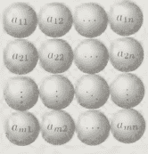

该算法应找到给定整数 $x$ 在数组 $a$ 中的位置，即算法应找到 $i$ 和 $j$，使得

- $x = a[i, j]$，或
- $i = m$

让我们把输入数组视为某种矩形区域。

问题要求整数 $x$ 确实存在于该区域的某处。我们把这一条件称为**输入断言**或**前置条件**。

> **前置条件（又称输入断言）** — $x \in a[0..m-1, 0..n-1]$

即，$x$ 存在于这个矩形区域 $a$ 的某处。

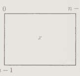

程序成功终止后，必须在一个矩形区域中找到 $x$，该矩形区域仅由一行和一列组成。我们把这一条件称为**输出断言**或**结果断言**或**后置条件**。

> **后置条件（又称结果断言）** — 程序成功终止后，$x$ 位于 $a$ 的一个矩形区域中，该矩形区域仅由一行和一列组成，即 $x$ 存在于 $a$ 的第 $i$ 行第 $j$ 列；或者如果这不可能，则 $i = m$，即如果数组中未找到 $x$，即如果 $x \ne a[i,j]$，则 $i = m$。

因此后置条件看起来像

```text
(0 ≤ i ≤ m − 1 ∧ 0 ≤ j ≤ n − 1 ∧ x = a[i, j]) ∨ (i = m ∧ x ∉ a)
```

搜索空间是否被限制在一个矩形区域内？


### 2.2 在二维序列中搜索

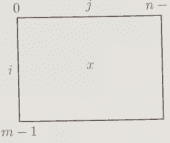

### 不变式

观察前置条件和后置条件，不难发现在算法执行期间，`x` 保证被限制在 `a` 的某个 L 形区域内。

让我们结合不变式重新审视这一点：该不变式表明，`x` 不在已搜索的行 `a[0..i − 1]` 中，也不在当前行 `i` 的已搜索列 `a[i, 0..j − 1]` 中。

下面我们表示这个不变式。

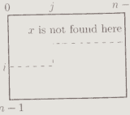

搜索空间由 L 形区域界定。它看起来是不是更像一个 L 形区域？

**不变式：**

`0 ≤ i < m ∧ 0 ≤ j < n ∧`  
`searchable-region is bounded by (m − i) * n − j`

### 初始化

在开发程序主体之前，让我们重新思考搜索的起点应该是什么，即计数器 `i` 和 `j` 的初始值应该是什么？

假设一开始将其设为 0，即 `i = 0` 且 `j = 0`。如果是这样，那么标记为 `x is not found here` 的区域一开始为空。这很合理。不变式仍然成立。

### 推导条件语句

让我们从寻找条件的补开始，即搜索仍继续。不难看出，该补应当保持不变式并导向结果，即

$Invariant \land complement\text{-}of\text{-}condition \Longrightarrow Postcondition$

### 重新审视后置条件

$(0 \leq i \leq m-1 \land 0 \leq j \leq n-1 \land x = a[i,j])$

如上所示，*后置条件*由 2 部分组成¹：

- 1. $(0 \leq i \leq m-1 \land 0 \leq j \leq n-1 \land x = a[i,j])$
- 2. $(i = m \land x \neq a)$

### 建立后置条件

为建立后置条件的第一部分，条件的补可以是 $i < m$ 且 $x = a[i,j]$。

而为建立后置条件的第二部分，它可以是 $i = m$。

### 条件的补

综合起来，这看起来像：

$i = m \lor (i < m \land x \neq a[i,j])$

让我们再次取它的补以得到该条件，即条件的补的补 $\Longrightarrow$ 条件。

### 条件

$(i \neq m \land (i \geq m \text{ or } x \neq a[i,j]))$

但这个条件必须仅在变式为真时求值，即仅当 $i \leq m$ 时，因为如上所述

$Invariant \land complement\text{-}of\text{-}condition \Longrightarrow Postcondition$

因此该条件可以进一步简化为如下形式

$i \neq m \land (i = m \text{ or } x \neq a[i,j])$

¹ 即 2 个析取式

## 综合起来

```text
Algorithm 40 Searching in a 2D Array
1: i ← 0
2: j ← 0
3: function 2D-SEARCH(a[0..m-1, 0..n-1], x)
4:     while i ≠ m and x ≠ a[i, j] do
5:         if j < n − 1 then
6:             j ← j + 1
7:         else if j == n − 1 then
8:             i ← i + 1
9:             j ← 0
10:        end if
11:    end while
12: end function
```

## C++11 实现

让我们尝试用一门真实语言（例如 C++11）编写这个算法，以使我们置身于工作场所环境。

程序2.1：搜索二维数组

```cpp
1 #include <algorithm>
2 #include <array>
3
4 using Point = std::pair<int, int>;
5
6 template <int m, int n>
7 using TwoDimArray =
8     std::array<std::array<int, n>, m>;
9
10 template <int m, int n>
11 Point search_2darray(TwoDimArray<m, n>& a,
12                     int x)
13 {
14     Point p(-1, -1);
15
16     int i = 0, j = 0;
17
18     while ((i != m) && (x != a[i][j]))
19     {
20         if (j < n - 1)
21         {
22             j += 1;
23         }
24         else if (j == n - 1)
25         {
26             i += 1;
27             j = 0;
28         }
29     }
30
31     p.first = i;
32     p.second = j;
33
34     return p;
35 }
```

请注意，point 被初始化为 (-1, -1)，用于标记哨兵条件；在我们的情形中，这表示搜索不成功，导致该值未在数组中找到。

### 用法

程序2.2：搜索 6：得到 a : 2 2

```cpp
1 #include "2darray_search.hpp"
2 #include <iostream>
3
4 int main()
5 {
6     TwoDimArray<4, 4> a = {
7         12, 2, 83, 5,
8         30, 14, 15, 16,
9         13, 5, 6, 81,
10        23, 6, 7, 19
11       };
12
13    Point p = search_2darray<4, 4>(a, 6);
14
15    std::cout << "6 is found at : a["
16        << p.first << "][" << p.second << "]"
17        << std::endl;
18 }
```

输出为：

| 6 在 : a[2][2] 处找到 |
| :--- |

## 替代程序


我们可以进一步将其简化为如下形式：

## 美国财务会计准则委员会（FASB）财务会计准则说明书

### 第8号财务会计准则公告 期间财务报表的会计变更

1974年10月

（本公告取代了会计原则委员会第20号意见书《会计变更》）

### 引言

- 1. 本公告规定了期间财务报表中会计变更的报告方式。它取代了会计原则委员会第20号意见书《会计变更》。本公告还规定了会计错误更正的报告方式。

本公告的范围包括根据证券交易委员会（SEC）的规则和条例提交的财务报表，以及根据公认会计原则（GAAP）编制的其他财务报表。本公告不适用于：

- a. 首次发布财务报表，或
- b. 财务报告中的中期财务信息。

当一个实体在固定资产使用年限内从一种折旧方法改用另一种折旧方法时，本公告的适用性存在某些独特的问题，需要特别考虑。

```cpp
17
18 while((i != m) && (x != a[i][j]))
19 {
20     j += 1;
21     if(j == n)
22     {
23         i += 1;
24         j = 0;
25     }
26 }
27
28 p.first = i;
29 p.second = j;
30
31 return p;
32 }
```

程序2.4：用法：C++11 版本：搜索二维数组

```cpp
 1 #include "2darray_search_alt.hpp"
 2 #include <iostream>
 3
 4int main()
 5{
 6    TwoDimArray<4, 4> a = { 12, 2, 83, 5,
 7                            30, 14, 15, 16,
 8                            13, 5, 6, 81,
 9                            23, 6, 7, 19
10                          };
11
12    Point p = search_2darray_alt<4, 4>(a, 6);
13
14    std::cout << "6 is found at : a["
15              << p.first << "][" << p.second << "]"
16              << std::endl;
17
18 }
```

### 时间复杂度

其时间复杂度为 O(mn)，因为就比较而言，它最终会遍历整个 m × n 区域。

### 2.3 福利骗子问题

### 问题描述

福利骗子问题是在三个升序序列中定位最小值。假设我们有三条长磁带，每条都包含一个按字母顺序排列的姓名列表。第一个列表包含在 IBM 约克敦工作的人员姓名，第二个列表包含哥伦比亚大学学生的姓名，第三个列表包含纽约市领取福利的人员姓名。实际而言，这三个列表都是无穷无尽的，因此没有给出上界。已知至少有一个人同时出现在这三个列表中。编写一个程序来定位第一个这样的人，即姓名按字母序最小的人。

### 解决方案

为了抓住问题的本质，考虑在三个有序数组（无上界）$f[0..\infty]$、$g[0..\infty]$ 和 $h[0..\infty]$ 中搜索同时出现在三者中的最小值；已知该最小值存在。由于列表 $f$、$g$ 和 $h$ 是固定的，我们将利用它们按字母顺序排列这一事实。用 $iv$、$jv$ 和 $kv$ 表示满足下式的最小值

$$f[iv] = g[jv] = h[kv]$$

因此后置条件可以写为

$$i = iv \text{ and } j = jv \text{ and } k = kv$$

而不变式看起来像

$$0 \leq i \leq iv \text{ and } 0 \leq j \leq jv \text{ and } 0 \leq k \leq kv$$

界函数为

$$t = iv - i + jv - j + kv - k$$

初始化为 $i \leftarrow 0, j \leftarrow 0, k \leftarrow 0$。

减小界函数的最简单方式是 $i \leftarrow i + 1, j \leftarrow j + 1, k \leftarrow k + 1$。

关系式 $i + 1 \leq iv$ 与上述不变式一起意味着 $f[i]$ 不是该骗子，并且当 $f[i] < g[j]$ 时这一点成立。由于该骗子在字母序上不会排在 $g[j]$ 之前，因此如果 $f[i]$ 按字母序排在 $g[j]$ 之前，那么 $f[i]$ 不可能是该骗子。

类似地，$g[j] < h[k]$ 也是可能的。

因此，程序如下：


## 算法 43 福利骗子程序

```
1: function WELFARE-CROOK(f, g, h)
2:     i ← 0; j ← 0; k ← 0;
3:     while f[i] ≠ g[j] and g[j] ≠ h[k] do
4:         if f[i] < g[j] or f[i] > h[k] then
5:             i ← i + 1
6:         else if g[j] < h[k] or g[j] < f[i] then
7:             j ← j + 1
8:         else if h[k] < f[i] or h[k] < g[j] then
9:             k ← k + 1
10:        end if
11:    end while
12: end function
```

上述程序可简化为：

## 算法 44 简化后的福利骗子程序

```
1: function WELFARE-CROOK(f, g, h)
2:     i ← 0; j ← 0; k ← 0;
3:     while f[i] ≠ g[j] and g[j] ≠ h[k] do
4:         if f[i] < g[j] then
5:             i ← i + 1
6:         else if g[j] < h[k] then
7:             j ← j + 1
8:         else if h[k] < f[i] then
9:             k ← k + 1
10:        end if
11:    end while
12: end function
```

终止时：\(f[i] = g[j] = h[k]\)，并且以下成立：
\(i = i_v\) 且 \(j = j_v\) 且 \(k = k_v\)。

### 2.4 二维数组旋转

### 问题

设计并实现一个将 \(n \times n\) 二维数组顺时针旋转 90 度的算法。可以安全地假设对于某个正整数 \(k\)，有 \(n = 2^k\)。

```cpp
        copy(e.begin(), e.end(), std::ostream_iterator<int>(std::cout, " "));
        std::cout << std::endl;
    }
}

template <typename T>
void validate(const std::vector<std::vector<T>>& A)
{
    int k = 1;
    size_t len = A.size();

    for (int j = len - 1; j >= 0; --j)
    {
        for (int i = 0; i < len; ++i)
        {
            assert(k++ == A[i][j]);
        }
    }
}

template <typename T>
void copy_2darray(std::vector<std::vector<T>>& A,
                  const int &A_x_s,
                  const int &A_x_e,
                  const int &A_y_s,
                  const int &A_y_e,
                  const std::vector<std::vector<T>> &S,
                  const int &S_x, const int &S_y)
{
    for (int i = 0; i < A_x_e - A_x_s; ++i)
    {
        copy(S[S_x + i].cbegin() + S_y,
             S[S_x + i].cbegin() + S_y + A_y_e - A_y_s,
             A[A_x_s + i].begin() + A_y_s);
    }
}

template <typename T>
void rotate_2darray_helper(std::vector<std::vector<T>>& A, const int &x_s,
        const int &x_e, const int &y_s, const int &y_e)
{
    if (x_e > x_s + 1)
    {
        int mid_x = x_s + ((x_e - x_s) >> 1);
        int mid_y = y_s + ((y_e - y_s) >> 1);

        // Move submatrices
59  std::vector<std::vector<T>> C(mid_x - x_s,
60      std::vector<T>(mid_y - y_s));
61  copy_2darray(C, 0, 0, C.size(), 0, C.size(), A, x_s, y_s);
63  copy_2darray(A, x_s, mid_x, y_s, mid_y, A, mid_x, y_s);
65  copy_2darray(A, mid_x, x_e, y_s, mid_y, A, mid_x, mid_y);
67  copy_2darray(A, mid_x, x_e, mid_y, y_e, A, x_s, mid_y);
69  copy_2darray(A, x_s, mid_x, mid_y, y_e, C, 0, 0);
71  // Recursively rotate submatrices
72  rotate_2darray_helper(A, x_s, mid_x, y_s, mid_y);
74  rotate_2darray_helper(A, x_s, mid_x, mid_y, y_e);
76  rotate_2darray_helper(A, mid_x, x_e, mid_y, y_e);
78  rotate_2darray_helper(A, mid_x, x_e, y_s, mid_y);
80  }
81  }
82  template <typename T>
83  void rotate_2darray(std::vector<std::vector<T>> &A)
84  {
85      rotate_2darray_helper(A, 0, A.size(), 0, A.size());
87  }
```

这是一种递归方法。或者，也可以通过遍历四个子数组中的任意一个，并以四个元素为一组旋转元素，使用 O(1) 额外空间、以 O(n) 时间复杂度完成旋转。

### 2.5 邮局中的排队问题

### 问题描述

给定一个整数 \(t_0\) 和两个整数数组 \(a[0..n - 1]\)、\(b[0..n - 1]\)，满足

- \(n \ge 1\)
- \(a[0] < a[1] < \cdots < a[n - 1]\)
- \(0 \le i < n : b[i] > 0\)

一家邮局配备四个相互等效的服务台，为编号从 0 到 \(n - 1\) 的 \(n\) 位客户提供服务。邮局在 \(t_0\) 时刻开门。

客户 \(i\) 在时刻 \(a[i]\) 到达，并请求 \(b[i]\) 个时间单位的服务。客户按到达顺序接受服务。

当有客户等待服务时，服务台工作人员从不空闲；所有 \(n\) 位客户服务完毕后，邮局立即关门。

编写程序计算至少有一位客户等待服务的总时间。

### 解法

要求计算 \(r\)，其中 \(r\) 是至少有一位客户等待服务的总时间。

解决此问题的少数切入点之一，似乎是研究 \(r\) 如何函数式地依赖于各个客户的特征。于是我们定义，\(\forall i: 0 \le i < n\)，\(s_i\) 为客户 \(i\) 的服务开始时刻；据此，我们可以用区间 \((a[i], s_i)\) 的长度来把握客户 \(i\) 此次的等待。

如果把这样定义的 \(n\) 个区间在一条初始为白色的时间轴上涂黑，并且约定黑加黑仍为黑，那么要计算的 \(r\) 值就是所有看起来为黑的部分的总长度，也就是说，\(r\) 是区间 \((a[i], s_i): 0 \le i < n\) 叠加后的长度。

我们观察到数 \(s_i\) 的两个性质：

\[
0 \le i < n: a[i] \le s_i
\]

\[
s_0 \le s_1 \le \cdots \le s_{n-1}
\]

第一个性质源于客户的服务不能在其到达之前开始；第二个性质源于客户按到达顺序接受服务的规则。

现在让我们思考如何计算 \(s\) 序列。

我们设想，客户 \(i\) 到达时，会看到过去可能发生的事情留下的痕迹：各种混乱的可能性，例如邮局尚未开门，或零个、更多甚至四个服务台被占用，或队列也许为空，或这些情况的组合。

对于更早的客户 \(j: 0 \le j < i\)，重要的是他们的离开时间：这些时间完全描述了四个服务台占用情况的变化。更具体地说，受 \(s_0 \le s_1 \le \cdots \le s_{n-1}\) 启发，唯一决定时刻 \(s_i\) 的方面是这些更早客户中第四大的离开时间；它描述了客户 \(i\) 可使用某个服务台的最早时刻。

因此我们定义，\(\forall i: 4 \le i < n\)，

\[
d4_i = \text{客户 } j: 0 \le j < i \text{ 中第四大的离开时间},
\]

类似地，出于很快会变得明显的原因，定义 \(d3_i, d2_i, d1_i\) 分别为更早客户中第三大、第二大和最大的离开时间。

借助这些数，我们可以这样把握 \(s_i\)：

\[
4 \le i < n : s_i = \max(a[i], d4_i)
\]

\[
0 \le i < 4 : s_i = \max(a[i], t_0)
\]

这遵循了当有客户等待服务时服务台工作人员从不空闲的规则。

由此，我们有了计算 \(s\) 序列的有效方法，前提是有一个计算 \(d4\) 序列的有效方法。

如果我们意识到，用 \(s_i\) 表示时，客户 \(i\) 的离开时间可以方便地表示为 \(s_i + b[i]\)，那么 \(d4\) 序列可以非常有效地计算出来。由于 \(b[i] > 0\)，根据 \(4 \le i < n : s_i = \max(a[i], d4_i)\)，我们有 \(s_i + b[i] > d4_i\)，因此不难看出

\[
4 \le i < n - 1 : d4_{i+1} = \min(s_i + b[i], d3_i, d2_i, d1_i)
\]

或者，为了同时容纳另外三个序列，更一般地

\[
4 \le i < n - 1 : (d4_{i+1}, d3_{i+1}, d2_{i+1}, d1_{i+1}) = \text{将 } (s_i + b[i], d3_i, d2_i, d1_i) \text{ 非递减排列}
\]

令不变式为 \(r =\) 区间 \((a[i], s_i), 0 \le i < j\) 的叠加长度，且 \(0 \le j \le n\)，并考察 \(j\) 增加 1 的情况。

我们必须考察区间 \((a[j], s_j)\) 的哪一部分未被任何区间 \((a[i], s_i): 0 \le i < j\) 覆盖。

我们推断，当 \(a[j] \ge s_{j-1}\) 时，区间 \((a[j], s_j)\) 与其他区间不相交。当 \(a[j] < s_{j-1}\) 时，由上述结论以及 \(a\) 序列的单调性可知，部分 \((a[j], s_{j-1})\) 包含在 \((a[j - 1], s_{j-1})\) 中，而部分 \((s_{j-1}, s_j)\) 与所有区间 \((a[i], s_i): 0 \le i < j\) 不相交。

因此，部分 \((\max(a[j], s_{j-1}), s_j)\) 未被任何其他区间覆盖，我们得出结论：

\[
r = \text{区间 } (a[i], s_i): 0 \le i < j \text{ 的叠加长度}
\text{ 且 } 0 \le j \le n \text{ 且 } 1 \le j < n \implies
r \leftarrow r + s_j - \max(a[j], s_{j-1}); n \leftarrow n + 1
\]

或者，如果我们愿意定义：\(s_{-1} \le a[0]\)，

\[
r = \text{区间 } (a[i], s_i): 0 \le i < j \text{ 的叠加长度}
\text{ 且 } 0 \le j \le n \text{ 且 } 0 \le j < n \implies r \leftarrow r + s_j - \max(a[j], s_{j-1}); n \leftarrow
\]


n + 1

于是，相应的程序为

```text
1: r ← 0
2: j ← 0
3: while j ≠ n do
4:   r ← r + s_j - max(a[j], s_{j-1})
5:   j ← j + 1
6: end while
```

或者，

```text
1: q ← s_{j-1}
2: r ← 0
3: j ← 0
4: q ← max(q, a[0])
5: while j ≠ n do
6:   p ← s_j
7:   r ← r + p - max(a[j], q)
8:   j ← j + 1
9:   q ← p
10: end while
```

让我们定义

0 ≤ i < 4 : d4_i = t_0

于是有

0 ≤ i < N : s_i = max(a[i], d4_i)

而 d 序列的定义变为

(d4_0, d3_0, d2_0, d1_0) = (t_0, t_0, t_0, t_0)
0 ≤ i < n - 1 : (d4_{i+1}, d3_{i+1}, d2_{i+1}, d1_{i+1}) =
(s_i + b[i], d3_i, d2_i, d1_i) 的非递减排列。

进一步用关系

h_4, h_3, h_2, h_1 = d4_j, d3_j, d2_j, d1_j

加强不变式，便得到我们所认为的最终程序：

```text
1:  r ← 0
2:  j ← 0
3:  q ← a[0]
4:  h₄, h₃, h₂, h₁ ← t₀, t₀, t₀, t₀
5:  while j ≠ n do
6:      p ← max(a[j], h₄)
7:      r ← r + p − max(a[j], q)
8:      q ← p
9:      h₄ ← p + b[j]
10:     loop
11:         if h₄ > h₃ then
12:             h₄ ← h₃
13:             h₃ ← h₄
14:         else if h₃ > h₂ then
15:             h₃ ← h₂
16:             h₂ ← h₃
17:         else if h₂ > h₁ then
18:             h₂ ← h₁
19:             h₁ ← h₂
20:         end if
21:     end loop
22:     j ← j + 1
23: end while
```

### 2.6 插值查找

在二分查找中，搜索空间总是被减半，这保证了对数级性能。然而，如果在查找过程中我们发现一个非常接近所要查找的数（比如 x）的值，那么在该邻域内继续查找似乎比盲目地前往下一个半分割点更合理。特别是，如果 x 很小，我们应当从序列开头附近的某个位置开始查找，而不是从中间位置开始。

插值查找是一种在有序序列中按关键字检索所需记录的方法，它利用关键字的值以及关键字的统计分布。

考虑我们在查找某个页码（比如 200）时翻开一本书的方式，而这本书共有 800 页。因此第 200 页大约在四分之一处，我们利用这一知识来判断应该在哪里翻开书。我们第一次尝试很可能不会正好翻到第 200 页；假设我们翻到了第 250 页。现在我们将查找范围缩小到 250 页，并假定目标页大约位于第 1 页到第 250 页之间 80% 的位置。现在我们尝试往回翻大约 (1/5) 的距离。我们可以继续这一过程，直到足够接近第 200 页，从而可以一页一页地翻。这正是插值查找背后的思想。我们不是按固定的二分之一来划分搜索空间，而是按看起来最有可能成功的比例来划分。这一比例由插值确定。

给定一个包含 1000 条记录的文件，其关键字 X_1 < X_2 < ... < X_1000 均匀分布在 0 和 1 之间，我们的任务是找到一个索引 i | X_i = 0.7。可以合理预期大约有 0.7 × 1000 = 700 个关键字小于或等于 0.7，因此所需记录应当接近第 700 条记录。

然而，查看文件可能会发现 X_700 = 0.68 < 0.7。虽然我们还没有检索到该记录，但可以推断目标索引位于 700 和 1000 之间。相应的关键字均匀分布在 0.68 和 1 之间。新文件包含 300 条记录。P_2 = (0.7−0.68)/(1−0.68) = 0.0675 是这些记录具有更小或相等关键字的概率；因此，我们现在应当查看新文件中的第 300 × 0.0675 ≈ 20 条记录。

使用同样的方法继续这一过程；在每次迭代中，要么找到记录，要么文件长度减少。

插值查找最初由 Peterson 提出，作为一种在存储于连续存储位置的已排序序列中进行查找的方法。

### 算法

```text
Algorithm 45 Interpolation Search Algorithm
1: Input : A (a sorted array) and x (the search key).
2: Output : position (an index i | A[i] = x, or 0 if no such index exists).
3: function INTERPOLATION-SEARCH(A[0..n − 1], x)
4:   if x < A[0] or x > A[n − 1] then
5:     position ← 0 ▷ unsuccessful search
6:   else
7:     position = INTERPOLATION-SEARCH-HELPER(x, 0, n − 1)
8:   end if
9:   return position
10: end function
11: function INTERPOLATION-SEARCH-HELPER(x, l, r)
12:   found ← 0
13:   if A[l] == x then
14:     found = l
15:   else if l == r or A[l] == A[r] then
16:     found = 0
17:   else
18:     next = l + [(x−A[l])(r−l)]/[A[r]−A[l]]
19:     if x < A[next] then
20:       found = INTERPOLATION-SEARCH-HELPER(x, l, next − 1)
21:     else
22:       found = INTERPOLATION-SEARCH-HELPER(x, next, r)
23:     end if
24:   end if
25:   return found
26: end function
```

### 复杂度

插值查找的性能不仅取决于序列的大小，还取决于输入本身。存在一些输入，使得插值查找会检查序列中的每一个数。然而，对于由相对均匀分布的元素组成的输入，插值查找非常高效，例如书页毫无疑问是均匀分布的。可以证明，插值查找执行的平均比较次数（对所有可能的序列取平均）为 O(log log n)。尽管这看起来比二分查找的性能提升了一个数量级，但在实践中插值查找并不比二分查找好多少，因为

- 1. 除非 \(n\) 非常大，\(\log_2 n\) 的值足够小，以至于它的对数并不会小多少。
- 2. 插值查找需要更复杂的算术运算。

### C++ 实现

程序 2.6：插值查找

```cpp
#include <vector>
#include <cassert>

template<typename T>
T interpolation_search_helper(T A[], std::size_t l,
    std::size_t r, T value)
{
    std::size_t found = 0, next;

    if (A[l] == value)
    {
        found = l;
    }
    else if ((l == r) || (A[l] == A[r]))
    {
        found = 0;
    }
    else
    {
        next = l + (value - A[l]) * (r - l) / (A[r] -
            A[l]);

        if (value < A[next])
        {
            found = interpolation_search_helper(A,
                l, next - 1, value);
        }
        else
        {
            found = interpolation_search_helper(A,
                next, r, value);
        }
    }
    return found;
}

template<typename T>
T interpolation_search(T sorted_array[], std::size_t l,
    std::size_t r, T value)
{
    std::size_t position = 0;

    if (value < sorted_array[l] || value >
        sorted_array[r])
    {
        position = 0;
    }
    else
    {
        position = interpolation_search_helper(
            sorted_array, l, r, value);
    }
    return position;
}

int main()
{
    int sorted_array[] = {1, 2, 3, 4, 5, 6, 7, 8,
        9};

    assert(interpolation_search(sorted_array, 0, 8,
        5) == 4);
}
```

### 备注

对于外部查找（文件位于外部设备上），插值查找优于二分查找，因为查找时间由访问次数决定。然而，在内部查找中，还应考虑每次迭代的计算时间。计算机实验表明，插值查找和二分查找所花的时间大致相同。插值查找仅对大于 5000 条记录的文件才略快一些。然而，在二分查找中使用移位运算代替除法，或使用斐波那契查找，会得到更快的内部查找方法。经过插值查找的几次迭代后，我们已经相当接近所需记录。当两次连续迭代的索引之差很小时，切换到顺序查找可能更有利，并能节省计算时间。

### 2.7 机器人行走

### 问题描述

给定两个整数数组 $x[0..46]$ 和 $y[0..46]$。数对 $(x[i], y[i])$ 表示平面中点 $P_i$ 的笛卡尔坐标（$0 ≤ i < 47$）。这些数组使得全部 47 个点互不相同。

一个机器人从 $P_0$ 走到 $P_1$，从 $P_1$ 走到 $P_2$，……，从 $P_{45}$ 走到 $P_{46}$，最后从 $P_{46}$ 走到 $P_0$。它遵循以下规则完成行走：

- 它应从 $P_0$ 出发，并面向 $P_1$


- 它应始终朝着它正在看的方向行走。
- 它应只在点 \(P_i\) 处改变其注视方向，即执行一个顺时针旋转 \(\alpha\)：\(0 \leq \alpha < 2\pi\)。
- 它应最终停在 \(P_0\)，同时朝向 \(P_1\)。

作为这次行走的结果，机器人完成了一个 \(2\pi\) 的整数倍的顺时针旋转。

编写一个程序来计算这个倍数，附加要求是程序中出现的所有表达式和变量都必须是整数类型或布尔类型。

## 解答

初步观察问题可知，无论点集在平面中如何平移，所求答案都不会改变。只有每对相邻点的相对位置在确定答案时起作用。

因此，我们引入向量 \(\vec{u}_i\)，定义为 \(\vec{u}_i=(P_i \to P_{i+1})\)，其中 \(0 \leq i \leq 47\)，且 \(P_{47}=P_0\)、\(P_{48}=P_1\)。

从 \(P_i\) 走到 \(P_{i+1}\) 期间的注视方向就等于 \(\vec{u}_i\)。因此，机器人在行走过程中的连续注视方向为 \(\vec{u}_0,\vec{u}_1,\vec{u}_2,\ldots,\vec{u}_{46},\vec{u}_{47}(=\vec{u}_0)\)。

在点 \(P_i\) 处朝 \(P_{i+1}\) 的顺时针旋转，现在对应于从 \(\vec{u}_{i-1}\) 到 \(\vec{u}_i\) 的顺时针旋转。

由于机器人在初始状态下的注视方向与最终状态相同，建议将该方向作为参考方向。于是最终答案将等于在机器人旋转过程中其视线经过该参考方向的总次数。

一旦我们意识到，如果点集在平面内旋转，答案也不会改变，就能得到一个更精确且更易处理的问题表述。由此可知，任意方向 \(\vec{r}\) 都可以作为参考方向。

如果我们定义 \(\theta(\vec{u}_i): 0 \leq \theta(\vec{u}_i) < 2\pi\) 为从 \(\vec{r}\) 到 \(\vec{u}_i\) 的顺时针旋转角，那么最终答案 \(p\) 必须满足

$$p = \#\{i \mid 0 \leq i < 47,\ \theta(\vec{u}_{i+1}) < \theta(\vec{u}_i)\}.$$

基于上述内容，我们的程序为：

```
1: j ← 0
2: p ← 0
3: while j ≠ 47 do
4:     if θ(u_{j+1}) < θ(u_j) then
5:         p ← p + 1
6:     else if θ(u_{j+1}) ≥ θ(u_j) then
7:         skip
8:     end if
9:     j ← j + 1
10: end while
```

如果认为 \(\theta\) 的计算开销很大，我们可以引入 \(\alpha = \theta(\vec{u}_0)\)，此时程序为

```
1: j ← 0
2: p ← 0
3: α ← θ(u_0)
4: while j ≠ 47 do
5:     j ← j + 1
6:     β ← θ(u_j)
7:     if β < α then
8:         p ← p + 1
9:     else if β ≥ α then
10:        skip
11:    end if
12:    α ← β
13: end while
```

下一点说明是，实际上我们并不想计算角 \(\alpha\) 和 \(\beta\)，而只是想比较它们。

在 \(0 \leq \alpha < \pi/2\) 且 \(0 \leq \beta < \pi/2\) 的情况下，比较两个角 \(\alpha\) 和 \(\beta\) 相当容易，因为此时 \(\beta < \alpha\) 等价于 \(\tan(\beta) < \tan(\alpha)\)；当点在笛卡尔坐标系中给出时，比较正切值只需两次简单乘法。

在一般情况下，如果我们愿意用基为 \(\pi/2\) 的角度制来表示 \(\alpha\) 和 \(\beta\)，比较两个角 \(\alpha\) 和 \(\beta\) 也并非那么困难：

$$\alpha = a \times \frac{\pi}{2} + \alpha', \qquad 0 \leq \alpha' < \frac{\pi}{2}$$
$$\beta = b \times \frac{\pi}{2} + \beta', \qquad 0 \leq \beta' < \frac{\pi}{2}$$

那么，不等式 \(\beta < \alpha\) 等价于

$$b < a \text{ or } (b = a \text{ and } \beta' < \alpha')$$

这又等价于

$$b < a \text{ or } (b = a \text{ and } \tan(\beta') < \tan(\alpha'))$$

现在，程序为：

```
1: j ← 0
2: p ← 0
3: a : a × π/2 + α' = θ(u_0)
4: α' : 0 ≤ α' < π/2
5: while j ≠ 47 do
6:     j ← j + 1
7:     b : b × π/2 + β' = θ(u_j)
8:     β' : 0 ≤ β' < π/2
9:     if b < a or (b = a and tan(β') < tan(α')) then
10:        p ← p + 1
11:    else if b > a or (b = a and tan(β') ≥ tan(α')) then
12:        skip
13:    end if
14:    a ← b
15:    α' ← β'
16: end while
```

在寻找 \(a\) 和 \(\alpha'\) 的简单初始化时，选择 \(\vec{r} = \vec{u}_0\) 作为参考方向似乎很有吸引力，但那样一来，\(\beta'\) 的计算以及 \(\tan(\beta') < \tan(\alpha')\) 的计算会变得相当繁琐。就这些后续计算而言，除了取四个坐标方向之一作为参考方向 \(\vec{r}\) 之外，几乎别无选择。由于对称性，这种选择无关紧要，我们将选择负 \(y\) 轴。

现在，我们在表示方法上从角度切换回向量，因为为了计算 \(\tan(\alpha')\) 和 \(\tan(\beta')\)，分别有两个向量 \((u_x,u_y)\) 和 \((v_x,v_y)\) 会很方便，使得

$$\theta(u_x,u_y)=\alpha'$$

且

$$\theta(v_x,v_y)=\beta'$$

于是 \(\tan(\beta') < \tan(\alpha')\) 被编码为

$$-\frac{v_x}{v_y} < -\frac{u_x}{u_y}$$

或者，更可取地，编码为 \(v_x u_y < u_x v_y\)。

为了实现 \(0 \leq \beta' < \frac{\pi}{2}\)，我们必须满足 \(v_x \leq 0\) 且 \(v_y < 0\)。为了计算 \(b\)，我们必须考察向量 \(\vec{u}_i\) 逆时针旋转 \(\frac{\pi}{2}\) 的情况。

现在，对于满足 \(b \times \frac{\pi}{2} + \beta' = \theta(\vec{u}_i)\) 且 \(0 \leq \beta' < \frac{\pi}{2}\) 的 \(b\) 和 \(\beta'\)，我们得到如下代码片段：

```
1:  vx ← x[j + 1] − x[j]
2:  vy ← y[j + 1] − y[j]
3:  b ← 0
4:  while vx > 0 or vy ≥ 0 do
5:      vx ← −vy
6:      vy ← vx
7:      b ← b + 1
8:  end while
```

如果我们能找到某个向量 \(\vec{u}_{-1}\) 使得 \(\theta(\vec{u}_i) > \theta(\vec{u}_{-1})\)，那么 \(a\) 和 \(\alpha'\) 的初始化可以变得相当简单，因为此时最终结果可以写成

$$p = \#\{i \mid -1 \leq i < 47,\ \theta(\vec{u}_{i+1}) < \theta(\vec{u}_i)\}$$

而循环不变式可写为

$$p = \#\{i \mid -1 \leq i < j,\ \theta(\vec{u}_{i+1}) < \theta(\vec{u}_i)\}, \qquad -1 \leq j \leq 47.$$

我们几乎没有其他选择，因为 \(\vec{u}_{-1}\) 必须定义为使得 \(\theta(\vec{u}_{-1}) = 0\)（它可以与负 \(y\) 轴重合），例如 \(\vec{u}_{-1} = (0,-1)\)。于是 \(a\) 和 \(\alpha'\) 的初始化结果为：

```
ux ← 0
uy ← −1
a ← 0
```

为了实现额外的点 \(P_{47}\) 和 \(P_{48}\)，我们引入一个辅助变量 \(h \leftarrow (j+1) \bmod 47\)，借助它我们可以对数组进行回绕。

## 算法 46 机器人行走算法

```
1: j ← −1
2: h ← 0
3: p ← 0
4: ux ← 0
5: uy ← −1
6: a ← 0
7: while j ≠ 47 do
8:   j ← j + 1
9:   h0 ← h
10:  h ← (j + 1) mod 47
11:  vx ← x[h] − x[h0]
12:  vy ← y[h] − y[h0]
13:  b ← 0
14:  while vx > 0 or vy ≥ 0 do
15:    vx ← −vy
16:    vy ← vx
17:    b ← b + 1
18:  end while
19:  if b < a or (b == a and vx × uy < ux × vy) then
20:    p ← p + 1
21:  else if b > a or (b == a and vx × uy ≥ ux × vy) then
22:    skip
23:  end if
24:  ux ← vx
25:  uy ← vy
26:  a ← b
27: end while
```

### 2.8 线性时间排序

### 问题

给定一个整数数组，其中不同整数可能具有不同的位数，但数组中所有整数的位数总和为 \(n\)。说明如何在 \(O(n)\) 时间内对该数组排序。

### 解答

通常的、未经改造的基数排序算法无法在要求的时间界内解决此问题。其趟数 \(d\) 将必须等于最大整数的位数。

假设有 \(m\) 个整数；我们总有 \(m \leq n\)。在最坏情况下，我们会有一个具有 \(n/2\) 位的整数和 \(n/2\) 个各有一位数字的整数。我们假设单个数字的取值范围是常数。

因此，我们将有 \(d = \frac{n}{2}\) 和 \(m = \frac{n}{2} + 1\)，于是运行时间将是 \(d m = \Theta(n^2)\)。

不失一般性，我们假设所有整数都是正数且没有前导零。如果存在负整数或 0，则分别处理正数、负数和 0。

在此假设下，我们可以观察到，位数较多的整数总是大于位数较少的整数。因此，我们可以首先使用计数排序按位数对整数排序，然后使用基数排序对每个长度相同的整数组进行排序。注意每个整数有 1 到 \(n\) 位，令 \(m_i\) 表示具有 \(i\) 位的整数个数，其中 \(i = 1, 2, \ldots, n\)。由于总共有 \(n\) 位数字，我们有

$$\sum_{i=1}^{n} i \times m_i = n.$$

计算所有整数各有多少位需要 \(O(n)\) 时间；一旦位数计算完成，按位数对整数分组需要 \(O(m + n) = O(n)\) 时间。使用基数排序对恰好具有 \(i\) 位的整数组排序需要 \(\Theta(i \times m_i)\) 时间。因此，对所有组排序的时间为

$$\sum_{i=1}^{n} \Theta(i \times m_i) = \Theta\left(\sum_{i=1}^{n} i \times m_i\right) = \Theta(n).$$

### 2.9 写成连续正整数之和

### 问题描述

给定一个正整数 \(N\)，编写一个程序来确定将 \(N\) 写成连续正整数之和的方法数。

### 解答

我们观察到，对于每个正整数 \(k\)，将 \(N\) 写成恰好 \(k\) 个连续正整数之和的方法数至多为一。因此，令人惊讶的是，我们开始分析这种情况何时发生。

我们能想到的最简单的 \(k\) 个连续正整数序列是

$$(1, 2, \ldots, k)$$

其和为

$$\frac{k(k+1)}{2}$$

长度为 \(k\) 的次简单序列无疑是


$(1+1, 2+1, \ldots, k+1)$

因此其和等于

$\frac{k(k+1)}{2}+1\times k$

于是我们观察到，$N$ 可以写成 $k$ 个连续正整数之和，当且仅当

$N-\frac{k(k+1)}{2}$

是 $k$ 的非负倍数。

因此，程序如下：

### 算法 47：写成连续正整数之和

```pseudocode
1:  k ← 1
2:  e ← N − 1                         ▷ e = N − k(k+1)/2
3:  C ← 0
4:  while e ≥ 0 do
5:      if e mod k = 0 then
6:          C ← C + 1
7:      else if e mod k > 0 then
8:          skip
9:      end if
10:     k ← k + 1
11:     e ← e − (k + 1)
12: end while
13: print(C)
```

### 2.10 按螺旋顺序打印二维数组

### 问题

设计并实现一个算法，按螺旋顺序打印给定的二维数组。

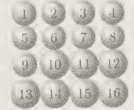

按螺旋形式打印该数组将得到

$1\ 2\ 3\ 4\ 8\ 12\ 16\ 15\ 14\ 13\ 9\ 5\ 6\ 7\ 11\ 10$

### 解法

程序 2.7：按螺旋顺序打印二维数组

```cpp
#include <array>
#include <iostream>

template <int m, int n>
using TwoDimArray =
    std::array<std::array<int, n>, m>;

template<int m, int n>
void spiral_print(TwoDimArray<m, n> & a)
{
    int end_row_index = m;
    int end_col_index = n;

    int cur_index, start_row_index = 0,
        start_col_index = 0;
    while (start_row_index < end_row_index &&
           start_col_index < end_col_index)
    {
        // Print the first row from the remaining rows
        for (cur_index = start_col_index; cur_index < end_col_index; ++cur_index)
        {
            std::cout << a[start_row_index][cur_index] << " ";
        }
        start_row_index++;

        // Print the last column from the remaining columns
        for (cur_index = start_row_index; cur_index < end_row_index; ++cur_index)
        {
            std::cout << a[cur_index][end_col_index - 1] << " ";
        }
        end_col_index--;

        // Print the last row from the remaining rows
        if ( start_row_index < end_row_index)
        {
            for (cur_index = end_col_index-1; cur_index >= start_col_index; --cur_index)
            {
                std::cout << a[end_row_index-1][cur_index] << " ";
            }
            end_row_index--;
        }
    }

    // Print the first column from the remaining columns
    if (start_col_index <= end_col_index)
    {
        for (cur_index = end_row_index; cur_index >= start_row_index; --cur_index)
        {
            std::cout << a[cur_index][start_col_index] << " ";
        }
        start_col_index++;
    }
    std::cout << std::endl;
}

int main()
{
    TwoDimArray<3, 6> matrix = {
        1,  2,  3,  4,  5,  6,
        7,  8,  9, 10, 11, 12,
       13, 14, 15, 16, 17, 18
    };

    spiral_print<3, 6>(matrix);

    TwoDimArray<4, 4> mm = {
        1,  2,  3,  4,
        5,  6,  7,  8,
        9, 10, 11, 12,
       13, 14, 15, 16
    };

    spiral_print<4, 4>(mm);
}
```

该程序的输出为：

```text
1 2 3 4 5 6 12 18 17 16 15 14 13 7 8 9 10 11
1 2 3 4 8 12 16 15 14 13 9 5 6 7 11 10
```

### 2.11 环形赛道问题

### 问题描述

给定两个整数数组 $p[0..N-1]$ 和 $q[0..N-1]$，$N \ge 1$，使得

$$\forall i:0 \le i < N : p[i] \ge 0 \land q[i] > 0,$$

并且

$$\sum_{i=0}^{N-1} p[i] = \sum_{i=0}^{N-1} q[i]$$

沿一条环形赛道有 $N$ 个站点，按顺时针方向从 0 到 $N-1$ 编号。站点 $i$ 可用的汽油量等于 $p[i]$，而从站点 $i$ 行驶到顺时针方向下一个站点所需的汽油量等于 $q[i]$。

编写一个程序，确定所有这样的站点：一辆初始油箱为空且油箱足够大的汽车可以从该站点出发，并按顺时针方向完成整个赛程。

### 解法

当汽车从站点 $k$ 出发时，能够绕赛道一圈的充要条件是

$$(p[k]-q[k]) \ge 0,$$

从而可以到达站点 $k+1$，并且

$$(p[k]-q[k])+(p[k+1]-q[k+1]) \ge 0$$

从而也可以到达站点 $k+2$，并且

⋮

$$(p[k]-q[k])+(p[k+1]-q[k+1])+\cdots+(p[k+N-1]-q[k+N-1]) \ge 0$$

从而也可以到达站点 $k+N$，也就是站点 $k$。

我们可以通过写成以下形式，把这个条件表述得更精确一些

$$C(k,N):(\forall h:0 \le h < N : \sum_{i=k}^{k+h}(p[i]-q[i]) \ge 0)$$

现在我们可以对每个站点 $k$ 检查 $C(k,N)$ 是否满足。然而，这样的做法会过于浪费，因为其中涉及的多达 $N^2$ 个部分和彼此强烈依赖。

为了做得更好，我们可以观察到，例如

$$\sum_{i=k}^{k+h}(p[i]-q[i])=\left(\sum_{i=0}^{k+h}-\sum_{i=0}^{k-1}\right)(p[i]-q[i])$$

其优点在于，它把任意部分和化为特殊的部分和，即从 0 开始的部分和。

如果我们引入缩写

$$x_k = \sum_{i=0}^{k-1} (p[i] - q[i]), k \ge 0$$

那么

$$C(k,N) = (\forall h : 0 \le h < N : x_{k+h+1} \ge x_k)$$

由于

$$x_N = \sum_{i=0}^{N-1} (p[i] - q[i]) = 0,$$

条件 C(k,N) 可以被大幅简化。

$$C(k,N) : (\forall h : 0 \le h < N : x_h \ge x_k),$$

它表示 $x_k = \min(x_0,x_1,\ldots,x_{N-1})$。

我们可以把要构造的程序的预期净效果，表述为计算站点编号集合 Z，使得关系

$$Z = \{ k \mid 0 \le k < N \land C(k,N) \}$$

成立。

我们建议通过坚持以下不变式来开发程序

$$0 \le n \le N \land Z = \{ k \mid 0 \le k < n \land C(k,n) \}.$$

并出于相当明显的原因，用以下条件分别加强

$$xx = \min(x_0,x_1,\ldots,x_{n-1})$$

和

$$x = x_{n-1} = \left( \sum_{i=0}^{n-2} (p[i] - q[i]) \right)$$

此外，如果集合 Z 表示为

$$Z = \{ f[0], f[1], \ldots, f[l-1] \}.$$

其中 f 表示一个整数数组，l 是一个整数，那么程序就很容易构造。其详细推导现在留作练习。

最终程序为：

### 算法 48：环形赛道程序

```pseudocode
1: n ← 1
2: f[0] ← 0
3: l ← 1
4: xx ← 0
5: x ← 0
6: while n ≠ N do
7:   x ← x + p[n−1] − q[n−1]
8:   if x > xx then
9:     skip
10:  else if x == xx then
11:    f[l] ← n
12:    l ← l+1
13:  else if x < xx then
14:    xx ← x
15:    f[0] ← n
16:    l ← 1
17:  end if
18:  n ← n+1
19: end while
```

### 备注

上述程序在执行时，从不会检查数组 $p$ 和 $q$ 的元素 $p[N-1]$ 和 $q[N-1]$。

上述分析的一个结果是，条件 $∑_{i=0}^{N−1} p[i] = ∑_{i=0}^{N−1} q[i]$ 是至少存在一个站点，使汽车能够绕赛道一圈的充分条件。

### 2.12 稀疏数组技巧

### 问题

假设你想使用一个大数组 $A$ 进行随机访问，尽管实际上你不会引用它的很多条目。你希望第一次访问 $A[k]$ 时它为 0，但又不想花时间把每个位置都置为 0。请解释：在给定 $k$ 的情况下，如何仅通过每次数组访问时执行少量固定数量的额外操作，就能可靠地读写任意所需元素 $A[k]$，并且不假设实际初始内存内容是什么。

-   1. \({Tr(i,j)}\; X := swap(i,j);\; i \leftarrow i+1,\; j \leftarrow j+1\; {Tr(i,j)}\) 作为将列车向右移动的机制，因此
-   2. \({Tr(i,j)}\; i \leftarrow i-1,\; j \leftarrow j-1;\; X := swap(i,j)\; {Tr(i,j)}\) 作为向左移动的机制；
-   3. \({Tr(i,j)\text{ and }i<j}\; i \leftarrow i+1\; {(X[i-1]\text{ is red})\text{ and }Tr(i,j)}\) 作为在列车左端解开一节车厢的过程，因此
-   4. \({Tr(i,j)\text{ and }(X[i-1]\text{ is red})}\; i \leftarrow i-1\; {i<j\text{ and }Tr(i,j)}\) 作为在左端连接一节车厢的过程。

使用以下缩写

\[
P(r): 0 \leq r < R\text{ and }(0 \leq k < r : X[k] \times M\text{ is red})
\]
\[
Q(j): j \leq h < N : X[h]\text{ is blue},
\]

该程序带有相当丰富的注释，如下所示：

### 算法 49：巴特勒曼的重排问题

```pseudocode
1:  i, j, r := 0
2:  i := N
3:  r := N
4:  {Tr(i, j)} ∪ {Q(j)} {0 ≤ i ≤ j ≤ N}
5:  while i ≠ 0 do                                      ▷ i > 0
6:      if X[i − 1] is red then
7:          i ← i − 1                                      ▷ See (4)
8:      else if X[i − 1] is blue then
9:          j ← j − 1
10:         i ← i − 1                                      ▷ See (2)
11:         X := swap(i, j)
12:     end if
13:     {Tr(i, j)} ∪ {Q(j)} {i ≤ j ≤ N}
14: end while                                          ▷ Tr(i, j) and Q(j), and i = 0, hence j = R
15: r ← 0                                               ▷ {Tr(i, j)} ∪ {P(r)} {j = R − r + i} ∪ {i ≤ r × M}
16: while r ≠ R do ▷ r < R ▷ {Tr(i, j), j = R − r + i, i ≤ r × M}
17:     while j ≠ r × M do                         ▷ j < r × M, hence j < N
18:         X := swap(i, j)
19:         i ← i + 1
20:         j ← j + 1                              ▷ {Tr(i, j), see (1), j = R − r + i, i ≤ r × M}
21:     end while ▷ Tr(i, j) and j = R − r + i and r < R, hence Tr(i, j)
    and i < j, hence X[i] is red, i = r × M, P(r)
22:     i ← i + 1
23:     r ← r + 1                                  ▷ Tr(i, j), see (3), P(r), j = R − r + i, i ≤ r × M
24: end while                                      ▷ P(r) and r = R, hence Z
```


### 2.14 寻找多数元素

### 多数问题

给定一个由 n 个对象组成的集合 S（n ≥ 1），其中每个对象都有一种颜色。此外，我们被告知 S 中存在一种多数颜色，即某种颜色出现的次数严格超过 n/2 次。我们将这种多数颜色记为 mc(S)。我们的任务是找出 S 中一个颜色等于 mc(S) 的元素。我们只允许使用 `same_color` 操作。该操作接收 S 中的任意两个元素，比如 x 和 y，并返回如下值

same_color(x, y) = { true，若 x 和 y 颜色相同；false，否则。 }    (2.1)

特别地，我们无法确定 S 中任何元素的颜色。

### 基本算法

我们的算法将基于以下观察。

### 观察 1

设 x 和 y 是 S 中两个颜色不同的元素。那么集合 S ∖ {x,y} 中存在多数颜色，并且

mc(S) = mc(S ∖ {x,y})

### 证明

假设 mc(S) = 红色。令 k 为 S 中红色元素的数量。那么我们知道 k > n/2。我们需要证明集合 S ∖ {x,y} 包含超过 (n-2)/2 个红色元素。

**情况 1**  x 和 y 都不是红色。在这种情况下，S ∖ {x,y} 中红色元素的数量等于 k > n/2 > (n-2)/2。

**情况 2**  x 和 y 中恰好有一个是红色。在这种情况下，S ∖ {x,y} 中红色元素的数量等于 k-1 > n/2 - 1 = (n-2)/2。 ■

### 不变式

我们维护以下不变式：

- 1. S 是三个集合 N、I 和 D 的不交并。
- 2. I 中的所有元素颜色相同。
- 3. 集合 $N \cup I$ 中存在多数颜色。
- 4. $mc(S) = mc(N \cup I)$。

### 记号

- N ≡ *尚未见过*
- I ≡ *相同颜色*
- D ≡ *已丢弃*

以下是算法的基本版本：

```
Algorithm 50 Find Majority Simple Algorithm
1:  N ← S
2:  I ← ∅
3:  D ← ∅
4:  while N ≠ ∅ do
5:      if I == ∅ then
6:          move one element from N to I
7:      else
8:          x ∈ N
9:          y ∈ I
10:         if same_color(x, y) then
11:             move x from N to I
12:         else
13:             move y from I to D
14:             move x from N to D
15:         end if
16:     end if
17: end while
18: return an arbitrary element of I
```

### 算法的一种简单表示

到目前为止，我们尚未说明集合 N、I 和 D 如何表示。事实证明有一种非常简单的方法：将 S 的元素存储在数组 A[1...n] 中。我们将使用两个索引 i 和 j 来表示集合 N、I 和 D：

- 1. $0 \leq i \leq j - 1 \leq n$
- 2. $D = A[1..i]$
- 3. $I = A[i + 1..j - 1]$
- 4. $N = A[j..n]$

如果转换我们的基本算法，就得到以下算法：

```
Algorithm 51 Find Majority Algorithm Revisited

1: i ← 0
2: j ← 1
3: while j ≤ n do
4:   if j ≤ i + 1 then
5:     j ← j + 1
6:   else if same_color(A[j], A[i + 1]) then
7:     j ← j + 1
8:   else
9:     i ← i + 1
10:    swap(A[j], A[i + 1])
11:    i ← i + 1
12:    j ← j + 1
13:  end if
14: end while
15: return A[i + 1]
```

如果改变操作的顺序，就得到以下算法：

```
Algorithm 52 Find Majority Algorithm Simplified

1: i ← 0
2: j ← 1
3: while j ≤ n do
4:   if j ≥ i + 2 and same_color(A[j], A[i + 1]) == false then
5:     i ← i + 2
6:     swap(A[j], A[i])
7:   end if
8:   j ← j + 1
9: end while
10: return A[i + 1]
```

### 观察 2

在上述伪代码中，条件

j ≥ i + 2 and same_color(A[j], A[i + 1]) == false

等价于条件

same_color(A[j], A[i + 1]) == false

**证明**  假设 *same_color*(A[j], A[i + 1]) = false。我们需要证明 j ≥ i + 2。由不变式可知 j ≥ i + 1。如果 j = i + 1，那么 *same_color*(A[j], A[i + 1]) = true。因此，j ≠ i + 1。由此可得 j ≥ i + 2。 ■

利用这一观察，我们可以进一步简化算法，并得到最终算法：

```
Algorithm 53 Find Majority Algorithm Final
1: i ← 0
2: j ← 1
3: while j ≤ n do
4:   if same_color(A[j], A[i + 1]) == false then
5:     i ← i + 2
6:     swap(A[j], A[i])
7:   end if
8:   j ← j + 1
9: end while
10: return A[i + 1]
```

### 2.15 多重集的众数

### 问题

设 S = (x₁, x₂, …, xₙ) 是一个来自全序集的多重集（元素不一定互不相同）。多重集的*众数*定义为在该多重集中出现最频繁的元素（可能存在多个众数）。一个元素出现的次数称为它的*重数*。因此，众数就是重数最高的元素。

*求给定多重集 S 的一个众数。*

### 解法

我们的目标是最小化比较次数。寻找众数的一种可能方法是使用排序。一旦元素排好序，我们就可以扫描排序后的序列并统计重数（相等的元素在排序后的序列中会连续出现）。我们将看到，排序并不总是必要的。认为可能不需要排序的原因是，寻找多数元素可以在线性时间内完成，而排序需要 *O(n log n)* 时间。这使我们猜想：如果众数的重数很高，那么可能存在一种无需排序的快速寻找方法。

### 归纳方法

让我们尝试直接的归纳方法。假设我们知道一个含 n − 1 个元素的多重集的众数，并尝试找出含 n 个元素的多重集的众数。这并不容易，因为可能有多个元素具有最高重数；第 n 个元素可能打破平局。假设归纳假设表明我们知道所有具有最高重数的元素。那么，我们可以判断第 n 个元素是否打破平局，但它也可能增加另一个数的重数，而这

### 2.16 环形数组

环形数组 A[1, . . . , n] 是这样一个数组：n ≥ 3，并且 A[1] 与 A[n] 被视为相邻元素，就像 A[1] 与 A[2]、A[2] 与 A[3] 等相邻一样。给定一个由非负整数构成的环形数组 A[1, . . . , n]。

### 问题

对于任意 i, j ∈ {1, 2, . . . , n} 且 i ≠ j，定义 dist(i, j) = max{|i−j|, n−|i−j|}。设计一个线性时间算法，计算最大数 t，使得存在 i, j ∈ {1, 2, . . . , n}，i ≠ j，满足 t = A[i] + A[j] + dist(i, j)。

### 解法

```
Algorithm 54 Circular Array Algorithm
1: let B[0 . . . n] and C[1 . . . n] be linear arrays of nonnegative integers
2: B[0] ← 0
3: for i ← 1 to n do
4:     B[i] ← max{B[i−1], A[i] − (i−1)}
5:     C[i] ← B[i−1] + A[i] + (i−1)
6: end for
7: x ← max{C[i] | 1 ≤ i ≤ n}
8: for i ← 1 to n do
9:     B[i] ← max{B[i−1], A[i] + (i−1)}
10: end for
11: C[n] ← A[n] + 1
12: for i ← n−1 downto 2 do
13:     C[i] ← max{C[i+1], A[i] + n − (i−1)}
14: end for
15: y ← max{B[i] + C[i+1] | 1 ≤ i ≤ n−1}
16: return max{x, y}
```

通过一种分治算法，该算法比较两个数组的中位数，然后丢弃中位数较小数组的下半部分和中位数较大数组的上半部分。该算法以同样方式继续进行，直到两个数组都缩减为各含 2 个元素。然后我们在常数时间内解决缩减后的问题。当大小为奇数时，我们所说的上半部分和下半部分，是指从一端开始直到但不包括中位数的子数组。很容易证明，无论初始 n 是多少，这种二分都会将数组大小降至 2，因为无论 n 的起始值是多少，迭代 n ← n/2 都会达到 2。

现在考虑该问题的一个更一般版本，其中数组为 X[1, . . . , p] 和 Y[1, . . . , q]，且 p 和 q 的值可能不相等。我们将合并 X 和 Y 后得到的数组称为 Z。令 m = p + q。本质在于：对于任意满足 1 ≤ i ≤ p 的 i，我们都可以在 Θ(1) 时间内检查 X[i] 是否为 Z 的中位数。根据我们对中位数的定义，中位数大于或等于一个含 m 个元素的数组中的 [m] 个元素。考虑到这一点，显然，如果 X[i] 是中位数，那么：

- X[i] 大于或等于 X 中的 i - 1 个元素。
- X[i] 大于或等于 Y 中的 j = [m] - i + 1 个元素。

检查是否满足 Y[j] ≤ X[i] ≤ Y[j + 1] 只需常数时间。为避免过多的边界检查，在 X 和 Y 的左侧填充 -∞，在右侧填充 +∞。如果满足该条件，我们就找到了中位数，即 X[i]。否则，我们在 X 中进行二分查找，以判断中位数是否在 X 中。如果这样失败，则中位数必定来自 Y，我们可以交换 X 和 Y 并重复类似过程。

```
Algorithm 55 Find Median of two sorted array
1: function COMMON-MEDIAN(X[1, ..., p], Y[1, ..., q]) ▷ sorted arrays
2:     m ← p + q
3:     k ← MEDIAN-BIN-SEARCH(X, Y, 1, p)
4:     if k > 0 then
5:         return X, k
6:     end if
7:     k ← MEDIAN-BIN-SEARCH(Y, X, 1, q)
8:     return Y, k
9: end function
```


### 算法 56 中位数搜索

```text
1: function MEDIAN-BIN-SEARCH(A, B: sorted arrays, l, r: integers)
2:     if l > r then
3:         return -1
4:     end if
5:     i ← ⌊(l+r)/2⌋
6:     j ← ⌊m/2⌋ − i + 1
7:     if B[j] ≤ A[i] ≤ B[j+1] then
8:         return i
9:     end if
10:    if A[i] < B[j] then
11:        MEDIAN-BIN-SEARCH(A, B, l, i)
12:    end if
13:    if A[i] > B[j+1] then
14:        MEDIAN-BIN-SEARCH(A, B, i + 1, r)
15:    end if
16: end function
```

对 COMMON-MEDIAN 正确性的一个不太正式的证明，就是简单指出前面的讨论，并知道二分查找思想是正确的。时间复杂度显然是 Θ(log m)。或者，我们可以说复杂度为 Θ(max{log p, log q})。

### 2.18 寻找缺失的整数

### 问题描述

数组 A[1, . . . , n] 包含从 0 到 n 的所有整数，但缺少其中一个。通过使用辅助数组 B[0, . . . , n] 记录 A 中出现了哪些数字，可以在 *O(n)* 时间内轻松确定缺失的整数。然而，在这个问题中，我们无法通过一次操作访问 A 中的一个完整整数。A 的元素以二进制表示，我们唯一能用来访问它们的操作是获取 A[i] 的第 j 位，该操作耗时常数时间。证明：如果只使用这种操作，我们仍然可以在 *O(n)* 时间内确定缺失的整数。

### 解法

### 分析

令 m 为用二进制表示 n 所需的位数。众所周知，m = ⌊log₂ n⌋ + 1。在这个问题中，我们把 A 看作一个 m × n 的 0-1 矩阵。A 的第 m 行由 A 中数字的最低有效位组成，第 m − 1 行由次低有效位组成，依此类推，第 1 行由最高有效位组成。

例如，若 n = 10 且缺失数字为 6 = 0110₂，则 A 可能如下所示：


按螺旋形式打印该数组将得到

1 2 3 4 8 12 16 15 14 13 9 5 6 7 11 10

唯一能以常数时间访问它的形式是 A[j][i]，这可以称为获取 A[i] 的第 j 位，假设第 1 位是最高有效位，等等。

### C++ 实现

考虑以下程序：

```cpp
int m = floor(log2(n)) + 1;
int A[m][n];

int main()
{
    int i, j, t, numrow, n0, n1, ntemp = n;
    int B[n], res[m];

    for(i = 0; i < m; i++)
    {
        B[i] = i;
    }

    for(i = m - 1; i >= 0; i--)
    {
        n0 = n1 = 0;

        for(j = 0; j < ntemp; j++)
        {
            if (A[i][B[j]] == 0) n0++;
            else n1++;
        }

        if(n0 - n1 == 2 || n0 - n1 == 1) res[i] = 1;
        if(n0 - n1 == 0 || n0 - n1 == -1) res[i] = 0;

        for(j = 0, t = 0; j < ntemp; j++)
        {
            if (res[i] == A[i][B[j]])
            {
                B[t] = B[j];
                t++;
            }
        }

        if (ntemp % 2 == 0) ntemp = (ntemp / 2);
        else if (res[i] == 0) ntemp = floor(ntemp / 2);
        else ntemp = ceil(ntemp / 2);
    }

    for(i = 0; i < m; i++)
        std::cout << res[i];
}
```

我们断言，该程序实现的算法能够正确解决确定缺失整数的问题。首先，我们证明它是正确的。

### 证明程序的正确性

定义大小为 n 的完整数组是一个类似于上述 A 的二维位数组，但其中不缺少任何列。显然，这样的数组有 n + 1 列。例如，大小为 10 的完整数组如下所示：

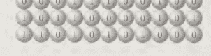

定义大小为 n 的几乎完整数组是一个二维位数组，其中恰好缺少一列。由此可知，当前问题中的数组 A 是一个大小为 n 的几乎完整数组。现在考虑任意一个大小为 n 的完整数组 Ā。称 L̄ 为 Ā 的底行。L̄ 由 Ā 中数字的最低有效位组成。令 n̄₀ 为 L̄ 中 0 的个数，n̄₁ 为 L̄ 中 1 的个数。令 Δ̄ = n̄₀ − n̄₁。我们断言：

Δ̄ = {
  0,  若 n 为奇数；
  1,  若 n 为偶数。
}    (2.3)

事实上，通过归纳法很容易证明：若 Ā 的列数 n + 1 为偶数，则 Δ̄ = 0；若为奇数，则 Δ̄ = 1。

现在考虑 A：任意一个大小为 n 的几乎完整数组，它由 Ā 删除一列（即缺失数字）得到。令 L 为 A 的底行。令 n₀ 为 L 中 0 的个数，n₁ 为 L 中 1 的个数。令 Δ = n₀ − n₁。我们断言：

Δ = {
  Δ̄ + 1,  若缺失数字为奇数。
  Δ̄ − 1,  若缺失数字为偶数。
}    (2.4)

事实上，如果缺失数字为偶数，则与 L̄ 相比，L 中少一个 0，而 1 的个数相同；即 n₀ = n̄₀ − 1 且 n₁ = n̄₁。同样，如果缺失数字为奇数，则与 L̄ 相比，L 中少一个 1，而 0 的个数相同；即 n₀ = n̄₀ 且 n₁ = n̄₁ − 1。考虑到上述讨论，显然有：

Δ = {
  2,  若 n 为偶数且缺失数字为奇数。
  1,  若 n 为奇数且缺失数字为奇数。
  0,  若 n 为偶数且缺失数字为偶数。
  −1, 若 n 为奇数且缺失数字为偶数。
}    (2.5)

我们得出结论：

Δ ∈ {1, 2} ⇒ 缺失数字的最低有效位为 1。
Δ ∈ {−1, 0} ⇒ 缺失数字的最低有效位为 0。

因此，沿 A 的底行进行一次线性扫描，我们就能计算出 Δ，然后可以在常数时间内计算出缺失数字的最低有效位。然而，如果我们对缺失数字的其他位尝试类似方法，最终会得到 Ω(n log n) 的计算量，因为行数是 n 的对数级。关键观察是：为了确定缺失数字的次低有效位，我们只需要扫描大约一半的列。也就是说，如果最低有效位被确定为 1，那么为了计算次低有效位，我们只需要扫描底行为 1 的列。同样，如果最低有效位被确定为 0，那么为了计算次低有效位，我们只需要扫描底行为 0 的列。下面我们解释为什么这是正确的。

A 的行数为 m = ⌊log₂ n⌋ + 1。定义 A₀^(m−1) 为从 A 中删除第 m − 1 行中为 0 的列，然后删除第 m − 1 行后得到的二维数组。定义 A₁^(m−1) 为从 A 中删除第 m − 1 行中为 1 的列，然后删除第 m − 1 行后得到的二维数组。将导出 A₀^(m−1) 和 A₁^(m−1) 的过程称为 A 的归约，将得到的两个数组称为归约数组。令 b 为缺失数字的最低有效位，b̄ 为其取反值。

### 引理

在当前命名约定下，$A_{\bar b}^{(m)}$ 是完整的，而 $A_b^{(m-1)}$ 是几乎完整的。此外，$A_b^{(m-1)}$ 中的缺失数字是通过删除 $A_b^{(m)}$ 中缺失数字的最低有效位（即右移）得到的。

### 证明

首先我们看一个例子，然后给出形式化证明。沿用前面给出的例子，n = 10，m = 4，缺失数字为 6 = 0110_b，A 如下：

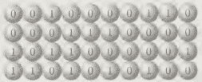

导出的两个子数组：A₀^(3) 和 A₁^(3) 分别为：

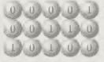

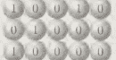

显然，A₀^(3) 是几乎完整的，而 A₁^(3) 是完整的：其中缺少列 {0 1 1}。A 中缺失数字的最低有效位为 0；如果我们不知道哪个是缺失数字，可以通过计算前述 Δ = 5 − 5 = 0 推断其最低有效位为 0。事实上，A₀^(3) = A^(3) 是几乎完整的数组。而且其中的缺失数字 011_b 确实是通过将 0110_b 右移得到的。

我们来证明这一点。显然，如果 A 是一个大小为 n 的完整数组，那么 A₀^(m−1) 和 A₁^(m−1) 现在都是完整的。如果 n 为奇数，则它们包含相同的列（从左到右的顺序可能不同）；否则，A₁^(m−1) 多包含一列，其余列相同。


### 算法验证

考虑到所有这些，算法的验证就很直接了。\(n\) 是位数，也就是 \(A\) 的行数。数组 `res` 是输出：在主 `for` 循环的每次迭代中，计算 `res` 的一个位，方向从最低有效位向上。\(B\) 是一个整数辅助数组。问题的定义要求仅对 \(A\) 的元素进行按位访问；数组 \(B\) 可以正常访问。\(B\) 保存在主 `for` 循环每次迭代中我们扫描其第 \(i\) 行的那些列的索引。

当然，最初 \(B\) 按该顺序包含索引 \(0, 1, \ldots, n-1\)，因此当 \(i\) 为 \(n-1\) 时，我们只需扫描 \(A\) 的底行。在主 `for` 循环的每次迭代中，`ntemp` 是我们扫描其最后一行的几乎完整数组的列数。最初，`ntemp` 为 \(n\)，这反映了在第一次迭代时我们扫描 \(A\) 的底行。我们将在后面验证对 `ntemp` 新值的赋值。

在主 `for` 循环内部，第一个嵌套的 `for` 循环只是统计 0 和 1 的个数，并将结果分别存入 `n0` 和 `n1`。

差值 \(n0 - n1\) 按如下方式确定第 \(i\) 个最低有效位 `res[i]`：

\[
\Delta \in \{1, 2\} \implies \text{缺失数字的最低有效位是 1。}
\]

\[
\Delta \in \{-1, 0\} \implies \text{缺失数字的最低有效位是 0。}
\]

第二个嵌套的 `for` 循环找出那些列的索引，这些列对应于下一个几乎完整的缩减数组的列。要理解为什么我们只考虑（\(A\) 最后一行的）等于 `res[i]` 的值，请查看上面的引理。

最后，对 `ntemp` 新值的赋值依据以下考虑进行。如果 `ntemp` 为偶数，那么两个派生数组的长度相同，均为 \(\frac{ntemp}{2}\)。否则，注意我们感兴趣的是那个几乎完整的派生子数组。如果 `res[i]` 为 1，那么该子数组就是删除底部为 0 的列后得到的子数组：它比完整的派生子数组多一列，因此 `ntemp` 的新值应为 \(\left\lceil \frac{ntemp}{2} \right\rceil\)。类似地，如果 `res[i]` 为 0，那么 `ntemp` 的新值应为 \(\left\lfloor \frac{ntemp}{2} \right\rfloor\)。至此算法的验证结束。邀请读者使用 *循环不变式* 给出更严格正确性证明。

在主 `for` 循环的每次迭代中，对 \(A\) 的访问次数与 `ntemp` 的当前值成正比。显然，总访问次数与下式成正比：

\[
n + \frac{n}{2} + \frac{n}{4} + \ldots + 1 \le 2n = \Theta(n)
\]

### 2.19 在列已排序的情况下寻找缺失数字

### 问题描述

考虑上一个问题，并附加假设：\(A\) 中的数字（即各列）按排序顺序出现。以对 \(A\) 的 \(O(\log n)\) 次位访问找出缺失数字。

### 解决方案

如果 \(A\) 中的数字已排序，那么可以通过先确定缺失数字的最高有效位，然后确定次高有效位，依此类推，直到最低有效位来解决问题，并且对每一位恰好访问 \(A\) 一次。

假设 \(\tilde{A}\) 是大小为 \(n\) 的完整数组（参见上一个问题的解决方案中 *完整数组* 的定义），即没有缺失数字。例如，如果 \(n = 10\)，则 \(\tilde{A}\) 为：

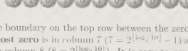

考虑顶行上 0 与 1 之间的边界。最右边的 0 位于第 7 列（\(7 = 2^{\lfloor \log_2 10 \rfloor} - 1\)），最左边的 1 位于第 8 列（\(8 = 2^{\lfloor \log_2 10 \rfloor}\)）。容易推广：只要最左列编号为 0，边界就在第 \(2^{\lfloor \log_2 n \rfloor} - 1\) 列与第 \(2^{\lfloor \log_2 n \rfloor}\) 列之间。

现在考虑大小为 \(n\) 的几乎完整数组 \(A\) 的顶行上 0 与 1 之间的边界。例如，如果 \(n = 10\) 且缺失数字为 \(6 = 0110_2\)，则 \(A\) 为：

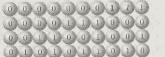

考虑顶行上的位置 \(7 = 2^{\lfloor \log_2 10 \rfloor} - 1\) 和 \(8 = 2^{\lfloor \log_2 10 \rfloor}\)。现在边界不在它们之间，因为缺失数字的最高有效位为 0，所以与 \(\tilde{A}\) 相比，边界向左移动了一个位置。然而，如果我们不知道缺失数字的最高有效位是什么，我们可以从顶行位置 7 和 8 处有两个 1 这一事实推断出它为 0。

显然，如果顶行位置 7 和 8 处分别为 0 和 1，那就意味着缺失数字的最高有效位为 1，如下例所示，其中数组称为 \(B\)，\(n = 10\)，缺失数字为 \(9 = 1001_2\)：


因此，仅通过检查顶行上的位置 \(2^{\lfloor \log_2 n \rfloor} - 1\)，我们可以按如下方式推断缺失数字的最高有效位：

\[
\text{缺失数字的最高有效位} =
\begin{cases}
0, & \text{如果 } A[0][2^{\lfloor \log_2 n \rfloor} - 1] == 1; \\
1, & \text{如果 } A[0][2^{\lfloor \log_2 n \rfloor} - 1] == 0.
\end{cases}
\tag{2.6}
\]

在 \(\Theta(1)\) 时间内计算出缺失数字的最高有效位后，我们再用 \(\Theta(1)\) 时间计算次高有效位，依此类推，直到用 \(\Theta(\log n)\) 次尝试计算出缺失数字的所有位，每次尝试耗时 \(\Theta(1)\)。

### 情况 1

如果最高有效位为 0，为了计算次高有效位，我们只考虑由列 \(0, 1, \ldots, 2^{\lfloor \log_2 n \rfloor} - 2\) 与行 \(1, 2, \ldots, \lfloor \log_2 n \rfloor\) 组成的子数组。以上面的 \(A\) 为例，该子数组记为 \(A'\)：

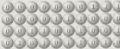

\(\Rightarrow A'\):

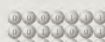

我们对 \(A'\) 完全像对 \(A\) 一样递归处理，因为 \(A'\) 是一个几乎完整的数组。让我们计算 \(A'\) 的大小。初始的 \(A\) 可以是任意大小，但 \(A'\) 的大小由 \(n\) 唯一确定。令 \(m = \lfloor \log_2 n \rfloor + 1\)，即用二进制表示 \(n\) 所需的位数（因此 \(m\) 是 \(A\) 的行数）。令 \(m' = m - 1\)。派生出的 \(A'\) 大小为 \(2^{m'} - 1\)。其中的 \(-1\) 来自 \(A'\) 有一个缺失数字这一事实。

### 情况 II

如果最高有效位为 1，为了计算次高有效位，我们只考虑那些列在顶行中为 1 的子数组。以上面的 \(B\) 为例，该子数组记为 \(B'\)：

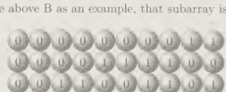

\(\Rightarrow B'\):


\(B'\) 中的列数（记为 \(c'\)）很容易计算：\(c' = n - 2^{m'}\)，其中 \(m' = \lfloor \log_2 n \rfloor\)。在具体示例中，\(n = 10\)，\(m' = 3\)，因此 \(c' = n - 2^{m'} = 10 - 8 = 2\)。

然而，\(B'\) 不一定是几乎完整的数组：要成为几乎完整的数组，它的顶行必须至少有一个 1。事实上，仅当 \(c' > \frac{1}{2}(2^{m'}) = 2^{m' - 1}\) 时，\(B'\) 才是几乎完整的数组。在这个例子中，\(B'\) 不是几乎完整的数组；它多了一行。仅通过知道 \(B'\) 的维度，我们就可以断定缺失数字的次高有效位为 0（缺失数字为 \(9 = 1001_2\)）；我们不必扫描，甚至不必检查顶行的位来得出该结论。规则是：当 \(c' \le 2^{m' - 1}\) 时，将 0 写入缺失数字的相应位位置，并执行 \(m' \leftarrow m' - 1\)。这个过程等价于从 \(B'\) 中删除所需数量的顶行。一旦过程结束且 \(B'\) 已按需缩减，就可以递归处理它。

考虑以下程序：

```c
1  int m = floor(log2(n)) + 1;
2  int A[m][n], res[m];
3  void find(int low, int high, int row)
4  {
5      int j, c, n1, n2, numel = high - low + 1;
6      if (row == m-1)
7      {
8          res[row] = !(A[row][0]);
9          PrintResult();
10         return;
11     }
12
13     n1 = floor(log2(numel));
14     n2 = 1 << n1;
15
16     if (A[row][low+n2-1] == 1)
17     {
18         res[row] = 0;
19         find(low, n2-2, row+1);
20     }
21     else
22     {
23         j = 1;
24         res[row] = 1;
25         c = numel - n2;
26
27         while ((n1 >= 0) && c <= (1<<(--n1)))
28         {
29             j++;
30             res[row+j] = 0;
31         }
32
33         if (row+j == m-1)
34         {
35             PrintResult();
36             return;
37         }


```
    38            }
    39            find(n2, high, row+j);
    40        }
    41    }
    42 }
    43
    44 int main()
    45 {
    46     find(0, n-1, 0);
    47 }
```

该代码片段的正确性可由前面的讨论推出。
时间复杂度显然是 \(\Theta(\log n)\)。■

### 2.20 重排数组

### 问题

给定一个数组 \(a[1..n]\) 和一个阈值 \(b\)。重新排列数组元素，使得某个边界左侧的所有元素都不超过 \(b\)，而边界右侧的所有元素都大于或等于 \(b\)。操作次数应与 \(n\) 成正比。

### 解法

**算法 57 重排数组**

```
    1: function REARRANGE-ARRAY(a[1..n], b)
    2:     l ← 0
    3:     r ← n
    4:     Invariant : l ≤ r; a[1..l] ≤ b; a[r+1..n] ≥ b
    5:     while l ≠ r do
    6:         if a[l+1] ≤ b then
    7:             l ← l+1
    8:         else if a[r] ≥ b then
    9:             r ← r−1
    10:        else
    11:            swap(a[l+1], a[r])        ▷ a[l+1] > b; a[r] < b; l+1 < r;
    12:            l ← l+1
    13:            r ← r−1
    14:        end if
    15:    end while
    16: end function
```

### 问题

在上一问题的基础上增加额外限制：小于 \(b\) 的元素应位于等于 \(b\) 的元素之前，而等于 \(b\) 的元素本身又应位于大于 \(b\) 的元素之前。

### 解法

我们需要三个边界将我们的区段划分为四部分。

- 1. 第一部分包含小于 \(b\) 的元素
- 2. 第二部分只包含等于 \(b\) 的元素
- 3. 第三部分可以包含任意元素，并且
- 4. 第四部分只包含大于 \(b\) 的元素。

请注意，使用*第四条*边界可以得到一个更对称的解法。

每一步我们考虑第三部分最左边的元素（紧邻第二边界右侧）。

**算法 58 重排数组（再论）**

```
1: function REARRANGE-ARRAY(a[1..n], b)
2:     l ← 0
3:     m ← 0
4:     r ← n
5:     Invariant : a[1..l] < b; a[l + 1..m] = b; a[r + 1..n] > b
6:     while m ≠ r do
7:         if a[m + 1] == b then
8:             m ← m + 1
9:         else if a[m + 1] > b then
10:            swap(a[m + 1], a[r])
11:            r ← r − 1
12:        else
13:            swap(a[m + 1], a[l + 1])
14:            l ← l + 1
15:            m ← m + 1
16:        end if
17:    end while
18: end function
```

### 2.21 开关与灯泡问题

### 问题描述

想象两个彼此不可见的房间。在一个房间里有 \(n\) 个编号的电灯开关 \(s_1, s_2, \ldots, s_n\)。在另一个房间里有 \(n\) 个编号的灯泡 \(\ell_1, \ell_2, \ldots, \ell_n\)。已知每个开关恰好控制一个灯泡的亮灭，但我们不知道开关与灯泡之间的任何接线信息。初始时我们在有开关的房间里。我们的任务是确定确切的接线关系，即哪个开关控制哪个灯泡。我们可以按下任意开关，然后前往有灯泡的房间进行一次观测。我们不允许触碰灯泡：唯一的信息来源是对灯泡的观测。

这些开关在切换时物理外观不会改变，因此我们无法预先知道按下某个开关会导致灯泡点亮还是熄灭。当然，每个开关和任何普通电灯开关一样，只有两个状态。

描述一个以最少观测次数发现接线关系的算法，即以最少次数访问有灯泡的房间的算法。该算法应迭代工作：在每次迭代中模拟切换一些开关，然后通过调用某个函数 Observe 来模拟一次观测。切换通过写入一个 0-1 数组 \(P[1,\ldots,n]\) 来模拟。例如，\(P[i] = 1\) 表示 \(s_i\) 被切换，\(P[i] = 0\) 表示 \(s_i\) 未被切换。观测结果写入某个 0-1 数组 \(L[1,\ldots,n]\)。例如，\(L[i] = 1\) 表示 \(\ell_i\) 亮，\(L[i] = 0\) 表示 \(\ell_i\) 灭。每次调用 Observe 后，算法暂时停止，执行权应转交给一个外部代理；待外部代理完成对 \(L\) 的写入后，算法继续执行。

证明观测次数的渐近下界。你的算法在渐近意义下是最优的吗？

### 解法

我们的算法维护以下数据结构：

- 一个 0-1 数组 \(A[1,\ldots,n]\)，用于保存上一次观测的结果，
- 一个数组 \(S[1,\ldots,n]\)，用于引用各个开关。\(S\) 的每个元素都是一个指针。具体来说，\(S[i]\) 指向一个（双向）链表，该链表表示一组灯泡；根据当前可用信息，这些灯泡中的每一个都可能与 \(s_i\) 相连。我们称这组灯泡为 \(s_i\) 的候选集合。
- 一个大小为 \(2n\) 的正整数数组 \(B\)。在第 \(i\) 次迭代期间，\(B\) 包含 \(2i\) 个元素，这些元素确定将 \(S\) 划分为若干子数组。\(B[2j]\) 和 \(B[2j + 1]\) 是满足 \(B[2j] \le B[2j + 1]\) 的数，并且数对 \(B[2j], B[2j + 1]\) 表示子数组 \(S[B[2j],\ldots,B[2j + 1]]\)。
- 一组双向链表，总共包含 \(n\) 个元素。它们表示灯泡集合的一个划分。每个元素包含一个整数，该整数恰好对应一个灯泡的 ID；每个链表恰好表示一个候选集合。初始时，这组链表中只有一个链表，称其为 \(C\)。这反映了初始时我们对灯泡与开关之间可能的连接没有任何限制。最终，这组链表中会有 \(n\) 个非空链表。这反映了最终我们确切知道开关与灯泡之间的接线关系。

以下是伪代码。初始时 \(P[\,]\) 任意。

**算法 59 开关与灯泡**

```
1: function SWITCHES-AND-BULBS
2:     create doubly linked list C of n elements, one for each bulb
3:     create S and set every pointer in it to C
4:     B ← [1, n]
5:     OBSERVE()
6:     copy L into A
7:     while there are fewer than 2n entries in B
8:         for all pairs B[2j], B[2j + 1] such that B[2j] < B[2j + 1] do
9:             mid ← ⌊(B[2j] + B[2j + 1]) / 2⌋
10:            set P[B[2j], ..., mid] to ones
11:            set P[mid + 1, ..., B[2j + 1]] to zeros
12:        end for
13:        update B so that for each applicable pair B[2j], B[2j + 1], it is substituted by two pairs <B[2j], mid> and <mid + 1, B[2j + 1]>
14:        OBSERVE()
15:        for i ← 1 to n do
16:            if A[i] ≠ L[i] then
17:                mark bulb i as changed
18:            end if
19:            for all lists of bulbs do
20:                split the list, if necessary, into two lists: changed and unchanged bulbs
21:            end for
22:            for all elements of S do
23:                update the pointer to the relevant list of bulbs
24:            end for
25:        end for
26:        copy L into A
27:    end while
28:    for i ← 1 to n do
29:        print the sole element of the list pointed to by S[i]
30:    end for
31: end function
```

该算法的查询复杂度，即调用 OBSERVE 的次数，是 while 循环的执行次数加一。while 循环的执行次数关于 \(n\) 是对数级的，因为每次执行时，我们都会把由 \(B\) 中一对数界定的每个子数组大致分成两半。因此，查询次数为 \(\Theta(\log n)\)。

现在证明此类查询次数的 \(\Omega(\log n)\) 下界。我们使用决策树模型。例如，决策树模型被用于证明基于比较的排序的 \(\Omega(n \log n)\) 下界。然而，基于比较的排序的决策树是二叉的，因为形如 \(a_i < a_j\) 的每次比较恰好有两种可能结果。与此相反，对应于当前开关与灯泡问题的任何决策树的分支因子都是 \(2^n\)。要理解为什么这是正确的，注意对 \(n\) 个灯泡的每次观测恰好有 \(2^n\) 种可能结果。

当前问题本质上是在计算一个排列，因为从开关到灯泡的映射是双射。由此可知，该问题的任何决策树都必须区分 \(n\) 个元素的所有可能 \(n!\) 个排列：如果决策树的某个叶子节点被至少两个排列标记，那么相应的算法就是不正确的。因此，叶子节点数至少为 \(n!\)。

给定分支因子和叶子节点数，树的高度是相应算法查询复杂度的下界：

\[
\log_{2^n} n! = \frac{\log_2 n!}{\log_2 2^n} = \frac{\Theta(n\log n)}{n} = \Theta(\log n)
\]

树的高度是解决开关与灯泡问题的任何基于观测的算法的查询复杂度的下界。因此，如果唯一允许的测试是直接观测，则需要 \(\Theta(\log n)\) 次观测。因此，算法 **SWITCHES-AND-BULBS** 在所执行观测次数方面是渐近最优的。

### 2.22 计算子数组之和

### 问题描述

给定一个方阵 \(a[1..n,1..n]\) 和一个数 \(m \le n\)。对于任意 \(m \times m\) 子方阵，计算其元素之和。总操作次数应为 \(n^2\) 量级。

### 解法

该算法是一个直接的两步过程：

- 1. 首先计算所有大小为 \(m \times 1\) 的水平矩形的和。当这样的矩形向右移动时，加入一个元素并减去一个元素。
- 2. 计算完所有这些和后，我们计算正方形的和。当正方形向下移动时，加入一个矩形并减去另一个矩形。


### 2.23 找出一个不能由数组子集和表示的数

### 问题描述

一个非递减整数数组 $a[1..n]$ 仅包含正数。找出最小的正整数，使得它不能表示为该数组若干元素的和（每个元素最多使用一次）。操作次数应为 $O(n)$。

### 解法

假设对于某个 $N$，所有可由 ${a[1],...,a[k]}$ 的子集和表示的数构成集合 ${1,2,...,N}$。如果 $a[k+1]$ 大于 $N+1$，则 $N+1$ 是不能表示为 ${a[1],...,a[k]}$ 的某些子集和的最小数。如果 $a[k+1] \leq N+1$，则所有可由 ${a[1],...,a[k+1]}$ 的子集和表示的数构成集合 ${1,2,...,N+a[k+1]}$。

```
Algorithm 60 Find a number not sum of subsets of array

1: $k \leftarrow 0$
2: $N \leftarrow 0$
3: Invariant: all the numbers that can be represented as sums of subsets of ${a[1],...,a[k]}$, form the set ${1,2,...,N}$
4: while $k+1 \leq n$ and $a[k+1] \leq N+1$ do
5:     $N \leftarrow N+a[k+1]$
6:     $k \leftarrow k+1$
7: end while ▷ $(k=n)$ or $(a[k+1]>N+1)$; the answer is $N+1$ in both cases
8: print(N+1)
```

### 2.24 两个有序数组中的第 $k$ 小元素

### 问题描述

给定两个有序数组 $a[1..n]$ 和 $b[1..m]$，找出这两个数组的并集中第 $k$ 小的元素。时间复杂度应为 $O(\log n + \log m)$。

### 解法

我们要在数组 $a[1,...,n]$ 和 $b[1,...,m]$ 的并集中寻找第 $k$ 小的元素 $x_k$。

由于我们要找的是第 $k$ 小的元素，我们可以将注意力限制在数组 $a[1,...,k]$ 和 $b[1,...,k]$ 上。如果 $k>m$ 或 $k>n$，我们可以将相应数组中索引大于 $k$ 的越界元素视为无穷大。

### 正确性证明

我们的算法首先比较 $a[\lfloor k/2\rfloor]$ 和 $b[\lceil k/2\rceil]$：

- 假设 $a[\lfloor k/2\rfloor] > b[\lceil k/2\rceil]$，则：
  - 在 $a$ 和 $b$ 的并集中，小于 $b[\lceil k/2\rceil]$ 的元素至多有 $k-2$ 个，即 $a[1,\ldots,\lfloor k/2\rfloor-1]$ 和 $b[1,\ldots,\lceil k/2\rceil-1]$，因此必有 $s_k > b[\lceil k/2\rceil]$。
  - 类似地，所有 $a[1,\ldots,\lfloor k/2\rfloor]$ 和 $b[1,\ldots,\lceil k/2\rceil]$ 中的元素都将小于 $a[\lfloor k/2\rfloor]$。但这些共有 $k$ 个元素，所以我们必有 $s_k < a[\lfloor k/2\rfloor+1]$。

这表明 $s_k$ 一定包含在子数组 $a[1,\ldots,\lfloor k/2\rfloor]$ 和 $b[\lceil k/2\rceil+1,\ldots,k]$ 的并集中。

特别地，由于我们丢弃了 $\lceil k/2\rceil$ 个小于 $s_k$ 的元素，$s_k$ 将是该并集中第 $\lfloor k/2\rfloor$ 小的元素。

然后我们可以通过在这个更小的问题上递归来找到 $s_k$。

- 当 $a[\lfloor k/2\rfloor] < b[\lceil k/2\rceil]$ 时，情况是对称的。
- 最后一种情况也是递归的基准情况，即 $a[\lfloor k/2\rfloor] = b[\lceil k/2\rceil]$，此时有 $s_k = a[\lfloor k/2\rfloor] = b[\lceil k/2\rceil]$。

### 2.25 对子序列组成的序列进行排序

### 问题描述

有一个由 $n$ 个元素组成的序列 $S$ 需要排序。输入序列由 $n/k$ 个子序列组成，每个子序列包含 $k$ 个元素。给定子序列中的元素都小于其后一个子序列中的元素，且大于其前一个子序列中的元素。时间复杂度应为 $\Omega(n\log k)$。

### 解法

要对长度为 $n$ 的整个序列进行排序，只需对 $n/k$ 个子序列中的每个子序列里的 $k$ 个元素进行排序。请注意，简单地将各个子序列的下界组合起来，并不能达到解决这个排序问题变体所需的比较次数下界。那只能证明不存在更快地独立排序这些子序列的算法。

现在，考虑对 $S$ 进行任意比较排序的决策树，其高度为 $h$。由于每个子序列中的元素可以按任意顺序排列，$k!$ 个排列中的任何一个都对应于某个子序列的最终排序。又因为有 $n/k$ 个子序列，每个子序列都可以按任意顺序排列，因此 $S$ 有 \((k!)^{n/k}\) 种排列可能对应于某个输入顺序的排序结果。

因此，任何用于排序 \(S\) 的决策树至少必须有 \((k!)^{n/k}\) 个叶节点。由于高度为 \(h\) 的二叉树至多有 \(2^h\) 个叶节点，我们必须有

$$2^h \ge (k!)^{n/k}$$

$$\Longrightarrow\quad h \ge \log\left((k!)^{n/k}\right) = \frac{n}{k}\log(k!)$$
$$\ge \frac{n}{k}\log\left(\left(\frac{k}{2}\right)^{k/2}\right)$$
$$= \frac{n}{2}\log\left(\frac{k}{2}\right)$$

由于对 \(S\) 排序的任何决策树中至少存在一条长度至少为 \(\frac{n}{2}\log(k/2)\) 的路径，因此任何基于比较的排序算法对 \(S\) 的最坏情况运行时间均为 \(\Omega(n\log k)\)。

### 2.26 找出缺失的整数

### 问题

数组 \(a[0..n-1]\) 包含 \([0..n]\) 中除一个之外的所有整数。在固定额外内存的限制下找出这个缺失的整数。操作次数应与 \(n\) 成正比。

### 解法

- 1. 计算所有数的总和：\(total = \frac{n(n+1)}{2}\)
- 2. 从总和中依次减去所有数，即可得到缺失的数。

程序 2.8：找出缺失的整数

```cpp
#include <vector>
#include <iostream>

int find_missing_number(std::vector<int> & v, int n)
{
    int total = n*(n + 1)/2;

    for(auto e : v)
        total -= e;
}

int main()
{
    std::vector<int> v {1, 2, 3, 5, 6};
    std::cout << find_missing_number(v, 6) << std::endl;
}
```

输出：

```text
4
```

### 2.27 原地反转

### 问题描述

给定数组 a[1..n]，在不使用其他数组的情况下，将其元素按相反顺序排列。

### 解法

对所有满足 $i<n+1-i$ 的 $i$ 执行 $swap(a[i], a[n+1-i])$，即 $2i<n+1\ \Longleftrightarrow\ 2i\le n\ \Longleftrightarrow\ i\le \frac{n}{2}$。

**算法 62** 原地反转数组

|  |  |
|---|---|
| 1: | 函数 REVERSE-INPLACE(a[1..n]) |
| 2: | 对于 i ← 1 到 $\frac{n}{2}$ 执行 |
| 3: | &nbsp;&nbsp;&nbsp;&nbsp;交换 a[i] 和 a[n + 1 − i] |
| 4: | 结束循环 |
| 5: | 结束函数 |

### 2.28 找出数组中出现一次的数

### 问题描述

数组 $a[0..n−1]$ 包含一些整数，每个元素都出现两次，只有一个元素只出现一次。在固定额外内存的限制下找出这个元素。操作次数应与 $n$ 成正比。

### 解法

利用异或（xor）运算，我们可以找出出现奇数次的数。

- 异或运算满足交换律和结合律（因此运算顺序无关紧要）。
- 一个数与其自身异或的结果总是零。
- 零与一个数异或的结果是该数。

因此，如果我们简单地将所有值异或在一起，所有出现两次的值将相互抵消（得到 0），而剩下的那个数（值）再与这个结果（0）异或，得到该值本身。

程序 2.9：找出数组中出现一次的数

```cpp
#include <vector>
#include <iostream>

size_t get_orphan(std::vector<int> & v)
{
    int value = 0;

    for (auto e : v)
        value ^= e;

    std::cout << "number: " << value << std::endl;
    // value now contains the number that occurred
    // odd number of times.
    // Retrieve its index in the array.

    size_t len = v.size();

    size_t index_orphan = -1;

    for (size_t index = 0; index < len; ++index)
    {
        if (v[index] == value)
        {
            index_orphan = index;
            std::cout << "index: " << index_orphan
                      << std::endl;
            return index_orphan;
        }
    }
    return index_orphan;
}

int main()
{
    std::vector<int> v {12, 8, 14, 13, 3, 12, 13,
        8, 14};
}
```


```cpp
35    get_orphan(v);
36 }
```

输出：

```
number : 3
index : 4
```

## 第3章

## 树

### 3.1 最低公共祖先（LCA）问题

### 问题

在根树中，求一对节点的最低公共祖先（简称 lca），即深度最大的祖先。

### 解法

### 基本分析

在根树 $T$ 中，如果节点 $u$ 位于从根到 $v$ 的唯一路径上，则称 $u$ 是 $v$ 的祖先。从这个定义容易推断出，一个节点是它自身的祖先。$v$ 的*真祖先*是指不是 $v$ 本身的祖先。

在根树 $T$ 中，两个节点 $x$ 和 $y$ 的*最低公共祖先*（简称 *lca*）是 $T$ 中同时作为 $x$ 和 $y$ 祖先的最深节点。LCA 问题是树上最基本的算法问题之一，它被广泛研究主要归因于：

- 它在算法上本质上很优美。
- LCA 问题的快速算法可以用来解决其他算法问题。

节点 $u \in V$ 的祖先集合 $a(u)$ 定义为：

$$a(u)=\begin{cases}\{x\}\cup a(\operatorname{parent}(x)), & x\ne\operatorname{root}\\\{x\}, & \text{otherwise}\end{cases}$$

其中 $\operatorname{parent}(x)$ 是树中节点 $x$ 的父节点。

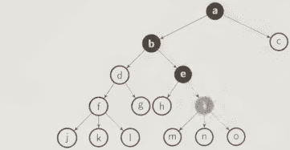

在上面这棵树中，$a(i)=\{i,e,b,a\}$。

节点 $u$ 和 $v$ 的公共祖先集合 $ca(u,v)$ 定义为：

$$ca(u,v)=a(u)\cap a(v)$$

最低公共祖先 $lca(u,v)$ 是 $u$ 和 $v$ 的深度最大的公共祖先，即按层级排列公共祖先 $ca(u,v)=\{x_1,\ldots,x_k\}$：

$$l(x_1)<l(x_2)<\ldots<l(x_k)$$

其中 $l(u)$ 是节点的层级，$x_1$ 是根顶点 $r$，$x_k$ 是最低公共祖先。

最低公共祖先的性质可总结如下：

- $lca(\{u\})=u$
- **同一性：** $\forall u\in V:lca(u,u)=u$
- **交换性：** $\forall u,v\in V:lca(u,v)=lca(v,u)$
- 不同的 lca 对的数量

  $$\binom{n}{2}=\frac{n(n-1)}{2}$$

- 如果 $u$ 和 $v$ 均不是对方的祖先，则 $u$ 和 $v$ 位于 $lca(u,v)$ 的不同直接子树中，即 $u$ 所在的 $lca$ 的孩子与 $v$ 所在的 $lca$ 的孩子不同。请注意，$lca$ 是树中唯一满足这一性质的节点。
- $S=\{v_1,v_2,\ldots,v_n\}$ 的全部公共祖先集合由 $lca(S)$ 及其一直延伸到树根的所有祖先构成。特别地，$S$ 的每个公共祖先都是 $lca(S)$ 的祖先。
- 在树的先序序列中，`lca(S)` 位于 `S` 中所有节点之前；在后序序列中，`lca(S)` 位于 `S` 中所有节点之后。
- 如果 `S = A ∪ B`，且 `A` 和 `B` 均非空，则 `lca(S) = lca(lca(A), lca(B))`。例如，`lca(u,v,w) = lca(lca(u,v),w)`。（lca 与名称相近的最小公倍数、最大公约数具有相同的性质；利用这一性质，只需要进行二元 lca 计算，就可以计算任意大的集合的 lca。）
- `d(u,v) = h(u) + h(v) − 2h(lca(u,v))`，其中 `d` 表示两个节点之间的距离，`h` 表示节点的高度。

### 简单解法

设 `P` 为节点的父节点，`r` 为树的根。通过计算以下两个序列，我们可以很容易地找到节点 `u` 和 `v` 的 `lca`：

1. `u, P(u), P(P(u)), …, r`
2. `v, P(v), P(P(v)), …, r`

这两个序列的最长公共后缀的首个元素显然就是 `lca`。

该算法的时间复杂度为 `O(h)`，其中 `h` 是树的高度。对于相当平衡的树，`h` 为 `O(log |V|)`；对于退化树，则为 `O(|V|)`。

### C++ 实现

### 树结构

*程序 3.1：简单的 n 叉树*

```cpp
#ifndef TREE_HPP
#define TREE_HPP

#include <memory>
#include <iterator>
#include <iostream>

template <typename T>
struct node
{
    node()
        : parent(0), first_child(0), last_child(0),
          prev_sibling(0), next_sibling(0) {}
    node(const T& val)
        : parent(0), first_child(0), last_child(0),
          prev_sibling(0), next_sibling(0), data(val)
    {}
18
19         node<T> * parent;
20         node<T> * first_child, * last_child;
21         node<T> * prev_sibling, * next_sibling;
22         T data;
23 };
24
25 template <typename T, typename Allocator
26             = std::allocator<node<T>>>
27 struct tree
28 {
29         typedef node<T> tree_node;
30         typedef T value_type;
31
32         tree()
33         {
34                 head = alloc_.allocate(1,0);
35                 feet = alloc_.allocate(1,0);
36                 alloc_.construct(head, node<T>());
37                 alloc_.construct(feet, node<T>());
38                 head->parent = head->first_child = 0;
39                 head->last_child = head->prev_sibling = 0;
40                 head->next_sibling=feet;
41                 feet->parent = feet->first_child = 0;
42                 feet->last_child = feet->next_sibling = 0;
43                 feet->prev_sibling=head;
44
45         }
46
47         struct iterator
48         {
49                 typedef T value_type;
50                 typedef T* pointer;
51                 typedef T& reference;
52                 typedef size_t size_type;
53                 typedef std::ptrdiff_t difference_type;
54                 typedef std::bidirectional_iterator_tag
55                     iterator_category;
56
57                 iterator() : node(0) {}
58                 iterator(tree_node * tn) : node(tn) {}
59
60                 T& operator*() const
61                 { return node->data; }
62
63                 T* operator->() const
64                 { return &(node->data); }
65
66                 bool operator==(const iterator& o) const
67                 {
68                     if(o.node==this->node) return true;
69                     else return false;
70                 }
71                 bool operator!=(const iterator& o) const
72                 {
        if(o.node!=this->node) return true;
        else return false;
    }
    tree_node *node;
};

iterator begin() const
{
    return iterator(head->next_sibling);
}

iterator end() const
{ return iterator(feet); }

template<typename iter>
static iter parent(iter p)
{
    return iter(p.node->parent);
}

template<typename iter>
iter append(iter p, const T& x)
{
    tree_node* tmp = alloc_.allocate(1,0);
    alloc_.construct(tmp, x);
    tmp->first_child = tmp->last_child = 0;
    tmp->parent=p.node;
    if(p.node->last_child!=0)
    {
        p.node->last_child->next_sibling=tmp;
    }
    else
    {
        p.node->first_child=tmp;
    }
    tmp->prev_sibling=p.node->last_child;
    p.node->last_child=tmp;
    tmp->next_sibling=0;
    return tmp;
}

static int level(const iterator& it)
{
    tree_node* pos=it.node;
    int l = 0;
    while(pos->parent!=0)
    {
        pos=pos->parent;
        ++l;
    }
    return l;
}
};
```

```cpp
s1.push(u);
if (u != tree.begin())
    u = tree.parent(u);
} while (u != tree.begin());

s1.push(tree.begin());

do
{
    s2.push(v);
    if (v != tree.begin())
        v = tree.parent(v);
} while (v != tree.begin());

s2.push(tree.begin());

while (!s1.empty() && !s2.empty()
       && (s1.top() == s2.top()))
{
    lca = s1.top();

    s1.pop();
    s2.pop();
}

return lca;
}

int main()
{
    tree<std::string> st;
    tree<std::string>::iterator itra =
        st.insert(st.begin(), "a");
    tree<std::string>::iterator itrb =
        st.append(itra, "b");
    tree<std::string>::iterator itrc =
        st.append(itra, "c");

    tree<std::string>::iterator itrd, itre;
    itrd = st.append(itrb, "d");
    itre = st.append(itrb, "e");
    st.append(itre, "h");

    tree<std::string>::iterator itri =
        st.append(itre, "i");
    tree<std::string>::iterator itrm =
        st.append(itri, "m");
    tree<std::string>::iterator itrn =
        st.append(itri, "n");
    tree<std::string>::iterator itro =
        st.append(itri, "o");

    tree<std::string>::iterator itrf =
```


```cpp
while(u != v)
{
    u = tree.parent(u);
    v = tree.parent(v);
}

return u;
}

int main()
{
    tree<std::string> st;
    tree<std::string>::iterator itra
        = st.insert(st.begin(), "a");
    tree<std::string>::iterator itrb
        = st.append(itra, "b");
    tree<std::string>::iterator itrc
        = st.append(itra, "c");

    tree<std::string>::iterator itrd, itre;
    itrd = st.append(itrb, "d");
    itre = st.append(itrb, "e");
    st.append(itre, "h");

    tree<std::string>::iterator itri
        = st.append(itre, "i");
    tree<std::string>::iterator itrm
        = st.append(itri, "m");
    tree<std::string>::iterator itrn
        = st.append(itri, "n");
    tree<std::string>::iterator itro
        = st.append(itri, "o");

    tree<std::string>::iterator itrf
        = st.append(itrd, "f");
    tree<std::string>::iterator itrg
        = st.append(itrd, "g");
    tree<std::string>::iterator itrj
        = st.append(itrf, "j");
    tree<std::string>::iterator itrk
        = st.append(itrf, "k");
    tree<std::string>::iterator itrl
        = st.append(itrf, "l");


    std::cout << "levels of nodes:\n";
    std::cout << "a: " << st.level(itra)
              << "\nb: " << st.level(itrb)
              << "\nc: " << st.level(itrc)
              << "\nd: " << st.level(itrd)
              << "\ne: " << st.level(itre)
              << "\nf: " << st.level(itrf)
              << "\nh" << std::endl;

    tree<std::string>::iterator pi, pe, pb;
    pi = tree<std::string>::parent( itri );
    pe = tree<std::string>::parent( itri );
    pb = tree<std::string>::parent( pe );

    std::cout << "lca_of_b_and_c:"
    << *lca( st, itrb, itrc ) << std::endl;
    std::cout << "lca_of_d_and_e:"
    << *lca( st, itrd, itre ) << std::endl;
    std::cout << "lca_of_f_and_e:"
    << *lca( st, itrf, itre ) << std::endl;
    std::cout << "lca_of_f_and_i:"
    << *lca( st, itrf, itri ) << std::endl;
    std::cout << "lca_of_f_and_g:"
    << *lca( st, itrf, itrg ) << std::endl;
    std::cout << "lca_of_j_and_l:"
    << *lca( st, itrj, itrl ) << std::endl;
    std::cout << "lca_of_l_and_o:"
    << *lca( st, itrl, itro ) << std::endl;
    std::cout << "lca_of_b_and_o:"
    << *lca( st, itrb, itro ) << std::endl;
    std::cout << "lca_of_a_and_a:"
    << *lca( st, itra, itra ) << std::endl;
    std::cout << "lca_of_j_and_c:"
    << *lca( st, itrj, itrc ) << std::endl;
    std::cout << "lca_of_d_and_c:"
    << *lca( st, itrd, itrc ) << std::endl;

}
```

输出为：

```text
levels of nodes:
a: 0
b: 1
d: 2
e: 2
i: 3
f: 3

lca of b and c : a
lca of d and e : b
lca of f and e : b
lca of f and i : b
lca of f and g : d
lca of j and l : f
lca of l and o: b
lca of b and o : b
lca of a and a : a
lca of j and c : a
lca of d and c : a
```

### 常数时间 LCA

于是，*LCA* 问题是：给定一棵用于预处理的带根树 *T*，以某种方式预处理它，使得 *T* 中任意两个给定节点的 *LCA* 可以在常数时间内取得。下面我们给出一种预处理算法，其时间和空间复杂度均不超过线性。

我们对计算机器模型作以下两个假设。令 *n* 表示一元表示下输入规模：

- 1. 对二进制表示不超过 log n 位的数进行的所有算术、比较和逻辑运算都可以在 *常数时间* 内完成。
- 2. 我们假设，查找一个大小为 log n 的数的最高位（最左位）或最低位（最右位）可以在 *常数时间* 内完成。

### 完全二叉树

我们的讨论从 *LCA* 问题的一个特别简单的实例开始，即完全二叉树上的 *LCA* 查询。我们将利用在完全二叉树上求解 *LCA* 问题的知识，并在之后将其扩展，以求解任意带根树 *T* 上的 *LCA* 问题。

令 *B* 表示一棵有 *n* 个节点的完全二叉树。这里的关键是在节点自身中编码从根到该节点的唯一路径。我们为每个节点分配一个 *路径编号*，它是一个 *log n* 位的数，用于编码从根到该节点的唯一路径。

**路径编号** 对于 *B* 中的每个节点 *v*，我们按以下方式编码一个 *路径编号*：

- 从最左位开始计数，*v* 的路径编号的第 i 位对应于从根到 *v* 的路径上的第 i 条边。
- 从左数第 i 位为 0 表示路径上的第 i 条边通向一个左孩子，为 1 表示通向一个右孩子。
- 令 *k* 表示从根到 *v* 的路径上的边数，那么我们将路径编号的第 *k+1* 位（高度位）标记为 1，并将其余的 *log n - k - 1* 位标记为 0。

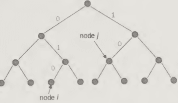

- 节点 i 的路径编号为 `0101`
- 节点 j 的路径编号为 `1010`

请注意，高度位用**粗体**标记，填充位用*斜体*标记。

路径编号可以很容易地通过对 $B$ 进行简单的 $O(n)$ 中序遍历来分配。

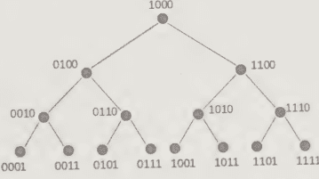

### 完全二叉树中的 LCA 查询

现在假设 $u$ 和 $v$ 是 $B$ 中的两个节点，且 $path(u)$ 和 $path(v)$ 是它们相应的路径编号。

我们将 $u$ 和 $v$ 的最近公共祖先记为 $lca(u,v)$。

### 3.1 最近公共祖先（LCA）问题

我们将路径编号中对应于从根出发的路径上的边的前缀位称为路径编号的 *路径位*。

- 1. 首先我们计算 `path(u) XOR path(v)`，并找到最左侧等于 1 的位。
- 2. 如果不存在这样的位，那么 `path(u) = path(v)`，从而 `u = v`，因此假设结果的第 *k* 位为 1。
- 3. 如果 `path(u)` 中的第 *k* 位和 `path(v)` 中的第 *k* 位都是路径位，那么这意味着 `u` 和 `v` 在它们从根出发的路径上的 *k-1* 条边上一致，也就是说每个节点路径编号的前 *k-1* 位前缀编码了从根到 `lca(u,v)` 的路径。

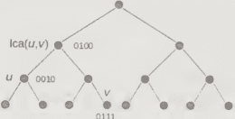

**path(u) XOR path(v) =**

```text
  0010
XOR 0111
  ----
  0101
```

因此，

`path(lca(u,v)) = 0100`

其中第一位是高度位，其余位是填充位。

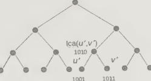

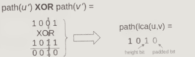

由此可以得出结论：如果我们取 *path(u) XOR path(v)* 结果的前 *k − 1* 位，将第 *k* 位设为 1，并在末尾填充 log *n − k* 个 0 后缀位，就得到 *path(lca(u,v))*。

如果 *path(u)* 中的第 *k* 位或 *path(v)* 中的第 *k* 位（或两者）不是路径位，那么一个节点是另一个节点的祖先，并且可以通过比较 *path(u)* 和 *path(v)* 的高度位轻松得到 *lca(u,v)*。

### 通用 LCA 算法

对于任意树 T，通用 LCA 算法包括以下两个阶段：

- 1. 首先，我们将 *LCA* 问题归约为 *受限范围最小值* 问题。*受限范围最小值* 问题是在一个固定数字列表的某个区间中寻找最小数的问题，其中列表中两个相邻数字的差恰好为一。
- 2. 其次，我们求解 *受限范围最小值* 问题，从而求解 *LCA* 问题。

更多细节请参见 [?]。

### 3.2 间谍活动

### 问题描述

罗布·罗尔对他在总统选举中的失败耿耿于怀，决定雇一名声名狼藉的摄影师跟踪威尔·克林特伍德。（姓名已更改，以保护有罪者。摄影师偷偷地拍摄克林特伍德，并在每张照片上标记拍摄时间 *t*。罗尔告诉摄影师，在每张特别有丑闻的照片上标记一个大大的红色 X，因为这些照片将用于未来的负面广告。罗尔需要一个包含克林特伍德照片的数据结构，并支持以下操作：

- **INSERT(x):** 将照片 *x* 插入数据结构。照片 *x* 有一个整数字段 `time[x]` 和一个布尔字段 `scandalous[x]`。
- **DELETE(x):** 从数据结构中删除照片 *x*。
- **NEXT-PICTURE(x):** 返回在照片 *x* 之后立即拍摄的照片。
- **SCANDALOUS(t):** 返回在时间 *t* 之后拍摄的第一张丑闻照片。

描述该数据结构的一种高效实现。说明如何执行这些操作，并分析它们的运行时间。请简洁。

### 解法

为了让我们能够高效地实现这些操作，我们将使用 *红黑树* 表示，以时间为键来组织照片，并为每个节点 *x* 增加以下额外字段：

- `scandalous?[x]`
- `max − scand − time[x]`

字段 *max − scand − time[x]* 存储以 *x* 为根的子树中最近的丑闻照片拍摄时间。它要么包含一个整数时间，要么在子树中没有丑闻照片时包含 NIL。我们在此数据结构上实现这些操作（均在 *O(log n)* 运行时间内），如下所示：

- **INSERT(x):** 将 *x* 放入树中，以 `time[x]` 为键，就像在普通红黑树中一样。如有必要，在旋转后更新 `max − scand − time` 字段。这可以在 *O(1)* 时间内完成。
- **DELETE(x):** 与 INSERT(x) 类似；执行红黑树中通常所做的操作，并注意在删除节点 *x* 后修正 `max − scand − time` 字段。当遇到一个节点满足 `max − scand − time[n] = time[x]` 且 `scandalous?[x] = TRUE` 时，查看该节点的孩子，并设置 `max − scand − time[n] ← max(max − scand − time[right[n]], max − scand − time[left[n]])`。
- **NEXT-PICTURE(x):** 与红黑树中的 SUCCESSOR(x) 类似。


- `SCANDAL?(t)`：我们使用 *max-scand-time* 字段来搜索该元素。
  - 如果树中不存在这样的元素，即 *max-scand-time[root] < t*，则返回 NIL。
  - 否则，我们按如下方式递归下行树：在每个节点 *n* 处，检查是否 *max-scand-time[left[n]] > t*。如果是，则递归下行到左子树。否则，检查是否 *time[n] > t* 且 *scandalous?[n] = TRUE*。如果是，则返回 *n*。否则，递归下行到右子树。

## 第4章

## 动态规划

### 4.1 字符串编辑距离

**问题**

给定两个字符串和一组编辑操作，设计并实现一个算法，以最小化将第一个字符串变换为第二个字符串所需的编辑操作数。请注意，匹配不计入其中。

**解决方案**

**引言**

在可能非常大的文本中查找给定查询字符串（模式）的出现位置，是计算机科学中一个古老而基础的问题。它出现在从文本处理和音乐检索到生物信息学的各种应用中。这项任务统称为 *字符串匹配*，有若干不同变体。其中最自然、最简单的是 *精确字符串匹配*，顾名思义，只希望找到与模式字符串完全相同的出现位置。然而，如果模式字符串或文本可能包含排版错误，这种搜索类型在所有应用中可能并不够用。这类应用中最重要的或许出现在生物信息学领域，因为小变异在 DNA 或蛋白质序列中相当常见。

其他相关应用领域包括（但不限于）

- 随机转换
- 句法模式识别
- 拼写纠正
- 字符串纠正
- 字符串相似性
- 字符串分类
- 发音建模
- Switchboard 语料库
- 字符串排列

近似字符串匹配领域自 20 世纪 60 年代以来一直是研究课题，它通过允许模式与其出现位置之间存在一定误差来应对小变异问题。给定一个误差阈值和一种度量两个字符串之间距离的度量标准，近似字符串匹配的任务是找出文本中与模式的距离在误差阈值以内的所有子串。

**编辑距离**

在本解决方案中，我们专注于使用所谓的 *单位成本编辑距离* 作为度量两个字符串之间距离的度量的近似字符串匹配。字符串 S_1 与 S_2 之间的 *编辑距离* 通常定义为将 S_1 变换为 S_2 或反之所需的任意编辑操作序列的最小成本。

可用的编辑距离度量类型有多种：

- *Levenshtein 编辑距离*：允许的编辑操作有：
  - 插入，
  - 删除，或
  - 单个字符的替换，
  
  并且每种操作的代价为 1。这种编辑距离有时称为 *单位成本编辑距离*。*Levenshtein 编辑距离* 或许是编辑距离最常见的形式，通常“编辑距离”一词会隐含地指代它。

- *Damerau 编辑距离*：其他方面与 *Levenshtein 编辑距离* 相同，但还允许第四种操作，即转置两个相邻字符。进一步的条件是，在编辑操作应用前后，被转置的字符都必须相邻。

- *加权/广义编辑距离*：分别允许与 Levenshtein/Damerau 编辑距离相同的操作，但每种操作可以具有任意成本。

- *汉明距离*：仅允许替换字符的操作，且每次替换具有单位成本。

- *最长公共子序列*：通过 S1 和 S2 的最长公共子序列的长度来衡量它们之间的相似性。这实际上等价于允许以单位成本删除或插入单个字符的编辑操作。

为简单起见，我们将考虑两种不同的编辑距离：

- 1. *Levenshtein 编辑距离* 和
- 2. *Damerau 编辑距离*。

这两种，尤其是 *Levenshtein 编辑距离*，是单位成本编辑距离最常用的形式。

**Levenshtein 编辑距离**

字符串 S1 和 S2 之间的单位成本 *Levenshtein 编辑距离* 可以定义为将 S1 变换为 S2 或反之所需的单字符插入、删除和替换的最小次数。

例如，如果 S1 = “cat” 且 S2 = “act”，那么有两种方式恰好用两次操作将 S1 变换为 S2：

- 1. 要么
  - a) 删除 S1[1] = ‘c’，即 “cat” ⟹ “at”
  - b) 在当前的 S1[1] = ‘a’ 和 S1[2] = ‘t’ 之间插入一个 ‘c’，即 “at” ⟹ “act”
- 2. 或者
  - a) 将 S1[1] = ‘c’ 替换为 ‘a’，即 “cat” ⟹ “aat”
  - b) 并将当前的 S1[2] = ‘a’ 替换为 ‘c’，即 “aat” ⟹ “act”

因此，无论哪种情况，*Levenshtein 编辑距离*(S1, S2) 都是 2。

**Damerau 编辑距离**

类似地，单位成本 *Damerau 编辑距离* 可以定义为将 S1 变换为 S2 或反之所需的单字符插入、删除、替换或两个始终相邻字符之间的转置的最小次数。

继续使用字符串 S1 = “cat” 和 S2 = “act” 的同一示例，我们有 $Damerau\ edit\ distance(S_1,S_2)=1$，因为现在只需对字符 $S_1[1]='c'$ 和 $S_1[2]='a'$ 进行一次转置，就足以将 $S_1$ 转换为 $S_2$，即

$$\text{将 “cat” 中的 “ca” 转置} \Longrightarrow \text{“act”}$$

Levenshtein 和 Damerau 编辑距离都很适合动态规划技术。我们首先讨论用于 Levenshtein 编辑距离的动态规划算法。

令 $D(i,j)$ 为字符串 $S_1[1..i]$ 和 $S_2[1..j]$ 的编辑距离，即 $D(i,j)$ 表示将 $S_1$ 的前 $i$ 个字符变换为 $S_2$ 的前 $j$ 个字符所需的最小编辑操作数。

如果 $S_1$ 有 $m$ 个字符且 $S_2$ 有 $n$ 个字符，则编辑距离为 $D(m,n)$。

**递推关系：计算 Levenshtein 编辑距离**

我们将通过解决更一般的问题来计算 $D(m,n)$，即计算所有 $i$ 和 $j$ 组合下的 $D(i,j)$，其中 $i$ 的范围从 $0$ 到 $m$，$j$ 的范围从 $0$ 到 $n$。

基本情况为：

- $D(i,0)=i$，即，将 $S_1$ 的前 $i$ 个字符变换为 $S_2$ 的 $0$ 个字符的唯一方式是删除 $S_1$ 的全部 $i$ 个字符。
- $D(0,j)=j$，即，将 $S_1$ 的 $0$ 个字符变换为 $S_2$ 的前 $j$ 个字符的唯一方式是向 $S_1$ 插入 $S_2$ 的 $j$ 个字符。

那么 $D(i,j)$ 是以下三种可能中的最小值：

- 1. $D(i-1,j-1)+\delta(i,j)$，其中 $\delta(i,j)$ 是与替换成本（或匹配零成本）相关的成本，即，
  - a) 如果 $S_1[i] \ne S_2[j]$，则 $\delta(i,j)=1$
  - b) 如果 $S_1[i] = S_2[j]$，则 $\delta(i,j)=0$
- 2. $D(i,j-1)+1$，即字符 $S_2[j]$ 的删除成本
- 3. $D(i-1,j)+1$，即字符 $S_1[i]$ 的删除成本

**C++ 实现**

**程序 4.1：简单实现：Levenshtein 编辑距离**

```cpp
#include <vector>
#include <algorithm>
#include <cassert>

size_t edit_distance(const std::string & s1,
                     const std::string & s2)
{
    const size_t len1 = s1.size();
    const size_t len2 = s2.size();

    std::vector<std::vector<size_t>>
        d(len1 + 1,
        std::vector<size_t>(len2 + 1));

    d[0][0] = 0;

    for (size_t i = 1; i <= len1; ++i)
    {
        d[i][0] = i;
    }

    for (size_t j = 1; j <= len2; ++j)
    {
        d[0][j] = j;
    }

    for (size_t i = 1; i <= len1; ++i)
    {
        for (size_t j = 1; j <= len2; ++j)
        {
            d[i][j] =
                std::min(
                    std::min(
                        d[i - 1][j] + 1,
                        d[i][j - 1] + 1
                    ),
                    d[i - 1][j - 1] +
                        (s1[i - 1] == s2[j - 1]
                            ? 0 : 1)
                );
        }
    }
    return d[len1][len2];
}

int main()
{
    assert(edit_distance("cat", "act") == 2);
    assert(edit_distance("combo", "coin") == 3);
}
```

**程序 4.2：改进实现：Levenshtein 编辑距离**

```cpp
#include <vector>
#include <algorithm>
#include <cassert>

size_t levenshtein_distance(
```


```cpp
const std::string &s1,
const std::string &s2)
{
    const size_t len1 = s1.size(),
               len2 = s2.size();

    std::vector<size_t> col(len2 + 1),
                        prevCol(len2 + 1);

    for(size_t i = 0; i < prevCol.size(); i++)
        prevCol[i] = i;

    for (size_t i = 0; i < len1; i++)
    {
        col[0] = i+1;

        for (size_t j = 0; j < len2; j++)
        {
            col[j+1] =
                std::min(
                    std::min(
                        1 + col[j],
                        1 + prevCol[1 + j]
                    ),
                    prevCol[j] + (s1[i]==s2[j]
                        ? 0 : 1)
                );
        }
        col.swap(prevCol);
    }
    return prevCol[len2];
}

int main()
{
    assert(levenshtein_distance(
        "cat", "act") == 2);

    assert(levenshtein_distance(
        "COIN", "CON") == 1);
}
```

程序 4.3：Boost 实现：Levenshtein 编辑距离

```cpp
#include <boost/numeric/ublas/matrix.hpp>

int levenshtein_distance(
    const std::string & s1,
    const std::string & s2)
{
    const size_t len1 = s1.length(),
               len2 = s2.length();

    boost::numeric::ublas::matrix<size_t> m(
        len1 + 1, len2 + 1);

    for(size_t i = 0; i < len1 + 1; ++i)
    {
        m(i, 0) = i;
    }

    for(size_t j = 0; j < len2 + 1; ++j)
    {
        m(0, j) = j;
    }

    size_t cost, cell_cost, min_cost = 0;

    for(size_t i = 0; i < len1; ++i)
    {
        cost = 0;

        for(size_t j = 0; j < len2; ++j)
        {
            cell_cost = 1;

            if(s1[i] == s2[j])
            {
                cell_cost = 0;
            }

            min_cost = m(i, j);

            if(min_cost > m(i, j + 1))
                min_cost = m(i, j + 1);

            if(min_cost > m(i + 1, j))
                min_cost = m(i + 1, j);

            cell_cost += min_cost;
            m(i + 1, j + 1) = cell_cost;

            if(i == 0)
                cost = cell_cost;
            else
            {
                if(cell_cost < cost)
                    cost = cell_cost;
            }
        }
    }

    return m(len1, len2);
}

int main()
{
    assert(levenshtein_distance(
        "cat", "act") == 2);

    assert(levenshtein_distance(
        "combo", "coin") == 3);
}
```

### 时间复杂度

对于 $D(i,j)$ 的计算，我们只考察单元格 $D(i-1,j-1)$、$D(i,j-1)$ 和 $D(i-1,j)$，以及 2 个字符 $S_1[i]$ 和 $S_2[j]$。因此，填充一个单元格需要常数次单元格检查、算术运算和比较。由于上面计算的表中有 $m \times n$ 个单元格，所以 $D(m,n)$ 的总时间复杂度为 $O(mn)$。

### 递推关系：计算 Damerau 编辑距离

- $D(i,0)=i$
- $D(0,j)=j$

那么 $D(i,j)$ 是以下三种可能之一：

1. $D(i-1,j-1)$，若 $S_1[i] == S_2[j]$
2. $1 + \min(D(i-2,j-2),D(i-1,j),D(i,j-1))$，若 $S_1[i-1..i] == \operatorname{reverse}(S_2[j-1..j])$
3. $1 + \min(D(i-1,j-1),D(i-1,j),D(i,j-1))$，否则。

我们将此算法的实现留作读者的练习。

### 空间优化

这些基本动态规划算法显然具有 $O(mn)$ 的运行时间和空间消耗，因为它们要填充 $O(mn)$ 个单元格，而填充单个单元格需要常数次操作和空间。当使用按列填充 $D$ 的顺序时，可以简单地将所需空间降至 $O(m)$。当填充第 $j$ 列时，只需要前一列或前两列中的单元格值，具体取决于使用的是 Levenshtein 距离还是 Damerau 距离。这意味着在计算第 $j$ 列时，内存中只需要保留第 $(j-1)$ 列，或者还保留第 $(j-2)$ 列，因此所需空间为 $O(m)$。

### 性质

容易验证，以下性质对于 *Levenshtein* 和 *Damerau* 编辑距离下的 D 的编辑距离计算版本和近似字符串匹配版本都成立：

- **对角性质**：$D(i,j)-D(i-1,j-1)=0$ 或 $1$
- **邻接性质**：
  - $D(i,j)-D(i,j-1)=-1$、$0$ 或 $1$，且
  - $D(i,j)-D(i-1,j)=-1$、$0$ 或 $1$

### 归约为单源最短路径问题

动态规划方法给出的解法涉及构造一个大小为 $m \times n$ 的表，其中每个表项对应一个 *部分编辑*，目标是计算该表的 *最右下方的表项*，即 $D(m,n)$。

看待该问题的另一种方式是将表中的每个表项视为有向图的一个顶点。因此，一个顶点对应一个 *部分编辑*。如果与 $j$ 对应的部分编辑比与 $i$ 对应的部分编辑多涉及一次编辑操作，则存在一条边 $(i, j)$。一个简化的有向图可以把插入描绘为水平边，把删除描绘为垂直边，把替换（或替代）描绘为对角边。

因此，字符串编辑距离问题被归约为单源最短路径问题，即寻找从顶点 $(0,0)$ 到顶点 $(m,n)$ 的一条最短路径。我们将实现细节留作读者的练习。

### 4.2 音乐识别

竖笛是一种简单的吹奏乐器，听起来很像长笛。Lin Quan 教授最近编写程序让他的计算机聆听来自竖笛的一段音乐流，并将其转换为一个时间区间集合 $T = \{T_1, T_2, \ldots, T_n\}$（这些区间可能重叠），其中每个区间对应该系统转写出的一个音符的持续时间。此外，教授还开发了一种启发式方法，对于每个区间 $T_i \in T$，给出一个度量 $m_i$，表示音符 $i$ 由竖笛演奏的可能性。$m_i$ 越大，音符 $i$ 由竖笛演奏的置信度越高。

### 问题描述

教授希望确定哪些音符是由竖笛演奏的。由于（正确演奏时）竖笛一次只能发出一个音符，因此如果两个区间有公共交集，则其中一个音符必定是虚假的（由背景噪声产生）。请给出一个高效算法，确定一个互不重叠的区间集合 $S' \subseteq T$（表面上对应竖笛演奏的音符），使得下式最大化

$$\sum_{T_i \in S'} m_i$$

### 解法

我们将使用动态规划来解决这个问题。令 $start(T_j)$ 和 $end(T_j)$ 分别表示区间 $T_j$ 的开始时间和结束时间。首先，按开始时间递增的顺序对区间排序。这需要 $O(n \log n)$ 时间。当然，如果区间已经按此顺序排好，我们可以跳过这一步。这似乎是合理的，因为记录器是按开始时间递增的顺序遇到这些时间区间的。

我们的子问题具有以下形式：寻找一个互不重叠的区间集合 $S = \{T_j, T_{j+1}, \ldots, T_n\}$，使得量（以下称为目标函数）

$$\sum_{T_i \in S} m_i$$

最大化。因此，共有 $n$ 个子问题，每个 $1 \leq j \leq n$ 对应一个子问题。令 $n_j$ 为满足 $start(T_{j'}) > end(T_j)$ 的最小 $j'$ 值。也就是说，如果在区间 $T_j$ 内演奏该乐器，那么之后最早可以演奏该乐器的区间是 $T_{n_j}$。令 $\phi_j$ 为子问题 $\{T_j,T_{j+1},\ldots,T_n\}$ 的目标函数最大值。原问题的答案是 $\phi_1$。

在子问题 $\{T_j,T_{j+1},\ldots,T_n\}$ 的任意一个最优互不重叠区间子集中，对于时间区间 $T_j$ 有两种可能的情况。容易看出这两种情况下的目标函数。

**情况 1：** 在区间 $T_j$ 内没有演奏该乐器。那么，最优子集的目标函数值等于 $\phi_{j+1}$。

**情况 2：** 在区间 $T_j$ 内演奏了该乐器。那么，之后最早可以演奏该乐器的区间是 $T_{n_j}$。在这种情况下，最优子集的目标函数值为 $m_j + \phi_{n_j}$。

结合上述两种情况，我们有

$$\phi_j = \max(\phi_{j+1}, m_j + \phi_{n_j})$$

该动态规划的边界条件由 $\phi_n = m_n$ 给出。可以按 $j$ 值递减的顺序自底向上填充该表。如果预先计算了所有 $n_j$，则计算每个表项需要 $O(1)$ 时间。因此，填充该表的时间为 $O(n)$。预先计算所有 $n_j$ 需要 $O(n \log n)$ 时间（试着弄清楚


如何使用二分查找来做到这一点！），因此总运行时间为 $O(n\log n)$。

## 另一个问题

教授现在希望将他的算法扩展到竖笛四重奏，该四重奏由高音、中音、次中音和低音竖笛组成。他升级其启发式方法，对每个区间 $T_i \in T$ 给出一个度量 $m_{ik}$，表示音符 $i$ 由第 $k$ 支竖笛演奏的可能性，其中 $k=1,2,3,4$。给出一个高效算法，确定四个不相交集合 $(S_1,S_2,S_3,S_4 \subseteq T)$，其中每个 $S_k$ 包含互不重叠的区间（表面上对应于四支相应竖笛演奏的音符），使得下式最大化：

$$\sum_{k=1}^{4}\sum_{T_i\in S_k}m_{ik}.$$

## 解法

观察到，如果允许两支或更多乐器在同一个区间 $T_j$ 内演奏，则最优解可以通过对每支乐器分别求解来获得，使用前一个问题的算法。

当两支乐器不能在同一个时间区间内演奏时，问题会更加复杂。然而，请注意，它允许两支乐器在同一个时间瞬间演奏，例如，当两支乐器在两个重叠的时间区间内演奏时。我们将通过推广前一个问题的动态规划来解决这个问题。

设 $\phi_{j_1,j_2,j_3,j_4}$ 为子问题 $(T_j,T_{j+1},\ldots,T_n)$ 在如下限制下的目标函数最大值：乐器 $k$ 可以演奏的最早区间为 $j_k$，其中 $1\le k\le4$。注意，对于每个 $1\le k\le4$，$j_k$ 至少为 $j$，且从不超过 $n$。原问题的解为 $\phi_{1,1,1,1}$。我们将根据 $j_k$ 对于 $1\le k\le4$ 是等于 $j$ 还是严格大于 $j$，将表项分为 $2^4=16$ 类。我们给出 $j_1=j_2=j$ 且 $j_3,j_4>j$ 情形下的动态规划方程。鼓励你推导其他情形的方程。

在 $j_1=j_2=j$ 且 $j_3,j_4>j$ 的情形下，时间区间 $T_j$ 有三种可能情况。容易观察到这三种情况各自的最优子结构。

- 在区间 $T_j$ 内没有演奏任何乐器。那么，此情形下目标函数的值等于 $\phi_{j+1,j+1,j_3,j_4}$。
- 在区间 $T_j$ 内演奏乐器 1。那么，它下一次可以演奏的最早区间是 $T_{j_1'}$。在此情形下，目标函数的值等于 $m_{j,1}+\phi_{j_1',j+1,j_3,j_4}$。
- 在区间 $T_j$ 内演奏乐器 2。那么，它下一次可以演奏的最早区间是 $T_{j_2'}$。在此情形下，目标函数的值等于 $m_{j,2}+\phi_{j+1,j_2',j_3,j_4}$。

如前所述，$\phi_{j_1,j_2,j_3,j_4}$ 将是上述各情形中目标函数值的最大值。边界条件由下式给出

$$\phi_{n_1,n_2,n_3,n_4}=\max_{1\leq k\leq 4} m_{n_k}.$$

注意，每个表项最多有 $4+1=5$ 种情况（情况数最多出现在 $j_1=j_2=j_3=j_4=j$ 时）。因此，计算每个表项需要 $O(1)$ 时间。表项数量至多为 $n^5$，因此填表时间为 $O(n^5)$（试着弄清楚在自底向上方法中填表所需的顺序！）。注意，这主导了对区间排序以及对 $n_j$ 进行预处理的 $O(n\log n)$ 时间。因此，总运行时间为 $O(n^5)$。

请注意，上述动态规划中的坐标 $j$ 可以去掉，而不会改变动态规划方程的本质结构。于是，运行时间变为 $O(n^4)$。

### 4.3 最大子数组问题

### 问题

设计并实现一个高效程序，在一维整数数组中查找具有最大和的连续子数组。请注意，输入数组中至少有一个正整数。

### Kadane 算法

有一种称为 Kadane 算法的扫描算法，它从最左侧元素开始并扫描到最右侧元素，以跟踪最大和子数组。它适用于动态规划框架，因为它具有最优子结构，即利用截至第 $(i-1)$ 个元素的最大和子数组来求截至第 $i$ 个元素的最大和子数组。

该算法在 `max_ending_here` 中累加部分和，并适当地更新当前最大值 `max_so_far`。只要部分和保持为正，就用第 $i$ 个索引中的值来增加它；否则将其重置为零。

如果数组的所有元素都是非负的，那么这个问题是平凡的，因为整个数组就是解。类似地，如果所有元素都是非正的，则解为空，值为 0。因此，我们考虑同时包含正值和负值的数据集。

#### 算法 63. Kadane 一维算法

```text
1: function KADANE1D(start, end)
2:     max_so_far ← 0
3:     max_ending_here ← 0
4:     while start ≠ end do
5:         max_ending_here ← max(max_ending_here + *start, 0)
6:         max_so_far ← max(max_so_far, max_ending_here)
7:         start ← start + 1
8:     end while
9:     return max_so_far
10: end function
```

#### C++11 实现

程序 4.4：实现 Kadane 算法

```cpp
#include <algorithm>

template <typename ForwardIterator>
typename std::iterator_traits<
    ForwardIterator>::value_type
kadane1d(ForwardIterator start,
         ForwardIterator end)
{
    typedef typename std::iterator_traits<
        ForwardIterator
    >::value_type value_type;

    value_type max_so_far = 0,
               max_ending_here = 0;

    while (start != end)
    {
        max_ending_here =
            std::max(max_ending_here + *start++,
                     0);
        max_so_far =
            std::max(max_so_far, max_ending_here);
    }
    return max_so_far;
}
```

#### 用法

程序 4.5：实现 Kadane 算法

```cpp
#include <iostream>
#include <array>
#include <vector>
#include <forward_list>
#include "kadane1d.hpp"

int main()
{
    std::array<int, 8> a
        {-2, -3, 4, -1, -2, 1, 5, -3};

    std::cout << kadane1d(a.cbegin(), a.cend())
              << std::endl;

    std::vector<int> v
        {-1, 4, -2, 5, -5, 2, -20, 6};

    std::cout << kadane1d(v.cbegin(), v.cend())
              << std::endl;

    std::forward_list<int> l
        {-2, 1, -3, 4, -1, 2, 1, -5, 4};

    std::cout << kadane1d(l.cbegin(), l.cend())
              << std::endl;
}
```

它输出

```text
7
7
6
```

### 查找最大子数组的索引

#### 问题

设计并实现一个高效程序，在一维整数数组中查找具有最大和的连续子数组。结果应包含子数组的和以及 (start, end)。

容易看出

- 最大子数组以正元素开始并以正元素结束
- 如果我们从第一个正元素（即 a[l]）开始，并对后续元素求和，直到在 a[r] 处和变为负，那么最优子数组要么
  - 在 a[l..r] 中且从 a[l] 开始，要么
  - 在 a[r + 1..n] 中。

#### 算法 64. Kadane 一维算法：查找索引

```text
 1: function KADANE1D(start, end)
 2:     max_so_far ← 0
 3:     max_ending_here ← 0
 4:     l ← 0
 5:     r ← 0
 6:     l_i ← 0
 7:     while start ≠ end do
 8:         max_ending_here ← (max_ending_here + *start)
 9:         if max_ending_here < 0 then
10:             max_ending_here ← 0
11:             l_i ← start + 1
12:         end if
13:         if max_so_far < max_ending_here then
14:             max_so_far ← max_ending_here
15:             l ← l_i
16:             r ← start
17:         end if
18:         start ← start + 1
19:     end while
20:     return <max_so_far, l, r>
21: end function
```

#### C++11 实现

程序 4.6：实现 Kadane 算法：查找索引

```cpp
#include <algorithm>
#include <tuple>

template <typename ForwardIterator>
std::tuple<typename std::iterator_traits<
                         ForwardIterator
                         >::value_type,
           ForwardIterator, ForwardIterator>
kadane1d(ForwardIterator start,
         ForwardIterator end)
{
    typedef typename std::iterator_traits<
                         ForwardIterator
                         >::value_type value_type;

    value_type max_so_far = 0, max_ending_here = 0;

    ForwardIterator l, r, l_i = start;

    while (start != end)
    {
        max_ending_here += *start;
```


```cpp
if (max_ending_here < 0)
{
    max_ending_here = 0;
    starti = start;
    ++starti;
}

if (max_so_far < max_ending_here)
{
    max_so_far = max_ending_here;
    sum_start = starti;
    sum_end = start;
}
++starti;
}
return std::make_tuple(max_so_far,
                       sum_start,
                       sum_end);
}
```

## 用法

在实践中，位图图像的所有像素值均为非负值。当从每个像素中减去平均值后，我们可以应用最大子数组算法来找到图像中最亮的区域。

## 程序 4.7：使用 Kadane 算法：查找索引

```cpp
#include <iostream>
#include <forward_list>
#include "kadane1d_indices.hpp"

template<typename ForwardIterator>
void printContents(ForwardIterator start,
                   ForwardIterator end)
{
    std::cout << "{";
    while (start != end)
    {
        std::cout << *start++ << " ";
    }
    std::cout << *start << "}" << std::endl;
}

int main()
{
    std::tuple<int, int*, int*> sum_start_end;
    std::array<int, 8> a
    {-2, -3, 4, -1, -2, 1, 5, -3};

    sum_start_end =
        kadane1d(a.begin(), a.end());

    auto max_sum = std::get<0>(sum_start_end);

    auto start_index =
        std::distance(std::begin(a),
                      std::get<1>(sum_start_end));

    auto end_index =
        std::distance(std::begin(a),
                      std::get<2>(sum_start_end));

    std::cout << "<sum: " << max_sum << ", "
              << "start_index: " << start_index << ", "
              << "end_index: " << end_index << ">"
              << "\nMax subarray is: ";

    printContents(std::get<1>(sum_start_end),
                  std::get<2>(sum_start_end));

    std::vector<int> v
    {-1, 4, -2, 5, -5, 2, -20, 6};

    typedef std::vector<int>::iterator vitr;
    std::tuple<int, vitr, vitr>
        sum_start_end_v;
    sum_start_end_v =
        kadane1d(v.begin(), v.end());

    max_sum = std::get<0>(sum_start_end_v);

    start_index =
        std::distance(v.begin(),
                      std::get<1>(sum_start_end_v));

    end_index = std::distance(v.begin(),
                              std::get<2>(sum_start_end_v));

    std::cout << "<sum: " << max_sum << ", "
              << "start_index: " << start_index << ", "
              << "end_index: " << end_index << ">"
              << "\nMax subarray is: ";

    printContents(std::get<1>(sum_start_end_v),
                  std::get<2>(sum_start_end_v));

    std::forward_list<int> l
    {-2, 1, -3, 4, -1, 2, 1, -5, 4};

    typedef std::forward_list<int>::iterator
        litr;
    std::tuple<int, litr, litr> sum_start_end_l;
    sum_start_end_l =
        kadane1d(l.begin(), l.end());
```

该子数组的和为：

$$a[l] + a[l + 1] + \ldots + a[k - 1] + a[k]$$

$$=$$

$$prefix[l] - prefix[l - 1] +$$
$$prefix[l + 1] - prefix[l] +$$
$$\ldots$$

$$prefix[k - 1] - prefix[k - 2] +$$
$$prefix[k] - prefix[k - 1]$$

$$=$$

$$prefix[k] - prefix[l - 1]$$

因此，要使 a[l..k] 的和等于零，应当有

$$prefix[k] = prefix[l - 1]$$

因此，通过定位 prefixa 中两个最接近的元素，可以找到最接近零的和。

让我们将上述算法形式化如下：

- 1. 计算前缀数组，同时记录原始数组的索引，因此它是 (value, index) 对的集合。$O(n)$

- 2. 按值对上述前缀数组排序。$O(n\log n)$

- 3. 按值计算两两差值。取绝对值，以衡量它们与零的远近。$O(n)$

- 4. 最接近的一对就是上一步中找到的最小值对应的一对。$O(n)$

- 5. 报告上述在原始数组中找到的索引。这就是和最接近零的子数组。（需要 2 次比较）。

请注意，前缀数组的第一个和最后一个条目是哨兵点（因此属于特殊情况），因为它们无法由任何其他两个前缀和有效表示。假设上面报告的最接近的一对索引为 (l, k)，那么和最接近零的子数组将由（最接近的两两差值、前缀的第一个条目、前缀的最后一个条目）中的最小值决定，即期望的子数组将是

- 如果最接近的两两差值最小，则为 a[l..k]

- 如果前缀的第一个条目最小，则为 a[0]

- 如果前缀的最后一个条目最小，则为 a[0..n − 1]

因此，总体时间复杂度为 $O(n + n\log n)$。让我们开始逐步讲解一种 C++ 实现方法，以便更好地理解它。

## 程序 4.8：查找和最接近零的子数组

```cpp
#include <utility>
#include <algorithm>
#include <tuple>
#include <iostream>

typedef std::pair<int, size_t> ValueIndexPair;

std::vector<int>
findSubArraySumZero(std::vector<int> & a)
{
    typedef std::tuple<int, size_t, size_t>
        ValStartEndIndices;

    size_t len = a.size();
    std::vector<ValueIndexPair> prefixa(len);
    prefixa[0] = ValueIndexPair(a[0], 0);

    for(size_t i = 1; i < len; ++i)
        prefixa[i] =
            ValueIndexPair(
                prefixa[i - 1].first + a[i], i);

    std::cout <<
        "Printing_Prefix_Array_with_Value_and"
        "_Original_Index"
        << std::endl;

    for(ValueIndexPair vip : prefixa)
        std::cout << vip.first << " : "
                  << vip.second << " ";
    std::cout << std::endl;

    int start_prefix = prefixa[0].first;
    int end_prefix = prefixa[len - 1].first;

    std::sort(prefixa.begin(), prefixa.end(),
        [](ValueIndexPair f, ValueIndexPair s)
        {
            return f.first < s.first;
        }
    );

    std::cout
        << "Printing_Value_Sorted_Prefix_Array"
        << std::endl;

    for(ValueIndexPair vip : prefixa)
        std::cout << vip.first << " : "
                  << vip.second << " ";
    std::cout << std::endl;

    std::vector<ValStartEndIndices>
        pairwiseDiff_vec(len - 1);
    for(size_t i = 0; i < len - 1; ++i)
    {
        pairwiseDiff_vec[i] =
            std::make_tuple(
                prefixa[i + 1].first - prefixa[i].first,
                prefixa[i].second,
                prefixa[i + 1].second);
    }

    std::cout <<
        "Printing_Pairwise_Value_Differences_with_"
        "original_indices"
        << std::endl;

    for (ValStartEndIndices vsei :
            pairwiseDiff_vec)
        std::cout << "("
            << std::get<0>(vsei) << ","
            << std::get<1>(vsei) << ","
            << std::get<2>(vsei) << ")_";
    std::cout << std::endl;

    std::vector<ValStartEndIndices>::iterator itr =
        std::min_element(
            pairwiseDiff_vec.begin(),
            pairwiseDiff_vec.end(),
            [](ValStartEndIndices f,
               ValStartEndIndices s)
            {
                return std::abs(std::get<0>(f))
                     < std::abs(std::get<0>(s));
            }
        );

    ValStartEndIndices closest_indices = *itr;

    std::vector<int> vcandidates(3);

    vcandidates[0] =
        std::abs(std::get<0>(closest_indices));
    vcandidates[1] =
        std::abs(start_prefix); // a[0]
    vcandidates[2] =
        std::abs(end_prefix); // a[0..n - 1]

    int close_zero = *std::min_element(
        vcandidates.begin(), vcandidates.end());

    std::vector<int> vsumzero;

    size_t start_index, end_index = 0;

    if(close_zero == vcandidates[1])
    {
        vsumzero.push_back(a[0]);
    }
    else if (close_zero == vcandidates[2])
    {
        vsumzero = a;
    }
    else // close_zero == vcandidates[0]
    {
        std::pair<size_t, size_t> se =
            std::minmax(std::get<1>(
                closest_indices),
                std::get<2>(closest_indices));

        vsumzero.assign(a.begin() +
                        se.first + 1,
                        a.begin() + se.second + 1);
    }
    return vsumzero;
}

int main()
{
    std::vector<int> v
    { 8, -3, 2, 1, -4, 10, -5 };

    std::vector<int> vclosest_sum_zero =
        findSubArraySumZero(v);

    std::cout << "Subarray with sum closest"
              " to zero is" << std::endl;
    for (int e : vclosest_sum_zero)
        std::cout << e << " ";
    std::cout << std::endl;
    std::cout << std::endl;

    v = { -3, 2, 4, -6, -8, 10, 11 };
    vclosest_sum_zero = findSubArraySumZero(v);

    std::cout << "Subarray with sum closest to"
              " zero is" << std::endl;
    for (int e : vclosest_sum_zero)
        std::cout << e << " ";
    std::cout << std::endl;
    std::cout << std::endl;

    v = { 10, -2, -7 };
    vclosest_sum_zero = findSubArraySumZero(v);

    std::cout << "Subarray with sum closest to"
              " zero is" << std::endl;
    for (int e : vclosest_sum_zero)
        std::cout << e << " ";
    std::cout << std::endl;
    std::cout << std::endl;
}
```


### 4.3 最大子数组问题

它打印出

```text
Printing Prefix Array with Value and Original Index
8:0 5:1 7:2 8:3 4:4 14:5 9:6
Printing Value Sorted Prefix Array
4:4 5:1 7:2 8:0 8:3 9:6 14:5
Printing Pairwise Value Differences with
original indices
(1:4:1) (2:1:2) (1:2:0) (0:0:3) (1:3:6) (5:6:5)
Subarray with sum closest to zero is
-3 2 1

Printing Prefix Array with Value and Original Index
-3:0 -1:1 3:2 -3:3 -11:4 -1:5 10:6
Printing Value Sorted Prefix Array
-11:4 -3:0 -3:3 -1:1 -1:5 3:2 10:6
Printing Pairwise Value Differences with
original indices
(8:4:0) (0:0:3) (2:3:1) (0:1:5) (4:5:2) (7:2:6)
Subarray with sum closest to zero is
2 4 -6

Printing Prefix Array with Value and Original Index
10:0 8:1 1:2
Printing Value Sorted Prefix Array
1:2 8:1 10:0
Printing Pairwise Value Differences with
original indices
(7:2:1) (2:1:0)
Subarray with sum closest to zero is
10 -2 -7
```

### 查找和最接近 k 的子数组

### 问题

找到一个和值最接近整数 s 的子数组。

从前一个问题可以看出，a[l..k] 的和 =
prefixa[k] - prefixa[l - 1] = s

因此，为了找到和最接近零的子数组，我们只需在前缀数组中定位两个在 k 距离意义上最接近的元素。

练习的其余部分留给读者完成。

### 最大二维子数组问题

### 问题

设计并实现一个高效程序，在二维整数数组中寻找一个具有最大和的连续二维子数组。

Bentley 给出了一种基于 Kadane 一维算法的巧妙算法，用于在二维数组中解决此问题，从而使其看起来像 Kadane 的二维算法。

它将 Kadane 算法应用于每一个可能的行区间，对每个区间内的行求和，生成一维数组，供 Kadane 算法寻找最优列和。Bentley 算法的核心思想之一是*前缀和*，其目的是在处理后续行区间时避免重复求和。

一维 Kadane 算法先运行在数组每一行的元素（*row₁, row₂ … rowₘ*）上，将这些行视为一维流，然后运行在每一对行的和（*row₁ + row₂, row₁ + row₃ … row₁ + rowₘ*）上。解由一维 Kadane 算法在这些情况下产生的最大和给出。如果 *x₁* 和 *x₂* 是指向最大子流的起点和终点的指针，且 *Rowᵢ* 和 *Rowⱼ* 是求和最大的两行相加行，则解由左上角 (*Rowᵢ, x₁*) 和右下角 (*Rowⱼ, x₂*) 给出的矩形界定。该算法可总结如下：

- 1. 在长度为 m 的维度上计算*前缀数组*。这需要 *O(mn)* 次计算。
- 2. 如果最大子数组位于 *Rowᵢ* 和 *Rowⱼ*（包含端点）之间，则有 \(\frac{m(m+1)}{2}\) 个这样的对。
- 3. 对于给定列，*Rowᵢ* 和 *Rowⱼ* 之间数组元素的和已经作为前缀和的一部分计算出来。因此每个列和看起来就像跨所有列的一维数组中的单个元素，即它看起来像一个一行 *n* 列的一维数组。
- 4. 对这些对应用 Kadane 一维算法，以得到如上所述的最大子数组。因此总时间复杂度为 *O(m²n²)*。

让我们将该算法形式化如下：

- 1. 令输入数组为 *a[0..m, 0..n]*，即它有 m 行和 n 列。令 *aᵢ* 表示该数组的第 *i* 行。
- 2. 令前缀数组的第 $i^{th}$ 行表示为 $prefixa_i$，它表示 $a_1 + a_2 ... a_i$。
- 3. 请注意 $prefixa_i = prefixa_{i-1} + a_i$，其中 $i \in 1..m$。如前所述，前缀数组的计算需要 $mn$ 次加法。因此
  $a_i = prefixa_i - prefixa_{i-1}$
- 4. 容易看出，对行 $l$ 到 $k$ 求和，即 $a[l..k]$，可以计算为
  $a_l + a_{l+1} + \cdots + a_{k-1} + a_k =$
  $prefixa_l - prefixa_{l-1} +$
  $prefixa_{l+1} - prefixa_l +$
  $\vdots$
  $prefixa_{k-1} - prefixa_{k-2} +$
  $prefixa_k - prefixa_{k-1} =$
  $prefixa_k - prefixa_{l-1}$
  这些包含 $m(m+1)/2$ 对。
- 5. 对每个区间 $[l,k]$，将 Kadane 一维算法应用于 $prefixa_k - prefixa_{l-1}$，以找到最大和。因此总体时间复杂度为 $O(m^2 n)$。

我们将 C++ 编码练习留给读者。

### K-最大子数组问题

### 问题

设计并实现一个高效程序，找出和最大的 $K$ 个子数组。请注意，一维或二维数组的最大子数组问题，是寻找数组中使其元素之和最大的数组部分。

让我们回顾前缀数组概念：$a[l..k] = prefixa[k] - prefixa[l - 1]$。为了找到最大子数组 $a[l..k]$，我们必须找到使项 $a[l..k]$ 之和最大的索引 $l$ 和 $k$。令 $minprefixa[i]$ 表示子数组 $a[0..i - 1]$ 的最小前缀数组。$max(a[l..k]) = max(prefixa[k] - prefixa[l - 1]) = max(prefixa[k] - minprefixa[k])$。因此，为了计算最大子数组，我们只需累加前缀和，同时维护先前前缀和的最小值，该最小值可以从累加的前缀和中减去，以得到目前为止的最大和。

### 算法65 使用前缀数组的最大子数组和

```text
1: function MAXSUBARRAY(a[0..n − 1])
2:     minprefixsum ← 0
3:     currmaxsum ← 0
4:     prefix[0] ← 0
5:     for i ← 0, n − 1 do
6:         prefix[i] ← prefix[i − 1] + a[i]
7:         cand ← prefix[i] − minprefixsum
8:         currmaxsum ← max(currmaxsum, cand)
9:         minprefixsum ← min(minprefixsum, prefix[i])
10:    end for
11:    return max_so_far
12: end function
```

基于上述算法，我们可以很容易地将其扩展为一维情形下的 K-最大子数组。我们不再使用单个变量来保存最小前缀和，而是维护一个包含 K 个最小前缀和的列表，并按非递减顺序排序。两个已排序序列 x 和 y 的合并列表记为 merge(x, y)。

### 算法66 使用前缀数组的 K-最大子数组和

```text
1: function KMAXSUBARRAY(a[0..n − 1])
2:     for k ← 1, K do
3:         min[k] ← −∞
4:         M[k] ← −∞
5:     end for
6:     sum[0] ← 0
7:     min[1] ← 0
8:     M[1] ← 0
9:     for i ← 1, n do
10:        sum[i] ← sum[i − 1] + a[i]
11:        for k ← 1, K do
12:            cand[k] ← sum[i] − min[k]
13:        end for
14:        M ← K largest elements of merge(M, cand)
15:        insert sum[i] into min
16:    end for
17: end function
```

由于需要执行 n 次迭代，总时间复杂度为 O(Kn)。当 K = 1 时，结果与 Kadane 算法和前缀数组的 O(n) 时间复杂度相当。

## 第5章：图

### 5.1 可靠分发

### 问题

一个通信网络由节点集合 $V$ 和有向边（通信链路）集合 $E \subset V \times V$ 组成。每条边 $e \in E$ 都有一个权重 $w(e) \geq 0$，表示使用 $e$ 的成本。从给定源 $s \in V$ 出发的分发，是一组由 $|V|-1$ 条有向路径组成的集合，这些路径从 $s$ 到 $V-\{s\}$ 中其他每个顶点。分发的成本是其组成路径的权重之和。（因此，某些边可能在分发成本中被多次计算。）

- 1. 给出一个高效算法，以确定从给定源 $s \in V$ 出发的最低成本分发。你可以假设所有节点 $V$ 都从 $s$ 可达。
- 2. 通信网络中的某条边可能失效，但我们不知道是哪一条。给出一个高效算法，以确定如果对手从 $E$ 中删除一条边，从 $s$ 出发的最低成本分发的成本最多可能增加多少。（如果对手能使某个顶点从 $s$ 不可达，则成本为无限大。）

### 解答

- 1. 该问题可以建模为单源最短路径问题。分发是一棵从 $s$ 到图中其他每个顶点的路径树。由于分发的成本是其路径长度之和，最小成本分发是一组最短路径。由于边权重非负，我们可以使用 Dijkstra 算法。使用二叉堆，Dijkstra 算法的运行时间可以从 $O(|V|^2)$ 改进到 $O((|V|+|E|)\log |V|)$。


在连通的情况下，运行时间为 $O(|E|\log |V|)$。如果使用斐波那契堆，运行时间为 $O(|V|\log |V|+|E|)$。此外，我们需要计算最小代价分布。Dijkstra 算法计算反向指针 $\pi[v]$ 来表示最短路径。我们可以用这些反向指针来表示该分布；当需要求从 $s$ 到 $v$ 的最短路径时，我们从 $v$ 到 $s$ 追溯反向指针，并返回经过的边（按相反顺序）。

- 2. 如果从图中删除一条边，所得图上的最小代价分布的代价可能大于我们原始最低代价分布的代价。也就是说，令 $D$ 为第一部分中找到的最小代价分布，令 $C(D)$ 为其代价。如果我们从图中删除边 $e$，令 $C(e)$ 表示新图（边集为 $E-\{e\}$）的最小代价分布的代价。我们需要计算

  $$\max_{e\in E} C(e)-C(D)$$

  首先回忆，分布的代价是 $\sum_{v\in V} d[v]$，其中 $d[v]$ 是 Dijkstra 返回的距离值。

  解决该问题的直接暴力方法是：从图中删除 $e$，并重新运行第一部分的算法来计算 $C(e)$。然而，请注意，如果删除的边 $e\notin D$，则 $C(e)=C(D)$，因为删除 $e$ 不影响分布 $D$。因此我们只需要求

  $$\max_{e\in E} C(e)-C(D)$$

  由于 $D$ 中的边是一组最短路径，它们构成一棵树，并且有 $|V|-1$ 条边。为了计算边 $e\in D$ 的 $C(e)$，我们可以删除该边，然后在所得图上重新运行 Dijkstra 算法。重要的是要注意，删除 $e$ 可能使某些顶点从 $s$ 不可达。为检查这一点，我们删除 $e$，重新运行 Dijkstra，然后检查是否有任何 $d$ 距离为 $\infty$。如果是这样，则 $C(e)=\infty$，我们应停止算法并返回 $\infty$ 作为最大可能增量。否则，$C(e)=\sum_v d[v]$。

  该解法的运行时间是调用 Dijkstra 算法 $|V|-1$ 次的代价。使用斐波那契堆时，为 $O(|V|^2\log |V|+|V||E|)$。

### 5.2 独立集

### 问题

给定图 $G$，我们必须计算 $G$ 的最大独立集的大小。

请注意，*对于任意图 G = (V, E)，对于任意 U ⊆ V，U 是独立集当且仅当 V ∖ U 是顶点覆盖。*

### 解法

首先假设 U 是独立集。假设 V ∖ U 不是顶点覆盖。由此可知存在一条边 (u, v)，使得 u ∈ V ∖ U 且 v ∈ V ∖ U。但这等价于说存在一条边 (u, v)，使得 u ∈ U 且 v ∈ U。根据定义，U 不是独立集，这与初始假设矛盾。

现在假设 V ∖ U 是顶点覆盖。假设 U 不是独立集。否定独立集的定义，我们得到 ∃u ∈ U ∃v ∈ U : (u, v) ∈ E。顶点覆盖的定义说，对于每条边，至少有一个顶点在覆盖中。由于 V ∖ U 是顶点覆盖且 (u, v) 是一条边，所以 u ∈ V ∖ U 或 v ∈ V ∖ U。由此可得 u ∈ U 或 v ∈ U，这与之前 u ∈ U 且 v ∈ U 的结论矛盾。■

*对于任意具有 n 个顶点的图 G = (V, E)，如果 m 是最小顶点覆盖的大小，t 是最大独立集的大小，则 m + t = n。此外，每个最小顶点覆盖 U 显然给出一个最大独立集，即 V ∖ U，反之亦然。*

### 问题

*为树上的独立集构造一个线性时间算法。*

### 解法

数组 A[ ] 和 B[ ] 保存关于有根树 T 的以下信息。令 T_u 表示以 u 为根的子树（对每个 u）。对于每个顶点 u，

- A[u] 是 T_u 中包含 u 的最大独立集的大小，以及
- B[u] 是 T_u 中不包含 u 的最大独立集的大小。

该算法的验证基于一个平凡事实：最优独立集要么包含某个顶点，要么不包含该顶点。赋值

A[u] ← 1    B[u] ← 0

显然是正确的。如果我们想象该算法的递归实现，这些行对应于递归的底部。赋值

A[u] ← 1 + ∑_{i=1}^{k} B[v_i]

是因为如果 u 必然包含在任何独立集中，那么 v1,...,vk 必然不在该集合中；因此，我们在 T_{v1},...,T_{vk} 中选择不包含各自根 v1,...,vk 的最大独立集。考虑赋值

B[u] ← ∑_{i=1}^{k} max{A[v_i], B[v_i]}

如果 u 不在独立集中，对于任意子节点 v_i，我们都可以在 T_{v_i} 中选择最大独立集，无论它是否包含 v_i。关于正确性，一个迄今未提及的关键观察是：任意内部顶点的最优集合都是由其子节点的最优集合独立得到的。这允许采用分治方法。

如果运行修改后的 DFS，时间复杂度可以降到线性。递归函数不必返回任何值，因为相关信息可以保存在全局数组 A[ ] 和 B[ ] 中。

```
Algorithm 67 Independent Set on trees
1: IS on trees, ∀1(T = (V, E); tree)
2: the algorithm uses arrays A[1, . . . , n] and B[1, . . . , n]
3: let r be an arbitrary vertex from V
4: make T rooted tree with root r
5: work from the leaves upwards in the following way
6: for all leaf vertices u do
7:     A[u] ← 1
8:     B[u] ← 0
9: end for
10: for all internal vertices u do
11:     let v1,v2,...,vk be the children of u
12:     A[u] ← 1 + ∑_{i=1}^{k} B[v_i]
13:     B[u] ← ∑_{i=1}^{k} max{A[v_i], B[v_i]}
14:     return max{A[r], B[r]}
15: end for
```

### 5.3 派对问题

### 问题描述

单调技术学院的学生如果在那里不认识很多人，就不愿参加派对。此外，犹豫不决的循环会导致这样的情形：如果 Bob 去，Alice 就会去派对；如果 Alice 去，Bob 就会去；但最终两人都不去，因为彼此都不知道对方参加的条件。

为了鼓励更多社交行为，学生邀请派对委员会（SIPB）正在开发一项 Web 服务来帮助组织参加派对。对于给定派对，每个学生可以登记自己确定希望参加，或者有条件地希望参加，具体取决于是否有足够数量的朋友也参加。具体来说，学生通过给出阈值 $t \ge 0$ 和一个包含 $t$ 个或更多其他学生的列表 $L$，来表示他对 SIPB 派对的条件：如果 $L$ 中至少有 $t$ 名学生也参加，他就同意参加。$L$ 中的一些学生可能没有登记，在这种情况下，我们假设他们不会参加。在派对前某个指定时间，SIPB 服务会向每位已登记学生发送电子邮件，告知该学生是否应参加。该服务保证，如果所有收到肯定答复的学生都参加，那么所有参加者的条件都得到满足。我们假设，如果学生的条件得到满足，他有义务参加，并且他不会登记参加冲突的派对。

SIPB 派对服务希望处理条件数据库，以便尽可能多的人参加给定派对。因此，在 Alice 和 Bob 的例子中，两人都应收到肯定答复。请形式化地建模该问题，并给出一个高效算法，在满足学生条件的前提下选择尽可能多的派对参加者。附加题：设计一组更一般的条件，能够由类似算法高效处理。

### 解法

### 模型

令 $L_i$ 和 $t_i$ 为学生 $i$ 提交的列表和阈值。算法 PARTY 接受有向图 $G(V,E)$ 作为输入。$G$ 用邻接表数组表示。也就是说，$Adj[v]$ 列出 $v$ 的邻居。除名称外，每个顶点还具有属性 $Slack$ 和 $Attend$。存在边 $e_{ij} \in E$（从 $v_i$ 到 $v_j$）当且仅当学生 $i$ 出现在列表 $L_j$ 中。也就是说，学生 $j$ 的参加可能取决于学生 $i$ 的参加。我们定义 $Slack[i] = |L_i| - t_i$。初始化 $Attend[i] = true$。我们使用一个关键的附加数据结构 $Q$，它保存最近发现不会参加派对的索引。初始时 $Q$ 为空。

```
party(G)

1. For each vertex $v \in V$, if $Slack[v] < 0$, then assign $Attend[v] = false$ and enqueue $v$ on $Q$.
```


### 5.3 派对问题

提交的列表的总大小。

首先，假设每个学生都有唯一的名称（例如，通过电子邮件地址）。对于列表中提到的每个学生，对该名称进行哈希。如果该学生已在表中，则将列表中的名称替换为哈希表中找到的索引。如果不在，则以新索引和 slack 值 -1 插入该学生。对于每个注册的学生，对该名称进行哈希。如果该学生已在表中，则更新 slack。如果不在，则以新索引和正确计算出的 slack 插入该学生。将好友索引列表插入邻接表数组的相应槽位中。

现在，我们得到一个图，其边从学生指向他们的好友。为了得到我们的输入图，需要转置这个图。转置一个图需要 Θ(|V| + |E|) 的时间。

## 第 6 章

## 杂项

### 6.1 计算下一个更大的数

#### 问题

使用相同的数字计算给定整数的下一个更大的数。它也被称为给定数的*下一个更大排列*。

#### 解法

让我们假设这样的排列存在，并设 *n* 为数组 *a* 的位数。让我们举一个例子来深入理解这个问题。设输入整数序列为：

`{1, 2, 3, 5, 4, 2}`

这里 n = 6。对于索引 i = 2，我们观察到以下性质：

- `a[2] = 3 < 5 = a[3]`，即 `a[i] < a[i + 1]`
- `5, 4, 2` 是一个非递增序列，即 `a[i + 1 ... n - 1]` 是非递增的
- `4` 是序列 `5, 4, 2` 中大于 `3` 的最小值，使得紧邻的下一个值（`2`）小于 `3`。我们将这个索引记为 `j(4)`，即 `a[j] = 4` 且 `a[j + 1] = 2 < a[i]`。
- 因此，下一个排列可以通过交换 `a[i]` 与 `a[j]` 得到 ⇒ `1, 2, 4, 5, 3, 2` 是比原序列更大的排列。

请注意，`5, 3, 2` 是一个非递增序列。因此，下一个更大的排列可以通过反转这一部分使其变为 `2, 3, 5` 来得到。

因此，下一个更大的排列是

`{1, 2, 4, 2, 3, 5}`

#### 算法

因此，得到下一个更大排列的过程可以总结如下：

1. 计算一个索引 `i`，`0 ≤ i < n`，使得 `a[i + 1..n − 1]` 是一个非递增序列，且 `a[i] < a[i + 1]`。

2. 计算一个索引 `j`，`i < j < n`，使得 `a[j] > a[i]` 且 `a[j + 1..n − 1] ≤ a[i]`。

3. 交换 `a[i]` 与 `a[j]`。现在 `a[i + 1..n − 1]` 是一个非递增序列。

4. 反转 `a[i + 1..n − 1]`，使其成为递增序列，从而尽可能小。

#### C++ 实现

**程序 6.1：C++ 实现：查找下一个更大的排列**

```cpp
#include <algorithm>
#include <cassert>
#include <vector>

template<typename BidirectionalIterator>
void next_higher_permutation(
        BidirectionalIterator first,
        BidirectionalIterator last)
{
    BidirectionalIterator i = last;
    if (first == last || first == --i) return;
    while (true)
    {
        BidirectionalIterator ii = i;
        if (*--i < *ii)
        {
            BidirectionalIterator j = last;
            while (!(*--j > *i));
            std::iter_swap(i, j);
            std::reverse(ii, last);
            return;
        }
    }
}

int main()
{
    int a[] = {1, 2, 3, 5, 4, 2};
    int aref[] = {1, 2, 4, 2, 3, 5};

    next_higher_permutation(
        std::begin(a), std::end(a));

    assert(std::equal(a, a + 6, aref));

    int b[] = {1, 3, 5, 7, 9, 8, 6, 4, 2};
    int bref[] = {1, 3, 5, 8, 2, 4, 6, 7, 9};

    next_higher_permutation(b,
        std::begin(b), std::end(b));

    assert(std::equal(std::begin(b),
        std::end(b), bref));

    int c[] = {3, 8, 2, 7, 6};
    int cref[] = {3, 8, 2, 6, 7};

    next_higher_permutation(c, c + 5);
    assert(std::equal(c, c + 5, cref));

    int d[] =
    {8, 3, 4, 2, 6, 6, 6, 4, 1, 1};
    int dref[] =
    {8, 3, 4, 4, 1, 1, 2, 6, 6, 6};

    next_higher_permutation(
        std::begin(d), std::end(d));

    assert(std::equal(std::begin(d),
        std::end(d), dref));

    std::vector<int> v
    {1,2,3,4,5,6,7,8,4,9,8,7,6,5,4,3,2,1};
    std::vector<int> vref
    {1,2,3,4,5,6,7,8,5,1,2,3,4,4,6,7,8,9};

    next_higher_permutation(
        v.begin(), v.end());

    assert(std::equal(v.begin(), v.end(),
        vref.begin()));
}
```

#### std::next_permutation

下面的版本（STL）接受由范围 `[first,last)` 定义的序列，并将其转换为下一个排列，该排列是通过假设所有排列的集合相对于 `comp` 按字典序排序而找到的。如果这样的排列存在，则返回 true。否则，它将该序列转换为最小排列，即按升序排序的排列，并返回 false。

**程序 6.2：next_permutation**

```cpp
template <typename BidirectionalIterator>
bool next_permutation(
        BidirectionalIterator first,
        BidirectionalIterator last)
{
    BidirectionalIterator i = last;
    if (first == last || first == --i)
        return false;

    while (true)
    {
        BidirectionalIterator i1 = i;
        if (*--i < *i1)
        {
            BidirectionalIterator j = last;
            while (!(*i < *--j))
                ;
            std::iter_swap(i, j);
            std::reverse(i1, last);
            return true;
        }
        if (i == first)
        {
            std::reverse(first, last);
            return false;
        }
    }
}
```

**程序 6.3：反转一个序列**

```cpp
template <typename BidirectionalIterator>
inline void
reverse(BidirectionalIterator first,
        BidirectionalIterator last,
        bidirectional_iterator_tag)
{
    while (first != last)
    {
        if (first == --last)
            break;
        swap(*first, *last);
        ++first;
    }
}

template <typename RandomAccessIterator>
inline void
reverse(RandomAccessIterator first,
        RandomAccessIterator last,
        random_access_iterator_tag)
{
    if (first != last)
        for ( ; first < --last; ++first)
            swap(*first, *last);
}

template <typename BidirectionalIterator,
          typename OutputIterator>
inline OutputIterator
reverse_copy(BidirectionalIterator first,
             BidirectionalIterator last,
             OutputIterator result)
{
    for ( ; first != last; ++result)
        *result = *--last;
    return result;
}

template <typename T>
typename enable_if<
    std::is_move_constructible<T>::value &&
    std::is_move_assignable<T>::value
>::type
swap(T & x, T & y)
{
    T t(std::move(x));
    x = std::move(y);
    y = std::move(t);
}

template <typename ForwardIterator1,
          typename ForwardIterator2>
inline void iter_swap(ForwardIterator1 a,
                      ForwardIterator2 b)
{
    swap(*a, *b);
}
```

*时间复杂度最多为 (last - first)/2 次交换。*

### 计算前一个更小的数

给定数的前一个更小排列定义为由相同数字组成的前一个更小数。

使用相同的数字计算给定整数的前一个更小数。

设输入整数序列为：

`{1, 2, 4, 2, 3, 5}`

这里 `n = 6`。对于索引 `i = 2`，我们观察到以下性质：

- `a[2] = 4 > 2 = a[3]`，即 `a[i] > a[i + 1]`。

- `2, 3, 5` 是一个非递减序列，即 `a[i + 1..n - 1]` 是非递减的。

- `3` 是序列 `2, 3, 5` 中紧邻小于 `4` 的值，使得下一个值 `5` 大于（或等于）`4`。我们将这个索引记为 `j(4)`，即 `a[j] = 3` 且 `a[j + 1..n - 1] ≥ a[i]`。

- 因此，前一个更小排列可以通过交换 `a[i]` 与 `a[j]` 得到 ⇒ `1, 2, 3, 2, 4, 5` 是比原序列更小的排列。

- 请注意，`2, 4, 5` 是一个非递减序列。因此，前一个更小排列可以通过反转这一部分使其变为 `5, 4, 2` 来得到。

- 因此，前一个更小排列是

`{1, 2, 3, 5, 4, 2}`

因此，得到前一个更小排列的过程可以总结如下：

1. 计算一个索引 `i`，`0 ≤ i < n`，使得 `a[i + 1..n - 1]` 是一个非递减序列，且 `a[i] > a[i + 1]`。

2. 计算一个索引 `j`，`i < j < n`，使得 `a[j] < a[i]` 且 `a[j + 1..n - 1] ≥ a[i]`。

3. 交换 `a[i]` 与 `a[j]`。现在 `a[i + 1..n - 1]` 是一个非递减序列。

4. 反转 `a[i + 1..n - 1]`，使其成为递减序列，从而得到紧邻的前一个更小排列。


```cpp
int cref[] = {3, 8, 2, 7, 6};
int c[] = {3, 8, 2, 7, 6};

std::prev_permutation(c, c + 5);
assert(std::equal(c, c + 5, cref));

int dref[] = {8, 3, 6, 6, 4, 1, 1};
int d[] = {8, 3, 4, 4, 1, 1, 2, 6, 6, 6};

std::prev_permutation(std::begin(d),
                      std::end(d));

assert(std::equal(std::begin(d), std::end(d),
                  dref));

std::vector<int> vref
{1,2,3,4,5,6,7,8,4,9,8,7,6,5,4,3,2,1};
std::vector<int> v
{1,2,3,4,5,6,7,8,1,2,3,4,4,6,7,8,9};

std::prev_permutation(v.begin(), v.end());

assert(std::equal(v.begin(), v.end(),
                  vref.begin()));
}
```

*时间复杂度*最多为（last - first）/2 次交换。

### 6.2 在可能为空的二维序列中查找

### 问题

设计一个算法，在二维数组 \(a[0..m][0..n]\) 中查找给定整数 \(x\)，其中 \(0 < m\) 且 \(0 < n\)。如果出现多次，找到哪一个并不重要。这与之前讨论的问题类似，唯一的区别是这里的数组可能为空，即它可能有 0 行或 0 列。

### 解决方案

该算法应找到给定整数 \(x\) 在数组 \(a\) 中的位置，即算法应找到满足以下条件的 \(i\) 和 \(j\)：

- \(x = a[i,j]\) 或
- \(i = m\)。

让我们将输入数组视为某种矩形区域。

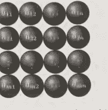

问题要求整数 \(x\) 确实存在于该区域中的某个位置。让我们将此条件标记为*输入断言*或*前置条件*。

```text
输入断言|前置条件（即输入断言）
    x ∈ a[0..m - 1, 0..n - 1]
即，x 存在于矩形区域 a 中的某个位置。
```

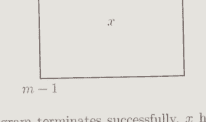

程序成功终止后，\(x\) 必须在 \(a\) 的一个矩形区域中被找到，该矩形区域仅由一行和一列组成。让我们将此条件标记为*输出断言*或*结果断言*或*后置条件*。

```text
输出断言|后置条件（即结果断言）

程序成功终止后，x 位于 a 的矩形区域中，该矩形区域仅由一行和一列组成，即 x 位于 a 的第 i 行和第 j 列；如果不可能，则 i = m，即如果在数组中未找到 x，即如果 x ≠ a[i, j]，则 i = m。

(0 ≤ i ≤ m - 1 ∧ 0 ≤ j ≤ n - 1
 ∧ x = a[i, j]) ∨ (i = m ∧ x ∉ a)
```

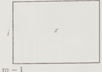

### 不变量

不变量表明 \(x\) 不在已搜索过的行 \(a[0..i − 1]\) 中，也不在当前行 \(i\) 的已搜索过的列 \(a[i, 0..j − 1]\) 中。

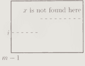

**不变量：**

`0 ≤ i ≤ m ∧ 0 ≤ j ≤ n ∧`

`可搜索区域`的上界为 `(m − i) * n − j + m − i`，即界函数是未测试部分中值的数量与未测试部分中行数之和，表示为 `(m − i) * n − j + m − i`。

这里需要额外的值 `m − i`，因为 `j` 可以取边界值 `n`，即 `j = n`。敏锐的读者一定已经注意到，现在不变量包含 `j ≤ n`，而不是 `j < n`。这里需要这样做是因为列数 `n` 超出边界。

初始化步骤与之前讨论的相同。

### 条件

与之前讨论的问题类似，我们可以考虑 `j ← j + 1` 和/或 `i ← i + 1` 来保持不变性。

```text
if i ≠ m ∧ (j < n and x ≠ a[i,j]) then j ← j + 1
```

以此为条件，程序可以在 `i < m ∧ j = n` 时终止。如果 \(x\) 在第一行中没有找到，则该程序将终止。

因此，我们也需要一些合适的条件来处理 \(i\) 的增加。我们可以尝试 \(i \leftarrow i + 1\)，但这只能在 \(i < m\) 时进行，并且只有在 \(x \notin a[i, 0..n]\) 时才能保持不变量，因此我们可以考虑添加条件 \(j == n \implies j = 0\) 来维持对第 \(i\) 行的条件。

### 算法 68 在可能为空的二维数组中查找

```text
1: i <- 0
2: j <- 0
3: function 2D-SEARCH(a[0..m-1, 0..n-1], x)
4:   while i != m and j != n and x != a[i, j] do
5:     j <- j + 1
6:     if i != m and j == n then
7:       i <- i + 1
8:       j <- 0
9:     end if
10:    end while
11: end function
```

### C++11 实现

程序 6.6：搜索二维数组

```cpp
1:#include <algorithm>
2:#include <array>
3:
4: using Point = std::pair<int, int>;
5:
6: template <int m, int n>
7: using TwoDimArray =
8:     std::array<std::array<int, n>, m>;
9:
10: template <int m, int n>
11: Point search_2darray(TwoDimArray<m, n>& a,
12:                     int x)
13: {
14:     Point p(-1, -1);
15:
16:     int i = 0, j = 0;
17:
18:     while((i != m) && (j != n) && (x != a[i][j]))
19:     {
20:         j += 1;
21:         if((i != m) && (j == n))
22:         {
23:             i += 1;
24:             j = 0;
25:         }
26:     }
27:
28:     p.first = i;
    p.second = j;
    return p;
}
```

### 使用示例

程序 6.7：查找 6：结果为 2 2

```cpp
#include "2darray_search_contd.hpp"
#include <iostream>

int main()
{
    TwoDimArray<4, 4> a = {
        12, 2, 83, 5,
        30, 14, 15, 16,
        13, 5, 6, 81,
        23, 6, 7, 19
    };

    Point p = search_2darray<4, 4>(a, 6);

    std::cout << "6 is found at: " << p.first << "]["
              << p.second << "]";
    std::cout << std::endl;
}
```

### 时间复杂度

时间复杂度为 \(O(mn)\)，因为就比较而言，它最终会遍历整个 \(m \times n\) 区域。

### 正确性

正如前一节所讨论的，让我们尝试通过证明程序终止时后置条件的真实性来证明所开发程序的正确性，即：

> > 不变量 ∧ 条件 ⟶ 补集 ⟶ 后置条件

请注意，该算法有两个条件，即：

- 1. \(i \ne m \land j \ne n\)。如果该条件为假 ⇒ \(i = m\) 可能为真。在这种情况下，不变量意味着 \(x \ne a\)，即 \(x \ne a[i, j]\)。
- 2. \(i \ne m \land j == n\)。（如果该条件为假且 \(i \ne m\)）⇒ \(j \ne n\)。

因此，第一个条件为假 ⇒ \(x = a[i, j]\)。

$$(i == m) \lor (i \ne m \land j \ne n \land x = a[i,j])$$

该条件的补集与不变量结合 $\Rightarrow$ 结果断言，这证明了我们上面开发的程序的正确性。

### 6.3 最优匹配螺母和螺栓

### 问题描述

有一个袋子装满了 \(n\) 个螺母和 \(n\) 个螺栓，每个都有不同的大小，并且螺母和螺栓之间存在一一对应的关系，即每个螺母对应一个螺栓，反之亦然。螺母不能直接与螺母比较，螺栓也不能直接与螺栓比较，但可以通过尝试将一个拧入另一个来比较螺母和螺栓。设计并实现一种最优算法，将所有螺母与螺栓匹配起来。所谓最优，是指使算法中涉及的比较次数最少。

### 解决方案

同样的问题可以这样呈现给计算机科学家：

给定两个集合 \(B : \{b_1, \ldots, b_n\}\) 和 \(N : \{n_1, \ldots, n_n\}\)，其中 \(B\) 是一组不同的实数（表示螺栓的大小），\(N\) 是 \(B\) 的一个排列，我们希望基于 *比较* \(b_i\) 和 \(n_j\) 形式的查询，高效地找到唯一排列 \(\sigma \in S_n\)，使得 \(b_i = n_{\sigma(i)}\)。每次此类查询的答案要么是：

- 1. \(b_i > n_j\)
- 2. \(b_i = n_j\)
- 3. \(b_i < n_j\)

由于 \(\sigma\) 有 \(n!\) 种可能性，显而易见的信息论下界表明，任何解决该问题的有界度决策树的深度至少为 \(\log_3(n!)\)。

使用斯特林近似：

$$\log_3(n!) \approx \Theta(n \log_3 n)$$

与基于比较的排序类似，可以使用决策树来分析。请注意，我们可以将任何匹配螺母和螺栓的算法建模为决策树。

该树将是一棵*三叉树*，因为每次比较都有三种可能的结果：

- 1. *小于，*


- 等于，或
- 大于

这种树的高度对应于它所表示的算法在最坏情况下进行的比较次数，而这反过来又是该算法运行时间的一个下界。因此，对于任何解决前面章节中提到的螺母和螺栓问题的决策树，我们希望其高度 H 的下界为 Ω(n log n)。

首先，注意任何三叉树中的叶子数 L 必须满足 L ≤ 3^H。接下来，考虑下面这一类输入。

设螺母的输入数组 N 固定，由 n 个按递增排序的螺母组成，并考虑螺栓的每一种排列对应一个可能的输入。为了匹配螺母和螺栓，在这种情况下，我们的算法本质上必须对螺栓数组进行排序。

在我们的决策树中，如果这种类型的两个不同输入被映射到同一个叶节点，那么我们的算法将试图对这两个输入应用相同的螺栓相对于螺母的排列，由此可知，该算法无法为这两个输入都正确计算出匹配。

因此，我们必须将这 n! 个不同输入中的每一个都映射到一个不同的叶节点，即

$L \ge n!$

$\implies 3^H \ge n!$

$\implies H \ge \log_3 n!$

$\implies H = \Omega(n \log n)$

请注意，对数的底在复杂度中无关紧要，它只是一种常数，因此我们也忽略它。

特别地，至少需要 Ω(n log n) 次比较。这也是该问题任何随机化算法的期望比较次数的一个下界。

对随机快速排序进行简单修改即可表明，存在简单的随机化算法，其期望比较次数（以及运行时间）为 O(n log n)：

- 随机选择一个螺栓
- 将它与所有螺母比较
- 找到与它匹配的螺母，从而将螺母分成三部分：
    - 比该螺栓小的螺母
    - 与该螺栓恰好匹配的螺母
    - 比该螺栓大的螺母

- *随机化*

*确定性算法*是指在给定相同输入时总是以相同方式运行的算法：输入完全决定了该算法所执行的计算序列。

通常，当我们谈论一个算法的运行时间时，我们指的是最坏情况运行时间。它是在所有规模为某一值的问题上，该算法在该输入上的运行时间的最大值：

$T_{\text{worst-case}}(n) = \max_{X:|X|=n} T(X)$

在极少数情况下，我们也会关注最好情况运行时间：

$T_{\text{best-case}}(n) = \min_{X:|X|=n} T(X)$

因此，让我们试着理解*平均情况*的含义。平均情况运行时间最好定义为：在某一规模的所有输入 X 上，算法对 X 的运行时间的期望值：

$T_{\text{average-case}}(n) = E_{X:|X|=n}[T(X)] = \sum_{|X|=n} T(X)\Pr[X].$

另一方面，*随机化算法*的行为不仅基于输入，还基于若干随机选择。

同一个随机化算法在多次给定相同输入时，可能在每次调用中执行不同的计算。这意味着，除其他事项外，随机化算法在给定输入上的运行时间不再是固定的，而本身就是一个随机变量。

当我们分析随机化算法时，通常关注最坏情况期望运行时间。也就是说，我们考察每个输入的平均运行时间，然后在某一规模的所有输入上取最大值：

$T_{\text{worst-case expected}}(n) = \max_{X:|X|=n} E[T(X)].$

这里重要的是要注意，我们不对可能输入的概率分布做任何假设。所有随机性都在算法内部，而这是我们可以控制的。

假设我们要找到与某个特定螺栓匹配的螺母。显而易见的算法可以是：测试每一个螺母，直到找到匹配项。在最坏情况下，这恰好需要 *n − 1* 次测试。我们可能必须检查除一个之外的所有螺栓；如果检查到最后一个螺栓仍未找到匹配，我们就知道最后一个螺母就是我们要找的那个。

就这个算法的时间复杂度而言，该算法平均将查看大约 *n/2* 个螺母。

## 分区

到现在已经很清楚，这个算法的关键部分是*分区*步骤，正如它在*快速排序*中一样。因此，在我们进入*随机化部分*之前，让我们先过一遍*确定性版本*。

```text
Algorithm 69 Partitioning a sequence
1: function PARTITION(a, l, r)
2:     p ← a[r]
3:     i ← l − 1
4:     for j ← l, r − 1 do
5:         if a[j] ≤ p then
6:             i ← i + 1
7:             swap(a[i], a[j])
8:         end if
9:     end for
10:    return i + 1
11: end function
```

*分区*总是选择序列 a[l..r] 中的最后一个元素 a[r] 作为*枢轴*：分区元素。它将序列分成四个区域，其中一些可能为空。

**循环不变式：**

- ∀x ∈ a[l..i] : x ≤ *枢轴*
- ∀x ∈ a[i + 1..j − 1] : x ≥ *枢轴*
- a[r] = *枢轴*。

第四个区域是 a[j..r − 1]，尚待评估。*分区*的时间复杂度为 Θ(n)，其中 n = r − l + 1。

程序 6.8：C++ 中的分区

```cpp
#include <algorithm>
#include <cassert>

void swap(int *a, int *b)
{
    int t;
    t = *a;
    *a = *b;
    *b = t;
}

int partition(int a[], int l, int r)
{
    int p = a[r];
    int i = l - 1;

    for (int j = l; j <= r - 1; j++)
    {
        if (a[j] <= p)
        {
            i = i + 1;
            swap(&a[i], &a[j]);
        }
    }

    swap(&a[i + 1], &a[r]);

    return i + 1;
}

int main()
{
    int a[] = {8, 1, 6, 4, 0, 3, 9, 5};
    int aref[] = {1, 4, 0, 3, 5, 8, 9, 6};

    int p = partition(a, 0, 7);

    assert(std::equal(std::begin(a),
                      std::end(a),
                      std::begin(aref)));

    assert(p == 4);
    assert(a[p] == 5);
}
```

### STL 风格分区

程序 6.9：STL 风格的分区实现

```cpp
#include <iostream>
#include <algorithm>

template <typename RandomIter>
RandomIter partition(RandomIter l,
                     RandomIter r)
{
    for (RandomIter j = l; j != r; j++)
    {
        if (*j <= *r)
        {
            std::iter_swap(l++, j);
        }
    }
    std::iter_swap(l, r);

    return l;
}

int main()
{
    int a[] = {8, 1, 6, 4, 0, 3, 9, 5};

    int *p = partition(a, a + 7);

    std::cout << "Array after partition"
              << std::endl;

    for (auto e : a)
        std::cout << e << " ";

    std::cout << std::endl;

    std::cout << "partition index: "
              << std::distance(std::begin(a), p) << ","
              << " partitioning element: " << *p
              << std::endl;
}
```

输出如下：

```text
Array after partition
1 4 0 3 5 8 9 6
partition index: 4, partitioning element: 5
```

### std::partition

STL 还提供了分区算法的一个版本，如下所示：

程序 6.10：std::partition

```cpp
template <typename BidirectionalIterator,
          typename Predicate>
BidirectionalIterator
partition(BidirectionalIterator first,
          BidirectionalIterator last,
          Predicate pred)
{
    while (true)
    {
        while (true)
        {
            if (first == last)
                return first;
            if (!pred(*first))
                break;
            ++first;
        }
        do
        {
            if (first == last)
                return first;
            --last;
        } while (!pred(*last));
        std::iter_swap(first, last);
        ++first;
    }
}
```

它将范围 [first,last) 中满足谓词的所有元素放在所有不满足谓词的元素之前，并返回一个迭代器 i，使得对于范围 [first,i) 中的任意迭代器 j，pred(*j) != false，并且对于范围 [i,last) 中的任意迭代器 k，pred(*k) == false。时间复杂度至多为 (last − first) / 2 次交换。

## 快速排序

快速排序是一种基于分治的两步排序算法，用于对序列进行排序。

- **分解**：将序列 *a[l...r]* 分区为两个子序列 *a[l...p−1]* 和 *a[p+1...r]*，使得 *a[l...p−1]* 中的每个元素 ≤ *a[p]*，且 *a[p+1...r]* 中的每个元素 ≥ *a[p]*，即
  ∀x ∈ *a[l...p−1]* 且 ∀y ∈ *a[p+1,r]*：*x* ≤ *a[p]* ≤ *y*。
- 递归调用快速排序，以原地对得到的两个子序列进行排序，即 *a[l...p−1]* 和 *a[p+1,r]*。

```text
Algorithm 70 Quicksort to sort a sequence
1: function QUICKSORT(a, l, r)
2:     p ← PARTITION(a, l, r)
3:     QUICKSORT(a, l, p − 1)
4:     QUICKSORT(a, p + 1, r)
5: end function
```

很容易看出，快速排序的运行时间取决于序列的分区方式。

最坏情况下，分区（例如，当输入为有序序列时）将得到长度分别为 *n − 1* 和 0 的两个子序列。

$T(n) = T(n − 1) + \Theta(0) + \Theta(n) = T(n − 1) + \Theta(n) = \Theta(n^2)$

最好情况的分区每次都会得到大小几乎相等的子序列。

$T(n) = 2T(n/2) + \Theta(n) = \Theta(n \log n)$

QUICKSORT 的平均情况更接近最好情况而不是最坏情况。

为了更好地理解，让我们假设分区总是得到比例为 9:1 的子序列：

$T(n) = T(9n/10) + T(n/10) + \Theta(n) = \Theta(n \log n)$


程序 6.11：C++ 中的快速排序

```cpp
#include <iostream>

void swap(int *a, int *b)
{
    int t;
    t = *a;
    *a = *b;
    *b = t;
}

int partition(int a[], int l, int r)
{
    int p = a[r];
    int i = l - 1;

    for(int j = l; j <= r - 1; j++)
    {
        if(a[j] <= p)
        {
            i = i + 1;
            swap(&a[i], &a[j]);
        }
    }
    swap(&a[i + 1], &a[r]);

    return i + 1;
}


void quicksort(int a[], int l, int r)
{
    int p;
    if(l < r)
    {
        p = partition(a, l, r);
        quicksort(a, l, p - 1);
        quicksort(a, p + 1, r);
    }
}


int main()
{
    int a[] = {8, 1, 6, 4, 0, 3, 9, 5};

    quicksort(a, 0, 7);

    std::cout << "Array after sorting"
              << std::endl;

    for(auto e : a)
        std::cout << e << " ";

    std::cout << std::endl;
}
```

输出如下：

| 排序后的数组 |
|---|
| 0 1 3 4 5 6 8 9 |

## STL 风格的快速排序

程序 6.12：快速排序的 STL 风格实现

```cpp
#include <iostream>
#include <algorithm>

template <typename RandomIter>
void quicksort(RandomIter first,
               RandomIter last)
{
    RandomIter left = first, right = last,
               pivot = left++;
    if( first != last )
    {
        while(left != right)
        {
            if(*left < *pivot)
            {
                ++left;
            }
            else
            {
                while((left != right)
                      && (*pivot < *right))
                    --right;
                std::iter_swap(left, right);
            }
        }
        --left;
        std::iter_swap(pivot, left);
        quicksort(first, left);
        quicksort(right, last);
    }
}
int main()
{
    int a[] = {8, 1, 6, 4, 0, 3, 9, 5};
    quicksort(a, a + 7);

    std::cout << "Array after sorting"
              << std::endl;

    for (auto e : a)
      std::cout << e << " ";

    std::cout << std::endl;
}
```

## 使用 std::partition 的快速排序

程序 6.13：实现快速排序

```cpp
#include <algorithm>
#include <iterator>

template <typename RandomAccessIterator>
void quicksort(RandomAccessIterator begin,
               RandomAccessIterator end)
{
    if (begin != end)
    {
        RandomAccessIterator pivot =
            std::partition(begin, end, bind2nd(
                std::less<typename std::iterator_traits<
                RandomAccessIterator>::value_type>(), *begin));

        quicksort(begin, pivot);
        RandomAccessIterator new_pivot = begin;
        quicksort(++new_pivot, end);
    }
}
```

## 随机化快速排序

到目前为止，我们假设所有输入排列都是等可能的，而这并不总是成立，因此我们向快速排序加入随机化。我们可以随机打乱输入序列，但随机化快速排序采用随机采样，即随机选择元素来实现这一点。因此，不是选取 a[l] 的最后一个元素作为枢轴，而是从序列中随机选取枢轴。

算法 71 随机化划分算法

| 行 | 伪代码 |
|---:|---|
| 1 | `function RANDOMIZED-PARTITION(a, l, r)` |
| 2 | `i ← random(l, r)` |
| 3 | `swap(a[p], a[r])` |
| 4 | `return PARTITION(a, l, r)` |
| 5 | `end function` |

程序 6.14：C++ 中的随机化划分

```cpp
#include <iostream>

void swap(int *a, int *b)
{
    int t;
    t = *a;
    *a = *b;
    *b = t;
}

int partition(int a[], int l, int r)
{
    int p = a[r];
    int i = l - 1;

    for(int j = l; j <= r - 1; j++)
    {
        if(a[j] <= p)
        {
            i = i + 1;
            swap(&a[i], &a[j]);
        }
    }

    swap(&a[i + 1], &a[r]);

    return i + 1;
}

int randomized_partition(int a[], int l, int r)
{
    int p = l + std::rand() % (r - l + 1);
    swap(&a[r], &a[p]);
    return partition(a, l, r);
}

int main()
{
    int a[] = {8, 1, 6, 4, 0, 3, 9, 5};

    int p = randomized_partition(a, 0, 7);

    std::cout <<
    "Array after randomized_partition"
    << std::endl;

    for(auto e : a)
    std::cout << e << " ";

    std::cout << std::endl;
    std::cout
    << "partition_index : " << p << ","
    << "partitioning_element: "
    << a[p] << std::endl;
}
```

该程序的输出为：

```text
Array after randomized partition
1 4 0 3 5 8 9 6
partition index : 4, partitioning element : 5
```

随机选择枢轴元素平均而言会使划分后的子序列相当均衡。

算法 72 随机化快速排序算法

1. `function RANDOMIZED-QUICKSORT(a, l, r)`
2. `p ← RANDOMIZED-PARTITION(a, l, r)`
3. `RANDOMIZED-QUICKSORT(a, l, p − 1)`
4. `RANDOMIZED-QUICKSORT(a, p + 1, r)`
5. `end function`

快速排序的随机化可阻止任何特定类型的序列导致最坏情况行为。例如，已排序的数组会在非随机化快速排序中导致最坏情况行为，但在随机化快速排序中不会。

在递归的每一层，由 RANDOMIZED-PARTITION 得到的划分将任意常数比例的元素放在划分的一侧，于是递归树的深度为 θ(log n)，并且每一层执行 O(n) 的工作。即使我们在这些层级之间加入尽可能最不平衡划分的深度层级，总时间仍保持 O(n log n)。

我们可以先理解划分过程如何运作，然后利用这种理解推导出期望运行时间的 O(n log n) 界，从而精确分析 RANDOMIZED-QUICKSORT 的期望运行时间。这个期望运行时间的上界，结合我们之前看到的 θ(n log n) 最佳情况界，得出 Θ(n log n) 的期望运行时间。

因此，随机化快速排序的时间复杂度为 O(n log n)。

程序 6.15：C++ 中的随机化快速排序

```cpp
#include <iostream>

void swap(int *a, int *b)
{
    int t;
    t = *a;
    *a = *b;
    *b = t;
}

int partition(int a[], int l, int r)
{
    int p = a[r];
    int i = l - 1;

    for (int j = l; j <= r - 1; j++)
    {
        if (a[j] <= p)
        {
            i = i + 1;
            swap(&a[i], &a[j]);
        }
    }

    swap(&a[i + 1], &a[r]);

    return i + 1;
}

int randomized_partition(int a[], int l,
                         int r)
{
    int j = l + std::rand() % (r - l + 1);
    swap(&a[r], &a[j]);
    return partition(a, l, r);
}

void randomized_quicksort(int a[], int l,
                          int r)
{
    int p;
    if(l < r)
    {
        p = randomized_partition(a, l, r);
        randomized_quicksort(a, l, p - 1);
        randomized_quicksort(a, p + 1, r);
    }
}

int main()
{
    int a[] = {8, 1, 6, 4, 0, 3, 9, 5};
    randomized_quicksort(a, 0, 7);

    std::cout << "Array after sorting"
              << std::endl;

    for(auto e : a)
      std::cout << e << " ";

    std::cout << std::endl;
}
```

该程序的输出为：

```text
Array after sorting
0 1 3 4 5 6 8 9
```

## 螺母与螺栓问题的确定性算法

遗憾的是，为螺母与螺栓问题找到高效的确定性算法似乎要困难得多。首个 O(n log(log n)) 时间的确定性算法由 Alon 等人 [?] 提出，它同样基于快速排序，耗时 Θ(n log⁴ n)。为了找到一个良好的枢轴元素，将问题划分为两个规模几乎相同的子问题，他们运行一个过程的 log n 次迭代；该过程在每次迭代中淘汰一半的螺母，同时保持至少一个良好的枢轴：由于最后只剩一个螺母，因此这个螺母必定是良好的枢轴。该过程使用度为 Θ(log² n) 的高效扩展器的边来定义其比较。因此，找到一个良好的枢轴需要 Θ(n log³ n) 时间，而整个快速排序需要 Θ(n log⁴ n) 时间。Alon 等人 [?] 提到了螺母与螺栓问题的两个潜在应用：

1. 给定图中节点的局部排序
2. 带有少量读写内存的只读存储器的选择

Phillip G. Bradford 给出了一个简单的确定性算法 [?]，用于解决螺母与螺栓问题，该算法进行 O(n log n) 次螺母与螺栓比较。该算法基于某些基于扩展器的比较器网络，并证明了存在一棵深度为 O(n log n) 的决策树可以解决此问题。他们通过证明对于螺母与螺栓存在作为 ε − 半化器的比较器网络来做到这一点。一个 ε − 半化器以 O(n) 的复杂度近似划分一个含 n 个元素的集合。这种近似划分足以使该算法在几何级缩小的螺母与螺栓集合上迭代 ε − 半化器时选择良好的枢轴。构建这些 ε − 半化器的难点在于：在保持 ε − 半化性质的同时，确保螺母从不与螺母比较，螺栓从不与螺栓比较。设 S = s₁, …, sₙ 是一组不同尺寸的螺母，B = b₁, …, bₙ 是一组对应的螺栓。对于螺母 s ∈ S，定义 rank(s) 为 |{t ∈ B|s ≥ t}|。螺栓的秩为

类似地定义。对于常数 c < 1/2，如果 cn ≤ rank(s) ≤ (1 − c)n，则称 s 为 c-近似中位数。类似地，定义 s 关于子集 T ⊆ B 的相对秩为 rank_T(s) := |{t ∈ T : s ≥ t}| / |T|。

用于匹配螺母和螺栓的算法如下所示：

- 找到给定的 n 个螺母的一个 c-近似中位数 s（常数 c 将在后面确定）。这需要 O(n) 次螺母与螺栓比较。
- 找到与 s 对应的螺栓 b。
- 将所有螺母与 b 比较，将所有螺栓与 s 比较。这会得到两堆螺母（以及螺栓）：一堆包含小于 s 的螺母（螺栓），另一堆包含大于 s 的螺母（螺栓）。
- 对较小螺母和螺栓的两堆以及较大螺母和螺栓的两堆递归运行该算法。

请注意，该算法可以在 O(n log n) 次螺母与螺栓比较内将 n 个螺母与其对应螺栓匹配，因为每个子问题规模至多 (1 − c)n，因此递归深度仅为 O(log n)，并且在递归的每一层，为得到所有 c-近似中位数所需的螺母与螺栓比较总数为 O(n)。

下面总结该算法的组成部分。

### 算法 73 以 O(n) 复杂度选择 X 的 c-近似中位数

```
1: function GET-C-APPROXIMATE-MEDIAN(X)
2:   n ← |X_0|
3:   l ← 1
4:   r ← 2n
5:   i ← 0
6:   while |X_i| ≥ C do
7:     Y_i ← NUT-AND-BOLT-E-HALVE(X_i)
8:     B ← BACK-TRACKING(Y_i, i, Z)
9:     Z ← FIND-MISPLACED-ELEMENTS(Y_i, i, n/2^i)
10:    if i is odd then
11:      r ← ((l+r)/2)
12:    else
13:      l ← ((l+r)/2)
14:    end if
15:    i ← i + 1
16:    X_i ← Y_{i-1}[l, r] ∪ Z ∪ B
17:  end while
18:  return X_i
19: end function
```

### 算法 74 回溯

```
1: function BACK-TRACKING(Y, i, Z)
2:   if i <= 2 then
3:     return 0
4:   end if
5:   if i is even then
6:     for any members of Z that are in the right half of Y find
       all members of all of the left fringes that are supported
       exclusively by these members of Z or other active elements.
       Put these candidate illicitly supported elements in B.
7:   else
8:     for any members of Z that are in the left half of Y find all
       members of all of the right fringes that are supported
       exclusively by these members of Z or other active elements.
       Put these candidate illicitly supported elements in B.
9:   end if
10:  return B
11: end function
```

### 算法 75 查找错位的螺母和螺栓

```
1:  function FIND-MISPLACED-ELEMENTS(X, i, m)
2:      r ← |X|
3:      l ← 1
4:      if i is odd then
5:          Z_1 ← X[(l+r)/2, r]
6:      else
7:          Z_1 ← X[l, (l+r)/2]
8:      end if
9:      j ← 1
10:     while |Z_n| ≥ K_m do
11:         Z_n ← NUT-AND-BOLT-E-HALVE(Z_n[l, r])
12:         if i is odd then
13:             r ← r − (l+r)/2
14:         else
15:             l ← l + (l+r)/2
16:         end if
17:         Z_j ← (Z_n[l, r])
18:         j ← j + 1
19:     end while
20:     return Z_n
21: end function
```

## 备注

在本章中，我们讨论了用于在 O(n) 次螺母与螺栓匹配操作中解决螺母和螺栓问题的随机化 QUICKSORT 算法的设计与实现。这里渐近记号中隐藏着巨大的常数，不过本章并未明确讨论它们。减小这些常数（也许通过移除扩展器）本身将是一项有趣的工作。这留给感兴趣的读者作为练习。

### 6.4 随机数生成

### 问题描述

数组 A[1 … n] 包含集合 {1, 2, ..., n} 上的一个概率分布；即 A[i] ≥ 0 且 \(\sum_{i=1}^{n} A[i] = 1\)。我们希望生成范围 1 ≤ X ≤ n 内的随机整数 X，使得

\[
\Pr\{X = i\} = A[i].
\]

有一个均匀随机数生成器 UNIFORM() 可用，它在常数时间内生成范围 0 ≤ y < 1 内均匀分布的实数 y。以 UNIFORM() 作为子程序，设计一个高效算法，按照 A 指定的分布生成随机整数。

你的算法可以包含一个初始化阶段来预处理数组 A。在预处理阶段之后，用户可以对你的随机数生成器进行任意多次调用，每次调用都应按照分布 A 返回一个随机整数。你的设计中的最高优先级是使随机数生成器尽可能快地运行，但预处理阶段也应高效。分析预处理时间和实际随机数生成时间。

### 解法

首先，我们给出一种算法，它基于通过反转累积分布函数来从给定概率分布生成随机变量。该算法使用 Θ(n) 预处理时间，然后按照分布 A 实际生成一个随机数需要 Θ(log n) 时间。

### 算法 76 使用二分查找生成随机数

```
1:  function RAND-BINARY(A)
2:      C[1] ← A[1]
3:      for i ← 2 to n do
4:          C[i] ← C[i − 1] + A[i]
5:      end for
6:      u ← UNIFORM()
7:      return BINARY-SEARCH(C, 1, n, u)
8:  end function
```

第 7 行中的 BINARY-SEARCH 返回满足 C[r − 1] ≤ u < C[r] 的 r。

这意味着 Pr[X = r] = Pr{C[r − 1] ≤ u < C[r]} = C[r] − C[r − 1] = A[r]，从而证明正确性。BINARY-SEARCH 需要 Θ(n) 预处理时间（第 2–5 行），而第 6–7 行需要 Θ(log n) 时间。

我们的下一个算法基于以下思想：将给定概率分布表示为其他一些易于从中生成随机变量的概率质量函数的加权和（使用上面提到的反转技术），然后根据权重选择其中一个概率函数，再（容易地）从中生成。我们给出一个算法，其预处理时间为 Θ(n²)，但从分布 A 生成随机数的时间为 Θ(1)。其思想是，如果我们将一个概率质量函数写成 n − 1 个概率质量函数 Q_k 的等权混合，例如 \(A = \frac{1}{n-1}\sum_{k=1}^{n-1} Q_k\)，其特殊性质是每个 Q_k 至多给两个分量赋予正概率，那么为了从 A 采样，我们只需生成一个均匀随机数来选择分布 Q_j，然后生成另一个均匀随机数来选择 Q_j 的正确正分量。事实上，我们将利用这样一个事实：均匀生成的随机变量 u 与 (n−1)u−⌊(n−1)u⌋ 独立，因此我们只需生成一个均匀随机变量即可从分布 A 采样。

实现这一思想的一种方法是：首先创建 n−1 个桶，使每个桶恰好包含来自 {1,2,...,n} 的两个元素，并且每个桶中按分布 A 计算的总质量为 1/(n−1)。

### 算法 77 随机数生成：预处理

```
1:  function PREPROCESS(A)
2:      A' ← [(σ(1), A[σ(1)]), (σ(2), A[σ(2)]), ..., (σ(n), A[σ(n)])], where
        A[σ(1)] ≤ ··· ≤ A[σ(n)] and σ is a permutation of {1, 2, ..., n}.
3:      for i ← 1 to n − 1 do
4:          B[i][1].element ← FIRST(A').element
5:          B[i][1].mass ← FIRST(A').mass
6:          slack ← 1/(n − 1) − FIRST(A').mass
7:          B[i][2].element ← LAST(A').element
8:          B[i][2].mass ← slack
9:          massLast ← LAST(A').mass − slack
10:         REMOVE(A', FIRST(A'))
11:         REMOVE(A', LAST(A'))
12:         ADDINORDER(A', (B[i][2].element, massLast))
13:     end for
14: end function
```

第 1 行根据数组 A 的元素创建一个元组 (element, mass) 的列表 A'，其中 element ∈ {1,2,...,n}，mass = A[element]，并且 A' 中的元组按 mass 排序。此操作耗时 Θ(n log n)。FIRST 以一个列表为参数，并在 Θ(1) 时间内返回列表头部的元素。LAST 同样在 Θ(1) 时间内返回列表中的最后一个元素。REMOVE 以一个列表和列表中的一个元素为参数，并从列表中移除该元素。如果使用线性扫描完成，则耗时 Θ(n)。ADDINORDER 将给定元素插入给定列表，使新列表按 mass 排序。这同样耗时 Θ(n)。因此，总的预处理阶段耗时 Θ(n²)。


### 6.5 加权中位数

使得和 \(\sum_{i=1}^{n} w_i d(p,p_i)\) 最小化，其中 \(d(a,b)\) 是点 \(a\) 和 \(b\) 之间的距离。

论证加权中位数是一维邮局选址问题的最优解，其中点就是实数，并且点 \(a\) 和 \(b\) 之间的距离为 \(d(a,b)=|a-b|\)。

- 5. 求二维邮局选址问题的最优解，其中点是 \((x,y)\) 坐标对，并且点 \(a=(x_1,y_1)\) 和 \(b=(x_2,y_2)\) 之间的距离是由 \(d(a,b)=|x_1-x_2|+|y_1-y_2|\) 给出的曼哈顿距离。

### 解答

- **1.** 令 \(x_k\) 为 \(x_1,x_2,\ldots,x_n\) 的中位数。根据中位数的定义，\(x_k\) 恰好大于 \(\left\lceil\frac{n+1}{2}\right\rceil-1\) 个其他元素 \(x_i\)。那么小于 \(x_k\) 的元素的权重之和为

  \[
  \sum_{x_i<x_k} w_i
  = \frac{1}{n}\times\left(\left\lceil\frac{n+1}{2}\right\rceil-1\right)
  \leq \frac{1}{n}\left\lceil\frac{n-1}{2}\right\rceil
  < \frac{1}{2}.
  \]

  由于所有元素互不相同，\(x_k\) 也恰好小于 \(n-\left\lceil\frac{n+1}{2}\right\rceil\) 个其他元素。因此，

  \[
  \sum_{x_i>x_k} w_i
  = \frac{1}{n}\times\left(n-\left\lceil\frac{n+1}{2}\right\rceil\right)
  = 1-\frac{1}{n}\left\lceil\frac{n+1}{2}\right\rceil
  < 1-\frac{1}{n}\left(\frac{n}{2}\right)
  \leq \frac{1}{2}.
  \]

  因此，根据加权中位数的定义，\(x_k\) 也是加权中位数。

- **2.** 为了计算 \(n\) 个元素的加权中位数，我们先对元素排序，然后累加元素的权重，直到找到中位数。

```
**Algorithm 79** Weighted Median
1: function WEIGHTED-MEDIAN(A)
2:   k ← 1
3:   s ← 0
4:   while s + w_k < 1/2 do
5:     s ← s + w_k
6:     k ← k + 1
7:   end while
8:   return x_k
9: end function
```

该算法的循环不变量是：\(s\) 为所有小于 \(x_k\) 的元素的权重之和：

\[
s = \sum_{x_i < x_k} w_i
\]

我们用归纳法证明这一点。基本情况成立，因为在第一次迭代中 \(s = 0\)。由于列表已排序，对于所有 \(i < k\)，都有 \(x_i < x_k\)。由归纳法，\(s\) 是正确的，因为在循环的每次迭代中，\(s\) 都会增加下一个元素的权重。

该循环保证会终止，因为所有元素的权重之和为 1。我们利用加权中位数的定义证明，当循环终止时 \(x_k\) 是加权中位数。

令 \(s'\) 为循环倒数第二次迭代开始时 \(s\) 的值：\(s = s' + w_{k-1}\)。由于倒数第二次迭代未满足终止条件，我们知道

\[
s' + w_{k-1} < \frac{1}{2}
\]

\[
\sum_{x_i < x_k} w_i = s < \frac{1}{2}
\]

注意，如果循环迭代零次，这仍然成立，因为 \(s = 0 < \frac{1}{2}\)。这证明了成为加权中位数的第一个条件。接下来我们证明第二个条件。大于 \(x_k\) 的元素的权重之和为

\[
\sum_{x_i > x_k} w_i = 1 - \left( \sum_{x_i < x_k} w_i \right) - w_k = 1 - s - w_k
\]

由循环终止条件，

\[
\begin{aligned}
\sum_{x_i < x_k} w_i &= s \le \frac{1}{2} - w_k \\
-s &\ge -\frac{1}{2} + w_k \\
1 - s - w_k &\le \frac{1}{2} \\
\sum_{x_i > x_k} w_i &\le \frac{1}{2}
\end{aligned}
\]

因此，\(x_k\) 也满足成为加权中位数的第二个条件。因此 \(x_k\) 是中位数，并且该算法是正确的。

该算法的运行时间是排序数组所需的时间加上寻找中位数所需的时间。我们可以在 \(O(n \log n)\) 时间内对数组排序。WEIGHTED-MEDIAN 中的循环有 \(O(n)\) 次迭代，每次迭代需要 \(O(1)\) 时间，因此总运行时间为 \(O(n \log n)\)。

- **3.** 给定一个 \(\Theta(n)\) 时间的中位数算法，加权中位数可以在 \(\Theta(n)\) 最坏情况下时间内计算出来。基本策略类似于二分查找：算法计算中位数，并在包含加权中位数的输入的一半上递归。

```
Algorithm 80 Linear-Time Weighted Median

1: function LINEAR-TIME-WEIGHTED-MEDIAN(A, l)
2:     n ← length[A]
3:     m ← MEDIAN(A)
4:     B ← ∅                                      ▷ B = {A[i] < m}
5:     C ← ∅                                      ▷ C = {A[i] ≥ m}
6:     w_B ← 0                                    ▷ w_B = total weight of B
7:     if length[A] == 1 then
8:         return A[1]
9:     end if
10:    for i ← 1 to n do
11:        if A[i] < m then
12:            w_B ← w_B + w_i
13:            Append A[i] to array B
14:        else
15:            Append A[i] to array C
16:        end if
17:    end for
18:    if l + w_B > 1/2 then                         ▷ Weighted median ∈ B
19:        LINEAR-TIME-WEIGHTED-MEDIAN(B, l)
20:    else
21:        LINEAR-TIME-WEIGHTED-MEDIAN(C, l + w_B)
22:    end if
23: end function
```

该算法的初始调用是 LINEAR-TIME-WEIGHTED-MEDIAN(A, 0)。在该算法中，A 是一个数组，包含初始输入的加权中位数，而 \(l\) 是初始输入数组中所有小于 \(A\) 中所有元素的元素的权重之和。B 包含所有小于中位数的元素，C 包含所有大于或等于中位数的元素，\(w_B\) 是 \(B\) 中元素的权重之和。

为了证明该算法是正确的，我们证明以下前置条件对每次递归调用都成立：初始 \(A\) 的加权中位数 \(y\) 始终存在于对 \(A\) 的递归调用中，并且 \(l\) 是所有小于 \(A\) 中所有元素的元素 \(x_i\) 的权重之和。该前置条件对初始调用显然成立。我们用归纳法证明该前置条件在每次递归调用中也成立。假设前置条件成立。首先考虑 \(l + w_B > \frac{1}{2}\) 的情况。由于 \(y\) 必定在 \(A\) 中，在第 18 行，\(y\) 必定在 \(B\) 或 \(C\) 中。由于所有小于 \(B\) 中任一元素的元素的权重之和大于 \(\frac{1}{2}\)，根据定义，加权中位数不可能在 \(C\) 中，因此它必定在 \(B\) 中。此外，我们没有丢弃 \(B\) 中的任何元素，因此 \(l\) 是正确的，并且前置条件得到满足。

如果在第 18 行有 \(l + w_B \le \frac{1}{2}\)，那么 \(y\) 必定在 \(C\) 中。\(C\) 的所有元素都大于 \(B\) 的所有元素，因此小于 \(y\) 的元素的权重之和为 \(l + w_B\)，并且递归调用的前置条件也得到满足。因此，由归纳法，前置条件始终成立。

该算法总是会终止，因为每次递归调用时 \(A\) 的大小都会减小。当算法终止时，结果是正确的。由于加权中位数始终在 \(A\) 中，因此当只剩下一个元素时，它必定是加权中位数。该算法运行时间为 \(\Theta(n)\)。计算中位数并将 \(A\) 拆分为 \(B\) 和 \(C\) 需要 \(\Theta(n)\) 时间。每次递归调用都将数组的大小从 \(n\) 减小到 \(\left\lceil \frac{n}{2} \right\rceil\)。因此递推式为 \(T(n)=T\left(\frac{n}{2}\right)+\Theta(n)=\Theta(n)\)。

- **4.** 我们论证一维邮局选址问题的解是这些点的加权中位数。邮局选址问题的目标是选择 \(p\) 以最小化成本。

\[
c(p)=\sum_{i=1}^{n} w_i d(p,p_i)
\]

我们可以将 \(c(p)\) 重写为小于 \(p\) 的点与大于 \(p\) 的点所贡献的成本之和：

\[
c(p)=\left(\sum_{p_i<p} w_i(p-p_i)\right)+\left(\sum_{p_i>p} w_i(p_i-p)\right)
\]

注意，如果对某个 \(k\) 有 \(p=p_k\)，那么该点不会对成本产生贡献。当 \(p\) 变化时，该成本函数是连续的：对所有 \(i\)，\(\lim_{p\to p_i^+} c(p)=c(p_i)\)。

为了找到该函数的极小值，我们对 \(p\) 求导：

\[
\frac{dc}{dp}=\left(\sum_{p_i<p}w_i\right)-\left(\sum_{p_i>p}w_i\right)
\]

注意，在某个 \(i\) 使得 \(p=p_i\) 的地方，该导数未定义，因为 \(c(p)\) 的左极限和右极限不同。还要注意，\(\frac{dc}{dp}\) 是一个非递减函数，因为随着 \(p\) 增大，满足 \(p_i<p\) 的点的数量不会减少。注意，对于 \(p<\min(p_1,p_2,\ldots,p_n)\)，有 \(\frac{dc}{dp}<0\)；对于 \(p>\max(p_1,p_2,\ldots,p_n)\)，有 \(\frac{dc}{dp}>0\)。因此存在一个点 \(p^*\)，使得对于 \(p<p^*\) 的点有 \(\frac{dc}{dp}\leq 0\)，对于 \(p>p^*\) 的点有 \(\frac{dc}{dp}\geq 0\)，并且该点是全局最小值。我们证明加权中位数 \(y\) 就是这样的点。

对于所有 \(p<y\)，其中 \(y\) 不是加权中位数，且对某个 \(i\) 有 \(p\ne p_i\)，

\[
\sum_{p_i<p}w_i>\sum_{p_i>p}w_i
\]

这意味着 \(\frac{dc}{dp}>0\)。对于某个 \(i\) 有 \(p=p_i\) 且 \(p\ne y\) 的情况，\(\frac{dc}{dp}\) 的左极限和右极限始终具有相同的符号，因此同样的论证适用。因此，对于所有不是加权中位数的 \(p\)，都有 \(c(p)>c(y)\)，所以加权中位数 \(y\) 是全局最小值。

- **5.** 使用曼哈顿距离求解二维邮局选址问题，等价于对每个维度分别求解一维邮局选址问题。令解为 \(p=(p_x,p_y)\)。注意，使用曼哈顿距离时，我们可以将成本函数写成两个一维邮局选址成本函数之和，如下所示：

\[
g(p)=\left(\sum_{i=1}^{n}w_i\lvert x_i-p_x\rvert\right)+\left(\sum_{i=1}^{n}w_i\lvert y_i-p_y\rvert\right)
\]

还要注意，\(\frac{\partial g}{\partial p_x}\) 不依赖于输入点的 \(y\) 坐标，并且仅使用 \(x\) 坐标作为输入时，其形式与上一部分中的 \(\frac{dc}{dp}\) 完全相同。类似地，\(\frac{\partial g}{\partial p_y}\) 仅依赖于 \(y\) 坐标。因此，为了最小化 \(g(p)\)，我们可以独立地最小化两个维度的成本。二维问题的最优解是：令 \(p_x\) 为输入 \(x_1,x_2,\ldots,x_n\) 的一维邮局选址问题的解，令 \(p_y\) 为输入 \(y_1,y_2,\ldots,y_n\) 的一维邮局选址问题的解。


### 6.6 计算 $a^n$

### 问题描述

设 $a$ 为整数，$n$ 为非负整数。计算 $a^n$。换句话说，我们要求编写一个程序，不改变 $a$ 和 $n$ 的值，并将值 $a^n$ 赋给另一个变量（例如 $b$）。（该程序也可以使用其他变量。）

### 解决方案

考虑一个整数变量 $k$，其范围为 $0..n$。（我们维护性质：$b = a^k$。）

**算法 81** 计算 $a^n$ 的程序

```text
1: k ← 0
2: b ← 1
3: while k ≠ n do
4:     k ← k + 1
5:     b ← b × a
6: end while
```

▷ $b = a^k$

### 另一种解决方案

**算法 82** 计算 $a^n$ 的另一种程序

```text
1: k ← n
2: b ← 1
3: while k ≠ 0 do
4:     k ← k − 1
5:     b ← b × a
6: end while
```

▷ $a^n = b × a^k$

### 6.7 重新讨论计算 $a^n$

### 问题描述

解决前一个问题，并附加要求：执行步骤数应为 $\log n$ 阶（即，对于某个常数 $C$，不应超过 $C \log n$）。

### 解决方案

让我们对前一个问题的第二种解决方案做一些修改：

**算法 83** 重新讨论的计算 $a^n$ 程序

```text
1: k ← n
2: b ← 1
3: c ← a
4: while k ≠ 0 do
5:     if k mod 2 = 0 then
6:         k ← k ÷ 2
7:         c ← c × c
8:     else
9:         k ← k − 1
10:        b ← b × c
11:    end if
12: end while
```

在两种情况下（$k$ 为偶数和 $k$ 为奇数），$k$ 的值都会减小；如果 $k$ 是偶数，它被除以 2；如果 $k$ 是奇数，在执行 $k \leftarrow k - 1$ 后它变为偶数，并在下一次迭代中除以 2。因此，经过任意两次迭代，$k$ 至少减半（甚至更少），所以步骤数是对数级的。

### 6.8 计算乘积 $a \times b$

### 问题描述

给定两个非负整数 $a$ 和 $b$。计算乘积 $a \times b$（只允许使用 $+$、$−$、$=$）。

### 解决方案

**算法 84** 计算乘积 $a \times b$

```text
1: k ← 0
2: c ← 0
3: while k ≠ b do                         ▷ invariant: c = a × k
4:     k ← k + 1
5:     c ← c + a
6: end while                              ▷ c = a × k and k = b, therefore c = a × b
```

### 6.9 计算商和余数

### 问题描述

给定一个非负整数 $a$ 和一个正整数 $d$。计算 $a$ 除以 $d$ 时的商 $q$ 和余数 $r$。不要使用 div 或 mod 运算。

### 解决方案

根据定义，$a = q \times d + r$ 且 $0 \le r < d$。

**算法 85** 计算商和余数

```text
1: r ← a        ▷ a ≥ 0; d > 0
2: q ← 0        ▷ invariant: a = q × d + r, 0 ≤ r
3: while !(r < d) do        ▷ r ≥ d
4:     r ← r − d        ▷ r ≥ 0
5:     q ← q + 1
6: end while
```

### 6.10 计算 GCD

### 问题描述

两个非负整数 $a$ 和 $b$ 不全为零。计算 GCD($a$, $b$)，即 $a$ 和 $b$ 的最大公约数。

### 解决方案

**版本 1**

**算法 86** 计算 GCD

```text
1: if a < b then
2:     k ← a
3: else
4:     k ← b
5: end if
6: Invariant: no numbers greater than k (and therefore than a or b) are common divisors
7: while !((a mod k == 0) && (b mod k == 0)) do
8:     k ← k − 1
9: end while        ▷ k is a common divisor, all larger k are not
```

**版本 2：欧几里得算法**

我们假设 GCD(0, 0) = 0。那么对于 $\forall a, b \ge 0$，有 GCD(a, b) = GCD(a − b, b) = GCD(a, b − a)，且 GCD(a, 0) = GCD(0, a) = a。这个性质允许我们在不改变 GCD(a, b) 的情况下减小 $a$ 和 $b$。

**算法 88** 计算受约束的 GCD

```text
1: m ← a
2: n ← b
3: p ← 1
4: q ← 0
5: r ← 0
6: s ← 1
7: Invariant: GCD(a,b) = GCD(m,n); m,n ≥ 0; m = p × a + q × b; n = r × a + s × b
8: while ((m ≠ 0) && (n ≠ 0)) do
9:     if m ≥ n then
10:         m ← m − n
11:         p ← p − r
12:         q ← q − s
13:     else
14:         n ← n − m
15:         r ← r − p
16:         s ← s − q
17:     end if
18: end while
19: if m = 0 then
20:     k ← n
21:     x ← r
22:     y ← s
23: else
24:     k ← m
25:     x ← p
26:     y ← q
27: end if
```

### 6.12 另一种欧几里得算法

### 问题

使用以下恒等式编写欧几里得算法的一个版本

$$\operatorname{GCD}(2a,2b)=2\times\operatorname{GCD}(a,b);$$
$$\operatorname{GCD}(2a,b)=\operatorname{GCD}(a,b)$$

其中 $b$ 为奇数。

该算法应避免除法（div 和 mod 运算）：只允许除以 2 以及判断是否为偶数的测试。（如果两个数都不超过 $k$，则操作次数应为 $\log k$ 阶。）

### 解决方案

**算法 89** 另一种欧几里得算法

```text
1: m ← a
2: n ← b
3: d ← 1                              ▷ GCD(a,b) = d × GCD(m,n)
4: while ((m ≠ 0) && (n ≠ 0)) do
5:   if m mod 2 == 0 && n mod 2 == 0 then
6:     d ← d × 2
7:     m ← m ÷ 2
8:     n ← n ÷ 2
9:   else if (m mod 2 == 0)&&(n mod 2 == 1) then
10:    m ← m ÷ 2
11:  else if (m mod 2 == 1)&&(n mod 2 == 0) then
12:    n ← n ÷ 2
13:  else if (m mod 2 == 1)&&(n mod 2 == 1) then
14:    if m ≥ n then
15:      m ← m − n
16:    else                              ▷ m < n
17:      n ← n − m
18:    end if
19:  end if
20: end while
    m = 0 ⇒ answer = d × n; n = 0 ⇒ answer = d × m
```

如果两个数 $m$ 和 $n$ 都不超过 $k$，则操作次数不超过 $C \log k$；确实，每执行其他操作之一都会使 $m$ 和 $n$ 中至少一个减半。

### 6.13 重新讨论受约束的 GCD

### 问题

修改前一个问题的解决方案，以找到满足 $ax + by = \operatorname{GCD}(a, b)$ 的 $x$ 和 $y$。

### 解决方案

假设 $a$ 和 $b$ 都是偶数。在这种情况下，我们将它们都除以 2；我们要找的 $x$ 和 $y$ 的值保持不变。因此，不失一般性，我们可以假设 $a$ 和 $b$ 中至少有一个是奇数。（该性质将保持成立。）和之前一样，我们希望维护数 $p,q,r,s$，使得

$$m = a \times p + b \times q$$
$$n = a \times r + b \times s$$

然而，问题在于，如果我们将 $m$ 除以 2（例如），那么我们应该同时将 $p$ 和 $q$ 除以 2。在这种情况下，$p$ 和 $q$ 不再是整数，而是变成有限二进制分数；也就是说，形如 $r/2^i$ 的数。这样的数可以用一个对 $\langle r,s\rangle$ 表示。结果，我们得到 $d$ 作为 $a$ 和 $b$ 的线性组合，其系数为有限二进制分数。换句话说，我们有

$$2^i \times d = a \times x + b \times y$$

其中 $x$、$y$ 为某些整数，$i$ 为正整数。如果 $i > 0$，我们该怎么办？如果 $x$ 和 $y$ 都是偶数，我们可以将它们除以 2（并将 $i$ 减 1）。否则，我们应用变换：

$$x \leftarrow x + b$$
$$y \leftarrow y - a$$

（该变换保持 $a \times x + b \times y$ 不变）。让我们看看为什么这可行。回顾一下，$a$ 或 $b$ 中有一个是奇数（根据我们的假设）。设 $a$ 为奇数。如果 $y$ 是偶数，那么 $x$ 也是偶数（否则 $x + y$ 是奇数）；这种情况已在上面考虑。如果 $a$ 和 $b$ 都是奇数，那么在执行语句 $y \leftarrow y-a$ 后，$y$ 变为偶数。

### 6.14 仅使用加法和减法计算平方

### 问题描述

编写一个程序，对于给定的 $n \ge 0$，打印自然数 $0,\ldots,n$ 的平方，但只允许使用加法和减法。步骤数应为 $n$ 阶。

### 解决方案

我们使用变量 $ksquare$，并维护不变关系 $ksquare = k^2$：

**算法 90** 仅使用加法和减法计算平方

```text
1:  k ← 0
2:  ksquare ← 0
3:  print(ksquare)
4:  while (k != n) do
5:      k ← k + 1        ▷ ksquare = (k − 1) × (k − 1) = k × k − 2 × k + 1
6:      ksquare ← ksquare + k + k − 1
7:      print(ksquare)
8:  end while
```

我们可以通过以下技巧避免减法：

```text
1: while (k != n) do
2:     ksquare ← ksquare + k        ▷ ksquare = k × k + k
3:     k ← k + 1                       ▷ ksquare = (k − 1) × (k − 1) + (k − 1) = k × k − k
4:     ksquare ← ksquare + k
5: end while
```

### 6.15 因式分解

### 问题描述

编写一个程序，打印给定整数 $n > 0$ 的因式分解。（换句话说，它应打印乘积等于 $n$ 的质数；如果 $n = 1$，则不应打印任何内容。）

### 解决方案

**版本 1**

**算法 91** 因式分解程序

```text
1: k ← n
2: while !(k == 1) do    ▷ invariant relation: the product of k and all numbers printed is equal to n; only prime numbers are printed
3:     t ← 2
4:     while k mod t ≠ 0 do    ▷ invariant relation: k has no divisors in (1, t)
5:         t ← t + 1
6:     end while
7:     print(t)
8:     k ← k ÷ t
9: end while
```


### 版本 2

**算法 92 因式分解替代程序**

```text
1: k ← n
2: t ← 2
3: while (k ≠ 1) do        ▷ the product of k and all numbers printed is equal to n; only prime numbers are printed; k has no divisors in (1,t)
4:    if k mod t == 0 then    ▷ k is a multiple of t and has no divisors less than t; therefore, t is prime
5:        k ← k ÷ t
6:        print(t)
7:    else                    ▷ k is not a multiple of t
8:        t ← t + 1
9:    end if
10: end while
```

### 6.16 因式分解再探

### 问题描述

解决前一个问题，并考虑以下事实：任何合数 N 都有一个不超过 √N 的因子。

### 解法

在上述解法的 *版本 2* 中，将 t ← t + 1 替换为

**算法 93 因式分解程序再探**

```text
1: if t × t > k then
2:    t ← k
3: else
4:    t ← t + 1
5: end if
```

### 6.17 十进制表示

### 问题描述

假设对于 i = 0,1,2,...,9，允许使用命令 write(i)。编写一个程序，打印给定正整数 n 的十进制表示。

### 解法

**算法 94 十进制表示**

```text
1: base ← 1
2: while 10 × base ≤ n do     ▷ base is an integer power of 10 not exceeding n
3:     base ← base × 10
4: end while
5: k ← n                    ▷ base is a maximal power of 10 not exceeding n
6: while base ≠ 1 do         ▷ invariant relation: it remains to print k with the same number of digits as in base; base = 100...00
7:     print(k ÷ base)
8:     k ← k mod base
9:     base ← base ÷ 10
10: end while
11: write(k)                ▷ base = 1; it remains to write one digit k
```

请注意，该程序假设 n > 0。解决此问题时的一个典型错误是，中间含零的数会被错误打印。上述不变关系允许 k < base 的情况；在这种情况下，k 的十进制表示以零开头。

### 6.18 反转十进制表示

### 问题描述

编写一个程序，按相反顺序打印正整数 n 的十进制表示。（对于 n = 173，程序应打印 371。）

### 解法

**算法 95 反转十进制表示**

```text
1: k ← n
2: while k ≠ 0 do ▷ invariant relation: it remains to print k reversed
3:     print(k mod 10)
4:     k ← k ÷ 10
5: end while
```

### 6.19 求解不等式

### 问题描述

给定一个非负整数 *n*。统计不等式 $x^2 + y^2 < n$ 的所有解，其中 $x$ 和 $y$ 是非负整数。程序不应使用实数运算（平方根等）。

### 解法

**算法 96 求解不等式程序**

```text
1:  a ← 0
2:  s ← 0
3:  while a × a < n do    ▷ invariant relation: s = the number of all pairs ⟨x, y⟩ such that (x × x + y × y < n and x < a)
4:      ...    ▷ the number of nonnegative integers y such that a × a + y × y < n (for fixed a)
5:      a ← a + 1
6:      s ← s + t
7:  end while    ▷ a × a ≥ n, therefore s is the total number of solutions
```

省略号表示程序中仍有待编写的部分。如下所示：

```text
1:  b ← 0
2:  t ← 0
3:  while a × a + b × b < n do    ▷ invariant relation: t is the number of integers y such that (a × a + y × y < n and 0 ≤ y < b)
4:      b ← b + 1
5:      t ← t + 1
6:  end while    ▷ a × a + b × b ≥ n, so t is the number of nonnegative integers y such that a × a + y × y < n
```

### 6.20 求解不等式再探

### 问题描述

同样的问题，但附加限制：总运算次数应为 $\sqrt{n}$ 的量级。（前一个解法需要约 $n$ 次运算。）

### 解法

我们必须统计第一象限内位于半径为 $\sqrt{n}$ 的圆内的所有整数格点。所讨论的集合（称为 $X$）是宽度为 1 且高度不增的点列的并集。


思路是追踪该集合的边界，它类似于一条随着我们从左向右移动而下降的阶梯。当前位置是 $<a,b>$。我们再使用一个变量 $s$，并维护以下不变关系：

- $<a,b>$ 位于第 $a$ 列的顶部；
- $s$ 是前面各列中的点数。

形式化地，

- $b$ 在所有满足 $<a,b> ∉ X$ 的 $b ≥ 0$ 中是最小的；
- $s$ 是所有满足 $x<a$ 且 $<x,y> ∈ X$ 的非负整数对 $<x,y>$ 的数量。

这些条件将用 (I) 表示。

**算法 97 求解不等式再探**

```text
1: a ← 0
2: b ← 0
3: while <0,b> ∈ X do
4:     b ← b + 1
5: end while          ▷ a = 0, b is minimal among all b ≥ 0 such that <a,b> ∉ X
6: s ← 0
7: while (b ≠ 0) do          ▷ invariant relation: (I)
8:     s ← s + b              ▷ s is the number of points in columns 0..a
9:     a ← a + 1              ▷ point <a,b> is outside X, it should be moved down to restore (I) unless (I) is already true
10:    while (b ≠ 0) and (<a,b − 1> ∉ X) do
11:        b ← b − 1
12:    end while
13: end while ▷ (I), b = 0, therefore the a-th column and all subsequent columns are empty; s is the required number
```

步数的估计是显而易见的。首先我们向上移动，执行不超过 √n 步。然后我们向右和向下移动，每个方向不超过 √n 步。

### 6.21 打印十进制表示

### 问题描述

给定非负整数 *n* 和 *k*，其中 *n* > 1。打印数 1/*n* 的十进制表示中的 *k* 位数字。（如果存在两种等价的十进制表示，例如 0.499... = 0.500...，则打印后者。）程序应仅使用整型变量。

### 解法

将数 1/*n* 的小数点向右移动 *k* 位，得到数 $10^k/n$。我们希望打印其整数部分；也就是说，我们必须计算 $10^k \div n$。我们不想计算 $10^k$，因为可能发生整数溢出。相反，我们执行普通除法。程序如下：

**算法 98 打印十进制表示**

```text
1: m ← 0
2: r ← 1
3: while m ≠ k do    ▷ m digits of 1/n are printed; it remains to print k − m digits of the decimal expansion of r/n
4:     print((10 × r) ÷ n)
5:     r ← (10 × r) mod n
6:     m ← m + 1
7: end while
```

### 6.22 十进制循环节长度

### 问题描述

给定自然数 *n* > 1。求十进制数 1/*n* 的循环节长度。

### 解法

小数的循环节等于余数序列 *r* 的周期（见前一个问题的解法）。

*证明这个事实：* 不要忘记证明该分数的周期不可能小于余数序列的周期。

在余数序列中，构成周期的所有项互不相同，且非周期的初始子序列长度不超过 *n*。因此，只需找到该序列的第 (*n* + 1) 项，然后找到最小的 *k*，使得第 (*n* + 1 − *k*) 项等于第 (*n* + 1) 项。

**算法 99 十进制循环节长度**

```text
1:  m ← 0
2:  r ← 1
3:  while m ≠ n + 1 do    ▷ what remains from 1/n after the decimal point is moved m positions to the right and the integral part is discarded
4:      r ← (10 × r) mod n
5:      m ← m + 1
6:  end while
7:  c ← r
8:  r ← (10 × r) mod n
9:  k ← 1
10: while r ≠ c do    ▷ r = (n + k + 1)th term of the same sequence
11:     r ← (10 × r) mod n
12:     k ← k + 1
13: end while
```

### 6.23 序列周期性问题

### 问题描述

给定一个函数 f，它将 {1...N} 映射到 {1...N}。序列 1, f(1), f(f(1)), ... 是周期的。求其周期。运算次数应与包含该周期的最短初始段长度成正比（该长度可能显著小于 N）。

### 解法

丢弃初始段后，我们得到一个周期序列，并且周期内所有项互不相同。


字符串。假设单个字符的取值范围是常数，基数排序的运行时间将是 Θ(dm) = Θ(n²)。

为了在 O(n) 时间内解决该问题，我们利用这样一个性质：如果字符串 x 的首字母在字典序上小于字符串 y 的首字母，那么无论两个字符串的长度如何，x 在字典序上都小于 y。我们利用这一性质，使用计数排序按首字母对字符串进行排序。我们将空字符串作为特殊情况，并将其放在最前面。我们将所有首字母相同的字符串归为一组。然后，在每个组内，基于去掉首字母后的每个字符串递归处理。

该算法的正确性是直接的。分析运行时间则稍微棘手一些。让我们计算每个字符串被计数排序调用排序的次数。假设第 i 个字符串 s_i 的长度为 l_i。那么 s_i 最多被 l_i + 1 次计数排序排序。（加 1 是因为它在某些时刻可能必须作为空字符串被排序；例如，ab 和 a 在第一趟中最终进入同一组，然后在第二趟中根据 b 和空字符串进行排序。字符串 a 被排序其长度 1 次，再加一次。）对 t 个字符串调用计数排序需要 Θ(t) 时间（记住，我们进行排序的不同字符的数量是常数）。因此，所有计数排序调用的总时间为

$$ O(∑_{i=1}^{m}(l_i+1)) = O(∑_{i=1}^{m} l_i + m) = O(n+m) = O(n) $$

请注意，∑_{i=1}^{m} l_i = n 且 m ≤ n。

### 6.27 LRU 数据结构

### 问题描述

管理采用 LRU 页面置换的虚拟内存系统的主存，可以视为一个动态数据结构问题。该数据结构管理一个由 s 个固定大小的主存槽位组成的集合 S = {1, ..., s}。虚拟内存可以视为一个由 p 个虚拟内存页组成的集合 P = {1, ..., p}。在任何时刻，P 中一个大小至多为 s 的子集驻留在主存的 s 个槽位中。该数据结构的任务是维护一个动态映射，使系统能够识别用户对某一页面的引用是否驻留在主存的某个槽位中；如果不驻留，则丢弃最近最少使用的页面，并用被引用的页面替换它。

因此，LRU 数据结构必须支持以下操作：

- INSERT(q, t)：将虚拟页 q ∈ P 插入主存的槽位 t ∈ S。槽位 t 必须为空。
- USE(q)：返回包含虚拟页 q ∈ P 的槽位 t ∈ S；如果 q 不驻留在主存中，则返回 NIL。
- DROP()：从槽位 t ∈ S 中移除最近最少使用的页面 q ∈ P，并返回现在为空的槽位 t。

简要说明为什么这些操作足以实现 LRU 页面置换策略。给出该动态集合的一种高效实现。

### 解决方案

该问题有一个非常简单的 Θ(1) 时间实现，而且不需要做任何简化假设。应当假定，对于任何真实计算机上的分页系统，这些操作中任何一个只要慢于 Θ(1) 时间，就完全不可接受。

我们通过使用以下内容来实现 LRU：

- 一个双向链表，称为 L。
- 一个哈希表，称为 H。

这两个数据结构包含一个结构，对于当前占用物理内存槽位的所有页面，该结构保存虚拟页号 q ∈ P 及其占用的对应物理页槽位 t ∈ S。哈希表项还保存一个指向虚拟页 q 对应的链表节点的指针。因此，其空间需求为 O(s)。

为了实现 LRU，我们需要对当前占用物理内存槽位的每个页面按最后访问时间进行完整排序。显然，双向链表结合移动到前端启发式正好提供了这一点。双向链表很方便，因为如果我们已经拥有指向要剪切元素以及要粘贴位置之前或之后元素的指针，那么剪切和粘贴一个元素可以在 Θ(1) 时间内完成。因此，为了在常数时间内支持 DROP 和 USE 操作，我们使用这样的链表，并任意定义排序为从表头最近使用的页面到表尾最近最少使用的页面。因此，我们还需要跟踪双向链表的表头和表尾，以便知道在哪里剪切和粘贴。

然而，除了 LRU 信息之外，我们还需要能够查找某个虚拟页并快速取出其占用的物理页槽位。INSERT 过程将该映射插入数据结构，而 USE 过程返回该映射。这是字典问题的一个实例，我们知道如何使用哈希表高效解决它。我们使用链式哈希表。表中的平均访问时间为 Θ(1 + α)，其中 α 是装载因子，定义为 n/m，n 是要存储的元素数量，m 是槽位数量。因此，我们决定使用大小为 Θ(|S|) 的表，以确保装载因子保持较小。至于哈希函数，我们可以简单地使用从通用哈希函数集合中随机抽取的哈希函数，或任何其他哈希函数。

假设我们已经实现了这样的链表和哈希表，那么 DROP 操作可以实现如下：

**算法 103 LRU 数据结构：Drop 程序**

```text
1: function DROP
2:     q ← tail[L].q, t ← tail[L].t
3:     if q == NIL then
4:         return NIL
5:     else
6:         tail[L] ← tail[L].previous
7:     end if
8:     tail[L].next ← NIL
9: end function
```

那么 USE 就很简单（假设哈希函数 HASH 返回其参数的哈希键）：

**算法 104 LRU 数据结构：Use 程序**

```text
1: function USE(q)
2:     ref ← CHAINED-HASH-SEARCH(H, HASH(q))
3:     if ref == NIL then
4:         error "Page not in primary memory"
5:     else
6:         ref.node.next.previous ← ref.node.previous
7:         ref.node.previous.next ← ref.node.next
8:         ref.node.previous ← NIL
9:         ref.node.next ← head[L]
10:        head[L] ← ref.node
11:        return ref.t
12:    end if
13: end function
```

最后，INSERT 变为：

**算法 105 LRU 数据结构：Insert 程序**

```text
1: function INSERT(q, t)
2:     node ← NEW(ListNode)
3:     node.next ← head[L]
4:     node.previous ← NIL
5:     ref ← NEW(HashNode)
6:     ref.node ← node
7:     ref.t ← t
8:     ref.q ← q
end function
```

我们要求你实现的三个函数将作为系统的前端提供；因此，可以想象 DROP 可能被任意次数地调用，而不会紧接着调用 INSERT。考虑到这一点，上述函数不足以正确实现 LRU。我们需要某种方法先检查是否存在空闲的物理内存槽位，并且只有在不存在空闲槽位时才应丢弃链表的表尾。通过使用直接映射表和空闲物理内存槽位的双向链表来修改 DROP 和 INSERT 程序很容易，就像我们上面为 LRU 所做的那样。由于我们只有 $|S|$ 个物理内存槽位，因此不需要使用哈希表。然后，DROP 和 INSERT 程序对全部四个数据结构进行操作。

不幸的是，许多人假设可以维护一个大小为 $\Theta(P)$ 的数组，为每个虚拟页保留一个条目并存储所需的所有信息，从而获得 $O(1)$ 时间。然而，这种解决方案几乎没有物理现实性。大多数现代计算机系统具有 64 位虚拟地址空间和 4KB 页面。因此，为每个虚拟页建立直接映射查找表将需要 $\frac{2^{64}}{2^{12}} = 2^{52}$ 个条目。如果每个表项只保存一个整数信息，那么将需要 16384TB……

另外许多人使用某种形式的平衡树来进行查找，导致某些或所有过程的运行时间为对数级。然而，同样地，这样的解决方案并不可取，因为 VM 系统是操作系统中负载最重的组件之一。

一些人声称，移动到前端启发式结合程序内存引用所表现出的局部性，允许我们使用 LRU 链表通过线性扫描来实现 use 程序。然而，操作系统同时运行许多程序，因此整个系统表现出的局部性较差。此外，（对于那些声称 use 可能不会被使用太多的人）由于显而易见（！）的原因，这个程序可能是系统中最常用的。所有这些解决方案也许能在 Windows 上工作，但无法在可用的操作系统上工作。其他失分来源是忘记更新 LRU 信息。


使用被调用时的信息。LRU 确实代表*最近最少使用*。

### 6.28 交换前缀和后缀

### 问题描述

一个数组 x[1]..x[m+n] 被视为两个段的连接：长度为 m 的*前缀* x[1]..x[m] 和长度为 n 的*后缀* x[m+1]..x[m+n]。不使用其他数组，交换这些*前缀*和*后缀*段。（操作次数应为 m+n 量级。）

### 解法

### 版本 1

反转前缀段，然后反转后缀段，最后反转整个数组。

### 版本 2

设想数组写在一个圆上。那么所需变换是一次旋转。回忆旋转可以表示为两个轴对称的复合。每个对称都可以通过交换完成，无需额外内存。

### 版本 3

考虑一个更一般的问题：交换数组中两个相邻段 x[p + 1]..x[q] 和 x[q + 1]..x[r]。假设左段（后文称为 A）的长度不超过右段（后文称为 B）的长度。将 B 分成两段 B1 和 B2，其中 B1 是 B 的与 A 等长的初始段。（因此，B = B1 + B2，其中 + 表示连接。）我们需要将 A + B1 + B2 变换为 B1 + B2 + A。我们可以轻松交换 A 和 B1，因为它们长度相等。之后得到 B1 + A + B2，剩下只需交换 A 和 B2。因此，我们把问题归约为较短段的类似问题。以下是程序概要：

### 算法 106 交换前缀和后缀

```text
1: p ← 0
2: q ← m
3: r ← m + n
4: while (p ≠ q) and (q ≠ r) do        ▷ invariant relation: it remains to
5:     exchange x[p + 1..q], x[q + 1..r]        ▷ both segments are nonempty
6:     if (q − p) ≤ (r − q) then       ▷ exchange x[p + 1..q] and
7:         p_new ← q
8:         q_new ← q + (q − p)
9:         exchange x[p + 1..q] and x[q + 1..q_new]
10:        p ← p_new; q ← q_new
11:    else        ▷ exchange x[q − (r − q) + 1..q] and x[q + 1..r]
12:        q_new ← q − (r − q)
13:        r_new ← q
14:        q ← q_new
15:        r ← r_new
16:    end if
17: end while
```

操作次数可以如下估计。每一步中，需要处理的数组部分都会缩短 A 的长度。所需操作数也与 A 的长度成正比。

## 第 7 章：并行算法

### 7.1 并行加法

### 问题描述

求两个 n 位二进制数之和。

### 解法

常规顺序算法从最低有效位开始，每次加两个位，并可能产生进位。看起来，在相加最低的两个 i − 1 位之前，我们无法确定第 i 步的结果，因为可能有进位，也可能没有。尽管如此，仍可以设计另一种算法。

我们对 n 使用归纳法。从 n−1 到 n 帮助不大，因为这隐含一个迭代顺序算法。分治方法对并行算法有更好的潜力，因为可能并行求解所有更小的部分。

假设为简单起见 n 是 2 的幂，我们将问题分成两个规模为 n/2 的子问题。我们可以并行求出两对的和。但仍然有进位问题。如果最低有效对的和产生进位，我们必须改变最高有效对的和。

这里的关键观察是只有两种可能：要么有进位，要么没有。因此，我们可以加强归纳假设以包含这两种情况。

修改后的问题是求两个数在有初始进位和无初始进位两种情况下的和。

假设我们现在对两对都求解这个修改后的问题。我们得到四个数：

- 1. **L**：最低有效对无初始进位时的和。
- 2. $L_C$：同一和在初始进位时的和。
- 3. $R$：最高有效对无初始进位时的和。
- 4. $R_C$：同一和在初始进位时的和。

对每个和，我们还要求出它是否产生进位。无初始进位的最终和 $S$ 是 $L$ 与 $R$ 或 $R_C$ 的组合，取决于 $L$ 是否有进位。最终和 $S_C$ 与 $S$ 相同，只是 $L$ 被替换为 $L_C$。

我们通过两个规模为 $n/2$ 的子问题和一个常数数量的合并步骤来求解规模为 $n$ 的问题。由于两个子问题可以并行求解（假设处理器可以独立访问不同的位），我们得到递推关系：

$T(n,n)=T(n/2,n/2)+O(1)$

这意味着

$T(n,n)=O(\log n)$

### 7.2 求最大值

### 问题描述

在给定数组中的 $n$ 个不同数中求最大值。

### 解法

求最大值的直接顺序算法需要 $n-1$ 次比较。我们可以把一次比较看作两个数之间进行的一场比赛，较大的那个获胜。

因此，求最大值问题等价于举办一场锦标赛，获胜者是整个集合的最大值。

并行举办锦标赛的一种高效方法是使用树。第一轮将选手分成对，如果选手数为奇数，可能有一名选手轮空；所有获胜者再被分成对，依此类推，直到决赛。

轮数为 $\lceil\log_2 n\rceil$。

我们可以通过为每场比赛分配一个处理器来从锦标赛得到并行算法，把处理器看作比赛的裁判。然而，我们必须确保每个处理器知道两个参赛数。这可以通过将比赛的获胜者放在两名选手中索引较大的位置来实现。也就是说，如果比赛在 $x_i$ 和 $x_j$ 之间进行，且 $j > i$，那么 $x_i$ 和 $x_j$ 中的最大值被放入位置 $j$。

在第一轮中，处理器 $P_i$ 比较 $x_{2i-1}$ 与 $x_{2i}$，$1 \leq i \leq \frac{n}{2}$，并在必要时交换它们；在第二轮中，$P_i$ 比较 $x_{4i-2}$ 与 $x_{4i-1}$，$1 \leq i \leq \frac{n}{4}$，依此类推。请注意，每个数一次只参与一场比赛。

这个简单算法的运行时间显然是 $O(\log n)$。

现在让我们尝试最小化处理器数量。

我们刚才给出的算法需要 $\left\lfloor\frac{n}{2}\right\rfloor$ 个处理器，并且我们有

$$T\left(n,\left\lfloor\frac{n}{2}\right\rfloor\right)=\lceil\log_2 n\rceil.$$

由于顺序算法达到

$$T(n,1)=n-1,$$

并行算法的效率为

$$E\left(n,\frac{n}{2}\right)=\frac{n}{\log_2 n}.$$

如果无论如何都有 $\frac{n}{2}$ 个处理器可用，那么这个算法简单而高效；例如，如果求最大值算法是另一个需要这些处理器的算法的一部分。

然而，经过一些修改，我们可以用 $O(1)$ 的效率达到 $O(\log n)$ 的并行时间。

该算法所需的总比较次数为 $n-1$，与顺序算法相同。效率低的原因是许多处理器在后续轮次中空闲。我们可以通过减少处理器数量并按以下方式进行负载均衡来提高效率。

假设我们只使用大约 $\frac{n}{\log_2 n}$ 个处理器。我们将输入分成 $\frac{n}{\log_2 n}$ 组，并为每个处理器分配一组。在第一阶段，每个处理器使用大约需要 $\log_2 n$ 步的顺序算法求出其组内的最大值。现在剩下的就是在约 $\frac{n}{\log_2 n}$ 个最大值中求最大值，但现在有足够的处理器来使用锦标赛算法。

该算法的运行时间为

$$T\left(n,\left\lfloor\frac{n}{\log_2 n}\right\rfloor\right)=2\log_2 n,$$

假设 $n$ 是 2 的幂。

相应的效率为 $E(n)\approx\frac{1}{2}$。


### 7.3 并行前缀问题

设 $\bullet$ 为任意结合二元运算；即它满足
$$x \bullet (y \bullet z) = (x \bullet y) \bullet z.$$
我们简单地将此运算称为乘积。例如，$\bullet$ 可以表示加法、乘法或两个数的最大值。

### 问题描述

给定一个数字序列 $x_1, x_2, \ldots, x_n$，对所有满足 $1 \leq k \leq n$ 的 $k$，计算乘积 $x_1 \bullet x_2 \bullet \cdots \bullet x_k$。

### 解决方案

我们用 $PR(i,j)$ 表示乘积 $x_i \bullet x_{i+1} \bullet \cdots \bullet x_j$。我们的目标是计算 $PR(1,k)\,\forall k,\,1 \leq k \leq n$。前缀问题的顺序版本是平凡的；我们只需按顺序计算前缀。并行前缀问题则不那么容易解决。我们采用的方法是分治法。和通常一样，我们假设 $n$ 是 2 的幂。

### 归纳假设

*我们知道如何解决 $\frac{n}{2}$ 个元素的并行前缀问题。*

一个元素的情况是平凡的。算法将输入对半划分，并通过归纳分别求解每一半。由此，我们得到 $PR(1,k)$ 和 $PR(\frac{n}{2}+1,\frac{n}{2}+k)\,\forall k,\,1 \leq k \leq \frac{n}{2}$ 的值。前半部分的值可以直接使用。对于 $\frac{n}{2} < m \leq n$ 的 $PR(1,m)$ 可以通过计算 $PR(1,\frac{n}{2}) \bullet PR(\frac{n}{2}+1,m)$ 得到。这两个项都可以通过归纳得知。请注意，我们使用了运算的结合律。完整算法如下。

### 算法107 并行前缀算法

```text
1: function PARALLEL_PREFIX(x, n)
2:     Input: x: an array in the range 1 to n ▷ we assume that n is a power of 2
3:     Output: x: the i-th element contains the i-th prefix.
4:     PP(1, n)
5: end function
6: function PP(Left, Right)
7:     if Right − Left = 1 then
8:         x[Right] ← x[Left] • x[Right] ▷ • is an associative binary operation
9:     else
10:        Middle ← ⌊(Left + Right − 1) / 2⌋
11:        Execute in parallel
12:            PP(Left, Middle) ▷ assigned to P₁ to Pₙ⁄₂
13:            PP(Middle + 1, Right) ▷ assigned to Pₙ⁄₂₊₁ to Pₙ
14:        for i ← Middle + 1 to Right do
15:            Execute in parallel
16:                x[i] ← x[Middle] • x[i]
17:        end for
18:    end if
19: end function
```

### 复杂度

在算法的每次递归调用中，输入被分成两个不相交的集合。因此两个子问题可以并行求解。如果我们有 $n$ 个处理器来处理规模为 $n$ 的问题，那么可以将其中一半分配给每个子问题。合并步骤需要 $n/2$ 步，这些步骤也可以并行执行，因为所有步骤都使用 x[Middle]。尽管多个处理器必须同时读取 x[Middle]，但它们都写入不同的位置。总体而言，$T(n, n/2) = O(\log n)$，且 $E(n, n) = O(1/\log n)$，因为顺序算法显然在 $O(n)$ 步内运行。

### 提高并行前缀的效率

技巧是使用相同的归纳假设，但以不同的方式划分输入。再次假设 $n$ 是 2 的幂，并且有 $n$ 个处理器。设 $E$ 表示所有下标 $i$ 为偶数的 xᵢ 的集合。如果我们求出 $E$ 中所有元素的并行前缀，那么求出其余具有奇数下标的前缀就很容易：如果 $PR(1, 2i)$ 对所有满足 $1 \leq i \leq n/2$ 的 $i$ 已知，那么对于每个奇数前缀 $PR(1, 2i + 1)$，我们需要再计算一个乘积（$PR(1, 2i) \bullet x_{2i+1}$）。我们可以分两个阶段求出 $E$ 中元素的前缀。首先，我们并行计算 $x_{2i-1} \triangleleft x_{2i}$ 对所有 $i \leq n/2$ 的值，并将结果存储在 $x_{2i}$ 中。换句话说，我们收集 $E$ 中所有元素与其左邻元素的乘积。然后，我们通过归纳求解 $E$ 的规模为 $n/2$ 的前缀问题。每个 $x_{2i}$ 的结果就是正确的前缀，因为每个 $x_{2i}$ 已经包含了与 $x_{2i-1}$ 的乘积。如果我们知道了所有偶数下标的前缀，那么我们已经知道如何用一步并行计算来求出奇数下标的前缀。完整程序如下。

### 算法108 并行前缀：高效算法

```text
1: function PARALLEL_PREFIX(x, n)
2:   Input: x: an array in the range 1 to n ▷ we assume that n is a power of 2
3:   Output: x: the i-th element contains the i-th prefix.
4:     PP(1)
5: end function
6: function PP(Inc)
7:   if Inc = n then
8:     x[n] ← x[⌈n/2⌉] ◁ x[n]   ▷ ◁ is an associative binary operation
9:   else
10:    for i ← 1 to n/(2 × Inc) do
11:      Execute in parallel
12:        x[2 × i × Inc] ← x[2 × i × Inc] ◁ x[2 × i × Inc − Inc]
13:    end for
14:    PP(2 × Inc)
15:    for i ← 1 to n/(2 × Inc) − 1 do
16:      Execute in parallel
17:        x[2 × i × Inc + Inc] ← x[2 × i × Inc] ◁ x[2 × i × Inc + Inc]
18:    end for
19:   end if
20: end function
```

### 复杂度

算法 PARALLEL_PREFIX 中的两个循环都可以用 $n/2$ 个处理器在 $O(1)$ 时间内并行执行。递归调用应用于规模减半的问题，因此算法的运行时间为 $O(\log n)$。总步数 $S(n)$ 满足递推关系

$$S(n) = S(n/2) + n - 1$$
$$S(2) = 1$$

这意味着 $S(n) = O(n)$。但这意味着我们可以修改算法，使其在仅有 $O(n/\log n)$ 个处理器的情况下在 $O(\log n)$ 时间内运行，从而达到 $O(1)$ 的效率。这一改进的关键在于只使用一次递归调用而不是两次，同时仍然能够并行执行合并步骤。

### 7.4 在链表中查找排名

通常，在并行环境中处理链式表示比处理数组要困难得多。例如，链表本质上是顺序的。如果访问链表的唯一途径是通过链表的头节点，那么我们必须一个元素一个元素地遍历链表，不可能实现并行。然而，在许多情况下，链表中的元素（或指向它们的指针）实际上存储在一个连续的数组中。在这种情况下，可以对链表进行并行访问，因此有望设计出快速的并行算法。

这里将链表中一个元素的排名定义为该元素到链表末尾的距离；因此，头节点的排名为 \(n\)，第二个元素的排名为 \(n-1\)，依此类推。

### 问题描述

给定一个包含 \(n\) 个元素的链表，所有元素都存储在一个数组 \(A[1..n]\) 中，计算每个元素在链表中的排名。

### 解决方案

我们可以通过简单遍历链表来解决顺序问题。我们为这个问题设计并行算法所采用的方法称为倍增法。我们为每个元素分配一个处理器。最初，每个处理器只知道其元素在链表中的右邻居。在第一步中，每个处理器找到其邻居的邻居。第一步之后，每个处理器知道距其元素距离为 2 的元素。如果在第 \(i\) 步，每个处理器知道距其元素距离为 \(k\) 的元素，那么在一个步骤内每个处理器可以找到距离为 \(2k\) 的元素。此过程持续进行，直到到达链表末尾。

设 \(N[i]\) 为在某一时刻 \(P_i\) 所知的链表中 \(i\) 右侧最远的元素。最初，\(N[i]\) 是右邻居，除了最后一个元素，其右邻居为 nil。基本上，在每一步中，\(P_i\) 将 \(N[i]\) 更新为 \(N[N[i]]\)，直到到达链表末尾。设 \(R[i]\) 为 \(i\) 的排名。最初 \(R[i]\) 设置为 0，除了链表中的最后一个元素，其设置为 1。该元素通过其 nil 指针被检测到。当处理器遇到一个排名 \(R\) 非零的邻居时，该处理器可以确定自己的排名。

最初，只有排名为 1 的元素知道自己的排名。第一步之后，排名为 2 的元素发现其右邻居的排名为 1，因此它知道自己的排名为 2。第二步之后，排名为 3 和 4 被确定，依此类推。如果 \(P_i\) 发现 \(N[i]\) 指向一个已排名的


图像处理应用中，叶子对应输入（例如图片中的像素），而用于处理它们的算法是层次化的。让我们解决寻找第 *k* 小元素的问题。

## 解决方案

本示例说明了将串行算法转换为并行算法，以及流水线技术的使用。

首先，我们回顾寻找第 *k* 小元素的串行算法。为简单起见，我们假设元素互不相同。该算法是一种概率算法。每一步中，随机选择一个元素 *x* 作为枢轴。通过将 *x* 与所有其他元素比较来计算 *x* 的秩，并根据秩小于还是大于 *k*，淘汰小于 *x* 或大于 *x* 的元素。

当枢轴的秩为 *k* 时，算法终止。

期望迭代次数为 $O(\log n)$，期望比较次数为 $O(n)$。

算法的每次迭代包含三个不同阶段：

- 选择一个随机元素，
- 计算其秩，以及
- 淘汰。

*我们首先描述每个阶段的高效并行实现，然后进一步提高并行化程度。*

选择一个随机元素可以通过在树上安排的 *锦标赛* 来实现。每个叶子将其编号发送给父节点，在那里该编号通过掷硬币与其兄弟叶子的编号竞争。获胜的编号随后再次向上晋级，同样的过程沿树向上继续，直到根节点选出最终获胜者。

请注意，这仅在第一次迭代中有效；我们稍后讨论在某些元素被淘汰后如何使其继续有效。

随后，获胜编号被向下广播到树中，以便所有叶子都能将其与自己的编号比较。如果所有叶子都知道枢轴的身份，它们就可以一步将所有编号与枢轴比较。然后，它们向父节点发送 1（如果自己的编号小于或等于枢轴）或 0（否则）。枢轴的秩就是向上发送的 1 的数量。沿树向上对 *n* 个数字求和很容易完成。然后根节点可以将秩向下广播到树中，每个叶子可以确定自己的编号是否应被淘汰。总体而言，每次迭代有四 *波* 通信：

- 沿树向上选择一个枢轴；
- 沿树向下广播该枢轴；
- 沿树向上计算其秩；
- 沿树向下广播该秩。

问题在于，在某些元素被淘汰后，锦标赛不再公平。极端情况下，树的一半中除一个元素外，所有元素都被淘汰。该半区中剩余的元素将无需竞争就被晋级到根节点。然后它将以 1/2 的概率被选中，而其他元素被选中的概率要小得多。

我们希望保持选择的均匀随机性。可以通过以下方式保持。

与在前几轮中已被淘汰的值相关联的处理器向上发送一个 *nil* 值。任何元素总能战胜 *nil* 值。每个参与竞争的元素都有一个关联计数器，初始值为 1。该计数器表示参与涉及该元素的那部分锦标赛的（*真实*）对手数量（即该子树中尚未被淘汰的元素数量）。当某个元素在树中某个节点赢得一局时，它会被向上晋级，并且失败元素的计数器会加到它的计数器上。现在，每一局都根据竞争元素的计数器使用有偏硬币进行。

例如，如果 *x* 赢得其第一局（比如对阵 *y*），而 *z* 轮空晋级，那么 *x* 的计数器为 2，*z* 的计数器为 1。如果现在 *x* 对阵 *z*，则该局以 2:1 的偏向 *x* 进行。总体而言，*z* 赢得这一局的概率为 1/3，而 *x* 和 *y* 赢得各自两局的概率均为 1/2 × 2/3 = 1/3。该过程保证最终选择在参与元素之间均匀选出。

### 复杂度

每个阶段涉及的（并行）步数等于树高的 *四* 倍。由于该算法以与串行算法完全相同的方式淘汰元素，期望阶段数仍为 $O(\log n)$。因此期望运行时间为 $O(\log^2 n)$。

### 改进算法

树的根节点是计算中的主要瓶颈。大多数信息必须经过根节点，但根节点只有两个连接，而所有叶子到它的距离都是 $h-1$。如果无法改进连接，至少应让根节点尽可能忙碌。在刚刚描述的算法中，根节点和叶子只活跃一步，然后空闲约 $2h$ 步。我们可以通过让所有处理器始终忙碌来改进该算法。为此，我们在每一步都启动新的迭代，甚至在前一次迭代完成之前就开始。所有这些迭代将以流水线方式沿树向上和向下进行。

这种流水线之所以能改进运行时间，原因如下。选择一个枢轴需要 $2h-2$ 步：

- $h-1$ 步到达根节点，以及
- $h-1$ 步供根节点广播结果。

如果我们在第二步启动另一场锦标赛，并使其与第一场并行（但落后一步）运行，那么我们可以在 $2h-1$ 步内选出两个枢轴。我们可以在 $3h-2=O(\log n)$ 步内选出 $h$ 个枢轴。所有这些枢轴都可以用来淘汰元素。因此，与用一个枢轴将搜索空间大约减半不同，我们用 $h$ 个枢轴将其缩小到原大小的约 $1/(h+1)$，而且不会显著增加时间。我们还可以交错不同阶段。叶子在每一步都启动一场新的锦标赛（直到找到第 $k$ 小元素），而锦标赛推动其余计算。

下面给出了该过程的一个示例（从左到右、自上而下进行）。

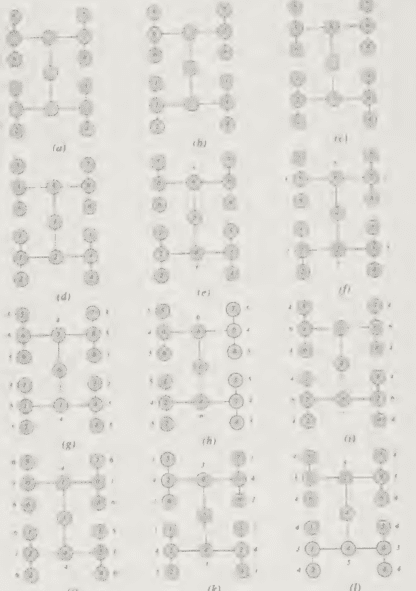

这些元素是数字 1 到 8，我们要寻找第四小的数字。（在这种情况下，每个数字的秩等于该数字的值，因此我们不同时显示秩和数字。）对于每一步，显示所有节点的内容。节点内的数字是从下方获得的数字，节点外的数字是向下广播的数字。显示的第一幅图是 3（d），第二幅是 5（e），然后是 4、3、1 和 4。在（g）中，第一个枢轴（3）到达叶子，从那时起树开始第二阶段，即计算秩。3 的秩为 3 这一事实在（j）中被发现，而第四小的元素由根节点在（l）处发现。一旦该元素被广播到各节点（我们未显示），算法终止。在这种情况下，无需运行另一组迭代（也无需淘汰任何元素）；然而，一般情况下，该过程应运行多次并淘汰元素，直到找到第 $k$ 小元素。

### 复杂度

常规算法用一个枢轴淘汰元素需要 $O(\log n)$ 步。由于我们可以在大约同一时间生成 $O(\log n)$ 个枢轴，总体上节省了 $O(\log\log n)$ 的因子。期望运行时间降低到 $O\left(\frac{\log^2 n}{\log\log n}\right)$。

## 第二部分

## C++

## 第8章

### 概述

### 问题1 位域与并发

以下哪些数据成员对于并发更新是安全的？

程序8.1：位域与并发

```cpp
1 struct A
2 {
3     char non_bitfield_a;
4
5     int bitfield_b : 3;
6     int bitfield_c : 10;
7     int : 0;
8
9     int bitfield_d : 8;
10
11    struct E
12    {
13        int bitfield_a1 : 8;
14    } non_bitfield_e;
15
16    int bitfield_f : 4;
17    int non_bitfield_g;
18    int bitfield_h : 11;
19 };
```

### 问题1的解答

就并发更新而言，它与 *内存位置* 有关，即两个执行线程可以安全地更新和访问各自独立的内存位置。

因此，让我们尝试理解成员数据的内存位置，先从位域开始。

程序8.2：位域与并发

```cpp
1 struct A
2 {
```


## 并发安全的位域

如果两个位域位于不同的内存位置，则两个线程并发更新它们是安全的

- *bitfield_b* 和 *bitfield_c* 位于同一内存位置，因此并发更新不是线程安全的。
- *bitfield_c* 和 *bitfield_d* 位于不同的内存位置，因为它们被一个零长度位域分隔，因此并发更新是线程安全的。
- *bitfield_d* 和 *bitfield_a1* 位于不同的内存位置，因为 *bitfield_a1* 位于嵌套结构 E 内，因此并发更新是线程安全的。
- *bitfield_f* 和 *bitfield_h* 位于不同的内存位置，因为它们被一个*非位域*数据成员 *non_bitfield_g* 分隔，因此并发更新是线程安全的。

因此，如果同一结构体中两个位域之间的所有字段也都是非零宽度的位域，那么并发更新这两个位域是不安全的，因为它们构成同一内存位置。

与结构体 A 相关联的内存位置有七个

- 1. *non_bitfield_a*
- 2. *bitfield_b* 和 *bitfield_c*
- 3. *bitfield_d*
- 4. *bitfield_a1* (*non_bitfield_e*)
- 5. *bitfield_f*
- 6. non_bitfield_g
- 7. bitfield_h

```c
struct A
{
    char non_bitfield_a;
    int bitfield_b    : 3;
    int bitfield_c    : 10;
    int               : 0;

    int bitfield_d    : 8;

    struct E
    {
        int bitfield_a1 : 8;
    } non_bitfield_e;

    int bitfield_f    : 4;
    int non_bitfield_g;
    int bitfield_h    : 11;
};
```

### 问题 2 不同的地址位置

下面程序编译时会发生什么？

程序 8.3：不同的地址位置

```cpp
int main()
{
    char a = 'a';
    char b = 'b';
    static_assert(&a == &b, "Address_of_a_and_b_"
                          "should_be_distinct");
}
```

### 问题 2 的解答

它会导致如下所列的编译错误：

```text
distinct_add.cpp: In function 'int main()':
distinct_add.cpp:6:6:
error: static assertion failed:
Address of a and b should be distinct
     static_assert(&a == &b, "Address of a and b "
     ^
```

两个不同对象的地址位置总是不同的，除非以下情况为真，此时结果由实现定义：

- 1. 它们是位域
- 2. 它们是零大小的基类子对象

对象的地址是其占用的第一个字节的地址，除非它是位域或零大小的基类子对象。

### 问题 3 信号和值

列出即使在发生信号时其值也保证有定义的对象类型？

### 问题 3 的解答

- 1. volatile std::sig_atomic_t
- 2. 无锁原子对象

### 问题 4 临时对象和转换

在下面程序中，第 12 行的临时对象被销毁之前会发生什么？

程序 8.4：临时对象和转换

```cpp
struct A
{
    A(int x) : _x(x) {}

    int & val() { return _x; }
private:
    int _x;
};

int main()
{
    if(A(1).val())
    {}
}
```

### 问题 4 的解答

在类型 A 的临时对象销毁之前，会发生以下转换

- 1. 左值到右值转换
- 2. int 到 bool 转换

### 问题 5 表达式的求值

请查看下面的程序：

程序 8.5：表达式的求值

```cpp
void compute(int, int) {}
void eval(int x, int arr[])
{
    x = arr[x++];

    x = 2, x++, x++;

    x = x++ + 1;
    x = x + 1;

    compute(x = -1, x = -1);
}
```

### 问题 5 的解答

- 第 5 行：行为未定义
- 第 7 行：x 变为 4
- 第 9 行：行为未定义
- 第 10 行：x 的值递增
- 第 12 行：行为未定义

### 问题 6 三字符序列

这里的三字符序列会发生什么：

```
Program 8.6: trigraph sequences
1??=define validateArray(x, y) x??(y??) ??!??! y??(x??)
```

### 问题 6 的解答

- 三字符序列 ??= 被替换为 #
- 三字符序列 ??( 被替换为 [
- 三字符序列 ??) 被替换为 ]
- 三字符序列 ??! 被替换为 |

上述情况 ⇒ 所述三字符序列将被替换，使表达式变为如下形式

```
Program 8.7: replacing trigraph sequences
1#define validateArray(x, y) x[y] || y[x]
```

### 问题 7 自增运算符

该程序的输出是什么：

```
Program 8.8: increment operator
1#include <iostream>
2
3int main()
4{
5    int one = 1;
6    int two = 2;
7
8    int a = one+++++two;
9 }
```

### 问题 7 的解答

编译时，错误为：

```text
increment_operator.cpp: In function ‘int main()’:
increment_operator.cpp:8:18:
error: lvalue required as increment operand
    int a = one+++++two;
```

表达式 `one+++++two` 被解析为类似 `one ++ ++ + two` 的形式，这违反了自增运算符的约束，从而导致表达式不正确。

*one+++++two ⇒ one ++ ++ + two*

请注意，表达式 `one+++++two` 不会被解析为 `one ++ + ++ two`，后者确实是一个正确的表达式。

*one+++++two ⇒ one ++ ++ + two*

### 问题 8 — nullptr

`nullptr` 是什么？

### 问题 8 的解答

`nullptr` 是指针字面量，表示类型为 `std::nullptr_t` 的纯右值。它是一个空指针常量，可以转换为空指针值或空成员指针值。

请注意，`std::nullptr_t` 本身

- 不是指针类型
- 不是成员指针类型
- 是一种不同的类型

### 问题 9 — 用户定义字面量

*用户定义字面量*是什么？

### 问题 9 的解答

*用户定义字面量* 是对以下形式的字面量运算符或字面量运算符模板的调用

- 1. `operator "" identifier`
- 2. `operator "" identifier<'c₁', 'c₂', ..., 'cₖ'>()`

例如：

- 1. `user-defined-integer-literal`
  - a) `operator "" identifier (n ULL)`
  - b) `operator "" identifier ("n")`
  - c) `operator "" identifier <'c1', 'c2', ... 'ck'>()`
- 2. *user-defined-floating-literal*
  - a) `operator "" identifier (f L)`
  - b) `operator "" identifier ("ff")`
  - c) `operator "" identifier <'c1', 'c2', ... 'ck'>()`
- 3. *user-defined-string-literal*
  - a) `operator "" identifier (str, len)`
  - b) `operator "" identifier (ch)`
  - c) `operator "" identifier <'c1', 'c2', ... 'ck'>()`

程序 8.9：用户定义字面量

```cpp
#include <string>

void operator "" _distance(long double);
long double operator "" _amount(long double);

std::string operator "" _amount(const char16_t *,
                                std::size_t);

unsigned operator "" _amount(const char*);
float operator "" _X(const char*);

template <char...> int operator "" _length();

int main()
{
    2.9_amount;

    u"test"_amount;

    20_amount;
}
```

在上面的示例中

- 第 18 行调用 operator "" _amount(2.9L)
- 第 20 行调用 operator "" _amount(u"test", 4)
- 第 22 行调用 operator "" _amount("20")

### 问题 10 声明与定义

以下哪些是定义，哪些只是声明？

程序 8.10：声明与定义

```cpp
1 extern int a1;
2 int a2;
3 extern const int a3;
4 extern const int a4 = 10;
5 void fun(int);
6 void fun(int) {}
7 struct A;
8 struct A
9 {
10     int x, y;
11 };
12 typedef int Integer;
13 enum { low, mid, high };
14 extern A _A;
15 struct B
16 {
17     static int x;
18 };
19 int B::x = 5;
20 namespace Detail { int x; }
21 using Detail::x;
22 namespace DetailsX = Detail;
23 B b1;
```

### 问题 10 的解答

- *声明*  
  第 1、3、5、7、12、14、17、21 行
- *定义*  
  其余为定义

### 问题 11 — 编译器生成的成员函数

在以下情形中，列出其定义由编译器隐式生成的成员函数：

程序 8.11：示例类

```cpp
1 #include <string>
2 struct A
3 {
4     std::string __str;
5 };
6 
7 int main()
8 {
9     A a1;
10    A a2 = a1;
11    a2 = a1;
12 }
```


### 问题 11 的解答

以下成员函数定义由编译器隐式生成：

- 1. 默认构造函数

```cpp
A() : _str() { }
```

- 2. 拷贝构造函数

```cpp
A(const A & a): _str(a._str) { }
```

- 3. 移动构造函数

```cpp
A(A&& a)
:
_str(static_cast<std::string&&>(a._str))
{ }
```

或者，

```cpp
A(A&& a)
:
_str(std::move(a._str)) { }
```

- 4. 拷贝赋值运算符

```cpp
A& operator=(const A& a)
{
    _str = a._str;
    return *this;
}
```

- 5. 移动赋值运算符

```cpp
A& operator=(A&& a)
{
    _str =
        static_cast<std::string&&>(a._str);
    return *this;
}
```

或者，

```cpp
A& operator=(A&& a)
{
    _str = std::move(a._str);
    return *this;
}
```

- 6. 析构函数

```cpp
~A() { }
```

因此它可能如下所示：

### 程序 8.12：编译器生成的成员函数

```cpp
1  #include <string>
2  struct A
3  {
4      std::string _str;
5
6      A() : _str() { }
7
8      A(const A & a): _str(a._str) { }
9
10     A(A&& a)
11     :
12         _str(static_cast<std::string&&>(a._str)) { }
13
14     A& operator=(const A& a)
15     {
16         _str = a._str;
17         return *this;
18     }
19     A& operator=(A&& a)
20     {
21         _str = static_cast<std::string&&>(a._str);
22         return *this;
23     }
24     ~A() { }
25 };
```

### 程序 8.13：编译器生成的成员函数

```cpp
1	#include <string>
2
3	struct A
4	{
5		std::string _str;
6
7		A() : _str() { }
8
9		A(const A & a) : _str(a._str) { }
10
11		A(A&& a)
12			: _str(std::move(a._str)) { }
13
14		A& operator=(const A& a)
15		{
16			_str = a._str;
17			return *this;
18		}
19
20		A& operator=(A&& a)
21		{
22			_str = std::move(a._str);
23			return *this;
24		}
25
26		~A() { }
27
28	};
```

### 问题 12：ODR 与默认构造函数

这两个程序的输出是什么？

### 程序 8.14：ODR 与默认构造函数

```cpp
1	#include <iostream>
2
3	struct Base
4	{
5		Base(int);
6    Base(int, int);
7
8 };
9
10 Base::Base(int = 0)
11 {
12     std::cout << "Inside_Base::Base(int)"
13               << std::endl;
14 }
15
16 struct Derived : Base
17 {
18 };
19
20 int main()
21 {
22     Derived d;
23 }
```

### 程序 8.15：ODR 与默认构造函数

```cpp
1 #include <iostream>
2
3 struct Base
4 {
5     Base(int);
6
7     Base(int, int);
8 };
9
10 Base::Base(int = 0, int = 0)
11 {
12     std::cout << "Inside_Base::Base(int,int)"
13               << std::endl;
14 }
15
16 struct Derived : Base
17 {
18 };
19
20 int main()
21 {
22     Derived d;
23 }
```

### 问题 12 的解答

在第一个程序中，输出是 *Inside_Base::Base(int)*

在第二个程序中，输出是 *Inside_Base::Base(int, int)*

在这两个程序中，类 `Derived` 的默认构造函数都是隐式定义的，但这个定义 `D()` 在一种情况下调用 `Base(int)`，在另一种情况下调用 `Base(int, int)`。

### 问题 13：理解声明点

这个程序的输出是什么？类模板 B 的模板实参是如何推导的？

### 程序 8.16：理解声明点

```cpp
#include <iostream>

void test()
{
    int a1 = 10;
    {
        int a1 = a1;
        std::cout << "a1:_" << a1
                  << std::endl;
    }

    const int a2 = 20;
    {
        int a2[a2];
        std::cout << "size_of_array:"
                  << sizeof(a2)/sizeof(int)
                  << std::endl;
    }

    const int a3 = 30;
    {
        enum { a3 = a3 };
        std::cout << "enum_a3_is:_"
                  << a3 << std::endl;
    }
}

struct A
{
    enum { e = 40 };
    int arr[A::e];
};

typedef int T;

template<typename T = T, T n = 0>
struct B {};

int main()
{
    test();

    A a;
    std::cout << "length_of_array_arr_is:_"
              << sizeof(a.arr)/sizeof(int)
              << std::endl;
}
```

### 问题 13 的解答

输出为

```text
a1: 6295552
size_of_array:20
enum_a3_is:_30
length_of_array_arr_is:_40
```

请注意：

- 第二个整数 `a1` 的值用其自身未确定的值初始化。
- 查找第一个模板实参的默认值类型时会找到 `typedef int`，而在第二个模板实参的情况下，查找会找到模板参数。

### 问题 14：类作用域变量

这个程序的输出是什么？

### 程序 8.17：类作用域变量

```cpp
1  #include <cstddef>
2  #include <iostream>
3
4  typedef int c;
5
6  enum { e = 10 };
7
8  struct A
9  {
10     char arr[e];
11
12     std::size_t fun()
13     {
14         return sizeof(c);
15     }
16
17     char c;
18
19     enum { e = 20 };
20 };
21
22 int main()
23 {
24     A a;
25     std::cout << "size_of_arr is :"
26               << sizeof(a.arr)/sizeof(char)
27               << std::endl;
28     std::cout << "fun():" << a.fun()
29               << std::endl;
30 }
```

### 问题 14 的解答

输出为

```text
size_of_arr is :10
fun():1
```

### 问题 15：命名空间作用域变量

这个程序的输出是什么？

### 程序 8.18：命名空间作用域变量

```cpp
1 namespace A
2 {
3     int i;
4
5     int func(int j)
6     {
7         return j;
8     }
9
10    int g();
11
12    void h();
13 }
14 namespace
15 {
16    int x = 10;
17 }
18
19
20 namespace A
21 {
22    int func(char j)
23    {
24        return x + j;
25    }
26
27    int i;
28
29    int g();
30
31    int g()
32    {
33        return func(i);
34    }
35
36    int h();
37 }
```

### 问题 15 的解答

输出为

```text
namespace_scope.cpp:27:9:
error: redefinition of 'i'
    int i;
    ^

namespace_scope.cpp:3:9:
note: previous definition is here
    int i;
    ^

namespace_scope.cpp:36:9:
error: functions that differ only
in their return type cannot be overloaded
    int h();
    ^

namespace_scope.cpp:12:10:
note: previous declaration is
here
    void h();
         ^

2 errors generated.
```

请注意：

- 未命名命名空间中第 17 行的变量 `x` 的潜在作用域直到翻译单元末尾。
- 第 22 行重载了 `A::func(int)`
- 第 24 行：`x` 来自匿名命名空间
- 第 27 行重新定义了 `int i`：违反了 ODR（单一定义规则）：因此报错。
- 第 29 行重新声明了函数 `g()`
- 第 31 行：定义了函数 `g()`
- 第 33 行：调用 `A::func(int)`
- 第 36 行：用不同的返回类型重新定义了函数 `h()`：因此报错。

### 问题 16：模板参数的作用域

模板参数能否用于后续模板参数及其默认实参的声明中？

### 问题 16 的解答

可以。

模板参数可以用于后续模板参数及其默认实参的声明中。

例如，

```cpp
1 template<typename T1, T1* ptr , typename T2 = T1>
2 struct A {};
3
4 template<typename T> void alloc_memory(T* ptr = new T);
```

请注意，模板参数也可以用于基类的指定中，例如

```cpp
1 template<typename T>
2 struct Base {};
3
4 template<typename T>
5 struct Derived : Base<T> { };
6
7 template<typename T>
8 struct A : T { };
```

将模板参数用作基类意味着，在实例化类模板时，用作模板实参的类必须已经定义，而不仅仅是声明。

### 问题 17：模板参数的作用域

下面程序中模板参数 T1 和 T2 的类型是什么？

```cpp
1 typedef int T;
2
3 template<T T1, typename T, template<T T2> class T>
4 struct A;
```

### 问题 17 的解答

- `T1` 是 `int` 类型的非类型模板参数
- `T2` 是一个非类型模板参数，其类型与 `A` 的第二个模板参数相同。

### 问题 18：非限定名称查找

程序的输出是什么？

### 程序 8.19：非限定名称查找

```cpp
1 #include <iostream>
2
```

### 程序 8.20：非限定名称查找

```cpp
#include <iostream>
int a = 10;
namespace outer
{
    int a = 20;
    namespace inner
    {
        int a = 30;
        void func();
    } // namespace inner
} // namespace outer

void outer::inner::func()
{
    // int a = 40;
    std::cout << "a = " << a << std::endl;
}

int main()
{
    outer::inner::func();
}
```

讨论在函数 *func* 的定义中尝试使用变量 *a* 时，其声明是如何被查找的。

### 问题 19 的解答

输出为：

```text
a = 30
```

按给定顺序搜索以下作用域，以查找变量 *a* 的声明/定义：

- 1. 第一个是 `outer::inner::func` 的最外层块作用域，位于使用 `a` 之前，也就是说，如果第 20 行被注释掉，那么这里就是进行查找的第一个位置。在这种情况下，输出将是 40。
- 2. 接下来是命名空间 `inner` 的作用域（第 11 行），如输出为 30 所示。
- 3. 接下来是命名空间 `outer` 的作用域，也就是说，如果第 20 行和第 11 行没有声明/定义 `a`，那么由于第 7 行，输出将是 20。


4. 接下来是全局作用域，在 outer::inner::func 定义之前，即如果第 20、11 和 7 行没有因第 3 行而声明/定义 a，那么输出将是 10。

### 问题 20 非限定名称查找

程序的输出是什么？

```text
Program 8.2: Unqualified Name Lookup

 1  #include <iostream>
 2
 3  namespace first
 4  {
 5      struct base
 6      {
 7          static int i;
 8      };
 9      // namespace A
10
11  int first::base::i = 10;
12
13  namespace second
14  {
15      struct derived : first::base
16      {
17          struct nested
18          {
19              nested()
20              {
21                  std::cout << "nested() : "
22                            << i << std::endl;
23              }
24          } n; // struct nested
25      }; // struct derived
26  }
27
28  int main()
29  {
30      second::derived d;
31  }
```

讨论在 nested 的构造函数定义期间尝试使用变量 i 时，变量 i 的声明是如何被查找的。

### 问题 20 的解答

输出为：

```text
nested() : 10
```

按给定顺序在以下作用域中查找变量 i 的声明/定义：

### 程序 8.26：ADL

```cpp
#include <iostream>

namespace A
{
    struct B {};

    void func(B b)
    {
        std::cout << "A::func" << std::endl;
    }
} // namespace A

void func(A::B b)
{
    std::cout << "func(A::B)" << std::endl;
}

void test()
{
    A::B b1;
    func(b1);
}

int main()
{
    test();
}
```

### 问题 25 的解答

该程序无法通过编译。编译器错误为：

```text
adl2.cpp:22:5: error: call to 'func' is ambiguous
    func(b1);
    ^~~~
adl2.cpp:7:10: note: candidate function
    void func(B b)

adl2.cpp:13:6: note: candidate function
void func(A::B b)

1 error generated.
```

从编译器错误中可以一目了然。

### 问题 26 ADL（参数依赖查找）

修改前一个程序以调用 `func(A::B)`？

### 问题 26 的解答

修改后的程序如下

### 程序 8.27：ADL

```cpp
#include <iostream>
namespace A
{
    struct B {};

    void func(B b)
    {
        std::cout << "A::func" << std::endl;
    }
} // namespace A
void func(A::B b)
{
    std::cout << "func(A::B)" << std::endl;
}

void test()
{
    A::B b1;

    extern void func(A::B);

    func(b1);
}

int main()
{
    test();
}
```

现在输出如下

```text
func(A::B)
```

### 问题 27 基本查找

审查下面的程序？

### 程序 8.28：基本查找

```cpp
struct A
{
    static int a;
};
int A::a = 10;

struct A
{
    int A = 20;

    A::a = 100;

    A a1;
}
```

### 问题 27 的解答

该程序无法通过编译，编译器错误为

```text
basic_lookup.cpp:14:5:
error: must use 'struct' tag to refer
to type 'A' in this
    scope
    A a1;

    struct
basic_lookup.cpp:10:9:
note: struct 'A' is hidden by a
non-type declaration of
    'A' here
    int A = 20;

1 error generated.
```

该错误本身已经说明问题，因为第 14 行：A 不再是类型。

### 问题 28 基本查找

审查下面静态数据成员 array 的定义。

### 程序 8.29：基本查找

```cpp
struct A { };

struct B
{
    struct A { };

    static const int n = 10;

    static A array[n];
};

A B::array[n];
```

### 问题 28 的解答

该程序无法通过编译，编译器错误为

```text
basic_lookup1.cpp:12:13:
error: conflicting declaration
'A B::array [10]'
A B::array[n];
        ^

basic_lookup1.cpp:9:14:
error: 'B::array' has previous
declaration as 'B::A B::array [10]'
    static A array[n];

basic_lookup1.cpp:12:13: error: declaration of
'B::A B::array [10]'
outside of class is not definition
[-fpermissive]
 A B::array[n];
        ^
```

另一个编译器的错误为

```text
basic_lookup1.cpp:12:6:
error: redefinition of 'array'
with a different type:
    'A [10]' vs 'B::A [10]'
A B::array[n];
  ^

basic_lookup1.cpp:9:14:
note: previous definition is here
    static A array[n];
         ^

1 error generated.
```

该错误本身已经说明问题。

下面的程序修复了此错误：

### 程序 8.30：基本查找

```cpp
1 struct A { };
2 struct B
3 {
5     struct A { };
6
7  static const int n = 10;
8  static A array[n];
9  };
10
11
12 B::A B::array[n];
```

### 问题 29 析构函数与 typedef

如何为给定类的 typedef 显式调用析构函数？

### 问题 29 的解答

下面的程序演示了这一点：

### 程序 8.31：析构函数与 typedef

```cpp
1 struct B
2 {
3     ~B() {}
4 };
5
6 typedef B AnotherB;
7
8 int main()
9 {
10     AnotherB * third;
11
12     third->AnotherB::~AnotherB();
13 }
```

### 问题 30 构造函数名称查找

在给定程序中，如何在两种情况下查找类 Base 的构造函数：一种作为 Base 本身，另一种作为 Derived 的基类？

```cpp
struct Base
{
    Base();
};

struct Derived : Base
{
    Derived();
};

Base::Base() { }
Derived::Derived() { }
```

### 问题 30 的解答

将 Base 的构造函数作为派生类的基类部分调用，形式如下：

```text
Derived::Base db;
```

同理，下面的调用不合法

```text
Base::Base b;
```

因为 Base::Base 并不命名一个类型。

要实现这一点，应尝试以下写法：

```text
struct Base::Base b1;
```

### 问题 31 理解命名空间

给定下面的程序：

```cpp
int x;

namespace Y
{
    void f(float);
    void h(int);
}

namespace Z
{
    void h(double);
}

namespace A
{
    using namespace Y;

    void f(int);
    void g(int);
}

int i;

namespace B
{
    using namespace Z;

    void f(char);

    int i;
}

namespace AB
{
    using namespace A;
    using namespace B;

    void g();
}
```

以下代码片段会发生什么：

1. `AB::g();`

   由于 g 直接在 AB 中声明，因此调用 AB::g()。

2. `AB::f(1);`

   由于 f 并未直接在 AB 中声明，因此规则会递归应用于 A 和 B，不搜索命名空间 Y，也不考虑 Y::f(float)；所以候选集合为 A::f(int)、B::f(char)，重载解析选择 A::f(int)。

3. `AB::f('e');`

   同上，但重载解析选择 B::f(char)。

4. `AB::x++;`

   由于 x 未直接在 AB 中声明，也未在 A 或 B 中声明，因此规则会递归应用于 Y 和 Z，结果什么也找不到，所以该程序非良构。

5. `AB::i++;`

   由于 i 未直接在 AB 中声明，因此规则会递归应用于 A 和 B，所以可选的是 A::i、B::i，因此该使用有歧义，程序非良构。

6. `AB::h(2.7);`

   由于 h 未直接在 AB 中声明，也未直接在 A 或 B 中声明，因此规则会递归应用于 Y 和 Z，所以可选的是 Y::h(int)、Z::h(double)，重载解析选择 Z::h(double)。

### 问题 32 多重声明没有问题

给定下面的程序，第 24 行和第 40 行会发生什么？

### 程序 8.32：多重声明没有问题

```cpp
1 namespace A
2 {
3     int a;
4 }
5
6 namespace B
7 {
8     using namespace A;
9 }
10
11 namespace C
12 {
13     using namespace A;
14 }
15
16 namespace BC
17 {
18     using namespace B;
19     using namespace C;
20 }
21
22 void f( )
23 {
24     BC::a++;
25 }
26
27 namespace D
28 {
29     using A::a;
30 }
31
32 namespace BD
33 {
34     using namespace B;
35     using namespace D;
36 }
```


```cpp
void g()
{
    BD::a++;
}
```

### 第32题的解答

正如我们已经知道的，同一声明出现多次根本不会造成歧义，因为它仍然是一个唯一的声明，因此第24行和第40行的调用没有问题，因为二者都引用 A::i。

### 问题33：对命名空间的多重引用

程序的输出是什么？

### 程序8.33：多重声明没有问题

```cpp
#include <iostream>

namespace first
{
    int one = 1;
}

namespace second
{
    using namespace first;
    int two = 2;
}

namespace first
{
    using namespace second;
}

int main()
{
    second::two++;
    first::two++;
    second::one++;
    first::one++;

    std::cout << "first::one is "
              << first::one << std::endl;
    std::cout << "second::one is "
              << second::one << std::endl;
    std::cout << "first::two is "
              << first::two << std::endl;
    std::cout << "second::two is "
              << second::two << std::endl;
}
```

### 第33题的解答

因为每个被引用的命名空间最多只被搜索一次，所以程序的输出是：

```text
first::one is 3
second::one is 3
first::two is 4
second::two is 4
```

### 问题34：非类型名称与命名空间

检查该程序？

### 程序8.34：非类型名称与命名空间

```cpp
namespace A
{
    struct X {};

    int x;
    int y;
} // namespace A

namespace B
{
    struct Y {};
} // namespace B

namespace C
{
    using namespace A;
    using namespace B;

    int i = C::x;
    int j = C::y;
} // namespace C
```

### 第34题的解答

该程序无法通过编译，编译器错误为

```text
namespace3.cpp:20:16:
error: a type named 'y' is hidden
by a declaration in a
      different namespace
    int j = C::y;
namespace3.cpp:11:12:
note: type declaration hidden
    struct y {};

namespace3.cpp:6:9:
note: declaration hides type
    int y;

1 error generated.
```

请注意，非类型名称隐藏类名或枚举名，当且仅当这些声明来自同一命名空间。
因此，`int i = C::x;` 是对 int 类型的 `A::x` 的调用。
`int j = C::y;` 是有歧义的，可能是 `A::y` 或 `B::y.`

### 问题35：声明与嵌套命名空间

以下函数 *func* 的定义正确吗？

### 程序8.35：声明与嵌套命名空间

```cpp
1 #include <iostream>
2
3 namespace A
4 {
5     namespace B
6     {
7         void func( );
8     } // namespace B
9
10    using namespace B;
11 } // namespace A
12
13 void A::func ( ) {}
```

### 第35题的解答

该程序无法通过编译，编译器错误为

```text
nested_namespace.cpp:13:9:
error: out-of-line definition of
'func' does not
    match any declaration in namespace 'A'
void A::func() {}
~~~
1 error generated.
```

另一个编译器的错误为

```text
nested_namespace.cpp:13:14:
error: 'void A::B::func()'
should have been declared inside 'A'
void A::func() {}
             ^
```

因为 func 不是 A 的成员，所以这是错误的。要修正它，可以将程序修改为如下所示：

### 程序8.36：声明与嵌套命名空间

```cpp
#include <iostream>
namespace A
{
    namespace B
    {
        void func();
    } // namespace B

    using namespace B;
} // namespace A

using namespace A;
void B::func() {}
```

因此，使用 :: 限定严格适用于成员直接属于该作用域的情况。
在这种情况下，我们甚至可以去掉 :: 来这样定义它：

### 程序8.37：声明与嵌套命名空间

```cpp
#include <iostream>
namespace A
{
    namespace B
    {
        void func();
    } // namespace B

    using namespace B;
} // namespace A

using namespace A;
void func() {}
```

### 问题36：声明：全局与局部

这两个程序之间有什么区别？

### 程序8.38：注入类名

```cpp
#include <iostream>
struct A
{
    A()
    {
        std::cout << "::A()" << std::endl;
    }
    ~A()
    {
        std::cout << "::~A()" << std::endl;
    }
};
struct B
{
    struct A
    {
        A()
        {
            std::cout << "B::A()" << std::endl;
        }
        ~A()
        {
            std::cout << "B::~A()" << std::endl;
        }
    };
    void f(::A* a);
};
void B::f(::A* a)
{
    a->~A();
}
int main()
{
    B().f(new A);
}
```

### 第37题的解答

输出为：

```text
::A()
::~A()
```

因为第36行在 *a 中查找会找到注入类名 ::A。

### 问题38：链接

什么是链接？

### 第38题的解答

当一个由另一作用域中的声明引入的名称，与以下任意一项相关，并且指的是同一个

- 对象
- 引用
- 函数
- 类型
- 模板
- 命名空间
- 值

那么就说它具有*链接*。

链接有两种类型：

- 1. *外部链接*
  - 当一个名称表示一个实体，而该实体可以通过来自以下任一单元中的名称来引用时
    - a) 其他翻译单元的作用域，或
    - b) 同一翻译单元的其他作用域。
  - 那么就说它具有*外部链接*。
  - 例如
    - 由块作用域 *extern* 声明所声明的变量名。
    - 成员函数、静态数据成员、类作用域中的具名类或枚举，或者在类作用域 typedef 声明中定义的无名类或枚举（使得该类或枚举为链接目的而具有 typedef 名称）；如果该类的名称具有外部链接，则其具有外部链接。
    - 除无名命名空间或直接或间接声明在无名命名空间内的命名空间之外的所有命名空间。

- 2. *内部链接*
  - 当一个名称表示一个实体，而该实体只能通过同一翻译单元其他作用域中的名称来引用时，那么就说它具有*内部链接*。
  - 例如
    - 命名空间作用域中的静态变量、函数或函数模板
    - 没有任何显式 *extern* 声明的 *const* 或 *constexpr* 变量。
    - 匿名联合体的数据成员。
    - 无名命名空间，或直接或间接声明在无名命名空间内的命名空间。

当给定名称所表示的实体不能通过其他作用域中的名称来引用时，那么该名称就被称为具有*无链接*。

### 问题39：从 main 返回

从 *main* 函数返回的 return 语句有什么意义？

### 第39题的解答

*main* 中的 return 语句具有以下效果：

- 1. 离开 main 函数
- 2. 销毁任何具有自动存储期的对象，并且
- 3. 以返回值作为参数调用 std::exit。

如果控制流到达 *main* 末尾时没有遇到 return 语句，其效果等同于执行 *return 0;*

### 问题40：static 与 std::atexit

程序的输出是什么？

### 程序8.39：static 与 std::atexit

```cpp
#include <cstdlib>
#include <iostream>

struct A
{
    A()
    {
        std::cout << "A()" << std::endl;
    }
    ~A()
    {
        std::cout << "~A()" << std::endl;
    }
};

static A a;

void func()
{
    std::cout << "func()" << std::endl;
}

int main()
{
    std::atexit(&func);
}
```

### 第40题的解答

程序的输出为：

```text
A()
func()
~A()
```

请注意，这里的静态对象 a 在进入 main 函数之前被初始化，而使用 std::atexit 注册函数 func 发生在此之后。因此，func 在静态对象 a 销毁之前被调用。

### 问题41：std::atexit 与 static

程序的输出是什么？

### 程序8.40：std::atexit 与 static

```cpp
#include <cstdlib>
#include <iostream>

struct A
{
    A()
    {
        std::cout << "A()" << std::endl;
    }
    ~A()
    {
        std::cout << "~A()" << std::endl;
    }
};
void func()
{
    std::cout << "func()" << std::endl;
```


```cpp
}

struct B
{
    B()
    {
        std::cout << "B()" << std::endl;
        std::atexit(&func);
    }
    ~B()
    {
        std::cout << "~B()" << std::endl;
    }
};
static B b;

static A a;

int main()
{
}
```

### 问题 41 的解答

程序的输出是：

```text
B()
A()
~A()
~B()
func()
```

请注意，此处对 `std::atexit` 的调用先序于具有静态存储期的对象初始化完成，因此对对象 `a` 的析构函数的调用先序于对传递给 `std::atexit` 的函数 `func` 的调用。

以类似方式，让我们回顾下面的程序：

### 程序 8.41：std::atexit 与 static

```cpp
#include <cstdlib>
#include <iostream>

void func()
{
    std::cout << "func()" << std::endl;
}
struct A

21
22 static A a ;
23 int main ( )
24 {
25 }
26
```

### 问题 42 的解答

程序的输出是：

```text
f2()
f1()
```

不言自明。

### 问题 43 存储期

一个给定对象一旦创建，可能有多少种存储期？

### 问题 43 的解答

确定包含该对象的存储的最小潜在生存期，有如下四种存储期：

- 1. 动态存储期：由全局分配函数 *operator new* 和 *operator new[]* 启用，
- 2. 静态存储期：由 *static* 启用。这些实体的存储应持续整个程序运行期间。
- 3. 线程存储期：由 *thread_local* 启用
- 4. 自动存储期：由 *register* 启用，或未显式声明为 *static* 或 *extern*。

### 问题 44 整数类型

什么是整数类型？

### 问题 44 的解答

以下类型统称为*整数类型*：

- bool
- char
- char16_t
- char32_t
- wchar_t
- 有符号整数类型，以及
- 无符号整数类型

### 问题 45 整数类型

什么是整数类型？

### 问题 45 的解答

以下类型统称为*整数类型*：

- bool
- char
- char16_t
- char32_t
- wchar_t
- 有符号整数类型，以及
- 无符号整数类型

### 问题 46 排序：const/volatile

列举 *const* 和 *volatile* 上的偏序关系？

### 问题 46 的解答

请注意，cv 表示 const 和/或 volatile。

- 无 cv 限定符 < const
- 无 cv 限定符 < volatile
- 无 cv 限定符 < const volatile
- const < const volatile
- volatile < const volatile

### 问题 47 值类别：左值/右值

什么是左值？

什么是右值？

讨论表达式值类别的其他成员。

### 问题 47 的解答

与表达式关联的值的层次结构如下：

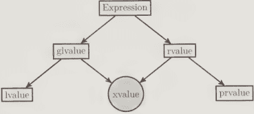

图 8.1：表达式值类别分类

- 1. *左值*：这个名称来源于早期含义，即与其出现在赋值左侧相关联。
  - *左值*指定一个函数或一个对象。
  - 如果 *ptr* 是指向对象或函数的指针，那么 `*ptr` 是*左值*表达式。
  - 调用返回类型为*左值*引用的函数，结果是*左值*。
- 2. *将亡值*：代表*将亡值*。
  - 调用返回类型为*右值*引用的函数，结果是*将亡值*。
  - 它指代一个对象，通常接近其生存期末尾，因此其资源可以被移动。
- 3. *泛左值*：代表*泛化左值*。因此它指代*左值*或*将亡值*。泛左值也可以具有不完整类型。
- 4. *右值*：这个名称来源于早期含义，即与其出现在赋值右侧相关联。

  它是：
  - 一个将亡值
  - 一个临时对象
  - 一个子对象
  - 一个不与对象关联的值。
- 5. *纯右值*：代表*纯右值*，即不是将亡值的右值。
  - 纯右值保存返回类型不是引用的函数的结果。
  - 字面量（如 10、true 或 1.2e3）的值是纯右值。
  - 类类型的纯右值可以具有 cv 限定类型。
  - 非类类型的纯右值总是具有无 cv 限定的类型。
  - 纯右值是完整类型或 void 类型。

### 问题 48 对齐

什么是*对齐*？

### 问题 48 的解答

*对齐*是给定对象可被分配的连续地址之间的字节数。

- 每个对齐值都是非负的 2 的整数次幂。
- 它表示为 `std::size_t` 类型的整数常量。
- 完整类型、数组或对完整对象类型的引用的对齐要求，可以使用 *alignof* 表达式获得。
- 基础对齐 ≤ `alignof(std::max_align_t)` < 扩展对齐。

### 问题 49 左值到右值转换

什么是左值到右值转换？

### 问题 49 的解答

从技术上讲，它是泛左值到纯右值的转换。

- 对于完整类型 T，如果它不是函数或数组，则可以转换为纯右值。
- 对于不完整类型，该转换具有未定义行为。
- 对于类类型 T，泛左值应当是 T 类型的对象或派生自 T 的类型的对象。
- 该对象应当已初始化。
- 对于非类类型 T，纯右值的类型是不带任何 const 和/或 volatile 的 T 类型。
- 对于类类型 T，纯右值的类型是 T。

```cpp
5
6 A&& operator+(A, A);
7
8 A&& f();
9
10 int main()
11 {
12     A a;
13
14     A&& a1 = static_cast<A&&>(a);
15 }
```

### 问题 51 的解答

以下表达式是*将亡值*：

- `f()`
- `f().m`
- `static_cast<A&&>(a)`
- `a + a`

表达式 *a* 是左值。

### 问题 52 字面量与左值

字面量是*左值*吗？

### 问题 52 的解答

字符串字面量是*左值*。所有其他字面量都是*纯右值*。

### 问题 53 this 指针的有效用法

### 程序 8.45：this 指针的有效用法

```cpp
1 class Outer
2 {
3     int a[sizeof(*this)];
4
5     unsigned int sz = sizeof(*this);
6
7     void f()
8     {
9         int b[sizeof(*this)];
10
11         struct Inner
12         {
13             int c[sizeof(*this)];
14         };
15     }
16 };
17
18 int main() {}
```

### 问题 53 的解答

该程序无法编译。编译器错误为：

```text
this.cpp:3:19:
error: invalid use of 'this' outside of a
        non-static member
        function
        int a[sizeof(*this)];

this.cpp:13:27:
error: invalid use of 'this' outside of a
        non-static member
        function
        int c[sizeof(*this)];

2 errors generated.
```

从这个编译器错误可以明显看出，*this* 在第 3 行和第 13 行的用法无效，因为第 3 行不在成员函数内部，而第 13 行不在类 *Inner* 的成员函数内部。

### 问题 54 sizeof

该程序的输出是什么？

### 程序 8.46：sizeof

```text
1:#include <iostream>
2:#include <iomanip>
3
4 struct A
5 {
6    int i ;
7 };
8
9 int main()
10 {
11    std::cout << sizeof(A::i) << std::endl;
12    std::cout << sizeof(A::i + 10) << std::endl;
13    std::cout << sizeof(A::i - 10) << std::endl;
14
15    std::cout << std::boolalpha;
16
17    std::cout << (sizeof(A::i + 20)
18                 ==
19                sizeof(A::i - 20) )
20        << std::endl;
21 }
```

### 问题 54 的解答

程序的输出是：

```text
4
4
4
true
```

### 问题 55 lambda 与排序

编写一个函数，根据绝对值对浮点数向量进行排序。

### 问题 55 的解答

我们可以使用 lambda 表达式创建简单的未命名函数对象：

### 程序 8.47：lambda 与排序

```cpp
1:#include <algorithm>
2:#include <cmath>
3:#include <vector>
4:
5 void absort(std::vector<float> vf)
6 {
7     std::sort(vf.begin(),
8               vf.end(),
9               [](float a, float b)
10              {
11                  return std::abs(a)
12                         <
13                         std::abs(b);
14              }
15              );
16 }
```

lambda 表达式的求值结果是一个纯右值临时对象，称为闭包对象。

### 问题 56 lambda 的类型

lambda 表达式的类型是什么？

### 问题 56 的解答

lambda 表达式的类型是唯一的未命名类类型（联合类型除外）。它也称为闭包类型。请注意，此类型不是聚合类型。

### 问题 57 lambda 的返回类型


### 问题57

以下 lambda 表达式的返回类型是如何确定的？

程序8.48：lambda 的返回类型

```cpp
auto x1 = [] ( int i ){ return i; };
auto x2 = []{ return { 1, 2 }; };
```

### 问题57的解答

如果 lambda 表达式的尾随返回类型缺失，则返回类型为返回表达式经过以下转换后的类型：

- 左值到右值转换
- 数组到指针转换
- 函数到指针转换

否则为 void。

因此，第 1 行 lambda 表达式的返回类型是 int。因为花括号初始化列表不是表达式，所以 {1, 2} 不是表达式。这意味着第 2 行 lambda 表达式的返回类型是 void。所以这会导致编译器错误。

### 问题58 lambda 与默认实参

以下哪些 lambda 表达式是合法的？

程序8.49：lambda 与默认实参

```cpp
void func()
{
    int i = 1;

    void g1(int = []{ return i; }());
    void g2(int = [=]{ return 0; }());
    void g3(int = [=]{ return i; }());
    void g4(int = [=]{ return 0; }());
    void g5(int = []{ return sizeof i; }());
}
```

### 问题58的解答

lambda 表达式出现在默认实参中时，不能隐式或显式捕获任何实体。因此，第 5、6 和 7 行出现的 lambda 表达式将引发编译器错误。

```text
lambda2.cpp:5:20:
error: lambda expression in default
argument cannot capture
    any entity
    void g1(int = ([]){ return i; })();

lambda2.cpp:6:20:
error: lambda expression in default
argument cannot capture
    any entity
    void g2(int = ([]){ return 0; })();

lambda2.cpp:7:20:
error: lambda expression in default
argument cannot capture
    any entity
    void g3(int = ([=]){ return i; })();

3 errors generated.
```

### 问题59 嵌套 lambda 表达式

该程序的输出是什么？

程序8.50：嵌套 lambda 表达式

```cpp
#include <iostream>
int main()
{
    int a = 1, b = 1, c = 1;
    auto m1 = [a, &b, &c]() mutable
    {
        auto m2 = [a, b, &c]() mutable
        {
            std::cout << a << b << c
                      << std::endl;
            a = 4; b = 4; c = 4;
        };
        a = 3; b = 3; c = 3;
        m2();
    };
    a = 2; b = 2; c = 2;
    m1();
    std::cout << a << b << c << std::endl;
}
```

### 问题59的解答

```text
123
234
```

### 问题60 decltype((auto 变量)) 的类型

表达式 *decltype((x))* 的类型是什么？其中 *x* 是一个 auto 变量。

### 问题60的解答

表达式 *decltype((x))* 的类型是 const x &，其中 *x* 是一个 auto 变量。

例如，在下面的示例中：

程序8.51：decltype((x)) 的类型

```cpp
void func()
{
    float x, &r = x;
    [=]
    {
        decltype(x) y1;
        decltype((x)) y2 = y1;
        decltype(r) r1 = y1;
        decltype((r)) r2 = y2;
    };
}
```

y1 的类型是 float，y2 的类型是 float const &，r1 的类型是 float &，r2 的类型是 float const &。

### 问题61 花括号初始化列表作为下标

花括号初始化列表可以用作下标吗？

### 问题61的解答

它不能用于内置的下标运算符，但可以用于用户自定义的下标运算符，在这种情况下，它将被视为 operator[] 的下标实参的初始化器，如下面这个程序所示：

程序8.52：花括号初始化列表作为下标

```cpp
#include <initializer_list>
struct A
{
    int operator[](std::initializer_list<int>);
};

int main()
{
    A a;

    a[{1,2,3}] = 10;

    int b[5];

    b[{1, 2, 3}] = 20;
}
```

这里第 12 行是合法的，但第 16 行是错误的。

### 问题62 伪析构函数

什么是*伪析构函数*？

### 问题62的解答

*伪析构函数*是非类类型的析构函数，它只能用作函数调用运算符 () 的操作数，并且这种调用的结果类型为 *void*。下面的示例针对整数类型调用了伪析构函数：

程序8.53：伪析构函数

```cpp
#include <iostream>

typedef int Integer;

int main()
{
    Integer i = 100;

    i.Integer::~Integer();

    std::cout << "i : " << i << std::endl;

    i = 200;

    std::cout << "i : " << i << std::endl;
}
```

对伪析构函数的调用

```cpp
i.Integer::~Integer()
```

没有任何效果。

对象 i 并没有被销毁；赋值 i = 200 仍然是合法的。

该程序的输出为：

```text
i : 100
i : 200
```

因为伪析构函数要求显式调用非类类型的析构函数的语法必须是合法的，所以我们可以编写代码，而不必知道给定类型是否存在析构函数。

### 问题63 动态转换

什么是*动态转换*？

### 问题63的解答

*dynamic_cast<T>(v)* 是将表达式 *v* 转换为类型 *T* 的结果，其中 *T* 是：

- 指向完整类类型的指针或引用，或
- 指向 const/volatile void 的指针。

请注意，它不会去除 const 限定。

- 1. 如果 T 是指针类型，则 v 是指向完整类类型的指针纯右值 ⇒ 结果是 T 类型的纯右值。
- 2. 如果 T 是左值引用类型，则 v 是完整类类型的左值 ⇒ 结果是 T 所引用的类型的左值。
- 3. 如果 T 是右值引用类型，则 v 是具有完整类类型的表达式 ⇒ 结果是 T 所引用的类型的将亡值（xvalue）。
- 4. 如果 v 的类型与 T 相同，或者与 T 相同，只是 T 中的类对象类型比 v 中的类对象类型具有更多 cv 限定，则结果是 v（必要时进行转换）。
- 5. 如果 v 的值在指针情况下是空指针值，则结果是 T 类型的空指针值。

### 问题64 动态转换与基类/派生类

在基类/派生类场景下，*动态转换*是如何运作的？

### 问题64的解答

假设 B 是 D 的基类。

- 如果 T 是指向 B 的指针类型，且 v 是指向 D 的指针，则结果是指向 v 所指 D 对象的唯一子对象的指针。
- 如果 T 是对 B 的引用，且 v 的类型是 D，则结果是 v 所指 D 对象的唯一 B 子对象。
- 如果 T 是左值引用，则结果是左值。
- 如果 T 是右值引用，则结果是将亡值（xvalue）。

在下面的示例中，动态转换等同于 `B* bp = dp;`。

程序8.54：动态转换与基类/派生类

```cpp
struct B {};
struct D : B {};

void func(D* dp)
{
    B* bp = dynamic_cast<B*>(dp);

}
```

### 问题65 动态转换与 void

当 T 是指向 void 的指针时，dynamic_cast<T>(v) 的结果是什么？

### 问题65的解答

- 结果是指向 v 所指的最派生对象的指针，或者
- 会执行运行时检查，以确定 v 所指向或引用的对象是否可以转换为 T 所指向或引用的类型。

### 问题66 动态转换的运行时检查

当 T 是指向类 A 的指针时，dynamic_cast<T>(v) 的结果是什么？

### 问题66的解答

- 如果在 v 所指向（或引用）的最派生对象中，v 指向（或引用）某个 A 对象的公共基类子对象，并且从 v 所指向（或引用）的子对象仅派生出一个类型为 A 的对象，则结果指向（或引用）该 A 对象。
- 否则，如果 v 指向（或引用）最派生对象的公共基类子对象，且最派生对象的类型具有一个类型为 A 的基类，该基类是明确且公共的，则结果指向（或引用）最派生对象的 A 子对象。
- 否则，运行时检查失败。
- 转换到指针类型失败时，其值为所需结果类型的空指针值。
- 转换到引用类型失败时，抛出 std::bad_cast。

### 问题67 理解动态转换

该程序的输出是什么？

程序8.55：理解动态转换

```cpp
#include <cassert>
#include <typeinfo>
#include <iostream>

class A
{
    virtual void f() {}
};

class B
{
    virtual void g() {}
};

class D : public virtual A, private B
{
};

void func()
{
    D d;

    B* bp = (B*)&d;

    A* ap = &d;

    try
    {
        D& dr = dynamic_cast<D&>(*bp);
    }
    catch(std::bad_cast & e)
    {
        std::cout << "Exception is : "
                  << e.what() << std::endl;
    }

    ap = dynamic_cast<A*>(bp);

    assert(ap == nullptr);

    bp = dynamic_cast<B*>(ap);

    assert(ap == nullptr);
}
```


```cpp
45
46    ap = dynamic_cast<A*>(&d);
47
48    assert (ap != nullptr);
49
50    //bp = dynamic_cast<B*>(&d);
51 }
52
53 int main()
54 {
55    func();
56 }
```

### 问题 67 的解答

程序输出

```text
Exception is : std::bad_cast
```

- 第 23 行：需要强制转换以突破保护
- 第 25 行：公有派生，无需强制转换
- 强制转换在第 29、38 和 42 行失败。
- 第 50 行将导致编译器错误

```text
dynamic_cast1.cpp:50:10:
error: cannot cast 'D' to
its private base class 'B'
bp = dynamic_cast<B*>(&d);
    ^

dynamic_cast1.cpp:15:29:
note: declared private here
class D : public virtual A, private B
                                      ^

1 error generated.
```

### 问题 68 理解动态转换

查看以下程序：

程序 8.56：理解动态转换

```cpp
1 #include <typeinfo>
2 #include <cassert>
3

struct A
{
    virtual void f() {}
};
struct B
{
    virtual void g() {}
};
struct D : virtual A, private B
{
};
struct E : D, B
{
};
struct F : E, D
{
};

void func()
{
    F f;

    A* ap = &f;

    D* dp = dynamic_cast<D*>(ap);

    assert(dp == nullptr);

//    E* ep = (E*)ap;

    E* ep1 = dynamic_cast<E*>(ap);
    assert(ep1 != nullptr);
}

int main()
{
    func();
}
```

### 问题 68 的解答

- 第 30 行成功，因为它找到了唯一的 A。
- 第 32 行失败，因为 f 有两个 D 子对象
- 第 36 行导致编译器错误，因为从虚基类进行强制转换

```text
dynamic_cast2.cpp:36:13:
error: cannot cast 'A *'
to 'E *' via virtual base 'A'
E* ep = (E*)ap;
       ^~~~~~

1 error generated.
```

### 问题 69 typeid 与 const/volatile

const/volatile 限定符适用于 typeid 运算符的结果吗？

### 问题 69 的解答

不适用，顶层 cv 限定符会被直接忽略，如下面的程序所示：

程序 8.57：typeid 与 const/volatile

```cpp
#include <cassert>
#include <typeinfo>

struct A {};

int main()
{
    A a1;

    const A a2 = a1;

    assert(typeid(a1) == typeid(a2));

    assert(typeid(A) == typeid(const A));

    assert(typeid(A) == typeid(a2));

    assert(typeid(A) == typeid(const A&));

    assert(typeid(A) == typeid(const volatile A));

    assert(typeid(A) == typeid(volatile A&));
}
```

### 问题 70 static_cast

*static_cast<T>(v)* 是什么？

### 问题 70 的解答

*static_cast<T>(v)* 是将表达式 v 转换为类型 T 的结果。

- 如果 T 是左值引用类型或函数类型的右值引用，则结果是左值
- 如果 T 是对象类型的右值引用，则结果是 xvalue（将亡值）。
- 否则，结果是纯右值（prvalue）。
- static_cast 运算符不得移除 const 性。

### 问题 71 static_cast 与基类/派生类

以下程序有效吗？

程序 8.58：static_cast 与基类/派生类

```cpp
#include <cassert>
#include <typeinfo>
struct A {};
int main()
{
    A a1;
    const A a2 = a1;
    assert(typeid(a1) == typeid(a2));
    assert(typeid(A) == typeid(const A));
    assert(typeid(A) == typeid(a2));
    assert(typeid(A) == typeid(const A&));
    assert(typeid(A) == typeid(const volatile A));
    assert(typeid(A) == typeid(volatile A&));
}
```

### 问题 71 的解答

有效，因为它产生指向原始对象的左值。

假设 B 是 D 的基类。

如果存在从指向 D 的指针到指向 B 的指针的有效标准转换，则可以将 B 强制转换为 D 的引用，前提是：

- B 既不是 D 的虚基类，也不是
- D 的虚基类的基类

如果类型 B 的对象实际上是类型 D 的对象的子对象，则结果指向包含它的类型 D 对象，如本例所示。

### 问题 72 static_cast 与不可访问的基类

static_cast 可以用于私有基类吗？

### 问题 72 的解答

不可以。例如

程序 8.59：static_cast 与基类/派生类

```cpp
#include <cassert>
#include <typeinfo>

struct A {};

int main()
{
    A a1;

    const A a2 = a1;

    assert(typeid(a1) == typeid(a2));
    assert(typeid(A) == typeid(const A));
    assert(typeid(A) == typeid(a2));
    assert(typeid(A) == typeid(const A&));
    assert(typeid(A) == typeid(const volatile A));
    assert(typeid(A) == typeid(volatile A&));
    assert(typeid(A) == typeid(volatile A&));
    assert(typeid(A) == typeid(volatile A&));
    assert(typeid(A) == typeid(volatile A&));
    assert(typeid(A) == typeid(volatile A&));
    assert(typeid(A) == typeid(volatile A&));
}
```

该程序无法编译。错误如下：

```text
static_cast2.cpp:7:5: error: cannot cast
  private base class 'B' to 'D'
      static_cast<D*>((B*)0);

static_cast2.cpp:3:12: note: declared private here
  struct D : private B { };
             ^

static_cast2.cpp:9:5: error: cannot cast 'D' to its
  private base class 'B'
      static_cast<int B::*>((int D::*)0);

static_cast2.cpp:3:12: note: declared private here
  struct D : private B { };
             ^
```

### 问题 73 static_cast 与 const_cast

static_cast 可以用来添加 const 性吗？

### 问题 73 的解答

可以。

1. 将 A * 转换为 void *
2. 将上述结果 void * 转换为 const A *

程序 8.60：static_cast 与基类/派生类

```cpp
1 #include <cassert>
2 struct A {};
3
4 int main()
5 {
6     A* aptr1 = new A;
7
8     const A* aptr2 =
9         static_cast<const A*>(
10            static_cast<void*>(aptr1)
11        );
12
13    assert(aptr1 == aptr2);
14 }
```

### 问题 74 static_cast 的往返转换

以下程序有效吗？

程序 8.61：static_cast 的往返转换

```cpp
1 #include <cassert>
2
3 struct A {};
4
5 struct B {};
6
7 int main()
8 {
9     A* aptr = new A;
10
11    A * aptr1 =
12        static_cast<A*>(
13            static_cast<void*>(
14                static_cast<B*>(
15                    static_cast<void*>(aptr)
16                )
17            )
18        );
19
20    assert(aptr == aptr1);
21 }
```

### 问题 74 的解答

有效。

1. 将 A * 转换为 void *
2. 将上述结果 void * 转换为 B *
3. 将上述结果 B * 转换为 void *
4. 将上述结果 void * 转换回原始指针 A *

### 问题 75 基类成员的类型

`&B::i` 的类型是什么？

程序 8.62：基类成员的类型

```cpp
1 struct A
2 {
3     int i;
4 };
5
6 struct B : A {};
```

### 问题 75 的解答

`int A::*;`

### 问题 76 统计类型数量

编写一个程序，统计参与类模板实参的类型数量？

### 问题 76 的解答

*sizeof... 运算符产生为参数包标识符提供的实参数量。*

程序 8.63：统计类型数量

```cpp
 1 #include <iostream>
 2 template<class ... Types>
 3 struct count_types
 4 {
 5
 6     static const std::size_t value
 7
 8     sizeof...(Types);
 9 };
10
11 int main()
12 {
13     std::cout << count_types<int, float>::value
14               << std::endl;
15
16     std::cout << count_types<int, float,
17               std::string>::value
              << std::endl;
    std::cout << count_types<int>::value
              << std::endl;
}
```

该程序的输出为

```text
2
3
1
```

sizeof 和 sizeof... 的结果是类型为 std::size_t 的常量。

### 问题 77 auto 类型说明符

下面表达式中的分配类型是什么，变量 x 的类型是什么？

```cpp
new auto(1);
auto x = new auto('a');
```

### 问题 77 的解答

在第一个表达式中，分配的类型是 int。

在第二个表达式中，分配的类型是 char。

变量 x 的类型是 char *。

### 问题 78 new 表达式的类型

以下 new 表达式的类型是什么？

1. `new int`
2. `new int[20]`
3. `new int[i][20]`

### 问题 78 的解答

1. new int 的类型是 int *
2. new int[20] 的类型是 int *
3. new int[i][20] 的类型是 int (*)[20]


### 问题 79 使用 new

编写一个表达式，创建一个由 20 个指向函数的指针组成的数组，这些函数不接受参数并返回 int。

### 问题 79 的解答

```cpp
new (int (*[20])());
```

### 问题 80 operator new

解释以下表达式与 operator new[](std::size_t, void*) 的关系；

1. new T
2. new(10, ptr) T
3. new T[20]
4. new(10, ptr) T[50]

### 问题 80 的解答

1. new T 会导致调用 operator new(sizeof(T))，
2. new(10, ptr) T 会导致调用 operator new(sizeof(T), 10, ptr)，
3. new T[20] 会导致调用 operator new[](sizeof(T)*20 + x)
4. new(10, ptr) T[50] 会导致调用 operator new[](sizeof(T)*50 + y, 10, ptr)。

这里，x 和 y 是表示数组分配开销的未指定的非负值；new 表达式的结果将从 operator new[] 返回的值偏移该数量。

### 问题 81 placement 运算符

以下程序有什么问题？

### 程序 8.64：placement 运算符

```cpp
1:#include <cstddef>
2:
3:struct A
4:{
5:    // Placement allocation function:
6:    static void* operator new(
7:            std::size_t, std::size_t);
8:
9:    // non-placement deallocation function:
10:    static void operator delete(
11:            void*, std::size_t);
12 };
13
14 int main()
15 {
16     A* ptr = new (0) A;
17 }
```

### 问题 81 的解答

如果 placement 释放函数的声明与 placement 分配函数具有相同数量的参数，并且在参数转换之后，除第一个参数之外的所有参数类型都相同，则该声明匹配。非 placement 释放函数匹配非 placement 分配函数。

因此该程序不符合规范：非 placement 释放函数匹配 placement 分配函数，从而导致编译器错误

```text
custom_allocate.cpp:16:14:
error: 'new' expression with
    placement arguments
        refers to non-placement 'operator delete'
        A* ptr = new (0) A;
                    ^

custom_allocate.cpp:10:17: note: 'operator delete'
declared here
    static void operator delete(
                    ^

1 error generated.
```

### 问题 82 非法类型转换

以下程序有什么问题？

### 程序 8.65：非法类型转换

```cpp
1 struct A {};
2
3 struct B : A {};
4
5 struct C : A {};
6
7 struct D : B, C {};
8
9 A * func(D * ptr)
10 {
11     return (A*)(ptr);
12 }
```

- p > q 为假

3.
    - p<=q 为真
    - p>=q 为真
    - p < q 为假
    - p > q 为假

4.
    - p<=q 为真
    - p>=q 为真
    - p < q 为假
    - p > q 为假

5. 如果两个指针表示同一地址，或两者都是空指针值，则当运算符为 <= 或 >= 时结果为 true，否则为 false；在其他情况下，结果未指定。

### 问题 87 指向成员的指针比较

程序的输出是什么？

### 程序 8.68：指向成员的指针比较

```cpp
#include <iostream>
#include <iomanip>

struct Base
{
    void func() {}
};

struct Derived1 : Base { };

struct Derived2 : Base { };

struct D : Derived1, Derived2 { };

int main()
{
    std::cout << std::boolalpha;

    void (Base::*pb)() = &Base::func;

    void (Derived1::*p1)() = pb;

    std::cout << "(pb == p1) : "
              << (pb == p1) << std::endl;

    void (Derived2::*pr)() = pb;

    std::cout << "(pb == pr) : "
              << (pb == pr) << std::endl;

    void (D::*pdl)() = p1;

    std::cout << "(pdl == p1) : "
              << (pdl == p1) << std::endl;

    void (D::*pdr)() = pr;

    std::cout << "(pdr == pr) : "
              << (pdr == pr) << std::endl;

    std::cout << "(pdr == p1) : "
              << (pdr == p1) << std::endl;

    std::cout << "(pdl == pr) : "
              << (pdl == pr) << std::endl;

    std::cout << "(pdl == pdr) : "
              << (pdl == pdr) << std::endl;
}
```

### 问题 87 的解答

```text
(pb == p1) : true
(pb == pr) : true
(pdl == p1) : true
(pdr == p1) : true
(pdr == pr) : true
(pdl == pdr) : false
```

### 问题 88 — 花括号初始化列表与赋值

检查该程序？

### 程序 8.69：花括号初始化列表与赋值

```cpp
#include <complex>
int main()
{
    std::complex<double> z;

    z = { 1, 2 };

    int a, b;

    a = b = { 1 };

    a = { 1 } = b;
}
```

### 程序 8.71：constexpr 构造函数

```cpp
int k = 100;

struct A
{
    constexpr A(bool b)
        : m( b ? 10 : k)
    {
    }

    int m;
};

int main()
{
    constexpr int i = A(true).m;

    static_assert(i == 10, "");

    //constexpr int j = A(false).m;
}
```

### 问题 90 的解答

是的，该程序可以编译。

如果注释掉第 20 行，则会导致编译器错误：

```text
constexpr_constructor.cpp:20:19:
error: constexpr variable 'j' must be
    initialized by a constant expression
        constexpr int j = A(false).m;
                          ~~~~~~~~~~~
constexpr_constructor.cpp:7:17:
note: read of non-constant variable 'k' is not
    allowed in a constant expression
        m( b ? 10 : k)

constexpr_constructor.cpp:20:23:
note: in call to 'A(false)'
        constexpr int j = A(false).m;

constexpr_constructor.cpp:1:5: note: declared here
int k = 100;

1 error generated.
```

这是因为 ‘k’ 的值不能在常量表达式中使用，因为 ‘int k’ 不是 const。

### 问题 91 翻译期与运行期

程序的输出是什么？
它足够可靠吗？

### 程序 8.72：翻译期与运行期

```cpp
#include <iostream>

void func()
{
    char arr[1 + int(1 + 0.3 - 0.6 - 0.6)];

    int size = 1 + int(1 + 0.3 - 0.6 - 0.6);

    std::cout << std::boolalpha;
    std::cout << (sizeof(arr) == size)
              << std::endl;
}

int main()
{
    func();
}
```

### 问题 91 的解答

它打印 true，但并不可靠，因为第 5 行的表达式必须在翻译期求值，而第 7 行的表达式可能在运行期求值。

因此，func() 的值是 true 还是 false 是未指定的。

### 问题 92 字面量类与整型常量

程序的输出是什么？
注释掉第 35 行后，程序还能编译吗？

### 程序 8.73：字面量类与整型常量

```cpp
#include <iostream>

struct A
{
    constexpr A(int i) : m(i) { }

    constexpr operator int()
    {
        return m + 100;
    }

    constexpr operator long()
    {
        return m + 200;
    }

private:
    int m;
};
template<int n>
struct B
{
    enum { RET = n };
};
int main()
{
    constexpr A a = 10;
    B<a> b;

    std::cout << (B<a>::RET) << std::endl;
    //int array[a];
}
```

### 问题 92 的解答

它将打印 *110*。

如果字面量类类型的表达式用于需要整型常量表达式的上下文，那么该类类型应具有一个到整型或枚举类型的非显式转换函数，并且该转换函数应为 constexpr。

因此，注释掉第 35 行后，由于转换有歧义，会引发编译器错误：

```text
literal_class.cpp: In function ‘int main()’:
literal_class.cpp:35:16:
error: ambiguous default type
conversion from ‘const A’
    int array[a];

literal_class.cpp:35:16:
error: candidate conversions
include ‘constexpr A::operator int() const’ and
‘constexpr A::operator long int() const’
```

### 问题 93 条件变量的作用域

条件变量的作用域是什么？

该程序能编译吗？

### 程序 8.74：条件变量的作用域

```cpp
int main()
{
    if (int first = 10)
    {
        int first;
    }
    else
    {
        int first;
    }
}
```

### 问题 93 的解答

在条件中由声明引入的名称，其作用域从声明点开始，直到受该条件控制的子语句结束。

因此，由于整型变量 first 的重声明，该程序将无法编译。

```text
scope_conditional_variable.cpp:
In function ‘int main()’:
scope_conditional_variable.cpp:5:13: error:
  redeclaration of ‘int first’
        int first;
        ^
scope_conditional_variable.cpp:3:12: error:
  ‘int first’ previously declared here
    if(int first = 10)
       ^
scope_conditional_variable.cpp:9:13: error:
  redeclaration of ‘int first’
        int first;
        ^
scope_conditional_variable.cpp:3:12: error:
  ‘int first’ previously declared here
    if(int first = 10)
       ^
```

### 问题 94 条件变量的作用域

程序的输出将是什么？

### 程序 8.75：条件变量的作用域

```cpp
#include <iostream>
```


```cpp
struct A
{
    int m;

    A(int i) : m(i)
    {
        std::cout << "A("
            << m << ")" << std::endl;
    }

    ~A()
    {
        std::cout << "~A()" << std::endl;
    }

    operator bool()
    {
        return m != 0;
    }
};

void func()
{
    int i = 10;

    while(A a = i)
    {
        i = 0;
    }
}

int main()
{
    func();
}
```

### 问题94的解答

程序的输出是：

```
A(10)
~A()
A(0)
~A()
```

在条件中创建的变量会在循环的每次迭代中被销毁并重新创建。

在while循环中，构造函数和析构函数各被调用两次：一次用于条件成功时，一次用于条件失败时。

### \*\*\* 问题95：模拟while循环

模拟前一个程序中的while循环。

### 问题95的解答

### 程序8.76：模拟while循环

```cpp
#include <iostream>

struct A
{
    int m;

    A(int i) : m(i)
    {
        std::cout << "A("
                  << m << ")" << std::endl;
    }

    ~A()
    {
        std::cout << "~A()" << std::endl;
    }

    operator bool()
    {
        return m != 0;
    }
};

void func_simulate()
{
    int i = 10;

label:
    {
        A a = i;

        if (a)
        {
            i = 0;
            goto label;
        }
    }
}

int main()
{
    func_simulate();
}
```

### \* 问题96：范围for循环

给定如下整数数组，编写一个使用范围for循环打印其内容的程序：

```cpp
int array[5] = { 1, 2, 3, 4, 5 };
```

### 问题96的解答

```cpp
for (int& x : array)
    std::cout << x << std::endl;
```

### \*\*\* 问题97：模拟范围for循环

使用简单的for循环语句模拟范围for循环。范围for语句有两种：

- 1. for ( for-range-declaration : expression ) statement
- 2. for ( for-range-declaration : braced-init-list ) statement

### 问题97的解答

这两种都可以像下面这样模拟：

```cpp
{
    auto && range = range-init;

    for ( auto begin = std::begin(range),
               end = std::end(range);
          begin != end; ++begin )
    {
        for-range-declaration = *begin;
        statement
    }
}
```

### \* 问题98：返回花括号初始化列表

下面的程序有效吗？

### 程序8.77：返回花括号初始化列表

```
1 #include <utility>
2 #include <string>
3
4 std::pair<std::string, int>
5 func(const char* p, int x)
6 {
7     return {p, x};
8 }
```

### 问题98的解答

是的。

使用花括号初始化列表的返回语句会通过复制列表初始化，从指定的初始化器列表初始化要从函数返回的对象或引用。

### \* 问题99：属性

下面的程序有效吗？

### 程序8.78：指定属性

```
1 [[noreturn, nothrow]] void f [[noreturn]] ();
```

### 问题99的解答

是的。

### \*\* 问题100：typedef与const

在下面的程序中，pointer_to_char是什么？

- char* const，还是
- const char*

```
typedef char* pointer_to_char;
void func(const pointer_to_char);
```

### 问题100的解答

pointer_to_char 是 char* const。

### \*\* 问题101：存储类说明符

可用的存储类说明符有多少种？

### 问题101的解答

存储类说明符包括：

- 1. register
- 2. static
- 3. thread_local
- 4. extern
- 5. mutable

### \*\*\* 问题102：内联函数

什么是内联函数？

### 问题102的解答

- 带有inline说明符的函数声明声明了一个内联函数。
- inline说明符向实现表明，在调用点对函数体进行内联替换应优先于通常的函数调用机制。实现并不要求在调用点执行这种内联替换。
- 在类定义中定义的函数是内联函数。inline说明符不能出现在块作用域的函数声明上。
- 如果在友元声明中使用了inline说明符，那么该声明将是一个定义，或者该函数先前已被声明为inline。
- 内联函数在其被odr使用的每个翻译单元中都有定义，并且在每种情况下都具有完全相同的定义。
- 如果具有外部链接的函数在一个翻译单元中被声明为inline，那么它在所有出现该函数的翻译单元中都被声明为inline。
- 具有外部链接的内联函数在所有翻译单元中应具有相同的地址。
- 外部内联函数中的静态局部变量始终引用同一个对象。
- 外部内联函数体中的字符串字面量在不同翻译单元中是同一个对象。
- 在外部内联函数体内定义的类型在每个翻译单元中是相同的类型。

## 第9章

## 常量表达式

### \*\*\* 问题103：constexpr基础

constexpr 可以应用于以下哪些情况？

- 1. 类声明
- 2. 类定义
- 3. 对象的定义
- 4. 函数声明
- 5. 函数定义
- 6. 函数参数
- 7. 函数模板的声明
- 8. 函数模板的定义
- 9. 字面量类型的静态数据成员的声明

### 问题103的解答

- 1. 不可以

  下面的代码是错误的，因为A是类型A的声明。

  ```cpp
  constexpr struct A;
  ```

- 2. 不可以

  下面的代码是错误的，因为A是类型A的定义。

  ```cpp
  constexpr struct A {};
  ```

- 3. 可以

  ```cpp
  constexpr A a;
  constexpr int i = 10;
  ```

- 4. 可以

  ```cpp
  constexpr void func();
  struct A
  {
      constexpr void g();
  };
  ```

- 5. 可以

  ```cpp
  constexpr void func() {}
  ```

- 6. 不可以

  下面的代码是错误的，因为constexpr被应用于函数*func*的整数参数i。

  ```cpp
  void func(constexpr int i) {}
  ```

- 7. 可以
- 8. 可以
- 9. 可以

### 问题106的解答

在非构造函数的函数声明中使用的constexpr说明符将该函数声明为constexpr函数。

- constexpr函数隐式地是内联的。
- 它不能是虚函数。
- 它的返回类型是字面量类型或对字面量类型的引用。
- 它的每个参数类型都是字面量类型或对字面量类型的引用。
- 它的函数体是：

  ```cpp
  { return constant-expression ; }
  ```

### \*\*\* 问题107：constexpr函数的使用

以下哪些是有效的*constexpr函数*？

- 1.

  ```cpp
  constexpr int square(int x)
  {
      return x * x;
  }
  ```

- 2.

  ```cpp
  constexpr long long_max()
  {
      return 2147483647;
  }
  ```

- 3.

  ```cpp
  constexpr int abs(int x)
  {
      return x < 0 ? -x : x;
  }
  ```

- 4.

  ```cpp
  constexpr void f(int x) {}
  ```

- 5.

  ```cpp
  constexpr int prev(int x)
  {
      return --x;
  }
  ```

- 6.

  ```cpp
  constexpr int func(int x)
  {
      int y = x;
      return y;
  }
  ```

### 问题107的解答

- 1. 正确
- 2. 正确
- 3. 正确
- 4. 错误，因为返回类型是void。
- 5. 错误，因为使用了递减操作
- 6. 错误，因为函数体不仅仅包含return表达式。

### \*\*\* 问题108：constexpr构造函数

什么是*constexpr构造函数*？

### 问题108的解答

在构造函数声明中使用的constexpr说明符将该构造函数声明为constexpr构造函数。

- constexpr构造函数隐式地是内联的。
- 它的每个参数类型都是字面量类型或对字面量类型的引用。
- 它的函数体不能是函数try块。


-   其函数体为空，即其函数体中没有任何语句。
-   每个非静态数据成员和基类子对象都被初始化。
-   参与初始化非静态数据成员和基类子对象的每个构造函数都是 `constexpr` 构造函数。
-   对于未被 mem-initializer-id 命名的非静态数据成员，直接或间接出现在其花括号或等号初始化器中的、作为初始化子句的每个赋值表达式都是常量表达式。
-   用于将构造函数实参转换为相应形参类型，以及将完整表达式转换为相应成员类型的每个隐式转换都是常量表达式。

```cpp
struct A
{
    explicit constexpr A(int i = 0)
        : m(i)
    {
    }

private:
    int m;
};
```

平凡的复制/移动构造函数也是 constexpr 构造函数。

### 问题 109 — constexpr 函数示例

程序的输出是什么？

### 程序 9.1：constexpr 函数示例

```cpp
#include <iostream>
constexpr int func(void *)
{
    return 10;
}
constexpr int func(...)
{
    return 20;
}

constexpr int invoke1_func()
{
    return func(0);
}

constexpr int invoke2_func(int n)
{
    return func(n);
}

constexpr int invoke3_func(int n)
{
    return func(n * 0);
}

int main()
{
    std::cout << "invoke1_func(): "
              << invoke1_func() << std::endl;

    std::cout << "invoke2_func(200): "
              << invoke2_func(200) << std::endl;

    std::cout << "invoke3_func(0): "
              << invoke2_func(0) << std::endl;

    std::cout << "invoke3_func(200): "
              << invoke3_func(200) << std::endl;
}
```

### 问题 109 的解答

程序输出为：

```text
invoke1_func(): 10
invoke2_func(200): 20
invoke3_func(0): 20
invoke3_func(200): 20
```

请注意，即使 n = 0，`invoke2_func` 也会调用 `func(...)`。

### 问题 110 — `constexpr` 函数与替换

程序的输出是什么？

### 程序 9.2：constexpr 函数与替换

```cpp
#include <iostream>
namespace A
{
    constexpr int x = 10;
    constexpr int func()
    {
        return x;
    }
} // namespace A

constexpr int x = 20;

constexpr int invoke_func()
{
    return A::func();
}

int main()
{
    std::cout << "invoke_func() : "
              << invoke_func() << std::endl;
}
```

### 问题 110 的解答

程序输出为：

`invoke_func() : 10`

请注意，替换之后不会再次查找 *x*。

### 问题 111 — 修改 constexpr 函数

程序的输出是什么？

### 程序 9.3：修改 constexpr 函数

```cpp
#include <iostream>

constexpr int func(bool b)
{
    return b ? throw 0 : 0;
}

constexpr int func()
{
    throw 0;
}

int main()
{
    func(true);
}
```

### 问题 111 的解答

该程序无法通过编译。编译器错误为

```text
constexpr_function1.cpp:10:5:
error: statement not allowed
in constexpr function
    throw 0;
    ^
1 error generated.
```

另一个编译器给出以下错误：

```text
constexpr_function1.cpp:
In function ‘constexpr int func()’:
constexpr_function1.cpp:11:1:
error: body of constexpr
function ‘constexpr int func()’
not a return-statement
}
~
```

从错误描述本身即可说明。

### 问题 112 — 修改 constexpr 构造函数

请审查该程序。

### 程序 9.4：修改 constexpr 构造函数

```cpp
1 struct Base
2 {
3     constexpr Base(int i)
4     : m(0)
5     {}
6
7     int m;
8 };
9
10 int x;
11
12 struct Derived : Base
13 {
14     constexpr Derived()
15     : Base(x)
16     {}
17
18 };
```

### 问题 112 的解答

该程序无法通过编译。编译器错误为

```text
constexpr_constructor1.cpp:14:15:
error: constexpr constructor never produces a
    constant expression [-Winvalid-constexpr]
    constexpr Derived()

constexpr_constructor1.cpp:16:10:
note: read of non-const variable 'x' is not
    allowed in a constant expression
    Base(x)

constexpr_constructor1.cpp:10:5:
note: declared here
int x;
^

1 error generated.
```

另一个编译器给出以下错误：

```text
constexpr_constructor1.cpp:
  In constructor 'constexpr Derived::Derived()':
constexpr_constructor1.cpp:17:6:
error: the value of 'x' is not usable
in a constant expression
    {}
    ^
constexpr_constructor1.cpp:10:5:
note: 'int x' is not const
    int x;
    ^
```

从错误描述本身即可说明。

### 问题 113 — 字面类型

什么是*字面类型*？

### 问题 113 的解答

如果满足以下条件，则类型是字面类型：

-   标量类型；或
-   具有以下条件的类类型：
    -   平凡的复制构造函数，
    -   没有非平凡的移动构造函数，
    -   平凡的析构函数，
    -   平凡的默认构造函数，或至少一个除复制或移动构造函数之外的 constexpr 构造函数，并且
    -   所有非静态数据成员和基类都是字面类型；或
-   字面类型的数组。

### 问题 114 — constexpr 与字面类型

该程序有什么问题？

### 程序 9.5：constexpr 与字面类型

```cpp
struct A
{
    A();

    constexpr void func();
};
```

### 问题 114 的解答

此代码无法通过编译。编译器错误为

```text
constexpr_literal_type.cpp:5:20:
error: non-literal type 'A' cannot have
       constexpr members
       constexpr void func();
                      ^

constexpr_literal_type.cpp:1:8:
note: 'A' is not literal because it is not an
      aggregate and has no constexpr constructors
      other than copy or move
      constructors

struct A
       ^

1 error generated.
```

另一个编译器给出如下错误：

```text
constexpr_literal_type.cpp:5:20:
error: enclosing class of constexpr non-static
 member function 'void A::func() const' is not a
 literal type
        constexpr void func();

constexpr_literal_type.cpp:1:8: note:
 'A' is not literal
because:
  struct A
  ^

constexpr_literal_type.cpp:1:8:
 note: 'A' is not an aggregate, does not have a
 trivial default constructor, and has
 no constexpr constructor that is not a copy or move
 constructor
```

从错误描述本身即可说明。

### 问题 115 — constexpr 与构造函数

该程序有什么问题？

### 程序 9.6：constexpr 与构造函数

```cpp
1 struct Point
2 {
3     int x, y;
4 };
5 constexpr Point p1 = { 10, 20 };
6 
7 constexpr Point p2;
```

### 问题 115 的解答

此代码无法通过编译。编译器错误为

```text
constexpr_object.cpp:8:17:
error: default initialization of
an object of const
    type 'const Point' requires a user-provided
    default
    constructor
constexpr Point p2;

1 error generated.
```

另一个编译器给出如下错误：

```text
constexpr_object.cpp:8:17:
error: uninitialized const ‘p2’
[-fpermissive]
    constexpr Point p2;
                  ^
constexpr_object.cpp:1:8:
note: ‘const struct Point’ has no
user-provided default constructor
    struct Point
          ^
constexpr_object.cpp:3:9:
note: and the implicitly-defined
constructor does not initialize ‘int Point::x’
    int x, y;
          ^
```

请注意，在对象声明中使用的 constexpr 说明符将该对象声明为 const，该对象应被初始化并具有字面类型。如果它由构造函数调用初始化，则该调用应为常量表达式；否则，其初始化器中出现的每个完整表达式都必须是常量表达式。

```cpp
34  int* ip;
35  ip = const_cast<int*>(cip);
36  *ip = 4;
37
38  const int* ciq = new const int (3);
39  int* iq = const_cast<int*>(ciq);
40  *iq = 4;
41 }
```

### 问题 116 的解答

此代码无法通过编译。编译器错误为

```text
const_volatile.cpp:19:10:
error: read-only variable is not assignable
    y.x.j++;
    ~~~~ ^
const_volatile.cpp:27:8:
error: read-only variable is not assignable
    ci = 11;
    ~~ ^
const_volatile.cpp:32:10:
error: read-only variable is not assignable
    *cip = 4;
    ~~~~ ^
3 errors generated.
```

另一个编译器给出如下错误：

```text
const_volatile.cpp: In function ‘int main()’:
const_volatile.cpp:19:10:
error: increment of member ‘X::j’ in
read-only object
    y.x.j++;
      ^
const_volatile.cpp:27:8:
error: assignment of read-only variable ‘ci’
    ci = 11;
      ^
const_volatile.cpp:32:10:
error: assignment of read-only location ‘* cip’
    *cip = 4;
       ^
```


请注意，volatile 是对实现的一种提示，要求避免对涉及该对象的激进优化，因为对象的值可能会通过实现无法检测的方式被改变。

### 问题 117：decltype

下面程序中 `decltype(expression)` 的类型是什么？

程序的输出是什么？

**程序 10.2：decltype**

```cpp
1 #include <iostream>
2
3 const int&& func();
4
5 int i;
6
7 struct A
8 {
9     double d;
10 };
11
12 int main()
13 {
14
15     const A* a = new A();
16
17     decltype(func()) e1 = i;
18
19     decltype(i) e2;
20
21     e2 = 5;
22
23     decltype(a->d) e3;
24
25     e3 = 10;
26
27     decltype((a->d)) e4 = e3;
28
29     e4 = 20;
30     std::cout << e2 << e3 << e4 << std::endl;
31 }
```

### 问题 117 的解答

这段代码无法编译。编译器错误为：

```text
decltype1.cpp:16:22:
error: rvalue reference to type
'const int' cannot bind to
    lvalue of type 'int'
    decltype(func()) e1 = i;
                       ^

decltype1.cpp:28:8: error: read-only variable is
not assignable
    e4 = 20;
    ~~

2 errors generated.
```

另一个编译器给出的错误如下：

```text
decltype1.cpp: In function ‘int main()’:
decltype1.cpp:16:27:
error: cannot bind ‘int’ lvalue to
‘const int&’
    decltype(func()) e1 = i;
                     ^

decltype1.cpp:28:8: error: assignment of read-only
reference ‘e4’
    e4 = 20;
       ^
```

`decltype(expression)` 的类型如下：

- 第 16 行：类型为 `const int&&`
- 第 19 行：类型为 `int`
- 第 23 行：类型为 `double`
- 第 27 行：类型为 `const double&`

### 问题 118：友元模板参数

如何将类模板参数声明为类的友元？

### 问题 118 的解答

让我们尝试如下写法：

**程序 10.3：友元模板参数**

```cpp
template <typename T>
struct A
{
    friend class T;
};
```

这段代码无法编译。编译器错误为：

```text
elaborated_type.cpp:4:18:
error: declaration of 'T' shadows
template parameter
    friend class T;
            ^

elaborated_type.cpp:1:20:
note: template parameter is
declared here
template <typename T>
                  ^

1 error generated.
```

另一个编译器给出的错误如下：

```text
elaborated_type.cpp:4:18:
error: using template type
parameter 'T' after 'class'
    friend class T;
            ^

elaborated_type.cpp:4:5:
error: friend declaration does not
name a class or function
    friend class T;
    ^
```

相反，以下代码才是正确的：

**程序 10.4：友元模板参数**

```cpp
1 template <typename T>
2 struct A
3 {
4     friend T;
5 };
```

### 问题 119：auto 类型说明符

以下变量的类型是什么？

**程序 10.5：auto 类型说明符**

```cpp
1 auto x = 10;
2 const auto * v = &x, u = 20;
3 static auto y = 30.0;
4 auto int r;
```

### 问题 119 的解答

这段代码无法编译。编译器错误为：

```text
auto1.cpp:4:1:
warning: 'auto' storage class specifier
is not permitted in
    C++11, and will not be supported in future
        releases
        [-Wauto-storage-class]
auto int r;
~~~~
auto1.cpp:4:10: error: illegal storage class on
file-scoped variable
auto int r;
         ^
1 warning and 1 error generated.
```

另一个编译器给出的错误如下：

```text
auto1.cpp:4:10: error: two or more data types in
declaration of ‘r’
 auto int r;
        ^
```

各项类型如下：

- `x` 的类型为 `int`
- `v` 的类型为 `const int*`
- `u` 的类型为 `const int`
- `y` 的类型为 `double`

请注意，auto 不是存储类说明符，因此第 4 行会出现错误。

### 问题 120：auto 与模板实参推导

变量 `a` 和 `b` 的类型是什么？

**程序 10.6：auto 类型说明符与模板实参推导**

```cpp
#include <initializer_list>
auto a = { 1, 2 };
auto b = { 1, 2.0 };
```

### 问题 120 的解答

这段代码无法编译。编译器错误为：

```text
auto2.cpp:4:6: error: cannot deduce actual type
for variable 'b' with type
        'auto' from initializer list
  auto b = { 1, 2.0 };
  ^   ~~~~~~~~
1 error generated.
```

另一个编译器给出的错误如下：

```text
auto2.cpp:4:19: error: unable to deduce
        'std::initializer_list<_Tp>' from '{1, 2.0e+0}'
  auto b = { 1, 2.0 };
           ^
```

`a` 的类型是 `std::initializer_list<int>`，即 `decltype(a)` 也与之相同。

请注意，这里适用的是模板实参推导规则。

例如：为了确定 `c` 的类型

```cpp
const auto & c = expression;
```

其类型就是下面虚构函数模板中调用 `func(expression)` 时参数 `t` 的推导类型：

```cpp
template <class T> void func(const T& t);
```

### 问题 121：作用域枚举

以下程序是否正确？

**程序 10.7：作用域枚举**

```cpp
 1 enum class Color { red, yellow, green };
 2
 3 int main()
 4 {
 5     int r = Color::red;
 6
 7     Color r1 = Color::red;
 8
 9     if (r1) { }
10 }
```

### 问题 121 的解答

这段代码无法编译。编译器错误为：

```text
scoped_enum1.cpp:5:9: error: cannot initialize a
  variable of type 'int' with an
    rvalue of type 'Color'
    int r = Color::red;
        ^~~~~~~~~
scoped_enum1.cpp:9:9: error: value of type
  'Color' is not contextually
    convertible to 'bool'
    if (r1) { }
        ^

2 errors generated.
```

另一个编译器给出的错误如下：

```text
scoped_enum1.cpp: In function 'int main()':
scoped_enum1.cpp:5:20: error: cannot convert
  'Color' to 'int' in initialization
    int r = Color::red;
        ^
scoped_enum1.cpp:9:11: error: could not convert
  'r1' from 'Color' to 'bool'
    if (r1) { }
        ^
```

请注意，对于作用域枚举，不提供从枚举到 `int` 或 `bool` 等其他类型的隐式转换。

## 第 11 章：命名空间

### 问题 122：未命名命名空间

什么是*未命名命名空间*？

### 问题 122 的解答

*未命名命名空间*是一种没有名称的命名空间，有可能取代 static 关键字的用法。

*未命名命名空间定义*的行为就如同被以下内容替换：

```cpp
inline namespace unique { /* empty body */ }
using namespace unique;
namespace unique { namespace-body }
```

其中 inline 出现当且仅当它出现在未命名命名空间定义中；在同一个翻译单元中，所有出现的 unique 都会被替换为同一个标识符，并且该标识符与整个程序中的所有其他标识符都不同。

尽管*未命名命名空间*中的实体可能具有外部链接，但它们实际上由其所处翻译单元独有的名称限定，因此其他任何翻译单元永远无法看到它们。

```cpp
namespace
{
    int a;
}

void func()
{
    ++a;
}
```

请注意，引用它不需要作用域解析运算符。

### 问题 123：使用未命名命名空间

程序的输出是什么？

**程序 11.1：使用未命名命名空间**

```cpp
#include <iostream>
namespace A
{
    namespace
    {
        int x;
        int y;
    }

    void func()
    {
        ++x;
    }
} // namespace A

int main()
{
    using namespace A;

    A::func();

    ++x;

    A::x++;

    ++y;

    std::cout << "x : " << x
              << "\ny : " << y
              << std::endl;
}
```

### 问题 123 的解答

```text
x : 3
y : 1
```

### 问题 124：函数定义与未命名命名空间

在命名空间 A 中声明的函数能否在另一个命名空间 B 中定义？

**程序 11.2：函数定义与未命名命名空间**

```cpp
1 namespace A
2 {
3     void func();
4 } // namespace A
5
6 namespace B
7 {
8     A::func() {};
9 }
```

### 问题 124 的解答

不能。

编译器错误为：

```text
unnamed1.cpp:8:13:
error: ISO C++ forbids declaration of
‘func’ with no type [-fpermissive]
    A::func() {};

unnamed1.cpp:8:13:
error: declaration of ‘int func()’
not in a namespace surrounding ‘A’
unnamed1.cpp:8:13:
error: ‘int A::func()’ should have
been declared inside ‘A’
unnamed1.cpp: In function ‘int A::func()’:
unnamed1.cpp:8:13:
error: new declaration ‘int A::func()’
unnamed1.cpp:3:10:
error: ambiguates old declaration
‘void A::func()’
    void func();
         ^
```

### 问题 125：友元函数与命名空间

在命名空间 A 中声明的函数能否在另一个命名空间 B 中定义？

**程序 11.3：友元函数与命名空间**

```cpp
1 void func(int);
```


```cpp
2 template <typename T> void g(T);
3
4
5 namespace A
6 {
7     struct X
8     {
9         friend void f1(X);
10
11         struct Y
12         {
13             friend void f2();
14
15             friend void func(int);
16
17             friend void g<>(int);
18         };
19     };
20
21     X x;
22
23     void f2() { f1(x); }
24
25     void f1(X) { }
26
27     void func(int) { }
28 }
29
30 int main()
31 {
32     using A::x;
33
34     A::f1(x);
35
36     A::X::f1(x);
37
38     A::X::Y::f2();
39 }
```

### 问题125的解答

编译器错误是：

```text
namespace_friend.cpp:36:11:
error: no type named 'f1' in 'A::X'
   A::X::f1(x);
   ^~~~~~~~~
namespace_friend.cpp:38:14:
error: no member named 'f2' in 'A::X::Y'
   A::X::Y::f2();
   ^~~~~~~~~~~~~
2 errors generated.
```

另一个编译器给出了以下错误：

```text
namespace_friend.cpp: In function ‘int main()’:
namespace_friend.cpp:36:5:
error: ‘f1’ is not a member of ‘A::X’
    A::X::f1(x);
    ^
namespace_friend.cpp:38:5:
error: ‘f2’ is not a member of ‘A::X::Y’
    A::X::Y::f2();
    ^
```

请注意，f1不是A::X的成员，f2也不是A::X::Y的成员。

### 问题126 命名空间别名

什么是命名空间别名？

### 问题126的解答

命名空间别名，比如B，为给定的命名空间（比如A）声明一个替代名称，如下所示：

```cpp
namespace A {}
namespace B = A;
```

### 程序11.4：命名空间别名

```cpp
#include <cassert>
namespace long_name_123456789
{
    int i = 10;
} // namespace long_name_123456789

namespace short_name1 = long_name_123456789;
int main()
{
    assert(short_name1::i ==
        long_name_123456789::i);
}
```

请注意，命名空间别名是实际命名空间的同义词，但在命名空间别名定义中查找命名空间名称时，只考虑命名空间名称。

重复声明是允许的，从下面的程序可以看出：

### 程序11.5：重声明命名空间别名

```cpp
1 #include <cassert>
2
3 namespace long_name_123456789
4 {
5     int i = 10;
6 } // namespace long_name_123456789
7
8 namespace short_name = long_name_123456789;
9 namespace short_name = long_name_123456789;
10
11 int main()
12 {
13     assert(short_name::i ==
14            long_name_123456789::i);
15 }
```

### 程序11.6：重声明命名空间别名

```cpp
1 #include <cassert>
2
3 namespace long_name_123456789
4 {
5     int i = 10;
6 } // namespace long_name_123456789
7
8 namespace short_name1 = long_name_123456789;
9 namespace short_name2 = short_name1;
10 namespace short_name2 = short_name2;
11
12 int main()
13 {
14     assert(short_name1::i ==
15            long_name_123456789::i);
16 }
```

但重定义是不允许的：

### 程序11.7：重定义命名空间别名

```cpp
1 #include <cassert>
2
3 namespace long_name_1 {}
4 namespace long_name_2 {}
5
6 namespace A = long_name_1;
7 namespace A = long_name_2;
```

该程序无法编译，错误如下：

```text
namespace_alias3.cpp:7:11:
error: redefinition of 'A' as different kind of
       symbol
namespace A = long_name_2;
^
namespace_alias3.cpp:6:11:
note: previous definition is here
namespace A = long_name_1;

1 error generated
```

### 问题127 using声明

在这个程序中，类Derived的成员函数会调用哪些函数？

### 程序11.8：using声明

```cpp
1 struct Base
2 {
3     void f1(char);
4
5     void f2(char);
6 };
7
8 struct Derived : Base
9 {
10    using Base::f1;
11
12    void f1(int)
13    {
14        f1('a');
15    }
16
17    void f2(int)
18    {
19        f2('a');
20    }
21 };
```

### 问题127的解答

- 第14行调用 Base::f1(char)
- 第19行递归调用 Derived::f2(int)

### 问题128 using声明与基类

using声明能否像该程序所示那样，用来引用非基类的成员函数？

### 程序11.9：using声明与基类

```cpp
struct Base
{
    void f1();
};
struct Test
{
    void f2();
};
struct Derived : Base
{
    using Base::f1;
    using Test::f2;
};
```

### 问题128的解答

不。该程序会导致编译器错误：

```text
using2.cpp:14:11:
error: using declaration refers into
    'Test::', which is not a
        base class of 'Derived'
        using Test::f2;
               ^~~~~
1 error generated.
```

### 问题129 using声明与模板标识

这段代码有什么问题？

### 程序11.10：using声明与模板标识

```cpp
struct A
{
    template <typename T> void func(T);

    template <typename T> struct B { };
};
struct B : A
{
    using A::func<double>;
    using A::B<int>;
};
```

### 问题129的解答

该程序会导致编译器错误：

```text
using3.cpp:10:14:
error: using declaration cannot refer
to a template
      specialization
      using A::func<double>;
      -------
using3.cpp:12:14:
error: using declaration cannot refer
to a template
      specialization
      using A::B<int>;
      -----
2 errors generated.
```

原因很简单：using声明不能用来命名模板标识（template-id）。

### 问题130 using声明与成员声明

这段代码有什么问题？

### 程序11.11：using声明与成员声明

```cpp
1 struct A
2 {
3     int i;
4     static int si;
5 };
6
7 void f()
8 {
9     using A::i;
10    using A::si;
11 }
```

### 问题130的解答

该程序会导致编译器错误：

```text
using4.cpp:9:14:
error: using declaration cannot refer to
class member
      using A::i;
      ---
using4.cpp:10:14:
error: using declaration cannot refer to
class member
    using A::si;
          ^

2 errors generated.
```

另一个编译器给出的错误是：

```text
using4.cpp: In function ‘void f()’:
using4.cpp:9:14: error: ‘A’ is not a namespace
    using A::i;
         ^

using4.cpp:10:14: error: ‘A’ is not a namespace
    using A::si;
         ^
```

针对类成员的using声明应该是一个成员声明。

A::i是一个类成员，而这不是成员声明。A::si是一个类成员，而这不是成员声明。因此出现错误。

### 问题131 using声明与引用成员

请查看下面的代码。

### 程序11.12：using声明与引用成员

```cpp
void f();

namespace A
{
    void g();
}

namespace B
{
    using ::f;
    using A::g;
}

void h()
{
    B::f();
    B::g();
}
```

### 问题131的解答

在命名空间B中，`using ::f`调用全局的f。`using A::g`调用A的g。在函数h()中，`B::f()`调用全局的f，`B::g()`调用A::g。简而言之，由using声明声明的成员可以像其他成员名称一样通过显式限定来引用，并且在using声明中，前缀`::`指的是全局命名空间。

### 问题132 —— 多重using声明

请查看下面的代码。

### 程序11.13：多重using声明

```cpp
namespace A
{
    int i;
}
namespace A1
{
    using A::i;
    using A::i;
}
void f()
{
    using A::i;
    using A::i;
}
struct B
{
    int i;
};
struct X : B
{
    using B::i;
    using B::i;
};
```

### 问题132的解答

编译器错误是：

```text
using6.cpp: In function ‘void f()’:
using6.cpp:15:14:
error: ‘i’ is already declared in this
scope
        using A::i;
              ^
using6.cpp: At global scope:
using6.cpp:26:14:
error: redeclaration of 'using B::i'
    using B::i;
       ^
using6.cpp:25:14:
note: previous declaration 'using B::i'
    using B::i;
       ^
```

using声明是一种声明，因此可以在允许重复声明的地方（且仅在这些地方）重复使用。在这段代码中，在命名空间A1中，第二次出现的`*using A::i*`是一个有效的重复声明，而在void f中的`*using A::i*`以及struct X中的`*using B::i*`则是无效的重复成员声明。

### 问题133 using声明的可用性

请查看下面的代码。

### 程序11.14：using声明的可用性

```cpp
 1 namespace A
 2 {
 3     void f(int);
 4 }
 5
 6 using A::f;
 7
 8 namespace A
 9 {
10     void f(char);
11 }
12
13 void foo()
14 {
15     f('a');
16 }
17
18 void bar()
19 {
20     using A::f;
21     f('a');
22 }
```

### 问题133的解答

在全局命名空间中，`*using A::f*`的第一次出现将`*f*`标记为`*A::f*`的同义词；也就是说，是`*A::f(int)*`的同义词。在`*void foo()*`中，`*f('a')*`调用`*f(int)*`，即使`*f(char)*`存在。在函数`*void bar()*`中，`*using A::f*`将`*f*`标记为`*A::f*`的同义词；也就是说，是`*A::f(int)*`和`*A::f(char)*`的同义词，而`*f('a')*`调用`*f(char)*`。


由 using 声明（using-declaration）声明的实体，在 using 声明的位置，应当根据其定义，在使用它的上下文中是已知的。当使用该名称时，不会考虑在 using 声明之后添加到命名空间中的定义。

### 问题 134：using 声明与相同函数

请审阅下面的代码。

**程序 11.15：using 声明与相同函数**

```cpp
    1 namespace B
    2 {
    3     void f(int);
    4     void f(double);
    5 }
    6
    7 namespace C
    8 {
    9     void f(int);
    10    void f(double);
    11    void f(char);
    12 }
    13
    14 void h()
    15 {
    16    using B::f;
    17    using C::f;
    18    f('h');
    19    f(1);
    20    void f(int);
    21 }
```

### 问题 134 的解答

编译器错误信息为：

```text
using8.cpp:19:5: error: call to 'f' is ambiguous
    f(1);
    ^
using8.cpp:3:10: note: candidate function
    void f(int);
         ^
using8.cpp:9:10: note: candidate function
    void f(int);
         ^
using8.cpp:4:10: note: candidate function
    void f(double);
         ^
using8.cpp:10:10: note: candidate function
    void f(double);

using8.cpp:11:10: note: candidate function
    void f(char);
    ^

using8.cpp:20:10:
error: declaration conflicts with target
of using declaration
    already in scope
    void f(int);

using8.cpp:9:10: note: target of using declaration
    void f(int);
    ^

using8.cpp:17:14: note: using declaration
    using C::f;
        ^

2 errors generated.
```

- 如果命名空间作用域或块作用域中的函数声明与 using 声明引入的函数具有相同的名称和相同的参数类型列表，并且这些声明并非声明同一个函数，则程序为格式错误（ill-formed）。
- 如果命名空间作用域中的函数模板声明与 using 声明引入的函数模板具有相同的名称、参数类型列表、返回类型和模板参数列表，则程序为格式错误。
- 两个 using 声明可以引入具有相同名称和相同参数类型列表的函数。如果对于非限定函数名的调用，函数重载解析选择了由这些 using 声明引入的函数，则该函数调用是格式错误的。

因此，在函数 `void h()` 中：

- `using B::f;` 表示 `B::f(int)` 和 `B::f(double)` 两者。
- `using C::f;` 表示 `C::f(int)`、`C::f(double)` 和 `C::f(char)`。
- `f('h')` 调用 `C::f(char)`。
- `f(1)` 是一个有歧义的调用：是 `B::f(int)` 还是 `C::f(int)`？
- `void f(int)` 与 `C::f(int)` 和 `B::f(int)` 冲突。

### 问题 135：隐藏/覆盖与 using 声明

请审阅下面的代码。

**程序 11.16：隐藏/覆盖与 using 声明**

```cpp
 1  struct B
 2  {
 3      virtual void f(int);
 4      virtual void f(char);
 5      void g(int);
 6      void h(int);
 7  };
 8
 9  struct D : B
 10 {
 11     using B::f;
 12     void f(int);
 13     using B::g;
 14     void g(char);
 15     using B::h;
 16     void h(int);
 17 };
 18
 19 void k(D* p)
 20 {
 21     p->f(1);
 22     p->f('a');
 23     p->g(1);
 24     p->g('a');
 25 }
```

### 问题 135 的解答

当 *using 声明* 将名称从基类带入 *派生类* 作用域时，*派生类* 中的成员函数和成员函数模板会 *覆盖* 和/或 *隐藏* 基类中具有相同名称、参数类型列表、cv 限定符和引用限定符（如果有）的成员函数和成员函数模板（而不是发生冲突）。

在代码中，结构体 D 内：

- `void f(int)` 没问题，因为 `D::f(int)` 覆盖了 `B::f(int)`。
- `void g(char)` 没问题，它只是另一个重载函数。
- `void h(int)` 也没问题，因为 `D::h(int)` 隐藏了 `B::h(int)`。

在函数 `void k(D* p)` 中：

- `p->f(1)` 调用 `D::f(int)`
- `p->f('a')` 调用 `B::f(char)`
- `p->g(1)` 调用 `B::g(int)`
- `p->g('a')` 调用 `D::g(char)`

### 问题 136：using 声明与有歧义的基类

在这个程序中，`d->x()` 将调用哪个函数？

**程序 11.17：using 声明与有歧义的基类**

```cpp
1 struct A
2 {
3     int x();
4 };
5
6 struct B : A { };
7
8 struct C : A
9 {
10     using A::x;
11     int x(int);
12 };
13
14 struct D : B, C
15 {
16     using C::x;
17     int x(double);
18 };
19
20 int f(D* d)
21 {
22     return d->x();
23 }
```

### 问题 136 的解答

这个程序无法编译。编译器错误信息为：

```text
using10.cpp:22:12: error: ambiguous conversion from
derived class 'D' to base class 'A':
    struct D -> struct B -> struct A
    struct D -> struct C -> struct A
    return d->x();
                ^
1 error generated.
```

另一个编译器给出了以下错误：

```text
using10.cpp: In function ‘int f(D*)’:
using10.cpp:22:17:
error: ‘A’ is an ambiguous base of ‘D’
    return d->x();
```

如果派生类使用 using 声明来访问基类的成员，则该成员名称是可访问的。如果该名称是重载成员函数的名称，则所有具有该名称的函数都是可访问的。using 声明所提及的基类成员，在指定该 using 声明的类的至少一个直接基类的作用域内是可见的。由于 using 声明指定的是基类成员（而不是成员子对象或基类子对象的成员函数），因此不能使用 using 声明来解决继承成员的二义性。这就是为什么 `d->x()` 是一个有歧义的调用：是 `B::x` 还是 `C::x`？

### 问题 137：using 声明与访问

请审阅下面的程序。

**程序 11.18：using 声明与可访问性规则**

```cpp
class A
{
private:
    void f(char);

public:
    void f(int);

protected:
    void g();
};

class B : public A
{
    using A::f;

public:
    using A::g;
};
```

### 问题 137 的解答

这个程序无法编译。编译器错误信息为：

```text
using11.cpp:15:14:
error: ‘f’ is a private member of ‘A’
    using A::f;

using11.cpp:4:10: note: declared private here
void f(char);
      ^
```

using 声明创建的别名具有成员声明通常的可访问性。

### 问题 138：using 指令

请审阅下面的程序。

**程序 11.19：using 指令**

```cpp
namespace A
{
    int i;
    namespace B
    {
        namespace C
        {
            int i;
        } // namespace C

        using namespace A::B::C;

        void f1()
        {
            i = 5;
        }
    } // namespace B
    namespace D
    {
        using namespace B;
        using namespace C;

        void f2()
        {
            i = 5;
        }
    } // namespace D
    void f3()
    {
        i = 5;
    }
} // namespace A
void f4()
{
    i = 5;
}
```

### 问题 138 的解答

这个程序无法编译。编译器错误信息为：

```text
using12.cpp:27:13:
error: reference to 'i' is ambiguous
        i = 5;
        ^

using12.cpp:3:9:
note: candidate found by name lookup is
'A::i'
        int i;

using12.cpp:9:17:
note: candidate found by name lookup is
'A::B::C::i'
            int i;
            ^

using12.cpp:39:5:
error: use of undeclared identifier 'i';
did you mean 'A::i'?
    i = 5;
    ^
    A::i
using12.cpp:3:9: note: 'A::i' declared here
        int i;

2 errors generated.
```

using 指令（using-directive）不会向它出现的声明区域添加任何成员。因此，

- 在 `f1` 中，`i = 5` 没问题，`C::i` 在 `B` 中可见，并隐藏了 `A::i`
- 在 `f2` 中，`i = 5` 是有歧义的，是 `B::C::i` 还是 `A::i`？
- 在 `f3` 中，`i = 5` 使用 `A::i`
- 在 `f4` 中，`i = 5` 是格式错误的；两个 `i` 都不可见

## 第 12 章：杂项

### 问题 139：嵌套链接规范

请审阅下面的程序。

**程序 12.1：嵌套链接规范**

```c
extern "C" void f1(void (*pf)(int));
extern "C" typedef void FUNC();
FUNC f2;
extern "C" FUNC f3;
void (*pf2)(FUNC*);
extern "C"
{
    static void f4();
}
extern "C" void f5()
{
    extern void f4();
}
extern void f4();
void f6()
{
    extern void f4();
}
```

### 问题 139 的解答

- `f1`：名称 `f1` 及其函数类型具有 C 语言链接；`pf` 是指向 C 函数的指针


- f2：名字 f2 具有 C++ 语言链接，而该函数的类型具有 C 语言链接。
- f3：函数 f3 的名字和函数类型均具有 C 语言链接。变量 pf2 的名字具有 C++ 链接，pf2 的类型是指向 C++ 函数的指针，该函数接受一个类型为“指向 C 函数的指针”的参数。
- f4：函数 f4 的名字具有内部链接（而非 C 语言链接），且该函数的类型具有 C 语言链接。
- f5：名字链接（内部）和函数类型链接（C 语言链接）来自之前的声明。

链接规范可以嵌套。当链接规范嵌套时，最内层的规范决定语言链接。

链接规范不建立作用域。链接规范只出现在命名空间作用域中。

在链接规范中，指定的语言链接适用于其中声明的所有函数声明符的函数类型、具有外部链接的函数名以及具有外部链接的变量名。

### 问题 140 对齐说明符

什么是对齐说明符？

### 问题 140 的解答

对齐说明符可用于变量或类数据成员，但不能用于位域、函数参数、catch 子句的形参或使用 register 存储类说明符声明的变量。对齐说明符也可用于类或枚举类型的声明。带省略号的对齐说明符是包展开。

当对齐说明符的形式为 `alignas(赋值表达式);` 时：

- 赋值表达式应为整型常量表达式；
- 如果常量表达式求值为基本对齐，则被声明实体的对齐要求即为该基本对齐；
- 如果常量表达式求值为扩展对齐，且实现支持该声明上下文中的该对齐，则被声明实体的对齐应为该对齐。

指定 `*alignas(T)*` 可确保最终请求的对齐不会弱于 `*alignof(T)*`，因此程序不会是非良构的。

```cpp
1 // error: alignment applied to function
2 alignas(double) void f();
3
4 // array of characters, suitably aligned for a double
5 alignas(double) unsigned char c[sizeof(double)];
6
7 // no alignas necessary
8 extern unsigned char c[sizeof(double)];
9
10 // error: different alignment in declaration
11 alignas(float) extern unsigned char c[sizeof(double)];
```

### 问题 141 noreturn 属性

审查下面的程序。

### 程序 12.2：noreturn 属性

```cpp
1 [[ noreturn ]] void f()
2 {
3     throw "error";
4 }
5
6 [[ noreturn ]] void q(int i)
7 {
8     if (i > 0)
9         throw "positive";
10 }
```

### 问题 141 的解答

编译器发出警告：

> ```text
> noreturn.cpp:10:1:
> warning: function declared 'noreturn'
> should not return
>     [-Winvalid-noreturn]
> 
> 1 warning generated.
> ```

属性标记 `*noreturn*` 指定函数不返回。它在每个属性列表中最多出现一次，且不带有属性参数子句。该属性可应用于函数声明中的声明符 id。如果某个函数的任何声明指定了 `*noreturn*` 属性，则该函数的第一个声明指定 `*noreturn*` 属性。

如果一个函数在一个翻译单元中声明为带有 `*noreturn*` 属性，而同一函数在另一个翻译单元中声明为不带 `*noreturn*` 属性，则程序是非良构的。

如果调用函数 `f` 时，`f` 先前已声明为带有 `*noreturn*` 属性，而 `f` 最终返回，则行为未定义。该函数可以通过抛出异常来终止。

### 问题 142 carries_dependency 属性

什么是 `*carries_dependency*` 属性？

### 问题 142 的解答

属性标记 `*carries_dependency*` 指定依赖关系在函数内外的传播。它在每个属性列表中最多出现一次，且不带有属性参数子句。该属性可应用于函数声明或 lambda 中参数声明的声明符 id，此时它指定该参数的初始化会将依赖关系传递到该对象的每个值到值转换。该属性也可应用于函数声明的声明符 id，此时它指定返回值（如果有）将依赖关系传递到函数调用表达式的求值。

如果某个函数的任何声明为其声明符 id 指定了 `*carries_dependency*` 属性，则该函数的第一个声明应为其声明符 id 指定 `*carries_dependency*` 属性。此外，如果某个函数的任何声明为其某个参数指定了 `*carries_dependency*` 属性，则该函数的第一个声明应为该参数指定 `*carries_dependency*` 属性。如果一个函数或其某个参数在其第一个声明中在一个翻译单元中声明为带有 `*carries_dependency*` 属性，而同一函数或其某个参数在另一个翻译单元中的第一个声明中声明为不带 `*carries_dependency*` 属性，则程序是非良构的。

`*carries_dependency*` 属性不会改变程序的含义，但可能会生成更高效的代码。

例如：

```cpp
// Translation unit A.

struct foo { int* a; int* b; };

std::atomic<struct foo *> foo_head[10];

int foo_array[10][10];

[[ carries_dependency ]] struct foo* f(int i)
{
    return foo_head[i].load(memory_order_consume);
}
[[carries_dependency]] int g(int* x, int* y)
{
    return kill_dependency(foo_array[*x][*y]);
}

// Translation unit B.
[[carries_dependency]] struct foo* f(int i);
[[carries_dependency]] int* g(int* x, int* y);

int c = 3;

void h(int i)
{
    struct foo* p;
    p = f(i);
    do_something_with(g(&c, p->a));
    do_something_with(g(p->a, &c));
}
```

函数 f 上的 carries_dependency 属性意味着返回值携带依赖关系离开 f，因此实现无需在从 f 返回时限制顺序。f 及其调用方的实现可以选择保留依赖关系，而不是发出硬件内存排序指令（即栅栏）。

函数 g 的第二个参数具有 carries_dependency 属性，但其第一个参数没有。因此，函数 h 对 g 的第一次调用将依赖关系带入 g，而第二次调用则不会。实现可能需要在第二次调用 g 之前插入一个栅栏。

### 问题 143 auto 作为尾随返回类型

下面代码片段的意思是什么？

```cpp
auto f()->int (*)[4];
```

### 问题 143 的解答

这是一个返回指向 int[4] 数组的指针的函数，而不是返回指向 int 的指针的数组[4] 的函数。

### 问题 144 函数的参数类型

下面函数 f 的参数类型是什么？

```cpp
class A { };
void f(int (A)) { }
```

### 问题 144 的解答

它等价于

```cpp
void f(int (*fp)(A a)) { }
```

而不是

```cpp
void f(int A) { }
```

### 问题 145 函数的参数类型

下面函数 f 的参数类型是什么？

```cpp
class A { };
void f(int (*A[10]));
```

### 问题 145 的解答

它等价于

```cpp
void f(int (*fp)(A a[10]));
```

而不是

```cpp
void f(int *A[10]);
```

### 问题 146 指针

审查程序。

### 程序 12.3：指针

```cpp
int main()
{
    const int ci = 10, *pc = &ci, *const cpc = pc;
    **cpc;

    int i, *p, *const cp = &i;
    *pc = ci;
    pc++;
    *pc = cpc;
    pc = &ci;
    pc = &pc;

    ci = 1;
    ci++;
    *pc = 2;
    cp = &ci;
    cpc++;
    p = pc;
    p = &cp;
}
```

### 问题 146 的解答

它声明了


- ci，一个常量整数；
- pc，一个指向常量整数的指针；
- cpc，一个指向常量整数的常量指针；
- ppc，一个指向“指向常量整数的指针”的指针；
- i，一个整数；
- p，一个指向整数的指针；以及
- cp，一个指向整数的常量指针。

初始化后，ci、cpc 和 cp 的值不能改变。pc 的值可以改变，cp 所指向的对象也可以改变。前六项中的每一项都是正确操作的示例，而其余的是非法操作，会导致以下编译错误

```text
pointers.cpp:14:8:
error: read-only variable is not assignable
  ci = 1;
  ~~ ^

pointers.cpp:15:7:
error: read-only variable is not assignable
  ci++;
  ~~^

pointers.cpp:16:9:
error: read-only variable is not assignable
  *pc = 2;
  ~~~ ^

pointers.cpp:17:8:
error: read-only variable is not assignable
  cp = &ci;
  ~~ ^

pointers.cpp:18:8:
error: read-only variable is not assignable
  cpc++;
  ~~~^

pointers.cpp:19:7:
error: assigning to 'int *' from incompatible type
      'const int *'
  p = pc;
  ~ ^

pointers.cpp:20:9:
error: assigning to 'const int **' from
incompatible type
    'int **'
    ppc = &p;
      ^ ~~
7 errors generated.
```

每一个都是不可接受的，因为它要么会改变声明为 const 的对象的值，要么会允许以后通过不带 cv 限定符的指针来修改它，例如：

```cpp
*ppc = &ci;
```

是可行的，但由于之前的错误，会使 p 指向 ci

```cpp
*p = 5;
```

从而覆写 ci。

### 问题 147 — 左值引用

查看下面的程序。

```cpp
typedef int& A;
const A aref = 3;
```

### 问题 147 的解答

该程序是非良构的，因为非 const 的左值引用被右值初始化了。aref 的类型是 int 的左值引用，而不是 const int 的左值引用。

请注意，引用可以被看作对象的名字；同时，指定类型为“对 cv void 的引用”的声明符也是非良构的。

### 问题 148 — 类型

在下面的程序中，变量 r1、r2、r3、r4、r5、r6 和 r7 的类型分别是什么？

**程序 12.4：类型**

```cpp
int i;
typedef int& LRI;
typedef int&& RRI;

LRI& r1 = i;
const LRI& r2 = i;
const LRI&& r3 = i;

RRI& r4 = i;
RRI&& r5 = 5;

decltype(r2)& r6 = i;
decltype(r2)&& r7 = i;
```

### 问题 148 的解答

它们都具有 int& 类型，因为如果 typedef、类型模板参数或 decltype 说明符表示一个类型 TR，而 TR 是某个类型 T 的引用，那么试图创建“对 cv TR 的左值引用”会创建“对 T 的左值引用”，而试图创建“对 cv TR 的右值引用”则会创建类型 TR。

### 问题 149 — 指向成员的指针

查看下面的程序。

**程序 12.5：指向成员的指针**

```cpp
1 struct X
2 {
3     void f(int);
4     int a;
5 };
6 
7 struct Y;
8 
9 int X::* pmi = &X::a;
10 void (X::* pmf)(int) = &X::f;
11 double X::* pmd;
12 char Y::* pmc;
13 
14 int main()
15 {
16     X obj;
17 
18     obj.*pmi = 7;
19     (obj.*pmf)(7);
20 }
```

### 问题 149 的解答

它分别声明 pmi、pmf、pmd 和 pmc 为：指向 X 的 int 类型成员的指针、指向 X 的 void(int) 类型成员的指针、指向 X 的 double 类型成员的指针，以及指向 Y 的 char 类型成员的指针。

pmd 的声明是良构的，即使 X 没有 double 类型的成员。类似地，pmc 的声明也是良构的，即使 Y 是不完整类型。pmi 和 pmf 可以像程序中展示的那样使用。

### 问题 150 — 数组与 typedef

CA 和 CAA 的类型是什么？

```cpp
1 typedef int A[5] , AA[2][3];
2 typedef const A CA;
3 typedef const AA CAA;
```

### 问题 150 的解答

- CA 表示一种 *包含 5 个 const int 的数组* 类型。
- CAA 表示一种 *包含 2 个“包含 3 个 const int 的数组”的数组* 类型。

### 问题 151 — 数组与 sizeof

程序的输出是什么？

**程序 12.6：数组与 sizeof**

```cpp
#include <iostream>

extern int x[10];

struct S
{
    static int y[20];
};

int x[];
int S::y[];

void f()
{
    std::cout << sizeof(x)/sizeof(int) << std::endl;
}

void g()
{
    std::cout << sizeof(S::y)/sizeof(int) << std::endl;
}

void h()
{
    extern int x[];
    std::cout << sizeof(x)/sizeof(int) << std::endl;
}

int main()
{
    f();
    g();
    h();
}
```

### 问题 151 的解答

程序无法编译，因为函数 *h* 对不完整对象类型 *x* 调用了 sizeof。如果省略该函数，程序的其余部分将分别输出 *10* 和 *20*。

### 问题 152 — 函数的类型

下面的说法正确吗？

由

`int (*)(const int p, decltype(p)*)`

表示的函数类型与由

`int (*)(int, const int*)`

表示的函数类型相同。

### 问题 152 的解答

是的。因为函数的类型是根据以下规则确定的：

- 每个参数（包括函数参数包）的类型由其自身的 *声明说明符序列* 和 *声明符* 确定。
- 在确定每个参数的类型后，任何类型为 *T 的数组* 或 *返回 T 的函数* 的参数，都会被分别调整为 *指向 T 的指针* 或 *指向返回 T 的函数的指针*。
- 在生成参数类型列表后，形成函数类型时，任何修饰参数类型的顶层 cv 限定符都会被删除。
- 转换后的参数类型列表，以及省略号或函数参数包存在与否，共同构成函数的 *参数类型列表*。

请注意，这种转换不会影响参数的类型。

### 问题 153 — 成员函数的类型

成员函数 `f` 的类型是什么？

```cpp
typedef void F();
struct A
{
    const F f;
};
```

### 问题 153 的解答

它等价于 `void f();`

### 问题 154 — typedef 与函数定义

这个代码片段有什么问题？

**程序 12.7：typedef 与函数定义**

```c
1 typedef void F();
2 F fv;
3 F fv { }
4 void fv() { }
```

### 问题 154 的解答

编译器错误为：

```text
typedef.cpp:3:3: error: illegal initializer
  (only variables can be initialized)
F fv { }

typedef.cpp:3:9:
error: expected ';' after top level declarator
F fv { }
       ^
2 errors generated.
```

原因很简单：函数类型的 typedef 可以用来声明函数，但不能用来定义函数。

- F fv; 是可以的，它等价于 *void fv();*
- F fv{ }; 是非良构的
- void fv() { } 也是可以的，因为它是 fv 的定义

### 问题 155 — typedef 与 const volatile 函数

这个代码片段有什么问题？

**程序 12.8：typedef 与 const volatile 函数**

```c
1 typedef int FIC(int) const;
2 
3 FIC f;
4 
5 struct A
6 {
7     FIC f;
8 };
9 
10 FIC A::*pm = &A::f;
```

### 问题 155 的解答

编译器错误为：

```text
typedef1.cpp:3:1:
error: non-member function of type 'FIC'
    (aka 'int (int const)' cannot have 'const'
        qualifier
FIC f;
^
1 error generated.
```

原因是：声明符中包含 cv 限定符序列的函数类型的 typedef 只能用于

- 声明非静态成员函数的函数类型，
- 声明成员指针所指向的函数类型。
  或
- 声明另一个函数 typedef 声明的顶层函数类型。

因此，FIC f 是非良构的，因为它并没有声明一个成员函数。

### 问题 156 — 尾随返回类型

声明一个函数模板 add，它接受两个不同类型的参数，并返回所传参数之和。

### 问题 156 的解答

```cpp
¹ template <typename T, typename U>
² auto add(T t, U u) -> decltype(t + u);
```

另一种写法是：

```cpp
¹ template <typename T, typename U>
² decltype((* (T*)0) + (* (U*)0)) add(T t, U u);
```

### 问题 157 — 尾随返回类型

声明一个函数 f，使我们能够编写以下代码：

```cpp
¹ int add(int, int);
² float subtract(int, int);
³ void g()
⁴ {
⁵     f(add, subtract);
⁶ }
```

### 问题 157 的解答


```cpp
template<typename... T>
void f(T (*... t)(int, int));
```

### 问题 158 — 默认实参

这个程序的输出是什么？

### 程序 12.9：默认实参

```cpp
#include <iostream>

int a = 1;

int f(int i)
{
    return i;
}

int g(int x = f(a))
{
    return x;
}

void h()
{
    a = 2;
    {
        int a = 3;
        std::cout << g() << std::endl;
    }
}

int main()
{
    h();
}
```

### 问题 158 的解答

它打印 2。

因为函数 g 的默认实参是 f(a)，而这里的 a 解析为 2。

### 问题 159 — 默认实参与成员函数

审查该程序。

```cpp
class A
{
public:
    void f(int i = 3);
    void g(int i, int j = 99);
};

void A::f(int i = 3)
{
}

void A::g(int i = 88, int j)
{
}
```

### 问题 159 的解答

*void A::f(int i = 3) 是非良构的，因为默认实参已在类作用域中指定。*

*void A::g(int i = 88, int j) 没问题，在这个翻译单元中，A::g 可以在不带实参的情况下调用。*

除类模板的成员函数外，出现在类定义之外的成员函数定义中的默认实参会添加到类定义中该成员函数声明所提供的默认实参集合中。

类模板成员函数的默认实参将在类模板内该成员函数的首次声明中指定。

### 问题 160 — 默认实参与局部变量

这个程序有效吗？

### 程序 12.10：默认实参与局部变量

```cpp
void f()
{
    int i;
    extern void g(int x = i);
}
```

### 问题 160 的解答

*否*，因为局部变量不能用于默认实参。

编译器错误为：

```text
default1.cpp:4:27:
error: default argument references local variable
 'i' of
       enclosing function
       extern void g(int x = i);

1 error generated.
```

### 问题 161 — 默认实参与 this

这个程序有效吗？

```cpp
class A
{
    void f(A* p = this) { }
};
```

### 问题 161 的解答

否，因为关键字 *this* 不能用于成员函数的默认实参中。

### 问题 162 — 显式默认化函数

这个程序有效吗？

### 程序 12.11：显式默认化函数

```cpp
struct A
{
    constexpr A() = default;

    A(int a = 0) = default;

    void operator=(const A&) = default;
    ~A() throw(int) = default;
private:
    int i;
    A(A&);
};
A::A(A&) = default;
```

### 问题 162 的解答

否。编译器错误为

```text
explicit_default.cpp:3:5:
error: defaulted definition of default constructor
  is not constexpr
      constexpr A() = default;
      ^

explicit_default.cpp:5:5:
error: an explicitly-defaulted constructor cannot
have default arguments
    A(int a = 0) = default;
    ~~~~~~~~~~~~~

explicit_default.cpp:7:10:
error: explicitly-defaulted
copy assignment operator
must return 'A &'
void operator=(const A&) = default;

explicit_default.cpp:9:5:
error: exception specification of
explicitly defaulted
    destructor does not match the calculated one
    ~A() throw(int) = default;
    ^
4 errors generated.
```

- `constexpr A() = default;` 是非良构的，因为隐式的 `A()` 不是 `constexpr`
- `A(int a = 0) = default;` 是非良构的，因为存在默认实参
- `void operator=(const A&) = default;` 是非良构的，因为返回类型不匹配
- `~A() throw(int) = default;` 是非良构的，因为异常规范不匹配。

### 问题 163 — 阻止类的新实例

如何设计一个类，使其实例不能使用 `new` 动态分配？

### 问题 163 的解答

如下所示，通过为该类使用用户声明的 operator new 的已删除定义，可以阻止在特定的 new 表达式中使用该类。

### 程序 12.12：阻止类的新实例

```cpp
#include <cstddef>

struct A
{
    void *operator new(std::size_t) = delete;
    void *operator new[](std::size_t) = delete;
};

int main()
{
    A *p = new A;
    A *q = new A[3];
}
```

编译器错误为

```text
new_deleted.cpp:11:12:
error: call to deleted function 'operator new'
    A *p = new A;
            ^
new_deleted.cpp:5:11:
note: candidate function has been
explicitly deleted
    void *operator new(std::size_t) = delete;
          ^
new_deleted.cpp:12:12:
error: call to deleted function 'operator new[]'
    A *q = new A[3];
            ^
new_deleted.cpp:6:11:
note: candidate function has been
explicitly deleted
    void *operator new[](std::size_t) = delete;
          ^
2 errors generated.
```

### 问题 164 — 不可复制（又称仅可移动）类

如何设计一个不可复制，即仅可移动的类？

### 问题 164 的解答

### 程序 12.13：不可复制（又称仅可移动）类

```cpp
struct moveonly
{
    moveonly() = default;
    moveonly(const moveonly&) = delete;
    moveonly(moveonly&&) = default;

    moveonly& operator=(const moveonly&) = delete;
    moveonly& operator=(moveonly&&) = default;

    ~moveonly() = default;
};

int main()
{
    moveonly *p;
    moveonly q(*p);
}
```

编译器错误为

```text
moveonly.cpp:16:14:
error: call to deleted constructor of 'moveonly'
    moveonly q(*p);
    ^        ~~
moveonly.cpp:4:5:
note: function has been explicitly marked
deleted here
    moveonly(const moveonly&) = delete;
    ^
1 error generated.
```

### 问题 165 — 已删除函数与 inline

这段代码有什么问题？

### 程序 12.14：已删除函数与 inline

```cpp
struct A
{
    A();
};

A::A() = delete;
```

### 问题 165 的解答

编译器错误为

```text
deleted.cpp:6:10:
error: deleted definition must be first declaration
A::A() = delete;
       ^
deleted.cpp:3:5: note: previous declaration is here
    A();
    ^
1 error generated.
```

已删除函数隐式地是 *inline* 的。请注意，单一定义规则也适用于已删除定义。函数的已删除定义是该函数的首次声明；对于函数模板的显式特化，则是该特化的首次声明。

### 问题 166 — 静态成员初始化作用域

这个程序的输出是什么？

### 程序 12.15：静态成员初始化作用域

```cpp
#include <iostream>

int a = 10;

struct X
{
    static int a;
    static int b;
};

int X::a = 20;
int X::b = a;

int main()
{
    std::cout << X::b << std::endl;
}
```

### 问题 166 的解答

它打印 *20*。

因为静态成员的初始化器位于该成员所属类的作用域中。

因此以下两者等价：

```cpp
int X::b = a;

int X::b = X::a;
```

### 问题 167 — 初始化列表

如何使用初始化列表分别将变量 a.x、a.b.i 和 a.b.j 初始化为值 1、2 和 3？

```cpp
struct A
{
    int x;
    struct B
    {
        int i;
        int j;
    } b;
} a;
```

### 问题 167 的解答

```cpp
struct A
{
    int x;
    struct B
    {
        int i;
        int j;
    } b;
} a = { 1, { 2, 3 } };
```

### 问题 168 — 初始化列表与 map

使用 3 个对 ("One", 1)、("Two", 2) 和 ("Three", 3) 初始化 `std::map<std::string, int>`。

### 问题 168 的解答

### 程序 12.16：初始化列表与 map

```cpp
std::map<std::string, int> m =
    { {"One", 1}, {"Two", 2}, {"Three", 3} };
```

### 问题 169 — 初始化列表与构造函数

该程序的输出是什么？

### 程序 12.17：初始化列表与构造函数

```cpp
#include <initializer_list>
#include <iostream>

struct A
{
    A(std::initializer_list<double>)
    {
        std::cout << "Inside_A(std::initializer_list<double>)" << std::endl;
    }

    A(std::initializer_list<int>)
    {
        std::cout << "Inside_A(std::initializer_list<int>)" << std::endl;
    }

    A()
    {
        std::cout << "Inside_A()" << std::endl;
    }
};

int main()
{
    A s1 = { 1.0, 2.0, 3.0 };
    A s2 = { 1, 2, 3 };
    A s3 = { };
}
```


## 问题 171 的解答

该数组与任何其他临时对象具有相同的生命周期，只不过从该数组初始化 `initializer_list` 对象时，会像将引用绑定到临时对象一样延长该数组的生命周期。

-   对于 v1 和 v2，`initializer_list` 对象是函数调用中的参数，因此为 `{ 1, 2, 3 }` 创建的数组具有全表达式生命周期。
-   对于 i3，`initializer_list` 对象是一个变量，因此该数组在变量的生命周期内持续存在。
-   对于 i4，`initializer_list` 对象在构造函数的初始化器中初始化，因此该数组仅在构造函数退出之前持续存在，因此构造函数退出后对 i4 元素的任何使用都会导致未定义行为。

## 第 13 章：类

### \*\* 问题 172 平凡类

什么是*平凡类*？

### 问题 172 的解答

可平凡复制类是满足以下条件的类：

-   没有非平凡的复制构造函数，
-   没有非平凡的移动构造函数，
-   没有非平凡的复制赋值运算符，
-   没有非平凡的移动赋值运算符，并且
-   有平凡的析构函数

*平凡类*是一个拥有默认构造函数、没有非平凡默认构造函数并且可平凡复制的类。特别地，可平凡复制类或平凡类没有虚函数或虚基类。

### \*\* 问题 173 *this* 指针

什么是 *this* 指针？

### 问题 173 的解答

在非静态成员函数体内，关键字 *this* 是一个纯右值（prvalue）表达式，其值是被调用函数的对象的地址。

-   在类 X 的成员函数中，*this* 的类型是 X*。
-   如果成员函数声明为 const，则 *this* 的类型是 const X*。
-   如果成员函数声明为 volatile，则 *this* 的类型是 volatile X*，并且
-   如果成员函数声明为 const volatile，则 *this* 的类型是 const volatile X*。

因此，在 const 成员函数中，被调用函数的对象通过 const 访问路径访问。

### \*\*\* 问题 174 静态成员的作用域

下面程序的输出是什么？

### 程序 13.1：静态成员的作用域

```cpp
1 #include <iostream>
2
3 int g()
4 {
5     return 1;
6 }
7
8 struct X
9 {
10    static int g()
11    {
12        return 10;
13    }
14 };
15
16 struct Y : X
17 {
18    static int i;
19 };
20
21 int Y::i = g();
22
23 int main()
24 {
25    std::cout << Y::i << std::endl;
26 }
```

### 问题 174 的解答

它输出 10。因为代码 `int Y::i = g();` 等价于 `int Y::i = Y::g();`。

### \*\*\* 问题 175 静态成员函数

静态成员函数有哪些性质？

### 问题 175 的解答

-   静态成员函数没有 this 指针。
-   静态成员函数不能是虚函数。
-   不能同时存在具有相同名称和相同参数类型的静态与非静态成员函数。
-   静态成员函数不能声明为 const、volatile 或 const volatile。

### \*\*\* 问题 176 静态数据成员

静态数据成员有哪些性质？

### 问题 176 的解答

-   静态数据成员不是类子对象的一部分。如果静态数据成员声明为 `thread_local`，则每个线程有一个该成员的副本。如果静态数据成员未声明为 `thread_local`，则所有类对象共享一个该数据成员的副本。
-   静态数据成员在其类定义中的声明不是定义，并且可以是不完整类型（cv 限定的 void 除外）。静态数据成员的定义出现在包含该成员类定义的命名空间作用域中。在命名空间作用域的定义中，静态数据成员的名字通过作用域解析运算符（即 `::` 运算符）用其类名限定。静态数据成员定义中的初始化表达式在其类的作用域内。
-   一旦定义了静态数据成员，即使尚未创建其类的任何对象，它也存在。
-   如果非 volatile 的 const 静态数据成员具有整型或枚举类型，则其在类定义中的声明可以指定一个花括号或等号初始化器，其中每个作为赋值表达式的初始化子句都是常量表达式。字面量类型的静态数据成员可以在类定义中用 `constexpr` 说明符声明；如果是这样，其声明应指定一个花括号或等号初始化器，其中每个作为赋值表达式的初始化子句都是常量表达式。在这两种情况下，该成员都可以出现在常量表达式中。如果该成员在程序中被 odr 使用，并且命名空间作用域定义不包含初始化器，则仍应在命名空间作用域中定义它。
-   程序中 odr 使用的静态数据成员恰好有一个定义。未命名类以及直接或间接包含在未命名类中的类不能包含静态数据成员。
-   命名空间作用域中类的静态数据成员具有外部链接。局部类不能有静态数据成员。
-   静态数据成员的初始化和销毁方式与非局部变量完全相同。
-   静态数据成员不能是 mutable 的。

### \*\*\*\* 问题 177 成员名字查找

在下面的程序中，*f.x* = 0 修改的是哪个 *x*？

### 程序 13.2：成员名字查找

```cpp
1 struct A
2 {
3     int x;
4 };
5
6 struct B
7 {
8     float x;
9 };
10
11 struct C: A, B { };
12
13 struct D: virtual C { };
14
15 struct E: virtual C
16 {
17     char x;
18 };
19
20 struct F: D, E { };
21 int main()
22 {
23     F f;
24     f.x = 0;
25 }
```

### 问题 177 的解答

名字查找找到的是 *E::x*，因为 D 的 A 和 B 基类子对象也是 E 的基类子对象，所以在第一次合并步骤中 D 中的查找被丢弃。

### \*\* 问题 178 成员函数查找

在下面的程序中，提供函数 *f* 的一个实现，该函数返回类 A 和类 B 各自函数结果之和。

```cpp
struct A
{
    int f();
};

struct B
{
    int f();
};

struct C : A, B
{
    int f();
};
```

### 问题 178 的解答

```cpp
struct A
{
    int f();
};

struct B
{
    int f();
};

struct C : A, B
{
    int f() { return A::f() + B::f(); }
};
```

### \*\*\* 问题 179 非静态成员查找

请审阅下面的程序。

### 程序 13.3：非静态成员查找

```cpp
struct V
{
    int v;
};

struct A
{
    int a;
    static int s;
    enum { e };
};

struct B : A, virtual V { };
struct C : A, virtual V { };
struct D : B, C { };

void f(D* pd)
{
    pd->v++;
    pd->s++;
    int i = pd->e;
    pd->a++;
}
```

### 问题 179 的解答

编译器错误为：

```text
member_name_lookup1.cpp:22:9:
error: non-static member 'a' found in multiple
    base-class subobjects of type 'A':
        struct D -> struct B -> struct A
        struct D -> struct C -> struct A
        pd->a++;
             ^

member_name_lookup1.cpp:8:9:
note: member lookup found by ambiguous name lookup
        int a;
            ^

1 error generated.
```

-   `pd->v++` 没问题：只有一个 `v`（虚的）
-   `pd->s++` 也没问题：只有一个 `s`（静态的）
-   `int i = pd->e` 也没问题：只有一个 `e`（枚举量）
-   `pd->a++` 有歧义，因为 D 中有两个 `a`

即使对象有多个类型为 T 的基类子对象，定义在基类 T 中的静态成员、嵌套类型或枚举量也可以被无歧义地找到。两个基类子对象共享它们共同虚基类的非静态成员子对象。

### \*\*\* 问题 180 成员查找与虚基类

请审阅下面的程序。

### 程序 13.4：成员查找与虚基类

```cpp
struct V
{
    int f();
    int x;
};
```


```cpp
struct W
{
    int g();
    int y;
};

struct B : virtual V, W
{
    int f(); int x;
    int g(); int y;
};

struct C : virtual V, W { };
struct D : B, C { void glorp(); };

void D::glorp()
{
    x++;
    f();
    y++;
    g();
}
```

## 问题 180 的解答

编译器错误是：

```text
virtual_base.cpp:27:5:
error: member 'y' found in multiple base classes of
    different types
    y++;
    ^

virtual_base.cpp:16:18:
note: member found by ambiguous name lookup
    int g(); int y;
                 ^

virtual_base.cpp:10:9:
note: member found by ambiguous name lookup
    int y;
        ^

virtual_base.cpp:28:5:
error: member 'g' found in multiple base classes of
    different types
    g();
    ^

virtual_base.cpp:16:9:
note: member found by ambiguous name lookup
    int g(); int y;
    ^

virtual_base.cpp:9:9:
note: member found by ambiguous name lookup
      int g();

2 errors generated.
```

在函数 *void D::glorp()* 中：

- `x++` 没问题，因为 `B::x` 隐藏了 `V::x`
- `f()` 没问题，因为 `B::f()` 隐藏了 `V::f()`
- `y++` 有歧义：是 `B::y` 还是 `C` 的 `W::y`？
- `g()` 有歧义：是 `B::g()` 还是 `C` 的 `W::g()`？

使用虚基类时，可以沿一条穿过子对象格的路径到达某个被隐藏的声明，而该路径不经过进行隐藏的声明。这不是歧义。对非虚基类进行相同使用时则是歧义：在这种情况下，不存在隐藏所有其他名称的唯一名称实例。

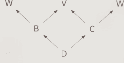

在 V 中声明的名称以及 W 的左侧实例中的名称被 B 中的名称隐藏，但 W 的右侧实例中声明的名称根本没有被隐藏。

### 问题 181 — 虚函数

下面程序的输出是什么？

程序 13.5：虚函数

```cpp
1 #include <iostream>
2
3 struct A
4 {
5     virtual void f()
    {
        std::cout << "A::f()" << std::endl;
    }
};
struct B : virtual A
{
    virtual void f()
    {
        std::cout << "B::f()" << std::endl;
    }
};
struct C : B, virtual A
{
    using A::f;
};
int main()
{
    C c;
    c.f();
    c.C::f();
}
```

### 问题 181 的解答

它打印

```text
B::f()
A::f()
```

- `c.f()` 调用 `B::f`，因为最终覆盖者
- `c.C::f()` 调用 `A::f`，因为 using 声明

虚函数支持动态绑定和面向对象编程。声明或继承虚函数的类称为*多态类*。

如果虚成员函数 `vf` 在类 *Base* 中声明，并且在直接或间接派生自 *Base* 的类 *Derived* 中声明了一个成员函数 `vf`，该函数与 `Base::vf` 具有相同的名称、参数类型列表、cv 限定和引用限定符（或缺少相同项），那么 `Derived::vf` 也是虚函数（无论是否如此声明），并且它覆盖 `Base::vf`。

为方便起见，我们说任何虚函数都覆盖自身。

类对象 `S` 的虚成员函数 `C::vf` 是最终覆盖者，除非 `S` 是其基类子对象的最派生类（如果有）声明或继承了另一个覆盖 `vf` 的成员函数。

在派生类中，如果基类子对象的虚成员函数有多个最终覆盖者，则程序非良构。

### 问题 182 — 虚函数与隐藏

审阅下面的程序。

```cpp
struct B
{
    virtual void f();
};
struct D : B
{
    void f(int);
};
struct D2 : D
{
    void f();
};
```

### 问题 182 的解答

需要注意的是，虚成员函数不必可见也能被覆盖。

这里，类 D 中的函数 f(int) 隐藏了其基类 B 中的虚函数 f()；D::f(int) 不是虚函数。

然而，在类 D2 中声明的 f() 与 B::f() 具有相同的名称和相同的参数，因此它是覆盖函数 B::f() 的虚函数，即使 B::f() 在类 D2 中不可见。

### 问题 183 — 虚函数与 final

审阅下面的程序。

程序 13.6：虚函数与 final

```cpp
struct B
{
    virtual void f() const final;
};
struct D : B
{
    void f() const;
};
```

### 问题 183 的解答

编译器错误是：

```text
final_virtual.cpp:8:10:
error: declaration of 'f' overrides a
        'final' function
        void f() const;

final_virtual.cpp:3:18:
note: overridden virtual function is here
        virtual void f() const final;

1 error generated.
```

如果某个类 *B* 中的虚函数 *f* 用 *虚说明符 final* 标记，并且在派生自 *B* 的类 *D* 中，函数 *D::f* 覆盖 *B::f*，则程序非良构。

### 问题 184 — 虚函数与 override

审阅下面的程序。

程序 13.7：虚函数与 override

```cpp
1 struct B
2 {
3     virtual void f(int);
4 };
5
6 struct D : B
7 {
8     virtual void f(long) override;
9     virtual void f(int) override;
10 };
```

### 问题 184 的解答

编译器错误是：

```text
override_virtual.cpp:8:18:
error: 'f' marked 'override' but does not override
        any member functions
        virtual void f(long) override;

1 error generated.
```

如果虚函数用 *虚说明符 override* 标记，但没有覆盖基类的成员函数，则程序非良构。

### 问题 185 — 访问默认模板实参

审阅下面的程序。

```cpp
};
```

## 问题 186 的解答

是。

当友元声明引用重载名称或运算符时，只有由参数类型指定的函数成为友元。类 *X* 的成员函数可以是类 *Y* 的友元。因此，构造函数和析构函数也可以成为友元。

### 问题 187 — 访问虚函数

下面的程序有效吗？如果有效，输出是什么？

程序 13.9：访问虚函数

```cpp
#include <iostream>

struct B
{
    virtual void f()
    {
        std::cout << "B::f()" << std::endl;
    }
};

struct D : B
{
private:
    void f()
    {
        std::cout << "D::f()" << std::endl;
    }
};

int main()
{
    D d;
    B* pb = &d;
    pb->f();
}
```

### 问题 187 的解答

是。

它打印

```text
D::f()
```

虚函数的访问规则由其声明决定，不受后来覆盖它的函数的规则影响。

### 问题 188 — const/volatile 构造函数

构造函数可以声明为 `const`、`volatile` 或 `const volatile` 吗？

### 问题 188 的解答

否。

构造函数不能声明为 `const`、`volatile` 或 `const volatile`。`const` 和 `volatile` 语义不应用于正在构造的对象。它们在针对最派生对象的构造函数结束时生效。

### 问题 189 — new 与悬垂引用

审阅下面的程序。

程序 13.10：new 与悬垂引用

```cpp
#include <utility>
struct A
{
    int i;
    const std::pair<int,int>& p;
};
int main()
{
    A * p = new A{ 1, {2, 3} };
}
```

### 问题 189 的解答

这会导致编译错误：

```text
dangling_ref_new.cpp:11:24: error:
reference to type 'const std::pair<int, int>'
    could not bind to an rvalue of type 'int'
    A * p = new A{ 1, {2, 3} };
                         ^

1 error generated.
```

在 new 初始化器中绑定到引用的临时对象会持续到包含该 new 初始化器的完整表达式结束。这里，第 11 行创建了一个悬垂引用。

### 问题 190 — 用户定义转换

下面的用户定义转换允许吗？

程序 13.11：用户定义转换

```cpp
struct X
{
    operator int ();
};
struct Y
{
    operator X();
};
int main()
{
    Y a;
    int b = a;
    int c = X(a);
}
```

### 问题 190 的解答

这会导致编译错误：

```text
conversion.cpp:14:9:
error: no viable conversion from 'Y' to 'int'
    int b = a;
        ~   ^
conversion.cpp:8:5: note: candidate function
    operator X();
    ^

1 error generated.
```

*至多一个用户定义转换（构造函数或转换函数）会隐式应用于单个值。*

- `int b = a;` 是错误的：这里不会尝试 `a.operator X().operator int()`。
- `int c = X(a);` 没问题：会应用 `a.operator X().operator int()`。

### 问题 191 — 通过构造函数进行转换

审阅下面的程序。

程序 13.12：通过构造函数进行转换

```cpp
struct A
{
    A(int);
    A(const char*, int = 0);
    A(int, int);
};
```


```cpp
8 void f(A arg)
9 {
10    A a = 1;
11    A b = "Lin";
12    a = 2;
13    f(3);
14    f({1, 2});
15 }
```

### 问题191的解答

这是一段有效的代码。未使用函数说明符 explicit 声明的构造函数指定了从其参数类型到其类类型的转换。这样的构造函数称为转换构造函数。

- A a = 1 与 A a = A(1) 相同
- A b = "Lin" 与 A b = A("Lin", 0) 相同
- a = 2 与 a = A(2) 相同
- f(3) 等价于 f(A(3))
- f({1,2}) 等价于调用 f(A(1, 2))

### 问题192 — 转换运算符

下面描绘的三次调用都会调用所提供的转换构造函数吗？

```cpp
1 struct A
2 {
3    operator int();
4 };
5
6 void f(A a)
7 {
8    int i = int(a);
9    i = (int)a;
10   i = a;
11 }
```

### 问题192的解答

是的，在三种情况下，所赋的值都将由 A::operator int() 转换。

### 问题193 — 析构函数

下面程序的输出是什么？

### 程序13.13：析构函数

```cpp
#include <iostream>

struct B
{
    virtual ~B()
    {
        std::cout << "B::~B()" << std::endl;
    }
};

struct D : B
{
    ~D()
    {
        std::cout << "D::~D()" << std::endl;
    }
};

int main()
{
    D d;
    typedef B B1;

    B* bptr = &d;

    d.B::~B();

    bptr->~B();

    bptr->~B1();

    bptr->B1::~B();

    bptr->B1::~B1();
}
```

### 问题193的解答

```
B::~B()
D::~D()
D::~D()
B::~B()
B::~B()
D::~D()
B::~B()
```

- `d.B::~B();` 调用 B 的析构函数
- `bptr->~B();` 调用 D 的析构函数

### 问题196 — 释放函数的签名

为给定类 A 提供释放函数的签名。

### 问题196的解答

```cpp
class A
{
    void operator delete(void*);
    void operator delete[](void*, std::size_t);
};
```

类 A 的任何释放函数都是静态成员（即使未显式声明为 static）。

### 问题197 — delete 与 virtual

程序的输出是什么？

### 程序13.14：delete 与 virtual

```cpp
#include <iostream>

struct B
{
    virtual ~B()
    {
        std::cout << "B::~B()" << std::endl;
    }

    void operator delete(void*, std::size_t)
    {
        std::cout << "B::operator_delete" << std::endl;
    }
};

struct D : B
{
    void operator delete(void*)
    {
        std::cout << "D::operator_delete" << std::endl;
    }
};

int main()
{
    B* bp = new D;
    delete bp;
}
```

### 问题197的解答

它打印：

```
B::~B()
D::operator_delete
```

由于成员分配和释放函数是静态的，因此它们不能是虚函数。然而，当 delete 表达式的 cast-expression 引用类类型的对象时，由于实际调用的释放函数是在对象的动态类型所属类的范围内查找的，如果析构函数是虚函数，则效果取决于对象的动态类型。

这里，由于虚析构函数，类 D 的非数组对象的存储由 `D::operator delete()` 释放（即，`delete bp` 调用 `D::operator delete(void*)`）。

请注意，对释放函数的访问是静态检查的。因此，即使实际可能执行不同的释放函数，静态可见的释放函数也必须是可访问的。如果上面的 `B::operator delete()` 是私有的，则 delete 表达式将是非良构的。

### 问题198 — 基类初始化器

审查程序？

### 程序13.15：基类初始化器

```
struct A
{
    A();
};

struct B: virtual A { };

struct C: A, B
{
    C();
};

C::C(): A() { }
```

### 问题198的解答

编译器错误是：

```
mem_initializer.cpp:13:9: error:
base class initializer 'A' names both a direct
base class and an inherited virtual base class
C::C(): A() { }
          ^

1 error generated.
```

如果 *mem-initializer-id* 存在歧义，因为它同时指定了直接非虚基类和继承的虚基类，则该 *mem-initializer* 是非良构的。

这里，C::C(): A() 是非良构的：是哪个 A？

### 问题199 — 包展开与初始化器

这个程序有效吗？

```cpp
1 template<class... Mixins>
2 class X : public Mixins...
3 {
4 public:
5     X(const Mixins&... mixins)
6         :
7         Mixins(mixins)... { }
8 };
```

### 问题199的解答

是的。后跟省略号的 *mem-initializer* 是一个 *pack expansion*，它初始化由类的 *base-specifier-list* 中的包展开所指定的基类。

### 问题200 — 非平凡构造函数

这个程序有效吗？

```cpp
1 struct W { int j; };
2 struct X : public virtual W { };
3 struct Y
4 {
5     int *p;
6     X x;
7     Y() : p(&x.j) { }
8 };
```

### 问题200的解答

不。

对于具有非平凡构造函数的对象，在构造函数开始执行之前引用该对象的任何非静态成员或基类会导致未定义行为。

对于具有非平凡析构函数的对象，在析构函数执行完毕之后引用该对象的任何非静态成员或基类会导致未定义行为。

这里，`Y() : p(&x.j)` 会导致未定义行为，因为 *x* 尚未构造。

### 问题201 — 初始化器与 this

审查程序。

```cpp
virtual void f();
};
struct A : virtual V {};
struct B : virtual V
{
    B(V*, A*);
};
struct D : A, B
{
    D() : B((A*)this, this) { }
};
B::B(V* v, A* a)
{
    typeid(*this);
    typeid(*v);
    typeid(*a);
    dynamic_cast<B*>(v);
    dynamic_cast<B*>(a);
}
```

### 问题202的解答

*dynamic_cast*s 可以在构造或析构期间使用。

当在构造函数（包括非静态数据成员的 *mem-initializer* 或 *brace-or-equal-initializer*）或析构函数中使用 *dynamic_cast*，或在从构造函数或析构函数（直接或间接）调用的函数中使用 *dynamic_cast* 时，如果 *dynamic_cast* 的操作数引用正在构造或析构的对象，则该对象被视为具有构造函数或析构函数所属类类型的最派生对象。

如果 *dynamic_cast* 的操作数引用正在构造或析构的对象，并且操作数的静态类型不是指向构造函数或析构函数自身类或其基类的指针或对象，则 *dynamic_cast* 会导致未定义行为。

这里，

- `typeid(*this)` 是 B 的 `type_info`。
- `typeid(*v)` 是良定义的：`*v` 的类型为 V，作为 B 的基类，产生 B 的 `type_info`。
- `typeid(*a)` 具有未定义行为：类型 A 不是 B 的基类
- `dynamic_cast<B*>(v)` 是良定义的：v 的类型为 V*，V 是 B 的基类，结果为 B*。
- `dynamic_cast<B*>(a)` 具有未定义行为，a 的类型为 A*，A 不是 B 的基类。

### 问题203 — 继承构造函数

列出 D1 和 D2 中可用的构造函数。

```cpp
struct B1
{
    B1(int);
};

struct B2
{
    B2(int = 13, int = 42);
};

struct D1 : B1
{
    using B1::B1;
};

struct D2 : B2
{
    using B2::B2;
};
```

### 问题203的解答

D1 中针对 B1 的继承构造函数候选集为

- B1(const B1&)
- B1(B1&&)
- B1(int)

D1 中存在的构造函数集合为

- D1()，隐式声明的默认构造函数，如果被 odr 使用则非良构
- D1(const D1&)，隐式声明的拷贝构造函数，不被继承
- D1(D1&&)，隐式声明的移动构造函数，不被继承
- D1(int)，隐式声明的继承构造函数

D2 中针对 B2 的继承构造函数候选集为

- B2(const B2&)
- B2(B2&&)
- B2(int = 13, int = 42)
- B2(int = 13)
- B2()

D2 中存在的构造函数集合为

- D2()，隐式声明的默认构造函数，不被继承
- D2(const D2&)，隐式声明的拷贝构造函数，不被继承
- D2(D2&&)，隐式声明的移动构造函数，不被继承
- D2(int, int)，隐式声明的继承构造函数
- D2(int)，隐式声明的继承构造函数

### 问题204 — 隐藏

审查程序。

### 程序13.18：隐藏

```cpp
struct B
{
    int f(int);
};
struct D : B
{
    int f(const char*);
};
void h(D* pd)
{
    pd->f(1);
    pd->B::f(1);
    pd->f("Ben");
}
```

### 问题204的解答

编译器错误是：


```text
hiding.cpp: In function ‘void h(D*)’:
hiding.cpp:13:12: error: invalid conversion from
‘int’ to ‘const char*’ [-fpermissive]
        pd->f(1);
             ^

hiding.cpp:8:9: error: initializing argument 1
of ‘int D::f(const char*)’ [-fpermissive]
        int f(const char*);
            ^
```

派生类的函数成员与基类中同名函数成员不在同一作用域中。这里 `D::f(const char*)` 隐藏了 `B::f(int)`，而不是重载它。

因此调用 `pd->f(1)` 是错误的。

### 问题 205：隐藏运算符

审查以下程序。

**程序 13.19：隐藏运算符**

```cpp
1  struct A { };
3  void operator + (A, A);
5  struct B
6  {
7      void operator + (B);
8      void f();
9  };
11 A a;
13 void B::f()
14 {
15     operator+ (a,a);
16     a + a;
17 }
```

### 问题 205 的解答

编译器错误为：

```text
operators.cpp:15:18: error: too many arguments to
function call, expected 1,
        have 2
        operator+ (a,a);
~~~~~~~~~~        ^
operators.cpp:7:5: note: 'operator+' declared here
    void operator + (B);

1 error generated.
```

表达式中运算符的查找规则与函数调用中运算符函数名的查找规则不同。

这里 `operator+ (a,a)` 会报错，因为全局运算符被成员运算符隐藏了。而表达式 `a + a` 没有问题，因为它调用了全局 `operator+`。

## 第 14 章：模板

### 问题 206：非类型模板参数

下列哪些类模板声明是有效的？

```cpp
1 template<double d> class X;
2 template<double* pd> class Y;
3 template<double& rd> class Z;
```

### 问题 206 的解答

非类型模板参数不能声明为浮点类型、类类型或 void 类型。
因此 `template<double d> class X` 无效，其余均有效。

### 问题 207：默认模板参数

审查以下程序。

```cpp
1 template<class T1, class T2 = int> class A;
2 template<class T1 = int, class T2> class A;
```

### 问题 207 的解答

可用于模板声明或定义的默认模板实参集合，是通过以与默认函数实参相同的方式合并定义中的默认实参（如果在该作用域内）和该作用域内所有声明中的默认实参而得到的。
因此该程序等价于

```cpp
1 template<class T1 = int, class T2 = int> class A;
```

### 问题 208：模板与 template-id

审查以下程序。

```cpp
1 template <class T>
2 struct A
3 {
4     void f(int);
5     template <class U>
6     void f(U);
7 };
8
9 template <class T>
10 void f(T t)
11 {
12     A<T> a;
13     a.template f<>(t);
14     a.template f(t);
15 }
16
17 template <class T>
18 struct B
19 {
20     template <class T2>
21     struct C { };
22 };
23
24 template <class T, template <class X> class TT = T::template C>
25 struct D { };
26
27 D<B<int> > db;
```

### 问题 208 的解答

`a.template f<>();` 没有问题：它调用模板；但 `a.template f();` 会报错，因为它不是 template-id。`struct D` 的默认模板参数也没有问题，因为 `T::template C` 命名了一个类模板。

### 问题 209：模板实参与 type-id

程序的输出是什么？

**程序 14.1：模板实参与 type-id**

```cpp
1 #include <iostream>
3 template<class T>
4 void f()
5 {
6     std::cout << "template<class T> void f" << std::endl;
7 }
8
9 template<int I>
10 void f()
11 {
12     std::cout << "template<int I> void f" << std::endl;
13 }
14
15 int main()
16 {
17     f<int>();
18 }
```

### 问题 209 的解答

它会打印

```cpp
template<class T> void f
```

在模板实参中，type-id 与表达式之间的歧义会被解析为 type-id，无论对应模板参数的形式如何。
因此 `f<int>()` 调用第一个 `f()`，因为 `int()` 是一个 type-id。

### 问题 210：显式特化与 static

该程序有效吗？

```cpp
template <class T> struct A
{
    static int i[];
};

template <class T> int A<T>::i[4];
template <> int A<int>::i[] = { 1 };
```

### 问题 210 的解答

是。

声明为未知边界数组的静态数据成员的显式特化，可以具有与其定义（如果有）不同的边界。

### 问题 211：虚成员函数模板

审查以下程序。

**程序 14.2：虚成员函数模板**

```cpp
template <class T>
struct A
{
    template <class U>
    virtual void f(U);
};
```

### 问题 211 的解答

编译器错误为：

```text
virtual_template.cpp:5:5: error:
'virtual' cannot be specified on member
    function templates
    virtual void f(U);
    ~~~~~~~
1 error generated.
```

成员函数模板不能是虚函数。

### 问题 212：重写虚函数与模板

下列哪个成员函数重写了 `B::f(int)`？

```cpp
class B
{
    virtual void f(int);
};
class D : public B
{
    template <class T>
    void f(T);
    void f(int i)
    {
        f<>(i);
    }
};
```

### 问题 212 的解答

成员函数模板的特化不会重写基类中的虚函数。因此 `template <class T> void f(T)` 不会重写 `B::f(int)`。`void f(int i)` 是重写函数，它调用模板实例化。

### 问题 213：参数包

什么是模板参数包和函数参数包？

### 问题 213 的解答

模板参数包是一种接受零个或多个模板实参的模板参数。例如：

```cpp
template<class ... Types> struct Tuple { };
Tuple<> t0;                  // Types contains no arguments
Tuple<int> t1;               // Types contains one argument : int
Tuple<int, float> t2;        // Types contains two arguments : int and float
Tuple<> error;               // error : <> is not a type
```

函数参数包是一种接受零个或多个函数实参的函数参数。例如：

```cpp
1 template<class ... Types> void f(Types ... args);
2 f(); // args contains no arguments
3 f(1); // args contains one argument: int
4 f(2, 1.0); // args contains two arguments: int and double
```

### 问题 214：别名模板

什么是别名模板？

### 问题 214 的解答

若一个模板声明中的声明是别名声明，则该声明将标识符声明为别名模板。别名模板是一族类型的名字。别名模板的名字是一个模板名。

当 template-id 指代别名模板的特化时，它等价于将别名模板的 type-id 中的模板参数替换为其模板实参后得到的关联类型。

例如：

```cpp
1 template<class T> struct Alloc { /* ... */ };
2 template<class T> using Vec = vector<T, Alloc<T>>;
3 Vec<int> v; // same as vector<int, Alloc<int>> v;
```

请注意，别名模板名永远不会被推导。

## 第 15 章：标准库

### 问题 215：约束类

编写一个约束类 `HasEqual`，用于检查 `==` 运算符是否存在。

### 问题 215 的解答

```cpp
template<typename T, typename U>
struct HasEqual
{
    HasEqual() { auto p = constraints; }

    static void constraints(T x, U y)
    {
        x == y;
    }
};
```

`HasEqual` 构造函数通过声明指向该函数的指针，强制实例化静态 constraints 成员函数。该函数为其形参所引入的对象实现一组有效表达式。

该 constraints 函数体包含一条语句，用于查找适用于 `T` 和 `U` 类型的 `==`。如果找不到这样的运算符，实例化将失败，编译器会发出相应的错误消息。

这里该表达式的结果不受约束。

### 问题 216：复用约束类

复用上述约束类 `HasEqual` 来实现概念类 `EqualityComparable`。

### 问题 216 的解答

约束类可以通过继承或组合来复用。


```cpp
template<typename T>
struct EqualityComparable : HasEqual<T, T>
{
    EqualityComparable()
    {
        auto p = constraints;
    }

    static void constraints(T x, T y)
    {
        Convertible<decltype(x == y), bool>{};
        Convertible<decltype(x != y), bool>{};
    }
};
```

通过继承 *HasEqual*，借助初始化顺序，约束会在 *EqualityComparable* 约束类中的约束之前被检查。*EqualityComparable* 类在其内部应用了额外的约束。

这里，*Convertible* 约束被写成对临时对象的显式初始化。这会检查一个表达式的结果（*decltype* 运算符返回表达式的类型）能否转换为指定类型，此处为 *bool*。

对 != 也有类似的要求。*Convertible* 定义为：

```cpp
template<typename T, typename U>
struct Convertible
{
    Convertible()
    {
        static_assert(std::is_convertible<T, U>::
            value, "Not convertible");
    }
};
```

该约束通过对 *std::is_convertible* 类型特征进行静态断言来实现。*type trait*（类型特征）是一个类模板，用于评估其类型参数的某些属性。嵌套的 *value* 包含评估的结果。这里不需要约束函数，因为无需引入对象即可评估该特征。

### 问题 217 类型特征

提供一个类型特征 *is_same* 的类模板实现，使得仅当 X 和 Y 表示相同类型时，*is_same<X, Y>::value* 才为 true。结果值应是一个常量表达式，可由编译器在 *static_assert* 等上下文中求值。

### 问题 217 的解答

```cpp
template<typename T, typename U>
struct is_same
{
    static constexpr bool value = false;
};

template<typename T>
struct is_same<T, T>
{
    static constexpr bool value = true;
};
```

主模板（第一个声明）定义了 X 和 Y 为不同类型时的结果。特化版本定义了模板参数相同时的结果。

### 问题 218 advance 和 next

为输入迭代器和前向迭代器提供 STL 算法 advance 的实现，然后使用 advance 算法实现一个迭代器工具 next。

### 问题 218 的解答

```cpp
template<typename Iter>
void advance(Iter& first, int n)
{
    while(n > 0)
    {
        ++first;
        --n;
    }
}

template<typename Iter>
Iter next(Iter i, int n = 1)
{
    advance(i, n);
    return i;
}
```

### 问题 219 自定义 iota

定制化 STL 算法 iota 的递增/递减部分。

### 问题 219 的解答

为自定义步长重载 iota：

```cpp
template <typename ForwardIterator, typename T>
void iota(ForwardIterator first, ForwardIterator last,
          T value, T step = 1)
{
    for (; first != last; ++first, value += step)
        *first = value;
}

// 用法：
std::vector<int> vint(5);
std::vector<int> v_expected = {5, 10, 15, 20, 25};
iota(vint.begin(), vint.end(), // 目标范围
     5, // 起始值
     5); // 每次递增 5

assert(std::equal(vint.begin(), vint.end(),
                  v_expected.begin()));
```

以额外参数的形式为 iota 重载步长，需要修改实现以及既有的接口，这在某些情况下可能并不可行。另一方面，我们可以通过重载前置递增运算符轻松实现同样的输出，如下所示：

```cpp
template <typename InitialValue, typename StepSize>
struct step_helper
{
    step_helper(InitialValue val, StepSize step)
        : _val(val), _step(step) {}

    step_helper& operator++()
    {
        _val += _step; return *this;
    }

    operator InitialValue() { return _val; }
private:
    InitialValue _val;
    const StepSize _step;
};

template<typename InitialValue, typename StepSize =
    InitialValue>
step_helper<InitialValue, StepSize>
step(InitialValue val, StepSize s = 1)
{
    return step_helper<InitialValue, StepSize>(val,
        s);
}
// 用法：自定义递增为 10
std::array<int, 5> arr;
std::array<int, 5> arr_res = {5, 15, 25, 35, 45};
std::iota(arr.begin(), arr.end(), step(5, 10));
assert(std::equal(arr.begin(), arr.end(), arr_res.
    begin()));
```

### 问题 220 all_of 算法

使用 *find_if_not* 和 *find_if* 实现 STL 算法 *all_of*。

### 问题 220 的解答

```cpp
template<typename InputIterator, typename Predicate>
inline bool
all_of(InputIterator first, InputIterator last,
       Predicate pred)
{
    return last == std::find_if_not(first, last,
        pred);
}

template<typename InputIterator, typename Predicate>
inline bool
all_of(InputIterator first, InputIterator last,
       Predicate pred)
{
    return last == std::find_if(first, last, std::not1(pred));
}
```

### 问题 221 is_partitioned 算法

使用以下接口实现 STL 算法 *is_partitioned*

```cpp
template<typename InputIterator, typename Predicate>
bool is_partitioned(InputIterator first,
        InputIterator last, Predicate p);
```

它返回 true，如果：

- [first, last) 被一元谓词 p 划分，即所有满足 p 的元素都出现在不满足 p 的元素之前。或者，
- [first, last) 为空。

换句话说，序列中所有满足谓词的元素都位于序列的开头。

### 问题 221 的解答

该算法包含两个阶段：

1. 找到第一个不满足谓词的元素。算法 `std::find_if_not` 在这里非常合适。
2. 从上述找到的元素开始，不应有任何元素满足该谓词。`std::none_of` 可以轻松完成这项工作。

```cpp
template<typename InputIterator, typename Predicate>
bool is_partitioned(InputIterator first,
                    InputIterator last,
                    Predicate p)
{
    first = std::find_if_not(first, last, p);
    return std::none_of(first, last, p);
}
```

或者

```cpp
template<typename InputIterator, typename Predicate>
bool is_partitioned(InputIterator first,
                    InputIterator last,
                    Predicate p)
{
    while(first != last && p(*first))
        ++first;
    while(first != last && !p(*first))
        ++first;
    return (first == last);
}
```

## 索引

- 2D 数组旋转，126
- 邮局中的一个排队问题，129
- 访问默认模板实参，474, 475
- 访问虚函数，476
- ADL（实参依赖查找），336–339
- advance 和 next，500
- 别名模板，496
- 对齐，361
- 对齐说明符，441
- all_of 算法，502
- 替代欧几里得算法，278
- 祖先，184
- 近似计算一个数的平方根，4
- 数组与 sizeof，450
- 数组与 typedef，449, 450
- 属性，395
- auto 作为尾置返回类型，445
- auto 类型说明符，380, 416, 417
- auto 类型说明符与模板实参推导，417, 418
- using 声明的可用性，431
- 基类初始化器，483
- 基本查找，339–341
- constexpr 基础，398, 400
- 位域与并发，314
- 花括号初始化器列表与赋值，386, 387
- 花括号初始化器列表作为下标，368
- Bulterman 重排问题，151
- carries_dependency 属性，444
- 循环数组，158
- 类作用域变量，327, 328
- 类，464
- 逗号运算符与实参，387
- 编译器生成的成员函数，321, 322
- 完全二叉树，195
- 计算 a，274
- 计算函数，288
- 计算 GCD，276
- 仅使用加法和减法计算平方，280
- 计算子数组之和，176
- 计算乘积 a × b，275
- 计算商和余数，275
- 计算约束 GCD，277
- const/volatile 构造函数，477
- const/volatile 限定符，412, 413
- 常数时间范围查询，79
- constexpr，398
- constexpr 与构造函数，409
- constexpr 与字面类型，408
- constexpr 构造函数，387, 388, 402
- constexpr 函数，400, 401


## 索引

- constexpr 函数与替换, 404, 405
- constexpr 函数示例, 403, 404
- 约束类, 498
- 构造函数名称查找, 342, 343
- 通过构造函数进行转换, 478, 479
- 转换运算符, 479
- 计数类型, 379
- 自定义 iota, 500
- Damerau 编辑距离, 203
- 十进制周期长度, 286
- 十进制表示, 282
- 决策树, 248
- 声明：全局与局部, 350, 351
- 声明与嵌套命名空间, 349
- 声明与定义, 320, 321
- decltype, 414
- 默认实参, 454
- 默认实参与局部变量, 455
- 默认实参与成员函数, 454, 455
- 默认实参与 this, 455, 456
- 默认模板参数, 492
- delete 与 virtual, 482
- 被删除的函数与 inline, 459
- 析构函数, 479, 480
- 析构函数与 typeid, 342
- 任意类型的析构函数, 481
- 确定性算法, 262
- 确定性分区, 252
- 不同地址位置, 316
- 动态转换, 370
- 动态转换的运行时检查, 371
- 动态转换与基类/派生类, 370
- 动态转换与 void, 371
- 动态规划, 213
- dynamic_cast 与构造, 485, 486
- 编辑距离, 203
- 模拟除法与取模运算, 289
- 表达式求值, 317
- 交换前缀和后缀, 295
- 扩展器, 265
- 显式调用析构函数, 481
- 显式特化与静态成员, 494
- 显式默认的函数, 456
- 幂运算, 56
- 阶乘, 281
- 查找非数组子集和的数, 177
- 求绳子的长度, 99
- 求最大值, 299
- 求两个有序数组的中位数, 159
- 查找缺失的整数, 180
- 查找下一个更大的数, 236
- 查找前一个更小的数, 240
- 查找与 K 最接近的和, 224
- 查找与零最接近的和, 219
- 查找数组中出现一次的数, 181
- 查找链表中的排名, 304
- 查找树中第 *k* 小的元素, 305
- 查找多数元素, 154
- 查找缺失的整数, 161
- 在有序列中查找缺失的数字, 167
- C++ 中的固定大小泛型数组, 44
- 友元构造函数/析构函数, 475, 476
- 友元函数与命名空间, 422, 423
- 友元成员函数与名称查找, 335
- 友元模板参数, 415
- 函数定义与未命名命名空间, 421, 422
- 高效生成排列, 8
- 汉明问题, 76
- 隐藏/覆盖与 using 声明, 434
- 隐藏, 488
- 隐藏运算符, 489
- 非法类型转换, 382, 383
- 内、上或外, 102
- 自增运算符, 318
- 独立集, 229
- 继承构造函数, 487
- 初始化器与 this, 484, 485
- 初始化器列表, 460
- 初始化器列表与数组生存期, 462, 463
- 初始化器列表与构造函数, 461, 462
- 初始化器列表与 map, 461
- 注入的类名, 351, 352
- 内联函数, 396
- 原地反转, 181
- 整型类型, 358, 359
- 插值查找, 133
- 判断序列是否（几乎）有序, 28
- is_partitioned 算法, 502
- k 最大子数组问题, 226
- Kadane 一维算法, 213
- Kadane 二维算法, 225
- 选择第 k 小的元素, 22
- 两个有序数组中的第 k 小元素, 177
- lambda 与默认实参, 366
- lambda 与排序, 365
- LCA（最低公共祖先）, 184
- LCA 解法：完全二叉树, 195
- LCA 解法：常数时间, 195
- LCA 解法：基于层次, 192
- LCA 解法：基于异或, 195
- Levenshtein 编辑距离, 203
- 线性时间排序, 81, 142
- 链接性, 353
- 字面量与左值, 363
- 字面量类与整型常量, 389, 390
- 字面量类型, 407
- 最长公共子序列, 204
- 最低公共祖先（LCA）问题, 184
- LRU 数据结构, 291
- 左值引用, 448
- 左值到值的转换, 361
- 二维最大子数组问题, 225
- 最大子数组问题, 213
- 序列的最大值, 14
- 最大和子数组问题, 213
- 成员函数查找, 467, 468
- 成员查找与虚基类, 469, 470
- 成员名称查找, 467
- 多重集的众数, 157
- 多重声明, 346, 347
- 对命名空间的多次引用, 347, 348
- 多个 using 声明, 430
- 音乐识别, 210
- mutable 与 const, 383
- n 叉树, 186
- 命名空间, 343, 345
- 命名空间别名, 424
- 命名空间 extern 与查找, 336
- 命名空间作用域变量, 328, 329
- 嵌套 lambda 表达式, 367, 368
- 嵌套链接规范, 440
- new 与悬空引用, 477
- 下一个更大的排列, 237
- 非类型模板参数, 492
- 非 const 到 const 的转换, 362
- 非静态成员查找, 468, 469
- 非平凡构造函数, 484
- 非类型名称与命名空间, 348
- 不可复制（又称仅可移动）类, 458
- noreturn 属性, 443
- nullptr, 319
- 螺母与螺栓问题, 248
- ODR 与默认构造函数, 324, 325
- operator new, 381
- 顺序：const/volatile, 359
- override、virtual 与模板, 495
- 包展开与初始化器, 484
- 并行加法, 298
- 并行算法, 298
- 参数包, 495
- 函数的参数类型, 445, 446
- 部分快速排序, 26
- 分区, 252
- 聚会问题, 231
- 路径数量, 195
- 排列, 248
- 定位运算符, 381, 382
- 指向成员函数的指针, 383
- 指针, 446
- 指针比较, 384
- 指向成员的指针, 449
- 成员指针比较, 385, 386
- 后置条件, 60
- 后序遍历, 186
- 前置条件, 59
- 前缀数组, 225
- 先序遍历, 186
- 防止创建类的新实例, 457
- 前一个更小的排列, 240
- 按螺旋顺序打印二维数组, 144
- 打印十进制表示, 286
- 伪析构函数, 369
- 快速选择（迭代）, 27
- 快速排序, 250, 255
- 随机数生成, 265
- 随机化分区, 258
- 随机化快速选择, 23
- 随机化快速排序, 249, 260
- 基于范围的 for 循环, 394
- 重新排列数组, 171
- 关系运算符与 void *, 384
- 可靠分配, 228
- 受限区间最小值问题, 198
- 返回花括号初始化列表, 394, 395
- 从 main 返回, 354
- lambda 的返回类型, 366
- 重用约束类, 498
- 反转十进制表示, 283
- 修订 constexpr 构造函数, 406, 407
- 修订 constexpr 函数, 405, 406
- 重访受限 GCD, 279
- 机器人行走, 137
- 有根树, 184
- 鞍点, 76
- 鞍背计数, 71
- 鞍背搜索, 61
- 鞍背搜索查找所有出现位置, 67
- 鞍背搜索查找首次出现, 65
- 条件变量的作用域, 390-392
- 静态成员的作用域, 465
- 模板参数的作用域, 329, 330
- 作用域枚举项, 418, 419
- 在二维序列中搜索, 116
- 搜索二维有序数组, 58
- 座位问题, 48
- 分段问题, 53
- 选择第 K 小的元素, 14
- 序列周期性问题, 287
- 信号与值, 316
- 释放函数的签名, 482
- 模拟初始化器列表与构造函数, 462
- 基于范围的 for 循环的模拟, 394
- while 循环的模拟, 393
- 单源最短路径, 210
- sizeof, 364, 365
- 求解不等式, 284
- 对子序列组成的序列排序, 179
- 对几乎有序的列表排序, 36
- 字符串数组排序：线性时间, 290
- 稀疏数组技巧, 149
- 间谍行动, 198
- static 与 std::atexit, 354, 355
- static_cast（静态转换）, 375
- static_cast 与基类/派生类, 376
- static_cast 与 const_cast, 377, 378
- static_cast 与不可访问的基类, 376, 377
- static_cast 双向转换, 378, 379
- 静态成员数据, 466
- 静态成员函数, 465
- 静态成员初始化作用域, 459, 460
- std::atexit 与 static, 355, 356
- std::next_permutation, 239
- std::partition, 254
- std::prev_permutation, 242
- 存储类说明符, 395
- 存储期, 358
- 字符串编辑距离, 202
- 开关与灯泡问题, 173
- 开关灯泡问题, 101
- 模板与 template-id, 492, 493
- 模板实参与 type-id, 493, 494
- 模板, 492
- 临时对象与转换, 317
- 三叉树, 249
- 名人问题, 84
- 最长子序列问题, 40
- 非交叉问题, 27
- 并行前缀问题, 301
- 平台问题, 114
- 平衡分段问题, 105
- 环形跑道问题, 147
- 最孤立村庄问题, 108
- 福利骗子问题, 124
- this 指针, 464
- 尾随返回类型, 453
- 编译期与运行时, 389
- 运输问题, 93
- 三字符组序列, 318
- 平凡类, 464
- 两次 std::atexit, 357, 358
- 基类成员的类型, 379
- decltype((auto variable)) 的类型, 368
- 函数的类型, 451
- lambda 的类型, 365
- 成员函数的类型, 451
- new 的类型, 380
- 类型说明符, 412
- 类型特征, 499
- typedef 与 const, 395
- typedef 与 const volatile 函数, 452


- typeof 与函数定义，451, 452
- typeid 与 const/volatile，375
- 类型，448, 449
- 理解动态转换，372-374
- 理解声明点，326, 327
- 唯一5位序列，12
- 未命名命名空间，420
- 非限定名称查找，330–334
- constexpr 函数的用法，401, 402
- 用户定义转换，477, 478
- 用户定义字面量，319
- 使用 new，381
- using 声明，426
- using 声明与可访问性规则，436
- using 声明与歧义基类，435
- using 声明与基类，426, 427
- using 声明与成员声明，428
- using 声明与引用成员，429
- using 声明与相同函数，432
- using 声明与模板 ID，427
- using 指令，437, 438
- 使用未命名命名空间，421
- this 指针的有效用法，364
- 值类别：左值/右值，359, 360
- 变体，60
- 虚函数，471, 472
- 虚函数与 final，473
- 虚函数与隐藏，473
- 虚函数与 override，474
- 虚成员函数模板，494
- 加权中位数，268
- 将正整数写成连续正数之和，143
- 将值写成平方和，81
- xvalue 右值，362, 363

本书收录了顶级科技公司（包括 Facebook、Microsoft、Google、Apple、Yahoo 等）技术面试中最常被问及的 350 道编程问题。所有问题均提供了详细解答，并附有解决同类问题的技巧和方法。


