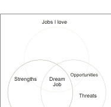
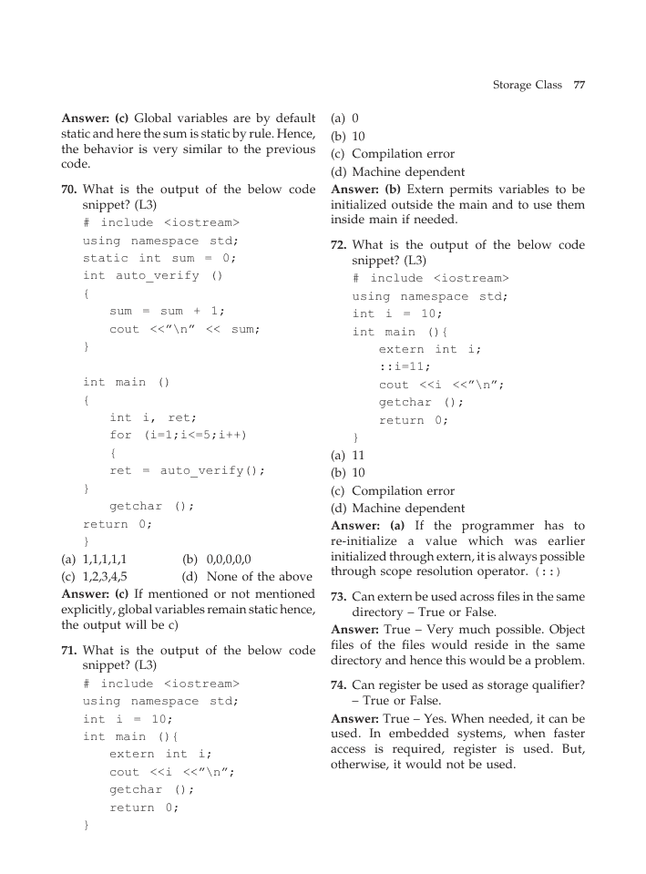
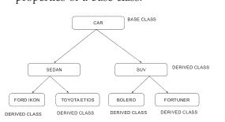
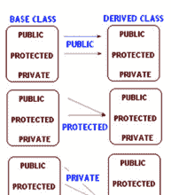
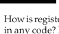
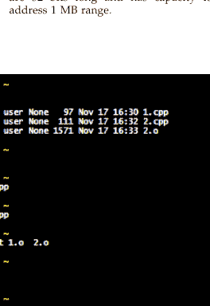

# 攻克 C++ 编程技能


## 前言

### 你是否正处于十字路口？

你是否厌倦了通过 IT 面试却拿不到录用通知？你是否在准备不同的竞争性考试之间感到困惑？你是否被计算机市场上的竞争弄得眼花缭乱？你是否对编程世界的未来感到迷茫？你是否迫切想要一份更好的软件工作，却不知道那是什么，也不知道如何达到？

如果你对上述任何一个问题感同身受，那么你或许已经做出了正确决定——购买本书并准备技术面试！我建议你从第一章到最后一章按顺序阅读，不要试图跳过任何章节或部分，除非你对自己想跳过的主题很有把握。这是因为本书*专门*设计用来*引导*你准备 C++ 编程语言相关的技术面试。本书的编写具有*明确*目的。请继续阅读前言并读到最后，以理解*为什么*。阅读前言后，你很可能会修改你的准备策略。

### IT 就业格局

如果你看到 IT 和 ITeS 领域有大量且*不断增长*的职位空缺，你应当感到鼓舞。情况如下：印度 IT-BPM 行业的首要行业组织 NASSCOM 发布新闻稿称，印度 IT-BPM 行业仍是该国最大的雇主之一——直接雇用近 350 万名专业人员，新增超过 230,000 名员工。他们还预测，随着 IT-BPM 行业为下一阶段挑战做好充分准备，未来前景可期。数字化、颠覆性技术和创新将在未来几年带来新机遇，推动增长。他们还预测，到 2020 年印度 IT 行业将增长到约 3000 亿美元，并形成不同的垂直领域，聚焦于国内 IT 市场、软件产品和电子商务等特定领域，这表明 IT 行业现在和将来都会有更多职位空缺。

### 招聘者视角

作为潜在的求职者，如果你了解招聘者在关注什么，你成功的机会会成倍增加。根据一项新的 CareerBuilder 调查，绝大多数 IT 公司表示，积极态度等软技能与硬技能同等重要。当你对自己的专业领域有信心时，积极性会由内而生。雇主在候选人身上寻找的前 10 项特质包括：勤奋、可靠、积极、自我驱动、团队导向、有条理、抗压能力强、有效沟通、灵活和自信。如果所有这些都能归结为一件事，那就是领域专业知识，它将帮助你获得其余的一切。

### 技术面试流程

招聘是指为组织内的职位吸引、选拔和任命合适候选人的过程。从组织角度看，这包括职位分析、人才寻源、筛选以及最终选拔。尽管每家公司选拔候选人的方式各不相同，但每家公司都力求为“合适”的职位找到“合适”的人。

在技术面试中，申请人可能会被问到以下问题：

- 与公司技术活动所需的特定技能组合相关；
- 与解决复杂问题所需的学科基础知识相关；
- 对于新手，会与学位课程期间完成的项目相关；以及
- 要求候选人解决其受雇后可能面临的实际技术问题。

美国商业杂志《福布斯》的一篇文章谈到技术面试环节之后四个极为常见的面试问题，包括“请介绍一下你自己”“你最大的优势是什么”“我们为什么要雇用你”以及“你有什么问题要问我们吗”。尽管这些问题非常常见，但给出出人意料且最相关的回答会让面试官更快地打起精神并倾听你说话。

### 你的个人 SWOT

既然你知道梦想的工作正在向你招手（你的*机会*），你只需要超越 X 个竞争者（你的*威胁*），也知道招聘者在面试时会关注什么，那么务必列出你的*优势*领域，更重要的是你的*劣势*。虽然你对机会和威胁几乎无法控制，但你可以全力将自己的优势提升到新高度，并改进自己的劣势以战胜它们。使用下面给出的 SWOT 网格来规划你的准备。



### 为什么选择 C++？

人们发现，所有技术面试中有 X% 的核心是 C++ 编程语言。C++ 编程可用于执行网络相关、操作系统相关、嵌入式系统相关等任务。它用于开发计算机应用程序、嵌入式软件网络驱动程序、数据库、模拟器等。此外，人们认为，如果你精通 C++ 这样的编程语言，就能轻松接受多种基于面向对象衍生的不同语言的培训。特定技术知识以及方法论的经验和知识更为重要。持续练习 C++ 客观题将帮助你达到这种状态。

### 为什么写这本书？

正如我在前言中提到的，本书经过专门设计，帮助你进行细致且*客观的准备*。本书内容是从我们的经验和专业知识中精心挑选的，这些经验和专业知识来自直接见证招聘过程、在学院指导学生、与身为学院就业组织者的同行进行无数次讨论，以及花费大量时间研究社交媒体、博客和专门网站上关于这些主题的讨论，因此本书高度聚焦于*C++ 语言的面试准备*，几乎不涉及其他内容。我们得出结论：有效的准备归根结底在于围绕编程问题的多项选择题，以及常被问到的技术性、概念性问题。任何希望提升 C++ 编程语言技能，或准备能力倾向测试、竞争性考试的人，都应通读本书，它将帮助他们实现目标。

我们结合自身技术专长编写多项选择题，帮助你强化薄弱环节。为此，我们认为最好的方法是将问题按难度等级（LOD）分级。从 L1 到 L5，问题的复杂度逐步提高，技术挑战性也不断增加。L1 复杂度最低，考查语法等基础知识；L5 则通过概念深入考查你对逻辑和代码的理解。每章都均匀分布了不同复杂度的问题，并关注所有难度等级。

1. L1：考查该语言的基本语法知识。
2. L2：L2 问题对读者语言理解进行第一级测试。掌握基础知识后，即可尝试 L2。
3. L3：问题旨在考查读者的逻辑视角。
4. L4：主要指出错误发生的位置、确切的错误语句及其原因。
5. L5：这一层级加入棘手问题，以考查你的理解。

### 这本书讲什么？

C++ 编程问答具有明确目的，即帮助准备多种认证考试和求职面试的学生与专业人士。本书提供了一套有用的面试样题和多项选择题集合。

以及它们的答案和适当的解释。让我们从前言部分开始！这些 C++ 编程面试问题与答案旨在让你熟悉在 C++ 编程面试和笔试中可能遇到的问题的性质。

本书在编写时考虑了两类读者。一类是刚接触 C++、想通过客观题学习其基础知识的人；另一类是希望精通面试技巧的人。我们希望你能在接下来的内容中有所收获。LOD（难度级别）将使读者能够循序渐进地检验自己的理解。

本书反映了面试日益增长的复杂性，我们收录了当今顶级公司讨论的最新主题和问题，同时继续强调为备考学生和面试者培养基本问题解决能力。我们通过删除冗余词语、材料和过时模型，提供详细描述，减少列表数量，并使用粗体印刷来引起对重要术语的注意，使本出版物对学生更加友好。

## 本书覆盖范围

C++ 被视为 C 语言的增强。第 1 章完全关注 C 与 C++ 之间的差异。它讨论了该语言特征方面的重大变化。

面向对象编程完全依赖于类。第 2 章深入探讨类的方方面面。它阐明了各种类型的类、内部结构及其用法。本章还详细解释了 OOP 的主要概念“封装”。这将使你在恰当使用 OOP 方面更加扎实。

对象或实例是具有特定属性的类。每次创建对象时，该对象所属类的所有成员都会被初始化。此外，当对象的生命周期结束时，它将被清除，内存将被释放。这种为对象分配和释放内存的内部任务由构造函数和析构函数完成。第 3 章讨论构造函数和析构函数的工作方式及其能力。它详细讨论了各种形式和使用模式。

C++ 具有改变变量存储属性的特殊特性。这是通过存储类实现的。第 4 章向你介绍各种存储类及其用法。它还解释了在类成员中使用存储类的可能性，从而教会你将存储类与 OOP 联系起来。

优秀的程序员必须始终关注资源的使用。主要是专业人员应关注程序中使用的内存量。不应存在任何未使用的内存日志。因此，使用动态内存分配（DMA）。它有助于动态分配、重新分配和释放内存。第 5 章详细阐述 DMA 在编程中的用法，从而提升你的专业技能。

继承是一个重要且非常强大的 OOP 特性。它是从基类到派生类获取特性。它之所以强大，主要在于其重用代码的能力。第 6 章描述继承的用法及其各种可能性。

多态是 OOP 的另一个重要概念。它赋予属性或功能多种形式。运算符重载是为现有运算符添加新特性。第 7 章全面展示运算符重载，审视其威力和能力。

为同一函数提供多个定义可以增强功能。这就是函数重载。此外，如果新定义位于继承类中，那就是函数重写。这两个概念将有助于提高代码的实用性，使其更加专业。第 8 章贯穿讲解函数重载和重写的概念。

类的私有成员只能由其友元和友元函数访问。第 9 章带你进入友元和友元函数的主题，从而增强你解答相关问题的理解。

多用户场景中的歧义相当常见。程序员经常遇到内存冲突，导致程序效率低下。命名空间是 C++ 中一项出色的特性，可避免这种歧义并提高程序效率。第 10 章是对命名空间的独特介绍，读者可以从中理解可以使用命名空间的场景。

C++ 另一个有趣且用户友好的特性是模板。简而言之，它是独立于数据类型的程序。第 11 章带你了解模板的用法，并让你充分利用 C++ 中可用的最佳特性。

错误始终是编程中的背景问题。它挑战程序员继续执行。为了继续编译而处理和绕过错误的一种方法是异常处理。它有助于使代码更加健壮。第 12 章通过让你处理任何类型的异常来提升你的专业技能。

编码技术可以应用于文件中的外部数据。此外，可以使用外部文件跟踪输出。第 13 章介绍文件用法，并帮助你利用该特性来提高代码的健壮性。

宏是已定义的表达式，可提高代码的可读性。第 14 章审视宏所展现的魔力，并激励你在代码中使用它。

作为面试过程的一部分，问题既有来自 OOP 的概念性和理论性问题，也有 C++ 代码。第 15 章旨在让你扎实掌握本书中解释的所有概念。

## 问题分布——按章划分

| 章节 | 详情 | 问题数量 |
| --- | --- | --- |
| 1 | C 与 C++ | 55 |
| 2 | 类 | 140 |
| 3 | 构造函数和析构函数 | 60 |
| 4 | 存储类 | 80 |
| 5 | 动态内存分配 | 30 |
| 6 | 继承 | 110 |
| 7 | 运算符重载 | 40 |
| 8 | 函数重载和重写 | 87 |
| 9 | 友元和友元函数 | 14 |
| 10 | 命名空间 | 11 |
| 11 | 模板 | 13 |
| 12 | 异常处理 | 40 |
| 13 | 文件 | 35 |
| 14 | 宏和包含指令 | 31 |
| 15 | 概念理论 | 161 |
| | 总计 | 907 |

## C 的成功故事

现有相当多的编程语言，从极高级语言到汇编语言的低级强大能力，以及介于两者之间的各种专用选项。C 语言在其中脱颖而出。而 C++ 则高于 C。这主要归功于 OOP 的能力。

C++ 编程语言除了具备 C 的大多数优点外，还有许多优势。首先，C++ 已经存在了二十年，互联网上有大量源代码可用，提供了大量可供学习和使用的信息。它是一种出色的语言，能够以大多数人都能理解的方式表达想法，并且可以与现实世界环境相比较。此外，除 OOP 外，命名空间和模板等特殊特性使程序更加健壮，从而使该语言更受目标群体青睐。

## 本书的其他益处

尽管市场上有很多关于 C++ 编程语言的书籍，但大多数本质上是理论性的或编程示例。没有多少书包含一系列可用于培养编程技能的 C++ 问题。许多人理解基础知识、语法和语义，但只有客观题类型的书才能帮助磨练技能。

令人相当沮丧的是，没有一本已出版的书能够接近充分覆盖 C++ 编程语言中所有不同主题以及如此多可能的客观题；我们很高兴本书涵盖了程序员在面试中取得成功以及学习编程细微之处所需的各个方面。不仅是编程，还包括所有技术方面。

## 还有谁会觉得本书有用？

除了技术面试准备之外，*开发人员、软件工程师*以及 GATE、IES 等其他竞争性考试的报考者也可以从本书中获益。

一名优秀的软件工程师应该在这些语言中具备基本的编码和问题解决能力——也就是说，能够理解代码并编写一些非平凡的内容：

- C++，有助于熟练掌握系统编程以及整个软件栈的工作方式。
- 面向对象及常见编程特性，同时提供底层内存操作功能。

现代程序员应精通 C++ 编程语言，并且在以下领域最受欢迎：

- 消费电子和嵌入式系统行业需要以 C++ 实现的程序，包括内核代码、设备驱动程序或其他底层编程。
- 即使是开发应用程序的公司，也会要求将某些部分用 C++ 实现，以实现优化和性能提升。
- 各类使用微控制器作为 CPU 的电子、工业和通信产品，其固件代码使用 C++ 编写。
- 为各类应用开发验证与确认软件、模拟器、测试代码等的公司也需要 C++。
- 由于它生成的代码运行速度可与汇编代码一样快，因此最受开发操作系统、网络驱动程序、文本编辑器、数据库和实用工具的公司青睐。

如果你属于计算机科学和信息技术方向，毕业后的竞争性考试也要求 C++ 编程。这包括但不限于：

- GATE：要取得好名次，你必须练习逐年规定的完整教学大纲，其中 C++ 编程和问题求解能力占更大权重。
- IES——印度工程服务考试也有 C 编程题目，涵盖 C++ 基础；
- 现在，IOCL、NTPC、CONCOR、GAIL、BPCL、HPCL、BHEL、PGCIL、BEL、DDA 等众多公共部门企业（PSU）在招聘时考虑 GATE 成绩。它们也自行举办招聘笔试，其中包括 C++ 编程题目。
- 如果你处于信息技术领域，国内外举办的许多其他竞争性考试也会测试基础编程技能。

言尽于此，我们就此收笔。祝你在职业生涯中一切顺利！祝你学习愉快！

Shriram K Vasudevan 博士<br>
Sundaram RMD<br>
Abhishek S Nagarajan<br>
Subashri V

## 1 C 与 C++

本章将列举 C 与 C++ 之间最重要的区别。还需注意，“C”语言是自顶向下语言，而“C++”是自底向上语言。在本章结束时，你将了解从 C 语言转向 C++ 时需要谨慎处理的重要而基本的转变。

- **1.** 代码的输出是什么？(L2)

```cpp
#include<iostream.h>
void main()
{ cout<< "hello world";}
```

- (a) hello world
- (b) hello
- (c) 不可预测
- (d) 取决于编译器

**答案：** (d) 在“C++”中，“cout”是用于打印输出的函数。运算符“<<”称为提取运算符。它用于从右侧提取值，并将其输出到控制台。在“g++”中会报错。而在其他编译器和一些较旧版本中，它可能输出“hello world”。

- **2.** 这段代码将抛出什么错误？(L4)

```cpp
#include<iostream.h>
void main()
{ cout<< "hello world";}
```

- (a) 致命错误：iostream.h：没有那个文件或目录
- (b) “::main()”必须返回“int”
- (c) “cout”在此作用域中未声明
- (d) 以上全部

**答案：** (a) 致命错误会终止编译。之后不会再抛出其他错误。这是因为“g++”不支持这种编译方式。

- **3.** 这段代码将抛出什么错误？(L3)

```cpp
#include<iostream>
using namespace std;
void main()
{ cout<< "hello world";}
```

- (a) 致命错误：iostream.h：没有那个文件或目录
- (b) “::main()”必须返回“int”
- (c) “cout”在此作用域中未声明
- (d) 无错误

**答案：** (b) “using namespace std”用于处理命名冲突以及添加外部文件和定义。这在“C”中不存在。它用于在命名内存空间时防止冲突。最初，它仅用于具有多用户和共享内存的系统，但现在它已被采纳为“G++”中的强制语法。此外，在“G++”中，默认的“main”必须是“int”类型，而不是“void”。因此会报错。但也应注意，即使“main”末尾没有给出 return 语句，编译器也不会抛出任何错误或警告。

- **4.** 这段代码将抛出什么错误？(L4)

```cpp
#include<iostream>
int main()
{ std::cout<< "hello world";}
```

- (c) 不可预测
- (d) 段错误

**答案：** (b) 在“int”之前应有“;”。与“C”一样，每条语句中“;”都是必需的。

- **12.** 代码的输出是什么？(L2)

```cpp
#include<iostream>
using namespace std
int main()
{ std::cout<< "hi"; }
```

- (a) hi
- (b) 错误
- (c) 不可预测
- (d) 以上都不是

**答案：** (b) 额外的“std”并不能弥补声明中缺失的“;”。

- **13.** 代码的输出是什么？(L1)

```cpp
#include<iostream>
using namespace std;
int main()
{ int a=9;
    cout<< "hi " <<a; }
```

- (a) hi 9
- (b) hi
- (c) 错误
- (d) 以上都不是

**答案：** (a) “cout”可以同时打印不同类型的多个值。

- **14.** 代码的输出是什么？(L1)

```cpp
#include<iostream>
using namespace std;
int main()
{ cout<< "hi " <<9; }
```

- (a) hi 9
- (b) hi
- (c) 错误
- (d) 以上都不是

**答案：** (a) 这也能正常工作。

- **15.** 代码的输出是什么？(L3)

```cpp
#include<iostream>
using namespace std;
int main()
{ int a=9;
    cout<< "hi " << "%d",a; }
```

- (a) hi 9
- (b) hi
- (c) 错误
- (d) 以上都不是

**答案：** (d) “%d”被当作字符串处理。因此输出将是“hi  %d”。格式说明符的概念在 C++ 中被完全舍弃。默认的“cout”运算符可以处理任何数据类型的变量和值。

- **16.** 代码的输出是什么？(L3)

```cpp
#include<iostream>
using namespace std;
int main()
{ int a=9;
    cout<< "hi " << ("%d",a); }
```

- (a) hi %d
- (b) hi
- (c) 错误
- (d) 以上都不是

**答案：** (d) 输出将是“hi 9”。在这里，中间的“,”用“a”覆盖了“%d”。这与“C”中相同。

- **17.** 代码的输出是什么？(L2)

```cpp
#include<iostream>
using namespace std;
int main()
{ cout<< 9,8,7,6; }
```

- (a) 9
- (b) 9876
- (c) 6
- (d) 错误

**答案：** (a) 每个变量和值都需要提取运算符。这称为级联运算符。

- **18.** 代码的输出是什么？(L2)

```cpp
#include<iostream>
using namespace std;
int main()
{ int a=9;
    cout<< a++<<a++<<a++; }
```

- (a) 91011
- (b) 11109
- (c) 999
- (d) 111111

**答案：** (b) 该运算符的结合性是从右到左。

- (a) 234
- (b) 230
- (c) 不可预测
- (d) 以上都不是

**答案：** (a) 当给出不同类型的数据时，它会在内部将其转换为所需类型并保存。

- **25.** 代码的输出是什么？（假设给定的值为 2,2,3,4,34）(L3)

```cpp
#include<iostream>
using namespace std;
int main()
{ int a,b,c;
  cin>>a>>b>>c;
  cout<< a;
  cout<< b;
  cout<< c;  }
```

- (a) 234
- (b) 230
- (c) 不可预测
- (d) 以上都不是

**答案：** (d) 输出为 200。当“cin”遇到类型不匹配时，它会停止读取该值。

- **26.** 代码的输出是什么？（假设给定的值为 2,2,3,4,34）(L3)

```cpp
#include<iostream>
using namespace std;
int main()
{ int a,b,c;
  cin>>a;
  cin>>b;
  cin>>c;
  cout<< a;
     cout<< b;
     cout<< c;  }
```

- (a) 200
- (b) 234
- (c) 不可预测
- (d) 以上都不是

**答案：** (a) 这也以相同方式工作。当一个“cin”失败时，所有其他“cin”都会被跳过。

- **27.** 代码的输出是什么？（假设给定的值为 2,2,3,4,34）(L3)

```cpp
#include<iostream>
using namespace std;
int main()
{ int a,b,c;
  cin>>a;
  cin>>b;
  cin>>c;
  cout<< int(a);
  cout<< b;
  cout<< int(c);  }
```

- (a) 200
- (b) 234
- (c) 不可预测
- (d) 以上都不是

**答案：** (a) 这也与上述相同。但转换没有问题，与“C”完全一样。

- **28.** 代码的输出是什么？（假设给定的值为 2,2,3,4,34）(L4)

```cpp
#include<iostream>
using namespace std;
int main()
{ int a,b,c;
  cin>>int(a);
  cin>>b;
  cin>>int(c);
      cout<< a;
      cout<< b;
      cout<< c;  }
```

- (a) 200
- (b) 234
- (c) 不可预测
- (d) 以上都不是

**答案：** (d) 这会报错。“‘operator>>’的重载有歧义”。它会给出关于该运算符内部定义及其可能重载的长篇描述。重载是面向对象编程的一个概念，意味着根据用法为运算符提供多个定义。


### 29. 代码的输出是什么？（L4）

```cpp
#include<iostream>
using namespace std;
int main()
{ cin>>9;
cout<< 9; }
```

- (a) 9
- (b) 不可预测
- (c) 错误
- (d) 以上都不是

答案：(c) 这会产生相同的错误。提示“`operator>>` 的重载有歧义”以及相关说明。它只是说明操作数的用法错误，并给出多种可能的方式。

### 30. 代码的输出是什么？（假设给‘a’的值为 3）（L3）

```cpp
#include<iostream>
using namespace std;
int main()
{ int a;
cin<<a;
cout<< a; }
```

- (a) 3
- (b) 不可预测
- (c) 错误
- (d) 以上都不是

答案：(c) 这会产生错误。提示“没有匹配 `operator<<` 的运算符（操作数类型为 `std::istream`（即 `std::basic_istream<char>`）和 `int`）”以及相关说明。这意味着，“<<”运算符不能与 `cin` 有任何可能的用法。

### 31. 代码的输出是什么？（L1）

```cpp
#include<iostream>
using namespace std;
int main()
{ int a=9,b=0;
cout<< a<<endl<<b; }
```

- (a) 90
- (b) 9 0
- (c) 9 0（连续两行）
- (d) 以上都不是

答案：(c) “endl”用于指定 C++ 中的换行。

### 32. 代码的输出是什么？（L1）

```cpp
#include<iostream>
using namespace std;
int main()
{ int a=9,b=0;
cout<< a<< "\n"<<b; }
```

- (a) 9 0（连续行）
- (b) 9\n0
- (c) 错误
- (d) 以上都不是

答案：(a) 这可以正常工作。但“endl”是为 C++ 引入的新语法。

### 33. 代码的输出是什么？（L3）

```cpp
#include<iostream>
using namespace std;
int main()
{ int a=9;
int& b=a;
cout<< a<< " "<<b; }
```

- (a) 9 9
- (b) 9 0
- (c) 错误
- (d) 以上都不是

答案：(a) 变量‘b’称为引用变量，这是 C++ 特有的。它类似于指针，但仍有一些主要区别。因此 C++ 中同时存在引用变量和指针。这里‘b’指向‘a’的值。引用变量意味着为同一内存位置提供多个名称。

### 34. 代码的输出是什么？（L3）

```cpp
#include<iostream>
using namespace std;
int main()
{ int a=9;
int& b=0;
cout<< a<< " "<<b; }
```

- (a) 9 9
- (b) 0 0
- (c) 错误
- (d) 以上都不是

答案：(c) 与指针不同，引用变量不能初始化为 0。

### 35. 代码会抛出什么错误？（L4）

```cpp
#include<iostream>
using namespace std;
int main()
{ int a=9;
 int& b=0;
 cout<< a<<" "<<b; }
```

- (a) 引用变量不匹配
- (b) 引用类型的初始化无效
- (c) 引用类型不能初始化为 0
- (d) 以上都不是

答案：(d) “无法用类型为‘int’的右值初始化类型为‘int&’的非 const 引用。”还需注意，错误语句中使用了‘右值’（rvalue），而‘C’中并未使用。

### 36. 代码的输出是什么？（L3）

```cpp
#include<iostream>
using namespace std;
int main()
{ int a=9;
 int& b=NULL;
 cout<< a<<" "<<b; }
```

- (a) 9 9
- (b) 0 0
- (c) 错误
- (d) 以上都不是

答案：(c) 与指针不同，引用变量不能初始化为 NULL。

### 37. 代码的输出是什么？（L3）

```cpp
#include<iostream>
using namespace std;
int main()
{ int a=9;
 int& b;
 &b=a;
 cout<< a<<" "<<b; }
```

- (a) 9 9
- (b) 9 0
- (c) 错误
- (d) 以上都不是

答案：(c) 引用变量应在同一条语句中声明并初始化。它们不能稍后再初始化。

### 38. 代码会抛出什么错误？（L3）

```cpp
#include<iostream>
using namespace std;
int main()
{ int a=9;
 int& b;
 &b=a;
 cout<< a<<" "<<b; }
```

- (a) ‘b’被声明为引用但未初始化
- (b) 赋值左侧操作数需要左值
- (c) ‘a’和‘b’都包括
- (d) 以上都不是

答案：(c) 在 C++ 中，单独使用引用运算符是不合法的。

### 39. 代码的输出是什么？（L3）

```cpp
#include<iostream>
using namespace std;
int main()
{ int a=9;
 int b=a<<2;
 cout<<b; }
```

- (a) 2
- (b) 162
- (c) 36
- (d) 错误

答案：(c) “<<”是数字的左移。‘a<<n’表示将‘a’的位向左移 n 位。这等于乘以 2 的 n 次方。因此，这里结果是 36（9 x 4）。

### 40. 代码的输出是什么？（L3）

```cpp
#include<iostream>
using namespace std;
int main()
{ int a=9;
 int b=a>>2;
 cout<<b; }
```

- (a) 2
- (b) 2.5
- (c) 2.25
- (d) 错误

答案：(a) `">>"` 是数字的右移。`'a>>n'` 表示将 'a' 的位向右移 n 位。这等价于除以 2 的 n 次方。这里，9/2 = 4，而 4/2 得到最终输出 2。

### 41. 代码的输出是什么？（L3）

```cpp
#include<iostream>
using namespace std;
    int main()
    { int a=9;
cout<<a<<2;  }
```

- (a) 92
- (b) 36
- (c) 错误
- (d) 不可预测

答案：(a) 这里‘a’和 2 之间的 `'<<'` 与 `cout` 关联。这表明 `cout` 的优先级高于 `'<<'`。

### 42. 代码的输出是什么？（L3）

```cpp
#include<iostream>
using namespace std;
int main()
{ int a=9;
cout<<(a<<2); }
```

- (a) 92
- (b) 36
- (c) 错误
- (d) 不可预测

答案：(b) 括号改变了结合性。

### 43. 代码的输出是什么？（L3）

```cpp
#include<iostream>
using namespace std;
int a=3;
int main()
{ int a=9;
cout<<::a;  }
```

- (a) 3
- (b) 9
- (c) 错误
- (d) 不可预测

答案：(a) 运算符 `'::'` 称为作用域解析运算符。即使存在同名局部变量，它也可用于访问全局变量。

### 44. 代码的输出是什么？（L3）

```cpp
#include<iostream>
using namespace std;
struct tea
{ int rate;
void bonus()
{ cout<<"festival"; }
}t;
int main()
{ t.rate=9;
cout<<t.rate;
t.bonus();  }
```

- (a) 9
- (b) 9festival
- (c) 错误
- (d) 不可预测

答案：(b) 与‘C’不同，C++ 中的结构体可以包含函数。

### 45. 代码的输出是什么？（L3）

```cpp
#include<iostream>
using namespace std;
struct tea
{ int rate;
float f;
void bonus()
{ cout<<"festival"; }
}t;
int main()
{ t.rate=9;
cout<<sizeof(t);  }
```

- (a) 4
- (b) 8
- (c) 错误
- (d) 不可预测

答案：(b) 函数不占用结构体的任何内存分配，联合体与‘C’类似。

### 46. 代码的输出是什么？（L3）

```cpp
#include<iostream>
using namespace std;
struct tea
{ int rate;
  struct bun
  { int temp; };
}t;
int main()
{ t.rate=9;
  struct bun b;
  b.temp = 98;
  cout<<b.temp; }
```

- (a) 98
- (b) 错误
- (c) 不可预测
- (d) 以上都不是

答案：(b) 在 C++ 中，嵌套在另一个结构体内部的结构体不具有全局作用域。

### 47. 代码会抛出什么错误？（L3）

```cpp
#include<iostream>
using namespace std;
struct tea
{ int rate;
  struct bun
  { int temp; };
}t;
int main()
{ t.rate=9;
  struct bun b;
  b.temp = 98;
  cout<<b.temp; }
```

- (a) 不完整类型‘struct bun’
- (b) 未知类型‘struct bun’
- (c) 聚合‘main()::bun b’具有不完整类型，无法定义
- (d) 以上都不是

答案：(c) 与‘C’不同，它的处理方式不同。

### 48. 代码的输出是什么？（L3）

```cpp
#include<iostream>
using namespace std;
struct tea
{ int rate;
  struct bun
  { int temp; };
  struct bun b;
}t;
int main()
{ t.rate=9;
  b.temp = 98;
  cout<<b.temp; }
```

- (a) 98
- (b) 错误
- (c) 不可预测
- (d) 以上都不是

答案：(b) 内部结构体的对象被视为外部结构体的成员。

### 49. 代码会抛出什么错误？（L3）

```cpp
#include<iostream>
using namespace std;
struct tea
{ int rate;
  struct bun
  { int temp; };
  struct bun b;
}t;
int main()
{ t.rate=9;
  b.temp = 98;
  cout<<b.temp; }
```

- (a) ‘b’未声明
- (b) 未知类型‘b’
- (c) ‘b’没有成员‘temp’
- (d) ‘b’在此作用域中未声明

答案：(d) ‘b’是‘tea’的成员

### 50. 代码的输出是什么？（L3）

```cpp
#include<iostream>
using namespace std;
struct tea
{ int rate;
  struct bun
  { int temp; };
```


```cpp
struct bun b;
}t;
int main()
{ t.b.temp = 98;
cout<<t.b.temp; }
```

- (a) 98
- (b) 错误
- (c) 不可预测
- (d) 以上都不是

**答案：(a)** 这是访问成员最恰当的方式。还需要注意，在 C++ 中所有这些变化仅适用于‘union’。

- **51.** 代码的输出是什么？(L3)

  ```cpp
  #include<iostream>
  using namespace std;
  union tea
  { int rate;
  void bonus()
  { cout<<"festival"; }
  } t;
  int main()
  { t.rate=9;
  cout<<t.rate;
  t.bonus(); }
  ```

  - (a) 9
  - (b) festival
  - (c) 错误
  - (d) 不可预测

  **答案：(b)** 与‘C’不同，C++ 中的联合体（union）可以有函数。

- **52.** 代码的输出是什么？(L3)

  ```cpp
  #include<iostream>
  using namespace std;
  union tea
  { int rate;
  float f;
  void bonus()
  { cout<<"festival"; }
  } t;
  int main()
  { t.rate=9;
  cout<<sizeof(t); }
  ```

  - (a) 4
  - (b) 8
  - (c) 错误
  - (d) 不可预测

  **答案：(a)** 联合体的内存分配与 C++ 类似。

- **53.** 代码的输出是什么？(L2)

  ```cpp
  #include<iostream>
  using namespace std;
  class tea
  { int rate;
  void bonus()
  { cout<<"festival"; }
  } t;
  int main()
  { t.rate=9;
  cout<<t.rate;
  t.bonus(); }
  ```

  - (a) 9
  - (b) festival
  - (c) 错误
  - (d) 不可预测

  **答案：(c)** ‘class’是‘C++’最具优势的新概念。它构成了面向对象编程的基础。但这会产生错误，因为默认情况下所有变量和函数都被视为‘private’变量。这些是关联数据的访问说明符。这将在后续章节中详细讨论。

- **54.** 代码的输出是什么？(L1)

  ```cpp
  #include<iostream>
  using namespace std;
  class tea
  { public:
  int rate;
  void bonus()
  { cout<<"festival"; }
  } t;
  int main()
  { t.rate=9;
  cout<<t.rate;
  t.bonus(); }
  ```

## 2 类

本章带你了解类的方方面面。这个概念是面向对象编程的首要必要条件。学习完本章后，你将能够轻松处理类、对象以及任何相关概念。

- **1.** 代码的输出是什么？(L1)

  ```cpp
  #include<iostream>
  using namespace std;
  class student
  { public:
    int marks;
    void percent()
    { cout<< marks*10; }
  }S;
  int main()
  { S.marks=9;
    S.percent(); }
  ```

  |  |  |
  |---|---|
  | (a) 90 | (b) 9 |
  | (c) 错误 | (d) 不可预测 |

  **答案：** (a) ‘S’是类的对象/实例。它可以访问类的‘public’成员。‘public’是访问说明符。类还有两个说明符‘private’和‘protected’。变量称为‘数据成员’，函数称为‘成员函数’。

- **2.** 代码的输出是什么？(L1)

  ```cpp
  #include<iostream>
  using namespace std;
  class student
  { private:
    int marks;
    void percent()
    { cout<< marks*10; }
  }S;
  int main()
  { S.marks=9;
    S.percent(); }
  ```

  - (a) 90
  - (b) 9
  - (c) 错误
  - (d) 不可预测

  **答案：** (c) ‘private’访问说明符意味着该数据需要对其他无关信息和用户隐藏。尝试访问‘private’数据和成员函数会抛出错误。它只能由类的成员访问，甚至对象也不能访问。

- **3.** 代码会抛出什么错误？(L3)

  ```cpp
  #include<iostream>
  using namespace std;
  class student
  { private:
    int marks;
    void percent()
    { cout<< marks*10; }
  }S;
  int main()
  { S.marks=9; }
  ```

  - (a) ‘int student::marks’是私有的
  - (b) 在此上下文中 S.marks=9;
  - (c) ‘student::marks’未定义
  - (d) ‘a’和‘b’都正确
  - (e) ‘d’和‘b’都正确

|  |  |
|---|---|
| (a) 4 | (b) 0 |
| (c) 不可预测 | (d) 以上都不是 |

**答案：(a)** 尽管成员不能由对象访问，但每个对象都会有一个特定的变量值。因此会为它分配内存。

- **9.** 代码的输出是什么？(L2)

  ```cpp
  #include<iostream>
  using namespace std;
  class student
  { protected:
    int marks;
    void percent()
    { cout<< marks*10; }
  };
  int main()
  { cout<<sizeof(S) ; }
  ```

  |  |  |
  |---|---|
  | (a) 4 | (b) 0 |
  | (c) 不可预测 | (d) 以上都不是 |

  **答案：(a)** 这里也一样。

- **10.** 代码的输出是什么？(L1)

  ```cpp
  #include<iostream>
  using namespace std;
  class student
  { char section;
  public:
    int marks;
    void percent()
    { cout<< marks*10; }
  };
  int main()
  { cout<<sizeof(S) ; }
  ```

  |  |  |
  |---|---|
  | (a) 4 | (b) 5 |
  | (c) 不可预测 | (d) 以上都不是 |

  **答案：(b)** 这正常工作。

- **11.** 代码的输出是什么？(L1)

  ```cpp
  #include<iostream>
  using namespace std;
  class student
  { public:
    int marks;
    char section;
  }S;
  int main()
  { S.marks=8;
    S.section = 'a';
    cout<<S.marks<< " " <<S.section;
  }
  ```

  |  |  |
  |---|---|
  | (a) 8 a | (b) 不可预测 |
  | (c) 错误 | (d) 以上都不是 |

  **答案：(a)** ‘class’内不必要的空行不会将说明符改为默认值（‘private’）。

- **12.** 代码的输出是什么？(L2)

  ```cpp
  #include<iostream>
  using namespace std;
  class student
  { public:
    int marks;
  private:
    char section;
  }S;
  int main()
  { S.marks=8;
    S.section = 'a';
    cout<<S.marks<< " " <<S.section; }
  ```

  |  |  |
  |---|---|
  | (a) 8 a | (b) 不可预测 |
  | (c) 错误 | (d) 以上都不是 |

  **答案：(c)** 这完全按预期工作。

- **13.** 代码的输出是什么？(L3)

  ```cpp
  #include<iostream>
  using namespace std;
  class student
  { public:
    int marks;
  private:
    int m;
  public:
    char section;
  ```

|  |  |
|---|---|
| (a) 8 | (b) 不可预测 |
| (c) 错误 | (d) 以上都不是 |

**答案：(c)** 这是不可能的。

- **24.** 代码会抛出什么错误？(L4)

  ```cpp
  #include<iostream>
  using namespace std;
  class student
  { public:
      m;
  };
  int main()
  { S.m=8;
  cout<<S.m; }
  ```

  - (a) ‘m’未命名类型
  - (b) 类成员‘m’的声明无效
  - (c) ‘class student’没有名为‘m’的成员
  - (d) ‘a’和‘c’都正确
  - (e) ‘b’和‘c’都正确

  **答案：(d)** 它根本不把该变量识别为成员。它把‘m’当作一种类型。

- **25.** 代码的输出是什么？(L4)

  ```cpp
  #include<iostream>
  using namespace std;
  int m;
  class student
  { public:
      m;
  };
  int main()
  { S.m=8;
  cout<<S.m; }
  ```

  |  |  |
  |---|---|
  | (a) 8 | (b) 不可预测 |
  | (c) 错误 | (d) 以上都不是 |

  **答案：(c)** 同样的情况再次出现。

- **26.** 代码的输出是什么？(L4)

  ```cpp
  #include<iostream>
  using namespace std;
  int m;
  class student
  { public:
      ::m;
  };
  int main()
  { S.m=8;
  cout<<S.m; }
  ```

  |  |  |
  |---|---|
  | (a) 8 | (b) 不可预测 |
  | (c) 错误 | (d) 以上都不是 |

  **答案：(c)** 不能像这样使用作用域解析运算符将全局变量引入类中。

- **27.** 代码会抛出什么错误？(L4)

  ```cpp
  #include<iostream>
  using namespace std;
  int m;
  class student
  { public:
      ::m;
  };
  int main()
  { S.m=8;
  cout<<S.m; }
  ```

  - (a) 在类作用域中为非成员使用 using 声明
  - (b) ‘::’运算符的用法无效
  - (c) ‘class student’没有名为‘m’的成员
  - (d) ‘b’和‘c’都正确
  - (e) ‘a’和‘c’都正确

  **答案：(e)** 这里‘m’不是类的成员。因此不能使用‘::’运算符在类内部再次声明它。

- **28.** 代码会抛出什么错误？(L4)

  ```cpp
  #include<iostream>
  using namespace std;
  int m;
  ```

  **答案：(a)** 在类内部重新声明变量是不可能的。

- **33.** 代码的输出是什么？(L3)

  ```cpp
  #include<iostream>
  using namespace std;
  class student
  { public:
  int m;
  int ;
  }S;
  int main()
  { cout<<sizeof(S); }
  ```

  |  |  |
  |---|---|
  | (a) 8 | (b) 4 |
  | (c) 错误 | (d) 以上都不是 |

  **答案：** (c) 不能在类内部单独给出类型用于声明。

- **34.** 代码会抛出什么错误？(L3)

  ```cpp
  #include<iostream>
  using namespace std;
  class student
  { public:
  int m;
  int ;
  }S;
  int main()
  { cout<<sizeof(S); }
  ```

  - (a) 无效声明 [-fpermissive]
  - (b) 声明未声明任何内容 [-fpermissive]
  - (c) 在‘;’之前应有表达式
  - (d) 以上都不是

  **答案：** (b) 不能在类内部单独给出类型用于声明。

- **35.** 代码的输出是什么？(L3)

  ```cpp
  #include<iostream>
  using namespace std;
  class student
  { }S;
  int student::m;
  int main()
  { S.m=8;
  cout<<S.m; }
  ```

  |  |  |
  |---|---|
  | (a) 8 | (b) 错误 |
  | (c) 不可预测 | (d) 以上都不是 |

  **答案：** (b) 这种成员声明是不可能的。

- **36.** 代码会抛出什么错误？(L4)

  ```cpp
  #include<iostream>
  using namespace std;
  class student
  { }S;
  int student::m;
  int main()
  { S.m=8;
  cout<<S.m; }
  ```

  - (a) ‘int student::m’不是‘class student’的静态成员
  - (b) ‘class student’没有名为‘m’的成员
  - (c) 类成员被声明为非静态
  - (d) ‘a’和‘b’都正确
  - (e) ‘b’和‘c’都正确

  **答案：** (d) 这是不允许的。这有不同的含义。它与类的‘static’成员有关。这将在后续章节中讨论。

- **37.** 代码的输出是什么？(L3)

  ```cpp
  #include<iostream>
  using namespace std;
  class student
  { public:
  int m;
  }S;
  S.m;
  int main()
  { S.m=8;
  cout<<S.m; }
  ```


```cpp
int main()
{ S.m=8;
  cout<<S.m<< " "<<S1.m; }
```

- (a) 8 8
- (b) 8 0
- (c) 错误
- (d) 不可预测

答案：(b) 这是创建多个对象的一种方式。

### 43. 代码的输出是什么？(L1)

```cpp
#include<iostream>
using namespace std;
class student
{ public:
int m=9;
}S,S1;
int main()
{ S.m=8;
cout<<S.m<< " "<<S1.m; }
```

- (a) 8 8
- (b) 8 9
- (c) 错误
- (d) 不可预测

答案：(b) 未初始化的对象会获得默认值。

### 44. 代码的输出是什么？(L1)

```cpp
#include<iostream>
using namespace std;
class student
{ public:
int m; };
int main()
{ student S;
S.m=8;
cout<<S.m; }
```

- (a) 8
- (b) 0
- (c) 错误
- (d) 不可预测

答案：(a) 这是在 main 内创建对象的一种方式。

### 45. 代码的输出是什么？(L1)

```cpp
#include<iostream>
using namespace std;
class student;
class student
{ public:
int m; };
int main()
{ student S;
S.m=8;
cout<<S.m; }
```

- (a) 8
- (b) 0
- (c) 错误
- (d) 不可预测

答案：(a) 新语句 'class student;' 称为类的前向声明。它用于告知编译器这样的类将在稍后定义。这在声明多个类并在它们之间通信时很有用。但强制要求所有类都应在 'main()' 之前定义。否则会抛出类型不完整的错误。

### 46. 代码的输出是什么？(L3)

```cpp
#include<iostream>
using namespace std;
class student
{ public:
int m;
}S;
int main()
{ student S;
S.m=8;
cout<<S.m; }
```

- (a) 8
- (b) 0
- (c) 错误
- (d) 不可预测

答案：(a) 实际上 main 内的对象 'S' 是局部变量。而类声明之后的对象是全局的。

### 52. 代码的输出是什么？(L3)

```cpp
#include<iostream>
using namespace std;
class student
{ public:
    int m; }
    student S;
    int main()
    { S.m=8;
    cout<<S.m; }
```

- (a) 8
- (b) 错误
- (c) 不可预测
- (d) 以上都不是

答案：(b) 这是不合法的。

### 53. 代码抛出的错误将包含哪一部分？(L4)

```cpp
#include<iostream>
using namespace std;
class student
{ public:
    int m; }
    student S;
    int main()
    { S.m=8;
    cout<<S.m; }
```

- (a) 在 'S' 之前应有初始化器
- (b) 在 'student' 之前应有 ';'
- (c) 无效的实例声明
- (d) 以上都不是

答案：(a) 这完全是由于实例声明的混淆造成的。

### 54. 代码的输出是什么？(L3)

```cpp
#include<iostream>
using namespace std;
class student
{ public:
    int m; }
    (student) S;
    int main()
    { S.m=8;
    cout<<S.m; }
```

- (a) 8
- (b) 错误
- (c) 不可预测
- (d) 以上都不是

答案：(b) 这里也会发生同样的情况。

### 55. 代码的输出是什么？(L3)

```cpp
#include<iostream>
using namespace std;
class student
{ public:
    int m;
    class subject
    { public:
        char grade;
    }sb;
}S;
int main()
{ S.m=8;
    cout<<S.m; }
```

- (a) 8
- (b) 错误
- (c) 不可预测
- (d) 以上都不是

答案：(a) 一个类可以位于另一个类内部。

### 56. 代码的输出是什么？(L3)

```cpp
#include<iostream>
using namespace std;
class student
{ public:
    int m;
    class subject
    { public:
        char grade;
    }sb;
}S;
int main()
{ sb.grade= 'A';
    cout<<sb.grade; }
```

- (a) A
- (b) 错误
- (c) 不可预测
- (d) 以上都不是

答案：(b) 这里的对象位于外部类内部，因此没有外部对象就无法访问它。

### 57. 代码将抛出什么错误？(L4)

```cpp
#include<iostream>
using namespace std;
class student
{ public:
    int m;
    class subject
    { public:
        char grade;
    }sb;
}S;
int main()
{ subject sb;
    sb.grade= 'A';
    cout<<sb.grade; }
```

- (a) 'sb' 未声明
- (b) 'sb' 在此作用域中未声明
- (c) 未知变量 'sb'
- (d) 'sb' 没有成员 'grade'

答案：(b) 这是因为 'sb' 被视为 'class student' 的成员。

### 58. 代码的输出是什么？(L3)

```cpp
#include<iostream>
using namespace std;
class student
{ public:
    int m;
    class subject
    { public:
        char grade;
    }sb;
}S;
int main()
{ S.sb.grade= 'A';
    cout<<S.sb.grade; }
```

- (a) A
- (b) 错误
- (c) 不可预测
- (d) 以上都不是

答案：(a) 这样能正常工作，因为 'sb' 被视为 'class student' 的对象。

### 59. 代码的输出是什么？(L3)

```cpp
#include<iostream>
using namespace std;
class student
{ public:
    int m;
    class subject
    { public:
        char grade; };
}S;
int main()
{ subject sb;
    sb.grade= 'A';
    cout<<sb.grade; }
```

- (a) A
- (b) 错误
- (c) 不可预测
- (d) 以上都不是

答案：(b) 在另一个类内部定义的类不能被其他类访问。

### 60. 代码将抛出什么错误？(L4)

```cpp
#include<iostream>
using namespace std;
class student
{ public:
    int m;
    class subject
    { public:
        char grade; };
}S;
int main()
{ subject sb;
    sb.grade= 'A';
    cout<<sb.grade; }
```

- (a) 'subject' 在此作用域中未声明
- (b) 在 'sb' 之前应有 ';'
- (c) 'sb' 在此作用域中未声明
- (d) 以上所有

答案：(d) 'subject' 无法从外部访问。

### 61. 代码的输出是什么？(L3)

```cpp
    #include<iostream>
    using namespace std;
    class student
    { public:
        int m;
        class subject
        { public:
            char grade; };
    }S;
    int main()
    { S.subject sb;
      sb.grade= 'A';
      cout<<sb.grade; }
```

- (a) A
- (b) 不可预测
- (c) 错误
- (d) 以上都不是

答案：(c) 这不是为其他类内部的类创建对象的合法方式。

### 62. 代码将抛出什么错误？(L4)

```cpp
    #include<iostream>
    using namespace std;
    class student
    { public:
        int m;
        class subject
        { public:
            char grade; };
    }S;
    int main()
    { S.subject sb;
      sb.grade= 'A';
      cout<<sb.grade; }
```

- (a) 'sb' 在此作用域中未声明
- (b) 在 'sb' 之前应有 ';'
- (c) 'class student::subject' 的使用无效
- (d) 'a' 和 'b' 两者
- (e) 'a'、'b' 和 'c'

答案：(e) 不能在外层类之外为定义在其他类内部的类创建对象。

### 63. 代码将抛出什么错误？(L4)

```cpp
    #include<iostream>
    using namespace std;
    class student
    { public:
        int m;
        class student
        { public:
            char grade; };sb;
    }S;
    int main()
    { S.m=9;
      cout<<S.m; }
```

- (a) 重复声明 'class student'
- (b) 'class student' 不完整
- (c) 构造函数的使用无效
- (d) 'student::student' 与其声明所在类同名
- (e) 无错误

答案：(d) 在类内部定义同名类是不可能的。

### 64. 代码抛出的错误将包含哪一部分？(L4)

```cpp
    #include<iostream>
    using namespace std;
    class student
    { public:
        int m; }S;
    class student
    { public:
        char grade; };sb;
    int main()
    { S.m=9;
      cout<<S.m; }
```

- (a) 重复声明 'class student'
- (b) 重新定义 'class student'

答案：(a) 这是创建成员函数的一种方式。

### 74. 代码的输出是什么？(L1)

```cpp
#include<iostream>
using namespace std;
class student
{ void fun()
    { cout<<m;}
  public:
    int m; };S;
int main()
{ S.m=9;}
```

- (a) 不打印任何内容
- (b) 不可预测的符号
- (c) 错误
- (d) 以上都不是

答案：(a) 成员函数也可以是私有的。

### 75. 代码的输出是什么？(L2)

```cpp
#include<iostream>
using namespace std;
class student
{ public:
    int m;
    void fun(); };S;
void student::fun()
{ cout<<m;}
int main()
{ S.m=9;
  S.fun();}
```

- (a) 9
- (b) 0
- (c) 错误
- (d) 以上都不是

答案：(a) 这是在类内声明函数并在类外定义函数的方式。在类内定义称为内联定义。

### 76. 代码的输出是什么？(L2)

```cpp
#include<iostream>
using namespace std;
class student
{ void fun();
  public:
    int m; };S;
void student::fun()
{ cout<<m;}
int main()
{ S.m=9;}
```

- (a) 不打印任何内容
- (b) 不可预测
- (c) 错误
- (d) 以上都不是

答案：(a) 即使是私有函数也可以这样定义。

### 77. 代码的输出是什么？(L3)

```cpp
#include<iostream>
using namespace std;
class student
{ public:
    int m;
    void fun(); };S;
student::fun()
{ cout<<m;}
int main()
{ S.m=9;
  S.fun();}
```

- (a) 9
- (b) 0
- (c) 错误
- (d) 以上都不是

答案：(c) 当定义未指定返回类型时，它将被视为 'int'。由于定义与声明不一致，因此会抛出一些错误。

### 78. 代码的输出是什么？(L3)

```cpp
#include<iostream>
using namespace std;
class student
{ public:
    int m;
    void fun(); };S;
student::void fun()
{ cout<<m;}
int main()
{ S.m=9;
  S.fun();}
```


- (a) 9
- (b) 0
- (c) 错误
- (d) 以上都不是

答案：(c) 这不是在类外定义函数的合法方式。

### 79. 代码将抛出什么错误？(L4)

```cpp
#include<iostream>
using namespace std;
class student
{ public:
    int m;
    void fun(); };
student::void fun()
{ cout<<m;}
int main()
{ S.m=9;
    S.fun();}
```

- (a) 在 'void' 之前需要函数名
- (b) 'function' 的限定标识符 'void'
- (c) 在 'void' 之前需要非限定标识符
- (d) 以上都不是

答案：(c) 'void' 被视为函数名。

### 80. 代码的输出是什么？(L3)

```cpp
#include<iostream>
using namespace std;
void student::fun()
{ cout<<m;}
class student
{ public:
    int m;
    void fun(); };
int main()
{ S.m=9;
    S.fun();}
```

- (a) 9
- (b) 0
- (c) 错误
- (d) 以上都不是

答案：(c) 由于 student 在函数定义之前未定义，因此会产生错误。

### 81. 代码将抛出什么错误？(L4)

```cpp
#include<iostream>
using namespace std;
void student::fun()
{ cout<<m;}
class student
{ public:
    int m;
    void fun(); };
int main()
{ S.m=9;
    S.fun();}
```

- (a) 'student' 尚未声明
- (b) 未知类型 'student'
- (c) 'm' 未在此作用域中声明
- (d) 'a' 和 'c' 都正确
- (e) 'b' 和 'c' 都正确

答案：(d) 在定义 'student' 之前不能访问它。

### 82. 代码的输出是什么？(L3)

```cpp
#include<iostream>
using namespace std;
void fun()
{ cout<<m;}
class student
{ public:
    int m;
    void fun(); };
int main()
{ S.m=9;
    S.fun();}
```

- (a) 9
- (b) 0
- (c) 错误
- (d) 以上都不是

答案：(e) 同名全局函数和成员函数不会映射到一起。类成员 'fun' 不会映射到全局 'fun' 的定义。

### 83. 代码将抛出什么错误？(L4)

```cpp
#include<iostream>
using namespace std;
void fun()
{ cout<<m;}
class student
{ public:
    int m;
    void fun(); };S;
int main()
{ S.m=9;
    S.fun();}
```

- (a) 'student::fun' 的无效重写
- (b) 对 'student::fun()' 的未定义引用
- (c) 'student::fun' 的无效重写
- (d) 以上都不是

**答案：(b)** 成员函数 'fun' 未定义。

### 84. 代码的输出是什么？(L3)

```cpp
#include<iostream>
using namespace std;
class student
{ public:
    int m;
    void fun()
    { cout<< "hai";}
};S;
void student::fun()
{ cout<<m;}
int main()
{ S.m=9;
    S.fun();}
```

- (a) 9
- (b) hai
- (c) hai9
- (d) 错误

**答案：(d)** 一个成员只能定义一次。

### 85. 代码将抛出什么错误？(L4)

```cpp
#include<iostream>
using namespace std;
class student
{ public:
    int m;
    void fun()
    { cout<< "hai";}
};S;
void student::fun()
{ cout<<m;}
int main()
{ S.m=9;
    S.fun();}
```

- (a) 'fun' 被重定义
- (b) 'void fun' 的重定义
- (c) 'void student::fun()' 的重定义
- (d) 以上都不是

**答案：(c)** 成员只能通过类名来标识。

### 86. 代码将抛出什么错误？(L4)

```cpp
#include<iostream>
using namespace std;
class student
{ public:
    int m;
    void fun()
    { cout<< "hai";}
};S;
void student::fun();
int main()
{ S.m=9;
    S.fun();}
```

- (a) 'void student::fun()' 的重新声明
- (b) 类成员 'void fun' 的重新声明
- (c) 在类外声明 `void student::fun()` 不是定义
- (d) 没有错误

答案：(c) 成员函数不能在类外声明。

### 87. 代码的输出是什么？(L3)

```cpp
#include<iostream>
using namespace std;
class student
{
    public:
        int m; };
void student::fun()
{ cout<<m; }
int main()
{ S.m=9;
    S.fun(); }
```

- (a) 9
- (b) 0
- (c) 不可预测
- (d) 错误

答案：(d) 这不会使 'fun' 成为 'student' 的成员。

### 88. 代码将抛出什么错误？(L3)

```cpp
#include<iostream>
using namespace std;
class student
{ public:
    int m; };
void student::fun()
{ cout<<m; }
int main()
{ S.m=9;
    S.fun(); }
```

- (a) 类 'student' 中没有声明成员函数 'void student::fun()'
- (b) 'class student' 没有名为 'fun' 的成员
- (c) 'a' 和 'b' 都正确
- (d) 以上都不是

答案：(c) 定义有错误，函数调用给出第二个错误。

### 89. 代码的输出是什么？(L3)

```cpp
#include<iostream>
using namespace std;
class student
{ public:
    int m; };
void student::fun();
fun()
{ cout<<m; }
int main()
{ S.m=9;
    S.fun(); }
```

- (a) 9
- (b) 0
- (c) 不可预测
- (d) 错误

答案：(d) 即使这样也有同样的问题。

### 90. 代码抛出的错误中有一部分是什么？(L5)

```cpp
#include<iostream>
using namespace std;
class student
{ public:
    int m; };
void student::fun();
fun()
{ cout<<m; }
int main()
{ S.m=9;
    S.fun(); }
```

- (a) 'fun' 的无效声明
- (b) ISO C++ 禁止声明无类型的 'fun' [-fpermissive]
- (c) 声明无类型的 '::fun'
- (d) 以上都不是

答案：(b) 在 C++ 中函数必须有返回类型。

### 91. 代码的输出是什么？(L3)

```cpp
#include<iostream>
using namespace std;
class student
{ student s;
    S.m=9;
    s=S;
    s.fun(); }
```

- (a) 9
- (b) 0
- (c) 不可预测
- (d) 错误

答案：(a) 这按预期工作。

### 96. 代码的输出是什么？(L3)

```cpp
#include<iostream>
using namespace std;
class student
{ public:
    int m;
    void fun()
    { cout<<m; }
}S;
int main()
{ S.m=9;
    student s(S);
    s.fun(); }
```

- (a) 9
- (b) 0
- (c) 不可预测
- (d) 错误

答案：(a) 这是从另一个对象创建对象的另一种方式。其工作原理将在后续章节中解释。

### 97. 代码的输出是什么？(L3)

```cpp
#include<iostream>
using namespace std;
class student
{ public:
    int m;
    void fun()
    { cout<<m; }
}S;
int main()
{ S.m=9;
    student s(S);
    s.m=7;
    S.fun(); }
```

- (a) 9
- (b) 0
- (c) 不可预测
- (d) 错误

答案：(a) 这是从另一个对象创建对象的另一种方式。其工作原理将在后续章节中解释。

- (a) 9
- (b) 7
- (c) 不可预测
- (d) 错误

答案：(a) 新对象中的更改不会反映到被引用对象的值上。

### 98. 代码的输出是什么？(L2)

```cpp
#include<iostream>
using namespace std;
class student
{ protected:
    int m;
    public:
    void fun()
    { m=9;
        cout<<m; }
}S;
int main()
{ S.fun(); }
```

- (a) 9
- (b) 0
- (c) 不可预测
- (d) 错误

答案：(a) 类成员可以访问 'protected' 成员。

### 99. 代码的输出是什么？(L2)

```cpp
#include<iostream>
using namespace std;
class student
{ private:
    int m;
    public:
    void fun()
    { m=9;
        cout<<m; }
}S;
int main()
{ S.fun(); }
```

- (a) 9
- (b) 0
- (c) 不可预测
- (d) 错误

答案：(a) 类成员可以访问 'private' 成员。

### 100. 代码的输出是什么？(L2)

```cpp
#include<iostream>
using namespace std;
class student
{ void game()
{ m=8; }
private:
int m;
public:
void fun()
{
game();
cout<<m; }
}S;
int main()
{ S.fun(); }
```

- (a) 8
- (b) 0
- (c) 不可预测
- (d) 错误

答案：(a) 成员函数可以调用任何成员函数。函数可以访问任何数据成员。因此它按预期工作。

### 101. 代码的输出是什么？(L4)

```cpp
#include<iostream>
using namespace std;
class student
{ protected:
int m;
public:
void fun()
{ game();
cout<<m; }
}S;
void game()
{ cout<< "game " ; }
int main()
{ S.m=8;
S.fun(); }
```

- (a) game 8
- (b) game
- (c) 不可预测
- (d) 错误

答案：(d) 成员函数不能调用非成员函数。

### 102. 代码的输出是什么？(L4)

```cpp
#include<iostream>
using namespace std;
class student
{ public:
class sub
{ void fun()
{ cout<< "sub-class"; }
}D;
}S;
int main()
{ S.D.fun(); }
```

- (a) 子类
- (b) 错误
- (c) 不可预测
- (d) 以上都不是

答案：(b) 嵌套类的函数可从 main 访问。但这里内部类的函数 'fun()' 处于私有作用域。

### 103. 代码的输出是什么？(L3)

```cpp
#include<iostream>
using namespace std;
class student
{ public:
class sub
{ public:
void fun()
{ cout<< "sub-class"; }
}D;
}S;
int main()
{ S.D.fun(); }
```

- (a) 子类
- (b) 错误
- (c) 不可预测
- (d) 以上都不是

答案：(a) 现在可以访问该函数。

### 104. 代码的输出是什么？(L3)

```cpp
#include<iostream>
using namespace std;
class student
```


```cpp
{ public:
    class sub
    { public:
        void fun()
        { cout<< "sub-class";}
    }D;
}S;
int main()
{ S.D.fun();}
```

- (a) sub-class
- (b) 错误
- (c) 不可预测
- (d) 以上都不是

**答案：** (a) 现在可以访问该函数。

### 105. 代码的输出是什么？（L4）

```cpp
#include<iostream>
using namespace std;
class student
{ class sub
    { public:
        void fun()
        { cout<< "sub-class";}
    };
    public: sub D;
}S;
int main()
{ S.D.fun();}
```

- (a) sub-class
- (b) 错误
- (c) 不可预测
- (d) 以上都不是

**答案：** (a) 这也是正确的。尽管该类定义在私有作用域中，但该类的对象在公有作用域中，因此可以轻松访问它。

### 106. 代码的输出是什么？（L4）

```cpp
#include<iostream>
using namespace std;
class student
{ class sub
    { public:
        void fun();
    };
public:
    void sub::fun()
    { cout<< "sub-class";}
    sub D;
}S;
int main()
{ S.D.fun();}
```

- (a) sub-class
- (b) 错误
- (c) 不可预测
- (d) 以上都不是

**答案：** (b) 报错信息：“无法在 student 内部使用 ‘::’ 运算符定义成员函数 ‘student::sub::fun’。”

### 107. 代码的输出是什么？（L4）

```cpp
#include<iostream>
using namespace std;
class student
{ class sub
    { public:
        void fun();
    };
    public:
        sub D;
}S;
void student::sub::fun()
{ cout<< "sub-class";}
int main()
{ S.D.fun();}
```

- (a) sub-class
- (b) 错误
- (c) 不可预测
- (d) 以上都不是

**答案：** (a) 这是正确的定义。由于该类被限定在内部类的作用域内，在显式定义函数时，需要完整的作用域层级。

### 108. 代码会抛出什么错误？（L4）

```cpp
#include<iostream>
using namespace std;
class student
{ class sub
    { public:
        void fun()
        { cout<< "sub-class";}
    }D;
    public:
    void fun()
    { D.fun(); }
}S;
int main()
{ S.fun(); }
```

- (a) sub-class
- (b) 错误
- (c) 不可预测
- (d) 以上都不是

**答案：** (a) 即使是这样的写法也能正常工作。

### 112. 代码的输出是什么？（L4）

```cpp
#include<iostream>
using namespace std;
class student
{ public:
      int c;
      int *f;
};
int main()
{ S.c = 3;
      S.f = &(S.c);
      cout<<*(S.f); }
```

- (a) 3
- (b) 错误
- (c) 不可预测
- (d) 以上都不是

**答案：** (a) 类成员也可以是指针。

### 113. 代码的输出是什么？（L4）

```cpp
#include<iostream>
using namespace std;
class student
{ public:
      int *f;
};
int main()
{ int c = 3;
      S.f = &c;
      cout<<*(S.f); }
```

- (a) 3
- (b) 错误
- (c) 不可预测
- (d) 以上都不是

**答案：** (a) 指针成员也可以指向非成员。

### 114. 代码的输出是什么？（L4）

```cpp
#include<iostream>
using namespace std;
class student
{ public:
      int c;
      int *f;
};
int main()
{ S.c = 3;
      S.f = &S.c;
      cout<<*S.f; }
```

- (a) 3
- (b) 错误
- (c) 不可预测
- (d) 以上都不是

**答案：** (a) `.` 运算符的优先级高于 `*` 和 `&` 运算符，所以代码仍然正确运行。

### 115. 代码的输出是什么？（L4）

```cpp
#include<iostream>
using namespace std;
class student
{ public:
      int *f;
      int fun()
      { return 3; }
};
int main()
{ S.f = &(S.fun());
      cout<<*(S.f); }
```

- (a) 3
- (b) 错误
- (c) 不可预测
- (d) 以上都不是

**答案：** (b) 指针不能指向函数。这主要是因为这里间接指向了一个常量，这是不可能的。

### 116. 代码会抛出什么错误？（L4）

```cpp
#include<iostream>
using namespace std;
class student
{ public:
    int *f;
    int fun()
    { return 3;}
}S;
int main()
{ S.f = &(S.fun());
  cout<<*(S.f); }
```

- (a) 对常量地址“&”的访问无效
- (b) 一元“&”操作数需要左值
- (c) 一元运算符“&”的操作数无效
- (d) 以上都不是

**答案：** (b) 编译器只期望左值和表达式。

### 117. 代码的输出是什么？（L3）

```cpp
#include<iostream>
using namespace std;
class stud
{ public:
    int f;
    void fun()
    { cout<<f;}
}S;
int main()
{ stud *C;
    C = &S;
    *C.f = 3;
    *C.fun(); }
```

- (a) 3
- (b) 错误
- (c) 不可预测
- (d) 以上都不是

**答案：** (b) 对象可以拥有指针，但不应像这样用于访问。

### 118. 代码会抛出什么错误？（L4）

```cpp
#include<iostream>
using namespace std;
class stud
{ public:
    int f;
    void fun()
    { cout<<f;}
}S;
int main()
{ stud *C;
    C = &S;
    *C.f = 3;
    *C.fun(); }
```

- (a) 在“*C.f = 3”中“C”之前需要“(”
- (b) “*”操作数的左值无效
- (c) 对“stud”类的指针无效使用“.”运算符
- (d) 以上都不是

**答案：** (d) 它抛出错误：“请求‘C’中的成员‘f’，而‘C’是指针类型‘stud*’（也许您想使用‘->’？）”。这是对象指针的语法。

### 119. 代码的输出是什么？（L3）

```cpp
#include<iostream>
using namespace std;
class stud
{ public:
    int f;
    void fun()
    { cout<<f;}
}S;
int main()
{ stud *C;
    C = &S;
    C->f = 3;
    C->fun(); }
```

- (a) 3
- (b) 错误
- (c) 不可预测
- (d) 以上都不是

**答案：** (a) ‘->’被称为箭头运算符。它必须用于类对象的指针。

### 120. 代码的输出是什么？（L3）

```cpp
#include<iostream>
using namespace std;
class stud
{ public:
    int f;
    void fun()
    { cout<<f; }
}S;
int main()
{ S.f = 2;
    ((stud *)this)->fun(); }
```

- (a) 2
- (b) 错误
- (c) 不可预测
- (d) 以上都不是

**答案：** (b) ‘this’指针只能在类内部使用。

### 125. 代码会抛出什么错误？（L5）

```cpp
#include<iostream>
using namespace std;
class stud
{ public:
    int f;
    void fun()
    { cout<<f; }
}S;
int main()
{ S.f = 2;
    ((stud *)this)->fun(); }
```

- (a) 在非成员函数中无效使用‘this’
- (b) 在非成员中使用了‘this’
- (c) ‘this’的使用未映射到类
- (d) 以上都不是

**答案：** (a) ‘this’只能在成员函数内部使用。

### 126. 代码的输出是什么？（L5）

```cpp
#include<iostream>
using namespace std;
class stud
{ public:
    int f;
}S;
class blo
{ public:
    void fun()
    { cout<<((stud *)this)->f; }
}D;
int main()
{ S.f = 2;
    D.fun(); }
```

- (a) 2
- (b) 错误
- (c) 不可预测
- (d) 以上都不是

**答案：** (d) 它输出“0”。这是因为“2”被赋值给了特定对象“S”，而‘this’指针调用的是通用的函数，而不是特定于“S”的函数。

```cpp
int main()
{ cout<<"this in different class"; }
```

- (a) 这是不同的类
- (b) 错误
- (c) 不可预测
- (d) 以上都不是

**答案：** (a) ‘this’指针也可以在不同的、无关的类中使用。

### 127. 代码的输出是什么？（L5）

```cpp
#include<iostream>
using namespace std;
class stud
{ public:
    int f;
}S;
class blo
{ public:
    void fun()
    { cout<<((stud *)this)->f; }
}D;
int main()
{ S.f = 2;
    D.fun(); }
```

- (a) 2
- (b) 错误
- (c) 不可预测
- (d) 以上都不是

**答案：** (d) 它输出“0”。这是因为“2”被赋值给了特定对象“S”，而‘this’指针调用的是通用的函数，而不是特定于“S”的函数。

### 128. 代码的输出是什么？（L5）

```cpp
#include<iostream>
using namespace std;
class stud
{ public:
    static int f;
}S;
int stud::f = 3;
class blo
{ public:
    void fun()
    { cout<<((stud *)this)->f;}
}D;
int main()
{ D.fun(); }
```

- (a) 3
- (b) 错误
- (c) 不可预测
- (d) 以上都不是

**答案：** (a) `static`变量对类来说是共享的，因此会输出该值。`static`变量的详细内容和使用将在后续章节中讨论。

### 129. 代码的输出是什么？（L5）

```cpp
#include<iostream>
using namespace std;
class stud
{ public:
    int f;
    void fun()
    { cout<<f; }
}S;
class blo
{ public:
    void fun()
    { ((stud *)this)->fun(); }
}D;
int main()
{ D.fun(); }
```

- (a) 3
- (b) 错误
- (c) 不可预测
- (d) 以上都不是

**答案：** (c) 当对象被具体声明但被一般地调用时，变量会得到垃圾值。

### 130. 代码的输出是什么？（L5）

```cpp
#include<iostream>
using namespace std;
class stud
{ public:
    int f;
    void fun()
    { cout<<f; }
}S;
class blo
{ public:
    void fun(int a)
    { if(a%2 == 0)
        ((stud *)
    this)->fun();
    else
        cout<<((stud *)this)->fun(); }
}D;
int main()
{ D.fun(7); }
```

- (a) 3
- (b) 错误
- (c) 不可预测
- (d) 以上都不是

**答案：** (b) 它试图从一个‘void’函数中获取值并打印。

### 131. 代码的输出是什么？（L5）

```cpp
#include<iostream>
using namespace std;
class stud
{ public:
    int f;
    void fun()
    { cout<<f; }
}S;
class blo
{ public:
    void fun(int a)
    { if(a%2 == 0)
        ((stud *)
    this)->fun();
    else
        cout<<((stud *)this)->fun(); }
}D;
int main()
{ D.fun(6); }
```


- (a) 3
- (b) 错误
- (c) 不可预测
- (d) 以上都不是

**答案：** (b) 尽管它没有访问该值，但它有一个访问该值的代码块。因此同样会抛出相同的错误。

### 132. 代码的输出是什么？(L5)

```cpp
#include<iostream>
using namespace std;
class stud
{ public:
    int f;
    int fun()
    { cout<<f; }
};S;
class blo
{ public:
    void fun(int a)
    { if(a%2 == 0)
        ((stud *)this)->fun();
      else
        cout<<((stud *)this)->fun(); }
};D;
int main()
{ D.fun(7); }
```

- (a) 1 个垃圾值
- (b) 错误
- (c) 不可预测
- (d) 以上都不是

**答案：** (d) 它给出‘0 garbage value’。与‘C’中相同，这里当‘int’函数没有显式返回值时，编译器在成功时自动返回 0。

### 133. 代码的输出是什么？(L5)

```cpp
#include<iostream>
using namespace std;
class stud
{ public:
    blo *s;
};D;
class blo
{ public:
    int b;
    void fun(int a)
    { cout<<((stud *)this)->s->b; }
};S;
int main()
{ S.b = 2;
  S.fun(); }
```

- (a) 2
- (b) 错误
- (c) 不可预测
- (d) 以上都不是

**答案：** (b) ‘blo’仅在‘stud’之后定义。因此编译器不知道‘blo’。

### 134. 代码将抛出什么错误？(L5)

```cpp
#include<iostream>
using namespace std;
class stud
{ public:
    blo *s;
};D;
class blo
{ public:
    int b;
    void fun(int a)
    { cout<<((stud *)this)->s->b; }
};S;
int main()
{ S.b = 2;
  S.fun(); }
```

- (a) 未知类型‘blo’
- (b) ‘blo’未命名类型
- (c) 无效的指针类型‘blo’
- (d) 以上都不是

**答案：** (b) 声明只期望一个类型。

```cpp
int b;
void fun(int a)
{ cout<<((stud *)this)->s->b; }
}S;
class stud
{ public:
    blo *s;
}D;
int main()
{ S.b = 2;
  S.fun(); }
```

- (a) 无效使用不完整类型‘class stud’
- (b) ‘class stud’的前向声明
- (c) ‘a’和‘b’都是
- (d) 以上都不是

**答案：** (c) 实际上，前向声明本身没有错误；但由于错误出在所声明类的不完整定义中，编译器会连同前向声明一起抛出错误。

### 139. 代码的输出是什么？(L5)

```cpp
#include<iostream>
using namespace std;
class blo;
class stud
{ public:
    blo *s;
};
class blo
{ public:
    int b;
    void fun(int a)
    { cout<<((stud *)this)->s->b; }
}S;
int main()
{ S.b = 2;
  S.fun(); }
```

- (a) 2
- (b) 错误
- (c) 不可预测
- (d) 以上都不是

**答案：** (d) 发生段错误。这是因为指向对象‘blo *s’的指针未初始化为任何对象。因此尝试访问未初始化的地址会导致核心转储。

### 140. 代码的输出是什么？(L5)

```cpp
#include<iostream>
using namespace std;
class blo;
class stud
{ public:
    blo *s;
}D;
class blo
{ public:
    int b;
    void fun(int a)
    { cout<<((stud *)this)->s->b; }
}S;
int main()
{ D.s = &S;
  S.b = 2;
  S.fun(); }
```

- (a) 2
- (b) 错误
- (c) 不可预测
- (d) 以上都不是

**答案：** (d) 即使现在也会发生段错误。初始化‘D.s = &S’仅针对对象‘D’。因此一般调用时该指针仍未初始化。如果指针‘stud *s’是‘static’，并在外部用‘&S’赋值，那么这将正常工作。初始化语句将是在 main 外部的“blo* stud::s = &S”。

### 4. 代码将抛出什么错误？(L2)

```cpp
#include<iostream>
using namespace std;
class cons
{ protected:
 cons()
 { m=9; }
 public:
 cons()
 { m=9; }
 int m;
}S;
int main()
{ cout<< "S.m";}
```

- (a) ‘cons::cons()’是受保护的
- (b) ‘cons::cons()’不能被重载
- (c) ‘a’和‘b’都是
- (d) 以上都不是

**答案：** (c) 重载将在后续章节中详细讨论。

### 5. 代码的输出是什么？(L3)

```cpp
#include<iostream>
using namespace std;
class cons
{ public:
 int m;
 void cons()
 { m=9; }
}S;
int main()
{ cout<< "S.m";}
```

- (a) 9
- (b) 0
- (c) 不可预测
- (d) 错误

**答案：** (d) 这里函数‘cons()’被视为普通成员函数，因为该函数有返回类型。编译器发现这是一个带返回类型的构造函数，并抛出“构造函数‘void cons’的返回类型说明”。

### 6. 代码的输出是什么？(L3)

```cpp
#include<iostream>
using namespace std;
class cons
{ public:
 int m;
 cons()
 { m=9; }
 cons()
 { m=11; }
}S;
int main()
{ cout<< "S.m";}
```

- (a) 9
- (b) 11
- (c) 不可预测
- (d) 错误

**答案：** (d) “cons::cons()”不能被重载。

### 7. 代码的输出是什么？(L4)

```cpp
#include<iostream>
using namespace std;
class cons
{ public:
 int m;
 cons();
}S;
cons::cons()
{ m=11; }
int main()
{ cout<< "S.m";}
```

- (a) 0
- (b) 11
- (c) 不可预测
- (d) 错误

**答案：** (b) 这种构造函数定义是允许的。

### 8. 代码的输出是什么？(L4)

```cpp
#include<iostream>
using namespace std;
class cons
{ public:
 int m;
};

cons::cons()
{
    m=11;
}

int main()
{
    cout<< "S.m";
}
```

- (a) 0
- (b) 11
- (c) 不可预测
- (d) 错误

**答案：** (d) 在上一题中，构造函数有声明。它只是向编译器表明该构造函数将在稍后或外部定义。因此外部的定义会正确地映射到它。这里声明被移除了。因此外部对构造函数的定义与预定义构造函数冲突。

### 9. 代码将抛出什么错误？(L5)

```cpp
#include<iostream>
using namespace std;
class cons
{
  public:
    int m;
};

cons::cons()
{
    m=11;
}

int main()
{
    cout<< "S.m";
}
```

- (a) `cons::cons()`不能被重载
- (b) 遇到隐式函数`cons`的定义
- (c) 隐式声明的`cons::cons()`的定义
- (d) 以上都不是

**答案：** (c) 这意味着编译器将`cons()`视为隐式函数，但它的定义却在外部指定。

### 10. 代码的输出是什么？(L4)

```cpp
#include<iostream>
using namespace std;
class cons
{
  public:
    int m;
    void cons()
int m;
cons()
{
    cout<< "constructor";
}

int main()
{
    cons S;
    S.cons();
}
```

- (a) constructor
- (b) constructor constructor
- (c) 不可预测
- (d) 错误

**答案：** (d) 构造函数不能由对象显式调用。

### 11. 代码将抛出什么错误？(L4)

```cpp
#include<iostream>
using namespace std;
class cons
{
  public:
    int m;
    cons()
    {
        cout<< "constructor";
    }
};

int main()
{
    cons S;
    S.cons();
}
```

- (a) 无效使用构造函数
- (b) 无效使用`cons::cons()`
- (c) 类`cons`没有名为`cons()`的成员
- (d) 以上都不是

**答案：** (b) 通过任何对象访问构造函数都会产生此错误。

### 12. 代码的输出是什么？(L4)

```cpp
#include<iostream>
using namespace std;
class cons
{
  public:
    int m;
    void cons()
{ cout<<"constructor"; }
};
int main()
{ cons S;
  S.cons(); }
```

- (a) constructor
- (b) constructor constructor
- (c) 不可预测
- (d) 错误

**答案：** (d) 构造函数不能有返回类型。

### 13. 代码的输出是什么？(L3)

```cpp
#include<iostream>
using namespace std;
class cons
{ public:
    int m;
    void init()
    { m=80; }
    cons()
    { init(); }
};
int main()
{ cons S;
    cout<<S.m; }
```

- (a) 80
- (b) 0
- (c) 不可预测
- (d) 错误

**答案：** (a) 构造函数可以调用类的其他成员函数。

### 14. 代码的输出是什么？(L3)

```cpp
#include<iostream>
using namespace std;
class cons
{ public:
    int m;
    cons()
    { init(); }
};
void init()
{ cout<<"class initiated"; }
int main()
{ cons S; }
```

- (a) class initiated
- (b) 无输出
- (c) 不可预测
- (d) 错误

**答案：** (d) 构造函数不能调用非成员函数，这一点与其他类成员函数不同。

### 15. 代码将抛出什么错误？(L3)

```cpp
#include<iostream>
using namespace std;
class cons
{ public:
    int m;
    cons()
    { init(); }
};
void init()
{ cout<<"class initiated"; }
int main()
{ cons S; }
```

- (a) 类‘cons’没有名为‘init’的成员
- (b) ‘init’在此作用域中未声明
- (c) 缺少‘cons::init’的定义
- (d) 以上都不是

**答案：** (b) 构造函数在其可访问性范围方面存在限制。

### 16. 代码的输出是什么？(L3)

```cpp
#include<iostream>
using namespace std;
class cons
{ public:
    int m;
    cons()
    { void init()
        { cout<<"class initiated"; }
```

```cpp
init(); }
};
int main()
{ cons S; }
```

- (a) 输出 `class initiated`
- (b) 无输出
- (c) 不可预测
- (d) 错误

**答案：(d)** 它在构造函数内部提示“a function-definition is not allowed here”。

### 17. 代码会抛出什么错误？(L4)

```cpp
#include<iostream>
using namespace std;
class cons
{
public:
    int m;
    cons()
    {
        void init();
        init();
    }
};
void cons::init()
{
    cout << "class initiated";
}
int main()
{
    cons S;
}
```

- (a) 没有 `void cons::init()` 成员函数在类 cons 中声明
- (b) 无效的成员函数声明
- (c) 在错误作用域中的无效函数声明
- (d) 以上都不是

**答案：(a)** 成员函数不能在构造函数内部声明或定义。

### 18. 代码会抛出什么错误？(L4)

```cpp
#include<iostream>
using namespace std;
class cons
{
public:
    int m;
    void init();
    cons()
    {
        void init();
        init();
    }
};
void cons::init()
{
    cout << "class initiated";
}
int main()
{
    cons S;
}
```

- (a) 没有 `void cons::init()` 成员函数在类 cons 中声明
- (b) 无效的成员函数声明
- (c) 在错误作用域中的无效函数声明
- (d) 以上都不是

**答案：(d)** 在函数 `cons::cons()` 中，对 `init()` 的未定义引用。

### 19. 代码的输出是什么？(L3)

```cpp
#include<iostream>
using namespace std;
class cons
{
public:
    int m;
    void init();
    cons()
    {
        init();
    }
};
void cons::init()
{
    cout << "class initiated";
}
int main()
{
    cons S;
}
```

- (a) 小写形式的类名
- (b) 无输出
- (c) 不可预测
- (d) 以上都不是

**答案：(a)** 构造函数可以轻松调用成员函数。

### 20. 代码的输出是什么？(L3)

```cpp
#include<iostream>
using namespace std;
class cons
{
public:
    class sub
    {
        void init()
        {
            cout << "class initiated";
        }
    };
    int m;
    cons()
    {
        d.init();
    }
};
int main()
{
    cons S;
}
```

- (a) `class initiated`
- (b) 无输出
- (c) 不可预测
- (d) 错误

**答案：** (a) 构造函数也可以调用局部类的成员函数。

### 21. 代码的输出是什么？(L3)

```cpp
#include<iostream>
using namespace std;
class cons
{
public:
    int m;
    cons()
    {
        cout << "class initiated";
        cons();
    }
};
int main()
{
    cons S;
}
```

- (a) 连续打印 `class initiated` 直到栈溢出
- (b) 打印一次 `class initiated`
- (c) 不打印任何内容
- (d) 错误

**答案：** (a) 构造函数可以递归调用。

### 22. 代码的输出是什么？(L3)

```cpp
#include<iostream>
using namespace std;
class cons
{
public:
    int m;
    cons()
    {
        cout << "class initiated";
    }
    void init()
    {
        cons();
    }
};
int main()
{
    cons S;
    S.init();
}
```

- (a) 打印两次 `class initiated`
- (b) 打印一次 `class initiated`
- (c) 不打印任何内容
- (d) 错误

**答案：** (a) 构造函数可以从同一类的其他成员函数中调用。

### 23. 代码的输出是什么？(L3)

```cpp
#include<iostream>
using namespace std;
class cons
{
public:
    int m;
    cons()
    {
        cout << "class initiated";
        main();
    }
};
int main()
{
    cons S;
}
```

- (a) 重复打印 `class initiated` 直到栈溢出
- (b) 打印一次 `class initiated`
- (c) 不打印任何内容
- (d) 错误

**答案：** (d) 构造函数不能调用作用域之外的函数。因此它不能调用 `main`。会抛出“`main` was not declared in this scope”。

### 24. 代码的输出是什么？(L3)

```cpp
#include<iostream>
using namespace std;
class cons
{
public:
    int m;
    cons()
    {
        int d=8;
    }
};
int main()
{
    cons S;
    cout << S.d;
}
```

- (a) 8
- (b) 0
- (c) 不打印任何内容
- (d) 错误

**答案：** (d) `d` 的作用域是构造函数。构造函数执行后它就被删除。因此无法从对象访问它。

### 25. 代码的输出是什么？(L3)

```cpp
#include<iostream>
using namespace std;
class cons
{
public:
    int m;
    cons()
    { cout << "basic constructor"; }
    cons(int d)
    { cout << "constructor with parameters"; }
};
int main()
{
    cons S(3);
}
```

- (a) 带参数的构造函数
- (b) 基本构造函数
- (c) 不打印任何内容
- (d) 错误

**答案：** (a) 这是重载构造函数的一种形式。它接受带参数的对象。

### 26. 代码的输出是什么？(L3)

```cpp
#include<iostream>
using namespace std;
class cons
{
public:
    int m;
    cons(int d)
    { cout << "constructor with parameters"; }
};
int main()
{
    cons S(3);
}
```

- (a) 带参数的构造函数
- (b) 不打印任何内容
- (c) 不可预测
- (d) 错误

**答案：** (a) 由于该对象只需要一个带参数的构造函数，跳过基本构造函数没有影响。

### 27. 代码的输出是什么？(L3)

```cpp
#include<iostream>
using namespace std;
class cons
{
public:
    int m;
    cons(int d)
    { cout << "constructor with parameters"; }
};
int main()
{
    cons S;
}
```

- (a) 带参数的构造函数
- (b) 不打印任何内容
- (c) 不可预测
- (d) 错误

**答案：** (d) 这里对象是一个基本对象。它会寻找基本构造函数。由于存在重载构造函数，它不会映射到隐式定义的构造函数。因此，它会抛出关于缺少构造函数的错误。

### 28. 代码会抛出什么错误？(L4)

```cpp
#include<iostream>
using namespace std;
class cons
{
public:
    int m;
    cons(int d)
    { cout << "constructor with parameters"; }
};
int main()
{
    cons S;
}
```

- (a) 没有匹配的函数调用 `cons::cons()`
- (b) 在函数 `cons::cons()` 中，候选函数期望 1 个参数，但提供了 0 个参数
- (c) 没有匹配的构造函数可调用 `cons::cons()`
- (d) 'a' 和 'b' 两者
- (e) 'b' 和 'c' 两者

**答案：** (a) 选项 'b' 是作为附加说明连同更多说明一起抛出的。

### 29. 代码的输出是什么？(L3)

```cpp
#include<iostream>
using namespace std;
class cons
{
public:
    int m;
    cons(int d)
    { cout << d << " "; }
    cons(float d)
    { cout << d << " "; }
};
int main()
{
    cons S(3.34);
    cons S(3);
}
```

- (a) 3.34
- (b) 3
- (c) 不可预测
- (d) 错误

### 30. 代码会抛出什么错误？(L5)

```cpp
#include<iostream>
using namespace std;
class cons
{
public:
    int m;
    cons(int d)
    { cout << d << " "; }
    cons(float d)
    { cout << d << " "; }
};
int main()
{
    cons S(3.34);
    cons S(3);
}
```

- (a) 没有匹配的函数调用 `cons::cons(double)`
- (b) 对重载的 `cons(double)` 的调用存在歧义
- (c) 'a' 和 'b' 两者
- (d) 以上都不是

**答案：** (b) 编译器尝试将函数调用与两个函数定义之一匹配。但在两者之间选择存在歧义。因此抛出错误。问题在于 `3.34` 的类型是 double 而不是 float。

### 31. 代码的输出是什么？(L3)

```cpp
#include<iostream>
using namespace std;
class cons
{
public:
    int m;
    cons(int d)
    { cout << d << " "; }
    cons(double d)
    { cout << d << " "; }
};
int main()
{
    cons S(3.34);
    cons S(3);
}
```

- (a) 3.34
- (b) 3
- (c) 不可预测
- (d) 错误

**答案：(a)** 现在这是正确的。参数与适当的定义匹配，并被适当地调用。

### 32. 代码的输出是什么？(L3)

```cpp
#include<iostream>
using namespace std;
class cons
{
public:
    int m;
    cons(int d)
    { cout << d << " "; }
};
int main()
{
    cons S(3.34);
    cons S(3);
}
```

- (a) 3.34
- (b) 3
- (c) 不可预测
- (d) 错误

**答案：(b)** 由于构造函数只有一个重载定义，各种数据类型会在内部映射，并进行类型转换。这里不存在歧义，因为只有一个定义可用。

### 33. 代码的输出是什么？(L3)

```cpp
#include<iostream>
using namespace std;
class cons
{
public:
    int m;
    cons(int d)
    { cout << d << " "; }
    cons(int f)
    { cout << f << " "; }
};
int main()
{
    cons S(3);
}
```

- (a) 3 3
- (b) 3
- (c) 不可预测
- (d) 错误

**答案：(d)** 更改参数的变量名并不会改变这两个定义。在内部，两个定义被视为相同，并产生错误“`cons::cons(int)` cannot be overloaded”。

### 34. 代码的输出是什么？(L3)

```cpp
#include<iostream>
using namespace std;
class cons
{
public:
    int m;
    cons(int d)
    { cout << d << " "; }
    cons(void f)
    { cout << "basic constructor"; }
};
int main()
{
    cons S;
}
```

- (a) 基本构造函数
- (b) 不打印任何内容
- (c) 不可预测
- (d) 错误

**答案：(d)** 变量不能具有 `void` 类型。因此会因此抛出一系列错误。

### 35. 代码会抛出什么错误？(L4)

```cpp
#include<iostream>
using namespace std;
class cons
{
public:
    int m;
    cons(int d)
    { cout << d << " "; }
    cons(void f)
    { cout << "basic constructor"; }
};
int main()
{
    cons S;
}
```


- (a) 'f' 具有不完整类型
- (b) 没有匹配的函数可用于调用 'cons::cons()'
- (c) 'void' 的使用无效
- (d) 'a' 和 'b' 都正确
- (e) 以上全部正确

**答案：** (e) 'void' 被视为不完整变量，因此在特定构造函数定义中导致错误。

### 36. 代码的输出是什么？(L3)

```cpp
#include<iostream>
using namespace std;
class cons
{ public:
    int m;
    cons(int d)
    { cout<< d<< " "; }
    cons(void)
    { cout<< "basic constructor"; }
};
int main()
{ cons S(void); }
```

- (a) 基本构造函数
- (b) 不打印任何内容
- (c) 不可预测
- (d) 错误

**答案：** (a) 这里对象创建和构造函数都被视为基本定义，而 'void' 没有实际含义。因此它像任何普通构造函数一样起作用。

### 37. 代码的输出是什么？(L3)

```cpp
#include<iostream>
using namespace std;
class cons
{ public:
    int m;
    cons(int d)
    { cout<< d<< " ";
        cons(); }
    cons( )
    { cout<< "basic constructor"; }
};
int main()
{ cons S(8); }
```

- (a) 8 基本构造函数
- (b) 8
- (c) 不打印任何内容
- (d) 错误

**答案：** (a) 可以从重载构造函数中调用基本构造函数。

### 38. 代码的输出是什么？(L3)

```cpp
#include<iostream>
using namespace std;
class cons
{ public:
    int m;
    cons(int d)
    { cout<< d<< " ";
        cons(6); }
    cons( )
    { cout<< "basic constructor"; }
};
int main()
{ cons S(8); }
```

- (a) 打印“8 6”
- (b) 打印“8 6 6 6....（直到栈溢出）段错误”
- (c) 不打印任何内容，编译器陷入陷阱
- (d) 错误

**答案：** (b) 该调用是正确的，但无限递归导致了这种情况。

### 39. 代码的输出是什么？(L2)

```cpp
#include<iostream>
using namespace std;
class cons
{ public:
    int m;
    cons(int d)
```

```cpp
{ public:
   int m;
   cons(sup &d)
   { m=d.a;
       cout<< m; }
   cons( )
   { m=9; }
};
int main()
{ sup S;
   cons F(S); }
```

- (a) 9
- (b) 8
- (c) 不可预测
- (d) 错误

**答案：** (b) 这里对象是通过引用另一个类的对象来创建的。

### 47. 代码中使用了哪种重载形式的构造函数？(L4)

```cpp
#include<iostream>
using namespace std;
class sup
{ public:
    int a;
};
class cons
{ public:
    int m;
    cons(sup &d)
    { m=d.a;
        cout<< m; }
};
int main()
{ sup S;
    S.a=6;
    cons F(S); }
```

- (a) 拷贝构造函数
- (b) 带参数的构造函数
- (c) 用户定义数据类型构造函数

**答案：** (a) 构造函数只有三种类型。这里属于引用类型，因为一个对象作为引用传给另一个对象。如果对象不是作为引用传递，那么就会是 'b'。

### 48. 代码的输出是什么？(L4)

```cpp
#include<iostream>
using namespace std;
class cons
{ public:
    int m;
    cons(sup &d)
    { m=d.a;
        cout<< m; }
    cons( )
    { m=9; }
};
class sup
{ public:
    int a;
    sup()
    { a=8; }
};
int main()
{ sup S;
    cons F(S); }
```

- (a) 9
- (b) 0
- (c) 不可预测
- (d) 错误

**答案：** (d) 编译器在执行 main 之前会组织所有类。这里类 'sup' 在 'sup' 定义之前就被用于 'cons' 的构造函数中。因此编译器不知道它，并抛出错误。

### 49. 代码会抛出什么错误？(L5)

```cpp
#include<iostream>
using namespace std;
class cons
{ public:
    int m;
    cons(sup &d)
    { m=d.a;
        cout<< m; }
    { m=9; }
}
```

```cpp
{ cout<< "destructor"; }
};
int main( )
{ cons F; }
```

- (a) 析构函数 析构函数
- (b) 不打印任何内容
- (c) 析构函数
- (d) 错误

**答案：** (d) 析构函数只有一种类型。

### 57. 代码会抛出什么错误？(L5)

```cpp
#include<iostream>
using namespace std;
class cons
{ public:
    int m;
    ~cons( )
    { cout<< "destructor"; }
    ~cons(int d)
    { cout<< "destructor"; }
};
int main( )
{ cons F; }
```

- (a) 析构函数不能有参数
- (b) 'cons::~cons()' 不能被重载
- (c) 无效的析构函数 'cons::~cons(int)'
- (d) 'a' 和 'b' 都正确
- (e) 'a'、'b' 和 'c' 都正确

**答案：** (d) 析构函数重载是不可能的，一个程序中只能有一个析构函数。

### 58. 代码的输出是什么？(L5)

```cpp
#include<iostream>
using namespace std;
class cons
{ public:
    int m;
    cons( )
    { cout<< "constructor"; }
    ~cons( )
    { cout<< "destructor";
      cons(); }
};
int main( )
{ cons F; }
```

- (a) 构造函数 析构函数 析构函数
- (b) 构造函数 构造函数 析构函数 析构函数
- (c) 错误
- (d) 以上都不是

**答案：** (d) 它会无限打印“constructor destructor constructor destructor...”直到栈溢出。这是因为，每次调用构造函数时都会分配对象内存。因此，每个构造函数都必须执行析构函数来释放已分配的内存。于是，循环继续，并在栈溢出时停止。

### 59. 代码的输出是什么？(L5)

```cpp
#include<iostream>
using namespace std;
class cons
{ public:
    int m;
    cons( )
    { cout<< "constructor"; }
    ~cons( )
    { cout<< "destructor";
      S.~cons(); }
};
int main( )
{ cons F; }
```

- (a) 构造函数 析构函数 析构函数
- (b) 构造函数 构造函数 析构函数 析构函数
- (c) 错误
- (d) 以上都不是

**答案：** (c) 它会抛出“'S' 在此作用域中未声明”。实际上，类不知道 'S' 是什么，因为它只在类定义之后才定义。

### 60. 代码的输出是什么？(L5)

```cpp
#include<iostream>
using namespace std;
class sup
{ public:
    ~sup()
    { cout<< "sup destructor"; } }S;
class cons
{ public:
    ~cons( )
    { cout<< "destructor";
      S.~sup(); }};
int main()
{ cons F; }
```

- (a) sup 析构函数 析构函数
- (b) 析构函数 sup 析构函数
- (c) 错误
- (d) 以上都不是

**答案：** (b) 这里 'S' 是一个全局对象。因此它按预期正常工作。

## 4 存储类

变量的存储特性可以通过在声明时指定存储类来改变。本章深入探讨各种存储类的使用细节和属性。

### 1. 代码的输出是什么？(L3)

```cpp
#include<iostream>
using namespace std;
void fun()
{ auto int m=9;
  cout<< m; }
int main()
{ fun();}
```

|  |  |
|---|---|
| (a) 9 | (b) 0 |
| (c) 不可预测 | (d) 错误 |

**答案：** (a) 'auto' 是一种存储类。它意味着变量在定义它的代码块完成后会被自动删除。所有变量默认都是 'auto'。因此没有必要显式指定它。

### 2. 代码会抛出什么错误？(L4)

```cpp
#include<iostream>
using namespace std;
void fun()
{ auto int m=9;
  cout<< m; }
int main()
{ fun();
  cout<<m; }
```

- (a) 未知变量 'm'
- (b) 'm' 在此作用域中未声明
- (c) 'm' 被声明为 auto，但在 main 中被访问
- (d) 以上都不是

**答案：** (b) 'main' 不知道 'm'。

### 3. 代码的输出是什么？(L3)

```cpp
#include<iostream>
using namespace std;
class student
{ public:
  auto int m;
};
int main()
{ S.m=9;
  S.fun(); }
```

|  |  |
|---|---|
| (a) 9 | (b) 0 |
| (c) 不可预测 | (d) 错误 |

**答案：** (d) 类成员不能声明为 'auto'。

### 4. 代码会抛出什么错误？(L4)

```cpp
#include<iostream>
using namespace std;
class student
{ public:
  auto int m;
};
int main()
{ S.m=9;
  S.fun(); }
```

- (a) 类成员声明为 'auto'
- (b) 为 'm' 指定了存储类


- (a) 不打印任何内容
- (b) 段错误
- (c) 错误
- (d) 以上都不是

答案：(a) 即使是 void 指针也像普通指针一样工作。

### 11. 代码的输出是什么？(L3)

```cpp
#include<iostream>
using namespace std;
void fun()
{ static int count;
    cout<<count; };
int main()
{ fun();}
```

- (a) 0
- (b) 不可预测
- (c) 错误
- (d) 以上都不是

答案：(a) 'static' 存储类意味着即使代码块执行完毕，变量仍会存储在内存中。只有整个程序执行完毕后，该变量才会被释放。如果下次调用该变量，它会保留旧值。

### 12. 代码的输出是什么？(L3)

```cpp
#include<iostream>
using namespace std;
void fun()
{ static int count;
    cout<<count; };
int main()
{ fun();
    cout<<count; }
```

- (a) 0
- (b) 1
- (c) 错误
- (d) 以上都不是

答案：(c) 即使 'count' 在内存中，也只能在其作用域内访问。

### 13. 代码的输出是什么？(L3)

```cpp
#include<iostream>
using namespace std;
void fun()
{ static int count;
    cout<<count++<<" "; };
int main()
{ fun();
    fun();
    fun(); }
```

- (a) 0 1 2
- (b) 0 0 0
- (c) 错误
- (d) 以上都不是

答案：(a) 如前所述，由于 'count' 是 static，它会保留旧值。

### 14. 代码的输出是什么？(L4)

```cpp
#include<iostream>
using namespace std;
void fun()
{ static int count = 0;
    cout<<count++<<" "; };
int main()
{ fun();
    fun();
    fun(); }
```

- (a) 0 1 2
- (b) 0 0 0
- (c) 错误
- (d) 以上都不是

答案：(a) 对 'static' 变量的重复声明会被跳过，因此赋值也会被跳过。它正常工作。

### 15. 代码的输出是什么？(L3)

```cpp
#include<iostream>
using namespace std;
void fun()
{ static int count;
    count = 0;
    cout<<count++<<" "; };
int main()
{ fun();
    fun();
    fun(); }
```

- (a) 0 1 2
- (b) 0 0 0
- (c) 错误
- (d) 以上都不是

答案：(b) 这里变量在每次调用时都会重新初始化。

### 22. 代码的输出是什么？(L3)

```cpp
#include<iostream>
using namespace std;
int main()
{ static int c = 9;
  cout<<sizeof(c); }
```

- (a) 4
- (b) 6
- (c) 错误
- (d) 以上都不是

**答案：(a)** `static` 存储类不会影响变量的大小。它只是改变变量的存储属性。

### 23. 代码的输出是什么？(L2)

```cpp
#include<iostream>
using namespace std;
class sto
{ public:
    static int c;
};
int main()
{ S.c = 8;
  cout<<S.c; }
```

- (a) 8
- (b) 0
- (c) 错误
- (d) 以上都不是

**答案：(c)** `static` 成员意味着，无论对象数量多少，该成员都只有一个。它在公共内存中保留公共值。由于它不与任何对象关联，因此不能用对象来初始化。只能使用类名和 `::` 运算符来初始化。

### 24. 代码的输出是什么？(L3)

```cpp
#include<iostream>
using namespace std;
class sto
{ public:
    static int c = 8;
};
int main()
{ cout<<sto::c; }
```

- (a) 8
- (b) 0
- (c) 错误
- (d) 以上都不是

**答案：(c)** 即使 static 变量是该类共有的，它也不能在类内初始化。

### 25. 代码的输出是什么？(L2)

```cpp
#include<iostream>
using namespace std;
class sto
{ public:
    static int c;
};
int sto::c = 3;
int main()
{ cout<<sto::c; }
```

- (a) 3
- (b) 0
- (c) 错误
- (d) 以上都不是

**答案：(a)** 这就是初始化 static 变量的方式。

### 26. 代码的输出是什么？(L2)

```cpp
#include<iostream>
using namespace std;
class sto
{ public:
    static int c;
};
int sto::c = 6;
int main()
{ cout<<S.c; }
```

- (a) 6
- (b) 不可预测
- (c) 错误
- (d) 以上都不是

**答案：(a)** static 变量也可以通过独立对象读取。

### 27. 代码的输出是什么？(L2)

```cpp
#include<iostream>
using namespace std;
class sto
{ public:
    static int c;
};S;
sto::c = 6;
int main()
{ cout<<S.c; }
```

- (a) 6
- (b) 不可预测
- (c) 错误
- (d) 以上都不是

**答案：** (c) 初始化时也需要类型。它会抛出 “ ‘c’ in ‘class sto’ and does not name a type”。

### 28. 代码会抛出什么错误？(L4)

```cpp
#include<iostream>
using namespace std;
class sto
{ public:
    sto()
    { static int c = 4;
    cout<<c; }
};
int main()
{ sto S; }
```

- (a) ISO C++ 禁止类内初始化成员 ‘sto::c’
- (b) 对 ‘sto::c’ 的未定义引用
- (c) ‘sto’ 没有名为 ‘c’ 的成员
- (d) 无错误

**答案：** (d) 这里的 static 变量位于函数内部。因此它不是类成员。所以没有错误。

### 29. 代码的输出是什么？(L3)

```cpp
#include<iostream>
using namespace std;
class student
{ public:
void fun()
{ cout<<m; }
};S;
int student::m;
int main()
{ S.m=9;
  S.fun();}
```

- (a) 9
- (b) 0
- (c) 不可预测
- (d) 错误

**答案：** (d) 这不会使成员 ‘m’ 成为 static。相反，它会抛出错误 “int student::m” is not a static member of ‘class student’。static 成员不能这样添加。它们只能在类内声明。

### 30. 代码的输出是什么？(L2)

```cpp
#include<iostream>
using namespace std;
class sto
{ public:
    static int c;
    static int b;
};S;
int sto::b = 6;
int sto::c = &(sto::b);
int main()
{ cout<<*(sto::c); }
```

- (a) 6
- (b) 不可预测
- (c) 错误
- (d) 以上都不是

**答案：** (c) 这种用法不可能。‘&’ 和 ‘*’ 与 static 变量配合得不好。因此指针不能作为 static 成员。

### 31. 代码会抛出什么错误？(L4)

```cpp
#include<iostream>
using namespace std;
class sto
{ public:
    static int *c;
};S;
int sto::*c = NULL;
int main()
{ cout<<sizeof(sto::c); }
```

- (a) ‘c’ 在此作用域中未声明
- (b) 在 ‘int sto::*c = NULL’ 中的 ‘*’ 前应有变量
- (c) 同时包含 ‘a’ 和 ‘b’
- (d) 以上都不是

**答案：** (d) 它不抛出错误。这实际上是使用 static 指针的正确方式。输出将像往常一样是 ‘8’。

### 32. 代码会抛出什么错误？(L4)

```cpp
#include<iostream>
using namespace std;
class sto
{
 public:
   static int *c;
};
int sto::*c = NULL;
int main()
{
 cout<<sizeof(sto::*c);
}
```

- (a) ISO C++ 禁止 static `sto::c` 的指针
- (b) 在 `sto::*c` 中的 `*` 前应有变量
- (c) 在 `*` 标记前应有非限定 id
- (d) 无错误

**答案：** (c) 在 main 内部的这种用法会导致问题。

### 33. 代码的输出是什么？(L4)

```cpp
#include<iostream>
using namespace std;
class sto
{
 public:
   static int *c;
   int b;
};
S.b = 6;
int sto::c = &(S.b);
int main()
{
 cout<<sizeof(sto::*c);
}
```

- (a) 6
- (b) 8
- (c) 错误
- (d) 不可预测

**答案：** (c) 全局对象成员不能在全局定义。它只能在特定作用域内初始化。

### 34. 代码的输出是什么？(L4)

```cpp
#include<iostream>
using namespace std;
class sto
{
 public:
   static int *c;
   static int b;
};
int sto::b = 6;
int* sto::c = &(sto::b);
int main()
{ cout<<*(sto::c); }
```

- (a) 6
- (b) 0
- (c) 错误
- (d) 不可预测

**答案：** (a) 这可以正常工作。

### 35. 代码会抛出什么错误？(L5)

```cpp
#include<iostream>
using namespace std;
class sto
{
 public:
   static int *c;
   static int b;
};
int main()
{
 S.b = 9;
 int* sto::c = &(S.b);
 cout<<*(sto::c); }
```

- (a) 非限定名 `sto::c` 的使用无效
- (b) 在 main 内未定义调用 `sto::c`
- (c) 限定名 `sto::c` 的使用无效
- (d) 无错误，输出 9

**答案：** (c) 在 main 内不能使用 `class::member`。

### 36. 代码的输出是什么？(L5)

```cpp
#include<iostream>
using namespace std;
class sto
{
 public:
```


```cpp
class bro
{ public:
    int c; }D;
int* sto::c = &(D.c);
int main()
{ D.c = 'l';
    cout<<*(sto::c); }
```

|  |  |
|---|---|
| (a) 108 | (b) 0 |
| (c) 不输出任何内容 | (d) 错误 |

**答案：(a)** 按正确格式书写时，这会按预期工作。因此，静态指针也可以指向其他类的非静态成员。

### 41. 代码的输出是什么？(L5)

```cpp
#include<iostream>
using namespace std;
class sto
{ public:
    static int c;
    static void fun()
    { cout<<sto::c; }
};
int sto::c = 4;
int main()
{ sto::fun(); }
```

|  |  |
|---|---|
| (a) 4 | (b) 0 |
| (c) 不输出任何内容 | (d) 错误 |

**答案：(a)** `static` 是唯一适用于函数的存储类。静态函数不依赖于对象。它通过类名调用。

### 42. 代码的输出是什么？(L5)

```cpp
#include<iostream>
using namespace std;
class sto
{ public:
    static int c;
    static void fun()
    { cout<<sto::c; }
};
int main()
{ sto::fun(); }
```

|  |  |
|---|---|
| (a) 0 | (b) 不输出任何内容 |
| (c) 不可预测 | (d) 错误 |

**答案：(d)** 静态变量只有在初始化时才会分配内存，因为它不与对象关联。因此，当值未初始化时，会产生缺少变量的错误 `undefined reference to 'sto::c'`。

### 43. 代码的输出是什么？(L5)

```cpp
#include<iostream>
using namespace std;
class sto
{ public:
    static int c;
    int b;
    static void fun()
    { cout<<b; }
};
int main()
{ sto::fun(); }
```

|  |  |
|---|---|
| (a) 0 | (b) 不输出任何内容 |
| (c) 不可预测 | (d) 错误 |

**答案：(d)** 静态函数不能访问非静态变量。

### 44. 代码会抛出什么错误？(L5)

```cpp
#include<iostream>
using namespace std;
class sto
{ public:
    static int c;
    int b;
    static void fun()
    { cout<<b; }
};
int main()
{ sto::fun(); }
```

|  |  |
|---|---|
| (a) `sto::b` 在 `sto::fun` 中不是静态的 | (b) 在静态成员函数中无效使用成员 `sto::b` |
| (c) 在静态成员函数 'sto::fun' 中无效使用非静态成员 'sto::b' | (d) 以上都不是 |

**答案：(b)** 除静态成员外，不允许使用任何变量。

### 45. 代码的输出是什么？(L3)

```cpp
#include<iostream>
using namespace std;
int b = 9;
class sto
{ public:
    static int c;
    static void fun()
    { cout<<b; }
}S;
int main()
{ sto::fun(); }
```

|  |  |
|---|---|
| (a) 9 | (b) 不输出任何内容 |
| (c) 不可预测 | (d) 错误 |

**答案：(a)** 静态函数可以访问其他全局变量而不会有任何问题。

### 46. 代码的输出是什么？(L3)

```cpp
#include<iostream>
using namespace std;
class sup
{ public:
    static int b;
};
int sup::b = 8;
class sto
{ public:
    static int c;
    static void fun()
    { cout<<sup::b; }
}S;
int main()
{ sto::fun(); }
```

|  |  |
|---|---|
| (a) 8 | (b) 不输出任何内容 |
| (c) 不可预测 | (d) 错误 |

**答案：(a)** 这也能正确工作。

### 47. 代码的输出是什么？(L5)

```cpp
#include<iostream>
using namespace std;
int b = 4;
class sto
{ public:
    static int c;
    int b;
    static void fun()
    { cout<<b; }
}S;
int main()
{ sto::fun(); }
```

|  |  |
|---|---|
| (a) 4 | (b) 不输出任何内容 |
| (c) 不可预测 | (d) 错误 |

**答案：(d)** 在类函数内部，类成员比全局成员具有更高优先级。

### 48. 代码的输出是什么？(L2)

```cpp
#include<iostream>
using namespace std;
class sto
{ public:
    static int c;
    int b;
    static void fun()
    { cout<< "hai"; }
}S;
int main()
{ sto::fun(); }
```

|  |  |
|---|---|
| (a) hai | (b) 不输出任何内容 |
| (c) 不可预测 | (d) 错误 |

**答案：(a)** 静态函数不一定需要使用静态成员变量。

### 49. 代码的输出是什么？(L3)

```cpp
#include<iostream>
using namespace std;
class sto
{ public:
    static int c;
```

**答案：(d)** 它会抛出“`'b' has both 'extern' and initializer`”。编译器不接受二者同时存在。

### 55. 代码的输出是什么？(L2)

```cpp
#include<iostream>
using namespace std;
int b = 8;
void fun()
{ cout<<b; }
int main()
{ extern int b;
  b = 7;
  cout<<b<< " ";
  fun(); }
```

- (a) 7 7
- (b) 7 8
- (c) 不可预测
- (d) 错误

**答案：(a)** 更改 extern 变量的值也会更改原始变量。

### 56. 代码的输出是什么？(L3)

```cpp
#include<iostream>
using namespace std;
int b = 8;
void fun()
{ cout<<b; }
int main()
{ b = 7;
  cout<<b<< " ";
  fun(); }
```

- (a) 7 7
- (b) 7 8
- (c) 不可预测
- (d) 错误

**答案：(a)** 即使省略 extern 存储类，也会得到相同输出。但这仅在同一个文件内有效。因此，当需要处理多个文件和变量时，'extern' 是唯一可行的方法！

### 57. 代码的输出是什么？(L2)

```cpp
#include<iostream>
using namespace std;
int b = 6;
class sto
{ public:
    extern int b;
    void fun( )
    { cout<<b; }
}S;
int main( )
{ S.fun(); }
```

- (a) 6
- (b) 不输出任何内容
- (c) 不可预测
- (d) 错误

**答案：(d)** 类成员不能具有除 'static' 以外的存储类。

### 58. 代码的输出是什么？(L2)

```cpp
#include<iostream>
using namespace std;
int b = 6;
class sto
{ public:
    void fun( )
    { extern int b;
      cout<<b; }
}S;
int main( )
{ S.fun( ); }
```

- (a) 6
- (b) 不输出任何内容
- (c) 不可预测
- (d) 错误

**答案：(a)** 这是可能的，因为该变量是局部变量，而不是类成员。

### 59. 代码会抛出什么错误？(L5)

```cpp
#include<iostream>
using namespace std;
int b = 6;
class sto
{ public:
    int b;
}S;
int main( )
{ S.b = extern int b;
  cout<<S.b; }
```

- (a) 在 `'extern'` 前应有 `';'`
- (b) 在 `'extern'` 前应有主表达式
- (c) 'a' 和 'b' 两者
- (d) 没有错误

**答案：(c)** `'extern int b;'` 是声明。应单独进行声明，然后初始化 `'s.b'`。

### 60. 代码的输出是什么？(L2)

```cpp
#include<iostream>
using namespace std;
int main ()
{
    register int b = 9;
    cout<<b;
}
```

- (a) 9
- (b) 不输出任何内容
- (c) 不可预测
- (d) 错误

**答案：(a)** `register` 存储类表示请求将值存储在寄存器中而不是 RAM 中。它对变量的行为没有任何影响。

### 61. 以下代码片段的输出是什么？(L3)

```cpp
#include <iostream>
using namespace std;
int main ()
{
    auto int p;
    auto int q = 10;
    cout <<"default value " <<p <<"\n";
    cout <<"default value " <<q <<"\n";
    getchar ();
    return 0;
}
```

- (a) 取决于编译器
- (b) 垃圾值和 10
- (c) 1 和 10
- (d) 编译错误

**答案：(a)** 代码的行为会因编译器不同而不同。现代编译器会赋值为零，并且在大多数地方避免了垃圾值的概念。但是，传统编译器和 Dev C++ 之类的编译器会用垃圾值初始化 p，用 10 初始化 q。因此，答案取决于编译器。

### 62. 代码的输出是什么？

```cpp
#include <iostream>
using namespace std;
int main ()
{
    int p;
    auto int q;
    cout <<"default value " <<p <<"\n";
    cout <<"default value " <<q <<"\n";
    getchar ();
    return 0;
}
```

- (a) 取决于编译器
- (b) 垃圾值和 0
- (c) 1 和 0
- (d) 编译错误

**答案：(a)** 代码的行为会因编译器不同而不同。现代编译器会赋值为零，并且排除了垃圾值的概念。但是，传统编译器和 Dev C++ 之类的编译器会用垃圾值初始化。因此，答案取决于编译器。

### 63. 以下代码片段的输出是什么？假设编译器为 Dev C++ 或传统编译器？(L3)

```cpp
#include <iostream>
using namespace std;
int main ()
{
    int p;
    auto int q;
    static int r;
    cout <<"default value "<<p<<"\n";
    cout <<"default value "<<q<<"\n";
    cout <<"default value "<<r<<"\n";
    getchar ();
    return 0;
}
```

- (a) 垃圾值，垃圾值，垃圾值
- (b) 0，垃圾值，垃圾值
- (c) 0，0，垃圾值
- (d) 以上都不是

**答案：(a)** 未初始化的整数（无论是否使用 auto）以及静态变量将具有垃圾值。在现代编译器中可能观察不到此行为。

### 64. 以下代码片段的输出是什么？(L3)

```cpp
#include <iostream>
using namespace std;
int auto_verify ()
{
    int sum = 0;
    sum = sum + 1;
    cout <<"\n" << sum;
}
int main ()
{
    int i, ret;
    for (i=1;i<=5;i++)
    {
        ret = auto_verify();
    }
    getchar ();
    return 0;
}
```

- (a) 1,1,1,1,1
- (b) 0,0,0,0,0
- (c) 1,2,3,4,5
- (d) 以上都不是

**答案：(a)** 输出源于 auto 的行为。默认存储限定符是自动的，无需显式提及。

### 65. 以下代码片段的输出是什么？(L3)

```cpp
#include <iostream>
using namespace std;
int auto_verify ()
{
    auto int sum = 0;
    sum = sum + 1;
    cout <<"\n" << sum;
}
int main ()
{
    int i, ret;
    for (i=1;i<=5;i++)
    {
        ret = auto_verify();
    }
    getchar ();
    return 0;
}
```

- (a) 1,1,1,1,1
- (b) 0,0,0,0,0
- (c) 1,2,3,4,5
- (d) 以上都不是

**答案：(a)** 输出源于 auto 的行为。

### 66. 以下代码片段的输出是什么？(L3)

```cpp
#include <iostream>
using namespace std;
static int variable;
int variable1;
int main ()
{
    cout <<"\n" << "static " << variable;
    cout <<"\n" << "global " << variable1;
}
```


```cpp
getchar ();
return 0;
}
```

-   (a) 0 和 0
-   (b) 0 和垃圾值
-   (c) 编译错误
-   (d) 以上都不是

**答案：(a)** static 是全局变量的默认存储类。静态变量默认存储 0。上面的代码就是为了证明这一点。

**67.** 以下代码片段的输出是什么？(L3)

```cpp
#include <iostream>
using namespace std;
static int variable;
auto int variable1;
int main () {
    cout << "\n" << "static " << variable;
    cout << "\n" << "global " << variable1;
    getchar ();
    return 0;
}
```

-   (a) 0 和 0
-   (b) 垃圾值和垃圾值
-   (c) 编译错误
-   (d) 以上都不是

**答案：(c)** 全局变量不能是 auto，它们应为 static。因此，这会导致错误。

**68.** 以下代码片段的输出是什么？(L3)

```cpp
#include <iostream>
using namespace std;
int auto_verify ()
{
    static int sum = 0;
    sum = sum + 1;
    cout << "\n" << sum;
}

int main ()
{
    int i, ret;
    for (i=1;i<=5;i++)
    {
        ret = auto_verify();
    }
    getchar ();
    return 0;
}
```

-   (a) 1,1,1,1,1
-   (b) 0,0,0,0,0
-   (c) 1,2,3,4,5
-   (d) 以上都不是

**答案：(c)** 是正确答案，因为 static 会记住值，不会每次都重新初始化。

**69.** 以下代码片段的输出是什么？(L3)

```cpp
#include <iostream>
using namespace std;
int sum = 0;
int auto_verify ()
{
    sum = sum + 1;
    cout << "\n" << sum;
}

int main ()
{
    int i, ret;
    for (i=1;i<=5;i++)
    {
        ret = auto_verify();
    }
    getchar ();
    return 0;
}
```

-   (a) 1,1,1,1,1
-   (b) 0,0,0,0,0
-   (c) 1,2,3,4,5
-   (d) 以上都不是



**75.** 以下代码片段的输出是什么？(L3)

```cpp
#include <iostream>
using namespace std;
int main (){
    register int i = 10;
    cout << i << "\n";
    getchar ();
    return 0;
}
```

-   (a) 1
-   (b) 10
-   (c) register 的使用错误
-   (d) 以上都不是

**答案：** (b) 将 register 用作存储限定符是完全合法的。但是，程序员更倾向于在需要更快访问时使用它。

**76.** 以下代码片段的输出是什么？(L3)

```cpp
#include <iostream>
using namespace std;
int main (){
    register int i ;
    cout << "\n";
    getchar ();
    return 0;
}
```

| 选项 | 内容 | 选项 | 内容 |
| --- | --- | --- | --- |
| (a) | 1 | (b) | 垃圾值 |
| (c) | 0 | (d) | 以上都不是 |

**答案：** (b) 将 register 用作存储限定符是完全合法的。但是，程序员更倾向于在需要更快访问时使用它。

**77.** 以下代码片段的输出是什么？(L3)

```cpp
#include <iostream>
using namespace std;
int main (){
    int i ;
    static int i;
    i =10;
    cout << i << "\n";
    getchar ();
    return 0;
}
```

-   (a) 1
-   (b) 垃圾值
-   (c) 编译错误
-   (d) 以上都不是

**答案：** (c) 不允许重复声明变量，因此这是一个错误。

**78.** 指出以下代码中的错误。(L4)

```cpp
#include <iostream>
using namespace std;
global int sum = 0;
int auto_verify ()
{
    sum = sum + 1;
    cout << "\n" << sum;
}
int main ()
{
    int i, ret;
    for (i=1;i<=5;i++)
    {
        ret = auto_verify();
    }
    getchar ();
    return 0;
}
```

**答案：** C 或 C++ 中不支持名为 global 的显式关键字。如果在 main 上方声明，它自然会被限定为全局存储限定符。

**79.** 以下代码片段的输出是什么？(L4)

```cpp
#include <iostream>
using namespace std;
int main ()
{
    int i = 5;
    {
        int i = 10;
        {
            auto int i = 15;
            cout << "\n" << i;
        }
        cout << "\n" << i;
    }
    cout << "\n" << i;
    getchar ();
    return 0;
}
```

-   (a) 编译错误
-   (b) 5, 10, 15
-   (c) 15, 10, 5
-   (d) 5, 5, 5

**答案：** (c) 这里通过此示例说明了 auto 存储限定符的作用域。

**80.** 以下代码片段的输出是什么？(L3)

```cpp
#include <iostream>
using namespace std;
int main ()
{
    auto int a[5] = {1};
    cout << "\n" << a[1];
    getchar ();
    return 0;
}
```

-   (a) 垃圾值
-   (b) 1
-   (c) 0
-   (d) 以上都不是

**答案：** (c) 如果数组中的一个元素被初始化，其余元素将自动初始化为 0。这称为自动数组。

## 5 动态内存分配

代码中非常重要且棘手的部分之一是内存分配。优秀的程序员应该密切关注资源，尤其是内存。动态内存分配使我们能够轻松管理内存并保持代码健壮。本章详细阐述 DMA 的术语和技术。

**1.** 以下代码片段的输出会是什么？(L2)

```cpp
#include <iostream>
using namespace std;
int main ()
{
    int *pointer;
    pointer = new int;
    cout << "return value" << pointer;
    return 0;
}
```

-   (a) 无输出
-   (b) 如果分配了内存，将打印一个地址
-   (c) 编译错误
-   (d) 0

**答案：** (b) 是正确答案。如果存储中有足够的内存，它将为整数分配内存并返回一个地址。

**2.** 假设内存分配从 1000 开始，以下代码的输出会是什么？（假设你使用的是 Dev C++ 或 G++）(L2)

```cpp
#include <iostream>
using namespace std;
int main ()
{
    int *pointer;
    pointer = new int [2];
    cout << "return value" << pointer << "\n";
    cout << "return value" << pointer+1 << "\n";
    return 0;
}
```

-   (a) 1000, 1004
-   (b) 1000, 1000
-   (c) 错误
-   (d) 将数组与 new 一起使用无效

**答案：** (a) 由于 new 和数组的用法正确，分配将从 1000 开始，并且第二个 cout 语句也会打印 1004。

**3.** 关于使用 new 进行内存分配，以下哪项是正确的？(L2)

-   (a) 将根据请求分配内存，并且 new 将返回一个地址。
-   (b) 当没有足够内存时，将显示错误。
-   (c) 当没有足够内存时，将抛出异常。
-   (d) 如果没有足够内存，它将释放已使用的内存并为当前请求分配内存。

**答案：** 'a' 和 'c' 有效。

**4.** 关于内存分配，以下哪项是正确的？(L2)

-   (a) new 必须始终与 free 一起使用，否则会抛出异常。
-   (b) new 必须始终与 delete 一起使用，否则会抛出异常。
-   (c) new 不必与 delete 关联。
-   (d) 尽管不是强制性的，但使用 delete 是一种好习惯。

**答案：** 'b'、'c' 和 'd'

**5.** 以下代码的输出是什么？(L3)

```cpp
#include <iostream>
using namespace std;
int main ()
{
    int *pointer;
    pointer = new int ;
    cout << "return value" << pointer << "\n";
    free pointer;
    return 0;
}
```

-   (a) 如果有可用空间，将返回一个地址。
-   (b) 编译错误，因为此代码中不能使用 free。
-   (c) 语法错误。
-   (d) 无输出。无错误。

**答案：** (b) 在此上下文中不允许使用 free。

**6.** 以下代码的输出是什么？(L3)

```cpp
#include <iostream>
using namespace std;
int main ()
{
    int *pointer;
    pointer = new int;
    cout << "return value" << pointer << "\n";
    delete pointer;
    return 0;
}
```

-   (a) 如果有可用空间，将返回一个地址，并且 delete 将完美执行。
-   (b) 编译错误，因为此代码中不能使用 delete。
-   (c) 语法错误。
-   (d) 无输出。无错误。

**答案：** (a) 是正确答案，因为它的使用完全正确。

**7.** 以下代码的输出是什么？(L3)

```cpp
#include <iostream>
using namespace std;
int main ()
{
    int *pointer;
    pointer = new int [2];
    cout << "return value" << pointer << "\n";
    delete [2] pointer;
    return 0;
}
```

-   (a) 如果有可用空间，将返回一个地址，并且 delete 将完美执行。
-   (b) 编译错误。
-   (c) 语法错误。
-   (d) 无输出。无错误。

**答案：** (b) 是答案。传给 'delete' 的 'int' 类型参数是错误的。

**8.** 以下代码的输出是什么？(L3)

```cpp
#include <iostream>
using namespace std;
int main ()
{
    int *pointer;
    pointer = new int [2];
    cout << "return value" << pointer << "\n";
    delete [] pointer;
    return 0;
}
```


### 9. 以下代码的输出是什么？(L4)

```cpp
#include <iostream>
using namespace std;
int main ()
{
    int *ptr = NULL;
    delete ptr;
    return 0;
}
```

- (a) 如果有可用空间，将返回一个地址，并且 delete 会被完美执行。
- (b) 编译错误。
- (c) 语法错误。
- (d) 无输出。无错误。

答案：(a) 在 delete 中使用 [] 是恰当的，并且这段代码可以接受。不会抛出错误。

### 10. 以下代码的输出是什么？(L4)

```cpp
#include <iostream>
using namespace std;
int main ()
{
    int *pointer;
    pointer = new int;
    cout <<"return value" <<pointer <<"\n";
    delete pointer;
    delete pointer;
    return 0;
}
```

- (a) 编译错误。
- (b) 两次删除指针没有错误，也没有危害。
- (c) 运行时错误。
- (d) 将发出警告。

答案：(c) 运行时错误。这甚至可能导致代码损坏。因此最好不要这样做。

### 11. 以下代码的输出是什么？(L4)

```cpp
#include <iostream>
using namespace std;
int main ()
{
    int *pointer;
    pointer = new int;
    cout <<"return value" <<pointer <<"\n";
    delete [] pointer;
    return 0;
}
```

- (a) 编译错误。
- (b) 没有错误，并且会返回分配的地址。
- (c) 运行时错误。
- (d) 将发出警告。

答案：(b) 没有错误。使用 delete pointer 或 delete [] pointer 都可以。

### 12. 以下代码的输出是什么？(L4)

```cpp
#include <iostream>
using namespace std;
int main ()
{
    int *pointer;
    pointer = new int;
    pointer = new int;
    cout <<"address " << pointer <<"\n";
    delete pointer;
    return 0;
}
```

- (a) 编译错误
- (b) 运行时错误
- (c) 某个地址
- (d) 以上都不是

**答案：(c)** 对同一个实例使用两次 new 并不违法。但这不是好做法。这段代码会返回地址。

### 13. 以下代码的输出是什么？(L4)
（假设地址分配从 1000 开始）

```cpp
# 
using namespace std;
int main ()
{
    int n=10;
    int *pointer;
    pointer = new (nothrow) int;
    cout<<pointer<< " ,";
    *pointer =n;
    cout<<* pointer<<endl;
    getchar ();
    return 0;
}
```

- (a) 1000, 10
- (b) 语法错误，因为没有叫作 nothrow 的东西可用。
- (c) 10, 1000
- (d) 编译错误

**答案：(a)** 是正确答案。这里，程序使用 nothrow 来避免抛出异常。它不会抛出异常，而是将分配的地址作为返回值；如果地址分配失败，则返回零。

### 14. 以下代码的输出是什么？(L4)
（假设地址分配从 1000 开始）

```cpp
# 
using namespace std;
int main ()
{
    int n=10;
    int *pointer;
    pointer = new (no throw) int;
    cout<<pointer<< " ,";
    *pointer =n;
    cout<<*pointer<<endl;
    getchar ();
    return 0;
}
```

- (a) 1000, 10
- (b) 语法错误，因为没有叫作 nothrow 的东西可用。
- (c) 10, 1000
- (d) 编译错误

**答案：(d)** 是答案，因为这是编译错误。nothrow 是一个单词，应写成 nothrow。

### 15. 以下代码片段的输出是什么？(L4)

```cpp
# 
using namespace std;
int main ()
{
    int n=10;
    int *pointer;
    pointer = new (nothrow) float;
    cout<<pointer<< " ,";
    *pointer =n;
    cout<<*pointer<< endl;
    getchar ();

    return 0;
}
```

- (a) 编译错误
- (b) 没有错误，将显示地址和 10
- (c) 运行时错误
- (d) 以上都不是

答案：(a) 编译错误。指针是整数类型，编译器在赋值时无法将 float 转换为 int，反之亦然。

### 16. 空指针与 void 指针相同。——对还是错。

答案：错——两者有显著不同。

### 17. 以下代码片段的输出是什么？(L3)

```cpp
# 
using namespace std;
int main ()
{
    int *p;
    p = NULL;
    cout << "\n" << p;
    getchar ();
    return 0;
}
```

- (a) 无效使用指针错误
- (b) 运行时错误
- (c) 0
- (d) 以上都不是

答案：(c) 这是一段正确的代码，将 NULL 赋给指针会使该指针成为 NULL 指针。这种赋值方式完全合法，并且可以防止垃圾值进入指针。

### 18. 以下代码片段的输出是什么？(L3)

```cpp
# 
using namespace std;
int main ()
{
    int *p;
    p = null;
    cout << "\n" << p;
    getchar ();
    return 0;
}
```

- (a) 编译错误
- (b) 运行时错误
- (c) 0
- (d) 以上都不是

答案：(a) 是答案，因为只能是 NULL，而不是 null。

### 19. 以下代码片段的输出是什么？(L2)

```cpp
# 
using namespace std;
int main ()
{
    int *p;
    p = 0;
    cout << "\n" << p;
    getchar ();
    return 0;
}
```

- (a) 编译错误
- (b) 运行时错误
- (c) 0
- (d) 以上都不是

答案：(c)，这是另一种保护指针免受垃圾值影响的方法。这也是 NULL 指针的一种形式。

### 20. 以下代码片段的输出是什么？(L3)

```cpp
# 
using namespace std;
int main ()
{
    int *p;
    cout << "\n" << p;
    p = 0;
    cout << "\n" << p;
    getchar ();
    return 0;
}
```

- (a) 垃圾值和 0
- (b) 0 和 0
- (c) 编译错误
- (d) 以上都不是

**答案：(a)** 由于 p 是指针，它会保存一个地址。但就程序员而言，它只是一个垃圾值。

### 21. 以下代码片段的输出是什么？(L3)

```cpp
# 
using namespace std;
int main ()
{
    int *p;
    cout << "\n" << *p;
    p = 0;
    cout << "\n" << p;
    getchar ();
    return 0;
}
```

- (a) 垃圾值和 0
- (b) 0 和 0
- (c) 编译错误
- (d) 以上都不是

**答案：(a)** 在给指针赋任何值之前，它可能保存垃圾值。这里会打印一个地址作为垃圾值。

### 22. 以下代码片段的输出是什么？

```cpp
# 
using namespace std;
int main ()
{
    int *p;
    p = 0;
    p = NULL;
    cout << "\n" << p;
    getchar ();
    return 0;
}
```

- (a) 用 NULL 两次加载指针是非法的。编译错误
- (b) 0
- (c) 垃圾值
- (d) 以上都不是

**答案：(b)** 用相同的值两次加载变量或指针并没有错。因此不会返回任何错误。

### 23. 使用 new 优于 Malloc。——对还是错。(L3)

**答案：** 对。

### 24. 以下代码的输出是什么？(L4)

```cpp
# 
using namespace std;
int main ()
{
    int a = 10;
    float b = 10.235;
    void *p;
    p= &a;
    cout <<"\n" << *(int *)p;
    p= &b;
    cout <<"\n" << *(float *)p;
    getchar ();
    return 0;
}
```

- (a) 编译错误
- (b) 10 和 10.235
- (c) 无输出
- (d) 语法错误

**答案：(b)** 这被称为 void 指针，是一种通用指针。它可以保存任何数据类型的地址。

### 25. 以下代码的输出是什么？(L4)

```cpp
# 
using namespace std;
int main ()
{
    int a = 10;
    float b = 10.235;
    void p;
    p= &a;
    cout <<"\n" << * (int *)p;
    p= &b;
    cout <<"\n" << * (float *)p;
    getchar ();
    return 0;
}
```

- (a) 编译错误
- (b) 10 和 10.235
- (c) 无输出
- (d) 语法错误

**答案：** (a) void p 是错误的指针初始化方式。它必须是 void *p。

### 26. 以下代码的输出是什么？(L4)

```cpp
# 
using namespace std;
int main ()
{
    int a = 10;
    float b = 10.235;
    void *p;
    p = NULL;
    cout <<p;
    getchar ();
    return 0;
}
```

- (a) 编译错误。void 指针不能用 0 赋值。
- (b) 0
- (c) 无输出，无错误
- (d) 运行时错误

**答案：** (b) 将 void 指针赋值为 0 没有坏处。

### 27. 以下代码的输出是什么？(L4)

```cpp
# 
using namespace std;
int main ()
{
    int a = 10;
    float b = 10.235;
    void *p;
    int *q;
    q = NULL;
    p = q;
    cout <<p;
    getchar ();
    return 0;
}
```

- (a) 编译错误。void 指针不能等于空指针。
- (b) 0
- (c) 无输出，无错误
- (d) 运行时错误

**答案：** (b) 这与上一题非常相似。

### 28. 下面给出的代码片段的输出是什么？(L3)

```cpp
# 
using namespace std;
int main ()
{
    int a = 10;
    float b = 10.235;
    void *p;
    cout <<sizeof (p) <<"\n";
    getchar ();
    return 0;
}
```


(a) 编译错误。对 void 使用 sizeof 是非法的。
(b) 4
(c) 8，因为指针是通用的。
(d) 语法错误

**答案：(b)** 任何指针都需要 4 个字节来存储。void 指针也是如此。

29. 以下代码片段的输出是什么？(L3)

```cpp
#include <iostream>
using namespace std;
int main ()
{
    int *p;
    p = NULL;
    cout <<sizeof (p) <<"\n";
    getchar ();
    return 0;
}
```

- (a) 编译错误。对 NULL 指针使用 sizeof 是非法的。
- (b) 4
- (c) 8，因为指针是通用的。
- (d) 语法错误

**答案：(b)** 任何指针都需要 4 个字节来存储。NULL 指针也是如此。

30. 以下代码的输出是什么？(L3)

```cpp
#include <iostream>
using namespace std;
int main ()
{
    int a = 10;
    float b = 10.235;
    void *p;

    p = &a;
    cout <<"\n" << sizeof (*(int *)p);
    p = &b;
    cout <<"\n" << sizeof (*(float *)p);
    getchar ();
    return 0;
}
```

- (a) 编译错误，sizeof 的使用方式错误。
- (b) 10 和 10.235
- (c) 4 和 4
- (d) 语法错误

**答案：(c)** 任何指针都需要 4 个字节来存储。void 指针也是如此，而且这里确实有效。并且，我们打印的不是指针的内容，而是指针的类型。

## 6 继承

本章讲解一个非常重要的面向对象概念“继承”。它阐明了继承的所有形式和技术。在本章结束时，你将能够在编程技能中高效运用这一概念。继承是从一个类获取特征到另一个类的概念。数据成员和成员函数都可以被继承。

1. 以下代码的输出是什么？(L1)

```cpp
#include<iostream>
using namespace std;
class base
{ public:
    int b; };
class dev : public base
{ };
int main()
{ dev S;
    S.b = 9;
    cout<<S.b; }
```

- (a) 9
- (b) 0
- (c) 不可预测
- (d) 错误

**答案：(a)** 这里类‘dev’以‘public’模式继承类‘base’的功能。冒号是继承运算符。‘public’继承方式意味着基类的所有‘public’成员成为派生类的‘public’成员，基类的‘protected’成员成为派生类的‘protected’成员。这是简单继承。

2. 以下代码的输出是什么？(L3)

```cpp
#include<iostream>
using namespace std;
class base
{ protected:
    int b; };
class dev : public base
{ };
int main()
{ dev S;
    S.b = 9;
    cout<<S.b; }
```

- (a) 9
- (b) 0
- (c) 不可预测
- (d) 错误

**答案：(d)** 在‘public’继承中，基类的‘protected’成员将作为派生类的‘protected’成员被继承。‘protected’成员不能由对象直接访问。

3. 以下代码的输出是什么？(L1)

```cpp
#include<iostream>
using namespace std;
class base
{ protected:
    int b; };
class dev : public base
{ public:
    void play()
    { b = 4;
      cout<<b; }
}S;

int main()
{ S.play(); }
```

- (a) 4
- (b) 0
- (c) 不可预测
- (d) 错误

**答案：** (a) ‘protected’成员可以被‘public’成员调用。

4. 以下代码的输出是什么？(L2)

```cpp
#include<iostream>
using namespace std;
class base
{ public:
    int b; };S;

class dev : public base
{ };D;
int main()
{ D.b = 5;
  cout<<S.b; }
```

- (a) 5
- (b) 0
- (c) 不可预测
- (d) 错误

**答案：** (b) 初始化继承的成员不会对基类成员产生任何影响。

5. 以下代码的输出是什么？(L3)

```cpp
#include<iostream>
using namespace std;
class base
{ public:
    int b; };S;
class dev : public base
{ public:
    int b; };D;
int main()
{ D.b = 5;
  D.base::b = 9;
  cout<<D.b<<" "<<D.base::b; }
```

- (a) 5 9
- (b) 5 0
- (c) 不可预测
- (d) 错误

**答案：** (a) 这里‘D.b’指的是在‘dev’中声明的变量。要访问继承的变量，需要将基类名与‘::’一起使用。

6. 以下代码的输出是什么？(L3)

```cpp
#include<iostream>
using namespace std;
class base
{ public:
    int b; };S;
class dev : public base
{ public:
    int b;
    void fun()
    { ((base *)this)->b = 2;
      cout<<b<<" "<<((base *)this)->b; }
}D;
int main()
{ D.b = 5;
  D.fun(); }
```

- (a) 5 2
- (b) 5 0
- (c) 不可预测
- (d) 错误

**答案：** (a) ‘this’运算符是访问继承变量的另一种方式。

7. 以下代码的输出是什么？(L3)

```cpp
#include<iostream>
using namespace std;
class base
{ public:
    int b; };S;
class dev : public base
{ public:
    int b; };D;
int main()
{ D.b = 5;
  D.((base *)this)->b = 2;
  cout<<b<<" "<<D.((base *)this)->b; }
```

- (a) 5 2
- (b) 5 0
- (c) 不可预测
- (d) 错误

**答案：** (d) 无效使用‘this’运算符。

8. 以下代码将抛出什么错误？(L4)

```cpp
#include<iostream>
using namespace std;
class base
{ public:
      int b; }S;
class dev : public base
{ public:
      int b; }D;
int main()
{ D.b = 5;
  D.((base *) this)->b = 2;
  cout<<b << "D.((base *) this)->b = 2;";
}
```

- (a) 在非成员函数中无效使用‘this’
- (b) 在`D.((base *) this)->b = 2;`中的‘(’标记之前期望非限定标识符
- (c) 在`main()`中无效使用‘this’
- (d) ‘a’和‘b’两者
- (e) ‘b’和‘c’两者

**答案：** (e) ‘this’只能在成员函数内部使用。因此，在类成员函数之外，要访问继承的变量，应使用‘基类名::’。

9. 以下代码的输出是什么？(L3)

```cpp
#include<iostream>
using namespace std;
class base
{ public:
      int b; }S;
class dev :: public base
{ }D;
int main()
{ D.b = 8;
      cout<<D.b;
}
```

- (a) 8
- (b) 0
- (c) 不可预测
- (d) 错误

**答案：** (d) `::`不能用于继承。它用于定义类内声明的函数和静态变量。

10. 以下代码将抛出什么错误？(L5)

```cpp
#include<iostream>
using namespace std;
class base
{ public:
      int b; }S;
class dev :: public base
{ }D;
int main()
{ D.b = 8;
      cout<<D.b;
}
```

- (a) 在‘public’之前期望标识符
- (b) ‘dev’尚未声明
- (c) 在 public 之前期望 id
- (d) ‘a’和‘b’两者
- (e) ‘a’、‘b’和‘c’

**答案：** (d) 它还有关于未声明`D`的进一步错误。此外，它在‘public’和任何普通 id 之前期望非限定标识符。

11. 以下代码的输出是什么？(L3)

```cpp
#include<iostream>
using namespace std;
class base
{ public:
      int b; }S;
class dev
: public base
{ }D;
int main()
{ D.b = 8;
      cout<<D.b;
}
```

- (a) 8
- (b) 0
- (c) 不可预测
- (d) 错误

**答案：** (a) 尽管继承部分写在新的一行，但它被视为连续行，因为上一行没有遇到预期的结束或块的‘{’。

12. 以下代码的输出是什么？(L3)

```cpp
#include<iostream>
using namespace std;
class base
{ public:
    static int b; };
class dev : public base
{ };
int dev::b = 3;
int main()
{ cout<<dev::b; }
```

- (a) 3
- (b) 0
- (c) 不可预测
- (d) 错误

**答案：** (d) ‘static’变量不会作为‘static’被继承。

13. 以下代码将抛出什么错误？(L5)

```cpp
#include<iostream>
using namespace std;
class base
{ public:
    static int b; };
class dev : public base
{ };
int dev::b = 3;
int main()
{ cout<<dev::b; }
```

- (a) 类‘dev’的未知成员‘b’
- (b) 未知成员‘dev::b’
- (c) 访问了未定义的成员‘dev::b’
- (d) 以上都不是

**答案：** (d) 它抛出“ISO C++ 禁止将‘base::b’定义为‘dev::b’ [-fpermissive]”。

14. 以下代码的输出是什么？(L3)

```cpp
#include<iostream>
using namespace std;
class base
{ public:
    static int b; };
class dev : public base
{ };D;
int main()
{ D.b = 9;
    cout<<D.b;}
```

- (a) 9
- (b) 0
- (c) 不可预测
- (d) 错误

**答案：** (d) ‘static’变量根本不会被继承。

15. 以下代码的输出是什么？(L3)

```cpp
#include<iostream>
using namespace std;
class base
{ public:
    static int b; };
class dev : public base
{ };D;
int main()
{ D.b = 9;
    cout<<D.b;}
```

- (a) 对‘base::b’的未定义引用
- (b) 对‘dev::b’的未定义引用
- (c) ‘a’和‘b’两者
- (d) 以上都不是

**答案：** (a) 编译器知道‘D.b’是对‘base’的静态变量的访问。因此它只抛出‘a’。

16. 以下代码的输出是什么？(L3)

```cpp
#include<iostream>
using namespace std;
class base
{ public:
    static int b; };
class dev : public base
{ };D;
D.base::b = 3;
int main()
{ cout<<D.base::b;}
```


- (a) 3
- (b) 0
- (c) 不可预测
- (d) 错误

**答案：** (d) 这不是有效的初始化。

### 17. 代码将抛出什么错误？(L4)

```cpp
#include<iostream>
using namespace std;
class base
{ public:
      static int b; };
class dev : public base
{ }D;
D.base::b = 3;
int main()
{ cout<<D.base::b; }
```

- (a) 在 'D.base::b = 3' 中的 'base' 前期望未限定标识符
- (b) 在 'D.base::b = 3' 中的 '.' 记号前期望初始化器
- (c) ISO C++ 不允许将静态 'base' 变量初始化为 'D.base::b = 3'
- (d) 以上都不是

**答案：** (b) 这不是对基类静态变量的恰当初始化。

### 18. 代码的输出是什么？(L3)

```cpp
#include<iostream>
using namespace std;
class base
{ public:
      static int b; };
int base::b = 3;
class dev : public base
{ public:
      void fun()
      { cout<<((base *)this)->b; }
}D;
int main()
{ D.fun(); }
```

- (a) 3
- (b) 0
- (c) 不可预测
- (d) 错误

**答案：** (a) 无论从哪个类调用，'static' 变量都保持相同的值。

### 19. 执行代码时会创建多少个 'b' 的副本？(L4)

```cpp
#include<iostream>
using namespace std;
class base
{ public:
      static int b; };
int base::b = 3;
class dev : public base
{ public:
      void fun()
      { cout<<((base *)this)->b; }
}D;
int main()
{ D.fun(); }
```

- (a) 1
- (b) 2
- (c) 取决于编译器

**答案：** (a) 'static' 成员不会被继承。它只为基类创建一次。它从派生类访问。派生类没有自己的一份该变量副本。

### 20. 代码的输出是什么？(L3)

```cpp
#include<iostream>
using namespace std;
class base
{ public:
      static int b; };
class dev : public base
{ public:
      void fun()
      { cout<<((base *)this)->b; }
}D;
int dev::base::b = 3;
int main()
{ D.fun(); }
```

- (a) 3
- (b) 0
- (c) 不可预测
- (d) 错误

**答案：** (a) 即使这样也是正确的。'::' 用于表示完整的继承层次结构。

### 21. 代码的输出是什么？(L1)

```cpp
#include<iostream>
using namespace std;
class base
{ protected:
    int a;
  public:
    int b; };
class dev : protected base
{ public:
    void fun()
    { a=1;
      b=4;
      cout<<a<<" "<<b; }
};D;
int main()
{ D.fun(); }
```

- (a) 1 4
- (b) 1 0
- (c) 不可预测
- (d) 错误

**答案：** (a) 在 'protected' 继承方式中，基类的 'public' 和 'protected' 成员被继承为派生类的 'protected' 成员。

### 22. 代码的输出是什么？(L3)

```cpp
#include<iostream>
using namespace std;
class base
{ protected:
    int a;
  public:
    int b; };

class dev : protected base
{ public:
    void fun()
    { a=1;
      cout<<a<<" "<<b; }
};D;
int main()
{ D.b = 3;
  D.fun(); }
```

- (a) 1 3
- (b) 不可预测
- (c) 错误
- (d) 以上都不是

**答案：** (c) 在 'dev' 中，'b' 是受保护成员。它不能通过对象访问。

### 23. 代码将抛出什么错误？(L4)

```cpp
#include<iostream>
using namespace std;
class base
{ protected:
    int a;
  public:
    int b; };
class dev : protected base
{ public:
    void fun()
    { a=1;
      cout<<a<<" "<<b; }
};D;
int main()
{ D.b = 3;
  D.fun(); }
```

- (a) 对受保护成员 'dev::b' 的无效调用
- (b) 'int base::b' 不可访问
- (c) 'int dev::b' 不可访问
- (d) 以上都不是

**答案：** (b) 即使它被继承了，它仍然是类 'base' 的成员。

```cpp
{ public:
    int b;
    void fun()
    { a=1;
      base::b = 2;
      cout<<a<<" "<< b; }
};
int main()
{ D.fun(); }
```

- (a) 1 2
- (b) 不可预测
- (c) 错误
- (d) 以上都不是

**答案：** (d) 这里 ‘b’ 未初始化。只有继承的变量被初始化——结果为 1 0。

### 28. 代码的输出是什么？(L2)

```cpp
#include<iostream>
using namespace std;
class base
{ protected:
    int a,b; };
class dev : protected base
{ protected:
    int b;
   public:
    void fun()
    { a=1;
      base::b = 2;
      cout<<a<<" "<<b; }
};
int main()
{ D.fun(); }
```

- (a) 1 2
- (b) 不可预测
- (c) 错误
- (d) 以上都不是

**答案：** (d) 这里 ‘b’ 未初始化。只有继承的变量被初始化——结果为 1 0。

### 29. 代码的输出是什么？(L2)

```cpp
#include<iostream>
using namespace std;
class base
{ int b; };
class dev : protected base
{ public:
    void fun()
    { b = 2;
      cout<<b; }
};
int main()
{ D.fun(); }
```

- (a) 2
- (b) 不可预测
- (c) 错误
- (d) 以上都不是

**答案：** (c) ‘b’ 是类 ‘base’ 的私有成员，因此不会被继承。

### 30. 代码将抛出什么错误？(L4)

```cpp
#include<iostream>
using namespace std;
class base
{ int b; };
class dev : protected base
{ public:
    void fun()
    { b = 2;
      cout<<b; }
};
int main()
{ D.fun(); }
```

- (a) `int base::b` 是私有的
- (b) `base::b` 不可访问
- (c) ‘a’ 和 ‘b’ 两者
- (d) 以上都不是

**答案：** (a) 编译器知道 ‘b’ 是基类的 `private` 变量。由于 ‘dev’ 继承自 ‘base’ 类，该变量位于 ‘base’ 的 `private` 中。

### 31. 代码的输出是什么？(L1)

```cpp
#include<iostream>
using namespace std;
class base
{ public:
    int b; };
class dev : private base
{ public:
    void fun()
    { b = 2;
      cout<<b; }
}D;
int main()
{ D.fun(); }
```

- (a) 2
- (b) 不可预测
- (c) 错误
- (d) 以上都不是

**答案：** (a) 'private' 继承方式将基类的 'public' 和 'protected' 成员都变为派生类的 'private' 成员。因此它可以从函数中访问。

### 32. 代码的输出是什么？(L3)

```cpp
#include<iostream>
using namespace std;
class base
{ public:
    int b; };
class dev : private base
{ }D;
int main()
{ D.b = 2;
  cout<<D.b; }
```

- (a) 2
- (b) 不可预测
- (c) 错误
- (d) 以上都不是

**答案：** (c) 如上所述，'b' 将作为 'private' 变量被继承。

### 33. 代码将抛出什么错误？(L5)

```cpp
#include<iostream>
using namespace std;
class base
{ public:
    int b; };
class dev : private base
{ }D;
int main()
{ D.b = 2;
  cout<<D.b; }
```

- (a) 'int base::b' 不可访问
- (b) 'int dev::b' 不可访问
- (c) 'a' 和 'b' 两者
- (d) 以上都不是

**答案：** (a) 错误仍然只指向基类。

### 34. 代码将抛出什么错误？(L5)

```cpp
#include<iostream>
using namespace std;
class base
{ int b; };
class dev : private base
{ }D;
int main()
{ D.b = 2;
  cout<<D.b; }
```

- (a) 'int base::b' 是私有的
- (b) 'int dev::b' 不可访问
- (c) 'a' 和 'b' 两者
- (d) 以上都不是

**答案：** (a) 这里 'b' 不会被继承，因为它是 'private'。

### 35. 代码的输出是什么？(L3)

```cpp
#include<iostream>
using namespace std;
class base
{ public:
    static int b; };
class dev : private base
{ }D;
int dev::base::b = 4;
int main()
{ cout<<dev::base::b; }
```

- (a) 4
- (b) 不可预测
- (c) 错误
- (d) 以上都不是

**答案：** (c) 这不是静态变量的恰当用法。

### 36. 代码的输出是什么？(L3)

```cpp
#include<iostream>
using namespace std;
class base
{ public:
    static int b; };
class dev : private base
{ public:
    void fun()
    { base::b = 3;
      cout<<((base *)this)->b; }
}D;
int main()
{ D.fun(); }
```

- (a) 3
- (b) 不可预测
- (c) 错误
- (d) 以上都不是

**答案：** (c) 这同样无效。

### 37. 代码将抛出什么错误？(L4)

```cpp
#include<iostream>
using namespace std;

class base
{ public:
    static int b; };
class dev : private base
{ public:
    void fun()
    { base::b = 3;
      cout<<((base *)this)->b; }
}D;
int main()
{ D.fun(); }
```

- (a) 在 'base::' 前期望未限定标识符
- (b) 对 'base::b' 的未定义引用
- (c) 'base::base' 不可访问
- (d) 以上都不是

**答案：** (b) 'Private static' 变量不能被继承或访问。

### 38. 代码的输出是什么？(L4)

```cpp
#include<iostream>
using namespace std;
class base
{ public:
    static int b; };
class dev : private base
{ public:
    void fun()
    { b = 3;
      cout<<b; }
}D;
int main()
{ D.fun(); }
```

- (a) 3
- (b) 不可预测
- (c) 错误
- (d) 以上都不是

**答案：** (c) 未定义引用。这是因为静态变量未初始化。因此内存未分配。


**答案：(d)** 它会抛出 `class base` 不可访问的错误。这是因为静态变量不会被继承。

- (a) 9 8
- (b) 9 0
- (c) 不可预测
- (d) 错误

**答案：(a)** 尽管定义了两个 `public` 块，但这两个块都会被继承。

### 43. 代码会抛出什么错误？(L5)

```cpp
#include<iostream>
using namespace std;
class base
{ public:
      int b; };
class dev private base
{ public:
      void fun()
      { b = 2;
        cout<< b; }
};
int main()
{ D.fun(); }
```

- (a) 在 `private` 前需要非限定标识符
- (b) 在 `private` 前需要 `:` 或 `{`
- (c) 访问块 `private` 的起始无效
- (d) 以上都不是

**答案：(a)** `:` 在继承中非常重要。

### 45. 代码的输出是什么？(L4)

```cpp
#include<iostream>
using namespace std;
class base
{ public:
      int b;
  protected:
      int c; };
class dev : public, protected base
{ public:
      void fun()
      { b = 9;
        c = 7;
        cout<<b<< " "<<c; }
}D;
int main()
{ D.fun(); }
```

- (a) 9 7
- (b) 不可预测
- (c) 错误
- (d) 以上都不是

**答案：(c)** 一个类不能以多种访问模式被继承。

### 44. 代码的输出是什么？(L4)

```cpp
#include<iostream>
using namespace std;
class base
{ public:
      int b;
  private:
      int v;
  public:
      int c; };
class dev : public base
{ }D;
int main()
{ D.b = 9;
  D.c = 8;
  cout<<D.b<< " "<<D.c; }
```

### 46. 代码会抛出什么错误？(L5)

```cpp
#include<iostream>
using namespace std;
class base
{ public:
      int b;
  protected:
      int c; };
class dev : public, protected base
{ public:
      void fun()
      { b = 9;
        c = 7;
        cout<<b<<" "<<c; }
}D;
int main()
{ D.fun(); }
```

- (a) 在 'public, protected base' 中的 ',' 标记前需要表达式
- (b) 在 'public, protected base' 中的 ',' 标记前需要类名
- (c) 在 'public, protected base' 中的 ',' 标记前需要类名
- (d) 以上都不是

**答案：** (c) 编译器知道根据继承语法，该位置需要类名。

### 47. 代码的输出是什么？(L5)

```cpp
#include<iostream>
using namespace std;
class base
{ public:
    int b;};
class dev : base
{ public:
    void fun()
    { b = 9;
      cout<<b; }
}D;
int main()
{ D.fun(); }
```

- (a) 9
- (b) 不可预测
- (c) 错误
- (d) 以上都不是

**答案：** (a) 即使不指定访问模式，也可以进行继承。

### 48. 代码的输出是什么？(L5)

```cpp
#include<iostream>
using namespace std;
class base
{ public:
    int b;};
class dev : base
{ }D;
int main()
{ D.b = 3;
  cout<<D.b; }
```

- (a) 3
- (b) 不可预测
- (c) 错误
- (d) 以上都不是

**答案：** (c) 未指定访问模式时，会以 'private' 模式继承。

### 49. 代码的输出是什么？(L4)

```cpp
#include<iostream>
using namespace std;
class dev : public base
{ public:
    int b;
    void fun()
    { b = 9;
      cout<<b; }
}D;
int main()
{ D.fun(); }
```

- (a) 9
- (b) 不可预测
- (c) 错误
- (d) 以上都不是

**答案：** (c) 未定义的类不能在继承中指定。这里编译器不认识 'base'。

### 50. 代码会抛出什么错误？(L5)

```cpp
#include<iostream>
using namespace std;
class dev : public base
{ public:
    int b;
    void fun()
    { b = 9;
      cout<<b; }
}D;
int main()
{ D.fun(); }
```

### 55. 以下哪一项会是代码所抛错误的一部分？(L5)

```cpp
#include<iostream>
using namespace std;
class dev : public class base
{ public:
    int b;
    void fun()
    { b = 9;
      cout<<b; }
}D;
int main()
{ D.fun(); }
```

- (a) 在 'dev: public class base' 中的 'class' 前需要类名
- (b) 在 '}D;' 中的 ';' 标记前，声明中的类型无效
- (c) 'a' 和 'b' 都是
- (d) 以上都不是

**答案：** (c) 由于该类已被标记为错误，无法声明其对象。因此会抛出 'b'。

### 56. 代码的输出是什么？(L3)

```cpp
#include<iostream>
using namespace std;
class base
{ public:
    void fun()
    { cout<<"fun"; }
};
class dev : public base
{ }D;
int main()
{ D.fun(); }
```

- (a) fun
- (b) 不可预测
- (c) 错误
- (d) 以上都不是

**答案：** (a) 函数也会被继承。

### 57. 代码的输出是什么？(L3)

```cpp
#include<iostream>
using namespace std;
class base
{ public:
    static void fun()
    { cout<<"fun"; }
};
class dev : public base
{ }D;
int main()
{ D.fun(); }
```

- (a) fun
- (b) 不可预测
- (c) 错误
- (d) 以上都不是

**答案：** (a) 静态函数也可以像普通函数一样调用。

### 58. 代码的输出是什么？(L3)

```cpp
#include<iostream>
using namespace std;
class base
{ public:
    static void fun()
    { cout<<"fun"; }
};
class dev : public base
{ }D;
int main()
{ dev::fun(); }
```

- (a) fun
- (b) 不可预测
- (c) 错误
- (d) 以上都不是

**答案：** (a) 与 'static' 变量不同，这种调用也是允许的。

### 59. 代码的输出是什么？(L3)

```cpp
#include<iostream>
using namespace std;
class base
{ public:
    static void fun()
    { cout<<"fun1"; }
};
class dev : public base
{ public:
    static void fun()
    { cout<<"fun2"; }
}D;
int main()
{ D.fun(); }
```

- (a) fun1
- (b) fun2
- (c) 错误
- (d) 以上都不是

**答案：** (b) 尽管有两个函数，派生类对象调用的是原函数，而不是继承来的函数。

### 60. 代码的输出是什么？(L3)

```cpp
#include<iostream>
using namespace std;
class base
{ public:
    static void fun()
    { cout<<"fun1"; }
};
class dev : public base
{ public:
    static void fun()
    { cout<<"fun2"; }
}D;
int main()
{ D.base::fun(); }
```

- (a) fun1
- (b) fun2
- (c) 错误
- (d) 以上都不是

**答案：** (a) 可以使用 '::' 运算符通过派生类对象调用基类函数。

### 61. 代码的输出是什么？(L3)

```cpp
#include<iostream>
using namespace std;
class base
{ public:
    static void fun()
    { cout<<"fun1"; }
};
class dev : public base
{ public:
    static void funcall()
    { ((base *)this)->fun(); }
}D;
int main()
{ D.funcall(); }
```

- (a) fun1
- (b) fun2
- (c) 错误
- (d) 以上都不是

**答案：** (a) 也可以使用 'this' 运算符来调用该函数。

### 62. 代码的输出是什么？(L4)

```cpp
#include<iostream>
using namespace std;
class base
{ public:
    int b;
};
class dev : public base , protected base
{ public:
    void fun()
    { b = 8;
      cout<<b; }
}D;
int main()
{ D.fun(); }
```

- (a) 8
- (b) 不输出任何内容
- (c) 错误
- (d) 以上都不是

**答案：** (c) 同一个类不能被多次继承。

### 63. 以下哪一项会是代码所抛错误的一部分？(L5)

```cpp
#include<iostream>
using namespace std;
class base
{ public:
    int b;
};
class dev : public base , protected base
{ public:
    void fun()
    { b = 8;
      cout<<b; }
}D;
int main()
{ D.fun(); }
```

- (a) 无效的基类
- (b) 重复的基类 'base' 无效
- (c) 重复的基类型 'base' 无效
- (d) 以上都不是

**答案：** (b) 除此之外，声明对象时还会抛出另外两个错误。

### 64. 代码的输出是什么？(L4)

```cpp
#include<iostream>
using namespace std;
class base
{ public:
    int b;
};
class base : public base
{ public:
    void fun()
    { b = 8;
      cout<<b; }
}D;
int main()
{ D.fun(); }
```

- (a) 8
- (b) 不输出任何内容
- (c) 错误
- (d) 以上都不是

**答案：** (c) 一个类只能定义一次。

### 65. 以下哪一项会是代码所抛错误的一部分？(L4)

```cpp
#include<iostream>
using namespace std;
class base
{ public:
    int b;
};
class base : public base
{ public:
    void fun()
    { b = 8;
      cout<<b; }
}D;
int main()
{ D.fun(); }
```

- (a) 重复的类 'base'
- (b) 类 'base' 的基类型 'base' 无效
- (c) 'a' 和 'b' 都是
- (d) 以上都不是

**答案：** (d) 它会抛出错误“redefinition of 'class base'”。此外，关于对象 'D' 还有三个错误。

### 66. 代码的输出是什么？(L2)

```cpp
#include<iostream>
using namespace std;
class base
{ public:
    int b;
};
class dev1
{ public:
    int c;
};
class dev2 : public base , public dev1
{ public:
    void fun()
    { b = 9;
      c = 2;
      cout<<b<<" "<<c; }
}D;
int main()
{ D.fun(); }
```


- (a) 9 2
- (b) 不输出任何内容
- (c) 错误
- (d) 以上都不是

**答案：(a)** 一个类可以同时继承多个类。这称为多重继承。

### 67. 代码的输出是什么？(L2)

```cpp
#include<iostream>
using namespace std;
class base
{ public:
    int b;
};
   class dev1
{ public:
     int c;
  };
  class dev2 : public base , protected dev1
  {public:
  void fun()
    { b = 9;
  c  = 2;
  cout<<b<<" "<<c;  }
  }D;
  int main()
  { D.fun(); }
```

- (a) 9 2
- (b) 不输出任何内容
- (c) 错误
- (d) 以上都不是

**答案：(a)** 每个类可以具有单独的访问模式，并且可以是任意模式。它们彼此不依赖，也不相互影响。

### 68. 代码的输出是什么？(L2)

```cpp
#include<iostream>
using namespace std;
class base
{ public:
    int b;
};
class dev1
{ public:
    int c;
  };
  class dev2 : public base , dev1
  {public:
    void fun()
    { b = 9;
  c  = 2;
  cout<<b<<" "<<c;  }
  }D;
  int main()
  { D.fun(); }
```

- (a) 9 2
- (b) 不输出任何内容
- (c) 错误
- (d) 以上都不是

**答案：(a)** 这同样也能正常工作。

### 69. 代码的输出是什么？(L4)

```cpp
#include<iostream>
using namespace std;
class base
{ public:
    int b;
  };
     class dev1
{ public:
     int c;
  };
  class dev2 : public base , dev1
  {  }D;
   int main()
  { D.b  = 9;
      D.c  = 2;
     cout<<D.b<<" "<<D.c;  }
```

- (a) 9 2
- (b) 不输出任何内容
- (c) 错误
- (d) 以上都不是

**答案：(c)** 未为第二个类指定继承方式。因此它以 'private' 模式继承。于是成员 'c' 是 'private'。它不可访问。

### 70. 代码将抛出多少个错误？(L5)

```cpp
#include<iostream>
using namespace std;
class base
{ public:
    int b;
};
    class dev1
    { public:
        int c;
    };
class dev2 : public base dev1
{ }D;
int main()
{ D.b = 9;
    D.c = 2;
    cout<<D.b<< " "<<D.c; }
```

- (a) 4
- (b) 3
- (c) 无错误
- (d) 以上都不是

**答案：(a)** 不能连续指定两个类名。

### 71. 以下哪项会成为代码抛出的错误的一部分？(L5)

```cpp
#include<iostream>
using namespace std;
class base
{ public:
    int b;
};
    class dev1
    { public:
        int c;
    };
class dev2 : public base dev1
    { }D;
int main()
{ D.b = 9;
    D.c = 2;
    cout<<D.b<< " "<<D.c; }
```

- (a) 在 'dev1' 之前应为 '{'
- (b) 在 'dev1' 前期望 ','、'{' 或未限定 id
- (c) 在 '{' 标记之前的声明中类型无效
- (d) 'a' 和 'c' 都是
- (e) 'b' 和 'c' 都是

**答案：(d)** 除此之外，它还会为对象 `D` 抛出错误。

### 72. 代码的输出是什么？(L4)

```cpp
#include<iostream>
using namespace std;
class base
{ public:
    int b;
};
    class dev1
    { public:
        int c;
    };
class dev2 : public base : public dev1
{ }D;
int main()
{ D.b = 9;
    D.c = 2;
    cout<<D.b<< " "<<D.c; }
```

- (a) 9 2
- (b) 不输出任何内容
- (c) 错误
- (d) 以上都不是

**答案：(c)** 级联的 ':' 运算符并不意味着所有连续的类都会被继承到指定的类中。

### 73. 代码将抛出多少个错误？(L5)

```cpp
#include<iostream>
using namespace std;
class base
{ public:
    int b;
};
class dev1
{ public:
    int c;
  };
class dev2 : public base : public dev1
  {  }D;
  int main()
  { D.b = 9;
    D.c = 2;
    cout<<D.b<<"   "<<D.c; }
```

- (a) 2
- (b) 3
- (c) 4
- (d) 以上都不是

**答案：(c)** 对象 'D' 有两个错误，并且指定的无效继承有两个错误。

### 74. 以下哪项会成为代码抛出的错误的一部分？(L5)

```cpp
#include<iostream>
using namespace std;
class base
{ public:
    int b;
  };
    class dev1
  { public:
      int c;
    };
class dev2 : public base : public dev1
  {  }D;
  int main()
  { D.b = 9;
    D.c = 2;
    cout<<D.b<<"   "<<D.c; }
```

- (a) 在 'base : public dev1' 中的 ':' 标记前期望 ';'
- (b) 在 'base : public dev1' 中的 ':' 标记前期望未限定 id
- (c) 'a' 和 'b' 都是
- (d) 以上都不是

**答案：(c)** ':' 不能位于继承基类列表中间。

### 75. 代码的输出是什么？(L4)

```cpp
#include<iostream>
using namespace std;
class base
{ public:
    int b;
  };
    class dev1
  { public:
      int c;
    };
class dev2 : (public base , public dev1)
  {  }D;
  int main()
  { D.b = 9;
    D.c = 2;
    cout<<D.b<<"   "<<D.c; }
```

- (a) 9 2
- (b) 不输出任何内容
- (c) 错误
- (d) 以上都不是

**答案：(c)** 抛出相同的错误。基类列表不能在 '()' 内指定。

### 76. 代码的输出是什么？(L2)

```cpp
#include<iostream>
using namespace std;
class base
{ public:
    int b;
  };
    class dev1 : public base
  { public:
      int c;
    };
class dev2 : public dev1
  {  }D;
  int main()
  { D.b = 9;
    D.c = 2;
    cout<<D.b<<"   "<<D.c; }
```

- (a) 9 2
- (b) 不输出任何内容
- (c) 错误
- (d) 以上都不是

**答案：(a)** 这种继承称为多级继承。这里 'dev1' 继承 'base'，'dev2' 继承 'dev1'。因此，'dev2' 拥有 'base' 和 'dev1' 两者的成员。

### 77. 代码的输出是什么？(L3)

```cpp
    #include<iostream>
    using namespace std;
    class base
    { public:
          static void fun()
          { cout<< "fun"; }
    };
    class dev1 : public base
    { };
    class dev2 : public dev1
    { }D;
    int main()
    { dev2::fun(); }
```

- (a) fun
- (b) 不输出任何内容
- (c) 错误
- (d) 以上都不是

**答案：(a)** 经过多次继承后，'static' 函数仍然是 'static'。

### 78. 代码的输出是什么？(L3)

```cpp
    #include<iostream>
    using namespace std;
    class base
    { public:
          static int fun;
    };
    class dev1 : public base
    { };
    class dev2 : public dev1
    { }D;
    int dev2::fun = 3;
    int main()
    { cout<<dev2::fun; }
```

- (a) 3
- (b) 不输出任何内容
- (c) 错误
- (d) 以上都不是

**答案：(c)** 经过多次继承后，'static' 成员不再是 'static'。它也不会为每个类创建副本。

### 79. 代码将抛出什么错误？(L4)

```cpp
    #include<iostream>
    using namespace std;
    class base
    { public:
          static int fun;
    };
    class dev1 : public base
    { };
    class dev2 : public dev1
    { }D;
    int dev2::fun = 3;
    int main()
    { cout<<dev2::fun; }
```

- (a) 无效调用 'dev2::fun'
- (b) 调用 'dev2::fun' 的未知成员
- (c) ISO 禁止不允许将 'base::fun' 定义为 'dev2::fun' [-fpermissive]
- (d) 以上都不是

**答案：(c)** 'fun' 仅是 'base' 的静态成员。

### 80. 代码的输出是什么？(L3)

```cpp
    #include<iostream>
    using namespace std;
    class base
    { public:
          static int fun;
    };
    class dev1 : public base
    { };
    class dev2 : public dev1
    { }D;
    int dev2::dev1::base::fun = 3;
    int main()
    { cout<<dev2::dev1::base::fun; }
```

- (a) 3
- (b) 不输出任何内容
- (c) 错误
- (d) 以上都不是

**答案：(a)** 这里指定的层级是正确的，因此以正确的方式工作。

### 81. 代码的输出是什么？(L3)

```cpp
    #include<iostream>
    using namespace std;
    class base
    { public:
        static int fun;
    };
        class dev1 : public base
    { };
        class dev2 : public dev1
    { };
        int dev2::base::fun = 3;
        int main()
        { cout<<dev2::base::fun; }
```

- (a) 3
- (b) 不输出任何内容
- (c) 错误
- (d) 以上都不是

**答案：(a)** 即使这样也能正常工作，主要因为 `static` 成员定义在 `base` 中，而它在继承层级中是正确的。

### 82. 代码的输出是什么？(L3)

```cpp
    #include<iostream>
    using namespace std;
    class base
    { };
        class dev1 : public base
    { public:
        static int fun; };
        class dev2 : public dev1
    { };
        int dev2::dev1::fun = 3;
        int main()
        { cout<<dev2::dev1::fun; }
```

- (a) 3
- (b) 不输出任何内容
- (c) 错误
- (d) 以上都不是

**答案：(a)** 这也能正常工作。

### 83. 代码的输出是什么？(L3)

```cpp
    #include<iostream>
    using namespace std;
    class base
    { };
        class dev1 : public base
    { public:
        static int fun; };
        class dev2 : public dev1
    { };
        int dev2::base::fun = 3;
        int main()
        { cout<<dev2::base::fun; }
```

- (a) 3
- (b) 不输出任何内容
- (c) 错误
- (d) 以上都不是

**答案：(c)** `fun` 仅在 `dev1` 中声明。因此无法从 `base` 访问它。

### 84. 代码将抛出什么错误？(L4)

```cpp
    #include<iostream>
    using namespace std;
    class base
    { };
        class dev1 : public base
    { public:
        static int fun; };
        class dev2 : public dev1
    { };
        int dev2::base::fun = 3;
        int main()
        { cout<<dev2::base::fun; }
```

- (a) 'fun' 不是 'base' 的成员
- (b) 'int base::fun' 不是 'class base' 的静态成员
- (c) 'a' 和 'b' 都是
- (d) 'a' 两次
- (e) 'b' 两次

**答案：(c)** 对于 'cout' 语句将抛出 'a'，而对于初始化静态变量将抛出 'b'。


### 85. 代码的输出是什么？(L3)

```cpp
#include<iostream>
using namespace std;
    class dev1 : public base
{ };
class base
{  public:
       static int fun; };
class dev2 : public dev1
    { };
int dev2::base::fun = 3;
    int main()
{ cout<<dev2::base::fun; }
```

- (a) 3
- (b) 不打印任何内容
- (c) 错误
- (d) 以上都不是

**答案：(c)** 基类必须在派生类之前定义。它会抛出错误“class-name before ‘{’ token”。

### 86. 代码的输出是什么？(L2)

```cpp
#include<iostream>
using namespace std;
class base
{  public:
       int b; };
    class dev1 : public base
{ }S;
class dev2 : public base
    { }D;
    int main()
{ S.b = 9;
       D.b = 3;
cout<<S.b<< " "<<D.b; }
```

- (a) 9 3
- (b) 不打印任何内容
- (c) 错误
- (d) 以上都不是

**答案：(a)** 这种继承形式称为分层继承。

### 87. 代码的输出是什么？(L2)

```cpp
#include<iostream>
using namespace std;
class base
{ };
    class dev1 : public base
{  public:
       int b; }S;
class dev2 : public base
{  public:
       int b; }D;
int main()
{ S.b = 9;
       D.b = 3;
cout<<S.b<< " "<<D.b; }
```

- (a) 9 3
- (b) 不打印任何内容
- (c) 错误
- (d) 以上都不是

**答案：(a)** 空类也可以被继承。

### 88. 代码的输出是什么？(L4)

```cpp
#include<iostream>
using namespace std;
class base
{  public:
       void fun()
       { cout<<b<<" "; }
};
    class dev1 : public base
{  public:
       int b; }S;
class dev2 : public base
{  public:
       int b; }D;
    int main()
{ S.b = 9;
       D.b = 3;
       D.fun();
       S.fun(); }
```

- (a) 3 9
- (b) 不打印任何内容
- (c) 错误
- (d) 以上都不是

**答案：(c)** 未定义变量不能在函数中使用。

### 89. 代码会抛出什么错误？(L5)

```cpp
#include<iostream>
using namespace std;
class base
{ public:
    void fun()
    { cout<<b<< " "; }
};
class dev1 : public base
{ public:
    int b; }S;
class dev2 : public base
{ public:
    int b; }D;
int main()
{ S.b = 9;
  D.b = 3;
  D.fun();
  S.fun(); }
```

- (a) ‘b’未声明
- (b) ‘b’在此作用域中未声明
- (c) ‘b’在此函数中首次使用前未声明
- (d) 以上都不是

**答案：(b)** 当编译‘fun’时，‘b’将不被知晓。因此会抛出错误。

### 90. 代码的输出是什么？(L3)

```cpp
#include<iostream>
using namespace std;
class base
{ public:
    void fun()
    { cout<< "fun"; }
};
class dev1 : public base
{ public:
    int b;
    void fun()
    { cout<<b<< " "; } }S;
class dev2 : public base
{ public:
    int b; }D;
int main()
{ S.b = 9;
  D.b = 3;
  D.fun();
  S.fun(); }
```

- (a) 3 9
- (b) fun 9
- (c) 错误
- (d) 以上都不是

**答案：(b)** 在“dev1”中定义了“fun”。因此它访问局部函数。而在“dev2”中未定义，所以调用继承的函数。但这些定义互不影响。

### 91. 代码的输出是什么？(L3)

```cpp
#include<iostream>
using namespace std;
class base
{ public:
    void fun()
    { cout<< "fun"; }
};
class dev1 : public base
{ public:
    void fun()
    { fun(); } }S;
class dev2 : public base
{ }D;
int main()
{ D.fun();
  S.fun(); }
```

- (a) fun fun
- (b) 不打印任何内容
- (c) 错误
- (d) 以上都不是

**答案：(d)** 在`dev1`中调用`fun()`是递归调用，不会调用继承的函数。持续递归时，栈溢出并发生段错误。

### 92. 代码的输出是什么？(L3)

```cpp
#include<iostream>
using namespace std;
class base
{
public:
    static int b;
    static void fun()
    { cout<< b; }
};

class dev1 : public base
{ }S;

class dev2 : public base
{ }D;

int main()
{ base::dev1::b = 9;
  base::dev2::b = 3;
  dev1::fun();
  dev2::fun(); }
```

- (a) 9 3
- (b) 不打印任何内容
- (c) 错误
- (d) 以上都不是

**答案：(c)** 给出的层级关系错误；应为`dev1::base::`和`dev2::base::`。

### 93. 以下哪一项会是代码抛出的错误之一？(L4)

```cpp
#include<iostream>
using namespace std;
class base
{
public:
    static int b;
    static void fun()
    { cout<< b; }
};

class dev1 : public base
{ }S;
class dev2 : public base
{ }D;
int main()
{ base::dev1::b = 9;
  base::dev2::b = 3;
  dev1::fun();
  dev2::fun(); }
```

- (a) 无效的类层级`base::dev2`
- (b) `base::dev2`尚未声明
- (c) `dev2`未被`base`继承。无效的类层级`base::dev2`
- (d) 以上都不是

**答案：(b)** 编译器查找了继承了`dev2`的`base`。由于它未定义，因此抛出未声明。类似地，它也会抛出“`base::dev1` has not been declared”。

### 94. 代码的输出是什么？(L4)

```cpp
#include<iostream>
using namespace std;
class base
{
public:
    int b;
    void fun()
    { cout<< b<< " "; }
};

class dev1 : public base
{ public:
    int b;
}S;

class dev2 : public base
{ }D;

class dev3 : public base
{ }E;

int main()
{ S.b = 3;
  D.b = 2;
  E.b = 5;
  S.fun();
  D.fun();
  E.fun(); }
```

- (a) 3 2 5
- (b) 不打印任何内容
- (c) 错误
- (d) 以上都不是

**答案：(d)** 它打印“0 2 5”。这里“dev1”中的“3”进入其原始成员。但“base”中的“fun”指向其成员“b”。因此“dev1”继承的成员“b”没有获得值。因此它得到0。

### 95. 代码的输出是什么？(L4)

```cpp
#include<iostream>
using namespace std;
class base
{ public:
    int b;
    void fun()
    { cout<< b<< " "; }
};
    class dev1 : public base
{ int b; }S;
class dev2 : public base
{ }D;
class dev3 : public base
{ }E;
    int main()
{ S.b = 3;
    D.b = 2;
    E.b = 5;
    S.fun();
    D.fun();
    E.fun(); }
```

- (a) 3 2 5
- (b) 不打印任何内容
- (c) 错误
- (d) 以上都不是

**答案：(c)** 这里“S.b”也指向“dev1”的私有成员，而不是继承的变量。因此它不可访问并抛出错误。

### 96. 代码的输出是什么？(L4)

```cpp
#include<iostream>
using namespace std;
class base
{ public:
    int b;
    void fun()
    { cout<< b<< " "; }
};
    class dev1 : public base
{ }S;
class dev2 : public base
{ }D;
class dev3 : public dev1, public dev2
{ }E;
    int main()
{ S.b = 3;
    D.b = 2;
    E.b = 5;
    S.fun();
    D.fun();
    E.fun(); }
```

- (a) 3 2 5
- (b) 不可预测
- (c) 错误
- (d) 以上都不是

**答案：(c)** 这种继承称为混合继承或虚拟继承。它是多级继承、分层继承和多继承的组合。这里，“base”的公共成员被复制两次到“dev3”，一份来自“dev1”，另一份来自“dev2”。因此它会抛出一些错误。

### 97. 以下哪一项会是代码抛出的错误的一部分？(L5)

```cpp
#include<iostream>
using namespace std;
class base
{ public:
    int b;
    void fun()
    { cout<< b<< " "; }
};
    class dev1 : public base
{ }S;
class dev2 : public base
{ }D;
class dev3 : public dev1, public dev2
{ }E;
int main()
{ S.b = 3;
  D.b = 2;
  E.b = 5;
  S.fun();
  D.fun();
  E.fun(); }
```

- (a) 对成员‘b’的请求有歧义。
- (b) 在‘dev1’中重新声明成员‘b’
- (c) 在‘dev1’中重复变量‘base::b’
- (d) ‘a’和‘c’两者

**答案：(a)** 它还给出一条注释：“candidates are: int base::b”。对于“base::fun()”也同样如此。

### 98. 代码的输出是什么？(L4)

```cpp
#include<iostream>
using namespace std;
class base
{ public:
  int b;
  void fun()
  { cout<< b<< " "; }
};
class dev1 : virtual public base
{ }S;
class dev2 : virtual public base
{ }D;
class dev3 : public dev1, public dev2
{ }E;
int main()
{ S.b = 3;
  D.b = 2;
  E.b = 5;
  S.fun();
  D.fun();
  E.fun(); }
```

- (a) 3 2 5
- (b) 不可预测
- (c) 错误
- (d) 以上都不是

**答案：(a)** 在第一层继承中添加“virtual”可避免这种重复。现在在“dev3”中只会继承一份“base”成员。

### 99. 代码的输出是什么？(L4)

```cpp
#include<iostream>
using namespace std;
class base
{ public:
  int b;
  void fun()
  { cout<< b<< " "; }
};
class dev1 : public base
{ }S;
class dev2 : virtual public base
{ }D;
class dev3 : public dev1, public dev2
{ }E;
int main()
{ S.b = 3;
  D.b = 2;
  E.b = 5;
  S.fun();
  D.fun();
  E.fun(); }
```

- (a) 3 2 5
- (b) 不可预测
- (c) 错误
- (d) 以上都不是

**答案：(c)** 为避免重复，必须在所有可能重复的类中指定virtual。给出相同的错误集合。

### 100. 代码的输出是什么？(L4)

```cpp
#include<iostream>
using namespace std;
class base
{ public:
  int b;


```cpp
void fun()
{ cout<< b<< " "; }
};
    class dev1 : virtual public base
{ }S;
class dev2 : virtual public base
{ }D;
class dev3 : public dev1, public dev2
{ }E;
    int main()
{ S.b = 3;
  D.b = 2;
  E.b = 5;
  S.fun();
  D.fun();
  E.fun(); }
```

- (a) 3 2 5
- (b) 不可预测
- (c) 错误
- (d) 以上都不是

**答案：(c)** 这是可能的。但继承将是私有模式。因此，'D.base::b' 不可访问。

### 101. 这段代码的输出是什么？(L4)

```cpp
#include<iostream>
using namespace std;
class base
{ public:
    int b;
    void fun()
    { cout<< b<< " "; }
};
    class dev1 : virtual public base
{ public:
    int b; }S;
class dev2 : virtual public base
{ }D;
class dev3 : public dev1, public dev2
{ }E;
    int main()
{ S.b = 3;
  D.b = 2;
  E.b = 5;
  S.fun();
  D.fun();
  E.fun(); }
```

- (a) 0 2 5
- (b) 不可预测，取决于编译环境
- (c) 错误
- (d) 以上都不是

**答案：(d)** 它打印 '0 3 0 '。当调用变量时，编译器指向层次结构中最近的变量。因此在 'E.b' 中，初始化的值是 'dev1::b' 而不是 'base::b'。所以当调用 'base::fun()' 时，打印的是 0 而不是 5。

### 102. 这段代码的输出是什么？(L4)

```cpp
#include<iostream>
using namespace std;
class base
{ public:
    int b;
    void fun()
    { cout<< b<< " "; }
};
    class dev1 : public base
{ public:
    int b; }S;
class dev2 : public base
{ }D;
class dev3 : public dev1, public dev2
{ }E;
    int main()
{ S.b = 3;
  D.b = 2;
  E.b = 5;
  S.fun();
  D.fun();
  E.fun(); }
```

- (a) 0 2 5
- (b) 不可预测，取决于编译环境
- (c) 错误
- (d) 以上都不是

**答案：(c)** 即使改变了优先项，继承时所有成员仍会随之而来。因此会发生重复，并抛出错误。

### 103. 这段代码的输出是什么？(L3)

```cpp
#include<iostream>
using namespace std;
class base
{
public:
    int b;
    void fun()
    { cout<< b<< "  "; }
};
class dev1 : virtual public base
{  }S;
class dev2 : virtual public dev1
{  }D;
class dev3 : virtual public dev1
{  }E;
class dev4 : public dev2, public dev3
{  }F;
int main()
{ F.b = 3;
    F.fun(); }
```

- (a) 3
- (b) 什么也不打印
- (c) 错误
- (d) 以上都不是

**答案：(a)** 这按预期工作。

### 104. 这段代码的输出是什么？(L3)

```cpp
#include<iostream>
using namespace std;
class base
{
public:
    int b;
    void fun()
    { cout<< b<< "  "; }
};
    class dev1 : virtual public base
{  }S;
class dev2 : virtual public dev1
{  }D;
class dev3 : virtual public dev1
{  }E;
class dev4 : virtual public dev2, virtual public dev3
{  }F;
int main()
{ F.b = 3;
    F.fun(); }
```

- (a) 3
- (b) 什么也不打印
- (c) 错误
- (d) 以上都不是

**答案：(a)** 这也能正常工作，但在继承 dev4 时指定的 'virtual' 变得无用。

### 105. 这段代码的输出是什么？(L4)

```cpp
#include<iostream>
using namespace std;
class base
{
public:
    int b;
    void fun()
    { cout<< b<< "  "; }
};
class dev1 : public base
{  }S;
class dev2 : virtual public dev1
{  }D;
class dev3 : virtual public dev1
{  }E;
class dev4 : public dev2, public dev3
{  }F;
int main()
{ F.b = 3;
    F.fun(); }
```

- (a) 3
- (b) 什么也不打印
- (c) 错误
- (d) 以上都不是

**答案：(a)** 即使这样也能正确工作。'virtual' 的必要性仅在层次继承部分。

### 106. 这段代码的输出是什么？(L4)

```cpp
#include<iostream>
using namespace std;
class base
{ };
class dev1 : public base
{ }S;
class dev2 : public dev1
{ }D;
class dev3 : public dev1
{ }E;
class dev4 : public dev2, public dev3
{ }F;
int main()
{ cout<<"fun"; }
```

- (a) fun
- (b) 什么也不打印
- (c) 错误
- (d) 以上都不是

**答案：(a)** 当两个基类都为空时，不存在冲突的可能，可以跳过 'virtual' 关键字。但它没有意义。

### 107. 使用了哪种继承类型？(L3)

```cpp
#include<iostream>
using namespace std;
class base
{ //block }A;
class dev1 : public base
{ //block }S;
class dev2 : public dev1
{ //block }D;
class dev3 : public dev1
{ //block }E;
class dev4 : public dev2, public dev3
{ //block }F;
class dev5 : public dev4
{ //block }V;
int main()
{ //block }
```

- (a) 混合继承
- (b) 层次继承
- (c) 多层继承
- (d) 多重继承

**答案：(a)** 它是简单、多层和层次模式的组合。

### 108. 使用了哪种继承类型？(L3)

```cpp
#include<iostream>
using namespace std;
class base
{ //block }A;
class dev1 : public base
{ //block }S;
class dev2 : public dev1
{ //block }D;
class dev3 : public dev2
{ //block }E;
class dev4 : public dev3
{ //block }F;
class dev5 : public dev3
{ //block }V;
int main()
{ //block }
```

- (a) 混合继承
- (b) 层次继承
- (c) 多层继承
- (d) 多重继承

**答案：(a)** 它先是多层继承，然后是层次继承。

### 109. 使用了哪种继承类型？(L5)

```cpp
#include<iostream>
using namespace std;
class base
{ //block }A;
class dev1 : public base
{ //block }S;
class dev2 : public dev1
{ //block }D;
class dev3 : public dev2
{ //block }E;
class dev4 : public dev3
{ //block }F;
class dev5 : public dev4, public dev3
{ //block }V;
int main()
{ //block }
```

- (a) 混合继承
- (b) 层次继承
- (c) 多层继承
- (d) 多重继承

**答案：(a)** 它被认为是混合继承的一种类型。

### 110. 使用了哪种继承类型？(L5)

```cpp
#include<iostream>
using namespace std;
class base
{ //block }A;
class dev1 : public base
{ //block }S;
class dev2 : public base
{ //block }D;
class dev3 : public dev2 , public dev1
{ //block }E;
int main()
{ //block }
```

- (a) 混合继承
- (b) 层次继承
- (c) 多层继承
- (d) 多重继承

**答案：(a)** 它也被认为是混合继承的一种类型。

### 7. 预测以下程序的输出。(L2)

```cpp
#include <iostream>
using namespace std;
class Inc
{
  private:
    int num;

  public:
  Inc(int b)
  {
  num=b;
  }

    int operator ++() {
    return num=num+1;
    }

  };
int main()
{
  Inc t(10);
  cout<<++t;
  return 0;
}
```

- (a) 错误，因为我们不能对类的实例使用 ++
- (b) 打印 11
- (c) 打印一个垃圾值
- (d) 以上都不是

**答案：(b) 打印 11**

### 8. 默认情况下，编译器重载一个运算符。选择该运算符。(L1)

- (a) =
- (b) *
- (c) ?:
- (d) ==

**答案：(a)** 赋值运算符能够处理任何类型的值和变量。这是通过重载实现的。

### 9. 将一个对象赋值给同类型的另一个对象，这种技术称为什么？(L2)

```cpp
int main()
{
  Inc t(10),t1(0);
  cout<<++t<<endl;
  t1=t;
  cout<<++t1;
    return 0;
}
```

- (a) 拷贝构造函数
- (b) 重载构造函数
- (c) 拷贝运算符
- (d) 重载运算符

**答案：(a) 拷贝构造函数**

### 10. 指出下列关于运算符函数的正确陈述。(L1)

- (a) 它们与成员函数类似，不同之处在于它们有关键字 operator 和待重载的符号
- (b) 返回类型可以是 void
- (c) 它可以按值返回或按引用返回
- (d) 以上所有

**答案：(d) 以上所有**

### 11. 预测以下代码的输出。(L2)

```cpp
#include <iostream>
using namespace std;
class Inc
{
  private:
    int num;
  public:
Inc(int b)
{
num=b;
}
    int operator ++() {
return num=num+1;
    }
};
int main()
{
    Inc t(10),t1(0);
    cout<<++t<<"\t";
    t1=t;
    cout<<++t1;
    return 0;
}
```

- (a) 由于 operator= 没有被重载，赋值 t1=t 是非法的。它会抛出错误
- (b) 11 12
- (c) 11 1
- (d) 11 2

**答案：** (b) t 初始为 10，递增为 11。然后 t1 获得 t 的值，即 11。因此对 t 的进一步递增会得到 12。

### 12. 如何区分后缀和前缀运算符重载？(L1)

- (a) 我们不允许在同一个类中重载这两个运算符
- (b) 我们会将后缀运算符重载为全局函数
- (c) 我们会将前缀运算符重载为全局函数
- (d) 我们会向后缀运算符重载函数传递一个虚拟值

**答案：** (d) 我们会向后缀运算符重载函数传递一个虚拟值

### 13. 找出以下代码的问题。(L2)

```cpp
#include<iostream>
using namespace std;
class Negation
{
    int param1;
    public:
        Negation()
        { }
        Negation(int paramPassed)
        {
            param1=paramPassed;
        }
        int operator +(Negation obj)
        {
            return param1+obj.param1;
        }
        int operator +(int obj)
        {
            return param1+obj;
        }
};
int main()
{
    Negation obj1(100),obj2(200);
    cout<<"add 2 obj->"<<obj1+obj2<<endl;
    cout<<"add a scalar number with obj->"<<obj1<<endl;
}
```

- (a) 我们不能多次重载同一个运算符
- (b) 没有问题，输出为 add 2 obj➔300
  add a scalar number with obj➔300
- (c) 没有问题，输出为 add 2 obj➔300
  add a scalar number with obj➔100
- (d) 以上都不是

**答案：** (b) 它正常工作，符合预期。

### 14. 指出以下程序的输出。(L3)

```cpp
#include<iostream>
using namespace std;
class Negation
{
    int param1;
    public:
        Negation()
        { }
        Negation(int paramPassed)
        {
            param1=paramPassed;
```


```cpp
}
int operator +(Negation obj)
{
    return param1 + obj.param1;
}
int operator +(int obj)
{
    return param1 + obj;
}
};
int main()
{
    Negation obj1(100), obj2(200);
    cout << "add 2 obj-->" << obj1 + obj2 << endl;
    cout << "add a scalar number with obj-->" << 200 + obj1 << endl;
}
```
- (a) add 2 obj→300  
  add a scalar number with obj→300
- (b) add 2 obj→300  
  add a scalar number with obj→200
- (c) 编译错误，int 和 Negation 类型的操作数没有匹配的 operator+
- (d) 无错误，无输出

**答案：** (c) 第一个运算符是整数，方法签名不允许这样。

### 15. 识别以下程序的输出。(L3)

```cpp
#include<iostream>
using namespace std;
class Negation
{
public:
    int param1;
    Negation()
    { }
    Negation(int paramPassed)
    {
        param1 = paramPassed;
    }
    int operator +(Negation obj)
    {
        return param1 + obj.param1;
    }
    friend Negation operator +(int obj, Negation obj2)
    {
        cout << obj + obj2.param1;
    }
};
int main()
{
    Negation obj1(100), obj2(200);
    cout << "add 2 obj-->" << obj1 + obj2 << endl;

    cout << "add a scalar number with obj-->";
    200 + obj1;
}
```
- (a) 编译错误，因为第一个操作数不能是整数
- (b) 程序抛出异常并终止
- (c) add 2 obj→300  
  add a scalar number with obj→300
- (d) add 2 obj→300  
  add a scalar number with obj→200

**答案：** (c) 使用友元函数，我们可以将标量变量作为第一个参数传递给重载方法。

### 16. 以下哪些运算符不能由友元函数重载？(L1)

- (a) ()
- (b) []
- (c) 仅 a
- (d) a 和 b 都

**答案：** (d) a 和 b 都

### 17. 使用友元函数重载二元运算符时，需要传递多少个参数？(L1)

- (a) 1
- (b) 2
- (c) 3
- (d) 0

**答案：** (b)

### 18. 使用友元函数重载一元运算符时，需要传递多少个参数？(L1)

- (a) 1
- (b) 2
- (c) 3
- (d) 0

**答案：** (a) 1

### 19. 以下哪些运算符在被重载后不会被派生类继承？(L1)

- (a) *
- (b) =
- (c) ++
- (d) -

**答案：** (b) =

### 20. 我们能否将标量变量值作为第一个参数传递给重载的成员函数？(L1)

- (a) 是
- (b) 否

**答案：** (b) 否

### 21. 识别二元运算符重载的特性。(L2)

- (a) 当作为成员函数重载时，它接受一个参数
- (b) 当作为全局函数重载时，它接受两个参数
- (c) 其中一个参数应是类类型
- (d) 以上全部

**答案：** (d) 以上全部

### 22. 预测以下代码的输出。(L3)

```cpp
#include<iostream>
using namespace std;
class TestAssignment
{
public:
    TestAssignment &operator=(TestAssignment &);
    int param1, param2;
};
TestAssignment &TestAssignment::operator=(TestAssignment &pRHS)
{
    param1 = pRHS.param1;
    param2 = pRHS.param2;
    return *this;
}
int main()
{
    TestAssignment p1, p2, p3;
    p3.param1 = 100;
    p3.param2 = 100;
    p1 = p2 = p3;
    cout << "P1 Values=" << p1.param1 << "," << p1.param2 << endl;
    cout << "P2 Values=" << p2.param1 << "," << p2.param2 << endl;
    cout << "P3 Values=" << p3.param1 << "," << p3.param2 << endl;
}
```
- (a) P1 Values=100,100  
  P2 Values=100,100  
  P3 Values=100,100
- (b) 错误，无法使用 p1=p2=p3
- (c) 程序终止
- (d) 垃圾值

**答案：** (a) 首先将 P3 赋值给 P2，然后将 P2 赋值给 P1。

### 23. 判断是或否——我们可以重载函数调用运算符 () 吗？(L1)

- (a) 是
- (b) 否

**答案：** (a) 是

### 24. 识别以下代码的输出。(L3)

```cpp
#include <iostream>
using namespace std;
typedef void(*ptrtofunc)();
void Wish()
{
    cout << "Hi from function called using overloaded ()";
}
struct testFnCallOverload
{
    operator ptrtofunc()
    {
        return Wish;
    }
};
int main()
{
    testFnCallOverload obj;
    obj();
}
```
- (a) 编译错误，因为调用函数 obj() 是错误的
- (b) Hi from function called using overloaded ()
- (c) 意外行为
- (d) 以上都不是

**答案：** (b) 我们借助函数指针重载了函数调用运算符。

### 25. 判断正误：当我们重载函数调用运算符时，它被视为二元运算符。

- (a) 正确
- (b) 错误

**答案：** (a) 正确

### 26. 识别以下代码的输出。(L2)

```cpp
#include <iostream>
using namespace std;
class Test
{
    int var = 100;
public:
    operator int()
    {
        return var;
    }
};
void TestFun(int var)
{
    cout << "Function with integer parameter called";
    cout << endl << var;
}
int main()
{
    Test obj;
    TestFun(obj);
    return 0;
}
```
- (a) TestFun(obj) 抛出错误，因为没有合适的函数定义
- (b) Function with integer parameter called 100
- (c) Function with integer parameter called Junk value
- (d) 以上都不是

**答案：** (b) 这里 operator int () 重载了类型转换运算符。

### 27. 判断是或否：我们能否通过运算符重载改变 ++ 运算符的行为，使其从给定值中减去一个值？

- (a) 是
- (b) 否

**答案：** (a) 是。但这不是好做法。

### 28. 以下代码表示什么？(L2)

```cpp
#include <stdlib.h>
#include <stdio.h>
#include <iostream>
using namespace std;
class newOperatorExample {
private:
    void* operator new(size_t size) { }
    void* operator new[](size_t size) { }
};
int main()
{
    newOperatorExample *obj = new newOperatorExample;
    newOperatorExample *arr = new newOperatorExample[10];
    return 0;
}
```

### 36. 预测以下代码的输出。(L2)

```cpp
#include <iostream>
using namespace std;
class Inc
{
private:
    int num;
public:
    Inc(int b)
    {
        num = b;
    }
    int operator ++()
    {
        return num = num + 1;
    }
    bool operator ==(Inc op1)
    {
        if (op1.num == this->num)
            return true;
    }
};
int main()
{
    Inc t1(10), t2(0);
    t2 = t1;
    if (t1 == t2)
        cout << "Both objects are same";
    else
        cout << "Both objects are not same";
    return 0;
}
```
- (a) 错误，因为没有 != 的定义
- (b) 打印“Both objects are same”
- (c) 打印“Both objects are not same”
- (d) 以上都不是

**答案：** (b) 这是重载关系运算符的一种方式。

### 37. 判断是或否：你能使用 == 运算符比较两个字符串吗？(L1)

- (a) 是
- (b) 否

**答案：** (b) 否，因为当我们重载二元运算符时，至少一个操作数应是类类型或任何其他用户定义类型。

### 38. 预测以下代码的输出。(L2)

```cpp
#include <iostream>
using namespace std;
class Inc
{
private:
    int num;
public:
    Inc(int b)
    {
        num = b;
    }
    int operator ++()
    {
        return num = num + 1;
    }
    bool operator !=(Inc op1)
    {
        if (op1.num != this->num)
            return true;
    }
};
int main()
{
    Inc t1(10), t2(0);
    if (t1 != t2)
        cout << "Both objects are not same";
    return 0;
}
```
- (a) 打印“Both objects are not same”
- (b) 不打印任何内容
- (c) 错误
- (d) 以上都不是

**答案：** (a) 打印“Both objects are not same”。

### 39. 判断正误。当我们为 `==` 声明重载函数时，编译器会自动为 `!=` 插入一个函数。(L2)

- (a) 正确
- (b) 错误

**答案：** (b) 错误

### 40. 识别以下代码的输出。(L2)

```cpp
#include<iostream>
using namespace std;
class IntArray
{
private:
    int privateArray[10];
public:
    int& operator[] (const int index);
};
int& IntArray::operator[] (const int index)
{
    return privateArray[index];
}
int main()
{
    IntArray array;
    array[1] = 100; // set a value
    std::cout << array[1]; // get a value
    return 0;
}
```
- (a) 错误，因为该数组在类中是私有作用域
- (b) 打印 100
- (c) 打印垃圾值
- (d) 程序挂起

**答案：** (b) 打印 100，该程序重载下标运算符，以向私有作用域数组赋值并获取所设置的值。


## 8 函数重载与重写

函数重载是面向对象编程最有用的特性之一，它允许在不损失可读性的情况下增加程序的功能。本章详细讨论函数重载的方方面面，并引导你进入重写。

### 1. 以下代码使用了哪种面向对象概念？(L2)

```cpp
#include <iostream>
using namespace std;
class function_echo
{
public:
void echo(int x) {
cout << "Output: " << x << endl;
}
void echo(double y) {
cout << "Output: " << y << endl;
}
void echo(char* z) {
cout << "Output: " << z << endl;
}
};
int main(void)
{
function_echo foo;
foo.echo(76);
foo.echo(7878.099);
foo.echo("Hello, Welcome to Polymorphism");
return 0;
}
```

- (a) 运算符重载
- (b) 函数重载
- (c) 函数重写
- (d) 以上都不是

**答案：** (b) 代码中使用了函数重载。函数名 echo 被用于打印所有数据类型。

### 2. 以下代码的输出是什么？(L2)

```cpp
#include <iostream>
using namespace std;
class function_echo
{
public:
void echo() {
cout << "I have nothing passed as an argument" << endl;
}
void echo(double y) {
cout << "Output: " << y << endl;
}
void echo(char* z) {
cout << "Output: " << z << endl;
}
};
int main(void)
{
function_echo foo;
foo.echo();
foo.echo(780.23);
foo.echo("Hello, This is a tough question");
return 0;
}
```

- (a) 无输出
- (b) 语法错误
- (c) 我没有传入任何参数  
  输出：780.23  
  输出：你好，这是一个棘手的问题
- (d) 编译错误

**答案：** (c) 这段代码可以正常运行，函数将根据参数数量被识别；由于第一次调用没有参数，它会搜索合适的无参函数并调用它。所以答案是 C。

### 3. 以下代码的输出是什么？(L3)

```cpp
#include <iostream>
using namespace std;
class function_echo
{
public:
void echo() {
cout << "I have nothing passed as an argument" << endl;
}
void echo() {
cout << "I too have nothing with me: " << endl;
}
void echo(char* z) {
cout << "Output: " << z << endl;
}
};
int main(void)
{
function_echo foo;
foo.echo();
foo.echo();
foo.echo("Hello, This is a tough question");
return 0;
}
```

- (a) 代码将出现编译错误
- (b) 代码将顺利运行
- (c) 代码将出现语法错误
- (d) 以上都不是

**答案：** (a) 代码将出现编译错误，因为 echo 两次无参数导致有歧义。编译器无法选择其中一个，因为两者相同。

### 4. 以下代码的输出是什么？(L3)

```cpp
#include <iostream>
using namespace std;
class function_add
{
public:
void add(int x, int y) {
cout<<x+y<<" ";
}
void add(double x, double y) {
cout<<x+y<<" ";
}
};
int main(void)
{
function_add foo;
foo.add(76, 45);
foo.add(1.0000, 2.0000);
return 0;
}
```

- (a) 编译故障
- (b) 语法错误
- (c) 121 3
- (d) 3 121

**答案：** (c) 这是正确的函数重载，函数 add 已被重载以处理 double 参数。

### 5. 以下代码的输出是什么？(L3)

```cpp
#include <iostream>
using namespace std;
class function_add
{
public:
void add(int x, int y) {
cout<<x+y<< " ";
}
void add(double x, double y, int z) {
cout<<x+y+z<<" ";
}
};
int main(void)
{
function_add foo;
foo.add(76, 45);
foo.add(1.0000, 2.000, 2);
return 0;
}
```

- (a) 编译故障
- (b) 语法错误
- (c) 121 5
- (d) 5.0 121

**答案：** (c) 这是使用函数重载的正确方式，会正常工作。两个函数的参数数量不同，因此将根据参数数量进行调用。前者 2 个参数，后者 3 个。

### 6. 以下关于函数重载的说法哪项正确？(L2)

- (a) 函数的参数数量可以相同。
- (b) 所有函数的参数数量必须不同。
- (c) 参数数量或参数类型应不同。
- (d) 对数据类型或参数数量没有要求。

**答案：** (c) 要执行重载，参数数量或参数类型应不同。

### 7. 以下代码的输出是什么？(L3)

```cpp
#include <iostream>
using namespace std;
class function_add
{
public:
void add(int x, int y, int z) {
cout<<x+y+z<<" ";
}
void add(int a, int b, int c) {
cout<<a+b+c<<" ";
}
};
int main(void)
{
function_add foo;
foo.add(1, 2, 3);
foo.add(4, 5, 6);
return 0;
}
```

- (a) 6 15
- (b) 15 6
- (c) 编译错误（无法重载）
- (d) 以上都不是

**答案：** (c) 两个函数的参数数量和类型相同，而函数名也相同。这有歧义，编译将失败并提示无法重载。

### 8. 以下代码片段的输出是什么？(L3)

```cpp
#include <iostream>
using namespace std;
void show(char []);
void show(char [], char []);
void show(char [], char [], char []);
int main()
{
char one[] = "I LOVE INDIA";
char two[] = "INDIA IS MY COUNTRY";
char three[] = "JAIHIND";
show(one);
show(one, two);
show(one, two, three);
return 0;
}
void show(char x[])
{
cout << x << endl;
}

void show(char x[], char y[])
{ cout << x << endl << y << endl; }
void show(char x[], char y[], char z[])
{
cout << x << endl << y << endl << z << endl;
}
```

- (a) 无输出。
- (b) 我爱印度  
  我爱印度  
  印度是我的国家  
  我爱印度  
  印度是我的国家  
  印度万岁
- (c) 印度万岁  
  我爱印度  
  印度是我的国家
- (d) 编译故障

**答案：** (b) 这是一个示例，说明如何使用参数数量来识别合适的函数。

### 9. 以下关于 C++ 函数重载的说法哪些是不正确的？(L2)

- (a) 函数重载是不可能的。
- (b) 运算符重载是不可能的。
- (c) 构造函数重载是不可能的。
- (d) 析构函数重载是不可能的。

**答案：** a、b 和 c 是可能的，而题目中却声称它们不可能。只有析构函数不能重载。

### 10. 以下代码片段的输出是什么？(L3)

```cpp
#include <iostream>
using namespace std;
void add(int);
void add(int, int);
void add(int, int, int);
int main()
{
    int x = 1;
    int y = 2;
    int z = 3;
    add(x);
    add(x, y);
    add (x, y, z);
    return 0;
}
void add (int a)
{
    cout << a << endl;
}
void add (int a, int b)
{
    cout << a + b << endl;
}
void add (int a, int b, int c)
{
    cout << a + b + c << endl;
}
```

- (a) 语法错误
- (b) 1, 3, 6
- (c) 编译故障
- (d) 以上都不是

**答案：** (b) 是答案。三个函数的参数数量都不同，因此调用将很精确。输出将是 1、1 + 2 和 1 + 2 + 3，得到 1、3 和 6。

### 11. 为什么有人会重载构造函数？从以下选项中选择可能的原因。(L2)

- (a) 为了获得更大的灵活性
- (b) 因为这是强制性的
- (c) 为了支持拷贝构造函数的概念
- (d) 为了避免编译故障

**答案：** (a) 和 (c) 重载构造函数不是强制性的，如果不重载也不会导致任何编译故障。

### 12. 以下代码的输出是什么？(L3)

```cpp
#include <iostream>
using namespace std;
class constructor_overloading
{
    public:
    int a;
    constructor_overloading (int b)
    {
        cout << "\n" << "single parameter"<< endl;
        a = b;
    }
    constructor_overloading ()
    {
        cout << "\n" << "No Argument"<< endl;
    }
};
int main()
{
    constructor_overloading obj1(2);
    cout << obj1.a << endl;
    constructor_overloading obj2;
    return 0;
}
```

- (a) 语法错误
- (b) 构造函数不能被重载
- (c) 单参数  
  2  
  无参数
- (d) 由于代码中没有析构函数，它将失败。

**答案：** (c) 是正确答案，因为构造函数可以被重载，第一个将调用带一个参数的构造函数，第二个将调用无参构造函数。如果代码中添加了析构函数会更好，但不是强制性的。

### 13. 以下代码的输出是什么？(L3)

```cpp
#include <iostream>
using namespace std;
class constructor_overloading
{
    public:
    int a,c;
    constructor_overloading (int b)
    {
        cout << "\n" << "single parameter"<< endl;
        a = b;
    }
    constructor_overloading ()
    {
        cout << "\n" << "No Argument"<< endl;
    }
    constructor_overloading (int d)
    {
        cout << "\n" << "single parameter"<< endl;
        c = d;
    }
};
int main()
{
    constructor_overloading obj1(2);
    cout << obj1.a << endl;
    constructor_overloading obj2;
```


```cpp
constructor_overloading obj3(4);
cout << obj1.c << endl;
return 0;
}
```

- (a) 编译错误
- (b) 代码将抛出段错误
- (c) 无输出
- (d) 析构函数缺失错误

答案：(a) `constructor_overloading::constructor_overloading(int)' cannot be overloaded`。代码试图使用相同的参数类型和参数数量重载构造函数。

### 14. 以下代码的输出是什么？(L4)

```cpp
#include <iostream>
using namespace std;
class constructor_overloading
{
   public:
   int a,c;
   constructor_overloading (int b)
   {
      cout <<"\n" << "single parameter"<< endl;
      a = b;
      cout << a << endl;
   }
   constructor_overloading (int d, int e)
   {
      cout <<"\n" << "two arguments"<< endl;
      c = d + e;
      cout << c << endl;
   }
};
int main()
{
constructor_overloading obj1(2);
constructor_overloading obj3(4, 3);
return 0;
}
```

- (a) 2, 4, 3
- (b) 2, 7
- (c)
  single parameter
  2
  two arguments
  7
- (d) 以上都不是

答案：(c) 是正确答案，因为构造函数已被正确重载，没有任何违反规则之处。

### 15. 以下代码片段的输出是什么？(L4)

```cpp
#include <iostream>
using namespace std;
class constructor_overloading
{
   public:
   int a,c;
   constructor_overloading (int b)
   {
      cout <<"\n" << "single parameter"<< endl;
      a = b;
      cout << a << endl;
   }
   constructor_overloading (int d, int e)
   {
      cout <<"\n" << "two arguments"<< endl;
      c = d + e;
      cout << c << endl;
   }
   ~ constructor_overloading ()
   { }
};
int main()
{
constructor_overloading obj1(2);
cout <<"\n calling the destructor for first obj";
constructor_overloading obj3(4, 3);
cout <<"\n calling the destructor for second obj";
return 0;
}
```

- (a) 编译错误
- (b) 2, 7
- (c)
  single parameter
  2
  calling the destructor for first obj
  two arguments
  7
  calling the destructor for second obj
- (d) 以上都不是

答案：(c) 析构函数将被适当地调用，(c) 是正确答案。

### 16. 下面代码片段的输出是什么？(L3)

```cpp
#include <iostream>
using namespace std;
class constructor_overloading
{
public:
int a,c;
constructor_overloading (int b)
{
cout <<"\n" << "single parameter"<< endl;
a = b;
cout << a << endl;
}
constructor_overloading (int d, int e)
{
cout <<"\n" << "two arguments"<< endl;
c = d + e;
cout << c << endl;
}
~ constructor_overloading ()
{ cout <<"This is a destructor for base class"<< endl; }
~ constructor_overloading ()
{ cout <<"This is a destructor for derived class"<< endl; }
};
```

```cpp
int main()
{
constructor_overloading obj1(2);
cout <<"\n calling the destructor for first obj";
constructor_overloading obj3(4, 3);
cout <<"\n calling the destructor for second obj";
return 0;
}
```

- (a) 编译错误，因为析构函数不能被重载。
- (b) 代码将抛出语法错误。
- (c) 无输出，无警告。
- (d) 代码将正常编译。

答案：(a) 编译错误，因为析构函数不能被重载。这是基本规则，析构函数不能重载。

### 17. 下面代码片段的输出是什么？(L4)

```cpp
#include <iostream>
using namespace std;
class constructor_overloading
{
public:
int a,c;
~ constructor_overloading ()
{
}
constructor_overloading (int b)
{
cout <<"\n" << "single parameter"<< endl;
a = b;
cout << a << endl;
}
constructor_overloading (int d, int e)
{
cout <<"\n" << "two arguments"<< endl;
c = d + e;
cout << c << endl;
}
};
```

```cpp
int main()
{
    constructor_overloading obj1(2);
    cout << "\n calling the destructor for first obj";
    constructor_overloading obj3(4, 3);
    cout << "\n calling the destructor for second obj";
    return 0;
}
```

- (a) 析构函数必须按顺序跟在构造函数之后。
- (b) 将抛出警告，因为析构函数位置错误。
- (c)
  single parameter
  2
  calling the destructor for first obj
  two arguments
  7
  calling the destructor for second obj
- (d) 以上都不是。代码将不产生任何输出。

答案：(c) 是正确答案，因为析构函数可以放在类的顶部或底部。这不影响执行的进行。

### 18. 关于构造函数重载，以下哪些说法是正确的？(L3)

- (a) 如果程序中找不到合适类型的构造函数，对象创建将导致编译时错误。
- (b) 构造函数重载允许在同一代码中使用单个对象以及对象数组。
- (c) 使用构造函数会大幅增加编译时间。
- (d) 构造函数必须始终伴随析构函数。

答案：关于构造函数重载，(a) 和 (b) 是正确的。

### 19. 下面代码片段的输出是什么？(L4)

```cpp
#include<iostream>
using namespace std;
class Constructor_Array_Overloading
{
    int x;
public:
    Constructor_Array_Overloading()
    { x=0; }
    Constructor_Array_Overloading(int n)
    { x=n; }
    int get_value()
    { return x; }
};
int main()
{
    Constructor_Array_Overloading obj1[2];
    Constructor_Array_Overloading obj2[2] = {1,2};
    int i;
    for(i=0;i<2;i++)
    {
        cout << "obj1[" << i << "]: " << obj1[i].get_value() << endl;
        cout << "obj2[" << i << "]: " << obj2[i].get_value() << endl;
    }
    return 0;
}
```

- (a)
  obj1[0]: 0
  obj2[0]: 1
  obj1[1]: 0
  obj2[1]: 2
- (b) 编译错误
- (c) 段错误
- (d)
  obj1[0]: 2
  obj2[0]: 0

答案：(a) 是正确答案，构造函数也可以被重载以初始化数组。

### 20. 下面代码片段的输出是什么？(L4)

```cpp
#include<iostream>
using namespace std;
class Constructor_Array_Overloading
{
    int x;
public:
    Constructor_Array_Overloading()
    {
        x=0;
    }
    Constructor_Array_Overloading(int n)
    {
        x=n;
    }
    int get_value()
    {
        return x;
    }
};
int main()
{
    Constructor_Array_Overloading obj1[2];
    Constructor_Array_Overloading obj2[2]={1};
    int i;
    for(i=0;i<3;i++)
    {
        cout << "obj1[" << i << "]: " << obj1[i].get_value() << endl;
        cout << "obj2[" << i << "]: " << obj2[i].get_value() << endl;
    }
    return 0;
}
```

- (a)
  obj1[0] : 0
  obj2[0] : 1
  obj1[1] : 0
  obj2[1] : 0
- (b) 编译错误
- (c) 段错误
- (d)
  obj1[0] : 0
  obj2[0] : 1
  obj1[1] : 0
  obj2[1] : 1

答案：(a) 因为如果数组的一个元素被初始化，其余所有元素都将为零。

```text
obj1[0] : 0
obj2[0] : 1
obj1[1] : 0
obj2[1] : 0
```

### 21. 以下代码的输出是什么？(L4)

```cpp
#include<iostream>
using namespace std;
class Constructor_Array_Overloading
{
    int x;
public:
    ~Constructor_Array_Overloading()
    { }
    Constructor_Array_Overloading()
    { x=0; }
    Constructor_Array_Overloading(int n)
    { x=n; }
    int get_value()
    { return x; }
};
int main()
{
    Constructor_Array_Overloading obj1[2];
    Constructor_Array_Overloading obj2[2]={1};
    int i;
    for(i=0;i<2;i++)
    {
        cout << "obj1[" << i << "]: " << obj1[i].get_value() << endl;
        cout << "obj2[" << i << "]: " << obj2[i].get_value() << endl;
    }
    return 0;
}
```

- (a)
  obj1[0]: 0
  obj2[0]: 1
  obj1[1]: 0
  obj2[1]: 0
- (b) 编译错误
- (c) 段错误
- (d)
  obj1[0]: 0
  obj2[0]: 1
  obj1[1]: 1
  obj2[1]: 1

答案：(a) 是正确答案，因为析构函数也可以位于代码顶部。

### 22. 以下代码的输出是什么？(L3)

```cpp
#include <iostream>
using namespace std;
void func (int a=0, float b =0.000, char c = 'a')
{
    cout <<"\n" << a;
    cout <<"\n" << b;
    cout << "\n" << c;
}
int main() {
    func ();
    func (10);
    func (10,20.000);
    return 0;
}
```

- (a) 编译错误
- (b) 重载错误
- (c)
  0
  0
  a
  10
  0
  a
  10
  20
  a
- (d) 以上都不是

答案：(c) 是答案，这个概念称为默认实参。

### 23. 以下代码的输出是什么？(L4)

```cpp
#include <iostream>
using namespace std;
void func (int a=0, int b, char c = 'a')
{
    cout <<"\n" << a;
    cout <<"\n" << b;
    cout << "\n" << c;
}
int main() {
    func ();
    func (10);
    func (10,20.000);
    return 0;
}
```

- (a) 编译错误
- (b)
  0
  0
  a
- (c) 语法错误
- (d)
  10
  20
  000

答案：(a) 编译错误。'void func (int, int, char)' 的第 2 个参数缺少默认实参。

### 24. 以下代码的输出是什么？(L4)

```cpp
#include <iostream>
using namespace std;
void func (int a=0, int b=0, char c = 'a')
{
    int a=1;
```

```cpp
int b=1;
cout<<a<<"\n"<<b<<"\n"<<c;
}
int main()
{
func ();
func (10);
func (10,20.000);
return 0;
}
```

- (a) 编译错误
- (b) 1,1,a
- (c) 语法错误
- (d) 10,20,000

**答案：** (a) 编译错误。声明 `int a` 和 `int b` 会遮蔽默认值，这是不允许的。

### 25. 以下代码的输出是什么？(L4)

```cpp
#include <iostream>
using namespace std;
void func (int a=0, int b=0, char c = 'a')
{
cout <<"\n" << a;
cout <<"\n" << b;
cout << "\n" << c;
}
int main()
{
func ();
func (10);
func (10,20.000);
return 0;
}
```

- (a) 编译错误
- (b) 重载错误
- (c)
  ```text
  0
  0
  a
  10
  0
  a
  10
  20
  a
  ```
- (d) 以上都不是

**答案：** (c) 代码会正常编译，函数定义中多一个变量不会改变执行流程。

### 26. 以下代码的输出是什么？(L4)

```cpp
#include <iostream>
using namespace std;
void func (int a=0,int a=1, int b=0, char c = 'a')
{
cout <<"\n" << a;
cout <<"\n" << b;
cout << "\n" << c;
}
int main() {
func ();
func (10);
func (10,20.000);
return 0;
}
```

- (a) 编译错误
- (b)
  ```text
  1
  0
  a
  10
  0
  a
  ```
- (c)
  ```text
  0
  0
  a
  10
  0
  a
  ```

```cpp
int x=9, y=7;
ambiguity_learn (x,y);
return 0;
}
```

- (a) 16
- (b) 63
- (c) 编译错误
- (d) 以上都不是

**答案：** (c) 对重载函数 `ambiguity_learn(int&, int&)` 的调用存在歧义。从语法角度看，按值调用函数和按引用调用函数没有区别。

### 30. 以下代码的输出是什么？(L4)

```cpp
#include <iostream>
using namespace std;
void func (int a, int b=1)
{
cout<<a<<",";
cout<<b<<" ";
}
void func (int a)
{
cout<<a<<" ";
}
int main() {
func (10);
func (10,20);
return 0;
}
```

- (a) 10 10 20
- (b) 10 20 10
- (c) 编译错误
- (d) 语法错误

**答案：** (c) 这里存在歧义，因为 func(10) 调用同时匹配两个函数，所以有歧义。

### 31. 以下代码中使用了哪种 OOPS 特性？(L1)

```cpp
#include <iostream>
using namespace std;
class base_class {
public:
void function_foo ()
{
cout <<"Hello, I am in base class" << endl;
}
};
class derived_class : public base_class {
public:
void function_foo ()
{
cout <<"Hello, I am in derived class" << endl;
}
};
int main ()
{
base_class b;
b.function_foo();
derived_class d;
d.function_foo();
getchar ();
return 0;
}
```

- (a) 运算符重载
- (b) 函数重载
- (c) 函数重写
- (d) 以上都不是

**答案：** (c) 这是函数重写。函数 `function_foo` 在基类和派生类中具有不同的内容，因此重写了该函数。

### 32. 以下代码的输出会是什么？(L1)

```cpp
#include <iostream>
using namespace std;

class base_class {
public:
    void function_foo ()
    {
        cout <<"Hello, I am in base class" << ", ";
    }
};
class derived_class : public base_class {
public:
    void function_foo ()
    {
        cout <<"Hello, I am in derived class" << ", ";
    }
};
int main ()
{
    base_class b;
    b.function_foo();
    derived_class d;
    d.function_foo();
    getchar ();
    return 0;
}
```

- (a) Hello, I am in base class,Hello, I am in base class
- (b) Hello, I am in base class,Hello, I am in derived class
- (c) Hello, I am in derived class,Hello, I am in derived class
- (d) 语法错误

**答案：** (b) 由于函数已成功重写，因此每次函数调用都会适当地调用相应函数。基类对象将调用基类函数，派生类对象将调用派生类函数。

### 33. 以下代码的输出会是什么？(L1)

```cpp
#include <iostream>
using namespace std;
class base_class {
public:
    void function_foo ()
    {
        cout <<"Hello, I am in base class" << ", ";
    }
};
class derived_class : private base_class {
public:
    void function_foo ()
    {
        cout <<"Hello, I am in derived class" << ", ";
    }
};
int main ()
{
    base_class b;
    b.function_foo();
    derived_class d;
    d.function_foo();
    return 0;
}
```

- (a) Hello, I am in base class,Hello, I am in base class
- (b) Hello, I am in base class,Hello, I am in derived class
- (c) Hello, I am in derived class,Hello, I am in derived class
- (d) 语法错误

**答案：** (b) 以私有权限派生类并没有影响被重写的函数。由于函数已成功重写，因此每次函数调用都会适当地调用相应函数。基类对象将调用基类函数，派生类对象将调用派生类函数。

### 34. 以下哪些要点适用于函数重写？(L2)

1. 被重写函数的定义必须具有相同的方法名。
2. 基类函数和重写函数必须具有相同的数据类型。
3. 基类函数和重写函数必须具有相同的参数列表。
4. 派生类必须仅以私有访问权限继承。

- (a) 1, 2
- (b) 1, 2, 3
- (c) 1, 2, 3, 4
- (d) 4

**答案：** (b) 就函数重写而言，1、2 和 3 是正确的。这些条件合称为签名。

### 35. 以下代码的输出是什么？(L2)

```cpp
#include <iostream>
using namespace std;
class base_class {
public:
    int c;
    void function_foo (int a, int b)
    {
        c = a + b;
        cout <<endl << c;
    }
};
class derived_class : private base_class {
public:
    int d;
    void function_foo (int e, int f)
    {
        d = e + f;
        cout<<d<<" ";
    }
};
int main ()
{
    base_class b;
    b.function_foo(3, 4);
    derived_class d;
    d.function_foo(4, 5);
    return 0;
}
```

- (a) 3 5
- (b) 7 9
- (c) 9 7
- (d) 错误

**答案：** (b) 由于数据类型、参数数量等一切都符合第 34 题所述规则，代码将正常工作并发生重写。代码输出将是 7、9。

### 36. 指出以下代码中的错误（如果有）。(L2)

```cpp
#include <iostream>
using namespace std;
class base_class {
public:
    float c;
    void function_foo (float a, float b)
    {
        c = a + b;
        cout <<endl << c;
    }
};
class derived_class : private base_class {
public:
    int d;
    void function_foo (int e, int f)
    {
        d = e + f;
        cout << endl << d;
    }
};
int main ()
{
    base_class b;
    b.function_foo(3.222, 4.568);
    derived_class d;
    d.function_foo(4, 5);
    return 0;
}
```

1. 被重写函数的定义必须具有相同的方法名。
2. 基类函数和重写函数必须具有相同的数据类型。
3. 基类函数和重写函数必须具有相同的参数列表。
4. 一切正常，没有违反任何规则。

- (a) 1 和 2
- (b) 1、2 和 3
- (c) 2
- (d) 4

**答案：** (c) 基类函数和重写函数必须具有相同的数据类型，而上述代码片段未遵循该规则。

### 40. 以下哪些继承类型支持重写？(L3)

1. 多重继承
2. 多级继承
3. 单继承
4. 混合继承
5. 以上所有

- (a) 1, 2, 3
- (b) 1, 3
- (c) 5
- (d) 1

**答案：** (c) 所有类型的继承都支持重写。

### 41. 关于虚函数，以下哪项是正确的？(L1)

- (a) 虚函数使程序员能够在派生类中重新定义基类中声明的函数。
- (b) 无需特定关键字即可使函数成为虚函数。
- (c) 虚函数支持早期绑定或编译时绑定。
- (d) 虚函数支持晚期绑定或运行时绑定。

**答案：** (a) 和 (d) 是正确的。

### 42. 以下哪项被称为晚期绑定？(L2)

- (a) 函数调用在运行时解析。
- (b) 编译器将在运行时确定对象类型，并绑定函数调用。
- (c) 编译器提前确定对象类型并及时绑定。
- (d) 以上都不是。

**答案：** (a) 和 (b)

### 43. 判断正误

虚函数也遵循与多态类似的“一个接口、多种方法”原则。(L1)

**答案：** 正确。这被称为运行时多态。

### 44. 判断正误

如果类使用了虚函数，就可以被称为多态类。(L1)

**答案：** 正确。

### 45. 关于虚函数，以下哪些说法是错误的？(L1)

- (a) 它是类的成员函数之一，不带有额外特权。
- (b) 关键字 `virtual` 用于使函数成为虚函数。
- (c) 在派生类中不提供不同的功能。
- (d) `virtual` 关键字只能使用大写字母。


```cpp
int main()
{
Base_class obj1;
Base_class *p;

p = &obj1;
p->show();
p->display();

Derived_class obj2;
p = &obj2;
p->show();
p->display();
return 0;
}
```

- (a) 语法错误
- (b) 基类中的 Show 函数
  基类中的 display 函数
  派生类中的 Show 函数
  基类中的 display 函数
- (c) 基类中的 Show 函数
  基类中的 display 函数
  派生类中的 Show 函数
  派生类中的 display 函数
- (d) 编译错误，关键字 virtual 的使用无效

**答案：** (b) 是正确答案。关键字 virtual 用于函数 show，因此编译器会适当地调用派生类中重定义的 show。

### 48. 以下代码的输出是什么？（L3）

```cpp
#include <iostream>
using namespace std;
class Base_class
{
public:
void virtual show()
{
cout << "Function Show in Base Class" << endl;
}
void virtual display()
{
cout << "Function display in Base Class" << endl;
}
};
class Derived_class:public Base_class
{
public:
void show()
{
cout << "Function Show in derived Class" << endl;
}
void display()
{
cout << "Function display in derived Class" << endl;
}
};
int main()
{
Base_class obj1;
Base_class *p;

p = &obj1;
p->show();
p->display();
Derived_class obj2;
p = &obj2;
p->show();
p->display();
return 0;
}
```

- (a) 语法错误
- (b) 基类中的 Show 函数
  基类中的 display 函数
  派生类中的 Show 函数
  基类中的 display 函数
- (c) 基类中的 Show 函数
  基类中的 display 函数
  派生类中的 Show 函数
  派生类中的 display 函数
- (d) 编译错误，关键字 virtual 的使用无效

**答案：** (c) 因为基类中的两个函数都被设为虚函数，所以运行时将通过后期绑定概念调用派生类中相应的函数。

### 49. 以下代码的输出是什么？（L3）

```cpp
#include <iostream>
using namespace std;
class Base_class
{
public:
void show()
{
cout << "Function Show in Base Class" << endl;
}
void display()
{
cout << "Function display in Base Class" << endl;
}
};
class Derived_class:public Base_class
{
public:
void show()
{
cout << "Function Show in derived Class" << endl;
}
void display()
{
cout << "Function display in Derived Class" << endl;
}
};
int main()
{
Base_class obj1;
Base_class *p;
p = &obj1;
p->show();
p->display();
Derived_class obj2;
p = &obj2;
p->show();
p->display();
return 0;
}
```

- (a) 语法错误
- (b) 基类中的 Show 函数
  基类中的 display 函数
  基类中的 Show 函数
  基类中的 display 函数
- (c) 基类中的 Show 函数
  基类中的 display 函数
  派生类中的 Show 函数
  派生类中的 display 函数
- (d) 编译错误，关键字 virtual 的使用无效

**答案：** (b) 是答案。由于会发生早期绑定，编译器只会调用基类函数，因为一切都在编译时解析。如前面示例中使用 virtual 关键字即可避免此错误。

### 50. 以下代码的输出是什么？（L4）

```cpp
#include <iostream>
using namespace std;
class Base_class
{
public:
virtual void show()
{
cout << "Function Show in Base Class" << endl;
}
};
class Derived_class:public Base_class
{
public:
void show()
{
cout << "Function Show in derived Class" << endl;
}
};
int main()
{
Base_class obj1;
Base_class *p;
p = &obj1;
p->show();
Derived_class obj2;
p = &obj2;
p->show();
return 0;
}
```

- (a) 语法错误
- (b) 基类中的 Show 函数
  基类中的 Show 函数
- (c) 基类中的 Show 函数
  派生类中的 Show 函数
- (d) virtual 关键字应写成 void virtual show，而不是 virtual void show。

**答案：** (c) virtual 放在函数返回类型之前或之后都没有关系。它都能正常工作。

### 51. 以下代码的输出是什么？（L3）

```cpp
#include <iostream>
using namespace std;
class Base_class
{
public:
void show()
{
cout << "Function Show in Base Class" << endl;
}
};
class Derived_class:public Base_class
{
public:
virtual void show()
{
cout << "Function Show in derived Class" << endl;
}
};
int main()
{
Base_class obj1;
Base_class *p;
p = &obj1;
p->show();
Derived_class obj2;
p = &obj2;
p->show();
return 0;
}
```

- (a) 语法错误
- (b) 基类中的 Show 函数
  基类中的 Show 函数
- (c) 基类中的 Show 函数
  派生类中的 Show 函数
- (d) 编译错误。关键字 virtual 不能在派生类中使用。

**答案：** (b) 在基类或派生类中使用它都完全没问题。当从该派生类再派生时，它会体现用途；否则，包含 virtual 关键字没有用处。指针的类型，即基类类型还是派生类类型，才是关键。

### 52. 以下代码的输出是什么？（L4）

```cpp
#include <iostream>
using namespace std;
class Base_class
{
public:
    void show()
    {
        cout << "Function Show in Base Class" << endl;
    }
};
class Derived_class:public Base_class
{
public:
    virtual void show()
    {
        cout << "Function Show in Derived Class" << endl;
    }
};
class Derived_1_class:public Derived_class
{
public:
    void show()
    {
        cout << "Function Show in Derived_1_class (Derived to Derived)" << endl;
    }
};
int main()
{
    Base_class obj1;
    Base_class *p;
    p = &obj1;
    p->show();
    Derived_class obj2;
    p = &obj2;
    p->show();
    Derived_1_class obj3;
    p = &obj3;
    p->show();
    return 0;
}
```

- (a) 基类中的 Show 函数
  基类中的 Show 函数
  基类中的 Show 函数
- (b) 基类中的 Show 函数
  基类中的 Show 函数
  基类中的 Show 函数
- (c) 基类中的 Show 函数
  基类中的 Show 函数
  基类中的 Show 函数
- (d) 编译错误。关键字 virtual 不能在派生类中使用。

**答案：** (a) 关键字 virtual 用于第一个派生类，并且要注意指针是基类类型，因此结果如此。

### 53. 以下代码的输出是什么？（L4）

```cpp
#include <iostream>
using namespace std;
class Base_class
{
public:
    void show()
    {
        cout << "Function Show in Base Class" << endl;
    }
};
class Derived_class:public Base_class
{
public:
    virtual void show()
    {

p1->show();
return 0;
}
```

- (a) 没有错误，代码将正常运行。
- (b) 将抛出语法错误。
- (c) `Base_class` 是 `Derived_class` 的不可访问基类，`Derived_class` 是 `Derived_1_class` 的不可访问基类
- (d) 以上都不是。

**答案：** (c) 使用的访问说明符是 Private，因此 `Base_class` 是 `Derived_class` 的不可访问基类，`Derived_class` 是 `Derived_1_class` 的不可访问基类

```cpp
Derived_class obj2;
p = &obj2;
p->show();
return 0;
}
```

- (a) 没有错误，代码将正常运行。
- (b) 将抛出语法错误。
- (c) `Base_class` 是 `Derived_class` 的不可访问基类
- (d) 以上都不是。

**答案：** (c) 由于访问说明符被选择为 protected，它会抛出错误“`Base_class` 是 `Derived_class` 的不可访问基类”

### 55. 找出以下代码中的错误。（L4）

```cpp
#include <iostream>
using namespace std;
class Base_class
{
public:
void show()
{
cout << "Function Show in Base Class" << endl;
}
};
class Derived_class:protected Base_class
{
public:
virtual void show()
{
cout << "Function Show in derived Class" << endl;
}
};
int main()
{
Base_class obj1;
Base_class *p;
p = &obj1;
p->show();
```

### 56. 以下代码片段的输出是什么？（L4）

```cpp
#include <iostream>
using namespace std;
class Base
{
public:
virtual void show()
{
cout << "Function Show in Base Class" << endl;
}
};
class Derived_class:public Base_class
{
public:
void show()
{
cout << "Function Show in derived Class" << endl;
}
};
class Derived_class_2:public Base_class
{
public:
void show()
{
cout << "Function Show in derived_class_2" << endl;
```


### 

```cpp
}
};
int main()
{
    Base_class obj1;
    Base_class *p;
    p = &obj1;
    p->show();
    Derived_class obj2;
    p = &obj2;
    p->show();
    Derived_class_2 obj3;
    p = &obj3;
    p->show();
    return 0;
}
```

- (a) virtual 关键字使用错误
- (b) 基类中的 Show 函数  
  派生类中的 Show 函数  
  派生类 Class_2 中的 Show 函数
- (c) 派生类中的 Show 函数  
  派生类 Class_2 中的 Show 函数
- (d) 以上都不是

**答案：** (b) virtual 一旦在基类中使用，就会在整个代码中有效。

### 

```cpp
cout << "Function Show in derived class" << endl;
}
};
int main()
{
    Base_class obj1;
    Base_class *p;
    p = &obj1;
    p->show();
    Derived_class obj2;
    p = &obj2;
    p->show();
    return 0;
}
```

- (a) 编译错误
- (b) 基类中的 Show() 不能为空
- (c) 派生类中的 Show 函数
- (d) 以上都不是

**答案：** (c) 派生类中的语句将被打印，因为基类中的函数被称为“纯虚函数”。派生类中的函数将在派生类中重新定义。

### 57. 以下代码片段的输出是什么？(L4)

```cpp
#include <iostream>
using namespace std;
class Base_class
{
public:
    virtual void show()
    {
    }
};
class Derived_class : public Base_class
{
public:
    void show()
    {
```

### 58. 以下代码片段的输出是什么？

```cpp
#include <iostream>
using namespace std;
class Base_class
{
public:
    virtual void show()
    {
    }
};
class Derived_class : public Base_class
{
public:
    void show()
    { }
};
int main()
```

- (a) 编译错误
- (b) 无错误。无输出
- (c) 当基类函数为虚函数时，不在派生类中重写该函数是非法的
- (d) 以上都不是

**答案：** (b) 无错误且无输出，因为派生类中的函数内部没有任何内容。

### 59. 以下代码片段的输出是什么？(L4)

```cpp
#include <iostream>
using namespace std;
class Base_class
{
public:
    virtual void show()
    { }
};
class Derived_class : public Base_class
{
public:
    virtual void show()
    { }
};
int main()
{
    Base_class obj1;
    Base_class *p;
    p = &obj1;
    p->show();
    Derived_class obj2;
    p = &obj2;
    p->show();
    return 0;
}
```

- (a) 编译错误
- (b) 无错误。无输出
- (c) 非法，因为函数不能在基类和派生类中都设为虚函数
- (d) 以上都不是

**答案：** (b) 无错误且无输出，在基类和派生类中将同一函数设为虚函数并无害处。

### 60. 以下代码片段的输出是什么？(L4)

```cpp
#include <iostream>
using namespace std;
class Base_class
{
public:
    virtual void show() = 0;
};
class Derived_class : public Base_class
{
public:
    virtual void show()
    {
        cout << "hi" << " this is a demo for pure virtual function";
    }
};
int main()
{
    Base_class *p;
    Derived_class obj2;
    p = &obj2;
    p->show();
    return 0;
}
```

- (a) 编译错误
- (b) 无错误。无输出
- (c) 这是纯虚函数的演示
- (d) 以上都不是

**答案：** (c) 这是纯虚函数的演示，因为基类虚函数被赋值为 0，并且已在派生类中被重写。

### 61. 以下代码片段的输出是什么？(L4)

```cpp
#include <iostream>
using namespace std;
class Base_class
{
public:
    virtual void show() = 0;
};
class Derived_class : public Base_class
{
public:
    virtual void show()
    {
        cout << "\n" << " This is a demo for pure virtual function";
    }
};
int main()
{
    Base_class *p;
    Derived_class obj2;
    p = &obj2;
    p->show();
    return 0;
}
```

- (a) 编译错误
- (b) 无错误。无输出
- (c) 这是纯虚函数的演示
- (d) 以上都不是

**答案：** (c) 这是纯虚函数的演示，因为基类虚函数被赋值为 0，并且已在派生类中被重写。

### 62. 以下代码片段的输出是什么？(L4)

```cpp
#include <iostream>
using namespace std;
class Base_class
{
public:
    virtual void show() = NULL;
};
class Derived_class : public Base_class
{
public:
    virtual void show()
    {
        cout << "\n" << " This is a demo for pure virtual function";
    }
};
int main()
{
    Base_class *p;
    Derived_class obj2;
    p = &obj2;
    p->show();
    return 0;
}
```

- (a) 编译错误
- (b) 无错误。无输出
- (c) 这是纯虚函数的演示
- (d) 以上都不是

**答案：** (a) 编译错误，因为 NULL 是无效的纯虚说明符。纯虚说明符只推荐使用 0。

### 63. 以下代码片段的输出是什么？(L4)

```cpp
#include <iostream>
using namespace std;
class Base_class
{
public:
    virtual void show() = "ZERO";
```

- (a) 编译错误
- (b) 无错误。无输出
- (c) 这是纯虚函数的演示
- (d) 以上都不是

**答案：** (a) 编译错误，因为 "ZERO" 是无效的纯虚说明符。纯虚说明符只推荐使用 0。

### 66. 以下代码片段的输出是什么？(L4)

```cpp
#include <iostream>
using namespace std;
class Base_class
{
public:
    void show()
    {
        cout << "Function Show in Base Class" << endl;
    }
};
class Derived_class : public Base_class
{
public:
    virtual void show() = 0;
};
class Derived_class_2 : public Derived_class
{
public:
    void show()
    {
        cout << "Function Show in derived Class_2" << endl;
    }
};
int main()
{
    Base_class obj1;
    Base_class *p;
    p = &obj1;
    p->show();
    Derived_class *p1;
    Derived_class_2 obj3;
    p1 = &obj3;
    p1->show();
    return 0;
}
```

- (a) 编译错误，因为派生类中使用了 virtual
- (b) 无错误。无输出
- (c) 基类中的 Show 函数  
  派生类 Class_2 中的 Show 函数
- (d) 以上都不是

**答案：** (c) 在基类或派生类中使用关键字 virtual 完全合法，而且完全没有影响。

### 67. 以下代码片段的输出是什么？(L4)

```cpp
#include <iostream>
using namespace std;
class Base_class
{
public:
    void show()
    {
        cout << "Function Show in Base Class" << endl;
    }
};
class Derived_class : public Base_class
{
public:
    virtual void show();
};
class Derived_class_2 : public Derived_class
{
public:
    void show()
    {
        cout << "Function Show in derived Class_2" << endl;
    }
};
int main()
{
    Base_class obj1;
    Base_class *p;
    p = &obj1;
    p->show();
    Derived_class *p1;
    Derived_class_2 obj3;
    p1 = &obj3;
    p1->show();
    return 0;
}
```

- (a) 语法错误。
- (b) 编译错误。
- (c) 派生类 Class_2 中的 Show 函数
- (d) 基类中的 Show 函数

**答案：** (b) 编译错误。因为虚函数的写法有误。它要么应等于 0，要么应使用 { }。

### 68. 以下代码有什么问题？(L4)

```cpp
#include <iostream>
using namespace std;
class Base_class
{
public:
    virtual void show() = 0;
};
class Derived_class : public Base_class
{
public:
    virtual void show()
    {
        cout << "\n" << "Test";
    }
};
int main()
{
    Base_class obj1;
    Base_class *p;
    p = &obj1;
    p->show();
    Derived_class obj2;
    p = &obj2;
    p->show();
    return 0;
}
```

- (a) 没有问题。代码将能够编译。
- (b) 语法错误。
- (c) 无输出。
- (d) 编译错误。

**答案：** (d) 编译错误。不能将变量 'obj1' 声明为抽象类型 'Base_class'。当函数被置为 0 时，不能尝试为该类创建对象，因为它属于抽象类。

### 69. 以下关于虚函数的说法哪项/哪些是正确的？(L3)

- (a) 虚函数如果被赋值为 0，就有资格成为纯虚函数。
- (b) 需要使用关键字 pure 才能使函数成为纯虚函数。
- (c) 如果在抽象类中创建纯虚函数，虚表中将为该函数保留一个槽位，但该槽位中不会存储地址。
- (d) 不能创建抽象类的实例。

**答案：** (a)、(c) 和 (d)

### 70. 以下关于虚函数的说法哪项/哪些是正确的？(L3)

- (a) 当函数作为虚函数被调用时，绑定发生在编译时。
- (b) 当函数作为虚函数被调用时，绑定发生在运行时。
- (c) 对于纯虚函数而言，赋值 NULL 等同于赋值 0。


- (d) 使用虚函数会降低执行速度，因为绑定发生在运行时。

**答案：** (b) 和 (d)

### 71. 以下代码段的输出是什么？同时指出代码中可能存在的逻辑错误。(L4)

```cpp
#include <iostream>
using namespace std;
class Base_class {
public:
    Base_class ()
    {
        cout << "This is a base class constructor" << "\n";
    }
    ~Base_class ()
    {
        cout << "This is a base class destructor" << "\n";
    }
};
class Derived_class : public Base_class {
public:
    Derived_class ()
    {
        cout << "This is a Derived class constructor" << "\n";
    }
    ~Derived_class ()
    {
        cout << "This is a Derived class destructor" << "\n";
    }
};
int main()
{
    Base_class *b;
    b = new Derived_class;
    delete b;
    return 0;
}
```

**答案：** 预期输出不会出现，实际得到的输出如下。

这是基类构造函数。
这是 Derived_class 构造函数。
这是基类析构函数。

**推理：** 如果基类中的析构函数没有被声明为虚函数，那么一个可能声明为基类类型、实际为子类实例的对象，将只调用基类的析构函数，而不会调用派生类的析构函数。这可以与之前关于虚函数的学习联系起来，且含义相同。

### 72. 以下代码段的输出是什么？(L4)

```cpp
#include <iostream>
using namespace std;
class Base_class {
public:
    Base_class ()
    {
        cout << "This is a base class constructor" << "\n";
    }
    virtual ~Base_class ()
    {
        cout << "This is a base class destructor" << "\n";
    }
};
class Derived_class : public Base_class {
public:
    Derived_class ()
    {
        cout << "This is a Derived class constructor" << "\n";
    }
    ~Derived_class ()
    {
        cout << "This is a Derived class destructor" << "\n";
    }
};
int main()
{
    Base_class *b;
    b = new Derived_class;
    delete b;
    return 0;
}
```

- (a) 这是基类构造函数，这是 Derived_class 构造函数，这是基类析构函数
- (b) 这是基类构造函数，这是 Derived_class 构造函数，这是 Derived_class 析构函数，这是基类析构函数
- (c) 编译错误。virtual 关键字被错误地用于析构函数
- (d) 语法错误

**答案：** (b) 由于 virtual 关键字被正确地用于基类的析构函数，析构函数的调用顺序将是正确的。

### 73. 以下代码段的输出是什么？(L4)

```cpp
#include <iostream>
using namespace std;
class Base_class {
    public:
        virtual Base_class ()
        {
            cout << "This is a base class constructor" << "\n";
        }
        virtual ~Base_class ()
        {
            cout << "This is a base class destructor" << "\n";
        }
};
class Derived_class : public Base_class {
    public:
        Derived_class ()
        {
            cout << "This is a Derived_class constructor" << "\n";
        }
        ~Derived_class ()
        {
            cout << "This is a Derived_class destructor" << "\n";
        }
};
int main()
{
    Base_class *b;
    b = new Derived_class;
    delete b;
    return 0;
}
```

- (a) 这是基类构造函数，这是 Derived_class 构造函数，这是基类析构函数
- (b) 这是基类构造函数，这是 Derived_class 构造函数，这是 Derived_class 析构函数，这是基类析构函数
- (c) 编译错误。关键字
- (d) 语法错误。

**答案：** (c) 编译器会抛出编译错误。构造函数永远不能声明为虚函数。

### 74. 以下代码段的输出是什么？(L4)

```cpp
#include <iostream>
using namespace std;
class Base_class {
    public:
        Base_class ()
        {
            cout << "This is a base class constructor" << "\n";
        }
        ~Base_class ()
        {
            cout << "This is a base class destructor" << "\n";
        }
};
class Derived_class : public Base_class {
    public:
        Derived_class ()
        {
            cout << "This is a Derived_class constructor" << "\n";
        }
        virtual ~Derived_class ()
        {
            cout << "This is a Derived_class destructor" << "\n";
        }
};
int main()
{
    Base_class *b;
    b = new Derived_class;
    delete b;
    return 0;
}
```

- (a) 这是基类构造函数，这是 Derived_class 构造函数，这是基类析构函数
- (b) 这是基类构造函数，这是 Derived_class 构造函数，这是 Derived_class 析构函数，这是基类析构函数
- (c) 编译错误。
- (d) 语法错误。

**答案：** (a) 由于基类析构函数未声明为虚函数，析构函数的调用顺序将与第 71 题所述相同。

### 75. 以下代码段的输出是什么？(L4)

```cpp
#include <iostream>
using namespace std;
class Base_class {
    public:
    Base_class ()
    {
        cout << "This is a base class constructor" << "\n";
    }
    ~Base_class virtual ()
    {
        cout << "This is a base class destructor" << "\n";
    }
};
class Derived_class : public Base_class {
public:
    Derived_class ()
    {
        cout << "This is a Derived_class constructor" << "\n";
    }
    ~Derived_class ()
    {
        cout << "This is a Derived_class destructor" << "\n";
    }
};
int main()
{
    Base_class *b;
    b = new Derived_class;
    delete b;
    return 0;
}
```

- (a) 这是基类构造函数，这是 Derived_class 构造函数，这是基类析构函数
- (b) 这是基类构造函数，这是 Derived_class 构造函数，这是 Derived_class 析构函数，这是基类析构函数
- (c) 编译错误。在析构函数中无效使用 virtual
- (d) 语法错误

**答案：** (c) virtual 不能像本例中这样使用。

### 76. 以下代码段的输出是什么？(L4)

```cpp
#include <iostream>
using namespace std;
class Base_class
{
    public:
    int x;
};
class Derived_1_class : public Base_class
{
public:
    Derived_1_class ()
    {
        cout << "\n" << "Derived Class No.1";
    }
};
class Derived_2_class : public Base_class
{
public:
    Derived_2_class ()
    {
        cout << "\n" << "Derived Class No.2";
    }
};
class mix_derived: public Derived_1_class, public Derived_2_class
{
public:
    int example()
    {
        cout << "Will this code work" << "\n";
        return x;
    }
};
int main ()
{
    mix_derived obj;
    obj.example ();
    return 0;
}
```

- (a) 代码将抛出语法错误。
- (b) 派生类 No. 2
- (c) 这段代码能工作吗
- (d) 编译错误。

**答案：** (d) 编译器会抛出编译错误，因为变量 x 存在二义性。由于两个派生类都会拥有 x 的一份副本，当使用来自其中一个派生类的 x 时就会产生二义性。这可以通过虚基类概念来避免。

### 77. 以下代码的输出是什么？(L4)

```cpp
#include <iostream>
using namespace std;
class Base_class
{
public:
    int x;
};
class Derived_1_class : virtual public Base_class
{
public:
    Derived_1_class ()
    {
        cout << "\n" << "Derived Class No.1";
    }
};
class Derived_2_class : virtual public Base_class
{
public:
    Derived_2_class ()
    {
        cout << "\n" << "Derived Class No.2";
    }
};
class mix_derived: public Derived_1_class, public Derived_2_class
{
public:
    int example()
    {
        cout << "\n" << "Will this code work" << "\n";
        return x;
    }
};
int main ()
{
    mix_derived obj;
    obj.example ();
    return 0;
}
```

- (a) 编译错误。使用 virtual 关键字有误
- (b) 派生类 No. 1，派生类 No. 2，这段代码能工作吗
- (c) 这段代码能工作吗
- (d) 派生类 No. 1，派生类 No. 2

**答案：** (b) 由于正确使用了虚基类概念，代码不会存在二义性，并且该变量只会有一份副本，从而避免二义性。

### 78. 以下代码的输出是什么？(L4)

```cpp
#include <iostream>
using namespace std;
class Base_class
{
    public:
        int x;
};
class Derived_1_class : virtual public Base_class
{
    public:
        Derived_1_class ()
        {
            cout << "\n" << "Derived Class No.1";
        }
};
class Derived_2_class : public Base_class
{
    public:
        Derived_2_class ()
        {
            cout << "\n" << "Derived Class No.2";
        }
};
class mix_derived: public Derived_1_class, public Derived_2_class
{
    public:
        int example()
        {
            cout <<"\n" <<"Will this code work" <<"\n";
            return x;
        }
};
int main ()
{
    mix_derived obj;
    obj.example ();
    return 0;
}
```

- (a) 编译错误。产生二义性。
- (b) 派生类 No. 1，派生类 No. 2，这段代码能工作吗
- (c) 这段代码能工作吗
- (d) 派生类 No. 1，派生类 No. 2

**答案：** (a) 由于第二个派生类未使用 virtual 关键字，因此会因变量副本而产生二义性。因此，对于将要再由它们派生另一个类的派生类，应使用 virtual 关键字。

### 79. 以下代码的输出是什么？(L4)

```cpp
#include <iostream>
using namespace std;
class virtual Base_class
{
    public:
        int x;
};
```


```cpp
class Derived_1_class : virtual public Base_class
{
    public:
        Derived_1_class ()
        {
            cout << "\n" << "Derived Class No.1";
        }
};
class Derived_2_class : public Base_class
{
    public:
        Derived_2_class ()
        {
            cout << "\n" << "Derived Class No.2";
        }
};
class mix_derived: public Derived_1_class, public Derived_2_class
{
    public:
        int example()
        {
            cout << "\n" << "Will this code work" << "\n";
            return x;
        }
};
int main ()
{
    mix_derived obj;
    obj.example ();
    return 0;
}
```

- (a) 编译错误。
- (b) 派生类 No. 1  
  派生类 No. 2  
  这段代码能运行吗
- (c) 这段代码能运行吗
- (d) 派生类 No. 1  
  派生类 No. 2

**答案：** (a) 基类中类的 virtual 关键字使用错误。对于类而言，virtual 不能放在类名之前。

### 80. 以下代码的输出是什么？

```cpp
#include <iostream>
using namespace std;
class Base_class virtual
{
    public:
        int x;
};
class Derived_1_class : virtual public Base_class
{
    public:
        Derived_1_class ()
        {
            cout << "\n" << "Derived Class No.1";
        }
};
class Derived_2_class : virtual public Base_class
{
    public:
        Derived_2_class ()
        {
            cout << "\n" << "Derived Class No.2";
        }
};
class mix_derived: public Derived_1_class, public Derived_2_class
{
    public:
        int example()
        {
            cout << "\n" << "Will this code work" << "\n";
            return x;
        }
};
int main ()
{
    mix_derived obj;
    obj.example ();
    return 0;
}
```

- (a) 编译错误。
- (b) 派生类 No. 1  
  派生类 No. 2  
  这段代码能运行吗
- (c) 这段代码能运行吗
- (d) 派生类 No. 1  
  派生类 No. 2

**答案：** (a) virtual 关键字与基类的用法无效。将引发“class Base_class”不完整类型的无效使用。

```cpp
return x;
}
};
int main ()
{
    mix_derived obj;
    obj.example ();
    return 0;
}
```

- (a) 编译错误。
- (b) 派生类 No. 1  
  派生类 No. 2  
  这段代码能运行吗
- (c) 这段代码能运行吗
- (d) 派生类 No. 1  
  派生类 No. 2

**答案：** (a) 尽管 virtual 关键字的使用都正确，但在 mix_derived 类中，我们使用了 :: 而不是 :。因此，这是在不当位置使用运算符的无效用法。

### 81. 以下代码的输出是什么？

```cpp
#include <iostream>
using namespace std;
class Base_class
{
    public:
    int x;
};
class Derived_1_class : virtual public Base_class
{
    public:
    Derived_1_class ()
    {
        cout << "\n" << "Derived Class No.1";
    }
};
class Derived_2_class : virtual public Base_class
{
    public:
    Derived_2_class ()
    {
        cout << "\n" << "Derived Class No.2";
    }
};
class mix_derived: public Derived_1_class, public Derived_2_class
{
    public:
    int example()
    {
        cout <<"\n" <<"Will this code work" <<"\n";
```

### 82. 以下代码的输出是什么？

```cpp
#include <iostream>
using namespace std;
class Base_class
{
    public:
    int x;
};
class Derived_1_class : virtual public Base_class
{
    public:
    Derived_1_class ()
    {
        cout << "\n" << "Derived Class No.1";
    }
};
class Derived_2_class : virtual public Base_class
{
public:
    Derived_2_class ()
    {
        cout << "\n" << "Derived Class No.2";
    }
};
class mix_derived: public Derived_1_class, public Derived_2_class
{
    public:
        int example()
        {
            cout <<"\n" <<"Will this code work"<<'\n';
            return x;
        }
};
int main ()
{
    mix_derived obj;
    obj.example ();
    return 0;
}
```

- (a) 编译错误。
- (b) 派生类 No. 1  
  派生类 No. 2
- (c) 这段代码能运行吗
- (d) 派生类 No. 1  
  派生类 No. 2

**答案：** (a) “example() 返回一个 int 值，但该值没有被正确接收”。

### 83. 以下代码的输出是什么？(L4)

```cpp
#include <iostream>
using namespace std;
class Base_class
{
    public:
        int x;
};
class Derived_1_class : virtual public Base_class
{
    Derived_1_class ()
    {
        cout << "\n" << "Derived Class No.1";
    }
};
class Derived_2_class : virtual public Base_class
{
    Derived_2_class ()
    {
        cout << "\n" << "Derived Class No.2";
    }
};
class mix_derived: public Derived_1_class, public Derived_2_class
{
    public:
        int example()
        {
            cout <<"\n" <<"Will this code work"<<'\n';
            return x;
        }
};
int main ()
{
    mix_derived obj;
    obj.example ();
    return 0;
}
```

- (a) 编译错误。
- (b) 派生类 No. 1  
  派生类 No. 2
- (c) 这段代码能运行吗
- (d) 派生类 No. 1  
  派生类 No. 2

**答案：** (a) 由于 Derived_1_class 和 Derived_2_class 默认是 private，访问限制会施加到由 Derived_1_class 和 Derived_2_class 派生的 mix_derived 上。因此，将引发编译错误。

### 84. 以下代码的输出是什么？(L4)

```cpp
#include <iostream>
using namespace std;
class Base_class
{
    public:
    int x;
};
class Derived_1_class : virtual public Base_class
{
    public:
    Derived_1_class ()
    {
        cout << "\n" << "Derived Class No.1";
    }
};
class Derived_2_class : virtual public Base_class
{
    Derived_2_class ()
    {
        cout << "\n" << "Derived Class No.2";
    }
};
class mix_derived: public Derived_1_class, public Derived_2_class
{
    public:
    int example()
    {
        cout <<"\n" <<"Will this code work" <<"\n";
        return x;
    }
};
int main ()
{
    mix_derived obj;
    obj.example ();
    return 0;
}
```

- (a) 编译错误。
- (b) 派生类 No. 1  
  派生类 No. 2  
  这段代码能运行吗
- (c) 这段代码能运行吗
- (d) 派生类 No. 1  
  派生类 No. 2

**答案：** (a) 需要 Derived_1_class 和 Derived_2_class 都为 public，mix_derived 才能正常工作。尽管 virtual 关键字和虚基类的概念已正确嵌入，但仍会抛出编译错误。

### 85. 以下代码的输出是什么？(L4)

```cpp
#include <iostream>
using namespace std;
class Base_class
{
    public:
    int x;
};
class Derived_1_class : virtual public Base_class
{
    public:
    Derived_1_class ()
    {
        cout << "\n" << "Derived Class No.1";
    }
};
class Derived_2_class : virtual public Base_class
{
    public:
    Derived_2_class ()
    {
        cout << "\n" << "Derived Class No.2";
    }
};
class mix_derived: public Derived_1_class, public Derived_2_class
{
    int example()
    {
        cout <<"\n" <<"Will this code work" <<"\n";
        return x;
    }
};
int main ()
{
    mix_derived obj;
    obj.example ();
    return 0;
}
```

- (a) 编译错误。
- (b) 派生类 No. 1  
  派生类 No. 2  
  这段代码能运行吗
- (c) 这段代码能运行吗
- (d) 派生类 No. 1  
  派生类 No. 2

**答案：** (a) 编译错误。即使在派生类中，如果其访问限制为 private，也无法从 main() 访问。因此，这段代码会引发编译错误。

### 86. 以下代码的输出是什么？(L4)

```cpp
#include <iostream>
using namespace std;
class Base_class
{
    public:
        int x;
};
class Derived_1_class : virtual public Base_class
{
    public:
        Derived_1_class ()
        {
            cout << "\n" << "Derived Class No.1";
        }
};
class Derived_2_class : virtual public Base_class
{
public:
    Derived_2_class ()
    {
        cout << "\n" << "Derived Class No.2";
    }
};
class mix_derived: public Derived_1_class, public Derived_2_class
{
    int example()
    {
        cout <<"\n" <<"Will this code work" <<"\n";
        return x;
    }
};
int main ()
{
    mix_derived obj;
    obj.example ();
    return 0;
}
```

- (a) 编译错误。
- (b) 派生类 No. 1  
  派生类 No. 2  
  这段代码能运行吗
- (c) 这段代码能运行吗
- (d) 派生类 No. 1  
  派生类 No. 2

**答案：** (a) 在 Derived_1_class 中多次指定了 virtual 关键字。因此这是编译错误。

### 87. 以下代码的输出是什么？(L4)

```cpp
#include <iostream>
using namespace std;
class Base_class
{
    public:
```


```cpp
int x;
};
class Derived_1_class : public virtual Base_class
{
    public:
    Derived_1_class ()
    {
        cout << "\n" << "Derived Class No.1";
    }
};
class Derived_2_class : virtual public Base_class
{
public:
    Derived_2_class ()
    {
        cout << "\n" << "Derived Class No.2";
    }
};
class mix_derived: public Derived_1_class, public Derived_2_class
{
public:
    int example()
    {
        cout <<"\n" <<"Will this code work" <<"\n";
        return x;
    }

};
int main ()
{
    mix_derived obj;
    int i = obj.example();
    return 0;
}
```

- (a) 编译错误。
- (b) Derived Class No. 1
  Derived Class No. 2
  Will this code work
- (c) Will this code work
- (d) Derived Class No. 1
  Derived Class No. 2

**答案：** (b) 在此场景中，关键字 virtual 可以放在类名之前或之后，都不会出现编译错误。代码将正常运行，输出如 (b) 所示。

## 9 友元类和友元函数

友元类和友元函数是唯一能够访问类的‘private’数据的成员。本章将使你扎实掌握‘friend’的基础知识和用法。

- 1. 当一个类的数据成员需要由另一个类访问时，实现这一点的最简单方法是通过友元类——对或错。(L2)

  **答案：** 正确。

- 2. 友元函数与友元类类似——对或错。(L1)

  **答案：** 错误。（友元函数针对的是函数，而不是类。）

- 3. 类之间的友元关系是相互的——对或错。(L3)

  **答案：** 错误。（如果类 X 是 Y 的友元，并不意味着类 Y 是 X 的友元。）

- 4. 友元关系会自然继承。——对或错。(L4)

  **答案：** 错误。（默认情况下，友元关系不会被继承）

- 5. 以下代码片段的输出是什么？(L4)

  ```cpp
  #include <iostream>
  using namespace std;
  class base_class
  {
      private:
          int a, b;
      public:
          void test ()
          {
              a = 1;
              b = 2;
          }
          int calculate (base_class e1);
  };
  int calculate (base_class x)
  {
      return int (x.a + x.b) + 9 - 3;
  }
  int main ()
  {
      base_class e;
      e.test();
      cout << calculate (e) <<"\n";
      getchar ();
      return 0;
  }
  ```

  - (a) 8
  - (b) 9
  - (c) 编译错误
  - (d) 语法错误

  **答案：** (c) 由于数据成员 a 和 b 是类 base_class 的私有成员，因此会施加访问限制。

- 6. 以下代码片段的输出是什么？(L4)

  ```cpp
  #include <iostream>
  using namespace std;
  class base_class
  {
  private:
      int a, b;
  public:
      void test ()
      {
          a = 1;
          b = 2;
      }
      friend int calculate (base_class e1);
  };
  int calculate (base_class x)
  {
      return int (x.a + x.b) + 9 - 3;
  }
  int main ()
  {
      base_class e;
      e.test();
      cout << calculate (e) <<"\n";
      getchar ();
      return 0;
  }
  ```

  - (a) 8
  - (b) 9
  - (c) 编译错误
  - (d) 语法错误

  **答案：** (b) 由于使用了关键字 friend，被设为友元的函数 calculate 将获得访问权限，甚至可以访问私有成员。因此，输出为 (1 + 2) + 6 = 9。

- 7. 以下代码片段的输出是什么？(L4)

  ```cpp
  #include <iostream>
  using namespace std;
  class base_class
  {
  private:
      int a, b;
  public:
      void test ()
      {
          a = 1;
          b = 2;
      }
      friend int calculate (base_class e1);
  };
  int calculate (base_class x)
  {
      return int (x.a + x.b) + 9 - 3;
  }
  int main ()
  {
      base_class e;
      e.test();
      cout << calculate (e) <<"\n";
      getchar ();
      return 0;
  }
  ```

  - (a) 8
  - (b) 9
  - (c) 编译错误
  - (d) 语法错误

  **答案：** (c) 应使用‘friend’作为友元。

- 8. 以下代码片段的输出是什么？(L4)

  ```cpp
  #include <iostream>
  using namespace std;
  class base_class
  {
  public:
      int a, b;
      void test ()
      {
          a = 1;
          b = 2;
      }
  };
  int calculate (base_class x)
  {
      return int (x.a + x.b) + 9 - 3;
  }
  int main ()
  {
      base_class e;
      e.test();
      cout << calculate (e) <<"\n";
      getchar ();
      return 0;
  }
  ```

  - (a) 8
  - (b) 9
  - (c) 编译错误
  - (d) 语法错误

  **答案：** (b) 9。由于数据成员是公有的，因此没有访问限制。

- **9.** 以下代码片段的输出是什么？(L4)

  ```cpp
  #include <iostream>
  using namespace std;
  class base_class{
  private:
      int a, b;
  public:
      void read_input ()
      {
          a = 5;
          b = 10;
      }
  };
  class friend_class{
  public:
      int c;
      void add(base_class rd){
          c = rd.a+ rd.b;
          cout << "\n" << c;
      }
  };
  int main ()
  {
      int cont;
      base_class rd;
      friend_class rs;
      rd.read_input();
      rs.add(rd);
      getchar ();
      return 0;
  }
  ```

  - (a) 编译错误
  - (b) 10
  - (c) 15
  - (d) 取决于编译器

  **答案：** (a) 由于‘a’和‘b’是私有的，因此无法从其他类访问它们。

- **10.** 以下代码片段的输出是什么？(L4)

  ```cpp
  #include <iostream>
  using namespace std;
  class base_class{
  private:
      int a, b;
  public:
      void read_input ()
      {
          a = 5;
          b = 10;
      }

      friend class friend_class;
  };
  class friend_class{
  public:
      int c;
      void add(base_class rd){
          c = rd.a+ rd.b;
          cout << "\n" << c;
      }
  };
  int main ()
  {
      int cont;
      base_class rd;
      friend_class rs;
      rd.read_input();
      rs.add(rd);
      getchar ();
      return 0;
  }
  ```

  - (a) 编译错误
  - (b) 10
  - (c) 15
  - (d) 取决于编译器

  **答案：** (c) 这段代码揭示了友元类的概念。由于一个类被设为另一个类的友元，按照规则，甚至可以访问私有数据成员。因此，输出为 15。

- **11.** 以下代码片段的输出是什么？(L4)

  ```cpp
  #include <iostream>
  using namespace std;
  class base_class{
  private:
      int a, b;
  public:
      void read_input ()
      {
          a = 5;
          b = 10;
      }
      friend class friend_class;
      friend class friend_class;
  };
  class friend_class{
  public:
      int c;
      void add(base_class rd){
          c = rd.a + rd.b;
          cout << "\n" << c;
      }
  };
  int main ()
  {
      int cont;
      base_class rd;
      friend_class rs;
      rd.read_input();
      rs.add(rd);
      getchar ();
      return 0;
  }
  ```

  - (a) 编译错误
  - (b) 15
  - (c) 10
  - (d) 无输出且无错误

  **答案：** (b) 让一个类两次将同一个类设为友元并不算错，但这是一种不良实践。因此，最好避免这样做。

- **12.** 以下代码片段的输出是什么？(L3)

  ```cpp
  #include <iostream>
  using namespace std;
  class base_class{
  public:
      int a,b;
      void read_input ()
      {
          a = 5;
          b = 10;
      }
  };
  class friend_class{
  public:
      int c;
      void add(base_class rd){
      c = rd.a+ rd.b;
      cout << "\n" << c;
      }
      };
      int main ()
      {
  int cont;
  base_class rd;
  friend_class rs;
  rd.read_input();
  rs.add(rd);
  getchar ();
  return 0;
      }
  ```

  - (a) 编译错误
  - (b) 15
  - (c) 10
  - (d) 无输出且无错误

  **答案：** (b) 由于数据成员 a 和 b 是公有的，因此不会施加访问限制，代码将正常运行。在这种情况下，也不需要有人使用友元类。

- **13.** 以下代码片段的输出是什么？(L3)

  ```cpp
      #include <iostream>
      using namespace std;
      class base_class{
  protected:
      int a,b;
      void read_input ()
      {
        a = 5;
        b = 10;
      }
  };
     class friend_class{
  public:
          int c;
      void add(base_class rd){
          c = rd.a+ rd.b;
          cout << "\n" << c;
      }
      };
      int main ()
      {
  int cont;
  base_class rd;
  friend_class rs;
  rd.read_input();
  rs.add(rd);
  getchar ();
  return 0;
      }
  ```

  - (a) 编译错误
  - (b) 15
  - (c) 10
  - (d) 无输出且无错误

  **答案：** (a) 此场景中使用的访问说明符是 protected，因此基类的数据成员只能由其派生类访问。因此，这会导致编译错误。

- **14.** 以下代码片段的输出是什么？(L4)

  ```cpp
      #include <iostream>
      using namespace std;
      class base_class{
  protected:
      int a, b;
  public:
      int d;
      void read_input ()
      {
        a = 5;
        b = 10;
        d = 10;
  ```


```cpp
    }
friend class friend_class;
    };
    class friend_class{
public:
    int c;
    void add(base_class rd) {
    c = rd.a+ rd.b + rd.d;
    cout << "\n" << c;
    }
    };
    int main ()
    {
int cont;
base_class rd;
friend_class rs;
rd.read_input();
rs.add(rd);
getchar ();
return 0;
    }
```

- (a) 编译错误
- (b) 25
- (c) 15
- (d) 语法错误

**答案：** (b) 尽管是受保护的，但由于 **base_class** 被设为 **friend_class** 的友元，访问不会有问题。输出将是 25。

## 10 命名空间

命名空间是 C++ 中一个非常小但功能强大的特性。本章将阐明命名空间不为人知的能力及其用法。

- 1. 判断正误。C++ 中的命名空间有助于程序员在调用函数时减少歧义。(L1)

  **答案：** 正确。使用合适的命名空间标识符，就能恰当地调用函数。读者可参考后续问题了解命名空间的用途。

- 2. 预测以下代码片段的输出。(L3)

```cpp
# 
using namespace std;
namespace a_name_space{
    void f1()
    {
        cout << "First namespace function" << "\n";
    }
}
namespace b_name_space{
    void f1()
    {
        cout << "second namespace function" << "\n";
    }
}
int main ()
{
    a_name_space :: f1();
    b_name_space :: f1();
    getchar ();
    return 0;
}
```

- (a) 第一个命名空间函数  
  第一个命名空间函数  
- (b) 第一个命名空间函数  
  第二个命名空间函数  
- (c) 编译错误  
- (d) 第二个命名空间函数，第二个命名空间函数

**答案：** (b) 由于函数 f1 的作用域已正确映射到这两个函数，当使用合适的命名空间名称时，它就能无歧义地调用相关函数。

- 3. 预测以下代码片段的输出。(L4)

```cpp
# 
using namespace std;
namespace a_name_space{
    int f1(int a, int b)
    {
        int c = a + b;
        cout<<c<<" ";
    }
}
namespace b_name_space{
    int f1(int a, int b)
    {
        int c = a - b;
        cout<<c<<" ";
    }
}
int main ()
{
    a_name_space :: f1(2,2);
    b_name_space :: f1(1,1);
    getchar ();
    return 0;
}
```

- (a) 编译错误
- (b) 4 0
- (c) 0 4
- (d) 4 4

**答案：(b)** 就像向普通函数传递参数一样，这里我们通过合适的命名空间识别，向函数传递了实参。

- 4. using 指令会告知编译器，代码中使用的名称来自指定的命名空间。——判断正误。(L3)

  **答案：** 正确。使用指令可确保编译器从合适的命名空间调用正确的代码。

- 5. 以下代码片段的输出是什么？(L3)

```cpp
# 
using namespace std;
namespace a_name_space{
    int f1(int a, int b)
    {
        int c = a + b;
        cout << c <<"\n";
    }
}
namespace b_name_space{
    int f1(int a, int b)
    {
        int c = a - b;
        cout << c <<"\n";
    }
}
int main ()
{
    a_name_space :: f1(2,2);
    getchar ();
    return 0;
}
```

- (a) 4。
- (b) 编译错误
- (c) 0
- (d) 无输出

**答案：** (a) 定义命名空间而不使用它并无害处。它可能在以后某个时候被使用。

- 6. 找出以下代码片段中的错误？(L4)

```cpp
# 
using namespace std;
namespace a_name_space{
    int f1(int a, int b)
    {
        int c = a + b;
        cout << c <<" ";
    }
}
namespace a_name_space{
    int f1(int a, int b)
    {
        int c = a - b;
        cout << c <<" ";
    }
}
int main ()
{
    a_name_space :: f1(2,2);
    getchar ();
    return 0;
}
```

- (a) 编译错误
- (b) 4
- (c) 0
- (d) 无输出

**答案：** (a) 重新定义 ‘int a_name_space::f1(int, int)’ 是非法的且不被允许。因此会导致编译错误。

- 7. 以下代码片段的输出是什么？

```cpp
# 
using namespace std;
namespace a_name_space{
    int f1(int a, int b)
    {
        int c = a + b;
        cout << c << " ";
    }
}
namespace b_name_space{
    int f1(int a, int b)
    {
        int c = a - b;
        cout << c << " ";
    }
    int f1(float a, float b, float d)
    {
        float c = a + b + d;
        cout << c << "\n";
    }
}
int main ()
{
    a_name_space :: f1(2,2);
    b_name_space :: f1(5,2);
    getchar ();
    return 0;
}
```

- (a) 编译错误
- (b) 4 3
- (c) 4 7
- (d) 3 4

**答案：** (b) 这完全合法，代码同时使用了命名空间和函数重载概念。C++ 编译器足够智能，能根据实参类型和实参数量识别合适的函数。

- 8. 以下代码片段的输出是什么？(L4)

```cpp
# 
using namespace std;
namespace a_name_space{
    int f1(int a, int b)
    {
        int c = a + b;
        cout << c << " ";
    }
}
namespace b_name_space{
    int f1(int a, int b)
    {
        int c = a - b;
        cout << c << " ";
    }
    int f1(int a, int b, int d)
    {
        float c = a + b + d;
        cout << c << " ";
    }
}
int main ()
{
    a_name_space :: f1(2,2);
    b_name_space :: f1(5,2);
    getchar ();
    return 0;
}
```

- (a) 编译错误。
- (b) 4 3
- (c) 4 7
- (d) 3 4

**答案：(b)** 这完全合法，代码同时使用了命名空间和函数重载概念。C++ 编译器足够智能，能根据实参类型和实参数量识别合适的函数。

- 9. 以下代码段的输出是什么？(L3)

```cpp
# 
using namespace std;
namespace a_name_space{
    int x = 4;
    int y = 5;
}
namespace b_name_space{
    float x = 4.2222;
    float y = 5.2222;
}
int main ()
{
    using a_name_space::x;
    using b_name_space::y;
    cout << x << ", " << y << " ";
    getchar ();
    return 0;
}
```

- (a) 编译错误
- (b) 4, 5.2222
- (c) 4.2222, 5
- (d) 以上都不是

**答案：** (b) 通过这种方式可以指定希望访问哪个命名空间中的哪个变量。using 指令就是用于此目的。

- 10. 预测以下代码片段的输出。(L3)

```cpp
# 
using namespace std;
namespace a_name_space{
    int x = 4;
    int y = 5;
}
namespace b_name_space{
    float x = 4.2222;
    float y = 5.2222;
}
int main ()
{
    a_name_space::x=10;
    using a_name_space::x;
    cout << x << " ";
    b_name_space::y=11.2222;
    using b_name_space::y;
```

```cpp
    int y = 5;
}
namespace b_name_space{
    float x = 4.2222;
    float y = 5.2222;
}
int main ()
{
    a_name_space::x=10;
    using a_name_space::x;
    cout << x << "\n";
    getchar ();
    return 0;
}
```

- (a) 编译错误
- (b) 10
- (c) 4
- (d) 4.2222

**答案：** (b) 使用作用域解析运算符修改了命名空间 a_name_space 的变量 x，因此代码可以正常运行。

- 11. 以下代码的输出是什么？(L3)

```cpp
# 
using namespace std;
namespace a_name_space{
    int x = 4;
    int y = 5;
}
namespace b_name_space{
    float x = 4.2222;
    float y = 5.2222;
}
int main ()
{
    a_name_space::x=10;
    using a_name_space::x;
    cout << x << " ";
    b_name_space::y=11.2222;
    using b_name_space::y;
```

```cpp
a.push_back(5);
a.push_back(3);
a.push_back(1);
for (i=0;i<3;i++)
    cout << a[i] << " ";
return 0;
}
```

- (a) 编译错误
- (b) 5 3 1
- (c) 1 3 5
- (d) 无输出

**答案：** (b) vector <> a; 是处理模板的语法。<> 是模板代码中使用的符号。

- 9. 预测以下代码段的输出。(L3)

```cpp
# 
# 
using namespace std;
int main ()
{
    int i;
    vector<int> f (3,2);
    vector<int> d (2,3);
    f.swap(d);
    for (i=0;i<f.size();i++)
        cout << f[i] << "\t";
    cout <<"\n";
    for (i=0;i<d.size();i++)
        cout << d[i] << "\t";
    cout <<"\n";
    return 0;
}
```

- (a) 3 3  
  2 2 2  
- (b) 2 2  
  3 3 3  
- (c) 编译错误  
- (d) 以上都不是

**答案：** (a) 使用 swap 和模板，两个向量中的内容被交换，因此结果将是 (a)。

- 10. 以下代码片段的输出是什么？(L4)

```cpp
# 
# 
using namespace std;
int main ()
{
    int i;
    vector<int> f (3,'b');
    vector<int> d (2,'a');
    f.swap(d);
    for (i=0;i<f.size();i++)
        cout << f[i] << "\t";
    cout <<"\n";
    for (i=0;i<d.size();i++)
        cout << d[i] << "\t";
    cout <<"\n";
    return 0;
}
```

- (a) a a  
  b b b  
- (b) b b  
  a a a  
- (c) 97 97  
  98 98 98  
- (d) 编译错误

**答案：** (c) 由于代码是以 vector<int> 的方式编写的，它会打印 a 和 b 的 ASCII 值。

- 11. 以下代码片段的输出是什么？(L4)

```cpp
# 
# 
using namespace std;
int main ()
{
    int i;
    vector<char> f (3,'b');
    vector<char> d (2,'a');
    f.swap(d);
    for (i=0;i<f.size();i++)
        cout << f[i] << "\t";
```


```cpp
cout << "\n";
for (i=0;i<d.size();i++)
    cout << d[i] << "\t";
cout << "\n";
return 0;
}
```

- (a) a a

  b b b
- (b) b b

  a a a
- (c) 97 97

  98 98 98
- (d) 编译错误

**答案：(a)** 是正确答案。由于数据类型与 vector 正确关联，因此这次尝试得到了正确答案。

### 12. 预测以下代码片段的输出？(L3)

```cpp
#include <iostream>
#include <queue>
using namespace std;
int main()
{
    queue <int> q;
    int i;
    for (i=1; i<=5; i++)
        q.push(i);
    while (!q.empty())
    {
        cout << q.front() << " ";
        q.pop();
    }
    cout << "\n";
    return 0;
}
```

- (a) 编译错误
- (b) 1 2 3 4 5
- (c) 5 4 3 2 1
- (d) 以上都不是

**答案：** (b) 这段代码展示了构造队列的最简单方式。

### 13. 预测以下代码片段的输出？(L3)

```cpp
#include <iostream>
using namespace std;
int main()
{
    queue <int> q;
    int i;
    for (i=1; i<=5; i++)
        q.push(i);
    while (!q.empty())
    {
        cout << q.front() << " ";
        q.pop();
    }
    cout << "\n";
    return 0;
}
```

- (a) 编译错误
- (b) 1 2 3 4 5
- (c) 5 4 3 2 1
- (d) 以上都不是

**答案：** (a) 如果没有包含适当的头文件 `<queue>`，编译器将无法正确识别该代码。

## 12 异常处理

错误和缺陷始终是专业程序员的负担。异常处理是一种智能方式，用于处理各种错误并在编程过程中绕过它们。本章向你介绍异常处理的艺术，并提升你的调试技能。

### 1. 以下哪个类是在 C++ 程序中可能发生的任何异常的父类？(L1)

- (a) `std::ParentException`
- (b) `std::exception`
- (c) `std::bad_exception`
- (d) `std::invalid_argument`

**答案：** (b) `std::exception` 是 C++ 中所有异常类的父类。

### 2. 是或否：我们可以在 C++ 中声明用户定义的异常吗？(L1)

- (a) 是
- (b) 否

**答案：** (a) 是。我们可以通过继承异常类来声明用户定义的异常。

### 3. 给定 val1=10、val2=20，预测以下代码片段的输出 (L2)

```cpp
#include <iostream>
#include <exception>
using namespace std;
struct UserDefinedException : public exception
{
    const char * what () const throw ()
    {
        return "Value 2 cannot be greater than value 1";
    }
};
int main()
{
    int val1,val2;
    std::cout<<"Please enter value1";
    std::cin>>val1;
    std::cout<<"Please enter value2";
    std::cin>>val2;
    try
    {
        if (val2>val1)
            throw UserDefinedException();
        else
            std::cout<<val1/val2;
    }
    catch(UserDefinedException& e)
    {
        std::cout << e.what() << std::endl;
    }
}
```

- (a) 无输出
- (b) Value 2 cannot be greater than value 1
- (c) 0
- (d) 编译错误

**答案：** (b) Value 2 cannot be greater than value 1。try 块将 value1 与 value2 进行比较。当 value2 大于 value1 时，我们抛出一个用户定义的异常。当我们调用用户定义异常类中的 `what()` 方法时，它会打印输出语句 Value 2 cannot be greater than value 1。

### 4. 是或否：我们可以将一个 try 块与多个 catch 块关联吗？(L1)

- (a) 是
- (b) 否

**答案：** (a) 是。我们可以在程序中捕获多种类型的异常。为此，我们可以附加多个 catch 块，每个 catch 块捕获一种异常。

### 5. 当我们使用 new 关键字分配内存时，会发生以下哪种异常？(L2)

- (a) `std::bad_cast`
- (b) `std::length_error`
- (c) `std::out_of_range`
- (d) `std::bad_alloc`

**答案：** (d) `std::bad_alloc`

### 6. 当数组大小为 10、索引位置为 11 时，预测以下程序的运行结果。(L2)

```cpp
#include <iostream>
#include <stdexcept>
using namespace std;
int main()
{
    int i,index,value;
    std::cout<<"enter array size";
    std::cin>>i;
    int array[i];
    try
    {
        std::cout<<"enter the array index position";
        std::cin>>index;
        if(index<i)
        {
            cout<<"enter value";
            cin>>value;
            array[index]=value;
            cout<<array[index];
        }
        else
            throw std::out_of_range("Range Overflow");
    }
    catch(std::out_of_range& e)
    {
        std::cout<<e.what();
    }
    return 0;
}
```

- (a) −1
- (b) Range overflow
- (c) 编译时错误
- (d) 以上都不是

**答案：** (b) Range overflow

### 7. 如果在以下程序中没有包含头文件 `<stdexcept>`，会发生什么？(L2)

```cpp
#include <iostream>
#include <stdexcept>
using namespace std;
int main()
{
    int i,index,value;
    std::cout<<"enter array size";
    std::cin>>i;
    int array[i];
    try
    {
        std::cout<<"enter the array index position";
        std::cin>>index;
        if(index<i)
        {
            cout<<"enter value";
            cin>>value;
            array[index]=value;
        }
        else
            throw std::range_error("Range Overflow");
    }
    catch(std::range_error& e)
    {
        std::cout<<e.what();
    }
    return 0;
}
```

- (a) 抛出编译时错误——`'range_error' is not a member of 'std'`
- (b) 打印 Range Overflow
- (c) 打印 `array[index]` 的值
- (d) 以上都不是

**答案：** (a) 为了使用异常类，必须包含头文件 `<stdexcept>`。

### 8. 以下哪个符号用于 catch 块中，以便使该 catch 块捕获任何类型的异常？

- (a) `::`
- (b) `??`
- (c) `...`
- (d) `**`

**答案：** (c) `...` 省略号符号用于 catch 块中，以便使其捕获任何类型的异常。

### 9. 以下哪种异常类型不是从 `logic_error` 类派生而来的？(L2)

- (a) `invalid_argument`
- (b) `domain_error`
- (c) `out_of_range`
- (d) `range_error`

**答案：** (d) `range_error`。它派生自 `runtime_error` 类。

### 10. 预测以下代码的错误。(L3)

```cpp
#include <iostream>
#include <typeinfo>
struct Chocolate { virtual ~Chocolate() { } };
struct Biscuits { virtual ~Biscuits() { } };
int main()
{
    Chocolate c;
    try {
        Biscuits& b = dynamic_cast<Biscuits&>(c);
    } catch(const std::bad_cast& e)
    {
        std::cout << e.what();
    }
}
```

- (a) 它会抛出编译时错误
- (b) 它执行时没有任何异常
- (c) 它生成 `std::bad_cast` 异常并打印消息 `std::bad_cast`
- (d) 以上都不是

**答案：** (c) 它生成 `bad_cast` 异常，因为我们试图将 Chocolate 类实例动态转换为 Biscuits 类实例。

### 11. 给定 a=100 和 b=100，预测以下代码的输出 (L2)

```cpp
#include <iostream>
using namespace std;
class TestException
{
    int a, b;
    public:
        TestException(int a, int b)
        {
            this->a = a;
            this->b = b;
        }
        int divide()
        {
            std::cout<<"a="<<a<<"b="<<b<<"\n"<<"b/a="<<b/a<<"\n";
            return a/b;
        }
};
int main (void)
{
    try
    {
        int a,b;
        cout<<"Enter a = ";
        cin>>a;
        cout<<"Enter b = ";
        cin>>b;
        TestException obj(a,b);
        std::cout<<"Trying to divide"<<"\n";
        int quotient = obj.divide();
        if (quotient==-1)
            throw quotient;
        else
            cout<<"quotient="<<quotient;
    }
    catch(int quotient)
    {
        std::cout<<"caught an exception"<<quotient;
    }
}
```

- (a) Trying to divide
    a=100
    b=100
    a/b=1
    quotient=1
- (b) Trying to divide
    a=100
    b=100
    a/b=-1
    caught an exception-1
- (c) Trying to divide
    a=100
    b=100
    a/b=1
    caught an exception1
- (d) 以上都不是

**答案：** (a)

### 12. 给定 a=100、b=100，预测以下代码的输出

```cpp
#include <iostream>
using namespace std;
int main (void)
{
    try
    {
        int a,b;
        cout<<"Enter a = ";
        cin>>a;
        cout<<"Enter b = ";
        cin>>b;
        std::cout<<"Trying to divide"<<"\n";
        int quotient = a/b;
        if (quotient==-1)
        {
            throw quotient;
            cout<<"after throw";
        }
        else
            cout<<"quotient="<<quotient;
    }
    catch(int quotient)
    {
        std::cout<<"after catch"<<quotient;
    }
}
```

- (a) Trying to divide
    after throw
    after catch
- (b) Trying to divide
    after catch
- (c) after catch
    after throw
- (d) after throw
    after catch

**答案：** (a) catch 之后的语句将不会执行，它们是不可达代码。


### 13. 预测以下代码片段的输出。（L3）

```cpp
#include<iostream>
using namespace std;
class Parent {
public:
    Parent()
    {
        std::cout<<"Parent Constructor"<<endl;
    }
};
class Child: public Parent {
public:
    Child()
    {
        std::cout<<"Child Constructor"<<endl;
    }
};
int main()
{
    Child c;
    try {
        throw c;
    }
    catch(Child c) {
        cout<<"Caught Child Exception"<<endl;
    }
    catch(Parent p) {
        cout<<"Caught Parent Exception"<<endl;
    }
    return 0;
}
```

- (a) Child Constructor（子类构造函数）  
  Parent Constructor（父类构造函数）  
  Caught Child Exception（捕获子类异常）
- (b) Parent Constructor（父类构造函数）  
  Child Constructor（子类构造函数）  
  Caught Child Exception（捕获子类异常）
- (c) Child Constructor（子类构造函数）  
  Parent Constructor（父类构造函数）  
  Caught Parent Exception（捕获父类异常）
- (d) Parent Constructor（父类构造函数）  
  Child Constructor（子类构造函数）  
  Caught Parent Exception（捕获父类异常）

**答案：（d）**

### 14. 预测以下代码的输出。（L3）

```cpp
#include <iostream>
using namespace std;
void MyFunction()
{
    try
    {
        throw 1;
    }
    catch (int arg)
    {
        cout << "int exception\n";
        throw;
    }
    catch (char arg)
    {
        cout << "char exception!\n";
    }
    catch (...)
    {
        cout << "generic exception!\n";
    }
    cout << "After Exception";
}
int main()
{
    try
    {
        MyFunction();
    }
    catch(...)
    {
        std::cout<<"Caught Rethrown Exception";
    }
}
```

- (a) `int exception`  
  Caught Rethrown Exception（捕获重新抛出的异常）  
  After Exception（异常之后）
- (b) `int exception`  
  Caught Rethrown Exception（捕获重新抛出的异常）
- (c) `int exception`  
  After exception（异常之后）
- (d) `generic exception`  
  caught Rethrown Exception（捕获重新抛出的异常）

**答案：（b）** 在类型为 int 的 catch 块中有一个‘throw’。这会导致它在返回地址块中抛出异常，从而打印“Caught Rethrown Exception”。

### 15. 预测以下代码的输出。（L3）

```cpp
#include <iostream>
using namespace std;
void MyFunction()
{
try
{
throw 1;
}
catch (...)
{
cout << "generic exception!\n";
}
catch (int arg)
{
cout << "int exception\n";
throw;
}
catch (char arg)
{
cout << "char exception!\n";
```

- (a) 无法编译，因为带有省略号的 catch 块应位于其他 catch 块的最后
- (b) `generic exception`  
  Caught Rethrown Exception（捕获重新抛出的异常）
- (c) `int exception`  
  Caught Rethrown Exception（捕获重新抛出的异常）
- (d) 以上都不是

**答案：（a）**

### 16. 预测以下代码片段的输出。（L2）

```cpp
#include <iostream>
using namespace std;
class Exceptiontest {
    int num1, num2;
public:
Exceptiontest(int num1, int num2) {
    cout << "Inside constructor" << endl;
    this->num1 = num1;
    this->num2 = num2;
}
~Exceptiontest() {
cout << "Inside destructor" << endl;
}
void PrintSum()
{
    cout<<"A+B="<<num1+num2<<endl;
}
};
int main() {
 try {
  Exceptiontest obj(10,10);
  obj.PrintSum();
  throw -1;
 } catch(int num) {
  cout << "Caught Exception " << -1 << endl;
 }
}
```

- (a) Inside Constructor（构造函数内部）  
  A+B = 20  
  Caught Exception -1（捕获异常 -1）  
  Inside destructor（析构函数内部）
- (b) Inside Constructor（构造函数内部）  
  A+B = 20  
  Inside destructor（析构函数内部）  
  Caught Exception -1（捕获异常 -1）
- (c) Inside Constructor（构造函数内部）  
  A+B = 20  
  Inside destructor（析构函数内部）
- (d) Inside Destructor（析构函数内部）  
  A+B = 20  
  Inside Constructor（构造函数内部）  
  Caught Exception -1（捕获异常 -1）

**答案：（b）** 因为析构函数在控制权转移到 catch 块之前被调用。

### 17. 预测以下代码的输出。（L2）

```cpp
#include <iostream>
using namespace std;
class Exceptiontest {
    int num1, num2;
public:
    Exceptiontest(int num1, int num2) {
        cout << "Inside Constructor" << endl;
        this->num1 = num1;
        this->num2 = num2;
    }
    ~Exceptiontest() {
        cout << "Inside destructor" << endl;
    }
    void PrintSum()
    {
        cout<<"A+B"<<num1+num2<<endl;
    }
};
int main() {
    try {
        Exceptiontest obj(10,10);
        obj.PrintSum();
        throw true;
    } catch(bool num) {
        cout << "Caught Exception " << num << endl;
    }
}
```

- (a) Inside Constructor（构造函数内部）  
  A+B = 20;  
  Inside destructor（析构函数内部）  
  Caught Exception true（捕获异常 true）
- (b) Inside Constructor（构造函数内部）  
  A+B = 20;  
  Inside destructor（析构函数内部）  
  Caught Exception 1（捕获异常 1）
- (c) Inside Constructor（构造函数内部）  
  A+B = 20;  
  Inside destructor（析构函数内部）  
  Caught Exception 0（捕获异常 0）
- (d) Inside Constructor（构造函数内部）  
  A+B = 20;  
  Inside destructor（析构函数内部）  
  Caught Exception -1（捕获异常 -1）

**答案：（b）** 抛出 true 会赋值 1，false 则会打印 0。

### 18. 我们可以使用 throw 语句抛出任何类型的异常吗？回答是或否。（L1）

- (a) 是
- (b) 否

**答案：（a）是。** 任何类型的操作数都可以被抛出。

### 19. 识别以下代码的输出。（L2）

```cpp
#include <iostream>
#include <string>
#include<typeinfo>
using namespace std;
int main( )
{
    try
    {
        string str1("Except");
        string str2("ion");
        str1.append(str2, 0, 2);
        cout << str1 << endl;
    }
    catch (exception &ex)
    {
        cout << "Type: " << typeid(ex).name() << endl;
    }
    return 0;
}
```

- (a) 抛出 out of range 异常
- (b) 编译并成功执行，打印 ioExcept
- (c) 抛出 bad_cast 异常
- (d) 编译并成功执行，打印 Exceptio

**答案：（d）** Exceptio 是输入输出的异常类。

### 20. 识别以下程序的输出。（L2）

```cpp
#include <iostream>
#include <string>
#include<typeinfo>
using namespace std;
int main( )
{
    try
    {
        string str1("Except");
        string str2("ion");
        str1.append(str2, -1, 2);
        cout << str1 << endl;
    }
    catch (exception &ex)
    {
        cout << "Type: " << typeid(ex).name() << endl;
    }
    return 0;
}
```

- (a) 抛出 out of range 异常
- (b) 编译并成功执行，打印 ioExcept
- (c) 抛出 bad_cast 异常
- (d) 编译并成功执行，打印 Excepcio

**答案：（a）** 抛出 out of range 异常，因为我们试图从 str2 中的 -1 位置开始追加 2 个字符，而 str2 的索引从 0 开始。

### 21. 预测以下代码片段的输出。（L3）

```cpp
#include <iostream>
#include <string>
#include<typeinfo>
using namespace std;
int main( )
{
    try
    {
        string str1("Except");
        string str2("ion");
        str1.append(str2, 3, 2);
        cout<<"Str2" << str2.substr(100,10);
        cout << str1 << endl;
        cout << str2 << endl;
    }
    catch (int)
    {
        cout<<"Exception Caught";
    };
    return 0;
}
```

- (a) 抛出编译时错误
- (b) 成功执行并打印 Exception Caught（捕获异常）
- (c) 程序终止
- (d) 以上都不是

**答案：（c）** 程序终止；在上述程序中，没有合适的 catch 处理程序来捕获 out_of_range 异常。当调用 substr(100, 10) 时抛出异常，但没有匹配的 catch 来接收它。因此，异常未被捕获，且没有任何输出。

### 22. 预测以下代码片段的输出。（L3）

```cpp
#include <iostream>
#include <string>
#include<typeinfo>
using namespace std;
void testfunction()
{
    cout<<"testfunction is called before terminating";
}
int main( )
{
    try
    {
        set_terminate(testfunction);
        string str1("Except");
        string str2("ion");
        str1.append(str2, 3, 2);
        cout<<"Str2" << str2.substr(100,10);
        cout << str1 << endl;
        cout << str2 << endl;
    }
    catch (int)
    {
        cout<<"Exception Caught";
    };
    return 0;
}
```

- (a) 成功执行并打印 Exception Caught（捕获异常）
- (b) 成功执行并打印 testfunction is called before terminating（在终止之前调用 testfunction）
- (c) 在调用函数 testfunction() 后程序终止
- (d) 程序终止但不调用函数 testfunction()

**答案：（c）** 在调用函数 testfunction() 后程序终止，因为我们使用 set_terminate 设置了终止函数。它会在调用 terminate() 函数之前调用指定的函数。

### 23. 判断正误。我们不能将父类的 catch 处理程序放在子类的 catch 处理程序之前。（L1）

- (a) 正确
- (b) 错误

**答案：正确。** 这就是为什么我们将带有省略号的 catch 处理程序放在最后。

### 24. 我们如何向编译器说明某个函数不会传播任何异常？（L1）

- (a) 使用 noexcept
- (b) 使用 nocatch
- (c) 使用 nothrow
- (d) 使用 noexception

**答案：（a）** 使用 noexcept

### 25. 当异常到达标记为 noexcept 的函数时会发生什么？（L1）

- (a) 程序以意外方式运行
- (b) 将调用 Terminate() 方法
- (c) 抛出 logic_error 异常
- (d) 以上都不是

**答案：（b）** 将调用 Terminate() 方法


**26.** 选择所有与栈展开相关的适用项。(L2)

- (a) 变量的析构以与构造相反的方式发生
- (b) 这是在 try 块中抛出异常后，对所有离开作用域的自动变量执行析构的过程
- (c) a 和 b
- (d) 仅 b

**答案：** (c) a 和 b

**27.** 当一个标有 `throw()` 的函数抛出异常时会发生什么？(L2)

- (a) 程序可能无法正确执行
- (b) 该异常将被调用代码中的 catch 块捕获
- (c) 程序终止
- (d) 程序将调用 `unexpected()`

**答案：** (a) 程序可能无法正确执行

**28.** 给函数附加 `throw(type)` 是什么意思？(L1)

- (a) 该函数可以抛出任何类型的异常
- (b) 该函数不能抛出 type 类型的异常
- (c) 该函数可以抛出指定类型的异常
- (d) 以上都不是

**答案：** (c) 该函数可以抛出指定类型的异常。

**29.** 判断对错：我们不能在 C++ 程序中有 finally 块。(L1)

- (a) 正确
- (b) 错误

**答案：** (a) 正确

**30.** 在 C++ 程序中，`unexpected()` 函数何时会被调用？(L1)

- (a) 当有多个 catch 处理程序处理同一类型的异常时
- (b) 当 try 块没有关联的 catch 块时
- (c) 当没有使用 throw 语句时
- (d) 当函数中抛出的异常类型与异常规格不同时，将调用 `unexpected()` 方法

**答案：** (d)

**31.** 关于 `unexpected()` 函数，找出正确的陈述。(L2)

- (a) `Unexpected()` 默认调用 `terminate()`
- (b) 它中止程序
- (c) 当函数中抛出的异常类型与异常规格不同时，将调用它
- (d) b 和 c
- (e) a 和 c

**答案：** (d) b 和 c

**32.** 找出以下代码中的错误。(L2)

```cpp
#include <iostream>
#include <string>
#include <typeinfo>
using namespace std;
void testfunction() throw(int,bool)
{
    cout<<"test function is called"<<endl;
    throw true;
}
int main( )
{
try
{
    testfunction();
}
catch (...)
{
    cout<<"Exception Caught";
};
return 0;
}
```

- (a) 没有错误
- (b) 发生终止
- (c) 意外行为
- (d) 抛出 invalid_cast 异常

**答案：** (a) 没有错误

**33.** 以下哪个关键字用于重新抛出已捕获的异常？(L1)

- (a) Throw
- (b) Rethrow
- (c) finally
- (d) catch(...)

**答案：** (a) Throw

**34.** C++ 抛出以下哪一种类型的异常？(L1)

- (a) 受检的
- (b) 非受检的

**答案：** (b) 非受检的。在 C++ 中，所有异常都是非受检的。编译器在编译期间不会检查它们。处理这些情况是程序员的责任。

**35.** 回答是或否：我们可以在 C++ 程序中嵌套 try-catch 块吗？(L1)

- (a) 是
- (b) 否

**答案：** (a) 是

**36.** 除零错误必须由程序员自己处理。判断对错。(L1)

- (a) 正确
- (b) 错误

**答案：** (a) 正确。在检查分母是否为零后，必须抛出 `std::overflow_error`。

**37.** 预测以下程序的输出。(L2)

```cpp
#include <iostream>
#include <string>
#include <typeinfo>
#include <stdexcept>
using namespace std;

int main( )
{
try
{
cout<<"Outside try"<<endl;
try
{
int numerator = 10, denominator =0;
if(denominator==0)
throw std::runtime_error("Divide by zero exception occurred");
else
cout<<numerator/denominator;
}
catch(std::overflow_error& e)
{
cout<<"inner catch"<<endl<<e.what()<<endl;
throw;
}
}
catch (...)
{
cout<<"outer catch"<<endl;
};
return 0;
}
```

- (a) Outside try；之后程序终止
- (b) Outside try  
  Inner catch  
  Divide by zero exception occurred  
  Outer catch
- (c) Outside try  
  Outer catch  
  Inner catch  
  Divide by zero exception occurred
- (d) 发生编译时错误

**答案：** (b)

**38.** 选择 C++ 程序未处理的异常。(L1)

- (a) 超出范围异常
- (b) 内存溢出异常
- (c) 键盘中断
- (d) invalid_cast 异常

**答案：** (c) 键盘中断。它是一种异步异常，C++ 不支持它。

**39.** 在 C++ 中，如果方法没有附带异常规格说明，会发生什么？(L1)

- (a) 该方法不能抛出异常
- (b) 该方法可以抛出任何类型的异常
- (c) 该方法可以捕获任何类型的异常
- (d) 以上都不是

**答案：** (b) 该方法可以抛出任何类型的异常

**40.** 判断对错。`range_error` 和 `out_of_range` 错误是一回事。(L1)

- (a) 正确
- (b) 错误

**答案：** (b) 错误。`range_error` 用于在内部计算中发生异常时抛出异常。当值不在指定类型的预期范围内时，抛出 `out_of_range`。

**7.** 回答是或否。我们可以有两个文件指针读取同一个文件吗？(L1)

- (a) 是
- (b) 否

**答案：** (a) 是。我们可以根据需要拥有任意多个句柄来读取文件。

**8.** 以下哪种语法将文件指针从文件末尾向后移动 250 字节？(L1)

- (a) `fileStreamObject.seekg(250, ios::end)`
- (b) `fileStreamObject.seekg(250, ios::cur)`
- (c) `fileStreamObject.seekg(250, ios::beg)`
- (d) `fileStreamObject.seekg(250, ios::first)`

**答案：** (a) 当我们使用 `ios::end` 标志时，无论我们在第一个参数中给出什么值，它都会使文件指针在文件中向后移动。

**9.** 以下代码的输出是什么？(L2)

```cpp
void main()
{
    int fileLength;
    char * charbuffer;
    ifstream ifsObject;
    ifsObject.open("test.txt", ios::binary);
    ifsObject.seekg(0, ios::end);
    fileLength = ifsObject.tellg();
    cout << fileLength;
}
```

- (a) 文件的字节长度
- (b) 如果文件不存在，则为 -1
- (c) a 和 b 两者
- (d) 仅 a

**答案：** (c)

**10.** 以下哪个函数用于一次性检查读/写操作是否没有因任何 I/O 错误或格式错误而失败？(L1)

- (a) `StreamObject.good()`
- (b) `StreamObject.Fail()`
- (c) `StreamObject.Bad()`
- (d) `StreamObject.EOF()`

**答案：** (a) `StreamObject.good()`。此方法检查 I/O 操作是否在没有任何错误的情况下成功。

**11.** 判断对错。如果我们使用文本流打开文件，数据将进行 ASCII 转换（写入和读出），而如果我们使用二进制流打开文件，则不会进行任何转换。(L2)

- (a) 正确
- (b) 错误

**答案：** (a) 正确。当使用文本模式时，我们插入到文件中的数据将以 ASCII 等效值保存。例如，如果文件中有 0，它将存储为 48（ASCII 等效值）。如果是二进制模式，值 0 将保存为 0000000（0 的二进制等效值）。当从文件中读回数据时，将从 ASCII 转换回来。

**12.** 我们可以用哪个编辑器打开使用二进制流写入的文件？(L1)

- (a) 记事本
- (b) 写字板
- (c) MS Word
- (d) 只有用于创建/写入该文件的程序

**答案：** (d) 只有用于创建/写入该文件的程序。当文件使用二进制模式创建时，我们无法使用任何文本编辑器读取文件内容，只能使用 C++ 程序读取。

**13.** 在文件处理中，使用 `seekp()` 和 `seekg()` 进行随机访问有助于我们执行以下哪一项操作？(L1)

- (a) 移动到文件的任意字节
- (b) 移动到文件的任意单词
- (c) 移动到文件的任意行
- (d) 以上都不是

**答案：** (a) 移动到文件的任意字节


```cpp
fsObj.open("demoFile.txt",ios::in);
fsObj.get(charValue);
while(fsObj.eof()==0)
{
    fsObj.get(ch); count++;
}
cout<<count;
```

(d) 无

**答案**：(b)

- **18.** 找出程序中用于反转文件内容并将其打印到控制台时存在错误的行。(L2)

  ```cpp
  1. x=1;
  2. file.seekg(0,ios::end);
  3. count = file.tellg();
  4. while(x<=count)
  5. {
  6.     file.seekg(x,ios::end);
  7.     file.get(ch);
  8.     cout.put(ch);
  9.     x++;
  10. }
  ```

  - (a) 无错误
  - (b) 第6行的第一个参数中，seekg 应使用负值
  - (c) 第4行的 x<=count；它本应是 x>=count
  - (d) 第9行本应是 x-- 而不是 x++

  **答案**：(b) 指针位于末尾，我们无法向前移动它。

- **19.** 选择使用文件流的 clear(iostate state=value) 函数的目的。(L1)

  - (a) 释放流对象占用的内存
  - (b) 清空文件内容
  - (c) 用提供的值覆盖错误状态标志的当前值
  - (d) 文件流没有关联的 clear() 函数

  **答案**：(c) 如果状态值为0，则表示没有错误。

- **20.** 判断正误。我们可以使用一个文件流同时连接多个文件吗？(L1)

  (a) 正确 (b) 错误

  **答案**：正确

- **21.** 执行以下代码片段时，会设置哪个状态位？(L2)

  ```cpp
  std::fstream fsObj;
  fsObj.open ("filednam.txt",std::fstream::in);
  fsObj<< "test";
  ```

  (a) 良好位 (b) 坏位 (c) 失败位 (d) EOF 位

  **答案**：(c) 失败位，因为我们已以读取方式打开文件，却正在对文件执行写入。

- **22.** 读取当前错误状态的函数。(L1)

  (a) readstate() (b) getstate() (c) rdstate() (d) 以上都不是

  **答案**：(c) rdstate()

- **23.** 以下 iostate 值表示什么：0010？(L3)

  (a) 失败位被设置 (b) EOF 位被设置 (c) 良好位被设置 (d) 坏位被设置

  **答案**：(a) 从左到右，各位的标识如下：良好位 -> 坏位 -> 失败位 -> EOF 位。当坏位、失败位未设置时，良好位会被设置。因此 1000 表示文件处理中没有错误。

- **24.** 以下 rdstate 表示什么：8？(L1)

  (a) 良好位被设置 (b) 坏位被设置 (c) EOF 位被设置 (d) 以上都不是

  **答案**：(a) 良好位被设置。8 的二进制等价为 1000，表示良好位被设置。

- **25.** 找出以下代码片段的输出。(L3)

  ```cpp
  OutFileStreamObj.open("FewLines.txt");
  OutFileStreamObj.write("C++Programming", 15);
  FilePointerCurrentPosition = OutFileStreamObj.tellp();
  OutFileStreamObj.seekp(FilePointerCurrentPosition - 15);
  OutFileStreamObj.write("C", 1);
  ```

  - (a) C Programming
  - (b) C+C Programming
  - (c) Programming C
  - (d) 以上都不是

  **答案**：(a) 我们将单词 "C++ Programming" 写入文件，写入后，文件指针会位于 EOF 位置。然后我们将指针移到文件开头，并将 C++ 替换为 C。

- **26.** 判断正误。C++ 支持读取视频文件。(L1)

  (a) 正确 (b) 错误

  **答案**：(a) 正确。注意：我们可以包含 opencv 头文件来实现这一点。

- **27.** 当我们尝试打开一个不存在的文件时，以下哪种 I/O 模式会失败？(L1)

  (a) ios::nocreate (b) ios::noreplace (c) ios::ate (d) ios::app

  **答案**：(b) ios::noreplace 检查文件是否存在。如果不存在，则 open 调用失败。

- **28.** 找出用于获取文件中行数的代码片段。(L4)

  (a)

  ```cpp
  while(!fileInputStreamObj.eof())
  {
      fileInputStreamObj>>strWord;
      count++;
  }
  cout<<count;
  ```

  (b)

  ```cpp
  while(!fileInputStreamObj.eof())
  {
      fileInputStreamObj.getline(strWord,255);
      count++;
  }
  cout<<count;
  ```

  (c)

  ```cpp
  while(!fileInputStreamObj.eof())
  {
      fileInputStreamObj.get(charVariable);
      count++;
  }
  cout<<count;
  ```

  - (d) 以上都不是

  **答案**：(b) getline() 函数逐行读取。调用 getline() 后，我们递增 count。

- **29.** 以下哪个标志用于从当前文件指针位置计算偏移量。(L1)

  (a) ios::ate (b) ios::beg (c) ios::app (d) ios::cur

  **答案**：(d) ios::cur

- **30.** 找出以下程序的输出。(L2)

  假设文件 "InputFile.txt" 包含以下文本："Learning C++ Programming on 4th may 2016"

  ```cpp
  int digitCount=0;
  ifstream ifStreamObject("InputFile.txt",ios::in);
  char charVariable;
  while(!ifStreamObject.eof())
  {
      ifStreamObject.get(charVariable);
      if(isdigit(charVariable)) digitCount++;
  }
  cout<<digitCount;
  ```

  - (a) 40
  - (b) 5
  - (c) 7
  - (d) 6

  **答案**：(b) 5。以上代码检查文件 InputFile.txt 中的数字个数。在该文件中，有5个数字——4、2、0、1、6

- **31.** 找出可在程序中用于确定文件 InputFile.txt 中以 S 开头的单词数量的代码片段 (L4)

  (a)

  ```cpp
  ifstream finObj;
  char wordInFile[50]; int len=0;
  finObj.open("InputFile.TXT");
  while(!finObj.eof())
  {
      finObj>>wordInFile;
      len = strlen(wordInFile);
      if (wordInFile[len]=='S') count++;
  }
  ```

  (b)

  ```cpp
  ifstream finObj;
  char wordInFile[50];
  finObj.open("InputFile.TXT");
  while(!finObj.eof())
  {
      finObj>>wordInFile;
      if (wordInFile[1]=='S') count++;
  }
  ```

  (c)

  ```cpp
  ifstream finObj;
  char wordInFile[50];
  finObj.open("InputFile.TXT");
  while(!finObj.eof())
  {
      finObj>>wordInFile;
      if (wordInFile[0]=='S') count++;
  }
  ```

  (d)

  ```cpp
  ifstream finObj;
  char wordInFile[50];
  finObj.open("InputFile.TXT");
  while(!finObj.eof())
  {
      finObj>>wordInFile;
      if (wordInFile[1]=='S') count--;
  }
  ```

  **答案**：(c)

- **32.** 以下代码片段的输出是什么？(L3)

  ```cpp
  ifstream finPlayerFile;
  finPlayerFile.open("Players.TXT");
  char testWord[10];
  int wordCount=0;
  while(!finPlayerFile.eof())
  {
      finPlayerFile >> testWord;
      if(strcmpi(testWord,"Sachin")==0)
          wordCount++;
  }
  cout<<wordCount;
  finPlayerFile.close();
  ```

  - (a) 程序无法编译。
  - (b) 在 players.txt 文件中，等于 'Sachin' 的单词数量。
  - (c) 在 players.txt 文件中，等于 "testWord" 的单词数量。
  - (d) 打印单词 Sachin，次数与 Players.txt 文件中出现的次数相同。

  **答案**：(b)

- **33.** 判断正误。C++ 支持对 Excel 文件执行读/写。(L1)

  (a) 正确    (b) 错误

  **答案**：(a) 正确

- **34.** 预测以下代码片段的功能。(L3)

  ```cpp
  const char* testPtr = "testfileName.txt";
  ifstream filePtr(testPtr, ifstream::in);
  filePtr.exceptions(ifstream::eofbit|ifstream::failbit);
  try {
      char ch;
      while (filePtr.get(ch)) {
          //Some logic to process ch
      }
  }
  catch (ifstream::failure& exObj) {
      if (filePtr.rdstate() & ifstream::eofbit) {
          cout << "End of file reached." << endl;
      }
  }
  ```

  - (a) 当 failbit 被设置时，它抛出异常并打印 "End of file reached"
  - (b) 当到达文件末尾时，它抛出异常并打印 "End of file reached"
  - (c) a 或 b
  - (d) a 和 b

  **答案**：(c)

- **35.** 判断是或否。我们可以从字符串数组中读取文件名吗？(L1)

  (a) 是  (b) 否

  **答案**：(a) 是。我们可以从文件名数组创建 fstream/ifstream 对象。

- **8.** 预测以下代码的输出。

  ```cpp
  #include <stdio.h>
  #define SQ(p) p*p
  void main() {
      int val=4;
      printf("\nSQ(val+4)=%i",SQ(val+4));
  }
  ```

  - (a) 64
  - (b) 256
  - (c) 24
  - (d) 以上都不是

  **答案**：(c) 24。编译器一看到 SQ(something)，就会将其替换为 SQ(something)*SQ(something)。因此，SQ(val+4) 变成 val+4*val+4，即 4+4*4+4，然后计算为 4+16+4，等于 24。

- **9.** 以下代码片段的输出是什么？(L2)

  ```cpp
  #include <iostream>
  using namespace std;
  #define PI 3.14
  int main ()
  {
      int r=5;
      cout <<"\n" << PI*r*r <<"\n";
      getchar ();
      return 0;
  }
  ```

  - (a) 编译错误
  - (b) 78.5
  - (c) 25
  - (d) 以上都不是

  **答案**：(b) 78.5。宏会展开，PI 会变成 3.14 * r * r。因此答案是 78.5。

- **10.** 以下哪个符号可帮助你编写跨多行的预处理指令？(L3)

  - (a) /
  - (b) ^
  - (c) \
  - (d) 以上都不是

  **答案**：(c) \（反斜杠）这个字符允许你将预处理指令扩展到多行。

- **11.** 判断正误。我们可以在不提供标记字符串（token-string）的情况下声明预处理指令。(L4)

  - (a) 正确
  - (b) 错误

  **答案**：正确。我们可以在条件编译期间使用 #ifdef、#ifndef 等声明不带标记字符串的宏。

- **12.** 判断正误。宏指令不区分大小写。(L2)

  - (a) 正确
  - (b) 错误

  **答案**：错误。就像 C++ 中的任何其他标识符一样，宏指令也区分大小写。

- **13.** 以下代码片段的输出是什么？(L2)

  ```cpp
  #include <iostream>
  using namespace std;
  # DEFINE PI 3.14
  int main ()
  {
      int r=5;
      cout <<"\n" << PI*r*r <<"\n";
      getchar ();
      return 0;
  }
  ```

  - (a) 编译错误
  - (b) 78.5
  - (c) 25
  - (d) 以上都不是

  **答案**：(a) 它是 # define 而不是 # Define。因此，编译器会返回一条错误消息。


### 14. 以下代码片段的输出是什么？(L2)

```cpp
#include <iostream>
using namespace std;
#define PI 3.14
#define radius PI*r*r
int main()
{
    int r = 2;
    cout << "\n" << radius << "\n";
    getchar();
    return 0;
}
```

- (a) 编译错误
- (b) 12.56
- (c) 4
- (d) 以上都不是

**答案：** (b) 嵌套宏是一种良好实践，在行业中也被相当一致地遵循。因此，输出将是 3.14 * 2 * 2 = 12.56。

### 15. 以下代码片段的输出是什么？(L3)

```cpp
#include <iostream>
using namespace std;
#define radius PI*r*r
#define PI 3.14
int main()
{
    int r = 2;
    cout << "\n" << radius << "\n";
    getchar();
    return 0;
}
```

- (a) 编译错误
- (b) 12.56
- (c) 4
- (d) 以上都不是

**答案：** (b) 正如我们在这里所示，宏在定义区域中的顺序无关紧要。Radius 先被定义。但它包含 PI，而 PI 是在后面定义的。这是合法的，并且不会对代码产生影响。

### 16. 以下代码片段的输出是什么？(L2)

```cpp
#include <iostream>
using namespace std;
#define calculate_sum(a,b) (a+b)
int main()
{
    int x = 4, y = 6;
    cout << "\n" << calculate_sum(x,y);
    getchar();
    return 0;
}
```

- (a) 5
- (b) 10
- (c) 编译错误
- (d) 无输出

**答案：** (b) x、y 会被传递给 calculate_sum，因此结果将是 10。

### 17. 以下代码片段的输出是什么？(L2)

```cpp
#include <iostream>
using namespace std;
#define calculate_sum(a,b) (a+b*a-b)
int main()
{
    int x = 4, y = 6;
    cout << "\n" << calculate_sum(x,y);
    getchar();
    return 0;
}
```

- (a) 编译故障
- (b) 22
- (c) -20
- (d) 20

**答案：** (b) 该宏将展开为 a + (b * a) - b = 4 + (4 * 6) - 6 = 4 + 24 - 6 = 22。

### 18. 以下代码片段的输出是什么？(L2)

```c
#include <iostream>
using namespace std;
#define calculate_sum(a,b) (a*b*a-b)
int main()
{
    int x = 2, y = 2;
    cout << "\n" << calculate_sum(x,y);
    getchar();
    return 0;
}
```

- (a) 7
- (b) 6
- (c) 8
- (d) 以上都不是

**答案：** (b) 宏展开为 (2*2*2) - 2 = 6。

### 19. 以下代码片段的输出是什么？(L2)

```c
#include <iostream>
using namespace std;
#define add(x) (x * x * x)
int main()
{
    int a;
    int b = 2;
    a = add(b+2);
    cout << "\n" << a << "\n";
    getchar();
    return 0;
}
```

- (a) 10
- (b) 12
- (c) 20
- (d) 编译故障

**答案：** (b) 12。它被求值为 (b + 2 * b + 2 * b + 2)，(2 + 2 * 2 + 2 * 2 + 2)，(2 + 4 + 4 + 2)，其求值结果为 12。

### 20. 识别以下代码的输出？(L3)

```c
#include <stdio.h>
#define SQ(p) p*p
#ifndef ARRAY_SIZE
#define ARRAY_SIZE 50
#elif ARRAY_SIZE>=50
#undef ARRAY_SIZE
#endif
int main() {
    printf("tbl size=%i",ARRAY_SIZE);
    return 0;
}
```

- (a) 编译错误
- (b) ARRAY_SIZE 将未定义，不会抛出错误
- (c) 50
- (d) -1

**答案：** (c) 50。

### 21. 当预处理器标识符出现在 C++ 的注释语句中时会发生什么？(L3)

- (a) 该语句不会被求值。它被忽略
- (b) 该语句将被求值
- (c) 它会导致运行时错误
- (d) 以上都不是

**答案：** (a) 该语句不会被求值。它被忽略。与此类似，如果该标识符作为字符串字面量的一部分出现，它不会被替换为标记字符串。

### 22. 当 #define 预处理器指令没有关联的标记字符串时会发生什么？(L3)

- (a) 它会产生编译时错误
- (b) 它会产生运行时错误
- (c) 替换为垃圾值
- (d) 从源文件中移除该特定标识符的所有出现。

**答案：** (d)

### 23. 识别以下代码片段中的错误（如果有）。(L4)

```cpp
#include<iostream>
#define product( f1, f2 ) ( f1 * f2 )
#define product( a1, a2 ) ( a1 * a2 )
int main() {
    std::cout<<product(100,200);
    return 0;
}
```

- (a) Product 被声明两次。它会产生编译期错误
- (b) 无错误。打印 20000
- (c) 产生运行时错误
- (d) 打印垃圾值

**答案：** (b) 无错误。打印 20000。将会发出警告说 `<identifier>` 被重定义。

### 24. 预测以下代码片段的错误/输出。(L5)

```cpp
#include<iostream>
#define type floa##t
type a = 10000;
int main() {
    std::cout<<a;
    return 0;
}
```

- (a) 错误
- (b) Float
- (c) 不可预测
- (d) 10000

**答案：** (d) 10000。`##` 是标记粘贴运算符。该运算符会合并其两侧的参数。`floa##t` 将合并 `floa` 和 `t`，因此它变成 float。所以，type a=10000 类似于 float a=10000。因此，它不会产生错误。

### 25. 回答“是”或“否”。同一预处理器指令中多个标记粘贴运算符的执行顺序是未定义的。(L1)

- (a) 是
- (b) 否

**答案：** (a) 是。当存在多个标记粘贴运算符或字符串化运算符时，执行顺序是未定义的。

### 26. 识别以下代码的输出。(L5)

```cpp
#include <iostream>
#define multipleTPOperator m ## ain()
multipleTPOperator
{
    std::cout<<"test token pasting operator";
}
```

- (a) Test token pasting operator
- (b) 编译错误，因为 'm' 和 'ain' 之间有空格
- (c) 运行时错误
- (d) 以上都不是

**答案：** (a) Test token pasting operator。标记粘贴运算符通常会忽略空白。因此，`m` 和 `ain` 被合并为 main。

### 27. 识别以下代码的输出。(L3)

```cpp
#include <iostream>
#define LENGTH 10
#define BREADTH 20
#define AREA LENGTH*BREADTH
int main()
{
    std::cout<<AREA;
    return 0;
}
```

- (a) 20
- (b) 30
- (c) 2
- (d) 200

**答案：** (d) 200。

### 28. 以下哪个宏用于测试头文件/预处理器指令包含中的重复？(L3)

- (a) #ifdef 和 #ifndef
- (b) #include
- (c) #define
- (d) #elif

**答案：** (a) `#ifdef` 和 `#ifndef` 用于测试预处理器指令的出现。

### 29. 识别以下代码的输出。(L5)

```cpp
#include <iostream>
#define CONVERT(Z) #Z
int main()
{
    std::cout<<CONVERT(C++ PROGRAMMING IS VERY EFFICIENT);
    return 0;
}
```

- (a) 错误，因为输出语句中的字符串没有用 “ ” 包围
- (b) 无错误，打印 `C++ PROGRAMMING IS VERY EFFICIENT`
- (c) `Z`
- (d) 以上都不是

**答案：** (b) `#` 是字符串化运算符。它将传递给它的参数转换为字符串字面量。

### 30. 识别以下代码何时会失败。(L4)

```cpp
#include <iostream>
#ifdef MULTIPLY
#error "It is not must to define MULTIPLY"
#endif
int main()
{
    std::cout<<MULTIPLY(10,10);
    return 0;
}
```

- (a) 当没有 `MULTIPLY` 的宏定义时会失败，并报错：“MULTIPLY” 在此作用域中未声明。
- (b) 当有 `MULTIPLY` 的宏定义时会失败，并报错：“It is not must to define MULTIPLY”。
- (c) 以上 ‘a’ 和 ‘b’ 均会。
- (d) 它不会在任何情况下失败。

**答案：** (c) 当我们定义了 `MULTIPLY` 时，它会抛出自定义错误。不必须定义 `MULTIPLY`。当我们没有定义 `MULTIPLY` 时，`main()` 中对宏的调用会失败。

### 31. 将头文件包含在尖括号中和包含在双引号中有什么区别。(L2)

- (a) 没有区别
- (b) 区别在于头文件的搜索位置
- (c) 区别在于文件内容粘贴到代码中的方式
- (d) 以上都不是

**答案：** (b) 区别在于头文件的搜索位置。当我们用双引号包含头文件时，文件将在源文件所在的位置被搜索。另一方面，如果它被包含在尖括号中，文件将在编译器指定的位置被查找。


| 类别 | 结合性 | 运算符 | 符号 |
| --- | --- | --- | --- |
|  |  | 一元加<br>取地址<br>间接引用<br>创建对象<br>销毁对象<br>类型转换 | +<br>&<br>*<br>New<br>Delete<br>Cast: ( ) |
| 类别 4 | 从左到右结合性 | 成员指针（对象或指针）<br>乘法<br>除法<br>取模<br>加法<br>减法<br>左移<br>右移<br>小于<br>大于<br>小于等于<br>大于等于<br>等于<br>不等于<br>按位与<br>按位异或<br>按位或<br>逻辑与<br>逻辑或 | .* or ->*<br>*<br>/<br>%<br>+<br>-<br>&lt;&lt;<br>&gt;&gt;<br>&lt;<br>&gt;<br>&lt;=<br>&gt;=<br>==<br>!=<br>&<br>^<br>&#124;<br>&&<br>&#124;&#124; |
| 类别 5 | 从右到左结合性 | 条件<br>赋值<br>乘法赋值<br>除法赋值<br>取模赋值<br>加法赋值<br>减法赋值<br>左移赋值<br>右移赋值<br>按位与赋值<br>按位或赋值<br>按位异或赋值<br>throw 表达式 | ? :<br>=<br>*=<br>/=<br>%=<br>+=<br>-=<br>&lt;&lt;=<br>&gt;&gt;=<br>&=<br>&#124;=<br>^=<br>throw |
| 类别 6 | 从左到右结合性 | 逗号 | , |

### 3. 什么是算术运算符？请按优先级顺序列出它们。

C++ 的算术运算符有：
- 加法 `+`
- 减法 `-`
- 乘法 `*`
- 除法 `/`
- 取模 `%`

算术运算符的优先级顺序如下所示。

| 优先级顺序 | 运算符 |
| --- | --- |
| 函数调用 | ( ) |
| 乘法 | * |
| 除法 | / |
| 取模 | % |
| 加法 | + |
| 减法 | - |

### 4. 如何进行类型定义？

`typedef` 是一个关键字，它通知编译器在不改变任何含义的情况下，将 C++ 程序中的现有数据类型重新定义为自己定义的数据类型名称。

语法：`typedef` 现有数据类型 新数据类型

示例：`typedef int Distances`

### 5. 什么是用户自定义数据类型？它有什么用处？

用户自定义数据类型有：
- 结构体
- 类
- Typedef
- 枚举

*结构体：* 用于收集各种其他数据类型的数据，并将其作为一个整体进行处理。它以 `struct` 关键字开头，后面跟用户定义的类型。

*类：* 这种数据类型的目的是实现可重用性，程序可以使用 `class` 关键字拥有自己的类。类由数据成员和成员函数组成，它们被包含在大括号 { } 中。

*Typedef：* `typedef` 是一个关键字，它通知编译器在不改变任何含义的情况下，将 C++ 程序中的现有数据类型重新定义为自己定义的数据类型名称。

*枚举：* 这种数据类型通过指定标识符或变量（名称）来提供整型常量，因此由变量引用的整型常量称为枚举。默认情况下，它从零 (0) 开始。使用的关键字是 `enum`。

### 6. 对于不涉及面向对象概念的程序，应该优先选择 C 还是 C++？

这是一个非常假设性的问题。如果需要面向对象，并且程序员熟悉 C++，那么通常首选 C++。从最基本的直觉来看，C++ 比 C 更高级，因此在这方面也会更受青睐。

### 7. 面向对象编程的三个基本概念是什么？

OOP 的三个基本概念：
- i. 封装
- ii. 继承
- iii. 多态

### 8. 什么是类？类和对象之间是什么关系？

类不过是一组相关对象的集合。或者说，多个对象一起构成一个类。对象也是类的一个实例。结构体的成员默认是 public（公有）的，而类的成员保持 private（私有）。

### 16. 如何识别某个事物是否是一个对象？

关于对象，需要记住三个基本要素。它拥有
- 属性
- 行为，以及
- 身份标识。

凭借这三个要素，就可以识别出一个对象。

### 17. 什么是封装？

将状态和行为封装到单个单元中的过程称为封装。封装可以通过一个叫做 `class` 的关键字来实现。

### 18. 'C++' 之前的名称是什么？

C++ 最初被称为“带类的 C”（C with classes）。后来它改名为 C++。

### 19. 举出一些现实世界中的对象，并给出它们的属性。

以一张桌子为例。它有一个名称叫 Table。它有颜色。它有尺寸和行为。任何对象默认都具有这些。

### 20. 'printf' 和 'cout' 之间有什么区别吗？

`printf()` 是一个函数，而 `cout` 不是函数。`cout` 依赖于使用 `<<` 运算符的运算符重载概念，而 `printf` 完全不是这样。`cout` 通常被认为本质上更具可扩展性，因为它更容易处理任何数据类型。此外，就 `cout` 而言，格式化及相关操作仍然非常简单，而在 `printf` 中则比较复杂。

### 21. 什么是 `iostream`？如何使用它？

`iostream` 类似于 C 编程中的 `stdio.h`。`iostream` 为 C++ 程序定义了标准的输入/输出服务。如果没有包含 `iostream` 头文件，就无法使用 `cout` 或 `cin`。

### 22. 结构体可以是类的成员吗？

可以。

### 23. 结构体可以在类内部定义吗？如果可以，它的作用域是什么？

可以，结构体可以是类的成员，并且它应该在公共作用域中，这样才能使返回类型公开可见。否则会抛出错误。

### 24. 文件对象可以是类的成员吗？

不可以。

### 25. C++ 程序可以有两个 main 函数吗？如果可以，哪一个会先执行？

不可以。如果有两个 main 函数，编译器将无法编译。它会抛出错误，提示“redefinition of 'int main ( ) '”。

### 26. 什么是预定义函数？它们在哪里定义？

预定义函数是 C++ 库（如 `cmath` 或 `cstdlib`）中的一些独立函数，它们使用预处理器指令在头文件中声明。预定义函数如下所列。
- `sqrt`
- `pow`
- `abs`
- `exit`
- `assert`

### 27. 程序可以在不包含头文件的情况下执行吗？

不可以，否则会抛出错误。程序应该包含头文件，头文件就像是编写程序时必须遵循的标准。因此，程序应始终以包含头文件开始。

### 28. 是否可以编辑标准 C++ 库中的头文件？

不可以，我们不能编辑头文件。

### 29. C++ 中允许使用命令行参数吗？给出一个使用它的简单代码片段？

是的，C++ 中允许在 DOS 模式下使用命令行参数，即命令提示符模式。DOS 不支持 GUI，因此命令提示符是与之交互的唯一选择。

在讨论命令行参数时，`argc` 和 `argv` 是两个非常重要的概念。

`argc` 表示传递给 main 函数的参数总数，它是整数类型。

`argv[]` 表示实际传递给 main 函数的参数，它是字符类型。

下面给出一个示例。

```cpp
#include<iostream.h>
#include<conio.h>

void main(int argc, char* argv[])
{
    int i;
    clrscr();
    cout<<"Total number of arguments: "<<argc;
    for(i=0;i<argc;i++)
    {
        cout<<endl<<i<<"argument: "<<argv[i];
        getch();
    }
}
```

### 30. 类之间可以相互通信数据吗？如果可以，如何通信？

可以，它们可以使用前向声明（Forward Declaration）相互通信数据。即包含所需的其他类的头文件。下面的代码片段展示了一个前向声明的示例，其中有 2 个类分别名为 RAIN 和 ORDERPIZZA。它们在需要通信数据的地方包含其他类的头文件。

```cpp
#ifndef ORDERPIZZA_H
#define ORDERPIZZA_H

class rain;

class orderpizza {
    public:
        orderpizza();
    protected:
        rain* f;
};
#endif
```

```cpp
#ifndef RAIN_H
#define RAIN_H

class rain {
    public:
        orderpizza* getorderpizza();
    protected:
        orderpizza* f;
};
#endif
```

### 31. 如何编译各自包含一个类的不同文件，以及一个独立的包含 `main` 函数的文件？

在 C++ 中，我们将类或 main 函数保存在单独的文件中，分别编译它们，最后通过链接得到可执行文件，如下所示：

- `g++ -c grace.cpp`
- `g++ -c main.cpp`
- `g++ main.o grace.o -o samples`

并按如下方式执行 samples 文件：

- `./samples`

### 32. C++ 中有哪些可用的修饰符？

C++ 中的修饰符有：
- 有符号（Signed）
- 无符号（Unsigned）
- 长整型（Long）
- 短整型（Short）

### 33. 变量声明中是否可以只有修饰符和变量名而跳过数据类型？

可以，变量声明可以有修饰符，并且可以省略该变量的数据类型。该变量默认使用整数数据类型。

### 34. 两个同名的类可以存在于不同的作用域中吗？

不可以，两个同名的类即使处于不同的作用域中也不能存在。在编译期间会抛出“`class name` 的重定义”错误。


### 35. 两个同名且对象名相同（来自不同作用域）的类可以相互交互吗？

因为类名相同，即使从同一对象调用且作用域不同，它也会抛出“类‘类名’的重定义”错误。

### 36. 类可以有一个名为 `main()` 的函数吗？

类不能有名为“main”的函数。编译器会为此抛出错误。

### 37. 类是数据类型吗？如果是，为什么优先使用它？

是的，类是一种用户定义的数据类型。类确保了良好的可重用性。此外，类名可以由程序员决定（尽管有一些限制，比如 main 不能作为类名）。

### 38. 访问说明符可以定义两次吗（即一个类可以有两个‘public’或‘private’或‘protected’部分）？

可以，一个类可以两次定义访问说明符。程序执行正确且无错误。但这没有任何目的，可以避免。

### 39. C++ 标准中有多少个头文件，其中有多少个借用自 C 标准？

33 个头文件是 C++ 专用的，18 个文件借用自 C 标准。

### 40. 用户可以创建头文件吗？如果可以，如何创建？

可以，可以创建头文件。可以使用 `# include “yourfile.h”` 包含创建的头文件。像 iostream 这样的标准头文件将按 `# include <iostream>` 包含。

### 41. 一个类的‘this’指针可以在另一个不相关的类中使用吗？

一个类的“this 指针”不能被其他类使用。其他类完全不知道名为‘this’的关键字，因此不能使用。

### 42. 什么是指向对象的指针？如何使用这个指向对象的指针访问成员？

指针是保存任何给定对象或数据类型的地址的变量。类的成员通过“this”指针按如下方式访问：

```cpp
this->pfn();
(*this).pfn();
```

`->` 也称为箭头运算符。

### 43. 使用“this”指针时对程序员有什么限制？

“this”指针不能与类的静态成员一起使用。它会触发链接器错误！！

### 44. 谁可以访问类的受保护成员？

受保护成员可由其自身类和任何派生类访问，但不能在派生类之外访问。

### 45. 什么是‘this指针’？如何使用它？

‘this指针’是指向当前对象自身地址空间的指针。它通过使用称为‘this’的关键字来使用。假设一个名为“Area_Volume”的类有 5 个对象（ob1、ob2、ob3、ob4、ob5）。该类有计算圆锥体积和圆面积的方法。这五个对象为了各种目的一个接一个地持续访问成员函数。“Area_Volume”类希望跟踪当前访问成员函数的对象。在 C++ 中，借助称为“this”的指针可以实现这一点。它保存调用成员函数的对象的地址。每当发生方法调用时，对象的地址会自动传递给 'this' 指针。

### 46. 一个类的构造函数可以存在于另一个类中吗？这会出现一些错误吗？

由于继承这一特性，基类的构造函数会自动在派生类中可用，并且不会抛出任何错误。

### 47. 子类可以包含外部类的构造函数吗？

子类包含外部类的构造函数，这是显而易见的。

### 48. 一个类可以有多少个重载构造函数？

没有这样的限制。重载可以发生任意多次。应确保参数在数量、类型或顺序上不同。

### 49. 重载函数可以从另一个成员函数中显式调用吗？

重载函数不过是成员函数。因此，一个成员函数可以调用另一个成员函数。

### 50. 构造函数可以有多少个参数？这些参数可以具有不同的类型吗？

构造函数可以有任意数量的参数。参数的类型和顺序也可以不同。

### 51. 即使定义了显式的简单构造函数，隐式构造函数还会被调用，然后才调用显式定义的构造函数吗？

只有在没有定义显式构造函数时，才会调用隐式构造函数。

### 52. 隐式构造函数会将所有对象变量的值初始化为 0 或 NULL 吗？

### 53. 构造函数和析构函数的主要工作是什么？

当对象被实例化时，编译器会调用构造函数。当对象被删除或对象超出作用域时，会调用析构函数。构造函数和析构函数的行为都像类的普通成员函数。顾名思义，编译器在调用构造函数时为对象分配内存，而在调用析构函数时刷新或清理内存。

### 54. 析构函数可以递归吗？

不可以。这是不可能的。

### 55. 析构函数可以由对象显式调用吗？

可以调用。但它没有实际意义。

### 56. int 指针和 float 指针需要多少内存？

在 C 和 C++ 中，任何指针都只需要 4 字节内存。无论是整型、浮点型还是字符型，都无关紧要。

### 57. 为什么 Java 中不使用析构函数，而它在 C++ 中却有大量使用？

由于 Java 中启用了垃圾回收功能，因此不需要使用析构函数。

### 58. C++ 总是被视为对象驱动，而 C 被视为函数驱动。解释这一点。

C++ 是完全对象驱动的，即对象是基本构建块。但在 C 语言的情况下，它完全是函数驱动的。函数在 C 中充当基本块。

### 59. 对象声明时会发生什么？

当声明一个对象时，将调用类中的构造函数，该构造函数将执行数据成员的初始化。

### 60. 对象可以作为参数传递给函数吗？（是/否）。

可以，完全可以。（前面的章节中已涵盖了一些示例。）

### 61. 如何调用类的静态成员？可以使用对象来这样做吗？

静态成员可以使用类名本身来调用。它通过作用域解析运算符完成。例如，设 fun() 是 `class cl` 的静态成员。然后像 `cl::fun()` 那样调用该函数。绝不要尝试使用对象调用静态函数。它会抛出编译时错误。

### 62. 解释将对象传入函数和从函数返回对象的机制。

当对象被传递和返回时，对象的副本会被传入函数和从函数传出。此场景遵循按值调用机制。

### 63. 什么是继承？

继承是一个类从另一个类继承属性的能力。

例如：派生类继承基类的属性。



这里，CAR 是基类、超类或父类。从该基类将发生继承，并创建派生类 SEDAN 和 SUV。

### 64. 类都有哪些类型？

类有五种类型。它们是：

- 基类
- 派生类
- 嵌套类
- 局部类
- 不完整类

### 65. 什么是局部类？

局部类是在函数定义内声明的类类型。局部类类型名只能用于封闭函数中。局部类的所有方法都必须在类内声明。

### 66. 作用域解析运算符有什么用？

作用域解析运算符允许程序引用在全局空间中声明的标识符，即使本地作用域中隐藏了同名标识符。

### 67. 如何在 gcc 中编译 C++ 程序？

`g++ -o <executable_file_name> <cpp_file_name.cpp>`

### 68. 内联函数有什么用？

如果某个函数在特定程序中被调用很多次，它就不得不在传递控制权、交换值等方面浪费大量时间。与其以这种方式浪费时间，不如调用内联函数；编译器会将完整代码（函数）插入到调用处，从而节省时间。

### 69. 内联函数和宏之间有什么区别？


### 70. 构造函数在 C++ 程序中的作用是什么？

构造函数的唯一目的是初始化对象，而析构函数的作用恰恰与之相反。

### 71. 类的任何其他成员函数都可以加上 `~` 运算符作为前缀吗？

不可以。如果使用了也不会出现任何错误，但在调用时会出现错误。它会抛出“expected class-name before ‘(’”错误。这会将调用视为对析构函数的调用。

### 72. 子类可以包含外部类的析构函数或构造函数吗？

不可以。实际上，如果尝试这样做，它会被当作一个没有返回类型的新函数，因此会抛出相应的错误。

### 73. 内部调用析构函数和显式调用析构函数有什么区别吗？

没有区别。隐式和显式调用析构函数都会释放相关对象的内存。

### 74. 一个变量可以拥有多个存储类吗？

不可以。它会给出错误“conflicting specifiers in declaration”。

### 75. 使用“auto”存储类有什么意义？

“auto”没有实际意义。实际上，所有局部变量默认都是“auto”，所以它在使用中没有意义。“auto”的意义在于使用后释放不再需要的内存。

### 76. “register”有什么用？

在声明中使用“register”是请求编译器将变量存储在 CPU 寄存器中，而不是 RAM 中。因此，即使在程序完成后，它也会留在内存中，并且速度更快。但分配寄存器完全取决于处理器。

### 77. “static”有什么重要性？

它有助于创建一个作为类所有对象公共属性的变量。此外，它还有助于统计对象的数量以及保持值恒定的属性。

### 78. 当类具有“static”成员时，类的封装是如何实现的？

创建对象时，它首先获得 1 字节的初始内存。然后编译器为类的所有非静态成员分配内存，并将其链接到对象的内存。同时，剩余的“static”成员的内存也与该特定对象关联。

### 79. 静态函数可以使用非静态全局变量吗？

可以，它可以使用类作用域之外的任何变量。但在类作用域内，只能使用静态变量。

### 80. 一个“private”静态成员能在外部调用吗？同样的语法会有效吗？

考虑以下代码：

```cpp
#include<iostream>
using namespace std;
class base
{
static int b;
};
int base::b = 8;
int main()
{ cout<<base::b;}
```

### 90. new 运算符的返回值是什么？

当使用 new 运算符分配内存时，如果分配成功，将返回地址。

### 91. 什么是继承？

继承是面向对象的一个特性。它是指将一个类的特性获取到另一个类。获取到的特性是基类的数据成员和成员函数。它是将相同属性赋予下层类的行为。

### 92. 举出一些现实中继承的例子。

- 儿子从父亲那里获得经商策略。
- 学生从老师/大师那里获得技巧和知识。

### 93. 继承的模式有哪些？

继承的模式有：

- 公有
- 私有
- 保护

### 94. 继承的语法是什么？

```cpp
class derived_class : mode base_class1, mode base_class2, ...
```

### 95. 在继承中，当派生类有一个普通成员，另一个继承成员也具有相同名称时，如果派生类对象调用该成员，会调用哪一个？基类变量还是派生类变量？

考虑以下程序：

```cpp
#include<iostream>
using namespace std;
class base
{ public:
int b; };
class dev : public base
{ public:
int b; }; D;
int main()
{ D.b = 5;
cout<<D.b; }
```

这里 D.b 将访问原始变量，而不是继承的变量。要访问继承的变量，必须使用基类名称。

### 96. “this”运算符的语法是什么？

```cpp
((class_name *)this)->member
```

### 97. 在“公有”继承模式下，基类的“private”成员在派生类中会出现在哪里？

基类的“private”成员不会以任何继承模式被继承到派生类中。

### 98. 如何继承类的“private”成员？

类的“private”成员永远不能被继承。

### 99. 如何继承类的“static”成员？

“static”成员像任何普通变量一样被继承。但对于普通变量，会在派生类中创建其副本，而这里会提供对原始变量的访问。应使用相应的类名访问。

### 100. “static”函数会作为“static”函数被继承吗？

会。“static”成员将始终保持“static”。

### 101. 可以使用“派生类::”这种语法调用继承的“static”函数吗？

可以。对于“static”函数，可以直接从派生类调用，这与“static”数据成员不同。

### 114. 如果继承模式是可用继承方法的组合，这属于什么类型的继承？

任何异常的继承模式都归入“混合”继承之下。

### 115. 一个类可继承的最大类数是否有物理限制？（一个派生类可以有多少个基类？）

没有。只要内存（RAM）可用，一个类可以继承任意数量的类。

### 116. 什么是多态？

为现有属性添加功能被称为多态。多态意味着“不同的形式”。它涉及运算符重载和函数重载。

### 117. 什么是运算符重载？

为现有运算符添加新功能被称为运算符重载。但原始功能保持不变。

### 118. 是否可以使用运算符重载来移除运算符的默认功能？

不能。没有办法移除运算符的原始功能。

### 119. 重载的运算符可以被其继承类使用吗？

可以。如果运算符定义在“公有”作用域中，它也会被其派生类继承。

### 120. 什么是函数重载？

为类成员函数提供多个定义被称为函数重载。

### 121. 重载的规则是什么？

- 函数名不应更改。
- 返回值可以变化，也可以不变化。
- 参数个数可以变化，也可以不变化。
- 参数类型可以变化，也可以不变化。
- 以下一项或多项必须变化：返回类型、参数类型、参数个数。

更改参数名没有影响。

### 122. 仅更改参数名称来重定义函数是否属于函数重载？

不属于。重命名参数不会改变函数的内部签名。

### 123. 仅通过更改参数类型的顺序来重定义函数是否属于函数重载？

属于。更改参数数据类型的顺序会创建函数的新签名。因此，它是一个重载函数。

### 124. 重载函数必须改变参数个数吗？

不是。如果函数的返回类型或参数类型发生变化，则不必更改参数个数。

### 125. 我们在哪里使用运算符重载？它与函数重载有何不同？

有可能一个运算符被用于两种不同的情况，如下所示。

- 5 + 3 = 8
- Shri + ram = Shriram

在这里，+ 是用于将两个数字相加的运算符，而在第二种情况下，它用作连接运算符。这就是运算符重载的目的，而函数重载则允许两个不同的函数具有相同的函数名。

### 126. sizeof 运算符可以重载吗？还有哪些运算符不能重载？请全部列出。

sizeof 不能被重载。还有其他一些不能重载的运算符，列示如下：

- .（成员访问或点运算符）
- ?:（三元或条件运算符）
- ::（作用域解析运算符）
- .*（指向成员运算符）

### 127. 用适当的伪代码定义单继承。

当一个派生类从一个基类继承时，称为单继承。

伪代码：

```cpp
class base_class // This is base class.
{
public:
    ---------- // Code goes here.
};
class derived_class: public base_class
// Deriving class from the base and single inheritance is achieved here.
{
public:
    ---------- // Code goes here.
};
```

### 128. 用一个例子解释多继承。

当一个派生类从多个基类派生（继承）时，称为多继承。

```cpp
class base_class_1 // Base class 1. One of the base classes.
{
public:
    ----- // Code goes here.
};
class base_class_2 // Base class 2. Second base class.
{
public:
    ----- // Code goes here.
};
class derived_class: public base_class_1, public base_class_2
// base classes are now derived classes and it is called multiple inheritance.
{
public:
    ----- // Code goes here.
};
```

### 129. 用一个例子解释多层继承。

一个类将用于创建派生类。例如 A -> B -> C -> D，其中 A 是基类，B 是第一派生类，C 是第二派生类，但 C 是从 B 派生的，依此类推。这被称为多层继承。

```cpp
class base_class_1 // Base class_1. It is to be inherited.
{
public:
    int x, y;
};
class derived_class: public base_class_1 // deriving from base class.
{
public:
    int z;
};
```


```cpp
}
class derived_class1 : public derived_class { // deriving from derived class }
{
    public:
    int z;
}
class derived_class2 : public derived_class { // deriving from base class }
{
    public:
    int z;
}
```

### 130. 什么是函数重写？

可以重新定义基类中定义的函数，使派生类中的同名函数具有不同的用法。

### 131. 函数重写和函数重载有什么区别？

对于函数重写：

- 1. 被重写函数的定义必须具有相同的方法名。
- 2. 基类函数和重写函数必须具有相同的数据类型。
- 3. 基类函数和重写函数必须具有相同的参数列表。

而在函数重载中，签名（参数类型和参数数量）不必相同。事实上，它们至少应在参数类型或参数数量上不同。

### 132. C++ 中模板有什么用途？

如果要求程序员编写一个可以相加两个整数的函数，同一函数能否用于相加一个整数和一个浮点数？不能。最终，程序员会编写两个不同的函数来处理所提出的问题。模板可以帮助程序员避免该问题。它非常通用，借助模板，单个函数就能处理上述两种情况。

### 133. 什么是虚函数？

简单来说，它用于为一个函数赋予不同含义。可能看起来是在调用一个函数，但该调用可能原本是针对另一个函数发起的。应使用 virtual 关键字。

### 134. 为什么构造函数不能声明为虚函数？

virtual 关键字会告知编译器，函数调用只能在运行时进行，而不是在编译时进行。因此，对于构造函数，对象创建本身依赖于构造函数，不能等待。所以将构造函数设为虚函数是不合适的。

### 135. 纯虚函数有什么用？

在基类中，如果函数被声明为纯虚函数，编译器现在会强制派生类重写它们。

### 136. 什么是抽象类？

换言之，含有纯虚函数的类永远不能用于创建对象。这种类称为抽象类。

### 137. 为什么需要虚基类？

当一个类由两个派生类派生而来时，基类组件会有两份副本。然后会产生歧义，无法决定使用哪个副本。因此在这种情况下应使用虚基类概念。

### 138. 什么是早期绑定？一个可能发生早期绑定的简单例子？

在编译时解析的函数调用称为早期绑定，任何直接函数调用都是早期绑定的简单例子。

### 139. 写出各种继承下的访问权限。

下图足以清楚说明。



### 140. 如何使函数成为纯虚函数？

a. 选项一，函数可以赋值为 0，因此它成为纯虚函数。

```cpp
#include <iostream>
using namespace std;
class Base_class
{
public:
    virtual void show() = 0;
};
```

b. 下面所示的示例不是最推荐的方式。但它仍会像纯虚函数一样工作。

```cpp
#include <iostream>
using namespace std;

class Base_class
{
public:
    virtual void show()
    { // Nothing inside. Hence,
      // it is also performing pure
      // virtual function's
      // functionality.
    }
};
```

### 141. 使用 { } 而不是将函数赋值为 0 来使函数成为纯虚函数时，需要理解哪些限制？

当使用 { } 而不是赋值为 0 时，允许创建对象，而这实际上应避免。抽象类不能创建对象。

### 142. 文件处理涉及哪些类？

文件处理涉及的三个主要类是：

- ✓ ofstream：用于写入文件的类。
- ✓ ifstream：用于从文件读取的类。
- ✓ fstream：用于从文件读取和向文件写入的类。

### 143. C++ 中文件可以以哪些模式打开？

文件可以以下列任一模式打开：

- ✓ ios::app
- ✓ ios::ate
- ✓ ios::binary
- ✓ ios::in
- ✓ ios::out
- ✓ ios::nocreate
- ✓ ios::noreplace
- ✓ ios::trunc

### 144. 以下函数有什么用途？A. seekg() B. seekp() C. tellg() D. tellp()

- ✓ seekg() 会将获取指针（输入）移动到指定位置
- ✓ seekp() 会将放置指针（输出）移动到指定位置
- ✓ tellg() 会获取并给出获取指针的当前位置
- ✓ tellp() 会获取并给出放置指针的当前位置

### 145. 简要说明以下与文件处理相关的函数。A. eof() B. fail() C. bad() D. good。

| 函数 | 含义 |
|---|---|
| eof() | 如果在读取时遇到文件末尾，则返回 true（非零值）；否则返回 false（零） |
| fail() | 当输入或输出操作失败时返回 true |
| bad() | 如果尝试无效操作或发生任何不可恢复错误，则返回 true。 |
| good() | 如果没有发生错误，则返回 true。 |

### 146. 被问及时可以列出哪些文件类型？

- ✓ 文本文件
    - 它可以是包含一系列字母数字字符或符号的带格式文档。要记住的一点是，文本文件的每一行都以 EOL（行尾）字符终止。
- ✓ 流
    - 字节序列通常称为流。
- ✓ 二进制文件
    - 二进制文件包含以二进制形式编码的数据，用于计算机存储和处理。只有处理器能理解它，人类无法理解。因为它由 1 和 0 组成。

### 147. C++ 中 Void 指针有什么用途？

拿一个瓶子；如果倒入水，它就是水瓶。如果倒入果汁，它就是果汁瓶。指针也类似。如果指针保存 float、int 或 char 等的地址，它就被称为 Void 指针。当它只保存 float 的地址时，它成为 float 指针。当它只保存整数时，它成为整数指针。它非常灵活。要记住的一个最重要点是，必须进行强制转换才能使 Void 指针成为有效数据类型的指针。

```cpp
#include<iostream>
using namespace std;
int main()
{
    int a = 9;
    double b = 10.676;
    void *p;  //void pointer
    p = &a;
    // Here it is made as a integer pointer. Here p can hold integer address.
    cout << *p << "Integer Pointer" << *(int *)p;
    // Casting becomes Invisible. Making the void pointer as int pointer.
    p = &b;
    cout << *p << "Double Pointer" << *(double *)p;
    // Casting becomes Invisible. Making the void pointer as double pointer.
    getchar ();
    return 0;
}
```

### 148. C++ 中 Null 指针有什么用途？

当使用未初始化的指针时，它可能指向某个垃圾值。为避免这种情况，最好将指针初始化为 0。初始化为 0 的指针称为空指针。它不指向任何地方。

执行结果：



### 153. 寄存器存储限定符如何在任何代码中部署？指出可以使用 register 作为存储限定符的情况。

每当需要将局部变量存储在 CPU 而不是 RAM 中时，就可以使用 register。

```cpp
{
    register int upper;
}
```

每当需要更快访问时，即类似嵌入式系统，使用 register 是值得赞赏的。还应理解，使用 'register' 是建议而不是对编译器的命令。如果没有可用寄存器满足请求，register 请求可能失败。

### 154. extern 在 C++ 中如何使用？

```cpp
#include<iostream>
int count =10;
int main()
{
    write
}
{return 0;}
code:2.cpp
#include <iostream>
using namespace std;
extern int count;
int main ()
{
    cout <<"\n" << count;
    return 0;
}
```

“extern”限定符定义全局变量，该变量对所有目标模块可见，即同一目录中的所有文件可见。例如，a.c 文件可以从同一目录中的另一个文件获取其变量值，下面一小段代码可以帮助读者理解该概念。另外，在文件内也可以使用 extern。第二个示例揭示了其实现方式。

### 155. 简要说明近指针和远指针。

所有诸如近指针和远指针的术语都用于过去的编程时代，当时可用内存不足。现在大多数地方已不再使用，只有极少数嵌入式系统中使用。近指针长度为 16 位，可寻址 64 KB 范围；而远指针长度为 32 位，可寻址 1 MB 范围。




### 156. 什么是命名空间，它们有什么用？

类、对象和函数等实体都可以归组在一个名称下，这称为命名空间。

### 157. 什么是宏？

宏是为标识符定义表达式的语句。在编译之前，预处理器会将所有宏替换为其定义。

### 158. “#”被称为什么？

它被称为预处理器指令。它表示一条要在编译前由预处理器执行的命令。

### 159. 什么是异常处理？

异常处理是处理错误并绕过错误以继续编译的技巧。

### 160. 异常处理的语法是什么？

```
    Try
    {
    ________
    ________
    throw()
    ________ }
    catch()
```

### 161. 什么是多重捕获？

一个带有多个 `catch` 块的 try 块称为多重捕获。每个 catch 块因其接受的参数不同而不同。它的作用类似于 switch case，异常会进入最匹配的块。最后，不带任何参数的 `catch()` 被视为默认捕获。如果异常没有匹配项，它就会进入默认 catch 块。

