# Scratch 电脑游戏创作（项目代码）


布罗姆利
伦敦自治市
www.bromley.gov.uk

奥平顿图书馆
01689 831551

请在最后所示日期前归还/续借本物品。图书也可通过电话和互联网续借。

已从布罗姆利图书馆撤下

## 使用 Scratch

Scratch 是麻省理工学院（MIT）设计的一种编程语言，可让你创建自己的互动故事、动画、游戏、音乐和艺术。它不使用复杂的计算机语言，而是使用易于理解的编码积木。为了充分利用本书，你需要会使用电脑，并需要将 Scratch 加载到你的电脑上。从互联网下载文件到电脑前，请务必征得成年人同意。请访问：**https://scratch.mit.edu**

首先，完成 Scratch 的“Scratch 入门”教程，可通过访问主页上的“创建”，然后查看“提示”菜单找到该教程。你也可以离线使用 Scratch。滚动到主页底部，在“支持”菜单中点击“离线编辑器”。按照说明将其安装到你的电脑上。

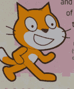

Scratch 由 MIT Media Lab 的 Lifelong Kindergarten Group 开发。参见 http://scratch.mit.edu。本书中包含的 Scratch 图像和插图由 MIT Media Lab 的 Lifelong Kindergarten Group 开发（参见 http://scratch.mit.edu），并根据 Creative Commons Attribution-ShareAlike 2.0 许可协议（https://creativecommons.org/licenses/by-sa/2.0/deed.en）提供。本书中使用的第三方商标是其各自所有者的财产，包括 Scratch 名称和徽标。这些商标的所有者并未认可、授权或赞助本书。

## 关于电脑游戏的一切

你喜欢电脑游戏吗？也许你喜欢解谜游戏、动作游戏或冒险游戏。你有没有想过人们是如何编写电脑游戏的？你可以使用一个叫作 Scratch 的程序自己创建游戏。

### 规划你的电脑游戏

在编写电脑游戏之前，你需要决定几件事。你想编写哪种游戏？游戏的目标是什么？你的游戏会有角色吗？这些角色会做什么？

一旦有了计划，Scratch 就能借助称为编码积木的**代码**块，帮助你轻松创建游戏。这些积木可以组合起来创建不同类型的程序，例如游戏。

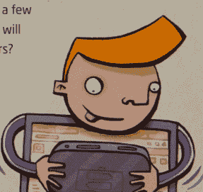

### 从 Scratch 开始

为了获得一些灵感，可以看看人们在 Scratch 网站上分享的一些游戏。你可以点击“查看内部”按钮来查看代码。

https://scratch.mit.edu/starter_projects/#Games

### 试一试！

做一个简单的换装游戏和朋友们一起玩怎么样？打开我们名为 dressing.sb2 的游戏，看看我们创建的一个示例。或者你也可以自己尝试制作一个：

- 1. 在 Scratch 中，你可以为游戏选择称为背景的图片。点击“新背景”。你可以从库中选择背景、自己绘制，或从电脑或相机上传一个背景。
- 2. 现在你需要一个可以装扮的人。从库中选择一个**角色**。角色是 Scratch 中你可以为其编写代码的人物。转到“新角色”，在左侧“主题”下的菜单中选择“装扮”。你会看到一个叫 Dani 的角色以及一些适合她的衣服。选择你想要的衣服，然后点击“确定”。
- 3. 要玩这个游戏，只需将衣服拖放到 Dani 身上！

| 角色库 | |
| --- | --- |
| 类别：动物、幻想、字母、人物、物品、交通 | 领结、Dani |
| 主题：城堡、城市、舞蹈、装扮、飞行、节日、音乐、太空、运动、水下、行走 | 冬季帽子、巫师帽、连衣裙、短上衣、太阳镜1、太阳镜2 |
| 类型：全部、动物、人物、奇妙 | |


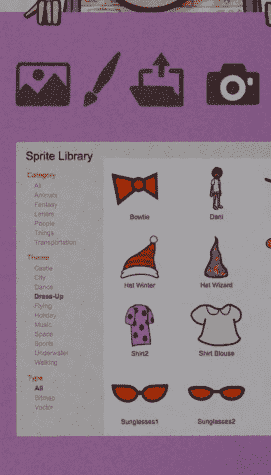

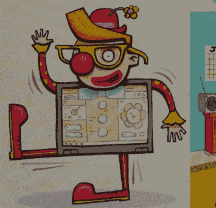

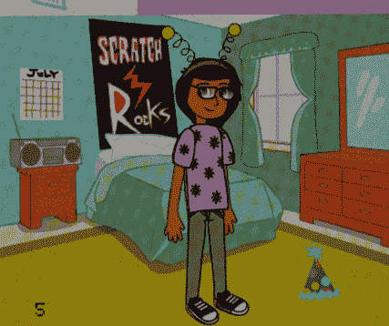

- 2. 现在你可以在游戏中使用不同的计分元素。在这个篮球游戏中，每次点击角色时，我们将分数改变 1。新游戏开始时，我们将分数重置为 0。
- 3. 这个游戏使用计时器。如果我们没有在代码中加入计时器，游戏就会一直进行下去！你可以通过更改计时器中的数值来改变游戏持续时间。目前，游戏持续 10 秒。

```
when this sprite clicked
change [score v] by (1)

<[timer v] > (10)>
```

### 想一想

设计游戏的部分乐趣就在于让别人非常想玩它！你认为有记分牌会让人更想玩吗？为什么？（答案在第 32 页。）


## 使用循环

程序员使用循环来告诉计算机重复执行一组指令。

在 Scratch 中，你可以创建循环来：

- 永远重复代码
- 将代码重复一定次数
- 重复代码直到发生其他事情。

要在 Scratch 中做到这一点，你可以使用 FOREVER、REPEAT 或 REPEAT UNTIL 积木。

```
repeat until <timer > 10>
    hide
    wait (1) secs
    go to x: (pick random -200 to 200) y: (pick random -140 to 140)
    show
    wait (0.8) secs
```

在我们的篮球游戏中，我们使用**重复直到**循环来编写球的出现、等待被点击以及再次消失。

如果没有重复直到循环，我们就必须一遍又一遍地告诉篮球角色隐藏、等待、随机出现在某个位置、隐藏、等待并出现。使用上面的重复循环会告诉计算机重复同样的动作，直到时间用完，因此我们不必多次编写同一段代码。


> 要让游戏持续更长时间，请调整“重复直到”积木中计时器旁边的数值。


### 试一试

看看你能否调整这个游戏中的代码，让游戏变得更容易或更难。试着更改“永远”循环中的第二个“等待”数值。如果数值更大，比如 1，球会在屏幕上停留稍久一些。如果你把数值改小，比如 0.5，球在屏幕上停留的时间就会更短，从而使游戏更难。你也可以调整第一个“等待”数值，让球每次出现得更快。

### 添加声音

你可以为游戏添加声音。点击“声音”脚本，你会看到可以播放声音和乐器，并更改它们的音量和速度（节奏）。要选择声音，你需要转到 Scratch 声音库。

有各种有趣的声音，非常适合不同的游戏。点击它们听听声音效果，并为你的游戏选择一些声音。

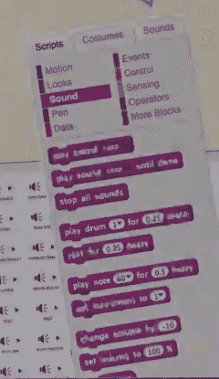

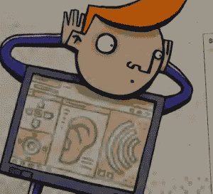

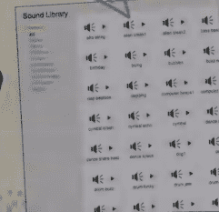


- 3. “移动”积木块调整球的移动速度。目前值设为10。如果你想让球移动得更快，在框中输入更高的值，例如15。如果你想让球移动得更慢，就降低该值。再试玩一次游戏，看看表现如何。

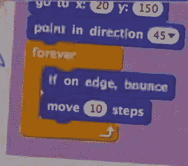

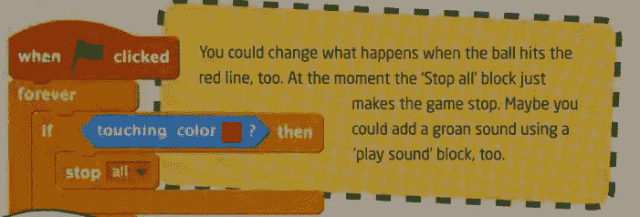


### 试一试

如果你想使用不同的球，或者向游戏中添加第二个球，该怎么办？选择一个新的球角色。通过右键单击每个代码块并选择“复制”，来复制原始球的代码。将复制出的代码拖到新角色上。这些积木块可能会彼此重叠，因此你可能需要整理一下。

删除原来的球，只使用新球，或者尝试使用两个球。那样会难得多！我们在太空主题的 Paddleball 中加入了地球。打开 paddleball2.sb2 来试试这个版本。

## 策略游戏

> 策略游戏邀请玩家做出会影响接下来发生什么的选择。国际象棋就是一种策略游戏。在国际象棋中，你每移动一个棋子，都会对游戏进程产生很大影响。这类游戏靠战术取胜。许多电脑战争游戏都是策略游戏。


### 龙

为了本书，我们创作了一款名为《龙》的策略游戏。我们的主角是一只小青蛙，我们需要从越来越多凶恶的龙手中拯救它。如果你愿意，可以先玩一玩完成版游戏，这样就能看到我们将要创作的内容。在 Scratch 中打开 dragons.sb2 并点击绿旗。如果进入全屏模式，游戏看起来会更好。

### 如何玩这个游戏

你可以使用键盘上的方向键，让青蛙向任意方向移动一格。不过要小心，别让青蛙掉进洞里。青蛙移动之后，所有龙都会朝它走一步。当心！如果它们抓住青蛙，就会把青蛙吃掉。当你击败所有龙后，就会升到新的一关。看看你能让青蛙存活多久！

## 做决定

现在我们要开始创作自己的《龙》游戏了。我们先来看看主角青蛙将如何在屏幕上移动。在 Scratch 中打开 dragons1.sb2 并点击绿旗。

你可以看到，我们把屏幕划分成了一个由 18 行和 24 列组成的**网格**。每个方格称为一个单元格，高 20 **像素**、宽 20 像素。开始时，青蛙位于网格中间的一个单元格中。

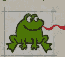

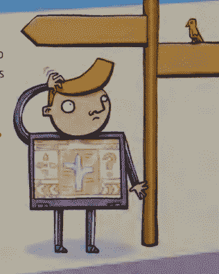

### 等待指令……

我们代码的这一部分需要做出三个决定。它在等待绿旗被点击、等待某个键被按下，并判断按下了哪个键。只有当某个方向键被按下时，代码才会被激活。如果按下了，青蛙就会向左、右、上或下移动 20 步（或像素），这相当于一个单元格。

```scratch
when [any v] key pressed
if <key [right arrow v] pressed?> then
    change x by (20)
if <key [left arrow v] pressed?> then
    change x by (-20)
if <key [up arrow v] pressed?> then
```

### 我们如何在代码中做决定？

我们可以使用 IF 语句来做决定。IF 语句是编程中最常用的语句之一。它通过询问某件事是否发生，让代码做出决定。例如，如果按下了方向键，那么代码就会让青蛙朝该方向键的方向移动。如果没有按下任何方向键，就什么也不会发生。

### 想一想

能够做决定让代码看起来更像人类。
如果你给机器人编程让它向前走，那么即使前方是悬崖边缘，它也会一直向前走。
而人如果看到前面有落差，就会决定停下来！如果你给机器人编程为“如果没有悬崖边缘就向前走”，它们就会做出和人一样的决定。


### 不插电编程

你每天都会做出 IF 决定。如果你的手臂发痒，你就会去挠它。要让计算机做出“挠”的决定，就需要告诉它手臂发痒，并告诉它因此要去挠。试试这个 IF 游戏，把你的决定变成代码。写下六件你必须做的事，例如“吃一块饼干”或“做我的作业”，并把它们编号为 1—6。现在掷一个骰子。要运行你的代码，你必须做该数字旁边写的那件事。

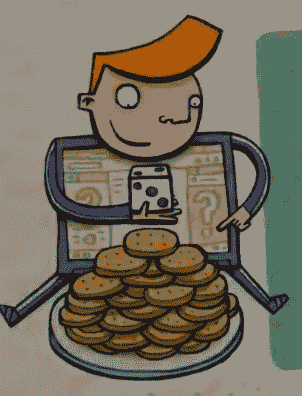

## 项目页面：运算符

既然你可以让青蛙在屏幕上移动了，你可能会注意到，有可能把它完全移出屏幕。我们并不希望这样，所以让我们添加一些代码来阻止这种情况发生。在 Scratch 中打开 dragons2.sb2。

你会看到，我们给每个“按键被按下”的 IF 语句都额外添加了一个 IF 语句。在青蛙移动之前，代码需要检查是否有可供青蛙移动到的单元格。对于这第二个 IF 语句，我们需要使用一个**运算符**。

```scratch
if <(x position) < [220]> then
    change x by (20)
```

> **提示：** 添加绿色运算符积木块可能有点麻烦。将鼠标悬停在空白处，直到它发出白光，然后将其放到合适位置。

### 不同类型的运算符

计算机运算符控制计算机如何使用数据。数据是我们输入计算机或在屏幕上选择的数字或其他信息。当我们在计算机中输入一个数字时，运算符会告诉计算机如何处理它。

运算符有几种不同类型：

- 数学运算符让我们执行简单的数学运算，例如“加 +”、“减 -”、“乘 ×”和“除 ÷”。
- 比较运算符比较数值，例如“小于”（显示为<）、“大于”（显示为>）或“等于”（显示为=）。
- 逻辑运算符将在下一章解释：它们包括 AND、OR 和 NOT 等运算符。

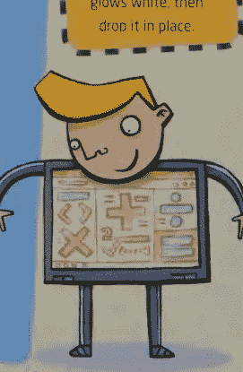

### 使用比较运算符

在我们的项目中，我们使用“大于”和“小于”这两个比较运算符。如果玩家要求把青蛙向右移动，运算符会告诉计算机，只有当青蛙的当前位置（“X”）小于 220（屏幕边缘）时，才移动青蛙。运算符会确保有空间让青蛙向右移动。如果有空间，青蛙就可以移动。如果没有空间，青蛙就留在原地。试着用方向键把青蛙移出屏幕。你应该再也无法做到这一点了。

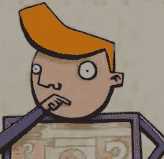

> **想一想**
>
> 在编程中，询问某事物是否“小于”或“大于”真的很有用。想象一个游戏，玩家必须先获得一定分数才能进入下一关。你可能会使用“大于”运算符——只有当玩家的分数大于所需分数时，玩家才能进入下一关。

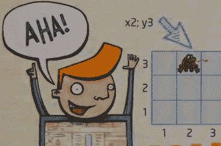

### X 和 Y 是什么？

所有图表和网格都有 x 轴和 y 轴。它们帮助你描述一个点在网格上的位置。水平轴是 x 轴。垂直轴是 y 轴。每次青蛙移动时，我们都会调整青蛙的 X 值和 Y 值，以精确指出它的位置。

### 试一试！

现在你可以让青蛙在屏幕上移动了，你可以制作一个迷宫游戏。点击“新背景”画笔。使用矩形工具创建迷宫。也许你可以添加一个计时器，并在到达出口时发出拍手声。打开 maze.sb2，试着把青蛙引导到由绿色单元格标记的出口。

## 项目页面：这个还是那个？

你可能已经注意到，在完整的《龙》游戏中，你可以使用许多不同的键来移动青蛙。人们使用的键盘类型不同，有些键盘没有可用于游戏的方向键。在 dragons2.sb2 中，我们只能使用方向键。

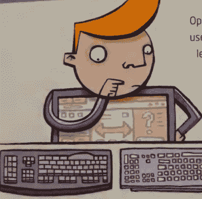

在 Scratch 中打开 dragons3.sb2。现在你可以使用许多不同的键来向上、向下、向左和向右移动。我们可以使用键盘左侧的一组字母键，或者方向键。

为了确保代码允许所有不同的按键，我们需要使用逻辑运算符“OR”。这个运算符让我们列出所有希望用来让青蛙朝特定方向移动的不同按键。

```scratch
when [any v] key pressed
if <key [right arrow v] pressed?> or <key [d v] pressed?> then
    if <(x position) < [220]> then
        change x by (20)
if <key [left arrow v] pressed?> or <key [a v] pressed?> then
    if <(x position) > [-240]> then
```


## 逻辑运算符

逻辑运算符使用布尔逻辑。布尔逻辑以一位名叫乔治·布尔的人命名。布尔发明了一套非常简单的逻辑系统，其中每个问题都可以用“真”或“假”来回答。“我痒吗？”的答案要么是“是”（真），要么是“否”（假）。逻辑运算符还可以使用 AND 和 OR 来回答更复杂的问题。例如，如果你想知道“我是发痒 OR 发热吗？”，运算符会检查哪个条件（发痒或发热）为真。

### OR 逻辑

OR 逻辑测试其中一个条件是否为真。例如：“如果我按右箭头 OR 我按‘D’键，那么把青蛙向右移动。”如果任一问题的答案为真，青蛙就向右移动一个单元格。

### AND 逻辑

AND 逻辑测试两个问题的答案是否都为真。例如：“如果我按右箭头键 AND 青蛙右边有空间，那么把青蛙向右移动。”如果任一问题的答案为“否”，青蛙就不会移动。

### 想一想

这句话使用的是 OR 逻辑还是 AND 逻辑？“如果我按 7 键，并且左上方有移动空间，那么向左上方移动”（答案见第32页。）

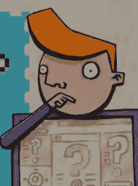

## 坐标与变量

在游戏中，知道青蛙位于哪个单元格，以及哪些单元格有洞或龙，很重要。为了跟踪这些单元格，我们需要使用若干变量。

### 存储容器

变量是可以改变的值。变量有点像数据的容器。你给变量命名，并把数据存进去。任何时候只要输入变量名，就可以使用这些数据。然后代码会取出该容器中的数据。

在 Scratch 中打开 `dragons4.sb2`。这个项目的运行方式和上一个一样，但代码却大不相同。我们现在使用了变量。在 'Row' 变量积木中，我们输入了值 9。在 'Column'（col）变量框中，我们输入了值 12。这些值把青蛙放在网格的中心单元格。'Row'、'Col' 和 'Cell' 都是变量，因为你可以通过修改白色输入框中的值来改变它们。

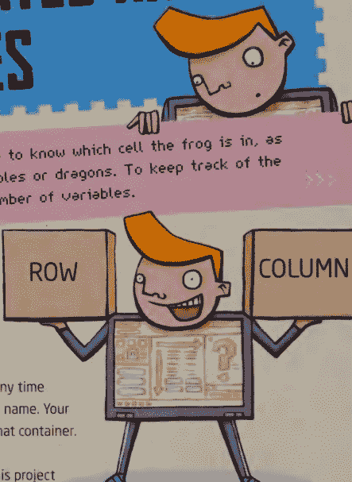

```
when green flag clicked
set row to 9
set col to 12
```

```
set [Cell v] to [row * 24 + col]
```

这段代码使用变量为每个单元格分配一个编号。它的工作原理如下。共有 24 列。底行（0）上的每个单元格，其编号由行号（0）乘以 24，再加上列号得到。

我们来算一下网格上绿色十字的单元格编号：0（行号）× 24 = 0；0 + 0（列号）= 0，所以单元格编号是‘0’。对于蓝色十字，计算为：1（行号）× 24 = 24；24 + 1（列号）= 25；它旁边的单元格会是 24 + 2 = 26，依此类推，一直到右上角单元格，其编号为 431。


看看你能否算出其他一些网格位置的单元格编号。查看下面的表格，看看你是否算对了。

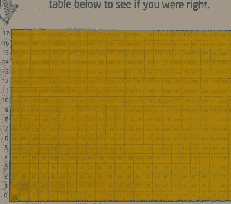

### 试一试！

试着让青蛙从网格上的不同位置开始。在 column 变量中输入 0 到 23 之间的数字，在 row 变量中输入 0 到 17 之间的数字。你能预测青蛙会从哪个方格开始吗？数字范围是 0-17 和 0-23，但网格有 18 行和 24 列。为什么？（答案见第32页。）

## 不可预测的青蛙

在游戏中，每次点击绿旗，青蛙都会从不同的单元格开始。你已经看到如何通过改变列号和行号来自己做到这一点。我们怎样才能让代码替我们完成这件事？我们需要让代码每次都选择一个随机起点。

在 Scratch 中打开 `dragons5.sb2`。现在，当点击绿旗时，我们把 'row' 变量设置为在 0 到 17 之间随机选取任意数字（我们网格中的行号），然后把 'col' 变量设置为在 0 到 23 之间随机选取任意数字（我们网格中的列号）。这样，我们就把青蛙完全随机地放在网格的 432 个单元格中的任意一个里。

```
when green flag clicked
set row to pick random 0 to 17
set col to pick random 0 to 23
```

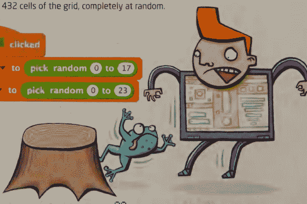


### 并非真正的随机数……

由于计算机只处理真值和假值，它们无法生成真正随机的数字。它们必须改为创建一个看起来随机的数学算式。这个算式需要足够复杂，否则我们可能预测出它会选什么数字。你能猜出我们用了什么算式来生成这些数字吗？你能预测下一个数字吗？

1, 3, 5, 7, 9

试着想出一个可能更难预测的算式。

能够选择随机数在游戏设计中非常重要。事实上，如果没有这种能力，大多数游戏根本无法运行。

### 不插电编程

人真的可以做到随机。和朋友玩这个猜数字游戏。想一个 1 到 10 之间的随机数。让朋友猜这个数字。告诉他们猜的数是小于还是大于你的数字。你的朋友会像计算机的大脑那样工作，使用比较运算符，根据你的回答决定下一个要猜哪个数字。看看他们猜多少次才能猜对。现在试试选一个 1 到 50 之间的数字！


## 项目页面：添加龙！

在 Scratch 中打开 `dragons6.sb2`。现在，我们让青蛙随机出现在屏幕上的不同位置。使用类似的方法，我们还让洞随机出现在屏幕各处。我们的游戏板准备好了，是时候让龙登场了！

### 使用子程序

当我们想在代码中的不同位置重复同一件事时，我们会使用**子程序**。要让子程序运行，我们‘调用’它。这只是说，我们在代码中按名称调用它，然后代码会取出并运行它。

- 1. 你会看到我们现在有一个名为‘CreateDragons’的子程序。我们可以输入想要创建多少条龙。我们会检查每条龙都不在青蛙所在的位置。我们还会确保同一个单元格中没有洞或另一条龙。
- 2. 检查完这些事项后，我们通过制作龙角色的克隆体来创建一条新龙。克隆体就是副本。


Scratch 积木展示了 `CreateDragons` 子程序，包括用于创建龙的克隆体、检查 `Dragons` 列表长度、选择单元格、检查单元格中是否包含洞或龙，以及将单元格添加到 `Dragons` 列表的积木。

### 追捕青蛙

龙会追捕青蛙。它们通过等待青蛙广播消息“Chase”来做到这一点。广播消息是一个角色与另一个角色交流的一种方式。这个消息告诉龙青蛙的位置。然后龙朝那个位置移动一格。


### 使用造型

你可能没有注意到，但龙总是面向青蛙。我们通过使用四个**造型**（角色姿态）来做到这一点，两个面向左，两个面向右。点击龙角色，然后点击‘造型’。你会看到我们使用的四种不同的龙姿态。

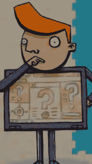

### 想一想

要让一个游戏运行得非常好，可能需要大量代码！当你在创建自己的游戏时，代码对你会是有意义的。你会随着进展一点一点地添加它。别人的代码，就像你现在看到的那样，可能看起来相当复杂！只需关注我们正在讨论的部分，并思考如何把它们用到你的游戏中。


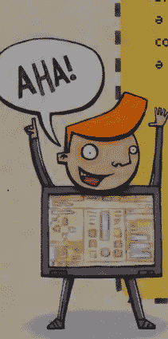

抱歉，你已经死了！如果青蛙移动到一个已经有洞或龙的格子，它就会死亡。游戏会运行一个名为“Die”的子程序，如下所示：

```scratch
define Die
set GameOn to 0
broadcast Delete
switch backdrop to Die
hide
```


这个子程序将“GameOn”设为 0，意味着青蛙不再移动；它还会将背景切换为“die”画面，并隐藏青蛙。然后它会广播一条名为“Delete”的消息。

### 收到消息

消息是角色之间相互交流的另一种方式。如果你查看洞和龙的代码，就会发现它们在寻找这条“Delete”消息。收到消息后，克隆体会被删除。

```scratch
when I receive Delete
delete this clone
```


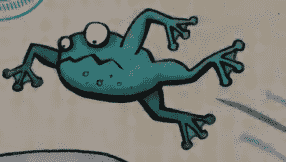

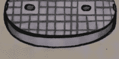


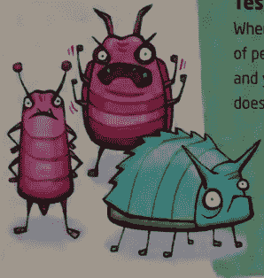

## 测试，测试

当你创建一个游戏时，最好让很多人帮你测试。代码可能会变得复杂，你也可能会遇到漏洞。漏洞是指代码没有完全按你的预期运行。如果有什么不对，就调试它。仔细检查你的代码，看看哪里出了问题。注意你的修改不要引发另一个漏洞！即使最优秀的程序员也会在代码中遇到漏洞，所以如果你遇到了也不用担心。边测试边修复就好。

### 试一试！

开始创建你自己的游戏吧。最好先尝试简单的东西。一种方法是查看一些已经写好的代码，并做一些小改动。把《龙》游戏中的角色换掉怎么样？从“新建角色”菜单中选择你的新英雄。要赋予它青蛙的代码，请右键点击你的新角色，然后单击“保存到本地文件”。把它保存到容易找到的地方。

现在点击青蛙角色，然后点击“造型”。点击打开文件夹的符号（左侧），指向新角色并导入它。删除青蛙造型，你就有了一个新英雄！现在点击左上角的蓝色“i”，然后输入你的新英雄的名字。

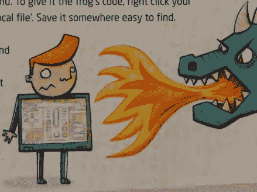

现在运用你学到的技能，制作属于你自己的精彩游戏吧。玩得开心！

## 更多信息

### 书籍

Vorderman, Carol. *Scratch 游戏编程轻松学*（DK）DK Children，英国伦敦：2016。

Wainewright, Max. *代码一代：我是 Scratch 高级程序员* Wayland，英国伦敦：2017

### 网站

**MIT 的 Scratch 网站，你可以在这里免费下载该程序**  
https://scratch.mit.edu/about/

**“编程一小时”网站，其中有从初学者水平开始教授编程的教程**  
https://code.org/learn

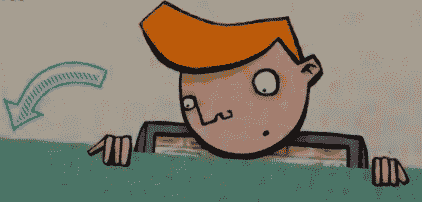

### 参观

位于诺丁汉的**国家电子游戏中心**收藏了数千款电子游戏，举办俱乐部活动，并鼓励亲身体验游戏制作。

位于莱斯特的**复古计算机博物馆**满是老式游戏主机。它举办游戏和计算机活动，提供使用复古计算机设备的机会，并承办教育参观和导览。

## 索引

- 背景 5、17、27
- 背景 5
- 广播 25、27
- 漏洞 29
- 人物 4、14、25
- 克隆体 24、27
- 代码积木 6、7、8、9、10、11、14、16、18、20、21、22、24、26、27、28
- 竞争性 6
- 计算机 4、5、8、10、12、15、16、17、23
- 坐标 20-21
- 造型 25、29
- 数据 6、16、20
- 调试 29
- 判断 14-15
- 网格 14、17、20、21、22
- 水平 17
- 按键 12、13、14、15、16、17、18、19、28
- 键盘 12、13、18、19
- 逻辑 16、18-19
- 逻辑，AND 19
- 逻辑，布尔 19
- 逻辑，OR 19
- 循环 8-9、10、26
- 运算符 16-17、18、19、23
- 程序 4、8
- 程序员 8、29
- 重复 8、24
- 回合（电脑游戏关卡）28
- 得分 6-7、17、28
- 声音 9、11、17、28
- 声音库 9
- 角色 5、6、7、8、10、11、24、25、27、29
- 策略 12-13
- 子程序 24、27
- 计时器 7、9、17
- 变量 6、20、21、22、26、28
- 垂直 17

## 答案

**第7页** 记分板让游戏更具竞争性。玩家会想要获得尽可能高的分数。

**第19页** 该语句使用 AND 逻辑：只有当按下 7 键并且有足够空间时，才能移动。

**第21页** 数字“0”在两种情况下也都会被计入。

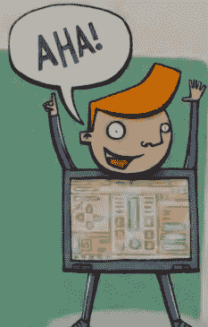

## 精确飞行

### 中级飞行训练

您已经掌握了基本的飞行技能，现在是有目的地飞行的时候了。

#### 您需要什么

- 完成基础飞行训练
- 获得合格的飞行执照
