# 在 Twine 中创建交互式故事

## 变量

`(set: clear to 0)`

`(set: "The Lame")`

## 废弃的

田野

你处于

一个拥有

结尾的

昏迷

你离开了，

神情恍惚

且困惑，就在

[废弃处]

外面

地牢

你发现

自己被锁在

厚实的、坚固的铁

栅栏后。你无法

房子前部

登录以靠近

房子但发现

了一些东西

房子后部

安静地

进入

这个

楼上

阁楼

阁楼布满了

蜘蛛网和更多的

尘埃。这全属于你

厨房

你

发现了一些

新鲜的食物。

卧室

你

在里面休息了一整晚。

你

感觉好多了。

睡眠

当你一躺在

床上，你就

陷入了

睡眠

BRIAN MAYER

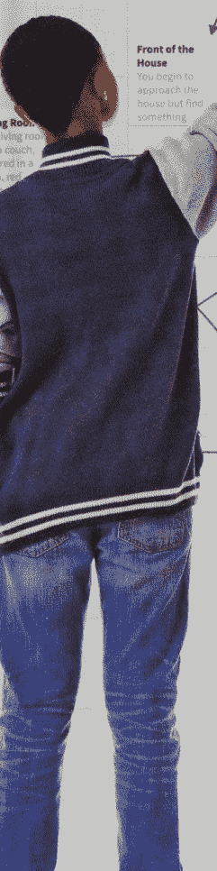

BRIAN MAYER


Twine 是由 Chris Klimas 创建的开源软件，书中对其的引用和使用并不意味着 Klimas 或 Twinery.org 对本书的推荐或背书。

更多样式.............................................................................. 112

哇——那是从哪里来的？............................................................... 116

显示中......................................................................... 118

头部和脚部................................................................................ 119

保存与加载游戏............................................................................... 120

词汇表......................................................................... 122

索引.................................................................................................................. 124


https://archive.org/details/createinteractiv000maye

所以，你为什么要对创作互动叙事（Interactive Fiction）感到兴奋？这显而易见！互动叙事为你提供了一种简单有趣的方式，开始创作他人可以玩的游戏。你的想象力决定了玩家在你的游戏中可以探索、互动并以自己的方式完成的设定和故事范围。而且这还不是最棒的部分：完成这一切不需要付出艰辛努力！而这本书将带你实现目标。

本书将重点关注互动叙事游戏的构建与开发（稍后会详细介绍），尽管我们不会花太多时间讲故事写作技巧，但在写作过程中，你会获得一些写作技巧和建议。

本书的最终目标是学会使用 Twine 制作游戏。如果你不熟悉 Twine，最好做好准备！Twine 是一款免费的开源程序，它允许你轻松地——只需通过少量的代码片段和样式——创建你自己的互动叙事游戏供他人玩。它是一个能让你发声并获得创作机会的工具，因为它让你能够创造供人们探索、互动和体验的世界与故事！

通过学习 Twine 提供的几个小步骤，你可以成为一名故事讲述者和游戏设计师。它赋予了你为读者（同时也是玩家）创造体验的能力。感到兴奋吗？你将能够为你的朋友和家人创建一个探索和互动的故事！

对于本书，我们将从这里开始：思考并构建一个为读者提供趣味游戏的故事。你旅程的第一步是以“选择自己的路径”的风格构建这些游戏。然后，我们将通过在 Parsely 游戏系统中开发该游戏，来增加一些复杂性和开放性。最后——在你在这两个系统中开发了故事和玩法之后——你将学习如何将它们编码到 Twine 中！

当你完成所有工作后，请根据你的意愿处理你的设计！那是制作互动叙事的乐趣之一。但先通过非数字化的梳理，有助于你为创建一个出色的互动叙事游戏做好计划和准备。

书中会有许多可以贯穿始终的精彩活动，它们将帮助你构建和开发一个示例互动叙事游戏。此外还有一些活动帮助你构建和开发自己独特的游戏。书中的许多活动将建立在之前的活动的基础上，因此我强烈建议你在第一次阅读时按照顺序进行。

但我绝对无法阻止你！随着你对创作自己的互动叙事越来越熟练，你可以回过并专注于对你帮助最大的活动。

将一份游戏和一份故事结合，然后把它们丢进搅拌机。出来的粘稠混合物就是我们所说的“互动叙事”。将叙事与游戏融合并非 Twine 所独特。大多数视频游戏和桌面游戏都有某种形式的故事伴随着玩法。虽然许多人首先想到的是像《塞尔达传说》、《魔兽世界》和《上古卷轴》等视频游戏系列中的史诗级故事，但非数字游戏也有自己的故事。无论你是在建立自己的地产帝国、在《大富翁》（Monopoly）中与其他土地所有者冲突、在《农场庄主》（Agricola）中抚养家庭并经营农场，还是在《探险之路》（Pathfinder）中举办一场史诗级的奇幻战役，非数字游戏都提供了多种体验，让玩家成为故事的一部分。

这些例子是通过通游戏讲述故事的游戏。而互动叙事是一个在你不断进行的过程中提供游戏体验的故事。在最简单的形式下，互动叙事游戏与标准故事非常相似。在某些点上，会做出重要或有趣的决定。但是，这些决定并不是由故事中的角色做出的。相反，它们是由读者做出的——想象一下！是读者决定了故事的发展方向，并且他们在探索和玩故事的过程中做出了这些决定。这些决定可以简单到在两扇门之间选择进入哪扇。决定也可以更复杂，需要多个步骤才能完成。优秀的互动叙事故事会提供提示和暗示，帮助玩家做出正确的决定并到达终点。因为谁会想失败而不完成故事呢？

作为一名设计师，你的任务是在讲述一个好故事和制作一个好游戏之间取得平衡。要做到这一点，你需要知道故事和游戏中有些让它们变得出色的隐藏部分。

现在到了书中我向你抛出一大堆概念的部分了。所有这些概念在构建出色的互动叙事游戏中都起着重要作用。不要为了尝试实现所有它们而感到压力，但要试着记住它们。随着你构建的游戏越来越多，毫无疑问，你会变得越来越擅长将它们融入你的设计中！对于前几个设计，尝试只专注于一或两个元素。随着你变得越来越熟练，扩展你的设计以融入更多元素。很快，你就成为一名大师了！

五个非常重要的部分帮助故事汇合，并让读者（在我们的案例中也是玩家）跟上节奏。这些部分是角色、设定、情节、冲突和结局。

- 角色（以及物品）：这些是玩家在玩你的游戏过程中互动的人和物。有些对故事很重要，而另一些只是为了增添色彩。
- 设定：这些是故事发生的地方。有些故事有很多地方，而另一些只用少数几个。设定应该与你的故事内容匹配。如果你正在创建一个在太空发生的游戏，设定也应该匹配！
- 情节：这是你故事的核心；它是你故事的主旨以及所发生的事件顺序。可能会发生一些较小的、不相关的事件。
- 冲突：这是玩家在游戏中必须克服的东西（或）。冲突创造了玩家必须克服的挑战和障碍。为了这一点，玩家可能需要击败巫师。冲突应该与情节相关——它们应该相互驱动。
- 结局：这是玩家解决游戏中主要冲突的方式。在互动叙事中，根据玩家的选择，可能会多个结局。你决定了发生什么！

有很多部分可以让游戏变得有趣且吸引人，但我在这里将重点关注五点：目标、挑战、探索、进展和选择。

- 目标：这些是玩家在游戏中需要完成的任务。它们与冲突和结局非常相似。当你刚开始时，最好只有几个目标。目标越多，游戏就越复杂。
- 挑战：这些与目标相关，是玩家需要执行的实际操作。这些是谜题、难题和玩家做的选择。你要尝试让挑战保持平衡——不要一眼就能看出，但不至于让玩家感到沮丧。
- 探索：一个好游戏的一部分是玩家探索和互动的空间。探索是世界、人物以及玩家在玩过程中互动的东西的一部分。你需要多少探索取决于你想构建多大的游戏。较大的游戏会有更多。
- 进展：一个好游戏必须让玩家知道他们正在向前，并越来越接近目标和游戏的结局。你可以通过多种方式提供进展感。玩家可以获得新物品、克服障碍、进入新区域等等。
- 选择：游戏赋予玩家选择。好的游戏给玩家提供有趣的选择。当你设计游戏时，玩家需要做出选择来推动故事发展。

许多其他处于游戏与故事之间的概念都与交互式叙事有关。这些许多方面可以极大地影响你游戏的质量和趣味性。更棒，它们还能提高你作为游戏设计师的效率！这些方面包括控制、视角、线索、观众、决策点、路径和互动。

- **控制 (Control)**：这指的是你对故事流程拥有多少控制权，以及你交给了读者多少。交互式叙事的核心在于创建一个你允许玩家探索和发现的故事。他们通过做出选择在你的游戏中前进。他们是活跃的参与者——这带来了兴奋感！在传统故事中，读者无法控制故事如何进展，也无法控制事情何时被揭示或发现。而作为交互式叙事的作者和设计师，你正在赋予他们部分这种控制权。至于交出多少，取决于你试图讲述的故事类型！

在我们我们将看的第一类型——“选择自己的路径”中，你对游戏/故事的进展仍然拥有很强的控制力。玩家边阅读边做出选择，翻到相应的页面查看接下来会发生什么。进展通常是非常是线性的，意味着它沿着直线移动。他们的选择只是在需要时通过做出正确的选择来帮助线条向前移动。Parsed 和 Twine 游戏允许玩家探索更多。你可能希望玩家进入厨房找到钥匙以便他们进入地下室，但他们却进入了后院并找到了一把铲子。他们仍然需要从厨房拿钥匙，但何时去拿最终取决于他们！

- **视角 (Perspective)**：这是指玩游戏的玩家的视角。在交互式叙事中，你可以为角色提供背景，但玩家将以第一人称视角经历故事。他或她将做出决定并探索故事。因此，当你开始为故事构思角色时，必须记住你创建的每一个人在玩家穿过你的游戏时都会与其产生互动。

- **线索 (Cues)**：线索与你游戏中的挑战和冲突有关。在玩游戏时，仅仅盲目猜测需要做出什么选择并不是很好玩的体验。做出正确的选择你就能活着；做出错误的选择你就会死。这显然非常重要！你希望玩家能够根据他们在游戏早阶段获得的信息，做出明智且有趣的决策。这些可以是玩家从故事中遇到的物品和角色处获得的提示和线索，他们利用这些来帮助做出明智的决策。回到控制权，玩家可能会在游戏早期到达一个点，他们的决定没有基于任何依据，他们盲目选择并死亡。但在一个优秀的游戏中，玩家可以返回探索更多，以找到他们前进所需的线索或物品！

- **观众 (Audience)**：在设计游戏和编写故事时，始终记住你的观众是谁是非常重要的。你希望内容、语言和挑战对于你的写作对象来说是恰当的。

- **决策点 (Decision points)**：这是交互式叙事游戏的关键。它们是使其成为游戏的主要部分！它们应该是具有挑战性的、有趣的、好且引入胜的。玩家应该想要做出这些决定来推动故事发展！

- **路径 (Paths)**：顾如名，路径是读者在玩你的游戏时，故事可以走向的不同选择和方向。

- **互动 (Interactions)**：就像路径一样，互动也非常直观。它们是你对游戏中的事物可以做的事：拉、推、交谈……任何你能想象的一切！

最易上手（可能也最熟悉）的交互式叙事被称为“选择自己的路径”，或 CYOP。这与标准故事非常接近，只是处处分布着决策点。在所有这些点上，读者必须决定最佳行动方案。读者通常有两个或三个选择供他们做出，并有一个他们需要翻到的页面以查看接下来会发生什么。故事会在他们翻到的页面上继续——或者可能因为可怕的不幸而结束。噢，人类的悲剧！

> 你醒来时发现自己正处在一个黑暗、潮湿的洞穴里，里面到处是爬行的昆虫。它们在洞穴穴的寂静中发出咯哒咯哒的响。你不确定自己是如何来到这里的——你正穿过森林徒步，突然，一切变得漆黑，你记得自己掉落了。抬头，你看到一束阳光透过洞穴天花板上的一个洞射进来，那里非常高。那一定是你掉落的地方，但你没有可以用来离开的方法。你必须找到其他办法。
>
> 环顾四周，你看到骨头散落在洞穴各处——有些新的，有些非常古老。那里似乎有一条通往阴影中的隧道。你可以探索骨头，也可以走向隧道。
>
> 如果你探索骨头，请翻到第 86 页
>
> 如果你走向隧道，请翻到第 43 页

如果这听起来不太通顺，请看这个例子：

欢迎回来——希望你做出了明智的选择！虽然这只是一个简单的例子，但你真的触及了交互式叙事游戏的核心。你有一个故事向玩家呈现决策。如果玩家深思熟虑——或者只是运气好——他们的选择将帮助推动故事，玩家会继续阅读和游戏。错误的决定可能会让玩家后退或结束他们的游戏！

在传统故事中，你——作者——将拥有很多控制权。你清楚一切的进展情况。

编写故事可以非常容易，也可以是一项巨大的挑战。对于你的 CYOP 游戏，花点时间思考你想写什么样的故事。从一个特定的起点开始通常很有帮助，然后围绕其他元素进行构建。从以下三个类别中选择一个来帮你开始：

- **设定 (Setting)**：你希望故事发生在什么地方？你可能想写一个关于黑暗幽灵城堡的故事。或者你可能想写一个发生在遥远星球的故事。思考一个对你写作来说有趣或令人兴奋的地方。
- **角色 (Character)**：你想写一个关于谁的故事？一个对鸟类心软的危险海盗，或者一个充满活力、独立的发明家。许多伟大的故事都围绕一个单一的核心角色展开。这个角色可能是英雄——但他或她也是反派。也许有一个转折——这个角色在故事的后部分之前看起来并不重要。
- **互动 (Interaction)**：你希望故事中发生什么大事？也许是外星人入侵了学校舞会，或者主角在狗的身体里醒来。思考一个玩家/读者必须应对或克服的令人兴奋的事件！

- 10–15 分钟 构思表，铅笔

一旦你有了初始想法，拿一张纸作为你设计的构思表，并写下起点

对于你的游戏来说，这将是驱动游戏的关键要素之一，也是你最终围绕其构建的核心内容。在你的灵感表（idea sheet）上写下你的想法——你可以在那里添加更多故事创意——将帮助你专注于最初的那个火花！

- 10–15 分钟
- 灵感表、铅笔

现在你已经已经在灵感表上写下了最初的灵感火花，是时候发散思维，思考一下你的游戏将发生的场景了。

还记得你为灵感火花想过的那三个类别吗？嗯，你仍然需要考虑它们。它们是你的游戏背后故事的重要部分！

继续完善你在第一个活动中创建的灵感表，为除你的故事火花之外的另外两个类别每个每个至少写下一个想法。如果你喜欢，可以写更多——别让我阻着你！不要担心这些想法是否都可行，尽管把它们写在纸上。到最后，你真的没有可能在你的第一个项目中使用其中的每一个想法。但将你的想法记录在纸上将帮助你的故事成型，并将你所有的奇思妙想汇聚在一起！

例如，如果你决定你的故事发生在一个狗背的放大倍级上，那么你的角色在那里会遇到谁呢？一个蚤子家族？一只愤怒的蜱虫？可能会发生什么事情？迷路了？掉下来了？或者最糟糕的——洗澡？！

通过发散思维，你正开始构建你的游戏世界。你还没有拥有所需的一切，但你正在构建一些你将要使用或从中汲灵感的关键部分！

记住，灵感表不是什么一成不变的。它是你故事拼图中一个活的、有呼吸的一部分，让你能够将所有的想法汇聚在一个地方。你可能不会使用所有的想法，但记录它们有助于你构建你的故事和游戏。

通过这些新活动，你将把灵感表上收集的粗略想法和创意，开始将它们组织成一个读者最终会玩过的故事/游戏。对于这些活动，你将处理名为“故事表”的新文档。

和你的灵感表一样，故事表是一个流动的素材，旨在帮助你更接近构建游戏。你将用它来排列事件顺序，构建你游戏的大致故事弧线。你不会在这张表上填写很多细节。相反，你将用它来记录故事的大致轮廓，并将它们从开始到结束进行排序。令人兴奋的内容！

和你的灵感表一样，当你添加更多想法或做出更改时，可以随时回到这张表。伟大的故事随着时间的推移而改变和演变，你的也可以！

- 10–15 分钟 纸、便利贴、铅笔

前两个活动让你开始思考游戏的故事情和背景。我们正在设计发生在故事中的游戏，所以这很重要！你现在记录的所有内容都将是放入游戏中的填充物和调味。现在，你需要开始制作美味的饼皮来包裹上这些填充物。

拿出你的灵感表、一张新的白纸和一些小便利贴。这张新纸将成为你的故事表！它将帮助你组织玩家在游戏中的行进。它还将帮助你视觉化玩家将要做出的决定所产生的连接和分支。正如我已经提到的，你的故事表不是固定的——这意味着你不必固守你最初写下的内容。就像灵感表一样，它也会具有生命和呼吸。不喜欢某件事的发展方向？回到表上进行更改！故事表的目标是让你勾勒出游戏将采取的路径，以及玩家从开始到结束需要做什么。

将纸横向放置，使其从左到右较长。在最左侧，放置一张便利贴。这将是你游戏的起始部分。在最右侧，放置另一张便利贴。你猜得没错——这将是你游戏的结束部分。

现在，看着你的灵感表，思考读者将如何以及在哪里开始游戏/故事。这个空间看起来是什么样的？读者在游戏开始时做什么？他们是谁？他们为什么在那里？将这些想法写在游戏地图上的起始便利贴上。接下来，思考结尾。玩家如何赢得游戏？他们最后需要做什么？最终结果是什么？将这些写在结束便利贴上。

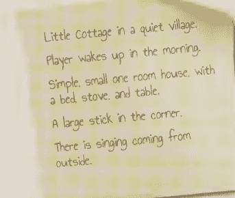

如果你还没有准备好一切，不要担心。这只是创建游戏的开始，你将随着过程添加更多内容并进行更改。第一次可能不会正确或完美。没关系！这都是设计过程的一部分。

你的故事表看起来应该像下面：

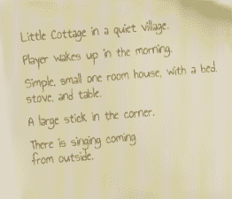

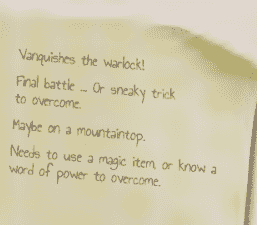

- 10–15 分钟 便利贴、铅笔

你现在有了游戏的开头和结尾，但你需要填充它们之间的内容。这中间的部分被称为情节。

对于这项活动，思考你想要在故事中发生的事件。为了做到这一点，我们需要从故事表中开始考虑那些*必须*发生的事件。因为这些是写在便利贴上的，你可以移动它们，增加新的想法，或者随着故事的发展移除它们。这就是这个方法的迷之处！这些事件是玩家在游戏中会经历的。

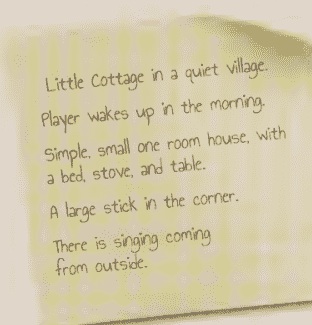


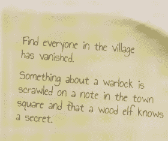

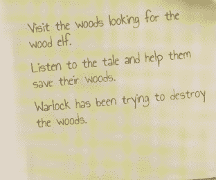

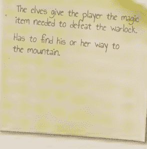

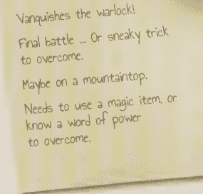

- 15–20 分钟 灵感表、便利贴、铅笔

有了书角和基石，你现在可以通过缓慢填充起始块、基石和结束块之间的连接，开始构建你的故事和游戏。从哪里开始取决于你。你可以从起始块向前移动，也可以从结束块向后移动。事实上，你可能会兼顾两者！

现在，让我们从故事的开始开始。为了做到这一点，你需要开始思考决策点以及接下来可能会发生什么。读者可以做哪些事情？

决策是玩家在那个时刻可能选择做的任何事情。决策的结果将推动故事向前，并让他们选择一个新页面进行跳转。决策可以是动作，例如按下按钮或获取物品。也可以是不作为，比如不说话或等待。随着你变得熟悉制作故事，你可以更有创意地呈现给读者的决策类型！

他们住在附近的一棵树上。但玩家们还不知道这一点。如果玩家在毫无准备的情况下就冲出去查看那歌声……嗯，只能说他们的故事结束得比他们预想要快得多。如果他们想保护自己，就必须先检查房间，并在小屋里找到那根拐杖。

所以就在起始区块的右侧，我将创建两个新区块，一个在上在上下。对于每个区块，我将从起始区块画一个箭头。箭头的方向可以让我记住决策从哪里来，以及通向什么结果。

一个区块是查看小屋；另一个是调查那歌声。为了方便我一眼看出，我将动作的摘要作为标题放在区块的顶部，然后为每个动作写几句关于发生的情况。如你所见，如果玩家选择检查小屋，他们就会找到拐杖。如果他们选择跑到外面，他们就会遭遇惨惨的命运（噢不！）。

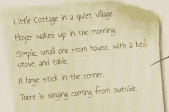

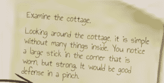


现在，观察你的起始区块，考虑玩家可以拥初始选择以及每个选择将他们引向何处。现在保持简单，让它成为两个选项之间的选择。以后，你可以开始探索多一个选择，但第一次运行时让我们保持保持简单。

另一个选项是呈现单一决策，为玩家提供两个选择：做某事或不做某事。任何选择都会产生后果！

一旦你有了选择，在起始区块的右侧放置与我类似的区块。给它们命名，并写下一些将要发生的细节。不要忘记从起始区块向你的新区块画箭头，以便你记住动作的方向！

# 后退一步 (One Step Back)

## 活动概述

另一种方法是从最终事件开始并向后推，考虑在后续事件发生之前需要发生什么。

在我的故事示例中，我需要在山上击败巫师。所以我需要思考：在巫师被击败之前发生了什么？嗯，为了通过巫师，我需要说出咒语。而在做那之前，我需要到达山顶。

考虑你的结局，以及玩家在到达结局之前可能需要做什么。在你的最终区块的左侧放置一个区块。像你之前的区块一样，给该区块命名并填充关于那个时刻的细节。因为这是一个决策点，从这个区块画一条线到你的最终区块。你向读者呈现的其他决策会让他们远离击败巫师，还是会导致失败？

作为一名设计师——你现在是了——在制作游戏时，能够向前向后思考是有帮助的。记住你的起点并填充剩余事件，这将有助于你的故事从该起点连接到结局！


目前，你一直在思考如何在玩家在决策点做出正确选择时推进游戏。

这是一个很好的开始，但你可以使用一些不同的工具，让玩家在保持已有进展的同时，向游戏中引入有趣的选择。接下来的三个活动旨在为你构建游戏时提供更多工具！

- 10–15 分钟 想法表、便利贴、铅笔

到目前，你已经在游戏中创建了一些简单的决策点，让玩家在几个选项之间选择。一个选择让玩家前进，另一个则结束游戏，导致他们需要重新开始。

有时事情结束得非常糟糕，导致玩家需要从头开始。但如果每个错误选择都迫使玩家从头开始，他们尝试到达游戏时可能会反复经过相同的素材。这是一个问题！

## 指南

观察你放置在最终区块之前的区块。思考玩家可以做的一个决策，它既不会让他们走向结局，也不会迫使他们重新开始。

例如，在击败巫师之前的示例中，我需要说出咒语来削弱他。说咒语会让故事进展到我击败巫师的地方。也许在之前的区块中，我可以添加另一个向巫师扔石头的选择。因为玩家离胜利非常近，我不希望他们因为选错就结束游戏，所以我让他们循环回到需要选择如何击败巫师的区块。

所以，我可以在最终区块和我做选择的区块之间添加一个新区块。我有一个新的结果，因此我会从决策区块画一个箭头到这个新结果区块。在这个区块中，我可以写道石头无害地弹开了巫师，我最好想个更有效的方法。然后我可以从这个区块画一个箭头回到我做决策的区块。正如你可能观察到的，这创建了一个循环！

如果玩家选择扔石头，他们发现这没起作用，并被带回做出不同的决策。这通过箭头的路径来解释，请看它。


- 10–15 分钟 想法表、便利贴、铅笔

观察你的最后一个区块，并在便利贴上写下第三个决策点。在右侧添加一个新的便利贴，从决策处向该便利贴画一个箭头。写下标题和新的结果。


# 分支小王 (Branchy McBranchface)

10–15 分钟 构思表、便利贴、铅笔

你可以使用决策点的方法之一是创建一个分支，或者说是一条替代路径，这条路径依然会让你的故事继续发展，并最终与主故事线汇合。

例如，在巫师故事的早期，可能有一个点让玩家可以在两条路径之间选择，这两条路最终都可能引导他们找到那个金币的老精灵。玩家可能真的处于一个向左向右分叉的十字路口。选择左分叉将带他们来到一座必须跨过的旧桥，以及一个在遇到精灵之前必须击败的巨魔。右分叉会让他们遭遇强匪的伏击，他们需要穿过才能到达精灵那里。

引入这样的分叉会让你的游戏更有趣，而且会让游戏具有重玩性，因为现在如果玩家玩完你的游戏并选择了一条新路径，整个全新的故事就会开启！

尽管有这些优点，但引入许多路径会让你的游戏设计变得复杂。在早期，也许只需使用一个分支，直到你习惯于整合整个游戏。

看看你的第二个便利贴，就是紧接在你第一个决策点之后的那个。想想在将故事带回主故事路径之前，你可以如何通过一个步骤创建一个分支。

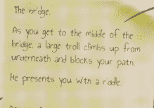

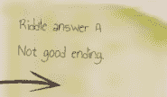

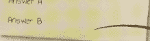

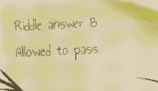

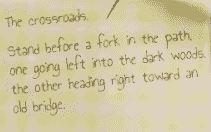

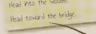

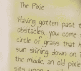


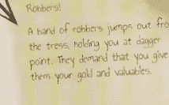


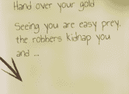

10–15 分钟 构思表、便利贴、铅笔

到这里，我希望你已经习惯了在你的游戏中添加决策步骤，思考在故事中回退或向前移动，使用一个或两个循环，甚至可能包含几个分支。你的下一个活动是完成你故事的其余部分。记住给你的便利贴命名并画上你的箭头！

根据你的构思表进行绘图，思考你可以如何包含你已经写下的元素。记住，你写了一些非常棒的主意——但不要觉得必须把它们都包含进去。在创作过程中，不要害怕添加新的部分。开发始终是一个流动的过程，可以随着你的工作而改变。这没关系！重要的是玩得开心。

10–15 分钟 构思表、纸、铅笔

恭喜你：你已经有了故事的框架——骨架！现在你需要把它变成一个“由你决定”（CYOP）的游戏。当你完成后，你将拥有一个完全可以玩的游戏并可以和朋友们分享。

你的每个便利贴都应该有足够的想法和细节，作为编写游戏的基础。现在是填充角色和细节、为你的故事注入生命的时候。记住，你的故事仍然在进行中，所以当你开始时，可以使用更多细节并进行更改！

如果你想写一个故事，你就得——嗯——去写！拿些纸。从你的第一个便利贴开始，在一个新页上开始写你的故事。当你写完第一个故事便利贴时，你应该处于你的第一个决策点。现在，你需要在页面底部向读者呈现选择。

> 你的故事仍然>进行：

当你写完第一个故事便利贴时，你应该处于你的第一个决策点。现在，你需要在页面底部向读者呈现选择。

> 你的故事

 如下：

> 你的故事

> 。

  ：

> 当你写写你的故事时，你还需要回溯。

。

  >

此外，当你写下你的便利贴时，它们可能会跨越多个页，取决于你的描述程度和动作量。这没关系！

当你写故事时，尝试保持页码顺序。

20–25 分钟 构思表、铅笔

这是最后的冲刺！如果你敢相信，你已经快完成了。

首先，你需要对页面进行计数。如果你目前一直在使用文字处理软件，你应该利用该程序的页码功能。大多数程序都有页面缩略视图，你可以突出某个章节的页面，然后将它们拖到一个新章节，并在其中添加页码。

现在，看看你故事中作为你第一个决策结果的部分。你需要选择书中后面的某个位置——也许在 10 几或 20 几。从你选择的页面开始编号。所以如果你选了 23，且你的章节有三页，你就会将它们标记为 23、24 和 25，并从页面列表中划掉这些数字。现在你已经有了该部分开始的页面，回到决策点并写下读者需要翻到的页码。对另一个决策点也这样做，选择书中不同的位置放置该章节，并写下页码。

继续这个过程向前推进你的故事。尝试在书中来回穿插，但也尝试填满可用页面列表，以便在你全部完成后没有空隙。当你完成时，发现有几个单页的空隙，也不太担心。你可以用酷的插图来填充它们！

如果你是手写一切，从故事开始并从 1 开始给页面编号。当你已经走完整个故事时，就是你时候回过读一遍了——确保一切正常，并且所有的页面都与其在书中的位置相符。

你不希望你的读者因为一个编号错误而迷失和困惑。

通读一遍，测试你所有的决策点，并且在过程中不要害怕进行任何最后的修改。一旦你过完了整个故事并且没有发现任何想要更改的地方，就深吸气。你做到了！你刚刚创作了你的第一个互动式故事。感到自豪吧，把它分享给你的朋友，并开始规划你的下一个作品吧！

掌握了基础知识——以及你的第一个互动式故事——你已经准备好迎接更重大的挑战了。在下一节中，你将学习另一个创建互动式故事的平台：Parsely。

Parsely 游戏由 Jared A. Sorensen 创建，灵感源自 20 世纪 80 年代的老数字文本冒险游戏。我确定这对你来说听起来像是远古的历史，但其实并不久远！在这些数字游戏中，玩家会被引入到故事的开头，并看到一段文本提示。他们可以输入任何他们想的内容。探索并弄清楚需要去哪里以及需要做什么才能赢得游戏，完全取决于他们自己。

这与我们在上一次活动中设计的 CYOP（你来选择）游戏是完全不同的体验。在那些游戏中，玩家遵循你的故事，并在接到提示时简单地做出选择。CYOP 游戏更倾向于一个你与之互动的故事，而 Parsely 游戏则更倾向于一个供你探索的故事。

你在构建 CYOP 游戏时使用的许多底层结构和方法也可以用于制作 Parsely 游戏。你仍然需要考虑角色、地点以及游戏中发生的事件。但现在，你付出的写作工作大大减少了！相反，你的重点是创建一个可以供一群人运行的游戏。

事实上，创建 Parsely 游戏非常像计算机编程。但不要被它吓到！那意味着你将以特定的方式将信息组合在一起，当它运行时，这些信息将为游戏者创造一种游戏体验。如果玩家看到一个 Parsely 游戏，它看起来并不像游戏！而且对他们来说，仅仅读一遍绝对没那么趣。但如果有人为他们运行游戏，就能创造出奇的游戏体验！

这与视频游戏编码非常相似。如果你查看视频游戏的代码，它看起来完全不像游戏，对于阅读代码的人来说也不可玩也没有趣味性。但当这些代码在计算机中运行时，它会创造出一种超越所有代码的东西，成为一种极佳的体验！

设计 Parsely 游戏的主要区别之一是，你对游戏如何展开的控制权少得多。别担心——你仍然对大局有控制权。但这种控制比你制作的 CYOP 故事要松得多。

你可以控制为了推进游戏而必须发生的事情，但你不再能完全控制元素何时被发现，或者玩家是否能够弄清楚他们下一步需要做什么。像 CYOP 一样，玩家可能会偶然遇到可怕的结局或挫折，但这个系统是模仿计算机游戏的，因此玩家可以选择保存和恢复，而不需要一直回到头开始。

在 Parsely 风格的游戏中，玩家只需被展示他们看到的内容和他们可以去的方向。取决于他们如何检查和探索以找到前进的解决方案。尽管他们可能需要向左走寻找锁上门的钥匙，但他们可能选择向右走——你无法控制这一点。所以玩家可能会向右走发现其他东西或被卡住，然后必须回溯，直到他们最终向左走找到钥匙。

尽管你作为设计者知道事情需要如何展开，玩家并不知道，并且经常会绕圈子试图弄清事情。你必须意识到你正在创造一个让玩家探索的更开放的空间，并且必须为此制定计划。这种自由以及弄清楚需要发生什么的需求让 Parsely 游戏变得非常有趣且享受。所以，让我们开始制作一个吧！

慢慢地，你进入隧道。几英尺之后你什么也看不见，你必须用手摸墙壁，走路时必须小心以免绊倒。

在黑暗中徘荡了五分钟后，你决定也许这不是个好主意，开始往回回。

当你转身时，你感到有东西痒了你的后颈。

在你还没得及逃跑之前，你感到两个细针尖的小东西按在你的脖子上。然后……

黑暗。

结束。

5–10 分钟，构思纸，铅笔

你为创建 CYOP 游戏所做的大部分规划工作仍然是设计 Parsely 游戏的一种极方法。事实上，无论你处于设计过程的哪个阶段，这些许多活动都将对你有帮助！

回到最初的 CYOP 设计流程——前六个活动——为你的 Parsely 游戏创建一个新故事。

如果你不想重新开始——而是使用你用于 CYOP 游戏相同的设计——那是设计这些故事的魅力之处之一。你可以使用任何你想要的东西作为起点！

# 格式

Parsely 游戏的格式与我们之前设计的 CYOP 游戏不同。在 Parsely 游戏中，重点更多在于为玩家构建一个可探索的空间，而实际写作的内容要少得多。因为会有其他人运行你的游戏，所以写作方法是不一样的。你是在为玩家编写指令以便他们运行你的游戏，信息分布在两个元素之间：地图和叙事脚本。

接下来的两个活动将介绍这些元素，让你能够创建一个可运行的 Parsely 游戏！

10–15 分钟，构思纸，纸，铅笔

Parsely 游戏的大部分是地图。正如你可能猜到的，地图显示了玩家在探索和玩的时候可以移动的所有地点，以及它们是如何相互连接的。你的地图可以很简单，像这样：


或者——如果你想花点心思，地图可以是装饰性且复杂的，带有各种酷的细节。装饰性地图并非必须，但它会让运行游戏的人的体验更有趣。装饰可以是完全符合主题的，也可以为运行游戏的玩家提供位置的视觉提示。无论如何，重要的是记住玩家永远看不到地图。当他们听和探索你的故事时，他们必须在脑中记住自己在哪里以及去过哪里。

其次，你需要在不同地点之间建立清晰的连接。游戏的主持需要能够看出不同空间是如何连接的。他或她也可以从不同地点的文字描述中获取这些信息，但在地图上保持清晰有助于更轻松地运行游戏。

你的连接也需要是直直的——不要让转角搞乱局面。记住，玩家是看不到你的地图的，他们正试图记忆不同房间之间是如何连接的。连接中的弯折或转角会产生不匹配的连接，让玩家移动起来非常困难。

如果玩家向南进入下一个地点，他们会认为需要向北才能回到刚刚离开的地方。但弯折可能会导致这样的情况：玩家向南离开一个地点，却从东边进入连接的地点，这会让人困惑——所以可能最好避免这种情况。

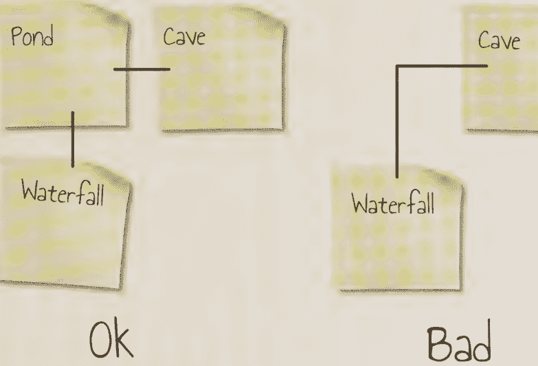


既然你脑子里已经有了这些想法，让我们开始为你的游戏制作一张简单的地图吧。如果你想的话，在完成后可以重新绘制地图，让它看起来很酷棒。但在设计游戏期间，请保持简单，因为你可能需要进行一些更改！也许这是不说而明的，但务必使用铅笔——这样你可以擦掉并修改。

参考我们设计 CYOP 游戏时使用的旧例子，我的起始空间是小屋，在我的地图上看起来像这样：

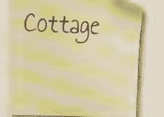

非常简单，对吧？我告诉过你，对于 Parsely 游戏来说，写作量少得多，更多精力放在了开发体验上。地图就是其中很大一部分！


在我的示例故事中，玩家可以选择离开小屋去往外外的田野。我需要选择一个方向并让玩家知道那是什么。由于我选择了纸张的左侧，我会说玩家可以向东出口。这很合理，对吧？

在我的地图上，我会在小屋右侧一点的地方画另一个地点空间，并标记为“田野”。

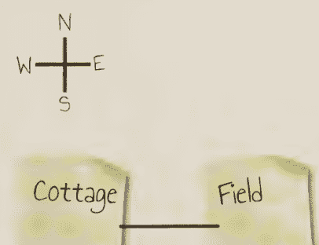

现在轮到你了。拿一张新纸作为你的游戏地图，在一条边上画一个矩形。给这个空间命名，作为你游戏的起始地点。考虑玩家在做出决定后可能移动到的下一个地点。添加该地点并建立连接。

太棒了，你已经在制作地图的道路上了！继续这样做，直到你完成整个布局。

- 10–15 分钟，想法表、纸、铅笔

虽然你的地图看起来可能与你在设计 CYOP 游戏时使用的故事单相似，但这张地图上的地点是不同的。

地点是你的游戏玩家可以移动、探索和做出决定的不同地方。如果他们在一个房子里，地点可以是他们正在探索的不同房间和走廊。如果他们在树底并可以爬到树顶，那就是两个地点。

注意的是，地点中并不总是要发生有趣的事情。但它们确实需要需要做出的移动或动作决策。如果玩家需要选择一个方向或做出决定，它就会是一个明确的地点。

例如，想象你的故事中有一栋房子，有几个房间连接到一条走廊。每当玩家需要选择一个方向前进时，那里就需要一个地点，以便玩家做出选择。

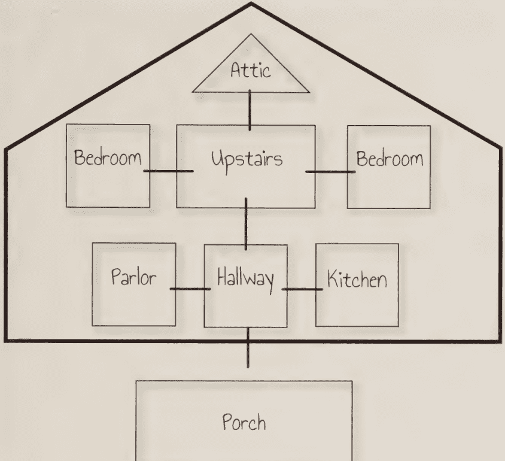

这与故事组织器不同，在组织器中，你为每个决策点及其结果准备了新的区块。在 Parsely 中，你的地图是由你可以移动和探索的区域组成的。取决于那里有什么以及什么，你的玩家可能在同一个地点做出多次决定。

看看你的故事，并填满游戏地图上剩下的地点。思考玩家必须去哪里以及他们需要做什么。你不必把他们需要访问的下一个地点直接放在他们所在位置旁边。分散开地点，让它们符合逻辑。通过构建地图，你正在构建玩家将探索的世界。给他们冒险的机会吧！

现在还没填满所有地点也不用担心。记住——设计是动的，随着你继续制作游戏，可能会发生。只需确保乐其中就好！

- 20–25 分钟，想法表、纸、铅笔

## 活动概述

现在你已经完成了地图工作，让我们转换一下，看看创建 Parsely 游戏的另一部分：叙事单。

在叙事单上，你将为地图上的每个地点编写信息。游戏的主持会在地图和文字描述之间来回查看，为玩家运行游戏。叙事单上地点的顺序并不重要，但你应该尽量——尽所能——按照玩家玩游戏的顺序来排列它们！

每个地点都应该为“计算机”写下四个元素：

- 标题

- 描述性文本

- 出口

- 空间的规则

**标题：** 这里的“标题”——你猜对了——是地图上地点的名称。它需要与你在地图上给该空间的名称完全匹配！玩家将探索你的游戏，在不同地点之间移动。当他们向某个方向移动时，游戏主持人将查看地图查看新地点的名称，然后查看你的叙事单来阅读并运行该地点。

**描述性文本：** 这是你游戏中每个地点的叙述部分。这是游戏主持人将读出的内容。你的写作应该使用第二人称。等一下，什么人？第二人称——你应该写读给玩家听的描述。确保你描述了什么样的，比如你站在一片被遗忘的荒野上。野草在风中摇曳。遗忘的荒野上，有一栋房子。油漆剥落，窗户破旧。已经没有人在这里住过多年了。你只需要描述玩家能看到什么。花时间描述细节真的会让你的世界变得生动！例如，你可以写道：“你站在一片荒野上，有一栋房子。”或者你可以写道：“你站在一片被遗忘的荒野上。野草在风中摇曳。在你面前，有一栋房子立着。油漆剥落，窗户破旧不堪。已经没有人在这里住过多年了。”你也不想透露所有。如果桌子上上有物品，不必在描述中包含物品。只需标注那个桌子，让玩家去发现！

**出口：** 这些是玩家可以去的方向；北、南、东、西是你最常用的。如果你想让玩家爬树或使用楼梯，你也可以使用向上或向下。为了简单起见，在创建地图时，尽量将从特定空间可以出发的方向限制在四个以内。这会让你的设计变得更容易，并在玩家运行游戏时保持清晰！

**规则：** 规则有助于定义——对于游戏主持人——玩家在空间内能和不能做什么。你不需要考虑每一种可能的事情；只需尝试写下对你的故事最重要的那些。“计算机”会针对不符合逻辑或未由规则定义的指令给出有趣、有趣的反应。那是当“计算机”的乐趣的一部分！

你的规则不需要很复杂。你可以使用简短简单的句子来定义它们。而且编写规则不止一种种方法！例如，如果玩家需要用钥匙打开门，你可以写任何一条规则：

门锁着。用箱子里的钥匙可以打开。

箱子里的钥匙将用来打开门。

如果玩家尝试开门，他们会发现门锁着。如果玩家拥有箱子里的钥匙，他们就可以用钥匙来开门。

你可能已经注意到在这些示例中使用了两种字体。*斜体*的单词是专门给“计算机”准备的，让它知道将发生什么。正字体的单词则可以与玩家分享。

你的规则可以包含玩家在检查物品时会发现的内容。例如：“如果玩家检查镜子，他们会发现玻璃后面藏着一封信。”你可以描述玩家在做某事时会发生什么：“如果玩家打开门，一只狼子会攻击他们。”你也可以说当他们没有某物或没有做某事时会发生什么：“如果玩家没有硬币，吉普赛人会对他们施下咒语。”

不要害怕让可怕和难看的结局降临你的玩家！记住，他们可以保存游戏并恢复到保存的位置。乐趣的之一在于知道——有时候——会发生可怕的事情。

- 描述性文字：你早晨在自己的小屋里醒来，那里坐落在你住了一辈子的安静村庄里。小屋是一间简单、小的单间，有一张床、一个炉子和一个桌子。你看到角落里塞着一根大棍。过了一，你开始听到外面传来了奇怪但动听的歌声。

- 出：外

- 规则：

  - 床很简单，有点臭味。

  - 炉子里装有昨晚的剩菜。如果玩家尝试吃一些，他们会病得满身是病。

  - 棍子是一根大棍子，用来拍掉床垫上的灰。玩家可以拿这根棍子。

  - 歌声几乎是不自然的。它听起来既让人感到安慰，又让人不安。

现在你已经看到该怎么做了，拿一张新纸，开始为你的前几个区域编写一些说明吧！

- 5–10 分钟，构思表、纸、铅笔

当我们构建 CYOP（由你决定）游戏时，我们使用的方法之一是回到决策点的循环。这允许玩家做出错误的选择，但不必从游戏开始重新开始。但玩家仍然会面对同样的选择，只能选择不同的选择，希望这次能向前移动。

在 Parsely 游戏中，你可以让玩家四处走动一下以绕过障碍或在游戏中前进。他们可能会向南走到一堆新挖的土堆。为了挖开那些土，他们需要一把铲子，而铲子只在北方才能找到。

所以，与你创建的 CYOP 游戏不同（在游戏中玩家故事总是总是向前推进），在 Parsely 游戏中，你可以将线索、工具和碎片散布在整个游戏中。现在，鼓励探索是好事，但你不想将其与你的故事弧线以及你想要在故事中发生的主要事件混淆。

例如，假设你想让玩家通过一只守着通往 Fruitopia 之路上的狂暴香蕉。为了通过那只香蕉，他们需要一只非常饥饿的大猩陪同。还有谁能对付并吃掉那只狂暴香蕉呢，对吧？！如果没有大猩，玩家的结局将非常惨。

相反，大猩猩应该在几个房间之外的地点，并且可能有它自己的挑战使其难以获得。但将它们隔离开为玩家创造了一个需要解决的问题，而又没有立而易见的解决方案！

他们可能会先遇到狂暴香蕉——在找到大猩猩之前——并在那只黄色水果的手下惨死。然后，他们可以加载游戏并探索其他区域，寻找方法帮助他们绕过香蕉并发现大猩猩！

观察你游戏的故事，选择一个玩家在游戏中需要通过的障碍，将其放置在地图上的某个位置。接下来，将所需的物品放在距离障碍位置几个房间之外的地方。就这么！

- 20–25 分钟，构思表、纸、铅笔

与 CYOP 游戏不同，在 Parsely 游戏中，玩家可以拥有背包。当他们穿过你的游戏时，他们可以发现并随身携带物品。这为你提供了一个机会，为玩家创造更有趣的决策和挑战，而不仅仅是在几个选项之间做出！

现在，玩家可以发现工具、钥匙或其他他们可能立即不知道如何处理的奇物品。你也可以创建需要玩家发挥创意来使用所发现物品的障碍！给玩家提供物品将为你——在设计游戏时——提供新的方法，在他们尝试使用物品并发生严重错误时给玩家释放可怕的事件和灾难。

看看几个如何利用玩家获取并使用物品的示例。

- 锁：玩家可以找到钥匙、宝石或其他需要在物体上使用的物品来解锁它。该物体可以是箱子、门、墙或魔法传送门。这可能也包括破坏！玩家可能需要一个物体来破开某物，或者破坏某物以进入内部。

- 一次性：你也可以设置具有特殊一次用途的物品，玩家需要持有它们并在正确的时刻使用。他们可能需要一个火柴来安全穿过黑暗区域，需要诱饵来捕捉小动物，或者一种药水给他们临时的飞行。在所有这些情况下，玩家只能使用该物品一次！所以技巧在于让玩家仔细思考何时是时候，或者他们需要回去拿另一个物品，或者重新开始。

与玩家需要并携带的物品类似，你也可以设置需要玩家在做过某事后才能通过的障碍。他们可能需要与重要角色交谈，或者在进入某个区域之前学习一个秘密密码。他们可能需要完成某项任务，比如在进入城堡之前拯救王子。通过这些障碍并不要求玩家拥有某物，而是要求他们或做过某事。

例如，假设玩家需要使用在书房找到的钥匙来以后打开地下室的箱子。当他们找到钥匙时，在规则下，你可以写道：

钥匙小而精美，看起来很重要。这把钥匙可以打开位于地下室的箱子。

随后，当玩家在地下室发现宝箱时，你可以在规则中这样规定：

- 宝箱做工精巧，配有一个华丽的锁。宝箱只有用在书房里找到的小型华丽钥匙才能打开。

在这个例子中，你可以看到几点。首先，通过重复使用“华丽的（ornate）”一词，提供了关于钥匙对应锁的线索。如果玩家手里有多把钥匙，这可能很有帮助，让他们知道该用哪把钥匙开锁。其次，记住使用*斜体*来表示需要游戏主持人注意——但不需要大声读出来的内容。

运用所有这些技巧，为你在上一项活动中创建的障碍编写规则。此外，修改你早些为前几个地点编写的规则，并根据需要进行任何必要的调整。

- 10–15 分钟，点子表、纸、铅笔

在互动小说游戏中，玩家在探索、解决问题和克服障碍时会采取行动。你希望为他们提供机会，以及他们在游戏中执行操作所需的工具和信息。将这种方法应用于你的设计中至关重要！

开始之前，请考虑玩家在互动小说游戏中尝试的主要动作类型。这些如下：

- 观察 (Look)

- 拿起 (Take)

- 丢弃 (Drop)

- 放置 (Put)

- 检查 (Examine)

- 搜索 (Search)

- 背包 (Inventory)

- 打开 (Open)

- 关闭 (Close)

- 上锁 (Lock)

- 解锁 (Unlock)

- 询问 (Ask)

- 告诉 (Tell)

- 说话 (Say)

- 给予 (Give)

- 展示 (Show)

思考玩家在你的游戏中如何行动，将有助于你构思障碍以及你希望他们在游戏中做的事情。这也能帮助你为游戏中发生的情况思考重要的规则。记住，你不需要考虑玩家可能尝试的每件事！但为那些重要或有趣的尝试思考并制定规则绝对是有帮助的。头脑风暴动词，并为你已经在游戏中写好的地点创建规则。为每个地点添加一两个新规则。这些可以是荒谬的、幽默的、增加故事细节的，或者是导致游戏某种方式结束的！

- 此外，玩玩文字游戏。。玩家没有使用正确的词，就表现出困惑。例如，如果玩家发现了一个箱子，然后其中一人对你说：“打开它”，你可以回答说：“我没看到。”玩家必须具体——他们看到的是箱子，他们打开的就是箱子。这听起来可能很烦人，但可以带来一些有趣的时光！

- 如果结局非常惨，就从头开始游戏。在重做时享受乐趣，就像你是第一次介绍这个游戏一样。

如果玩家要求你“保存（save）”，那么他们就可以通过告诉你“加载（load）”从保存点重新开始游戏。他们将拥有那个时间点的所有物品，你只需要像他们回到了那里一样继续故事即可。记住他们最后保存在哪里取决于你，或者你可以让玩家提醒你那是哪里。不过，你不应该做的是提醒他们保存和加载。让他们遭遇几次惨的结局吧。他们会很快发现自己需要反复检查，而看着他们的挫败感非常有意思。

Twine 是一款允许你创建数字交互式小说游戏的工具，并可以将其与世界共享分享。创建 Twine 游戏将运用到你在制作模拟（或非数字）交互式小说时开发的许多技能。在游戏性方面，Twine 介于 CYOP（选择你的冒险）游戏和 Parsely（文本解析）游戏之间。Twine 中的交互通常是在一系列选项之间进行选择——就像 CYOP 游戏——但你也可以使用 Parsely 的开放式玩法。除非另有说明，本章中的每个活动都需要一台电脑和 Twine。

5–10 分钟

在开始使用 Twine 之前，你需要下载或在网上打开该程序。你可以在 http://twinery.org 找到 Twine 程序。在那里，你可以根据你使用的电脑下载 Windows、macOS 或 Linux 版本的程序。所有这些活动将基于 Twine 2，因此你可能需要下载最新版本。你也可以在线创建你的游戏，它在任何电脑上都能运行。

无论你最终使用哪个平台，界面都是相似的。对于本书，我们将使用基于 Web 的界面。还有几种你可以使用的格式。对于本书，我们将使用 Twine 2 的默认故事格式。你不需要执行任何操作来选择此格式——一旦下载并开始，它就已经被选中了。所以让我们开始 Twine 之旅吧！我将是你的向导。当你第一次启动 Twine 时，你会看到故事页面。


如果你向左侧看，将看到你正在创作的故事列表。由于这是你的第一个故事，你在这里不会看到任何故事。但当你开始编写它们时，你可以在这里找到它们！右侧窗口是故事菜单，你可以在那里开始新故事、加载正在编写的故事、归档故事以备后用，或更改你正在使用的格式。你需要开始你的第一个故事，请点击绿色按钮来创建它。这是一个大时刻！


如果你回到第一个标签页并刷新页面，你现在应该能在左侧区域看到你的故事，如下：欢迎来到你的第一个 Twine 交互式小说游戏！到目前为止很容易，对吧？

# 旅继续

5–10 分钟

## 活动概述

感谢留在 Twine 之旅！虽然我猜你并没有太大选择……我仍然是你迷人的（希望如此！）向导。让我们回到有故事的标签页，继续之旅的其余部分。你会发现屏幕的大部分被一个巨大的网格空间占据，中心有一个正方形。那个正方形是你故事的开头！在 Twine 中，它被称为“段落”（passage）。很快，你就会添加更多段落，用你精彩的故事填满网格空间。

你可以点击并拖动该段落到网格空间中的任何位置。随着页面的填充，重新排列段落布局有时会有帮助，让它们对你来说合乎逻辑，并更容易找到你想要的内容。

## 指南

你可以点击并拖动该段落到网格空间中的任何位置。随着页面的填充，重新排列段落布局有时会有帮助，让它们对你来说合乎逻辑，并更容易找到你想要的内容。

# 清理

## 活动概述

感谢留在 Twine 之旅！虽然我猜你并没有太大选择……我仍然是你迷人的（希望如此！）向导。让我们回到有故事的标签页，继续之旅的其余部分。你会发现屏幕的大部分被一个巨大的网格空间占据，中心有一个正方形。那个正方形是你故事的开头！在 Twine 中，它被称为“段落”（passage）。很快，你就会添加更多段落，用你精彩的故事填满网格空间。

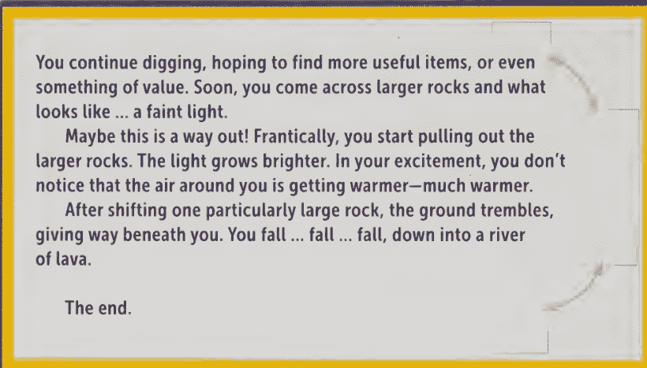

你继续挖掘，希望能找到更多有用的物品，甚至是某些有价值的东西。很快，你遇到了一些较大的石头，还有看起来像……一丝微弱的光。

也许这就是出口！你急急地开始拔出那些大石头。光变得越来越亮。在兴奋中，你没有注意到周围的空气变得越来越热了——比热得多。

在移开一块特别巨大的石头后，地面震动起来，在你脚下崩塌了。你坠落……坠落……坠落，掉进了岩浆河。

给你的第一个段落命名为“Start”。在正文中写入“You are standing in in ...”并点击右上角的 X。

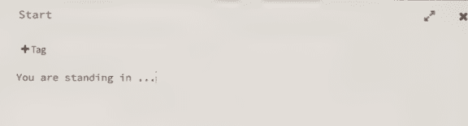

当你完成后，你应该回到了网格页面并看到以下内容：


10–15 分钟

好了，我承认，那确实有点大失所望。但嘿，你总得从哪里开始，对吧？关闭打开游戏的标签页，让我们回到故事网格！

我觉得这个故事游戏缺少了一些，嗯，故事。所以让我们加点东西吧！你从上一个活动中看到，你输入的任何内容都会作为游戏的一部分显示。你不需要做任何特殊处理——直接输入即可。

不过，你可能想添加一些额外的样式和装饰。有些样式可以通过简单在你想更改的文本周围添加几个字符来实现：

- **粗体**（bold）可以在两端各添加两个单引号来实现：

  - 'Look at my "bold statement"'

- *斜体*（Italics）可以在两端各添加两个正斜杠来实现：

  - OI //really, really// like your hair.

- ~~删除线~~（Strikethrough）可以在两端各添加两个波浪号来实现：

  - OI really, ~~hate~~ like your hair.

- *上标*（Superscript）可以使用两端各添加两个脱帽符号来实现：

  - OIts the worst, like 1000^^2^^

现在轮到你了！编辑你的起始段落，并尝试几种不同的样式。记住，你需要在想要更改的文本两侧都放置正确的字符。如果你最终看到了你尝试用来更改文本的字符（如波浪号或斜杠），那意味着你犯了错误。幸运的是，这很容易修复。如果是这样，请回去并编辑段落。仔细观察并尝试修复出现出的问题。这被称为“调试（debugging）错误”。当一切准备就绪后，点击底部的播放图标进行测试，看看你的新样式看起来如何！

你还会注意到，在 Twine 中编写游戏使用了大量的自然语言。你只需要像往常一样写作，并添加一些额外的片段来适应游戏。这就是使用 Twine 创建数字互动虚构游戏的奇妙之处。你只需要编写并添加几个元素，就能让它们看起来和玩起来都很棒！

5–10 分钟

既然你已经掌握了样式设置，让我们完成练习游戏的开头吧。在接下来的几个活动中，你将遵循我的示例开始创建一个简单的、可玩的游戏。目标是向你介绍可以在 Twine 中使用的工具，并提供这些工具在程序中外观和功能的示例。

让我们使用 Parsely 游戏示例中很不错的介绍段落。编辑你的起始段落并输入以下内容：


你正站在一个被遗忘已久的废弃田野上。草茎在风中摇曳。在你面前，有一座房子立在田间。油漆剥落、脱皮。窗户全是破破碎的。

```
//No one has lived here in years//
```

注意，第一段和带有斜体的第二行之间有一个空行。当你完成段落的编辑后，关闭它并点击播放图标。两个文本部分之间的间隙仍然在那里，对吧？记住这一点——当你输入段落时，它会保留你写作时使用的间距。你不需要做任何特殊处理！

## 点击链接 (Hit the Links)

现在你有了故事的开头，它需要去某个地方。你可以创建更多作为游戏后续步骤的段落，但你需要一种方法到达它们！怎么做呢？一个词：链接。链接允许你连接到其他段落，或者回到已经创建的段落。除了连接，链接还允许你揭示新信息。接下来的几个活动将向你展示如何使用链接来扩展和完善你的游戏。有趣的内容！

链接将使用双方括号 `[[ ]]`。。括号内的文本将定义链接以及它连接的段落。链接将以蓝色文本显示，这样每个人就知道它是特殊的！

## 新段落链接 (New Passage Links)

10–15 分钟

### 活动概述

你的故事在某个时候必须向前发展。你希望玩家拥有一些选择和新的段落来探索和扩展他们的游戏。这些就像我们构建 CYOP（由你选择的冒险）游戏时的决策点。每个决定都将引导向一个新的段落，即你故事的新部分。我们需要在两个段落之间创建一个链接，将我们从第一个段落中的一个选择跳转到新段落之一。

幸运的是，Twine 有一种快速简单的方法可以做到这一点！当你添加一个新链接时，Twine 会自动创建一个以链接名为标题的段落。所以让我们创建一个指向新段落的链接并同时创建该段落。

### 指南

打开并编辑你的起始段落。在最后一行留一个空行，然后输入以下内容：

```
[[Approach the House]]
[[Go around Back]]
```

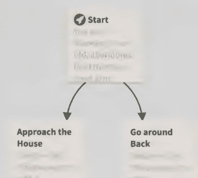

在后台，这让你知道有链接将起始段落到那两个段落。箭头的方向让你知道你可以从起始段落跳转到“Approach the House”和“Go around Back”段落。但你不能直接回去——也不能去任何其他地方。

等等，我漏掉了一些。现在是介绍“后退（step-back）”功能的好时机。它可能有点难看，但在玩游戏时，它位于左侧上方，看起来像一个循环箭头。

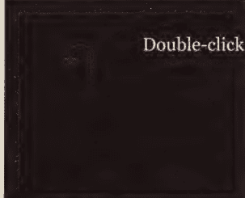

点击其中一个链接后，使用箭头退回到起始段落并尝试另一个链接。非常简单！

## 回链 (Linking Back)

10–15 分钟

### 活动概述

所以，尽管后退功能很酷，但并不是理想的。它实际上会撤销一次回合，当我们深入构建游戏时，这可能会导致问题。所以让我们给故事添加内容，并同时创建一个回到起始段落的链接。

### 指南

打开名为“Approach the House”的段落并输入以下内容：

> 你开始靠近那座房子，但有些地方看起来……//劲劲风在房子周围废弃的田野上呼啸。也许是门廊上的洞，或者是挂在灯上的旧鞋子。但如果你能找到另一种进入房子的方法，你会感觉好得多。

```
[[Start]]
```

慢慢地，你走进了隧道。手电筒帮助着你寻找方向。隧道看起来并没有你掉进去的那个洞穴那么脏。地板被磨损得很厉害，似乎有什么东西反复在上面移动，使其保持了整洁，并留了几道细小的凹槽。

很快，你发现有许多蜘蛛网横住了你的去路——它们让你无法向前。

你转身准备回去，但在你行动之前，你看到一个巨大的阴影从正前的蜘蛛网中浮现。突然，你意识到那是一只巨大的蜘蛛——它正向你扑了过来！

出于某种未知的本能，你拔出生锈的匕首，向蜘蛛刺去。它发出一声恐怖的响窜开了，但你能看出它不会再回来了。声音消失后，你穿过蜘蛛网，继续向隧道深处走去。

很快，你跌跌撞撞出了洞穴，听到了救援队——你获救了！

结束。

# 名字意味着什么？

15–20 分钟

### 活动概述

目前，我们的选择选项和路径大多数名称都相同——起始路径除外。但让路径的名称与选项相同并不总是合理的。有时，你可能希望路径代表某个地点，而不是选择的结果。

例如，现在当你从田野开始时，你可以选择去“房子正面”或“绕后路走”。从映射的角度来看，将这些作为玩家可以反复返回的地点，而不是选择的结果，可能更有意义。

### 指南

这应该与你在 Parsely 游戏中做的映射类似。在那里，你探索了地点，并在那些地点做出了决策和选择。你的 Twine 故事地图将是决策和地点的混合，结合了你在 CYOP 和 Parsely 游戏中使用的思路。

由于我们让 Twine 自动创建了新路径，因此它们的标题显示了选择的结果。让我们修复它！首先，将“Approach to the House”（靠近房屋）重命名为“Front of the House”（房子正面）。去编辑该路径并将标题改为“Front of the House”。

关闭该路径。连接到起始路径的链接应该还在那里。

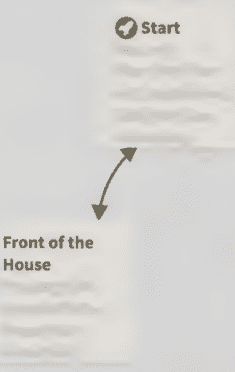

如果你编辑了起始路径，你会发现 Twine 自动为你重命名了路径链接。非常酷！

```
Start
+Tag
你正站在一片被遗忘已久的旧废弃田野上。草茎在风中摇曳。在你面前，有一栋房子立在田野中。油漆剥落脱落。窗户全部破碎了。
//已经多年没有人住在这里了//

[[Front of the House]]
```

哦不。我们现在出问题了。玩家在故事中的选择现在成了一个地点的名称。而且这听起来不太对！

在 Twine 中，你可以创建显示内容与其目标路径名称不同的链接。这在这里会有很大帮助，所以让我们做这个更改吧！要做到这一点，我们需要结合使用连字符和大于号。这会形成一个箭头：“->”。这意味着格式将是 `[[显示给玩家的文本->路径标题]]`。

你你可以使用这种格式创建新路径，就像我们之前做的一样。每当你创建一个指向不存在路径的链接时，Twine 都会为你创建该路径。这非常有用！

在方括号内部，我们需要添加想要让读者看到的文本，并在路径链接之前添加箭头。让我们保持之前的文本。所以去修改链接，让它看起来像这样：

`[[Approach the House->Front of the House]]`

你可能注意到被链接的路径名称是蓝色的。这让你知道 Twine 将其识别为链接。当你关闭起始路径时，应该还能看到到 Front of the House 的连接。

在继续之前，让我们修复目前完成的一些内容：

- 将名为“Go around Back”（绕后路）的路径改为“Back of the House”（房子后面）。
- 修改起始路径中的链接，让玩家有“Go around Back”的选择，但指向“Back of the House”。
- 将 Start 路径标题改为“Abandoned Field”（废弃田野）。
- 修改 Front of the House 中的链接，让玩家看到“Head into the Abandoned Field”（进入废弃田野），且链接指向“Abandoned Field”。

完成这些更改后，启动你的游戏并测试一切。确保没有 Bug！你可能会担心，因为现在“Back of the House”路径什么都没有显示——但我们稍后会修复它。

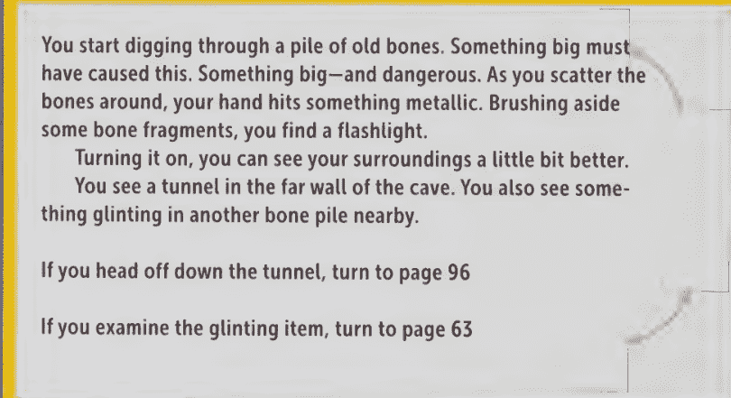

# 通过链接和点击更改文本

你还可以在故事中创建点击链接，除了引导读者进入下一个路径之外执行其他操作。你可以使用它们来揭示新信息、移动或更改给读者的内容。

这些更改是通过宏（macros）完成的。这个词在计算机科学中可能听吓，但它只是告诉 Twine 执行特殊操作的代码段。

以下是你可以使用的一些宏示例：

- 链接：`(link:"text shown")[target]`

  这类似于普通链接，但它使用宏来定义文本。
- 链接显示：`(link-reveal:"text shown")[hidden text]`

  这在点击时会在页面上添加文本。
- 变量：`(set: $variable = "value")`

  这允许你存储和更改信息，例如玩家的名字。
- 条件判断：`(if: $variable == "value")[show this]`

  只有在满足特定条件时才会显示此内容。

读者首先会看到：‘我点击了按钮。’当他们点击“button”这个词时（懂的），将会出现更多文本，从而丰富故事。接着他们会看到：‘我点击了按钮本身。面板后面露出了一扇门。’

间距注意：请注意示例，我在方括号内、即将显示的文本开始前放置了一个空格。此宏会将方括号中的任何内容紧接在引号内的内容之后。

`(link-reveal: "head")[butt]`

- - 会生成 "headbutt"
- `(link-reveal: "head")[butt]` 或 `(link-reveal: "head") [butt]`
- - 会生成 "head butt"

点击宏（click macro）与链接宏（link macro）类似，它通过替换或添加文本来更改段落中的内容。但有两个巨大的区别！

1. 点击宏中的“text a”部分实际上并不会显示。相反，宏会在段落中寻找该文本并对其产生影响。
2. “text a”部分的所有实例都会触发该宏。在大多数情况下，它会影响该文本的所有实例。假设你让段落中的单词“dog”变得可点击，并将其替换为单词 [cat]。如果你在段落中出现了三次“dog”，那么这三个都会显示为链接。如果玩家点击了其中任何一个，它们都会同时被替换为单词“cat”。

`Click (click: "text a")[text b]`

当 "text a" 出现在段落中时，它将是可点击的并触发宏。虽然所有的 "text a" 都是可点击的，但 [text b] 只会出现在输入宏的地方。若要让文本在处处出现，请查看下方的 click-append。

示例：

- - 我摸了那只颤抖的猴子。`(click: "monkey")|它咬了我的手指。`
- - 读者首先会看到：‘我摸了那只颤抖的猴子。’当他们点击 monkey 时，将显示：‘我摸了那只颤抖的猴子。它咬了我的手指。’

间距注意：与链接宏一样，文本与放置宏的位置之间的间距至关重要！

大小写：你的情况（即大小写）在写作写作和“text a”部分中必须一致，Twine 才能识别它们为匹配项并使文本可点击。对于 Twine 来说，“dog" 和 "Dog" 是两个不同的单词。另一方面，如果该词是一个更大单词的一部分，Twine 会识别它——所以要小心。这意味着如果你正在将 dog 替换为 cat，单词 "dogged" 就会变成 "catged"。这不对劲！除非你有一个名为 Catged 的角色。但这看起来不太可能。

- - Click-replace `(click-replace: "text a")[text b]`
- - 段落中任何出现 "text a" 的地方它都是可点击的。而且每一个 "text a" 实例都会被替换为 [text b]。

示例：

- - 我讨厌马戏团，因为我讨厌小丑。它们让我感到心悚。我知道小丑看起来很友善，但我不知道。它们似乎隐藏着某些更黑暗的东西。（我永远不会相信小丑。
- - `(click-replace: "clowns")[makeup nightmares]` 这将使所有的 "clowns" 实例变为可点击。点击其中任何一个都会将文本更改为：“我讨厌马戏团，因为我讨厌化妆品噩梦。它们只是让我感到心悚。我知道化妆品噩梦看起来很友善，但我不知道。它们似乎隐藏着某些更黑暗的东西。我永远不会相信化妆品噩梦。

* Click-append `(click-append: "text a")[text b]`
* 段落中任何出现 "text a" 的地方它都是可点击的，并在其后紧紧添加 [text b]。不过，无论你将此宏放在段落的哪个位置都可以，再次，为了可读性，通常将其放在末尾更好。
* 示例：
* 我讨厌马戏团，因为我讨厌小丑。它们只是让我感到心悚。我知道小丑看起来很友善，但我不知道。它们似乎隐藏着某些更黑暗的东西。（click-append: "clowns")|and feet
* 这次，点击 "clowns" 将产生：“我讨厌马戏团，因为我讨厌小丑和脚。它们只是让我感到心悚。我知道小丑和脚看起来很友善，但我不知道。它们似乎隐藏着某些更黑暗的东西。我永远不会相信小丑和脚。”

- * Click-prepend `(click-prepend: "text a")[text b]`
* 段落中任何出现 "text a" 的地方它都是可点击的，并在其前方紧紧添加 [text b]。
* 示例：
* 我讨厌马戏团，因为我讨厌小丑。它们只是让我感到心悚。我知道小丑看起来很友善，但我不知道。它们似乎隐藏着某些更黑暗的东西。我永远不会相信小丑。
`(click-prepend: "clowns")|monkey ]`
* 使用此宏，点击 "clowns" 会让段落变为：“我讨厌马戏团，因为我讨厌猴子小丑。它们只是让我感到心悚。我知道猴小丑看起来很友善，但我不知道。它们似乎隐藏着某些更黑暗的东西。我永远不会相信猴小丑。

为了强调这一点：最好将点击宏放在段落的底部。

我们需要将变量引入 Twine 并设置它的初始值。为了做到这一点，我们将创建一个与我们的任何段落都没有链接的新段落。相反，我们可以用它来存储我们在游戏中将要使用的任何变量。

我们不需要通过带链接的方式添加段落，而是需要使用故事地图上的绿色“添加段落”（add passage）按钮来创建一个新的无标题段落。你可以随意将其拖动到你能看到的地方，但要确保它不会挡住你的其他段落。

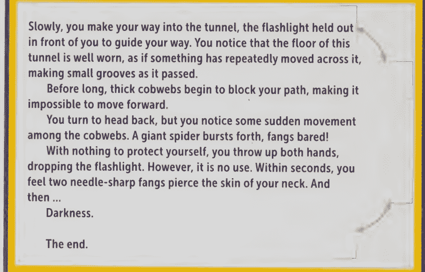

你慢慢走进隧道，手里拿着手电筒指引方向。你注意到这条隧道的地板被磨损得很厉害，似乎有什么东西反复在上面移动，在经过时留下了细小的凹槽。

不久，厚厚的蜘蛛网开始阻挡你的道路，让你无法向前。。

你转头回头，但注意到蜘蛛网中有突然的动作。一只巨大的蜘蛛冲而出，露出了獠牙！

由于无物保护自己，你伸出双手，掉掉了手电筒。然而，这无用事。几秒钟内，你感到两根尖利的獠牙刺穿了脖子的皮肤。然后……

黑暗。

结束。

现在，编辑该段落并将其命名为“Variables”——因为它将包含这些内容。我们还需要做一件非常重要的事情：给这个段落一个特殊的标签（tag）。我们以前没有用过标签，但它们通常不会影响游戏。它们只是你用来组织或排序段落的一种方法。有几个标签与 Twine 交互，`startup` 标签就是其中之一。它告诉 Twine 在运行你的起始段落之前先读取这个段落。这意味着 Twine 将知道你在段落中引入并设置的变量。这样，当你以后使用它们时，Twine 已经知道它们了！

在标签区域，点击添加标签按钮并输入“startup”。现在我们只需要设置我们的变量了。我们将要使用一个名为 `set` 的新宏，它看起来像这样：

```
(set: $fear to value)
```

在我们早前的一个示例中，我们可以为玩家名称创建一个变量。我们可以先将玩家名称设置为 `none`，以后给玩家一个机会输入自己的名字。它看起来像这样：

```
(set: $classname to "none")
```

因为 `$classname` 变量是某些文本，所以它需要放在引号中。Twine 会将引号内的任何内容视为文本，并进行相应的处理。

我们将使用数字来跟踪玩家有多害怕。他们恐惧的初始值为零。每当发生可怕的事情时，我们就会在那个数字上加 1。数字越高，他们越害怕。我们将这样设置 `$fear` 变量：

```
(set: $fear to 0)
```

因为这个值是一个数字，所以不需要放在引号里。继续将 `$fear` 变量添加到“Variables”段落中。完成后，你的段落看起来应该像这样：

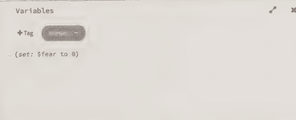

恭喜——变量设置好了！你的故事地图现在应该看起来这样：

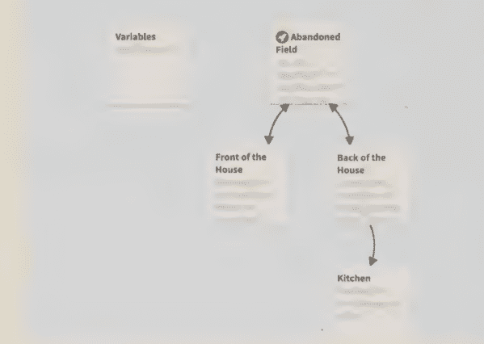

# 变量，出发吧！

+ 10–15 分钟

在我们继续之前，让我们花一点时间测试并确保我们的变量已全部设置好。这是介绍 Twine 测试工具的完美时机。测试模式让你运行游戏，并会为你提供关于后台某些内容的额外信息，向你展示它们随着你玩游戏是如何变化的。这是一个非常有用的工具，所以我们在接下来的过程中会查看它几次！

## 指令

在故事地图上，点击测试按钮。这将启动你的游戏——但你会在右下角看到一个新区域：

| `$fear` | 0 |

| Turns: | 1 |

顶部部分显示你的变量。你应该能在左侧看到你设置的 `$fear` 变量，在右侧看到数字 0。如果是这样，说明你很棒了！

如果你想知道其他元素是什么，我给你做一个简要介绍。在变量下方，你可以跟踪经过了多少回合。玩家采取的每一个动作——点击和在段落之间移动——都会消耗一个回合。这个调试视图将显示更多关于宏的信息。好了，既然我们知道变量运行正常，让我们让我们来使用它吧！关闭测试标签页回到故事地图。一旦回到那里，编辑“Front of the House”段落。如果你还记得的话。

## 指令

在这个示例中，如果玩家不点击那个链接，他们就不会进入“昏迷（Pass Out）”段落。但你可能不想给他们这个选择。相反，你希望在 `$fear` 达到 4 时强制他们进入“昏迷”段落。

为了实现这一点，我们可以使用另一个名为 `goto` 的宏。`goto` 会将玩家带到一个新的段落。他们没有点击链接的机会——直接显示新段落即可。这完美符合我们的需求！让我们修改该条件语句，并将其添加到 `(if: $fear is >= 2)` 之后。

```
(if: $fear is 4)[(goto: "Pass Out")]
```

现在，当玩家进入这个段落且他们的 `$fear` 为 4 时，他们将被带到一个新段落——“Pass Out”。与链接不同，你必须手动创建这个段落。但现在可以了——并确保大小写一致，否则游戏将不知道该去哪里！


让我们让我们快速编辑一下“ Pass Out”段落，让玩家获得一些关于发生了什么的信息。记住，他们没有看到显示的链接，也看不到段落标题！在 Pass Out 段落中添加以下内容：

你醒了，神情迷迷，就在废弃田野（Abandoned Field）外。

之后，包含指向“Abandoned Field”段落的链接，这样他们就可以回到游戏中！此外，让我们重置他们的恐惧——否则它会一直增加！让他们重置以便做出不同的选择是合理的。要重置，在这里将 `$fear` 变量设置为 0。它将覆盖当前的任何 `$fear` 值并将其置零。玩家在昏迷后将从全新的、无恐惧的状态重新开始！

再次测试你的游戏。尝试靠近房子并多次返回田野，直到触发宏让你自己昏迷。在此期间，请观察 `$fear` 变量，看看它是如何增加然后重置为零的（希望如此！）。

# 注意！

在所有这些测试中，我让你使用我们创建的链接在田野和房子前面之间来回。这是因为使用游戏元素会让游戏继续进行。

早些时候我提到了左上角显示的后箭头。这个箭头会回退一个回合，当你试图在变量（如恐惧）中累积数值时，这可能会成为问题！

再次测试并使用后箭头返回田野，看看 `$fear` 变量会发生什么。它会减少 1，因为你向后退了一步，并且在进入“房子前面（Front of the House）”段落时从未增加 `$fear`。

# 文本变量

15–20 分钟

## 活动概述

我向你展示了如何使用数字设置和增加变量。让我们来看一个使用文本变量的快速示例。也许我们希望玩家在游戏过程中获得称号。他们做的不同事情会改变他们的称号。听起来很有趣，对吧？

## 指令

首先，让我们编辑“变量（Variables）”段落引入引入新变量：`$title`。在 `$fear` 变量下方添加一个 `$title`，并将其设置为“懦蛋（The Lame）”。它看起来应该是这样：

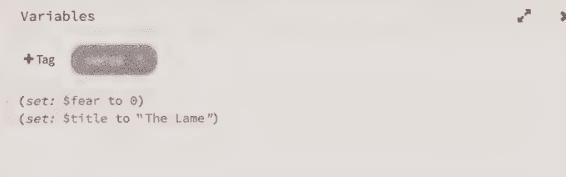

当玩家开始游戏时，他们将拥有值为“The Lame”的变量 `$title`。尝试测试你的游戏，确保在开始时能看到该变量。它应该像这样：

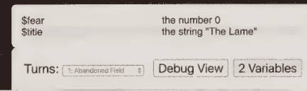

非常简单

```
(click-replace: "floating")[popped(set:$title to "The Balloon Slayer")]
```

现在，当玩家点击“floating”链接之一时，会将文字变为“popped”，并将玩家的称号设置为“气球杀手（The Balloon Slayer）”。

好了，现在有三次获得称号的机会。当标题改变，就会覆盖之前的值。但看不见的标题有什么用呢？让我们创建一个机会来看到标题！编辑“厨房（Kitchen）”段落，玩家将在那里遇到一位老妇。输入以下文本：

你走进厨房。一位皱皱瘦弱的老妇从桌前抬起头。“哟，来了一个特别的人。我听过你。他们叫你……”

我打赌你现在该做什么了！测试你的游戏。如果你直接去厨房什么都不做，你应该被称为“The Lame”。离开厨房，破气球，然后回到厨房。这次你应该被称为“The Balloon Slayer”。最后，让自己害怕昏迷。然后去厨房，你应该是“恐惧者（The Fearful）”。

# 如果-否则-如果 (If-Else-If)

15–20 分钟

## 活动概述

有了称号就应该有奖励！我们进入了展示 Twine 工具的最后一个活动。现在有了三种可能的称号，如果让老妇根据玩家拥有的称号给予奖励又如何？

## 指令

为了实现这一点，我们将扩展条件语句以包含两个新宏：`else` 和 `else-if`。这种格式如下：

```
(if: $title is "The Lame")[a]
(else-if: $title is "The Balloon Slayer")[b]
(else)[c]
```

当你在 Twine 中完成游戏时，你需要将游戏发布为文件，然后就可以分享并运行游戏。Twine 将把游戏发布为 .html 文件，这是一种可以在浏览器中显示的网页。

当你满意时，点击故事页面上的故事标题。最左下角的链接将提供“发布到文件（Publish to File）”选项。

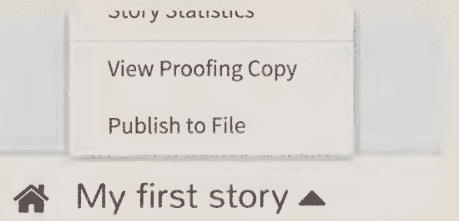

点击此链接，Twine 将把你的游戏保存在浏览器保存文件的地方。Twine 创建文件不会花费很长时间。完成后，打开文件并运行你的游戏！

# 创造你自己的作品

25–30 分钟

## 活动概述

学了这么多东西！幸运的是我们来说，Twine 是一个设计非常精良的软件。这意味着你越用它，它就会变得越来越好！相信我——Twine 的可能性仅限于你自己的想象力。

## 指南

现在轮到你了。你已经具备了在 Twine 中创作的良好基础。结合我们到目前所学到的知识，开始创作你自己的杰作吧！也许可以继续完善我们之前开始的游戏，使用 CYOP 或 Parsely 设计风格，或者大胆地从零开始设计一个新游戏。

如果还不完美，或者在这个过程中犯了错，不要担心。所有的错误和意外都是设计过程的一部分！在添加新部分或进行更改时，务必进行检查和测试——如果你能尽早发现它们，以后就会少很多麻烦，相信我。并记住——玩得开心！

# 进一步探索

你不会以为我到这里就结束了对吧？我希望你在在 Twine 中构建的过程中玩得很开心。在最后，我想给你提供几个工具，以便在你创作未来超酷的游戏时使用。这些是更复杂的主题，可以扩展并增强游戏。

想要了解更多——除了这里之外——请务必查看 Twine Wiki：https://twinery.org。此外，一些最好的技巧可以通过玩 Twine 游戏来学习！你可以在互动小说数据库找到：http://ifdb.tads.org/。

本章中的所有活动都需要电脑和 Twine。

# 更多样式

10–15 分钟

## 活动概述

在上一节课中，你可以看到更改文本的样式。但还有更多方法可以更改或强调你故事中的元素。这里有一些你可以使用的其他酷宏！

## 指南

这些新样式将应用于你想要影响的文本。你放在 hook 里的文本将被改变。

## 字体

字体宏允许你更改文本中使用的字体。字体需要被浏览器识别，所以不要把字体选得太离谱。但这有很多酷的选项！例如，你可能想用 Courier 字体创建一个报纸标题，像这样：

拿起报纸标题。

```
警告：危险
```

## 颜色

此宏允许你更改文本的字体颜色。也许你想要用不同的颜色来强调某个单词或短语，或者你只是喜欢这种颜色的效果。你可以使用基础颜色名称，如绿色、红色或蓝色，或者使用十六进制代码。

`(color: red)` 和 `(color: #ff0000)` 都会产生相同的效果：

```
红色的。
红色的。
```

## 背景

你还可以更改文本后的背景颜色。就像更改字体颜色一样，你可以使用基础颜色名称或十六进制代码。

`(background: red)`应该是红色背景。

```
这应该是红色背景。
```

## 过渡

Twine 还可以通过过渡宏为你的文本添加一些活力。这些宏会让文本在加载时产生短暂的动画。这非常酷！

- `(transition: "dissolve")` 让 hook 淡入。
- `(transition: "shudder")` 让 hook 抖动。
- `(transition: "pulse")` 让 hook 短暂脉动。

## 文本样式

这是实现我们涵盖的一些样式的另一种方法——但选项更多。你可以制作粗体、斜体和删除线等标准样式。但你也可以为文本创建一些酷的效果：将其翻转、倒置，或者让它颤抖。与在加载时发生一次的过渡不同——文本样式会在阅读期间持续存在。例如：

`(text-style: "upside-down")` 房间翻转了。


这里是其他样式。试试它们吧！

- `"bold"`
- `"italic"`
- `"underline"`
- `"outline"`
- `"shadow"`
- `"blur"`
- `"blurrier"`
- `"smear"`
- `"mirror"`
- `"upside-down"`
- `"blink"`
- `"fade-in-out"`
- `"rumble"`
- `"shudder"`

## 旋转

我们的最后一个文本宏超级酷。一旦你掌握了它，你就能像时针一样旋转文本。你输入的数字是它旋转的角度（度）。

`(text-rotate: 45)` [正在落下...]

45 会让文本倾斜：


90 会保持竖直：


# 哇——这是从哪里来的？

10–15 分钟

## 活动概述

有时你可能想在游戏中提醒某些内容。你可以使用两个宏：`alert` 和 `prompt`。

## 指南

`alert` 宏与 `prompt` 类似，但它会向玩家显示设置的内容。像 `alert` 一样，你可以把它放在段落中。结构是：

`(alert: "text")`

:

`(alert: "你叫什么名字？")`


`prompt` 宏允许你从玩家那里获取信息。结构是：

`(prompt: "你叫什么名字？")`

这是一个示例：

`(prompt: "你叫什么名字？")`

另一个例子是：

`(prompt: $name, "无名者")`


# 显示

5–10 分钟

## 活动概述

`display` 宏是在另一个段落中显示另一个段落的内容。如果你有一段想要重复使用的文本，这非常有用！

## 指南

与其每次使用都重新输入文本，你可以把它放在单独的段落中。然后，每当调用它时，可以使用 `display` 宏。

```
(display: "段落名称")
```

一个例子可以是故事中反复出现的歌曲或诗歌。

# 头和脚

10–15 分钟

## 活动概述

你之前接触了一个特殊的段落标签：`startup` 标签。我们用它处理游戏中使用的变量；它告诉 Twine 在执行其他操作之前读取它。还有几个你可以在 Twine 中使用的特殊段落标签。你应该了解的是 `header`（头）和 `footer`（脚）。

`header` 和 `footer` 段会在每个段落中显示并运行。`header` 运行在段落顶部，而 `footer` 运行在底部。就像“startup”段落一样，要创建 `header` 或 `footer` 段落，你必须创建一个段落并使用相应的标签。

如果你在段落中放入文本，它将出现在每个页面的顶部或底部。你还可以包含宏！如果这样做了，它们会在每次页面加载时运行。

# 游戏的保存与加载

15–20 分钟

## 活动概述

现在，你可能已经创作出一个非常棒的游戏，其中充满了转折，并为那些粗心的玩家预留了几个糟糕的结局。也许你的游戏难度很大，你想让玩家拥有保存游戏的能力，而不是让他们必须从头重新开始。Twine 可以让你实现这一点！

## 操作说明

这——最后一个活动了！——将向你展示如何设置 Twine 故事，让玩家能够保存和加载游戏。Twine 将使用你的浏览器来保存玩家进度。实现这一功能需要两个部分。第一部分代码将创建一个名为“Save Game”的链接，点击后，它会将游戏的当前状态保存到 Slot A 中。这包括访问过哪些章节以及任何设置过的变量。

```
(link:"Save Game")[(if:(save-game:"Slot A")][Game saved!])
```

它还会给出一个“Game Saved!”的消息，让玩家知道游戏已保存。这段代码只会保留一个活动存档。如果玩家第二次保存游戏，它将覆盖上一次存档。第二部分代码是加载上次保存的游戏。

```
(link:"Load Game")[(load-game:"Slot A")]
```

这段代码创建了一个名为“Load Game”的链接，点击后，将加载上次保存到 Slot A 的游戏。你可以将存档名称从 Slot A 改为你喜欢的任何名称——只需在保存和加载游戏的代码中都更改即可！何时以及在何处放置保存和加载代码取决于你想如何向玩家提供这一功能。

- 如果你希望他们始终能够保存和加载，可以将其放在页脚章节（footer passage）中，这样它就会一直显示游戏的底部。
- 如果你想创建检查点，可以将加载代码放在页脚章节中，仅将保存游戏代码放在你想让玩家保存的特定章节中。这样，玩家始终可以加载游戏，但他们只能在特定位置保存！

开始之前，尝试先将保存和加载代码放在页脚章节中以确保它运行正常。然后，决定你想如何使用此功能并进行所需的修改！

# 深情的告别

非常感谢你与我一起走这段创意、故事讲述和游戏设计的之旅。我真心希望你喜欢这个过程，并在设计下一个出色的互动小说游戏时感到更加从容。这本书没有涵盖所有内容，但你应该有了良好的基础来构建和成长！所以，去吧，传播你的故事，构建伟大的游戏，最重要的是——正如你现在听了很多遍——玩得开心！

# 词汇表

**动作词（action words）** 在 Parsely 游戏中，允许玩家推进剧情的动词。

**分支（branch）** 互动小说中决策点通向两条不同故事路径的部分。

**选择自己的路径（choose your own path）** 一种故事风格，读者做出影响故事结果的决定。

**条件语句（conditional statement）** 在编码中，一种检查某些条件是否满足以决定执行什么操作的语句。

**决策点（decision points）** 互动小说中读者必须选择一个或多个具有不同结果的选项区域。

**内联（inline）** 在编程中，指在同一行上或无换行的代码代码。

**互动小说（interactive fiction）** 指观众对结果有某种形式互动的故事和其他媒体的通用术语。

**界面（interface）** 系统或软件向用户展示信息的形式。

**迭代（iterative）** 指通过重复某事来改进它的过程。

**链接（links）** 在 Twine 中，不同章节之间的连接以及它们连接的方式。

**循环（loop）** 一系列只相互指向且不推进剧情的决策点。

**宏（macros）** 将多条指令组合成一个命令的代码段。

**操作符（operators）** 用于指示数学或编码操作的符号。

**Parsely** 一种受早期文本游戏启发的纸笔互动小说平台。

**章节（passages）** 在 Twine 中，包含故事文本和代码的区块。

**发布（publish）** 将程序或其他媒体公开。

**存档点（save point）** 某些形式互动小说中允许玩家返回故事之前某个点的选项；也称为恢复点。

**样式（styles）** 显示文本的不同方式，包括粗体、斜体等。

**Twine** 一种使用章节、链接和编码创建互动小说的免费软件。

**变量（variable）** 可以在几种状态下改变的东西。

# 索引

A

替代结局（alternate endings）, 31

箭头（arrows）, 26, 27, 30, 31, 35, 80, 81

观众（audience）, 14, 60

B

书尾（bookends）, 21, 22, 25

分支（branches）, 33

优势（advantages of）, 33

C

角色（characters）, 14, 18, 19

选择（choices）, 13, 26, 27, 29, 31, 42

选择自己的路径（choose own path）, 7, 13, 15, 40, 41, 42

编码（coding）, 7, 15

概念（concepts）, 13

分支脸（Branchyface）, 33

填充（Filling It In）, 35

寻找你的（Finding Your Words）, 35

循环（Getting Loopy）, 29

向后一步（One Step Back）, 27

向前一步（One Step Forward）, 25

向外（Spreading Out）, 19

开始（Starting）, 18

触点石（Touchstones）, 23

D

决策点（decision points）, 14, 15, 16, 25, 26, 27, 29, 31, 32, 37, 38

动作（actions）, 25

结果（results）, 31

E

游戏结束（end of game）, 21, 22, 25, 27

探索（exploration）, 13, 14

F

流程（flow）, 29, 30, 38

G

游戏概念（game concepts）, 11

挑战（challenges）, 11–12

选择（choice）, 12

探索（exploration）, 12

目标（goals）, 11

游戏设计（game design）, 6, 7, 10

故事/游戏平衡（story/game balance）, 10

游戏性（gameplay）, 6, 7, 9

I

想法表（idea sheet）, 16–17, 18–19, 20, 21, 35

活动（activities for）, 18, 19, 25, 27, 29, 31, 33, 35, 37, 38, 44, 50, 52, 56, 58, 60, 62, 64

脑暴（brainstorming）, 16, 17, 19, 21, 35

想象力（imagination）, 76

互动（interactions）, 14, 18, 19

互动小说（interactive fiction）, 6, 7, 8, 9, 10, 11, 15, 16, 40, 60

概念（concepts）, 13–14

其中的中的（decisions in）, 9, 16

数字（digital）, 6

格式（formats）, 6

互动小说概念（interactive fiction concepts）, 13–14

观众（audience）, 14

控制（control）, 13, 16

提示（cues）, 14


决策点（decision points）, 14

知情决策（informed decisions）, 14

## M

宏（macros）, 87, 88, 92, 93, 100, 101, 102

警报（alert）, 116

背景（background）, 113

点击（click）, 89, 90, 91, 92, 93

颜色（color）, 112

显示（display）, 118

否则（else）, 107

如果（else-if）, 107, 108

字体（font）, 112

跳转（goto）, 100–101, 103

链接（link）, 87–88, 89

打印（print）, 106

提示（prompt）, 116, 117

旋转（rotate）, 115

设置（set）, 97

文本样式（text-style）, 114

过渡（transition）, 113

地图（map）, 44, 45, 46, 47, 48, 49, 50, 51, 52

## L

链接（links）, 79, 80, 81, 82, 85, 87, 93, 102

位置（locations）, 46, 47, 48, 50, 51–52

复杂性（complexity of）, 54

描述性文本（descriptive text）, 52, 53

出口（exits）, 53, 54

循环（loops）, 29, 30, 56

第二人称视角（second-person perspective）, 53

简单性（simplicity of）, 54

空间规则（space rules）, 53, 54, 55

标题（titles）, 52, 53

## P

页码（page numbering）, 37, 38–39

数字地（digitally）, 39

手动（by hand）, 39

Parsely, 7, 13, 41, 42, 43, 51, 56, 58, 64

“电脑（computer,”), 41, 48, 52, 54, 65

控制（control）, 52

设计过程（design process）, 44, 49, 57, 62

物品（inventory）, 58

障碍（obstacles）, 57, 58, 59, 60, 61, 64

路径（pathways）, 57

玩家（players）, 41, 50, 56, 59, 63, 64, 65, 66

规则（rules）, 61, 62, 64, 65

sorensen, Jared A., 41

- 故事概念, 10, 11
- 角色, 10
- 冲突, 11
- 情节, 10, 23
- 结局, 11
- 设置, 10
- 故事创作, 6, 19, 20, 22
- 故事演变, 20, 21, 22, 35, 36, 52, 62
- 故事进展, 13, 37, 57, 80, 104
- 故事表, 20, 21
- 故事写作, 7, 36, 37, 38, 42, 44
- 在 CYOP 中, 36, 37, 38
- 在 Parsely 中, 42, 44, 49, 53, 62
- 技能, 7
- If-Else-If, 107
- 让我们开启之旅, 67
- 链接回, 82
- 些许风格, 112
- 宏升级, 92
- 变得你自己的, 110
- 新段落链接, 80
- 我们的第一个段落, 78
- 段落, 74
- 保存和加载游戏, 120
- 显示一些新文本, 130
- 给我文本, 77
- 文本变量, 105
- 旅继续, 70
- 变量，走起!, 98
- 名字有什么什么?, 83
- 哇——那是从哪儿来的?, 116
- 你会改变我吗?, 95
- Twine Wiki, 111

# T

- 触点石, 23, 25
- Twine, 6, 7, 13, 67, 78, 80, 110
- Harlowe, 68
- 界面, 68
- 程序之旅, 67, 68, 69, 70–71, 72
- 发布, 109
- 保存和加载, 120–121
- 测试模式, 98, 99
- Twine 活动, 67–110, 121–122
- 清理, 73
- 显示中, 118
- 获取发布, 109
- 奔向远方, 102
- 页和脚部, 119

# V

- 变量, 95, 96, 97, 98, 99, 100, 102
- 数字, 97, 99, 100, 121
- 文本, 105, 106, 108, 117
- 视频游戏, 9
- 上古卷轴, 9
- 塞尔达传说传说, 9
- 魔兽世界, 9

# 关于作者

教育游戏领域的专家 Brian Mayer 为许多出版物撰写相关文章，并为美国图书馆协会合著了书籍《图书馆游戏：通过现代桌游实现同步学习》（Libraries Got Game: Aligned Learning through Modern Board Games）。他游戏《自由——地下铁路》的作者，这是一个涵盖奴隶这一艰难话题的合作游戏。《自由》被评为年度游戏、最具创新游戏、年度合作游戏以及最佳主题游戏。除了编写和设计游戏外，Mayer 还经常在全国学校图书馆、教育和游戏会议上演讲现代游戏在教育中的价值。

# 图片致谢

封面（插图）Africa Studio/Shutterstock.com；封面（网页图表）Siyavush Saidian；封面，第1页（二进制代码）Valery Brozhinskinsky/Shutterstock.com。

设计：Greg Tucker，排版：Nicole Russo-Duca；编辑：Siyavush Saidian

交互式叙事是任何游戏的基础，而 Twine 为用户提供了制作自己的选择游戏的工具。从叙事的基础开始，转向 Parsely 游戏，最后探索 Twine，读者将学习制作有趣且引人入胜的故事类游戏的精秘。这本卓越资源中的实践活动设计独特，旨在向教师教授计算思维、变量和 Harlow 编程语言的基础知识——同时在在线制作游戏的过程中享受乐趣。

# 本系列中的其他书籍

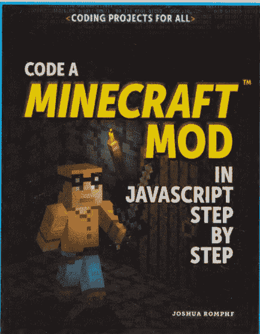

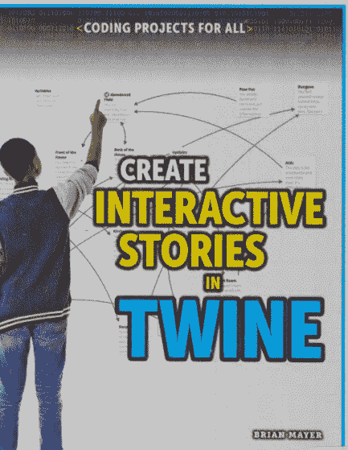


