# Unity iPhone 的 3D 游戏美术创建：含 modo 与 Blender 流程（葡萄牙语版）


## 对《使用Unity为iPhone创建3D游戏美术》的赞誉

> 随着用于创建和实现游戏资产的精密工具对艺术家变得越来越容易获取，了解我们如何在商业管线中使用这些工具不仅重要，而且比以往任何时候都更为关键。本书是这一路径上的综合指南：从一个强有力的概念想法出发，将其精简并转化为一个令人兴奋且完整实现的项目！Wes将引导你完成涉及的许多步骤，并使用这些强大的3D工具（modo、Blender和Unity），帮助揭开游戏创作与艺术表达过程的神秘面纱。
> 
> *Warner McGee，插画师/角色设计师*

> 简而言之，本书包含了为你的iPhone或iPad游戏添加3D内容的“秘方”。干得漂亮，Wes！
> 
> *Bob Bennett，Luxology LLC*

> “Wes非常出色地牵着读者的手，走过为Apple移动设备开发游戏的种种细节。艺术与技术知识之间的壁垒被充分模糊，使艺术家能够从容处理游戏开发的技术方面。这是一本适合我们每个人心中游戏开发者的好书。”
> 
> *Yazan Maikosh，9b studios董事总经理*


## 献词

献给我的妻子 Ann Marie、女儿 Abby 和儿子 Logan。

## 致谢

感谢我的主和救主耶稣基督，感谢你赐予我的祝福和机会。离了你，我什么也不能做。感谢我的妻子 Ann Marie、女儿 Abby 和儿子 Logan，感谢你们在我为本书工作而经历的那些漫长夜晚和周末里给予的鼓励、支持和耐心。我爱你们！

一个人无法独自写成一本书。在整个过程中，有几位出色而富有才华的人提供了意见、帮助和支持。对此，我衷心感谢你们。

感谢本书的技术编辑 Oleg Pridiuk，你的技术意见和行业经验是本书的宝贵财富。没有你，我无法完成这本书！很高兴你参与了这段旅程。

我还要感谢几位不可或缺的 Unity 团队成员 Paulius Liekis、Alexey Orlov、Renaldas Zioma、Tom Higgins 和 David Helgason，感谢他们慷慨的支持和技术意见，也感谢 Unity Technologies 的其他所有人。你们热爱自己所做的事，并相信自己的产品，这一点确实显而易见。这个 Unity 版本简直太棒了，能为如此出色的应用程序写一本书真是太好了。

感谢 Warner McGee 为 Tater 提供了令人惊叹的插图，能在这个项目上与你合作真是太棒了！你的作品总是让我惊叹，感谢你为绘制 Tater 付出的辛勤努力。

感谢 Efraim Meulenberg（Torpedo Twins）慷慨提供了来自 UnityPrefabs.com 的摄像机控制装置。你总是迅速向同行开发者伸出援手，和你交谈总是很有趣。我非常感谢你的支持！

感谢 Bob Berkebile，他的 iTween Animation System 为本书的演示应用提供了快速简便的解决方案。感谢你在一些编码工作上提供帮助。

感谢 Pano2VR 的创造者 Thomas Rauscher，感谢你为本书提供了一份 Pano2VR 副本。我非常感激！

感谢 Yazan Malkosh 对本书的支持。你是一位了不起的 3D 艺术家，我一直很欣赏你的作品。

感谢 Luxology 的 Bob Bennet 以及整个 modo 开发团队，你们对我的写作工作给予了非常多的支持，我非常感激！请继续让 modo 保持出色！

感谢所有一直支持我的朋友和家人，也感谢我在 Twitter 和其他社交媒体平台上遇到的所有优秀艺术家，你们的支持帮助我坚持完成了这个项目。

最后，感谢读者购买本书。希望你喜欢它，并希望它能帮助你更好地理解使用 Unity iOS 为 iPhone 和 iPad 开发创建 3D 内容。

Xbox LIVE 独立游戏使用 Microsoft XNA Game Studio。不过，由于我更偏向艺术方向，我发现使用 XNA 编写游戏可能是一个缓慢的过程，而且相当难以掌握。作为多媒体开发者，我非常熟悉使用 Flash ActionScript、JavaScript 和 Python 等脚本语言进行编程。Unity iOS 提供了完美的解决方案：你既能获得完整的 3D 环境，类似于以直观、艺术化的方式构建场景的 3D 应用程序，又能使用 JavaScript 等脚本语言编写游戏。Unity iOS 让我能够专注于自己的优势，即游戏开发的艺术方面，同时仍能编写代码并创造引人入胜的互动体验。这是两全其美，并融合进一个从底层开始就为快速游戏开发而构建的应用程序中。

Unity 还能够将游戏发布到多个平台，例如 Wii、iPhone 和 iPad、Android、桌面和 Web；借助 Unity 3.0，还支持 Xbox 360 和 PS3。例如，使用 Unity，只需很少的工夫就能将游戏从 iPhone 移植到 Web 等其他平台。Unity 还支持主流 3D 动画软件包和 FBX 等主流格式。作为一名艺术家，我发现 Unity 是创建交互式 3D 内容不可或缺的工具，也是我首选的游戏引擎，因为它易于使用且工具集对艺术家友好。

像 Unity 这样的游戏引擎需要硬件来运行；如前所述，Unity iOS 将运行在各种硬件平台上，其中最值得注意的是 Apple 的 iDevice，例如 iPhone、iPod Touch 和 iPad。Apple 的 iDevice 提供了优雅的操作系统 iOS，并为其所有平台的开发提供了一致标准。有人说，Apple 对其硬件和操作系统保持如此铁腕的控制会导致产品较差，但作为游戏开发者，我觉得这种封闭环境消除了我的特定游戏将如何在平台上运行的“猜测工作”。使用 iOS，我的游戏可以面向少数几款设备；尽管 iPhone 和 iPad 等设备之间的内部硬件有所不同，但大多数情况下，硬件为 iOS 设备开发提供了标准，这使得很容易确定优化目标，并轻松构建可在每个平台上运行的游戏。现在，随着 iPhone 4 等新一代设备的推出，硬件肯定会发生变化并变得更加强大。因此，你希望游戏支持多少代设备，将决定在构建能在所有 iDevice 上良好运行的优化内容时，支持工作的复杂程度。

Apple 的 iOS 不仅提供了标准化环境，还背靠庞大的市场。随着 App Store 的发明，Apple 为开发者建立了一个发布和销售内容的大众市场，这个市场每天都在持续快速扩张。在撰写本书时，目前有超过 250,000 款应用可供使用，下载量超过 50 亿次。此外，Apple 已向开发者支付超过 10 亿美元。App Store 上有超过 1,000 款由 Unity 驱动的游戏，而且这个数字还在继续快速增长。其中几款游戏在 App Store 前 25 名和前 100 名榜单中广受好评。Unity 一次又一次证明自己是可靠的开发平台，是为 iPhone 和 iPad 创建游戏的最佳中间件解决方案。

### 使用 Unity 编写代码

Unity 还支持 C# 以及 JavaScript 语言。如果你曾在 XNA Game Studio 中使用过 C#，那么转向 Unity 会轻而易举。无论你的编程经验水平如何，Unity 都有适合你的东西。

然而，Apple 的 App Store 并非没有争议；作为游戏开发者，最好始终审视每一个机会。许多人表示，市场已经过度饱和，独立游戏开发者很难获得关注。我完全同意情况可能如此，但如果你有创作游戏的热情，发布一款有潜力呈现在数百万用户面前的游戏，可能会带来深深的回报。有了 App Store，市场就在那里；除非尝试，否则你永远不知道你的游戏会有多成功。

此外，Apple 确实会审核提交的应用，并保留拒绝你的应用的权利。在本书写作期间，当 Apple 更改 SDK 协议第 3.3.1 节中的服务条款时，我和所有开发者都经历了一段艰难时期，并面临 Unity iOS 可能被排除在该平台之外的局面。当然，Unity 背后出色的开发团队经受住了这场风暴；结果，Apple 修订了 TOS，允许第三方开发工具。

我非常喜欢 Apple 的开发环境，并只选择为 iPhone 和 iPad 开发。标准化的开发环境，加上能够运行高端游戏的强大硬件和庞大市场，使 Unity iOS 和 Apple 的 iDevice 成为独立游戏开发者的首选解决方案。话虽如此，作为游戏开发者，最好还是不要把所有鸡蛋放在一个篮子里。让你的平台多样化可能是件好事；尽管 Apple 的平台很棒，但它并不是唯一的选择。移动市场中还有其他关键参与者，例如 Android 和 Windows Mobile。

### 前提条件：我应该了解什么？

此时，你可能会问自己：“好，这听起来不错，但我需要知道什么？” 如前所述，本书的重点是解决游戏开发中的一个特定需求，即创建 3D 内容。在本书中，我们不会涵盖创建整个游戏的过程。不过，我们将深入且独特地探讨 3D 内容如何具体与 Unity iOS 相关联，特别是在专门为部署到 iPhone 和 iPad 而构建高度优化内容方面。

> *在本书中，我们不会涵盖创建整个游戏的过程。不过，我们将深入且独特地探讨 3D 内容如何具体与 Unity iOS 相关联，特别是在专门为部署到 iPhone 和 iPad 而构建高度优化内容方面。*

本书将深入介绍使用 Unity iOS 为 iPhone 和 iPad 创建 3D 内容背后的原理，因为本书是为注册的 iPhone 开发者编写的。


本书面向希望提升 3D 游戏美术创作知识的开发者和 3D 艺术家。理解这些原则后，你将掌握开始为自己的游戏创建内容所需的技术知识。尽管本书会深入探讨相关主题，而不只是讲理论，但我们不会提供完整的分步教程。我一直觉得，分步教程只会引导你创建某个特定的游戏对象或模型，而这很少与你自己的项目和需求相关。通过学习流程背后的原则，你将能够专注于创建自己的内容。

有鉴于此，你需要对本书通篇使用的工具有实际操作基础，这些工具是 modo、Blender 和 Unity iOS。本书不会从初学者的角度讨论如何使用这些工具。相反，本书将重点介绍如何将这些工具用于创建优化游戏美术的特定工作流程。例如，在第 1 章“了解 iDevice 硬件与 Unity”中，我们将讨论 iOS 设备的技术层面及其与 Unity iOS 的关系，但你需要具备 Unity iOS 的实际操作知识，因为我们不会讨论导入资源或挂载组件之类的内容。同样，你也需要具备 3D 程序的实际操作知识。例如，我们将在 modo 中构建资源，但你需要了解建模工具并理解 UV 映射。不涵盖这些基础知识的原因在于，这样书中的主题就能聚焦于更高级的具体任务，这些任务与创建优化游戏内容并部署到 iPhone 和 iPad 有关。

这是一本高度专业化的书，写成了我希望自己在开始接触 Unity iOS 和 iPhone 游戏开发时就拥有的那本书。它重在去芜存菁，直击讨论的核心，并尽可能讲透本书需要涵盖的重要概念，以及大多数其他游戏图书遗漏的内容。

在本书中，我将结合使用 Unity iOS 基础版和高级版许可证。基础版是使用 Unity iOS 进入 iPhone 游戏开发领域最便宜、最入门的途径。本书的演示应用将使用基础版许可证发布。你可以访问此链接 http://unity3d.com/unity/licenses#iphone 查看基础版和专业版许可证的区别。

我使用 Luxology 的 modo 软件作为主要的 3D 创作工具。modo 也非常适合游戏开发，因为它提供了精简的建模和 3D 绘制工具集。modo 的渲染管线可以快速轻松地烘焙纹理和光照贴图。话虽如此，本书阐述的概念基于可迁移到任何 3D 应用程序的游戏开发原则，因此在跟随本书操作时，请随意使用你选择的应用程序。我坚信工具只是工具，真正让游戏出色的是艺术家及其技能。本书中对 Blender 的使用就是一个很好的例子。在我的日常工作流程中，我会将 Autodesk Maya 与 modo 配合使用。Maya 是我进行绑定和角色动画时首选的 3D 应用，但为了让本书尽可能面向更多人，本书的绑定和动画部分将使用 Blender。主要原因是 Blender 是开源应用，不会给你的工作流程增加额外成本，而且更容易获取。此外，由于我们讨论的是使用 Unity iOS 为 iPhone 游戏进行绑定和动画的关键原则，你使用哪款 3D 应用并不重要，最终取决于个人偏好。

尽管这是一本游戏美术书，但我们会结合某一特定游戏引擎深入讲解游戏美术创作流程，这意味着我们不能完全略去编程概念。具备 Unity iOS 中基本编程概念的实际操作知识会更有帮助。

### 深入核心原则

我之前提到过，本书不会贯穿任何分步教程。如果你有点失望，先别急，我们来看看为什么我决定省略详尽的分步教程。我研究 3D 很久了，多年来也确实看过不少教程。我注意到一件事：我似乎从未从分步教程中学到多少东西。这类教程对初学者很棒，也正是我最初学习建模时所需要的。然而，当我想进阶时，分步教程就不够用了。我发现，以“按编号填色式的 3D 做法”照做，会错过流程背后的关键原则。我错过了驱动这些技法的“为什么”。此外，我发现很多时候我会被 40 多页复杂步骤压得喘不过气，以至于完全错过构建模型技法背后的整体要点，更不用说我只是在学习如何创建某个特定对象。

我觉得传达 3D 创作流程背后的核心原则和技法非常重要，这样你作为读者就能运用这些原则来构建自己的项目，而不是复刻我提出的某个具体东西。关键在于，一旦你理解某个流程背后的核心原则，就可以用这些原则摸索出自己的技法，并最终更快地推进自己的项目。

虽然我们正在谈你自己的项目，我还想快速重申一点：使用哪款 3D 应用完全由你决定。我提到过，本书通篇会使用 modo/Blender 工作流程；不过，所涵盖的主题可用于任何 3D 应用程序。某款应用并不一定比另一款更好，我强烈建议你始终想着开发或定制自己的工作流程。

艺术家的工作方式各不相同，完成项目没有唯一正确的方法。你不必使用 modo 或 Blender 来跟随本书操作。事实上，正如我已提到的，我自己更常用 modo/Maya。由于 Blender 免费，动画章节选用了它；而且由于 modo 目前若不额外花钱就缺少网格蒙皮功能，Blender 也是 modo 的绝佳搭档。我只是把在 Maya 中的工作流程延伸到了 Blender。正是解释技法背后的“为什么”而非分步说明，才使这一点成为可能。

### 认识“Tater”

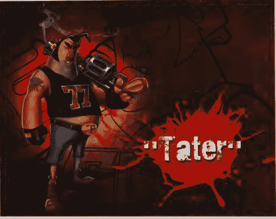

Tater 是我在极具才华的角色艺术家和插画师 Warner McGee（[http://www.warner-mcgee.com](http://www.warner-mcgee.com)）帮助下开发的角色。我对 Tater 有一个概念，于是联系 Warner，请他帮助充实设计，并把他艺术专长融入 Tater 的设计中。我自己不是插画师，所以把一些非常基础的设计草图交给 Warner，他由此施展魔法，制作出本书展示的 Tater 版本。与 Warner 合作这个项目非常棒，看着他把我最初的概念发展成一个完整实现的角色，也很有乐趣。由于 Tater 还将用于本书之外的其他项目，我还创作了背景故事，以打造一个具有沉浸感的游戏 IP。

Tater 是我一直在做的一个个人游戏项目《Dead Bang》中不情愿的英雄。本书要探讨的内容取自 Tater 的世界和《Dead Bang》游戏概念中的元素。在《Dead Bang》第一章中，Tater 是一个小镇的唯一幸存者，这场僵尸末日噩梦由一个名为“Brain Masher”的奇特装置引发。Tater 带着他可靠的伙伴“Thumper”——一把经过致命改装的霰弹枪，他以外科手术般的精准度使用它，每扣一次扳机就能打掉行尸的脑袋——四处搜寻，试图把不速之客从他家乡清除，并让 Brain Masher 装置失效。Tater 喜欢把僵尸脑袋轰成渣——他亲切地称之为“Thump'n Noggins”（敲脑壳）——但比这更喜欢的事，就是大吃一袋新鲜的“浆果烧烤味薯片”，这也为他赢得了“Tater”这个绰号。

在本书中，我们将查看 Tater 世界中的一些元素，用以说明书中涵盖的主题。我们将研究 Tater 和 Thumper 的创建与动画，以及《Dead Bang》世界中的一个环境，并使它们经过优化，可在 iPhone 和 iPad 上运行。

### 本书资源

除了本书中的内容，你还可以在本书资源网站上找到大量以视频演练形式呈现的附加材料。你可以访问 http://wesmcdermott.com，并点击“《为 iPhone 创作 3D 游戏美术》图书网站”链接来进入本书资源。在本书官方网站上，点击“Tater 的武器配置”链接。出现登录提示时，用户名输入“Tater”，密码输入“thumpNoggins”。在每章开头，如果该章有额外视频内容，都会提醒你查看资源网站，并以提示标注“Tater 的武器配置”来标示。

本书还有自己的 iPhone 和 iPad 应用，名为“Tater”。该应用是一个创意演示，在真实 iDevice 上运行全书讨论的内容。通过“Tater”，你可以体验 Tater 在训练垃圾场中的射击靶场。该应用展示了书中讨论的所有游戏资源和动画。你可以在本书官方网站上找到有关如何获取“Tater”应用的更多信息。

### 冒险开始……

我们有很多内容要讲，首先会深入细致地了解 iDevice 硬件和 Unity 的内部机制。一旦我们扎实理解了驱动游戏的硬件，就可以开始构建经过优化的内容。

准备好后，就进入第 1 章“了解 iDevice 硬件与 Unity iOS”吧；用 Tater 的话说：“我们来敲几个脑壳吧！”


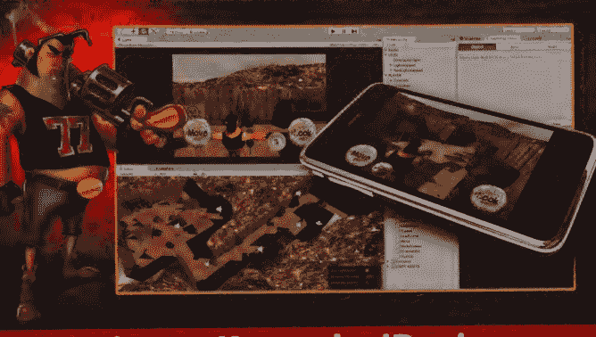

# 了解 iDevice 硬件与 Unity iOS

创建游戏资产背后的技术理解，比仅仅建模低分辨率几何体要深入得多。在进入实际建模或创建纹理贴图之前，我们首先需要扎实理解内容将要运行的硬件和游戏引擎。每个平台或设备都会有其自身的限制，某个平台运行良好的内容，并不意味着在另一个平台上也能同样良好地运行。例如，在某些情况下，iPhone 4 或 iPad 中更快的处理器相比 iPhone 3GS 中较慢的处理器，可能更有助于处理绘制调用。另一个很好的例子是，尽管 iPad 的芯片性能提升了 400 MHz，但 GPU 没有升级，这带来了需要留意的新的性能瓶颈。这时项目的“游戏预算”就派上用场了。游戏预算就是创建游戏内容所依据的蓝图或指南。在评估 iPhone 和 iPad 硬件时，需要留意三项规格，即内存带宽、多边形速率和像素填充率。例如，如果你有一个快节奏的游戏概念，就需要在游戏预算中标明较高的帧率，例如 30–60 帧/秒（fps），并且你创建的所有内容都必须经过优化，使游戏能够达到这一帧率预算。你还需要考虑到，在 iPad 上，你本质上是在渲染的像素数量超过 iPhone 3GS 的五倍，约为 iPhone 4 屏幕的 1.2 倍，这意味着每帧处理的数据量分别约为 iPhone 3GS 的 5 倍和 iPhone 4 的 1.2 倍。如果对目标设备的能力和限制没有扎实理解，你就不知道需要对游戏内容做哪些优化才能达到游戏预算的帧率。本质上，这就像在黑暗中工作。

本章的目标，打个比方，就是点亮灯光：让你熟悉 iPhone 和 iPad 硬件，并一窥 Unity iOS 游戏引擎的内部机制。通过熟悉不同设备以及 Unity iOS 底层运行情况，我们就能理解针对这些设备构建优化内容的“原因”。我们还能够在整体游戏预算中合理定义帧率、多边形数量和纹理尺寸预算；这些预算由你所创建的游戏类型与目标帧率之间的平衡决定，而最终都受硬件的内存带宽、多边形速率和像素填充率控制。

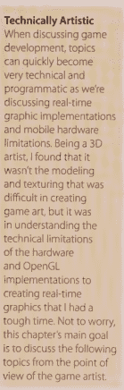

## iDevice 硬件

在本节中，我们将讨论 iPhone 和 iPad 的硬件；在这里，我想对设备型号作几点区分。在本书中，我会用“iDevices”一词统称所有设备，即 iPhone、iPad 和 iPod Touch。“iOS”是苹果对所有 iDevice 通用操作系统（OS）的官方名称。我还想补充一点：本书不会涵盖 iPhone 3G 或第二代及以下的 iPod Touch。截至本书写作时，这些设备属于第二代和第三代设备，而我想把重点放在最新设备上。我会把本节分为两类，即 ARM 中央处理器（CPU）和 PowerVR SGX 图形处理器（GPU）。在介绍 iDevice 硬件的同时，我们也会讨论这些类别与 Unity iOS 的关系。

### ARM CPU

CPU 是处理单元，iDevices 采用 ARM 架构，使用 Cortex-A8 核心，版本为 ARMv7-A；从美术师的角度来看，CPU 负责计算。在图 1.1 中，你可以看到各 iDevice 的硬件差异明细。每种 iDevice 型号都包含不同或更新的硬件，这些硬件会影响游戏性能，例如硬件如何影响像素填充率。

iPad 和 iPhone 4 都使用 A4 处理器。iPhone 3GS 和第三代 iPod Touch 都使用被降频至 600 MHz 的 ARM Cortex-A8。就这三款设备的性能而言，可以给出一个基本规律：iPad 的处理速度最快，其次是 iPhone 4（因为 A4 被降频），最后是 3GS，但 3GS 的差距一点也不大。再次强调，这是一个非常基本的规律；实际结果很大程度上取决于你的内容，即像素填充率和多边形吞吐量如何影响游戏。在目标设备上用你的具体内容对游戏进行性能分析（profiling），是衡量性能最安全、最准确的方法，不过在开发早期对设备能力有总体认识也会很有帮助。

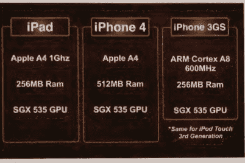

> 特别说明一点：某个人可能更偏向游戏开发的美术方向，但这并不意味着他应该远离代码，也绝不意味着美术师无法理解技术层面的内容。事实上，在独立游戏开发中，很可能你不仅要构建 3D 内容，还要为游戏编写代码。我经常看到出色的脚本和程序是由优秀的美术师而不是硬核程序员编写的。这里的重点是，脚本编写有时会带有一种令人畏惧的负面含义，而我要说，这与事实相差甚远。你不亲自尝试一下，就永远不知道自己能做到什么。

CPU 会从许多方面影响由 Unity iOS 驱动的游戏。例如，CPU 还会处理脚本和物理计算，并承载整个操作系统及其他正在运行的程序。由于本书讨论的是创建游戏美术，接下来的小节将聚焦于我们游戏对象上的游戏美术内容，以及在这些方面哪些操作对 CPU 很重要。

### 绘制调用

绘制调用可以看作向 GPU 发出的“请求”，用于绘制场景中的对象；它也可能是 CPU 造成性能瓶颈的环节。正如我们将在 GPU 部分讨论的，iPhone 和 iPad 使用 OpenGL ES 2.0（OGLES），在硬件层面模拟 OGLES 1.1 着色器；在这种实现下，游戏循环的每一帧中，每次绘制调用都会复制顶点数据。顶点数据是构成我们 3D 对象的顶点，以及附加到每个顶点上的信息，例如位置、法线和 UV 数据，就像 modo 中 3D 网格的顶点具有位置、法线和 UV 坐标数据一样。

### 游戏循环

Unity iOS 游戏循环内部，正是更新游戏各个组件的地方。无论用户是否输入，游戏循环始终运行。从 3D 美术师的角度，你可以把游戏循环想象成 3D 动画中的一段动画：场景以给定帧率运行，而在动画的每一帧中都会计算某些内容，例如关键帧插值。游戏引擎的游戏循环基本上也在做同样的事情。

顶点数据在 CPU 上于 3D 空间中被变换或移动。变换的结果会追加到内部顶点缓冲区中。这个顶点缓冲区就像一个大列表或容器，保存所有顶点数据。由于顶点数据是在 CPU 上复制的，这会占用 CPU 端约三分之一的帧时间，并且由于 iPhone 的 CPU 与 GPU 共享内存，这还会浪费内存带宽。在 iPhone 和 iPad 上，我们需要密切关注对象的顶点数，并尽可能保持该数值较低，因为顶点数比实际三角形数更重要。正如你将在第 2 章读到的，我们会讨论如何确定每一帧最多可以渲染多少个顶点。

我以前会对这句话中“每帧”这部分感到困惑。作为一名 3D 美术师，把游戏场景想象成 modo 中的一个场景对我很有帮助。例如，如果我在 modo 中设置了一段动画，渲染摄像机在动画的每一帧中都会渲染该场景中摄像机视锥体内可见的部分，视锥体由摄像机属性设定。Unity iOS 中也是如此。在图 1.2 中，有一幅插图展示了我如何将场景每帧的总顶点数可视化。

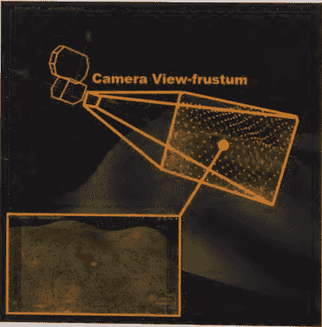

**图 1.2** 在此图中，黄色高亮区域表示摄像机的视锥体以及每帧可见的顶点。


在游戏循环的每一帧中，对于给定的一帧，只有一定数量的顶点在相机视锥体内可见；在这一帧内，我们应将场景中所有对象的顶点数保持在大约 10k 左右。现在，这是关于在 iDevice 硬件上什么效果最好的一个建议，但具体取决于你的游戏和游戏内容，这个数值可能还可以往上推。要点在于，在游戏开发中，就优化而言并不存在绝对的答案。你必须根据游戏的性能标准（也就是帧率预算）来优化内容。正如我们将在建模章节中讨论的，有很多技术可以优化顶点数；此外，对于相机视图，还有一些渲染优化，例如通过遮挡剔除来控制发送到顶点缓冲区的顶点。

显然，CPU 越快，计算速度就越快。然而，仅仅因为你拥有更强的性能，并不一定意味着你应该不顾其他性能考量（例如我们将在本章后面讨论的像素填充率），而向系统投入更多顶点。

## 批处理

批处理是一种自动减少场景中绘制调用的手段。Unity iOS 中有两种方法，即动态批处理和静态批处理。需要注意的是，绘制调用是一个性能瓶颈，并且在很大程度上可能取决于 CPU。每当 CPU 需要向 GPU 发送数据进行渲染时，就会生成绘制调用。GPU 在处理大量数据方面非常快；然而，它们并不擅长逐帧切换正在做的事情。这就是批处理的好处所在，因为它会一次性发送大量数据以供处理。话虽如此，在确定瓶颈时，最好同时测试 CPU 和 GPU，因为如果你的设备存在填充率问题（在 iPad 或 iPhone 4 上可能会遇到），那么绘制调用瓶颈可能会转移到 GPU 上。

### 动态批处理

动态批处理在运行时的运作方式如下。

- 按材质对场景中的可见对象进行分组并排序。
  - 如果这个已排序组中的对象具有相同材质，Unity iOS 将在 CPU 上对每个顶点应用变换。变换的设置不是在 GPU 上完成的。
  - 将结果追加到临时的内部动态顶点缓冲区。
- 仅对该组设置一次材质和着色器。
- 仅绘制一次合并后的几何体。

顶点变换和绘制调用都会给 CPU 端带来负担。iDevice 上的单指令多数据（SIMD）协处理器支持 ARM 架构的向量浮点（VFP）扩展，它负责处理顶点变换，这要归功于 Unity iOS 中一些为利用 VFP 协处理器而编写的优化例程。VFP 协处理器实际上比 GPU 工作得更快，因此 Unity iOS 使用它来提升对象批处理的性能，以减少绘制调用。

角色的纹理和材质与批处理有关。在第 5 章中，当我们使用 Blender 为 Tater 设置动画时，我们将讨论针对骨骼权重和绑定（rigging）的 VFP 优化路径。

## GPU

GPU 是图形处理单元，负责渲染我们的场景。在不同 iPhone 型号之间，你会发现它们都使用相同的 GPU，即 PowerVR SGX535。

SGX535 支持 OpenGL ES 2.0。使用 Unity iOS 时，iPhone 开发者可以同时使用 OpenGL ES 的 1.1 和 2.0 版本。对开发者而言，这意味着我们可以利用支持可编程管线的着色器；此外，每当设备在游戏中遇到新的着色器时，都不需要再将 1.1 着色器转换为 2.0。在图 1.3 中，你可以看到 SGX535 GPU 的时钟速度，以及它与像素填充率和三角形吞吐量的关系。填充率是每秒可以绘制到屏幕上的像素数，而吞吐量是每秒可以处理的三角形数量。

如图 1.3 所示，3GS 的 GPU 每秒可以处理 700 万个三角形和约 25 亿个像素。然而，与 CPU 一样，我也想重申一点：尽管 SGX 看起来像是一台渲染猛兽，但这并不意味着你可以不加考虑地把所有东西（除了厨房水槽之外）都丢给它。你的游戏性能并不完全由 CPU 和 GPU 速度决定。例如，RAM 和较慢的闪存也可能成为瓶颈，尤其是在尝试加载更大尺寸的纹理（例如 1024 × 1024）时。

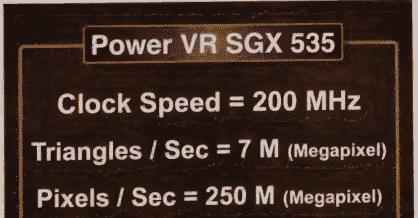

**图 1.3** SGX535 具有更高的时钟速度，从而允许绘制更多像素和三角形。

归根结底，这取决于在帧率方面的玩家体验与游戏画面之间的平衡。你始终需要进行性能分析，以匹配你的游戏预算。更快的硬件是一个优势，可以让你做更多事情，但你必须记住，针对前沿硬件进行开发，必然会因为使用较旧型号的用户而疏远相当一部分潜在市场。

## 屏幕分辨率

iPhone 4、3GS 和 iPad 的屏幕分辨率各不相同，如果你想让图形看起来很棒，就需要针对每种设备的分辨率进行构建。例如，如果你基于 3GS 的 480 × 320 屏幕构建游戏图形，然后将这些图形缩放到 iPad 的 1024 × 768 上，那么由于它们是从较低分辨率放大到较高屏幕分辨率，你的图形和纹理会看起来相当难看。在图 1.4 中，你可以看到本书演示应用中的一个菜单，以及该菜单如何适配 iDevice 上的各种屏幕分辨率。

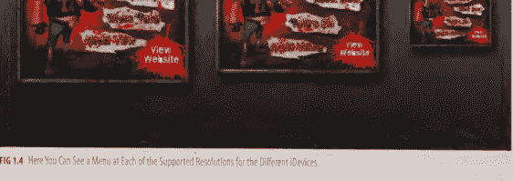

**图 1.4** 在这里你可以看到不同 iDevice 在各自支持的分辨率下的菜单。

## 受填充率限制

3GS、iPhone 4 和 iPad 都使用 SGX535 GPU；然而，对于 iPhone 4 和 iPad，GPU 必须在更高分辨率的屏幕上做更多工作来绘制你的游戏。这可能导致在 3GS 上运行良好的游戏，在某些情况下于 iPad 和 iPhone 4 上出现帧率下降。在图 1.5 中，你可以看到分辨率的差异，以及这与 GPU 在 iPhone 4 和 iPad 上必须更努力工作的关系，因为它要渲染 4–5.1 倍的屏幕面积。

填充率是 GPU 每秒可以渲染到屏幕上的像素数。在 iPhone 4 和 iPad 上，当透明表面填满屏幕时，你可能会遇到帧率下降。这是因为在 iPhone 4 和 iPad 上，

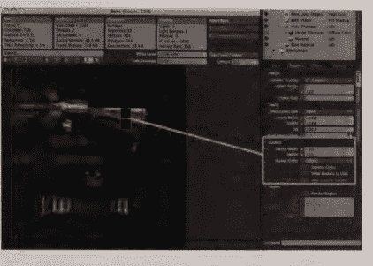

**图 1.8** 我喜欢将 iPhone 的 TBDR 渲染器想象为类似于 Modo 的分块渲染。

同样，作为一名 3D 艺术家，将 iPhone 上的 TBDR 渲染器想象为类似于 modo 或 mental ray 中的分块渲染（如图 1.8 所示），对我很有帮助。

## RAM

各 iDevice 之间的 RAM 存在差异。iPhone 4 的 RAM 为 512 MB，是 iPad 和 3GS 的两倍，而 3GS 和 iPad 都只有 256 MB。了解可用的 RAM 以及你必须在其范围内开展工作是至关重要的。整个 RAM 并非都可供你的应用程序使用，因为其中一部分必须保留给操作系统以及多任务运行的其他应用。在你的游戏中，纹理通常是占用 RAM 的主要元凶。这就是为什么使用经过优化的压缩纹理来最小化游戏中的 RAM 使用量非常重要。在 Unity iOS 中，你可以使用 Statistics 窗口查看场景的显存（VRAM）使用情况，如图 1.9 所示。

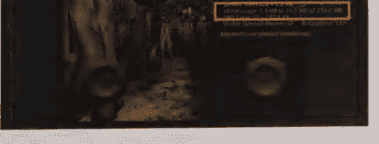

**图 1.9** 你可以在 Statistics 窗口中监控 VRAM。

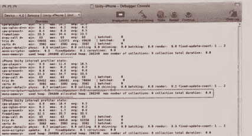

**图 1.10** 你可以使用 Xcode 中的 Unity iOS Internal Profiler 监控内存。

此外，在 Xcode 中对游戏性能进行分析时，你可以使用 Unity iOS Internal Profiler 检查内存使用情况，如图 1.10 所示。

了解纹理尺寸如何换算为纹理内存会很有帮助。它基本上就是图像中像素总数乘以每个像素的位数。例如，一张 1K 纹理包含 1,048,576 个像素（1024 乘以 1024）。然后你可以将这个数字乘以每像素 24 位（1,048,576 乘以 24），得到整张图像的 25,165,824 位。最后，将这个数字除以每字节的位数，即 8（25,165,824 位 / 每字节 8 位），得到 3,145,728，也就是每张 1K 纹理大约 3 MB。当然，这还没有考虑压缩，因此如果我们在 Unity iOS 中使用 Texture Importer 将此纹理压缩为 PVRTC 4-bit，就可以将内存量减少到 0.5 MB，而差异可以忽略不计。

## OpenGL ES

OpenGL ES 是 OpenGL 的子集应用编程接口（API），由于它的核心设计是用于移动技术，因此被用于所有 iPhone OS 设备。

我已经提到过，SGX535 支持 OpenGL ES 2.0。在 iPhone 上使用 Unity iOS 时，这真正归结为你在 Unity iOS 项目中能够使用的着色器类型。Unity iOS 允许你为 OpenGL ES 1.1 和 2.0 两个版本构建项目。这使你可以构建针对不同设备和 OpenGL ES 版本的不同 Unity iOS 场景，并在运行时根据运行游戏的 iPhone 设备加载特定的 OpenGL 场景。

OpenGL ES 1.1 与 2.0 之间的区别在于，1.1 版支持固定功能图形管线（FFP），而 2.0 版支持全可编程图形管线（FPP）。同样，这基本上决定的是你可以为游戏使用或编写何种类型的着色器。


## 固定功能管线

FFP 在管线的各个阶段使用“固定”或预定义的功能，这些阶段包括命令处理、三维变换、光照计算、光栅化、雾效和深度测试。你可以启用或禁用管线的某些部分，也可以配置各种参数，但计算或算法是预定义的，无法更改。

## 全可编程管线

FPP 用完全可编程的阶段取代 FFP 的许多“固定”阶段。这使你能够编写代码，为可编程管线中的每个阶段执行计算。FPP 为游戏中使用增强着色器打开了大门，同时也带来了更高的优化空间，因为复杂算法可以在着色器上单遍执行，并且必定会节省宝贵的 CPU 周期。在图 1.11 中，你可以看到两种管线的示意图。

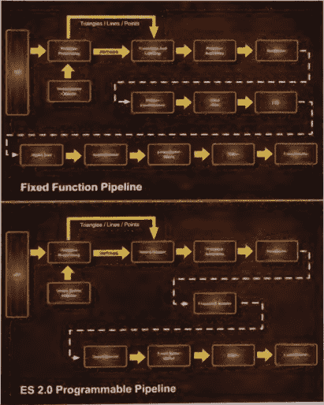

**图 1.11** 此图展示了 OpenGL ES 1.1 和 2.0 版本中可用的不同管线。

### 纹理

对于 iPhone 来说，降低纹理尺寸非常重要，因为设备上的纹理缓存很小。TBDR 渲染器经过优化，可以高效处理纹理缓存，但你仍然必须密切关注纹理尺寸，并压缩纹理以减小尺寸。iPhone 使用一种名为 PVRTC 的硬件压缩方案，允许压缩到每像素 2 位或 4 位。这种压缩有助于减少内存带宽。当你超出纹理内存预算时，就需要决定如何压缩纹理。在 Unity iOS 中，你可以在设置菜单中为纹理资源设置纹理压缩，如图 1.12 所示。不过，纹理要能够压缩，其尺寸必须是 2 的幂，例如 1024 × 1024、512 × 512 等。

纹理压缩也很重要，因为如前所述，iPhone 上的内存由 CPU 和 GPU 共享。如果你的纹理开始占用大部分内存，你的游戏很快就会面临在 iPhone 上崩溃的危险。

**纹理单元** 在 OpenGL ES 1.1 中，你只有两个可用的纹理单元（TU）；而在 OpenGL ES 2.0 中，你最多可以有八个可用的纹理单元。纹理需要过滤，而纹理单元的工作就是对像素应用操作。例如，在使用 OpenGL ES 1.1 的 iDevice 上，你可以在 Unity 着色器中使用组合器，由组合器决定如何将纹理组合在一起，从而组合两个纹理。把组合器想象成 Photoshop 混合模式（即相加和相乘）对我很有帮助。在 3GS、iPhone 4 和 iPad 上，由于有八个可用的纹理单元，你最多可以组合八个纹理。

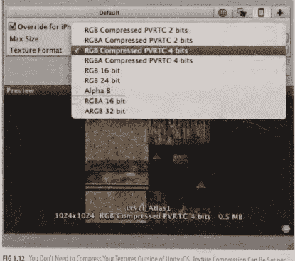

**图 1.12** 你不需要在 Unity iOS 之外压缩纹理。在 Unity iOS 中，可以按纹理设置纹理压缩。

只采样一个纹理时可以带来一些性能提升，我们将在纹理相关章节中讨论。例如，与其依赖光照贴图着色器（它通过乘法运算将 RGB 图像与光照贴图组合），你可以直接将光照烘焙到漫反射贴图中，这样只需为材质应用一个纹理，如图 1.13 所示。

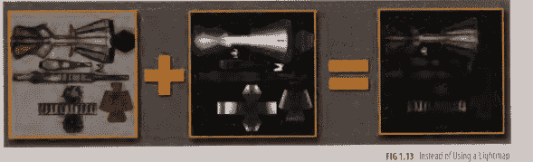

**Alpha 操作** 在纹理中处理透明度有两种不同方式，即 Alpha 混合和 Alpha 测试。Alpha 混合是 iPhone 上开销最低的操作，因为使用 TBDR 渲染器时，从帧缓冲读取颜色值不需要任何额外的内存带宽。使用 Alpha 测试时，Alpha 值会与一个固定值比较，对系统的负担要重得多。在图 1.14 中，你可以看到 Unity iOS 自带的一个 iPhone 着色器，并且 Alpha 测试已被禁用。另外请注意，该着色器被设置为使用 Alpha 混合。

**图 1.14** 在这里你可以看到，该着色器被设置为使用 Alpha 混合而不是 Alpha 测试。

```shader
Shader "iPhone/Transparent/Vertex Color" {
    Properties {
        _Color ("Main Color", Color) = (1,1,1,1)
        _SpecColor ("Spec Color", Color) = (1,1,1,1)
        _Emission ("Emission", Color) = (0,0,0,0)
        _Shininess ("Shininess", Range (0.1, 1)) = 0.7
        _MainTex ("Base (RGB) Trans (A)", 2D) = "white" {}
    }
    Category {
        Tags {"Queue"="Transparent" "IgnoreProjector"="True" "RenderType"="Transparent"}
        Blend SrcAlpha OneMinusSrcAlpha
        AlphaTest Greater 0
        ZWrite Off
        SubShader {
            Material {
                Diffuse [_Color]
                Ambient [_Color]
                Shininess [_Shininess]
                Specular [_SpecColor]
                Emission [_Emission]
            }
            Pass {
                ColorMaterial AmbientAndDiffuse
                Lighting Off
                SeparateSpecular On
                SetTexture [_MainTex] {
                    Combine texture * primary, texture * primary
                }
                SetTexture [_MainTex] {
                    constantColor [_Color]
                    Combine previous * constant DOUBLE, previous * constant
                }
            }
        }
    }
}
```

在过去几页中，我们一直在讨论 iPhone 硬件及其与 Unity iOS 的关系。既然我们已经了解了硬件，现在就可以切实地确定游戏预算，我们将在下一节讨论这一点。

## 确定游戏预算

在开始创建任何游戏对象之前，你需要创建我所说的游戏预算。你的游戏预算列出了你在创建内容和编写游戏代码时要遵循的标准。首先，你需要决定要创建什么类型的游戏，以及这个游戏需要哪些具体要求。例如，我的游戏 Dead Bang 是一款第三人称射击游戏，设计为快节奏。这意味着我需要设计和优化游戏，以保持至少 30 fps 的帧率，从而使游戏运行流畅。既然知道了我要遵循的帧率，我就可以设定帧预算；帧预算由帧时间推导而来，是你游戏中最重要的预算。你所做的几乎所有优化都是为了遵守帧预算。

### 帧率预算

帧时间以毫秒为单位，因此如果我想以 30 fps 的帧率为目标，就用 1000 除以 30，得到帧时间 33.3 毫秒。这意味着在分析我的游戏性能时，我需要确保帧时间（即一帧完成渲染所需的时间）不超过 33.3 毫秒，因此我的帧预算就是 33.3 毫秒。为了确定你的游戏是否满足所需的帧预算，你需要使用 Internal Profiler。在第 9 章中，我们将研究如何分析游戏性能，以找出需要优化的区域。现在，在图 1.15 中，你可以看到 Xcode 中 Unity Internal Profiler 里的 frametime 变量，它反映了我所需的帧预算。

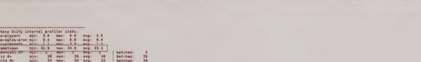

**图 1.15** 你可以使用 Internal Profiler 找出游戏中的瓶颈。

### 渲染预算

接下来，我需要确定在 Unity iOS 处理一帧所需的时间（即帧时间）中，我想把大部分时间花在哪里。例如，我的游戏在物理计算方面用得不多，因此我确定可以把大部分帧时间花在渲染上。

### 顶点预算

为了计算出各个游戏对象的顶点预算，你同样需要思考你正在创建的游戏类型。如果你要创建的游戏场景中需要大量对象，那么就需要减少每个对象的顶点数。正如我之前提到的，你会希望以每帧少于 10 K 顶点为基准值，并将这些顶点分配给你认为最重要的游戏对象。例如，你可能想给主角角色分配更多顶点数以提高分辨率，同时减少敌人的顶点数。这个预算取决于你的游戏需求，但你可以看到，如果不了解硬件的限制，就不可能创建出在 iPhone 和 iPad 上流畅运行的资源。

### 纹理预算

我们已经讨论过，纹理内存可能占用 iPhone 的大量资源，而你的纹理预算就是你在游戏中准备为纹理分配的内存资源总大小。你会希望尽量减少纹理在游戏中占用的内存，有多种方法可以减少负载，例如使用纹理压缩、共享材质和纹理图集。不同设备也会有不同的要求。例如，由于屏幕尺寸更大，iPad 和 iPhone 4 需要更高分辨率的纹理；但你会发现优化会变得稍微棘手一些，因为尽管 iPad 和 iPhone 的屏幕更大，如我们之前所讨论的，它们仍然只使用与 3GS 相同的 PowerVR SGX535 GPU。

### 总结

随着我们逐步学习本书各章，我们将更深入地探讨建模和纹理各个阶段的优化。然而，要记住的重要一点是，我们所有的预算都归结为一个因素，那就是满足帧预算。任何游戏在……方面的目标

优化的目标是流畅运行，而实现这一目标的唯一方法是确保你的内容经过充分优化，以维持恒定的帧率。游戏帧率不断下降是非常有害的。就游戏美术而言，你优化游戏时主要关注的方面如下：

- 1. 通过批处理对象减少绘制调用。
- 2. 降低每帧的顶点数。
- 3. 通过共享材质和纹理图集压缩纹理并减少内存带宽。
- 4. 使用经过优化的着色器，并且不使用 alpha 测试。

## 小结

以上是对 iPhone 和 iPad 硬件以及其与 Unity iOS 关系的整体讨论的总结。我再怎么强调理解你所使用的平台有多么重要也不为过。既然我们已经讨论了硬件规格并确定了游戏预算，我们就可以开始实际构建内容并着手制作游戏了。在第2章中，我们将开始了解如何为 iPhone、iPad 和 Unity iOS 建模 Tater。

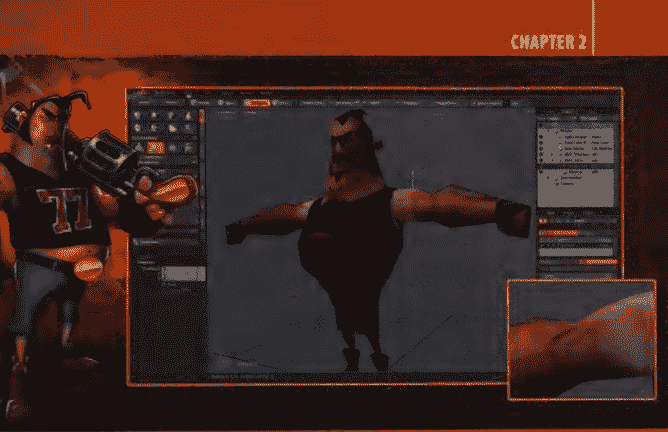

# 使用 modo 创建游戏对象

## Tater 和 Thumper

在本章中，我们将深入探讨如何创建“英雄”角色及其主武器。现在，我用了“英雄”这个词，但并不是指该角色具有英雄特质。相反，我指的是游戏的主角或主要资产。正是这个“英雄”对象在多边形数量和系统资源方面获得了最多关注。正如我们在第1章“了解 iDevice 硬件与 Unity iOS”中所讨论的，在处理 iPhone 和 iPad 这类移动设备时，你必须始终意识到可用资源有限。就像一位老吝啬鬼，不断数着每一分钱，你必须照看每个顶点，确保没有一个被浪费。在本章中，我将讨论为 iDevice 创建优化游戏模型背后的技术和原则。为了说明这些概念，我们将研究创建 Tater 及其可信赖的大规模毁灭搭档 Thumper 的过程，如图2.1所示。我们将首先讨论如何确定项目的多边形预算。

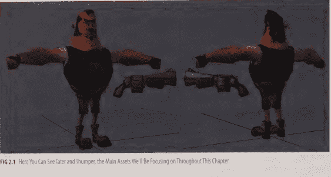

*图2.1 在这里你可以看到 Tater 和 Thumper，它们是我们将在本章中重点讨论的主要资产。*

## 规划顶点预算

**Tater 的武器配置**

前往资源站点查看本章的视频演示。

我们在第1章“了解 iDevice 硬件与 Unity iOS”中谈了很多关于游戏预算的内容。制定游戏预算的一部分，就是为模型所包含的顶点数量制定预算。顶点预算是指决定构成场景的对象究竟包含多少个顶点，并以游戏循环的每帧为单位显示，同时仍保持游戏预算的帧率的过程。这对建模过程至关重要，因为如果不了解目标设备的限制、游戏的目标帧率和整体顶点预算，你就无法建模任何东西。在 3D 应用程序中创建第一个多边形之前，你必须先确定顶点数。在第1章“了解 iDevice 硬件与 Unity iOS”中，我们通过讨论不同 iDevice 中的各种硬件组件填补了这个谜题的第一块，以便了解其限制，从而建立基线，为 iPhone 和 iPad 创建优化的几何体。在下一节中，我们将了解如何确定顶点预算。

## 测试性能

我们已经确定，规划顶点预算是创建任何实际几何体之前的第一步，但这个预算究竟如何确定？在游戏开发中，你会经常听到“视情况而定”这句话。虽然这听起来像是对复杂问题的快速回答，但事实上确实如此。在游戏开发中确定顶点预算或任何预算，完全取决于你的游戏。你打算创建的游戏类型，对你如何确定顶点预算有很大影响。例如，如果你的游戏渲染负担很重，比如在场景中使用大量对象，那么你就需要减少物理模拟。但同样地，一个物理负担很重的游戏会需要更多 CPU 资源，因此需要更少的顶点数和场景中更少的对象，以平衡游戏的整体性能。这是一种权衡取舍，而你创建的游戏类型将决定这种平衡。这就是为什么第1章“了解 iDevice 硬件与 Unity iOS”专门讨论 iDevice 硬件，因为在构建内容时，了解硬件能做什么及其限制至关重要。

### 创建性能测试场景

当你处于游戏开发的早期阶段时，创建一个性能场景来测试硬件能力会非常有帮助。例如，对于本书的游戏演示，并且从 3D 艺术家的角度来看，我想专注于渲染 3D 资产。这是我的主要目标，我很早就确定，我想把大部分时间用于渲染。我还决定，我希望游戏保持 30 fps 的帧率。有了这个目标，我创建了一个演示场景，可以安装到 iPhone 和 iPad 上，以测试性能并看看我能把硬件发挥到什么程度。

这个演示场景不需要复杂，也不需要好看。这个场景的目的纯粹是评估性能。为了节省时间，我访问了 Unity iOS 网站并下载了 Penelope 教程，可在 http://unity3d.com/support/resources/tutorials/penelope 找到。Penelope 模型的细节水平接近我想为 Tater 创建的细节水平，会是一个很好的测试模型。然后我打开了 Penelope 完成项目，并删除了除模型和“PlayerRelativeSetup”场景之外的所有资产。用这个简单场景，我有了一个带蒙皮网格和动画的模型，以及一个默认控制设置，可以在场景中移动角色，如图2.2所示。

最后，我创建了一个简单按钮，并添加了一个脚本，该脚本会在场景中可玩角色所在位置实例化一个新的 Penelope 模型实例，并显示 Penelope 及其克隆体的总顶点数。通过使用 Penelope 资产，我能够快速创建一个用于测试硬件性能的原型场景，而不必花时间创建对象。将游戏编译为 Xcode 项目后，我就可以在设备上运行游戏，同时运行 Internal Profiler 来检查性能，如图2.3所示。

在 Xcode 控制台中监控 Internal Profiler 的 frametime 变量时，我不断按下游戏中的“Add”按钮，以创建更多 Penelope 游戏对象实例，从而增加顶点数和蒙皮网格。顶点数只统计 Penelope 角色及其实例化克隆体。此外，顶点数显示并未统计

Internal Profiler 每隔 30 帧显示一次帧性能信息，frametime 变量描述渲染一帧所用的时间，以毫秒为单位。这意味着，如果你用 1000 除以目标帧率 30，就得到 33.3 ms。测试性能时，我会观察 frametime 变量输出的毫秒值。例如，如果 frametime 显示为 37 ms，我会用 1000 除以 37，得到 27.02，即 27 fps。

通过了解 Penelope 模型的顶点数，并记录在场景开始卡顿之前我能添加多少个 Penelope 实例，我就能很好地估计硬件能处理什么。这个演示场景让我看到可以同时运行多少个蒙皮网格，以及可以在场景中渲染多少个顶点，这可以称为顶点吞吐量。不过，这只是场景性能的粗略估计，因为我没有考虑整个游戏中的脚本性能或物理。这个性能场景可以用来得出关于硬件在顶点数方面能实现什么的基本概念。

在图2.4中，你可以看到我在第三代 iPod Touch 上运行性能场景得到的结果。

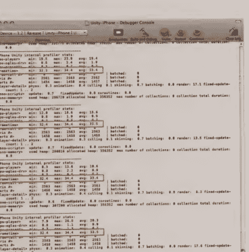

图2.4 我使用 Internal Profiler 监控演示场景的性能，同时不断在游戏中添加游戏对象。我检查 frametime 变量，看它是否超过 33.3 ms。


## 目标设备

当为 iDevices 开发游戏时，你需要决定游戏将支持哪些设备。iOS 开发的一个优势是，与其他移动平台不同，你需要针对的设备数量相对有限。不过，你仍然需要决定：是支持所有世代的设备，还是只支持那些能让游戏在保持高细节水平、又不必牺牲美术资源质量的前提下达到最佳性能的设备。

一个可行的解决方案是构建不同分辨率的模型和纹理贴图，供不同设备使用。例如，你可以为 iPhone 4 和 iPad 构建更高分辨率的资源，同时为 iPhone 3GS 和第三代 iPod Touch 创建较低分辨率的模型。然后在 Unity iOS 中，创建一个附加到启动场景的脚本，检查游戏运行在哪台设备上，再加载针对该设备优化的资源对应的场景。

就本书的演示项目和我目前正在制作的游戏《Dead Bang》而言，我决定针对性能更高的设备（如 iPhone 4、3GS 和 iPad）来优化资源。我的看法是，在撰写本书时，iPhone 3G 和第二代 iPod Touch 设备已经落后三代了。我认为不值得再创建一整套较低分辨率的资源来支持那些旧设备。这并不意味着我的内容无法运行，只是可能无法像我希望的那样流畅。归根结底，这取决于项目的范围以及你想实现的目标。

> **隐蔽的填充率问题**
>
> 请记住，你必须始终密切关注 iPad 和 iPhone 4 上的填充率问题。在这些设备上测试并分析游戏，是发现性能问题的唯一可靠方法。

通过创建一个性能测试场景来测试硬件，并全面了解该硬件的性能和限制，我确定希望将主角 Tater 的顶点数控制在 800 个以下。正如你将在本章后面看到的，我成功将 Tater 的顶点数控制在 659 个，这远远满足了我为 Tater 设定的顶点预算。目前，Unity iOS 手册指出，你应该以每帧可见约 10k 个顶点为目标；而正如我在第 1 章“了解 iDevice 硬件与 Unity iOS”中提到的，考虑到驱动 iPhone 4 和 iPad 的硬件，这个目标有些保守。

目前，Tater 的顶点数与游戏的整体顶点数配合得相当好。那么，现在让我们看看我是如何实现这些目标的。

## 确定尺寸

当把对象从一个 3D 应用程序移到另一个 3D 应用程序时，你不可避免地会遇到尺寸问题；使用 Unity iOS、modo 和 Blender 时也不例外。这不是什么问题，只是你必须理解并设法处理的事情，而首先要定义游戏单位。

## 什么是游戏单位

游戏单位是定义游戏场景中尺寸的一种任意方式。一个游戏单位等于 3D 空间中的 1 个网格方格。在图 2.5 中可以看到，Unity iOS 中的默认立方体游戏对象等于 1 个网格方格，即宽 1 个单位、高 1 个单位、深 1 个单位。

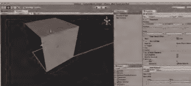

图 2.5 Unity iOS 中的默认立方体游戏对象为 1 × 1 × 1 个单位。

一个游戏单位可以代表你想要的任何度量。例如，1 个游戏单位可以是 1 英尺或 1 米。它可以是任何你想要的值，不过在游戏开发中，通常的做法是设定 1 个游戏单位等于 1 米。原因是，如果你的游戏采用现实世界的度量，物理计算会更容易处理。例如，重力加速度为 9.81 m/s²；如果你想在游戏中模拟它，采用 1 个游戏单位等于 1 米的缩放比例会更容易。否则，你就必须弄清楚 9.81 m/s² 与你自己设定的场景缩放比例之间如何换算，才能得到相同的结果。因此，在创建我的 Unity iOS 项目时，我采用 1 个游戏单位等于 1 米的缩放比例。在 Unity iOS 中，你不必设置偏好或选项；这只是你为项目确定的事情，并在创建和导入对象时使用这个缩放比例。

## 不要在 Unity iOS 中设置缩放

非常重要的一点是，不要在 Unity iOS 中通过对象的 Transform 设置对象缩放。原因是，当在 Transform 上更改缩放时，Unity iOS 会复制该对象，生成该对象的缩放版本。这会浪费内存资源。务必确保 Unity iOS 中的缩放设置为 1 × 1 × 1，并且任何缩放都在 3D 应用程序中完成，或通过 FBX Importer Dialog 中的 Scale Factor 设置完成。

## 设置 modo

在内部，modo 始终以米为单位工作，无论你如何在 Preferences 中设置 Accuracy 和 Units。可以这样说：如果 modo 中一个 1 × 1 × 1 m³ 需要缩放到 0.01，或缩小 100 倍，才能与 Unity iOS 中创建的 1 × 1 × 1 m³ 大小相同，那么 Unity iOS 内部一定是以厘米为单位工作的。基于同样的思路，Maya 内部以厘米为单位工作；如果你从 Maya 导出一个 1 × 1 × 1 m³ 到 Unity iOS，需要将 Mesh Scale Factor 设为 1，也就是不进行缩放转换，Maya 立方体才会与 Unity 的 1 × 1 × 1 m³ 大小相同，这进一步证明 Unity 的内部缩放以厘米为单位工作。了解你的 3D 应用程序所使用的内部缩放，以及它与 Unity 内部缩放的关系，你就能判断对象是否需要缩放以及缩放系数是多少。

归根结底，最佳实践是根据你为项目设置的任意游戏单位来考虑 Unity 的缩放。例如，我将游戏项目设置为 1 个游戏单位等于 1 米。因此在 Unity iOS 中，1 个网格方格等于 1 个单位。在 modo 中，我创建对象时让 1 个网格方格等于 1 个单位，以匹配项目的游戏单位缩放。然而，这意味着在使用 modo 和 Unity iOS 时，由于 Unity iOS 与 modo 内部处理缩放的方式不同，你的 modo 网格需要在 Unity 的 Importing Assets Settings 中通过 Mesh Scale Factor 缩放 0.01，如图 2.6 所示。

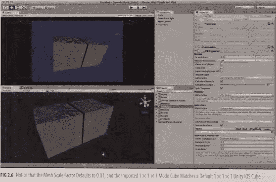

图 2.6 请注意，Mesh Scale Factor 默认值为 0.01，导入的 1 × 1 × 1 Modo 立方体与默认的 1 × 1 × 1 Unity iOS 立方体相匹配。

你可以选择在导出前在 modo 中缩放网格，这样就不必在 Unity iOS 的导入设置中缩放；也可以直接在 Unity iOS 的导入设置中将网格缩放 0.01。我倾向于在 Unity 的导入设置中缩放 modo 网格，这样我就可以在 modo 中以米为单位工作。这样做，我不必担心在导出前在 modo 中冻结缩放，而且把网格发送到 Blender 时效果更好，我们将在第 5 章讨论这一点。

在 modo 的 Preferences 中，我在 Accuracy and Units 下将 Unit System 设置为 Game Units，然后将 Meters per Game Unit 设置为 1.0。这意味着 modo 中的每个网格方格都是 1 个游戏单位，并代表 1 米，而这也是我认为 Unity iOS 单位所等于的值，如图 2.7 所示。

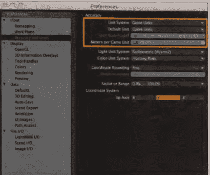

图 2.7 我将 Modo 的 Unit System 设置为每个游戏单位等于 1 米，以匹配我为游戏项目确定的缩放。

现在，我可以开始在 modo 中按照 1 个游戏单位对应 1 米的缩放比例建模游戏对象。例如，我确定希望 Tater 的身高约为 6 英尺 5 英寸，这大约等于 1.99 米，如图 2.8 所示。

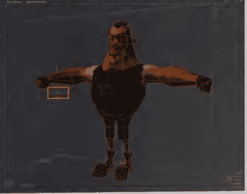

图 2.8 现在我的 Modo 单位系统已设置为游戏项目的游戏单位，我可以开始按比例建模游戏对象了。

## 导入 Unity iOS

在 modo 中完成模型后，我需要将它们导入 Unity iOS。我使用 FBX 作为在应用程序之间传输模型的格式，因此需要从 modo 导出 FBX。modo 的默认 FBX 导出会导出若干 Unity iOS 场景中不需要的项目，例如摄像机、灯光、纹理定位器等。你可以在导出前删除所有非必要项目，也可以在 Unity iOS 项目中删除这些额外项目。

我创建了一个 modo 脚本，用于优化此工作流程。该脚本会扫描你的 modo 场景，移除所有非网格项目，并一键导出干净的 FBX。该脚本还会烘焙网格项目变换上设置的任何动画数据。你可以在本书的资源网站上下载该脚本。从 modo 导入 FBX 时，你需要在 Unity iOS 的 Import Assets 对话框中设置一些参数。对于导入静态对象或没有动画的对象，只需设置 Mesh Scale Factor 和 Smoothing Angle。如前所述，对于在 modo 中设置为默认缩放的对象，需要将 Mesh Scale Factor 设置为 0.01，如图 2.9 所示。

> **Unity iOS 中的 Transform**
>
> 定位器和组等非网格项目会作为 Transform 导入 Unity iOS。对于支持骨骼的 3D 应用程序（如 Blender 和 Maya），骨骼也只会作为 Transform 导入。Transform 保存对象的位置、旋转和缩放，并且可以像 Unity iOS 中的任何其他对象一样进行操作。

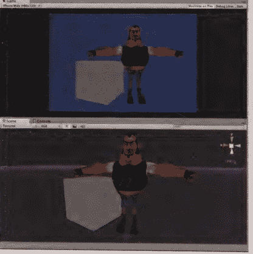

图 2.9 在这里你可以看到设置了 Mesh Scale Factor 为 0.01 的 Tater 模型，以及它与默认 Unity iOS 立方体的关系。


导入资源中还有其他设置，我们稍后会讨论。自动计算法线选项和平滑角度参数在这个阶段对于将我们的 modo 对象导入 Unity iOS 非常重要，因为这些设置会直接影响你的顶点数，我们接下来会讨论这一点。

## 真实顶点数

我们之前已经讨论过顶点数有多重要，因此必须注意：你不能把 3D 程序中的顶点数当作对象中的真实顶点数。要获得网格的真实顶点数，你需要将对象导入 Unity iOS，并查看游戏视图中的渲染统计窗口，如图 2.10 所示。请注意，Unity 的渲染统计窗口显示的是发送到 GPU 的最终顶点数，其中包括由灯光和复杂着色器添加的顶点。

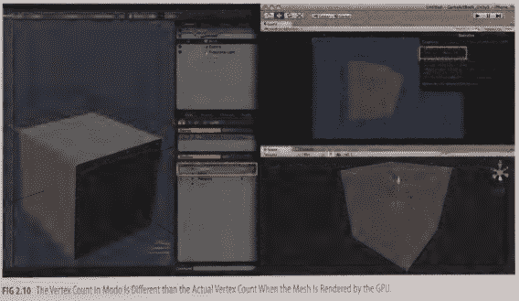

有几个因素会导致网格在由 GPU 渲染时顶点数增加。作为创建游戏内容的 3D 艺术家，你可能觉得不能相信 3D 应用程序中的顶点数这一概念很陌生，但正如你将看到的，你在日常 3D 工作中其实已经一直在处理这些相同的因素。让我们从介绍三角带和退化三角形的概念开始，它们正是导致我们顶点数增加的罪魁祸首。

### 退化三角形

Unity iOS 会尝试使用三角带尽可能高效地显示你的网格。三角带是一系列相互连接的三角形，它们共享顶点，如图 2.11 所示。这样可以实现更快的渲染和高效的内存使用。

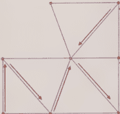

**图 2.11** 三角带是描述网格最高效的方式。

然而，为了有效地做到这一点，Unity iOS 必须在各种不连续处（例如网格接缝和 UV 边界）创建所谓的退化三角形，或称零角度三角形。退化三角形由三个共线点或位于同一条直线上的点构成。它看起来更像一条线段，如图 2.12 所示。这些三角形对性能的影响在 GPU 上确实会累积起来。在接下来的两个小节中，我们将深入探讨会产生退化三角形的不连续处。


**图 2.12** 退化三角形看起来像一条线段，并会导致 Unity iOS 中的顶点数增加。

### 平滑角度

在 modo 中，你可以通过平滑量和角度按材质调整多边形的平滑。如果不进行平滑，构成网格的多边形就会以平面形式显现。平滑角度用于确定相连多边形之间的最大角度容差。如果相连多边形之间的角度大于平滑角度设置，则不会发生平滑。Unity iOS 中导入资源对话框上的自动计算法线开关对网格进行平滑时所做的也是同样的事情。激活此开关后，你就可以像在 modo 中一样输入平滑角度。

当 GPU 需要渲染硬边时，顶点数增加的问题就出现了。硬边出现在相连多边形形成的角度大于平滑角度的位置。GPU 需要在此角度处拆分顶点以创建硬边，这会导致网格接缝。模型中的硬边是你开始看到顶点数增加的区域。例如，在图 2.13 的左侧，你可以看到三个相连的多边形，其平滑角度为 180 度。在右侧，其中一个多边形已被剪切并粘贴，因此将其连接到其他多边形的顶点已被复制。你现在可以看到已经创建了一条硬边。这类似于 GPU 在遇到对象中的硬边时发生的情况。硬边处的顶点需要拆分以创建硬边，从而导致顶点数增加。

### UV 接缝

在上一节中，我们讨论了网格接缝。现在，我们将研究这个问题的另一半，即 UV 边界或接缝。为对象创建 UV 时，你需要尽量减少 UV 贴图中的接缝数量。正如我们在网格接缝中所述，当 GPU 遇到 UV 接缝时，顶点会被拆分。

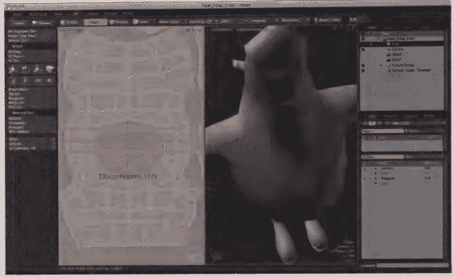

**图 2.14** 蓝色高亮边缘显示了一对不连续的 UV。边缘的蓝色阴影表示不连续的顶点。

这会增加需要处理的顶点数以及必须绘制的像素数。即使额外的灯光不会导致额外的绘制调用（例如在顶点光照模式下），它们也仍然不是免费的。例如，在顶点光照着色器中，更多灯光意味着相同的绘制调用数和需要处理的顶点数，但每个顶点必须进行更多计算。这使其开销更高。即使在延迟渲染中，假设所有对象都以延迟方式渲染，每盏灯都会略微增加报告的顶点数，因为每盏灯都有一些额外的几何体需要光栅化，以便运行光照着色器。例如，导入一个四边形多边形并添加一盏灯，会使顶点数从 4 翻倍到 8。

最好尽量减少场景中灯光的使用，甚至更好的是完全不使用它们。相反，一个好主意是将场景光照烘焙到漫反射纹理贴图中，或使用光照贴图，并用 Unity 附带的某个 iPhone 光照贴图着色器应用它。

在第 8 章“使用 Beast 创建光照贴图”中，我们将讨论在 Unity iOS 中使用 Beast 的光照贴图。

## 为 Tater 和 Thumper 建模

在本节中，我们将看看我是如何创建 Tater 和 Thumper 的。我们将从我为 iDevices 创建对象的工作流程开始，讨论该过程的重要方面。在第 3 章“理解纹理和 UV 贴图”中，我们将通过介绍创建 UV 贴图和纹理贴图来继续这一讨论。

### 我的工作流程

我之前说过，我想将 Tater 的顶点数保持在 800 个顶点以下。对于 Thumper，我想将其顶点数保持在 300 个顶点以下。最终，我成功将 Tater 做到 659 个顶点，将 Thumper 做到 224 个顶点。这样，“主角”角色及其武器的合计顶点数为 883 个。对于这个角色，我没有先创建高分辨率网格，再据此构建低分辨率版本笼形网格。这是游戏中的典型工作流程，因为你可以从高分辨率网格中提取法线贴图。相反，我采用了一种修改过的方法：先创建一个低分辨率多边形笼形网格，然后通过向细节区域添加几何体来优化网格，并在基础网格完成后减少几何体。在制作基础网格时，我结合使用 Loop Slice 和 Edge Slice 工具来快速添加和控制网格上的边循环。我还尽可能使用四边形多边形，只在想要减少几何体的某些区域使用三角形。例如，在图 2.15 中，我在 Tater 的前臂中使用了一个三角形，从二头肌周围较高分辨率级别过渡到手腕周围较低分辨率级别。

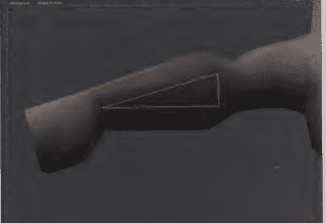

**图 2.15** 此处使用一个三角形来降低从二头肌到手腕的细节级别。

当 Unity iOS 导入 FBX 文件时，它会自动进行三角化，因此无需在 modo 内将多边形三角化。

### 创建几何体

就创建几何体而言，为 iPhone 和 iPad 的游戏对象建模并没有什么特殊技巧。你很快会发现，你会使用创建任何模型时常用的所有概念，例如倒角、挤出、推拉点，以及分割和合并多边形。创建 iOS 内容的技巧在于决定在哪里添加细节、在哪里可以去掉细节，同时保持模型的整体形状。你必须对想把顶点花在哪里做出经过计算的决策。就像我提到的，我给自己为 Tater 设定了少于 800 个顶点、为 Thumper 设定了少于 300 个顶点的预算，而诀窍就在于决定把预算的顶点花在哪里。

让我们看一些例子，了解我决定在 Tater 和 Thumper 游戏对象中把分辨率放在哪里。在图 2.16 中，你可以看到 Tater 头部的分辨率。我决定通过让嘴巴从面部凸出来，为面部添加少量细节。我创建了一个边循环来勾勒嘴巴的轮廓。在嘴巴与面部其余几何体相连的嘴角处，嘴巴的分辨率降低了。我还决定从面部挤出鼻子。注意在图 2.16 中，鼻子非常简单。就这一点而言，它没有任何鼻孔或太多细节。它只是大致类似鼻子的形状。表面细节通过纹理贴图来创建，如右图所示。此外，在图 2.16 中，你可以看到眼窝区域是简单的平面多边形，眼睛的分辨率完全留给纹理贴图来定义。

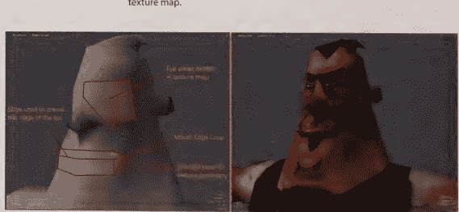

**图 2.16** 为了创建低分辨率网格，细节只需近似模型的形状。你可以使用纹理贴图进一步突出表面细节。

在图 2.17 中，你可以看到 Thumper 的弹药筒（以红色轮廓标出）本意是圆的。然而，我只使用了一个六边圆盘，将其挤出并在中间分割，以保持四边形多边形。尽管弹药筒本质上有棱角，但它近似了我想要创建的圆润形状。


用三角形来减少肘关节和手部的几何体数量，如红色轮廓所示。

观察 Tater 的躯干，你还可以看到如何用三角形终止边缘环，如图 2.19 所示，从而控制裤子到躯干的分辨率差异。向网格添加边缘环对于增加细节至关重要。例如，如图 2.19 所示，Tater 的裤子需要额外一条边缘环来保持最圆润的形态，然而，如果我把那条环继续向上延伸到躯干并穿过头部，就会浪费顶点。

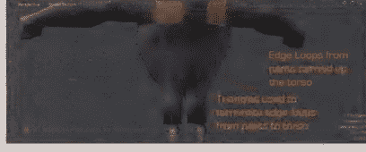

**图 2.19** 你需要尝试终止边缘环，使它们只在网格中需要细节的区域保留细节。不要让边缘环贯穿整个网格。

在终止边缘环这一概念的基础上，在图 2.20 中，你可以看到我如何处理 Thumper 枪管上的一个五边面。我没有沿枪管向下继续该边缘环——即蓝色虚线所表示的部分——而是让它向上越过顶部并绕回，如黄色线所示。通过这样做，我把这个五边面拆分成了一个三角形和一个四边面。

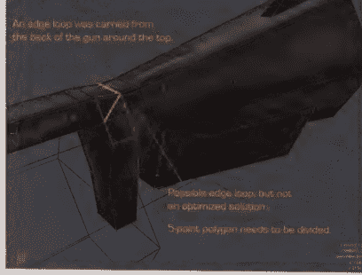

图 2.20 这里我选择拆分一个五边面，在终止边缘环的同时创建一个三角形和一个四边面。

在图 2.21 中，你可以看到 Tater 以及我选定为网格最重要区域的边缘环。这些选中区域是 Tater 在绑定和动画时变形最多的部分，也是我特别关注的区域。

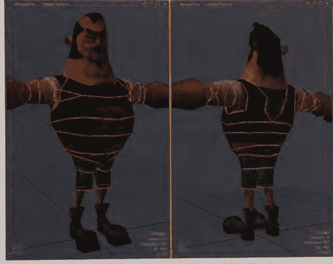

图 2.21：选中的边缘环是动画期间网格变形最重要的区域。

## 减少几何体

到目前为止，我们讨论创建几何体时，关注的是如何通过只在模型重要部分放置细节来控制分辨率。我们谈到了通过终止边缘环和使用三角形从高分辨率过渡到低分辨率来减少几何体。在本节中，我们将看看优化模型时可以用来减少几何体的一些技术。

### 多边形走向与 Spin Quads

密切关注模型上的多边形走向非常重要。当模型将作为蒙皮网格进行动画时，这一点尤其重要。

### 拓扑是关键

网格的拓扑会提示你需要在哪些地方集中大部分顶点数。你必须确保在动画时会变形的网格区域提供足够的分辨率。

你需要确保网格拓扑是为处理动画而设计的。在图 2.22 中，你可以看到多边形是如何安排走向的：从肩部顶部穿过胸部，并绕过肩部和二头肌。胸部和肩部的拓扑允许这些区域平滑运动，并且在 Tater 动画时能良好变形。

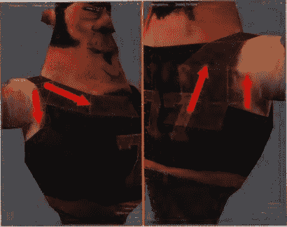

图 2.22 网格拓扑非常重要，你需要确保添加足够细节，使区域在动画时能良好变形。

在为网格设计拓扑时，我经常使用 Spin Quads 工具。Spin Quads 工具非常适合改变多边形的走向。例如，在图 2.23 中，你可以看到我如何使用 Spin Quads 改变 Tater 肩部和颈部的拓扑。

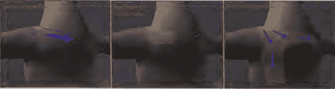

图 2.23 使用 Spin Quads 改变了网格的拓扑。

将它们合并成单个四边面。这与其说是减面技术，不如说是因为四边面多边形由两个三角形构成，但它使网格更干净、更易于操作。

## 总结

在本章中，我们讨论了为 iDevices 创建优化几何体背后的原则。创建优化几何体的真正诀窍在于决定如何利用预算中的顶点数量。你必须决定模型的重要部分在哪里，以便在那里放置分辨率，然后减少这些多边形，使它们能够连接到分辨率较低的区域。通过理解 GPU 如何解释顶点数，你可以正确估算网格包含的顶点数量。正如我们讨论过的，网格接缝和 UV 边界会导致 GPU 拆分顶点，从而增加顶点数；通过理解这一原则，你将能够优化网格中的这些不连续处。在第 3 章“理解纹理和 UV 贴图”中，我们将看看为 Tater 和 Thumper 贴图，并继续讨论 UV 接缝如何影响游戏对象的真实顶点数。

# 规划你的 UV 贴图

根据你的对象，你将不得不创建一些 UV 接缝；正如我上面所说，诀窍是尽量减少这些接缝，使其尽可能少，同时仍让布局适合贴图。让我们看一个例子。在图 3.1 的上半部分，你可以看到一个默认模型盒，UV 接缝已高亮显示。如你所见，默认盒子的 UV 布局让你可以轻松地为盒子各面贴图。在图 3.1 的下半部分，你可以看到 UV 布局以重叠 UV 的方式实现没有接缝。现在，除了贴图难易和纹理失真之外，这些 UV 布局之间的区别在于 UV 接缝导致的顶点数增加。

**图 3.1** 这里你可以看到具有两种不同 UV 布局的默认模型盒。第一个 UV 贴图有 UV 接缝，第二个 UV 贴图没有接缝。

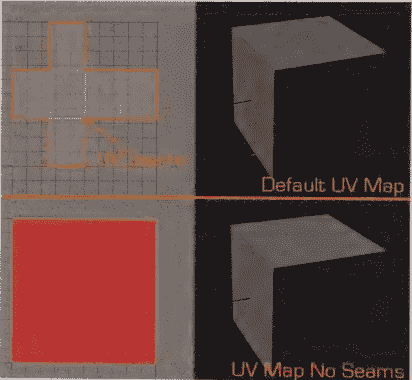

在图 3.2 中，你可以看到这些 UV 布局如何影响 Unity iOS 中的顶点数。注意，没有接缝的 UV 贴图，结合因增大平滑角度而使对象没有硬边，在 Unity iOS 和 Modo 中得到的顶点数同为八个顶点。尽管默认 UV 布局如图 3.2 上半部分所示将顶点数从 8 增加到 14，但它仍然提供了更好的方案，因为对象可以在不失真的情况下正确贴图。是的，可以增大平滑角度并消除所有 UV 接缝，这样不会导致 GPU 拆分顶点，如图 3.2 下半部分所示，但这在贴图方面并不总是实用的解决方案。

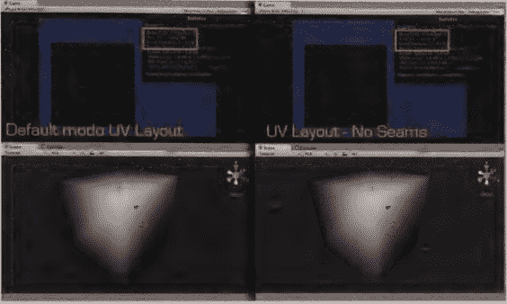

**图 3.2** 通过创建没有接缝的 UV，你可以阻止 GPU 拆分顶点，但这可能不是最佳方案。

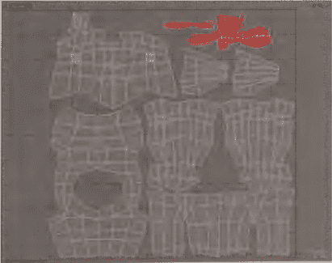

**图 3.3** 为保险起见创建 UV 时，我的目标是尽可能减少接缝，同时消除纹理失真，并创建最适合贴图的 UV 贴图。

考虑到这一点，你必须注意自己在贴图中放置的每一条 UV 接缝，因为它会导致顶点数增加。UV 接缝不可避免，但你可以通过合并 UV 来控制和限制 UV 布局中的接缝。规划 UV 布局以完成这项任务至关重要。你不仅要注意 UV 接缝，还必须努力最大化利用 UV 空间。你需要安排网格中最重要的区域，使其利用大部分 0-1 UV 空间，从而在纹理贴图中分配更多像素。例如，对于角色，你可能会认为头部在像素分辨率方面比角色的手更重要。这一决定会引导你将头部 UV 布局为占据更多 0-1 UV 空间，从而在贴图中分配更多纹理分辨率。记住对象中可能不容易被相机看到的区域也很有帮助。如果你实际上看不到它，那就没有理由浪费 UV 空间。让我们看一些使用 Tater 和 Thumper 的例子。

## 为 Tater 创建 UV

Tater 模型完成后，我检查了网格，并记录了我想确保在纹理分辨率方面给予最高优先级的区域。在图 3.3 中，你可以看到 Tater 的完整 UV 布局。

在 Tater 的情况中，我觉得模型的大部分同等重要。不过，我决定给头部、手臂和躯干比裤子、腿和鞋子稍多一点 UV 空间。腿和鞋子获得的 UV 空间最少，因为我认为它们在游戏中不会像模型其余部分那样显眼。这些决定完成了为 Tater 规划 UV 贴图的最初步骤。通过将模型分解为重要程度不同的部分，我确定了如何将 UV 划分为单独的 UV 壳或 UV 岛。

让我们看看为衬衫创建 UV。我需要为衬衫创建一种 UV 布局，使我能够轻松创建纹理贴图，同时尽量减少任何纹理失真。首先，我创建了一个初始投影，使用 Project from View 工具，并将视口设为前视图，如图 3.4 所示。

图 3.4 对于衬衫，我创建了一个初始平面投影，以让我接近计划的 UV 布局的大致范围。

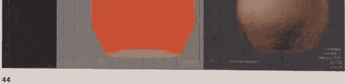


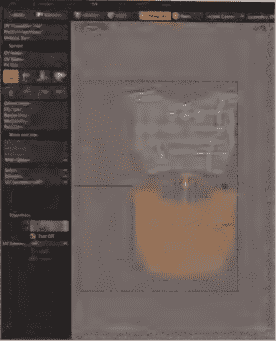

**图 3.5** 我需要分离 UV，以便它们能被正确松弛。

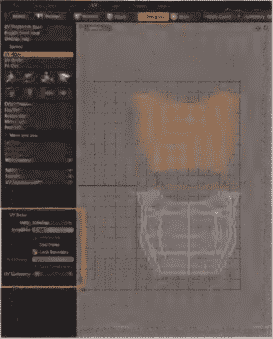

**图 3.6** 在这种情况下，使用“锁定边界”效果很好。我们不希望松弛边界 UV，只希望松弛内部 UV，而“锁定边界”正是这样做的。

然后我选择了衬衫的前片，使用“移动”工具并启用“撕裂”选项，将 UV 分离成衬衫前片和后片的独立 UV 壳，如图 3.5 所示。

接着，我使用启用“锁定边界”的“UV 松弛”工具，对每个 UV 壳进行松弛，如图 3.6 所示。

此时，我有了衬衫前片和后片的两个 UV 壳，这将使我能够轻松地为衬衫绘制纹理。但是，我需要处理我所创建的 UV 接缝，以免无意中增加网格中的顶点数量。为了消除一些接缝，我需要将衬衫的两半重新缝合在一起。为此，我选择了衬衫的后片，使用“镜像 UV”工具并设置为 V 轴向翻转 UV 壳，以便更好地对齐两半以便缝合，如图 3.7 所示。

然后我使用“移动”和“缝合 UV”工具将两个 UV 壳缝合在一起，从而消除了两条 UV 接缝，如图 3.8 所示。

两半缝合后，我再次进行了 UV 松弛操作，并使用“拖动”工具修复任何重叠的 UV。回看图 3.3，你可以看到衬衫完整的 UV 壳。正如你所看到的，工作流程是创建易于绘制纹理的 UV，通过缝合边缘来尽量减少 UV 接缝，并松弛 UV 以消除任何可能的纹理变形。这就是我在 Tater 和 Thumper 两个模型中处理所有 UV 所遵循的工作流程。

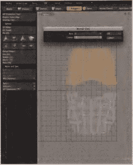

**图 3.7** 在正确缝合 UV 之前，你需要尽可能紧密地对齐接缝。

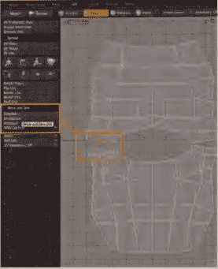

**图 3.8** 通过将两半缝合在一起，我能够移除两条接缝，从而避免 GPU 分裂这些顶点。

重叠某些 UV 壳也可能非常有用。例如，对于 Tater 的鞋子，我判断它们在游戏中几乎不可见，因此它们是 UV 布局中最小的一组 UV 壳。为了进一步节省空间，我直接将鞋子的两个 UV 壳重叠，使它们占据相同的 UV 坐标。这让我在 UV 贴图中节省了大量空间，如图 3.9 所示。

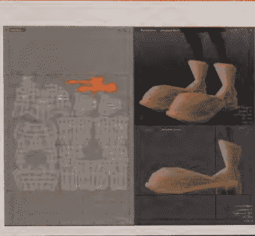

**图 3.9** 我不介意对鞋子使用重复纹理，因此为了节省 UV 贴图空间，我将它们的 UV 壳重叠了。

对于 Tater 和 Thumper，我都不需要使用重复纹理。我认为这类物体具有自包含的 UV，也就是说它们的 UV 用于针对单个封闭网格上的特定部分。然而，与之相反，墙壁物体需要重复其 UV，以便该物体能够以平铺方式表示许多墙壁。

## 为 Thumper 创建 UV

Thumper 模型的 UV 创建方式与 Tater 非常相似。在图 3.10 中，你可以看到完整的 UV 布局。

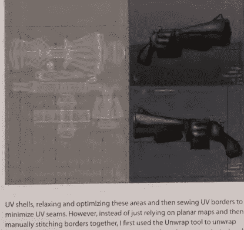

**图 3.10** Thumper 的 UV 以与 Tater 类似的方式创建。

Thumper 的 UV 用于占据特定网格上的目标区域，因此不存在需要担心的重复 UV。同样，我首先从审视模型开始，确定哪些区域最重要，因而需要占据最多的 UV 空间。位于物体下方的枪械区域显然需要较少的 0–1 空间。我确实遵循了基本工作流程，即将网格区域分解为独立的 UV 壳，松弛并优化这些区域，然后缝合 UV 边界以尽量减少 UV 接缝。然而，我没有仅仅依赖平面投影并手动缝合边界，而是首先使用“展开”工具来展开枪械的大部分。在图 3.11 中，你可以看到选中的边以及“展开”工具的结果。

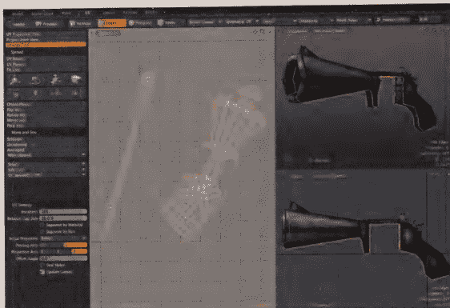

**图 3.11** 我使用“展开”工具快速为枪械的大部分创建 UV。

请注意，使用“展开”工具时，我能够通过仔细选择将形成 UV 接缝的 UV 边，来展开诸如枪柄连接到枪管等棘手区域。还要注意，手柄已被展开，但它仍然尽可能地与枪械的基本 UV 壳保持连接，如图 3.12 所示。这次 UV 展开的目标是尽可能保持更多的 UV 连续性，同时仍然保持一个在绘制纹理时合理的 UV 布局。

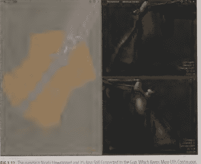

**图 3.12** 手柄被整齐地展开，并且仍然与枪械相连，这使得更多 UV 保持连续。

当然，你不能只使用“展开”工具就期望一切都被完美展开。一旦我完成了基本的展开，我就去松弛 UV，并将 UV 壳排列到它们在贴图中的最终位置。我还需要进行一些手动投影，使用“松弛”工具松弛 UV，并将壳缝合在一起以消除接缝。在图 3.13 中，你可以看到我手动展开的多边形。

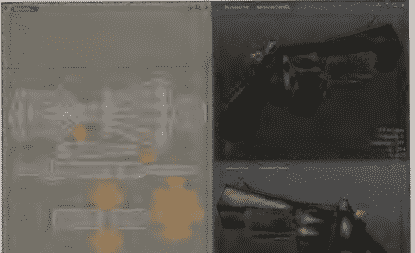

**图 3.13** 这些选定的多边形是手动展开的。

### 使用“展开”工具还是手动投影

“展开”工具对于快速展开网格非常有用。然而，对于复杂的网格，有时很难确定如何精确地选择接缝以获得干净的展开。此外，你可能会发现，在使用“展开”工具时，UV 的展开方式对于你将在 Photoshop 中绘制纹理而言并不是最优的。当我遇到这种情况时，我会创建物体的几个较小的平面投影，然后使用本章中讨论过的“移动”和“缝合”工具手动将它们缝合在一起。有时，通过平面投影手动展平 UV，然后再手动缝合，反而更容易理解网格的展开。

在本节中，我们讨论了创建 UV 贴图。我想重申，正如我们在第 2 章中关于建模所发现的，优化 UV 并没有神奇的技巧。通过理解 UV 接缝在 GPU 渲染网格时对增加顶点数量的重要作用，你可以理解如何以及何时最小化接缝。再次，我必须提到游戏行业中常用的一句话：“视情况而定。”你决定如何优化 UV 取决于你的游戏内容和所创建的游戏类型。我在创建内容时坚持的工作流程总是始于审视网格并规划 UV 布局。然后，我开始进行基本的展开，并尽量减少 UV 接缝。重复这个过程。在下一节中，我们将实际了解为 Tater 游戏对象创建纹理贴图的过程。

# 游戏纹理基础

在以下各节中，我们将讨论为 iDevice 硬件创建纹理的基础知识。在为 iPhone 和 iPad 构建内容时，我依靠纹理贴图为我的物体带来细节。正如我们讨论过的，iDevice 硬件虽然强大，但在游戏开发方面可能有些受限，你会发现，最好的性能可以通过仅使用颜色贴图和光照贴图的组合来实现。在我们查看 Tater 和 Thumper 的纹理之前，首先需要了解一些与纹理以及 iPhone 和 iPad 相关的基础知识。

## 纹理格式

在本节中，我们将讨论与 iDevice 硬件相关的纹理格式。这些格式涉及纹理在系统内存中的格式化方式。在 iPhone 和 iPad 设备中的 SGX GPU 上支持多种格式，例如 32 位、16 位和 PVRTC 压缩格式。在图 3.14 中，你可以看到 Unity iOS 的“导入资源设置”对话框中可用的格式列表。

## 纹理大小

在创建纹理时，我通常使用比实际 Unity iOS 项目中使用的分辨率高得多的分辨率。这基本上有助于为我的纹理提供面向未来的保障，当发布具有更高分辨率能力的新设备时，也能更容易地支持多分辨率。

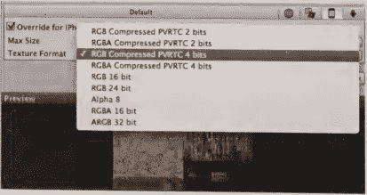

**图 3.14** 你可以在 Unity iOS 的“导入资源”对话框中设置纹理格式。


从 iPad 到 iPhone 等设备。例如，我在创建纹理时通常会使用 2K（2048 像素）分辨率。这不仅适用于 iPad 的 1024 像素分辨率，也很容易缩放到 iPhone 和 iPod Touch 设备，例如 iPhone 的 480 × 320 和 iPhone 4 的 960 × 640。当然，这并不是我游戏中纹理的最终大小。纹理将在 Unity iOS 中调整大小并进行压缩。但是，我觉得重要的是要注意，在创建源纹理时，你需要考虑 iDevices 上不同的分辨率。你肯定不希望以 480 像素宽度创建源纹理，然后放大这些纹理以用于 iPad 和 iPhone 4 等更高分辨率设备。最好先制作大尺寸，然后缩小，以保持纹理的最高质量。此外，请记住，最好以 2 的幂次方创建纹理，这样它们才能在 iDevices 上使用 PVRTC 压缩。

确定纹理最终的压缩大小取决于多个因素，如屏幕尺寸和纹理内存。例如，场景中较小的物体——这不仅由物理尺寸决定，还受相机 3D 透视的影响——可以使用更小的图像大小。事实上，这正是 Mip 贴图发挥作用以优化性能的地方，这将在第 9 章“在 Unity iOS 中使用游戏资源”中讨论。在接下来的几个小节中，我们将探讨确定纹理预算的基本原理，这反过来将为确定纹理大小打下坚实的基础。

## 2 的幂（POT）与非 2 的幂（NPOT）

2 的幂是指数字 2 的任意整数幂。基本上，它表示 2 乘以自身若干次。非 2 的幂，也就是任何不是 2 的幂的数字。POT 分辨率的一些常见示例包括 1024 × 1024、512 × 512、256 × 256 和 128 × 128。理解 NPOT 纹理在 Unity iOS 中无法被压缩这一点非常重要。Unity iOS 的桌面版本允许你在 GUITextures 上使用 NPOT 作为压缩纹理；然而，如果它们被用于其他任何地方，就会被转换为 RGBA 32 位格式，这会消耗大量 RAM，并且在 iPhone 和 iPad 这样的移动平台上是非常糟糕的。POT 纹理支持 Mip 贴图和所有环绕模式，如 repeat（重复）和 clamp（钳制）。然而，NPOT 纹理不支持 Mip 贴图，并且环绕模式必须设置为 clamp to edge（边缘钳制）。POT 纹理在宽高比上是固定的，与 iPhone 和 iPad 设备的宽高比不匹配。在为你的游戏对象（例如 Tater 和 Thumper）创建纹理时这不是问题，但对于需要填满整个屏幕的纹理（如菜单），你将不得不进行一些调整。你可以选择在“纹理导入器”（Texture Importer）对话框中对 NPOT 纹理进行缩放，如图 3.15 所示。

图 3.15 你可以在纹理导入器对话框中告诉 Unity iOS 如何处理 NPOT 纹理

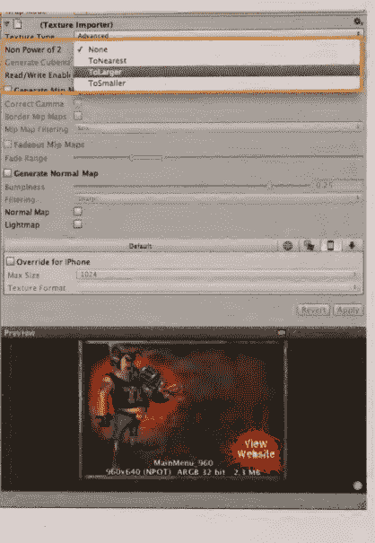

如你所见，当纹理被缩放到更大或更小的分辨率时，这基本上会挤压你的纹理。我从不使用这个选项。相反，我使用一个简单的平面网格，并将 UI 元素通过纹理图集（texture atlas）映射到其上。这样，你就能使用正确的图像格式进行 PVRTC 压缩。一个用于所有 GUI 创建的优秀工具是 Above and Beyond Software 出品的“EZ GUI”。我们将在第 4 章讨论纹理图集的使用。然而，必须注意的是，如果你使用 480 x 320 这样的 NPOT 纹理尺寸，你会遇到严重的 RAM 消耗，而且 iPhone 和 iPad 在处理大型 RGBA 纹理时并不快。此外，较大的纹理需要更多时间加载到 RAM 中。

对于界面元素（GUI），NPOT 纹理的一个好处是，它们可以完美匹配 iPhone 或 iPad 设备的宽高比。这基本上意味着你可以保持每个屏幕像素对应一个纹素（纹理像素）的一对一映射，这意味着纹理的分辨率不会被浪费。然而，需要注意的是，为 UI 使用 512 像素的图像也能起到同样的作用。正如我们将在第 4 章看到的，你还可以使用纹理图集，它可以为你的 GUI 元素包含非正方形的纹理区域。

## 纹理压缩：PVRTC

PVRTC 会将 32 位文件压缩到每像素 2 位或 4 位。如上所述，为了在 Unity iOS 中使用 PVRTC，你的纹理必须是正方形或 POT 尺寸。在为 iPhone 和 iPad 创建内容时，建议使用 PVRTC 格式，因为它是唯一可以在内存中保持压缩状态，并可以由 GPU 从其压缩格式解码的格式。这一点很重要，因为在 iPhone 上，内存带宽非常有限。纹理通常是导致 iPhone 内存耗尽的主要原因，在 iPad 上更是如此。例如，一个 256 × 256 32-bpp（每像素位数）且带有透明度的图像将占用 256 KB 内存。然而，同一个纹理使用 PVRTC 4 位压缩后仅占用 32 KB 内存，而 PVRTC 2 位仅占用 16 KB，这是一个巨大的节省。压缩质量非常好，在大多数情况下，使用 PVRTC 4 位，差异可以忽略不计。在图 3.16 中，你可以看到 32 位和 PVRTC 4 位砖块纹理之间的差异。

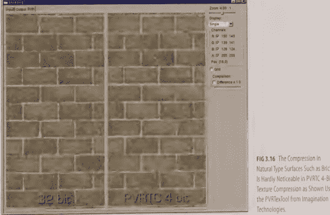

PVRTC 压缩非常适合混凝土、石材和砖块等自然类型的表面，压缩几乎难以察觉。

纹理压缩可以而且应该在 Unity iOS 中直接通过纹理导入器对话框进行设置，如图 3.17 所示。这意味着在创建纹理时，你可以使用任何你喜欢的格式，如 PSD 或 PNG。

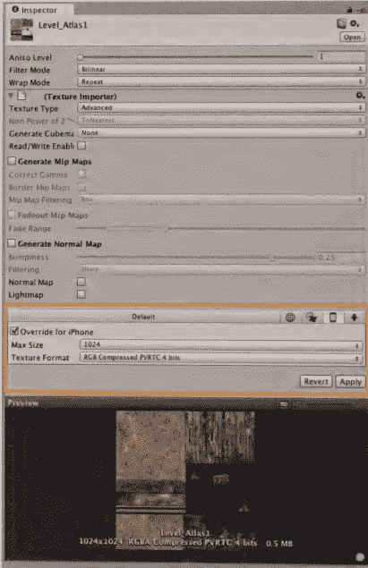

图 3.17 你可以在 Unity iOS 中直接压缩纹理。

我使用 Photoshop 创建所有纹理，并将文件作为 8 位 PNG 导出到 Unity iOS 项目中的 Assets 文件夹。然后我在 Unity 中设置所有大小和压缩。Unity iOS 3 支持多个平台，因此对于 iPhone，你需要点击 iPhone 图标，然后勾选 Override for iPhone 复选框，以设置大小和压缩方案。

## 使用 Mip 贴图

Mip 贴图是一组预先计算好的、经过优化的纹理，伴随主纹理一起使用，有助于提高渲染速度并减少锯齿伪影。在你的纹理上使用 Mip 贴图，当场景中的物体离相机更远时，会用更小、更优化的版本替换主纹理。在图 3.18 中，你可以看到纹理导入器中启用了 Mip 贴图。在移动平台上使用 Mip 贴图是一个非常好的主意——除非你知道你的纹理不会在屏幕上显示得非常小。也就是说，如果你确信纹理的每个像素都将覆盖屏幕上的一个或多个像素，那么 Mip 贴图就不是优化纹理的必要条件。在第 4 章中，我将讨论如何基于网格构建，以帮助你保持几何体尺寸（以单位计）和纹理尺寸（以像素计）之间的一对一比例，从而无需使用 Mip 贴图。我个人不太喜欢使用 Mip 贴图，因为它们往往会使纹理变得过于模糊。

## 多重分辨率

在构建纹理时，你需要了解 iPhone 4、3GS 和 iPad 之间的不同分辨率。例如，如果你只为 3GS 的 480 宽屏幕构建纹理，那么当游戏在 iPhone 4 和 iPad 的高分辨率显示屏上运行时，你的内容就会看起来很差。这就是为什么最好以将要支持的最高分辨率（即 iPad）来构建纹理，然后根据需要缩小。如前所述，你总是可以在游戏中添加逻辑，根据运行游戏的设备加载不同的内容。这样，你就能确保始终为玩家提供最适合其设备的内容。

## 纹理预算

既然我们已经讨论了 iPhone 和 iPad GPU 渲染纹理的基本原理，以及压缩如何影响特定纹理消耗的内存量，我们现在就可以正确地制定纹理预算。在第 2 章中，我们讨论了根据游戏资产将消耗的系统资源量来为其制定预算的重要性。iPhone 3GS 和 iPad 拥有 256 MB 内存，而 iPhone 4 拥有 512 MB。如前所述，纹理通常是导致 iPhone 和 iPad 内存耗尽的罪魁祸首。


**图 3.18** 在这里你可以看到，在项目的纹理导入器中，可以针对每张纹理重新启用 Mip 贴图。

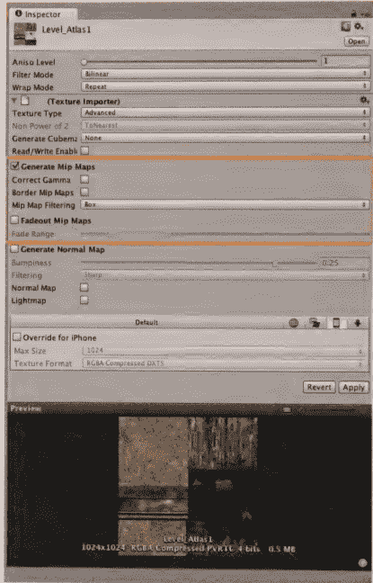

正如上一节所讨论的，计算一张纹理会消耗多少内存相当简单。通过确定游戏对象需要多少张纹理，并汇总场景中将使用的所有纹理所占用的内存，你就可以充分监控纹理资源，判断它们是否满足纹理预算。那么纹理预算如何确定呢？正如我们讨论顶点预算时所说，并不存在神奇公式或秘密技巧。这一切都取决于你想创建的游戏类型以及要部署到的设备。不过，最佳方案仍然是创建一个性能测试场景，用它来确定纹理预算，并使用 Internal Profiler 检查游戏性能。借助 Internal Profiler，你可以监控游戏对象占用的内存量，从而充分了解游戏对象和纹理正在使用的系统资源。

本节讨论了创建游戏纹理的基础知识。通过了解 iDevice 硬件以及 GPU 如何渲染纹理，你将能够正确评估纹理会如何影响性能，从而知道应采取哪些步骤来优化图形元素。

## 创建漫反射贴图

本节将介绍我如何为 Tater 创建漫反射贴图。受 iDevice 硬件限制，我只使用漫反射贴图来为游戏对象添加纹理。目标是尽可能少地使用纹理。内存不足会导致操作系统终止你的应用，因此始终了解游戏对象占用了多少内存非常重要。例如，我没有使用将漫反射贴图和光照贴图结合起来的 lightmap 着色器，而是选择把所有光照信息烘焙到单张漫反射纹理中。在 Photoshop 中合并这些纹理，是减少场景中加载纹理数量的一种简单方法。

### 模拟光影

由于需要为 iPhone 和 iPad 构建低分辨率网格，我们将通过纹理来传达表面细节。由于为了提高性能，我没有在场景中使用任何灯光，因此通常会向纹理中加入细微的光照提示。例如，你可以利用法线贴图、凹凸贴图和高光贴图来创建表面细节，然后再将这些细节烘焙到漫反射贴图中。这样就能在不增加 Unity iOS 场景中使用真实灯光开销的情况下，营造出光影的错觉。诚然，这只是一种错觉，无法产生与使用动态光照相同的效果。例如，当你的角色绕墙移动时，高光照射不会变化，凹凸效果也不会变化，因为这些效果实际上并非由灯光产生。不过，这仍然是在保持较低开销的同时为纹理增加细节的好方法。在图 3.19 中，你可以看到在 Unity 的 Game 视图中渲染的两个砖墙游戏对象，以及用于创建凹凸贴图的 modo 场景。注意，左侧的砖墙对象使用了烘焙了凹凸和高光效果的纹理贴图，看起来细节丰富得多。向纹理中添加烘焙的光照提示和表面细节，可以极大地帮助你的作品获得那种创意优势。


**图 3.19** 通过将表面细节烘焙到纹理贴图中，你可以获得不错的光照和表面效果，而无需使用灯光或复杂着色器。

### Unity iOS OpenGL ES 2.0 着色器

除非绝对需要，否则在 iDevice 上使用法线贴图并不是好主意。GPU 的速度不足以应对它。对于 iPad 和 iPhone 4，由于屏幕分辨率高得多，情况甚至更糟。在任何平台上，烘焙总是更快。

OpenGL ES 更适合图像后处理滤镜，但同样，你需要格外小心，不要因为使用它们而严重拖累性能。与 GLES 1.1 的纹理组合器相比，用 CG/GLSL（着色器语言）编写着色器要稍微容易一些，但同样会付出性能代价。你或许可以渲染自定义光照之类的内容，但同样，你也要为此付出性能代价。本质上，要想高效使用 OGLES 2，你确实需要清楚自己在着色器代码方面要做什么。总体而言，凹凸贴图需要复杂的两到三个通道的着色器，对 iPhone 和 iPad 来说可能过于沉重。对于 Unity iOS，强烈建议在确实需要 OGLES 2 之前使用 OGLES 1.1。截至本书写作时，OGLES 2 速度较慢，而且存在一些问题。再次强调，在使用 iPhone 和 iPad 时，尽可能将所有内容烘焙到纹理中并使用简单着色器，是最佳方法。

## 为 Tater 制作纹理

在图 3.20 中，你可以看到为 Tater 创建的漫反射贴图。在此图中，你看到的只是颜色信息。在第 8 章“使用 Beast 创建光照贴图”中，我将讨论在 Unity iOS 中使用 Beast 为 Tater 创建光照贴图。现在，我们只关注漫反射贴图。


**图 3.20** Tater 的漫反射贴图是在 Photoshop 中绘制的。

图 3.20 中的贴图尺寸为 2K（2048）像素，后来在导入 Unity iOS 之前被缩小到 1024 × 1024。Unity 3 支持按平台设置，这使得只需点击按钮，就能轻松地为高分辨率 3D 渲染使用 2K 纹理，为 iPhone 使用 1K 纹理。如前所述，这让我在纹理尺寸方面拥有很大的灵活性，以便用于不同的分辨率和屏幕尺寸。在第 9 章“在 Unity iOS 中处理游戏资源”中，我们将讨论在 Unity iOS 中压缩和调整漫反射纹理的大小。

## 参考图像

收集好的参考图像是任何纹理工作的关键。收集参考资料应当始终是创建纹理贴图的第一步。研究你想要创建的表面固然至关重要，但你还会使用参考图像来构建纹理。例如，在图 3.21 中，你可以看到用于制作 Tater 牛仔短裤的参考图像。在有了合适的参考图之后，我便使用这张源图像来制作牛仔短裤。

**图 3.21** 为了制作 Tater 的牛仔短裤，我从正面和背面拍摄了一条旧牛仔裤，将其用作参考图和纹理来源。


**图 3.22** 从源纹理中裁切各种组件，再拼合出游戏纹理，是快速构建贴图的好方法。

我发现，要让纹理“展开”以适配 UV 贴图，最简单的方法就是像图 3.22 所示那样，用源纹理中的各个部分把它拼接起来。诀窍在于考虑对象的接缝，以及如何将接缝向内处理来创建纹理。

例如，对于牛仔短裤，我使用了牛仔裤缝合处的接缝，并把这条接缝复制到 UV 边界两侧。利用对象中明显的自然接缝，你可以轻松地拼接纹理，同时隐藏由 UV 边界造成的接缝。如图 3.22 所示，可以看到，实际牛仔短裤参考图像中的自然接缝被用来隐藏牛仔多边形 UV 中明显的 UV 接缝。我用同样的技术处理了 Tater 的所有衣服，包括靴子。我只是把衣服中自然存在的接缝作为起点和隐藏 UV 边界接缝的手段，从而创建出更逼真的纹理。

## 皮肤纹理

利用接缝显然不太适用于皮肤。因此，为了处理脸部、手臂和腿部，我从一块无缝皮肤贴图开始。我拍摄了自己的背部，然后创建了如图 3.23 所示的无缝纹理。


看看Tater的脸颊，以及如何通过分层来创建明暗。图的左侧显示了用Burn工具创建的基础底色，右侧显示了我如何通过使用低不透明度的Brush工具继续叠加色调。


**图 3.25** 永远记住，纹理制作的关键是通过分层色调来逐步构建细节。

如你所见，绘制纹理其实并没有什么过于复杂的地方。如果把过程拆解为基本形式，无非就是绘制简单形状并进行明暗处理，同时一点一点地分层添加细节。始终从简单开始，并在需要的地方参考你的参考图像来添加细节。

### 创建头发

Tater是个毛发浓密的家伙，绘制头发是一个极其简单却有趣的过程。在Photoshop中，我创建了一个自定义头发画笔，然后开始用这个自定义画笔绘制来逐步构建头发。为了创建这个画笔，我从112 Brush Preset开始。接下来，我增大了Size Jitter、Angle Jitter，并在Shape Dynamics菜单中勾选了Flip X和Flip Y Jitter设置。最后，我增大了Scattering菜单中的Scatter、Count和Count Jitter。在图3.26中，你可以看到用于创建该画笔的设置。画笔创建好后，剩下的就只是把它画到头发上。我会频繁更改Scatter和Jitter设置，以在头发中营造随机感和变化感。

### 添加一些磨损与破损

最终纹理完成后，我将纹理加载到modo中，并使用modo的3D绘画工具在Photoshop中创建的Tater纹理上绘制污垢。我的Tater角色有点脏、有点粗糙，而在纹理上添加一些污垢不仅能增加个性，还能在UV接缝上绘制污垢，使纹理看起来更无缝。在modo中，我使用Airbrush工具配合Procedural Brush来绘制污垢。我从深棕色和非常低的不透明度设置开始，如图3.27所示。


**图 3.26.** 要创建头发，我首先需要创建一个可用于绘制头发的自定义画笔。


**图 3.27.** 使用Procedural Brush在模型上绘制噪点，不仅有利于添加污垢，也有利于隐藏纹理贴图中的接缝。

同样，我坚持逐步构建细节这一主题。从那里开始，有趣的部分就来了：我旋转模型，并在模型上绘制污垢和磨损。Modo允许你跨UV接缝和跨UV贴图进行绘制，因此这项技术非常有用，可以通过在UV边界上绘制一些程序化噪点来进一步隐藏纹理贴图中的接缝。

## 小结

在本章中，我们讨论了为iPhone和iPad创建纹理的几个方面。我们首先探讨了UV接缝如何增加顶点数量，并通过讨论Tater和Thumper的UV贴图创建过程来介绍一些实际示例。我们还讨论了纹理背后的基础知识，例如PVRTC压缩、2的幂、纹理尺寸以及确定纹理预算。我希望本章凸显、并最终成为本书核心要点的总体概念是：通过理解硬件限制、游戏引擎以及游戏对象在iPhone上的渲染方式，你将知道如何构建优化后的资产。你将理解如何确定顶点预算和纹理预算，也知道需要什么才能制作出让游戏尽可能流畅运行的资产。关键在于了解你的环境以及支配该环境的规则。在第4章中，我们将基于目前讨论的建模和纹理制作原则，进一步了解如何为Tater创建一个环境。


**图 4.1** 这是我们将贯穿全书讨论的关卡。

一个关卡。你构建关卡的整个方式对性能至关重要。在第2章中，我们了解了Tater的创建过程，该过程相当直接。我们讨论了确定顶点预算，然后对角色进行建模和UV映射，以符合该预算。然而，对于整个关卡，需要考虑的东西要多得多。取决于你的游戏，关卡可能相当大，你不应该直接把整个关卡构建成一个网格然后发送给GPU。嗯，也就是说，如果你关心性能，你就不会这样做。

在设计关卡时，你需要同时考虑技术和艺术两个方面。例如，在艺术方面，你需要思考一个关卡如何服务于游戏的整体故事。你需要思考每个关卡将如何用新颖有趣的内容吸引玩家，同时又如何提高难度以保持玩家的兴趣。你需要确保每个关卡相互承接，并支撑游戏整体故事的推进。

在技术方面，你需要始终关注性能。这就引出了我们作为游戏开发者不断面临的斗争：平衡性能与艺术愿景。当然，你可以把除了厨房水槽之外的一切都塞进关卡里，虽然它可能看起来棒极了，但不幸的是，它的运行速度不会超过12 FPS。这会导致游戏失败，因为它的可玩性不佳。

在接下来的几节中，我们将探讨如何平衡艺术与技术限制，以构建高质量且优化后的内容。

# 创建风格

尽管本书的重点是构建内容的技术方面，但我觉得稍微谈谈风格也很重要。你的游戏风格应该与受众产生共鸣，并有助于你为玩家创造的体验。正如我提到的，在本章中，我们将了解如何构建Tater世界中的一个关卡。在创建任何内容之前，我已经为我的Tater角色写出了完整的故事梗概。我设计了他的外观、性格和环境。然后我聘请了Warner McGee——一位才华横溢的角色设计师——来创作插图并完善Tater的整体风格。对你想要创造的世界有深刻理解，是为关卡和角色构想风格的关键。例如，Tater有点像个乡下土包子，分析他的性格和特征帮助我想象出适合他个性的环境类型。为了本书，我想创建一个关卡，既能展示创建优化内容背后的流程，又能遵循我一直在制作的“Dead Bang”游戏作品的整体风格和设计。我们将在书中创建的关卡是一个废品场。它老旧又肮脏，很符合Tater的风格。永远记住，你在游戏中创建的关卡与你的主角角色一样，都是至关重要的角色资产。下一步是勾勒关卡的布局，这样到了实际建模的时候，我就有一张可供遵循的示意图。设计和布局的所有反复试验都先在纸上完成。

> *永远记住，你在游戏中创建的关卡与你的主角角色一样，都是至关重要的角色资产。*

## 什么可以合理完成？

我们之前讨论了技术限制与艺术创作之间的平衡。在为你的内容设计风格时，最好从这个问题开始：“什么可以合理完成？”你需要考虑在自我设定的截止日期或项目截止日期内可以完成什么。你需要决定，在保持稳定帧率的同时，你希望在游戏中探索的艺术方向中，哪些实际上是可以实现的。再次强调，我们需要平衡艺术与技术。记住，这不是妥协艺术愿景的问题，而是找到最佳解决方案来适配你的风格的问题。例如，我有一个关于废品场的想法：通过添加一些用铁丝网围起来的区域来暗示更强的纵深感，如图4.2所示。

> *始终在关卡设计阶段就预先解决风格问题，方法是问一个重要问题：“这可以合理完成吗？”*

铁丝网区域也很契合废品场主题；然而，这会涉及使用alpha透明着色器。我当时是一个


**图 4.2** 围栏区域对玩家封闭，却让人误以为关卡还有更多内容。

我对此有些谨慎，因为我知道 iPad 和 iPhone 4 可能会遇到填充率问题，尤其是在用透明多边形填满屏幕时。因此，我提出了这个问题：“这能否合理地实现？”本章稍后我们会讨论我如何测试这种情况，但现在你可以看到，这类情况需要提前处理。在设计阶段决定放弃围栏并改用其他方案，要比因为性能问题而不得不废弃模型并重新开始容易得多。始终在关卡的设计阶段预先解决风格问题，并问一个重要的问题：“这能否合理地实现？”

## 拆分为多个区段

我们已经讨论了风格，而在本节中，我们将开始真正从优化的角度处理关卡设计。将关卡拆分为多个区段总是一个好主意，如图 4.3 所示。

将关卡几何体拆分为多个区段有几个优势，我将它们归纳为三类：拼图式构建、延迟加载和优化批处理。

### 拼图式构建

将关卡设计拆分为多个区段，让我们有机会创建无缝瓦片或拼图式几何体块，从而能以任意多种配置构建关卡，如图 4.4 所示。


**图 4.3** 此处关卡被划分为多个区段。

现在，对于本书中展示的关卡，我并没有把关卡瓦片做到完全无缝的程度，因为这对我的整体设计来说并不必要，但这是一个值得提及的重要技术。不过，我创建的关卡区段可以按与我最初布局略有不同的方式进行配置。借助 Unity iOS，我们现在可以在应用程序内部使用网格瓦片。通过使用新的顶点吸附功能，我们可以简单地按住 V 键，将鼠标指针悬停在所需顶点上，然后左键单击并拖动，将网格吸附到另一个瓦片上的顶点，从而简单而准确地将瓦片吸附在一起，如图 4.5 所示。Unity iOS 中的顶点吸附可确保两个网格精确地“吸附”在一起，并可用于快速连接多个网格瓦片，在应用程序内创建关卡。

如你所见，创建网格瓦片并在 Unity iOS 中使用顶点吸附是构建关卡的一种非常有效的方法。我们将在后面的“在网格上构建”部分讨论整个过程。

### 延迟加载

将关卡拆分为多个区段，还使我们能够通过所谓的延迟加载来优化大型关卡，也就是将对象的初始化推迟到绝对需要时才进行的过程。例如，假设我们有一个大型关卡，分为四个区段。在游戏逻辑中，你可以创建一种方法：当玩家到达目标位置时，加载下一个区段之一。同理，当玩家到达目标位置后，你也可以卸载某个区段。


**图 4.4** 关卡可以拆分为更小的可平铺元素。

例如，你可以设置一个阻挡物，控制玩家在关卡中允许返回的范围。一旦玩家到达某个位置，你就可以安全地卸载该区段。现在，讨论该过程的实现超出了本书范围，但理解将关卡拆分为多个区段在加载方面的优势很重要。对于这种方法，每个区段都保存为单独的 FBX 文件，可在需要时加载。此外，将每个区段导出为单独文件后，你还可以为游戏实现资源下载机制，让玩家能够使用应用内购买。

### 优化批处理与渲染

如第 1 章所述，批处理对于优化游戏性能极其重要，需要特别小心确保网格能够且将会进行批处理。通过将关卡拆分为多个区段，你在渲染顶点方面获得两个优势。第一，更容易保持在动态批处理限制的 300 个顶点上限内；第二，就摄像机视锥体而言，进一步优化发送到 GPU 的顶点数量。


**图 4.5** 顶点吸附非常适合确保网格完美对齐。

## 再谈批处理

在第 1 章中，我们从技术角度了解了动态批处理和静态批处理。现在，让我们从实践角度看看静态批处理与创建关卡的关系。我之前提到，将关卡划分为多个区段会进一步优化发送到 GPU 的顶点数量。如第 1 章所述，使用静态批处理时，顶点存储在索引顶点缓冲区中，CPU 需要处理的数据更少，因此比动态批处理更快。然而，随之而来的限制是无法变换顶点。静态批处理会创建共享网格。这些项目不会合并，仍保持独立，但所有顶点都会加入一个索引顶点缓冲区，这是静态批处理在创建对象方式上的关键方面。看一个例子。在图 4.6 中，我在 modo 中将关卡的两个区段合并为一个，并在 Unity iOS 中向场景添加了第三个区段，这样就有两个网格需要渲染。你还可以看到，摄像机视图只显示关卡的一半。因为我已经将所有网格标记为 Static，并遵守了创建批处理的规则，这些网格将批处理为一次绘制调用。但是，我们的优化工作尚未完成。我们不仅需要考虑绘制调用，还需要考虑摄像机视锥体，以及它与静态批处理时存储在索引顶点缓冲区中的顶点数量之间的关系。


**图 4.6** 此图表明，即使摄像机看不到其后面的网格，这些顶点仍会被发送到 GPU。

我提到只查看关卡的一半。然而，由于第 1 和第 2 区段的网格已在 modo 中合并，摄像机的视锥体仍位于该网格的包围盒内，所有顶点都会被发送到 GPU，即使其中大部分并未被渲染，也就是摄像机后面的所有内容。现在，在图 4.7 中，我已正确地将关卡划分为多个区段，此时摄像机视锥体不与第 1 区段的包围盒重叠，因此这些顶点不会被发送到 GPU。如图 4.7 所示，顶点数已从 144 大幅降低到 96 个顶点。通过将关卡拆分为多个区段，我们不仅能够批处理网格，还能进一步最小化发送到 GPU 的顶点数量。


**图 4.7** 使用区段后，顶点数大幅减少。

现在的问题变成：“你怎么知道在哪里划分关卡？”就优化而言，这很简单。你只需考虑在特定时间玩家将看到的最宽区域。例如，在图 4.8 中，你可以看到我如何决定对关卡第 1 和第 2 区段进行适当划分，因为玩家必须沿走廊前进并左转才能看到关卡的更多部分。目标是设想你的关卡，并决定在特定时间哪些区域会出现在摄像机视锥体中。Unity iOS 中的遮挡剔除工具会提供类似的优化，但它是高级许可证功能。此外，为了正确使用遮挡剔除，你需要像本章所讨论的那样，将几何体拆分为大小合理的块。因此，遵循这些划分关卡的原则，如果你升级到或已经拥有高级许可证，你也会为使用遮挡剔除创建正确的几何体。

为 Unity iOS 和 iDevices 构建任何对象时，我奉行“为批处理而构建”这一准则。创建自己的内容时，你应始终坚持这一重要概念，以便集中精力构建经过优化的内容。

> *目标是设想你的关卡，并决定在特定时间哪些区域会出现在摄像机视锥体中。*


**图 4.8** 此图显示了玩家可见的区域。

# 创建关卡

在最后这几节中，我们已经讨论了将关卡拆分为多个区块的重要性及其背后的理由。现在你可以看到，这种关卡设计如何对场景性能产生显著影响。现在，我们将继续看一些实际示例，我会说明创建 Tater 的训练场的过程。

## 确定顶点数

确定合适的顶点数始终是关卡设计过程中的重要一步。这个预算应始终在任何建模开始之前确定。在第 2 章中，我们讨论了使用 Unity Technologies 提供的 Penelope 教程元素创建性能测试场景。我们无需再次讨论这一点，但我只想重申，在实际建模之前测试性能并确定预算的重要性。如果在项目后期才意识到模型创建时分辨率过高，这可能会对你的项目非常不利。发生这种情况时，你被迫做出几个艰难的决定：需要牺牲游戏的其他哪些方面来进行补偿。

> *如果在项目后期才意识到模型创建时分辨率过高，这可能会对你的项目非常不利。发生这种情况时，你被迫做出几个艰难的决定：需要牺牲游戏的其他哪些方面来进行补偿。*

你可能还记得，在第 2 章中，使用性能测试场景，我们能够估算出一个可用的顶点数。我们将使用这个顶点数作为要遵循的基准。再次说明，这并不是无论游戏中发生什么都要坚持的最终答案，因为许多因素都会产生影响，例如脚本性能、纹理内存和物理计算，这些都会影响帧率。然而，在创建模型时有一个基准数值可供努力达到是非常有帮助的。没有这个基准，可以说我们基本上就是在黑暗中建模。

## 进一步测试

我早先在“合理可实现的内容”一节中提到，在确定模型中的解决方案之前，我对透明度进行了一些测试。再次，我绝对想重申，在设计阶段而不是在完成模型阶段就意识到设备限制以及某个特定想法行不通，总是更容易的。

> *在设计阶段而不是在完成模型阶段就意识到设备限制以及某个特定想法行不通，总是更容易的。*

如前所述，iPad 和 iPhone 4 可能会遇到填充率问题。正如第 1 章详细讨论的那样，这在很大程度上是因为它使用与 iPhone 3GS 相同的 256 MB RAM 和 SGX 535 GPU 来渲染更高分辨率的显示屏。事先了解这一点（这也是彻底了解不同 iDevice 硬件会有回报的另一个原因），促使我在决定使用 alpha 着色器创建链式围栏之前，先在 iPad 和 iPhone 4 上测试透明度能力。

在图 4.9 中，你可以看到我用来在 iPad 和 iPhone 4 上测试透明度着色器和填充率的简单测试场景。

该场景中有若干链式围栏多边形，使用采用 alpha 测试的着色器。现在，我还要提到，在 iDevice 上使用执行 alpha 测试的着色器可能相当昂贵，所以这同样是提前测试它的好机会。测试很简单：将场景安装到 iPad 和 iPhone 上，同时使用内部性能分析器监控帧率，并用透明多边形填满整个屏幕。我还使用控制功能快速地在透明多边形中进出和环绕移动，同时屏幕从被透明多边形填满变为半填满。我这样做是为了尝试对 iPad 和 iPhone 4 进行“压力测试”，因为 GPU 被要求绘制这些多边形。在一段时间内检查内部性能分析器的输出，并未显示任何重大问题。当整个关卡完成、所有纹理和几何体都就位后，我发现 alpha 测试着色器仍然表现良好，仅有 1 或 2 毫秒的下降。

**图 4.9** 此场景用于测试 iPhone 4 和 iPad 上的填充率问题。


**图 4.10** 纹理图集示例。

## 使用纹理图集

在项目中使用纹理图集是提高纹理优化效果并保持多个对象之间美术一致性的绝佳方式。在图 4.10 中，你可以看到为 Tater 的训练场关卡构建的纹理图集。

纹理内存在 iPad 和 iPhone 3GS 上至关重要，并且常常是性能低下和崩溃的主要元凶。对于 iPhone 4，你有两倍的内存，达到 512 MB，但你仍然需要尽可能保持纹理使用经过优化且高效。这正是纹理图集发挥作用的地方。纹理图集是一张单一图像，充当容器，其中包含多个较小图像区域的坐标，多个对象可以通过这些坐标进行定位。

结果是多个对象可以使用同一纹理，从而最大限度地减少场景中需要加载的纹理数量。通过使用纹理图集，你可以将整个关卡的纹理放入一张图像映射中。这可以通过减少纹理占用的内存来显著提高游戏性能。在图 4.11 中，你可以看到我关卡中的对象如何指向纹理图集上的不同区域。


纹理图集中的任何空白区域都是错失在游戏中添加细节的机会。

**图 4.11** 此图展示了关卡纹理图集与实际模型之间的关系。

使用纹理图集在“基于网格构建”时能得到最佳利用，我们将在下一节讨论这一点。在网格上构建纹理可以让你优化图集，使其尽可能高效，利用图像中的每一个像素。使用纹理图集时要记住的主要一点是，图集中的任何空白区域都是错失在游戏中添加细节的机会。这张图像将被加载到你的游戏中，所以你不妨确保每个像素都发挥作用。

## 基于网格构建

基于网格构建是游戏中关卡创建的一种常见技术。它是将对象构建为图块或拼图式部件的过程，以便它们能够以无缝方式拼接在一起，从而构建关卡。当图块基于网格或预定尺寸（例如 256 × 256 或 512 × 512）构建时，网格就发挥作用了，如图 4.12 所示。

基于网格构建对于构建关卡非常高效。让我们来看看三个重要原因。首先，你可以获得一致的纹素密度，因为 3D 空间中的网格尺寸与网格上以像素为单位的纹理相匹配。例如，在我的关卡中，你可以看到地面网格由 512 × 512 单位的图块创建，而这些网格图块直接对应纹理图集中同样为 512 × 512 像素的一部分，如图 4.13 所示。我还要指出，纹理图集中代表地面的这部分占据 1024 × 1024 像素图像中的 512 × 512 像素。地面部分在四周都是无缝的，因此可以轻松平铺。还要注意，地面纹理和关卡纹理图集一样，都是 2 的幂格式。不过，我可以在纹理图集中创建不是 2 的幂的纹理区域，但由于它们包含在 2 的幂纹理图集内，仍然可以使用 PVRTC 压缩进行压缩。如果你回看图 4.12，可以看到板纹理不是 2 的幂。


**图 4.12** 此图展示了划分为图块的纹理图集以及这些图块对应的分辨率。

第二个原因是游戏中不会浪费分辨率，因为基于网格构建有助于你合理地分配纹理分辨率。例如，假设你有一个门道网格，其在 3D 空间中的尺寸仅为 128 × 256 单位。将一张 1024 × 1024 像素的图像映射到这个网格上会是巨大的浪费。基于网格构建有助于你进行工作


**图 4.13** 地面被制作为 512 × 512 的图块，并映射到纹理图集中 512 × 512 的纹理图块。


确定单位与像素的比例，这样你就能确保自己的映射和纹理分辨率尽可能高效。

现在，使用 Mip 贴图有助于优化纹理内存，因为其目的是随着摄像机离纹理越远，就用分辨率更低的图像副本替换该纹理。然而，这会产生场景中纹理模糊的副作用，我个人很不喜欢。如果你基于网格工作，可以通过确保网格只使用纹理图集中特定且成比例的区域，来手动创建这种效果。同样，你没有浪费任何分辨率，纹理坐标映射到图集的特定区域，这直接体现为以单位表示的网格尺寸与以像素表示的纹理尺寸之间的一对一关系。

最后，第三个原因是对象可以平铺。你可以通过连接平铺块来制作新的、不同的对象配置，从而使对象成为可复用元素库的一部分，如图4.4所示。

## 使用网格是否有意义？

在创建 Tater 和 Thumper 时，我们没有使用网格。游戏中的并非每个对象都适合基于网格构建。有机类型的模型使用网格方法效果不太好。同样，我们必须回到这一点：每个游戏都是不同的，并且有自己的一套需求。了解可用的不同方法有助于你为自己的项目做出合适的决定。所有游戏项目共同的一点是优化。你需要始终思考优化图形的最佳方式，而基于网格构建只是帮助你完成这项任务的又一种方法。

## 确定工作纹理尺寸

那么，我们已经讨论了基于网格构建，但还没有真正深入具体流程。首先，我们需要确定一个工作纹理尺寸，它将在 modo 中用于建立 3D 空间中的单位与纹理图集中的像素之间的比例。在第2章中，我提到过 modo 中的单位系统设置为游戏单位（Game Units），并且每游戏单位的米数（Meters per Game Unit）设置为 1.0。这意味着我们已经确定 modo 的网格和工作平面中的1个方格等于1个单位。对于基于网格构建，我们需要更进一步，在网格与 modo 中的游戏单位设置之间建立另一种关系。从理论意义上讲，我们需要为一个游戏单位指定一个纹理分辨率。例如，我选择128像素作为工作纹理尺寸，这意味着我现在会把 modo 中的每个游戏单位/米视为代表128像素。也就是说，在 modo 中，我可以把我的工作纹理尺寸称为每米128像素。让我们看一个例子来说明这种关系。在图4.14中，你可以看到我选择了一个单一的地面多边形，并且激活 Dimensions 工具后，可以看到该多边形为4×4游戏单位或4×4米。如果用128乘以4，我会得到512，正如你在图4.14中也能看到的，这正是关卡纹理图集中地面纹理所包含的像素尺寸。


现在你可以看到，这个单一的地面多边形是按照纹理分辨率创建的，一个4×4米的多边形在我的纹理贴图中等于512像素。modo 中的单位与我的纹理中的像素之间的这种关系之所以存在，仅仅是因为我这样设置了它。除了确保我已将每游戏单位的米数设置为1.0之外，modo 中没有其他需要更改的设置。游戏单位与像素之间的关系是任意的，是我根据自己的项目需求自行确定的。

那么，我是如何确定使用128像素作为工作纹理尺寸的呢？要回答这个问题，我们需要回顾一下硬件。在 iDevices 上，我们可以使用最高2048像素或2K的纹理尺寸。需要说明的是，这是针对 iPhone 3GS、第三代及更高代 iPod Touch 而言的，因为它具体涉及对 OpenGL ES 2.0 的支持。我通常会使用最高1K（1024×1024像素）的纹理分辨率，因为我发现对于分辨率更高的 iPhone 4 和 iPad 屏幕来说，这是一个不错的基础分辨率，同时又能轻松缩小以适配3GS。因此，我们可以使用的大致范围是64–1024像素，作为工作纹理尺寸。由此，我确定128是一个不错的起始基础数值。同样，这里并没有精确的公式，而是由你自己决定的东西。我本可以轻松使用256，并把每个地面多边形做成2×2米，但在建模时，使用4×4的尺寸更容易。

## 创建地面

既然我已经有了工作纹理尺寸，并确定每个地面多边形的大小将正好是4×4米或游戏单位，我就可以开始布置地面多边形了。首先，整个模型被构建为一个网格项。


图4.17 大门被导出为单独的网格。


图4.18 道具将在 Unity iOS 的关卡中随机分布。

它有300个顶点，并与关卡其余部分共享同一材质。这使我能够在整个关卡中随机放置大量此类物品，而无需承担额外绘制调用的开销。这些道具非常容易创建。桶是一个简单的圆柱体，木板则只是长方体。创建这样一个关卡的困难之处并不在建模阶段，因为用于为这些资源建模的技术绝算不上高级。

## 创建天空盒

天空盒用于为你的关卡营造氛围。天空盒通常使用一个盒子创建，并使用立方体贴图来应用天空纹理。这是一种经过验证的技术，因为它能提供最小的畸变，并尽可能少地浪费纹理空间。我使用 CG Textures 为模型下载纹理，并且本书中创建的所有内容都使用了该网站。你可以每天在 http://www.cgtextures.com 免费下载最多 15 MB 的纹理。

在 CG Textures 上，你可以下载任何立方体贴图格式的天空纹理。所提供的立方体贴图是条带格式，因此我使用一款名为 Pano2VR 的优秀程序，将文件转换为合适的立方体贴图，以便与 modo 中默认盒子的自动创建 UV 完美映射。Pano2VR 在 Mac OS 和 PC 上均可使用，我经常用它来创建环境贴图。你可以在 http://gardenhomesoftware.com/pano2vr.php 找到关于 Pano2VR 的更多信息。

话虽如此，我发现使用立方体贴图似乎无法获得我想要的天空质量。使用立方体贴图时，我浪费了贴图中的大量空白空间，而且盒子网格的 UV 没有利用整个图像贴图，这导致了大量像素化。在图4.19中，你可以看到立方体贴图天空盒以及被浪费的像素。

图4.19 立方体贴图中被浪费的像素以黄色标出


因此，我决定采用六边圆柱体，以尽量减少实际盒子方法所造成的接缝。使用圆柱体时，我能够执行简单的圆柱展开，然后缩放 UV，使其覆盖整个0-1空间，从而利用贴图中的所有像素。下一步是创建一张延伸到图像所有边的天空贴图。我回到 Pano2VR，使用变换工具导出镜面球格式。最后，我将文件导入 Photoshop，并使用“扭曲 > 极坐标”滤镜，设置为“极坐标到矩形”，这会生成一种特定的展开方式，以满足我的纹理贴图需求。在图4.20中，你可以看到最终创建的贴图，它被裁剪为2048×2048，以便在 Unity iOS 中使用。


图4.20 这是我为天空创建的最终贴图，它没有浪费任何纹理空间。

## 创建垃圾堆

接下来，我想谈谈关卡周围成堆的垃圾。垃圾堆在建模方面也非常基础。创建几何体的过程就是用尽可能少的多边形创建一座山。同样，我会使用最大平滑角来消除多边形中的棱面。该物品将使用与关卡不同的纹理图集。对于这个模型，UV 布局是打造成功外观的关键。为了创建 UV 贴图，我将 UV 切分成多个部分。我确保每个部分彼此成比例，这样纹理在整个网格上就能保持一致的尺寸。这些 UV 被重叠放置于0-1空间的上部区域。下半部分预留给将在第7章讨论的目标对象。

我使用 Luxology 的 ImageSynth 2.0 程序为我的贴图创建所有无缝纹理。我到 CG Textures 下载了几张垃圾场和废品场照片，并使用 ImageSynth 合成了一张无缝纹理，用于映射该几何体。

在图4.21中，你可以看到完成的垃圾堆模型。注意，垃圾堆纹理在纹理图集的上半部分使用了一张无缝纹理。


图4.21 这里是垃圾堆模型，它环绕着关卡。

## 为关卡制作纹理

在本节中，我想谈谈关卡的纹理图集是如何创建的。我们将研究如何测量场景以确定纹理尺寸，以及如何创建UV。我前面提到过，整个关卡是作为一个网格项创建的，随后被拆分并导出为独立对象。这让我创建UV容易得多，而且当我将关卡拆分成若干部分时，所创建的UV贴图也被复制了。这意味着即使这些部分现在被保存到单独的FBX文件中，坐标仍能正确对齐。

### 测量场景

第一步是测量场景以确定尺寸。如前所述，我使用Dimensions工具，选择多边形以获得测量值，然后将其乘以我的工作纹理尺寸。记住，我的工作纹理尺寸是128像素，因此选择一个墙面瓦片会显示4 x 4的尺寸，这等于纹理贴图中的512像素（128乘以4）。然后我测量了场景中的所有项目，并记录下它们在纹理贴图中需要对应的尺寸。

### 创建纹理

在创建任何UV坐标之前，我创建了纹理图集。这与创建Tater和Thumper的方式有些相反。如前所述，我使用CGTextures下载了关卡所需的所有纹理参考，然后使用我的测量轮廓按照正确的尺寸规格构建纹理图集。这里的目标是使用图像中的每一个像素，并让每个像素都映射到一个对象。这个阶段比建模更困难，因为你必须在逻辑上想出办法，让所有纹理都能放进贴图中，同时保持正确的尺寸。例如，你可以在图4.22中看到，用我的纹理图集为木桶创建纹理时，我浪费了一些空间。这不会毁掉我，但它并没有达到应有的优化程度。


图4.22 高亮区域显示了浪费的纹理空间。

### 创建UV

纹理贴图完成后，我将该纹理导入modo，并设置UV窗口以显示图像。现在，在创建UV时，我可以使用图像贴图作为参考，将坐标与图像对齐。同样，这与你通常处理UV的方式相反，但它也让UV布局过程变得简单。在图4.23中，你可以看到所创建的UV贴图，以及它与纹理图集的关系。


### 光照贴图UV

对于这个关卡，我大量使用了光照贴图，因此我需要确保创建的UV贴图包含不重叠的坐标。不重叠的UV是创建适合光照贴图的UV布局的关键，也就是说，当前的UV贴图无法胜任。别担心，为光照贴图创建UV是整个过程中迄今为止最简单的阶段。在仍在为整个关卡使用单个网格的情况下，我创建了一个新的UV贴图，现在这个网格就有了两个UV贴图。第一个UV贴图用于纹理，第二个用于光照贴图。现在，在选中空白UV贴图的情况下，我使用了UV投影工具，将Projection模式设置为Atlas，然后在UV编辑器窗口中单击左键以创建投影。就这样。Atlas投影展开并排列了所有坐标，这种方式非常适合创建光照贴图。在图4.24中，你可以看到为创建光照贴图而创建的UV。

> **在Unity iOS中生成光照贴图UV**
> 
> Unity iOS有一个很棒的新功能，允许你在导入设置中为光照贴图生成UV。我们将在第8章中查看这个选项。


## 总结

本章到此结束。我们讨论了几个重要主题，例如在网格上构建、将关卡拆分为多个部分以及设置工作纹理尺寸。如你所见，就建模技术而言，为关卡建模并不算过于复杂。它当然可能比这里展示的关卡更复杂，但本章展示的基础概念将延续到即使是最复杂的关卡设计中。

然而，本章讨论的技术并不完整。在第8章中，我们将重新审视这个关卡，并通过详细说明在Unity iOS中使用Beast的过程，进一步讨论光照贴图。我们还将讨论我如何能够将污垢和尘垢添加到光照贴图中，从而在尽量减少平铺纹理重复性的同时，为关卡提供一些独特而随机的细节。


# 使用 Blender 制作动画

## 为 Tater 绑定骨骼

在本章中，我们将了解为Tater绑定骨骼的过程，目的是创建若干游戏动画，例如奔跑、行走和射击。本章将重点使用开源应用程序Blender。大多数3D应用程序都非常昂贵，而Blender作为免费软件，可以成为独立游戏开发者的绝佳替代品。Blender适用于所有平台，即Windows、Mac OS和Linux。选择Blender作为本书的动画软件包，是因为它是modo流程的绝佳搭档。尽管modo具有一些强大的动画功能，但它缺少骨骼和蒙皮系统，而这对创建用于Unity iOS的蒙皮网格至关重要。现在，你可以在modo中创建一个分段角色，并使用约束和IK为其制作动画，但这种类型的角色不符合我的项目需求。

与本书中的所有内容一样，本章假设你具备该软件的使用知识，而在接下来三章中，该软件就是Blender。对于本书的Blender部分，我使用了2.53 Beta版。你可以在http://www.blender.org下载Blender 2.5。

## Tater 的武器配置

前往资源网站查看本章的视频演示。

与前面几章一样，在进入“如何做”之前，我们先通过研究骨骼和蒙皮网格应如何针对iPhone和iPad硬件进行优化，以及蒙皮网格在Unity iOS中如何工作，来了解“为什么”。通过首先理解原因，我们随后就能正确构建一个用于面向iPhone和iPad平台游戏的绑定角色。我们将首先查看如何在modo、Blender和Unity iOS之间匹配对象尺寸。

还有一点值得一提：即使你不是Blender用户，本章也会包含关于为Unity iOS和iPhone中的使用而绑定和蒙皮角色的重要信息。本章中的信息可以轻松移植到其他3D应用程序，例如Maya、3DS Max、LightWave 3D、Softimage或Cinema 4D。一定要看看“我爸爸能打败你爸爸”侧栏。

## 匹配对象尺寸

为了正确地将我们的模型导入Unity iOS，我们首先需要确保已建立正确的工作流程，以便在从modo到Blender再到Unity iOS的过程中保持正确的对象尺寸。在第2章中，我们讨论了modo与Unity iOS之间的尺寸差异，并研究出了一种解决方案，以补偿不同程序在内部以测量单位处理对象尺寸的方式。现在，可以这么说，随着我们把Blender加入其中，我们将把另一个变量加入这个等式。

*理解modo到Blender流程的重要一点是：鉴于内部默认单位，一个modo对象导入Blender后，其尺寸将是一个默认Blender对象的一半。*

我的工作流程是使用modo创建所有对象，并使用Blender进行绑定、蒙皮和动画制作蒙皮角色，因为目前modo无法做到这一点。理解modo到Blender流程的重要一点是：鉴于内部默认单位，一个modo对象导入Blender后，其尺寸将是一个默认Blender对象的一半。回想前面几章，在modo中，我们将Default Unity iOS System设置为Game Units，并且我们将以每Game Unit 1米的设置进行工作。在图5.1中，你可以看到，设置为这些规格的默认modo立方体正好是默认Blender立方体尺寸的一半。

理解这种关系很重要，因为Tater将从Blender导出到Unity iOS，而我将需要知道如何在FBX Importer设置中正确设置Scale Factor。理解modo和Blender对象之间的尺寸比例，将为我提供输入正确值所需的关键信息。我们从第2章知道，当从modo将默认的每Game Unit 1米的对象导入Unity iOS时，我们需要将FBX Importer中的Scale Factor调整为0.01。我们还需要为导入Unity iOS的Blender对象建立相同的基础设置。在图5.2中，你可以

## 我爸爸能打败你爸爸

几乎在任何CG论坛快速停留一下，你都能轻松找到论坛话题，来回调侃“我的X应用比你的Y应用更好”。这有时会让我想起我们许多人在五岁左右在操场上讨论的古老哲学辩论：“哦，是吗，我爸爸能打败你爸爸。”尽管健康的辩论通常能带来新想法，但这场关于最佳软件的特定辩论几乎从来没有什么建设性，也不容易解决。

最好认识到，问题不在于软件。真正重要的是艺术家的技能、技术以及创造性解决问题的能力，以完成一款游戏。如果你真正理解3D的原理，那么你使用哪款软件并不重要，最终取决于个人偏好。例如，我不是Blender的高级用户。我认为它是一个很棒的程序，也是填补modo动画空缺的良好解决方案，尽管在我的日常工作中，我使用Maya进行绑定和动画制作。然而，通过在绑定流程背后拥有坚实的基础


> 而且更重要的是，为 Unity iOS 和 iPhone 创建蒙皮网格的流程。我可以毫不费力地在 Maya 和 Blender 之间快速切换。我知道需要做什么，不必让软件来决定我能完成什么、不能完成什么。
>
> 我鼓励你不要陷入软件之争，要记住掌控一切的是艺术家，软件只是工具。一个值得采纳的好原则是：始终关注 3D 的基础，把软件放在次要位置。

**图 5.1** 默认的 Modo 立方体是默认 Blender 立方体的一半大小。

你可以看到，通过 FBX 以 1.0 的缩放因子（未应用缩放）导入 Unity iOS 的默认 Blender 立方体，其大小是默认 Unity iOS 立方体的两倍。这告诉我，需要将缩放因子设为 0.5，才能让 Blender 对象与默认 Unity iOS 对象的大小一致。将缩放因子设为 1.0 时，导入对象不会应用缩放，这是衡量你的 3D 应用内部单位系统与 Unity iOS 之间关系的绝佳方法。记住，导入 Unity iOS 才是目标，最好让所有 3D 对象都与 Unity 的默认缩放匹配。


**图 5.2** 在缩放因子为 1.0 时，Blender 立方体是 Unity iOS 立方体的两倍大。

> 记住，导入 Unity iOS 才是目标，最好让所有 3D 对象都与 Unity 的默认缩放匹配。

好，我们已经确认 Blender 对象是 Unity iOS 对象的两倍大，并且需要在导入时将缩放因子调整为 0.5；然而，当处理从 Blender 导出的 Modo 对象时，这个设置有一个注意事项。记住，我们的 Modo 对象是 Blender 对象的一半大小。如果我们从 Blender 导出 Modo 创建的对象，那么 0.5 的缩放因子现在就不正确了。因为 Modo 对象是 Blender 对象的一半大小，从 Blender 导入并处理 Modo 对象的过程相当于一次“预缩放操作”；当我们从 Blender 导出 Modo 创建的对象时，它已经缩小了一半，然后我们在导入 Unity iOS 时只需将 FBX 导入器中的缩放因子设为 1.0 即可。在图 5.3 中，你可以看到一个从 Blender 导出的 Modo 创建立方体，在缩放因子为 1.0 时，它与默认 Unity iOS 立方体的缩放完全一致。


**图 5.3** 显示在 1.0 缩放因子下，Modo 创建的立方体与 Unity iOS 立方体大小相同。

所以现在，我们有了正确的工作流程，可以将 Blender 和 Modo 对象的大小调整到与默认 Unity iOS 缩放完美匹配。你可以在图 5.4 的图表中看到正确的设置。


**图 5.4** 这里你可以看到一张显示不同缩放因子设置的图表。

## Unity iOS 的 Blender 支持与 FBX 工作流程

关于 Blender 动画，Unity iOS 支持所有具有位置、旋转和缩放的节点。你在 Blender 中设置的枢轴点以及对象名称也会被导入。Blender 的骨骼和蒙皮网格动画也受支持。

### 使用 FBX

Unity iOS 会导入“blender”文件，并在后端使用 Blender FBX 导入器进行转换。然而，这不是我在 Blender 和 Unity iOS 中使用的流程。相反，我更喜欢从 Blender 导出 FBX。原因主要是个人偏好。在日常工作中，我主要使用 Modo、Maya、MotionBuilder 和 Mudbox，并且早已确定 FBX 是在我的流程中传递对象的最佳方法。我喜欢保留 FBX 中间文件，以备需要将其带入另一个应用程序；在这些情况下，这让我不必打开 Blender 来创建 FBX 文件。

我对 Blender 的一个主要意见是它无法导入 FBX 文件。幸运的是，我只用 Blender 做角色动画，这不会造成大问题，但它确实让我在流程中增加了一个额外步骤，即从 Modo 导出 OBJ。当 Tater 准备好绑定时，我从 Modo 导出了 OBJ，以便将模型导入 Blender 进行绑定和动画。OBJ 文件的一个大问题是它们只支持一套 UV。然而，由于我的角色不包含重叠 UV，而且通常角色也不会包含，所以我只需要 1 套 UV。你可能还记得第 4 章，在创建关卡时，我们需要一套单独的 UV，因为我们使用重叠 UV 来进行平铺。使用重叠 UV 无法正确创建光照贴图。对于 Tater，我没有在 Unity iOS 中使用光照贴图着色器，因此不需要第二套 UV。相反，我将光照贴图烘焙到漫反射纹理贴图中，如图 5.5 所示。


**图 5.5** 在 Photoshop 中，光照贴图以正片叠底方式叠加在漫反射纹理上。这就是光照贴图着色器所做的工作。

将光照贴图烘焙到漫反射纹理贴图中，不仅解决了我使用 OBJ 时多套 UV 的问题，而且就减少纹理内存而言，总体上也是一种可行的方案。你可以不在 Unity iOS 中使用光照贴图着色器，而只需使用顶点光照着色器和一张漫反射纹理贴图，如图 5.6 所示。这有效减少了 Tater 所需的纹理贴图数量。


**图 5.6** 这里你可以看到一个使用一张纹理的顶点颜色着色器。该纹理同时包含颜色和光照信息。

Tater 3D 资产的完整工作流程如图 5.7 的图表所示。

| Modo | Blender | Unity |
| --- | --- | --- |
| - 为 Tater 建模并制作 UV<br>- 将 Tater 导出为 OBJ 并导入 Blender | - 绑定并制作动画，通过 FBX 导出到 Unity | - 在 FBX 导入设置中将缩放因子设为 1.0 |

**图 5.7** 这里你可以看到一张展示我从 Modo 到 Blender 再到 Unity 工作流程的图表。

> **Blender 与 Collada**
>
> 除了 OBJ 格式，你还可以在 Blender 和 Modo 之间使用 Collada 流程，因为这两个应用都能读写 Collada 格式。

## 理解 Unity iOS 中的蒙皮网格

在本节中，我们将了解在 Unity iOS 中使用蒙皮网格的技术方面。正如你在前几章中所见，理解这一流程以及它与 Unity iOS 和 iPhone、iPad 硬件的关系非常重要。掌握这些知识可以让你在绑定和动画流程中做出重要决策，并在优化游戏性能时省去很多麻烦。

### VFP 优化的蒙皮

正如我们在第 1 章中讨论的，iPhone 和 iPad 拥有非常快的 VFP 协处理器，用于处理复杂数学运算。Unity iOS 通过 VFP 协处理器优化蒙皮，速度明显快于 GPU 蒙皮。在 iPhone 4、3GS 和 iPad 上，Unity iOS 每秒最多可蒙皮 500 万个顶点。然而，Unity iOS 仅支持特定的 VFP 优化蒙皮路径，了解这些路径是什么非常重要，这样你才能确保在项目中利用它们。如果你没有设置为使用这些优化路径之一，蒙皮性能将回退到 CPU，而 CPU 要慢得多。同样重要的是要说明，网格中每个顶点的骨骼影响越少，整体蒙皮过程就越快，因此，相应地规划你的绑定同样很重要。

### 优化的蒙皮路径

在 Unity iOS 中，能够影响一个顶点的骨骼数量是有限制的。每个顶点不能有超过 4 根骨骼，并且 Unity iOS 中有 3 条 VFP 优化的蒙皮路径，分别针对 1、2 和 4 根骨骼影响。这些路径中的每一条都需要满足特定条件，才能由 VFP 协处理器进行优化。在图 5.8 中，你可以看到一张图表，显示了优化路径及其必须遵循的条件。首先，1 骨骼路径要利用 VFP，必须只有 1 套 UV，并且在场景中受光照（使用蒙皮法线）。对于 2 骨骼路径，网格可以受光照或不受光照，并且最多可有 2 套 UV。这是最常见的蒙皮路径，因此它在 2 套 UV 下经过 VFP 优化，并且适用于受光照和不受光照的对象。最后是 4 骨骼路径，它必须受光照，并且也可以最多使用 2 套 UV。


要实际使用 VFP 蒙皮路径，你需要确保遵循这些条件。例如，在 Blender 等 3D 应用中为角色分配蒙皮权重时，需要确保每个顶点的最大骨骼影响数为 4。此外，Blender 2.5 具有自动归一化功能，可以像 Maya 自动执行的那样，将任何重叠权重平衡到总值为 1.0。如图 5.9 所示，可以在权重绘制模式下按 T 键，在工具菜单中激活它。

角色导入 Unity iOS 后，你需要确保蒙皮网格渲染器上的设置正确，以便利用其中一条 VFP 蒙皮路径。我们来看一个 Tater 的例子。如果我想使用每个顶点 4 根骨骼，这通过 Quality 设置在蒙皮网格渲染器组件上设置，那么我还需要启用蒙皮法线，以满足在 4 骨骼路径上使用 VFP 优化蒙皮路径的条件，如图 5.10 所示。通过降低 Unity iOS 中的 Quality 设置，你还可以以丢失动画细节为代价来提升性能。


图 5.10 此处将质量设置为 4 根骨骼，并启用了蒙皮法线

## 在 Blender 中为 Tater 绑定骨骼

本节将专门介绍在 Blender 中创建绑定。再次说明，这不会是一份分步教程。已有整本书专门讨论角色绑定和动画，这是一个非常深入的主题。相反，本节的重点是为你提供针对 Unity iOS 创建绑定角色以及面向 iDevices 项目所需的具体信息。根据你的游戏不同，你的绑定或角色可能与我的有很大差异；因此，详细说明绑定的重要方面及其与 iPhone 和 Unity iOS 的关系会更有帮助。

### iPhone 和 iPad 绑定要点

正如顶点数一样，对于骨骼，你也需要遵循“少即是多”的理念。你需要减少每个角色使用的骨骼数量。例如，Unity iOS 手册建议骨骼数量不要超过 30 根。例如，为 Tater 构建的骨架包含 21 根骨骼，如图 5.11 所示。

目标是降低绑定的复杂程度，同时仍能完成角色的既定动画。例如，Tater 的手被建模成拳头，因此绝对没有必要为每根手指创建骨骼。请注意，在图 5.12 中，手部只由一根骨骼构成。

图 5.11 该图显示了 Tater 的基本骨架。


向 Blender 骨架中添加不用于使网格变形的骨骼，会造成无谓的性能损耗。你不希望将这些骨骼包含在顶点组中，因此只需在“骨骼属性”中禁用“变形”选项，就能让它们不使网格变形，如图 5.13 所示。这实质上移除了该骨骼的所有影响。正如你将在第 6 章看到的，我们会通过禁用 IK 和约束所用控制骨骼的“变形”选项，让这些骨骼不影响网格。我刚开始使用 Blender 时，曾因骨骼本身不被视为对象而感到困惑。实际上，它们是骨架对象的组成部分，所有绑定都应通过包含在同一个骨架中的骨骼和约束来完成。使用 Maya 或 3ds Max 时，你可以将骨骼约束或父级到曲线或其他对象；然而，在 Blender 中，这可能导致依赖问题。相反，用于 IK 或约束的任何控制对象都通过骨架对象中的骨骼来实现。因此，你需要确保创建的控制骨骼仅用于约束和 IK。你需要确保这些骨骼不影响网格顶点。同样，最简单的方法是禁用控制骨骼的“变形”选项，从而告诉它不要影响顶点组或权重。


不过，控制骨骼对顶点影响的另一个好选择是使用“清理权重”工具，你可以在权重绘制模式下按 T 键打开的工具架中找到它，如图 5.14 所示。

“清理权重”工具会从当前组中移除权重较低的顶点，并且实质上会移除骨骼对网格的影响。该工具有助于控制有多少骨骼影响某个特定顶点。请记住，在 Unity iOS 以及大多数游戏引擎中，每个顶点受骨骼影响的数量不能超过 4 根。该工具可以帮助找出任何以很小的权重值影响特定顶点的游离骨骼，因为这种影响在绘制权重时可能很难发现。

现在我们已经讨论了创建骨骼的基本原则，接下来将看看为 Tater 创建一些骨骼以及绘制权重。请记住，在构建绑定时有一些关键点需要考虑。务必减少骨骼数量。只使用绝对必要的骨骼，并且骨骼总数不要超过 30 根。另外，务必把每个顶点的骨骼最大影响数减少到不超过 4 根。


最后，务必禁用用于 IK 和约束的骨骼，因为你不希望这些骨骼影响网格。在图 5.15 中，你可以看到一张图表，展示了这些关键点。

### 创建基本骨架

在 Tater 的建模阶段，为了给角色绑定骨骼，他是按照经典的“T 姿势”构建的，如图 5.16 所示。

需要指出的是，手臂和腿已预先弯曲，以便对构成手臂和腿骨骼链的骨骼应用 IK，如图 5.17 所示。

原因在于，关节区域的这种预弯曲为 IK 解算器在计算骨骼旋转时提供了一个优先角度。

为角色创建骨架有许多不同的方法。在本节中，我们将讨论构建基本骨架，然后为该骨架应用蒙皮权重。在第 6 章中，我们将讨论添加额外的骨骼，这些骨骼将用作动画控制和 IK 目标。为角色创建骨架的方式完全取决于你的项目需求以及角色所需的动画级别。对于本书的演示应用，Tater 需要具备奔跑、行走和射击等基本动画循环。需要说明的是，通过简单的骨架布局也可以实现很多效果。与游戏开发的各个方面一样，这归根结底是一种微妙的平衡


图 5.14 “清理权重”工具可以在权重绘制模式的工具架中找到。


图 5.15 在这里你可以看到一张图表，展示了在角色中使用骨骼的关键点。

**图 5.17** 在这里你可以看到，手臂在肘部建模时带有“预弯曲”，以便能够沿该弯曲创建手臂骨骼链。


然后，我从侧视图调整每根骨骼，使骨骼末端位于边循环上，并且骨骼位于背部附近并像真实脊柱一样弯曲，以帮助在动画期间产生更干净的变形，如图 5.21 所示。

接下来，我需要创建手臂和腿部的骨骼。现在，你可以创建一侧的腿部和手臂骨骼，然后将其镜像过去；不过，我选择使用骨架的 X 轴镜像功能，在我操作时自动在两侧创建骨骼。在图 5.22 中，你可以看到在选中胸骨并在骨架选项中启用 X 轴镜像的情况下，我按 Shift + E 镜像挤出骨骼，以创建肩部、上臂、前臂和手部骨骼。

现在，肩部骨骼连接到了胸骨，但这不是我想要的结果。为了分离肩部骨骼，我按 Alt + P，并从菜单中选择“断开骨骼”，然后分离骨骼，如图 5.23 所示。

我想提请注意手臂骨骼的放置位置，如图 5.24 所示。请注意，我将骨骼末端放在了手臂的边循环中。还要注意，上臂和前臂之间有一个合适的“预弯曲”，有助于 IK；并且上臂骨骼的末端放置在实际网格肘部附近，以帮助变形。


**图 5.18** 3D 光标放置在骨盆区域，以设定将创建骨架的位置。将光标吸附到网格可确保它与网格中心对齐。

接下来，我继续处理腿部。为了使用骨架的 X 轴镜像功能，我首先从骨盆骨骼挤出第一根腿部骨骼——大腿骨，并使用 Alt + P 将其分离，就像处理肩部和手臂骨骼时一样。然后我将大腿骨定位到腿部，并继续使用 Shift + E 镜像挤出小腿、脚和脚趾。在图 5.25 中，你可以看到已完成的腿部。

此时，我需要重命名所有骨骼。我采用了典型的命名惯例，根据骨骼所在的一侧，在骨骼名称后附加“.L”或“.R”。这对于绘制镜像权重和使用复制姿态功能很重要。我还创建了三个骨骼组，以便用颜色标记骨骼来指示其方向，即左侧骨骼为蓝色，右侧骨骼为红色，中心骨骼为绿色。要创建骨骼组，请在姿态模式下选择骨骼，然后单击


**图 5.19** 创建骨架，并放置骨盆骨骼。


**图 5.20** 通过按E键，从骨盆挤出脊柱、胸部和头部骨骼。


**图 5.21** 创建骨骼后，返回并正确放置它们。


**图 5.22** 使用Shift + E键，并在骨架上启用X轴镜像，镜像挤出手臂骨骼。

**图 5.23** 使用Alt + P断开肩部骨骼，然后将它们移动到正确位置。


**图 5.24** 手臂骨骼放置在网格的边循环处。


## 调整骨骼旋转

创建骨骼后，需要调整骨骼旋转，使各轴正确对齐。目标是确保所有骨骼都围绕同一轴旋转。例如，在图5.27中，可以看到所有中心骨骼都已对齐，并在姿态模式下围绕Z轴旋转。

**图 5.27** 所选骨骼的骨骼旋转已对齐到Z轴。


要调整骨骼旋转，可以在编辑模式下使用Alt + R来对齐所选骨骼的旋转，或者直接在属性窗口（N键）中调整滚转（Roll）设置。在图5.28中，可以看到前臂骨的滚转已调整，使得X轴用于以自然角度在肘部弯曲手臂，这意味着X轴已与前臂平行对齐。

再次强调，所有骨骼旋转都正确对齐很重要。例如，在图5.29中，可以看到前臂骨具有错误骨骼旋转的示例，这导致没有任何轴与前臂平行对齐，因此无法正确弯曲手臂。通过比较图5.29和图5.28，确实能看出差异。

### 修复骨盆骨以实现髋部摆动

为了正确设置骨盆，使髋部能够正确摆动，我需要添加另一根骨骼。原因是骨骼的轴心将位于尾部。但是，我想更改骨盆骨的轴心，使其在模型的髋部区域旋转更多。首先，我按Shift + D复制骨盆骨。接着，我将这根骨骼命名为PelvisRotHelper，然后选择骨盆骨，通过按Alt + F，或通过按“W键”打开特殊菜单（Specials menu）在编辑模式中访问“切换方向”（Switch Direction）命令来切换其方向，如图5.30所示。

然后，我以“保持偏移”（Keep Offset）选项将PelvisRotHelper父级连接到骨盆，如图5.31所示。最后，第一根脊柱骨以“连接”（Connected）选项父级连接到PelvisRotHelper，如图5.32所示。

最后，腿部骨骼（大腿骨）父级连接到骨盆骨。这种设置创建了良好的髋部摆动，因为骨盆骨的旋转位于第一根脊柱骨正下方，并将旋转轴心正好放在网格的髋部区域，如图5.33所示。


**图 5.30** 翻转了骨盆骨的方向，使其轴心位于正确位置，以产生良好的髋部摆动。


**图 5.31** PelvisRotHelper父级连接到骨盆。


**图 5.32** 第一根脊柱骨父级连接到PelvisRotHelper。

**图 5.33** 通过反转骨盆骨，其旋转被放置在髋部旋转所需的位置。


### 禁用继承旋转

构建绑定的最后一步是禁用第一根脊柱骨、胸部骨和肩部骨的“继承旋转”（Inherit Rotation）设置。通过让这些骨骼不继承其父级的旋转，当父骨骼旋转时，这些骨骼实际上会保持在原位，并在骨架中提供更好的关节活动。例如，在图5.34中，可以看到肩部骨骼继承和不继承其父骨骼（胸部骨）旋转时的差异。这实际上与创建铰链骨相同。


**图 5.34** 这里可以看到骨骼继承和不继承父骨骼旋转时的差异。

### 权重绘制

使用Blender时首先要注意的是，需要确保模型中的每个顶点都分配了骨骼权重。如果任何顶点没有权重，将网格导入Unity iOS时，它不会出现在视口中。

*确保模型中的每个顶点都分配了骨骼权重。如果任何顶点没有权重，将网格导入Unity iOS时，它不会出现在视口中。*

为了确保每个顶点都有权重值，我在将网格父级连接到骨架时选择“使用自动权重”（With Automatic Weights）。这不仅为每个顶点赋予权重，还为绘制权重提供了良好的起点。接下来，我遍历每个顶点组，并使用权重绘制工具调整权重，以微调每根骨骼对网格的影响。这里的目标是尽量减少网格中的任何严重变形，同时确保影响单个顶点的骨骼不超过四根。绘制权重时，需要特别注意的一些非常有用的选项是“自动归一化”（Auto Normalize）和“X轴镜像”（X-Axis Mirror），如图5.35所示。

“自动归一化”功能会在绘制时自动归一化每个顶点，因此绘制的权重不能超过1.0。

“清理权重”（Clean Weights）功能也位于权重绘制模式的工具架（Tool Shelf）上，适合确保单个顶点最多受四根骨骼影响。清理权重工具会从当前顶点组中移除权重值较低的顶点。例如，在创建PelvisRotHelper骨骼时，我忘记禁用该骨骼的“变形”（Deform）选项。这根骨骼创建的唯一目的是帮助骨盆旋转，不需要影响网格。如果骨骼不需要直接影响网格，那么从性能角度最好确保它不影响网格。在图5.36中，可以看到在选中PelvisRotHelper顶点组的情况下，我使用清理权重移除了低于设定限制的任何影响。或者，我本可以直接删除PelvisRotHelper的顶点组，但这个示例有助于展示清理权重工具的实用性。清理权重工具类似于Maya中的“移除影响”（Remove Influence）工具，在Blender中使用此工具模仿了我更熟悉的Maya绑定工作流程。

实际上，在Blender中绘制权重时，我非常依赖X镜像选项。此选项允许我在X轴上将一个组的顶点权重值镜像到另一个组。例如，我可以弯曲左腿，并在启用X镜像的情况下调整右腿的权重，同时知道这些更改会镜像到网格左侧。这非常有用，因为它允许我使用网格的一侧检查变形，同时调整另一侧未摆姿势的权重。通过调整未摆姿势一侧的权重，调整顶点权重会容易得多，同时可以在已摆姿势的一半网格上即时看到调整，如图5.37所示。


**图 5.35** 自动归一化和X轴镜像位于权重绘制模式的工具架上。


**图 5.36** 使用清理权重移除了PelvisRotHelper对网格产生的任何影响。


**图 5.37** 用于权重绘制的X镜像选项对于调整权重非常宝贵。在这里可以看到，我可以处理一半网格，并看到更改镜像到网格已摆姿势的一侧。


## 总结

在本章中，我们讨论了与 iPhone 和 Unity iOS 相关的骨骼创建和权重绘制的几个关键方面。本章讨论了在从 Modo 到 Blender 的流程中如何使用 Blender；不过，本章所讨论的技术和原则同样适用于任何 3D 软件包。我们讨论了 iDevice 硬件的重要性，以及 Unity 如何利用 VFP 优化的蒙皮路径，还有你需要做些什么来确保充分利用这些优化。我们还讨论了骨骼数量的重要性，并确保每个顶点的最大影响骨骼数不超过 4 根。最后，我们查看了 Tater 在 Blender 中创建的骨架，以及一些实用的权重工具，例如清理权重（Clean Weights）和 X 轴镜像（X Mirror）。

在第 6 章中，我们将重点讲解如何创建额外的动画控制器骨骼和 IK 目标骨骼。我们还将讨论 Unity 如何导入 FBX 动画。


# 使用 Blender 制作动画

## IK 与基础动画

在第 5 章中，我们深入探讨了如何在 Blender 中创建骨骼，内容涉及为你的 Unity iOS 或 iPad 游戏中的角色资源制作动画。在本章中，我们将接着 Tater 上次的进度，继续完成他的绑定。我们将研究如何为骨架（Armature）添加约束和 IK，还会对绑定进行一些额外的整理，使后续动画制作更加容易。

绑定完成后，我们将讨论如何在 Blender 中为角色创建动画，并将动画导出为 FBX 文件以供 Unity iOS 使用。让我们开始吧——先为 Tater 的绑定添加 IK 约束，从而完成绑定。

## Tater 的武器配置

请前往资源站点，观看本章的视频演示。

## 完成绑定：添加 IK

通常，在规模较大的工作室里，由技术总监（Technical Director），或者更具体地说是角色 TD（Character TD），负责绑定工作。没错，为角色做绑定可能是一个相当困难且技术性很强的过程。不过，我发现绑定和编写脚本很相似：一开始，包括我在内的大多数人都会对它有所顾虑，直到你真正深入其中，才会发现它虽然是一个技术过程，但难度是分级的，有些阶段比其他阶段要容易得多。我们可以这样看：编写一个完整的操作系统，与写一段脚本让对象在你的 Unity iOS 游戏中旋转，两者有天壤之别。同理，为故事片制作角色绑定，与创建一个能让你的游戏实现简单跑、跳、射击动画的绑定，也有很大差别。没错，你希望游戏动画看起来很出色，让你的作品脱颖而出，但你也面临着骨骼数量有限的限制，而且你的重点是把握动作的整体感觉，而不是捕捉每一个细微末节。关键在于，你的游戏绑定——尤其是针对 iPhone 和 iPad 的绑定——并不需要数百个过度复杂精细的控制器。事实上，绑定越简单越好。你可以从图 6.1 中看到 Tater 的完整绑定。在 Tater 的绑定中，有四个 IK 目标和四个极目标（Pole Target），用于旋转膝盖和肘部。正如你在图 6.1 中看到的，用于驱动 Tater 动画的控制器并不多。


**图 6.1** 在这张图中，你可以看到用于驱动 Tater 动画的控制器。请注意，需要处理的控制器并不多。

让我们检查一下这个绑定的控制器。首先从脚和腿开始，它们总共有五个控制器，如图 6.2 所示。

在脚部，我放置了腿部的 IK 目标。脚部控制器（Foot Controller）可以让我拾起 Tater 的脚，并以脚踝为轴心旋转，如图 6.3 所示。脚骨（Foot Bone）的设置让 Tater 能够抬起脚跟，如图 6.4 所示。脚趾骨（Toe Bone）用于活动脚趾，如图 6.5 所示。

最后是膝盖控制器，它可以让我调整膝盖的指向，如图 6.6 所示。这些控制器是设置在 IK 约束上的极向量。


**图 6.2** 这里你可以看到脚部的控制器。


**图 6.3** 脚部控制器骨骼是脚部的主要控制。


**图 6.4** 脚骨用于抬起脚跟。注意它的方向已经被翻转。


**图 6.5** 脚趾骨允许你活动靴子脚尖的部分。

正如你将在下一部分看到的，为脚和腿设置这些控制器实际上是一项简单的任务，但我却获得了极为丰富的关节动作。这些控制器让我能够移动腿部、制作脚尖点地动画、跺脚后跟、调整膝盖位置；当它们组合使用时，还能帮助在跑步和走路循环中创造出良好的动作表现。

接下来，让我们看看手臂。手臂同样有一个 IK 目标。手骨（Hand Bone）被约束到 IK 目标上，因此由 IK 目标驱动手的平移和旋转，而我可以将实际的手骨隐藏起来。基本上，通过去掉手骨这个控制器，我少了一个需要操心的控制器，绑定也更简洁。然后我还有一个肘部控制器，和腿部一样，它同样是一个位于手臂 IK 约束上的极向量。这让我能够调整肘部位置，如图 6.7 所示。


**图 6.6** 膝盖骨被设置为腿部 IK 约束中的极目标，它可以让我控制膝盖的指向。


**图 6.7** 肘骨被设置为手臂 IK 约束中的极目标，它可以让我调整肘部位置。

最后，我还有一个肩膀骨（Shoulder Bone），它可以让我移动肩膀，辅助涉及手臂的动画，同时还能完成耸肩等动作，如图 6.8 所示。


**图 6.8** 在这张图中，锁骨（Clavicle Bones）被旋转，从而产生耸肩的动作。

绑定上最后一组控制器覆盖了 Tater 身体的中线。有一个骨盆骨（Pelvis Bone）用于控制髋部，如图 6.9 所示。还有两块脊椎骨（Spine Bones）和一块头骨（Head Bone），用于让上半身做出扭转等动作，如图 6.10 所示。


**图 6.9** 骨盆骨用于控制髋部。


**图 6.10** 位于 Tater 身体中线的骨骼用于扭转身体。

现在我们已经讨论了绑定的概览，接下来看看这些控制器是如何创建的。我们先从腿部开始。

## 为腿部设置 IK

我需要做的第一件事，是在脚部区域再添加一根骨骼，用它作为腿和脚的主要控制器。我选中了脚骨的尾部，然后使用 Shift + S 并选择 Cursor to Selected（游标到选中项），将 3D 游标对齐到尾部。随后，我从这个位置添加了一根名为 CTRL_Foot.L 的新骨骼，如图 6.11 所示。

接下来，我需要创建一根名为 IK_Foot.L 的骨骼，当使用 IK 约束时，它将作为 IK 目标。这根骨骼同样是从脚踝处创建的。在图 6.12 中，你可以看到 IK_Foot.L 的正确位置。

**图 6.11** 在这里，你可以看到控制脚部位置和旋转的骨骼。


**图 6.12** 在这里，你可以看到脚部 IK 目标骨骼的正确位置。


> *在 Blender 中创建骨骼时，采用 .L 和 .R 命名约定非常重要，这样你才能使用“复制姿势”（Copy Pose）和“粘贴姿势”（Paste Pose）功能。*

当这些控制器骨骼就位后，我就可以开始设置它们之间的关系了。我需要切换脚骨（Foot Bone）脚跟的方向，方法是


从特殊（Specials）菜单中选择切换方向（Switch Direction，Alt + F），以便我能用这根骨骼抬起脚跟。在图 6.13 中，你可以看到方向正确的脚部骨骼（Foot Bone）。请注意，脚部骨骼的旋转轴心位于脚趾处，因此可以抬起脚跟。


**图 6.13** 请注意，由于为这根骨骼切换了轴心，现在可以抬起脚跟了。

接下来，将 IK_Foot.L 骨骼设为 Foot.L 骨骼的子级，如图 6.14 所示。然后，将 Foot.L 和 Toe.L 两根骨骼都设为 CNTRL_Foot.L 骨骼的子级，如图 6.14 所示。

如你所见，这个绑定（rig）并不算过于复杂，但能完成任务。事先理清绑定概念会很有帮助。例如，考虑你的游戏和角色风格，决定需要哪些类型的动画。在此基础上，你可以草拟一些基本想法，明确绑定需要允许的运动范围。

接下来，我需要在骨骼约束（Bone Constraints）菜单中应用 IK 约束。如图 6.15 所示，目标是我名为 Tater_Skeleton 的骨架（Armature），骨骼目标（Bone Target）是在图 6.12 中创建的 IK_Foot.L 骨骼。

**图 6.14** 请注意，IK_Foot.L 骨骼已设为 Foot.L 骨骼的子级。


**图 6.15** 在这里你可以看到 IK 约束及其设置。


我还将链长度（Chain Length）设为 2，这实际上会让 IK 链在大腿骨骼（Thigh Bone）处终止，如图 6.16 所示。


**图 6.16** 链长度设置为 2 会使链在大腿骨骼处终止。

为了给膝盖增加一些额外控制，我为腿部的 IK 约束设置了一个极向目标（Pole Target）。极向目标与 Maya 中的极向量约束（Pole Vector Constraint）相同。它允许你旋转 IK 链，从而让你能够控制膝盖的旋转或朝向。我在膝盖位置添加了一根名为 CNTRL_Knee.L 的新骨骼，并将 IK 约束上的极向目标设置为这根骨骼，如图 6.17 所示。

然后，将 CNTRL_Knee.L 骨骼设为 CNTRL_Foot.L 骨骼的子级，这样当腿部移动时，膝盖控制器会随之移动；当 CNTRL_Foot.L 旋转时，这也会自动调整膝盖的朝向。在图 6.18 中，你可以看到这套基本的腿部控制设置在运作中的效果。

**图 6.17** 在这里你可以看到膝盖极向目标的位置。


**图 6.18** 在这张图中，你可以看到基本控制正在工作。


> *别忘了通过禁用控制器骨骼的变形（Deform）属性，将其标记为不使网格变形。*

需要注意的是，CNTRL_Foot.L、CNTRL_Knee.L 和 IK_Foot.L 骨骼的变形（Deform）选项都已禁用。正如我们在第 5 章所讨论的，这实际上会移除它们对网格的影响。这些骨骼的目的严格来说只是控制绑定中影响网格的骨骼。为了保持骨架优化，你需要确保只有直接负责使网格变形的骨骼才影响网格顶点，而禁用骨骼的变形属性是实现这一点最简单的方法。

现在我们已经探讨了腿部控制器，接下来看看手臂。

## 为手臂设置 IK

手臂的设置比腿部稍微简单一些。首先，我需要为 IK 目标添加一根骨骼。做法很简单：使用 Shift + D 复制 Hand.L 骨骼，将新骨骼放在与 Hand.L 骨骼相同的位置，并将其重命名为 IK_Hand.L，如图 6.19 所示。


**图 6.19** Hand.L 的 IK 目标。

接下来，我在 Forearm.L 骨骼上设置实际的 IK 约束，并将 IK_Hand.L 骨骼设为骨骼目标。链长度设为 2，这样 IK 链会在 Bicep.L 骨骼处终止。你可以在图 6.20 中看到 Forearm.L IK 约束的设置。

和膝盖一样，我还为肘部创建了一个控制器，以便旋转它。在每个绑定中加入肘部控制通常是必备的，因为它能让你更好地控制手臂。在图 6.21 中，你可以看到肘部控制器。


**图 6.20** 在这里你可以看到 IK 约束的设置。请注意，链长度设置为 2。


**图 6.21** 在这里你可以看到肘部控制骨骼的位置。


**图 6.23** Hand.L 骨骼有一个复制旋转（Copy Rotation）约束，其目标是 IK 控制器骨骼。


**图 6.24** IK_Hand 骨骼同时控制手臂的位置和手部的旋转。

骨骼属性中的继承旋转（Inherit Rotation）设置。不过，在摆弄完成后的绑定后，我决定最好让锁骨骨骼（Clavicle Bones）继承胸部骨骼（Chest Bone）的旋转。我还决定头部和脊柱骨骼也应继承旋转。这只是绑定工作的一部分，彻底测试你的绑定很重要，因为一旦你开始让它经受各种操作，就不可避免地会发现需要修改的地方。

## 创建主控制

同样，在最终绑定完成后，我创建了最后一根骨骼，用作根骨骼，所有骨骼和控制器都将归属于它之下。这根骨骼的用途是让我能够整体移动或旋转角色。在图 6.26 中，你可以看到主控制器（Master control）。骨盆（Pelvis）、CNTRL_Foot.L 和 CNTRL_Foot.R 骨骼都设为 Master control 的子级。


**图 6.26** 主控制器是整个绑定的根，可用于整体移动 Tater。

## 使用骨骼层

Blender 有一套不错的层系统，你可以把骨骼放在骨架（Armature）内的不同层上。这很好，因为它允许你把所有将要设置关键帧的控制器放在一层，把不会设置关键帧的骨骼放在另一层。这确实有助于保持视图整洁，并让选择控制器进行关键帧制作变得容易得多。在图 6.27 中，你可以看到所有控制器骨骼都位于第一个骨骼层中。这使得快速选择所有骨骼变得非常容易：按 A 键全选，然后使用 I 键设置关键帧，或清除姿态旋转（Alt + R）和姿态位置（Alt + G）。再说一次，你让自己操作起来越容易，效率就越高。为角色做关节活动和设置关键帧应该简单直观。你不应该为了完成工作而和你的绑定较劲。


**图 6.27：** 骨骼层 1 在左侧，包含所有作为控制器且将设置关键帧的骨骼。骨骼层 2 在右侧，基本上是隐藏的，因为这些骨骼永远不会设置关键帧。

## 调整权重图

正如上面的“修正旋转（Fixing Rotations）”一节一样，我也发现，一旦开始测试完成后的绑定，就需要调整权重图，以改善模型上的变形。Tater 模型是一个分辨率非常低的网格，在大腿等区域没有足够的边循环（edge loops）来提供干净的变形。你会发现，对于游戏角色，尤其是面向 iPhone 等移动平台的角色，多边形数量不足会在为模型制作动画时造成一些问题。这也是为什么仔细规划模型的多边形预算如此重要的另一个原因：这样你才能确保把重要的分辨率放在网格中变形最大的区域。

> 仔细规划模型的多边形预算很重要，这样你才能确保把重要的分辨率放在网格中变形最大的区域。


为了修复大腿部位的一些问题，我决定添加一条额外的循环边。我使用了“循环切割并滑动”（Loop Cut and Slide）工具来添加这条额外的循环边，如图6.28所示。

图6.28 添加了一条额外的循环边，以帮助大腿和臀部区域更好地变形。


然后，我使用“模糊笔刷”（Blur Brush）对Thigh.R权重进行了一些调整，主要是在臀部区域羽化或混合权重值，从而平滑变形扭曲，如图6.29所示。


图6.29 使用“模糊笔刷”可以平滑权重，帮助实现平滑的变形。

在图6.30中，你可以看到在大腿上部添加额外的循环边如何改善臀部区域的变形，并有助于保持体积感。


图6.30 额外的循环边有助于增加大腿的体积感。

好了，这基本上涵盖了为Tater创建的整个绑定。在下一节中，我们将实际讨论动画以及在Unity iOS中使用FBX文件。

## 为 Tater 制作动画

在接下来的章节中，我们将探讨如何在Unity iOS中利用动画，以及它与FBX的关系。我们将了解Unity iOS如何解释FBX文件中的动画数据，甚至还会研究如何使用Unity iOS通过动画编辑器对动画进行调整。最后，我们将讨论如何使用本章前半部分完成的绑定在Blender中创建动画。

### 使用 FBX

如前所述，我在所有3D流程中都严重依赖FBX，甚至在游戏开发之外也是如此。FBX是一种非常适合在不同3D应用之间传输动画和网格数据的文件格式。Unity iOS能够原生处理Blender文件，也就是说，如果你将Blender文件放入Assets文件夹，它就会被导入到你的Unity iOS项目中。然而，实际上Blender文件是通过后台的FBX转换器导入的，因此本质上，你的3D文件在流程中的某个环节总是会通过FBX进行转换。

### 每个文件多个片段 vs 每个文件一个片段

关于FBX和Unity iOS，首先要了解的是，在处理角色动画时，基本上有两种工作流程可供选择。一种是将角色的所有动画放在一个FBX文件中，另一种是为角色将要执行的每个动作使用多个FBX文件。我们将深入探讨这两种选项，首先从只使用一个FBX文件开始。

#### 选项一：多个片段

FBX文件包含动画数据，这些数据在文件中以“Take”的形式表示。这意味着，你的3D程序时间轴上的所有动画都会在Take文件中使用。因此，在Unity iOS中，使用方法是将角色的不同动画放置在不同时间轴位置。也就是说，角色将要执行的所有动作都位于时间轴上。例如，第1到45帧可能代表跑步循环，而第46到66帧可能代表跳跃或射击动作。在图6.31中，你可以看到Blender时间轴上不同区段分别代表不同的动画。


图6.31 显示了Blender时间轴及其关键帧，这些关键帧代表不同的动画。


选择相应的动作（Action）并导出FBX。我有一个Blender文件，其中包含所有动画，这些动画被分隔为多个动作（Actions），然后我可以选择某个指定的动作并使用@命名约定将其导出到Unity iOS。

### 动画数据在 Unity iOS 中的工作方式

在讨论Blender工作流程之前，有必要先讨论一下Unity的动画数据如何从FBX文件转换而来。我之前提到过，FBX用于在动画数据导入Unity iOS时进行转换。在底层，Unity iOS会将所有旋转转换为四元数。因此，无论你在Blender中使用哪种旋转模式（可以在对象的变换属性中设置，如图6.34所示），导入Unity iOS时旋转都会被烘焙为四元数。

*图6.33 动画片段由包含@符号的FBX文件引用。*

接下来，根据FBX文件“导入设置”对话框中的“动画压缩”选项，关键帧会被精简，或者精简并压缩。你可以选择完全禁用此功能，或者选择仅精简，或精简并压缩，如图6.35所示。


*图6.34 你可以在Blender中设置对象的旋转顺序。但是，这些旋转在导入Unity iOS时会被转换为四元数。*

这些精简和压缩设置基本上用于“控制”旋转、位置和缩放中的任何误差，这些误差由旋转的度数误差以及位置和缩放的距离/增量偏差来定义。通过精简关键帧，可以减少需要处理的动画数据，从而提升游戏性能，但这可能会以丢失动画细节为代价。选择压缩关键帧数据的程度完全取决于项目需求。需要注意的是，这些设置可能会影响动画的细微之处。

### 名称与相对动画组件匹配

另一个值得提及的方面是，只要不同角色的层级结构相同，就可以在不同角色上重用动画，这基于动画组件引用对象的方式。每个带有动画数据的角色都会应用一个动画组件，如图6.36所示，该组件位于对象的根部。然后，动画组件根据对象相对于该组件的相对位置来引用它们。只要名称相同，就可以在不同角色之间重用动画。

既然我们已经了解了FBX文件如何解释动画数据，以及动画组件上的场景层级结构如何工作，接下来我们就可以开始在Blender中创建动画了。在下一节中，我们将介绍我在Blender中为角色制作动画时使用的工作流程。

### 在 Blender 中制作动画

在本节中，我们不会逐步讲解如何创建跑步循环。已经有多本书专门讲述动画机制和原理。动画是一个非常深奥的主题，完全值得用一整本书来讨论。不过，我会讨论我使用Blender配合Unity iOS将动画角色正确导出为FBX格式的工作流程。


图6.35 可以在Unity iOS的FBX导入器设置中设置关键帧压缩和精简。

#### 创建循环动画

在本节中，我想讨论像Tater的跑步这样的循环动画的设置过程。不过，首先我想讨论一下为项目设置帧速率的问题。在Blender 2.5中，你可以在“渲染属性”的“尺寸”类别下设置帧速率，如图6.38所示。


图6.38 在Blender中将帧速率设置为30 FPS，这与我的游戏项目的目标帧速率一致。

由于我的游戏目标帧率为30 FPS，我也选择在Blender中以30 FPS进行动画制作。请记住，游戏帧率并不是在Unity iOS中设置的，而是渲染一帧所需的总时间，由Unity iOS内部分析器中的“frametime”变量决定，该分析器可以在Xcode中激活。正如我们在第一章中讨论过的，游戏帧率是你为项目确定的一个指标，可以理解为整个项目的基准值，它不仅用于游戏性能分析，也适用于动画制作。

在创建任何类型的循环动画（如走路或跑步）时，你需要确保第一帧和最后一帧的关键帧相同，如图6.39所示。


**图6.39** 第一帧和最后一帧的关键帧已被高亮显示，以表明它们对于循环动画是相同的。

由于我在骨架中使用了层，并将所有需要设置关键帧的骨骼放在一个层中，现在我可以快速设置和清除关键帧。例如，在图6.40中，你可以看到我可以快速执行框选，然后按I键为位置和旋转设置关键帧。需要注意的是，我只为位置和旋转设置关键帧，而不为缩放设置关键帧。我不会对这些骨骼进行任何缩放，因此，如果缩放不会在动画中使用，我就不想为其设置关键帧数据。这在性能方面很重要，因为这会减少Unity iOS需要插值的关键帧数据。

> 只为将要进行动画的属性设置关键帧。多余的关键帧可能导致性能问题。如果不做动画，就不要设置关键帧。


图 6.40 快捷键可用于快速为位置和旋转设置关键帧。

在设置任何关键帧之前，我需要先确定动画的基本时序。例如，在创建跑步循环时，我使用了一个自己为 iPhone 制作的简单计时应用 FPS Calculate，以便在我执行跑步动作时为其计时。Tater 是一名前高中橄榄球运动员，我希望他的跑步动作能模仿一名体型庞大的线卫。因此，我使用 FPS Calculate 执行了跑步动作，以感受其时序。在图 6.41 中，你可以看到我从 FPS Calculate 得到的输出。如果你想使用 FPS Calculate，可以在 App Store 中搜索“FPS Calculate”找到它。

一旦时序准备好，你就可以开始创建动画。在图 6.42 中，你可以看到我为 Tater 创建的跑步循环，同时注意了标准动画机制，即时序、预备动作、弧线和夸张。


图 6.41 FPS Calculate 内置动画计时器，可在执行动画时用来为动画计时，同时手持 iPhone。

制作动画时，你会花很多时间在 Blender 的 F 曲线编辑器中。为保持简洁，我使用 V 键设置给定通道的可见性，从而像图 6.43 所示那样消除曲线杂乱。


图 6.42 在此图中，你可以看到为 Tater 创建的跑步循环。


图 6.43 设置可见性功能非常适合隐藏你当前未处理的曲线。

我非常想分享的一点，并且对动画制作过程大有帮助的，是“保持关键帧”的概念。我也发现自己需要创建多个保持关键帧，例如为脚部骨骼创建，这些关键帧只是保持某个值，这样在进行跑步和行走等循环类动画时，就不会出现那种“漂浮感”。在图 6.44 中，你可以看到我通过使用 Shift + D 复制关键帧来快速创建保持关键帧。

在制作脚跟落地预备动作时，保持关键帧也很有用。例如，有必要将两个关键帧放在一起，以保持脚跟抬起，直到最后一帧脚跟真正接触地面。在图 6.45 中，你可以看到保持关键帧以及它们与脚跟拍击地面的关系。这些关键帧有助于让动画在脚跟拍向地面时更有一种干脆利落的感觉。此外，脚跟拍击地面也很符合像 Tater 这样的大块头跑步时会做出的动作类型，因此动画也贴合角色的风格。


图 6.44：在此图中，关键帧被复制并移动了数帧，以保留第一个关键帧的值，从而“保持”动画。


图 6.45 在此图中，高亮区域是通过复制前一个关键帧创建的关键帧。

> *动画应贴合角色的风格。*

制作动画时，我创建循环动作的整体流程是：复制关键帧，使用 Alt + G、Alt + R 快捷键在设置关键帧之间清除数值，以及使用复制/粘贴姿态功能在绑定的一侧到另一侧之间快速复制姿态值。

### 导出 FBX

动画完成后，你将要从 Blender 导出 FBX，而在导出场景时有一些事项需要注意。记住，我的工作流程一直是在动作编辑器中将所有动画创建为单独的“动作”，然后在导出前选择相应的“动作”。以下是从 Blender 导出 FBX 文件时你需要注意的另外三个方面。

### 确保帧范围设置正确

第一点也是最明显的一点是，你需要确保为动画设置了结束范围。如果你的动画长 27 帧，那么请确保结束范围是 27。对于循环动画，你可以在 FBX 导入设置中将片段设置为循环，如图 6.46 所示。如果你在循环中留下多余的帧，动画在循环切换前看起来会暂停，实际上会破坏循环。


图 6.46 你可以在 FBX 导入设置中为动画设置循环模式。

### 烘焙关键帧

当从 Blender 等 3D 程序向 Unity iOS 导出动画数据时，你可能需要烘焙关键帧，以便动画……

## 优化动画

这是一个段落示例，用于测试文档提取功能。

- 列表项一
- 列表项二
- 列表项三

| 列A | 列B | 列C |
| --- | --- | --- |
| 1 | 2 | 3 |
| 4 | 5 | 6 |

> 这是一个引用/名言示例。

```python
print('hello world')
```


图 6.48 从 Blender 导出 FBX 时，你需要注意选定对象和优化关键帧设置。

### 禁用优化关键帧和选定对象

关于从 Blender 导出 FBX 文件，我最后想提一点：请务必在 FBX 导出对话框中取消选择“选定对象”和“优化关键帧”两个选项，如图 6.48 所示。“选定对象”只会导出场景中选定的对象，而我发现这种情况往往很麻烦：导出时你以为所有东西都已选中，结果把文件导入 Unity iOS 后才发现缺少了网格之类的东西。你可以在 FBX 导出对话框中快速取消选择不需要的场景项，例如摄像机和灯光。如果你回看图 6.49，可以看到我在导出时取消了摄像机、灯光和空物体的选择，因为我在 Unity iOS 中不需要这些项。

“优化关键帧”设置是个大问题。这个选项本应移除重复关键帧，应该无害；但根据我的经验，这个选项几乎总是会移除重要关键帧，并导致 FBX 动画在 Unity iOS 中播放时出现严重问题，或者在其它任何 3D 软件包中打开时也是如此。例如，在图 6.49 中，你可以看到启用“优化关键帧”后，来自 Blender 的动画在导入时出现严重变形，因为重要关键帧被移除了。


图 6.49 此图显示了在导出 FBX 时启用“优化关键帧”后，将文件导入 Unity iOS 所产生的效果。

## 小结

在本章中，我们完成了 Tater 游戏资源的绑定和动画制作过程。我们讨论了绑定的几个关键方面，例如配置骨骼旋转和使用 IK 约束。我们还讨论了创建循环动画以及创建 Blender 动作以帮助导出多个 FBX 文件。

在第 7 章中，我们将通过讨论道具动画，对 iPhone 和 iPad 游戏资源的动画制作做最后一次探讨。我们将了解如何使用 Blender 的 Bullet 物理引擎创建刚体模拟，以为玩家在本书演示应用中射击的爆炸目标制作动画。我们还将了解 Tater 的武器 Thumper 的动画。


# 使用 Blender 制作动画

## 高级动画

在第 6 章中，我们完成了 Tater 的绑定，并讨论了创建循环动画，即跑步或行走循环。在本章中，我们将了解一些高级主题，例如使用 Blender 的非线性动作编辑器（NLA）创建动作，以便在 Unity iOS 中与动画层和叠加混合结合使用。我们还将讨论如何利用 Blender 的 Bullet 物理引擎以程序化方式为游戏对象制作动画。

本章将进一步基于前两章介绍的动画概念。本章的目标是让你理解如何在 3D 应用中创建动画，以及如何使用 Unity 的动画系统控制这些动画。我们不会深入探讨动画本身的脚本机制，而是重点讨论你需要如何创建动画，以便它们能在 Unity iOS 中正确使用。

让我们先来看一下 Unity 的动画系统。


## Unity 的动画系统

### Tater 的武器配置

前往资源站点查看本章的视频讲解。

Unity iOS 拥有非常强大的动画系统。它允许你对动画进行混合、融合和叠加，还可以通过时间、速度和混合权重来同步并控制动画播放。

> Unity iOS 拥有非常强大的动画系统。它允许你对动画进行混合、融合和叠加，还可以通过时间、速度和混合权重来同步并控制动画播放。

在第 6 章中，我们讨论了使用 Blender 的动作编辑器创建单独的动画，并将其导出到多个 FBX 文件。在整个游戏中，你需要在游戏玩法的各种状态下播放这些不同的动画剪辑，例如角色奔跑、行走或射击时。现在，如果这些动画从一个剪辑突然切换到下一个剪辑，看起来就不太好。这就是 Unity iOS 支持动画混合的原因。

在 Unity iOS 中，你可以让角色上播放任意数量的动画，所有这些动画将混合在一起以生成最终动画。这与使用 Blender 的 NLA（如图 7.1 所示）将动作叠加在一起以生成复杂动画序列的概念完全相同。


图 7.1 Blender 的 NLA 编辑器允许你在动画之间创建过渡，并对剪辑进行缩放和混合。

借助 Unity iOS 动画系统，你可以从一个动画剪辑平滑过渡到另一个动画剪辑。理解动画系统的这些能力很重要，这样你就可以相应地在 Blender 中构建动作。在为角色制作动画时，基本上可以使用两种路线。

### 路线 1

路线 1 是分别创建每个动画。例如，假设你的角色需要能够执行奔跑、行走和射击动作。在这种情况下，所谓分别创建每个动画，是指你不仅需要创建奔跑和行走动作，还必须创建行走射击和奔跑射击动作。与此同时，你还需要一个待机动画，这意味着你随后还必须创建一个待机射击动画。因此，为了充分制作这三个动作，即行走、奔跑和待机，并加上射击动作，你还需要创建另一组同样包含射击动作的这些动画。这样一来，仅为角色将要执行的三个动作，你就总共需要创建六个动画，如图 7.2 中的示意图所示。


图 7.2 此图显示三个动作如何意味着创建六个独立动画。

如你所见，即使只是一个具有三个动作加射击的简单角色，你在动画方面的工作量也已经翻倍。做动画很有趣，但也没那么有趣。解决这个问题的方法就是走路线 2。

### 路线 2

在这条路线中，你只需要创建角色需要执行的三个动作加上射击动作。原因在于，你可以将射击动画以叠加方式与另一个动作（例如奔跑动画）混合，如图 7.3 所示。

如前所述，动画混合可以在 Unity 的动画系统中完成。你可以使用 AnimationState 接口设置 blendMode。在图 7.4 中，你可以看到 AnimationState 有一个用于设置 blendMode 的变量。我们稍后会深入讨论这一点。现在，只需知道混合将在运行时发生。

**图 7.3** 此图显示，通过使用混合动画，你总共只需要创建四个动作。


**图 7.4** 此图向你展示 AnimationState 类的属性列表。注意，AnimationBlendMode 可以设置为 Additive。

在本章中，我们将专门探讨为了在 Unity iOS 中进行叠加混合而创建动画，并将从 Blender 的 NLA 编辑器开始。

## 使用 Blender 的 NLA 编辑器创建动画

在第 6 章中，我们讨论了使用动作编辑器创建不同的动画，然后使用“model@action.fbx”表示法将动作导出为单独的 FBX 文件。在本章中，我将向你介绍


在 Unity iOS 中，所有骨骼都被视为 Transform。这使你可以像操作 Unity iOS 中的任何其他对象一样操作每根骨骼。

在 Blender 中，为了正确地制作动作动画，我仍然需要将武器附加到角色上。我所做的是使用 ChildOf 约束将武器父级绑定到 Tater 的 IK_Hand.L 骨骼，如图 7.6 所示。

请注意，该约束将枪的位置和旋转匹配到 IK_Hand.L 骨骼。这正是我们将在 Unity iOS 中做的事情。在 Unity iOS 中有不同的设置方法，但我只是利用了 Thumper 的 Pivot（枢轴点），因为它在 modo 中原本就是这样设置的，以便将 Thumper 正确附加到 Tater 的手上，如图 7.7 所示。在图 7.8 中，你可以看到，通过在编辑器中启用 Pivot 模式，就可以在 Unity iOS 中处理枢轴点。

在 Unity iOS 中，我给 Thumper 附加了一个简单的脚本，将其父级绑定到手上。该脚本接收一个 Transform 类型的变量，它表示网格中的 IK_Hand.L 骨骼。在脚本中，枪的 Transform 随后被父级绑定到手上，其局部旋转设置为 Quaternion.identity，从而使其与父级坐标轴对齐。局部位置通过 Vector3.zero 设置为零。最后，我在 Y 轴上将欧拉角偏移 -80，在 Z 轴上偏移 -90，以便像在 Blender 中那样将枪正确对齐到手部骨骼，如图 7.9 所示。

图 7.6 使用 ChildOf 约束将枪父级绑定到 IK_Hand.L 骨骼。


图 7.7 这里你可以看到在 Modo 中看到的枢轴点。


图 7.8 通过在编辑器中启用 Pivot 模式，你在 3D 对象上设置的姿势可在 Unity 中使用。


图 7.9 这里你可以看到一个使用 rotation.eulerAngles 偏移武器旋转的脚本。

通过这种设置，你可以在需要时替换武器。只要不同武器中的枢轴点位置匹配，并且相对于角色持握武器的方式来说大小大致相同，这个工作流程就能很好地运作。

### 使用 NLA 编辑器

既然我们已经讨论了如何处理武器（可以这么说），接下来我们将继续讨论 NLA 编辑器。NLA 编辑器用于混合和融合动作以创建复杂动画。让我们看一个创建奔跑时射击动画的示例。在图 7.10 和 7.11 中，你可以看到为 Tater 创建的奔跑和射击动画。

从图像中很难看出，但射击动画在腿部没有设置关键帧。通过单击动作编辑器中的加号，我创建了一个新动作，该动作开始时骨骼处于前一个动作姿势的位置，如图 7.12 所示。但是，新动作中的关键帧被移除了。然后，我为射击动画设置了关键帧，并将此动作重命名为 shoot。

使用 NLA 编辑器，你就可以把动画作为所谓的 strips（片段）来处理。这很像使用视频编辑器：你可以将 strips 或剪辑添加到轨道，并在它们之间进行混合和过渡。在我们的例子中，我们只想将射击动画叠加在奔跑动画之上，这可以通过将 shoot 轨道放在 run 轨道上方，并将其混合模式更改为 Add 来完成，如图 7.13 所示。


图 7.11 此图显示跨步动作


图 7.12 新动作开始时骨骼处于前一个动作的姿势


**图 7.13** 片段在轨道“属性”面板中的混合模式设置为“添加”。

现在，射击动画以叠加方式混合在奔跑动画之上。这也是你在 Unity 的动画系统中处理动画混合时发生的情况。仅使用 Blender 的 NLA 编辑器，你就能拥有更加精细的工作流，因为你可以构建动作（Actions）并将它们分层放入 NLA 中。NLA 还允许你对动画进行一些交互式调整，例如通过调整“播放设置”来加快或减慢动画速度，如图 7.14 所示。


**图 7.14** 你可以通过更改“缩放”属性，在“播放设置”中调整片段的速度。

此时，通过 NLA 编辑器混合射击和奔跑动作后，你可以将此动画导出到 Unity iOS，从而得到可直接使用的“边跑边射击”动画。然而，正如我们之前讨论的，这并不是最佳方案，因为那样我们还得为“边走边射击”或“向左平移时射击”等等创建另一个动画。如你所见，你的项目可能很快就会产生大量动画文件。相反，让我们看看如何在 Unity iOS 中混合这些动画，并减少项目所需的 FBX 文件数量。

## 在 Unity iOS 中混合动画

继续我们的射击与奔跑示例，现在来看看如何在 Unity iOS 中混合这些动画。我们一直使用 Blender 中的 NLA 编辑器创建动画，为了只导出奔跑动画，你需要通过单击轨道的“播放设置”中的“静音”（Muted）来禁用射击轨道，如图 7.15 所示。


**图 7.15** 射击轨道已被静音，因此它不会包含在 FBX 导出中。

它位于奔跑循环之上，由于未分配层，所以该值为零。现在，射击动画会先于奔跑动画接收混合权重，而只有当射击动画没有占用全部 100% 的混合权重时，奔跑动画才会接收权重。当使用 animation.CrossFade("shoot") 对射击动画进行交叉淡化时，射击动画的权重将从零开始并增加到 100%。这很像在一个动画之上淡入另一个动画。随着射击动画“淡入”，奔跑动画会逐渐减弱。

然而，这并不是我特别想要做的，因为我希望射击动画在角色奔跑时播放。这正是叠加混合（additive blending）发挥作用的地方。

### 叠加混合

为了让射击动画在奔跑动画之上并与其同时播放，我们需要将 AnimationState 的混合模式设置为叠加（additive），如图 7.17 所示。

现在，当玩家按下开火按钮，或者在这个基础示例中触摸屏幕时，我只需播放射击动画，它就会叠加到奔跑动画之上，如图 7.18 所示。

在图 7.19 中，你可以看到两个动画在播放，它们通过分层和叠加混合相加在一起。图像左侧显示的是在 Unity iOS 中播放的动画，右侧显示的是在 Blender 中相加在一起的相同动画。请注意，通过 Unity 的动画系统，我们能够在 Unity iOS 中制作出与 Blender 中使用 NLA 编辑器制作的完全相同的“边跑边射击”动画。

如你所见，这是一个非常强大的工作流，因为现在可以将射击动画添加到任何其他动画（例如行走循环）上。我不再需要担心创建不同的行走和奔跑动画来包含射击，因为我可以轻松地将其叠加到我创建的任何动画之上。此外，使用这种方法，我可以轻松地为不同武器类型适配新的射击动画，因为我知道这些动画可以轻松添加到现有的行走、奔跑和横移动作上。这使得添加新动画变得简单，因为我不需要为每个新的射击动画创建一组特殊的奔跑和行走循环。想一想为游戏制作续作的情况：你可以在创建新武器动画的同时，复用第一部游戏中的一些动画。在游戏开发中，生产力至关重要；任何时候只要你能找到避免重新创建某些内容的方法，就应该采用它。

> *在游戏开发中，生产力至关重要；任何时候只要你能找到避免重新创建某些内容的方法，就应该采用它。*

```javascript
private var shoot : AnimationState;

function Start()
{
    animation.Play("run");

    //Set the Shoot Clip
    shoot = animation["shoot"];
    //Place the Shoot Clip on layer above run clip
    shoot.layer = 1;
    //Set the blend mode to additive
    shoot.blendMode = AnimationBlendMode.Additive;
    //Enable shoot
    shoot.enabled = true;

}
```

**图 7.17** 将 shoot 变量的 blendMode 设置为叠加。

```javascript
private var shoot : AnimationState;

function Start()
{
    animation.Play("run");

    //Set the Shoot Clip
    shoot = animation["shoot"];
    //Place the Shoot Clip on layer above run clip
    shoot.layer = 1;
    //Set the blend mode to additive
    shoot.blendMode = AnimationBlendMode.Additive;
    //Enable shoot
    shoot.enabled = true;

}


function Update ()
{
    for (var i:int =0; i < Input.touchCount; i++){
        //Store touch
        var touch: Touch = Input.GetTouch(i);
        //Check to see if finger moved
        if (touch.phase == TouchPhase.Began) {
            print("Touch: First Began");
            animation.Play("shoot");
        } else if (touch.phase == TouchPhase.Ended){
            print("Touch Ended");
        }
    }

}
```

**图 7.18** 这里你可以看到当用户触摸屏幕时播放射击动画的脚本。请注意，射击动画被放在第 1 层，并且 AnimationBlendMode 被设置为叠加。


**图 7.19** 在这张图中，你可以看到 Blender 中的分层动画已在 Unity iOS 中使用动画混合复现出来，就像之前在 Blender 的 NLA 编辑器中所做的一样。

## 在 Blender 中使用动力学为对象制作动画

在本节中，我们将了解使用 Bullet 物理引擎创建一些程序化动画的过程。在本书的演示应用中，你将扮演 Tater，跑过他的训练设施并射击目标。如图 7.20 所示，目标是一块简单的木板，上面喷绘着僵尸脸。请注意 Tater 使用喷漆罐的艺术才能！此对象的动画目标是：当它被 Thumper 的爆炸击中时，炸成碎片，如图 7.21 所示。

将物理用于此类效果可能非常合适。本章介绍的过程会将 Blender 中的物理模拟“烘焙”为关键帧，然后这些关键帧将通过 FBX 文件在 Unity iOS 中播放。然而，需要注意的是，使用这种方法可能会给 GPU 端带来较大负担。这并不一定是坏事，正如我们在本书中一直讨论的那样，你需要对游戏进行性能分析，以找出潜在的瓶颈。对于较新的硬件，iDevice 上的 CPU 正变得比 GPU 更强大，这意味着如果你的游戏已经渲染负担很重，这种方法可能不是最佳解决方案。作为本节的补充，在第 9 章中，我们将讨论在 Unity iOS 中使用物理模拟创建相同的爆炸效果，这会将该效果所需的资源转移到 CPU 上。理解这两种方法背后的过程很重要，因为每种方法都可能以不同方式影响游戏的性能。

**图 7.20** 在这里你可以看到 Lazer 将在游戏中射击的目标游戏对象。该游戏对象将在 Blender 中使用刚体动力学制作动画。


**图 7.21** 在 Blender 中创建的动力学模拟将被烘焙并导出到 Unity iOS，以便它可以在游戏中使用，如此处所示。


让我们先来看看如何在 Blender 中设置刚体动力学。

### 在 Blender 中设置刚体动力学

目标游戏对象是在 modo 中创建的。将这个对象导入 Blender 比之前通过 FBX 将 Tater 和 Thumper 模型传输到 Blender 时更棘手一些。在我们进入实际的动力学设置之前，先来看看如何将目标对象导入 Blender。

> **锁定目标……**
>
> 目标对象是在 modo 中创建的。你可以在资源网站上找到本章视频，了解目标对象是如何创建的。


我没有使用另一种格式（例如 Collada），而是选择使用 Blender 工具集将网格分离成多个层。这实际上极其简单，而且比在 modo 中操作更高效。要将网格分离成多个部分，请在编辑模式下按 P 键，然后选择“按松散部件”，如图 7.23 所示。

将网格分离为多个网格后，需要为每个网格设置枢轴点，使其位于该网格处，而不是原点处。这同样是一项非常简单的任务。要设置枢轴，请在物体模式下右键单击，将 3D 光标放置在希望枢轴所在的位置，如图 7.24 所示，然后按 Shift + Ctrl + Alt + C，并选择“原点至 3D 光标”，如图 7.25 所示。这会将枢轴吸附到 3D 光标。在调整刚体设置中的半径时，需要正确设置枢轴。现在，所有枢轴都已按图 7.26 所示定位，我们可以设置刚体模拟了。


图 7.23 “分离，按松散部件”命令会将网格拆分为多个独立网格。


图 7.24 右键单击，将 3D 光标定位到希望放置枢轴的位置。


图 7.25 使用“原点至 3D 光标”命令将枢轴吸附到 3D 光标。

现在，我们将为刚体模拟设置场景。我们将把组成目标板的所有网格都设置为刚体。用于支撑目标的立柱不会是刚体，因此不会参与动画。我们需要做的第一件事是添加一些额外对象来辅助模拟。我们需要添加一个地平面，这样当目标碎片掉落时，它们会撞击地面并产生反应。这个地面对象将代替游戏中的实际地面。在图 7.27 中，可以看到地面对象，它只是一个简单平面，经过放大以覆盖模拟将发生的整个区域。

我们还会向场景中添加一个球体，可以说，它将充当霰弹枪的爆炸效果。在模拟中，我们将把这个球体“发射”到目标板网格中，将它们炸开。在图 7.28 中，可以看到球体对象，它是一个经过放大的 UV 球体，用来表示爆炸范围。请注意球体相对于目标的大小。同样，这个球体表示玩家开火时 Thumper 产生的爆炸。然后将球体放置在目标前方并与目标垂直，如图 7.28 所示。


图 7.26 在这里可以看到，所有枢轴都已相对于网格设置。


图 7.27 添加了一个平面来代替地面。


图 7.28 爆炸范围是一个简单的 UV 球体对象。


**图 7.29** 渲染引擎在 UI 顶部设置为 Blender Game。

现在所有对象都已就位，我们将开始把相应的网格配置为刚体。首先，将渲染引擎设置为 Blender Game，如图 7.29 所示。

我们先配置球体。选中球体后，转到“属性”面板上的“物理”选项卡，并将“物理类型”设置为“刚体”，如图 7.30 所示。


**图 7.30** 此图显示在“物理”选项卡上将“物理类型”设置为“刚体”。

在“物理”选项卡中，可以设置刚体的属性，例如质量和半径。半径是一项重要设置，因为它涉及刚体在场景中的影响范围。对于表示爆炸范围的球体，半径设置得相当大，以确保它能影响整个板面，如图 7.31 所示。

还需要确保“碰撞边界”处于启用状态，并且针对该对象所表示的内容正确设置“边界”模式。对于球体，我为边界选择了“球体”设置，以使刚体的形状与其所应用的实际网格相匹配，如图 7.32 所示。

然后，我重复了这一流程，将板面的每一块都设为刚体。不过，对于各碎片网格，我增大了质量并降低了半径，使其仅涵盖该网格的边界区域，如图 7.33 所示。这一点很重要，因为如果半径过大，每个碎片会立即影响其他碎片，一旦它们被设为刚体，就会彼此推开。为了实现这一点，我们需要为模拟设置一些逻辑，这可以通过逻辑编辑器完成。


**图 7.31** 半径在视口中显示为虚线圆。

### 设置逻辑

我们先为球体设置逻辑。首先，我们将添加一个游戏属性，我将其命名为“col”，方法是单击“添加游戏属性”按钮，如图 7.36 所示。该属性稍后将用于仅在球体击中目标碎片时触发这些碎片的模拟。


图 7.34 地面设置为静态。

对于 UV 球体，我们需要创建两层逻辑。第一层将暂停动力学，这样当我们开始模拟时，重力不会自动影响刚体对象。第二层将重新启用动力学，但只会在我们按下空格键之后。在图 7.37 中，可以看到这两层都处于高亮状态。第一层由一个“始终”传感器、一个“与”控制器和一个设置为“暂停动力学”的“编辑对象”执行器组成。从图 7.37 中可以看到，这些项已连接在一起。


图 7.35 Bullet 物理引擎默认值为 9.8。

第二层逻辑由一个设置为空格键的“键盘”传感器、一个“与”控制器和两个执行器组成：一个设置为“恢复动力学”的“编辑对象”执行器，以及一个设置为简单运动的“运动”执行器，其在 Y 轴上的值为 -2.0。再次在图 7.37 中，可以看到该逻辑是如何连接在一起的。第二层逻辑的设置使得按下空格键时，动力学将恢复，并且会沿 Y 轴向 UV 球体施加 -2.0 的运动，从而将球体推入目标。

接下来，我们需要为目标的每个碎片设置逻辑。设置非常相似，同样有两层逻辑。第一层将暂停动力学，第二层将重新启用动力学，但我们不使用“键盘”传感器，而是使用“碰撞”传感器。碰撞事件将是 UV 球体与目标碎片发生碰撞；我们将使用在 UV 球体上设置的“col”游戏属性来告诉逻辑：我们只想检测与包含“col”游戏属性的游戏对象发生碰撞，而在本例中该对象就是 UV 球体。当发生此碰撞时，第二层逻辑将重新启用动力学，正如我们之前讨论的那样。在图 7.38 中，可以看到目标碎片的完整逻辑。


**图 7.36** 一个名为“col”的游戏属性被添加到 UV 球体上。

至此，整个模拟已设置完成。如果我按 P 键启动游戏，然后按空格键，球体将击中目标并将其炸成碎片，如图 7.39 所示。接下来，我只需要将模拟烘焙为关键帧，以便动画可以导入 Unity iOS。

### 烘焙模拟

要烘焙刚体模拟，需要转到 Blender UI 顶部的“游戏”菜单，并启用“记录动画”，如图 7.40 所示。

启用此选项后，需要按 P 键运行模拟。记住，因为我们设置了键盘传感器，我们将会有


**图 7.39** 此处你可以看到 UV 球体正在击碎目标对象

在你想要烘焙的动画播放完毕后，按 Esc 键结束游戏，这也会停止烘焙过程。在图 7.41 中，你可以看到，通过快速启动动画并尽快结束，我只生成了大约 140 个关键帧。


**图 7.40** 通过激活游戏菜单中的“记录动画”功能，即可启用模拟的烘焙

现在，我们的动画关键帧太多了，所以我们要使用摄影表编辑器（Dope Sheet Editor）删除不需要的关键帧。摄影表编辑器让我可以看到场景中每个对象的所有关键帧。在拖动时间轴进行预览后，我可以看到代表我想要发送到 Unity iOS 的动画范围的关键帧范围。然后，我可以进入摄影表编辑器，通过按 B 键并拖动选择框框住我想要删除的关键帧来进行框选，如图 7.42 所示。

在我的情况下，我想要保留的关键帧位于第 38 帧到第 94 帧之间。选中这些合适的关键帧后，我随后直接用 X 键删除它们。剩下的是“好的”关键帧，我按 A 键选择所有关键帧，再按 G 键移动它们，使它们从第 0 帧开始。这样整个动画总共剩下 56 帧。在图 7.43 中，你可以看到裁剪后的动画，并且时间轴已设置为从第 0 帧开始、到第 56 帧结束。此时，你还可以删除地平面和球体，因为它们仅用于刚体模拟。


**图 7.43** 此处你可以看到裁剪后的动画。注意总时长为 56 帧。

**图 7.44** Bullet 引擎默认值为 60 FPS，这太高了。

## 使用 NLA 编辑器编辑动画

我们几乎完成了动画的准备工作。还有最后一件事需要修正，那就是帧率。如图 7.44 所示，Bullet 引擎默认以 60 FPS 运行；然而，按照我们的动画需求，我们需要烘焙后的动画以 30 FPS 运行。如果我们按原样导出动画，它的运行速度会比需要的慢 2 倍，看起来就像目标在慢动作中爆炸。这绝对是一个需要关注的问题。

你可以简单地将 FPS 设置调整为 30，但我发现这样无法产生足够好的物理模拟。因此，我们将再次依赖 NLA 编辑器，将动画缩放到合适的速度。如果你进入 NLA 编辑器，你会看到默认情况下每个对象都已创建了一个动作（Action），如图 7.45 所示。Blender 已经为我们提供了便利，现在我们要做的只是通过单击雪花图标，将每个动作转换为片段（Strip）或轨道（Track），如图 7.46 所示。


**图 7.45** 在 NLA 编辑器中，你可以看到动作在转换为片段之前显示为红色。


**图 7.46** 通过单击雪花图标，动作被转换为片段并变为黄色。

现在，在 NLA 编辑器的属性面板中，你可以将缩放调整为 0.5，或任何你认为适合该动画速度的值，如图 7.47 所示。

现在，整个动画只有 28 帧，运行时间略低于 1 秒，非常适合目标爆炸效果。剩下的就是将时间轴上的结束范围设置为 28，并导出 FBX 文件以供 Unity iOS 使用。现在，当 Tater 射击目标时，我们有了一个不错的刚体效果可以播放。


**图 8.1** 在着色器中，光照贴图与颜色纹理相乘。

双光照贴图模式。在编写本书时，由于移动平台不支持延迟渲染，因此为 iDevices 构建时无法使用双光照贴图功能。

光照贴图是为环境或关卡创建的，因为这些对象不会移动。例如，在图 8.2 中，你可以看到第 4 章创建并应用了光照贴图的环境。


**图 8.2** 这是完全应用光照贴图的关卡

在本章中，我们将研究如何在 Unity iOS 中使用 Beast 光照贴图工具集，为我们在第 4 章创建的关卡 Tater's Training Yard（Tater 的训练场）创建光照贴图。Beast 是 Unity iOS 中一个非凡的功能，无疑为游戏创建光照贴图提供了最简单、最佳的工作流程。

# Beast 光照贴图

Beast 是一个内容管线工具，能够烘焙高级全局光照和光照效果。Beast 已被用于多款 AAA 游戏，现在已集成到 Unity iOS 中。作为一名 3D 艺术家，我绝对可以说 Beast 是一个了不起的工具，为你的内容光照贴图提供了最佳工作流程。在图 8.3 中，你可以看到我们使用 Beast 生成光照贴图的关卡。由于光照贴图已完全集成到 Unity iOS 中，我可以将包含木桶和木板的道具预制体分布到整个关卡中，并让阴影投射到场景中，同时还有环境光遮蔽，如图 8.4 所示。这极大地改进了工作流程，更不用说质量提升了。由于环境道具在 Unity iOS 中分布在整个关卡中，使用 Beast 可以让道具的光影与关卡正确交互。在接下来的几节中，我们将讨论使用 Beast 的关键方面。让我们先快速了解一下 Beast 和 HDR。

> **Tater 的武器配置**
>
> 前往资源网站查看本章的视频操作演示。


**图 8.3** 使用 Beast 为关卡进行光照贴图。


**图 8.5** 没有 UV 重叠

你还需要确保 UV 的相对大小彼此成比例。例如，在图 8.6 中，你可以看到贴图上半部分出现阶梯状锯齿，因为 UV 没有按相同比例缩放，因此一半光照贴图获得的分辨率比另一半更多。图像的第一部分显示了由于 UV 比例不协调而导致的低分辨率问题。第二部分显示了光照贴图分辨率在整个贴图上的分布情况。注意下半部分分配了多得多的分辨率。第三部分显示了在 modo 中创建的实际 UV 贴图。


**图 8.6** 此图展示了 UV 比例不协调时明显的低分辨率问题。


**图 8.7** “生成光照贴图 UV”将自动展开你的网格，并创建用于光照贴图的第二套 UV

## 自动生成 UV

我们已经讨论了为光照贴图对象创建合适 UV 的重要性；不过，你可以选择在导入时通过 FBX 导入器设置自动生成 UV，如图 8.7 所示。这可以节省大量时间，因为你不必再担心在 3D 程序中为光照贴图创建第二套 UV。如果你已经有第二套 UV，那么 Beast 将在光照贴图过程中使用它。

如图 8.7 所示，高级设置用于控制展开过程，以尽量减少我们在本章前面“正确光照贴图 UV”一节中讨论的失真。例如，“面积误差”（Area Error）有助于确保 UV 与实际网格几何体之间的比例彼此保持协调，如图 8.5 所示。

## 流程

在 Unity iOS 中，光照贴图的过程非常直接。首先，要进行光照贴图的对象必须标记为 Static（静态），这也使它们可用于静态批处理，如图 8.8 所示。


图 8.8 光照贴图对象必须标记为静态


图 8.9 场景中添加了平行光

接下来，我们将添加一个平行光，并调整其方向和属性，以产生适合场景的直接光照类型，如图 8.9 所示。我为我的场景使用了平行光，因为它是户外场景，而且我希望模拟傍晚的光线。我为灯光选择了非常暖的颜色，并将阴影设置为柔和，如图 8.10 所示。

接下来，我们将转到“工具”下拉菜单并选择“光照贴图”，这将打开光照贴图编辑器面板，如图 8.11 所示。

图 8.10 灯光颜色设置为暖色调以模拟傍晚


图 8.11 可通过“工具”菜单访问光照贴图选项卡

光照贴图编辑器由三个选项卡组成，分别是对象、烘焙和贴图。每个选项卡都提供一组控件，用于调整与光照贴图操作相关的各种设置。对象选项卡允许您调整场景中选定对象的设置，例如调整属性或将它们标记为静态。在图 8.12 中，您可以看到，在对象选项卡中，我们可以调整平行光的设置。

烘焙选项卡如图 8.13 所示，提供控制烘焙过程质量和功能的所有设置，例如天空光颜色和强度，以及调整最终聚集和环境光遮蔽质量。


我们将在下一节讨论重要设置，但我想指出，对于我的项目，我将天空光颜色设置为浅蓝色。这是一个风格上的决定，因为我经常发现一种好的艺术技巧是对阳光等高光使用暖色，然后用冷色调平衡阴影和间接光照，如图 8.14 所示。

贴图选项卡允许您选择用于场景的光照贴图，并切换压缩贴图的选项。一旦您按喜好调整了光照贴图设置，就需要按下“烘焙”按钮，如图 8.15 所示。

图 8.14 温暖的阳光与冷色调阴影相平衡。


图 8.15 按下“烘焙”将开始烘焙操作。

烘焙完成后，光照贴图将应用到场景中，并且在 3D 视口中，您将有一个光照贴图显示控件，用于禁用光照贴图显示，并使用“显示分辨率”开关可视化光照贴图分辨率。“显示分辨率”功能非常有用，因为它会在场景上叠加棋盘格图案，表示光照贴图纹素如何分配给场景中的对象，如图 8.16 所示。


**图 8.16** 棋盘格图案表示光照贴图中分配给对象的分辨率。

烘焙选项卡中的分辨率设置是全局设置；但是，您可以通过选择对象并调整光照贴图编辑器对象选项卡中的“光照贴图中的缩放”设置，按对象在光照贴图中分配更多分辨率，如图 8.17 所示。最棒的是，此过程完全交互式，只需选择对象，调整“光照贴图中的缩放”，然后观察视口中的棋盘格图案缩放，以表示光照贴图中分配给该对象的纹素。您还可以从图 8.17 中看到，其中一个桶的分辨率已调整，并且可以在 3D 视口中交互查看。


**图 8.17** 可以通过“光照贴图中的缩放”设置为每个对象设置光照贴图分辨率。

## 使用双光照贴图

前面，我们提到了双光照贴图的使用，以及它们如何混合实时灯光和烘焙光照贴图。我还提到双光照贴图在 iOS 平台上不可用。双光照贴图只能在延迟光照渲染路径中使用，目前移动平台上不可用。它也仅在 Unity Pro 许可证中可用。不过，我认为在讨论 Beast 时简要提及双光照贴图模式很重要。双光照贴图旨在使光照贴图能够与高光、法线贴图以及烘焙阴影和实时阴影的正确混合配合工作。通过在烘焙选项卡中启用双光照贴图模式，Beast 将烘焙两张光照贴图：远贴图，覆盖完整光照；近贴图，包含标记为“自动”的灯光的间接光照、标记为“仅烘焙”的灯光的完整光照、自发光材质和天空光。在图 8.18 中，您可以看到模式已设置为“双”，并且两张光照贴图（远贴图和近贴图）已烘焙并保存到项目中。


使用双光照贴图时，设置为“仅实时”的灯光永远不会被烘焙。当相机到对象的距离小于阴影距离质量设置时，使用近光照贴图集。在阴影距离内，光照贴图属性设置为“自动”的灯光（如图 8.19 所示）将作为实时灯光渲染，带有高光凹凸和实时阴影。这些阴影会与“仅实时”灯光的阴影正确混合，其间接光取自近光照贴图。当相机位于阴影距离之外时，标记为“自动”的灯光不再实时渲染，完整光照取自远光照贴图。标记为“仅实时”的灯光仍然活动，但其阴影被禁用。在图 8.20 中，您可以看到阴影距离设置。


图 8.19 平行光的光照贴图模式设置为自动，这是默认设置。


图 8.20 这里可以看到阴影距离设置为 50。当相机在此范围内时，使用实时阴影；当相机在此范围外时，使用近光照贴图。

## Beast 设置

我想在烘焙选项卡中指出几个重要设置。现在，每个项目都不可避免地需要不同的设置，但我经常发现自己主要调整质量、反弹、插值和分辨率设置，以获得烘焙所需的细节和质量，如图 8.21 所示。

### 实时照明

回到第 2 章“使用灯光”一节，我们讨论了实时照明可能会降低性能。尽管最好少用实时照明，但这并不意味着你不能使用它。你的游戏类型将决定在性能方面可以做什么和不可以做什么。记住要始终测试和分析你的游戏，并据此做出决定。


**图 8.21** 这些是我主要检查以调整质量的设置。

质量设置不言自明，因为它只是调整光照贴图的质量。测试烘焙时的一个好技巧是将分辨率降低到较低值，并将质量设置为低。这将加快烘焙速度，并让您快速看到贴图应用到几何体上的效果。

质量还会调整发送到场景中的最终聚集光线。射入场景的光线越多，间接光照的质量就越高。您可以使用质量预设或手动调整光线数量。对比度阈值和插值也会影响最终聚集解算。对比度阈值控制基于颜色对比度阈值创建新光线。较高的对比度值将产生更平滑但细节更少的光照贴图。如果您使用的最终聚集光线数量较少，则可能需要增加对比度阈值，以确保不会创建额外光线。插值控制平滑


颜色值方面。值为 0 将产生线性插值，而值为 1 将产生基于渐变的插值，这会以牺牲细节为代价产生伪影。

环境光遮蔽也是一个重要设置，因为它可以在场景中产生细微的遮蔽阴影。最大距离控制光线在被视为未被遮蔽之前可以传播的距离。值为 0 表示光线无限长。对比度控制被遮蔽光线与未被遮蔽光线之间的过渡。环境光遮蔽可以为场景提供良好的细微阴影效果。在图 8.22 中，你可以看到启用环境光遮蔽和未启用环境光遮蔽的场景之间的差异。差异很细微。环境光遮蔽往往通过增加光线难以到达的角落区域的阴影，帮助将对象锚定在场景中。


> **图 8.22** 这里你可以看到开启和关闭遮蔽的差异。注意，带有环境光遮蔽的光照贴图似乎能锚定对象，尤其是在阴影区域。

另一件需要考虑的事情是，你可以通过光照贴图编辑器“贴图”选项卡上的“压缩”开关来压缩光照贴图。压缩可能会导致贴图中出现伪影，因为压缩设置会在贴图上启用 PVRTC 4 和 RGB16 压缩。然而，不压缩文件，你就有耗尽纹理内存的风险。同样，你需要测试并分析你的游戏，以确定在压缩方面最佳方案。

## Beast 自定义设置

有时你可能发现自己需要对 Beast 设置进行一些自定义调整。Beast 从可编辑的 XML 文件中读取烘焙设置。在光照贴图编辑器中，你可以选择生成自定义 Beast 文件，如图 8.23 所示。这会将一个包含 Beast 所有渲染设置的 XML 文件添加到你的光照贴图文件夹中。该 XML 文件允许你进行自定义调整，例如抗锯齿设置，并选择不同的环境类型，如图 8.24 所示。


> **图 8.24** 自定义 Beast 文件采用 XML 格式，可用于编辑或更改光照贴图编辑器中不可用的设置。

你可以从 Beast API 手册中看到一个示例，展示如何修改 XML 文件以使用 IBL。Beast API 手册可在 Illuminate Labs 网站上找到。然而，在本书编写期间，Illuminate Labs 被 Autodesk 收购，这意味着这些信息在某个时候会转移到 Autodesk 网站上。

```xml
<EnvironmentSettings>
    <!--The type of Environment. None, SkyLight (constant color) or IBL (image based)-->
    <gEnvironment>SkyHDR</gEnvironment>
    <!--Environment SkyLight color. Only used for the Unity3D used for avoiding gamma correction errors and to remap HDR textures to something that fits your needs -->
    <gIntensity>1.0</gIntensity>
    <rIntensity>1.0</rIntensity>
    <!--This is the environment color. Used if type in SkyLight-->
    <SkyLightColor>
        <r>0.7</r>
        <g>0.7</g>
        <b>0.7</b>
        <a>1.0</a>
    </SkyLightColor>
    <!--The image file to be used in HDR or OpenEXR format. The file should be long lat. Used if type is IBL-->
    <IBLImageFile>filename.exr</IBLImageFile>
</EnvironmentSettings>
```

更改为 IBL

> **图 8.25** 这里你可以看到，在自定义 Beast XML 文件中，可以将 gEnvironment 键中的“SkyLight”替换为“IBL”。

## 调整光照贴图

烘焙完成后，你可以在 Photoshop 等图像编辑器中进一步编辑贴图，以调整曝光和颜色，以及绘制污垢，打散关卡中任何重复图案。

需要注意，在以下各节中，我们将修改 Beast 在 Unity iOS 中使用的光照贴图，这些贴图位于场景目录中一个与场景同名的文件夹内。如果你决定再次烘焙场景，你将丢失所做的编辑，因为 Beast 会覆盖这些文件。一个良好的工作流程是在 Photoshop 中将污垢或脏迹放在单独图层上，这样如果你确实需要重新烘焙场景，就可以轻松重新应用污垢图层。任何颜色校正也是如此。建议在 Photoshop 中使用调整图层来更改色阶或曝光，以便轻松再次应用这些效果。

## 颜色分级贴图

创建的光照贴图采用 EXR 格式，这是一种 HDR 格式。这很好，因为这些文件包含 HDR 浮点值，你可以将这些文件导入 Photoshop，交互式调整光照和颜色值，从而创建不同的外观，而无需重新烘焙场景。这之所以可行，是因为 Beast 在本章前面提到的完整 32 位浮点 HDR 管线中烘焙光照。使用 Beast，你可以将光照值推到白色（即值 1.0）以上，这被称为“超白”。这意味着，在支持 HDR 的程序中编辑该文件时，你在调整曝光和颜色时可以访问所有这些光照信息。例如，为了在 Photoshop 中访问超白值，我将平行光的强度调高到 2.0。这导致我的场景过曝，如图 8.26 所示。


> **图 8.26** 由于光照强度较高，光照贴图场景严重过曝。

接下来，我只需双击文件，就在 Photoshop 中打开了 Far 光照贴图，因为我在 Unity iOS 首选项中将图像应用程序设置为 Photoshop；我调整了曝光，并增加了阴影区域的蓝色色调。

为了正确评估你的颜色分级，你需要在 Photoshop 中调整校样设置。我之前提到过，Beast 在浮点线性空间中渲染，这意味着文件的 gamma 为 1.0。存储在线性空间中的文件在你的显示器上看起来会偏暗，但在这种情况下，我们实际上希望以默认线性 gamma 1.0 查看文件，以便准确设置曝光。要在 Photoshop 中执行此操作，请转到“视图”，并确保已启用“校样颜色”。然后转到“视图 > 校样设置”，并选择“显示器 RGB”，如图 8.27 所示。这会将显示设置为以默认 gamma 查看图像，从而使在 Photoshop 中进行的任何颜色校正或曝光更改都与它们在 Unity iOS 中的外观相匹配。

### Photoshop 与 32 位 HDR

Photoshop 可以处理 32 位 HDR 文件，但大多数工具在此模式下不可用。在此模式下可使用的一些好工具是“图像 > 调整”菜单下的色阶、曝光和 HDR 色调。


> **图 8.27** 我们需要将校样设置更改为显示器 RGB，以便以默认线性 gamma 查看图像。

由于 EXR 文件包含 HDR 值，我可以访问整个光照范围，并可以降低贴图中过曝的区域。这使我在编辑光照贴图时具有很大的灵活性，因为我不会像典型 8 位或低动态范围图像那样被限制在有限的光照值范围内。在图 8.28 中，你可以看到我使用 HDR 色调工具影响了光照贴图的整体外观，从而为游戏带来更悦目的风格。同样，贴图中拥有 HDR 值使我可以在后期进行曝光更改，而不必反复重新烘焙光照贴图，也允许我推拉光照以创建各种外观。例如，回看图 8.28，你可以看到我通过调整光照贴图能够引入一点泛光效果。

在 Photoshop 中保存 EXR 会使文件在 Unity iOS 中自动更新。这是一种用于尝试场景不同外观的绝佳工作流程，在视觉特效领域被称为颜色分级。在图 8.29 中，你可以看到通过调整曝光和颜色值，


**图 8.28** 曝光在 Photoshop 中使用 HDR 色调调整工具进行了调整。


**图 8.29** 在这里你可以看到，对贴图进行色彩分级会如何影响关卡的风格与外观。


我为游戏创造了不同的外观，正如你在默认烘焙场景与色彩分级场景的对比中所见。

### 为贴图添加污垢

应用光照贴图后，关卡看起来很棒；不过，对于一个垃圾场来说，场景显得太干净了。我们需要给场景引入一些污垢和灰尘。

在 Photoshop 中做这件事相当简单。首先，我创建了一个污垢画笔预设，如图 8.30 所示。

然后我新建了一个图层，选择我的预设画笔，在画笔编辑器中更改了一些设置，这样我只需左键单击就能盖印污垢。接着，我开始在整个场景中随机盖印污垢，如图 8.31 所示。务必注意接缝，因为由于光照贴图 UV 的特性，会存在大量接缝，而粗心绘制确实会暴露出这些接缝，如图 8.32 所示。


**图 8.30** 我从我的纹理集合中取了一张污垢贴图，并在 Photoshop 中创建了一个画笔预设。


**图 8.31** 污垢被盖印到整个场景中，并被放在其独立图层上。


铺好污垢的基础图层后，我返回并添加了第二层，以进一步隐藏污垢的平铺效果。在这个第二层污垢中，我完全避开了接缝，并结合使用较小版本的污垢画笔和橡皮擦工具，在墙壁边缘以及角落里堆叠油桶的区域制造污垢堆积。在图 8.33 中，你可以看到第二层污垢。


在 Photoshop 中，你可以通过调整图层的不透明度来调整污垢的强度。同样，保存文件会使光照贴图在 Unity iOS 中自动更新。

在图 8.34 中，你可以看到默认光照贴图与应用污垢后的光照贴图的对比。请注意，场景看起来好得多、也更丰富，因为污垢层为关卡提供了一定程度的随机性和细节，同时也与垃圾场这一关卡设计的整体风格相匹配。


**图 8.34** 请注意，污垢层提供了一层随机性和细节，从而改善了关卡的外观与风格。

## 总结

在本章中，我们讨论了光照贴图的使用，不仅用于优化场景，还用于增添更高层次的风格与真实感。Beast 的采用很快成为我在 Unity 3.5 中最喜欢的功能之一。其质量和高效的工作流程无与伦比，并且本着“Unity 方式”的精神，其完全集成使创建光照贴图变得轻而易举，并将创作能力重新交到美术师手中。


**图 9.2** 每个对象都添加了一个盒形碰撞体，以便角色在关卡中不会穿过它。


**图 9.3** 目标对象也被创建为预制体，以便其复杂动画可以轻松分布到整个关卡中。

它包含刚体对象、粒子发射器，以及用于驱动粒子和物理模拟的脚本。由于目标对象具有复杂的设置，创建预制体让我可以只进行一次这样的设置，然后就可以将预制体布置到整个关卡中，而它的所有功能都已经设置好。


**图 9.5** 此图显示了 UnityPrefabs.com 上提供的 iPhone 第三人称控制器的默认预制体。

## 设置碰撞体

为了让角色与环境产生交互，例如能够在地面上移动并在撞到物体时停下，你需要使用碰撞体。

碰撞体在 iDevices 上可能非常消耗性能，应谨慎使用。你可以使用五种类型的碰撞体，其中一些比其他类型更消耗性能。在图 9.6 中，你可以看到一张示意图，展示了每种碰撞体类型在性能影响方面从低开销到高开销的排列。

实际上，你可以通过在导入设置对话框中勾选“Generate Colliders”（生成碰撞体），让 Unity iOS 在导入时自动为你创建碰撞体，如图 9.7 所示。

“Generate Colliders”选项会为你的对象添加网格碰撞体。网格碰撞体会基于其所应用的网格构建碰撞体。它可以实现非常精确的碰撞，但根据网格的不同，也可能非常消耗性能。在图 9.8 中，你可以看到关卡区段被添加了网格碰撞体。


就我的情况而言，网格碰撞体会正常工作，因为关卡区段非常基础，多边形数量较低。然而，对于多边形数量更高的更复杂关卡模型，你会希望使用更优化的碰撞体，例如盒形碰撞体。物理运行在 CPU 上，因此你需要使用我们稍后讨论的内部性能分析器（Internal Profiler）来找出可能的瓶颈，并查看游戏是否受 CPU 限制，也就是 CPU 开销过高。不过，你不能只是给区段添加一个盒形碰撞体，因为它无法贴合地面和墙壁，反而只会把整个区段变成一个碰撞体，如图 9.9 所示。


相反，你可以在 3D 程序中创建一个适合关卡所占区域的碰撞对象，但其分辨率要低得多，这样你就可以安全地应用网格碰撞体。同样，我的情况不需要这样做，所以我们将看看 Unity3d.com 的 Resources 部分中可用的一个 Penelope 教程资源。在图 9.10 中，你可以看到 Penelope 游戏的关卡网格更复杂，仅在此几何体上使用网格碰撞体可能会造成不必要的性能损失。因此，为了优化网格碰撞体的性能，创建了一个分辨率更低的碰撞对象。


**图 9.9** 盒形碰撞体像包围盒一样覆盖整个网格，无法作为有效的碰撞体使用。


**图 9.10** 实际关卡上方高亮显示的网格就是碰撞对象。请注意，它比实际关卡网格简单得多。

## 纹理压缩

在第 3 章中，我们讨论了纹理尺寸和格式。实际上，你可以在 Unity iOS 中压缩纹理并更改其尺寸。在图 9.11 中，你可以看到通过勾选 iPhone 的 Override（覆盖），就可以设置纹理的最大尺寸以及格式。你为纹理选择的尺寸取决于你的游戏以及游戏运行所在的设备。例如，对于 iPad 和 iPhone 4，你需要使用更高分辨率的纹理，如 1024 × 1024。然而，这在 3GS 上属于过度配置，因为其屏幕分辨率不够高，无法真正展现这些更高分辨率的纹理，因此会浪费系统资源。在第 3 章中，我们还讨论了创建 2 的幂（POT）纹理的重要性。非 2 的幂纹理（NPOT）无法适应 iPhone 内存。需要注意的是，经验法则是创建正方形的 POT 纹理，即 1024 × 1024 或 512 × 512，因为非正方形的 POT 纹理可能最终不会被压缩，即 1024 × 512 或 256 × 128。

你应该在检查器中监控纹理尺寸，并确认你使用的是 PVRTC4 或 PVRTC2 压缩。当然，规则总有例外，例如，如果你想为游戏 UI 创建一些高质量图标，可以使用 RGB16 压缩。

## Mip 贴图

Mip 贴图可以在纹理导入器中通过勾选“Generate Mip Maps”（生成 Mip 贴图）来设置，如图 9.12 所示，它是一系列逐渐变小的版本


**图 9.11** 你可以在纹理导入器对话框中设置纹理尺寸以及格式。


图 9.12 可以在纹理导入对话框中为纹理启用 Mip Maps。

用于优化性能的图像。它们在 iPhone 和 iPad 上可能极其重要。使用 Mip Maps 会占用更多内存，但不使用它们可能会导致严重的性能损失。

不过，Mip Maps 可能会让你的场景纹理看起来模糊。为了弥补这一点，我通常将 Mip Map 过滤设置为 Kaiser；在我看来，这往往会减轻这种模糊，如图 9.13 所示。

图 9.13 此处可以看到 Kaiser 与 Box Mip Map 过滤之间的差异。Box 过滤比 Kaiser 模糊得多。


Mip Maps 旨在优化那些在 3D 空间中被推远、在屏幕上显得非常小的纹理。然而，正如第 4 章“基于网格构建”一节所讨论的，我们可以手动创建这种效果，确保网格仅使用纹理图集中与网格尺寸成比例的特定区域，这直接对应于以单位表示的网格尺寸与以像素表示的纹理尺寸之间的一对一关系。这意味着纹理在场景中永远不会太小，因此我们不必担心使用 Mip Maps。对游戏进行性能分析将确保其得到正确优化。

## 优化着色器

确保使用针对 iPhone 和 iPad 设备优化的着色器非常重要。Unity iOS 自带若干有用的 iPhone 兼容着色器，如图 9.14 所示。

我强烈建议尽可能使用这些着色器。使用错误的着色器可能会导致游戏性能急剧下降。就着色器优化而言，有两类：像素光照（Pixel-Lit）和顶点光照（Vertex-Lit）。


图 9.14 此处可以看到 iPhone 专用着色器。

Pixel-Lit 着色器的开销远高于 Vertex-Lit 着色器。Pixel-Lit 着色器会根据照射到对象上的 Pixel Lights 数量，导致对象被多次绘制，因为它们会在每个像素上计算光照。这不仅会增加 CPU 处理和向 GPU 发送命令的负载，GPU 还必须处理顶点并在屏幕上绘制像素。

Vertex-Lit 着色器会基于网格顶点，一次性使用所有光源计算光照，这意味着网格只需绘制一次。

重要的是，不要在 iPhone 和 iPad 的场景中使用任何 Pixel-Lit 着色器。为稳妥起见，请坚持使用 Unity iOS 提供的 iPhone 着色器，除非你有特定理由使用其他着色器或自定义着色器。例如，当我为关卡材质设置 Beast 时，我意外地将其设置为使用 Diffuse 着色器，而这是一种 Pixel-Lit 着色器。对我的游戏进行性能分析时，我意识到帧率突然降到了 6 FPS。稍作排查后，我发现了自己的错误。随后，我将关卡材质切换为使用 Diffuse Fast 着色器，这是一种 Vertex-Lit 着色器，如图 9.15 所示。

着色器会对游戏产生巨大影响。务必确保严格使用 Vertex-Lit 着色器，并确保着色器不执行任何多通道操作，因为这会导致对象被多次绘制，也会影响 iPhone 和 iPad 上的性能。


图 9.15 对于我的关卡材质，我使用了 Diffuse Fast 着色器，因为它是 Vertex-Lit 着色器

# 在 Unity iOS 中使用物理系统

在第 7 章中，我们讨论了一种在 Blender 中烘焙动力学模拟的方法。正如我提到的，该方法在 GPU 上的开销可能更高。通常，对于 3GS、iPhone 4 和 iPad 等较新的 iDevices，CPU 相当快，而对于 iPhone 4 和 iPad 等分辨率更高的设备，性能瓶颈可能会落到 GPU 一侧，正如我们在第 1 章所讨论的那样。如果你的游戏在渲染方面已经很重，也就是说已经占用了大量 GPU 资源，那么从性能角度看，使用 Unity 的 NVIDIA PhysX 引擎可能更合理。这会将工作负载转移到能力更强的 CPU，而不是 GPU，并且可以作为第 7 章所讨论的烘焙动画方法的替代方案。此外，你将会看到，这种方法在 Unity iOS 中设置起来要简单得多，也更快。无论你选择使用烘焙动画还是物理模拟，都取决于你的游戏内容和你要创建的游戏类型。因此，针对物理等某些方面会如何影响游戏中潜在的瓶颈区域，拥有不同的选择是件好事。衡量游戏性能的最佳方式是使用 Internal Profiler，我们稍后会讨论。

> *衡量游戏性能的最佳方式是使用 Internal Profiler。*

就本书的演示应用而言，我通过在 Xcode 中使用 Internal Profiler 对游戏进行性能分析后发现，在性能以及让 3GS、iPhone 4 和 iPad 都保持我期望的帧率方面，使用烘焙动画最终是更好的选择。在图 9.16 中，你可以看到 Internal Profiler 中与物理动画相关的结果。请注意，每台设备上的 frametime 变量都会增加，这表明帧率下降。另外，请注意我高亮了 physx 变量，因为它表明物理计算时间增加。此图中的 physx 时间并不表示三台设备之间的性能对比，而只是某个时间点的快照，因为 Internal Profiler 每 30 帧显示一次信息。

图 9.16 此图显示了在使用物理系统的每台设备上平均增加的 frametime 值，以及 PhysX 使用量变量。


我发现 iPhone 4 的整体性能最佳。使用 Internal Profiler 来衡量第 7 章所讨论的烘焙动画与在 Unity iOS 中使用物理系统之间的性能时，使用烘焙动画方法时，iPhone 4 和 iPad 的帧率完全没有受到影响（33.4 毫秒或 30 FPS）。3GS 则从 33.4 毫秒（30 FPS）小幅下降到 33.9 毫秒（29 FPS）。使用物理模拟时，iPhone 4 升至 39.2 毫秒（25 FPS），iPad 升至 41.1 毫秒（24 FPS），3GS 升至 43.9 毫秒（22 FPS）。

在我的情况中，这些帧率下降并没有对游戏玩法造成显著差异；不过，帧率是你始终需要关注的事项，而使用 Internal Profiler 是衡量性能的最佳方式。现在，让我们来看看如何在 Unity iOS 中设置目标爆炸效果。

## 设置目标对象

为了展示 Unity iOS 中的物理方法，我们将使用第 7 章中的目标游戏对象。为了创建爆炸效果，我们需要为目标添加一些 Rigidbody 和 Collider 组件。正如第 7 章所讨论的，目标由九个网格对象组成，我们将用它们爆炸成碎片。每个网格对象都添加了 Rigidbody 和 Box Collider 组件，如图 9.17 所示。

现在，每个代表将爆炸碎片的网格对象都有自己的 Collider，这可能是导致帧率下降的部分原因。正如我们之前所讨论的，Collider 在 iPhone 上的开销可能非常高，应谨慎使用。对于目标的每个碎片，我们使用的是 Box Collider，它是最低开销的 Collider 之一。


接下来，我们将添加一个 Box 游戏对象，用于在 Tater 射击目标时测试碰撞，其名称为“HitTest”。该对象也将拥有 Box Collider，并且会禁用其 Mesh Renderer，这样它就不会渲染，因此不会发出绘制调用。在图 9.18 中，你可以看到该对象的 Mesh Renderer 已被禁用。

我还为该对象设置了一个名为“Target”的新标签。这个标签将用于检查 Tater 射击时发出的射线检测（Raycast）所遇到的碰撞对象。在图 9.19 中，你可以看到用于添加新标签的标签管理器。

**图 9.18** 网格渲染器已禁用，因此立方体不会渲染，也就不会增加绘制计数。


**图 9.19** 该对象已被赋予特定标签，可用于在脚本中标识该对象。


最后，我们将添加一个用于施加爆炸力的脚本。幸运的是，如你将看到的，此功能是 Unity 的 Rigidbody 类的一部分，如图 9.20 所示。

在图 9.21 中，可以看到爆炸脚本被添加到目标对象的根节点。

在图 9.22 中，可以看到我们高亮了脚本的一些关键区域。首先，在 Awake 函数中，我们遍历子对象，并将其 Rigidbody 组件设置为 Sleep Mode。睡眠是一种优化，可让物理引擎停止处理那些 Rigidbody。当 Rigidbody 静止时，睡眠会自动发生。在我们的示例中，我们将用它来阻止 Rigidbody 在游戏开始时因重力下落时移动。

接下来，我们有一个 Explode 函数，当从 Raycast 射出的射线与前面提到的 HitTest 对象碰撞时会调用该函数。Explode 函数包含对 AddExplosionForce 函数的调用，正如我们讨论过的，它是 Rigidbody 类的一部分，并实际使目标的各个部分爆炸。之后，物理引擎会处理其余部分。

```
Rigidbody.AddExplosionForce

function AddExplosionForce (explosionForce: float, explosionPosition: Vector3, explosionRadius: float, upwardModifier: float = 0.0F, mode: ForceMode = ForceMode.Force): void

Description:
Adds a force to this rigidbody that simulates explosion effects. The explosion force will fall off linearly with distance to the rigidbody.
```

图 9.20 Rigidbody 类有一个用于创建爆炸效果的特殊函数。


图 9.21 爆炸脚本被添加到目标游戏对象的根节点。

```csharp
public var radius : float = 5.0;
public var power : float = 10.0;
public var upModifier : float = 1.0;
public var particle : ParticleEmitter;
//private var colliders : Collider[];
private var colliders : Collider[];
private var explosionPos : Vector3;

function Awake() {
    explosionPos = transform.position;
    colliders = Physics.OverlapSphere(explosionPos, radius);
    //Set Rigidbodies to Sleep
    for (var hit : Collider in colliders) {
        if (hit.rigidbody) {
            hit.rigidbody.Sleep();
        }
    }
}

//Follow up target
function Explode () {
    for (var hit : Collider in colliders) {
        if (!hit) {
            continue;
        }

        if (hit.rigidbody) {
            hit.rigidbody.AddExplosionForce(power, explosionPos, radius, upModifier);
            Debug.Log("Adding force to " + hit);
            hit.rigidbody.Sleep();
        }
    }
}
```

图 9.22 这些高亮区域显示了用于创建爆炸的脚本的关键区域。

## 添加粒子

如果我们要用枪击使目标爆炸，那么就需要一些火焰和烟雾，而 Unity 的粒子系统非常适合创建这种效果，如图 9.23 所示。

我只是使用了从 Unity iOS 桌面版获得的爆炸粒子 Prefab，将其调整到所需设置，并将发射器放置在目标中心。接下来，我禁用了 Emit 参数并启用了 One Shot，这样粒子在发射器上只会发射一次，如图 9.24 所示。


图 9.23 Unity 的粒子系统非常适合为我们的爆炸效果创建火焰和烟雾


图 9.24 通过禁用 Emit 参数，发射器将不会自动生成粒子。One Shot 参数将使粒子仅发射一次。

最后，在爆炸脚本中，当调用 AddExplosionForce 时，粒子发射器的 Emit 参数会被激活，如图 9.25 所示。另外请注意，该脚本将粒子发射器引用为公共变量，该变量在 Unity iOS 编辑器中设置。

图 9.25 爆炸脚本引用粒子发射器，然后在发生碰撞（即目标被击中）时将 Emit 参数设置为 true。


现在目标已完成，我可以为此对象创建一个 Prefab，以便快速在关卡中放置已具备所有功能的目标。

## 使用 Time Manager 优化物理

之前，我们谈到了物理会导致帧率下降。还有一些针对物理的额外优化可以做。渲染会尽可能快地发生，并且渲染循环一直在进行。物理需要保持恒定，因此有一个单独的循环以恒定速度运行，并独立于游戏帧率进行计算。使用 Time Manager，你可以调整 Fixed Timestep 和 Maximum Allowed Timestep，如图 9.26 所示。


本质上，以毫秒表示的 Fixed Timestep 越小，物理就越精确，但 CPU 开销也越大。Maximum Allowed Timestep 值同样以毫秒指定，它表示物理计算运行的时间不会超过所输入的值。基本上，如果你的帧率降到此阈值以下，物理会减慢，以便让 CPU 赶上。这两个值都可以用来防止物理过多地降低帧率，但代价是物理模拟的质量。

# 发布你的游戏

在本节中，我想看看用于部署游戏的 Player Settings，特别是创建 Universal Builds 方面。然后，我们将继续优化你的游戏。在接下来的两节中，我们将主要关注 Unity iOS 的基础许可证版本，因为它是进入游戏开发的一个负担得起的选择。高级许可证则提供更多控制，例如能够优化 Player Size 以及使用 Umbra Occlusion Culling。

## Player 设置

Player Settings 中有几个重要设置。在图 9.27 中，可以看到 Player Settings。Player Settings 是设置 Bundle Identifier、SDK 版本、Target iOS Version 以及应用程序图标、启动图像和默认方向的地方。


在接下来的几节中，我们将研究如何通过设置 Configuration 和 Optimization 设置来配置我们的游戏，使其能在 iPad 和 iPhone 上运行，也就是所谓的 Universal Application。

### 通用构建

如果你只部署到 iPad，或构建 Universal 应用，则需要确保至少支持 iPad 上可能方向中的两个。例如，本书的演示应用在 iPad 上支持 Landscape Left 和 Landscape Right，而在 iPhone 上仅支持 Landscape Left。在 Player Settings 的 Configuration 部分，我们需要将 Target Device 设置为 iPhone + iPad。我们还会将 Target Resolution 设置为 Native，这样分辨率就会设置成设备所能处理的最高值。

在 Optimization 部分，我们将 SDK Version 设置为 iPhone OS 4.0，将 Target iOS Version 设置为 iPhone OS 3.3.1。Target iOS 设置将允许我们为 iPad 以及任何未运行 iOS 4 的设备构建。你可以在图 9.28 中看到这些设置。


图 9.28 Target iOS 是运行应用程序所需的最低操作系统。

Unity iPhone 论坛上的一些开发者在应用审核时遇到了问题，原因是启动画面没有以设备当前握持的默认方向启动。你可以在 Unity iOS iPhone 论坛上搜索“iPad Rotation”来了解更多关于此问题的信息。不过，我们将在这里看看修复方法。

我们需要确保在应用运行于 iPad 时，启动画面或启动屏幕以设备当前握持的正确方向启动。我们将通过编辑 Xcode 中的 Info.plist 文件来实现这一点。在 Xcode 中，只需右键单击 Info.plist 文件，然后选择 Open As > Source Code File。然后需要添加一个新键 UISupportedInterfaceOrientations，并输入你的游戏所支持的方向。在图 9.29 中，可以看到我已添加对 LandscapeLeft 和 LandscapeRight 方向的支持。

最后，你需要编写代码来支持并旋转屏幕，以遵循你的游戏所支持的方向。在图 9.30 中，可以看到一个用于支持不同分辨率的简单脚本。该脚本仅在运行游戏的设备是 iPad 时旋转屏幕，否则


```xml
<?xml version="1.0" encoding="UTF-8"?>
<!DOCTYPE plist PUBLIC "-//Apple//DTD PLIST 1.0//EN" "http://www.apple.com/DTDs/PropertyList-1.0.dtd">
<plist version="1.0">
<dict>
	<key>CFBundleDevelopmentRegion</key>
	<string>English</string>
	<key>CFBundleDisplayName</key>
	<string>${PRODUCT_NAME}</string>
	<key>CFBundleExecutable</key>
	<string>${EXECUTABLE_NAME}</string>
	<key>CFBundleIconFile</key>
	<string></string>
	<key>CFBundleIdentifier</key>
	<string>com.yourcompany.${PRODUCT_NAME:rfc1034identifier}</string>
	<key>CFBundleInfoDictionaryVersion</key>
	<string>6.0</string>
	<key>CFBundleName</key>
	<string>${PRODUCT_NAME}</string>
	<key>CFBundlePackageType</key>
	<string>APPL</string>
	<key>CFBundleShortVersionString</key>
	<string>1.0</string>
	<key>CFBundleSignature</key>
	<string>????</string>
	<key>CFBundleVersion</key>
	<string>1.0</string>
	<key>LSRequiresIPhoneOS</key>
	<true/>
	<key>NSMainNibFile</key>
	<string>MainWindow</string>
	<key>UIPrerenderedIcon</key>
	<false/>
	<key>UISupportedInterfaceOrientations</key>
	<array>
		<string>UIInterfaceOrientationPortrait</string>
		<string>UIInterfaceOrientationLandscapeLeft</string>
		<string>UIInterfaceOrientationLandscapeRight</string>
	</array>
	<key>UIStatusBarHidden</key>
	<true/>
	<key>UIStatusBarStyle</key>
	<string>UIStatusBarStyleDefault</string>
</dict>
</plist>
```

图9.29 你可以在Info.plist文件中设置启动屏幕以正确的方向开始。

```objective-c
// Orientation
// -------

// Find out the device type

- (void)applicationDidFinishLaunching:(UIApplication *)application {
    // Set up the main window
    [window makeKeyAndVisible];

    // Add the view controller's view to the window and display.
    // ...

    // Determine if the device is an iPad
    // ...
}
```

图9.30 这里你可以看到一个支持屏幕旋转的简单脚本。

不会发生屏幕旋转。iPhone键盘也被设置为不旋转，因为启用此功能将导致屏幕在黑色遮罩下看似旋转，但实际上显示器并不会旋转。如果你因任何原因需要键盘，只需在使用时启用它，不用时再禁用即可。

# 优化你的游戏

在本节中，我们将探讨一些额外的方法，通过编辑Unity iOS在构建应用程序时生成的Xcode项目来进一步优化我们的游戏。

## 调整主循环性能

你可以设置游戏执行渲染循环的次数。默认情况下，它被设置为30 FPS并以此上限运行。你可以更改此值以不同的帧率渲染，例如60 FPS。然而，如果你增加该值，渲染将优先于其他活动，如加速度计处理和触摸输入。性能总是有得有失，因此你需要尝试这个值，看看哪种设置对你的游戏最有效。

要更改帧率，你可以选择AppController.mm文件，并将#define kFPS的值改为新的帧率，例如60.0，如图9.31所示。

## 调整加速度计处理频率

如果你的游戏大量使用加速度计输入，这可能会对整体性能产生负面影响。默认情况下，Unity iOS会每秒查询加速度计输入60次。你或许能提前获得一些额外的性能提升。“animation”（动画）值表示花费在骨骼动画上的时间，“skinning”（蒙皮）表示将动画应用到蒙皮网格上的时间。如果你看到这些值在增加，就可以按照第5章“优化蒙皮路径”一节中的讨论，优化Skinned Mesh Renderer组件上的质量。“batching”（批处理）值显示用于批处理几何体的时间，重要的是要注意动态批处理比静态批处理更昂贵。


图9.31 #define kFPS变量将允许你设置所需的帧率。

“mono-scripts”（Mono脚本）值告诉你执行Update和FixedUpdate函数以及协程所花费的时间。最后，“mono-memory”（Mono内存）信息让你了解Mono垃圾回收器使用了多少内存。你可以观察这些值，了解内存是如何分配的，以及垃圾回收器运行了多少次。如果垃圾回收器在游戏运行中途运行，你很可能会看到卡顿或帧率下降。

在本节中，我提到内部剖析器（Internal Profiler）中的值过高。你可能会问：“多高才算过高？”嗯，这个问题没有绝对的答案，因为它完全取决于你的游戏。我所做的是观察“frametime”（帧时间），当它下降时，我会利用剖析器中的其他信息来寻找导致下降的线索。关键不在于知道正确的值，而在于理解这些信息的含义，以便用它来了解你的游戏性能表现如何。我怎么强调都不为过：在开发的所有阶段对你的游戏进行剖析非常重要，而内部剖析器是一个很好的工具。

## 小结

在本章中，我们讨论了如何在Unity iOS中处理游戏资源，包括创建预制件、使用优化着色器、处理碰撞对象以及使用Unity的物理引擎。我们还探讨了创建通用应用程序以及编辑Xcode项目以进一步优化游戏的方法。

Unity iOS为在苹果iDevices上创建游戏提供了独特的体验，作为一名3D艺术家，我可以说它把复杂的游戏开发世界带到了我能理解并轻松操作的层次。好了，这可能是最后一章的结束，但还有更多东西要学。请务必访问本书资源站点上的“Tater的武器配装”，观看本章以及全书所涵盖主题的深入视频演示，例如如何使用内部剖析器。我们那里见！

## 结束语

| 项目 | 内容 |
| --- | --- |
| 姓名 | 张三 |
| 性别 | 男 |
| 民族 | 汉 |
| 出生 | 1985年7月15日 |
| 住址 | 北京市朝阳区建国路88号院 |
| 公民身份号码 | 110105198507150012 |
| 签发机关 | 北京市公安局朝阳分局 |
| 有效期限 | 2015.07.15-2035.07.15 |

# 额外资源


本书有一个配套网站，你可以在那里找到有用的资源，例如视频演示，它们将进一步说明所涵盖的主题。这些视频将进一步扩展每章讨论的主题，并提供与印刷页面不同的视角。

你可以通过访问http://wesmcdemott.com并点击“为iPhone创建3D游戏艺术的图书站点”链接来获取本书的资源。在本书官方网站上，点击“Tater的武器配装”链接。登录信息如下所示。

**用户名：tater**

**密码：thumpNoggins**

另外，请务必查看本书的iPhone/iPad应用“Tater！”。该应用作为一个创意演示，在真正的iDevices上运行书中讨论的内容。通过“Tater”，你可以玩转Tater的训练垃圾场射击靶，练习“敲脑瓜”的艺术！该应用展示了书中讨论的所有游戏资源和动画。你可以在本书官方网站上找到关于如何获取“Tater”应用的更多信息。


在wesmcdemott.com上，点击“为iPhone创建3D游戏艺术的图书站点”链接进入本书官方网站。


在本书官方网站上，点击“Tater的武器配装”链接获取本书资源。

## 创建 Tater 的训练垃圾场

在本书的这一部分，我们将探讨“Tater的训练垃圾场”——本书配套应用的创建过程。我们将采用‘剪贴簿’式的方法，通过多张图片探索一些关键元素。在本书的资源站点上，你会找到实际视频演示，深入解释这一过程。在我们进入实际应用之前，让我们先来看看一个主角的演变。


### 主角的演变

在本节中，我们将看看Tater整个设计过程中的创意创作过程。我在书中提到，Warner McGee为Tater绘制了插图。我很早就知道我需要一位插画师来创作Tater，我的第一个想法就是立即联系Warner McGee。在这个项目中与他合作真是太棒了。我把对Tater的一些早期粗略草图交给了Warner，他从那里开始施展他的魔法。然后他会把样稿发给我，我再提出修改和建议，我们共同将Tater打磨成最终设计，使其符合我对这个角色的整体构想。Warner和我在开发Tater的过程中玩得很开心。我们进行了许多创意讨论，看到一个想法变成现实真的很酷。早期，Tater还没有名字，所以我和Warner称他为Bob。

图1 这是我发给Warner的一个非常早期的Tater概念图。

图2 这张草图展示了我正在构思的一些早期想法。我也把这张图发给了Warner，这样他就对我想要Tater的风格有了基本概念。


**FIG A.3** 这里你可以看到 Warner 根据我的原始草图构思的早期概念，这还处于“Bob”阶段。


**FIG A.4** 这是我交给 Warner 的概念草图，其中包含 Thumper 的粗略构想。


**FIG A.5** 到这时，Bob 已经变成了 Tater。以下是 Warner 创作的一些角色草图。你确实可以看出 Tater 开始成形了。

**FIG A.6** 这是我交给 Warner 的 Tater 配色方案。球衣上的“77”是我的出生年份。


**FIG A.7** Warner 发给我角色转面图，我可以把它们用作 modo 中建模的背景参考项。

### Tater


Tater 角色转面图

**FIG A.8** 在这里，我们开始制作封面。由于我不是插画师，所以对我来说，拍一些自己摆出 Tater 所需姿势的照片会更容易。你可以看到，中间那张照片就是我们采用的。


**FIG A.9** 这是关键姿势的初步草图。你可以看到，我们当时仍在设计 Thumper。


**FIG A.10** 这张图展示了一些 Thumper 的改进。

**FIG A.11** 这张图展示了关键姿势以及改进后的 Thumper 设计。


**FIG A.12** 这是 Warner 创作的最终插图。


### 开发菜单

在本节中，你可以看到为游戏开发的菜单屏幕。Tater 是我个人游戏项目“Dead Bang”中的角色。Dead Bang 的世界很粗粝，所以我想把这种风格带入本书配套应用的外观中。为了创建实际的游戏内菜单系统，我使用了 Above and Beyond Software 的 EZ GUI，可在 http://www.anbsoft.com/middleware/ezgui/ 找到。EZ GUI 是一个用于为游戏开发 GUI 元素和菜单的优秀系统，因为它允许你通过利用纹理图集和共享材质来降低 GUI 元素的绘制调用。我还大量依赖了 Bob Berkebile 创建的 iTween。iTween 库是一个丰富的动画系统，可用于创建从简单到复杂的各种动画效果。它非常节省时间，并且被用来为我的菜单中的按钮制作动画。你可以在 http://itween.pixelplacement.com/index.php 找到关于 iTween 的更多信息。


**FIG A.13** 这是菜单系统的早期版本。大部分元素都已具备，但此时我仍在探索整体风格。


**FIG A.14** 这是菜单系统的最终背景。始终彻底探索你的概念和设计很重要。


**FIG A.15** 这张图展示了使用 EZ GUI 的菜单系统场景。在这里你可以看到为每个菜单选项创建的面板，以及 Game View 中渲染的游戏。


**FIG A.16** 这些是菜单按钮。通过使用 EZ GUI，这些网格共享一个纹理图集和材质，因此只有 1 次绘制调用。


**FIG A.17** 这张图展示了加载屏幕菜单，它在实际游戏画面被调用之前被调用。这张图只包含 1 个精灵，并根据名为 eHD 的全局变量中保存的值加载 iPhone 4 或 iPhone 场景。

### 游戏玩法场景

在本节中，你可以看到游戏玩法场景中的各种元素。在应用的视频演示中，我将准确解释应用是如何创建的，其中也会涵盖游戏的编码。我创建了两个场景，以支持 iPhone 4 和较旧 iDevice 世代的不同分辨率。用户运行应用所用的设备决定加载哪个合适的场景。它会在一个静态类中捕获此设备信息，并在整个游戏中使用。

**FIG A.18:** 这是标清版本的完整场景。


**FIG A.19:** 在这张图中，你可以看到场景中 Beast 光照贴图的使用。在这里，你可以看到我正在检查光照贴图的分辨率，因为叠加的棋盘格图案标示了它。


**FIG A.20:** 这是我的场景道具预制件。这个预制件通过简单地复制和粘贴元素，被随机分布到垃圾场周围。每个副本都会被批处理。


**FIG A.21:** Tater 的武器不是 Tater 网格的一部分。相反，它在运行时使用脚本作为父级挂接。这让我可以灵活地在游戏中添加新武器，即用户拾取新武器。


**FIG A.22** 这是用于将枪作为父级挂接到 Tater 手部骨骼上的实际脚本。


**FIG A.23** 为了给 Tater 创建阴影，我没有使用 Projector。相反，我创建了一个简单的透明精灵，并将其挂接到 Tater 下。


**FIG A.24** 目标靶也被制作成预制件。它由若干小网格项、一个烘焙动画和碰撞体组成。目标靶上还有一个脚本，当被击中时，会发送一条消息来播放为 FBX 假文件附加的动画，并在该目标靶的位置实例化一个用于爆炸的粒子预制件。


**FIG A.25** 这张图展示了由实例化的粒子发射器产生的爆炸。


**FIG A.26** 这张图展示了用于创建爆炸效果的实际粒子发射器。


**FIG A.27** 为了创建枪口闪光，我将一个由三个透明精灵组成的 GameObject 挂接到 Thunder 的尖端。默认情况下，网格渲染器被禁用。当用户按下开火按钮时，一个脚本会将枪口闪光的网格渲染器切换为开启。使用一个协程将枪口闪光的网格渲染器关闭。


**FIG A.28** 这里，你可以看到门预制件。这个预制件使用了一个带 Alpha 测试的透明光照贴图着色器。

### 游戏玩法控制

任何游戏的一个关键方面都是控制。编写控制系统可能是一项非常复杂的任务，视你的系统而定，正确实现它可能需要大量时间。我没有自己尝试这项冒险，而是求助于 Tornado Twins 和 UnityPrefabs.com（http://www.unityprefabs.com/）。我，Efraim Meulenberg，UnityPrefabs.com 的创始人，慷慨地为本书提供了第三人称摄像机套件预制件。UnityPrefabs.com 的预制件不仅是质量惊人的资源，而且可以轻松集成到你自己的项目中。通过利用他们的第三人称摄像机套件预制件，我能够专注于控制的图形元素，并完全绕过编码，更不用说在项目上节省大量宝贵时间了。


**FIG A.29** 这张图展示了来自 UnityPrefabs.com 第三人称摄像机套件预制件的控制方案，我重新换肤以匹配我的游戏风格。配置该预制件以及替换图形都非常容易。

# 索引

页码后跟 f 表示图，t 表示表。

- **A**
  - 为 Tater 制作动画，139-152
    - 在 Blender 中，143-152
      - 循环动画，145-149
      - 导出 FBX，149-152
      - 使用动作，144，144f
  - Unity 的动画数据工作原理，142-143
    - 关键帧压缩与精简，143f
    - 在不同角色上复用动画，143，144f
    - 使用 FBX，140-142
      - 多个剪辑对比每个文件一个剪辑，140-142
  - 动画剪辑，141
  - ARM 中央处理器（CPU），2-7

- **B**
  - 批处理，5-7
    - 动态批处理，5-6
    - 静态批处理，6-7
  - Beast，189
  - Beast 光照贴图，189-209，189f
    - 调整光照贴图，203-209
    - 向贴图添加污垢，206-209
    - 对贴图进行颜色分级，204-206
    - 自动生成 UV，192
  - Beast 与 HDR，190
  - Beast 设置，200-203
    - 自定义设置，201-203
    - 光照贴图 UV，190-191
    - 光照贴图流程，192-198
    - 使用双光照贴图，198
  - Blender
    - 平台，91
    - 其中对象的旋转顺序，142f
    - 包含不同动画的时间轴，140f
  - Blender 2.5，91，98
  - Blender 动画
    - IK 动画，119-139
    - 手臂设置，131-135
    - 用于扭转身体的骨骼，125f
    - 脚部控制，121f
    - 绑定控制，120f
    - 创建主控制，136
    - 肘部骨骼，123f
    - 修正旋转，135-136
    - 用于抬起脚跟的脚部骨骼，122f
    - 膝部控制，123f
    - 腿部设置，124-131
    - 用于控制髋部的骨盆骨骼，125f
    - 肩部耸动，124f
    - 用于活动脚趾的脚趾骨骼，122f
    - 调整权重贴图，137-139
    - 使用骨骼层，137
    - 匹配对象大小，92-94
    - Unity 中的蒙皮网格，96-99
    - VP 优化蒙皮，96-98
  - Unity Blender 支持与 FBX 工作流程，94-95
    - 使用 FBX，94-95
  - 预算渲染
    - 纹理预算，17
    - 顶点预算，17
  - 在网格上构建，77

- **C**
  - 清理权重工具，101，102f，115，116f
  - CNTRL_Foot，124，126f
  - Col 游戏属性，178，179f
  - 创建游戏关卡，74-86
  - CrossFade("shoot")，167
  - 循环动画，145-149
    - 首尾关键帧，146f
  - FPS 计算，147，147f
  - Blender 中的帧率，145f
  - 保持关键帧，147，148f，149f
  - 为位置和旋转设置关键帧，147f
  - Tater 的跑步循环，148f

- **D**
  - Dead Bang 游戏，15，67
  - 退化三角形，30，30f
    - 三角带，30，30f。另见零角三角形
  - 漫反射贴图，57-64
    - 模拟光影，57-58
    - Unity 3 OpenGL ES 2.0 着色器，58
    - 为 Tater 贴图，58-64
    - 添加磨损，62-64
    - 通过明暗处理构建体积感，61-62
    - 创建头发，62
    - 参考图像，59-60
    - 皮肤纹理，60-61
  - 不连续 UV，31
  - 动态批处理，5-6
  - 在 Blender 中使用动力学为对象制作动画，169-185
    - 设置刚体动力学，170-184
    - 烘焙模拟，179-183
    - 使用 NLA 编辑器编辑动画，183-184
    - 导入 Blender，171-178
    - 设置逻辑，178-179

- **F**
  - FBX
    - 导出，149-152
    - 烘焙关键帧，150-151
    - 禁用优化关键帧和选定对象，152
    - 设置帧范围，150
    - 使用，140-142
      - 多个剪辑对比每个文件一个剪辑，140-142

- **G**
  - 游戏纹理基础，50-57
    - 多种分辨率，55
    - 纹理预算，55-57
    - 纹理压缩：
      - PVRTC，53-55
      - 使用纹理导入器对话框，54，54f
    - 纹理格式，50
      - Unity 内导入资源对话框中的格式，50，50f


## G

- 游戏纹理基础（续）
  - 纹理尺寸，50–53
  - 2 的幂（POT）和非 2 的幂（NPOT），51–53
  - 使用 Mip 贴图，55
- 游戏单位，25
  - Unity 中的默认立方体游戏对象，25f
- GPU，7–15
  - SGX 535 GPU，7f

## H

- HitTest，224

## I

- iDevice 硬件，2–15
  - ARM CPU，2–7
    - 影响由 Unity 驱动的游戏，3
    - 批处理，5–7
    - 绘制调用，3–7
  - 确定游戏预算
    - 帧率预算，16
    - 渲染预算，17
  - GPU，7–15
    - OpenGL ES，12–15
    - RAM，11–12
    - 屏幕分辨率，8–9
    - 基于瓦片的渲染，9–11
- iDevices，2
  - 其中的硬件差异，3f
- IK 动画，119–139
  - 手臂设置，131–135
    - 调整 Pole Angle，133f
    - 将 Copy Rotation 约束复制到 Hand.L 骨骼，134f
    - 默认站立姿势，135f
    - 复制 Hand.L 骨骼，131f
    - 肘部控制，132f
    - IK_Hand 骨骼控制位置和旋转，134f
    - Forearm.L IK 约束的设置，132f
  - 用于扭转身体的骨骼，125f
  - 脚部控制，121f
  - 绑定控制，120f
  - 创建主控制，136
  - 肘部骨骼，123f
  - 修正旋转，135–136
  - 用于抬起脚跟的脚部骨骼，122f
  - 膝盖控制，123f
  - 腿部设置，124–131
    - 基础控制，130f
    - 将 Chain Length 设为值 2，129f
    - 约束和设置，128f
    - 膝盖 Pole Target 的位置，130f
    - 用于控制臀部的骨盆骨骼，125f
    - 肩部耸动，124f
    - 用于使脚趾活动的脚趾骨骼，122f
    - 调整权重贴图，137–139
      - 使用骨骼层，137
  - IK_Foot.L，124、126f
    - 父级设为 Foot.L 骨骼，126f、128f
- 导入 Unity，28–29
  - 从 modo 导出 FBX，28
  - 从 modo 导入 FBX，28
  - Tater 模型设置 Mesh Scale Factor 为 0.01，28f
- Internal Profiler，232
- iOS，2
- iPad
  - A4 处理器，2
  - OpenGL ES 2.0（OGLES），3
- iPhone
  - A4 处理器，2
  - OpenGL ES 2.0（OGLES），3
- iPhone 3GS，ARM Cortex-A8，2
- iPod Touch 第三代，ARM Cortex-A8，2

## L

- 延迟加载，69
- 游戏中的关卡创建
  - 在网格上构建，77–85
    - 创建地面，80–81
    - 创建道具，82–84
    - 创建天空盒，84
    - 创建墙壁，81–82
  - 确定工作纹理尺寸，79–80
  - 垃圾堆模型，85
  - 使用网格，79
  - 确定顶点数，74–75
  - 进一步测试，75
  - 使用纹理图集，76f、76–77
  - 实际模型与此之间的关系，77f
- 游戏中的关卡设计，65–73
  - 重新审视批处理，71–73
  - 降低顶点数，72、73f
  - 拆分为多个区段，68–71、69f、70f
    - 延迟加载，69–70
    - 优化批处理和渲染，70–71
    - 谜题构建，68–69
  - 创建风格，67–68
- 光照贴图 UV，87–88、88f
- 光照贴图烘焙，187
  - 完整关卡，188f
  - 在颜色纹理上相乘，188f

## M

- 网格接缝，30。*另见* UV 接缝
- 网格拓扑，38f
- Mip 贴图，55
  - 在 Texture Importer 中启用，56f
- Model@action.fbx，158
- 为 Tater 和 Thumper 建模，32–40
  - 创建几何体，34–37
    - 低分辨率网格，34、34f、35f
    - 选中的边循环，37f
    - 将五边面拆分为三角形和四边形，36f
    - 终止边循环，36f
    - 用三角形减少几何体，35f
  - 减少几何体，37–40
    - 合并多边形并移除边，39–40
    - 多边形走向与 Spin Quads，37–39
  - 创建对象的工作流，33
    - 用三角形降低细节级别，33f
- ModelName@animation，141

## N

- NLA Editor，使用，162–165
  - 片段的混合模式，164f
  - 新动作从上一动作姿势中的骨骼开始，163f
  - 跑步动作，162f
  - 射击动作，163f
- NPOT 纹理，51
  - 在 Texture Importer 对话框中，51、52f

## O

- OpenGL ES，12
  - Alpha 操作，15
  - 固定功能管线，13
  - 完全可编程管线，13–14
  - 纹理单元，15
  - 纹理映射，14–15
    - 1.1 和 2.0 版本，12
    - 其中的不同管线，13f
    - 纹理单元，15
- 优化着色器，220–221
- 优化游戏，231–233
  - Internal Profiler，232–233
  - 调整主循环性能，231–232
  - 调整加速度计处理频率，231–232
- 视口渲染中的过度绘制，9、10f

## P

- Pano2VR，84
- PelvisRotHelper，112、113f
- Penelope 教程资源
  - 在 iPod Touch 第三代和 iPad 上运行的性能场景，22f
  - Unity 中的性能测试场景，21、22f
- 性能测试场景，21–23
  - 在 iPod Touch 第三代和 iPad 上，22f
- Penelope 教程资源，21、22f
  - 结果，23f
- Unity 中的物理系统，221–228
  - 添加粒子，226–228
  - 使用时间管理器优化物理，228
  - 设置目标对象，223–225
- POT 纹理，51。*另见* NPOT 纹理
- PowerVR SGX 图形处理器（GPU），2、7–15
- 预制体，212–214
  - 摄像机控制套件，214
  - 为环境道具创建，212
  - 目标预制体，212–213
- 发布游戏，228–231
  - 播放器设置，228–230
  - 通用构建，229–230
- PVRTC 4 位纹理压缩，53f、53–55
- PVRTC 硬件压缩，14

## R

- RAM，11–12
- 在 Blender 中为 Tater 绑定骨骼，99–115
  - 创建基础骨架，102–113
    - 调整骨骼旋转，110
    - 禁用继承旋转，112–113
    - 修正骨盆骨骼以实现臀部摆动，112
    - T 姿势，102、103f
  - iPhone 和 iPad 绑定要点，99–102
    - 权重绘制，114–115

## S

- 屏幕分辨率，8–9
  - 受填充率限制，8–9
- 设置碰撞体，215–216
- 设置 mods，25–27
  - 网格缩放因子默认为 0.01，26f
  - 为游戏对象建模，27f
  - modo 的单位系统设为每游戏单位等于 1 米，27f
  - 单位系统设为每游戏单位等于 1 米，27f
- 天空盒，84
- 平滑角度，30
  - 增加顶点数，31f
- Spin Quads 工具
  - 减少几何体，39、39f
  - 网格拓扑，38、38f
- 将动画拆分为片段，141f
- 静态批处理，6

## T

- Tater，224
- Tater，67
- Tater 和 Thumper，20f
- 纹理图集，76、76f
- 纹理压缩，218–220
  - Mip 贴图，218–220
- 纹理内存，76
- 纹理测试，86–89
  - 创建纹理，86–87
  - 创建 UV，87–88
  - 光照贴图 UV，87–88
  - 测量场景，86
- 基于瓦片的延迟（TBD）渲染，9
- 真实顶点数，29–32
  - 退化三角形，30
  - 平滑角度，30
  - 使用灯光，31–32

## U

- Unity 变换，28
- Unity 的动画系统
  - 使用 Blender 的 NLA 编辑器制作动画，158–165
  - 为武器制作动画，159–161
  - 使用 NLA 编辑器，162–165
- 在 Unity 中混合动画，165–168
  - 叠加混合，167–168
  - 动画层，166–167
  - 路线 1，157
  - 路线 2，157–158
- UV 贴图，41–50
  - 规划，47–50
  - 默认 modo 带 UV 接缝，42、42f
  - 最小化接缝，42、43f
  - 用于 Tater，44–46
    - 移动并缝合 UV，45、46f
    - 启用撕开（tear off）的移动工具以分离 UV，45、45f
    - 启用锁定边界的 UV 松弛工具，并松弛每个 UV 壳，45、45f
  - 用于 Thumper，46–50
    - 使用展开工具/手动投影，48、49
- UV 接缝，30–31
  - 不连续 UV，31、32f
  - 最小化，30

## V

- 顶点预算，定义，20
- 顶点预算规划，20–24
  - 测试性能，20–24
  - 性能测试场景，21–23
  - 目标设备，24
- 顶点数据，3
- 顶点吸附，71f
- 顶点吞吐量，23
- VFP 优化的蒙皮，96–98、98f
  - 路径，97–98

## X

- X 镜像，115、116f

## Z

- 零角度三角形，30


## 使用 Unity 为 iPhone 创建 3D 游戏美术

### 包含 modo® 与 Blender 工作流


> “本书解答你的所有问题——即使你正试图将网页游戏移植到 iPhone，或为移动设备创建你的第一款游戏。《为 iPhone 创建 3D 游戏美术》已由 Unity 3 的创作者审阅并认可。这本书就像你的书架上有一位专属的 Unity 直接支持专家。”
>
> —— Oleg Pridiuk，Unity iPhone、Android 和 Wii 质量保证专家

> “你很少会遇到同时也透彻理解技术的艺术家。更罕见的是，能找到在一本书中把这一切都解释清楚的人。Wes McDermott 就是这样的艺术家，而这本书就是那本书。我强烈建议为你团队中的每位成员都买一本！”
>
> —— Efraim Meulenberg（TornadoTwins），UnityPatterns.com 创始人

将前沿游戏引擎 Unity iOS 与对艺术家友好的 modo 以及免费开源 3D 应用 Blender 相结合，为 iPhone 和 iPad 创建视觉效果惊艳的游戏将比以往任何时候都更简单、更令人兴奋。借助 *《使用 Unity 为 iPhone 创建 3D 游戏美术》* 快速上手；这是唯一一本以实战方法带你逐步为 iPhone 和 iPad 创建优化游戏美术的书。

作者 Wes McDermott 提供了经过制作验证的技术、引人入胜的 3D 图像，以及为 Apple iDevices 优化的角色和环境资产进行建模、动画制作和纹理贴图所需的宝贵技巧与窍门——所有这些都以清晰、鼓舞人心且富有趣味的方式呈现。

-   学习如何使用 Unity iOS 为 iPhone 和 iPad 创建优化的游戏资产
-   通过关于批处理、在网格上构建模型以及使用 Beast 进行光照贴图的详细信息，提升游戏性能，同时避免常见开发陷阱
-   获取视频演练，以及关于免费 iPhone/iPad 应用 *Tater’s Training Trash Yard* 的信息；该应用在 www.wesmcdermott.com 演示了本书涵盖的核心概念和技术

**Wes McDermott** 从事专业 3D 艺术家工作已有 11 年，目前是 Flight Training Center 的 Art Institute 多媒体开发人员，为视频和交互式在线培训开发 3D 元素。他是 *Real World modo: In the Trenches with modo* 的作者，其作品还曾发表于 HDRI 3D 杂志，并且是 Luxology.com 的推荐艺术家。他是 Luxology、Autodesk 和 Unity Technologies 的 beta 测试员。

**用户级别：** 中级到高级计算机图形（CGI）艺术家

