# 创建网站：设计与构建你的第一个网站！（达人迷少年版）


## 在 Dummies.com® 了解更多

访问 **www.dummies.com/go/creatingawebsite** 查找：

- 完成项目所需访问的网站链接
- 相关主题的文章
- 为年轻学习者编写的其他技术主题图书的信息链接


在你于家用电脑上下载并安装软件，或注册在线服务会员时，务必征得父母同意。

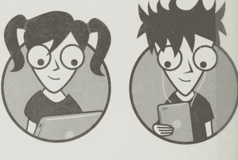

## 关于版权

什么是版权？它意味着某人创作了一个“东西”，只有那个人被允许使用那个“东西”，除非此人允许另一个提出请求的人使用它。

幸运的是，有些人和组织乐于分享自己的作品。允许被分享（或再分发）的照片通常依据 *知识共享零许可*（Creative Commons Zero）(https://creativecommons.org/) 授权。

一些计算机和网络软件根据名为“通用公共许可证”（简称 GPL）的许可证免费提供。这类软件被称为“开源”，意味着任何人都可以以自己想要的任何方式使用或修改源代码。

版权和知识产权法是严肃的问题，未经许可使用他人的作品会带来法律后果。我鼓励你在 Wikipedia (https://en.wikipedia.org/wiki/Copyright) 上阅读更多关于版权的内容。我还要求，如果你使用来自其他网站的照片、视频或文本，请在页脚或网站的专门页面上列出你的来源（请确保你被允许借用这些内容！）。如果你对版权有任何疑问，请让成年人帮助你了解更多。

## 关于你

每位初级网站管理员都需要从某个地方起步，但本书假定你有能力：

- 在电脑上打字、使用鼠标并遵循说明。
- 拥有电子邮件地址和 Google 账户。本书中的几个项目要求你注册一个（免费）账户以访问服务和工具。请先获得成年人的许可！
- 不怕失败。没有人是完美的，也没有任何人在成为网络专业人员之前没有先犯过许多错误。

最后，拼写和格式很重要。计算机非常强大，但它们实际上相当笨，而且对指令的书写方式非常挑剔。如果计算机无法理解一条命令，它就不会知道该做什么，什么也不会发生。你可能需要额外花一些时间处理拼写和格式错误。

## 关于图标

当你阅读本书中的项目时，你会看到几个图标。这些图标指出不同的内容：


*此图标指出可以让你的项目运行得更顺利的提示。*


*此图标提醒你注意需要记住的信息。*


*此图标标记重要信息，你可以利用这些信息避免编码时的常见陷阱。*

## 延伸阅读

一些编写代码的概念在另一本为你这样的孩子写的书中有所介绍：Camilla McCue 的《Getting Started with Coding》，以及 Chris Minnick 和 Eva Holland 的《Writing Computer Code》。

你将学到很多关于 Google Drive、编程语言和发挥创造力的知识。我建议你无论何时遇到困难，都可以从在线教程、YouTube 视频以及 www.w3schools.com 或 thewecan.zone/website-building 等网站寻求帮助。并且永远不要害怕向父母或朋友求助！最好的网站管理员是那些与他人交流的人。

# 项目 1：选择一个主题

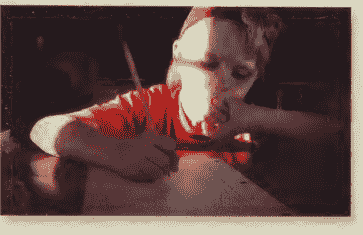

**为你的网站找到一个单一主题或想法来聚焦可能很困难。** 事实上，它可能是建立网站中最困难的一部分。灵感是个有趣的东西；它可能来自任何地方，也可能无处可来！有时想出一个主题可能需要几天或几周。

如果你不能很快选定某个主题，不要灰心。你不会想创建一个关于自己其实并不感兴趣的主题的网站，然后却觉得自己必须坚持做下去。为了帮助你避免这种情况，下面有一些技巧，可以让你把精力集中在一个主题上。

## 制作词云

拿起铅笔和记事本，开始写下你最喜欢做的事情。如果你非常喜欢宝可梦，就把它写下来。如果你喜欢研究恐龙，也把它写下来。

你是否参加空手道课、芭蕾舞或足球等课外活动，或者你会演奏乐器吗？对某个特定主题有经验，会提供坚实的基础，使创建有趣且吸引人的内容变得更容易。

## 如何使用 Google.com 搜索

按照以下步骤在 Google 上执行搜索：

- **1. 打开网页浏览器。**

网页浏览器是一种让你可以搜索互联网并访问网站的应用程序。常见的网页浏览器有 Microsoft Edge、Google Chrome、Mozilla Firefox 和 Safari。你在电脑上使用哪一种？

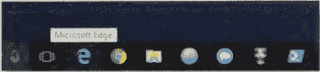

- **2. 在地址栏中输入** `https://google.com/` **，然后按 Enter 键。**

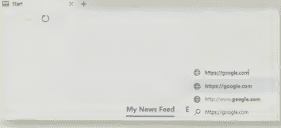

Google 首页中间附近会出现一个搜索框。

- **3. 在搜索框中输入搜索词。**

如果你想写一个关于恐龙的网站，可以在这个框中输入 **恐龙**。Google 会自动执行搜索并立即显示结果。

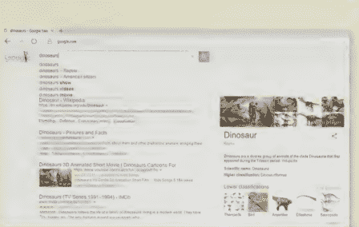

- **4. 单击蓝色链接以查看网站。**

> *当你在浏览其他网站寻找灵感时，请密切关注它们的布局、颜色、照片和内容。你可能会偶然发现一些想用在自己网站上的东西。想一想你可以如何类似地实现——但不要复制那个网站。*

## 如何使用 SimilarSites.com 搜索

另一个寻找主题的好资源是名为 Similar Sites 的网站服务。与 Google 很像，它是一个搜索引擎，帮助你找到包含类似信息的网站。

- **1. 打开网页浏览器。**

到目前为止，你应该知道如何打开网页浏览器并输入网址。如果你仍然需要成年人的帮助，别担心！这只需要一点练习。

- **2. 在地址栏中输入** `http://similarsites.com/` **，然后按 Enter 键。**

在首页中间，你会看到一个**大搜索框**。

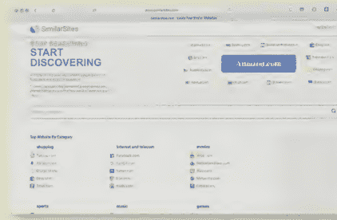

- **3. 在搜索框中输入主题或想法（例如恐龙），然后按 Enter 键。**

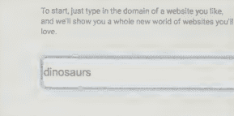

你会看到一个网站列表。单击结果以查看网站。

# 项目 1：选择一个主题

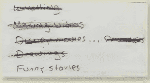

## 确定你想与谁交流

几乎与主题同样重要的是，确定你想触达的受众是谁。你想为家人创建一个网站吗？也许是同学或队友？如果你正在为同学写关于恐龙的内容，想一想你会如何当面给他们解释信息。

与朋友谈论你的主题确实可以帮助你缩小想法范围。它还可以帮助你构思一些内容！

如果你的主题只有你自己感兴趣，那可能不值得写。一个好的网站始终把读者放在心上。这通常意味着选择那些还没有被写得太多的主题，也许还要选择一个更时新的主题。

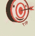

> 不要害怕向成年人寻求想法方面的帮助。很可能，与你亲近的成年人也曾不得不为学校或大学论文找一个主题。我相信你生活中的某位成年人会很乐意帮助你确定主题。

# 项目 2：创建站点地图

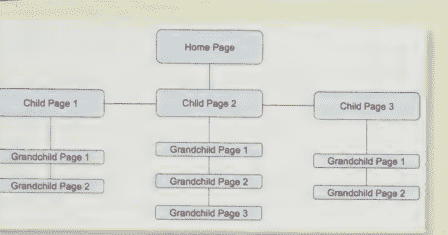

**究竟什么是站点地图？** 就像一张普通的老式地图能帮你找到路一样，站点地图能帮助 Google 等搜索引擎在你的网站中顺利浏览。站点地图也可以是一个用于显示网站页面列表的文档。在这个项目中，你将学习如何创建站点地图，这将帮助你思考希望如何组织内容。

## 决定如何布局内容

现在你有了一个主题，是时候专注于如何布局它了。网站都有主页，这是开始制作站点地图的好地方。例如，如果你正在创建一个关于恐龙的网站，以下是你可能会看到的一些页面和部分：

- 主页
  - 恐龙时间线
    - 侏罗纪区
    - 三叠纪区


- 恐龙类型
  - 肉食恐龙
  - 植食恐龙
  - 杂食恐龙
- 恐龙名称
  - 剑龙
  - 霸王龙

在开始制作实际页面之前，弄清楚你希望这些内容如何布局，会非常有帮助！

## 使用 GOOGLE DRAWINGS 创建站点地图

在引言中，我提到你需要有一个 Google 账户。如果你还没有账户，请找一位成年人帮助你登录 Google 并创建一个。（根据法律，你必须年满 13 岁才能创建任何在线账户。）

> **提示：** 如果你无法使用 Google Drawings，也请照样跟着做。你可以用铅笔和纸来应用相同的概念。

### 创建新的 GOOGLE DRAWINGS 文档

- 1. 打开网页浏览器。
- 2. 在地址栏中输入 https://docs.google.com/drawings/ 并按 Enter 键。

如果你已登录 Google，你应该会看到类似下图的屏幕。

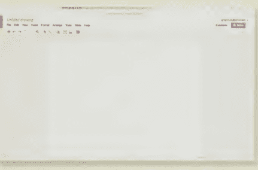

- 3. 在左上角，点击*无标题绘图*这几个字。

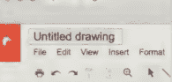

- 4. 输入**你的绘图名称**，然后按 Enter 键保存标题。

在本示例中，我将该绘图命名为“恐龙网站站点地图”。

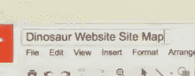

现在你可以开始选择如何布局内容气泡。为此，你需要用到你在项目 1 中想出的主题。

- 3. 工具栏下方（带有灰色和白色阴影方块的区域）称为画布。将鼠标光标放在**画布顶部中间附近**。按住鼠标按钮并向右移动，以**绘制一个形状**。

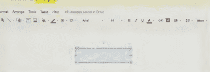

- 4. 再次双击该形状以激活文本工具。

- 5. 输入**首页**，然后在画布中任意位置单击以保存。

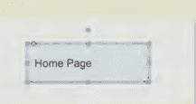


> 首页始终是父页面。其他页面称为子页面。子页面下方的任何其他页面称为孙页面。当你按此顺序组织页面时，你是在将它们放入一个层级结构（等级）中，最重要的页面位于顶部。

# 项目 2：创建站点地图

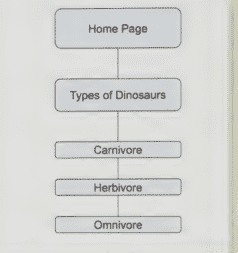

太棒了！现在你有了一个基本的站点地图，其中包含按父页面、子页面和孙页面（层级）顺序排列的页面。

继续对你想要为主题创建的每个页面重复步骤 1–6。完成后，你的站点地图可能类似于下图：

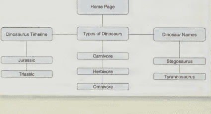

要有耐心！可能需要一点时间才能把所有事情都调整得恰到好处，但完成后，你就能清楚地知道内容应该如何展示。这个过程有助于你在完成本书其他项目时保持专注。

## 用铅笔和纸绘制站点地图

在纸上而不是在 Google Drawings 中绘制站点地图也完全可以！事实上，你可能会发现先在纸上画出来，然后再制作一份数字副本以便以后轻松参考会更容易。

- 1. 找一张白纸和一支铅笔。
- 2. 把纸横过来。
- 3. 在顶部写下你的网站名称。
  - *在本项目的示例中，名称是“恐龙网站站点地图”。*
- 4. 在顶部中间附近绘制一个矩形内容气泡形状。
- 5. 在内容气泡中间写上**首页**。
- 6. 在正下方再绘制一个内容气泡，留出刚好能画一条直线的空间。
- 7. 写下你第一个子页面的名称。
  - *在本项目的示例中，其中一个名称是“恐龙类型”。*
- 8. 从“首页”气泡到子页面气泡画一条线。

太棒了！你现在肯定明白该怎么做了！重复步骤 4–8，直到你为每个页面都绘制好内容气泡。

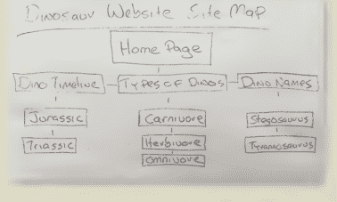

到现在，你应该已经完成了一个站点地图。

你稍后需要参考这个站点地图，所以一定要把它放在手边。你可以使用手绘副本、打印副本，或在浏览器标签页中保持打开的 Google Drawings 副本。现在你有了站点地图，就可以开始项目 3 了！太棒了！

# 项目 3：创建线框图

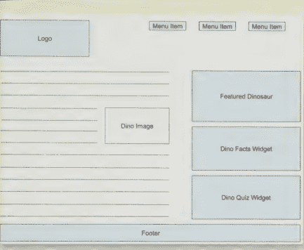

***你知道你完成后的网站一定会看起来很棒。*** *毕竟，有了所有令人兴奋的图形和视频，怎么会不棒呢？为了确保你的网站能达到你的期望，并为所有内容留出空间，你需要有一个计划。在本项目中，你将确定网站的初始布局。*

## 什么是线框图？

*线框图就像网站的蓝图。它可以帮助你确定在页面上把所有的内容、图形、视频和其他元素放在哪里。*

通常，线框图以两种格式呈现：

- **低保真：** 这些线框图只是粗略的草图或涂鸦。
- **高保真：** 这些线框图可以代表最终设计，更详细地展示每个部分。

通常，一个网站有页眉、主体、侧边栏和页脚。当然，网站的布局可以是网站创建者想要的任何样子，但大多数浏览网站的人已经习惯内容按照图中所示的方式布局。

创建线框图时，你可能想模仿这种布局。

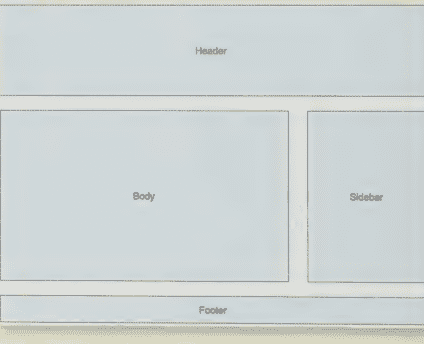

## 基础知识：开始前你需要知道的事

在开始创建网站之前，先画一张草图，描绘你希望网站看起来是什么样子。

你可以在纸上绘制线框图，也可以使用你最喜欢的绘图应用（例如 Google Drawings）来制作。

当然，这里展示的只是一个示例。你可以按自己喜欢的方式绘制线框图。尽情发挥你的创造力吧！

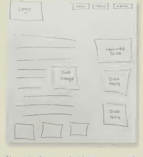

> *无论你决定如何创建低保真线框图，请记住，你是在用直线和基本图形来表示照片和视频。目标是想象你的网站布局可能是什么样子。*

现在，请专注于标志、菜单、主体内容和页脚将放在哪里。不要害怕划掉重来。在本项目中，你不需要担心颜色或字体！

## 创建低保真线框图

在项目 2 中，你学习了如何使用 Google Drawings 制作站点地图。在本项目中，你将使用同一工具创建你的第一个线框图。

如果你无法使用 Google Drawings，仍然可以跟着做。只需拿起铅笔和纸，在纸上完成每一步，而不是在电脑上。

> 线框图看起来不太像网站也没关系。目标只是把你的想法画出来，然后再加以改进！

在本项目中，你需要有项目 2 中的站点地图。在网页浏览器中打开站点地图，或将其打印出来。（如果你还没有创建站点地图，请回到项目 2 创建一个。）

## 放置标志

把站点地图放在手边，按照以下步骤创建低保真线框图：

- 1. 在网页浏览器中，访问 https://docs.google.com/drawings 并打开 Google Drawings。

- 2. 为标志绘制一个矩形。

你可以通过单击**形状工具**图标，选择**形状**，然后选择**矩形**来绘制矩形。

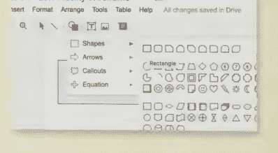

- 3. 将矩形放在**屏幕左上角**附近。

你可以把标志放在任何你喜欢的地方，但大多数网站会把标志放在左上角区域，这个区域称为页眉。

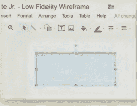

- 4. 双击标志矩形的中心。

文本工具会出现。

- 5. 输入 Logo。

- 6. 单击左侧**空白区域**以完成。

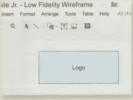


## 创建导航菜单

大多数网站也会把导航菜单放在线框图顶部附近。你可以把导航放在徽标旁边或下方。

要创建导航菜单：

- 1. **绘制一个较小的矩形**，并将其放在页眉中部附近。

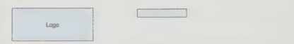

- 2. **将此菜单项复制几次，并将这些矩形并排放置。** 在菜单栏中，点击“编辑”，然后点击“复制”。

> *使用键盘快捷键和热键是使用计算机的人的一项基本技能。如果你对编程感兴趣，请尽可能尝试使用键盘快捷键！*

（在 Windows 中按 Ctrl+D，或在 Mac 上按 ⌘-D，即可快速复制此菜单项。）

- 3. 添加一些**占位文本**，例如“菜单项”。

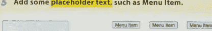

页眉区域这样就完成了。

## 创建页眉

设 $f(n)$ 与 $g(n)$ 是定义在正整数集合上的函数，$\mu(n)$ 为莫比乌斯函数。

莫比乌斯函数 $\mu(n)$ 定义为：当 $n$ 有平方因子时 $\mu(n)=0$；当 $n$ 是 $k$ 个不同素数的乘积时 $\mu(n)=(-1)^k$；特别地，$\mu(1)=1$。

> **定理（莫比乌斯反演公式）** 若 $g(n)=\sum_{d\mid n} f(d)$，则 $$f(n)=\sum_{d\mid n} \mu(d)\, g\left(\frac{n}{d}\right).$$

**证明：** 根据 $g$ 的定义并交换求和次序，
$$
\sum_{d\mid n}\mu(d)g\left(\frac{n}{d}\right)
=\sum_{d\mid n}\mu(d)\sum_{e\mid (n/d)} f(e)
=\sum_{e\mid n} f(e)\sum_{d\mid (n/e)}\mu(d).
$$
由于 $\sum_{d\mid m}\mu(d)=0$ 当 $m>1$，且等于 $1$ 当 $m=1$，故右边等于 $f(n)$。

推论：若 $f(n)=\sum_{n\mid m} g(m)$，则 $g(n)=\sum_{n\mid m}\mu\left(\frac{m}{n}\right)f(m)$。

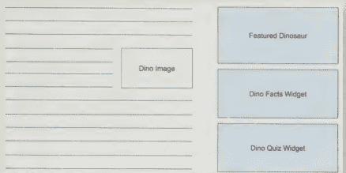

## 创建页脚

当所有小部件都放置到位后，你可以添加最后一部分——页脚：

- 1. 绘制一个长而宽的矩形，覆盖屏幕底部。
- 2. 在矩形中添加“页脚”一词。

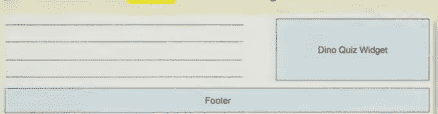

## 完成的线框图

太棒了！你已经组装好第一个线框图的所有部分。你应该得到了与本项目第一张图相符的结果。

# 项目 4：创建样式指南

例如，样式指南可以包含徽标，以及关于他人可以或不能如何使用该徽标的说明。它还可以包含可与此徽标搭配使用的颜色列表，也许还有字体列表。样式指南可帮助你的网站页面看起来彼此协调统一。

## 使用 Frontify 创建样式指南

你使用站点地图来规划网站的布局。同样，样式指南就像网站外观和感觉的路线图。在本项目中，你将使用一个名为 Frontify 的免费服务创建一个基本样式指南。要使用 Frontify，你需要设置一个账户。

**使用 FRONTIFY 创建账户**

- 1. 打开网络浏览器。
- 2. 在地址栏中输入 [https://frontify.com/](https://frontify.com/) 并按 Enter。
- 3. 在页面右上方附近，你应该会看到一个**按钮**，上面写着**注册。**

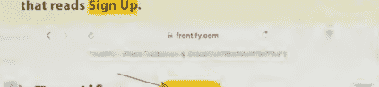

- 4. **点击“注册”按钮。**

你应该会在屏幕中间看到一个**注册表单**。

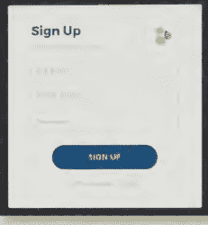

- 5. **在成年人允许下，输入你的姓名、电子邮件地址和密码。**

- 6. **点击“注册”按钮继续。**

做得很好！你已经创建了账户，并准备好创建你的第一个样式指南。


> *有时当你注册 Frontify 时，网站会要求你填写一份调查问卷。如果弹出调查问卷，请像这样**填写**：*

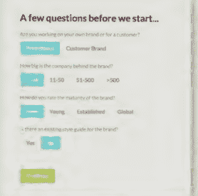

**使用 FRONTIFY 创建品牌**

在 Frontify 中创建账户后，下一步是创建样式指南。Frontify 用 *brand*（品牌）一词来指代样式指南。

- 1. 注册账户后，你应该会看到一个要求你创建品牌的小窗口。
- 2. 在**品牌或公司名称**字段中输入你的网站名称。

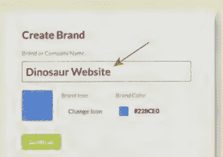

- 3. 将品牌图标保留为房子，品牌颜色保留为蓝色；之后可以更改。

在此示例中，我输入 Dinosaur Web site。

- 4. 点击“继续”。

会出现一个屏幕，询问你是要从头创建样式指南还是从模板创建。你也可以设置标题。

- 5. 选择“模板”。
- 6. 选择“基本样式指南”。


> **什么是模板？**
>
> 模板是一份空指南，可帮助你在创建样式指南时抢先一步。你会看到，当你选择从模板开始时，网站会引导你先添加徽标，然后添加基础颜色。如果你从空白样式指南开始，则可以按任意顺序添加任何内容。有时使用模板很有帮助，因为这样你就不必记住所有内容，而只需填写空白即可！

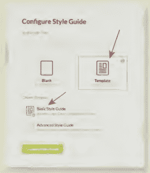

- 1. 在同一屏幕上，点击**创建样式指南**按钮。

Frontify 会带你进入品牌仪表板。

此时不用担心创建徽标。你不需要徽标，因为可以在网站页眉中使用文本。要跳过徽标，请点击屏幕底部的**基础颜色**。

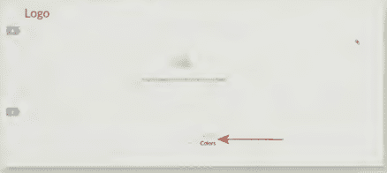

接下来，你将重点学习颜色和字体。

## 了解颜色代码

如你所知，世界各地的人们使用许多不同的语言互相交谈和书写。你可能也知道，计算机也使用语言，尽管它们与人类语言不同。要创建网站，你必须学习代码（计算机语言中的词语），特别是 Web 颜色代码。

**十六进制代码**

Web 颜色代码可以用很多不同的方式书写；最常见的方式是使用十六进制代码。十六进制代码可以是由三个或六个字符组成的字母和数字组合。以下是一些十六进制代码及其所代表颜色的示例：

| 十六进制代码 | 颜色 |
|---|---|
| `#ff0000` | 红色 |
| `#fff` | 白色 |
| `#000` | 黑色 |
| `#ffff00` | 黄色 |

使用十六进制代码，你可以创建超过 1600 万种颜色中的任意一种！很酷吧？

幸运的是，你不需要记住全部 1600 万个十六进制代码，因为有一个工具可以为你提供所需颜色的十六进制代码。这个工具叫做 ColorHexa。

**使用 COLORHEXA 发现颜色组合**

选择配色方案是创建网站中非常重要的一步。颜色组合会影响人们对你的网站的感受。使用 ColorHexa (http://www.colorhexa.com/) 这样的工具可以让构建配色方案的过程变得非常容易。

- 3. 点击出现的下拉列表中列出的第一种颜色。

ColorHexa 会带你进入一个页面，其中包含你的主色的所有不同代码。你的**主色**的**十六进制代码**会显示在屏幕最上方，位于 ColorHexa 一词下方。

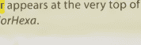

- 4. 将**十六进制代码**写在纸上，以便之后使用。记下你的**主色**是什么也是个好主意。

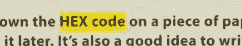

- 5. 向下滚动，你可以看到主色所有不同的表示方式。在**十六进制代码**中，黄色是 **ffff00**，但在**二进制代码**中，黄色表示为 **11111111, 11111111, 00000000**。十六进制代码使用起来容易得多，因为它短得多！

**ffff00 颜色转换**

十六进制颜色 #ffff00 的 RGB 值为 R: 255、G: 255、B: 0，CMYK 值为 C:0、M:0、Y:1、K:0。其十进制值为 16776960。

| 属性 | 值 | 属性 | 值 |
|---|---|---|---|
| 十六进制三元组 | #FFFF00 | CIE-LAB | 97.139, -21.556, 94.478 |
| RGB 十进制 | 255,255,0 | XYZ | 0.9505, 1, 0.1089 |
| RGB 百分比 | 100,100,0 | Yxy | 0.9703, 1, 0.1089 |
| CMY | 0,0,1 | CIE-LCH | 97.139, 96.798, 102.853 |
| CMYK | 0,0,100,0 | CIE-LUV | 97.139, 7.572, 106.??? |
| HSL | 60°,100,50 | Hunter-Lab | 96.???, -30.???, 96.??? |
| HSV（或 HSB） | 60°,100,100 | 二进制 | 11111111,11111111,00000000 |
| Web 安全色 | ffff00 |  |  |


- 6. 用鼠标继续向下滚动，直到看到**配色方案，带有**（后面跟着你主色的 HEX 代码）。

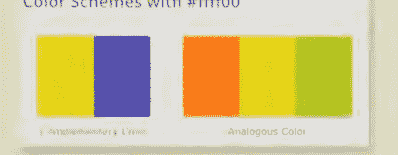

- 7. 将鼠标悬停在右侧的**互补色**上，直到出现一个 HEX 代码。这个互补色称为次色。

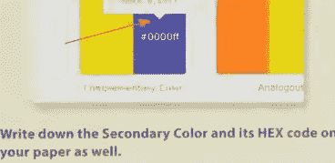

- 8. 也在纸上记下次色及其 HEX 代码。

- 9. 移动鼠标光标，悬停在主色左侧的第一个类似色上。该颜色称为第三色。

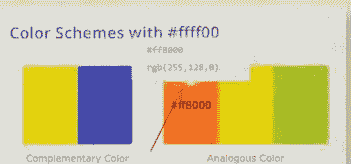

- 10. 在纸上记下第三色及其 HEX 代码。

太棒了！这是创建网站的重要一步。现在你可以把这些颜色放进样式指南了。

## 向 FRONTIFY 添加调色板

到目前为止，你已经为网站选好了三种颜色及其 HEX 代码。你准备好在 Frontify 中构建调色板了！调色板就是一个展示网站中将使用的每种颜色小样的地方。

- 1. 回到 Frontify，你应该会看到“颜色”页面。

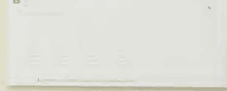

- 2. 如果你关闭了 Frontify 浏览器标签页，请打开浏览器，输入 [https://frontify.com/](https://frontify.com/)，然后按 Enter 键。

- 3. 点击右上角附近的**登录**按钮。

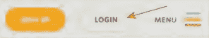

- 4. 你会看到 Frontify 品牌仪表板。点击你的**品牌磁贴**。

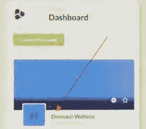

- 5. 在屏幕左侧，点击指向**颜色**的链接。

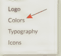

- 6. 在右上角，点击**编辑**，你将看到第 1 步中的页面。

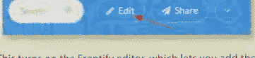

这会开启 Frontify 编辑器，让你添加在 ColorHexa 上选择的**颜色**，并完成样式指南的制作。

- 7. 用鼠标向下滚动，寻找名为**新建调色板**的灰色区域，其中有**四个灰色圆圈**。


- 8. 在四个灰色圆圈下方寻找**输入框**，就像本步骤中显示的那样。其中会有一些示例颜色 HEX 代码。你可以在这里输入从 ColorHexa 记下的颜色 HEX 代码。（如果输入框没有显示，请向上滚动并再次点击“编辑”按钮。）


- 9. 在输入框中输入主色的**颜色 HEX 代码**。

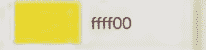

- 10. 按 Enter 键保存你的工作，你会看到主色填入输入框上方的灰色圆圈中。

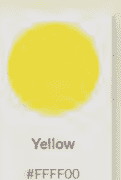

Google Fonts 是一个免费资源，允许用户选择并自由使用不同字体到他们的网站上。Google Fonts 甚至免去了字体搭配的繁琐工作。你可以轻松看到一种流行的字体组合，甚至看到标题与段落文本之间的对比。


> *Google Fonts 并不是查看免费字体的唯一选择。你还可以查看 Open Font Library（https://openfontlibrary.org/）或 FontSquirrel（https://fontsquirrel.com/）。*

在 Google Fonts 中查找字体的以下过程可能会花一点时间。不要害怕多浏览几种不同字体。

- 1. 打开浏览器，输入 https://fonts.google.com/，然后按 Enter。
- 2. 向下滚动。寻找一种吸引你的字体。
  - 这一步由你决定。你可以选择任何你喜欢的字体！我选择 Open Sans。
- 3. 找到你喜欢的字体后，点击屏幕上该字体区域左上角的字体名称。你会进入该字体的信息页面，在那里可以看到该字体的样张——也就是它的外观。

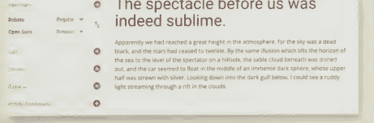

此图展示了两种字体：一种用于标题，一种用于段落。你可以尝试选择搭配得当的字体！在本书中，你只需专注于选择一种字体。

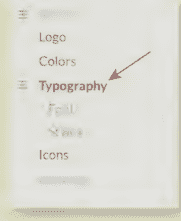

- 4. 点击“排版”，你应该会看到第 1 步中的屏幕。
- 5. 有一个带有不同标签页的搜索栏，其中已经选中的是 Google 标签页。在搜索栏中输入你的字体，并从出现的列表中选择你想要的样式。

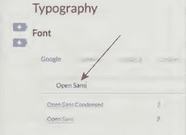

太棒了！你已成功将字体添加到 Frontify。如果向下滚动，你应该会看到字体以几种不同样式显示，如*斜体*和**粗体**。

正如你在上一节选择的颜色已经进入样式指南，现在字体也成为样式指南的一部分。在这个项目结束时，当你完成样式指南后，你将把它作为实际制作网站的指南！

## 从网络上查找并使用媒体

创建自己的媒体素材可能很有趣，但有时画一幅逼真的霸王龙图像，嗯，这并不合理。相反，你可以搜索并使用别人绘制或拍摄的图像。这是一种常见做法，称为使用图库摄影。

当你在网站上使用别人的图像时，必须遵循一些基本规则。第一条规则与版权有关（我在本书引言中提到过）。要在网站上使用并非由你创建的图像，你需要确保以下条件成立：该媒体素材以公有领域（CC0）许可授权。公有领域意味着该图像可免费供你使用，你不必请求许可，也不必说明媒体来源。这也称为知识共享许可协议。

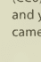

> 如果你不确定许可证及其含义（这可能会非常令人困惑），可以在 Creative Commons（https://creativecommons.org/share-your-work/licensing-types-examples/）了解更多。

我最喜欢的查找知识共享照片的网站是 VisualHunt（https://visualhunt.com）。VisualHunt 为你搜索数百张图库照片，让你轻松找到合适的照片。

## 使用 VISUALHUNT 查找免费图库照片

要完成样式指南，你需要找几张图像并将它们放入 Frontify。

- 1. 打开浏览器，输入 **visualhunt.com**，然后按 Enter 键。
- 2. 将光标放在**搜索框**中，输入你要查找的内容。


VisualHunt 应返回几张**图像**。


# 项目 4：创建样式指南

- 3. 在图像上方会出现“许可证类型”筛选器。将鼠标光标移到**公有领域**上并点击。


注意 VisualHunt 现在只显示公有领域图像。这些图像可以以任何方式免费使用。

- 4. 点击你想添加到网站的图像。
- 5. 将鼠标光标移到网页右侧。点击**免费下载**。


- 6. 选择**大尺寸选项**（通常显示为 L，代表大）。


- 7. 当你点击大的**下载按钮**时，文件会自动保存到你的电脑。

## 向 FRONTIFY 添加照片

上一节向你展示了如何将网站所需的照片下载到电脑。本节中，你将把它们添加到 Frontify。将它们放入 Frontify 是创建样式指南的最后一步！请按照以下步骤操作：

- 1. 如果你还没有打开 Frontify，请在浏览器中输入 [https://frontify.com/](https://frontify.com/)，然后按 Enter 键。
- 2. 点击右上角的**登录**按钮。然后点击品牌磁贴，再点击右上角附近的**编辑**按钮。


- 3. 将鼠标光标移到屏幕左侧，点击“摄影”。


- 4. 将鼠标光标移到屏幕中间。点击图片图标，打开上传对话框。


- 5. 在计算机上找到你的图片，通常位于“下载”文件夹中（除非你决定将其放在其他文件夹）。双击图片文件名，将其上传到 Frontify。

## 摄影


- 6. 向下滚动，将鼠标光标悬停在**图片**图标上，上传另一张照片。重复步骤 4 和 5，直到上传完所有图片。


完成后，你的样式指南的这一页应类似于下图。


现在你有了自己的样式指南！在下一个项目中，你将学习如何将站点地图、线框图和样式指南整合在一起，结合一点编码，制作出属于自己的网站。

# 项目 5：让设计活起来


**现在你已经有了自己网站的完整设计。** 你想出了一个主题，制作了站点地图来规划要创建的页面，为页面设计了线框图，甚至还创建了样式指南来帮助确定网站的外观和感觉。现在是时候加入一些计算机代码，真正制作你的网站了！

在这个项目中，你将学习 HTML——一种能让你制作可用网站的计算机编码语言。你将制作所有页面，甚至还能添加图片！在下一个项目中，你将有机会为网站添加更多色彩和交互功能。

## 设置编码环境

在项目 2 中，你使用 Google Drawings 制作了站点地图。现在，你将使用 Google Drive 及与之关联的一些应用来构建和分享你的网站。


> 开始之前，你应该征得成年人的许可。（根据法律规定，你必须年满 13 周岁才能创建任何在线账户。）

## 创建 Google 文件夹

首先，你需创建一个 Google 文件夹。

- 1. 打开网页浏览器。本书中的截图使用的是 Chrome 浏览器。

- 2. 在地址栏中输入 http://drive.google.com，然后按 Enter 键。如果你已登录 Google，你应该会看到类似下图的内容。


- 3. 点击**新建**和**新建文件夹**，创建一个新文件夹。


- 4. 你可以随意命名文件夹。在下图中，文件夹名为**MyDinoSite**。


- 5. 双击**新建文件夹**将其打开。

这里将存放你网站的所有编码文件和图片文件。


## 向 Google Drive 添加编码应用

现在你有了 Google 文件夹，可以添加几个应用，方便你编写网站代码。

- 1. 点击**新建**，然后点击**更多**，再点击**连接更多应用**。


- 2. 弹出一个窗口。在搜索栏中输入**HTML**。


- 3. 按 Enter 键，你会看到一个名为 HTML Editey 的应用。点击**连接**按钮。


- 4. 系统会弹出一个窗口，询问你是否要将 **HTML Editey** 设为它能打开的文件的默认应用。这意味着每次你尝试打开名称中包含 .html 的文件时，它都会使用 HTML Editey 来打开。点击该复选框，然后点击 **OK**。


- 5. 在步骤 3 的弹出窗口中向下滚动，找到第二个名为 HTML Viewer 的应用。点击**连接**按钮。


- 6. 与步骤 4 一样，系统会弹出一个窗口，询问是否要将 HTML Viewer 设为它能打开的文件的默认应用。这次点击复选框，取消勾选，然后点击 **OK**。

- 7. 关闭弹出窗口，点击**新建**，然后点击**更多**。现在你应该能看到 HTML Editey 了。点击 **HTML Editey**。


- 8. Google 可能会要求你选择一个账户来使用此应用。如果出现该提示，请选择你一直在使用的账户。


- 11. Google 会再次要求你授予 Editey 相关权限。征得成年人许可后，点击**允许**。


- 12. 弹出一个窗口，显示 Editey 的介绍。阅读完毕后，点击**下一步**。


- 13. 弹出窗口的下一页是协议。请确保有成年人在场，一起阅读该协议。

- 14. 滚动到弹出窗口底部，勾选两个“同意”复选框，然后点击 **完成**。


- 15. 在屏幕左上角，点击显示为 Untitled.html 的位置。


- 16. 将名称改为 index.html，如需添加描述也可以。然后点击 **重命名**。


恭喜！你现在可以开始编写网站代码了。


## 编写首页代码

哇，你已经设计了一个网站并设置好了编码环境。距离成为真正的网站开发者只有几步之遥了！本节将教你一些 HTML 知识，这是一种用于制作网站的编码语言。

> *如果你想学习本书之外的更多 HTML 知识，可以查看 HTML：www.w3schools.com。在这里，你可以找到各种 HTML 教程，甚至还能测试你的代码。*

### HTML 结构

HTML 是一种被称为标记语言的编码语言。之所以称为标记语言，是因为它用于勾勒你正在为网站制作的页面。在编写网站代码时，你的代码总是具有相同的基本结构。


编码语言不仅有特定的结构，每种语言还有不同的语法。你已经对语法有所了解，因为在英语中，句末要加句号，问句末尾要加问号。句号和问号就是英语语法的一部分。

在 HTML 中，语法中有很多大于号和小于号。但其中是有规律的！HTML 文件的每个部分都由该部分的名称包裹，格式为 `<SectionName>` `</SectionName>`。我们把第一部分称为开始标签，第二部分称为结束标签。注意，结束标签在小于号后面有一个 `/`。

- 1. 再次打开你的浏览器。你应该仍在 HTML Editey 中打开着 index.html。如果没有打开，请访问 [http://drive.google.com](http://drive.google.com)，双击你的项目文件夹（如 MyDinoSite），然后右键单击 index.html，选择“打开方式”中的 HTML Editey。

- 2. 添加 HTML 部分的**开始标签**，你会注意到结束标签会自动添加。


- 3. 回顾本节开头提到的 HTML 结构，确保你在此处添加的标签（如图所示）位于 **HTML 标签内部**。


太棒了！你现在可以开始向 HTML 页面添加内容了！本项目将带你制作恐龙示例网站，但你在本书中看到的所有内容，同样可以应用到你自己的网站中！

### 向网站添加文本

现在网站结构已经就绪，你可以开始添加要显示的文本了。点击头部结束标签和底部开始标签之间，输入**Hello World!**。


注意，屏幕右侧出现了“Hello World!”这几个字。这是因为屏幕右侧是你网站的预览效果。

在本节中，你将使用项目 3 的最终线框图，并编写所有文本的代码。


现在，你只会使用占位文本。这意味着你还不会写实际文本；你只是要确保自己知道每个部分将放在哪里。

```html
1  <html>
2  <body>
3  <p>
4  Logo
5  <p>
6  Menu Item
7  <p>
8  Featured Dinosaur
9  <p>
10 Text about my Dinosaur right here
11 <p>
12 Footer Down Here
13 </html>

Logo and Menu up here
Text about my Dinosaur right here
Footer Down Here
```

## 为你的网站添加更多结构

为你的网站添加文本很好，但你可能还想为网站添加一些结构。例如，在项目 3 的线框图示例中，有一个侧边栏。


要添加网站的不同部分（例如侧边栏），你必须在 body 标签内创建称为“div”的新区域。第一个 div 将位于左侧并占据屏幕的大部分，第二个 div 将位于右侧并只占据屏幕的一小部分。要创建新的 div，你使用开始和结束 div 标签：`<div> </div>`。即使你不希望这些 div 彼此相邻，你也可能希望拥有不同颜色或内容的不同 div。

查看你在项目 3 中制作的线框图，并**把文本**（或占位文本）放到正确的位置。例如，在本书的网站中，关于恐龙的文本位于网站左侧。本例中创建的第一个 div 将是左侧的那个，所以恐龙文本位于第一个 div 中。

```html
<html>

<head>
<title>
Chicken
</title>
<body>
<h1>Chicken and Hen: up here</h1>
<h2>Chicken and Hen: up here</h2>
<h3>Chicken and Hen: up here</h3>
<hr>
<p>Text about my Dinosaur right here.</p>
<hr>
<p>Text about my Dinosaur right here.</p>
<ul>
<li>Eggs</li>
<li>Milk</li>
<li>Bread</li>
</ul>

</body>
</html>
```

## 为你的网站添加样式属性

接下来，你将为 div 区域添加属性以更改它们的颜色，使它们更容易被看到。在网站中，属性可以是许多不同的东西。它们可以是颜色、大小，甚至字体样式！

仔细查看代码，并添加以下内容（见下一幅图）。


> 你必须完全按照书中的样子输入代码中的所有内容。如果你把不该大写的字母大写了，或者在本不该有空格的地方添加了空格，你的网站就无法正常工作。这是因为计算机虽然很强大，但并没有那么聪明！所以它们不知道名字 Sarah 和 sarah 是相同的。对计算机来说，这两个名字是不同的，因为一个含有大写 S，另一个含有小写 s。

网站的 head 部分是放置样式代码的地方。这部分你也许想参考项目 4 的样式指南。本书示例使用橙色、蓝色和黄色作为颜色，并使用无衬线字体作为字体，所以这里展示的就是这些。

- 1. 在 head 标签之间，添加一个开始和结束 style 标签。

```html
<html>
<head>
  <style>
  </style>
</head>
<body>
  <header>Logo and Menu up here</header>
  <p>Text about my Dinosaurs right here.</p>
  <footer>Footer Down Here</footer>
</body>
</html>
```

- 2. 在 style 标签之间，添加一个名为 body 的部分。这个部分不使用小于号和大于号标签，而是使用开始和结束花括号。body 部分内的所有内容都会更改下面代码中 body 部分的内容。

```html
<html>
<head>
  <style>
    body {
    }
  </style>
</head>
<body>
  <header>Logo and Menu up here</header>
  <p>Text about my Dinosaurs right here.</p>
  <footer>Footer Down Here</footer>
</body>
</html>
```

- 3. 完全按照所写内容添加以下行。输入完成后，你的字体会发生变化！

```css
body {
  font-family: "Open Sans", sans-serif;
}
```

- 4. **添加以下行**，完全按照所写内容。输入完成后，你的网站应该会变成橙色！

```html
<!doctype html>
<html>
 <head>
  <title>
   First Test Page
  </title>
  <meta charset="utf-8">
  <style>
   body {
    background-color: orange;
   }
   h1 {
    color: green;
   }
   p {
    font-family: Arial;
    font-size: 20px;
   }
  </style>
 </head>
 <body>
  <h1>
   Welcome to My Web Page
  </h1>
  <p>
   This is my first web page.
  </p>
 </body>
</html>
```

- 5. 将你的样式更改为你选择的颜色和字体，然后看着你的网站开始焕发生机。

- 6. 太棒了！你已经取得了这么好的进展。接下来，确保你理解其他部分所在的位置。将 header 和 footer 改为样式指南中的**次要颜色**。在本书中，次要颜色是蓝色。

```html
<!doctype html>
<html>
 <head>
  <title>
   First Test Page
  </title>
  <meta charset="utf-8">
  <style>
   body {
    background-color: orange;
   }
   header {
    background-color: blue;
   }
   h1 {
    color: green;
   }
   p {
    font-family: Arial;
    font-size: 20px;
   }
  </style>
 </head>
 <body>
  <header>
   Welcome to My Web Page
  </header>
  <p>
   This is my first web page.
  </p>
 </body>
</html>
```

- 7. 接下来，你将把 div 区域改为**第三级颜色**。在本书中，第三级颜色是黄色。

在本书中，这两个 div 本应并排显示。但你的 div 不必如此；它们也可以一个在另一个上面。例如，本书将 div 的类命名为“left”和“right”，但你可以将自己的命名为“top”和“bottom”。

你可能会注意到，左侧 div 的背景颜色为 #ffffff（即白色），它会显示出来，而右侧 div 的背景颜色为 #000000（即黑色），却不会显示。这是因为右侧 div 中没有任何内容！

- 9. 在右侧 div（或你尚未填写的 div）中添加一些文本，第二个 div 就会显示出来；在本例中，就是那个黑色 div。


- 10. 小心！有时你的文本颜色和背景颜色相同，这会让那里看起来什么都没有！在本书中，问题是你无法看到文本，因为文本和背景都是黑色的。但别担心！文本颜色也有一个样式属性。

继续添加 div、字体和颜色，直到你的网站看起来像你在项目 3 中制作的线框图。

哇！你的网站开始成形了。尽管它现在可能看起来有点傻，但你实际上已经搭建好了结构，并且已经设置了一些颜色！

## 为你的网站添加图片

现在你已经把所有内容都放好了，可以开始往网站里添加几张图片了。

- 1. 访问 http://drive.google.com 并双击**你的项目文件夹**。本书中的项目文件夹名为 MyDinoSite。
- 2. 单击**新建**和**文件上传**，以便将第一张图片上传到你的 Google Drive 文件夹。


- 6. 右键单击图片，然后单击**共享**。


- 7. 单击**高级**。


- 8. 单击**更改**。


- 9. 选择**开启 - 在网络上公开**，然后单击**保存**。


- **10 单击“完成”。**


- **11 双击你的图片，它应该会在屏幕上以较大尺寸打开。**


- 12 单击右上角的三个点，然后单击**在新窗口中打开**。


- 13 再次单击三个点，然后单击**嵌入项目**。


更令人兴奋的是，你已经有了一个主页！在下一个项目中，你将让主页完全按照你想要的样子呈现。但在那之前，你需要创建其他页面。

## 向你的网站添加更多页面

既然你已经有了一个基本主页，你可以添加在项目2的站点地图中规划的其他页面。本书中的站点地图示例有三个新页面：恐龙类型、恐龙名称和恐龙时间线。

- **1.** **回到** [http://drive.google.com](http://drive.google.com) **并双击你的项目文件夹。**
- **2.** **右键单击 index.html，然后单击** **创建副本。**


- **5.** 重复此操作，直到创建出你需要的所有页面。此示例还需要两个页面：names.html 和 timeline.html。


- **6.** 单击 index.html 上方和左侧，然后拖动鼠标选中所有 HTML 文件和图片，以高亮显示它们。


- **7.** 右键单击 `index.html`，然后单击 **共享**。


- **8.** 就像处理第一张图片时那样，单击 **高级**。然后单击 **更改**，并将其改为 **在网络上公开**。


- **9.** 当你单击 **保存** 时，你应该会看到四个文件都是公开的。单击 **完成**。


- **10.** 右键单击你的某个新页面，例如 types.html，然后单击“打开方式”，再单击“HTML 查看器”。


# 项目 5：让设计活起来

- **11.** 你应该会看到与主页（index.html）相同的内容，因为你还没有更改新页面的外观——你只是复制了主页。目前这样没问题。


- **12.** 在地址栏中，单击并高亮显示 URL，然后在 Windows 上按 Ctrl+C，或在 Mac 上按 ⌘-C 来复制它。
- **13.** 回到你的 index.html 文件。如果你关闭了它，可以右键单击 index.html，然后单击“打开方式”，再单击“HTML 编辑器”来重新打开它。
- **14.** 找到你的页眉，并输入链接的 HTML 代码：`<a href=YOUR_URL_HERE> </a>`。（不要输入句号。）

```html
31-  <header>
32-    <iframe src="https://drive.google.com/file/d/0B87t6P68R_Xt2d5Dv-fZGZ0pWT0lk/
      preview" width="280" height="140"></iframe>
33-    <a href="YOUR_URL_HERE">Types of Dinosaurs</a>
34-  </header>
```

- **15.** 用你在步骤12中复制的 URL 替换 YOUR_URL_HERE。在 Windows 上按 Ctrl+V，或在 Mac 上按 ⌘-V 来完成此操作。

```html
31-  <header>
32-    <iframe src="https://drive.google.com/file/d/0B87t6P68R_Xt2d5Dv-fZGZ0pWT0lk/
      preview" width="280" height="140"></iframe>
33-    <a href="https://drive.google.com/viewerng/viewer?url=https://api.stripe.com/v1/
      checkout/sessions?cs_live_b1GK7g9yzALsnR8796211dAnG2
      %2Buz1er1oQZ %2t2211463355j79D9B3g8f21aDBc2N0">Types of Dinosaurs</a>
34-  </header>
```

这就是你链接所有页面的方式。你应该从主页链接到你的所有页面，就像你为添加的第一个新页面创建链接一样。

- **16.** 将 **页眉背景颜色** 改为橙色，以便你能看到链接。

```css
header {
    background-color: #ff8000;
}
```


- **17.** 在你的另外三个页面中分别添加一个返回主页的链接。操作方式与你为每个页面添加链接时相同。

> **警告**
>
> *请确保也把这些页面的页眉颜色改为橙色！否则很难看清链接。*

你可以访问 [https://thewecanzone/website-building](https://thewecanzone/website-building) 并单击 MyDinoSite 项目5，查看可运行版本。

> **警告**
>
> *有时当你从新的浏览器窗口打开你的网站时，它会要求你再次授权。只需单击 **授权** 即可。*


选择你的账户，然后单击“允许”。


恭喜！你现在有了一个可运行并能跳转到其他页面的网站！在下一个项目中，你将学习如何让这个网站与你的线框图和样式指南相匹配。

# 项目 6：让你的网站看起来更棒


如果你一直按照本书中的每个项目进行操作，你已经拥有一个可运行的网站，随时可以与全世界分享。但还有一些部分仍然缺失。你制作了站点地图、线框图、样式指南和一个基本网站。

## 将你的 Google Drive 文件夹设为公开

因为你将向 Google Drive 文件夹添加新文件，所以最好将整个文件夹设为公开，以便分享整个网站。

> 将这个文件夹设为公开后，世界上的每个人都能看到其中的内容。非常重要的一点是，不要在这个文件夹中放入任何个人信息。确保把你计划放到互联网上的所有内容都展示给一位成年人看，并征得许可后再这样做。

- **1.** 前往 [http://drive.google.com](http://drive.google.com) 并登录你的 Google 账户。
- **2.** 右键单击你的项目文件夹，然后单击 **共享**。


- **3.** 单击 **高级**，然后单击 **更改**。选择 **在网络上公开**，并单击 **保存**。现在你的整个文件夹应该都是 **公开** 的。


现在，每当你向此文件夹添加新文件时，**Google 都会提示** 你该文件将变为公开。只需单击 **确定**。


## 将 CSS Editey 应用添加到 Google Drive

正如你在上一个项目中可能已经注意到的，必须把为主页编写的代码复制粘贴到其他每个页面中，这确实很令人沮丧。因此，与其这样做，你将把所有样式代码移到一个新文件中。然后，你将从 HTML 代码中引用该文件。下一节将对此做进一步说明。

现在，先将 CSS Editey 应用添加到 Google Drive。

- **1.** 前往 [http://drive.google.com](http://drive.google.com)，如果你尚未登录，请登录你的 Google 账户。
- **2.** 双击你的项目文件夹以打开它。
- **3.** 单击“新建”，再单击“更多”，然后单击“关联更多应用”。


- **4.** 搜索“CSS”并按 Enter。单击 CSS Editey 旁边的“连接”。


- **5.** 当 Google 询问是否应使用 CSS Editey 打开 CSS 文件时，单击 **确定**。


现在你的编码环境已经准备好了！

## 创建用于样式的 CSS 文件

在本节中，你将把所有样式代码从 HTML 文件移到一个 CSS 文件中。CSS 是另一种编程语言，代表层叠样式表。你甚至已经在不知不觉中编写了 CSS 代码！HTML 文件 head 部分中 **style 标签** 之间的所有代码就是 CSS 代码。

```html
<!doctype html>
<html>
<head>
  <title>
    <style>
      body {
        font-family: 'Open Sans', sans-serif;
        background-color: #f0f0f0;
      }
      header {
        background-color: #ff0000;
      }
      footer {
        background-color: #0000ff;
      }
      div {
        background-color: #ff0000;
      }
      .left {
        width: 75%;
        float: left;
        background-color: #ffffff;
      }
      .right {
        width: 25%;
        float: left;
        background-color: #000000;
        color: #ffffff;
      }
    </style>
```

## 创建 CSS 文件

首先，你需要一个文件来容纳所有要移入的 CSS 代码。

- **1.** 前往 http://drive.google.com，并双击你的项目文件夹以打开它。
- **2.** 单击“新建”，再单击“更多”，然后单击“CSS 编辑器”。


- **3.** Google 可能会提示你，你的文件将具有与文件夹相同的权限。这意味着你的新文件将变为公开，这很好。单击 **确定**。
- **4.** 单击新文件左上角的 Untitled.css。


- 3. **高亮样式标签之间的代码**，如果你使用的是 Windows，请按 Ctrl+C；如果你使用的是 Mac，请按 ⌘-C，即可复制代码。

```css
body {
  font-family: "Open Sans", sans-serif;
  background-color: #F88008;
}
header {
  background-color: #FFB000;
}
footer {
  background-color: #0000FF;
}
div {
  background-color: #FFFFFF;
}
.left {
  width: 75%;
  float: left;
  background-color: #FFFFFF;
}
.right {
  width: 25%;
  float: left;
  background-color: #000000;
  color: #FFFFFF;
}
```

- 4. 打开你的 style.css 文件，并点击进入文件编辑器。如果你使用的是 Windows，请按 Ctrl+V；如果你使用的是 Mac，请按 ⌘-V，即可粘贴你的样式代码。

```css
body {
  font-family: "Open Sans", sans-serif;
  background-color: #F88008;
}
header {
  background-color: #FFB000;
}
footer {
  background-color: #0000FF;
}
div {
  background-color: #FFFFFF;
}
.left {
  width: 75%;
  float: left;
  background-color: #FFFFFF;
}
.right {
  width: 25%;
  float: left;
  background-color: #000000;
  color: #FFFFFF;
}
```


文件中代码的书写方式非常重要，因为它能帮助你理解哪段代码在什么位置。HTML 和 CSS Editey 让这件事变得十分简单！只需点击“格式化源代码”按钮，代码就会自动调整位置，使其更容易阅读！

```css
body {
    font-family: Ubuntu, Sans, sans-serif;
    background-color: #f0f0f0;
}
header {
    background-color: #ff0000;
}
footer {
    background-color: #0000ff;
}
div {
    background-color: #ffffff;
}
.left {
    width: 75%;
    float: left;
    background-color: #ffffff;
}
.right {
    width: 25%;
    float: right;
    background-color: #000000;
    color: #ffffff;
}
```

## 将你的 CSS 文件链接到你的 HTML 文件

现在你的样式代码已经放在单独的文件中了，你需要告诉你的 HTML 文件在哪里可以找到这些样式代码。


> 这可能会有点奇怪。你必须把 URL 弄准确才能正常工作，所以慢慢来，如果需要的话可以请大人帮忙。

- 1. 打开你的 index.html 文件，并在两个 `<head>` `</head>` 标签之间编写代码，将你的 CSS 文件链接进去。

```html
<link rel="stylesheet" type="text/css" href="http://editey.com/preview/ID_NUMBER/style.css">
```

```html
<!DOCTYPE html>
<html>
<head>
<link rel="stylesheet" type="text/css" href="http://editey.com/preview/ID_NUMBER/style.css">
</head>
```

你输入的所有内容都必须与上面这段代码完全一致。不要添加任何空格，也不要删掉任何空格，并确保所有字母的大小写都一致。这段代码本应是一整行的，但如你在图中看到的，根据窗口的宽度，代码行可能会被拆分。这没关系！只要确保输入时千万不要按回车键——你要一口气全部输入。


- 2. 你需要将 ID_NUMBER 替换为你的 style.css 文件的实际 ID 号码。打开你的 style.css 文件，并查看地址栏中的 URL。格式是 css.editey.com/file/ID_NUMBER/FILE_NUMBER。

```css
body {
    font-family: 'Open Sans', sans-serif;
}
```

- 3. 高亮 ID_NUMBER，如果你使用的是 Windows，请按 Ctrl+C；如果你使用的是 Mac，请按 ⌘-C 来复制它。

```css
body {
    font-family: 'Open Sans', sans-serif;
    background-color: #F8F8F8;
}
h1 {
```

# 项目 6：让你的网站看起来更棒

- 4. 打开你的 `index.html` 文件，并**高亮步骤 1 中的 ID_NUMBER**。


- 5. 如果你使用的是 Windows，请按 Ctrl+V；如果你使用的是 Mac，请按 ⌘-V，**粘贴 ID 号码**到 URL 中。


- 6. 复制整个 `<link` 代码行，然后**将其粘贴**到你在上一个项目中创建的其他三个 HTML 文件中。


要打开每个 HTML 文件，请前往 http://drive.google.com，打开你的项目文件夹，右键单击要打开的文件，然后选择 HTML Editey。


你应该删除所有 HTML 文件中的样式标签。现在你只需要链接标签。

## 测试你的更改

哇！你刚刚做了很多可能会破坏网站的更改。在继续之前，你应该测试一下，确保一切仍然正常工作。

- 1. 前往 http://drive.google.com 并打开你的项目文件夹。

- 2. 右键单击 **index.html**，选择**打开方式**，然后点击 **HTML Viewer**。


- 3. 如果你的样式没有显示出来，请点击**刷新**按钮。


完成所有这些操作后，你的网站应该看起来和项目 5 结束时一样。现在你已经准备好进行修改，让它看起来更漂亮，而且进行这些修改会容易得多！


> *测试你的网站时，请务必点击网站上的所有按钮，确保它们仍然有效。有些东西看起来正常并不意味着它运行正常！*

## 美化你的网站

现在你有了 style.css 文件，就可以快速更新网站的样式了！在添加更多内容之前，你应该先调整样式。

## 决定在哪里放置背景颜色

你可以自己决定在哪里放置不同的颜色，但帮助你做决定的一个方法是查找其他使用类似颜色的网站。

> *在网上查找任何内容之前，你都应该先征得大人的同意。*

如果你按照本书中的示例使用橙色和蓝色，你可以将 header 和 footer 改为橙色，将 left 和 right 类改为蓝色，并将 body 改为白色。背景颜色属性（即背景颜色的名称）是 background-color。

```css
body {
    font-family: 'Open Sans', sans-serif;
    background-color: #ffffff;
}

header {
    background-color: #ff8800;
}

footer {
    background-color: #ff8800;
}

div {
    background-color: #ffffff;
}

.left {
    width: 75%;
    float: left;
    background-color: #0000ff;
}

.right {
    width: 25%;
    float: left;
    background-color: #0000ff;
    color: #ffffff;
}
```

## 更改字体颜色

现在背景颜色已经设置成你想要的样子了，接下来更改文本，使其易于阅读。

- 1. 你可能需要尝试不同的颜色。以橙色和蓝色为例，body 中的文本使用白色效果最好。字体颜色属性（即文本颜色的名称）是 color。

```css
body {
    font-family: 'Open Sans', sans-serif;
    background-color: #ffffff;
    color: #ffffff;
}
```

- 2. 对于橙色背景或其他类似橙色的颜色，白色文本看起来不那么好。如果白色文本在你使用的某种颜色上效果不佳，就把文本改成另一种颜色。例如，在橙色背景上，你应该把 footer 中文本的颜色改成黑色（`color: #000000`）。


## 设置页面格式

你可以做几件简单的事情，让你的网站看起来更好！按照以下步骤来设置你的页面格式。

- 1. 将 footer 的文本居中。要将文本向左、向右或居中移动，你可以使用 `text-align` 属性。这对于任何网站来说都是一个好主意。

```css
footer {
    background-color: #ff8000;
    color: #000000;
    text-align: center;
}
```


### 

### 

### 

阈值化分割作为最经典的图像分割方法，其基本思想是确定一个阈值，然后根据该阈值将图像中的每个像素划分为目标或背景。阈值化分割方法计算简单、效率高，在图像分割领域占有重要地位。

### 

阈值化分割的基本原理是依据一定的准则，将图像的灰度值划分为不同的集合。对于一幅灰度图像 f(x, y)，若选择一个阈值 T，则分割后的图像 g(x, y) 可表示为：

```text
g(x, y) = 1,  f(x, y) > T
           = 0,  f(x, y) ≤ T
```

其中，f(x, y) 为输入图像，g(x, y) 为输出二值图像，T 为阈值。阈值 T 的选择是阈值化分割的关键，通常可以表示为：

```text
T = T[x, y, p(x, y), f(x, y)]
```


- 5. 在 style.css 中，为你创建的任何新类（例如 content 类）添加新的样式定义。


- 6. 确保你的网站始终覆盖整个屏幕、页脚始终位于底部的一个技巧是：为页眉、页脚和主区域（本例中为 content div）设置垂直高度。在本例中，content 样式定义的高度为 80%，页眉高度为 15%，页脚高度为 5%。这样无论屏幕尺寸如何，页眉、页脚和内容区域都将始终适配屏幕。

# 项目 6：让你的网站看起来更棒

```css
body {
    font-family: 'Open Sans', sans-serif;
    background-color: #ffffff;
    color: #ffffff;
}
header {
    background-color: #ff0000;
    height: 15%;
}
footer {
    background-color: #ff0000;
    color: #000000;
    text-align: center;
    height: 5%;
}
.left {
    width: 75%;
    float: left;
    background-color: #0000ff;
}
.right {
    width: 22%;
    float: left;
    background-color: #0000ff;
    color: #ffffff;
    margin-left: 10px;
}
.content {
    height: 60%;
}
```

- 7. 修复垂直尺寸后，试着调整窗口大小，观察页脚移动。


**如果你使用的是 Windows，高亮选中所有代码并按 Ctrl+C；如果你使用的是 Mac，按 ⌘+C 进行复制。**

## CSS

```css
.button {
  border: 1px solid #d6d6d6;
  background: #ffffff;
  background: -webkit-gradient(linear, left top, left bottom, from(#f7f7f7), to(#e6e6e6));
  background: -webkit-linear-gradient(top, #f7f7f7, #e6e6e6);
  background: -moz-linear-gradient(top, #f7f7f7, #e6e6e6);
  background: -ms-linear-gradient(top, #f7f7f7, #e6e6e6);
  background: -o-linear-gradient(top, #f7f7f7, #e6e6e6);
  padding: 6px 13px;
  -webkit-border-radius: 4px;
  -moz-border-radius: 4px;
  border-radius: 4px;
  -webkit-box-shadow: rgba(0,0,0,0.1) 0 1px 0;
  -moz-box-shadow: rgba(0,0,0,0.1) 0 1px 0;
  box-shadow: rgba(0,0,0,0.1) 0 1px 0;
  color: white;
  font-size: 13px;
  font-family: 'Helvetica', Arial, sans-serif;
  text-decoration: none;
  vertical-align: middle;
}

.button:hover {
  border-top-color: #d3d3d3;
  background: #f2f2f2;
  color: #333;
}

.button:active {
  border-top-color: #d3d3d3;
  background: #f2f2f2;
}
```

转到你的 style.css 文件，按 Ctrl+V 或 ⌘+V 粘贴代码。


- 5. 转到 index.html，为每个 a 标签添加 class="button"。


- 6. 转到其他 HTML 文件，为 a 标签添加 class="button"。

```html
10 <a class="button" href="http://driv...">Book Home</a>
```

## 更改背景

你的内容区域背景目前只是白色。本节将引导你将其改为图像。

- 1. 转到 style.css 文件，在 content 样式定义中添加 background-image: url("IMAGE_URL");。

```css
29 .content {
30   height: 80%;
31   background-image: url("IMAGE_URL");}
```

- 2. 如果你想使用恐龙图片，可以访问 http://www.thewecan.zone/website-building 并点击 Dino.png。否则，只需在 google.com 上搜索你自己的背景图片。记住始终要先征得家长同意！

- 3. 从地址栏复制你找到的图片 URL。高亮选中 URL，如果你使用的是 Windows，按 Ctrl+C；如果你使用的是 Mac，按 ⌘+C。如果你决定使用自己的图片，也可以右键点击图片并选择“复制图片地址”，而不从地址栏复制 URL。


- 4. 将 URL 粘贴到第 1 步中显示 IMAGE_URL 的位置。


- 5. 向 content 样式定义中再添加两行代码。`background-size: cover;` 将确保图片填满整个内容区域，`background-position: center;` 将确保图片在页面中居中。


## 添加你的内容

有趣的部分来了！将你关于主题的所有内容添加到所有页面中！如果你像本例一样有左右两个 div，请在左侧添加关于恐龙的内容，在右侧添加媒体内容！

## 向首页添加内容和小组件

首先，你可以添加一些关于你主题中最喜欢事实的信息。在本例中，内容是关于三角龙的。你也可以将有趣的小组件（例如 YouTube 视频）添加到侧边栏！

- 1. **删除占位文本“Text about my topic right here”，改为撰写你的主题内容。**

```html
<div class="left">My favorite dinosaur is the Triceratops!
<br><br>
Go to http://www.kids-dinosaurs.com/dinosaurs-triceratops.html I found
some information about the triceratops.
<br><br>
They lived about 68 to 65 million years ago - in the cretaceous
period. This was at the same time as some really big meat eating
dinosaurs such as Tyrannosaurus rex, Albertosaurus and Spinosaurus.
<br><br>

<br><br>
To defend itself against meat eaters (predators) it had two long
brow horns. These could grow to be at least 1 metre (3 feet) long.
Triceratops would have been able to cause a lot of damage to an
attacker!
<br><br>
It also had a third shorter horn at the end of its nose. This gives
it its dinosaur name, which means ‘three-horned face’.
</div>
```


如果你从书籍或网站复制了任何内容，或者从书籍或网站获得了想法，你应该注明来源！这意味着你要向该网站或书籍致谢，让人们知道这些信息是由制作该网站或书籍的人提供的。


访问 http://www.w3schools.com/tags/ 获取可用各种标签的指南参考。注意上一张图片中有一个新的 img 标签。试着用它来添加更多图片！

- 2. 在成人允许下访问 YouTube.com，找到关于你主题的视频。

- 3. 点击“分享”，然后点击“嵌入”。复制其中包含 iframe 标签的 HTML 代码：如果你使用的是 Windows，按 Ctrl+C；如果你使用的是 Mac，按 ⌘+C。


- 4. 回到 index.html，删除文字“My right div.”。然后按 Ctrl+V（Windows）或 ⌘+V（Mac）将 iframe 标签粘贴到右侧 div 中。

```html
<div class="right">
  <iframe width="560" height="315" src="https://www.youtube.com/embed/rk0RipISIU4" frameborder="0" allowfullscreen></iframe>
</div>
```

- 5. 将 width="###" 改为 max-width="100%"，并将 height="###" 改为 height="auto"。

```html
<div class="right">
  <iframe max-width="100%" height="auto" src="https://www.youtube.com/embed/rk0RipISIU4" frameborder="0" allowfullscreen></iframe>
</div>
```

## 更改页脚文本

不要忘记更改页脚中的文字！让你的页脚说些有趣的话，但请记住——不要放入任何关于你的信息。连你的名字也不要放。

```html
<footer>
    This is my website about dinosaurs.
    <br>
    I learned how to build it from a book!
</footer>
```

## 向其他页面添加内容

你现在已经掌握了向所有其他页面添加内容的技能！试着制作更多页面，甚至可以尝试调整样式！

如需了解更多关于网站建设的信息，你可以随时查看 wecan.zone/website-building，获取更新内容、视频等。

## 与朋友分享

最后要做的是分享你的网站！你知道如何查看自己的网站，但 URL 又长又复杂。

- 1. 高亮选中地址栏中的 URL，如果你使用的是 Windows，按 Ctrl+C；如果你使用的是 Mac，按 ⌘+C 进行复制。


- 2. 访问 goo.gl。这个网站可以将长 URL 转换成更短、更容易记住的版本！


- 3. 将你的 URL 粘贴到 URL 缩短服务中，然后点击**缩短 URL**。


- 4. 复制短 URL：选中它，如果你用的是 Windows，按 Ctrl+C；如果你用的是 Mac，按 ⌘-C。


- 5. 在浏览器中打开一个新窗口，将你的 URL 粘贴到地址栏中。


- 6. 按 Enter 键并授权 HTML 查看器。

- 7. 这个较短的 URL 就是你可以与朋友和家人分享的网址，但请提醒他们，他们需要授权 HTML 查看器并登录 Google！

你可以访问 goo.gl/cG3uxk 查看本书中构建的网站。

恭喜！你现在已经使用 HTML 和 CSS 编码语言构建了自己的网站！

## 关于作者

格雷格·里卡比是 WebDevStudios 的首席前端开发人员。WebDevStudios 是一家开发机构，专门使用 WordPress 为微软、维亚康姆、探索频道、优步、金宝汤等企业级客户创建解决方案。他自 20 世纪 90 年代末起就开始为 Web 编写代码，并从 2000 年起从事专业工作。格雷格还热衷于教导他人、为开源技术做贡献、参与童子军活动以及户外活动。

格雷格和他美丽的妻子塔拉是蔡斯、克洛伊和怀亚特的骄傲父母。他们住在阿拉巴马州南部。《创建网站》是他在 Wiley 出版的第一本书。

## 献词

献给那些为开源技术做出贡献的人：携手合作，我们可以成就伟大的事业。

## 作者致谢

首先，我必须感谢我最好的朋友塔拉。去年秋天，她不辞辛劳的努力让我能够在周末消失，以便我写这本书。我知道，整个季节独自带着一个新生儿和一个两岁大的孩子并不是最有趣的事，所以谢谢你，亲爱的！

致我的编辑艾米、艾莉森和苏珊，感谢你们在我学习写书的过程中给予的耐心和理解。感谢莉萨·萨宾-威尔逊，在事情变得艰难时做我哭泣时依靠的肩膀。还要特别感谢我的父亲，他在 20 世纪 80 年代就看到了个人电脑的价值。他确保我和我的兄弟知道如何使用它们。正如他所说：“我没有足够的钱送你们上大学，所以我所能做的最好的事情就是为你们提供必要的技术，让你们能够有所作为。”为此，我永远感激。

最后，感谢莎拉·古瑟尔斯博士在最后一刻加入，帮助完成这本书。感谢她在幕后不知疲倦的工作，没有她我无法完成这本书。她还是 Wiley 两本书的作者，包括《Minecraft Modding For Kids For Dummies》和《Modding Minecraft》。如果你喜欢 Minecraft，你应该看看它们！

## 出版商致谢

- **组稿编辑：** 艾米·范德雷
- **项目与文字编辑：** 苏珊·克里斯托弗森
- **技术编辑：** 艾莉森·塔尔、德雷克·凯格利
- **编辑助理：** 塞雷娜·诺沃塞尔
- **高级编辑助理：** 谢丽·凯斯

- **制作编辑：** 瓦桑斯·科尔拉杰
- **营销：** 梅利莎·达菲、劳伦·诺恩斯

## 一本面向孩子的技术书！

你有没有想要与世界分享的最喜欢的话题？你可以通过自己的网站展示你的才华并分享你的兴趣。你将使用规划工具并学习基础 HTML，创建一个可以用来分享你的兴趣、艺术作品等的网站。

- **规划成就完美** — 使用在线工具帮助你确定网站的主题。
- **绘制蓝图** — 使用 Google 绘图，甚至你最喜欢的笔记本和铅笔，为你的网站绘制一张地图。
- **第一页** — 通过选择模板，然后用基础 HTML 和 CSS 编码进行自定义来创建你的网站。

### 技术要求：

**硬件** – 可连接互联网、运行 Windows 7 或更高版本的 PC 或平板电脑，或可连接互联网、运行 Mac OS X 10.7 或更高版本的 Mac

**软件** – Google Apps 和 Frontify.com，均可免费使用。内附注册说明。

格雷格·里卡比自 20 世纪 90 年代末就开始编写代码，当时他在 Geocities 上构建简单的网页。从那以后，格雷格一直以搭建网站为生，服务过微软、探索频道、优步和金宝汤等大公司。


$19.99 USA / $29.99 CAN / £21.99

ISBN 978-1-119-37651-4


9 781119 376514

**WILEY**

**也可获取**电子书版本

