# Android 应用程序创建指南：开发与设计


献给我的妻子 Meghan，她造就了今天的我——身为教师、作家和男人。

## 作者简介

Chris Haseman 自 2003 年以来一直以各种形式编写移动软件。他参与了多个大型 BREW 项目，从 MMS 消息到 Major League Baseball。最近，他是 doubleTwist 媒体播放器背后的早期 Android 工程师，现在他是网站 Tumblr 的首席 Android 开发者。他是纽约市 General Assembly 的教职成员，在那里教授 Android 开发。他住在布鲁克林，在那里不断争论是否要剃掉胡子。

## 致谢

一如既往，我可以用比本书正文更多的篇幅来感谢人们。以下是几位特别突出的人：

David 和 Susanne H. 感谢他们的支持。Ellen Y. 感谢她那么早就相信我能做到。JBL 感谢他修复我的代码。Robyn T. 感谢她的耐心。Cliff C. 感谢他找到了我。Scout F. 感谢她容忍我的语法。Sharon H. 感谢她的骚扰即时消息。Dan C. 感谢他的支持。Edwin 和 Susan K. 感谢他们的关心。Thomas K. 感谢他微妙而安静的声音。Sparks 感谢他的幽默。Cotton 感谢他“一直在那里”。Lee 感谢他提供写作的地方。Tumblr 和 doubleTwist 的团队感谢他们所有的鼓励。Google 的 Android 团队感谢他们所有的辛勤工作。最重要的是，Peachpit 感谢给我为你们写作的机会。


## 引言

如果你有一个关于应用的绝妙想法，迫不及待地想分享，或者如果你认识到了 Android 平台的能力与可能性，那么你来对地方了。这是一本关于一个宏大主题的短书。

我无意一上来就吓到任何人，但让我实话实说：Android 开发很难。它的架构与许多现有平台（尤其是其他移动 SDK）不同，初学者容易掉进许多陷阱，而且文档往好里说也常常很稀疏。然而，作为对其难度的回报，Google 的 Android 为那些敢于为它开发的人提供了前所未有的强大能力、控制力，以及——没错——责任感。

这就是我的工作所在。我的任务就是让学习编写出色 Android 软件的过程尽可能简单。

我有什么资格向你提出这些要求？我已经以专业身份编写移动软件超过八年，其中三年一直在为 Android 开发软件。我编写的代码运行在世界各地数百万部手机上。另外，我留着胡子。我们都知道，面部毛发浓密的人似乎在所有话题上都更有权威。

为了让这个学习过程尽可能轻松，我有几个要求：

- **你有一台电脑。** 我三年级的老师教导我，永远不要把任何事视为理所当然；也许你*并没有*电脑。如果你还没有电脑，你会需要一台——最好是一台速度快的电脑，因为 Android 模拟器和 Eclipse 很快会消耗大量资源。

> **注意：** Android 是一个机会均等的开发平台。虽然我个人在 Mac 上开发，但你可以使用三大主流平台（Mac、PC 或 Linux）中的任意一个。

- **你能够流利使用 Java。** 注意，我说的是*流利*，而不是*专家*。因为你将编写可用的应用程序（而不是生产库，至少一开始是这样），所以我期望你了解类和接口之间的区别。你应当能够面不改色地处理线程和并发。此外，你对底层发生的事情（就对象创建和垃圾回收而言）了解得越多，你的移动应用就会越快、越好。

是的，即使你对 Java 编程语言了解不多，也能读完本书，甚至拼凑出基础应用程序。


## 欢迎使用 Android

Eclipse 和 Android SDK 是你跟随本书示例时将使用的两大工具。不过，还有几种其他工具你应该了解，它们现在以及你未来从事 Android 工作时都会非常有用。虽然你可能直到准备发布应用时才会用到所有这些工具，但在需要时了解它们会很有帮助。

### 工具

在本书中，你将使用几种工具，它们会让你的 Google Android 开发生活轻松得多。以下工具排名不分先后：


#### Eclipse

Eclipse 是我在本书中全程使用的主要工具。Google 已将其定为 Android 开发的主要 IDE，并发布了辅助插件。一定要安装这些插件，因为它们能让你在创建项目和在设备上逐步调试应用时免去所有痛苦。也欢迎你使用 Eclipse；或者，如果你是个命令行爱好者，也可以按自己的喜好用 Vim 或 Emacs 跟着做。


#### Android SDK

Android SDK 包含从命令行开发 Android 应用所需的所有工具，以及其他可帮助你查找和诊断问题、精简应用的工具。你可以从 http://developer.android.com/sdk/index.html 下载 Android SDK。


#### Android SDK Manager

Android SDK Manager（位于 SDK 的 tools/ 目录中）将帮助你下载 SDK 的所有版本，以及大量工具、第三方附加组件和各种 Android 相关事物。这将是你从位于加利福尼亚州山景城的 Google 总部获取新软件的主要方式。


#### Hierarchy Viewer

当你构建和调试应用时，这个工具将帮助你追踪布局与视图之间的复杂连接。在追踪那些难以理解的布局问题时，这个查看器可能不可或缺。你可以在 SDK 的 tools/ 目录中找到这个名为 hierarchyviewer 的工具。


#### DDMS

DDMS（Dalvik Debug Monitor Server）是你与 Android 设备交互并进行调试的主要方式。你会在 Android SDK 内的 tools/ 目录中找到它。它能做各种事情，从收集日志、发送模拟文本消息或位置、映射内存分配，到截取屏幕截图。Eclipse 用户有一个透视图，可在 Eclipse 内复制这个独立应用提供的所有功能。这个工具堪称你 Android 工具包中的瑞士军刀。

## 1 开始使用 Android

首先，你需要下载几个软件工具——即 Android SDK、Eclipse 集成开发环境（IDE）以及适用于 Eclipse 的 Android 插件。开发者制作 Android 应用还可以使用许多其他工具，但我发现这套配置麻烦最少，能让你用最少的时间上手运行。

### Android 软件开发工具包

请前往 Android Developers 网站：http://developer.android.com。在这个平台上工作时，你会逐渐对这些页面了如指掌。进入网站后，找到标有 SDK 的部分，然后尽情下载其中提供的文件。在 Windows 上，最好使用提供的安装程序。对于 Mac 和 Linux 用户，你会得到一个 zip 文件。让相应文件开始下载，并在它们完成前继续往下做。

### Eclipse

对于 3.5 以上的 Eclipse 版本，Google 建议你获取该 IDE 的经典版本。一路点击进入 www.eclipse.org/downloads，找到 Eclipse Classic。（本章截图来自 3.6.1；不过最新版本是 3.7.1。）请确保获取适合你系统的版本：32 位或 64 位。现在，准备好闲转大拇指，等待安装程序下载完成吧。假设你不是通过一条会发出嘶嘶声的电话线连接，你应该只需几分钟就能完成。

在此期间，我会用一部关于小猫天性的歌剧来娱乐你……等等，不，我不会。在下载所需文件时，欢迎你提前翻阅本书。

### Java

你需要在系统上下载并安装 Java（取决于你之前做过多少开发，你可能已经安装过它）。我假定你在深入本书之前已经熟悉 Java；我还假定你能够自行安装 JDK。

此时，过程会变得稍微复杂一些，一群猫开始向不同方向游荡。根据你所运行平台的不同，你可能需要不时跳过一些内容。如果标题看起来不适用于你的操作系统（OS），就往后跳到适用的部分。请耐心一点；你很快就能开发你的第一个应用。

> **注意：** 在本书中，我将假定你会使用 Eclipse IDE 完成大部分开发工作。对于所有重要命令和任务，我会尽量同时提供命令行方法和 Eclipse 截图，以防你正用 Vim 或 Emacs 玩转终端。


#### 安装 Eclipse

大体上，安装 Eclipse 就像解压你下载的文件，并把该应用放到一个你记得住的位置一样简单。我建议先不要启动 Eclipse。等你把 Android SDK 配置妥当后再说（见下一节）。你可能还想确保最新的开发工具已经就位。

#### 安装 Android SDK

现在 Eclipse 已就位，你离运行自己的 Android 应用只差几步。找到适用于你的操作系统的部分，并按照其中的步骤操作。

##### 为 Mac 用户安装 SDK

要安装 SDK，只需解压你从 Android Developers 网站（developer.android.com）下载的压缩文件。虽然你可以将该文件解压到任何位置，但我建议把它放在 `/Users/yourUserName/Documents/android_sdk/`。

如果你是命令行用户，应该将两个目录加入你的路径，如下所示：

- 1. 导航到 `/Users/yourUserName/.profile`。


2. 假设你按照我推荐的位置安装了 SDK，请将以下代码全部添加在一行中：

```bash
export PATH="$PATH:/Users/*yourUserName*/Documents/android_sdk/tools:/Users/*yourUserName*/Documents/android_sdk/platform-tools"
```

现在，当你打开新终端时，输入 which android 将返回你安装崭新 Android SDK 的路径。记住这条命令——稍后你会再次用到它。

##### 为 Linux 用户安装 SDK

Linux 用户应经历与“为 Mac 用户安装 SDK”几乎相同的步骤。唯一的区别在于将 SDK 加入路径的说明，以及你可能希望把自己的 SDK 版本放在哪里。我假设，如果你是 Linux 用户，你应该足够精通，能够自己弄明白这个过程。

##### 为 Windows 用户安装 SDK

要为 Windows 安装 Android SDK，请按以下步骤操作：

1. 启动 Android SDK 安装程序。
2. 接受安装程序的默认位置和开始菜单配置。
3. 让安装程序施展它的魔法。

此过程会将 SDK Manager 命令添加到开始菜单。你将使用这个应用程序在下一节中选择正确的平台。

##### 下载软件包

好了，你已经下载了 SDK 并把它放到了正确的位置。但你还差一点。

1. 如果你是 Mac 或 Linux 用户，请运行 sdk_location/tools/android；如果你是 Windows 用户，请允许安装程序打开 AVD（Android 虚拟设备）管理器软件。

你应该会看到 Android SDK Manager。


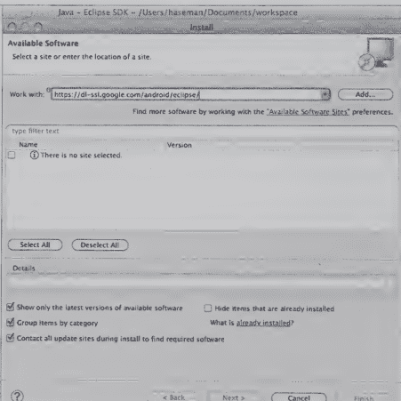

**图 1.2** Eclipse 巧妙隐藏插件安装向导的位置。

**图 1.3** 插件安装向导的全貌，虽然乏善可陈。

幸运的是，在 Windows、Mac 和 Linux 上配置 Eclipse 的方式是一致的。启动 Eclipse，并指定你希望工作区所在的位置。理论上，它可以安装在任何地方，但我总是把自己的工作区放在 Mac 上的 ~/Documents/workspace 下。只要你始终使用同一个目录，就不应遇到任何问题。

### 将 Android 插件添加到 Eclipse

现在你已经让 Eclipse 运行起来了，接下来需要添加 Android 的 ADT 插件。正是这个神奇组件，将 Eclipse 从一个纯粹的 Java 开发工具变成用于制作 Android 应用程序的工具。

1. 从 Eclipse 的 Help 菜单中选择 Install New Software（图 1.2）。
2. 在 Install 弹出窗口的 Work With 字段中输入 https://dl-ssl.google.com/android/eclipse/。你的设置应如图 1.3 所示。
3. 为该站点取一个你选择的名字。我的名字就是简单的“android_stuff”。

    你会看到安装几个软件包的选项。

4. 将它们全部选中，点击 Next，然后再次点击 Next。
5. 接受 Google 的条款和条件。Eclipse 将下载相应的插件包。

> **注意：** 如果你在安装 Eclipse 插件时遇到问题，请确保网络连接正常。尝试将插件 URL 中的“https”改为“http”。如果仍然不行，请前往 http://developer.android.com/sdk/eclipse-adt.html#installing，在那里你会找到一些更有帮助的调试步骤。


下载完成之前，你可能会收到警告，提示即将安装未签名的代码。这是预期之内的。（别慌。）

6. 接受未签名代码警告，并允许下载继续。
7. 出现提示时重启 Eclipse。

### 定位 SDK

再完成一步，你就能创建项目了。你需要告诉 Eclipse 到哪里找到你的 Android SDK。

1. 启动 Eclipse。你应该会看到有用的欢迎屏幕。
2. 选择 File > Preferences。

    如果到目前为止你做的所有事情都正常，你应该会在左侧列表中看到 Android 选项。

3. 点击 Android。

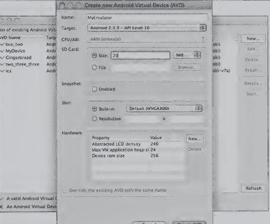

**图 1.5** 配置新的 Android 虚拟设备（AVD）。

这个屏幕应该看起来很熟悉，因为你刚刚用它安装了一两个应用程序平台。现在你又回来创建一个新的虚拟设备。

2. 在 Android SDK Manager 打开的情况下，确保选中 Virtual Devices 选项卡，然后点击 New。将弹出一个新的模拟器对话框。
3. 在 Name 字段中，为你的模拟器取一个名字；最好取一个有助于与其他模拟器区分开的名字。在发布第一个应用程序之前，你可能会收集好几个模拟器。
4. 从 Target 下拉菜单中，指定你想以哪个 SDK 为目标。目前最简单的是从 Gingerbread (2.3.3) 开始，但一切在 Ice Cream Sandwich (4.0) 上仍可正常工作。
5. 在 SD Card 字段中，选择 Size 单选按钮，并输入一个小尺寸。
6. 在 Skin 部分，选择 Built-In 单选按钮，并从下拉菜单中选择 Default WVGA800。

完成后的屏幕应如图 1.5 所示。


### 创建新的 Android 项目

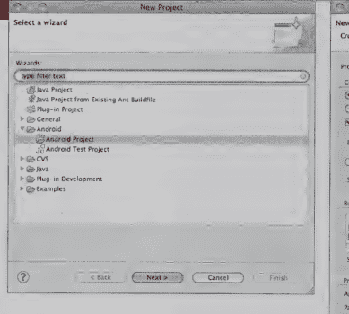

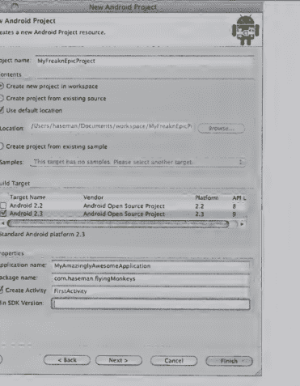

**图 1.7** 在此处选择项目类型（Android Project）。

**图 1.8** 在此处输入项目的所有繁琐细节。

Google 提供了几种有用的方法来创建新的 Android 项目。

1. 如果 Eclipse 尚未运行，请启动它。
2. 选择 File > New > Project。你应该会看到 New Project 屏幕（**图 1.7**）。
3. 点击 Next，Android 友好的项目创建向导就会启动（**图 1.8**）。

我们来逐一看看，在填写每个字段时，它们对你的项目意味着什么。

> **注意：** 如果你没有看到 Android 文件夹，需要确保已正确安装 Android Eclipse 插件。回到“配置 Eclipse”一节，看看哪里可能出了问题。

4. 在 Project Name 字段中输入项目名称。

    这是 Eclipse 跟踪你的项目的方式。此外，它会创建一个使用该名称的文件夹，并将你的所有项目文件放入其中。安装后，项目名称不会显示在 Android 设备的任何地方。项目名称其实只对 Eclipse 有意义，所以我倾向于为项目选择描述性的名称。

5. 在 Build Target 部分，选择你要针对的 Android 版本。

    较新版本的 Android 始终支持通过较旧 SDK 构建的应用程序。它们通过所谓的*兼容模式*来实现这一点。目前，尽量以你能针对的最高级版本为目标。

6. 在 Application Name 字段中，输入应用程序的完整名称。

    安装应用后，这就是应用抽屉中显示的名称。

7. 在 Package Name 字段中，输入你将要放置第一个 activity 的 Java 包。

8. 选中 Create Activity 复选框，并在文本框中为新 activity 输入名称。

    此步骤会创建一个使用该名称的新类，因此适用 Java 类命名约定。在第 2 章中，你将更具体地了解 activity 是什么以及它们如何工作。

9. 点击 Finish，你就可以开始大展身手了！

现在你有了一个项目，我们让它运行起来吧。


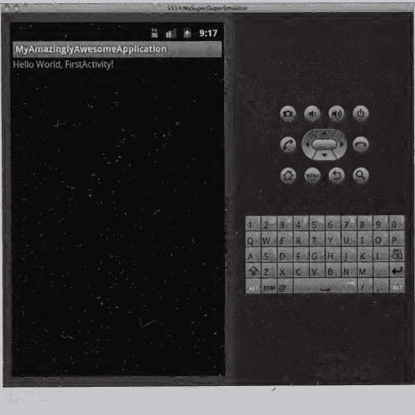

**图 1.9** 你的第一个 Android 应用程序，正在模拟器上运行！

### 小结

本章涵盖了 Android 应用程序的下载、安装、配置、创建和运行。现在你已经掌握了继续阅读本书所需的最基本工具。如果在后续章节中遇到困难，可以随时根据需要回顾本章。


我相信你已经准备好卷起袖子编写更多代码了。不过，还有一些理论和设计领域的话题需要先详细讨论。本章将介绍一些基本构建块的基础知识，包括构成一个简单 Android 应用程序的文件、部件和术语；控制单个屏幕的 Activity 类；Android 强大的通信类 Intent 类；以及可从所有组件访问的 Application 单例类。

我建议你打开 Eclipse，跟随我一起了解 Android 应用程序的各个工作部分。我将使用你在第 1 章创建的那个带有主 Activity（名为 MyActivity）的 Android 项目。

## 文件

任何移动应用程序，就其最基本的形式而言，都由一个屏幕组成，通过点击设备主屏幕上的图标即可启动。

当 SDK 创建一个基本的 Android 项目时，它还会创建若干文件和重要目录。

与任何项目一样，在开始构建结构之前，至少快速浏览一下蓝图是很重要的。以下是构成 Android 项目结构的文件和文件夹。

- `AndroidManifest.xml`
- `/res`
- `/src`

在本章剩余部分，我将提到清单文件和这些文件夹。

### 清单文件

AndroidManifest.xml 文件是你通往手机其余部分的门户。在它里面，你将描述哪些组件应接收哪些事件。你还需要在清单文件中声明你的应用需要获得访问权限的硬件和软件。首先，让我们看一下 AndroidManifest.xml 文件中的 `<manifest>` 声明：

```xml
<manifest xmlns:android="http://schemas.android.com/apk/res/android"
    package="com.haseman.peachPit"
    android:versionCode="1"
    android:versionName="1.0">
```

这段代码中有几个值得注意的地方。包定义告诉 Android 在哪个 Java 包中查找构成应用程序组件的类文件。接下来的两个变量目前不是特别重要，但一旦你准备好将应用发布到 Android Market，它们就会变得至关重要。versionCode 是一个数字，帮助 Market 提醒用户有可用更新。versionName 是一个字符串，应用菜单和 Market 会将其作为应用的当前版本显示给用户。

你的应用程序只能有一个 AndroidManifest.xml 文件。此后，我将把这个文件及其概念简称为清单文件。

### Activity 类

在典型的 Android 应用程序中，Activity 是运行操作的骨干。本质上，它们的用途是控制屏幕上显示的内容。它们在你想显示的数据与负责显示数据的 UI 布局文件和类之间架起桥梁。如果你熟悉流行的模型-视图-控制器（MVC）架构，那么 Activity 就相当于一个屏幕的控制器。清单文件中的 Activity 声明如下所示：

```xml
<activity android:name=".MyActivity"
    android:label="@string/app_name">
    <!-- More on how the intent-filter works in the next section-->
    <intent-filter>
        <action android:name="android.intent.action.MAIN" />
        <category android:name="android.intent.category.LAUNCHER" />
    </intent-filter>
</activity>
```

`android:name` 标签告诉系统，在你的包（来自清单声明）末尾放置什么内容，以找到你的类定义。例如，在我的示例项目 `com.haseman.peachPit.MyActivity` 中，类加载器将查找一个继承 Activity 类的类。

为了做到这一点，文件必须位于 `src/com/haseman/peachPit` 目录下。这是 Android 所用语言的标准操作流程。

#### 观察 Activity 的实际运行

如果使用得当，Activity 就是一个专门控制单个屏幕的对象。让我们以现实世界中的 RSS 新闻源阅读器为例，将这个神秘的 Activity 作为案例来讨论，它可以快速解释许多理论页面常常忽略的内容。开发者通常使用一个 Activity 列出用户订阅的所有新闻源。当用户点击某个新闻源时，开发者使用第二个 Activity 显示该特定新闻源的可用文章列表。最后，当用户点击某篇报道时，开发者使用第三个 Activity 显示该文章的详细信息。

很容易看出 Activity 如何承担特定角色（订阅列表、文章列表、文章详情）。同时，这些 Activity 又是通用的：文章列表应该能够显示来自任何 RSS 新闻源的文章列表，而文章详情 Activity 应该显示通过 RSS 阅读器找到的任何文章的详情。

因此，一旦设置好它，就不能再更改。这就是 Android SDK 强制你为每个屏幕使用一个新 Activity 的方式，因为每次你想更改根内容视图时，都需要一个不同的 Activity。

### 让 Android 了解你的新 Activity

Android 系统需要知道在启动你的新 Activity 时到哪里找到它。

- 1.  在 Eclipse 中打开 AndroidManifest.xml 文件。
- 2.  在 `<application>` 标签内、紧接上一个声明中 `</activity>` 结束标签之后添加以下行：

    ```xml
    <activity android:name=".NewActivity"/>
    ```

这一小行告诉系统在应用程序包中的哪里找到新 Activity。在我的演示中，类加载器知道要在 com.haseman.peachPit.NewActivity 处查找该 Activity。

接下来，你需要在那里放置一个文件，以便它能够找到。

### 创建新的 Activity 类

创建新 Activity 有几种方法，但以下是在 Eclipse 中最简单的方法。

- 1.  右键单击（或按住 Control 键单击）你选择的包名（我的是 com.haseman.peachPit）。
- 2.  选择 New，然后选择 Class。
- 3.  在对话框中为类命名。

一个名称就足以创建一个新文件。该文件将按你指定的名称保存在主包中。在我的演示中，它位于项目的 src/com/haseman/peachPit/NewActivity.java 下。

现在你有一个继承自对象的类，需要将其改为继承 Activity。

### 创建新的屏幕布局

以下是创建新布局的方法。

- 1.  在 **res/layout/** 文件夹中创建一个名为 **new_activity.xml** 的新文件。它应该与现有的 **main.xml** 文件（你的现有 Activity 所使用的文件）放在一起。这个 **new_activity.xml** 文件应该看起来几乎与 **main.xml** 完全相同，只是你需要添加对刚才创建的字符串的引用。
- 2.  插入突出显示的行，以创建对刚才创建的字符串的引用。
- 3.  为这个修改后的 TextView 指定一个 ID，以便你的 Java 代码可以引用它（你将在后面了解更多关于 TextView 的内容；现在你应该知道它们是用于在屏幕上显示文本的 Android 视图）：

    ```xml
    <?xml version="1.0" encoding="utf-8"?>
    <LinearLayout xmlns:android="http://schemas.android.com/apk/res/android"
        android:orientation="vertical"
        android:layout_width="fill_parent"
        android:layout_height="fill_parent"
    >
    <TextView
        android:id="@+id/new_activity_text_view"
        android:layout_width="fill_parent"
        android:layout_height="wrap_content"
        android:text="@string/new_activity_text"
    />
    </LinearLayout>
    ```

我将把第 3 章专门用于资源管理和用户界面设计，但就目前而言，请记住：@ 前缀是你告诉 Android 想要引用在其他地方定义为资源的 ID、字符串或可绘制对象的方式。

现在你已经有了一个带有闪亮新字符串的新布局，你需要告诉 NewActivity 类你想让它使用这个特定的布局文件。


- 4. 将以下高亮行添加到 New Activity 类的 onCreate 方法中：

```java
public void onCreate(Bundle icicle){
    super.onCreate(icicle);
    setContentView(R.layout.new_activity);
}
```

setContentView 是用于告诉 Android 为新活动显示哪个 XML 文件的方法。既然你已经创建了新类、字符串和布局文件，现在是时候启动该活动并在屏幕上显示新视图了。

### 捕获按键

启动新活动的一种简单方法是让用户按下其设备上的中央键。如果你的手机没有中央键，你可以轻松修改以下代码以接受你喜欢的任意按键。要监听按键事件，你需要扩展原始活动的 onKeyDown 方法。请记住，这只是一个简单的示例场景。在实际应用中，用户按下单个按键就启动新活动可能并不是很常见的用例，但它可以作为一个很好且简单的示例。大多数新活动是在用户选择列表项、按下按钮或对屏幕执行其他操作时启动的。

你的新版 onKeyDown 应该如下所示：

```java
@Override
public boolean onKeyDown(int keyCode, KeyEvent event){
    if(keyCode == KeyEvent.KEYCODE_DPAD_CENTER){
        //Launch new Activity here!
        return true;
    }
    return super.onKeyDown(keyCode, event);
}
```

通过声明 onKeyDown，你重写了默认的按键处理程序，以便执行特定于你自己活动的操作。如果传入的按键不是你的活动自行处理的内容，将其传递给父类版本的方法总是一个好主意。

注意，当 keyCode 与中央按钮匹配时，你返回 true。通过这种方式，你告诉 Android 活动和视图，该按键已被正确处理，不应再传递给其他任何对象。否则，你允许活动超类处理该按键。现在这似乎不是什么大问题，但随着你的 Android 活动变得越来越复杂，它会变得更加重要。

#### 启动活动

最后，是时候启动新活动了。这将开始你对 Intent 的短暂探索。每个新活动都是由于新的 Intent 被分派到系统（系统会处理它并采取适当的操作）而启动的。为了启动第一个活动，你需要一个应用上下文的引用以及新活动的类对象。让我们先创建新的 Intent。

- 1. 将以下代码放入你的 onKeyDown 按键处理方法中：

```java
Intent startIntent=new Intent(
    this.getApplicationContext(),
    NewActivity.class);
```

你正在向新的 Intent 传递应用上下文以及你希望启动的活动的类对象。这告诉 Android 在应用程序包中具体到哪里查找。创建和与 Intent 交互的方式有很多；不过，这是启动新活动最简单的方式。一旦 Intent 被正确构造，接下来只需告诉 Android 系统你想启动新活动即可。

- 2. 将以下行放入你的按键处理方法中：

```java
startActivity(startIntent);
```

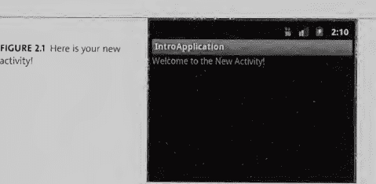

你的 onKeyDown 处理程序应如下所示：

```java
public boolean onKeyDown(int keyCode, KeyEvent event){
    if(keyCode == KeyEvent.KEYCODE_DPAD_CENTER){
        Intent startIntent=new Intent(this, NewActivity.class);
        startActivity(startIntent);
        return true;
    }
    return super.onKeyDown(keyCode, event);
}
```

> **注意：** 在整个过程中，原始活动从未访问过新活动的实例。这两个活动之间可能传递的任何信息都必须通过中间 Intent 进行。你将在下一节中学习如何做到这一点。

#### 试一试

如果你正在运行 Eclipse，并且一直跟着我编写代码，那么现在只需启动模拟器并安装你的新活动即可（你应该还记得第 1 章中的步骤）。一旦新应用程序启动，按下中央键即可看到你所有劳动成果（**图 2.1**）。

既然你知道了如何创建和启动新活动，现在该讨论这个过程是如何工作的了。为了以后进行 UI 布局和数据管理/保留，你需要理解每次你的某个活动进入和离开屏幕时会调用哪些方法。

### 获取 Intent

Intent 可以有无数种形式。

每当你需要启动活动或服务时，都会使用它们。此外，你还会经常使用 Intent 进行系统级通信。例如，你可以通过注册一个广泛发布的 Intent 来接收有关电源系统变化的通知。如果你的某个活动在清单文件中注册了一个 Intent（例如 com.haseman.peachPit.OhOhPickMe），那么只要你将活动设为公开，手机上的任何应用程序都可以通过调用以下代码直接启动到你的活动：

```java
startActivity(new Intent("com.haseman.peachPit.OhOhPickMe"));
```

### 活动的一生

尽早知道每个活动都过着非常短暂但激动人心的一生是件好事。它始于你的活动注册接收的 Intent 被广播到系统时。系统会调用你的活动构造函数（并在必要时启动你的应用程序），然后按以下顺序在活动上调用以下方法：

- 1. onCreate
- 2. onStart
- 3. onResume

当你实现一个活动时，你的工作是扩展构成此生命周期的方法。唯一必须扩展的是 onCreate。其他方法如果你声明了，将按生命周期顺序被调用。

你的活动是顶层可见的应用程序，可以绘制到屏幕、接收按键事件，通常也是聚会的主角。当用户从活动按下返回键时，这些相应的方法将按以下顺序被调用：

- 1. onPause
- 2. onStop
- 3. onDestroy

### 活动短暂而残酷的一生

活动的生命极其短暂。它们不断被创建和销毁，因此非常重要的一点是，不要在其中保存任何与你的活动所控制的屏幕之外有关的数据。

以下都是会导致任何活动被销毁的有效操作：

- 1. 用户将设备从纵向旋转为横向，或反之。
- 2. 活动不再显示在屏幕上，或系统资源不足。
- 3. 今天是星期二。
- 4. 用户按下了返回键或主页键并离开了你的应用程序。

再次强调，确保你的活动的数据成员仅与屏幕上的元素相关。此外，不要指望活动为你保存任何数据。你将在后续章节中学习处理此问题的策略。

这些方法执行完毕后，你的活动将被关闭，并应准备好进行垃圾回收。

为了理解活动的流程，让我们快速详细地查看每个生命周期方法。请记住，你必须在这些方法中调用超类方法（通常在做其他任何事情之前），否则 Android 会向你抛出异常。

> **注意：** `onCreate` 是应用程序生命周期方法中唯一必须实现的方法。在我大多数 Android 工作中，我发现最终只实现其中一两个方法，具体取决于每个活动负责什么。


#### public void onCreate(Bundle icicle)

Android 会在你的活动启动时调用你对此方法的声明。然而请记住，在应用程序运行期间，你可能会经历每个活动的多个实例。例如，如果用户将屏幕方向从横向改为纵向，你的活动将被销毁，并且同一活动的新实例将被创建并初始化。


如果比如说你的 Activity 标题是动态的，但在 Activity 启动后不会改变，那么这个方法就是你想深入视图层级并设置标题的地方。这个方法不适合配置那些可能在应用处于后台时、或另一个 Activity 启动到其上方时发生变化的数据。

进一步说，如果你的应用在后台运行，而系统资源不足，你的应用可能会被终止。如果发生这种情况，当应用回到前台时，系统会在同一个 Activity 的新实例上调用 onCreate 方法。

onCreate 方法也是你为 Activity 调用 setContentView 的唯一机会。正如你之前所见，这就是你告诉系统希望此屏幕使用哪种布局的方式。一旦可以开始设置 UI 数据，就调用 setContentView。这些数据可以是从设置列表内容到设置 TextView 或 ImageView 内容的任何内容。

```java
public void onStart()
```

启动时，你的 onStart 方法会在 onCreate 之后立即被调用。如果你的应用被放入后台（原因可能是另一个应用启动到了你的应用之上，或用户按下了 Home 键），那么在你恢复时、Activity 能够与屏幕交互之前，onStart 会被调用。除非应用即将开始使用屏幕时我有某些特定内容需要检查，否则我倾向于避免重写 onStart。

```java
public void onResume()
```

onResume 是 Activity 生命周期中，Activity 获准访问屏幕时调用的最后一个方法。如果 Activity 处于后台期间 UI 元素发生了变化，那么这个方法就是确保 UI 与手机状态同步的地方。

当 Activity 启动时，此方法会在 onCreate 和 onStart 之后调用。当 Activity 再次回到前台时，无论它之前处于什么状态，都会调用 onResume。

### 太棒了，你的 Activity 现在运行起来了！

经过所有这些设置、配置和工作之后，你的 Activity 现在对用户可见了。各种东西被点击，数据可能被解析并显示，列表被滚动，事情正在发生！然而，派对总有结束的时候（也许是因为用户按下了 Back 键），而你需要收尾。

#### onPause()

onPause 是应用离开屏幕时系统调用的第一个方法。如果你有任何进程或循环（例如动画）只应在 Activity 位于屏幕上时运行，那么 onPause 方法就是停止它们的理想位置。如果你在当前显示的 Activity 之上启动了另一个 Activity，那么你的 Activity 会收到 onPause 调用。

请记住，如果系统需要资源，你的进程可能在 onPause 方法被调用后的任何时间被终止。这不是正常情况，但你需要意识到它可能发生。

onPause 方法很重要，因为它可能是你得到的唯一警告：你的 Activity（甚至整个应用栈）即将消失。你应当在此方法中将任何重要信息保存到磁盘、数据库或偏好设置中。

一旦 Activity 真正离开屏幕，你就会收到 Activity 生命周期中的下一个调用。

#### onStop()

当 Android 调用你的 onStop 方法时，它表示你的 Activity 已正式离开屏幕。此外，当用户离开你的 Activity 去与另一个 Activity 交互时，也会调用 onStop。这不一定意味着你的 Activity 正在关闭（尽管也可能如此）。你只能假定用户已离开你的 Activity 去了另一个 Activity。如果你在 Activity 内执行任何只应在它处于活动状态时运行的持续进程，那么此方法就是你尽一个好公民的职责、将其关闭的机会。

#### onDestroy()

onDestroy 是你在消亡之前的最后一次方法调用。这是你的 Activity 在走向天空中的伟大垃圾回收器之前清理自身事务的最后机会。

你的 Activity 可能一直在后台运行的任何后台进程（例如获取/解析数据）都必须在此方法调用中关闭。

然而，仅仅因为 onDestroy 被调用，并不意味着你的 Activity 会被彻底销毁。因此，如果你有一个正在运行的线程，即使在 onDestroy 方法被调用之后，它也可能继续运行并占用系统资源。

### 附加环节——数据保留方法

如前所述，如果系统需要资源，你的进程可能在 onPause 之后的任何时间被终止。然而，用户永远不应知道这种淘汰已经发生。为了实现这一点，Android 给了你两次保存状态数据以供以后使用的机会。

#### onSaveInstanceState(Bundle outState)

此方法会向你传递一个 Bundle 对象，你可以将以后需要用来把 Activity 恢复到当前状态的任何数据放入其中。你可以通过调用 outState.putString 或 outState.putBoolean 之类的方法来完成。每个存储的值在存入时都需要一个字符串键，取出时也需要相同的字符串键。你需要负责重写自己的 onSaveInstanceState 方法。如果你声明了它，系统就会调用它；否则，你就错过了机会。

当你之前被终止的 Activity 被恢复时，系统会再次调用你的 onCreate 方法，并把用 onSaveInstanceState 构建的 Bundle 交还给你。

只有当系统认为你之后可能需要恢复 Activity 时，才会调用 onSaveInstanceState。例如，如果用户按下了 Back 键，它就不会被调用，因为设备显然不需要稍后恢复这个确切的 Activity。因此，此方法不是保存用户数据的地方。只应暂存对此屏幕特定实例的 UI 很重要的临时信息。

#### onRetainNonConfigurationInstance()

当用户在竖屏和横屏模式之间切换时，你的 Activity 会被销毁，并创建一个新实例（经历完整的方法调用关闭—启动周期）。当 Activity 因配置变更（最常见的是设备旋转）而被销毁并重新创建时，onRetainNonConfigurationInstance 让你有机会返回任意对象，以便在新的 Activity 实例中通过调用 getLastNonConfigurationInstance 重新获取该对象。

这种策略有助于加快屏幕旋转的过渡。如果你的 Activity 需要花费大量时间获取它计划显示到屏幕上的数据，请记住这一点。相反，你可以使用 getLastNonConfigurationInstance 获取之前显示的数据。

#### 保持简单，聪明点

到现在，你已经知道 Activity 可能在几乎没有通知的情况下被终止。onSaveInstanceState 给了你保存基本类型数据以供以后使用的机会。这明确意味着，你的整个 Activity 必须能够将其所有重要信息压缩成一系列基本类型数据。这进一步强化了一个观念：Activity 必须非常简单，并且*不能*包含任何对自身之外的应用很重要的复杂数据。避免在 Activity 中保留装满数据的大型 Java 集合，因为它可能会在几乎没有通知的情况下被终止。

现在你应该基本了解：

- 创建新 Activity 的步骤
- Activity 是如何启动的
- Activity 的生命周期

你已经具备跟上后续章节中更复杂主题所需的知识。别担心，我很快就会回到 Activity 这个话题。

Intent 是一个类。在 Android 平台中，Intent 构成了在应用组件之间传递信息的主要通信协议。在设计良好的 Android 应用中，组件（Activity、内容提供器或服务）永远不应直接访问任何其他组件的实例。因此，Intent 就是这些部分能够通信的方式。

这本书相当大的一部分都可以专门用来讲解 Intent 类的创建、使用和细节。为了简洁并让你尽快上手，本章只介绍一些基础知识。在本书其余部分请留意 Intent。它们可能是整个 Android 中最常用的类。

有两种主要方式告诉 Android 系统，你希望接收由系统、其他应用甚至你自己的应用发出的 Intent：

- 在 `AndroidManifest.xml` 文件中注册 `<intent-filter>`
- 在运行时向系统注册 `IntentFilter` 对象

无论哪种情况，你都需要告诉 Android 系统你想监听哪些事件。

发送 Intent 的方式也多得数不胜数。你可以将它们广播给整个系统，也可以将它们定向到特定的 Activity 或服务。然而，为了启动一个服务或 Activity，它必须在清单文件中注册（你在前面关于启动新 Activity 的演示中已经看到了一个示例）。

让我们看看在实践中如何使用 Intent。

#### 清单注册

为什么不在运行时注册所有内容呢？如果某个 Intent 已作为清单的一部分声明，系统会启动你的组件，以便它能够接收该 Intent。运行时注册的前提是你的应用已经在运行。因此，任何时候你希望应用因某个事件而被唤醒并采取行动，都要在清单中声明它。如果某些内容只应在应用运行时接收，那么在你的特定组件启动后，注册一个 IntentFilter（在 XML 中声明时写作 intent-filter，在 Java 代码中则是 IntentFilter）。


让我们回到最初的应用程序，再次查看清单文件中该 activity 的条目：

```xml
<activity android:name=".MyActivity"
    android:label="@string/app_name">
    <intent-filter>
        <action android:name="android.intent.action.MAIN" />
        <category android:name="android.intent.category.LAUNCHER" />
    </intent-filter>
</activity>
```

`android.intent.action.MAIN` 声明告诉系统，此 activity 是应用程序的主 activity。启动它不需要任何参数。在清单文件中只将一个 activity 列为 MAIN 是个好主意。这也是当你从 Eclipse 运行应用程序时，adb（Android 调试桥）知道要启动哪个 activity 的方式。

`android.intent.category.LAUNCHER` 类别告诉系统，当你在手机主屏幕的应用停靠栏中点击图标时，应启动包含该类别声明的 activity。此外，它还告诉 Android，你希望该图标出现在应用启动器抽屉中。这是 Android 项目创建工具为你创建的 intent-filter 的一个示例。让我们添加一个我们自己的。

### 添加 Intent

如果你跳过了前面关于 Activity 类的部分，现在可能是个好时机回去至少浏览一下代码。在那一部分，我向你展示了如何声明并启动一个简单的新 activity。然而，我没有向你展示的是，如何通过在清单文件中为它声明一个 `<intent-filter>`，使该 activity 能够被整个系统访问。现在我们就来做这件事。

- 向 NewActivity 声明中添加一个 `intent-filter`：

```xml
<activity android:name=".NewActivity">
    <intent-filter>
        <action android:name="com.haseman.PURPLE_PONY_POWER"/>
        <category android:name="android.intent.category.DEFAULT"/>
    </intent-filter>
</activity>
```

在这段代码中，你注册了用于接收包含 com.haseman.PURPLE_PONY_POWER action 的 intent，并将 intent-filter 的 category 设置为 default。

现在，免得你以为我是个疯狂的儿童玩具爱好者，我使用了这个相当荒诞主义的 action 字符串来演示一个要点——即 action 字符串的唯一要求是，它对于你的特定组件而言必须是唯一的。

在上一节中，我向你展示了如何使用以下代码行启动新 activity：

```java
Intent startIntent = new Intent(this, NewActivity.class);
startActivity(startIntent);
```

这可以工作，但它有一个主要限制：它不能在你自己的应用程序上下文之外启动。这使得 activity-intent 模型提供的最强大特性之一变得无用。也就是说，设备上的任何应用程序，只要拥有正确的 intent，就可以使用你应用程序内的组件。

既然你已经将 `<intent-filter>` 添加到示例项目的清单文件中，你就可以使用以下代码在任何地方启动这个特定的 activity：

```java
Intent actionStartIntent = new Intent("com.haseman.PURPLE_PONY_POWER");
startActivity(actionStartIntent);
```

注意这段代码与其上面的代码清单之间有一个非常重要的区别。在这个示例中创建 intent 时，你不需要传入 Context 对象（即与整个系统通信所需的信息包）。这使得任何了解所需 intent 的应用程序都可以启动 NewActivity 类。

### 多个 Intent，一个 Activity

一个 activity 可以注册接收任意数量的事件。通常，发送一个 intent 类似于告诉该 activity“做这一件事！”这“一件事”可以是任何事，从编辑文件到显示可能文件或操作的列表。同样，正如我们已经讨论过的，限制 activity 的范围很重要，因此通常只注册一个 intent 是个好主意。然而，因为你的 activity 可能注册了多个 intent，所以在 onCreate 方法中调用 getIntent 并检查为什么被启动是个好主意，这样你就能采取正确的操作（通过调用 getAction）。

### 在运行时监听 Intent

另一种接收仅与你的应用程序相关的事件，或接收 Android 系统本身广播的事件的方法，是在运行时监听 intent。

假设你的 activity 希望在用户启用飞行模式时显示一个特殊屏幕或执行自定义操作。为此，你需要创建一个临时 IntentFilter 和一个内部 BroadcastReceiver 对象实例。

### 创建接收器

让我们将运行时 BroadcastReceiver 添加到 MyActivity 类中。你可能已经猜到，BroadcastReceiver 是一个具有单个 onReceive 方法的对象。

将 MyActivity 类改为如下所示：

```java
public class MyActivity extends Activity {

    private BroadcastReceiver simpleReceiver = new BroadcastReceiver() {

        public void onReceive(Context context, Intent intent) {

            if (intent.getAction().equals(
                    Intent.ACTION_AIRPLANE_MODE_CHANGED)) {

                Toast.makeText(context,
                        R.string.airplane_change,
                        Toast.LENGTH_LONG).show();

            }

        }

    };

    // Rest of the Activity is here.

}
```

在这段代码中，你创建了一个可在 activity 内部使用的本地可访问接收器。当系统调用 onReceive 时，你需要检查 intent 的 action 是什么。这是个好主意，因为 BroadcastReceiver 可以注册任意数量的不同 intent。

当你收到正在寻找的事件时，你将使用 Android 的 Toast API 在屏幕上显示一条简单消息（在此例中，是名为 airplane_change 的字符串内容）。在实践中，这可能是显示一个屏幕的时机，以指示应用程序需要网络连接才能正确运行。

### 告诉 Android 你想听什么

现在你已经创建了一个 BroadcastReceiver，你可以将它注册到系统。我先给你看代码，然后讲解发生了什么：

```java
public void onCreate(Bundle savedInstanceState) {
    super.onCreate(savedInstanceState);
    setContentView(R.layout.main);
    IntentFilter intentFilter = new IntentFilter();
    intentFilter.addAction(Intent.ACTION_AIRPLANE_MODE_CHANGED);
    registerReceiver(simpleReceiver, intentFilter);
}
```

> **Toast？**
>
> Toast 是显示给用户的一条简短消息，以小型弹出窗口的形式出现在屏幕底部。据我所知，这是指在举杯、碰杯然后共饮之前所作的简短致辞。与 toast 一贯的原则一样，越短越简单越好。

将以下突出显示的代码添加到之前处理过的 onKeyDown 监听器中：

```java
public boolean onKeyDown(int keyCode, KeyEvent event) {
    //...previous keycode code skipped...
    if (keyCode == KeyEvent.KEYCODE_DPAD_DOWN) {
        Intent actionStartIntent = new Intent("com.haseman.PURPLE_PONY_POWER");
        actionStartIntent.putExtra("newBodyText",
                "You Pressed the Down Key!");
        startActivity(actionStartIntent);
    }
}
```

在使用 intent 启动 activity 之前，你正在向该 intent 添加一个字符串负载。任何接收到该 intent 的应用程序都能取出这个字符串（假设它们知道它在那里），并按自己认为合适的方式使用它。既然你知道如何附加数据，让我们看一个在 NewActivity 的 onCreate 方法中检索并使用该字符串的示例：

```java
public void onCreate(Bundle icicle) {
    super.onCreate(icicle);
    setContentView(R.layout.new_activity);
    Intent currentIntent = getIntent();
    if (currentIntent.hasExtra("newBodyText")) {
        String newText = currentIntent.getExtras().getString("newBodyText");
        TextView bodyView = (TextView) findViewById(
                R.id.new_activity_text_view);
        bodyView.setText(newText);
    }
}
```


通常，一个 Android 应用程序是 Activity、广播接收器、服务和内容提供器的集合。Application 类是将这些彼此分散的部分粘合为一个单一、统一实体的黏合剂。每当你的清单中的内容提供器、Activity、服务或 Intent 接收器被初始化时，也会创建 Application 类，并可供其使用。

### 默认应用程序声明

查看 AndroidManifest.xml 文件，你会看到一个典型的 Application 声明，如下所示：

```xml
<application android:icon="@drawable/icon"
    android:label="@string/app_name">
<!--Activities, Services, Broadcast Receivers, and Content Providers -->
</application>
```

在这里你可以看到 `<application>` 标签。清单的这一部分通常包含与整个应用程序相关的信息。`android:icon` 告诉系统在主应用程序列表中显示哪个图标。这里的 `android:label` 指向你之前编辑过的 `strings.xml` 文件中的另一项条目。

### 自定义你自己的应用程序

添加你自己的应用程序，与你已经执行过的添加新 Activity 的步骤非常相似。

- 1. 在现有的 `AndroidManifest.xml` 声明中添加一个名称字段。
- 2. 在你的包中创建一个继承 `Application` 类的新类。
- 3. 赚钱！

我们来深入讲解第 1 步和第 2 步。第 3 步就靠你自己了。

#### 名称

就清单而言，`android:name` 指的不是所描述对象的名称，而是该类在你的 Java 包中的位置。`Application` 声明也不例外。加入新声明后，应用程序的开始标签应如下所示：

如果你需要一个临时存放可能跨越多个 Activity 的数据的地方，那么作为 Application 一部分的数据成员可以成为方便的存储位置。你必须非常小心地向 Application 添加数据。清单中声明的任何单个组件，从最简单的 BroadcastReceiver 到最复杂的 Activity，在被系统创建之前，都会先创建你的 Application 对象。这意味着你必须让 Application 的 onCreate 方法尽可能快地运行。

#### 访问应用程序

你的所有广播接收器、服务、Activity 和内容提供器都有一个由相应超类提供给它们的、名为 getApplication 的方法。调用时，如果你在清单中指定了 Application 对象，getApplication 将返回指向该对象的指针。既然你已经声明并创建了该类，那么访问它就很简单：调用 getApplication，并将返回的对象强制转换为你的指针类型的实例。如下所示：

```
SampleApplication myApplication = (SampleApplication)
getApplication();
```

就是这么简单。你可以向自己的 Application 版本添加公共数据成员或上下文相关方法，而只需一次调用，所有组件都将访问同一个对象，如下所示：

```
public class SampleApplication extends Application{
    public String username;
    public void onCreate(){
        super.onCreate();
    }
}
```

## View 类

不，这不是一档几个女人争论大众文化价值的电视节目。View 类是 Android 所有显示对象的超类。从简单的 ImageView 到强大的 RelativeLayout，每一个用户界面（UI）类都继承自这同一个对象。在本节中，你将学习使用 Java 代码和 XML 创建、添加和修改现有布局的基础知识。你还将学习创建自己的自定义视图。从本质上讲，视图只是一个矩形区域，你可以在其中显示内容。子类有许许多多不同的形式，但它们都只需要一个向用户展示内容的空间。

### 创建视图

创建新视图这件事你已经做过了。在第 1 章中，作为探索如何启动新 Activity 的一部分，你曾向 XML 布局文件中添加过一个视图。当时我说过，我们会深入探讨这些视图是如何创建和修改的具体细节，嗯，现在就是时候了！我们来看看创建新 Android 项目时自动为你生成的默认视图。

#### XML 中的视图

新项目中的默认 XML 布局如下所示：

```xml
<?xml version="1.0" encoding="utf-8"?>
<LinearLayout xmlns:android="http://schemas.android.com/apk/res/android"
    android:orientation="vertical"
    android:layout_width="fill_parent"
    android:layout_height="fill_parent"
    >
<TextView
    android:layout_width="fill_parent"
    android:layout_height="wrap_content"
    android:text="@string/hello"
    />
</LinearLayout>
```

#### 高度和宽度是必需的

目前重要的是要注意，每一个布局都必须为其高度和宽度设置值。如果你不指定这些值，Android 可能不会编译失败（因为它们可能会在运行时更新），但如果它开始绘制你的视图时，系统的高度和宽度值缺失，那么你的应用程序就会崩溃。

问题：在这个默认 XML 布局中，两个元素（LinearLayout 和 TextView）里哪些是视图？

答案：两者都是。

屏幕上所有可视对象都是 View 类的子类。如果在继承链中向上追溯得足够远，你就会在某处找到“extends View”。

在默认 XML 布局中，Android 工具添加了一个包含在 LinearLayout 内的简单 TextView。当显示在屏幕上时，hello 字符串的内容默认会出现在屏幕左上角。我将在本章后面讨论如何在屏幕上定位可视元素。

要在屏幕上显示 XML 布局，你需要调用 setContentView() 方法，并将布局名称传递给 Activity。

在 Eclipse（你的代码编辑器）中，它应该如下所示：

```java
@Override
public void onCreate(Bundle savedInstanceState) {
    super.onCreate(savedInstanceState);
    setContentView(R.layout.main);
}
```

#### Java 中的视图

任何你能用 XML 布局或构建的内容，也都可以在 Java 代码本身中布局和构建；只是会更复杂。不过，理解 Android 在解析（inflate）并构建你的布局时做了什么很重要。

下面是构建与创建新项目时 Android 通过 XML 为你生成的完全相同的用户界面所对应的 Java 代码：

```java
public void onCreate(Bundle savedInstanceState) {
    super.onCreate(savedInstanceState);
    setContentView(buildLayouts());
}

public View buildLayouts(){
    LinearLayout topView =
        new LinearLayout(getApplicationContext());
    LayoutParams topLayoutParams =
        new FrameLayout.LayoutParams
        (LayoutParams.MATCH_PARENT,
        LayoutParams.MATCH_PARENT);
    topView.setLayoutParams(topLayoutParams);
    TextView textView =
        new TextView(getApplicationContext());
        LinearLayout.LayoutParams textLayoutParams =
            new LinearLayout.LayoutParams(
            LayoutParams.WRAP_CONTENT,
            LayoutParams.MATCH_PARENT);
        textView.setLayoutParams(textLayoutParams);
        textView.setText(R.string.hello);
        topView.addView(textView);
        return topView;
}
```


### 特殊尺寸

在视图层级中，你始终需要为每个视图指定高度和宽度。特别是在这些定义中，你可以使用四种不同的值。它们分别是：

-   `wrap_content` 会让视图大到足以匹配其包含的内容。对不同的视图来说，这可能意味着不同的东西，但概念始终相同。
-   `fill_parent` 和 `match_parent` 值实际上含义完全相同。也就是说，我希望这个视图的尺寸与我父视图的尺寸相匹配。
-   `dip` 或 `dp` 表示设备无关像素。这个值可以让你获得一致的间距，而不受设备屏幕密度（每英寸像素数）的影响。在 Nexus 1 或 Nexus S 上，1 dp ~= 1.5 像素。
-   `px` 表示像素。有时确实需要精确的像素值。我建议不要用它来声明屏幕位置，但它仍是一种可选方案。

让我们看看 Java 代码中发生了什么。我没有对 R.java 文件中的某个 ID 调用 setContentView，而是传入一个由 buildLayouts 方法返回的 LinearLayout 对象实例。在 buildLayouts 方法中，我首先创建一个新的 LinearLayout（传入应用程序的上下文）和一个新的 LayoutParams 对象。为了与 XML 中的内容匹配，新 LayoutParams 初始化时将宽度和高度都设置为 MATCH_PARENT。如果你以前做过 Android 开发，应该知道 MATCH_PARENT 与之前使用的 FILL_PARENT 完全相同。

一旦为顶层 LinearLayout 初始化好布局参数，我就可以通过调用 setLayoutParams 将它们传给该对象。现在 LinearLayout 已经配置好了，接下来该构建 TextView 了。

这是一个简单的文本视图，因此它的布局参数与其父布局的布局参数非常相似。唯一明显的区别是，我在创建布局参数时把高度设置为按 TextView 的自然尺寸进行缩放。（关于动态高度和宽度，后面还会有更多内容。）

一旦通过布局参数告诉 TextView 它将如何在父布局中定位，我就告诉它我要显示哪个字符串。这个字符串定义在 /res/values/strings.xml 中。XML 中的 name 属性决定了系统为了定位你的资源，需要在 R.string 后面出现什么。你将在下一节中了解更多关于资源管理的知识。

最后，我需要把新的 TextView 添加到 LinearLayout 中，然后返回 LinearLayout，以便它可以被设置为该 Activity 的主内容视图。完成之后，我就得到了一个用 Java 代码在运行时构建的布局，它与系统以 XML 形式提供的布局完全相同。

Java 代码看起来相当直接，但使用 XML 来处理布局是更好的主意。使用 XML，你可以利用 Android 的资源管理系统，并让非软件工程师也能修改应用程序的 UI。

### 在运行时更改 UI

使用 XML 或 Java 来定义构成用户界面的那一堆视图是一回事。但特别是在使用 XML 的情况下，你会希望能够用从网络、用户或任何其他信息源获取的数据来检索并修改视图。Android 提供了一种简单的方法来访问当前构成屏幕的视图，即调用 findViewById，这是 Activity 类的一个方法。

#### 标识你的视图

在运行时找到某个视图之前，你需要先给它一个 ID。一旦对某个 Activity 调用了 setContentView，你就可以调用 findViewById 来检索视图，然后修改它们。这个过程应该看起来至少有点熟悉，因为你在上一章已经见过。它在 XML 中看起来如下：

```xml
<TextView
    android:id="@+id/text_holder"
    android:layout_width="fill_parent"
    android:layout_height="wrap_content"
    android:text="@string/hello"
    />
```

在这个例子中，我添加了一行 android:id 来命名 TextView。@+ 表示法告诉 Android：你不是在引用一个视图，而是希望为该视图创建一个 ID。任何 ID 的第一次引用都必须以 @+id 开头。后续对该 ID 的引用则只需以 @id 开头。

Android 保留了自己的 ID 命名空间。例如，如果你要创建一个供 ListActivity（一种专门用于显示信息列表的 Activity）使用的布局，你会希望把屏幕上主 ListView 的 ID 设置为 `android:id="@id/android:list"`。这些众所周知的 ID 允许 Android 的系统代码正确找到并与你指定的列表视图交互。我将在第 5 章中提供更多关于这个主题的内容，该章涵盖列表的创建和管理。

如果你在运行时创建视图，只需调用 setId 并传入一个整数，之后就能检索到它。

#### 使用 Android 查找资源

当 Android 编译你的项目时，它会为你的新静态数字 ID 分配一个数值。它把这个新 ID 放到项目中的 R.java 文件里。这个文件是你访问 res 文件夹内定义的所有内容的入口。对于每个布局、drawable 和已标识的视图——以及大量其他内容——Android 都会在 R 文件中放入一个随后静态定义的 int，以标识这些内容。每当你在布局 XML 中添加一行定义新 ID（例如 android:id="@+id/my_new_id"），你会发现下次编译项目后，R.id 类中会有一个条目。在前面的示例中，这个条目会是 R.id.my_new_id。

#### 检索视图

获取 Android 视图的现有实例非常简单，只需调用 findViewById 并传入在 R.java 文件中找到的 ID 值。根据前面的 XML 示例，下面是你如何获取文本视图的实例并修改其内容。

```java
public void onCreate(Bundle savedInstanceState) {
    super.onCreate(savedInstanceState);
    setContentView(R.layout.main);
    TextView tv = (TextView)findViewById(R.id.text_holder);
    if(tv!=null)
        tv.setText(R.string.hello);
}
```

### 处理一些常见任务

有些任务比其他任务更常见。让我们看看如何处理其中一些任务，在你完成第一个应用程序之前，你可能会做上几十次。


#### 更改视图的可见性

大多数时候，如果你想用 XML 定义 UI，就需要添加一些只会在某些时候可见的视图。

> **提示：** 如果你发现自己经常这样做，一定要看看 ViewStub 类。

取决于你的应用程序有多动态，视图会相当频繁地出现和消失。显示和隐藏视图非常简单，只需使用始终可靠的 findViewById，然后对返回的对象调用 setVisibility：

```java
Button button = (Button)findViewById(R.id.sample_button);
//Cycle through the View Visibility settings
if(button != null){
    //Gone (no impact on layouts)
    button.setVisibility(View.GONE);
    //Invisible (holds its space in a layout but is not drawn)
    button.setVisibility(View.INVISIBLE);
    //Visible (duh)
    button.setVisibility(View.VISIBLE);
}
```

这段代码有三种可见性设置。GONE 和 VISIBLE 是最明显的。你会发现 INVISIBLE 用得较少，不过，当你想要隐藏某些内容时，它非常适合让布局中的所有其他视图保持不动。

#### 设置 OnClickListener

设置一个监听器来告诉你某个视图被点击了，是你在开发 Android 应用程序时最常做的任务之一。点击可能意味着用户使用导航板或轨迹球将焦点移动到你的视图上，然后按下了选择键。点击也可能意味着按下轨迹球（如果有的话），或者按下四向或八向方向板中央的按键。

在触摸模式下，如果用户用手指按在你的视图上，然后在手指仍处于视图边界内时抬起，你的点击监听器也会被调用。这是一个重要的区别，因为点击监听器不会在用户手指实际按到视图上时被调用，而是在用户抬起手指时被调用。这给用户一个机会：如果手指按在了错误的位置，可以在抬起之前纠正位置。

你可以通过几种方式跟踪视图点击。你可以声明你的 Activity 自身实现视图的 OnClickListener 接口，添加一个 `public void onClick(View v)` 方法，并将指向你的 Activity 的指针传递给你想要跟踪的视图。对于在虚构的 main.xml 布局文件中声明的、ID 为 button_one 和 button_two 的假设按钮，代码看起来如下：

```java
public class UiDemoActivity extends Activity implements
        OnClickListener {

    @Override
    public void onClick(View selectedView) {
        if(selectedView.getId() == R.id.button_one){
            //Take Button One actions
        }

        if(selectedView.getId() == R.id.button_two){
            //Take Button Two actions
        }
    }

    @Override
    public void onCreate(Bundle savedInstanceState) {
        super.onCreate(savedInstanceState);
        setContentView(R.layout.main);
```


```java
new View.OnClickListener() {
    @Override
    public void onClick(View v) {
        //Do button two stuff here
    }
};

@Override
public void onCreate(Bundle savedInstanceState) {
    super.onCreate(savedInstanceState);
    setContentView(R.layout.main);
    Button button = (Button)findViewById(R.id.button_one);
    if(button != null)
        button.setOnClickListener(mClickListenerOne);
    Button button_two = (Button)findViewById(R.id.button_two);
    if(button_two != null)
        button_two.setOnClickListener(mClickListenerTwo);
}
```

这次，我没有将 Activity 声明为 OnClickListener 的实现类，而是创建了两个单独的内部对象，分别处理每个按钮的点击事件。我会把*第一个按钮*所需代码放在第一个对象中，把*第二个按钮*所需代码放在第二个对象中。当屏幕上有多个按钮时，我在自己的应用中也经常这样做。这样可以避免我编写一大堆 if 语句（或一个 switch 语句）来判断点击了哪个视图，然后执行相应的操作。

你可以根据自己的需求混合使用这两种技巧。两种方式并没有太大的优劣之分，但了解每种方式有助于你保持代码井井有条。

在这个例子中，我给两个按钮添加了点击监听器。点击监听器可以附加到任何你想让用户与之交互的视图上，无论是整个视图组还是简单的文本视图。

值得再次提及的是，通过设置点击监听器，你是在告诉系统该项可以被选中（用手指触摸）并被点击（用触摸板高亮，然后按中心键或轨迹球确认）。因此，为视图配置的默认选中操作将在选中事件发生时自动执行（无论是来自方向键还是触摸屏）。例如，按钮在用户选中时会变色。文本视图，根据设备的默认 UI 风格，也可能会改变文本的活动颜色。最后，你可以（而且很可能应该）通过声明一个有状态的可绘制对象来指定自定义的显示行为。我将在本书后面展示如何实现这些。

### 创建自定义视图

自定义视图的概念实际上可以分为两部分：扩展现有视图和创建全新视图。在我的 Android 开发职业生涯中，我很少创建完全自定义的视图，所以这里我们跳过这部分。Android SDK 文档为那些勤奋刻苦、想从零开始自己动手实现的读者提供了指引。不过，即使你打算扩展一个 Android 视图，也必须创建一个继承现有视图的新类。下面是具体做法。

#### 声明新类

声明自定义视图的第一步是创建类。Android 允许你通过继承现有类来创建任意现有 UI 对象的子类。声明方式如下：

```java
public class CustomTextView extends TextView{
    public CustomTextView(Context context) {
        super(context);
    }
}
```

创建一个自定义文本视图只需这些代码。不过，既然这个自定义文本视图的自定义程度（就像快餐玉米卷里的牛肉一样少），我会添加一些简单的东西让它与众不同。

#### 扩展视图

虽然 Android 的布局和视图功能强大且用途广泛，但有时它们并不能完全符合你的需求。幸运的是，扩展它们的功能很容易。为了演示，我编写了一个自定义文本视图，它会改变屏幕上显示的每个字母的颜色。虽然这不算最实用的用例，但它可以展示实现自定义行为是多么简单。

#### 定制扩展视图

你可能会惊讶于正确渲染文本到屏幕需要多少代码。Android 的 TextView.java 类有近 5000 行代码。但得益于类的扩展能力，你可以使用所有复杂的布局代码，只定制你感兴趣的部分。在这个例子中，我捕获文本的变化，并为新字符串中的每个字母添加一个新的 ForegroundColorSpan。首先，我声明一个颜色数组。

```java
public class CustomTextView extends TextView{
    int colorArray[] = new int[]{Color.WHITE,
            Color.RED,
            Color.YELLOW,
            Color.GREEN,
            Color.BLUE,
            Color.MAGENTA,
            Color.CYAN,
            Color.DKGRAY};
```

现在，每次文本改变时，我都会为每个字母添加一个新的 ForegroundColorSpan。

```java
protected void onTextChanged(CharSequence text,
        int start, int before, int after )
{
    //Keep the view from getting into an infinite loop
    if(selfChange){
        selfChange = false;
        return;
    }
    selfChange=true;
}
```

我确保不会陷入无限循环（颜色变化会触发另一个 onTextChanged 调用，而该调用又会改变颜色，接着再次触发……你懂的）。接下来是改变颜色的代码：

```java
SpannableStringBuilder builder = new SpannableStringBuilder(text);
builder.clearSpans();
ForegroundColorSpan colorSpan;
int color;
for(int i=0; i < text.length(); i++){
    //pick the next color
    color = colorArray[i%colorArray.length];
    //Create the color span
    colorSpan = new ForegroundColorSpan(color);
    //Add the color span for this one char
    builder.setSpan(colorSpan,
            i, i,
            Spannable.SPAN_EXCLUSIVE_EXCLUSIVE);
}
setText(builder);
```

同样，这并不复杂，但扩展现有视图类也不复杂。另外请注意，这段代码会清除文本上可能已经设置的所有格式。（在这一点上，不必过于纠结 spans 和 SpannableStringBuilder 是如何工作的。简而言之，它们是可以添加到字符串上的格式块。更多信息请查阅 Android SDK 文档。）如果你想挑战一下编码，可以尝试创建一个包含所有可能的 RGB 十六进制颜色值的数组，并循环遍历该数组。

#### 使用你扩展的视图

与任何其他 Android 视图一样，你可以在 Java 代码中于运行时创建它的新实例，也可以在 XML 布局文件中预先声明它。下面是在 Activity 中使用它的方法：

```java
public void onCreate(Bundle savedInstanceState) {
    super.onCreate(savedInstanceState);
    CustomTextView customView = new CustomTextView(this);
    customView.setText("Hello There!");
    setContentView(customView);
}
```

这里没有任何你以前没见过的东西。我创建视图的新实例，为它设置文本，然后把它设为 Activity 的主视图。你也可以把它和其他视图一起放入某个布局中。还可以把这个自定义视图添加到用 XML 描述的布局中。但在你开始于 XML 文件中声明自定义视图之前，需要创建完整的 View 构造函数集合。你的自定义视图应该看起来像这样：

```java
public class CustomTextView extends TextView{
    public CustomTextView(Context context,
                          AttributeSet attributeSet,
                          int defStyle)
    {
        super(context, attributeSet, defStyle);
    }

    public CustomTextView(Context context,
                          AttributeSet attributeSet)
    {
        super(context, attributeSet);
    }

    public CustomTextView(Context context){
        super(context);
    }
    //Rest of the class omitted for brevity
}
```

当 Android 解析你的 XML 布局并创建视图时，它需要向构造函数传入一个属性集，因为其中包含所有布局信息、文本，以及你添加的以 android 开头的各种属性。如果你忘了添加这些构造函数，一切仍能编译，但当你尝试绘制屏幕时，就会弹出可怕的“意外强制关闭”窗口。

现在有了正确的构造函数，你可以在 XML 中创建并布局自定义视图了。在下面的代码中，我添加了一个彩虹动画自定义文本显示的实例。

```xml
<?xml version="1.0" encoding="utf-8"?>
<LinearLayout xmlns:android="http://schemas.android.com/apk/res/android"
    android:orientation="vertical"
    android:layout_width="fill_parent"
    android:layout_height="fill_parent"
    >
    <com.haseman.ui.CustomTextView
        android:layout_width="wrap_content"
        android:layout_height="wrap_content"
        android:text="See how the colors change!"
        />
```


如你所见，要将自定义文本视图添加到 XML 布局中，只需使用完整的 Java 包名和类名。你还可以看到，由于 CustomTextView 继承自 TextView，我可以使用任何原本用于 Android 某个 TextView 的属性（例如 android:text）。

恭喜，你只用几行代码就创建了一个听你指挥的自定义 Android 视图，已将它显示到屏幕上，甚至还能把它包含到更复杂的布局系统中。Google 做得很出色，允许开发者扩展 Android SDK 中包含的基础构建块的功能。如果这个扩展后的自定义视图让你意犹未尽、想要更大挑战，可以试着做一个简单文本视图，让它实现与这个扩展视图完全相同的功能。你需要探索自己视图的 onMeasure 和 onDraw 方法。去吧，去看看，你回来时我还在这儿。

Android 有许多工具可帮助你管理字符串字面量、图像、布局等。将所有这些常量数据移到外部文件，会在许多方面让程序员的生活更轻松。在之前的代码示例中，我在指定字符串、drawable 图像和布局时引用了 `R.java` 文件，并提到随后会进行解释。现在该详细解释 Android 资源管理了。

### 资源文件夹概览

默认情况下，每个 Android 项目都包含一个 `res` 文件夹，里面有几个子文件夹。每个子文件夹负责应用程序数据的不同方面。

drawable 文件夹（`drawable-hdpi`、`drawable-mdpi` 和 `drawable-ldpi`）存放图像以及描述 drawable 对象的 XML 文件。后续章节将更详细地介绍你能用 drawable 对象做什么。

values 文件夹存放所有文本内容，从字符串字面量到菜单列表值数组，再到颜色常量。

最后，layout 文件夹包含用于描述你希望屏幕外观的 XML 文件。

在编译时，Android 工具会获取 `res` 目录中的所有文件夹，并将对应的 ID 放入 `R.java` 文件。此文件会自动重新创建并放到项目的 `gen` 文件夹中。因此，绝不应直接修改这个 `R.java` 文件，因为任何修改都会在下次编译时被移除。`R.java` 中的 ID 可以传给从 XML 解析器到文本和图像视图的各种对象。当你在 `TextView` 上调用 `setText` 并传入 `R.string.hello` 时，该视图就知道要在字符串文件中查找该 ID，并显示在其中找到的内容。当你通过调用 `setContentView` 并传入 `R.layout.main` 来设置 Activity 的主视图时，系统知道它需要 inflate 并创建 `res/layout/main.xml` 中找到的视图，并将它们添加到当前 Activity 在屏幕上的活动视图中。

以下是新建项目的 R.java 文件的样子：

```java
/* AUTO-GENERATED FILE. DO NOT MODIFY.
 *
 * This class was automatically generated by the
 * aapt tool from the resource data it found.  It
 * should not be modified by hand.
 */
package com.haseman.peachpit;
public final class R {
    public static final class attr {
    }
    public static final class drawable {
        public static final int icon=0x7f020000;
    }
    public static final class layout {
        public static final int main=0x7f030000;
    }
    public static final class string {
        public static final int app_name=0x7f040001;
        public static final int hello=0x7f040000;
    }
}
```

当 Android 编译你的 XML 文件时，会将其渲染为打包的二进制格式。这种格式的优点是加载快得多，因此你的屏幕可以更快地清晰呈现。缺点是这些文件一旦编译完成，你就无法修改它们。因此，你无法在运行时操作布局文件和字符串文件。不过，你可以通过加载和更改视图的 Java 表示中的字符串，来修改渲染到屏幕上的内容。

此外，如果你想从其他 XML 文件引用各种资源，将使用 `@folder/object_id` 结构。你可能没有意识到，但你已经见过这种声明在实际使用中的样子。回想一下 Android 工具为你提供的初始 Hello World 布局。在其中，你会看到一个文本视图，包含以下行：`android:text="@string/hello"`。这就是 Android 资源系统在起作用。在 XML 中，你使用 XML 的 `@string/hello`，而不是指定 `R.string.hello`。

每种类型的文件夹（drawable、layout、values 以及其他几种）都有特殊的命名约定和技巧，可用来应对设备多样性、语言本地化以及不同屏幕分辨率和密度这些耗时问题。下面我们看看每种文件可以做什么。

#### values 文件夹

将用户界面的所有常量值（字符串、颜色或 int/string 数组）放到单独文件中，一开始听起来可能很烦（尤其是考虑到所有文本操作器都将接收资源 ID 或 CharSequence）。但是，在将应用程序翻译成不同语言时，这可以节省许多天的工作量。

将所有字符串放在外部 XML 文件中还意味着，你的非技术同事（产品经理、设计师或事无巨细都要管的上司）可以操作屏幕、菜单和弹出对话框中的显示文本，而不必来打扰你。当然，前提是你教会他们如何编译和运行项目；不妨把本书第一章分享给他们。

values 文件夹可以包含：

- **字符串。** 所有字符串字面量都应放入 `strings.xml` 文件。
- **数组。** 有一个用于 XML 定义数组的文件，但如果你不想使用单独文件，字符串数组仍可放在 `strings.xml` 文件中。
- 颜色。colors.xml 可以包含任意数量的已声明颜色常量，用于从文本字体到布局背景的各种地方。除非你打算进行大量自定义 UI 绘制，否则这个文件可能不会很大。
- 尺寸。dimens.xml 可以包含任意数量的可能尺寸值，供布局中的其他地方使用。如果你希望根据应用程序所显示设备的显示尺寸，让视图更高或更矮，这个文件尤其方便。这看起来可能很简单，但与 layout 文件夹结合使用时可以非常强大。
- 样式。styles.xml……是的……稍后会详细介绍。

你可以通过将特定语言的两位 ISO639-2 后缀作为 values 的后缀，为每种语言创建新的 values 文件夹。例如，你可以创建一个 values-es 文件夹，其中包含 strings.xml 文件的西班牙语版本。当用户将他或她的手机设置为西班牙语时，Android 会自动检查新 values-es 文件夹内的 strings.xml 文件中是否定义了 R.string.hello 值。如果找到，它将显示 values-es 版本，而不是默认版本。如果找不到西班牙语翻译，它将默认使用你在 values/strings.xml 中定义的值。

通过这种方式，Android 为你提供了一种简便方法，可将应用程序中的所有字符串本地化。不过，它要求你保持警惕，将字符串字面量放入 strings.xml 文件，而不是直接调用 setText("Text like this"); 或在 XML 中使用 android:text="Text like this"。

#### layout 文件夹

关于 layout 文件夹中究竟放什么，我给你三次猜测机会。通常，你会在其中放置用于 setContentView 调用的布局 XML 文件，或者可通过 ViewStubs 或继承视图（这两种工具允许你在不同布局中复用视图）包含的子布局。Android 在 layout 文件夹中内置了一个有用的机制。你可以有许多带有不同后缀的文件夹，用于描述你希望应用程序在各种屏幕配置下如何显示。


最简单的例子是 layout 文件夹和 layout-land 文件夹。如果你在两个文件夹中都放入一个 firstscreen.xml 文件，Android 将使用与当前屏幕模式最接近的那一个。如果你保持 android:id 设置一致，就可以在 XML 标记中指定两个外观完全不同的屏幕，并通过 Java 代码与其中任意一个交互。这种技术比较复杂，所以我们来看一个例子。

假设你为应用程序的第一个屏幕创建了竖屏和横屏布局。两个文件都叫 firstscreen.xml，竖屏版本放在 layout 文件夹中，而横屏版本放在 layout-land 文件夹中。你也可以把竖屏版本放在名为 layout-port 的文件夹中。在 firstscreen.xml 的两个版本中，你都要为文本视图、按钮和图像提供所有适当的 ID。

如果你的屏幕有一个 OK 按钮，你应为这些按钮的竖屏和横屏版本提供相同的 ID：R.id.ok_button。请记住，你可以通过调用 findViewById() 并传入在 android:id="@+id/id_goes_here" 行中指定的 ID 来访问视图。在这种情况下，如果你想设置点击监听器，可以通过调用 findViewById(R.id.ok_button); 获取 OK 按钮；如果你处于竖屏模式，Android 会返回竖屏屏幕中的按钮，如果你处于横屏模式，则返回横屏版本的按钮。你的代码知道按下该按钮时必须做什么，但它不知道按钮的尺寸或位置。欢迎来到模型-视图-控制器（MVC）的快乐之地。

在处理设备屏幕尺寸的多样性时，MVC 是你最好的朋友。你可以按任何可能的配置来布置视图，只要 ID 匹配，你就只需要编写一个 Activity 类来处理所有可能的屏幕排列。你可以有特定的文件夹，每个文件夹都有一套自己的布局文件，用于不同的屏幕尺寸（layout-small 到 layout-xlarge）和密度（layout-ldpi 到 layout-hdpi），并且可以混合搭配。例如，layout-large-land 会指定处于横屏模式的大屏幕（VGA 和 WVGA）的布局。关于 Android 在文件夹中查找默认资源的准确顺序，请务必查看 Android SDK 文档。

这些 layout 文件夹为你提供的可能性，我在这里只是浅尝辄止。在后续关于处理显示和硬件多样性的章节中，你将了解更多相关内容。

#### drawable 文件夹

对 Android 来说，*可绘制对象*就是可以绘制到屏幕上的东西。Android 抽象掉了颜色、形状和图像之间的差异，并允许你使用一个可以表示其中任意数量的超类：Drawable。你将这些对象的定义保存在 drawable 文件夹中。对于两种主要类型的对象，你应该考虑使用可绘制对象：

- 图像资源（主要是 PNG 文件）
- 描述你想绘制的内容的 XML 文件：形状、渐变或颜色

drawable 文件夹集的工作方式与 layout 文件夹类似。你可以指定屏幕密度、布局或分辨率的任意组合，前提是按正确顺序指定它们。

#### 许多资源，一个 APK

> 你能够为每种屏幕尺寸或密度准备一整套不同的图像，并不意味着你真的应该这样做。请密切关注最终编译后的 APK 文件大小。如果文件增长到超过一定大小，用户就会抱怨。为了对抗这种臃肿，请使用 9-patch（易于缩放的图像），并在可能的情况下使用手工渲染的形状代替大型 PNG 图形。虽然新的应用市场确实允许使用多个 APK，但这是你应该避免的复杂程度。


引用可绘制对象的方式与你引用值和布局的方式相同。对于 XML 文件，使用 `@drawable/resource_name`。例如，在 `ImageView`（`android:src="@drawable/bridge"`）中，如果你引用的是 XML 文件或图像，请省略后缀。另外请记住，Android 总是会尝试使用最接近你当前配置的 drawable 文件夹。如果找不到合适的匹配项，它会逐级回退到默认 drawable 文件夹中能找到的资源。

**提示：** 请务必查看 Android SDK 文档，以获取有关正确排列后缀顺序的更多信息。

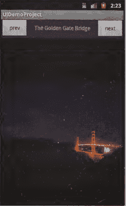

**图 3.1** 先睹为快。

布局，从简单到复杂，描述如何排列一系列复杂的视图。本节介绍 Android 布局类武器库的基础知识，从 ViewGroup 开始，经过 LinearLayout，最后介绍 Android 屏幕排列之王 RelativeLayout。

### ViewGroup

Android 中的每个布局都扩展了所谓的 ViewGroup。按定义，这是一类可以包含其他视图作为子视图的视图。

为了演示每个主要布局如何工作，我将布置一个示例图片查看器屏幕。虽然 Android 提供了自己漂亮且带有缩略图轮播的照片查看器，但我的示例会很简洁，并且是展示各种布局如何工作的绝佳载体。

图 3.1 展示了我们将使用 AbsoluteLayout、LinearLayout 和 RelativeLayout 渲染的屏幕。

这些是在尝试使用 AbsoluteLayout 时会产生的副作用。他们很可能会劝你放弃这种疯狂做法。

正如你可能猜到的那样，AbsoluteLayout 允许你精确指定某个视图在屏幕上的位置。AbsoluteLayout 的每个子视图都应该有 android:layout_x 和 android:layout_y 值，以及必需的宽度和高度设置。

你可能会想：“这听起来是让布局看起来完全符合我期望的好方法。既然我可以把屏幕设计直接转换成像素 x/y 位置，为什么还要费心学习其他东西呢？”

我一开始也这么想……

下面是 AbsoluteLayout 布局 XML 的样子：

```xml
<?xml version="1.0" encoding="utf-8"?>

<AbsoluteLayout
    xmlns:android="http://schemas.android.com/apk/res/android"
    android:layout_width="match_parent"
    android:layout_height="match_parent">
    <Button
        android:id="@+id/prev"
        android:layout_width="wrap_content"
        android:layout_height="wrap_content"
        android:layout_x="0dp"
        android:layout_y="0dp"
        android:text="@string/prev_string"
        android:lines="1"
        android:padding="12dp"
        />
    <TextView
        android:id="@+id/url_view"
        android:layout_width="wrap_content"
        android:layout_height="wrap_content"
        android:layout_x="110dp"
        android:layout_y="0dp"
        android:gravity="center_horizontal"
        android:text="The Golden Gate"
        />
    <Button
        android:id="@+id/next"
        android:layout_width="wrap_content"
        android:layout_height="wrap_content"
        android:text="@string/next_string"
        android:layout_x="271dp"
        android:layout_y="0dp"
        android:lines="1"
        android:padding="12dp"
        />
    <ImageView
        android:layout_width="wrap_content"
        android:layout_height="wrap_content"
        android:layout_x="0dp"
        android:layout_y="20dp"
        android:gravity="center"
        android:id="@+id/main_image"
        android:src="@drawable/bridge"
        />
</AbsoluteLayout>
```

比如从 Nexus S 切换到 HTC Hero，因为它们在屏幕上的像素数各不相同。

我把 AbsoluteLayout 包含在本章中，是因为如果我不这样做，你可能会自己发现它，并惊叹自己找到了多么珍贵的宝石。这是一个警示故事。其他布局一开始可能令人沮丧且耗时，但相信我，它们最终会带来回报。

底线：除非是极其简单的情况，否则不要使用 AbsoluteLayout。我可以想象它用于布置一个小巧、精致的按钮，然后把这个按钮放入某个更动态的布局类中……但请为了你自己的理智，除非绝对无法避免，否则不要使用这个布局对象。

### LinearLayout

LinearLayout 与 AbsoluteLayout 完全相反。在其中，你将定义一系列视图，系统会按照你指定的顺序在屏幕上动态调整它们的大小并放置它们。这个布局——我再怎么强调都不为过——并不很适合把视图精确放到你想要的位置。我会把最擅长这一点的布局类留到最后。

下面是原始图片查看器在使用 LinearLayout 设计时的样子：

```xml
<LinearLayout
    xmlns:android="http://schemas.android.com/apk/res/android"
    android:layout_width="match_parent"
    android:layout_height="match_parent"
    android:orientation="vertical"
    >
    <LinearLayout
        android:layout_width="match_parent"
        android:layout_height="wrap_content"
        android:orientation="horizontal"
        android:background="#333333"
        android:id="@+id/button_bar"
        >
```


```xml
<Button
    android:id="@+id/prev"
    android:layout_width="wrap_content"
    android:layout_height="wrap_content"
    android:paddingLeft="5dip"
    android:paddingRight="5dip"
    android:text="@string/prev_string"
    android:lines="1"
    android:layout_weight="1"
    />
<TextView
    android:id="@+id/url_view"
    android:layout_width="wrap_content"
    android:layout_height="wrap_content"
    android:gravity="center_horizontal"
    android:layout_weight="1"
    android:text="The Golden Gate Bridge"
    />
<Button
    android:id="@+id/next"
    android:layout_width="wrap_content"
    android:layout_height="wrap_content"
    android:paddingLeft="5dip"
    android:paddingRight="5dip"
    android:text="@string/next_string"
    android:lines="1"
    android:layout_weight="1"/>
</LinearLayout>
<ImageView
    android:layout_width="wrap_content"
    android:layout_height="wrap_content"
    android:gravity="center_horizontal"
    android:id="@+id/main_image"
    android:src="@drawable/bridge"
    />
</LinearLayout>
```

注意，本示例中有两个 LinearLayout 在发挥作用。顶层布局包含第二个 LinearLayout 对象和要显示的图像。第二个 LinearLayout 包含两个按钮和标题文本。在这种情况下需要两个布局，因为任何一个 LinearLayout 只能有一个方向。

#### 不要嵌套得太深

> 线性布局只能以两种方向之一来排列其子视图：水平或垂直。如果不小心，这可能会导致屏幕中出现大量嵌套的布局对象。嵌套布局太深，屏幕渲染速度就会像一群乌龟一样慢。Android 工程师建议将布局深度保持在十层以内。也就是说，不要创建包含超过十个任意类型嵌套布局的视图层级。在实践中，应尽一切可能少用布局，因为当布局深度超过七层或八层时，在较旧、较慢的手机上就会开始看到性能下降。如果你发现自己被一堆 LinearLayout 搞得晕头转向，可以考虑改用单个 RelativeLayout 进行重构。

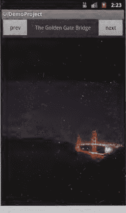

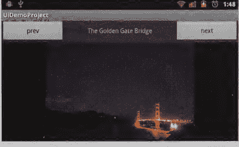

**图 3.4** 基于 LinearLayout 的屏幕（左）。

**图 3.5** 相同布局，但为横向模式（右）。

图 3.4 展示了此示例 XML 在纵向模式下生成的效果。这正是 Android 动态布局真正开始大放异彩的地方；看看当用户切换到横向模式时，完全相同的布局代码会是什么样子（图 3.5）。

不算完美，但相比 AbsoluteLayout 版本的横向屏幕已是巨大改进。

#### 使用 LinearLayout

使用 LinearLayout 时，定义视图的顺序就是它们在屏幕上放置的顺序。首先，看看第二个 LinearLayout：

```xml
<LinearLayout
    android:layout_width="match_parent"
    android:layout_height="wrap_content"
    android:orientation="horizontal"
    android:background="#333333"
    android:id="@+id/button_bar"
>
```

#### 必须有一个视图负责尺寸

必须有一个视图或布局来定义高度和宽度值。你不能同时告诉 Android 希望某个布局包裹其内容，又告诉某个视图应匹配其父级。这会导致编译错误，因为 Android 不知道应把父视图或子布局设为多大。必须有某个东西定义实际高度，哪怕它是一张图像或一行文本。

通过将方向设置为 horizontal，Android 知道要按从左到右的顺序将子视图放置在屏幕顶部。外层布局是垂直布局，因此可以将按钮栏放在图像上方。

通过将宽度设置为 match_parent，我确保布局本身一直延伸到父布局的整个宽度（在本例中为整个屏幕）。高度设置为 wrap_content，因此它将恰好与其子视图最终测量出的高度一样高。

LinearLayout 按定义顺序分配其子视图。然后它会测量所有子视图，以了解它们希望占用多少空间。接着，它会按子视图理想大小的比例分配可用空间。如果空间太少，无法容纳所有子视图，它会按各子视图测量大小的比例，给每个子视图分配其所需空间的一部分。如果空间足够容纳所有子视图还有剩余，它会根据子视图在 onMeasure 调用中告诉布局自己想要多大，来分配额外空间。你可以通过每个子视图中的 layout_weight 属性来修改这种按比例分配的方式。

布局实际上更多地发生在子视图的定义中，而不是布局本身的声明中。因此，为了提供一些背景，让我们看看按钮栏布局的各个成员。

下面是 Prev 按钮定义中的第一个子视图：

```xml
<Button
    android:id="@+id/prev"
    android:layout_width="wrap_content"
    android:layout_height="wrap_content"
    android:paddingLeft="5dip"
    android:paddingRight="5dip"
    android:text="@string/prev_string"
    android:lines="1"
    android:layout_weight="1"
/>
```

layout_weight 值可以是 0 到 1 之间的任意小数，它告诉系统：当布局空间过多或过少时，应给该子视图分配多少空间。再看看按钮栏的横向版本（图 3.6）。

**图 3.6** 由于 LinearLayout 而变得过大的按钮。

#### 线性布局不适合像素完美主义者

我已经说过一次，现在再说第二次：LinearLayout 并不适合用来布局像素级完美的屏幕。随着视图按比例变大或变小，很难让它们恰好停留在你希望的位置。当你有一组已知数量的对象必须显示在屏幕上，并且对它们最终的确切位置不太挑剔时，可以使用 LinearLayout。在空间受限的小场景中，例如小型按钮栏或单个列表菜单项，AbsoluteLayout 可能会更容易用来获得你想要的精确屏幕布局。这可能是我能想到的唯一一种 AbsoluteLayout 也许有意义的场景。

**图 3.7** 哎呀，太小了！


这可能与纵向模式下的屏幕外观非常接近，但还不够接近。随着顶部栏增大，LinearLayout 会按子视图测量大小的比例分配额外像素空间。在本例中，由于所有三个元素（两个按钮和文本标题）的权重相同（均为 1），布局会将额外空间平均分配给它们。你可以重新设置按钮的权重，使它们与文本标题按不同比例增长。由于你希望按钮的增长速度慢于文本，可以尝试将其权重设置为 0。新的值如下所示（省略其他所有内容）：

```xml
<LinearLayout
>
    <Button
        android:layout_weight="0"
        />
    <TextView
        android:layout_weight="1"
        />
    <Button
        android:layout_weight="0"
        />
</LinearLayout>
```

图 3.7 展示了此更改对按钮栏的影响。嗯，从技术上讲这是正确的，但看起来糟透了。你有两个选择。你可以通过 android:padding 声明精确指定希望两个按钮各有多少额外空间，或者给它们稍微大一点的权重。你可以自己尝试第一个选项，但让我们一起看看权重选项。


**图 3.8** 好多了！


**图 3.9** 再看看纵向模式

虽然你不希望按钮变得太大，但仍需要给它们比刚好包裹文本稍多一点的空间。让我们试试将权重设为 .25。为简洁起见，我已删去所有非 layout_weight 的行：

```xml
<LinearLayout>
    <Button
        android:layout_weight=".25"
        />
    <TextView
        android:layout_weight="1"
        />
    <Button
        android:layout_weight=".25"
        />
</LinearLayout>
```

图 3.8 展示了它在横向模式下的效果。

结果合理多了。但为了确认，再看看按钮栏在纵向模式下的样子。图 3.9 展示了结果。

也许 Next 和 Prev 按钮在纵向模式下可以再大一点，但这一结果已经非常可接受了。它们并不巨大，看起来也不拥挤，而且应该大到即使手指较粗也能点中。

最后，在轻松处理不同的动态屏幕尺寸方面，没有什么比 LinearLayout 更胜一筹。你可以随心所欲地把大量内容放进一个 LinearLayout 中，它会尽量容纳所有内容。不过，有两个主要问题需要注意。第一，由于它们只能朝一个方向排列，处理复杂布局时可能最终需要很多个 LinearLayout，这会显著拖慢绘制性能。第二，要让复杂屏幕完全按照设计师想要的方式渲染，可能是一个费力的过程。对于更复杂或元素更多的屏幕和对象，使用 RelativeLayout 会好得多。


```xml
<Button
    android:id="@+id/prev"
    android:layout_width="wrap_content"
    android:layout_height="wrap_content"
    android:padding="15dip"
    android:text="@string/prev_string"
    android:layout_alignParentLeft="true"
    android:layout_alignParentTop="true"
    />

<Button
    android:id="@+id/next"
    android:layout_width="wrap_content"
    android:layout_height="wrap_content"
    android:padding="15dip"
    android:text="@string/next_string"
    android:layout_alignParentRight="true"
    android:layout_alignParentTop="true"
    />

<TextView
    android:id="@+id/text_view"
    android:layout_width="wrap_content"
    android:layout_height="wrap_content"
    android:gravity="center"
    android:layout_toRightOf="@id/prev"
    android:layout_toLeftOf="@id/next"
    android:layout_alignParentTop="true"
    android:layout_centerHorizontal="true"
    android:layout_alignBottom="@id/prev"
    android:text="The Golden Gate Bridge"
    />
<ImageView
    android:layout_width="wrap_content"
    android:layout_height="wrap_content"
    android:layout_alignParentLeft="true"
    android:layout_alignParentRight="true"
    android:layout_below="@id/text_view"
    android:gravity="center"
    android:id="@+id/main_image"
    android:src="@drawable/bridge"
/>
</RelativeLayout>
```

在这段布局代码中，你看到的视图组件与构成 LinearLayout 时相同，只不过在相对布局版本中，不需要第二个嵌套布局。RelativeLayout 中每个成员的运作机制可能比它的线性布局表亲更复杂，因此我会尽量逐一拆解这个屏幕的全部四个部分。

`<RelativeLayout>` 声明只包含足以告诉布局填满整个屏幕的信息。有关如何布局屏幕的所有信息都在子元素中。下面是第一个：

```xml
<Button
    android:id="@+id/prev"
    android:layout_width="wrap_content"
    android:layout_height="wrap_content"
    android:padding="15dip"
    android:text="@string/prev_string"
    android:layout_alignParentLeft="true"
    android:layout_alignParentTop="true"
/>
```

第一个视图声明了 Prev 按钮，它首先在 android:id 行中声明其 ID。Prev 按钮需要一个 ID，以便你可以在 Activity 代码中为它分配点击监听器。布局高度和宽度声明只是告诉视图将其做得足够大，以容纳所有内容（在本例中，是 "prev" 文本和一点内边距）。

内边距声明告诉系统将按钮的边界从文本所需的最小空间向外扩展。在本例中，android:padding="15dip" 告诉系统测量 "prev" 文本所需的空间，然后向外扩展到视图外边界时再增加 15 个设备独立像素。一般来说，给按钮设置 10 到 20 dip 的内边距总是好的（具体取决于屏幕和文本大小）。这会给它们多一点空间，使其被识别为按钮，也让手指较大的人有机会真正点中视图。

接下来是告诉系统将按钮放在布局对象内部何处的部分。属性 android:layout_alignParentLeft="true" 告诉 Android 将视图的左边缘与父容器边界矩形的左边缘对齐。在本例中，就是屏幕的左边缘。android:layout_alignParentTop="true" 属性做同样的事，只是相对于布局对象的顶部（在本例中，是应用程序可用空间的顶部）。

如果你不指定任何布局参数，视图将默认位于布局对象的左上角。这个代码示例声明这些视图是为了说明目的。

现在 Prev 按钮已就位，可以继续了。下面是 Next 按钮相关的 XML：

```xml
<Button
    android:id="@+id/next"
    android:layout_width="wrap_content"
    android:layout_height="wrap_content"
    android:padding="15dip"
    android:text="@string/next_string"
    android:layout_alignParentRight="true"
    android:layout_alignParentTop="true"
/>
```

这种将一个视图居中放置在两个对象之间空间中的技巧，是我在 Android 工作中经常使用的，它也是消耗因屏幕尺寸小幅和大幅波动而产生的额外空间的好方法。也就是说，按钮之间的文本会居中浮动，处于你使用比设计时更大的屏幕时可能获得的任何可用屏幕空间中央。

##### 添加灰色背景

那么，你可能会问，LinearLayout 示例有灰色背景；如果 RelativeLayout 如此神奇，为什么它没有呢？首先，别对着书提问；你在公共场合会显得有点奇怪。其次，我故意没有添加背景，因为我想向你展示添加它有多容易。我已将添加背景所需的 XML 放在下面的代码中。花点时间看一下：

```xml
<!-- This is the top level layout -->
<RelativeLayout
    xmlns:android="http://schemas.android.com/apk/res/android"
    android:layout_width="match_parent"
    android:layout_height="match_parent">
    <View
        android:layout_width="match_parent"
        android:layout_height="wrap_content"
        android:layout_alignParentLeft="true"
        android:layout_alignParentRight="true"
        android:layout_alignParentTop="true"
        android:layout_alignBottom="@id/next"
        android:background="#ff222222"
        />
    <!--Rest of the screen goes here -->
</RelativeLayout>
```

我希望灰色框绘制在按钮栏后面，所以我将它作为布局中的第一个视图。Android 按声明顺序绘制视图栈。因此，如果我把上面列出的 XML 错误地放在按钮和文本声明下面，你就只会看到灰色条覆盖在文本和按钮上。

这样，你就成功添加了灰色背景，并使这个视图的 RelativeLayout 版本与之前的 LinearLayout 演示达到一致。RelativeLayout 可以处理更复杂的显示，而不需要其他嵌套布局。如果你足够聪明地使用它，它也可以处理屏幕尺寸变化，如通过让图像名称在按钮之间浮动所示——无论按钮相距多远。

### 小结

在本章中，你已经了解了构成 Android UI 的基本构建块。虽然我还没有时间深入展示这些特定类中的任何一个，但我们一起为后续更深入的章节奠定了基础。这样，我就可以深入探讨文本视图（是的，我们会），而不必担心你不知道如何将它们排列在图像旁边，或让它们响应点击事件。

至此，关于向用户显示信息的概述结束。你应该能够自如地通过 Java 和 Android 的 XML 布局系统构建和修改基本用户界面。如果你没有跳过任何章节，你还能扩展现有的内置视图，让 Android 完全按你的意愿行事。接下来，你将暂时从在屏幕上绘制内容中抽身，了解如何为漂亮的用户界面获取数据。

## 4 获取数据


虽然本章的主要目标是教你如何从远程源获取数据，但这其实只是我教你了解 Android 和主线程的一种巧妙方式。为简单起见，本章所有示例都将涉及下载和渲染图像数据。在下一章关于适配器和列表的内容中，我将向你介绍解析复杂数据并将其显示给用户。通常，图像数据更大、更笨重，因此在处理它时你会遇到更有趣、更具说明性的时序问题。


### 主线程

Android 操作系统恰好只有一个受眷顾的线程，被授权修改任何用户将看到的内容。这缓解了原本可能成为并发噩梦的问题，例如一个线程中视图位置和数据发生变化，而另一个线程正试图将它们布局到屏幕上。如果只允许一个线程接触用户界面，Android 就能保证在测量视图并将其渲染到屏幕时，关键内容不会被更改。不幸的是，这对你获取和处理数据的方式会产生严重影响。让我从一个简单的例子开始。

### 喂，你，把数据给我取来！

如果我现在让你下载一张图片并显示到屏幕上，你可能会写出很像下面这样的代码：

```java
public void onCreate(Bundle extra) {
    try {
        URL url = new URL("http://wanderingoak.net/bridge.png");
        HttpURLConnection httpCon =
            (HttpURLConnection) url.openConnection();
        if (httpCon.getResponseCode() != 200)
            throw new Exception("Failed to connect");
        InputStream is = httpCon.getInputStream();
        Bitmap bitmap = BitmapFactory.decodeStream(is);
        ImageView iv = (ImageView) findViewById(R.id.main_image);
        if (iv != null)
            iv.setImageBitmap(bitmap);
    } catch (Exception e) {
        Log.e("ImageFetching", "Didn't work!", e);
    }
}
```

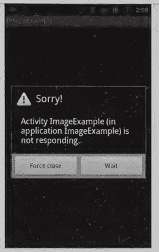

图4.1 当你把主线程扣为人质时用户看到的内容。

我最初面对同样的问题时，做的正是这件事。虽然这段代码会获取并显示所需的位图，但代码中潜伏着一个非常险恶的问题——也就是说，代码本身运行在主线程上。为什么这是个问题？想想看，只能有一个主线程，而主线程是唯一能够以任何方式与屏幕交互的线程。这意味着，当示例代码等待网络返回图像数据时，任何内容都无法渲染到屏幕上。这段获取图像的代码会阻止设备上任何地方发生任何操作。如果你把主线程扣为人质，按钮将不会被处理，电话无法接听，而且在你释放它之前，任何内容都无法绘制到屏幕上。

### 看门狗

鉴于一个简单的程序员错误（比如示例代码中的错误）就可能有效瘫痪任何 Android 设备，Google 不遗余力地确保没有任何单个应用能够长时间控制主线程。占用主线程太多时间，会导致这个灾难性的对话框屏幕（图4.1）覆盖在你的应用之上。

### 追踪 ANR 崩溃

每当你看到 ANR 崩溃，Android 都会写一个包含完整堆栈跟踪的文件。你可以使用以下 ADB 命令行访问该文件：`adb pull /data/anr/traces.txt`。这应该有助于你找到出问题的那一行。`traces.txt` 文件会显示程序中每个线程的堆栈跟踪。列表中的第一个线程通常是需要仔细查看的线程。有时，长时间运行的阻塞操作会在系统开始写入 `traces.txt` 之前完成，这会使堆栈跟踪令人困惑。你的长时间运行操作很可能就在 Android 开始因主线程被延迟而恼火之后不久完成了。然而，在显示图像的示例代码中，它可能会显示 `httpCon.getResponseCode()` 是罪魁祸首。你会知道这一点，因为它会被列为应用线程列表下最顶层的堆栈跟踪。

这个对话框被开发者不客气地称为 ANR（应用无响应）崩溃。尽管操作会在后台继续，用户也可以按“等待”按钮回到应用中正在进行的任何操作，但这对大多数用户来说是灾难性的，你应不惜一切代价避免它。

### 不要做什么

你应该在主线程上避免哪些类型的事情？

- 任何涉及网络的操作
- 任何需要从文件系统读取或向文件系统写入的任务
- 任何类型的繁重处理（例如图像或视频修改）
- 任何在你等待某件事完成时阻塞线程的任务

排除这份列表，剩下的就不多了，因此，作为一般规则，如果它不涉及用户界面的设置或修改，*不要*在主线程上做。

### 我什么时候在主线程上？

每当系统调用某个方法时（除非明确说明并非如此），你可以确定自己在主线程上。再次强调，作为一般规则，如果你不在自己创建的线程中，那么可以安全地假设你很可能在主线程上，所以要小心。

### 离开主线程

你可以明白为什么在抓取一张金门大桥的傻气图片时把主线程扣为人质是个坏主意。但你可能会想，我怎样才能离开主线程呢？一个有创造力的黑客可能会简单地把所有出问题的代码移到一个单独的线程中。这位想象中的黑客可能会写出类似下面这样的代码：

```java
public void onCreate(Bundle extra) {
    new Thread() {
        public void run() {
            try {
                URL url = new URL("http://wanderingoak.net/bridge.png");
                HttpURLConnection httpCon = (HttpURLConnection) url.openConnection();
                if (httpCon.getResponseCode() != 200)
                    throw new Exception("Failed to connect");
                InputStream is = httpCon.getInputStream();
                Bitmap bt = BitmapFactory.decodeStream(is);
                ImageView iv =
                    (ImageView) findViewById(R.id.remote_image);
                iv.setImageBitmap(bt);
            } catch (Exception e) {
                //handle failure here
            }
        }
    }.start();
}
```

“好了，”你那有进取心的黑客朋友可能会说，“我已经修复了你的问题。主线程可以继续运行，不受那些傻气的 PNG 下载代码阻碍。”然而，这段新代码还有另一个问题。如果你在自己的模拟器上运行该方法，你会看到它抛出异常，并且无法在屏幕上显示图像。

你现在可能会问，为什么会出现这个新的失败？嗯，还记得主线程是唯一被允许修改用户界面的线程吗？调用 `setImageBitmap` 恰恰属于这些修改的范畴，因此只能在主线程上完成。

### 回到主线程

Android 通过 Activity 类提供了一种回到主线程的方法，只要你能访问一个 activity。让我修正这位黑客的代码，使其正确做到这一点。由于我不想把代码缩进到下一页，我将从创建位图的那一行继续（记住，我们仍然在 Activity 类中，在 onCreate 方法内，在一个内联线程声明内）（为什么我脑海里响起了《盗梦空间》的音乐？）。

为便于定位，我将从上一个代码清单中创建位图的那一行继续。如果你感到困惑，请查看本章的示例代码。

```java
final Bitmap bt = BitmapFactory.decodeStream(is);
ImageActivity.this.runOnUiThread(new Runnable() {
    public void run() {
        ImageView iv = (ImageView) findViewById(R.id.remote_image);
        iv.setImageBitmap(bt);
    }
});
//All the close brackets omitted to save space
```

记住，我们已经在一个线程中运行，所以仅访问 `this` 会指向该线程本身。另一方面，我需要在这个 activity 上调用一个方法。调用 `ImageActivity.this` 会提供一个指向外部 Activity 类的指针，我们正是在这个类中启动了这段临时拼凑的代码，因此可以调用 `runOnUiThread`。此外，因为我想在不同的线程中访问最近创建的位图，我需要将位图声明设为 `final`，否则编译器会对我们发脾气。

当你调用 `runOnUiThread` 时，Android 会在主线程从其他任务中空闲下来后尽快安排这项工作完成。一旦回到主线程，所有同样的“不要独占”规则再次适用。

### 一定有更好的办法！

如果你看着这段杂乱、令人困惑、无法取消的代码，心里想：“自己：一定有更干净的方法来做这件事，”那你就对了。处理长时间运行的任务有很多方法；我将向你展示我认为最有用的两种。一种是 AsyncTask，一种在 activity 内执行简单操作的简单方式。另一种是 IntentService，它更复杂，但在处理可能跨越多个 activity 的重复性工作方面要好得多。


### AsyncTask

在其核心，AsyncTask 是一个抽象类，由你继承，并为耗时的异步任务提供基本框架。

描述 AsyncTask 的最佳方式，是称它为“工作线程三明治”。也就是说，它有三个你需要提供实现的主要方法。

- 1. **onPreExecute** 在主线程上执行，是面包的第一片。它负责设置任务、准备加载对话框，并提醒用户某事即将发生。
- 2. **doInBackground** 是这个“小任务三明治”的肉。Android 保证该方法在单独的后台线程上运行。这里是你大部分工作发生的地方。
- 3. **onPostExecute** 一旦你的工作完成就会被调用（同样在主线程上），后台方法产生的结果会传递给它。这是面包的另一片。

以上就是异步任务的核心要点。还有一些更复杂的因素，我稍后会提到，但这是 Android 平台的基本构件之一（因为所有繁重的工作都必须移出主线程）。先来看一个实际运行的例子，然后我们再来讨论它的细节：

```java
private class ImageDownloader
extends AsyncTask<String, Integer, Bitmap>{
    protected void onPreExecute(){
        // Setup is done here
    }
    @Override
    protected Bitmap doInBackground(String... params) {
        // TODO Auto-generated method stub
        try{
            URL url = new URL(params[0]);
            HttpURLConnection httpCon =
                (HttpURLConnection)url.openConnection();
            if(httpCon.getResponseCode() != 200)
                throw new Exception("Failed to connect");
            InputStream is = httpCon.getInputStream();
            return BitmapFactory.decodeStream(is);
        }catch(Exception e){
            Log.e("Image", "Failed to load image", e);
        }
        return null;
    }
    protected void onProgressUpdate(Integer... params){
        // Update a progress bar here, or ignore it, it's up to you
    }
    protected void onPostExecute(Bitmap img){
        ImageView iv = (ImageView)findViewById(R.id.remote_image);
        if(iv!=null && img!=null){
            iv.setImageBitmap(img);
        }
    }
    protected void onCancelled(){
    }
}
```

亲爱的读者，上面就是一个异步任务，它会从任意 URL 下载图片并显示出来供你欣赏（前提是你屏幕上有一个 ID 为 `remote_image` 的图像视图）。下面是在 Activity 的 `onCreate` 方法中启动这样一个任务的方法。

```java
public void onCreate(Bundle extras){
    super.onCreate(extras);
    setContentView(R.layout.image_layout);
    id = new ImageDownloader();
    id.execute("http://wanderingoak.net/bridge.png");
}
```

一旦你对 ImageDownloader 调用 execute，它就会下载图片，将其处理为位图，并显示到屏幕上。当然，这假设你的 image_layout.xml 文件中包含一个 ID 为 remote_image 的 ImageView。

#### 如何让它为你所用

AsyncTask 要求你在声明任务扩展时指定三个泛型类型参数（如果你对 Java 和泛型不太确定，请先搜索了解一下再继续）。

- 将传递给类的参数类型。在这个 AsyncTask 示例代码中，我传入一个字符串作为 URL，但我也可以传入多个。无论传入多少个参数，它们总是以数组形式被引用。注意，我将单个 URL 字符串引用为 params[0]。
- 在 doInBackground 方法（非主线程）和 onProgressUpdate 方法（将在主线程上调用）之间传递的对象。在示例中它无关紧要，因为我在演示中没有做任何进度更新，但它很可能是一个整数，表示事务完成的百分比或传输的字节数。
- 由 doInBackground 方法返回并由 onPostExecute 调用处理的对象。在这个小示例中，它是我们打算下载的位图。

下面这行代码声明了这三个对象：

```java
private class ImageDownloader extends
    AsyncTask<String, Integer, Bitmap>{
```

在这个例子中，这些就是会传递给你的三个主要方法的类。

##### ONPREEXECUTE

```java
protected void onPreExecute(){
}
```

onPreExecute 通常是你想要设置加载对话框或屏幕角落加载指示器（spinner）的时候（我稍后会深入讨论对话框）。请记住，onPreExecute 在主线程上调用，所以在这个方法中绝对不要访问文件系统或网络。

##### DOINBACKGROUND

```java
protected Bitmap doInBackground(String... params) {
}
```

这是你尽情进行网络连接、文件系统访问或其他耗时操作而不阻塞手机的机会。传递给此方法的对象类，取决于 AsyncTask 类声明中的第一个泛型对象。虽然在代码示例中我只使用了一个参数，但实际上你可以传递任意数量的参数（只要它们派生自所声明的类），并且在 doInBackground 被调用时它们都触手可及。一旦长时间运行的任务完成，你需要在函数末尾返回结果。这个最终值会被传递给另一个在主 UI 线程上回调的方法。

##### 当心加载对话框

请记住，移动应用与 Web 或桌面应用不同。用户通常是在远离传统电脑时使用手机。这意味着他们通常已经在等待某件事：公交车、那杯昂贵的咖啡、朋友从洗手间回来，或一场无聊的会议结束。因此，非常重要的是，不要让他们在你的应用内再等待任何事情。当你已经在等待别的东西时，还要等待移动应用连接，这可能会令人沮丧。尽你所能减少用户接触全屏加载对话框的机会。它们有时是不可避免的，但要尽可能减少。

##### 显示进度

AsyncTask 还有一个你应该了解的方面，虽然我还没有演示它。在 doInBackground 内部，你可以向用户界面发送进度更新。doInBackground 不在主线程上，所以如果你想更新进度条或改变屏幕上某个东西的状态，你必须回到主线程才能进行更改。

在 AsyncTask 内部，你可以在 doInBackground 方法中调用 publishProgress 并传入任意数量的对象（这些对象派生自 AsyncTask 声明中的第二个类，本示例中是 Integer），从而实现这一点。Android 然后会在主线程上调用你声明的 onProgressUpdate 方法，并把你传给 publishProgress 的类交给它。下面是 AsyncTask 示例中该方法的代码：

```java
protected void onProgressUpdate(Integer... params){
    // Update a progress bar here, or ignore it, it's up to you
}
```

和往常一样，进行 UI 更新时要小心，因为如果 Activity 当前不在屏幕上或已被销毁，你可能会遇到一些麻烦。

##### ONPOSTEXECUTE

工作已经完成，或者在这个例子中，图片已经下载完毕。是时候用我获得的内容更新屏幕了。在 doInBackground 的末尾，如果成功，我会向 AsyncTask 返回一个已加载的位图。现在 Android 会切换到主线程，并调用 onPostExecute，把我从 doInBackground 末尾返回的对象传递给它。下面是该方法的代码：

```java
protected void onPostExecute(Bitmap img){
    ImageView iv = (ImageView)findViewById(R.id.remote_image);
    if(iv!=null && img!=null){
        iv.setImageBitmap(img);
    }
}
```

我获取从网站下载的位图，找到要加载它的图像视图，并将其设置为该视图要渲染的位图。这里有一个我没有正确处理错误情况的地方。花点时间回看原始代码，看看你是否能发现它。

##### 一些重要的注意事项

通常，AsyncTask 是在 Activity 中启动的。但是，你必须记住，Activity 的生命周期可能很短。回想一下，默认情况下，每次旋转屏幕时 Android 都会销毁并重新创建任何 Activity。当用户退出时，Android 也会销毁你的 Activity。你可能会合理地问：“如果我在一个 Activity 中启动 AsyncTask，然后该 Activity 被销毁，会发生什么？”你猜对了：非常糟糕的事情。试图绘制一个已经从屏幕上移除的 Activity，可能会造成各种混乱（通常表现为未处理的异常）。

最好跟踪你启动的任何 AsyncTask，当 Activity 的 onDestroy 方法被调用时，务必对所有尚未结束的 AsyncTask 调用 cancel。

在以下几种情况下，AsyncTask 非常适合这项工作：

- 下载特定于某个 Activity 的小量数据
- 从外部存储驱动器（通常是 SD 卡）加载文件


基本上，要确保你用 AsyncTask 搬运的数据只属于一个 Activity，因为你的任务通常不应跨越多个 Activity。如果屏幕发生了旋转，你可以在 Activity 之间传递它，但这可能会比较棘手。有几种情况不适合使用 AsyncTask：

-   任何可能属于多个 Activity 的已获取数据都不应通过 AsyncTask 获取。例如，可能显示在多个屏幕上的图像，以及 Twitter 应用中的消息列表，其相关性都超出了单个 Activity 的范围。
-   要发布到 Web 服务的数据也不适合放在 AsyncTask 上，原因如下：用户会希望触发一次发布（发布照片、博客、推文或其他数据）后去做别的事情，而不是等待进度条消失。使用 AsyncTask 会迫使他们一直等待发布活动完成。
-   最后，要注意系统在设置 AsyncTask 时会有一些开销。使用少数几个没问题，但如果你要触发数百个，就可能开始拖慢主线程。

你可能会好奇，在这些情况下究竟该用什么。我很高兴你好奇，因为这正是我接下来想展示给你的内容。

此时，系统会构造你服务的新实例，调用其 onCreate 方法，然后开始把数据发送给 IntentService 的 handleIntent 方法。IntentService 是专门为在主线程之外处理大量工作和处理任务而构造的。服务的 onCreate 方法会在主线程上调用，但 Android 保证后续对 handleIntent 的调用都在后台线程上（无论如何，你都应该把长时间运行的代码放在这里）。

好了，闲话少说。让我向你介绍 ImageIntentService。你首先需要注意的就是构造函数：

```java
public class ImageIntentService extends IntentService {
    public ImageIntentService() {
        super("ImageIntentService");
    }
}
```

注意，你必须声明的构造函数没有字符串参数。然而，你必须调用的父类构造函数必须传入一个字符串。Eclipse 会让你觉得必须声明一个带字符串参数的构造函数，但实际上你必须声明一个不带参数的构造函数。这个简单的错误可能会让你花上好几个小时对着桌子抓狂地调试。

一旦你的服务存在，并且在其他任何东西运行之前，系统就会调用你的 onCreate 方法。onCreate 是执行服务其余任务所需各项维护工作的绝佳时机（在我向你展示图像下载器时会详细说明）。

最后，服务就可以真正开始做一些繁重的工作了。一旦它被构造出来并调用了 onCreate 方法，之后每当其他任何 Activity 调用 startService 时，它就会收到一次对 handleIntent 的调用。

### 获取图像

获取图像与获取较小的、易于管理的数据之间的主要区别在于，较大的数据集（例如图像或较大规模的数据检索）不应被打包进最终的广播 Intent（这是与 AsyncTask 的另一个主要区别）。另外，请记住，服务不能直接访问任何 Activity，因此它永远无法自行访问屏幕。IntentService 不会修改屏幕，而是发送一个广播 Intent，通知所有监听器图像下载已完成。此外，由于服务无法随该 Intent 传递实际的图像数据，你需要将图像保存到 SD 卡，并在最终完成广播中包含该文件的路径。

#### 设置

在使用外部存储缓存数据之前，你需要为应用创建一个缓存文件夹。一个合适的检查时机是 IntentService 的 onCreate 方法被调用时：

```java
public void onCreate() {
    super.onCreate();
    String tmpLocation =
        Environment.getExternalStorageDirectory().getPath()
        + CACHE_FOLDER;
    cacheDir = new File(tmpLocation);
    if (!cacheDir.exists()) {
        cacheDir.mkdirs();
    }
}
```

借助 Android 的环境，你可以确定外部文件系统的正确前缀。一旦知道最终缓存文件夹的路径，就可以确保该目录已存在。是的，我知道我告诉过你要避免在主线程上访问文件系统（而 onCreate 是在主线程上调用的），但检查并创建目录是一项足够小的任务，应该没问题。在阅读本章其余内容时，我会把这个问题留给你思考：这段代码放在哪里可能更好？

#### 关于文件系统的说明

> 在 Android 上，依赖文件系统缓存有一个有趣的转折。在大多数手机上，内部存储空间（用于安装应用）极其有限。在任何情况下，都不应在本地文件系统的任何位置存储大量数据。始终将其保存到 getExternalStorageDirectory 返回的位置。
> 
> 将文件保存到 SD 卡时，你还必须注意，几乎所有 Android 2.3 之前的设备都可以移除 SD 卡（或将其作为 USB 驱动器挂载到用户的笔记本电脑上）。这意味着你需要优雅地处理 SD 卡缺失的情况。如果你希望应用在外部驱动器缺失时仍能正常工作，还需要能够动态构建文件系统缓存。在实现持久化存储缓存时，有很多细节需要注意，但其好处（离线访问、更快的启动时间、更少导致应用停顿的加载对话框）绝对值得你付出努力。

#### 获取

既然已经有了在下载图像时保存图像的位置，现在该实现图像获取器了。下面是 handleIntent 方法：

```java
protected void onHandleIntent(Intent intent) {
    String remoteUrl = intent.getExtras().getString("url");
    String location;
    String filename =
            remoteUrl.substring(
            remoteUrl.lastIndexOf(File.separator) + 1);
    File tmp = new File(cacheDir.getPath()
            + File.separator + filename);
    if (tmp.exists()) {
        location = tmp.getAbsolutePath();
        notifyFinished(location, remoteUrl);
        stopSelf();
        return;
    }
    try {
        URL url = new URL(remoteUrl);
        HttpURLConnection httpCon =
            (HttpURLConnection)url.openConnection();
        if (httpCon.getResponseCode() != 200)
            throw new Exception("Failed to connect");
        InputStream is = httpCon.getInputStream();
        FileOutputStream fos = new FileOutputStream(tmp);
        writeStream(is, fos);
        fos.flush(); fos.close();
        is.close();
        location = tmp.getAbsolutePath();
        notifyFinished(location, remoteUrl);
    } catch (Exception e) {
        Log.e("Service", "Failed!", e);
    }
}
```

这段代码很多。幸运的是，其中大部分内容你之前已经见过。首先，从 Intent 的 Extras bundle 中取出要下载的 URL。接着，通过取 URL 的最后一部分来确定缓存文件名。一旦知道文件最终会被命名为什么，就可以检查它是否已经在缓存中。如果已经在缓存中，你就完成了，并且可以通知系统该图像已可加载到 UI 中。

如果文件未缓存，则需要下载它。到现在为止，你已经至少见过一次用于下载图像的 HttpURLConnection 代码，所以我就不赘述了。另外，如果你以前写过 Java 代码，可能知道如何将输入流写入磁盘。

#### 清理

此时，你已经创建了缓存文件，从网络获取了它，并写入上述缓存文件。现在该通知所有可能正在监听的人：图像已可用。下面是 notifyFinished 方法的内容，它会告诉系统图像已完成以及从哪里获取它。

```java
public static final String TRANSACTION_DONE =
        "com.haseman.TRANSACTION_DONE";

private void notifyFinished(String location, String remoteUrl) {
    Intent i = new Intent(TRANSACTION_DONE);
    i.putExtra("location", location);
    i.putExtra("url", remoteUrl);
    ImageIntentService.this.sendBroadcast(i);
}
```

任何监听广播 Intent com.haseman.TRANSACTION_DONE 的人都会收到通知：一次图像下载已完成。他们将能够同时取出 URL（以便判断这是否确实是它请求的图像）和缓存文件的位置。

#### 呈现下载结果

为了与下载服务交互，你需要采取两个步骤。你需要启动服务（并传入希望它获取的 URL）。不过，在它启动之前，你需要为结果广播注册一个监听器。你可以在下面的代码中看到这两个步骤：

```java
public void onCreate(Bundle extras) {
    super.onCreate(extras);
    setContentView(R.layout.image_layout);
    IntentFilter intentFilter = new IntentFilter();
    intentFilter.addAction(ImageIntentService.TRANSACTION_DONE);
    registerReceiver(imageReceiver, intentFilter);
}
```


```java
Intent i = new Intent(this, ImageIntentService.class);
i.putExtra("url", getIntent().getExtras().getString("url"));
startService(i);
pd = ProgressDialog.show(this, "Fetching Image", "Go intent service go!");
}
```

这段代码注册了一个接收器（这样你就能在下载完成后采取行动），启动了服务，最后向用户显示了一个加载对话框。

现在来看看 imageReceiver 类是什么样子：

```java
private BroadcastReceiver imageReceiver = new BroadcastReceiver() {
    @Override
    public void onReceive(Context context, Intent intent) {
        String location = intent.getExtras().getString("location");
        if (location == null || location.length() == 0) {
            Toast.makeText(context, "Failed to download image",
                    Toast.LENGTH_LONG).show();
        }
        File imageFile = new File(location);
        if (!imageFile.exists()) {
            pd.dismiss();
            Toast.makeText(context,
                    "Unable to Download file :-( ",
                    Toast.LENGTH_LONG).show();
            return;
        }
        Bitmap b = BitmapFactory.decodeFile(location);
        ImageView iv = (ImageView) findViewById(R.id.remote_image);
        iv.setImageBitmap(b);
        pd.dismiss();
    }
};
```

这是 BroadcastReceiver 类的自定义扩展。为了正确处理来自 IntentService 的事件，你需要在 Activity 中声明它。目前，这段代码有两个问题。看看你能否识别出来。

首先，你需要从 intent 中提取文件位置。你通过查找 "location" extra 来完成这一点。一旦确认这确实是一个有效文件，你就会把它传给 BitmapFactory，它会为你创建图像。然后这个位图可以传给 ImageView 进行渲染。

现在说说做错的地方（如果还没发现，就先别往下读。不许作弊！）。首先，代码没有检查 intent service 广播的完成 intent 是否正对应最初请求的图像（请记住，一个服务可以处理来自任意数量 Activity 的请求）。

其次，位图是从 SD 卡加载的……而且是在主线程上！这正是我一直警告你千万不要做的事情之一。

#### 检查你的工作

在较新版本的 SDK 工具中，Android 提供了一种方法来检查你的应用是否违反规则并在主线程上运行缓慢任务。你可以在任何 Activity 中调用 StrictMode.enableDefaults，当系统发现主线程违规时，它就会开始抛出警告。StrictMode 有许多不同的配置和设置，但启用默认值并尽可能清理错误，会显著提升应用速度。

### 加载器

Loader 是一个新类，在 Honeycomb 和 Android Compatibility 库中都有提供。遗憾的是，本章没有足够篇幅详细介绍它，但我要说，如果你必须反复在主线程之外执行繁重任务，它是一个非常值得探索的优秀工具。它和 AsyncTask 一样，通常绑定到 Activity，但它更适合处理单个任务必须执行多次的情况。它非常适合加载游标（使用 CursorLoader 子类）以及其他任务，比如为 ListView 下载各个列表项。请查阅文档，了解如何最好地使用这个强大而新颖的类。

关于如何加载数据，大致就讲这些。请记住，从 SD 卡加载、网络事务以及较长的处理任务都必须在主线程之外执行，否则你的应用和用户都会遭殃。正如我在本章所示，你可以使用简单线程、AsyncTask 或 IntentService 来检索和处理数据。但也要记住，任何修改屏幕上视图或对象的操作都必须在主线程上执行（否则 Android 会向你抛出愤怒的异常）。

此外，请记住，这三种方法只是许多可能的后台数据获取模式中的少数几种。Loaders、Workers 和 ThreadPools 都是其他替代方案，可能比我所给的示例更适合你的应用。

遵循我在这里概述的简单规则，你的应用就会快速、对用户响应及时，并避免可怕的 App Not Responding 厄运通知。正确使用并避开主线程对于打造成功的应用至关重要。

如果你更感兴趣的是用来自远程源的复杂数据构建列表，下一章应该正好能给你想要的内容。我将向你展示如何把 Twitter 消息列表渲染到屏幕上的菜单中。

最后给你一个挑战：启用 Android 的严格模式，并把我在本章示例代码中留下的那些小文件访问操作移到主线程之外。这应该是一种好方法，让你在自行处理之前熟悉这个过程。

## 5 适配器、ListView 和列表


在 Android 中，列表是向用户展示数据最常用的工具之一。从游戏的入口菜单到动态的 Facebook 状态或 Twitter 消息列表，列表无处不在。Android 处理列表的系统起初虽然复杂，但一旦开始使用就会变得容易得多。在本章中，我将涵盖从简单的静态主菜单列表到由远程数据支持的动态自定义 Twitter 信息流列表元素。在此过程中，我将带你了解 Android 最常用且最复杂的 UI 视图之一的内部工作原理。

### 每个列表的两个组成部分

要在 Android 中显示有序数据的列表，你需要处理两个主要组件。

### ListView

首先，你需要一个 ListView 来显示内容。这个视图的职责就是显示信息。它可以添加到任何屏幕布局中，或者你可以使用 Android 的 ListActivity 或 ListFragment 来替你处理一些组织工作。如果你的屏幕主要设计为以列表形式向用户展示一组数据，我强烈建议你使用 ListActivity 及其同类 ListFragment。

### Adapter

你需要处理的第二个主要类是 Adapter。这个对象会一次一点地把各个视图提供给 ListView。它还负责填充和配置要放入 ListView 的各个行。Adapter 的子类多如大海中的水滴（好吧，也许略少一些），它们覆盖了各种数据类型——从静态字符串列表（ArrayAdapters）到更动态的列表（CursorAdapters）。你可以扩展自己的 adapter（我会在本章后半部分展示）。现在，让我向你展示如何用 ListView 创建一个简单的主菜单。

和往常一样，你可以跟着我在 Peachpit.com/androiddevelopment/design 上发布的示例代码操作，或者打开你的 IDE 完成我概述的任务。

### 主菜单

主菜单可以采取多种形式。从游戏到音乐应用，它们都提供了进入整个应用的顶层导航。

作为一个令人愉快的副作用，它们也是向你介绍列表工作原理的好方法。我将为资源管理器创建一个字符串数组，把它提供给数组适配器，再把该数组适配器插入由列表 Activity 包含的列表视图中。都明白了吗？处理列表时有很多动态部分需要整合，所以我会慢慢地、一步一步地讲。

### 创建菜单数据

菜单必须有内容可显示，因此你需要创建一个要显示的字符串列表。还记得那一章吗？你学到所有要显示的字符串常量都*应该*放入 res/values/strings.xml 文件。巧合的是，字符串数组也放入同一个文件，但语法略有不同。我已将以下内容添加到我的 res/values/strings.xml 文件中：

```xml
<?xml version="1.0" encoding="utf-8"?>
<resources>
    <!--The rest of the app's strings here-->
    <string name="app_name">List Example</string>
    <string name="main_menu">Main Menu</string>
    <string-array name="menu_entries">
        <item>Menu Item One</item>
        <item>Menu Item Two</item>
        <item>Menu Item Three</item>
    </string-array>
</resources>
```

这次不是在一个 string 标签内定义每个常量，而是声明一个带名称的字符串数组，然后其中的每个元素都可以在一个 item 标签内定义。既然有了数据，现在该创建一个 Activity 来容纳它了。


### 创建 ListActivity

现在你需要一个地方来显示列表项。你将创建一个 ListActivity 实例，用来显示最近创建的列表。

每个屏幕都必须有一个 Activity，列表屏幕也不例外。在这种情况下，Android 为你提供了一个专门为简化列表屏幕而构建的辅助类。它叫作 ListActivity，行为与 Activity 完全一样，只是多了几个让开发更轻松的方法。如果你跟着本章动手编码，就需要创建一个新项目。拿你通常会有的主 Activity，把它修改成如下代码清单所示：

```
package com.haseman.lists;

import android.app.ListActivity;
import android.os.Bundle;

public class MainMenuActivity extends ListActivity{
	public void onCreate(Bundle bundle){
		super.onCreate(bundle);
		setContentView(R.layout.list_activity);
	}
}
```

不过，这段代码目前无法编译，因为我还没有定义 R.layout.list_activity 是什么样子。猜猜你接下来要做什么？

### 为 ListActivity 定义布局

你需要为列表创建一个 XML 布局文件。这同样类似于你之前完成的其他布局任务，但有一个显著例外：你需要定义一个带有特殊 ID android:id/list 的 ListView。它告诉系统哪个列表视图是你的新 ListActivity 将要交互的主列表视图。我还在布局中添加了一个 TextView 作为大标题。我的 XML 文件如下：

```xml
<?xml version="1.0" encoding="utf-8"?>
<LinearLayout
    xmlns:android="http://schemas.android.com/apk/res/android"
    android:layout_width="match_parent"
    android:layout_height="match_parent"
    android:orientation="vertical">
        <TextView
        android:layout_width="match_parent"
        android:layout_height="0dp"
        android:layout_weight="1"
        android:text="@string/main_menu"
        android:gravity="center"
        android:textSize="40dp"/>
    <ListView
        android:id="@android:id/list"
        android:layout_width="fill_parent"
        android:layout_height="0dp"
        android:layout_weight="1"
    android:gravity="center"/>
</LinearLayout>
```

> **提示：** 特殊 ID：仅当你使用 ListActivity 内置的便捷方法时，才需要把 ListView 的 ID 设为 android:id/list。如果你使用的是普通 Activity，则可以使用任意 ID。这个特殊 ID 将 ListActivity 与它将要交互的单个 ListView 连接起来。

#### 一个优化技巧

当你依靠 LinearLayout 为视图分配所有可用空间时，可以通过将（子布局中的）尺寸设为 0 来节省一点时间。这意味着系统在绘制前遍历布局测量视图时，不必再计算对象的理想大小。这可能帮助不大，但如果你的布局包含大量视图，每一点节省都很重要。如前面的代码清单所示，我把高度设为 0，因为 LinearLayout 会在它们之间分配所有空间。你还需要为该视图指定权重，否则它可能无法正常工作。

考虑到你已阅读前面章节，这段 XML 布局代码应该看起来很熟悉。它只是把屏幕空间分配给标题主菜单和子屏幕列表。你还可以看到所需的特殊 Android 列表 ID，它用于告诉 ListActivity 应该与哪个视图交互。

#### 创建菜单列表项

现在你要为单个列表元素创建一个布局 XML 文件。

你需要声明一个单独的布局对象，用于定义每个元素在列表中的外观。我使用的是非常简单的 ArrayAdapter 版本，因此在此时，布局 XML 文件*必须*只包含一个文本视图。本章后面我们会讨论更复杂的菜单项。

接下来，你需要在 /res/layout/ 文件夹中创建一个新文件，其中包含一个文本视图。我的项目中的 /res/layout/list_element.xml 如下：

```xml
<?xml version="1.0" encoding="utf-8"?>
<TextView
    xmlns:android="http://schemas.android.com/apk/res/android"
    android:gravity="center"
    android:layout_height="wrap_content"
    android:layout_width="match_parent"
    android:textSize="20dp"
    android:padding="15dp"/>
```

实际上不需要为这个文本视图提供 ID，因为你会以布局对象的形式引用它（在本例中是 R.layout.list_element）。将 gravity 设置为 center，就是告诉该视图你希望文本位于多余可用空间的中央。将 padding 设置为 15dp 还会给视图增加一点额外空间，这样手像我这样的人也能点中正确的那一项。

现在我已经声明了列表元素应有的外观，就可以把它们添加到 ListView 本身了。

#### 创建并填充 ArrayAdapter

创建并配置一个 ArrayAdapter。ArrayAdapter 会把你的数据传递给 ListView。它还会按需实例化所需数量的 list_element 布局副本，使 ListView 中充满数据。最后一步，你需要将以下内容添加到 MainMenuActivity 的 onCreate 方法中：

```java
public void onCreate(Bundle bundle){
    super.onCreate(bundle);
    setContentView(R.layout.list_activity);
    ArrayAdapter<CharSequence> adapter =
        ArrayAdapter.createFromResource(getApplicationContext(),
        R.array.menu_entries, R.layout.list_element);
    setListAdapter(adapter);
}
```

由于 ListView 具有特殊的系统 ID @android:id/list，ListActivity 知道在哪里找到这个 ListView。因此，你只需创建适配器并将其交给 ListActivity。ListActivity 会确保它正确接入 ListView，并且所有内容都正确绘制。

**图 5.1** 一个非常基础的主菜单。

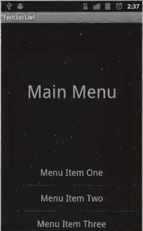

为了创建 ArrayAdapter，我指定了在“创建菜单数据”一节中定义的字符串数组，以及在“创建菜单列表项”一节中创建的 `list_element` 布局。假设你的所有 Tab A 都正确插入对应的 Slot B，最终屏幕看起来会像图 5.1 那样。

跳个小舞吧——你现在有一个可用（虽然非常简单）的列表了！抽支烟、喝杯咖啡、抿口葡萄酒，或者来点狗零食。无论你用什么方式奖励自己出色地完成了工作，现在就去做吧。你回来时我还会在这里。

### 响应点击事件

你的代码需要监听列表项点击。

如果无法判断列表项何时被选中，那菜单还有什么意义？没错，毫无意义。让我向你展示基础列表菜单示例的最后一部分。将以下方法添加到 MainMenuActivity.java 文件中：

```java
@Override
public void onListItemClick(ListView lv,
        View clickedView,
        int position, long id)
{
    super.onListItemClick(lv, clickedView, position, id);
    TextView tv = (TextView)clickedView;
    Toast.makeText(getApplicationContext(),
        "List Item "+tv.getText()+" was clicked!",
        Toast.LENGTH_SHORT).show();
}
```

每当列表视图中的元素被点击（或用手指轻触）时，ListActivity 都会调用这个方法（如果你定义了它）。对于更复杂的列表，你可能需要使用 ID（尤其是在使用 SQLite 作为后端存储时）。在这个简单演示中，我只是弹出一个小对话框，显示被按下项的文本。如果你要实现自己的基础主菜单，我建议使用被点击项的位置来启动 Activity、Service 或其他操作。如果你查看相关源代码，就能看到这样的示例。

这是我能向你展示的最基础的列表视图。现在，我会带你往相反方向走，向你展示由远程数据源支撑的自定义列表是什么样子。


构建主菜单固然很好，但 Adapter 和 ListView 的组合还有复杂得多的用法。事实上，我将展示一个在两方面变得复杂的示例。首先，数据源将来自远程 URL（一个 Twitter 信息流）。其次，我将向列表添加第二个文本视图（如果需要，你可以向其中添加任意数量的项）。

### 1000 英尺视角

好了，计划如下。首先，你需要一个 AsyncTask 从 Twitter 的 API 获取信息流。拿到数据后，你需要将其解析为 JSON（JavaScript Object Notation）对象，并将这些数据送入自定义 Adapter。最后，你需要创建该自定义 Adapter 以及特定的 ListView 布局，以容纳两段文本信息。有了这些，你就可以创建自定义布局对象。

最终，你将得到一个列表，其中包含 Peachpit 最近 20 条 Twitter 消息以及它们的发布时间。如果某条消息被转发，文本将显示为红色。这绝不是你能用这些工具构建的最复杂列表，但它是向你展示如何创建自己的复杂自定义列表视图的好方法。

### 创建主布局视图

这一步与“为 ListActivity 定义布局”一节非常相似。你需要一个包含 ListView 的 XML 布局，其 ID 为 android:id/list。不过，在这种情况下，由于活动启动时数据尚不可用，你需要让 ListView 一开始处于隐藏状态。我的项目的 XML 布局如下：

```xml
<?xml version="1.0" encoding="utf-8"?>
<LinearLayout xmlns:android="http://schemas.android.com/apk/res/android"
    android:orientation="vertical"
    android:layout_width="match_parent"
    android:layout_height="match_parent">
    <TextView
        android:id="@+id/loading_text"
        android:layout_width="match_parent"
        android:layout_height="wrap_content"
        android:text="@string/loading"
        android:gravity="center"/>
    <ListView
        android:id="@android:id/list"
        android:layout_width="match_parent"
        android:layout_height="match_parent"
        android:visibility="gone"/>
</LinearLayout>
```

### 创建 ListActivity

同样，你需要一个新的 ListActivity。既然你已经很擅长启动它们，我就直接展示我的 onCreate 方法是什么样子：

```java
private TwitterAsyncTask twitterFetcher;
@Override
public void onCreate(Bundle savedInstanceState) {
    super.onCreate(savedInstanceState);
    setContentView(R.layout.main);
    Adapter adapter = new TwitterJSONAdapter();
    setListAdapter(adapter);
    twitterFetcher = new TwitterAsyncTask();
    twitterFetcher.execute("https://api.twitter.com/1/statuses/user_timeline.json?include_entities=false&include_rts=false&screen_name=peachpit&count=20");
}
```

> **NOTE:** 如果前面代码清单中的 Twitter URL 无法使用，我已经在 http://wanderingoak.net/twitter_backup.json 存放了一份数据备份。如果 Twitter 更改了他们的 API，你始终可以针对该 URL 运行示例代码。


这个方法调用做了两件值得注意的事。首先，它创建了一个新的自定义 Twitter JSONAdapter，我稍后将向你展示如何创建它。其次，它创建了一个 TwitterAsyncTask 并启动它。

如果你仔细观察，就会注意到我创建了一个私有数据成员来保存这个获取 Twitter 数据的任务。敏锐的读者可能会想，我为什么选择以这种方式把它单独保存起来。答案是，由于这个任务不在主线程上执行，如果用户在任务完成前关闭活动，我需要能够取消它。为此，onStop 方法需要能够调用这个获取 Twitter 数据的 AsyncTask，因此要把它设为私有数据成员。

### 获取 Twitter 数据

我的第一个任务——至少就实际工作而言——是加载 Twitter 消息流。得益于上一章，你应该已经非常熟悉获取网络数据的来龙去脉。鉴于你如此熟练，我将隐藏执行网络调用并将其读入字符串所需的代码。如果你记不清如何操作，可以随时查看示例代码。闲话少说，我的 TwitterAsyncTask 如下：

```java
private class TwitterAsyncTask extends AsyncTask<String, Integer, JSONArray>{
    @Override
    protected JSONArray doInBackground(String... params) {
        String response = getURLContents(params[0]);
        try {
            return new JSONArray(response);
        } catch (JSONException ex) { return null; }
    }

    @Override
    protected void onPostExecute(JSONArray response){
        if(response == null)
            return;
        try{
            ((TwitterJSONAdapter)getListAdapter()).setData(response);
            getListView().setVisibility(View.VISIBLE);
            View loading = findViewById(R.id.loading_text);
            if(loading!=null)
                loading.setVisibility(View.GONE);
        }catch(Exception e){
            Log.e("TwitterFeed", "Failed to set Adapter");
        }
    }
}
```

### 处理异常

捕获到任何特定异常时，打印出其原因始终是个好主意。从根本上说，这不过是 Java 最佳实践。如果出现异常，而你没有将其打印到 Android 的 LogCat 工具中，事情可能很快就会变得非常令人困惑。初学者在调试问题时遇到困难，往往是因为他们捕获后又放过了包含重要信息的异常。

同样，如果你在如何获取 URL 末端的数据并将该数据转换为充满 JSON 的字符串方面遇到困难，请查看随附示例代码中 getTwitterFeed 的内容。以下是获取数据的一般步骤：

1. 根据 `getTwitterFeed` 中返回给你的字符串创建一个 JSON 数组。这会解析数据，然后你在 `doInBackground` 方法末尾返回它。
2. 一旦你在 `onPostExecute` 方法中回到主线程，就该将 JSON 数组传递给自定义适配器（我保证马上就会向你展示）。更新数据将触发列表视图重绘。
3. 隐藏我在 XML 布局文件中定义的初始“加载中……” `TextView`，并改为显示列表。

> **NOTE:** 对 Adapter 数据的任何更改都必须在主线程上进行。就 Android 而言，修改 Adapter 数据算作更改 UI。一如既往，所有对用户界面的更改都必须在主线程上执行。创建自己的适配器时请记住这一点，尤其是在你于主线程之外从网络获取数据时。


### 创建自定义 Adapter

好了，现在到了真正有趣的部分。你需要创建一个自定义 Adapter，将行数据送入 ListView。

自定义 Adapter 有四个必须重写的方法，它们都让 ListView 能够获取有关你的数据集的信息。

- `getCount()` 返回当前信息集合中的行数。
- `getItem(int position)` 返回与特定行位置对应的对象。
- `getItemId(int position)` 返回与特定位置项对应的 ID。这常用于专注于 Cursors（Android 的 SQLite 接口）的适配器。
- `getView(int position, View convertView, ViewGroup parent)` 是 Adapter 大部分工作发生的地方。ListView 发起此调用时，本质上是在请求位于 position 的视图。你必须在此方法中为 position 处的数据返回一个配置正确的视图。稍后将详细说明它到底如何工作。

从所有必需方法上的 get 前缀可以看出，Android Adapter 所做的就是向 ListView 提供行内容信息。看起来，ListView 是一个非常粘人的女朋友（或男朋友……我不确定该如何给 Android UI 界面分配性别）。

在讨论更多理论之前，让我先向你展示这个示例。Twitter 的 API 以 JSON 编码对象的形式返回信息。此时将其转换为其他数据存储并没有意义，因此我将设计自定义适配器，使用 JSONArray 对象作为其数据支撑。这个类在 ListActivity 中声明为内部类定义。

```java
private class TwitterJSONAdapter extends BaseAdapter {
    JSONArray data;
    //Must be called on the main thread
    private void setData(JSONArray data){
        this.data = data;
        this.notifyDataSetChanged();
    }
    @Override
    public int getCount() {
        if(data==null)
            return 0;
        else
            return data.length();
    }
}
```


```java
@Override
public Object getItem(int position) {
    if(data==null)
        return null;
    try{
        JSONObject element = (JSONObject)data.get(position);
        return element;
    }catch(Exception e){
        return null;
    }
}
@Override
public long getItemId(int position) {
    return position;
}
```

这段代码大部分是在封装对 JSON 对象的访问器。它负责从某个位置获取一个条目（在这个例子中，位置就是 JSON 数组的索引）。如果没有设置数据，Adapter 就会直接报告没有内容可显示。示例中唯一没有重写必需函数的方法是修改数据集的那段代码。它还会调用 `notifyDataSetChanged`，因此该方法必须要在主线程中调用。我的类继承自 `BaseAdapter`，因为它包含了我构建自定义 Adapter 所需的全部基础方法。

### 构建 ListView

你终于到了要构建并返回各个自定义列表视图元素的部分。下面这段代码正是用来完成这一任务的：

```java
@Override
public View getView(int position, View convertView,
    ViewGroup parent) {
    JSONObject node = (JSONObject)getItem(position);
    ViewGroup listView = null;
    //Reduce, Reuse, Recycle!
    if(convertView == null)
        listView =
        (ViewGroup)getLayoutInflater().inflate
            (R.layout.twitter_list_item, null);
    else
        listView = (ViewGroup)convertView;
    try{
        boolean retweeted = node.getInt("retweet_count") > 0;
        TextView tv =
        (TextView)listView.findViewById(R.id.text_one);
        tv.setText(node.getString("text"));
        if(retweeted)
            tv.setTextColor(0xFFFF0000);
        else
            tv.setTextColor(0xFFFFFFFF);
        tv = (TextView)listView.findViewById(R.id.text_two);
        tv.setText(node.getString("created_at"));
```

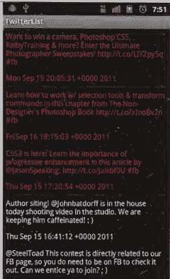
图 5.2 Peachpit Press 的 Twitter 信息流。现在是彩色的！

```xml
android:id="@+id/text_one"
    android:layout_width="match_parent"
    android:layout_height="wrap_content"
    android:padding="6dp"/>
<TextView
    android:id="@+id/text_two"
    android:layout_width="match_parent"
    android:layout_height="wrap_content"
    android:padding="6dp"/>
</LinearLayout>
```

有了这个布局，你现在就拥有了下载、解析和显示 Twitter 信息流所需的全部活动组件。图 5.2 终于展示了 Peachpit 的 Twitter 信息流在 ListView 中的样子。

### 这些对象如何交互？

要理解 ListView 如何与 Adapter 交互，你必须先了解几个限制条件。首先，列表可以无限滚动下去，至少从设备的角度来看是这样。然而，你可能已经猜到，手机的内存是有限的。这意味着并不是每一个列表项都能在列表中拥有自己的条目，否则设备很快就会空间不足。此外，如果 ListView 必须在开始时就把每一行都布局出来，它可能会陷入长时间的卡顿，令人无法接受。

Android 解决这些问题的方式是回收列表元素行。这个过程大致如下：

- 1. Android 会遍历整个列表，询问每一行需要多大空间（这样它才知道滚动指示器该画多大）。
- 2. 一旦它大致知道整个 ListView 有多大，就会为第一屏以及一个缓冲区请求视图（这样当用户开始滚动时，它就不必停下来获取更多视图）。当 ListView 反复调用 `getView` 时，你的 Adapter 需要创建、配置并返回这些视图。
- 3. 当用户向下滚动，行从列表顶部消失时，Android 会在调用 `getView` 时把它们返还给你。实际上，它是通过把 `convertView` 对象传给你，要求你复用之前的视图。

虽然回收列表元素行对节省内存和加速长列表很有好处，但它也有一些有趣的副作用。

- 为了利用内置的回收机制，你的所有列表视图都必须始终从同一个行布局中 inflate。Android 不知道你想创建哪种类型的列表项；因此，如果你有例如三种不同的行布局，系统就不知道该把哪一个传回给你，而你必须自己管理未使用视图的池。
- 任何异步任务，例如从磁盘加载图标或加载用户的头像，都必须检查 ListView 在下载或加载图像数据期间是否已经回收了该视图。如果任务完成时该行仍然显示同样的数据，就可以安全地更新该行；否则，就需要缓存或丢弃这些数据。

### 总结

本章介绍了简单和自定义 ListView 以及 Adapter 的基础知识。我向你展示了如何创建一个简单的主菜单，并带你完成了一个简单的示例，即构建自定义 Adapter 来处理更复杂的 ListView。现在你已经掌握了基础知识。

列表仍然是移动开发的基石之一。不过，我建议你尽可能少做单调、图形平淡的列表。虽然这些示例很适合向你展示如何构建自己的列表，但它们绝不是优秀界面设计的典范。你可以在需要时创建列表，而且非常应该这样做，但在不影响性能的前提下，要尽量把它们美化。

如果你还想了解更多，我强烈建议你通读 Android 对 `ListActivity.java` 的实现。因为 Android 是开源的，你可以免费获得构成其 SDK 的全部代码！请访问 http://source.android.com 获取更多信息。

最后，我为本章编写的代码比这里能解释的要多。我建议你看看与本章相关的示例代码（位于 Peachpit.com/androiddevelopanddesign），以了解更多关于如何通过菜单点击启动一个屏幕，以及如何使用 `ListFragment` 构建类似的主菜单屏幕。

## 6 服务之道


服务是 Android 平台中最重要、也往往未得到充分利用的组件之一。对于任何数据或相关性可能跨越多个 Activity 的任务，服务都是必不可少的。它们与 Activity 一样拥有生命周期（尽管要简单得多），但没有 Activity 那样绘制到屏幕的能力。在实践中，服务分为两大用例：监听器（listener）和任务（task）。监听器是在后台待命、等待某件事情发生从而促使它们采取行动的服务。任务服务类似于我们之前介绍过的图片下载器，因此本章我将重点讨论监听服务。

### 什么是服务？

从最基本的层面来说，Service 是一个具有简单运行时生命周期且无法访问屏幕的类。在第 4 章中，我向你展示了如何使用 `IntentService` 获取图片，你已经对它有所接触；但现在我有机会帮助你真正深入了解这个简单而强大的组件。

请记住，虽然服务对你来说可能很重要，但对 Android 而言，它并不比整个设备的流畅运行更重要。这意味着，如果系统认为你的服务运行时间过长、消耗了太多资源，或者恰逢本月第三个星期五又是满月，它随时都可能关闭你的服务。有一种方法可以让系统不要杀掉你，我马上就会展示它是什么样子。

#### 服务的生命周期

从本质上讲，服务是一个单例。应用程序中的任何组件都可以通过指定要启动的服务的 Intent 来调用 `startService`。如果服务尚未运行，Android 会初始化一个新实例；否则，它只会通知现有实例有一个新的启动命令已发出。以下是服务生命周期的简要说明。

- `onCreate` 在服务启动时于主线程中被调用。这是初始化你在服务运行期间将要依赖的任何数据的好时机。
- 每次 Activity（或其他任何组件）调用 `startService` 时，都会调用 `onStartCommand`。传入 `startService` 的 Intent 将被交给你的 `onStartCommand` 调用。
- `onBind` 是你向调用方返回一个接口对象的机会，该接口允许直接调用服务上的方法。不过，binder 是可选的，只有在与服务进行大量通信时才真正需要。这产生了一种与调用 `Context.startService` 不同的交互方式。与 `startService` 类似，`bindService` 接收一个 Intent，如果服务尚未运行，它就会启动该服务。如果你觉得我刚才写的完全不知所云，那也没关系；到本章结束时，你就会明白得多。

在这个生命周期阶段，你的服务现在已经愉快地运行起来了。可以播放音乐、获取数据（记住主线程！），还可以进行录音并处理成语音命令。


### 记住主线程！

仅仅因为你在一个服务中运行，并不意味着你就脱离了主线程！服务的 `onCreate` 方法会在主线程上被调用。如果你需要执行任何繁重的工作，可以考虑使用 `AsyncTask` 或 `Handler+Looper` 模式，或者不要使用普通服务，而是使用 `IntentService` 在主线程之外处理繁重数据。此外，某些操作（例如录制音频）只能从主线程发起。现在是上午10点，你知道你的线程都在哪里吗？

### 保持服务运行

`startForeground` 方法是你与 Android 达成巧妙交易的机会。系统同意，在你调用此方法之后、直到你调用 `stopForeground` 之前，它不会杀死你的服务。作为交换，你必须通过传入一个 `Notification` 对象，向用户提供要显示在顶部栏中的图标和视图。这个契约允许长时间运行、必不可少且密集型服务（例如音乐播放或照片上传）运行而不必担心被终止。同时，用户也能知道为什么他们的手机可能有点卡顿。

### 关闭它！

某个时刻，聚会终将结束，该清理了。这可能是因为你的服务调用了 `stopSelf`，或者因为另一个组件调用了 `Context.stopService`。以下是生命周期中的销毁部分：

- `onDestroy` 是你取消任何正在运行的任务并释放你占用的任何资源（例如媒体或网络任务）的机会。这也是你注销任何为监视新媒体而设置的 `BroadcastReceivers` 或 `ContentObservers` 的机会。

如果你期待一个多步骤的关闭过程，恐怕你会失望。因为服务没有位于屏幕顶层的概念，所以无需暂停、恢复，或执行活动必须支持的任何其他复杂交互。

与服务通信主要有两种方式：意图广播和绑定器接口。我将向你展示两者的示例，并在此过程中让你看到服务的两个实用任务。事实上，与服务通信的方式还有很多。但根据我的经验，这是两种最有用的方式。一如既往，如果这两种方法都不太适合你，请查阅文档。

### 基于意图的通信

想象两个在不同房间的工人，他们只能通过电子邮件相互通信。这些电子邮件可以包含附件和其他数据。这两个工人必须仅使用这一种通信方式度过一天。正如你可能想象的那样，只要他们不必彼此说太多话，这可以是一种高效且实用的方式来完成大量事情。

在某种意义上，这正是与服务进行*基于意图的通信*在现实生活中的样子。服务通过意图启动；当它完成任务或等待的事情发生时，它会发送一个广播意图，提醒任何监听者某个特定任务已完成。你在第4章看到过一个例子，当时我使用意图服务下载图像。让我再给你展示一个。

下面的例子是我能以这种印刷形式给出的基于意图的通信的最佳示例之一。我将创建一个新服务所需的所有部分，该服务在前台运行并带有通知。我使用 Android 的 ContentProvider 来监听并获取新拍摄照片的位置。这段代码会在拍摄任何新照片时提醒你，无论使用哪个应用程序拍摄。至于你如何处理照片，我留给你无限的想象力。

### 自动上传图片

Google+ Android 应用我最喜欢的功能之一是它能够在后台自动上传照片。事实证明，借助 ContentProvider、Service 和 ContentObserver，你可以在自己的应用中轻松实现这一点。我的示例服务将启动，将自己置于前台，并在拍摄新照片时触发广播意图。在你自己的代码中，你可以上传图像或采取任意数量的其他操作。使用这种技术将涉及以下一般步骤。

- 1. 声明服务。
- 2. 获取一个服务。
- 3. 启动服务。
- 4. 初始化服务。
- 5. 转到前台。
- 6. 观察内容变化。

让我们开始吧。

#### 声明服务

你必须告诉 Android 在哪里找到该服务。

如你所知，每个服务都必须在清单中声明。你可以为它添加一个意图过滤器来响应（如果你希望除自己之外的应用也能启动它）。对于我的示例，这没有必要，但以后可能是你需要利用的东西。以下是需要在清单中放置的单行：

```xml
<service android:name="PhotoListenerService"/>
```

#### 获取一个服务

现在创建扩展 Service 的类。

```java
public class PhotoListenerService extends Service {
    @Override
    public IBinder onBind(Intent intent) {
        return null;
    }
}
```

由于 `onBind` 是 `Service` 类的必需方法，它必须在我的类中，否则无法编译。现在你已经有了一个服务，让我们看看如何实际启动它。

- 2. 完成这些后，你现在可以编写代码来启动和停止照片监听服务。更新后的 ServiceExampleActivity 现在如下所示：

```java
public class ServiceExampleActivity extends Activity
        implements OnClickListener {
    /** Called when the activity is first created. */
    @Override
    public void onCreate(Bundle savedInstanceState) {
        super.onCreate(savedInstanceState);
        setContentView(R.layout.main);
        Button btn = (Button)findViewById(R.id.start_service);
        btn.setOnClickListener(this);
        btn = (Button)findViewById(R.id.stop_service);
        btn.setOnClickListener(this);
    }
}
```

这段清单没有什么惊天动地的内容。我在视图构建完成后获取对它们的引用。我将我的类设置为实现 `OnClickListener` 接口，这允许我将活动本身设置为两个按钮的点击监听器。上面的代码在你实现 `View.onClick` 之前无法编译。

- 3. 实现 `onClick` 方法：

```java
@Override
public void onClick(View v) {
    Intent serviceIntent = new Intent(getApplicationContext(),
            PhotoListenerService.class);
    if(v.getId() == R.id.start_service){
        startService(serviceIntent);
    }
    else if(v.getId() == R.id.stop_service){
        stopService(serviceIntent);
    }
}
```

这同样非常简单。按钮被点击时将调用此 `onClick` 方法。根据实际获得点击的视图，我将启动或停止服务。

#### 启动服务

现在，如果你按原样运行代码，你会按下按钮，服务会启动，然后……什么也不会发生。让我向你展示如何改变这一点。

我希望每当有人用设备的相机拍照时，系统都会通知我。为此，你需要向 Android 的媒体 ContentProvider 注册一个观察者。切换回 `PhotoListenerService.java` 文件，在服务的 `onCreate` 方法中注册媒体通知：

```java
@Override
public void onCreate(){
    super.onCreate();
    getContentResolver().
    registerContentObserver(
        MediaStore.Images.Media.EXTERNAL_CONTENT_URI,
        true,
        observer);
}
```

要注册内容观察者，我需要提供一个统一资源标识符（URI）。在这种情况下，我将使用外部 SD 卡上保存的所有照片的常量 URI。这个常量在 MediaStore 中声明。第二个参数是我告诉 Android，我想知道该 URI 的子项何时被修改。我将其设置为 true，因为我想知道图像 URI 的任何后代何时被修改、添加或删除。最后，我传入我的观察者。这个对象的 `onChange` 方法将在 ContentProvider 更新时被调用。它将注册媒体更新，但你还需要定义另一个方法。

#### 转到前台

将服务带到前台可以保护它免于在资源不足时被 Android 杀死。

按如下方式实现服务的 `onStartCommand` 方法。

```java
public int onStartCommand(Intent intent, int flags, int startId) {
    super.onStartCommand(intent, flags, startId);
    lastUpdateTime = System.currentTimeMillis();
    setForegroundState(true);
    return Service.START_STICKY;
}
```

我将记录服务启动的时间（稍后会详细说明为什么这很重要）。最后，我返回 `Service.START_STICKY`，这告诉系统，如果服务因内存或性能原因被终止，我希望它重新启动。

我需要编写一个函数来处理创建通知并将服务移到前台。`setForegroundState` 是我自己的方法，负责将服务置于前台模式以及从服务移出前台模式。

```java
private void setForegroundState(boolean enable){
    if(enable){
        Notification n = new Notification(
            R.drawable.icon,
            "Service is uploading all your photos",
                System.currentTimeMillis());
        n.contentView = new RemoteViews(
```


```
                "com.haseman.serviceExample",
            R.layout.notification);
    Intent clickIntent = new Intent(
            getApplicationContext(),
            ServiceExampleActivity.class);
    n.contentIntent =
            PendingIntent.getActivity(
            getApplicationContext(), 0, clickIntent, 0);
        startForeground(1, n);
    }
    else {
        stopForeground(true);
    }
}
```

多亏了换行的奇妙效果，这段代码读起来有点费劲。本质上，要进入前台模式，你至少需要一个 Notification 对象、一个 RemoteViews，以及一个当用户点击下拉通知时触发的 intent。让我再稍微拆解一下。

首先创建一个 Notification 对象，这需要三样东西：

- 一个小图标资源，用于在通知栏顶部持续显示。
- 一个字符串，在通知出现时短暂闪现于顶部栏。
- 显示通知的时间（在这个例子中，就是现在！）。这个构造函数返回一个 Notification 对象，你可以向其中添加其余所需对象。

接下来你会看到，我为下拉通知栏创建了一个 RemoteViews，并在代码清单中将它设置为通知的 contentIntent。

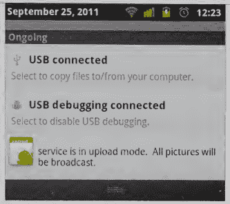

**图 6.1** 通知下拉栏的实际效果！

这是将被填充并放入通知栏的布局。这些布局只能使用 Android 原生控件（不能使用自定义视图），并且你应当尽量保持简单。我的布局由一个图标和一个文本视图组成。它足够简单，你大概能想象出它具体长什么样，但图 6.1 展示了它的实际效果。

值得注意的是，创建 RemoteViews 时，你实际上并没有自己填充视图。你是在指定一个布局，然后告诉系统最终填充它时该如何处理（这就是 View 与 RemoteViews 的区别）。你会把它设置为通知的 contentView。

接下来，你会看到我创建一个 intent，它将在用户按下图 6.1 中所示的通知行时触发。这是一个 PendingIntent；同样，它实际上是一个 intent，以及一条关于时机到来时该如何处理它的指令。在这个例子中，我想启动带有 Start 和 Stop 按钮的 Activity。你会像我一样，把这个 PendingIntent 设置为通知的 contentIntent。

拿到完整构建好的通知后，你现在可以调用 startForeground，并把该通知传给它。

现在你已经履行了自己这一方的约定：你告诉了用户你是谁，以及你为什么在运行。系统现在会允许你不受干扰地运行，直到用户按下 Activity 的 Stop 按钮禁用该服务为止。现在该开始监听内容何时发生变化了。

### 观察内容何时发生变化

既然服务已经在运行并处于前台，我可以向你展示一个空的 ContentObserver 是什么样子：

```
    ContentObserver observer = new ContentObserver(null) {
        public void onChange(boolean self) {
        }
    };
```

每当手机上的*任何*照片发生变化时，onChange 都会被调用。此时，你的任务是确定实际发生了什么变化。你应当通过查询 ContentProvider 中在 lastUpdateTime 之后创建的图像来完成这件事。下面是我的示例代码中的做法：

```
    Cursor cursor = null;
    try {
        cursor = getContentResolver().query(
                MediaStore.Images.Media.EXTERNAL_CONTENT_URI, null,
                MediaStore.Images.Media.DATE_TAKEN + " > " + lastUpdateTime,
                null, null);
    } finally {
        if (cursor != null)
            cursor.close();
    }
```

如果这看起来像一条 SQL 查询，那正是有意为之。我正在指定我想要获取信息的 URI（所有图像）。下一个参数（我传入 null）本可以用来列出我具体想要接收的列。通过传入 null，我请求了所有列。接下来是查询的 WHERE 子句，我在这里请求 lastUpdateTime 之后创建的每一张照片。由于我没有更多语句，我会把下一个参数留为 null。最后，结果的默认排序已经够用，所以最后一个参数我可以传入 null。理论上，游标应当恰好包含一张图像。下面是我处理从 ContentProvider 返回的游标的方式：

```
lastUpdateTime = System.currentTimeMillis();
if (cursor.moveToFirst()) {
    Intent i = new Intent(ACTION_PHOTO_TAKEN);
    int dataIDX = cursor.getColumnIndex(MediaStore.Images.Media.DATA);
    i.putExtra("path", cursor.getString(dataIDX));
    sendBroadcast(i);
}
```


> **提示：** 上传照片：通常，我会启动另一个服务（或 AsyncTask）来把照片上传到我喜欢的照片分享服务，而不是调用 sendBroadcast。这些服务变化太频繁，因此可能不值得详细说明如何针对 Twitter、Flickr、Tumblr 或 Imgur 完成这件事。如果你想实现自己的方案，可以把第 4 章中用于下载照片的 IntentService 作为框架，并在此基础上继续。

既然我有了游标，就可以设置新的 lastUpdateTime。这将确保当前这张照片不会出现在后续由观察器触发的查询中。我没有启动上传，而只是发送一个提醒，说明拍到了一张照片以及在哪里可以找到这个新文件。接着，我把游标移动到初始位置，并确认（通过检查它是否返回 true）确实有数据可找。接下来，我会获取 data 列的列索引。最后，我从游标中取出路径，并将其作为 extra 添加到新的 intent 中。最后，我广播这张照片的存在，供任何可能正在监听它的对象使用。

对从 ContentProvider 返回的每个游标，都必须调用 cursor.close。否则，系统会因为内存泄漏而向你抛出错误。

### Binder 服务通信

与基于 intent 的通信截然相反的是通过 Binder 接口控制的服务。这允许与任何绑定到你的服务的其他组件进行跨进程通信。多个进程或组件可以绑定到任何服务单例，当然，它们访问的都是同一个服务实例。

绑定——以及随后直接在服务上调用方法——需要几个步骤，才能干净且高效地处理这种交互。

- 1. 使用 AIDL 文件创建接口。
- 2. 创建一个服务存根，作为 IBinder 对象返回。
- 3. 实现 ServiceConnection，以便与服务建立连接。

如你所见，除非你确实需要自己的组件与想要绑定的服务之间进行紧密集成，否则不应贸然采用这种方式。

在后面的章节中，我会向你展示媒体播放和录制的方方面面。要正确做到这一点，你需要一种只有带绑定接口的服务才能提供的集成。因此，作为示例，我将构建一个带有适合在后台播放音乐的 IBinder 的后台服务。为简洁起见，我会避免讨论每一个方法，但会涵盖几个基本函数，并向你展示如何建立连接。

#### 创建 AIDL

AIDL（Android 接口定义语言）文件是你定义接口的机会，通过这个接口，你的服务可以与外部世界通信。在我的示例中，我在 `src/com/haseman/serviceExample/` 目录中创建了 `IMusicService.aidl` 文件。在其中，你会声明一个接口：

在新服务中，我声明了与 AIDL 接口文件中相同的所有方法。它目前看起来像这样：

```
public class MusicService extends Service {
    private void pause() {
    }
    private void play() {
    }
    public void setDataSource(long id) {
    }
    public String getSongTitle() {
        return null;
    }
    @Override
    public IBinder onBind(Intent intent) {
        return null;
    }
}
```

#### 创建 Binder 和 AIDL 存根

既然你已经在服务中有了接口和方法，现在该把二者连接起来了。你需要使用一个存根来完成这件事。存根会保持对服务的弱引用，同时实现你的 AIDL 接口。它也是你要传回给 onBind 调用的对象——而不是传 null。你可以在服务内部声明它（尽管实际上并非必须这样做）。下面是我的存根的样子（其中包含我新增的 onBind 调用，用于将它返回给系统）：


```java
private final IBinder mBinder = new MusicServiceStub(this);

@Override
public IBinder onBind(Intent intent) {
    return mBinder;
}

static class MusicServiceStub extends IMusicService.Stub {
    WeakReference<MusicService> mService;

    MusicServiceStub(MusicService service) {
        mService = new WeakReference<MusicService>(service);
    }

    public void pause() {
        mService.get().pause();
    }

    public void play() {
        mService.get().play();
    }

    public void setDataSource(long id) {
        mService.get().setDataSource(id);
    }

    public String getSongTitle() {
        return mService.get().getSongTitle();
    }
}
```

- 一个标志，告诉系统我希望服务以何种方式启动（在本例中，不是粘性的——你可以查看 SDK 文档以了解更多相关信息）。

现在，只有在我实际向 Activity 的类声明中添加 `implements ServiceConnection`，并添加它所需的方法之后，我的示例代码才能编译。下面就是我 Activity 新增的必需方法，它们全都完整呈现。

```java
IMusicService mService;

@Override
public void onServiceConnected(ComponentName name, IBinder service) {
    mService = IMusicService.Stub.asInterface(service);
    try {
        mService.setDataSource(0);
    } catch (RemoteException re) {
        Log.e("MusicService", "", re);
    }
}

@Override
public void onServiceDisconnected(ComponentName name) {
}
```

这段代码可能看起来有点奇怪，但 `asInterface` 调用会将 `IBinder` 对象转换为 `IMusicService`（然后我就可以直接调用它）。不过，每次调用远程服务时，你都需要捕获可能出现的 `RemoteException`。

其实就这么简单。一旦收到 `onServiceConnected` 调用并完成转换，你就可以把那个 `MusicService` 对象保存起来，以便在需要时使用。

但不要忘记在 `onDestroy` 方法被调用时解除与它的绑定。

通过这种方式创建 AIDL 并绑定到服务，实际上是与服务通信较为复杂的方式之一。如果你不打算在单独进程中构建一个长时间运行的服务，那么这种设置可能并不完全适合你。可以考虑查阅 SDK 文档中关于本地绑定服务或 Messenger 模式的内容。

### 小结

在本章中，你学习了如何使用一个简单的前台服务，在照片被添加到 Android 的 `ContentProvider` 时通知你。你学习了如何启动它、通过通知将其置于前台，然后在用户不再希望它运行时终止它。接下来，我从简单到复杂，向你展示了如何跨进程边界直接与服务通信。你通过创建 AIDL 接口、实现存根，然后使用 `ServiceConnection` 和 `bindService` 调用来与服务建立连接，完成了这一过程。

第一个示例是一个只做一件事的简单服务，而第二个示例则是你快速攻克的一个更复杂的机制，也是 Android 能提供的较复杂机制之一。如果你的手臂足够长（而且你不是*霸王龙*），就用力拍拍自己的背吧。

## 7 多种设备，一个应用


Android 设备有数百种不同的硬件配置，从高级电视到非常基础的手机。编写一个能在整个范围内完美运行的应用程序，似乎是一项艰巨的任务。幸运的是，Android 提供了许多工具来处理它所运行的生态系统。在本章中，我将向你展示如何利用 Android 的布局文件夹层级系统、配置你的清单文件以确保你的应用程序仅对能够正确运行它的手机可用，以及处理旧版本的 Android SDK。Android 的多样性可能是一个挑战，但我会向你展示如何使用现有工具，使它变得可控。本章涵盖 `res/` 文件夹的秘密；通过清单文件剔除设备；以及通过反射兼容旧手机。

### 揭开 RES/ 文件夹的秘密

前面，我给出了 `res/` 文件夹中什么内容放在哪里的基本对应关系。在本节中，我将向你展示它更高级的功能。和往常一样，你可以自己编写代码，也可以参考发布在 Peachpit.com/androiddevelopanddesign 上的示例代码。

#### 布局文件夹

布局文件夹是你可使用的第一个工具的来源，而且它是最好的工具之一。如果配置正确，Android 会从与当前运行硬件配置最接近的文件夹中选择布局文件。使用这个工具，你可以为任意数量的不同硬件配置定义多种屏幕布局。让我们从简单的内容开始：横屏模式。

假设你有一个带有两个按钮的简单屏幕。让我们看看生成这两个按钮的布局 XML。

```xml
<RelativeLayout>
<!--Text view for question and relative layout params omitted-->
<Button
    android:padding="15dp"
    android:gravity="center"
    android:id="@+id/yes_button"
    android:layout_marginLeft="30dp"
    android:layout_marginRight="30dp"
    android:layout_width="fill_parent"
    android:layout_height="wrap_content"
    android:layout_above="@+id/no_button"
    android:text="@string/yes_button_text"
    />
<Button
    android:padding="15dp"
    android:gravity="center"
    android:id="@+id/no_button"
    android:layout_marginLeft="30dp"
    android:layout_marginRight="30dp"
    android:layout_marginBottom="60dp"
    android:layout_width="fill_parent"
    android:layout_height="wrap_content"
    android:text="@string/no_button_text"
    android:layout_alignParentBottom="true"
    />
```


**图 7.1** 一个带有两个按钮的简单屏幕。

**图 7.2** 在横屏模式下，按钮太大了。

鉴于你在前面章节中已经接触过 `RelativeLayout`，这段代码清单中的内容应该不会让你感到陌生。我声明了两个按钮，将“否”按钮固定在底部，并将“是”按钮对齐到它上方。在竖屏模式下显示时，这些按钮看起来简单，但效果相当不错（图 7.1）。

虽然只有在评委部分失明的情况下，这个设计才能让我赢得设计奖，但它仍然是一个相当美观、简单且实用的屏幕。不过，看看当我把它切换到横屏模式时会发生什么（图 7.2）。

找不到更好的词来形容，这就是一场灾难。按钮相对于其文字以及上方“你喜欢巧克力吗？”这个问题来说太宽了。这正是 Android 的布局文件夹可以轻松解决的那类问题。

为了修复这个图形上的混乱，我需要让按钮在横屏模式下并排显示，同时在竖屏模式下仍然堆叠显示。解决这个问题有两种方法：一种稍微笨重的方法是为横屏设置第二个屏幕布局；另一种是用手术刀式的方法，只切除并修复出问题的部分。两种解决方案各有其适用场景。

##### 使用不同的文件夹

Android 允许你为各种硬件屏幕配置指定不同的布局文件夹。这个示例通过向你的项目添加一个 `layout-land` 文件夹来解决问题。

现在到了神奇的部分。

- 1. 为横屏配置创建一个名为 `layout-land` 的新文件夹，并将其放在 `project/res/` 中。
- 2. 将横屏专用的布局文件放入这个文件夹，当设备处于横屏模式时，Android 会*自动*使用它们。

##### 使用 <include> 进行小改动

`<include>` 标签是一种极好的方式，可以抽出你希望单独调整和布局的屏幕小部分。这就是手术刀式方法。你只切出希望以不同方式渲染的部分，将它们拆分到按文件夹分隔的布局中，然后就完成了。在这个例子中，这正是一种完美的方式，可以切除按钮部分，并让它们根据屏幕方向以不同方式渲染。下面就是具体做法。

- 1. 在 `res/layout-land/` 中创建一个新的 `button_layout.xml` 文件。我们将把横屏专用的布局放入这个文件。
- 2. 在新的 `button_layout.xml` 文件中添加一个 `LinearLayout` 和两个 `Buttons`，并将它们并排放置在新的水平 `LinearLayout` 中。下面是我的 `/layout-land/button_layout.xml` 的最终内容。


```xml
<?xml version="1.0" encoding="utf-8"?>
<LinearLayout
    xmlns:android="http://schemas.android.com/apk/res/android"
    android:orientation="horizontal"
    android:layout_width="match_parent"
    android:layout_height="wrap_content"
    android:layout_marginBottom="60dp"
    android:layout_alignParentBottom="true"
    >
    <Button
        android:padding="15dp"
        android:gravity="center"
        android:id="@+id/yes_button"
        android:layout_marginLeft="20dp"
        android:layout_marginRight="5dp"
        android:layout_width="fill_parent"
        android:layout_height="wrap_content"
        android:text="@string/yes_button_text"
        android:layout_weight="50"
        />
    <Button
        android:padding="15dp"
        android:gravity="center"
        android:id="@+id/no_button"
        android:layout_marginLeft="5dp"
        android:layout_marginRight="20dp"
        android:layout_width="fill_parent"
        android:layout_height="wrap_content"
        android:text="@string/no_button_text"
        android:layout_weight="50"
        />
</LinearLayout>
```

可以看到，我创建了一个包含两个按钮的横向布局，用于横屏模式。

不要忘记竖屏布局。如果我们要包含一个布局，那么它必须同时存在于横屏配置和默认配置中。

- 3. 在 `/res/layout/` 中创建一个新的 `button_layout.xml` 文件（或者你也可以把它添加为 `/res/layout-port/button_layout.xml`）。我只是复制了原始按钮的代码，并将其粘贴到一个新的 `RelativeLayout` 中：

```xml
<?xml version="1.0" encoding="utf-8"?>
<RelativeLayout
    xmlns:android="http://schemas.android.com/apk/res/android"
    android:layout_marginBottom="60dp"
    android:layout_width="fill_parent"
    android:layout_height="100dp"
    android:layout_alignParentBottom="true"
>
<Button
    android:padding="15dp"
    android:gravity="center"
    android:id="@+id/yes_button"
    android:layout_marginLeft="30dp"
    android:layout_marginRight="30dp"
    android:layout_width="fill_parent"
    android:layout_height="wrap_content"
    android:layout_above="@+id/no_button"
    android:text="@string/yes_button_text"
/>
<Button
    android:padding="15dp"
    android:gravity="center"
    android:id="@+id/no_button"
    android:layout_marginLeft="30dp"
    android:layout_marginRight="30dp"
    android:layout_width="fill_parent"
    android:layout_height="wrap_content"
    android:text="@string/no_button_text"
    android:layout_alignParentBottom="true"
/>
</RelativeLayout>
```

至此，你已经创建了两个布局：一个用于竖屏，一个用于横屏。

- 4. 现在你可以用 include 来修改原始 XML，如下所示：

```xml
<RelativeLayout>
<!--Text view and relative layout params omitted-->
<include layout="@layout/button_layout"
         android:id="@+id/button_holder"
/>
</RelativeLayout>
```

有了 `<include>` 标签（而不是单个按钮定义），Android 会根据屏幕配置抓取对应的 `button_layout.xml` 文件。如果找不到，则会回退到 `/res/layout` 中的默认文件。

**图 7.3** 设计上并不出彩，但效果好多了。


现在，使用这段新代码，横屏模式看起来好多了（图 7.3）。还有可以改进的地方吗？当然有！不过，现在你已经知道如何指定界面中的某些部分应随屏幕的硬件配置而变化。

### 合并（MERGING）

你不必像我在上一个例子中那样，把现有的视图包装在新的 `ViewGroup`（`RelativeLayout`）里才能让它们被 include。如果你不想在布局层级中额外增加一层布局，而是想从其他 XML 文件引入一系列视图，只需用 `<merge>` 标签包裹它们即可。

```xml
<merge xmlns:android="http://schemas.android.com/apk/res/android">
<!-- views go here -->
</merge>
```

这样你就可以在不向视图层级中添加额外布局的情况下引入视图。

### 除了横屏，还能做什么？

很多。你可以为布局文件夹添加后缀，以适应几乎所有的场景。以下是我经常使用的一些后缀。

- layout-small、layout-normal、layout-large、layout-xlarge

  尺寸修饰符对应屏幕的物理大小。使用 small 布局文件夹的设备通常非常老旧，或者是非常特殊的硬件，至少在 Android 手表普及之前是这样。大多数现代手机属于 layout-normal 类别，而许多平板电脑被视为 xlarge。Google 在 http://developer.android.com/resources/dashboard/screens.html 上提供了各种屏幕配置的详细分类。

- layout-ldpi、layout-mdpi、layout-hdpi、layout-xhdpi

  设备的 dpi（每英寸点数）是屏幕*密度*的度量。高密度（240 dpi）屏幕会从 layout-hdpi 布局文件夹中获取资源。

- layout-large-hdpi-land

  你也可以混合搭配这些后缀。这个后缀将用于拥有大屏幕、高分辨率且处于横屏模式的手机。尽情发挥创意吧，但请记住，能针对屏幕配置做到非常精细并不代表你应该这么做。

### 完整的屏幕定义

正如你可以放置独立的布局文件，供不同硬件配置下的 `<include>` 引用一样，你也可以在 layout-land 文件夹中为横屏模式定义一个完全不同的屏幕。这乍一看似乎是最佳方案，但从几个方面来看并不理想。

- 需要大量编码工作。

  与其只定义两个随屏幕配置而变的小部分，你需要制作并测试多个完整的屏幕布局。

- 后期修改会非常痛苦。

  硬件配置繁多，意味着会有大量不同的屏幕。如果你要为每种配置都完整地布局一个屏幕，那么当设计师要删除或添加一个按钮时，你就得面对一场噩梦。你必须在每个 XML 文件中为每一个屏幕配置单独添加该按钮。

撇开这两点不谈，有时候你确实需要为不同的硬件或屏幕配置准备一套完全独立的布局。尽可能修改小的部分，但必要时也不要害怕撸起袖子，创建一个全新的屏幕布局。

以“巧克力”示例为例，要创建新布局，你只需在 `/res/layout-land` 中创建第二个 `two_buttons.xml` 文件，并按任意方式配置屏幕即可。然后，在 activity 的 `onCreate` 方法中调用 `setContentView` 时，就会像 include 一样，为正确的屏幕配置找到正确的资源。

### 这怎么可能实现？

这是个好问题，我很高兴你直到这一节末尾才问出来。因为 Android 将布局文件与 activity 分离，所以它可以为各种可能的屏幕配置提供任意数量的不同布局。你只需指定布局名称，Android 就会自动搜索正确的 XML 文件展示给用户。为了让这个过程顺畅运行，请牢记以下几点：

- 布局文件*必须*共享相同的名称。

  Android 只能通过名称查找布局 XML。只要布局文件具有完全相同的文件名，它就会从你的横屏（或其他）文件夹中找到对应版本。

- 确保各个视图的 **ID** 保持一致。

  请记住，你的 activity 会调用 `findViewById` 来操作和交互屏幕上的对象。activity 不应该关心视图在哪个位置来注册点击监听器、设置图片或从 `EditText` 中获取数据。

- 尽量不要在 activity 的 Java 代码中移动视图。

  activity 不应该试图改变屏幕上对象的位置。在竖屏模式下，按钮可能位于点 (330, 120)；在横屏模式下，它又会处于完全不同的位置。这种情况下，添加更多屏幕布局还意味着需要向 activity 中添加相应的移动代码，这可能会非常耗时。

### 小心谨慎

跨多个关联的布局文件调试布局问题可能非常耗费精力（我深有体会），所以请尽可能让布局保持弹性和动态。如果你的设计得当，充分利用线性布局和相对布局，它们应该能够自动适应许多屏幕分辨率。只有在动态布局无法胜任时，才回退到 include 和多重布局文件夹。不过，有时单个布局确实无法在所有屏幕上呈现出理想效果。当这种情况发生时，请让你的“拆分”尽可能小而高效。尽管大胆使用这个优秀的布局工具，但也要注意不要过度使用。


### 限制应用仅可在能够正常工作的设备上访问

你的 Android 应用在许多情况下可能需要某些非常特定的硬件才能正常工作。试想，用户把相机应用下载到没有相机的设备上，体验会非常糟糕。

#### <uses-feature> 标签

Android 提供了一种途径，让你可以告诉应用市场应允许哪些设备下载和购买你的应用。这通过 `AndroidManifest.xml` 文件中的 `<uses-feature>` 标签完成。

例如，如果你的应用要求设备配备相机，就应该在清单文件中添加以下行：

```xml
<uses-feature android:name="android.hardware.camera"
              android:required="true"/>
```

这一行告诉 Android，该应用不应安装在没有相机的设备上，因为相机是正确运行所必需的。反过来说，你也可以声明应用会使用某项特定硬件，但在该硬件不存在时进行适当的降级。图像编辑应用可能想使用相机，但如果设备没有相机，它仍可通过修改从网络保存到设备内置图库中的图像来运行。你可以通过将该硬件声明为使用中、但把要求设置为 false 来告诉系统这一点：

```xml
<uses-feature android:name="android.hardware.camera"
              android:required="false"/>
```

你可以设置大量硬件特性。最好查阅文档以获取完整列表（http://developer.android.com/guide/topics/manifest/uses-feature-element.html）。

#### SDK 版本号

你还可以声明应用支持哪些 SDK 版本。为此，需要在清单文件中声明 `<uses-sdk>`。事实上，如果你使用 Eclipse 或 Android 命令行工具创建项目，就已经有一个基本声明：

```xml
<uses-sdk android:minSdkVersion="10" />
```

如果你依赖的某些类或对象在旧设备上不可用，可以添加支持的最小和最大 SDK。不过，你也可以用如下声明同时屏蔽较旧和较新的 SDK 版本：

```xml
<uses-sdk
    android:maxSdkVersion="10"
    android:minSdkVersion="6" />
```

这会告诉 Android Market 仅对 SDK 6（Android 2.0.1 更新 1）及以上的设备列出相关应用。它还会阻止高于 Gingerbread 的设备运行你的软件。此外，如果你尝试通过网页链接加载该应用，下载器会以应用不受支持为由阻止安装。

值得一提的是，这种强硬屏蔽确实应当作为最后手段。如果你能让应用在最新和最旧的设备上都良好运行，就应该这样做。通过这种声明，你可以限制谁被允许安装你的应用。

### 用反射化解烦恼

解决这个问题——以及所有涉及较晚版本才声明的 SDK 方法的问题——的办法是使用反射来访问它们。反射允许你在代码中不显式定义或包含某些 Java 方法的情况下使用它们。它非常适合处理这类情况。

理想情况下，如果 `apply` 可用（SDK 9 及更高版本），我希望调用 `apply`；但如果 `apply` 会引发问题，就回退到 `commit`。下面正是这样做的 `setUsername` 新版本：

```java
public void setUsername(String username){
    SharedPreferences prefs =
        PreferenceManager.getDefaultSharedPreferences(this);
    Editor ed = prefs.edit();
    ed.putString("username", username);
    try{
        Method applyMethod =
            Editor.class.getDeclaredMethod("apply",
                new Class[]{});
        if(applyMethod != null)
            applyMethod.invoke(ed, new Object[]{});
        else
            ed.commit();
    }catch(Exception error){
        ed.commit();
    }
}
```

虽然这个方法开头与之前的方法相同——获取 `Editor` 并用它保存字符串——但在真正保存用户名时，做法就不同了。

反射可能抛出几种不同的错误（需要重点留意的是 `NotFoundException`），因此反射调用需要包在 try-catch 块中。我首先从 `Editor` 类请求 `apply` 方法。如果拿到了它（并且它不为 null、不抛出异常，而且月相也正好合适），我就能调用它（同样通过反射调用），然后大功告成。如果它不属于 `SharedPreferences.Editor` 类的一部分而未被找到，我就会回退到调用 `commit`。反射让我可以定义并使用那些可能未编译进早期 SDK 版本的方法。

#### 始终关注 API 级别

在 Android 文档中，每个类和方法右侧都有一个小灰色标签，写着“Since: API Level #”。如果该数字高于你希望支持的系统版本，你可能需要重新评估是否使用该类或方法。

反射让你可以两全其美。你可以在支持这些最新方法的较新设备上使用它们，而在不支持的设备上优雅降级。

不过要记住，反射速度较慢且可能容易出错，因此要少用并谨慎使用。如果你要频繁使用某个具有两种不同实现的类或方法（例如 `Contacts`），请考虑改用条件式类加载。也就是说，为每个版本的类编写两个 `Adapter` 类（一个用于旧版本，一个用于新版本），并使用受支持的那一个。你始终可以通过检查 `android.os.Build.Version.SDK` 来查明设备运行的是哪个 SDK。

### 小结

在本章中，你学习了如何处理屏幕分辨率、密度和配置方面的差异。你通过高级使用布局文件夹、`<include>` 标签以及 Android 的 XML 布局系统做到了这一点。然后，你学习了如何通过在清单文件中放置声明来告诉 Android 你需要哪些设备特性。最后，你学习了如何使用反射：在高级方法可用时利用它们，在不可用时避开它们。

有了所有这些工具，你应该已经准备好将你的杀手级移动应用带到 Android 平台上海量的设备上——从冰箱到手机再到电视——大展身手。

无论如何，单调乏味令人厌倦。不同的设备带来创新、更多用户选择，以及样子滑稽的屏幕保护膜。既然你已经具备处理这些情况的能力，就能轻松缩放资源并自如驾驭横屏模式。

## 8 电影与音乐


希望音频和视觉媒体支持会成为你下一个沉浸式 Android 应用的重要组成部分。这两个行业都正迎来重塑的时机，而下一场媒体格式革命几乎必然会涉及移动设备。为此，本章将带你入门 Android 视频和音乐库的基础知识。我还会指出，在构建后台媒体播放服务时需要了解的几件事：电影、音乐播放、后台服务以及需要注意的事项。

### 电影

在 Android 设备上播放电影归根结底要用 `VideoView` 类。本节中，我会使用一个简单示例应用，依次播放手机 SD 卡上保存的每个视频。总体流程如下：

- 我会使用 `ContentProvider`（你应该还记得第 6 章中上传最新照片时我们简要讨论过它）来请求保存到用户外部存储卡上的每个视频。
- 在用 `Cursor`（Android 的查询结果数据对象）加载设备上的所有视频后，我需要一个方法来播放下一个视频。
- 我会将一个 activity 设置为监听器，这样当视频播放完成时，我就可以调用 `playNextVideo` 方法，继续播放游标中的下一个视频。
- 最后，当用户离开播放屏幕时，我会清理游标。

不过，在做这些事情之前，我需要先在主布局中放置一个 `VideoView` 来使用。

### 添加 VideoView

将 `VideoView` 放到屏幕上，就像把它添加到 XML 布局中一样简单。现在我的 `main.xml` 文件如下所示：

```xml
<?xml version="1.0" encoding="utf-8"?>
<LinearLayout xmlns:android="http://schemas.android.com/apk/res/android"
    android:orientation="vertical"
    android:layout_width="match_parent"
    android:layout_height="match_parent"
    >
    <VideoView
        android:layout_width="match_parent"
        android:layout_height="match_parent"
        android:id="@+id/my_video_view"
        />
</LinearLayout>
```


一旦视频视图进入屏幕布局，你就可以像检索其他任何视图一样，通过 findViewById 来获取它。稍后需要切换视频时，我会再次访问这个视频视图。为了避免每次都通过 findViewById 获取视图，我会向 Activity 类添加一个私有数据成员。接下来，我需要配置视频播放器。

### 为 VideoView 进行设置

在下面的代码清单中，我执行了许多常规的 onCreate 操作。

```java
VideoView videoView = null;
@Override
public void onCreate(Bundle savedInstanceState) {
    super.onCreate(savedInstanceState);
    setContentView(R.layout.main);
    videoView = (VideoView)findViewById(R.id.my_video_view);
        videoView.setOnCompletionListener(this);
}
```

在这里，我设置了内容视图，通过 findViewById 获取并缓存视频视图，并将我的 Activity 设置为视频视图的 onCompletionListener。

为了让 Activity 将自身作为 onCompletionListener 传入 VideoView，我必须扩展 OnCompletionListener 并实现自己的 onCompletion 方法。以下是我添加到 Activity 中的内容：

```java
public class MediaExampleActivity extends Activity
        implements OnCompletionListener{
    @Override
    public void onCompletion(MediaPlayer mp) {
    }
    //Rest of Activity code omitted
}
```

现在，我已经有了一个配置好但非常简单的视频播放器。你很可能希望拥有屏幕上的可视控件。Android 的 VideoView 允许你为 VideoView 类实现并设置 MediaController。如果你希望在本章之后进一步深入视频播放，这将是一个很好的起点。

### 让媒体开始播放

现在我的视频视图已经准备就绪，我可以开始寻找一些东西让它真正播放了。对于这个简单示例，我会依次播放设备上的每个视频，直到全部播放完毕。为此，我将使用 Android 的媒体 ContentProvider（通过调用 getContentResolver 访问）。我会先向你展示代码，然后深入探讨一些具体细节。下面是使用新代码获取包含所有媒体对象的 Cursor 后，onCreate 的样子：

```java
Cursor mediaCursor = null;
VideoView videoView = null;
int dataIdx = 0;
@Override
public void onCreate(Bundle savedInstanceState) {
    super.onCreate(savedInstanceState);
    setContentView(R.layout.main);
    videoView = (VideoView)findViewById(R.id.my_video_view);
    videoView.setOnCompletionListener(this);
    String projection[] = new String[] {Video.Media.DATA};
    mediaCursor =
            getContentResolver().query(
                    Video.Media.EXTERNAL_CONTENT_URI,
                    projection, null, null, null);
    if(mediaCursor != null && mediaCursor.getCount() > 0){
        dataIdx = mediaCursor.getColumnIndex(Video.Media.DATA);
        playNextVideo();
    }
}
```

### Android、媒体和 ContentResolver

在某些条件下，Android 会使用一个名为 MediaScanner 的辅助程序在 SD 卡中搜索新媒体。当发现新媒体时，它会被添加到 Android 的媒体 ContentProvider 中。使用 MediaStore 类中定义的列，你可以查询手机内置的媒体库以获取内容。MediaScanner 会读取 ID3 标签以及它能获取的任何其他元数据，以获取有关设备内容的信息。尽管这个示例和上一章中的照片查找示例都相当简单，但如果使用得当，媒体存储和 Android 的 ContentResolver 可以非常强大。请查阅这些类的 SDK 文档以获取更多信息。

如你所见，我仍在获取并缓存视频视图，但现在我向 Android 的 ContentProvider 发起查询，以获取所有视频媒体行的 DATA 列。具体来说，你可以在高亮代码中看到这一操作。这个查询相当简单，因为我想要外部驱动器（SD 卡）上的所有视频，并且只关心所有这些行的 data 列。任意特定行的这一列应始终包含磁盘上实际媒体内容的路径。最终我会将这个路径交给 VideoView 进行播放。

请注意，可以将 URI 传递给视频视图。视频播放机制会为你找到对象的路径。不过，我想向你展示更困难的方式，以便你了解更多。而且，如果你之后需要直接上传或操作文件，你就会知道如何获取它。

Cursor 对象（Android 用于包装数据库查询响应的类）在外部媒体卡被移除（或挂载到 USB 存储模式）时可能为 null，因此在继续之前，我需要检查 Cursor 是否为 null 或没有结果。通常在这种情况下，我会向用户显示一条关于其 SD 卡不可用的消息，但我会把这项任务留给你发挥想象。

最后，我会获取并缓存 data 行的列索引。这将使我 playNextVideo 方法更容易与 Cursor 的结果进行交互。

### 加载和播放媒体

此时，你有了一个视频视图、一个装满待播放媒体的 Cursor，以及一个配置好的监听器，用于在媒体播放完成时通知你。让我们把最后一块拼图放入游戏中，也就是 playNextVideo 中的代码：

```java
private void playNextVideo(){
    mediaCursor.moveToNext();
    if(mediaCursor.isAfterLast()){
        Toast.makeText(getApplicationContext(),
            "End of Line.", Toast.LENGTH_SHORT).show();
    }
    else{
        String path = mediaCursor.getString(dataIdx);
        Toast.makeText(getApplicationContext(),
            "Playing: "+path, Toast.LENGTH_SHORT).show();
        videoView.setVideoPath(path);
        videoView.start();
    }
}
```


我的第一个任务是将 Cursor 移动到下一段媒体，并确保我们还没有播放完所有内容。当我知道从 Cursor 中获得了一个有效行时，我就可以告诉视频视图接下来应该渲染什么。视频视图既可以接受以字符串定义的路径，也可以接受内容提供器中声明的媒体 URI。正如我之前提到的，Cursor 的 data 列包含媒体本身的文件路径。我会将它从 Cursor 中取出，交给视频视图，然后开始播放。

> **提示：** 你并不局限于文件路径——你可以将 URL 交给视频视图，它会查询并播放那里找到的媒体。

回想一下，之前我将我的 Activity 注册为视频的 OnCompletionListener，这样当视频播放完成时，它会通过 OnCompletion 调用通知我。在那个方法中，我只需要回调我的 playNextVideo 代码，我们就可以继续播放了！

```java
@Override
public void onCompletion(MediaPlayer mp) {
    playNextVideo();
}
```

此时，各个部分都已就位，视频可以播放，你几乎完成了！

### 清理

你之前至少见过我这样做一次，但关闭你从内容提供器请求的任何 Cursor 始终很重要。在过去的案例中，我通过查询请求数据，提取相关信息，然后立即关闭 Cursor。然而在这种情况下，我需要在视频切换发生时保留 Cursor。这并不能让我摆脱责任；我仍然需要关闭它，因此我需要将那段代码添加到我的 Activity 的 onDestroy 方法中：

```java
@Override
public void onDestroy(){
    if(mediaCursor!=null){
        mediaCursor.close();
    }
}
```

### 俗话说，剩下的就交给你了

我已经向你展示了加载和播放视频内容的最基础知识。现在轮到你自行探索了。想一想如何从远程位置加载视频（提示：将 URL 编码为 URI），或者构建一个进度条（提示：调用 VideoView 上的 getCurrentProgress）。

因为错误对于媒体播放就像脏话对于水手一样，所以注册 OnErrorListener 绝不是一个坏主意。如果你传入一个实现了 OnErrorListener 接口的类，Android 会告诉你它在播放你的媒体文件时是否出现了小故障。一如既往，请查阅文档以获取有关播放的更多信息。


音乐播放通常围绕 MediaPlayer 类展开。从某种意义上说，这与你刚刚用视频视图完成的工作非常相似（区别在于你不需要一个 View 对象来渲染）。

如果媒体播放器用于播放音乐，就应该放在它们自己的服务中，但有一个明显的例外：游戏和应用程序音效。构建一个音效示例将是一种非常简单的方式，帮助你入门音频播放的基础知识。

### MEDIAPLAYER 与状态

你不能就这样走进魔多。同样，你也不能随随便便到处播放东西。这需要细心、对细节的关注，以及对媒体播放器状态的理解。下面按你最可能遇到它们的顺序列出这些状态：

- 空闲（Idle）。在此状态下，MediaPlayer 什么都不知道，因此实际上什么也做不了。要进入 initialized（已初始化）状态，你需要告诉它将要播放哪个文件。这通过 setDataSource 方法完成。
- 已初始化（Initialized）。此时，媒体播放器知道你想让它播放什么，但还没有获取用于播放的数据。在处理从 URL 播放远程音频时，理解这一点尤其重要。调用 prepare 或 prepareAsync 会将它移动到 prepared（已准备）状态。它还会从文件系统或互联网加载足够的数据，以便准备好播放。
- 已准备（Prepared）。在调用 prepare 或 prepareAsync（并收到回调）之后，你的媒体播放器就准备好开始播放了！此时，你可以调用 seek（移动播放头）或 start（开始播放）。
- 播放中（Playing）。音频在播放，人们在跳舞（好吧，也许并没有），生活很美好。在此状态下，你可以调用 pause 来暂停音频，或调用 seek 来移动播放位置。调用 stop 结束这场派对，这会将媒体播放器移回 initialized（已初始化）状态。

仅仅因为你已经播放完了媒体，并不意味着播放器会进入 idle（空闲）状态。如果你之后想调用 start（从头重新开始播放音频）或 seek（将播放头移动到特定位置），它会保持当前文件处于已加载状态。只有当你调用 stop 或 reset 时，MediaPlayer 才会清空其缓冲区并返回 initialized（已初始化）状态，准备好让你再次调用 prepare。

### 播放声音

在最简单的情况下，媒体播放实际上相当容易。如果你能立即指定文件或资源 ID，Android 会提供辅助方法，引导你的媒体播放器从 idle（空闲）状态进入 prepared（已准备）状态。在这个示例中，你可以录制自己的 WAV 文件，或使用我在示例项目中包含的 beeeep 文件。我已将该文件添加到新建的 `/res/raw/` 文件夹中，以便应用程序可以直接加载它。

此外，我还添加了一个按钮（到现在你应该已经非常熟练了），按下它就会播放录制的音频。一旦在 `main.xml` 布局文件中定义了该按钮（id 为 `beep_button`），并且音频文件 `beeeep.wav` 已放入 `raw/` 文件夹，以下代码应该就能完美运行：

```java
MediaPlayer mBeeper;

@Override
public void onCreate(Bundle savedInstanceState) {
    super.onCreate(savedInstanceState);
    setContentView(R.layout.main);
    Button beep = (Button)findViewById(R.id.beep_button);
    beep.setOnClickListener(this);
    mBeeper =
        MediaPlayer.create(getApplicationContext(), R.raw.beeeep);
}
```

如你所见，我从 `main.xml` 布局中获取 `beep_button`（我已告诉 Activity 这将是我屏幕的布局），并将我的 Activity 设置为该按钮的点击监听器。最后，我使用媒体播放器的 create 辅助方法，用 `raw/` 目录中的 `beeeep.wav` 文件来初始化和准备媒体播放器。

### 播放音效

请记住，加载媒体即使是从 `res/` 文件夹加载，也可能需要一些时间。考虑到这一点，我已将媒体播放器作为私有数据成员添加到我的 Activity 类中。这意味着我可以在 onCreate 方法中加载一次，然后在用户每次按下按钮时使用它。说到按下按钮，以下是在按下按钮时播放音效的代码：

```java
@Override
public void onClick(View v) {
    mBeeper.start();
}
```

#### 清理

为了做一个好公民，你还需要记住采取另一个步骤：释放你的资源！没错，当你的 Activity 关闭时，你需要告诉媒体播放器你已经用完它了，如下所示：

```java
@Override
public void onDestroy(){
    if(mBeeper != null){
        mBeeper.stop();
        mBeeper.release();
        mBeeper = null;
    }
}
```

在执行清理之前检查是否为 null 是一个很好的预防措施。如果由于某种原因没有足够的内存来加载资源，或者因其他原因失败，你就不会遇到任何空指针异常。

#### 真的就是这么简单

简单音效播放并不复杂。一旦你的媒体播放器处于 prepared（已准备）状态，你就可以按需多次调用 start 来产生所需的效果。只需记住在完成后进行清理。你的用户以后会感谢你。现在让我们继续处理稍微棘手一些的内容。

### 关于加载器的说明

Android 在 3.0 版本中将其 Loader 类加入辅助工具库。加载器本质上是 AsyncTask 类的简化版本。它在主线程之外处理或获取一项数据，然后在数据准备好时在主线程上调用你的监听器。在本章中，我给它一个查询字符串；如果用户有大量媒体，这个查询可能会花费很长时间。这正是部署 Android 的加载器子类之一的好时机：CursorLoader。你可以通过在项目中包含 Android 兼容库，在低于 3.0 的 Android 版本上使用这个库。要添加它，请右键单击你的项目，然后选择 Android Tools > Add Compatibility Library。

当包含我的数据的游标准备好时，我的 Activity 的 onLoadComplete 将被调用，此时我就可以告诉我的音乐服务要播放什么：

```java
@Override
public void onLoadComplete(Loader<Cursor> loader, Cursor cursor) {
    if(!cursor.moveToFirst()){
        Toast.makeText(getApplicationContext(), "No Music to Play",
            Toast.LENGTH_LONG).show();
        return;
    }
    int idIDX = cursor.getColumnIndex(MediaStore.Audio.Media._ID);
    long id = cursor.getLong(idIDX);
    if(mService == null){
        Toast.makeText(getApplicationContext(),
            "No Service to play Music!",
            Toast.LENGTH_LONG).show();
        return;
    }
    try{
        mService.setDataSource(id);
        mService.play();
        Button play = (Button)findViewById(R.id.most_recent_song);
        play.setText("Stop "+mService.getSongTitle());
    }catch(Exception E){
        Log.e("MusicPlayerActivity", "setData failed",E);
    }
    cursor.close();
}
```

当加载器触发我的回调时，我首先需要检查它是否真的找到了任何数据。通过检查 `if(!cursor.moveToFirst()){`，我会移动到游标中的第一条也是唯一一条记录，但同时也在确保确实有一条记录可供我查看。（如果游标为空，moveToFirst 将返回 false。）

接下来，我会获取 _ID 列的列索引，并在游标上调用 getLong 来获取媒体的唯一 ID。我将用这个 ID 告诉音乐服务它应该播放什么。

我还需要确保在 onCreate 方法中绑定服务成功。一旦确认服务有效，我就可以用 setDataSource 告诉它我想让它播放哪个条目，然后用 play 告诉它开始播放。

#### 在服务中播放音频

现在你已经看到 ID 是如何获取的，我将切换到音乐服务，向你展示那边是如何进行交接的。下面是从服务的角度来看 setDataSource 的样子（我们之前已经定义了它的骨架）：

```java
Cursor mCursor;
MediaPlayer mPlayer = null;
public void setDataSource(long id){
    if(mCursor != null){
        mCursor.close();
    }
    mCursor =
```


```java
getContentResolver().query(
    MediaStore.Audio.Media.EXTERNAL_CONTENT_URI, null,
    MediaStore.Audio.Media._ID + " = " + id, null, null);
if(mCursor == null)
    return;
if(!mCursor.moveToFirst()){
    mCursor.close();
    mCursor = null;
    return;
}
int pathIDX = mCursor.getColumnIndex(MediaStore.Audio.Media.DATA);
String path = mCursor.getString(pathIDX);
try{
    mPlayer.reset();
    mPlayer.setDataSource(path);
    mPlayer.prepare();
}catch(IOException io){
    Log.e("MediaService", "Unable to set data source",io);
}
```

虽然这段代码稍微有点长，但其中大部分内容应该与你之前完成过的任务类似。

- 1. 我在向内容提供器查询传入方法中的 id。
- 2. 我先通过检查游标是否返回 null（如果 SD 卡被移除，就可能发生这种情况）来确保音乐确实存在。我还会检查游标中是否存在有效的数据行。

### 另一种方式

这里同样值得指出，我选择了两条路线中较为困难的一条。除了向内容提供器查询确切的媒体路径之外，我还可以为所讨论的媒体构建一个 URI，然后把它直接交给播放器。我之所以选择这条可能稍微复杂一点的播放路径，只是为了让你在以后需要获取文件本身时，知道该怎么做。

- 3. 当我确定游标有效并且包含一首可播放歌曲的数据后，我可以重置播放器（以防它已经在播放其他内容），为其设置数据源，并告诉媒体播放器进行准备。这些方法执行完毕后，媒体播放器就可以开始播放了。

至此，当 Activity 调用 play 时，你的服务就已经准备就绪了。

### 播放时间

现在服务已经有了数据源并完成了准备，Activity 就可以调用 play，这将触发以下代码运行：

```java
private void play(){
    if(mPlayer != null){
        mPlayer.start();
        setForegroundState(true);
    }
}
```

你需要启动媒体播放，并确保服务切换到前台运行。setForegroundState 是我在第 6 章中定义的一个方法，它会在通知栏中放置一个图标。如果你需要复习如何将服务置于前台模式，请回顾第 6 章或查看本章的示例代码。

### 天下没有不散的筵席……但愿如此

在某个时刻，音乐必须停止——要么是因为歌曲已经播放完毕，要么是因为用户将其终止。我的示例代码中包含一个 stop 方法，但由于它看起来几乎与我在上一节中列出的 play 方法完全相同，因此这里就不赘述了。然而，因为我希望服务的生命周期能比 Activity 的运行时间更长，所以我需要让服务自行关闭。你可以通过将服务注册为媒体播放器的 OnCompletionListener 来找到关闭服务的合适时机。相关代码行如下所示：

```java
mPlayer.setOnCompletionListener(this);
```

你可以在播放器创建之后的任何时间点调用它。当然，你的服务需要实现 OnCompletionListener 并拥有正确的 onCompletion 方法。

```java
@Override
public void onCompletion(MediaPlayer mp) {
    stopSelf();
}
```

这意味着一旦媒体播放完毕，服务将调用自身的 stop，由于服务的生命周期机制，这将触发 Android 调用服务的 onDestroy 方法——这是进行清理工作的绝佳位置。清理完成后，服务将被释放并停止运行。

### 清理工作

在处理游标和媒体播放器时，清理工作至关重要。如果你没有正确处理这一部分，设备的大量内存可能会在处理过程中丢失。下面是 onDestroy 方法，我在其中同时清理了游标和媒体播放器：

```java
@Override
public void onDestroy(){
    super.onDestroy();
    if(mCursor != null)
        mCursor.close();
    if(mPlayer != null) {
        mPlayer.stop();
        mPlayer.release();
    }
}
```

我必须小心谨慎，因为错误的数据源 ID 或损坏的媒体文件可能会导致这两个指针中的任何一个为 null，那样的话，当我尝试关闭它们时，服务就会很容易崩溃。

### 中断处理

当你在为 Android 设备编写音乐软件时，牢记你软件所运行的硬件实际上是一部手机，这一点至关重要。这意味着你需要留意几件事。

- **音频焦点。** 你需要使用 *AudioManager* 类（Android 2.2 中引入）来注册音频焦点监听器，因为其他应用程序可能会播放提醒、导航指示，或者它们自己的糟糕音乐。这对于让 Android 音乐播放应用与系统其他部分和谐共处至关重要。
- **耳机内置控制键。** 你需要让服务通过清单文件（或在服务启动时的运行时）注册接收耳机按键意图。至少，要设置服务在耳机控制键被点击时暂停播放。
- **电话来电。** 通过 *TelephonyManager* 或音频焦点工具监控电话的通话状态，你*绝对必须*留意来电。手机铃声响起时必须停止所有音频。没有什么比不处理电话来电更能激怒你的用户（并损害你的评分）了。
- **SD 卡缺失。** 你需要确保你的应用能够正确处理 SD 卡缺失或移除的情况。用户可以在任意时间通过 USB 线将外部存储卡挂载为可移动驱动器。如果你监听 ACTION_MEDIA_REMOVED 意图，Android 会向你发出提醒。

这看起来似乎有很多事情需要注意（事实也确实如此），但别担心，Google 的开发者们已经发布了一款开源媒体播放器（随 Android 源码一起提供），它可以作为处理这些问题的极佳指南。一如既往，官方文档中也会有很多关于这个主题的内容。

### 总结

在本章中，我向你展示了如何

- 播放简单的视频
- 按下按钮时播放音效
- 使用之前创建的服务接口，并从中构建一个功能完整的媒体播放器

你现在应该已经熟悉媒体播放的核心要点了。如果你想在视频方面更进一步（我希望你会），你需要研究如何使用控制器来修改视频视图的状态。

扩展媒体播放服务的下一步，是思考如何传递 ID 数组（播放列表），以及如何处理用户动态更新这些播放列表（当用户修改它们时）。

只要你足够细心并认真对待 Android，它可以成为一个非常强大的媒体平台。走出去，制作一大批更好的音乐播放器吧——哪怕只是为了让我自己也能用上。

## 9 确定位置并使用地图

## 


构建任何移动应用程序的主要好处之一，就是能够向用户提供基于位置的数据。Android 也不例外。利用用户的位置来帮助他们做出明智的决定，这一点应该始终铭记于心。不过，关于确定和使用设备位置的基础知识，还是有一些需要了解的内容。我将向你展示一些快速获取位置的技巧，然后很快向你展示如何显示 Android 内置的 Google 地图视图。

### 寻找好的提供器

使用位置服务的第一步，当然是在添加权限之后，找到一个好的提供器。除了耗时耗电的 GPS 系统之外，每台设备可能还有几种不同的位置服务。Android 允许你为最终使用的提供器指定条件。你可以通过构建一个你希望的功能列表，然后请求 Android 返回最适合你需求的那个提供器来实现这一点。下面是我用 getBestProvider 方法整理的一个比较理想的示例：

```java
private String getBestProvider(LocationManager locationManager){
    Criteria criteria = new Criteria();
    criteria.setAccuracy(Criteria.ACCURACY_COARSE);
    criteria.setPowerRequirement(Criteria.POWER_LOW);
    criteria.setCostAllowed(false);
    return locationManager.getBestProvider(criteria, true);
}
```

在调用 getBestProvider 方法之前，你需要先获取一个 LocationManager 对象，可以通过以下代码实现：

```java
locationManager = (LocationManager)getSystemService
    (Context.LOCATION_SERVICE);
```

通常，我会把这个指针保存在某个地方，这样以后就再也不需要重新查找了。

### 获取数据

一旦你收到了理想提供器的字符串 ID，就可以注册并开始从该提供器接收位置更新。以下是注册更新的代码：

```java
locationManager.requestLocationUpdates(provider, 60000, 1000, this);
```


调用这个 requestLocationUpdates 方法（你需要自行定义它）后，每当用户位置按照你设置的条件发生变化时，onLocationChanged 方法都会被调用。除了 provider 字符串，你还需要告诉系统更新之间的最短时间（在我的例子中是 60 秒——文档建议不要让轮询频率快于这个值）、间隔之间的最短距离（在我的例子中是 1000 米），以及你希望接收回调的、实现了 LocationListener 接口的对象。以下是你必须重写的方法：

```java
public void onLocationChanged(final Location location) {}
@Override
public void onProviderDisabled(String provider) {}
@Override
public void onProviderEnabled(String provider) {}
@Override
public void onStatusChanged(String provider, int status,
    Bundle extras) {}
```

在这种情况下，我最感兴趣的是 onLocationChanged 方法。它会将那个至关重要的 location 对象传给我。有了这些数据，我就可以调用 getLatitude 和 getLongitude。这样，我就能尽可能准确地知道设备在世界上的位置。

此外，LocationManager 对象包含一个重要的静态辅助方法 distanceBetween，它会计算地理点之间的距离。我特意指出这个辅助方法，因为我发现自己一直在使用它。

### 狡猾的捷径

有时，位置管理器可能需要很多秒才能给出用户的位置。有一个可以利用的解决方案，至少能在确定真实位置期间显示一个旧值。你可以在注册监听器之前或之后，对 provider 调用 getLastKnownLocation。这可能产生一些有趣的结果（尤其是如果设备曾在飞机上长时间飞行且没有网络连接），但它通常能在你查找用户真实位置时，给用户一些可看或可笑的内容。不过，要使用这个技巧，你必须已定义精细定位权限。

### 就是这样！

尽管我很想说这是一个极其复杂的操作，但它其实就像系鞋带一样难。考虑到你到目前为止已经经历的内容，从 LocationManager 获取位置应该是小菜一碟。话虽如此，我在编写本章代码时也遇到了不少问题。如果你被难住了，请查阅文档并继续前进！

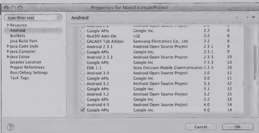

**图 9.1** 虽然看起来奇怪，但你的 Android 设置就应该像这样。

确定用户的位置是一回事，但真正把这两个难以理解的数字（经度和纬度）放到上下文中，软件就会变得稍微复杂一些。有趣的是，让地图显示在屏幕上所需的配置，远比操作地图的代码复杂。那么，我们开始吧。如果你想跟着做，请继续创建一个新的 Android 项目，我们将从那里开始。

#### 获取库

MapActivity 和 MapView 是仅存在于 Android SDK 的 Google API 超集（APIs）中的两个类。为了能够访问它们，你需要声明你的应用使用 Google APIs 库。你需要下载这个超级库（就像你在第 1 章获取 Ice Cream Sandwich 和 Gingerbread SDK 一样）。如果你配置正确，图 9.1 展示了你的项目设置界面应该是什么样子。

一旦你正确设置了 SDK 值，清单文件中有几件事我需要和你谈谈。

#### 添加到清单文件

通过清单文件，你需要告诉系统两件关键的事情。第一，你的应用使用 Google Maps 库。第二，你需要访问互联网的权限。虽然你不必直接调用任何东西来上网，但地图视图会这样做。加上这两项后，你的清单文件末尾应该像这样：

```xml
<manifest> <!-- Rest of the manifest omitted here for brevity. -->
    <application>
        <activity>
        </activity>
        <uses-library android:name="com.google.android.maps" />
    </application>
    <uses-permission android:name="android.permission.INTERNET"/>
</manifest>
```

再次说明，你是在告诉 Android：

- 你将引用 Google Maps 库。
- 你需要访问互联网的权限。

现在，这些都已经处理好了，是时候把你那个无聊的 Activity 切换成更大、更酷的 MapActivity 类了。

### 创建 MapActivity

将默认 activity 切换为 map activity 需要你添加合适的 Java 包含路径和一个必需的方法。完成后，它看起来会像这样：

```java
public class MapsExampleProjectActivity extends MapActivity {
    @Override
    public void onCreate(Bundle savedInstanceState) {
        super.onCreate(savedInstanceState);
        setContentView(R.layout.main);
    }

    @Override
    protected boolean isRouteDisplayed() {
        return false;
    }
}
```

现在你的 Activity 类已经切换为 MapActivity 类，你可以向 main.xml 布局文件中添加一个 MapView。

#### 创建 MapView

这是 Android 将在其中绘制地图瓦片的视图。它的行为与任何其他视图完全一样，只有一个显著例外：你需要一个 API key 才能访问 Google Maps。

#### 放置 MapView

下面是我简单的 main.xml 文件现在的样子：

```xml
<?xml version="1.0" encoding="utf-8"?>
<LinearLayout xmlns:android="http://schemas.android.com/apk/res/android"
    android:layout_width="fill_parent"
    android:layout_height="fill_parent"
    android:orientation="vertical" >
    <com.google.android.maps.MapView
        android:id="@+id/map_view"
        android:clickable="true"
        android:layout_width="fill_parent"
        android:layout_height="fill_parent"
        android:apiKey="your API key goes in this field"
    />
</LinearLayout>
```

如你所见，我把我的 map view 作为屏幕上唯一的视图放置。实际上，你可以把它放在任何你想要的位置，就像放置任何其他视图一样。此外，它不像 ListActivity 那样需要特殊的保留 Android ID。让我告诉你从哪里获取要填入 apiKey 字段的值。

#### 注册地图密钥

获取地图密钥相当容易。前往 http://code.google.com/android/maps-api-signup.html 并运行他们建议的命令：

```
keytool -list -keystore ~/.android/debug.keystore
```

在注册页面上，你必须同意他们的条款（你可能应该先阅读一下），输入 keytool 命令的输出，然后获取你的 API key。把那个字符串放进 MapView 的 apiKey 部分（main.xml 代码中高亮的那一行），你就可以开始了。请记住，地图密钥绑定到你用来签署 .apk 的密钥（在本例中是调试密钥）。当你为发布而签署 .apk 时，需要记得为它生成一个新的密钥。

> **提示：** 如果 keytool 要求输入密码，默认密码是“android”。

#### 运行吧，宝贝，运行

你已经配置好了一切，把所有细节都处理妥当了。是时候让这个 map view 上路转一圈了。当需要移动和渲染地图时，你主要会与 MapController 打交道，而实际上你会从 map view 本身获取它。我这个示例中的简单工作都在示例代码的 onCreate 方法中完成：

```java
MapView mv;

MapController controller;

@Override
public void onCreate(Bundle savedInstanceState) {
    super.onCreate(savedInstanceState);
    setContentView(R.layout.main);
    mv = (MapView)findViewById(R.id.map_view);
    controller = mv.getController();
    GeoPoint point = new GeoPoint((int)(40.734641 * 1e6),
            (int)(-73.996181 * 1e6));
    controller.animateTo(point);
    controller.setZoom(12);
}
```


#### GeoPoints

Google 以其并不怎么无穷的智慧决定：地图视图中的 GeoPoints 不应像 SDK 中其他所有 API 那样接受以度为单位的纬度和经度值。相反，它们采用 1e6 值。简单来说，这意味着在交给地图视图之前，你必须把希望在地图视图中引用的任何纬度或经度值乘以 1e6。如果忘记这一步，就会出现一些有趣的地图错误。

### 小结

在本章中，我向你展示了查找设备位置并在屏幕上显示地图的最基础知识。如果你想进一步深入这个主题，应该通过 `OverlayItem` 类探索地图叠加层。叠加层让你可以向用户指出特定位置（地址、商家或猫咪图片）。

一如既往，要非常小心你使用何种定位服务，尤其是当用户不在你的应用中时。没有什么比在后台进行大量位置查询更能快速耗尽用户电量——也更能让用户生气。如果你计划开发一个非常依赖定位的应用，务必在发布前做大量（LOTS）耗电测试。这样你的用户和应用的评分都会满意得多。

## 10 平板电脑、Fragment 和操作栏，天哪


随着 Honeycomb 和 Ice Cream Sandwich 的发布，Google 为 Android 生态引入了全新的外形规格。在 Gingerbread 及更早版本中，Google 只试图处理小型手机屏幕。借助这些新版本的 Android，你现在必须应对平板电脑大得多的屏幕。

Google 引入了 Fragment 的概念（用于处理额外的屏幕空间，并保持与较小手机尺寸屏幕的兼容性）以及操作栏（用于替代选项菜单）。

从概念上讲，Fragment 类似于 Activity，但生命周期稍微复杂一些。如果空间不大，它们可以独占一个屏幕；也可以与其他许多 Fragment 一起放在更大的平板电脑屏幕上。一个 Activity 可以包含任意数量的 Fragment。通过这种方式，Android SDK 允许你展开和折叠应用中的视图，以利用更多或更少的屏幕空间。有一件事 Activity 能做而 Fragment 不能——即 Activity 可以在清单中注册 intent；Fragment 依赖其宿主 Activity 传递启动信息。此外，实现 Fragment 时重要的是让它们完全不知道其他哪些 Fragment 可见。这一点很重要，因为你会希望根据可用空间大小更改该配置。

如果你打算在本章中跟着我一起编码，请确保你的项目设置为 Android SDK 3.0 或更高版本（API Level 11 或更高）。

### Fragment 的生命周期

Fragment 的生命周期相当复杂。有许多方法值得探索，但要让 Fragment 显示在屏幕上，必须实现 onCreateView。onCreateView 是你的 Fragment 创建要在屏幕上显示的视图的唯一机会。如果你未能向系统返回一个视图，应用就会崩溃。

以下是启动生命周期；这些方法按系统调用它们的顺序列出：

- onAttach。当你的 Fragment 正在附加到 Activity 时调用。
- onCreate。当 Fragment 正在初始化时调用。这是初始化后续所需变量的绝佳位置。
- onCreateView。这是你创建并返回 Fragment 根视图的机会。如果你的 Fragment 在之前暂停后返回屏幕，这将是第一个被调用的方法。
- onStart。类似于 Activity 上的同名调用，当 Fragment 即将被放到屏幕上时调用。
- onResume。当 Fragment 回到屏幕上时调用。

此时，你的 Fragment 正在屏幕上活跃，接收触摸和按键事件，或者只是待在那里看起来很棒。如果用户离开屏幕或切换到不再包含该 Fragment 的视图，将发生以下关闭生命周期：

- onPause。如果 Fragment 从屏幕上移除或用户按下 Home 键，就会调用。这是关闭生命周期中你保证会收到的唯一部分（在罕见情况下，应用被放到后台，然后进程因资源限制被杀死，这也会是你唯一能收到的方法）。onPause 是保存任何你希望用户稍后恢复 Fragment 时能看到的数据或状态信息的最佳时机。
- onStop。类似于 Activity 中该方法的版本，当你的 Fragment 离开屏幕时调用 onStop。它往往与 Activity 的 onStop 方法一起调用。
- onDestroyView。这是在视图消失之前从视图中取出数据的最后机会。
- onDestroy。当 Fragment 正在从屏幕上移除并且不会返回时调用。此时要确保所有线程都已停止、加载器都已取消，并且任何广播接收器都已注销。
- onDetach。当 Fragment 失去与 Activity 的关联时调用，onDetach 是系统在 Fragment 前往天上的垃圾回收器之前会调用的最后一个方法。

### 创建 Fragment

要创建 Fragment，你需要创建一个继承 Fragment 类的 Java 类。一个极其简单的实现大致如下：

```
public class ContentFragment extends Fragment{
    @Override
    public View onCreateView(LayoutInflater inflater,
        ViewGroup container, Bundle savedInstanceState) {
        View v = inflater.inflate(R.layout.content_layout, null);
    }
}
```

当然，Fragment 需要自己的布局才能在屏幕上显示任何内容。这个 ContentFragment 类只会显示一个简单的文本视图。以下是 content_layout.xml 文件，其内容将作为 Fragment 本身绘制：

```
<?xml version="1.0" encoding="utf-8"?>
<LinearLayout xmlns:android="http://schemas.android.com/apk/res/android"
    android:layout_width="match_parent"
    android:layout_height="match_parent"
    android:orientation="vertical" >
    <TextView
        android:layout_width="match_parent"
        android:layout_height="match_parent"
        android:id="@+id/content_text_view"
        />
</LinearLayout>
```

```xml
android:layout_height="match_parent"
android:id="@+id/list_fragment" />
</LinearLayout>
```

然后可以将此布局设置为 FragmentActivity 的内容视图，如下所示：

```java
public class ContentViewingActivity extends FragmentActivity{
    public void onCreate(Bundle data){
        super.onCreate(data);
        setContentView(R.layout.content_activity_layout);
    }
}
```

图 10.1 展示了使用 XML 让 Fragment 显示在屏幕上的结果。

### FragmentActivity 类

FragmentActivity 是一个特殊的类，仅当你希望在低于 3.0 的 Android 版本上使用 Fragment 时才需要使用它。对于 Honeycomb 和 Ice Cream Sandwich，一个简单的 Activity 就包含与 Fragment 交互所需的所有组件。你可以在 Android 兼容库中找到 FragmentActivity 类。


### Fragment 示例项目

Bauhaus commodo store dith American apparel, put a bird on it Austin nostrud eiusmod readymade id aesthetic synth. Portland booth quis polaroid butcher celiac sustainable. Banksy keytar chic, PBR deserunt caries DIY dreamcatcher mustache aesthetic forage. Helvetica keffiyeh laborum biodiesel in dolore. Beard est brunch, viral sartorial twee DIY biodiesel beard artisan shoreditch ut sunt American apparel butcher echo. etsy Terry Richardson American apparel deserunt ullamco synth ethical sed, Portland non tumbler brunch photo booth.

图 10.1 一个带单个文本视图的 Fragment。


### 使用 FragmentManager

**图 10.2** 同一屏幕上的两个片段。

尽管能在 XML 文件中布局片段很棒，但你还希望能在运行时与屏幕上的片段交互。为此，你将使用 FragmentManager，它是 Android 用来操作片段的工具。

在 Honeycomb 及更高版本中获取片段管理器需要调用 getFragmentManager。对于更早的设备，需要从 FragmentActivity 调用 getSupportFragmentManager。

你可以使用以下代码以编程方式向屏幕添加片段：

```java
FragmentManager manager = getSupportFragmentManager();
FragmentTransaction ft = manager.beginTransaction();
ft.add(containerViewId, new DemoListFragment());
ft.commit();
```

变量 containerViewId 应引用 Activity 布局中已存在的 ViewGroup，新片段将放置到该 ViewGroup 中。稍后，你还可以通过调用 replace(containerViewId, newFragment); 用另一个片段替换某个片段，其中 containerViewId 指定当前容纳你要替换的片段的视图容器。你只能替换之前通过 FragmentManager 事务添加的片段；在 XML 布局中静态声明的片段无法替换。

通过使用 XML 或片段管理器来设置和修改视图，你应该能够轻松构建复杂、可扩展且美观的应用程序，并在手机和平板电脑上都能良好呈现。

请记住，所有片段都应独立于其同级片段工作（这与 Activity 应保持独立的方式非常相似），即使它们可能共享同一屏幕。

鉴于 Android 布局文件夹的强大功能（我们已在第 3 章和第 7 章中详细讨论），你应该能看到为平板电脑构建一种布局（其中可能包含多个片段）以及为小屏幕手机构建另一种布局（一次只显示一个片段）的可能性。

如果你在寻找一个简单示例，我强烈建议你看看本章示例代码中的项目。

### 提供向后兼容性

谢天谢地，Android 已将片段捆绑到其兼容性库中。这意味着即使你计划支持 3.0 之前的设备，也可以使用片段。我强烈建议你尽可能使用它。安装它只需单击图 10-3 所示的菜单项。

但请注意，如果你的项目针对 3.0 或更高版本构建，同时仍使用兼容性库，可能会变得有点复杂。如果这样做，请确保所有导入都来自支持库，如下所示：

```java
import android.support.v4.app.Fragment;
```

而不是像这样：

```java
import android.app.Fragment;
```

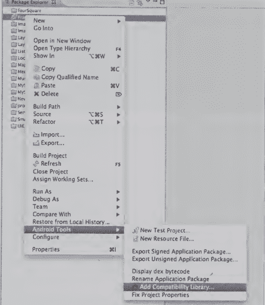

**图 10.3** 安装兼容性库。

使用支持库将确保你的应用程序在较新和较旧系统上都能正确运行。

此外，如果你计划使用兼容性库和片段，请记住你需要使用 `FragmentActivity` 而不是常规的 `Activity`。

借助兼容性支持以及片段的动态特性，创建一个具有出色交互模型且能在手机和平板电脑上良好运行的应用程序变得非常可行。我没有时间在这里详细说明，但本章的配套源代码中有实现这一目标的示例代码。记住你在这里读到的内容，并翻阅一下。


**图 10.4** 一个基本操作栏。

随着 Android 2.3 向 3.0 的过渡，Google 取消了搜索按钮和菜单键。根据个人经验，我可以告诉你，许多新用户从未找到放在选项菜单中的功能。将其从系统中移除确实是一件非常好的事情。

Google——愿他们昂贵的棉袜得到保佑——已将过去位于选项菜单中的图标移到了操作栏。此外，你可以在操作栏中指定搜索视图（以替代搜索按钮）。这会占用更多屏幕空间，但在平板电脑（以及较大的手机）上，空间绰绰有余。

现在，操作栏代表了用户浏览你的 Honeycomb 或 Ice Cream Sandwich 应用程序的主要方式。遗憾的是，这个新工具仅适用于 3.0 版本（目标版本 11）或更高版本。在更早的系统上模拟操作栏需要输入相当多的代码，但完全可以通过简单的线性布局和几个图像视图来实现。不过，实现它只能靠你自己。兼容性库不支持操作栏。

### 显示操作栏

由于操作栏仅在 SDK 3.0 及更高版本中受支持，因此你的清单文件必须明确声明其支持目标版本 11 或更高版本。

```xml
<uses-sdk android:minSdkVersion="7"
          android:targetSdkVersion="11"
/>
```

此时，当你的项目在任何 Honeycomb 及更高版本系统上构建并运行时，你应该会看到一个基本版本的操作栏，其中包含你的应用程序图标和 Activity 的默认标题（图 10.4）。

### 向操作栏添加元素

除了允许你通过调用 setTitle 设置自己的标题外，操作栏还可以处理三种不同类型的对象：

- 图标。既包括右侧下拉菜单中的图标，也包括栏本身中的可操作项。
- 标签页。沿顶部排列的按钮，用于操作屏幕上的片段。
- 操作视图。搜索框和下拉列表（用于排序顺序、账户选择或死光强度之类的内容）。

此外，Android 始终会让你应用程序的图标（最左侧）可点击。默认情况下，点击此图标预计会将用户返回到你的应用程序的主屏幕（无论这对你的应用程序行为意味着什么）。你还可以通过调用 setDisplayHomeAsUpEnabled(true) 在视觉上表明主屏幕图标将返回 Activity 堆栈中的上一级。

你对操作栏内容进行更改的方式，与你过去与选项菜单交互的方式非常相似。这不是偶然的。因为操作栏本应取代选项菜单，所以你调用方法并配置文件的方式与你过去处理菜单的方式类似。这也使得在较旧版本的 Android SDK 上向手机优雅降级服务变得容易。

#### 添加图标

通过扩展 onCreateOptionsMenu 并添加你想要的菜单图标，可以最轻松地将图标放入操作栏。我使用以下代码向操作栏添加了一个删除图标：

```java
@Override
public boolean onCreateOptionsMenu(Menu menu){
    MenuItem item = menu.add("delete");
    item.setIcon(android.R.drawable.ic_delete);
    if(Build.VERSION.SDK_INT >= 11){
        item.setShowAsAction(MenuItem.SHOW_AS_ACTION_IF_ROOM);
    }
    return true;
}
```

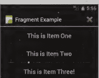

**图 10.5** 添加操作图标。

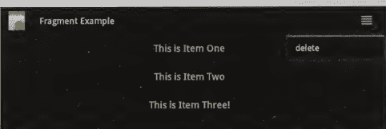

**图 10.6** 非操作图标。

如果 Android SDK 高于 3.0，系统会在 Activity 启动时调用此方法（以便它可以构建操作栏）。你会注意到，只有在 Honeycomb 或更高版本上运行时，我才会调用 setShowAsAction。图 10.5 显示了在运行 Ice Cream Sandwich 的手机上操作栏的样子。

如果在 Honeycomb 平板电脑上省略对 setShowAsAction 的调用，你会看到一个选项菜单图标，其中在右侧包含该菜单项。在 Ice Cream Sandwich 上，它会将菜单项移动到更传统的上下文菜单中。图 10.6 显示了我点击后它在平板电脑上的样子。

### 响应图标点击

当用户点击你的某个操作栏图标时，Android 会调用你实现的 onOptionsItemSelected 方法。以下是我非常简单的示例方法：

```java
public boolean onOptionsItemSelected(MenuItem item){
    int id = item.getItemId();
    if(id == android.R.id.home){
        //The user clicked the left-hand app icon.
        //As this is the home screen, ignore it.
        return true;
    }
    else{
        //Perform the delete action here
        return true;
    }
}
```


至此，你应该已经掌握了创建选项菜单和操作栏图标的基本方法。或者，你也可以将图标声明为 XML 文件，并使用 MenuInflater 将其填充。有关如何在 /res/menu 中使用 XML 文件以简化流程的完整说明，请查阅文档（[http://developer.android.com/guide/topics/ui/menus.html](http://developer.android.com/guide/topics/ui/menus.html)）。


图 10.7 Google Calendar 中的标签栏。

#### 添加标签页

在操作栏中放置标签页是完全不同的过程。你需要使用 ActionBar 类本身来添加它们。此外，你还需要实现一个 ActionBar.TabListener（它通过一系列重写方法告诉系统，当用户点击标签页时该做什么）。

实现监听器后，你应将以下代码添加到 Activity 的 onCreate 方法中：

```java
    ActionBar bar = getActionBar();
    bar.setNavigationMode(ActionBar.NAVIGATION_MODE_TABS);
    ActionBar.Tab tab1 = bar.newTab();
    tab1.setText("Tab Text");
    tab1.setTabListener(new ExampleTabListener());
    bar.addTab(tab1);
```

对于每个要添加的标签页，你都必须经历以下过程：从操作栏请求一个新标签页、设置监听器，然后将其添加到操作栏。图 10.7 展示了 Google Calendar 应用中一个外观很棒的标签栏示例。

每个标签页都会触发 Activity 内 Fragment 上的不同事件。对于 Google Calendar 应用，它会隐藏和显示用户查看日历的各种方式。

如你所见，Google 一直在忙于为 Honeycomb 中的平板电脑构建新的用户界面范式。在确定如何让平板电脑发挥作用后，他们又通过 Ice Cream Sandwich 将这些新的 UI 方法带到了手机领域。

借助操作栏，Google 得以取消两个实体菜单按钮（选项菜单和搜索），同时仍在用户体验中保留这些概念。选项菜单按钮被添加到操作栏的图标所取代，搜索按钮则被向同一操作栏添加自定义操作视图的能力所取代。

借助 Fragment，Google 使我们能够在设备之间可用屏幕空间发生变化时，在屏幕上放置或多或少的内容。通过 Fragment，我们不再受限于在任意给定时间屏幕上只能有一个 *事物*。不过，如果我们需要处理较小的屏幕，Fragment 可以轻松切换回每屏一个事物的布局。

Fragment 和操作栏是非常新的概念，显然 Android 开发者仍在努力弄清楚如何最好地使用它们。请通过使用 Google 提供给我们的这些新玩具实现你自己的杀手级用户界面，帮助我们推动移动用户体验向前发展。

## 11 发布你的应用程序


在很大程度上，Android Market 是我遇到过的最易用的应用商店之一。但是，尽管你可以几乎即时更新应用，而无需像其他应用商店那样麻烦，但在发布之前仍有一些事项需要了解。我们将介绍打包、版本管理以及创建发布版本。

在考虑生成用于上架的发布版本之前，清单文件中有几个关键点需要注意。你需要确保应用程序不可调试（对于较新版本的 Android 客户端来说，这不太成问题）。你还需要确保包名唯一，并且在后续每个版本中保持一致。最后，在升级现有应用程序时有两个字段需要注意。让我们详细看看这三点。

### 防止调试

如果应用程序在启用调试的情况下发布，任何拥有 micro USB 线的人都可以逐行调试你的应用代码、查看变量内容，并做其他任何有安全意识的工程师都不希望发生的事情。调试标志默认关闭，但如果你已将其打开，它会出现在清单文件的 application 部分：

```xml
<application
    android:icon="@drawable/ic_launcher"
    android:label="@string/app_name"
    android:debuggable="true">
```

应用程序发布时，请确保完全删除该行，或将其设置为以下内容：

```xml
android:debuggable="false"
```

### 命名包

你在清单文件中声明的包，在很大程度上可以包含几乎任何你想要的字符串。我在前面的示例中突出显示了一个：

```xml
<?xml version="1.0" encoding="utf-8"?>
<manifest xmlns:android="http://schemas.android.com/apk/res/android"
    package="com.haseman.layouts"
    android:versionCode="1"
    android:versionName="1.0">
```

尽管我命名这个包是为了对应我的布局示例，但你也可以同样轻松地声明类似这样的包：

```xml
package="com.sparkle.pants.fairy.dust.unicorn"
```

我不会推荐使用 unicorn 这个示例（它有点离谱），但事实仍然是你可以这么做。不过，你选择的包名必须不同于整个 Android Market 中所有其他现有包。确保它唯一，并且在你升级应用程序的整个期间都是你可以接受的。升级应用时，它绝对必须与之前构建的包名相同。通常，命名约定类似于 com.company_name.product_name。但同样，应用程序的包名完全由你决定。

### 版本管理

更新现有应用程序时有两个值需要注意。首先，你应该（但并非必须）增大清单声明中 versionName 字段内的值。版本号的标准规则适用：主要版本会获得新的主版本号（1.0 到 2.0），而小型补丁应获得次版本号提升（1.0 到 1.1）。版本名称是向用户显示在 Android Market 和应用程序详情屏幕中的内容。在前面的示例清单文件中，版本名称是“1.0”。

你*必须*密切关注的字段是 versionCode。这是每次为 Android Market 执行更新时都必须更改的值。除非你更改 versionCode，否则向 Android Market 发送更新将被拒绝。通常，Android 开发者会通过去掉版本名称中的句点，并给名称的每一部分补位以形成每段两位数字，来生成版本代码。该数字必须唯一，但不一定必须连续。因此，版本 1.0.1 会变成 010001，2.3.12 会变成 020312。这是一种相当基本的方法，可以确保版本名称与版本代码保持关联，而不会太复杂。让这个数字持续增长是个好主意，尽管根据文档，技术上并不要求这样做。不过，采用递增数字的约定可以确保它唯一。

### 设置最低 SDK 值

Android Market 要求你为应用程序指定最低 SDK 值。你可以在清单文件中包含 uses-sdk 字段来完成此操作，如下所示：

```xml
<?xml version="1.0" encoding="utf-8"?>
<manifest xmlns:android="http://schemas.android.com/apk/res/android"
    package="com.haseman.location"
    android:versionCode="1"
    android:versionName="1.0">
    <uses-sdk android:minSdkVersion="7"/>
    <!-- The rest of your application goes here-->
</manifest>
```

minSdkVersion 中的数字对应 SDK 的整数值。在本例中，通过声明版本 7，我不允许早于 Android 2.1 update 1（即 SDK 版本 7）的手机安装我的应用程序。请务必在你支持的版本上测试应用程序，即使只是用模拟器进行简短测试。


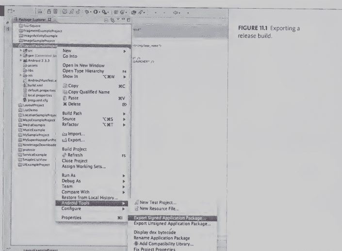

既然版本号已经整理好，代码已经测试过，所有资源也已就位，那么在提交之前就该创建一个发布构建了。

生成最终 APK 有两种方式：通过 Apache 的 ant（它会结合 build.xml 文件从命令行构建你的应用程序），或者通过 Eclipse 的 Android 工具。如果你习惯使用命令行，我假设你可以自行创建发布构建。在本章中，我将重点介绍如何通过 Eclipse 创建发布构建。

### 导出已签名的构建

Eclipse 工具让生成有效的发布构建变得非常容易。只需在 Package Explorer 中右键单击你的项目，然后选择 Android Tools > Export Signed Application Package（图 11.1）。

### 记得禁用日志记录

在发布任何内容之前，通读你的代码库，确保没有你不想让任何拿着 Micro USB 数据线的人看到的额外日志行。还要记住，拥有相应权限的应用程序可以查看日志输出。话虽如此，在应用程序中保留一些用于灾难性错误的日志再发布，也不算坏主意（以防在现场出现故障）。

系统会询问你要使用现有的密钥库文件，还是创建一个新的。由于这是你第一次发布产品，你需要创建一个新的。输入文件的位置，或单击 Browse 按钮查找位置。输入密码，并再次输入以确认密码正确（**图 11.2**）。*密钥库*是一个可以包含任意数量密钥的文件。就你的目的而言，你实际上只需要一个密钥。你所有的应用程序都可以用同一个密钥签名，也可以使用不同的密钥——这由你决定（但我建议只使用一个，因为这样需要跟踪的内容更少）。

### 备份你的密钥库文件

我再说一遍：备份你的密钥库文件。如果我能发明一种方法，在纸质书里做出 HTML `<blink>` 标签，我会在这里用上。如果你没有用同一个密钥签名，Android Market 就不会允许你升级应用程序。如果你丢失了刚刚创建的密钥库文件，你将永远无法升级你的应用程序。把它刻录到光盘，并将光盘存放在你家以外的地方。把它保存在云端（Amazon S3、Dropbox、你母亲家），尽可能多地保存在安全的地方。

创建密钥库后，Eclipse 会要求你创建一个密钥。你并不需要填写所有下面的字段。不过，如果你要填写，大概应该比我 在**图 11.3** 中更认真一些。

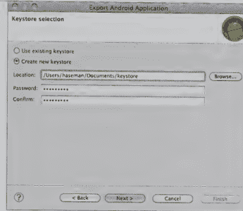

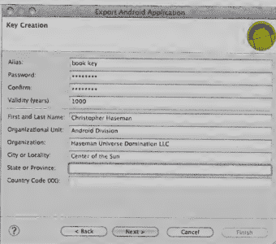

**图 11.2** 创建密钥库文件。

**图 11.3** 创建密钥

你将创建一个密钥（放入新的密钥库文件），它需要一个别名和它自己的密码。

务必让 Validity 字段中使用的数字足够大，以便在非常非常长的时间内保持有效。你永远不知道，Android 可能在一千年后仍然存在。有备无患。最后，你需要至少填写其余几个字段中的一个，但我建议你尽可能多地填写适用的字段。

单击 Next 创建密钥。你只需告诉 Eclipse 将 APK 放在哪里，就完成了！

### 记得使用 Zipalign

对于命令行用户来说，Eclipse 为用户做的一件事就是使用一个名为 Zipalign 的工具（位于 SDK 的 tools/ 文件夹中）。Zipalign 可以缩短应用程序的加载时间。如果你使用 Eclipse 工具，它已经自动为你完成这一步。如果你不使用 Eclipse，请确保在签署构建后，在命令行中执行这一步。这是免费的提速，所以一定要利用它。

### 提交你的构建

此时，该注册开发者账户并提交你的构建了。Android 的应用程序提交页面相当不言自明，但我应该指出，重要的是向 Market 提供尽可能多的截图、视频和图形资源，只要你有时间生成它们。信不信由你，决定购买一个应用程序可能很困难。用户需要能够相信你的应用程序确实如宣传的那样工作，因此让他们先睹为快至关重要。

### 关注崩溃报告并修复它们

应用市场提供了一项非常有用的能力：用户在遇到崩溃时，可以选择向你报告该崩溃。尽可能利用这一点。与用户保持联系，并修复你能修复的一切问题。当你遇到困难时，上网并使用所有可用的资源（你最喜欢的搜索引擎、Google Groups 或 Stack Overflow，仅举几例）。如果你看到自己不理解的崩溃，其他开发者很可能也遇到过同样的问题；我们是一群非常乐于助人的人。

### 频繁更新

提交后，你的应用程序会在数小时内出现在 Market 中。这让你可以频繁更新，以添加小功能、修复 bug 并进行小调整。没有其他平台能让你从提交到上架拥有这样的速度。利用它吧。如果你快速回应用户的问题，你会惊讶于他们会有多感激。

### 结语

临别之际，我还想给你一条建议：为 Android 生态做出有意义的贡献。虽然你无疑会有这本书无法回答的问题，但你现在已经掌握了能够让你找到答案的词汇和知识。这意味着你没有任何借口不去做出令人惊叹的东西。拜托——用一句不太客气的话说，Android Market 里满是垃圾。这个世界不需要又一个放屁应用；我们需要让数据更易获取、更有意义、更有趣、更有用、更引人入胜的东西。不要只做 app，要做出真正的 application。

祝你好运，编程愉快。

## 索引

- :（冒号），与服务一起使用，161

### A

- AbsoluteLayout，78–82

- action bar
  - action views，236
  - 向其添加图标，233–234
  - 添加标签页，235
  - 删除图标，233
  - 下拉列表 action view，236
  - 特性，232
  - 图标点击，234–235
  - 显示，232

- Activity。另见 intent
  - Bundle 对象，35
  - 冲突，44–45
  - 为应用程序考虑，49
  - 构造函数，31
  - 创建，24–27
  - 数据保留方法，35
  - 销毁，32，36
  - 获取 intent，31
  - Intent 类，37
  - intent，29–31，37
  - 按键处理方法，29
  - 启动，28–30
  - 监听按键事件，28
  - 定位，25
  - NewActivity 类，39
  - onCreate 方法，24，31–33
  - onDestroy 方法，31，34
  - onKeyDown 方法，28–30，40
  - onPause 方法，31，34
  - onResume 方法，31
  - onRetainNonConfigurationInstance 方法，35
  - onSaveInstanceState 方法，35–36
  - onStart 方法，31
  - onStop 方法，31，34
  - public void onCreate(Bundle icicle)，32–33
  - public void onResume()，33
  - public void onStart 方法，33
  - 接收事件，41
  - 屏幕布局，27–29
  - 与布局文件分离，178
  - setContentView 方法，28，33
  - StrictMode.enableDefaults，120
  - TextView ID，27

- Activity 类，创建，25–27

- activity 声明，android:name 标签，23

- Adapter 类
  - getCount 方法，138
  - getItem 方法，138
  - getItemId 方法，138
  - getView 方法，139
  - 与 ListView 类交互，126，144

- 适配器，自定义，138–140

- adb pull /data/anr/traces.txt 命令行，102

- ADT 插件，添加到 Eclipse，8–9

- AIDL（Android 接口定义语言），160–162

- Android，较旧版本，182–184

- android create project 命令，16

- Android 开发者网站，4

- Android 文件夹，显示，14

- Android 手机
  - USB 调试，12
  - 使用，12

- Android 项目
  - 创建，14–16
  - 从命令行创建，16
  - DDMS 透视图，17
  - Java 包，15
  - 命名，15
  - 命名 activity，15
  - 命名应用程序，15
  - 运行，17
  - 选择，14
  - 选择版本，15

- Android SDK
  - 下载，xiv，4
  - 为 Linux 用户安装，6
  - 为 Mac 用户安装，5–6
  - 为 Windows 用户安装，6


- Android SDK 管理器
  - 描述，xv
  - 定位，xv
  - 使用，6–7
- Android 虚拟设备 (AVD)，配置，11–12
- AndroidManifest.xml 文件
  - `<manifest>` 声明，22
  - 包定义，22
- android:name 标签，23
- ANR 崩溃，跟踪，102
- ant install 命令，16
- API 级别，监视，184
- APK 文件，查看大小，76
- Application 类
  - 访问，50–51
  - 访问变量，51
  - Activity，49
  - 向其中添加数据，50
  - 自定义，48–50
  - 默认声明，48
  - getApplication 方法，50
- 应用
  - 最低 SDK 值，242
  - 名称，48–49
  - 阻止调试，240
  - 更新，241
- 应用，限制访问，180–181
- ArrayAdapter 类，创建并填充，131–132
- AsyncTask 类，106–112
  - 避免使用，112
  - doInBackground 方法，106，109
  - 跟踪，111
  - onPostExecute 方法，106，111
  - onPreExecute 方法，106，109
  - publishProgress 方法，110
  - 显示进度，110
  - 在 Activity 内启动，111
  - 类型参数，108–109
  - 使用，111–112
- 音频，在服务中播放，201–204
- AVD (Android 虚拟设备)，配置，11–12

### B

- Binder 服务通信，160–165
  - Binder 和 AIDL 存根，162–164
  - 创建服务，161–162
- 位图，获取并显示，100–101
- BroadcastReceiver
  - 为 Intent 创建，41–43
  - 注册，42–43
  - 自包含，44
- 构建
  - 崩溃报告，246
  - 提交，246
  - 更新，246
- 按钮栏布局，87
- button_layout.xml 文件，创建，172，174–175
- 按钮
  - 添加到服务，152
  - 布局 XML，170–171

### C

- 缓存文件夹，为图像创建，115
- 通话状态，监视，205
- cd 命令，16
- 类
  - Activity，25–27
  - ImageReceiver，119–120
  - Intent，37
  - Loader，121
- 点击事件，响应，133
- 点击监听器
  - 添加到按钮，65
  - 为视图调用，62
  - 向视图注册，63
  - 设置，65
- 冒号 (:)，与服务一起使用，161
- 命令行，从中创建项目，16
- 通信。*另请参阅*服务
  - Binder 服务，160–165
  - 基于 Intent，150–159
- 兼容性库，与 Fragment 一起使用，230–231
- 内容观察器，注册，154

- onDestroyView 方法，223
- onDetach 方法，223
- onPause 方法，223
- onResume 方法，222
- onStart 方法，222
- onStop 方法，223
- 放置在屏幕上，228–230
- 显示，225–230
- 文本视图，225，227

### G

- GeoPoints，与地图一起使用，219
- getApplication 方法，50
- Google Maps 库，214，216
- 灰色背景，添加到 RelativeLayout，95–96

### H

- 层级查看器，定位，xv
- Honeycomb
  - 操作栏，232
  - 操作视图，236
  - FragmentActivity 类，226
  - FragmentManager，229
  - 导航，232
  - setShowAsAction，234

### I

- Ice Cream Sandwich
  - 操作栏，232
  - FragmentActivity 类，226
  - 导航，232
- 图标点击，响应，234–235
- 图标，添加到操作栏，233–234
- 图像获取器
  - handleIntent 方法，116–117
  - 实现，116–117
- 图像上传，自动，150–151
- ImageIntentService，114
- ImageReceiver 类，119–120
- 图像
  - 缓存文件夹，115
  - 下载并显示，100–101
  - 外部存储，115
  - 获取，114–120
  - 结果广播的监听器，118–119
  - notifyFinished 方法，118
  - 渲染下载，118–120
- `<include>` 标签，用于小改动，172–176
- 安装
  - 面向 Linux 用户的 Android SDK，6
  - 面向 Mac 用户的 Android SDK，5–6
  - 面向 Windows 用户的 Android SDK，6
  - Eclipse IDE，5
- Intent 类清单注册，37–38
- Intent 过滤器，为其注册，40
- 基于 Intent 的通信，150–159
  - 自动图像上传，150–151
  - 声明服务，151
  - 获取服务，151
  - 转到前台，155–157
  - 观察内容变更，158–159
  - 启动服务，154–155
  - 启动服务，152–154
- Intent。另请参阅 Activity
  - 添加，38–40
  - BroadcastReceiver，41–43
  - 创建，29–30
  - 特性，37
  - 为 Activity 获取，31
  - 监听，41–45
  - 监听信息，43
  - 移动数据，45–47
  - 接收器，41–43
  - 接收，37
  - 注册接收器，42–43
  - 检索并使用字符串，46–47
  - 回顾，47
  - 自包含的 BroadcastReceiver，44
  - 停止监听，43
  - Toast，42
- IntentService
  - 声明服务，113–114
  - 获取图像，114–120

### J

- Java
  - 视图，56–58
  - 与 XML 布局对比，60
- JSONArray 对象，与列表视图一起使用，139–140

### K

- 密钥，创建，244–245
- 密钥库文件
  - 备份，244–245
  - 创建，244–245

### L

- 布局文件，与 Activity 分离，178
- 布局文件夹，170–176
  - 向其添加后缀，177
  - 按钮，170–171
  - 内容，71，75–76
  - `<include>` 标签，172–176
  - MVC (模型-视图-控制器)，75
  - 指定，172
- 布局问题，调试，179
- layout-land 文件夹
  - 创建，172
  - 在其中定义屏幕，177–178
- 布局
  - AbsoluteLayout，78–82
  - 按钮栏，87
  - 高度和宽度值，55，57，86
  - LinearLayout，82–89
  - 嵌套，84
  - RelativeLayout，90–96
  - ViewGroup，77–78
  - XML 与 Java 对比，60
- LinearLayout，82–89，130
  - 按钮栏布局，87
  - 子项布局，84
  - 嵌套布局，84
  - 方向，86
  - 内边距选项，88–89
  - 与 RelativeLayout 对比，84，89
  - 使用，87
- 列表元素行，回收，144
- List Fragment，126
- 列表视图
  - 构建，141–142
  - 自定义布局视图，142–143
  - 获取数据，138
  - 获取 Twitter 数据，136–138
  - getTwitterFeed，138
  - getView 代码，142
  - 处理异常，137
  - 与 Adapter 类交互，144
  - JSONArray 对象，139–140
  - JSONObject，142
  - ListActivity 类，135–136，139–140
  - 主布局视图，134–135
  - onCreate 方法，135
  - TextView，142–143
- ListActivity 类，139–140
  - 创建，128–130
  - ID，129
  - XML 布局文件，128–129
- ListView 类
  - 自定义适配器，138–140
  - 描述，126
- Loader 类
  - 描述，121
  - 用于音乐播放，200–201
- 位置服务
  - distanceBetween 方法，212
  - 查找提供者，211
  - getBestProvider 方法，211
  - getLastKnownLocation，213
  - LocationListener 接口，212
  - LocationManager 对象，212
  - onLocationChanged 方法，212
  - 注册更新，211–212
  - 使用，211
- 位置
  - 向清单添加权限，210
  - 获取设备位置，210
  - `<uses-permission>` 标签，210
- 日志记录，禁用，244

### M

- 主菜单
  - ArrayAdapter 类，131–132
  - 点击事件，133
  - 数据，127
  - 列表项，130–131
  - ListActivity 类，128–130
- 主线程，*另请参阅*线程违规
  - 位于其上，102
  - 获取数据，100–101
  - 回到其上，104–105
  - 离开它，103–105
  - Loader 类，121
  - 建议，102
- 清单，22
- 地图密钥，获取，217
- MapActivity 类
  - 可用性，214
  - 创建，215–216
- MapControl 类，217–218
- 地图
  - 为地图添加的清单项，214–215
  - 与 GeoPoints 一起使用，219
- MapView 类
  - 可用性，214
  - 创建，216–217
  - 测试，217–218
  - apiKey 字段的值，216–217
- 媒体
  - ContentProvider，190
  - ContentResolver，191
  - Cursor 对象，191
  - 加载，192–193
  - 将游标移动到，192
  - onErrorListener，194
  - 播放，192–193
  - playNextVideo，192
  - 在 SD 卡中搜索，191
- 媒体播放器
  - 清理，204–205
  - onDestroy 方法，204–205
- MediaPlayer 状态
  - Idle，195
  - Initialized，195
  - Playing，195
  - Prepared，195
- MediaScanner，191
- 菜单列表项，文本视图文件，130–131
- `<merge>` 标签，在其中包装视图，176
- methodNotFoundException，184
- 模型-视图-控制器 (MVC)，75
- 视频播放
  - 添加 VideoView，188–189
  - 清理，193
  - 关闭游标，193
  - onDestroy 方法，193
  - 过程，188
  - 为 VideoView 进行设置，189–190
- 音乐播放
  - 音频焦点，205
  - 清理，197，204–205
  - 关闭游标，204–205
  - 服务崩溃，205
  - 游标加载器，199
  - 查找最近曲目，199–201
  - 耳机控制，205
  - 通知区域中的图标，203
  - 中断，205–206
  - Loader 类，200–201
  - SD 卡缺失，206
  - onDestroy 方法，197，204
  - 电话呼叫，205


- 音乐播放（续）
  - 在服务中播放音频，201–203
  - setDataSource，201–202
  - setForegroundState 方法，203
  - 声音，196–197
  - stop 方法，204
- 音乐服务，绑定到，198–199
- MusicExampleActivity，198
- MVC（模型-视图-控制器），75

### N

- 纽约市，地图，218
- NewActivity 类，39
- Next 按钮，使用 RelativeLayout 创建，93–94
- Notification 对象，为服务创建，156
- 通知下拉栏，为服务创建，157

### O

- OnClickListener，与视图一起使用，62–65
- onCreate 方法，24
  - ListView 类，135
  - 与视图一起使用，63
- onDestroy 方法，与 Activity 一起使用，34
- onErrorListener，与媒体一起使用，194
- onKeyDown 方法，与 Activity 一起使用，28–30、40
- onPause 方法，与 Activity 一起使用，34
- onRetainNonConfigurationInstance 方法，35
- onSaveInstanceState 方法，35–36
- onStop 方法，与 Activity 一起使用，34

### P

- 包
  - 下载，6–7
  - 命名，240–241
- 打包
  - 与签名，243–245
  - 与版本管理，240–242
- 内边距
  - LinearLayouts，88–89
  - RelativeLayouts，93
- 权限，添加到清单文件，210
- 手机通话状态，监视，205
- 照片监听服务
  - 为媒体通知注册，154
  - 启动，153
  - 停止，153
- 照片，上传，159
- playNextVideo，192
- 首选项，将用户名保存到，182
- 项目
  - 创建，14–16
  - 从命令行创建，16
  - DDMS 透视图，17
  - Java 包，15
  - 命名，15
  - 命名 Activity，15
  - 命名应用程序，15
  - 运行，17
  - 选择，14
  - 选择其版本，15
- public void onResume 方法，与 Activity 一起使用，33
- public void onStart 方法，与 Activity 一起使用，33

### R

- 反射
  - 使用反射访问 SDK 方法，183–184
  - 优点，184
  - MethodNotFoundException，184
- RelativeLayouts，90–96
  - 灰色背景，95–96
  - 与 LinearLayouts 对比，84、89
  - Next 按钮，93–94
  - 内边距声明，93
  - `<RelativeLayout>` 声明，92
  - 使用，90–96
- 发布版本，导出，243
- res/ 文件夹
  - 内容，71
  - 布局文件夹，170–177
- 资源，查找，59

### U

- UI（用户界面）
  - AbsoluteLayout，78–82
  - 在运行时更改，58–60
  - 更改视图可见性，61–65
  - 创建视图，54–58
  - 自定义视图，65
  - drawable 文件夹，76
  - 查找资源，59
  - 标识视图，58–59
  - 布局文件夹，74–76
  - LinearLayout，82–90
  - RelativeLayout，90–96
  - 资源文件夹，71–73
  - values 文件夹，73–74
  - View 类，54
  - ViewGroup，77–78
- USB 调试，启用，12
- 用户名，保存到首选项，182
- `<uses>` 标签，180
- uses-sdk 字段，包含，242

### V

- values 文件夹
  - 数组，73
  - 颜色，74
  - 内容，71
  - 创建，74
  - 尺寸，74
  - 字符串，73
  - 样式，74
- 版本，为项目选择，15
- 版本管理
  - versionCode 字段，241
  - versionName 字段，241
- 视频播放器，创建，188–190
- VideoView
  - 为电影添加，188–189
  - 扩展 OnCompletionListener，189
  - 实现 onCompletion 方法，189
  - 为...进行设置，189–190
- 视图点击，跟踪，62
- ViewGroup
  - dip 值，78
  - dp 值，78
  - match_parent 值，78
  - px 值，78
  - 与布局一起使用，77–78
  - wrap_content 值，78
- 视图。另请参见自定义视图；扩展视图
  - 分配 ID，58–59
  - 从 XML 文件引入，176
  - 在对象之间居中，95
  - 更改可见性，61
  - 点击监听器，62
  - 创建，54–58
  - findViewById，58–60
  - GONE 可见性设置，61
  - 标识，58–59
  - INVISIBLE 可见性设置，61
  - 保持，60
  - 布局，75
  - LinearLayouts，130
  - OnClickListener，62–65
  - onCreate 方法，63
  - 获取，59–60
  - setVisibility，61
  - VISIBLE 可见性设置，61
  - 包装在 `<merge>` 标签中，176
  - 在 XML 中，54–55
- Java 中的视图，56–58
  - dip 值，57
  - dp 值，57
  - fill_parent 值，57
  - match_parent 值，57
  - px 值，57
  - wrap_content 值，57

### W

- 网站
  - ActionBar 文档，236
  - Android Developers，4
  - Eclipse IDE，4

### X

- XML（可扩展标记语言）
  - setContentView 方法，55
  - 中的视图，54–55
- XML 文件
  - 从 XML 文件引入视图，176
  - 打包的二进制格式，73
  - 在 XML 中引用资源，73
- XML 与 Java 布局，60

### Z

- Zipalign 工具，访问和使用，245


## 观看 阅读 创作

无限制在线访问所有 Peachpit、Adobe Press、Apple Training 和 New Riders 的视频和图书，以及来自其他领先出版商的内容，包括：O'Reilly Media、Focal Press、Sams、Que、Total Training、John Wiley & Sons、Course Technology PTR、Class on Demand、VTC……以及更多。

无需时间承诺或合同！可注册一个月或一年。每月仅需 19.99 美元。

## 立即注册

peachpit.com/creativeedge

## Creative Edge

