# 数字动画创作：Scratch 故事动画制作

## 引言

- 让你能够浏览、播放和改编其他项目
- 让你能够分享自己的项目
- 创建一个可以互相学习的在线社区

现在回顾一下那六个目标的列表。哪里写着“强迫父母、老师、教练或孩子买一本又大又厚的 Scratch 书”？哪里都没有！那你为什么还在读？难道你不知道现在就可以访问 scratch.mit.edu 开始 Scratch 创作吗？！？

如果你完全是 Scratch 新手，最好从内置教程之一开始。要查看这些教程，请点击右上角的问号。

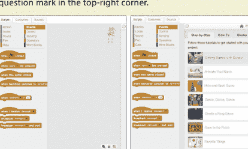

## 关于本书

在本书中，你可以从任何项目开始。如果你在 Scratch 中没做过多少动画，可能会发现从项目 1 开始很有用，它会引导你创建一个基本的火柴人动画。如果你想设计自己的卡通角色，请查看项目 2，我在那里分享了各种技巧（你会发现，要创作出好看的角色，不必是了不起的艺术家）。

### 本书使用的图标

- **提示图标** – *提示图标标记提示和快捷方式，你可以用它们让编程更容易。*
- **警告图标** – *警告图标提醒你要小心！它标记重要信息，可能让你避免大伤脑筋。*

### 访问 Scratch

要在线使用 Scratch，请访问 www.scratch.mit.edu，创建在线账户，然后开始 Scratch 创作。要在不创建账户的情况下使用 Scratch，你必须下载并安装 Scratch 离线版（参见后面的“离线使用 Scratch”一节）。

严格来说，你可以不使用账户访问 Scratch 网站，但必须将项目保存到自己的电脑上，并且每次访问 Scratch 网站继续处理时都要重新上传它们。有了账户，你可以在线保存文件，并与其他 Scratch 用户分享项目。

### 创建在线账户

来吧，开始使用 Scratch！打开电脑，打开网页浏览器，访问 scratch.mit.edu。如果你已经有 Scratch 账户，请点击页面右上角的“登录”按钮。如果没有账户，请点击“加入 Scratch”按钮，并填写简短的在线表单。如果你未满 13 岁或没有电子邮件账户，请让成年人帮你创建账户（或跳到后面的“离线使用 Scratch”一节）。

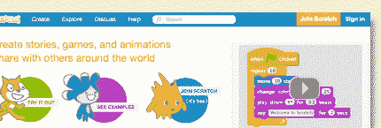

> 要在线运行 Scratch，你需要一个较新的网页浏览器（Chrome 35 或更高版本、Firefox 31 或更高版本，或 Internet Explorer 8 或更高版本），并安装 Adobe Flash Player 10.2 或更高版本。Scratch 2 设计支持 1024 × 768 或更大的屏幕尺寸。

### 离线使用 Scratch

你可以安装 Scratch 2 离线编辑器，在没有 Scratch 用户账户的情况下处理项目。安装 Scratch 2 后，处理项目将不需要互联网连接。此版本可在 Mac、Windows 和某些版本的 Linux（32 位）上运行。访问 www.scratch.mit.edu/scratch2download 下载并安装 Adobe AIR（离线运行 Scratch 所需）和 Scratch 2 离线编辑器。

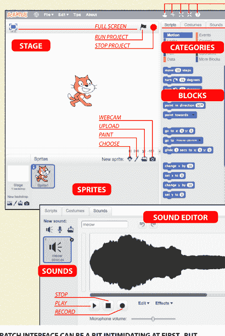

SCRATCH 界面起初可能有点吓人，但当你完成第一个项目时，应该就会相当熟悉了。

- 复制
- 删除
- 放大
- 缩小
- 积木帮助

### 编辑器选项卡

```
when [green flag] clicked
move (10) steps
say [Hello!] for (2) secs
stop this script
```

- 提示
- 逐步操作
- 操作方法
- 关于积木

### 脚本区

- 设置造型中心
- 垂直翻转
- 水平翻转
- 裁剪

脚本   造型   声音

新造型：costume1

清除   添加   导入

### 造型

- costume1
- costume2

### 工具选项

- 画笔
- 线条
- 矩形
- 椭圆
- 文本
- 填充颜色
- 橡皮擦
- 选择
- 复制

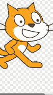

- 100%
- 200%

位图模式  
转换为矢量

## 项目 1 动画基础

*这里本来应该由我来讲动画史。* 然后描述所有不同种类，给出一大堆例子，还有……（打哈欠）……不了，谢谢！你难道不想现在就动手做动画吗？

在这个项目中，你先用最简单的动画形式之一来讲一个短故事：火柴人。火柴人的一个明显优势是，它们做动画几乎和画出来一样容易。

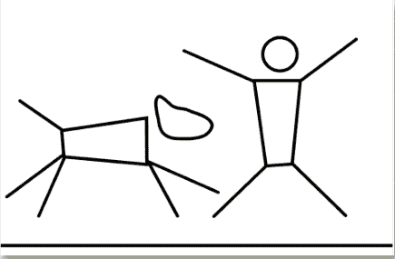

### 绘制你的第一个角色

来吧，开始画吧！开玩笑的。当然，你必须先创建一个项目，然后才能画任何东西。

### 创建项目

- 1. 转到 scratch.mit.edu 或打开 Scratch 2 离线编辑器。
- 2. 如果在线，点击创建。如果离线，选择 文件 ▸ 新建。
- 3. 为项目命名。（在线时，选择标题并输入 Stick Figure Animation。离线时，选择 文件 ▸ 另存为 并输入 Stick Figure Animation。）
- 4. 删除猫。（按住 Shift 单击并选择删除。）

### 绘制身体部位

对于你的火柴人，需要一个圆作为头，一个矩形作为身体，以及线条作为手臂和腿。最初，分别绘制各个部分可能更容易。

- 1. 点击“绘制新角色”图标。

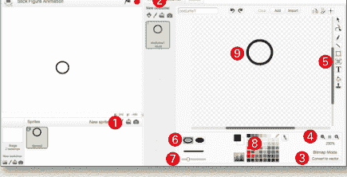

- 2. 点击“造型”选项卡。

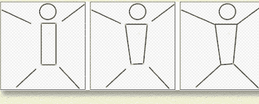

- 2. **单击并拖动身体的每个角，将其移到新位置。**
- 3. **单击并拖动每条手臂的末端，将其放到身体上方的两个角上，也就是肩膀的位置。**
- 4. **单击并拖动每条腿的顶部，将其放到身体下方的两个角上。**

看到*重塑*工具如何帮助你轻松修改火柴人了吗？由于你一直在**造型编辑器**画布上以 200% 缩放工作，请检查你的图形在**舞台**（造型编辑器左侧的大区域）上看起来如何。我的线条似乎有点太细了。

### 调整多条线条的粗细

幸运的是，有一种快速方法可以调整构成*矢量角色*的所有线条：

- 1. **点击选择工具。**
- 2. **在造型编辑器画布上单击并拖过整个图形，以选择所有线条。**
- 3. **使用线宽滑块增加线条粗细。**
- 4. **在舞台上检查角色，以确定你的图形的最佳粗细。**

- 4. 如有必要，使用线宽滑块像调整火柴人那样调整线条粗细。

在舞台上比较你的图形和新线条。

### 根据背景调整动作

在每个开合跳姿势中，双脚都应在地面上。你可以把造型编辑器画布的底部当作所有造型的地面，以保持一致。

- 1. 点击你的火柴人角色，然后在“脚本”选项卡上点击 Costume1。
- 2. 使用选择工具单击并拖过整个图形。
- 3. 多次按键盘上的向下方向键，直到火柴人的双脚与造型编辑器画布的底部对齐。
- 4. 如有必要，使用重塑工具将每条腿的底部与窗口底部对齐。
- 5. 对 Costume2 重复步骤 1–4。

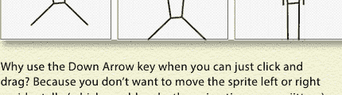

既然可以直接单击并拖动，为什么还要使用向下方向键？因为你不希望意外地左右移动角色（这会让动画看起来抖动）。

返回舞台，点击你的火柴人，然后拖动它，使每条腿的底部与地面对齐。如果你在 Costume1 和 Costume2 之间切换，双脚现在应该保持在地面上。

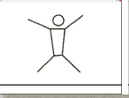
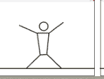
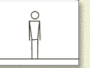

但还是少了点什么。站起来做几个开合跳。说真的！作为动画师，你需要做的一件事就是把每个动作表演出来。

你的双脚全程都接触地面吗？当然不是。为什么它们叫*开合跳*？因为你要跳起来！

### 让开合跳跳起来

现在，如果你切换造型，就像双脚只是在地板上滑动。你需要在 Costume1 和 Costume2 之间添加一个姿势，让手臂和腿位于其他两个姿势的中间，并让身体离开地面。这也是重命名造型的好时机，以免混淆。

- 1. **点击 Costume1**，选择造型名称，然后输入 Arms Up。
- 2. **点击 Costume2** 并将其重命名为 Arms Down。
- 3. **按住 Shift 单击 Arms Up 造型**，然后选择复制。
- 4. **单击并拖动新造型向上**，使其位于 Arms Up 和 Arms Down 之间。
- 5. **重命名中间的造型**为 Arms Mid。


### 用代码块制作动画

首先创建一个循环，这样你就可以按需重复动画的某一部分任意多次。要做十个开合跳，请按以下步骤操作：

- 1. **单击 Sprite1 的脚本选项卡。**
- 2. **将以下积木块拖到脚本区，并更改数值以匹配。**

```scratch
when [flag] clicked
switch costume to arms down
switch costume to arms mid
switch costume to arms up
```

如果你单击绿旗按钮测试代码，会发生什么？看起来什么也没发生，因为造型变化出现得太快，你看不到它们。你需要在切换造型积木块之间添加等待积木块，把变化速度放慢到足以看清。默认的 1 秒太长了，所以试着把每个积木块的值改为 .25（即四分之一秒）：

```scratch
when [flag] clicked
switch costume to arms down
wait .25 secs
switch costume to arms mid
wait .25 secs
switch costume to arms up
wait .25 secs
```

现在当你单击绿旗按钮时，应该能看到造型变化。如果你想让角色做十个开合跳，你可以拖过来一大堆积木块，或者只添加一个重复积木块。

```scratch
when green flag clicked
repeat 10
    switch costume to arms down
    wait 0.25 secs
    switch costume to arms mid
    wait 0.25 secs
    switch costume to arms up
    wait 0.25 secs
```

你的火柴人应该会做十个开合跳，但看起来不太对。你能看出代码中缺少什么吗？这个角色从手臂放下的姿势开始，切换到手臂中间位置，然后到手臂举起，接着在重复时又直接跳回手臂放下。你需要在每次重复之间再添加一个手臂中间位置，让动画更平滑。而且每个切换造型也都需要一个等待积木块：

```scratch
when green flag clicked
repeat 10
    switch costume to arms down
    wait 0.25 secs
    switch costume to arms mid
    wait 0.25 secs
    switch costume to arms up
    wait 0.25 secs
    switch costume to arms mid
    wait 0.25 secs
```

单击绿旗按钮，现在你应该能看到十个开合跳中的所有造型变化。但还有一个问题。你做开合跳时，在手臂举起和手臂放下这两个姿势上不都会停顿一下吗？这些姿势之后应该有更长的等待，对吧？我花了几分钟尝试不同的等待值，发现这些值效果最好：

```scratch
when [green flag] clicked
repeat (10)
  switch costume to [arms down]
  wait (0.5) secs
  switch costume to [arms mid]
  wait (0.25) secs
  switch costume to [arms up]
  wait (0.5) secs
  switch costume to [arms mid]
  wait (0.25) secs
```

当你单击绿旗按钮时，开合跳应该看起来好多了。但你注意到它在最后一个开合跳跳到一半时卡住了吗？你需要在重复积木块之后再添加一个切换造型积木块，让角色回到直立姿势：

```scratch
when [green flag] clicked
switch costume to [sleep]
wait (5) secs
switch costume to [wake]
```


> 也许我太着急了，但我不想每次修改代码都要坐着看完十个开合跳。我通常会在编写代码时使用较小的数字，等我对动画效果满意后再把数值调大。

#### 为动画增添幽默

如果你在 YouTube 或其他在线视频网站搜索，可以找到成千上万个搞笑的火柴人动画。它们有什么共同点？像任何故事一样，你的动画应该有开头、中间和结尾。但大多数动画为什么好笑？通常是惊喜元素！

我知道一个做十个开合跳的火柴人没什么好惊讶的。如果你想让它变得有趣，可以添加什么来让观众惊喜？现在，这些开合跳就像只有一个中间部分的故事（没有开头或结尾）。

要把这个场景变成一个有趣的故事，你需要回答两个问题：

- 1. **一个火柴人为什么在做开合跳？**
- 2. **什么可能阻止这个火柴人完成开合跳？**

只要观看几乎任何幽默场景，你都会注意到一个角色非常想要某样东西，而一个障碍阻止这个角色得到它。在皮克斯电影 *《飞屋环游记》* 中，一个脾气暴躁的老人想远离所有人，于是他把所有这些气球绑在房子上，然后起飞。哪里出错了？一个烦人的小童子军跟着他飞走了。

也许你需要第二个角色，比如 *《飞屋环游记》* 中的小男孩，或 *《乐高大电影》* 中的蝙蝠侠，或 *《怪物史莱克》* 系列电影中的驴子，或者……电影里的那只狗——有了！让我们给火柴人一只火柴宠物吧！一只阻止他完成晨练的狗！

#### 添加火柴人最好的朋友

下面是我最喜欢的另一个 Scratch 火柴人动画技巧。你不必绘制新角色，而是可以复制第一个角色并重新拼装身体部位（有点像弗兰肯斯坦博士）。这样，你就能确保角色比例合适，并且放在一起好看：

- 1. 按住 Shift 单击 Sprite1，然后选择“复制”。
- 2. 要重命名这两个角色，请选择“信息”，然后更改名称。

  我会把第一个角色叫作 Sticky，第二个角色叫作 Woof。

- 3. 单击“返回”按钮退出信息视图。

现在你应该有两个角色了。单击 Woof 角色的图标，转到“造型”选项卡，并单击每个造型图标上的小 X，删除除第一个造型之外的所有造型。第一个造型将作为新角色的基础。

#### 修改身体部位以创建新角色

你将使用选择工具旋转身体，并把其他身体部位拖到合适位置。然后使用重塑工具雕刻狗的头部：

- 1. 单击选择工具。
- 2. 单击身体形状。
- 3. 单击旋转手柄（所选形状上方的小圆圈），并拖动将身体旋转到水平位置。
- 4. 单击并拖动胳膊和腿到合适位置。
- 5. 单击重塑工具。
- 6. 单击头部，然后单击并拖动控制点，把头部雕刻得更像狗头形状。

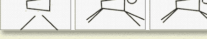

#### 展开你的幽默故事

这只狗将成为 *Sticky* 完成晨练的障碍，但你要如何开始这个故事呢？*Sticky* 为什么锻炼？我能想到各种理由，但有什么简单的理由可以让你快速展示（这样你就不必花几个小时做动画）？如果 *Sticky* 贴上一张新的肌肉火柴人海报，会怎么样？看到一个瘦瘦的火柴人走过舞台，贴上一张有着夸张肌肉的火柴人海报，可能会很有趣。

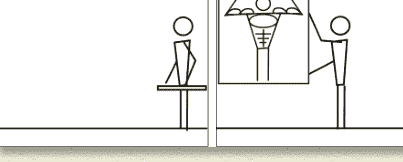

然后 *Sticky* 开始做开合跳，但狗跑过来缠着他。*Sticky* 不理狗，直到狗跳起来撕掉海报的一部分。然后 *Sticky* 追狗追了太久，结果练出了巨大的腿部肌肉，而不是强壮的手臂、胸肌和六块腹肌。*那*可能会很有趣。

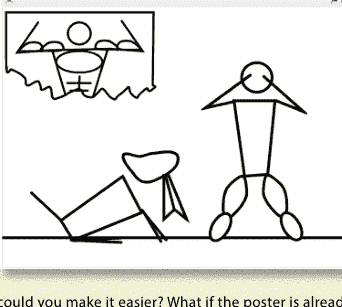

你怎么能把它变得更容易？如果 *Sticky* 进场时海报已经在墙上，会怎么样？狗也可以在那里。然后你只需要让这个男人进入场景。

### 像男人一样走路

我们尽快把 *Sticky* 弄到舞台上，好吗？等等，他已经在舞台上了。把他弄下去！

- 1. **暂时按住 Shift 单击角色并选择“隐藏”来隐藏 Woof。**
- 2. **选择 Sticky，并把他的造型改为“手臂放下”。**
- 3. **单击并拖动 Sticky 到舞台最右侧。**

## 项目 1 动画基础

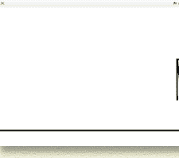

你想让 *Sticky* 在做开合跳之前走上舞台，所以新代码需要放在**当绿旗被点击**和**重复**积木块之间。将以下代码块直接吸附到**当绿旗被点击**正下方，并更改数值以匹配：

```scratch
when green flag clicked
switch costume to arms down
go to x: (-260) y: (-18)
glide (1) secs to x: (200) y: (-30)
wait (1) secs
```

如果你给 *Woof* 添加一个睡觉姿势，并让狗在男人开始锻炼时醒来，会怎么样？

### 使用选择工具旋转身体部位

要在旋转时保持线条长度，请使用选择工具。对于矢量形状，你甚至可以按照以下步骤更改旋转所围绕的点。

- 1. 按住 Shift 单击 *Woof* 图标并选择“显示”。
- 2. 单击 *Woof* 以选择该角色，然后单击**造型**选项卡。


### 让狗动起来

我想终于该让狗活起来了，你觉得呢？为 Woof 设计一个醒着的造型：

- 1. 按住 Shift 单击 Woof 的睡觉造型，然后选择“复制”。
- 2. 将造型重命名为“醒来”。
- 3. 单击选择工具。
- 4. 单击并向上拖动狗的头一点（或者你可以使用向上箭头键进行更精确的移动）。
- 5. 单击并拖动，将尾巴向上旋转。

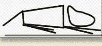

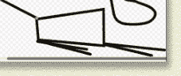

#### 为让火柴狗动起来添加代码

时机在动画中至关重要，尤其当有两个或更多角色互动时。你能算出狗应该等多少秒才醒来吗？回看 *Sticky* 上的代码：滑行进来用三秒，然后在开始开合跳前暂停一秒。所以狗应该等大约五秒，对吧？

- 1. 单击“脚本”选项卡。
- 2. 如果你像我一样复制了火柴人角色来制作狗，该选项卡中应该已经有开合跳代码。按住 Shift 单击 `WHEN GREEN FLAG CLICKED` 积木，然后选择“删除”。


- 3. **将以下代码积木拖到脚本区，并修改数值以匹配：**

```scratch
when green flag clicked
switch costume to sleep
wait 5 secs
switch costume to wake
```

单击绿旗按钮，狗应该睡五秒，然后通过抬起头和尾巴来表示醒来。狗接下来可能会做什么？当我进入有狗的房间时，它通常会开始摇尾巴。

#### 让尾巴摇起来

要快速摇尾巴，复制“醒来”造型，将新造型重命名为 **摇尾**，并使用选择工具旋转尾巴。

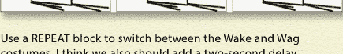

使用 `REPEAT` 积木在“醒来”和“摇尾”造型之间切换。我想我们还应该在狗刚醒来和开始摇尾巴之间加两秒延迟。（狗肯定需要几秒钟从醒来到表现兴奋。）

```scratch
when green flag clicked
switch costume to [sleep v]
wait 2 secs
switch costume to [wake v]
wait 2 secs
repeat 3
    switch costume to [wag v]
    wait 0.25 secs
    switch costume to [wake v]
    wait 0.25 secs
```

### 像人一样说话

角色是火柴人，所以我认为最好“stick”（很搞笑，对吧？）用对话气泡，而不是录制的声音和语音。（你在项目4中使用数字音频。）你可以把对话气泡画进新造型，或制作一个单独的角色，但我发现使用 `SAY` 积木更容易。

我想让我的角色一边做开合跳一边说话。如果我把 `SAY` 积木放进 `REPEAT` 积木里，Sticky 会一遍又一遍地说同一句话，直到最后一个开合跳结束。

一个可怜的小动画师该怎么办呢？

Scratch 可以让不同的代码块在不同角色上同时运行，甚至在同一角色内同时运行。这意味着你可以把当前的滑行和开合跳代码块保留在火柴人上，再添加第二个 WHEN GREEN FLAG

### 像狗一样说话

国家安全是指国家政权、主权、统一和领土完整、人民福祉、经济社会可持续发展和国家其他重大利益相对处于没有危险和不受内外威胁的状态，以及保障持续安全状态的能力。

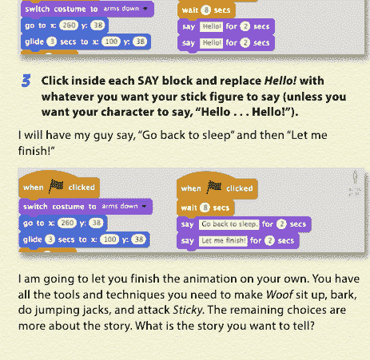

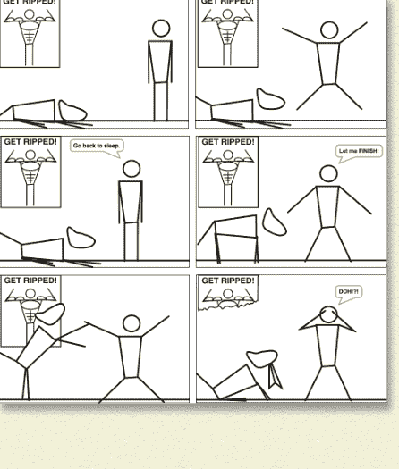

## 项目 2 让了不起的角色动起来

受够火柴人了！在这个项目中，你将使用矢量绘图工具创建一组独特的角色，然后学习一些设计技巧，帮助它们活起来。

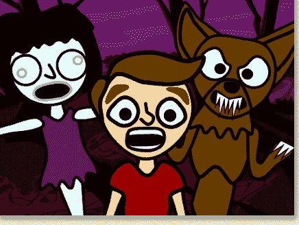

### 保持简单，笨蛋

我年轻时了解到，KISS 不只是把嘴唇贴到别人身上。它可以代表 Keep It Simple, Stupid（保持简单，笨蛋）。你的角色越复杂，给它们做动画就越难。所以，傻瓜，让你的角色设计保持简单！

……为嘴巴画一条简单的线……

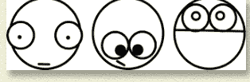

……然后给每张脸填充不同的颜色：

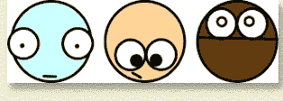

哇，我不知道你看到了什么，但我看到了一个僵尸、一个人和一个狼人！

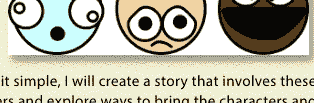

为了保持简单，我将创作一个涉及这三个角色的故事，并探索让角色及其世界活起来的方法。

### 抢先一步

开始之前，花点时间想想你想讲的故事，以及哪些角色最适合做成动画。如果你还没有好主意，别担心，你可以先随便摆弄几个角色，看看它们会把你带向哪里。

### 创建新项目

- 1. 访问 scratch.mit.edu 或打开 Scratch 2 离线编辑器。
- 2. 如果在线，单击“创建”。如果离线，选择“文件 > 新建”。
- 3. 给你的项目命名。（在线时，选择标题并输入 Animation Characters。离线时，选择“文件 > 另存为”并输入 Animation Characters。）
- 4. 删除猫！

### 绘制新角色

- 1. 单击“绘制新角色”图标。
- 2. 单击“造型”选项卡。
- 3. 单击“转换为矢量”按钮。
- 4. 单击椭圆工具。
- 5. 单击“轮廓”选项。
- 6. 选择黑色色块。
- 7. 单击并拖动以画出一个头和两只眼睛。  
  你可以按住 Shift 键画出正圆。
- 8. 再画两个椭圆作为瞳孔。

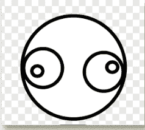


如果你想让两只眼睛大小完全一致，使用“复制”工具制作完全相同的副本。

你的角色开始成形了吗？如果没有，也许加点头发会有帮助。

### 快速发型设计

你可以用铅笔工具画头发，也可以对椭圆或矩形使用“重塑”工具来塑造头发。我会结合这些技巧，为我的僵尸打造独特发型：

- 1. 单击椭圆工具。
- 2. 单击“实心”选项。
- 3. 选择用于头发颜色的色块。
- 4. 在角色脸部正上方单击并拖动。
- 5. 按住 Shift 单击“后移一层”按钮，将头发移到最底层（头和眼睛后面）。
- 6. 单击“重塑”工具。
- 7. 单击头发以选中它。
- 8. 单击并拖动控制点来设计发型。

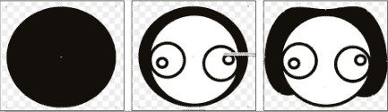

铅笔工具更擅长绘制锯齿状形状，比如僵尸刘海！

- 1. 单击铅笔工具。
- 2. 选择一个色块。
- 4. **单击选择工具，单击嘴巴，然后使用“线宽”滑块调整线条粗细。**

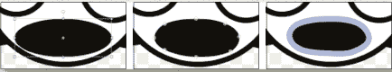

### 给它们做个鼻子

虽然有些僵尸在旅途中可能丢了鼻子，但我觉得我的小食尸鬼可以用一个小巧的鼻子。用铅笔工具给你的角色画鼻子，然后用“重塑”工具把它变平滑。


鼻子的位置对角色影响很大，和眼睛、嘴巴的位置一样，所以在永久锁定面部之前，你也许想多试几个位置。

### 做点身体工作

将身体、手臂和腿作为独立对象，会让角色更容易做动画。

- 1. **单击椭圆工具，选择轮廓颜色，然后画出大小大致符合身体需要的椭圆。**

我会选择经典的黑色作为轮廓颜色。

- 2. **单击“给形状上色”工具，为角色的衬衫或连衣裙选择颜色，然后单击初始身体形状内部。**

- 3. 单击“重塑”工具，单击身体以选中它，然后单击并拖动控制点，调整成你觉得最好看的形状。

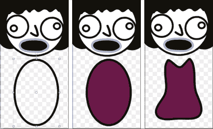

### 添加简单的腿

你可以使用矩形工具把两条腿一起画出来，用“重塑”工具在脚踝处把它们收窄，然后用你选择的裤子、紧身裤或僵尸肤色填充。

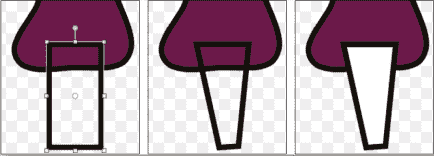

有些地方看起来不对。哦对！我不想让僵尸的连衣裙太短。按住 Shift 单击“后移一层”按钮，让腿出现在身体后面。然后画一个椭圆，并把它重塑成鞋子。


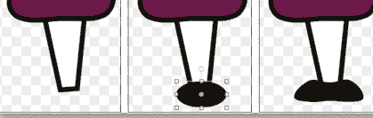

### 为角色添加手臂

虽然你可以把腿合并起来蒙混过关，但你的角色应该有两条手臂，对吧？你可以按照懒人动画师的做法，先画左臂，然后用老一套的“复制加翻转”组合拳。

- 1. 使用椭圆工具绘制左臂。
- 2. 使用重塑工具调整形状。
- 3. 用肤色填充形状。

我选择僵尸白。

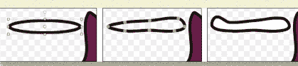

- 4. 点击复制工具，点击手臂，然后将副本拖到另一侧。
- 5. 点击左右翻转按钮。
- 6. 点击选择工具，然后将手臂拖到正确位置。

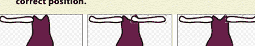

哎呀，我刚注意到我的角色没有脖子！为什么不复制腿的形状并垂直翻转呢？

### 尖牙让野兽更凶猛

绘制尖牙等细节形状时，要么放大，要么先画大再缩小到合适尺寸：

- 1. 点击线条工具。
- 2. 点击轮廓选项。
- 3. 点击黑色色块。
- 4. 点击并拖动，绘制尖牙的一侧。
- 5. 点击回第一个点以闭合形状。
- 6. 点击形状上色工具，点击白色色块，然后在形状内部点击。

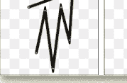

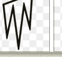

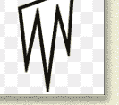

- 7. 点击复制工具，点击第一组尖牙，然后将它们拖到口鼻部的另一侧。
- 8. 点击左右翻转按钮以翻转尖牙。
- 9. 使用选择工具将尖牙拖到合适位置。
- 10. 使用重塑工具调整嘴巴，以适应新牙齿。

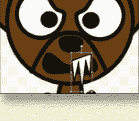

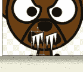

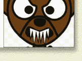

## 项目 2 让了不起的角色动起来

啊，尖牙让我的角色凶猛多了，但他看起来有点像穿着毛茸茸的连衣裙。嗯，谁说Werewoof是男孩？好吧，那她看起来就像穿着毛茸茸的连衣裙！

### 给野兽“脱衣”

在删除连衣裙（或其他身体部位）之前，花点时间想想它是否还有其他用途。我想到，如果我调整连衣裙的大小并将其上移到肩膀，它看起来会更像皮毛：

- 1. 点击选择工具，点击连衣裙，然后将底边向上拖动使其变短。
- 2. 点击并将形状向上拖到肩膀区域。
- 3. 点击椭圆工具，然后绘制一个新的身体形状。

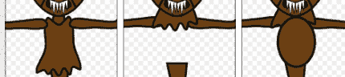

- 4. 点击重塑工具，点击身体，然后拖动点来制作肋骨。
- 5. 点击选择工具，点击腿的形状，然后调整腿的大小以适配。

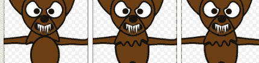

- 6. 点击重塑工具，然后点击腿。
- 7. 按住Shift键点击并在两侧各拖动一个新点和曲线。
- 8. 点击选择工具，点击腿，然后向上拖动。
- 9. 点击脚并将它们向上拖到新的腿的位置。

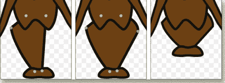

只旋转手臂还不够。既然狼人现在蹲着，我想弯曲手臂并加上一些爪子！你可以画新的爪子，但你的懒作者只会复制尖牙并重塑它们以适配每只爪子：

- 1. 点击重塑工具，然后点击左臂。
- 2. 点击并拖动点，使手臂呈弯曲姿势。
- 3. 点击复制工具，点击一组尖牙，然后将它们拖到左爪。
- 4. 点击重塑工具，选择爪子，然后调整点。
- 5. 对右臂重复步骤1–4（或复制并翻转左臂和爪子）。

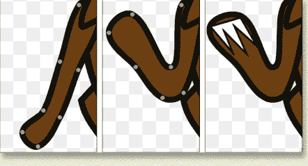

### 创建第三个角色

如果你把这两个角色并排看，你几乎猜不到它们来自同一个基础图形（除非所有工作都是你做的）。

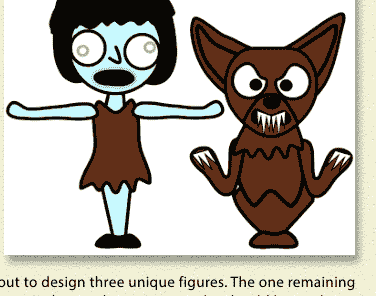

我一开始打算设计三个独特的角色。剩下的一个角色是普通人——在这个队伍里，他应该有很多要担心的事。

决定哪个精灵在形状上更接近你想要创建的新角色。Zomberta比我的蹲着咆哮的狼人更像人，所以我会复制她：

- 1. 按住Shift键点击你想复制的精灵，然后选择“复制”。
- 2. 按住Shift键点击新精灵，点击信息按钮，然后更改名称。

我会把我的人物命名为赫克托。为什么不呢？

- 3. 点击服装标签页。

#### 从僵尸女孩到普通男孩

你已经把一个角色变成了另一个角色，所以这次我会讲得快一些。我首先把皮肤和头发颜色从僵尸女孩改成普通男孩。然后我会画更男孩气的头发（你可以使用铅笔工具，或者老套的“在椭圆上重塑”技巧），重塑鼻子，并把瞳孔移到眼睛中间。

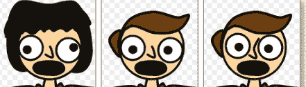


*我不是说男孩穿连衣裙有什么不对，但我想让我的角色有一套更传统的男孩服装，来配合我心中的故事。连衣裙的形状完全不对，所以我会删除它，创建一件新衬衫，然后把腿涂成看起来像长裤。*

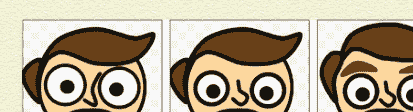

#### 加一副牙齿

现在我对眼睛和鼻子的样子满意多了。但那嘴巴让我有点毛骨悚然。看起来好像有人把男孩的牙齿打掉了。牙齿！

- 1. 按住Shift键点击服装，然后选择“复制”。
- 2. 点击形状上色工具，然后选择白色色块。
- 3. 点击嘴巴内部，用白色填充。
- 4. 点击线条工具，选择黑色色块，然后在嘴巴中间画一条直线。
- 5. 点击重塑工具，点击嘴巴，然后调整形状。

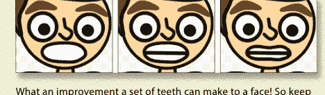

一副牙齿能给脸带来多大的改善啊！所以要坚持刷牙，否则你最后会看起来像*Zomberta！*

#### 为穿着衣服的角色摆姿势

移动穿着衣服的角色需要几个额外步骤。在手臂旋转后，你需要使用重塑工具调整衬衫。别忘了先复制服装，以防你之后想抬起手臂！

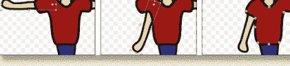

#### 集合你的角色阵容

对右臂执行相同步骤后，我想看看这个男孩与他那些更狰狞的动画伙伴相比如何，所以我把三个角色都拖到了舞台上的位置。

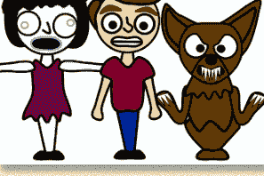

你可以花任意多的时间来完善角色设计，但这本书讲的是动画，所以让我们继续构建场景、添加声音并使用特效，让你的卡通片更令人难忘。

### 快速改进角色

如果你非要多花点时间在角色上，这里有一些可能有帮助的技巧：

- **与其他动画角色比较：** 花几分钟用批判的眼光回顾几部你最喜欢的动画电影或节目中的角色。哪些细节有助于区分一个角色和另一个角色？
- **添加纹理：** 通过添加图案、形状和纹理，将你的设计技巧运用到服装上。几条波浪线也能打造更好的发型。
- **添加更引人注目的姿势：** 与其让你的角色只是站着，不如尝试更具戏剧性的姿势，这有助于表达他们的个性。
- **增加戏剧性：** 从你心中的故事中选择一个特定场景，调整角色的姿势和表情，以匹配你想要表达的语气和情绪。

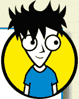


### 在项目之间共享角色

如果你想从多个项目中引入角色，或者想先从一个空白项目开始，处理好背景，然后再引入角色，该怎么办？无论是线上还是离线工作，Scratch 都允许你从某个项目导出角色、单个造型和背景，然后将它们导入到另一个项目中。

按住 Shift 键点击角色、造型或背景，然后选择“保存到本地文件”。

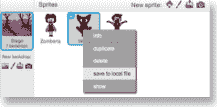


使用“从文件上传角色”或“从文件上传造型”按钮，将你的角色加载到新项目中。

如果你在线上工作，且没有权限将文件保存到自己的电脑上，别担心！你可以使用 Scratch 的“背包”（在线上工作时，它位于“脚本 / 造型 / 声音”页面的底部）。


你可以将角色、背景、造型、脚本和声音拖入或拖出你的“背包”。到目前为止，Scratch 的离线版本还没有“背包”功能。

- 5. 对于地板，请点击“绘图编辑器”画布左下角边缘外侧，然后朝墙的右下角方向拖动。
- 6. 点击“为形状着色”工具，选择你想要的颜色，然后填充墙和地板的形状。

我为地板选择了深棕色，为墙壁选择了浅棕褐色。


我房子里的大多数墙壁要么有窗户，要么有门。窗户的好处是能帮你看到一天中的时间、天气，或者一个正在寻找下一餐的凶猛怪物：

- 1. 点击“矩形”工具，选择黑色色板，然后拖动“线宽”滑块来调整线条粗细。
- 2. 点击并拖动来绘制窗户的外部部分。
- 3. 点击“线条”工具，按住 Shift 键，然后在矩形中间拖动，将形状分成两部分。
- 4. 按住 Shift 键点击，并在上半部分中间向下拖动，以表示上窗中的两块玻璃。
- 5. 点击“为形状着色”工具，选择浅灰色色板，然后点击窗户内部为其填充颜色。


添加窗帘会让房间更有色彩，并让人明显看出你是在室内：

- 1. 点击“矩形”工具，然后在窗户左侧点击并拖动。
- 2. 点击“重塑”工具，按住 Shift 键点击矩形右侧边的中间位置，以添加一个点和一段曲线，然后向左拖动，形成窗帘拉开的样子。
- 3. 点击并拖动，以调整右上和右下两个点的位置。


- 4. 点击“为形状着色”工具，选择一种窗帘颜色，然后点击窗帘内部。
- 5. 点击“复制”工具，点击窗帘，然后将副本拖到窗户的右侧。
- 6. 点击“左右翻转”按钮。


你可以使用“重塑”工具来调整窗帘的长度，或展示更多窗户区域。


## 项目 3 让场景更具沉浸感

如果你希望观众能看到窗外的物体，或者希望角色通过门进出，或躲在树后，该怎么办？与其把墙壁、窗户、地板和门全部放在一个背景中，不如把它们放进一个角色里！Scratch 角色比背景灵活得多；角色可以在彼此前后移动、左右移动，还能变大变小。

### 将背景转换为角色

虽然你不能直接将背景转换为角色，但你可以把一个背景拖到一个角色上，它会变成该角色的一个新造型：

- 1. 点击“绘制新角色”按钮。
- 2. 点击“舞台”按钮（位于实际舞台下方）。
- 3. 在“背景”选项卡中，点击并拖动包含窗户的背景到你新建的角色上。


- 4. 仍在“背景”面板中时，选择纯白色背景。

如果你没有背景，请点击“绘制新背景”按钮。

- 5. 点击并将新的墙壁角色拖到舞台上的适当位置。

### 设计透视窗户

你可以通过几种方式，让其他角色透过窗户被看到。一种方法是删除窗格内部的颜色，但在这里行不通。你能想出原因吗？你先画了墙的矩形，*然后*在它上面画了窗户。因为这是一个矢量角色，每个对象都在自己的图层上。

相反，在窗户的左侧、右侧、顶部和底部边缘画出不同的墙壁部分，并移除玻璃：

- 1. 选择墙 / 地板 / 窗户角色，然后点击“造型”选项卡。
- 2. 在“绘图编辑器”画布上，点击墙上的任意位置，然后按键盘上的 Delete 键。
- 3. 点击“为形状着色”工具，点击空色板，然后点击玻璃。


要让角色从窗户中出现，请将角色移动到合适位置，然后将该角色发送到后层：

- 1. 在舞台上，点击并拖动角色，使其与窗户重叠。
- 2. 点击窗帘或地板上的任意位置，并按住鼠标或触控板按钮几秒钟，使该角色移到前层。


为了保持窗户透明，你需要将墙壁分成四个部分来绘制，并在窗户周围留出一个空洞：

- 1. **在“绘图编辑器”画布上，点击“矩形”工具。然后点击“实心”选项，并在“绘图编辑器”中选择你墙壁的颜色。**
- 2. **从右上角正上方开始，点击并拖动，跨越画布一直到窗帘右侧，再向下延伸到地板。**
  - 稍微与窗帘和地板重叠也没关系。
- 3. **按住 Shift 键，同时点击“后移一层”按钮。**


- 4. **对剩余的墙壁三个部分重复步骤 2 和 3。点击画布外部，以确保各部分填充好各自区域。**


当你的新墙壁填充完成后，你可以把一个角色放在窗户内，把另一个角色放在窗外向里看，从而让观众获得更好的纵深感。


为了让场景更具沉浸感，你可以在房间里添加一些角色可以在其前面和后面移动的物体。在戏剧、电影和电视中，这些物体被称为*道具*。

### 打造你自己的家具

没有什么比一张又大又蓬松的沙发更能体现“客厅”了。你可以跟着做，也可以绘制一个更适合你房间（以及你的故事）的其他道具。

绘制道具最简单的方法是把它们分解成更小的部分。尽管大多数沙发靠垫是矩形的，但最好先用椭圆来画，再使用“重塑”工具来获得合适的圆角：

- 1. 点击舞台下方的“绘制新角色”图标。
- 2. 点击“造型”选项卡，然后点击“转换为矢量”按钮。
- 3. 点击“椭圆”工具，选择黑色色板，拖动“线宽”滑块来调整线条粗细，然后选择“轮廓”选项。
- 4. 点击并拖动来绘制第一个靠垫。为扶手和另外两个靠垫留出足够空间。


### 用透视绘制场景

通过使用透视，你可以让一些物体看起来很远，而另一些物体看起来离观看者更近。将道路形状的顶部变窄，会带来更好的透视感。

点击“整形”工具，点击道路矩形将其选中，然后点击并拖动顶部两个点，使它们靠得更近。


> *如果你无法让道路的顶部边角与笔直的地平线对齐，或者你只是想和我一样偷懒，可以试试这个小技巧。选中天空矩形，将其置于最前图层（按住 Shift 键点击“前移一层”按钮），然后将底部向下拖动，使其覆盖草地和道路矩形的顶部。*

你可以调整左右两个边角之间的距离，来表现道路的宽度和长度。最棒的是，道路会为你场景中的其他对象提供参考引导。


### 快速美化场景

这里有一些提升场景效果的小贴士：

- **使用参考照片：** 你可以通过网络或自己的相机获取室内外图片。如果你想临摹这些图片，请确保在将照片作为角色或背景导入后，切换到矢量模式。
- **多应用渐变：** 渐变不只用于天空、地面和道路。可以尝试在树木、建筑或你最爱的早餐麦片上使用水平、垂直和径向渐变。径向渐变在圆形对象上效果最好，水平渐变和垂直渐变在矩形对象内效果更佳。
- **添加阴影：** 想一想如何复制一个角色，用深灰色填充它，并改变其形状（就像本项目第一张图中的树木一样）。提醒一下：一旦你给一个对象添加了阴影，就必须给所有其他对象也添加阴影，否则场景看起来会不完整。
- **考虑天气：** 是多云天？雨天？还是有风？
- **考虑时间：** 尤其是室外场景，选择是早晨、下午还是傍晚非常重要。


## 项目 4 听起来不错

**你和我侄女、侄子一样吗？** 你以为在看电视的时间里，有一半时间你的眼睛根本没盯着屏幕。你在用手机发短信，或在平板上查资料，或在笔记本电脑上打游戏，甚至在做作业。而吸引你注意力的最简单方法之一，就是按下遥控器的静音键，对吧？“嘿，我刚才还在看呢！”这足以说明声音对于讲述故事有多么重要。


### 他就是这么说的

在之前的项目中，你开始构思故事、设计角色，并创建了室内和室外场景。动画流程的下一步是添加对话。

对话在动画流程中非常重要，以至于几乎所有动画开始前都要先录制声音，因为让角色动画与声音同步，比试图将声音硬塞进已经完成的动画要容易得多。在动画界，这种初始声音录制被称为*草稿音轨*。多么贴切啊？

*尽管本项目是关于录制和播放音频的，但在 Scratch 中还有一种方法可以让你的角色相互对话。如果你向角色添加一个“说”积木，那么你在积木中输入的文本就会出现在对话气泡中。你甚至可以通过“说 秒”积木来控制对话气泡显示的时间。*


### 为你的角色编写对话

好吧，别讨厌我，但即使你打算为所有角色配音，也要在开始之前把对话写下来。

- 2. **如果你在线，浏览并打开你想复制的项目。如果离线，选择“文件 ⇨ 打开”并选择你的项目。**
- 3. **为你的项目命名。如果在线，点击“文件”菜单并选择“保存副本”。如果离线，选择“文件 ⇨ 另存为”。**

  我将我的版本命名为*动画配乐*。
- 4. **删除那只猫。**

你可以通过三种方式将声音添加到 Scratch 项目中：

- 从声音库中选择一个声音。
- 导入音频文件（.mp3 或 .wav 格式）。
- 直接在 Scratch 中录制声音。

虽然声音库中有许多音乐和音效可供选择，但没有对话。

### 找到录音按钮

在之前的项目中，你大部分时间都在画图编辑器中度过。你大概已经猜到，在这个项目中，你将在声音编辑器中花更多时间。


点击“声音”标签页（位于“造型”标签页右侧），即可进入声音编辑器。


## 项目 4 听起来不错

*注意：* 如果你的电脑没有连接麦克风，或者你想使用在其他设备（如手机或数码录音机）上录制的音频，请点击**从文件上传声音**按钮，然后跳到“编辑声波”一节。

在开始点击、录制和播放之前，先决定每个声音应该放在哪里是很重要的。

在Scratch中，声音的处理方式与造型和脚本相同。正如每个角色可以有多个不同的造型和积木，每个角色也可以包含多个不同的声音。因为我的角色*Hector*有第一句台词，所以我将在录制前选中他的角色：

1. 点击将要说话（或咆哮、呻吟）的角色，然后点击**声音**标签页。
2. 按住Shift键并单击**Pop**声音，然后选择**删除**。或者单击**声音**图标上的**X**将其删除。

   默认情况下，每个角色都有*Pop*声音。除非你打算让角色发出“噗”的一声（或让它攻击一卷气泡膜），否则你需要删除该声音。
3. 点击**录制新声音**按钮。

你可能会认为，只要点击**录制新声音**按钮，Scratch就会立即开始录制。并不是！这个按钮的工作原理与**绘制新造型**按钮相同；它会创建一个声音对象，显示在**声音编辑器**的**新声音**列中。就像使用绘图工具（矩形、直线等）向造型添加形状一样，录制操作会将声音添加到声音对象中。


*如果你的动画中有多个角色，通常最好分别录制每个角色的台词。稍后，你将学习如何使用积木来控制每个声音的播放时机。*

当你说话、咆哮或呻吟时，录制控件的左侧应该会出现一条垂直的绿色条。该条显示你的声音通过麦克风时的响度。随着你的声音变大，你可能看到条顶部附近出现黄色甚至红色。这意味着声音太大，可能会失真。你可以压低声音，或者调整录制按钮下方的麦克风音量滑块。（对于真正的大嗓门，将滑块向左移动；对于你总是问“你说什么？”的那种朋友，则向右移动。）

### 编辑音频片段

编辑录制的声音是Scratch最酷的功能之一！想象一下，你贿赂你的姐姐，让她在你的动画片中为疯狂科学家配音；你费尽心思写下她的台词，点击录制，然后她犯了个错误，或者只是在两个词之间停顿了太久。与其重新录制这些台词，你可以剪掉不想要的部分，就像在绘图编辑器画布上选择并删除一个形状一样容易。

录制完声音后，声音画布上应该会出现类似这样的内容：


那一排黑色弯曲的形状被称为声波，它是你刚刚录制的声音的可视化版本。

▶ 我真的需要告诉你去点击播放按钮来听你的录音吗？说真的？如果你找不到按钮，它就在停止和录制旁边。

既然你已经掌握了录制和播放声音，接下来让我们进入最酷的部分：编辑音频片段！

在编辑较长的音频片段时，你可能会发现展开声音编辑器很有帮助。选择编辑 → 小舞台布局，或者点击舞台与声音编辑器之间的灰色小三角形，来展开和收缩你的工作区。


### 裁剪声音开头

首先删除声波开头多余的空隙（线条完全平坦的部分）：

1. **选择你录制音频的角色，然后点击声音标签页。**
2. **如果你有多个声音，点击你想要编辑的那一个。**
3. **使用水平滚动条找到你想使用的声音的开头。**
4. **在空隙结束处点击声波，然后向左拖动，一直拖到声波的开头。**
5. **在声波下方，点击“编辑”菜单并选择“删除”。**


好吧，也许你觉得**删除空隙**没那么酷。有点像删除不存在的东西，对吧？但看看这个：每个小团块代表一个单词，而平坦的线条是单词之间的小段空隙（除非你说话像我纽约的朋友们那么快，他们的单词几乎重叠在一起）。


你可以像删除空隙一样删除一个单词：在单词上点击并拖动，然后选择编辑 → 删除。“编辑”菜单还允许你撤销和重做编辑、复制部分音频并粘贴到其他地方，以及选中整个声波。

### 使用声音编辑效果

*声音编辑器效果*允许你修改声波任意部分的音量，还可以反转声音（试一下很有趣，但对录制的对话没什么用，除非你想让角色被魔鬼附身）。

试着让你录音中的某个单词更响亮：

1. **点击并拖动，选中你希望让声音更大的声波部分。**
2. **在声波下方，点击“效果”菜单并选择“大声”。**


注意，在应用效果后，声波的该部分看起来变得更高。声音在现实世界中可能是看不见的，但在Scratch中并非如此！

### 使用积木播放声音

你知道如何在声音编辑器中播放声音，但如何让声音随动画一起播放呢？两个积木会让录制的对话在点击舞台上的绿旗按钮时开始播放：

1. 点击你录制对话的那个角色。
2. 点击“脚本”标签页。
3. 点击“声音”类别。
4. 将“播放声音”积木或“播放声音直到结束”积木拖到脚本区。
5. 点击“事件”类别，然后拖动“当绿旗被点击”积木，将其拼接在“播放声音”积木的顶部：


如果你的角色中存储了多个声音，可以通过“播放声音”积木中的下拉菜单选择要播放的声音。然后当你点击绿旗按钮时，所选的声音就会播放。

“播放声音”和“播放声音直到结束”有什么区别？如果在“播放声音”积木下方拼接了更多积木，这些命令会在声音播放*期间*运行。如果使用“播放声音直到结束”，其他积木要等声音播放完毕后才会运行。

如果你不希望声音立即播放，可以在它上方拼接一个“等待”积木，并设置要等待的秒数：


### 让角色说话动起来

如果你为某个角色录制了对话，下一步自然是让他们看起来像是在说话。你可以通过以下几种方式实现：

- 在播放录好的声音时显示该角色。（废话！）
- 让角色的嘴巴动起来。（说起来容易做起来难，对吧？）
- 显示角色正在和谁（或什么）说话。（就像你只看到查理·布朗，而某个隐形的大人正在说：“Whuh wuh wh wh whaughh。”）
- 使用画外音，即你看到该角色，但当他或她开始说话时，你展示其他内容。（你经常在倒叙中看到这种手法：一个角色向你讲述已经发生过的事情，同时你看到一些他或她正在描述的事物。）

你注意到我在项目2中设计的所有角色都是从张着嘴的状态开始的吗？这让我可以添加牙齿、舌头或两者都添加。然后我可以直接复制造型，重新塑造嘴巴，使其呈现闭嘴状态。

1. 选择将要说话的角色，然后点击**造型**标签页。
2. 按住Shift键并单击角色嘴巴张开的造型，然后选择**复制**。
3. 将第一个造型重命名为*嘴巴张开*，第二个造型重命名为*嘴巴闭合*。
4. 选择“嘴巴闭合”造型。
5. 使用“变形”工具修改嘴巴，使其看起来是闭合的。


现在，你的角色应该至少有两个造型（嘴巴张开和嘴巴闭合）、录制的对话，以及一个简短的脚本（两个积木），只要有人点击绿旗按钮，音频就会播放。

### 简易口型同步

当音频播放时，你将使用一系列积木在张嘴和闭嘴造型之间交替：

1. 选择将要说话的角色，然后点击**脚本**标签页。


2. 将“切换造型为”、“等待”和“重复”积木拖放并吸附到脚本区中另外两个积木的底部：


我用下拉菜单在一个“切换造型为”积木中选择“张开”，在另一个中选择“闭合”。我还把“等待”时间从默认的 1 秒改为 .25 秒，并把“重复”值改为 8。至少，你很可能需要为自己的角色调整“重复”值。你能弄明白原因吗？

单击绿旗按钮后，我希望在音频播放期间嘴一直张开和闭合。我并不是一开始就知道要开合 8 次才能与音频匹配。第一次我猜的是 10。那太长了，所以我试了 6，最后试了 8。你需要根据音频长度调整这个值。你也可以为“等待”积木尝试不同的时间，直到得到你想要的效果。


> 如果你不使用“等待”积木，造型会切换得太快，以至于你看不到造型变化。

### 实现更逼真的口型同步

走到镜子前，站得非常近，盯着自己的嘴，尽可能慢地说 donut 这个词。注意不只是嘴唇，连牙齿甚至舌头也会根据你正在形成的字母或声音以不同方式配合。发 *d* 时，你的牙齿起初合在一起，舌头抵在上颚。发到 *o* 时，你的嘴张开，然后部分闭合，同时舌头向上弯到上颚，准备发 *n*。发 *u* 时嘴张开，发 *t* 时又回到与 *n* 相同的位置。

别担心：你*不*必画出对话中的每一个字母（那会花上永远的时间！）大多数人说话太快，你只能看到少数几个明显不同的口型。如果你不信我，就回到那面镜子前，用你平常说话的方式说“I love donuts”。

要做出更逼真的说话动画，关键在于为嘴在关键时刻形成的形状制作动画，这些关键时刻也称为*关键帧*（发生重要变化的帧）。动画师把你形成元音和辅音时嘴部做出的基本形状称为*音素*。虽然英语字母表有 26 个字母，但音素要少得多，因为许多字母会重叠，例如 M、P 和 B（双唇闭合），以及 D 和 T（舌头抵住上齿）。


为了让你和我进度一致，我们让所有角色都说“I love donuts”。（我的意思是，谁*不*爱甜甜圈呢？）我要切换到 Zomberta。要是僵尸尝过那些黏糊糊的果冻甜甜圈，肯定会爱上它们。

1. **单击将要说话的角色，然后单击“声音”选项卡。**
2. **单击“录制新声音”按钮。**
3. **重命名新的声音对象**为 Donuts。
4. **单击“录制”按钮，并说：“I love donuts。”**
5. **单击“停止”按钮。**
6. **选中声波开头处的任何静音部分，然后选择“编辑”→“删除”。**


当你的甜甜圈录音准备好后，就该选择要添加到角色中的关键音素了。我认为下面这些会最有效：


明白我说的重复音素是什么意思了吧（#1 用了三次，#3 和 #6 各用了两次）？我没有为 *donuts* 中的 u 或 t 创建音素。你能弄明白原因吗？t 和 d 是同一个音素，而且当我说 *donuts* 时，重音在第一个音节（“DO-nuts”），所以发 *u* 时我的嘴几乎不张开。

### 创建自定义音素造型

你的句子只需要音素 1、3、4 和 6。如果你想用“张开的嘴”造型作为 #1，只需再创建两个口型：

1. 选择你想制作动画的角色，然后单击“造型”选项卡。
2. 按住 Shift 单击“张开的嘴”造型，然后选择“复制”。
3. 重命名新造型，使其对应你正在创建的新音素口型（例如“D/5/T/E”）。
4. 使用“重塑”工具把嘴改成想要的音素口型。
5. 对每个剩余音素重复步骤 2–4。


*想节省大量动画制作时间吗？为什么不新建一个名为 Talking 的角色，把每个音素做成不同的造型。然后你可以把那张嘴放到舞台上的任何角色上。这个技巧让你能把角色身体和嘴分开制作动画，然后复制该角色，而不必为每个角色创建一套不同的音素。*

创建好所需音素后，剩下的就是把它们与录音同步。

### 切换造型以匹配音素

确保已重命名所有造型；否则，编写代码会很麻烦：

1. 选择包含音素造型的角色。
2. 单击“脚本”选项卡。
3. **将以下积木拖到脚本区：**

```
~~~scratch
when [green flag v] clicked
play sound [donuts v]
switch costume to [L, N, TH v]
wait (1) secs
~~~
```

4. **按住 Shift 单击“切换造型为”积木，选择“复制”，然后把副本拖放并吸附到当前积木的底部：**

```
~~~scratch
when [green flag v] clicked
play sound [donuts v]
switch costume to [L, N, TH v]
wait (1) secs
switch costume to [L, N, TH v]
wait (1) secs
~~~
```

5. **重复步骤 4，直到每个音素都有一个“切换造型为”积木和一个“等待”积木。**

6. **在每个“切换造型为”积木中选择音素。**

7. **调整“等待”积木的值，使音素造型在播放音频时于恰当的时间出现。**

我最终的脚本如下（我在 Scratch 外部添加了红色字母，以显示哪些积木对应我的甜甜圈音频的每个部分）：


最后那个 *M* 口型会在角色说完话时闭上嘴。

在你掌握 *donuts* 中的音素之后，你应该能够为所有动画角色进行口型同步。关键在于找出任意给定单词或短语中最重要的口型。角色说话越快，你应使用的音素就越少。否则，角色的嘴会动得像疯了一样！

### 更多对话技巧


- **让下颌动起来：** 说话时，不只是嘴唇、牙齿和舌头的事。回到镜子前，看看你发这些音素时下颌在哪里。添加起来很容易：只需使用“重塑”工具微调头部底部。
- **让眼睛和眉毛动起来：** 人们提问时往往会扬起眉毛，把眼睛睁得更大一些。角色说话时，你还能用哪些方式改变眼睛？（镜子在召唤你。）
- **添加眨眼：** 除非你的角色在玩对视比赛，否则试着偶尔加一次眨眼，让他们更真实（或者眨一只眼，帮他们约到对象）。
- **让手动起来：** 你有没有注意到，有些人说话时会挥动手，几乎像在指挥管弦乐队（或者想分散你的注意力，好偷你的钱包）？
- **试试 Audacity：** Audacity（audacity.sourceforge.net）是一款免费的音频编辑应用程序，能让你比在 Scratch 中拥有更强的音频编辑控制力。它最大的优势包括：可以放大和缩小声波、显示精确时间信息、加快和放慢音频，以及应用更复杂的声音效果。

## 项目 5 灯光、摄像机、开拍！

你已经想好了一个故事，选好了角色，创建了背景，并录制了一些对话。

现在，是时候把所有元素组合成一部动画了。本项目融合了设计与编程技巧，可以简化你的动画制作流程。


###（并非）从零开始

你应该先打开一个项目，其中包含你想加入动画的任何角色、背景或声音（最好三者都有）。在本项目中，我会一直使用我的角色、背景和声音，而你应使用你自己的。

### 创建夜景

我想让第一个场景是夜晚赫克托公寓的室内。但如果我设计的角色和背景看起来像这样，该怎么办？


有些 Scratch 用户甚至不会想到给背景添加代码，但“外观”类别中的几个积木可用于背景。其中一个能帮你把白天变成夜晚：

- 1. **单击舞台按钮**，它位于角色图标的左侧。
- 2. **单击脚本选项卡。**
- 3. **单击外观类别。**
- 4. **在脚本区中，单击一次“将效果设为”积木。**


在“将效果设为”积木中，选择“亮度”，将值改为 **50**，然后单击一次该积木。背景会发生什么变化？它会变得亮不少。如果你把值改为最大值 **100**，背景会完全变白。那么怎样让它变暗呢？试试负数！

## 项目 5 灯光、摄像机、开拍！


我发现 -35 很适合我的室外场景。我会取消隐藏（按住 Shift 单击并选择“显示”）墙壁、沙发和*赫克托*，看看现在场景的样子。


好多了。但如果我想让室内更暗呢？

### 关灯

如果你能在整个场景上盖一块黑色幕布，然后让它部分透明，会怎样？这就是“幽灵”效果的用武之地！（提示：它可不只是给幽灵用的。）

- 1. 在舞台下方，单击“绘制新角色”图标。
- 2. 单击“造型”选项卡。
- 3. 单击“填充颜色”工具。

当你把“将效果设为”的值改为“幽灵”和 35，并单击绿旗按钮时，你的场景会变暗。你可以调整该值以符合自己的喜好。


### 淡入和淡出

你可以通过逐渐把“幽灵”值从 0 改为 100，在场景开始时实现淡入效果。

```
set ghost effect to 0
repeat 100
    change ghost effect by 1
```

要在场景结束时淡出到黑屏，请将“幽灵”值设为 100，并每次改变 -1：

```
set ghost effect to 100
repeat 100
    change ghost effect by -1
```

### 摄像机（或者，我该聚焦什么？）

你有没有注意到，动画师会交替使用展示整个场景的远景镜头和可能只展示角色一部分（最常见的是脸部）的特写镜头？

在下面三张图中，我使用“将大小设为”积木，把*赫克托*、窗户和沙发的大小从 100% 改为 250%，再改为 500%：


等等！为什么第二张和第三张图里*赫克托*脸部大小的差别这么小？使用**外观**积木时，Scratch 对角色大小的增加幅度有限制。幸运的是，我可以在绘图编辑器中把*赫克托*做得更大。

### 增大造型尺寸

你可以通过将形状编组并使用绘图编辑器最上方的**放大**工具，来增大角色造型的尺寸。在改变造型尺寸之前复制一份造型是个好主意，这样你就能快速切换回原始尺寸：

- 1. 单击**造型**选项卡。
- 2. 按住 Shift 单击当前造型，并选择**复制**。

摄像机不仅能对角色进行放大和缩小。另一种常用的摄像机技巧是切换视角，比如从正面或侧面看一个角色。

### 创建角色的背面视图

我在项目3结尾处让*佐姆伯塔*背对观众，看起来她正朝远处的营地小屋走去。

下面这组图片展示了我是如何把角色从正面视图改为背面视图的：把头发拉到脸前，然后把她的手臂送到后层。


为每个角色准备好正面和背面视图后，你可以在遭遇场景中在两者之间切换。

如果你不喜欢*佐姆伯塔*身后是一面空白的墙，可以尝试翻转墙壁角色，让窗户出现在另一侧。


### 创建角色的侧面视图

侧面视图最常见的用途是表现角色走路或奔跑。下面展示了如何用**重塑**工具把*赫克托*改成侧面视图：


你可能会花上几天（甚至几周）来调整每个角色视图。Scratch 让之后更换造型变得很容易，所以在确定动画确实需要每个视图之前，不要花太多时间在视图上。

### 开拍！（或者，让故事动起来）

终于到了让你的角色活起来、讲述你的故事，并让你的朋友、家人和同学印象深刻的时候了。如果你感到沮丧，可以看看任何一部动画电影的片尾字幕，提醒自己一部动画故事需要多少人共同完成。如果你对制作过程的某一部分远比对另一部分更感兴趣，也许是时候招募几位合作者了。

### 让角色进入场景的动画

为了节省一点时间，我将使用“廉价”的走路技巧，即角色一直面向镜头并上下弹跳：

- 1. **单击并将你的角色拖到舞台上的*结束位置***（也就是你希望角色进入舞台后停下的位置）。
- 2. **单击脚本选项卡。**
- 3. **将以下积木拖到脚本区，并更改数值以更好地适配你的角色和场景：**


当你单击绿旗按钮时，你会注意到角色看起来像是被拖着滑过地板，而不是在走路。

### 添加一个（稍微）更真实的走路动作

人们走路时并不只是在地板上水平移动。每走一步，他们的整个身体也会上下移动。用下面的代码积木替换那个“滑行”积木，是一种快速让你的角色走路更可信的方法：

- 1. **单击你的角色对应的脚本选项卡。**
- 2. **删除“移到x y”积木下方的“滑行”积木。**（按住 Shift 单击并选择“删除”。）
- 3. 将以下积木拖动并吸附到“移到”积木的底部（如图所示），并更改数值以匹配：


当你单击绿旗按钮时，你的角色会有更真实的走路动作。你可以调整“等待”值，让角色稍微快一点或慢一点，并更改 X 和 Y 值，以获得更好看的步幅。

### 广播动画消息

当角色到达目的地时，你如何向其他角色和背景发送消息，让它们执行各自的任务？这就是*广播*的用武之地！

### 发送广播消息

让我展示一下我会如何广播一条*赫克托*已经进入房间的消息，以触发闪电闪光、音效和狼人的突然出现：

- 1. 单击你的角色对应的**脚本**选项卡，然后单击**事件**类别。
- 2. 将一个**广播并等待**积木拖动并吸附到“走路”积木的底部（即你在上一节创建的重复循环）。

你还可以通过在“当我接收”和“将亮度效果设为”积木之间吸附一个“播放声音”积木，同时触发音效：

```
when I receive [Lightning v]
play sound [pop v]
set [brightness v] effect to (10)
```

明白了吗？故事中的每个事件都可以通过广播和接收消息，触发任意数量的代码积木，就像导演在排练时向演员和技术人员发出指令一样。

### 在动画场景之间切换

要在动画中切换场景，你需要一种方法来隐藏构成第一个场景的角色、显示构成第二个场景的角色，并更改可能出现的任何背景。


你如何发送消息来隐藏或显示多个角色并更改背景？这是广播的另一个理想用途：

- 1. 将以下代码添加到每个你想在动画开头显示、然后在第二个场景中隐藏的角色：


在场景结尾添加一个停顿也是增强戏剧效果的好方法，可以使用另一个**广播**积木或者一个**等待**积木。


### 了解更多动画知识

以下网站提供了大量的技巧、方法和教程，帮助你扩展技能。

- www.scratch.mit.edu：来吧，我不是唯一的Scratch动画师（而且我也肯定不是最好的！）。如果你搜索动画教程，你会找到成千上万的项目和数百个工作室，涵盖各种风格。
- www.youtube.com：在YouTube上，输入具体的搜索词会得到最佳结果。尝试搜索“scratch animation tutorial”、“simple animation tutorial”或“2d animation tutorial”。（如果你所在的学校屏蔽了YouTube，可以试试www.schooltube.com。）
- www.vimeo.com：输入与YouTube上相同的搜索词，可以找到许多独特的教程。例如，*《动画六步法》* 是对更传统动画技巧的绝佳介绍，这些技巧同样可以应用于Scratch。
- www.animatorisland.com：一个致力于分享从讲故事到绘画再到特效等动画技巧的动画社区。
- www.jerrysartarama.com/art-lessons/Skill-Level/Kids/：别被这个长长的网址吓到。这个网站有很多很棒的艺术和设计教程。
- diy.org/tags/animation：一个为喜欢动手制作、创作各种艺术、了解周围世界并尝试从烘焙到养蜂等各种事物的孩子们打造的在线社区。

### 停！收工！

动画世界充满了无限可能。如果你去你最喜欢的图书馆或书店，你会发现大量关于动画的书籍，从经典的手绘方法到定格动画和电脑动画。在旁边的侧边栏中，你可以找到一些很棒的资源，用于获取灵感并扩展你的动画技能。

## 作者的话

***我还有太多东西没有分享！*** 老实说，关于那些彩色积木的编程能力，我只是触及了皮毛。但与其再勉强挤进一个游戏项目，我宁愿为你所有的Scratch项目分享一些重要的提示。


### 在Scratch在线社区分享你的Scratch项目

默认情况下，你是唯一能看到你的Scratch项目的人。要允许其他Scratch用户查看你的项目、改编它或将其添加到他们的工作室，你必须启用分享。分享项目会使其对全球所有用户可用，因此你应该删除任何你不想让陌生人看到的个人信息或其他元素（多余的精灵、积木和声音）。如果你的项目尚未完成，请在分享之前选中“草稿”复选框，以告知人们这是一个正在进行中的作品。

- 5. 填写“说明”框和“备注与致谢”框，并选择一到三个标签。


### 从离线Scratch编辑器分享项目

如果你使用的是离线Scratch编辑器，请点击“文件”菜单并选择“分享到网站”。你需要使用你的Scratch账户登录，然后按照上一节中的步骤2–5操作。

### 在任何网站上发布Scratch动画

你已经看到了分享Scratch项目如何允许登录的Scratch用户查看和改编你的项目。你也可以在你自己的博客或其他网站上展示可运行的Scratch项目。

- 1. 前往 [www.scratch.mit.edu](http://www.scratch.mit.edu) 并登录你的账户。
- 2. 点击网页右上角附近的“我的东西”按钮。


- 3. 点击你希望在另一个网站上分享的项目标题。
- 4. 如果项目尚未分享，请点击“分享”按钮。
- 5. 点击“嵌入”按钮。


- 6. 选择并复制嵌入的HTML代码。


- 7. 将代码粘贴到你外部的博客或网站中。

### 录制/导出Scratch视频

你可以录制并导出Scratch项目的视频，但此功能目前限制为60秒或更短。根据你所使用的电脑类型，你可能需要下载其他程序，如VLC媒体播放器（[www.videolan.org](http://www.videolan.org)），才能播放该文件。此文件可以在YouTube、Vimeo和Facebook上运行，但可能需要转换后才能用于Twitter和Tumblr等其他网站：

- 1. **打开你的Scratch项目。**
- 2. **从Scratch的“文件”菜单中，选择“录制项目视频”。**

你需要登录才能看到此选项。


- 3. **在“更多选项”菜单中，选择录制选项（例如录制声音和鼠标点击）。**
- 4. **若要录制项目的开头，请点击“开始”按钮。或者，如果你想在项目开始后的某个时间开始录制，请点击“绿旗”按钮。**
- 5. **点击“停止录制”按钮（位于舞台下方）。**

录制60秒后，Scratch会自动停止录制。


- 6. **点击“保存并下载”按钮将文件下载到你的电脑。**

支持 Markdown 的文档编辑器。

## 功能特性

- 实时预览
- 语法高亮


在点击“转换为位图”按钮之前，请尽可能放大你的矢量造型，以导出最高分辨率的图像。

## 出版社致谢

**策划编辑：** Amy Fandrei

**项目编辑：** Susan Pink

**制作编辑：** Siddique Shaik

**Scratch标志：** 由麻省理工学院媒体实验室终身幼儿园研究组的Mitchel Resnick提供

**章节图形、插图和Scratch项目：** 版权所有 © 2016 Derek Breen

Scratch由麻省理工学院媒体实验室的终身幼儿园研究组开发。参见 http://scratch.mit.edu。

## WILEY 最终用户许可协议

访问 www.wiley.com/go/eula 以访问Wiley的电子书EULA。

