# Unity 和 Maya 游戏创建：如何开发有趣且畅销的 3D 游戏


### 使用 Unity 为 iPhone 创建 3D 游戏美术
ISBN: 9780240415633

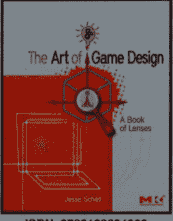

### 游戏设计的艺术：一本透镜之书
ISBN: 9780123694966

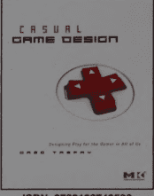

### 休闲游戏设计
ISBN: 9780123749536

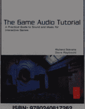

### 游戏音频教程：互动游戏声音与音乐实用指南
ISBN: 9780240817262

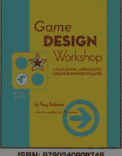

### 游戏设计工作坊
ISBN: 9780240809748


### 如何在 Maya 2012 中作弊
ISBN: 9780240816982

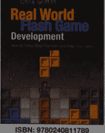

### 真实世界 Flash 游戏开发
ISBN: 9780240811789

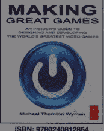

### 制作伟大游戏
ISBN: 9780240812854

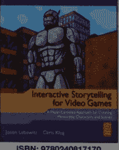

### 电子游戏的互动叙事
ISBN: 9780240817170


## 献词

一如既往，献给我美丽而充满活力的 Kirsten、Anaya 和 Isaiah。

## 致谢

像这样的书是许多人大量工作的成果。有必要对他们表示感谢。

首先，非常感谢 Kelly Michel 以及洛斯阿拉莫斯国家实验室的团队，他们使本书的编写工作得以进行。学习和成长的机会在职业上令我兴奋，我个人也非常享受与队友 Brian Dickens、Elise Elfman、Jake Green 和 Birch Hayes 共事的时光。

此外，感谢我的技术编辑 Anson Call 的不懈努力；如果没有他的细致工作，本书不会像现在这样准确、在概念上更严谨。

当然，还要感谢在 Focal 与我共同参与本项目的编辑：Sara Scott、Laura Lewin、Katy Spencer 和 Lauren Mattos。

最后，写书总是对作者家人的一点耐心考验。这一次，我永远的朋友 Kirsten 的耐心以及她对小家伙们的照顾，给予了我难以想象的帮助。

## 引言

### 为什么写这本书？

Unity 游戏引擎一直在掀起变革。该引擎现在才刚过五岁，而到2010年，这一数字已为它赢得 *Develop 杂志* 的 Grand Prix 大奖，并使其开发者数量超过 170,000 名。消费 Unity 产品的用户群也迅猛增长。Unity Web Player 的总安装量已超过 3000 万，并且这一基数仍以每月超过 200 万次的安装量继续扩大。

这种成功无疑部分源自他们在 2009 年的大胆举措：免费提供 Unity Indie 版本。突然间，人人都能接触到游戏引擎，任何有学习意愿的人都可以开始制作游戏。Unity 进一步赋能大众，使 Unity 成为适用于 iDevices（iPhone、iPod Touch、iPad）、Mac、PC、Xbox 360、Wii，以及如今的 Android 和 PlayStation 3 的可行开发平台。Web 部署进一步推动了 3D 开发与分发流程的民主化。在会议和网络上，Unity 正引发相当多的热议。自从我开始使用这款软件以来，培训机构教师与游戏开发者之间的对话已经从“Unity？不，我从没听说过。它是新出的吗？”变成了“是啊，我们这学期有三门课程要用 Unity”，以及写着“我想要 Unity 3.0”的 Skype 标签。

但尽管有这些热议，以及 Unity 3D 团队所经历的快速开发与部署周期，入门文档仍明显匮乏，尤其是面向整个游戏开发流程的文档。近几个月来，出现了一些新的（而且非常不错的）书籍，帮助人们入门 Unity；确实，Unity 提供了一些不错的可下载项目以及附在这些项目上的一些教程（如果你还没有获取，应该免费下载），但我的学生们（他们接受的是 3D 艺术家训练）在学习这些内容时，尽管已经熟悉了 Unity 的界面以及各项功能的作用，却往往无法将这种知识外推到一款新的“从零创作”的游戏中。此外，Unity 3D 提供的大多数教程都聚焦于 Unity，并提供预先构建好的资源，读者只需将其插入自己的 Unity 项目即可。这遗漏了将这些资源导入 Unity 的一些至关重要的创作过程和技巧。

因此，本书的推动力便应运而生：创建以艺术家为驱动、整体化的训练模块，提供游戏开发理论以及 Unity 背后的方法论，使读者能够创作自己的游戏。

### 本书面向谁？

我近期的职业背景是在洛斯阿拉莫斯国家实验室为检查员开发培训游戏，以服务于防扩散工作。但这是一项临时任务，也是一年研究休假的一部分。我目前正从德克萨斯州圣安东尼奥市圣道大学（University of the Incarnate Word）3D 动画主管的职位上休假，我在那里教授 3D 动画已超过 10 年。基于这样的背景，我在使用工具时，总是思考如何教授这种特定工具或技术，以及如何针对不同人群以不同方式教授它。

在本书的构建中，考虑了三类主要学习者：

- **游戏爱好者：** 进入我们大学的学生中，最大的一群是那些抱着“我喜欢玩电子游戏，因此我制作游戏也会很擅长”想法的人。不幸的是，情况往往并非如此——消费与创作大不相同——但是，这种热情对于维持制作 3D 游戏所需的漫长学习弧线很重要。本书假设，至少你热爱游戏，并且对游戏足够充满热情，以至于想制作自己的游戏。
  
    本卷就是为你而写。配备免费版本的 Unity 和一份 Maya，本书将为你提供必要的步骤和思路，赋能你自己的游戏创作。本书组织为可管理的教程，并结合理论讨论，因此你可以快速看到可衡量的成果，并将其衔接到你自己的开发中。在几天或几周内，你就可以开发出你的第一款由教程驱动的游戏，以及开始自己的项目所需的脚本。

- **学生：** 十年前，开发 3D 动画课程在学院和大学里风靡一时。这种热情已经蔓延到高中甚至初中。伴随这套 3D 课程——你可能也是其中一部分——自然产生了扩展到游戏开发的愿望。本书正是为你量身定制的。
  
    教程的结构安排使其可以在课堂上或作为家庭作业的一部分来完成。节奏经过仔细考量，以允许以小块知识的形式呈现，同时仍以轻快的节奏传递。最重要的是，每一章都建立在前一章的基础上，并能让你非常快地取得实际进展。

- **教师：** 我为学院、大学和高中的教师做过大量培训。我见过教师眼中的恐慌——那些几乎没有 3D 或游戏培训背景的教师——却被委以开发游戏开发课程并教授该课程的任务。诚然，这是一项艰巨的任务，而且把它加在还有其他任务的教师身上有点不公平。不过别害怕，本书将帮助减轻负担。


本书附录（位于配套网站 http://www.Creating3DGames.com）中收录了一些建议课程，供在课堂教学环境中使用本书时参考。这些内容有助于将本书融入你的工作流程和课程计划。尽管你自己跟着教程操作、从而理解学生无疑会提出的问题至关重要，但本书也会提供一些用于课堂或作业的教程，这些教程将有助于为学习从3D内容到游戏发布的流程提供大量指导。

## 结构

尽管我目前也是一名游戏开发者，但我长期的热情在于教学。我了解人们如何学习3D和游戏引擎。许多初学者有一种不幸的倾向：拿起一份教程就立刻开始按步骤操作，完全不考虑这份教程为何而写，也不考虑他们所遵循的步骤背后有哪些基本概念。教程结束时，读者会有完成教程的成就感，但随后会突然面对残酷的现实：他们无法创建自己的项目，甚至无法复现这个项目，除非教程再次摆在面前。本质上，他们成了照着菜谱做菜的人——只有当书摊在面前、并且别人已经想好步骤时，他们才会做菜。他们当然算不上厨师。本书的目标是培养游戏大厨。为此，本书将遵循一些特定约定。

首先，每一章和每个教程都会先准备一些理论——解释他们即将着手的内容背后看似疯狂的方法。这些理论不仅涵盖教程的推理过程及其目标，还涵盖 Maya 或 Unity 背后的理由，以及它们对3D技术的特定实现方式。不要忍不住跳过理论直接冲进教程；理解步骤背后的原因会让你收获更多。

每一章还会包含教程，有些教程比其他教程更长，但每个教程都有非常具体的学习目标。每个教程都会建立在前一个教程之上，并推动我们更接近完成本书末尾可玩的游戏。然而，本书是一部小说，而不是短篇故事集；如果你过快跳过太多内容，就会错过使后续章节显得合乎逻辑的关键信息。因此，即使你知道所涵盖的技术，并且无需跟着某个教程操作，也一定要浏览一遍，看看那里讲了什么。

最后，每一章都会包含一些挑战——也可以说是家庭作业——要求你运用已经收集的信息，自己实现这些技术。爱好者很少使用这些挑战，但它们是重要的自我评估工具，可以检查你是否真正掌握了本章呈现的核心概念。如果你认真应对这些挑战，就能从本书中获得最大收益。它们会在你继续前进之前巩固想法、强化技术。

### 本书范式与假设

尽管*《Unity 3D游戏创作》*旨在成为一本整体性的书，但它并不涵盖创建3D游戏所涉及的所有内容。书中假设你具备以下条件：

- **Unity 和 Maya：** 在本书出版时，这些软件的最新版本将是 Maya 2011 和 Unity 3.2。Unity 3.2 Indie 许可证是免费的（可从 www.unity3d.com 下载）；如果你是学生，只要在 Autodesk 教育社区注册，就可以在 http://students.autodesk.com/ 免费获得 Maya 2011 一年使用权。对于注册学生而言，这一过程中最大的开销将是这本书。
- **Maya 基础知识：** 这些知识确实可以很基础，但本书不会花大量时间讲解 Maya 界面或基本工具。你应当知道如何操作摄像机控制，以及如何执行移动、旋转和缩放对象等基本功能。本书将聚焦于非常游戏特定的建模、贴图和动画技术，因此具备一些 Maya 常识会大有帮助，尽管并非关键。
- **对游戏的热爱与了解：** 不必成为游戏极客。但是，了解游戏如何运作以及什么让游戏有趣的基础知识，对制作游戏很重要。本书中的游戏将是一个第一人称与第三人称混合的游戏，同时包含第一人称射击和解谜元素。这些内容经过精心设计，以帮助你掌握一些重要概念。但你要始终参考以往知识，并寻找方法，将本书所涵盖的理念扩展到你自己的大作中。

### 本书约定

在本书中，我将使用几种约定，帮助你理解我在讲什么，以及在哪里讲。

当我们处理一个教程时，每个步骤都会编号：

- **第 1 步：** 做这个，然后，
- **第 2 步：** 做这个。完成后，
- **第 3 步：** 试试这个。

通常，这些说明会与截图紧密配合，以帮助说明该步骤或该步骤的结果。

因为本书的目标不是简单重现这里呈现的游戏，而是让你在读完这本巨著后具备创建自己游戏所需的技能和工具，所以教程中会经常出现“中断”来进行一些解释。请留意：

- **提示与技巧**
- **警告与陷阱**
- **为什么？**

这些将是重要的注释，能让你超越教程的局限，走向你自己的价值百万的游戏。

最后，在程序中导航可能很棘手（尤其是在有多种模式的 Maya 中）。下拉菜单将用以下格式表示：

建模>网格>合并（选项）

这是“在建模模式下，转到‘网格’下拉菜单，找到‘合并’，然后选择‘选项’框”的简写。

在 Unity 中，这会稍微简单一些，因为没有像 Maya 那样会消失的下拉菜单。然而，重要的是我们要知道哪些内容需要输入——也就是代码。我们输入的任何脚本都会像这样列出并格式化：

```
function Update(){
    SetActiveRecursively(true);
}
```

偶尔，代码中会有一些值得注意的重要信息。需要时，文本会加粗（不过你在编写脚本时不需要使用粗体文本）：

```
function Update(){
    SetActiveRecursively(true);
}
```

同样，新的想法、概念或关键词会在正文中加粗。

## 关于方法的说明

我来自艺术背景。我拥有戏剧布景设计美术学士学位，以及平面设计艺术硕士学位，主修3D动画。我像3D艺术家一样思考，也教3D艺术家。因此，本书及其学习 Unity 的方法是以3D艺术家的视角构建的。这并不意味着不会有编程或脚本——事实上，脚本是游戏开发过程中的关键部分。没有它就没有游戏，所以它不能被忽视，本书也会大量涉及。即使对艺术家来说，最好现在就放下顾虑，拥抱游戏引擎中脚本的强大力量。不过，整个过程将从3D艺术家的视角来讲解。

这对某些读者会非常有效，尤其是那些从艺术或3D背景进入游戏开发周期的人。但对于从编程背景进入的人来说，其中可能包含一些过于基础的信息。不过不用担心，本书第一部分聚焦3D，因此对于来自脚本世界的人来说，应该有大量新内容。

就是这样。动手吧。一定要阅读理论并完成作业。读完本书时拥有一个完成的游戏会很有趣，但远不如利用我们探索的工具和技术，创建你自己的3D互动且引人入胜的游戏杰作那样有趣！


## 游戏制作流程

描述游戏制作流程实际上有点棘手，部分原因是每个团队的流程都不同，每个预算下的流程也不同。但现实情况是，团队也可能就是你一个人。确实，有时游戏由非常小的群体制作，偶尔也由一个人的团队制作。

然而，无论你是一个五十人团队、正在开发下一款 AAA 大作，还是一个单人团队、正在制作一个希望借此进入那五十人团队的学生项目，要创建一款可玩的游戏，都需要完成一些具体步骤。你或你的团队在这些步骤上有多成功，以及能否及时完成这些步骤，将在很大程度上决定项目整合的效率，以及游戏最终呈现和游玩时的成功程度。

团队管理、资金管理乃至时间管理的具体细节，确实超出了本书的范围（游戏营销和获取资金也是如此）。不过，理解需要按什么顺序完成哪些事情，将有助于你组建团队或构建项目。

### 团队

“团队”指的是设计与制作团队——实际制作游戏的一群人。这并不包括发行商、财务团队、市场团队，甚至质量保证团队等重要角色。尽管所有这些对于一款盈利游戏都很重要，但本书的重点是学习技术，因此游戏制作将是重点。

通常，大多数游戏制作团队（或开发团队）都包含以下角色的人员：

- **设计师：** 游戏设计师是创意愿景的负责人。其必须具备艺术能力，并在技术上熟练。其能够兼顾美学与编程两端。更重要的是，其理解并通常负责制定游戏的目标、游戏类型、玩法、规则与结构，以及其他游戏机制。游戏设计师通常通过一份名为游戏设计文档的文件来传达这些目标。
  
    在编写游戏设计文档之前，通常先有游戏提案文档。通常，游戏设计师具备扎实的写作能力，能够传达游戏愿景。随着游戏制作的推进，这份游戏设计文档会成为其他设计师参考的“圣经”。
  
    本文档的结构超出了此处讨论的范围，但网上有许多此类文档的参考资料和示例。此外，游戏设计文档应针对具体组织、财务结构乃至工作文化而定制。不过，尽管我们可能不介绍该文档的具体内容，但它的作用仍然相关。
  
    游戏设计文档很少一成不变。游戏的范围和功能常因时间、人才或预算原因而调整。然而，随着制作周期不断推进，有效管理和分发该文档对于让团队保持任务专注变得很重要。我本人多次目睹，由于团队成员未能参考——而管理者也未能确认他们参考的是——游戏设计文档，数天甚至数周的劳动被浪费。
  
    即使你是一个人的庞大团队，制定一份内部游戏设计文档（即使只是项目符号列表、白板上的流程图草图，或餐巾纸背面的清单）也能帮助你紧盯目标，避免功能蔓延之类的陷阱——新选项不断进入游戏，使游戏永远无法发布。

- **机制工程师：** 游戏有机制。机制是游戏运行的规则，包括力量平衡、物理表现、玩家与游戏之间的交互以及玩家之间的交互等。从跳棋到最复杂的 PC 第一人称射击游戏，再到核检查员的培训模块，游戏机制存在于每款游戏中。机制工程师（有时也称为游戏机制设计师）负责研究如何最好地实现首席游戏设计师所勾勒的愿景的细节。这类团队成员通常具有编程或脚本编写背景。
  
    关于这一点简要说明：近年来，学术界一直在相当严谨地研究游戏玩法和游戏机制问题。这仍是一个发展中的研究领域，而且随着与游戏互动的规则不断变化，它有点像一个移动靶。然而，如果你想认真理解是什么让游戏有趣，以及游戏机制如何帮助实现这一点，那么探索这一问题的研究文献正在不断增加。从长远来看，如果你想成为成功的游戏设计师或机制工程师，研究这些文献是值得的。

- **关卡设计师：** 理所当然地，这一职位在游戏制作流程中变得越来越重要。该设计师创建游戏玩法发生的环境。其与游戏设计师和机制工程师密切合作，确保所设计的空间既忠于设计师的愿景，又为有效的游戏机制留出空间。这些设计经过仔细考虑与设计，几乎总是从概念草图或绘画以及详细的平面图开始，这些图标明谜题、挑战、陷阱和敌人出现或发生交互的位置。

- **角色设计师：** 这通常是最吸引人的角色之一，因为此人负责设计角色。这些角色基于游戏设计文档中定义的目标，并且几乎总是先在纸上以绘画形式开始。概念草图在投入大量建模时间之前提供了快速沟通的手段。这些草图还能让概念引起一种本能反应，而这是以 T 姿势建模的角色常常缺乏的。

- **动画师或动作设计师：** 动画在游戏中极其重要，因为它似乎是吸引我们注意力的东西。具有讽刺意味的是，即便是复杂游戏，其动画集合也相当有限，这些动画在游戏过程中循环播放。有些角色多达 100 种不同动作，但大多数角色的动作少得多。动画师会创建循环播放的游戏内动画，但也常常负责过场动画以及更“有分量”的任务，这些任务使用传统的非循环动画。非常大的工作室通常设有独立的电影化部门（负责过场动画和开场动画），制作更高分辨率、预渲染的动画。

- **编剧：** 由于近年来的罢工，电影和电视编剧（至少暂时）向游戏行业迁移。为游戏写作当然不同于任何其他媒介，而且常常是那些根本不该为游戏写作的人在做这件事——结果往好里说通常是老套，往坏里说则简直俗不可耐。然而，优秀的编剧当然可以帮助游戏体验更具沉浸感，通过可信且引人入胜的对话、叙事、屏幕内元素（想想角色信件或日志），甚至游戏内提示文字来让玩家知道该做什么。通常编剧只参与流程的一部分，因为通常没有足够的工作让一个人在整个制作周期都有事可做。

- **音效设计师：** 关掉声音玩游戏有其魅力，但任何在大屏幕电视上、关着灯、把音量调得很高（或戴着耳机）玩过游戏的人都知道，有效的音效设计所营造的氛围可能比游戏中的任何视觉元素都更强烈。在 3D 动画的各个方面，学生或初学者常常把声音和音乐当作事后补充，但在大预算游戏中从来不是这样。
  
    对学生而言，有时预算限制会阻止使用定制配乐。然而，尽早考虑音效和音乐可以保证时机恰当，甚至能影响视觉选择。

### 工具与 Unity

既然我们已经大致了解了团队中有谁，那么有必要讨论该团队使用哪些工具，特别是 Unity 如何融入这个工具箱。

Unity 被归类为游戏引擎。这意味着它是驱动游戏的技术。不过，从制作角度来理解，可以把它看作一个“组装器”。Unity 本身通常不用于创建资产（尽管粒子之类的一些内容是在 Unity 内部创建的）。

几乎所有美术资产都在 Unity 本身之外创建——3D 模型在 3D 应用程序（Maya、Cinema 4D、Blender、modo、3ds Max、LightWave 等）中创建，纹理资产在 Photoshop 或 BodyPaint 中制作，甚至脚本实际上也是在某个其他应用程序（PC 上的 UniSciTE、Mac 上的 Unitron，或完全其他脚本工具）中编写的。所有这些资产都通过一个相当轻松的过程导入 Unity，然后你就可以组合这些资产来创建游戏。

所以，你在 Unity 中组装游戏，但大多数游戏——以及所有具有一定视觉复杂度的游戏——在这个过程中都会大量使用许多其他应用程序。正如创建 3D 资产有许多不同方式（例如有人会选择 Maya，另一些人会选择 3ds Max），游戏引擎也有多种。Unity 特别灵活且易于使用；这就是为什么它是本书选用的工具。但要注意，创建游戏还有许多其他方法（Unreal Engine、CryEngine、Source 等）。

### 团队中的团队与工作流

通常，制作团队会分为两个团队：美术团队（有时称为“创意团队”）和技术团队。两者工作对成功的游戏都至关重要，而两个团队之间的沟通能更好地确保流程顺畅。

作为团队——或团队中的团队——工作的一项好处是，资产不必按顺序创建。技术团队不必等待创意团队完成工作后才开始编写脚本。


通常情况下，技术正在被开发，甚至在创意团队交付某些资产并直接插入游戏之前，就已经开发完成了。

然而，如果你是独自工作（而且假设本书的大多数读者正是如此），那么以合适的顺序创建资产将使开发过程更加高效。那么首先，让我们看看本书所制作游戏所需的资产。

## 资产

一旦游戏设计文档完成，主设计师就需要开始规划需要创建哪些资产以及何时完成。资产可以涵盖很多内容：2D元素，如GUI和界面设计、纹理文件、3D模型、音效文件、动画片段，以及驱动游戏的脚本和其他机制等。在本书中，我们将重点放在两类资产上：美术资产和脚本资产。

### 美术资产

就本书所涵盖的教程而言，我们需要三类基于美术的资产：模型、纹理和动画。模型和动画将在Maya中创建，而纹理将在Photoshop中创建，但会在Maya中链接到模型。其他视觉元素如灯光则会在Maya和Unity中同时进行（取决于你使用的Unity版本）。

### 技术资产（脚本）

Unity允许通过多种脚本机制来构建机制。你看到的大多数参考资料或讨论都会使用Unity的JavaScript或C#实现。这些脚本会附加到Unity场景中的一个或多个对象上，并驱动玩家与游戏之间的交互。

处理脚本问题有很多方法。与我密切合作的软件工程师同事们大量使用C#，并用这些脚本驱动游戏中的几乎所有内容（包括资产的创建和放置）。当他们能够看到实现游戏的脚本时，他们就能理解游戏的结构。

我们将要创建的脚本主要使用Unity版本的JavaScript，并且（除少数实例化情况外）我们会将这些脚本挂在我们手动放置在场景中的对象上。我们使用JavaScript是因为从历史上看，官方文档的示例主要使用JavaScript，而将来在超出本书范围时，参考Unity文档将是必要的，因此与所提供的文档建立共同的术语非常重要。同样，论坛上讨论时也大多使用Unity版本的JavaScript作为常用语言。我们选择将脚本挂在对象上（而不是让脚本自动完成这一工作），是因为这是一种更直观的方法，也更容易让美术人员理解场景中什么控制着什么。

无论哪种方式，技术资产都只是利用Unity强大功能并创建和控制交互的一小段ASCII文本。

## 操作顺序

在本书中，我们将首先创建所有美术资产，在制作过程中将其导入Unity，然后在书的最后部分创建技术资产。然而，需要注意的是，这种“先美术、后脚本”的流程绝非一成不变。Unity非常擅长让美术资产在过程中不断更新和修改。有时需要将脚本重新挂到新对象上，但只要命名仔细，即使这一点也可以降到最低。我发现，在我自己的开发过程中，3D应用程序和Unity之间的来回切换是频繁且重要的。

因此，本书中概述的流程与工作室的工作流程有很大不同。在工作室中，尽管脚本编写者会负责大部分错误修复和收尾工作，但他们在美术人员完成工作之前很久就会开始开发脚本和编写程序解决方案。此外，在你自己的开发过程中，你会发现你原本以为适合某个特定挑战或战斗的空间，效果可能并不如计划中那样好。或者某个角色并不能完全传达你原本的设想。于是你会在脚本编写过程中重新回到3D中返工。

所以，虽然我们这里线性的流程很适合学好Unity，但它很可能不是你在自己项目中采用的工作方式。

## 结论与《入侵》简介

但关于制作资产和游戏的话题就说到这里；让我们开始吧。对于接下来几页中呈现的游戏，我们假设游戏设计师（也就是我）已经完成了概念工作，并撰写了一份精彩绝伦、完美到无需修改的游戏设计文档。怀着这种幻想，我们可以创建制作游戏所需的具体资产，并以稳健的方式编写让游戏运行起来的脚本。

这款游戏将被称为《入侵》。基本故事情节是：你——艾吉斯·钟——是一名美国冷战后的特工，任务是潜入一座废弃的苏联设施，取回一件被盗的机密设备。该设备是由一名变节科学家移交给苏联人的，这位科学家如今生活在俄罗斯。苏联人无法利用这项技术，将其留在了废弃的潜艇维修基地。尽管已废弃多年，旧的安全系统仍在断断续续地运转。一些无人机制，如摄像头和其他安全设备，被留下来监视该场所。你必须通过一切必要手段（间谍活动、备用路径、黑客入侵、爆炸物）绕过这些安全系统，进入存放设备的内层实验室。一路上，你所有的训练（无论是体能还是智力）都将受到考验（图1.1）。

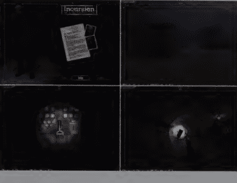
图1.1 最终游戏体验的屏幕截图。

对于你们作为游戏开发团队来说，这将提供机会来建模角色、关卡设计以及各种仪器设备。作为脚本团队，这款游戏将让你有机会构建大量迷你游戏，因为你将有机会设计那些玩家必须绕过的安全装置谜题。总而言之，这款游戏提供了大量的学习机会。

致教师和学生：为了确保游戏适合更广泛的受众，虽然我们会使用枪械来击破某些障碍，但不会涉及射杀人物。

## 关于研究的一点说明

人们常常喜欢假装自己可以坐下来，创造出从脑海中流淌而出、通过铅笔落在纸上的美丽环境或角色。我想确实有些角色设计师能做到这一点，但那也是在多年研究并观察解剖学、人物、动物以及其他设计师作品之后。对于我们大多数凡人来说，在伟大作品诞生之前，我们必须研究类似的地点、感受和风格。

我们游戏风格所依据的空间实际上是一个废弃的苏联核潜艇基地。该基地位于乌克兰的巴拉克拉瓦，网上有一些非常好的参考照片。因为我不拥有这些图片的版权，所以无法将它们收录在书中；然而，在我们开始之前，请务必

在纸上布局时，效果并没有你原本希望的那么好。一旦你走入一个空间，或尝试测试机制，你可能会发现你原本计划的空间未必是最佳的。如果你只是快速制作了原型，你就可以在把所有时间投入场景美术资产创建之前迅速调整。

然而，在书籍环境中，我们需要在很大程度上以线性顺序进行。因此，在这些教程中，我们想假设原型已经产生了结果，这些结果巩固了关卡和角色的设计。因此，在游戏设计师的批准下，我们将继续创建美术资产。

## 为什么使用Maya教程？

Unity是创造游戏的整个技术链条中的最后一步。没有它，就无法制作出有效的游戏。但游戏的成功也很大程度上取决于投入其中的资产的有效性。无论厨师多么熟悉烤面包的工具和烤箱，如果他或她使用劣质的配料，蛋糕也是不能吃的。

我有很多学生在Unity中工作时，因为在他们选择的3D应用程序中采用了错误的选择或技术，而无法创造出他们设想的游戏。通用的3D技术不一定等同于3D游戏技术。创建经济且结构正确的3D资产和纹理，是在Unity中制作游戏绝对关键的部分。

为什么是Maya？其实Maya并不是我最喜欢的3D软件包。然而，它确实拥有惊人的市场占有率，并且无疑是目前最强大的3D工具之一。讽刺的是，建模并不是它最强的方面之一，但就我们的目的而言，它的多边形建模工具已经足够了。在其他相似点中，Unity中默认的摄像机操作和对象操作工具与Maya的键盘快捷键完全相同。此外，Maya还拥有一些非常强大的角色动画工具，我们将会用到这些工具，并且可以通过FBX格式非常轻松地导入Unity。最终，我选择在Maya中创建资产，是因为其庞大的用户基础意味着有很多人知道如何使用该软件，而且在你读完本书之后，你会有很多选择来进一步提升你的技能。

即使你不是Maya用户，也精通其他3D应用程序，也请快速浏览这些章节，确保你能够注意拓扑结构和纹理创建的方法，以及如何将这些技术外推到你自己的应用程序中。这将使你的游戏资产更强大、更紧凑，并且在Unity中工作时更出色。

那么我们就开始吧。在接下来的几章中，美术资产将逐步成型，这些资产将被导入Unity，以便进行探索和细化。虽然这些内容很大程度上基于Maya，


教程中，假设您熟悉 Maya 的基本工具（移动、缩放、旋转），以及如何选择组件部分（顶点、边、面）。如果您不理解这些概念，那么至少观看 Maya 安装随附的入门视频也是值得的。

## 一点 3D 理论

尽管我们假设您对 Maya 的工具有所了解，但理解 3D 的基本理论至关重要。如果没有对数字 3D 工作原理的这一基线理解，就不可能恰当地构建用于游戏框架的资产。

图 2.1 展示了多边形的解剖结构——它是 3D 的构建块。我们通常认为的多边形主要形式，在 Maya 中称为面。面是显卡（因而也是我们）“看到”的东西。面的形状可由围绕它的组件编辑。面被边包围，而边由顶点连接（单数形式为 vertex）。这类概念大多在某种形式的初中几何中有所涉及；多边形的另一个重要概念和组成部分是法线。法线定义多边形的正面。在图 2.1 中，这由从面中心正向外延伸的绿线表示。理解面具有法线很重要，因为大多数游戏引擎只绘制多边形的正面以节省处理能力。如果摄像机位于多边形后方（如果法线背对摄像机），该多边形就不可见。

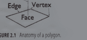

3D 应用程序中的三维形体是在多边形集合组合在一起时创建的。把多边形想象成不可弯曲的金属片。金属片连接处可以活动，但多边形本身不能。这意味着多边形越多，网格可以弯曲的地方就越多，因而形体也可以越复杂。请查看图 2.2，了解一个形体如何从 6 个多边形变为 32 个多边形再变为 100 个多边形，以及由此可能得到的形体。

**图 2.2** 多边形越多，意味着可弯曲的地方越多。这可以实现更圆润的形体，但需要更大的数据集。

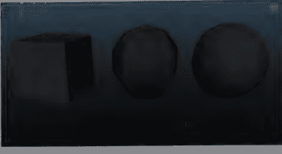

在 3D 环境中看到的形体由计算机中的显卡通过某种渲染引擎绘制。渲染引擎通过识别多边形来看到形状。更具体地说，大多数渲染引擎实际上只看到三角形多边形（有时称为 tris）。构建这些三角形多边形有几种方法；Maya 的技术包括 NURBS、细分曲面和直接多边形建模。所有这些都是构建形体的不同方法，即组装多边形。有些方法源自曲线；另一些则沿着直接创建多边形的路线进行。但在流程结束时，所有方法的结果都会通过一个称为**镶嵌**的过程转换为三角形，以便引擎能看到它们，显卡能绘制它们。

## 渲染

绘制多边形以及与之相关的纹理和光照称为**渲染**。渲染有两种：软件渲染和硬件渲染。软件渲染常用于电视和电影项目。场景在 3D 应用程序中构建，包括灯光和纹理，然后由 CPU 绘制场景中对象、颜色和灯光的复杂交互。由于结果稍后显示（不是实时显示），所以如果渲染一帧需要一秒、一分钟，甚至每帧一小时，都是可以接受的。该过程输出的连续静帧通过视频编辑软件组合在一起，并作为动态图像观看。

硬件渲染则大不相同。游戏属于这一类，因为显卡渲染数字空间中的多边形来表示 3D 空间。硬件绘制屏幕上的内容（包括所有对象、纹理和光照），并且需要每秒完成多次。一般来说，如果玩家的帧率远低于每秒 30 帧，就会注意到游戏卡顿。

那么，计算机如何能以每秒 30 帧绘制一个项目，却每 30 分钟才绘制另一个项目的一帧呢？答案很简单：数据集的大小以及专用于处理该数据集的硬件。对于不会实时渲染的项目，数据量可以高得多。多边形数量可以更多，纹理的大小和数量可以更大，光照的复杂计算可以更精细。在实时情况下（硬件渲染，由专用硬件持续处理该数据集），显卡处理的数据量要小得多。

## 显卡

显卡是“硬件渲染”中“硬件”的重要部分。显卡有大量不同的配置和性能组合。显卡工作方式的细节各不相同，看似相同的显卡（共享相同数量的显存）在绘制资产的能力上实际上可能并不完全相同。不过，为便于我们的讨论，我们将过度简化地说，“更大”的显卡（显存更多的显卡）能够绘制更多信息。

“更多信息”可以包括很多东西：更多多边形、更多纹理或更大纹理。它也可能意味着动态光照可视化。在所有情况下，显卡能够渲染更多信息，意味着随着显卡变得更大，场景的复杂度也可以提高。

此时值得指出的是，游戏显卡的成本在大多数计算机中已成为非常可控的成本。事实上，当学生来找我抱怨他们家用电脑的工作速度慢时，我几乎总是给出的第一个建议就是升级显卡。1 GB 显卡可以轻松以不到 100 美元的价格买到，这是一种快速简便的方法，能让计算机更快地显示更多多边形。

显卡中嵌入的技术发展得如此之快，试图在一本书中解释所有这些技术是愚蠢的——书一出版，规格就会过时。不过，一般来说，没有必要购买工作站显卡——游戏显卡通常表现相当合理，而且价格要便宜得多。

在我使用 Maya 的 10 多年里，我总体上使用 NVIDIA 显卡的体验更好。ATI 或 NVIDIA 似乎都能与 Unity 良好配合；但在使用 Maya 制作 3D 元素时，NVIDIA 提供了最可预测的体验。这主要基于我的系统以及几百名学生的系统的轶事证据，但在购买或升级用于 Maya 的显卡时，NVIDIA 对我来说效果更好。

## 游戏的限制与优化

那么这一切意味着什么？随着显卡一天天变得更大更好，价格不断下降，我们应该能够不顾一切地创建形体，而无需担心我们正在创建的数据集。对吧？

嗯，不幸的是，并非如此。多年来，瞬间输出数万亿个多边形的隐含承诺似乎总是近在眼前。计算机变得更快，显卡变得更大，绘制多边形的过程似乎会变得不成问题，仿佛只是在幕后完美地发生。然而，实际发生的是，随着计算机变得更快，新事物成为可能。突然间，游戏引擎可以开始使用动态光照（一个灯泡在场景中摆动，物体和墙壁会反映这种变化），反射成为常态（这实际上意味着场景中的所有内容都要绘制两次，基本上使场景中的多边形数量翻倍），而粒子、复杂着色器等新的视觉效果开始被使用，并成为玩家的期望。随着硬件变得更强大，我们只是对它提出了更多要求。

## 3D 游戏建模的规则

既然我们已经确定计算机能显示的内容确实存在限制，就很容易看出，在为 Unity 创建资产时需要遵守限制或规则。我们将在每一步中探讨新规则（例如，纹理制作有特定的注意事项，我们稍后才会涉及）。对于这第一个教程，有两条规则：

- 1. 多边形数量很重要。
- 2. 拓扑结构至关重要（四边形最佳）。

## 多边形数量很重要

硬件的所有这些动态增长意味着游戏的视觉精细度继续以令人兴奋的速度提升。这也意味着，精心创建我们的资产以留出空间来创造这些出色效果仍然是现实要求。最终，有效利用场景中的多边形数目（**多边形数量**）对于游戏的沉浸感，以及反过来游戏运行的帧率性能，都至关重要。如今，对于大多数较新的机器，多边形数量已远不像从前那样是个大问题。坦率地说，通常如果一款游戏慢得离谱，并不是因为多边形绝对数量——它通常与纹理问题或其他与**绘制调用**相关的问题有关（稍后会详细说明）。然而，留意场景中的多边形数量仍然是显卡的压力之一，保持合理的多边形预算很重要（尤其是如果最终要为任何移动设备开发）。

这有时可能是一个棘手的平衡。图 2.3 显示了两个类似球体的对象。右边的有 1000 个多边形，左边的有 20 个。果然，20 个多边形的模型绘制所需的显卡性能更少，但它看起来真的不再像球体了。仔细调高细节以有效传达形状，同时将多边形数量保持在足够低以便快速绘制，这是游戏资产创作艺术的一部分。

**图 2.3** 不同的多边形数量会大幅改变显卡的绘制负担，但过度优化会偏离形体。

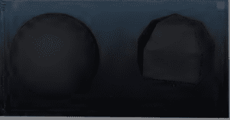


就我们的用途而言，我们将主要关注多边形建模技术（也就是使用 Maya 多边形模式中的工具）。其他方法如 NURBS（非均匀有理 B 样条）和细分曲面在创建多边形时过于间接，因此我们无法控制多边形的布局和数量。

### 拓扑

拓扑指的是多边形在曲面上的结构或组织方式。拓扑很重要。正确地构建多边形会对网格之后如何变形（例如通过关节）、形态在 Unity 中如何解释碰撞以及 UV 布局的难易程度产生巨大影响。拓扑关注点大多围绕细分过程展开——即在渲染时将形态转换为三边多边形（三角形）的过程。

Maya 和大多数 3D 软件一样，允许用户创建任意边数的多边形（通常称为 n-gon）。这在 3D 制作史中相对较新。几年前，3D 软件只允许多边形以三角形或四边形（四边多边形）的形式构建。三角形很难快速操作和操控，因此四边形成为组织多边形的首选方法。为了让艺术家更流畅地创建形态，大多数 3D 应用程序开始允许用户在构建形态时不必注意多边形的边数。然而，不注意多边形构建的建模者会吃苦头。五边（及以上）多边形会带来各种后续问题。

问题出在细分过程中。当 3D 软件（或游戏引擎，如 Unity）将 3D 形态转换为全部三角形时（为了显卡绘制，这是必需的），有些形状更容易细分。四边形相对容易，因为它只需从一个顶点到另一个顶点一分为二（图 2.4）。然而，n-gon 的细分往往不可预测，尤其是在游戏资产创建的角度来看。它确实会进行细分，但生成的网格是一团糟（图 2.5）。

图 2.5 中可见的这种杂乱细分在这里可能看起来没什么大不了，但当这些多边形受到扭曲技术（例如通过关节弯曲网格）作用时，原本可以弯曲的边缘最终会出现在不可预测的位置，并导致


**图 2.4** 四边形的细分非常直接：只需从一个角到另一个角分割，即可创建两个三角形。

关卡的其余部分，你可以直接使用网站（http://www.Creating3dGames.com）上提供的版本。然而，如果你想确保自己的游戏建模技能过硬，一定要尝试本章末尾的挑战，并独立完成整个关卡。

### 教程 2.1：游戏关卡建模：入口

巴拉克拉瓦设施的入口是一个很好的起点。首先，构成入口的部件大多是直线形的。任何直线形的人造物体在 3D 应用程序中都很容易创建。其次，所有这些直线形态对初学者来说都是一个完美的陷阱——一个创建既没有合适年代感也没有污垢感的形状的陷阱。在教程过程中，我们将探讨如何将一个简单的几何空间变得看起来像已经存在了一段时间（图 2.6）。

- **第 1 步：** 再次确认你已经设置了一个名为“Incursion–Maya”的项目。如果没有，或者不知道如何设置，请参阅附录 A。
- **第 2 步：** 选择“文件 > 保存场景（选项）”（File > Save Scene (Options)）。
- **第 3 步：** 勾选“增量保存”（Incremental Save），然后点击“保存场景”（Save Scene）。

### 为什么？

增量保存就像保险。它的机制是：每次保存场景时，Maya 都会将上一次保存的场景复制一份，并保存到名为 incrementalSave 的文件夹中。这确实意味着会有很多文件副本，但能确保在文件损坏的灾难性情况下，你还有备份。即使你“撤销”次数用完，incrementalSaves 文件夹也意味着你可以回到你想要的或需要的过去状态。我教的每个学期，增量保存都至少拯救过一个学生的项目。

**第 4 步：** 在“文件名”（File Name）中输入 `EntryWay`，然后点击“保存”（Save）按钮。请注意，如果项目设置正确，你会位于 Incursion–Maya\scenes 文件夹中。

> **警告与陷阱**
>
> 我知道因为你急着开始，跳过这一步很诱人。更糟的是，我看到很多学生并不完全理解这一步，并因为觉得它不重要而跳过。但管理好你的资源对于像游戏这样多样化的项目取得成功至关重要。在 Maya 中创建并设置好你的项目。你必须知道你的纹理文件在 sourceimages 文件夹中，场景文件在 scenes 文件夹中。

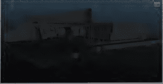

**图 2.6** 本教程结束时完成的模型。

### 创建码头

**第 9 步：** 以类似的方式开始创建水泥码头区域。从一个立方体开始（在大纲视图中重命名为 `EntryWayDock`），其尺寸为 X = 20、Y = 4、Z = 60（这可以在后续构建中调整），并按照图 2.10 所示挤出各个面。

**图 2.10** 开始布置码头。

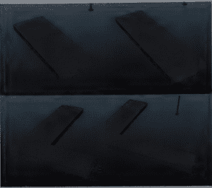

**第 10 步：** 继续围绕码头工作，确保在能够为后续挤出留出空间的位置进行挤出，以便之后创建孔洞（图 2.11）。

**图 2.11** 继续布置码头。

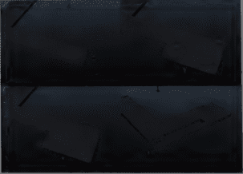

### 提示与技巧

决定何时进行挤出是一项需要时间和经验积累的技能。我发现，先在纸上画出我想要制作的形状，再画出需要挤出的位置，在数字化操作时会对我有很大帮助。

**第 11 步：** 接下来可能会有点棘手。我们要做的是确保有新的位置来构建码头的凸出部分。仔细观察如何为未来的挤出留出余地，从而实现向外凸出的效果。请注意，这会产生一些相当低效的拓扑（不必要存在的几何体），但我们稍后会清理这些（图 2.12）。

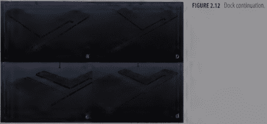

### 提示与技巧

这部分过程实际上是在粗略地塑造形状。它不会立即完美，所以不必太担心精确性。在编写本教程时，我用了很多很多次撤销，才回到一个能让我更高效地创建形态的地方。可以肯定的是，3D 创建是一个不断停顿和重新开始的过程。

**第 12 步：** 通过删除面并用“追加到多边形”（Append to Polygon）工具填充它们来创建阶梯状部分。选择远角上的面（如图 2.13 所示）并将其删除。这会在网格中留下一个需要填充的孔。填充孔的一种方法是使用“追加到多边形”工具。要使用此工具，请务必处于对象模式（右键单击对象并选择“多边形工具”），然后点击孔的一个边缘。会出现紫色箭头，显示将要创建的新多边形的路径。点击这些箭头，直到面被填充，然后按 Enter。对另一个需要填充的面重复此操作。

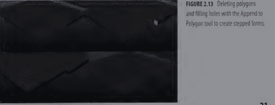

### 提示与技巧

使用“追加到多边形”工具时，通常不需要围绕要填充的形状的外侧走一圈。更快的方法是点击一个边缘，然后点击该边缘对面的边缘，再按 Enter。这样会快速填充孔洞，因为工具会计算出其他边缘也包含在操作中。

### 提示与技巧

请注意，填充孔后，新生成的平面上会出现一些黑色块状效果。这是因为新多边形具有**软法线**（soft normals），软法线非常适合有机形状，但对于码头这类刚性形态则不太理想。要消除这些效果，请选择对象，然后选择“多边形 > 法线 > 硬化边”（Polygons>Normals>Harden Edge）。

**第 13 步：** 旋转码头的前部。右键单击码头，然后从热盒菜单中选择顶点（Vertex）。如图 2.14 所示，框选码头前部的顶点。选择旋转工具（键盘快捷键是 E 键），然后（要移动旋转轴）按住键盘上的 D 键。将操纵器手柄移动回已选顶点集合的后角。松开 D 键，并从此前定义的新轴旋转顶点。

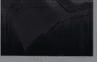

**图 2.14** 从新的旋转轴旋转一组点。

### 提示与技巧

这个旋转技巧或移动旋转轴（按住 D 键或按 Insert 键）在对象模式下也同样适用。旋转轴可以移动到任何需要的位置，具体取决于对象。在我们的例子中，这是针对一组组件（本例中为顶点）的临时操作，但在对象模式下执行时，对象会“记住”这个新的轴位置。

### 码头优化

**第 14 步：** 优化网格。在勾勒此形状的过程中，我们快速创建了一些可以进行优化的形状。如前所述，多边形数量很少成为游戏卡顿的原因，但它确实是其中一种原因。特别是如果你正在为 iOS（iPad、iPhone、iPod Touch）或 Android 开发，严格控制多边形数量将至关重要。


为了优化我们创建的内容，我们将删除不需要的边，并重新排列一些现有的边。图 2.15 显示了这样一条我们应该删除的边。双击该边会尝试选择一条环形边（edge loop），然后可以按键盘上的 Delete 键（随后选择并删除它留下的顶点），或者按 Ctrl+右键单击，然后选择 Edge Loop Utilities > To Edge Loop and Delete（这会自动删除遗留的点）。

- **步骤 15：** 调整拓扑以确保多边形都是四边形。仔细看图 2.16。注意，这个顶部的多边形实际上是一个五边形。它很有迷惑性，因为第 4 条边和第 5 条边乍一看像是一条边，但中间有一个顶点，另一条边从那里引出。在这种情况下，如果甲板顶部的所有多边形都在同一平面上，这个五边形多边形很可能不会造成任何麻烦；但为了确保起见，我们将使用另一个新工具——**分割多边形工具（Split Polygon tool）**。

  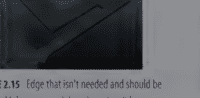

  **图 2.15** 不需要且应删除的边。请确保删除它留下的顶点。

  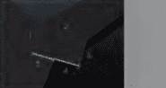

  **图 2.16** 具有迷惑性的五边形多边形。

  在对象模式下，选择 Polygons>Edit Mesh>Split Polygon Tool。该工具的使用方法是：在一条边上点击并拖动，以确定分割多边形的位置。通常是单击一条边并沿边拖到一个点（图 2.17）。再在相对的边上单击并拖动到与第一个点相对的点。这样就会在原本是五边形的位置创建出两个多边形（一个四边形和一个三边形）。

- **步骤 16：** 清理转角。既然我们已经使用了分割多边形工具，就可以在形成直角转角的地方进一步优化多边形数量。图 2.18 显示了使用分割多边形工具从转角到转角进行新切割的结果。完成这条对角切割后，原先构成转角的两个直边就可以删除了。

  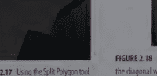

  **图 2.17** 使用分割多边形工具。

  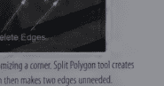

  **图 2.18** 优化转角。分割多边形工具创建了对角线，从而使两条边变得多余。

### 提示与技巧

在移除不再需要的边时，请务必把沿形状侧面和底部延伸的那些边也一并删除。另外，注意遗留的顶点，它们同样需要被选中并删除。

- **步骤 17：** 在所有直角转角处重复并进行优化（图 2.19）。

  

  **图 2.19** 优化后的转角。

### 为什么？

看一下图 2.19，你可以数出有四个四边形多边形参与了形状的三个直角转弯。这样便构成了八个三角形。与之前存在的七个四边形（14 个三角形）相比，你可以看到这类优化能多么迅速地削减多边形数量。最终，你必须做出一些权衡取舍。优化需要花费一些时间，如果你花太多时间优化，就会挤占你的创作时间。不过，我发现如果在制作过程中顺便做一些明显的优化，就能避免之后数小时的痛苦优化工作。

- **步骤 18：** 删除底部的多边形。我们看不到它们，也不需要它们，删掉吧。

  这里当然还可以进行一些其他优化，但我们已经了解了用于制作精简网格的基本技术。你可以随意进一步优化，但现在我们继续往下进行。

- **步骤 19：** 在通道内侧添加凸缘。选择如图 2.20 所示的面（即通道内侧进入山体的那些面），使用挤出工具（Extrude tool）将它们稍微向外挤出一小段距离。这会在码头顶部创建一组新的面。选择这些面并向上挤出，即可创建凸缘。

- **步骤 20：** 复制柱子，并大致按图 2.21 所示放置。是的，我知道在复制之前最好先对柱子进行 UV 映射。事实上，我们现在放置的这些柱子无疑会被删除，并由经过 UV 映射的副本替换。不过，把它们放在这里可以为接下来的步骤中一些重要的物体摆放提供参照。

在 Unity 中。或者，为一堵在 Unity 中完全不可见的墙创建一个平面。启用此功能将让你更好地了解事物在 Unity 中的显示效果。

### 创建屋顶

- **步骤 22：** 创建一个屋顶。图 2.22 显示了一组立方体，顶部横跨一个大平面。其确切形状并不重要，所以不必担心（尽管可以稳妥地假设长垂直梁是成对的 2×6 木料，较短的横向梁是 2×4 木料）。重要的是我们将如何优化这个形状。

  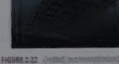

  **图 2.22** *Untitled, document1.mb*

### 提示与技巧

图 2.22 中所示的屋顶有几次额外的挤出（通过挤出边而非面来得到突出部分），但一开始它只是一个 1 细分 × 1 细分的平面。使用平面（例如这个屋顶单元的顶部）是最高效的多边形使用方式之一（一个 1×1 细分平面就是一个——是的，就是一个——四边形多边形）。但请记住，这一个多边形有正面和背面。由于已启用背面剔除（Backface Culling），很快你就会发现，从“错误”的一侧查看时，平面会消失。请记住，我们将位于屋顶下方并向上看，所以要确保将屋顶旋转到使其正面朝下，或者使用 Polygons>Normals>Reverse，以确保玩家位于其下方并向上看时能看到该平面。

### 提示与技巧

当处理像这个屋顶这样具有规则重复的对象时，可以使用 Maya 的复制（Edit>Duplicate）和带变换的复制（Edit>Duplicate With Transform）。创建一个立方体。按 Ctrl-D 即可复制它，如果你紧接着进行一次移动（单击并拖动），然后按 Shift-D，Maya 将再次复制，并将新副本偏移与上一个副本移动相同的量。这是创建大量等距副本的快捷方法。

### 扶手

- **步骤 25：** 创建扶手，并将它们优化为单个网格（图 2.23）。将轴心居中，命名为 `EntrywayHandrails`，并删除历史记录。

  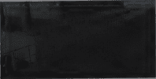

  *图 2.23* 完成的扶手。

### 提示与技巧

如果在复制前先对元素进行优化（例如删除扶手立柱的顶部和底部平面），就能省去之后成批选择它们的步骤。

### 拱门与布尔运算

- **步骤 26：** 使用一个修改过的立方体创建入口拱门的起点。创建一个立方体（Create>Polygons>Cube），然后缩放并放置它，使其类似图 2.24。选择顶部面，使用挤出工具挤出并缩放盒子的顶部（图 2.24）。

  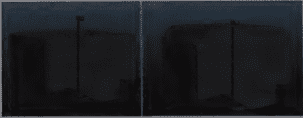

  *图 2.24* 入口拱门的起点。

### 为什么？

接下来这组步骤的思路，是使用 Maya 的布尔函数来创建形状。布尔运算基于两个形状相减（或相加或相交）的概念。要使其生效，我们必须有一个被减的方块。在下一步中，我们将创建要从这个方块中减去的形状。

### 提示与技巧

请注意，图 2.24 中平面挤出后所进行的缩放仅沿 X 轴发生。这确保了前面的两个多边形对齐，使布尔运算结果更干净一些。

- **步骤 27：** 创建一个具有 60（是的，60）个轴细分的圆柱体。有两种方法：创建圆柱体（Create>Polygon Primitives>Cylinder），然后在通道盒（Channel Box）中，在 INPUTS 部分选择 polyCylinder 节点，并在其中更改 Subdivision Axis 条目；或者选择 Create>Polygon Primitives>Cylinder（选项），在“多边形圆柱体选项”窗口中，将 Axis Division 条目改为 60。旋转并平移圆柱体，使其与图 2.25 匹配。

  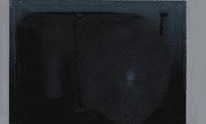

  **图 2.25** 已放置好、可进行布尔运算的元素。

### 为什么？

“60 个轴细分？！”你难以置信地喊道，“我们一直说要节省多边形数量，你却用这么重的图元！怎么回事？”是的，是的，60 个细分确实很多，在何处使用如此重的（高多边形数）对象必须非常谨慎。这里就是这样的地方之一。原因是拱门上的曲线非常大，实际上在游戏中它有时可能覆盖整个屏幕。当一条曲线跨越如此大的视觉空间时，正是花费一些多边形预算的好地方。当元素在屏幕上很小——或者在游戏过程中很少被关注——这时就应该对多边形极度吝啬。请注意，虽然我们最初使用的是 60 细分的形状，但实际只用到了一半，所以拱门顶部只有 30 个细分。

### 警告与陷阱

虽然在截图中有点难以看清，但那个圆柱体完全穿过了修改后的立方体，并从另一侧伸出。要让这个布尔函数生效，孔对象（圆柱体）必须比被减对象更长。

- **步骤 28：** 调整圆柱体，以形成拱形入口（而不是圆形管道）。按空格键（切换到四面板模式），然后将鼠标移到前视图面板上，再按一次空格键。这会使前视图面板全屏。切换到顶点模式（右键单击圆柱体，从热盒中选择 Vertex），然后框选构成圆柱体下半部分的顶点。使用移动工具（Translate tool）将它们向下移动到修改后的盒子底部之下（图 2.26）。

- **步骤 29：** 从修改后的盒子中减去圆柱体。在对象模式下，先选择盒子，然后按住 Shift 再选择圆柱体（这里的选择顺序很重要）。选择 Polygons>Mesh>Booleans>Difference。结果应类似于图 2.27。


将分段数设为 1 会产生硬边倒角。通常，我发现 3 个分段能在保持多边形数量可控的同时，使边缘产生明显的圆润效果。

对边缘应用倒角有助于消除计算机极擅长创造的那种精确感。当形体边缘不再锋利如剃刀时，它能让表面看起来像是已经存在了一段时间。在做高分辨率（即非游戏）3D 时，我会对大多数边缘进行倒角。然而在游戏中，这种奢侈做法会毁掉多边形数量预算；不过，谨慎选择倒角对象可以为场景增添一些精致感。

### 小贴士

只给一列做倒角。我们将删除所有列，但其中一列会晚些时候、在形体完成 UV 后删除。

### 小贴士

请记住，你需要根据倒角对象的边缘和大小来微调倒角设置。还要记住，有些对象可能离摄像机足够远，此时分段数设置为 2 甚至 1 就足以达到效果，而不必增加多边形开销。

### 步骤 35：对其他需要倒角（且你负担得起）的表面进行倒角。

### 小贴士

倒角时，你可能会在新的倒角表面的角落中发现一些奇怪的视觉伪影。有时这是由边缘法线问题引起的。通常，这些伪影可以通过选中受影响区域的边缘，然后使用 Polygons>Normals>Soften Edge 来修复。有时，选中倒角外侧边缘并执行相反操作（Polygons>Normals>Harden Edge）也能解决问题。这取决于具体情况，请调整以获得最佳效果。

> **警告与陷阱**
> 
> 一旦开始倒角，你可能会忍不住想把所有东西都倒角。“如果这里看起来不错，那它到处看起来都会不错，对吧？”嗯，这也许没错，但请注意，倒角除了增加多边形数量外，还会带来其他代价。当处理倒角边缘时，UV 布局就不会那么干净和快捷了。每倒角一个表面，都会为你的 UV 布局工作增加相当多的时间。因此，虽然应用倒角是个不错的点缀，但要意识到它之后确实会带来代价。倒角虽好，但要谨慎倒角。

### 总结

至此，我们将结束关于关卡建模的讨论。我们的游戏仍有许多关卡建模工作要做。模型的附加区域可参见本章的“挑战”部分。你可以随意接受这些挑战，或利用你的研究来创建自己的走廊和通道。请务必牢记这里讨论的工具，以创建高效网格，使其保持较低的多边形数量，同时又具有较高的视觉冲击力。

如果你对自己的建模技能有信心，并且知道自己能高效快速地建模，那么所有挑战的结果都包含在网站（http://www.Creating3dGames.com）上。这些资源一旦放入 Unity，即可在教程中快速使用。然而，如果你还在摸索建模的门道，尝试从头开始构建它们。


图 2.37 闭路电视摄像机。


图 2.38 Angis 正在追查的设备。

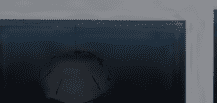

图 2.39 EMF 地雷。

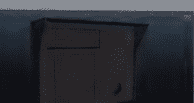

图 2.40 密码键盘。

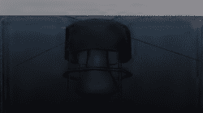

图 2.41 附着式灯具。

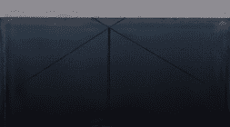

图 2.42 吊灯。


图 2.43 锁箱。

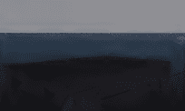

图 2.44 手推车。

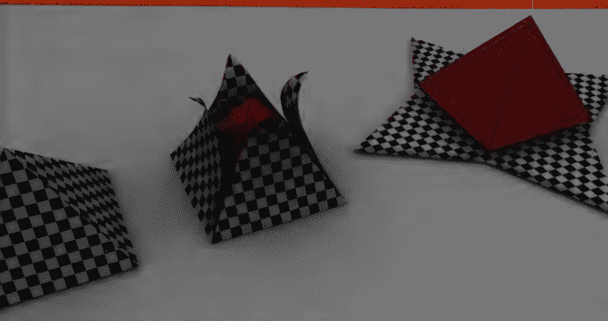

## 资源创建：Maya 场景美术 UV 映射

### 游戏设计流程中的场景美术 UV 布局

在上一章中，我们讨论了使用 Unity 时流程的灵活性，以及在开始游戏机制和脚本编写之前，最好不要仓促处理完所有美术资源。然而，在 3D 美术资源流程中，有一些相当明确的步骤需要遵循。

UV 布局是这些严格指南中的第二步。通常，在开始 UV 布局之前，确保几何体（模型）符合要求是很重要的。如果先创建了 UV 布局，然后又修改了几何体，那么 UV 布局就不得不重做。

同样，在进行大量纹理创建工作之前，UV 需要先完成。由于 UV 定义了纹理如何“附着”到几何形体上，如果 UV（或形体）发生改变，纹理将不再恰当地铺设在表面上。

因此，尽管在布局 UV 时几乎总会有一些调整（发现不需要的多余多边形，或者需要额外的几何体），但场景美术创建过程（即建模、UV 布局、贴图）中的这一步完成得越高效，整个流程就会越高效。

### UV

创建和编辑 UV 的过程可能是所有 3D 工作中最令人沮丧的环节之一。它们几乎没什么直观性可言。不幸的是，理解 UV、如何操作和利用 UV 空间，是实现视觉上可信项目的最重要方面之一，而且对于有效的游戏来说绝对至关重要。

那么什么是 UV？实际上，与其说它们是什么，不如说它们在哪儿。UV 是坐标。它们涉及一个复杂问题：如何将 2D 纹理包裹到 3D 形体上。可以把这个问题想象成制图师试图绘制地球地图。你如何把一个球体展开成页面上的平面形状？

**UV 映射**是一个将三维形体*展开或解包*成二维表示的过程，这样纹理就可以在其上绘制（图 3.1）。表面上的 UV 坐标是“固定”纹理的位置。一旦这些位置被固定，即使表面弯曲或变形，纹理也会随之弯曲和变形。

归根结底，UV 映射是帮助纹理在表面上看起来“正确”的关键。布局不佳的 UV 贴图会导致应用其上的纹理出现难看的拉伸和挤压。执行良好的 UV 贴图能产生可信的表面，其纹理掩盖了下方通常简单的几何体。尤其是在游戏这种纹理承担大量视觉工作的情况下，一个好的 UV 贴图对于视觉成功至关重要。

在接下来的教程中，我们将探讨三种创建 UV 贴图的方法。在这个过程中，理解纹理空间及其与 3D 空间的关系将非常重要。我们将研究 Maya 中的 UV 纹理编辑器（UV Texture Editor），以及它如何允许我们操作 UV。我们将研究 Maya 的自动映射选项、解包功能，以及手动映射和 UV 操作。


### 探索 UV 纹理编辑器

当创建 Maya 的任何基本体时，这些基本体都包含一个默认的 UV 布局。例如，转到 Create>Polygon Primitives>Cube。选中该立方体后，选择 Window>UV Texture Editor（图 3.2）。在 UV 纹理编辑器中，六面立方体会以展开的形式出现。所有面都平铺在 UV 纹理编辑器空间的顶部 (1,1) 象限中。默认情况下，这里的背景是中灰色；这实际上就是应用于立方体的纹理。在 UV 纹理编辑器中，右键单击并按住，将显示一个热盒，允许你选择要选哪种组件类型。常规的 Edge、Vertex 和 Face 以及 UV 都可用。

从热盒中选择一种组件类型后，就可以在 UV 纹理编辑器中选择这些组件了。乍一看，顶点（Vertex）和 UV 之间唯一的区别似乎是组件被选中时的颜色（顶点高亮为黄色，UV 始终高亮为绿色）。这是因为 Maya 基本体的 UV 位于形体的顶点处。但是，不要将两者混淆。顶点和 UV 是一维的——它们本身没有几何体——但它们的功用大不相同。

事实上，一旦挤出（extrude）面或边，新的顶点总是会随之创建（没有顶点就不可能有面）；然而，这些新顶点不一定会有新的 UV 附着在其上。此外，虽然 UV 在 3D 空间（即视图面板）中可见，但它们只能在 2D 空间中——也就是 UV 纹理编辑器内——进行修改：移动、旋转或缩放。

从 2D 纹理空间到 3D 空间的这种转换通常很难想象，更难解释。然而，一旦实际看到它的运作，就更容易理解了。因此，我们不会花太多时间继续深究理论。让我们开始看看它实际是如何运作的吧。

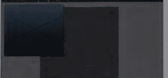

图 3.2 UV 纹理编辑器及立方体基本体的 UV 布局。


### 教程 3.1：游戏关卡 UV 布局、工具与技术

在本教程中，我们将继续处理之前开始的 EntryWay。虽然我们不会显式地为每个对象映射 UV，但这里介绍的技术可扩展到此场景中的所有对象，实际上也可扩展到游戏其余部分的所有场景。

- **步骤 1：** 创建棋盘格图案。在 Photoshop 中，创建一个 32×32 像素的图像。在画布中间水平方向和垂直方向创建参考线。将左上角和右下角填充为黑色。全选，选择“编辑>定义图案”。为图案命名。

- **步骤 2：** 创建棋盘格基础纹理。创建一个 1024×1024 的新图像。选择“编辑>填充”。在“填充”对话框中，选择“使用：图案”，选取先前创建的棋盘格图案，然后单击“确定”。结果应如图 3.3 所示。很令人兴奋吧？

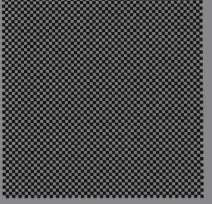

图 3.3 基础棋盘格纹理。

### 为什么？

为什么使用棋盘格图案？为什么不直接使用 Maya 中自带的棋盘格纹理？为什么是 1024×1024？这些都是好问题。当我们尝试布置 UV 贴图时，重要的是要知道我们创建的映射不会导致纹理拉伸或挤压。此外，有时我们想知道网格的任意一部分上实际有多少纹理。通过使用棋盘格纹理，我们可以快速参考纹理如何映射到表面，以及我们如何在 3D 空间中分配纹理。自己构建而不是使用 Maya 的原因是，Maya 棋盘格是按横向和纵向的格子数量设置的。通过自己创建，我们可以创建更密集的格子集合。文件为 1024×1024，是因为我们希望养成在处理纹理时按**2 的幂**构建的习惯（稍后会详细讨论）。

- **步骤 3：** 在项目文件的 sourceimages 文件夹中保存为 Checkerboard.psd。

### 为什么？

sourceimages 文件夹是创建新材质时 Maya 查找纹理的位置。还有许多其他看似合理、颇具诱惑力的文件夹（images、textures 等），但不要屈从。在 Maya 中保存纹理时，唯一重要的文件夹是 sourceimages。

### 创建并应用新材质

- **步骤 4：** 在柱子上创建并应用一个新材质。右键按住我们之前倒角的柱子。选择“指定新材质”。在“指定新材质”窗口中，单击 Lambert。这应在“属性编辑器”中打开一个新的 Lambert 材质。如果没有，请按 Ctrl-A，“属性编辑器”将显示这个新材质的属性。

### 为什么？

为什么用 Lambert？Lambert 是哑光材质，Maya 绘制得又快又好。对我们更重要的是，当 Unity 最初导入 Maya 创建的对象时，所有内容看起来都像 Lambert。其他材质中存在的任何其他属性（Phong 中的高光等）无论如何都必须在 Unity 中重新定义。因此，花大量时间在 Maya 中调整设置是浪费的，因为它必须重做。因此，Lambert 是快速、简单且可预测的方式，可用于应用纹理并查看场景的整体外观。

- **步骤 5：** 命名材质。命名材质。命名材质。我提到过要命名材质吗？将材质命名为 `EntryWay_Column_Mat`。

### 为什么？

初学建模者或初学游戏制作者常常跳过有效的命名，并在之后付出惨痛代价。在应用程序之间移动资源时（例如从 Maya 到 Unity），资源的关联方式会有所不同，有时在生产过程中材质会与对象失去关联。如果有 100 个名为 lambertx 的材质，你的工作会变得极其缓慢。只需花一点时间按材质的实际用途命名，之后就能节省很多小时。尤其如果你希望作为团队一员与他人合作——有效命名对于顺畅的工作流程和保住工作至关重要。

- **步骤 6：** 为 Color 属性创建渲染节点。在“属性编辑器”中，Color 通道最右侧有一个小按钮，讽刺的是，它看起来像棋盘格。单击它以打开“创建渲染节点”窗口。单击 File 按钮，让 Maya 导入一个文件来定义材质的颜色属性。

### 警告与陷阱

如果单击“图像名称”输入字段旁边的文件夹，却没有转到项目的 sourceimages 文件夹，请停下来。这意味着项目设置不正确；如果你开始浏览文件树来寻找正确的文件，可能会使项目在除当前工作机器之外的其他机器上损坏。如果你发现自己所处的位置与预期不同，请停下来，保存文件，然后返回并设置项目（文件>设置项目）。

- **步骤 7：** 选择 Checkerboard.psd 来定义颜色属性。执行上一步后，“属性编辑器”将变为显示一个带有**图像名称**输入字段的文件节点。单击该输入字段旁边的文件夹图标，你应会被带到项目的 sourceimages 文件夹。双击 Checkerboard.psd。

- **步骤 8：** 在**纹理**模式下查看场景。通过按键盘上的 **6** 来完成。这将显示应用了任何纹理的场景，并应产生如图 3.4 所示的奇怪结果。

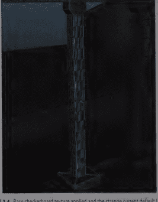

图 3.4 已应用基础棋盘格纹理，以及当前奇怪的默认 UV 贴图。

### 为什么？

那么我们在这里看到的是什么？回想一下我们最初开始构建这根柱子的时候；我们开始的形状是一个立方体。柱子上有纹理的部分是该立方体原始的面。我们从该形状挤出的多边形是灰色的；它们没有 UV 坐标，因此没有可供纹理“钉”到的位置。此外，应用到柱子主柱身上的纹理被拉伸了，而且组织效率不高。

### 从自动映射开始进行映射

### 为什么？

我们将要了解的第一种 UV 映射方式是从**自动映射**开始。一般来说，每当软件“自动”做某件事时，都要稍微警惕——这里也不例外。不过，自动映射确实会为我们拥有的所有几何体创建 UV，而一旦有了这些 UV，我们就可以将贴图修正为我们所需的样子。

- **步骤 9：** 对柱子使用自动映射。选中柱子后，选择“多边形>创建 UV>自动映射”（图 3.5）。在 UV 纹理编辑器窗口中，选择“图像>显示图像”（以关闭棋盘格），然后查看表示柱子的形状。

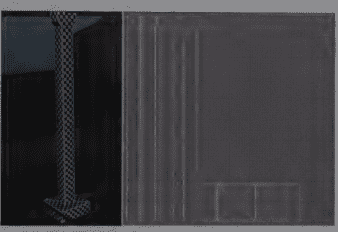

图 3.5 自动映射的结果。

### 为什么？

乍一看一切正常——那真是简单得惊人。但看一下 UV 纹理编辑器（窗口>UV 纹理编辑器），你会注意到几件重要的事情。在 UV 纹理编辑器窗口中，选择“图像>显示图像”（以关闭背景棋盘格），然后查看表示柱子各面的形状。首先，注意有大量纹理空间我们并未利用。在游戏中，无论我们是否使用该空间，都要为它付出代价，而留下这么多纹理空间未使用是非常低效的。其次，注意柱子的每个侧面都是分开的。这意味着纹理不会绕过拐角或柱子蔓延——我们的形体每个拐角处都会有一条接缝。

接缝不可避免。如果要展开一个形体，某处就必须有接缝，但我们希望尽量减少接缝。为此，我们将切开这张贴图的一部分，并重新组合（通过缝合）其他部分。

- **步骤 10：** 切下柱子的顶部。在 UV 纹理编辑器中，右键单击并从热盒中选择“边”。选择图 3.6 所示的边（那里实际上有三条边，尽管它们都在一条线上）。在编辑器窗口中选择“多边形>切割 UV 边”。

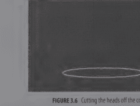

### 为什么？

我们切下柱头，是为了能够缝合柱身的侧边。在游戏中，我们看到柱身的时间会远多于柱子的柱头。因此，确保柱身上只有一条接缝，能为游戏玩家带来更好的体验。

- **步骤 11：** 通过 UV 将柱头移开。再次右键单击，并从热盒中选择“UV”。框选几个 UV（它们是柱子柱头的一部分——也许是 UV 的右上角），然后按住 Ctrl 并右键单击（我知道这组合有点多），选择“到壳”（图 3.7）。这将选择构成柱子顶部的 UV 壳。将它们移到一边。移动 UV 壳可以使用常规的移动工具（按 W 激活），或在编辑器窗口中选择“工具>移动 UV 壳工具”，然后将它们移到一边（实际上移到哪里都行）。

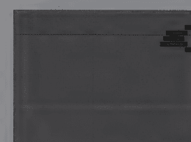

### 为什么？

什么是壳？UV 壳是共享 UV 或共享边的 UV 集合。因为我们在柱头底部切开了边，那里的边不再共享，所以当我们选择一个壳时，它就在那里停止。


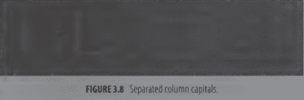

- **步骤12：** 对柱子的其他侧面重复步骤10和11。请记住，这一切都发生在UV纹理编辑器中。图3.8显示了柱头块全部被分离后的情况。

### 缝合壳

- **步骤13：** 缝合柱身的边缘。在UV纹理编辑器中，右键单击并从热盒中选择“边”。单击（不要框选）柱身部分的任意一条外边。注意，虽然只单击了一条边，但UV纹理编辑器中会有另一条边高亮显示。这是因为它们是同一条边，但被分割开了（这就是为什么会有接缝）。

由于这条边被选中了两次，请选择“多边形>移动并缝合UV边”。一个壳会滑向另一个壳，被分割的边将合并为一条（图3.9）。

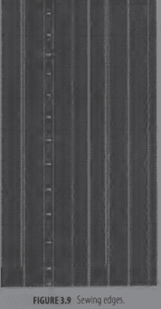

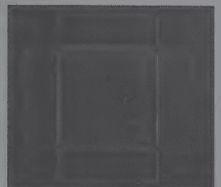

**图3.11** 缝合后的柱基。

### 为什么？

我们希望减少玩家最可能注意到的接缝。对于柱身，垂直接缝很容易被看到，因此我们要小心地去除它们。对于柱基，当玩家站在其上方向下看时，当形体从顶部过渡到侧面时，他们很可能会注意到接缝，因此我们去除这些接缝，而保留靠近地面的垂直接缝。

- **步骤16：** 对柱头壳重复此过程（图3.12）。

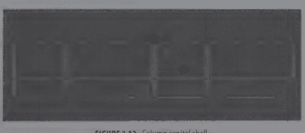

**图3.12** 柱头壳。

### 为什么？

为什么要用“移动并缝合UV边”而不是只用“缝合UV边”？自动映射为我们做的一部分工作是均匀分布UV，使得棋盘格确实是方形的。当使用“移动并缝合UV边”时，Maya会移动整个壳，从而保持UV的相对位置不变。这意味着纹理在此过程中不会变形。而“缝合UV边”只移动边，在此过程中会使纹理在表面上扭曲。

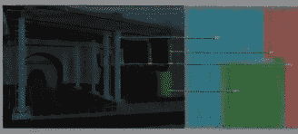

**图3.14** 对象EntryWay_Columns在指定了EntryWay_Columns_Mat材质后的最终UV布局。现在还不必担心如何实现，但要知道这是一个纹理图集的最终目标。

屏幕上的不同对象。这会占用更少的显存，并大幅减少绘制调用。由于在我的场景中，柱子上还附着其他东西（梯子和框架），我将把这些对象的UV放在象限中空余的空间里，然后为所有这些对象指定相同的纹理。纹理图集的概念非常强大，我们稍后会再次讨论它。

最后，当这一关的UV完成后，单个网格EntryWay_Columns（实际上是多次合并的结果）的UV图看起来就像图3.14所示。

### 进一步优化

- **步骤18：** 复制、放置并合并这个已展开UV的柱子。删除旧的柱子副本，用这个替换它们。当所有都放置好后，选择它们全部并合并（多边形>网格>合并）。将这个新的多边形形状命名为EntryWay_Columns。最后，为了确保这个新组的操纵器手柄位置合理，选择“修改>居中轴心”。

- **步骤19：** 对其他近似方形的形状重复此过程。以我场景中的物体为例，这包括柱子上方的横梁、屋顶以及其他各种明显的方形结构。使用这种技术进行UV映射的形状在图3.15中显示为棋盘格。

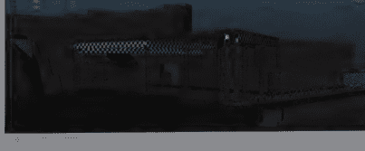

**图3.15** 使用自动映射作为起点进行UV映射的对象。

### 提示与技巧

请记住，为每个对象或对象组（它们将共享同一材质）创建一个新材质。尽管它们都将共享同一个Checkerboard.psd文件作为颜色纹理，但我们希望确保每个对象都有自己独特的材质。

### 提示与技巧

对所有的UV映射使用同一个棋盘格的一个好处是，可以快速看出每个对象将拥有多少纹理空间。了解这一点有助于判断纹理在游戏中可能出现的高度保真度。请注意，在图3.15中，靠近地面或在地面上的对象的棋盘格较小。这意味着它们拥有大量的纹理空间，也意味着将有很多像素用来描述这个表面。而游戏中离玩家较远的物体（如头顶的横梁）则有较大的棋盘格方块，因为它们不需要那么多纹理，因为它们不会受到太近距离的审视。

### 通过平滑UV工具在Maya中展开UV

### 为什么？

自动映射在处理立方体或大致呈立方体形状的对象时效果很好。但一个到处都是板条箱的场景会显得相当无聊，最终，对于大多数有一定变化的场景来说，更有机的形状变得重要。Maya的展开UV工具是Maya工具集中的相对较新的成员（至少在其当前使用的配置中是如此）。这种技术在其他工具中也可用（参见免费且强大的Roadkill http://www.pulin-shapes.co.uk/page8.htm），但在Maya中也能用是很好的。在接下来的几个步骤中，我们将探讨Unfold在Maya中如何作用于一个简单形状。然而，这个工具对于面部和其他复杂的有机形状尤其强大，所以我们稍后还会再次用到它。

- **步骤20：** 为EntryWay_Earthwall对象指定新材质（以棋盘格作为颜色纹理）（如果你是在从网站下载的地图版本基础上构建；如果不确定你的版本，请将新材质指定给你用作大型挡土墙的任意对象）。如需复习操作方法，请务必查看步骤4到7。将新材质命名为`EntryWay_Earthwall1_Mat`。

- **步骤21：** 使用平面映射确保整个对象都有UV。选中对象后，选择`Polygons>Create UVs>Planar Mapping (Options)`。将“适配投影到：”设置更改为**最佳平面**，然后按“投影”（图3.16）。

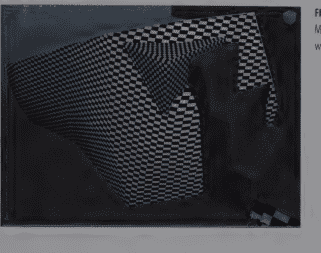

**图3.16** 平面映射的结果（显示了效果不佳的部分）。

### 为什么？

Unfold工作得很好；然而，它只能展开已有的UV。正如我们之前看到的，当面或边被挤出时，创建的新面常常缺少UV。使用平面映射为我们做几件重要的事情。首先，它确保特定网格的每个部分都有UV。其次，它确保所有这些都属于一个壳。第三，通过在选项中选择“最佳平面”，我们让Unfold有最好的机会提供无扭曲的UV图。

- **步骤22：** 通过平滑UV工具（交互式地）展开UV。在UV纹理编辑器（窗口>UV纹理编辑器）中，右键单击网格并从热盒中选择“UV”。框选所有UV。从UV纹理编辑器左上角的图标或从“工具>平滑UV工具”中选择平滑UV工具。

- **步骤23：** 拖动新的“展开”按钮来展开网格。寻找被黄色框包围的新弹出工具。拖动“Unfold”字样，观察UV展开并在视图面板中显示分布更均匀的棋盘格图案（图3.17）。

- **步骤24：** 调整UV壳的大小（如有必要可旋转），使其适合右上象限。

### 为什么？

虽然UV并不需要总是保持在右上象限内（事实上在接下来的设置步骤中我们会移出该空间），但如果情况需要非重复纹理，它就必须保持在该象限内。对于这面土墙，因为我们在游戏中会一次看到它的全部，所以我们要尽量避免重复图案。此外，通过旋转和缩放这些UV，我们还能获得更多的纹理空间来创建另一个迷你图集。

### 警告与陷阱

乍一看，一切似乎都不错——整个表面都覆盖着棋盘格。然而，如果你仔细观察这些棋盘格，你会发现有一些严重扭曲的棋盘格（尤其是图3.16的右上角）。这是因为平面映射像幻灯片投影仪一样将纹理投射到整个表面上。当图像投射到与投影平面垂直的面上时，效果很好；但随着形体开始转折，使面与投影平行时，就会出现拉伸。如果任其如此，作为贴图应用的岩石纹理在包裹形体时也会变形。因此，接下来的步骤非常重要且强大。


### 提示与技巧

选择面可能是一件棘手的事情。请记住，有时更简单的做法是选择所有面，然后取消选择不需要的面。有时，绘制选择工具是最佳选择。

### 提示与技巧

请注意，创建平面投影后，棋盘格可能不是完美的正方形。还要注意，在平面投影之后，立即会有一些操纵器手柄围绕刚刚映射的区域，这些手柄允许调整投影，以便在需要时将其缩得更窄。

### 为什么？

是的，你说得对。当面转过拐角以形成拱门的浮雕时，平面投影会产生一些严重的扭曲。要解决这个问题，可以使用一个技巧：使用平滑 UV 工具的展开（Unfold）部分（而不是 Polygons > Unfold）。

-   **步骤 28：** 映射拱门内曲线的 UV。在面模式下，选择构成拱门弯曲部分的面（图 3.19）。

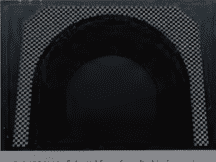

*图 3.19 为圆柱映射选择的面。*

-   **步骤 29：** 选择 Polygons > Create UVs > Cylindrical Mapping。在 X 轴上将投影旋转 -90 度。按 Ctrl-A 调出属性编辑器。应该有一个处于活动状态的 polyCylProj1 选项卡。确保展开投影属性（Projection Attributes）。在第一个旋转输入字段（X）中，输入 -90（图 3.20）。

### 为什么？

圆柱投影就像用玉米饼包裹一个对象——或者更准确地说，默认情况下，是用半张玉米饼包裹对象的一半。这半张玉米饼默认是竖立着的。在这种情况下，我们试图映射的多边形最好用从顶部包裹的玉米饼来包裹。通过将投影旋转 -90 度，投影（从操纵器上可以看出）更接近它们所投影到的多边形的形状。越来越接近了。

**图 3.20** 旋转圆柱投影。

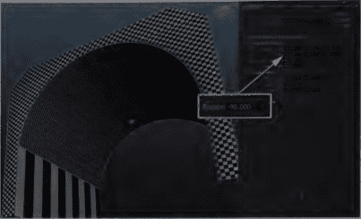

-   **步骤 30：** 调整操纵器，使棋盘格成为正方形。在截图中有点难以看清，因为操纵器手柄太小了，但操纵器的顶部和底部边缘会有绿色手柄。拉出一个手柄来拉长投影，使棋盘格更接近正方形（图 3.21）。

**图 3.21** 调整操纵器，使棋盘格更接近正方形（从而获得分布良好的 UV 贴图）。

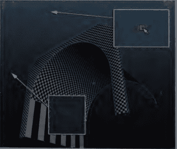

-   **步骤 31：** 调整投影中心，使其与多边形的曲线匹配。图 3.21 还突出显示了操纵器角落上的一个小工具，它看起来像一个红色的小 T。单击它，操纵器将发生变化，并在投影中间显示一个新的操纵器手柄，看起来像挤出工具的手柄（它有平移、缩放和操纵器手柄）。使用平移工具将投影向下滑动，以便

**图 3.24** 排列壳。

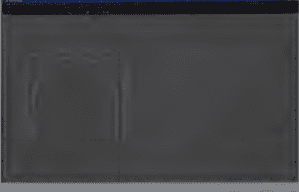

### 为什么？

我们将把其中一些壳缝合在一起，以便纹理可以在表面上不受阻碍地移动。当我们使用自动映射时，壳都为我们布置得很好；但当我们手动映射时就不是这样了。

-   **步骤 35：** 将壳调整到适当的大小。之前我们了解到，当选择一条边时，如果该边在另一个壳中共享，它也会高亮显示。发生这种情况时，可能会发现之前在视图面板中匹配棋盘格的估计在这里并不完全成立（边的大小可能不合适）。移动并缩放壳，使其适当匹配（图 3.25）。

**图 3.25** 调整后的壳。壳已被移动和缩放。


-   **步骤 36：** 缝合拱门边缘。选择拱门底部的一条边，这应会选择底部多边形之一的顶部，然后使用 Polygons > Move and Sew UV Edges。在拱门的两端都执行此操作（图 3.26）。

**图 3.26** 手动映射完成的拱门。被缝合的边会高亮显示。

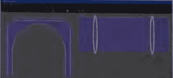

### 为什么？

为什么我们突然要在 Hypershade 中构建一堆材质，而过去我们是边做边构建的？嗯，在分配材质时创建材质，对于给定对象上只会有一种材质的情况非常有效。然而，当向一个对象分配多个材质时，如果材质已经构建好，效果最好。

-   **步骤 40：** 将 EntryWay_DockTile_Mat 分配给图 3.29 所示的多边形。为此，首先在视图面板中切换到面模式（按住鼠标右键，然后从热盒中选择 Select Face）。选择图 3.29 所示的多边形。打开 Hypershade，按住鼠标右键单击 EntryWay_DockTile_Mat，然后从热盒中选择 Assign Material to Selection。

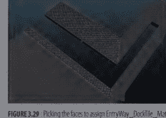

图 3.29 选择要分配 EntryWay_DockTile_Mat 的面。

### 提示与技巧

当材质名称变长时，在 Hypershade 中，根据缩略图的大小，可能很难分辨哪个是哪个。但是，当鼠标悬停在任何材质色板上时，会弹出一个黄色提示框，显示完整名称。

-   **步骤 41：** 将 EntryWay_DockWhiteCement_Mat 分配给图 3.30 所示的多边形。所选多边形基本上是沿运河内侧的所有多边形，以及边缘的多边形。仅向这些多边形分配材质的过程与上一步相同。


图 3.30 用于 EntryWay_DockWhiteCement_Mat 的多边形。

-   **步骤 42：** 最后选择所有剩余的多边形（并取消选择我们已经分配了材质的那些多边形），然后为它们分配 EntryWay_DockCement_Mat。

### 为什么？

结果很奇怪，不是吗？如果你正在使用根据前几章构建的场景版本，你会发现有很多多边形仍然是灰色的，而那些有纹理的多边形则乱七八糟。当然，这是因为我们还没有对这个形体进行 UV 映射，所以唯一会有纹理的多边形是我们开始这个形体时立方体的原始面。在接下来的几步中，我们将再次控制 UV，并给这个形体赋予可识别的纹理。

-   **步骤 43：** 对码头的瓷砖部分进行平面映射。选择我们之前分配了 EntryWay_DockTile_Mat 的两个多边形。选择 Polygons > Create UVs > Planar Map (Options)。勾选包围盒和 Y 轴单选按钮，然后按 Project。使用操纵器调整投影，以生成方形棋盘格（图 3.31）。


**图 3.31** 通过自动映射映射码头白色水泥部分。

### 为什么？

不要太担心这些棋盘格的确切大小。此时正在编辑的 UV 可能远远超出 UV 纹理编辑器的右上象限，事实上，一旦我们开始构建纹理，这无疑会发生变化。此时我们感兴趣的是无扭曲的 UV 映射。所以只要棋盘格是正方形，就没问题。

-   **步骤 44：** 对白色水泥部分进行自动映射 UV。选择之前已分配 EntryWay_DockWhiteCement_Mat 的多边形，并使用自动映射（Polygons > Create UVs > Automatic Mapping）对这些多边形进行 UV 映射。使用投影操纵器（选择自动映射后立即在视图面板中可见）缩放 UV，以确保方形棋盘格（图 3.31）。

### 提示与技巧

确保你正在查看此投影的所有侧面。自动映射的操纵器与平面映射的操纵器看起来不同，仔细观察所有多边形以进行适当调整非常重要。请记住，有时操纵器适合进行粗略调整，但任何类型的精细调整都应使用 UV 纹理编辑器。


## 资产创建：Maya 场景贴图

### 贴图、材质与着色器

现在你已经为UV映射付出了代价，可以准备投入创建场景美术元素视觉冲击力的有趣部分了——也就是被称为“贴图”的颜色与视觉触感元素。

在讨论为灰色（或我们这个例子中的棋盘格）场景添加视觉信息时，有很多术语会被随意抛出来。但从技术上讲，这些术语有着非常实际的含义，不应混淆。

**贴图**本质上就是图像；它们可以是照片或绘制的图像。贴图是定义**材质**特定属性的二维元素。贴图可用于定义材质的颜色或视觉触感属性，例如凹凸。当材质应用到对象上时，**着色器**用来展示材质如何对光线和观看者的视角作出反应。当有人说他们在为场景“贴图”时，通常是指他们通过组合贴图来创建材质，并将材质应用到几何体上；当光线照射时，这些几何体便会呈现出视觉上复杂的形态。

## 有效贴图的性质

并非所有贴图都是平等的。有些贴图（图像文件）在3D和贴图空间中更容易被构想出来。此外，重要的是，有些贴图绘制速度更快，这在游戏设计中是一个关键的考量因素。

### 正方形贴图

当我们在进行UV布局时，我们是在UV贴图空间的右上象限中工作。注意这个象限是正方形的。如果将一个贴图导入Maya的材质中，它在这个空间中仍然会显示为正方形。因此，通常使用正方形图像来可视化贴图会更容易。尽管材质可以变形（例如压扁它们），但我们在做UV布局时花了很大力气来创建完美的方格棋盘。这意味着我们假设贴图不变形，结果也会更具可预测性。

然而，重要的是要注意，Maya（或Unity）中的贴图并不一定是正方形的。有时长方形贴图更有意义（例如长墙）；但Maya在UV纹理编辑器中仍会将其显示为正方形图像。因此在大多数情况下，如果初学者看到未变形的贴图，创建过程会更容易。

### 二的幂

显卡绘制某些资源的速度比其他资源快。这部分与计算机硬件打包信息的方式有关。从1开始，乘以2，然后再将每个结果乘以2，就会得到这样一串数字：1, 2, 4, 8, 16, 32, 64, 128, 256, 512, 1024, 2048, 4096，依此类推。这些值被称为**二的幂（POT）**。如果贴图的像素尺寸是这些打包值之一，贴图的工作效率最高。因此，如果我们处理的是正方形贴图，可以考虑256×256、512×512、1024×1024、2048×2048，甚至4096×4096。

就在不久前，显卡还无法显示非二的幂的贴图。如今大多数显卡都有某种策略来处理这种情况；然而，这几乎总是包含某种将贴图重采样为二的幂贴图的过程。这意味着宝贵的计算能力被浪费在将300×300的贴图转换为256×256上。这种处理能力的浪费通常会导致帧率降低和游戏卡顿。

Maya会愉快地接受任何尺寸的贴图，毫无怨言，这可能会导致一种虚假的安全感。此外，Unity 3新增的是，Unity也会毫无怨言地接受非二的幂贴图——事实上，它甚至不会提醒你（除非你逐个查看纹理的Inspector）它接受了非二的幂贴图以及它正在对它们做什么。然而，在幕后，Unity正在悄悄地将非二的幂贴图转换为二的幂版本。在Unity 2.x及更早版本中，必须告知Unity这样做；但现在Unity会默认你想这样做，并将你想要导入的文件分块成运行速度最快的尺寸。

然而，将一个略偏离二的幂的图像（例如520×520）重采样为512×512可能会导致图像模糊。软件在缩小尺寸时很难知道到底该省略哪些像素，或在放大时该加倍哪些像素。

最终，将贴图创建为二的幂贴图会在导入时节省时间，并生成更清晰的图像，这些图像在MIP映射（稍后详述）中效果更好，并在所有显卡上运行更快。

### 无缝贴图

我们完成的某些UV映射基于这样的理念：贴图的每个像素在应用它的表面上显示一次，且仅显示一次。这可以生成非常精细的贴图，但有时很难在不用巨大文件的情况下保持良好的分辨率，并因此导致帧率降低。对于其他贴图，例如地面，我们构建UV贴图时假设要重复或平铺贴图。这意味着，与其看到一张1024x1024的贴图铺满整个码头（这会导致我们低头看脚时只能看到几个模糊像素），我们可以多次重复该贴图，这样就能在脚下清楚地看到完整的1024x1024贴图。这样可以创建出在近距离观察时保持得更好的贴图。

然而，当贴图要这样重复时，至关重要的是贴图在平铺时不能有接缝。如果贴图的顶部与底部无法完美对齐，平铺就会可见，连续表面的假象也会被破坏。

### Maya与Unity

幸运的是，Unity描述贴图/材质/着色器的范式与Maya几乎相同；这也是Maya和Unity如此之搭的部分原因。如果你理解Maya中材质的创建，那么进入Unity中的材质和着色器创建会顺畅得多。

然而，话虽如此，在将资源从Maya移动到Unity的.fbx转换过程中，一些数据会丢失。Unity处理.fbx文件。它对大多数导入模型所做的，就是将该模型从Blender、Maya、CAD或其他任何软件转换为.fbx文件。不幸的是，在Maya中创建的复杂着色器网络不会原样转换为Unity。当资源从Maya（或你使用的任何3D应用程序）导入Unity时，几乎总是需要进行一些重建。

贴图中的像素将在表面上显示一次。在这种情况下，不需要无缝贴图。我们可以绘制一个包裹住形体的定制贴图，并添加或包含任何特定的裂缝、污渍或弹孔。有时这效果很好，在某些方面更可取。它允许非常有趣且精确的贴图和放置。

然而，模型的其他区域，比如地面表面，我们没有确保UV设置在右上象限内。虽然所有UV不共享任何贴图空间允许绘制复杂的贴图，但这些贴图在近距离观察时很容易崩溃（除非使用巨大的贴图文件，这会让你的游戏慢到爬行），因为屏幕上越来越多的部分被越来越小的贴图文件块填满。虽然一个板条箱可能可以使用512x512的贴图，因为板条箱只占屏幕的一小部分，但如果把512x512的贴图拉伸到整个码头地面，当玩家看向脚下，地面占据整个屏幕时，他只能看到贴图文件中的一两个像素；那看起来会很糟糕（图4.1）。

这就是无缝贴图的威力所在。如果创建一张512x512的无缝贴图，但在同一码头表面上多次重复，当玩家看脚下时，他可能看到整个512x512贴图，如果贴图瓦片足够小，甚至更多。这意味着，当玩家望向场景而地面占据大量屏幕空间时，贴图的保真度能保持得好得多（图4.1）。

在大面积表面上平铺贴图存在固有问题。首先，贴图被平铺这一点会变得相当明显，因为重复图案很容易被肉眼识别出来。这个问题有时可以通过选择没有太多大型决定性视觉元素的贴图来缓解（图4.2）。也可以通过开发良好的光照贴图来缓解（稍后会有更多介绍）。

平铺贴图的第二个问题是瓦片不匹配。如果贴图不是无缝的，很容易看到贴图的一个副本在哪里结束、下一个在哪里开始。本教程旨在解决这个问题。有趣的是，解决无缝问题根本不是3D问题，因此不可以在Maya中解决。我们将在Photoshop中解决它。


**图4.1** 左侧图像是一张巨大的（4096x4096）贴图，拉伸到整个地面。右侧图像只使用了一张512x512的图像，但进行了平铺。


**图 4.3** 位移及结果。

### 为什么？

任何图像在尝试实现无缝时，问题都在于接缝。接缝就是图像的边缘。启用“环绕”选项的“位移”滤镜为我们做了几件重要的事。首先，它将所有像素横向（和/或向下）偏移或滑动，然后将滑出画布边缘的像素环绕到图像另一侧。这意味着两件重要的事。第一，应用位移滤镜后，图像右边缘与左边缘无缝匹配，顶部与底部也同样匹配。第二，它将旧边缘（旧接缝）直接放到场景正中央，以便我们处理它们。

- **步骤 4：** 用仿制图章去除接缝。仿制图章是一个极其强大的工具，可让你以交互方式将图像一个部分的像素绘制到另一个部分。要使用它，请从 Photoshop 工具栏中选择它，然后按住 Alt（Mac 上为 Option）并单击要从中取样像素的区域。松开 Alt 键和鼠标，然后到需要绘制像素的位置（本例中即图像中央的接缝）进行绘制。结果见图 4.4。


**图 4.4** 使用仿制图章处理后的图像。

### 警告与陷阱

处理接缝时，要留意那些重复后可能过于显眼的区域。例如，看图 4.4；注意那个深黑色斑块。当它在表面上重复 20 次时，这个斑块会非常成问题。使用仿制图章工具去除（或至少尽量减少）这类瑕疵。

### 提示与技巧

[ 和 ] 键会改变画笔大小（增大和减小）。这通常是有效处理接缝的重要一步。确保控制好画笔大小。

### 提示与技巧

仿制图章工具有几个选项（在 CS5 中）显示在 Photoshop 界面顶部。绝不要同时将不透明度和流量都设为 100% 进行绘制。纹理很快会变成斑驳的一团糟，并开始过于频繁地显现特征，实际上减少了纹理中可用的视觉信息。我喜欢将流量值设为 10% 左右进行绘制，这样可以轻轻地将像素叠加到接缝上，并与下方的像素结合，形成一个在纹理其他任何地方都不存在的区域。把这个过程看作是把接缝揉开，而不是把它涂掉。

### 警告与陷阱

这不是一个小问题。把这个麻烦家伙保存到 sourceimages 文件夹中。关于 Maya 项目重要性的进一步阅读，请参见前面章节。

- **步骤 5：保存。** 文件 > 保存，并将文件命名为 `EntryWay_DockColor`。确保将其保存到项目文件的 *sourceimages* 文件夹中。

### 提示与技巧

文件格式并不是特别重要。Maya 能读取大多数图像格式，不过如果使用 Mental Ray，它可能对 .psd 文件相当挑剔。另一方面，Unity 几乎什么都能读取。由于我的原始文件是 .jpg，我也将其保存为 .jpg。但如果涉及大量图层操作，不要回避 .psd。Unity 会保留原始的多层 .psd 文件，并将其作为拼合图像导入。

## 统一色彩平衡

- **步骤 6：** 对图像运行高反差保留滤镜。滤镜 > 其他 > 高反差保留将打开一个对话框。在该对话框中，将半径滑块拖到最右侧（250 像素）。这会使图像看起来相当灰（图 4.5）。

### 为什么？

通常，在对图像进行采样或裁剪时，图像在位移之前看起来没问题。随后，纹理中常见的柔和渐变就会显现出来。突然，当图像左侧与右侧对齐时，那里的颜色可能完全不同。这个过程可以统一色彩区域。高反差保留滤镜会使大部分颜色去饱和，但会留下一个能很好配合后续步骤的数据集。


图 4.5. 高反差保留滤镜的结果。

- **步骤 7：** 在 `EntryWay_DockColor` 仍打开的情况下，选择文件 > 打开，并打开用作基础纹理的原始文件（在我的例子中是 ConcreteBare0312_S）。这将成为我们的源图像。

- **步骤 8：** 返回到 `EntryWay_DockColor`（窗口 > EntryWay_DockColor）。

- **步骤 9：** 匹配颜色，选择图像 > 调整 > 匹配颜色。在匹配颜色对话框底部，在源下拉菜单中选择 ConcreteBare0312_S（或你的图像）。单击确定（图 4.6）。


图 4.6. 匹配颜色以统一纹理的色彩区域。

- **步骤 10：** 在 Photoshop 中测试纹理。方法是再次选择滤镜 > 其他 > 位移，并将滑块移动到各种不同的值。结果应保持无缝；曾经存在的接缝应再也看不到。

- **步骤 11：** 满意后保存。

## 应用纹理

- **步骤 12：** 打开 Maya（确保项目已正确设置），然后打开 EntryWay.mb。

- **步骤 13：** 打开 Hypershade 并绘制 EntryWay_DockCement_Mat 材质的节点图。使用窗口 > 渲染编辑器 > Hypershade 打开 Hypershade。在 Hypershade 中选择材质选项卡，然后选择 EntryWay_DockCement_Mat 色板。选择图表 > 输入和输出连接。应如图 4.7 所示。


*图 4.7* 绘制 EntryWay_DockCement_Mat 材质的节点图。

### 为什么？

你在这里看到的是节点如何连接以创建材质。最左侧的节点表示纹理在 UV 空间中的放置方式（默认 1:1），第二个实际上是棋盘格纹理，第三个是着色器材质，最右侧是着色组。材质以这种方式绘制成图后，就很容易看出材质是如何组装的，以及如何进行所需的更改。

- **步骤 14：** 重命名纹理节点。仍在 Hypershade 中，双击纹理节点（底部带粉色的那个）。这将在属性编辑器中打开该节点。在其中的文件：输入字段中，输入 `EntryWay_DockCement_Color`。

### 为什么？

这是一些本可以更早完成的整理工作。在创建材质时创建文件节点，Maya 会自动将其命名为 file#。在我的例子中，它是 file12。问题在于，这会让人难以跟踪哪些节点在什么位置。尤其当有这么多棋盘格时，从视觉上辨认它们会变得非常困难。花点时间重命名后，情况就变得清晰了（尤其是对之后可能访问此文件的其他美术师而言），能明白发生了什么。

- **步骤 15：** 用新的 EntryWay_DockColor 替换棋盘格。仍在属性编辑器中，查看图像名称输入字段。它应显示：`sourceimages\Checkerboard.psd`。要替换水泥纹理，请单击输入字段右侧的文件夹图标。然后，在弹出的打开对话框中，选择 `EntryWay_DockColor.jpg`。单击打开（图 4.8）。


### 为什么？

那么刚刚发生了什么？注意整个码头并没有改变；这是有意设计的。在上一章中，我们为码头的不同部分指定了不同材质。当我们换掉棋盘格并定义不同的图像来描述材质的颜色属性时，只有使用 EntryWay_DockCement 材质的polygon发生了变化。现在我们可以调整 UV 大小，使该纹理达到合适尺寸。

### 警告与陷阱

如果你按下文件夹按钮后没有直接进入项目的 sourceimages 文件夹，或者 EntryWay_DockColor 没有等在那里，请停下来。这意味着你要么处于错误的项目中，要么将纹理文件保存到了错误的位置。花点时间，要么重置项目，要么找到你错误保存文件的位置并整理好。

- **步骤 16：** 按需要调整 UV。选择码头，然后选择窗口 > UV 纹理编辑器。选择定义码头中水泥部分的 UV，并通过拖动中间的黄色方块沿所有方向缩放 UV，使其变大（同时，纹理将开始在视图面板中平铺）。在 UV 纹理编辑器中拖动控制柄时，观察视图面板，以查看纹理在表面上的大小如何变化（图 4.9）。

### 提示与技巧

在 UV 纹理编辑器中，注意可以在纹理下拉菜单中显示多个纹理。这是因为（在本例中）我们为单个网格指定了多个材质。有时处理 UV 时，查看 UV 如何与特定纹理对齐很重要，因此可在此处切换浏览它们。


**图4.9** 缩放UV以允许多重重复纹理。


## 结论

好了，就是这样。同样的技术适用于几乎所有需要平铺的纹理。诚然，对于某些表面（讽刺的是，比如瓷砖），处理起来会更棘手，因为要让边缘对齐可能需要一番巧妙操作。但是，努力会有回报。当大型表面在视野中出现时，有效的纹理将在未来带来视觉上的回报。

注意，这里有一些好的现象。拉近镜头，将相机放在玩家在游戏中的大致位置，纹理应该表现得相当不错。然而，当相机处于很高的位置时（如图4.9所示），重复图案会相当明显。一旦场景烘焙完成，其中一些问题将不再是问题，而且由于我们相对于这个码头的高度从来不会太高，所以我们不太可能注意到重复图案。如果在游戏中确实出现了分散注意力的重复图案，我们可以返回去稍微缩放纹理，或者使用更大面积的纹理采样，或者两者兼用。

### 教程 4.2：非平铺纹理及其污渍

年轻3D学生最大的错误之一就是他们的作品太干净了。是的，我同意很难相信18、19岁的年轻人会被指责这一点，但在3D领域，情况几乎总是如此。

事情是这样的：学生外出做了一些充分的研究，找到了一些很好的资源纹理，通过复制和粘贴必要的纹理来制作合适的表面贴图，然后把它直接贴到表面上。一旦所有东西组合在一起，问题就出现了。在现实中，两个表面相交的区域是非常有趣的区域。如果是内角（想想地板与墙壁相接的地方），它会积聚各种污垢、灰尘和视觉上有趣的东西，而外角则会积聚各种滴落的污渍。当纹理美术师未能考虑到这一点时，场景就会丢失大量视觉信息，而这些信息正是引导视线关注这些至关重要角落的线索。

在本教程的第一部分，我们将研究如何在不重叠UV的情况下构建纹理与纹理之间的空间。在第二部分中，我们将使用这个纹理并将其做旧。

- **步骤1：** 选择一个具有不重叠UV的对象，并打开UV纹理编辑器（图4.10）。在本教程中，我将为小门廊制作纹理——这是让Aegis Chung进入设施的主门上的门廊（可从 www.Creating3dGames.com 下载）。

> **警告与陷阱**
>
> 确保在对象模式下选中对象；如果处于任何组件模式下，下一步将无法正常工作。只有在选中整个对象（而非仅选中部分）时，才能输出UV快照。


### UV快照

- **步骤2：** 输出UV快照。在UV纹理编辑器中显示UV贴图时，选择“多边形 > UV快照”（全部在UV纹理编辑器内）。在“UV快照”窗口中，确保Size X和Size Y均为2048，并将图像格式设置为TIFF。将名称更改为 EntryWay_PorticoUV。

> **提示与技巧**
>
> 请注意，“文件名”输入字段包含一个路径。该路径（应该）是项目文件以及项目文件中的images文件夹。images文件夹是Maya的默认输出位置之一。这再次提醒我们，正确设置项目是多么重要。

### 为什么？

为什么是2048×2048？首先，这是一个2的幂次纹理。但为什么不是1024×1024，或者4096×4096，甚至512×512呢？这是个好问题；纹理的大小很大程度上取决于经验和具体情况。在本例中，我们将在门廊内待上一段时间，因此我们希望拥有合理的分辨率，以便围绕玩家的墙壁能够经得起视觉检验。现在，我们可能会发现我们并不需要2048×2048（这实际上是一个很大的纹理）。我觉得1024×1024可能就已经足够了。但是，由于Unity在导入文件大小方面提供了非常简便的调整方式，因此现在将纹理做得稍大一些，然后再视需要或情况允许时进行优化，几乎没有什么损失。有分辨率而不需要它，总比需要时却没有要好。

- **步骤3：** 在Photoshop中打开UV贴图（图4.11）。

**图4.11** UV快照。


### 在Photoshop中准备用于绘制的UV快照

- **步骤4：** 将UV参考线复制到另一个图层。最简单的方法是打开“通道”面板（“窗口 > 通道”）。按住Ctrl键单击Alpha 1通道（这将选中白色线条），选择“编辑 > 复制”，然后“编辑 > 粘贴”。打开“图层”面板，并将这个新图层重命名为 UV Guidelines。

### 为什么？

Photoshop中的UV快照是作为指导的图像，用于了解哪个纹理被应用到了哪里。如果在这张图上穿过墙壁中间画一条红线，然后将其导入材质的颜色通道中，那么这条红线就会出现在场景（墙壁）中。这非常强大，因为纹理被精确地放置在网格上应有的位置。

然而，在默认图像上直接绘制是有问题的，因为它会覆盖掉那些帮助了解表面上正在操作位置的参考线。通过将UV线复制到另一个图层，可以在新的UV Guidelines图层和背景图层之间创建新图层。因此，在创建纹理贴图时，你始终能清楚地知道正在对象上的哪个位置应用纹理。

> **提示与技巧**
>
> 根据所构建的纹理类型，使用黑色线条的UV Guidelines可能更有效。请记住，可以对图层应用描边（“编辑 > 描边”），或者将白色线条反相为黑色（“图像 > 调整 > 反相”）。

### 绘制纹理

- **步骤5：** 使用照片参考进行初始颜色铺设。图4.12显示了我的第一遍结果。它使用了许多 BunkerPainted0010 的副本（http://cgtextures.com/texview.php?id=47345）来制作白色油漆部分，并使用 ConcreteBare0314（http://cgtextures.com/texview.php?id=44689）来制作水泥地板。如果你想使用这些相同的纹理，链接在配套网站（http://www.Creating3dGames.com）上，当然你也可以随意使用你认为在这里最有效的任何纹理。


> **提示与技巧**
>
> 尽可能尝试使用非破坏性方法来拼合纹理色板。我最喜欢的做法是，为每个图层添加图层蒙版，然后通过在蒙版上涂黑色来涂抹掉部分区域。如果之后需要恢复部分纹理，我只需在图层蒙版上用白色重新绘制即可。

- **步骤6：** 找到并下载一张能为角落提供良好污垢效果的图像。图4.13显示了来自CGTextures的 ConcreteDirty0271（http://cgtextures.com/texview.php?id=51950）。我们要找的是一条直边（位于图像底部），以及紧邻它的一个自然的彩色形状。不用担心图像顶部的内容（我们会将其遮罩掉）。

- **步骤7：** 将图像导入或剪切粘贴到UV快照中。缩放并旋转它，使“污垢”位于墙壁底部（图4.14）。


> **提示与技巧**
>
> 确保在创建或复制粘贴这些新图层时，它们都有命名。如前所述，命名对于创建资产的艺术家的工作效率，以及对于后续接手资产的艺术家来说，都非常重要。

### 图层混合

- **步骤8：** 在“图层”面板中（在这个新创建的污垢图层上），将图层混合设置从“正常”更改为“正片叠底”（图4.15）。

### 为什么？

“图层”面板中的图层混合选项非常强大。它允许图层以重要的方式相互作用，而不仅仅是“把这一层放在下面一层之上”。正片叠底是我最喜欢的混合模式之一，因为它


**图4.15** 使用“正片叠底”作为图层混合模式的结果。

这个结果允许同时看到顶层和其下方的图层。注意，完成此操作后，涂漆的水泥板是可见的，但这个图层的外观确实发生了变化。

### 图层蒙版

**步骤9：** 应用图层蒙版。确保你的污垢图层已选中。在图层面板底部，单击“添加蒙版”按钮。在蒙版上绘制，以涂掉不需要的部分（图4.16），并使该污垢图层更好地与下方纹理混合。


**图4.16** 应用并绘制后的图层蒙版。

### 提示与技巧

应用图层蒙版最简单的方式仍然是在图层面板内进行。请记住，图层蒙版通过绘制黑色或白色来隐藏或显示图像的不同部分。另请注意，键盘快捷键X可以交换前景色和背景色，以便快速增加或减少蒙版区域。

**步骤10：** 复制该图层，并将其应用到所有内角。根据需要缩放、旋转、复制和粘贴（图4.17）。

**图4.17** 使用带蒙版的图层弄脏的内角。


### 提示与技巧

有几个键盘快捷键可以加快操作：Ctrl-J（或Command-J）用于复制选定图层，Ctrl-T（或Command-T）用于自由变换图层。

**步骤11：** 查找并下载一张能提供从顶部接缝向下流淌效果的图片。看看CGTextures的“贴花/污渍”部分。我使用的是DecalsStains0061_1（使用最小尺寸，因为游戏纹理我们只需要这么大（http://cgtextures.com/texview.php?id=53349））。图像如图4.18所示。

### 为什么？

这个纹理同样具有平直边缘这一重要特性，而且额外的好处是未弄脏的部分已经被去除。不过，如果你在其他地方找到了更喜欢的纹理，也可以使用我们之前步骤中介绍的相同技术。


**图4.18** 来自CGTextures的滴淌纹理。

**步骤12：** 导入或复制粘贴滴淌纹理到造型顶部的相应位置（图4.19）。


**图4.19** 应用了滴淌纹理的效果。

### 提示与技巧

请注意，在这种情况下，有些平坦区域放置滴淌纹理很简单，而另一些对角线区域则稍微棘手。最简单的方法仍然是使用自由变换工具（Ctrl-T）。在自由变换模式下，如果按住Ctrl键，你可以扭曲图像以改变透视，让那些滴淌从对角线的顶部开始，沿墙壁垂直流下。

> **警告和陷阱**
>
> 请注意，这一组图层也使用了“正片叠底”作为图层混合模式。

**步骤13：** 根据需要在纹理中继续叠加额外的纹理图像。请记住，分层的纹理能为任何场景增添真正的视觉深度感，并确保场景带有你的原创特色。我的最终纹理如图4.20所示。


图4.20 完成的分层纹理。

### 提示与技巧

处理很多很多层纹理时，花一点时间进行整理和标记总是值得的。我喜欢利用图层面板中的创建文件夹功能来组织图层。

### 保存多个文件

**步骤14：** 将文件保存回images文件夹，命名为`EntryWay_PorticoUV-Raw.psd`。

### 为什么？

保留一份原始构建文件的副本总是一个好主意，以防纹理放入场景后需要编辑。然而，我的文件已经达到了136 MB，通常让Maya或Unity去处理如此大的文件并不是一个好主意（至少处理起来太耗时）。通过在images文件夹中保留一份构建文件副本，这个版本随时可以回溯使用，但你也可以保存另一个版本（在sourceimages文件夹中），该版本将实际用于Maya/Unity场景。

**步骤15：** 隐藏UV参考线图层，并将文件保存到sourceimages文件夹，命名为`EntryWay_Portico_Color.psd`。在“另存为”窗口中，务必关闭Alpha通道和图层选项。

### 在Maya中应用

**步骤16：** 在Maya中将纹理应用到门廊上。回到Maya，打开Hypershade（窗口>渲染编辑器>Hypershade），找到应用于EntryWayPortico的材质（在Hypershade中选择“编辑>从对象选择材质”来实现），然后对该材质执行“图形>输入和输出连接”。双击包含棋盘格图案的节点（可能命名为file16之类的名称）。在“属性编辑器”中，将该节点重命名为EntryWayPortico_Color，并单击“图像名称”输入字段旁边的文件夹图标。目录应为sourceimages文件夹，可以选择EntryWay_Portico_Color.tif作为定义材质颜色的图像。结果如图4.21所示。


**步骤17：** 完成EntryWay场景的纹理贴图。

我知道，还是有很多工作要做，但你已经拥有了完成它所需的工具（图4.22）。


## 结论

过程就是这样。场景的其余部分可以使用本章介绍的两种方法之一进行纹理贴图。使用哪种技术将取决于UV纹理编辑器中UV的最终大小。如果某个形状的所有UV都位于右上象限内，请创建精心手绘的纹理，例如图4.21所示并在教程4.2中解释的那些。如果是非常大的空间（如码头），需要平铺较小的纹理，则使用第一个教程中的过程。

“作业与挑战”部分包含我们游戏中其他资源的渲染图。观察这些不同形状如何需要不同的方法。我的选择可以在随附网站上找到（http://www.Creating3dGames.com）。仔细分析它们，看看我们的选择是否吻合。

此外，如果你已经掌握了纹理贴图的概念，不想浪费时间重新制作，可以直接下载我的版本以继续进入下一章，我们将开始在Maya中完成的辛苦工作放到Unity中，那里才是真正的乐趣开始。

### 提示与技巧

教程有时会宣扬的一个误区是：创作是一个线性过程。在教程中，作者创建某个东西，然后创建下一个对象，给它贴图，之后再也不回头。现实（至少对我来说）是，创作过程充满了“哎呀”和“糟糕，没注意到这个，我得修复它”。在创作过程中，要留意过去可能犯下的错误——这里一个多余的多边形，那里UV布局不如你期望的那么高效，等等。当你看完这些教程的示例文件时，你会发现大量此类调整和修正。它们是创作乐趣的一部分。

## 作业与挑战

- **挑战1：为走廊添加纹理（图4.23–4.27）。**


**图4.23** 已添加纹理的走廊入口。


图4.24 已添加纹理的长走廊


图4.25 已添加纹理的码头


图4.26 已添加纹理的交叉口

图4.27 已添加纹理的坑。


- **挑战2：为道具添加纹理（图4.28–4.33）。**

图4.28 已添加纹理的闭路电视摄像机。


图4.29 已添加纹理的设备。


**图 4.30** 带纹理的 EMP。


**图 4.31** 带纹理的键盘。


**图 4.32** 带纹理的锁箱。

图 4.33 带纹理的手推车。


## 资源创建：Unity

### 场景导入

### Unity

有趣的时刻开始了。关卡设计的资源已经设计并制作完成。现在我们可以进入真正有趣的阶段——在 Unity 中实际行走并探索关卡。

请记住，在此之前尽早将资源导入 Unity 始终是个好主意。在 Maya 中旋转场景时看起来不错的效果，当玩家在 Unity 中穿行时可能并非如此。在 Maya 中看似不错的纹理，在 Unity 中可能无法按预期呈现。空间原型制作的过程非常重要，将原型空间放入 Unity 中，能为空间氛围和情绪提供极具启发性的体验。

然而，在书籍这种线性媒介中，我们遵循经典“完成这一步，再做下一步”的方式。所以，现在我们有了一个已完成的模型，接下来要把它导入 Unity。

### 计划

本章的计划如下。首先，出于必要，我们将快速浏览一下 Unity 的界面。由于 Unity 的免费文档已对此做了相当详细的介绍，我们不会花太多时间逐一说明每个部分是什么，但我们会花一点时间了解这些部分的用途以及如何最好地使用它们。

在快速浏览界面之后，我们将回到 Maya，探讨如何最好地准备导出文件。总有一些清理工作可以让流程更加顺畅。在这里，我们还将讨论如何最好地将文件传输到 Unity，以及为什么我主张始终手动导出 .fbx 文件（而不是简单地将 .mb 文件拖入 Unity 的资源文件夹）。

最后，回到 Unity，我们将导入完成的场景，并进行一些优化以确保游戏能够流畅运行。我们将优化纹理，深入分析所需的分辨率，以在降低游戏运行资源消耗的同时实现想要的视觉效果。

### Unity 项目

Maya 和 Unity 之所以能成为完美搭配的姊妹技术，原因之一在于 Unity 的工作结构与 Maya 非常相似。其中相似之处就包括项目文件的重要性。在 Maya 相关章节中，我们花了很多精力来建立项目，并确保所有相关资源都存储在项目文件中的适当位置。Unity 也是如此——事实上，如果没有定义项目，Unity 甚至无法打开。

在定义项目之前，我们需要先讨论一下 Unity 如何创建和处理项目。

与 Maya 一样，在 Unity 中创建项目时，硬盘上会创建一个新文件夹。这个文件夹将包含几个子文件夹，我们稍后会介绍。这个文件夹在多个方面都很重要，正确处理它对于流畅的创作流程至关重要。

### 教程 5.1：创建 Unity 项目

如果你尚未下载并安装 Unity，请现在就安装。请记住，Unity 的标准许可证是免费的，可从 http://www.unity3d.com 获取。只需进入“下载”部分即可。Unity Pro 有一些非常不错的功能（实时阴影、延迟渲染、遮挡剔除），但学习 Unity 时，标准版（免费版）已经足够完成很多事情。

要创建新的 Unity 项目，并设置 Unity 以有效管理项目，请执行以下操作。

- **第 1 步：** 安装 Unity 后，运行时 Unity 会显示一个“Unity 项目向导”窗口（图 5.1）。该向导有两个选项卡：“打开项目”和“创建新项目”。


> **提示与技巧**
> 如果你已经在使用 Unity，“打开项目”选项卡中会列出大量项目。事实上，如果你已经在使用 Unity，向导可能根本不会显示。Unity 会自动默认打开上次打开的项目，从而跳过项目向导。我不太喜欢这种方式，因为它会带来很多将文件错误保存到其他项目的可能。幸运的是，Unity 有一个设置（编辑 > 首选项），名为“启动时显示项目向导”。请激活此选项，这样在启动 Unity 时，你总能知道自己在正确的项目中工作。

- **第 2 步：** 选择“创建新项目”选项卡。
- **第 3 步：** 单击“浏览...”按钮。选择保存项目文件的位置。创建一个新文件夹（Unity 要求新项目的位置必须在一个空文件夹内）。在我们的案例中，最简单的方法是找到你的 `Incursion-Maya` 文件夹所在的位置，然后在同一层级（而不是在该文件夹内）创建一个名为 `Incursion-Unity` 的文件夹。单击“选择文件夹”。

> **为什么？**
> 在游戏开发过程中，会创建和处理大量资源。如果你做 3D 制作已有一段时间，就会知道如果不盯紧纹理的存储位置，很容易陷入一团糟的境地。在游戏中，不仅有模型和纹理，还有大量其他资源。让 Maya 文件和 Unity 项目彼此靠近，不仅便于将资源从一个地方转移到另一个地方，还能让所有相关数据保持在一起。

- **第 4 步：** 回到“创建新项目”选项卡，在“导入以下包”部分选择“Character Controller.unityPackage”。单击“创建”。

Assets 文件夹应当受到一定的重视，不应塞满垃圾或不会用于游戏的文件。

我见过开发者和学生把整个 Maya 项目文件夹都扔进这个 Assets 文件夹里。这真的是一个糟糕的工作流程，因为它会迫使 Unity 分析所有文件（包括所有原始纹理构建文件、色板、增量保存等），然后费力地将所有这些内容转换为 Unity 喜欢使用的形式。确实没有“停止导入”按钮或“忽略此内容”选项，因此确保只有游戏中将要使用的资源最终出现在 Assets 文件夹中就变得至关重要。否则，Unity 会在咀嚼大量永远不会用到的文件时，让人叫苦不迭。

究竟哪些项目应该放入 Assets 文件夹，实际上比听起来要棘手一些。有些开发者喜欢把 Maya 文件（.mb 或 .ma）放在那里，然后从 sourceimages 文件夹中筛选出他们确定最终在项目中使用的纹理，并将这些纹理放入 Assets 文件夹。我不喜欢这种方法，因为如果有多个 Maya 文件，它会很快变成一个难以管理的文件集合，而且追踪哪些纹理用在哪里也可能成为一项繁琐的工作。

相反（稍后会详细讨论），我更倾向于从 Maya 手动将文件导出为 .fbx 文件，并让该文件直接嵌入用于材质创建的媒体。将精选的文件集合放入 Assets 文件夹，意味着简化的导入流程和更简化的生产周期。

### 删除或重新排列项目

虽然将资源放入 Unity 项目是在操作系统中进行的，但删除项目文件却不应以这种方式操作。当资源被放入 Assets 文件夹并由 Unity 导入时，Unity 会创建一系列元数据文件，用于跟踪文件位置及其与其他文件的关联。问题在于，如果在操作系统中删除或移动文件，元数据不会随之更新以反映这些变化。这会严重干扰 Unity，使其丢失资源的跟踪信息。

相反，每当需要删除或重新组织已导入的资源时，请在 Unity 内部进行操作。这将在 Inspector 窗口中完成，我们将在后续教程中了解具体做法。但请记住，从项目一开始，就在 Unity 外部（操作系统中）引入游戏中要使用的资源；但一旦资源进入 Unity，所有组织和删除操作都应在 Unity 内完成——这样会省去很多麻烦。Unity 导入过程的细节将在接下来的页面中介绍。

> **警告与陷阱**
> 我知道我刚才已经说过了，但值得重复一遍：只能在 Unity 内部重新组织或删除资源文件。不要通过操作系统的文件浏览器进行这些操作。

### Unity 界面

图 5.2 展示了 Unity 界面及其各部分名称。我们不会花大量时间逐一检查，因为我相信此时你已经迫不及待想上手了，但快速浏览一下有助于理解 Unity 的“思维方式”。


### Scene 区域

Scene 区域是实际构建游戏的地方。在这个窗口中，可以在空间中放置或操作对象。这最像 Maya 的 View 面板，甚至还有那个方便的 **Scene Gizmo**（位于右上角），它有助于理解编辑器摄像机在全局空间中的位置，并允许快速移动到各个 Top、Bottom、Right 和 Left 正交视图。

注意，Scene 区域顶部有几个按钮，包括显示场景呈现方式的能力。场景可以显示为 Wireframe、带 Alpha、带或不带 Lights、Grid 和/或 sound。

关于 Scene 区域，另一件需要注意的重要事情是：它隐藏了 Game 区域。

### Game 区域

Game 视图实际上就是游戏将呈现的样子。当你 Play 游戏时（大写 P 的 Play，意思是你按下 Play 按钮），Game 窗口会来到前台，你就能实际看到游戏中发生的情况。

这在我看来其实是一种非常不直观的工作方式。当试图理解游戏中正在发生什么或进行故障排除时，只让 Scene 或 Game 视图之一可见，有时会带来真正的问题。如果你有足够大的显示器支持，你会发现重新排列默认工作区以便同时看到 Scene 和 Game 是值得的。

### 技巧与提示

要在 Unity 中重新排列工作区，只需单击并拖动出现区域名称的任意标签页。因此，可以抓住 Game 标签页并将其重新挂载到 Scene 区域下方，或者将 Hierarchy 和 Project 视图移到你的第二台显示器上。这确实是 Unity 3 的一项重要更新，使 Unity 成为可配置性高得多的工具。图 5.3 展示了我如何在双显示器设置下布置工作区。


**图 5.3** WalkingCustomLayout，通过拖动界面区域来利用双显示器。注意可见的 Console（默认布局中不可见的重要工具）。

### Inspector 面板

它完全如其名所示——允许检查资产。如果在任何视图或面板（Scene、Hierarchy 或 Project）中选中某个资产，该对象的属性将显示在 Inspector 面板中（想想 Maya 中的 Attribute Editor）。这不仅允许检查资产，还允许更改对象的属性。这里可以看到大量属性和连接。可以看到哪些脚本附加到哪些 GameObject。可以看到哪个纹理分配给哪个网格。此外，甚至像哪些脚本与场景中哪些其他对象通信这样的重要细节也在这里列出。

### Hierarchy 面板

它和 Project 面板紧密协作。Hierarchy 面板显示场景中有哪些对象。在这里可以更改对象的组织方式（哪些对象是哪些对象的子对象），并且在游戏运行时，可以显示额外实例化了哪些对象（即“在游戏运行期间创建”）。要将资产放入 Hierarchy（从而进入游戏），可以通过编程方式（通过脚本）放置，或者从 Project 面板拖拽过去。

注意，Hierarchy 面板有一个 Create 下拉菜单，允许将各种 Unity 生成的资产添加到场景中。这也可以通过 GameObject > Create Other 下拉菜单完成。

还要注意，这里有一个搜索输入字段，可用于查找你知道在场景中、但翻遍列表却不太能找到的资产。

### Project 面板

把这个面板想象成库或存储箱。所有可供游戏使用的资产都存放在这里，直到它们被拖入 Hierarchy（或通过脚本拉取过去）。记住，当资产在 Hierarchy 面板中呈现时，它们也就在游戏中了。

Project 面板本质上就是 Assets 文件夹。在操作系统的文件浏览器中，当东西被拖入 Assets 文件夹后——在 Unity 导入并理解它们之后——它们将显示在 Project 面板中。应该在这里重新组织和删除资产（如本章前面所讨论的）。

注意，这里也有一个 Create 下拉菜单，包含一组不同的 Unity 生成资产。此外，这里可以（也应该）创建用于组织目的的文件夹，将资产整理到逻辑分类中以便访问。最后，注意这里也有一个搜索输入字段，用于在特定资产不能立即看到时查找它。

### 综合运用

以上就是这个塞得满满的界面概览。学习界面的最佳方式就是使用它。各个部分以及这种看似疯狂的方法开始变得清晰。那么我们就开始吧。

### 教程 5.2：从 Maya 导出

### 在 Maya 中优化

“什么？！”你叫道，“我还以为我们终于要进入 Unity 了……！”同意，是时候在我们创建的空间里走走了。然而，正如许多 3D 工作一样，在早期阶段有效地准备资产会在后期产生更好的结果。在 Maya 中清理文件将确保更顺畅地过渡到 Unity，而从 Maya 手动导出将确保只传输需要的资产。

- **步骤1：** 在 Maya 中打开场景。在本例中，将是我们在前面的教程中一直在构建的 Entryway.mb 文件。
- **步骤2：** 删除所有历史。选择 `Edit > Delete All by Type > History`。

**为什么？**

希望你一直在 Maya 中工作时清理历史，但这里有机会确保文件中没有残留的不需要的数据节点。

- **步骤3：** 删除未使用的材质。打开 Hypershade（`Window > Rendering Editors > Hypershade`）。在 Hypershade 中选择 `Edit > Delete Unused Nodes`。

**为什么？**

如果没用到，为什么还要把它包含在要传递的数据中呢？

- **步骤4：** 检查孤立节点。打开 Outliner（`Window > Outliner`），确保其中列出的所有元素在场景中都有对应。有时，即使在清理历史之后，也可能残留一些过去建模过程的遗留物（空组或其他空对象）。如果存在任何这类对象，请删除它们。
- **步骤5：** 仔细检查所有命名。在 Outliner 和 Hypershade 中确保没有 pCube25 对象或 lambert26 材质。每个对象都应该有一个描述性名称，不仅对你来说有意义，对继承该文件的其他人来说也应该有意义。

**为什么？**

在创建过程中花时间为对象和材质命名，并不是初学者艺术家或学生喜欢做的事。学生们认为他们可以选择对象并知道它是什么，所以谁在乎这个东西实际叫什么名字？问题有两方面。首先，在 Unity 中工作并使用脚本时，有时对象会按名称被调用，而不是由 Unity 用户选择它们。如果场景中有 50 个球体，试图准确追踪哪个球体是哪个会大大拖慢流程。其次，游戏制作通常是团队活动。即使是一个独立开发者开始的项目，在发布之前也常常会变成团队项目。继承了一个命名糟糕的文件、其中资产命名也很糟糕的团队成员，不会高兴太久。给你的东西命名。

> **警告与陷阱**
>
> 记住，有一些默认材质无法删除（lambert1 和 particleCloud1）。不用担心它们，可以保持原样。手动导出 Maya 文件的一个好处是，这些默认节点都不会被包含进去。

### 导出选项

Unity 试图通过在后台完成大量转换过程，使导出/导入过程非常轻松。从技术上讲，这个 .mb 文件可以直接拖入 Incursion-Unity 文件的 Assets 文件夹。然后在后台，Unity 会打开一个 Maya 版本（实际上是 Render 应用程序），并将 .mb 转换为 .fbx，然后它就可以读取了。Unity 实际上对其支持的任何文件格式都会这样做（即打开 C4D 并将 C4D 文件导出为 .fbx）。表面上，这似乎是一个非常神奇且轻松的过程，因为 Unity“自动”将一堆东西转换为其使用的格式。

然而，通过许多项目我发现，我更愿意从各自的应用中手动导出文件。我的理由如下：

- 当 Unity 进行转换（通过 3D 软件）时，无法知道 3D 软件尝试使用哪个 FBX 版本，以及该特定版本是否与所使用的 Unity 版本兼容。例如，FBX2010 和 FBX2011 之间存在一些显著差异，而 FBX2011 的内容根本无法进入 Unity，直到 Unity 有机会跟上新文件格式。
- 当 Unity 进行转换时，你无力干预这个过程。如果它崩溃了，是在从 3D 应用导出时崩溃，还是在导入 Unity 时崩溃？如果不知道问题出在哪里，就非常难以排除故障。
- 当 Unity 进行转换时，用户需要负责包含场景中使用的所有相关纹理文件。如果用户漏掉了一个文件，Unity 就会忘记材质曾经与它关联，这意味着所有材质都必须手动重新链接。做起来很快，但会迅速累积。
- 通过手动导出，你是在以另一种文件格式为模型和工作创建另一个备份。作为一名教授，我每学期至少见过一个学生的 .mb 文件突然显示为 0 KB——它没了。虽然在 Maya 中使用 Incremental Saves 可以帮助防止一些眼泪，但在 Maya 安装出问题或生产周期中发生其他灾难时，以另一种格式拥有资产当然很好。
- 在团队情况下，从 Maya 手动导出意味着团队其他成员不必在其机器上安装 Maya 就能访问输出的文件。这意味着团队可以让艺术家使用各种各样的 3D 应用程序，而所有文件都可以在没有 3D 应用程序许可证的机器上（也许由脚本编写者或程序员使用）组装起来。
- 通过从 Maya 手动导出文件，所有必要的纹理都可以嵌入导出的 .fbx 中。这意味着每个构建的 Maya 场景只需将一个文件移入 Assets 文件夹。当 Unity 解包 .fbx 时，它会创建一个姊妹文件夹，其中包含所有相关纹理。这意味着特定 Maya 场景涉及的所有纹理会自动组织好。在紧张的 Unity 开发过程中，这会使查找资产更容易。


那么，如果你接受我的推理，以下是在 Unity 中手动控制导出/导入流程的简单步骤。

- **步骤 6：** 在 Maya 中，选择“文件 > 导出全部”。
- **步骤 7：** 在“导出全部”对话框中，将“文件类型：”下拉菜单改为“FBX 导出”。
- **步骤 8：** 在“导出全部”对话框的“选项...”部分中，依次展开“文件类型特定选项”、“包含”部分，最后展开“嵌入媒体”。勾选“嵌入媒体”选项。

### 为什么？

嵌入媒体意味着场景中使用的所有纹理都会包含在导出的 .fbx 文件中。它实质上会打包所有已使用的纹理，并将它们与几何体文件保留在一起。

- **步骤 9：** 仍然在“导出全部”对话框中，展开“高级选项”以及其中的“FBX 文件格式”选项。在“版本”下拉菜单中选择 FBX 2010。

### 为什么？

FBX 2011 是一种新格式，在早期版本的 Unity 3 中曾出现一些问题。通过使用 FBX 2010，所有重要特性都能传递到 Unity 中，而且流程要可靠得多。Unity 有通过热修复跟进的优良传统，希望 FBX 2011 的问题都能被解决。不过，了解并控制导出格式仍然是故障排除流程中的重要一环。

> **警告与陷阱**
>
> 这些步骤非常针对 Maya 2011。如果你使用的是任何更早版本的 Maya，请注意步骤细节可能会略有不同。

- **步骤 10：** 在“文件名：”输入框中输入 EntryWay，并定位到 Incursion-Unity 的 Assets 文件夹。按“导出全部”（图 5.4）。

### 提示与技巧

下次从 Maya 导出文件时，这些设置会被记住。因此，只需花一点时间就能建立可靠的工作流程，而当资源最终进入 Unity 时，事情会顺利得多。请务必记住这些设置已经被更改。Maya 会努力记住上次更改了哪些设置；如果你要处理其他情况，可能并不希望沿用这些相同设置。

## 导入流程

有趣的是，通过将 EntryWay.fbx 文件保存到 Assets 文件夹，导入工作的一大部分已经完成了。当切换到或启动 Unity 时（并确保它指向 Incursion-Unity 项目文件），Unity 会查看这个新的 .fbx 文件并开始处理它。

**图 5.4** 导出全部对话框，其中显示了导出前需要更改的两个重要设置。


在 PC 上，令人不安的是，除了一个“正在导入资源：”进度条外，Unity 界面将不可见（不过 Windows 7 会在任务栏中显示一些不错的进度细节）。在 Mac 上，通常可以看到更多一些 Unity 界面。但无论哪种情况，都要留意这个进度条，以知道 Unity 正在努力理解它收到的这些新资源（图 5.5）。

一旦 Unity 确实处理完所有资源，项目文件应看起来大致如图 5.6 所示。

图 5.6 中有几件事值得注意。让我们从下往上开始。

**标准资源（Standard Assets）** 文件夹实际上是设置项目并导入角色控制器包的结果。Unity 自带的任何默认包都会放在这个 Standard Assets 文件夹中。这是一种方便的方式，可以区分哪些脚本是你自己的、哪些来自 Unity。明智的做法是不要将任何非 Unity 提供的资源放入此文件夹，以便跟踪资源的来源。

**图 5.5** “正在导入资源”进度条可能只是 Unity 确实正在导入所收到资源的唯一指示。


**图 5.6** 导出/导入流程的结果。


**材质（Materials）** 文件夹是自 EntryWay.fbx 导入后新增的。当 Unity 导入 .fbx 并理解它是什么后，就创建了这个文件夹，其中包含 Unity 已应用到你在 Maya 中构建的多边形网格上的所有材质。随着时间推移，我们会调整这些材质的属性。一般来说，几乎不需要改动此文件夹或其组织方式。

**EntryWay.fbm** 文件夹是从 Maya 手动导出 .fbx 文件的结果（也是好处）。此文件夹中包含为在 Maya 中使用而创建的所有纹理文件。具体来说，这些就是用于 EntryWay.fbx 中所含几何体的纹理文件。

**EntryWay** 带有其独特图标，是导入的 Maya .fbx 的**预制体**。这是在 Maya 中创建的模型，材质已附加到网格上。要理解这是什么，我们需要先谈一下命名法。

## Unity 命名法

### GameObject（游戏对象）

**游戏对象**本质上是场景中的事物——场景中的任何东西都是游戏对象。游戏对象可以被看作容器；它们可以包含各种组件，包括摄像机、灯光、几何体、音频源、音频监听器等。游戏对象可以同时容纳大量组件。例如，查看场景的层级面板，那里有一个 Main Camera 对象。这是一个附有摄像机组件的游戏对象。如果在层级面板中选中 Main Camera，检视面板将显示实际附加到此游戏对象的所有组件（包括音频监听器）。

有时，某些游戏对象会包含其他重要项目，例如几何体。查看项目面板，预制体 EntryWay 是一种游戏对象，包含带有附加材质的网格。

### 预制体（Prefabs）

**预制体**是可复用的游戏对象。有时这些预制体会包含网格，就像 EntryWay 那样，但它们也可以包含其他类型的组件（音频、纹理、文本、粒子等）。当把预制体拖入层级面板（或拖入场景视图，后者也会填充层级面板）时，就会在场景中创建一个实例或副本。场景中可以放置多个实例；如果原始预制体被修改，这些更改会继承到场景中放置的所有实例。

### 场景（Scenes）

Unity 对**场景**的理解方式与 Maya 相同。Unity 场景文件会包含许多不同的已组装资源。任何特定游戏都可能包含多个场景，玩家会在游戏过程中依次经过这些场景。一个场景可以包含单个预制体，也可以包含多个预制体。通常，多个场景可以让游戏启动更快（因为起始场景不包含整个游戏，但意味着玩家在游戏过程中前进时会有加载）。目前在我们的教程中，还没有保存 Unity 场景，但很快就会有。

现在我们已经对 Unity 项目中的内容有所了解，可以开始组装并调整一个 Unity 场景了。

### 教程 5.3：导入、调整场景布景资源并将其放入 Unity

- **步骤 1：** 保存一个 Unity 场景。选择“文件 > 保存场景”。在“保存场景”对话框中，将场景命名为 Scene-EntryWay 并保存。

### 为什么？

在开始创建或组装内容之前，先保存场景到内容将要放置的位置会加快流程。经常保存始终是个好主意，能够快速按 Ctrl-S 或 Command-S 保存，可以将损失的工作量降到最低。

### 提示与技巧

注意，默认情况下 Unity 指向项目文件内的 Assets 文件夹。此时，将 Unity 场景直接保存到 Assets 文件夹是可以的，将 EntryWay 和 EntryWay.fbm 留在 Assets 文件夹层级也没有问题。不过，之后开始组织资源将很重要。

### 为什么？

注意，一旦场景保存到 Assets 文件夹，项目面板中就会出现一个新资源。它将使用 Unity 徽标作为图标，表示这确实是一个 Unity 场景文件。

- **步骤 2：** 删除 Main Camera。在层级面板中，选择 Main Camera，然后按键盘上的 Delete。

### 为什么？

在这种情况下，Main Camera 是一个相当无用的游戏对象。是的，它可以让我们在游戏中看到模型，但它不提供任何比例信息，而且在当前状态下甚至无法在游戏中移动。删除它可以为所需的摄像机和控制方式腾出空间。

- **步骤 3：** 将第一人称控制器放入场景。在项目面板中，展开 Standard Assets 文件夹，然后展开 Character Controllers 文件夹。将第一人称控制器预制体从项目面板拖到层级面板中。


### 为什么？

通过将资源从 Project 面板（我们的资源库）拖到 Hierarchy 面板，第一人称控制器预制件已被放入场景中。或者，也可以将 First Person Controller 预制件拖入 Scene 窗口来完成。

### 为什么？

那么，既然现在还没有什么事可做，为什么要放置这个第一人称控制器呢？这是一个很好的问题，也是缩放过程中的一个重要部分。First Person Controller 预制件包含一些重要信息，例如尺寸。如果在 Hierarchy 面板中选中 First Person Controller 实例，Inspector 面板将显示该实例的属性。请注意，角色控制器的高度为 2（米）。

这一点很重要，因为现在我们有了一个参考对象，可以帮助我们理解之后放置的对象应该有多大。随着其他资源被放入 Unity 场景，它们将以 First Person Controller 为基准进行缩放。虽然这看起来有点反直觉——似乎将控制器缩放到适合场景会更容易——但这样做的目的是确保对象的比例符合世界尺度。这对于物理等功能尤其关键。如果场景中的物体非常大或非常小，物理模拟看起来总会不正常。

- **步骤 4：** 将 First Person Controller 实例移动到 0,1,0。在 Hierarchy 面板中选择 First Person Controller 实例。然后在 Inspector 中，找到 Transform 组件并将 Position 改为 X=0, Y=1, Z=0。

### 为什么？

将 First Person Controller 放置在 0,1,0，我们就是把它放在世界中心，并使控制器的底部贴在地面上（它的高度为 2 个单位，中心位于几何中心，因此 Y=1 会使其底部位于“地面”上）。

- **步骤 5：** 在 Scene 窗口中将 First Person Controller 居中。仍然在 Hierarchy 面板中选中 First Person Controller，在键盘上按 F 键。这将使选中的元素（First Person Controller）在 Scene 窗口中居中显示。

- **步骤 6：** 将 EntryWay 预制件放入场景中。这次，将 EntryWay 预制件从 Project 面板拖到 Scene 窗口中。

- **步骤 7：** 将 EntryWay 实例放置在世界空间的 0,0,0 处。在 Hierarchy 面板中，选中 EntryWay 实例，并在 Inspector 中将 Position 的 X、Y、Z 都设置为 0（图 5.7）。

**图 5.7** 导入并放置好的 First Person Controller 和 EntryWay（你的结果可能稍有不同）。看起来还不是完全正确，对吧？


### 为什么？

当场景中内容很少时，将预制件移入场景可能是一种奇怪的体验。很难理解一个物体在世界空间中的位置，甚至很难理解该对象在该空间中有多大。通过将 First Person Controller 和 EntryWay 都移动到世界中心，我们可以清楚地看到导入元素的大小。

- **步骤 8：** 缩放 EntryWay 使其在场景中合适地匹配。为此，需要调整 EntryWay 预制件的导入设置。在 Project 面板中，单击一次 EntryWay。这将在 Inspector 中打开 EntryWay 的属性。具体来说，在 FBXImporter 部分，Inspector 将显示 Unity 在将 EntryWay.fbx 导入 Unity 项目时使用的设置。将 Scale Factor 改为 .5，然后按下 Apply 按钮。之后需要时再调整 Scale Factor（图 5.8）。

**图 5.8** 缩放后的 EntryWay。在本例中，设置为 0.5 是最佳选择。在你的场景中可能会有所不同。


### 为什么？

为什么不在 Scene 视图中直接缩放对象呢？在很多情况下，这完全是可以接受的，而且在这个例子中实际上也是可行的，因为 EntryWay 预制件可能只会被使用一次。然而，当一个预制件会被多次使用时，最好调整 Scale Factor。

- **步骤 10：** 为 EntryWay 添加碰撞体。在 Project 面板中选择 EntryWay 预制件。在 Inspector 中，在 FBXImporter 下勾选 Generate Colliders 选项，然后点击 Apply。

### 提示与技巧

勾选 Generate Colliders 是一种快速且粗略的方法，以确保网格是“实心的”，也就是玩家无法穿过它。然而，从优化游戏玩法的角度来看，这并不是最高效的方法。勾选此选项后，场景中的每一个网格都会有一个 Mesh Collider，包括玩家根本无法到达的场景部分。例如，如果游戏玩法中永远不会需要爬到头顶的横梁上，那么横梁上的碰撞体真的有必要吗？

对于像这样的 PC 向游戏，使用 Mesh Collider 是可以接受的，因为在这个游戏阶段不会发生太多事情。不过，如果这是为 iOS 或 Android 开发的，甚至是要发布在配置可能不太高的机器上，那么更高效的做法是关闭 Generate Colliders 选项，而只在玩家实际会接触到的区域手动创建一些 Box Collider。

- **步骤 11：** 运行游戏。按下工具栏中的 Play 按钮。使用标准的 WASD 或方向键移动，并用鼠标环顾四周（图 5.9）。再次按下 Play 按钮即可停止运行游戏。

**图 5.9** 在场景中移动。


### 提示与技巧

确保 First Person Controller 没有一半陷入地板中，也不要悬在半空中。在 Hierarchy 面板中选择 First Person Controller，然后在 Scene 窗口中确保它刚好略高于地面，这样在运行游戏时，控制器才能真正与地面接触。


**图 5.12** 所选网格的 Inspector 界面。

场景中仍然能够阻挡玩家穿过，但无法被看到。

Mesh Collider 是之前步骤中在 FBXImporter 设置里勾选 Generate Colliders 时添加的组件。正是它阻止了玩家穿过墙壁。

最后，最后一个部分是这个 GameObject 上应用的 Material（材质）。注意，这里实际上有几个部分。在材质名称的正下方有一个下拉菜单，可以用来更改 Shader（着色器）。关于这一点，后面还会详细讨论。但目前只需要注意默认的着色器是“Diffuse”。漫反射着色器使用颜色纹理文件来定义材质的颜色。它没有高光或凹凸效果。这个稍后会更改，但它是开始研究材质的一个不错的方式。

在该部分下面是 Main Color（主颜色）部分，其中显示了用于定义材质颜色的纹理文件。我们感兴趣的正是这个纹理文件。

- **步骤 16：** 选择颜色纹理文件。在 Inspector 的 Main Color 部分中，点击 Main Color 纹理样本（图 5.13）。

**图 5.13** 选择材质中使用的纹理文件。注意，点击样本后，它所代表的文件会在 Project 面板中高亮显示。


## 警告与陷阱

说实话，2048x2048 是一个很大的纹理——事实上太大了。2048x2048 的纹理并不是 1024x1024 的两倍大，而是四倍大。因此，选择使用这么大的纹理并不是一个可以轻率做出的决定。实际上，使用多套 UV 是一种技术，可以让较小的可平铺纹理叠加在更大、更粗糙的纹理之上。使用多 UV 实际上可以创造出比我们目前正在构建的游戏高效得多的游戏。然而，这是一个相当晦涩的过程，并且超出了本书的范围。因此，我们做出的折衷是使用较大的、不可平铺但又易于理解其如何应用于表面的纹理。不过，为了弥补这种折衷，请谨慎选择哪些纹理**必须**使用较大的尺寸。如果纹理在较低分辨率下看起来已经可以接受，那就保持原样。

### 为什么？

点击这个样本时，会临时发生几件事。Project 面板会展开，该样本所代表的文件会被临时高亮显示（如图 5.13 所示）。然后就可以在 Project 面板中选中该实际文件。

- **步骤 17：** 在 Project 面板中，选择高亮显示的文件。如果使用你自己的文件，请选择内墙（或实际上任何物体）。如果使用网站上提供的文件（http://www.Creating3dGames.com），这将是 EntryWay_WallsInner_Color。

### 为什么？

Inspector 会立即显示 EntryWay_WallsInner_Color 文件的属性。这一点很重要，因为现在我们可以看到该资源导入时的设置是什么，更重要的是，这些设置是可以更改的。

- **步骤 18：** 在 Inspector 中，将 Max Size 改为 2048，然后按下 Apply。

### 为什么？

Inspector 会显示纹理的预览（图 5.14）。注意在最底部，Unity 会指示纹理为 1024x1024 RGB Compressed DXT1 0.7 MB。对我们重要的是 1024x1024 这部分。这意味着 Unity 将该纹理视为 1024x1024。这是因为 Max Size 设置（可在 Inspector 稍上方看到）设置为 1024。使用该设置，无论图像有多大，Unity 都会将其缩小到 1024x1024。通过将 Max Size 改为 2048，Unity 将检查文件中是否有 2048x2048 的信息量，如果有，就会以这个更高分辨率重新导入。Scene 视图中的画质将立即发生变化。


**图 5.15** 场景放入 Unity 后出现的问题区域


> **警告与陷阱**
>
> 在这个案例中，问题出在我的构建技巧上。我在创建门时复制了一扇门，然后使用 X = -1 对其进行缩放。棘手之处在于，在 Maya 中法线看起来正确，但在 Unity 中却不正确。这里的问题在于，使用 Scale X = -1 方法后，该网格最终会带有一个 Opposite 标签，这个标签可能很难追踪。更好的方法是在需要这种复制时使用 Mesh > Mirror Geometry。
>
> 要解决这个问题，要么使用 Mirror Geometry 方法重建（然后从原始对象中分离副本（Polygons > Mesh > Separate）），要么将有问题的副本与原始对象合并。这样法线就会像在 Unity 中那样显示。将反转的法线反转回来（Polygons > Normals > Reverse），并分离两扇门。确保适当地重命名新分离出的网格。

- **步骤 22：** 在 Maya 中，打开 Maya 文件 EntryWay.mb（**不是**我们导出的 .fbx）。修复任何几何体或法线问题。
- **步骤 23：** 再次从 Maya 手动导出（File > Export All），不过这次在 Export All 对话框的 File Type Specific Options 部分关闭 Embedded Media。确保覆盖 Unity 项目文件 Assets 文件夹中的旧 EntryWay.fbx。

> **为什么？**
>
> 因为所有纹理都已导入 Unity，所以无需在新版 .fbx 中包含它们。这会在导出时节省大量时间，在导入时节省更多时间。通过覆盖旧的 EntryWay.fbx，这里所做的更改会自动修复场景中已放置的实例。

## 结论

就是这样——从 Maya 手动导出并导入 Unity。我还没有遇到过哪个项目在导入关卡后完全不需要稍作调整。但由于这个过程非常快，进行必要调整确实相当轻松。

现在游戏已经可以玩，足以在场景中走动。它仍有很多问题（没有光照，天空是那种奇怪的单调蓝色，等等），但不必担心；在接下来的章节中，我们将使用 Unity 的一些内置资产创建工具，让场景更有生气。

## 作业与挑战

- **挑战 1：** 如果你一直在搭建走廊（连同 UV 和纹理），请从 Maya 导出走廊，并在 Unity 中新建一个场景来放置它（将文件保存为 Scene-Hallway）。在关卡中走动测试。


## 资产创建：Unity 场景构建工具

### 在 Unity 中创建资产

在前面的章节中，我们了解了如何使用 Maya 作为主要的资产创建工具。确实，在这些教程的过程中，我们使用一个完全在 Unity 之外的工具塑造多边形并为其添加纹理。

一般来说，游戏就是这样创建的：资产在一个为 3D 对象操作而构建的软件包中组装。Unity 并不是建模器（尽管它已成为日益强大的动画器），因此要获得复杂形态和纹理并让这些形态栩栩如生，游戏美术师需要另一个软件包。

然而，尽管有这些限制，Unity 确实具备一些资产创建能力。它能做的不仅仅是把外部资产引入进来。在本章中，迄今为止已创建的 EntryWay 场景将使用 Unity 的一些资产创建工具进一步增强：内置预制件，如水、地形、树木和粒子。

### 教程 6.1：添加并操作 Unity 的水、天空和雾

在进入手头任务之前，值得重新审视包（Packages）的概念。在 Unity 中，我们已经看到如何导入网格，这些网格会成为附加了脚本和其他组件的 GameObject。这些 GameObject 还可以将脚本和其他功能作为附加组件挂载到它们上面。当 GameObject 附加了脚本，或使用特殊着色器来定义视觉外观时，它可以成为相当健壮的资产。

为了将这些健壮的资产从一个项目移动到另一个项目，Unity 发展出了包的概念，包中包含装饰并配置好的 GameObject。创建项目时，我们导入了 Character Controller 包，其中包含 First Person Controller 的预制件 GameObject（该预制件已在场景中使用）。在创建项目时，我们克制住没有添加其他包，以保持项目精简高效。

然而，此时 Unity 已经创建了一些非常复杂且美观的预制件，它们对我们这里会很有用……特别是水。在本教程中，我们将了解如何通过包导入这些额外资产，并将它们放置到场景中。

### 导入包

- **步骤 1：** 打开 Unity。确保将项目设置为 Incursion—Unity。
- **步骤 2：** 导入水包。选择 Assets > Import Package > Water（Basic 或 Pro，取决于你拥有哪种许可证）。如果你拥有 Unity Pro，请导入 **Water (Pro Only)** 包。如果你使用的是免费版 Unity，请使用 **Water (Basic)**。

> **为什么？**
>
> 有什么区别？Unity Pro 包含一些渲染到纹理效果，可以呈现视觉上非常精致的水。虽然你可以导入两个包（我在这里为了截图会这样做），但如果你没有 Pro 许可证，将看不到 Pro 水的功能。

- **步骤 3：** Unity 解压包后，在弹出的 Importing Package 窗口中按 Import。Unity 随后会显示 Importing Assets 进度条。完成后，Project 面板中的 Standard Assets 文件夹下会出现一个新的 Water (Pro Only) 文件夹或 Water (Basic) 文件夹。

### 水

- **步骤 4：** 浏览此过程引入的水预制件。在 Project 面板中，展开 Water 文件夹，单击已导入的某个预制件（Daylight Water/Nighttime Water 或 Daylight Simple Water/Nighttime Simple Water）。Inspector 会显示出大量信息。注意，该 GameObject 会有一些熟悉的组件（Transform、Mesh Filter、Mesh Renderer），但还会包含一个 Water (Script) 组件和一个非常复杂的着色器，带有大量输入参数（尤其是在使用 Pro 版本时）。这就是引入包的好处——所有让水看起来像水并像水一样流动的合适纹理都已附加到着色器中各自应在的位置，进一步帮助实现效果的脚本也已附加并配置好（图 6.1）。


**图 6.1** 通过水包引入的 Daylight Water 预制件的设置。

- **步骤 5：** 将水放置到场景中。从 Project 面板中，将其中一个 Daylight 水拖到场景视图中（图 6.2）。

> **为什么？**
>
> 是的，也可以通过从 Project 面板拖到 Hierarchy 面板来放置水。不过，直接拖入场景可以在空间中大致定位水。然而，结果与拖到 Hierarchy 面板相同。

- **步骤 6：** 移动并缩放水，使其接近图 6.3。这里的思路是让水足够大，以便在隧道内看不到边缘，并向外延伸超过码头边缘足够多，使边缘不太明显（稍后我们会用雾将其隐藏）。

**图 6.2** 通过从 Project 面板拖到场景视图来放置水预制件。注意，这里使用的是 Pro 版本的水（实时反射）。


**图 6.3** 已放置的水。


- **步骤 7：** 运行游戏以查看新水效果。按 Play 按钮（或在 PC 上按 Ctrl-P，在 Mac 上按 Command-P），在场景中走动，看看水的效果。

> **为什么？**
>
> 暂时不必太担心它看起来如何。游戏视图中水很可能看起来太蓝（即使你使用的是 Pro 许可证）。这是因为水在反射天空，而此时天空只是单调的蓝色。随着我们进一步定义环境，它会变得更好看。

### 天空盒

天空盒是有趣的东西。实际上，它们会在场景中所有物体的背后绘制天空。天空在视觉上的表现与真实天空一样（尽管通常没有动画）。不过，关于它们有几件事有点不太直观。首先，天空盒不是 GameObject——它无法在 Hierarchy 面板中看到。天空盒材质是在 Render Settings（竟然在这里）中选择的，然后摄像机可以选择是否绘制它们。其次，天空盒不影响任何类型的光照或烘焙。它们是一些看起来……

就像天空（如果你拥有 Unity Pro，这个天空还会出现在反射中），但实际上并不会对场景做任何事。

尽管如此，虽然要找到天空盒在哪里有点不太直观，但它确实有助于让场景摆脱纯蓝色背景带来的那种平淡外观。在接下来的几个步骤中，我们将设置一个天空盒，看看它是如何工作的，以及它对场景有什么作用。不过，这只是对工具的探索——在之后的步骤中，我们将移除天空盒，为场景带来更强烈的环境氛围效果。

- **步骤8：** 导入 Unity 的天空盒资源包。Unity 作为其附带的标准资源包的一部分，包含了一些相当不错的天空盒。虽然可以创建自定义天空盒，但目前请选择 Assets > Import Package > Skyboxes。同样地，导入后，项目面板中将显示一个名为 Skyboxes 的新文件夹，位于 Standard Assets 文件夹内。

- **步骤9：** 检查任意一个天空盒。在项目面板中，展开 Standard Assets 文件夹，然后展开 Skyboxes 文件夹。请注意，其中包含的天空盒根本不是预制件或游戏对象（GameObject）。那个圆形图标代表一种材质。如果选中其中任意一个材质，检查器面板会显示该天空盒材质实际上由六张图像组成，分别对应盒子的六个面（图 6.4）。


**图 6.4** 天空盒由包含六张纹理图像的材质构建而成，不涉及任何游戏对象。

- **步骤10：** 在渲染设置中应用天空盒材质。选择 Edit > Render Settings。渲染设置将出现在检查器面板中。在那里，注意**天空盒材质（Skybox Material）**区域。要在此处应用材质，可以 (1) 将天空盒材质从项目面板拖到显示“None (Material)”的区域中，或者 (2) 单击 Skybox Material 行最右侧的小目标图标，然后从显示的色板中选择一种天空盒材质。

## 雾效

在 Unity 中，雾效方便且易用。不要仅仅把它看作现实世界中那种灰色雾气（尽管 Unity 的雾效也可以用来实现这种效果）。Unity 中的雾效可以用来在玩家凝视空间中远处的角落时，让黑暗场景更加黑暗。Unity 中的雾效可以用来在地平线上提供一层柔和的薄雾，以柔化天空与地面的分界线。雾效可以用来让水下环境显得浑浊不堪，或者让水面随着距离玩家越来越远而逐渐“变蓝”。简而言之，只要稍加调整，雾效就可以用于各种有趣的效果，为场景带来深度和润色。

以《Incursion》为例，雾效将用于隐藏水面的边缘，并给场景带来一种潮湿、阴郁的感觉。它将营造出一种真正废弃场所的氛围，而玩家在其中永远不会完全确定自己是否独自一人。

- **步骤13：** 将主相机（Main Camera）的背景色改为灰色。背景色是相机（Camera）组件的一个属性。在层级面板中，展开第一人称控制器（First Person Controller），然后选择主相机游戏对象。其属性将出现在检查器面板中。在 Camera 组件下，单击 Background 旁边的长蓝色色块，选择一种偏灰蓝色的新颜色（之后可以轻松更改，见图 6.6）。记下 RGBA 值（我的是 89, 101, 120, 255）。


**图 6.6** 更改背景色。

### 为什么？

当没有天空盒时，相机在所有可见几何体后面绘制一种纯色（或者更准确地说，它绘制一个纯色场，然后在上面绘制几何体）。不幸的是，雾效对这一背景的影响并不像我们预期的那样。无论雾的密度如何，那个纯色场仍然可见。同样，即使雾浓到玩家看不到任何其他几何体，天空盒也仍然可见。这当然不是雾的真实工作方式，所以要解决这个问题，一开始就将背景色与雾的颜色匹配，这样即使远处没有几何体，雾看起来也会随着离玩家越来越远而真正变浓。

### 提示与技巧

需要注意的是，背景色是相机的一个属性。这意味着，背景色的更改只能通过相机看到。如果在层级面板中选中主相机，场景视图中会打开一个小型相机预览窗口（仅限 Unity 3 或更高版本）。或者，通过单击游戏视图的标签将其前置，背景色的变化也会变得明显。但是，背景色的更改不会显示在场景视图中。

请注意，这也意味着不同的相机可以有不同的背景色。因此，如果另一个相机提供地图视图或夜视视图，该相机可以有自己的黑色（或任意其他）背景色。背景色影响的是相机，而不是实际环境。

- **步骤14：** 激活雾效。选择 Edit > Render Settings（这将在检查器面板中打开）。单击 Fog 复选框。
- **步骤15：** 将雾的颜色（Fog Color）改为与背景匹配。仍在渲染设置中，Fog Color 有一个与背景色设置类似的长色块。单击此色块并更改颜色以匹配背景（在我这里是 89, 101, 120, 255）。
- **步骤16：** 调整雾的密度（Fog Density）。雾密度值越高，雾遮蔽物体的距离就越近。此值可以通过几种方式调整：单击数值并输入新值，或者将鼠标移动到 Fog Density 文字上并向左或向右单击拖动（光标会出现双箭头）（图 6.7）。调整到约 0.04（不过这取决于你的喜好）。


**图 6.7** 在变量文字上左右拖动来调整值。

### 提示与技巧

一般来说，我发现拖动数值有时会有点棘手（要么一下子滑得太高太快，要么似乎完全不动）。这在很大程度上取决于具体情况，但一种快捷的工作方式是先拖动数值使之大致接近你想要的数值范围（以及对应的外观），然后进行微调，通过数字输入按需调整。

### 总结

图 6.8 中的截图显示了本教程所做的水面、雾效和背景色调整的当前结果。请注意，水面的颜色可能与你的不同。这是因为在所有先前步骤完成后，我对场景进行了一些额外调整。你也应该这样做，让水面看起来符合你的期望。

此外，地形允许对景观进行一些基本雕刻。这有点像 Maya 中的 Sculpt Geometry 工具，虚拟笔刷允许用户推拉柔软的几何体团块。一旦几何体绘制完成，Unity 会提供与 MAXON 的 BodyPaint 纹理绘制方案类似的体验，用户可以在地形上以不同的不透明度和大小叠加纹理。所以，你想要的是一片海滩平缓过渡到岩石海岸线，再过渡到草地平原，最后是岩石山脉吗？在 Unity 中使用地形来做这件事，可能比在 Maya 中建模这类东西更简单、更快。

为了进一步赋能用户，可以导入自定义树木，或者在 Unity 内部直接构建。这些树木会在微风中摇曳（连同它们下方的草），并且也会自动调整细节层次。对于在场景中实现自定义外观以及制作非常广阔的场景，几乎没有太多限制。事实上，有许多游戏中的绝大多数实际关卡都完全是在 Unity 地形系统中创建的。

## 地形的限制

地形确实能做很多很棒的事情，但并非无所不能。例如，雕刻地形的工具只允许网格基本上沿 Y 方向移动。这对于丘陵、山脉甚至峡谷都很适用，但这也意味着无法制作洞穴（除非洞穴是向地下延伸，而不是直接进入山体内部）。

地形非常适合对有机表面进行大刀阔斧的塑造。让形体从表面缓缓升起既快捷又容易。然而，要在形体或纹理的绘制上做到非常精确，可能会很棘手。例如，最近我正在为一位建筑商建模一些定制房屋，并尝试在房屋周围铺设草地，但又不想让草从我在 Cinema 4D 中建模的人行道上冒出来。唉，要让草整齐地与人行道边缘贴合几乎是不可能的，最后我在试图实现那种效果上花的时间，比建模房屋外部还要多。

尽管如此，即使存在精度问题和形态上的限制，地形仍然可以成为制作精美游戏资产的强大工具。与所有工具一样，制作可信的地形是一门艺术，需要一些学习。确实，借助 Unity 的工具，任何人都可以做出带有丘陵、山脉、草地和纹理的地形，但要做出看起来可信或风格吸引力十足的地形，需要研究好的参考资料并进行仔细打磨。所以，一定要让自己沉浸在你所追求的外观中。

在本教程中，我们将建造那座被潜艇基地开凿出来的山体。这座山将对场景起到几个作用。首先，它将提供对场景边缘的视觉遮蔽，让玩家看不到模型在哪里结束。其次，它将为玩家提供一道物理屏障，防止他走进关卡中没有几何体的区域——这能防止他坠落到世界的尽头。

- **步骤1：** 关闭雾效。在 Edit > Render Settings 中操作，并取消勾选 Fog 复选框。


### 为什么？

尽管在游戏中雾会是很棒的效果，但它确实让场景中的工作变得困难。在构建地形时，关闭雾可以让我们清晰地看到正在形成的形状和纹理。

**步骤2：** 创建地形。使用 Terrain > Create Terrain。这将创建一个巨大的地形对象，其角点位于世界空间中的0,0处（图6.9）。


*图6.9 新创建的地形。*

### 提示与技巧

请注意，添加地形后，新东西会出现在各处。首先，场景窗口中可以看到地形在场景中的物理放置，但层级面板中也会出现一个地形对象。此外，项目面板中现在也有一个新的地形对象。所有这些都以不同方式进行交互，但要注意它们现在都存在。

**步骤3：** 调整地形大小。在场景窗口或层级面板中选择地形实例。选择 Terrain > Set Resolution。将地形宽度和地形长度改为150。将地形高度改为35（图6.10）。按 Set Resolution。


*图6.10 通过 Set Resolution 下拉菜单设置地形大小。注意，所做的更改结果只有在按下 Set Resolution 按钮后才会出现。*

### 提示与技巧

注意图6.10中的截图显示的是已经调整大小后的地形；然而，Unity只有在按下 Set Resolution 按钮后才会绘制新尺寸的地形。

### 为什么？

为什么不直接使用缩放工具？它不适用于地形。可能是因为地形基于参数化和程序化基础，缩放和旋转工具不会影响它们。移动工具会起作用，但更改地形大小的唯一方法是通过 Set Resolution 下拉菜单。

### 为什么？

为什么这么小？请记住，在有雾的情况下，玩家在码头尽头之外几英尺处就看不到太多东西。如果游戏需要晴朗明亮的场景，大地形可以很好地展示河流或海湾的另一侧以及那里出现的陆地，但在这个案例中，我们只在 EntryWay 现有几何体周围构建小块内容。保持地形尺寸合理，可以让所有相关资产的大小和放置位置便于在场景中移动。

150x150 的尺寸只是场景大小的近似值，是通过反复试验找到的。高度设置35表示山脉将高出地形表面的最高高度。这也可以并且可能会在以后编辑，但合理的高度设置可以在绘制地形时更容易进行微调。

**步骤4：** 移动地形，使其位于水下并延伸到码头边缘之外，同时 EntryWay 大致位于地形的中央（图6.11）。

*图6.11 已定位的地形。*


### 为什么？

尽管可以通过抬高或压低部分来绘制地形，但我发现最简单的方法是直接拉高内容进行粗略塑造。而且由于玩家应该向下看到水而不是山，一开始就把它放到水下是一个快速的解决方案。

### 提示与技巧

请记住，Unity 中移动、旋转和缩放的键盘快捷键与 Maya 中相同（W-移动，E-旋转，R-缩放）。此外，请记住，一旦移动工具处于活动状态，可以使用操纵器上的锥形手柄约束移动。

**步骤5：** 检查地形的 Inspector：

## 地形编辑工具

图6.12显示了选中地形时的Inspector。顶部是常见的Transform组件（尽管这里的旋转和缩放设置没有效果）。底部是Terrain Collider组件，允许玩家在地形上行走。正中间Terrain (Script)部分下方是允许操作实际地形的工具。

这些工具（抬升/降低地形、绘制高度、平滑高度、绘制纹理、放置树木、绘制细节、地形设置）允许对地形进行各种修改。如果鼠标悬停在任何工具按钮上，会弹出一个屏幕提示，指示该工具的作用。如果选择了某个工具，其下方的选项会改变，以便调整该工具工作方式的具体细节。以下简要描述这些工具的作用。


*图6.12 地形实例的 Inspector。*

- **抬升/降低地形：** 其工作方式与 Photoshop 中的喷枪工具非常相似。画笔由大小和不透明度（画笔实际改变所绘制区域的速率）定义。请注意，有许多不同类型的画笔（为什么会有人使用星形画笔对我来说是个谜），但只需将画笔停留在一处或在表面上拖动，它们就都能很快形成有机形态。单击并按住或单击并拖动会抬升地形表面，直到达到步骤3中地形分辨率里定义的地形高度设置，此时地形将形成平台。按住 Shift 按钮同时单击并按住或单击并拖动会将表面压回去，直到达到其默认起始高度。

- **绘制高度：** 在许多方面与抬升/降低地形类似；然而，它还允许将地形区域绘制到特定高度并停止（想想阶梯状高原）。要使用它，可以用滑块设置高度，或者按住 Shift 单击地形来定义目标高度，然后在地形上绘制，将地形抬升（或降低）到该目标高度形成平台。

- **平滑高度：** 可以把它想象成侵蚀。它会平滑地形区域并使该区域变得柔和。

- **绘制纹理：** 该工具允许用户定义纹理，然后将其应用到地形上。请注意，在告诉该工具哪些纹理可以在场景中使用之前，该工具是无用的。这通过 Inspector 面板中嵌套在该工具内的 Edit Textures… 按钮来完成（稍后将详细介绍如何使用）。当定义了多个纹理，并且这些纹理以不同的不透明度叠加在地形上时，该工具的威力就会显现出来。

- **放置树木：** 与绘制纹理非常相似，它允许使用绘画范式（或者如果你熟悉 Maya，则是 Paint Effects）将树木（几何体意义上的）放置在地形上。该工具不包含多种画笔，但可以更改默认圆形画笔的大小以及其他变量，包括放置树木时的密度、树木的颜色、高度和宽度，以及这些属性的变化。同样，在定义树木网格之前，该工具是无用的；这通过该工具内的 Edit Trees… 按钮完成（嵌套在 Inspector 面板中）。该工具还可以用于移除树木：在地形上按住 Shift 绘制可移除所有类型的树木，按住 Ctrl 绘制则仅移除当前活动类型的树木。

- **绘制细节：** 这里的“细节”一词有点意思。它实际上指的是草或细节网格。草是地形中很有吸引力的部分，因为它是低多边形，但能以可信的方式随风摆动，并能真正让场景栩栩如生。细节网格是像岩石之类的东西——这些东西散布在场景中并稍微调整大小或旋转后，可以突然改变场景的轮廓。细节网格实际上可以是任何东西，包括低矮植被。正如预期的那样，只有在定义了草或细节网格之后，该工具才会生效。当绘制细节工具处于活动状态时，它们通过 Inspector 中的 Edit Details… 按钮来定义。

- **地形设置：** 该区域包含许多设置，用于定义地形将如何与玩家交互。树木在多远距离会从公告板切换为高多边形树木？风吹得有多猛、多快？风会使元素弯曲多少？这些以及更多内容都在 Terrain Settings 中等待用户。如果有为了地形外观或玩法而需要调整的设置，它很可能就在这个滑块面板中。

但是描述清单已经足够了。让我们用它来构建一些东西吧。

### 创建地面地形

**步骤6：** 使用抬升/降低地形工具，进行与图6.13类似的第一遍粗略处理。不要担心伸入码头太远，只需使用尽可能大的画笔；只要确保它边缘柔和，并给地形一个粗略轮廓，以遮住码头边缘并延伸到码头墙壁。


### 提示与技巧

请注意，这里的第一遍通常只是沿着 EntryWay 对象形状外圈的一圈山脊。像这样的大笔触只是为了在决定需要什么时提供一点结构。有效创建地形的关键是多次处理。不要担心在第一遍就把任何区域做得完全正确。

**步骤7：** 通过进一步抬升地形来为地形增加一些体量（图6.14）。同样，使用大画笔快速粗略塑造。


- **步骤 10：** 找一张岩石基础纹理，并将其制作成无缝纹理。图 6.17 展示了来自 CGTextures（http://cgtextures.com/texview.php?id=55487）的 Cliffs0168_1_5，它作为地形纹理应用到了前面步骤中创建的地形上。其他纹理当然也可以使用。使用上一章介绍的无缝纹理技巧。

### 为什么？

到目前为止创建的地形包含一种 UV 贴图，而我们将要应用的纹理会平铺。由于纹理会平铺，因此它们必须是无缝的。

- **步骤 11：** 将这张新的无缝纹理添加到可用资源中。在 Unity 项目面板中，单击“创建”下拉菜单并选择“文件夹”。将文件夹重命名为 Terrain Textures。在 Photoshop 中将无缝纹理保存到这个 Terrain Textures 文件夹中（如果纹理已经保存在某处，也可以直接在操作系统中将其拖到此文件夹）。

### 为什么？

项目中的资源开始变得越来越多。合理使用几个文件夹可以让工作区保持整洁，并让资源易于查找。

- **步骤 12：** 在层级面板中选择 Terrain。在 Inspector 中，单击“绘制纹理”工具。单击“编辑纹理...”按钮，然后从下拉菜单中选择“添加纹理...”。

- **步骤 13：** 在弹出的“添加地形纹理”窗口中，单击目标图标。将出现“选择 Texture2D”窗口。在此窗口中找到你刚刚制作的无缝纹理，并双击它。窗口将关闭，该纹理将被添加到“添加地形纹理”窗口中 Splat 旁边。单击“添加”按钮（图 6.16），这将关闭窗口并将纹理添加到地形上（图 6.17）。


图 6.16 添加地形纹理。


图 6.18 调整尺寸后的地形纹理。

### 提示与技巧

几乎所有地形纹理都会被重复和平铺。因此，通常不需要非常大的原始文件。在浏览 CGTextures 并积累纹理时，最小的尺寸通常就足够了。

- **步骤 16：** 使用纹理进行绘制。选中地形后，在 Inspector 面板中选择“绘制纹理”工具。单击新导入的悬崖侧纹理（其色板下方会以蓝色条高亮显示）。使用柔边画笔（“画笔”部分中的前两个之一），在地形中属于悬崖侧的区域进行绘制（图 6.19）。


图 6.19 使用额外地形纹理绘制。

### 提示与技巧

请注意，要使用任何地形纹理进行绘制，必须先在 Inspector 的地形部分中选中该纹理。能够在多个地形纹理之间来回切换是一项很强大的功能。

### 提示与技巧

分层纹理是为任何地形添加良好变化的非常强大的方法。然而，如果分层纹理差异过大，那么无论怎样调整不透明度和目标强度，结果都可能显得笨拙。通过使用具有共同色调平衡的纹理，纹理之间的过渡会显得柔和得多。

- **步骤 17：** 根据喜好导入并使用额外纹理进行绘制。

### 提示与技巧

一定要只把时间花在会被看到的区域上。请记住，由于有雾，这个地形的大部分区域永远不会被玩家看到。用额外纹理快速刷一两遍确实有助于让地形看起来更好，但如果它不会被看到，就不必担心。

要检查进度，可以尝试开启雾效（Edit > Render Settings），并在场景中四处走动，看看哪些效果站得住脚，哪些还需要进一步细化。

## 添加树木和岩石（树木与细节网格）

一旦理解了地形的工作流程（正如刚才针对绘制纹理所概述的那样），其余工具就很容易被纳入美术人员的工作流程中。在地形范式中，树木实际上遵循与纹理相似的工作流程。树木在 Inspector 中定义，然后绘制到地形表面上。按住 Shift 绘制会移除所有树木，按住 Ctrl 绘制会移除所选类型的树木。

为了快速了解这项技术并掌握一些技巧，接下来的几个步骤将使用 Unity 的地形资源包。我们将绘制几种树木，并研究放置和编辑策略。

- **步骤 18：** 导入 Unity 的地形资源包。Unity 网站上包含的资源中有一套预构建的地形资源。它们可在 http://unity3d.com/support/resources/assets/terrain-assets 获取，是一套相当不错的即用型纹理、树木、灌木等资源集合。只需访问该 URL，下载资源包，然后导入资源包（Assets > Import Packages > Custom Package...）。这将在项目文件的 Assets 文件夹中创建一个新的 Terrain Assets 文件夹。

### 为什么？

诚然，使用网络上随处可见的预构建资源通常不是好主意。如果它在你的场景中看起来不错，那么它在每个人的场景中也会看起来不错（而且一模一样）。对于商业制作的游戏，通常最好制作自己的树木——事实上，Unity 现在自带一个非常有趣的树木生成器（GameObject > Create Other > Tree）……但就这里的学习过程而言，下载并使用预构建资源会加速整体学习过程。

- **步骤 19：** 将 ScotsPineTypeA 树添加到你的树木类型中。在层级视图中选中 Terrain 后，转到 Inspector 并单击“放置树木”按钮。单击“编辑树木...”按钮，然后从下拉选项中选择“添加树木”。在“添加树木”对话框中，单击目标图标，这会打开一个（现在内容丰富的）“选择游戏对象”窗口。双击 ScotsPineTypeA 图标。最后，单击“添加树木”对话框中的“添加”按钮。这将在 Inspector 的“放置树木”部分添加一棵新树。

- **步骤 20：** 使用默认设置在地形上绘制。瞬间成林。

- **步骤 21：** 撤销（Edit > Undo 或 Ctrl-Z 或 Command-Z）。

### 为什么？

放置树木的默认设置会导致树木非常密集。这实际上可以暗示 Unity 计划如何放置树木（大量且遍布各处），但在我们这个荒凉的场景中，确实不需要那么多树木，尤其是它们会透过雾非常显眼。因此需要调整设置。

- **步骤 22：** 在“设置”区域中，将画笔大小调整为 10，将树木密度调整为 75。现在将这些新树绘制到场景中最高的区域（图 6.20）。


图 6.20 绘制后的欧洲赤松。

### 提示与技巧

使用较小的画笔大小可以让树木放置稍微更准确。在这种情况下，入口附近不会有很多这种大树，因此准确放置会有所帮助。然而，请记住，通常移除位置不正确的树木，比试图让任何一棵树精确地位于所需位置要容易得多。

先大量放置树木，然后按住 Shift 绘制以移除多余部分，这样树木的随机放置效果仍然成立，也避免了在树木密度设置较低的区域绘制却始终得不到想要的树的挫败感。

- **步骤 23：** 对其他几种树木或灌木重复此操作。将其他树木（包括灌木）添加到树木库中，并尝试不同的画笔大小、树木密度、树木高度和颜色变化。在合理的位置放置树木和灌木，并移除那些不合理位置的树木和灌木（图 6.21）。


图 6.21 在场景中放置的多种树木和灌木类型。

### 为什么？

图 6.21 似乎显示了相当稀疏的树木和灌木放置。确实如此。树木的目的是帮助稍微打破地形的轮廓，但由于这款游戏要求户外有雾，我们只想隐约看到那些树木。不需要在地形中永远不会被看到的区域放置树木，因此仔细放置将继续保持数据集较小，并让游戏保持流畅。

### 提示与技巧

请记住，在这款游戏中，永远不会从绘制树木时所处的上帝视角俯视场景。在上帝视角下绘制时，树木会不断在公告板之间弹出和消失，有时在地形上看起来非常奇怪。一定要靠近查看树木在地形上的实际分布情况。此外，一定要运行游戏，看看哪些树木可见，哪些只是不可见。移除不需要的东西，并确保真正理解那些树木在游戏中的外观和感觉。

- **步骤 24：** 将岩石添加为细节网格。仍然选中 Terrain，在 Inspector 中单击“绘制细节”按钮。在这里，单击“编辑细节...”按钮，然后从下拉菜单中选择“添加细节网格...”。和之前一样，单击目标图标，然后选择 RockMesh。更改选项以匹配图 6.22。单击“添加”按钮。

### 为什么？

随机宽度和高度设置意味着绘制的岩石最大可以达到原始网格大小的五倍。对于某些对象，这个值应该非常低（例如房屋），但对于岩石，较大的变化范围会效果好得多。


不过，这个小型的基本体集合在几种情况下还是很有用的。例如，在粗略构思或临时占位时，使用 GameObject > Create Other > 拖入一个备用立方体或球体可以真正节省时间，并让你能非常快速地探索想法。此外，有时候多边形对象也可以用来控制 Unity 的其他功能，比如粒子发射器。

在本教程中，我们将快速创建几个多边形基本体 GameObject，然后用它们来定义粒子系统的属性。我们要创建的粒子系统是一股低悬的蒸汽，从这片寒冷而荒凉的场景中的水面上袅袅升起。它将为场景增添更多的动态，并带来更深层的氛围。

关于粒子是什么，这里简单讲一点理论。本质上，Unity 中的粒子是微小的广告牌或平面（尽管网格可以更复杂），它们被发射到场景中并始终面向摄像机。当这些平面使用半透明纹理进行贴图时，就能为烟雾之类的东西营造出体积感。由于默认的发射对象是平面，因此多边形数量能保持较低，却又能添加出色的效果。

粒子可有效地用于烟雾、火焰、火花、蒸汽等效果。

- **步骤 1：** 创建一个新的平面。选择 GameObject > Create Other > Plane。这会在场景中绿色空间的中央创建一个新的 Plane 对象。请注意，它可能会出现在各种奇怪的位置，因此请切换到移动工具，将该平面移动到场景视图中可以看到的位置。

## 提示与技巧

请注意，在创建 Unity 的多边形基本体时，它只会出现在 Hierarchy（层级）窗口和 Scene（场景）窗口中（它不会自动成为预制件，因此不会出现在 Project 面板中）。如果创建对象后需要反复使用它，可以将其制作成预制件，但我们稍后会讲到这个。

- **步骤 2：** 在 Hierarchy 面板中，将该 Plane 命名为 `WaterSteamEmitter`。在 Hierarchy 中重命名对象，可以右键单击并选择 Rename（重命名），或单击一次、稍等片刻后再单击一次，也可以在 Hierarchy 中选择该对象，然后在 Inspector（检查器）中重命名。
- **步骤 3：** 移除材质。在 Hierarchy 面板中选择 `WaterSteamEmitter`，然后在 Inspector 中查找 Mesh Renderer（网格渲染器）部分。展开 Materials（材质）部分，点击 Element 0 行旁边的目标图标。在 Select Material（选择材质）窗口中双击 None。此时网格应变为粉色。

### 为什么？

其实并没有硬性规定或非要移除材质不可。在后面的步骤中，我们会彻底关闭这个 GameObject 的 Mesh Renderer，使它不会在场景中被看到，所以当前的材质并不重要。我们之所以将其关闭，是因为场景过于灰暗，而当多边形 GameObject 没有材质时会变成亮粉色，这样非常容易辨认。

- **步骤 4：** 缩放并移动 WaterSteamEmitter，使其与图 6.24 一致。

**图 6.24** 放置好的 WaterSteamEmitter


### 为什么？

这个平面将作为水蒸气的来源（正如其名称所示）。虽然我们可以创建一个真正独立于多边形或任何网格的粒子系统（GameObject>Create Other>Particle System），但在处理需要从特定区域发射的粒子时，创建一个与该区域匹配的多边形对象是一种快速且轻松的控制方式。

该平面比水渠略小一些，因为蒸汽粒子会膨胀，而当粒子穿过多边形（例如码头侧面）时，可能会产生奇怪的伪影。因此，让发射器略小一些，既能获得相同的蒸汽效果，又能避免伪影。

- **步骤 5：** 为粒子系统添加三个关键组件：Particle Emitter（粒子发射器）、Particle Animator（粒子动画器）和 Particle Renderer（粒子渲染器）。这三个组件都在 Component（组件）下拉菜单中。确保选中 WaterSteamEmitter，然后依次选择 Component>Particles>Mesh Particle Emitter、Component>Particles>Particle Animator，以及 Component>Particles>Particle Renderer。

### 为什么？

这些组件各自的作用从其名称便一目了然，但逐个添加确实有些笨拙。不过，值得注意的是，通常当你直接创建一个 Particle System 时，所有这些组件在系统创建时就已经被添加进去了。

- **步骤 6：** 创建一个新材质。可以通过以下三种方式之一完成：（1）选择 Asset>Create>Material；（2）在 Project 面板中选择 Create>Material；（3）在 Project 面板中右键单击并选择 Create>Material。将新材质重命名为 WaterSteam Material。

## 提示与技巧

当创建新资源（如材质）时，Unity 会将这个资源创建并放置在 Project 面板中当前激活的文件夹里。因此，如果出于某种原因，在 Project 面板中选中了 Standard Assets 文件夹，那么新材质就会被放置在那里。若要确保在所有文件夹之外创建它（这样便于看到并稍后放置），只需先点击 Project 面板中的任意空白区域即可。

- **步骤 7：** 将 WaterSteam Material 的着色器类型改为 Particles/Additive (Soft)。要执行此操作，请在 Project 面板中选择该材质。然后 Inspector 面板将显示此材质的属性。材质的名称下方就是 Shader 类型下拉菜单。将其更改为 Particles>Additive (Soft)。

### 为什么？

着色器是相当棘手的东西，尽管可以从头编写，但编写着色器远远超出了本书的范围。因此，我们通常只使用内置着色器。不过不用担心，许多画面精美的游戏都是在不制作自定义着色器的情况下完成的。内置着色器是一个强大的工具集，可以用来操作和利用各种效果。

无论如何，发射器并不需要发射带有粒子着色器的物体。然而，对于烟雾、火焰和蒸汽来说，这些粒子着色器非常合适，并且能产生一些迷人的视觉效果。Additive (Soft) 提供一种柔和、非常透明的效果，使得一个粒子的开始与另一个粒子的结束在视觉上很难被察觉。

- **步骤 8：** 找一个可以用作蒸汽团的烟雾团。你可以手动在 Photoshop 中渲染出一些东西，或者我们的好朋友 CGTextures 也能提供不错的资源。http://cgtextures.com/view.php?id=43653 是接下来几个步骤中使用的纹理，如图 6.25 所示。
- **步骤 9：** 在 Photoshop 中，使用裁剪工具（按住 Shift 键裁剪为正方形，即未来 2 的幂尺寸）来取得图像的核心部分（图 6.26）。
- **步骤 10：** 使用仿制图章工具柔化所有生硬边缘（图 6.27）。

### 为什么？

尽管这张图像将带有很高的 alpha 通道，从而在很大程度上是透明的，但确保没有生硬边缘来凸显粒子的末端位置，将有助于隐藏单个的蒸汽团。由于图像整个边缘都是黑色，图像应该是无缝的。

- **步骤 11：** 运行高斯模糊滤镜来柔化图像。选择 Filter>Blur>Gaussian Blur...，设置大约为 2，会得到一个柔和漂亮的图像（非常有烟雾感；图 6.28）。

**图 6.25** 用作蒸汽基础的烟雾团（Smoke0170（纹理：#43653），来自 (G)Textures）。


**图 6.26** 裁剪以创建正方形图像。


**图 6.27** 在边缘各处仿制出柔化效果。


**图 6.28** 经过高斯模糊处理后的柔化图像。


- **步骤 12：** 将图像大小调整为 512×512。可使用 Image>Image Size 完成。

### 为什么？

512×512 当然是 2 的幂大小，因此渲染起来很快。

- **步骤 13：** 将文件保存为 WaterSteam_Color，放入 Incursion–Unity 项目的 Assets 文件夹中。
- **步骤 14：** 调整导入设置以包含 alpha 通道。回到 Unity 后，WaterSteam_Color 图像现在应该出现在 Project 面板中。选中它，在 Inspector 面板中勾选 Generate Alpha from Grayscale（从灰度生成 Alpha）复选框。点击 Apply（应用）。


### 为什么？

Alpha 通道——也就是定义图像哪些部分需要渲染为透明的通道——可以在 Photoshop 中创建，Unity 会在导入时识别它们。不过，对于类似这样的黑白图像，Unity 可以自动生成 Alpha 通道。它只需查看灰度图像：图像中白色的部分将变为不透明，而黑色像素则渲染为透明。

- **步骤 15：** 将此颜色纹理应用到 WaterSteam_Material。在项目面板中，单击一次 WaterSteam_Material（它会在检查器面板中显示）。在检查器面板中，注意粒子纹理区域的颜色样本显示为 None，旁边有一个小的 Select 子按钮。单击 Select，然后在 Select Texture2D 窗口中选择 WaterSteam_Material Color（可能需要向下滚动才能找到所有这些选项）。

- **步骤 16：** 使用 WaterSteam_Material 作为 WaterSteamEmitter 的粒子渲染器组件的材质。在层级视图中，选择 WaterSteamEmitter。在检查器中，向下滚动找到粒子渲染器部分。展开材质区域，确保 Size 输入字段显示为 1。然后（先单击该行上的目标图标并选择 WaterSteam_Material，或者将 WaterSteam_Material 从项目面板拖入 Element 0 输入字段）。

- **步骤 17：** 让粒子动起来。在层级面板中仍选中 WaterSteamEmitter 的情况下，转到粒子动画器组件。确保勾选 Does Animate Color？。然后在 Color Animation[x] 部分，依次单击五个颜色样本。查看图 6.29。注意每个样本的顶部是灰色，底部是黑白条。这个样本代表该颜色的 Alpha 值。每个样本显示粒子在其生命周期内的着色方式，其中 Color Animation[0] 代表粒子诞生，Color Animation[4] 代表粒子消亡。这里的思路是让 Alpha 在诞生和消亡时都非常低（几乎为黑色），这样粒子就会渐显和渐隐。


**图 6.29** 粒子动画器设置。具体的颜色并不重要，但请确保 Color Animation[0] 和 Color Animation[4] 上的 Alpha 设置都非常透明。

### 提示与技巧

Alpha 设置是在颜色选择器中（当点击颜色样本时）使用滑块来更改的。

- **步骤 18：** 在粒子动画器组件中，将 Size Grow 改为 0.4。

### 为什么？

这将确保粒子随着年龄的增长而变小。这有助于防止粒子突然消失。

- **步骤 19：** 最后，调整网格粒子发射器设置，使其与图 6.30 一致。

**图 6.30** 网格粒子发射器设置


### 为什么？

这里的设置太多了；最简单的办法就是截图。大多数条目都不言自明，但有一些可能不太明显。Min 和 Max Energy（最小和最大能量）决定粒子存在的时间（随机化）。Min 和 Max Emission（最小和最大发射量）表示任意时刻存在的粒子数量。World Velocity（世界速度）表示粒子离开粒子发射器的速度和方向。Rnd Velocity（随机速度）有助于为粒子出现时提供更自然的运动。

### 提示与技巧

粒子发射器系统很有趣，因为它们在场景窗口和游戏中都是实时发生的。如果在层级面板中选择了发射器，当属性被更改时，场景窗口会绘制该更改的效果。但是，请记住，已经发射的粒子不会随新设置而改变——只有即将发射的粒子才会改变。因此，在进行更改后，给 Unity 一点时间，以便真正看到这些更改如何影响场景。

- **步骤 20：** 在检查器中关闭网格渲染器（仍然选中 WaterSteamEmitter），取消勾选网格渲染器组件。

### 为什么？

不再需要看到平面，只需要看到它发射的粒子。

- **步骤 21：** 播放游戏并测试效果（图 6.31）。


**图 6.31** 粒子发射器系统的效果。

- **步骤 22：** 对效果满意后，复制/粘贴 WaterSteamEmitter。移动、缩放和旋转副本，使其接近图 6.32（以填充另一个通道）。


**图 6.32** 第二个粒子发射器系统。

- **步骤 23：** 通过完整播放来测试场景。确保在渲染设置中开启 Fog（雾），以确保目前创建的所有效果能够兼容（图 6.33）。

## 调整地形设置

- **步骤 24：** 调整地形设置。选中 Terrain（地形）后，查看检查器。在 Terrain (Script) 部分中，最右边的按钮看起来像一个小齿轮；这里存储着地形设置。如果在游戏中行走时，树木都是公告板（Billboard Start）或者细节网格正在点亮。类似地，有时平庸的作品或简单的设计由于某些特别有效的照明方案而显得非常精致。

单独教授 Maya 时，我会花几周时间在课堂上讲解照明技术以及渲染技术（Maya Software 与 Mental Ray 与 VRay 等）。实际上，有效的照明值得专门写一本书，因此超出了本书的范围。

然而，了解 Unity 的照明工具如何工作非常重要——特别是这些照明工具如何被用来将光照方案“烘焙”到覆盖对象的纹理上。

### 烘焙

**烘焙**在 3D 中可能指很多事情。动画可以烘焙，物理模拟可以烘焙，布料可以烘焙，当然，光照也可以烘焙。从核心上讲，烘焙就是把动态计算出来的内容（如物理模拟中落下的球体与物体碰撞，或布料弯曲变形，或渲染在表面上的阴影）转换为静态文件的过程。这种静态文件不灵活（不经追加或重新烘焙就无法改变），但非常快速。因此，在 Maya 中，一个每帧需要数秒计算的复杂布料模拟，可以烘焙成能够实时播放的内容。

就光照而言，烘焙是获取光源发出的光照（更重要的是，物体投射到其他物体上的阴影）并将这些调整后的颜色值绘制到物体上的过程。可以想象在一个表面上绘制投射的阴影，再在表面上绘制一层色调，显示出脏路灯的黄色光线。

这很重要，因为实时渲染光照是一个耗费巨大的过程。显卡（即使是专用显卡）也必须消耗大量计算周期和内存来实现这一点。通过烘焙光照，显卡只需绘制纹理（或分层纹理），而无需再绘制光照和阴影通道。

### 在 Unity 中烘焙（即 Unity 光照贴图）

那么为什么不用 Maya？为什么不介绍 Maya 的照明工具以及如何在 Maya 中烘焙？问得好，答案也有道理。决定在 Maya 中做什么、在 Unity 中完成什么可能是一个艰难的选择，尤其是随着 Unity 在关卡组织和动态方面的灵活性不断提高。在 Unity 3 之前，Maya 无疑是进行烘焙的地方，但有了 Unity 3 中的新技术，在 Unity 中烘焙具有一些明显的优势。

我们不在本书中介绍 Maya 中烘焙的第一个原因是，在 http://unity3d.com/support/resources/tutorials/lightmapping-in-maya 上有一个非常好的 Maya 烘焙教程；这里无需重复。其次，在 Maya 中照亮场景并进行烘焙通常意味着，一旦资源导入 Unity，就需要进行大量的材质重建。Unity 本质上会引入


## 行动方案

正如本章所表明的，主要重点将放在烘焙场景光照上。这实际上需要几个层层递进的步骤。首先，在开始大量处理光照之前，我们会先了解一些高级着色器构建——法线贴图的使用，它有助于让表面看起来凹凸不平（或不凹凸），而不是仅仅像带有颜色的平面物体。当我们研究 Unity 的光照方案以及如何控制 Unity 的光照工具时，这种高级着色器构建会派上用场。

最后，一旦建立了一些实时光照，我们将研究烘焙策略和设置，以获得在游戏中看起来效果良好的烘焙光照贴图。在此过程中，我们会为几种不同场景给场景打光——首先是一个晴朗明媚的白天（因为它能最清楚地展现光照贴图的效果），然后则是游戏实际所需的阴暗、潮湿、阴郁的天气。

### 教程 7.1：法线贴图

**法线贴图**是有助于创建看起来更有触感的表面的贴图。法线贴图实际上并不改变表面的多边形——它们并不会真正改变所附着的对象，而是呈现更复杂形态的可见外观。法线贴图的前身是凹凸贴图，但法线贴图在某些重要方面更为强大。

凹凸贴图主要是灰度图（或者至少对渲染它们的 3D 软件来说，只有这个值有意义）。当用于定义凹凸的纹理贴图中像素越接近白色，它们就会被渲染为凸起；越接近黑色的像素则会被渲染为凹陷。其强大之处在于，即使几何体本身没有各种凹凸起伏，表面看起来也像是有各种凸起和凹陷。

法线贴图将此提升到新的层次：它们采用类似思路，但不是简单地将表面渲染为沿某一方向凸起或凹陷，而是描述法线向量的 x、y、z 坐标。其中的科学和数学原理远超这里所需讨论的范围，但最终结果是，低多边形模型能够在视觉上表现出复杂得多的形态。这些纹理会随光照变化作出反应，并在玩家围绕它们移动时以可信且可预测的方式表现。在重视多边形数量的 3D 领域（如游戏）中，法线贴图极其强大。

从历史上看，通常有三种创建法线贴图的方法。第一种是先实际建模一个非常高多边形的表面（包括角色），然后从该高多边形网格生成法线贴图，再将其应用到分辨率低得多的模型版本上。在许多方面，这是最准确的方法，坦率地说，通常也能生成最好的法线贴图。然而，这本质上意味着要创建两次模型，可能相当耗时。不过，对于会在整个游戏中反复出现的角色来说，这很可能是一项值得采用的技术。

第二种方法是使用市场上相对较新的工具（ZBrush 或 Mudbox）来绘制法线贴图。本质上，这些软件包所做的是创建更高分辨率的模型副本，在这些应用中以非常有趣的方式进行雕刻，然后生成法线贴图并应用到其低分辨率版本上。尤其对于角色制作，ZBrush 和 Mudbox 是非常出色的工具。它们已在游戏角色创建中无处不在。如果角色设计与创建是你的专长，一定要掌握其中一款工具（我更喜欢 Mudbox，因为它能很好地与 Maya 对接，但这两款软件都能产出极佳的结果）。

第三种方法是我们将要探索的方法——从颜色贴图中提取法线贴图。到目前为止，我们一直仅通过颜色属性来定义表面。岩壁被绘制得看起来像岩壁。然而，这面绘制出来的岩壁是平的，没有真实岩壁中一块块岩石之间应有的真正凸起和凹陷。这意味着静态图像也许还行，但当玩家走近并经过这面墙时，完全没有视觉线索表明确实有岩石从砂浆中凸出来。

由于颜色贴图是完整的，而且这些颜色纹理的原始版本已小心保存在 Maya 项目文件（Incursion–Maya）的 images 文件夹中，这项技术的核心构件就在手边。在 Photoshop 中花一点时间，再配合一些额外工具，就能得到一些合理的法线贴图。

使用 Photoshop 制作法线贴图的缺点是，创建过程稍微更不直观。图 7.1 展示了凹凸贴图与法线贴图的对比效果。


**图 7.1** 凹凸贴图（上）与法线贴图（下）对比。


图 7.2  内墙纹理的原始版本。注意这里复杂的图层集合将在此处发挥作用。

### 提示与技巧

请记住，在纹理创建章节（第 4 章）中，每当我们构建纹理时，都会在 images 文件夹中保留一份构建纹理的副本，并在 sourceimages 文件夹中保留一份拼合版本（两者都位于 Maya 项目文件夹内）。保留原始版本在这种情况下会带来回报。因为所有灰尘和滴痕都在单独的图层上，只需隐藏这些图层即可露出下面的基础纹理。

如果你完全按照本教程操作，并使用我在网站（http://www.Creating3dGames.com）上提供的资源，那么我们要找的文件 EntrywayWallsInnerUV 就在 images 文件夹中。

### 清理原始纹理

**步骤 3：** 隐藏所有污垢、灰尘和滴痕图层。在图层面板中，只需关闭不需要图层上的眼睛图标即可完成（图 7.3）。


图 7.3  未添加灰尘和污垢的基础纹理

### 为什么？

灰尘和污垢对于有效的颜色贴图非常重要。然而，在现实世界中，这些灰尘和污垢通常覆盖在现有触感属性之上。这意味着，污垢通常会覆盖在表面的凸起上并沉积到凹陷中，而不会真正改变起伏。在此过程中，我们将利用颜色纹理的亮部和暗部来（大致）定义表面的高处和低处。例如，如果保留滴痕，法线贴图会把它们解释为表面实际凹陷的部分，而不是表面上的污垢。

**步骤 4：** 将没有太多凹凸的区域置灰（图 7.4）。可以通过调整图层来实现，也可以新建一个图层，在平滑区域填充或绘制 50% 灰色。


*图 7.4* 没有凹凸的区域已置灰。

### 为什么？

图 7.4 中置灰的两个区域是水泥地板和屋顶下的水泥墙。由于是水泥，它可能有一点凹凸（这就是灰色不是纯灰色的原因），但并不多。如果不置灰，那么颜色部分上的每个暗斑都会被记录为麻点。将其置灰可以让表面在视觉上保持平滑。

**步骤 5：** 拼合图层。图层 > 拼合图像。

### 为什么？

一旦只剩下核心颜色信息，就没有必要让所有其他图层占用那么多内存空间并拖慢工作。或者，也可以直接删除灰尘图层。

### 高反差保留滤镜

**步骤 6：** 运行高反差保留滤镜。选择 滤镜 > 其他 > 高反差保留。将半径调整到大约 10（不过这主要取决于个人喜好；见图 7.5）。


**图 7.8** 新建法线贴图示例。


**图 7.9** 第一级高斯模糊示例。

### 为什么？

即使经过高反差保留，初始处理中仍有相当多的“噪点”。稍微模糊有助于柔化噪点，并将信息保持在应有的位置。模糊程度不应太高，因为过度模糊会直接抹掉所有细节（包括想要保留的大尺度细节）。

### 提示与技巧

第一次处理要模糊多少并不容易把握。这在很大程度上取决于所处理的文件。对于 2048×2048 的图像，半径 1 也许正合适，但对 512×512 的图像来说就太大了。此外，如果图像可平铺并且会被近距离观看，可能需要高得多（5 或更大）。因此要频繁保存，以确保事情不如预期时能回到较早版本。

### 通过图层叠加增加高度

**步骤 10：** 复制背景图层。快捷键是 Ctrl-J（Mac 上为 Command-J）。这会创建一个与第一个图层相同的新图层（图层 1），位于原图层上方。

**步骤 11：** 将新的图层 1 的混合模式改为“叠加”。你可以在图层面板中完成（就在“图层”选项卡正下方），也可以双击该图层，在“图层样式”窗口的“混合选项”部分更改“混合模式”下拉菜单。结果见图 7.10。


**图 7.10** 使用叠加混合模式的复制图层效果。

> **警告与陷阱**
>
> 通过使用额外图层并叠加数值，这不再是一个有效的法线贴图。还记得我们之前讨论过法线向量长度必须恰好等于 1 吗？现在它们肯定不满足了，所以一定不要在当前状态下使用该文件，否则结果会非常不可预测。

### 为什么？

NormalMapFilter 的结果往往过于平淡。表面凸起的幅度太低。通过复制信息并通过叠加混合模式将颜色信息加到原图层上，法线贴图的高度会增加。

**步骤 12：** 对图层 1 进行半径为 2 的高斯模糊（图 7.11）。


*图 7.11* 模糊新图层。

### 为什么？

通过将上一层变得稍微模糊一些，我们正在为新建的高度带来阶梯式的提升。每一个连续的副本都会变得更模糊一些，从而增加高度，并将向上的斜坡稍微展开。

- **步骤 13：** 重复复制图层并运行高斯模糊的流程，但这次将半径设为 4。
- **步骤 14：** 再重复五次复制和高斯模糊的流程，每次将模糊半径增加 2（图 7.12）。

*图 7.12* 多层逐渐模糊的法线贴图。


### 为什么？

请看图 7.13，它展示了 NormalMapFilter 的初始输出，并将其与多层叠加后的结果进行比较。注意其中包含了多少信息，法线贴图实际上变得多么丰富。


**图 7.13** 原始输出与分层方法的对比。

### 收尾工作

- **步骤 15：** 再次保存。请确保保存为 EntryWayWallsInnerNormalRaw。

### 为什么？

由于这张奇怪的蓝色调图像很难让人知道最终结果会是什么样，因此保留原始版本是很重要的；如果 Unity 中的最终效果与预期不符，可以随时回到这个版本。

- **步骤 16：** 拼合图像（图层 > 拼合图像）。

### 为什么？

我们需要对图像进行“归一化”，将法线向量重新调回所需的数值 1，但这必须针对整张图像进行，而不能只处理某一个图层。

- **步骤 17：** 归一化图像。选择“滤镜 > NVIDIA 工具 > NormalMapFilter”。在“备用转换”区域勾选“仅归一化”。按下“确定”。

### 为什么？

其他设置都可以保持不变，因为它们都不会被用到。仅归一化会确保红、绿、蓝法线向量精确为 1，从而成为可用的法线贴图。

- **步骤 18：** 保存图像以供 Unity 使用。将文件保存为 EntryWay_WallsInner_Normal，存放在 Incursion-Unity/Assets/EntryWay.fbm 中。文件格式可以随意（我保存的是 .psd 格式）。

### 为什么？

由于我们熟练地使用了手动导出，与 EntryWay 相关的所有纹理文件都位于 Unity 创建的 EntryWay.fbm 文件夹中。任何用于 EntryWay 的新纹理资源都放在这里，可以让“项目”面板保持整洁。


图 7.14：使用法线贴图之前（右）和之后（左）。

### 为什么？

是的，现在看起来有点过度——太湿滑，高光太多。但由于场景尚未布光，我们只需先大致看一下该流程的视觉效果。稍后会进行修改，让它变得更有尘土感。请注意，法线贴图的效果会根据照明的不同而有所差异。初次应用法线贴图后，表面外观可能不会有明显差别——这一点要到之后在场景中放置更多灯光时才会显现。如果你想快速试验一下光照（GameObject > Create Other > Point Light（或 Spotlight 或 Directional Light）），可以快速感受一下当光源移动时，光照与着色是如何紧密交织在一起的。不过，目前不必太纠结于光照。在接下来的步骤中，我们会更深入地处理光照。

- **步骤 23：** 对所有需要法线贴图的表面重复此过程。这可能包括瓷砖，甚至可能是锈蚀横梁的某些部分。不要担心那些大体光滑的区域（例如磨损严重的水泥地面），但应该有凹凸感的区域确实需要法线贴图。

## 结论

法线贴图可以为场景增添巨大的深度感。如果你使用像 CrazyBump 这样的快速工具，它们甚至不需要花很长时间就能实现。我们在 Maya 中制作时也可以完成这些法线贴图，而且那确实会让模型在 Maya 中看起来更好。不过，由于 Unity 对某些内容（尤其是法线贴图）的解释方式与 Maya 不同，通常不值得在 Maya 中花太多精力去制作复杂材质。这些组合工作还是交给 Unity 吧。

### 教程 7.2：Unity 中的光照与烘焙

到目前为止，场景一直使用的是非常简单的光照方案——也就是没有光照。好吧，把“渲染设置”中的“环境光”调高也可以算是一种光照方案，但这有点勉强。环境光在

场景中还没有任何灯光，先看看下面的说明，了解这些灯光在放置到场景中之前的作用。

### 点光源

将点光源想象成悬浮在空间中的一个灯泡。图 7.15 展示了场景中的一个点光源（环境光已关闭）。在 Unity 3 中，选中的点光源实际上会显示两种手柄。第一种是实际光源——即光照发出的点。这个光源可以被移动、缩放或旋转，不过由于光是从所有方向发散的，只有移动它才会产生明显效果。第二种是范围手柄。这些手柄实际上是围绕光源的三个黄色圆环交汇处的六个小黄点。在任意工具（移动、旋转或缩放）下，选择这些手柄都会增加或减小光照的衰减范围。点光源的照明不会超出这些手柄的范围。


图 7.15 场景窗口中的点光源及其相关手柄。

### 提示与技巧

这些手柄非常非常挑剔。光标的箭头尖端必须正好落在那个手柄上。要准确抓住它们需要一点练习，但它们绝对比 Inspector 中的数值范围输入框更直观。

检查器（Inspector）显示了点光源可用的其他选项。由于文档中已经对这些内容做了详细的说明，这里就不再一一介绍，只给出几点提示。

**强度**和**范围**之间有着有趣的关系。强度指的是照明的亮度，但这种照明仍会保持在光源的范围之内。

**Cookies（光照遮罩）**是来自戏剧界的 gobo 遮光片。它们的作用是提供带纹理的光——一种带有阴影的光。可以想象光线穿过树冠不密的树木时投射出的阴影。Cookies 可以用来暗示并不存在的几何体（想想发生在森林中的舞台剧，用“cookie”来照明，让观众看到并不真实存在的树木和树叶的影子）。对于点光源，Cookies 必须是带有 Alpha 通道的立方体贴图。

**阴影**虽然漂亮，但在资源方面代价高昂。绘制任何光源产生的阴影都需要大量的计算能力。点光源尤其昂贵，因为它们本质上就是六个向各个方向发射的聚光灯。这意味着实时绘制所有这些阴影和绘制调用，会很快让你的游戏卡到难以运行。硬阴影比软阴影更容易绘制，但如果不进行认真的烘焙，带阴影的多点光源会拖垮帧率。请注意，实时绘制的阴影仅在 Unity Pro 中可用——虽然使用免费版 Unity 时，烘焙场景中也会包含阴影。

**光晕**可以理解为发光效果。

**渲染模式**用于在 Unity 决定要绘制什么内容时判断光源的重要性。对于我们的关卡（以及大多数关卡），Auto 就是一个很好的设置。

**剔除遮罩（Culling Mask）**决定该光源照明哪些内容。默认情况下它照亮一切，但可以加以限制，使某个光源只照亮特定对象。这个功能实际上比你想象中更常用。

**光照贴图（Lightmapping）**用于定义该光源是否参与光照贴图烘焙。当然，它可以同时用于光照贴图和实时渲染，在大多数情况下，Auto 设置就很好。

### 聚光灯

聚光灯的照明从一个点发出，但以圆锥形状向外投射，就像真实的聚光灯一样。图 7.16 展示了聚光灯及其相关手柄。它仍然有一个范围手柄，但只有一个，它表示光照的线性投射距离。这里可用的新手柄是聚光角手柄，用于调整聚光角度。

移动和旋转工具对这个灯光非常重要。旋转以找到正确的聚光位置，是使用这种灯光的关键。

关于点光源的大多数说明也适用于聚光灯。几个明显的例外是：（1）对于聚光灯，**cookies** 可以是带有 Alpha 通道的单个图像，但它的四周必须全部是黑色边缘；（2）导入时，“纹理导入设置”必须启用“边界 Mipmap”，并且包装模式选择“Clamp（钳制）”。

### 平行光

平行光可能有点难以理解。图 7.17 展示了场景中有一个平行光并投射阴影。请记住，只有 Unity Pro 会投射实时阴影，但阴影有助于说明这一点……


**图 7.18** 默认平行光产生的劣质阴影。


可以看到默认设置的缺点，但让它看起来和表现得更好并不难。不过在了解如何解决这个问题之前，我们先花一点时间看看问题为什么存在。

阴影是作为覆盖在现有纹理之上的贴图绘制的。用 3D 术语来说，这些被称为阴影贴图。使用 Maya 或其他 3D 应用程序时，绘制阴影贴图确实可能是一个缓慢的过程，因为软件要计算出这些深色像素块应绘制在何处。阴影贴图本质上是一幅分辨率有限的图像（并且像任何栅格图像一样，近距离观看时可能出现像素化）。

选择 Edit > Project Settings > Quality。这会打开类似图 7.19 的界面。首先查看顶部的设置集合（Default Standalone Quality、Default Web Player Quality、Editor Quality）。默认情况下这些都被设为 Good。Good 的具体含义包含在后续小节中（图 7.19 中展开了 Good 和 Fantastic）。

**图 7.19** 来自 Edit > Project Settings > Quality 的质量设置


**图 7.20** 阴影分辨率差异。


为游戏找到最佳平衡点成为优化工作的重要一环。在许多场景中，物体可能距离很远并投射阴影，但即使这些阴影可见，也几乎看不清。这正是减小 Shadow Distance、让更多分辨率用于靠近相机区域的完美情形。

图 7.23 显示了较高的质量设置，以及似乎在质量和覆盖范围之间取得良好平衡的阴影深度。

### 提示与技巧

注意 Fantastic 设置包括 High Resolution 和 Four Cascades。如果在 Quality Settings 中将 Editor Quality 从 Good 改为 Fantastic，场景中的阴影会立刻看起来更好。然而，优化 Shadow Distance 设置仍然很重要。


**图 7.21** 级联比较。更多级联意味着视域被划分成更小的块来获得阴影贴图。


**图 7.22** Shadow Distance 图示。太低，需要的阴影会消失；太高，阴影质量会变得过低。

**图 7.23** 使实时阴影适合此场景的设置（对于可见距离不同的另一场景，这些设置可能完全不同）。


### 晴天光照

室外光照可能是 Unity 中最容易实现的光照类型之一。其核心在于，室外光照有一个主光源——太阳——以及大量反弹光。由于 Beast 使用类似辐射度的引擎，光照反弹会在烘焙期间自动计算。然而，在烘焙之前，我们需要快速照亮场景并查找任何漏洞。

对于这类场景，当游戏需要柔和光照时，第一次尝试往往很难把光照做对，也很难看出模型和光照设计中的缺陷。通过按晴天来布光，可以更容易在尝试调整雾天光照之前发现问题。

- **步骤 1：** 关闭环境光。打开 Render Settings（Edit > Render Settings），点击 Ambient Light 旁边的颜色色块。将其设为黑色。

  > **为什么？**
  >
  > 环境光曾让我们快速查看布景；同样，完全关闭它有助于准确说明光源在场景中做了什么。之后它很可能会被重新启用，只是强度低得多；但我们需要在没有这种“无处不在又无处可寻”的光始终照亮表面的情况下，看清光源对场景的作用。

- **步骤 2：** 创建并调整平行光的方向。GameObject > Create Other > Directional Light 会在 Hierarchy 面板和 Scene 窗口中创建一个 Directional Light 游戏对象。它的位置可能很奇怪，所以把它向上移到天空中（更多是为了以后凭直觉找到它），并旋转它使其向下照射场景。只要它照亮了场景，确切的旋转和角度并不重要。将该游戏对象命名为 Sun。

### 烘焙

- **步骤 3：** 为烘焙纹理启用阴影。如果使用 Unity Pro，选择 Sun，并在 Inspector 中将 Shadow Type 设为 Hard Shadows。在后台，这会确保烘焙场景时包含阴影。

  如果你使用的是 Unity（标准版），Shadow Type 可能会灰显，因为实时阴影是 Unity Pro 的功能（或者，当你尝试启用

### 苦甜交响曲

作为一名专攻现代文学与跨学科叙事的编辑，我始终对如何用严谨的文本叙事包裹当代人文议题有着浓厚兴趣。以下，是一则并非关于音乐、却恰如其分地借用了一首歌名的长篇随笔。它既不是乐评，也不是小说的第一章，而是过去数月间，我反复在创作与审稿间隙里回味的、关于时间与职业命运的私人体察。

**第一个关键词，是「妥协」。** 这不是贬义。在我所服务的出版公司内部，有许多比作者本人更早向市场妥协的中年编辑。他们用加缪的句子置换爆款标题，将波拉尼奥式的狂放压缩成三幕剧的安全框架。有时候我会觉得，诞生于这种妥协之下的书，更像是一株被悉心修剪过的盆栽，它失去了阴翳，却获得了在会议室和地铁上存活的资格。而我一度也是修剪者。直到那位作者拖着行李箱出现在我的办公室。

- 她带来了一部 37 万字的书稿，叫《原野上的异乡人》。
- 封面被咖啡渍和批注贴纸占满。
- 她说，编辑，我只想保留里面的雨水、坟头和每一句未完成的对话。
- 而我上司的希望，是把它压成一本 12 万字、适合通勤时阅读的治愈系小说。

> “你知道一棵树为什么能在风暴里活下去吗？不是因为它的根扎得深，而是因为它愿意弯下腰，把风让过去。” — 她这样告诉我。

那段对话之后的三个星期，我重新逐字逐句读过那部书稿。我没有说服自己把它变成畅销书，但我也没法再心安理得地把它改成安全的样子。最终，我选择了辞职。在出版公司的最后一次会议上，我汇报了一本自己并不打算出版的书，并建议那位作者去找一间新办的独立出版社。那间出版社的社长听说过我，我们后来成了合作最紧密的搭档。

**图 7.24** 光照贴图设置。


### 为什么？

光照贴图的默认设置对于第一次尝试通常比较合理。对于室内场景，这些设置经常会导致墙壁上出现一些斑驳区域，从而需要对其中某些具体参数进行调整。然而，对于室外场景和初次尝试，默认设置是可以的。如果使用 Unity Pro，这里更改的设置（Bounce Boost 和 Bounce Intensity Settings）是必要的，因为场景有巨大的悬挑结构。这两种情况下的“Bounce”都指光照反弹；如果没有一点辅助，来自头顶太阳的光就无法回到地图的黑暗角落。

### 提示与技巧

如果你有 Unity Pro，还可以访问 Global Illumination 设置。对于此场景，将 Sun 的强度调低到 0.4，然后在 Lightmapping 窗口中将 Sky Light Intensity 改为 0.5，并按下烘焙。结果会更精细。

- **步骤 8：** 按下 Bake 按钮，然后去喝咖啡/啤酒/汽水/上洗手间。这很可能要花一段时间。进度条显示在右下角。结果如图 7.25 所示。

**图 7.25** 将 Bounces、Bounce Boost 和 Bounce Intensity 设为 2 后进行单次光照烘焙的结果。


- **步骤 9：** 仔细检查场景。以玩家视角（Play）并在 Scene 窗口中检查场景。仔细确认应该存在的阴影确实在位。查找光线可能从不该泄漏的地方漏出的区域。同样，图 7.25 显示了使用 Unity Pro 烘焙场景的结果（因此包含光照反弹等）。如果你使用的是 Unity（即没有 Pro），可能需要添加几盏额外灯光（有时低强度的平行光非常适合模拟反弹光效果）并重新烘焙。

- **步骤 10：** 对存在问题的区域进行补偿。图 7.26 显示了隧道内部一个阳光从上方射入的区域。这里本不该有阳光，但由于隧道中不会被看到的部分没有顶盖，所以出现了这种情况。在仔细优化场景时，这可能是相当常见的情况。要修复它，创建一个 Plane（GameObject > Create Other > Plane），并将该平面移到隧道部分上方（图 7.26）。将平面命名为 TunnelLightMask，并将其标记为 Static。


**图 7.26** 补偿不需要的光照漏洞。

### 为什么？

实际上有几种方法可以修复这个问题。一种是回到 Maya 中，实际添加堵住那个漏光处所需的几何体。然而，创建并放置一个永远不会被看到的平面，比打开 Maya、修改几何体、导出、Unity 导入等要快得多。有时 Unity 内置的多边形游戏对象非常适合这类快速修复。

- **步骤 11：** 烘焙并再次检查。

## 延迟光照与双光照贴图

不幸的是（如果你没有 Unity Pro），Deferred Lighting 是 Unity Pro 独有的功能。如果你没有使用 Pro，请直接跳到“雾天光照”一节。

对于有幸拥有 Unity Pro 的人来说，Deferred Lighting 是 Unity 3 最强大的部分之一，尤其是在涉及烘焙光照和一个名为 Dual Lightmaps 的重要概念时。Dual Lightmaps 是指创建两张独立的光照贴图——一张用于近景，它也可以利用

> **警告与陷阱**
>
> 尽管图 7.27 清楚说明了这两张光照贴图如何切换，但这通常不应在游戏中被看到。看到阴影这样变化会令人不安，并会让玩家出戏。要最有效地使用此技术，需要在离玩家更远的地方进行，这样玩家就看不到光照贴图切换——它应当是无缝的魔法。


**图7.30** 第20步中列出的光照设置结果。


**图7.31** 添加额外的聚光灯为过暗区域补光。


### 为什么？

使用小型聚光灯甚至点光源来帮助照亮需要细节的区域，是戏剧、家庭、电影、电视和游戏领域灯光设计师的常用工具。尤其是在烘焙时，花点时间看看场景中是否有某个特定部分需要一点额外的补光。

### 技巧与提示

如果这些“作弊灯光”不应照亮游戏中的角色或投射阴影，有几个简单的解决办法。首先，烘焙完成后，可以删除这些作弊灯光，它们将不再影响场景或游戏。或者（这样更好），灯光的检查器（Inspector）中有一个名为“光照贴图”（Lightmapping）的下拉菜单，将其改为“仅烘焙”（Baked Only），这样该灯光就只在烘焙过程中使用，不会在游戏运行时产生不必要的阴影（如果游戏使用延迟光照/渲染）。

### 环境光遮蔽

环境光遮蔽（Ambient Occlusion）根据你查阅的资料不同，有着各种花哨的描述。其核心（至少在我们即将于Unity中使用的方式中）是：环境光遮蔽（AO）指的是两个表面相交处的暗区。大致来说，AO可以模拟雾天那种模糊的阴影。AO也可以理解为角落中堆积的灰尘。无论哪种理解，AO在场景中都能起到一些非常重要的作用，有助于让场景中的物体更具轮廓感。

Unity内置了一些动态AO（参见SSAO技术），但这些技术往往需要将设置调到能产生良好效果的程度，而这样会很快让帧率变成幻灯片。幸运的是，借助Beast的实现，AO可以直接烘焙到光照贴图中。

- **步骤23：** 激活环境光遮蔽。打开“光照贴图”（Lightmapping）窗口，点击“烘焙对象”（Bake Object）选项卡。将环境光遮蔽（Ambient Occlusion）设为1。将最大距离（Max Distance）改为5，对比度（Contrast）改为2。
- **步骤24：** 烘焙场景（图7.32–7.34）。


## 结论

即使你不得不继续推进游戏的其他部分，光照和烘焙几乎总是还有一些可以打磨的余地。光照可能很棘手，因为一个场景在一个显示器上看起来可能太亮，而在另一个显示器上又太暗。当游戏从PC迁移到Mac时会有一些可预测的差异（Mac上会显得更亮），而且很难知道一个场景在大多数平台上何时看起来最佳。我发现，一个最终在我的机器上看起来不错的烘焙方案，需要作为（构建版本）在其他机器上运行之后，我才能对这个方案有信心。

Unity生成的烘焙结果还可以在Photoshop中进一步调整。当烘焙完成但结果尚未可见时，会弹出一个进度条，显示正在导入新资源（新生成的光照贴图）。这些新资源实际上可以在项目（Project）面板中访问。在本例中，它们


## 资源创建：Maya角色创建

取决于所制作的游戏类型，角色设计可能与场景设计同等重要。标准的第三人称游戏意味着在探索空间时，你会大量看到自己角色的背面。正因为如此，拥有一个设计精良的主角（更具体地说，是一个背部设计精良的主角）对游戏的视觉冲击力变得极其重要。即使在第一人称游戏（如*Incursion*）中，拥有设计有趣、纹理精美（包括那种令人作呕的质感）且动作富有动态感的敌人角色，也能极大地提升玩家的参与感和身临其境的体验。

在*Incursion*中，主要的游戏模式将是第一人称，这意味着玩家几乎看不到自己（除了手持武器或工具时的双手）。事实上，在第一人称情境下，可能根本不需要开发角色（除非游戏是多人游戏）。但角色创建是一门艺术，涉及一些特定的拓扑问题，这些在任何游戏资源创建的讨论中都应当涉及。

因此，在本章中，我们将为*Incursion*中的玩家角色进行建模和贴图。该角色将用于开场画面，并且会被赋予动画。这也意味着，如果游戏最终（在你灵巧的双手中）演变为第三人称游戏或多人游戏，这个角色就可以派上用场。

### Aegis Chung

玩家角色名为Aegis Chung，隶属于美国政府特种作战部队（或你任意想象的政府机构）。该角色的具体设定可以在设计文档中找到，该文档有助于明确角色应如何设计。在本书中，这些讨论发生在角色设计师（Jake Green；www.jakegreenanimation.com）和游戏设计师（我）之间。我们最终确定的设计如图8.1所示。

### 风格设定表

角色风格设定表是角色设计过程中的重要组成部分——它们定义了角色至少从正面和侧面视角看起来的样子。精确的设计表可以用作参考，并且可以在Maya（或任何其他3D应用软件）中直接在绘图上方构建3D模型。偶尔，我会遇到一些学生，他们能够在不先在纸上进行2D可视化的前提下，高效地创建3D角色。但绝大多数情况下，建模最好的学生都是依据精心设计的角色风格设定表来工作的。在工作室中尤其如此，因为在纸上进行角色设计比在3D中创建更快、更便宜，也更便于审批或退回修改。


图8.1 Aegis Chung（设计：Jake Green；www.jakegreenanimation.com）。

这并不意味着角色建模师一定擅长角色设计，反之亦然。课堂上开发出的一些最好的角色，往往是由一名学生设计、另一名学生建模；然而，视觉沟通的语言始终是那份角色风格设定表。

### 风格设定表的注意事项

最好的风格设定表通常从方格纸上开始绘制。这是因为让正面和侧面视图精确对齐是关键。当鼻子底部在两幅图像中处于完全相同的高度时，在构建定义该区域的多边形时，这两幅图像将有助于判断这些多边形应如何组装。反之，如果面部的任何区域稍有偏差，在建模过程中参考图像会变得极其令人困惑。

然而，仅仅画出两幅对齐的图像（正面和侧面）只是完成了一半工作。扫描图像后，务必使用Photoshop的辅助线确保图像仍然对齐。放大到很近、非常近的距离，确保鼻子、眼睛、耳朵顶部和底部、嘴唇的顶部、中间和底部、膝盖、裆部以及腋窝都正确对齐。在Photoshop中多花几分钟，就能在建模时省下几个小时。有关此准备过程的更多详细信息，请参见附录C“准备角色风格设定表”。

手臂位置在3D社区中常常是一个有争议的问题。有些人坚持使用T姿势（双臂笔直向外伸展）来建模角色。这样做的原因通常与骨骼绑定和蒙皮有关。当手臂垂在身体两侧时，腋窝更容易看到，因此更容易进行蒙皮。我不喜欢用这种方法的原因如下：将你的手臂笔直伸出，用另一只手感受你肩膀顶部（三角肌）发生的变化。那块肌肉会产生很大的挤压，整个肩膀甚至会因为那块肌肉的巨大凸起而变形。然而，当你的手臂回到身体两侧时，这个肌肉凸起就消失了。以手臂伸展的姿势建模角色，会让建模者面临一个两难的选择——要么在伸展姿势下错误地建模肩膀，要么在角色完成骨骼绑定、蒙皮并将手臂放回身体两侧后，留下一个不正确的球形肩膀。你可能见过这种仿佛永远在耸肩的3D角色；

我更喜欢让角色的手臂垂在身体两侧，或与身体成45度角进行建模。是的，这确实会让腋窝的蒙皮变得更困难一些，因为那里有许多相邻的多边形，但随着蒙皮工具变得越来越强大，这已经不是过去那么大的问题了。这样做的好处是，可以让肩膀以通常的形态建模——放松下垂，三角肌没有被挤压成一团。


## 章节概述

本章中，我们将使用由 Jake Green 设计并制作的 Aegis Chung 角色风格表，对游戏角色进行建模、UV 映射和贴图。该图像可在随附网站 (http://www.Creating3DGames.com) 上下载，不过如果你有更好的设计，也可以使用自己的设计。请注意，确保正面和侧面图像对齐的 Photoshop 工作已经完成，而且这些图已经相当接近。因此，如果你打算使用自己的设计，请确保完成适当的准备工作。

### 教程 8.1：游戏角色建模：Aegis Chung

就像大多数 3D 工作一样，完成这件事有很多方法。有机建模的方法几乎和有机建模师一样多。我们这里将使用的方法基于这样一个理念：我们面部的大多数肌肉倾向于环绕它们所控制的孔口。眼睛和嘴巴周围都有环状肌肉。通过围绕这些对象以环状创建多边形，更容易找到形体；更重要的是，该区域能够以更逼真的方式变形。

因此，这主要是一种添加式方法。该方法将从单个多边形开始，然后从该多边形挤出更多多边形。

一如既往，多边形数量将很重要。了解要挤出多少次以及挤出的间距有多密可能很棘手，这在很大程度上取决于经验。回头删除不需要的环并不太难。同样，如果需要增加细节，回头添加环也相当容易。因此，在构建形体时，可以把截图作为多边形密度的粗略参考，但不必过于纠结。

### 多边形数量

对于这个角色，我们的目标是将三角面数量定在 15,000 左右。如果屏幕上同时出现 300 个这样的角色，这个数量可能就太高了。如果这是唯一会出现的角色，我们可能可以做得更高。但在当今大多数硬件条件下，15,000 是一个非常合理的数量，能够在高效建模与引人入胜的细节之间取得良好平衡。

### Photoshop 中的图像平面

- **步骤 1：** 在 Photoshop 中准备资源图像。如果你使用的是资源网站 (http://www.Creating3DGames.com) 可下载文件中包含的预先准备好的图像，那就无需额外操作。有四张重要图像：AC_Front_Body、AC_Side_Body（均为全身图像）、AC_Front_Head 和 AC_Side_Head（仅为头部特写）。如果你使用自己的图像，请务必回顾附录 C“准备角色风格表”中的步骤。最后，请务必准备两个单独的文件：角色的正面视图和侧面视图。将用作参考的文件保存到 sourceimages 文件夹中。
- **步骤 2：** 把头裁下来。仍在 Photoshop 中，在正面图中选择头部和颈部。将其复制并粘贴到一个新的 Photoshop 文档中。将其保存为 AC_Front_Head，放在 Maya 项目文件 (Incursion-Maya) 的 sourceimages 中。记下实际图像尺寸，并在侧面图中选择相同像素高度的区域。将其复制并粘贴到一个新的 Photoshop 文档中。将其保存为 AC_Side_Head。

> **为什么？**
>
> 图 8.1 展示了完成的角色风格表；这将成为所要创建模型的基础。然而，如果以过高的分辨率将其导入 Maya，可能会拖慢 Maya 的运行速度，甚至让它变得非常卡顿；但分辨率过低又可能意味着任何细节（比如面部）都只是一片斑驳像素拼凑而成。通过使用高分辨率头部图像，大多数关键信息都能用于该细节建模；之后，当需要处理身体时，可以将这张图像替换为较低分辨率的身体图像。

### Maya 中的图像平面

- **步骤 3：** 打开 Maya，并将项目设置为 Incursion-Maya（File>Set Project）。
- **步骤 4：** 将新文件保存为 Aegis_Chung（这应保存到 Scenes 文件夹；如果没有，请返回步骤 3）。
- **步骤 5：** 在前视图面板中将 AC_Front_Head 作为图像平面导入。切换到四视图（可以看到 persp、top、front 和 side 视图面板）。在前视图面板中，选择 View>Image Plane>Import Image...。在弹出的 Open 对话框中，选择 AC_Front_Head 并按下 Open。

> **为什么？**
>
> 图像平面是很酷的功能，可以让参考图像位于特定视图面板中。该图像既可以在所有视图中可见，也可以仅在单个视图中可见，这对特定的正面图像非常有用。

- **步骤 6：** 将 AC_Side_Head 作为图像平面导入。在侧视图面板中重复步骤 5，并导入 AC_Side_Head。步骤 5 和步骤 6 的结果如图 8.2 所示。
- **步骤 7：** 将图像移离 0,0,0。在前视图面板中，选择 View>Image Plane>Image Plane Attributes>ImagePlane1。在 Attribute Editor 中，将显示图像平面的具体属性。向下滚动到 Placement Extras 部分。找到 Center，并将 Z 设置改为 -20。

> **为什么？**
>
> 这里的 Center 设置指的是图像平面中心在空间中的放置位置。放置时它位于 0,0,0，这意味着在

> **为什么？**
>
> 先创建眼球提供了一个重要的起点。有了放置合适的眼球，将要成为眼睑的多边形就能快速、轻松地组织成合适的形状。

- **步骤 13：** 复制眼球。Ctrl-D（Mac 上为 Cmd-D）将复制眼球。在 Channels Editor 中，将 Translate X 值改为负值（我的从 3.022 变为 -3.022）。
- **步骤 14：** 花点时间在 Outliner 中将球体命名为 `Left_Eye` 和 `Right_Eye`。记得按照角色来标注它们（角色的左和右）。

### 创建多边形环

- **步骤 15：** 创建第一个多边形。选择 Polygons>Mesh>Create Polygon tool。在 Front 视图中，创建一个四边形多边形，使其大致符合眼睑起始处的形状（图 8.5）。

**图 8.5** 从第一个多边形开始。


> **提示与技巧**
>
> Create Polygon tool 可用于创建那些令人头疼的 n 边多边形。使用此工具时，请务必在创建第四条边后按 Enter 按钮退出该工具。

- **步骤 16：** 在 3D 中（通过侧视图和 persp 视图面板）进行调整，使该多边形相对于眼球的形状正确。

> **为什么？**
>
> 这本质上就是核心流程：在一个视图（本例中为前视图面板）中创建新的多边形，然后在其他视图中微调，以确保每个新创建的多边形在空间中具有正确的形状。

- **步骤 17：** 挤出新的多边形。选择顶部多边形的边，使用 Extrude 工具（Polygons>Edit Mesh>Extrude），然后拉出另一个多边形，使其大致与图 8.6 相符。


图 8.6 挤出新的多边形。

> **提示与技巧**
>
> 请注意，在图 8.6 中眼睛已不再可见。它并没有被删除，只是被隐藏了。有时保留它很重要，但其他时候它只会让侧视图之类的东西变得杂乱而难以操作。要隐藏眼睛，请选中它并按 Ctrl-H。要再次使其可见，可以在 Outliner 中选中它，然后在 Channels Box 中将 Visible 设置改为 On。

- **步骤 18：** 重复此过程，务必旋转新的多边形，以覆盖上眼睑（图 8.7）。
- **步骤 19：** 继续围绕眼睛底部进行挤出和旋转。
- **步骤 20：** 使用 Append to Polygon 闭合最后的缺口。当挤出到还差一个多边形就能完成环时，退出 Extrude 工具，并选择 Polygons>Edit Mesh>Append to Polygon Tool。单击第一个多边形的起始边，然后单击最后一个多边形的结束边。将出现一个新多边形，从而闭合多边形环（图 8.8）。


图 8.7 上眼睑正在形成。    图 8.8 使用 Append to Polygons 工具闭合环。


-   **步骤 21：** 调整三维空间中的新多边形。切换至顶点模式。在侧视图和透视图面板中，选择并移动顶点集合（通常是成对的顶点），**仅沿 Z 轴**移动，使它们回到眼球上的适当位置（图 8.9）。

**图 8.9** 调整眼球周围的顶点。


-   **步骤 22：** 为眼睑增加厚度。眼睛的大致形状完成后，切换至边模式，然后双击多边形环内侧的一条边（这将选中整个环）。选择挤出工具（Polygons>Edit Mesh>Extrude），然后立即切换至移动工具。沿着 Z 轴将这个新挤出的边移回眼球内部（图 8.10）。

**图 8.10** 为眼睑增加厚度


### 为什么？

每次选择挤出工具时，它都会挤出一组新的多边形。如果使用挤出工具的操作手柄，新多边形会沿多边形法线进行移动、缩放或旋转。但切换到移动工具后，就可以沿全局方向（此处为 Z 轴）整体操控这组新多边形（或边）。

-   **步骤 23：** 镜像网格。切换至对象模式，选择目前构建好的脸部。选择 Edit>Duplicate Special（Options）。在 Duplicate Special Options 窗口中选择 Edit>Reset Settings。将 Geometry Type 改为 Instance。将 Scale X 输入设置（Scale 的第一列）改为 –1。点击 Duplicate Special 按钮完成几何体镜像（图 8.11）。


### 为什么？

在任何方向上将对象缩放 –1，都会创建该对象的镜像版本。通过确保该副本是一个实例，可以确保在构建脸部一侧时，该副本也会同步更新。不过，这个缩放为 –1 的角色半边不会导入 Unity（法线会很奇怪），但作为一种构建方法，它能很好地让你看到完整的脸，而不是每次只看到半边。

### 扩展环

-   **步骤 24：** 扩展环。切换至边模式，双击外侧边之一（这将选中外环边）。选择挤出工具，然后立即切换至缩放工具，并通过拖拽中心的立方体操作手柄将这组新边向各个方向缩放（图 8.12）。


### 为什么？

持续挤出，直到完成一个“歌剧魅影”式的面具。不要担心鼻尖处的几何体堆积。

### 嘴部

-   **步骤 28：** 重复步骤 15 到 27 创建嘴部。同样，流程是先创建一个新多边形，然后围绕其边进行挤出。这里最大的区别是，不是创建完整的环，而是创建半个环（图 8.15）。

图 8.15 嘴部的第一轮构建


-   **步骤 29：** 创建口腔。选择嘴部内侧的边，然后向后挤入头部。最后选中最后一批顶点，并将它们吸附到中心（使用移动工具时按住 X 键）。框选这些顶点，然后选择 Polygons>Edit Mesh>Merge（图 8.16）。


图 8.16 创建口腔。

### 为什么？

口腔甚至可能不需要。如果游戏永远不会显示角色张嘴的形态，就没有必要在这里消耗这一大块多边形预算。不过，由于这是主角，加入口腔可以为未来的可能性留出余地。不过，它毕竟是口腔内部，所以这里不需要使用超出必要的多边形。

-   **步骤 30：** 根据需要添加几何体以完成嘴唇。图 8.17 显示了使用插入循环边工具（Polygons>Edit Mesh>Insert Edge Loop Tool）创建的新边环。不要在这里堆积太多多边形，但额外的一个环有助于表现嘴唇的体积。


**图 8.17** 通过额外的边环获得圆润的嘴唇。

-   **步骤 31：** 挤出外环，向上构建到面部（图 8.18）。使用挤出工具的移动手柄，而不是缩放工具。由于我们处理的是半张嘴，使用边的法线会得到更好的结果。


**图 8.18** 挤出外环以构建几何体。

-   **步骤 32：** 定期清理镜像平面。选择应位于镜像平面上的顶点，并将它们吸附到中心（沿 X 轴移动时按住 X 键）。图 8.19 显示了当前进度的快速清理。

-   **步骤 33：** 继续向外（并向上）朝着面具构建。


图 8.19 清理镜像平面。

-   **步骤 34：** 当两个形状逐渐靠近时，吸附顶点以进行匹配。在顶点模式下，移动顶点时按住 V 键可将其吸附到另一个顶点（图 8.20）。

图 8.20 向两个网格方向构建，并在靠近时进行吸附。


### 面具与嘴部合一

-   **步骤 35：** 将嘴部与面具组合。在对象模式下选中面具，然后按住 Shift 键选中嘴部。选择 Polygons>Mesh>Combine。

### 为什么？

最终，该角色的大部分（除了武器）都将是单一网格。尽管 Maya 和 Unity 都支持多个网格绑定到同一个骨骼结构，但一次变形更少的网格在计算上更快。因此，出于效率考虑，也因为我们的脸部是单一网格，让面具和嘴部成为一个网格非常重要。Combine 就是用来完成这一操作的。

-   **步骤 36：** 合并适当的顶点。选择两个网格组合处接缝上的顶点（框选），然后选择 Polygons>Edit Mesh>Merge。

### 为什么？

仅仅因为两个网格被组合在一起，看起来像一个网格，并不意味着相应的顶点已经合并。事实上，如果不手动合并顶点，它们在 Combine 之后仍然是分离的。手动合并可以确保接缝处使用的是共享顶点，而不仅仅是排列好的顶点。

-   **步骤 37：** 沿着嘴部继续向外挤出更多环，以继续连接到原面具的下边缘（图 8.21）。确保合并相关顶点，将新多边形连接成一个完整的网格。

-   **步骤 38：** 软化法线。在对象模式下选择网格，然后选择 Polygons>Normals>Soften Edge（图 8.22）。


图 8.21 向外挤出，继续将嘴部连接到原面具的底部。

图 8.22 软化法线后的结果。

### 为什么？

随着新多边形的构建，这些边和面的法线仍然很生硬，这会让网格呈现出非常 1980 年代的 3D 感。通过软化边，该模型的低多边形版本看起来会出奇地平滑，并且比单独的底层多边形看起来复杂得多。

-   **步骤 39：** 在对象模式下选择 Edit>Duplicate Special（X = –1）。确保先将中心顶点居中。

### 为什么？

在组合过程中，面具原来的副本会丢失。通过再次镜像（使用 Duplicate Special），脸部的形状将再次更容易看清。

### 鼻子

-   **步骤 40：** 使用多边形附加工具（Append to Polygon tool）闭合最中心的间隙（图 8.23）。

-   **步骤 41：** 创建额外的多边形，为圆润鼻子提供更多位置。使用插入循环边工具（Insert Edge Loop tool）来创建这些多边形（图 8.24）。


**图 8.23** 开始为鼻子添加几何体。首先使用多边形附加工具（Append to Polygon tool）创建一个新多边形。


**图 8.24** 为鼻子添加几何体，以便让形体更圆润。

-   **步骤 42：** 调整新顶点，以找到鼻子的形态。务必使用所有视图面板来找到这个形态（图 8.25）。


**图 8.25** 大致塑造鼻尖。

-   **步骤 43：** 创建鼻孔的上边缘。选择鼻孔位置的一对边，然后围绕它们进行挤出，以创建鼻孔的大致轮廓（图 8.26）。


**图8.26** 粗略塑造鼻翼。

### 为什么？

在几乎所有有机建模中，成对的边都非常重要，因为它们能让形体产生一定的圆润感。尤其是在几何体形成拐角的地方（比如从鼻翼底部到侧面），成对挤出可以大大加快顶点雕刻的过程。

- **步骤44：** 使用“附加多边形”工具将鼻子顶部封口（图8.27）。

**图8.27** 封住鼻子顶部。


- **步骤45：** 完成鼻翼。选择现在构成鼻子底部那个将成为鼻孔的孔洞边缘。选择“多边形>编辑网格>挤出”，然后立即切换到移动工具。将这一组新边缘向上移动到鼻子内部。根据需要移动顶点进行雕刻（图8.28）。


### 颅骨

我们暂时离开面部区域。通过先构建颅骨，可以为耳朵和下颌骨（颌骨）等棘手的区域奠定基础。

- **步骤46：** 选择并挤出前额顶部的边（图8.29）。
- **步骤47：** 继续挤出并雕刻头部，直到在耳朵区域上方生成多边形（图8.30）。
- **步骤48：** 从面部区域的后方挤出，与新建的颅骨几何体相接（图8.31）。
- **步骤49：** 清理。分两步进行。首先，合并颅骨与面部网格之间这条新接缝的顶点（框选成对的顶点，然后使用“多边形>编辑网格>合并”）。然后快速检查头部中间，确保所有应该位于镜像轴上的顶点确实在轴上（选择顶点，按住X键，捕捉到中间；图8.32）。

### 下颌骨

Jake（杰克）的模型总是非常擅长的一件事就是合理的拓扑结构。多边形的组织（尤其是多边形循环）对于面部模型非常重要，因为面部是一个非常复杂的形体，如果多边形的朝向不正确，就没有弯曲的地方，也就无法得到正确的形态。选择在哪里挤出哪些多边形是一个非常重要的过程，也是我更喜欢这种加法式流程而非其他可能从立方体开始构建的方式的一大原因。


**图8.29** 开始挤出颅骨。


**图8.30** 在耳朵上方继续挤出。

- **步骤50：** 在面部网格上选择一条边缘，代表下颌骨下落的位置，然后向下并环绕挤出，以创建颌骨的边缘（图8.33）。

### 提示与技巧

在风格图（图纸）中，有时某些区域的前视图和侧视图不能完美对齐。下颌骨区域就是其中之一。请务必查看透视图，以获得正确的外观和解剖结构。虽然好的风格图在侧视图和前视图中非常接近，但很难让每个地方都完全精确。


**图8.31** 将新的颅骨几何体与面部网格连接起来。


**图8.32** 清理。合并顶点并在镜像平面上捕捉顶点。


**图8.37** 朝枕骨隆起方向构建。

- **步骤56：** 封闭该隆起。继续挤出，直到新的多边形在后脑勺上对齐排列（图8.38）。


**图8.38** 完成枕骨隆起。

### 为什么？

在图8.38中，注意隆起被封闭后，又通过“插入边循环”工具创建了额外的细分面。这也可以通过多次挤出实现，但有时向已创建的形状添加多边形来调整大小，比挤出、移动一堆顶点再挤出更容易。图8.38很好地展示了先粗略塑造形状，然后再返工细化的思路。

在游戏模型中，根本没有可用的多边形来创建非常精细的耳朵。幸运的是，如果游戏玩家花大量时间查看角色的耳朵，那么游戏玩法肯定出了严重问题。

因此，这里的策略是改变面部的轮廓，使之足以从前视图、顶视图和后视图中表现出耳朵，但让耳朵的纹理承担大部分视觉工作。

- **步骤59：** 选择头部侧面的耳朵多边形，将其挤出并旋转（图8.41）。


**图8.41** 从头部挤出耳朵多边形。

> **为什么？**
>
> 是的，这会在耳朵正面产生一条难看的棱线——一种像从头部伸出的喇叭一样的“史瑞克耳朵”。别急，我们会解决这个问题的。

- **步骤60：** 使用“雕刻几何体”工具推平上一步在前部产生的棱线。使用“雕刻几何体”工具的“平滑”功能来平均耳朵前面的顶点，使耳朵从脸部侧面斜向过渡（图8.42）。

**图8.44** 继续调整现有多边形；特别是处理耳垂。


### 沿颈部向下

- **步骤63：** 选择并挤出头部后方的边缘，以创建颈后部的粗略轮廓（图8.45）。
- **步骤64：** 从下巴/下颌骨向下挤出颈部前方。务必合并向下延伸的两片多边形（图8.46中已高亮显示）。

**图8.45** 挤出颈后部。


**图8.46** 从下巴挤出颈部前方。

### 提示与技巧

注意在图8.46中，下巴下方、颈部中间和颈部底部各有一圈边。记住，多边形不会弯曲，网格只能在边和顶点处变形。如果不在颈部中间添加一圈边循环，这个角色就会一直显得颈部僵硬，因为从锁骨到下颌骨之间将没有任何弯曲。

- **步骤65：** 雕刻细化。使用“雕刻几何体”工具在下颌骨下方构建颧骨。这项工作大部分将在透视视图面板中完成，同时快速查看正交前视图和侧视图。是时候让模型在3D中看起来正确了，而不管背后的2D草图如何（当然要在合理范围内——如果做得太过分，角色设计师会非常恼火，或者模型无论如何都会被退回给你！）。
- **步骤66：** 选择对象并柔化法线（`Polygons > Normals > Soften Edge`）。
- **步骤67：** 硬化一些选定的边。切换到边模式，选择一些可能存在明显棱角的边（眼睑、鼻唇沟、下巴，在图8.47中已高亮），然后选择 `Polygons > Normals > Harden Edges`。


**图8.49** 沿背部向下处理（创建肩胛骨以及将来构成手臂后方的部分）。


**图8.50** 沿胸部前方挤出。


- **步骤 71：** 使用附加到多边形工具完成将成为手臂的边环，将胸部多边形片连接到背部多边形片（图 8.51）。


*图 8.51* 完成将成为手臂的边环。

- **步骤 72：** 使用插入循环边拆分新的多边形（图 8.52）。这里也可以有效地使用分割多边形工具。


*图 8.52* 使用插入循环边工具拆分新的多边形。

### 为什么？

生成一个由分布良好的多边形覆盖形体的多边形网格，是优秀角色建模的挑战之一。在为关卡建模时，完全可以用一个巨大的多边形覆盖大片平坦空间，然后用一簇多边形来定义曲线。在角色制作中，我们构建的网格会通过关节发生变形。提供分布良好的多边形集合，是网格正确变形的关键。其中一部分就是避免让单个多边形覆盖身体的大片区域。步骤 72 就是要更好地分布用于描述躯干的多边形集合。

- **步骤 73：** 花些时间将这一大片顶点雕刻成合适的形态。这可以通过逐个移动每个顶点来完成，也可以在对象模式下选择对象，然后使用雕刻几何体工具（图 8.53）。


**图 8.53** 雕刻并调整新多边形到位。

### 提示与技巧

我的技术编辑提醒我，另一种将组件微调到合适位置的方法是使用软修改工具，他说得对。如果你还没用过这个工具，不妨试一试，看看选择和移动大量组件（如顶点）有多方便。记住，按住 B 并拖动可调整影响区域的大小。

- **步骤 74：** 继续向下挤到腰带处（图 8.54）。


**图 8.54** 继续挤出到腰带处。

### 手臂

在前面的步骤中，我们仔细创建了一个开口，用来挤出手臂。这个边环的构建必须仔细，因为它将决定用多少多边形来描述手臂的圆润度。记住，这些多边形不仅是手臂的基础，也是手的基础。在这类建模中，你要找到一种平衡：用恰好合适数量的多边形来描述表面，既不过多也不过少；这是一种需要时间才能培养的技能。

需要注意的重要一点是，这里有 10 条边。这样之后就能做出四根手指。如果你的边数多于或少于这个数，现在是调整的好时机。调整可以包括：如果需要更多边，使用分割多边形工具或插入循环边工具添加新顶点；如果需要更少边，则选择并删除边。还值得注意的是，这 10 条边的间距应当相当均匀。如果出现不想要的聚集，现在就调整间距，因为在你沿着手臂向下制作时，间距良好的边会为你节省大量时间。

- **步骤 75：** 选择手臂开口周围的边环，开始向外挤出以形成手臂的形态。图 8.55 显示了两次挤出。注意，第二次挤出非常长，这是预留给之后返回添加所需细节的空间。

- **步骤 76：** 使用插入循环边工具，在前臂中部周围添加一个细分，然后在肘部区域周围添加三个细分（图 8.56）。

### 为什么？

乍一看，把这么多多边形预算花在肘部似乎很傻；我的意思是，那里视觉上肯定没有那么多变化，对吧？从视觉上看确实如此，但请记住，这些网格会通过关节发生变形。看看下面这个简化示意图。

图 8.57 展示了一个简单的关节链及其现实世界对应物。图 8.58 展示了如果肘部只有一个细分，肘部会如何变形。看到那里发生的压缩了吗？图 8.59 展示了肘部有三个细分时的结果。外侧变形区域能更好地保持体积，再加上一点蒙皮权重绘制（后面会详细说明），肘部内侧凹处就能产生更可信的变形。


**图 8.57** 简化手臂的关节布局。


**图 8.58** 肘部仅有一个变形时的肘部拓扑结果，压缩效果不可接受。

**图 8.59** 肘部周围有三圈边的肘部拓扑结果。结果能更好地保持体积，并产生可信得多的变形。


- **步骤 77：** 添加更多细分并雕刻结果（图 8.60）。

**图 8.60** 添加并雕刻额外边环。


### 为什么？

这些额外的边环有助于为肌肉形态和衣服褶皱的进一步细节打下基础。

### 手

任何上过人体素描课或画过人体素描的人都知道，画手是一项特别困难的任务。手似乎应该很简单——我们每天都在用手，每个人都知道手长什么样。但正因为每个人都知道手长什么样，所以要把手画得“对”就相当困难。

在 3D 中，这同样可能是一项挑战。更复杂的是，还要决定在这些棘手对象上投入多少多边形。每根手指都应该单独建模，还是可以用连指手套式的手蒙混过去并节省多边形？每根手指的每个关节应该建模和细分到多清晰的程度？

这些问题的答案大多取决于游戏的性质和角色的性质。如果角色只会从很远的地方被看到，那么几乎没有必要——事实上也是浪费时间——在手上投入大量细节。例如，把手建模成握枪的闭合拳头，建模会更快，绑定会更快，蒙皮会更快，动画也会更快。然而，一个会近距离出现并且可能切换武器的角色，可能需要关节更灵活的手。

对于这个角色，由于他是主角，手会被赋予相当多的细节。在第一人称视角中，手往往是我们唯一能看到的身体部分，因此把手做对很重要。

- **步骤 78：** 将手臂末端向下挤出，创建将成为手掌的多边形（图 8.61）。


**图 8.61** 为手掌创建多边形。

- **步骤 79：** 通过移动新顶点来细化手掌并创建拇指根部（图 8.62）。此外，使用分割多边形工具添加一排顶点，这排顶点沿外侧手掌中部向上延伸，并在靠近肘部处终止于一个三角形。

**图 8.62** 细化后的手掌及拇指基部。


- **步骤 80：** 封闭手臂底部。使用附加到多边形工具来完成。注意，凭借我们为手臂精心构建的 10 条边，最后剩下四个面，可用来构建手臂（图 8.63）。

**图 8.63** 通过封闭手臂末端创建的手指根部。


- **步骤 81：** 挤出手指。为此，首先（在面模式下）选择这四个面。然后转到编辑网格 > 合并面（Merge Faces Together）（这将取消勾选该框）。现在执行挤出，每个多边形都会分别挤出，生成独立的手指（图 8.64）。


**图 8.64** 挤出手指根部。挤出前务必关闭“保持面一起”。

- **步骤 82：** 在手掌周围添加一条额外循环边以增加造型，然后挤出拇指。回到步骤 79 创建的小凸起处，开始挤出将形成拇指的多边形（图 8.65）。


**图 8.65** 拇指的起始部分。

- **步骤 83：** 利用定义手指和拇指的新面，拉出所有指头的粗略形状。

- **步骤 84：** 添加额外的循环边，使手指具有圆润感。使用插入循环边工具，单击手指任意一侧的边（图 8.66）。


- **步骤 86：** 在指关节周围插入边环，以便正确弯曲并进一步定义形状（图 8.68）。

- **步骤 87：** 调整手指内侧的新边/顶点，以帮助定义手指的肉感部分（图 8.69）。


**图 8.68** 通过插入边环工具在指关节周围添加环。

**图 8.69** 调整新环以塑造手指的肉感部位。

### 为什么？

决定何时开始操作顶点和边、何时继续添加几何体，这源于经验。在本例中，用很少的数据（实际上就是四条边）就能轻松勾勒出不错的手指肉质，因此在此处粗加工比在添加更多细节之后再做更有意义。

- **步骤 88：** 挤出指关节底部。重新打开“保持面在一起”（Polygons > Edit Mesh > Keep Faces Together）。确保每个指关节选择两个面（图 8.70）。不要选择所有指关节的所有面。


**图 8.70** 构建指关节的基础。

- 步骤 91：根据需要添加新几何体并进行雕刻。图 8.73 显示了再插入一圈边，以便在手掌外侧增加一些额外的肉质。此时，应有足够的几何体来创建形状良好的手。按喜好雕刻。


图 8.73 添加几何体以更好地分布多边形并确保形状正确。

### 手套

手部的大致形状已经完成，但你可能会注意到它们比应有的样子稍显臃肿。这是因为（按照风格指南）它们实际上位于手套内部。我们需要确保手臂部分能体现这一点。

- 步骤 92：在前臂中部创建一次挤出，以形成手套的顶端。选择一整圈面并使用挤出工具来完成此操作（图 8.74）。

- 步骤 93：通过合并顶点来消除环底部的凸缘（图 8.75）。选择新挤出面的底边周围的顶点，然后选择“Polygons > Edit Mesh > Merge（选项）”。将阈值设置调高到约 1（这可能根据模型的大小而改变——结果应如图 8.76 所示）。

- 步骤 94：创建手套细节。图 8.77 显示了手套顶部的细节。这些细节通过插入边环来产生新的多边形组以供挤出。这些新多边形（只需很少的雕刻）通过调整边法线（Polygons > Normals > Harden Edge）进一步定义。


**图 8.74** 通过挤出创建手套的顶部。

**图 8.75** 使用合并工具消除不需要的凸缘。


**图 8.76** 合并工具的结果。


## 

### 

“过去需要往返多个部门才能办好的事情，如今在政务大厅一个窗口就能直接办好，实在太方便了！”近日，在灞桥区市民中心，刚刚办结业务的西安市民张先生，对高效便捷的服务赞不绝口。

今年以来，西安市灞桥区紧扣全省“三个年”活动安排部署，坚持问题导向、目标导向、结果导向，聚焦“优服务、提效率、促发展”，不断提升政务服务标准化、规范化、便利化水平，持续擦亮“灞桥速办”营商环境品牌。

在具体实践中，灞桥区以“小切口”改革推动营商环境“大提升”，重点在“政务服务加速度”和“为民为企增温度”上下功夫，有效激发了市场主体活力和社会创造力。

下一步，灞桥区将继续坚持以人民为中心的发展思想，持续深化“放管服”改革，以更优的营商环境为区域经济社会高质量发展保驾护航。


图 8.83 添加几何体以允许更多弯曲并更好地定义形状。

- 步骤 101：使用现有多边形为“束带”建模。使用之前讨论过的挤出新面和适当硬化边的方法来完成（图 8.84）。


图 8.84 束带建模。

- 步骤 102：细化膝盖。这里没有新技术，但请注意图 8.85 中有 12 条环带来定义这个膝盖区域。有些是为了让弯曲随关节正常变形，有些则是为了帮助定义裤腿在靴子顶部的堆积褶皱。

- 步骤 103：向下挤出靴子的粗略形状（图 8.86）。

- 步骤 104：使用 Append to Polygon 工具封闭靴子底部。

- 步骤 105：通过挤出和插入边环添加细节（图 8.87）。

- 步骤 106：为靴子添加鞋底。继续挤出。注意这里还添加了一些额外的环，以使靴子能在脚掌周围正确变形（图 8.88）。

- 步骤 107：添加裤子（口袋细节）。使用已经介绍过的相同技术，但记住要谨慎使用硬法线和软法线（图 8.89）。

- 步骤 108：根据需要调整和雕刻。到目前为止构建的模型如图 8.90 所示。


**图 8.85** 膝盖区域（同时也是脚面区域）。

**图 8.86** 通过精细挤出勾勒靴子的大致形状。


**图 8.87** 为靴子添加细节。


## 

人工智能的快速发展推动了专用硬件的空前增长。从早期的 GPU 到现代的 TPU 和神经处理单元，这一领域持续演进。

### 

- **小芯片架构**：模块化设计实现了异构集成。
- **光子计算**：光互连降低了延迟和功耗。
- **量子-AI 混合**：实验性系统将量子处理器与 AI 加速器相结合。

> AI 的下一次飞跃需要重新思考整个计算栈，而不仅仅是增加更多核心。


```python
def run_inference(model, input_data):
    return model.predict(input_data)
```

| 硬件 | TOPS/W | 年份 |
|----------|--------|------|
| NVIDIA A100 | 0.5 | 2020 |
| Google TPU v5 | 1.2 | 2023 |
| Cerebras WSE-3 | 2.0 | 2025 |

- **步骤 110：** 清理镜像平面。选择所有应精确位于镜像平面上的顶点，并将它们吸附到中间（你可能需要再次确认“移动工具”设置中的“保持组件间距”仍处于关闭状态）。

- **步骤 111：** 在对象模式下选择网格，然后选择“Polygons > Mesh > Mirror Geometry Options”。单击 –X 单选按钮并勾选“Merge With Original”复选框。按下 Mirror（镜像）。

**为什么？**

如果你拥有 Aegis 的左侧（他的左侧），镜像版本将位于 –X 方向（因此选择 –X 单选按钮）。通过勾选“Merge With Original”复选框，Aegis 的镜像版本也将沿中间合并，使其真正成为一个网格，并在形体中间共享顶点。

- **步骤 112：** 如有必要，柔化新单一网格模型中间的边。

**不对称细节**

现在是时候从跟着教程学习迈出大步，进入资源构建阶段了。图 8.91、8.92 和 8.93 展示了一个完成的 Aegis Chung。他身上的一切都使用了本章介绍的技术进行建模，而枪支则使用了关卡建模章节中的一些技巧。只需要时间和一点心血就能完成他。


图 8.91 *Aegis Chung*

## UV 映射

为角色进行 UV 映射可能是一项艰巨的任务。在为关卡进行 UV 映射时，我们通常处理的是相当简单的形状，很容易采用平面映射和圆柱映射。乍一看，人体形态远比这复杂得多。

幸运的是，过去几年中出现了一些重要工具，可以帮助高效快速地创建 UV 贴图。事实上，Maya 拥有一些我最喜欢的 UV 编辑工具；然而，像 Modo 这样的应用也带来了非常强大的 UV 工具，效率远高于 Maya。更复杂的是，还有一些免费工具，如 RoadKill（http://www.pullin-shapes.co.uk/page8.htm），它们能与 Maya 相当无缝地集成，利用所有最新的 pelt/LCSM 映射技术实现极其快速的 UV 映射。如果你经常进行 UV 映射，或计划这样做，学习这两种工具之一可能最符合你的利益。

话虽如此，Maya 的 UV 映射工具在近几个版本中已经迎头赶上，Modo 和 Roadkill 中可用的许多工具和技术在 Maya 中同样可用。可用的工具已经足够多，因此本章教程我们将坚持使用 Maya 的工具集。用于人体 UV 映射的许多技术与用于关卡映射的技术相似，因此在你已经熟悉的工具集基础上继续学习，会让我们进展最快。

### 教程 9.1：角色 UV 映射

在本教程中，我们将做几件事。首先，Maya 的 UV 工具很强大，但有时需要一些非常特殊的多边形结构。在我们开始构建 UV 贴图之前，我们要花一点时间确保上一章构建的几何体确实符合这些 Maya 强加的要求。这些要求实际上值得我们留意（它们主要涉及非四边多边形引起的问题），因为在这个阶段识别并修复它们最终会在 Unity 中节省时间。

#### 网格检查与清理

- **步骤 1：** 打开 Maya，并将项目设置为 Incursion-Maya。
- **步骤 2：** 打开 AegisChung.mb。
- **步骤 3：** 启用“背面消隐”。在透视图面板中，选择 Shading > Backface Culling（图 9.1）。

> **为什么？**
>
> 图 9.1 显示了上一章的结果，并已启用背面消隐。看起来整个身体的法线方向都反了。如果你使用的是随附的 Aegis Chung 版本


在支持网站（http://www.Creating3DGames.com）上，大部分此类清理工作已经完成。但如果你使用的是自己的版本，可能会有很多这类清理工作要做。在上一章中为这一模型建模时，我们本可以一开始就开启背面剔除来建模，但我常常发现以这种方式建模很难，因为某些已建模对象在特定角度下可能完全看不到，所以我更倾向于在关闭背面剔除的情况下为角色建模。不幸的是，这种偏好通常会导致之后需要做一些清理。幸运的是，清理很快。


**图 9.1** 激活背面剔除后的结果。哎呀。

- **步骤 4：** 修复异常法线。如果你的模型有法线朝向错误，切换到面模式，然后双击一个方向错误的面。这会向外扩展选择，直到遇到法线朝向另一方向的多边形。选择 Polygons>Normals>Reverse。
- **步骤 5：** 再次检查所有法线是否正确。

### 为什么？

反转法线通常很麻烦。当你已经转向处理其他 Unity 特定问题时，在 Unity 中发现一个可透视的多边形总是非常恼人。只要稍加仔细检查，就能避免流程中许多烦人的停顿。

- **步骤 6：** 查找并消灭五边多边形。在对象模式下，选择 AC_AegisChung。选择 Mesh>Cleanup...。在 Cleanup Effect 区域中，将 Operation 单选按钮改为 Select Matching Polygons。在 Fix by Tessellation 区域中，勾选 Faces With More Than 4 Sides 复选框。单击 Apply 按钮（图 9.2）。这会高亮所有边数超过四的面。使用 Split Polygon 工具把这些“坏家伙”切成三边和四边多边形。


### 为什么？

这个清理技巧是我的一名学生 Giovanni Sabella 在我们的高级游戏课上发现的。Giovanni 当时正苦于让网格在 Mudbox 中良好运行，并发现大多数法线绘制应用对多边形拓扑也有一些非常具体的要求，因为它们会进行大量细分。但我发现这项技术在准备 UV 映射时也非常宝贵。如果不存在合适的拓扑，UV Unfold 工具和 UV 平滑工具会使壳消失。你能从学生那里学到最好的东西——我在课上把这称为 Sabella 技术。

- **步骤 7：** 对武器也重复步骤 4 到 6。
- **步骤 8：** 删除所有历史。Edit>Delete All by Type>History。

### 为什么？

清理步骤在整个场景中产生了一些历史记录。为确保后续步骤处理的是尽可能干净的数据集合，在进入其他重要步骤之前，始终要删除历史。

## 规划

在上一章中，我们费了很大功夫确保模型是单一网格，因为我们的想法是：在网格数量最少时，关节驱动变形的计算会快得多。然而，即使它是单一网格，也并不意味着 UV 图必须由一个壳组成。就此而言，它甚至不必使用一种材质（或纹理）。例如，如果一个角色身体的一部分有闪亮的装甲板，而其他部分有哑光材质块，那么可以创建不同材质并按多边形逐个应用。然后在 Unity 中可以构建着色器，以提供高镜面反射与哑光表面之间那种有趣的平衡。当然，这是有代价的：单个对象使用多种材质意味着绘制该单个对象需要更多绘制调用，因此通常必须权衡这种小众效果与性能成本。

在本例中，我们将为全部三件武器创建一张纹理图集，但整个角色网格（AC_AegisChung）连同其眼睛（AC_LeftEye 和 AC_RightEye）将使用一张纹理。这意味着角色的所有 UV 都必须位于 UV 纹理编辑器的 1, 1 象限内。但是，由于他的“真实”材质有明显变化（例如，他穿着一件衬衫，扎进与裤子相连的腰带里），因此有一些明显的位置可以允许接缝。

这实际上应该让人大大松一口气。试图将像人体这样复杂的形体放入一个无缝（或几乎无缝）且没有大量变形的 UV 壳中，是一项非常困难的任务。能够根据角色身体上布料的变化将其分解为各种壳，会带来极大的灵活性。不过，当你制作一个主角裸体的游戏时，嗯，那你就遇到问题了。

图 9.3 显示了明显接缝可能出现的快速示意图。尽管在你自己的工作中，这些区域通常可以通过快速目视形体来识别（无需创建这种示意图），但这张图应能展示按布料分界来拆分壳的思路。

关于接缝还有一点，我们将在教程后面再次讨论：规划接缝的一个明显位置是存在衣物接缝的地方。衣物在布条缝合处有接缝。看看大多数衬衫，袖子与衣身部分连接的地方都有一条接缝。你的裤子很可能在腿内侧有一条接缝，外侧还有一条。这些衣物接缝是允许 UV 接缝出现的完美位置，也能让创建无变形壳变得容易得多。


## 新建材质

- **步骤 9：** 为 Aegis 创建新材质。在 Aegis 上按住右键，从弹出的热盒菜单中选择 Assign New Material。在 Assign New Material 窗口中创建 Lambert 材质。这应该会在属性编辑器（Attributes Editor）中打开新材质。将材质命名为 AC_AegisChung_Mat。在 Color 通道中导入我们的老朋友 Checkerboard.psd（它应该仍在项目的 sourceimages 文件夹中）。结果会是一团糟（图 9.4）。

**图 9.4** 已分配 Checkerboard.psd 的 Aegis。


### 提示与技巧

请记住，要查看应用到网格上的任何纹理，必须在鼠标位于视图面板中时按键盘上的 6 键；纹理应可在其中看到。

### 为什么？

确实一团糟。仔细观察网格，会看到他身上有些部分没有纹理，另一些部分的棋盘格被挤压，还有一些部分的棋盘格被拉伸。要更清楚地看看这团乱麻，请打开 UV 纹理编辑器（Window>UV Texture Editor）并查看它（图 9.5）。基本上，UV 彼此重叠得到处都是。有些 UV 填满整个象限，另一些可能只是一条细片。无论如何，最终目标都是把这堆杂乱无章的 UV 展开成易于查看、易于绘制的壳。


图 9.5 在我们施展魔法之前的 UV 纹理编辑器。

## 圆柱形形状与投影

我们将从手臂开始。为手臂做 UV 映射确实算是先摘一些低垂的果实。手臂之所以相当容易，是因为它们本质上是圆柱体，非常适合快速进行圆柱投影。

- **步骤 10：** 做出与图 9.6 类似的选择。


图 9.6 为手臂做 UV 映射的初始选择。

### 提示与技巧

通常，在使用棋盘格纹理时，切换到不显示纹理的平滑着色（按键盘上的 5 键）会让特定多边形的选择容易得多。

### 为什么？

这个选择很重要，因为它显示了接缝明显会出现的位置（肩部接缝处和手套顶部）。但它也是一个重要的选择，因为它没有包括某些部分（三角肌外侧上方的小袋）。这个小袋很可能是缝在手臂袖子上的，因此在小袋与袖子连接的地方也会有一圈接缝。为了尽量减少手臂上的变形，这个小袋将单独映射。

### 提示与技巧

在 Maya 中选择对象或组件时（尤其是涉及这样的详细选择时），重要的是要记住关于 Maya 选择范式的几点。首先，请记住 Maya（默认情况下）会穿透对象进行选择。因此，当围绕一组多边形进行框选时，请记住它也会选中网格背面的多边形。许多学生一开始不喜欢这样，但从长远来看，这可以节省大量时间。

其次，请记住，按住 Shift 选择对象或组件时，如果该对象未被选中，则会将其选中；但如果对象或组件已被选中，则会取消选择。按住 Ctrl 选择将始终取消选择，而按住 Shift-Ctrl 选择则始终会将对象或多边形添加到选择中。

- **步骤 11：** 创建圆柱投影。选择 Polygons>Create UVs>Cylindrical Mapping。应出现一组类似于图 9.7 的新操纵器。


图 9.7 执行圆柱映射功能后立即出现的新操纵器手柄（强调为后加）。

### 为什么？

理解图 9.7 中看到的内容很重要。操纵器显示的是一个半圆柱，从前方绕过手臂一半。这意味着纹理会在后半部分重复（显然不是我们想要的）。此外，圆柱映射的默认投影是垂直上下的，但被映射多边形的形状并不是垂直上下的。最后，目前会有两条接缝（一条在半圆柱开始处，另一条在其结束处），而其中一条接缝会沿着手臂外侧延伸——这不是放接缝的好位置。我们需要对此进行调整。


## 提示与技巧

这些操纵器手柄非常重要，因为它们让我们能够细化投影，使其紧密匹配所映射多边形的形状。不过，有时如果点击失误，手柄可能会消失。如果发生这种情况并且手柄不见了，请执行以下操作。首先，切换到对象模式并选择网格。接下来，打开通道盒，在“输入”部分查找名为`polyCylProj1`（或其他编号）的节点。选择该节点，然后选择“显示操纵器”工具（工具箱中向下数第九个工具，位于“软选择”工具正下方）。

- **步骤12：** 扩展投影，使其完全包围手臂。拖拽圆柱赤道线两端的红色矩形来完成此操作（图9.8）。确保它们相互接触。


**图9.8** 扩展圆柱投影的覆盖范围。

### 为什么？

这是一个重要的步骤，因为它使纹理不会重复（此前纹理在手臂正面使用一次，背面使用一次，这意味着有两条接缝）。现在，纹理将完全环绕手臂，不会有重复，只留下一条接缝（目前位于手臂背面）。

- **步骤13：** 将接缝旋转到手臂内侧。投影操纵器的中心圆本身就是一个手柄。单击并拖动此手柄，将接缝（两个红色矩形手柄交汇处）旋转到手臂内侧（图9.9）。

**图9.9** 将接缝旋转到手臂内侧。


### 为什么？

对于负责UV映射的艺术家来说，经常需要关注的问题应该是接缝藏在何处。起初，将接缝隐藏在角色背部似乎是个好主意，直到游戏变成第三人称，突然我们看到的都是角色的背面。对于腿和手臂来说，更聪明的隐藏接缝的位置是接缝夹在两个表面之间。事实证明，手臂和腿部内侧也有自然接缝，因为衬衫和裤子的面料通常在那里缝合在一起。

- **步骤14：** 旋转投影以匹配手臂的旋转。投影圆柱体的底部边缘有一个红色的小T字（图9.10左）。点击这个T字会显示一组新的操纵手柄（图9.10右），这些手柄允许投影被移动、缩放或旋转。使用旋转手柄调整投影，使其更接近被映射多边形集合的角度。

### 提示与技巧

再次点击红色小T字即可返回第一组操纵手柄。


**图9.10** 旋转圆柱投影以匹配手臂的旋转。

- **步骤15：** 按下键盘上的6键，查看棋盘格如何到位（图9.11）。


**图9.11** 棋盘格显示出分布良好的纹理。

- **步骤16：** 如果需要，调整缩放以消除棋盘格中的大部分变形。

- **步骤17：** 在UV纹理编辑器中将这个新的壳移到一边。打开UV纹理编辑器，该投影的手柄应该仍然可见。通过中间的黄色圆圈或红色三角形手柄抓住操纵器手柄，将这个投影（及其壳）移离其他UV群（图9.12）。

### 为什么？

是的，这个壳太大了——它占据了整个形态最终将占用的大小。没关系。目前壳应该足够大，以便轻松展示棋盘格图案的大小，从而让我们看到相对尺寸。稍后将对壳进行缩放和排列。

**图9.12** 隔离新创建的壳。


- **步骤18：** 使用平滑UV工具展开新的壳。在UV纹理编辑器中，按住鼠标右键，从标记菜单中选择UV（告诉Maya你现在要处理UV）。框选这个新的壳。激活UV纹理编辑器左上角的平滑UV工具（图9.13）。这将在壳的左下角显示两个小按钮，名为“展开”和“松弛”。左右拖动“展开”按钮，观察壳的松弛。同时务必要观察视图面板，以看到棋盘格图案松弛成更好的比例。

**图9.13** 使用平滑UV工具松弛壳。


- **步骤19：** 对另一只手臂重复此过程。

- **步骤20：** 对每条腿重复此技术（图9.14）。一次投影一条腿，一直投影到腰带袋的底部。请注意，此过程将创建多个壳。务必使用平滑UV工具分别展开每一个。


**图9.14** 对腿部进行圆柱映射。

### 提示与技巧

在进行投影后，不可避免地会发现投影没有覆盖足够的多边形，或者你最终选中了不需要的多边形。别担心。如果缺少多边形，只需重新选择并创建另一个映射。如果选多了，只需把多余的部分移到一边，在后续的映射操作中再纳入它们。

## 缝合特定接缝

在这些壳中，有两个独立的壳用于门襟（裆部）区域。虽然通常有一条接缝沿着拉链一侧延伸，然后向下穿过裆部中间，但当两个壳像现在这样分开时，要让拉链盖看起来正确可能是相当困难的。

在进行UV映射时，这可能是臀部区域和其他各种地方的一个问题。门襟区域只是提供了一个快速简单的示例，说明投影壳可以（也应该）组合在一起，以帮助后续的纹理绘制。

- **步骤21：** 找到门襟分开的边。在透视图面板中，沿着接缝选择几条边。在UV纹理编辑器中查看，以找出这些边是什么（图9.15）。

**图9.15** 追踪3D中的哪些边对应UV纹理编辑器中的表示。


- **步骤22：** 找到尺寸匹配的壳，并移除那些破坏新合并裆部平衡的面。如果壳上没有悬挂的多边形片，后面的步骤会更容易（你的特定UV布局可能不同）。在UV纹理编辑器中，开始在任一壳上沿门襟向下选择，直到到达两个壳中较小的那个的末端。沿着该目标壳的末端（与不需要的片连接处）选择边，然后选择“多边形>剪切UV边”。然后，在要移除的壳块上选择一个UV。按住Ctrl键不放，然后按住鼠标右键，选择“到壳”，然后使用移动工具将这个新壳移开（图9.16）。

**图9.16** 查找并创建两个共享共同边且没有多余片的壳。


### 为什么？

请记住，这里的思路是，如果门襟等区域是一个壳，则映射裆部会容易得多。你的具体情况可能不同，但在步骤22中，我们着眼于去除多余的部分，这些部分会让裆部的合并以及随后准备壳以完成裆部的操作变得更加困难。

**图9.19** 待映射的袋。


- **步骤27：** 映射袋。选择“创建UV>自动映射（选项）”。确保“平面”设置设为6。按“投影”。在UV纹理编辑器中，刚刚映射的面将以鲑鱼色高亮显示。在选择其他任何内容之前，在UV纹理编辑器中按住鼠标右键并选择“UV”。立即框选右上象限中的所有面。此时，所有其他面都会出现在该区域中，但如果立即使用移动工具，就可以将袋的UV移到旁边（图9.20）。

**图9.20** 袋上的初始投影。


- **步骤28：** 缝合它。图9.21显示了缝合好的袋。过程与在场景设计中缝合枕头背面相同：选择一个壳外部的一条边（这将在另一个壳的某处选择一条边），在3D视图中检查这些边是否应该缝合在一起，然后使用“多边形>移动并缝合UV”。重复此操作，直到袋组装完成。

### 为什么？

请注意，这里有两个壳——一个是袋，另一个是搭扣。由于搭扣是另一种类型的材料，它是一个容易留下接缝的地方。如果这个壳被缝到较大的壳上，结果将是一个非常扭曲的壳。


**图 9.21** 通过“移动并缝合 UV”（Move and Sew UV）组装的壳。

- **步骤 29：** 使用“平滑 UV”工具并展开（Unfold）壳层，使其松弛。
- **步骤 30：** 旋转并整理各个壳层。大袋子的壳层将被旋转，以便最方便地进行纹理绘制；搭扣则被收纳起来，以充分利用纹理空间（图 9.22）。


**图 9.22** 完成的袋子。

- **步骤 31：** 对其余所有偏方形的袋子重复此操作（图 9.23）。


**图 9.23** 已进行 UV 映射的袋子、枪套和刀鞘——所有方形的物件。

## 提示与技巧

随着壳层数量的增加，功能数量也会增加，这意味着节点数量增加，文件因历史记录而变得越来越庞大。在前面的步骤中，Maya 在处理每一步的所有历史记录时开始变得非常卡顿。快速执行“编辑 > 按类型删除全部 > 历史”即可清理历史记录，Maya 又会变得流畅起来。

图 9.26 移动投影中心以减少胸部正面投影的变形。


图 9.27 缩放投影。


图 9.28 肩垫的投影（强调显示）。

## 提示与技巧

注意，在图 9.28 中，投影经过了大量移动才到达那个位置。控制手柄可能很难看清，尤其是在使用棋盘格这样强烈的纹理图案时。通过频繁切换纹理显示状态（按 5 或 6 键），可以更容易地查看和操作手柄、查看结果，然后再切回手柄显示。

## 脸部

这才是神奇之处。在过去的版本中，Maya 需要一大堆繁琐的投影，并费尽心思地缝合在一起，才能让纹理正确地爬过脸部。随着近年来新 UV 技术的出现，脸部纹理贴图几乎……变得有趣了。

- **步骤 39：** 选择头部和颈部的多边形（图 9.29）。


图 9.29 选择头部的面。

- **步骤 40：** 创建一个平面投影。选择“多边形 > 创建 UV > 平面映射（选项）”。对于“适配投影至”，单击“包围盒”单选按钮。对于“投影来自”，单击“Z 轴”单选按钮。单击“投影”。


**图 9.31** 将切割的三种类型的边（嘴唇内侧一条，每个鼻孔各一条）。


**图 9.32** 头部已从鼻孔和口腔壳层移开。

### 为什么？

当这个头部被展开时，口腔和鼻孔内的几何体也需要被处理。口腔是一个非常大的区域，这意味着当 Maya 尝试解算头部时，它会“作弊”地移动嘴巴周围的多边形，为这个大口腔腾出空间。鼻子也会发生同样的情况。由于口腔和鼻子很可能大部分是黑色（或非常深的红/棕色），我们可以将那些区域单独映射，从而为嘴巴和鼻子留出更多纹理空间。我们在这里所做的，是将脸部的这些部分切割成独立的壳，以便它们不会被包含在接下来的展开操作中（图 9.32）。

- **步骤 44：** 展开头部。在“UV 纹理编辑器”中，切换到 UV 模式并选择作为头部的壳（请记住，最简单的方法是选择头部的一个 UV，按住 Ctrl+右键不放，然后选择“至壳”）。激活“平滑 UV”工具，并在“展开”按钮上向右拖动。持续进行，直到 UV 的所有移动都停止。这可能意味着“展开”按钮需要被拖动多次（图 9.33）。

### 警告与陷阱

使用“UV 平滑”工具展开确实是 3D 领域最伟大的发明之一。然而，如果几何体不够“紧密”——如果存在任何五边或更多边的多边形——使用该工具时壳就会直接消失。如果发生这种情况，请务必返回查看“清理”过程，清除任何有问题的几何体。


**图 9.35** 使用“平滑 UV”工具中的“松弛”部分，松弛重叠区域。


**图 9.36** 使用“多边形 > 松弛”。

## 双手

唉……手。如此美丽，如此复杂，如此难以进行 UV 映射。通常，为手部进行 UV 映射是一种妥协。将全部手指展开到 2D 空间本身就是一项艰巨的工作。以下步骤是一种快速的折中方案，生成的 UV 映射在手部很少全屏特写的游戏情况下非常适用。

该过程将由两个平面投影组成，然后在贴图边缘进行一些仔细的松弛。

- **步骤 49：** 选择手部外侧的面（图 9.37）。
- **步骤 50：** 通过“多边形 > 创建 UV > 平面映射（选项）”应用平面投影。将“投影来自”设置为“X 轴”。单击“投影”。

  > **为什么？**
  >
  > 我们希望从侧面投影——因此沿 X 轴。


*图 9.41* 展开壳层的边缘。

## 提示与技巧

请注意，图 9.41 展示的是展开后的边缘。请记住，在选择该外边缘上的 UV 时，这些 UV 可能正好重叠在一起。务必使用框选（Marquee）来选择该外边缘上的所有 UV。

- **步骤 58：** 将壳层缩放到适当的纹理空间用量，使棋盘格大小与视窗中的其他壳层一致（图 9.42）。

*图 9.42* 缩放并完成的手部。


## 收尾工作

- **步骤 59：** 其余未映射的部分，即靴子和领子，都使用目前所学的相同技巧。运用所学知识，映射模型的其余部分。
- **步骤 60：** 整理壳层。确保网格上的棋盘格大小一致。然后选择所有 UV 并整体缩小。必须一起缩放，以保持纹理空间的相对使用一致。这构成了一个有趣的谜题——这里的目标是尽可能紧密地排列壳层，且不能有任何 UV 重叠；但如果一个壳被缩放，所有壳都需要缩放。图 9.43 展示了我对这个谜题的解法。你的解法可能会有所不同。


### 为什么？

紧密排列的 UV 集意味着纹理（在应用时）是高效的。一个浪费了很多空间的 UV 贴图意味着在该贴图上绘制的纹理会拥有大量未分配给任何多边形的像素。这意味着多边形的保真度无法达到应有的高度。

在过去，UV 贴图排列得非常紧密，壳与壳之间几乎没有间隙。实际上，这并不是一种糟糕的技术，尽管当今的新硬件使得大纹理贴图成为可能，因此绝对最高效的贴图变得不那么关键了。但无论如何，在布局贴图时应尽可能利用所有空间。

在图 9.43 中（诚然）有相当多的空白区域，尽管还不算太糟。对我而言，要在创建高效的贴图和创建可实际用于绘制的贴图之间找到平衡。UV 纹理编辑器中甚至有一个工具（“多边形 > 布局”）会自动尝试将壳层组织成绝对最高效的布局。但问题在于，它会将壳层散落得到处都是。衬衫的一部分在一个角落，另一部分却在完全不同的地方。这使得在 Photoshop 中辨认正在绘制的内容变得非常困难。通过手动布局，身体部位可以保持在一起，服装部件可以成簇放置，这样在绘制时很容易知道自己在画什么。


## 提示与技巧

你经常会看到另一种处理角色 UV 的方式，其中包括为面部和头部创建单独的 UV 集。这里的思路是角色将使用两种材质，一种用于面部（这是大多数角色最重要的部分），另一种用于整个身体。这通常意味着面部获得的纹理量与身体其余部分加起来一样多。

如果游戏需要角色特写，这确实是一种很好的工作方式。然而，对于这个项目，不会有特写，因此为了减少绘制调用，整个角色将只使用一张纹理，包括面部。

不过，稍微“作弊”一下，图 9.43 中的头部和面部壳比应有的尺寸稍大。由于脖子和衣服之间有一条容易处理的接缝，我们可以把头部 UV 壳稍微放大一点，以多利用一些纹理空间，同时不会破坏模型其余部分纹理的平衡。

- **步骤 61：** 删除所有历史记录。保持文件干净。
- **步骤 62：** 导出 UV 贴图。在对象模式下选择 AC_AegisChung。在 UV Texture Editor 中选择 Polygons > UV Snapshot。暂时将分辨率设为 2048x2048，并保存为 AegisChungUV。这将是下一个教程中用于绘制纹理的文件。将 Image Format 改为 TIFF 通常会得到更可预测的结果。

## 结论

现在进入有趣的部分。UV 贴图已经排布好，快照已经拍摄，文件也已可用于在 Photoshop 中绘制。在下一个教程中，我们将介绍一些使用照片作为角色纹理绘制来源的快速技巧。

### 教程 9.2：角色纹理绘制

大体上，纹理制作就是纹理制作，为关卡制作纹理的技巧与为角色制作纹理的技巧相似：铺设基础纹理，再叠加污垢、接缝和褶皱。因此，在本教程中我们会快速推进，直到进入面部区域。

头部确实是这个角色身上唯一可见的皮肤。处理角色面部有很多方法。很多时候，课堂上一些绘画功底不错的学生能够通过在 Photoshop 中绘制，从零开始创建出非常有趣的纹理。还有一些人会打印出 UV 贴图，使用更传统的媒介（通常是水粉）绘制皮肤纹理，然后扫描并在 Photoshop 中整合回 UV 贴图。这些方法通常会产生非常风格化的纹理，对于合适的项目来说可能非常棒。

也可用于其他材质，并且可以允许在 Hypershade 中组装材质，而不是像过去那样通过属性编辑器完成。

- **步骤 9：** 调整 mib_amb_occlusion 节点。在 Hypershade 中，双击 mib_amb_occlusion1 节点。这将在属性编辑器中打开其属性。将 samples 改为 256（其余设置应该没问题）。

### 为什么？

低采样率渲染很快，但颗粒感会非常明显。在某些情况下，这可能是期望的效果，但在这里不是。通过提高采样率，AO 会更平滑、更精细。

- **步骤 10：** 将渲染设置改为使用 Mental Ray 渲染。转到 Window > Rendering Editors > Render Settings。将 Render Using 下拉菜单改为 mental ray。单击 Quality 选项卡，并将 Quality Presets 改为 Production。

### 为什么？

我们使用的环境光遮蔽节点是仅限 mental ray 的节点。

- **步骤 11：** 将表面着色器应用到 AegisChung。你可以通过在 Hypershade 中用中键将表面着色器拖动到视图面板中的几何体上来完成。或者，在视图面板中按住右键单击 Aegis，然后从热盒菜单中选择 Assign Existing Material > surfaceShader1。
- **步骤 12：** 渲染（图 9.46）。


**图 9.46** 使用 AO 的表面着色器渲染。

### 为什么？

他看起来有点像幽灵。没关系。我们感兴趣的部分在暗部——看到暗部就是裂缝和角落了吗？这就是期望的效果，因为它有助于定义这些边缘。

- **步骤 13：** 将 AO 通道烘焙到图像文件。在对象模式下，选择 Aegis。转到 Rendering > Lighting/Shading/Batch Bake (mental ray) (options)。将 Objects To Bake 改为 Selected；将 Bake To 改为 Texture；将 Bake Optimization 改为 Single object。勾选 Use Bake Set Override 复选框，这会激活下方大量选项。重要的选项包括 Color mode: Occlusion；Occlusion rays: 256；X resolution = 2048；Y resolution = 2048。单击 Convert and Close（图 9.47）。

**图 9.47** 大量设置需要调整。此处均已提供。


### 为什么？

这里的大多数设置应该都比较容易理解。请注意，我们以 2048 进行烘焙，是因为当前用于构建的纹理文件就是 2048，因此这张图像会正好叠加到当前绘制的图像上。

- **步骤 14：** 休息一下。使用高质量渲染设置和较高的 Occlusion rays 数量来烘焙这个 AO 通道需要一段时间。过程完成后，视图面板看起来会像图 9.48 那样。


- **步骤 15：** 关闭 Maya——不要保存。
- **步骤 16：** 打开 Maya 并打开 AegisChung.mb。他应该看起来和烘焙前一样。
- **步骤 17：** 在 Photoshop 中打开烘焙好的 AO 纹理（图 9.49）。Maya 中烘焙过程的结果也会生成一张图像。此图像可在你的项目文件（IncurSION-Maya\renderData\mentalray\lightmap）中找到。它会有类似 bakedAO-surfaceShader1SG_AC_AegisChung 这样奇怪的名字。在 Photoshop 中打开此图像。
- **步骤 18：** 将此图像复制并粘贴到 AegisChung 原始版本的纹理中。快速操作方法是：全选，Edit > Copy，然后在 AegisChung 原始纹理中 Edit > Paste（会自动创建一个新图层）。
- **步骤 19：** 确保此图层是最顶层（UV Guide 图层除外）。
- **步骤 20：** 将此 AO 图层的 Blend Mode 改为 Multiply。可以在 Layers 面板中执行此操作，或双击图像并在 Layer Style 窗口中更改 Blend Mode。结果见图 9.50。

## 提示与技巧

注意，Overlay 混合模式会呈现类似结果，但会稍亮一些。这很大程度上取决于个人喜好，并可能因项目而异。两种都看看，决定你更喜欢哪一种。

- **步骤 21：** 保存 AC_AegisChung_Color.psd 的新版本。确保 UV Guide 图层已关闭。记住不要随图层一起保存，并记住将其保存在 sourceimages 文件夹中。回到 Maya，选择 AC_AegisChung。在 Attribute Editor 中转到 AC_AegisChung_Mat 选项卡，单击 Color 通道中的 Output/Input 按钮，并单击 Image Name 输入字段下的 Reload 按钮，让 Maya 重新查看该纹理（图 9.51）。


**图 9.49** 在 Photoshop 中烘焙 AO 的结果。

**图 9.50** AO 图层使用正片叠底混合模式的结果。


**图 9.51** AO 通道的最终 Maya 结果

## 面部和头部

那么为什么现在处理头部？为什么不在 AO 通道之前处理头部？嗯，这是个好问题，你实际上也可以选择在最后将 AO 通道应用到头部。通常 AO 通道会涉及一些接缝问题。接缝在头部尤其成问题，所以我更倾向于最后绘制面部，并将其置于 AO 通道之上。这有助于保持接缝干净。

关于资源的一点说明。自己拍摄照片用于皮肤纹理是一种很好的工作方式，尤其是如果有现成可用的模特，因为如果需要图像，他随时可以重新拍摄。然而，这并不总是可行。

正如 CGTextures 是我最喜欢的非有机纹理资源来源一样，3D.sk 也是我最喜欢的人体资源网站。访问 http://www.3d.sk，你会发现一个绝佳的摄影宝库，这些照片专为艺术家和游戏设计师拍摄，涵盖各种不同的体型和姿势。3D.sk 是建模过程中的绝佳资源，尤其对纹理制作过程非常有用。

图 9.52 快速展示了该网站上可用资源类型的视觉示例。身体各部位的详尽研究资料可供下载，并且

**图 9.52** 可从 3d.sk 获取的图像类型示例，以及本教程将使用的图像。


用于你的场景中。3D.sk 并非免费，它是一个订阅服务，但非常值得。即使只为每个创建的角色订阅一个月，也非常值得。3D.sk 慷慨地同意将他们的部分示例图像收录到本书的支持网站（http://www.Creating3dGames.com）上，以供本教程使用。

- **步骤 22：** 从支持网站获取面部纹理包，或者前往 3d.sk 下载一组提供良好正面、侧面和顶部图像的源纹理图片。

### 为什么？

请记住，没有必要寻找一个长得像你的角色的对象（我们即将真正改变图像的形状）；但确实要寻找肤色和历史特征（疤痕等），这将有助于传达你的角色是谁以及他来自哪里。

- **步骤 23：** 在 Photoshop 中，将前视图复制并粘贴到原始的 AegisChung 纹理中（图 9.53）。
- **步骤 24：** 使用液化工具进行快速调整。选择“滤镜 > 液化”。移动眼睛、鼻子和嘴巴的像素（尽管稍后我们会花相当多的精力在嘴巴上），使其更接近它们要表示的多边形（图 9.54）。

### 提示与技巧

使用液化工具很有趣。诀窍是要确保使用不同大小的画笔，以避免明显可见的涂抹痕迹，并使用“显示背景”（右下角）来调整 UV 辅助线，确保你在正确的位置进行液化。


**图 9.53.** 导入的前视图。


**图 9.54.** 使用液化进行粗略的像素位置调整。

- **25.** 将侧视图复制并粘贴到原始纹理中（图 9.55）。
- **26.** 应用图层蒙版，并使用软边画笔涂抹掉接缝（图 9.56）。
- **27.** 对脸部的另一侧重复此操作（图 9.57）。

### 提示与技巧

注意，此时没有耳朵或胡须，嘴巴也存在明显问题。不过别担心，我们稍后会处理这些，而且此时此刻最好先不要担心这些部分。

- **28.** 在 Maya 中检查进度。同样，隐藏 UV 辅助线，并将展平版本保存到 sourceimages 文件夹中。在 Maya 中重新加载，看看进展如何（图 9.58）。
- **29.** 回到 Photoshop，粘贴诸如耳朵之类的细节。同样，确保使用图层蒙版（非破坏性）来遮掉不需要的部分（图 9.59）。
- **30.** 完成收尾工作。过程是相同的。将源信息复制并粘贴进来；务必仔细使用图层蒙版，使人们无法看出某一块图像拼贴在何处开始、下一块在何处结束（图 9.60 和图 9.61）。

**图 9.55** 粘贴侧视图。


**图 9.56** 使用图层蒙版移除接缝。


**图 9.57** 第一次粗略处理。


**图 9.58** 检查进度。还不错，但还需要进行调整并添加属性。


**图 9.59** 添加了耳朵。

### 结论

这就是 Aegis Chung 贴上纹理后的样子。好吧，枪械仍然需要贴图（可以把这当成作业），但武器的形状相当简单（圆柱体、长平面或方块），这意味着 UV 映射和纹理绘制应该会很快完成。

Aegis 突然有了生命。一点点纹理就能让角色“活”起来，产生巨大的不同。在本章中，我们研究了有机形态 UV 映射有时比较复杂的过程，以及基于照片的纹理绘制过程。

如果他现在看起来已经活灵活现了，那么等到下一章再说吧。在下一章中，我们将为 Aegis 制作一个快速示例绑定，让他能够移动。之后，他将被导入 Unity 场景中，场景的基本视觉构建模块（角色和布景）将完成，我们就可以开始构建脚本和交互功能了。

**图 9.60** 完成后的纹理。


**图 9.61** 应用后的纹理。


## 资产创建：Maya 绑定与蒙皮，以及 Unity 动画角色导入与实现

角色创建很有趣。虽然很难，但很有趣。毫无疑问，如果你在前面的章节中看到了通过适当的 UV 映射和精心构建的纹理，让一个角色逐渐成形并“活”起来是多么令人兴奋（但同时也充满挑战）。当然，到目前为止，我们所拥有的只是一个绘制精美的人体模型，虽然看起来有趣，但仍然……毫无生气。

在本章中，这种情况将会改变。是时候让这个角色准备好“活”起来了。让一个带纹理的角色活起来的过程很有趣，但也有点棘手。然而，只要稍加用心，没有什么比一个逼真的角色在场景中移动更能让玩家沉浸到游戏中去了。

### 流程

将一个逼真的角色放入游戏中的流程如下：

- 1. 清理已完成的带纹理模型。
- 2. 创建**绑定**。绑定是一组**关节**的集合，这些关节可以变形模型的多边形。绑定在复杂度和灵活性上可以有很大差异，并取决于特定角色实际需要多少动画。
- 3. 将绑定**蒙皮**到模型上。蒙皮是将关节绑定连接到它们将影响的多边形上的过程。Maya 2011 提供了一些新的蒙皮工具，有助于加快这一过程。
- 4. 为绑定制作动画。为绑定制作动画意味着（主要）旋转和移动关节，并设置关键帧来记录随时间变化的运动。当关节旋转或移动时，附加在它们上面的多边形也会随之移动，瞧！角色看起来就活了。
- 5. 烘焙动画。烘焙动画是将关节动画简化为最简单的平移或旋转关键帧的过程。这意味着像 IK（反向动力学）这样更复杂但强大的工具，会在烘焙时从动画输出中移除，因此烘焙后的版本不太容易编辑，但在 Unity 中的结果要可预测得多。
- 6. 将烘焙好的动画角色导出（为 .fbx 文件）。
- 7. 将 .fbx 文件导入 Unity。
- 8. 分割动画。
- 9. 通过“自动播放”或脚本调用它们。

我知道。乍一看这似乎很多；但实际上通过这些简短而独立的步骤，它是完全可控的。在本章中，我们将完整地走一遍这个流程的简化版本。绑定会相当简单，但将使我们能够快速创建一些动画。

由于游戏是第一人称射击游戏，我们不会经常看到角色。如果是第三人称游戏，情况就会大不相同。然而，了解如何使用角色是 Unity 游戏创建能力的重要组成部分，所以我们将制作一个小关卡，展示“你”（Aegis Chung）在执行任务之前的样子。

### 教程 10.1：绑定

#### 清理

在创建角色和添加纹理的过程中，无疑积累了大量 Maya 构建历史。每次投影和每次调整都会生成一个新节点，这在工作中访问时非常有用，但在流程结束时，它们代表了我们不再需要的大量额外数据。这些节点还带来了另一个问题：.fbx 导出并不总能很好地处理这些节点，可能会导致出现一些奇怪的输出文件。

经常清理文件总是一个好主意。不过，在绑定和蒙皮之前，特别重要的是为 Maya 提供一个简单的网格，只包含多边形和纹理，而不带有额外节点带来的沉重开销。

请记住，所有这些 Maya 练习的目的是将资产导入 Unity。我们已经看到了一些在缩放时发生的奇怪情况。缩放已绑定的角色当然是可行的，但如果在绑定和蒙皮之前，网格在 Maya 空间内已正确缩放和定位，事情会容易得多。这能使以 Maya 为中心的流程更干净，也使从 Maya 到 Unity 的转换更可靠。

- **步骤 1：** 在 Maya 中打开最新版本的 Aegis Chung。
- **步骤 2：** 删除所有历史记录。编辑 > 按类型删除全部 > 历史。
- **步骤 3：** 将身体网格命名为 `AC_AegisChung`。将武器分别命名为 `AC_Rifle`、`AC_Pistol`、`AC_Knife`。将眼睛命名为 `AC_LeftEye` 和 `AC_RightEye`。

#### 为什么？

AC（当然）代表 Aegis Chung。给对象起能帮助它们归组的名字，在后续 Unity 使用中会带来各种好处，包括能够在 Unity 中通过搜索 AC 快速找到与该角色相关的所有资产。

- **步骤 4：** 选择所有网格，然后按 Ctrl-G（在 Mac 上为 Command-G）将它们编组。

#### 为什么？

在继续之前，我们需要调整 Aegis 的大小。通过调整编组的大小，所有部件相对于彼此都会保持正确的比例，因为它们都将围绕编组的中心进行缩放。这与选择所有对象后缩放不同；那样会按每个对象的中心进行缩放，所有网格会彼此分离。

- **步骤 5：** 创建一个新的圆柱体作为尺寸参考。创建 > 多边形基本体 > 圆柱体。选择圆柱体，然后在通道盒中，单击 INPUTS 部分中的 polyCylinder1。将半径改为 0.25，将高度改为 2（图 10.1）。将圆柱体向上移动，使其位于“地面”或 Z = 0 平面上。

#### 为什么？

当初我们在建模场景时，曾经简单讨论过：Maya 中的一个单位大致等于 Unity 中的一个单位。在 Unity 中，我们知道第一人称控制器高 2 个单位（约 2 米）。如果我们能在 Maya 中正确缩放 Aegis，那么将他带入 Unity 时将节省大量调整时间。


**图 10.1** 已创建参考圆柱体。


- **步骤 6：** 缩放 Aegis 组，使其在视觉上与圆柱体匹配。务必选中该组（最好在 Outliner 中完成）。使用缩放工具将该组缩小。请注意，缩放他之后无疑也需要移动他（图 10.2）。确保移动他时，他的双脚位于 Y = 0 的“地面”或网格上。同时确保他居中，使他的身体中心位于 Z = 0，这样从正面视图放置关节时，关节会位于他身体的中心。

**图 10.2** 正确缩放后的 Aegis。


- **步骤 7：** 取消分组并删除未使用的对象。在 Outliner 中展开包含 Aegis 及其所有装备（和眼睛）的组。选择所有网格，然后将它们中键拖出该组，或按 Shift-P（即大写 P）将其从组中解除父子关系。删除该组和圆柱体。

- **步骤 8：** 清理变换：选择 AC_AegisChung、AC_LeftEye 和 AC_RightEye，然后选择 Modify > Freeze Transformations。

## 为什么？

在这种情况下，将 Aegis 合并为单个网格有几个好处。首先，计划是让 Aegis 在游戏开场关卡中简单地播放待机动画。动画会很简单，他不会持有任何武器。将 Aegis 从六个网格减少为一个，我们便减少了在该动画中绘制他所需的绘制调用次数，因为 Unity 只需要绘制一个对象（尽管这个对象上有多个材质），而不是六个。此外，Unity 中的关节变形是一个相当昂贵的处理过程。每个需要变形的网格都会消耗处理器周期。因此，虽然我们可以将所有六个对象绑定到同一个关节结构上，但我们进一步优化游戏性能，只让一个对象由该关节结构变形。而且，使用这个单一网格进行实际的蒙皮操作也会更容易。最后，另存为不同的文件名可以保留 Aegis 被拆分为各个组成部分时的旧版本。

## 关节与骨骼设定

一般来说，学生们会本能地想到在角色中放置骨骼，然后认为移动骨骼就能移动角色；在这种思路下，关节只是骨骼恰好相交的位置。而**关节**则是思考移动角色的一种略有不同的方式。Maya 将关节视为重要部分，骨骼只是用来在视觉上连接这些关节。

从本质上讲，关节是一个**变形对象**，也就是说，它可用于使另一个对象变形，或者更重要的，使另一个对象的某些部分（包括多边形）变形。工作流程相当直观：首先，创建这些关节并将其放置在多边形网格内部。然后，在将这些关节绑定到网格之后，当它们旋转时，蒙皮到这些关节的多边形也会随之旋转。

关于 Maya 关节的使用，有几点需要记住，这会让操作更加顺畅。首先，每根骨骼的起点和终点都有一个关节。这意味着在一些看似有点奇怪的位置也会有关节，比如指尖和头顶。其次，在放置关节时，只要你还停留在关节工具中，每个关节都会自动朝向下一节被放置的关节。这在某些情况下是好事，但在另一些情况下则可能带来问题。第三，我们要确保自己是在用更聪明的方式工作，而不是更费力。这意味着我们只创建骨架的一半，然后让 Maya 生成另一半。但要顺利做到这一点，我们需要在特定的视图面板中放置关节；有些需要放在侧视图面板中，有些则要专门放在前视图中。虽然关节可以被移动和重新定向，但如果我们直接在右视图面板中放置，某些事情（比如位于镜像平面上）会自动完成。

- **步骤 14：** 切换到四视图布局。可以通过快速按空格键（图 10.3）来完成，或者，如果你有其他嵌套窗口，可以从界面左侧工具箱下方的视图面板预设中选择四面板预设。


**图 10.3** 设置界面以有效地放置关节。

- **步骤 15：** 在顶视图、侧视图和前视图面板中启用 X-Ray（Shading > X-Ray）。确保以平滑着色（按键盘上的 5 键）或带纹理的平滑着色（按键盘上的 6 键）模式查看。

## 根关节

- **步骤 16：** 放置根关节。激活关节工具（Animation > Skeleton > Joint Tool），然后在侧视图面板中，在大约肚脐与裆部底部中间的位置单击一次。会出现一个非常大的关节（图 10.4）。按 Enter 键退出该工具。


**图 10.4** 根关节的初始位置。是的，太大了。

## 为什么？

这里有很多原因。首先，根关节将是“一统天下”的那个关节。这个关节将是骨架中所有关节的最顶级父关节。它位于 Aegis 身体中央非常重要，因为这里将是镜像点。通过从侧视图面板放置该关节，我们可以知道该关节的 X 位置值为 0。

其次，我们在放置关节后立即退出了工具。部分原因是我们需要改变关节的大小，但同样重要的是，


**图 10.6** 放置腿部的关节。这分别代表髋部、膝盖、脚踝、脚掌和脚趾。

### 提示与技巧

一定要把“L”加进去，并确保它大写。之后当我们镜像骨架的一半时，如果我们仔细命名了对象，镜像侧会被自动相应地重命名。

- **步骤 21：** 在前视图面板中，移动腿部关节链，使它们位于腿内（图 10.7）。为此，你只需要移动 AC_L_Hip，子关节会随之一同移动。务必只使用 X 手柄（红色锥体）移动，以保持 Y 和 Z 方向上的位置不变。


### 警告与常见陷阱

务必确保关节不是沿直线构建的（例如膝关节直接在髋关节正下方）。我们将使用称为 IK（反向运动学）的技术来为角色的腿部设置动画，如果准备弯曲的关节本身已经带有弯曲，计算会容易得多（这样 Maya 就知道该向哪个方向弯曲它们）。

另外，请注意髋关节、膝关节和踝关节位于腿的中间（这些关节在人体解剖结构中真实存在的位置），而脚掌和脚趾关节位于地面上，这代表了分配给这些关节的多边形应围绕其旋转的轴。

**图 10.7** 将腿部关节移动到适当位置。

## 为什么？

通过在侧视图中构建腿部关节，我们确保了从正面观察角色时这些关节是垂直上下的（这也使将来的 IK 计算更简洁）。不过，从侧面创建关节也确保了这些关节沿 X 轴排列。把它们移过去是一个相当快速且轻松的过程。

## 腿部 IK 链

运动学指的是对象或对象组的运动。在动画领域，有两种运动学类型。第一种是**正向运动学**（FK），其过程是通过旋转父关节，然后旋转层级中下一个关节，再下一个，以此类推，来为关节链设置动画。FK 动画的优点是它能让身体部位以优美的弧线运动（这也是真实解剖结构通常的运动方式）。然而，必须分别旋转每个关节确实可能是一个缓慢的过程。不过，对于上半身而言，FK（因为其优美的弧线）是一种很好的动画方式。

第二种方法是**反向运动学**（IK）。IK 的工作原理是移动一个子关节（注意，这里的移动是指平移，而不是旋转），而其上方的关节会旋转以适应这种移动。使用 IK，你可以移动脚部，髋关节和膝关节会旋转以让脚到达目标位置（而不是手动旋转髋关节、然后膝关节、再然后踝关节来获得所需的姿势）。这可以大大加快动画制作过程。

IK 系统还有更强大的功能，即**粘性 IK**（sticky IK）。粘性 IK 的名字虽然有点滑稽，但实际上相当直观。它的作用是让 IK 链的末端粘在一个位置上。因此，当 IK 链末端的脚踩在地面上时，即使上方的关节移动了，脚也不会移动。这意味着上下移动臀部会自动弯曲膝盖，角色也可以双脚稳稳地踩在地面上行走而不打滑。

对于 Aegis，我们将为腿部设置 IK。

- **步骤 22：** 创建腿部 IK 链。选择 Animation > Skeleton > IK Handle Tool。在侧视图面板中，先单击髋关节（AC_L_Hip），再单击踝关节（AC_L_Ankle）。结果应显示髋关节与踝关节之间有一条线，并且踝关节处有一个非常大的 IK 手柄（图 10.8）。请注意，Outliner 中还会出现一个名为 ikHandle1 的新对象。

## 为什么？

为什么只到踝关节？为什么不到脚趾？IK 链功能强大，但如果链上的关节太多，就会难以控制。Maya 可能很难决定链上各关节应该弯曲多少，才能解算 IK 或到达 IK 手柄的位置。通过去往


**图 10.8** 创建腿部 IK 链。

从髋部到脚踝，我们处理的是一个简单的三关节链，Maya 可以轻松解算。试着使用移动工具选择 IK 手柄并移动它来进行测试。膝盖和髋部会旋转以配合运动。注意这里的问题在于脚部也在旋转，当脚只是被抬起时这不是问题，但当我们需要控制脚踝弯曲的方式（如行走）时，就会成为问题。我们将在接下来的步骤中通过另一条 IK 链来处理脚部旋转。务必撤销在此测试中进行的任何移动，使腿部回到原位。

- **步骤 23：** 在“大纲视图”（Outliner）中，将 `ikHandle1` 重命名为 `AC_L_AnkleIK`。
- **步骤 24：** 创建从脚踝到脚掌的第二条 IK 链。再次选择 IK 手柄工具，在侧视图面板中，先在脚踝关节（`AC_L_Ankle`）上单击一次，再在脚掌（`AC_L_Ball`）上单击一次。结果应类似于图 10.9。


**图 10.9** 创建第二条控制脚部的 IK 链。

- **步骤 25：** 在“大纲视图”中，将新的 IK 手柄重命名为 `AC_L_BallIK`。
- **步骤 26：** 再创建一条从脚掌到脚趾的 IK 链。选择 IK 手柄工具，在侧视图面板中，先在脚掌上单击一次，再在脚趾上单击一次（图 10.10）。


**图 10.10** 从脚掌到脚趾的 IK 链。

### 为什么？

关于脚部绑定有很多种设计理念。这个绑定是最基础的之一，但提供了大量直接控制。虽然还有一些整理工作要做，但全部完成后，脚部将拥有很好的运动灵活性，能够支持脚部甚至脚趾的运动。

- **步骤 27：** 将 IK 手柄重命名为 `AC_L_ToeIK`。
- **步骤 28：** 调整 IK 手柄的大小。转到 **窗口 > 设置/首选项 > 首选项**。再次找到“显示”部分，并从左侧菜单中选择“运动学”部分。将“IK 手柄大小”设置改为 `0.1`。IK 手柄会在视图面板中缩小到更易于管理的尺寸。
- **步骤 29：** 为所有三个 IK 手柄启用粘性（Stickiness）。为此，在大纲视图中选择一个手柄。按 Ctrl-A 打开“属性编辑器”，找到“IK 手柄属性”区域。展开该区域，并将 Stickiness 设置改为 sticky。务必对全部三个手柄执行此操作。

## 镜像腿部

在创建并命名 IK 手柄之后，腿部就完成了（除了我们稍后要创建用于控制它的手柄）。这正是镜像关节链并自动创建另一条腿的好时机。

- **步骤 30：** 将 `AC_L_Hip` 设为 `AC_Root` 的子对象。在大纲视图中，按住鼠标中键将 `AC_L_Hip` 拖到 `AC_Root` 上。展开链后，应如图 10.11 所示。


**图 10.11** 到目前为止应有的层级结构。

### 为什么？

注意，一旦在大纲视图中完成此操作，视图面板中就会出现一根新的骨骼，连接 Root 和 Hip。当我们镜像另一侧的轴连接（用于显示哪些关节是哪些关节的子级）时，这个连接非常重要。因此，现在设置好这个连接很重要。

- **步骤 31：** 镜像腿部。选择 `AC_L_Hip`（在大纲视图中操作最容易）。选择 **动画 > 骨架 > 镜像关节（选项）**。在“Mirror Across”中，勾选 YZ 单选按钮，然后在“Search for”中输入 `L_`，在“Replace with”中输入 `R_`。按“镜像”（图 10.12）。


**图 10.12** 镜像关节设置。

### 为什么？

“Mirror across”是询问使用哪个平面作为镜像平面。如果角色面向前方（朝向正 Z 方向），YZ 是合适的平面。“为复制的关节替换名称”会遍历所有关节，查找 `L_` 并将其替换为 `R_`。这意味着左侧版本（由 `L_` 标示）都会重命名为右侧版本（称为 `R_`）；这包括关联的 IK 手柄。很酷吧？

## 为 IK 创建手柄

- **步骤 32：** 创建一个 NURBS 圆环（**创建 > NURBS 基本体 > 圆环**）。如果“交互式创建”已开启，请在脚附近的地面上绘制圆环（图 10.13）。绝对大小不重要。


**图 10.13** 创建手柄的开端（为清晰起见，此处隐藏了右腿关节）。

- **步骤 33：** 将圆环居中到脚掌上。选择移动工具，并在移动时按住 V 键，将圆环吸附到脚掌关节（图 10.14）。


**图 10.14** 将圆环居中到脚掌关节上。

### 提示与技巧

如截图所示，在线框模式下（按键盘上的 4）执行此操作，可以更容易地确认圆环吸附到的确实是脚掌。

- **步骤 34：** 调整圆环的形状。在圆环上按住鼠标右键，从热盒选择器中选择“控制顶点”。使用移动工具（但仅沿 X 轴和 Z 轴）调整圆环形状，使其更像一只脚（图 10.15）。


**图 10.15** 重塑圆环以获得良好的手柄。

### 提示与技巧

请记住，在使用移动工具时，按住 Ctrl 并单击方向手柄（如 Y 轴（绿色锥体））会禁用对象/组件在该方向上的移动能力。你可能希望对 Y 轴手柄执行此操作，因为所有这些顶点都保持在“地面”上很重要。通过按住 Ctrl 并单击中心的黄色方框，可以重新激活所有手柄。

- **步骤 35：** 在圆环上按住鼠标右键并选择“对象模式”，切换回对象模式。
- **步骤 36：** 在大纲视图中将圆环重命名为 `AC_L_Foot`。
- **步骤 37：** 冻结 `AC_L_Foot` 的变换。在仍然选中 `AC_L_Foot` 的情况下，选择 **修改 > 冻结变换（选项）**。确保已勾选“平移”、“旋转”和“缩放”，然后按“冻结变换”。

### 为什么？

如果圆环的“平移”和“旋转”变换值都为 0,0,0，你可以随时通过在“通道盒”中将值归零，将圆环返回到这个确切位置。冻结变换可以为你提供干净的值。

- **步骤 38：** 复制 `AC_L_Foot` 并重命名为 `AC_R_Foot`。记住 Ctrl-D 可以复制对象。
- **步骤 39：** 将 `AC_R_Foot` 吸附到右侧脚掌关节。记住按住 V 键可以吸附到关节（顺便说一下，也可以吸附到顶点）。图 10.16 显示了当前状态。


**图 10.16** 复制并移动后的脚部手柄。

- **步骤 40：** 在通道盒中镜像 `AC_R_Foot` 手柄。将“缩放 X”设置改为 -1。

### 为什么？

当一个对象被缩小时（或者在本例中，沿 X 方向缩放，变得越来越薄），其缩放值会越来越接近零。如果对象继续缩小并超过零，它就会开始沿相反方向增大。因此，缩放 X 为 -1 就是缩放 X 为 1 的镜像版本。

### 警告与陷阱

然而，虽然手柄在视图面板中看起来没问题，但请检查通道盒中的变换值。在我的示例中，平移 X 为 -0.025，缩放 X 为 -1。我们确实需要再次清理这些变换信息，以便轻松回到此位置。

- **步骤 41：** 冻结 `AC_R_Foot` 的变换（**修改 > 冻结变换**）。
- **步骤 42：** 将 IK 手柄设为各自控制手柄的子对象。这意味着在大纲视图中，选择 `AC_L_AnkleIK`、`AC_L_BallIK` 和 `AC_L_ToeIK`，然后按住鼠标中键将它们拖到 `AC_L_Foot` 上（这将使这些 IK 手柄成为 `AC_L_Foot` 的子对象）。对右侧对应的手柄执行相同操作。
- **步骤 43：** 测试绑定。选择 `AC_L_Foot` 曲线，使用移动工具移动它。腿部应以自然的方式弯曲。通过旋转 `AC_L_Foot`，你可以让脚围绕脚掌旋转（图 10.17）。然后，最妙的是——在通道盒中将平移 X、Y、Z 和旋转 X、Y、Z 都输入 0，观察腿部回到原位。


**图10.17** 测试腿部骨骼系统。移动和旋转修改后的圆形可以调整整个腿部和脚部。


### 技巧与提示

使用这套骨骼系统时，可以通过移动控制器内的 IK 手柄进行进一步细化。例如，移动脚趾 IK 手柄可以抬起脚趾。不过，虽然这样可以快速便捷地调整脚部动作，但操作起来比较笨拙和粗糙。此版本保存在本书随附网站（http://www.Creating3dGames.com）的文件中，名为 AegisChung-SingleMesh-SimpleFoot，但如果你想了解另一种脚部骨骼系统（超出了本书范围），可以查看同样包含在示例文件中的 AegisChung-SingleMesh。

## 脊柱

下一组关节将沿着脊柱、颈部和头部排列。在现实中，我们的脊柱实际上由24块活动的椎骨（以及骶骨和尾骨处另外9块融合的椎骨）组成。不过，我们不会在 Aegis 身上放置这么多关节。

原因有二。首先，在没有复杂背部骨骼系统的情况下控制这么多关节非常不便，会让动画制作变得极其痛苦。但在游戏中，最重要的原因是我们要尽量控制数据量。一个由数百个关节驱动的网格会在实时计算时非常缓慢，从而拖慢游戏速度。保持较少的关节数量可以减轻网格变形计算负担，让游戏保持流畅。选择关节数量只是游戏设计中无穷无尽的挑战中的又一个抉择，设计师和美术师必须在质量与性能之间找到平衡。

- **步骤44：** 激活关节工具（Animation>Skeleton>Joint Tool），在侧视图面板中创建一串六个关节，与图10.18匹配。按截图中的指示命名。


图10.19 创建手臂的起始部分。


图10.20 在侧视图中调整关节位置，以更精确地匹配真实解剖结构。

- **步骤48：** 创建并放置一串关节以控制中指、无名指和小指。可使用关节工具在前视图或侧视图面板中完成。务必从现有的 AC_L_Wrist 关节上生长出这条新链（激活关节工具后，先点击手腕关节（它会高亮为绿色），然后开始点击以创建新关节）。最终结果应如图10.21所示（此处为透视图，仅作示意）。

图10.21 新创建的指关节。


### 技巧与提示

> 图10.21是开启了部分选项后的透视图。它使用了 Shading>Wireframe on Shaded 和 Shading>X-Ray Joints。这样会显示所有网格的线框，有助于指示网格关节的实际位置，并且始终将关节绘制在其他所有元素之上。注意，图10.21是在关闭 X-Ray 的 persp 视图面板中显示的。

### 为什么？

手指？为什么是手指而不是单个手指？这在很大程度上取决于游戏和模型的需求。在我们的游戏中，角色通常会持有武器或按下按钮。这意味着食指和拇指需要分别设置关节，而中指、无名指和小指则不需要——它们通常作为一个整体活动。对于不同的游戏，情况可能有所不同：如果所有手指都需要单独活动，手部骨骼系统就会采用不同的构建方式。但为无名指和小指添加关节意味着每只手再增加八个关节，整个模型增加16个关节。考虑到整个骨骼系统目前已有25个关节，为这些额外手指绑定骨骼的代价相当可观。

- **步骤49：** 按图10.22所示创建食指的关节链。从手腕处开始构建这条链，可在侧视图或前视图面板中进行，记得在前视图、侧视图和透视图面板中微调它们的位置，以确保定位正确。

- **步骤50：** 按图10.23所示创建拇指的关节链。同样，从前视图或侧视图面板中从手腕开始构建，之后只需使用移动工具返回调整即可。


### 技巧与提示

好吧，这实际上是一个免责声明。这只手中有很多关节在非游戏环境下绝对是必需的。如果你在尖叫说这里没有掌指关节，你是对的。在大多数高分辨率情况下，它们是手部骨骼绑定的重要组成部分。更糟糕的是，我们还在拇指中省略了对手部特写至关重要的关节。但对于当今硬件上的游戏情境，我们希望精简到所需的关节。五年后，即使在移动设备上，我们可能会肆无忌惮地添加关节。但今天，这些折中是必要的。

- **步骤51：** 定向上半身关节。选择 AC_Back_Base（在 Outliner 中可能最容易），然后选择 Animation > Skeleton > Orient Joint。结果有时可能不太容易看清，但可以参见图10.24中的前后对比。


**图10.24** 定向关节前后的图像。注意关节如何指向下一个关节，从而让关节获得正确的朝向。

### 为什么？

放置关节时，几乎不可能（尤其是穿过手部）在不返回调整的情况下让它们刚好位于正确位置。问题在于父关节（指向所创建关节的方向）是在首次点击放置时确定的。因此，当关节后来移动到正确位置时，父关节不再指向下一个关节，这会给后续动画制作带来麻烦。Orient Joint 命令（默认会定向所选关节的所有子级）会让所有关节查看其链中的下一个关节并指向该链（尽管这并不完美；参见以下步骤）。重要的是，这只会影响关节的朝向，而不会影响其旋转（如 Channels 框所示）。这意味着之后将关节的旋转值归零会使其恢复到中性姿势。

- **步骤52：** 检查新定向的关节，并手动调整任何需要的关节。切换到旋转工具，检查上半身的关节。尝试旋转它们，看看旋转手柄的轴是否对该关节有意义（务必每次旋转后撤销）。例如，肘部通常只能沿一个方向弯曲。旋转该关节是否只需要沿一个轴旋转？如果不是，则应进行调整。图10.26显示了我对手腕关节的调整（你的情况可能需要也可能不需要这种调整）。要调整朝向，首先需要按组件类型选择，并能够选择 Maya 认为的“杂项组件”。最简单的方法是使用顶部工具架（图10.25——请仔细观察高亮显示的按下按钮）。然后点击一个关节时，会显示几个浮动的 x、y、z 字母。激活旋转工具并点击其中任一字母，即可获得调整朝向的手柄。使用旋转工具旋转关节的朝向（图10.26）。


**图10.25** 保存，正确定向关节。


**图10.26** 调整关节朝向的过程。首先，点击 x、y 或 z，然后使用旋转工具将朝向旋转到所需位置。

### 为什么？

这可能是一个繁琐的过程。希望 Orient Joint 功能能帮你把关节排列得井井有条，并且几乎不需要手动调整。这在很大程度上取决于放置关节时对关节的整理细致程度。但如果一串关节哪怕只有一点点偏移，Maya 往往会扭曲关节以试图指向下一个关节，因此需要手动重新调整。


不过，请记住，这里的思路是：让关节以这样的方式定向，可使任意运动需要旋转的轴更少，从而使动画更干净，并由此带来收益。此外，这样一来，只要在 Channel Box（通道盒）的 Rotate X、Y、Z 输入字段中输入 0，就能让关节回到这个中性位置。

- **步骤 53：** 切换到对象模式（Object Mode），并从锁骨向下镜像。选择 AC_L_Clavicle，然后选择 Animation>Skeleton>Mirror Joint。

## 提示与技巧

上次执行此操作时的设置应该仍然保留（沿 YZ 的镜像轴，以及将 L_ 替换为 R_ 的指令），不过如果结果不符合预期，请撤销并检查 Mirror Joint 选项。

## 面部绑定

遗憾的是，Unity 开箱即用时并不支持 blendshape（这通常是制作面部动画绑定的首选方法）。不过，如果你熟悉 Maya，就会知道在面部绑定方面存在几种阵营；其中一个相当有说服力的群体认为，用关节来绑定面部是一种灵活而强大的解决方案。

在 Unity 中，这是唯一的解决方案；然而，复杂的面部绑定既会拖累性能，也会耗费大量时间。如果你在玩第一人称射击游戏，却花大量时间观察面部表情，那说明游戏有问题。如果你在玩第三人称游戏，大部分时间都在看角色的背部，所以同样不需要复杂的面部绑定。

当然，在电影式过场动画中，好的面部绑定确实非常有价值。事实上，近来游戏中的面部动画正在取得巨大进步（例如，看看 Rockstar Games 的《L.A. Noire》所呈现的作品）。不过，在本例中，我们的预算不允许聘请优秀的配音演员（而且动画师和程序员几乎从来都提供不了可接受的表演），因此没有必要制作非常复杂的面部绑定。

然而，一点面部运动，尤其是下颌和眼睛的运动，可以帮助角色增添一点生气，使其不那么像一具会走路的假人。因此在接下来的步骤中，我们将创建一个非常简单的面部绑定，它能提供一些面部关节活动，同时保持较少的关节数量。

- **步骤 54：** 为下颌创建一条两关节链。从侧视图进行此操作，并从 AC_Head_Base 关节开始构建链。将第一个关节创建在耳朵正前方（下颌骨的铰链处），将第二个关节放在下巴末端（图 10.27）。请务必在下巴处创建关节后按 Enter 退出该工具。
- **步骤 55：** 创建一个眼睛关节。不要从任何现有关节中生长出这个关节（我们希望它朝向正前方），而是在侧视图面板中再次激活 Joint 工具，并在眼睛中心创建一个关节（单击然后按 Enter）。在前视图面板中，调整其位置到眼睛中心（图 10.28）。将该关节重命名为 AC_L_Eye。


**图 10.27** 创建并命名下颌关节。


**图 10.28** 创建眼睛关节。

- **步骤 56：** 将 AC_L_Eye 设为 AC_Head_Base 的子级。
- **步骤 57：** 为 AC_L_Eye 镜像关节。

## 为动画准备绑定

从技术上讲，现在这个绑定已经可以制作动画了（尽管只有关节会移动，角色本身不会动）。对于腿部，动画将通过由我们创建的控制器手柄所控制的 IK 链来产生。对于上半身，则需要选择并旋转关节。问题在于，这些关节大多位于网格内部，实际上很难抓取。Maya 开发了一些工具来帮助解决这个问题。Maya 允许以不同于默认三个相交圆的方式来绘制关节。

在接下来的步骤中，我们将更改许多关节的外观，使其更易于查看和操作。这将使动画制作更快、更有趣。

为了进一步优化动画流程，我们将限制可制作动画的属性种类。计算机动画实际上就是在不同时间设置关键姿势（称为关键帧），再由计算机在这些姿势之间进行插值；本质上，Maya 或 Unity 会计算出动画师定义的姿势之间的帧。移动关节，然后设置关键帧，再调整这些关键帧，这就是动画制作。调整关键帧是流程中相当关键的一部分，因此拥有一个更易于管理的小型数据集就变得至关重要。

目前，我们创建的所有关节都可以移动、缩放和旋转。实际上，在像这款游戏所要求的那种写实动画中，关节真正应该只进行旋转。通过告诉关节其平移和缩放属性已锁定，我们可以避免导致身体部位不自然拉伸的错误，并允许只需按键盘上的 S 键即可设置关键帧（稍后会详细说明）。

- **步骤 58：** 将 AC_Root 更改为绘制为圆形。为此，选择 AC_Root 并打开 Attribute Editor（属性编辑器）（如果未打开，按 Ctrl-A）。找到 Joint（关节）部分并展开它。将 Draw Style（绘制样式）从 Bone（骨骼）更改为 Circle（圆形）。

### 为什么？

将鼠标移到 persp 视图面板，然后按键盘上的 4 进入 Wireframe（线框）模式。这个圆形可能太小了。但我们可以更改它。

- **步骤 59：** 调整表示关节的圆形大小。仍选中 AC_Root，并仍在 Attribute Editor 的 Joint 部分中，将 Radius（半径）值更改为 1.3。图 10.29 显示了线框应该呈现的样子。


**图 10.29** 将采用 Circle 绘制样式的关节半径调整大小

### 为什么？

半径的绝对大小是主观的。目标是让圆形比腰带上的小包稍宽一些，以便容易看到和抓取。不过，它也不应大到总是妨碍手部。这个大小可以按喜好调整。

- **步骤 60：** 将 AC_Back_Base 和 AC_Back_Small 更改为绘制为 CircleXY，半径为 0.75。同样，这里的流程是选择关节，然后在 Attribute Editor 中，在 Joint 部分将 Draw Style 从 Bone 更改为（在本例中）CircleXY。然后更改其正下方的 Radius 设置（图 10.30）。


### 为什么？

从视觉上看，仅仅更改这个设置就会强制改变所绘制圆形的方向。虽然圆形可以保持平行于地面，但这有时会使控制器难以看清。通过将它们侧向旋转立起来，就能很容易看到它们从 Aegis 的背部突出，并有助于更清楚地界定背部旋转通常会做什么。

**图 10.30** AC_Back_Base 和 AC_Back_Small 绘制为半径为 0.75 的 CircleXY。

- **步骤 61：** 对上半身其余关节重复此过程。对于每个关节，选择哪种 Draw Style 能最方便地访问将要绘制的圆形。或者，如果你愿意，也可以选择圆形以外的其他形状（图 10.31 显示了我完成后的设置；我为眼睛关节使用了 Square（方形））。


**图 10.31** 完成后的上半身关节 Draw Style 调整。

- **步骤 62：** 将左侧关节的颜色更改为蓝色，右侧关节更改为红色。为此，选择 AC_L_Clavicle，然后打开 Attribute Editor。找到 Display（显示）部分及其下方的 Drawing Overrides（绘制覆盖）部分。单击 Enable Overrides（启用覆盖）复选框，并使用 Color（颜色）滑块选择一种漂亮的蓝色。这将更改整条手臂向下的所有关节（不过，在你单击关节以外的位置之前，你无法看到更改）。对 AC_R_Clavicle 重复此操作，并选择红色（图 10.32）。

**图 10.32** 已着色的关节。


### 为什么？

一旦动画制作过程开始，周围会漂浮着许多圆形。有时，尤其是在侧视图面板中制作动画时，会很难看出那个圆形代表哪一侧。通过颜色编码，识别关节会变得容易得多。

- **步骤 63：** 根据需要为其他上半身关节进行颜色编码。你可能希望将所有背部关节设为一种颜色，将头部设为另一种颜色，依此类推。
- **步骤 64：** 删除不必要的关节。我们放置的几个关节实际上不会影响多边形：所有手指和拇指的尖端（AC_L/R_FingersTip、AC_L/R_ThumbTip）、下颌尖端（AC_Jaw_Tip）以及头部尖端（AC_Head_Tip）。放置这些关节是为了给作为其父级的关节提供一个指向位置，但它们现在实际上已没有用处。通过删除这些关节（既然它们的父级都已定向），我们可以进一步精简数据集。
- **步骤 65：** 锁定并隐藏不需要的变换。从 AC_L_Shoulder 开始。选择此关节并激活 Channel Box（通道盒）。选择 Translate X、Translate Y 和 Translate Z 这些文字（而不是输入字段）。右键单击并按住，选择 Lock and Hide Selected（锁定并隐藏所选）。接下来，对 Scale X、Scale Y 和 Scale Z 以及 Visibility（可见性）执行相同操作（图 10.33）。


图 10.33 锁定并隐藏所选内容的结果。

### 为什么？

我们只会旋转肩部。绝不会移动或缩放该关节。通过锁定这些数值，我们可以按键盘上的 S 键快速设置关键帧，而不会记录移动和缩放关键帧。这会让编辑容易得多。同样，通过隐藏这些变换属性，我们告知其他可能继承这套绑定的动画师：唯一需要动画的属性是旋转。

**步骤 66：** 对上半身的所有关节重复此过程。记住，你可以同时对多个关节执行此操作。

### 为什么？

为什么不是下半身？在腿部，关节的旋转并不由我们直接控制；也就是说，我们不会（例如）选中膝盖并旋转它。相反，我们会移动（并旋转）之前创建的脚部手柄。这些脚部手柄恰好包含子对象，而这些子对象是通过 IK 计算控制腿部关节旋转的 IK 手柄。因此无需去动它们。

### 结论

至此，绑定就完成了。它可能是你在 Maya 中见到的较为基础的绑定之一，但仍能提供非常好的控制水平。如果你处理过更高精度的绑定方案，可能会抱怨这里缺少一些绑定手柄（例如没有用于整个绑定的手柄等）。但在游戏动画中，角色的大多数动画都会原地完成，因此几乎不需要在任一时刻移动整个绑定；所以，我们可以省略这类手柄。

下一步将是让这些关节真正影响它们所在的网格。

### 教程 10.2：Maya 蒙皮

蒙皮是将顶点附着到关节的过程。这意味着每个顶点可以受到一个或多个关节的影响，并且当该关节移动（或旋转）时，顶点会随之移动。为每个顶点向正确的关节或关节集合分配适当的影响量需要一些细化调整；然而，正确地为蒙皮（网格）分配权重（指定到关节）是该过程中非常重要的一部分。

**步骤 1：** 将蒙皮绑定到关节。为此，选择 AC_Root，然后按住 Shift 选择 AC_AegisChung_SM。这会选中骨架中最顶层的父关节以及名为 Aegis Chung 的单一网格。选择 Animation>Skin>Bind Skin>Smooth Bind（默认设置应该就可以）。

### 为什么？

平滑绑定是一种顶点可以在多个关节之间共享影响的绑定方式。对于大多数有机情形，平滑绑定是首选方法。这意味着像膝盖前方这样的部位可以将其影响分散到几个关节上，以获得柔和的弯曲。诸如刚性绑定之类的替代方案基于每个顶点 100% 指定给一个关节的理念。尽管刚性绑定与其他变形对象（例如晶格）有一些非常有趣且引人注目的用途，但就我们的目的而言，我们将采用平滑绑定。

**步骤 2：** 测试绑定。通过移动 Aegis 来测试。使用移动工具抓住 AC_Root 并四处移动（他应该会屈膝下蹲）；使用旋转工具弯曲手臂、手腕、头部、下颌等。基本上把他当作玩偶来摆姿势，看看默认绑定效果如何（图 10.34）。


### 为什么？

Maya 在很多方面都很智能，但涉及蒙皮绑定时就有点笨。基本上，在初始绑定时，每个顶点会查看自身周围，并允许将其部分影响借给最近的五个关节。这意味着腰部周围的小包可能会将其大量影响借给手腕关节，而枪会受到髋部和手腕关节的影响。基本上全是一团糟，尤其是对于像这个角色这样建模紧凑的角色。坦率地说，这是手臂下垂建模的缺点之一；如果角色采用 T-pose，或者即使手臂以 45 度建模，腰部周围区域受手腕影响的可能性也会更小。不过无论如何，调整蒙皮权重都是这项工作中必不可少的一部分。

**步骤 3：** 确保撤销所有旋转或移动。

### 绑定刚性身体部件

身体有一些部位（例如头部）以及附着在 Aegis 上的物品（比如枪）不应弯曲；实际上，它们应 100% 附着到某个特定关节。为此，我们将从一种非常基于数值的蒙皮权重调整方法开始，并调整组件编辑器。

组件编辑器允许……嗯，编辑组件——比如顶点，以及具体指定这些顶点受哪些关节影响。这种方法会非常像 Excel，起初可能不太吸引人，但它是处理身体刚性部件最快的方式。

**步骤 4：** 使关节不可选。在 Maya 界面左上角有一组工具，允许用户屏蔽哪些类型的对象可被选择。关闭选择关节的功能（图 10.35）。


### 为什么？

我们即将进行大量顶点选择。Maya 有一种对象选择层级，实际上是为了辅助动画。这意味着，如果在视图面板中单击时鼠标下方有一个关节（即使它位于多边形网格内部），Maya 会先选择该关节，而不是包围它的网格。因此，如果关节可选，那么每次进行碰到关节的框选时，你原本希望选择的内容都不会被选中——相反，会选中关节。

**步骤 5：** 选择构成头部的顶点。不要向下选到脖子，只选整个头部（图 10.36）。


图 10.36 头部顶点的选择

**步骤 6：** 将这些顶点指定给 AC_Head_Base。为此，选择 Window>General Editors>Component Editor。单击 Smooth Skins 选项卡。使用底部滑块滑动到能看到 AC_Head_Base 列的位置（关节将按字母顺序列出）。高亮整列并输入 1（按 Enter），该列的所有值都会变为 1（图 10.37）。


图 10.37 为头部的所有顶点将 AC_Head_Base 的值设为 1。

### 为什么？

这里的规则是 0 到 1——0 表示 0%，1 表示 100%。通过将 AC_Head_Base 的所有顶点（列在第一列）的值改为 1，这些顶点将被 100% 指定给该关节。当 AC_Head_Base 移动时，我们选中的所有顶点都会随之移动……没有共享。

**步骤 7：** 将眼睛顶点指定给各自的关节。对于眼睛，这实际上更简单一些。试试这个技巧：切换到面模式，双击左眼的任意面。这会向外选择，直到找到眼球的边界就停止。按住 Ctrl 并右键单击，选择 To Vertices，然后该眼睛的所有顶点都会被选中。再次在组件编辑器中，为 AC_L_Eye 列下的所有顶点输入值 1（确保输入 1 后按 Enter）。

### 为什么？

这里实际上发生了一些有趣的事情，值得指出。注意，当我们选中顶点并转到 AC_L_Eye 列时，所有值都是 0。它们为 0 是因为在上一步中，它们属于指定给 AC_Head_Base 关节的顶点集合。一个顶点的总权重值将为 1。因此，如果为某个关节定义了更多影响，该顶点就必须从它可能关联的其他位置夺取该影响。所以，当眼睛顶点被指定给头部时，AC_L_Eye 对它的影响被清零了。既然我们已经将所有影响都指定给 AC_L_Eye，原本在头部上的影响就消失了（这是应有的结果）。

**步骤 8：** 对右眼重复此过程，只是将这些顶点指定为 100% 受 AC_R_Eye 关节影响。

**步骤 9：** 对髋部手枪和枪套（指定给 AC_R_Hip）、刀（指定给 AC_L_Knee）、背包以及步枪（指定给 AC_Back_Small）使用同样的技巧。

### 为什么？

这些对象都不应弯曲。除了背包之外，它们都非常刚性。通过将它们指定给任意一个关节，我们可以确保当周围其他关节移动时，它们不会脱离或弯曲。

### 绘制蒙皮权重

如果选择 AC_AegisChung_SM（实际网格）并查看通道盒，Inputs 中会有一个名为 skinCluster1 的节点。skinCluster 节点实际上是将顶点附着到关节的节点，并且它属于网格（而不是关节）。我们已经了解了如何通过组件编辑器调整此 skinCluster，这对于身体的刚性部件非常有效。

然而，大多数关节的变形要柔和得多。身体上的大多数顶点需要同时将影响分摊到几个关节上。Maya 有一些相当有效的方法，可通过非常可视化的工作流程进行这种微调。

先说明一下蒙皮权重。我们已经提到过这样一种思路：如果一个顶点对任意一个关节的权重设置为 1，那么它对所有


其他关节为 0。调整蒙皮权重始终是一场“拆东墙补西墙”的斗争。不过，重点始终应该是“补西墙”；也就是说，始终要把绘制顶点理解为绘制影响力应该存在的地方，而不是它不应该存在的地方。

这意味着，当我们绘制影响力时，我们想要给关节添加影响力，而不是移除影响力。尽管可以将某个顶点相对于特定关节的影响力绘制为零，但像这样把影响力“画掉”会带来问题，因为你不知道这些影响力去了哪里。

理论说得够多了，我们来看看如何使用这些工具。

**步骤 10：** 选择网格 AC_AegisChung_5M，并激活 Paint Skin Weights 工具（Animation > Skin > Edit Smooth Skin > Paint Skin Weights (Options)）。务必选择 Options 方块，以打开如图 10.38 所示的界面。


### 为什么？

Paint Skin Weights 工具界面在 Maya 2011 中有了很大改进。Maya 2011 中有一些非常好的工具，在有时颇为繁琐的绘制蒙皮权重过程中能提供很大帮助（Hammer 工具棒极了！）。但很长一段时间以来，这个工具的基本用法一直保持不变。第一部分（Tool Settings）应该有点熟悉——它允许用户决定笔刷的类型，包括大小，用于在网格表面绘制。第二部分（Influence）列出了附加到所选网格顶点上的关节。

**图 10.40** 通过 Smooth Flood 平滑影响力。


**步骤 14：** 重复这个过程：以 1 的权重绘制，然后进行平滑；从四肢末端开始，逐渐向内进行。因此，从脚趾开始向上做到髋部，然后从指尖开始向上做到肩部。

## 结论

在我写过的所有书中，关于绘制蒙皮权重的内容总是最难写的。它们本身就不太适合做成一步一步的教程。尽管我们可以逐个关节地讲解如何绘制每个关节的影响力，但结果会极其枯燥，而且仍然无法得到与我完全相同的结果。

经过多年教授这方面的内容，我发现学习蒙皮权重的最佳方式就是去绘制蒙皮权重。所以，放手去做，经常测试（你需要重新启用选择关节的能力来进行测试，然后再将其关闭），并发现让形体正确变形的乐趣。

在操作时，请考虑以下提示：

- 1. 请记住，当绘制某个关节的影响力时，你绘制的是哪些顶点受该关节影响，而不仅仅是关节周围的顶点。因此，膝关节不应只在膝盖周围绘制；相反，膝关节会影响从膝盖向下到小腿以及脚踝顶部的区域（图 10.41）。
- 2. 请记住，绘制蒙皮权重是一个动态过程。当你在身体某一区域绘制蒙皮权重时，它会从其他部分夺取影响力。这意味着 skinCluster 非常具有流动性，你绘制的结果可能不会保持不变，所以不要以为某个关节一旦绘制过就完成了。需要多次反复调整才能做对。
- 3. 要非常小心，不要绘制到无意处理的区域。这似乎很明显，但我经常看到学生把视角放在角色下方，绘制脚趾末端，结果却选到了鼻尖。于是每次角色抬脚或移动腿时，鼻尖都会跟着动。


**图 10.41** 膝盖的影响区域；注意它是从膝盖向下延伸到脚踝接管的位置。

- 4. 注意顶点抖动。即使你认为蒙皮权重已经绘制得很好，也要测试并仔细查看网格发生抖动的部位（尤其是大腿沿线靠近手部的位置）。顶点抖动意味着某个顶点上存在微量影响力（有时可以通过 Animation > Skin > Edit Smooth Skin > Prune Small Weights 清理）。
- 5. 请记住有一个 Mirror Skin Weights 功能（Animation > Skin > Edit Skin > Mirror Skin Weights）。由于角色并不完全对称（尤其是还有各种枪、刀和斜向绑带），这并不是使用它的理想情况；但只要你愿意回头重做一些刚性绑定部分（枪等），它还是很有用的。
- 6. 把笔刷调小，然后再调大。尤其是在处理手指这类区域时，有时整个过程就是一个顶点一个顶点地处理。小笔刷可以实现精确绘制。经常缩放笔刷大小通常能让工作流程快得多。
- 7. 在摆好姿势的状态下绘制。即使角色不处于中性姿势（称为绑定姿势，即关节绑定到网格时所处的姿势），也可以绘制蒙皮权重；因此，把手臂抬起来、把脚拉起来，然后在网格上绘制，使变形后的部位看起来正确，或者让你知道哪些顶点在不该被拉走时被拉走了。然后，将上半身中旋转过的任何关节的旋转值归零，并且如果你移动过脚，将脚部控制器的平移和旋转值归零。
- 8. 请记住，有时最容易接近顶点（也就是绘制它们）的方式是从网格内部操作。对于背包下方的背部或口腔内部等区域尤其如此。
- 9. 经常保存。[讽刺] 并不是说 Maya 会崩溃 [讽刺]；但在绘制蒙皮权重时，它崩溃得更频繁。很容易在这个黑白灰的过程中迷失，但因为绘制蒙皮权重时崩溃而丢失工作尤其痛苦。经常保存。
- 10. 就像吃蛋糕的欲望永远不会真正消失一样（因为，面对现实吧，蛋糕很好吃，这与刷权重形成鲜明对比），绘制蒙皮权重常常让人感觉永远做不完。达到一个可以接受的程度，可能就是你该决定继续往下做的时候。很有可能，当你在做动画时，会发现某个让你不满意的地方，然后你无论如何都会回来修它。

### 教程 10.3：Maya 动画

在这个游戏中，我们不会看到 Aegis 有太多移动（他会移动手臂，但在游戏过程中不会移动整个身体）。但是，了解如何准备一个带动画的网格，以便从 Maya 导出并导入 Unity，是游戏创建过程中的重要部分；因此，我们正在用现在已经绑定并蒙皮好的 Aegis 制作一个简短的介绍关卡，来演示这些技术。

但在将他导出之前，我们需要为他制作动画。掌握有效动画的所有复杂细节远远超出了本书的范围，但我们会看看一些为游戏引擎使用而制作资产动画时特有的重要概念和技术。

如果你对自己的绑定和蒙皮有信心，当然可以使用它。如果你已经厌倦了蒙皮，也可以随意使用网站上包含的 Aegis 版本（AegisChung-SingleMesh-Rigged）。

### 游戏动画的一般注意事项

游戏动画有一些独特之处值得指出。首先，要有循环思维。几乎每个游戏角色动画都应该是循环的；这意味着每个动作的第一个和最后一个关键帧应当匹配。对于走路，要从左脚落地动画到左脚落地。在待机动画中，要让角色回到与开始时完全相同的姿势。原因是游戏中的大多数动画都相当短，并且通过脚本（以编程方式）调用。不同动画会在不同时间被调用，但有时（比如在待机动画中）可能没有任何新输入，而某个动画需要播放不止一次。如果没有循环，动画会以非常别扭的方式跳变和抖动。

其次，请记住，对于游戏动画，大多数循环都应该短——或者通常比高精度项目中的循环更短。例如，学生常见的问题是跳跃动画。他们以前在非游戏情境中制作过这个动画，用了大量很棒的挤压与拉伸；但用在游戏中时，这意味着角色还没准备好起跳，就应该已经在空中了。这并不是说好的动画概念（即挤压与拉伸）不应该使用——事实上，使用它们至关重要。只是它们通常需要发生得更快、更微妙。唯一的例外是待机动画——角色在等待其他指令时所做的动画。较长的待机动画可以让重复循环不那么明显。


第三，在原地制作动画。对于行走、奔跑或跳跃等动画，想象角色站在一条看不见的跑步机上；虽然他的双脚像在前进一样移动，但他需要留在原地，即原地行走。角色的实际位移将通过程序实现，角色会根据用户输入向前、向后或向两侧移动。可以把原地行走的角色想象成处在一个胶囊体中，动画播放时胶囊体移动，从而产生运动的错觉。对于做过一些高精度工作、并且专门使用 IK 链来防止脚部滑动的人来说，这需要做出调整；但在游戏行走循环中，脚部本来就应该始终滑动。若想了解效果，请查看网站（http://www.Creating3DGames.com）上 AegisChung_SingleMesh.mb 文件中第 300 帧到第 330 帧之间的动画。这个帧范围包含一个用 10 分钟快速制作的行走循环，它被制作为原地循环动画。不过要快速说明一点：对于站立不动的动画（例如待机），要让双脚保持不动，因为当角色不移动而双脚滑动时，重力、摩擦和真实感等一切错觉都会消失。

把所有动画放在一个文件中，并记录各动画的帧范围。实际上，解决这个问题有不同方法。一方面，Unity 允许你导入多个文件，每个文件都有自己的动画。之后可以调出这些动画，并将它们组装到同一个网格上。不过，我通常觉得把所有动画都创建在一个 Maya 文件中并记录范围（待机：第 1—240 帧，行走：第 300—330 帧，等等）会更容易。然后，当 Unity 导入我们稍后要导出的 .fbx 时，你可以通过定义各动画所在的帧范围，让 Unity 将这些解释为不同的动画剪辑。这样就能把所有动画都保存在一个文件中，也更容易在 Unity 内部进行管理。

- **步骤 1：** 保存 Aegis 的备份副本。使用 File>Save As... 将文件保存为 AegisChung-SingleMesh-Rigged。关闭该文件，然后重新打开 AegisChung_SingleMesh。

### 为什么？

一旦开始制作动画，文件中就会包含关键帧和姿势。虽然清除所有关键帧或让角色回到绑定姿势并不是特别困难（实际上相当容易），但我总是倾向于保存该过程的连续版本，以防发生可怕的事情。我们将为 AegisChung SingleMesh 制作动画，但如有需要，那个尚未制作动画但已准备好制作动画的版本始终可供我们使用。

### 提示与技巧

除了像这样保存多个版本之外，另一种替代方法——也是我们在 UW 教授的方法——是使用引用（referencing）。引用是指导入一个 Maya 文件实例，之后可以对该实例进行操作（包括制作动画），但原始被引用文件保持不变。当处理大量场景和许多不同的 Maya 文件时，这种方法非常有效，因为如果对原始被引用的绑定文件做了更改（例如调整蒙皮权重），更改会自动传播到引用该模型的所有 Maya 场景中。不过在当前这种游戏制作情形下，我们会把所有动画都放入一个文件，所以直接保存备份同样简单，无需再应付新的界面。

- **步骤 2：** 隐藏不会制作动画的对象。在当前绑定中，实际上只有腿部关节。要隐藏它们，请选择 AC_L_Hip，然后按 Ctrl-H 或选择 Display>Hide>Hide Selection。对 AC_R_Hip 重复此操作。

### 提示与技巧

之后随时可以重新让它们可见。查看 Outliner，已被隐藏的关节会变灰。如果在 Outliner 中选中这些关节，可以通过 Display>Show>Show Selection 再次显示它们。

- **步骤 3：** 确保关节和曲线可选择，而网格不可选择。使用我们之前介绍过的选择遮罩来完成。你的遮罩集合应如图 10.42 所示。


**图 10.42** 确保关节可选择，但多边形网格不可选择。

### 为什么？

制作动画时，如果可制作动画的对象易于选择，会大大加快流程。我们将通过关节来为网格制作动画，因此不希望选中网格本身；所以要让曲面不可选择。不过，我们确实希望能快速选择关节（在当前绑定中绘制为圆圈）和脚部控制柄（它们是曲线）。

### 警告与陷阱

关键帧按对象分别存储。这意味着每个被移动的关节都必须有自己的关键帧。忘记设置关键帧意味着 Maya 会忘记该特定时间点的姿势，因此当设置下一个关键帧时，你没有可参考的姿势，也就没有动画。

- **步骤 4：** 摆好角色姿势，开始一个待机动画循环。首先，在 Time Slider（屏幕底部的数字列表）中单击第 1 帧。然后开始为 Aegis 摆姿势。关键在于，每旋转一个关节，或移动/旋转每个脚部控制柄之后，都要按键盘上的 S 来设置关键帧（图 10.43）。

- **步骤 5：** 确保每个可制作动画的对象都有键帧（这意味着所有关节和脚部控制器，即使它们还没有摆过姿势）。做法是展开整个骨架并选择所有关节（选择 AC_Root，然后按住 Shift 选择最后一个关节（在我的文件中是 AC_R_ThumbEnd））。按 S。对脚部控制柄也执行相同操作。保留你在 Outliner 中所做的选择，供下一步使用。


**图 10.43** 待机动画的起始姿势。

### 为什么？

制作初始姿势时，有时所有关节都会被移动，但并非总是如此。然而，为了确保动画是真正的循环，关键是要为所有会移动的对象都设置关键帧。通过为所有可能移动的对象设置关键帧，我们就能确保存在这种状态。

- **步骤 6：** 将第 1 帧设置的键复制并粘贴到第 240 帧。在 Outliner 中，使用与步骤 5 相同的选择，选中所有关节和脚部控制柄（这些对象在 Time Slider 中都应有由红线表示的关键帧）。在 Time Slider 中，按住右键单击第 1 帧并选择 Copy。将 Time Slider 展开到 240（在 Time Slider 正下方、Power Slider 右侧的第一个输入字段中输入 240）。在 Time Slider 中将时间移到 240，然后按住右键单击第 240 帧并选择 Paste>Paste。

### 为什么？

花时间将第一个关键帧复制/粘贴到最后一个关键帧，就能确保动画确实是一个循环——一个周期。

- **步骤 7：** 填充动画。让他转移重心、朝镜头挥手、挠头，做什么都行。这里没有硬性规则。这只是为了好玩。对于游戏中的实际动画（如果这是第三人称游戏），待机动画会相当克制，让他保持专注于前方；但在这个练习中，尽情探索、玩得开心就好。

### 提示与技巧

预览动画时，请确保以实时速度播放。你可以在 Windows>Settings/Preferences>Preferences 中更改 Playback Speed。转到 Time Slider 部分，将 Playback Speed 选项改为 real time。

## 结论

还有很多事情要做。这是一个分为七步的教程，可能需要几个小时才能完成。仅游戏角色动画本身就值得写一整本书，所以如果你没有太多动画经验，不必紧张。加入一些动画，觉得可以就行了；或者也可以随意使用 AegisChung-SingleMesh-Animated.mb 文件，用于下一个教程。

### 教程 10.4：将动画角色导入 Unity

在前面的章节中，我一直极力主张从 Maya 手动导出资源，以供 Unity 使用。由于这个话题已经被反复讨论得很充分，本章我会避免过多说教；不过，重要的是要指出，对于游戏角色而言，手动导出确实带来一些实际好处。

最重要的好处与 IK 的计算方式有关。在我们当前的绑定和动画中，所有腿部关节的旋转都是通过 IK 链完成的，具体来说是通过脚部控制柄的平移关键帧完成。这些计算在 Maya 内部是动态的，这意味着每一帧并不只是像上半身那样被视为增量旋转差异，而是要对 IK 控制柄的平移增量差异进行复杂得多的计算，然后再计算如何旋转相关关节来解算该 IK 控制柄位置。如果你用过不同的 3D 应用程序，就会知道 IK 在不同程序解决方案中的工作方式可能不同，也有不同的“脾气”。在 Maya 与 Unity 的结合中也是如此；IK 在 Maya 中可能解算得很好，在 Unity 中却未必那么理想。尤其是使用极向量（pole vector）之类的东西时，Unity 并不总是像 Maya 那样理解 IK。

为帮助缓解这个问题，我们会把动画烘焙到所有关节旋转过程中。这样 Unity 实际上就完全不需要计算 IK——Unity 只会看到关节旋转关键帧。

- **1. 保存文件的备份版本。** 另存为 `Aegis_Chung-Animated.mb`。

### 为什么？

我们即将烘焙动画。动画一旦烘焙，就很难再进行任何有意义的编辑。始终保留一个未烘焙版本的文件是件好事。你可能永远不需要回到这个未烘焙版本，但如果你需要它却没有，动画实际上就得从头开始制作。

- **2. 烘焙动画。** 在 Outliner 中选择 AC_Root。然后选择 Edit>Keys>Bake Simulation (Options)。在 Bake Simulation Options 中

在层级（Hierarchy）窗口中，点击“下方（Below）”单选按钮。在“时间范围（Time Range）”中：点击“Start/End”选项，然后在“开始时间（Start Time）”中输入 1，在“结束时间（End Time）”中输入 240（如果你只完成了前面列出的 idle 动画），或者输入你拥有的所有动画的最后一帧（图 10.44）。一切设置就绪后，点击“烘焙（Bake）”按钮。


### 为什么？

使用这些设置进行烘焙，会在每一帧为 AC_Root 之下的每个关节设置关键帧。烘焙完成后，脚部控制手柄本身可以被完全删除，因为控制这些腿的 IK 已不再需要。这样一来，附加到这个 Maya 文件上的动画会更容易被 Unity 解析。不过，这只是建议（并非成功完成所必需）。

- **步骤 3：**导出为 .fbx 文件。选择 File > Export All。导航到 Unity 项目文件夹（incursion-Unity）并进入 Assets 文件夹。将文件类型更改为 FBX Export，并（如我们之前所做）确保勾选 Embed Media（在 Include 部分）且将 Version 设置为 FBX 2010（在 Advanced Options/FBX File Format 部分）。如果你没有更改过这些选项，它们应该与之前导出场景文件资源时相同。将文件命名为 AegisChung，然后按下 Export All 按钮。

### 提示与技巧

你可能会看到一个“警告和错误”（Warnings and Errors）窗口。通常这没什么大问题。一般是关于动画切线类型（Animation Tangent）更改的警告，这类更改在这种情况下不可避免，而且不会对场景产生太大影响。如果出现这个错误窗口，直接点击“关闭”（Close）按钮即可。

- **步骤 4：**保存你的文件并打开 Unity。当然，进入 Unity 后要确保你在正确的项目中工作。

- **步骤 5：**调整 AegisChung 的导入设置。Unity 打开后（它可能会在识别新的 AegisChung.fbx 文件时卡顿片刻），在项目（Project）面板中，选择 AegisChung 预制体。这会在检查器（Inspector）面板中显示它。将缩放因子（Scale Factor）改为 1。然后仔细查看（可能需要向下滚动）动画（Animation）部分，找到带有 Name、Start、End、WrapMode 和 Loop 列的区域。点击小的 + 符号，告诉 Unity 你希望定义/添加一个动画。完成此操作后，会出现一个已经命名为“idle”的新动画。Start 列的值应为 1，但要将 End 条目改为 240。将 WrapMode 改为 Loop（不是 Loop 复选框——那是另一回事）。将 WrapMode 改为 Loop 后，动画就会一直循环，直到被命令停止。如果你还制作了其他动画，现在把它们也添加进来。完成后，点击 Apply（应用）按钮（图 10.45）。

**图 10.45** 导入 Aegis Chung（包括导入动画）。


### 为什么？

我们在 Maya 中仔细缩放了 Aegis，以便能够快速地将 Scale Factor 设置为 1。Animations（动画）区域是我们定义可能附加到任意一个资源上的多个动画的地方。这里实际上可以包含任意数量的动画。关键是要给动画起一个好名字，以便日后调用。在没有其他指令的情况下，该资源会运行的默认动画是第一个——Idle。但通过脚本，我们可以调用任意其他动画（稍后会详细讨论）。

## 使用 Aegis

从技术上讲，他已经进来了。他是一个预制体，可以随时被放置、使用和“蹂躏”。为了好玩，把他拖到 Scene-EntryWay 场景中（从 Project 面板拖拽

## 

本产品是一款智能温湿度传感器，适用于家庭、办公、仓储等多种场景，能够实时监测环境温度与相对湿度，并通过 Wi-Fi 将数据上传至云端，用户可通过手机 APP 随时查看历史数据与告警信息。

产品采用低功耗设计，内置 2400mAh 锂电池，在典型工况下可连续工作 12 个月。传感器精度为 ±0.3°C（温度）和 ±2%RH（湿度），采样间隔可配置为 1 分钟至 1 小时。

## 

| 参数 | 规格 |
| --- | --- |
| 温度测量范围 | -20°C ~ 60°C |
| 温度精度 | ±0.3°C |
| 湿度测量范围 | 0%RH ~ 100%RH |
| 湿度精度 | ±2%RH |
| 供电方式 | 内置锂电池 / USB-C |
| 通信协议 | Wi-Fi 802.11 b/g/n |
| 防护等级 | IP30 |

## 

- 首次使用前，请通过 USB-C 接口为设备充电 2 小时以上。
- 长按电源键 3 秒开机，指示灯亮起后等待设备连接 Wi-Fi。
- 打开手机 APP，扫描设备背面二维码完成绑定。
- 在 APP 中可设置温湿度告警阈值，当环境数据超过阈值时，APP 将推送告警消息。

> 注意：请勿将设备长期置于阳光直射或高湿冷凝环境中，以免影响测量精度。


```json
{
  "device_id": "SN12345678",
  "temperature": 25.4,
  "humidity": 58.2,
  "battery": 86
}
```

### 为什么？

环境光在很多情况下都能发挥很好的作用，但在戏剧化的光照场景下就会一团糟。关闭它可能需要对光照方案进行一些调整，但效果会精致得多。重要的是，这将允许出现一些真正的黑色区域，让白色文字能够很好地显示。

### 教程 10.5：在 Unity 中制作动画

Unity 一直在功能和界面上不断改进。其中最大的飞跃之一是其内置的动画系统。在许多旧版本的 Unity 中，要想进行任何合理的控制，一切（我说的是“一切”）都需要在外部制作动画。那时有过一些繁琐的流程：先在 Maya 中制作一个空对象的动画，然后导入它，再把摄像机作为子物体挂到它上面，以获得良好的摄像机运动——真的很痛苦。还有一段尴尬的时期，Unity 根本没有任何动画功能。幸运的是，这一切都已成为过去，现在的 Unity 拥有一个相当合理且直观（如果你熟悉其他动画工具的话）的界面。

尽管如此，大多数复杂的动画（例如角色动画）最好还是在 Unity 之外的 3D 应用程序中完成。但对于一些简单的动作（例如摄像机过场动画），Unity 的内置动画系统完全够用。

在本教程中，我们将整理并制作 Aegis 的动画，让他在场景中待机时缓慢旋转。

- **步骤 1：**创建一个新的空 GameObject。通过 GameObject > Create Empty 完成。确保其位置为 0,0,0，并将其命名为 AegisGroup。

### 为什么？

在 Maya 中，当多个对象被组合在一起时，Maya 会自动创建一个空对象来包含新组。Unity 不会这样做。不过，通过先创建空的游戏对象，我们可以将其作为容器来容纳其他内容。

- **步骤 2：**将 Aegis、地面以及照亮 Aegis 的任何灯光变成这个新 AegisGroup 的子物体。在 Hierarchy（层级）中，将这些资源拖到 AegisGroup GameObject 上即可（这会使其成为 AegisGroup 的子物体）。

- **步骤 3：**为 AegisGroup 创建一个动画。在 Hierarchy（层级）面板中，选择 AegisGroup。选择 Window > Animation（窗口 > 动画）。这会打开 Animation（动画）窗口和时间轴。左上角有一个小红点（用于录制）。点击它，会出现一个 Create New Animation（创建新动画）对话框。在 File Name（文件名）输入框中输入 AegisGroupRotation.anim，然后点击 Save（保存）。

### 为什么？

这是怎么回事？把动画看作是 GameObject 的组件。每当一个对象要在 Unity 中被动画化时，Unity 都会创建一个单独的可编辑文件（带有 .anim 后缀）来存储相关信息。这意味着该动画可以一次又一次地用于其他对象（这本身就非常强大）。同时，这也意味着在 assets 文件夹中会有一个新的资源，这个资源很重要，不能删除。

请注意，在 .anim 文件创建后，Animation（动画）窗口的左上角显示录制按钮为红色高亮，就像被按下一样。这是 Unity 在告诉你，你现在可以通过创建和编辑关键帧来录制动画了。

- **步骤 4：**设置一个旋转关键帧。在 Animation（动画）窗口中，点击 AegisGroup 的 Transform 部分下的 Rotation Y 文本一次。界面顶部有一个小菱形，旁边有一个加号。鼠标悬停在其上时，屏幕提示应为 Add Keyframe（添加关键帧）。点击此按钮一次。这将创建一个小菱形，实际上会为所有旋转值记录一个关键帧。

- **步骤 5：**创建第二个旋转关键帧以生成旋转动画。在 Animation（动画）窗口顶部是当前时间值。这些值一开始可能有点难以理解。格式是“秒:帧”。因此 1:30 表示 1 秒加上 30 帧的时间。这里的 Unity 时间轴按游戏以 60 fps 运行来工作，所以 1:30 大约是 1.5 秒。将红色时间标记拖到时间轴上除 0 以外的任意位置。在 Inspector（检查器）中，将 Rotation Y 改为 360。Animation 窗口中会出现一个新的关键帧，并有一条黄色线连接我们到目前为止为 RotateY 设置的两个关键帧。

- **步骤 6：**测试动画。在 Animation（动画）窗口中，录制按钮旁边有一个播放按钮。按下它以查看效果。再次按下可暂停。

- **步骤 7：**调整时间。这第二个关键帧可以很容易地拖到时间上的新位置，只需沿时间拖动 AegisGroup 线上的灰色菱形（关键帧）符号（不是图形区域中的黄色关键帧）。当关键帧被拖向右侧时，时间轴会提供更多时间。我选择了 15 秒的时长（图 10.50）。Maya 的导航命令在这里同样有效；按住 Alt 键并拖动或按住鼠标中键拖动，即可缩放和平移窗口。

- **步骤 8：**将动画设置为循环。仍在 Animation（动画）窗口中，查看左下角。在 Show（显示）按钮旁边有一个下拉菜单，开始时显示为 Default。点击它并将值改为 Loop（因为我们不希望动画停止）。

- **步骤 9：**播放游戏，查看所有效果。


## 课后作业与挑战

- **挑战 1：** 为 Aegis 创建一个行走循环。
- **挑战 2：** 创建一个仅包含 Aegis 手臂的独立绑定。只需有锁骨及以下部位的关节。将武器设为手腕的子对象，并为 Aegis 拔出和收起武器制作动画。记住这是第一人称射击游戏，因此所有这些动画都会以仿佛手臂是你自己的视角来观看（图 10.51）。


## Unity 声音

到目前为止，我们已经将 Maya 中建模的关卡导入 Unity，并使用 Unity 的大气效果添加了雾和粒子生成的蒸汽。我们还导入了一个动画角色，它会循环播放待机动画。我们甚至使用了 Unity 的动画工具在游戏引擎中创建动画。

在本章中，我们将通过声音让体验更具沉浸感。Unity 3 包含一些非常好的额外声音机制，能为玩家带来非常有趣的体验。在 Unity 中设置声音实际上非常快速简单，这也是我最喜欢的引擎部分之一。因此，本章会很短，但整体效果会非常显著。

### 获取声音

这通常是个问题，尤其是对学生而言。到哪里获取那些可以合法使用的声音呢？一方面，如果你自己去录制声音，它们就归你所有，可以随意使用。不幸的是，大多数游戏设计师没有设备或专业知识来录制高质量音频样本。幸运的是，网上有很多优秀的素材库，许可费用也非常合理。我最喜欢的之一就是 http://www.sounddogs.com。它允许下载低分辨率版本的声音进行测试。然后，如果声音片段有效，就可以以（通常）非常合理的条款购买许可。对于商业项目来说，这是很好的方式，因为它能以良好的许可提供高质量声音。

另一个选择，尤其是对学习中的学生来说，是 http://www.freesound.org。FreeSound 项目有一些很棒的声音，在 Creative Commons Sampling Plus License（知识共享采样增强许可）下发布（不过你需要注册才能下载片段）。请仔细查看并阅读完整许可，了解如何使用声音以及如何将其纳入你的项目。

对于本章，请访问这两个网站中的任意一个，或你选择的其他声音来源，并获取（即下载到硬盘并保存到 Unity 项目文件中以便纳入；详情见后续教程中的第 1 步）以下声音：

- **海浪**：这应该是一种仿佛听到海浪拍岸的声音。我使用的版本是“oceanwavescrushing.wav”（http://www.freesound.org/samplesViewSingle.php?id=48412）。每当在 EntryWay 场景的水域附近时，我们就会使用这个声音。
- **机械轰鸣**：这应该是一种低沉的轰鸣声，仿佛透过沉重的门听到重型机械的声音。我们将在接近设施入口时使用这个声音。我使用了“low_register.mp3”（http://www.freesound.org/samplesViewSingle.php?id=33843）。
- **脚步声**：这应该是一种细微的某人行走的声音（最好是在水泥地上）。这种声音很容易做得过头，所以一定要记住这个家伙应该是潜行的——所以不要跺脚。我使用了“WalkGravelLoop.wav”（http://www.freesound.org/samplesViewSingle.php?id=31152）。另一个选择是“running gravel of dry leaves loop.wav”（http://www.freesound.org/samplesViewSingle.php?id=54778）。
- **手枪射击**：这将在 Aegis（玩家）发射手枪时使用。我使用了“Gun-Pistol(One Shot).wav”（http://www.freesound.org/samplesViewSingle.php?id=37236）。
- **其他根据需要添加**。当你走过模型时，其他声音会变得明显可用。找一些并按需要放置。

#### 提示与技巧

通常，在声音达到“恰到好处”之前，需要进行一些编辑。市场上有许多强大的音频编辑工具，可以购买用于高端声音编辑。然而，如果你在寻找一款便宜（即免费）且功能相当强大的编辑软件，可以看看 Audacity（http://audacity.sourceforge.net/）。它是开源的，可用于 Mac 和 PC。对于快速微调或偶尔需要格式转换（尽管 Unity 对声音格式非常宽容）来说，这是一个非常方便的工具。

### 声音监听器与声源范式

Unity 使用一个相当直观的声音隐喻——即一个对象包含或发出声音，另一个对象听到它。严格来说，音频源（Audio Source，发出声音）是放置在场景中的游戏对象的一个组件。这意味着任何对象（滴答作响的炸弹、滴水的管道等）都可以拥有音频源组件，从而成为音频的来源。不过，也可以创建一个空游戏对象，专门用于从某个位置发出声音。

类似地，音频监听器（Audio Listener）也是场景中游戏对象的一个组件。摄像机会自动包含音频监听器组件。因此，我们第一人称控制器的主摄像机始终在监听场景中的任何音频源，然后通过玩家的扬声器播放该声音。因为这已经生效（选中主摄像机时，你可以在检视面板中查看），而且音频监听器实际上几乎没有选项，所以我们的主要关注点将是创建和调整音频源。

### 教程 11.1：在 Unity 中放置声音

如前所述，音频源组件可以添加到任何游戏对象；不过，我倾向于始终将静态（即在场景中不移动）音频源分配给专门创建用于容纳它们的游戏对象。当我能直接在层级视图中看到音频源，而不是在它们附着于其他游戏对象时去搜寻它们，这会让我更快地理解场景。本教程就是基于这一偏好构建的。

- **第 1 步：** 确保音频片段已导入 Unity。在项目面板中，选择 Create > Folder。将新文件夹命名为 Sounds，并确保所有下载并整理好的声音都放在这里。或者，也可以在将资源放入 Unity 项目文件夹之前完成这种组织，然后直接将整个 Sounds 文件夹放入其中。

#### 为什么？

Unity 对声音相当友好。我的项目中包含的声音有 .aif、.wav 和 .mp3；它们全都顺利导入，Unity 连一声抱怨都没有。这是 Unity 开放包容方式的真正好处之一。

#### 提示与技巧

如果在项目面板中选中一个音频片段，检视面板将显示该片段。特别有用的是会出现在检视面板底部的预览窗格。在这里，你可以快速试听 Unity 项目中的任何声音片段。

- **第 7 步：** 对隧道中的额外声源重复此操作。在层级窗口中选中 Sound-Waves，右键单击并选择 Duplicate 来复制它。将副本重命名为 Sound-Waves Tunnel，然后将其移动到相应位置（图 11.2）。


图 11.2 隧道内的额外海浪声源

#### 警告与陷阱

在玩游戏时，可以更改场景中组件（如音频源）的参数，并且这些更改会立即生效。但是，请记住，一旦停止游戏，这些更改就会恢复。因此，虽然在游戏内调整音量等内容是找到正确值的快速方法，但一定要把这些值记录下来，因为停止游戏后需要重新输入它们。

#### 为什么？

这里的想法是，拍打隧道侧壁的海浪会产生额外的音频振动（声音）。在此处放置额外的声源将确保能听到这种效果。

- **第 8 步：** 测试，测试，再测试。处理声音时，频繁测试往往至关重要，并且确实是确保设置有效的唯一方法。

### 音频混响区

音频混响区是模型中的区域，会对音频监听器接收到的声音应用效果。音频混响区放置起来相当容易，在大多数简单情况下也很方便。它们只是创建两个球体来定义混响区的效果。内球表示混响完全生效的区域，效果会逐渐衰减到外球的范围。

这效果不错，除非该区域是一个立方体（比如封闭卡车的后部）。这可能会造成滑稽的情况：当玩家走过定义该区域的球体时，在卡车外部走动也会产生音频混响效果。

不过，在像我们这样的情况下，这仍然可以正常工作，因为我们不需要一个极其精确的区域（我们的区域将是遮蔽物下方的空间）。

- **第 9 步：** 创建一个新的空游戏对象（GameObject > Create Empty）。将其放在后角（入口所在处）。将游戏对象命名为 Sound-ReverbZone。


- **步骤 10：** 将 Audio Reverb Zone 组件添加到 Sound-ReverbZone。在 Hierarchy 中选中 Sound-ReverbZone，选择 Component>Audio>Audio Reverb Zone。Inspector 中将出现一个新组件。在 Scene 视图中，调整 Min Distance 和 Max Distance 球体（蓝色方块可用于调整这些区域的大小），使其大致与图 11.3 匹配。


- **步骤 11：** 在 Inspector 中，将 Reverb Preset 改为 Hangar。
- **步骤 12：** 测试。戴上耳机运行游戏，听听当玩家处于 Audio Reverb Zone 内时音频如何变化。根据喜好调整 Min Distance、Max Distance 和 Reverb Presets。
- **步骤 13：** 按需添加更多声音。例如，我在门口入口附近使用机械轰鸣声添加了另一个音源。务必调整音量以及 Min 和 Max 距离，使其恰到好处。调整、测试，再调整。
- **步骤 14：** 整理音源。创建一个新的 GameObject（确保其位于 Transform Position 0,0,0），并将其重命名为 Sounds。将目前创建的所有声音 GameObject 都设为此新 Sounds 的子对象（在 Hierarchy 中，只需将它们拖到 Sounds 上）。

### 为什么？

场景中开始出现大量漂浮的对象。花点时间整理一下，就可以隐藏我们不需要的对象集合。

## 脚步声

到目前为止，我们已经创建了环境声音，这很好，也有助于让场景更具沉浸感。但还有其他声音（例如脚步声）也能帮助让场景栩栩如生。

处理脚步声之类的声音有很多方法。在第三人称游戏中，脚步声的精确时机可能非常重要——我们会希望声音在角色的脚（我们能看到）落地的准确时刻播放

一种预制体，然后可以将其拖到 Hierarchy 中并使用。如果对核心 GameObject 做了任何更改，所有预制体都会更新以反映这一更改。尤其是在 Maya 和 Unity 之间来回切换时，保持预制体连接会有极大帮助，因为当新的 .fbx 导入时，在 Maya 中所做的更新会自动传播到场景中。不过，在本例中，这个场景里只会有一个 First Person Controller，所以丢失这个预制体连接并无大碍；继续断开它即可。

- **步骤 17：** 试试这个快捷方式。在 Project 面板中，将脚步声音频剪辑向上拖动并放到 Sound-Footsteps GameObject 上。这会“自动”向该 GameObject 添加一个 Audio Source 组件。这其实与使用 Component>Audio>Audio Source 方法相同——只是更快。
- **步骤 18：** 确保音频剪辑设置为 Play on Awake 和 Loop。记住，这两个选项都可以在 Sound-Footsteps GameObject 的 Audio Source 组件的 Inspector 中找到。
- **步骤 19：** 运行游戏并调整音量。这会有点奇怪，因为现在运行游戏时，脚步声会一直播放。忽略这个小问题，为声音剪辑调出合适的音量。稍后我们会让声音不再持续播放。

## 编写声音脚本

现在，我们有了走过时听到的声音。我们也有了在玩家穿过场景时一直跟随玩家的声音。现在我们需要花点时间，让这个声音仅在需要时——也就是我们移动时——播放。

这里的流程如下：首先，让 Audio Source 处于非活动状态，这样它就不会播放。然后，我们将构建一个简单的脚本，在玩家移动时激活 Audio Source；更准确地说，是在按下移动角色的按键时激活它。

- **步骤 20：** 停用 Sound-Footsteps 的 Audio Source 组件。方法是：在 Hierarchy 面板中选择 Sound-Footsteps。然后在 Inspector 面板中，取消勾选 Audio Source 组件。务必保持 Play on Awake 和 Loop 仍处于勾选状态。
- **步骤 21：** 创建一个新的 JavaScript。在 Project 面板中，选择 Create>JavaScript。也可以通过 Assets>Create>JavaScript 完成。Project 面板中会出现一个新图标，名为 NewBehaviourScript（Unity 由欧洲人构建，因此元音拼写有点古怪）。注意，它旁边的图标上有一个小小的 JS，表示“JavaScript”。将此脚本重命名为 SoundFootstepsControl。
- **步骤 22：** 打开脚本。在 Project 面板中双击该脚本即可。这会打开另一个应用程序。默认情况下，在 PC 上会是 UniSciTE，在 Mac 上会是 Unitron。你将在那里看到脚本的基本内容（图 11.5）。


- **步骤 23：** 输入以下文本：

```csharp
function Update () {
    if (Input.GetButton("Vertical") ||
        Input.GetButton("Horizontal")) {
        audio.enabled = true;
    } else {
        audio.enabled = false;
    }
}
```

### 提示与技巧

注意那个奇怪的 || 符号。它是表示“或”的脚本符号，通常在美国键盘上通过按 Shift-\（Backspace 键正下方的按键）输入。另请注意，以“if (Input.GetButton)”开头的那一行是一整行，直到“||”才结束。

### 为什么？

好吧，我知道我说过我们不会深入探讨这里发生的事情，但它值得快速看一下。

“function Update”只是表示“检查每一帧”。因此，脚本告诉 Unity 每一帧都检查“是否”玩家正在按 Vertical 或 Horizontal 按钮。如果按了，它就把音频组件设置为启用（audio.enabled=true），这意味着音频正在播放。如果玩家没有按这两个按钮中的任何一个（else），它就把音频组件设置为未启用（audio.enabled=false），从而关闭声音。

Vertical 和 Horizontal 是 Unity 的 Input 部分（Edit>Project Settings>Input）中已经定义的两个输入。现在不用太担心这一点，不过 Horizontal 是横向移动的 A 和 D 键，Vertical 是 W 和 S 键。因此，当按下 W、A、S 或 D 时，音频剪辑就会启用，声音就会播放。

- **步骤 24：** 保存脚本（File>Save）。返回 Unity 时，打开 Console（Window>Console），Unity 会指向错误所在的行号。返回去修正。


## Unity 简介

### 脚本基础与图形用户界面

在本章中，我们将开始让这个游戏真正成为一款游戏！现在我们已经导入了游戏关卡和游戏角色，并用灯光和声音填充了这些关卡，是时候开始让事物具有交互性了。

游戏的力量正是从这里开始显现；没有脚本部分，游戏只是漂亮的图片，或者充其量是可漫游的模型。虽然这两者都有市场，但与引人入胜的游戏市场相比，它们都相形见绌。

虽然强大的图形元素通常是沉浸式游戏体验的重要组成部分，但它们并不是让游戏有趣的主要驱动力。图形性能孱弱的 Wii 就是一个完美例证：图形表现弱，但有趣的玩法推动了大幅增长和高额利润。现在，随着 PS3 Move 系统和 Xbox 的 Kinect 的出现，我们或许会看到 Wii 控制范式与强大图形相结合；这注定会是电子游戏演进中令人兴奋的时期。但我离题了……

另外，脚本也可以附加到空的 GameObject 上，这些 GameObject 除了承载脚本之外没有其他功能。因此，举例来说，可以在场景中创建一个名为 Script Holder 的空 GameObject，然后将场景中生效的所有脚本（或其中大部分）附加到该对象上。这有几个好处；例如，如果其他人接手了这个项目，他们就知道该去哪里了解游戏的功能。我的软件开发同事总是使用这类机制；他们擅长阅读代码，而且代码会相互迭代，因此觉得这种方法要快得多。不过，对初学者来说，这可能会很难。要知道某个对象是否受到脚本影响，唯一的方法就是通读脚本；试图从这些“茶叶”中看出端倪可能是一项令人生畏的任务。另一个重要的好处是，这种方法通常可以保持预制体完整。当脚本挂在预制体上时，会破坏它，或者只是使它不再与原始对象关联。通过将脚本放在别处，那些预制体就可以得到维护，这可以让资源更新这件事稍微轻松一些。

对我们来说，在本书中，我们会两种方法都使用一点。实际上，最简单的方法就是直接将脚本放到你想要影响的对象上；但从长远来看，包含脚本的脚本容器确实能带来一些真正的好处。

### 关于这种方法的说明

在这些脚本教程的过程中，我们将通过具体的基于项目的实践来研究概念。有时，这意味着我们在第一遍时不会使用绝对最高效的方法，因为最高效的方法有时更难理解。这意味着有时我们会先创建一个脚本，然后在学到更多后再回头优化我们的方法。

### 脚本工具

以下部分介绍了一些可用于脚本的工具。

### 编辑器

Unity 本身并不编辑脚本。虽然你可以在 Unity 内查看脚本内容，但资源的实际编辑是在其他应用程序中完成的。在 Mac 上，内置编辑器是 Unitron。在 PC 上，内置编辑器是 UniSciTE。还有许多其他编辑器可以使用；实际上，任何基本文本编辑器（例如记事本）都可以用来编辑脚本，因为它们只是基本文本。一些更复杂的脚本编辑器（MonoDevelop、Unity Script Editor 或 UnityDevelop）内置了一些非常优雅而强大的功能来辅助脚本编写。

UniSciTE 和 Unitron 都“理解”Unity 的 JavaScript，因此会为正在编写的脚本提供一些视觉提示。这通常包括诸如对识别出的术语进行颜色编码这样简单的提示，也可以包括编辑器在尝试猜测你的意思时给出的建议选项。在这些

教程中，我们将使用默认的 UniSciTE 和 Unitron；不过也可以看看其他一些编辑器——它们能做一些很棒的事情。

在编辑器中创建或编辑脚本时，它们只是文本。当脚本被保存（回到 Assets 文件夹）时，Unity 会查看文本并尝试编译脚本——这意味着它会检查自己是否能理解该脚本。如果出现问题，它们会显示在控制台中，并且在错误（主要是语法错误）被修正之前，游戏不会运行。

## 控制台

控制台实际上是 Unity 内置的，但（默认情况下）不会显示（不过控制台的最后一行在界面左下角可见）。可通过 Window>Console 访问。控制台可以提供一些重要信息。首先，如果脚本中有错误，错误会列在控制台中。控制台甚至会尝试告诉你哪个脚本的哪一行有问题。这些错误都不能在控制台中修正，但在修复问题后，控制台会通过不再报错来告诉你一切正常。

此外，控制台可用于报告脚本中正在发生的事情。脚本可以包含打印值的命令，或列出所谓的 Debug.Log，它有助于跟踪脚本在游戏中的何处被触发，或 Unity 认为某个特定变量的值是什么。在创建脚本时能够看到控制台很有价值。因此它是可见的（Window>Console），并停靠在界面中。要停靠它，只需将控制台选项卡拖到希望控制台在 Unity 界面中所在的位置。

## 什么是脚本？

脚本包含命令（语句），并按块和函数组织，如下所述。

## 命令和语句

从核心上说，脚本是指令或**命令**（有时也称为**语句**）的集合。在 JavaScript 中，每条命令都以分号结尾。没有分号，Unity 会抛出错误，并要求你返回去补上那个标点，然后它才会费心读取该语句。一个 JavaScript 命令的例子可以简单到：

```
height = 6;
```

## 块

命令的集合称为代码**块**。JavaScript 通过 { 和 } 识别命令块。重要的是，每一个 { 都要有一个 } 与之对应。同样，没有这个标点，Unity 就不会费心去听你在说什么。接下来请看函数示例，了解其工作原理。

## 函数

命令可以只是散落在脚本中，但通常，命令块会被分组到一个**函数**中。将命令分组到函数中，可以控制一组命令实际在何时被调用。例如，如果我们要拉一个电源开关，我们只希望在角色点击打开电源开关时播放动画；通过将执行此操作的一组命令分组到一个函数中，我们可以将该函数绑定到玩家的动作（例如点击某个对象）。

任何脚本都可以包含多个函数。有些函数只是由你——脚本编写者——命名的，但 Unity 中也有一些预定义函数，它们决定代码块将如何执行，或者更重要的是，何时执行。这些包括 function Update() 之类的函数，其意思是“在游戏的每一帧执行这些指令”，以及 function OnMouseDown()，其意思是“当玩家点击此脚本所附加到的对象时执行这些指令”。稍后会详细介绍这些内容。

编写函数的关键是记住所有适当的标点提示。格式如下：

```
    function TurnSoundOff()
    {
        audio.enabled = false;
    }
```

我们通过 function TurnSoundOff 告诉 Unity 我们正在构建一个名为 TurnSoundOff 的函数，并通过空 () 告诉它该函数没有特定参数。然后，Unity 通过 { 知道我们正在开始此函数的命令块。接着，包含命令 audio.enabled = false; 并以分号结束。最后，我们通过以 } 结束来告诉 Unity 此函数已完成。

大小写很重要。“Function” 与 “function” 不同。定义函数时，始终使用小写的 function。通常，函数名首字母大写。这个示例代码块的编排主要是为了可读性。结尾的 } 与 function 处于相同的缩进（因此很容易看出该函数已结束）。不过，从技术上讲，它也可以看起来像这样：

```
    function TurnSoundOff()
        { audio.enabled = false; }
```

这种写法非常难读，或者像这样：

```
    function TurnSoundOff()
    {
        audio.enabled = false;
    }
```

这种写法仍然更容易看出函数是如何创建的，但会使代码非常长，并且在书中难以阅读。通常，代码的格式化方式是采用相当标准的：

```
    function TurnSoundOff()
    {
        audio.enabled = false;
    }
```

## 变量

变量最常被描述为容器或命名的信息位置。变量可以包含数字（**整数**——没有小数点的整数，或**浮点数**——带小数点的数）、开/关开关（**布尔值**）、文本集合（**字符串**）以及 XYZ 值（**Vector3**）等。脚本的工作方式是在脚本开头声明脚本将要使用的变量（不过它们也可以在后续其他位置声明）。然后，函数会知道这些变量，更重要的是知道它们包含的值。这些变量可以在随后的代码块中定义、访问或更改。

变量通过带有 `var` 标签的声明语句定义，并且应以小写字母开头。它们可以包含字母和数字，但不应以数字开头。最后，重要的是变量不要使用 Unity 用于其他目的的其他保留术语名称（例如，不要把变量命名为“boolean”，因为它用于定义变量类型）。因此，例如，变量的声明和访问可以像这样：

```
var litScene : GameObject;

function TurnLightsOff () {
    litScene.active = false;
}
```

那么这里发生了什么：脚本一开始声明变量 litScene（注意它是一个单词，开头小写，每个新单词用大写定义），并且我们用 `:` GameObject 为其指定类型（也可以是 Boolean、String、int 或 float）。然后，在函数 TurnLightsOff 中，我们正在停用这个我们命名为 litScene 的 GameObject（它可以是 Unity 中的任何对象）。

当然，这个脚本现在相当无效，因为我们定义了一个函数，但没有告诉 Unity 何时“触发”它。它拥有指令，但不知道何时使用它们。我们会使用 OnMouseDown 之类的其他函数来触发它。

## 点语法

这是 Unity 的 JavaScript 中一个非常有用的机制。基本上，它是一种从对象深入至组件，再深入至组件各个属性的方式。它是一种按层次结构访问信息的方式，从最大或最一般到最小或最具体。因此，例如，如果我们想设置一个已定义 GameObject 的旋转值（使用我们在脚本中命名为 enemyTank 的变量），可以这样做：

```
enemyTank.transform.rotation.y = 60;
```

它从 GameObject enemyTank 开始，然后到 transform 组件，再深入至该组件的 rotation 部分，然后是 Y 值，并为其值输入 60。注意，enemyTank 是只有脚本知道的名称；层次结构中的对象名称可能完全不同。稍后，我们将研究如何让脚本知道 enemyTank 实际上就是我们在 Maya 中命名为 MyAwesomeTank 的对象。同样稍后，我们将研究如何用它来定义其他脚本中的变量，甚至附加到其他 GameObject 的其他脚本中的变量。当任何脚本都能与任何其他脚本通信时，非常复杂的事情就可能发生。

## 开始动手

当然，这并不是脚本编写的全部内容。那里有大量强大的功能（if-then 语句、计数、插值等），但其中很多最好通过实践来理解，而不是无休止地描述代码是什么。在本章的教程中，我们将使用这里描述的基础知识编写一些脚本，然后讨论我们做了什么。在此过程中会提出新想法，所以请务必阅读“为什么？”部分。

要开始脚本编写，我们首先要构建一个 GUI，以便在其上使用脚本机制。

### 教程 12.1：图形用户界面

图形用户界面（GUI——通常读作“gooey”）基本上是用户与计算机或程序交互的方式，而且通常是以输入文本以外的方式（例如通过命令行）。如今，计算机和网络用户对 GUI 非常熟悉，事实上，大多数用户没有它会不知所措。

游戏中的 GUI 是玩家体验的重要组成部分。在最基本的层面上，GUI 会在玩家收到说明后帮助其了解如何开始玩游戏。在游戏中，GUI 也已包括屏幕提示或其他信息，帮助玩家知道该做什么以及何时做。最优雅的游戏以更加直观的方式提供这种引导，但我们将看看一些直接（但笨拙）的方法，在游戏中为玩家提供引导。

不过，首先，我们将把开场场景作为一种载体，提供一些角色背景，并定义游戏目标。为此，我们将利用 Unity 的 GUITexture 机制。

### GUITexture

GUITexture 这个名称给我们一些提示，说明它喜欢使用哪种资源——纹理。因为它是纹理，这意味着 Unity 将使用一张绘制在屏幕上的图像。对于这个开场 GUI（图 12.1），我们将使用多张图像——一个标志、三个按钮（mission、bio、begin）、两个数据面板（一个显示任务，另一个显示 Aegis 的传记信息），最后是一个 Loading 板。


**图 12.1** 带有 GUI 纹理的界面。

如果你愿意，可以自己制作这些纹理；也可以从配套网站（http://www.Creating3dGames.com）下载为 2DAssets.unitypackage，并通过 Assets > Import Package > Custom Package 导入项目。

关于这些纹理在 GUITextures 中使用的几点说明：

- 它们是在 Photoshop 中创建的。
- 这些纹理的尺寸都是 2 的幂。按钮为 512×128，徽标为 1024×256，数据面板为 512×512，加载板为 1024×1024。尽管并非严格必需，但采用 2 的幂纹理可加快压缩并保持图像更清晰。
- 每个纹理（Loading plate 除外）都有独立的 Alpha 通道（而不只是 Photoshop 中的透明背景）。

- **步骤 1：** 确保资源已存在于项目中。它们应显示在 Project 面板中。如果你导入了 2DAssets.unitypackage，它们会位于名为 2D Assets 的文件夹中。
- **步骤 2：** 在 Project 面板中双击 Scene-Opening 场景以打开它。请记住，这是我们之前创建的、Aegis 正在旋转的场景。
- **步骤 3：** 整理界面，使 Game 窗口清晰且足够大。如果你使用双显示器，将 Game 窗口设置为填满整个显示器会非常有帮助。即使你不通过抓住 Game 标签并将其拖离界面来优化为浮动窗口，也要调整窗口大小，使其填满大部分可用屏幕。

> **警告与陷阱**
>
> 请记住，导入包时始终使用 Assets > Import Package——将包拖入 Assets 文件夹是行不通的。

> **警告与陷阱**
>
> 导入这个 2DAssets 包时，你很可能会遇到一些与“Unknown identifier: iTween”相关的错误。这是由于我们稍后要处理的一些内容造成的，所以目前不用担心这些错误。等稍后将 iTween 引入项目后，这些错误就会修复。

### 为什么？

布局 GUI 需要能够看到游戏。确保它没有被嵌套或挤压在 Unity 界面中，将为在构建时获得最终游戏的外观提供更好的机会。

- **步骤 4：** 在 Scene 窗口中移动场景中的 Main Camera，使（在 Game 窗口中）Aegis 出现在一侧，而屏幕右侧为 GUI 留出空间。
- **步骤 5：** 创建一个 GUITexture GameObject。选择 GameObject > Create Other > GUITexture。Hierarchy 面板中将出现一个名为 UnityWatermark-small 的新 GameObject（也可能是 New Texture，具体取决于你的系统设置）。你还可能看到 Unity 徽标出现在 Scene 和 Game 窗口的中央。这是 Unity 自动且自恋地为其分配自己徽标的 GUITexture。
- **步骤 6：** 将 Incursion_Logo 纹理分配给 GUITexture。为此，可以将 Project 面板中 2D Assets 文件夹里的 Incursion_Logo 纹理拖到 Inspector 中 GUITexture 组件的 Texture 输入字段，或使用 GUITexture 组件的 Texture 输入字段旁的目标图标按钮。
- **步骤 7：** 调整纹理大小。在 Inspector 中的 GUITexture 组件下执行此操作。展开 Pixel Inset 部分，将 Width 改为 512，Height 改为 128（如果你的显示器需要，也可以更小）。

### 提示与技巧

定义 Width 和 Height 即定义 GUITexture 在屏幕上的绝对大小。尽管图像是以大得多的尺寸（1024×256）构建的，但放置后它看起来就是太大了。不过，由于我们可以在 GUITexture 组件中定义绝对大小，原始尺寸并不那么重要。但请记住，如果 Width 和 Height 设置得比原始图像更大，就总会有一些质量下降；有时回到 Photoshop 中按更合适的尺寸重建图像是值得的。

- **步骤 8：** 通过将 Transform X = 0.5、Transform Y = 1，并将 Pixel Inset X = 0、Y = -200 来定位徽标。当然，所有这些都在 Inspector 中完成（图 12.2）。

### 为什么？

步骤 7 调整了纹理大小，而步骤 8 将其放到正确位置。GUITextures 的工作方式可能有点令人困惑。注意，默认情况下 New Texture 对象的 Transform 组件设置为 X = 0.5 和 Y = 0.5（注意这些不是 Pixel Inset 值，而是 Transform 值）；这是屏幕中心。这里发生的情况是，Unity 将屏幕总大小视为 1×1。X = 0 和 Y = 0 是屏幕左下角，而 X = 1 和 Y = 1 是右上角。Unity 会取 GUITexture 的左下角，将其放到 Transform Position 坐标处，然后根据 GUITexture 组件的 Pixel Inset 部分偏移图像。

因此，如果 Pixel Inset X 和 Y 都设为 0，而 Transform 的 X 和 Y 都为 0，Unity 会将图像的轴点视为左下角，图像将紧贴屏幕左下角。试一试吧。

如果 Transform 的 Position X 为 0.5，图像左下角将位于屏幕水平方向的中间。然后，如果将 Pixel Inset 的 X 设为图像一半大小的负值（将图像向左偏移图像宽度的一半），图像中心将正好位于屏幕水平方向的中间。所以，如果图像宽 512 像素，将 Transform 的 Position X = 0.5、Pixel Inset X = -256，图像（水平方向）的中心就会位于屏幕水平中心。

如果假设屏幕大致分成两半，左半部分是旋转的 Aegis，右半部分是界面（或略多于右半部分），我们可以将图像左角对齐到屏幕中心（Transform 的 Position X = 0.5）。然后，如果它应该位于顶部，我们可以将 Transform 的 Position Y = 1。再将 Pixel Inset Y = -200（这会将图像从屏幕顶部向下拉 200 像素）。


- **步骤 9：** 将 GameObject 重命名为 Incursion_Logo。
- **步骤 10：** 创建另一个 GUITexture，并将纹理 Button_Mission 分配给它。将其 Pixel Inset 的 Width 改为 256，Height 改为 64。将 New Texture 重命名为 Button_Mission。
- **步骤 11：** 将 Transform Position X = 0.5、Y = 0。

### 为什么？

这会将此按钮大致放在屏幕底部中央。从这里我们可以再精细调整它在屏幕上的位置。

- **步骤 12：** 在 Inspector 窗口中，将鼠标移到 Pixel Inset X 上。注意鼠标会变成一对箭头（图 12.3）。在这里点击拖动，Pixel Inset X 的值就会上下调节。相应地，图像会在 Game 窗口中左右滑动。将其定位到屏幕底部附近，以便在它和徽标之间留出额外内容的空间（图 12.4）。


**图 12.3** 光标箭头可用于向上/向下调整数值。


**图 12.4** 放置的第一个按钮。

- **步骤 13：** 复制并粘贴 Button_Mission。将 Texture 从 Button_Mission 改为 Button_Bio。在 Hierarchy 中将其重命名为 Button_Bio。使用滑动数值技巧调整 Pixel Inset X，将这个新按钮滑到右侧。
- **步骤 14：** 重复步骤 13，但使用 Button_Begin。务必正确重命名。最终输出应类似于图 12.5。


**图 12.5** 已放置并命名的按钮和数据引导。

- **步骤 15：** 创建 biography 数据面板。为此，创建一个 GUITexture，使用 DataPanel_Biography（在 2D Assets 中）定义 Texture。将其居中于屏幕（Transform Position X = 0.5、Y = 0.5）。将大小设为 512 × 512（Pixel Inset Width = 512、Height = 512），并按喜好偏移 Y（在我的屏幕上 Pixel Inset Y = -256）。重命名为 DataPanel_Biography。
- **步骤 16：** 重复步骤 15，创建数据面板 DataPanel_Mission。你也可以直接复制/粘贴 DataPanel_Biography，替换 Texture（使用 2D Assets 中的 DataPanel_Mission），并重命名为 DataPanel_Mission。

### 为什么？

注意，两个 DataPanel 都会处于激活状态，并且正好相互重叠。别担心；我们马上就会把它们隐藏起来。

- **步骤 17：** 将每个按钮的颜色改为深灰色。为此，在 Hierarchy 面板中选择每个按钮。然后在 Inspector 面板中点击 Color 色块。选择一种更深的灰色（我使用 RGB 均为 50）。

### 为什么？

这里的思路是让玩家将鼠标悬停在按钮上时按钮高亮为白色。尽管我们可以通过编程方式定义这一点，也可以手动从按钮未高亮的状态开始。

## 为 GUI 编写脚本

- **步骤 18：** 将 Console 嵌套到界面中。首先通过 Window > Console 使 Console 可见。抓住 Console 标签并将其拖到 Unity 界面上。Unity 会尝试将其吸附并停靠到位。松开鼠标后，Console 就会留在那里。
- **步骤 19：** 创建一个 Scripts 文件夹来存放脚本资源。在 Project 面板中，确保没有选中任何内容（如有需要，点击一些空白灰色区域），然后选择 Create > Folder。将文件夹重命名为 Scripts。
- **步骤 20：** 在 Scripts 文件夹中创建新脚本。为此，选择 Scripts 文件夹并选择 Create > JavaScript。这将创建一个已在 Scripts 文件夹内的 NewBehaviourScript。
- **步骤 21：** 将 NewBehaviourScript 重命名为 OpenSceneButtonsScript。
- **步骤 22：** 双击 OpenSceneButtonsScript 打开脚本。这将打开 Unitron 或 UniSCITE（或者你已设置为使用的其他脚本编辑器）。
- **步骤 23：** 删除脚本中的所有内容（全选并删除）。

### 为什么？

默认情况下，这些新脚本包含内置函数 function Update()，以及夹着该函数的 {}，Unity 确信你会编写该函数。在这种情况下，我们要编写一个不会每帧触发的函数。


**第27步：** 运行游戏。将鼠标移动到按钮上，观察它们亮起。

### 为什么？

但是有一个问题，不是吗？按钮会亮起，但会一直保持亮着。原因是脚本会在鼠标移动到按钮上的那一帧触发命令 `guiTexture.color = Color (1,1,1);`，之后直到鼠标再次经过该对象，脚本都不会对它做任何处理。这意味着 guiTexture 节点从未收到恢复灰色的指令。不过我们可以修复这个问题。

**第28步：** 在 Project 面板中双击 OpenSceneButtonsScript 脚本，将其重新打开。向脚本中添加以下文本：

```javascript
function OnMouseExit ()
{
    guiTexture.color = Color (.2,.2,.2);
}
```

### 为什么？

看一下这段代码，你会发现脚本只是在监视鼠标何时离开对象，然后将颜色改为 RGB = 0.2（恰好是未高亮按钮的灰色）。这样我们就有这样一个函数：鼠标悬停在按钮上时执行一种操作，鼠标离开时执行另一种操作。

**第29步：** 保存，检查控制台是否有错误，修复出现的错误，然后测试游戏。按钮应当会相应地高亮和变暗。

## 识别被点击的对象

好的。按钮可以高亮和取消高亮，但点击时没有任何反应。要实现点击响应，我们需要进一步完善脚本。一方面，我们可以为每个按钮创建自定义脚本，在 OnMouseDown 时激活相应的 DataPanel。然而，这必须针对每个按钮单独定制，因为 Bio 按钮需要激活 DataPanel_Biography 对象并停用 DataPanel_Mission，而 Mission 按钮则恰好相反。此外，Button_Begin 还需要另一组脚本来启动下一个游戏关卡。

### if 语句

相反，让我们采用一种更优雅的方法，修改现有脚本来替我们完成所有这些工作。为此，我们需要让 Unity 检查它所点击的对象的名称。这就需要我们了解 **if 语句** 的概念。

if 语句的格式如下（这不是真实代码，只是示意）：

```
if(this is true)
{
    do these things;
}
```

有几种方法可以让 Unity 检查“条件是否为真”。其中一种是检查两个值是否相等。为此，JavaScript 使用两个等号（==）。一个等号用于定义值，两个等号用于检查相等性。因此（使用一些伪代码）：

```javascript
if (pieceofClothing == "hat"){
    PutOnHead
}
```

这段代码检查衣物是否为帽子。如果是（== "hat"），就执行 Put On Head 命令。

我们接下来要做的是：当按钮被点击时，Unity 会检查对象名称是否匹配，例如 "Button_Bio"，如果匹配，就激活 DataPanel_Biography GameObject。

但在那之前，我们需要创建一些变量来保存 DataPanel 对象。这三个变量可以在代码中用来打开和关闭 DataPanels。

**第30步：** 打开 OpenSceneButtonsScript。在脚本顶部进行以下变量声明（这里包含完整代码，新增部分以斜体显示）：

```javascript
var dataPanelBiography : GameObject;
var dataPanelMission : GameObject;

function OnMouseEnter () {
    guiTexture.color = Color (1,1,1);
}

function OnMouseExit () {
    guiTexture.color = Color (.2,.2,.2);
}
```

### 为什么？

我们知道这是变量声明，因为它以 `var` 开头。然后我们给变量命名（`dataPanelBiography` 和 `dataPanelMission`）并定义其类型（告诉 Unity 这个变量将存放什么类型的信息——在这里是 GameObject）。这意味着在代码的其他任何地方，我们都可以对这些新变量进行操作或从中获取信息。当然，目前我们还没有对它们做任何事情，也还没有将它们链接到我们的 GUI Textures，但很快就会进行。

- **第31步：** 保存并返回 Unity。
- **第32步：** 为变量赋值。选择任意一个挂载了此脚本的三个按钮，在 Inspector 中查找 Button Highlight（Script）组件。注意那里有两个新的输入字段（Data Panel Biography 和 Data Panel Mission）。这些就是我们刚刚声明的变量。两者都应显示为 None（Game Object）。要将 GameObject 赋值给该变量，只需将 Hierarchy 中的 GameObject 拖到输入字段上。因此，对于 Data Panel Biography，将 Hierarchy 中的 DataPanel_Biography GUITexture 对象拖到其输入字段。对 Data Panel Mission 也执行相同操作。对每个按钮重复此过程。

### 为什么？

现在每个按钮都知道 DataPanels 是什么了。是时候定义如何处理它们了。

**第33步：** 打开 OpenSceneButtonsScript（或者直接切换到 UniSciTE 或 Unitron，脚本很可能仍在那里打开着）。

**第34步：** 添加以下代码块（斜体部分）：

```javascript
var dataPanelBiography : GameObject;
var dataPanelMission : GameObject;

function OnMouseEnter () {
    guiTexture.color = Color (1,1,1);
}

function OnMouseExit () {
    guiTexture.color = Color (.2,.2,.2);
}

function OnMouseDown(){
    if (name == "Button_Bio"){
        dataPanelBiography.guiTexture.enabled = true;
        dataPanelMission.guiTexture.enabled = false;
    }
}
```

### 为什么？

脚本的第一部分（`function OnMouseDown ()`）现在应该很清楚了。我们告诉 Unity，当鼠标点击这个对象时，执行其中的操作。接下来是强大的部分；当对象（此脚本所附加的对象）检查名称是否为 "Button_Bio" 时（条件为 name == "Button_Bio"，这里输入的名称必须与 Hierarchy 中列出的名称完全一致，这一点很重要）。如果匹配，就打开 dataPanelBiography 的 GUITexture 组件（`dataPanelBiography.guiTexture.enabled=true`），并关闭 dataPanelMission 组件（`dataPanelMission.guiTexture.enabled=false`）。

如果被点击对象的名称不是 "Button_Bio"，则继续执行下一段代码。

### 提示与技巧

启用（Enabled）与激活（Active）：通常 GameObject 是激活的（`this.active = true`），而组件是启用的（`this.component.enabled = true`）。

```javascript
if (name == "Button_Begin"){
    Application.LoadLevel ("Scene-EntryWay");
}
```

### 为什么？

最后，如果对象名为 "Button_Begin"，它将加载关卡，或进入 Scene-EntryWay 关卡，这是早期教程中创建的 Unity 场景。

**第37步：** 保存并返回 Unity。更正任何语法错误；这可能需要一些时间和仔细检查，但请记住，只有在语法可接受的情况下 Unity 才能运行。

**第38步：** 停用 DataPanel_Biography 和 DataPanel_Mission GameObject 的 GUITextures。一次选择一个，在 Hierarchy 中选择 GameObject，然后在 Inspector 中取消勾选 GUITexture 组件。这将使这些 DataPanels 从 Game 视图中消失。

### 为什么？

当关卡开始时，两个 DataPanels 都应处于关闭状态，只有点击相应按钮时才可见。

**第39步：** 播放。测试游戏。mission 和 bio 按钮都应该能正常工作，并在点击时显示相应的 DataPanels。begin 按钮目前肯定还无法工作——我们稍后会修复它。

## 进一步优化

脚本运行得很好，大部分情况下没问题，但我们会稍后修复 Begin 按钮；然而，必须为每个烦人的按钮手动定义 DataPanels 确实很笨拙。如果 Unity 能替我们完成这项工作，那当然很好。

### function Start 和 function Awake

到目前为止，我们使用的函数都是在特定用户定义事件发生时被激活（玩家将鼠标移过对象、离开对象或点击对象）。我们还可以编写这样一些函数：当游戏开始，一个（包含脚本的）对象被激活时执行。

**function Awake** 是一个在游戏启动时被调用的函数。理论上，它会在场景中所有对象加载完毕后、玩家可以与游戏其余部分交互之前触发。这意味着可以在这里进行某些设置，或定义变量。

function Start 是 function Awake 的近亲。区别在于 function Start 在 function Awake 之后触发，并且只有在该对象处于活动状态时才会触发。这意味着一个对象可以被关闭，游戏也可以启动，并且


Start 函数会保持休眠状态，但一旦对象被激活，它就会立即启动。然而，Awake 函数中的任何内容无论对象是否激活都会运行。

这一切之所以对我们很重要，是因为我们可以让脚本自行找到两个 DataPanel，并替我们填充 OpenSceneButtonsScript 的变量（无需手动填充）。在大多数需要定义变量的情况下，都应该使用 Awake 函数，因为变量的定义应该在一开始就完成。

## 警告与常见陷阱

有些代码行的长度超出了书籍排版所允许的范围。请记住，每条语句结尾通常都会换行，并且每条语句都以“;”结束。因此，如果此处显示的某一行代码不是以“;”或“{”（对于代码块）结尾，请将其保持为连续的代码行。

**步骤 40：** 重新打开 OpenSceneButtonsScript。将变量声明替换为以下内容：

```javascript
private var dataPanelBiography : GameObject;
private var dataPanelMission : GameObject;

function Awake () {
    dataPanelBiography =
        GameObject.Find("DataPanel_Biography");
    dataPanelMission =
        GameObject.Find("DataPanel_Mission");
}

function OnMouseEnter () {
    guiTexture.color = Color (1,1,1);
}

function OnMouseExit () {
    guiTexture.color = Color (.2,.2,.2);
}

function OnMouseDown () {
    if (name == "Button_Bio") {
        dataPanelBiography.guiTexture.enabled = true;
        dataPanelMission.guiTexture.enabled = false;
    }
    if (name == "Button_Mission") {
        dataPanelMission.guiTexture.enabled = true;
        dataPanelBiography.guiTexture.enabled = false;
    }
    if (name == "Button_Begin") {
        Application.LoadLevel ("Scene-EntryWay");
    }
}
```

## 警告与常见陷阱

GameObject.Find 是一个非常方便的工具。然而，它也可能很快被滥用。例如，如果 GameObject.Find 位于 Update 函数中，那就意味着每帧都要要求 Unity 去查找一个对象。如果这样的调用非常多，Unity 就会忙于查找对象，而不是运行游戏。通常，应该在只需触发一次的情况下使用 GameObject.Find（例如在 Awake 函数中，或在另一个于特定时刻调用的函数中）。

## 为什么这样做？

这里发生了两件事。首先，每个变量声明前都添加了 private。private 变量是可以被定义的变量，但不会像我们之前那样通过拖拽项目在 Unity 编辑器中定义。虽然这些变量也可以保持为 public，但由于它们将在脚本中定义，这样可以避免其他开发者尝试（或觉得需要）去填充变量。接下来是 Awake 函数部分。它使用了方便的 GameObject.Find 功能。这些代码语句定义了前面声明的两个变量，具体做法是查找名称分别与 DataPanel_Biography 和 DataPanel_Mission 匹配的 GameObject。

- **步骤 41：** 保存并返回 Unity。
- **步骤 42：** 选择任意按钮，注意 public 变量已经消失。但请注意，在运行游戏时，一切仍然正常工作。

## Application.LoadLevel

最后一个按钮，即 Begin 按钮，使用了 Application.LoadLevel 函数。这使我们能够从一个 Unity 场景切换到另一个场景。但是，如果单击 Begin 按钮，控制台中会弹出一条警告：“无法加载关卡 'Scene-EntryWay' (-1)，因为它尚未添加到生成设置中。” 我们之前对生成（Build）的讨论不多，之后会深入讨论，但在这里先介绍一些相关内容是很重要的。

## 生成设置（Build Settings）

所谓生成（Build），实际上就是 Unity 的输出产物。玩家玩的就是 Unity 生成的这些构建版本。Unity 的优势之一在于可以一次创作，然后输出到多个平台的构建版本。Incursion 对于移动设备来说无疑过于沉重，不过只要稍微削减多边形数量并取得相应的授权，它最终也可以发布到 Android 或 iOS 上。

在 Build Settings（生成设置）中，可以定义目标平台，并指定要包含的关卡。要访问 Build Settings，请前往 文件 > Build Settings（生成设置）（图 12.6）。


图 12.6 生成设置（Build Settings）。

Build Settings 窗口的顶部（Scenes in Build，即“生成中的场景”）是要将包含在构建中的场景拖放进去的区域。图 12.6 展示的是为 Incursion 填充此区域后的样子。其下方是定义 Platform（平台）以及该平台详细信息（Windows 与 Mac）的位置。底部还包含用于调整 Player Settings（播放器设置）的选项（此处的 Player 是指承载游戏的容器，而不是玩游戏的人）。还有 Build（生成）和 Build and Run（生成并运行）按钮。这些按钮会实际输出当前状态下的游戏。

但暂时不要输出；现在只需将 Scene-Opening 和 Scene-EntryWay 添加到 Scenes in Build 中，然后关闭窗口。

- **步骤 43：** 通过将场景文件从 Project（项目）面板拖放到 Build Settings 窗口的 Scenes in Build 区域，来填充要包含在游戏中的场景。
- **步骤 44：** 运行游戏。这一次，当按下 Begin 按钮时，你会立刻被传送到之前教程中构建的 EntryWay 场景。

## 结论

这就是你的第一个脚本。好吧，也许是第二个，但希望这是第一个让你理解这些内容是如何构建以及为什么这样构建的脚本。

实际上，这个脚本编写入门涵盖了非常多的内容。现在你已经知道如何编写代码块、什么是函数、函数的几种类型，以及如何声明变量，如何在编辑器中填充这些变量或通过脚本填充它们。

但是，仍然有很多事情要做，也有很多东西要学。在下一章中，我们将开始研究更高级的功能和配置，让玩家能够用手电筒进入漆黑的基地，找到电源开关，然后打开所有电源。

## 作业与挑战

- **挑战 1：** 从 Opening 场景切换到 EntryWay 场景虽然可行，但显得有些突兀——所有画面冻结，然后突然跳转到下一个场景。请使用 OpenSceneButtonsScript 添加一个大的加载面板（Loading Plate），当按下 Begin 按钮时显示出来，这样玩家就不会以为游戏卡死了。

**提示：**

- 1. 记住要创建一个新的 GUITexture 对象。
- 2. 在脚本中，既要在变量中考虑这个新的 GUITexture，也要在填充变量时考虑它。
- 3. 确保在跳转到新关卡的命令之前显示这个新的 GUITexture。
- 4. 注意，除了 Transform X 和 Y 之外，还有 Transform Z。它决定了哪个 GUITexture（如果有多个）更靠近摄像机，从而绘制在最上层。


## Unity 触发器

到目前为止，我们已经研究了如何让命令在用户驱动的事件（例如鼠标悬停、鼠标按下等）上触发。我们也看了如何在游戏开始时触发命令。在本章中，我们将开始研究如何根据玩家在关卡中的位置来触发命令。我们将通过**触发器（trigger）**来实现这一点。

具体来说，我们将研究如何使用这种机制通过 GUIText 提供屏幕提示。此外，这也将提供一种从 EntryWay 关卡移动到 Hallway 关卡的新方式。不过，触发器可以用来触发任何事件。可以触发诱杀陷阱、改变光照、创建或销毁对象——所有这些都可以通过触发器完成。

First Person Controller（第一人称控制器）周围有一个碰撞器，它实际上是 Character Controller 脚本的一部分。请记住，碰撞器是 Unity 用来追踪对象何时相互碰撞或相互穿透的方式（称为**碰撞检测**）。当我们从 Maya 导入 EntryWay 关卡时，我们在 FBX 导入设置中启用了 Generate Colliders（生成碰撞器）选项。这确保了我们的角色不会从地板掉下去——关卡的碰撞器和 First Person Controller 上的碰撞器共同防止了这种情况发生。


然后，一旦我们设置好一些 GUIText，我们就会设置触发器，用来指定某些文本应在何时出现。最后，我们会把所有内容串联起来，并运用一个特别强大的思路：通过一个脚本的命令来触发另一个脚本中包含的函数。先快速声明一下：我们这里采用的方法将很好地说明 Unity 中的一些概念。不过，其中有些事可以更高效地完成，我们稍后会重新审视这一机制并加以完善。

- **步骤 1：** 在 Unity 中打开 Scene-EntryWay 场景。

## GUIText

- **步骤 2：** 创建一个 GUIText GameObject。GameObject > Create Other > GUIText。这将在 Hierarchy 中创建一个新的 GameObject，其中包含一个可在 Inspector 中访问的 GUIText 组件。它还会在 Game 和 Scene 窗口的中间绘制出 “GUI Text” 字样。
- **步骤 3：** 将 GUIText GameObject 重命名为 GUITextHints。
- **步骤 4：** 在 Hierarchy 中选择 GUITextHints，然后在 Inspector 中将 Anchor 改为 Lower Center。将 Alignment 改为 Center。将 Font Size 改为 30（或按个人喜好调整）。最后，使用 Unity 的滑动数值箭头更改 Pixel Offset Y，并将 GUIText 拉到屏幕底部（图 13.2）。


图 13.2 GUIText 调整的设置与结果。

### 为什么？

GUIText 比 GUITextures 多出一些选项，其中一些还相当方便。例如，Anchor 允许为文本使用不同的轴。将 Anchor 设置为 Lower Center、将 Alignment 设置为 Center 后，我们可以轻松确保文本在屏幕底部居中。这一点尤其有用，因为之后我们会动态调整实际显示的文本，而这些设置将确保底部那块文本拥有快速且可靠的排版布局。

- **步骤 9：** 创建并放置一个立方体，使其与图 13.5 相符。使用 GameObject > Create Other > Cube 创建立方体。移动、缩放并旋转该立方体，使其位置大致如图 13.5 所示。


图 13.5 放置的立方体，用作第一个触发器。

### 为什么？

基本上，我们是在把第一人称控制器围起来。无论玩家往哪里走，都会撞到这个盒子，并获得第一条提示信息，告诉他去寻找门。

- **步骤 10：** 将立方体重命名为 Trigger - FindDoorHint。
- **步骤 11：** 让 Trigger-FindDoorHint 成为触发器。在选中该对象的情况下，在 Inspector 中完成此操作。找到 Box Collider 组件，并单击 Is Trigger 选项。

### 为什么？

视觉上不会有任何变化，但在 Unity 中功能上会有所不同。现在就去试着运行游戏，你会直接穿过那个盒子。碰撞体不再阻挡你，只是记录你已碰撞（或进入）其体积。

## 为 GUIText 编写脚本

本节的脚本将分为两部分。一个脚本将附加到 GUITextHints 对象（即 GUIText）上，用于控制显示什么文本以及显示多长时间。第二个脚本将附加到触发器上，负责判断触发器何时被触发，然后向 GUIText 对象发送消息以显示相应文本。我们先构建控制 GUIText 的脚本。

- **步骤 12：** 在 Project 面板中，选择 Scripts 文件夹（你希望存放脚本的位置）。新建一个 JavaScript，并将其命名为 EntryWayGUITextScript。双击该脚本，在脚本编辑器中打开它。
- **步骤 13：** 删除该脚本中包含的默认信息，并输入以下内容：

```javascript
function FindDoorHint () {
    guiText.enabled = true;
    guiText.text = "Find the secure entrance to the base.";
    yield WaitForSeconds (3);
    guiText.enabled = false;
}
```

### 为什么？

这个函数与我们过去编写的函数有些不同。我们构建的大多数函数都包含一个动作调用（OnMouseDown、OnMouseEnter 等），而这个函数只提供了一个名称 FindDoorHint——我们正在创建一个自定义函数，并决定将其命名为 FindDoorHint。在这种情况下，我们的函数是一组等待收到指令后才开始执行的指令，但目前还没有这样的指令；我们会在另一个脚本中加入该指令。

这个代码块的第一行只是打开 GUIText 组件（还记得我们之前把它关掉了吗？）。然后它定义文本实际应显示的内容（它定义的是 GUIText 组件的文本部分）。第三行表示“显示文本后等待 3 秒”，然后第四行关闭 GUIText 组件，使屏幕上的文本消失。

- **步骤 14：** 在同一个脚本中，再创建两个类似的函数：一个用于水域警告，另一个用于提示使用 EMP。到这里，整个脚本应该如下所示：

```javascript
function FindDoorHint () {
    guiText.enabled = true;
    guiText.text = "Find the secure entrance to the base.";
    yield WaitForSeconds (3);
    guiText.enabled = false;
}

function StayOutOfWaterHint () {
    guiText.enabled = true;
    guiText.text = "Stay out of the water! At this temperature, it's lethal.";
    yield WaitForSeconds (5);
    guiText.enabled = false;
}

function TryEMPHint () {
    guiText.enabled = true;
    guiText.text = "Try using EMP to disable exterior security system.";
    yield WaitForSeconds (5);
    guiText.enabled = false;
}
```

### 为什么？

这些函数实际上就是复制粘贴而来，只改动了文本内容和显示时长这些具体细节。再说一次，我们这里有的是许多等待被触发执行的指令。注意，我们还没有为 StayOutOfWaterHint 和 TryEMPHint 创建触发器。那将在后面完成。

- **步骤 15：** 保存，返回 Unity，并在 Console 中检查语法错误。如有需要请修复。
- **步骤 16：** 将此脚本附加到 GUITextHints GameObject。请记住，只需将脚本从 Project 面板拖到 Hierarchy 中的该 GameObject 上即可完成。

## 为触发器编写脚本

到这里都还相当平淡。这个脚本已经附加到它需要附加的对象上，并且已经准备好开始显示和更改文本，但还没有人告诉它这样做。通过下一个脚本，我们将为之前创建的触发器添加真正的功能，并指示它开始触发第一个脚本中创建的函数。

- **步骤 17：** 在 Project 面板中，选择 Scripts 文件夹。新建一个 JavaScript，并将其命名为 EntryWayTextTriggerScript。双击打开它。
- **步骤 18：** 删除默认代码，并输入以下内容：

```javascript
private var guiTextObject : GameObject;
```

### 为什么？

我们这里编写的脚本将附加到触发器上。但这个脚本需要与附加到另一个 GameObject 上的另一个脚本通信。另一个 GameObject 是 GUITextHints，我们在这里将它称为 guiTextObject。

- **步骤 19：** 添加以下内容以定义新变量：

```javascript
private var guiTextObject : GameObject;

function Awake () {
    guiTextObject = GameObject.Find("GUITextHints");
}
```

### 为什么？

与上一章类似，这个 Awake 函数在游戏开始时运行，并查找 GUITextHints 对象，然后在此代码中将其定义为 guiTextObject。

- **步骤 21：** 保存并返回 Unity。修复 Console 中出现的任何语法错误。
- **步骤 22：** 将此脚本附加到 Trigger-FindDoorHint（充当触发器的大立方体）上。
- **步骤 23：** 运行游戏。立方体在你的场景中可能又大又暗，但会很容易看到。当你穿过它时，文本 “find the secure entrance to the base” 将出现在屏幕底部，并在 3 秒后消失。如果没有发生这种情况，请仔细检查脚本中调用的所有名称。

## 提示与技巧

我们在这里采用的方法——将所有变量嵌套在私有变量中，并使用 GameObject.Find 和 GetComponent 方法——可以保持 Unity 编辑器整洁。我们不需要手动将大量对象连接到任何脚本；我们在脚本中处理这些连接。这样做的好处是，如果由于某种原因某个对象被删除，而我们重新创建了它，就不必记住它原来必须在哪些地方挂接。缺点是对象与脚本之间的连接只能在脚本中看到，而不能直接在编辑器中看到。无论哪种方式都有取舍。

- **步骤 24：** 为 Trigger-WaterHint（水域周围）和 Trigger-EMPHint（玩家接近门时）触发器创建额外的立方体（转换为触发器）。确保这些触发器也包含 EntryWayTextTriggerScript。请记住，也可以通过复制/粘贴 Trigger-FindDoorHint GameObject，并对副本进行移动/缩放/旋转/重命名来完成。注意，在图 13.6 中有两个覆盖运河部分的大型触发器。只要这两个触发器具有相同的名称，我们的机制就能工作。


- **步骤 25：** 测试触发器。运行游戏，看看文本是否确实在适当的位置出现并发生变化。


- **步骤 26：** 关闭触发器的网格渲染器（Mesh Renderer）组件。在层次结构（Hierarchy）中选择每个触发器，然后在检查器（Inspector）面板中，关闭 Mesh Renderer。这会使触发器从视图中消失。

### 为什么？

它们不再可见，但仍然起作用。当我们构建机制时，让触发器可见很方便，因为这样更容易放置，也更便于在玩游戏时看到我们是否真的碰到了触发器。然而，显然我们不希望它们在最终游戏中显示出来，因此一旦我们确认它们正常工作，就需要让它们不可见。

- **步骤 27：** 再次测试。运行游戏，确保触发器仍然按计划工作。

## 用于切换关卡的触发器

在上一章中，我们使用了 GUITexture 作为按钮，当点击它时会调用 Application.LoadLevel 过程，该过程退出 Scene-Opening 并进入 Scene-EntryWay。触发器是另一种实现此功能的好方法。当玩家走到关卡中的某个位置时，Unity 可以退出该关卡并将玩家带到新关卡。

如今，这种关卡之间的加载画面并不像许多其他游戏那样优雅。事实上，Unity 的新遮挡剔除（Occlusion Culling）机制（理论上）允许将非常大的关卡甚至一组关卡全部放在一个场景文件中。遮挡剔除不会绘制未看到的部分或关卡（而默认行为是 Unity 绘制相机视锥体内的所有内容，但只是最后绘制离相机最近的东西）。但是，遮挡剔除是 Unity Pro 的一项功能，并且需要从一开始就仔细构建资源，所以我们不会深入讨论这种方法。相反，我们将使用老式方案：一个 Unity 场景作为 EntryWay，另一个场景作为基地内部。如果你计划扩展游戏，你可以考虑将基地的其他部分作为更进一步的独立 Unity 场景文件，只有当角色移动到设施的那个部分时才调用它们。

在接下来的几个步骤中，基地内部的可用性将非常重要。这些资源是过去教程的作业和挑战的一部分，但如果你没有做这些，它们也包含在支持网站（http://www.Creating3dGames.com）上的一个包中。务必获取这些资源并将包导入到你的 Unity 项目中（Hallway_Chapter13-Start.unitypackage）。

导入的结果将是一个名为 Scene-Hallway 的新 Unity 场景。它应该已经烘焙过，但如果烘焙看起来不正确，你可能需要重新烘焙。在技术编辑过程中，我们发现某些资源在操作系统之间移动时有时会丢失光照贴图连接。

### 为什么？

与上一章一样，当触发器被另一个碰撞器（如我们的第一人称控制器）穿透时，如果触发器的名称是 Trigger-HallwayPortal（这个触发器就是），那么当前关卡（Scene-EntryWay）将关闭，同时 Scene-Hallway 被加载。

- **步骤 32：** 保存并返回 Unity。修复控制台中弹出的任何语法错误。
- **步骤 33：** 如果 Scene-Hallway 尚未添加到构建设置（Build Settings）的“Scenes in Build”部分，请立即添加（文件->构建设置）。
- **步骤 34：** 要测试此触发器，我们需要暂时停用门。如果你使用的是网站上（http://www.Creating3dGames.com）包含的版本，它们称为 EntryWayDoorGroup。如果你使用自己的版本，请在层次结构中选择 GameObject 并在检查器中将其关闭（停用时务必包含子对象）。

### 为什么？

当游戏真正完成时，这些门（当然）将是激活的。这部分的游戏目标将是使用 EMP 使打开门的读卡器短路。当门打开时，玩家可以走进门并触发触发器。关键是我们不希望玩家在门打开之前就能触发这个触发器，因此触发器需要放在门后面。

- **步骤 35：** 测试：穿过这个触发器，看看你是否最终到达走廊。
- **步骤 36：** 如果一切正常，重新激活门。
- **步骤 37：** 将你对第一人称控制器（First Person Controller）预制件所做的所有更改应用，以便它可以在其他地方使用。在层次结构中选择 First Person Controller，并在检查器中按预制件行上的 Apply 按钮。我们希望所有界面细节都包含在其他关卡中。稍后我们将更多地讨论预制件（第 15 章）。
- **步骤 38：** 创建一个新的预制件并将其命名为 GUIElements（记住在项目面板中执行此操作）。将 GUITextHints 从层次结构面板拖到项目面板中的这个新 GUIElements 预制件上（这会填充新预制件）。现在，从项目面板中删除 GUITextHints，并将 GUIElements 拖到层次结构中。最后，确保 GUIElements 的变换位置 XYZ 都设置为 0（通过在层次结构中选择 GUIElements 并在检查器中更改值（如果需要）来完成）。

### 为什么？

我们精心安排了这些 GUITextHints 位于屏幕底部，这是通过变换位置设置完成的。如果 GUITextHints 的父对象不在 0,0,0 位置，那么 Unity 必须对其子对象的值进行一些有趣的调整，以使其与成为子对象之前的位置相同。因此，花一点时间确保空的父对象确实位于 0,0,0 位置，这将有助于解决以后的各种问题。

## 结论

到目前为止，我们已经使用触发器通过 GUI 文本提供屏幕帮助。我们还使用触发器将我们传送到新关卡。触发器实际上可以用于启动任何东西。在下一个教程中，我们将研究使用触发器在我们接近时自动打开门。

值得指出这种方法的一些局限性以及一些替代方案。我们当前的方法使用 OnTriggerEnter 并将脚本附加到实际触发器上。另外，Unity 有一个内置函数 OnControllerColliderHit，专门用于第一人称控制器（应应用于第一人称控制器）。这也可以做一些很棒的事情，并有助于避免场景中其他碰撞器移动而可能触发触发器的情况。然而，它需要一些我们尚未涉及的额外理论，对于这个特定场景（没有其他随机碰撞器在场景中移动），我们使用的解决方案既快速又简单。

### 教程 13.2：触发器和门

在简单情况下，使用触发器作为自动开门器效果很好。随着情况变得越来越复杂（你需要有钥匙，或者门朝你打开），有一些更好的方法涉及射线投射（Raycasting）（稍后会详细介绍）。例如，使用我们现在的触发器解决方案，无论我们是否看着门，打开的门都会打开；使用射线投射，我们可以缓解这类问题。然而，让我们看看触发器如何在一些简单情况下使用。

在本教程中，我们将使用 Scene-Hallway。那里有许多需要打开的门。因此，如果你需要这个场景，请务必从网站（http://www.Creating3DGames.com）下载该包。

一旦打开 Scene-Hallway（参见步骤 1），实际上有两个版本的走廊——一个是照亮并烘焙过的（称为 Hallway_BakedGroup），另一个称为 Hallway_Unbaked。当场景打开时，Hallway_Unbaked 将被停用。这是因为它很暗——非常暗——并且很难处理。虽然我们在这里要做的大部分工作都与该版本的走廊有关，但为了方便使用，我们将把机制建立在 Hallway_Baked 版本上。

- **步骤 1：** 打开 Scene-Hallway。
- **步骤 2：** 复用我们的 First Person Controller 预制件和 GUIElements 预制件用于此场景。将它们从项目面板拖到层次结构中即可。将 GUIElements 定位到变换位置 (0,0,0)。将 First Person Controller 移动到场景前面的适当位置。


## 多种实现方法

此时，当我们准备开始编写脚本时，有几种方法可以继续。第一种方法是在 Maya 中为门制作动画，重新导入，并使用触发器播放嵌套在门上的动画。第二种方法是在 Unity 中创建动画，并用触发器调用该动画。第三种方法是使用 Bob Berkebile 开发的一组名为 iTween 的自定义类。我们将在后续教程中介绍如何调用动画，因此在本教程中，我们将重点介绍 iTween 方法。

iTween 有许多内置类和函数，可帮助访问 Unity 游戏引擎的核心功能。不过，也可以编写自定义类来进一步简化脚本编写。iTween 就是这类扩展之一。Bob Berkebile 编写并向社区免费发布了一个如此灵活而强大的工具集，以至于我发现自己每个项目都会使用它。

iTween 可在 http://itween.pixelplacement.com/index.php 获取。去下载吧。安装方法很简单。在 Unity 中创建一个名为 Plugins 的文件夹。在你的操作系统中将 iTween（实际上是一个 C# 脚本）放入该文件夹，就可以使用了。或者，也可以完全在操作系统中完成：在 Unity 项目的 Assets 文件夹内创建一个名为 Plugins 的文件夹，将 iTween 放到那里，然后重新进入 Unity。

### 提示与技巧

尽管 Berkebile 先生已免费发布 iTween 供使用，但它是通过捐赠制提供的。如果读完本书后你发现自己经常使用 iTween，请捐助——我就捐助了。这将有助于鼓励进一步开发和更新。

- **第 6 步：** 创建一个新的 JavaScript，名为 `HallwayDoorTriggerScript`。在编辑器中打开它。
- **第 7 步：** 首先为门声明一个变量：

```javascript
var door : GameObject;
```

### 为什么？

这次我们使用的是公共变量（var），而不是隐藏的私有变量（private var）。这是因为这个脚本将可以在各处用于几乎任何地方的门。这种灵活性意味着我们在实现脚本时需要多做一些工作，但这样它就能在各处使用。

- **第 8 步：** 创建 OnTriggerEnter 功能：

```javascript
var door : GameObject;

function OnTriggerEnter (other:Collider)
{
    iTween.RotateTo(door, Vector3(0,-120.0, 5.0));
}
```

### 为什么？

该函数的第一行现在应该已经很熟悉了。第二行正是 iTween 发挥作用的地方。RotateTo 函数允许我们定义（要旋转的对象、旋转到的角度、旋转持续时间）。iTween 的文档位于 http://itween.pixelplacement.com/documentation.php。

那里列出了所有新功能以及如何使用它们的说明。iTween 可以实现大量自定义（“可哈希参数”图表）；不过基本功能如图 13.10 所示。通常遵循这些格式列表就能奏效。


**图 13.10** iTween 网站，其中高亮显示了核心功能。

请注意，那里不一定有任何示例，因此了解参数的含义很重要。在这种情况下，“Vector3 rotation”必须采用 Vector3(x,y,z) 的格式。同样，旋转持续时间（float time）必须是浮点数，因此可以带小数。

有时需要一点时间才能习惯其中一些术语，但你写的脚本越多，这类规格说明就越会自然地进入脚本中。

- **第 9 步：** 保存并返回 Unity。修复控制台中弹出的任何语法错误。
- **第 10 步：** 将此脚本（HallwayDoorsTriggerScript）应用到 Trigger-BulkheadDoor1。
- **第 11 步：** 定义要受影响的门。在脚本中，我们声明了一个公共变量，它会显示为“Door”，并且会显示为空。当选中 Trigger-BulkheadDoor1 时，此脚本及其变量会显示在 Inspector 中。要定义 Door，请将 Hallway_Door_Bulkhead_Group 从 Hierarchy 面板拖到 Door 的输入字段（图 13.11）。现在，使用位于 Hallway_BakedGroup/. Hallway-Baked 中的那个（如果你使用导入的包，实际上 Hallway 有两个版本：一个无光照，供手电筒使用（下一章）；另一个是烘焙版本。现在我们将使用烘焙版本，因为它更容易看清）。


**图 13.11** 通过拖放定义公共变量。

### 为什么？

这告诉脚本在触发器被触发时旋转哪个对象。如果有许多同名对象，这可能是唯一可行的方式；如果我们使用 GameObject.Find 方法，Unity 可能会非常混乱。使用这种方法，Unity 确切知道要处理哪个对象，并且在开始查找 GameObject 时不必消耗额外周期。

- **第 12 步：** 确保门未设置为 Static。选择 Hallway_Door_Bulkhead_Group，并在 Inspector 中确保未勾选 Static 按钮（图 13.12）。确保其子对象也是如此。


**图 13.12** 确保门未设置为 Static。静态对象不会播放动画。

### 为什么？

这听起来像是遥远过去的旧事，但在烘焙光照时，我们会将对象或整个关卡标记为 Static。如果对象未标记为 Static，它就不会包含在烘焙中。然而，如果它被标记为 Static，Unity 会假定它不动，也就是说，它是静态的。幸运的是，对象可以标记为 Static 并用于烘焙，但之后（如本例中）只需在烘焙后关闭 Static 选项，就可以变为动态。

- **第 13 步：** 测试。运行游戏并穿过该触发器，看看时机是否合适。如果门打开的距离或时机不合你意，请在脚本中调整。
- **第 14 步：** 关闭触发器 Trigger-BulkheadDoor1 的 Mesh Renderer。

### 声音与脚本

现在，当我们靠近时，门应该会为我们打开，但这扇位于古老封闭基地中的门打开时却没有声音，这相当诡异（也不真实）。在本节中，我们将为门添加声音，并用现有的脚本触发它。

- **第 15 步：** 在网上找一段你认为适合这扇大门的音效片段。我使用了 FreeSound.org 上的“elevator door opening.wav”。编辑掉声音开头或结尾任何不必要的静音噪声（如果你没有其他音频软件，Audacity 可以快速完成）。
- **第 16 步：** 在操作系统中将其拖到你的 Sounds 文件夹，以导入它。
- **第 17 步：** 创建一个空 GameObject（GameObject>Create Empty）。将其命名为 Sound-DoorOpenBulkhead1。将其放置在开门位置附近。将音效片段从 Project 面板拖到此 GameObject，使其包含 Audio Source 组件。

### 为什么？

这也可能被附加到角色上，但通过实际将其放在声音会发出的位置附近，我们可以受益于 Unity 的位置感知声音系统。

- **第 18 步：** 关闭 Audio Source 组件中的 Play on Awake 选项。

> **为什么？**
>
> 不在唤醒时播放，音频源就会保持静音，直到我们要求它播放声音（我们马上就会这样做）。

- **第 19 步：** 打开 HallwayDoorsTriggerScript。
- **第 20 步：** 添加一个变量来存储发出声音的对象，并添加一行代码来播放它。注意这里有两行用斜体标出：

```javascript
var door : GameObject;
var doorOpenSound : GameObject;

function OnTriggerEnter (other:Collider)
{
    iTween.RotateTo(door, Vector3(0,-120.0), 5.0);
    doorOpenSound.audio.Play();
}
```

> **为什么？**
>
> 公共变量声明允许我们（为后续每个触发器）定义声音所属的实际门（并且每扇门可以有不同的声音）。最后一行代码的意思是：“去找声音，找到附加到它的音频，然后播放它。”

- **第 21 步：** 保存并返回 Unity。修复控制台中弹出的任何语法错误。通过将要从 Hierarchy 视图打开的门拖到 Inspector 中的变量条目，为脚本填充 Door 变量。
- **第 22 步：** 测试。对 Audio Source 组件进行你认为必要的任何调整，使声音更柔和/更响亮，等等。

### 使用 Destroy 和布尔值进行清理

现在，门打开时声音会播放。唯一的问题是触发器仍然留在那里。现在，如果游戏的一部分还包括关门，这可能会很好，因为触发器可以检查门的状态，并在我们再次穿过它时如果门开着就将其关闭。然而，在本例中，这个触发器几乎没有必要，因为门在此之后不再做任何其他事情。只需少量额外代码，我们就可以移除游戏后期不再需要的元素（GameObject 和/或组件）。这能让游戏保持流畅，因为 Unity 需要跟踪的内容更少，而且重要的是确保这些触发器以后不会被使用。

但是，有时我们可能不想销毁触发器。也许有时触发器本意是在玩家每次走近它时播放砰的一声或其他声音（例如一扇锁着的门）。在我们第一次靠近后销毁触发器并没有好处。因此，在脚本中我们将内置一个开关，让我们可以逐个情况告诉脚本是否要销毁触发器。

布尔值要么为真，要么为假；可以把它们想象成一个开关。它们可以记录某种状态是真还是假。一旦这种状态被记住或可用，脚本就可以检查它，以确定是否应根据布尔状态执行特定任务。


### 步骤 23：添加销毁声音和触发器的机制。

为 HallwayDoorsTriggerScript 添加以下内容（以斜体显示）：

```text
var door : GameObject;
var doorOpenSound : GameObject;

function OnTriggerEnter (other:Collider){
    iTween.RotateTo(door, Vector3(0, -120.0, 0), 5.0);
    doorOpenSound.audio.Play();
    Destroy (doorOpenSound);
    Destroy (gameObject);
}
```

### 为什么？

第一个 Destroy 销毁包含声音的 GameObject（我们在脚本顶部声明，并在编辑器中填充）。第二个 Destroy 销毁此脚本所附加到的 GameObject，在本例中就是触发器。

### 步骤 24：让销毁操作等待——具体来说，在销毁对象之前等待声音剪辑的持续时间。添加以下行：

```text
var door : GameObject;
var doorOpenSound : GameObject;

function OnTriggerEnter (other:Collider){
    iTween.RotateTo(door, Vector3(0, -120.0, 0), 5.0);
    doorOpenSound.audio.Play();
    yield WaitForSeconds (doorOpenSound.audio.clip.length);
    Destroy (doorOpenSound);
    Destroy (gameObject);
}
```

### 为什么？

如果没有我们的 yield 语句，声音根本不会被听到。查看步骤 21 中的脚本可以看到，它在告诉声音对象播放后立即销毁该声音对象——因此，在我们有机会欣赏它之前，声音就已经消失了。JavaScript 中的 yield 表示“等待”或“允许某件事先完成”。在本例中，我们使用 yield 来等待一段特定的时间（WaitForSeconds）。等待的秒数可以用一个简单的整数来定义（例如：yield WaitForSeconds (3); 会等待三秒，然后执行下一步）。不过，我们希望这个脚本更加灵活，以便能用于不同情况和不同声音。因此，我们让它检查附加到 doorOpenSound 的音频剪辑长度（doorOpenSound.audio.clip.length），并等待那么长的时间。

## 提示与技巧

顺便说一句，如果我们希望它仅在布尔值为 false 时才执行某些操作，代码会像这样：`if (!destroyWhenFinished){}`

### 步骤 27：保存并返回 Unity。修复控制台中弹出的任何语法错误。

### 步骤 28：选择 Trigger-BulkheadDoor1，并查看 Inspector（图 13.13）。在这里，通过将那些 GameObject 从 Inspector 拖到各自的变量位置，来填充 Door（Hallway_Door_Bulkhead_Group）和 Door Open Sound（Sound-DoorOpenBulkhead1）。最后，注意 Destroy When Finished 布尔值可在那里勾选（如果该触发器需要重复使用，也可以不勾选）。

**图 13.13 我们新 HallwayDoorTriggerScript 的已填充变量**


### 步骤 29：测试。要查看销毁是否正在发生，请确保 Hierarchy 面板仍处于打开状态，并观察触发器第一次被触发后会发生什么。

### 步骤 30：进一步通过公开一个变量来控制门打开的角度，使脚本可自定义。按如下方式调整，保存，然后返回 Unity，在 Trigger-BulkheadDoor1 的 Inspector 中查看结果：

```text
var door : GameObject;
var doorOpenSound : GameObject;
var destroyWhenFinished : boolean;
var openAngle : float;

function OnTriggerEnter (other:Collider){
    iTween.RotateTo(door.gameObject, Vector3(0,openAngle,0), 5.0);
    doorOpenSound.audio.Play();
    yield WaitForSeconds (doorOpenSound.audio.clip.length);
    if (destroyWhenFinished) {
        Destroy (doorOpenSound);
        Destroy (gameObject);
    }
}
```

### 为什么？

注意，我们声明了一个新变量（openAngle），它被定义为 float（一种可以包含小数的数值）。然后，在 iTween 命令中，对于 Y 值，我们不是列出一个数字，而是填入这个变量（现在在 Inspector 中于 Trigger-BulkheadDoor1 上列为 Open Angle）。因此，当 Unity 运行这一行时，它会检查游戏设计者将角度定义为什么。由于并非所有门都会打开相同的幅度，这将带来极大的灵活性。

### 结论

至此，我们将不再讨论触发器。当角色在场景中移动时，触发器可以是非常方便地让事情发生的方式。

触发器很方便，但有时也很笨拙。如果场景中还有其他物体在移动，触发器可能会引发问题。例如，如果场景中有一个带动画的物体，它上面有碰撞体，并且它穿过了触发器，那么突然之间，可能开始发生一些原本只应在角色走过触发器时才发生的事情。其中一些问题可以通过检查与触发器碰撞的对象的特定名称或标签来缓解，但这会带来一些额外开销。

另外，还有一些令人兴奋且有趣的触发器替代方案，它们利用 Unity 的射线投射功能。在下一章中，我们将开始了解 Unity 中这一非常强大的能力，以及如何在我们的游戏中使用它。

乐趣才刚刚开始。

### 作业与挑战

- **挑战 1：** 在本章中，我们研究了使用触发器开门，也研究了使用触发器提供屏幕提示。Scene-Hallway 中满是本不应打开的门。为这些门创建触发器，使其弹出屏幕提示，表明“这扇门似乎被锁住或封住了。”
- **挑战 2：** 我们当前在碰到触发器时显示屏幕提示的方法，在说明脚本之间的通信方面做了一些重要的事情。然而，它实际上比需要的更复杂。设计一个应用于任何用于显示屏幕提示的触发器的脚本，该脚本只需定义文本内容，打开文本，等待 5 秒，然后关闭脚本。甚至更好的是，让它足够灵活，以便我们可以逐个触发器在 Inspector 中输入消息，而不必将其硬编码到脚本中（一种解决方案包含在游戏的可下载版本中，名为 ScreenHintsTriggerScript）。


## Unity 射线投射

上一章展示的碰撞检测是 Unity 中一种易于使用的驱动交互方式。很容易把触发器看作触发特定事件或命令的机制，而且设置这些东西也很简单。然而，有一些明显的潜在缺点，其中最大的一个叫做帧丢失（frame miss）。

### 帧丢失

Unity 按帧查找事件。如果游戏以每秒 30 帧运行，Unity 每秒会检查并可能触发命令 30 次。帧丢失是一个术语，指的是动作（如碰撞检测）发生在帧与帧之间。如果这发生在帧与帧之间，Unity 就会错过它——Unity 根本看不到它发生。在涉及移动的 First Person Controller 的大多数情况下，这不太可能——角色不会移动得那么快（除非碰撞体超级小）；不过，让我们看一个非常可能且经典的场景。

枪是许多游戏的一部分。它们也是 Incursion 的一部分（尽管我们将射击摄像机而不是人）。子弹很快，非常快，这意味着它们会在极短的时间内行进很长的距离，或者对我们更相关的是，它们在每一帧中都会行进很长的距离。假设一颗 0.22 口径子弹以每秒 1500 英尺的速度飞行。这意味着，如果我们在 Unity 中创建的子弹以真实速度飞行，并且游戏以每秒 30 帧运行，那么这颗子弹每帧会行进 50 英尺。于是 Unity 每 50 英尺才“看到”子弹并检查碰撞。因此，一个距离枪 10 英尺、20 英尺、30 英尺、40 英尺的薄物体，不会被登记为被该子弹击中，因为当子弹处于该物体所在空间时，Unity 根本没有在查看。事实上，只有距离枪 50 英尺、100 英尺、150 英尺、200 英尺等等的物体，才会被登记为命中。当然，如果物体有 50 英尺厚，它就会被登记，但我们跑题了。

帧丢失对其他问题来说也是一个非常现实的问题。在我们这里用于介绍技术的一个项目中，有一根充满粒子的管道，粒子在其中流动，用来展示我们如何说明建筑基础设施。粒子在管道内壁发生碰撞，从而保持粒子流被约束在管道内。偶尔，其中一个粒子移动得太快，以至于 Unity 错过了本应计算管道末端的帧，于是它逃逸出去，飞过设施，并且常常随后从墙壁和其他设备上弹开。虽然这对正在听介绍的人来说相当有趣，但它总是让我感到尴尬，因为它把观看者猛地拉出了对空间的体验。

在游戏构建中，避免帧丢失是一件需要关注的重要事情。

### 射线投射

避免帧丢失相关问题的一种方法是使用一种与碰撞检测类似的技术，称为射线投射。射线投射是指从某个对象“投射”或抛出一条不可见射线的过程。这条射线向外投射（沿对象的前向方向（Z）），并且可以定义特定长度（或无限射出），直到击中某物。

图 14.1 显示了从附加到 First Person Controller 的摄像机投射出一条射线的截图。射线射出，直到击中正前方的墙壁。这样做很酷的一点是，这条射线相当智能且快速。在一帧内，射线射出直到碰到碰撞体（从而避免碰撞检测之类可能出现的帧丢失问题），并且射线可以回报它击中了什么。射线可以告诉我们关于对象是什么、它在世界空间中的哪个位置被对象挡住，以及各种其他有用数据的信息。我们可以利用这些数据执行一些预判功能，比如判断子弹是否会击中某个对象。

我们将探索在多种情况下使用射线投射。首先，我们将把射线投射作为 GUITextures 教程中所用 OnMouseOver 功能的替代方案。对于 GUITextures，OnMouseOver 工作得相当可靠，是一种很好的工作方式。不过，在 3D 世界中，通过射线投射来检测对象通常比 OnMouseOver 更准确。

使用射线投射，我们将高亮游戏中的可交互物品。也就是说，我们将使用这种方法来拨动基地中的主电源开关。然后，稍后我们还会用它来识别并拾取一把能打开锁住的门钥匙。


其次，我们将使用射线投射（raycasting）来发射 Aegis 的手枪。电力恢复后，基地内的安全摄像头会启动，玩家需要用他的手枪将它们打掉。使用射线投射，我们会“发射”出能够影响并摧毁摄像头的子弹。借助射线投射，我们还可以避免前文讨论过的、实际使用高速运动的投射物时所固有的种种问题。

最后，我们将使用射线投射来为放置物体提供提示。Aegis 的工具包中有一枚电磁脉冲地雷，玩家将用它来禁用 EntryWay 电子锁。使用射线投射，我们将实例化（在游戏中创建）一个物体，向玩家展示他可以把装置安装在哪些地方。

一旦实现了射线投射的机制，就能拿它做很多有趣的事。让我们开始吧。

## 但首先……关于脚本编写和帮助的几点说明

到目前为止，我们编写的脚本都相当简单直接，也相当简短。然而，随着脚本长度开始增加，有必要注意一些我们在工作中应该遵循的做法。

### 通过 // 添加注释

脚本语言提供了相应的机制，让你可以在编写脚本的同时，就在脚本内部为脚本编写文档。JavaScript（以及其他一些语言）允许在任意位置插入注释，只要注释前面有 //。每当 Unity 看到 //，它就会忽略从 // 之后直到行尾（也就是你按 Enter 的地方）的所有内容。给你正在编写的脚本添加注释只需要片刻时间，但当你在项目后期再次打开脚本、试图弄清楚自己当时在想什么时，它却可以节省大量时间。

图 14.2 展示的是我们构建的用于开门、并带有一些额外功能的脚本；请注意 UniSciTE 会为注释等内容加上颜色标记。我喜欢养成的一个习惯是：把注释放在它所指的那行代码上，并用制表符将它们对齐，以便于查看和阅读。

即使一个脚本在编写时看起来完全合理，几天后当你再次深入脚本、埋头排查 bug 时，你会惊讶地发现自己要花多长时间才能重新回到当初编写脚本时的思路。

如果你是在团队中工作，天哪，给脚本加注释吧。这会让队友们很开心。

最后，如果有某一行需要临时禁用，只要在该行代码前面加上 //，Unity 在运行时就会忽略它。

### 使用 /* 注释脚本块

也许有些脚本编写者能一遍就写出完美的代码。我不是这样的人，而且经常发生的情况是，我以为能用的东西就是不能用。问题在于，有时我不确定自己遇到的只是语法问题，还是整个思路都有缺陷。有时这意味着我需要尝试其他方法，但又不想非得删掉已经写好的代码块。在 Unity 的 JavaScript 中，可以用 /* 开头、*/ 结尾把代码块“注释掉”（图 14.3）。

```javascript
//Built as a very general script to be applied to triggers in front of each door.
//Provides the capability to self destruct if trigger is to be used only once.

var door : GameObject;
var doorHandleOne : GameObject;
var doorOpenSound : GameObject;

var idleHead : boolean;
var destroyWhenUsed : boolean;

function OnTriggerEnter(other : Collider){
    TweenRotateTo(door.gameObject, Vector3(0,-110,0), 5.0); //Opens door
    TweenRotateTo(doorHandleOne.gameObject, Vector3(0,0,0), 5.0); //Door handle turned
    doorOpenSound.audio.Play(); //Plays door open sound.
    yield WaitForSeconds (doorOpenSound.audio.clip.length); //Wait for sound to destroy triggers and sound.
    Destroy (doorOpenSound);
    Destroy (gameObject);
}
```

图 14.2 一个带注释的脚本。

然后，Unity 会忽略这两个标记之间的所有内容。这样，代码块就可以保留下来，以备日后需要。

### 访问文档

选择“帮助 > 脚本参考”，会在浏览器中打开 Unity 脚本语言的帮助文件。说实话，这份脚本帮助文档是为有脚本编写背景的人准备的。它使用的术语和语言往往对脚本新手来说非常晦涩。我可以根据个人经验告诉你，有很多很多条目让我读完之后产生一种彻底绝望的感觉。有时解释过于简短，几乎提供不了任何信息；有时又充满脚本行话，让普通人只能绝望地手足无措。

此外，脚本指南往往有多大用处，取决于你的词汇量。如果你知道自己在找 RaycastHit 的信息，它就能立刻调出来。但如果不知道这个特定的词，你就很难碰巧找到它。在很多情况下，它并不是那种“告诉我该怎么做”的指南。


但即使它有这些不足，它仍然可以是一个非常有价值的工具。有时，解释中的细节能把你引到正确的地方。例如，如果你想知道如何播放声音，可以在搜索输入框中输入“play sound”，随后会出现一大堆类和变量。从那里开始，你确实需要一番摸索，但请一定要去摸索。在试图掌握某个主题知识的过程中，你会顺带学到很多重要的东西。

请记住，很多概念都不止一种说法。所以，例如，如果“play sound”没有提供你认为应该有的信息，就试试“play audio”。通常，稍微换一下措辞就能得到有用得多的结果。

在最理想的情况下，有些条目确实写得比较充实，甚至提供了一些使用特定类或变量的示例。很多很多脚本都是从快速复制/粘贴示例开始的，然后针对手头的具体情况进行一点调整。

### UniSciTE 中的 F1

在 PC 上，脚本编辑器 UniSciTE 有一个功能，单凭这一点，我就宁愿在 PC 上而不是在 Mac 上写脚本。在脚本中选择任意一个词（例如 OnTriggerEnter），然后按键盘上的 F1，浏览器就会自动打开，并跳转到 Unity 脚本帮助中关于该词的内容。尤其是在尝试理解别人的脚本，或通过帮助文件、论坛（http://forum.unity3d.com）、wiki（http://www.unifycommunity.com/wiki/）或 Unity Answers（http://answers.unity3d.com）获得的脚本片段时——这些都是极好的补充帮助材料——能够选中一个函数或变量并快速获得反馈，会让学习和脚本构建的过程不那么迟缓。

### 解读帮助页面

那么，为什么现在要谈论帮助呢？嗯，在我们之前的示例中，访问脚本参考几乎提供不了什么帮助——我们只需要给出起步的术语就能继续。然而，随着你的脚本功力不断增长，懂得如何解读脚本参考，将帮助你跨越本书教程的界限，开始打造自己的杀手级游戏。

那么，来看看脚本参考对射线投射有什么要说的吧。选择“帮助 > 脚本参考”，在搜索输入框中输入 `raycast`。找到 Physics.Raycast，点击该链接。我知道，你怎么会知道要点这个，而不是其他选项呢？你确实不知道。这很可能会需要一番摸索，但今天我们省下这个时间，直接跳到我们需要的地方。

这会打开 Physics.Raycast 的运行时类页面（图 14.4）。这个页面上有很多信息，事实上多到很难判断哪些是适合我们具体情况的内容。但请先花一点时间注意 Physics.Raycast 正下方的那一行。


那一行内容如下：

```javascript
static function Raycast (origin : Vector3, direction : Vector3, distance : float = Mathf.Infinity, layerMask : int = kDefaultRaycastLayers) : bool
```

这里有很多内容，但可以这样来理解。Raycast 有若干个可定义的参数。这些参数排列在 () 中，每个参数之间用逗号分隔。每个参数都通过冒号声明类型。例如，第一个参数是射线的“origin（起点）”，这个值必须是 Vector3；第二个参数是射线的“direction（方向）”，同样用 Vector3 表示；第三个是射线投射的“distance（距离）”，以 float 类型书写，这意味着它可以包含小数；最后，第四个是 layerMask（指定投射射线时要忽略哪些层），以整数表示（层是有编号的）。

页面再往下，还有这个类的其他使用格式。这些格式会列出其他可以传入的参数，以及这些参数必须按什么顺序传入。例如，页面往下一点的地方，会出现以下内容：

```javascript
static function Raycast (origin : Vector3, direction : Vector3, out hitInfo : RaycastHit, distance : float = Mathf.Infinity, layerMask : int = kDefaultRaycastLayers) : bool
```

注意，它带有相同的 origin（原点）和 direction（方向）参数，但接着还包含一个名为 RaycastHit 的参数。RaycastHit 是一个变量，用来保存射线所击中物体的信息。以后，如果我们愿意（而且我们确实会这样做），就可以访问这个 RaycastHit，检查物体的名称，或者找到它的精确位置。在它之后依次是 distance（距离）和 layer mask（层遮罩）。


不过，并非所有这些参数都必须写出来；但如果要写，就必须按照列出的顺序排列。例如，下面这行代码：

```
Physics.Raycast (transform.position, transform.forward,
hit, 100);
```

意思是：“投射一条射线。以该脚本所附加物体的位置（transform.position）作为射线的起点。方向则沿物体的 Z 轴投射（transform.forward，实际上就是‘沿 Z 轴’的简写）。把击中的东西记录在变量‘hit’中，并将射线投射出 100 个单位——忽略所有比这更远的东西。”一行脚本里包含了这么多信息，不是吗？

当然，单独这一行脚本本身没什么用。实际上，如果它只是孤零零地出现在脚本里，它只会执行一次，因此相当无用。不过，如果我们让它每一帧都执行，就可以开始收集大量信息。

所以我们来看看下面这个函数：

```
function Update () {
    var hit : RaycastHit;
    Physics.Raycast (transform.position, transform.forward, hit, 100);
}
```

function Update() 只是在说：“每帧执行 {} 里的内容。”var hit : RaycastHit 则是声明我们希望用一个名为“hit”的变量来记录 RaycastHit。严格来说，这条声明完全可以放到更高层级，甚至可以把变量声明在脚本顶部；但由于它绝对只会在射线投射机制内部被访问，把 hit 变量声明在这里有助于将相关的思路放在一起。接下来就是那句以 Physics.Raycast 开头的核心代码。这段代码所做的，就是始终朝与代码所附着物体（比如摄像机）相同的方向射出一条射线。这条射线会记录它击中的东西（通过 RaycastHit），我们之后可以使用这些信息。

而所有这些都来自脚本参考手册（Scripting Reference）。这里可能还是有点抽象，所以我们还是进入一些教程，看看如何运用这个新学到的知识。

### 教程 14.1：用射线投射高亮可交互对象

我们要运用射线投射的第一个教程，是让可以被操作的对象高亮显示。具体来说，在这个游戏中有一把需要捡起的钥匙，还有一个需要扳下的主电源开关。在这类游戏中，玩家往往很难判断哪些物品是真正可以操作的，哪些只是作为视觉摆设。不同游戏处理这个问题的方式各不相同，但一个相当常见的惯例是：当玩家将鼠标或准星移到物品上时，物品会发光、变色，或以其他方式高亮显示。我们接下来要做的就是这个惯例。

射线投射非常适合实现这个功能。我们会建立一个射线投射机制，从摄像机发射一条射线，并让它笔直向前。当屏幕中心（我们将在这里放置准星）对准某个物体时，射线就会击中它，并告诉我们该物体的名字。在脚本中，我们会把射线击中的物体名称与一个可交互物品列表进行比较；如果匹配，就把材质的所有颜色值调高，让物品看起来白热发光。当射线没有击中该物体时，材质就会恢复为正常颜色。

为此，我们需要用到一张准星图片。之前的教程导入的 2D 资产包中自带了一张（名为 Crosshairs），你也可以自己制作。图片尺寸应为 2 的幂（我的是 32×32），并且在 Photoshop 中构建了 Alpha 通道。

我们将在 Unity 的 Scene-Hallway 场景中完成这些步骤（接着上一章继续）。

- **步骤 1**：创建准星。创建一个 GUITexture 来承载准星（GameObject->Create Other->GUI Texture）。将 GameObject 重命名为 Crosshairs。使用 2D Assets 文件夹中的 Crosshairs 图片作为 GUITexture 的纹理。如果使用自带图片，请将 Pixel Inset 的 X 和 Y 改为 -16，Width 和 Height 改为 32。
- **步骤 2**：降低准星的透明度。选中 Crosshairs GUITexture 对象后，点击色块并将 Alpha（A 滑块）降低到 50 左右（图 14.5）。


**图 14.5** 设置准星。


图 14.6 使用 Debug 检查射线投射是否按预期工作。

## 提示与技巧

请注意，在图 14.6 中，控制台（Console）里的 Collapse 按钮已被点击。现在的脚本每一帧都在检查射线碰撞到的对象名称。这意味着每秒至少会有 30 条 Debug.Log 显示在控制台中，让人很难看清正在发生什么。Collapse 按钮会将重复的警告或 Debug.Log 折叠成一条，这样更容易看清下方的情况。

## 为什么？

为什么要费心去用这些 Debug 小玩意儿？没错，调试（Debug）相关的东西通常用于消灭 bug，而且实际上，在判断脚本是否出错、错在哪里时，它确实是非常重要的一环。不过，我发现在开发脚本的早期阶段使用一些基础的 Debug 内容，可以帮助我确认脚本的早期版本是否按照我预想的方式运行。事实上，如果你想体验一些真正优雅的 Debug 写法，可以尝试把最后一行改成 Debug.Log ("Selected object is " + hit.collider.gameObject.name);

- **步骤 8**：创建一个独立的高亮函数。在 Update 函数下方再创建一个新函数，内容如下：

```
function Update () {
    var hit : RaycastHit;

    if (Physics.Raycast (transform.position, transform.forward, hit, 100)) {
        Debug.DrawLine (transform.position, hit.point);
        Debug.Log ("Selected object is " + hit.collider.gameObject.name);
    }
}

function AddHighlight(h10b:GameObject){
    h10b.renderer.material.color.r = h10b.renderer.material.color.r*10;
    h10b.renderer.material.color.g = h10b.renderer.material.color.g*10;
    h10b.renderer.material.color.b = h10b.renderer.material.color.b*10;
    yield WaitForSeconds (0.1);
    h10b.renderer.material.color.r = h10b.renderer.material.color.r/10;
    h10b.renderer.material.color.g = h10b.renderer.material.color.g/10;
    h10b.renderer.material.color.b = h10b.renderer.material.color.b/10;
}
```

## 为什么？

这里有很多值得讨论的内容。首先，我们创建的其实是一个新函数，我们可以在该脚本的其他地方调用它，甚至从其他脚本调用。当然，目前我们还尚未调用这个函数，但稍后就会讲到。现在，先来看看这个函数被调用时会做什么。

第一行只是为新函数创建了一个名称（AddHighlight）。但除此之外，它还声明了一个仅在此函数内部使用的新变量（h10b:GameObject），但这个变量可以由其他函数传入或调用（h10b 只是 highlightObject 的简写，是我在这里用的一个术语——你也可以起别的名字）。具体来说，这意味着当我们调用这个函数时，可以传入一个 GameObject，作为这个函数中 h10b 的值。本质上，我们是让一个函数中的变量由别处的另一个函数来填充。这是非常强大的功能。

再往下，在函数的正文部分，有几行代码的意思是：“取出要高亮的对象，查看它的 renderer 组件，找到材质，然后取出材质颜色的红色值，并乘以 10。”接着对绿色和蓝色值也做同样的操作，最终结果就是对象会以亮白色高亮显示。

之后是一个小技巧，本质上就是：“等待 1/10 秒，然后全部改回去。”我们这样做的原因，是要确保当射线不再投射到要高亮的对象上时，对象能恢复到原来的样子。

将 AddHighlight 做成独立函数，意味着我们可以重复使用这段代码多次，而无需重新输入。我们可以开始构建各种机制。


也就是说，这些指令表达的意思是：“如果你对电源开关进行 Raycast，就高亮它（使用 AddHighlight 函数中的代码），然后如果鼠标被点击，就打开灯。”之后，我们还可以说：“如果你对钥匙进行 Raycast，就高亮它（使用 AddHighlight 函数中的代码），然后如果鼠标被点击，就拾取钥匙。”以此类推。在每种情况下，我们都使用完全相同的高亮机制，但不必重新输入所有这些指令。

## 第 9 步：

检查射线击中的对象是否与 "Hallway_PowerPanel_Switch" 同名，如果相同，则调用 AddHighlight 函数：

```
function Update () {
    var hit : RaycastHit;
    if (Physics.Raycast (transform.position, transform.forward, hit, 100)) {
        Debug.DrawLine (transform.position, hit.point);
        Debug.Log ("Selected object is " + hit.collider.gameObject.name);
        if (hit.collider.gameObject.name == "Hallway_PowerPanel_Switch") {
            AddHighlight(hit.collider.gameObject);
        }
    }
}

function AddHighlight(hiOb : GameObject) {
    hiOb.renderer.material.color.r = hiOb.renderer.material.color.r * 10;
    hiOb.renderer.material.color.g = hiOb.renderer.material.color.g * 10;
    hiOb.renderer.material.color.b = hiOb.renderer.material.color.b * 10;
    yield WaitForSeconds (0.1);
    hiOb.renderer.material.color.r = hiOb.renderer.material.color.r / 10;
    hiOb.renderer.material.color.g = hiOb.renderer.material.color.g / 10;
    hiOb.renderer.material.color.b = hiOb.renderer.material.color.b / 10;
}
```

### 为什么？

这里发生的情况是：（每一帧）射线被投射，两条调试线仍会绘制，然后它将击中对象的名称与 "Hallway_PowerPanel_Switch" 进行比较；如果名称匹配，就调用 AddHighlight 函数，并将其传递给射线所投射到的那个对象（也就是开关）。AddHighlight 接收要触发的消息以及要对哪个对象触发，然后执行它的操作（调高 RGB 值；然后再把它们调低）。

## 第 10 步：对 Hallway_Key 重复上述操作。

```
function Update () {
    var hit : RaycastHit;
    if (Physics.Raycast (transform.position, transform.forward, hit, 100)) {
        Debug.DrawLine (transform.position, hit.point);
        Debug.Log ("Selected object is " + hit.collider.gameObject.name);
        if (hit.collider.gameObject.name == "Hallway_PowerPanel_Switch") {
            AddHighlight(hit.collider.gameObject);
        }
        if (hit.collider.gameObject.name == "Hallway_Key") {
            AddHighlight(hit.collider.gameObject);
        }
    }
}

function AddHighlight(hiOb : GameObject) {
    hiOb.renderer.material.color.r = hiOb.renderer.material.color.r * 10;
    hiOb.renderer.material.color.g = hiOb.renderer.material.color.g * 10;
    hiOb.renderer.material.color.b = hiOb.renderer.material.color.b * 10;
    yield WaitForSeconds (0.1);
    hiOb.renderer.material.color.r = hiOb.renderer.material.color.r / 10;
    hiOb.renderer.material.color.g = hiOb.renderer.material.color.g / 10;
    hiOb.renderer.material.color.b = hiOb.renderer.material.color.b / 10;
}
```

### 为什么？

这里所做的只是与电源开关相同的事情。注意，脚本在电源开关比较之后列出了下一个 if 语句。本质上，Unity 只是检查对象是否名为 "Hallway_PowerPanel_Switch"，如果不是，就继续执行下一组指令。然后它检查射线投射到的对象是否名为 "Hallway_Key"，如果不是，就什么都不做。

现在，这两个 if 语句看起来非常相似。事实上，它可以简化为 `if (hit.collider.gameObject.name == "Hallway_PowerPanel_Switch" || hit.collider.gameObject.name == "Hallway_Key")`。但是，我们要确保当这些对象被点击时，实际发生的是两件非常不同的事情。因此，将它们分成不同的命令，可以方便地区分这一点。

## 第 11 步：保存并返回 Unity。

修复控制台中弹出的任何语法错误。

## 第 12 步：测试游戏。

当玩家走向钥匙（位于大型穹顶状房间内）或电源壁橱（沿长走廊前行，在装卸区左侧的壁橱中）时，随着准星移到这些对象上，它们应高亮显示为亮白色（图 14.7 和图 14.8）。


**图 14.7** 高亮显示的电源开关。


**图 14.8** 高亮显示的钥匙。

## 打开灯光

既然我们已经高亮了可操作物品，就需要让它们在点击时触发动作。我们要做的第一件事，是让场景在玩家进入时所有灯光都关闭。玩家将能够使用手电筒找到通往壁橱的路，主电源开关就在那里（也就是我们为其创建高亮机制的那个开关）。当玩家点击高亮显示的开关时，开关本身需要播放动画，然后灯光需要亮起。我们会把这一切都构建到当前脚本中。不过，在继续编写脚本之前，让我们先对场景文件做一些调整，使该机制能够工作。

## 第 13 步：关闭 Hallway 的烘焙版本，并激活未照明版本。

在导入的场景文件（如果你使用的是那个文件）中，实际上会有两个版本的走廊。一个位于 Hallway_BakedGroup 组内，第二个名为 Hallway_Unbaked。选择 Hallway_BakedGroup，并在 Inspector 中关闭该组（点击对象名称旁复选框中的勾选标记以取消勾选）。在弹出的 Deactivating Game Object 对话框中点击 Deactivate Children 按钮（图 14.9）。激活 Hallway_Unbaked 版本（它应显示为全黑）。

**图 14.9** 停用整个层级。


### 为什么？

我们在这里打开和关闭灯光的方法会有点笨拙，但很容易看出脚本中发生了什么。我们管理这种灯光切换的方式，是通过停用和重新激活大组对象。具体来说，这个场景中有一个未烘焙版本，它会显示为完全黑暗（除了我们稍后会创建的手电筒）。此外还有场景的烘焙版本，我们现在已经将其停用。当开关被扳动时，我们会重新激活烘焙版本，并停用变暗的版本。这有点像用反铲挖掘机给花园除草，但能解决问题。

### 提示与技巧

如果你构建了自己的走廊版本，那么到这一步，希望它已经完成了照明和烘焙。要复现前面的情况，只需从项目中将 Hallway 的另一个实例调入 Hierarchy（这个实例将是未烘焙的）。将其重命名为 Hallway_Unbaked，并将烘焙版本重命名为 Hallway_BakedGroup。我的 Hallway_BakedGroup 文件版本还包含灯光、摄像机和钥匙盒。当玩家用手电筒在基地中探索时，这些对象只会被隐藏，以让玩家保持任务目标。

## 第 14 步：为第一人称控制器的摄像机创建手电筒。

在 Hierarchy 中，选择 First Person Controller。在 Inspector 中，确保其 Rotation XYZ 值都设置为 0。回到 Hierarchy，选择作为 First Person Controller 子对象的 Main Camera 对象。将鼠标移到场景视图中，并按 F 聚焦到摄像机。选择 GameObject > Create Other > Spotlight。将 Spotlight 设为 Main Camera 的子对象，并将其重命名为 Flashlight。最后，将 Flashlight 设为 Main Camera 的子对象。

```
if (hit.collider.gameObject.name == "Hallway_PowerPanel_Switch") {
    AddHighlight(hit.collider.gameObject);
}
if (hit.collider.gameObject.name == "Hallway_Key") {
    AddHighlight(hit.collider.gameObject);
}
}

function AddHighlight(hiOb : GameObject) {
    hiOb.renderer.material.color.r = hiOb.renderer.material.color.r * 10;
    hiOb.renderer.material.color.g = hiOb.renderer.material.color.g * 10;
    hiOb.renderer.material.color.b = hiOb.renderer.material.color.b * 10;
    yield WaitForSeconds (0.1);
    hiOb.renderer.material.color.r = hiOb.renderer.material.color.r / 10;
    hiOb.renderer.material.color.g = hiOb.renderer.material.color.g / 10;
    hiOb.renderer.material.color.b = hiOb.renderer.material.color.b / 10;
}

function TurnOnLights() {
    hallwayBaked.SetActiveRecursively(true);
    hallwayDark.SetActiveRecursively(false);
    Destroy(hallwayDark);
}
```

### 为什么？

在脚本开头，我们声明两个公共变量（`hallwayBaked` 和 `hallwayDark`）。然后在脚本末尾，我们创建一个新函数（`TurnOnLights`），它使用 SetActiveRecursively 函数。这意味着一个对象及其所有子对象都会被设为激活（或非激活）。注意，这里发生的是：照明版本全部打开，然后黑暗版本全部关闭。最后，由于灯光将持续亮着，我们可以销毁走廊的未照明版本，这样以后就不必再处理它，也不必把它保留在 Unity 正在使用的数据集中。

## 第 20 步：定义 TurnOnLights 函数何时触发。

我们希望它在鼠标点击时发生，但仅当电源开关处于高亮状态时。添加以下代码：

```
var hallwayBaked : GameObject;
var hallwayDark : GameObject;
```

```javascript
function Update () {
    var hit : RaycastHit;
    if (Physics.Raycast (transform.position, transform.forward, hit, 100)){
        Debug.DrawLine (transform.position, hit.point);
        Debug.Log ("Selected object is " + hit.collider.gameObject.name);
        if (hit.collider.gameObject.name == "Hallway_PowerPanel_Switch"){
            AddHighlight(hit.collider.gameObject);
            if (Input.GetMouseButtonDown(0)){
                TurnOnLights();
            }
        }
        if (hit.collider.gameObject.name == "Hallway_Key"){
            AddHighlight(hit.collider.gameObject);
        }
    }
}
function AddHighlight(hiOb:GameObject){
    hiOb.renderer.material.color.r = hiOb.renderer.material.color.r*10;
    hiOb.renderer.material.color.g = hiOb.renderer.material.color.g*10;
    hiOb.renderer.material.color.b = hiOb.renderer.material.color.b*10;
    yield WaitForSeconds (0.01);
    hiOb.renderer.material.color.r = hiOb.renderer.material.color.r/10;
    hiOb.renderer.material.color.g = hiOb.renderer.material.color.g/10;
    hiOb.renderer.material.color.b = hiOb.renderer.material.color.b/10;
}
function TurnOnLights(){
    hallwayBaked.SetActiveRecursively(true);
    hallwayDark.SetActiveRecursively(false);
    Destroy(hallwayDark);
}
```

## 为什么？

在代码区域中，我们告诉 Unity：如果被操作对象的名称是 Hallway_PowerPanel_Switch，该怎么做；我们在这里说的是：“如果用户按下鼠标按钮 0（鼠标左键），就去运行 TurnOnLights 函数。”

- **步骤 21：** 保存并返回 Unity。修复控制台中弹出的任何语法错误。

- **步骤 22：** 通过选择脚本 AC_ToolFunctionalityScript（它附加在 First Person Controller 上）来填充 hallwayBaked 和 hallwayDark 这两个变量，然后（从 Hierarchy 中）将 Hallway_BakedGroup 拖到检视面板中的 hallwayBaked 变量上，再将 Hallway_Unbaked 拖到 hallwayDark 上。

- **步骤 23：** 测试。如果你没有接受上一章中的挑战来创建打开这个壁橱门的触发器，那么现在创建一个，或者隐藏壁橱门。然后，当你进入壁橱时，当准星位于电源开关上时，它应该高亮；如果玩家点击鼠标，灯光就会亮起（实际上是替换模型）。

- **步骤 24：** 完善脚本，以关闭手电筒并为开关向上旋转添加动画。我们可以用 iTween 来实现，它还提供了一些非常强大的工具，可以触发某个函数。为此，我们需要对所谓的 Hashtable Args 做一些处理。将 TurnOnLights(); 命令替换为以下内容：

```javascript
var hallwayBaked: GameObject;
var hallwayDark: GameObject;

function Update() {
    var hit : RaycastHit;
    if (Physics.Raycast (transform.position, transform.forward, hit, 100)){
        Debug.DrawLine (transform.position, hit.point);
        Debug.Log ("Selected object is " + hit.collider.gameObject.name);
        if (hit.collider.gameObject.name == "Hallway_PowerPanel_Switch"){
            AddHighlight(hit.collider.gameObject);
            if (Input.GetMouseButtonDown(0)){
                iTween.RotateTo(hit.collider.gameObject, {"x": 0, "time": 1, "oncompletetarget" : gameObject, "oncomplete" : "TurnOnLights"});
            }
        }
        if (hit.collider.gameObject.name == "Hallway_Key"){
            AddHighlight(hit.collider.gameObject);
        }
    }
}

function AddHighlight(hiOb:GameObject){
    hiOb.renderer.material.color.r = hiOb.renderer.material.color.r*10;
    hiOb.renderer.material.color.g = hiOb.renderer.material.color.g*10;
    hiOb.renderer.material.color.b = hiOb.renderer.material.color.b*10;
    yield WaitForSeconds (0.1);
    hiOb.renderer.material.color.r = hiOb.renderer.material.color.r/10;
    hiOb.renderer.material.color.g = hiOb.renderer.material.color.g/10;
    hiOb.renderer.material.color.b = hiOb.renderer.material.color.b/10;
}

function TurnOnLights(){
    hallwayBaked.SetActiveRecursively(true);
    hallwayDark.SetActiveRecursively(false);
    Destroy(hallwayDark);
}
```

### 为什么？

那是一长行代码，所以让我们看看那里发生了什么。iTween.RotateTo 会调用 iTween 提供的自定义类 RotateTo。然后，`hit.collider.gameObject` 是被旋转的对象（在本例中，它是射线投射到的电源开关）。然后是 Hashtable Args。这些参数的格式是 `argumentToChange : value`，所以按顺序这些参数表示：“旋转到 X = 0（"x": 0）；在 1 秒内完成（"time":1）；完成后回看脚本所附加到的对象，而不是你正在旋转的对象（"oncompletetarget":gameObject）；完成后，触发 TurnOnLights 函数（"oncomplete": "TurnOnLights"）。”一行代码就能实现如此强大的功能，真酷。

### 提示与技巧

如果你使用的是自己版本的走廊，你可能需要特别注意电源开关的旋转。未点亮版本的电源开关在游戏开始时应该处于向下旋转的状态；但它应该向上旋转，以便动画结束时达到点亮版本中电源开关的旋转角度。

### 步骤 25：当大灯亮起时自动关闭手电筒。

```javascript
var hallwayBaked: GameObject;
var hallwayDark: GameObject;
var flashlight: GameObject;

function Update () {
    var hit : RaycastHit;
    if (Physics.Raycast (transform.position, transform.forward, hit, 1000)) {
        Debug.DrawLine (transform.position, hit.point);
        Debug.Log ("Selected object is " + hit.collider.gameObject.name);
        if (hit.collider.gameObject.name == "Hallway_PowerPanel_Switch"){
            AddHighlight(hit.collider.gameObject);
            if (Input.GetMouseButtonDown(0)){
                iTween.RotateTo(hit.collider.gameObject,{"x":0, "time":1, "oncompletetarget":gameObject, "oncomplete": "TurnOnLights"});
            }
        }
        if (hit.collider.gameObject.name == "Hallway_Key"){
            AddHighlight(hit.collider.gameObject);
        }
    }
}

function AddHighlight(hiOb:GameObject){
    hiOb.renderer.material.color.r = hiOb.renderer.material.color.r*10;
    hiOb.renderer.material.color.g = hiOb.renderer.material.color.g*10;
    hiOb.renderer.material.color.b = hiOb.renderer.material.color.b*10;
    yield WaitForSeconds (0.1);
    hiOb.renderer.material.color.r = hiOb.renderer.material.color.r/10;
    hiOb.renderer.material.color.g = hiOb.renderer.material.color.g/10;
    hiOb.renderer.material.color.b = hiOb.renderer.material.color.b/10;
}

function TurnOnLights(){
    hallwayBaked.SetActiveRecursively(true);
    hallwayDark.SetActiveRecursively(false);
    flashlight.active = false;
    Destroy(hallwayDark);
}
```

### 为什么？

只有两行文本（在代码片段中都为斜体）。第一行声明一个变量，第二行在 TurnOnLights 函数内将手电筒对象设为非激活状态。

- **步骤 26：** 保存并返回 Unity。修复控制台中弹出的任何语法错误。

- **步骤 27：** 在 Unity 中填充新的 flashlight 变量：从 Hierarchy 中把手电筒拖到 AC_ToolFunctionalityScript（附加在 First Person Controller 上）的 flashlight 变量上。

- **步骤 28：** 测试。手柄应该会高亮，点击后它会向上摆动，然后灯光看起来会亮起（图 14.12）。

图 14.12 电源开关机制（前后对比）。


## 结论

游戏的功能开始显现。我们已经研究了一些方法：通过直接点击对象来触发事件（OnMouseDown），通过进入触发器来触发事件（OnTriggerEnter），现在我们还使用射线检测来高亮对象，然后在对象被确认识别后触发其他动作和函数。

但我们还没有完成，还差得远。事实上，本章中还有一些事情我们没有做完。目前，我们可以高亮钥匙，但无法对它做任何操作。在后面的章节中，我们将构建一个“状态引擎”和一个物品栏系统，它们会利用我们当前的系统。但首先，在下一章中，我们将了解预制体（Prefabs）与实例化（Instantiation）的概念。我们将基于已有知识，构建一个由射线检测驱动的系统，让玩家可以射击监控摄像头以避免被发现。在同一章中，我们还将实例化新对象，比如我们的 EMP 地雷，以进入设施。

## 作业与挑战

- **挑战 1：** 电源壁橱可能已经打开了，或者可以设置另一个触发器，让角色靠近时它能够打开。或者，可以设置一个射线检测系统，让门能够打开，但前提是玩家正对着门（也就是说，射线投射到了门上），并且玩家处于门的特定距离范围内（射线的长度），同时门的名称匹配特定名称。尝试运用你新学到的射线检测技能，构建一个开门机制。


## Unity 预制体与实例化

## 预制体

如果你出身于Maya的长期传统，你无疑对实例（instance）的概念很熟悉。在大多数3D世界中，实例的概念是简单地多次显示一个对象，而不是拥有该对象的多个副本。在Maya这样的应用中，这意味着如果我修改了原始对象（在纸杯蛋糕上建模的蜡烛），该修改会自动应用到该对象的每一个实例上（500个纸杯蛋糕实例突然全部自动有了蜡烛）。

在Unity中，同样的概念也存在，但使用的术语略有不同。在Unity中，这种多次显示一个对象，并让这些额外显示的版本继承修改的概念被称为预制体（prefabs）。我们之前提到过这些，但在构建游戏时，它们非常强大，修改可以迅速在整个场景中传播。对我们特别有用的功能是，可以向一个对象添加功能，并让整个场景中的预制体立即继承该能力。


在Unity项目文件的Assets文件夹中，此对象会自动更新以表示这些修改。

但问题是——如果在Unity中对此对象进行了修改（添加对象、添加脚本、删除对象等），这些修改不会传播到场景中该GameObject的任何其他副本。一旦对此GameObject进行了任何修改，Unity会警告：“此操作将丢失预制体连接。你确定要继续吗？”点击“继续”后，连接确实会丢失。之后唯一的选择是“还原”到对象导入时的状态，或者让这个孤立对象保持原样。

相反，请查看图15.3，这是一个由导入模型构建的预制体。

图标上的差异很细微，这也是为什么我更愿意将Unity创建的预制体明确命名为“预制体”的原因，但功能上的差异很大。对于在Unity内构建的预制体，如果对预制体进行了修改（添加或移除对象），Unity会警告预制体连接将被破坏，但在完成所需的修改后，Inspector允许应用这些修改（通过“Apply”按钮；图15.4），并且这些修改会被该预制体所放置的所有位置继承。

在Unity中创建预制体非常简单。只需选择Assets > Create > Prefab即可创建一个。这将在Project面板中创建一个显示为白色立方体的新对象（图15.5）。这代表一个空预制体。为预制体命名后，可以通过将任意对象拖到空预制体上来填充/充实预制体。之后，它在Project面板中会变为蓝色，这时就可以开始使用了。


一旦预制体被填充，就可以将其放置在场景中，在那里复制粘贴，所有副本都将与该预制体关联。如果修改了预制体的任何实例，这些修改可以被该预制体的所有其他实例继承。

有时，将导入的资源和预制体组合起来构建场景可以节省大量时间。思考一下随下载资源一同提供的Hallway场景是如何构建的。

走廊的主体部分是在Maya中创建的，并且（大部分）合并为一个对象，以保持较低的绘制调用（draw calls）。这没有包括任何灯具或摄像机。灯具（吊灯和壁灯）在Maya中建模，分别导出并导入Unity。进入Unity后，为吊灯创建了一个新的预制体，并添加了一个Unity光源（聚光灯）。然后，这个预制体被放置、复制/粘贴并放置在整个场景中。在处理光照时，可以更改一盏灯的颜色平衡，应用后再自动更新到所有位置。甚至像灯光角度或阴影特性这样的规范，也可以通过调整一个灯光而快速分布到整个场景中。

CCTV摄像头也经历了类似的流程。摄像头在Maya中建模并导入Unity。在Unity中，创建了一个新的预制体，并将CCTV摄像头添加到其中。然后，用Unity球体创建了LED灯，并进行组织，使其成为射线投射器（raycasting agent）。摄像头被放置在Unity场景中的各个位置。在我们努力增强这些摄像头的功能时，只需将功能添加到一个摄像头上，应用更改，所有已放置的摄像头就会立即变得更智能。

即使你要创建自己的摄像头，也请花点时间从配套网站（http://www.Creating3dGames.com）下载并安装CCTV_Cameras Unity资源包。一旦这些资源进入项目文件，你就拥有了所有工具，可以让一些普通的GameObject感知到各种事物。

那么，就让它们变得更聪明吧。

### 提示与技巧

如果你在自己的资源上工作，你需要自己建模一个摄像头。或者，即使你使用的是自己的Hallway资源，为了节省时间，可以使用Scenography Assets文件夹中的CCTV（特别是Hallway_CCTV_Prefab）。放置并组织摄像头预制体。当然，如果你使用的是Hallway包中提供的资源，摄像头已经放置好了。

### 教程 15.1：预制体的力量

- **步骤1：** 打开Scene-Hallway场景。

- **步骤2：** 激活Hallway_Unbaked，并激活Hallway_BakedGroup（以及其所有子对象）。记住，要做到这一点，只需在Hierarchy面板中选择对象，然后勾选（或取消勾选）对象名称旁边的复选框。

  > **为什么？**
  >
  > 运行游戏时，我们最终会希望在稍后启用烘焙版本，但CCTV摄像头只有在通电时才会激活，因此我们希望构建功能时，就好像场景已经打开了灯光一样。

- **步骤3：** 创建一个新的JavaScript文件并将其命名为`CCTV-CameraSearchingScript`。在脚本编辑器中打开它。

- **步骤4：** 创建射线投射机制。从这段熟悉的代码开始：

    ```
    function Update () {
        var hit : RaycastHit;
        if (Physics.Raycast (transform.position, transform.forward, hit, 100)){
            Debug.DrawLine (transform.position, hit.point, Color.yellow);
        }
    }
    ```

    > **为什么？**
    >
    > 这里的一切都应该很熟悉——它实际上与上一章使用的代码相同。唯一的变化是`Color.yellow`部分。这只是给调试射线着色，以便于看到并与场景中可能投射的任何其他射线区分开来。

- **步骤5：** 保存并返回Unity。修复Console中弹出的任何语法错误。

- **步骤6：** 将此CCTV-CameraSearchingScript应用到Hierarchy中摄像头的任意Hallway_CCTV_Led GameObject上（Hallway_CCTV_Group/Hallway_CCTV_Prefab/Hallway_CCTV_Camera/Hallway_CCTV_Led）。当新脚本添加到预制体时，Unity会警告预制体连接将被破坏。单击Apply，然后再单击Continue。

- **步骤7：** 将此更改应用到场景中所有的CCTV_Camera_Prefab。为此，在Hierarchy中只需选择已添加脚本的预制体（Hallway_CCTV_Led），并在Inspector中单击Prefab按钮行上的Apply按钮。

- **步骤8：** 测试。运行游戏并特别注意Scene窗口中发生的情况（图15.6）。

**图15.6** 大量被投射的射线（以黄色表示），全部来自调整一个预制体并应用更改。


### 为什么？

就这样，关卡中的所有摄像头都可以“看到”了。预制体真是既快捷又强大。接下来是——标签。

## 标签

到目前为止，我们的脚本都是通过对象的名称来识别对象（hit.collider.gameObject.name == "Object's Name"）。这种方法很直接，因为我们让脚本仅根据我们输入的名称来直接查找某个对象。然而，这种方法也可能相当脆弱。尤其是在原型制作过程中，对象很可能在Maya或Unity中被重命名，以迎合这个美术或那个脚本人员。如果发生这种情况，所有按名称查找该对象的脚本都会失效。要找出是哪个脚本按名称调用了该对象可能会非常棘手，尤其是当你都不知道当时的名称是什么时。另外，Unity也可以比较其他属性。我最喜欢的方法之一是比较对象的标签（tag）。

当在Hierarchy中选择任何GameObject时，Inspector将允许为该对象分配标签和/或指定图层。默认情况下，对象上的标签设置为Untagged。要为对象分配标签，只需使用Inspector中标签旁边的下拉菜单即可（图15.7）。顺便说一句，

**图15.7** 为对象分配标签。


在这里，有必要指出，也可以创建自定义标签。只需从Tag下拉菜单中选择Add Tag…，检查器（Inspector）就会像图15.8那样显示，用户可以在其中定义新的标签名称。

所以这个想法的强大之处在于，脚本可以查找具有匹配标签（例如“Player”）的对象。因此，主角在开发初期可以叫Fred，中途叫Aegis，最终准备构建时叫Janine，只要这三个都被标记为Player，引用它的脚本在整个开发过程中就永远不会出错。

- **步骤9：** 在检查器面板中，为First Person Controller指定一个Player标签。
- **步骤10：** 让我们的摄像机搜索脚本专门侦测标签为Player的对象；如果射线击中标签为“Player”的对象，将LED变为红色（RGB值为1,0,0）；

```javascript
function Update () {
    var hit : RaycastHit;
    if (Physics.Raycast (transform.position, transform.forward, hit, 100)){
        Debug.DrawLine (transform.position, hit.point, Color.yellow);
        if (hit.collider.gameObject.tag == "Player"){
            renderer.material.color = Color (1,0,0);
        }
    }
}
```

**为什么？**
这应该看起来有点眼熟。代码不再检查名称，而是通过hit.collider.gameObject.tag检查标签。如果匹配，它会获取此脚本所附着对象（即LED）的renderer.material.color，并将颜色值改为R=1, G=0, B=0。

- **步骤11：** 保存并返回Unity。修复Console（控制台）中指出的任何语法错误。
- **步骤12：** 测试。在关卡中任意走动，当摄像机“看到”你时，摄像机顶部的LED将变为红色（图15.9）。

**图15.9** 摄像机“看到”第一人称控制器。


- **步骤13：** 让灯光闪烁。为此，我们将创建一个循环函数。为了创建这个循环函数，我们将制作一个迷你状态机来定义事物的状态。只要这个状态为true，循环函数就会继续循环。所以我们需要对脚本做几件事：添加一个布尔变量（true/false开关），定义当射线命中Player标签时此布尔变量为true，然后触发循环函数：

```javascript
var seenSomething : boolean;

function Update () {
    var hit : RaycastHit;
    if (Physics.Raycast (transform.position, transform.forward, hit, 100)) {
        Debug.DrawLine (transform.position, hit.point, Color.yellow);
        if (hit.collider.gameObject.tag == "Player"){
            seenSomething=true;
            PulseLight();
        }
    }
}
function PulseLight(){
    while (seenSomething){
        var textureColor : Color;
        textureColor.r = Mathf.Sin (Time.time * 10.0);
        renderer.material.color = textureColor;
        yield;
    }
}
```

**为什么？**
所以请注意这三件新事物。var seenSomething是布尔变量的声明。然后在Update函数中，注意当射线与带有“Player”标签的物体碰撞时，我们将seenSomething定义为true。然后，当seenSomething为true时，我们告诉Unity去调用PulseLight函数。

PulseLight是循环函数。在定义函数名之后，我们实际上是在说：“当seenSomething为true时，创建一个只能在此函数内访问的变量`textureColor`，其类型为`Color`。然后使用一条正弦曲线（如果你很久没上数学课，它看起来有点像声波，有平缓的上升和下降）来定义`textureColor`这个`Color`的红色值。这条正弦曲线意味着红色值会缓慢升高，然后缓慢降低。接着，使用`textureColor`定义LED的颜色（`renderer.material.color`）。`yield;`仅表示“等待”，它可以防止循环函数成为无限循环而使Unity崩溃。

- **步骤14：** 保存并返回Unity。修复任何语法问题。
- **步骤15：** 测试。当摄像机看到玩家时，LED应该闪烁。

### 添加声音

- **步骤16：** 找一个你喜欢的警报声（我用的是来自Freesound.org的`alarms.wav`；http://www.freesound.org/samplesViewSingle.php?id=54048）。下载它并将其放入Unity项目文件中。
- **步骤17：** 在场景中的任意`CCTV_Camera`预制体上，选择LED（`Hallway_CCTV_Led`）并添加音频源组件（`Component > Audio > Audio Source`）。将警报声放入音频剪辑输入字段（可以使用目标图标，或从Project面板拖放）。关闭音频源组件，但确保Play On Awake和Loop都已勾选（图15.10）。


**图15.10** CCTV摄像头的设置。

> **为什么？**
>
> 我们不希望这个声音一直播放；我们希望由脚本触发它（这就是为什么我们要关闭音频源组件），但一旦它被唤醒（并开始播放），我们希望它循环播放。

现在，我们来看看如何射击摄像头，以及如何表现摄像头已经被击中。

### 实例化

实例化是指在运行时（游戏运行时）创建对象的概念。实际上，你一直在做这件事。当Unity运行游戏时，通过Hierarchy放置到场景中的预制体都会被实例化，而玩家实际体验的就是这些实例。这保护了原始资源，这些对象的*实例*可以被销毁，或被更改和破坏，而不会产生长期后果。

实例化也可以以一种更加有意和受控的方式发生，并且可以创造出一些非常有趣的视觉效果。例如，在我们的例子中，当玩家射击摄像头时，我们要玩一点小戏法。当一个摄像头被击中时，我们将销毁现有的摄像头，并在相同的位置实例化一个损坏版本的摄像头。看起来我们摧毁了摄像头，但实际上我们只是将它换掉了。我们还会用一点爆炸和烟雾来掩饰这个小把戏。

但在那之前，我们需要设置一个开枪机制。要做到这一点，我们需要使用Aegis的手臂。

从配套网站（http://www.Creating3dGames.com）下载AegisArms.unitypackage。这是一个动画模型（当然是用Maya制作的），使用与Aegis全身相同的纹理。导入该包（Assets > Import Package > Custom Package）后，模型AegisChung_Arms应该会出现在Project面板的Character Assets文件夹内（图15.11）。

它的骨骼比整个身体简单得多（出于性能和动画简便性的考虑）。如果你想看看它的设置方式，也可以从配套网站（http://www.Creating3dGames.com）下载.mb文件。其中几乎没有新的骨骼绑定技术，所以没有针对它的新教程。此外，不属于手臂部分的多边形已经被删除，以保持较低的多边形数量。


**图15.11** AegisArms.unitypackage中包含的Aegis Chung手臂。

这个文件只包含三个动画——PistolReady、PistolFire和FlashlightReady——因为这个版本的游戏不会使用步枪和刀。然而，请注意在图15.11中，Aegis的右手上有相当多的东西。他实际上同时拿着所有的武器和工具。在更完整的游戏版本中，我们会包含RifleReady、RifleFire、KnifeReady、KnifeStab动画，然后通过脚本关闭那些不使用的武器。注意，其中还包含一个名为PistolSparks的预制体，它是一个简单的粒子系统，我们将在接下来的教程中使用。

对我们来说，在下一个教程中，我们将关闭步枪和刀，并调用手枪的动画。

### 教程 15.2：设置持械手臂

- **步骤1：** 检查Character Assets文件夹中是否有一个名为AegisChung_Arms_Prefab的文件，该文件应该通过第10章的流程生成。然而，如果你因为某些原因跳过了第10章，或者AegisChung_Arms_Prefab不存在，请务必导入AegisArms unity包（Assets > Import Package > Custom Package，然后找到你下载该包的位置）。
- **步骤2：** 在Hierarchy中，选择First Person Controller，确保其Rotation XYZ都设置为0。将鼠标移到Scene视图上，按F键聚焦First Person Controller。

> **为什么？**
>
> 同样，这里的想法是，当手臂作为Main Camera的子对象放置时，所有东西都能对齐。

- **步骤3：** 展开First Person Controller组，使Main Camera可见。
- **步骤4：** 将AegisChung_Arms作为Main Camera的子对象放入场景中。最快的方法是将AegisChung_Arms从Project面板直接拖到Main Camera上（图15.12）。

> **为什么？**
>
> 这会暂时看起来很奇怪。手臂会嵌入白色的胶囊体中，很难看到。同样，所有武器可能都是可见的。别担心，我们马上就会修复。

我们让手臂成为摄像机的子对象，这样无论摄像机移动到何处，手臂都会随之移动——这意味着枪械将始终指向我们正在看的方向。


图 15.12 放置了 AegisChung_Arms（Main Camera 的子对象）。

- **步骤 5：** 运行游戏。看起来会很怪（图 15.13）。


图 15.13 此时游戏的样子——完全不对。

### 为什么？

手臂太高了，我们可以看到手臂内部，所有武器都处于激活状态并且相互重叠；这些武器即使开火，也绝不可能击中准星所指的位置。出错的地方数不胜数。不过别担心，我们只需要把这些手臂调整好。

- **步骤 6：** 如果枪、刀和手电筒可见，就将它们停用。如果不可见，说明它们已经被停用了。这三个网格是手腕的子对象，所以你必须逐层向下查找。务必在 Hierarchy 中操作，展开 AegisChung_Arms GameObject，并不断向下展开，直到展开 AC_R_Wrist。选择 AC_Knife，并在 Inspector 面板中停用它。对 AC_Rifle 和 AC_Flashlight 也做同样处理。

- **步骤 7：** 将 AegisChung_Arms 向下并向外移动一点（图 15.14）。我的确切 Position 设置为 X = 0、Y = -.35 和 Z = 0.4（都可以在 AegisChung_Arms 的 Inspector 中看到）。不过，请移动它们以得到你最好的猜测。运行游戏并再次调整。

**图 15.14** 将 AegisChung_Arms 向外移出，以便它们能被看到。


### 为什么？

测试和移动时，务必停止运行游戏后再进行调整。在游戏运行时移动手臂当时会有效，但停止游戏后手臂位置会恢复。另外，毫无疑问，你会注意到手臂有时会奇怪地完全消失，只留下手枪。我们需要解决这个问题。

- **步骤 8：** 修复手臂消失的问题。在 Hierarchy 中，展开 AegisChung_Arms，找到 ArmsCenter 对象。这个对象（在 Maya 中）是骨架的实际第一个关节。在 Unity 中，它有一个 Skinned Mesh Renderer 组件。勾选 Update When Offscreen 选项（图 15.15）。

**图 15.15** 找到并启用 Update When Offscreen 选项。


### 为什么？

Unity（实际上所有游戏引擎）都会努力确保不把处理器周期浪费在看不见的东西上。它采用的策略之一，就是不计算玩家摄像机看不到的某些东西——当它们在屏幕外时就不更新它们。关节变形就是 Unity 在看不到时不会处理的其中一项。但是，有时 Unity 会对什么算作在屏幕上感到有点混乱，因此当手臂正好处于摄像机视野边缘时，它们会间歇性消失。通过强制在手臂不在屏幕上时也进行更新，我们确保它们始终可见。

- **步骤 9：** 为这个完整的带手臂的第一人称控制器创建预制体。首先，将 First Person Controller 重命名为 FPC_AegisChung。然后，在 Project 面板中，选择 Create>Prefab。将这个新预制体重命名为相同的 FPC_AegisChung。接着，将 Hierarchy 中的 FPC_AegisChung 拖到 Project 面板中的 FPC_AegisChung 预制体上。

### 为什么？

我们已经花了很多工作来设置这个角色，并且会希望能在另一个关卡 EntryWay 中使用它。通过创建预制体，我们以后在 EntryWay 中用这个控制器替换 First Person Controller 时就能快速访问它。

### 结论

所以这里仍然缺少一些功能。游戏一开始，枪就会举起来。这是因为手臂被设置为自动播放附加在它上面的第一个动画。这意味着目前游戏开始后枪始终可见，而这可能不是我们想要的；而且我们还没有任何使用 PistolFire 动画的方法。别担心，我们稍后会回来控制这些手臂。不过现在，让我们继续让枪能够真正击中东西。

### 教程 15.3：开枪

幸运的是，我们实际上已经创建了枪的大量机制。我们是在构建 AC_ToolFunctionScript 脚本的射线检测教程中创建它的。打开那个脚本看看。我们已经建立了一个射线检测系统，它从摄像机发射射线并能识别它击中了什么。在本教程中，我们将基于该机制，使用射线检测来让我们的枪开火。

- **步骤 1：** 打开脚本 AC_ToolFunctionalityScript。

- **步骤 2：** 让脚本知道手枪是否已取出并准备好开火。在脚本开头声明以下变量（由于脚本变得很长，需要添加的代码片段将单独标出）：

  ```
  ...
  var pistolActive : boolean = true;
  ...
  ```

### 为什么？

我们实际上在这里做了几件事。我们声明了变量 `pistolActive`，并告诉 Unity 它将是一个 Boolean 类型（开/关开关），而且在同一行中告诉 Unity 它的值为 true（开）。稍后，我们将调整这一点，以便可以通过物品栏系统确定手枪是否激活；但现在，我们只想把它打开并保持打开。

- **步骤 3：** 让脚本检查 pistolActive 是否为 true，如果是，则实例化一个我们将称为 gunSpark 的对象（它将是一个粒子系统）。添加以下代码：

  ```
  ...
      if (hit.collider.gameObject.name == "Hallway_Key")
          AddHighlight(hit.collider.gameObject);
      }
      if (pistolActive){
          if (Input.GetMouseButtonDown(0))
              var hitDirection = Quaternion.LookRotation(hit.normal);
              Instantiate(gunSpark, hit.point, hitDirection);
          }
      }
  ...
  ```

### 为什么？

所以这个新代码片段检查 pistolActive 是否为 true；如果是，它就监听玩家按下鼠标左键（如果 `Input.GetMouseButton(0)`）；当玩家这样做时，Unity 会创建一个临时变量（名为 hitDirection），并让它朝向射线击中表面的法线。记住，表面的法线就是表面的正面，或者说表面朝向的方向。这是在打基础，以便当 gunSpark 发射时，它会从所击中表面的方向发射出去。

那里的最后一行对我们的目的来说很重要。它会在游戏运行时实例化或创建一个名为 gunSpark 的对象，位置为 hit.point，朝向我们在上一行定义的 hitDirection。所以 Instantiate 的语法是 Instantiate（一个对象，在这个位置，像这样旋转）。

以及 Max Size（0.05）和较低的 Max Energy 值（0.1）。在 Particle Renderer 中，它的 Length Scale 缩短了（1）。所有这些都是通过复制 Unity 的 Spark、将其重新标记为 PistolSparks，然后将它的一个副本拖入 Scene 窗口、按喜好调整并按下 Prefab Apply 按钮得到的。如果你不喜欢我的设置，可以随意进一步调整。

不过，确实需要存在的关键设置是在 Particle Animator 部分。Autodestruct 选项已勾选。这意味着粒子发射一次后就会销毁自身。由于这个粒子系统将在玩家每次开枪的位置被实例化，所以重要的是火花发射后就会消失，而不会每次移动都产生喷泉般的火花。

- **步骤 7：** 运行游戏。四处射击。由于手枪从声明开始就是激活的，所以无论玩家在哪里开火，小小的 PistolSpark 粒子系统都会在射线碰撞的表面上被实例化，并从表面向外发出火花（图 15.17）。尽情开火吧（你玩完后我们还会在这里）。

图 15.17 在主摄像机射出的射线击中表面的位置实例化一个火花。


- **步骤 8：** 下载并导入 Unity 的爆炸框架“Detonator”。可从 http://unity3d.com/support/resources/unity-extensions/explosion-framework 获取。下载后，这将是一个 unitypackage，可以像往常一样通过 Assets>Import Package>Custom Package 导入。

- **步骤 9：** 从支持网站（http://www.Creating3dGames.com）下载并导入包 CCTV_Cameras.unitypackage。这将包含一些场景中已有的资源，以及一些你没有的资源（比如一个损坏版本的摄像机）。

### 关于 Detonator 和爆炸框架的快速说明

所有这些以 Detonator 为前缀的脚本都是 Unity 爆炸框架的一部分。在 Unity 的网站上，Unity 提供了一些非常方便的工具供下载和手动实现。如果你使用的是网站上（http://www.Creating3dGames.com）提供的 Unity 场景，


这些脚本将被包含在内，并且通过之前导入 CCTV_Cameras Unity 包，你已经在项目中安装了一些此类脚本。完整的 Detonator 包可在 http://unity3d.com/support/resources/unity-extensions/explosion-framework 获取。这个包包含用于各种爆炸效果的脚本、纹理和示例预制体。预制体可以拖放到场景中，或者（如本例所示）可以从 Detonator 脚本菜单中选择爆炸所需的特定功能，并将其拖放到你希望爆炸的对象上。

某些 Detonator 功能（热浪）是专业版专属功能，但大多数功能在 Unity 中也能正常工作。在这个损坏版摄像头中，我添加了 Detonator 脚本和 Detonator Sparks 脚本（对颜色和大小做了少量微调）。要查看爆炸效果的实际运行，只需运行游戏，爆炸就会触发（图 15.19）。实际上，发生的情况是：当这个损坏版摄像头（Hallway_CCTV_Broken）被实例化时，爆炸就会触发。在接下来的脚本中，我们将在它被射击时实例化这个损坏版摄像头，这会触发爆炸并隐藏对象的替换。

- **步骤 10：** 探索损坏版闭路电视摄像头（在 Scenography Assets 中名为 Hallway_CCTV_Broken）。将其拖到场景中的任意位置，选中它，然后按键盘上的 F 键聚焦到它（图 15.18）。注意，它包含一个 Sparks 粒子系统，以及一些附加到 Hallway_CCTV_Base... 上的奇怪脚本——Detonator Scripts。


**图 15.18** 损坏的摄像头。


**图 15.19** 运行游戏时，附加到摄像头上的 Detonator 脚本将触发。

- **步骤 11：** 声明一个变量来保存损坏版摄像头。在 AC... ToolFunctionalityScript 脚本开头添加以下声明：

```csharp
var brokenCamera : GameObject;
```

- **步骤 12：** 创建实例化机制，完成旧摄像头的调包。只有在射线检测机制击中某物、*并且* pistolActive 为 true、*并且* 发生此情况时玩家按下鼠标按钮、*并且* 射线击中的对象确实是摄像头时，才需要执行此操作。由于有些代码行越来越长，为清晰起见，图 15.20 展示了整个 Update 函数，并高亮了新脚本。


**图 15.20** 添加的机制，用于检查对象是否标记为“Camera”，如果是，则将其替换为损坏版摄像头。

### 为什么？

注意，这个 if 语句嵌套在多个 if 语句中，并且只有在 pistolActive 布尔值为 true 时按下鼠标按钮才会触发。然后，instantiate 语句表示：“在被击中摄像头的位置实例化 brokenCamera，并确保其旋转角度与被击中摄像头相同。”最后，Destroy 命令销毁被击中的对象（旧摄像头）。

- **步骤 13：** 保存并返回 Unity。修复任何语法问题。
- **步骤 14：** 填充 brokenCamera 变量。选择 Main Camera，然后查看 AC_Tool Functionality Script (Script) 组件。将 Project 面板 Scenography Assets 文件夹中的 Hallway_CCTV_Broken 拖到 Broken Camera 的输入字段。务必按下 Prefab Apply 按钮。
- **步骤 15：** 运行并测试。由于手枪始终可见，你应该可以开始射击摄像头。当损坏版出现时，它们会爆炸（图 15.21）。


**图 15.21** 射击摄像头机制正在工作。

> **警告与陷阱**
>
> 当技术编辑浏览各章节时，他发现并指出了一些 Unity 脚本中有时会发生的较棘手问题。要非常小心大小写问题。他的笔记是这样写的：“该死，它不工作。而且我没有收到任何错误，所以某些条件一定没有被满足。……”
>
> “回头查看脚本，我觉得‘Camera’是错的。它应该读作 Hallway_CCTV_Prefab，但后来我意识到脚本已经通过 .tag 文本做到了这一点。”
>
> “结果发现，我没有把 gameObject 中的 O 大写。真棘手。”
>
> Unity 需要以正确的方式看待事物，事情才能顺利进行。要特别注意大小写之类的问题，确保不会让某些东西从你眼皮底下溜过去。

### 结论

我们还没有加入摄像头结束游戏的机制。不过，利用射线检测、预制体和实例化，我们已经创建了一把可用的手枪。接下来看看如何继续使用射线检测和实例化来放置其他物品，例如 EMP 地雷。

### 教程 15.4：重新审视声音

第一人称控制器正在很好地成型，并逐渐成为许多功能脚本的中心存储库。然而，我们在 Hallway 场景中一直构建的第一人称控制器版本，与 EntryWay 中的版本不同。特别令人担心的是，外面的控制器有我们的脚步声脚本和声音，而外面的控制器缺少这里创建的所有射线检测功能。

最终，由于我们已经在这里创建了控制器的预制体，我们将在 EntryWay 中使用这个版本。因此，我们将快速重建 EntryWay 控制器的脚步声功能，并添加一些更多功能，包括枪声，以使其更完整。

- **步骤 1：** 在 Hierarchy 中选择 FPC_AegisChung。按 F 聚焦到该对象。


**图 15.22** 此时的完整脚本，包括新枪声命令的高亮位置。

- **步骤 13：** 运行并测试。四处射击，看看每当枪处于激活状态（一直如此）且玩家按下开火按钮时，枪声如何触发。
- **步骤 14：** 通过在 Hierarchy 中选择父对象 FPC_AegisChung 并按下 Prefab Apply 按钮，将所有这些新增内容保存到预制体。
- **步骤 15：** 保存 Unity 场景（File > Save）；我们终于要离开走廊了。

### 作用域与优化脚本

作用域指的是代码中可以访问给定变量的部分。如果变量在脚本开头声明，那么该脚本中发生的所有函数都可以访问它。我们甚至可以声明全局变量，即游戏中所有脚本都可访问的变量（稍后详述）。但我们也可以声明局部变量，即仅在……

整个 Update 函数可以精简，如图 15.23 所示。

```csharp
function Update () {
    var hit : RaycastHit;
    if (Physics.Raycast (transform.position, transform.forward, hit, 100)){
        var hitObj = hit.collider.gameObject;
        var hitDir = Quaternion.LookRotation(hit.normal);
        if (hitObj.name == "Hallway_PowerPanel_Switch"){
            AddHighlight(hitObj);
            if (Input.GetMouseButtonDown(0)){
                switchSound.PlayOneShot(switchSound);
                Destroy(switchSound.gameObject);
            }
        }
        if (hitObj.name == "Hallway_Key"){
            AddHighlight(hitObj);
            PickUpKey(hitObj);
        }
        if (Input.GetMouseButtonDown(0)){
            gunshotSound.PlayOneShot(gunshotSound);
            Instantiate(gunshot, hit.point, hitDir);
            if (hitObj.name == "Turret"){
                Destroy(hitObj);
            }
        }
    }
}
```

**图 15.23** 使用局部变量精简后的脚本。

### 教程 15.5：EMP 地雷

EMP 地雷旨在使电子系统过载并失效。它们应安装在地面或墙上，紧邻电子设备，然后当它们爆炸时，造成伤害并禁用周围任何电子设备。当试图突破诸如基地入口附近的电子安全系统之类的东西时，这些地雷特别有价值。

在游戏中放置物品始终是一个有趣的挑战。不同的游戏尝试用不同的方式实现这一点，但我最喜欢的方式之一是《军团要塞 2》中工程师的工作方式。他设置炮塔。扮演工程师的玩家必须决定炮塔设置在哪里以及如何朝向。其方法有点像在玩家面前出现的幽灵版本和蓝图，显示玩家激活后炮塔将被放置在何处。我们将在本游戏中使用非常类似的方法。


```javascript
var hallwayBaked : GameObject;
var hallwayDark : GameObject;
var flashLight : GameObject;
var gunSpark : GameObject;
var brokenCamera : GameObject;
var gunshotSoundSource : GameObject;
var switchSoundSource : GameObject;
var empGhost : GameObject;
var empReal : GameObject;
private var placingEMP : GameObject;
private var placedEMP : GameObject;

var gunshotSound : AudioClip;

var pistolActive : boolean;
var empActive : boolean;
var empGhostActive : boolean;
...
```

### 为什么？

我们可以把这个新变量设为公共（public），但除了这个脚本之外，没有任何东西会看到或需要访问它。将其设为私有（private）可以避免 Unity 编辑器界面变得杂乱，也有助于场景的未来使用者不觉得他们需要去填充它。

**第 11 步：** 检查 `empActive` 是否为 true，如果是，就开始做一些事情（我们还没有定义这些事情）。将此代码放在 `Update` 函数代码块的末尾（但仍在该代码块内），因为我们希望每一帧都执行这个检查。

```javascript
...
if (empActive){
}
...
```

### 为什么？

这看起来像是一段空代码，实际上也确实如此。它的意思是：“检查 `empActive` 是否为 true，如果是，就什么都不做。”这是我从团队里一位硬核软件开发者那里学到的技巧。他每次创建函数或 if 语句时，都会在一开始就写出起始的 `{` 和结束的 `}`，然后再填充中间的内容。这有助于他跟踪所有的开括号和闭括号。

**第 12 步：** 让脚本仅在 `empGhostActive`（这个布尔值）不为 true 时实例化 `empGhost`；一旦对象被实例化，就将 `empGhostActive` 设为 true：

```javascript
if (empActive){
    if (!empGhostActive){
        placingEMP = Instantiate(empGhost, hit.point, hitDir);
        empGhostActive = true;
    }
}
```

### 提示与技巧

到目前为止，你可能已经猜到 `!` 表示“非”。所以 `(!empGhostActive)` 表示 `empGhostActive` 不为 true。或者 `!=` 表示“不等于”。

### 为什么？

这里发生了一些重要的事情。这段代码位于 `Update` 函数内，这意味着代码每一帧都会执行。如果我们直接使用 `placingEMP = Instantiate(empGhost, hit.point, hitDir);` 而不检查 `empGhostActive` 是否为非 true（`!empGhostActive`），Unity 就会每一帧都实例化 `empGhost`，留下一串幽灵 EMP 地雷。

这段代码块的作用是创建 `empGhost` 对象并将其赋值给变量 `placingEMP`，然后立即在同一帧内将 `empGhostActive` 状态设为 true（`empGhostActive = true;`）。这样在下一帧，由于 `empGhostActive` 为 true，就不会再触发实例化代码。

目前这段代码的问题是：它创建了 `empGhost`（并让这个新实例化的对象填充 `placingEMP` 变量），但这个新的幽灵对象会停留在它被创建的位置。我们需要它根据玩家视线方向移动。

**第 13 步：** 在代码中，检查 `placingEMP` 是否已经被填充；如果是，就让 `placingEMP` 的位置和旋转与射线检测命中点的位置及法线方向一致：

```javascript
if (empActive){
    if (!empGhostActive){
        placingEMP = Instantiate(empGhost, hit.point, hitDir);
        empGhostActive = true;
    }
    if (placingEMP != null){
        placingEMP.transform.position = hit.point;
        placingEMP.transform.rotation = hitDir;
    }
}
```

### 为什么？

我们不希望 Unity 费劲地去移动一个尚不存在的对象。这里的 `if` 语句（`if (placingEMP != null)`）确保 `placingEMP` 确实已经被填充。如果没有被填充，就不会执行下面两行移动它的代码。但如果已经被填充（其值不为 null），那就继续将 `placingEMP` 的位置设置为射线命中点（`hit.point`），并沿 `hitDir` 的方向旋转。

**第 14 步：** 实际放置“真实的”EMP：

```javascript
if (empActive){
    if (!empGhostActive){
        placingEMP = Instantiate(empGhost, hit.point,
            hitDir);
        empGhostActive = true;
    }
    if (placingEMP != null){
        placingEMP.transform.position = hit.point;
        placingEMP.transform.rotation = hitDir;
    }
    if (Input.GetMouseButtonDown(0)){
        Destroy (placingEMP);
        placedEMP = Instantiate(empReal, hit.point,
            hitDir);
        ExplodeEMP(placedEMP);
    }
}
```

### 为什么？

这最后一段代码的意思是：“如果用户按下鼠标按钮（`if (Input.GetMouseButtonDown(0))`），就销毁 `placingEMP` 对象（即已实例化的 EMP 幽灵版本），并在该点实例化 `empReal` 对象，同时将其旋转到表面法线方向。然后，运行 `ExplodeEMP` 函数（我们还没有创建）。当你运行 `ExplodeEMP` 时，将我们刚用来填充 `placedEMP` 的对象传递给这个函数。”

这再次说明了理解作用域（scope）的重要性。我们通过 `placedEMP = Instantiate(empReal, hit.point, hitDir);` 这一行定义了 `placedEMP`。但由于这个定义位于 if 语句块内，并且在 `Update` 函数内部，它不会被传递到 `ExplodeEMP` 函数（我们马上就会编写）。这就是为什么我们必须手动将 `placedEMP` 是什么作为参数传递给 `ExplodeEMP`。

**第 15 步：** 清理。我们要再添加一段代码，这段代码现在看起来可能有点晦涩，但之后会很重要。它将确保不会有多余的幽灵 EMP 四处漂浮：

```javascript
if (empActive){
    if (!empGhostActive){
        placingEMP = Instantiate(empGhost, hit.point,
hitDir);
        empGhostActive = true;
    }
    if (placingEMP != null){
        placingEMP.transform.position = hit.point;
        placingEMP.transform.rotation = hitDir;
    }
    if (Input.GetMouseButtonDown(0)){
        Destroy (placingEMP);
        placedEMP = Instantiate(empReal, hit.point,
hitDir);
        ExplodeEMP(placedEMP);
    }
}
if (!empActive){
    if (placingEMP != null){
        Destroy (placingEMP);
        empGhostActive = false;
    }
}
```

### 为什么？

我们要确保，如果玩家使用了 EMP 工具但没有实际放置 EMP，幽灵版本会被删除。这在之后角色可以使用多种工具时尤其重要。所以这段代码的意思是：“如果 `empActive` 不为 true，且 `placingEMP` 不为空（即场景中有这样一个对象），就销毁 `placingEMP` 对象，并将 `empGhostActive` 设为 false。”

**第 16 步：** 创建 `ExplodeEMP` 来触发 Detonator 脚本。这是另一个函数，因此应该放在脚本更靠后的位置（图 15.26）。输入以下内容：

```javascript
function ExplodeEMP(placedEMP:GameObject){
    yield WaitForSeconds (2);
    placedEMP.audio.enabled = true;
    placedEMP.GetComponent("Detonator").enabled = true;
    placedEMP.renderer.material.color = Color (0,0,0);
}
```

### 为什么？

第一行定义了函数的名称，以及它可以包含一个类型为 GameObject 的变量作为参数。然后，当函数被触发时，它会立即等待 2 秒，然后激活 `placedEMP` 上的音频组件（`placedEMP.audio.enabled = true;`），并启用该对象上名为 `Detonator` 的脚本（`placedEMP.GetComponent("Detonator").enabled = true;`），最后将材质的颜色改为黑色（`placedEMP.renderer.material.color = Color (0,0,0);`）。

```javascript
#pragma strict

var hallwayWall : GameObject;
var hallwayBar : GameObject;
var flashlight : GameObject;
var gun : GameObject;
var barricade : GameObject;
var gunSoundSource : GameObject;
var gun : GameObject;
var empShoot : GameObject;
var empLight : GameObject;
private var pistolActive : boolean;
var flashlightSound : AudioClip;
var switchSound : AudioClip;
var pistolActive : boolean;
var empShootActive : boolean;

function Start () {
    pistolActive = false;
    empShootActive = false;
}

function Update () {
    if (var ray = Physics.Raycast(transform.position, transform.forward, hit, 10.0f)) {
        if (hit.collider.gameObject == hallwayWall) {
            var hitWall : GameObject = hit.collider.gameObject;
            if (hitWall.name == "Door") {
                if (Input.GetButtonDown("Pistol_Switch")) {
                    AddHighlight(hitWall);
                    if (Input.GetButtonDown("Fire1") && pistolActive) {
                        if (switchSound != null) audio.PlayOneShot(switchSound);
                        Destroy(switchSoundSource);
                        if (hitWall.name == "Door") {
                            Destroy(hitWall);
                        }
                    }
                }
            }
        }
    }

    if (Input.GetButtonDown("Fire1")) {
        AudioLightOn();
        pistolActive = true;
    }
    if (hit.collider.gameObject == hallwayWall) {
        if (Input.GetButtonDown("Fire1")) {
            gunShootSound.clip = pistolShootClip;
            Instantiate(gun, hit.point, hit.collider.transform.rotation);
            if (hit.collider.name == "Enemy") {
                Destroy(hit.collider.gameObject);
            }
        }
    }

    if (empActive) {
        if (tempShootActive) {
            placingEMP = Instantiate(empShoot, hit.point, hit.transform.rotation);
            empShootActive = true;
        }
    }

    if (placingEMP == true) {
        placingEMP.transform.position = hit.point;
        placingEMP.transform.rotation = hit.transform.rotation;
    }
    if (Input.GetButtonDown("Fire1")) {
        Destroy(placingEMP);
        placedEMP = Instantiate(empShoot, hit.point, hit.transform.rotation);
        ExplosionEMP(placedEMP);
    }
}

function AddHighlight(hitObj:GameObject){
    hitObj.renderer.material.color = hitObj.renderer.material.color * 0.5;
    hitObj.renderer.material.color = hitObj.renderer.material.color * 0.5;
    hitObj.renderer.material.color = hitObj.renderer.material.color * 0.5;
    hitObj.renderer.material.color = hitObj.renderer.material.color * 0.5;
}

function TurnOnSight () {
    hallwayWall.SetActiveRecursively(true);
    flashlight.SetActiveRecursively(true);
    pistolShootSound.Play();
    Destroy(flashlight);
}

function ExplodeEMP(placedEmp:GameObject){
    yield WaitForSeconds (2);
    placedEMP.gameObject.enabled = true;
    placedEMP.GetComponent<projector>().enabled = true;
    placedEMP.renderer.material.color = Color(0, 0, 0);
}

function PickUp (obj) {
```

*图 15.26* 到目前的完整脚本。


**图 15.28** 触发器引发的问题；射线投射“看见”了触发器，并把我们的EMP也触发到了它们上面。


### 图层（Layers）

这是一个令人恼火但可以修复的困境。触发器上需要有碰撞器，否则它们无法作为碰撞器工作。但正是碰撞器导致射线投射能看见它们，从而让幽灵般的EMP沿着这些虚构物体的侧面爬升。

幸运的是，Unity 的伙计们预见到了这类麻烦，并创建了一种让对象存在于图层上的方法。这些图层并不像 Photoshop 的图层——默认情况下，它们实际上并不会按照特定顺序叠放在彼此之上。但对于 Unity 中那些需要“看见”物体的机制来说，它们非常有用。

例如，可以告诉摄像机和灯光只“看见”特定图层。对于灯光来说，这意味着灯光可以照亮某些对象（位于特定图层上的对象），而不照亮相邻对象（分配到不同图层的对象）。对于摄像机来说，可以告诉它忽略某些图层，从而不绘制场景中存在的某些对象。这是处理 X 光或夜视镜等效果的好方法。

在射线投射的情况下，这一点非常重要。通过脚本，可以让射线投射机制忽略某些图层，或者，幸运的是，已经有一个 Ignore Raycast 图层替我们完成了部分工作。

如果某个对象（如触发器）被分配到 Ignore Raycast 图层，所有射线投射函数都会直接看穿该对象（射线不会被其阻挡）。

GameObject 分配到哪个图层，可以在 Inspector 中看到，它紧挨着 Tag 下拉菜单。创建新图层实际上与创建新标签的机制相同（使用 Layer 下拉菜单选择 Create New Layer）。在这个项目中我们不会过多使用图层，但要知道它在那里。

- **步骤 21：** 将每个触发器分配到 Ignore Raycast 图层。方法是在 Hierarchy 中选择每个触发器，然后使用 Layer 下拉菜单（图 15.29）。


图 15.29 调整触发器的图层，使其不会被射线投射机制看到。

### 让 EMP 发挥作用

所以现在我们可以放置 EMP 了。它会在视觉上爆炸，但我们需要让它真正做些事情。我们要做的第一件事是检查 EMP 是否被放置在距离键盘（keypad）一定范围内。如果是，就需要让键盘短路。我们会通过改变键盘上纹理的颜色、打开一些烟雾，然后打开门来指示这一点。

我们可以把所有这些嵌套在 ExplodeEMP 函数中。但首先需要创建一些变量来容纳所有内容。

- **步骤 22：** 为 keypadLock、keypadSmoke、entryWayLeftDoor 和 entryWayRightDoor 创建公共变量。将它们全部放在脚本的开头代码块中：

```
var keypadLock : GameObject;
var keypadSmoke : GameObject;
var entryWayLeftDoor : GameObject;
var entryWayRightDoor : GameObject;
```

- **步骤 23：** 在下面的 ExplodeEMP 函数中，添加以下代码：

```
function ExplodeEMP(placedEMP:GameObject) {
    yield WaitForSeconds (2);
    placedEMP.audio.enabled = true;
    placedEMP.GetComponent("Detonator").enabled = true;
    placedEMP.renderer.material.color = Color (0,0,0);
    if (Vector3.Distance(placedEMP.transform.position,
    keypadLock.transform.position) <= 1) {
        keypadLock.renderer.material.color = Color (.5,.5,.5);
        keypadSmoke.active = true;
        iTween.RotateTo (entryWayLeftDoor, Vector3 (0,45,0), .8);
        iTween.RotateTo (entryWayRightDoor, Vector3 (0,-45,0), .8);
    }
}
```

### 为什么？

测量距离实际上非常简单，文档中也描述得相当清楚（只需搜索“distance”即可）。有几种测量距离的方法：Vector3.Distance 意味着在所有维度上测量距离。这段代码的意思是：“如果 placedEMP 的位置与 keypadLock 之间的 Vector3.Distance 小于或等于 1，那么执行以下操作。”接下来的四行代码你现在应该已经熟悉了——它们改变 keypadLock 的颜色，激活 keypadSmoke，然后使用 iTween 在 0.8 秒内将两扇门分别旋转打开到 45 度和 -45 度。

这有一些局限性。它假设我们只使用 EMP 来破解 keypadLock（事实正是如此）。但如果在一个扩展版本的游戏里，EMP 还要用于其他对象，我们就需要包含一些其他机制（也许是额外的布尔值）来实现这一点。但就目前而言，这样做效果会很好。

- **步骤 24：** 保存并返回 Unity。修复语法问题。

- **步骤 25：** 填充新的公共变量（图 15.30）。这些变量应该从 Hierarchy 中的对象填充（而不是 Project 面板）。如果你使用的是 Unity 包，名称大部分会匹配。但也可以使用你自己的对象。


### 提示与技巧

顺便说一下，EntryWay_KeyPadSmoke（图 15.31）实际上只是 Unity 内置粒子系统中的一个稍作修改的烟雾粒子发射器（如果你已经导入了 Particles Unity 包，可以在 Standard Assets/Particles 文件夹中找到它）。选一个，然后把它放到场景中键盘旁边。你可以对烟雾进行任何想要的修改。然后用该烟雾来填充 Keypad Smoke 输入字段。

- **步骤 26：** 测试并运行。


**图 15.31** EntryWay KeypadSmoke。只是 Unity 内置烟雾的修改版本。

### 结论

如果一切正常，EMP 被放置在键盘旁边后，它应该会爆炸，自身变黑，键盘变黑，键盘开始冒出烟雾，然后门打开。如果你一直在跟随所有教程，在那些打开的门里应该还有一个触发器，会将我们带到 Scene-Hallway 场景。

还有一些重要的事情要做。目前我们还没有库存系统，所以操作很笨拙（运行游戏前必须手动激活或停用工具）。我们需要构建一个系统，让玩家能够决定使用哪种工具或武器。我们还需要构建机制，让玩家掉入水中时死亡，以及让建筑物内的警报响起过久时玩家失败。最后，我们需要构建某种方式让玩家获胜。

在下一章中，我们将构建这种终局机制。到那时，我们将拥有一个可以构建和发布的可运行游戏。


## Unity：创建库存系统

到目前为止，我们已经创建了几种武器和工具（手电筒、EMP 和手枪）。但目前，要使用其中任何一种，都必须在运行游戏前在脚本中手动激活。这自然对玩家来说是个无用的方法。我们需要做的是创建一个库存系统，让玩家可以选择他想在何时使用哪种工具。这个库存系统还将在幕后完成在各种脚本中打开和关闭各种工具功能的工作。

现在，即使是在放置 EMP 时，枪也是激活的。即使看不见手电筒，手电筒也一直在亮。我们需要让这些工具一次只能使用一个。不过，在深入细节之前，有几个核心概念需要先介绍。

### 状态引擎和脚本数量？

状态引擎是一种机制（就我们的目的而言），用于跟踪游戏当前处于什么状态。或者更直接地说，玩家处于什么状态。或者更具体地说，角色正在使用什么武器/工具。事实证明，我们在构建 AC_ToolFunctionalityScript 时实际上一直在创建一个状态引擎。到目前为止，这个脚本的主要代码块是一个巨大的 Update 函数，它检查一系列布尔值是真还是假。根据哪个布尔值为真，脚本触发一个代码块，或调用脚本内的另一个函数。目前，定义哪个布尔值为真的唯一方法是通过 Inspector 中可访问的公共变量。

但这个状态引擎可以更加健壮。我们可以构建功能，允许其他脚本回调 AC_ToolFunctionalityScript，告诉它某个状态（布尔值）现已激活，或停用一个布尔值。利用这些新信息，AC_ToolFunctionality 可以在适当的时候触发新的脚本代码块。

目前，几乎所有这些脚本代码块都位于 AC_ToolFunctionalityScript 中。而且这个脚本越来越长，在本书中展示起来有点笨拙。实际上，这个脚本的很大一部分确实可以拆分成其他不同的独立脚本，而 AC_ToolFunctionalityScript 可以在需要时简单地调用这些特定脚本。这样做有一些真正的好处：枪械功能可以包含在 GunFunctionality 脚本中。刚加入项目的人可以查看脚本文件夹，快速了解正在发生什么以及是什么在起作用，而无需阅读太多脚本。脚本过多的缺点是会诱使多个脚本控制同一件事，比如锁定和隐藏鼠标。

我参与过并且（惭愧地说）也编写过一些项目，其中有多个脚本都能访问诸如隐藏光标之类的功能。问题是，随着游戏开发的进行，如果出现鼠标在需要时没有变成可见的 bug，当有多个脚本具备这种能力时，要追踪是哪个脚本将其关闭、哪个脚本应该将其打开，简直是一场噩梦。

使用一个集中式脚本来处理诸如鼠标开关和游戏状态之类的事情，意味着在查找和修复 bug 时只有一个地方可去。这个集中式脚本承载着状态引擎，并协调其他脚本中发生的事情。其他脚本可以调用它，但它负责跟踪游戏的核心状态。一个脚本统治一切。

我在洛斯阿拉莫斯国家实验室的同事是我们团队的核心程序员，他不得不开发复杂的状态引擎。他编写的培训模块非常出色，因为预制件几乎从不损坏，而且他的所有脚本都放在游戏中一个名为 ScriptContainer 的空 GameObject 里。所有功能都包含在那一个小包中。更有趣的是，其中实际放置的脚本非常少——通常一个复杂的游戏也只需要三四个脚本（他还在构建类似于 iTween 的自定义类，这些类存放在 Project 面板中，他可以在他挂在 Hierarchy 面板中的少数几个脚本中调用这些类）。


**步骤 9：** 创建鼠标悬停脚本，以便在鼠标移到每个按钮上时高亮该按钮。新建一个 JavaScript 脚本，将其命名为 InventoryButtonScript。在脚本编辑器中打开此脚本，并输入以下内容：

```javascript
var buttonReg : Texture2D;
var buttonOver : Texture2D;

function OnMouseOver () {
    guiTexture.texture = buttonOver;
}

function OnMouseExit(){
    guiTexture.texture = buttonReg;
}
```

### 为什么？

首先，我们声明两个变量，二者均为 Texture2D 类型，这只表示它们是用作纹理的图像。然后，在一段看起来应该有点熟悉的代码中，我们表示：“当鼠标位于此对象上时，转到 guiTexture 组件，并让其纹理变为 buttonOver。当我们移出此对象时，将 guiTexture 的纹理改为 buttonReg。”

此脚本将分配给每个按钮，并且对于每个按钮，我们将拖放该按钮的两种纹理版本。

- **步骤 10：** 保存并返回 Unity。修复语法问题。
- **步骤 11：** 在 Hierarchy 中将此脚本分配给 EMP、手电筒和手枪按钮。
- **步骤 12：** 通过从 Project 面板的 2D Assets 文件夹中拖动相应纹理，为每个按钮填充 Button Reg 和 Button Over 变量。例如，对于 InventoryButton_EMP，Button Reg 变量应填充 ButtonInventory-EMP 纹理（来自 Project 面板），Button Over 变量应填充 ButtonInventory-EMPText 纹理，依此类推（图 16.3）。


**图 16.3** 按钮切换脚本的实际效果。

**步骤 13：** 播放并测试。这会有点奇怪，因为角色会四处查看，并且只有为了移到按钮上方时才会移动。

**步骤 14：** 进一步优化：让纹理不仅进行切换，还提高其 Alpha 值，使其变得更不透明；然后让它在鼠标移出时再调低 Alpha 值：

```javascript
var buttonReg : Texture2D;
var buttonOver : Texture2D;

function OnMouseOver(){
    guiTexture.texture = buttonOver;
    guiTexture.color = Color (.5,.5,.5,.5);
}

function OnMouseExit(){
    guiTexture.texture = buttonReg;
    guiTexture.color = Color (.5,.5,.5,.25);
}
```

**步骤 15：** 保存。返回 Unity 并修复任何语法问题。

**步骤 16：** 确保引擎状态已就绪。打开 AC_ToolFunctionalityScript。在脚本靠前的位置（所有变量声明中）应当有几个布尔变量。将所有布尔变量改为私有变量（我们不想在 Unity 编辑器中控制它们，而是希望由按钮来控制），并为 flashlightActive 创建一个新变量。你的变量应如下所示：

```javascript
private var flashlightActive : boolean;
private var pistolActive : boolean;
private var empActive : boolean;
private var empGhostActive : boolean;
```

### 为什么？

对于物品栏系统来说，真正重要的只有 flashlightActive、pistolActive 和 empActive。请记住，empGhostActive 是 EMP 机制的一部分。

**步骤 17：** 保存 AC_ToolFunctionalityScript。

## 脚本间通信回顾

请记住，在 AC_ToolFunctionality 脚本中，我们是在调用该脚本内的函数，而调用方式就是直接写出函数名（例如，AddHighlight(hitObj) 表示“触发带有参数 hitObj 的函数 AddHighlight，而这个函数就包含在此脚本中”）。不过，我们也可以触发其他脚本中存在的函数。我们只需要告诉 Unity 该脚本在哪里；具体来说，就是它附加在哪个对象上。

我们使用以下格式来实现：

```text
GameObject.GetComponent("name of script").NameOfFunction;
```

我们也可以用非常相似的方式发送消息来定义其中一个变量（例如布尔变量）：

```text
GameObject.GetComponent("name of script").BooleanVariable
    = true;
```

最终，我们会在物品栏脚本中同时做这两件事；我们希望 Unity 明白，当我们点击某个按钮时，它需要激活 AC_ToolFunctionality 中的某个特定布尔变量。

我们会频繁地与同一个脚本通信，因此可以通过声明一些额外变量，然后在脚本中始终引用这些变量来稍微简化操作。

**步骤 18：** 打开 InventoryButtonScript。创建一个新变量，用于存放承载我们将要引用的脚本的对象。然后让该脚本在 Awake 时找到 Main Camera：

```javascript
var buttonReg : Texture2D;
var buttonOver : Texture2D;
private var mainCamera : GameObject;

function Awake(){
    mainCamera = GameObject.Find("Main Camera");
}
```

### 为什么？

请记住，AC_ToolFunctionalityScript 附加在 Main Camera 上，而 Main Camera 是我们预制体 FPC_AegisChung 的子对象。因此，为了引用那个脚本，我们需要确保此脚本知道该对象在哪里。

现在，我们在这里冒一个经过权衡的风险。在这种情况下，我们将 var mainCamera 设为私有变量，并让 Awake 函数去找到它。这与我们一直使用的在 Unity 中手动定义公共变量的方法相反。在这种情况下，我们做出了一个相当安全的假设：场景中只会有一个名为“Main Camera”的对象。而且由于此脚本附加到三个对象上，让 Unity 在启动时去找到它对我们来说更轻松一些，因为我们无需手动填充这些变量。

**步骤 19：** 创建另一个私有变量，用于保存对实际脚本的引用；然后让该脚本也在 Awake 时被找到：

```javascript
var buttonReg : Texture2D;
var buttonOver : Texture2D;
private var mainCamera : GameObject;
private var toolFunctionality;

function Awake(){
    mainCamera = GameObject.Find("Main Camera");
    toolFunctionality = mainCamera.GetComponent("AC_ToolFunctionalityScript");
}
```

### 为什么？

请注意，这个新的私有变量没有类型。这是 JavaScript 的一个奇特现实——类型不必定义。通常它有助于提升性能，但在这种我们要访问特定脚本的情况下，可以将类型留空，这也是处理脚本时的常见做法。

**步骤 20：** 创建一个新的 OnMouseDown 函数，开始通过此脚本设置布尔变量。既然此脚本已经去查找那个脚本，就开始向它传递命令：

```javascript
...

function OnMouseDown (){
    if (name == "InventoryButton_EMP"){
        toolFunctionality.flashlightActive = false;
        toolFunctionality.pistolActive = false;
        toolFunctionality.empActive = true;
    }
    if (name == "InventoryButton_Pistol"){
        toolFunctionality.empActive = false;
        toolFunctionality.flashlightActive = false;
        toolFunctionality.pistolActive = true;
    }
    if (name == "InventoryButton_Flashlight"){
        toolFunctionality.empActive = false;
        toolFunctionality.pistolActive = false;
        toolFunctionality.flashlightActive = true;
    }
}
```

### 为什么？

这看起来像是一大段脚本，但概念相当直接。它表示：“当用户点击此对象时（函数 OnMouseDown），检查此对象的名字是否为 InventoryButton_EMP。如果是，就转到 toolFunctionality（我们刚刚将其定义为附加到 mainCamera 的组件（脚本）），并在那里将布尔变量 flashlightActive 设为 false，将布尔变量 pistolActive 设为 false，将布尔变量 empActive 设为 true。如果被点击的对象不是 InventoryButton_EMP，那么检查它是否为 InventoryButton_Pistol，如果是……”以此类推。也有更优雅的解决方案（可以看看 switch 语句或单例）；但这个方案特别容易使用。

## 在脚本中触发动画

到目前为止，我们已经让 InventoryButtonScript 能够去与 AC_ToolFunctionalityScript 中包含的迷你状态引擎通信，并开启和关闭其中包含的布尔变量。但在这真正顺畅运行之前，我们还需要对 AC_ToolFunctionalityScript 中包含的函数做一些额外的强化。


例如，目前手枪始终处于拔出状态，因为 AegisChung_Arms 预制体一开始就会运行 PistolReady 动画。我们在设置枪的开火时这很棒，但现在有点别扭，因为很难相信这把枪能让 EMP 生效，或者像手电筒一样发光。

因此，我们需要创建几个函数来拔出手枪和收起手枪。我们将在 InventoryButtonScript 中创建这些函数（思路是这个脚本负责定义工具与其对应按钮一起使用时的所有行为），并在按下按钮激活或停用武器/工具时调用它们。

我们收起手枪（手电筒也是如此）的方式是正向播放 PistolReady（以及 FlashlightReady）动画（以拔出来）和反向播放（以收起来）。动画的调用方式如下：`GameObject.animation.Play("Name of Animation");`

让我们调用一些动画。

**步骤 21：** 仍在 InventoryButtonScript 中，在脚本顶部声明一个新变量，用于保存附加了动画的对象（Aegis 的手臂）。

```
private var aegisArms : GameObject;
```

**步骤 22：** 创建一个新函数来准备手枪。当手枪准备就绪时，将 pistolReady 布尔值设为激活状态。在脚本底部执行此操作：

```
function ReadyPistol(){
    aegisArms.animation["PistolReady"].speed = 1;
    aegisArms.animation.Play("PistolReady");
    yield WaitForSeconds (aegisArms.animation.clip.length);
    toolFunctionality.pistolActive = true;
}
```

> **警告与陷阱**
> 
> 请注意，在处理动画属性（例如更改速度）时，有一个细微但重要的区别——即动画名称包含在 [ ] 中，而不是像播放剪辑时那样包含在 ( ) 中。

### 为什么？

那里的第一行只是说：“在 GameObject aegisArms 上，找到名为 "PistolReady" 的动画，并将其速度设为 1（以正常速度播放）。”通常几乎不需要更改动画速度（如果动画制作正确）；不过，稍后我们将通过将速度设为 -1 来反向播放此动画。如果我们不确保这里将其设为正 1，那么当下一行调用它时，我们就不知道动画是否在正向播放。

接下来，我们告诉 Unity 等待动画播放——更具体地说，等待动画播放所需的秒数，然后再转到 toolFunctionality 变量中包含的脚本（我们在 Awake 中将其声明为附加到 Main Camera 的 AC_ToolFunctionalityScript），并将 pistolActive 设为 true。

**步骤 23：** 创建另一个函数来收放手枪。将其添加到脚本底部：

```csharp
function StorePistol(){
    aegisArms.animation["PistolReady"].speed = -1;
    aegisArms.animation["PistolReady"].time = aegisArms
        .animation["PistolReady"].length;
    aegisArms.animation.Play("PistolReady");
    yield WaitForSeconds(aegisArms.animation.clip.length);
    toolFunctionality.pistolActive = false;
}
```

### 为什么？

> 这个 StorePistol 函数表示：“将 PistolReady 动画的速度设为 –1（反向播放），然后将其当前时间设为动画长度（可以将其理解为快进到最后一帧），然后播放动画。”这会将动画反向播放，让 Aegis 把手枪收起来。最后，Unity 会等到收手枪的动画播放完毕，才在 AC_ToolFunctionalityScript 中将 pistolActive 设为 false。

**步骤 24：** 创建类似函数来准备手电筒并将其收起：

```csharp
function ReadyFlashlight(){
    aegisArms.animation["FlashlightReady"].speed = 1;
    aegisArms.animation.Play("FlashlightReady");
    yield WaitForSeconds(aegisArms.animation.clip.length);
    toolFunctionality.flashlightActive = true;
}

function StoreFlashlight(){
    aegisArms.animation["FlashlightReady"].speed = -1;
    aegisArms.animation["FlashlightReady"].time = aegisArms
        .animation["FlashlightReady"].length;
    aegisArms.animation.Play("FlashlightReady");
    yield WaitForSeconds(aegisArms.animation.clip.length);
    toolFunctionality.flashlightActive = false;
}
```

### 为什么？

> 同样，这只是做同样的事情，只不过是与 FlashlightReady 动画交互。请记住，这些动画的名称是在资产首次导入时声明的。我们在引入全身 Aegis 时很久以前就这么做了。

请注意，由于我们现在在这些函数中打开和关闭布尔值，因此需要从 OnMouseDown 函数中移除它们。

**步骤 25：** 查看 OnMouseDown 函数。查看按钮按下时调用的新函数。在出现 `toolFunctionality.pistolActive = false;` 这一行的每个位置，我们都需要将其替换为以下代码块：

```
if (toolFunctionality.pistolActive){
    StorePistol();
}
```

### 为什么？

我们不是仅仅将 pistolActive 设为 false（那样会让手臂仍然显示手枪，即使无法开火），而是告诉 Unity：“如果在 toolFunctionality 组件中，pistolActive 的状态为 true，就运行 StorePistol 函数！”然后在 StorePistol 函数中，toolFunctionality 中的 pistolActive 布尔值将被关闭。

**步骤 26：** 继续在 OnMouseDown 函数中，将脚本中所有 `toolFunctionality.flashlightActive = false;` 替换为以下代码块：

```
if (toolFunctionality.flashlightActive){
    StoreFlashlight();
}
```

**步骤 27：** 在检查按下按钮是否为 InventoryButton_Pistol 的代码块中，删除 `toolFunctionality.pistolActive = true;` 行。请记住，我们现在在 ReadyPistol 函数中将其打开。相反，我们只需要告诉脚本去触发 ReadyPistol，它会为我们打开该布尔值。这将确保在我们可以开火之前枪已被拔出。因此，处理 InventoryButton_Pistol 的代码块应如下所示，新代码以斜体标出：

```
if (name == "InventoryButton_Pistol"){
    toolFunctionality.empActive = false;
    if (toolFunctionality.flashlightActive){
        StoreFlashlight();
    }
    ReadyPistol();
}
```

**步骤 28：** 进一步将此代码块扩展为切换开关。这样，当单击 InventoryButton_Pistol 时，如果手枪不是当前激活的工具，Unity 会将其拔出；但如果已经部署，则会将其收起：

```
if (name == "InventoryButton_Pistol"){
    toolFunctionality.empActive = false;
    if (toolFunctionality.flashlightActive){
        StoreFlashlight();
    }
    if (toolFunctionality.pistolActive){
        StorePistol();
    } else {
        ReadyPistol();
    }
}
```

### 为什么？

因此，当单击 InventoryButton_Pistol 时，此脚本会调用 toolFunctionality 脚本并关闭布尔值 empActive。然后，它检查 flashlightActive 是否为 true，如果为 true，则运行 StoreFlashlight 函数（该函数将 flashlightActive 设为 false）。然后，它检查 pistolActive 是否为 true。如果为 true，则触发 StorePistol 函数（该函数将 pistolActive 设为 false）。如果 pistolActive 不为 true，则触发 ReadyPistol 函数（该函数将 pistolActive 设为 true）。

**步骤 29：** 为手电筒创建相同的结构。确保它也设置为可作为切换开关使用。

```
if (name == "InventoryButton_Flashlight"){
    toolFunctionality.empActive = false;
    if (toolFunctionality.pistolActive){
        StorePistol();
    }
    if (toolFunctionality.flashlightActive){
        StoreFlashlight();
    } else {
        ReadyFlashlight();
    }
}
```

**步骤 30：** 让 Unity 稍等片刻，同时播放动画并记录鼠标点击。添加以下 yield WaitForSeconds 命令：

```
function OnMouseDown () {
    var toolFunctionality = mainCamera.GetComponent
    ("AC_ToolFunctionalityScript");
    if (name == "InventoryButton_EMP"){
        if (toolFunctionality.flashlightActive){
            StoreFlashlight();
        }
        if (toolFunctionality.pistolActive){
            StorePistol();
        }
        yield WaitForSeconds (.75);
        toolFunctionality.empActive = true;
    }
    if (name == "InventoryButton_Pistol"){
        toolFunctionality.empActive = false;
```


我们已经知道如何启用和禁用对象（`GameObject.active = true/false`）；只需声明变量，然后在合适的位置对它们进行启用和禁用即可。

### 第 32 步：在脚本顶部声明三个新的私有变量：

```csharp
private var aegisFlashlight : GameObject;
private var aegisFlashlightLight : GameObject;
private var aegisPistol : GameObject;
```

**为什么？**

我们声明一个变量来存放手电筒的几何体（`aegisFlashlight`）、灯光（早在处理走廊时就创建好的）以及手枪的几何体（`aegisPistol`）。稍后我们会在这里的 `Awake` 函数中填充这些变量。

### 第 33 步：在 `Awake` 函数中填充这些新的私有变量。因此，它应如下所示：

```csharp
function Awake(){
    mainCamera = GameObject.Find("Main Camera");
    toolFunctionality = mainCamera.GetComponent("AC_ToolFunctionalityScript");
    aegisArms = GameObject.Find("AegisChung_Arms_Prefab");
    aegisFlashlight = GameObject.Find("AC_Flashlight");
    aegisFlashlightLight = GameObject.Find("Flashlight");
    aegisPistol = GameObject.Find("AC_Pistol");
}
```

**为什么？**

再说一次，这里的前提是我们不会重命名任何对象，并且最终只会找到其中一个对象。这样做的优点是无需在 Unity 编辑器中进行填充；缺点是如果重命名了某个对象，这个脚本就会出问题。

### 第 34 步：在 `ReadyPistol`、`StorePistol`、`ReadyFlashlight` 和 `StoreFlashlight` 函数的适当位置启用和禁用它们：

```csharp
function ReadyPistol(){
    aegisPistol.active = true;
    aegisArms.animation["PistolReady"].speed = 1;
    aegisArms.animation.Play("PistolReady");
    yield WaitForSeconds(aegisArms.animation.clip.length);
    toolFunctionality.pistolActive = true;
}

function StorePistol(){
    aegisArms.animation["PistolReady"].speed = -1;
    aegisArms.animation["PistolReady"].time = aegisArms.animation["PistolReady"].length;
    aegisArms.animation.Play("PistolReady");
    yield WaitForSeconds(aegisArms.animation.clip.length);
    aegisPistol.active = false;
    toolFunctionality.pistolActive = false;
}

function ReadyFlashlight(){
    aegisArms.animation["FlashlightReady"].speed = 1;
    aegisArms.animation.Play("FlashlightReady");
    aegisFlashlight.active = true;
    yield WaitForSeconds(aegisArms.animation.clip.length);
    aegisFlashlightLight.active = true;
    toolFunctionality.flashlightActive = true;
}

function StoreFlashLight(){
    aegisFlashlightLight.active = false;
    aegisArms.animation["FlashlightReady"].speed = -1;
    aegisArms.animation["FlashlightReady"].time = aegisArms.animation["FlashlightReady"].length;
    aegisArms.animation.Play("FlashlightReady");
    yield WaitForSeconds(aegisArms.animation.clip.length);
    aegisFlashlight.active = false;
    toolFunctionality.flashlightActive = false;
}
```

**为什么？**

其中大部分内容都很直白（例如，在运行动画显示手枪之前就启用 `aegisPistol`，并在动画将其收起后将其禁用）。有些特别的是手电筒的处理方式。这样放置是为了让灯光在 `FlashlightReady` 动画播放完成之后才亮起，并恰好在这只手电筒被收起之前关闭。

### 第 35 步：确保游戏开始时手枪和手电筒都被关闭。在 `Start` 函数中执行此操作（如果你没有的话）。通常这位于脚本顶部，即变量声明和任何 `Awake` 函数之后，其他所有函数之前：

```csharp
function Start(){
    aegisFlashlight.active = false;
    aegisFlashlightLight.active = false;
    aegisPistol.active = false;
}
```

**为什么？**

这可以确保手枪和手电筒只在被调用时（例如在 `ReadyFlashlight` 或 `ReadyPistol` 函数中）才会启用。如果我们在运行游戏之前在编辑器中仔细关闭了它们，这不会成为问题，但包含这短短几行代码有助于防止我们将来因疏忽而出错。

### 第 36 步：保存并返回 Unity。修复任何语法问题。

### 第 37 步：在层级视图中启用 `Flashlight`、`AC_Flashlight` 和 `AC_Pistol`，选择每个对象并确保它们在检视面板中处于激活状态。

**为什么？**

使用 `GameObject.Find` 命令在 `Awake`（或 `Start`）函数中填充变量的一个潜在缺点是：如果对象处于非激活状态，Unity 无法找到它。如果变量是通过从层级视图拖拽项目填充的公共变量，那就不会有问题。但使用我们这里的方法（通过 `Find` 填充的私有变量），需要确保游戏启动时这些对象处于激活状态以便被找到。请记住，在第 33 步中，我们会立即再次将它们全部关闭，但此时 Unity 已了解它们是什么，并可以在需要时重新激活它们。

### 第 38 步：选择 `AegisChung_Arms_Prefab`，在动画组件中关闭 `Play Automatically`。

**为什么？**

现在我们小心翼翼地指定何时播放抬起手枪和手电筒的动画。如果不关闭 `Play Automatically`，手枪会在游戏开始时自动出现，而不是由玩家来触发。

### 第 39 步：打开 `AC_ToolFunctionalityScript`。

### 第 40 步：将所有布尔值关闭。添加以下行，以确保 Unity 在启动时知道没有任何工具处于激活状态。

```csharp
function Start()
{
    pistolActive = false;
    empathic = false;
    empGhostActive = false;
    flashlightActive = false;
}
```

### 第 41 步：保存并返回 Unity。修复任何语法错误或拼写错误。

### 第 42 步：播放并测试。目前仍然存在一个棘手的问题：当玩家尝试选择一件道具时，角色会向左上方看去（我们稍后会修复）；但到目前为止，玩家应该能够激活任何工具，并且它们应当能正常工作。

### 第 43 步：将这些更改应用到预制件。在层级视图中选中 `FPC_AegisChung`，在检视面板的预制件（Prefab）一行上单击 `Apply` 按钮。

**为什么？**

我们想确保所有这些关于物品栏系统的工作在走廊场景（以及我们创建的任何其他关卡）中同样有效。通过将更改应用到预制件上，我们知道这些新功能日后也能正常运行。

## 强化 GUI 系统

我们需要解决物品栏系统的一些问题。首先，我们不希望它一直可见；如果它一直显示，会破坏沉浸式体验，玩家可能会以为可以直接伸手去选择某个工具。其次，我们通常不希望鼠标可见。在选择工具时需要显示鼠标，但在非物品栏模式下游戏运行时需要隐藏鼠标。我们将通过编写几个新函数来显示和隐藏物品栏，以解决这两个问题。

但在我们进一步深入之前，让我们清理、扩展并将所有 `GUIElements` 制作成一个预制件，以清理层级视图，并让这些元素更容易访问和复用。

### 第 44 步：创建一个新的 `GUITexture`（GameObject > Create Other > GUI Texture）。将其命名为 `InventoryPrompt`。在纹理（Texture）处使用 `ButtonInventory-Tab-Horizontal`（来自 Project 面板的 2D Assets）。将 Transform X 改为 0，Transform Y 改为 1。将 Pixel Inset 改为 X = 0，Y = -32，Width = 256，Height = 32。

**为什么？**

这个 `GUITexture` 将作为提示，提醒玩家如何打开物品栏。

### 第 45 步：将 `InventoryButton_EMP`、`InventoryButton_Flashlight` 和 `Inventory_Button_Pistol` 设为 `InventoryButton_Tab` 的子对象（在层级视图中，选中这三个 `GUITexture`，然后将它们拖到 `InventoryButton_Tab` 上方）。

**为什么？**

我们将使用 `iTween` 的 `MoveTo` 方法将所有按钮移入和移出屏幕。通过将所有按钮合并为一个元素（`InventoryButton_Tab`），我们只需对标签页进行动画处理，所有按钮都会随之移动。


**步骤 46：** 创建一个新的 GUITexture，将其命名为 Crosshairs。使用项目面板中的 Crosshairs 纹理作为该 GUITexture 的纹理。保持 Transform 值不变，但将 Pixel Inset 值改为 X = -16、Y = -16、Width = 32、Height = 32。

### 为什么？

是的，你说得对。我们之前在 Hallway（走廊）场景中已经做过一个。最终我们会删除那一个。现在既然我们已经确定了游戏的 GUI 元素，我们的想法是把它们全部集中在那里，然后作为一个预制体反复使用。

> **警告与陷阱**
> 
> Transform 的 Position 和 Rotation 值必须为 0，这一点非常重要。如果不是 0，当它们成为 GUI 元素的父级时，事情就会变得一团糟，因为子级需要更改它们的 Position 和 Rotation 来适应其父级。

**步骤 47：** 创建一个新的空 GameObject（GameObject > Create Empty）。将其命名为 GUIElements。确保其 Transform 的 Position 和 Rotation 值全部为 0。

**步骤 48：** 将 Crosshairs、EntryWayTextHints、InventoryButton_Tab（及其子对象）和 InventoryPrompt 都设置为 GUIElements 的子对象（图 16.4）。


*图 16.4* 所有 GUIElements 都归组在同一个 GameObject 下，准备制作成预制体。

**步骤 49：** 将 EntryWayTextHints 重命名为 GUITextHints。

**步骤 50：** 打开脚本 EntryWayTextTriggerScript。

**步骤 51：** 将 `guiTextObject = GameObject.Find` 这一行改为以下内容：

```javascript
function Awake() {
    guiTextObject = GameObject.Find("GUITextHints");
}
```

### 为什么？

我们重命名了一个对象。由于我们之前是通过 GameObject.Find 命令来查找该对象的，所以我们必须确保并修改脚本。

**步骤 52：** 保存并返回 Unity。修复任何语法问题。

## 创建 GUIElements 预制体

**步骤 53：** 在 Project 面板中，选择 Create > Prefab。将新建的预制体重命名为 GUIElements。如果你习惯将预制体集中放在同一个文件夹中，可以将其放在某个文件夹内；也可以直接放在项目中。

**步骤 54：** 将 Hierarchy 中的 GUIElements 拖到 Project 面板中新建的 GUIElements 预制体上。

### 为什么？

如果物品栏当前可见，而用户按下键盘上的 I 键，我们需要做一件事（隐藏按钮）；但如果用户按下 I 时物品栏不可见，则需要做另一件事（显示按钮）。我们需要 Unity 记录物品栏是否可见。

**步骤 59：** 在启动时告诉 Unity，物品栏确实不可见。

```javascript
function Start(){
    inventoryPrompt = GameObject.Find("InventoryPrompt");
    mainCamera = GameObject.Find("Main Camera");
    fpcAegis = GameObject.Find("FPC_AegisChung");
    inventoryVisible = false;
}
```

**步骤 60：** 设置场景，确保物品栏确实不可见。为此，回到 Unity 中，选择 InventoryButton_Tab，并将 Transform 的 Position X 值改为 -0.5。这样按钮就会滑出屏幕，只留下 InventoryPrompt 可见（图 16.5）。


**步骤 61：** 锁定光标。Unity 提供了一种非常快速简便的方法来锁定（并隐藏）光标。确保游戏启动时，光标确实处于锁定状态。

```javascript
function Start(){
    inventoryPrompt = GameObject.Find("InventoryPrompt");
    mainCamera = GameObject.Find("Main Camera");
    fpcAegis = GameObject.Find("FPC_AegisChung");
    inventoryVisible = false;
    Screen.lockCursor = true;
}
```

**步骤 62：** 让 Unity 监听玩家是否按下 I 键，如果按下 I 键，则运行一个函数来显示/隐藏提示和物品栏。这可以通过一个新的 Update 函数来实现。

```javascript
function Update()
{
    if (Input.GetKeyDown(KeyCode.I))
    {
        ToggleInventory();
    }
}
```

### 为什么？

所以代码的意思就是：“每一帧（函数 Update）检查是否按下了 I 键（if (Input.GetKeyDown(KeyCode.I))）。如果按下了，就运行 ToggleInventory 函数。”当然，此时这个函数还不存在……但马上就会有了。

**步骤 63：** 编写 ToggleInventory 函数，检查 inventoryVisible 是否为 true；如果为 true，则将 InventoryPrompt 滑入屏幕，然后将按钮滑出（随后锁定光标并释放摄像机，使其可以环顾四周）。如果为 false，则将 InventoryPrompt 滑出屏幕，并将按钮滑入（随后解锁光标并锁定摄像机）。将此函数添加到脚本末尾：

```javascript
function ToggleInventory()
{
    if (inventoryVisible)
    {
        iTween.MoveTo (inventoryPrompt, Vector3 (0, 1, 0), 1);
        iTween.MoveTo (gameObject, Vector3 (-.5, 1, 0), 2);

        inventoryVisible = false;
        Screen.lockCursor = true;
        mainCamera.GetComponent("MouseLook").enabled = true;
        fpcAegis.GetComponent("MouseLook").enabled = true;
    } else {
        iTween.MoveTo (inventoryPrompt, Vector3 (0, 1.1, 0), 1);
        iTween.MoveTo (gameObject, Vector3 (0, 1, 0), 2);
        inventoryVisible = true;
        Screen.lockCursor = false;
        mainCamera.GetComponent("MouseLook").enabled = false;
        fpcAegis.GetComponent("MouseLook").enabled = false;
    }
}
```

### 为什么？

iTween.MoveTo 应该看起来很眼熟。在检查 inventoryVisible 是否为 true 之后，iTween 这一行的意思是：“将 inventoryPrompt GameObject 移动到坐标 (0, 1, 0)，并在 1 秒内完成。”同时，将此脚本所附加的 gameObject 移动到坐标 (-0.5, 1, 0)。如果 inventoryVisible 不为 true，则将 inventoryPrompt 滑动到坐标 (0, 1.1, 0)，然后将此脚本所附加的 gameObject 移动到坐标 (0, 1, 0)。请记住，对于 GUITexture 来说，坐标 0, 1, 0 表示它对齐在界面的左上角（在这里是可见的）；而在 0, 1.1, 0 处，GUITexture 会滑出屏幕左上方；在 (-0.5, 1, 0) 处，GUITexture 会滑出屏幕左侧。所以这里发生的是：提示向上滑动，按钮滑入，从而使 inventoryVisible 为 true；反之，则使 inventoryVisible 为 false。

### 警告与陷阱

在编辑器环境中测试时，lockCursor 是否生效可能会让人有些困惑。请确保在测试会锁定光标的项目时，游戏启动时光标确实位于 Game 窗口中。此外，还要注意，当鼠标在游戏中移动时，它可能会跳出窗口，实际上在 Unity 界面的其他位置上不可见。因此，当点击鼠标时，Unity 可能会认为你在点击 Hierarchy 或其他地方的内容。如果发生这种情况，只需将鼠标移回 Game 窗口并再次点击，告诉 Unity：“是的，我正在这个窗口中工作，我希望鼠标点击在这里生效。”

- **步骤 64：** 保存并返回 Unity。检查语法问题。
- **步骤 65：** 将这个新的 InventoryToggle 脚本应用到 Hierarchy 中的 InventoryButton_Tab 上。点击 Prefab 的 Apply 按钮，将此添加应用到预制体上。
- **步骤 66：** 运行并测试。物品栏系统应该已经全部设置好并可以运行了。
- **步骤 67：** 保存 Scene-EntryWay。
- **步骤 68：** 打开 Scene-Hallway。
- **步骤 69：** 从 Hierarchy 中删除现有的 Crosshairs GUITexture。

### 为什么？

请记住，现在 Crosshairs 已经是我们构建的 GUIElements 预制体的一部分。因为我们不希望也不需要两个，所以在引入 GUIElements 预制体之前，我们需要先删除一个。

- **步骤 70：** 将 GUIElements 预制体放入场景中。通过将它从 Project 面板拖到 Hierarchy 来实现。确保其 Transform 的 XYZ 全部为 0。

### 为什么？

请记住，GUIElements 包含了我们的屏幕提示机制、Crosshairs，以及最重要的 Inventory 系统。以预制体的形式引入它，可以让一切都为我们所用。

**步骤 71：** 仔细检查 AC_ToolFunctionalityScript，它应该挂载在 Main Camera 对象上，而该对象是 Hierarchy 中已有的 FPC_AegisChung 预制体的子对象。确保此场景中所需的所有元素（Hallway Baked、Hallway Dark 等）都已填充。像 Keypad Lock 和 Keypad Smoke 这样的内容则保持不填充，因为它们特定于 EntryWay。

**步骤 72：** 确保 FPC_AegisChung 位于入口处。

### 为什么？

当这个关卡加载时，我们假设玩家刚刚走进门。因此，他需要正好站在他刚刚进入的那扇门里面。

**步骤 73：** 确保 Hierarchy 中 FPC_AegisChung 的 AC_Flashlight、Flashlight 和 AC_Pistol 都已激活。

### 为什么？

我们的 InventoryButtonScript 现在会出去查找这些对象（如果它们处于非激活状态，Unity 无法找到它们），然后在启动时将它们关闭。

**步骤 74：** 如果你使用的是下载的预制体，请激活标记为 Hallway_Unbaked 的走廊的未烘焙版本（较暗的版本），并停用 Hallway_BakedGroup。务必同时激活/停用所有子对象。

**步骤 75：** 运行并测试。

## 结论

目前已经取得了一些不错的进展。现在，物品栏系统可以工作了，玩家可以破门而入、打开灯光，然后射击摄像机。游戏基本快完成了。我们还需要再添加一些功能。

首先，我们创建了一个可以通过射线投射机制高亮显示的钥匙。但是目前我们还不能用这把钥匙做任何事情。除了高亮之外，什么也不会发生。我们需要做一点调整，让这把钥匙之后可以用来开门。在本章的最后一个教程中，我们将为这把钥匙创建相应的机制。

接下来，我们需要创建一个机制，让玩家能够成功或失败。目前，摄像机如果看到玩家就会触发警报，但除了没完没了的警笛让人头疼之外，没有任何后果。而且，如果玩家一路走到楼梯底部并找到了那个装置，我们也没有办法向玩家表明他确实找到了装置并已通关。在下一章中，我们将创建一个简单的生命值/成功/失败引擎，用来追踪玩家的完成情况。


### 教程 16.2：钥匙

希望这会是一个有趣的教程。在教程过程中，我们将运用之前教程中涵盖的技术。通过以新的方式组合这些技能，我们将在游戏中实现一个新机制。

过程如下：首先，我们需要创建一个触发器，当玩家进入时检查玩家是否拥有钥匙。如果玩家确实拥有钥匙，门就会打开；如果没有，则会弹出一段文字提示，提醒玩家需要钥匙。我们将创建一个 PickUpKey 函数，当玩家的射线投射到钥匙上并点击时触发。当玩家点击钥匙时，我们让钥匙从场景中消失，但创建一个 GUI 元素来指示钥匙已在玩家身上。这会很有趣！

- **步骤 1：** 创建一个新的 GUITexture 来显示钥匙。新建一个 GUITexture（`GameObject>Create Other>GUITexture`）并将其命名为 `KeyIcon`。使用 2D Assets 文件夹中的 `Icon-Key` 纹理来定义其纹理。

- **步骤 2：** 将钥匙放置在屏幕右上角。在层级（Hierarchy）中选择 `KeyIcon`，并在检查器（Inspector）中将 Transform 的 X 和 Y 值改为 1。将像素内边距（Pixel inset）值改为 X = -70, Y = -70, Width = 64, Height = 64（图 16.6）。


### 为什么？

图像是 64x64。当 GUITexture 位于 1,1,0 时，图像的左下角位于屏幕的左上角，这意味着图像超出了屏幕。通过在 X 和 Y 两个方向上将像素偏移 -70，我们将图像移回屏幕，并在上方和右侧留下 6 像素的缓冲。

- **步骤 3：** 既然你已经看到了它可见时的样子，现在将它移出屏幕。在层级（Hierarchy）中选择 `KeyIcon`，并在检查器（Inspector）中，将 Transform X = 1，Y = 1 更改。

> **为什么？**
>
> 我们只是将它滑出屏幕，这样当钥匙真正被获得时，它就能滑回来。

- **步骤 4：** 将 KeyIcon 设为 GUIElements 的子物体。继续操作，打破预制件（prefab）。然后，一旦 KeyIcon 成为 GUIElements 的子物体，务必按下 Prefab Apply 按钮。

### 访问状态引擎

- **步骤 5：** 打开 AC_ToolFunctionalityScript。

**为什么？**

我们的状态引擎存在于 AC_ToolFunctionalityScript 中。请记住，这是我们在跟踪 flashlightActive、pistolActive、empActive 和 empGhostActive 的地方。我们需要添加一个新的状态（一个新的布尔值）：keyAcquired。

- **步骤 6：** 让状态引擎感知一个新的潜在状态：keyAcquired。在变量声明中添加以下这组代码：

```javascript
private var flashlightActive : boolean;
private var pistolActive : boolean;
private var empActive : boolean;
private var empGhostActive : boolean;
private var keyAcquired : boolean;
```

**为什么？**

从技术上讲，我们可以将这个布尔值存储在其他地方，但当需要调试时，将所有布尔值放在一个地方确实很有帮助。如果所有状态都存储在一个地方，当状态没有按预期工作时，我们就能确切知道该查看哪个位置。

### 基于射线投射机制

回想一下，之前我们在 AC_ToolFunctionalityScript 中设置了一个射线投射机制。在 Update 函数部分查找，会看到以下代码块存在：

```javascript
if (hitObj.name == "Hallway_Key"){
    AddHighlight(hitObj);
}
```

这段代码位于射线投射机制内，意思是：“如果我们射线投射到的对象命名为 'Hallway_Key'，就触发 AddHighlight 函数。”这实际上只是后面真正要发生的事情的一个占位符。

实际上，如果被射线投射到的对象命名为 Hallway_Key，我们需要高亮它，然后如果用户点击鼠标，我们需要触发一个名为 PickUpKey 的新函数。

- **步骤 7：** 重新编写此部分，使其如下所示：

```javascript
if (hitObj.name == "Hallway_Key") {
    AddHighlight(hitObj);
    if (Input.GetMouseButtonDown(0)) {
        PickUpKey();
    }
}
```

> **为什么？**
>
> 所以这里我们说的是：“如果射线投射到的对象命名为 Hallway_Key，则高亮它，然后（如果被投射的对象仍然是 Hallway_Key）如果用户点击鼠标按钮，就触发函数 PickUpKey。”

### 充实 PickUpKey

现在我们可以处理实际拾取钥匙时的所有动作了。

- **步骤 8：** 向下滚动并创建一个名为 PickUpKey 的新函数。按如下方式充实该函数：

```javascript
function PickUpKey(){
    var keyIcon : GameObject = GameObject.Find("KeyIcon");
    iTween.MoveTo (keyIcon, Vector3 (1.1,0), 1);
    var keyGeometry : GameObject = GameObject.Find("Hallway_Key");
    keyGeometry.active = false;
    keyAcquired = true;
}
```

> **为什么？**
>
> 这里做了一些有趣的事情。首先，注意声明了两个局部变量（keyIcon 和 keyGeometry）。我们只会使用它们一次（角色只会拾取一次钥匙），因此与其让本已拥挤的变量声明块变得更加混乱，我们将在需要时声明这些新变量。
>
> 在声明每个变量之后，甚至在同一行中，我们告诉 Unity 通过特定名称查找对象来填充它们。通常，在函数中使用 GameObject.Find 可能很危险，


图 16.7 将被锁住的门。

- 步骤 14：旋转组，使门处于关闭状态。Rotation XYZ 应均为 0。

- 步骤 15：确保组（及其子物体）设置为非静态（non-Static）。在检查器（Inspector）中通过取消勾选 Static 选项来完成。

**为什么？**

该组最初可能被设置为 Static，因为需要将其包含在烘焙中。然而，如果它仍被标记为 Static，我们就无法使用 iTween（或其他任何脚本驱动的方法）对其设置动画。

- 步骤 16：创建一个名为 Trigger-LockedDoor 的触发器。作为复习，请记住可以通过创建 Cube（GameObject>Create Other Cube）来完成。在检查器（Inspector）中关闭其 Mesh Renderer。在 Box Collider 中启用 Is Trigger 选项，并调整大小和位置，如图 16.8 所示。


图 16.8 Trigger-LockedDoor。

- 步骤 17：创建一个包含门开时吱呀声的 AudioSource。确保关闭 Play on Awake。将 AudioSource 放置在门旁，并将其命名为 Sound-DoorLocked。

- **步骤 18：** 创建一个新的 JavaScript。将其命名为 HallwayDoorsLockedTriggerScript。在脚本编辑器中打开该脚本。

### 为什么？

我能听到你们这些硬核脚本作者在远处尖叫：“直接使用 HallwayDoorsTriggerScript，然后修改它使其能够检查布尔状态就可以了。”你完全正确。一个更高效的方法是创建一个几乎适用于所有情况的门开启脚本；然而，我们将再构建一个脚本来回顾触发器的工作原理，并让书中的脚本易于阅读。

- **步骤 19：** 为门、舱壁把手（bulkheadHandle）、开门声音（doorOpenSound）、主摄像机（mainCamera）和 GUI 文本提示（guiTextHints）定义变量：

```javascript
var door : GameObject;
var bulkheadHandle : GameObject;
var doorOpenSound : GameObject;
private var mainCamera : GameObject;
private var guiTextHints : GameObject;
```

### 为什么？

door 是要打开的对象。bulkheadHandle 是转动的轮子。doorOpenSound 是当这扇大门打开时播放的声音。接下来两个私有变量使我们能够定位状态引擎所在的位置（附加在主摄像机上），并在玩家尚未获得钥匙时驱动屏幕提示。

- **步骤 20：** 在 Start 中，让脚本填充 mainCamera 和 guiTextHints：

```javascript
function Start() {
    mainCamera = GameObject.Find("Main Camera");
    guiTextHints = GameObject.Find("GUITextHints");
}
```

### 为什么？

那么为什么要把 mainCamera 和 guiTextHints 设为私有变量并在脚本中填充，而不对其他变量这样做呢？好问题；答案是，这将使该脚本适用于其他上锁门的情境。在门被锁住（并且我们希望能够打开它）的几乎所有情况下，都会访问状态引擎，并显示屏幕提示。由于这两个对象不会改变，硬编码它们可以省去在 Unity 中填充的步骤。但如果此脚本在其他地方使用，门本身确实可能会改变，因此将其（连同门把手和门播放的声音）保留为公共变量，将使此脚本有更多用途。


## 

| 项目 | 内容 |
| --- | --- |
| 项目名称 | XX市XX区XX地块商业综合体建设项目 |
| 建设单位 | XX房地产开发有限公司 |
| 项目性质 | 新建 |
| 建设地点 | XX市XX区XX路与XX大道交汇处东北角 |

## 

本项目拟建设集商业、办公、餐饮、娱乐于一体的综合性商业综合体，总用地面积约2.5万平方米，总建筑面积约12.8万平方米，其中地上建筑面积约9.6万平方米，地下建筑面积约3.2万平方米。项目建成后将成为该区域新的商业中心，有效提升周边居民的生活便利性。

## 

- 商业购物中心：约5.2万平方米，含大型超市、精品零售、餐饮美食等业态；
- 写字楼：约2.8万平方米，定位为中高档商务办公空间；
- 公寓：约1.6万平方米，提供精品酒店式公寓；
- 地下车库：约3.2万平方米，设置机动车停车位约800个。

- **步骤 23：** 将此脚本应用到 Trigger-LockedDoor 触发器上。
- **步骤 24：** 在 Inspector 中填充该脚本。将 Hallway_Door_Bulkhead_Group 1 用作 Door。将 Hallway_Door_BulkheadWheel 1 用作 Bulkhead Handle，并将 Sound-DoorLocked 用作 Door Open Sound。
- **步骤 25：** 测试并运行。首先，不要拾取钥匙，直接走向触发器（图 16.9），文本应提供一些指引。然后回去拿钥匙（钥匙应高亮；图 16.10），点击后钥匙应消失（同时应在右上角显示钥匙图标）。最后，回到上锁的门前，它应该会在你强大的游戏实力面前屈服（图 16.11）。
- **步骤 26：** 将 Trigger-LockedDoor 设为 Hallway_BakedGroup 的子对象。

### 为什么？

我们不希望角色在打开灯之前就被困在寻找钥匙这件事上。首先，钥匙盒还不存在。通过将 Trigger-LockedDoor 设为 Hallway_BakedGroup 的子对象，我们


**图 16.9** 走向上锁的门，并提供如何通过该门的提示。


**图 16.10** 对钥匙进行射线检测，点击后钥匙消失。


**图 17.2** 已放置的关闭 GUI 元素

### 为什么？

实际上，这两个按钮的附加功能可以追加到 OpenSceneButtonScript 中；一般来说，在我自己的项目里，为了减少脚本数量，我会这样做（并把脚本重命名为 GUIButtonsScript）。然而，以本书的形式来看，这又会变成一个非常长的脚本，有时很难看清额外脚本是如何工作的。因此，为了清晰起见，我们将新建一个脚本。

- **步骤 6：** 删除变量和 Awake 函数（这里都不需要），并调整 OnMouseDown 函数，以检查被点击按钮的名称。如果点击的是 Button-Exit，则退出游戏。如果选择的是 Button-PlayAgain，则加载关卡场景 Scene-Opening。最后，确保关卡开始时鼠标是自由的（我们会在玩过其他可能锁定光标的关卡后进入 CloseScenes）：

```csharp
function Start() {
    Screen.lockCursor = false;
}

function OnMouseEnter () {
    guiTexture.color = Color (1,1,1);
}

function OnMouseExit () {
    guiTexture.color = Color (.2,.2,.2);
}

function OnMouseDown() {
    if (name == "Button-Exit"){
        Application.Quit();
    }
    if (name == "Button-PlayAgain"){
        Application.LoadLevel("Scene-Opening");
    }
}
```

- **步骤 7：** 保存并返回 Unity。修复语法问题。
- **步骤 8：** 在 Hierarchy 中将 CloseScreenButtonScript 应用到 Button-Exit 和 Button-PlayAgain。
- **步骤 9：** 将 Button-Exit 和 Button-PlayAgain 的颜色值改为 RGB=50。记得这样做：在 Hierarchy 中选择每个按钮；然后在 GUITexture 组件中，点击颜色色块来更改数值。
- **步骤 10：** 运行并测试。点击 Exit 按钮时不会发生任何事情（不过在构建游戏后它会起作用）。点击 Play Again 按钮时，我们应该回到 Scene-Opening。
- **步骤 11：** 保存 Scene-Closing。

### 终局触发器

- **步骤 12：** 打开 Scene-Hallway。
- **步骤 13：** 创建一个触发器，放在设备所在壁橱的正前方（楼梯底部（图 17.3））。将其命名为 Trigger-Endgame。


> **提示与技巧**
>
> 请注意，图 17.3 显示了在隐藏 Unbaked、显示 Baked 时触发器的位置（不过也可以通过禁用 Scene 视图中的光照来放置它）。

- **步骤 14：** 新建一个 JavaScript，并将其命名为 `EndgameTriggerScript`。打开它。
- **步骤 15：** 这个脚本会很简单。当我们进入该触发器时，加载关卡 Scene-Closing：

```
function OnTriggerEnter (other:Collider) {
    Application.LoadLevel("Scene-Closing");
}
```

### 为什么？

这里非常直接。如果玩家到达终点并撞到碰撞体，就会触发 Scene-Closing 场景。

- **步骤 16：** 保存并返回 Unity。修复任何语法问题。
- **步骤 17：** 停用 Hallway_UnBaked 并启用 Hallway_Baked。
- **步骤 18：** 将 FPC_AegisChung 移动到地图末端附近（这样等会儿测试时，玩家就不必跑完整个关卡）。
- **步骤 19：** 将 Scene-Closing 添加到 Build Settings。记住，要做到这一点，请选择 File > Build Settings，然后将 Scene-Closing 从 Project 面板拖到 Build Settings 窗口的 Scenes in Build 区域（图 17.4）。
- **步骤 20：** 将 EndgameTriggerScript 应用到 Trigger-Endgame 触发器。测试并运行。
- **步骤 21：** 确认一切正常后，将 FPC_AegisChung 放回关卡开头。
- **步骤 22：** 将 Trigger_Endgame 设为 Hallway_BakedGroup 的子对象。

### 为什么？

并不是说在游戏一片漆黑时（可见的是 Unbaked 版本），角色真的能到达关卡终点，但以防万一，让触发器在 Baked 版本开启之前保持不激活，有助于确保游戏按计划进行。

- **步骤 23：** 停用 Hallway_BakedGroup 并启用 Hallway_UnBaked。
- **步骤 24：** 保存 Scene-Hallway。

## 结论

太好了！他能赢了。获胜可以很有趣——但只有在你也可能失败时才会如此。让我们创建一个生命值系统，好让玩家能够失败。

**图 17.4** 确保 Scene-Closing 是 Unity 知道要播放的场景之一。


### 教程 17.2：生命值系统

与 Unity 中通常情况一样，处理生命值系统有几种方法。我们将采用最常见的方法，创建一个附加到 FPC_AegisChung 的生命值引擎。这个生命值引擎实际上只是一个计数器。它一开始会知道角色的生命值是 100（或任意值）。然后，当角色遇到某些情况时（被子弹击中、被落石砸中、被蒸汽喷到、摔得太远——在这里发挥你扭曲的想象力），会向这个生命值引擎发送消息，从当前生命值中减去相应数值。当生命值等于 0 时，触发一个死亡函数，提醒玩家他已经挂了并输掉了游戏。

所以，首先我们需要创建生命值脚本。

- **步骤 1：** 新建一个 JavaScript。将其命名为 HealthEngineScript 并打开。
- **步骤 2：** 定义几个变量。一个（整数）将保存生命值的实际数值。第二个（GameObject）将保存显示生命值等级的 GUIText GameObject。

```
var health : int;
private var healthLevel : GameObject;
```

- **步骤 3：** 现在，我们希望告诉 Unity，在游戏开始时将生命值设为 100，然后显示该数值：

```
var health : int;
private var healthLevel : GameObject;

function Awake () {
    healthLevel = GameObject.Find("HealthLevel");
}

function Start(){
    health = 100;
    healthLevel.guiText.text = health.ToString();
}
```

### 为什么？

Start 函数的第一条命令只是定义生命值的数值。之后我们会希望在关卡之间传递这个值，这样如果 Aegis 在 EntryWay 中遇到麻烦，那么他在 Hallway 中时减少后的生命值仍然相同。但就目前而言，我们只需让它在游戏开始时设为 100。

第二条命令定义了 GameObject healthLevel 的 guiText 组件文本中应显示的内容。注意，这里使用了方便的 ToString 函数。这是 Unity 的内置函数，用于将（在本例中）整数（guiText 无法显示）转换为字符串（guiText 可以显示）。所以它只是取 health 的值，将其转换为字符串（文本集合），然后显示出来。看起来有点费劲，但这是许多脚本语言的典型做法。

现在我们还没有创建 guiText GameObject。我们稍后会处理。

- **步骤 4：** 保存并返回 Unity。修复语法。

### 创建生命值显示

- **步骤 5：** 打开 Scene-EntryWay。
- **步骤 6：** 新建一个 GUITexture（GameObject > Create Other > GUI Texture）。将其命名为 HealthLabel，并用 2D Assets 文件夹中的 HealthBG 纹理填充其 Texture。使用图 17.5 所示的设置进行定位。确保 Transform X = 0.5、Y = 1。然后确保 Pixel Inset 值设置为 X = -32、Y = -64、Width = 64、Height=64。

### 为什么？

该图像为 64x64（因此宽度和高度设置如此）。通过将 Transform 值设为 0.5、1，我们把图像的左下角放在屏幕顶部中央。将图像偏移 X = -32 会把图像中间滑到屏幕中间，然后将图像偏移 Y = -64，会把它向下滑，使图像顶部位于屏幕顶部。


**图 17.5** HealthLabel 的设置。


**步骤 7：** 创建一个 GUIText 对象（GameObject > Create Other > GUI Text）。将其命名为 HealthLevel。将 Transform Position 设置为 X = 0.5、Y = 1、Z = 2。将文本内容设为 0。将 Anchor 改为 "upper center"。将 Alignment 改为 "center"。将 Pixel Offset Y 改为 -30，并分配一个你喜欢的字体（图 17.6）。

**图 17.6** HealthLevel GUIText 的设置


> **为什么？**
>
> 因此，这个 GUIText 被设置在屏幕顶部中央（Transform Position 为 (0.5, 1, 2)），并将文本居中对齐，同时使用上边缘中央作为其锚点。然后，我们把它从屏幕顶部向下偏移 30 像素。请注意，Z = 2 可确保文本绘制在 HealthBG 之上。

**步骤 8：** 在 Hierarchy 中将这两个对象都设为 GUIElements 预制体的子对象。

**步骤 9：** 选择 GUIElements，然后按下 Prefab Apply。

**步骤 10：** 将 HealthEngineScript 应用到 FPC_AegisChung。出现提示时，继续断开预制体连接，然后通过 Prefab Apply 按钮重新附加到预制体。测试并播放。应显示在屏幕顶部的 HealthLevel 应从 0 变为 100。

### 为什么？

我们希望在所有显示 GUIElements 的地方都使用这个生命值系统。在这里制作一次，便可在各处受益。

## 回到脚本

- 步骤 11：重新打开 HealthEngineScript。
- 步骤 12：创建在受到伤害时扣减生命值的函数。

``` 
var health : int;
private var healthLevel : GameObject;

function Awake () {
    healthLevel = GameObject.Find("HealthLevel");
}

function Start () {
    health = 100;
    healthLevel.guiText.text = health.ToString();
}

function ApplyDamage (damage : int) {
    health -= damage;
    healthLevel.guiText.text = health.ToString();
    if (health <= 0) {
        KillPlayer ();
    }
}
```

### 为什么？

第一行定义了函数的名称（ApplyDamage 声明了一个名为“damage”的局部变量，其类型为整数）。在这里声明的这个局部变量意味着我们可以轻松地向函数传递值。

接着，第一条命令是一种编程简写。health -= damage 的意思是：“从 health 中减去 damage，结果就是新的生命值。”乍看之下有点不直观，但在进行计数类操作时可以节省大量时间。

下一条命令只是像之前一样，将生命值的字符串形式写入附加到 healthLevel 的 guiText 组件的文本中。

最后，它检查生命值是否等于或已降至 0 以下，如果是，则触发函数 KillPlayer（我们还没有编写该函数）。

它比码头低（当然），因为它应只在玩家离开码头时记录碰撞。将其命名为 Trigger-WaterKiller。


**图 17.7** 我们的水体碰撞器

**步骤 15：** 新建一个 JavaScript。将其命名为 DamagePlayerScript 并打开它。

**步骤 16：** 创建两个变量——一个用于存储触发器将造成的伤害量，另一个用于跟踪玩家是否仍在触发器内：

``` 
var damageAmount : int;
private var inTrigger : boolean;
```

### 为什么？

通过将 damageAmount 保留为公共变量，我们可以反复重用这个脚本。因此，对于水体，可以将脚本设置为造成少量伤害（如果玩家仍留在水中，则重复造成伤害），但如果玩家跳下悬崖，它可以造成 100 点伤害并立即杀死玩家。

**步骤 17：** 创建一种机制，用于检查是否有物体进入了触发器。让它检查该对象的标签是否为 "Player"，如果是，则将布尔变量 inTrigger 设置为 true，并触发一个造成伤害的函数：

``` 
var damageAmount : int;
private var inTrigger : boolean;

function OnTriggerEnter (other : Collider) {
    if (other.gameObject.tag == "Player") {
        inTrigger = true;
        DoDamage (other.gameObject);
    }
}
```

### 为什么？

当然，我们还没有创建真正造成伤害的函数（DoDamage），但马上就会创建它。不过请注意，在那段代码的最后一条命令中，我们让 Unity 去触发 DoDamage，并带上附加到 other 的 gameObject（即进入触发器的碰撞体）。

**步骤 18：** 添加一个函数，在玩家离开触发器时将 inTrigger 设置为 false：

``` 
var damageAmount : int;
private var inTrigger : boolean;

function OnTriggerEnter (other : Collider) {
    if (other.gameObject.tag == "Player") {
        inTrigger = true;
        DoDamage (other.gameObject);
    }
}

function OnTriggerExit (other : Collider) {
    inTrigger = false;
}
```

### 为什么？

对于将使用此功能的某些触发器，玩家永远无法活着离开。但是，玩家可能进入水体触发器，然后通过地形爬出来。因此，我们需要 Unity 跟踪玩家是否活着出来。

## 广播消息

我们已经了解了几种在对象和脚本之间通信的方式。本书中我们还要看最后一种方法——一种名为 Broadcast Message 的强大方法。Broadcast Message 的作用是大声喊出一条消息，正在监听它的对象会听到并遵从。在这个游戏中，我们以相当有针对性的方式使用 Broadcast Message，但请设想一种场景：场景中有大量对象需要做某件事（比如敌人需要重置目标）；使用 Broadcast Message，一件武器可以同时向它们所有人“喊话”：“喂！现在去追我发射的这个小小的干扰机器人！”如果使用过去的方法——先找到对象，再访问该对象上的特定脚本，然后访问特定函数——在屏幕上有 100 个敌人时就会很成问题。但使用 Broadcast Message，敌人会听到命令，并全部触发各自对应的函数来重新对齐目标。

> **警告与陷阱**
>
> Broadcast Message 有一些非常具体的设计限制，这些限制与对象在 Hierarchy 中的位置以及谁会听到消息有关。因此，如果你计划在项目中广泛使用它，请务必阅读有关这类问题的文档。

在这种情况下，我们将使用 Broadcast Message 专门向已进入碰撞体的对象喊话。不过，这仍然带来一些好处，因为我们只需喊出消息，而对象会自己找出哪个脚本需要听到它。

**步骤 19：** 创建 DoDamage 函数。在此函数中包含一种计时器，以便在 inTrigger 处于激活状态时持续对玩家造成伤害。

``` 
var damageAmount : int;
private var inTrigger : boolean;

function OnTriggerEnter (other : Collider) {
    if (other.gameObject.tag == "Player") {
        inTrigger = true;
        DoDamage (other.gameObject);
    }
}

function OnTriggerExit (other : Collider) {
    inTrigger = false;
}

function DoDamage (target : GameObject) {
    while (inTrigger) {
        target.BroadcastMessage("ApplyDamage", damageAmount);
        yield WaitForSeconds (2);
    }
}
```

### 为什么？

我们使用 while 语句这个老技巧，这样只要 inTrigger 为 true（前面在带有 "Player" 标签的对象进入触发器时已将其设置为 true），Unity 就会每隔 2 秒触发这条命令：“获取 target（即与触发器发生碰撞的对象），并广播消息 'ApplyDamage'，同时带上要扣除多少伤害的参数（damageAmount）。”

在这种情况下，"target" 将始终是 FPC_AegisChung，它上面也附加了 HealthEngineScript。请记住，此脚本中有一个名为 ApplyDamage 的函数，其参数为 damage : int。当 "target" 听到这条广播消息以及 damageAmount 参数时，它会从当前生命值中减去伤害量（请查看 HealthEngineScript 以复习）。

这里很酷的一点是，我们不必告诉对象要使用哪个脚本。对象自身接收消息，然后将其传递给它的各个组件。如果某个组件无法对消息做任何事，就会忽略它。但当组件识别出该消息时（比如 HealthEngineScript），它就会遵从。


- **步骤 20：** 保存并返回 Unity。修复语法。
- **步骤 21：** 在 Hierarchy 中，将这个新的 DamagePlayerScript 附加到 Trigger-WaterKiller GameObject 上。
- **步骤 22：** 选择 Trigger-WaterKiller，在 Inspector 的 Damage Player Script 组件下，将 Damage Amount 定义为 10。
- **步骤 23：** 测试并运行。跳入水中并留在那里。观察顶部的 Health 计量条，看看它如何每 2 秒下降 10。最终，Console 会抛出一个错误，因为你将死亡，但 Unity 不会知道任何 Scene-ClosingFall 场景。
- **步骤 24：** 保存 Scene-EntryWay。
- **步骤 25：** 打开 Scene-Hallway。
- **步骤 26：** 停用 Hallway_Unbaked，并激活 Hallway_BakedGroup。

## 为什么？

我知道，你可能已经厌倦了反复开启和关闭这些东西，如果教程一开始就设置好，让我们永远不必这样做，那就太好了；但唉，就我们正在探索的概念而言，这个小小的麻烦是必要的，这样才能让各个想法逐步构建起来。

- **步骤 27：** 创建一个新的触发器，使其适合所有楼梯之间的区域（图 17.8）。这需要非常精确，因为如果它太大，玩家跑下楼梯时会撞到它并死亡；但如果它太小，他可能一路落到地面都没有碰到触发器。将该触发器命名为 Trigger-FallDeath。

**图 17.8** Trigger-FallDeath。


## 为什么？

处理角色坠落死亡有不同的方法。有些方法比这个方法更有趣，其中可以包括计时角色离开地面并下落了多久。其他方法则简单地测量某个组件的 Emit 是否被关闭（由脚本激活它）。这个脚本叫做 SteamEmitters，它只是根据发射器与玩家之间的距离来开启和关闭发射器：

``` 
private var fpcAegis : GameObject;

function Start () {
    fpcAegis = GameObject.Find("FPC_AegisChurch");
}

function Update () {
    var dist = Vector3.Distance (fpcAegis.transform.position, transform.position);
    if (dist <25) {
        particleEmitter.emit = true;
    } else {
        particleEmitter.emit = false;
    }
}
```

这样做的目的是，当走过模型的黑暗版本时，整个关卡的蒸汽都不可见（粒子的着色器与光照无关）。因此，当玩家靠近时，发射器才会发射。

Steam Unity 包中包含的蒸汽版本还包含一个 Audio Source 组件（Component>Audio>Audio Source），并带有循环的蒸汽音效。重要的是，它包含一个 Box Collider 组件（Component>Physics>Box Collider），并被设置为触发器。最后，Steam GameObject 上附加了 DamagePlayerScript，并将 Damage Amount 设置为 2（图 17.9）。


图 17.9 Steam 预制体。

如果你理解这一切是如何组合在一起的，就不必担心自己组装；只需使用提供的预制体即可。

- **步骤 30：** 要么按照这些说明创建你自己的蒸汽预制体，要么从支持网站（http://www.Creating3DGames.com）导入 Steam.unitypackage。

- **步骤 31：** 将一批 Steam 预制体放入场景中。把它们放进贯穿走廊的管道内。一定要改变旋转角度（有些竖直向下，有些呈一定角度），这样它们就不会全都看起来那么像彼此的复制品（图 17.10）。


*图 17.10*  放置好的 Steam 预制体

- **步骤 32：** 创建一个空 GameObject，将其命名为 SteamEmitters，并将所有 Steam 对象作为其子对象，以此对 Steam 对象进行分组。

- **步骤 33：** 运行并测试（图 17.11）。当玩家待在蒸汽中时，其 Health 应每 2 秒减少 2 个单位。


*图 17.11*  正常工作的蒸汽，以及我们待在蒸汽中时造成的伤害

- **步骤 34：** 保存 Scene–Hallway。

## 摄像机上的计时器

越来越接近了。我们现在有各种死亡方式。再过几页，我们将跨关卡跟踪生命值（现在，当他从 EntryWay 移动到 Hallway 时，会奇迹般地恢复生命值）。我们只需要做一点清理工作。

目前，如果闭路电视摄像机看到你，它们会发出难听的噪音，但没有任何后果。我们需要为摄像机添加一种机制，使其一旦看到玩家，就开始倒计时；如果倒计时到 0，玩家就输掉游戏。

幸运的是，大部分机制已经存在于 CCTV-CameraSearchingScript 中。我们只需添加一个 CountDown 函数，在玩家没有摧毁摄像机时结束游戏。

- **步骤 35：** 打开 CCTV-CameraSearchingScript。

- **步骤 36：** 告诉脚本，当射线检测命中带有 Player 标签的对象时，不仅要触发 PulseLight 函数，还要触发一个名为 CountDown 的新函数：

``` 
var seenSomething : boolean;

function Update () {
    var hit : RaycastHit;
    if (Physics.Raycast (transform.position, transform.forward, hit, 100)) {
        Debug.DrawLine (transform.position, hit.point, Color.yellow);
        if (hit.collider.gameObject.tag == "Player") {
            seenSomething = true;
            PulseLight();
            CountDown();
        }
    }
}

function PulseLight() {
    audio.enabled = true;
    while (seenSomething) {
        var textureColor : Color;
        textureColor.r = Mathf.Sin (Time.time * 10.0);
        renderer.material.color = textureColor;
        yield;
    }
}
```

- **步骤 37：** 创建一个简单的函数，告诉 Unity 等待 10 秒，然后启动关卡 Scene-ClosingFail：

``` 
var seenSomething : boolean;

function Update () {
    var hit : RaycastHit;
    if (Physics.Raycast (transform.position, transform.forward, hit, 100)) {
        Debug.DrawLine (transform.position, hit.point, Color.yellow);
        if (hit.collider.gameObject.tag == "Player") {
            seenSomething = true;
            PulseLight();
            CountDown();
        }
    }
}

function PulseLight() {
    audio.enabled = true;
    while (seenSomething) {
        var textureColor : Color;
        textureColor.r = Mathf.Sin (Time.time * 10.0);
        renderer.material.color = textureColor;
        yield;
    }
}

function CountDown() {
    yield WaitForSeconds (10);
    Application.LoadLevel("Scene-ClosingFail");
}
```

### 为什么？

请记住，这个脚本附加在摄像机本身上，当摄像机被射击时，它会被销毁，并在其位置实例化损坏版本。因为摄像机本身被销毁，附加到它的脚本也会被销毁。因此，如果玩家确实找到并射击了正在报警的摄像机，这个函数（CountDown）就永远不会到达它的 10 秒，因此永远不会启动 Scene-ClosingFail。

- **步骤 38：** 保存并返回 Unity。修复语法问题。

## Scene-ClosingFail

- **步骤 39：** 复制 Scene-Closing（在 Project 面板中选中它，然后选择 Edit>Duplicate）。将副本重命名为 Scene-ClosingFail。打开这个新的 Scene-ClosingFail。
- **步骤 40：** 将 Congratulations GUITexture 重命名为 Fail，并用 Project 面板 2D Assets 中的 DataPanel-Failed 纹理替换其纹理。
- **步骤 41：** 调整光照或其他视觉元素，让这个版本带有更黑暗的失败感。图 17.12 中显示的图像只是将所有灯光色彩平衡调向红色。
- **步骤 42：** 保存 Scene-ClosingFail。
- **步骤 43：** 将 Scene-ClosingFail 添加到 Build Settings（File>Build Settings）中的 Scenes in Build。

图 17.12 Scene-ClosingFail。


## 全局变量

到目前为止，我们已经创建了各种各样的变量。我们创建了公有变量（var nameOfVariable），它们创建的变量可以在 Unity 编辑器中填充。我们创建了私有变量（private var nameOfVariable），它们存储数据，但通常由脚本内部控制和填充。我们创建了局部变量，其作用域仅限于某个特定函数。

我们要介绍的最后一种变量叫做全局变量。全局变量实际上正如其名——它们是可在全局访问的变量。重要的是，全局变量在场景之间保持不变。这对于生命值之类的东西来说非常理想。

- **步骤 44：** 打开脚本 HealthEngineScript。
- **步骤 45：** 将变量“health”从私有变量转换为全局变量，并给它一个初始值。因为我们在声明中定义了初始值，所以从 Start 函数中删除 `health = 100;` 这一行：

``` 
static var health : int = 100;
private var healthLevel : GameObject;

function Awake ()
{
    healthLevel = GameObject.Find("HealthLevel");
}

function Start()
{
    healthLevel.guiText.text = health.ToString();
}

function ApplyDamage (damage : int){
    health -= damage;
    healthLevel.guiText.text = health.ToString();
    if (health <=0){
        KillPlayer();
    }
}
```


```
;
function KillPlayer(){
    Application.LoadLevel("Scene-ClosingFall");
}
;
```

### 为什么？

在第一行中，我们声明了一个任何脚本都可以通过 HealthEngineScript.health 访问的变量。那里有很多功能可以被利用，但我们在本书中尚未讨论（不幸的是，随着我们的旅程接近尾声，也无法再讨论了）。然而，对我们来说重要的能力是，生命值——由于它是全局变量——现在将在关卡之间传递。

因此，如果玩家在 Scene-EntryWay 中进行一次冰冷的游泳并失去 20 点生命值，那么在他进门并加载 Scene-Hallway 后，他不会奇迹般地被治愈。他的生命值仍为 80。

**步骤 46：** 保存并返回 Unity。

**步骤 47：** 确保如果玩家选择再次游玩，将生命值重置为 100。在 CloseSceneButtonScript 中完成此操作。添加以下行：

```
function Start(){
    Screen.lockCursor=false;
}
function OnMouseEnter () {
    guiTexture.color = Color (1,1,1);
}
function OnMouseExit () {
    guiTexture.color = Color (.2,.2,.2);
}
function OnMouseDown(){
    if (name == "Button-Exit"){
        Application.Quit();
    }
    if (name == "Button-PlayAgain"){
        HealthEngineScript.health = 100;
        Application.LoadLevel("Scene-Opening");
    }
}
```

### 为什么？

记住，生命值是静态变量，因此可以随时通过项目中的任何脚本访问。输入这一行，我们只是说：“当有人按下 Button-PlayAgain GUITexture 时，将玩家的生命值设回 100（存储在 HealthEngineScript 脚本中的生命值），然后启动 Scene-Opening 关卡。”

**步骤 48：** 保存并返回 Unity。修正语法问题。

## 最终测试

- **步骤 49：** 确保 Scene-Hallway 设置正确（停用 Hallway_BakedGroup，激活 Hallway_UnBaked 等）。
- **步骤 50：** 打开 Scene-Opening。
- **步骤 51：** 运行游戏。一定要死亡，看看 Scene-ClosingFail 是否确实弹出。另外，受一点伤，并确保生命值状态在关卡之间传递。
- **步骤 52：** 庆祝吧！游戏完成了；或者至少已经开始了。

## 结论

游戏就是这样。在我们能分享它之前，还有一个关键步骤——我们需要“构建”它，或者更准确地说，“创建构建版本”。这将生成其他人可以启动的实际产品。此外，我们还需要创建一个构建版本，以确保游戏确实会退出。在下一章中，我们将以简要讨论构建版本来收尾。

但基本功能已经完成。当然，这只是开始。一定要思考游戏可以如何扩展，并且趁这些资源对你来说仍然熟悉时，为它添加新的挑战。还有很多门没有打开，还有很多小游戏仍然可以实现。

## 作业与挑战

- **挑战 1：** EndgameTriggerScript 能完成任务，但还能再打磨一下吗？也许加一个淡出效果（提示：考虑一个全黑的 GUITexture，并在其上附加动画化的 iTween.FadeTo）？或者增加一个带有动画的额外摄像机，让我们平滑退出场景？这些如何整合到 EndgameTriggerScript 中？能否扩展它，以实现更平滑地过渡到 Scene-Closing？
- **挑战 2：** 摄像头倒计时可以工作，但它可以让玩家更好地了解不摧毁摄像头的后果。创建一个机制，提醒玩家：如果他不摧毁发现他的摄像头，当局就会降临并抓住他。
- **挑战 3：** 此时游戏可以通过失败结束（被摄像头发现或生命值归零）。然而，如果玩家想退出怎么办？在 Mac 上，Command-Q 会停止游戏；在 PC 上，Alt+F4 也能做到，但这不是大多数 PC 用户本能就知道的。第一反应是按 Esc 键。创建一个新脚本，监听 Esc 键的按键输入（提示：Keycode.Escape），然后退出应用程序（Application.Quit）。这个脚本应放在哪里？
- **挑战 4：** 蒸汽发射器使用一个工具不断检查 fpcAegis 与发射器之间的距离（如果他在一定范围内就打开蒸汽发射器）。不幸的是，让一堆对象每帧检查它们与另一个对象的距离，开销非常大。如何以更高效的方式实现这一点（提示：想想碰撞体触发器……）。

幸运的是，由于控制台和 Unity 的功能允许你在其编辑器环境中运行游戏，大多数代码中的大 bug 早在你想到让别人试玩你的游戏之前就已经处理好了。然而，还有一些设计 bug——当工具以非预期的方式使用时发生的 bug——也需要在游戏向公众发布之前消除。

把游戏交到别人手中，或者更具体地说，放到别人的电脑上，还有其他原因。机器之间的差异确实巨大——不仅是 Mac/Windows/Linux，甚至在同一平台运行的硬件也可能差异很大，而且游戏的外观和运行表现也可能差异很大。我们遇到过游戏在开发机上看起来很棒，然后突然在用户机器上地形上的树木变成了荧光绿色。在其他情况下，实时阴影突然变成了均匀分布在整个场景中的棋盘格。这些问题在我们构建项目的机器上都没有出现，但玩家的体验肯定与预期不同。

公平地说，这些问题常常通过更新驱动来解决（玩家已经三年没有更新显卡驱动了！），而 Unity 做得非常非常好的一件事就是跨平台提供非常一致的体验。内置着色器很智能，如果绘制它们的显卡无法完成游戏要求它做的一些事情，着色器会发送其他信息，这样游戏就不会崩溃或看起来非常糟糕。然而，总是存在潜在问题，所以能让越多的人、越多不同硬件和操作系统配置来测试游戏，就能发现越多问题并消除 bug。

### 优化

优化实际上贯穿游戏创建的全过程。我们已经广泛讨论了美术方面能让游戏流畅运行的问题（低多边形数量、有效纹理、纹理贴图、合并网格等）。理想情况下，项目的大部分优化在美术制作期间完成。回头减少模型中的多边形可能很难，所以一开始就高效构建会大有帮助。

当尝试设计游戏机制时，试图做大量优化可能令人沮丧且效率不高（尽管知道哪种代码开销大并一开始就不用它肯定有帮助）。但一旦游戏能运行，花一点时间优化美术资源和脚本，就可以确保更流畅的游戏体验。

### 找出需要优化的内容

Unity 有几种方法让你查看什么占用了大量硬件资源。它们都需要一些解读，但可能非常有效。

**图 18.2.** 统计信息已激活。


## 日志文件

控制台显示在 Unity 编辑器内运行游戏时生成的错误。这是消除 bug 和优化的首选方法，因为警告和错误可以在游戏创建过程中修复。然而，运行独立游戏时也会创建日志文件。这些日志文件可能费劲但全面，可追踪游戏中发生的情况。

大多数初学游戏设计师从不需要访问这种层级的信息，但值得指出这些日志存在以及在哪里找到它们。

对于 Mac 用户，日志存储在 ~/Library/Logs/Unity/。对于 Windows XP，日志通常存储在 C:\Documents and Settings\UserName\Local Settings\Application Data\Unity\Editor。在 Windows 7 上，日志存储在 C:\Users\UserName\AppData\Local\Unity\Editor。

不过，重要的是要记住，每次运行游戏时，日志（Editor.log）都会被覆盖。所以如果需要比较日志，确保把日志副本移出该文件夹或重命名它们。

## 优化纹理

在制作游戏纹理时，始终关注以最小纹理文件大小获得最大效果这一目标，是一个持续不断的考量。然而，纹理常常以我们认为需要的分辨率创建，结果却不需要那么高的分辨率。这通常是我发现最快且最需要的优化发生的地方。

记住，纹理文件导入 Unity 时，默认最大尺寸设为 1024。这意味着如果图像以 512x512 导入，它保持 512x512；但如果带入 2048x2048 图像，Unity 会将其降采样到 1024x1024。在搭建 Scene-EntryWay 时，我们研究了如何上采样此纹理信息，以便 Unity 在需要时确实使用 2048x2048。

常见情况是，创建场景并仔细检查每个对象时，容易觉得需要上采样各种东西。但一切尘埃落定后，尤其是当光照已经


然而，在我机器上完成此操作后，每秒帧数从大约30到33帧上升到了45到47帧。仅仅是一点排查工作就带来了显著的加速。当然，这种做法可能做得过火，导致纹理突然变得模糊不清，因此要谨慎操作，但请注意调低纹理带来的巨大好处。

## 使用脚本进行优化

编写快速代码是一项备受渴求但鲜有人掌握的技能。我们为这个项目编写的代码无疑不是最快或最高效的解决方案，但它们很有效。遗憾的是，一些最高效的代码有时会让初学者难以理解。因此，冒着代码变慢的风险，我们的方法是专注于理解脚本编写和创建游戏内功能的一些核心概念。

然而，在创建脚本时，我们基本上遵循了一些通用的注意事项。以下是关于如何让代码更快的一些要点的回顾。

### 注意查找发生的位置

查找可以指类似`GameObject.Find("name of object")`或`GetComponent("name of script")`这样的操作——即脚本在完成任务之前要求 Unity 去寻找某些东西。把这类操作放在`Awake`或`Start`函数中效果很好——这意味着它们只触发一次。然而，初学脚本编写者偶尔会将其放入类似`Update`的函数中。放在`Update`函数中意味着脚本要求 Unity 在游戏的每一帧都去寻找特定对象。对于脚本只需做一次并记住结果的事情来说，这是大量的额外工作。

### 为变量指定类型

JavaScript 允许直接声明一个变量（`var myVariable`），而不指明该变量将包含什么类型的内容。在本书的代码中，我们一直小心地为声明的变量分配类型（GameObject、boolean、int、float、string）。但在阅读他人发布在网上的代码时，偶尔你会看到懒惰的脚本编写者，他们为了节省一点点输入时间而直接声明变量，不声明类型。当变量没有指定类型时，Unity 必须推断其类型，并猜测如何处理它。想想即使在我们基础的游戏中也声明了多少变量，你就会明白这种猜测对 Unity 来说会迅速累积，并开始影响性能。

### 如果距离不够近看不到，就不要触发函数或激活AI

蒸汽预制体上的一个脚本只是检查玩家与蒸汽对象之间的距离。如果玩家离得太远，蒸汽就会自行关闭。在 Unity 的文档中，他们列举了这样的例子：当玩家看不到敌人或距离不够近时，让敌人进入睡眠状态。


具体来说，Player Settings（玩家设置）窗口允许我们开始为即将输出的构建打上品牌标识。这可以包括文本标识，也可以包括视觉元素，比如构建文件后可执行文件的图标外观（图18.5），以及用户首次启动游戏时启动画面的外观（图18.6）。

有两种方法可以访问 Player Settings：Edit > Project Settings > Player，或 File > Build Settings，然后点击该对话框底部的 Player Settings 按钮。

Player Settings 窗口的界面乍一看可能会让人有点困惑——按钮并不总能让人轻松看到发生了什么。窗口有两个主要部分：Cross-Platform Settings（跨平台设置）和 Per-Platform Settings（按平台设置）。

Cross-Platform Settings（跨平台设置）允许快速定义公司名称和产品名称。很简单。

Per-Platform Settings（按平台设置）实际上包含相当多的部分。Resolution and Presentation（分辨率和呈现）、Icon（图标）、Splash Image（启动画面）和 Other Settings（其他设置）都是可展开的部分，点击文字即可展开。在按平台设置的顶部有两个工具，分别对应 PC 和 Mac Standalone 模式（如图18.7所示）或 Web Player 设置。判断实际选中了哪一个可能会有点困惑，所以一定要留意按钮正下方的那行文字，以确定哪个处于激活状态。

### 分辨率和呈现

这个区域当然可以决定游戏的呈现方式。不过，这是一个有趣的区域，因为在某些方面它只是一个“建议游戏外观”的部分。所有默认设置（屏幕宽度、屏幕高度、是否全屏）都只是玩家启动应用时的建议设置。只要“显示分辨率对话框”下拉菜单（也位于这个“分辨率和呈现”区域内）未启用，玩家仍然有机会调整分辨率。


图18.7 Player Settings 和按平台区域

如果项目的 GUI 元素是以特殊方式构建的，这可能是一个重要问题。例如，如果你构建的任何 GUI 元素非常巨大，那么低分辨率可能会造成问题。或者，如果 GUITextures 不是使用 Transform 方法（0.0 为左下角）布局的，而是完全使用 Pixel Offset 选项布局的，那么某些分辨率可能会出现问题。不过一般来说，如果 GUITextures 是按我们在本教程中采用的方式处理的，那么灵活的分辨率和宽高比会效果很好，并允许玩家根据自己的机器进行调整。

总的来说，我倾向于乐观地认为玩家会有一个尺寸合适的显示器来玩我的游戏，因此我会将默认屏幕宽度和高度改为1600×1200，其余设置保持不变。

请注意，这个区域还有用于仪表板小部件的设置（这看起来很酷，但为什么会有人想以小部件的形式玩3D游戏呢？）。不过，如果你想用 Unity 制作一个仪表板小部件（很可能不是游戏），那么这里就是激活它的地方。

### 图标

图标区域只是定义用于表示 .exe 文件的图标。它是在跨平台设置中的默认图标区域中填充的。这实际上只是一个2D纹理文件（图18.8中显示的那个包含在2D Assets文件夹中，名为`BuildIcon`），如果制作得当，效果最佳（无变形）。

问题在于，Unity现在会尝试自动将图像调整为2的幂纹理。而问题在于，432×163不是2的幂。这意味着图像会被拉伸（因而变得模糊），因此即使它被定义为配置对话框横幅（图18.10），在最终构建中看起来也非常糟糕（图18.11）。


解决方案很简单，但在对话框横幅支持文档中却出人意料地鲜有记载。我们只需要确保Unity不会将这个特定图像调整为2的幂图像。为此，请选择项目面板中的文件，然后在检查器中将纹理类型改为高级。将“非2的幂”下拉菜单改为“无”，然后按下“应用”按钮以重新导入文件（图18.12）。


图18.13 符合预期的横幅。


结果将是一个更清晰的图像，实际上能按预期填满对话框横幅的空间（图18.13）。

## 输出最终构建

一旦 Player Settings 按你的喜好配置好，要创建构建，请选择 File > Build Settings。在这里，请仔细检查游戏的所有场景文件都已包含在 Scenes In-Build 部分中。如果你一直在 Unity 中测试完整游戏，这里应该已经填充好了。

然后，选择平台（在这里是 PC and Mac Standalone），并在目标平台下拉菜单中选择 Windows 或 Mac（图18.14）。然后点击“构建”按钮（或者，如果你希望 Unity 自动打开它创建的 .exe 或 .app，可选择“构建并运行”）。

说实话，这个窗口里有点营销意味。平台区域显示了各种目标平台（Web Player、iOS、Android、Xbox 360、PS3 和 Wii）。对于标准版 Unity，甚至 Unity Pro，你实际可以创建和使用的构建只有 Web Player 和 PC and Mac Standalone。列出的其余平台是 Unity 在表示：“如果你拥有这些平台的授权开发者身份，并且购买了我们在这些平台上开发的额外许可证，你就可以为这些平台构建。” 所以不要被愚弄——仅仅因为有选项并不意味着它们真的可以使用。

然而，发过牢骚之后，举个例子：在制作了 Windows 构建之后，只需将目标平台改为 Mac OS X Universal（如果你的用户中有可能使用旧款 Mac 的人），或者如果你确定所有 Mac 用户都使用相当新的硬件，则改为 Mac OS X Intel Only，然后按下“构建”按钮。就这样，你创建了一个跨平台应用。


图 18.14 创建构建。

### 关于输出文件的几点说明

创建 Windows 构建时，请注意实际上有两个文件。第一个是 .exe 文件——玩家启动以游玩游戏的实际可执行文件。第二个是一个名为 NameOfYourGame_Data 的文件夹。要游玩游戏，两者都必须存在并位于同一文件夹中。分发构建时，我发现把两个文件（可执行文件和数据文件夹）一起压缩成一个归档文件再发送出去会很有帮助。我们这里曾遇到过这样的情况：我们把项目发送给客户，客户随后只发送 .exe 文件想给别人展示——这样行不通。

在 Mac 方面，对最终用户来说稍微优雅一些。Mac OS X 中的 .app 在用户的 Finder 中看起来只是一个简单的图标。然而，实际上它其实是一个文件夹（OS X 称之为包），其中包含许多东西。当 Unity 创建 Mac 构建时，它会创建一个 .app 文件夹。在 PC 上，这会显示为一个文件夹（我通常会在发送给别人之前将其压缩成 zip 归档文件），但当 Mac 用户将其解压到自己的机器上时，它会显示为一个单独的图标，其中包含他需要的所有资源。用户只需双击即可启动它。

最后，请注意，创建 Web Player 构建时，Unity 不会要求提供一个简单的保存构建的位置——它会明确要求一个文件夹。原因在于 Unity 会输出一些联系非常紧密的文件。其中一个将是呈现 Unity 内容（一个 .unity3d 文件）的 .html 文件。这个 .html 文件的具体细节可以通过“玩家设置”中的“各平台设置”部分进行总体控制。具体来说，这个 html 文件的外观可以通过你喜欢的 HTML 编辑器手动更改和自定义。

创建此构建时，Unity 会对资源额外施加一层压缩（LZMA），以尝试帮助玩家实际更快地开始游玩游戏；因此构建输出可能会花费稍长一点时间。

## 结论

到此我们就结束了。到这一步，你应该已经拥有了一个可以传给大多数使用 Windows 或 Mac 机器的朋友的构建。它是一个能运行的游戏，但只是一个开始。

多年来，我以持续一学期的课程、为期一周的研讨会以及撰写许多书的形式教授 3D 和游戏设计，我见过很多学生创建了很多项目。通常这些项目复杂得令人眼花缭乱，有时它们更多体现的是非常扎实的基础理解。但在所有情况下，书籍或课程的性质都可能造成对信息传递者（无论是讲师还是书籍）的某种依赖。

这意味着学习者认为自己已经完全掌控了所学内容，并且学到了很多——他们确实学到了。但通常这些新知识正好处于他们记忆的边缘，如果没有立即进一步应用，它就会从他们的记忆库中滑落。

所以这是我的请求。如果你还没有做作业和挑战，请回去完成其中一些，以扩展我们刚刚一起构建的游戏。并且尽快回去做（比如今天或明天）。然后，在本周内从零开始一个新项目。能够获取技能和技术并将其应用于你的独特情况，才是书籍或课程真正值得你投入学习的时间和金钱的时候。

我们在本书中涵盖了很多内容。现在，去实现从教程跟随者到游戏创作者的飞跃，变得出色吧！

-   动画区域，定义多个动画，316
-   动画器，3
-   AO，见环境光遮蔽（AO）
-   app 文件夹，用于 Mac 构建，501，507
-   附加到多边形工具，211–22，196f，200
  -   添加一条线，226，226f
  -   闭合最终结，187
  -   将胸部翻盖连接到背部翻盖，211，211f
  -   使用，22
-   附加到多边形工具选项，187，187f
-   Application.LoadLevel 函数，353
-   Apply 按钮，碰撞检测检查器，256，257
-   ApplyDamage 函数，481
-   拱门，投影其底部多边形，55
-   拱门边缘，缝合，56–57，56f
-   区域，雕刻出来，128
-   臂孔，选择周围的一圈边，213
-   手臂位置，作为连续的，181
-   手臂形状，挤出，213，214f
-   手臂
  -   调整，416
  -   封闭底部，218，218f
  -   创建，213–216
  -   周围的边，209
  -   挤出以创建手掌多边形，217，217f
  -   修复消失，416–417
  -   简化的关节布局，215f
  -   关节，291–296
  -   已绑定，322f
-   美术资源，5
  -   引入，32
  -   在 Unity 外部创建，4
  -   创建第一个，6
-   美术团队，4
-   伪影，33，138
-   资源
  -   在包中组装，113
  -   类别，5
  -   创建，5，139，329
  -   在 Unity 中删除或重新组织，93
  -   描述，5
  -   用于本书制作的游戏，5
  -   导入 Unity，4，89，92–93
  -   检查，95–96
  -   跟踪，16
  -   为游戏角色手动导出，314
  -   组织，102
  -   以敬畏之心对待，92–93
-   Assets 文件夹，92–93，96
-   从热盒菜单分配新材质，238
-   分配新材质窗口，41，238
-   为 Aegis Chung 添加不对称细节，231–232
-   图集化，48–49
-   声音的衰减，332
-   属性编辑器
  -   调出，53，286
  -   调出创建渲染节点，41
  -   Drawing Overrides 部分，300
  -   Maya 中与 Unity 检查器相比，95–96
  -   打开，298
  -   在其中打开纹理节点，72
  -   Placement Extras 部分，183–184
  -   重命名节点，82–83
-   动画的属性，449
-   Audacity 音频编辑工具，324
-   音频剪辑，定义，326
-   音频剪辑输入字段，211，424
-   音频剪辑，在 Unity 中导入，325
-   市场上的音频编辑工具，324
-   音频监听器，325
-   音频混响区，327–328
-   音频源，325，329，330
-   音频源组件
  -   添加，326，424
  -   添加到任意 GameObject，325
  -   添加到 CCTV Camera 预制体，211
  -   带有循环蒸汽声，488
-   PistolSpark 的 AutoDestruct 选项，419f
-   自动开门器，作为触发器，364
-   自动映射
  -   从自动映射开始，42–45
  -   创建 UV，42–43，43f
  -   操作器，60
-   Awake 函数，351–352，361
  -   查找 mainCamera，447
  -   在其中填充私有变量，454
-   轴分段，创建圆柱体时，60，29f
-   旋转轴，旋转一组点，22f
-   旋转轴，移动，22
-   B
-   背部（脊柱），另见脊柱
  -   关节很少，291
  -   选择横跨的边，209，210f
-   颈部背面，粗略轮廓，206，206f
-   后墙，创建，317，317f
-   背面剔除
  -   排除背面，25–26
  -   在透视视图面板中，25–33
  -   打开，234–235，235f
-   背景颜色
  -   影响摄像机，120
  -   摄像机的属性，120
  -   Camera 组件的属性，119–120
  -   微调，121
-   背包，分配顶点，305
-   Bake 按钮，按下，147，170，314–315
-   烘焙模拟选项窗口，314–315
-   烘焙动画角色，导出为，276
-   烘焙光照，作为 .fbx，276
-   烘焙光照，游戏截图，177f
-   烘焙光照，设置得恰到好处，174
-   烘焙阴影设置，168–169，175，176f
-   烘焙解决方案，在 Photoshop 中调整，177–178
-   烘焙
  -   在 208，266
  -   在 3D 中，146–147
  -   动画，276
  -   在 Unity 中花费一些时间，147
  -   地形，175
  -   在 Unity 中，146–147，160，168–171
-   乌克兰，巴拉克拉瓦
  -   废弃的苏联核潜艇基地，7–8
  -   设施入口，174
-   球关节，在其上居中圆，288f
-   横幅图像，保持非二次幂设置，505，505f
-   基础纹理
  -   除头部以外的所有内容，263，263f
  -   未添加污垢或尘垢，151f


## C

-   C语言，5，334，335
-   C#脚本，定义类，334
-   CAD工具，天空创建工具，118
-   摄像机预览窗口，120
-   摄像机搜索脚本，用于特定标签，409
-   摄像机
    -   忽略某些层，436
    -   实例化损坏版本，413
    -   组织方式，404，404f
    -   绘制纯色，119
    -   定时器，490-491
-   大小写，在脚本中，423
-   投射阴影，在表面上绘制，146
-   CCTV摄像机，35f
    -   其音频设置，411f
    -   变为“智能”，404
    -   其损坏版本，421-422，421f
    -   在Maya中建模，406
    -   已贴图，86f
-   CCTV_Cameras Unity包，406，420
-   CCTV-CameraSearchingScript
    -   向其添加CountDown函数，490
    -   调整以包含Audio Source组件，412
    -   应用，407
-   水泥柱，基础形状，18，18f
-   水泥码头，创建，20-22，20f，21f
-   水泥纹理，更换，73，73f
-   Center Pivot命令，27
-   集中式脚本，使用，442
-   CG Textures
    -   允许使用超大尺寸纹理，68
    -   其许可协议，66
-   挑战，结果，33
-   通道盒
    -   选择polyCylinder节点，29
    -   其中的值，279
-   通道调色板，打开，76
-   Character Assets文件夹，位于Project面板中，413
-   Character Controller包，导入，100
-   Character Controllers，随Unity附带，92
-   角色设计，与场景同样重要，179
-   角色设计师，3
-   角色风格表，180-181，183
-   角色UV，另一种处理方式，262
-   角色
    -   拆分为多个外壳，237
    -   使其逼真，276
    -   以双臂伸展的姿势建模，181
    -   纹理绘制，262-271
-   作弊灯光，修复方法，176
-   棋盘格图案，分配给Aegis，238，238f
-   棋盘格纹理
    -   表示纹理空间，250
    -   用新纹理替换，73
-   Checkerboard.psd，定义颜色属性，42
-   圆柱体
    -   使用60个Axis Divisions创建，29，29f
    -   从修改后的六边形中减去，29f
    -   调整以制作拱形入口，29
-   圆柱映射，默认投影，240
-   圆柱投影
    -   创建，240–241，251
    -   说明，54f
    -   旋转，54f

## D

-   伤害触发器，创建，482–484
-   damageAmount，作为公共变量，483
-   DamageLayerScript，483，487
-   暗场景，使其更暗，119
-   Dashboard Widget，为其查找内容，503
-   DataPanel对象，持有变量，348
-   DataPanel_Biography，创建，345
-   DataPanel_Mission，创建，345
-   DataPanel
    -   为按钮定义，351
    -   从Game视图中消失，351
-   Daylight Water预制体，设置，115f
-   Daylight水体，拖入场景视图，115
-   Deactivate Children按钮，394
-   死亡，角色坠落至，486–487
-   Debug函数，388，389，389f
-   C# Textures的Decal/Stats部分，388
-   声明语句，定义变量，339
-   Cross-Platform设置中的默认图标区域，503–504
-   默认工作区，重新排列，95
-   延迟光照，在Unity中，171–173
-   变形对象，关节作为，280
-   设计与制作团队，1–4
-   设计缺陷，496
-   Destroy命令，销毁命中的对象，158，75
-   细节网格，126，134–135，135f，136
-   “Detonator”，下载并导入Unity的爆炸框架，424
-   Detonator包，说明，420–421
-   Detonator脚本，触发，421，421f
-   设备
    -   Axis位于其后，35f
    -   已贴图，86f
-   Dialog Banner，图像填充其空间，506，506f
-   die函数，提醒玩家，478
-   漫反射着色器，109
-   平行光
    -   来自无限远处，163
    -   创建并定向，168
    -   默认设置产生的低质量阴影，164f
    -   在Unity中，162–163，163f
-   污垢与尘垢，覆盖在现有触感属性之上，152
-   脏污纹理，66
-   Display Resolution Dialog下拉菜单，502
-   Display > Show All命令，57
-   距离
    -   通过Update函数检查，500–501
    -   测量，438
-   扭曲技术，多边形所承受的，15–16
-   码头
    -   创建，20–22，20f，21f
    -   优化，22–24
    -   混凝土表面的纹理文件，68
    -   已贴图，85f
    -   已UV映射，61f
-   文档，访问，383–384
-   DoDamage函数，484，485
-   doorOpenSound变量，469
-   门
    -   为其添加声音，372
    -   定义受影响的，370–371
    -   为其定义变量，469
    -   确保不是Static，371–372，371f
-   点语法，339–340，346
-   过采样，Unity中的纹理，108f
-   绘制调用，14，48–49，280
-   Draw Style，更改，298–299
-   绘制的圆，方向，299
-   滴落纹理，81，81f
-   滴落，来自顶部接缝，80，80f
-   Dry Color，用于Detailed Meshes，135
-   双光照贴图
    -   实际效果，172，172f
    -   在Unity中，171–173
-   双显示器设置，用于Unity，95，95f
-   Duplicate，在Maya中，26
-   Duplicate Special按钮，单击，189，189f
-   Duplicate With (X → 1)，镜像，194
-   Duplicate With Transform，在Maya中，26
-   旋转持续时间，370
-   动态AO，在Unity中，177
-   动态光照，使用，13–14

## E

-   耳朵多边形，挤出并旋转，204，204f
-   耳朵
    -   添加，271，273f
    -   在其上继续挤出，197，198f
    -   继续塑造鼻子，205，206f
    -   创建其后端，205，205f
    -   创建其基础形状，201f
    -   在游戏模型中，203–205
    -   为其奠定基础，197
    -   作为极其复杂的形式，203–205
-   Edge Loop Utilities，选择，23
-   边法线，调整，223
-   边
    -   对其应用倒角，33
    -   横切头顶和后脑，254，254
    -   删除，231f，234
    -   用于四根手指，213
    -   硬化部分选定边，207–208，208f
    -   操作与添加几何体，221
    -   在大多数有机建模中重要的成对边，196
    -   多边形的边，11
    -   缝合，45f，247
-   Edit Texture Viewer窗口，130
-   编辑器质量，165
-   编辑器，用于脚本，336–337
-   肘部
    -   降低其多边形预算，213
    -   使用单个变形，213–216，215f
    -   拓扑，213–216，216f
-   元素，复制前优化，28
-   Ellipsoid Particle Emitter组件，487–488


- 椭球体粒子发射器部分，419–420
- Embed Media 选项，99
- EMP
    - 幽灵化版本，428
    - 使其生效，437–438
    - 带纹理的，87f
    - Unity 包的下载和导入，428
    - 用于使读卡器短路以打开门，432
- EMP 地雷，35f，427
- EMP 工具，玩家激活，428
- EMP_Ghost，428，435
- EMP_Prefab，428，435
- empActive
    - 检查，430
    - 声明，429–430
- empGhost
    - 声明，429
    - 实例化，430–431
- empGhostActive，声明，429–430
- EmpPlacement，检查是否已填充，431–432
- empReal 变量，声明，429
- 空预制件，表示，405，405f
- 启用，与激活的比较，349
- 终局触发器，476–477
- EndgameTriggerScript，477
- 入口拱门，创建其起点，28，28f
- 入口通道
    - 继续处理，40
    - 带数字锁，428，428f
    - 建模，17–24
    - 所需，31，31f
    - 为场景缩放，104–105
- EntryWay 控制器，423
- EntryWay.fbx 文件夹，101
- EntryWay 预制件，放入场景，103
- EntryWay 场景，贴图，83，83f
- EntryWay_Columns_Mat 材质，49f
- EntryWay_DockCement_Mat，72，72f
- EntryWay_DockWhiteCement_Mat，59，59f
- EntryWay wallbrush 对象，50
- EntryWay_KeyPadSmoke，438，439f
- EntryWayDoors Unity 包，428
- EntryWayGUITextScript，创建，359
- EntryWay.mb 文件，在 Maya 中打开，112
- EntryWayTextTriggerScript，361，365
- EntryWayIsNailerGameObject，158
- .exe（用于 Windows），501
- .exe 文件，507
- 可执行文件图标，为其定义变量，502，502f
- ExplodeEMP 函数
    - 添加代码，437–438
    - 创建，433–435
    - 运行，432
- Explosion Framework，420–423
- Export All 按钮，315
- Export All 对话框，99，100f
- 导出选项，在 Unity 中，98–99
- 导出/导入过程，在 Unity 中控制，99
- Extrude 工具
    - 创建基座，18–19
    - 挤出一组新的多边形，188
    - 在面上，24
    - 选择，188
    - 使用，28
- 挤出
    - 允许挤出，20，21
    - 决定何时进行挤出，20
    - 在屋顶中，26
- 眼睛，隐藏，187
- 眼部关节，创建，296，297f
- 眼部顶点，分配给各自的关节，305
- 眼球
    - 调整周围顶点，188，188f
    - 创建，185–186
    - 复制，186
- 眼睑，为其增加厚度，188，188f

## F

- F1，在 UniSciTE 中，384
- 面
    - 构建，269–271
    - 使用镜像 UV，57，57f
    - 操纵倾向于环绕孔口的肌肉，182
    - 多边形的面，11
    - 为其设置单独的 UV 集，262
    - 贴图，253–256
- Face 模式，在 View 面板中，59
- 面模式，选择构成拱门弯曲部分的面，53，53f
- 面部模型，多边形的组织，197
- 面
    - 清理，19
    - 删除椽条顶部的面，27
    - 选取以分配 EntryWay_DockTile_Mat，59f
    - 选择，53
- 边数超过 4 的面
    - 复选框，235–236，256
- 面部动画，在游戏中，296
- 面部运动，在下颌和眼睛中，296
- 面部绑定，296–297
- Fantastic 设置，166
- 更快的代码，相关思路，500
- FBX，版本，98
- FBX 2010 格式，99
- .fbx 转换过程，其中丢失的数据，65
- .fbx，EMP，428
- .fbx 文件，93
    - 导出为，315
    - 新版本，112
    - 从 Maya 手动导出的结果，101
- File Name 输入字段，包含路径，75
- 文件
    - 清理，277
    - 手动导出，93，98
    - 文件夹版本，314
- Fill 对话框，选择 Use Pattern，640
- Fill，Sun 添加，174
- 最终构建，输出，506–507
- FindDoorHint 函数，360
- 手指
    - 允许其圆润，219–220，220f
    - 挤出，218，219f
    - 其内侧的新边/顶点，221，221f
    - 控制手指的关节链，292–293，292f
- First Person Controller
    - 摄像机“看到”，410f
    - 在 Scene 窗口中居中，103
    - 其周围的碰撞体，355
    - 为完整对象创建预制件，417
    - 重要且相邻，104f
    - 将 Sound-Footsteps 设为其子对象，329–330
    - 放置，102–103，106
    - 从附加到其上的摄像机发出的射线，380，381
    - 重命名为 FPC_AegisChung，417
    - 在 Hierarchy 面板中选择，108
    - 起始位置，358，358f
- Fit projection，更改设置，50–51
- 手电筒
    - 创建，394–395
    - 为其创建函数，450
    - 玩家使用，393
    - 改进脚本以关闭，399–400
    - 仍然有点暗，395
    - 结构，452
    - 自动关闭，400–401
    - 被调用时打开，456
    - 存放几何体的变量，454
- 手电筒 Cookie，395
- FlashlightReady 动画，450，455
- Flip Selected UVs 命令，57
- float，339，377
- float time，370
- 地板
    - 创建，317，317f
    - 占用大量屏幕空间，67，67f
    - UV 策略，57–61
- Flow 值，用于接缝，70
- 飞行区域，245
- 雾
    - 在 Unity 中添加和操控，119–120
    - 影响光照，173
    - 隐藏水的末端，118
    - 重新激活，175，175f
    - 关闭，122–123
    - 开启，132
- Fog 复选框，120
- Fog Color，更改，120
- Fog Density，调整，120，120f
- Foggy Day 部分，173–176
- 脚部控制手柄，完全删除，315
- 脚部手柄
    - 包含作为 IK 手柄的子对象，301
    - 复制并移动，289f
- 脚部绑定，286，290
- 脚步声，添加，328–330
- 前臂，在其周围添加细分，213，214f
- 前额，选择并挤出，197，198f
- 3D 应用程序中的形体，11
- 正向运动学（FK），284
- 四视图设置，切换到，280，281f
- FPC_AegisChung 预制件
    - 放置，429，429f
    - 将 First Person Controller 重命名为，417
- 帧计数，以每秒帧数（fps）计，497
- 丢帧，379–380
- 帧
    - 定义帧范围，311
    - 帧上的事件，379
- Free Transform 模式，按住 Ctrl，81
- Free Transform 工具，81
- Freesound 项目，324
- Freesound.org，324，411
- Freeze Transformations（Options），289
- Freeze Transformations Options 窗口，279
- 前视图，已导入，264f，270
- 前视图面板，29，283–284
- function Update，含义为每帧检查，331
- 函数。另见特定函数
    - 预定义，338
    - 在脚本中，337–338

## G

- 游戏，停止，494
- 游戏动画，相关说明，310–314
- 游戏设计文档，2
- 游戏设计流程，9–10
- 游戏设计师，2
- 游戏引擎，4
- 游戏关卡建模教程，17–24
- 游戏机制设计师，2
- 游戏机制，通过脚本开发，334
- 游戏制作
    - 描述，1
    - 作为团队活动，97
- 游戏制作团队，2
- 游戏提案文档，2
- Game 视图，95，130
- 游戏行走循环，311
- Game 窗口，341
- GameObject.Find 命令，456
- GameObject.Find 函数，352，353
- GameObject
    - 激活，349
    - 向其添加 Audio Source 组件，330
    - 分配到层，436
    - 将脚本附加到空对象，336
    - 创建新的空对象，319
    - 为波浪声创建空对象，326
    - 重命名或关闭，108
    - 带有脚本或着色器，114
    - 在 Unity 中，101
- 游戏
    - 针对游戏的限制与优化，13–14
    - 为游戏编写，3
- 高斯模糊滤镜，139，140f
- 高斯模糊，第一级采样，155f
- Generate Colliders 选项，106，355
- Generate Lightmap UVs 按钮，169
- 几何体，完成，30–32，30f
- Geometry Types，更改为 instance，189
- 幽灵 EMP，删除，432–433
- 全局光照设置，170
- 全局变量，425–426，492–493
- 手套细节，创建，220f，223
- 手套
    - 创建，223
    - 创建其顶端，223，224f
- God 模式，在其中绘制，134
- Good 设置，用于阴影，165
- 方格纸，在其上开始制作样式表，181
- 草，在风中移动，126
- Green, Jake，182
- 污垢，用于角落，77，78f
- 地面地形，创建，127–128
- g-string，226，226f，227，227f
- GUI（图形用户界面）
    - 构建以在其上使用脚本机制，340
    - 描述，340
    - 元素，放置关闭元素，475f
    - 脚本编写，345–347
    - 系统，扩充，457–458
- 参考线对象，用于后续放置对象的大小，103
- GUIElements
    - 其子对象，448，458f
    - 为其制作预制件，457
- GUIElements GameObject，创建，458
- GUIElements 预制件
    - 创建，366，458–459
    - 放入场景，462
- GUIText
    - 描述，356
    - 提供屏幕提示，355
    - 脚本编写，359–361
    - 调整的设置与结果，357f
    - 使用外部字体，358
    - 使用，357
- GUIText GameObject
    - 创建，357，480
    - 显示生命值等级，478


- GUITextHints
  - 排列到屏幕底部，366
  - 创建，357
  - 从 Project 面板删除，366
  - 填充，469
  - 为其使用字体，358, 358f
- GUITexture，340–354
  - 与 GUIText 相比，357
  - 定义其绝对大小，342
  - 显示钥匙，464
- dataPanelBigger 的 GUITexture 组件，349
- 创建 GUITexture GameObject，342
- GUITexture 对象
  - 创建，443, 474
  - 调整大小，443
- 枪，开火，417–423
- 填充 gunSpark 变量，419
- 开火机制，413
- 游戏中的枪，379–380
- gunshotSound 变量，424
- gunshotSoundSource 变量，424
- gunshotSource 对象，424
- gunSpark 粒子系统
  - 实例化，418
- 声明 gunSpark 变量，419

## H

- 走廊
  - 照亮，178f
  - 在 Maya 中创建的主体，406
  - 建模，34
  - 贴图后的入口，64f
  - 关闭其烘焙版本，394
  - 其版本，367
- 创建 Hallway 传送门触发器，365, 365f
- Hallway_CCTV_Broken，421–422
- Hallway_CCTV_Camera 对象，404, 404f
- Hallway_CCTV_Prefab，406
- Hallway_DoorWalk_Screwed
  - 查找，467, 468f
  - 定位，368
- HallwayDoorsTriggerScript
  - 检查布尔状态，369
  - 创建，369
  - 打开，373
  - 为其填充变量，376f
- 点光源的光晕，162
- 创建扶手，28, 28f
- 手
  - 添加几何体以完成，223, 223f
  - 创建，217
  - 缩放并完成，260f
  - UV 映射，257–260
- 悬挂灯，在 Unity 中创建的预制体，406
- 硬阴影，162, 165
- 硬件渲染，12
- 硬件资源，496–498
- 背带，建模，228, 228f
- Hashtable Args，399–400
- 头部
  - 使用 UV 添加多边形，254
  - 构建，269–271
  - 切掉角色的头部，183
  - 封闭其顶部，203, 203f
  - 其底部的关节，291
  - 从鼻孔和口腔壳移开，255
  - 选择其多边形，253, 253f
  - 选择构成其的顶点，304f
  - 为其设置单独的 UV 集，262
  - 展开，255, 256f
- 头灯，171
- 放大头部 UV 壳，262
- 平视显示器（HUD），显示多边形数量，31, 31f
- 生命值，作为静态变量，493
- 创建生命值显示，479–481
- 生命值引擎，附加到 FPC、AegisChung，478
- 生命值全局变量，492
- 从生命值等级中扣除，481
- 创建生命值脚本，478
- 生命值系统，473, 478
- 来自 2D Assets 文件夹的 HealthBG 纹理，479
- HealthEngineScript，478, 481, 485
- HealthLabel 的设置，479, 480f
- HealthLevel GUIText，480f
- Health 对象，480
- Health Color，用于 Detailed Meshes，135
- 使用毛发状（高多边形数）对象，29
- 通过分层增加高度，155–156
- 解码帮助页面，384–386
- Hide Selection 选项，312
- 停用整个 Hierarchy，394f
- 将 Hierarchy 和 Project 视图移到第二台显示器，95
- Hierarchy 面板，96
  - 拖动到，115
  - 命名一个 Plane，137
  - 拖入的预制体，101
  - 选择 Terrain，129
  - 其中的地形对象，123
- 高通滤镜
  - 降低颜色饱和度，70
  - 运行，70, 71f, 152–153, 153f
- 高亮显示的钥匙，393f
- 创建独立的突出显示功能，389–391
- 从高多边形网格生成法线贴图，148–149
- 为髋部手枪分配顶点，305
- 资源去向的直方图，497
- 历史记录
  - 清理，97
  - 清除或删除，27
  - 删除全部，236
  - 删除限制投影节点，250
- 孔洞对象，29
- 为枪套分配顶点，305
- Horizontal 输入，331
- .html 文件，507
- Hypershade
  - 在其中创建新材质，58–59
  - 其中的灰色缩略图，58
  - 在 Maya 2011 中，58–59, 58f
  - 打开，72, 82–83

## I

- Player Settings 中的 Icon area，503–504, 504f
- 勾勒想法，137
- 启动空闲动画循环，312, 313f
- 脚本中的 if 语句，347
- 将触发器分配给 Ignore Raycast 层，436
- IK（反向运动学），284
  - 为角色腿部制作动画，283
  - 烘焙，276
  - 计算，314
  - 为其创建手柄，288–290
  - 不同编程解决方案中的不同特性，314
  - 用于腿部，284
- IK Chain，285, 285f
- 选择 IK Handle 工具，284–285
- IK 手柄
  - 使其成为各自手柄的子对象，289
  - 移动，290
  - 调整大小，286
- 图像格式，Maya 可读取大多数，70
- Image Map 输入字段，42
- Image Plane 输入字段，208
- 图像平面
  - 在 Maya 中，183–185
  - 偏移，184
  - 在正交视图中，185
  - 在 Photoshop 中，182–183
- 图像
  - 来自 3D.sk，270
  - 展平，157
  - 归一化，157
  - 从中重采样，64–65
  - 调整大小，68, 140
  - 换出，208
  - 用作纹理，445
- Unity 中的导入过程，99–101
- Importing Assets 进度条，100f
- Importing Package 窗口，114
- Incremental saves 文件夹，17
- *Incursion*
  - 将脚本挂接到对象上，443
  - 简介，6–7
  - 主要 Maya 模式的第一人称，179
- 将 Incursion_Logo 纹理分配给 GUITexture，342
- “Incursion-Maya”项目，16
- Incursion-Unity 文件夹中的文件夹，92
- 影响
  - 绘制，307, 307f
  - 平滑，307
- 膝盖的影响区域，309f
- 在 Influence 部分中选择的关节，307
- 向关节添加影响，306
- 铺设初始颜色层，77, 77f
- 内墙纹理的原始版本，151f
- 脚本间通信，443
- Insert Edge Loop 工具，192, 225, 225f
  - 单击手指环形侧面的边，219–220, 220f
  - 拆分新多边形，211–212, 211f
- Inspector
  - 其分解，108–112
  - 在 Normalmap 部分中，158–159
  - 用于所选网格，109f
  - 显示纹理预览，110, 111f
  - 用于地形实例，125f
- Inspector 面板，95–96
- 实例，403, 413
- 实例化，413–414
- 将实例化机制改为损坏的摄像机，422, 422f
- 整数，339
- 点光源的强度，161
- 脚本间通信，复习，445–448
- 设置 inTrigger，484
- 物品栏
  - 制作显示和隐藏动画，459–463
  - 使用 Update 函数切换，461
- Inventory Prompt，隐藏私有变量，459–460
- 物品栏系统
  - 允许玩家选择工具，441
  - 改进，457
  - 其初始 GUI 布局，444f
  - 控制它的脚本，443
- InventoryButton_Pistol，451, 452
- InventoryButton_Tab 的子对象，457
- InventoryButtonScript
  - 创建新变量，447
  - 在其中创建函数，390
- 用于 InventoryButton_Pistol GUITexture 的 Inventory-Pistol，443
- InventoryPrompt，保持可见，460
- 创建 InventoryPromptGUITexture，457
- 用于 InventoryButton_Tab GUITexture 的 Inventory-Tab-Vert，443
- 创建 InventoryToggling 脚本，459
- 定义 InventoryVisible 是否为 true，462
- 反向运动学，见 IK（反向运动学）
- 在 Unity 中删除或重新排列项目，93
- iTween 工具
  - 允许触发函数，400
  - 自定义类，369
  - 其文档，370
- ToggleInventory 中的 iTween.MoveTo，462

## J

- JavaScript（UnityScript），334, 335
  - 创建，330
  - 将私有变量类型留空，448
  - 使用 Unity 版本的脚本，5–6
- JavaScript 命令示例，337
- 下颌，双关节链，296
- 创建下颌骨边缘，198, 200f
- 创建并命名下颌关节，297f
- Unity 中的关节变形，280
- 关节 Draw Styles，对上半身的调整，299f
- 更改 Joint Size 设置，282, 282f
- Joint 工具
  - 激活，281–282, 290–291, 291f
  - 创建关节链，282
- 关节
  - 添加无名指和小指，293
  - 将顶点附加到关节，302
  - 更改其外观，297
  - 更改其大小，281–282
  - 其集合，276
  - 创建，291, 292f
  - 删除不必要的关节，300
  - 通过颜色编码识别，300
  - 作为重要部分，280
  - 使其可选择，312
  - 使其不可选择，303, 303f
  - 调整上半身方向，294
  - 放置，280, 294
  - 调整大小，282
  - 返回中性位置，296
  - 快速选择以制作动画，312
- Jscript.NET，335
- 跳跃动画，310
- 贴图后的连接处，85f
- 连接大厅，34f

## K

- 打开 Keep Faces Together，221–222
- 钥匙
  - 高亮显示，393f
  - 打开门，47f
  - 对钥匙进行射线投射，471f
- 钥匙图标，464f
- keyAcquired 变量，465, 470
- Move、Rotate 和 Scale 的键盘快捷键，125


## 索引

- 键盘/鼠标快捷键，在场景视图中移动摄像机，94
- 关键帧
  - 调整，297
  - 将第一个复制/粘贴到最后一个，313
  - 用于每个可动画对象，312–313
  - 设置，297
  - 按每个对象分别存储，312
- Keycon GIFI Text，464，465
- 小键盘，35f，87f，437
- 填充 Keypad smoke 输入字段，438
- KillPlayer 函数，构建，481，482
- Kinect，强图形性能，333
- 运动学，类型，284
- 选择 Kinematics 部分，282
- 膝盖，细化，228，229f
- 刀具，分配顶点，305
- 指节基部，挤出，221–222，221f
- 指节
  - 围绕其插入边循环，221，221f
  - 通过合并优化，222f

### L

- Lambert 按钮，58–59
- Lambert 材质，41
- lamberts，41
- Layer 下拉菜单，436，437f
- 图层蒙版，77，79–80，272f
- Layers 调板的 Layer Mix 选项，78
- 完成后的分层纹理，82f
- 分层，132，155–156
- 图层
  - 模糊，156f
  - 命名，78
  - 大量使用也不会有性能损失，263
  - 位于图层上的对象，436
  - 在 Unity 中很强大，94
- Layers 调板
  - 更改 Layer Mixing 设置，78
  - 用文件夹组织图层，82
  - 打开，76
  - 关闭眼睛图标，151–152
- Unity 中的 Layout 选项卡，94
- LED，定义其颜色，410–411
- 由 Unity 球体创建的 LED 灯，406
- 腿部 IK 链，284–286，285f
- 腿部关节
  - 在侧视图中构建，284
  - 创建，282–284，283f
  - 隐藏，312
  - 移动，283f
- 腿部
  - 为其添加几何体，227，228f
  - 完成其边环，227，227f
  - 创建，226–228
  - 圆柱形映射，245f
  - 镜像，286–287
  - 粗略构建，227，227f
- 关卡设计，其模型，9–10
- 关卡设计师，3
- 关卡
  - 调整，153，154f
  - 切换关卡的触发器，364–366
- 音效库，合理的授权费用，323–324
- 灯光
  - 附带的，35f
  - 悬挂的，35f
  - 可变外壳几何体，454
- Light Cookies 文件夹，395
- 在 Maya 中建模的灯具，406
- 光源，161，178f
- 光照
  - 烘焙，146
  - 晴天光照，168
  - 雾影响，173
  - 需要烘焙，160
  - 实时渲染，146
- 补偿非预期的光照孔洞，171f
- Unity 中的照明设备，160–177
- 光照方案
  - 烘焙到纹理上，146
  - 快速拼凑，147
- Lightmap Display 窗口，172–173，172f
- 创建自定义 Lightmap UV，169
- 光照贴图
  - 默认设置，170
  - 用于点光源，162
  - 设置，170f
- 打开光照贴图窗口，169–170
- 创建两个单独的光照贴图，171–172
- 灯光
  - 看到特定图层，436
  - 开启，393–402
  - 开启和关闭，394
- 临时禁用一行代码，382
- 在脚本中放置行，362
- 创建嘴唇，24，25f
- 添加几何体完成嘴唇，192，192f
- 液化工具，270，271f
- 将照亮模型与未照亮模型交换，396–397
- 照亮的装卸区，178f
- 局部变量
  - 创建，426
  - 声明，425–426
  - 描述，492
  - 使用局部变量精简脚本，427f
- Local/Global 切换按钮，94
- 锁箱，35f，87f
- 测试 lockCursor，462
- 走向锁着的门，471f
- 锁定光标，460
- 运行独立游戏时创建的日志文件，498
- 定位徽标，342–343，343f
- 从长厅看到的视图，34f
- 贴图后的长走廊，85f
- 为 LookRotation 使用局部变量，426
- 放置 Lookups，500
- 循环函数，410–411
- 游戏失败，473

### M

- Mac 应用，507
- 隔离主拱门（EntryWayArch），52
- 主摄像机
  - 更改其背景颜色，119–120
  - 删除，102
  - 在 Awake 中查找，447
  - 聚焦于，395
  - 监听任何 Audio Source，325
  - 填充，469
  - 作为私有变量，447
- Inspector 的 Main Color 部分，109
- Main Color 纹理色板，109–110，110f
- 主装卸大厅，34f
- 下颌骨（颌骨），197–201
- 操纵器手柄，240，241
  - 获取棋盘格方块，54
  - 显示一组新的手柄，242，243f
  - 缩小投影，258，258f
  - 刚映射的周围区域，53
  - 在有纹理和无纹理之间切换，253
- 手动映射，描述，52–61
- 用遮罩图层弄脏内角，80f
- 遮罩
  - 集合，312，312f
  - 与嘴部合并，193–194
- Match Color 对话框，71f
  - 匹配颜色以统一纹理颜色区域，71f
- Inspector 中的 Material applied 部分，109
- 材质
  - 创建，50，138–139
  - 命名，41，97
  - 的特定属性，63
- Materials 文件夹，101
- Hypershade 中的 Materials 选项卡，72
- 声音的 Max Distance，326
- Max Size
  - 更改纹理的 Max Size，499，499f
  - 在 Inspector 中，110
- Maya
  - 绝对尺寸难以跟踪，18
  - 允许创建任意边数的多边形，15
  - 在 Maya 中应用纹理，83f
  - 在 Maya 中为门廊应用纹理，82–83
  - 开启背面剔除，25–26
  - 烘焙教程，146–147
  - 在 Maya 中清理文件，97
  - 在 Maya 中创建资源，10
  - 在 Maya 中创建模型和动画，5
  - 从 Maya 手动导出，112
  - Maya 中的操作历史，12
  - Maya 中的图像平面，183–185
  - 实例，403
  - 入门视频，10
  - 光照工具，146
  - 创建单独的 UV 集，146–147
  - 在 Maya 中 NVIDIA 提供最可预测的体验，13
  - 在 Maya 中优化，97
  - 被选为教程软件，10–11
  - 在 Maya 中选择对象或组件，240
  - 蒙皮绑定，303
  - 接受任意尺寸纹理，64–65
  - 与 Unity 相比的纹理/材质/着色器，65–66
  - UV 编辑工具，234
- Maya 棋盘格，40
- .mb 文件，98
- 机械轰鸣声，324
- 机制，定义，2
- 机制工程师，2
- Mental Ray
  - 烘焙选项，266
  - 使用 Mental Ray 渲染，265
  - 模拟反弹光，160
- Merge 工具，222，223，224f
- Merge With Original 复选框，231
- 展开网格，51
- Mesh Collider，105，109
- Inspector 的 Mesh Filter 部分，108
- Mesh Particle Emitter，142–143，142f
- Inspector 中的 Mesh Renderer，108–109
- Mesh Renderer 组件，356
- 网格
  - 合并，27，279
  - 被数百个关节变形，290
  - 检查与清理，234–260
  - 镜像，189
  - 仅在 Y 方向移动，122
  - 命名，279–280
  - 不可选择，312
  - 抽搐，309
- Min and Max Emission 设置，142
- Min and Max Energy 设置，142
- 声音的 Min Distance，326
- Mirror Geometry 方法
  - 重建，112
- Mirror Geometry Options，231
- Mirror Joint（Options），287，287f
- 镜像平面
  - 清理，192，193f，231
  - 将顶点吸附到其上，197，199f
- Aegis 中间的镜像点，281
- Mirror Skin Weights 功能，309
- 沿中间合并镜像版本，231
- 镜像腿部，286–287
- Mission 按钮，350
- 建模过程的残留物，97
- Modify Center Pivot，27
- Modo，强大的 UV 工具，234
- 运动设计师，3
- 山体
  - 构建，122
  - 为墙壁雕刻背面，128，128f
  - 与挡土墙匹配，128
- 鼠标悬停，59，125
- 鼠标视角脚本，459
- 鼠标悬停脚本，445
- 鼠标开启和关闭，442
- 开启或关闭 MouseLook 脚本，462
- 嘴部
  - 与遮罩合并，193–194
  - 继续连接，194f
  - 创建，191–193
- Move and Sew UV Edges，45–46，47
- Move and Sew UVs 选项，248
- Extrude 工具中的移动手柄，192
- 移动工具
  - 调整关节位置，291，292f
  - Ctrl 单击方向手柄，288
  - 选择 IK 手柄，284–285
  - 切换到移动工具，188
- iTween 的 MoveTo，457
- 用于角色制作的 Mudbox 工具，149
- 图层混合设置的 Multiple，79f

### N

- `\n`，将字符串分成两行，470
- NameOfYourGame_Data 文件夹，507
- 命名
  - 仔细检查所有命名，97
  - 重要性，282
  - 图层，78
  - 材质，41
  - 材质和对象，97
  - 对象，277
- Unity 中的导航工具，94
- 颈部
  - 从下巴挤出，206–207，207f
  - 向下移动，206–208
  - 底部的边环，207
  - 中间的边环，207
  - 选择其多边形，253，253f
- 创建 NewBehaviourScript，345
- Project 面板中的 NewBehaviourScript 图标，330
- n 边形，15
- 连接节点以创建材质，72
- 法线贴图，148–177
  - 为场景增加极大的深度，159
  - 创建，148–149
  - 在表面创建大的起伏，153
  - 多层逐渐模糊，156f
  - 新创建的，153–154，155f
  - 根据光照显示不同效果，159


- 法线贴图，使用前后，159f
- 法线贴图，用法，148
- NormalMapFilter
    - 初始输出与多个叠加结果的比较，156
    - Nvidia 的，153–155，154f
    - 结果，155
- 法线
    - 定义多边形正面，11
    - 朝向错误，234–235
    - 修正异常法线，235
    - 柔化，194，194f
- 鼻子
    - 增加体量，194–197，195f
    - 中部居中顶点，190f
    - 居中后继续挤出，190f
    - 寻找形态，195，195f
- 鼻孔
    - 完成，197，197f
    - 创建上边缘，195–196，196f
- NURBS（非均匀有理 B 样条），15
- NURBS 圆，创建，288，288f
- Nvidia，Photoshop 插件，150
- Nvidia 显卡，更好的体验，13

## O

- 对象模式，288，296
- 对象选择层级，在 Maya 中，303
- 对象
    - 在 Unity 中分配到层，94
    - 将脚本附加到，335
    - 在 Unity 中更改，405
    - 在运行时创建，413
    - 多次显示，403
    - 以亮白色高亮，390
    - 命名，97，277
    - 缩放，105，189，289
    - 作为触发器，356
- 斜向纹理，最合理的时机，64
- 枕骨隆起
    - 朝其构建，201，202f
    - 收尾，202，202f
- 遮挡剔除，364
- Offset，启用环绕选项时，69
- Offset 命令，选择，68–69
- Offset 滤镜，应用，69
- OnControllerColliderHit 函数，367
- OnMouseDown 函数，338
    - 调整，475–476
    - 创建新的，448
    - 从中移除函数，451
- OnMouseEnter 内置函数，346
- OnMouseExit 函数，347
- OnMouseOver，射线检测作为替代方案，380
- OnParticleCollision 函数，在 Unity 中，487
- OnTriggerEnter 函数，362
    - 构建，483
    - 检查距离，500–501
    - 创建，369–370
- Open Project 选项卡，Unity-Pro 项目向导的，91
- 打开 GUI，用于的图像，340
- 打开场景，奠定基础，317
- OpenSceneButtonScript
    - 添加到，348
    - 创建，345
    - 复制，474–475
    - 打开，345，348
- 优化，49–50，496–501
- 优化
    - 在 Maya 中，97
    - 使用脚本，500–501
    - 使用纹理，498–500
- 口腔，191–192，191f
- 操作顺序，6
- 有机建模，方法，182
- Orient Joint 命令，294，294f
- Orient Joint 函数，295
- 孤立节点，检查，97
- 室外光照，168
- Outliner
    - 在大纲视图中烘焙动画，314–315，315f
    - 层级，286–287，287f
    - 保持整洁，27
    - 重命名关节，282–283
    - 重命名新 IK 控制柄，286
    - 输出文件，说明，507
- 重叠 UV，阴影与，169
- 叠加混合模式，155f

## P

- Package，在 OSX 中，507
- 包，导入，92，114，341
- 护垫，UV 映射，247–250
    - 在 Aegis Chun 的服装上，225
    - 创建，225
- Paint Details 按钮，在 Inspector 中，134–135
- Paint Details 工具，126
- Paint Height 工具，126
- 绘制操作，更改为平滑，307
- Paint Skin Weights 工具，306–307，306f
- Paint Texture 工具，126
- 绘制
    - 关节的影响，308
    - 蒙皮权重，305–308
    - 纹理，77–78
    - 在默认图像之上，76
- 手掌
    - 在其周围添加额外循环边，219，219f
    - 细化，218，218f
- 裤子，添加细节，228，230f
- 参数，类的，385
- 父关节，284，294
- Particle Animator 组件，移动到，141
- Particle Animator 部分
    - 自动销毁选项，420
- 粒子发射器系统
    - 构建蒸汽，487
    - 效果，143f
    - 已完成，144f
    - 第二个，143f
- 粒子着色器，用于烟雾、火焰和蒸汽，139
- 粒子系统
    - 属性，137
    - 关键组件，138
- 粒子纹理区域色板，141
- 粒子
    - 穿过多边形，138
    - 造成伤害（蒸汽），487–489
    - 在 Unity 中，137
    - 用途，137
- 部件，另一对象的，280
- 补丁，在 Aegis Chun 的服装上，225
- 暂停按钮，暂停游戏运行，94
- 各平台设置，502，503f
- 透视视图面板，250f，251
    - 背面剔除，25–33
    - 关闭 X-Ray 时，292，292f
- Photoshop
    - 创建 Alpha 通道，141
    - 创建启动画面图像，504，504f
    - 开发法线贴图，149，149f
    - 图像平面，182–183
    - Nvidia 的插件，150
    - 在 Photoshop 中打开 Bad actor 纹理，267
    - 粘贴细节，271，273f
    - 将图像调整为 512x512，68
    - AO 烘焙结果，268f
    - 测试纹理，71
- 物理屏障，提供给玩家，122
- Physics，运行时类，384，385f
- PickUpKey 函数
    - 创建，464
    - 触发，466
    - 充实，466–467
- 管道，喷出蒸汽，487
- 手枪
    - 创建另一个函数来存储，450
    - 调用时开启，456
    - 容纳几何体的变量，454
- 手枪射击，25，110
- 手枪火花，说明，419–420
- PistolActive 变量，声明，418
- PistolReady，播放动画，449
- PistolSpark 粒子系统，420，420f
- PistolSparks 预制体，414，419
- 凹坑，34f
    - 提升，178f
- 图片，已获取，86f
- PivotCenter 切换按钮，在 Unity 中，94
- Pixel Inset 部分，GUITexture 组件的，342
- Pixel Inset X，向上或向下调节值，344
- Pixel Offset 选项，503
- Pixel Offset Y，更改，357
- Place Trees 工具，126
- placedMEP 私有变量，声明，429
- 占位符，临时，137
- Placement Extras 部分，imagePlane 节点的，208
- 平面映射
    - 将纹理投射到表面，51
    - 使用，51
    - 用于确保整个对象具有 UV，50–51，51f
- Planar Mapping Options 窗口，55
- 平面投影
    - 应用，257
    - 创建，253–254
- 平面投影操纵器
    - 控制柄，55，57f
- 平面，创建，137，171
- Play Automatically，关闭，456
- 播放按钮
    - 在 Animation 窗口中，320
    - 玩游戏，94
    - 在工具栏中，106–107
- Play on Awake 选项，关闭，372
- 玩家
    - 创建可伤害的事物，482
    - 创建用于距离的冲拳，500–501
    - 为准星提供位置，388
    - 退出游戏，494
    - 使用手电筒，393
- Player Settings
    - 访问，502
    - 可调整的选项，354
    - 准备，501–506
- PlayerSounding 窗口，501，502
- 玩游戏，95
- PlayOneShot 函数，424
- 口袋，选择其多边形，247，248f
- 点光源，161–162，161f
- 食指，为其创建关节，293，293f
- 多边形网格，生成，212
- 多边形数量
    - 对于角色，182–232
    - 有效使用，14–15
    - 同样重要，182
    - 严格控制，22–24
    - 了解，31
    - 盘点，31
    - 变化，14f
- Polygon Cylinder Options 框，29
- 多边形环，创建，186–189，186f
- 多边形建模技术，15
- 多边形
    - 结构剖析，11–14
    - 创建和调整，186
    - 沿底部删除，24
    - 描述手臂的圆度，213
    - 在视图面板中取消选择，258
    - 挤出，187，187f
    - 查找并消除五边面，235–236
    - 组装方法，11–12
    - 越多越允许弯曲，11
    - 漂浮在纹理空间中的碎片，11
- Polygons>Mesh>Booleans>Difference，选择，29
- Polygons>Mesh>Combine，27
- Polygons>Normals>Reverse，26
- 小袋
    - 已完成，249f
    - 映射，239–240，248
    - 将 UV 移到一侧，248，248f
    - 选择其多边形，247，248f
    - 缝合，248f
    - UV 映射，247–250
- 2 的幂（POT），40，64–65
- 电源开关
    - 高亮，393f
    - 机制，402f
    - 旋转，400
- 预构建资源，使用，132
- 预定义函数，在 Unity 中，338
- Prefab，导入的 Maya .fbx 的，101
- Prefab Apply 按钮，412，423
- 预制体连接
    - 导致丢失，329–330，329f
    - 丢失，329–330，405
- 预制体，403–406
    - 将更改应用到，405，405f，457
    - 由导入的模型构建，405
    - 自定义，412
    - 保持完整，336
    - 移动到场景中，104
    - 强大之处，368，406–413
    - 与预制体连接的对比，404–406
    - 在 Unity 中，101
- Preview 窗格，在 Inspector 中，325
- 基本体，Unity 中的小型集合，137
- 私有变量，352，369
    - 声明，429
    - 描述，492
    - 持有对实际脚本的引用，447–448
    - 将所有变量嵌套在，363
- 问题区域，在 Unity 中放置的场景中，112，112f
- 制作团队，分成两个团队，4
- Profiler，497，497f
- 编程，与脚本编写的比较，334
- 进度条，观察，100
- 项目文件
    - 中的文件夹，100，100f
    - 重要性，90


## 索引

- 项目面板，96，419–420
- 投影
    - 展开，241，241f
    - 旋转，242，243f
    - 缩放，251，252f
- 投影中心
    - 调整以匹配多边形曲线，54–55，54f，55f
    - 移动以减少失真，251，252f
- 项目，设置，16
- 道具，建模，34
- 主角，设计得非常出色，179
- P53 Move 系统，333
- .psd 格式，58
- 公共变量声明，373
- 公共变量，369
    - 优点，396
    - 创建，437
    - 声明，397，429
    - 通过拖放定义，371f
    - 描述，492
    - 填充，438，438f
- PulseLight 函数，触发，410
- Script Geometry 工具的推拉功能，201

### Q

- 四边形，15，16
- 质量设置，164，164f

### R

- 基于辐射度的解决方案，160
- 半径，绝对大小，298
- 升高/降低地形工具，126，127，127f
- 随机高度，用于细节网格，134
- 随机宽度，用于细节网格，134
- 范围，用于点光源，161
- 范围控制柄，在聚光灯中，162，163f
- 范围控制柄，161
- 生水泥部分，码头的，93
- 原始纹理
    - 清理，151–152
    - 将侧视图复制粘贴到，271，272f
    - 选择和准备，68
- 射线投射
    - 描述，380–381
    - 高亮可交互对象，402
    - 针对钥匙，471f
    - “设置”触发器，436f
    - 从相机发射射线，387
- 射线投射机制
    - 基于其构建，465–466
    - 创建，407
    - 包含蒸汽的 GameObject 通过其设置，487
    - 忽略某些层，436
- 射线投射教程，417
- ReadyFlashlight 函数，450
- ReadyPistol 函数，449
- 实时情况，12
- 录制按钮，在 Unity 中，320
- 引用，311–312
- 反射，作为常态，13–14
- 折射颜色，调整为深绿色，121
- 区域，两个表面相交处，75
- 重命名，关于其的假设，454
- 渲染模式，用于点光源，162
- 渲染模式设置，更改为 Vertex Lit，135
- Render 节点，为 Color 属性创建，41
- 渲染设置
    - 访问，118
    - 在其中应用天空盒材质，117–118
    - 在其中选择天空盒材质，116–117
- 渲染
    - 描述，12
    - 种类，12
- 重复关节的替换名称，287
- 研究，关于其的说明，7–8
- 调整大小，图像，68
- 分辨率和演示区域，502–503
- 保留组件间距复选框，190，231
- 混响区域，调整，328f
- 反转法线，作为常见麻烦，235
- 步枪，分配顶点，305
- 骨架
    - 制作动画，276
    - 创建，276
    - 为动画做准备，297–301
    - 测试，289–290，290f
- 已绑定的角色，缩放，277
- 绑定，276–301
- 刚性绑定，302
- 刚体部件，绑定，303–305
- 环，扩展，189–191
- 边环，切割，254–255，255f
- 随机速度
    - 设置，在网格粒子发射器中，142
- Roadkill 工具，50，234
- 岩壁，选择，108
- RockMesh 细节网格，135，136
- 岩石
    - 添加，132–136，135f
    - 导入的网格过渡到地形中，135
    - 绘制到其中，135–136，136f
    - 岩石基础纹理，查找，129
- 衰减模式设置，用于音频源，332
- 屋顶
    - 创建，26–27，26f
    - 旋转使其面朝下，26
- 根关节
    - 放置，281–282，281f
    - 统管所有关节，281
- 旋转工具，22，295–296
- iTween 的 RotateTo 类，400，470
- RotateTo 函数，370
- 旋转，保持相对，279
- 旋转关键帧，320
- 旋转工具，295–296，295f

### S

- Sabella, Giovanni，236
- 采样率，调高，265
- 保存场景对话框，102
- 保存，经常，111，309
- 缩放因子，调整，104–105，104f
- 缩放工具
    - 在 Unity 中不适用于地形，124
    - 缩放一组，278
    - 切换到，189–190
- 场景区域，在 Unity 中，95
- 场景 Gizmo，95
- 场景视图，104–105，130，135
- 场景窗口
    - 在其中选择 Aegis，316–317
    - 在其中关闭光照，396，396f
- Scene-Closing
    - 添加到构建设置，477，478f
    - 复制，474，491
- Scene-ClosingFall，491，492f
- Scene-ClosingFall 关卡，启动，490–491
- Scene-EntryWay，打开，428
- Scenography Assets 文件夹，其中的闭路电视，406
- Scene-Hallway 场景，364，367
- 场景
    - 检查是否有异常几何体，111
    - 光照，317–318，318f
    - 四处移动，106f
    - 在构建中填充，354
    - 在 Unity 中，101–102
    - 四处走动，107
    - 查看方式，130
- 场景布置
    - 资源，102–112
    - 创建过程，37–38
    - 建模，9–10
- 范围
    - 定义，425–426
    - 理解的重要性，432
- ScotsPineTypeA 树，133
- 屏幕提示，通过 GUIText 提供，355
- Script Holder GameObject，336
- 脚本编写
    - GUI，345–347
    - GUIText，359–361
    - 声音，330–332
    - 触发器，361–364
- 脚本语言
    - 帮助记录脚本的机制，381
    - 打开其帮助文件，383
    - 在 Unity 中，334–335
- 脚本参考，解读，384
- 脚本工具，4
- 脚本，5–6
    - AC_ToolFunctionality 触发新代码块，442
    - 应用，346
    - 附加到对象，335
    - 回到，481–482
    - Unity 中的大小写，423
    - 编译，337
    - 定义，337–340
    - 大量脚本的缺点，442
    - 在其中触发动画，448–453
    - 将类型留空，448
    - 在多个对象上，346
    - 打开，330
    - 用其优化，500–501
    - 保存，331–332
    - 语法问题，346
    - 用于脚本的工具，336–337
    - 在 Unity 中，335–340
- Scripts 文件夹，创建，345
- Sculpt Geometry 工具
    - 塑造颧骨，207
    - 按摩头部使其成形，203，203f
    - 按摩出耳朵前缘，204–205
    - 在 Maya 中，122
    - 推拉功能，201
    - 雕刻并平滑新建多边形，200–201，201f
    - 其平滑部分，205
    - 使用，212，212f
- 封闭 UV，48
- 无缝纹理，65
    - 添加到资源，129
    - 创建，66
    - 优势，67
    - 平铺纹理教程，66–74
- 接缝
    - 隐藏，242
    - 最小化，43
    - 减少，47
    - 旋转到手臂内侧，242，242f
    - 明显接缝位置的示意图，237，237f
    - 缝合，245–247
- 安全系统，在 *Inscursion* 中绕过，6–7
- 线段，将边拆分为，32–33
- Select GameObject 窗口，133
- Select Texture2D 窗口，129–130，130f，141
- Set Resolution 下拉菜单，设置地形大小，123f
- SetActiveRecursively 函数，397
- Sew UV Edges 命令，56–57
- 着色 UV 显示模式，259
- 着色器，63，139
- 阴影级联部分，165，167f
- 阴影颜色，更改为小于 1 的值，173
- 阴影距离部分，165，167f
- 阴影距离设置，在质量设置中，172–173
- 阴影贴图，164
- 阴影分辨率部分，165，166f
- 阴影强度，降低，173
- 阴影
    - 绘制，162
    - 作为贴图绘制，164
    - 为烘焙纹理启用，168–169
    - 在大多数情况下从不为黑色，160
    - 用于点光源，162
    - 重点介绍的部分，165
    - 关闭，165
    - 理解，163–166
- 阴影部分，165
- 杆
    - 确保其上有一个接缝，44
    - 已缝合，46f
    - 缝合其边缘，45
- 鞘，UV 映射，247–250
- 壳
    - 排列，48–49，48f，55–56，56f
    - 为苍蝇找到并创建，246，246f
    - 组织，260–262
    - 调整大小，56，56f
    - 旋转，247
    - 为棋盘格缩放，251
    - 隔离新建的，244f
    - 缝合，45–49
    - 将一些缝合在一起，56
    - 调整尺寸，250，250f
    - 展开其边缘，260f
    - UV 的，44，44f
- Shift+\\，331
- Shift+Ctrl+选择，始终添加，240
- Shift+D，在 Maya 中，26
- Shift+P，278
- Shift+选择，对象或组件，240
- 拍摄相机机制，工作，423f
- 肩垫
    - 添加上半身，225，225f
    - 为其投影，251–253，253f
- 肩膀
    - 创建顶部，209，209f
    - 旋转，301
- Show Backdrop，调出 UV 参考线，270
- Show Manipulator 工具，241
- Show Project Wizard at Startup 设置，在 Unity 中，91
- 史莱克耳朵，创建，204
- 正弦曲线，定义红色值，410–411
- 尺寸参考，创建新圆柱体用作，277，278f
- 皮肤
    - 在 Maya 中绑定，303
    - 绑定到关节，302
- 皮肤纹理，自己拍摄照片，269
- 蒙皮权重
    - 调整，305–306
    - 通过绘制蒙皮权重学习，308
    - 绘制，305–308
- skinCluster 节点，305
- 蒙皮
    - 过程，302
    - 将骨架绑定到模型，276
- 天空，视觉上像真实天空，116–117
- 天空盒材质区域，117–118
- 天空盒包，导入 Unity 的，117
- 天空盒
    - 在 Unity 中添加和操作，116–118
    - 由六张纹理图像构成的材质创建，117，117f
    - 自定义最佳，118
    - 带来的显著变化，118f
- 智能图像，121
- 智能对象，121
- 智能触发器，创建，467–472
- 烟雾粒子发射器，修改，438
- 烟雾团，查找，139，140f
- 平滑绑定，302
- Smooth Flood，通过其平滑影响，308f
- Sculpt Geometry 工具的平滑函数，204–205，205f
- 平滑高度工具，126
- Smooth Skins 选项卡，304
- Smooth UV 工具
    - 在 Unfold 按钮上拖动，255
    - Relax 按钮，256，257f
    - Unfold，53，247，254
        - 展开新壳，244，244f
        - 通过其展开 UV，51，52f
- 平滑，在关节链上下共享影响，307
- Soft Mod 工具，将工具微调到位置，212
- 软法线，新多边形具有，22
- 软阴影，162，165，173
- 软化边，与选中的硬化边，208
- 软件渲染，12
- 声音
    - 添加，372，411–412
    - 获取，323–324
    - 脚本编写，330–332
- 声音剪辑
    - 用于一扇大门，375
    - 拖到 GameObject，372
    - 让销毁等待其持续时间，374–375
    - 预览，325
- 音效设计师，4
- 声音格式，Unity 接受的，325
- 声音监听器和声源范式，325
- 声音对象，脚本销毁，374
- 声源，组织，328
- sounddogs.com，323–324
- SoundFootsteps GameObject，329，332，424
- SoundFootstepsControl 脚本，330，424
- Sound-Gunshot GameObject，424
- Sound-ReverbZone GameObject，327，328
- Sounds 文件夹，创建，325
- Sound-Waves GameObject，326，326f
- sourceImages 文件夹，项目文件的，41，70
- 空间，感觉大得多，121
- 空间
    - 在脚本中放置，362
    - 原型设计，89
- Spark，复制 Unity 的，419–420
- 动画速度，449
- 脊柱，另见背部（脊柱）
    - 控制其关节，290–291
- 启动图像，502，504–506
- Split Polygon 工具，23，211–212，235–236，236f
    - 从角到角进行新切割，23–24，23f
    - 选择，28
    - 使用，23f
- 聚光灯角度控制柄，162，163f
- 聚光灯
    - 添加额外，175–176，176f
    - 用其照亮场景，317–318
    - 在 Unity 中，162，163f
- 方形图像，通过使用其可视化纹理，64
- 近似方形的形状，对其重复优化，49–50
- 独立版质量，165
- Standard Assets 文件夹，100，117
- Start 函数，351–352，455–456
- 状态引擎
    - 访问，465
    - 描述，441–443
    - 开发复杂的状态引擎，442
- 语句，在脚本中，337
- 静态音频源，添加，325
- Static 按钮，未勾选，371–372，371f
- Static 复选框，勾选，169
- Static 选项，烘焙后关闭，372
- Stats 面板，激活，497，498f
- 蒸汽，造成伤害，487–489
- SteamGameObject，488
- Steam 对象，分组，489
- Steam 预制体，488f，489
- Steam Unity 包，488，489
- SteamEmitters GameObject，创建，489
- SteamEmitters 脚本，487–488
- Step 按钮，允许在游戏中移动，94
- 阶梯部分，创建，21–22，21f
- Stickiness，为 IK 控制柄开启，286
- 粘性 IK，284
- StoreFlashlight 函数，450
- StorePistol 函数，450
- 字符串，339，470
- 样式表，180–181，198
- 细分，15
- 太阳，163，173
- 表面资源，网络上的，66
- 表面着色器，264f，265，265f
- Surface Shader 选项，264
- 语法错误，在脚本中纠正，331–332

### T

- T 姿势（双臂伸直），181
- 标签
    - 分配给对象，408–411，408f
    - 定义新标签，408–409，409f
- Target Platform 下拉菜单，506，508f
- 团队，1–4
- 团队活动，游戏制作作为，97
- 团队情况，手动导出，98
- 技术与 Unity，本书重点，30
- 技术，嵌入显卡中，202，215
- 技术资源，5–6
- 技术团队，4
- 地形
    - 为其添加体量，127，127f
    - 自动设置为 Static，175
    - 景观的基础雕刻，122


- 大致轮廓而非细节，122
- 创建，123，123f
- 保持合理大小，124
- 使其可信，122
- 使其无缝，129
- 移动，124–125，124f
- 调整大小，123–124
- 限制，122–125
- Terrain，作为 GameObject，121
- Terrain，设置为 Static，169
- Terrain Assets，预构建集合，132
- Terrain Assets 包，132
- Terrain Collider 组件，125
- 地形创建，多次处理是取得效果的关键，127
- 地形编辑工具，125–136
- 地形 Settings 工具，127
- 地形设置，微调，143–144
- 地形表面，抬高，126
- Terrain，纹理大小调整，130，131f
- Terrain Textures，131
- terrain values 文件夹，将无缝纹理保存到其中，129
- 细分，11–12，15–16f
- 细分过程，15
- 测试
  - 鸟，302–303，302f
  - lockCursor()，462
  - 绑定，289–290，290f
  - 声音，327
  - Photoshop 中的纹理，71
- 纹理资产，在 Photoshop 或 BodyPaint 中制作，4
- 纹理图集
  - 为武器创建，237
  - 保存多个对象的纹理信息，48–49
  - 了解如何使用，62
- 纹理文件
  - 屏幕上填充越来越多的纹理文件，67
  - 与 EntryWay 相关，157
  - 用户包含相关项，198
- 纹理图像，叠加额外图层，81–82
- Texture Import 设置，用于聚光灯，162
- 纹理节点，重命名，72
- 纹理空间，43，255
- Texture2D 类型，445
- TextureColor，定义 LED 的颜色，410–411
- Textured 模式，以该模式查看场景，42
- 带纹理的场景，83f
- 纹理
  - 添加到地形，128–132
  - 对齐到屏幕顶部，44
  - 应用，71–73
  - 应用到网格，238
  - 自动覆盖整个地形，130
  - 更改 Max Size，499，499f
  - 拼凑色板，77
  - 在 Photoshop 中创建，5
  - 描述，63
  - 嵌入导出的 .fbx，98
  - 完成，271，274f
  - 用于保存的文件夹，41
  - 为平面增加深度，264
  - 分层，132
  - 在 Maya 中看起来正常但在 Unity 中不正常，107
  - 有效纹理的本质，64–65
  - 使用 mipmap 优化，498–500
  - 绘制，77–78
  - 用纹理绘制，131–132，131f
  - 用纹理填充 GUITextures，443
  - 问题区域，108f
  - 重复，65
  - 调整大小，342
  - 无缝，65
  - 选择纹理大小，75–76
  - 在大表面上平铺，67，68f
  - 用于 GUITextures，341
- Threshold 设置，调高，223，224f
  - 向其中添加循环，220，220f
  - 创建基础，218，218f，222
  - 为其创建关节链，293–294，293f
- 平铺纹理
  - 在大表面上，67，67f
  - 处理，58
- 计时器，逗号，490–491
- 计时，调整，320
- 开关，扩展代码使其成为开关，451–452
- Toggle UV 着色器显示，57，57f
- ToggleInventory 函数，编写，461–462
- Tool Attributes，调出，190
- 工具功能脚本，443
- Unity 的工具栏，94
- 工具，16–17
  - 创建法线贴图，150–159
  - 用于脚本，336–337
  - 团队使用，4
- 顶盖，覆盖眼睛的，187，187f
- 地形，向其中添加纹理，128–132
- 拓扑
  - 描述，15–16
  - 确保四边形多边形，23，23f
- 躯干，完成，208–212
- ToString 函数，Unity 内置，479
- Transform 组件，125
- Transform 方法，使用其布局 GUITextures，503
- Inspector 的 Transform 脚本编写，108
- Transform 值，用于 Position 和 Rotation，458
- 变换
  - 清理，278–279
  - 冻结，289
  - 变换，锁定并隐藏不需要的，300–301，301f
- Translate 工具
  - 移动顶点，29，30f
  - 向下滑动投影，54–55
- Tree generator，在 Unity 中，132
- 树类型，放置多种，134，134f
- 树
  - 添加，132–136
  - 在场景最高部分绘制，133，133f
  - 放置，126，133
  - 移除，126
  - 作为 Unity 中的智能对象，121
- 三角形多边形（tris），11–12，15，31
- 触发器功能，创建，362
- Trigger-BulkheadDoor1，创建，368
- Trigger-Endgame，创建，476，476f
- Trigger-FallDeath，486–487，486f
- Trigger-FindDoorHint 立方体，359
- Trigger-HallwayPortal，创建，365，365f
- Trigger-LockedDoor，创建，468，468f
- 触发器
  - 使用触发器激活并更改屏幕提示，356–367
  - 检查输入的钥匙，464
  - 创建，358–359
  - 描述，355
  - 指定，356，356f
  - 销毁，373
  - 方便但有时笨拙，377
  - 脚本编写，361–364
  - 设置蒸汽的影响区域，487
  - 用于切换关卡，364–366
- Trigger-WaterKillers，创建，482–483
- Trigger-WaterKillerGameObject，486
- tris（三角形多边形），11–12，15
- Tris：数量，查看，31
- 手推车，35f，88
- TrueType 字体，在 GUIText 中，358
- 隧道声源，在 327 中
- TurnOnLights 函数，397–398，401
- 教程
  - 10.1：骨骼绑定，276–301
  - 10.2：Maya 蒙皮，302–310
  - 10.3：Maya 动画，310–314
  - 10.4：将动画角色导入 Unity，314–319
  - 10.5：在 Unity 中制作动画，319–321
  - 11.1：在 Unity 中放置声音，325–332
  - 12.1：图形用户界面，340–354
  - 13.1：使用触发器激活并更改屏幕提示，356–367
  - 13.2：触发器与门，367–377
  - 14.1：使用射线检测高亮可操作对象，402
  - 15.1：预制体的力量，406–413
  - 15.2：设置武装手臂，414–417
  - 15.3：开枪，417–423
  - 15.4：再谈声音，423–425
  - 15.5：EMP 地雷，427–438
  - 16.1：设置物品栏 GUI 与脚本，443–463
  - 16.2：钥匙，464–472
  - 17.1：获胜，481–482
  - 17.2：生命值系统，478–494
  - 2.1：游戏关卡建模：入口处，17–24
  - 3.1：游戏关卡 UV 布局：工具与技术，40–61
  - 4.1：无缝平铺纹理，66–74
  - 4.2：非平铺纹理及其污迹，74–84
  - 5.1：创建 Unity 项目，90–93
  - 5.2：从 Maya 导出，97–101
  - 5.3：将场景布景资产导入、调整并放置到 Unity 中，102–112
  - 6.1：添加并操控 Unity 的水、天空和雾，114–121
  - 6.2：地形创建，121–136
  - 6.3：基本体与粒子，136–144
- 7.1：法线贴图，148–177
- 7.2：Unity 中的光照与烘焙，159–160
- 8.1：游戏角色建模：Aegis Chung，182–232
- 9.1：角色 UV 映射，234–262
- 9.2：角色纹理绘制，262–271
- 关于纹理，66
- 顶点抖动，309
- 类型
  - 赋值给一个变量，339
  - 赋值给变量，500

## U

- 撤销（编辑 > 撤销，或 Ctrl-Z，或 Command-Z），133
- 内墙纹理的未展平版本，150–151
- Unfold 按钮，多次拖动，255
- Unfold UV 工具，在 Maya 中，50
- 颜色字段的统一，70
- 无限制，使其有意义，495
- UniSciTE 脚本编辑器
  - 脚本基础，330，331f
  - F1，384
  - 默认不显示行号，346
  - 在 PC 上，336
- Unitron 编辑器，在 Mac 上，336
- Unity
  - 向场景添加交互性，321
  - 允许轻松调整大小，75–76
  - 在 Unity 中组装游戏，4
  - 在 Unity 中创建资产，113
  - 尝试调整图像大小，505
  - 将图像作为法线贴图导入，158
  - 导入 Maya 创建的对象，41
  - 内置动画系统，319
  - 跨平台一致体验，496
  - 转换非 2 的幂纹理，64–65
  - 创建新文件夹，91
  - 创建和处理项目，90–93
  - 描述，4
  - 文档的示例
    - 主要使用 JavaScript，5–6
  - 对导入的纹理进行降采样，107
  - 在其中探索关卡，89
  - 免费许可证，90
  - 游戏开发流程，9
  - 自动生成 alpha，141
  - 将动画角色导入 Unity，314–319
  - 将资产导入 Unity，277
  - 在 Unity 中光照与烘焙，159–160
  - Unity 中的光照工具，160–177
  - 光照工具，146
  - 光照贴图，146–147
  - 命名法，101–102
  - 将场景布景资产放置到 Unity 中，102–112
  - 在 Unity 中放置声音，325–332
  - 预制体，403，405
  - 呈现多边形，136
  - 几乎可读取任何内容，70
  - Unity 中的脚本，335–340
  - 查看关节旋转关键帧，314
  - 标准版（且免费），90
  - 接受非 2 的幂纹理，64–65
  - 与 Maya 相比的纹理/材质/着色器，65–66
  - 跟踪玩家是否活着出现，484
  - 理解新资产，158
  - 工作结构很像 Maya，90
  - 使用 GUIText，356
- Unity 3
  - 用于光照解决方案的新技术（Beast），147
  - 声音机制，323
- Unity Explosion Framework，420–423
- Unity 界面，93–96，100
- Unity Pro
  - 投射阴影，162–163
  - 延迟光照，171–173
  - 中的功能，90
  - 全局光照，170
  - 实时阴影，168–169
  - 渲染到纹理效果，114
  - 使用其烘焙的场景，170f，171
  - Unity-Project Wizard 窗口，90–91，91f
- Untagged 标签，408–409


- 线框模式，转到 298
- 工作区，在 Unity 中重新排列，95
- 世界空间，激活，256
- 世界速度设置，142
- 环绕单选按钮，68–69，69f
- WrapMode，更改为 Loop，315–316
- 腕关节，调整，295–296，295f
- Writer，3

## X

- X-Ray（着色），激活，281
- X-Ray 关节选项，292

## Y

- Y 轴手柄，按住 Ctrl 单击，288
- Yield，在 JavaScript 中，374
- yield 语句，435
- yield WaitForSeconds 命令，452–453
- yields，允许动画播放，453

## Z

- Z 轴，在“平面映射选项”窗口中检查，52–53，52f
- ZBrush 工具，149

## 用 Unity 和 Maya 创建游戏

如何开发有趣且畅销的 3D 游戏

> 这本书在理论与实践之间达到了完美的平衡。对于每个渴望把事情做对、而不只是做点事情的人来说，它都很有价值。
>
> — Oleg Pridiuk，Unity 移动端专家

*《用 Unity 和 Maya 创建游戏》为你提供了使用 Maya 进行 Unity 游戏开发的端到端解决方案。本书由拥有十二年 3D 动画与游戏行业经验的资深人士、3D 动画教授撰写，循序渐进地带你从零开始开发一款完整游戏——包括编码、美术、制作和部署。*

> 沃特金斯对游戏创作方式的全面解构，让几乎任何人都能轻松有趣地学会制作自己的电子游戏。
>
> — Jake Green，3D 艺术家兼软件开发人员，洛斯阿拉莫斯国家实验室

这本通俗易懂的指南为“非程序员”提供了进入游戏创作世界的入口。几乎没有或完全没有编程经验的有志开发者，将学习在 Maya 中进行角色开发、脚本、GUI 界面，以及第一人称和第三人称交互。

*《用 Unity 和 Maya 创建游戏》*不只是一本书，还让你可以访问一个功能强大的网站 www.Creating3DGames.com，其中包含：

> 对于初露头角的 Unity 用户来说，这是必备之作；对于希望拓展视野的 Maya 用户来说，这也是一个福音。
>
> — Anson Call，爱荷华州立大学平面设计与建筑学副教授

- 本书所用图片的原始版本
- 教程的完成文件
- 本书的全部源代码

Adam Watkins 是圣道大学媒体与设计学院 3D 动画副教授。Adam 还在新墨西哥州的洛斯阿拉莫斯国家实验室工作，参与 VISIBLE 项目，制作用于防扩散演习的虚拟仿真游戏。他领导 3D 动画项目已超过十年，著有数本关于 3D 动画的书籍和 100 多篇文章。他的学生曾多次获得国内和国际动画奖项，并在多个动画节中获奖。

用户水平：初学者


Focal Press  
Elsevier 旗下出版品牌  
www.focalpress.com

如果你喜欢这本书，请今天就在你最喜欢的网上书店发表评论

U.S. $49.95  
ISBN: 978-0-240-81881-8


