# iOS 5 应用开发：开发与设计

献给我的妻子 Mika、我的女儿 Haruko 和我的儿子 Kai。感谢你们的理解和耐心。我对你们每个人的亏欠，远超我所能表达。没有你们一如既往的支持，我不可能完成这本书。

## 致谢

我想感谢 Apple Developer Forums 上所有的开发者与 Apple 工程师，他们在 iOS 5 发布前分享了各种信息和见解。在与全新技术的较量中，我们没有一套既定的最佳实践可以依赖，因此能有这样一个活跃的群体，与我探讨 iOS 5 所有新特性的来龙去脉，真是莫大的帮助。通过汇集彼此的经验，我们拼凑出了许多技巧、窍门、提示和线索——其中不少都写进了这本书。

此外，没有许多才华横溢之人的辛勤工作，这本书也不可能完成。非常感谢 Scout Festa 所做的文字编辑，以及用其他方式将我的文字背后的真正含义呈现出来。感谢 Shaun Austin 提供的所有技术编辑和建议。感谢制作团队——Katerina Malone、Danielle Foster 和 Rebecca Plunkett——以及 Peachpit Press 的其他所有人，他们在版式和设计上施展了小小的魔法，还完成了上百项我几乎无法想象甚至无法理解的工作。

最后，衷心感谢我的编辑 Dan Foster 和 Clifford Colby，感谢你们协调管理我们所有人。这是一段漫长而曲折的道路。我很高兴我们坚持了下来，并走到了最后。

## 引言


### Xcode

Xcode 提供了一个集成开发环境，为我们提供了创建和管理项目的各种工具。从运行、调试代码，到设计 UI 和数据模型，它都能处理。作为 iOS 开发者，我们大部分时间都会花在 Xcode 上。深入掌握其功能，对我们的成功至关重要。

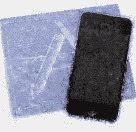

### iOS 模拟器

iOS 模拟器应用让我们可以直接在 Mac 上运行、调试、测试和分析代码。尽管模拟器永远无法取代在真机上的测试，但它有很多优势。例如，开发者可以在加入 iOS 开发者计划之前就开始使用模拟器。在模拟器中运行快速测试也更容易、更快捷，让我们在为应用添加新功能时，能够快速执行开发/测试/迭代循环。


### Instruments

作为 Apple 顶级的性能分析工具，Instruments 让我们能够动态跟踪和分析在模拟器或 iOS 设备上直接运行的代码。它可以跟踪和记录从对象分配、基于时间的采样到文件访问和能源消耗等一切信息。它还提供了筛选和分析所生成数据所需的工具。在经验丰富的开发人员手中，Instruments 可以帮助我们修复错误并打磨代码。

## 1 你好，iPhone

在精通任何技能之前，你都必须先熟悉工具。在本章中，我们将学习如何使用 iOS 应用程序的主要开发工具 Xcode。我们将首先使用 Xcode 从 Utility Application 项目模板创建一个新项目。然后检查该模板生成的文件，研究典型 iOS 应用的各个不同部分是如何组合在一起的。熟悉模板之后，我们将对其进行扩展，使用 Xcode 的图形界面编辑器添加控件，并绘制这些控件与其动作之间的连接。这个练习将为处理后续章节中更复杂的项目奠定坚实的基础。

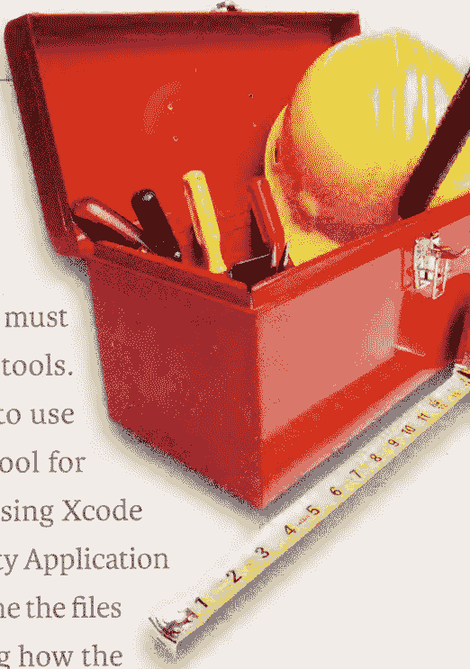


最终，苹果为我们提供了一套高质量的开发工具。Xcode 4 相比之前的版本有了显著的改进。它是一个功能完备的集成开发环境，提供了用于测试、分析和调试代码的各种实用工具。特别是 Instruments 工具，可以监控和分析 CPU 使用率、内存分配、网络和文件访问等众多信息。

苹果还提供了一流编程语言以及一套出色的框架。我知道，我知道……很多新的 iOS 程序员对学习 Objective-C 望而却步，我承认它的学习曲线确实相当陡峭，尤其是当你在起步阶段挣扎的时候。不过，一旦你开始熟悉这门语言，你很快就会爱上它。况且，学习一门新的编程语言总是有益的。它会让你成为更优秀的开发者，即使你永远不会在生产代码中使用它。

Objective-C 是一门动态的、极其灵活的编程语言。它提供了许多特性，如果使用得当，能帮助你克服许多困难的编程挑战。同样，iOS 软件开发工具包（SDK）也提供了大量优秀的框架来帮助我们构建应用。

框架是最难设计的软件部分之一。理想情况下，它们应该让开发者能够轻松完成常见任务，同时仍然给予我们足够的自由去探索未知领域。按这些标准来衡量，Cocoa Touch 框架是我用过的最好的一批框架。实际上，如果你觉得连完成一个常见任务都需要编写大量代码，那你几乎肯定做错了什么。

我希望这本书能为你提供一个温和的 iOS 开发世界入门指引。虽然不可能涵盖每个方面或探索每个框架，但本书应该能为你打下坚实的基础，并给予你独立继续深入所需的工具和技能。

此外，虽然本书大部分内容专注于 iPhone 开发，但其中的概念和技术通常适用于任何 iOS 设备：iPod touch、iPad，以及未来的各种 i 设备。具体差异会在出现时予以说明。尤其是 iPad，它有一些独特的用户界面元素，而 iPad 特有的开发问题将在本书网站（www.freelancemadscience.com/book）的附录 A 中深入探讨。

现在，让我们直接开始第一个项目吧。首先，我们来构建一个 iPhone 工具应用，它将显示一条简单的一行消息。如果你第一次看不懂代码，不用担心。我们会在第 2 章“Objective-C”中更深入地介绍 Objective-C 编程语言。现在，把它当作一个熟悉开发环境的机会。

### 入门

问问任何一位工匠——如果你想成功，就必须有合适的工具。对于 iOS 开发来说，这意味着需要一台运行 OS X 10.7 或更高版本的 Macintosh 电脑，以及一份 Xcode 4.2。如果你想在真实的 iOS 设备上运行程序，你还需要一台兼容的设备（iPhone、iPod touch 或 iPad）以及相应的开发者/配置描述文件。我们将在第 3 章“生产力应用架构”中详细讨论配置描述文件。现在，先从 Mac App Store 下载最新版本的 Xcode 吧。对于任何运行 OS X Lion 的用户来说，这都是免费下载，而且这也是让你的所有开发工具保持最新的最简单方法。

你最终需要加入 iOS 开发者计划，才能在 iOS 设备上测试你的应用，或将它们提交到 iTunes App Store。目前，我们可以使用 Xcode 在模拟器中构建和测试应用。这是开始学习的好方法。

Xcode 是一个集成开发环境（IDE），专为 Mac OS X 和 iOS 编程而设计。顾名思义，IDE 不仅仅是一个文本编辑器。它是一套相互关联的工具，帮助你组织、编辑、调试以及管理最终程序中所需的所有资源。通过 Xcode，你可以可视化地设计用户界面，在 iOS 模拟器中测试运行程序，逐条命令地单步调试代码，分析应用的性能等等。

> **注意：** 本书中的项目是使用 Xcode 4.2 和 iOS SDK 5.0 开发的。后来的版本无疑会与书中所示内容有所不同。菜单选项和项目模板可能会发生变化。更少见的是，SDK 的更新可能会影响项目编译和运行的方式。如果你使用的是更新版本的 Xcode 或 SDK，一切应该仍然可以正常工作，但请准备好自己做一些探索和研究。

下载并安装完 Xcode（将近 4 GB，这需要一点耐心）后，启动它，让我们开始吧。

### 创建项目

在工作区打开后，创建一个新项目。在 Xcode 中，选择“文件”>“新建”>“新建项目”。这将打开项目模板表（图 1.2）。Xcode 为新项目提供了各种各样的模板。在左栏中，选择 iOS > Application。然后，选择 Utility Application 图标，点击“下一步”。

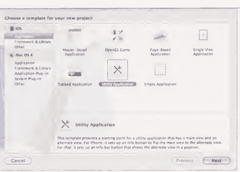

**图 1.2** 选择 iOS 工具应用模板

现在，我们来选择项目的选项（图 1.3）。在 Product Name 字段中输入 **Hello World**。Company identifier 应该是一个能标识你公司的唯一字符串。在大多数情况下，我们会使用公司的域名，并将域名级别倒序排列。从顶级域名开始，依次到二级、三级域名。例如，我会使用我博客的反向域名：com.freelancemadscience。

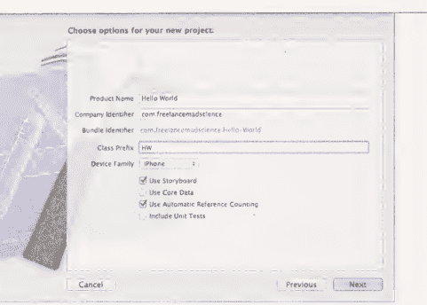

**图 1.3** 选择项目选项

接下来是类前缀。这个前缀会自动添加到模板生成的所有类名中。你可以使用任何你喜欢的前缀。只需尽量让它唯一（例如，避免使用 NS 或 UI，因为它们已被苹果的框架使用）。通常，我会选择基于项目名称的缩写。在这种情况下，输入 **HW**。

**注意：** 如果你在编写框架或库，你应该为所有类添加前缀。这可以让其他开发者使用你的代码时不必担心可能的命名冲突。它也让识别类的来源变得更容易。例如，所有以“RGS”开头的类都来自我的 ReallyGreatStuff 框架。然而，如果你只是编写一个应用，前缀并不是必需的，而且我发现它们往往会让代码更难阅读。不过，我仍然经常让 Xcode 为自动生成的文件添加前缀，只是为了便于将它们与我们手工编写的类区分开来。


工具应用应提供对单屏信息的便捷访问，并带有一个用于修改偏好的背面视图。iPhone 的天气应用就是一个典型的例子。主屏幕显示未来一周的简单天气预报（尽管你可以翻页查看多个城市）。翻转视图则允许你编辑城市列表，以及在华氏度和摄氏度之间切换。

Utility Application 模板为这类应用创建了基本骨架。该模板本身就是一个功能完整的应用——它可以编译并运行。当然，它不会做任何有趣的事情，但我们稍后会解决这个问题。现在，让我们看看我们免费获得了什么。

### 运行应用

首先，我们需要告诉 Xcode 使用模拟器。点击 Xcode 工具栏中的 Scheme（方案）按钮，选择 iPhone 5.0 Simulator（图 1.5）。然后点击 Run（运行）按钮。Xcode 将构建应用并在模拟器中启动它。

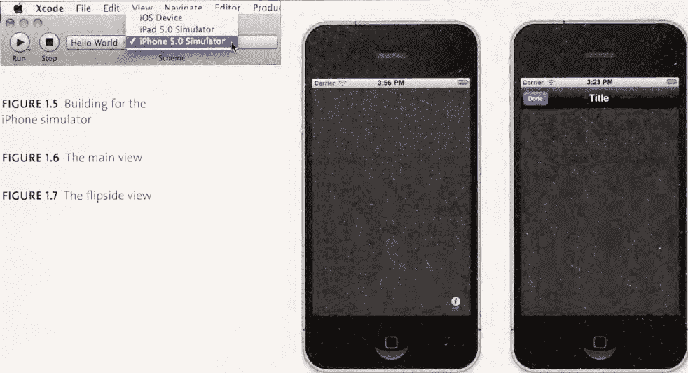

**图 1.5** 为 iPhone 模拟器构建

如你所见，应用有一个灰色主视图，右下角有一个信息按钮（图 1.6）。如果你点击信息按钮，屏幕会翻转过来，显示带有标题栏和蓝色 Done（完成）按钮的翻转视图（图 1.7）。点击 Done 按钮，你就会翻回主视图。

**图 1.6** 主视图

**图 1.7** 翻转视图


Supporting Files 子组包含各种辅助文件。最初，该组包含应用程序的 Hello World-Info.plist、InfoPlist.strings、main.m 和 Prefix.pch 文件。

Hello World-Info.plist 文件包含许多用于配置应用程序的键值对。InfoPlist.strings 文件包含 Hello World-Info.plist 文件键的本地化版本。这在本地化应用程序时会很有用，不过该文件最初是空的。main.m 文件包含 main() 函数，即应用程序启动时执行的初始函数。Prefix.pch 文件是应用程序的预编译头文件。

为了帮助大型项目更快地编译，Xcode 允许我们创建一个预编译前缀头文件，其中包含我们大部分代码中常见的许多 #import、#include 和 #define 指令。例如，在一个典型的 iOS 项目中，大多数类都需要访问 UIKit 和 Foundation 框架。通过在前缀头文件中包含这些框架的 #import 语句，Xcode 会预处理这些文件，并将结果包含在我们所有的源文件中。这样可以防止编译器在每次构建时多次处理公共文件。

这可能现在看起来不太容易理解，但没关系。我们在这个项目中不会去改动 Prefix.pch 文件。想了解更多信息，请查看 Apple 的文档：《Xcode Build System Guidelines》、《Reducing Build Times》和《Using a Precompiled Prefix Header》。

最后，Frameworks 组包含此项目使用的所有 iOS 框架，而 Products 组包含最终结果——在本例中，即我们编译后的应用程序。同样，我们在本项目中也不会涉及这些内容。

**注意：** 与 Xcode 的工作区非常相似，导航器中的组代表一种虚拟组织——它们只存在于 Xcode 内部。这些组与实际资源的存储方式或存储位置，甚至与它们包含的文件类型，都不一定有直接关系。你可以将任何资源放在任何组中，也可以根据需要添加或删除组或子组。


### 浏览项目

当我最初开始编写 Cocoa 应用程序时，我并不真正理解应用程序的各个部分是如何组合在一起的。当然，我理解各个独立的部分。我有一个视图和一个视图控制器。它们协同工作来管理用户界面。但即便如此，其中许多对象似乎都是在运行时神奇地出现的。我完全不知道它们从何而来。

让我向你保证，这里并没有任何超自然的事情发生。我已经确认过了。不过，还是值得花几分钟时间梳理一下所有这些连接，看看究竟是怎么回事。不用担心记住所有细节。相反，要把注意力集中在我们如何从一个对象追踪到下一个对象的连接上。这样一来，你以后也能在自己的应用程序中进行同样的追踪。

让我们从应用程序启动的地方开始。在导航器中点击 main.m（如果该文件还不可见，你可能需要展开 Supporting Files 组）。这个文件实际上非常短。它导入了 UIKit 和我们的应用程序委托，然后定义了 main() 函数。

```objective-c
#import <UIKit/UIKit.h>

#import "HWAppDelegate.h"

int main(int argc, char *argv[])
{
    @autoreleasepool {
        return UIApplicationMain(argc, argv, nil,
            NSStringFromClass([HWAppDelegate class]));
    }
}
```

基本上，这会创建一个自动释放块。在这个块内部，我们启动 Objective-C 应用程序。我们将在第 2 章的“内存管理”一节中讨论自动释放块。

真正的工作发生在 UIApplicationMain() 函数中。这个函数接收四个参数。前两个处理我们应用程序的命令行参数：argc 给出参数的数量，而 argv 以 C 风格字符串数组的形式包含实际参数。这些参数在很大程度上是 Unix 命令行应用程序的遗留物。在 iOS 中，我们的应用通常具有

在 Xcode 4 中，Interface Builder 被整合到了 Xcode 本身中。这使我们能够并排编辑界面和任何相关代码。借助 iOS 5，storyboard 允许我们封装多个 nib，这样我们不仅可以定义单个场景的信息，还可以绘制场景之间的过渡。

正如你将在本章其余部分看到的，我们的 storyboard 包含的远不止视图和控件。它们还包含控制器对象，以及各个控件、视图和控制器之间的连接。在本章稍后的“修改模板”一节中，我们将在扩展 Hello World 应用程序时获得绘制这些连接的经验。此外，我们将在第 3 章的侧边栏“nib 的秘密生活”中更详细地讨论 nib——storyboard 背后的基础技术。

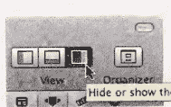

**图 1.10** 启用 Utilities 区域

> **注意：** 最初，Interface Builder 将 nib 存档保存为二进制文件，扩展名为 .nib。从 Xcode 3.0 开始，Interface Builder 允许将 nib 文件存储为带有 .xib 扩展名的中间 XML 格式。这样可以与源代码控制和其他开发工具实现更好的兼容性。构建应用程序时，.xib 文件会被编译成二进制 .nib 文件。为简单起见，这两种版本通常都称为“nib 文件”。在 Xcode 4.2 中，storyboard 也存储为带有 .storyboard 扩展名的 XML 文件。这些文件会被自动编译成一个或多个 nib 文件。然后，系统会在运行时按需加载这些 nib。

UIApplicationMain() 如何知道该打开哪个 storyboard 文件？正如我们前面看到的，主 storyboard 的名称存储在我们的配置文件中。点击 Supporting Files 组中的 Hello World-Info.plist。你应该会看到一系列键值对。找到 Main storyboard file base name 键。它应该设置为 MainStoryboard。这意味着 UIApplicationMain() 将自动加载 MainStoryboard.storyboard 文件。

让我们打开这个文件。在 Project 导航器中点击 MainStoryboard.storyboard。这将在 Xcode 的编辑器区域中打开 storyboard 文件。你可能希望关闭导航器区域，以便为编辑器腾出尽可能多的空间。你还需要确保屏幕右侧的 Utilities 区域处于打开状态。确保 Utilities 区域的 View 按钮处于按下状态（图 1.10）。

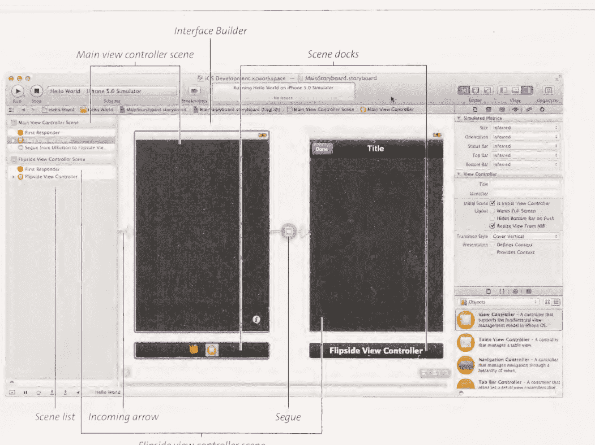

**图 1.11** Storyboard 编辑器

Storyboard 编辑器由两个独立的区域组成。左侧是我们的场景列表。它向我们展示 storyboard 中的所有场景，以及每个场景中的每个对象。右侧是 Interface Builder。我们可以在这里查看和设计场景的实际用户界面，以及场景之间的控制流（图 1.11）。

我们的项目一开始有两个场景。如果你查看场景列表，会看到每个场景至少有两个顶层对象：第一响应者和场景的视图控制器。我们先从第一响应者说起。从很多方面来看，这是一个非常特殊的对象。或者更确切地说，它根本不是对象——它是一个代理。系统永远不会创建第一响应者的实例。相反，它会在运行时设置第一响应者。

初始场景出现在 Interface Builder 区域中，并带有一个指向它的传入箭头。与 segue 和其他关系不同，这个箭头的另一端没有场景。默认情况下，传入箭头从 Interface Builder 的左边缘开始。初始场景是第一个场景，其他场景则随着我们向右移动而分支出去。

我们可以通过选择不同的视图控制器并选中其“Is Initial View Controller”属性来更改初始场景。同一时间只能有一个视图控制器启用此属性。如果你在新的视图控制器中启用它，Interface Builder 将自动为旧控制器禁用它。

在我们的例子中，主视图控制器场景就是我们的初始场景。这正是我们想要的。确保我们将主场景放大。双击背景可以在整个 storyboard 的概览和实际大小视图之间切换缩放。

让我们从点击主场景中的每个对象并检查其类开始。在检查器选择栏中，确保选中 Identity 检查器（Utilities 区域顶部左侧起第三个图标）。然后点击主视图控制器。不出所料，它是 HWMainViewController 类的一个实例（图 1.12）。

当我们检查其余对象时，你会看到我们的视图是一个通用的 UIView。在它里面，有一个 UIButton（右下角的 info 按钮）。最后，segue 在 Identity 检查器中不显示任何信息。

继续看 flipside 视图控制器场景，里面有一个 HWFlipsideViewController。在这个场景中，还有另一个 UIView；不过，在这个视图的顶部有一个 UINavigationBar，带有一个 UINavigationItem。其中包含我们的 Done 按钮——一个 UIBarButtonItem。

现在切换到 Connections 检查器（Utilities 区域顶部最右侧的图标）。这让我们可以查看和编辑对象之间的连接。虽然它看起来可能有点复杂，但该检查器只显示五种连接类型：outlet、action、事件、segue 和关系。

前三种用于定义单个场景内的连接。Outlet 是可以存储指向对象指针的变量。它们定义了对象图中对象之间的关系。另一方面，action 是我们可以连接到事件的方法。当事件发生时，系统会自动调用其对应的 action。控件定义了一组用户与控件交互时发生的常见事件。


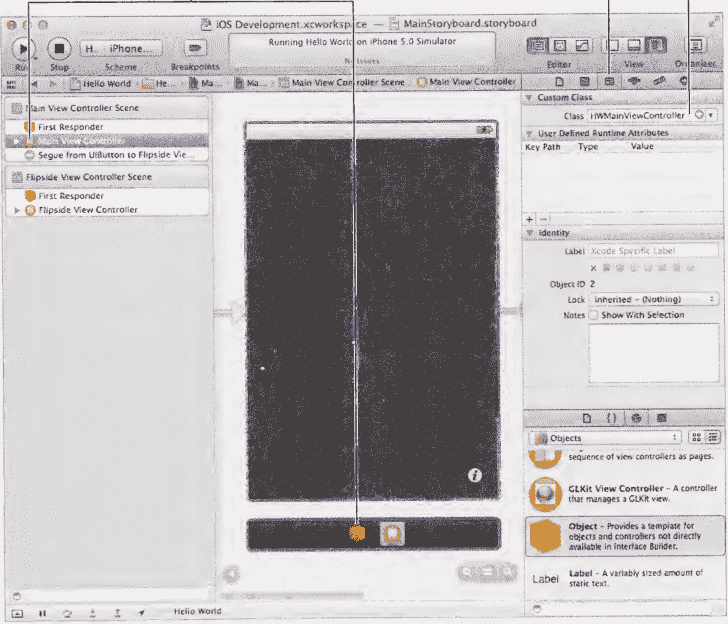

**图 1.12** 检查主视图控制器的类

接下来，segue（转场）和关系（relationships）定义了场景之间的连接。Segue 充当过渡。当应用触发一个 segue 时，它会使用指定的动画过渡到下一个场景。关系看起来很像 segue，但它们用于表示从属关系。容器控制器（如标签视图控制器）将使用关系连接到它们所管理的视图。

如果我们查看主视图控制器，可以看到它有一个指向所包含视图对象的视图插座变量（view outlet）。这意味着我们可以在控制器的代码中引用这个视图对象。我们还有一个来自反面视图控制器（flipside view controller）的引用插座变量。这仅表示反面视图控制器有一个指向主视图控制器的插座变量——我们稍后会看到（图 1.13）。这个场景中只有一个其他连接。点击 info 按钮；正如你所见，它有一个模态 storyboard segue，将其 `performSegueWithIdentifier:sender:` 方法连接到反面视图控制器。每当我们的 info 按钮被按下时，系统会自动调用该方法，触发到反面视图的 segue。

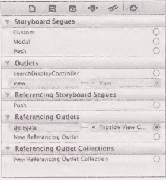

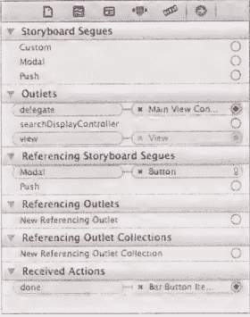

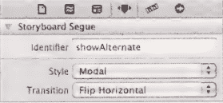

**图 1.13** 主视图控制器的连接

**图 1.14** 反面视图控制器的连接

**图 1.15** 检查 segue 的属性

现在让我们看看反面视图控制器（**图 1.14**）。正如我们之前看到的，我们有一个指向主视图控制器的委托插座变量（delegate outlet）。这允许我们的反面视图控制器调用主视图控制器上的方法。具体来说，由于主视图控制器是反面视图控制器的委托，反面视图将期望主视图实现特定的方法来修改或控制反面视图的行为。反面视图控制器还有第二个插座变量，将其连接到它的视图。你可能已经猜到，这是一种通用模式。所有视图控制器都有一个连接到其视图的插座变量。

反面视图控制器还有两个传入连接。一个是我们在之前看到的 info 按钮的 segue。另一个表示来自 Done（完成）按钮的传入动作。我们稍后会看到这一点。

这个场景中只有另外两个连接。导航项在其 leftBarButtonItem 插座变量中引用了 Done 按钮。这会将栏按钮正确定位在导航栏中。此外，我们看到了从 Done 按钮到反面视图控制器的 done: 方法的动作连接。当按下 Done 按钮时，将调用此方法。

最后，选择 Attributes 检查器（从右数第三个图标），然后选择该 segue。这会显示我们 segue 的详细信息（**图 1.15**）。Identifier 字段允许我们在代码中标识这个 segue。Style 弹出菜单允许我们定义新视图的显示方式，而 Transition 弹出菜单允许我们定义从一个视图移动到下一个视图时使用的动画序列。在我们的例子中，这个 segue 名为 showAlternate。我们将以模态视图的方式呈现新场景，将旧视图水平翻转过来，在其背面显示新视图。

在大多数图形用户界面中，模态视图是一种必须先被关闭（通常通过点击确定或取消按钮）的视图，之后用户才能在应用中执行任何其他操作。这迫使用户专注于模态视图内的内容——他们必须先处理完其中的内容，然后才能继续。在桌面应用中，我们通常使用模态视图来显示诸如“保存”或“打印”对话框。在 iPhone 上，模态视图覆盖整个屏幕（不过 iPad 有更多额外的选项）。

那么，这一切意味着什么呢？我们正在追踪应用中的对象是如何创建的。UIApplicationMain() 方法创建了 UIApplication 和我们的 HWAppDelegate 类的一个实例。

接下来，UIApplicationMain() 在我们的应用的 info.plist 文件中查找主 storyboard。然后，它加载 storyboard 的初始场景，在我们的应用窗口中显示主视图控制器的视图。然后，我们的应用就可以接受用户输入了。

如果用户触摸 info 按钮，我们的 segue 就会启动。这会加载反面视图控制器，并将其显示为模态视图。当用户按下 Done 按钮时，它会调用反面视图控制器的 done: 动作。我们知道这会关闭反面视图，但我们还不知道这是如何工作的。要了解这一点，我们必须检查应用的代码。

### 检查代码

虽然 storyboard 让我们对应用有了一个很好的整体了解，但要真正理解它，我们需要深入研究代码。如果现在还不能完全理解，不用担心，我们将在第 2 章更详细地讲解 Objective-C。现在我们只是想了解各个事物是什么以及它们的作用。

让我们从 HWAppDelegate.h 开始。它声明了 HWAppDelegate 类的接口。你不会在这里发现任何非常令人惊讶的东西。HWAppDelegate 实现了 UIApplicationDelegate 协议——这使其能够充当应用委托。

委托（delegate）是一个代表另一个对象行事或与其协调的对象。委托通常充当主要的委派对象的助手。主对象将响应指定事件调用委托上预定义的方法。然后，委托使用这些方法来监视和控制委派对象。这使我们能够在不改变对象本身的情况下改变委派对象的行为。

我们还声明了 window 属性。当我们的应用加载 storyboard 时，它会实例化一个窗口对象并将其赋值给此属性。通常，iOS 应用有一个填满整个屏幕的窗口。这个窗口充当视图层次结构的根。它既创建了一个可以显示其他视图的空间，又将事件分发给适当的视图或子视图。

```objective-c
#import <UIKit/UIKit.h>

@interface HWAppDelegate : UIResponder <UIApplicationDelegate>

@property (strong, nonatomic) UIWindow *window;

@end
```

UIApplicationDelegate 协议定义了大量可选方法，我们可以实现这些方法来修改应用的行为。这些方法包括响应应用状态变化的方法，以及对本地、远程和系统通知的响应。你可以在开发文档中找到这些方法的完整列表。

在编辑器中点击 UIApplicationDelegate 一词，将在 Quick Help 检查器（Utilities 区域的上半部分）中显示该协议的简要描述。这种技术可以让我们快速了解任何类、方法或函数的描述。此外，Quick Help 检查器还包含指向其他资源的超链接。点击协议名称的超链接版本，Xcode 将打开开发文档中的完整描述。滚动到 Tasks 部分，即可查看方法的完整列表。

如果你打开 HWAppDelegate.m 文件，你会看到我们定义了其中几个方法——但它们都没有任何实际功能。目前，它们只是方法存根（stub）——占位符，等待我们填充细节。

```objective-c
#import "HWAppDelegate.h"

@implementation HWAppDelegate

@synthesize window = _window;

- (BOOL)application:(UIApplication *)application
didFinishLaunchingWithOptions:(NSDictionary *)launchOptions
{
    // Override point for customization after application launch.

- (void)applicationWillEnterForeground:(UIApplication *)application
{
    /*
     Called as part of the transition from the background to the
     inactive state; here you can undo many of the changes made
     on entering the background.
     */
}
- (void)applicationDidBecomeActive:(UIApplication *)application
{
    /*
     Restart any tasks that were paused (or not yet started) while
     the application was inactive. If the application was
     previously in the background, optionally refresh the user
     interface.
     */
}
- (void)applicationWillTerminate:(UIApplication *)application
{
    /*
     Called when the application is about to terminate.
     Save data if appropriate.
     See also applicationDidEnterBackground:.
     */
}
@end
```


这些方法响应我们应用状态的变化。当应用首次加载、变为活跃或不活跃、进入或退出后台，或准备终止时，它们会被调用。我们将在第 3 章的边栏“每个应用都应执行的任务”中更详细地讨论这些（以及其他的）方法。现在，请阅读这些方法存根中的注释。它们应该能让你对这些方法的预期用途有一个很好的了解。

接下来，看看 HWMainViewController.h。这个文件甚至比应用委托的接口声明还要简单。我们将类定义为 UIViewController 的子类。它还遵循一个自定义协议 HWFlipsideViewControllerDelegate。就这么简单。

```objc
#import "HWFlipsideViewController.h"
@interface HWMainViewController : UIViewController
<HWFlipsideViewControllerDelegate>
@end
```

通过选择 HWMainViewController.m 来查看实现。与应用委托非常类似，UIViewController 类有许多可以重写的方法来监控我们的视图。特别是，这包括任何名称中含有 will 或 did 的方法。will 方法在事件发生之前被调用，did 方法在事件发生之后被调用。

在开发者文档中查找 UIViewController 以查看完整列表（点击它打开快速帮助（Quick Help）检查器，然后点击名称链接打开完整描述）。如果你浏览这个文件，会看到其中包含许多这样的方法存根。大多数方法的默认实现不做任何事；它们只是调用父类的实现。

只有三个方法包含功能性代码：shouldAutorotateToInterfaceOrientation:、flipsideViewControllerDidFinish: 和 prepareForSegue:sender:。

```objc
- (BOOL)shouldAutorotateToInterfaceOrientation:
        (UIInterfaceOrientation)interfaceOrientation
{
        // Return YES for supported orientations.
        return (interfaceOrientation !=
                UIInterfaceOrientationPortraitUpsideDown);
}

#pragma mark - Flipside View

- (void)flipsideViewControllerDidFinish:
    (HWFlipsideViewController *)controller
{
    [self dismissModalViewControllerAnimated:YES];
}

- (void)prepareForSegue:(UIStoryboardSegue *)segue sender:(id)sender
{
    if ([[segue identifier] isEqualToString:@"showAlternate"]) {
        [[segue destinationViewController] setDelegate:self];
    }
}
```

我们按顺序来看这些方法。每当用户将设备旋转到新的方向时，shouldAutorotateToInterfaceOrientation: 方法就会被调用。如果它返回 YES，视图将自动旋转以匹配该方向。否则，视图将保持当前方向。当前的实现允许我们的主视图旋转到除倒置竖屏方向之外的任何方向（横屏向左、横屏向右和竖屏都可以）。

flipsideViewControllerDidFinish: 方法是背面视图控制器的委托方法。正如你可能从名称中猜到的那样，背面视图控制器在完成时会调用这个方法。我们当前的实现只是简单地关闭当前的模态视图。记住，当我们检查 segue 时，看到它把背面视图控制器显示为一个模态视图。因此，这个方法只是移除我们的背面视图，使用相同的过渡（水平翻转）返回到主视图。

最后，每当从当前场景触发 segue 时，就会调用 prepareForSegue:sender:。虽然实现看起来有点复杂，但它只是检查我们的 segue 的标识符是否与期望的值 showAlternate 匹配。如果匹配，我们就将主视图控制器指定为目标视图控制器的委托。

在 prepareForSegue:sender: 方法中执行任何操作之前，检查 segue 的标识符始终是一个好主意。目前并非严格必要。

我们只有一个 segue，所以知道标识符总会匹配。但检查标识符有助于让我们更好地应对未来的变化。我们不会仅仅因为添加了一个新的 segue 就突然出现奇怪的错误。

另外，如果你还记得，showAlternate segue 将我们的主视图控制器场景与背面视图控制器场景连接起来。这意味着目标 ViewController 将是我们的 HWFlipsideViewController。

于是，用户按下信息按钮，触发我们的 segue。系统实例化一个 HWFlipsideViewController 副本，然后调用 HWMainViewController 的 prepareForSegue:sender:。在这里，HWMainViewController 将自己指定为 HWFlipsideViewController 的委托。过渡发生，我们的视图水平翻转，露出背面视图。当背面视图完成时（我们稍后就会看到），背面视图控制器会在其委托 HWMainViewController 上调用 flipsideViewControllerDidFinish:。然后 HWMainViewController 关闭背面视图控制器，我们的视图翻转回来，再次露出主视图。

重要的是要认识到，这种模式展示了通过 segue 在场景之间传递数据的推荐方式。当把数据从源视图控制器传递给目标视图控制器时，我们重写源视图控制器的 prepareForSegue:sender: 方法并传递数据。要将数据传回，我们使源视图成为目标视图的委托，然后调用相应的委托方法。当然，这些方法需要在委托的协议中声明。我们接下来会看到 HWFlipsideViewControllerDelegate 的协议。

打开 HWFlipsideViewController.h。在这里，我们首先声明 HWFlipsideViewControllerDelegate 协议。该协议只有一个方法，即我们已经见过的 flipsideViewControllerDidFinish:。接下来，我们声明 HWFlipsideViewController 类本身。这个类也很简单，只包含两项：delegate 插座属性和 done: 动作。

我们之前已经见过这两个东西。我们刚刚讨论了与 HWMainViewController 相关的 delegate 属性，并且在探索故事板时看到了 done: 动作。它连接到导航栏中的 Done 按钮。按下该按钮将触发这个方法。

```objc
#import <UIKit/UIKit.h>

@class HWFlipsideViewController;

@protocol HWFlipsideViewControllerDelegate
```

### 修改模板

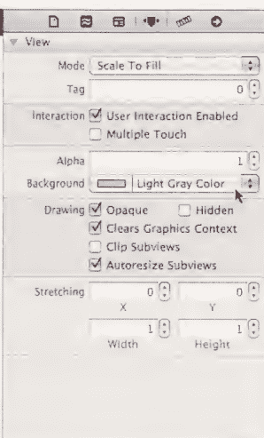

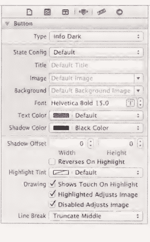

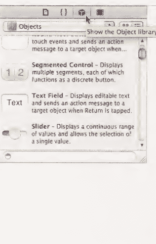

图 1.17 设置背景属性

图 1.18 设置类型属性

图 1.19 选择对象库

好了，闲话少说。让我们开始构建一些新东西。我们要在主视图上添加一个标签，用于显示一条短消息。我们还将在背面视图上添加一个文本框，让用户能够更改这条消息。那么，让我们开始吧。

#### 修改主视图

再次打开 MainStoryboard.storyboard，并放大主视图控制器场景。背景对我来说有点太暗。选择 View 对象，然后切换到属性检查器（Attributes inspector）。将背景（Background）属性改为浅灰色（图 1.17）。接下来，选择信息按钮，将其类型（Type）设置改为 Info Dark（信息深色）（图 1.18）。

现在我们需要添加一个标签。Xcode 让添加用户界面对象变得很容易。只需从库面板（Library pane）（工具区的下半部分）拖动所需对象，然后放到场景中。确保显示的是对象库（Object library）（库选择栏中从右数第二个立方体图标）（图 1.19），并滚动到 Label 对象可见。点击 Label 对象，将其从库面板拖到主视图控制器场景的视图上。

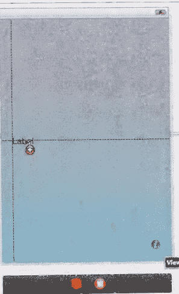

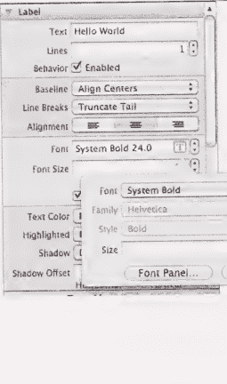

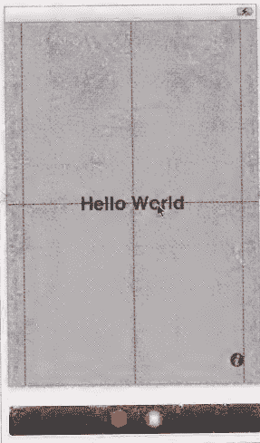

Xcode 会帮助你正确放置控件。当你在编辑区域拖动标签时，它会高亮并标注当前视图。它还会添加蓝色辅助线，帮助你正确定位对象。将标签拖动到垂直居中并与视图的左边距对齐，如**图 1.20** 所示。

**图 1.20** 将标签与视图的左边距对齐

当你释放标签时，它周围会出现八个蓝色圆点。你可以点击并拖动这些锚点来调整标签大小。抓住右侧并将其拉伸，直到碰到右边距辅助线。接下来，使其高度约为容器视图的一半。现在，保持标签仍处于选中状态，让我们更改它的外观。

**图 1.21** 设置标签的字体

打开属性检查器。在“对齐”（Alignment）属性中，点击居中文本按钮。然后点击“字体”（Font）属性文本框最右侧的 [T] 图标。这会打开一个弹出窗口。将字体设置改为系统粗体（System Bold），大小（Size）设置改为 24（**图 1.21**）。现在让我们更改文本本身。你可以修改标签的“文本”（Text）属性，也可以双击标签直接修改。将“Label”替换为**你好，世界**。

**图 1.22** 将标签居中

最后，点击并拖动标签，直到它在水平和垂直方向上都居中（如果无法移动标签，请尝试点击视图以清除选中状态，然后再次点击并拖动标签）。如果一切操作正确，左右边距辅助线也应该出现（**图 1.22**）。

运行应用程序。我们的更改应该出现在主视图上。


### 添加 Outlet

如果我们想在运行时更改标签的文本，就需要一种在代码中访问它的方式。最简单的方法是为视图控制器添加一个 outlet。在 Xcode 4.0 之前的时代，这意味着当我们手动修改代码时，需要在 Xcode 和 Interface Builder 之间来回切换。现在有一种更简单得多的方式。

首先，我们或许应该折叠场景列表。点击编辑器区域左下角的圆形灰色展开按钮。接下来，点击 Assistant Editor（助理编辑器）按钮（图 1.23）。

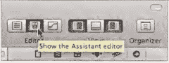

**图 1.23** Assistant Editor 按钮

这将并排显示两个编辑器区域。最左侧的区域包含所选文件，而最右侧的区域包含一个密切相关的文件。例如，如果你选择 HWMainViewController.h 头文件，则右侧编辑器应显示 HWMainViewController.m 实现文件。在我们的示例中，左侧编辑器显示故事板，右侧编辑器显示控制器的头文件（图 1.24）。

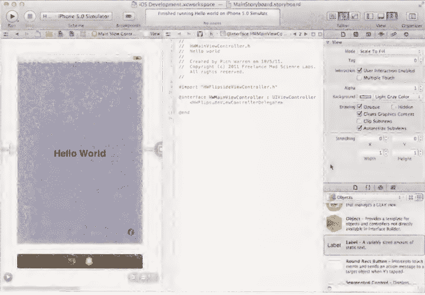

**图 1.24** 故事板与头文件的并排编辑

按住 Control 键单击标签，并将其拖到头文件中。你会看到一条从标签延伸到光标的蓝色线条。将光标放在 @end 指令的正上方，如图 1.25 所示，然后松开鼠标。

此时将出现一个弹出对话框，允许你配置该 outlet。确保 Connection 设置为 Outlet。在 Name 字段中输入 label。Type 应为 UILabel，Storage 应为 Strong（图 1.26）。点击 Connect 继续。

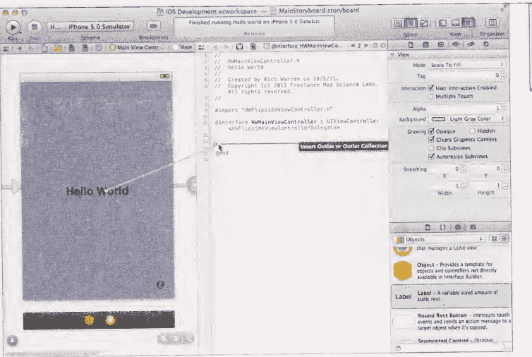

**图 1.25** 创建 Outlet

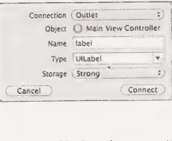

**图 1.26** 配置 Outlet

> **注意：** 尽管 Xcode 通常能够出色地自动选择正确的配套文件，但有时它可能无法正常工作，或者你可能想选择另一个文件。你可以在跳转栏中执行此操作。选择叶节点项将允许你基于相同的常规选择规则来选择备用文件。选择根节点项将允许你选择不同的选择规则。Xcode 提供了许多不同的、上下文相关的选择规则。如有必要，你也可以手动选择配套文件。

Xcode 将对 HWMainViewController.h、HWMainViewController.m 和 MainStoryboard.storyboard 进行若干更改。在头文件中，它声明了我们的标签属性。

```objc
#import "HWFlipsideViewController.h"

@interface HWMainViewController : UIViewController
<HWFlipsideViewControllerDelegate>

@property (strong, nonatomic) IBOutlet UILabel *label;

@end
```

在实现文件中，Xcode 会合成我们的属性，并在视图被卸载时将其设置为 nil。这有助于释放不需要的内存。

```objc
#import "HWMainViewController.h"
@implementation HWMainViewController

@synthesize label;

....

- (void)viewDidUnload
{
    [self setLabel:nil];
    [super viewDidUnload];

    // Release any retained subviews of the main view.
    // For example, self.myOutlet = nil;
}
```

在故事板文件中，Xcode 将标签与新创建的 outlet 连接起来。你可以使用 Connection inspector（连接检查器）查看此连接。或者，按住 Control 键单击 Main View Controller 图标，以调出 Connections 对话框（图 1.27）。

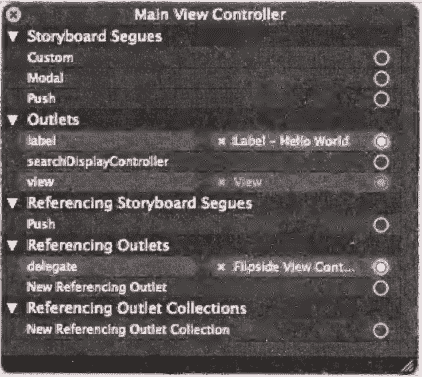

**图 1.27** Main View Controller 的连接

### 添加文本字段

开始的几个步骤几乎完全重复了我们对主视图所做的操作，只不过我们使用的是 Text Field（文本字段）控件，而不是 Label（标签）对象。确保 MainStoryboard.storyboard 已打开，并放大到 flipside 视图控制器。现在，从库面板中拖出一个 Text Field 控件。调整其大小，使其从一边到另一边填满视图。

这一次我们不需要更改高度或属性。只需按住 Control 键将文本字段拖到委托属性正上方的一点，即可为文本字段创建一个 outlet。将该 outlet 命名为 `labelText`。最后，将其放在 flipside 视图的上半部分；否则，它可能会被键盘遮挡。

每当我们想要更改标签的文本时，只需从 `labelText` outlet 获取文本值，并将其复制到我们的标签 outlet 中。最简单的解决方案是仅在用户关闭 flipside 视图时才更改标签。打开 `HWMainViewController.m`，找到 `flipsideViewControllerDidFinish:` 方法。

目前我们的文件不是很长。你或许只需浏览文件就能找到该方法。不过，使用编辑器的跳转栏通常会更容易（图 1.28）。

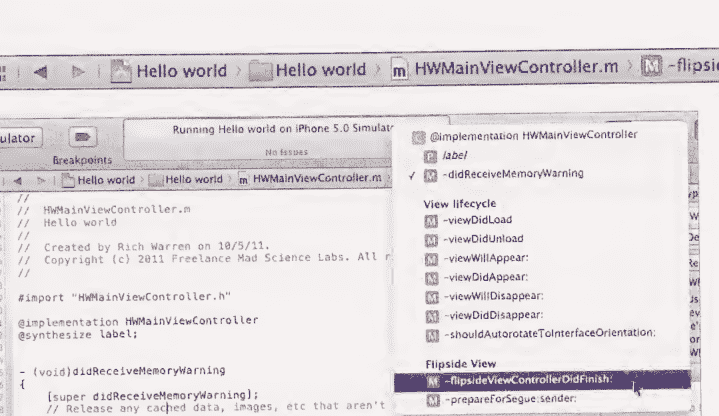

**图 1.28** 跳转栏

编辑器区域顶部横跨的栏显示了你正在编辑的项目。点击最右侧的项目，然后选择 `flipsideViewControllerDidFinish:` 方法（图 1.29）。编辑器将选中该方法并滚动，使其可见。


**图 1.29** 选择方法

现在，按如下所示修改 `flipsideViewControllerDidFinish:` 方法。

```objc
- (void)flipsideViewControllerDidFinish:
(HWFlipsideViewController *)controller
{
    self.label.text = controller.labelText.text;
    [self dismissModalViewControllerAnimated:YES];
}
```

正如我们之前所讨论的，这一行只是使用我们的 outlet 和属性，将文本值从 flipside 视图的文本字段复制到主视图的标签。

就这样。再次运行应用程序。启动时，它应显示默认的 Hello World 消息。点击 info 按钮，并在文本字段中输入新文本。点击 Done 按钮。标签现在应显示你的新文本。

### 优化界面

从功能上讲，一切正常，但它并不是世界上最精致（或者说最实用）的应用。让我们让它变得更好一点。当 flipside 视图出现时，让我们用标签的当前值填充文本字段。此外，当用户点击 Return 键时，让我们也顺便关闭 flipside 视图。

让我们从将主视图标签中的文本传递到 flipside 视图开始。理想情况下，我们希望在 `prepareForSegue:sender:` 方法中设置这个值。这应该是 `flipsideViewControllerDidFinish:` 中代码的逆操作；我们将主视图标签中的值直接复制到 flipside 视图的文本字段中。不幸的是，由于视图的加载方式，文本字段可能尚不存在。有几种方法可以解决这个问题。让我们向 `HWFlipsideViewController` 类添加一个属性，并用它来保存文本，直到我们确定视图已准备就绪。

打开 `HWFlipsideViewController.h`，并在其他属性之后添加以下行：

```objc
@property (nonatomic, strong) NSString* startingText;
```

### 安全地访问视图控制器的 Outlet

在这个示例中，我们必须等待系统完全加载视图之后，才能修改文本字段的内容。我们将在第 3 章和第 4 章更深入地讨论这一点。不过，简单的解释是：UIKit 在创建我们的视图控制器时并不会立即加载视图。相反，它会一直等到实际需要该视图时（通常是在系统将其显示到屏幕之前）才加载。虽然 UIKit 这样做是出于性能原因，但如果你不够小心，它可能会导致令人非常困惑的 bug。

通常，当你对视图控制器的 outlet 进行代码内更改时——尤其是使用 Interface Builder 分配的 outlet——就会出现这些 bug。当你运行应用程序时，代码会被触发，但更改似乎并未生效。

每当发生这种情况时，请仔细确认该 outlet 确实存在。它应该具有一个非 nil 值。如果没有，你就需要延迟配置代码，就像我们在这里所做的那样。

完成了一项改进，还有一项要做。再次打开助理编辑器，左侧为故事板，右侧为 HWFlipsideViewController.h。我们要将文本字段的 Did End On Exit 事件与控制器的 done: 方法连接起来。有多种绘制连接的方式。例如，我们可以按住 Control 键单击并从文本字段拖到 done: 方法。遗憾的是，这不允许我们选择事件，并且它会连接 Editing Did End 事件，而不是 Did End On Exit 事件。

相反，按住 Control 键单击文本字段，以调出 Connections 对话框。点击并拖动 Did End On Exit 事件右侧的圆圈到 done: 方法，如图 1.30 所示。

还有其他几种同样有效的替代方法。你可以按住 Control 键单击场景停靠区中的 HWFlipsideViewController 图标，然后从 done: 操作拖到文本字段。Xcode 随后会提示你选择正确的事件。你也可以使用实用工具区域中的 Connection inspector，而不是使用弹出对话框。这些方法大多等效。你可以随意尝试不同的方法，看看哪一种最适合你。


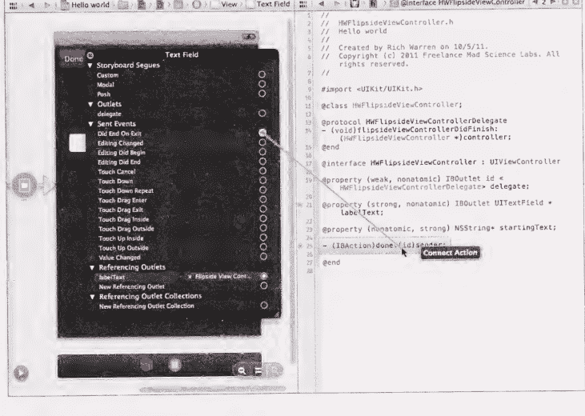

**图 1.30** 从“连接”对话框绘制连接

> **注意：** 每个事件只能连接到一个动作，但一个动作可以连接到多个事件。在本例中，我们将文本字段和“完成”按钮都连接到了 `done:` 动作。

趁此机会，让我们更改键盘“返回”键的外观。选择文本字段并打开“属性”检查器。将“返回键”属性设置为“完成”。虽然这不会改变键盘的功能，但有助于传达我们的意图。

您可能还想将“清除按钮”属性设置为“正在编辑时显示”。毕竟，使用退格键删除大量文本很快就会变得乏味。

就这样。运行应用程序。它应该如图 1.31 和图 1.32 所示。

**图 1.31** 完整的主视图

**图 1.32** 完整的反面视图

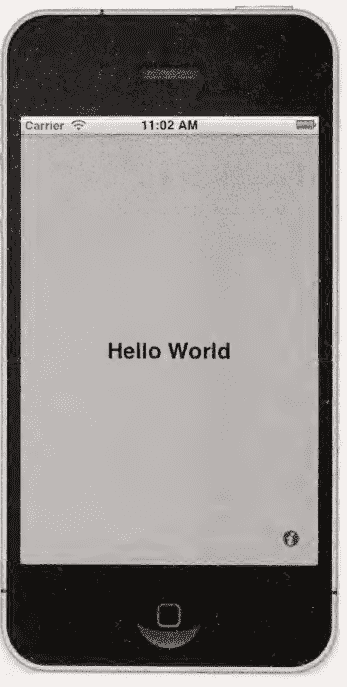

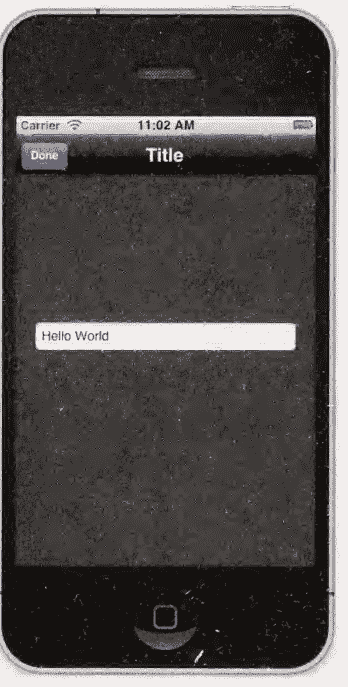

这就是我们 Hello World 应用的全部内容。在本章中，我们了解了 iOS 应用是如何拼凑在一起的。我们构建并修改了自己的（尽管极其简单的）应用，并获得了使用开发工具的实际经验。这应该能为您阅读本书其余部分提供一个很好的起点。

在第 2 章中，我们将深入探讨 Objective-C。我们将研究该语言中使用的不同构建块，以及整个 Cocoa Touch 中常见的一些设计模式。然后，在第 3 章中，我们将利用目前学到的所有知识，开始构建一个更复杂的真实应用程序。

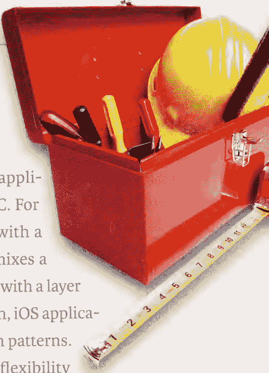

如果您想开发原生 iOS 应用，就必须学习 Objective-C。对许多人来说，这是一项令人生畏的任务，学习曲线陡峭。Objective-C 将多种 C 语言结构与一层面向对象设计混合在一起。此外，iOS 应用还利用了多种设计模式。虽然这些模式既提供了灵活性又提供了强大的功能，但它们常常使初学者感到困惑。

本章全面概述了成功开发 iOS 应用所需的 Objective-C 特性，并解释了驯服 Objective-C 更复杂方面的新技术。这将有助于将学习曲线降低为平缓的小颠簸。

Objective-C 是 C 语言的一个小巧、优雅的面向对象扩展。严格来说，它是 C 的超集。您可以在 Objective-C 项目中使用任何有效的 C 代码。这使得我们除了可以使用 Objective-C 和 C 框架之外，还可以访问众多第三方库。Objective-C 的许多对象语法都借鉴自 Smalltalk。Smalltalk 是最早的面向对象语言之一，其设计目标就是简单——既易于实现又易于学习。尽管年代久远，Smalltalk 至今仍是市场上最具创新性的编程语言之一。许多现代语言才刚刚重新发现最初在 Smalltalk 中开发的技术。而 Objective-C 从这一传统中获益良多：一个高度动态、极具表现力的基础，所有其他内容都构建于此之上。

作为一种动态语言，Objective-C 在运行时而非编译时绑定方法和参数。您无需知道对象的类。您可以向任何对象发送任何消息。这通常可以大大简化代码；但是，如果您向对象发送了它无法理解的消息，程序将在运行时崩溃。

幸运的是，Xcode 会警告您未声明的消息。此外，您可以为对象声明静态类型，这增强了编译器分析代码并产生警告的能力。Objective-C 也是一种高度自省的语言——它可以观察和修改自身。我们可以在运行时检查任何类，访问其方法、实例变量等。我们可以修改类，使用类别或扩展添加自己的方法，甚至在运行时动态重新定义方法。

最后，Objective-C——尤其是 Cocoa 和 Cocoa Touch 框架——利用了许多设计模式来减少代码不同部分之间的耦合。松散耦合的代码更易于修改和维护。对程序某一部分的更改不会影响代码的任何其他部分。然而，如果您不熟悉这些模式，它们可能会使代码难以理解。

这些模式包括：为程序使用模型-视图-控制器（MVC）框架；使用委托而非子类化；启用键值编码（KVC）以高度动态地访问对象的实例变量；使用键值观察（KVO）来监视这些变量的任何变化；以及为应用程序提供广泛的通知框架。

当您掌握 Objective-C 后，您会发现与 C++ 或 Java 等更传统的编程语言相比，通常可以用少得多的代码来解决复杂问题。我们可以更仔细地调整解决方案以适应问题，而不是试图将方钉敲入圆孔。

Apple 在设计 Cocoa Touch 框架和 Xcode 开发者工具时充分利用了这种灵活性。这些工具让常见任务无需大量重复的样板代码即可轻松完成，同时在必要时仍然可以打破常规进行工作。

本章其余部分将介绍 Objective-C 编程语言。它并非面面俱到；您完全可以写一整本关于 Objective-C 的书。事实上，已经有人写过了。您不妨去了解一下。或者阅读 Apple 文档中的《Objective-C 编程语言》。该指南提供了您可能需要的所有细节。而本章是“关键部分”版本，提供了足够的信息来帮助您入门，同时指出了许多关键特性和常见错误。

虽然不要求您有面向对象编程的经验，但我假设您对其他类 C 语言（例如 C、C++ 或 Java）有基本的了解。如果以下示例让您完全摸不着头脑，您可能需要在继续之前复习一下 C 语言技能。如果您能正确预测输出¹，那就没问题。

```c
#include <stdio.h>

int main (int argc, const char * argv[]) {

    int total = 0;
    int count = 0;
    for (int y = 0; y < 10; y++) {
        count++;
        total += y;
    }
    printf("Total = %d, Count = %d, Average = %1.1f",
           total,
           count,
           (float)total / (float)count);

    return 0;
}
```

1 正确答案是“Total = 45, Count = 10, Average = 4.5”。如果您能实际编译并运行该程序，还有加分。

来表示 ASCII 字符）。整数类型包括 BOOL、char、short、int、long 和 long long 数据类型。它们之间的主要区别在于用于表示每个值的位数。位数越多，可能值的范围越广——但数据占用的空间也越大。离散值也有有符号和无符号变体。这决定了数字的解读方式。有符号数据类型可以是正数和负数，而无符号数据类型始终为零或更大。

> **注意：** 数据类型的确切大小可能因所使用的编译器和目标平台而异。例如，int 值可能是 32 位或 64 位长。因此，您的程序不应假设每种数据类型的位数或最小值和最大值。相反，应使用 `sizeof()` 函数以及 `limits.h` 和 `float.h` 中定义的宏在运行时确定这些值。

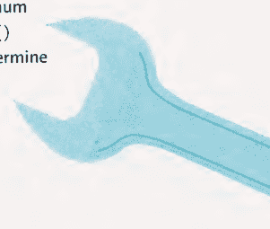

浮点值（float 和 double）用于近似表示连续数字——基本上就是任何带小数点的数字。这里我不会深入探讨浮点数的理论和实践——您可以在任何计算机科学入门书籍中找到所有令人头疼的细节。可以说，浮点数只是近似值。两个在纸面上相同的数学公式可能产生截然不同的结果。然而，除非您在进行科学计算，否则您可能只有在比较值时才会遇到问题。例如，您可能期望得到 3.274，但您的表达式返回 3.273999999999999。虽然这些值不相等，但它们通常足够接近。您看到的任何差异可能都是舍入误差的结果。因此，您通常需要检查您的值是否在给定范围内（3.2739 < x < 3.2741），而不是寻找严格相等。

C 有两种浮点值：float 和 double。顾名思义，double 的大小是 float 的两倍。额外的大小提高了其值的范围和精度。因此，人们总是倾向于使用 double 而不是 float。在某些编程语言中，这是习惯用法。我在 Java 中使用 float 的次数可能单手就能数得过来。然而，在 Objective-C 中，float 要常见得多。

事实上，尽管 C 数据类型种类繁多，我们通常只会使用 BOOL、int 和 float。然而，我们常常感觉使用了更广泛的数据类型，因为核心框架经常使用 typedef 来创建

`int` 和 `float`（偶尔还有其他数据类型）的替代名称。有时这样做是为了保持一致性，并提高跨平台的可移植性。例如，CGFloat 和 NSInteger 都被定义为其大小与目标处理器的整数大小（32 位或 64 位）相匹配。在其他条件相同的情况下，这些值对于该特定处理器来说应是最有效的数据类型。另外一些类型则是为了更好地表达其用途而定义，比如 NSTimeInterval。

你可以通过文档来了解这些类型是如何定义的。例如，在 Xcode 中，从“帮助”菜单选择“Documentation and API Reference”打开文档。你可能需要稍作查找，但你会找到在 Reference > Foundation Data Type Reference > NSTimeInterval 下对 NSTimeInterval 的描述。其实际定义如下：

```
typedef double NSTimeInterval;
```

如你所见，NSTimeInterval 只是 double 的别名。

**表 2.1** iOS 中常见的 C 数据类型

| 整数数据类型 | 位宽 | 有符号范围 | 无符号范围 |
| --- | ---: | --- | --- |
| BOOL | 8 位 | 不适用 | YES 或 NO |
| char | 8 位 | -128 到 127 | 0 到 255 |
| short | 16 位 | -32768 到 32767 | 0 到 65535 |
| int | 32 位 | -2147483648 到 2147483647 | 0 到 4294967295 |
| long | 32 位 | -2147483648 到 2147483647 | 0 到 4294967295 |
| long long | 64 位 | 约 -1E19 到 1E19 | 0 到 约 2E19 |
| NSInteger | 32 位 | -2147483648 到 2147483647 | 0 到 4294967295 |

| 浮点数据类型 | 位宽 | 最小值 | 最大值 | EPSILON |
| --- | ---: | ---: | ---: | ---: |
| float | 32 位 | 1.175494E-38 | 3.402823E+38 | 1.192093E-07 |
| double | 64 位 | 2.225074E-308 | 1.797693E+308 | 2.220446E-16 |
| CGFloat | 32 位 | 1.175494E-38 | 3.402823E+38 | 1.192093E-07 |

### C 数据结构

简单数据类型固然不错，但我们通常需要将数据组织成更复杂的结构。这些结构主要分为三类：指针、数组和结构体。

#### 指针

指针是最简单的结构——至少在概念上是这样。基本上，它是一个指向另一个值的内存地址的变量。这允许间接访问和修改这些值。

声明指针时，在类型声明和变量名之间放置一个星号。同样，在变量名之前使用星号可以解引用指针（设置或读取该地址空间中的值）。类似地，在普通变量前放置一个与号（&）可以得到该变量的地址。你甚至可以做些疯狂的事，比如创建指向指针的指针，以增加一层间接寻址。

```c
int a = 10;      // Creates the variable a.
int* b = &a;     // Creates the pointer, b, that points to the
                 // address of a.
*b = 15;         // Changes the value of variable a to 15.
int** c;         // Creates a pointer to a pointer to an int.
```

> **注意：** 当你声明一个指针时，编译器不会为底层的值请求内存空间，而只会请求足以存储内存地址的空间。你必须要么使用指针引用一个现有变量（如上面的示例所做的那样），要么在堆上手动管理其内存。在本章稍后讨论内存管理时，我们将更深入地探讨这个问题。

指针本身并不十分有趣；然而，它们构成了许多更复杂的数据结构的骨干。此外，虽然指针在概念上非常简单，但很难掌握。指针仍然是程序中 bug 的常见来源，而且这些 bug 往往很难发现和修复。对指针的完整描述超出了本章的范围。幸运的是，我们通常只在引用 Objective-C 对象时使用指针，而这些对象大多有自己独立的语法。

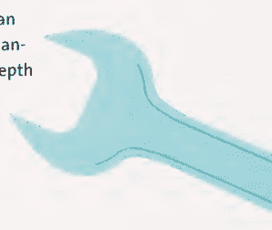

#### 数组

数组允许我们定义固定长度的值序列。所有这些值必须是相同的类型。例如，如果我们想要一个包含十个整数的列表，只需如下定义：

```
int integerList[10];    // Declares an array to hold ten integers.
```

然后，我们可以通过在方括号中放置所需的索引来访问列表中的各个成员。但请注意，数组的索引从 0 开始。第一项是 0，而不是 1。

```
integerList[0] = 150;     // Sets the first item in the array.
integerList[9] = -23;     // Sets the last item in the array.
int a = integerList[0];    // Sets a to 150.
```

我们还可以使用 C 语言的字面量数组语法来声明带有静态初始值集的短数组。所谓字面量数组，就是用一对花括号括起一个以逗号分隔的值列表。

```
int intList2[] = {15, 42, 9};    // Implicitly declares an array
                                   // to hold three integers,
                                   // then sets their values
                                   // using the literal array.
```

如该示例所示，我们甚至不需要定义 intList2 的长度。相反，它的大小会自动设置为与字面量数组相同。或者，你也可以显式设置 intList2 的大小，但它必须等于或大于字面量数组。

数组也用于表示 C 风格字符串。例如，如果你想在 C 语言中存储某人的名字，通常会将其存储为字符数组。

```
char firstName[255];
```

由于 C 风格字符串基于数组，因此它们具有固定大小。这导致了一个非常常见的 bug 来源。没错，254 个字符足以存储大多数人的名字，但最终你会遇到需要 255 个字符的客户端（更不用说国际字符集了）。

如这个例子所暗示的，字符串不需要占满整个数组，但它必须能放入分配的内存空间。实际上，数组的大小必须等于或大于字符串中的字符数 + 1。C 风格字符串总是以空字符结尾。

可以使用字符串字面量（即双引号内的任何内容）来给字符串赋值。C 会自动追加空字符。在这个例子中，s1 和 s2 是相同的。

```c
char s1[5] = "test";
char s2[5] = {'t', 'e', 's', 't', '\0'};
```

> **注意：** ‘A’ 和 “A” 是完全不同的数据类型。在 C 语言中，单引号用于表示 char 值。因此，‘A’ 是一个值为 65（大写字母 A 的 ASCII 值）的 char。另一方面，“A” 是一个值为 {‘A’, ‘\0’} 的 char 数组。


与指针类似，数组也会变得相当复杂——尤其是在将它们传入函数或从函数返回时，而且我们甚至还没有开始讨论多维数组和动态数组这类高级主题。幸运的是，除非你在调用 C 库，否则在 Objective-C 中我们几乎不会使用数组。相反，我们会使用 Objective-C 的集合类之一（NSArray、NSSet 或 NSDictionary）。对于字符串，我们将使用 NSString。

#### 结构体

结构体是 C 语言中最灵活的数据类型。数组允许我们声明相同类型的索引列表，而结构体则允许我们组合不同类型的数据，并使用命名字段访问这些数据。此外，与 C 风格数组不同，Cocoa Touch 大量使用 C 结构体。特别是，许多核心框架都是用纯 C 编写的，这使它们可以同时用于 Cocoa（Objective-C）和 Carbon（纯 C）项目（Carbon 是一项较老的技术，有时仍用于 Mac OS X 桌面上的应用程序）。

要查看一个典型的结构体，请在 Xcode 文档中查找 CGPoint。你会看到它的声明如下：

```
struct CGPoint {
    CGFloat x;
    CGFloat y;
};

typedef struct CGPoint CGPoint;
```

首先，框架创建了一个名为 CGPoint 的结构体。这个结构体有两个字段：x 和 y。在本例中，两个字段恰好都是相同的数据类型（CGFloat）。

接下来，我们使用 typedef 定义一个名为 CGPoint 的类型。这是 CGPoint 结构体的别名。这看起来可能有点奇怪，但实际上非常有用。如果没有 typedef，我们就必须在代码中反复以“struct CGPoint”来引用这个实体。而现在，我们可以省略 struct 关键字，像对待其他任何数据类型一样对待它。

按如下方式访问这些字段：

```
CGPoint pixelA;       // Creates the CGPoint variable.
pixelA.x = 23.5;     // Sets the x field.
pixelA.y = 32.6;     // Sets the y field.
int x = pixelA.x;    // Reads the value from the x field.
```

Apple 的框架通常同时提供数据结构以及一些用于操作它们的函数。文档会尽可能将相关的结构和方法归在一起。对于任何结构体类型，Apple 都提供了一个用于创建结构体的便捷方法、一个用于比较结构体的方法，以及用于对结构体执行常见操作的方法。对于 CGPoint，这些方法包括 CGPointMake()、CGPointEqualToPoint() 和 CGRectContainsPoint()。

随着结构体变得越来越复杂，这些方法也变得越发重要。以 CGRect 结构体为例。它同样只有两个字段：origin 和 size；然而，这些字段本身各自都是结构体。origin 是一个 CGPoint，而 size 是一个 CGSize。


以下代码展示了创建 CGRect 的三种不同方式。这三种方式在效果上是等价的。

```c
CGRect r1;
r1.origin.x = 5;
r1.origin.y = 10;
r1.size.width = 10;
r1.size.height = 20;
CGRect r2 = CGRectMake(5, 10, 10, 20);
CGRect r3 = {{5, 10}, {10, 20}};
```

特别要注意我们是如何使用结构体字面量创建 r3 的。从概念上讲，这些都很简单。每一对花括号都表示一个结构体（就像之前表示数组字面量的花括号一样）。括号内以逗号分隔的列表按声明顺序表示各个字段。

因此，外层花括号表示 CGRect 结构体。第一对内层花括号是 origin，第二对是 size。最后，我们才在两个内部结构中看到实际的字段。CGRect 本身还不算太复杂，但随着我们的结构体变得越来越复杂，字面量结构体的构造方式也会变得越来越难以理解。一般来说，我只对简单的数据结构和数组使用结构体字面量。相反，我会使用辅助函数（如 r2 所示）来快速创建结构体，而当需要更多灵活性时，我会使用直接赋值（如 r1 所示）。尽管如此，你肯定会在第三方代码中遇到结构体字面量的用法，所以你应该能够识别它们。

**注意：** 如果你正在使用自动引用计数（ARC）编译应用程序——在本书中，我们将对所有应用程序使用 ARC——你不能将 Objective-C 对象存储在结构体内部。相反，你需要使用 Objective-C 类来管理数据。这是我们为了启用自动内存管理而必须遵循的少数几个规则之一。本章稍后的“内存管理”部分会更详细地讨论这一点。


### 枚举

假设我们希望在代码中表示一周中的每一天。我们可以使用字符串并拼写出单词。虽然这种方法可行，但它有几个问题。首先，仅仅为了存储和比较日期，就需要额外的内存和计算开销。而且，字符串比较也很棘手。Saturday、saturday 和 SATURDAY 都表示同一天吗？如果你拼错了一个日期的名称怎么办？如果你输入了一个不对应任何有效日期的字符串怎么办？另一种替代方案是手动为每一天分配一个 unsigned char 值。在这个例子中，const 关键字告诉编译器，这些值在初始化之后不能被修改。

```c
const unsigned char SUNDAY = 0;
const unsigned char MONDAY = 1;
const unsigned char TUESDAY = 2;
const unsigned char WEDNESDAY = 3;
const unsigned char THURSDAY = 4;
const unsigned char FRIDAY = 5;
const unsigned char SATURDAY = 6;
const unsigned char HUMPDAY = WEDNESDAY;
```

这种方法可行，但无法将这一组日期作为一个整体来引用。例如，你不能指定一个函数的参数必须是“一周中的某一天”。这就引出了枚举。枚举提供了一种简洁、优雅的方式来定义一组离散的值。例如，我们一周中的每一天可以定义如下：

```c
typedef enum {
    SUNDAY,
    MONDAY,
    TUESDAY,
    WEDNESDAY,
    THURSDAY,
    FRIDAY,
    SATURDAY
} DAY;
const DAY HUMPDAY = WEDNESDAY;
```

就像之前的结构体示例一样，我们使用 typedef 来为枚举声明一个类型。在这个例子中，我们将枚举声明嵌套在 typedef 中。这两种写法都是完全合法的 C 代码。此外，我们也可以给枚举一个名称（例如 `typedef enum DAY { ... } DAY;`），但由于我们总是通过类型名称来访问它，这样做似乎有些多余。

现在，这与 unsigned char 的例子并不完全相同。枚举会占用稍多一点的内存。不过，它们确实节省了打字量。更重要的是，枚举能更好地表达我们的意图。当我们将 HUMPDAY 定义为 const unsigned char 时，我们只是在隐含地表示它的值应该介于 0 到 255 之间。而在枚举示例中，我们明确表示 HUMPDAY 只应被设置为我们的某个 DAY 常量。当然，没有什么能阻止你设置一个无效的值。

```c
const DAY HUMPDAY = 143;    // 虽然这段代码可以正常编译，
                            // 但它就是错误的。
```

从风格上讲，最好始终使用命名常量来为枚举类型赋值。而且，虽然编译器不会捕获赋值错误，但它可以在其他方面提供帮助——尤其是在将枚举与 switch 语句结合使用时。

默认情况下，枚举会将 0 分配给第一个常量，并且随着我们沿列表向下移动，值会依次加 1。或者，你也可以为一个或多个命名常量指定明确的值。你甚至可以将多个常量赋值为相同的值——使它们互为别名。

```c
typedef enum {
    BOLD = 1,
    ITALIC = 2,
    UNDERLINE = 4,
    ALL_CAPS = 8,
    SUBSCRIPT = 16,
    STRONG = BOLD
} STYLE;
```

具有该值的操作数，从而形成一个新表达式。随后继续求值，直到我们将表达式简化为一个单独的值。

```text
5 + 6 / 3 * (2 + 5)   // 初始表达式。
5 + 6 / 3 * 7         // 先对括号内的操作数求值。
5 + 2 * 7             // 当两个运算符具有相同的优先级时，
                      // 从左到右计算。
5 + 14                // 先执行乘法，再执行加法。
19                    // 最终值。
```

这里有一些经验法则：函数或方法参数内部的任何表达式，都会在函数调用或方法调用执行之前求值。类似地，数组下标中的任何表达式也会在查找值之前执行。函数调用、方法调用和数组索引都会先于大多数其他运算符发生。赋值则发生在大多数（但不是全部）其他运算符之后。下面给出了一些例子：

```text
a = 2 * max(2 + 5, 3);    // max() 返回其参数中的最大值。
                           // 变量 a 被设置为 14。
a[2 + 3] = (6 + 3) * (10 - 7); // 索引 5 处的值被设置为 27。
a = ((1 + 2) * (3 + 4)) > ((5 + 6) * (7 + 8)); // 变量 a 被设置为
                                                // false。
```

### 函数

函数是 C 编程语言中最主要的过程性工作载体。一个 C 程序在很大程度上由定义数据结构、然后编写函数来操作这些结构所组成。

我们通常会结合结构体来使用函数，尤其是在处理较底层的框架时。然而，你也会发现一些明确设计为与 Objective-C 对象配合使用的函数。事实上，我们在第 1 章中就看到过这样的函数：UIApplicationMain()。

与运算符不同，函数可以由程序员自行定义。这允许我们将一系列过程性步骤封装起来，以便这些步骤能被轻松地重复使用。

函数定义在实现文件（以 .m 结尾的文件名）中。它以函数签名为开头。这定义了函数的名称、返回值以及函数的参数。参数以逗号分隔的列表形式出现，并放在括号内。在列表中，每个参数声明一个数据类型和一个名称。

函数签名之后是一对花括号。我们可以在这些括号内放置任意数量的表达式。当函数被调用时，这些表达式会按它们出现的顺序依次执行。

```c
CGFloat calculateDistance(CGPoint p1, CGPoint p2) {

    CGFloat xDist = p1.x - p2.x;
    CGFloat yDist = p1.y - p2.y;

    // 使用勾股定理计算距离。
    return sqrt(xDist * xDist + yDist * yDist);
}
```

在上面的例子中，从左到右阅读：CGFloat 是返回值，calculateDistance 是函数名，CGPoint p1 和 CGPoint p2 是函数的两个参数。

在函数内部，我们首先创建了两个局部变量。这些变量存储在栈上，当方法返回时会自动被删除。我们将这两个点的 x 坐标和 y 坐标之间的差值赋给这些变量。

下一行是空行。编译器会忽略空白字符，因此应该利用空白来组织代码，使其更容易阅读和理解。然后我们有一条注释。编译器会忽略 // 之后直到行尾的所有内容。它也会忽略 /* 和 */ 之间的任何内容，这样我们就可以创建跨越多行的注释。

最后，我们到了 return 关键字。这会对它右边的表达式求值，然后退出函数，将表达式的值（如果有的话）返回给调用者。calculateDistance() 函数使用勾股定理计算两点之间的距离。这里我们使用乘法运算符对 x 和 y 的距离进行平方。我们将它们相加。然后把这个值传递给 C 数学库的 sqrt() 函数，并返回结果。


最后，在 C 语言中，你必须在使用函数之前定义它。大多数时候，我们只是将函数声明放在相应的头文件（以 `.h` 结尾的文件名）中。函数声明就是函数签名后跟一个分号。

```c
CGFloat calculateDistance(CGPoint p1, CGPoint p2);
```

然后，在应用程序中的任何其他地方使用该函数之前，我们可以导入这个头文件。

### 按值传递

在 C 语言中，所有函数都按值传递其参数。这意味着编译器会创建参数的本地副本。这些副本在函数内部使用，并在函数返回时从内存中移除。通常，这意味着你可以对本地副本做任何想做的事情，而原始值将保持不变。这是一件非常好的事情。看看下面的例子。

```c
void inner(int innerValue) {
    printf("innerValue = %d\n", innerValue);
    innerValue += 20;
    printf("innerValue = %d\n", innerValue);
}
void outer() {
    int outerValue = 10;
    printf("outerValue = %d\n", outerValue);
    inner(outerValue);
    printf("outerValue = %d\n", outerValue);
}
```

在这里，`printf()` 会用 `int` 值替换 `%d` 说明符。调用 `outer()` 会在控制台打印以下一系列消息：

```text
outerValue = 10
innerValue = 10
innerValue = 30
outerValue = 10
```

如你所见，当我们修改 `innerValue` 时，`outerValue` 的值并不会改变。然而，这只是故事的一半。考虑以下代码：

```c
void inner(int* innerPointer) {
    printf("innerValue = %d\n", *innerPointer);
    *innerPointer += 20;
    printf("innerValue = %d\n", *innerPointer);
}

void outer() {
    int buffer = 10;
    int* outerPointer = &buffer;
    printf("outerValue = %d\n", *outerPointer);
    inner(outerPointer);
    printf("outerValue = %d\n", *outerPointer);
}
```

表面上看，这与前面的代码非常相似。然而，其中有一些重要的区别。首先，我们创建了一个 `buffer` 变量并将其值设置为 10。然后我们创建了一个指向该 `buffer` 的指针，并将该指针传入 `inner()` 函数。接着，`inner()` 修改了其 `innerPointer` 参数所指向的值。这一次，我们得到以下输出：

```text
outerValue = 10
innerValue = 10
innerValue = 30
outerValue = 30
```

在这里，`innerValue` 和 `outerValue` 都发生了变化。我们仍然按值传递参数。但这一次，值就是 `buffer` 变量的地址。`inner()` 函数接收的是这个地址的副本——但该地址仍然指向内存中的同一份数据。当我们解引用指针（无论是修改它还是打印它的值）时，实际上是在访问 `buffer` 的值。

### 对象与类

当我们谈论对象时，通常会涉及两个不同的方面：类和对象本身。类是技术规范，它描述了对象将拥有的方法和实例变量。而对象则是类在内存中的实例化。你可以从同一个类创建多个对象——每个对象都拥有相同的特性集，但各自的值相互独立。在一个对象上设置实例变量或调用方法，不会影响同一个类的其他对象。

可以这样理解：类是蓝图，对象是房子。你可以用同一张蓝图建造几栋不同的房子。每栋房子都会有一个 `setThermostatToTemperature:` 方法；然而，在我的房子上调用 `setThermostatToTemperature:` 并不会影响你家的恒温器设置。

#### 对象

到目前为止，我们讨论的所有语言特性都来自 C。然而，随着对象的引入，我们告别了 C，进入了 Objective-C 的世界。

从表面上看，对象将结构体的数据管理与一组相关函数（尽管在这种情况下我们称它们为方法）结合在一起。在底层，它们的实现方式正是如此；然而，与普通的 C 代码相比，对象给了我们几个优势。

#### 封装

封装是面向对象代码的主要优势之一。对象应该隐藏其大部分复杂性，只暴露开发者有效使用它们所需的函数和值。

换句话说，对象就像黑盒一样工作。它们有一个公共接口，描述了所有可以从外部访问的方法和值。对象的实际实现可能包含任意数量的私有实例变量和方法；然而，要在代码中使用该对象，你不应该需要了解这些细节。

由于 Objective-C 是一种高度动态、反射式的编程语言，公共接口更像是一种建议，而不是严格的法律规则。你总是可以访问隐藏的实例变量和方法，但这样做会破坏封装。这很糟糕。当然，这可能会在短期内让事情变得更简单，但你很可能是在为长期的痛苦埋下伏笔。

在理想情况下，对象的接口应该保持静态不变。你可以随着时间添加新方法，但你不应该移除或修改任何现有方法。然而，内部细节则是可以随意更改的。对象的开发者可能会从一个构建版本到下一个构建版本彻底重新设计实现，只要你的其余代码仅通过接口与对象交互，一切就都会继续正常工作。

当然，我们生活在现实世界中，而且我们经常需要更改对象的接口，尤其是在早期开发阶段。如果你是唯一使用该对象的人，这没什么大不了的——但如果其他人依赖你的类，你就需要某种方式与他们协调这些更改。

例如，Apple 偶尔会将方法标记为已弃用。这些方法将继续正常运行；然而，开发者应该停止使用它们，因为它们会在未来的某个版本中消失。这给了开发者在这些更改生效之前重新设计应用程序的机会。

#### 继承

继承是面向对象代码的第二大主要优势。一个类可以继承另一个类的实例变量和方法——然后可以修改这些方法或添加新的方法和实例变量，以进一步特化新类。最重要的是，在可以使用超类的任何地方，我们仍然可以使用子类。

比方说，我们有一个名为 Vehicle 的类。它包含车辆的所有共同特征：允许你设置或获取驾驶员、乘客、货物、当前位置、目的地等的方法。你甚至可能有一些方法来查询车辆的能力：canOperateOnLand、canOperateOnWater、canFly、cruiseSpeed 等等。

然后我们可以创建都继承自 Vehicle 的子类——Boat、Airplane 和 Car。Boat 子类会重写 canOperateOnWater 方法以返回 YES。Airplane 则会类似地重写 canFly。

最后，我们可能让 Maserati 和 Yugo 成为 Car 的子类。Maserati 的巡航速度会返回 150 MPH，而 Yugo 的会返回 15 MPH（或者接近这个值，我敢肯定）。

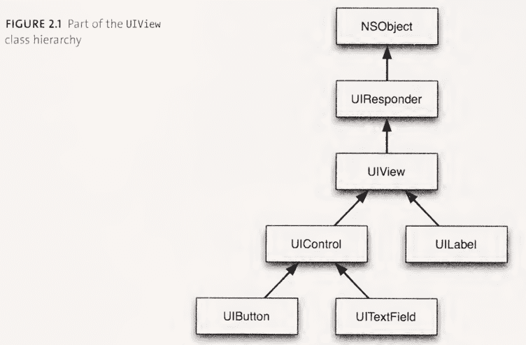

然后假设我们有一个使用车辆的函数：canVehicleReachLocationInTime(Vehicle* vehicle, Location* location, Time* deadline)。我们可以将 Boat、Airplane、Car、Maserati 或 Yugo 的任何实例传递给这个函数。类似地，我们可以将任何 Car、Maserati 或 Yugo 对象传递给 estimatedTimeToFinishIndy500(Car* sampleCar) 函数。

当与 Cocoa Touch 视图对象交互时，我们会频繁遇到继承和类层次结构（**图 2.1**）。UIView 继承自 UIResponder，而 UIResponder 继承自 NSObject。NSObject 是一个根类——几乎所有其他对象都继承自它。也有一些例外（例如 NSProxy），但这些是不常见的边缘情况。

NSObject 根类确保所有对象都拥有一组基本方法（内存管理、相等性测试、类成员资格测试等）。接下来，UIResponder 为响应运动和触摸事件的对象添加了一个接口，使它们能够参与响应者链。最后，UIView 添加了对在屏幕上管理和显示矩形区域的支持。

图 2.1 还展示了 UIView 的几个子类。如你所见，一些屏幕元素（如 UILabel）直接继承自 UIView。其他元素（UIButton 和 UITextField）继承自 UIControl，后者添加了为事件注册目标，以及在事件发生时调度操作消息的支持。


### 抽象类

在我们的示例类层次结构中，Vehicle、Boat、Airplane 和 Car 可能被实现为抽象类。抽象类是一种不能实例化为对象的类（或者至少是通常不会被实例化的类）。它通常会留下一个或多个未定义的方法。要使用抽象类，你首先需要创建一个完整定义所有必需方法的子类，然后就可以创建该子类的实例。

Objective-C 并不显式支持抽象类。不过，我们可以通过在未定义的方法中抛出异常来创建非正式的抽象类。可以查看 NSCoder 的文档，了解抽象类的实际应用。

让我们看一个具体例子。UIView 有一个名为 `addSubview:` 的方法，它允许你添加另一个 UIView 以显示在当前视图中。由于 UILabel、UIButton 和 UITextField 都（直接或间接）继承自 UIView，它们都可以通过 `addSubview:` 方法被添加。此外，它们也继承了 `addSubview:` 方法。理论上，你可以在按钮或文本字段上添加子视图（虽然很难想象这会有什么用处）。更实际的是，这些子类还继承了 UIView 的 `frame` 属性。这使你可以设置视图在父视图坐标系中的大小和位置。所有（直接或间接）继承自 UIView 的类都有 `frame` 属性。

### 浏览超类的方法

如果你查看 UIButton 的类参考文档，你不会找到任何关于 `frame` 属性的信息。这是因为类参考文档只显示该类自身声明的新方法。那么，如何找到所有继承的方法呢？

在类参考文档的最顶部，你会看到一行标记为“Inherits from”的内容。这里列出了完整的超类链，一直追溯到 NSObject。沿着继承链逐步回退，你就可以查看所有可用的方法和属性。

### 实例化对象

Objective-C 使用两步创建对象。首先，在堆上分配内存。接下来，用对象的初始值初始化该内存区域。第一步通过 `alloc` 类方法完成，第二步使用 `init` 或它的同类方法完成。

例如，下面这一行代码会创建一个空的 NSString 对象：

```
NSString* myString = [[NSString alloc] init];
```

这里有几个关键点值得注意。首先，我们将 NSString 变量声明为一个指针，它将指向堆上存储对象数据的内存地址。

稍后我们将看到，Objective-C 的方法使用方括号调用。在这里，我们将 `alloc` 方法嵌套在 `init` 方法中。这一点很重要，因为许多类都是通过类簇（class cluster）实现的。API 描述的是单个类，但实际实现使用了该类的两个或多个变体。不同版本会在不同情况下被创建和使用，通常是为了提高性能。然而，所有这些复杂性都对开发者隐藏了。

由于 `init`（及其同类方法）可能返回一个新对象，因此非常重要的一点是：你应该保存 `init` 返回的值，而不是 `alloc` 返回的值。将 `init` 和 `alloc` 方法嵌套使用可以确保你保存了正确的对象。

事实证明，NSString 实际上是一个类簇。我们可以将步骤拆开来理解：

```
// Create an empty string
NSString* allocString = [NSString alloc];
NSLog(@"allocString: pointer = %p, class = %@",
      allocString, allocString.class);
NSString* initString = [allocString init];
NSLog(@"initString: pointer = %p, class = %@",
      initString, initString.class);
```

NSLog() 的工作方式与 printf() 非常相似。第一个参数是一个 NSString 字面量。如前所述，双引号创建 C 风格字符串。在开头的双引号前加上 @，我们就能告诉编译器生成 NSString 而非 C 字符串。

接下来，NSLog 会扫描该字符串并查找占位符。在大多数情况下，这些占位符与 `printf()` 使用的相同。不过也有一些细微差别。例如，`%@` 用于显示对象。

基本上，这段代码在 `alloc` 和 `init` 之后都会把类的指针值和类名打印到控制台。如果运行这段代码，将会产生以下输出（请注意，实际的指针值无疑会变化）：

```
allocString: pointer = 0x4e032a0, class = NSPlaceholderString
initString: pointer = 0x1cb334, class = NSCFString
```

如你所见，调用 `init` 后，指针和类都发生了变化。此外，我们创建的 NSString 实际上是 NSCFString 子类的一个成员。

### 多种初始化方法

一个对象可能有多个初始化方法。NSString 就有好几个：`init`、`initWithString:`、`initWithFormat:`、`initWithContentsOfFile:encoding:error:` 等等。它们各自提供了设置字符串初始值的替代方式。完整列表可以在 NSString 的类参考文档中找到。

此外，NSString 还有一系列便捷方法——类方法，通常以 `string` 开头：`string`、`stringWithString:`、`stringWithFormat:`、`stringWithContentsOfFile:encoding:error:` 等。它们将分配和初始化步骤合并为单个方法。

虽然 `[NSString string]` 和 `[[NSString alloc] init]` 看起来相似，但系统在管理所生成对象的内存方面存在细微却显著的差异。过去，我们必须谨慎地正确使用每种方法。幸运的是，如果你使用 ARC 编译应用程序，这些差异就会消失，你可以自由选择最适合应用程序和编程风格的方法。

### 定义类

我们分两步定义类：接口（interface）和实现（implementation）。接口通常声明在类的头文件（文件名以 .h 结尾）中。这样，我们可以轻松地将类的声明导入到项目的任何其他部分。接口应定义有效使用该类所需的全部信息，包括公共方法（可从类外部调用的方法）、类的超类，以及可能的实例变量。

这看起来可能有点奇怪。毕竟，对象的主要用途之一是封装。实例变量难道不应该隐藏在实现内部吗？嗯，是的。在理想情况下确实如此。然而，早期版本的编译器需要这些信息来为任何子类布局内存。借助 Objective-C 2.0，我们可以使用属性绕开这个限制。当你为 iOS 或 Mac OS X 10.5 及更高版本的 64 位应用程序进行开发时，你可以自动为属性合成实例变量。我们将在下一节更详细地讨论属性。只需注意一点：接口中声明的实例变量可能并不能反映全部情况。

接口以 `@interface` 关键字开始，以 `@end` 结束。格式如下：

```
@interface ClassName : SuperClassName {

    // Declare instance variables here.

    // These are optional in iOS if properties are used.

}

// Declare public methods and properties here.
@end
```

应用程序中的每个类都需要唯一的类名。如果你正在构建一个会被其他项目使用的库，你应当为类名添加前缀，以确保它们不会与其他库和框架冲突。Apple 的框架遵循了这一建议，类名通常以 NS 或 UI 开头。

每个类有且仅有一个超类。除非你显式继承另一个类，否则通常使用 NSObject。实例变量定义在花括号中，实例方法定义在花括号之后。

实际代码存储在实现文件（文件名以 .m 结尾）中。与接口一样，实现以 `@implementation` 关键字开始，以 `@end` 结束。它只包含方法和属性定义。

```
@implementation ClassName

// Define methods and properties here.

@end
```

我们将在下一节更详细地讨论方法和属性。


### 方法

剥离所有花哨的功能后，Objective-C 方法本质上就是一个 C 函数。因此，我们学到的关于函数的一切都同样适用于方法。然而，有一个重要的区别。当我们调用 C 函数时，函数及其参数在编译时（静态绑定）连接在一起。相比之下，在 Objective-C 中，我们实际上并不是在调用方法；而是在向对象发送消息，请求它调用该方法。对象随后使用方法名来选择实际函数。这种选择器、函数和参数的连接是在运行时（动态绑定）完成的。

这有许多实际意义。首先也是最重要的，你可以向任何对象发送任何方法。毕竟，我们可以在运行时动态添加方法的实现，也可以将方法完全转发给另一个对象。

更常见的是，我们将此功能与对象标识符类型 `id` 结合使用，`id` 可以引用任何对象（包括类对象）。注意，声明 `id` 变量时我们不需要使用星号。`id` 类型已经被定义为指向对象的指针。

```
id myString = @"This is a string";      // This is an NSString.
id myStringClass = [myString class];    // This is a class object.
```

`id` 类型和动态绑定的组合拳让我们避免了静态绑定语言通常需要的许多复杂、冗长的构造，但这不仅仅是无拘无束地自由运行；作为开发者，我们通常比编译器更了解我们的应用。

例如，如果我们只将 NSString 对象放入数组，我们就知道该数组中的所有对象都会响应 `length` 消息。在 C++ 或 Java 中，我们需要说服编译器允许我们进行该调用（通常是通过强制转换对象）。Objective-C（在很大程度上）相信我们知道自己在做什么。

不过，这也不是完全随心所欲的“西部荒野”式编程。Xcode 的编译器和静态分析器在分析我们的代码和发现常见错误（比如拼错的方法名）方面做得非常出色，即使在编写高度动态的代码时也是如此。

### 向 nil 发送消息

在 Objective-C 中，向 `nil` 发送消息是完全合法的。这常常让有 Java 背景的人感到震惊。在 Java 中，如果你对 `null` 调用方法（`null` 和 `nil` 是相同的，都是值为 0 的指针——基本上是指向“无”的指针），你的应用会崩溃。而在 Objective-C 中，该方法只是返回 0 或 `nil`（取决于返回类型）。

Objective-C 新手经常争辩说这掩盖了错误。通过立即崩溃，Java 可以防止程序在错误状态下继续运行，从而避免可能产生错误输出或稍后在应用中的某个时刻莫名其妙地崩溃。这有一定道理。然而，一旦你接受了可以向 `nil` 发送消息这一事实，你就能利用它编写出简单、优雅的算法。

让我们看一个比较常见的设计模式。想象一个 RSS 阅读器必须下载一百个不同的订阅源。首先你调用一个方法来下载 XML 文件，然后解析 XML。由于可能存在网络问题，第一个方法很可能非常不可靠。在 Java 中，我们需要检查并确保收到了有效结果。

```
XML xml = RSS.getXMLforURL(myURL);
// Make sure we have a valid xml object.
if (xml != null) {
    xml.parse();
    ...
}
```

在 Objective-C 中，这些检查是不必要的。如果 XML 是 `nil`，方法调用就什么也不做。

```objectivec
XML* xml = [RSS getXMLforURL:myURL];
[xml parse];
...
```

另外，让我们面对现实：空指针在 Java 应用程序中是常见的 bug 来源。Java 的空指针违反了该语言原本严格的静态类型。既然可以将它赋给对象变量，就应该能够像对待任何其他对象一样对待它。这包括调用实例方法和获得合理的结果。

### 调用方法

Objective-C 方法使用方括号调用。在括号内，我们有接收者和消息。接收者可以是任何计算结果为对象的变量（包括 `self`）、`super` 关键字或类名（对于类方法）。消息是方法的名称以及任何参数。

```
[receiver message]
```

在 C 中，方法的参数都集中在函数名后面的括号内。Objective-C 的处理方式略有不同。如果方法不带任何参数，方法名就是简单的单个词（通常是首字母小写的驼峰词）。

```
[myObject myFunctionWithNoArguments];
```

如果方法带一个参数，名称以冒号（:）结尾，参数紧随其后。

```
[myObject myFunctionWithOneArgument:myArgument];
```

多个参数分布在方法名中。通常，方法名会提示每个位置期望的参数类型。

```
[myObject myFunctionWithFirstArgument:first
                secondArgument:second
                thirdArgument:third];
```

在引用该方法时，我们通常将名称的所有部分连接起来，不带空格或参数。例如，上述方法名为 `myFunctionWithFirstArgument:secondArgument:thirdArgument:`。

虽然这种风格起初可能看起来别扭，但在编码时却大有帮助。几乎不可能意外地将参数放错顺序（这是我在类似 C 的语言中经常犯的错误）。将方法名和参数交错排列也鼓励使用更长、更具表现力的方法名，而且——依我看来——这总是一件好事。

方法通常在类的 `@interface` 块中声明，并在 `@implementation` 块中定义。与 C 函数一样，声明就是方法签名后跟一个分号。定义是方法签名后跟花括号内的代码块。

### 类方法

类方法在类上调用（使用类名），而不是在单个对象上调用。我们已经见识过类方法的实际应用；`alloc` 就是类方法的一个例子——我们调用 `[NSString alloc]`，而不是 `[myStringObject alloc]`。

大多数类方法是为简化新对象创建而设计的便捷方法。另一些则封装了与该类相关的实用工具函数。例如，NSString 定义了一个名为 `availableStringEncodings` 的类方法。你可以调用此方法，获得一个以 `nil` 结尾的列表，其中包含 NSString 类支持的所有字符串编码。

方法签名以 `+` 或 `-` 字符开头。`-` 用于实例方法，而 `+` 用于类方法。接下来是括号中的返回类型，然后是方法名。参数在名称中定义。只需在冒号后面跟上括号中的参数类型和参数名。

    - (void)simple;                       // No arguments, no return
                                         // value.
    - (int)count;                        // No arguments, returns an
                                         // integer.
    - (NSString*) nameForID:(int)id;     // Takes an integer argument.
                                         // Returns a string object.
                                         // Class method with multiple
                                         // arguments.
    + (NSString*) fullNameGivenFirstName:(NSString*)first
                                  middleName:(NSString*)middle
                                     lastName:(NSString*)last;

Objective-C 方法总是有两个隐藏参数：`self` 和 `_cmd`。`_cmd` 参数是方法的选择器。选择器是类型为 `SEL` 的唯一标识符，用于在运行时查找方法。你可以使用 `@selector()` 从方法名创建 `SEL`。也可以使用 `NSStringFromSelector()` 获取 `SEL` 的字符串表示。

C 函数和 Objective-C 方法之间的联系在你开始动态地向对象添加方法时变得清晰起来，如下所示：

```objc
// Defined before the @implementation block.
void myFunction(id self, SEL _cmd) {
    NSLog(@"Executing my method %@ on %@",
          NSStringFromSelector(_cmd),
          self);
}
// Defined inside the @implementation block.
+ (void)addMethod {
    SEL selector = @selector(myMethod);
    class_addMethod(self, selector, (IMP)myFunction, "v@:");
}
```

运行类方法 `addMethod` 将在运行时把 `myMethod` 添加到当前类。然后你可以调用 `[myObject myMethod]`，它将调用函数 `myFunction(myObject, @selector(myMethod))`。

### 初始化方法

我们已经讨论过对象的两步实例化。现在让我们看看初始化方法本身。这些只是和我们可能编写的任何其他方法一样的方法；然而，要让一切正确，我们需要遵循一些约定。

首先是名称。所有初始化方法传统上以 `init` 开头。帮自己（以及将来可能维护你代码的任何人）一个大忙，始终遵循这个命名约定。

接下来，有两个方法需要特别注意：类的指定初始化方法和父类的指定初始化方法。


每个类都应有一个指定初始化器（designated initializer），它是一个负责执行对象所有设置和初始化的单一方法。通常，这是参数最多的初始化器。所有其他初始化器都应调用指定初始化器，让它来完成所有繁重的工作。

同样，你的指定初始化器需要调用父类的指定初始化器。通过将指定初始化器逐个链接到父类的指定初始化器，我们就能保证对象在类层次结构中的每一层都得到正确初始化。

最后，你的类应始终重写父类的指定初始化器。这会将对父类任何初始化器（或类层次结构中任何位置的任何初始化器）的调用重新路由到你的指定初始化器，然后再沿类层次结构向上传递。

让我们看一个具体示例。假设我们在创建 Employee 类。这将是 NSObject 的子类。NSObject 只有一个初始化器 init，它（默认）是 NSObject 的指定初始化器。而我们的 Employee 类将有三个实例变量：_firstName、_lastName 和 _id。它的指定初始化器将设置这三个值。

让我们先从代码片段库中拖出一个空白的 init 方法。在实用工具区域底部，点击代码片段标签（它看起来像一对花括号），然后向下滚动直到找到 Objective-C init 方法（图 2.2）。你可以将其点击并拖入实现块中。

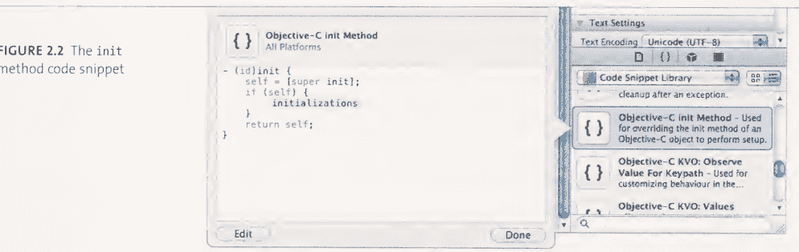

按照此处所示修改模板。你还需要将方法的签名复制到 Employee 类的接口块中。

```objc
// Designated initializer.
- (id)initWithFirstName:(NSString *)firstName
              lastName:(NSString *)lastName
                    id:(int)id {
    self = [super init];
    if (self) {
        _firstName = [firstName retain];
        _lastName = [lastName retain];
        _id = id;
    }
    return self;
}
```

通常，当我们向对象发送方法调用时，对象会首先在自身类中查找匹配的方法。如果找不到匹配项，它会转到父类，并继续沿类层次结构向上查找。`super` 关键字允许我们显式地从 self 的父类开始查找方法。通常，当你重写一个现有方法时，你仍然希望调用原始实现。`super` 关键字让你能够访问该版本的方法。

因此，这个方法首先将 [super init] 的返回值赋给 self 变量。这个调用会忽略当前 init 的实现，并开始沿类层次结构向上搜索更早的实现。

将返回值赋给 self 可能看起来有些奇怪，但这实际上只是我们之前遇到的一个问题的变体。请记住，在讨论对象初始化时，我们总是将 init 和 alloc 调用嵌套在一起，因为 init 可能返回与 alloc 不同的对象。这段代码处理的是同样的基本问题。self 参数包含 alloc 返回的值。然而，[super init] 可能返回不同的值。我们需要确保代码初始化并返回 [super init] 返回的值。

Objective-C 新手通常会因为给 self 赋新值而感到不适，但请记住，这是我们的方法隐藏参数之一。这意味着它只是一个局部变量。它没有什么奇特之处——我们可以像对待任何其他变量一样给它赋新值。

接下来，if 语句检查 [super init] 是否返回 nil。只要我们获得一个有效的对象，就执行初始化——将方法的参数赋值给对象的实例变量。最后，初始化器返回 self。

到目前为止，一切正常。我们有了一个调用父类指定初始化器的指定初始化器。现在，我们只需要重写父类的指定初始化器。

```objc
// Override superclass's designated initializer.
- (id) init {
    // This must go through our designated initializer.
    return [self initWithFirstName:@"John" lastName:@"Doe" id:-1];
}
```

这个方法必须调用我们对象的指定初始化器。这里，我们只需传入合理的默认值。如果我们编写任何其他初始化器，它们也必须遵循此模式，并调用 initWithFirstName:lastName:id: 来实际设置实例变量。

> **注意：** 冒着重复的风险，我要再次强调：你应该只在默认初始化器中设置实例变量。所有其他初始化器都应通过默认初始化器进行。它们不应自行设置任何变量或执行任何其他初始化。

### 便捷方法

许多类都有便捷方法，可以通过一次方法调用实例化对象。大多数情况下，这些方法与初始化器方法相对应。

例如，我们的 Employee 类可能有一个方法 employeeWithFirstName:lastName:id:。它充当指定初始化器的薄包装。其他便捷方法可能涉及更复杂的计算，无论是在调用指定初始化器之前还是之后——但基本思想保持不变。

```objc
+ (id) employeeWithFirstName:(NSString *)firstName
                    lastName:(NSString *)lastName
                        id:(int)id {
    return [[self alloc] initWithFirstName:firstName
                                  lastName:lastName
                                        id:id];
}
```

这段示例代码中有一个重要约定：我们使用 [self alloc] 而不是 [Employee alloc]。请记住，self 指消息的接收者。由于这是一个类方法，self 应设置为 Employee 类。但是，假设我们创建了一个名为 PartTimeEmployee 的子类。我们可以对 PartTimeEmployee 调用 employeeWithFirstName:lastName:id:，一切仍将按预期工作。通过调用 [self alloc]，我们的实现能够正确地分配并初始化 PartTimeEmployee 对象。然而，如果我们硬编码了类名，它将总是返回 Employee 对象。

```objc
// Returns an Employee object.
id firstPerson = [Employee employeeWithFirstName:@"Mary"
                                lastName:@"Smith"
                                id:10];

// Returns a PartTimeEmployee object.
id secondPerson = [PartTimeEmployee employeeWithFirstName:@"John"
                                lastName:@"Jones"
                                id:11];
```

### 属性

默认情况下，对象的实例变量在对象实现块外部是不可访问的。你可以将这些变量声明为 @public，但并不推荐这样做。相反，如果你希望让外部代码访问这些值，你应该编写访问器方法。

历史上，访问器方法大多只是一些枯燥的样板代码，仅仅把值传入或传出你的类。由于手动内存管理，这些代码写起来和维护起来往往非常繁琐。幸运的是，借助 Objective-C 2.0，Apple 提供了一种自动创建访问器的工具：属性。

我们在类的接口中声明属性，如下所示：

```objc
@property (attributes) variableType propertyName;
```

@property 声明会自动声明访问器方法，如下所示：

```objc
// This property
@property (nonatomic, copy) NSString* firstName;

// declares these methods
- (NSString*)firstName;
- (void)setFirstName:(NSString*)firstName;
```

getter 直接使用属性的名称并返回实例变量的当前值。setter 会在属性名称前面加上 set，并将参数（或参数的副本）赋给实例变量。

现在，我们需要告诉编译器实现这些方法。通常，我们会在类的 @implementation 块中添加一条 @synthesize 指令。

```objc
@synthesize firstName;
```

这会生成所请求的方法（如果它们尚未实现——如果你愿意，仍然可以选择手动创建这些方法）。默认情况下，访问器方法会读取和设置存储在类的 firstName 实例变量中的值。如果你已经在 @interface 块中声明了这个变量，访问器将使用它。否则，@synthesize 会为你创建实例变量。

另外，我们可以为实例变量指定不同的名称。以下代码将使用 _firstName 而不是 firstName。

```objc
@synthesize firstName = _firstName;
```

我总是按上述方式重命名实例变量。按照约定，下划线将实例变量标记为不应直接访问的私有值。这正是我们想要的。通常，你应该通过属性来访问实例变量——即使在类的 @implementation 块内部也是如此。如果你使用默认的实例变量名称，很容易忘记这一点，从而错误地直接访问该变量。


使用属性有助于编写干净、一致的代码。更重要的是，它能确保键值观察等技术正常工作。然而，有一处地方你应该直接访问实例变量：在类的指定初始化方法内部。

> **注意：** 许多老派的 Objective-C 程序员似乎对点语法深恶痛绝，那种愤怒通常只留给电话推销员。他们认为点语法既无必要又令人困惑。就我个人而言，我喜欢它模仿 C 风格结构体中取值和赋值的方式。这使访问器与其他方法之间有了清晰的区别。然而，每个人的情况可能有所不同，你应该使用自己觉得最顺手的语法。

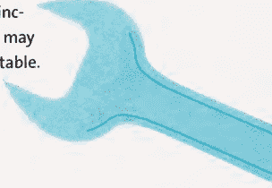

通常，初始化方法应避免执行任何可能产生错误、调用外部方法或占用计算时间的操作。诚然，你的属性应该是相对直接的赋值，不会产生意外副作用，所以使用属性可能也不会有什么大问题。但总有可能有人最终为某个属性添加自定义 setter，从而无意中使你的初始化方法不稳定。因此，直接赋值不失为一个好主意。

### 协议

某些面向对象语言（最著名的是 C++ 和 Python）允许多重继承，即一个类可以从多个超类继承行为。这可能会引发问题，尤其是当两个父类定义了完全相同的方法时。这听起来可能像是一个罕见的边界情况——但它总是会意外发生。如果这些类共享一个共同祖先（而所有类都共享一个根祖先），那么两个超类都会有共同祖先方法的副本。如果你在任一超类层次结构中的任何位置重写了其中一个方法，你的子类将继承该方法的多个实现。

其他语言（如 Java 和 Objective-C）不允许多重继承，很大程度上是因为这些额外的复杂性。然而，有时你仍然希望在一系列原本不相关的类之间捕获共同行为。这在像 Java 这样的静态强类型语言中尤其如此。

假设你想拥有一个对象数组，并且想遍历每个对象，调用其 makeNoise() 方法。一种方法是创建一个 NoisyObject 超类，并让数组中的所有对象都继承自该类。虽然这在理论上听起来不错，但并不总是可行。有时你的对象必须继承另一个现有的类层次结构。在 C++ 中，这没问题。你的类可以同时继承两者。在 Java 中，我们可以使用 Noisy 接口来模拟多重继承。任何实现此接口的类都必须实现 makeNoise() 方法。

在 Objective-C 中，这个问题就不那么令人担忧了。我们没有 Java 严格的静态类型（以及随之而来的所有额外复杂性）。毕竟，我们已经可以向任何对象发送任何消息。所以，这实际上是一个传达意图的问题。你只要确保数组中的所有对象都实现 makeNoise 方法，就没问题了。然而，我们通常希望显式地捕获这些需求。在这种情况下，协议扮演着类似于 Java 接口的角色——但它们还有其他用途。

协议声明了许多方法。默认情况下，这些方法是必需的。任何采用该协议的类都必须实现所有必需的方法。然而，我们也可以将方法声明为可选的。采用协议的类可以实现可选方法，但并非强制要求。

乍一看，可选方法似乎有点奇怪。毕竟，任何对象都可以实现任何方法；我们不需要协议的许可。然而，重要的是要记住，Objective-C 的协议实际上是在传达开发者的意图。开发者最常在为委托开发协议时使用可选方法。这些可选方法记录了委托可以覆盖的方法，以监视或修改委托类的行为。我们将在本章后面讨论委托时更深入地探讨这个主题。

### 采用协议

要采用一个协议，只需在类的 `@interface` 块中，超类声明之后的尖括号内添加一个逗号分隔的协议列表。

```
@interface ClassName : SuperClassName
<list, of, protocols, to, adopt> {
    ...
}
@end
```

你还需要实现任何尚未实现的必需方法。请注意，你无需在 `@interface` 块中声明这些方法。协议会替你处理这些。

### 声明协议

协议声明看起来很像类声明，只是没有实例变量块。与类的 `@interface` 块一样，协议声明通常放在头文件中——要么是它们自己的头文件，要么是密切相关类的头文件（例如，委托协议通常声明在委托类的头文件中）。

```objc
@protocol ProtocolName

    // Declare required methods here.
    // Protocol methods are required by default.
    @optional
    // Declare optional methods here.
    // All methods declared after the @optional keyword are
    // optional.
    @required
    // Declare additional required methods here.
    // All methods declared after the @required keyword are required
    // again.
@end
```

如你所见，你可以使用 `@optional` 和 `@required` 关键字根据需要划分方法。所有在 `@optional` 关键字之后（直到下一个 `@required` 关键字之前）的方法都是可选的。所有在 `@required` 关键字之后（直到下一个 `@optional` 关键字之前）的方法都是必需的。方法默认是必需的。

一个协议还可以包含其他协议。你只需在协议名称后面的尖括号中列出这些协议。任何采用某个协议的类也会采用它所包含的所有协议。

```objc
@protocol ProtocolName <additional, protocols, to, incorporate>
...
@end
```

### 类别与扩展

类别允许你向现有类添加新方法——即使是那些你无法访问源代码的库或框架中的类。类别有多种用途。首先，我们可以在不滥用子类化的情况下扩展类的行为。当你只想为现有类添加一两个辅助函数时，这通常非常有用——例如，向 NSMutableArray 添加 push: 和 pop 方法。

你也可以向类层次结构中更上层的类添加方法。然后，这些方法会像其他任何方法一样沿类层次结构向下继承。你甚至可以修改 NSObject 或其他根类——为应用程序中的每个对象添加行为。然而，总的来说，你应该避免对语言做出如此广泛的改动。它们可能会产生意想不到的后果。至少，它们无疑会让其他必须处理这些代码的人感到有些困惑。

最后，你可以使用类别将庞大而复杂的类拆分为更易于管理的模块，每个类别包含一组相关的方法。Cocoa Touch 框架经常这样做，在它们自己的类别中声明专门的辅助方法。

### 创建类别

我们创建类别的方式与创建新类非常相似。`@interface` 块看起来和类的 `@interface` 块几乎一样。只有两个区别。首先，我们不声明超类，而是在括号中提供类别名称；后面可以选择性地跟上类别所采用的新协议列表。其次，没有用于声明实例变量的块。你不能通过类别添加实例变量。如果你需要额外的实例变量，则必须改为创建子类。

```objective-c
@interface ClassName (CategoryName) <new protocols>

// Declare methods here.

@end
```


`@implementation` 代码块与类的版本更加接近。唯一的变化是在括号中添加了分类名称。

```objc
@implementation ClassName (CategoryName)
// Implement the extensions methods here.
@end
```

下面是在 `NSMutableArray` 类上创建的一个名为 Stack 的简单分类。

```objc
// In Stack.h
#import <Foundation/Foundation.h>
@interface NSMutableArray (Stack)
- (void)push:(id)object;
- (id)pop;
@end

// In Stack.m
#import "Stack.h"
@implementation NSMutableArray (Stack)
- (void)push:(id)object {
    [self addObject:object];
}
- (id)pop {
    // Return nil if the stack is empty.
    if (self.count == 0) return nil;
    // Remove the last object from the array and return it.
    id object = [self lastObject];
    [self removeLastObject];
    return object;
}
@end
```

我不想骗你。在 iOS 5.0 之前，内存管理无疑是 iOS 开发中最困难的部分。简而言之，问题如下。每当你创建一个变量时，你就在内存中预留了一些空间。对于局部变量，你通常使用栈上的内存。这块内存是自动管理的。当一个函数返回时，该函数内定义的任何局部变量都会自动从内存中移除。

这听起来很棒，但栈有两个重要的限制。首先，它的空间非常有限，如果内存耗尽，你的应用程序将会崩溃。其次，这些变量很难共享。记住，函数按值传递其参数和返回值。这意味着进出函数的所有内容都会被复制。如果你只是传递几个 int 或 double，这还不算太糟糕。但当你开始传递大型、复杂的数据结构时，会发生什么？将参数从一个函数传递到另一个函数，你会发现自己一直在复制副本的副本。这会很快浪费大量的时间和内存。

或者，我们可以在堆上声明变量，并使用指针来引用内存空间。这样做有几个优点。我们在堆上有相当多的可用空间，而且我们可以自由地传递指针；只有指针会被复制，而不是整个数据结构。

然而，每当我们使用堆时，都必须手动管理其内存。当我们想要一个新变量时，必须在堆上申请足够的空间。然后，当我们用完后，必须释放该空间，使其可以被重用。这导致了两个常见的内存相关错误。

首先，你可能释放了内存，却意外地继续使用它。这被称为悬垂指针。这类错误可能很难发现。释放一个变量并不一定会改变存储在栈上的实际值。它只是告诉操作系统该内存可以被再次使用。这意味着指向已释放内存的指针可能看起来工作正常。只有当系统最终重用该内存并覆盖旧值时，你才会遇到麻烦。

这可能会在完全不相关的代码部分导致非常奇怪的错误。想象一下：你从堆中释放了对象 A 的内存，但意外地继续使用它的指针。与此同时，一段完全不相关的代码在堆上请求一个新对象，对象 B。它得到了一块部分覆盖了对象 A 的内存。现在你修改了对象 A 的一个值。这会将新数据保存到对象 B 内部的某处——使 B 进入无效状态。下次你尝试从对象 B 读取时，就会遇到错误（或者可能是非常、非常奇怪的结果）。

第二个常见的内存错误发生在你忘记释放内存时。这被称为内存泄漏，它会导致你的应用程序在持续运行过程中占用越来越多的内存。

一方面，这并不一定那么糟糕。当应用程序退出时，所有内存都会被释放。我甚至听说过有服务器软件故意泄漏其所有内存。毕竟，如果你无论如何都要运行数千个服务器副本，那么定期终止并重新生成单个副本，可能比冒悬垂指针导致的崩溃风险更容易。

然而，在 iOS 上，我们没有这种奢侈。所有 iOS 设备的内存都极其有限。使用过多内存，你的应用就会被关闭。因此，正确且有效的内存管理是一项至关重要的技能。

对我们来说，我们主要关心的是对象。所有对象都是在堆上创建的。是的，你也可以在堆上为 C 数据类型或结构体创建变量，但这非常罕见（更多细节请参阅一本好的 C 编程书籍）。在大多数情况下，iOS 内存管理意味着管理我们对象的生命周期。

### 对象与引用计数

最大的问题之一就是确定哪部分代码应该负责释放对象的内存。在简单的示例中，解决方案总是看似微不足道。然而，一旦你开始传递对象，将它们保存在其他对象的实例变量中或将它们放入集合中，事情很快就会变得复杂难办。

为了解决这个问题，Objective-C 程序员传统上使用引用计数。当我们创建一个对象时，它的引用计数从 1 开始。我们可以通过对对象调用 retain 来增加引用计数。类似地，我们可以通过调用 release 来减少引用计数。当引用计数达到 0 时，系统会从内存中删除该对象。

这使得在不担心所有权的情况下传递对象成为可能。如果你想持有某个对象，就 retain 它。当你用完后，就 release 它。只要你把所有 retain 和 release 都弄对了（更不用说 autorelease 和自动释放池了），你就能同时避免悬垂指针和内存泄漏。

当然，把它做对从来没有看起来那么简单。Objective-C 的内存管理约定有很多规则和奇怪的边缘情况。而且，作为开发者，我们必须每次都百分之百地做对。所以我们常常在每次创建新变量时，不得不机械地遵循一套步骤。这非常枯燥乏味。它产生了大量样板代码，其中很多并不是严格必需的，但如果我们不是每次都遵循每一个步骤，我们就会冒着在真正重要的时刻忘记某些东西的风险。

当然，苹果试图提供帮助。Instruments 有许多工具来跟踪分配和释放，并搜索内存泄漏。在 Xcode 近几个版本中，静态分析器在分析我们的代码和查找内存管理错误方面变得越来越出色。

这就引出了一个问题：如果静态分析器能发现这些错误，为什么不能直接修复它们呢？毕竟，内存管理是一项乏味、注重细节的任务，遵循一套严格的规则——这正是编译器所擅长的。苹果将自己的编译器和分析器技术应用到了这项任务上。其成果是一项全新的内存管理技术：自动引用计数（ARC）。

#### ARC 简介

ARC 是一项编译器特性，为 Objective-C 对象提供自动内存管理。从概念上讲，ARC 遵循 retain 和 release 内存管理约定（更多信息请参阅苹果的《内存管理编程指南》）。当你的项目编译时，ARC 会分析代码并自动添加必要的 retain、release 和 autorelease 方法调用。

对于开发者来说，这是非常好的消息。我们不再需要担心自己管理内存。相反，我们可以将时间和注意力集中在应用程序真正有趣的部分，例如实现新功能、精简用户界面或提高稳定性和性能。

此外，苹果还致力于提高 ARC 下内存管理的性能。例如，ARC 的自动 retain 和 release 调用比手动内存管理的等效操作快 2.5 倍。新的 @autoreleasepool 块比旧的 NSAutoreleasePool 对象快 6 倍，甚至 objc_msgSend() 也快了 33%。最后这一点尤其重要，因为 objc_msgSend() 用于分派应用程序中的每一个 Objective-C 方法调用。

总而言之，ARC 使 Objective-C 更容易学习、更高效、更易于维护、更安全、更稳定、更快。这就是我所说的六赢局面。在大多数情况下，我们甚至不需要考虑内存管理。我们只需编写代码，创建和使用我们的对象。ARC 为我们处理所有繁琐的细节。


### ARC 与垃圾回收

ARC 并不是垃圾回收。两者目标一致——这两种技术都实现了内存管理自动化，让应用程序的开发更加容易。然而，它们采用的方式截然不同。垃圾回收在运行时跟踪对象，当它确定某个对象不再被使用时，便将其从内存中删除。

遗憾的是，这会产生若干潜在的性能问题。用于监视和删除对象的基础设施会给你的应用程序增加额外开销。我们也几乎无法控制垃圾回收器何时开始扫描。虽然现代垃圾回收器都在尽量降低对应用程序性能的影响，但它们本质上是不确定的。这意味着在应用程序执行过程中，垃圾回收器可能会随机导致应用变慢或暂停。

相比之下，ARC 在编译期就处理了所有内存管理。运行时没有任何额外开销——事实上，由于大量优化，ARC 代码比手动管理内存的代码运行得更快。此外，内存管理是完全确定的——也就是说，不会出现任何意想不到的意外。

### 发现与防止循环引用

虽然 ARC 在内存管理方面向前迈进了一大步，但它并没有让开发者完全摆脱对内存问题的思考。在 ARC 下仍然可能产生内存泄漏——ARC 依然容易受到循环引用（retain cycle）的影响。

要理解这个问题，我们需要稍微深入底层机制。默认情况下，ARC 中的所有变量都使用强引用。当你将一个对象赋值给强引用时，系统会自动保留（retain）该对象。当你将该对象从引用中移除时（通过给变量赋一个新对象，或赋 nil 值），系统会释放（release）该对象。

当两个对象通过强引用直接或间接地互相引用时，就会发生循环引用。这常见于父/子层级结构中，例如子对象持有对父对象的反向引用。

假设我有一个 `Person` 对象，其定义如下：

```objective-c
@interface Person : NSObject
@property (nonatomic, strong) Person* parent;
@property (nonatomic, strong) Person* child;
+ (void)myMethod;
@end
```

而 `myMethod` 的实现如下所示：

```objective-c
+ (void)myMethod {
    Person* parent = [[Person alloc] init];
    Person* child = [[Person alloc] init];
    parent.child = child;
    // Do something useful with the parent and child.
}
```

在这个例子中，当我们调用 `myMethod` 时，会创建两个 `Person` 对象。每个对象的引用计数都从 1 开始。然后我们将 `child` 对象赋给 `parent` 的 `child` 属性，这把 `child` 的引用计数增加到了 2。

ARC 会在方法末尾自动插入 `release` 调用。这些调用使 `parent` 的引用计数降为 0，`child` 的引用计数降为 1。由于 `parent` 的引用计数现在为 0，它会被释放。同样，ARC 也会自动释放 `parent` 的所有属性。因此，`child` 对象的引用计数也降到 0，它同样被释放。方法结束时，所有内存都被释放，正如我们所预期的那样。

现在，让我们添加一个循环引用。将 `myMethod` 修改为如下所示：

```objective-c
+ (void)myMethod {
    Person* parent = [[Person alloc] init];
    Person* child = [[Person alloc] init];
    parent.child = child;
    child.parent = parent;
    // Do something useful with the parent and child.
}
```

和之前一样，我们创建 `parent` 和 `child` 对象，每个对象的引用计数都是 1。这一次，`parent` 持有对 `child` 的引用，`child` 也持有对 `parent` 的引用，于是两个引用计数都增加到了 2。方法末尾，ARC 会自动释放我们的对象，使两个引用计数都降回 1。由于没有任何引用计数被减到 0，两个对象都不会被释放，于是这个循环引用就造成了内存泄漏。

幸运的是，ARC 为我们提供了一个解决方案。我们只需重新定义 `parent` 属性，让它使用归零弱引用。基本上，这需要将属性修饰符从 `strong` 改为 `weak`。

```objective-c
@interface Person : NSObject

@property (nonatomic, weak) Person* parent;

@property (nonatomic, strong) Person* child;

+ (void)myMethod;

@end
```

归零弱引用有两个关键优势。第一，它们不会增加对象的引用计数——因此不会延长对象的生命周期。第二，当它们所指向的对象被释放时，系统会自动将它们置回 `nil`。这可以防止悬垂指针。

应用程序通常具有从一个根对象分支出去的对象图。当引用对象图中向上回溯的对象（即更靠近根对象的任何对象）时，我们通常会使用归零弱引用。此外，我们所有的委托和数据源都应使用归零弱引用（参见本章后面的“委托”一节）。这是 Objective-C 中的标准约定，因为它有助于防止意外造成循环引用。

到目前为止，我们看到的所有循环引用都较为明显，但情况并非总是如此。循环引用可以包含任意数量的对象——只要它最终能绕回到自身。一旦引用层级超过三四层，要追踪可能的循环就几乎不可能了。幸运的是，我们的开发者工具再次派上了用场。

借助 Xcode 4.2，Instruments 现在能够搜索循环引用，甚至可以用图形方式显示循环引用。

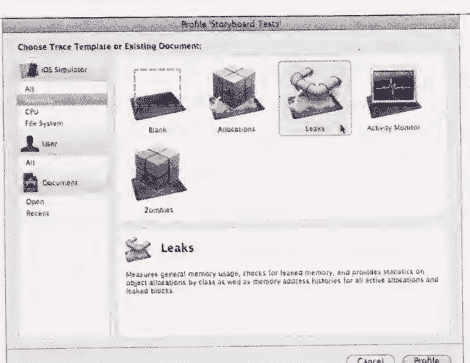
**图 2.3** 选择 Leaks 模板

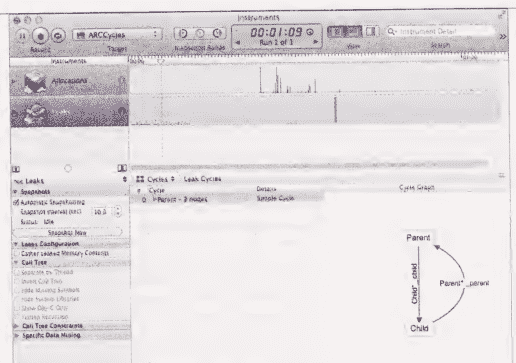
**图 2.4** 查找并显示循环引用

只需对你的应用进行性能分析。从主菜单中选择 Product > Profile。在 Instruments 的弹出窗口中选择 Leaks 模板，然后点击 Profile（图 2.3）。这将同时启动 Instruments 和你的应用。

Instruments 启动时会带有两个诊断工具：Allocations 跟踪内存的分配和释放，Leaks 则查找泄漏的内存。泄漏会以红色条状出现在 Leaks 仪器中。选中 Leaks 仪器行，详细信息就会显示在下方。在跳转栏中，将详细视图从 Leaks 改为 Cycles，Instruments 就会显示你的循环引用（图 2.4）。现在你可以双击有问题的引用，Xcode 会自动跳转到该位置。修复它（要么将其改为归零弱引用，要么重构应用程序的流程），然后再次测试。我们将在补充章节 B（www.freelancemadscience.com/book）中更详细地讨论 Instruments。

### 使用规则

使用 ARC 极其简单。大多数时候，我们什么都不需要做。Xcode 4.2 的所有项目模板默认都使用 ARC——尽管在必要时，我们可以对单个文件启用手动内存管理。这让我们可以自由混用 ARC 和非 ARC 代码。ARC 可用于任何面向 iOS 4.0 及以上版本的项目（但有一些限制）。而且 Xcode 甚至提供了转换非 ARC 应用的工具（选择 Edit > Refactor > Convert to Objective-C ARC）。

为了让 ARC 正常工作，编译器必须能够正确理解我们的意图。这需要一些额外的规则来消除歧义。如果你不理解其中许多规则所指的内容，也不必担心——大多数规则在日常编码中很少遇到。重要的是，编译器会强制执行所有这些规则，违反它们就会产生错误。这使问题更容易发现和修复。

所有规则如下：

- 不要在 C 结构体中使用对象指针。而应创建一个 Objective-C 类来保存数据。
- 不要创建名称以“new”开头的属性。
- 不要调用 dealloc、retain、release、retainCount 或 autorelease 方法。
- 不要实现你自己的 retain、release、retainCount 或 autorelease 方法。你可以实现 dealloc，但通常没有必要。
- 在 ARC 中实现 dealloc 时，不要调用 [super dealloc]。编译器会自动处理。
- 不要使用 NSAutoreleasePool 对象。请改用新的 @autoreleasepool{} 块。
- 一般情况下，不要在 id 和 void* 之间进行转换。在 Objective-C 对象与 Core Foundation 类型之间传递数据时，必须使用增强转换或宏（参见下一节）。
- 不要使用 NSAllocateObject 或 NSDeallocateObject。
- 不要使用内存区域或 NSZone。

### ARC 与免费桥接

首先，必须认识到：ARC 只适用于 Objective-C 对象。如果你在堆上为任何 C 数据结构分配内存，你仍然必须自己管理这些内存。

在使用 Core Foundation 数据类型时，真正的问题就开始出现了。Core Foundation 是一个底层 C API，提供了许多基本的数据管理和操作系统服务。还有一个类似的 Objective-C 框架，名为 Foundation（你是不是已经开始困惑了？）。毫不奇怪，Foundation 和 Core Foundation


它们密切相关。实际上，Foundation 为许多 Core Foundation 服务和数据类型提供了 Objective-C 接口。

现在最酷的部分来了。许多 Foundation 和 Core Foundation 数据类型实际上是可以互换的。在本质上，NSString 和 CFString 是相同的。我们可以自由地将 CFString 引用传递给期望 NSString 的 Objective-C 方法，或者将 NSString 传递给期望 CFString 的 Core Foundation 函数。这种互操作性被称为免费桥接（更多信息请参阅 Apple 的 Cocoa 基础指南 > Cocoa 对象 > 免费桥接）。

不幸的是，在来回转换时，内存管理很快就会变得混乱。谁来负责管理哪些数据？我们是使用 CFRetain() 和 CFRelease() 手动管理内存，还是让 ARC 来处理？

我们需要了解三种基本场景：由 Objective-C 方法返回的 Core Foundation 数据、使用 Core Foundation 内存管理函数的代码，以及不使用任何内存管理函数在 Core Foundation 之间传输数据的代码。

第一种情况很简单。如果我们通过调用 Objective-C 方法访问 Core Foundation 对象，我们根本不需要做任何事情。我们可以自由地转换数据，编译器不会产生任何错误。

这是因为 Objective-C 方法都遵循 Objective-C 内存管理约定（更多信息请参阅 Apple 的内存管理编程指南）。ARC 理解这些约定，能正确解读数据的所有权，并做出正确的处理。

```
UIImage* myImage = [UIImage imageNamed:@"myPhoto"];
id myCGImage = (id)[myImage CGImage];
[photoArray addObject:myCGImage];
```

在这个示例中，我们调用了 UIImage 的 CGImage 属性。它返回一个 CGImageRef。然后我们将 C 数据转换为 Objective-C 的 id，并将其放入数组中。因为我们使用了 Objective-C 方法来访问 C 数据，编译器允许简单的转换，其余部分由 ARC 处理。

接下来，如果我们调用任何 Core Foundation 内存管理函数，我们需要让 ARC 知道。这些函数包括 CFRetain()、CFRelease() 以及任何名称中嵌入 Create 或 Copy 单词的函数（更多信息请参阅 Apple 的 Core Foundation 内存管理编程指南）。

如果 Core Foundation 函数保留了数据（CFRetain、CFCreate 或 Copy），那么我们需要使用 `__bridge_transfer` 注释进行转换。如果 Core Foundation 释放数据（CFRelease），那么我们使用 `__bridge_retain` 注释。这里展示了两个示例。

```objc
// The Core Foundation function retains the data.
// We need to tell ARC to release it when we're done:
NSString* myString =
    (__bridge_transfer NSString*)CFStringCreateMutableCopy(NULL, 0,
                                                             myCFString);
...now do something useful with myString
// This time, our Core Foundation code will release the object.
// We need to tell ARC to retain it.
CFStringRef myCFString = (__bridge_retain NSString*)[myString copy];
...now do something useful with myCFString
CFRelease(myCFString);
```

最后，如果我们以其他方式获得 Core Foundation 数据（不是 Create 或 Copy 函数，也不是 Objective-C 方法），并且我们不对它调用 `CFRetain()` 或 `CFRelease()`，我们只需要在转换中添加 `__bridge` 注释，如下所示。然后 ARC 会像往常一样为我们管理内存。

```objc
// From Objective-C to Core Foundation
CFStringRef myCFString = (__bridge CFStringRef) myString;
CFShow(myCFString);
...

// From Core Foundation to Objective-C
myLabel.text = (__bridge NSString*)myCFString;
```

### 了解文档

值得花一点时间熟悉 Xcode 的文档。在初次学习 Objective-C 时，它是一个极好的资源，并且在你整个 iOS 开发生涯中，它将继续作为不可或缺的参考手册。

让我们做一点练习。打开文档并搜索 UIWindow，然后从结果中选择 UIWindow 类参考。类参考分为几个部分。它首先对该类进行简要描述，包括它继承的类层次结构、它实现的协议，以及使用该类的任何示例代码。

在下面，我们有一个类的概述。该部分描述其基本用法，包括任何重要的实现或使用细节。

接下来是任务列表。这部分按预期用途对类的属性和方法进行分组（对于 UIWindow，它们是配置窗口、使窗口成为关键窗口、转换坐标和发送事件）。列表中的每一项都有指向文档后面更详细描述的超链接。

然后我们有描述类的属性、类方法、实例方法、常量和通知的部分。（并非所有类都有所有这些类别。例如，UIWindow 没有任何类方法。）每个部分都包含为该类定义的所有相关公共项。对于在超类（或更上层的类层次结构）中声明的项，你需要搜索相关类的参考。

每个条目的详细条目显示了该项的声明方式，描述了其用途，并提供了其可用性信息。例如，UIWindow 的 rootViewController 属性提供了对管理窗口内容的 UIViewController 的访问。其默认值为 nil，并且仅在 iOS 4.0 及更高版本中可用。

相比之下，搜索 CGPoint。与 UIWindow 类不同，CGPoint 没有自己的参考。它在 CGGeometry 参考中描述。与类参考一样，它以一个简短的标题和概述开始。然后列出几何函数，按任务分组。最后，参考列出所有相关的数据类型和常量。

CGPoint 条目包括结构体的声明以及对其所有字段及其可用性的描述。

在我们学习本书的过程中，定期花一些时间在文档中查找任何新的类或结构。我会尝试展示类典型用法的良好示例，但大多数类包含太多方法和功能，无法详细描述。此外，浏览文档可能会给你带来一些替代用法的想法，这些用法在你自己的应用程序中可能效果更好。

我们已经介绍了 Objective-C 的大部分基本特性，但在 iOS SDK 中经常使用许多常见的设计模式。值得花一点时间来回顾这些模式，这样你在看到它们时就能理解。

#### 模型-视图-控制器

模型-视图-控制器（MVC）是一种用于构建具有图形用户界面（GUI）的应用程序的常见架构模式。这种模式将应用程序分为三个部分。模型维护应用程序的状态。这通常包括在运行时管理状态，以及保存和加载状态（将对象归档到文件、将数据持久化到 SQL 数据库，或使用像 Core Data 这样的框架）。

顾名思义，视图负责显示应用程序的信息，可能是以交互方式。大多数情况下，这意味着使用 GUI 显示信息。然而，它也可能包括打印文档和生成其他日志和报告。

控制器位于两者之间。它响应事件（通常来自视图），然后向模型发送命令（以更改其状态）。当模型发生变化时，它还必须更新视图。应用程序的业务逻辑可以在控制器或模型中实现，具体取决于应用程序的需求。但是，你真的应该选择一种方法，并在整个应用程序中坚持下去。

理想的 MVC 组件应该是非常松耦合的。例如，任意数量的视图都可以观察控制器，触发控制器事件并响应任何更改通知。一个可能会在 GUI 中显示信息。一个可能会将数据保存到日志文件。控制器不知道也不关心细节。在另一端，模型和控制器应该同样松耦合。

在实践中，各层之间通常比这更紧密地绑定，为了实用性牺牲了一点理想主义。Cocoa Touch 也不例外。通常，视图与其控制器绑定得更紧密。每个场景都有一个针对管理该场景而量身定制的自定义控制器（有关场景和视图控制器之间关系的更多信息，请参阅第 1 章中的“检查故事板”部分）。在模型方面，有更大的回旋余地。在最简单

应用中，模型可能直接在控制器中实现。不过在大多数情况下，我们希望将这些区域尽可能干净地分离。

Cocoa Touch 使用 UIView 子类作为视图，UIViewController 子类作为控制器。模型和视图之间的通信通常使用 target/action 连接。

在模型方面，我们可以使用多种不同的技术来实现模型：自定义类、SQLite 或 Core Data。在很多情况下，模型和控制器直接相互通信——尽管我们可以使用通知和委托创建更松散的绑定连接（有关更多信息，请参阅下一节中关于数据源的讨论）。

### 委托

委托允许你扩展或修改对象的行为，而无需对该对象进行子类化。你甚至可以在运行时通过替换委托来改变对象的行为——尽管在实践中，这种情况比较少见。

我们已经看到了委托的实际作用。例如，无需在每个项目中子类化 UIApplication 类，我们使用一个通用的 UIApplication，并实现一个自定义的 UIApplicationDelegate。应用程序委托协议定义了超过 20 个可选方法，我们可以重写这些方法来监视和改变应用程序的行为。

任何使用委托的类通常都有一个（毫不意外地）名为 delegate 的属性。按照惯例，委托属性应始终使用弱引用。这有助于避免保留循环。不过，我们需要确保在应用的其他位置对委托对象有强引用——否则 ARC 会将其释放。

```objc
@property (nonatomic, weak) IBOutlet id<DelegateProtocol> delegate;
```

如这个例子所示，我们通常声明一个委托必须实现的协议。这定义了委托方类与委托之间的接口。注意，委托方类是这一关系中的主动方。它在委托上调用这些方法。其中一些方法向委托传递信息；另一些方法则向委托查询。通过这种方式，我们在两个对象之间来回传递信息。

委托的方法通常有某种公式化的名称。按照惯例，名称以描述委托方的标识符开头。例如，所有 UIApplicationDelegate 方法都以单词 application 开头。

在许多情况下，方法会将委托方的引用作为其第一个参数传回。UITableViewDelegate 就是这样做的。这意味着你可以使用单个 UITableViewDelegate 来管理多个 UITableView（尽管这种情况很少见）。更重要的是，你可以避免将委托方类保存在实例变量中，因为委托总是可以通过这个参数访问其委托方类。

此外，委托的方法名称中经常包含 will、did 或 should。在所有三种情况下，系统都会响应某些变化而调用这些方法。Will 方法在变化发生之前调用。Did 方法在变化之后调用。Should 方法与 will 方法一样，在变化之前调用，但期望返回 YES 或 NO 值。如果返回 YES，则变化应按正常进行。如果返回 NO，则变化应被取消。

最后，委托方法几乎总是可选的。因此，委托方类在调用该方法之前，必须首先检查确保委托已实现该方法。下面这段代码展示了一个典型的假设实现：

```objc
- (void) doSomething {
    BOOL shouldDoSomething = YES;

    // Ask if we should do it.
    if ([self.delegate
                respondsToSelector:
                    @selector(someObjectShouldDoSomething:)]) {
        shouldDoSomething =
            [self.delegate someObjectShouldDoSomething:self];
    }

    // Abort this method if the delegate returns NO.
    if (!shouldDoSomething) return;

    // Tell the delegate that we will do it.
    if ([self.delegate
```

接下来，我们需要为我们的选择器实现该方法。该方法应接受单个 NSNotification 对象作为参数。

```objc
- (void)receiveNotification:(NSNotification*)notification {
    NSLog(@"Notification Received");
    // Now do something useful in response.
}
```

最后，在观察者（或 addObserver:selector:name:object: 中提到的任何对象）被释放之前移除观察者是很重要的。否则，通知中心将包含悬空指针。通常这应该在观察对象的 dealloc 方法中完成。

```objc
- (void)dealloc {
    NSNotificationCenter* center =
    [NSNotificationCenter defaultCenter];
    // Remove all entries for the given observer.
    [center removeObserver:self];
}
```

发送通知甚至更简单。我们的发送对象只需获取默认通知中心的指针，然后发布所需的通知。

```objc
NSNotificationCenter* center = [NSNotificationCenter defaultCenter];
[center postNotificationName:MyNotification object:self];
```

通知是同步发布的。这意味着，直到通知中心为所有匹配的观察者调用完所有指定的选择器之后，对 postNotificationName 的调用才会返回。这可能会花费相当长的时间，尤其是当观察者数量众多或响应方法缓慢时。

或者，我们可以使用 NSNotificationQueue 发送异步通知。通知队列基本上会将通知延迟到当前事件循环结束（或者可能直到事件循环完全空闲）。队列还可以将重复消息合并为单个通知。

以下示例代码将通知延迟到运行循环空闲时：

```objc
NSNotification* notification =
    [NSNotification notificationWithName:MyNotification
                                  object:self];
NSNotificationQueue* queue = [NSNotificationQueue defaultQueue];
[queue enqueueNotification:notification
             postingStyle:NSPostWhenIdle];
```

### 键值编码

键值编码是一种使用字符串间接获取和设置对象实例变量的技术。NSKeyValueCoding 协议定义了许多用于访问或设置这些值的方法。最简单的例子是 `valueForKey:` 和 `setValue:forKey:`。

```objc
NSString* oldName = [emp valueForKey:@"firstName"];
[emp setValue:@"Bob" forKey:@"firstName"];
```

要使此功能正常工作，你的对象必须符合 KVC 规范。基本上，`valueForKey:` 方法会查找名为 `<key>` 或 `is<key>` 的访问器。如果找不到有效的访问器，它将查找名为 `<key>` 或 `_<key>` 的实例变量。另一方面，`setValue:forKey:` 会查找 `set<key>:` 方法，然后查找实例变量。

幸运的是，你为实例变量定义的任何属性都自动符合 KVC 规范。

KVC 方法还可以使用键路径。这些是点分隔的键列表。基本上，getter 或 setter 会沿着键列表向下工作。第一个键应用于接收对象。然后，后续的每个键用于从上一个键返回的值。这允许你深入对象图获取所需的值。

```objc
// Will return the company name, assuming all intermediate values
// are KVC compliant.
NSString* companyName =
[emp valueForKey:@"department.company.name"];
```

与通知中心一样，在观察者释放之前移除观察者非常重要。NSNotificationCenter 有一个便捷方法可以移除给定观察者的所有通知，而在 KVO 中，你必须单独移除每次 addObserver 调用。

```objc
[emp removeObserver:self forKeyPath:@"lastName"];
```

接下来，要接收通知，你必须重写 `observeValueForKeyPath:ofObject:change:context:` 方法。object 参数用于标识你正在观察的对象。keyPath 参数指示发生更改的特定属性。change 参数包含一个字典，其中包含注册为观察者时请求的值。最后，context 参数只包含注册为观察者时提供的上下文数据。

```objc
- (void)observeValueForKeyPath:(NSString *)keyPath
                    ofObject:(id)object
                    change:(NSDictionary *)change
                    context:(void *)context {
    if ([keyPath isEqualToString:@"lastName"]) {
        NSString* oldName =
            [change objectForKey:NSKeyValueChangeOldKey];
        NSString* newName =
            [change objectForKey:NSKeyValueChangeNewKey];
        NSLog(@"%@'s last name changed from %@ to %@",
                object, oldName, newName);
    }
}
```


### 单例

从最基本的概念来说，单例是一个只会被实例化出唯一一个对象的类。每当你请求该类的另一个新对象时，你获得的都是指向原始对象的指针。

单例通常用于表示只存在单一版本的对象。UIApplication 类就是一个很好的例子。每个应用程序都有一个且仅有一个应用程序对象。此外，你可以通过 `[UIApplication sharedApplication]` 方法在任意位置访问该应用程序对象。

当然，单例一直是互联网上争论不休的话题。有人认为它们是万恶之源，应该像躲避瘟疫一样避开它们。如果你使用单例，恐怖分子就赢了。或者，更理性一点说，单例不过是一个过度设计、却有着良好公关的全局变量而已。

这些抱怨并非没有道理。当开发者第一次接触单例模式时，往往会过度使用。过多的单例会让你的代码变得很难理解。此外，单例看似简单，实则很难写对（而且对于“正确”的含义，众说纷纭）。然而，如果使用得当，它们会非常有用。最重要的是，Cocoa Touch 本身就使用了许多单例类——因此，即使你从未打算自己编写单例，也至少应该了解其基本概念。

下面是一个典型且相对安全的实现。在类的头文件中，声明一个类方法来访问你的共享实例：

```objectivec
+ (SampleSingleton*)sharedSampleSingleton;
```

然后打开实现文件，为你的类添加一个扩展。该扩展将声明一个私有的指定初始化方法。

```objectivec
@interface SampleSingleton()
- (id)initSharedInstance;
@end
```

请记住，我们可以对任何对象调用任何方法——将初始化方法声明为私有只是为了传达我们的意图。开发者应该只调用头文件中声明的方法——在这种情况下，开发者只能通过 `sharedSampleSingleton` 方法访问共享对象。

最后，在 `@implementation` 块中实现以下方法：

```objectivec
+ (SampleSingleton*)sharedSampleSingleton {
    static SampleSingleton* sharedSingleton;
    static dispatch_once_t onceToken;
    dispatch_once(&onceToken, ^{
        sharedSingleton = [[SampleSingleton alloc]
                            initSharedInstance];
    });
    return sharedSingleton;
}

// Private Designated Initializer.
- (id)initSharedInstance {
    self = [super init];
    if (self) {
        // Do initialization here.
    }
    return self;
}

// Override the superclass's designated initializer to prevent
// its use.
// Calling this method will throw an exception.
- (id)init {
    [self doesNotRecognizeSelector:_cmd];
    return nil;
}
```

这段代码使用懒加载（lazy initialization）来创建共享实例（直到调用 `sharedSampleSingleton` 时，我们才会真正分配该实例）。在 `sharedSampleSingleton` 内部，我们使用 `dispatch_once` 块来保护共享实例。`dispatch_once` 块是一种线程安全的方式，可确保某段代码在应用程序的生命周期内只执行一次。

**注意：** 在 ARC 之前，许多单例实现会重写一些额外的方法：`allocWithZone:`、`copyWithZone:`、`mutableCopyWithZone:` 和 `release` 都是常见的候选。锁定这些方法有助于防止开发者意外创建单例的额外副本。然而，在 ARC 下编译时，这些方法要么无法被重写，要么根本没有必要重写。Apple 目前建议使用更简单的单例实现，并依靠约定和沟通来避免重复。

我们还重写了超类的指定初始化方法，使其在被调用时抛出异常。隐藏我们的指定初始化方法，并禁用超类的指定初始化方法，可以防止开发者意外创建副本（例如，调用 `[[SampleSingleton alloc] init]`）。

请注意，`copy` 和 `mutableCopy` 默认也是被禁用的。由于我们没有实现 `copyWithZone:` 或 `mutableCopyWithZone:`，这些方法会自动抛出异常。

这个实现并没有处理从磁盘加载或保存单例这一棘手问题。如何实现归档代码，很大程度上取决于在应用程序中“加载和保存单例”意味着什么。你是在单例第一次创建时从磁盘加载一次？还是说加载单例只是改变单例中存储的值？例如，你的应用程序可能有一个 `GameState` 单例。你始终只拥有那一个 `GameState` 对象——但状态值会随着用户加载和保存游戏而改变。

更高级的一种变体是，Cocoa Touch 的某些单例允许你在应用程序的 `info.plist` 文件中指定单例的类。这样，你既可以创建单例类的子类，又能确保在运行时加载正确的版本。如果你需要此类支持，可以按如下方式修改你的代码：

```objectivec
+ (SampleSingleton*)sharedSampleSingleton {
    static SampleSingleton* sharedSingleton;
    static dispatch_once_t onceToken;
    dispatch_once(&onceToken, ^{
        NSBundle* main = [NSBundle mainBundle];
        NSDictionary* info = [main infoDictionary];
        NSString* className =
            [info objectForKey:@"SampleSingleton"];
        Class singletonClass = NSClassFromString(className);
        if (!singletonClass) {
            singletonClass = self;
        }
        sharedSingleton =
            [[singletonClass alloc] initSharedInstance];
    });
    return sharedSingleton;
}
```

这段代码会访问 `info.plist` 文件，并查找名为 `SampleSingleton` 的键。如果找到了，它会将对应的值解释为类名，并尝试查找相应的类对象。如果查找成功，就使用该类来创建单例对象；否则，就使用默认的单例类。

### 块

块（Blocks）绝对是 Objective-C 2.0 中我最喜欢的新特性。它们仅适用于 iOS 4.0 及以上版本。不过，除非你的目标是真的很老的设备，否则块能极大地简化许多算法。

例如，UIView 类有许多使用块来执行视图动画的方法。与旧的动画 API 相比，这些方法提供了更简洁、更优雅的解决方案。

块在某种程度上与方法和函数类似，它们都是将若干表达式打包起来以便稍后执行。不过，块可以作为变量存储，也可以作为参数传递。我们可以按如下方式创建块变量：

```objectivec
returnType (^blockName)(argumentTypes);
```

例如，让我们声明一个名为 sum 的块变量，它返回一个整数，并接受两个整数参数：

```objectivec
int (^sum)(int, int);
```

你可以定义一个块字面量，以脱字符（^）开头，然后在括号中声明参数，在花括号中编写实际代码。

```objectivec
sum = ^(int a, int b){return a + b;};
```

一旦块变量被赋值，你就可以像调用其他任何函数一样调用它。

```objectivec
NSLog(@"The sum of %d and %d is %d", 5, 6, sum(5, 6));
```

需要注意的是，块可以捕获块被定义时作用域内的任何数据。例如，在下面这个示例中，addToOffset 将接受一个参数，并将 offset 变量加到该参数上。

```objectivec
int offset = 5;
int (^addToOffset)(int) = ^(int value){return offset + value;};
```

> **注意：** 当块捕获一个存储在栈上的局部变量时，它会将该变量视为 `const` 值。你可以读取该值，但不能修改它。如果需要修改局部变量，必须使用 `__block` 存储类型修饰符来声明它。一般来说，这仅适用于局部的 C 类型和结构体。对象、实例变量以及任何在堆上分配的内容，你本来就可以修改它们。


不过，通常我们并不会创建或调用块变量。相反，我们会将块字面量作为参数传递给方法和函数。例如，NSArray 有一个方法 `enumerateObjectsUsingBlock:`，它接收一个块参数。该方法会遍历数组中的所有对象。对于每个对象，它都会调用该块，并传入对象、对象的索引以及一个指向停止值的引用。


stop 值仅用作 block 的输出。将其设置为 YES 会使 enumerateObjectsUsingBlock: 停止执行。下面是一个使用该方法的简单示例：

```objectivec
NSArray* array = [NSArray arrayWithObjects:@"Bill", @"Anne",
                                @"Jim", nil];
[array enumerateObjectsUsingBlock:
  ^(id obj, NSUInteger idx, BOOL *stop) {
    NSLog(@"Person %d: %@", idx, obj);
  }];
```

这会将以下输出打印到控制台：

```text
Person 0: Bill
Person 1: Anne
Person 2: Jim
```

请注意，我们也可以传入一个选择器，并让我们的枚举方法对数组中的每一项调用该选择器，从而复制 enumerateObjectsUsingBlock: 的功能。我们首先在 NSArray 上创建一个分类。

```objectivec
@implementation NSArray (EnumerateWithSelector)
- (void)enumerateObjectsUsingTarget:(id)target
                            selector:(SEL)selector {
    for (int i = 0; i < [self count]; i++) {
        [target performSelector:selector
                     withObject:[self objectAtIndex:i]
                     withObject:[NSNumber numberWithInt:i]];
    }
}
```

注意，我们完全不需要修改 enumerateObjectsUsingBlock: 的实现。我们也不需要任何实例变量。最重要的是，所有内容都被很好地集中在一个地方。

最棒的是，这个解决方案是可扩展的。如果我们希望在其他地方有不同的行为——没问题。我们编写一个新的 block，捕获所需的所有局部变量，然后调用我们的通用枚举方法。一个通用方法就能满足我们的所有需求。

注意：在 ARC 之前，我们必须对 block 稍加小心。默认情况下，block 是在栈上构建的，一旦超出作用域就会被销毁。要将 block 存储在实例变量中以供稍后执行，我们必须将其拷贝到堆上。然后在使用完毕后释放它。幸运的是，ARC 再一次简化了事情。我们可以创建 block、存储它们、使用它们，甚至返回它们。我们无需担心它们是在堆上还是栈上。ARC 为我们处理了所有拷贝和内存管理的细节。


### 小结

呼。这一章涵盖了大量的内容。如果你没有在第一次阅读时就全部领会，也不用担心。在接下来的章节中，我们将获得大量使用 Objective-C 的练习。而且，遗憾的是，这一章实际上只是触及了皮毛。这些主题中有许多都相当深入。如果你有任何问题，一定要查阅 Apple 的文档。我特别推荐以下文档：《The Objective-C Programming Language》、《Programming with ARC Release Notes》、《Key-Value Observing Programming Guide》和《Block Programming Topics》。

接下来，让我们开始应用我们所学的知识，从零开始构建一个效率应用。

## 3 效率应用架构

在本书的其余部分中，我们将专注于开发一个应用。我们将一章一章地涵盖构建和测试该应用所需的每一步，从创建初始项目到准备上架销售。

在本章中，我们将重点讨论应用的整体架构。我们将定义用户在应用中的流程，连接基本视图以及它们之间的转场。我们还将构建应用的数据模型，并将其与视图控制器关联起来。最后，我们会涉及一些较小的主题：启用编译器警告以生成更干净的代码，实现控制应用关键方面的方法，在 iOS 设备上运行应用，甚至探索 nib 文件的内部工作原理。

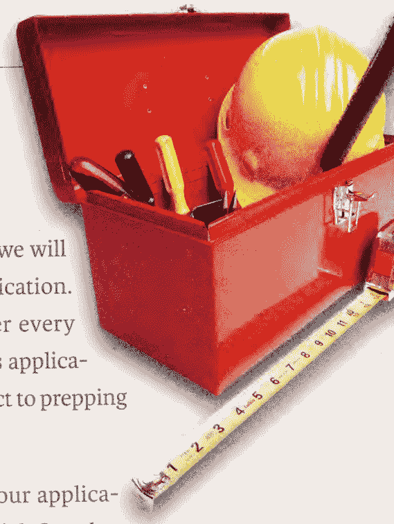

### 理解效率应用

最初的 iPhone 人机界面指南（HIG）将应用分为三大类：工具类应用、效率类应用和沉浸式应用。工具类应用提供数据的单一视图，只需很少或无需交互。效率类应用管理和组织复杂的数据。沉浸式应用使用自定义视图和控件，占据整个屏幕，以提供丰富、可交互的用户体验。

此后，Apple 从 iOS HIG 中删除了这些分类，这在一定程度上是有道理的。随着平台不断成熟，开发者自然会突破这些界限。很少有现代应用能够完全归属于其中某一个类别。甚至早在 iPhone 刚推出时，许多应用就已经采用了混合方式。看看 iPod 应用。它的 Cover Flow 界面为一个原本简单的效率应用注入了沉浸式元素。

然而，至少考虑一下这些分类似乎还是有些好处的，尤其是在设计新应用的时候。它们可以帮助你确定应用的核心功能，然后让你的设计专注于最大化这些功能。

我们在第 1 章中看了一个简单的工具类应用。说实话，关于它们没什么好说的。工具类应用提供了一种快速访问相对简单信息的方式。一个屏幕、几个设置——如果你想要的功能比这更复杂，那么你可能需要考虑一种不同的方法。

在接下来的几章中，我们将研究效率类应用。这类应用管理并组织复杂的数据。虽然你可以提供一些自定义用户界面，但你应该重点关注易用性。努力创建一个干净、精简的解决方案，帮助用户以一种不突兀且直观的方式浏览数据。

效率类应用通常使用三种工具来组织和交互数据：UITabBarController、UINavigationController 和 UITableView。你可能不需要全部三种工具，但它们是筛选数据时主要的内置工具。

UITabBarController 让用户可以轻松地在不同任务或不同数据组之间切换。例如，时钟应用让用户在不同的时间相关任务之间选择：世界时钟、闹钟、秒表和计时器。另一方面，iPod 应用允许用户选择其数据的不同视图：专辑、艺人、流派、歌曲、播放列表、视频等等。App Store 则混合了这两种方式，显示三个数据组（精选、类别和 Top 25）和两个任务（搜索和更新）。

### 那么“效率”到底是什么意思？

“效率应用”这个名称有点误导性。虽然许多此类应用确实专注于传统的以效率为导向的任务，比如待办事项列表和日历，但任何强调数据和组织的应用都可以从这种效率风格中获益。

邮件应用是传统效率应用的完美例子。它允许你管理来自多个电子邮件账户的收件和发件。许多社交网络应用也属于这一类别——尽管你很难让我相信 Facebook 能提高效率。就连 iPod 应用也属于这一类别，因为它的主要任务是组织和访问数据。

标签栏可以支持任意数量的标签项。然而，它一次只能显示五个标签。UITabBarController 会自动管理任何多余的标签项，它会提供一个“更多”按钮，并让用户自定义标签栏上显示的项。请注意，如果你有超过五个标签，标签栏将只显示其中四个，因为“更多”按钮占用了其中一个位置。

接下来，UINavigationController 让用户从一般视图移动到更具体的视图。该控制器维护一个视图堆栈。当新视图被添加到堆栈顶部时，该视图从右侧滑入，同时旧视图从左侧滑出。当顶部视图从堆栈中弹出时，动画则相反。这为在视图层级中移动提供了一种非常直观的界面。

虽然 UITabBarController 和 UINavigationController 都管理视图之间的导航，但 UITableView 负责实际的数据显示。表格通常用于呈现列表。例如，电子邮件账户列表、单个账户内的邮箱列表，甚至是单个邮箱内的消息列表。UITableView 显示单列单元格。每个单元格本身可能相当复杂，结合了图像、图标和格式化文本。通常，整个表格只使用一种单元格类型。每个单元格代表相似项目列表中的一个不同条目。

然而，UITableView 还有另一个用途。我们可以创建一个静态表格来组织一组固定的异构数据。在这种情况下，整个表格用于表示一个条目。每一行都有自己独特的格式，显示该条目的某个方面。当我们切换条目时，行的数量和类型保持不变，只有数据发生变化。我们经常使用静态表格来显示数据层级中选中的叶子对象的详细信息。


### 标签栏与导航控制器

应用程序可以有多个UINavigationController或UITableView；然而，它们应该只有一个UITabBarController。此外，UITabBarController应该始终是应用程序的根控制器。你可以将UINavigationController添加到UITabBarController中，但绝不应该将UITabBarController添加到UINavigationController中。

如果确实需要，你可以将标签栏添加到由导航控制器管理的视图中，但你必须创建自己的标签栏控制器类。通常，这应该是UIViewController的子类，并采用UITabBarDelegate协议。这并不难，但你需要编写自定义代码来管理子视图列表，并在用户选择新标签时将其换入换出。

Apple的文档强烈建议使用单个标签栏，将其作为应用程序的根视图，并在每个场景中保持可见和可访问。如果这不符合你的应用程序需求，那么也许你应该重新考虑你的用户界面。例如，表视图可能更适合你的需求。

生产力应用程序将其中部分或全部工具组合成一个与应用程序数据自然匹配的用户界面。通常，UITabBarController提供最粗略的组织，定义最广泛的组。在每个组内，UINavigationController让用户从一般移到具体，而UITableView显示每个详细级别可用的信息。

如果你像我一样，每天大部分时间都坐在电脑前。这导致了一场持续不断的减肥斗争。为了帮助这场斗争，让我们构建一个应用程序，让用户能够随时间跟踪他们的体重。

Health Beat 将有三个主要任务：用户可以输入新的体重，可以查看显示体重随时间变化的图表，还可以调出显示所有体重输入的完整历史记录。我们将使用标签视图在这些任务之间导航。此外，我们将使用表视图/导航控制器组合来管理历史视图。

本章将重点关注应用程序的整体架构，构建连接标签栏、表视图和导航控制器的故事板，以及构建和附加应用程序的模型。我们将在后续章节中充实这个设计并涵盖其他主题，例如保存和加载数据以及绘制自定义视图。

打开我们在第1章中创建的iOS Development工作区。它应该包含我们的Hello World项目。通过从菜单中选择File > New > New Project添加一个新项目。然后选择iOS > Application > Tabbed Application，并点击Next按钮（图3.1）。

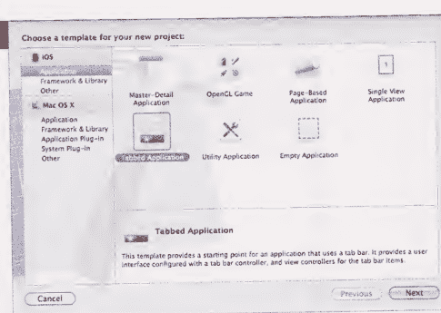

**图3.1** 选择标签页应用程序模板

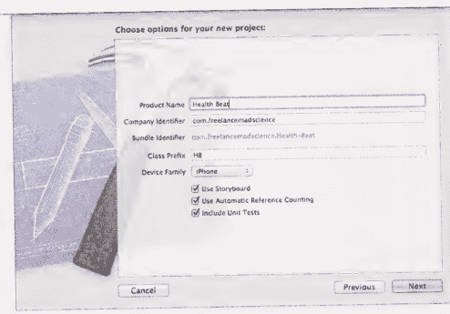

**图3.2** 命名产品

在“Choose options”面板中，将项目命名为Health Beat，并将Class Prefix设置为HB。确保Device Family弹出菜单设置为iPhone，并且选中Use Storyboard、Use Automatic Reference Counting和Include Unit Tests复选框。然后点击Next（图3.2）。

在最后一个面板中，选择项目的位置。确保选中“Create local git repository for this project”复选框，并将Group下拉菜单设置为我们的iOS Development工作组。然后点击Create（图3.3）。

这将创建一个基本的标签页应用程序。在Xcode的工具栏中，将方案更改为Health Beat > iPhone 5.0 Simulator（图3.4）并运行应用程序。

如你所见，应用程序模板为我们提供了一个简单的双标签页应用程序（图3.5）。你可以按标签按钮在第一和第二个视图之间切换。

查看代码，我们的模板创建了一个应用委托（HBAppDelegate）、两个视图控制器（HBFirstViewController和HBSecondViewController）、故事板（MainStoryboard.storyboard）、我们的标签栏图标（first.png、first@2x.png、second.png、second@2x.png）以及我们的支持文件。我们还有一个用于单元测试的新组。

### 设置附加警告

Xcode可以执行复杂的分析，并对你的代码提供相当多的反馈，帮助避免大量常见的编程错误。不幸的是，其中许多设置默认是关闭的。让我们修复这个问题。

在仍选中Health Beat项目图标的情况下，点击Editor区域中的Build Settings选项卡。确保All和Combined按钮被按下，然后在搜索栏中输入**analyzer**。这将调出Run Static Analyzer设置。将此值更改为**Yes**。这将强制编译器在每次构建应用程序时运行静态分析器（图3.8）。

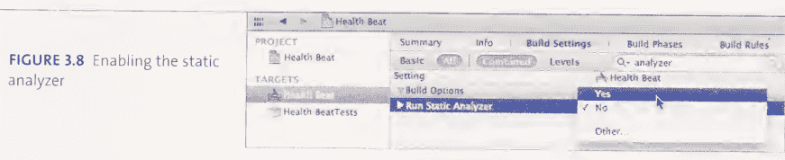

每次构建都运行静态分析器提供了一个很好的健全性检查；然而，它可能会显著减慢编译时间。你可能会发现在处理非常大的项目或在较慢的计算机上开发时需要关闭它。然而，根据我的经验，将新副本上传到设备（甚至模拟器）可能需要很长时间，以至于额外的编译时间几乎不明显。不过，情况可能有所不同。

接下来，清除搜索栏，向下滚动，直到找到标记为Apple LLVM compiler 3.0 – Warnings的部分（应该靠近底部）。这些设置让我们配置编译器生成的警告。Xcode已经启用了一些有用的警告；但是，我强烈建议打开以下所有选项：

- 1. 检查Switch语句（默认开启）
- 2. 隐藏局部变量
- 3. 隐式转换为32位类型
- 4. 不完整的Objective-C协议（默认开启）
- 5. 初始化器未完全括号化
- 6. 返回类型不匹配（默认开启）
- 7. 缺少大括号和圆括号（默认开启）
- 8. 结构体初始化器中缺少字段
- 9. 缺少函数原型
- 10. 文件末尾缺少换行符
- 11. 重写废弃的Objective-C方法
- 12. 指针符号比较（默认开启）
- 13. 符号比较
- 14. 严格选择器匹配
- 15. 可疑的隐式转换
- 16. 将警告视为错误
- 17. 对printf/scanf的调用进行类型检查（默认开启）
- 18. 未声明的选择器
- 19. 未使用的函数
- 20. 未使用的标签
- 21. 未使用的值（默认开启）
- 22. 未使用的变量（默认开启）
- 23. 警告废弃的函数（默认开启）
- 24. 警告未定义的offsetof宏的使用（默认开启）

现在，我不打算对你说谎。短期内，打开这些警告可能会迫使你进行一些额外的输入——有时是大量的额外输入。你偶尔必须向方法中添加不必要的步骤，只为让编译器满意。有些开发者在专注于快速的构建-测试-修改循环时更愿意关闭这些警告；然后在打磨代码时再重新打开。当然，存在你可能永远没有时间回来修复问题的风险。我建议尽可能保持它们开启。总有一天它们会帮你避免一个尴尬的bug，你会感谢我的。

在所有警告中，最重要的无疑是“将警告视为错误”。这迫使你清理代码并摆脱所有警告。这是一个非常好的习惯。尽管这可能令人沮丧，但你确实想要清除所有警告。否则，总有一天你可能会忽略一些真正重要的东西。

相信我，没有什么比编译别人的代码并看着源源不断的警告滚过更糟糕的了。你会有一种胃里下沉的感觉。这些是需要解决的严重问题，还是可以忽略的琐事？帮大家一个忙，修复你的警告。

这引出了另一点。并非所有开发者都会遵循这个建议。你会发现一些第三方库可能会引发数百条警告。一如既往，务实并完成项目总比教条并自鸣得意要好。如果你必须关闭其中一个警告才能继续前进，那么就关闭该警告。

### 添加图片

我们需要为标签按钮提供图标。这些有点奇怪。它们需要是30×30的PNG文件（对于Retina显示屏的手机，需要60×60的@2x.png文件）。图像的实际颜色并不重要；标签栏图标只使用它们的alpha级别。因此，我发现最容易的方式是在透明背景上用黑色绘制图标。如果我想要阴影，我会改变黑色墨水的透明度。这样，我在图形应用程序中看到的图像至少会接近我加载图标时得到的效果。

随意创建你自己的图标。或者，你可以直接从www.freelancemadscience.com/source下载源代码并复制图片资源。右键单击Images组，选择“Add Files to ‘Health Beat’”。确保选中“Copy items into destination group’s folder (if necessary)”复选框。然后从下载的代码中选择graph.png、graph@2x.png、plus.png和plus@2x.png。点击Add。

加号图标将用于我们的标签页，用于输入新的体重。图表标签将用于我们的图表视图（惊喜，惊喜）。我们将使用一个内置图标用于历史视图，因此它不需要任何额外的图片资源。


### 每个应用都应执行的任务

iOS SDK 提供了少量常用于执行关键应用任务的方法。你不必在每个应用中都实现所有这些方法，但应当对它们有所考虑。此外，这些方法大多有对应的通知，可用于在代码的其他部分监视这些事件。

#### 应用启动

这些方法在应用首次启动或从后台状态返回时（适用于 iOS 4.0 或更高版本）被调用。你通常会使用这些方法来加载应用状态并执行其他一次性配置活动。

**application:didFinishLaunchingWithOptions:**

UIKit 会在应用首次启动时调用此 UIApplicationDelegate 方法。我们通常会用它来执行一次性配置任务。但请注意，应用要等到此方法返回后才会出现在屏幕上。因此，我们应避免在此方法中执行任何可能耗时的活动。

特别是要避免访问远程服务器等任务。这些任务在测试时可能一切正常，但在部署给真实用户时可能会失败（尤其是在信号不佳的区域使用手机时）。这可能导致应用冻结，直到网络连接超时，从而在启动时造成难以接受的长时间延迟。

虽然这看起来像是一个罕见的边界情况，但许多第三方框架（例如分析工具包、社交游戏框架或广告网络）在初始化时会执行网络调用。

**applicationWillEnterForeground:**

当应用从后台状态返回时，UIKit 在 iOS 4.0 及更高版本中调用此 UIApplicationDelegate 方法。随着用户关闭和打开应用，这个方法可能被多次调用。

**applicationDidBecomeActive:**

此 UIApplicationDelegate 方法在应用启动时以及每次从后台状态返回时都会被调用。

**viewDidLoad**

一旦控制器的视图完全加载，UIKit 就会调用此 UIViewController 方法。无论视图是如何创建的，都会调用此方法——它可以从 nib 加载，也可以使用 loadView 方法以编程方式构建。

我们将实现此方法以执行额外的设置或配置。作为常规内存管理的一部分，视图可以自动加载和卸载，因此此方法可能会被多次调用。此外，在 viewDidLoad 方法中创建的任何资源都应在 viewDidUnload 方法中释放。

#### 应用关闭

这些方法在应用关闭或转入后台时（适用于 iOS 4.0 及更高版本）被调用。你通常会使用这些方法来保存应用状态，或在应用关闭前执行清理活动。通常，applicationWillTerminate: 仅用于 iOS 4.0 之前的设备，而 applicationDidEnterBackground: 则用于 iOS 4.0 及更高版本的所有设备。如果你同时支持这两种设备，这些方法的内容往往是重复的。

**applicationWillTerminate:**

在 iOS 4.0 之前的设备上，UIKit 会在应用终止前调用此 UIApplicationDelegate 方法。在 iOS 4.0 及更高版本上也可能调用，但这种情况比较少见。应用必须处于后台执行状态时才需要突然终止（例如，响应低内存警告）。更常见的是，当用户点击主屏幕按钮时，你的应用会先进入后台，然后被挂起。当挂起的应用被终止时，它们会悄然结束，不会收到任何额外通知。

此方法大约有 5 秒时间执行清理活动并返回。如果耗时超过 5 秒，应用将被终止。

**applicationDidEnterBackground:**

在 iOS 4.0 及更高版本中，在应用发送到后台之前会调用此 UIApplicationDelegate 方法。你应在此处执行所有清理活动，因为你的应用可能在后台被终止。如前所述，当你的应用被挂起时不会调用 applicationWillTerminate:，因此你可能不会收到任何额外通知。

与 applicationWillTerminate: 一样，你大约有 5 秒时间完成任何操作。不过，你可以通过调用 beginBackgroundTaskWithExpirationHandler: 来请求额外的时间。

#### 低内存警告

当你的应用收到低内存警告时，会调用这些方法。你应该实现这些方法，以释放任何不需要的内存。如果低内存状况持续存在，你的应用可能会崩溃，而内存不足是 iOS 应用崩溃最常见的来源。

**applicationDidReceiveMemoryWarning:**

当应用收到低内存警告时，会调用此 UIApplicationDelegate 方法。你可以使用它来释放任何不需要的内存（例如，你的应用可能持有的任何缓存内存）。

**didReceiveMemoryWarning**

当应用收到低内存警告时，会调用此 UIViewController 方法。默认情况下，如果控制器的视图没有父视图（因此当前未显示），并且可以通过调用 loadView 或从 nib 加载来重建，那么该视图会被卸载。

大多数情况下，默认实现已经足够。你可以重写此方法，在这里执行任何额外操作以释放内存，但完成后一定要调用父类方法。

**viewDidUnload**

每当视图因低内存警告而被卸载时，都会调用此 UIViewController 方法。viewDidUnload 方法通常是 viewDidLoad 的逆操作。你在 viewDidLoad 中创建的任何内容都应在 viewDidUnload 中释放。

此外，如果你有任何输出口或实例变量引用了用户界面元素（例如按钮、文本字段或子视图），则应在此处释放它们。当视图重新加载时，这些元素将被重建。

另外，你不应在此方法中引用 self.view（或类似的变体，如 self.tableView）。这会强制视图重新加载，而由于你正面临内存不足，可能导致应用崩溃。

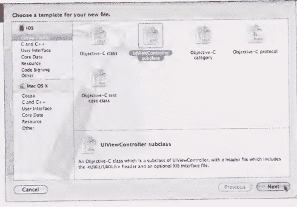

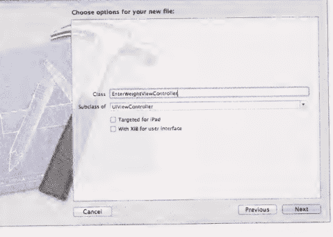

**图 3.9** 创建新的 UIViewController 子类

**图 3.10** 配置 UIViewController 子类

现在，我们已经做好准备，开始构建应用。我们将从标签栏开始。为此，我们需要三个主视图的控制器：EnterWeightViewController、HistoryViewController 和 GraphViewController。

右键点击 Controllers 组，然后从弹出菜单中选择 New File。在面板中，选择 iOS > Cocoa Touch > UIViewController subclass，然后点击 Next 按钮（图 3.9）。

在“Choose options”面板中，在 class 字段中输入 EnterWeightViewController。“Subclass of”设置应设为 UIViewController。“Targeted for iPad”和“With XIB for user interface”复选框应保持未选中。确认设置后，点击 Next（图 3.10）。

最后一个面板允许我们设置保存位置。在这里，默认设置就可以了。我们想将其保存到 Health Beat 目录中。它应该是 Controllers 组的一部分，并且我们要将其添加到 Health Beat 目标中（图 3.11）。点击 Create。

对 GraphViewController 重复这一过程。创建 HistoryViewController 时，有一点小变化。在“Choose options”面板中，将“Subclass of”改为 UITableViewController（图 3.12）。

趁现在，我们再创建一个 UITableViewController，但将其命名为 DetailViewController。我们将用它来显示从历史视图中选中的任何项目的详细视图。我们的 Controllers 组现在应包含八个文件——每个视图控制器对应的一个头文件和一个实现文件。让我们开始将它们连接起来。

打开 MainStoryboard.storyboard 文件，并稍微缩小视图。我们要为四个新控制器添加新的场景。首先，从 Object library 中拖拽一个视图控制器，并将其放在标签栏控制器旁边（图 3.13）。在 Identity inspector 中，将其类改为 EnterWeightViewController。


**图 3.11** 保存 EnterWeightViewController

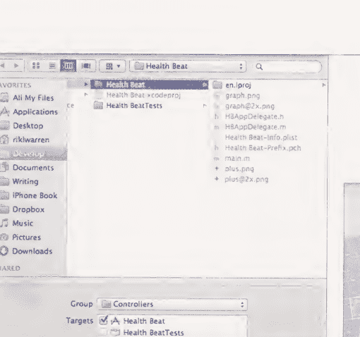

**图 3.12** 选择 UITableViewController 子类

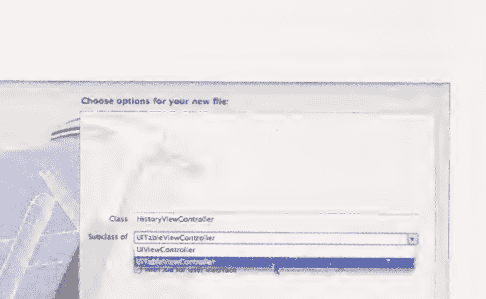

**图 3.13** 添加新场景

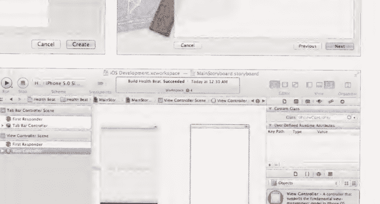

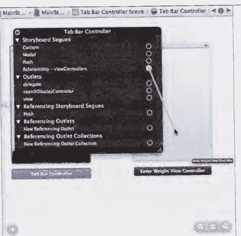

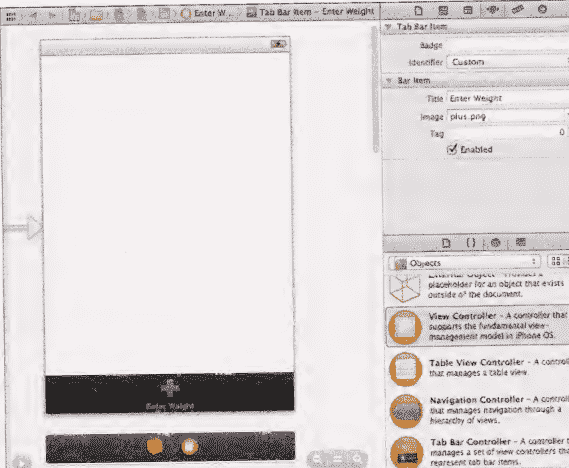

现在，按住 Control 键并单击标签栏控制器，调出其连接弹出窗口。将一条连接从 Relationship - viewControllers 故事板 segue 拖动到新的视图控制器。这会将该场景添加到标签栏中（图 3.14）。

放大我们新建的视图并选择其标签栏项。在 Attributes 检查器中，将 Title 属性设置为 `Enter Weight`，将 Image 属性设置为 `plus.png`。这两个属性分别设置标签的标题和图标（图 3.15）。

**图 3.14** 将我们的场景添加到标签栏

**图 3.15** 设置标签的图标和标题

**注意：** 当我们将视图控制器添加到标签栏的 `viewControllers` 故事板 segue 时，Interface Builder 会在两个视图控制器之间绘制一条类似 segue 的连接。不过，从技术上讲，这条连接是一种关系，而不是 segue。我们无法更改它的属性，并且它不会触发 `prepareForSegue:sender:` 方法。


接下来，添加图表视图。只需重复前面的步骤。拖出一个视图控制器。将其类设置为 `GraphViewController`。将它连接到标签栏的 `viewControllers` 故事板 segue；我们可以根据需要将 `viewControllers` 连接到任意数量的视图控制器。然后，将标签栏项的 Title 属性设置为 `Graph`，将 Image 属性设置为 `graph.png`。

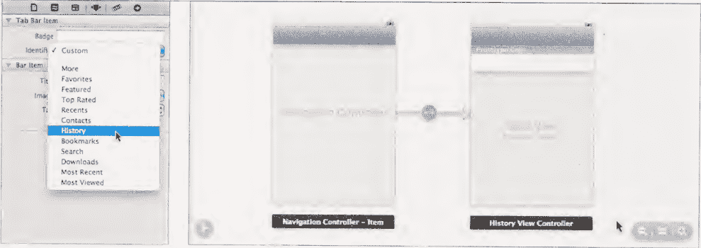

**图 3.16** 将历史视图控制器嵌入导航控制器

**图 3.17** 设置预设标签栏项

最后，我们需要添加历史记录视图；不过，我们希望将该视图嵌入导航控制器中。首先拖出一个表格视图控制器，并将其类设置为 `HistoryViewController`。现在，选中该控制器，然后选择 **Editor > Embed In > Navigation Controller**。这会将一个导航控制器添加到我们的视图中，并将 `HistoryViewController` 连接到它（图 3.16）。

现在，我们只需将标签栏控制器的 `viewControllers` segue 连接到新的导航控制器。请务必将它连接到导航控制器，而不是我们的历史记录视图控制器。另外，我们不再设置标签栏项的 Title 和 Image 属性，而是使用 Xcode 的一个预设标签。只需将其 Identifier 属性从 Custom 更改为 History（图 3.17）。这样会自动设置图标和标签文本。

如你所见，Xcode 提供了许多预设的标签栏项。只要有可能，就应该使用这些预设项。这有助于保持应用程序之间的一致性。当用户看到这些标签栏项时，他们会认出它们，并立即理解其预期用途。

我们还需要连接 `DetailViewController`。再拖出一个表格视图控制器，并将其放在历史记录视图控制器旁边。将其类设置为 `DetailViewController`。我们的历史记录视图将显示按日期排序的体重记录列表。每当用户从列表中选择一条记录时，我们都希望打开该记录的详细视图，但应该如何在故事板中将它们连接起来呢？

放大这两个表格视图。你可以看到，每个视图控制器都包含一个原型表格视图单元格。我们可以使用这些原型单元格为表格视图布局自定义行。我们还可以从这些单元格绘制连接，或将连接绘制到这些单元格。

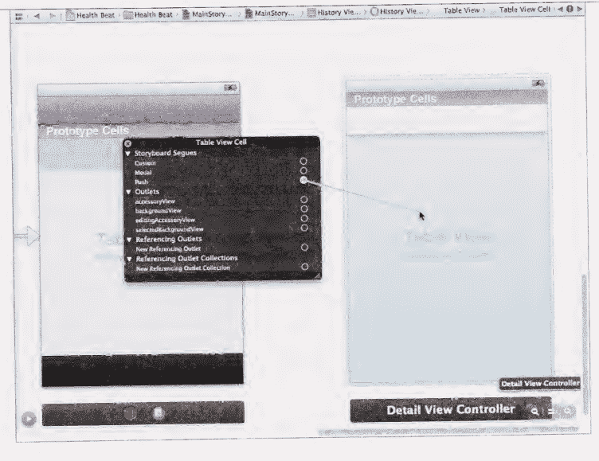

**图 3.18** 从原型单元格连接 segue

右键单击历史记录视图控制器的原型单元格。将一条连接从它的 Push 故事板 segue 拖动到详细视图控制器（**图 3.18**）。就这么简单。只要我们使用该原型创建历史记录视图中的所有表格单元格，用户选中单元格时，它们就会自动打开详细视图。

你可能还注意到，Interface Builder 会自动将导航栏添加到所有连接到导航控制器的视图。不过，这些导航栏看起来有些单调。让我们为它们添加自定义标题。在历史记录视图控制器场景中，双击导航栏，并将其标题设置为 **History**（或者选中导航栏并设置 Title 属性）。对详细视图控制器执行相同操作，但将标题设置为 **Weight Entry**。

就是这样。花几秒钟缩小视图并整理故事板。完成后，它应该看起来像**图 3.19**。

让我们运行一下新建的用户界面。遗憾的是，在编译之前，还有一些零散的问题需要处理。再次放大历史记录视图控制器，并选中其原型单元格。我们需要设置单元格的复用标识符。我们将在第 4 章“显示体重历史记录”一节中详细讨论复用标识符。现在，打开 Attributes 检查器，并将 Identity 属性设置为 **History Cell**。

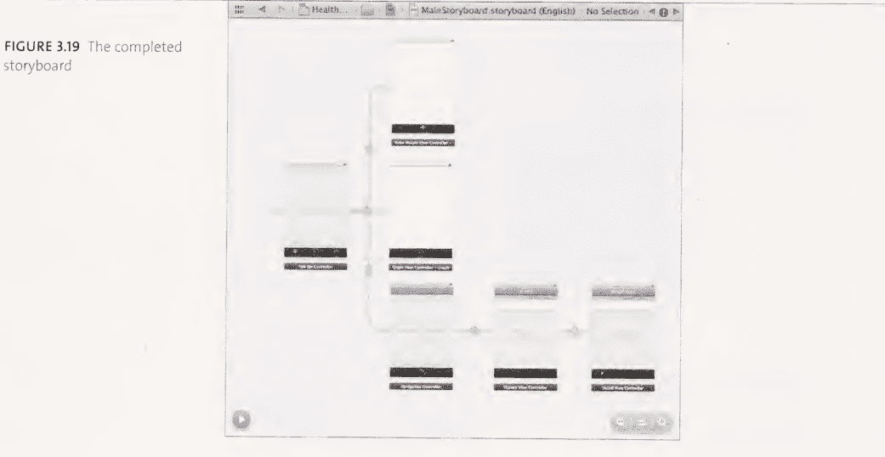

对详细视图控制器执行相同操作，但将其单元格标识符设置为 Detail Cell。

接下来，打开 HistoryViewController.m，并定位到 numberOfSectionsInTableView: 方法。在代码能够编译之前，我们需要删除 #warning 指令。另外，如果希望能够打开详细视图，就至少需要一个分区和一行。为此，请按如下所示修改该方法：

```objective-c
- (NSInteger)numberOfSectionsInTableView:(UITableView *)tableView
{
    // TODO temporary code to get the interface to run
    // Return the number of sections.
    return 1;
}
```

我们需要对 tableView:numberOfRowsInSection: 执行类似的操作。此方法应该返回给定分区中的行数。让我们先设置一行，这样就可以测试连接。

```objective-c
- (NSInteger)tableView:(UITableView *)tableView
    numberOfRowsInSection:(NSInteger)section
{
    // TODO temporary code to get the interface to run

    // Return the number of rows in the section.
    return 1;
}
```

最后，我们需要告诉控制器使用我们的复用标识符。定位到 `tableView:cellForRowAtIndexPath:`。此方法返回给定行的单元格——尽可能复用已有单元格，在必要时创建新单元格。同样，我们将在第 4 章中对此进行更详细的讨论。现在，只需将单元格标识符更改为 History Cell。

```objective-c
- (UITableViewCell *)tableView:(UITableView *)tableView
          cellForRowAtIndexPath:(NSIndexPath *)indexPath
{
    static NSString *CellIdentifier = @"History Cell";
    UITableViewCell *cell =
    [tableView dequeueReusableCellWithIdentifier:CellIdentifier];
    if (cell == nil) {
        cell = [[UITableViewCell alloc] initWithStyle:UITableViewCellStyleDefault
                                      reuseIdentifier:CellIdentifier];
    }
    // Configure the cell...
    return cell;
}
```

最后，切换到 DetailViewController.m。我们需要进行相同的修改，但这次要将单元格标识符设置为 Detail Cell。

**图 3.20** 我们的基本用户界面

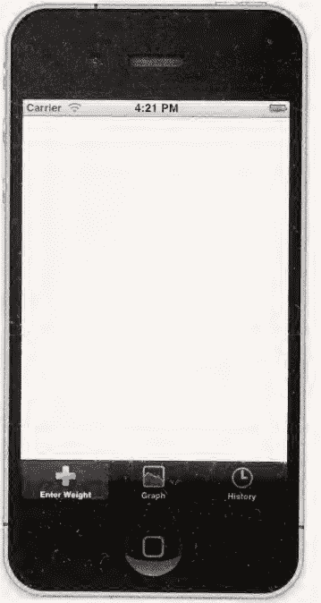

运行应用程序。标签栏将显示我们的三个标签（图 3.20）。你可以点击标签，在不同视图之间切换。另外，如果点击历史记录视图中的第一行，就会导航到详细视图。点击 History 按钮即可返回历史记录视图。注意，导航控制器会自动使用之前视图的标题来设置返回按钮的名称。

所有视图和表格单元格都是空的，因此界面显得有些单调。另外，由于没有任何标签，也不太容易看出各部分的作用。不过，它能够运行——在这个阶段，这才是最重要的。稍后我们会补充所有细节。

我们的应用程序已经有了基本框架。现在，我们需要为它添加实际内容。让我们先勾勒出应用程序的模型层，然后将其接入视图控制器。


正如我们在第 2 章讨论过的，大多数 iOS 应用可以分为三个主要部分：模型、视图和控制器。到目前为止，我们一直在布局并连接我们的控制器和视图。然而，我们仍然需要模型——这个负责管理和存储数据的仓库。

对于这个项目，我们的模型将由两个独立的类组成。`WeightEntry` 对象将表示单条记录，而 `WeightHistory` 类将管理所有的记录集合。

### WeightEntry 类

Health Beat 的数据相对简单。我们会有一些记录，每条记录都有一个日期和一个体重。让我们从构建一个表示单条记录的对象开始。右键单击 `Model` 分组，选择 `New File`。选择 `iOS > Cocoa Touch > Objective-C class`，并让它成为 `NSObject` 的子类。将类命名为 `WeightEntry`，然后保存。

我们需要为这个类添加两个属性：一个用于体重，一个用于日期。对于这样的简单数据存储类，我喜欢让类不可变——一旦设置了值，就不能更改。这有助于保持代码简洁清晰。

打开 `WeightEntry.h`，并按如下所示声明属性：

```objective-c
@interface WeightEntry : NSObject
@property (nonatomic, assign, readonly) CGFloat weightInLbs;
@property (nonatomic, strong, readonly) NSDate* date;
@end
```

这里，我选择将体重存储为一个简单的 `float` 值，并使用 `NSDate` 对象存储日期（和时间）。正如属性名所暗示的，我们将以磅为单位存储体重。另外，即使这些是 `readonly` 属性，我们仍然需要为 `date` 属性指定所有权属性。我还为 `weightInLbs` 属性添加了 `assign` 属性。这并非严格必要，因为属性默认使用 `assign` 所有权，但我喜欢明确写出。

切换到 `WeightEntry.m` 实现文件，并在 `@implementation` 块内添加以下几行来合成这些属性：

```objective-c
@implementation WeightEntry

@synthesize weightInLbs = _weightInLbs;
@synthesize date = _date;
```

体重、货币、日期格式——所有这些看似简单的概念，一旦你想要支持多个国家或文化，往往会变得过于复杂。对于这个项目，我们需要同时支持磅和千克。为了让代码尽可能精简，我们将在内部使用磅作为标准重量单位。然后，我们将按需添加辅助函数，用于从磅转换为千克、从千克转换为磅。

让我们从定义体重单位的枚举开始。切回头文件，并在 `@interface` 声明之前添加以下代码：

```objective-c
#import <Foundation/Foundation.h>

typedef enum {
    LBS,
    KG
} WeightUnit;

@interface WeightEntry : NSObject {
```

现在，在 `@property` 声明之后声明我们的指定初始化方法：

```objective-c
@property (nonatomic, assign, readonly) CGFloat weightInLbs;
@property (nonatomic, strong, readonly) NSDate* date;
- (id) initWithWeight:(CGFloat)weight
           usingUnits:(WeightUnit)unit
              forDate:(NSDate*)date;
@end
```

这个方法将接收一个体重值、体重的单位类型以及一个日期，并初始化我们的 `WeightEntry` 对象。切回实现文件。我们需要同时实现我们的指定初始化方法和超类的指定初始化方法。

```objective-c
// Designated initializer.
- (id) initWithWeight:(CGFloat)weight
            usingUnits:(WeightUnit)unit
               forDate:(NSDate*)date {
    self = [super init];
    if (self) {
        if (unit == LBS) {
            _weightInLbs = weight;
        }
        else {
            _weightInLbs = [WeightEntry convertKgToLbs:weight];
        }
        _date = date;
    }
    return self;
}
// Must override the superclass's designated initializer.
- (id)init {
    NSDate* referenceDate =
    [NSDate dateWithTimeIntervalSince1970:0.0f];
    return [self initWithWeight:0.0f
                      usingUnits:LBS
                         forDate:referenceDate];
}
```

如果体重值已经是磅，我们直接将其赋给 `_weightInLbs` 变量。如果不是，我们先将它转换为磅，然后再赋值。最后，我们赋值日期对象。包含 `init` 方法是为了完整性。这里我们创建了一个没有体重、时间戳为零的对象。这不会特别有用，但我们始终应该重写超类的指定初始化方法，即使只是抛出一个异常。

### 添加辅助方法

你可能已经注意到，我们的指定初始化方法有一个问题。类方法 `[WeightEntry convertKgToLbs:weight]` 实际上并不存在。让我们修复它。切回头文件，并声明以下两个类方法：

```objective-c
@interface WeightEntry : NSObject {
}
@property (nonatomic, assign, readonly) CGFloat weightInLbs;
@property (nonatomic, strong, readonly) NSDate* date;
+ (CGFloat)convertLbsToKg:(CGFloat)lbs;
+ (CGFloat)convertKgToLbs:(CGFloat)kg;
- (id) initWithWeight:(CGFloat)weight
            usingUnits:(WeightUnit)unit
                forDate:(NSDate*)date;
@end
```

回到实现文件。就在 `@implementation` 块之前，添加以下静态变量。`LBS_PER_KG` 将用于磅和千克之间的相互转换，而 `formatter` 将用于为所有体重值提供标准格式，并使用当前区域设置的正确数字格式。是的，数字格式也会因国家/地区而异。

```objective-c
static const CGFloat LBS_PER_KG = 2.20462262f;
static NSNumberFormatter* formatter;
```

现在，在 `@implementation` 块中添加我们的类方法：

```objective-c
+ (CGFloat)convertLbsToKg:(CGFloat)lbs {
    return lbs / LBS_PER_KG;
}
+ (CGFloat)convertKgToLbs:(CGFloat)kg {
    return kg * LBS_PER_KG;
}
```

`initialize` 方法是一个特殊方法，Objective-C 运行时会在这个类首次加载时调用一次。你可以实现它来执行类级配置。这里我们使用它来格式化我们的静态 `formatter` 变量。这一个变量将用于我们所有的数字格式化需求。它将格式化十进制风格的数字，最多保留小数点后两位（将体重四舍五入到最接近的百分位）。

我们还将其限制为正数。默认情况下，`NSNumberFormatter` 会使用我们当前的区域设置来决定十进制数字的格式。例如，在美国，我使用句点作为小数点。然而，在欧洲的一些地方，你会使用逗号代替。`NSNumberFormatter` 会透明地处理这些细节，让我们自动本地化应用。

接下来，`stringForUnit:` 方法使用 `switch` 语句来评估 `unit` 参数的值。如果 `unit` 等于 `LBS`，它返回 `@"lbs"`。如果 `unit` 等于 `KG`，它返回 `@"kg"`。对于其他任何值，它都会抛出一个异常。

对于有 Java 背景的人来说，异常应该并不陌生。当应用中出现了问题时，就会抛出异常。如果异常未被捕获，应用将会崩溃，并在控制台打印相应的消息。然而，Java 和 Objective-C 在理念上存在显著差异。

在 Java 中，异常被捕获并作为程序执行的常规部分来处理。每当出现相对常见的错误（例如，尝试打开不存在的文件）时，它们常被用来管理控制流。

在 Objective-C 中，异常被保留给真正特殊的情况。换句话说，它们被保留给我们应用正常运行期间绝不应发生的问题。因此，异常通常是由开发者错误造成的（在我们的示例中，就是传入无效的 `WeightUnit` 值）。因此，我们在 Objective-C 中很少编写捕获异常的代码。相反，当我们在测试期间看到抛出的异常时，我们会查找代码中的错误并修复它。

`stringForWeight:ofUnit:` 方法接收一个体重值和一个单位值，并将它们组合成一个字符串。我们首先根据数字创建字符串。我们将浮点型的体重值包装在 `NSNumber` 对象中，然后将其传递给 `formatter` 的 `stringFromNumber:` 方法。这将生成一个格式正确且本地化的十进制字符串。接下来，我们获取单位字符串。然后，我们将两者用一个空格组合在一起。


```objective-c
    }
    // This will never be executed.
    return 0.0f;
}
- (NSString*)stringForWeightInUnit:(WeightUnit)unit {
    return [WeightEntry stringForWeight:[self weightInUnit:unit]
                                 ofUnit:unit];
}
```

`weightInUnit:` 方法只是使用一个 switch 语句来求值 unit 参数，正如我们之前看到的。如果单位是 `LBS`，它返回对象以磅为单位的体重。对于 `KG` 单位，它在返回之前转换对象的体重。对于其他任何单位，它抛出一个异常。

### 重构

我们已经看到 switch 语句以几乎相同的方式被使用了三次。一般而言，这表示代码可能需要进行重构，以移除这些重复的结构。想象一下，如果我们想要添加另一种体重单位——例如英石。我们就需要遍历代码，逐一修改所有 switch 语句。

一种重构这段代码的方法是将 `WeightEntry` 转换为抽象类，然后为每种单位类型实现一个子类。这样，我们可以让每个子类的 weight 和 description 方法直接以合适的单位返回相应的值。我们可能还需要额外的方法来在子类之间进行转换，但摆脱所有这些 switch 语句并不困难。而且，如果将来需要添加另一种单位类型，我们只需创建一个新的 `WeightEntry` 子类即可。

然而，在这种情况下，重复代码足够短，类也足够小，可能不值得费这个劲。尽管如此，你仍然应该留意那些可以移除重复代码的地方。

`stringForWeightInUnit:` 方法只是获取对象在指定单位下的当前体重值，然后调用 `stringForWeight:ofUnit:` 类方法来生成格式正确的字符串。

### WEIGHTHISTORY 类

现在我们需要一个类来管理所有的 `WeightEntry`。在内部，我们将使用 `NSMutableArray` 来管理条目列表；但是，我们不希望模型之外的任何东西修改它。相反，让我们对它稍作封装，以便更好地控制它的使用。

在 Model 组中创建一个新类。这应该是 `NSObject` 的子类。将类命名为 `WeightHistory`。现在打开 `WeightHistory.h`。我们要做的第一件事是导入 `WeightEntry` 类。趁着这个机会，我们再添加几个字符串常量键。我们的控制器稍后将使用它们来观察 `WeightHistory` 类中的变化。添加如下所示突出显示的代码：

```objective-c
#import <Foundation/Foundation.h>

#import "WeightEntry.h"

static NSString* const WeightHistoryChangedDefaultUnitsNotification =
    @"WeightHistory changed the default units";
static NSString* const KVOWeightChangeKey = @"weightHistory";

@interface WeightHistory : NSObject {
}
```

通常，我倾向于避免在头文件中放置 `#import` 指令。对于任何未知的对象指针，你通常可以使用前向声明，然后在实现文件中导入实际的头文件。这减少了头文件之间的依赖数量，并且可以大大减少编译大型项目所需的时间。

然而，在这里，我们需要在 `WeightHistory.h` 头文件中访问 `WeightUnit` 类型。记住，`WeightUnit` 是一个枚举，而不是对象，因此我们不能使用前向声明。如果我们真想较真的话，可以把 `WeightUnit` 移到它自己的头文件中，然后只导入那个头文件，但导入 `WeightEntry.h` 已经足够好了。

### 可变集合类与不可变集合类

所有 Objective-C 集合类都有两个版本：可变和不可变。对于数组，它们是 `NSMutableArray` 和 `NSArray`。主要区别在于，你可以向可变数组中添加和移除条目。不可变数组的内容在创建数组时设定，之后不能更改。

一般来说，传递数据的不可变副本比允许直接访问可变集合更干净、更安全。毕竟，你不想在自己不知情的情况下意外地改动数据。

现在让我们将这些属性添加到 `@interface` 块中：

```objc
@interface WeightHistory : NSObject {
}

// This is a virtual property.
@property (nonatomic, readonly) NSArray* weights;
@property (nonatomic, assign, readwrite) WeightUnit defaultUnits;
@end
```

正如注释所示，`weights` 数组是一个虚拟属性。与大多数属性不同，`weights` 不会仅仅提供对实例变量的访问器。相反，`weights` 返回的值将在运行时动态生成。稍后我们将看到，这需要我们做一些额外的工作。

现在让我们向这个类添加两个实例方法。将它们放在 `@property` 声明下方。

- `(void)addWeight:(WeightEntry*)weight;`
- `(void)removeWeightAtIndex:(NSUInteger)index;`

这声明了一个添加新 `WeightEntry` 的方法，以及一个移除任意指定体重条目的方法。就这样，接口完成了，至少目前是这样。我们会在第 6 章再回来添加更多方法，届时我们将开始保存和加载模型。

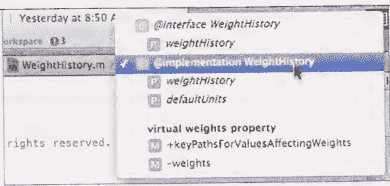

**图 3.21** 使用 `#pragma mark` 指令来组织你的代码

首先，添加下面突出显示的代码：

```objective-c
@implementation WeightHistory
@synthesize weightHistory = _weightHistory;
@synthesize defaultUnits = _defaultUnits;

#pragma mark - virtual weights property

// This ensures key-value observing works for weights.
+ (NSSet *)keyPathsForValuesAffectingWeights {
    return [NSSet setWithObjects:@"weightHistory", nil];
}

// Virtual property implementation.
- (NSArray*)weights {
    return self.weightHistory;
}
@end
```

首先，`#pragma mark` 指令是一种方便的组织代码的技巧。编译器完全忽略它；不过，Xcode 在跳转栏中显示类的详细信息时，会使用 `#pragma mark` 指令来添加标签和分隔线。例如，输入代码后，点击编辑器跳转栏中的 `@implementation WeightHistory` 项（或者跳转栏中碰巧是最后一项的那个条目）。现在它就会有一条分隔线和标题，将我们的新方法与类的其余部分分隔开（图 3.21）。

接下来，我们有一个名为 `keyPathsForValuesAffectingWeights` 的方法。每当使用 KVO 观察一个值时，运行时都会查找名为 `keyPathsForValuesAffecting<key>` 的方法，其中 `<key>` 是被观察值的名称。如果此方法存在，它应该返回一个 `NSSet`，其中包含被观察值所依赖的所有键。当列出的任何值发生变化时，任何观察 `<key>` 的对象都会收到通知。在我们的例子中，任何使用 KVO 监视 `weights` 属性的人都应在 `weightHistory` 变化时收到通知。

然后就是访问器本身。这里我们只是返回对 `weightHistory` 对象的引用。这不是最万无一失的方法。我们可以创建一个不可变副本并返回它，或者我们可以完全移除 `weights` 属性，根据需要创建额外的索引访问器。然而，这种方法很快，而且确实传达了我们的意图。`weightHistory` 数组绝不应在 `WeightHistory` 类之外被修改。鉴于 Objective-C 的动态特性，一个执意的开发者总能找到破坏封装并摆弄我们内部数据的方法，所以这可能已经足够好了。

我们仍然需要初始化对象。只需重写 `init` 方法，如下所示：

```objective-c
#pragma mark - initialization

- (id)init
{
    self = [super init];
    if (self) {
        // Set initial defaults.
        _defaultUnits = LBS;
        _weightHistory = [[NSMutableArray alloc] init];
    }
    return self;
}
```

这里我们只是设置了合理的初始默认值——创建一个空的历史列表，并将默认单位设置为磅。

好了，让我们看看访问器方法。`@synthesize` 指令会自动为 `setDefaultUnits:` 创建默认实现，但我们想要做一些额外的自定义处理。让我们实现自己的版本。

```objective-c
#pragma mark - accessor methods

- (void)setDefaultUnits:(WeightUnit)units {
    // If we are setting the current value, do nothing.
    if (_defaultUnits == units) return;
    _defaultUnits = units;

    // Send a notification.
    [[NSNotificationCenter defaultCenter]
        postNotificationName:
            WeightHistoryChangedDefaultUnitsNotification
        object:self];
}
```

`setDefaultUnits:` 方法很直接。首先，我们检查单位参数是否与当前默认单位相同。如果不同，我们就设置默认单位，并向通知中心发布通知。

这引出了一个有趣的问题。为什么我们要使用通知而不是键值观察？嗯，最简单的答案是我想让你们了解这两种方法。然而，KVO 和通知各有其独特的优缺点。

只要我们观察的是符合 KVO 的值，KVO 就不需要被观察对象采取任何行动。所有通知都会自动发布。然而，在接收端，所有内容都通过 `observeValueForKeyPath:ofObject:change:context:` 方法进行路由。可以想象，如果你开始观察大量值，这个方法很快就会变得冗长且难以阅读。

另一方面，通知框架给了我们更大的灵活性。任何注册接收通知的对象都可以指定一个选择器，在收到通知时调用。是的，我们必须手动发布通知，但这也给了我们自由，精确设计通知发布的时间和原因。


接下来，看看我们的 `addWeight:` 和 `removeWeightAtIndex:` 的实现。

```objectivec
- (void)addWeight:(WeightEntry*)weight {

    // Manually send KVO messages.
    [self willChange:NSKeyValueChangeInsertion
    valuesAtIndexes:[NSIndexSet indexSetWithIndex:0]
                   forKey:KVOWeightChangeKey];
    // Add to the front of the list.
    [self.weightHistory insertObject:weight atIndex:0];
    // Manually send KVO messages.
    [self didChange:NSKeyValueChangeInsertion
    valuesAtIndexes:[NSIndexSet indexSetWithIndex:0]
                   forKey:KVOWeightChangeKey];
}
// This will be auto KVO'ed.
- (void)removeWeightAtIndex:(NSUInteger)weightIndex {

    // Manually send KVO messages.
    [self willChange:NSKeyValueChangeRemoval
    valuesAtIndexes:[NSIndexSet indexSetWithIndex:weightIndex]
                   forKey:KVOWeightChangeKey];
    // Add to the front of the list.
    [self.weightHistory removeObjectAtIndex:weightIndex];
    // Manually send KVO messages.
    [self didChange:NSKeyValueChangeRemoval
    valuesAtIndexes:[NSIndexSet indexSetWithIndex:weightIndex]
                   forKey:KVOWeightChangeKey];
}
```

### 连接模型

现在我们需要将模型对象连接到控制器。这常常会引起一些困惑——毕竟，控制器是由我们的 storyboard 创建的。我们如何将数据对象传入其中呢？

理论上，我们也可以把模型对象添加到 storyboard 中，让它一并创建。这并非坏方法；但我们会失去对对象的一些控制。storyboard 中的任何对象都会在场景加载时创建。如果我们的数据对象作为初始场景的一部分被加载，那么应用启动时可能会造成延迟——尤其是在加载特别大的文件或从网络加载资源时。

更重要的是，我们无法将一个场景中的 outlet 连接到另一个场景中的对象。如果我们能把模型添加到初始场景，然后将其连接到所有其他场景的 outlet，我可能会很倾向于向 storyboard 添加对象。但目前来看，可能有更好的解决方案。

另一种常见的方法是，为我们的模型创建一个单例类，或者将模型存储在 app delegate 中（这实际上也是同样的做法）。就我个人而言，我觉得 app delegate 的方法有点草率，而且我尽量避免使用单例类这一黑暗诱惑。

相反，让我们使用懒加载（lazy initialization）在初始场景的控制器中创建模型，然后在新的场景加载时将数据传递过去。

我们先创建一个自定义的 UITabBarController 子类。右键点击 Controllers 组，选择 New File > UIViewController subclass。在选项面板中，UITabBarController 并不在“Subclass of”下拉菜单的选项里。所以我们需要直接将其输入到字段中。然后将控制器命名为 TabBarController 并创建它。

现在打开 TabBarController.h。我们还需要添加一个属性来持有 WeightHistory 对象。如下所示修改头文件：

```objectivec
@class WeightHistory;

@interface TabBarController : UITabBarController

@property (nonatomic, strong) WeightHistory* weightHistory;

@end
```

```objectivec
[stack addObjectsFromArray:
    [controller viewControllers]];
}

// If it responds to setWeightHistory, set the weight
// history.
if ([controller respondsToSelector:
        @selector(setWeightHistory:)]) {
    [controller setWeightHistory:self.weightHistory];
}

}}
```

我们首先创建一个新的 WeightHistory 对象，并将其赋值给我们的 weight history 属性。然后事情就变得有趣了。我们创建一个可变数组，并用选项卡的控制器将其填满。然后将这个数组当作栈来使用，依次从栈中取出每个控制器进行处理。

如果控制器充当其他控制器的容器（例如导航控制器、标签栏控制器、分视图控制器或页面视图控制器），我们就将其控制器添加到栈中。最后，如果控制器有 setWeightHistory: 方法，我们就调用它，并把新创建的 WeightHistory 对象传进去。

对于当前项目，我们会将 weight history 直接赋值给 EnterWeightViewController 和 GraphViewController 对象。然而，当我们拿到导航控制器时，会从导航控制器中取出 HistoryViewController 并添加到我们的栈中。然后当 HistoryViewController 被弹出栈时，我们同样为其赋值我们的 weight history。

我们本可以简单地硬编码通往三个主要控制器的路径，并直接传递数据对象，但这种方法为我们未来扩展提供了更大的灵活性。我们可以轻松添加新的视图控制器，而我们的系统将恰当地处理它们。我们甚至可以处理大多数视图控制器容器，而无需对这段代码做任何修改。

这也是 Objective-C 动态特性如何极大简化我们代码的一个绝佳例子。我们从 viewControllers 数组中取出一个对象。我们不需要知道它的类——实际上对它一无所知也没关系。如果它响应我们感兴趣的方法，我们就调用这些方法。如果不响应，我们只需继续处理栈中的下一个对象。

我们还需要告诉应用程序使用这个类。打开 storyboard，放大标签栏控制器，把它的类改为我们新的 TabBarController 类。好。现在只需将 weightHistory 属性添加到我们的视图控制器中。我们先打开 EnterWeightViewController.h。如下所示修改接口：

```objectivec
@class WeightHistory;

@interface EnterWeightViewController : UIViewController

@property (nonatomic, strong) WeightHistory* weightHistory;

@end
```

这看起来应该很熟悉。这几乎和我们刚才对 TabBarController 所做的一模一样。同样，我们只需为 weightHistory 类创建一个前向声明，然后声明一个 weightHistory 属性。现在，切换到实现文件。和之前一样，我们需要导入 WeightHistory 类，然后合成 weightHistory 属性。

```objectivec
#import "EnterWeightViewController.h"
#import "WeightHistory.h"

@implementation EnterWeightViewController

@synthesize weightHistory = _weightHistory;
```

就这样。我们所要做的就是这些。对 GraphViewController 和 HistoryViewController 类重复这些步骤。

这样就只剩下 DetailViewController 类了。这个类不同之处有两个原因。第一，它不直接与标签栏控制器相连。相反，当用户在历史视图控制器中选择一行时，我们的详情视图控制器场景才会被加载。第二，我们既想传递 WeightHistory，又想传递当前选中行的索引。

打开 DetailViewController.h 并如下所示修改它：

```objectivec
@class WeightHistory;

@interface DetailViewController : UITableViewController

@property (nonatomic, strong) WeightHistory* weightHistory;
@property (nonatomic, assign) NSUInteger selectedIndex;
```

现在，切换到实现文件，导入我们的 weightHistory，并合成这两个属性。

```objc
#import "DetailViewController.h"

#import "WeightHistory.h"

@implementation DetailViewController
@synthesize weightHistory = _weightHistory;
@synthesize selectedIndex = _selectedIndex;
```

接下来，我们需要为这些属性赋值。首先，我们需要为 segue 提供一个标识符，以便在代码中识别它。打开 MainStoryboard.storyboard，选中连接历史视图控制器和详情视图控制器的 segue，将其 Identifier 属性设置为 Push Detail View。

现在打开 HistoryViewController.m，导入我们的 DetailViewController 类，并添加一个包含我们 segue 标识符的字符串常量。

```objc
#import "HistoryViewController.h"
#import "WeightHistory.h"
#import "DetailViewController.h"
static NSString* const DetailViewSegueIdentifier =
@"Push Detail View";
@implementation HistoryViewController
@synthesize weightHistory = _weightHistory;
```

然后添加以下方法：

```objc
- (void)prepareForSegue:(UIStoryboardSegue *)segue
                sender:(id)sender {
    if ([segue.identifier isEqualToString:
         DetailViewSegueIdentifier]) {
        NSIndexPath* path =
        [self.tableView indexPathForSelectedRow];
        DetailViewController* controller =
        segue.destinationViewController;
```


```c
controller.weightHistory = self.weightHistory;
controller.selectedIndex = path.row;
}
}
```

在这里，我们只需验证有一个打开详细视图的 segue，然后获取选中行的索引路径和目标视图控制器的引用。接着，我们为新的 DetailViewController 设置 weightHistory 和 selectedIndex 属性。

就这样。我们可以打开 DetailViewController.m 并找到 viewDidAppear: 方法，验证数据是否一路传递到了详细视图。按如下所示修改此方法：

```objc
- (void)viewDidAppear:(BOOL)animated
{
    [super viewDidAppear:animated];
    NSLog(@"Weight History = %@", self.weightHistory);
    NSLog(@"Selected Index = %d", self.selectedIndex);
}
```

现在运行应用程序。导航到历史记录视图，然后点击第一行。控制台中应出现以下消息（当然，WeightHistory 的内存地址可能会改变）。

```
2011-07-21 00:58:39.059 Health Beat[760:207] Weight History =
<WeightHistory: 0x6a1e690>
2011-07-21 00:58:39.061 Health Beat[760:207] Selected Index = 0
```

当你确认一切正常后，可以移除 NSLog() 调用。

### Nib 的秘密生活

Nib 是故事板背后的底层技术。编译器会将故事板分解为多个 nib 文件，并在需要时加载它们。因此，要理解故事板加载场景时发生了什么，我们确实需要了解底层 nib 的生命周期。这里我简要总结一下，但要了解完整的逐步细节，请查看 Apple 的 Resource Programming Guide: Nib Files。

当 nib 加载时，会为 nib 内的所有对象和资源分配内存，然后实例化整个对象图。符合 NSCoder 协议的对象将通过调用 initWithCoder: 来实例化。所有其他对象通过调用 init 来实例化。

然后，所有 outlet 都通过 setValue:forKey: 方法连接。所有 action 都通过 addTarget:action:forControlEvents: 连接。一旦整个对象图创建完成，UIKit 会为 nib 创建的每个对象调用 awakeFromNib。你可以实现对象的 awakeFromNib 方法，以便在所有 outlet 和 action 都正确配置后执行任何额外的配置步骤。

注意：UIViewController 子类应改为在 viewDidLoad 中执行额外的配置。控制器可能是在与其视图不同的 nib 中创建的。因此，awakeFromNib 方法可能在视图加载之前就被调用，而任何连接到视图 nib 中用户界面元素的 outlet 可能尚未正确设置。

nib 加载完成后，任何未存储在某处强引用中的对象都会被释放。大多数时候，我们无需担心这一点。除非我们以编程方式自行加载场景，否则系统会自动将视图控制器存储在视图控制器层级中（例如，在导航堆栈中或作为模态视图控制器）。主视图存储在视图控制器中，任何其他用户界面元素和手势识别器都会自动存储在它们的容器视图中。

然而，如果我们添加任何新的顶层对象（尚未放入视图层级的数据对象或视图），我们需要在某处存储对它们的引用。通常，这意味着在我们的视图控制器中创建一个 outlet，并将对象连接到该 outlet。

这里有几个关键点值得强调：

- 1. 关于 nib 如何加载的许多细节在 Mac OS X 和 iOS 上有所不同。如果你在桌面开发和移动开发之间来回切换，请务必仔细核对文档。
- 2. 任何符合 NSCoder 的对象都会使用 initWithCoder: 加载。与其他 init 方法不同，它最终不会调用你的指定初始化器。如果你在 nib 中加载自定义对象（包括 UIViewController 子类），请务必在 awakeFromNib 方法（对于 UIViewController 子类则是 viewDidLoad）中执行所有额外的初始化步骤。
- 3. 如果添加顶层对象，请务必在视图控制器中为其添加 outlet。我们需要对顶层对象的强引用，否则它会在 nib 加载后消失。
- 4. UIViewController 子类将作为常规内存管理的一部分自动卸载和重新加载它们的 nib。你不能假设 nib 只加载一次。同样，你也不能假设控制器的 viewDidLoad 方法只会调用一次。
- 5. nib 设置的任何 outlet 都应在 viewDidUnload 中清除。同样，你在 viewDidLoad 中做的任何事情都应在 viewDidUnload 中撤销。例如，如果你在 viewDidLoad 中将对象分配给属性，请务必在 viewDidUnload 中将该属性设置为 nil。如果视图再次加载，我们无论如何都会重置该属性。没有必要持有当前未使用的内存。

### 收尾

我们的应用可以构建并启动了。我们可以在三个标签页之间切换。是的，它只是一个骨架——但接下来的几章将充实这些内容。在第 4 章中，我们将完善 EnterWeightView 和 HistoryView。在第 5 章中，我们将使用 GraphView 绘制自定义视图，在第 6 章中，我们将保存应用程序数据和用户默认设置。最后，在第 7 章中，我们将使用 Core Data 替换 Health Beat 当前的模型。

在我们结束之前，还有最后一步。让我们将更改提交到 git 仓库。最好养成尽早提交并经常提交的习惯。这样，我们就可以将当前文件与之前提交的任何版本进行比较，如果必须回滚更改，我们可以尽量减少要撤销的工作量。拥有大量小的增量步骤总比少数几个大步要好。此外，提交越多，版本控制就越有用。

要提交所有更改，请前往 File > Source Control > Commit。输入 Chapter 3 作为提交消息，然后点击 Commit。就这样，剩下的交给 Xcode 处理。

## 4 开发视图和视图控制器


### 输入体重数据


**图 4.1** 使标签居中


**图 4.2** 拉伸标签以填充视图

让我们从修改输入体重视图开始。打开 MainStoryboard.storyboard 文件，放大到中间的体重场景。

从库中拖出一个标签，放到视图中的任意位置。双击标签，将文本改为**输入今天的体重**。在属性检查器中，将字体改为 System Bold 24.0。你可以点击字体图标打开字体窗口。接下来，从菜单栏中选择 Editor > Size to Fit Content。最后，使用辅助线将标签沿视图顶部居中（**图 4.1**）。

再拖出一个标签，将其放在第一个标签下方。将文本改为**当前日期和时间**。别担心，那只是一个占位符。我们会在运行时替换这个文本。当然，我们不知道日期和时间字符串到底有多长，但我们仍然希望它居中显示在标题下方。最简单的方法是将标签的 Alignment 属性设置为 Centered，然后拉伸标签，使其从一边到另一边填满整个视图（**图 4.2**）。

接下来，在“当前日期和时间”标签下方放置一个文本字段。拉伸它，使其同样从视图的一边延伸到另一边。按照**表 4.1** 所示设置属性。


表 4.1 文本字段属性

| 属性名 | 值 |
|---|---|
| 对齐 | 居中 |
| 大写 | 无 |
| 自动更正 | 否 |
| 键盘 | 数字和标点 |
| 返回键 | 完成 |
| 自动启用返回键 | 开 |


**图 4.3** 完成后的“输入重量”视图控制器场景

呼，设置项真不少。我们逐一来说明。我们希望将输入限制为有效的十进制数字。另外，既然我们只允许输入数字，那么启用自动更正和大写就没有意义了。我们不妨将它们关闭。“数字和标点”键盘提供了我们需要的所有按键（所有数字、一个返回键，以及——对于美式英语——一个句点）。实际上它允许的字符过多，因此我们需要过滤输入。稍后我们会讲到这一点。

最后两个设置将帮助我们创建更简洁的用户界面。本质上，我们希望在用户按下返回键时自动创建一个新的 WeightEntry 对象并切换到图形视图。这减少了输入新重量所需的点击次数。为了支持这一点，我们将返回键的标签改为“完成”，以更好地传达我们的意图。更重要的是，自动启用返回键意味着只要文本字段为空，返回键就会处于禁用状态。一旦用户输入了一些文本，系统会自动启用返回键。这与我们的输入过滤相结合，将确保每当按下返回键时，我们都能得到一个有效的重量条目。

现在界面应该与 **图 4.3** 一致。基本框架已经就绪，但我们要对它稍作美化。

### 秘密 键盘选项

> 从 iOS 4.1 开始，出现了一种新的键盘类型：UIKeyboardTypeDecimalPad。这种键盘只有数字、一个小数点和一个退格键。乍一看，它似乎非常适合这个项目。然而，它没有返回键——而我们确实希望允许用户直接从键盘提交重量值。
>
> 我们可以添加一个返回键（也许在一个自定义输入附件视图中；请参阅《iOS 文本、Web 和编辑编程指南》），但这会创建更复杂的用户界面。
>
> iOS 5.0 增加了另一种键盘类型：UIKeyboardTypeTwitter。虽然对这个项目来说并不特别有用，但 Twitter 键盘是为编写推文而优化的。它会显示所有字母以及 @ 和 # 键。
>
> 不幸的是，这两个选项都没有出现在 Interface Builder 中——至少在当前版本的 Xcode 中没有。相反，你必须在代码中设置文本字段的 keyboardType 属性。这并不难。在 viewDidLoad 方法中，只需添加 self.weightTextField.keyboardType = UIKeyboardTypeDecimalPad; 或 self.weightTextField.keyboardType = UIKeyboardTypeTwitter;。

### 设置自动旋转和自动调整大小

我们希望视图能够旋转到任意方向。这需要两个步骤。首先，我们必须修改控制器以允许自动旋转。

打开 EnterWeightViewController.m，并导航到 shouldAutorotateToInterfaceOrientation: 方法。如果控制器的视图可以旋转到给定的 interfaceOrientation，该方法应返回 YES。在默认实现中，它只允许旋转到正立的纵向方向。

要允许应用旋转到任意方向，只需让该方法返回 YES，如下所示：

```
- (BOOL)shouldAutorotateToInterfaceOrientation:
    (UIInterfaceOrientation)interfaceOrientation {
    return YES;
}
```


**图 4.4** 自动旋转正常，但自动调整大小不起作用。

**图 4.5** 将控件锁定在视图顶部

然而，如果你运行应用，可能会注意到自动旋转仍然不起作用。无论你如何转动设备，界面都锁定在纵向方向。

这是因为有一个诀窍。默认情况下，只有当所有包含的视图控制器都支持自动旋转时，标签视图才允许自动旋转。对 `HistoryViewController` 和 `GraphViewController` 做同样的修改，然后再次运行应用。

而且……仍然不起作用。好吧，我说谎了。这里有两个诀窍。当我们创建自定义标签视图时，结果发现我们无意中覆盖了标签栏默认的 `shouldAutorotateToInterfaceOrientation:` 实现。打开 `TabBarController.m`，删除 `shouldAutorotateToInterfaceOrientation:` 方法。这将恢复默认行为。最后再运行一次。它应该终于能按预期旋转了。不幸的是，我们又遇到了另一个问题（图 4.4）。在新的更宽的视图中，UI 元素没有正确地调整大小或重新定位。

要解决这个问题，请再次打开 `MainStoryboard.storyboard`。选择“输入今天的重量”标签，并打开“大小”检查器。自动调整大小控件允许我们将对象的位置锁定到顶部、底部、左侧或右侧。它还允许我们自动水平或垂直拉伸和收缩控件。

默认情况下，视图锁定在左侧和顶部。我们希望它锁定到顶部——但我们希望它保持在视图中居中。点击“自动调整大小”控件左侧的红色 I 形条以将其关闭。在“自动调整大小”控件中进行更改后，请检查“示例”预览，以确保控件的行为符合你的预期。在这种情况下，当尺寸变化时，它应保持在视图顶部居中（图 4.5）。

当然，我们仍然可以在 Interface Builder 中创建按钮，并将其分配为新的顶级对象。然后我们可以使用 Interface Builder 配置其设置。遗憾的是，这实际上对我们没有多大帮助，因为我们在编辑时无法直观地检查它。综合考虑，也许最简单的方法就是直接在代码中创建按钮。

打开 EnterWeightViewController.h，并添加以下属性和操作：

```
@property (nonatomic, strong) WeightHistory* weightHistory;
@property (strong, nonatomic) IBOutlet UITextField *weightTextField;
@property (strong, nonatomic) IBOutlet UILabel *dateLabel;
@property (strong, nonatomic) UIButton* unitsButton;
- (IBAction)saveWeight:(id)sender;
- (IBAction)changeUnits:(id)sender;
```

接下来，切换到实现文件并合成该属性。

```
@synthesize unitsButton=_unitsButton;
```

现在，向下滚动到 viewDidLoad 方法。按如下所示修改它：

```
- (void)viewDidLoad
{
    [super viewDidLoad];
    self.unitsButton = [UIButton buttonWithType:UIButtonTypeCustom];
    self.unitsButton.frame = CGRectMake(0.0f, 0.0f, 25.0f, 17.0f);
    self.unitsButton.backgroundColor = [UIColor lightGrayColor];
    self.unitsButton.titleLabel.font =
    [UIFont boldSystemFontOfSize:12.0f];
    self.unitsButton.titleLabel.textAlignment =
    UITextAlignmentCenter;
    [self.unitsButton setTitle:@"lbs"
                     forState:UIControlStateNormal];
    [self.unitsButton setTitleColor:[UIColor darkGrayColor]
                        forState:UIControlStateNormal];
    [self.unitsButton setTitleColor:[UIColor blueColor]
                        forState:UIControlStateHighlighted];
    [self.unitsButton addTarget:self
                         action:@selector(changeUnits:)
               forControlEvents:UIControlEventTouchUpInside];
    self.weightTextField.rightView = self.unitsButton;
    self.weightTextField.rightViewMode = UITextFieldViewModeAlways;
}
```

我们首先创建一个自定义按钮，然后对其进行配置。它高 17 点、宽 25 点，背景为浅灰色。我们还配置了它的标题。它使用 12 点粗体系统字体，并且居中对齐。标题居中很重要；当用户更改单位时，我们会在按钮的标签之间切换“lbs”和“kg”。将标签居中可以使按钮具有良好、一致的外观，即使标签大小发生变化也是如此。

接下来，我们将默认标题设置为“lbs”，然后为不同的控件状态分配文本颜色。通常文本为深灰色，但当按钮被高亮时，文本会变为蓝色。

我们还将 changeUnits: 操作分配给按钮的 UIControlEventTouchUpInside 事件。这等同于在 Interface Builder 中将按钮的 Touch Up Inside 事件与所需操作建立连接。当 unitsButton 被触摸时，系统将调用 changeUnits:。

最后，我们将单位按钮分配给文本字段的 rightView 属性。这将使它出现在文本字段内部右侧。然后我们设置视图模式，使我们的按钮始终可见。

和往常一样，由于我们在 viewDidLoad 中分配了按钮，我们应该在 viewDidUnload 中将其清除。向下导航到 viewDidUnload 并添加以下代码行：

```
self.unitsButton = nil;
```

最后，为我们的 changeUnits: 操作添加一个方法存根。在将更改单位视图添加到我们的 storyboard 之后，我们将充实这个方法。

```
- (IBAction)changeUnits:(id)sender {
    // method stub
}
```


### 实现动作与回调方法

现在切换到 EnterWeightViewController.m。在我们开始处理动作方法和委托方法之前，先添加一个带有几个私有属性的扩展。

```objc
@interface EnterWeightViewController()
@property (nonatomic, strong) NSDate* currentDate;
@property (nonatomic, strong) NSNumberFormatter* numberFormatter;
@end
```

我们添加了两个属性：currentDate 将保存当前日期（基于视图出现时的日期和时间），numberFormatter 将用于处理用户的输入。

接下来，合成这些属性。

```objc
@synthesize currentDate = _currentDate;
@synthesize numberFormatter = _numberFormatter;
```

然后，转到 viewDidLoad 方法，添加以下代码来实例化并配置我们的数字格式化器：

```objc
- (void)viewDidLoad
{
    [super viewDidLoad];
    self.numberFormatter = [[NSNumberFormatter alloc] init];
    [self.numberFormatter
        setNumberStyle:NSNumberFormatterDecimalStyle];
    [self.numberFormatter
        setMinimum:[NSNumber numberWithFloat:0.0f]];
    self.unitsButton = [UIButton buttonWithType:UIButtonTypeCustom];
    self.unitsButton.frame = CGRectMake(0.0f, 0.0f, 25.0f, 17.0f);
    self.unitsButton.backgroundColor = [UIColor lightGrayColor];
    ...
}
```

setTitle:forState: 和 setTitleColor:forState: 都涉及按钮的状态。每个控件都有一种状态：正常、高亮、选中或禁用。不同的动作可以改变控件的状态（参见表 4.2）。我们的按钮只用到两种状态：被触摸时高亮，其他时候为正常状态。

在按状态设置属性时，如果没有为某个状态显式指定值，该状态将默认回退到 UIControlStateNormal 的设置。例如，在我们的代码中只需要设置一次标题。除非另有说明，其他所有状态也同样会使用这个值。

这里引出了一个常被混淆的问题。如果你在开发者文档中查阅 UIControlState，就会发现该枚举被设计成位掩码。这意味着我们应该能够使用按位或运算符（|）组合多种状态。因此，你可能会忍不住想用类似下面的代码为所有状态显式设置标题：

```objc
UIControlState all = UIControlStateNormal |
                     UIControlStateSelected |
                     UIControlStateHighlighted |
                     UIControlStateDisabled;
[self.button setTitle:@"default text" forState:all];
```

遗憾的是，这么做行不通。你实际上并不是在为所有状态设置标题，而是在为单个状态设置标题：具体来说，你实际上是在为控件同时处于选中、高亮和禁用状态时的那个状态设置标题（这种情况下 UIControlStateNormal 被忽略）。

在创建自定义双状态按钮之类的控件时，这会很方便。这类按钮有 ON 和 OFF 两种状态，而每种状态又可以显示为正常或高亮。这意味着我们需要为这四种不同的状态定义四种不同的外观。

我们可以使用按钮的 selected 属性来表示其 ON/OFF 状态。于是，我们的外观定义如下：UIControlStateNormal 表示按钮处于 OFF；UIControlStateHighlighted 表示按钮处于 OFF 且被触摸；UIControlStateSelected 表示按钮处于 ON；UIControlStateHighlighted | UIControlStateSelected 表示按钮处于 ON 且被触摸（图 4.11）。请注意，这里没有使用 UIControlStateDisabled。

### UIControl 与状态（续）


不过，如果你只是想在所有状态中设置一个默认外观，只需使用 UIControlStateNormal，并让其他状态默认回退到它即可。

表 4.2 控件状态

| 状态 | 触发条件 |
| --- | --- |
| UIControlStateNormal | 默认控件状态。 |
| UIControlStateHighlighted | 高亮状态通常用于在控件被触摸时改变其外观。当触摸进入和离开控件时，该状态会自动设置和清除。我们的应用也可以通过 highlighted 属性访问该状态。 |
| UIControlStateSelected | 通常，此状态对控件的外观没有影响；不过，像 UISwitch 这样的控件会在 ON 与 OFF 状态之间切换时使用它。该状态也可以通过控件的 selected 属性访问。 |
| UIControlStateDisabled | 该状态通常通过控件的 enabled 属性设置。禁用时，控件不会响应触摸事件。许多控件在被禁用时也会改变外观。 |

在上一章中，我们使用数字格式化器生成数字字符串，无论设备的语言和国家/地区设置如何，这些字符串都能正确格式化。在本章中，我们将看到另一面。我们将使用 NSNumberFormatter 来验证和过滤用户的输入。在这里，我们将其设置为只接受正十进制数。我们还将使用该格式化器解析用户输入，将其从字符串转换为浮点值。

同样，我们在 viewDidLoad 中设置的内容需要在 viewDidUnload 中清理。添加以下代码：

```objective-c
- (void)viewDidUnload
{
    [self setWeightTextField:nil];
    [self setDateLabel:nil];
    self.unitsButton = nil;
    self.numberFormatter = nil;
    [super viewDidUnload];
}
```

每次视图出现时，我们仍然需要重置视图。请记住，一个视图可能只创建一次，但会多次出现。实际上，情况比这还要复杂。一个视图可能会被多次加载和卸载（通常是由于内存不足）。每次加载后，它可能会不止一次地出现在屏幕上。因此，把这些问题想清楚很重要。哪些配置项需要且仅需要执行一次？这些通常在应用委托的 application:didFinishLaunchingWithOptions: 方法中执行。哪些配置项应该在每次视图加载时执行？这些应该在视图控制器的 viewDidLoad 方法中执行。最后，哪些配置项应该在每次视图出现在屏幕上时执行？这些在 viewWillAppear: 或 viewDidAppear: 方法中完成。

#### viewWillAppear: 与 viewDidAppear:

viewWillAppear: 和 viewDidAppear: 方法可能会让人有些困惑。在大多数情况下，只要使用一个视图控制器来显示另一个视图控制器，系统就会调用这些方法。这包括显示模态视图、向导航控制器添加新视图，或在标签栏上切换视图。当视图重新出现时，系统甚至也会调用这些通知方法。例如，从模态视图返回，或当覆盖视图从导航栈中弹出时。

然而，使用 addSubview: 方法手动添加视图并不会触发这些通知。修改视图的 hidden 或 alpha 属性来隐藏或显示视图，也不会触发。而且，更令人困惑的是，使用 addSubview: 将视图添加到应用的窗口时，却会触发这些通知（尽管在 iOS 4.0 及更高版本中，你应该将视图控制器赋值给窗口的 rootViewController 属性，而不是使用 addSubview:）。

虽然这些规则和例外情况看起来可能令人困惑，但它们确实指向了一个常见的设计问题。如果你的视图出现在屏幕上，但你的视图控制器的 viewWillAppear: 和 viewDidAppear: 方法没有被调用，那么你的视图层级可能是不一致的。这种情况发生在你向视图层级添加视图时，却没有将其视图控制器正确添加到视图控制器层级中。

有几种方法可以解决这个问题。最简单的是，你可以去掉视图控制器，直接把视图添加到其父视图的控制器上。毕竟，视图控制器通常一次管理多个视图。每当我们为某个控件创建 outlet 时，我们都在这样做。

另外，在 iOS 5.0 中，我们可以创建一个自定义容器视图控制器，并用它来呈现子视图的控制器。顾名思义，容器视图控制器管理一个或多个其他视图控制器。UIKit 中的示例包括 UINavigationController、UITabBarController 和 UIPageViewController。iOS 5 扩展了 UIViewController 类，为我们提供了向控制器层级添加控制器（addChildViewController:）或从控制器层级移除控制器（removeFromParentViewController）的方法。这让我们能够创建与视图层级相对应的控制器层级。因此，系统可以正确地将重要消息沿着这两个层级进行转发。

更多信息请查阅 UIViewController 文档，特别是查看 automaticallyForwardAppearanceAndRotationMethodsToChildViewControllers 属性。其中包含需要沿着视图控制器层级转发的所有消息的列表。我们还会在第 8 章的“创建 UIViewController 容器”一节中创建我们自己的自定义容器视图控制器。


在我们的案例中，我们希望更新当前日期，并确保文本字段已准备好接收新信息。按如下所示实现 `viewWillAppear:` 方法：

```objective-c
- (void)viewWillAppear:(BOOL)animated {
    // Sets the current time and date.
    self.currentDate = [NSDate date];
    self.dateLabel.text =
        [NSDateFormatter localizedStringFromDate:self.currentDate
            dateStyle:NSDateFormatterLongStyle
            timeStyle:NSDateFormatterShortStyle];
    // Clear the text field.
    self.weightTextField.text = @"";
    [self.weightTextField becomeFirstResponder];
    [super viewWillAppear:animated];
}
```

这里我们创建一个新的 `NSDate` 对象，设置为当前日期和时间。然后，我们使用 `NSDateFormatter` 的类方法 `localizedStringFromDate:dateStyle:timeStyle:` 来生成适当的本地化字符串表示。正如你可能预料的那样，日期和时间的格式也因国家和语言的不同而有很大差异。`NSDateFormatter` 允许我们根据设备的语言和区域设置轻松创建日期字符串。

> **注意：** `NSNumberFormatter` 和 `NSDateFormatter` 都是 `NSFormatter` 抽象类的子类。`NSFormatter` 被设计为用于格式化、验证或解析字符串的对象基类。有关使用格式化器或创建自定义格式化器的更多信息，请参阅 Apple 文档中的 Data Formatting Guide。


接下来，我们清空文本字段，并使其成为第一响应者。使文本字段成为第一响应者会自动显示键盘。现在，我们已将文本字段的 Did End On Exit 事件链接到 `saveWeight:` 方法。每当按下键盘上的 Done 按钮时，都会调用此方法。

正如我们之前所述，这为输入体重提供了一个非常简化的系统。当用户打开此视图时，文本字段会自动被选中，键盘也已准备就绪。用户只需输入体重值并按下 Done 即可。他们不需要选择文本框或按下 Save 按钮。一切都简单、自动且干净。

然而，这确实产生了一个小问题。键盘覆盖了我们的标签栏。这会导致用户无法在不输入新体重的情况下离开此屏幕。

显然，这并不理想。我们需要提供一种方式（最好是直观且不打扰的方式）来关闭键盘，以便我们再次访问标签栏。让我们添加一个手势识别器，用于响应简单的下滑操作。

再次打开 `MainStoryboard.storyboard`。从库中拖出一个滑动手势识别器，并将其放到输入体重视图控制器场景的主视图上（**图 4.12**）。


**图 4.12** 添加滑动手势识别器

手势识别器将出现在场景的 Dock 中。选中它并打开属性检查器。将 Swipe 属性设置为 Down。保持 Touches 属性为 1。现在它将在单指下滑时触发。

虽然这是一个优雅的解决方案，但它引出了 iOS 开发中一个常见的问题。我们可以轻松构建复杂的基于触摸、手势和动作的控件（更多示例请参阅第 8 章），但我们如何确保用户知道它们的存在？iOS 应用程序通常没有帮助屏幕，而且——根据我的经验——很少有用户真正阅读确实存在的帮助信息。

例如，你可能会创建一个很棒的三指滑动手势，从根本上简化应用程序的工作流程。然而，除非用户偶然发现它，否则大多数用户永远不会知道它的存在。这并不是说你应该避免使用不寻常的手势。相反，许多应用程序使用新颖的手势并取得了很好的效果。Twitter 应用就是一个很好的例子：你滚动查看传入推文的表视图。当滚动到顶部时，只需下拉即可检查新消息。

这是一个绝妙的手势。用户几乎肯定会在意外地尝试滚动超过推文末尾时发现它。更重要的是，一旦你发现了它，这个手势非常自然，很快就会成为你日常工作流程的一部分。

底线是，成功地传达应用程序的操作方式可能是 iOS 开发中最大的挑战之一。通常，这需要大量的可用性测试，以确保你的界面尽可能直观和自然。

好了，让我们换个话题，来处理 `saveWeight:` 操作。

```objective-c
#pragma mark - Action Methods

- (IBAction)saveWeight:(id)sender {
    // Save the weight to the model.
    NSNumber* weight = [self.numberFormatter
                        numberFromString:self.weightTextField.text];

    WeightEntry* entry = [[WeightEntry alloc]
                          initWithWeight:[weight floatValue]
                          usingUnits:self.weightHistory.defaultUnits
                          forDate:self.currentDate];

    [self.weightHistory addWeight:entry];
    // Automatically move to the second tab.
    // Should be the graph view.
    self.tabBarController.selectedIndex = 1;
}
```

首先，我们解析文本字段以提取体重的浮点值。通常，你应该检查 `numberFromString:` 的返回值。如果数字不匹配指定格式，此方法将返回 `nil`。然而，在这种情况下，我们知道文本字段只能包含有效值。`saveWeight:` 操作只在按下键盘的 Done 按钮时触发，而 Done 按钮只有在文本字段包含文本时才会变为可用状态。由于我们将过滤用户输入，因此该文本只能包含有效的十进制数字。

接下来，我们使用这个体重值、我们的 `defaultUnits` 和 `currentDate` 属性实例化一个新的 `WeightEntry` 对象（如果你还记得，`currentDate` 是在输入体重视图出现时设置的）。我们将此条目添加到模型中。

最后，我们更改标签栏的选中控制器。这将自动将我们带到第二个标签——当前设置为图表视图。同样，我们力求使输入新体重尽可能简化。在很大程度上，这意味着减少不必要的点按。用户通常一次只输入一个体重。因此，我们应该简化他们的交互，并在每次输入新值后自动调出体重趋势图。

我们暂时跳过 `changeUnits:` 方法。我们将在“更改体重单位”一节中再回来讨论它。现在，让我们开始过滤用户输入。

### 过滤键盘输入

`UITextFieldDelegate` 协议有许多可选方法，我们可以用它们来监视和控制文本字段。具体来说，我们将实现 `textField:shouldChangeCharactersInRange:replacementString:` 来过滤用户输入。按如下所示实现该方法：

```objective-c
#pragma mark - Delegate Methods

- (BOOL)textField:(UITextField *)textField
shouldChangeCharactersInRange:(NSRange)range
replacementString:(NSString *)string {
    // It's OK to hit return.
    if ([string isEqualToString:@"\n"]) return YES;

    NSString* changedString =
    [textField.text stringByReplacingCharactersInRange:range
                                             withString:string];

    // It's OK to delete everything.
    if ([changedString isEqualToString:@""]) return YES;

    NSNumber* number =
    [self.numberFormatter numberFromString:changedString];

    // Filter out invalid number formats.
    if (number == nil) {
        // We might want to add an alert sound here.
        return NO;
    }

    return YES;
}
```

每当用户按下键盘上的按钮（包括退格键）时，都会调用此方法。如果我们返回 `YES`，更改就会生效。如果我们返回 `NO`，更改就会被取消。

我们首先检查用户是否按下了 Return 键。由于这是触发 `saveWeight:` 操作的按键，我们需要接受它。

接下来，我们通过将提议的更改应用到 `textField` 的当前内容来创建一个新字符串。如果生成的字符串表示有效的十进制数字，则接受更改；否则，拒绝它。

当然，事情并没有那么简单。首先，我们必须处理另一个边界情况。如果生成的字符串为空，我们允许更改。从技术上讲，空字符串不是有效的十进制数字；然而，我们确实希望让用户能够删除所有字符，以防他们输入错误而想重新开始。

如果字符串不为空，我们使用 `numberFormatter` 解析字符串。同样，我们使用 `numberFromString:` 方法。如果字符串不匹配预期格式，此方法将返回 `nil`。我们只需检查返回值，并相应地返回 `YES` 或 `NO`。

从技术上讲，我们可以简化代码，直接返回解析字符串的结果，如下所示：

```objective-c
return [self.numberFormatter numberFromString:changedString];
```


### 更改重量单位

当用户按下单位按钮时，我们需要打开一个新视图，让他们更改默认单位。为此，我们将使用模态视图。模态视图非常适合呈现需要用户要么完成、要么明确取消的专注型短期任务。

让我们先添加另一个 `UIViewController` 子类。将其命名为 `UnitSelectorViewController`，并放在 Controllers 组中（如果需要帮助，请按照第 3 章“配置标签栏”中的分步说明操作）。

现在打开 `MainStoryboard.storyboard`。拖出一个新的 `UIViewController` 对象，将其放在我们的输入重量视图控制器场景旁边。切换到身份检查器，更改其 Class 设置，使其使用我们新的 `UnitSelectorViewController` 类。

理想情况下，我们希望有一条从 `changeUnits:` 操作到单位选择器视图的 segue。遗憾的是，我们无法直接从操作绘制 segue。因此，让我们创建一个可以从代码中手动调用的 segue。

按住 Control 键，从输入重量视图控制器图标拖到我们的新场景。在弹出的窗口中，选择 `modal`。这会创建一条通用的模态故事板 segue。这样就设置了两个场景之间的 segue。选中该 segue，切换到属性检查器。将 Identifier 属性设置为 `Unit Selector Segue`，将 Transition 属性设置为 `Flip Horizontal`。现在，我们只需要从 `changeUnits:` 操作中触发这条 segue 即可。

切换回 `EnterWeightViewController.m`。让我们先为 segue 的标识符定义一个字符串常量。在 `@implementation` 块之前添加以下代码行：

```objc
static NSString* const UNIT_SELECTOR_SEGUE = @"Unit Selector Segue";
```

现在向下定位到 `changeUnits:` 操作。我们只需调用控制器的 `performSegueWithIdentifier:sender:` 方法。

```objc
- (IBAction)changeUnits:(id)sender {
    [self performSegueWithIdentifier:UNIT_SELECTOR_SEGUE
                             sender:self];
}
```

这将触发我们的 segue。输入重量视图会翻转过来，显示出新的单位选择器视图。

那么，让我们来设计这个视图。再次打开故事板，放大单位选择器场景。选择视图，将其 Background 属性改为 View Flipside Background Color。接着，从对象库中拖出一个选择器视图，放在视图顶部。在大小检查器中，确保它锁定到左、右和顶部，并且可以水平缩放。

接下来，拖出一个按钮，放在视图底部。将其拉伸，使其从一边到另一边填满视图。它的自动调整大小设置应锁定到左、底部和右，并启用水平缩放。最后，将其 Title 属性设置为 Done。

我们理想情况下想要一个彩色按钮。iOS 5 SDK 提供了许多用于自定义控件外观的函数。遗憾的是，其中并不包括设置按钮的背景颜色。有几种方法可以解决这个问题。例如，许多开发者为按钮创建可拉伸的背景图片。但这样在运行时并不能让我们有太多控制。我们可以创建一个 UIButton 子类并提供自定义绘制代码——但那是大量的工作。相反，我们将使用 Core Animation 来修改按钮的外观（同时也会看看这种方法的一些问题）。

将按钮的 Type 属性改为 Custom，并将 Background 属性设置为深绿色。我在蜡笔盒颜色选择器中选择了 Clover。点击 Background 属性。当弹出菜单出现时，选择 Other。确保选中蜡笔盒标签页，然后选择 Clover 蜡笔（顶部行从左数第三个）。

最后，将 Text Color 属性设置为 Light Text Color。

界面现在应该与图 4.15 一致。一切看起来都不错——除了 Done 按钮的方角。我们稍后会修复它。与此同时，让我们设置 outlet 和 action。

首先，打开 `UnitSelectorViewController.h`。这个类需要同时采纳 `UIPickerViewDelegate` 和 `UIPickerViewDataSource` 协议。

```objc
@interface UnitSelectorViewController : UIViewController
    <UIPickerViewDelegate, UIPickerViewDataSource> {
}
@end
```


*图 4.15 — 单位选择器视图*

然后切换回故事板文件，打开辅助编辑器。确保显示的是 `UnitSelectorViewController.h`。按住 Control 键，将选择器视图拖到头文件中，创建一个名为 `unitPickerView` 的强引用 outlet。接下来，按住 Control 键拖拽按钮两次。首先，创建一个名为 `doneButton` 的强引用 outlet。然后创建一个名为 `done` 的操作。确保其 Event 设置为 Touch Up Inside。

现在我们需要将选择器视图连接到它的 delegate 和 data source。右键点击选择器视图，然后从弹出窗口的 delegate 出口拖到场景 dock 中的视图控制器图标（图 4.16）。接下来，也将弹出窗口的 dataSource 出口拖到视图控制器。

*图 4.16 — 连接 delegate*

#### 定义视图代理

切换回标准编辑器和 `UnitSelectorViewController.h` 文件。它现在应该如下所示：

```objc
#import <UIKit/UIKit.h>

@interface UnitSelectorViewController : UIViewController
<UIPickerViewDelegate, UIPickerViewDataSource>

@property (strong, nonatomic) IBOutlet UIPickerView *unitPickerView;
@property (strong, nonatomic) IBOutlet UIButton *doneButton;
- (IBAction)done:(id)sender;
@end
```

我们还需要做一些额外的更改。首先导入我们的 `WeightEntry` 类，并在其 `@interface` 块之前为 `UnitSelectorViewControllerDelegate` 协议添加前置声明。

```objc
#import <UIKit/UIKit.h>

#import "WeightEntry.h"
@protocol UnitSelectorViewControllerDelegate;
@interface UnitSelectorViewController :
UIViewController <UIPickerViewDelegate, UIPickerViewDataSource> {
...
```

现在让我们声明两个额外的属性：一个用于 delegate，另一个用于默认单位。

```objc
@property (strong, nonatomic) IBOutlet UIButton *doneButton;
@property (weak, nonatomic) id<UnitSelectorViewControllerDelegate>
    delegate;
@property (assign, nonatomic) WeightUnit defaultUnit;
- (IBAction)done:(id)sender;
```

最后，我们需要定义协议。在 `@interface` 块之后添加以下内容：

```objc
@protocol UnitSelectorViewControllerDelegate <NSObject>
- (void)unitSelectorDone:(UnitSelectorViewController*)controller;
- (void)unitSelector:(UnitSelectorViewController*)controller
             changedUnit:(WeightUnit)unit;
@end
```

就这样。我们完成了接口。现在我们需要实现这些方法。

#### 实现控制器

打开 `UnitSelectorViewController.m`，合成 delegate 和 `defaultUnit`。

```objc
@synthesize delegate = _delegate;
@synthesize defaultUnit = _defaultUnit;
```

现在我们希望在视图加载时自动选中当前的默认单位。为此，取消注释 `viewDidLoad` 并进行以下更改：

```objc
#pragma mark - View lifecycle
- (void)viewDidLoad
{
    [super viewDidLoad];
    // Set the default units.
    [self.unitPickerView selectRow:self.defaultUnit
                        inComponent:0
                            animated:NO];
}
```

请记住，我们的 `WeightUnit` 枚举值从 0 开始按顺序分配。我们的选择器视图也是从零开始索引的，每个 `WeightUnit` 值正好对应一行。这意味着我们可以互换使用 `WeightUnit` 和行索引。每个行索引都映射到相应的 `WeightUnit`。在这里，我们只需选择与默认单位值对应的行。

接下来，我们需要启用到任意方向的自动旋转。和之前一样，只需让 `shouldAutorotateToInterfaceOrientation:` 方法返回 `YES`。

```objc
- (BOOL)shouldAutorotateToInterfaceOrientation:
    (UIInterfaceOrientation)interfaceOrientation {
    return YES;
}
```


现在让我们实现 `done:` 动作。我们只需调用代理的 `unitSelectorDone:` 方法，如下所示：

```objective-c
- (IBAction)done:(id)sender {
    [self.delegate unitSelectorDone:self];
}
```

好了，这个控制器我们基本完成了。我们还需要实现 `UIPickerViewDataSource` 的方法：

```objective-c
#pragma mark - UIPickerViewDataSource Methods
- (NSInteger)numberOfComponentsInPickerView:(UIPickerView *)pickerView {
    return 1;
}
- (NSInteger)pickerView:(UIPickerView *)pickerView
    numberOfRowsInComponent:(NSInteger)component {
    return 2;
}
```

`numberOfComponentsInPickerView:` 方法简单地返回我们的选择器视图将要使用的组件（component）数量。每个组件代表一个可单独设置的字段。例如，日期选择器有三个组件：月、日和年。在我们的例子中，我们只需要一个组件。

`pickerView:numberOfRowsInComponent:` 方法返回给定组件的行数（或可能的值）。我们知道我们的选择器视图只有一个组件，所以不需要检查 `component` 参数。由于我们只有两个可能的值，磅和千克，所以我们可以直接返回 2。

现在让我们看看代理方法：

```objective-c
#pragma mark - UIPickerViewDelegate Methods
- (NSString *)pickerView:(UIPickerView *)pickerView
              titleForRow:(NSInteger)row
             forComponent:(NSInteger)component {
    return [WeightEntry stringForUnit:row];
}
- (void)pickerView:(UIPickerView *)pickerView
    didSelectRow:(NSInteger)row
    inComponent:(NSInteger)component {
    [self.delegate unitSelector:self changedUnits:row];
}
```

`pickerView:titleForRow:forComponent:` 方法应返回给定行和组件将显示的标题。在我们的例子中，我们可以将行直接映射到 `WeightUnit` 枚举值，并调用 `stringForUnit:` 来生成正确的字符串（`@"lbs"` 或 `@"kg"`）。

同时，`pickerView:didSelectRow:inComponent:` 方法在用户更改当前选择时被调用。这里，我们只需调用代理的 `unitSelector:changedUnits:` 方法，并传入行值。同样，我们的行值直接对应于适当的 `WeightUnit` 值。

### 来回传递数据

我们仍然需要向模态视图传入和传出数据。首先打开 `EnterWeightViewController.h`。我们需要导入 `UnitSelectorViewController.h`，并声明 `EnterWeightViewController` 将采用 `UnitSelectorViewControllerDelegate` 协议。

```objective-c
#import <UIKit/UIKit.h>
#import "UnitSelectorViewController.h"
@class WeightHistory;
@interface EnterWeightViewController : UIViewController
<UITextFieldDelegate, UnitSelectorViewControllerDelegate> {
```

现在切换到实现文件。我们在 `changeUnits:` 方法中触发模态 segue，但无法在这里设置默认单位值。我们的目标视图控制器可能还不存在。相反，我们等待 `prepareForSegue:sender:` 方法——就像我们在第 3 章中所做的那样。

```objective-c
- (void)prepareForSegue:(UIStoryboardSegue *)segue
                 sender:(id)sender {
    if ([segue.identifier isEqualToString:UNIT_SELECTOR_SEGUE]) {
        UnitSelectorViewController* unitSelectorController =
            segue.destinationViewController;
        unitSelectorController.delegate = self;
        unitSelectorController.defaultUnit =
            self.weightHistory.defaultUnits;
    }
}
```

这里，我们检查 segue 的标识符，以确保我们使用的是正确的 segue。然后，我们获取对 `UnitSelectorViewController` 的引用，并同时设置代理和默认单位值。

要从模态视图获取数据，我们只需实现 `UnitSelectorViewControllerDelegate` 的方法。让我们从 `unitSelector:changedUnits:` 开始。

```objective-c
-(void)unitSelector:(UnitSelectorViewController*) sender
        changedUnits:(WeightUnit)unit {
    self.weightHistory.defaultUnits = unit;
    [self.unitsButton setTitle: [WeightEntry stringForUnit:unit]
                      forState:UIControlStateNormal];}
```

每当用户在 `UnitSelectorViewController` 中更改单位时，都会调用此方法。这里，我们告诉模型更改其默认单位，然后更新单位按钮中的标题。同样，我们仅为 `UIControlStateNormal` 更新标题。所有其他控件状态将默认回到此设置。

现在让我们看看 `unitSelectorDone:`。

```objective-c
-(void)unitSelectorDone:(UnitSelectorViewController*) sender {
    [self dismissModalViewControllerAnimated:YES];
}
```


### 使用 Core Animation 实现圆角

> **注意：** 使用 Core Animation 操作视图是一个高级主题。虽然这是一种无需子类化即可修改控件外观的有用技术，但它可能有点复杂。不过，由于它不会为应用程序添加任何关键功能，你可以放心跳过本节。你的应用程序仍将正常运行。

大多数时候，当你谈论 Core Animation 时，你谈论的是在屏幕上平滑移动用户界面元素，让它们淡入淡出，或者翻转它们。然而，在这里，我们将利用 Core Animation 的一些较为冷门的功能来使按钮的角变圆，添加边框，并覆盖一层光泽。

你可能会猜到，Core Animation 是一个深奥而复杂的主题。我们将在第 8 章的“管理弹出视图”中介绍用于动画化视图属性的技术。然而，那也只是触及了皮毛。如果你想了解所有细节，我建议阅读 Apple 文档中的 Core Animation Programming Guide。

首先，我们需要将 QuartzCore 框架添加到项目中。单击蓝色的 Health Beat 图标以调出项目设置。确保选中 Health Beat target，并单击“Build Phases”标签页。接下来，展开“Link Binary With Libraries”构建阶段，并单击加号按钮以添加另一个框架。滚动列表并添加 `QuartzCore.framework`（**图 4.17**）。

接下来，打开 `UnitSelectorViewController.m`。我们需要导入 QuartzCore 头文件。

```objective-c
#import <QuartzCore/QuartzCore.h>
```

然后导航到 `viewDidLoad` 方法。按如下所示修改它：

```objective-c
- (void)viewDidLoad
{
    bottomGradient.colors = [NSArray arrayWithObjects:
                             (__bridge id)topColor.CGColor,
                             (__bridge id)bottomColor.CGColor, nil];

    // Round the corners.
    [self.doneButton.layer setCornerRadius:8.0f];

    // Clip sublayers.
    [self.doneButton.layer setMasksToBounds:YES];

    // Add a border.
    [self.doneButton.layer setBorderWidth:2.0f];
    [self.doneButton.layer
        setBorderColor:[[UIColor lightTextColor] CGColor]];

    // Add the gradient layers.
    [self.doneButton.layer addSublayer:topGradient];
    [self.doneButton.layer addSublayer:bottomGradient];
}
```

这里有很多内容，所以我们慢慢分析。这段代码修改了按钮的 Core Animation 图层。`CALayer` 是一个轻量级对象，封装了视图的时序、几何和视觉属性。在 UIKit 中，每个 `UIView`（以及所有继承自 `UIView` 的对象）都有一个 `CALayer` 作为其底层支持。由于图层和视图之间的紧密耦合，我们可以轻松访问和更改按钮图层中包含的视觉属性。

我们首先创建一个 `CAGradientLayer` 并给它命名。我们将在后续方法中使用这个名称来标识我们的渐变图层。接下来，我们计算这个图层的 frame。我们从按钮图层的 bounds 开始，但将高度分成两半。请记住，frame 是对象在它所处的视图或图层坐标系中的坐标和大小。而 bounds 表示对象在其自身坐标系中的坐标和大小。换句话说，原点几乎总是设置为 `{0.0f, 0.0f}`（有时可能会使用非零原点作为偏移量，例如裁剪图像的一部分，但这些情况很少见）。使用 superlayer 的 bounds 作为 sublayer 的 frame 意味着 sublayer 将完全填充 superlayer。通过将高度分成两半，我们最终得到的 sublayer 将只覆盖主图层的上半部分。


**图 4.18** 带有圆角的“完成”按钮


再次运行应用程序。现在当你按下单位按钮时，我们的模态视图中的“完成”按钮看起来很漂亮（图 4.18）。

这在竖屏模式下运行良好，但如果旋转视图，你会注意到我们的渐变没有拉伸以填满按钮。问题在于，我们无法自动调整这些图层的大小。相反，我们需要在系统布置我们的视图时手动调整它们的大小。为此，请在视图控制器中实现 `viewDidLayoutSubviews` 方法。

```objective-c
- (void)viewDidLayoutSubviews {
    CALayer* layer = self.doneButton.layer;
    CGFloat width = layer.bounds.size.width;
    for (CALayer* sublayer in layer.sublayers) {
        if ([sublayer.name hasSuffix:@"Gradient"]) {
            CGRect frame = sublayer.frame;
            frame.size.width = width;
            sublayer.frame = frame;
        }
    }
}
```

这个方法在系统布置完所有子视图后立即被调用。在这里，我们只是获取 `doneButton` 图层及其宽度的引用。然后遍历所有子图层。如果子图层的名称以 “Gradient” 结尾，我们就将其宽度调整为按钮的宽度。这样，我们的自定义图层将被调整大小，但不会改动按钮的任何其他图层。

试试看。在“输入体重”和“选择单位”视图之间来回切换。将界面旋转到所有不同的方向。如果一切正常，提交我们所有的更改。下一站，历史视图。

### 核心动画与性能

虽然我们使用 `CALayer` 为按钮添加了圆角，但同样的技术也可以应用于任何 `UIView`。一个明显的例子是创建带有圆角甚至玻璃光泽的 `UIImageView` 对象。然而，你可能会发现它对于许多 `UIView` 对象都很有用：文本视图、网页视图、滚动视图、地图视图或你可能会构建的任何自定义视图。

虽然这种方法很方便，但它可能变得计算开销很大。执行这类核心动画操作需要我们的视图在绘制到主视图之前先绘制到一个离屏缓冲区。这在我们修改过的视图及其所有子视图的每一帧上都会发生。

这对于任何期望流畅动画的视图（例如滚动视图或表格视图）尤其重要。大量对象执行离屏渲染会很快将流畅滚动的界面变成卡顿、断续的混乱场面。

我们可以使用 Instruments 来检测使用离屏渲染的视图（更多关于 Instruments 的信息，请参阅附录 B）。连接你的测试 iOS 设备，并将 scheme 设置为在其上运行。然后从主菜单中选择 Product > Profile。这将启动 Instruments。当提示时，启动 Core Animation 模板。选择 Core Animation 轨道，并确保选中 “Color Offscreen-Rendered Yellow” 选项（图 4.19）。这将把任何在离屏渲染的视图高亮为黄色，使其易于发现。

正如你所看到的，当你触摸单位按钮时，整个屏幕在翻转过程中被离屏渲染。然而，一旦过渡动画完成，其余部分就可以直接渲染。只有我们的自定义按钮继续在离屏渲染（图 4.20）。

如果核心动画成为性能问题，最简单的修复方法是将 `CALayer` 的 `shouldRasterize` 属性设置为 `YES`。这告诉核心动画该图层需要离屏渲染，并强制它尽可能缓存离屏图像并重复使用。在某些情况下，这可以显著提高核心动画的性能。

然而，`shouldRasterize` 并不是神奇的“运行更快”标志。它只应在非常特定的情况下使用。显然，如果我们的视图外观在变化，那么缓存就没有意义。核心动画将需要丢弃缓存并为每一帧重新渲染视图。更糟糕的是，如果视图本来不需要离屏渲染，设置 `shouldRasterize` 会强制它进行离屏渲染。这实际上会降低应用程序的性能。

在 Health Beat 中，`shouldRasterize` 对我们毫无帮助。我们的按钮的最终图像只渲染一次，所以我们永远不会重用缓存。创建它只会浪费内存。然而，如果我们将按钮放入滚动视图中，设置 `shouldRasterize` 可能会产生很大的不同。


**图 4.19** 使用 Instruments 高亮离屏渲染的视图


**图 4.20** 所有离屏渲染的视图都被高亮为黄色

如果我们不能使用 `shouldRasterize` 来解决性能问题，我们可能不得不回到自定义绘制。在我们的例子中，我们可以创建一个 `UIView` 的子类并重写 `drawRect:` 方法，手动绘制我们的圆角矩形和渐变填充。通常，绘制代码在对象首次放置到屏幕上时只调用一次。然后它被缓存在视图的 `CALayer` 中，并且可以在不进行额外绘制的情况下进行滚动、调整大小或动画化。当然，初始绘制可能比核心动画方法调用稍微慢一些，但我们是将每帧的成本转换为一次性成本。在许多情况下，这会产生显著的性能提升。

我们将在第 5 章“绘制自定义视图”中更深入地介绍自定义绘制。

### 显示体重历史

现在让我们转到历史视图。这里，我们显示 `WeightHistory` 中所有条目的列表。我们将使用 `UITableView` 来呈现这些条目，每行显示一个条目。让我们从设计这些行的自定义单元格开始。

右键单击 Views 组，选择 New File > Objective-C Class。确保它是 `UITableViewCell` 的子类，并将其命名为 HistoryCell。现在打开 HistoryCell.h。按如下所示修改头文件：

```objective-c
#import <UIKit/UIKit.h>
#import "WeightEntry.h"

@interface HistoryCell : UITableViewCell

@property (nonatomic, strong) IBOutlet UILabel* weightLabel;
@property (nonatomic, strong) IBOutlet UILabel* dateLabel;
- (void)configureWithWeightEntry:(WeightEntry*)entry
                     defaultUnits:(WeightUnit)unit;

@end
```

与视图控制器不同，无法从故事板 Control-拖动到视图的头文件来创建 outlet。相反，我们需要先手动声明它们。我们还声明了一个配置单元格的方法——根据 `WeightEntry` 和 `WeightUnit` 参数更改其标签的内容。

切换到实现文件。我们将从合成我们的属性开始。

```objective-c
@synthesize weightLabel=_weightLabel;
@synthesize dateLabel=_dateLabel;
```

然后实现 `configureWithWeightEntry:defaultUnits:`。

```objective-c
- (void)configureWithWeightEntry:(WeightEntry*)entry
                     defaultUnits:(WeightUnit)unit {
    self.weightLabel.text = [entry stringForWeightInUnit:unit];
    self.dateLabel.text =
        [NSDateFormatter
            localizedStringFromDate:entry.date
                         dateStyle:NSDateFormatterShortStyle
                         timeStyle:NSDateFormatterShortStyle];
}
```

在这里，我们使用 `WeightEntry` 的 `stringForWeightInUnit:` 方法，用格式正确的权重字符串设置 `weightLabel` outlet。接下来，我们使用 `NSDateFormatter` 使用短日期和短时间格式创建正确的本地化日期字符串。然后将其分配给 `dateLabel` outlet。

现在，让我们打开故事板并放大历史视图。选择原型单元格并切换到身份检查器。将单元格的类设置为 HistoryCell。然后切换回属性检查器。确保 Accessory 属性设置为 Disclosure Indicator。这将在单元格右侧添加一个灰色 chevron。

Xcode 提供了两个内置的 accessory，功能非常相似。Disclosure Indicator 和 Detail Disclosure 都表示应用程序有与这一行相关的附加信息。然而，它们之间在操作方式和预期用途上略有不同。

Detail Disclosure 创建一个带有白色 chevron 的圆角蓝色按钮。当用户点击该按钮时，它应导航到所选项的详细信息视图。另一方面，Disclosure Indicator 只提供灰色 chevron 图像。在这种情况下，用户必须选择行本身，然后导航到子列表（通常包含其他选项）。

可以说，Health Beat 应该使用 Detail Disclosure accessories——但我觉得让用户选择行而不是 disclosure 按钮效果更好。此外，我们的详细信息视图是一个（某种）列表，所以这并非完全不合适，即使是 Apple 也并非 100% 一致地使用它们的 accessories。

现在，拖出两个标签。将第一个标签的标题设置为 Weight。使其宽度为 100 磅，并将字体设置为 18 磅系统粗体。然后拖动它，使其沿单元格的左边距垂直居中。在尺寸检查器中，将其自动调整大小位置锁定在顶部和左侧。


### 响应模型变化

导航回文件顶部，在 `@implementation` 块之前添加以下扩展：

```objc
@interface HistoryViewController ()
- (void)reloadTableData;
- (void)weightHistoryChanged:(NSDictionary *)change;
@end
```

这里定义了两个私有方法。第一个是 `reloadTableData`，它将重新加载整个表格。每当默认重量单位发生变化时，我们都会调用它，因为我们需要重写所有单元格中的所有重量字符串。

第二个方法 `weightHistoryChanged:` 将在历史记录中添加或移除某个重量条目时被调用。在这种情况下，我们只想修改受影响的单元格（根据需要单独添加或删除单元格）。

现在，导航到 `viewDidLoad` 方法并按下图修改：

```objc
- (void)viewDidLoad
{
    [super viewDidLoad];
    
    // Uncomment the following line to preserve
    // selection between presentations.
    // self.clearsSelectionOnViewWillAppear = NO;
    
    // Uncomment the following line to display an Edit button
    // in the navigation bar for this view controller.
    // self.navigationItem.rightBarButtonItem = self.editButtonItem;
    // Register to receive KVO messages when the weight history
    // changes.
    [self.weightHistory addObserver:self
                         forKeyPath:KVOWeightChangeKey
                            options:NSKeyValueObservingOptionNew
                            context:nil];

    // Register to receive messages when the default units change.
    [[NSNotificationCenter defaultCenter]
        addObserver:self
           selector:@selector(reloadTableData)
               name:WeightHistoryChangedDefaultUnitsNotification
             object:self.weightHistory];
}
```

`addObserver:forKeyPath:options:context:` 方法将我们的 `HistoryViewController` 注册为重量历史的观察者。每当重量条目列表发生变化时，我们的控制器都会收到通知。请注意，`KVOWeightChangeKey` 实际上指向私有的 `weightHistory` 属性（参见第 3 章的“The WeightHistory Class”）。我们也可以观察公共的 `weights` 属性，但遗憾的是，由于它是一个虚拟属性，我们只会收到数组已更改的通用通知——而不会获得有关更改的任何额外信息。当我们直接观察 `weightHistory` 数组时，我们会获得有关更改类型以及实际更改的索引列表的额外信息。

在很多方面，使用 `KVOWeightChangeKey` 确实让我们破坏了 `WeightHistory` 类的封装性。在我看来，这未必是理想的，但通过使用一个公共变量作为键，我们基本上是在认可这种后门访问。我们承诺，不会在不相应修改 `KVOWeightChangeKey` 的情况下更改底层实现。

然而，实际上，我们应该修改 `WeightHistory` 代码，手动为 `weights` 属性抛出正确的 KVO 通知，并直接去掉后门访问。不过，我想展示如何使用 `keyPathsForValuesAffecting<key>` 方法自动生成 KVO 通知。这有一个好处，也顺便揭示了这种方法的一些局限性。

`addObserver:selector:name:object:` 方法将我们的控制器注册为接收来自模型（且仅来自我们的模型）的 `WeightHistoryChangedDefaultUnitsNotification` 消息。当找到匹配的通知时，通知中心会直接调用我们的 `reloadTableData` 方法。

接下来，我们需要在视图卸载时移除观察者。按下图修改 `viewDidUnload` 方法：

```objc
- (void)viewDidUnload
{
    [self.weightHistory removeObserver:self
                            forKeyPath:KVOWeightChangeKey];

    [[NSNotificationCenter defaultCenter] removeObserver:self];
    [super viewDidUnload];
}
```

这展示了 KVO 和通知之间的另一个区别。对于 KVO，我们必须分别移除每个观察者/键对。对于通知，我们有一个便捷方法可以移除给定观察者的所有通知。

现在我们必须响应这些通知。我们需要实现 `observeValueForKeyPath:ofObject:change:context:` 方法以及我们的两个私有方法 `reloadTableData` 和 `weightHistoryChanged:`。

```objc
#pragma mark - Notification Methods
- (void)observeValueForKeyPath:(NSString *)keyPath
                      ofObject:(id)object
                        change:(NSDictionary *)change
                       context:(void *)context
{
    if ([keyPath isEqualToString:KVOWeightChangeKey]) {
        [self weightHistoryChanged:change];
    }
}
```

所有 KVO 通知都会调用观察者的 `observeValueForKeyPath:ofObject:change:context:` 方法。在这里，我们只需检查通知的键路径是否与 `KVOWeightChangeKey` 匹配。如果匹配，我们就调用 `weightHistoryChanged:` 方法，并传入变更字典。我们本可以在这里处理变更，但我更喜欢让 `observeValueForKeyPath:ofObject:change:context:` 方法尽可能干净简单，通常用它来分派给其他方法。毕竟，如果我们开始添加新的 KVO 通知，这个方法会变得越来越复杂。

```objc
- (void)weightHistoryChanged:(NSDictionary *)change {
    // First extract the kind of change.
    NSNumber *value = [change objectForKey:NSKeyValueChangeKindKey];
    // Next, get the indexes that changed.
    NSIndexSet *indexes =
        [change objectForKey:NSKeyValueChangeIndexesKey];
    NSMutableArray *indexPaths =
        [[NSMutableArray alloc] initWithCapacity:[indexes count]];
    // Use a block to process each index.
    [indexes enumerateIndexesUsingBlock:
        ^(NSUInteger indexValue, BOOL *stop) {
            NSIndexPath *indexPath =
                [NSIndexPath indexPathForRow:indexValue inSection:0];
            [indexPaths addObject:indexPath];
        }];
    // Now update the table.
    switch ([value intValue]) {
        case NSKeyValueChangeInsertion:
            // Insert the row.
            [self.tableView insertRowsAtIndexPaths:indexPaths
                                  withRowAnimation:UITableViewRowAnimationAutomatic];
            break;
        case NSKeyValueChangeRemoval:
            // Delete the row.
            [self.tableView deleteRowsAtIndexPaths:indexPaths
                                  withRowAnimation:UITableViewRowAnimationAutomatic];
            break;
        case NSKeyValueChangeSetting:
            // Index values changed...just ignore.
            break;
        default:
            [NSException raise:NSInvalidArgumentException
                       format:@"Change kind value %d not recognized",
                              [value intValue]];
    }
}
```

KVO 变更字典在监控集合时特别有用。它包含了发生的更改类型和受影响的索引。在我们的 `weightHistoryChanged` 方法中，我们首先提取更改类型。总共有四种类型：插入、删除、替换和名称有点奇怪的“设置”变更。

前两种应该很容易理解。你是在集合中添加或删除一个或多个元素。替换仅仅意味着你在更改集合中给定索引处的值。设置变更意味着你在更改键路径本身的值。通常，这发生在你更改该属性的值时。对于集合来说，这意味着用全新的集合替换当前集合。

接下来，我们提取受影响索引的集合。请注意，变更字典返回的是 `NSIndexSet`。但是我们需要一个由 `NSIndexPath` 组成的 `NSArray`。因此，我们需要转换索引。

在这里，我们使用一个块来遍历索引集合。`enumerateIndexesUsingBlock:` 方法会取出索引集合中的每个索引，并将其传递给提供的块。该块应有两个参数：一个 `NSUInteger` 表示当前索引，以及一个指向 `BOOL` 的指针。这个指针是一个仅输出的参数。将其值设置为 `YES` 将停止枚举，使 `enumerateIndexesUsingBlock:` 返回。

我们的块只是简单地将索引转换成一个索引路径。在处理 `UITableView` 时，索引路径包含行和分区


使用视图控制器作为观察者，我们可以干净地注册和注销通知，即使最终只是将回调分派给表格。

好的，再次运行应用程序。尝试添加几个日期。你应该会看到它们出现在历史列表中，最近的体重在最上面。尝试在磅和千克之间切换。历史视图应自动更新（图 4.22）。


**图 4.23** 编辑表格

现在运行应用程序。输入几个体重值，然后将历史视图置于编辑模式。如果你按下某个删除图标，会出现一个红色确认按钮。然而，按下确认按钮不会起任何作用（图 4.23）。

我们仍然需要通过从表格中移除行以及从模型中移除对应的 weightEntry 来响应编辑命令。为此，请取消注释并修改 `tableView:commitEditingStyle:forRowAtIndexPath:` 方法。

```objective-c
- (void)tableView:(UITableView *)tableView
    commitEditingStyle:(UITableViewCellEditingStyle)editingStyle
    forRowAtIndexPath:(NSIndexPath *)indexPath {
    if (editingStyle == UITableViewCellEditingStyleDelete) {
        [self.weightHistory removeWeightAtIndex:indexPath.row];
    }
}
```

这里我们只需确认正在删除一个对象。然后从 weightHistory 中移除选中的对象。就这样。我们已经内置了当条目从模型中删除时移除表格行的支持。现有的通知会自动触发该代码。此外，我们从不在表视图中添加新条目，因此这里无需检查插入操作。

就这样。构建并运行应用程序。尝试添加和删除体重记录。如果一切正常，记得提交你的更改。

当然，关于编辑表视图还有很多内容。如果你真的想要，可以添加对体重记录重新排序的功能（尽管我不知道为什么这个项目需要这个功能）。你也可以直接从表视图中添加新的体重记录。你甚至可以使用 UITableView 的 allowsMultipleSelection 和 allowsMultipleSelectionDuringEditing 属性来允许多选。不过，这些就留作作业吧。

### 显示详情视图


**图 4.24** 转换为分组静态表格后

还有一部分尚未实现。当用户选择其中一个体重记录时，我们希望显示该体重条目的详细信息。遗憾的是，一旦列出了体重和日期，关于单个 WeightEntry 确实没有太多可说的，因此我们将通过将选中的体重条目与 WeightHistory 中的最小值、最大值和当前月度平均值进行比较来填充详情视图。

我们还将了解如何使用静态表格来组织和显示数据。静态表格是显示固定信息集的一种非常便捷的方式。我们失去了一些灵活性，因为无法更改表格中行的数量、顺序或类型。但是，我们可以在 storyboard 中直接构建整个界面，甚至不需要为表格实现数据源。

#### 设计静态表格视图

打开 storyboard，放大详情视图场景。首先，让我们将其转换为静态表格。选择表视图，然后将其 Content 属性设置为 Static Cells。我们还希望将 Style 属性更改为 Grouped。这样应该会得到三个空白单元格组成的圆角气泡，背景是条纹灰色（图 4.24）。

**图 4.25** 我们最初的单元格设计

**图 4.26** 完成的详情视图界面


现在选择并删除这些单元格，只保留一个。选择剩余的单元格，并将其 Selection 属性更改为 None。然后，拖出一个标签并将其放置在行中。将其字体大小设置为 16pt，垂直居中，并与左边距对齐。将其文本更改为“月度平均值”，并将文本右对齐。最后，确保单元格的 Autosizing 设置固定到顶部和左侧。

接下来，拖出一个文本字段并将其垂直居中放置。拉伸它，使其填充标签与行右边缘之间的空间。其 Autosizing 设置应固定到左、右和顶部，并启用水平缩放。最后，取消选中文本字段的 Enabled 属性。这将使文本字段变为只读。我们可以用它来显示文本，但用户无法编辑它（图 4.25）。

在 storyboard 中创建单元格有一个好处。一旦设计好一个，就可以复制它来创建其他单元格。这是一种非常简单的创建多个控件的方法，同时使它们保持相同的大小和正确的对齐。

选择 Table View 部分，然后将其 Rows 属性更改为 2。现在我们应该有两个相同的行分组在一起。趁此机会，将 Header 属性更改为“体重条目”。

现在选择表视图本身。将 Sections 属性更改为 2。这样我们就有了两个组，每组两行。请注意，这会复制所有内容，包括标题。要修改底部部分，请选择它并将其标题更改为“统计”。将其 Rows 属性更改为 3。现在逐行设置标签文本。从顶部开始，它们应该是“体重”、“日期”、“月度平均值”、“距最大值之差”和“距最小值之差”。完成后，界面应与图 4.26 一致。

现在让我们为所有文本视图创建 outlet。打开 Assistant 编辑器，确保显示的是 DetailViewController.h 文件。从每个文本字段按住 Control 拖拽到头文件。分别将 outlet 命名为 weightTextField、dateTextField、averageTextField、lossTextField 和 gainTextField。

现在，切换回 Standard 编辑器并打开 DetailViewController.m。首先，我们不再需要数据源。删除以下方法：numberOfSectionsInTableView:、tableView:numberOfRowsInSection: 和 tableView:cellForRowAtIndexPath:。

最后，我们需要用实际数据填充文本字段。我们将在 viewWillAppear: 方法中完成。这样我们可以在每次视图出现时更新显示的值。但是，这个方法有点长，所以让我们分块来研究它。

```objective-c
- (void)viewWillAppear:(BOOL)animated {
    [super viewWillAppear:animated];

    WeightUnit unit = self.weightHistory.defaultUnits;

    WeightEntry* currentEntry =
        [self.weightHistory.weights objectAtIndex:
        self.selectedIndex];

    CGFloat weight = [currentEntry weightInUnit:unit];

    // If the entry is within the same month.

    NSDate* startOfMonth;

    NSTimeInterval monthLength;

    [[NSCalendar currentCalendar] rangeOfUnit:NSMonthCalendarUnit
                                     startDate:&startOfMonth
                                      interval:&monthLength
                                       forDate:currentEntry.date];
}
```


流程开始  
开始  
输入数据  
数据验证  
处理逻辑  
输出结果  
结束  

（该月份开始）且小于我们的 monthLength 间隔，那么它就属于所讨论的月份。我们将该体重加到月度总计中，并递增月度计数。

一旦我们遍历完整个历史列表，我们就可以从总计和计数中计算出月度平均值。

```objective-c
// Now fill in our values.

self.weightTextField.text =
    [WeightEntry stringForWeightInLbs:weight inUnit:unit];
if (weight < monthlyAverage) {
    self.weightTextField.textColor = [UIColor colorWithRed:0.0f
                                                    green:0.5f
                                                     blue:0.0f
                                                    alpha:1.0f];
}
if (weight > monthlyAverage) {
    self.weightTextField.textColor = [UIColor colorWithRed:0.5f
                                                    green:0.0f
                                                     blue:0.0f
                                                    alpha:1.0f];
}
self.dateTextField.text =
[NSDateFormatter
  localizedStringFromDate:currentEntry.date
  dateStyle:NSDateFormatterShortStyle
  timeStyle:NSDateFormatterShortStyle];
self.averageTextField.text =
    [WeightEntry stringForWeightInLbs:monthlyAverage
                              inUnit:unit];

self.lossTextField.text =
```


```objc
[WeightEntry stringForWeightInLbs:maxWeight -
    weight inUnit:unit];
self.gainTextField.text =
    [WeightEntry stringForWeightInLbs:weight -
        minWeight inUnit:unit];
}
```

这里我们填充文本字段。同样，我们使用 `stringForWeightInLbs:inUnit:` 类方法来生成格式正确且本地化的重量字符串。这里唯一需要注意的是 `weightTextField`。如果当前 `WeightEntry` 的重量小于月平均值，我们将文本颜色设置为深绿色。如果大于月平均值，则设置为深红色。这里，我们通过指定 RGBA 值来使用自定义颜色（图 4.27）。

还有最后一步。修改 `shouldAutorotateToInterfaceOrientation:` 方法，使其返回 `YES`，允许我们旋转到任意方向。

```objc
- (BOOL)shouldAutorotateToInterfaceOrientation:
    (UIInterfaceOrientation)interfaceOrientation
{
    return YES;
}
```

#### 显示文本输出

在 iOS 中，我们可以通过多种不同方式显示文本输出。我们已经看到两种：UILabel 和 UITextField。当你在相对静态的布局中显示较短的文本片段时，这些非常有用。UITextView 则提供了更多的灵活性，允许我们输入多行文本块。与其他控件一样，我们可以设置字体类型、大小和文本颜色。但是，我们必须对整个文本视图使用相同的设置。

如果我们想要更复杂的文本呢？比如带有标题和正文的文本？使用粗体、斜体和不同颜色来吸引注意力的文本？毕竟，Mac 历来拥有强大的文本排版能力。在 90 年代，Mac 处于桌面出版革命的前沿。因此，你会期望 iOS 能继承这一传统的一部分。不幸的是，这里的科技似乎存在一个奇怪的缺口。

有许多不同的技术，各有其优缺点。有些技术，比如 NSString 的 UIStringDrawing 类别，提供了在屏幕上绘制字符串的有用方法——但就像 UILabel 和 UITextField 一样，这些实际上只适用于短标签。Core Animation 的 CATextLayer 和 Core Graphics 的文本支持也属于这一类——在某些边缘情况下有用，但不是通用解决方案。

要实现真正格式化的文本，我们有两个主要选项：使用 UIWebView，或者使用 Core Text 框架自己构建。

UIWebView 代表了高级方法。在这里，我们使用 HTML 和 CSS 来布局文本，然后将其加载到 Web 视图中进行显示。这有很多优点。你可以免费获得完整的复制粘贴支持。你也可以利用已有的任何 Web 开发经验。你可以合并图像和其他媒体。UIWebView 支持广泛的（非 Flash）Web 技术，包括 JavaScript。你甚至可以在原生 Objective-C 代码和 Web 视图中运行的 JavaScript 之间进行通信，从而生成混合应用程序。实际上，在 iOS 5 上，借助 contentEditable 和 execCommand 的一点帮助，你可以轻松构建一个功能齐全的富文本编辑器。

主要缺点是 UIWebView 是出了名的内存大户。确实如此；当你实例化第一个 Web 视图时，系统会执行大量幕后设置。这可能导致首次显示 Web 视图时出现明显的延迟。然而，这种名声可能有点不公平。你通常可以通过预加载 Web 视图来隐藏初始启动成本，一旦初始设置完成，性能其实并没有大多数人想象的那么差。

另一方面，Core Text 提供了一个全速、高性能、马力全开的文本系统。它专为高性能和易用性而设计。它还能提供更高质量的排版控制——尤其是在旧设备上（在 iOS 5 之前，UIWebView 中无法使用字距调整和连字）。

Core Text 特别适合分页应用，而 Web 视图更自然地支持滚动应用。Core Text 还与 Core Graphics 紧密集成，使我们能够执行各种绘图任务。

缺点是，由于它是一个低级库，你必须自己做大部分工作。它不支持其他媒体，也不支持复制粘贴。最后一点尤其重要。iOS 的复制粘贴系统是许多非常有趣控件的门户。作为开发者，我们可以将自己的菜单项添加到复制粘贴菜单中，从而支持从高亮选中文本到在维基百科中查找关键字等各种功能。

我的基本建议是，只要可以，就始终使用 UIWebView。它们有时可能令人沮丧，但物超所值。只有在绝对需要额外功能时，才考虑改用 Core Text。

你可以在 Apple 的文档中找到关于这两种技术的更多信息。请参阅 iOS 的《Text, Web, and Editing Programming Guide》和《Core Text Programming Guide》。你还可以在 https://developer.mozilla.org/en/rich-text_editing_in_mozilla 找到一些 execCommand 文档（用于在 Web 视图中编辑富文本）。

就这样。运行应用程序。尝试添加几个重量条目。转到历史视图，然后从列表中选择几个条目。旋转历史视图和详情视图，确保它们在所有方向下都能正常工作。如果一切正常，提交你的更改。

这样就完成了我们三个视图中的两个。在下一章中，我们将研究为 GraphViewController 创建自定义视图。在第 6 章中，我们将学习如何保存应用程序数据和用户默认设置。

## 5 绘制自定义视图

在本章中，我们将构建一个简单的折线图，显示用户体重随时间的变化。重量轴和时间轴都将缩放以填满所有可用空间。我们还将绘制带标签的参考线，以帮助用户解读图表。

本章大部分内容侧重于在我们的 UIView 中执行自定义绘制。我们将同时研究 UIKit 的绘制方法和底层的 Core Graphics 框架。我们还将探讨 iOS SDK 如何管理普通显示屏和 Retina 显示屏之间的分辨率差异。


让我们从创建 GraphStats 类开始。这个类将处理一个 weightEntries 数组，并计算集合的一些简单统计数据。这些数据包括：开始日期、结束日期、持续时间、最小重量、最大重量和重量跨度。GraphStats 还将提供一个基于块的方法，用于遍历集合中的所有 WeightEntry。

在 Views 组中创建一个新的 NSObject 子类。将其命名为 GraphStats。然后打开 GraphStats.h 并进行以下更改：

```objc
#import <Foundation/Foundation.h>

@class WeightEntry;

@interface GraphStats : NSObject

@property (strong, nonatomic, readonly) NSDate* startingDate;
@property (strong, nonatomic, readonly) NSDate* endingDate;
@property (assign, nonatomic, readonly) NSTimeInterval duration;
@property (assign, nonatomic, readonly) CGFloat minWeight;
@property (assign, nonatomic, readonly) CGFloat maxWeight;
@property (assign, nonatomic, readonly) CGFloat weightSpan;

- (id)initWithWeightEntryArray:(NSArray*)weightEntries;
- (void)processWeightEntryUsingBlock:(void (^)(WeightEntry*)) block;

@end
```

GraphStats 类充当 WeightEntry 对象数组的包装器。我们首先为 WeightEntry 类添加一个前向声明。然后添加六个只读属性。这些属性让我们能够访问计算出的值，比如数组的开始日期或最大重量值。接下来，我们声明指定的初始化方法。毫不奇怪，它接收一个 WeightEntry 对象数组。

我们将 GraphStats 创建为不可变类。在首次实例化对象时传入 WeightEntry 数组，并且权重在对象的生命周期内不能更改。如果你需要添加或删除一个重量，你必须创建一个全新的 GraphStats 对象。这大大简化了我们的代码。例如，我们可以在初始化步骤中批量计算所有属性值，之后永远不需要更改它们。


扩展就绪后，我们仍然需要合成我们的属性：

```
@synthesize entries = _entries;
@synthesize startingDate = _startingDate;
@synthesize endingDate = _endingDate;
@synthesize duration = _duration;
@synthesize minWeight = _minWeight;
@synthesize maxWeight = _maxWeight;
@synthesize weightSpan = _weightSpan;
```

现在，让我们实现指定初始化器，并重写父类的指定初始化器，如下所示：

```
// Designated Initializer.
- (id)initWithWeightEntryArray:(NSArray*)weightEntries {
    if ((self = [super init])) {
        [self processArray:weightEntries];
    }
    return self;
}
// Superclass's Designated Initializer.
- (id)init {
    // Create with an empty array.
    return [self initWithWeightEntryArray:[NSArray array]];
}
```

我们已经对指定初始化器做过大量练习，所以这些代码现在看起来应该很熟悉。initWithWeightEntryArray: 方法调用辅助方法 processArray:，而 init 只是简单地回退到指定初始化器并传入一个空数组。仅此而已。

现在，让我们实现 processWeightEntryUsingBlock: 方法。

```objective-c
- (void)processWeightEntryUsingBlock:
(void (^)(WeightEntry*)) block {
    for (WeightEntry* entry in self.entries) {
        block(entry);
    }
}
```

如你所见，我们遍历数组，将每个 WeightEntry 对象传递给提供的 block。这是一种向外部暴露内部集合访问权限的便捷技术。任何使用我们类的人都可以遍历整个数组——但他们永远不会获得数组本身的访问权。

最后，我们需要添加私有辅助方法 processArray:。这个方法有点长，所以我们一步步来。

```objective-c
#pragma mark - private methods
- (void)processArray:(NSArray*)weightEntries {
    self.entries = weightEntries;
    // Handle the edge case where we have no
    // dates in our array.
    if ([weightEntries count] == 0) {
        NSDate* date = [NSDate date];
        self.startingDate = date;
        self.endingDate = date;
        self.duration = 0.0f;
        self.minWeight = 0.0f;
        self.maxWeight = 0.0f;
        self.weightSpan = 0.0f;
        return;
    }
}
```

在这里，我们将 weightEntries 参数赋值给 entries 属性。正如我们之前讨论过的，这是一个 copy 属性，所以它会复制整个数组。这样可以防止其他人意外地在我们背后修改数组。接下来，我们处理 weightEntries 参数为空这种边界情况。这里，我们创建一个新的 NSDate 对象，设置为当前日期和时间。我们将这个日期对象同时赋给开始日期和结束日期（确保这两个值相同）。然后将其他所有值设置为零。最后，直接返回，不做任何额外计算。

```
// The weight entries are in order from newest to oldest.
// Ending date is stored in the first entry.
id myEntry = [weightEntries objectAtIndex:0];
self.endingDate = [myEntry date];
// Starting date is stored in the last entry.
myEntry = [weightEntries lastObject];
self.startingDate = [myEntry date];
self.duration =
[self.endingDate timeIntervalSinceDate:self.startingDate];
```

从现在开始，我们知道数组中至少有一个 WeightEntry，因此我们开始计算开始和结束日期。虽然我们可以遍历整个数组来查找日期最早和最晚的条目，但没有必要。如果你还记得，我们在第 4 章中的代码让体重数据保持严格的日期顺序。最新的条目总是在数组的最前面，最旧的条目在最后。知道这一点，我们就可以直接获取这些值。我们通过调用 timeIntervalSinceDate: 来计算持续时间。这会返回一个 NSTimeInterval，其中包含两个日期之间的秒数。如果调用该方法的日期晚于参数日期，则持续时间为正数。如果更早，timeIntervalSinceDate: 会返回负数。


**图 5.1** 设置视图的类

接下来，我们需要创建 GraphView。右键单击 Views 组并选择 New File。当出现“Choose a template”面板时，确保选中 iOS > Cocoa Touch 模板，选择 Objective-C class，然后点击 Next。将我们的类命名为 GraphView，使其成为 UIView 的子类，然后再次点击 Next。在最后的面板中，直接接受默认值并点击 Create。

现在打开我们的 storyboard，并放大到图形视图控制器场景。选择视图并切换到 Identity inspector。将 Class 设置改为 GraphView（图 5.1）。就这样。我们现在正在使用自己的自定义视图。

当然，它还不会做任何事情。让我们来解决这个问题。切换到 Attributes 标签页。将 Background 属性设置为 Dark Gray Color。然后打开 GraphView.h，并按如下所示修改：

```objc
#import <UIKit/UIKit.h>
#import "WeightEntry.h"

@interface GraphView : UIView

@property (nonatomic, assign) CGFloat margin;

@property (nonatomic, assign) CGSize cornerRadius;

@property (nonatomic, strong) UIColor* graphBorderColor;

@property (nonatomic, strong) UIColor* graphFillColor;

@property (nonatomic, assign) CGFloat graphBorderWidth;

@property (nonatomic, strong) UIColor* gridColor;

@property (nonatomic, assign) CGFloat gridSquareSize;

@property (nonatomic, assign) CGFloat gridLineWidth;

@property (nonatomic, strong) UIColor* trendLineColor;

@property (nonatomic, assign) CGFloat trendLineWidth;

@property (nonatomic, strong) UIColor* referenceLineColor;

@property (nonatomic, assign) CGFloat referenceLineWidth;

@property (nonatomic, strong) UIColor* textColor;

@property (nonatomic, assign) CGFloat fontSize;

- (void)setWeightEntries:(NSArray*)weightEntries
                andUnits:(WeightUnit)units;

@end
```

接下来，我们合成所有属性：

```
@synthesize margin = _margin;
@synthesize cornerRadius = _cornerRadius;
@synthesize graphBorderColor = _graphBorderColor;
@synthesize graphFillColor = _graphFillColor;
@synthesize graphBorderWidth = _graphBorderWidth;
@synthesize gridColor = _gridColor;
@synthesize gridSquareSize = _gridSquareSize;
@synthesize gridLineWidth = _gridLineWidth;
@synthesize trendLineColor = _trendLineColor;
@synthesize trendLineWidth = _trendLineWidth;
@synthesize referenceLineColor = _referenceLineColor;
@synthesize referenceLineWidth = _referenceLineWidth;
@synthesize textColor = _textColor;
@synthesize fontSize = _fontSize;
@synthesize units = _units;
@synthesize graphStats = _graphStats;
```

现在让我们实现默认初始化器。与目前见过的其他大多数类不同，GraphView 使用与父类相同的指定初始化器。这意味着我们不需要单独的方法来重写父类的初始化器。

另一方面，我们需要重写类的 `initWithCoder:` 方法。我们将在第 6 章讨论加载和保存文件时更详细地讨论 `initWithCoder:`。现在，你只需理解，从 nib 文件加载视图（以及由此延伸的从 storyboard 加载视图）不会调用视图的指定初始化器，而是调用 `initWithCoder:`。

接下来，让我们为绘图设置默认值：

```objc
#pragma mark - Default Values

- (void)setDefaults {
    _units = LBS;
    _margin = 5.0f;
    _cornerRadius = CGSizeMake(20.0f, 20.0f);
    _graphBorderColor = [UIColor blackColor];
    _graphFillColor = [UIColor lightGrayColor];
    _graphBorderWidth = 2.0f;
    _gridColor = [UIColor colorWithRed:0.0f
                                green:1.0f
                                 blue:1.0f
                                alpha:1.0f];
    _gridSquareSize = 20.0f;
    _gridLineWidth = 0.25f;
    _trendLineColor = [UIColor redColor];
    _trendLineWidth = 4.0f;
    _referenceLineColor = [UIColor lightTextColor];
    _referenceLineWidth = 1.0f;
    _textColor = [UIColor lightTextColor];
    _fontSize = 10.0f;
}
```

这里我们为绘图代码设置了一系列颜色、线宽和其他值。当它们实际被使用时，我们会更深入地研究这些值。


接下来，实现 setWeightEntries:andUnits: 方法，如下所示：

```
#pragma mark - Setting the weight data
- (void)setWeightEntries:(NSArray*)weightEntries
                  andUnits:(WeightUnit)units {
    self.graphStats =
      [[GraphStats alloc] initWithWeightEntryArray:weightEntries];
    self.units = units;
    [self setNeedsDisplay];
}
```

在这里，我们首先使用 weightEntries 参数实例化一个新的 GraphStats 对象。然后，我们将该对象赋值给 graphStats 属性。我们还设置了 units 属性，并调用了 setNeedsDisplay。

setNeedsDisplay 方法告诉系统视图内容已更改，需要重绘。请注意，setNeedsDisplay 不会触发立即重绘。相反，系统只是记录该请求，然后让 setNeedsDisplay 返回。接下来，在下一个绘制周期中，视图会重绘自身。

### 执行自定义绘制

现在，我们进入本章的核心：绘制用户界面。

当 UIKit 需要绘制一个视图（无论是整体还是部分）时，它会创建一个图形上下文，该上下文的原点与视图的 bounds 一致（例如，{0.0, 0.0} 位于视图的左上角）。它还会应用必要的变换，使上下文与视图匹配（旋转、缩放等）。然后，它调用视图的 drawRect: 方法。

当然，默认的 UIView 的 drawRect: 方法什么也不做，但我们可以重写它来自定义视图的外观。

请注意，这并不是绘制视图的唯一方式。如果你只想更改背景颜色，则无需实现 drawRect:。只需更改视图的 backgroundColor 属性即可，其余工作会自动完成。

另一个极端是，如果你直接在视图的 layer 中绘制内容，或者计划使用 OpenGL ES 进行绘制，则无需重写 drawRect: 方法。这些方式有各自的绘制技术。

### 不透明视图

每个视图都有一个 opaque 属性。该属性充当对绘制系统的提示。如果该属性设置为 YES，绘制系统会假定视图完全不透明，并相应地优化绘制代码。如果设置为 NO，绘制系统会将此视图合成到任何底层视图之上。这样可以实现更炫酷的效果，但速度可能会慢很多。默认情况下，该属性为 YES。除非你的视图确实需要透明或半透明区域，否则应避免更改此属性。

然而，视图不透明意味着我们的自定义绘制代码必须完全填充给定的矩形。我们不能留下任何透明或半透明区域，以免底层视图透出。一种方法是直接设置一个不透明的 backgroundColor，它会隐式填充整个视图的矩形。但是，如果用户（或其他开发者）可以更改背景颜色，尤其是可以选择非不透明背景颜色，那么这种做法可能并不合适。

尽管如此，如果你打算使用 Core Graphics 和 UIKit 中的原生绘制技术，drawRect: 是你最好的朋友。

在我们的视图中，我们将绘制一个简单的图表。y 轴表示体重；x 轴表示时间。我们将动态缩放两个轴，以覆盖 WeightEntries 数组中的全部范围。我们还会在背景中绘制网格，以及标记最大值和最小值的参考线。最后，我们将体重趋势线叠加在这些背景信息之上。

显然，这并不是最优的图表。由于自动缩放，体重的微小变化也可能看起来非常巨大。更好的方法是更智能地选择刻度，使其有效利用整个空间，同时仍能显示完整的趋势线，并尽量减少体重日常自然波动。此外，我们确实应该同时标注两个轴，而不仅仅是体重，并且参考线应在此范围内均匀分布（每 2 磅、5 磅、10 磅，等等）。如果它们与背景网格对齐，那就更好了。

尽管如此，我们这种快速而粗糙的实现相对直接，同时让我们探索了许多有用的绘制技术。所以，请取消 drawRect: 方法的注释。

理论上，第一次调用此方法时，rect 参数应设置为视图的 bounds，让你能够填充整个视图。后续调用可能只要求重绘该视图的一小部分。然而，在实践中，除非你正在更改视图并显式调用 setNeedsDisplay 或 setNeedsDisplayInRect:，否则你可能只会绘制该视图一次。UIKit 会缓存并重用这份原始绘制结果。

UIView 会绘制到其 CALayer 上，然后按需显示 CALayer。因此，我们可以调整视图大小、翻转视图、淡入淡出，甚至将其遮盖后再显示，而无需重新绘制。

如果你正在更新视图，应尽量使更新矩形尽可能小。系统会自动将当前上下文的裁剪路径设置为与更新矩形匹配。这可以防止我们不慎在更新矩形之外进行绘制。即便如此，我们仍应避免进行任何不必要的绘制，尤其是在频繁更新视图时，因为这会成为严重的性能瓶颈。

在复杂视图中，你通常希望使用多个视图或图层来分隔内容——一个包含静态内容，其他包含不同的动态元素。这样，我们可以选择性地只重绘实际发生变化的元素。

就我们的情况而言，整个视图是静态的；它只应在系统首次显示时绘制一次。这意味着我们可以安全地忽略 rect 参数，直接绘制整个视图。如果万一系统恰好只更新了我们视图的一部分，一切也仍会正常运作。是的，我们可能会在裁剪路径之外绘制上浪费一点点计算资源——但这些绘制命令会被忽略，实际上不会影响应用程序的外观。请记住，为实践中永远不会出现的边缘情况优化代码是没有意义的。

另外，请注意我们从未绘制视图的 backgroundColor。系统会在调用我们的 drawRect: 方法之前自动为我们处理。然而，由于我们的自定义绘制代码并没有填充整个视图，我们必须设置一个非不透明的背景颜色，或将视图的 opaque 属性更改为 NO。否则可能会导致不可预测的绘制错误。

#### Core Graphics 与 UIKit 绘制对比

我们的自定义绘制代码将结合使用 Core Graphics 绘制函数和 UIKit 绘制方法。这些方法和函数（在很大程度上）完全兼容。实际上，UIKit 方法通常使用 Core Graphics 函数来执行实际绘制。两个框架之间存在许多重复的方法。例如，我们使用 `[self.graphFillColor setFill]` 设置当前上下文的填充颜色。或者，我们也可以调用 Core Graphics 函数 `CGContextSetFillColorWithColor(context, self.graphFillColor.CGColor)` 来替代。

请注意，这里有一个重要区别：UIKit 使用 UIColor 类，而 Core Graphics 使用 CGColorRef。此外，UIKit 方法隐式使用当前图形上下文。大多数 Core Graphics 方法需要显式引用上下文。当然，虽然细节可能不同，但最终结果是相同的。

```
    #pragma mark - drawing
    - (void)drawRect:(CGRect)rect {
        // Calculate bounds with margin.
        CGRect innerBounds =
            CGRectInset(self.bounds, self.margin, self.margin);
        // Fill in the rounded rectangle.
        UIBezierPath* graphBorder =
            [UIBezierPath bezierPathWithRoundedRect:innerBounds
            byRoundingCorners:UIRectCornerAllCorners
            cornerRadii:self.cornerRadius];
        [self.graphFillColor setFill];
        [graphBorder fill];
```

这里我们使用 `CGRectInset()` 方法创建一个以视图 bounds 为中心的更小矩形。我们使用 margin 属性来确定内部 bounds 与视图 bounds 之间的间距。我们将默认 margin 设置为 5.0f，因此所有边缘（左、右、上、下）都应有 5 点的间隙。

接下来，我们使用 `bezierPathWithRoundedRect:byRoundingCorners:cornerRadii:` 便捷方法来创建 `UIBezierPath`。`UIBezierPath` 类允许我们创建一系列直线和曲线段，然后将该路径绘制到当前上下文中。路径可以是开放的，也可以是封闭的。你可以用任意一种方式来构建它们

你可以一次绘制一条线段，也可以使用便捷方法创建常见形状：矩形、椭圆、圆弧，或者在本例中是圆角矩形。得到圆角矩形后，我们使用 graphFillColor 属性设置当前上下文的填充颜色，然后进行填充。

Core Graphics 和 UIKit 支持两种基本的绘图操作：填充和描边。填充操作绘制区域或形状的内部；描边则绘制轮廓。我们的上下文可以分别设置描边颜色和填充颜色，但一次只能有一种填充或描边颜色（不包括填充图案和渐变）。

```
// Save the current context.

CGContextRef context = UIGraphicsGetCurrentContext();

CGContextSaveGState(context);

// Limit drawing to inside the rounded rectangle.

[graphBorder addClip];
```

这一步虽然简短，但值得仔细讨论。每个图形上下文都维护一个状态栈。这些状态记录了图形上下文的大量参数，包括以下内容：

- 当前变换矩阵
- 裁剪区域
- 图像插值质量
- 线宽
- 线条连接方式
- 斜接限制
- 线条端点样式
- 虚线模式
- 平整度
- 是否抗锯齿
- 渲染意图
- 填充颜色空间
- 描边颜色空间
- 填充颜色
- 描边颜色
- Alpha 值
- 字体
- 字号
- 字符间距
- 文本绘制模式
- 阴影参数
- 图案相位
- 字体平滑参数
- 混合模式

其中有些参数，如描边颜色或填充颜色，手动设置和重置非常简单。但在其他情况下，撤销更改可能并不那么容易。以裁剪路径为例。UIKit 方法和 Core Graphics 函数都提供了向当前裁剪路径添加形状的方式，但无法移除它们。

图形上下文的状态栈为我们提供了一种轻松快速撤销大量更改的方法。我们甚至可以回滚那些难以修复的更改。通过调用 CGContextSaveGState() 和 CGContextRestoreGState()，我们可以在状态栈上压入和弹出当前状态。

在本例中，我们要将圆角矩形添加到裁剪路径中（从而将所有绘制限制在圆角矩形内部）。然而，我们之后仍然需要在矩形外部绘制。因此，我们必须先保存状态，再修改裁剪路径。


**注意：** 只有当你计划在绘图代码中撤销状态更改时，才需要使用 CGContextSaveGState() 和 CGContextRestoreGState()。系统在每次绘制视图时都会自动创建一个新的图形上下文。你所做的任何更改都不会超出当前绘制周期和当前视图的范围。

```
    // Draw graph paper background.
    [self.gridColor setStroke];

    CGContextSetLineWidth(context, self.gridLineWidth);

    // Draw horizontal.
    CGFloat y = innerBounds.origin.y + self.gridSquareSize;

    while (y < innerBounds.origin.y + innerBounds.size.height) {
        CGPoint segments[] = {CGPointMake(innerBounds.origin.x, y),
            CGPointMake(innerBounds.origin.x +
                        innerBounds.size.width, y)};

        CGContextStrokeLineSegments(context, segments, 2);

        y += self.gridSquareSize;
    }

    // Draw vertical.
    CGFloat x = innerBounds.origin.x + self.gridSquareSize;

    while (x < innerBounds.origin.x + innerBounds.size.width) {
        CGPoint segments[] = {CGPointMake(x, innerBounds.origin.y),
            CGPointMake(x, innerBounds.origin.y +
                innerBounds.size.height)};
        CGContextStrokeLineSegments (context, segments, 2);
        x += self.gridSquareSize;
    }
```

这段代码在圆角矩形内绘制水平和垂直线的网格。我们根据参数设置描边颜色和线宽，然后遍历圆角矩形的边界，先绘制垂直线，再绘制水平线。

实际绘制使用 CGContextStrokeLineSegments() 函数完成。该函数接受上下文、一个 C 风格的 CGPoint 数组，以及一个指示数组中点数量的计数参数。这里，我们只使用直线的两个端点。描边函数会绘制一条连接这些点的直线。

```
// Now draw the trend line.
if (self.graphStats.duration == 0.0) {
    [self drawSingleEntryTrendLine];
}
else {
    [self drawTrendLine];
}
```

接下来，我们检查是否有实际的趋势线（两个或更多 WeightEntry），还是只有一个点（零个或一个 WeightEntry）。然后调用相应的辅助方法。

```
// Now draw the graph's outline.
CGContextRestoreGState(context);
graphBorder.lineWidth = self.graphBorderWidth;
[self.graphBorderColor setStroke];
[graphBorder stroke];
}
```

### 亚像素绘制

默认情况下，我们的 gridLineWidth 设置为 0.25 点。在旧款 iPhone 上，这将产生四分之一像素宽的线。在 iPhone 4（或任何 Retina 显示屏设备）上，它将是半像素宽。显然，你无法绘制小于单个像素的线条。

UIKit 通过使用抗锯齿来处理这个问题——将绘制的线条与背景颜色按比例混合。抗锯齿通常会使线条看起来更平滑（尤其是曲线或斜线），但也可能让它们看起来更柔和或有些模糊。

默认情况下，任何窗口或位图上下文的抗锯齿都已开启。对于其他图形上下文，抗锯齿是关闭的。但是，我们可以使用 CGContextSetShouldAntiAlias() 函数显式设置上下文的抗锯齿。请注意，如果我们对图形视图进行此设置，网格线将以最小 1 像素的宽度绘制。

同样重要的是要认识到，图形上下文的坐标位于像素之间。例如，如果你在 y = 20 处绘制一条 1 点宽的水平线，在非 Retina 显示屏（iPad 或 iPhone 3GS 或更早版本）上，这条线实际上会一半绘制在第 19 行像素中，一半绘制在第 20 行像素中。如果抗锯齿开启，这会导致两行像素各占 50% 的混合。如果抗锯齿关闭，你会得到一条 2 像素宽的线。你可以通过将绘图坐标偏移半点（y = 20.5）来解决这个问题。这样线条就会正好落在像素行上。

对于 Retina 显示屏，1 点的线条会变成 2 像素宽的线，正好填充 y 坐标两侧的两行像素。关于 Retina 显示屏和缩放因子的更多信息，请参阅本章后面的“为 Retina 显示屏绘制”侧边栏。

最后，我们恢复图形状态，从而将圆角矩形从裁剪路径中移除。然后设置线宽和颜色，并绘制圆角矩形的边框。最后绘制边框非常重要，要将其放在其他绘图的上方。否则，填充和图形线条会覆盖边框的内边缘。同样，我们必须移除裁剪路径，因为线条宽度的一半会绘制在路径之外。如果保留裁剪，我们只能得到边框的内半部分。

现在，让我们为辅助方法添加存根。这样我们就可以编译和测试应用（图 5.2）。

```
    - (void)drawSingleEntryTrendLine {
    }
    - (void)drawTrendLine {
    }
    - (void)drawReferenceLineWithLabel:(NSString*)label
```

#### 为 Retina 显示屏绘制

你可能知道，iPhone 4 的 Retina 显示屏分辨率为 960 x 640。这是早期机型像素数的四倍。这可能会给开发者带来很多复杂性——我们必须不断测试屏幕尺寸并修改绘图代码以适应。幸运的是，Apple 已经为我们隐藏了大部分复杂性。

所有原生绘图函数（Core Graphics、UIKit 和 Core Animation）都使用以点（point）为单位的逻辑坐标系。一个点大约为 1/160 英寸。重要的是要注意，这些点可能与屏幕像素相同，也可能不同。在 iPhone 3GS 上绘制一条 1 点宽的线，你会得到一条 1 像素宽的线。在 iPhone 4 上绘制同样的线，它现在是 2 像素宽。这也意味着全屏框架在 iPhone 3GS 和 iPhone 4 上的尺寸相同：320 点 x 480 点。

设备的缩放因子（scale factor）为我们提供了点与像素之间的转换。你可以从 UIScreen、UIView、UIImage 或 CALayer 类访问 scale 属性。这允许我们执行任何依赖分辨率的处理。不过，我们实际上免费获得了很多支持。

- 所有标准 UIKit 视图都会自动以正确的分辨率绘制。
- 基于矢量的绘图（例如 UIBezierPath、CGPathRef 和 PDF）会自动利用更高分辨率来生成更平滑的线条。
- 所有文本都会自动以更高分辨率渲染。

然而，我们仍然需要采取一些步骤来完全支持多种屏幕分辨率。一个明显的例子是在加载和显示图像以及其他位图素材时。我们需要为 Retina 显示屏创建这些文件的更高分辨率副本。幸运的是，UIKit 支持根据图像名称自动加载正确分辨率。

假设你有一个名为 stamp.png 的 20 x 30 像素的图像。你需要创建这个图像的高分辨率版本（40 x 60 像素），并将其保存为 stamp@2x.png。将两个图像添加到项目中。然后，只需使用以下代码加载图像：

```objc
UIImage* stampImage = [UIImage imageNamed:@"stamp"];
```

UIKit 会自动为你的设备加载正确的版本。

类似地，如果我们以编程方式创建位图，我们需要确保为它们设置正确的缩放因子。UIGraphicsBeginImageContext 函数会创建一个缩放因子为 1.0 的基于位图的图形上下文。请改用 UIGraphicsBeginImageContextWithOptions 函数，并传入正确的缩放因子（你可以通过调用 [[UIScreen mainScreen] scale] 获取）。


Core Animation 图层可能也需要显式支持。每当你创建一个新的 CALayer（一个尚未与视图关联的图层）时，它默认的 scale 值为 1.0。如果你随后将这个图层绘制到 Retina 显示屏上，它会自动放大以匹配屏幕。你可以通过手动更改图层的缩放因子，然后提供适合分辨率的内容来避免这种情况。

最后，OpenGL ES 默认也使用 1.0 的缩放比例。所有内容仍然会绘制在 Retina 显示屏上，但会被放大，并且可能显得块状（尤其是与正确缩放的绘图相比时）。为了获得全分辨率渲染，我们必须增加渲染缓冲区的大小。然而，这可能会对性能产生严重影响。因此，我们必须手动进行这些更改。更改视图的 contentScaleFactor 会自动修改底层的 CAEAGLLayer，使渲染缓冲区的大小按缩放因子增加。

在你打算支持的所有设备上测试绘图代码同样很重要。绘制一条 0.5 点宽的线在 iPhone 3GS 上可能看起来没问题，但在 iPhone 4 上可能显得太细。类似地，更高分辨率的资源会占用更多内存，并且加载和处理可能需要更长时间。不过，使用逻辑坐标系大大简化了创建跨多种分辨率工作的自定义绘图代码的过程。

### 绘制单条目趋势线

现在我们需要实现辅助方法。让我们从只包含单个条目时绘制一个点开始。当我们没有任何条目时，这也同样有效，因为 GraphStats 会返回 0.0 的持续时间和 0.0f 的权重。

```objc
- (void)drawSingleEntryTrendLine {
    NSAssert2(self.graphStats.minWeight ==
    self.graphStats.maxWeight,
              @"If there's only one entry the minimum weight "
              @"(%1.2f) should equal the maximum (%1.2f)",
              self.graphStats.minWeight, self.graphStats.maxWeight);
```

我们首先进行一个快速的健全性检查。只有在 GraphStats 对象包含零个或一个 WeightEntry 时，我们才应该调用 drawSingleEntryTrendLine 方法。在这两种情况下，最小和最大权重都应该具有相同的值。

我们可以使用 NSAssert（及其变体）来验证这个假设。NSAssert 接受两个参数：第一个是表达式，第二个是 NSString。默认情况下，该宏会计算表达式的值。如果结果为 false，NSAssert 会抛出 NSInternalInconsistencyException，并在错误消息中使用该字符串。

NSAssert 在调试、测试和强化代码时很有帮助。但是，我们可能不希望将这些检查包含在最终的发布版本中。幸运的是，我们可以轻松地禁用这些检查。只需定义一个 NS_BLOCK_ASSERTIONS 预处理器宏，编译器就不会包含 NSAssert。

默认情况下，Xcode 4.0 在进行发布版本构建时会自动禁用 NSAssert。这意味着我们在开发和测试时可以根据需要使用任意数量的 NSAssert。我们不必担心它们会对最终产品产生不利影响。

在代码中大量使用断言可以大大帮助提高应用程序的可靠性。如果一个方法只应该接受正数，请使用断言来验证这一事实。与其让应用程序在未定义的状态下蹒跚前行，不如用合理的错误信息使其崩溃。

当然，关于使用 Cocoa 的 NSAssert 宏还是 C 的 assert() 函数更好，存在一些争论。虽然它们基本上做的事情相同，但有两个主要区别。assert() 方法不接受错误字符串作为参数。使用带有明确定义错误消息的 NSAssert 可以让调试代码变得容易得多。另一方面，assert() 保证会终止你的应用程序——而 NSAssert 可能不会。

NSAssert 通常会抛出一个异常，但你可以通过创建自定义的 NSAssertionHandler 子类来改变这种行为。然而，在实践中，这几乎从未做过。更常见的情况是，当第三方库意外捕获然后静默丢弃你的 NSInternalInconsistencyException 时，问题可能会出现，从而掩盖了错误。这意味着你的断言可能失败了，但你从未真正看到它。

就我个人而言，我更喜欢 NSAssert 提供的更丰富的消息。毕竟，你总是可以设置断点来捕获异常，所以它们实际上无法躲过你的眼睛——至少在开发过程中是这样。而且，如果这真的成为一个问题，你总可以实现一个自定义的 NSAssertionHandler 来解决这个问题。

另一个互联网争论的重要来源是关于从发布代码中剥离断言的争论。除非它们确实损害了你的性能，否则无论是将其移除还是保留，都有充分的理由。我必须承认，我通常采取最省事的方式。以前版本的 Xcode 不会自动剥离 NSAssert；Xcode 4 会。大多数情况下，我并没有足够的动力去真正修改这种行为。

#### 使用 NSAssert

> NSAssert 有许多变体，可以接受格式字符串，类似于 NSLog()。这里，我们只需在宏名称的末尾附加一个数字，表示传入我们字符串的参数数量。例如，在 drawSingleEntryTrendLine 方法中，我们使用 NSAssert2，然后传入两个参数。
>
> 然而，只要断言处于启用状态，你就可以使用带有格式字符串和可变参数列表的标准 NSAssert 宏。不幸的是，一旦你禁用断言，可变参数会导致编译错误（至少在 Xcode 4.0 中是这样）。因此，使用编号变体更容易也更安全。

```objc
// Find the center of the screen.
CGFloat x = self.bounds.size.width / 2.0f;
CGFloat y = self.bounds.size.height / 2.0f;
CGFloat weight = self.graphStats.minWeight;
```

通过健全性检查后，我们生成一些有用的值。我们计算图表视图中心的 x 和 y 坐标。然后获取权重值。由于我们只有一个值，我们可以直接使用 GraphStats 的最小权重——无需访问单独的 WeightEntry 对象。

```objc
NSString* label =
    [WeightEntry stringForWeightInLbs:weight inUnit:self.units];
UIFont* font = [UIFont boldSystemFontOfSize:self.fontSize];
CGSize textSize = [label sizeWithFont:font];
[self drawReferenceLineWithLabel:label
                           font:font
                            atY:y
              withTextWidthOffset:textSize.width];
```

现在我们要进入正题了。我们首先根据权重创建一个标签字符串。与往常一样，这将包含格式正确的数字和单位标签。然后，我们根据当前的 fontSize 属性请求粗体系统字体。我们可以使用该字体来计算绘制字符串所需的边界框。只需调用 NSString 的 UIStringDrawing 扩展中的 sizeWithFont: 方法即可。

手头有了字符串、字体、y 坐标和文本宽度，我们就可以调用 drawReferenceLineWithLabel:font:atY:withTextWidthOffset: 辅助函数。我们稍后会看一下这个函数，但基本上它会在沿左边距的指定 y 坐标处绘制我们的文本标签。这之后是一个小空格（基于文本宽度偏移和我们的 margin 属性），然后绘制一条延伸到右边距的细水平线。

```objc
    UIBezierPath* trendLine = [UIBezierPath bezierPath];

    trendLine.lineWidth = self.trendLineWidth;

    trendLine.lineCapStyle = kCGLineCapRound;

    [trendLine moveToPoint:CGPointMake(x, y)];

    [trendLine addLineToPoint:CGPointMake(x + 1, y)];

    [self.trendLineColor setStroke];

    [trendLine stroke];
    }
```

最后，我们绘制趋势线——或者实际上是我们趋势点。虽然我们可以使用 UIBezierPath 来创建一个真正的圆，但我们希望趋势点尽可能与多条目趋势线相匹配。最简单的方法就是绘制一条非常短的线。

在这里，我们创建我们的贝塞尔路径。我们根据 trendLineWidth 属性设置线宽。默认情况下，这是 4 点宽。然后我们将线帽样式设置为圆帽。这定义了线端点的形状。然后我们将光标移动到视图的中心，并创建一条 1 点长的线。

最后，我们根据 trendLineColor 属性设置线条颜色，并绘制线条。通过绘制一条带有圆端帽的很短很宽的线，我们创建了一个漂亮的小圆点，它将与我们将在下一个辅助方法中绘制的实际线条完美匹配。


### 绘制完整趋势线

尽管 drawTrendLine 在许多方面与之前的方法类似，但它增加了几层复杂性。在这里，我们将绘制两条带标签的参考线。一条对应最小重量，一条对应最大重量。我们还需要协调它们的外观，因此即使重量标签的宽度可能不同，参考线的左边缘仍能保持正确对齐。最后，我们需要动态调整图形的大小，使趋势线填满视图的大部分区域。

同样，由于这个方法较长，我们将分小块来查看。

```objective-c
- (void)drawTrendLine {
    // Draw the reference lines.
    UIFont* font = [UIFont boldSystemFontOfSize:self.fontSize];
    CGFloat textPadding = font.lineHeight / 2.0f;
    CGFloat topY = self.margin * 2 + textPadding;
    CGFloat bottomY = self.bounds.size.height - topY;
}
```

我们首先再次请求粗体系统字体。然后，根据字体高度的一半计算 textPadding 变量。接下来，我们使用这个值和 margin 属性来计算参考线的安全上限和下限。毕竟，我们不想截断标签的顶部和底部。

```objective-c
NSString* topLabel =
    [WeightEntry stringForWeightInLbs:self.graphStats.maxWeight
                               inUnit:self.units];
NSString* bottomLabel =
    [WeightEntry stringForWeightInLbs:self.graphStats.minWeight
                                inUnit:self.units];
CGSize topTextSize = [topLabel sizeWithFont:font];
CGSize bottomTextSize = [bottomLabel sizeWithFont:font];
// Get the maximum width.
CGFloat textOffset =
    topTextSize.width > bottomTextSize.width ?
        topTextSize.width : bottomTextSize.width;

[self drawReferenceLineWithLabel:topLabel
                           font:font
                           atY:topY
                           withTextWidthOffset:textOffset];
[self drawReferenceLineWithLabel:bottomLabel
                           font:font
                           atY:bottomY
                           withTextWidthOffset:textOffset];
```

接下来，我们为顶部和底部参考线创建重量标签。如前所述，顶线对应最大重量，底线对应最小重量。然后我们计算这两者的尺寸。

这里我们使用 C 的三元条件运算符来确定最大宽度（参见第 2 章的“运算符”）。该表达式的含义是：如果顶部宽度大于底部宽度，就使用顶部宽度；否则使用底部宽度。

最后，我们调用辅助方法来绘制两条参考线。注意，两条线使用的是同一个 textOffset。

```objective-c
CGFloat startX = self.margin * 4 + textOffset;
CGFloat endX = self.bounds.size.width - (self.margin * 3);
UIBezierPath* trendLine = [UIBezierPath bezierPath];
trendLine.lineWidth = self.trendLineWidth;
trendLine.lineCapStyle = kCGLineCapRound;
trendLine.lineJoinStyle = kCGLineJoinRound;
// Get starting point.
CGRect graphBounds =
    CGRectMake(startX, topY, endX - startX, bottomY - topY);
```

在这里，我们要确保图形的起始位置在标签右侧足够远。因此，我们利用 textOffset 变量和 margin 属性来计算起始和结束的 x 坐标。

一旦获得起始和结束的 x 坐标，我们创建一个空的 UIBezierPath，它将存放我们的趋势线。我们根据 trendLineWidth 属性设置线宽，然后赋予它圆形的端点样式和连接样式。我们之前讨论过端点样式。连接样式定义了两个线段连接处的拐角形状。

作为本代码段的最后一步，我们根据 startX、endX、topY 和 bottomY 的值创建一个矩形。

```objective-c
// Process all the entries.

[self.graphStats processWeightEntryUsingBlock:
    ^(WeightEntry* entry) {
        CGPoint point =
            [self coordinatesForEntry:entry inBounds:graphBounds];
        if (trendLine.empty) {
            // If we don't have any points,
            // move to the starting point.
            [trendLine moveToPoint:point];
        }
        else {
            // Otherwise, draw a line to the next point.
            [trendLine addLineToPoint:point];
        }
    }];
    [self.trendLineColor setStroke];
    [trendLine stroke];
}
```

最后，我们使用 processWeightEntryUsingBlock: 方法处理 GraphStats 对象中的所有 WeightEntry（参见本章开头的“构建 GraphStats”）。

我们首先调用 coordinatesForEntry:inBounds: 辅助方法，计算条目在我们选定的边界内的坐标。然后，如果我们的 Bezier 路径为空，就把光标移动到起始点；否则，我们添加一条从当前光标位置延伸到给定点的新线段。这也会将光标位置更新到新点。

路径完成后，我们设置描边颜色并绘制它。

### 绘制参考线和标签

现在让我们实现参考线辅助方法：

```objective-c
- (void)drawReferenceLineWithLabel:(NSString*)label
                              font:(UIFont*)font
                                 atY:(CGFloat)y
                  withTextWidthOffset:(CGFloat)xOffset {
    // Set x-coordinate.
    CGFloat x = self.margin * 2.0f;
    [self.textColor setFill];
    [label drawAtPoint:CGPointMake(x, y - (font.lineHeight / 2.0f))
             withFont:font];
    x += self.margin + xOffset;
    UIBezierPath* referenceLine = [UIBezierPath bezierPath];
    referenceLine.lineWidth = self.referenceLineWidth;
    [referenceLine moveToPoint:CGPointMake(x, y)];
    [referenceLine addLineToPoint:
        CGPointMake(self.bounds.size.width -
            (self.margin * 2.0f), y)];
    [self.referenceLineColor setStroke];
    [referenceLine stroke];
}
```

我们首先创建一个 x 坐标，它按两倍的 margin 属性内缩——第一次内缩让我们到达圆角矩形的边缘，第二次内缩则在圆角矩形内部留出合适的边距。请注意，我们对所有边距都使用相同的 margin 值：视图边界与圆角矩形之间的距离、圆角矩形左侧与参考标签之间的距离，以及参考标签与参考线之间的距离。我们本可以使用不同的 margin 参数，但这样做能简化代码，并提供干净、统一的外观。

然后，我们将填充颜色设置为 textColor 属性，并使用 UIStringDrawing 的 drawAtPoint:withFont: 方法绘制文本。这会绘制一行文本，其左上角位于给定点。请注意，此方法使用当前上下文的文本绘制模式和颜色；但你不需要设置上下文的字体，drawAtPoint:withFont: 方法会自动为你管理字体。

默认情况下，文本仅使用填充颜色绘制。如果你想改变这一点，可以调用 Core Graphics 的 CGContextSetTextDrawingMode() 方法来添加轮廓（以及其他绘制效果）。

此外，我们希望文本在 y 坐标上垂直居中。请注意，我们通过从 y 坐标中减去字体行高的一半来偏移绘制点。这会将标签上移，使其边界框适当居中。

接下来，我们使用文本宽度偏移和 margin 将 x 坐标向内移动。我们创建一条路径，即从给定的 x、y 坐标延伸到右边距的一条水平线段。我们设置线宽和颜色，然后绘制这条线。

这种方法与我们绘制网格线时使用的方法略有不同。这里我们使用 UIKit 的 UIBezierPath；之前我们使用的是 Core Graphics 的 CGContextStrokeLineSegments() 函数。正如我们之前所说，这两个框架之间有许多重复（或几乎重复）的方法。这通常为我们提供了多种完成同一基本任务的方式。你可以根据具体应用选择最合适的方法。


### 计算体重记录条目的坐标

该方法接收一个体重记录条目和趋势线的边界范围，然后计算该条目在该范围内的坐标。

```objective-c
- (CGPoint) coordinatesForEntry:(WeightEntry*)entry
                    inBounds:(CGRect)bounds {
    NSTimeInterval secondsAfterStart =
        [entry.date timeIntervalSinceDate:
         self.graphStats.startingDate];
    CGFloat x = (float)secondsAfterStart /
                (float)self.graphStats.duration;
    x *= bounds.size.width;
    x += bounds.origin.x;
    CGFloat y = 1.0f - (entry.weightInLbs -
        self.graphStats.minWeight) /
        self.graphStats.weightSpan;
    y *= bounds.size.height;
    y += bounds.origin.y;
    return CGPointMake(x, y);
}
```

我们首先计算 x 坐标。x 坐标应基于条目的日期。起始日期应位于边界的左边缘，结束日期位于右边缘。

我们首先使用 `timeIntervalSinceDate:` 计算自 GraphStats 起始日期以来的秒数。然后将其除以 GraphStats 的持续时间。这样会得到一个从 0.0 到 1.0 的数字，其中 0.0 表示起始日期，1.0 表示结束日期。我们将其乘以边界的宽度，再加上边界的 x 偏移量，即可转换为实际的 x 坐标。

接下来，我们对 y 坐标执行同样的操作。这次最大重量应位于图形边界的顶部，最小重量位于底部。计算方法与上面基本相同——只有一处小改动。我们需要对 y 坐标进行反转。

### 完成控制器

打开 `GraphViewController.m`。首先导入我们的 GraphView 类。我们还需要添加用于观察体重列表和单位的字符串常量。

```
#import "GraphViewController.h"
#import "GraphView.h"
#import "WeightHistory.h"
static NSString* const WeightKey = @"weights";
static NSString* const UnitsKey = @"defaultUnits";
```

接下来，取消注释 `viewDidLoad` 方法并进行以下修改：

```
- (void)viewDidLoad
{
    [super viewDidLoad];
    id graphView = self.view;
    [graphView setWeightEntries:self.weightHistory.weights
                       andUnits:self.weightHistory.defaultUnits];
    // Watch weight history for changes.
    [self.weightHistory addObserver:self
                         forKeyPath:WeightKey
                            options:NSKeyValueObservingOptionNew
                            context:nil];
    [self.weightHistory addObserver:self
                         forKeyPath:UnitsKey
                            options:NSKeyValueObservingOptionNew
                            context:nil];
}
```

首先，我们获取对自定义视图的引用，并设置视图的体重条目和默认单位。

有几种常见模式可让视图控制器访问自定义视图的属性和实例方法。其一是在需要时直接对视图指针进行强制转换。

```
[(MyView*) self.view setMyProperty:myValue];
```

这种方法可行，但强制转换不美观，我会尽量避免使用。

第二种方法涉及创建一个只读属性来访问自定义视图，将强制转换封装在属性 getter 中。例如，看看 `UITableViewController`。它同时具有 `view` 和 `tableView` 属性。`tableView` 只是在返回结果之前调用 `view` 并强制转换结果。这种方法需要更多设置代码，但能产生非常整洁的结果。

```
self.myView.myProperty = myValue;
```

第三种方案就是这里使用的方案。我们利用 Objective-C 的动态特性来避免显式转换结果。我们将 `self.view` 属性赋值给一个 `id` 变量。然后我们可以调用任何想要的方法，而不会收到编译器警告。它不如只读属性那么优雅，但对于一次性解决方案来说要快得多。

唯一的缺点是，我们不能在 `id` 上使用属性的点语法。我们必须改用存取器方法。

我们已经将原始数据传递给视图，但仍需检测更新。为此，我们为控制器注册 KVO 通知。我们之前已经见过这种操作，所以应该不会有什么意外（参见第 4 章“响应模型的变化”）。不过，有两个小惊喜。首先，我们观察的是模型的 `weights` 虚拟属性，而不是 `weightHistory` 属性。与我们的历史视图不同，我们不需要了解变更的细节。只要看到任何变化，只需重绘整个视图即可。因此，观察 `weights` 属性完全可以正常工作。

另外，我们使用 KVO 直接观察 `defaultUnits` 属性，而不是像第 4 章那样通过通知中心。我们稍后会解释原因。

一如既往，我们在 `viewDidLoad` 中设置的任何内容都需要在 `viewDidUnload` 中拆除。我们已将控制器添加为观察者，所以现在必须将其移除。

```objc
- (void)viewDidUnload
{
    [super viewDidUnload];
    [self.weightHistory removeObserver:self forKeyPath:WeightKey];
    [self.weightHistory removeObserver:self forKeyPath:UnitsKey];
}
```

我们仍需捕获这些通知。请记住，所有 KVO 通知都通过 `observeValueForKeyPath:ofObject:change:context:` 方法传递。现在让我们实现该方法。

```
- (void)observeValueForKeyPath:(NSString *)keyPath
                      ofObject:(id)object
                        change:(NSDictionary *)change
                       context:(void *)context {
    if ([keyPath isEqualToString:WeightKey] ||
        [keyPath isEqualToString:UnitsKey]) {
        id graphView = self.view;
        [graphView
            setWeightEntries:self.weightHistory.weights
            andUnits:self.weightHistory.defaultUnits];
    }
}
```

所有 KVO 通知都通过同一个方法路由，这通常是一个缺点，但这次它实际上有助于简化事情。如果我们收到变更通知，只需验证它是否匹配我们的两个键之一。如果匹配——我们甚至不关心是哪一个——就调用 `setWeightEntries:andUnits:`，同时重置两者。另外，请记住 `setWeightEntries:andUnits:` 会自动调用 `setNeedsDisplay`，使视图重绘自身。


**图 5.4** 单条目趋势线

**图 5.5** 显示多条目的图形

再次运行应用程序。查看空白图形，然后添加一条体重记录。当您导航回图形时，图形的体重标签应该会变化（**图 5.4**）。继续添加体重记录，观察图形的变化。尝试切换单位；参考线标签应该会自动更新（**图 5.5**）。

到目前为止，一切看起来都不错，但仍有一个小问题。尝试旋转应用程序。好消息是我们的视图不需要重绘。系统会自动拉伸和压缩其图层以适应。坏消息是——这显然不是我们想要的结果（**图 5.6**）。

图 5.6 旋转时视图被自动拉伸

图 5.7 旋转时重绘


幸运的是，有一个简单的解决方法。我们的视图控制器在视图旋转时已经收到 `willAnimateRotationToInterfaceOrientation:duration:` 消息。我们只需重写此方法并要求视图重绘自身。

```objective-c
- (void) willAnimateRotationToInterfaceOrientation:
       (UIInterfaceOrientation) toInterfaceOrientation
       duration:(NSTimeInterval)duration {
    [self.view setNeedsDisplay];
}
```

现在再次运行应用程序。添加几条体重记录，然后尝试旋转（图 5.7）。如果一切正常，提交这些更改。

### 总结

在本章中，我们研究了绘制自定义用户界面元素的不同技术。这包括讨论 UIKit 如何管理视图的绘制、查看 UIKit 与 Core Graphics 之间的差异，以及演示这两个库绘制技术的示例代码。然而，本章中的所有示例都专注于绘制静态视图——内容很少更改的视图。

我们将在第 8 章中更进一步，届时我们将研究自定义绘制动态界面——一种不断变化的界面。我们还将研究如何结合 Core Animation 将原本静态的 UI 元素移入和移出屏幕。最后，我们将自定义绘制与自定义事件处理相结合，创建自己的控件。

与此同时，第 6 章和第 7 章将重点讨论保存用户信息。第 6 章将研究将数据模型保存到磁盘和 iCloud 存储的技术。然后，在第 7 章中，我们将用基于 Core Data 的模型替换当前模型。


## 6 加载和保存数据

请始终记住，iOS 并不是桌面操作系统。我们在桌面计算机上习以为常的一些事情，在 iOS 中是不可能、不恰当，或者至少是非常困难的。文件系统就是一个很好的例子。桌面系统常常会弹出打开和保存文件的对话框，迫使用户在层层目录中寻找；而 iOS 则竭尽全力隐藏底层文件系统，既对用户隐藏，也对应用程序自身隐藏。

这带来了两大好处。对用户而言，这极大地简化了体验。你无需担心文件存放在哪里，或者如何找到它们。你的应用程序会透明地处理这一切。对应用程序而言，限制文件系统的访问大大提高了系统安全性。每个应用程序都被限制在自己的沙盒内。应用程序可以在沙盒内自由地打开和保存文件，但不能触碰这些精心定义的边界之外的任何东西。这既保护了你的数据，也保护了系统文件免受意外（甚至更糟糕的恶意）修改。遗憾的是，这也使得应用程序之间共享文件变得有些困难。应用程序之间的通信渠道很少且受到严格控制。

### 生成目录路径

在应用程序沙盒内，iOS 为不同类型的用途预留了特定的目录。其中包括 Document（文档）、Temporary（临时）、Caches（缓存）和 Application Support（应用程序支持）目录。

Document 目录存储我们应用程序的文档——基本上是任何用户生成的数据。在编写文本编辑器时，我们在这里保存用户的文本文件。在设计游戏时，我们在这里存储游戏存档。对于 Health Beat，我们在这里保存 WeightHistory。

Temporary 目录为存储不需要在当前会话之后保留的信息提供了一个便捷的位置。这通常包括大型计算所需的暂存空间以及类似的临时用途。最好在不再需要这些文件时主动删除它们；不过，当我们的应用程序没有运行时，系统会定期清理 Temporary 目录。

Caches 目录也存储临时信息；不过，该目录专注于缓存数据以提高性能。大多数情况下，这意味着保存我们可能需要重复使用的信息，尤其是那些重新生成需要很长时间或大量计算工作的信息。

你可能对 Web 浏览器中的缓存很熟悉。浏览器下载页面后会将其缓存。下次你试图查看该页面时，它只是从磁盘加载文件，而不是再次下载。

缓存与临时文件还有一个重要的不同之处——缓存通常会在当前会话结束后继续保留。毕竟，Web 浏览器不会在每次启动时都清空缓存。然而，如果设备磁盘空间不足，这些数据可能会被自动删除，因此我们不能依赖该目录中的内容永远存在。

最后，我们还有 Application Support 目录。它本质上用于存放其他所有内容。这可以包括应用程序运行所需的数据文件、来自我们应用程序包的可修改资源副本，甚至来自应用内购买的额外内容。它不应用于存储那些更应放在 Document、Caches 或 Temporary 文件夹中的内容。

请务必记住，你的应用程序可以读取和写入 Application Support 目录。如果你只需要读取资源文件，那么你可能应该直接从应用程序包中加载它（更多信息请参阅“读取资源文件”侧边栏）。

另一方面，Application Support 目录和应用程序包通常协同工作。应用程序会检查 Support 目录中是否有所需的数据文件。如果有，应用程序就加载该文件并正常运行。如果没有，应用程序会从应用程序包中复制默认的数据文件，然后加载它。之后，应用程序可以修改 Application Support 目录中的版本，但应用程序包中的原始副本保持不变。这是处理用户可修改模板和类似资源的好方法。

要成为优秀的 iOS 公民，我们的应用程序应尽量遵守这些类别，并将文件保存在适当的位置。当然，要做到这一点，我们需要指向正确目录的路径或 URL。

虽然 iOS 提供了多种以编程方式生成这些路径的方法，但 Apple 建议使用 `NSTemporaryDirectory()` 函数处理临时文件，并使用 `NSSearchPathForDirectoriesInDomains()` 函数或 `NSFileManager` 的基于 URL 的方法之一（`URLsForDirectory:inDomains:` 或 `URLForDirectory:inDomain:appropriateForURL:create:error:`）处理持久化数据。

### 文件系统

炽烈的炎之魔女

圣遗物是原神中非常重要的装备，它们能够为角色提供各种属性加成。

玩家可以通过完成副本、任务或者击败怪物来获取圣遗物。

- 理之冠
- 时之沙
- 空之杯

### 系统如何管理目录（续）

Apple 目前似乎正在严厉打击将大文件保存到 Document 或 Application Support 目录的应用程序。对于从互联网下载的任何文件尤其如此。根据经验法则，所有下载的内容（至少是任何大量下载的内容）都应保存到 Caches 目录。显然，这可能会造成问题，因为每当设备磁盘空间不足时，Caches 文件夹中的文件都可能被清除。

想象以下情况：一位用户在国际航班起飞前为某个 GPS 应用下载了一些地图。应用程序将这些文件保存到 Caches 文件夹。接下来，用户下载了一本有声书。这占用了设备大部分可用空间，触发了磁盘空间不足的警告。作为响应，iOS 清空了所有 Caches 文件夹。当用户下飞机时，他们会发现自己不再拥有所需的地图——而且如果没有国际数据套餐，就没有好的方式来下载替代品。

开发人员目前正在与 Apple 讨论这个问题，因此随着 iCloud 使用的成熟，如果这项政策得到改进，也不要感到惊讶。

### 更新期间复制的文件

当你更新应用程序时，新应用程序会被保存到设备的驱动器上。然后，一些文件会从旧应用程序复制到新应用程序。最后，旧应用程序被删除。

在应用程序更新期间，Document 文件夹内以及 `<Application_Home>/Library/` 内的所有文件都会被复制。这意味着 Application Support 和 Caches 目录都会被复制，`<Application_Home>/Library/` 内的任何自定义目录（例如前面提到的 Private Documents 目录）也是如此。

Temporary 目录不会被复制。

NSTemporaryDirectory() 简单地返回一个 NSString，其中包含你的应用程序 Temporary 目录的路径。在设备上，其格式如下：

```
    /private/var/mobile/Applications/
    8BE8C8F8-D259-4E35-A515-1F5DE7E0E411/tmp/
```

在模拟器上，路径指向类似下面的内容：

```
    /var/folders/30/30GdsGkgF6mT1duyW7yCsk+++TI/-Tmp-/
```

另一方面，NSSearchPathForDirectoriesInDomains() 接受三个参数——NSSearchPathDirectory、NSSearchPathDomainName 和一个 BOOL。然后它返回一个与你的参数匹配的 NSString 路径的 NSArray。

NSSearchPathDirectory 指定你要查找的目录类型。NSSearchPathDomainName 值描述了你应该在哪里查找（系统文件、用户文件等）。BOOL 决定返回路径中的波浪号（~）是否展开。

在 Mac OS X（以及大多数 UNIX 系统中），波浪号代表当前用户的主目录。在 iOS 中，它指的是应用程序的沙盒目录。

请记住，这些方法最初是为桌面 Mac OS X 开发的，它拥有更加开放和丰富的文件系统。因此，有大量合法的参数听起来很有趣，但说实话，在 iOS 上并不会产生任何有用的作用。

此外，桌面版本通常会找到多个匹配的目录（尤其是在所有域中搜索时）。因此，NSSearchPathForDirectoriesInDomains() 会返回一个 NSString 的 NSArray。在 iOS 中，每个目录通常只有一个可能的路径，所以我们只需从列表中取出第一个路径（或等效地取最后一个路径）。

底线是，在所有可能的域和目录组合中，我们在开发 iOS 应用程序时实际上只使用三个搜索路径目录：NSDocumentDirectory、NSCachesDirectory 和 NSApplicationSupportDirectory。你可能已经猜到，它们分别对应于我们的 Document、Caches 和 Application Support 目录。在这三种情况下，NSSearchPathForDirectoriesInDomains() 都必须使用 NSUserDomainMask，如下所示：

```
    // Document Directory
    NSArray* documentPaths =
```


```objective-c
NSArray* documentPaths = NSSearchPathForDirectoriesInDomains(NSDocumentDirectory,
                                    NSUserDomainMask,
                                    NO);
NSString* documentPath = [documentPaths objectAtIndex:0];
// Caches 目录
NSArray* cachePaths =
NSSearchPathForDirectoriesInDomains(NSCachesDirectory,
                                    NSUserDomainMask,
                                    NO);
NSString* cachePath = [cachePaths objectAtIndex:0];
// Application Support 目录
NSArray* supportPaths =
NSSearchPathForDirectoriesInDomains(NSApplicationSupportDirectory,
                                    NSUserDomainMask,
                                    NO);
NSString* supportPath = [supportPaths objectAtIndex:0];
```

这些调用返回以下路径字符串：

- `~/Documents`
- `~/Library/Caches`
- `~/Library/Application Support`

波浪号（~）指向应用程序的沙盒目录。在模拟器中，返回的字符串类似于：

`/Users/rich/Library/Application Support/iPhone Simulator/4.3/Applications/B928F481-FAE4-4A11-965D-82DCF6799060`

在真机上，它展开后形如：

`/var/mobile/Applications/8BE8C8F8-D259-4E35-A515-1F5DE7E0E411`

### 读取资源文件

我们经常需要在应用程序中包含资源文件。通常这些文件包括应用程序要使用的图片和声音，但也不仅限于此——任何类型的支持数据文件都可以包含在内。

我们首先把资源文件添加到项目中。在第三章“添加图片”一节中，我们向应用程序添加了 graph.png 和 plus.png 文件。这些文件随后会被包含在应用程序的主 bundle 中。

接着，我们可以使用 NSBundle 类为这些资源生成路径。这需要两步操作：首先通过调用 [NSBundle mainBundle] 获取主 bundle 的引用，然后使用 bundle 的 pathForResource:ofType: 方法（或其变体）来获取路径。例如，要获取 graph.png 文件的路径，我们可以使用如下代码：

```objective-c
NSBundle* bundle = [NSBundle mainBundle];

NSString* path = [bundle pathForResource:@"graph" ofType:@"png"];
```

其他一些类也支持直接从主 bundle 加载资源文件。例如，UIImage 提供了 imageNamed: 便捷方法。

在 iOS 4.0 或更高版本中，我们可以使用特殊格式的文件名提供特定于设备的资源文件。当我们查找路径时，会自动为当前设备获取正确的资源。特定于设备的文件名格式为：`<基本名称><设备字符串>.<扩展名>`

这里的 `<设备字符串>` 应为 ~iphone 或 ~ipad。例如，要为我们的 graph.png 文件提供特定于设备的版本，我们可以添加两个文件：一个较低分辨率的版本，命名为 graph~iphone.png；一个较高分辨率的版本，命名为 graph~ipad.png。然后使用上述代码生成路径——它会自动为我们的设备加载正确的版本。

许多图像加载方法还支持在 Retina 显示屏设备上自动加载更高分辨率的图像，方法是在 `<基本名称>` 后附加 @2x，生成类似 graph@2x.png 的文件名。更多信息请参阅 Apple 的 iOS 应用程序编程指南。

最后，请记住主 bundle 目录中的所有文件都是只读的。如果你的应用程序需要修改这些文件，必须先将其复制到其他目录。

### 基于字符串的路径与 NSURL 对象

在使用 iOS 4.0 或更高版本时，建议使用 NSFileManager 的 URLsForDirectory:inDomain: 或 URLForDirectory:inDomain:appropriateForURL:create:error: 方法，而不是 NSSearchPathForDirectoriesInDomains()。

URLsForDirectory:inDomain: 的工作方式与 NSSearchPathForDirectoriesInDomains() 函数类似，但它返回的是 NSURL 数组而非 NSString 数组。URLForDirectory:inDomain:appropriateForURL:create:error: 则仅返回一个 NSURL——使用起来更方便——但在调用之前，我们需要设置几个额外的参数。尽管如此，在“加载 iCloud 文档”一节中，我们将有机会看到它的实际应用。

大多数情况下，使用哪种格式并不重要。绝大多数处理文件系统的方法都有同时支持 URL 和原始文件名的对应版本。诚然，偶尔会遇到只接受其中一种形式的方法，但这种情况越来越少。此外，在 NSURL 和 NSString 之间转换路径也是相对容易的。

实际上，最重要的区别是 URL 比基于字符串的路径更灵活。NSURL 既可以引用本地存储的文件，也可以引用远程文件。如果我们的应用程序同时处理这两种类型的数据，这一点尤其有用。例如，如果应用从某个 URL 下载文件，然后缓存一份本地副本以供后续使用，我们可以用相同的代码加载和处理这两个文件——只需更改 NSURL 的地址即可。

### 使用路径

那么，一旦你获得了文件或目录的路径，你可以用它做什么呢？

NSString 提供了许多用于操作路径的方法。例如，stringByAppendingPathComponent: 可以在现有路径上追加子目录或文件名。stringByDeletingLastPathComponent: 允许我们在目录树中向上返回。NSURL 也有一组对应的路径操作方法，让我们同样可以轻松操作 URL。

NSFileManager 同样提供了许多有用的方法，用于查询和操作文件系统。例如，下面的代码用于探索给定路径。如果它指向一个文件，则打印该文件的信息。如果它指向一个目录，则获取整个目录内容的列表，然后递归探索列表中的每一项。

```objective-c
- (void)explorePath:(NSString*)path {
    // 获取单例文件管理器
    NSFileManager* fileManager = [NSFileManager defaultManager];
    BOOL isDirectory;
    // 如果文件不存在，显示错误信息并返回
    if (![fileManager fileExistsAtPath:path
                                        isDirectory:&isDirectory]) {
        NSLog(@"%@ 不存在", path);
        return;
    }
    // 如果不是目录，则打印相关信息
    if (!isDirectory) {
        NSString* fileName = [path lastPathComponent];
        NSMutableString* permissions =
            [[NSMutableString alloc] init];
        if ([fileManager isReadableFileAtPath:path]) {
            [permissions appendString:@"可读 "];
        }
        if ([fileManager isWritableFileAtPath:path]) {
            [permissions appendString:@"可写 "];
        }
        if ([fileManager isExecutableFileAtPath:path]) {
            [permissions appendString:@"可执行 "];
        }
        if ([fileManager isDeletableFileAtPath:path]) {
            [permissions appendString:@"可删除"];
        }
        if ([permissions length] == 0) {
            [permissions appendString:@"无"];
        }
        NSLog(@"文件: %@ 权限: %@", fileName, permissions);
        return;
    }

    // 如果是目录，打印完整路径，然后递归遍历其所有子项
    NSLog(@"目录: %@", path);
    NSArray* childPaths =
        [fileManager contentsOfDirectoryAtPath:path error:nil];
    for (NSString* childPath in childPaths) {
        [self explorePath:
            [path stringByAppendingPathComponent:childPath]];
    }
}
```

我们首先获取默认文件管理器的引用。然后检查提供的路径上是否存在文件或目录。如果是普通文件，我们从路径中提取文件名，然后询问文件管理器关于该文件的权限：我们能读取、写入、执行或删除该文件吗？完成后，打印这些信息。

如果是目录，我们调用 contentsOfDirectoryAtPath:error: 获取包含目录内容的数组。这是浅层搜索。它返回所提供目录中所有子目录、文件和符号链接的名称；但不会返回那些子目录的内容，不会遍历链接，也不会返回当前目录（“.”）或父目录（“..”）。

接着，我们遍历这个数组，对每个条目递归调用 explorePath:。请注意，数组中的字符串只表示文件和目录的名称，而不是完整路径。我们必须将这些名称追加到我们的路径中，以创建新的有效路径。


### 管理用户偏好设置

偏好设置是一种特殊类型的数据。它们定义了应用程序的运行方式。字体有多大？陀螺仪的响应有多灵敏？背景音乐的音量有多大？虽然用户经常更改这些值，但应用程序需要某种默认值作为初始状态。因此，我们通常将偏好设置称为默认值（或用户默认值）。

通常，应用程序将其偏好设置与其余数据分开保存。你可以更改背景音乐音量而不会影响已保存的游戏——并且当你从一个已保存的游戏切换到另一个游戏时，背景音乐音量可能不应该改变。

此外，偏好设置可能既代表我们应用程序的显式设置，也代表隐式设置。显式偏好设置会向用户展示，无论是在“设置”应用中还是在应用程序本身内部。我们显示一组选项，让用户自行选择。如果用户想要更改背景音乐音量，我们提供一个滑块，让他们进行调整。

另一方面，隐式偏好设置是根据用户的行为推断出来的。在大多数情况下，我们只是观察用户正在做什么并将其记录下来。这可能包括记录在 Web 视图中最后访问的站点，或电子书阅读器中最后阅读的页面。隐式偏好设置甚至可能包括用户界面的状态：用户打开了哪个标签页？导航控制器堆栈中当前存储了哪些视图？（有关界面状态的更多信息，请参阅“保存 Health Beat 的状态”。）

与任何其他数据一样，iOS 有一个专门用于保存用户偏好设置的目录。在这里，它是 `Library/Preferences` 目录。然而，我们永远不需要直接接触这个路径。相反，我们应该使用 `NSUserDefaults` 类（或者，也可以使用 Core Foundation 的 `CFPreferences` API）。

`NSUserDefaults` 让我们可以通过编程方式访问用户的默认数据库。该数据库以键值对的形式存储信息。要使用这个类，只需使用 `standardUserDefaults` 类方法访问共享对象。然后你可以调用各种方法来设置和获取指定键的值。所有更改都会在本地缓存以提高性能。

你可以调用 `synchronize` 方法来强制更新。这会将本地更改写入磁盘，并从磁盘更新本地值。然而，系统会自动定期同步，因此只有当你想以编程方式强制更新时才需要调用 `synchronize`。

### 保存到 iCloud

随着 iOS 5 的发布，Apple 为我们提供了一种存储文档数据的新方式。我们不再将信息存放在设备的本地文件系统中，而是可以通过 iCloud 共享数据。

iCloud 是一组新的服务和 API，可在不同设备之间自动共享数据。它提供了一个本地目录，即 iCloud 容器，我们的设备可以在此读写数据。然后，系统会自动将我们容器中的所有数据与我们的 iCloud 存储区域同步。真相在云端——系统会将最新版本保留在我们的 iCloud 存储中，并根据需要将更新推送到我们的设备上。

这有几个好处。首先，我们所有的数据都安全地远程备份。如果本地副本发生意外（例如，你不小心把手机掉进马桶），我们可以简单地从云端重新下载文件。

我们的数据也可在所有设备上使用。在家里的 Mac 上创建文件。在咖啡馆里坐在 iPad 上编辑它。在 iPhone 上向朋友展示它。你甚至可以在办公室的 PC 上访问它。你的数据无处不在。

实现这种无处不在的访问需要来回传输相当多的数据位。

幸运的是，iCloud 使用了几种技术来最大限度地减少带宽使用。首先，它既存储文件本身，也存储有关文件的元数据。创建文件时，系统会将元数据和文件都上传到云端。然后，iCloud 将更新的元数据推送到与该 iCloud 账户关联的所有设备——提醒它们注意更改。实际文件仅在实际需要时才被下载到设备。大多数情况下，这种下载是透明进行的，尽管 iCloud 提供了 API 调用来监视和触发非本地文件的下载。

iCloud 还试图最小化需要上传和下载的数据量。它会自动将应用程序的数据分解成块，并在可能的情况下只上传和下载实际更改的块。iCloud 也会尽可能在本地 Wi-Fi 网络上点对点传输数据。尽管如此，作为开发者，我们需要小心存储的内容以及更新的频率。

最后，重要的是要注意 iCloud 不是通用的通信渠道。我们可以在一个相对较小的相关应用程序套件中共享容器。例如，我们可能希望在应用的精简版和专业版之间共享数据。我们还可以发布 URL 以允许其他人从我们的 iCloud 容器复制数据。但是，我们不能创建供其他第三方开发者访问的公共容器。我们也不能跨多个用户共享云数据。

iCloud 旨在让一组密切相关的应用能够跨与单个账户关联的所有设备共享其数据和偏好设置。仅此而已。不要试图强迫它做它无法做到的事情。

iCloud 的 API 可以分为两大类：iCloud 文档存储和 iCloud 键值存储。

#### iCloud 文档存储

我们主要应该使用 iCloud 文档存储来存储任何用户创建的文档。我们也可以用它来存储其他内部应用程序数据——但在这里我们必须稍微小心。我们希望最小化上传和下载到云端的数据量。这意味着我们应该避免上传缓存数据或应用程序可以轻松重新创建的任何内容。

iCloud 文档存储支持文件和包，并且仅受用户 iCloud 账户中可用内存量的限制。要启用文档存储，我们首先必须添加一个授权文件，然后设置我们的 ubiquity 容器标识符。这些定义了可用于我们应用程序的不同 iCloud 容器。我们至少需要一个特定于应用的容器，但我们也可以包含额外的共享容器。

然后，在应用程序早期，我们需要调用 `NSFileManager` 的 `URLForUbiquityContainerIdentifier:` 方法来确定 iCloud 是否已启用。诚然，每个使用 iOS 5 的人都有一个免费的 5 GB iCloud 账户；但并不意味着用户真的设置了他们的账户。有些用户可能不了解 iCloud。他们可能在设置设备时跳过了这些步骤。其他人可能会故意禁用他们的账户——尤其是如果他们担心产生额外的带宽费用或增加电池消耗。底线是，我们不能假设 iCloud 已启用。我们必须始终检查。

`URLForUbiquityContainerIdentifier:` 还有第二个用途。它将我们应用程序的沙箱扩展到指定的容器。在调用此方法之前，我们无法在容器中读取或写入。因此，我们必须在使用任何其他 iCloud API 之前调用 `URLForUbiquityContainerIdentifier:`。

接下来，我们需要访问我们的文件。如果我们要创建新文件，我们首先将其保存到应用程序的沙箱中，然后使用 `NSFileManager` 的 `setUbiquitous:itemAtURL:destinationURL:error:` 将其移动到云端。如果我们要打开现有文件，我们使用 `NSMetadataQuery` 搜索其当前 URL。我们不应该在我们的应用中存储并重用 iCloud URL，因为文件的位置可能会改变。

我们还必须小心如何访问我们的文件。我们必须使用 `NSFileCoordinator` 来读取或写入 iCloud 容器中的任何文件。协调器管理对我们数据的访问，确保没有进程在另一个进程修改数据的同时试图读取我们的数据。然而，在协调块内，我们的 iCloud 容器可以被视为任何其他目录。我们可以使用常规的 `NSFileManager` 方法读写、创建、删除、移动或重命名文件和目录。

最后，我们需要确保收到有关文件更改的通知。任何允许用户在 iCloud 容器内查看或编辑内容的类都必须实现 `NSFilePresenter` 协议。该协议允许我们监视数据的状态并根据需要响应更改。这包括在远程更改时加载新版本的数据，或在检测到冲突版本时进行管理。`NSFilePresenter` 还与 `NSFileCoordinator` 紧密配合，以确保应用程序的所有运行副本在需要时都有正确的最新版本文件。例如，`NSFileCoordinator` 可能会要求另一个进程的 `NSFilePresenter` 在创建协调块之前保存其更改。

正如你所看到的，使用 iCloud 文档可能会变得相当复杂。幸运的是，iOS 5 还提供了 `UIDocument` 抽象类。虽然这不会使使用 iCloud 变得简单，但它确实为我们管理了许多细节。

#### UIDocument 抽象类

`UIDocument` 自动化了管理文档数据中许多繁琐而复杂的细节。例如，它会在后台线程自动保存和加载数据。这可以防止我们的用户界面在访问大文件时被锁定。

`UIDocument` 使用无保存用户模型。用户永远不需要显式保存他们的文档。相反，作为开发者，我们只需在数据发生变化时让文档知道。`UIDocument` 会缓存这些更改，等待机会将它们写回磁盘。如果可能，它会利用应用程序中的空闲时间，在空闲时刻写入数据。然而，`UIDocument` 也会在应用程序进入后台之前保存其所有更改。

我们可以将 `UIDocument` 用于标准文件和 iCloud 存储。它采用了 `NSFilePresenter` 协议，并在检测到远程更新时自动重新加载文档数据。它还将读写代码包装在 `NSFileCoordinator` 中，确保对我们数据的安全访问。


### iCloud 键值存储

iCloud 键值存储为在云端保存数据提供了更简单的接口。不幸的是，它受到的约束也更多。键值存储旨在保存非关键配置数据。在许多方面，它与 NSUserDefaults 类似。它只能存储有限数量的数据——每个应用最多 64 KB——并且只能存储简单的属性列表数据类型：数字、日期、字符串、数组、字典等。最后，它没有任何冲突解决机制——总是以最后一次保存为准。

与 iCloud 文档存储类似，我们需要在应用的授权（entitlements）中设置键值存储标识符。一旦完成，我们只需访问共享的 NSUbiquitousKeyValueStore。然后调用该存储的实例方法来读写数据。所有更改最初都缓存在内存中。我们必须调用 synchronize 来将这些更改保存到磁盘。之后，系统会自动将本地容器中的数据与 iCloud 同步。

> **注意：** 同步 NSUbiquitousKeyValueStore 并不会强制系统立即将更改上传到 iCloud。实际上，系统可能会故意延迟上传，尤其是当我们的应用频繁更改时。更新越频繁，延迟越长。


一般来说，我们不应该使用 iCloud 键值存储来保存用户生成的数据。它真正的用途是同步用户偏好设置。事实上，我们也不应该用它来替代 NSUserDefaults。相反，我们的应用仍应使用 NSUserDefaults 在本地管理偏好设置。我们只是使用键值存储来跨多台设备同步这些偏好设置。

在本章后面的“保存用户默认设置”一节中，我们将看到 NSUserDefaults 和 iCloud 键值存储如何协同工作。

### 准备应用程序

在 Health Beat 中，用户通常会打开应用并输入新的体重。我们希望让这个过程尽可能快速简便。因此，与其保存并恢复用户上次所在的位置，我们应始终打开体重输入视图。幸运的是，这意味着我们不需要保存界面状态；我们可以专注于模型。

不幸的是，在开始之前，我们必须准备好应用以支持 iCloud。

在开始使用 iCloud 存储之前，我们必须确保描述文件（provisioning profile）已启用 iCloud 支持。在大多数情况下，Xcode 会自动处理此事。自 iOS 5 发布以来，通用应用 ID（以及 Xcode 创建的默认描述文件）都会启用 iCloud。但是，如果你是在 iOS 5 发布之前设置开发工具的，则可能需要刷新描述文件。

下一步，我们需要为应用设置授权。如前所述，我们需要一个包含两个 iCloud 标识符的授权文件。第一个用于文档存储，第二个用于键值存储。授权为你的应用提供了一定程度的安全性，确保只有你自己的应用才能访问你的文档。此外，系统会使用授权来识别你应用的文档，并将它们与 iCloud 存储中的其他文档区分开。

授权文件包含许多键值对。对于文档存储，`com.apple.developer.ubiquity-container-identifiers` 键应包含一个字符串数组，表示我们团队创建的应用的包标识符。所有包标识符采用以下格式：`<DEVELOPER_ID>.<BUNDLE_IDENTIFIER>`。其中 `<DEVELOPER_ID>` 是与你的个人或团队帐户关联的唯一十字符标识符。你可以通过查看 Apple 开发者成员中心（<http://developer.apple.com/membercenter>）中的帐户信息找到它。`<BUNDLE_IDENTIFIER>` 是目标应用的标识符。

我们不必使用当前应用的包标识符。例如，精简版应用可以使用专业版应用的包标识符，从而保证用户升级后仍能继续访问文件。我们还可以使用多个标识符，以访问多个不同的容器。虽然第一个包标识符必须显式定义，但任何次要标识符都可以使用通配符。这让我们可以隐式地引用多个应用，而无需逐一列出它们。

**图 6.1** 设置授权


对于键值存储，我们需要定义 `com.apple.developer.ubiquity-kvstore-identifier` 键。该键接受单个包标识符——我们不能使用多个容器。大多数情况下，它应与我们的主文档存储键匹配。

如你所见，查找和设置包标识符可能需要做一些工作。幸运的是，有一种非常简单的方法可以自动生成授权文件，并同时设置文档存储和键值存储。在项目导航器中，选择 Health Beat 应用图标。然后，在编辑器区域中，确保同时选中 Health Beat 目标和 Summary 选项卡。向下滚动，找到 Entitlements 设置，然后选中 Enable Entitlements 复选框。这将自动用当前目标的包标识符填充 iCloud Key-Value Store 和 iCloud Containers 设置（图 6.1）。

接下来，我们要设置文档类型和导出的统一类型标识符（UTI）。这让我们可以为应用定义唯一的 UTI。不幸的是，目前这对我们帮助不大。然而，当我们使用 iTunes Connect 提交应用时，它将使我们能够正确标记应用的 iCloud 数据。


**图 6.2** 设置文档类型

在仍然选中应用图标和 Health Beat 目标的情况下，点击 Info 选项卡。现在，点击 Add 图标，并从弹出菜单中选择 Add Document Type。这将创建一个未命名的文档类型。展开该文档类型并进行以下更改。在“名称”字段中输入 **Health Beat History**。在“类型”字段中输入 `com.freelancemadscience.hhistory`。接下来，展开“其他文档类型属性”，添加一个 `CFBundleTypeExtensions` 键，并将其类型设置为 **Array**。然后，添加一个 `LSHandlerRank` 键，并将其值设置为 **Owner**。最后，展开 `CFBundleTypeExtensions` 并添加一个名为 `hhistory` 的字符串子项。

我们无需担心创建文档图标。iOS 会根据我们的应用图标自动创建图标（参见第 9 章）。如果你想了解有关创建文档特定图标的更多信息，请参阅 Apple 的《iOS 人机界面指南》中的“自定义图标和图像创建指南”一节。

该条目现在应与**图 6.2** 匹配。

由于我们已经定义了自定义文档类型，现在必须将其导出。再次点击 Add 按钮，并选择 **Add Exported UTI**。然后展开未命名的 UTI。在“描述”字段中输入 **Health Beat History**，在“标识符”字段中输入 `com.freelancemadscience.hhistory`。现在展开“其他导出的 UTI 属性”，添加一个 `UTTypeTagSpecification` 键，并将其类型设置为 **Dictionary**。展开该字典，添加一个 `public.filename-extension` 子键，并将其类型设置为 **Array**。最后，展开该数组并添加一个条目。将该条目的值设置为 `hhistory`。导出后的 UTI 现在应与**图 6.3** 匹配。


在提交应用到 iTunes Store 之前，我们仍然需要创建一个 iCloud 显示集（display set）。这将定义当用户在“设置”应用中查看文档时，文档的呈现方式。遗憾的是，这超出了本书的范围，但更多信息请参阅 iTunes Connect 开发者指南中的“iCloud 显示集”一节。现在，让我们继续创建 UIDocument 子类。

### 创建 UIDocument 子类

就我们而言，保存模型实际上就是保存 WeightHistory 对象。显然，我们想要利用 iCloud 存储——而最简单的方法就是使用 UIDocument。幸运的是，我们可以毫不费力就让 WeightHistory 成为 UIDocument 的子类。

打开 WeightHistory.h，并按如下所示修改接口声明：

```
@interface WeightHistory : UIDocument
```

在这里，我们只需将 WeightHistory 的父类从 NSObject 改为 UIDocument。趁此机会，继续移除 defaultUnits 属性。毕竟，我们最终要将它迁移到 NSUserDefaults 中。就这样。当然，实现文件还需要做更多工作。

打开 WeightHistory.m，稍微清理一下。我们需要移除 defaultUnits 属性的所有痕迹。删除 `@synthesize defaultUnits` 这一行，并删除整个 `setDefaultUnits:` 方法。


我们还需要将 init 方法替换为一个新的指定初始化器：

```objective-c
#pragma mark - initialization
- (id)initWithFileURL:(NSURL *)url
{
    self = [super initWithFileURL:url];
    if (self) {
        _weightHistory = [[NSMutableArray alloc] init];
    }
    return self;
}
```

我们仍然是在覆写父类的指定初始化器。名字变了，并且它接收一个参数——但由于我们只是把这个参数原样传给父类，所以它并不影响我们的实现。此外，我们还删除了初始化 `_defaultUnits` 属性的代码。除此之外，一切都与原来相同。

现在我们只需要实现几个必需的功能。具体来说，我们需要覆写 UIDocument 的方法来保存和加载数据。我们需要修改 weightHistory 的访问器，以便在发生任何更改时通知父类。最后，我们还需要处理随时可能出现的版本冲突。

### 保存和加载文档

保存和加载 UIDocument 最简单的方法，就是直接将我们的模型转换成一个 NSData 实例。这并非绝对必要。UIDocument 提供了许多方法，我们可以通过覆写它们来更充分地自定义保存和加载代码——但在可能的情况下，我们应该尽量使用简单的 NSData 或 NSFileWrapper 对象。

目前，我们的 WeightHistory 类只有一个实例变量：weightHistory 可变数组。那么，如何将数组转换成 NSData 对象呢？我们快速浏览一下 NSMutableArray 和 NSData 的类参考，并没有发现任何用于两者相互转换的明显方法；不过，NSMutableArray 确实采用了 NSCoding 协议。这意味着我们可以使用键控归档器来加载和保存数组——而键控归档器可以读写 NSData 对象（甚至可以直接读写文件）。

这里只有一个问题：我们数组中的所有对象也必须采用 NSCoding 协议。遗憾的是，WeightEntry 类没有采用。幸运的是，这很容易修复。我们先把这个协议添加到 WeightEntry 的接口中：

```objective-c
@interface WeightEntry : NSObject <NSCoding>
```

然后打开实现文件，定义我们需要的键。把这些键放在 @implementation 代码块之前。

```objective-c
static NSString* const WeightInLbsKey = @"WeightHistoryWeightInLbs";
static NSString* const DateKey = @"WeightHistoryDate";
```

现在我们需要实现 NSCoding 的必需方法。首先来实现 encodeWithCoder: 方法。

```objective-c
#pragma mark - NSCoding Methods
- (void)encodeWithCoder:(NSCoder *)encoder {
    [encoder encodeFloat:self.weightInLbs forKey:WeightInLbsKey];
    [encoder encodeObject:self.date forKey:DateKey];
}
```

这相对简单。在保存对象层次结构时，每个对象的 encodeWithCoder: 方法都会被依次调用。每个对象负责保存其所有非临时的内部数据。在我们的例子中，只需使用 WeightInLbsKey 和 DateKey 来保存数据即可。

接下来，实现 initWithCoder: 方法。

```objective-c
- (id)initWithCoder:(NSCoder *)decoder {
    self = [super init];
    if (self) {
        _weightInLbs = [decoder decodeFloatForKey:WeightInLbsKey];
        _date = [[decoder decodeObjectForKey:DateKey] retain];
    }
    return self;
}
```

实际上，我们在第 5 章的“构建自定义视图”中已经见过 initWithCoder: 了。GraphView 在从 nib 文件加载时使用了它。事实证明，系统正是使用 NSCoding 来存储和加载 nib 文件的。

在很多方面，initWithCoder: 与指定初始化器非常相似。如果父类采用了 NSCoding，我们就应该调用父类的 initWithCoder: 方法。和指定初始化器一样，我们把父类 initWithCoder: 方法的返回值赋给 self。只要 self 是一个有效的对象（不等于 nil），我们就用我们的键来解码其余的数据，并将这些值赋给实例变量。然后返回 self。

在 WeightEntry 中，我们的父类（NSObject）没有采用 NSCoding。因此，我们不能调用 [super initWithCoder: decoder]，而是要调用父类的指定初始化器。

在这两种情况下，都会绕过我们类的指定初始化器。因此，我们需要确保 initWithCoder: 方法重复执行指定初始化器中所有的设置和配置步骤。initWithWeight:units:forDate: 同时设置了 _weightInLbs 和 _date 实例变量，所以我们也在这里做同样的事情。事实上，initWithCoder: 还要更简单一些。我们知道重量总是以磅为单位保存的，所以不需要额外的逻辑来从千克进行转换。

如果你看看我们的 GraphView 类，就会发现类似的关系。initWithFrame: 和 initWithCoder: 都会调用 [self setDefaults]。同样，initWithCoder: 也重复了指定初始化器的配置步骤。

完成这些之后，我们现在就可以覆写 UIDocument 的 contentsForType:error: 和 loadFromContents:ofType:error: 方法了。

```objective-c
#pragma mark - iCloud Methods
- (id)contentsForType:(NSString *)typeName
    error:(NSError **)outError {
    return [NSKeyedArchiver archivedDataWithRootObject:
        self.weightHistory];
}
```

### 使用键控归档

在使用 NSKeyedArchiver 或 NSKeyedUnarchiver 时，所有对象和值都会被赋予一个用于标识它们的键。这些键必须在当前正在保存或加载的对象作用域内保持唯一。因此，如果你正在创建一个将来可能被子类化的公共类，就应该为你的键添加前缀，以防止与任何潜在的未来子类发生键名冲突。此外，你应该避免以 $、NS 或 UI 开头来命名键，因为这些前缀是系统使用的。根据 Apple 的文档建议，应该在键的前面加上完整的类名。

虽然这些键增加了一点复杂性，但它们在加载数据时为我们带来了相当大的灵活性。我们可以按任意顺序加载数据，甚至可以有针对性地选择加载哪些数据。这样，即使我们的数据结构发生变化，我们也能更好地支持向前和向后兼容，让我们能够轻松地在归档中添加或移除键值。

键控归档使用起来很简单。你可以通过调用 NSKeyedArchiver 的 `archivedDataWithRootObject:` 类方法，将对象层次结构存储到 NSData 对象中。如果需要保存到磁盘，则可以改用 `archiveRootObject:toFile:` 方法。

系统会获取你的根对象，并调用它的 `encodeWithCoder:` 方法，同时传入一个格式正确的 NSKeyedArchiver 对象。键控归档包含许多方法，可以用来存储原始的 C 值（例如 `encodeBool:forKey:`、`encodeInt:forKey:` 和 `encodeFloat:forKey:`）。它还包含一个用于编码其他对象的方法，名字不出所料地叫做 `encodeObject:forKey:`。这些子对象同样必须采用 NSCoding 协议。系统随后会调用它们的 `encodeWithCoder:` 方法，并传入键控归档，直到整个对象层次结构保存完毕。

解档的过程也是如此。只需调用 NSKeyedUnarchiver 的 `unarchiveObjectWithData:` 或 `unarchiveObjectWithFile:` 方法，系统就会构建对象层次结构，对每个对象调用 `initWithCoder:`，然后返回根对象。

归档器足够智能，能够发现对象图中对同一对象的多个引用，并且会正确地只保存或加载该对象的一个版本，同时让所有引用都正确地链接到该对象。这意味着我们可以让对象图变得任意复杂，而无需担心循环或循环引用的问题。

然而，出于性能的考虑，我们希望尽量减少保存和加载的对象数量。除非操作的计算量非常庞大，否则你应该手动设置、计算或创建一切可以处理的值，并且只保存和加载那些绝对必须保存和加载的值。如果你的对象图中存在对同一对象的多个引用，你很可能只需保存和加载该对象一次，然后在其他地方手动赋值其余引用即可。


在这里，我们只需调用 NSKeyedArchiver 的 archivedDataWithRootObject: 方法就能创建我们的 NSData 对象。键控归档器替我们完成了所有繁重的工作。

```objective-c
- (BOOL)loadFromContents:(id)contents
              ofType:(NSString *)typeName
               error:(NSError **)outError {
    self.weightHistory =
    [NSKeyedUnarchiver unarchiveObjectWithData:contents];
    // Clear the undo stack.
    [self.undoManager removeAllActions];
    return YES;
}
```

这几乎同样简单。我们调用 NSKeyedUnarchiver 的 unarchiveObjectWithData: 方法将 NSData 对象转换回我们的历史记录数组。此外，我们清空撤销栈中的所有撤销操作（我们将在“启用撤销支持”一节中介绍撤销支持），然后返回 YES 表示我们已成功加载数据。

> **注意：** 虽然在本例中我们使用了 NSKeyedArchiver 和 NSKeyedUnarchiver，但 NSCoder 还有一组更早的具体子类：NSArchiver 和 NSUnarchiver。这类归档不使用键来保存和加载对象及值。相反，它们必须按照保存时的相同顺序来加载数据。一般来说，你应该尽量避免使用它们。在 iOS 以及 Mac OS X 10.2 及更高版本的所有系统中，它们已被键控归档所取代。


我们还可以为这些方法添加额外的错误检查（例如捕获 NSKeyedUnarchiver 的 NSInvalidArchiveOperationException），但说实话，所有容易出错的操作都已经由 UIDocument 类管理了。如果这些方法中出现任何问题，那无疑是我们自身的错误——这是我们应该在开发过程中发现并修复的问题。接下来，只要模型发生变化，我们就需要通知我们的 UIDocument 超类。

### 跟踪更改

UIDocument 采用一种无需主动保存的模型。这意味着我们从不要求文档保存。相反，只要模型发生变化，我们就让文档知晓。然后文档会根据需要自动保存。此外，通知 UIDocument 发生更改的最佳方式是在文档的撤销管理器上注册一个撤销操作。

当我们注册撤销操作时，需要告诉应用程序如何撤销刚才所做的更改。在 Health Beat 中，我们只向历史记录中添加和删除条目。这意味着我们的撤销操作可能需要同时知道更改所涉及的 WeightEntry 以及它在历史数组中的索引。让我们创建一个对象来封装这些数据。

由于我们只会在 WeightHistory 类内部使用这些数据，因此将它声明为私有类。保持 WeightHistory.m 处于打开状态，在 @implementation 代码块之前添加以下代码：

```objective-c
// Private class, used to store undo information.

@interface UndoInfo : NSObject
@property (strong, nonatomic) WeightEntry* weight;
@property (assign, nonatomic) NSUInteger index;
@end

@implementation UndoInfo
@synthesize weight = _weight;
@synthesize index = _index;
@end
```

这只是创建了一个新类 UndoInfo，包含两个参数：我们的 WeightEntry 和我们的索引。现在让我们看看实际修改模型的方法。先来看 addWeight: 方法。

```objective-c
- (void)addWeight:(WeightEntry*)weight {
    // Manually send KVO messages.
    [self willChange:NSKeyValueChangeInsertion
      valuesAtIndexes:[NSIndexSet indexSetWithIndex:0]
             forKey:KVOWeightChangeKey];

    // Add to the front of the list.
    [self.weightHistory insertObject:weight atIndex:0];
    // Manually send KVO messages.
    [self didChange:NSKeyValueChangeInsertion
valuesAtIndexes:[NSIndexSet indexSetWithIndex:0]
        forKey:KVOWeightChangeKey];
// Now set the undo settings...this will also trigger
// UIDocument's autosave.
UndoInfo* info = [[UndoInfo alloc] init];
info.weight = weight;
info.index = 0;
[self.undoManager
 registerUndoWithTarget:self
 selector:@selector(undoAddWeight:)
 object:info];
NSString* name =
[NSString stringWithFormat:@"Remove the %@ entry?",
[weight stringForWeightInUnit:getDefaultUnits()]];
[self.undoManager setActionName:name];
}
```

在这里，我们实例化一个 UndoInfo 对象并设置它的 weight 和 index 属性。我们是在索引 0 处添加 weight 对象，因此需要从同一位置移除它。接下来，我们注册撤销操作。我们告诉系统调用 undoAddWeight: 方法并传入我们的 info 对象。然后我们为撤销操作创建一个名称，并设置撤销管理器的操作名称。

设置操作名称会为撤销栈顶部的操作（也就是下一个将被撤销的操作）添加标签。Mac OS X 桌面版在“编辑”菜单顶部的“撤销”、“重做”和“重复”菜单项中会使用这个字符串。例如，我的“编辑”菜单当前显示“撤销键入”和“重复键入”。因此，我当前的操作名称是“键入”。

```objc
object:info];
NSString* name =
[NSString stringWithFormat:@"restore the %@ entry",
    [weight stringForWeightInUnit: getDefaultUnits()]];
[self.undoManager setActionName:name];
}
```

这里我们在实际删除之前先获取要删除的体重条目的引用。我们使用 undoRemoveWeight: 选择器而不是 undoAddWeight:，并且使用了一个略有不同的操作名称，除此之外，步骤完全相同。

现在我们需要为我们的操作实现缺失的方法。我们先在类扩展中声明它们。

```objc
@interface WeightHistory()
@property (nonatomic, strong) NSMutableArray* weightHistory;
- (void) undoAddWeight:(UndoInfo*)info;
- (void)undoRemoveWeight:(UndoInfo*)info;
@end
```

现在我们来实现它们，从 undoAddWeight: 开始。

```objc
#pragma mark - Undo Methods
- (void) undoAddWeight:(UndoInfo*)info {
    // Manually send KVO messages.
    [self willChange:NSKeyValueChangeRemoval
        valuesAtIndexes:[NSIndexSet indexSetWithIndex:info.index]
              forKey:KVOWeightChangeKey];
    // Add to the front of the list.
    [self.weightHistory removeObjectAtIndex:info.index];
    // Manually send KVO messages.
    [self didChange:NSKeyValueChangeRemoval
valuesAtIndexes:[NSIndexSet indexSetWithIndex:info.index]
    forKey:KVOWeightChangeKey];
}
```

这里我们只是移除之前添加的对象。当然，我们必须用适当的 KVO 消息将这一更改括起来。如你所见，这其实就是 addWeight: 方法的逆操作。实际上，它甚至更简单，因为我们不需要将这一更改告知文档。

undoRemoveWeight: 方法与此类似。

```objc
- (void)undoRemoveWeight:(UndoInfo*)info {

    // Manually send KVO messages.
    [self willChange:NSKeyValueChangeInsertion
        valuesAtIndexes:[NSIndexSet indexSetWithIndex:info.index]
            forKey:KVOWeightChangeKey];

    // Add to the front of the list.
    [self.weightHistory insertObject:info.weight
        atIndex:info.index];

    // Manually send KVO messages.
    [self didChange:NSKeyValueChangeInsertion
        valuesAtIndexes:[NSIndexSet indexSetWithIndex:info.index]
            forKey:KVOWeightChangeKey];
}
```

> **注意：** 你可以通过调用 NSUndoManager 的 `setLevelsOfUndo:` 方法来限制撤销栈的大小。这是在添加撤销支持的同时减少内存占用的绝佳方法。例如，调用 `[self.managedObjectContext.undoManager setLevelsOfUndo:1]` 将只允许我们撤销最后一个操作——但这将大大减少系统占用的内存。


同样，我们只需将对象重新插入到它之前的索引位置，并用 KVO 通知将更改括起来。

到目前为止，我们只是向撤销队列中添加了操作。我们实际上还没有触发任何撤销操作。这要等到“启用撤销支持”一节。目前，这已经足够了。向撤销队列中添加这些操作会通知文档发生了更改。然后，我们的文档会在下一个适当时机自动保存。

### 合并冲突版本

有一条简单的规则：如果你使用 iCloud 存储，那么就必须准备好处理冲突。当云存储接收到相互矛盾的更新时，冲突就会发生。这通常发生在以下情况：一台设备保存了一个更改，然后另一台设备在收到第一次更新之前保存了一个不同的更改。

在大多数情况下，这种情况应该很少发生。当然，我希望在 iPhone、iPad 和 Mac 上拥有相同的数据——但是，我可能不会同时在两台不同的设备上运行同一个应用程序。如果我在手机上做了一处更改，那么在 Mac 上打开文件之前，应该有充足的时间让更新到达 Mac。

然而，请记住 iCloud 的工作方式。每个应用程序都会保存到本地文件并从本地文件读取。然后系统会将该文件与云端同步。有时系统可能无法同步这些更改——例如，如果设备处于飞行模式，或者设备位于办公楼没有 Wi-Fi 的地下室。这两种情况下，用户仍然可以访问和编辑设备上的任何文档。他们所做的任何更改都会保存在本地，但不会同步到云端。此外，设备可能会被关机，也可能会耗尽电量。导致更新延迟的原因数不胜数，这些都可能引发冲突。

最重要的是，只要有可能发生，它就一定会发生——这是必然的。我们必须准备好应对它。

管理冲突有四种基本方法。最简单的是让最后修改的版本胜出。从开发者的角度来看，这是目前最容易实现的解决方案。我们只需将所有冲突版本标记为已解决，然后删除它们。搞定收工。然而，它有一个相当大的缺点。虽然在许多情况下这可能运行良好，但我们有可能意外删除用户的一些数据。那将是一件糟糕的事情。


### 知道何时加载，知道何时保存

与桌面应用不同，iOS 应用不应该有“保存”按钮。相反，应用会在适当的时机自动保存其状态。当然，这引发了一个问题：什么是适当的时机？

传统上有两种基本方法。第一种是在应用进入后台或终止之前，等待并保存应用的整个状态（或至少所有更改）。第二种是在用户每次做出更改时立即保存。这两种方法各有利弊。

通常，等待并一次保存所有内容更为简单。这可以大大减少写入磁盘的次数，并能够简化、精简代码。当你使用 NSCoder 来持久化大型对象层次结构时尤其如此。你不能只保存对象层次结构的一部分——这是一个要么全部保存要么什么都不保存的过程，而且你可能不希望每次做一点点小更改时都保存整个数据文件。

另一方面，iOS 应用需要能够迅速转换到后台。通常，我们大约有 5 秒的时间来保存数据。实际上，我们希望远少于这个时间。我们不希望因为保存数据比预期多花了零点几秒而意外丢失用户数据。如果我们的应用需要保存大量数据，我们可能需要找到办法将其拆分，并在应用运行期间分部分保存，而不是把所有内容都留到最后。

此外，即使精心打造的 iOS 应用往往比桌面应用更可靠，它们仍然可能会崩溃。如果你批量保存应用的数据，用户将丢失当前会话中的所有工作。

边做边保存有助于将计算成本分散到应用的整个生命周期。通常，这可以避免应用在加载或保存大量数据时出现明显的卡顿。但实际上，这可能更难实现。我们常常只想加载一两个条目——但如果它们引用了其他条目，而这些条目又引用了其他条目，我们就可能意外地拉取到更大块的数据。

你通常需要使用某种数据库或类数据库的技术来支持边做边保存的方法。我强烈推荐使用 Core Data，但 SQLite 也有很好的支持。你还可以找到许多值得考虑的第三方解决方案。

缺点是，边做边加载和保存很容易变得更复杂、更难维护，尤其是如果你的持久化代码最终分散在整个模型中，而不是集中在几个方法里。

此外，如果应用意外停止，你需要确保应用的数据不会最终处于不一致的状态。例如，如果一个典型任务涉及多个步骤，你可能希望等到整个任务完成后再保存应用。如果你的应用在任务中途崩溃，每完成一步就保存，可能会在数据库中留下一个半成品、格式错误的任务。

幸运的是，UIDocument 简化了这一切。我们不再需要担心文档何时会被保存。UIDocument 会替我们处理。

不幸的是，我们仍然需要对自己的数据多加考虑。

如果我们在 contentsForType:error: 和 loadFromContents:ofType:error: 方法中使用 NSData 对象，我们的数据将以平面文件保存。这意味着它必须保存和加载整个模型，即使我们只做了微小的更改。UIDocument 会尽力而为。它会在可能的情况下缓存更改，等待应用活动间隙，然后在后台线程上执行保存操作。尽管如此，这仍然是一个要么全部保存要么什么都不保存的过程。

在某些情况下，我们可以改用 NSFileWrapper 来解决这个问题。NSFileWrapper 允许我们将数据保存为文件包。这意味着我们保存的是一个目录，它可以包含任意数量的文件和子目录。更重要的是，我们的文档可以独立地保存和加载目录中的各个文件，互不影响。如果我们的数据可以轻松地划分为多个独立文件，那么改用 NSFileWrapper 可能会在保存和加载文档时显著提升性能。

第二种方法是向用户展示不同的版本，让他们选择要使用的那个。这有一个主要优点——用户完全掌控局面。他们可以决定自己的数据到底发生什么。然而，它也有几个问题。首先，设计起来要困难得多。在某些情况下，可能极难有意义地展示版本之间的差异。此外，它需要用户干预，这意味着用户无法使用你的应用完成工作，而是被迫浪费时间解决冲突。最后，我们仍然面临丢失用户数据的风险。每次我们选择一个版本而不是另一个版本时，都可能会丢失一些东西。

最好的方法是合并所有冲突的版本。不幸的是，这在所有情况下对所有文档可能并不都可行——但如果你能做到，也许就应该做。在我们的例子中，合并相对容易。我们只需取所有版本中所有条目的并集。是的，这可能导致一个已删除的体重条目重新出现——但我们不会丢失任何信息。如果用户真的想删，他们随时可以再次删除。

不幸的是，正如我们很快将看到的，相对容易并不等同于真正的容易。

首先，我们需要监控文档状态的变化。具体来说，我们要寻找 UIDocumentStateInConflict 标志。让我们先注册我们的子类以接收通知。将以下代码添加到 initWithFileURL: 中。

```objc
// Set an initial defaults.
_weightHistory = [[NSMutableArray alloc] init];

// Monitor document state.
[[NSNotificationCenter defaultCenter]
    addObserver:self
    selector:@selector(documentStateChanged:)
    name:UIDocumentStateChangedNotification
    object:self];
```

在这里，我们注册以接收 UIDocumentStateChangedNotification，每当有任何通知发生时调用 documentStateChanged:。当然，每当我们注册通知时，也需要取消注册。我们可以重写类的 dealloc 方法，在 WeightHistory 实例被删除之前取消注册。

```objc
- (void)dealloc {
    // Unregister for notifications.
    [[NSNotificationCenter defaultCenter]
        removeObserver:self
        name:UIDocumentStateChangedNotification
        object:self];
}
```

接下来，我们必须创建 documentStateChanged: 方法。同样，在 WeightHistory 的类扩展中声明它。实际上，在完成之前，我们还需要四个不同的方法。我们不妨把它们全部声明出来。

```objc
@interface WeightHistory()
@property (nonatomic, strong) NSMutableArray* weightHistory;
- (void) undoAddWeight:(UndoInfo*)info;
- (void)undoRemoveWeight:(UndoInfo*)info;
- (void)documentStateChanged:(NSNotification*)notification;
- (void)resolveConflictsWithCurrentURL:(NSURL*)currentURL
                   coordinator:(NSFileCoordinator*)coordinator;
- (void)mergeCurrentHistory:(NSMutableArray*)currentHistory
     withConflictingVersion:(NSFileVersion*)version
                coordinator:(NSFileCoordinator*)coordinator;
- (void)saveMergedHistory:(NSArray*)currentHistory
                   toURL:(NSURL*)url
              coordinator:(NSFileCoordinator*)coordinator
              oldVersions:(NSArray*)oldVersions;
@end
```

现在，让我们来实现 documentStateChanged:。

```objc
#pragma mark - Resolve Conflicts

- (void)documentStateChanged:(NSNotification*)notification {
    UIDocumentState state = self.documentState;
    if (state & UIDocumentStateInConflict) {
        NSURL* url = self.fileURL;
        NSURL* currentURL =
        [[NSFileVersion currentVersionOfItemAtURL:url] URL];
        NSFileCoordinator* coordinator =
        [[NSFileCoordinator alloc] initWithFilePresenter:self];
        dispatch_queue_t backgroundQueue =
        dispatch_get_global_queue(DISPATCH_QUEUE_PRIORITY_DEFAULT,
                                  0);
        dispatch_async(backgroundQueue, ^{
            [self resolveConflictsWithCurrentURL:currentURL
            coordinator:coordinator];
        });
    }
}
```

重要的一点是，UIDocument 使用位域来表示其状态。多个状态位可以同时开启。因此，我们需要使用按位与运算符来检查我们感兴趣的状态。如果设置了 UIDocumentStateInConflict 标志，我们就继续解决冲突。

我们首先使用 NSFileVersion 来获取当前版本的 URL。然后创建一个 NSFileCoordinator。你可能还记得，UIDocument 会自动为所有常规的文件加载和保存创建 NSFileCoordinator——但我们需要在这里做一点数字领域的探索工作，所以必须自己处理文件协调。


我们将 `WeightHistory` 对象作为文件呈现器传递。这意味着我们的 `WeightHistory` 类不会收到有关在协调块执行期间所做的更改的任何通知。通常，这正是我们想要的——但这也意味着我们完成后可能需要手动更新 UI。

最后，我们在后台队列上调用 `resolveConflictsWithCurrentURL:coordinator:` 方法。在这里使用后台线程非常重要。显然，从性能角度来看，我们绝不想在主线程上执行任何文件输入/输出操作——这会严重影响用户界面的性能。相反，我们应该始终在后台读取和写入数据。然而，更实际地说，在主线程上创建协调块可能导致应用程序死锁。我们绝对不希望这种情况发生。

接下来，让我们看一下 `resolveConflictsWithCurrentURL:coordinator:` 方法。

```objc
- (void)resolveConflictsWithCurrentURL:(NSURL*)currentURL
                 coordinator:(NSFileCoordinator*)coordinator {
    NSError* error;
    [coordinator
        coordinateReadingItemAtURL:currentURL
        options:0
        writingItemAtURL:currentURL
        options:NSFileCoordinatorWritingForMerging
        error:&error
        byAccessor:^(NSURL *inputURL, NSURL *outputURL) {
            // Load our data.
            NSData* data =
                [NSData dataWithContentsOfURL:inputURL];
            NSMutableArray* currentHistory =
                [NSKeyedUnarchiver unarchiveObjectWithData:data];
            // Read in all the old versions.
            NSArray* unresolvedVersions =
[NSFileVersion
    unresolvedConflictVersionsOfItemAtURL:inputURL];

// Merge the histories.
for (NSFileVersion* version in unresolvedVersions) {
    [self mergeCurrentHistory:currentHistory
        withConflictingVersion:version
        coordinator:coordinator];
}

// Sort the current history.
NSSortDescriptor* sortByDate =
    [NSSortDescriptor sortDescriptorWithKey:@"date"
                                   ascending:NO];
[currentHistory sortUsingDescriptors:
    [NSArray arrayWithObject:sortByDate]];

// Save the changes.
[self saveMergedHistory:currentHistory
                  toURL:outputURL
             coordinator:coordinator
              oldVersions:unresolvedVersions];
}]; // Current File Read/Write block.
if (error != nil) {
    NSLog(@"*** Error: Unable to perform a coordinated "
          @"read/write on our current history! %@ ***",
          [error localizedDescription]);
}
}
```

在这里，我们首先创建一个协调块，用于对当前 URL 进行读取和写入。所有协调块方法的工作方式类似。我们传入一个 URL，设置一些选项来定义要执行的读取或写入操作类型，然后传入一个块。协调器会确保系统处于良好状态。这可能涉及要求其他进程中的文件呈现器执行它们自己的读取或写入操作。例如，`NSFileCoordinatorWritingForMerging` 选项会强制所有相关文件呈现器在协调写入操作开始之前保存它们的更改。这有助于确保我们在开始进行更改之前拥有文件的最新版本。

接下来，协调器尝试获取文件锁。系统通常允许多个并发读取操作，而写入操作需要对文件的独占访问。这意味着写入操作会阻塞，直到所有当前正在执行的读取或写入操作完成。然后，一旦写入块开始运行，在其完成之前，其他读取或写入操作都无法开始。

与许多基于块的 API 不同，系统同步执行所有协调块操作。这意味着它会在方法返回之前执行我们的块参数。这使得将一系列读取和写入操作串联起来变得更加容易。还要注意，在创建协调块时我们提供了一个 URL。然后系统会向我们的块传递一个 URL 参数。在访问文件时，我们应该始终使用块的 URL 参数。毕竟，文件可能因另一个文件呈现器的写入操作而移动。因此，到我们的块运行时，我们提供的原始 URL 可能已不再有效。

> **注意：** 我们只需要与我们设备上的其他进程协调读取和写入操作。我们不需要在设备之间进行协调。通常，对于 iOS 设备，我们只需要与本地 iCloud 同步服务进行协调。因此，在我的 iPhone 上创建协调块可能会强制手机的 iCloud 服务将其更改写入磁盘（可能强制其下载文件的更新副本），但这不会影响我的 iPad 上运行的任何进程。


即使在协调块中，`coordinateReadingItemAtURL:options:writingItemAtURL:options:error:byAccessor:` 也有些特别。它请求一个需要与写入操作协调的读取操作。在我们的场景中，我们希望读取当前文档、更新它，然后再次写入。尽管名称如此，它实际上只是一个智能的读取块。我们不能在其中直接执行写入操作。相反，我们必须创建一个嵌套的写入块并在那里执行写入操作。

在我们的代码中，我们从当前版本加载历史数组。然后我们获取所有冲突版本的列表。我们遍历这些版本，对每个冲突版本调用 `mergeCurrentHistory:withConflictingVersion:coordinator:`。稍后我们将看到，这将确保当前版本包含所有冲突版本中的所有条目。

遗憾的是，合并过程可能会使我们的历史数组变得无序。因此，我们按日期对其进行排序。我们创建一个排序描述符，它使用键值编码来访问我们的体重条目的 `date` 属性，并按降序对它们进行排序。

最后，我们调用 `saveMergedHistory:toURL:coordinator:oldVersions:` 来保存我们新的、合并后的历史记录，然后清理所有旧的冲突版本。请注意，在内部，此方法会创建嵌套的协调写入块。

现在让我们看一下 `mergeCurrentHistory:withConflictingVersion:coordinator:`。

```objc
- (void)mergeCurrentHistory:(NSMutableArray*)currentHistory
    withConflictingVersion:(NSFileVersion*)version
              coordinator:(NSFileCoordinator*)coordinator {
    NSError* readError;
    [coordinator
     coordinateReadingItemAtURL:version.URL
     options:0
     error:&readError
     byAccessor:^(NSURL *oldVersionURL) {
        NSData* oldData =
        [NSData dataWithContentsOfURL:oldVersionURL];
        NSArray* oldHistory =
        [NSKeyedUnarchiver unarchiveObjectWithData:oldData];
        [currentHistory unionWith: oldHistory];
    }];
    if (readError) {
        NSLog(@"*** Error: Unable to perform a coordinated read "
              @"on a previous version! %@ ***",
              [readError localizedDescription]);
    }
}
```

虽然这看起来有些复杂，但实际上我们只是在创建另一个协调读取块。在该块内部，我们从指定的冲突版本读取数据。然后我们调用 `NSMutableArray` 的 `unionWith:` 方法合并两个历史数组。

只有一个问题：`NSMutableArray` 没有 `unionWith:` 方法。没问题，我们只需要添加一个。

在项目导航器中，右键单击 `Model` 组并选择 New File。在模板面板中，选择 iOS > Cocoa Touch > Objective-C Category。将其命名为 `Union`，并确保它是 `NSMutableArray` 上的一个分类。

接下来，打开 `NSMutableArray+Union.h`，定义我们的 `unionWith:` 方法。

```objc
#import <Foundation/Foundation.h>
@interface NSMutableArray (Union)
- (void)unionWith:(NSArray*)array;
@end
```

切换到实现文件，并添加如下所示的方法：

```objc
- (void)unionWith:(NSArray*)array {
    NSMutableArray* toAdd =
    [[NSMutableArray alloc] initWithCapacity:[array count]];
    for (id entry in array) {
        if (![self containsObject:entry]) {
            [toAdd addObject:entry];
        }
    }
}
```


```objc
for (id entry in toAdd) {
    if (![self containsObject:entry]) {
        [self addObject:entry];
    }
}
```

在这里，我们的可变数组会遍历传入数组中的所有条目。我们检查可变数组是否包含每个条目。如果不包含，我们就保存该条目的引用，然后将其添加到可变数组中。

不过，还有一个小的注意事项。WeightEntry 默认的 `isEqual:` 实现只会比较对象指针。然而，由于我们的数组是从磁盘加载的，因此毫无疑问会有不同的 WeightEntry 实例实际上包含相同的值（相同的日期和 weightInLbs）。我们需要重写默认的 `isEqual:` 方法，并提供一种执行深度比较的实现。

切换到 WeightEntry.m 文件，添加一个新的 `isEqual:` 方法。

```objc
#pragma mark - Equality
- (BOOL)isEqual:(id)object {
    if (![object isKindOfClass:[WeightEntry class]]) return NO;
    return [self.date isEqual:[object date]] &&
        (self.weightInLbs == [object weightInLbs]);
}
```

我们首先验证传入的 object 参数是否属于 WeightEntry 类。如果属于，我们只需比较 date 和 weightInLbs 属性。如果两者都相同，就返回 YES；否则返回 NO。

这很简单。不过，每当我们重写 `isEqual:` 方法时，还需要重写 `hash` 方法。

```objc
- (NSUInteger)hash {
    size_t size = sizeof(NSUInteger);
    NSUInteger weight = (int)self.weightInLbs * 100;
    return [self.date hash] ^ (weight << (size / 2));
}
```

`hash` 方法返回一个整数。我们将这些值用作对象在哈希表或类似集合中的地址。理想情况下，每个唯一的对象都应返回唯一的哈希值。更重要的是，如果两个对象相等，它们必须返回相同的哈希值。

我们的计算只是把 weight 值转换为整数，并将其移动整数大小的一半。然后，我们使用按位异或（XOR）运算符将其与 date 的哈希值组合。这应该能提供一个相当不错的哈希值。我们的 weight 值（相对而言）应该是较低的值——因此移位不会丢失任何信息。

我不知道 NSDate 是如何实现其 `hash` 方法的。一个简单的实现可能只是将内部的 NSTimeInterval 转换为哈希值。这意味着最低位可能是最重要的——我们不应改动它们。然而，一个更完备的实现会生成更随机的哈希值（确保日期对象在可用的哈希空间中分布得更均匀）。在这种情况下，我们改动哪些位其实并不重要。

不管怎样，我们不需要高性能哈希，所以这个实现就足够了。好了，让我们回到 WeightHistory.m。首先，我们需要导入新的分类。

```objc
#import "NSMutableArray+Union.h"
```

现在，我们仍然需要保存合并后的数据。这部分内容有点长，所以我们一步一步来。

```objc
- (void)saveMergedHistory:(NSArray *)currentHistory
                    toURL:(NSURL *)url
              coordinator:(NSFileCoordinator *)coordinator
              oldVersions:(NSArray *)oldVersions {
    NSError *writeError;
    [coordinator
        coordinateWritingItemAtURL:url
        options:NSFileCoordinatorWritingForMerging
        error:&writeError
        byAccessor:^(NSURL *outputURL) {
            NSData *dataToSave =
                [NSKeyedArchiver
                    archivedDataWithRootObject:currentHistory];
            NSError *innerWriteError;
            BOOL success = [dataToSave
                                writeToURL:outputURL
                                options:NSDataWritingAtomic
                                error:&innerWriteError];
```

在这里，我们创建协调写入块并保存 currentHistory 数组。我们分两步完成这件事。首先，使用 NSKeyedArchiver 从数组创建一个 NSData 对象。然后，把 NSData 保存到磁盘。我们本来可以用键值归档器一步完成——但这样做可以让我们得到更详细的错误信息。

```objc
            if (success) {
                // Mark the conflicting versions as resolved.
                for (NSFileVersion *version in oldVersions) {
                    version.resolved = YES;
                }

                // Remove old versions.
                NSError *removeError;
                BOOL removed =
                    [NSFileVersion
                        removeOtherVersionsOfItemAtURL:outputURL
                        error:&removeError];
                if (!removed) {
                    NSLog(@"*** Error: Could not erase outdated "
                          @"versions! %@",
                          [removeError localizedDescription]);
                }
```

如果我们成功保存了合并后的数据，就要把所有冲突版本标记为已解决。这意味着它们以后不会再出现在任何冲突报告中。然后，我们删除旧版本。需要注意，删除旧版本必须在协调写入块内执行。我们也有意推迟修改冲突版本，直到确定冲突已完全解决。

```objc
            } else {
                NSLog(@"*** Error: Unable to save our merged "
                      @"history! %@ ***",
                      [innerWriteError localizedDescription]);
            }
```

现在，我们强制 UIDocument 重新加载自身。在 UIDocument 子类的日常操作中，我们从不直接调用 `readFromURL:error:`。相反，系统在需要加载文档时会调用这个方法。不过，这算是一种特殊情况。到目前为止，我们一直是直接读写磁盘上的数据——完全没有涉及 UIDocument。因此，它对我们所做的更改一无所知。通过在这里调用 `readFromURL:error:`，我们强制文档更新自身。

```objc
            // And reload our document.
            NSError *reloadError;
            BOOL reloaded = [self readFromURL:self.fileURL
                                        error:&reloadError];

            if (!reloaded) {
                NSLog(@"*** Error: Unable to reload our "
                      @"UIDocument! %@ ***",
                      [reloadError localizedDescription]);
            }
```

另外注意，这里我们不需要协调读取块。我们仍然在最初的读取块内。是的，我们使用的是写入块的 URL，但这应该是最新的、指向原始文件的 URL。所以应该没问题。

```objc
        }];
    if (writeError != nil) {
        NSLog(@"*** Error: Unable to perform a coordinated write "
              @"on our merged version: %@ ***",
              [writeError localizedDescription]);
    }
}
```

剩下的只是错误处理。说实话，我们做的并不多，只是把错误记录到控制台。不过，如果真的遇到任何问题，冲突就会继续存在。下次文件被修改时，会再次触发冲突通知，我们就可以再合并一次。

就这样。我们已经实现了 WeightHistory 的所有基本功能。接下来，让我们看一下创建和打开文档所涉及的过程。

### 加载 iCloud 文档

Health Beat 是一个单文档应用。这使得文件管理有点复杂。应用启动时，我们需要搜索是否已有文档。如果找到已有文档，就打开它；如果没有，就创建一个新文档并保存到磁盘。

**注意：** 在这个版本的 Health Beat 中，我们会在可行的情况下自动将文件上传到 iCloud。然而，这并不是最佳设计。每个用户只有 5 GB 的免费 iCloud 文档存储空间。在占用其中一部分空间之前，我们真的应该先询问用户。此外，用户以后应该能改变主意，根据需要来回移动文件。不幸的是，这会让应用变得复杂得多。我将把这作为一个额外加分作业，留给真正有决心的读者。


#### 图 6.4 打开文档


更麻烦的是，文档可能存储在本地沙盒中，也可能存储在 iCloud 存储中。每个位置的搜索、打开和保存流程都稍有不同。事实上，所有可能的排列组合会变得相当复杂。图 6.4 展示了我们需要遵循的基本步骤。

好吧，我有一些好消息和一些坏消息。好消息是，我们可以把所有这些复杂性隐藏在一个 WeightHistory 便捷方法后面。这样，只需一次方法调用就能打开（或在必要时创建）文件。坏消息是，我们仍然要编写所有这些代码。


好吧，既然不可避免，那就别再拖延了。让我们直接开始吧。首先，我们来创建一些辅助方法。还是在 WeightHistory 实现文件中，声明一个字符串常量来保存我们的文件名。请务必将其放在 @implementation 块之前。

```objective-c
static NSString* const FileName = @"health_beat.hbhistory";
```

现在找到 WeightHistory 类扩展，并声明三个私有辅助方法。

```objective-c
+ (NSURL*)localURL;
+ (NSURL*)cloudURL;
+ (BOOL)isCloudAvailable;
```

然后按照如下所示实现这些方法：

```objective-c
#pragma mark - Convenience Methods
+ (NSURL*)localURL {
    static NSURL* sharedLocalURL;
    static dispatch_once_t onceToken;
    dispatch_once(&onceToken, ^{
        NSError* error;
        NSURL* documentDirectory =
            [[NSFileManager defaultManager]
                URLForDirectory:NSDocumentDirectory
                inDomain:NSUserDomainMask
                appropriateForURL:nil
                create:NO
                error:&error];
        if (documentDirectory == nil) {
            [NSException
                raise:NSInternalInconsistencyException
                format:@"Unable to locate the local document "
                       @"directory, %@",
                [error localizedDescription]];
        }
        sharedLocalURL = [documentDirectory
            URLByAppendingPathComponent:FileName];
    });
    return sharedLocalURL;
}
```

此方法计算本地存储数据文件的 URL；不过，这里有一些巧妙的手法。dispatch_once() 块保证只运行一次。这将计算本地 URL 并将其赋值给静态变量 sharedLocalURL。下次调用时，我们的方法将直接使用之前存储在 sharedLocalURL 中的版本。

为了计算目录，我们调用 NSFileManager 的 URLForDirectory:inDomain:appropriateForURL:create:error: 方法，并请求我们应用程序的 Document 目录的 URL。然后，我们通过在目录 URL 末尾附加文件名来计算 sharedLocalURL。

这个请求没有理由失败。如果它返回错误，那么几乎可以肯定我们在代码中的某处犯了错误。因此，我们直接抛出一个异常。这将帮助我们在开发期间找到错误，并确保修复它。

```objective-c
+ (NSURL*)cloudURL {
    static NSURL* sharedCloudURL;
    static dispatch_once_t onceToken;
    dispatch_once(&onceToken, ^{
        NSFileManager* fileManager =
            [NSFileManager defaultManager];
        NSURL* containerURL =
            [fileManager URLForUbiquityContainerIdentifier:nil];
        if (containerURL) {
            NSURL* documentURL =
                [containerURL URLByAppendingPathComponent:@"Documents"];
            sharedCloudURL =
                [documentURL URLByAppendingPathComponent:FileName];
        } else {
            sharedCloudURL = nil;
        }
    });
    return sharedCloudURL;
}
```

此方法返回我们的文档在 iCloud 存储容器中的默认 URL。在许多方面，它模仿了我们的 localURL 方法。区别在于，我们通过调用 URLForUbiquityContainerIdentifier: 来获取容器 URL。URLForUbiquityContainerIdentifier: 接受一个字符串参数，该参数需要与我们希望访问的容器的 ID 匹配。或者，通过传入 nil，我们告诉系统自动使用授权（entitlements）中 iCloud 存储 ID 列表中的第一个 ID。因此，除非我们主动使用多个容器，否则我们总是可以只传入 nil。

URLForUbiquityContainerIdentifier: 返回所请求容器的 URL。实际上，它执行三个非常重要的功能。首先，它检查 iCloud 支持是否可用。如果用户从未设置过他们的 iCloud 帐户，或者他们故意禁用了“文档与数据”支持，此方法将返回 nil。其次，它扩展了应用程序的沙盒，以包括所请求的容器。这使我们可以读写容器。最后，当所有其他操作完成后，它返回我们容器的 URL。

> **注意：** 请记住，我们需要确保在应用程序的生命周期早期调用 `URLForUbiquityContainerIdentifier:` 以触发这些副作用。如果我们不扩展应用程序的沙盒，所有其他访问 iCloud 数据的尝试都将失败。


然后，我们创建一个指向容器内 Documents 文件夹的 URL，最后创建一个指向 Documents 文件夹内我们文件的 URL。请记住，iCloud 容器的 Documents 文件夹中的所有文件都会显示为单独的文件。用户可以在“设置”应用（iCloud > 存储与备份 > 管理存储）中管理这些文件。他们可以看到文件的名称和大小，并且可以根据需要删除单个文件。

直接保存到容器中（不在 Documents 文件夹中）的任何内容都是隐藏的。用户只能看到总内存使用量，并且必须一次删除所有数据。

在我们的场景中，这并没有太大区别。我们永远只会有一个数据文件。但是，通常最好将文档保存到 Documents 文件夹中。

最后，如果 iCloud 支持被禁用，此方法将返回 nil。

> **注意：** 我们将仅使用 cloudURL 将文档移入 iCloud 存储。切勿使用它直接访问 iCloud 文件。毕竟，即使我们知道文件在云中，它也可能尚未下载到此特定设备。此外，其他进程可能会移动文件，从而更改其 URL。因此，从 iCloud 中打开文件时，我们必须始终使用 NSMetadataQuery 搜索文档的当前位置。

```objective-c
+ (BOOL)isCloudAvailable {
    return [self cloudURL] != nil;
}
```

最后，isCloudAvailable 简单地调用 cloudURL 并检查其是否返回 nil。如果是，则 iCloud 支持不可用，此方法返回 NO。否则，此方法返回 YES。

现在让我们创建我们的 accessWeightHistory: 便捷方法。打开 WeightHistory.h 并声明该方法，如下所示：

```objective-c
+ (void)accessWeightHistory:(historyAccessHandler)completionHandler;
```

我们还需要定义 historyAccessHandler 类型。这将是一个回调块，它接受两个参数：一个指示访问操作成功或失败的 BOOL 值，以及一个 WeightHistory 对象。我们将创建许多使用 historyAccessHandler 块的函数。因此，显式创建块类型将简化我们的代码并使其更易于阅读。


在 WeightHistory 的 @interface 块之前添加以下代码：

```objective-c
@class WeightHistory;
typedef void (^historyAccessHandler)
(BOOL success, WeightHistory* weightHistory);
```

WeightHistory 的前向声明让我们绕过了这里的先有鸡还是先有蛋的问题。typedef 行定义了我们的 historyAccessHandler 块类型。但是，该块类型引用了 WeightHistory 类；因此，该类需要先被定义。另一方面，我们的 WeightHistory 类也引用了 historyAccessHandler 类型；因此，historyAccessHandler 也必须先被定义。幸运的是，前向声明让我们两全其美。

现在，回到 WeightHistory.m。我们还需要声明一些私有辅助方法。将以下行添加到 WeightHistory 类扩展中。

```objective-c
+ (void)queryForCloudHistory:(historyAccessHandler)accessHandler;
+ (void)processQuery:(NSMetadataQuery*)query
        thenCall:(historyAccessHandler)accessHandler;
+ (void)createCloudDocumentAtURL:(NSURL*)url
        thenCall:(historyAccessHandler)accessHandler;
+ (void)loadCloudDocumentAtURL:(NSURL*)url
        thenCall:(historyAccessHandler)accessHandler;
```

现在让我们开始实现我们的方法：

```objective-c
+ (void)accessWeightHistory:(historyAccessHandler)accessHandler {
    NSURL* url;
    if ([self isCloudAvailable]) {
        [self queryForCloudHistory:accessHandler];
    } else {
        NSFileManager* fileManager =
```


```objective-c
NSFileManager *fileManager = [NSFileManager defaultManager];
url = [self localURL];
WeightHistory* history = [[self alloc] initWithFileURL:url];
if ([fileManager fileExistsAtPath:[url path]]) {
    [history openWithCompletionHandler:^(BOOL success) {
        accessHandler(success, history);
    }];
} else {
    [history saveToURL:url
        forSaveOperation:UIDocumentSaveForCreating
        completionHandler:^(BOOL success) {
            accessHandler(success, history);
        }];
}
}
}
```

该方法将异步创建我们的 WeightHistory 对象。如果我们可以找到 health_beat.hbhistory 文件，就应该从该文件加载数据。否则，我们应该创建一个新的 health_beat.hbhistory 文件。此外，我们不是返回新初始化的 WeightHistory，而是通过 historyAccessHandler 块传回结果。这为创建 WeightHistory 提供了很大的灵活性。我们可以将这个块从一个方法传递到另一个方法，直到我们成功创建 WeightHistory，或者遇到错误并且操作失败。此时，我们调用 historyAccessHandler 块并传入我们的结果。

如果在打开或创建文件时出现任何错误，我们会将 NO 作为 success 参数传入。否则，我们会为成功传入 YES，并为 weightHistory 参数传入一个指向完全实例化的 WeightHistory 对象的引用。

当然，细节决定成败。我们首先调用 isCloudAvailable。如前所述，这会检查设备是否支持 iCloud 存储。如果支持，此方法调用还将准备好 iCloud 容器以供使用。

在这里，我们实例化一个 `NSMetadataQuery` 对象。我们将使用它来搜索 iCloud 存储中的文件。首先设置搜索范围。有两种可能的范围：`NSMetadataQueryUbiquitousDocumentsScope` 和 `NSMetadataQueryUbiquitousDataScope`。前者在 iCloud 容器的 Documents 文件夹内搜索。后者搜索容器中的所有其他内容。

接下来，我们设置搜索谓词。在我们的例子中，我们搜索所有名为 `health_beat.hbhistory` 的文件。注意，谓词的 `LIKE` 字符串比较也可以接受通配符。例如，对格式使用 `@"%K like '*.hbhistory'"` 将匹配任何以 `.hbhistory` 结尾的文件。

> **注意：** 当我们直接将字符串值输入到谓词格式时，需要用引号将其括起来。单引号和双引号都可以。然而，当我们使用替换和 `%@` 占位符传入字符串时，系统会自动为我们加引号。重要的是，传递到 `%K` 占位符的字符串不会被加引号——这就是为什么我们使用 `%K` 来传递键名而不是 `%@`。


此外，我们还可以使用其他一些谓词字符串比较，包括 `BEGINSWITH` 和 `ENDSWITH`（但不包括 `CONTAINS` 或 `MATCHES`）。有关更多信息，请参阅《谓词编程指南》中的“字符串比较”。

```objective-c
[[NSNotificationCenter defaultCenter]
    addObserverForName:NSMetadataQueryDidFinishGatheringNotification
    object:query
    queue:nil
    usingBlock:^(NSNotification* notification) {
        [query disableUpdates];
        [[NSNotificationCenter defaultCenter]
            removeObserver:self
            name:NSMetadataQueryDidFinishGatheringNotification
            object:query];
        [self processQuery:query
            thenCall:accessHandler];
        [query stopQuery];
    }];
[query startQuery];
}
```

接下来，我们为查询对象注册通知。查询通常分两个不同的阶段运行。在初始搜索阶段，它们将收集 iCloud 容器中当前所有文档的信息。请记住，我们的设备会拥有容器中所有文件的元数据；然而，实际文件可能尚未在设备上。

这些结果可能会分批返回。查询将随每批结果发布 NSMetadataQueryGatheringProgressNotification。一旦整个搜索完成，它会发布 NSMetadataQueryDidFinishGatheringNotification，查询进入实时更新阶段。在此阶段，查询将继续监视我们的 iCloud 存储容器，并在检测到任何更改时发布 NSMetadataQueryDidUpdateNotification 通知。

在我们的例子中，我们知道只有一个文件，所以我们只需等待初始搜索完成。但是，如果应用程序可能包含大量文件，那么最好在每批到达时处理。

收到通知后，我们的系统将运行我们的块。在这里，我们禁用更新。然后我们移除自己作为观察者。我们调用 processQuery:thenCall: 来实际处理查询结果，然后关闭我们的查询。始终记住要关闭查询。你不会希望它们不必要地持续运行。

最后，在完成通知注册后，我们启动查询。请记住，代码并不是按照屏幕上显示的顺序执行的。这在基于块的 API 中经常发生。startQuery 方法的执行远早于通知块。这可能令人困惑。只需记住：块通常是异步调用的——这意味着其中的代码可能在未来的某个未定义时间点被调用。

现在让我们处理查询结果。

```objective-c
+ (void)processQuery:(NSMetadataQuery*)query
        thenCall:(historyAccessHandler)completionHandler {
    NSUInteger count = [query resultCount];
    id result;
    NSURL* url;
    switch (count) {
        case 0:
            NSLog(@"Creating a cloud document");
            url = [self cloudURL];
            [self createCloudDocumentAtURL:url
                        thenCall:completionHandler];
            break;
        case 1:
            NSLog(@"Loading a cloud document");
            result = [query resultAtIndex:0];
            url =
            [result valueForAttribute:NSMetadataItemURLKey];
            [self loadCloudDocumentAtURL:url
                        thenCall:completionHandler];
            break;
        default:
            // We should never have more than 1 file. If this
            // occurs, it’s due to a bug in our code that needs
            // to be fixed.
            [NSException
                raise:NSInternalInconsistencyException
                format:@"NSMetadata should only find a single "
                @"file, found %d",
                count];
            break;
    }
}
```

这里，我们首先检查查询返回的结果数量。如果没有结果，我们只需调用 `createCloudDocumentAtURL:thenCall:` 来创建一个新的 iCloud 文档。

如果查询找到单个匹配项，我们就打开它。我们首先访问查询中的第一个（也是唯一一个）结果。然后调用 `valueForAttribute:` 并传入 `NSMetadataItemURLKey` 来获取文件的 URL。最后，调用 `loadCloudDocumentAtURL:thenCall:` 来加载文档。

最后，作为健全性检查，如果查询发现多个匹配项，我们会抛出异常。同样，在 Health Beat 的常规操作中绝不应出现这种情况。如果我们触发了这个通知，那无疑意味着我们在代码的其他地方犯了错误。

我们终于要讲到创建和加载 iCloud 文档的方法了。让我们从 `createCloudDocumentAtURL:thenCall:` 开始。同样，我们一步一步来。

```objective-c
+ (void)createCloudDocumentAtURL:(NSURL *)url
    thenCall:(historyAccessHandler)accessHandler{
        WeightHistory* history =
        [[WeightHistory alloc] initWithFileURL:url];
        // First create a local copy.
        [history saveToURL:[self localURL]
            forSaveOperation:UIDocumentSaveForCreating
            completionHandler:^(BOOL success) {
```

这里，我们实例化 WeightHistory 对象。我们给它哪个 URL 并不重要，因为很快我们就会移动它。目前，我们将使用提供的 iCloud URL。然后，我们将本地副本保存到本地 URL。此方法的其余部分是


在 saveToURL:forSaveOperation:completionHandler: 的完成处理器中异步执行。

```
if (!success) {
    accessHandler(success, history);
    return;
}

// Now move it to the cloud in a background thread.
dispatch_queue_t backgroundQueue =
dispatch_get_global_queue(DISPATCH_QUEUE_PRIORITY_DEFAULT,
                           0);
```

如果保存操作不成功，我们只需调用 accessHandler 并返回。否则，我们请求一个后台队列，用于将文件移动到 iCloud 容器中。务必要始终在后台线程上将文件移动到 iCloud 存储中，否则可能导致死锁。如果你们还记得，在创建自己的文件协调块来解决冲突时，我们也遇到过类似情况。

```
dispatch_async(backgroundQueue, ^{
    NSFileManager* manager =
        [NSFileManager defaultManager];
    NSError* error;
    BOOL moved = [manager setUbiquitous:YES
                                 itemAtURL:[self localURL]
                             destinationURL:url
                                      error:&error];
    if (!moved) {
        NSLog(@"Error moving document to the cloud: %@",
              [error localizedDescription]);
    }
    accessHandler(moved, history);
```
```

### 异步访问模型

完成了所有这些工作后，我们有了一个可以调用的单一方法，来正确地创建我们的模型对象。从表面上看，使用我们新的基于文档的模型相当容易。打开 TabViewController.m 并导航到 viewDidLoad 方法。按如下所示修改它：

```objective-c
- (void)viewDidLoad {
    [super viewDidLoad];
    [WeightHistory accessWeightHistory:
    ^(BOOL success, WeightHistory *weightHistory) {
        if (!success) {
            // An error occurred while instantiating our
            // history. This probably indicates a catastrophic
            // failure (e.g., the device’s hard drive is out of
            // space). We should really alert the user and tell
            // them to take appropriate action. For now, just
            // throw an exception.
            [NSException
                raise:NSInternalInconsistencyException
                format:@"An error occurred while trying to "
                        @"instantiate our history"];
        }
        self.weightHistory = weightHistory;
        // Create a stack, and load it with the view
        // controllers from our tabs.
        NSMutableArray* stack =
            [NSMutableArray arrayWithArray:self.viewControllers];
        // While we still have items on our stack,
        while ([stack count] > 0) {
            // pop the last item off the stack.
            id controller = [stack lastObject];
            [stack removeLastObject];
            // If it is a container object, add its view
            // controllers to the stack.
            if ([controller
                    respondsToSelector:@selector(viewControllers)]) {
                [stack addObjectsFromArray:
                    [controller viewControllers]];
            }
            // If it responds to setWeightHistory, set the
            // weight history.
            if ([controller
                    respondsToSelector:@selector(setWeightHistory:)]) {
                [controller setWeightHistory:
                    self.weightHistory];
            }
        }
    }];
}
```

在这里，我们调用 accessWeightHistory: 便捷方法，并向它传递一个代码块，该代码块将在我们的 weightHistory 对象被正确创建后执行。在代码块内部，我们首先检查 accessWeightHistory: 是否成功。如果未成功，我们就抛出一个异常。

正如注释中所建议的，我们确实应该在这里实现更健壮的错误处理。我们可能会遇到多种错误原因。不幸的是，几乎所有这些问题都很严重，可能需要用户采取一些行动。

例如，也许我们发布了应用程序的更新，更改了数据格式，而用户只升级了部分——但并非全部——设备上的软件。当他们尝试用旧软件打开新文件格式时，可能会遇到错误。幸运的是，修复方法很简单。他们只需要在所有设备上更新软件即可。

或者，他们的设备可能内存不足，根本没有空间在本地保存 iCloud 文档。这种情况会更复杂。用户需要删除设备上的一些内容，以释放更多空间。

在这两种情况下，我们最多只能尝试检测问题，提醒用户，并就如何修复提供一些合理的建议。我们无法直接为他们做任何事情。

另一方面，如果 accessWeightHistory: 成功，我们只需将新的模型对象赋值给 weightHistory 属性。然后，我们将模型对象转发给其他视图控制器。

转发模型的代码与之前完全相同——然而，在时机上有一个重要的区别。在原始版本中，我们的模型对象是同步创建和转发的。系统在 TabViewController 的 viewDidLoad 方法中创建了我们的 WeightHistory 对象，并将其转发给其他视图控制器。

我们的代码依赖于这样一个事实：容器视图控制器的 viewDidLoad 方法会在它所管理的控制器的 viewDidLoad 方法之前执行。这意味着当我们的内容视图控制器的 viewDidLoad 方法执行时，内容视图控制器已经在其 weightHistory 属性中存储了一个有效的对象。

不幸的是，现在代码是异步运行的。这意味着我们的内容视图控制器的 viewDidLoad 方法可能会在我们传递有效的模型对象之前运行。我们需要确保它们考虑到这种可能性。

对于我们的 EnterWeightViewController，我们只需要确保在收到 WeightHistory 对象之前，用户不会尝试添加新的体重记录。实际上，我们稍后一点再处理这个问题。我们的 EnterWeightViewController 还需要监视文档的状态，并在文档编辑被禁用时禁用文本字段。我们将简单地使用相同的代码来禁用文本字段，直到我们也拥有一个有效的 WeightHistory 对象。

对于我们的 GraphViewController，我们再也不能在 viewDidLoad 方法中将自身设置为键值观察者了。打开实现文件，删除 addObserver:forKeyPath:options:context: 的两个方法调用。同样，在 viewDidUnload 中，删除 removeObserver:forKeyPath: 的两个方法调用。

相反，让我们实现一个自定义的 setWeightHistory: 访问器。每当一个新的 WeightHistory 对象被赋给图形视图的 weightHistory 属性时，就会调用这个访问器。我们可以在这里同时设置和拆除我们的 WeightHistory 观察。

```objective-c
#pragma mark - Custom Accessor

- (void)setWeightHistory:(WeightHistory *)weightHistory {
    // If we're assigning the same history, don't do anything.
    if ([_weightHistory isEqual:weightHistory]) {
        return;
    }
    
    // Clear any notifications for the old history, if any.
    if (_weightHistory != nil) {
        [_weightHistory removeObserver:self forKeyPath:WeightKey];
    }
    
    _weightHistory = weightHistory;
    // Add new notifications for the new history, if any,
    // and set the view's values.
    if (_weightHistory != nil) {
        [_weightHistory addObserver:self
                         forKeyPath:WeightKey
                            options:NSKeyValueObservingOptionNew
                            context:nil];
        // If the view is loaded, we need to update it.
        if (self.isViewLoaded) {
            id graphView = self.view;
            [graphView setWeightEntries:_weightHistory.weights
                              andUnits:getDefaultUnits()];
        }
    }
}
```

我们首先进行一些合理性检查。如果我们只是重新赋值同一个历史对象，就不需要做任何事情。直接返回即可。

接下来，如果我们的旧历史对象不为 nil，我们需要注销所有 KVO 通知。目前，这应该只会在应用程序关闭时发生，所以并不是至关重要的。不过，保留这段代码可以防止随着应用程序的增长和变化而出现未来的问题。

最后，只要我们不是在赋值 nil 对象，我们就注册 KVO 通知。然后，我们检查视图是否已加载。如果已加载，我们就更新视图。

在修改视图之前检查视图是否已加载是很重要的。否则，我们可能会在赋值 Weight History 后立即强制加载视图。这会短路我们视图正常的惰性初始化，并且可能浪费内存。

此外，我们删除了之前跟踪默认体重单位的代码，并添加了对神秘方法 getDefaultUnits() 的另一个调用。我们将在后面的“保存用户默认设置”一节中处理这两个问题。

趁此机会，我们不再需要文件顶部的 UnitsKey 字符串常量。让我们删除它。此外，我们的 observeValueForKeyPath:ofObject:change:context: 方法只需要关注 WeightKey。我们稍后将提供一个全新的方法来跟踪默认单位的变化。与此同时，我们可以清理一下这个方法。

```objective-c
- (void)observeValueForKeyPath:(NSString *)keyPath
                    ofObject:(id)object
                      change:(NSDictionary *)change
                     context:(void *)context {
    if ([keyPath isEqualToString:WeightKey]) {
        id graphView = self.view;
        [graphView setWeightEntries:self.weightHistory.weights
                           andUnits:getDefaultUnits()];
    }
}
```


接下来，我们需要对 `HistoryViewController` 进行类似的修改。首先删除 `viewDidLoad` 和 `viewDidUnload` 中的通知方法调用。

```objective-c
- (void)viewDidLoad
{
    [super viewDidLoad];
    self.navigationItem.rightBarButtonItem = self.editButtonItem;
}

- (void)viewDidUnload
{
    [super viewDidUnload];
}
```

并添加我们自定义的访问器。

```objective-c
#pragma mark - Custom Accessor
- (void)setWeightHistory:(WeightHistory *)weightHistory {
    // If we're assigning the same history, don't do anything.
    if ([_weightHistory isEqual:weightHistory]) {
        return;
    }

    // Clear any notifications for the old history, if any.
    if (_weightHistory != nil) {
        [_weightHistory removeObserver:self
                            forKeyPath:KVOWeightChangeKey];
        [[NSNotificationCenter defaultCenter] removeObserver:self];
    }

    _weightHistory = weightHistory;

    // Add new notifications for the new history, if any.
    if (_weightHistory != nil) {

            // Register to receive kvo messages when the weight
            // history changes.
            [_weightHistory addObserver:self
                        forKeyPath:KVOWeightChangeKey
                           options:NSKeyValueObservingOptionNew
                           context:nil];
            // If the view is loaded, we need to update it.
            if (self.isViewLoaded) {
                [self.tableView reloadData];
            }
        }
    }
}
```

整体结构相同，只是细节有所变化。

这里，我们不需要修改 `observeValueForKeyPath:ofObject:change:context:`。它已经只监听 `WeightHistory` 的变化。然而，我们有一个不同的问题需要修复。

每当 `WeightHistory` 类收到 iCloud 存储中文件更新的通知时，它都会下载新文件。这会导致它用全新的数组替换当前的 `weightHistory` 数组。我们会收到这已发生的通知——但不会正确处理它。我们之前实现的 `HistoryViewController` 从未处理过这种类型的变化。我们只关心添加和删除。

让我们修复这个问题。导航到 `weightHistoryChanged:` 方法，向下滚动直到找到 `NSKeyValueChangeSetting:` case。我们当前的实现只是忽略了这个方法。相反，我们需要重新加载表视图。按如下所示更改 case 语句：

```objective-c
        case NSKeyValueChangeSetting:
            [self.tableView reloadData];
            break;
```

好的，现在让我们确保 `EnterWeightViewController` 能正确响应文档状态的变化。

### 其他文档状态变化

`UIDocument` 有四个独立的状态标志：`UIDocumentStateClosed`、`UIDocumentStateInConflict`、`UIDocumentStateSavingError` 和 `UIDocumentStateEditingDisabled`，外加 `UIDocumentStateNormal`——它仅仅表示没有设置其他标志。

我们已经为 `WeightHistory` 类添加了对 `UIDocumentStateInConflict` 的支持——但这实际上只是确保应用正常运行所需的最低要求。理想情况下，每当保存更改遇到问题或文档编辑被禁用时，我们也应该提醒用户。特别是当应用收到 iCloud 的更新时，文档编辑会被暂时禁用。

在我们的例子中，我们希望每当 `EnterWeightViewController` 视图打开时，告知用户这些状态变化。`EnterWeightViewController` 是我们修改体重历史的主要界面。理想情况下，其他视图也应该响应这些通知（例如，在文档编辑被禁用时，禁用历史视图中的编辑按钮会很好），但我将把这留作作业。

让我们从在“输入体重”场景中添加一个新标签开始。打开 `MainStoryboard.storyboard` 并放大我们的“输入体重”视图控制器。拖出一个标签，将其放置在文本框下方。拉伸它使其从一边到另一边填满视图，然后将文本属性设置为居中对齐、15号系统粗体、红色文本颜色。接下来，更改自动调整大小设置，使其固定左、右、上边缘并水平拉伸。最后，将文本更改为**无法保存更改**。它现在应该与图6.5一致。

大多数时候，我们会隐藏这个标签，只在文档进入 `UIDocumentStateSavingError` 状态时显示它。然而，在让它出现和消失之前，我们需要在代码中访问它。这意味着我们必须将它连接到一个输出口（outlet）。

切换到助理编辑器，并确保右侧编辑器显示 `EnterWeightViewController.h`。从标签右键拖拽到属性下方的空白区域。在弹出的窗口中，确保它是一个强引用的 `UILabel` 输出口，然后将名称设置为 `saveWarningLabel`。

```objective-c
// Clear any notifications for the old history, if any.
if (_weightHistory != nil) {
    [notificationCenter
     removeObserver:self
     name:UIDocumentStateChangedNotification
     object:_weightHistory];
}
_weightHistory = weightHistory;
// Add new notifications for the new history, if any,
// and set the view's values.
if (_weightHistory != nil) {
    // Register for notifications.
    [notificationCenter
     addObserver:self
     selector:@selector(updateSaveAndEditStatus)
     name:UIDocumentStateChangedNotification
     object:_weightHistory];
    // Update our save and edit status.
    [self updateSaveAndEditStatus];
}
}
```

这一次，我们注册和注销文档的 `UIDocumentStateChangedNotification`。当收到此通知时，我们调用类的 `updateSaveAndEditStatus` 方法。我们还在收到新的 `WeightHistory` 实例时调用此方法——让我们能够响应文档的初始状态。

当然，`updateSaveAndEditStatus` 方法还不存在。让我们先在 `EnterWeightViewController` 的类扩展中声明它。

```objective-c
- (void)updateSaveAndEditStatus;
```

现在，让我们逐步了解该方法的实现。

```objective-c
#pragma mark - Private Methods

- (void)updateSaveAndEditStatus {
    if (self.weightHistory == nil) {

        // Disable editing.
        [self.weightTextField resignFirstResponder];
        self.weightTextField.enabled = NO;
        return;
    }
```

这里，我们检查 `weightHistory` 属性是否为空值。这通常发生在我们的“输入体重”场景在文档加载之前出现在屏幕上时。这种情况几乎在每次应用启动时都会发生。

我们只需确保文本框不是第一响应者，然后禁用文本框。这可以防止用户在 `WeightHistory` 文档就绪之前进行任何更改。

```objective-c
    UIDocumentState state =
        self.weightHistory.documentState;
    if (state & UIDocumentStateSavingError) {

        // Display save warning.
        [UIView
            animateWithDuration:0.25f
            animations:^{
                self.saveWarningLabel.alpha = 1.0f;
            }];
    } else {
        // Hide save warning.
        [UIView
            animateWithDuration:0.25f
            animations:^{
                self.saveWarningLabel.alpha = 0.0f;
            }];
    }
```

现在我们检查文档的 `UIDocumentStateSavingError` 标志。每当发生阻止文档保存其状态的错误时，都会设置此标志。如果设置了该标志，我们就使用 Core Animation 显示警告标签；如果没有设置，则隐藏标签。

```objective-c
    if (state & UIDocumentStateEditingDisabled) {
        // Disable editing.
        [self.weightTextField resignFirstResponder];
        self.weightTextField.enabled = NO;
    } else {
        // Enable editing.
        self.weightTextField.enabled = YES;
        [self.weightTextField becomeFirstResponder];
        // Sets the current time and date.
        self.currentDate = [NSDate date];
        self.dateLabel.text =
        [NSDateFormatter
          localizedStringFromDate:self.currentDate
          dateStyle:NSDateFormatterLongStyle
          timeStyle:NSDateFormatterShortStyle];
    }
}
```

最后，我们检查文档的 `UIDocumentStateEditingDisabled` 标志。只要文档处于不再适合安全编辑的状态，该标志就会被设置。通常，这发生在文档正在加载远程更新时，但其他事件也可能触发它。

如果标志已打开，我们让文本字段放弃第一响应者状态，从而隐藏键盘。同时我们也会禁用文本字段，防止用户进行任何修改。如果标志已关闭，我们则启用文本字段，并将其设为第一响应者。这会使键盘重新出现。我们还会更新 `currentDate` 属性和用户界面的日期标签。这有助于确保我们的体重记录保持顺序排列。

至此，我们对文档的处理就完成了；不过，我们仍然需要保存用户默认设置。幸运的是，你将看到，这要简单得多。不过，这里是一个休息的好地方。稍微伸展一下，（像往常一样）提交你的更改。

### 保存用户默认设置

我们首先使用 `NSUserDefaults` 存储默认重量单位。让我们先定义几个函数来简化代码。

我们将直接编写 C 函数，但仍希望它们能够完全访问我们的 Objective-C 类。因此，我们需要让该文件像 Objective-C 一样被编译。最简单的做法是新建一个 NSObject 类，然后删除该类接口及其实现。

右键点击 Model 分组，新建一个名为 WeightUnits 的 NSObject。然后打开头文件和实现文件，删除除 `#import` 指令之外的所有内容。我们甚至可以将 Foundation 导入指令从头文件移动到实现文件中。

现在，在 WeightUnits.h 中添加以下代码：

```objc
typedef enum {

    LBS,

    KG

} WeightUnit;

WeightUnit getDefaultUnits(void);

void setDefaultUnits(WeightUnit value);
```

这里我们只是定义了 `WeightUnit` 枚举，并为默认重量声明了两个访问器函数。

接下来，切换到实现文件。

```objc
#import "WeightUnits.h"

#import <Foundation/Foundation.h>

static NSString* const WeightUnitKey = @"weight_unit";

WeightUnit getDefaultUnits(void) {
    return [[NSUserDefaults standardUserDefaults]
        integerForKey:WeightUnitKey];
}

void setDefaultUnits(WeightUnit value) {
    [[NSUserDefaults standardUserDefaults]
        setInteger:value forKey:WeightUnitKey];
}
```

`NSUserDefaults` 使用键来存储值，因此我们首先定义一个静态字符串作为键。`getDefaultUnits()` 函数只是访问标准用户默认设置，并返回与我们的键关联的值。`setDefaultUnits()` 也使用我们的键，将新值保存到标准用户默认设置中。

我们将在应用程序的多个地方使用这些函数。因此，让我们向预编译前缀头文件中添加一条 `#import` 指令。打开 Health Beat-Prefix.pch 并按如下所示修改。


```objc
#import <Availability.h>

#ifndef __IPHONE_5_0

#warning "This project uses features only available in iOS SDK 5.0
        and later."

#endif

#ifdef __OBJC__

    #import <UIKit/UIKit.h>

    #import <Foundation/Foundation.h>

    #import "WeightUnits.h"

#endif
```

这会自动将 `WeightUnits.h` 导入到项目中的每个类中，使我们的访问器函数随处可见。

现在，我们需要在项目中逐个检查，将每一处 `self.weightHistory.defaultUnits` 替换为我们两个访问器函数之一。首先，切换到搜索导航器（导航器选择栏中看起来像放大镜的图标），并搜索 `self.weightHistory.defaultUnits`（图 6.6）。

我们的搜索找到了七个匹配项。依次选中每一个。如果代码是在获取默认单位值，则将其替换为对 `getDefaultUnits()` 的调用。

```objc
WeightUnit unit = getDefaultUnits();
```

如果匹配的代码是在设置新的默认单位值，则将其替换为对 `setDefaultUnits()` 的调用。

```objc
setDefaultUnits(unit);
```

我们还需要从 WeightEntry.h 顶部删除 `WeightUnit` 的 typedef。我们已经将它复制到 WeightUnits.h 中，重复定义只会导致编译错误。

最后，当默认单位改变时，我们需要更新 UI。幸运的是，只要 `NSUserDefaults` 的值发生变化，它就会发布 `NSUserDefaultsDidChangeNotification` 通知。我们只需要监听这个通知即可。

在 EnterWeightViewController.m 中，导航到 `viewDidLoad` 方法，并在方法底部添加以下代码。

```objc
    [[NSNotificationCenter defaultCenter]
    addObserverForName:NSUserDefaultsDidChangeNotification
    object:[NSUserDefaults standardUserDefaults]
    queue:nil
    usingBlock:^(NSNotification *note) {
        NSString* title = [WeightEntry stringForUnit:
            getDefaultUnits()];
        [self.unitsButton setTitle:title
            forState:UIControlStateNormal];
    }];
```

然后，在 `viewDidUnload` 方法中，我们需要注销自己。

```objc
    [[NSNotificationCenter defaultCenter]
    removeObserver:self];
```

在 GraphViewController 的 `viewDidLoad` 方法中，注册类似的通知。别忘了在 `viewDidUnload` 方法中也要注销。

```objc
    // Register to receive notifications when the default unit changes.
    [[NSNotificationCenter defaultCenter]
    addObserverForName:NSUserDefaultsDidChangeNotification
    object:[NSUserDefaults standardUserDefaults]
    queue:nil
    usingBlock:^(NSNotification *note) {
        [graphView
            setWeightEntries:self.weightHistory.weights
            andUnits:getDefaultUnits()];
    }];
```

我们还希望 HistoryViewController 也注册通知。同样，将以下代码添加到它的 `viewDidLoad` 方法中。和往常一样，记得在 `viewDidUnload` 方法中注销。

```objc
// Register to receive notifications when the user
// defaults change.
    [[NSNotificationCenter defaultCenter]
      addObserver:self
      selector:@selector(reloadTableData)
      name:NSUserDefaultsDidChangeNotification
      object:[NSUserDefaults standardUserDefaults]];
```

最后，我们要确保 EnterWeightController 视图以正确的单位启动。打开 EnterWeightViewController.m，导航到 `viewWillAppear:` 方法。添加以下代码。

```objc
- (void)viewWillAppear:(BOOL)animated {
    // Sets the current time and date.
    self.currentDate = [NSDate date];
    self.dateLabel.text =
      [NSDateFormatter
        localizedStringFromDate:self.currentDate
        dateStyle:NSDateFormatterLongStyle
        timeStyle:NSDateFormatterShortStyle];
    // Clear the text field.
    self.weightTextField.text = @"";
    [self.weightTextField becomeFirstResponder];
    [self.unitsButton
      setTitle:[WeightEntry stringForUnit:getDefaultUnits()]
      forState:UIControlStateNormal];
    [super viewWillAppear:animated];
}
```

项目现在应该可以无错误构建。尝试运行它。添加几条体重记录。更改默认单位。然后将应用发送到后台，再停止它。重新运行。它应该会同时记住体重记录和更改后的单位。

> **注意：** 将应用发送到后台会强制应用保存所有待处理的更改。另一方面，在 Xcode 中按下停止按钮会立即终止应用，使其没有机会保存状态。在测试任何基于文档的项目时，最好先让应用进入后台，然后再停止它。


尝试在两台设备上运行该应用。在一台设备上添加一条新体重记录，然后将应用发送到后台。大约 30 秒内，你应该会看到新记录出现在第二台设备上。

尝试同时向两台设备添加新体重记录。将两个应用都发送到后台，然后再将它们带回前台。两个应用最初都应该显示各自独有的体重记录集。然后，一个应用将解决冲突，改为显示合并后的体重记录集。大约一分钟后，另一个应用也会随之更新。冲突就此解决。

请注意，应用的两个副本都在成功同步它们的体重历史记录，但它们并没有同步默认单位。我们来修复这个问题。

### 实现 iCloud 键值存储

我们希望继续使用 `NSUserDefaults` 在本地存储偏好设置；但是，我们可以使用 iCloud 键值存储来在这些机器之间同步这些默认设置。过程很简单。我们注册有关 iCloud 键值存储更改的通知。如果发生变化，我们就修改用户默认设置以保持同步。同样，我们监视用户默认设置。如果它们发生变化，我们就更新 iCloud 键值存储。此外，我们可以在我们的应用委托中完成所有这些工作。我们的视图控制器已经会对用户默认设置的任何更改做出响应。


打开 HBAppDelegate.m。在文件顶部，我们需要导入 WeightEntry 类。我们还想定义一个用于 iCloud 键值存储的键。

```objc
#import "WeightEntry.h"
static NSString* const UbiquitousWeightUnitDefaultKey =
@"UbiquitousWeightUnitDefaultKey";
```

接下来，让我们修改 application:didFinishLaunchingWithOptions: 来注册我们的通知。让我们一次一块地查看这段代码。

```objc
- (BOOL)application:(UIApplication *)application
didFinishLaunchingWithOptions:(NSDictionary *)launchOptions {

    // Since the delegate lasts throughout the life of the app,
    // we don't need to unregister these notifications.
    NSUbiquitousKeyValueStore* store =
    [NSUbiquitousKeyValueStore defaultStore];
    NSNotificationCenter* notificationCenter =
    [NSNotificationCenter defaultCenter];
```

到目前为止，我们只是获取对默认通知中心和默认 iCloud 键值存储的引用。

```objc
[notificationCenter
    addObserverForName:
    NSUbiquitousKeyValueStoreDidChangeExternallyNotification
    object:store
    queue:nil
    usingBlock:^(NSNotification *note) {
        WeightUnit value =
        (WeightUnit)[store longLongForKey:
            UbiquitousWeightUnitDefaultKey];
        setDefaultUnits(value);
    }];
```

接下来，我们注册来自 iCloud 键值存储的通知。当收到通知时，我们获取对应键的值，并用它来更新我们的用户默认设置。

请注意，NSUbiquitousKeyValueStore 看起来与 NSUserDefaults 类似，但它支持的数据类型范围不同。具体来说，它支持的整数类型只有 long long。在存储 WeightUnit 值时，这有点大材小用——但这是唯一可用的选项。此外，我们必须显式地将 long long 转回 WeightUnit 类型。这可以让编译器知道我们（希望如此）知道自己在做什么，并避免它抱怨可能的数据丢失。

```objc
[notificationCenter
 addObserverForName:NSUserDefaultsDidChangeNotification
 object:[NSUserDefaults standardUserDefaults]
 queue:nil
 usingBlock:^(NSNotification *note) {
     int value = getDefaultUnits();
     NSLog(@"Setting iCloud Value: %@",
           [WeightEntry stringForUnit:value]);
     [store setLongLong:value forKey:
           UbiquitousWeightUnitDefaultKey];
 }];
[store synchronize];
return YES;
}
```

现在，我们注册关于 NSUserDefaults 变化的通知。当发生变化时，我们获取当前的默认值，并用它来更新云端中的值。

最后，两个通知都设置好后，我们同步云端存储。这会强制系统针对应用程序关闭期间可能发生的任何变化发出通知。我们不必同步 NSUserDefaults，因为它已经自动发出这些通知。

## 虚拟现实与增强现实

### 1.1 简介

近年来，虚拟现实（VR）和增强现实（AR）已成为现代时代最具吸引力的技术之一，从根本上改变了我们与数字内容交互的方式。VR 创造了一个完全沉浸式的数字环境，与物理世界完全隔离，通常通过使用头戴式显示器和动作追踪来实现。相反，AR 将数字信息叠加到现实世界上，通过智能手机、平板电脑或智能眼镜等设备增强用户对现实的感知。

- 含义：VR强调完全沉浸感以及与现实的隔离；AR强调真实与虚拟的融合。
- 设备：VR通常使用头戴式显示器；AR依赖透明/透视光学设备。
- 交互：VR主要使用控制器和空间追踪；AR常使用手势、语音和眼动追踪。
- 应用：VR广泛应用于游戏、模拟和培训；AR常用于导航、维护和教育。

### 1.2 发展历史

VR/AR的发展经历了从早期尝试到现今的多个阶段。20世纪60年代，第一个头戴式显示系统被创造出来，为现代设备奠定了基础。20世纪80年代和90年代，图形和硬件有了显著改进，但真正成为转折点的是21世纪10年代，随着 Oculus Rift 和 Microsoft HoloLens 等消费级设备的兴起。自那时起，该技术迅速发展并融入各行各业。

| 年代 | 发展 |
| --- | --- |
| 20世纪60年代 | 首个头戴式显示器（HMD）概念与原型 |
| 20世纪80年代 | 军用以及昂贵的工业系统 |
| 20世纪90年代 | 早期消费级尝试，交互性低 |
| 21世纪10年代 | 消费级设备，如 Oculus Rift 和 HoloLens |
| 21世纪20年代 | 超轻量全彩AR眼镜与VR 2.0 |


**图6.8** Settings.bundle 文件的内容

**图6.9** 默认的 Root.plist 文件

| 键 | 类型 | 值 |
| --- | --- | --- |
| ▼ 偏好设置项 | 数组 | （4 项） |
|   ▼ 项 0（组 - 组） | 字典 | （2 项） |
|     标题 | 字符串 | 组 |
|     类型 | 字符串 | 组 |
|   ▼ 项 1（文本字段 - 名称） | 字典 | （8 项） |
|     自动大写样式 | 字符串 | 无 |
|     自动更正样式 | 字符串 | 不自动更正 |
|     默认值 | 字符串 |  |
|     文本字段安全 | 布尔 | NO |
|     标识符 | 字符串 | name_preference |
|     键盘类型 | 字符串 | 字母 |
|     标题 | 字符串 | 名称 |
|     类型 | 字符串 | 文本字段 |
|   ▼ 项 2（切换开关 - 启用） | 字典 | （4 项） |
|     默认值 | 布尔 | YES |
|     标识符 | 字符串 | enabled_preference |
|     标题 | 字符串 | 启用 |
|     类型 | 字符串 | 切换开关 |
|   ▼ 项 3（滑块） | 字典 | （7 项） |
|     默认值 | 数字 | 0.5 |
|     标识符 | 字符串 | slider_preference |
|     最大值 | 数字 | 1 |
|     最大值图像文件名 | 字符串 |  |
|     最小值 | 数字 | 0 |
|     最小值图像文件名 | 字符串 |  |
|     类型 | 字符串 | 滑块 |
| 字符串文件名 | 字符串 | Root |

这将 Settings.bundle 文件添加到你的应用程序。展开这个包，你会看到它包含一个空的英语本地化文件夹（en.lproj）和一个名为 Root.plist 的文件（图6.8）。

我们几次提到了属性列表（plist）。基本上，这些文件存储键值对。然而，由于值可以包含数组和字典，我们可以创建相当复杂的数据结构。属性列表文件通常用于在 iOS 和 Mac OS X 中配置应用程序。

Xcode 使用属性列表编辑器显示属性列表。但在底层，plist 只是 XML 文件——虽然是结构设计为易于传输、存储或访问，同时尽量保持高效的 XML 文件。更多信息，请查看 Apple 的《属性列表编程指南》。

默认的 Root.plist 定义了一个示例偏好设置页面。如果展开所有元素，你会看到它只有一个设置分组，有点简单粗暴地命名为“组”。在这个分组中有三个控件：一个标题为“名称”的文本字段，一个标题为“启用”的切换开关，以及一个无标题的滑块。每个控件也都有一个标识符字段（name_preference、enabled_preference 和 slider_preference）。这个值对应于从 NSUserDefaults 访问这些值所使用的键（图6.9）。


**图6.10** 模拟器显示 Health Beat 的设置

**图6.11** 默认的自定义偏好设置页面

让我们看看这个偏好设置面板的实际效果。运行应用程序。这将编译一个包含 Settings.bundle 的新版应用，然后将其上传到模拟器或设备。应用启动后，请尽管停止它。切换到“设置”应用。你现在应该会看到 Health Beat 设置的条目（图6.10）。

点击 Health Beat 一行，它会打开自定义偏好设置页面。正如我们所预期，这里有一个包含三个控件的分组（图6.11）。

当然，这不是我们想要的。我们真正需要的是一个名为“Units”的分组，其中包含一个多值项，允许我们在磅和千克之间进行选择。编辑属性列表文件，使其与图6.12所示的设置匹配。


Settings.bundle 属性文件可能会变得相当复杂。有关所有繁琐的细节，请查阅 Apple 的文档。特别是，我建议查看“设置应用程序架构参考”，并阅读《偏好设置与设置编程指南》中的“创建和修改设置包”一节。

再次运行应用程序。在输入体重界面，将“单位”值设置为千克。现在将应用置于后台并打开“设置”应用。导航到 Health Beat 的设置。将体重改回磅。返回 Health Beat 应用。单位应已自动更改，以匹配我们“设置”应用中的值。

只剩最后一个问题需要处理。我们已经在每次添加或删除体重条目时注册了一个撤销操作。现在我们需要完成撤销支持的设置。

```objective-c
NSString* message = @"There are no changes that "
                  @"can be undone at this time.";
UIAlertView* alert = [[UIAlertView alloc]
                      initWithTitle:title
                      message:message
                      delegate:nil
                      cancelButtonTitle:@"OK"
                      otherButtonTitles:nil];
[alert show];
[alert release];
}
}
```

iOS 通常使用摇动手势来触发撤销命令；然而，摇动手势很容易被意外触发。因此，在实际执行撤销命令之前，我们应该让用户确认。

这个方法为我们处理了这一点。如果我们有可用的撤销操作，它会使用操作名称创建一个警报消息。否则，它会显示一条消息，让用户知道当前无法撤销任何操作。

请注意，在用户点击“撤销”按钮之前，我们的代码实际上不会执行任何操作。我们在 `alertView:didDismissWithButtonIndex:` 方法中捕获这个事件。

如果用户通过点击第二个按钮（我们之前将其定义为“撤销”按钮）来关闭警报视图，那么我们就会调用撤销管理器的 `undo` 方法。这将触发当前位于栈顶的撤销操作。

最后，我们可以通过清除撤销栈来改进应用程序的内存管理，如果我们收到内存警告的话。只需实现 `applicationDidReceiveMemoryWarning:` 方法即可。

现在，让我们修改 `HistoryViewController`，使其响应摇动手势。当此手势发生时，我们将撤销上一个操作。幸运的是，`UIResponder` 通过 `motionBegan:withEvent:`、`motionEnded:withEvent:` 和 `motionCanceled:withEvent:` 方法提供了对运动事件的支持。我们的 `HistoryViewController` 作为 `UIResponder` 的子类，继承了这些方法。

通常，我更喜欢在 `motionEnded:withEvent:` 方法中响应摇动事件。这会在用户停止摇动设备后发生——前提是摇动动作足以触发事件。这有助于防止意外摇动。按如下所示实现该方法：

```objective-c
#pragma mark - Responder Events

- (void)motionEnded:(UIEventSubtype)motion
        withEvent:(UIEvent *)event {
    // Only respond to shake events.
    if (event.type == UIEventSubtypeMotionShake) {
        [self.undoManager undo];
    }
}
```

在这里，我们检查以确保我们确实收到了运动摇动事件，然后触发我们文档的撤销方法。目前，`UIEventSubtypeMotionShake` 是 iOS 唯一支持的运动事件，因此该检查实际上不会执行任何操作。不过，这有助于让我们的代码面向未来。Apple 可能会在未来的版本中添加新的运动事件。

这看似简单得令人难以置信，也确实如此。运行应用，添加一个新的体重条目，然后在导航到历史视图后摇动手机。什么也没有发生。原来，运动事件只会发送给第一响应者。所以，我们只需要将我们的控制器设置为第一响应者即可。

首先，我们需要通过重写 `canBecomeFirstResponder` 方法来告诉系统我们的控制器可以成为第一响应者。这里，我们只需返回 `YES`。

```objective-c
- (BOOL)canBecomeFirstResponder {
    return YES;
}
```

接下来，我们需要在历史视图出现时将控制器设置为第一响应者，并在其消失时释放第一响应者。我们可以在 `viewDidAppear:` 和 `viewWillDisappear:` 方法中执行此操作。

```objective-c
- (void)viewDidAppear:(BOOL)animated
{
    [super viewDidAppear:animated];
    [self becomeFirstResponder];
}
- (void)viewWillDisappear:(BOOL)animated
{
    [super viewWillDisappear:animated];
    [self resignFirstResponder];
}
```

就是这样。运行应用程序。尝试添加和删除体重。导航到历史视图并摇动以撤销。一切应该按预期工作。别忘了提交所有更改。

### 总结

我们在本章中涵盖了许多重要的内容。iCloud 无疑是 iOS 5 中最重要的新功能之一。正如你已经看到的，正确实现它也相当复杂。在本章中，我们介绍了实现 `UIDocument` 子类所需的步骤。我们研究了创建新文档和打开现有文档的技术。我们还修改了应用程序，使其响应来自文档的通知，并在冲突出现时合并冲突。我们添加了撤销支持和自动保存。我们还使用 iCloud 键值存储同步了用户偏好设置。

我们的 Health Beat 应用程序现在功能完整。我们可以添加和删除体重条目。这些条目会保存并同步到我们所有的设备。我们可以查看历史记录和图表化我们的进度。虽然应用程序无疑还可以改进，但已经没有主要的部分需要实现了。

下一章，我们将退一步，用 Core Data 替换我们应用程序的模型。正如你将看到的，`UIManagedDocument` 和 Core Data 模型会为我们自动处理许多繁琐的文档管理任务。

题目：已知点 A(-2, 1), B(3, 2)，若直线 l 的倾斜角是直线 AB 的倾斜角的 2 倍，则直线 l 的斜率为 ____。

过点 P(1, 1) 作直线 l 与两坐标轴围成的三角形面积为 2，这样的直线 l 可作 ____ 条。

已知直线 l 的倾斜角为 60°，在 y 轴上的截距为 -2，则直线 l 的方程为 ____。

## Core Data 简介

Core Data 框架为自动管理许多常见的模型层任务提供了支持。我们已经看到 Xcode 如何简化我们应用程序的视图层。通过 Interface Builder，我们可以绘制应用程序的场景。内置的辅助线确保我们的应用程序遵循 Apple 的《人机界面指南》，但它的功能不止于此。我们可以在视图和控制器之间绘制连接，将对象链接到出口（outlet），将事件链接到动作（action）。通过故事板，我们可以用 segue 链接场景，从而快速勾勒出整个应用程序的工作流程。只需单击几次鼠标，Xcode 就能帮助我们构建通常需要大量样板代码的复杂结构。

Core Data 为我们的模型带来了类似的魔力。对于大多数应用程序，模型都具有许多共同的特征。这包括一个或多个对象图。这些图定义了应用程序数据中的内容以及它们之间的关系。应用程序需要管理这些对象图的生命周期，在图中添加、修改和删除对象。它们还需要验证这些图，并将它们保存到磁盘或从磁盘加载。撤销和重做支持也很好。此外，如果我们的数据格式发生变化，我们需要将已保存的数据从一个模式迁移到下一个模式。

Core Data 提供了所有这些功能，甚至更多。在许多情况下，它可以自动执行这些任务。在其他情况下，它提供了丰富的 API 来扩展和自定义其行为。它还与 Xcode 的工具链紧密集成。Core Data 成熟、经过充分测试且高度优化。它被成千上万的应用中的数百万用户使用。虽然我们可以尝试构建自定义解决方案以更好地满足特定需求，但要达到 Core Data 已经提供的性能和稳定性，需要付出相当大的努力。在大多数情况下，直接使用 Core Data 并让开发人员专注于其他领域更具成本效益。

而且，是的，我们甚至可以以图形方式布置我们的对象图。

本章将首先快速概述 Core Data 的架构，让你了解它的工作原理以及如何在其他项目中使用它。然后我们将把 Health Beat 应用程序从自定义模型转换为 Core Data。在此过程中，我们将研究使用 Core Data 所涉及的许多技巧和提示（以及可能的陷阱）。


### Core Data 并非数据库

请始终记住，Core Data 并不是一个关系型数据库。没错，我们可以保存和加载数据。我们可以使用类似 SQL 的获取请求来搜索数据。我们甚至可以使用 SQLite 来持久化这些数据。然而，Core Data 并不仅仅是 SQLite 的前端。我们不能使用 Core Data 打开任意的 SQLite 数据库——它只能处理自己的文件。

更重要的是，Core Data 代表了一套更为广泛的技术。它实际上可以替代我们模型层的大部分（如果不是全部）内容。毕竟，Core Data 有许多与将数据持久化到磁盘无关的特性。例如，我们可以创建一个内存存储，并直接使用 Core Data 来管理对象的生命周期，包括在运行时跟踪、管理和验证对这些对象所做的任何更改。

我们的 Core Data 模型可以分为两部分。托管对象模型（managed object model）定义了数据的模式（schema），描述数据是如何组织的。我们还有 Core Data 堆栈。它结合了托管对象上下文（我们应用程序的实时数据）和持久化堆栈（用于将实体保存到磁盘或从磁盘加载实体）。

### 托管对象模型

`NSManagedObjectModel` 对象定义了数据的结构。它描述了我们可以存储哪些类型的数据，以及各个数据片段之间的关联方式。我们通过创建一个或多个实体描述（entity descriptions）来实现这一点。然后，托管对象模型维护这些描述与 Core Data 堆栈中相应 `NSManagedObject` 对象之间的映射。

你可以在运行时以编程方式创建托管对象模型，但我们通常使用 Xcode 的 Data Model Design（数据模型设计）工具以图形方式规划我们的模式。

### 使用多个模型

每个持久化存储协调器（persistent store coordinator）必须有且只有一个数据模型。因此，通常最好为每个 Core Data 堆栈创建一个单一的模型。

当然，拆分模型也有充分的理由。我们可能希望将一个庞大而复杂的模型拆分为多个子模型，以便更轻松地处理。我们可能希望将应用程序的模型与第三方库定义的模型合并。或者，我们可能希望为模型的某个部分创建多个版本，并在运行时动态加载正确的版本。幸运的是，`NSManagedObjectModel` 提供了许多合并模型的方法，使我们能够在将合并后的版本传递给持久化存储之前统一模型。

### 实体描述

Core Data 使用 `NSEntityDescription` 类来定义模型的实体。该描述至少包含实体的唯一名称，以及将在 Core Data 堆栈中实例化的托管对象类的名称（可以是 `NSManagedObject` 或自定义子类）。大多数实体还具有一个或多个属性。

属性表示实体中存储的数据类型。当我们为实体实例化对象时，它们会成为我们的实例变量。所有 Core Data 属性都完全兼容键值（key-value）；Core Data 会自动为我们定义等效的 Objective-C 属性。最后，Core Data 支持三种类型的属性：属性（attribute）、关系（relationship）和获取属性（fetched property）。每种类型都指定了实体与其数据之间的不同关系。

属性（Attribute）是 Core Data 中最简单的属性类型。它们表示存储在实体本身中的值。遗憾的是，我们可以使用的属性类型有一定限制。**表 7.1** 显示了 Core Data 属性类型的完整列表及其对应的 Objective-C 数据类型。

表 7.1 Core Data 属性类型

| 属性类型 | Objective-C 类型 |
|---|---|
| 未定义 | id |
| 16 位整数 | NSNumber |
| 32 位整数 | NSNumber |
| 64 位整数 | NSNumber |
| 小数 | NSDecimalNumber |
| 双精度浮点数 | NSNumber |
| 浮点数 | NSNumber |
| 字符串 | NSString |
| 布尔值 | NSNumber |
| 日期 | NSDate |
| 二进制数据 | NSData |
| 可转换 | Special |

其中一些类型需要特别关注。让我们先看最简单的一个。在内部，Core Data 将日期属性保存为自参考日期（2001 年 1 月 1 日 GMT）以来的秒数。它不存储时区。在内部，`NSDate` 以相同的方式工作——但是，`NSDate` 会隐式使用设备的默认时区。这意味着，在洛杉矶保存的日期值将以 PST 显示，而在纽约读取时会以 EST 显示。如果需要保存时区信息，则必须显式创建一个单独的属性来存储它。

> **注意：** 虽然反向关系不是必需的，但强烈建议使用。Core Data 会利用这些信息来确保应用进行更改时对象图保持一致。如果不使用反向关系，则需要自己负责确保一致性、跟踪更改以及管理撤销支持。更多信息，请参阅《Core Data 编程指南》中的“单向关系（Unidirectional Relationships）”一节。


关系（Relationship）可以是一对一（to-one）或一对多（to-many）。一对一引用使用指向目标对象的指针来建模。在 iOS 5 之前，所有一对多关系都使用 `NSSet` 建模。这种关系没有固有顺序；可以根据实体中的任何值进行排序。从 iOS 5 开始，我们还可以创建有序关系，使用 `NSOrderedSet`。这使我们能够将实体按任意顺序排列，而无需考虑实体的值。

与属性一样，关系支持可选的（optional）和瞬态（transient）设置。对于一对多关系，我们还可以设置关系中实体的最小和最大数量。最后，我们可以指定删除规则（delete rule）。删除规则描述了删除实体时关系会发生什么。不同选项如下：

- **级联（Cascade）：** 删除源对象也会删除关系目标端的所有对象。例如，删除一个 Course 对象也会删除其所有 Students。
- **拒绝（Deny）：** 如果关系目标端至少有一个对象，则无法删除源对象。如果你想删除 Course 实体，首先需要移除其所有 Students。
- **置空（Nullify）：** 将目标端所有实体的反向关系设置为 nil。删除 Course 实体后，所有 Students 的 Course 关系都将被设置为 nil。
- **无操作（No Action）：** 另一端的实体保持不变。通常，此选项只应用于单向关系。如果它有反向关系，该关系将指向一个不再存在的实体。例如，我们的 Students 仍然会认为自己已注册到那个现在已不存在的 Course。

#### 多对多关系

关系隐式地要么是一对一，要么是一对多。创建多对多关系是可能的，但这需要更多的工作。

有两种推荐的方法。你可以确保两端都设置为一对多关系，并将它们相互设为反向关系。如果将这些对象保存到基于 SQLite 的存储中，Core Data 会自动为你构建连接表（join table）。或者，你也可以显式构建一个表示这些关系的连接实体。更多信息，请参阅《Core Data 编程指南》中的“多对多关系（Many-to-Many Relationships）”一节。

获取属性（Fetched property）与关系类似，但它们用于对实体之间的弱单向连接进行建模。顾名思义，获取属性的值是使用获取请求（fetch request）计算出来的。我们将在本章后面更详细地讨论获取请求，但基本上，获取请求让我们可以查找与给定实体描述匹配的实体。我们还可以应用谓词（predicate）来过滤结果，然后根据一组排序描述符（sort descriptor）对其进行排序。例如，我们可以创建一个获取请求，返回所有修读超过 18 个学分（谓词）的学生（实体描述），然后按 GPA 降序（排序描述）对他们进行排序。

获取属性使用懒加载（lazy initialization）。直到访问属性值时才会执行实际的获取操作。但是，一旦计算出值，它就会被缓存以供将来使用。我们的系统使用数组（array）而非集合（set）来建模获取属性，因为获取属性具有明确的排序顺序。此外，获取属性是对跨存储（cross-store）关系建模的唯一方式。普通关系属性只能引用保存在同一持久化存储中的对象。

在许多方面，实体描述类似于类。它是用于实例化托管对象的蓝图——与类一样，实体描述支持继承。如果你有许多相似的实体，可以将公共属性提取到一个超实体（super-entity）中。你甚至可以显式声明抽象实体（这是 Objective-C 对象模型不支持的特性）。

然而，实体继承和对象继承之间有几个重要的区别。请记住，实体描述的是数据的组织方式。我们使用实体来创建对象——但由此产生的对象继承树与实体继承树是分开的。例如，我们通常会对所有实体使用 `NSManagedObject`，无论是超类还是子类。如果我们正在创建


对于我们的实体，自定义类时，我们可能希望模型的继承树与我们的实体匹配——但这并非必需，而且需要我们手动管理。

然而，最重要的是，实体继承可能会带来意想不到的性能影响。如果你将实体保存在基于 SQLite 的存储中，数据库会将整个继承层次结构放在一个表中。它会为每个属性创建一个列，因此需要一张足够大的表来容纳所有不同子实体的所有属性。

如果你有大量子实体，并且每个子实体都添加了大量唯一属性，最终可能会得到庞大但稀疏填充的表。这既会影响存储实体所需的磁盘空间，也会影响获取请求的性能。

### 迁移数据

对模式的更改可能会使模型与之前创建的数据存储不兼容。发生这种情况时，你需要先迁移旧存储，然后才能打开它们。默认情况下，Core Data 通过以下三步流程来管理这一过程：

1. 模型版本化
2. 映射模型
3. 数据迁移

Core Data 允许我们创建托管对象模型的多个版本。我们可以通过选择托管对象模型，然后选择 Editor > Add Model Version 来添加新版本。

映射模型描述了如何将数据从一个版本转换到下一个版本。通常，我们通过选择 File > New File，然后选择 iOS > Core Data > Mapping Model，向项目中添加新的映射模型（**图7.1**）。Xcode 的映射模型编辑器允许我们以图形方式设置源模型和目标模型之间的转换。

最后，你必须将现有数据从旧模型迁移到新模型。大多数情况下，你可以通过调用 `addPersistentStoreWithType:configuration:URL:options:error:` 打开持久化存储来执行自动迁移。对于 `options:` 参数，传入一个 `NSDictionary`，其中包含 `NSMigratePersistentStoresAutomaticallyOption` 键，其对应的 `NSNumber` 对象设置为 `YES`。

**图7.1** 添加映射模型


```objc
NSDictionary *optionsDictionary =
[NSDictionary
 dictionaryWithObject:[NSNumber numberWithBool:YES]
 forKey:NSMigratePersistentStoresAutomaticallyOption];
if (![self.persistentStoreCoordinator
       addPersistentStoreWithType:NSSQLiteStoreType
       configuration:nil URL:storeURL
       options:optionsDictionary
       error:&error]) {
    NSLog(@"Unable to open persistent store at %@, %@: %@",
        storeURL, error, [error userInfo]);
    abort();
}
```

毫不奇怪，数据迁移变得相当复杂。为帮助管理这一过程，Core Data 提供了额外支持，允许在检测到版本偏差以及执行实际数据迁移时注入自定义代码。更多信息请参阅 Apple 的《Core Data 模型版本化与数据迁移编程指南》。

### 轻量级迁移

在最简单的情况下，你可能不需要映射模型。Core Data 通常可以推断源模型和目标模型之间的差异，并自动迁移你的数据。特别是，如果你只是向现有实体添加属性，或将非可选属性改为可选属性，就可以执行轻量级迁移。你也可以将可选属性改为非可选属性，只要提供默认值即可。

在这种情况下，通过调用 `addPersistentStoreWithType:configuration:URL:options:error:` 打开你的持久化存储，并将 `NSMigratePersistentStoresAutomaticallyOption` 和 `NSInferMappingModelAutomaticallyOption` 两个键都设置为 YES。

请记住，并非所有更改都需要迁移。你可以在不更改现有存储的情况下修改属性的默认值或验证约束。此外，你需要非常仔细地测试数据迁移。你不希望破坏或丢失用户的数据。如果你曾经更新过某个应用，结果却导致所有数据被清除，你就会明白我的意思。

### 支持数据迁移

模型还可能包含获取请求和配置。如前所述，获取请求让我们请求所有匹配给定规范的实体。虽然我们通常在运行时创建获取请求，但有时候我们希望直接在模型中构建复杂或常用的获取请求。

在创建复杂的获取请求时，Xcode 的谓词构建器非常有帮助——尽管 Xcode 4 附带的版本缺少了之前版本中的许多功能。我们只能在左侧选择属性，在右侧选择常量——不支持变量、键或嵌套的复合谓词。希望 Apple 能在后续版本中恢复完整的功能集。

另外，我们无法使用图形界面添加排序描述。不过，这不是一个大问题，因为我们可以使用谓词构建器构建基本的获取请求，然后在必要时于运行时添加排序描述符。

另一方面，配置代表了第二种支持数据。从技术上讲，它们只是实体描述的数组。我们使用 `NSManagedObjectModel` 的 `entitiesForConfiguration:` 和 `setEntities:forConfiguration:` 方法来访问配置。我们可以用这些方法定义模型的不同子集。例如，以管理员身份登录的用户可能比普通用户登录的人拥有更广泛的实体集合。

不过，大多数情况下，当我们想要将模型拆分到多个持久化存储中时，我们会使用配置。在这种情况下，我们需要使用配置对模型进行分区。然后，在将每个存储添加到持久化存储协调器时，为其指定正确的配置。其余工作由 Core Data 处理。

### 托管对象上下文

我们现在从定义数据转向实际管理数据。托管对象上下文扮演一个临时草稿区的角色。当你从持久化存储中获取对象时，它们会被放入上下文中。然后我们可以操作它们、更改它们的属性，甚至向上下文添加或移除对象。托管对象上下文会监视这些更改，对其进行记录，并支持撤销/重做。此外，当我们将这些更改保存回持久化存储时，上下文会验证我们的对象，确保在提交更改之前一切保持有效状态。

我们可以同时打开多个托管对象上下文。实际上，我们持久化存储中的某个对象可能同时被多个上下文修改。默认情况下，上下文会尝试合并这些更改，如果存在冲突则会导致错误。我们可以通过更改合并策略或监听 NSManagedObjectContextObjectsDidChangeNotification 通知来进一步控制合并过程。请注意，系统内部可能会使用自己的托管对象上下文，因此我们在注册为观察者时，要确保指定已知的上下文。否则，我们可能会收到来自这些系统级来源的通知。

从 iOS 5 开始，我们可以创建嵌套上下文，其中每个父上下文可以包含一个或多个子上下文。以这种方式连接时，保存子上下文只是将更改推送到父上下文。在顶级上下文被保存之前，数据不会保存到持久化存储中。获取请求会从每个上下文层级向下拉取数据，而 `objectWithID:` 则尽可能通过最少的上下文层级来拉取。

嵌套上下文可以大大简化许多难题，包括在后台线程上执行异步保存、在不同上下文之间共享未保存的更改，甚至简化后台获取。

例如，要实现异步保存，我们只需创建两个具有简单父子关系的托管对象上下文。我们的应用程序对子上下文进行所有更改。当它想要保存时，我们首先在主线程上保存子上下文。这会创建我们数据的快照——将更改推送到父上下文。然后在后台线程上保存父上下文。我们稍后会看到，UIManagedDocument 在自动保存文档数据时使用的正是这种技术。

> **注意：** 在之前的 Core Data 项目模板中，Xcode 自动生成的代码直接从应用委托访问托管对象上下文。从 iOS 5 开始，Apple 强烈建议改用“传递接力棒”的方式，即沿视图控制器层级将正确的上下文从一个对象传递到下一个对象。在使用多层上下文的任何应用程序中尤其如此。


### 托管对象

所有 Core Data 实体都被实例化为 NSManagedObject 或其某个子类。每个托管对象都与一个实体描述相关联。这既包括对象的元数据，也包括关于我们的对象所在的托管对象上下文的信息。

在许多情况下，我们可以直接在项目中使用原始托管对象。每个托管对象都会自动为所有建模的属性生成公共访问器和原始访问器。对于属性和其他对一关系，这些访问器遵循标准的 `<key>` 和 `set<Key>` 命名约定。

对于对多关系，这些访问器可用于获取和设置整个集合（作为 NSSet 或 NSOrderedSet，具体取决于对多关系的类型）。然而，如果我们只想添加或移除单个成员，我们可以使用 `mutableSetValueForKey:` 或 `mutableOrderedSetValueForKey:` 方法请求一个可变集合。然后我们可以从这个集合中添加或移除实体——所有更改都会应用到托管对象上下文的对象图中。我们还可以使用动态关系访问器 `add<Key>Object:` 和 `remove<Key>Object:`（对于有序对多关系，还有 `insertObject:in<Key>AtIndex:` 和 `removeObjectFrom<Key>AtIndex:`）。


NSManagedObject 还会创建 primitive 访问器，其形式为 `primitive<Key>` 和 `setPrimitive<Key>:`。与公共访问器不同，这些访问器不会触发 KVO 通知。在编写自定义访问器时，我们通常会用到这些 primitive 访问器，稍后将会看到相关示例。

虽然这些自动生成的访问器很强大，但也有一个缺点。不幸的是，编译器并不知道这些方法的存在，因此它们可能会产生警告（如果你采纳了我的建议，这些警告将被视为错误，从而阻止应用成功构建）。有几种方法可以解决这个问题。首先，我们始终可以使用键值编码来访问原始托管对象中的数据。或者，我们可以为 `NSManagedObject` 创建一个类别，在其中声明这些属性。最后，我们还可以为实体创建自定义子类。

Xcode 4 让创建自定义子类变得非常简单。只需选择 File > New > New File，然后选择 iOS > Core Data > NSManagedObject subclass 模板即可。Xcode 会自动为你生成属性，并将你的子类链接到托管对象模型中的对应实体上。

当你需要实现自定义访问器或验证方法、实现非标准属性、指定依赖键、计算派生值或实现其他自定义逻辑时，自定义子类尤其重要。但是，在对 `NSManagedObject` 进行子类化时，有几点需要谨记：

-   Core Data 依赖 `NSManagedObject` 对以下方法的实现才能正常工作：`primitiveValueForKey:`、`setPrimitiveValue:forKey:`、`isEqual:`、`hash`、`superclass`、`class`、`self`、`zone`、`isProxy`、`isKindOfClass:`、`isMemberOfClass:`、`conformsToProtocol:`、`respondsToSelector:`、`managedObjectContext`、`entity`、`objectID`、`isInserted`、`isUpdated`、`isDeleted` 和 `isFault`。你绝不应重写这些方法中的任何一个。
-   不建议你重写以下方法：`description`、`initWithEntity:insertIntoManagedObjectContext:`、`valueForKey:` 和 `setValue:forKeyPath:`。如果处理不当，可能会导致意外结果。
-   对于以下方法，你应该在执行自己的代码之前先调用父类的实现：`awakeFromInsert`、`awakeFromFetch`，以及像 `validateForUpdate:` 这样的验证方法。
-   你可以重写 `awakeFromInsert` 和 `awakeFromFetch` 方法，分别在新对象创建时或从持久化存储加载对象时执行任何自定义初始化。
-   你不应为模型中的任何属性提供实例变量。Core Data 会自动管理这些对象的生命周期。
-   任何对象属性的声明都应使用 `(nonatomic, retain)`。在 iOS 5 中，我们可以为任何标量值声明标量属性；这些属性应使用 `(nonatomic)` 声明。在这两种情况下，我们都应使用 `@dynamic` 属性实现指令。NSManagedObject 将根据我们的声明创建正确的访问器。
-   如果你为任何建模属性创建自定义访问器，请确保通过调用 `willAccessValueForKey:`、`didAccessValueForKey:`、`willChangeValueForKey:`、`didChangeValueForKey:`、`willChangeValueForKey:withSetMutation:usingObjects:` 和 `didChangeValueForKey:withSetMutation:usingObjects:` 来手动触发 KVO 访问和更改通知。Core Data 会为所有建模属性禁用自动 KVO 通知。

> **注意：** 尽管我们使用的是 ARC，我们仍然可以使用 `(nonatomic, retain)` 来声明由我们的托管对象上下文生成的属性。实际上，`(strong, nonatomic)` 也可以，但 Xcode 在其自动生成的代码中会使用 `(nonatomic, retain)`。请记住，Core Data 负责管理对象的生命周期。我们无需过于深入思考它在幕后所做的工作。

当我们想要实现非标准属性时，通常会创建自定义子类。有两种方法可以做到这一点。第一种是将属性的类型设置为 transformable，然后分配一个 `NSValueTransformer`，该转换器可以将该类与 `NSData` 对象互相转换。在绝大多数情况下，我们只需使用默认的转换器——只需确保属性遵循 `NSCoding` 协议即可。一切都会正常工作。

如果我们需要更多的控制，可以创建自定义访问器。通常，我们会声明两个属性。一个是非标准属性，我们将其声明为瞬态（transient）且类型未定义。另一个属性必须是标准的、具体的类型——这将保存实际存储到持久化存储中的数据。然后，我们编写访问器方法来在这两个属性之间转换数据。


假设我们想向实体添加一个非标准的 `NSTimeZone` 属性。`NSTimeZone` 遵循 `NSCoding` 协议，所以最简单的方法是将其声明为 transformable 属性。然后我们可以在自定义子类中声明该属性，如下所示：

```objectivec
@property (nonatomic, retain) NSTimeZone* timeZone;
```

然后，在 `@implementation` 代码块中，将该属性声明为动态的（dynamic）。这告诉编译器，这些访问器的实现将在运行时（如果不是更早的话）提供。请记住，NSManagedObject 会自动为我们创建这些访问器。

```objectivec
@dynamic timeZone;
```

就这样。Core Data 将自动处理与 `NSData` 对象之间的转换。

接下来，让我们看看如何使用自定义访问器来实现相同的非标准属性。这次，同时添加一个瞬态的、类型未定义的 `timeZone` 属性和一个字符串类型的 `timeZoneName` 属性。在我们的 `NSManagedObject` 子类的 `@interface` 中，按照前面示例中的方式声明 `timeZone` 属性。但是，在实现文件中，首先声明两个私有属性：

```objectivec
@interface MyManagedObject()
@property (nonatomic, retain) NSString * timeZoneName;
@property (nonatomic, retain) NSTimeZone* primitiveTimeZone;
@end
```

然后，在实现代码块中，将这两个私有属性声明为动态的：

```objectivec
@dynamic timeZoneName;
@dynamic primitiveTimeZone;
```

由于我们将为 `timeZone` 属性实现自己的自定义访问器，因此不需要调用 `@dynamic` 指令或 `@synthesize` 指令。相反，只需按照如下方式实现方法即可：

```objectivec
- (NSTimeZone*)timeZone {
    // 获取瞬态值。
    [self willAccessValueForKey:@"timeZone"];
    NSTimeZone* timeZone = self.primitiveTimeZone;
    // 如果没有瞬态值，尝试根据持久化值来生成。
    if (timeZone == nil) {
        // 获取持久化值。
        NSString* name = self.timeZoneName;
        if (name != nil) {
            timeZone = [NSTimeZone timeZoneWithName:name];
            // 设置瞬态值。
            self.primitiveTimeZone = timeZone;
        }
    }
    [self didAccessValueForKey:@"timeZone"];
    return timeZone;
}
```

```objectivec
- (void)setTimeZone:(NSTimeZone *)timeZone {
    // 设置瞬态值。
    [self willChangeValueForKey:@"timeZone"];
    self.primitiveTimeZone = timeZone;
    // 设置持久化值。
    self.timeZoneName = [timeZone name];
    [self didChangeValueForKey:@"timeZone"];
}
```

Getter 方法简单地调用自动生成的 `primitiveTimeZone` 方法来访问我们瞬态属性的当前值。请记住，与其他属性不同，`timeZone` 是瞬态的。它的值不是从持久化存储中加载的。如果我们没有通过编程方式设置它，它的值默认为 nil。在这种情况下，我们会尝试使用存储在我们的私有 `timeZoneName` 属性中的值来创建一个新的 `NSTimeZone` 对象。然后，我们设置 `timeZone` 的值并返回该值。下次我们调用 `timeZone` 时，就可以直接从 `timeZone` 属性中获取值。

Setter 方法甚至更简单。在这里，我们首先设置 `timeZone` 属性，然后设置底层的 `timeZoneName` 属性。请记住，在这两个访问器中，我们都需要发送适当的 KVO 通知。

这些可能是最简单的实现方式，但还有其他可能性。你可以在 `awakeFromFetch` 方法期间预先计算 `timeZone` 属性，或者将 `timeZoneName` 属性的设置延迟到调用 `willSave` 方法时。这两种方法都在 Apple 的《Core Data 编程指南》中的“Non-Standard Persistent Attributes”部分中进行了展示。

> **注意：** 尽管我们在示例 NSManagedObject 子类中将 `timeZoneName` 属性声明为私有，但这并非绝对必要。我们可以为 `timeZoneName` 声明一个公共的只读属性。我们甚至可以将其声明为公共可读写的——但是，这会使事情复杂化。我们需要确保每当 `timeZoneName` 值发生变化时，`timeZone` 值也随之更新。我们还需要通过将 `timeZone` 声明为依赖键来确保我们的实现符合 KVO 规范。


在尝试保存非对象值时，混合方法有时会很有用。对于由 `NSValue` 类支持的结构体（例如 `CGPoint`、`CGRect` 和 `CGSize`），这一点尤其适用。在这里，你只需将属性定义为 transformable 类型，然后编写自定义访问器来在该结构体与 `NSValue` 对象之间进行转换。

在 iOS 5 之前，我们必须使用类似的方法来简化对标量值（浮点数、整数和 BOOL）的访问。这甚至更简单：你将属性设置为正确的数值类型，然后编写自定义访问器来在该值与 `NSNumber` 之间进行转换。

然而，虽然这些方法可以简化接口，但通常并不推荐使用。Core Data 会尝试优化其自动生成的访问器。让 Core Data 自己管理其数据所带来的性能优势通常会


超过了直接处理结构体和标量值所带来的任何易用性。在数据密集型应用中尤其如此。

### 获取请求

我们使用 `NSFetchRequest` 来访问托管对象。至少，我们的获取请求需要一个实体描述。传统上，这涉及使用 `entityForName:inManagedObjectContext:` 从我们建模的对象上下文中访问实体描述，然后实例化我们的 `NSFetchRequest` 对象。从 iOS 5 开始，我们可以使用 `fetchRequestWithEntityName:` 便捷方法，通过一次方法调用就能创建新的获取请求。一旦我们有了获取请求，就调用 `executeFetchRequest:error:`，它返回一个数组，包含指定实体的所有实例，包括任何子实体。

获取将根据对象在托管对象上下文中的状态返回对象——即使这些更改尚未保存。这意味着获取会返回添加到上下文中的新对象，而不会返回从上下文中删除的任何对象。同样，系统将基于对象的内存状态而不是已保存状态来评估谓词。当然，如果我们尚未将对象加载到托管对象上下文中，则获取请求会从持久化存储中加载它们（或者如果存在父上下文，则从父上下文加载）。

我们可以高度控制返回哪些对象以及如何组织它们。通过向获取请求添加 `NSPredicate`，我们可以对请求设置约束。我们的获取请求将只返回符合谓词的实体。`NSSortDescriptors` 数组定义了对象返回的顺序。

谓词是一个丰富而复杂的主题。以前版本的 Xcode 包含一个强大的谓词编辑器，帮助可视化设计复杂谓词。不幸的是，相比之下，Xcode 4 中的谓词构建器受到严重限制。我们只能将其用于获取请求，而不能用于获取属性，并且只能用它创建相对简单谓词的一小部分。这意味着（至少目前）如果你想进行任何稍微复杂的获取请求，就需要学习如何编写自己的谓词表达式。

基本上，谓词是一个逻辑运算符。当对对象评估谓词时，它执行指定的比较，然后返回 YES 或 NO。

我们可以使用 `NSComparisonPredicate`、`NSCompoundPredicate` 和 `NSExpression` 对象的组合来构建 `NSPredicate` 对象；然而，通常使用格式字符串来创建谓词更容易。然后 `NSPredicate` 类解析此字符串并构建匹配的谓词。

谓词解析器对空白不敏感。对于关键字，它也不区分大小写，并支持嵌套括号表达式。最简单的谓词由三部分组成：左侧表达式、比较运算符和右侧表达式。

这些表达式可以是常量、键路径或变量。大多数情况下，我们会将对象的某个键路径与常量进行比较。字符串常量可以直接键入格式字符串中，但必须用双引号括起来。大多数其他值（例如 `NSDate` 或 `NSNumber`）使用 `%@` 格式参数传入。我们甚至可以使用 `%@` 传入字符串常量，解析器会自动为我们加上引号。

比较运算符包括我们期望的大部分：`==`、`<`、`>`、`<=`、`>=` 和 `!=`。解析器通常能理解这些运算符的常见变体。例如，以下比较也是有效的：`=`、`=<`、`=>` 和 `<>`。解析器还增加了 `BETWEEN` 比较——其右侧必须是一个包含两个值的数组。

对于字符串，我们有 `BEGINSWITH`、`CONTAINS`、`ENDSWITH`、`LIKE` 和 `MATCHES` 比较。其中大多数应该相对直接。`LIKE` 只是检查左侧字符串是否等于右侧字符串。然而，它支持 `?` 和 `*` 通配符，用于匹配单个字符或零个或多个字符。另一方面，`MATCHES` 将右侧值视为正则表达式。在比较末尾附加 `[cd]` 会使其不区分大小写和变音符号。

下面显示了一些示例谓词：

```objc
// Determines if the object's lastName attribute equals @"Jones".
[NSPredicate predicateWithFormat:@"lastName LIKE 'Jones'"];

// Determines if the object's pubDate occurred before
// the given targetDate.
[NSPredicate predicateWithFormat:@"pubDate < %@", targetDate];

// Determines if the person is in our target demographics.
[NSPredicate predicateWithFormat:@"age BETWEEN %@",
    [NSArray arrayWithObjects: [NSNumber numberWithInt:18],
                               [NSNumber numberWithInt:34], nil]];
```

这些格式字符串允许我们以相对紧凑的格式指定各种谓词。不幸的是，我们很容易意外拼错键路径，或无意中传入错误类型的对象。这些错误只会以运行时错误的形式出现。因此，测试所有谓词非常重要。

此外，并非所有数据源都支持 `NSPredicate` 的所有功能。这对 Core Data 尤其重要，因为当我们从一种持久化存储切换到另一种时，谓词的行为可能会改变。行为也会因我们是在获取请求中使用它还是用它来过滤返回的 `NSArray` 而有所不同。我们将在本章后面的“持久化存储”一节中详细讨论这些差异。

好了，这些应该足以让你入门了。更多信息，请查看 Apple 的《谓词编程指南》。它涵盖了许多高级主题，如以编程方式创建谓词、使用变量创建谓词模板，以及动态设置键路径。它还包含谓词格式字符串语法的完整描述。

> 注意：每个获取请求都需要往返持久化存储一次。因此，如果需要获取对象的子集，过滤现有数组比执行新的获取请求更快。此外，你不能使用基于瞬态属性的谓词执行获取请求，因为这些属性会被持久化存储忽略。但是，在内存中过滤对象数组时，你可以使用这些属性。

最后，iOS 使用 `NSFetchedResultsController` 类为 Core Data 驱动的表视图提供了额外支持。该类分析获取请求的结果（包括任何谓词或排序描述符），并自动将返回的对象映射到它们对应的索引路径。你甚至可以指定一个键路径，用于将结果划分为多个分区。

此外，`NSFetchedResultsController` 会监控其托管对象上下文中对象的变化，并将这些变化报告给其委托。控制器还会缓存其结果，从而提高表格重新显示时的性能。

当我们在修改 Health Beat 的历史视图时，将有机会使用 `NSFetchedResultsController`（参见本章后面的“更新视图控制器”）。


**图 7.2** 持久化存储协调器在 Core Data 堆栈中的角色

### 持久化存储协调器

每个托管对象上下文都有一个持久化存储协调器。该协调器位于上下文和存储之间。每个托管对象上下文只能有一个持久化存储协调器。然而，协调器可以支持多个上下文。它还可以连接到任意数量的持久化存储（**图 7.2**）。

持久化存储协调器主要充当多个存储的门面。我们可以只有一个持久化存储，也可以有一百个。对于托管对象上下文而言，这无关紧要。持久化存储协调器提供单一、统一的接口，呈现所有提供的存储中所有数据的并集。

持久化存储协调器通过序列化对底层数据的访问，在并发应用程序中也扮演着重要角色。默认情况下，如果你想在多线程中访问数据，那么每个线程应该有自己的持久化存储协调器（以及相应的，自己的托管对象上下文）。

这也被称为线程约束并发。从 iOS 5 开始，我们有两个额外的并发选项：私有队列并发和主队列并发。这些选项通常消除了创建多个托管对象上下文的需要——极大地简化了我们的代码。


我们可以完整地使用 NSString 的比较方法。我们甚至可以融入我们自己的 Objective-C 代码（通过为排序描述符提供自定义选择器或 NSComparator 块，或者使用 predicateWithBlock: 方法创建谓词）。

然而，当使用 SQLite 存储时，谓词和排序描述符会被转换为 SQL 并在数据库中执行。我们不能使用包含自定义 Objective-C 代码的谓词或排序描述符。SQLite 只支持以下 NSString 排序选择器：compare:、caseInsensitiveCompare:、localizedCompare:、localizedCaseInsensitiveCompare: 和 localizedStandardCompare:。最后，谓词中的键路径只能包含一个对多关系。但是，你可以将任意数量的对一关系和属性与该对多关系串联在一起（表 7.2）。

**表 7.2 示例键路径模式**

| 有效 | 无效 |
|---|---|
| `<to_one>.<to_one>.<to_many>` | `<to_many>.<to_one>.<to_many>` |
| `<to_one>.<to_many>.<to_one>` | `<to_many>.<to_many>.<to_one>` |
| `<to_many>.<to_one>.<to_one>` | `<to_one>.<to_many>.<to_many>` |
| `<to_one>.<to_one>.<to_one>` | `<to_many>.<to_many>.<to_many>` |

请记住，如果你需要额外的功能，你总是可以先执行一个更通用的获取请求，然后对结果数组执行自定义排序和过滤。这会浪费内存，但有时候你不得不这么做。

> **注意：** iOS 5 还允许创建自定义增量存储，让我们能够将 Core Data 连接到任意数据存储。这需要创建 NSIncrementalStore 抽象类的子类，并重写一些方法来支持数据访问。这使我们能够将 Core Data 连接到我们选择的数据存储技术。这也是将 Core Data 连接到 Web 服务的首选方式。


### 使用 SQLite 存储以减少内存使用

请记住，对于 SQLite 存储，谓词和排序描述符会被转换为 SQL 并在数据库中执行。虽然这可能会有点麻烦，但这也意味着我们可以基于关系进行过滤和排序，而这些关系仍然以故障（fault）的形式返回。我们永远不必将相应的托管对象实例化到内存中。

如果我们想在 Objective-C 中执行相同的排序或过滤，我们就需要同时实例化所有这些关系——然后执行排序描述符和谓词。这只是基于 SQLite 的存储帮助提高性能并减少应用程序内存占用的一种方式。

### 数据保护

对于 iOS 5 应用程序，持久化存储现在会对磁盘上的数据进行加密。持久化存储支持一系列加密选项：

- NSFileProtectionNone 关闭加密。
- NSFileProtectionComplete 提供最严格的安全性。只有在设备通过认证并且处于解锁状态时，才能访问文件。不幸的是，这可能会阻止你的应用在后台运行时访问数据。
- NSFileProtectionCompleteUnlessOpen 阻止访问文件，除非设备已认证并解锁。你的应用在设备锁定后仍然可以继续访问已打开的文件；但是，你不能打开新文件。
- NSFileProtectionCompleteUntilFirstUserAuthentication 在设备启动期间以及用户使用密码认证之前，阻止访问文件。但是，一旦用户完成认证，即使设备之后被锁定，这些文件仍然可以访问。

Core Data 默认会使用 NSFileProtectionCompleteUntilFirstUserAuthentication。我们可以通过在为持久化存储配置 NSPersistentStoreFileProtectionKey 时赋值来更改保护级别。

### iCloud 支持

Core Data 提供了与 iCloud 的轻松集成。iCloud 支持侧重于管理第 6 章中处理的许多细节。如果你使用的是单一集中式 Core Data 存储，那么设置很简单：在设置持久化存储时设置几个偏好选项，然后监听更新。其他一切都会自动处理。无需使用 NSMetadataQuery 来搜索文件。我们不再需要担心合并冲突。我们甚至不需要告诉应用程序如何保存和加载数据。所有这些都会自动为我们处理。

当将 Core Data 与 SQLite 存储一起使用时，每个应用程序都管理自己的本地数据库，并且该数据库实际上永远不会上传到 iCloud 存储中。相反，每个数据库会保存事务日志文件并将日志文件上传到 iCloud。应用程序的其他副本随后可以识别并下载这些日志文件，使用它们来更新本地数据库。这也意味着文件只会上传增量（delta）——即基于每个条目的文件差异。这大大减少了 Core Data 在应用程序与 iCloud 之间传输的数据量。

iCloud 还使用三方合并来自动解决基于每个条目的冲突。在这里，系统会将两个冲突的副本与原始版本进行比较。这使得合并更加准确和自主。

例如，看看我们在第 6 章中实现的双向合并。想象一种情况：一个 WeightEntry 实例存在于版本 A 中，但在版本 B 中缺失。我们的双向合并无法判断该条目是被添加到 A，还是从 B 中删除。因此，我们宁可谨慎行事，始终选择保留不匹配的条目。

另一方面，三方合并则能够明确地识别该条目是被添加还是被删除，并在合并时采取相应的操作。如果它被添加到 A，则应包含在合并后的版本中。如果它从 B 中被删除，则应将其移除。

要设置集中式 Core Data 存储，我们只需在创建持久化存储时，将 NSPersistentStoreUbiquitousContentNameKey 和 NSPersistentStoreUbiquitousContentURLKey 键设置到传递给 addPersistentStoreWithType:configuration:URL:options:error: 的选项字典中。然后，我们注册 NSPersistentStoreDidImportUbiquitousContentChangesNotification 通知（这可能是 Objective-C 历史上最长的常量名），

我们可以对 UIManagedDocument 进行子类化以修改其默认行为。例如，我们可以更改文档包中持久化存储的名称。我们可以更改持久化存储的类型，或者修改文档模型或存储的创建方式。我们甚至可以启用对 Core Data 之外的数据进行保存和加载的支持。有关更多信息，请查看 UIManagedDocument 类参考。

#### iCloud 限制

现在来说说坏消息。目前，在 iCloud 上使用 Core Data 会受到以下限制：

- 不支持有序关系。
- 我们不能使用映射模型来迁移我们的模式。轻量级迁移仍然可以。
- 在创建新存储时，我们不应该用预先存在的数据库文件来填充它。如果我们需要设置一些初始数据，我们应该在代码中以编程方式创建数据，或者使用 `NSPersistentStoreCoordinator's migratePersistentStore:toURL:options:withType:error:` 从现有文件加载数据。

有关更多信息，请务必查看最新的发行说明。

### Core Data 性能

Core Data 是一个成熟、高效的对象图管理框架。它的类已经过高度优化。例如，NSManagedObject 实例使用反射来检查其内部数据。然后，托管对象会利用这些信息来优化对这些数据的访问。因此，从 NSManagedObject 访问值通常比访问通用 Objective-C 对象上的类似访问器更快。

基于 SQLite 的持久化存储帮助我们最大限度地减少活动内存中持有的对象数量，让我们只获取并持有需要的对象。这对于 iOS 应用尤其重要，因为内存管理仍然是我们关注的关键问题之一。

尽管如此，仍有一些关键点需要记住，以避免性能不佳。


### 获取请求

获取请求（Fetch Request）的开销很大。它首先从持久化存储中访问数据，然后将这些数据与托管对象上下文中的现有数据合并。大多数情况下，我们希望减少获取的总次数。通常，这意味着将多个较小的获取请求合并为一个较大的获取请求。

然而，有时我们希望快速返回一小部分数据，然后在系统空闲时再填充其余数据。例如，在填充表格视图时，我们可能会这样做。

我们可以通过设置 `setFetchLimit:` 或 `setFetchBatchSize:` 来限制加载到内存中的对象数量。在这两种情况下，系统都会计算完整的获取结果，而所有其他对象则作为故障（fault）对象返回。当调用 `setFetchLimit:` 时，我们可以通过调用 `setFetchOffset:` 然后再次将获取限制设置为 0，来手动加载剩余的对象。随后第二次获取将抓取剩余对象。

另一方面，设置批次大小会返回一个代理数组，该数组会在需要时自动将新批次标记为故障对象。

### 故障（Fault）

当故障被触发时，它的行为类似于一次获取请求，不同之处在于只返回单个对象。如果我们不小心遍历一个故障对象数组，并逐个触发每个故障，代价会非常高。相反，我们需要对数据进行批量故障化或预取，以减少访问持久化存储的总次数（更多信息请参阅“持久化存储”）。

请注意，我们可以在故障对象上安全地调用以下方法，而不会导致其触发：`isEqual:`、`hash`、`superclass`、`class`、`self`、`zone`、`isProxy`、`isKindOfClass:`、`isMemberOfClass:`、`conformsToProtocol:`、`respondsToSelector:`、`description`、`managedObjectContext`、`entity`、`objectID`、`isInserted`、`isUpdated`、`isDeleted` 和 `isFault`。

除其他事项外，这意味着我们可以自由地将故障对象存储到集合中。但是，我们必须谨慎对待这些集合。在调用集合的方法时，很容易意外触发故障。对集合中的对象调用 `valueForKey:` 会触发故障——很可能触发整个数组中的所有故障。

### 减少内存开销

一般来说，除非你有非常充分的理由不这样做，否则你应该始终使用基于 SQLite 的存储。你还应避免将超出绝对必要数量的对象加载到内存中。我还建议你边操作边保存更改，而不是让未保存的更改在托管对象上下文中不断累积。这也有助于释放内存，并帮助你避免因保存时间过长而产生的问题。

默认情况下，Core Data 只保留有未保存更改的对象。但是，托管对象会通过关系相互保留。这很容易形成保留环，从而阻止对象被释放。如果你发现内存中积累了大量的对象，可以通过重新故障化（re-faulting）这些对象来打破保留环。

我们可以通过调用上下文的 `refreshObject:mergeChanges:` 方法来手动重新故障化对象。我们也可以通过调用 `reset` 方法来清空整个托管对象上下文。

> **注意：** 在托管对象上下文上调用 `reset` 会使当前位于该上下文中的任何对象失效。在重置之前，请务必处理掉你对这些对象的所有引用。意外持有这些引用会产生悬垂指针，导致怪异、间歇性且难以调试的错误。


### 大型数据对象

向持久化存储中添加大型二进制对象（如图像、声音、视频等）会严重影响性能。这里我们进入了一个更像艺术而非科学的领域。多大才算大？答案实际上取决于你的应用程序如何使用这些数据。如果你一次只将一两个对象加载到内存中，那么大型属性可能不是问题。如果你要加载数百个或数千个——你真的需要深思熟虑。

通常有三种方法。你可以将对象作为属性直接存储在数据中。这通常只推荐用于小型二进制对象。

其次，你可以为数据创建一个单独的实体，并通过对一关系引用它。如果二进制数据并不总是被使用，这种方法尤其有帮助。当你获取对象时，这个对一关系会是一个故障对象。除非确实需要，否则你不会加载二进制数据。这推荐用于中等大小的数据对象。

最后，你可以将数据对象直接存储在设备的文件系统中，并将路径保存在数据库中。然后在需要时手动加载数据。这推荐用于最大的对象。

根据经验，如果你的对象以千字节（KB）计量，它可能是中等大小；如果以兆字节（MB）计量，它就是大型的。然而，在这个领域，你绝对需要进行性能测试。请记住，最终用户常常以意想不到的方式使用应用程序。当他们向持久化存储中添加 100,000 个实体或尝试加载 10 MB 的文本文件时，不要感到惊讶。如果可能，尽量测试这些极端情况。

幸运的是，iOS 5 简化了这一切。二进制数据属性现在有一个“允许外部存储”（Allows External Storage）复选框。在配置该属性时，只需选中它即可。系统将启发式地决定是将二进制数据直接存储在数据库中，还是只存储一个 URL 并在需要时加载文件。所有这些都在后台透明地处理。不过，有一个小限制：一旦启用了外部存储，我们就不能在获取请求的谓词中使用二进制数据。

### 工具

性能测试在附加章节 B 中有更详细的介绍，可以在本书网站上找到：http://www.freelancemadscience.com/book。不过，值得注意的是，Instruments 提供了许多工具来帮助排查 Core Data 的性能问题。这些工具包括用于跟踪 Core Data 获取、保存、故障和缓存未命中的工具。在测试应用程序时，你需要将这些工具与常规的分配、泄漏和时间分析工具结合使用。

一如既往，你应该首先专注于让应用程序正常工作，然后根据实际的性能数据尝试优化代码。过早的优化往往会浪费你的时间，却不会产生任何实际成果。

在本章的其余部分，我们将修改 Health Beat 应用程序，使其使用 Core Data。我们先从拆除旧模型开始。打开 Health Beat，删除 WeightHistory.h 和 WeightHistory.m。我们也可以删除 NSMutableArray+Union.h 和 NSMutableArray+Union.m。

接下来，重命名我们的 WeightEntry 类。打开 WeightEntry.m，右键单击类名，选择“重构 > 重命名”（Refactor > Rename）。将新名称设置为 OldWeightEntry，然后按照提示接受更改。注意，完成后你仍然需要将 WeightEntry.m 文件名改为 OldWeightEntry.m。不过，头文件会自动修改。

最后，将 Core Data 框架添加到项目中。单击项目图标，确保选中 Health Beat 目标。在“构建阶段”（Build Phases）选项卡中，将 CoreData.framework 添加到“链接二进制与库”（Link Binary with Libraries）列表中。

我们仍然需要删除视图控制器中对 WeightHistory 和 WeightEntry 的引用；但很多时候，我们只是用新的引用替换旧的引用。因此，让我们先设置 Core Data。然后我们就能一步修复所有其他问题。

### 创建 UIManagedDocument

首先，打开 TabBarController.h，删除 WeightHistory 的前置声明和属性。在实现文件中，删除导入 WeightHistory 的那一行，以及用于 `@synthesize` 属性的那一行。然后删除 `viewDidLoad` 中除调用 `super` 之外的所有内容。这为我们提供了一个全新的工作面板。

现在，创建一个属性来持有我们的文档。在 TabBarController.h 中，首先导入 Core Data 框架。

```objc
#import <CoreData/CoreData.h>
```

接下来，添加以下声明。

```objc
@property (strong, nonatomic) UIManagedDocument* document;
```

然后，在实现文件中合成它。

```objc
@synthesize document = _document;
```


现在，请向下滚动回到 viewDidLoad 方法。我们将在这里创建我们的文档。我们一步一步来。

```objc
- (void)viewDidLoad {
    [super viewDidLoad];
    // Override point for customization after application launch.
    NSFileManager* fileManager = [NSFileManager defaultManager];
    NSURL* ubiquitousURL =
    [fileManager URLForUbiquityContainerIdentifier:nil];
```

前几行代码只是获取默认文件管理器的引用，然后查找我们 iCloud 存储容器的 URL。请记住，如果 iCloud 不可用，这将返回 nil。此外，这个方法还会扩展我们的沙盒，使其包含 iCloud 容器——让我们能够调用其他 iCloud 方法。

```objc
NSDictionary *options;
if (ubiquitousURL != nil) {
    options = [NSDictionary dictionaryWithObjectsAndKeys:
        [NSNumber numberWithBool:YES],
        NSMigratePersistentStoresAutomaticallyOption,
        [NSNumber numberWithBool:YES],
        NSInferMappingModelAutomaticallyOption,
        @"com.freelancemadscience.Health_Beat.history",
        NSPersistentStoreUbiquitousContentNameKey,
        ubiquitousURL,
        NSPersistentStoreUbiquitousContentURLKey, nil];
} else {
    // Create options for local sandbox storage only.
    options = [NSDictionary dictionaryWithObjectsAndKeys:
        [NSNumber numberWithBool:YES],
        NSMigratePersistentStoresAutomaticallyOption,
        [NSNumber numberWithBool:YES],
        NSInferMappingModelAutomaticallyOption, nil);
}
```

在这里，我们创建一个选项字典。`UIManagedDocument` 在将 SQLite 持久化存储添加到其持久化存储协调器时，会将这些选项传递给 `addPersistentStoreWithType:configuration:URL:options:error:`。在这两种情况下，我们都启用了自动迁移和轻量级迁移。如果 iCloud 可用，我们还会设置启用自动 iCloud 支持所需的选项。`NSPersistentStoreUbiquitousContentNameKey` 设置内容的名称。这个名称用于在用户的所有不同设备上唯一标识我们的存储，确保应用程序能够找到并同步其更新。毫不奇怪，我们的所有存储都必须具有唯一名称。这里我们使用一个反向域名，后面跟上特定于应用程序的标签 `Health_Beat.history`。

我们还设置了 `NSPersistentStoreUbiquitousContentURLKey`。这个键应该包含我们某个 iCloud 存储容器内一个目录的 URL。我们可以将其放在 Documents 目录中——但这样一来，每一条单独的事务日志都会出现在我们的文档列表中。我们真的不希望用户只删除其中一两条日志——那可能会使我们的数据库处于糟糕的状态。相反，我们只使用 iCloud 容器的 URL。我们的事务日志将保存在容器内的 `com.freelancemadscience.Health_Beat.history` 目录中。

根据文档，Core Data 应该会自动为我们设置 `NSPersistentStoreUbiquitousContentURLKey` 键。然而，我在使用时遇到了问题，它生成的 URL 指向了与我的授权（entitlements）中定义的容器不同的容器。最简单的办法可能就是用一个已知的正确值来设置它。

```objc
NSURL* localURL = [fileManager URLForDirectory:
    NSDocumentDirectory
    inDomain:NSUserDomainMask
    appropriateForURL:nil
    create:NO
    error:nil];
NSURL* localCoreDataURL =
[localURL URLByAppendingPathComponent:@"MyData"];
// Now Create our document.
self.document =
[[UIManagedDocument alloc] initWithFileURL:localCoreDataURL];
self.document.persistentStoreOptions = options;
```

接下来，我们在本地沙盒内为我们的 SQLite 数据库创建一个 URL。我们使用该 URL 实例化我们的文档，然后设置持久化存储选项。再说一次，本地文档与 iCloud 同步文档之间的唯一区别就是持久化存储选项。

```objc
if ([fileManager fileExistsAtPath:[localCoreDataURL path]]) {
    [self.document openWithCompletionHandler: ^(BOOL success) {
        [self passDocumentToSubViewControllers];
    }];
} else {
    // Clean up the container.
    NSFileCoordinator* coordinator =
    [[NSFileCoordinator alloc] initWithFilePresenter:nil];
    [coordinator
     coordinateWritingItemAtURL:ubiquitousURL
     options:NSFileCoordinatorWritingForDeleting
     error:nil
     byAccessor:^(NSURL *newURL) {
        [[NSFileManager defaultManager]
         removeItemAtURL:newURL error:nil];
    }];

    [self.document
        saveToURL:localCoreDataURL
        forSaveOperation:UIDocumentSaveForCreating
        completionHandler:^(BOOL success) {
            [self passDocumentToSubViewControllers];
        }];
}
}
```

最后，如果文件存在，我们就打开它。否则，我们通过调用 saveToURL:forSaveOperation:completionHandler: 来创建一个新文件。在这两种情况下，我们都会在完成处理器中调用 passDocumentToSubViewControllers，将我们的文档传递给其他视图控制器。

请注意，在创建新文档之前，我们会清空容器。我们需要这段代码来绕开一个相当严重的问题。

事实证明，如果用户进入其 iCloud 设置并删除该文档，它将会自动恢复为本地文档。这些设备将不再将其更新同步到 iCloud。然而，我们的 iCloud 容器中仍然有事务日志。如果用户从设备上删除该应用，然后重新安装，它将会进入无效状态。应用将尝试加载事务数据，但无法加载，文档将无法打开。通过在创建新文档之前清空容器，我们可以防止这个问题。

> **注意：** 或者，我们可以使用 `NSMetadataQuery` 来确认文档是否存在于云中。如果找不到文档，我们就清空 iCloud 存储，并询问用户是否要再次上传。此外，`UIManagedDocument` 会为我们的日志创建一个目录。`NSMetadataQuery` 无法搜索目录。相反，我们搜索该软件包中的 `DocumentMetadata.plist` 文件。


我们仍然需要创建 passDocumentToSubViewControllers。在类扩展中声明这个方法，然后按所示实现它。

```objc
- (void)passDocumentToSubViewControllers {
    // Create a stack, and load it with the view
    // controllers from our tabs.
    NSMutableArray* stack =
    [NSMutableArray arrayWithArray:self.viewControllers];
    // While we still have items on our stack.
    while ([stack count] > 0) {
        // Pop the last item off the stack.
        id controller = [stack lastObject];
        [stack removeLastObject];
        // If it is a container object, add its view
        // controllers to the stack.
        if ([controller
            respondsToSelector:@selector(viewControllers)]) {
            [stack addObjectsFromArray:
                [controller viewControllers]];
        }
        // If it responds to setDocument, pass our document.
        if ([controller
            respondsToSelector:@selector(setDocument:)]) {
            [controller setDocument:self.document];
        }
    }
}
```

这个方法的前半部分应该看起来很熟悉。这与我们在第 6 章中用来转发 WeightHistory 对象的代码相同。唯一真正的区别是，这一次我们把它提取成了独立的方法。

```objc
[[NSNotificationCenter defaultCenter]
    addObserverForName:
NSPersistentStoreDidImportUbiquitousContentChangesNotification
      object:[self.document.managedObjectContext
                    persistentStoreCoordinator]
      queue:nil
  usingBlock:^(NSNotification *note) {
          [self.document.managedObjectContext performBlock:^{
                  NSLog(@"Merging Changes");
                  [self.document.managedObjectContext
                    mergeChangesFromContextDidSaveNotification:note];
          }];
  }];
}
```


## 文档处理与错误检查

在本章和第6章中，对于错误检查我都有点漫不经心。这本身并不是问题——然而，它确实假设我们永远不会尝试加载损坏的文档。

一般来说，这是一个安全的假设，因为 `UIDocument` 和 `UIManagedDocument` 都使用原子保存。然而，如果我们更新应用程序并更改文档格式，就可能会遇到问题。毕竟，用户可能不会同时更新他们所有的设备。

假设我更新了 iPhone 但没有更新 iPad。然后我在 iPhone 上打开一个文档。应用程序将我的数据迁移到新格式并再次保存。然后我在 iPad 上打开它。现在，iPad 试图打开它无法理解的文件格式。这可能导致许多问题，可能会使应用程序崩溃，甚至将损坏的数据上传回云端。

健壮的错误检查有助于防止问题，但这还不够。在提交更新之前，请务必彻底测试你的项目。这包括测试旧版本和新版本之间的交互。尝试在两个版本中打开新文档和旧文档。尝试触发冲突，并让每个版本合并文档。确保不会发生任何坏事。

这可能需要在文件格式中从一开始就构建元数据。例如，向我们的文档数据添加版本号。然后我们每次加载文件时都可以检查版本号。如果版本号大于当前应用程序支持的版本，我们可以优雅地失败。不幸的是，我们需要将这个支持构建到我们最初的应用程序中——这意味着我们需要预见可能的未来变化并为其做规划。

或者，我们可以更改文档的 UTI。这相当于一个单向门。旧应用程序甚至不会看到新文件，从而防止任何可能的问题。


## 创建托管对象模型

接下来，我们需要为项目构建托管对象模型。在 Xcode 中，右键点击 Model 组，选择 `New File > iOS > Core Data > Data Model`。然后点击 Next。将文件命名为 WeightHistory，然后点击 Create。

Xcode 会向你的项目添加一个空的 WeightHistory.xcdatamodeld 文件。确保它已被选中。你应该会在编辑区域看到数据模型编辑器。对于这个项目，我们的模型再简单不过了。我们只需要一个 WeightEntry 实体。点击 Add Entity 按钮将其添加到你的模型中（图 7.3）。

一个新的实体被添加到实体列表中。Xcode 应该会自动高亮它的名称。如果没有，点击该实体以选中它，并将其名称改为 WeightEntry。

现在我们需要添加 date 和 weightInLbs 属性。在仍然选中 WeightEntry 的情况下，点击 Add Attribute 按钮。这会在属性列表中添加一个未定义的属性。同样，Xcode 应该会自动选中名称。输入新名称：date。在 Type 设置下，点击 Undefined，然后选择 Date（图 7.4）。


**图 7.5** date 属性的设置

**图 7.6** weightInLbs 属性的设置


确保实用工具面板可见，并选择数据模型检查器。我们希望对 date 属性建立索引，但它不应是可选的或瞬态的。此外，它不需要最小值、最大值或默认值（**图 7.5**）。

重复这些步骤，但这次将属性命名为 weightInLbs 并将类型设置为 Float。此属性不应被索引、是瞬态的或可选的；但是，它应该有一个 0.00 的最小值和一个 0.00 的默认值（**图 7.6**）。

数据模型现在应该与**图 7.7** 匹配。

**图 7.7** 完成的托管对象模型


**图 7.8** 实体的 Class 设置

### 生成自定义 WeightEntry 类

我们可以直接使用这个模型，但我喜欢为我的实体创建自定义的 NSManagedObject 子类。幸运的是，Xcode 4 使这一切尽可能简单。右键点击 Model 组，选择 `New File > iOS > Core Data > NSManagedObject subclass`，然后点击 Next。

在生成多个 NSManagedObject 子类时，Xcode 可能会尝试推断我们想要实现的模型和实体。其他时候，它会要求我们指定其中一个或两个——尤其是在我们第一次生成子类时。在我们的例子中，我们只有一个模型，所以只需选择 WeightEntry。我们也只有一个实体——但 Xcode 应该会自动检测到这一点。在下一页中，它会问我们想把文件保存在哪里。我们没有机会为我们的类命名，但这没关系。Xcode 会使用我们实体的名称。

我们可以直接接受默认位置；但是，让我们勾选“Use scalar properties for primitive data types”复选框。这将强制 Xcode 为我们的属性生成标量属性。点击 Create 按钮继续。

Xcode 现在向我们的项目添加了一个新的 WeightEntry 对象。如果你选择 WeightEntry.h，你会看到它会自动为我们的所有属性创建属性。现在再次选择 Core Data 模型。确保 WeightEntry 实体被选中，并打开数据模型检查器（图 7.8）。Xcode 已经自动将我们实体的类设置为新的 WeightEntry 类。

不幸的是，自动生成的属性存在两个问题。首先，我们原来的 WeightEntry 类是不可变的；新版本则不是。其次，Xcode 为我们的 date 属性生成了一个标量属性——我们实际上希望它返回 NSDate。幸运的是，这两个问题都很容易修复。打开 WeightEntry.h，并如下所示修改属性声明：

```objc
@property (nonatomic, readonly, retain) NSDate* date;
@property (nonatomic, readonly) float weightInLbs;
```

现在打开实现文件，并添加以下扩展：

```objc
@interface WeightEntry()
@property (nonatomic, readwrite, retain) NSDate* date;
@property (nonatomic, readwrite) float weightInLbs;
@end
```

我们之前已经见过这种模式，即为我们自己的属性声明公共 getter 和私有 setter。

我们还需要将所有类方法从 OldWeightEntry 复制到我们新的 WeightEntry 类中。打开 OldWeightEntry.h，复制所有以 + 开头的方法声明。应该有两个转换方法和三个字符串生成方法。将它们粘贴到 WeightHistory.h 中，如下所示：

```objc
@interface WeightEntry : NSManagedObject {
@private
}
@property (nonatomic, retain) NSDate * date;
@property (nonatomic, retain) NSNumber * weightInLbs;
+ (CGFloat)convertLbsToKg:(CGFloat)lbs;
+ (CGFloat)convertKgToLbs:(CGFloat)kg;
+ (NSString*)stringForUnit:(WeightUnit)unit;
+ (NSString*)stringForWeight:(CGFloat)weight
                    ofUnit:(WeightUnit)unit;
+ (NSString*)stringForWeightInLbs:(CGFloat)weight
                           inUnit:(WeightUnit)unit;
@end
```

现在打开实现文件。首先，让我们复制静态的 LBS_PER_KG 和 formatter 变量（我们不需要 WeightInLbsKey 或 DateKey 变量）。将这些变量放在 WeightEntry() 扩展之前。

```objc
#import "WeightEntry.h"
static const CGFloat LBS_PER_KG = 2.20462262f;
static NSNumberFormatter* formatter;
@interface WeightEntry()
```

```objc
        return [WeightEntry stringForWeight:convertedWeight
                                    ofUnit:unit];
    }
```

最后，让我们从 OldWeightEntry 类中复制 weightInUnit: 和 stringForWeightInUnit: 方法。在这两种情况下，我们需要确保将 OldWeightEntry 改回 WeightEntry。

```objc
#pragma mark - Public Methods

- (CGFloat)weightInUnit:(WeightUnit)unit {
    switch (unit) {
        case LBS:
            return self.weightInLbs;
        case KG:
            return [WeightEntry convertLbsToKg:self.weightInLbs];
        default:
            [NSException
             raise:NSInvalidArgumentException
             format:@"The value %d is not a valid WeightUnit", unit];
    }
    // This will never be executed.
    return 0.0f;
}

- (NSString*)stringForWeightInUnit:(WeightUnit)unit {
    return [WeightEntry stringForWeight:[self weightInUnit:unit]
                                ofUnit:unit];
}
```

最后，实例化新的托管对象需要一些样板代码。让我们将其封装在一个便捷方法中。顺便，让我们添加第二个便捷方法，它返回我们实体的名称——在托管对象上下文中查找实体描述时，我们会用到它。


在头文件中声明以下方法：

```objc
+ (NSString*)entityName;
+ (WeightEntry*)addEntryToDocument:(UIManagedDocument*)document
                  usingWeightInLbs:(CGFloat)weight
                              date:(NSDate*)date;
```

毫不奇怪，我们的 `entityName` 实现非常简单。

```objc
+ (NSString*)entityName {
    return @"WeightEntry";
}
```

遗憾的是，`addEntryToDocument:usingWeightInLbs:date:` 需要多做一些工作。我们一步一步来看这个实现。

```objc
#pragma mark - Convenience Methods
+ (WeightEntry*)addEntryToDocument:(UIManagedDocument*)document
                  usingWeightInLbs:(CGFloat)weight
                              date:(NSDate*)date
{
    NSManagedObjectContext* context = document.managedObjectContext;
    NSAssert(context != nil,
             @"The managed object context is nil");
```

这只是一次健全性检查。我们先获取托管对象上下文的本地引用，并确认它没有被设为 nil。没有上下文，我们就无法创建新的托管对象。

```objc
NSEntityDescription* entity =
    [NSEntityDescription entityForName:[WeightEntry entityName]
                    inManagedObjectContext:context];
NSAssert1(entity != nil,
          @"The entity description for WeightEntry in %@ is nil",
          context);
WeightEntry* entry =
[[WeightEntry alloc] initWithEntity:entity
    insertIntoManagedObjectContext:context];
```

接下来，我们从上下文中获取实体描述，然后用该描述实例化一个新的 `WeightEntry` 对象。`WeightEntry` 会在初始化过程中自动插入到我们的上下文中。

```objc
entry.weightInLbs = weight;
entry.date = date;
// Save a snapshot to the parent context.
NSError *error = nil;
if (![context save:&error]) {
    // Ideally, we should replace this
    // with more-robust error handling.
    // However, we're not saving to disk,
    // we're just pushing the change
    // up to the parent context--so most errors should be
    // caused by mistakes in our code.
    [NSException
        raise:NSInternalInconsistencyException
        format:@"An error occurred when saving the context: %@",
        [error localizedDescription]];
}
return entry;
}
```

最后，我们把更改推送到父上下文，然后返回新创建的条目。请记住，我们使用的是子托管对象上下文，所以实际上并没有保存任何内容。我们只是在更新文档的快照。

实际上，这次保存并非严格必要。`UIManagedDocument` 会自动处理所有保存操作。不过，这样做能让我们的意图更清晰，也有助于撤销管理器。如果没有这些显式保存，撤销管理器会把所有更改都注册为撤销操作——包括撤销操作本身。这意味着，摇动设备时同一个操作会被反复撤销、重做。通过显式添加这些保存，撤销操作不会被记录，这样我们就可以一次撤销多个更改。

就这样。我们的 `WeightEntry` 完成了，`OldWeightEntry` 类的工作也结束了。从项目中删除 `OldWeightEntry.h` 和 `OldWeightEntry.m`。现在只需要更新我们的视图控制器。

### 更新视图控制器

先从 `EnterWeightViewController` 开始。打开头文件，删除前置声明和属性。在实现文件中，先删除 import 和 synthesize 行。对 `GraphViewController` 和 `HistoryViewController` 类重复这一过程。如果现在我们尝试构建应用，会在实现文件中看到许多孤立的 `weightHistory` 引用。没关系。我们可以把这些引用当作路标，帮助找到所有需要修改的方法。

接下来，我们需要把下面的 `document` 属性添加到 Enter Weight、Graph 和 History 视图控制器中：

```objc
@property (strong, nonatomic) UIManagedDocument* document;
```

请务必在三个实现文件中都 synthesize 该属性。处理完这些之后，真正的工作就可以开始了。

#### ENTERWEIGHTVIEWCONTROLLER

现在打开 `EnterWeightViewController.m`。首先导入 `WeightEntry.h`。接下来，我们要清理所有的错误消息。向下滚动到 `saveWeight:` 方法，用下面的实现替换现有实现：

```objc
- (IBAction)saveWeight:(id)sender {
    CGFloat weight =
        [[self.numberFormatter
            numberFromString:self.weightTextField.text]
            floatValue];
    if (getDefaultUnits() != LBS) {
        weight = [WeightEntry convertKgToLbs:weight];
    }
    // This creates a new weight entry and adds
    // it to our document's managed object context.
    [WeightEntry addEntryToDocument:self.document
                    usingWeightInLbs:weight
                              date:self.currentDate];
    // Automatically move to the second tab.
    // Should be the graph view.
    self.tabBarController.selectedIndex = 1;
}
```

在这里，我们调用了刚刚编写的便捷方法，向文档中添加一个新的 `WeightEntry`。完成后，我们让标签栏控制器切换到图表视图。

接下来，向下滚动到 `setWeightHistory:` 方法。我们只需要把它改造成使用 `UIManagedDocument`。这基本上意味着把所有 `weightHistory` 引用替换成 `document` 引用。

```objc
#pragma mark - Custom Accessor
- (void)setDocument:(UIManagedDocument *)document {
    NSNotificationCenter* notificationCenter =
    [NSNotificationCenter defaultCenter];
    // If we're assigning the same document, don't do anything.
    if ([_document isEqual:document]) {
        return;
    }
    // Clear any notifications for the old document, if any.
    if (_document != nil) {
        [notificationCenter
            removeObserver:self
                      name:UIDocumentStateChangedNotification
                    object:_document];
    }
    _document = document;
    // Add new notifications for the new document, if any,
    // and set the view's values.
    if (_document != nil) {
        // Register for notifications.
        [notificationCenter
            addObserver:self
               selector:@selector(updateSaveAndEditStatus)
                   name:UIDocumentStateChangedNotification
                 object:_document];
        // Update our save and edit status.
        [self updateSaveAndEditStatus];
    }
}
```

`UIManagedDocument` 和我们旧的 `WeightHistory` 类都是 `UIDocument` 的子类，所以一切应该仍然正常。具体来说，我们仍然需要监听文档的状态，并在必要时禁用编辑或显示保存警告。

最后，查看 `updateSaveAndEditStatus` 方法。我们需要在前几行把 `self.weightHistory` 改为 `self.document`。

```objc
- (void)updateSaveAndEditStatus {
    if (self.document == nil) {
        // Disable editing.
        [self.weightTextField resignFirstResponder];
        self.weightTextField.enabled = NO;
        return;
    }
    UIDocumentState state =
        self.document.documentState;
```

我们的 `EnterWeightViewController` 类现在已经完成并可以投入使用。接下来，我们来看看历史视图。

#### HISTORYVIEWCONTROLLER

我们需要修改历史视图控制器，让它使用 `NSFetchedResultsController`。我们将看到，`NSFetchedResultsController` 管理来自 Core Data 的数据，使我们能够轻松地在 `UITableView` 中显示这些数据。我们还可以为该获取结果控制器指定委托，从而响应底层数据的任何变化。

首先，打开 `HistoryViewController.h`。导入 Core Data 框架，并让 `HistoryViewController` 采用 `NSFetchedResultsControllerDelegate` 协议。

```objc
#import <UIKit/UIKit.h>
#import <CoreData/CoreData.h>
@interface HistoryViewController : UITableViewController
    <NSFetchedResultsControllerDelegate> {
}
@end
```

切换到实现文件。我们先更新 `#import` 指令，确保导入了 `WeightEntry.h`。

```objc
#import "HistoryViewController.h"
#import "DetailViewController.h"
#import "HistoryCell.h"
#import "WeightEntry.h"
```


接下来，我们需要更新类扩展。删除 weightHistoryChanged: 声明，并添加一个新属性和 instantiateFetchedResultsController 方法。

```objc
@interface HistoryViewController()
@property (nonatomic, retain) NSFetchedResultsController*
fetchedResultsController;
- (void)instantiateFetchedResultsController;
- (void)reloadTableData;
@end
```

基本上，fetchedResultsController 管理我们表格的数据，而 instantiateFetchedResultsController 负责设置和配置这些数据。由于我们添加了一个新属性，我们需要对其进行合成。

```objc
@synthesize fetchedResultsController = _fetchedResultsController;
```

接下来，删除 observeValueForKeyPath:ofObject:change:context: 和 weightHistoryChanged:。我们不再需要它们。

完成了这些准备工作后，我们终于进入表视图方法。在这里，我们将看到获取结果控制器实际运行。让我们从修改 numberOfSectionsInTableView: 开始，如下所示：

```objc
- (NSInteger)numberOfSectionsInTableView:(UITableView *)tableView
{
    return [[self.fetchedResultsController sections] count];
}
```

在我们之前的实现中，我们对分区数进行了硬编码。现在，我们可以从获取结果控制器中获取这些数据。这样，我们就可以在不修改此代码的情况下轻松更改分区数。

类似地，tableView:numberOfRowsInSection: 应从获取结果控制器中提取行数。

```objc
- (NSInteger)tableView:(UITableView *)tableView
numberOfRowsInSection:(NSInteger)section
{
    id <NSFetchedResultsSectionInfo> sectionInfo =
        [[self.fetchedResultsController sections]
            objectAtIndex:section];
    return [sectionInfo numberOfObjects];
}
```

在这里，我们获取给定分区索引的分区信息。这使我们能够直接访问对象数组，以及分区的名称和索引标题。在这种情况下，我们只关注对象的数量。

然后我们修改在 tableView:cellForRowAtIndexPath: 中访问 WeightEntry 对象的方式。这里，我们直接从获取结果控制器中访问它们。

```objc
- (UITableViewCell *)tableView:(UITableView *)tableView
        cellForRowAtIndexPath:(NSIndexPath *)indexPath
{
    static NSString *CellIdentifier = @"History Cell";
    HistoryCell *cell =
    [tableView dequeueReusableCellWithIdentifier:CellIdentifier];
    WeightEntry* entry =
    [self.fetchedResultsController objectAtIndexPath:indexPath];
    [cell configureWithWeightEntry:entry
                defaultUnits:getDefaultUnits()];
    return cell;
}
```

如果用户删除一行，我们需要获取所提供索引路径对应的体重条目。幸运的是，NSFetchedResultsController 理解索引路径；事实上，正是对分区和索引路径的直接支持使得 NSFetchedResultsController 非常适合 UITableView。拿到体重条目后，我们从获取结果控制器请求对托管对象上下文的引用，然后从上下文中删除该条目。最后，我们保存更改。

我们仍需修改用户选择一行时的行为。和之前一样，prepareForSegue:sender: 完成了所有实际工作。

```objc
- (void)prepareForSegue:(UIStoryboardSegue *)segue
            sender:(id)sender {
    if ([segue.identifier
        isEqualToString:DetailViewSegueIdentifier]) {
        NSIndexPath* path =
            [self.tableView indexPathForSelectedRow];
        DetailViewController* controller =
            segue.destinationViewController;
        controller.weightHistory =
            self.fetchedResultsController.fetchedObjects;
        controller.selectedIndex = path.row;
    }
}
```

这里，我们不传递模型对象，而是从 fetchedResultsController 返回已获取对象的数组。我们需要更新 WeightViewController，但除此之外，一切保持不变。

接下来，我们需要设置获取结果控制器。这是一个较大的方法，所以我们将分步骤进行。

```objc
- (void)instantiateFetchedResultsController {
    // Create the fetch request.
    NSFetchRequest *fetchRequest =
        [NSFetchRequest fetchRequestWithEntityName:
            [WeightEntry entityName]];
    // Set the batch size.
    [fetchRequest setFetchBatchSize:20];
```

在这里，我们为体重条目创建了一个获取请求。默认情况下，此获取请求将返回 Core Data 存储中的所有体重条目。不幸的是，这可能会导致性能问题——尤其是当我们的应用试图一次加载大量条目时。

为了解决这个问题，我们设置了批大小。批大小决定了获取请求每批返回的对象数量。在我们的例子中，它返回前 20 个条目作为对象，其余条目作为错误对象返回。如果我们尝试访问其中一个错误条目，获取请求将填充新一批 20 个对象，包括该错误对象。这提供了性能和内存使用之间的良好折衷。我们不需要将不必要的对象加载到内存中，同时也能最小化在浏览历史记录时触发的错误对象数量。

```objc
// Set up sort descriptor.
NSSortDescriptor *sortDescriptor =
    [[NSSortDescriptor alloc] initWithKey:@"date" ascending:NO];
NSArray *sortDescriptors =
    [[NSArray alloc] initWithObjects:sortDescriptor, nil];
[fetchRequest setSortDescriptors:sortDescriptors];
```

这部分向获取请求添加了一个排序描述符。首先，我们创建排序描述符。这将根据体重条目的 date 属性按降序排序。然后我们将此描述符放入一个排序描述符数组中，并将其赋给获取请求。

我们的代码只使用了一个排序描述符，但我们可以分配多个。它们的优先级顺序由它们在数组中的顺序决定。第一个描述符执行初始排序。仍然相等的对象再按第二个描述符排序。仍然无法区分对象则交给第三个描述符，依此类推。

```objc
// Nil for section name key path means "no sections."
self.fetchedResultsController =
    [[NSFetchedResultsController alloc]
        initWithFetchRequest:fetchRequest
        managedObjectContext:self.document.managedObjectContext
            sectionNameKeyPath:nil
                        cacheName:@"History View"];
self.fetchedResultsController.delegate = self;
```

在这里，我们使用获取请求和托管对象上下文创建 NSFetchedResultsController。sectionNameKeyPath: 参数可用于将实体划分为多个分区。系统会查看给定键路径关联的值，并为每个唯一值创建一个分区。在我们的例子中，我们只是传入 nil，表示我们希望所有数据都在一个分区中。

cacheName: 参数用于为获取结果控制器指定缓存。控制器将尝试使用该缓存，以避免重复执行将数据划分为不同分区并进行排序的工作。缓存会在应用程序启动之间持久化。如果两个获取结果控制器请求相同的数据（相同的实体、谓词和排序描述符），则它们可以共享一个缓存。否则，每个控制器需要唯一的缓存。或者，你可以传入 nil，但这样系统不会执行任何缓存。

一旦我们实例化了获取结果控制器，我们就将我们的视图控制器指定为其委托。

```objc
NSError *error = nil;
if (![self.fetchedResultsController performFetch:&error])
{
    // We may want more-thorough error checking; however,
    // at this point, the main cause for errors tends to be
    // invalid keys in the sort descriptor. Let's fail fast
    // so we're sure to catch that during development.
    [NSException
        raise:NSInternalInconsistencyException
        format:@"An error occurred when performing our fetch %@",
        [error localizedDescription]];
}
}
```

最后，我们调用 performFetch: 来收集请求的数据。与其他 Core Data 方法一样，这可能会产生错误。然而，此时出现的错误通常是由具有无效键路径的排序描述符引起的。这些错误应在开发过程中被捕获并修复。

如果你只是从本地创建的存储中访问数据，那么该调用应该是相当安全的。如果存在 I/O 问题，我们应在实例化持久化存储时检测到。然而，如果你做了一些降低可靠性的事情（例如，在两个或多个托管对象上下文中修改实体，在排序描述符中使用用户输入，从远程服务器下载 Core Data 文件，或使用 Core Data 访问远程存储），你可能需要添加更好的错误检查。

我们快完成了。我们还需要添加 NSFetchedResultsController 的委托方法。首先，让我们实现 controllerWillChangeContent: 和 controllerDidChangeContent:。

```objc
#pragma mark - Fetched results controller delegate
- (void)controllerWillChangeContent:
    (NSFetchedResultsController *) controller
{
    [self.tableView beginUpdates];
}
- (void)controllerDidChangeContent:
    (NSFetchedResultsController *) controller
{
    [self.tableView endUpdates];
}
```


在这里，我们只是通过调用 `beginUpdates` 和 `endUpdates` 来将我们的更改括起来。如果我们对表格进行多项更改，所有更改将同时进行动画。例如，如果某行被移动，我们首先将其从表格中的旧位置删除，然后插入到新位置。这确保了删除和插入同时进行动画。

接下来，我们需要实现 `controller:didChangeObject:atIndexPath:forChangeType:newIndexPath:` 方法。每当底层数据发生变化时，都会调用此方法。

```objc
- (void)controller:(NSFetchedResultsController *)controller
   didChangeObject:(id)anObject
       atIndexPath:(NSIndexPath *)indexPath
     forChangeType:(NSFetchedResultsChangeType)type
        newIndexPath:(NSIndexPath *)newIndexPath
{
    UITableView *tableView = self.tableView;
    WeightEntry* entry;
    HistoryCell* cell;
    switch(type)
    {
        case NSFetchedResultsChangeInsert:
            [tableView
             insertRowsAtIndexPaths:
             [NSArray arrayWithObject:newIndexPath]
             withRowAnimation:UITableViewRowAnimationAutomatic];
            break;
        case NSFetchedResultsChangeDelete:
            [tableView
             deleteRowsAtIndexPaths:
             [NSArray arrayWithObject:indexPath]
             withRowAnimation:UITableViewRowAnimationAutomatic];
            break;
        case NSFetchedResultsChangeUpdate:
            entry =
            [self.fetchedResultsController
            objectAtIndexPath:indexPath];
            cell = (HistoryCell*)
            [self.tableView
            cellForRowAtIndexPath:indexPath];
            [cell configureWithWeightEntry:entry
                        defaultUnits:getDefaultUnits()];
            break;
        case NSFetchedResultsChangeMove:
            [tableView
            deleteRowsAtIndexPaths:
            [NSArray arrayWithObject:indexPath]
            withRowAnimation:UITableViewRowAnimationAutomatic];
            [tableView
            insertRowsAtIndexPaths:
            [NSArray arrayWithObject:newIndexPath]
            withRowAnimation:UITableViewRowAnimationAutomatic];
            break;
    }
}
```

如你所见，当实体被添加或删除、属性发生变化或实体移动（即其 `indexPath` 发生变化）时，我们会收到通知。在所有情况下，我们都只需修改表格以与之匹配。

只要模型发生变化，系统就会发送这些通知——即使是我们代码以编程方式触发的更改。最好跟踪一下你的代码，确保没有意外创建任何更改循环或其他不必要的工作。例如，当用户编辑表格并删除一行时会发生什么？在我们的例子中，系统首先调用 `tableView:commitEditingStyle:forRowAtIndexPath:`。在这里，我们从模型中删除指定的对象；但是，我们不会更改表格。相反，更改模型会触发对 `controllerWillChangeContent:` 的调用，然后是 `controller:didChangeObject:atIndexPath:forChangeType:newIndexPath:` 的调用。在这些方法中，我们才真正修改表格。最后，系统调用 `controllerDidChangeContent:`，我们的动画开始。

虽然这是典型的使用场景，但有时你可能想要响应一批更改，而不是监控和动画处理每一个更改（例如，在后台线程上加载新数据时）。在这种情况下，你可以选择在 `controllerDidChangeContent:` 方法中等待并重新加载整个表格。

我们仍然需要更新撤销代码。在 `motionEnded:withEvent:` 中，将 `self.weightHistory` 改为 `self.document`。

```objc
- (void)motionEnded:(UIEventSubtype)motion
        withEvent:(UIEvent *)event {
    // Only respond to shake events.
    if (event.type == UIEventSubtypeMotionShake) {
        [self.document.undoManager undo];
    }
}
```

最后，我们需要更新 `setWeightHistory:` 访问器，以使用我们新的 `document` 属性。在这种情况下，最简单的做法可能是删除旧方法并编写一个全新的方法。

```objc
- (void)setDocument:(UIManagedDocument *)document {
    // If we're assigning the same history, don't do anything.
    if ([_document isEqual:document]) {
        return;
    }

    // Remove any old fetched results controller.
    if (_document != nil) {
        self.fetchedResultsController = nil;
    }

    _document = document;

    // Add new notifications for the new history, if any.
    if (_document != nil) {
        [self instantiateFetchedResultsController];

        // If the view is loaded, we need to update it.
        if (self.isViewLoaded) {
            [self.tableView reloadData];
        }
    }
}
```

我们不再需要设置或拆除通知，因为我们所有的更新都将直接来自获取结果控制器。相反，如果有一个获取结果控制器，我们就清除它。如果我们要添加新文档，就调用 `instantiateFetchedResultsController` 来创建一个新的控制器，然后更新表格。

就是这样。我们的 `HistoryViewController` 现在已经完全转换为 Core Data。然而，我们仍然需要修改 `DetailViewController` 类。让我们接下来处理这个问题。

> **注意：** 我们在本节中所做的大部分更改都是样板代码。你可以将完全相同的模式用于任何导航控制器/获取结果控制器对。事实上，如果你大量使用 Core Data 支持的导航控制器，那么创建一个 `UINavigationController` 子类来封装其中大部分内容将是值得的。我会把这个留作作业。


打开 DetailViewController.h。将 `weightHistory` 的类型改为 `NSArray`。

```objc
@property (nonatomic, strong) NSArray* weightHistory;
```

现在切换到实现文件。首先删除对 `WeightHistory.h` 的导入声明。接下来，在 `viewWillAppear:` 方法中有两处对 `self.weightHistory.weights` 的引用。我们需要将它们改为 `self.weightHistory`。

```objc
- (void)viewWillAppear:(BOOL)animated
{
    [super viewWillAppear:animated];
    WeightUnit unit = getDefaultUnits();
    WeightEntry* currentEntry =
    [self.weightHistory objectAtIndex:self.selectedIndex];
    CGFloat weight = [currentEntry weightInUnit:unit];
    // If the entry is within the same month.
    NSDate* startOfMonth;
    NSTimeInterval monthLength;
    [[NSCalendar currentCalendar] rangeOfUnit:NSMonthCalendarUnit
                                    startDate:&startOfMonth
                                     interval:&monthLength
                                       forDate:currentEntry.date];
    CGFloat minWeight = CGFLOAT_MAX;
    CGFloat maxWeight = CGFLOAT_MIN;
    int monthlyCount = 0;
    CGFloat monthlyTotal = 0.0f;
    for (OldWeightEntry* entry in self.weightHistory) {
        CGFloat sampleWeight = [entry weightInUnit:unit];
        ...
```


图 7.9 替换所有 OldWeightEntry 实例

我们还需要将所有出现的 `OldWeightEntry` 替换为 `WeightEntry`。不要再滚动和手动修复了。这次，让我们使用简单的全部替换。按 Command-F 调出编辑器区域顶部的查找栏。在左侧，从“查找”切换到“替换”。在搜索字段中键入 `OldWeightEntry`。在底部文本字段中键入 `WeightEntry`，然后点击“全部替换”（**图 7.9**）。只剩一个视图控制器了。让我们更新图形视图。

### GRAPHVIEWCONTROLLER

GraphViewController 需要使用 Core Data 中的数据填充图形，但与我们对 HistoryViewController 所做的不同，我们不会使用 NSFetchedResultsController。相反，我们将使用原始的 NSFetchRequest。这意味着我们必须自己管理所有更改。当然，对于图形视图，处理这些更改很容易；我们只需重新绘制整个图形。

让我们从打开 GraphViewController.m 并导入 WeightEntry.h 开始。接下来，删除 WeightKey 字符串常量。然后，创建一个类扩展并声明一个 weightHistory 属性。不要忘记合成该属性。

```objc
#import "GraphViewController.h"
#import "GraphView.h"
#import "WeightEntry.h"

@interface GraphViewController()
@property (strong, nonatomic) NSArray* weightHistory;
@end

@implementation GraphViewController
@synthesize document = _document;
@synthesize weightHistory = _weightHistory;
```

现在，导航到 viewDidLoad。我们在该方法中使用了两次 self.weightHistory.weights。将它们都改为 self.weightHistory。

```objc
- (void)viewDidLoad
{
```


```objc
[super viewDidLoad];
id graphView = self.view;
[graphView setWeightEntries:self.weightHistory
                    andUnits:getDefaultUnits()];

// Register to receive notifications when the default unit changes.
[[NSNotificationCenter defaultCenter]
 addObserverForName:NSUserDefaultsDidChangeNotification
 object:[NSUserDefaults standardUserDefaults]
 queue:nil
 usingBlock:^(NSNotification *note) {
     [graphView setWeightEntries:self.weightHistory
                         andUnits:getDefaultUnits()];
 }];
}
```

接下来，找到 observeValueForKeyPath:ofObject:change:context: 方法并删除它。我们不会在这个实现中使用 KVO。

最后，与其他视图控制器一样，我们需要将自定义访问器 setWeightHistory: 转换为 setDocuments:。这很长，但我们之前已经看过大部分内容。

```objc
#pragma mark - Custom Accessor
- (void)setDocument:(UIManagedDocument*)document {
    NSNotificationCenter* center =
    [NSNotificationCenter defaultCenter];
    // If we're assigning the same history, don't do anything.
    if ([_document isEqual:document]) {
        return;
    }
    // Clear any notifications for the old history, if any.
    if (_document != nil) {
        [center
            removeObserver:self
                      name:NSManagedObjectContextObjectsDidChangeNotification
                    object:self.document.managedObjectContext];
    }
    _document = document;

    // Add new notifications for the new history, if any,
    // and set the view's values.
    if (_document != nil) {
        // Create the fetch request.
        NSFetchRequest *fetchRequest = [NSFetchRequest
            fetchRequestWithEntityName:[WeightEntry entityName]];

        // Set up sort descriptor.
        NSSortDescriptor *sortDescriptor =
            [[NSSortDescriptor alloc] initWithKey:@"date" ascending:NO];
        NSArray *sortDescriptors =
            [[NSArray alloc] initWithObjects:sortDescriptor, nil];
        [fetchRequest setSortDescriptors:sortDescriptors];
        NSError* error;
        self.weightHistory =
            [self.document.managedObjectContext
                executeFetchRequest:fetchRequest
                error:&error];
        if (self.weightHistory == nil) {
            // We may want more-thorough error checking; however,
            // at this point, the main cause for errors tends to be
            // invalid keys in the sort descriptor. Let's fail fast
            // so we're sure to catch that during development.
            [NSException
                raise:NSInternalInconsistencyException
                format:@"An error occurred when performing our fetch %@",
                [error localizedDescription]];
        }
        [center
            addObserverForName:
            NSManagedObjectContextObjectsDidChangeNotification
            object:self.document.managedObjectContext
            queue:nil
            usingBlock:^(NSNotification* notification) {
                NSError* fetchError;
                self.weightHistory =
                [self.document.managedObjectContext
                    executeFetchRequest:fetchRequest
                    error:&fetchError];
                if (self.weightHistory == nil) {
                    // We may want more-thorough error checking; however,
                    // at this point, the main cause for errors tends
                    // to be invalid keys in the sort descriptor. Let's
                    // fail fast so we're sure to catch that during development.
                    [NSException
                        raise:NSInternalInconsistencyException
                        format:@"An error occurred when performing "
                                @"our fetch %@",
                        [fetchError localizedDescription]];
                }
                // If the view is loaded, we need to update it.
            }];
    }
}
```

当然，这里还有很多改进空间。我们可以在 HistoryViewController 和 GraphViewController 之间共享一个获取请求。更好的是，我们也可以在这里使用 NSFetchedResultsController，与 HistoryViewController 共享同一个缓存。拥有缓存和内置的变更检测支持会很不错。我们不需要分区或索引路径支持，而且获取我们的 WeightEvents 数组会稍微困难一些，但这可能是值得的。

不过，用户通常每次使用只输入一个体重。这意味着我们只需调用一次获取请求。所以，对改动要谨慎。除非我们找到令人信服的理由（也就是说，经过性能分析和压力测试后），否则最好还是保持原样。

### 总结

就是这样。运行应用程序。尝试添加和删除体重。导航到历史视图，摇动以撤销。一切应该按预期工作。在第二台设备上启动它；所有体重都应该同步过去。将第一台设备放在图表视图上。然后在第二台设备上输入新的体重，并将该应用置于后台。大约一分钟内，第一台设备的屏幕应该会改变。如果一切正常，提交你的更改。

当然，这个版本和上一个版本有一个很大的区别。摇动撤销不再在做出更改前请求许可。它会立即撤销上一个操作。事实证明，当我们删除旧的 WeightHistory 类时，我们抛弃了大部分撤销支持代码。这意味着我们甚至没有注册任何撤销操作，也没有创建反向撤销方法。Core Data 自动为我们处理了一切。

我会把警报部分留作作业。将相关的 WeightHistory 代码移到 HistoryViewController 应该不难。只需确保每次保存上下文时设置撤销操作名称。然后添加警报方法。

下一章，我们将暂时放下 Health Beat 应用程序，转而介绍自定义控件。特别是，我们将重点介绍使用 Core Motion 和自定义手势。最后，在第 9 章中，我们将介绍在将应用提交到 App Store 之前需要完成的所有细节。

## 8 设计自定义控件

本章涵盖了一系列广泛的高级主题，专注于创建沉浸式自定义用户界面。我们首先构建一个视图层级，将动态和静态元素分成独立的层，以便在变化发生时快速重绘界面。我们还创建了一个自定义 UIViewController 容器来管理子视图，同时使用 Core Animation 控制这些视图之间的过渡。接下来，我们使用手势识别器响应输入以跟踪不同的基于触摸的命令，并使用 Core Motion 监控设备的旋转。最后，我们将使用 Core Location 为图像添加地理标签，然后通过保存到照片图库、附加到电子邮件、或使用新的集成 Twitter API 发推文来导出这些图像。


### 介绍 GRAVITYSCRIBBLER


**图 8.1** GravityScribbler 运行效果

这一章将略微不同于本书的其他章节。我们将暂时放下 Health Beat 应用程序，转而研究一些高级主题：从自定义视图层级、动画到运动检测和地理标记。由于这些主题中的大多数无法轻易塞入我们现有的应用程序，我们将研究一个新的沉浸式应用程序：GravityScribbler。

GravityScribbler 是一个简单的绘图应用程序（**图 8.1**）。它开始时屏幕中央有一个光标，用户可以通过倾斜和旋转手机来移动光标。光标会沿重力方向滚动，在身后画出线条。用户还可以利用各种手势来控制应用程序。单指水平平移将控制光标速度。双指触摸将暂停和重新启动应用程序，而三指轻扫将拉出导出菜单。最后，摇动手机可清除当前绘图，让用户重新开始。

与我们目前所做的不同，我们不会通过逐步讲解并从零开始构建整个应用程序。需要覆盖的内容太多了。相反，我们将更紧密地关注各个主题。如果你想了解这些主题如何集成到一个完整的应用程序中，请查看来自 http://freelancemadscience.com/source 的完整源代码。

此外，由于 GravityScribbler 非常依赖触摸手势和设备运动，我们无法在模拟器中有效测试它。你必须在设备上运行它。这意味着你必须拥有有效的 iOS 开发者计划会员资格，以及适用于你设备的正确描述文件。我们已在第 3 章的“在 iOS 设备上运行和测试”一节中详细讨论过这一点。

让我们开始研究创建真正自定义动态用户界面的技术吧。


### 自定义界面的外观

通常，标准的用户界面元素已经足够好用了。它们相当美观，用户能够识别并理解它们。用户清楚它们的功能和用法。但让我们面对现实：如果只使用 Apple 的默认控件，你的应用程序可能会开始显得有点平淡。有时，突破条条框框是很重要的。

你的界面应该有多激进？答案取决于很多因素。你在构建什么类型的应用程序？你的用户对新界面的接受程度如何？你能多清晰地传达其预期用途？虽然我无法替你回答这些问题，但我可以展示一些技巧，帮助你在开始独立探索时少走弯路。

一开始，我们的 GravityScribbler 应用需要对默认的应用程序行为做出两项重要更改。作为一款沉浸式应用，我们希望掌控整个屏幕，隐藏设备的状态栏。我们不应轻率地这样做。状态栏包含重要信息，包括时间和电池状态。隐藏状态栏意味着你的用户在使用你的应用时将无法访问这些信息。尽管如此，在许多情况下，隐藏状态栏是必要的。如果你想构建一款沉浸式应用，状态栏可能是一个真正的干扰。没有人愿意在看电影时看到状态栏。同样，我们也不希望它出现在 GravityScribbler 中。

我们还希望禁用系统的空闲计时器。同样，空闲计时器通常也扮演着重要角色。如果应用在一段时间内未检测到任何用户触摸，它将调暗屏幕，然后让设备进入休眠状态。这有助于在设备未使用时节省电池电量。遗憾的是，在我们的场景中，用户可能会长时间使用设备而不触摸屏幕。相反，他们使用加速度计控制光标，我们不希望在有人使用应用时让应用进入休眠。

这两项更改都非常容易实现。将以下代码行添加到应用委托的 application:didFinishLaunchingWithOptions: 方法中。

```
UIApplication* app = [UIApplication sharedApplication];
[app setStatusBarHidden:YES];
[app setIdleTimerDisabled:YES];
```

#### 分离动态视图与静态视图

我们在第 5 章中讨论了如何绘制自定义视图。但那一章重点在于绘制单一的静态视图。现在我们需要创建一个动态视图。我们的视图需要随时间变化——理想情况下，我们希望以每秒 60 帧的速度更新它。这意味着我们需要频繁更新，而每次更新时都要快速重绘。

幸运的是，并非所有内容都会变化。在任何给定时刻，我们的大部分视图保持静态，只有一小部分发生变化。我们需要更新光标的位置，并且需要从旧位置到新位置绘制一条线。除此之外，其他一切保持不变。

我们将创建一个新的 UIView 子类 Canvas 来处理自定义绘制。不过，我们实际上会把绘制分为三个部分：背景、线条和光标。背景将保持静态，完全不变。线条会变化。我们会不断向其添加新的线段，但现有部分保持不变。随着时间推移，我们只是不断累积新的线段。最后，光标在屏幕上移动时会改变位置，但外观不变。

让我们首先看看 Canvas 类及其配套的 CanvasViewController。视图和视图控制器的配对通常通过两种方式之一创建：要么从 nib（可能作为 storyboard 的一部分）加载，要么在代码中创建。在本例中，我们将完全通过代码来实现。

我们通过调用它的指定初始化器 initWithNibName:bundle: 来实例化视图控制器。现在，当我们传入一个 nil 值的 nib 名称时，系统会期望我们提供一个与视图控制器同名的 nib 文件（在本例中为 CanvasViewController.nib），或者重写控制器的 loadView 方法。在我们的例子中，我们只需使用 loadView 来实例化 Canvas 视图并设置其背景颜色。

```objc
// Implement loadView to create a view hierarchy programmatically,
// without using a nib.
- (void)loadView
{
    self.view = [[Canvas alloc] init];
    self.view.backgroundColor = [UIColor lightGrayColor];
}
```

在这里，背景颜色充当我们的静态背景。正如我们在第 5 章的“执行自定义绘制”一节中看到的，系统会在调用 drawRect: 之前自动绘制背景颜色。

> **注意**：你必须要么提供 nib 文件，要么重写 loadView，但不能两者都做。如果你提供了 nib，就不能重写 loadView。

#### 绘制线段

对于 Canvas 类，我们有一个小问题。我们希望随时间增量绘制线条。每一帧，我们都会向图像中添加一个新的线段。绘制新线段很容易。我们只需计算线段周围的边界，然后调用 setNeedsDisplayInRect: 来重绘这些边界。问题是，任何与边界框相交的旧线段也需要重绘，否则它们会被擦除。

现在，我们可以简单地保留所有线段的列表，然后遍历列表并重绘任何可能受到边界影响的线段。这在最初效果不错，但随着绘图越来越复杂，性能会迅速下降。大约一分钟后，应用就会明显变得迟缓。相反，我们需要一种能够以常量时间保存和访问整条线子部分的方法。

我们将通过创建一个屏幕外上下文并将新线条绘制到该上下文来实现这一点。然后我们可以将上下文转换为图像，并使用该图像仅更新屏幕上发生变化的区域。

我们的屏幕外上下文需要与屏幕大小相同——因此，每当 Canvas 视图的 frame 大小发生变化时，我们都要设置它。重写其 setFrame: 访问器，如下所示：

```objective-c
- (void)setFrame:(CGRect)frame {
    // If the frame is the same, do nothing.
    if (CGRectEqualToRect(self.frame, frame)) return;
    // If the frame size has changed, generate a new image context.
    if (!CGSizeEqualToSize(self.frame.size, frame.size)) {
        UIGraphicsBeginImageContextWithOptions(
            frame.size, NO, 0.0f);
        [[UIColor blackColor] setStroke];
        CGContextRef context = UIGraphicsGetCurrentContext();
        NSAssert(context != nil, @"Created a nil context");
        CGContextSetLineWidth(context, 1.0f);
        dispatch_sync(self.serialQueue, ^{
            self.imageContext = context;
        });
        UIGraphicsEndImageContext();
    }
    [super setFrame:frame];
}
```

我们可以使用 Core Graphics 函数 `CGBitmapContextCreate()` 来创建屏幕外上下文；但是，设置一个格式正确的位图上下文并不简单。我们还希望确保上下文的坐标和比例与主屏幕匹配。最简单的方法是调用 UIKit 的 `UIGraphicsBeginImageContextWithOptions()` 函数。

`UIGraphicsBeginImageContextWithOptions()` 只需三个参数。第一个是所需大小——我们传入视图的 frame 大小。第二个决定上下文是否不透明。通过传入 `NO`，我们创建透明上下文。最后，第三个参数决定上下文的比例。通过传入 `0.0f`，我们将比例设置为等于设备的主视图（Retina 显示屏为 2.0，老款 iPhone 为 1.0）。

该函数会创建一个格式正确的上下文，并将其设置为我们当前的上下文。然后我们可以设置描边颜色，获取上下文引用，并设置线宽。最后，我们使用一个属性来存储该上下文，并通过调用 `UIGraphicsEndImageContext()` 进行清理。

好了，如果你刚才认真听了，可能会注意到我略过了一些相当重要的东西。`dispatch_sync()` 函数到底在这里做什么？

问题在于我们会在后台线程向图像上下文添加新的线段。然而，我们会在主线程使用图像上下文更新视图。因此，我们需要同步这些读写操作。


通常，我们会使用互斥锁来阻止对临界区的访问。
在 Objective-C 中，我们可以通过添加 `@synchronized` 指令来实现这一点。然而，
从 iOS 4.0 开始，我们有更好的方法。

iOS 4.0 将 Grand Central Dispatch (GCD) 引入了 iOS。GCD 是一种基于 block 的技术，让我们无需显式使用线程即可管理并发。它经过高度优化，并能根据系统能力自动平衡对系统资源的访问。例如，在 12 核 Mac Pro 上运行时，它会自动将并发任务拆分到比在 iPhone 4 上运行时更多的线程中。

更多信息，请参阅 Apple 文档中的 Grand Central Dispatch Reference 和 Concurrency Programming Guide。在本章中，我们仅使用 GCD 将任务放到后台队列，或将任务移回主线程。我们也将在这里使用它来保护临界区。

我们首先在 Canvas 的 `initWithFrame:` 方法中创建一个派发队列。

```objective-c
_serialQueue = dispatch_queue_create(
    "com.freelancemadscience.GravityScribbler.canvas",
    DISPATCH_QUEUE_SERIAL);
```

`dispatch_queue_create()` 函数接受两个参数。标签可用于在调试器和崩溃报告中标识我们的队列。我们使用反向 DNS 风格的命名来确保队列拥有唯一的标签。接下来，`DISPATCH_QUEUE_SERIAL` 属性将我们的队列定义为串行队列。

> **注意：** 尽管 GCD 极大地简化了并发编程，它并不能保护我们免受所有底层丑陋细节的影响。例如，我们仍然可以通过嵌套 `dispatch_sync()` 调用（例如，`dispatch_sync(queue, ^{dispatch_sync(queue, ^{[self myMethod]});});`）来创建死锁。与基于 block 的线程相比，使用 `dispatch_sync()` 的主要优势就是性能。GCD 代码的运行速度将显著快于基于 block 的等价代码。


所有 GCD 队列都按严格的 FIFO（先进先出）顺序运行——先进去的 block 先出来。串行队列还保证同一时间只有一个 block 运行。并发队列可能一次处理多个 block，根据系统资源将它们拆分到两个或多个线程上。

现在回到我们之前的代码，`dispatch_sync()` 只是将一个 block 派发到指定队列，然后等待该 block 完成。由于我们的串行队列一次只处理一个 block，我们可以将临界区包装在 `dispatch_sync()` block 中，从而串行化对图像上下文的访问。

现在让我们看看实际的绘制。当光标移动时，视图控制器会调用 Canvas 的 `addLineToPoint:` 方法。

```objective-c
// Returns the bounds of the line.
- (CGRect)addLineToPoint:(CGPoint)endPoint {
    CGFloat xdist = endPoint.x - self.currentDrawPoint.x;
    CGFloat ydist = endPoint.y - self.currentDrawPoint.y;
    // Just ignore any tiny movements.
    if (((xdist * xdist) + (ydist * ydist)) < self.minDistance)
        return CGRectZero;
    __block CGRect bounds;
    dispatch_sync(self.serialQueue, ^{
        CGContextBeginPath(self.imageContext);
        CGContextMoveToPoint(self.imageContext,
                             self.currentDrawPoint.x,
                             self.currentDrawPoint.y);
        CGContextAddLineToPoint(self.imageContext,
                                endPoint.x,
                                endPoint.y);
        bounds = CGContextGetPathBoundingBox(self.imageContext);
        CGContextStrokePath(self.imageContext);
    });

    bounds = CGRectInset(bounds, -1.0f, -1.0f);
    NSAssert2(CGRectContainsPoint(bounds, self.currentDrawPoint),
        @"%@ does not contain starting point %@",
        NSStringFromCGRect(bounds),
        NSStringFromCGPoint(self.currentDrawPoint));
    NSAssert2(CGRectContainsPoint(bounds, endPoint),
        @"%@ does not contain ending point %@",
        NSStringFromCGRect(bounds),
        NSStringFromCGPoint(endPoint));

    // Update the invalid rectangle.
    if (CGRectEqualToRect(self.invalidRect, CGRectZero)) {
        self.invalidRect = bounds;
    } else {
        self.invalidRect = CGRectUnion(self.invalidRect, bounds);
    }
    // Update the current drawing point.
    self.currentDrawPoint = endPoint;
    return self.invalidRect;
}
```

我们首先计算当前光标位置 self.currentDrawPoint 与新终点之间的距离。如果该距离低于我们预设的最小值，我们就跳过更新。

接下来，我们使用 dispatch_sync() 包装我们的绘制代码——再次保护对图像上下文的访问。绘制代码只是创建一条从旧绘制点到新终点的路径。我们存储路径边界的一份副本（__block 存储类型修饰符让我们可以在 dispatch_sync() block 之外访问 bounds 的值）。然后我们绘制实际路径。

然后我们将边界框的尺寸在每个方向扩展 1 像素，以确保整个线段都能被更新，包括任何连接点和线帽。然后我们更新 invalidRect 属性。如果没有无效矩形，就直接赋值为当前边界。否则，我们通过存储两个矩形的并集来合并边界。

这很重要，因为我们的线段绘制和视图更新代码运行在两个不同的线程上。如果来自加速度计的更新超前于屏幕更新，我们可能会在每次屏幕更新之间添加两个或更多的新线段。我们要确保所有这些线段都被正确绘制。

一旦我们添加了线段，视图控制器就会在主线程上调用 updateCanvasUI。

```objective-c
// Should be called on the main thread.
-(void)updateCanvasUI {
    self.cursor.center = self.currentDrawPoint;
    // As long as we have a non-zero bounds, redraw the screen.
    if (!CGRectEqualToRect(self.invalidRect,CGRectZero)) {
        [self setNeedsDisplayInRect:self.invalidRect];
        self.invalidRect = CGRectZero;
    }
}
```

这只是更新光标位置，然后调用 setNeedsDisplayInRect: 并清除无效矩形。下次运行循环经过时，系统将调用 drawRect:。

```objective-c
- (void)drawRect:(CGRect)rect
{
    CGContextRef context = UIGraphicsGetCurrentContext();
    [self drawSketchToContext:context];
}
```

```objective-c
- (void)drawSketchToContext:(CGContextRef context) {
    // Draw the changed region of the image context.
    __block CGImageRef fullImage;
    dispatch_sync(self.serialQueue, ^{
        fullImage = CGBitmapContextCreateImage(self.imageContext);
    });

    // Need to adjust the coordinates to draw the image.
    CGContextSaveGState(context);
    CGContextTranslateCTM(context, 0.0f, self.bounds.size.height);
    CGContextScaleCTM(context, 1.0f, -1.0f);
    CGContextDrawImage(context, self.bounds, fullImage);
    CGContextRestoreGState(context);
    CGImageRelease(fullImage);
}
```

我们的 drawRect: 方法相当简单。我们只需获取当前上下文的引用，然后调用 drawSketchToContext: 我们将实际绘制代码拆分出来，以便稍后导出图像时可以复用。

在 drawSketchToContext: 中，我们从图像上下文创建一个图像（同样受到 dispatch_sync block 的保护）。然后我们只需将图像绘制到上下文中。该上下文已经设置了 rect 参数的裁剪路径——所以我们不需要进行任何额外的裁剪。CGContextDrawImage() 足够智能，只会复制裁剪路径内的数据。

然而，我们遇到了一个问题。如果只调用 CGContextDrawImage()，图像会出现上下颠倒（垂直翻转，而不仅仅是旋转 180 度）。问题来自坐标系的不同。默认情况下，iOS 使用原点位于左上角的坐标系，正方向向下和向右。Mac OS X 的坐标系原点位于左下角，坐标向上和向右。Core Graphics（以及其他一些技术，如 Core Text）基于原始的 OS X 坐标系。

通常这不是问题，因为图形上下文通常在任何绘制之前已经被反转和偏移。例如，在第 5 章中，我们自由地混用 UIKit 和 Core Graphics 方法，没有遇到坐标问题。然而，我们偶尔会在框架的某些偏僻角落发现一些棘手的问题。CGContextDrawImage() 就是一个典型例子。该方法将图像放置到图形上下文中的正确位置，但在内部翻转了图像内容。


```objc
- (void)drawRect:(CGRect)rect {
    // Draw the dot.
    [[UIColor redColor] setFill];
    UIBezierPath* dot =
        [UIBezierPath bezierPathWithOvalInRect:self.bounds];
    [dot fill];
}
```

指定初始化器只是将我们的 Cursor 视图的 `opaque` 属性设置为 NO，而 `drawRect:` 则简单地绘制一个圆形来填充所提供的 frame。

> **注意**：我们的 Cursor 类会在视图首次创建时调用一次 `drawRect:`。之后结果会被缓存并复用。这意味着我们可以在不触发任何额外绘制调用的情况下移动光标。
>
> 此外，将光标与线条和背景分离，意味着我们不需要从图像上下文中删除旧位置。我们只需更改光标的 `center` 属性，剩下的就交给 UIKit 处理。

然后，我们在 Canvas 类的指定初始化器中实例化我们的 Cursor 对象。

```objc
CGRect dotFrame = CGRectMake(0.0f, 0.0f, 8.0f, 8.0f);
_cursor = [[Cursor alloc] initWithFrame:dotFrame];
[self addSubview:_cursor];
```

我们还添加了一个方法，用于将光标居中在屏幕上。每当视图被重置时（例如，在 CanvasViewController 的 `viewDidLoad` 方法中），我们都会调用它。

```objc
-(void)centerCursor {
    self.cursor.center = self.center;
    self.currentDrawPoint = self.center;
}
```

虽然这或多或少可以工作，但它会带来一些问题。首先也是最重要的，iOS 期望视图和视图控制器都处于结构良好的层级结构中。系统利用视图控制器层级结构来传递大量外观和旋转消息，包括 `viewWillAppear:`、`viewDidAppear:`、`viewWillDisappear:`、`viewDidDisappear:`、`willRotateToInterfaceOrientation:duration:`、`willAnimateRotationToInterfaceOrientation:duration:` 和 `didRotateFromInterfaceOrientation:`。

无效的控制器层级结构通常不会立即产生明显的问题。相反，问题会在开发周期的后期开始出现。到那时，这些 bug 可能非常难以解决。

在 iOS 5 中，Apple 通过提供一个增强的 UIViewController 类来解决这个问题，让我们能够继承它来创建自己的视图控制器容器。他们还规范了视图出现和消失时方法调用的时机，并明确定义了他们对视图和视图控制器层级结构的期望。

在创建视图控制器容器时，我们必须执行以下所有步骤来添加一个新的子视图控制器。

1. 通过调用 `addChildViewController:` 将子视图控制器添加到容器中。这将自动触发对子视图控制器的 `willMoveToParentViewController:` 方法的调用。
2. 通常，容器视图应设置子视图的 frame，以定义它应该出现在哪里、应该有多大等。
3. 通过调用 `addSubview:` 将子视图添加到容器的视图中。这将自动触发 `viewWillAppear:`（在添加视图之前）和 `viewDidAppear:`（在添加之后）的调用。
4. 执行视图出现时伴随的任何动画。
5. 完成后，调用子视图控制器的 `didMoveToParentViewController:` 方法。此时，子视图控制器已正确附加到容器上。

移除子控制器遵循一系列类似的步骤：

1. 调用子视图控制器的 `willMoveToParentViewController:` 方法，并传入 nil 作为参数。
2. 执行视图消失时伴随的任何动画。
3. 通过调用子视图的 `removeFromSuperview` 方法，将子视图从容器的视图中移除。这将在视图实际从视图层级结构中移除之前和之后分别触发 `viewWillDisappear:` 和 `viewDidAppear:`。
4. 通过调用子视图控制器的 `removeFromParentViewController` 方法，将子视图控制器从容器中移除。这将自动调用子视图控制器的 `didMoveToParentViewController:` 方法，并传入 nil 作为参数。

正如我们将要看到的，UIView 的 `transition...` 方法可以用来组合其中的一些步骤（尤其是添加新视图、移除旧视图以及任何状态更改动画）。不过，一般来说，你必须遵循上述所有步骤才能创建有效的视图控制器层级结构。

**注意：** 其中一些方法只能在我们的容器控制器子类中调用。特别是，`addChildViewController:` 和 `removeFromSuperview` 只能在我们的容器内部调用。我们必须提供自己的包装方法来根据需要添加和移除子视图控制器。由此推论，我们绝不应该在另一个视图控制器上调用 `addChildViewController:`——因为它显然没有准备好适当地处理新的视图控制器。


Apple 仍然建议尽可能使用他们预建的容器视图控制器。然而，自定义容器为定制应用程序的流程提供了一种极好的方法。在 GravityScribbler 中，我们将使用自定义容器来显示弹出消息，以响应用户的不同手势。

我们将从创建一个 UIViewController 子类 GSRootViewController 开始。顾名思义，它将作为我们应用程序的根视图控制器。它将同时包含我们的画布和弹出视图作为子视图控制器。

### 管理 CANVASVIEWCONTROLLER

让我们首先创建一个属性来持有我们的 CanvasViewController。然后我们将编写一个自定义 setter 来正确设置我们的画布。

```objc
#pragma mark - Background View Controller
- (void)setCanvasViewController:(CanvasViewController *)
canvasViewController {
    // If we are passing in the same background view, do nothing.
    if ([canvasViewController isEqual:_canvasViewController])
        return;
    // Make it the same size as our current view.
    canvasViewController.view.frame = self.view.bounds;
    // Then swap views.
    [self addChildViewController:canvasViewController];
    [self.canvasViewController willMoveToParentViewController:nil];
    [self
    transitionFromViewController:_canvasViewController
    toViewController:canvasViewController
    duration:1.0f
    options:UIViewAnimationOptionTransitionCurlUp
    animations:^() {/* Do nothing */}
    completion:^(BOOL finished)
    {
        [canvasViewController didMoveToParentViewController:self];
        [_canvasViewController removeFromParentViewController];
        _canvasViewController = canvasViewController;
    }];
}
```


**图 8.2** 重置画布

我们的重置方法看起来出奇地简单，但这隐藏了一个微妙的特性。当我们实例化新的 CanvasViewController 时，我们并没有调用指定的初始化器。相反，我们调用的是通用的 `init` 方法。这将进而调用 `[self initWithNibName:nil bundle:nil]`。当系统创建我们的视图层级结构时，它会调用我们控制器的 `loadView` 方法。由于我们为 nib 名称传入了 nil，默认实现通常会查找名为 CanvasViewController.xib 的 nib 文件。然而，正如我们之前看到的，我们已经重写了 `loadView`，以编程方式创建我们的视图层级结构。

### 创建弹出视图

GSRootViewController 还能够在我们的画布上方显示弹出视图。我们将用它来显示许多支持视图，包括自定义警告消息、暂停指示器、我们的加速度控制和导出菜单。GSRootViewController 还将为视图出现时提供不同的动画选项。它可以从侧面滑入（最后带有一个弹跳动画），从顶部向下掉落（也带有弹跳），或者只是淡入淡出。

弹出视图本身由视图和控制器组合而成。它们都使用相同的 UIView 子类 PopupView。这是一个简单的非不透明视图，绘制一个半透明的圆角矩形背景，我们将在上面放置标签和其他控件。


图 8.3 创建基于 nib 的视图控制器

要创建弹出视图，需要向项目中新增一个 UIViewController 的子类。在选项面板中，确保选中“With XIB for user interface”复选框（图 8.3）。这将创建我们的类头文件、实现文件以及一个初始 nib 文件。

然后打开 PauseViewController.xib。使用 nib 与使用 storyboard 几乎相同。不过，我们会发现一些差异。场景列表消失了，场景停靠栏也消失了。取而代之的是，我们有一个单一的停靠区，用来容纳整个 nib 的顶层对象。与此同时，Interface Builder 区域仅显示我们的顶层视图。

我们的 nib 一开始包含三个顶层对象：File's Owner（文件所有者）、第一响应者和我们的视图（图 8.4）。其中，只有 File's Owner 是新的。与第一响应者一样，它是一个占位对象（有时也称为代理对象）。当我们加载 nib 时，系统不会实例化这些占位对象。相反，我们在代码中实例化一个 File's Owner 实例，然后将其传递给 nib 加载方法。当我们调用 UIViewController 的 initWithNibName:bundle: 方法时，这个操作会隐式地为我们处理。我们新实例化的控制器将被传递给 nib 加载代码，该代码进而会设置并配置我们的控制器。File's Owner 代表了 nib 与应用程序其余部分之间的主要联系。在我们的例子中，File's Owner 就是 PauseViewController 实例。


**图 8.4** 编辑 nib

**图 8.5** 布局暂停视图

在 nib 文件中，我通常会将视图的 Status Bar 属性设置为 None。这是模拟度量属性之一；这意味着它实际上不会影响 nib 运行时的行为——只是修改 nib 在 Interface Builder 中的显示效果。具体来说，它会从我们的视图中移除状态栏，只留下一个空白的白色矩形。由于我们的弹出视图不会填满整个屏幕，因此我们无需担心为任何系统元素留出空间。

我们还需要将视图的类改为 PopupView，并设置其大小（对于 PauseViewController 是 200 x 216 点）。GSRootViewController 会设置视图的位置，使其在屏幕中居中。但它会尊重我们在 nib 中设置的大小。

最后，我们还需要将视图的背景颜色设置为 clear（透明）——但由于我们会在视图上放置白色控件，它们可能会有些难以看清。因此，在设计界面时，我使用灰色背景颜色，完成后我再改回来。然后，我们可以拖出所需的任何控件，并按需与 File's Owner 建立连接。我们的暂停视图相对简单。我们只需添加一个图像视图来承载 pause.png 图像，以及一个显示“Paused”的标签（图 8.5）。

**注意：** 我们的大多数视图都相对简单，尤其是暂停指示器和加速度控制。在很多方面，它们本可以直接由 CanvasViewController 管理，而无需容器或它们自己的视图控制器。当我们开始添加更复杂的视图时，创建子视图控制器才真正有意义。例如，导出菜单控制器不仅会根据设备的性能动态设置其视图的内容，还会协调图像的实际创建和导出。我们真的不想把这些功能直接添加到我们的 CanvasViewController 类中。


### 管理弹出视图

我们需要为容器类添加对弹出视图的支持。首先，让我们为不同的动画序列创建一个枚举。

```objective-c
    typedef enum {
        GSPopupFade,
        GSPopupDropDown,
        GSPopupSlideFromHomeButton,
        GSPopupSlideTowardsHomeButton,
    } GSPopupAnimationType;
```

现在，我们可以定义一个显示弹出视图的方法。这个方法有点长，让我们分段来看。

```objective-c
    #pragma mark - Popup View Animation Methods
    - (void)showPopupController:(UIViewController*)controller
                    animationType:(GSPopupAnimationType)type
            withCompletionHandler:(void (^)(BOOL finished))completion {
        NSAssert(controller != nil, @"Trying to show a nil controller");
        // Add to the controller hierarchy.
        [self addChildViewController:controller];
```

这个方法的开头很简单。我们执行一个快速的健全性检查，以确保不是要添加一个 nil 的弹出视图控制器。然后，我们将控制器添加到容器类中。

```objective-c
switch (type) {
    case GSPopupDropDown:
        [self initialPositionForDropDown:controller.view];
        break;
    case GSPopupSlideTowardsHomeButton:
        [self initialPositionForSlideTowardsHome:
            controller.view];
        break;
    case GSPopupSlideFromHomeButton:
        [self initialPositionForSlideFromHome:controller.view];
        break;
    case GSPopupFade:
        [self initialPositionForFade:controller.view];
        break;
    default:
        [NSException
            raise:@"Invalid value"
            format:@"%d is not a recognized GSPopupAnimationType",
            type];
        break;
}
```

接下来，我们调用一个设置弹出视图初始状态的方法。每个动画变体都有自己的 `initialPosition...` 方法。

```objective-c
// Rotate the view.
CGFloat rotation = 0.0f;
switch (self.bestSubviewOrientation) {
    case UIDeviceOrientationLandscapeLeft:
        rotation = M_PI_2;
```

```objective-c
case GSPopupSlideTowardsHomeButton:
    [self animateAppearSlideTowardsHome:controller
              withCompletionHandler:completion];
    break;
case GSPopupSlideFromHomeButton:
    [self animateAppearSlideFromHome:controller
              withCompletionHandler:completion];
    break;
case GSPopupFade:
    [self animateAppearFade:controller
       withCompletionHandler:completion];
    break;
default:
    [NSException
      raise:@"Invalid value"
      format:@"%d is not a recognized GSPopupAnimationType",
      type];
    break;
    }
}
```

最后，启动动画。同样，每个动画序列都有自己的 animateAppear... 方法。

让我们来看看 initialPosition... 方法。我们先从 initialPositionForDropDown: 开始。

```objective-c
- (void)initialPositionForDropDown:(UIView*)view {
    view.center = self.view.center;
    CGRect frame = view.frame;
    switch (self.bestSubviewOrientation) {
        case UIDeviceOrientationLandscapeRight:
frame.origin.x = -frame.size.width;
    break;
case UIDeviceOrientationLandscapeLeft:
    frame.origin.x = self.view.frame.size.width;
    break;
default:
    [NSException
    raise:@"Illegal Orientation"
    format:@"Invalid best subview orientation: %d",
    self.bestSubviewOrientation];
    break;
};
view.frame = frame;
view.alpha = 1.0f;
}
```

这在概念上很直白。我们希望弹出视图在水平方向居中，但位于屏幕顶部之外。同样，“屏幕顶部”的定义会随着设备是横向左侧还是横向右侧握持而改变。

这里，我们在根视图中居中弹出视图。然后根据最佳设备方向偏移其 x 坐标。最后，设置 frame 并设置 alpha 值。

...SlideTowardsHome: 和 ...SlideFromHome: 方法使用了非常相似的逻辑——它们更简单，因为不需要检查设备方向，只需偏移 y 坐标。因此，我们跳过它们，来看看 initialPositionForFade:。

```objective-c
- (void)initialPositionForFade:(UIView*)view {
    // Center the view.
    view.center = self.view.center;
    // And make it invisible.
    view.alpha = 0.0f;
}
```

这更简单。我们只需将弹出视图居中，然后将其 alpha 属性设置为 0.0f。这将使视图完全透明。

现在我们只需要对视图的外观进行动画处理。我们将使用 Core Animation 来实现这一点。我不骗你：Core Animation 是一个丰富而复杂的框架。关于这个主题已经写了很多书。有很多小旋钮可以调整。然而，对于大多数常见用例来说，它很容易使用。

用最基本的解释来说，所有 UIView 都有许多可动画属性。这些包括 frame、bounds、center、transform、alpha、backgroundColor 和 contentStretch。要动画化我们的视图，我们创建一个动画块。在块内部，我们更改其中一个属性。Core Animation 将在动画块的持续时间内，为每一帧计算该属性的插值，并平滑地动画化视图的过渡。

如果想移动视图，只需更改 frame。如果想缩放或旋转视图，更改 transform。如果要让它淡入或淡出，更改 alpha。其他一切都只是锦上添花。

让我们看看淡入动画，因为它是最简单的。

```objective-c
- (void)animateAppearFade:(UIViewController*)controller
    withCompletionHandler:(void (^)(BOOL finished))completion {
    [UIView animateWithDuration:0.25f
                        animations:^()
    {
        controller.view.alpha = 1.0f;
    } completion:^(BOOL finished)
    {
        [controller didMoveToParentViewController:self];
        if (completion != nil) {
            completion(finished);
        }
    }];
}
```


这里，我们只调用 animateWithDuration:animations:completion:。我们将持续时间参数设置为四分之一秒。在动画块中，我们只需将 alpha 属性设置为 1.0f。因此，Core Animation 将对从 0.0f alpha（完全透明）到 1.0f alpha（完全不透明）的过渡进行动画处理，从而使我们的视图淡入。

动画完成后，完成块运行。如果动画运行到完成，其 finished 参数会被设置为 YES；如果提前停止，则设置为 NO。在这个块中，我们只需调用 didMoveToParentViewController 来完全添加我们的子视图控制器。然后，如果有提供，我们调用提供的完成处理程序。

对于下拉和滑动动画，我们希望在末尾添加一点弹跳效果。为此，我们将几个动画序列链接在一起。animateAppearDropDown:withCompletionHandler:、animateAppearSlideTowardsHome:withCompletionHandler: 和 animateAppearSlideFromHome:withCompletionHandler: 都会计算水平或垂直的弹跳偏移，然后调用 animateWithBounce:verticalBounce:horizontalBounce:withCompletionHandler:。

这里是真正完成工作的地方。基本上，animateWithBounce:... 定义了三个独立的动画块。第一个块的完成处理程序会调用第二个块，第二个块的完成处理程序随后会调用第三个块。不过，按相反顺序定义这些块是最容易的。让我们一个块一个块地来看这个方法。

```objective-c
- (void)animateWithBounce:(UIViewController*)controller
           verticalBounce:(CGFloat)vBounce
        horizontalBounce:(CGFloat)hBounce
     withCompletionHandler:(void (^)(BOOL finished))completion {
    CGPoint center = self.view.center;
    // Chaining together animation blocks,
    // declare the bounce down animation block.
    void (^bounceDown)(BOOL) = ^(BOOL notUsed) {
      [UIView
       animateWithDuration:0.15f
       delay:0.0f
       options:UIViewAnimationCurveEaseIn
       animations:^{
           controller.view.center = center;
       }
       completion:^(BOOL finished) {
           [controller
               didMoveToParentViewController:self];
           if (completion != nil) {
               completion(finished);
           }
       }];
    };
```

我们首先创建一个局部变量 center，它包含根视图中心的坐标。接下来，我们定义 bounceDown 块。这是我们的动画链中的最后一个动画序列。

与 animateAppearFade:... 非常相似，该方法只是设置视图的最终位置（在根视图中居中），然后在动画完成时调用 didMoveToParentViewController: 以及任何提供的完成处理程序。这里有两个重要变化。第一，我们只使用了 0.15 秒的持续时间。第二，我们添加了 UIViewAnimationCurveEaseIn 选项。

默认情况下，Core Animation 会在持续时间内均匀地插值动画。这使得动画看起来是以恒定速率进行的。UIViewAnimationCurveEaseIn 会使动画开始缓慢，然后在整个动画期间加速。

```objective-c
// Declare the bounce up animation block.
// This will call bounce down when completed.
void (^bounceUp)(BOOL) = ^(BOOL notUsed) {
    [UIView animateWithDuration:0.15f
                          delay:0.0f
                        options:UIViewAnimationCurveEaseOut
                     animations:^{
                         controller.view.center =
                             CGPointMake(center.x + vBounce,
                                         center.y + hBounce);
                     }
                     completion:bounceDown];
};
```

在这里，我们定义 bounceUp 块。同样，我们使用了 0.15 秒的持续时间；不过，这次我们使用 UIViewAnimationCurveEaseOut。动画将开始得很快，并在持续时间内逐渐减速。在动画块中，我们只需将视图移动到其弹跳最高点（由垂直和水平弹跳偏移决定）。当此动画完成时，我们调用 bounceDown 块。

```objective-c
// Initial movement onto the screen.
// This will call bounce up when completed.
[UIView animateWithDuration:0.5f
                     delay:0.0f
                   options:UIViewAnimationCurveEaseIn
                animations:^{
                    controller.view.center = center;
                    controller.view.alpha = 1.0f;
                }
                completion:bounceUp];
}
```

最后，我们有了初始动画块。它耗时半秒，采用 UIViewAnimationCurveEaseIn 动画曲线。同样，这会使视图开始缓慢移动，但会在整个序列持续期间加速。

这只是让我们的弹出视图居中。我们还将 alpha 值设置为 1.0f，以防万一。毕竟，我们有可能同时移动视图并让其淡入。当动画序列完成时，我们调用 bounceUp 方法。

**注意：** 这并非物理上真实的弹跳动画，但对大多数用途来说可能已经足够接近了。如果你想更精确地模拟弹跳物体，可以使用 `CAMediaTimingFunction` 的 `functionWithControlPoints:` 方法来计算自己的动画曲线。若要更精确的时序控制，可以使用 `CAKeyframeAnimation` 对象和 `CAMediaTimingFunctions` 数组。不过要提醒一句：使用这些函数意味着我们要离开 UIView 便捷方法的相对舒适区，深入原始 Core Animation 的细节泥潭。

为了隐藏弹出视图，我们创建了一组类似的方法，从 `hidePopupController:animationType:` 方法开始，然后委托给各个 `animateDisappear...` 方法来完成实际变化。

```objective-c
- (void)hidePopupController:(UIViewController*)controller
            animationType:(GSPopupAnimationType)type {
    [controller willMoveToParentViewController:nil];
    [UIView animateWithDuration:0.25f
        animations:^()
        {
            switch (type) {
                case GSPopupDropDown:
                    [self animateDisappearDropDown:controller.view];
                    break;
                case GSPopupSlideTowardsHomeButton:
                    [self animateDisappearSlideTowardsHome:
                        controller.view];
                    break;
                case GSPopupSlideFromHomeButton:
                    [self animateDisappearSlideFromHome:
                        controller.view];
                    break;
                case GSPopupFade:
                    [self animateDisappearFade:controller.view];
                    break;
                default:
                    [NSException
                        raise:@"Invalid value"
                        format:@"%d is not a recognized "
                                @"GSPopupAnimationType", type];
                    break;
            }
        } completion:^(BOOL finished)
        {
            [controller.view removeFromSuperview];
            [controller removeFromParentViewController];
        }];
}
```

这里，我们在开始动画之前调用 willMoveToParentViewController:。这让控制器知道它即将被移除。在动画块中，我们调用相应的 animateDisappear... 方法来更改可动画属性。animateDisappearFade: 只是将视图的 alpha 设置为 0.0f，而其他方法则改变 frame，将视图移出屏幕。最后，当动画完成时，我们将视图从其父视图中移除，并调用 removeFromParentViewController 来完成子视图控制器的移除。

### 自定义 UIKit 控件

iOS 控件的默认外观看起来相当精美，但有时我们需要一些不同的东西。也许我们想为应用使用自定义配色方案。我们不需要大动干戈去构建自己的自定义控件——我们只是想稍微调整一下外观。

幸运的是，借助 iOS 5，UIKit 让我们能够轻松地自定义许多内置控件的外观。在本节中，我们将研究如何使用新的 UIAppearance 协议，以及如何为按钮和视图背景使用可拉伸和平铺的图像。


### 介绍 UIAPPEARANCE PROXY（外观代理）

iOS 5 为视图和控件新增了许多方法，让我们可以修改它们的外观。在这个应用中，我们将修改加速度弹窗中 `UIProgressView` 所使用的配色方案。

默认情况下，`UIProgressView` 显示白色轨道和蓝色进度条（图 8.6）。不过，该类新增了四个可以修改外观的属性：`progressTintColor`、`progressImage`、`trackTintColor` 和 `trackImage`。色调颜色方法允许我们为界面的指定部分设置基本颜色。系统不一定会直接使用这个颜色，而是会先获取该颜色并在显示视图前对其进行修改（例如添加高光或阴影）。图像方法则允许我们指定一个可调整大小的图像，用于绘制轨道和进度条——从而让我们对界面外观有更大的控制权。

使用这些方法有几种不同的方式。最直接的方式是在代码中直接调用它们来修改视图的外观。例如，要修改加速度弹窗，我们可以在 `AccelerationViewController` 的 `viewDidLoad` 方法中添加以下代码：

```objective-c
self.progressBar.progressTintColor = [UIColor colorWithRed:0.5
                                               green:0.0
                                                blue:0.0
                                               alpha:1.0];

self.progressBar.trackTintColor = [UIColor colorWithRed:0.5
                                             green:0.3
                                              blue:0.3
                                             alpha:1.0];
```

### 支持 Application PROXY（应用代理）的类

一个类要支持通过应用代理设置外观，必须满足两个条件。首先，该类必须采用 `UIAppearanceContainer` 协议。其次，它必须用 `UI_APPEARANCE_SELECTOR` 标记相关的访问器。

快速搜索可以发现，目前只有以下类支持外观代理：

- `UIActivityIndicatorView`
- `UIBarButtonItem`
- `UIBarItem`
- `UINavigationBar`
- `UIProgressView`
- `UISearchBar`
- `UISlider`
- `UISwitch`
- `UISegmentedControl`
- `UITabBar`
- `UITabBarItem`
- `UIToolbar`

遗憾的是，文档并没有清楚地标出所有被标记的访问器。不过，如果你有任何疑问，随时可以打开类的头文件。例如，打开 `UIActivityIndicatorView.h` 可以看到只有 `color` 属性被正确地标记了（好吧，你可能已经根据文档猜到了，但即便如此……）。

最值得注意的是，`UIButton` 不在这个列表中。因此，即使 iOS 5.0 增加了 `tintColor` 属性，这个属性也不一定能实现你想要的效果。它实际上不会改变圆角矩形按钮的颜色（不过，请参阅第 4 章“使用 Core Animation 绘制圆角”一节中我们自定义按钮的示例）。而且我们不能简单地修改代理；我们必须逐个修改每个按钮的外观。当我们接下来使用可调整大小的图像创建自定义按钮时，就会看到这一点。

```objective-c
UIProgressView* proxy =
[UIProgressView appearanceWhenContainedIn:[PopupView class], nil];

proxy.progressTintColor = [UIColor colorWithRed:0.5
                                           green:0.0
                                            blue:0.0
                                           alpha:1.0];

proxy.trackTintColor = [UIColor colorWithRed:0.5
                                       green:0.3
                                        blue:0.3
                                       alpha:1.0];
```


不过，由于这个应用中只有一个 `UIProgressView` 实例，在 nib 文件中直接设置色调颜色可能是最省事的方法。

### 可调整大小的图像与平铺图像

通常，我们会通过添加自定义背景图像来修改视图或控件。最简单的方法是创建一个与界面所需尺寸完全一致的图像。但这有两个问题。首先，它浪费大量内存，因为我们需要把所有全尺寸图像加载到内存中。其次，它限制了灵活性。如果我们想要调整控件大小，就需要重新设计背景图像。

幸运的是，iOS 提供了一个解决方案：我们可以使用可调整大小或平铺的图像。无可否认，iOS 自 2.0 起就支持可拉伸和平铺图像；然而，旧的 `stretchableImageWithLeftCapWidth:topCapHeight:` 方法已经被弃用，取而代之的是新的 `resizableImageWithCapInsets:` 方法。与旧的可拉伸图像相比，可调整大小的图像为我们提供了更多的选项。

让我们从平铺图像开始。我们为背景图像创建两个不同的版本。第一个是 24 x 24 像素的 `tile.png`。系统会在低分辨率屏幕上使用这个版本。第二个是 48 x 48 像素的 `tile@2x.png`，用于配备 Retina 显示屏的设备（图 8.8）。

接下来，我们使用 `UIImage` 的 `imageNamed:` 便捷方法加载平铺图像。它会根据当前设备的屏幕缩放比例自动加载正确的平铺图像。

```objective-c
self.tileImage = [UIImage imageNamed:TileImageName];
```

要绘制平铺背景，我们只需使用该图像作为图案创建一个 `UIColor`。然后将其设置为填充颜色，并填充任意闭合路径。在这个应用中，我们在 `PopupView` 的 `drawRect:` 方法中使用它来绘制视图的背景。

```objective-c
- (void)drawRect:(CGRect)rect
{
    // 绘制圆角背景和平铺的主体。
    UIColor* border = [[UIColor blackColor]
                        colorWithAlphaComponent:0.75f];
    [border setStroke];

    UIColor* fill = [UIColor colorWithPatternImage:self.tileImage];
    [fill setFill];
    UIBezierPath* path =
    [UIBezierPath
        bezierPathWithRoundedRect:
        CGRectInset(self.bounds, 1.0f, 1.0f)
        byRoundingCorners:UIRectCornerAllCorners
        cornerRadii:CGSizeMake(20.0f, 20.0f)];
    path.lineWidth = 2.0f;
    [path fill];
    [path stroke];
    // 由于我们直接继承自 UIView，
    // 所以这里并非严格必需
    [super drawRect:rect];
}
```

UIKit 会在垂直和水平方向上重复绘制我们的图像图案，以填充整个路径。在这个例子中，我们填充圆角矩形，然后在其周围绘制一条宽为 2 点的边框。请注意，我们将圆角矩形向内缩进了线条宽度的一半。这样既能留出足够空间来绘制完整的线条，又能填充整个视图。这个背景随后会被用作弹窗（比如我们的加速度控件）的背景，形成一个漂亮的镶嵌风格背景（图 8.9）。

接下来，我们看一下如何创建可调整大小的图像。我们将使用这些图像来制作导出菜单中的按钮。和平铺图像一样，我们需要创建两个版本，一个用于低分辨率屏幕，另一个用于 Retina 显示屏（图 8.10）。这次它们分别是 20 x 20 像素和 40 x 40 像素。

要创建可调整大小的图像，我们先获取一个普通的 `UIImage`，然后调用它的 `resizableImageWithCapInsets:` 方法。该方法接受一个参数，即一个包含上、左、下、右帽状内边距值的 `UIEdgeInsets` 结构体。

当该图像被调整大小时，帽状内边距覆盖的区域会正常绘制。帽状内边距之间的区域则会被平铺，以在水平和垂直方向上填充剩余空间。在我们的应用中，我们在 `ExportViewController` 的 `tableView:cellForRowAtIndexPath:` 方法中为按钮创建可调整大小的图像。

**图 8.9** 平铺背景的实际效果


**图 8.10** 低分辨率和高分辨率的可调整大小图像

```objective-c
UIImage* button = [UIImage imageNamed:@"Button"];

UIEdgeInsets insets =
UIEdgeInsetsMake(10.0f, 10.0f, 9.0f, 9.0f);

UIImage* resizableButton =
[button resizableImageWithCapInsets:insets];

[cell.button setBackgroundImage:resizableButton
                forState:UIControlStateNormal];
```

同样，我们通过调用 `imageNamed:` 来加载正确的图像。然后定义我们的内边距。在本例中，我们在水平和垂直方向上都只留下一个点。当图像在水平方向拉伸时，x = 10 处的像素列将用于填充额外的宽度。同样，在垂直方向拉伸时，y = 10 处的像素行将被使用。在普通显示屏上，这两个区域都只有一像素宽，因此该像素将用于整个宽度（或高度）。在 Retina 显示屏上，这些区域实际上是两像素宽，因此相应的行（或列）会被平铺以填充额外空间。我们可以在应用中使用水平三指滑动打开导出菜单，从而看到可调整大小图像的实际效果（**图 8.11**）。


**图 8.11** 可调整大小图像的实际运行效果

平铺图像和可调整大小图像都能让我们创建视觉上有趣的背景，同时最大限度地减少最终应用程序的内存需求和体积。当然，您必须精心设计图像，以便它们能够很好地作为平铺或拉伸图像使用。你不能简单地拉伸任意图像并期望它看起来不错。

**注意：** 在本例中，我们可调整大小图像的内部填充的是纯色，因为我们是在平铺单个像素（在 Retina 显示屏的情况下，则是两个颜色相同的像素）。然而，通过增大内嵌区域之间区域的大小，我们可以创建图案，然后通过平铺来填充图像覆盖的整个区域。确保平铺区域与内嵌设计良好匹配需要额外的精力，但如果处理得当，就可以生成基于镶嵌图案的可调整大小图像。


### 响应用户输入

自定义外观固然很好，但如果我们无法响应用户输入，那也算不上什么控件。同样，UIKit 的控件涵盖了大多数常见的交互，但有时我们需要以内置控件无法实现的方式来响应轻点、轻扫、捏合、倾斜或摇动。

请注意，当我说“控件”时，并不一定指字面上的 UIControl 子类。而是指任何响应用户输入的对象。其中许多是 UIView 的简单子类，或者在更复杂的情况下，是 UIView 和委托（delegate）对。

这常常成为许多新 iOS 开发者的真正绊脚石。当我们开始考虑创建自定义控件时，通常认为必须将我们的想法硬塞进更常见的 UIKit 控件所使用的 target/action 模式中。不幸的是，当我们尝试自行子类化 UIControl 时，很快就会发现文档中缺乏指导。很容易感到不知所措和沮丧。幸运的是，这也并不是必需的。

残酷的事实是，UIControlEvents 的范围狭窄，严重限制了 target/action 模式的实用性。当 UIControl 子类与这些事件紧密匹配时，它们工作得很好——这基本上将我们限制在监视触摸和拖拽上。一些更通用的事件（例如值已更改和编辑事件）可用于模拟更广泛的交互，但它们在控件与其视图控制器之间提供的接口相对较弱。对于更复杂的控件，我们通常需要创建一个委托。这个委托可能与 UIControlEvents 协同工作（例如 UITextField），也可能独立存在（例如 UITextView）。

归根结底，我们不应该觉得必须使用 UIControl。即使在 UIKit 本身中，大多数更复杂的控件也不会费心去子类化 UIControl。相反，像 UITextView、UITableView 和 UIPickerView 这样的类更倾向于使用委托和数据源，而不是 target/action 对。这使它们能够在控件与其视图控制器之间定义更丰富的接口。

因此，我们不会在子类化 UIControl 这个相对狭窄的主题上花太多时间。相反，我们将专注于响应用户输入这个更广泛的任务。特别是，我们将研究使用手势识别器（gesture recognizers）来轻松检测各种多点触控命令。我们还将研究使用 Core Motion 框架来监控设备方向的变化——在我们的示例中，让用户通过倾斜手机来控制光标。

#### 子类化 UIControl

在我看来，在考虑子类化 UIControl 时，我们必须回答两个关键问题。首先，我们是否计划在当前项目或其他项目中重用这个控件？如果这仅仅是一次性的自定义控件，那么可能不值得费这个力气。只需为你的控件创建一个可靠的委托协议并使用它即可。

其次，我们是否希望在 Interface Builder 中将控件的事件连接到操作？同样，如果答案是否定的，那么真的没有理由考虑 UIControl。委托在实现和使用上仍然会更简单。

然而，如果我们已经仔细考虑了设计，并且对这两个问题都回答了“是”，那么我们该如何构建 UIControl 子类呢？所有控件都有两个部分。第一部分是它们的外观。就像任何自定义视图一样，我们必须提供自定义绘制代码。但与静态图像不同，我们可能希望控件在视觉上响应用户输入。我们在本章前面使用的 Core Animation 技术通常是实现这一点的关键。此外，就像任何自定义视图一样，我们的控件不需要绘制为单个视图。我们可以将视图分解为多层的视图层次结构。这在处理图像时尤其有用。UIImageView 类是高度优化的，我们通常应该尝试将其添加到视图层次结构中，而不是使用 UIKit 自己绘制图像。

第二部分是实际的用户交互。UIControl 已经响应了许多基于触摸的命令，并且会自动为触摸事件（任何以 UIControlEventTouch... 开头的事件）触发分配的操作。

我们可以通过两种方式修改这种行为。首先，我们可以重写 sendAction:to:forEvent: 来监视和改变事件的调度方式。注意，sendAction:to:forEvent: 只有在给定事件分配了目标和操作时才会被调用。因此，我们必须先分配一个默认的 target/action 对。然后，我们可以使用这个方法来根据控件的状态取消或更改目标或操作。接下来，我们可以通过重写 beginTrackingWithTouch:withEvent:、continueTrackingWithTouch:withEvent: 和 endTrackingWithTouch:withEvent: 来跟踪触摸事件，尽管——正如我们很快就会看到的——使用手势识别器管理复杂的触摸事件通常要容易得多。事实上，我们完全可以把手势识别器直接添加到我们的 UIControl 子类中。

最后，我们可以调用 `sendActionsForControlEvents:` 以编程方式触发我们自己的事件。通常，我们会用它来触发 `UIControlEventValueChanged` 或某个 `UIControlEventEditing...` 事件。只需调用 `sendActionsForControlEvents:` 并传入一个位掩码，其中为每个我们希望触发的事件都设置了一个标志。然后，我们的 UIControl 子类将会为这些事件分配的每个 target/action 对自动调用一次 `sendAction:to:forEvent:`。

举个简单的例子，假设我们想创建一个 2D 滑块。我们基本上需要一个简单的网格，以及一个可以在水平和垂直方向上移动的光标。我们的设计可能如下所示：

首先，我们将视图分解为两层：网格层和光标层。这使我们能够在不影响底层网格的情况下移动光标。

其次，我们添加三个状态变量。一个包含光标的相对 x 坐标（左边缘为 0.0，右边缘为 1.0）。另一个包含相对 y 坐标（同样，顶部为 0.0，底部为 1.0）。最后，第三个变量包含一个 BOOL，用于监控我们的编辑状态（如果我们正在修改控件的值，则为 YES，否则为 NO）。

接下来，这里我们并没有做非常复杂的事情，所以现有的触摸方法可能就足够了。只需重写 `beginTrackingWithTouch:withEvent:`、`continueTrackingWithTouch:withEvent:` 和 `endTrackingWithTouch:withEvent:`。

在 `beginTracking...` 中，我们检查触摸是否离光标足够近。如果是，我们就开始编辑控件。这至少涉及设置 `self.editing = YES` 并调用 `[self sendActionsForControlEvents:UIControlEventEditingDidBegin]` 来触发“编辑开始”事件。我们可能还想改变光标的样式（例如，通过高亮显示它）。

在 `continueTracking...` 中，如果 `self.editing == YES`，我们会根据触摸在视图中的位置更新 x 和 y 坐标。然后更新光标的位置。最后，我们调用 `[self sendActionsForControlEvents:UIControlEventEditingChanged | UIControlEventValueChanged]` 来同时触发“编辑已更改”和“值已更改”事件的操作。

然后，在 `endTracking...` 中，如果 `self.editing == YES`，我们设置 `self.editing = NO` 并调用 `[self sendActionsForControlEvents:UIControlEventEditingDidEnd]`。

就是这样。我们也许可以进一步优化和改进它，但这些就是我们的控件真正需要的全部内容。下次我们在 Interface Builder 中时，可以从库中拖出一个 UIView，将其放置到任何我们想要的位置，并将其类更改为我们自定义的 UIControl 子类。然后，我们就能够像使用 UIKit 的任何控件一样，连接它的事件。


### 手势识别器

手势识别器是在 iOS 3.2 中引入的。它们极大地简化了常见触摸命令的检测，如点击、轻扫、拖拽、捏合、旋转和长按。在许多方面，手势识别器使我们能够抽象出跟踪和分析单个触摸的繁琐细节，让我们在高层定义交互。假设我们想要检测一个双指三次点击。没问题。我们只需创建一个 `UITapGestureRecognizer` 实例，并设置所需的点击次数和触摸次数。就是这样。我们不需要担心监控单个触摸位置、检测到的触摸次数、每次触摸持续多久，甚至不同触摸组之间的持续时间。手势识别器为我们处理所有这些细节，并且以所有应用程序一致的方式处理。

**注意：** 虽然现有的 `UIGestureRecognizer` 子类覆盖了所有常见的多点触控手势，但我们可以创建自己的子类来识别自定义手势。有关更多信息，请查看 Apple 的 iOS 事件处理指南中的“创建自定义手势识别器”。


手势识别器有两种基本类型：离散型和连续型。这决定了识别器发送的动作消息类型。离散手势识别器在手势完成后发送单个动作消息。它们用于标记单个时间点的快速手势：点击和轻扫。

另一方面，连续手势识别器会随时间跟踪手势。它们会持续发送多个动作消息，直到手势结束。捏合、平移、旋转和长按都使用连续手势识别器建模。

特别要注意轻扫和平移手势之间的区别。从表面上看，它们非常相似。两者都涉及在屏幕上拖动手指。然而，对于轻扫，我们只对触发单个动作感兴趣。一旦检测到轻扫，我们就调用动作并完成。这是一个离散的、单一的事件。对于平移，我们实际上想要跟踪用户手指的移动。手指的位置、移动了多远、移动了哪个方向——所有这些细节可能都很重要。因此，我们可能会使用轻扫手势来触发从一页移动到另一页，而使用平移手势来快进视频或更改应用的音量。

我们在 GravityScribbler 中使用了多种不同的手势。单指平移调整应用的加速度率（基本上是重力光标的响应速度）。双指点击暂停应用。最后，三指水平轻扫将弹出导出菜单。

**注意：** 我们没有将手势识别器附加到单个控件元素（例如暂停按钮），而是直接将它们附加到根视图。这意味着我们可以在屏幕上的任何位置执行手势。实际上，整个视图就是我们的控件，弹出视图只是我们可视化用户交互的方式。


#### 创建手势识别器

让我们从最简单的暂停手势开始。我们将首先在 GSRootViewController 的 viewDidLoad 方法中创建手势识别器。

```objective-c
// Add 2-finger tap to pause.
UITapGestureRecognizer* pauseGesture =
    [[UITapGestureRecognizer alloc]
        initWithTarget:self
        action:@selector(pauseGesture:)];
pauseGesture.numberOfTapsRequired = 1;
pauseGesture.numberOfTouchesRequired = 2;
[self.view addGestureRecognizer:pauseGesture];
```

在这里，我们实例化一个 `UITapGestureRecognizer` 对象，设置其目标和选择器。每次此手势识别器识别出点按手势时，它都会调用我们视图控制器的 `pauseGesture:` 方法。接下来，我们设置点按次数和触摸次数。在我们的例子中，我们必须同时用两根手指点按——但只需要单次点按（不是双击或三击）。最后，我们将手势识别器添加到根视图中。它现在就处于活动状态。接下来，我们定义 `pauseGesture:` 方法。

```objective-c
- (void)pauseGesture:(UIGestureRecognizer*)gestureRecognizer {
    if (self.canvasViewController.running) {
        [self showPopupController:self.pauseController
                animationType:GSPopupDropDown
        withCompletionHandler:nil];
    } else {
        [self hidePopupController:self.pauseController
                animationType:GSPopupDropDown];
    }
    self.canvasViewController.running =
    !self.canvasViewController.running;
}
```

`UITapGestureRecognizer` 是一个离散手势识别器。这意味着我们的 `pauseGesture:` 方法对于它检测到的每个点按手势只会被调用一次。如果我们的画布视图当前正在运行，我们显示暂停弹出视图；否则，我们隐藏它。然后我们切换画布视图的 `running` 属性。请注意，我们还接收一个 `UIGestureRecognizer` 参数。虽然我们在该方法中没有使用它，但我们可以利用它来监控手势识别器的状态或确定点按手势的位置。我们将在后面的手势识别器中看到相关示例。

接下来，让我们实现三指轻扫。与我们的点按手势一样，这是一个离散手势。一旦整个手势被识别，动作方法就会被调用。

```objective-c
// Add 3-finger swipe to export--we will add twice
// because we want to distinguish the different directions.
UISwipeGestureRecognizer* swipeToExportDown =
[[UISwipeGestureRecognizer alloc]
    initWithTarget:self
    action:@selector(exportGesture:)];
swipeToExportDown.numberOfTouchesRequired = 3;
swipeToExportDown.direction =
UISwipeGestureRecognizerDirectionDown;
[self.view addGestureRecognizer:swipeToExportDown];
UISwipeGestureRecognizer* swipeToExportUp =
[[UISwipeGestureRecognizer alloc]
    initWithTarget:self
    action:@selector(exportGesture:)];
swipeToExportUp.numberOfTouchesRequired = 3;
swipeToExportUp.direction = UISwipeGestureRecognizerDirectionUp;
[self.view addGestureRecognizer:swipeToExportUp];
```

这表面上看与我们的点按手势识别器类似。我们实例化一个 `UISwipeGestureRecognizer`，为其指定目标/动作对。接下来，我们将所需触摸次数设置为三，并设置所需的轻扫方向。最后，我们将轻扫手势添加到视图中。然而，有几个关键点值得一提。

首先，我们想要检测水平轻扫。请记住，我们保持视图锁定为纵向方向；但是，我们假设用户会以横向左侧或横向右侧的方式握住设备。这意味着水平轻扫实际上将使用 `UISwipeGestureRecognizerDirectionUp` 和 `UISwipeGestureRecognizerDirectionDown` 来检测。

其次，我们实际上创建了两个轻扫识别器——每个方向一个。我们本可以轻松地将两个方向组合成一个位掩码，并用它来检测任意的水平轻扫，但那样我们将无法确定用户向哪个方向轻扫。在动画序列中，我们希望视图的运动与轻扫方向相匹配。通过使用两个独立的手势识别器，我们可以轻松识别轻扫方向。

```objective-c
- (void)exportGesture:(UIGestureRecognizer*)gestureRecognizer {
    self.exportSwipeDirection =
    [(UISwipeGestureRecognizer*)gestureRecognizer direction];
    GSPopupAnimationType animation;
    switch (self.exportSwipeDirection) {
        case UISwipeGestureRecognizerDirectionDown:
            animation = GSPopupSlideTowardsHomeButton;
            break;
        case UISwipeGestureRecognizerDirectionUp:
            animation = GSPopupSlideFromHomeButton;
            break;
        default:
            [NSException
                raise:@"Invalid Swipe Direction"
                format:@"Should only recognize swipes up or "
                    @"down, however this swipe was %d",
                    self.exportSwipeDirection];
            break;
    }
    // Don't process export gestures if paused.
    if (!self.canvasViewController.running) return;
    // Pause the view.
    self.canvasViewController.running = NO;
    // Pass the image snapshot to the export controller.
    self.exportController.imageToExport =
        [self.canvasViewController snapshotOfCanvas];
    self.exportController.deviceOrientation =
        self.bestSubviewOrientation;
    // And show the export options.
    [self showPopupController:self.exportController
            animationType:animation
        withCompletionHandler:nil];
}
```

此方法首先访问手势识别器的 `direction` 属性。请注意，这不是轻扫的方向。它是一个位掩码，指示识别器允许的方向。但是，由于我们创建了两个识别器，每个都有自己的方向值，我们可以使用此属性来区分它们。


一旦我们确定了滑动的方向，我们就会利用该信息来设置动画类型。具体来说，我们选择一个动画序列，使视图从侧边滑入，并确保其运动方向与我们的滑动方向一致。

接下来，我们检查画布视图当前是否处于暂停状态。如果是，则直接返回。我们不希望应用程序暂停时显示任何其他弹出视图。通过此检查后，我们暂停画布，获取当前绘图的快照，并将快照和当前最佳方向都传递给导出视图。最后，我们使用本章第一部分开发的 `showPopupController: animationType:withCompletionHandler:` 方法显示弹出视图。

与我们对暂停菜单所做的不同，这里我们不提供任何用于关闭弹出视图和重新启动画布的代码。当选择导出项时，导出菜单必须处理这些任务。

现在让我们为加速度控制添加单指平移手势。将以下代码添加到我们的 `viewDidLoad` 方法中，位于创建滑动手势的代码之后。

```objective-c
// Add 1-finger pan for acceleration.
UIPanGestureRecognizer* accelerationGesture =
    [[UIPanGestureRecognizer alloc]
        initWithTarget:self
        action:@selector(accelerationGesture:)];
accelerationGesture.maximumNumberOfTouches = 1;
// This can only succeed if we definitely don't have a swipe.
[accelerationGesture requireGestureRecognizerToFail:
    swipeToExportDown];
[accelerationGesture requireGestureRecognizerToFail:
    swipeToExportUp];
[self.view addGestureRecognizer:accelerationGesture];
```

在这里，我们创建了一个平移手势识别器，然后将其设置为单点触控。接下来，我们在平移识别器和滑动识别器之间创建了一个依赖关系。必须先让两个滑动识别器都失败，平移手势才能被识别。

与其他手势不同，平移是连续手势。识别器创建时并无不同，但我们必须设计 `accelerationGesture:` 方法来处理多次调用。毫不奇怪，该方法比我们之前的示例更复杂。让我们逐步分析它。

```objective-c
- (void)accelerationGesture:(UIGestureRecognizer *)gestureRecognizer {
    // Don't process acceleration gestures if paused.
    if (!self.canvasViewController.running) return;
    CGPoint motion =
        [(UIPanGestureRecognizer*)gestureRecognizer
            translationInView:self.view];
    [(UIPanGestureRecognizer*)gestureRecognizer
        setTranslation:CGPointZero inView:self.view];
}
```

和之前一样，在继续之前，我们检查画布视图是否正在运行。如果画布暂停，我们不显示加速度控制。

然后我们计算自上次更新以来用户手指移动的距离。`UIPanGestureRecognizer` 有三个方法可以帮助跟踪平移手势：`translationInView:`、`velocityInView:` 和 `setTranslation:inView:`。`translationInView:` 跟踪触摸在给定视图坐标中的位置变化。这是累积移动距离——默认情况下，它给出与手势起始位置的偏移。类似地，`velocityInView:` 使用给定视图的坐标系给出手势的当前速度。速度分为垂直和水平分量。最后，`setTranslation:inView:` 让我们重置 `translationInView:` 的参考点，并重置速度。

由于我们只关心位置，不关心速度，因此只需要使用 `translationInView:`。然而，我们想要每次更新的位置变化。为了计算这一点，我们只需调用 `setTranslation:inView:` 并传入 `CGPointZero` 来重置平移——实际上为下一次迭代分配一个新的起点。

```objective-c
// Update the value in the gesture recognizer screen.
CGFloat min = logf(0.05f);
CGFloat max = logf(10.0f);
CGFloat range = max - min;
CGFloat current =
    logf(self.canvasViewController.accelerationRate);
CGFloat change = motion.y;
// If we're landscape left, reverse the acceleration changes.
if (self.bestSubviewOrientation ==
    UIDeviceOrientationLandscapeRight) {
    change *= -1;
}
current += range / self.view.bounds.size.height * 4.0f / 3.0f *
           change;
if (current < min) current = min;
if (current > max) current = max;
self.canvasViewController.accelerationRate = expf(current);
[self.accelerationController.progressBar
    setProgress:(current - min) / range
    animated:YES];
```

接下来，我们计算加速度值。在下一节中，我们将使用此值来缩放来自 Core Motion 的结果。值越大，倾斜手机时光标响应越快。在这里，我们将值从 0.05 缩放到 10.0。确切的数学计算并不太重要。然而，有两点值得注意。首先，手势位置的线性变化会导致光标响应速度的指数级变化。其次，我们设置了缩放比例，使您只需平移屏幕四分之三的距离，即可从最低设置切换到最高设置。

一旦计算出加速度值，我们就对其进行赋值。我们将画布的 `accelerationRate` 属性设置为指数值。然而，我们使用线性值来设置加速度控制的进度条。这意味着最小值将对应于进度条上的 `0.0f`（完全空条），而最大值将对应于 `1.0f`（完全填满的条）。

```swift
    switch (gestureRecognizer.state) {
        case UIGestureRecognizerStateBegan:
            [self showPopupController:self.accelerationController
                        animationType:GSPopupFade
                        withCompletionHandler:nil];
            break;
        case UIGestureRecognizerStateChanged:
            // Do nothing.
            break;
        case UIGestureRecognizerStateEnded:
            [self hidePopupController:self.accelerationController
                        animationType:GSPopupFade];
            break;
        case UIGestureRecognizerStateCancelled:
            NSLog(@"Acceleration Gesture Canceled");
            break;
        case UIGestureRecognizerStateFailed:
            NSLog(@"Acceleration Gesture Failed");
            break;
        case UIGestureRecognizerStatePossible:
            NSLog(@"Acceleration Gesture Possible");
            break;
    }
}
```

最后，我们检查并响应手势识别器的状态。由于这是一个连续识别器，我们真正关心的只有 `...Began`、`...Changed` 和 `...Ended` 状态。我们已经为每次更新重新计算了加速度值。所以，这里我们真正需要做的只是显示加速度视图在 `...Began` 状态，并在 `...Ended` 状态隐藏它。我们不暂停画布，因为用户可能希望在调整光标加速度时看到光标行为的变化。

### Core Motion

这些手势让我们可以访问所有辅助控件，但我们尚未处理设备的主要控制方式；我们希望用户通过倾斜和转动设备来控制光标。为此，我们必须深入研究 Core Motion 框架。

Core Motion 让我们能够访问设备上各种传感器的数据。`CMMotionManager` 类充当所有运动数据的网关。它提供对设备加速度计、陀螺仪和磁力计以及经过处理的设备运动数据的访问。

设备运动使用传感器融合算法组合来自所有传感器的数据。这会产生更精确的运动估计，但也会带来稍高的计算成本。设备运动还提供了一些单个传感器无法自行完成的功能。例如，它会自动将设备运动产生的加速度与重力产生的加速度分开。

不幸的是，并非所有设备都具备相同的传感器组。特别是，iPhone 4 和 iPad 2 都可以访问所有传感器。iPhone 3GS 和初代 iPad 只有加速度计和磁力计。第四代 iPod touch 有加速度计和陀螺仪，但没有磁力计。第三代 iPod touch 只有加速度计。模拟器不支持这些传感器中的任何一个。幸运的是，Core Motion 提供了方法来检查并确保某项功能在您尝试使用之前得到支持。

> **注意：** 设备运动仅适用于同时具有加速度计和陀螺仪的设备。如果您有磁力计，它将用于提高精度，但并非必需。不幸的是，这意味着 iPhone 3GS、初代 iPad 和第三代 iPod touch 不支持设备运动。


Core Motion 还提供了访问数据的推送和拉取两种方式。在推送方式中，Core Motion 在自己的操作队列上运行。我们设置间隔，并提供一个要执行的代码块。然后 Core Motion 将对传感器进行采样，并在每个间隔调用该代码块。

在拉取方式中，Core Motion 在后台更新运动数据，我们可以随时采样。通常，对于大多数应用程序，推荐使用拉取方式。它更高效，通常需要更少的代码。推送数据仅应用于专注于数据收集的应用程序，在这些应用程序中，我们希望确保不会意外错过任何样本。


一旦这些设置就绪，我们就检查设备是否支持设备运动。如果支持，我们将设备运动更新间隔设置为每秒 60 次。如果不支持，我们就只能单独使用加速计，因此转而设置加速计的更新间隔。

最后，我们确保操作队列一次只执行一个操作——本质上使其成为串行操作队列。

接下来，让我们添加一个方法来启动运动更新。我们将分步骤介绍这个方法。

```objective-c
#pragma mark - Gravity Updates

- (void) startGravityUpdates {
    if (self.motionManager.deviceMotionAvailable) {
        [self.motionManager
         startDeviceMotionUpdatesToQueue:self.updateQueue
         withHandler:^(CMDeviceMotion *motion, NSError *error) {
             CGPoint location =
             [self addAcceleration:motion.gravity];
             [self.canvas addLineToPoint:location];
             dispatch_async(dispatch_get_main_queue(), ^{
                 [self.canvas updateCanvasUI];
             });
         }];
         }
     }
```

这里我们检查设备是否支持设备运动。如果支持，我们就启动运动更新。

这里我们主要关注加速度数据。通常，加速计同时记录重力吸引和设备自身的实际加速度。很多时候，我们需要将这两种信号分离开来，使用低通滤波器聚焦于重力吸引，使用高通滤波器聚焦于设备运动。幸运的是，设备运动传感器融合算法利用陀螺仪以及（如果存在）磁力计的额外信息，自动将设备的总加速度分离为重力分量和用户加速度分量。

这里，我们只需获取重力向量（给定手机参考系下重力的方向），并将其传递给我们 `addAcceleration:` 方法。然后更新画布 UI。请注意，运动更新块运行在操作队列的线程中。因此，我们需要将 UI 更新派发回主线程。

如你所见，使用设备运动既简单又简洁。遗憾的是，如果我们在 iPhone 3GS、初代 iPad 或第三代 iPod touch 上运行应用，只能访问原始加速计数据。这意味着我们必须自己提取重力信号。

```objective-c
} else {
    CGFloat filterFactor = 0.1f;
    __block CGFloat xAccel = 0.0f;
    __block CGFloat yAccel = 0.0f;
    [self.motionManager
        startAccelerometerUpdatesToQueue:self.updateQueue
        withHandler:^(CMAccelerometerData* motion, NSError *error) {
            xAccel = (xAccel * (1.0f - filterFactor)) +
                ((CGFloat)motion.acceleration.x * filterFactor);
            yAccel = (yAccel * (1.0f - filterFactor)) +
                ((CGFloat)motion.acceleration.y * filterFactor);
            CMAcceleration gravity;
            gravity.x = xAccel;
            gravity.y = yAccel;
            gravity.z = 0.0f;
            CGPoint location = [self addAcceleration:gravity];
            [self.canvas addLineToPoint:location];
            dispatch_async(dispatch_get_main_queue(), ^{
                [self.canvas updateCanvasUI];
            });
        }];
}
}
```

这段代码使用简单的低通滤波器来提取重力信号。在每个更新步骤中，我们根据当前的加速度信息稍微调整当前重力值。高频变化（比如摇晃手机）往往在累积到足以产生明显影响之前就相互抵消。另一方面，重力提供的是恒定的拉力，与用户施加的运动相比，其变化相对较慢。这使得重力拉力能够迅速累积，从而产生相对准确的重力向量。

请注意，我们只需要重力向量的 x 和 y 分量。因此，我们甚至不用计算 z 分量，而是直接将其设置为 0.0f。这样每次更新可以节省一点计算时间。

一旦计算出重力向量，后面的步骤就和之前一样了。我们将其传递给 `addAcceleration:` 方法并更新 UI。

接下来，让我们看看 `addAcceleration:` 方法。

```objective-c
- (CGPoint)addAcceleration:(CMAcceleration)acceleration {

    // Update velocity.

    CGPoint velocity = self.velocity;
    velocity.x += (CGFloat)acceleration.x * self.accelerationRate;
    velocity.y -= (CGFloat)acceleration.y * self.accelerationRate;

    // Update location.

    CGPoint location = self.canvas.currentDrawPoint;
    location.x += velocity.x;
    location.y += velocity.y;
    self.velocity = velocity;
```

我们首先根据重力向量的 x 和 y 分量更新光标的 velocity。我们将其乘以 accelerationRate 参数，这样就可以缩放设备的响应灵敏度。

值得注意的是，Core Motion 可以使用多种不同的参考系。在这里，我们的重力向量是在设备参考系中给出的。如果你以竖屏方向将手机举在面前，x 指向右方，y 指向上方，z 指向正前方，穿过手机屏幕。

CMDeviceMotion 的 attitude（姿态）工作方式略有不同。它给出设备在固定参考系中的朝向。我们可以在启动运动更新时选择所需的参考系。这对于增强现实应用尤其有用。例如，`CMAttitudeReferenceFrameXmagneticNorthZVertical` 定义了一个参考系，其中 z 轴垂直，x 轴指向磁北。这使你可以确定设备在现实世界中的朝向（当然，前提是你的设备有磁力计）。

然而，对于我们的运动更新，我们只需认识到重力参考系与视图坐标不同。在我们的视图中，y 轴指向屏幕下方；而在重力中，它指向上方。因此，在计算速度时，我们要反转重力的 y 分量。

一旦得到当前速度，我们只需计算光标的下一位置。

```
// Get the max bounds.
CGRect bounds = self.view.bounds;
// Make sure the cursor cannot leave the screen.
if (location.x < 0) {
    location.x = 0;
    velocity.x *= -0.5f;
}
if (location.y < 0) {
    location.y = 0;
    velocity.y *= -0.5f;
}
if (location.x >= bounds.size.width) {
    location.x = bounds.size.width;
    velocity.x *= -0.5f;
}
if (location.y >= bounds.size.height) {
    location.y = bounds.size.height;
    velocity.y *= -0.5f;
}
self.velocity = velocity;
return location;
}
```

在 `addAcceleration:` 方法的第二部分，我们检查以确保光标保持在屏幕边界内。如果 x 或 y 分量超出边界，我们将其设置为屏幕边缘，并反转该轴上的速度。我们还将速度减半。这会让光标在碰到屏幕边缘时产生一个漂亮的小反弹。

最后，我们指定新的速度并返回更新后的光标位置。现在我们只需要一个方法来关闭运动更新。

```objc
- (void)stopGravityUpdates {
    // Turn off gravity updates.
    if (self.motionManager.deviceMotionAvailable) {
        [self.motionManager stopDeviceMotionUpdates];
    }
    else {
        [self.motionManager stopAccelerometerUpdates];
    }
}
```

这里，我们只是检查正在使用的是哪种类型的运动更新，然后停止相应的更新。

### 设备方向

如前所述，我们将画布视图锁定为竖屏方向。这有几个原因。第一，这样更简单。正如我们刚刚看到的，我们的重力向量来自设备参考系。保持视图方向不变，可以很容易地将重力坐标转换为视图坐标；我们只需要反转 y 坐标。然而，如果我们允许视图旋转到不同方向，我们就必须为每个方向分别转换重力坐标。

然而，最大的问题就是可用性。用户在屏幕上操控光标时，会倾斜和翻转手机。我们可不希望仅仅因为手机向某个方向倾斜过度，就意外地旋转视图。


然而，这给我们带来了一个问题。在显示弹出视图时，我们如何确定它们的方向？主要有两种方法。最简单的方法是直接选择一种方向并坚持下去。例如，我们可以决定界面始终以横屏模式使用，Home按钮在右侧，并相应地显示所有弹出视图。

这样做有几个优点。容易实现、保持一致，而且当UI从一开始就向用户暗示正确方向时，效果特别好，这样当弹出视图出现时，用户就不会感到意外。然而，这也可能引发问题。启动一个应用后却发现它认为你握手机的方式不对，这总是让人有点恼火。我不介意从竖屏切换到横屏，或者从横屏切换到竖屏——但被迫从横屏右转为横屏左总是让我很烦。

在iPad上，这个问题更糟糕。我发现许多iPad保护套使得设备在某种特定方向上更容易握持。更糟糕的是，自然方向可能因保护套而异（甚至因人而异）。运行一个强迫用户以不舒服姿势握持设备的应用，不会为你赢得任何朋友。

如果你开发的应用很可能会在手机被固定时运行——例如，手机放在车载支架中时运行音乐或GPS应用——那么我们可能需要让应用支持所有可能的方向。毕竟，有些支架可能会将手机固定在横屏模式，有些则会固定在竖屏模式。我们不能期望用户仅仅为了使用我们的应用，就把手机从支架中取出并旋转。

因此，我们可能想要同时支持两种横屏方向。这意味着我们需要尝试预测设备的正确方向，然后使用该方向。在我们的例子中，我们将跟踪方向变化并记录最后一种横屏方向。这将是我们对当前用户方向的最佳猜测。我们不可能100%每次都正确，但由于用户通常会在使用手势控制前将手机竖直倾斜更多，所以大多数时候它都是有效的。

现在，我们可以使用当前的运动更新和重力矢量来确定界面当前的方向——但有更好的方法。让我们跳出Core Motion，使用更高级的接口。UIDevice类可以为我们生成方向通知。在这里，UIDevice会监控设备的运动并确定最可能的方向。这些计算已经过滤了运动数据，并应用了迟滞现象，以避免意外变化和方向之间的快速翻转。我们只需注册以接收通知，然后开启通知。这在GSRootViewController的viewDidLoad方法中完成。

```objc
// Catch device orientation changes.
[[NSNotificationCenter defaultCenter]
 addObserverForName:UIDeviceOrientationDidChangeNotification
 object:[UIDevice currentDevice]
 queue:nil
 usingBlock:^(NSNotification *note) {
     UIDeviceOrientation orientation =
     [[UIDevice currentDevice] orientation];
     switch (orientation) {
         case UIDeviceOrientationLandscapeLeft:
         case UIDeviceOrientationLandscapeRight:
             self.bestSubviewOrientation = orientation;
             break;
         default:
             // Ignore anything else.
             break;
     }
 }];
[[UIDevice currentDevice]
    beginGeneratingDeviceOrientationNotifications];
```

在这里，当我们收到方向变更通知时，只需检查当前方向是否是两种横屏模式之一。如果是，就将其赋值给我们的bestSubviewOrientation属性。否则，忽略它。然后我们可以使用bestSubviewOrientation在需要时手动旋转我们的弹出视图。

在离开GravityScribbler之前，我们还要探索最后一组功能。我们希望让用户导出和分享他们的画作。现在，我们已经看到了前半部分。我们知道如何从图形上下文中创建图像。那么我们如何将图像从设备上导出呢？

我们将讨论四种不同的选项。这些选项并非互相排斥。在线照片分享服务有几十种，而且其中许多已经提供了可以轻松添加到你的应用中的Objective-C框架。然而，我们的导出选项列表将重点放在iOS SDK中包含的方法上。这些方法包括：将图像保存到手机的照片图库、作为彩信发送、附加到电子邮件消息中，或通过推文发送。

#### 保存到照片图库

有一种简单的方法可以将图像保存到照片图库。只需调用UIImageWriteToSavedPhotosAlbum()即可。就这样。我们完成了。继续。

好吧，实际上还有更多内容。UIImageWriteToSavedPhotosAlbum()没什么问题，但它没有给我们太多控制权。在我们的情况下，它有两个问题。首先，我们无法设置图像的方向。如果我们仅仅从图形上下文中创建图像，生成的UIImage将是屏幕的竖屏快照。我们希望它是横屏的。

与此同时，如果能在保存图像时添加地理标记就更好了。毕竟，手机有GPS单元。为什么不在保存时向图像添加一个大致的定位信息呢？

幸运的是，Assets Library框架让我们得以对照片图库管理的所有视频和照片进行底层访问。在我们的情况下，它允许我们向图像添加元数据，从而既能改变图像方向，又能添加地理标记。

然而，在进行此操作之前，我们需要学习如何使用Core Location。

#### 使用Core Location

Core Location让我们能够确定iOS设备的位置和航向。在某些方面，它是Core Motion的补充。Core Location告诉我们大幅度运动——手机在地图上的位置。Core Motion则告诉我们手机的朝向和小尺度运动。

在基础层面，Core Location为我们提供iOS设备的纬度、经度、海拔和航向，以及精度估计。然而，它还有许多辅助函数，可以提供一系列附加信息。我们可以计算两个位置之间的距离。我们可以使用地理编码来查找

根据我们的应用需求调整desiredAccuracy和distanceFilter，因为这些会对应用性能产生显著影响。然后我们调用startUpdatingLocation开始生成位置更新。完成后，我们调用stopUpdatingLocation。

在GravityScribbler中，我们不需要超高精度，也不会跟踪用户的移动。相反，我们真正想要的是快速获取用户大致位置的快照。为了简化这一点，我们将创建一个包装类CurrentLocationManager。它还将充当我们的CLLocationManagerDelegate。这个类将提供三个方法：startNewSearch、cancelSearch和getLocationWithCompletionHandler:。

一旦我们的导出菜单显示，我们就会调用startNewSearch。这将使我们能够在后台开始生成位置更新。同样，当弹出视图被关闭时，我们会调用cancelSearch。如果用户导出图像，我们可以通过调用getLocationWithCompletionHandler:来获得最佳位置估计。

```objc
- (void)startNewSearch {
    self.location = nil;
    self.callbackBlock = nil;
    self.done = NO;

    // Check on our location authorization status.
    switch ([CLLocationManager authorizationStatus]) {
        case kCLAuthorizationStatusNotDetermined:
        case kCLAuthorizationStatusAuthorized:
            // If we have permission, or if we haven’t yet asked,
            // start checking for location (will ask if necessary).
            self.manager = [[CLLocationManager alloc] init];
            self.manager.delegate = self;
            self.manager.distanceFilter = 10.0f;
            self.manager.desiredAccuracy =
                kCLLocationAccuracyNearestTenMeters;
            self.manager.purpose =
                @"Location data is used to geotag"
```


```objective-c
@"images when they are exported.";
[self.manager startUpdatingLocation];
default:
    // If permission has been denied, we're done.
    // We will return a nil location. No need to do
    // anything more.
    self.done = YES;
    break;
}
}
```

我们首先清理几个属性，然后检查我们的应用是否被授权使用定位服务。如果已授权，`authorizationStatus` 会返回 `kCLAuthorizationStatusAuthorized`。如果我们的应用尚未请求权限，它会返回 `kCLAuthorizationStatusNotDetermined`。否则，它会返回某个失败常量，具体取决于权限是被拒绝，还是由于某种原因（例如家长控制）无法授予权限。

如果我们明确没有权限，就不必费心设置位置管理器了。我们只需将 `done` 属性设为 `YES`，并让 `location` 属性保持为 `nil`。否则，我们继续尝试设置位置管理器。如果系统之前没有请求过权限，它会自动向用户请求使用定位服务的权限。

我们仍然需要设置三个属性。第一个是距离过滤器。这是设备在生成新的位置更新之前必须移动的距离（以米为单位）。将它设为 `kCLDistanceFilterNone` 后，任何移动都会产生更新通知。在我们的场景中，我们只希望在用户移动了明显距离时获得更新，因此将这个值设为 10 米。

接下来，我们设置所需精度。Core Location 提供了一系列常量可供使用。在我们的场景中，速度比精度更重要，因此我们将其设置为最近的 10 米。这应该已经足够了。事实上，如果还不够快，你可能希望进一步降低精度。请务必在各种环境中测试你的应用，包括室内以及 GPS 信号较弱或完全没有 GPS 信号的区域（地下停车场就非常适合这种测试）。

最后，我们需要设置位置管理器的 `purpose` 属性。这是我们向用户解释为什么我们的应用需要访问定位服务的机会。当系统向用户请求使用定位服务的权限时，这个属性会显示出来。

**注意：** 使用定位服务时，初始更新可能无法达到所需的精度。在请求高精度数据时尤其如此。Core Location 会尽快计算出一个初始估算值，然后随着更多信息的到来不断完善该估算值。


一切配置妥当后，我们开始生成位置更新。

```objective-c
- (void)cancelSearch {
    [self.manager stopUpdatingLocation];
    self.done = YES;
}
```

相比之下，我们的 `cancel` 方法极其简单。我们关闭位置更新，然后将 `done` 属性设为 `YES`。

```objective-c
- (void)getLocationWithCompletionHandler:
    (void (^)(CLLocation* location))completionHandler {
    self.callbackBlock = completionHandler;
    // If we've already found a location (or an error).
    if (self.done) {
        [self dispatchCallbackAndStopSearching];
    }
}
```

这应该也相对简单。如果我们已经获得了位置更新，就立即调用回调。为此，我们首先保存对回调块的引用。如果完成，我们就继续调用 `dispatchCallbackAndStopSearching`。如果没有，则继续等待。

```objective-c
- (void)dispatchCallbackAndStopSearching {
    [self.manager stopUpdatingLocation];
    // Make local copies that will be captured by the block.
    void (^callback)(CLLocation* location) = self.callbackBlock;
    CLLocation* location = self.location;
    // This will be added to the end of the main queue.
    dispatch_async(dispatch_get_main_queue(), ^{
        callback(location);
    });
    // Clear the originals.
    self.callbackBlock = nil;
    self.location = nil;
    self.done = NO;
}
```

这个方法会停止更新，然后调用我们的回调块。不过，我们的位置更新可能会到达后台线程，而我们希望确保完成处理程序始终在主线程上运行。因此，这个方法会将回调派发回主线程，并传入我们最近的位置估算值。

当然，这里有一点微妙之处。我们首先对位置数据和回调块都制作本地副本。然后将回调块派发到主队列，并清除我们的属性。如果不等制作本地副本，派发块会捕获这些属性，但在派发块执行之前，它们可能已经被设置为 `nil`。通过将属性保存为局部变量，我们确保当前值能被局部块捕获，并且当我们清除属性时，这些值不会受到影响。

现在，我们只需要实现委托方法。

```objective-c
- (void)locationManager:(CLLocationManager *)manager
    didUpdateToLocation:(CLLocation *)newLocation
        fromLocation:(CLLocation *)oldLocation {
    NSDate* timestamp = newLocation.timestamp;
    NSTimeInterval age =
        [timestamp timeIntervalSinceNow];
    // If our location is more than
    // 10 minutes old, ignore it.
    if (age < -600.0) return;
    self.location = newLocation;
    self.done = YES;
    // If we have a callback waiting, call it.
    if (self.callbackBlock != nil) {
        [self dispatchCallbackAndStopSearching];
    }
}
```

```objective-c
- (void)locationManager:(CLLocationManager *)manager
       didFailWithError:(NSError *)error {
    self.done = YES;
    // If we have a callback waiting, call it.
    if (self.callbackBlock != nil) {
        [self dispatchCallbackAndStopSearching];
    }
}
```

最后，我们必须对错误做出响应。错误有两种基本类型。第一种是临时错误。当 Core Location 无法正确确定你的位置时，就会出现这些错误。例如，你可能正试图在地下停车场使用定位服务。在这种情况下，系统会继续工作，一旦你获得清晰的信号，就可能开始接收更新。第二种错误是终端错误——这些错误不会消失。最常见的情况是，当系统提示用户授予定位服务权限时，用户拒绝，从而导致终端错误。

这个实现适用于任何一种情况。就像成功更新一样，将 `done` 属性设为 `YES`。然后检查我们是否已经有回调块。如果有，我们立即派发它。如果没有，我们就等待调用 `getLocationWithCompletionHandler:`。如果我们还没有收到成功更新，`location` 属性会被设为 `nil`。派发方法随后会将该值传回完成块。但是，我们仍然可以接收其他更新，所以如果我们获得清晰的信号，在回调被派发之前，我们仍然可能获得有效的位置。

### 使用 Assets Library 框架

`ExportViewController` 在弹出窗口显示时接收屏幕快照。我们只需要创建一个 `assets library` 实例并保存它。

```objective-c
- (void)saveToPhotoAlbum {
    [self.currentLocationManager
        getLocationWithCompletionHandler:^(CLLocation *location) {
            ALAssetsLibrary* library = [[ALAssetsLibrary alloc] init];
            NSDictionary* metadata =
                [self generateMetadataForLocation:location];
            [library
                writeImageToSavedPhotosAlbum:[self.imageToExport CGImage]
                metadata:metadata
                completionBlock:
                ^(NSURL *assetURL, NSError *error) {
```


```objc
[self.delegate exportController:self
               sendMessage:@"Image Saved"];
        }]; // write image block ends
    }]; // location completion handler ends
    [self.delegate exportControllerFinished:self];
}
```

我们首先调用 `getLocationWithCompletionHandler:`。然后，在完成处理程序块中，我们实例化资产库并调用 `generateMetadataForLocation:` 辅助函数来生成所需的元数据。然后将图像写入照片库。

`writeImageToSavedPhotosAlbum:metadata:completionBlock:` 接受的是 CGImage 而不是 UIImage，但除此之外，我们只需传入图像和元数据。在完成块中，我们显示一个简短的弹出消息，让用户知道文件已成功保存。

消息弹出窗口与我们之前见过的弹出窗口类似。唯一的区别是它们淡入，然后在几秒后自动淡出。不过，我将把探索它们的实现作为可选的课后作业留给大家。

最后，最后一行业代码会关闭我们的导出菜单。尽管这是方法中的最后一行，但它会在任何块之前被调用。这意味着一旦按下按钮，导出菜单会立即消失。然后，在图像保存后（这可能需要一段时间，具体取决于 Core Location），屏幕会闪现一条简短的通知。

这有两个关键效果。首先，应用程序看起来响应非常快，因为用户点击按钮的瞬间就会发生反应。其次，用户会在图像保存时收到通知，因此不会感到担忧和不确定。

这里还有另一个关键设计点。我们使用临时弹出窗口来提醒用户——而不是警告视图。当你有一个需要回答的问题时，警告视图非常合适。问题在于它们会让应用完全停止。如果你显示一个只有一个“确定”按钮的警告视图，那么你很可能用错了。相反，试着找到另一种方式在提醒用户的同时不中断应用流程。

这看起来足够简单。当然，真正的工作是在 `generateMetadataForLocation:` 中完成的。我们的图像属性元数据由 NSDictionary 表示。这个字典还可以包含子字典。在我们的情况下，我们将在主字典中设置方向属性，然后添加一个位置字典，其中包含纬度、经度、高度、精度和时间戳。有关可用键的其他信息可以在 CGImageProperties Reference 中找到。

这是一个很长的方法，所以我们分块来看。

```objc
- (NSDictionary*)generateMetadataForLocation:
(CLLocation*)location {
    NSMutableDictionary* metadata =
        [[NSMutableDictionary alloc] initWithCapacity:1];
    // Set Orientation.
    NSNumber* orientation;
    switch (self.deviceOrientation) {
        case UIDeviceOrientationLandscapeLeft:
            orientation = [NSNumber numberWithInt:8];
            break;
        case UIDeviceOrientationLandscapeRight:
            orientation = [NSNumber numberWithInt:6];
            break;
        default:
            [NSException raise:@"Illegal Orientation"
                        format:@"Invalid best subview"
                               @" orientation: %d",
                               self.deviceOrientation];
            break;
    }
    [metadata setObject:orientation
                 forKey:(NSString*)kCGImagePropertyOrientation];
```

在这段代码中，我们实例化了一个 NSMutableDictionary。然后检查 deviceOrientation 属性。该值在导出弹窗显示时被传递给了它。然后我们在字典中设置方向值。

```objc
// Set Location -- if we have a valid location.
if (location) {
    CLLocationDegrees lat  = location.coordinate.latitude;
    CLLocationDegrees lon = location.coordinate.longitude;
    NSString *latRef = @"N";
    NSString *lngRef = @"E";
    if (lat < 0.0) {
        lat *= -1.0f;
        latRef = @"S";
    }
    if (lon < 0.0) {
        lon *= -1.0f;
        lngRef = @"W";
    }
}
```

这里我们检查以确保有有效的定位数据。请记住，如果 Core Location 不可用或出现错误，我们的定位完成处理程序可能返回 nil 值的位置。如果我们有有效的位置，我们将其添加到图像中。

我们还需要调整纬度和经度值。Core Location 返回的纬度范围是 -90.0 到 90.0。图像属性期望一个介于 0.0 到 90 之间的值，并带有“N”或“S”参考。同样，我们的经度值范围是从 -180.0 到 180.0，应当转换为 0.0 到 180.0，并带有“W”或“E”参考。

```objc
    // Create location sub-dictionary and add it to our
    // metadata dictionary.
NSMutableDictionary *locationMetadata =
[[NSMutableDictionary alloc] init];
[metadata setObject:locationMetadata
forKey:(NSString*)kCGImagePropertyGPSDictionary];
// Fill the sub-dictionary.
[locationMetadata setObject:[NSNumber numberWithFloat:lat]
    forKey:(NSString*)kCGImagePropertyGPSLatitude];
[locationMetadata setObject:latRef
    forKey:(NSString*)kCGImagePropertyGPSLatitudeRef];
[locationMetadata setObject:[NSNumber numberWithFloat:lon]
    forKey:(NSString*)kCGImagePropertyGPSLongitude];
[locationMetadata setObject:lngRef
    forKey:(NSString*)kCGImagePropertyGPSLongitudeRef];
[locationMetadata
    setObject:[NSNumber numberWithFloat:
        location.horizontalAccuracy]
    forKey:(NSString*)kCGImagePropertyGPSDOP];
[locationMetadata
    setObject:[NSNumber numberWithFloat:location.altitude]
    forKey:(NSString*)kCGImagePropertyGPSAltitude];
[locationMetadata
    setObject:location.timestamp
    forKey:(NSString*)kCGImagePropertyGPSTimeStamp];
}
return metadata;
}
```

在这里，我们实例化一个子字典，并用位置信息填充它。然后将其添加到主字典中。就这样。我们返回主字典，就完成了。

还有许多其他图像属性你可能想要添加到应用程序中。我也会把这个留作可选的课后作业。

### 发送彩信（MMS）消息

好的，我有一些好消息和一些坏消息。首先好消息是：MessageUI 框架对发送短信有着出色的支持。您可以使用 MFMessageComposeViewController 类来显示创建短信的标准界面。我们甚至可以设置初始收件人和消息文本。在 iOS 5 中，这项支持已扩展为在可能的情况下自动使用 iMessage 而不是 SMS。

不幸的是，MessageUI 仅支持文本消息。我们不能使用该框架以编程方式附加图像或视频。

然而，这并不意味着用户不能将其图像作为彩信发送。只是意味着他们必须自己操作。如果他们将图像保存到照片库，然后就可以将其附加到自己的彩信消息中。这并不理想，但它是目前少数可用的选项之一。

或者，我们可以通过编程方式将图像复制到剪贴板。这可以让用户将其粘贴到短信中。然而，这将很难向用户清楚说明。

### 发送电子邮件附件

电子邮件附件也使用 MessageUI 框架。然而，与短信不同，邮件编写器允许我们设置发件人、主题和邮件正文，而且（最重要的是）它允许我们添加附件。

理论上，要发送电子邮件，我们只需要实例化我们的消息编写视图，设置一些参数，然后将其显示给用户。我们不能自己发送消息。我们可以为用户准备好消息，但他们必须按下发送按钮。

不幸的是，我们不能直接附加 UIImage。相反，我们必须附加一个 NSData 对象，该对象包含我们要附加的文件内容。此外，我们通常需要在创建编写视图之前检查并确保设备支持电子邮件。但在这种情况下，我们是在创建导出菜单时执行了该检查。如果设备不支持电子邮件，那么电子邮件按钮就不会出现在我们的菜单中。


```objc
CGImageDestinationAddImage(
    destination,
    self.imageToExport.CGImage,
    (__bridge CFDictionaryRef)metadata);
CGImageDestinationFinalize(destination);
CFRelease(destination);
```

在这里，我们将使用 CGImageDestination 将图像数据作为 JPEG 文件写入内存。图像目标抽象了以各种格式写入图像的任务。一个图像目标可以保存一个或多个图像，包括缩略图。

有一些更简单的方法可以生成图像文件数据。UIImageJPEGRepresentation() 和 UIImagePNGRepresentation() 都会返回一个 NSData，其中包含各自图像文件格式的原始数据。但是，这些方法不允许我们添加图像元数据。

使用图像目标需要三个步骤。首先，我们创建 CGImageDestinationRef，传入用于存放文件内容的 NSMutableData、图像类型的统一类型标识符以及图像数量。最后一个参数 options 目前还没有任何作用，但它是为将来使用而保留的。接下来，我们将图像（包括元数据）添加到目标中。最后，我们对目标调用 finalize 操作。这会将图像文件写入我们的 NSData。

```objc
// Open email compose window & set initial values.
MFMailComposeViewController* composer =
[[MFMailComposeViewController alloc] init];
[composer setSubject:@"My GravityScribbler drawing"];
[composer setMessageBody:@"Here's a drawing I created"
@" using GravityScribbler." isHTML:NO];
[composer addAttachmentData:imageData
                    mimeType:@"image/jpeg"
                    fileName:@"GravityScribbler.jpg"];
composer.mailComposeDelegate = self;
```


这里我们实例化 MFMailComposeViewController。我们设置主题和邮件正文，然后添加附件。最后，我们将 ExportViewController 设置为邮件编写器的委托。作为委托，我们会收到消息是否已发送、已保存、已取消或发送失败的通知。

```objc
// Present the view on the main thread.
dispatch_async(dispatch_get_main_queue(), ^(void) {
    [self.delegate exportControllerWillShowModalView:
        self];
    [self.rootViewController presentViewController:
        composer
        animated:YES
        completion:nil];
});
});
}
```

最后但同样重要的是，我们要将邮件编写器显示为模态视图（图 8.12）。这里有两个关键点。首先，我们将此操作派发回主线程。其次，我们需要创建一个 rootViewController 属性来持有导出菜单的父视图控制器的引用——每次显示导出视图时，我们都会设置这个属性。这样我们就能使用该控制器来显示我们的模态视图。

```objc
// Save the parent view controller.
self.rootViewController = self.parentViewController;
```

这有点不寻常。通常在 iOS 5 中，你可以简单地使用任何子视图来呈现模态视图。系统会沿着视图控制器层级回溯，找到根视图控制器（或第一个将其 `definesPresentationContext` 属性设置为 YES 的控制器）。然后该视图会呈现我们的模态视图。这一点很重要，因为子控制器的视图可能无法填满整个屏幕。我们需要确保在层级中回溯，直到找到一个其视图能够填满屏幕的控制器。

然而，在我们的情况下这行不通。用户一按下任何菜单按钮，我们就会关闭子视图。这使我们的应用感觉非常灵敏，但同时也会将我们的控制器从视图控制器层级中移除。因此，我们必须自己存储并使用对根视图控制器的引用。

现在我们只需要在完成时关闭模态视图。我们可以通过实现 mailComposeController:didFinishWithResult:error: 委托方法来实现这一点。

```objc
- (void)mailComposeController:
    (MFMailComposeViewController*)controller
    didFinishWithResult:(MFMailComposeResult)result
    error:(NSError*)error {
    [self.rootViewController.modalViewController
        dismissViewControllerAnimated:YES
        completion:^{
            switch (result) {
                case MFMailComposeResultFailed:
                    [self.delegate
                        exportController:self
                        sendMessage:@"Send Mail Failed!"];
                    break;
                default:
```

此外，我们无法以编程方式向推文添加位置数据。不过，编写窗口确实包含一个复选框，允许用户手动设置位置。

与邮件编写器视图非常相似，我们只需设置初始值。然后由用户决定是修改、取消还是原样发送。最终，一切都在用户的掌控之中。

好，让我们逐步分析 sendAsTweet 消息。

```objc
- (void)sendAsTweet {

    // We cannot add location directly;
    // user must do that from the tweet sheet.
    // Start by canceling the location lookup
    // and dismissing the controller.

    [self.currentLocationManager cancelSearch];

    [self.delegate exportControllerFinished:self];

    [self.delegate exportControllerWaitingForModalView:self];

    // Now do the rest on a background thread.
    dispatch_queue_t queue =
    dispatch_get_global_queue(DISPATCH_QUEUE_PRIORITY_DEFAULT, 0);
    dispatch_async(queue, ^(void) {
```

最初的代码只是取消我们的 Core Location 更新，然后移除菜单视图，并在我们实例化和配置编写视图时让委托显示一条“loading...”消息。该方法的其余部分随后被派发到后台线程，以避免阻塞主线程。

```objc
    TWTweetComposeViewController* controller =
    [[TWTweetComposeViewController alloc] init];
    [controller setInitialText:
        @"Check out my latest masterpiece."
        @" #GravityScribbler"];
```

在这里，我们创建推文编写器并设置初始文本。请注意，用于修改推文内容的 TWTweetComposeViewController 方法都会返回 BOOL 值。通常我们会检查这些值，以确保我们的消息不会超过 140 个字符的限制；但是，由于消息只有 32 个字符且只有一张图片，我们不会有超限的风险。

```objc
// We cannot set the image's orientation.
// Instead, use Core Image to rotate the image.
CIImage* image =
[CIImage imageWithCGImage:self.imageToExport.CGImage];
```

这段代码从我们的 imageToExport 属性创建一个 CIImage。CIImage 对象代表 Core Image 框架中的图像。

Core Image 是一个图像处理框架。它允许我们通过缩放、裁剪、旋转或添加滤镜来改变图像的外观。CIImage 对象实际上更像是一个图像配方。它包含一组指令，但在 CIImage 被渲染到上下文之前，框架实际上并不会创建最终图像。在我们的例子中，CIImage 的指令将包含我们的输入图像和旋转矩阵。

这只是 Core Image 功能的一个相当简单的示例。Core Image 框架自带丰富的滤镜集，这些滤镜可以以几乎无限的方式组合，产生各种各样的视觉效果。你可以在《Core Image 编程指南》中找到更多信息。

```objc
CGFloat rotation;
switch (self.deviceOrientation) {
    case UIDeviceOrientationLandscapeLeft:
        rotation = M_PI_2;
        break;
    case UIDeviceOrientationLandscapeRight:
        rotation = -M_PI_2;
        break;
    default:
        [NSException
```

**图 8.13** 使用 Twitter 导出我们的图像


```objc
dispatch_async(dispatch_get_main_queue(), ^(void) {
    [self.delegate exportControllerWillShowModalView:self];
    [self.rootViewController presentViewController:controller
                                          animated:YES
                                        completion:nil];
});
});
}
```

现在我们创建一个完成处理器，用于关闭我们的推文编写器。一旦推文被取消或发送，这个代码块就会被执行。与邮件消息不同，这里没有失败结果。系统会为我们处理这个问题。

最后，我们在主线程上显示推文编写器，这样就完成了（图 8.13）。


### 总结

本章涵盖了一系列主题。前三分之二主要聚焦于创建自定义控件。在此语境下，控件是指任何响应用户输入的 UI 元素。这项任务可分为两部分：显示控件和捕获用户输入。

我们通过创建自定义的 UIViewController 容器和一系列弹出视图，然后使用 Core Animation 来为弹出视图的出现和消失添加动画效果，从而处理了第一部分。我们还研究了自定义 UIKit 控件的技术。对于用户输入，我们探索了使用手势识别器检测触摸的技术，以及使用 Core Motion 跟踪设备运动的技术。

章节的最后三分之一则展开了我们的讨论，我们将使用自定义控件创建的图形导出。这让我们得以探索一些高级图像处理技术，包括 Asset Library 框架、图像目标和 Core Image。我们还有机会深入实践了 Core Location 以及 iOS 对电子邮件和 Twitter 的内置支持。

这些主题大多相当深入，而我们只是浅尝辄止。请将本章作为起点，更详细地探索这些主题。所有这些主题在 Apple 的文档中都有详尽介绍。

我们的最后一章将讨论“最后一英里”。在这里，我们将在将应用提交到 App Store 之前对其进行打磨。这涵盖了从设置启动图像和图标，到本地化和辅助功能的所有内容。

## 9 最后一英里

本章涵盖了让应用变得完善并准备好在 App Store 中销售所需的全部任务。我们将研究成品应用中的细节，从图标和启动屏幕到本地化和构建设置。最后，我们将探讨构建应用以供分发的过程——既包括临时分发，也包括在 iTunes App Store 中销售。


这里包含了许多附加功能和设置。有些是在提交应用之前必须完成的，有些是强烈建议的，还有一些只是为了给我们的应用增添便利。

### 应用程序图标

我们的应用需要一些图标和其他图像。这些本身并不是应用的功能部分，而是系统在各种不同情况下用来代表我们应用的。

#### 图标

系统将使用应用图标和搜索图标来代表我们的应用。应用图标显示在手机的主屏幕上，搜索图标显示在搜索结果中。不同设备需要不同尺寸的图像。我们可以使用任意名称，但图像必须是 PNG 文件。详情请参见表 9.1。

**表 9.1** 图标尺寸

| 设备 | 图标类型 | 尺寸 |
| --- | --- | --- |
| iPhone（普通） | 应用 | 57 x 57 |
| iPhone（Retina） | 应用 | 114 x 114 |
| iPad | 应用 | 72 x 72 |
| iPhone（普通） | 搜索 | 29 x 29 |
| iPhone（Retina） | 搜索 | 58 x 58 |
| iPad | 搜索 | 50 x 50 |

添加这些图标有简单和困难两种方式。简单的方式是直接打开目标的摘要设置。向下滚动直到找到图标设置，然后将图标拖入到位。不幸的是，这种方式只能让我们设置应用程序图标。

搜索图标是可选的。它们将使用我们的应用程序图标自动生成。然而，为了获得最佳外观，我们确实应该创建分辨率正确的自定义图标。要添加这些图标，我们需要直接修改 Info.plist 文件。

| 键 | 类型 | 值 |
| --- | --- | --- |
| 图标文件（iOS 5） | 字典 | （2 个项目） |
|   主图标 | 字典 | （2 个项目） |
|     图标文件 | 数组 | （4 个项目） |
|       项目 0 | 字符串 | HBAppIcon |
|       项目 1 | 字符串 | HBIPadAppIcon |
|       项目 2 | 字符串 | HBISearchIcon |
|       项目 3 | 字符串 | HBIPadSearchIcon |
|     图标已包含光泽效果 | 布尔值 | 否 |
|   报刊亭图标 | 字典 | （3 个项目） |

**图 9.1** 图标设置

让我们为 Health Beat 添加图标。你可以创建自己的图标，也可以从 www.freelancemadscience.com/source 的源代码中复制它们。首先，将所有图标添加到我们的项目中。然后，打开 `Health Beat-Info.plist` 并添加一个新键。从下拉列表中选择“图标文件（iOS 5）”。这将自动生成一个包含“主图标”和“报刊亭图标”条目的字典。

“主图标”条目也是一个字典。展开它。它应包含两个元素：一个“图标文件”数组和一个“图标已包含光泽效果”布尔值。展开数组并向其中添加新项目。我们需要四个项目。

将这些项目的字符串值设置为我们的图标文件名（不带扩展名）。如果我们的 Retina 显示屏图标遵循 `@2x` 命名约定，我们无需将它们添加到这个列表中。只需添加低分辨率文件的名称，系统就会在适当的时候选择 Retina 显示屏版本。

如果你使用 Health Beat 图标，最终设置应与**图 9.1** 相符。

### 启动图像

系统在应用程序初始化时显示应用程序的启动图像。许多开发者利用这个机会显示闪屏或广告，但实际上不建议这样做。

Apple 强烈建议我们使用应用程序主界面的精简版作为启动图像。我们需要去掉任何可能发生变化的内容。显然，这包括日期字段和表视图内容，但也包括需要本地化的按钮标题和其他标签。

只显示部分用户界面有其心理上的优势。在细节尚未完全填充之前，用户不会误用该界面。此外，显示部分用户界面会产生一种应用启动更快的错觉。我们的应用看起来反应更快，用户也会因为能够立即开始工作而心存好感。

### 支持更早版本

本章中显示的设置仅适用于 iOS 5 及更高版本。对于更早的版本，请使用“图标文件”设置（不要与“图标文件”设置混淆——原文为 Icon files 与 Icon file，注意区分）。这与 iOS 5 版本中内部的“图标文件”键完全相同。与内部键一样，它应该包含一个文件名数组。

运行 iOS 3.1.3 或更早版本的设备甚至不识别“图标文件”键。相反，它们会在应用程序的主资源包中搜索具有特定文件名的文件。为支持这些设备，你的图标必须使用以下名称：

- **iPhone 应用** — `Icon.png`
- **iPhone 搜索** — `Icon-Small.png`
- **iPad 应用** — `Icon-72.png`
- **iPad 搜索** — `Icon-Small-50.png`

为了支持最广泛的设备，你应该使用固定命名约定，并同时添加“图标文件”和“图标文件（iOS 5）”键。这将为我们提供最佳性能和最广泛的功能，同时仍然支持所有设备。

iOS 使用文件名约定来区分不同的启动屏幕。然而，与图标不同，我们通常无需担心这些细节。大多数情况下，我们只需将启动屏幕拖放到目标摘要设置界面中的适当位置即可。

iPhone 仅支持竖屏启动屏幕。我们必须包含一个 320 x 480 的 PNG 文件用于普通显示，以及一个 640 x 960 的 PNG 文件用于 Retina 显示。

iPad 支持竖屏和横屏。必须分别是 768 x 1004 的 PNG 文件和 1024 x 748 的 PNG 文件。

> **注意：** iPad 还允许我们为左横向、右横向和倒置竖屏指定不同的图像。如果应用程序通过自定义 URL 方案启动，我们还可以为所有设备指定一个单独的启动图像。有关这些情况的更多信息，请查看 iOS 应用程序编程指南中的“与应用相关的资源”部分。


要检查一个类是否可用，我们只需调用 `[<class name> class]`。如果返回 nil，则类不可用。要检查一个方法是否可用，我们只需调用对象的 `respondsToSelector:` 方法。要检查一个函数是否可用，请检查该函数的名称是否解析为 NULL。

```
if ([UIDocument class]) {
    // We can use UIDocument.
} else {
    // We must use old-school file I/O.
}

if ([self respondsToSelector:
    @selector(childViewControllers)]) {
    // We can create a custom UIViewController container.
}

if (UIAccessibilityIsClosedCaptioningEnabled != NULL) {
    // The function is safe to use.
}
```

遗憾的是，`[<class name> class]` 测试仅在基础 SDK 为 4.2 或更高版本，且部署目标为 3.1 或更高版本时可用。因此，如果你要支持 iOS 3.0，则需要使用更冗长的测试。

```
Class cls = NSClassFromString(@"UIDocument");
if (cls) {
    // We can use the document.
} else {
    // We still have to use old-school file I/O.
}
```

此外，如果你要为早期设备开发，则需要下载调试支持。从主菜单选择 Xcode > Preferences。切换到 Downloads 标签页并下载所需组件。

从表面上看，这很棒。这意味着我们可以鱼与熊掌兼得。我们既能支持旧版 iOS 3.0 手机，又能在较新的设备上启用最新的 iOS 5 功能，如 iCloud 存储和 Core Location 区域。然而，这里有一个巨大的问题。我们无法在编译时检查代码，以验证我们不会在通常可达的分支中意外调用超出部署目标的内容。

当你只是向现有应用添加新功能时，情况还不算太糟。你知道你添加的代码高于部署目标，并且可以注意将其正确隔离。真正的问题出现在你进行常规编码或调试时。很容易在不知不觉中使用高于部署目标的 SDK 部分——尤其是在使用自动补全时。

不幸的是，捕捉这些错误只有一种方法：测试。当然，我喜欢测试。我是测试的忠实粉丝，但仅靠测试并不能充分解决这个问题。这里有一个冷酷的事实：在测试周期中，确保我们实际执行了代码的每一个可能分支是非常困难的（如果不是不可能的话，我认为是不切实际的）。如果我们不测试每个分支，我们就不知道是否安全。高于部署目标的 API 调用可能散布在我们代码的任何部分，像小地雷一样潜伏着，随时可能毁掉我们的应用。

所以，如果你选择这条路，请测试你的代码。要狠狠地测试，经常测试。如果可能，找一群仍运行旧版 iOS 的 beta 测试者。否则，当你的应用在旧设备上崩溃时，你只会招来一堆差评。

最后，还有一些重要的限制是弱链接无法绕过的。例如，Storyboards 仅适用于 iOS 5 及更高版本。ARC 适用于 iOS 4.0 及以上版本，但在 iOS 5 之前不支持 weak 引用。因此，如果你想支持更早的设备，你必须使用 nib 和手动内存管理。

### 本地化

本地化涉及将我们的应用适应两个或更多文化不同的市场。人们通常认为本地化就是翻译书面文字——而且它确实可能涉及大量翻译。然而，它还涉及许多与语言无关的其他文化方面。例如，我们已经使用 NSNumberFormatter 来创建本地化格式的数字。在那里，与语言无关——我们不是翻译数字；我们只是根据用户的区域设置选择最佳表示。类似地，停止标志图标在日本和美国应该看起来非常不同。这两个都是本地化的典型例子。

- **genstrings**

这个命令行工具可以解析 C 和 Objective-C 文件，并找到使用 `NSLocalizedString()` 方法之一声明的所有键。然后它将生成包含所有找到的唯一值的 `.strings` 文件。这个文件可以发送给翻译人员，翻译后的版本可以放置在相应的语言包中。

此外，我们不需要翻译应用中的每一个字符串。我们只需要本地化用户实际看到的字符串。用作内部键或通知名称的字符串应保持不变。

更多信息，请参阅 Internationalization Programming Topics。

### 辅助功能

最近，iOS 因其出色的辅助功能而获得了许多赞誉和媒体报道。开箱即用，iOS 提供了丰富的替代输入和输出设置，以帮助视力低下或失明、听力障碍以及运动或身体残疾的人士。在大多数情况下，这些功能对我们的应用是免费可用的。在创建自定义手势时，我们可能需要稍微小心一些，因为辅助触控不支持它们，但除此之外，我们可以将所有注意力集中在支持 VoiceOver 上。

对于大多数标准控件，我们只需要在 Interface Builder 中设置辅助功能设置。这些可以在 Identity 检查器中找到。标签是一个简洁标识控件的字符串。例如，“Units”或“Enter Weight”。

提示是一个简短的字符串，描述在控件上执行操作的效果。它应避免提及控件或操作。例如，“enter a new weight”而不是“select this text field to enter a new weight”。

然而，这仅仅是开始。iOS 辅助功能支持提供了许多方法来帮助真正定制和优化界面。我强烈建议通读 iOS 的《辅助功能编程指南》以了解更多信息。

### 文件共享

正如我们所见，iOS 5 添加了使用 iCloud 的文档共享。然而，我们仍然可以使用一些较旧的文件共享技术。即使在 iCloud 时代，这些技术仍然扮演着重要角色。

例如，向应用的 Info.plist 添加 UIFileSharingEnabled 键并将其值设置为 YES，即可与 iTunes 共享应用的 Document 目录。在 iTunes 中，用户可以看到 Document 目录中的所有文件。他们可以添加新文件并删除现有文件。

如果你的用户可能会加载大量大文件，这仍然特别有用。通过 iTunes 进行网络传输仍然是获取大量数据到设备的最快方式。此外，以这种方式共享的文档不会占用 iCloud 存储空间（尽管它们可能占用 iCloud 备份空间，具体取决于设备的配置方式）。

应用之间也可以传输文档。要将文档传输给其他应用，只需创建 UIDocumentInteractionController 的实例。然后根据你是想将菜单锚定到任意矩形还是工具栏按钮，调用 `presentOpenInMenuFromBarButtonItem:animated:` 或 `presentOpenInMenuFromRect:inView:animated:`。

```objc
- (IBAction) exportButtonPressed:(id)sender {
    // Open file in other apps.
    UIDocumentInteractionController* controller =
        [UIDocumentInteractionController interactionControllerWithURL:
            fileURL];
    [controller presentOpenInMenuFromBarButtonItem:sender
                                        animated:YES];
}
```

系统将动态创建一个菜单，列出所有已注册支持给定文档类型的应用。

与此互补的是，我们的应用当然也可以注册它们支持的所有文档。这需要两个步骤。首先，向目标的 Document Types 列表添加适当的文档类型。我们在第 6 章的“Preparing the Application”一节中已经这样做了，当时我们注册了 Health。


最后，我们修改 scheme 以使用正确的构建配置。在大多数情况下，我实际上更喜欢为分发构建专门创建一个新的 scheme。对应用进行归档。然后从 Organizer 的 Archives 标签页中，我们可以验证并提交应用。

请记住，提交到 iTunes App Store 的所有应用都必须同时遵循 App Store 审核指南和《人机界面指南》。审核通常会在七天内完成，你可以通过 iTunes Connect 监控状态。祝你好运。

### 总结

本章涵盖了广泛的主题。如果它没有回答你所有的问题，我希望它至少为你指明了正确的方向，并帮助你找到了所需的解决方案。

这就是本书的全部内容。我希望这些信息对你有所帮助。不过，乐趣并未就此结束。请访问本书网站 freelancemadscience.com/book/ 查看两篇附加章节——我们实在无法塞进书中的额外材料。

附加章节 A《从 iPhone 到 iPad》涵盖了为 iPad 开发的不同之处。我们还将 Health Beat 转换为可在两个平台上运行的通用应用。附加章节 B《其他行业工具》讨论了源代码管理、单元测试、性能测试和调试背后的工具、技巧和技术。

该网站还提供本书的常见问题解答和勘误表，以及讨论论坛。欢迎光临并留下你的问题或评论。我期待在网上与你继续交流。

## 符号

- @dynamic 指令, 82
- @implementation 块, 73, 87
- @interface 块, 73, 86
- @optional 关键字, 85
- @property 声明, 81
- @required 关键字, 85
- @synthesize 指令, 81, 82

## A

- 抽象类
  - 关于, 67
  - NSNumber, 182
  - UIDocument, 287-288, 294-297, 299, 300-305, 310, 342
- 加速弹出视图, 471-474, 486-489
- 加速度计, 490, 492-496
- 辅助功能支持, 532
- 访问器方法
  - 自定义 Core Data, 381-383
  - 托管对象, 379-380
  - 属性创建, 79, 81
  - 使用访问器方法设置 WeightHistory 默认值, 155
- 位置数据的准确性, 502-503
- 动作
  - 为动作添加方法存根, 176
  - 连接事件和动作, 38-39
  - 实现动作, 177
  - saveWeight, 185
- addChildViewController: 子类, 453, 454
- 警告视图, 507
- 动画
  - 添加动画, 460-462
  - 计算动画的旋转, 462-463
  - 淡入淡出和弹跳, 465-469
  - 启动动画, 463-464
- 抗锯齿图形, 250
- 应用沙盒
  - 关于, 272
  - 探索沙盒的内容, 282
  - 在沙盒中包含容器, 324
  - 本地 SQLite 数据库的 URL, 403-404
- 应用。另请参阅“将应用转换为 Core Data”、“打磨应用”以及具体应用
  - 向应用添加设置, 284, 355-359
  - 应用代理, 473
  - 应用沙盒, 272, 282, 324, 403-404
  - 保存时数据冲突, 311-314, 319
  - 设计手势, 185
  - 使用 iOS 开发, 4-5
  - 应用文档类型设置, 292-294
  - 应用授权, 291-292
  - iOS 的文件处理, 272
  - 应用中的 iCloud 支持, 291-297, 299-305
  - 在应用中包含和读取资源文件, 278
  - 应用启动图像, 525-526
  - 管理用户偏好设置, 283-284
  - 打开和关闭应用, 130-131
  - 效率类应用, 120-122
  - 将数据保存到 iCloud, 285-289
  - 保存应用状态, 290-291
  - 选择应用的存储位置, 9
  - 将应用发送到后台并保存, 352
  - 单个标签栏, 122
  - 禁止用户编辑的状态标记, 342, 346-347
  - 在 iCloud 中同步默认设置, 352-355
  - 工具类应用, 120
  - 何时加载和保存, 306-307
- ARC（自动引用计数）
  - 关于, 91
  - 相关文档, 117
  - 查找和避免内存循环, 92-95
  - 与垃圾回收的对比, 92
  - 使用准则, 95-96
  - 使用类管理 Objective-C 对象, 53
  - Core Foundation 数据类型的内存管理, 96-98
  - 与 ARC 不兼容的 retain 属性, 80
  - 选择, 9
  - 与 ARC 的免费桥接, 96-97
  - 将块与 ARC 结合使用, 116
- 架构
  - 构建 Health Beat 模型类, 141-157
  - Core Data 托管对象模型, 370-378
  - Tabbed Application 模板创建的架构, 123, 124
  - 将模型链接到控制器, 158-163
- 参数
  - 函数参数, 59
  - 隐藏方法参数, 74
  - 在函数中传递值, 61-63
  - 分隔参数, 73
- 数组
  - 关于, 50-51
  - 与集合类的对比, 51
  - 不可变数组, 152
  - 使用键控归档器加载和保存, 295-299
  - 可变数组, 159-160
- 断言, 253-255
- Assets Library 框架, 506-510
- 属性
  - 更改 readwrite/readonly, 88
  - 常见属性特性, 80
  - Core Data 属性, 371
  - 索引、瞬态和可选 Core Data 属性, 372
  - 设置图形视图, 238-239
  - 设置托管对象模型日期, 408-409
- 自动引用计数。另请参阅 ARC
- 自动释放块, 13
- 自动旋转视图, 170-172
- 自动调整大小视图, 170-172
- awakeFromNib 方法, 241

## B

- 后台
  - 在动态视图中保持静态, 442-443
  - 在后台解决 URL 冲突, 311-312
  - 将应用发送到后台后保存, 352
  - 将应用转换到后台, 306
- 背景属性, 30
- 备份文件, 274-275
- 二元运算符, 57
- 块, 112-116
  - 关于, 112-113
  - Apple 文档, 117
  - 声明块变量, 113
  - 向块传递索引, 215-216
- 弹跳动画, 466-469
- 按钮
  - 按钮的背景颜色, 190
  - 按钮的控制状态, 178-179
  - 创建自定义按钮, 176
  - 为按钮修改 Core Animation 层, 198-202

## C

- Core Location, 499-501, 509-510
- Core Motion, 490-498
- 国家/地区设置, 147, 180
- 货币, 142
- 光标
  - 处理 GravityScribbler 光标, 446-449, 450-452
  - 修改光标速度, 494-496
  - 更新光标位置, 448
  - 用户对光标的控制, 490-498

## D

- 悬空指针, 63
- 数据
  - 使用 Core Motion 访问数据, 490-491
  - 定义 Core Data 的结构, 370
  - 合并冲突的数据版本, 305, 308-320
  - 大数据对象的性能, 398-399
  - 保存到 iCloud, 285-289
  - 何时加载和保存应用数据, 306-307
- 数据迁移, 375-377
- 数据源
  - 将单位选择器连接到数据源, 191
  - 与委托的对比, 103-104
  - 对 NSPredicate 的支持, 388
- 数据结构, 49-53
  - 数组, 50-51
  - 声明指针, 49
  - 结构体, 51-53
- 数据类型
  - 浮点型, 47-48
  - 整型, 46-47, 48
  - Core Foundation 数据类型的内存管理, 96-98
  - 设置数据类型的大小, 47
- 日期
  - 查找最早和最晚体重, 236-237
  - 格式化并显示当前日期, 177, 180
  - 使用 Core Data 处理日期属性, 371
- 声明, 49
- 默认设置
  - 更改历史视图单位, 211-217
  - 为体重单位创建默认设置, 154, 348-349
  - 定义图视图的默认设置, 242
  - 使用访问器方法设置默认设置, 155
  - 存储用户默认设置, 348-352
  - 在 iCloud 间同步默认设置, 352-355
  - 更改默认设置时更新 UI, 350
- 委托, 101-104
  - 将单位选择器连接到委托, 191
  - 与数据源的对比, 103-104
  - 定义, 21, 101
  - 删除与输出口的连接, 28
  - 委托的格式, 197
  - 委托的方法, 102-103
  - 委托的协议方法, 103
  - 与类一起使用委托, 101
- 设计控件, 439-521。另请参阅“导出图像”、“响应用户输入”
  - 创建自定义界面, 441
  - 创建弹出视图, 457-460
  - 自定义 UIViewController 容器, 452-457
  - 自定义 UIKit 控件, 470-477
  - 绘制线段, 443-450
  - 处理 GravityScribbler 光标, 446-449, 450-452
  - 帮助用户找到控件, 185
  - UIControl 的局限性, 478
  - 管理弹出视图, 460-470
  - 放置控件, 31
  - 可调整大小和平铺图像, 474-477
  - 分离动态视图和静态视图, 442-450
  - UIAppearance 代理, 471-474
  - UIControl 子类, 479-480
- 使用“详情披露”辅助视图, 207
- DetailViewController 类
  - 连接, 136
  - 导入到 HistoryViewController 中, 162-163
  - 为 Core Data 修改, 431-432
  - 修改其头文件和实现文件, 161-162
- 设备。另请参阅 iOS 设备
- 轻扫方向, 484-486
- 目录。另请参阅“路径”
  - 计算 Document 目录的 URL, 323-324
  - 更新期间复制的目录, 275
  - 生成指向目录的路径, 272-273, 276-277
  - iOS 对目录的管理, 274-275
  - 操作指向目录的路径, 279-282
- 禁用
  - 加速度计更新, 496
  - 空闲计时器, 441
  - 位置更新, 503-506
- 分发描述文件, 535, 536
- 文档
  - 确认文档的 iCloud 存储, 404
  - 文档图标, 293
  - 加载 iCloud 文档, 320-341
  - 监控文档的状态变化, 308-309
  - 将文档移动到 iCloud 存储中, 325
  - 将文档传递给子视图控制器, 405-406
  - 无保存模型, 287, 300
  - 保存和加载文档, 295-297, 299
  - 共享文档, 533-534
  - 将文档存储在 iCloud 中, 286-288
  - 跟踪文档的变化, 300-305
  - 无法保存文档状态, 342-343, 346
- “完成”按钮, 20, 201-203
- 点语法, 82, 83
- 绘制
  - 在圆角矩形中绘制网格, 248-251
  - 为 Canvas 类绘制线段, 443-450
  - 使用不透明视图, 244, 245
- drawRect: 方法, 243-244

## E

- 编辑
  - 在 Storyboard 旁边编辑头文件, 32
  - 历史视图, 218-220
  - 禁用编辑状态, 342, 346-347
  - Storyboard, 15-21
- 电子邮件附件, 511-517
- 封装对象, 64-65
- EnterWeightView, 168-169, 170-172
- EnterWeightViewController
  - 向其中添加 weightHistory 属性, 161
  - 创建并保存, 133
  - 在其中实现操作, 177
  - 为其设置输出口, 173-174
  - 在模态视图中传递, 195-198
  - 为 Core Data 更新, 416-419
- 实体
  - 添加实体, 408
  - 删除 Core Data 实体, 373
  - 实体的继承, 374-375
  - 用于定义连接的关系, 372-373
- 授权文件, 286, 291-292
- 枚举, 54-56
- 错误。另请参阅“测试”
  - 数组作为错误来源, 51
  - 检查 Core Data 转换中的错误, 426

## N

- NSMutableArray 和 NSArray 集合类, 151


- 悬空指针，63
  - 查找，126–128
  - 内存，89–90
  - 指针作为悬空指针的来源，49
  - 保存文档状态更改，342–343
  - 将警告视为悬空指针，128
- 事件。另请参阅基于触摸的事件
  - 连接操作与事件，38–39
  - 运动，360–363, 490
  - 触发撤销，360–363
- explorePath: 方法，282
- 导出图像，499–520
  - 附加到电子邮件，511–517
  - 保存到照片图库，499–510
  - 通过彩信发送，511
  - 使用 Twitter API 导出，516–520
- 导出 UTI，293–294
- 表达式，57–58
- 扩展，88, 410–411

## F

- faulting，390–392, 397
- 获取请求
  - 访问托管对象，385–389
  - 将图形数据转换为 Core Data 格式，432–437
  - 创建，377
  - 复制，436
  - 优化，397
  - 与持久化存储的往返，388
- 获取结果控制器
  - 访问表对象，421–423
  - 批量大小，424
  - 更改结果内容，426–430
  - 功能，420
  - 实例化视图控制器并为其赋值，425–426
  - 修改历史视图控制器以使用，419
  - 变更通知，428–429, 430
- 文件。另请参阅 .h 文件；.m 文件
  - 自动选择伴生文件，33
  - 备份，274–275
  - 在更新期间复制，275
  - 授权，286, 291–292
  - iCloud 文档存储，286–287
  - 在应用程序中包含和读取，278
  - 操作目录路径，279–282
  - .nib 和 .xib，15
  - iCloud 查询，328–334
  - 使用跳转栏扫描，35
  - 共享，274, 533–534
- 第一响应者，16–17
- 翻转坐标系，449–450
- 翻转视图
  - 当用户关闭时更改文本，35–36
  - Hello World，10, 40
  - 从主视图标签传递文本到翻转视图，36–37
- 翻转视图控制器，20, 29
- 浮点数据类型，47–48, 144–146
- 格式化
  - 当前日期，177, 180
  - 小数，147
  - 通用数字，147, 180
- Foundation 框架，96–97
- 框架。另请参阅 Cocoa Touch 框架；Core Data
  - 关于，5
  - Assets Library，506–510
  - Cocoa，44, 51
  - Foundation，96–97
  - QuartzCore，198
  - 使用类前缀，8
- 函数，58–63

## G

- genstrings 工具，532
- 为图像添加地理标签，499–506
  - 请求权限，500, 501, 502
  - Core Location 支持，499–501
  - 生成位置元数据，508–510
  - 获取位置，501–506
  - 更新位置，501–502
- 手势识别器，183–185, 481–489
- 手势。另请参阅运动事件
  - 传达手势的可用性，185
  - 控制光标，490–498
  - 轻扫方向，484–486
  - 平移，486–489
  - 暂停，482–483
  - 通过摇动重置画布，456–457
  - 轻扫与平移，481
  - 轻点，481, 482–483
  - 三指轻扫，483–486
  - 通过摇动触发撤销命令，360–363
- git 仓库，9, 165
- Grand Central Dispatch (GCD)，445–446
- 图形视图，238–263
  - 计算重量坐标，262–263
  - 定义默认值，242
  - 针对 Retina 显示屏开发，252–253
  - 绘制亚像素线条，250
  - 完整趋势线，257–260
  - 包含参考线和标签，260–261
  - 重绘时重建图形上下文，248
  - 旋转，267–268
  - 设置属性和特性，238–239
  - 单条目趋势线，253–256
  - 更新重量变化，264–266
- GraphStats 类，232–237
- GraphViewController，161, 432–437
- 重力信号，493–494, 495
- GravityScribbler
  - 关于，440
  - 加速弹出视图，471–474, 486–487
  - 添加运动结果，491–498
  - 更改方向，496–498
  - 使用的 Core Location 功能，501
  - 创建手势识别器，482–489
  - 自定义背景图像，474–477
  - 自定义界面，441
  - 显示弹出视图，457–460
  - 翻转和平移坐标系，449–450
  - 使用的手势，482
  - 处理光标，446–449, 450–452
  - 重置画布，456–457
  - 使用 GCD 同步读写，444–446
- GUI（图形用户界面）。另请参阅用户界面

## H

- .h（头）文件
  - 避免使用 #import 指令，150
  - 声明类接口，69–70
  - 在 storyboard 旁边编辑，32
  - 协议声明，85
  - 更新 Core Data 视图控制器，416
  - 使用预编译前缀，12
  - 查看 Hello World，11, 21
- Health Beat。另请参阅将应用转换为 Core Data；图形视图
  - 添加和删除重量，155–157
  - 为它构建 GraphStats，232–237
  - 更改重量单位，189–203
  - 提交更改到 git 仓库，165
  - 配置标签栏，133–140
  - 连接历史视图和详细信息视图，162–163
  - 转换为 Core Data 框架，400
  - 自定义按钮，176
  - 自定义表视图历史单元格，206–210
  - 删除不需要的元素，124–125
  - 显示键盘，172
  - 文档类型设置，292–294
  - 绘制进出单元格的连接，136–137
  - 在圆角矩形中绘制网格，248–251
  - 编辑历史视图，218–220
  - 在导航控制器中嵌入视图，136
  - 启用静态分析器，126–128
  - 输入重量视图，168
  - EnterWeightView 的出口和操作，173–174
  - 授权，291–292
  - 过滤键盘输入，186–188
  - 格式化小数，147
  - iCloud 支持，291–297, 299–305
  - 图标，524–525
  - 将模型链接到控制器，158–163
  - 合并冲突的数据版本，305, 308–320
  - 将文件移动到 iCloud，320, 321
  - 添加 QuartzCore 框架，198
  - 识别轻扫手势，183–185
  - 删除重复代码，149
  - 视图的圆角，198–203
  - 运行骨架界面，140
  - 保存用户默认设置，348–359
  - 选择支持的设备方向，125
  - 设置和偏好，355–359
  - 设置视图，357
  - 在静态表中显示详细信息，221–227
  - 启动项目，123–124
  - storyboard，137, 138
  - 标签图像，128
  - 任务，122
  - 撤销更改，300–305
  - 更新历史视图，211–217
  - 使用磅和千克，142–149
  - WeightEntry 类，141–150
  - WeightHistory 类，150–157
- Hello World
  - segue 的属性，20
  - 自动释放块，13
  - 在模拟器中构建并启动，10
  - 创建工作区，8–10
  - 声明窗口属性，22
  - Done 按钮的连接，20
  - 检查主视图控制器，18, 19
  - 翻转视图控制器，20
  - 对象的创建方式，21
  - 主视图和翻转视图，10, 40
  - 修改主视图，30–31
  - 对象图，29
  - 出口，32–34
  - 优化界面，36–40
  - 文本字段，35–36
  - UIApplicationMain() 参数，13–14
  - 查看导航器区域，11
- Hello World-Info.plist 文件，12
- 隐藏的方法参数，74
- 隐藏弹出视图，469–470
- 层次结构
  - 保存对象，296
  - UIView 类，66–67
  - 视图，442–450, 452–453, 479–480
- HistoryCell，206–210
- HistoryViewController 类
  - 添加 weightHistory 属性，161
  - 转换为 Core Data，419–432
  - 嵌入导航控制器，136
  - 导入 DetailViewController 类，162–163
  - 更新详细信息，211–217
- HWAppDelegate 类，21
- HWAppDelegate.m 文件，22–24
- HWMainViewController.m 文件
  - 当翻转视图关闭时更改标签文本，35–36
  - 删除与委托出口的连接，28
  - 检查，18, 19
  - 对象图，29
  - 将属性设置为 nil 值，34
- ibtool 工具，531
- iCloud, 285–289。另请参阅 UIDocument
  - 抽象类
    - 关于，285–286
    - 访问其中的文件，287
    - 文档加载，320–341
    - 键值存储，289
    - 合并冲突版本，305, 308–320
    - 将文档移入，325
    - 打开文档，321
    - 准备 Health Beat 以支持，291–297, 299–305
    - 搜索文件的查询，328–334
    - 设置 URL，323–324, 401–404
    - 存储文档，286–288
    - 对持久化存储的支持，394–395
    - 使用键值存储同步默认设置，352–355
    - 使用 UIDocument 抽象类，287–288
  - 图标
    - 添加，524–525, 526
    - 文档，293
  - 标识符
    - 允许重用单元格，210
    - 检查 segue，26–27
    - 重用，139
  - 标识检查器，18, 19
- 图像。另请参阅导出图像；图标
  - 向 Canvas 添加线段，443–450
  - 添加标签按钮，128
  - 附加到电子邮件，511–517
  - 指定启动屏幕，526
  - 地理标记，499–506
  - 包含在彩信中，511
  - 启动，525–526
  - 低分辨率和高分辨率，474
  - 提供 iTunes 插图，527
  - 通过摇动重置画布，456–457
  - 可调整大小和拼贴，474–477
  - 为暂停视图设置，459
  - 解决翻转，449–450
- 实现文件。另请参阅 .m 文件
- #import 指令
  - 避免在头文件中使用，150
  - 更新 HistoryViewController，419


- 传入箭头, 18
- InfoPlist.strings 文件, 12
- 继承
    - 浏览继承的方法和属性, 67
    - C 的类, 65–67
    - 实体, 374–375
    - 用于继承的 Objective-C 方法, 83–84
- init（初始化器）方法, 75–78
    - 一致的命名, 75
    - 类和超类的指定初始化方法, 75–76
    - 一般提示, 83
    - 使用 init 方法实例化对象, 68
    - 在 nib 中加载自定义对象, 164
    - 修改 init 方法的代码片段, 76–77
    - 在默认初始化方法中设置实例变量, 78
    - 用于 WeightEntry 对象, 142–143
- 实例方法, 148
- 实例变量, 78, 81
- 实例化对象
    - 用于实例化对象的初始化方法, 75–78
    - 托管对象, 413–415
    - 实例化对象的两步过程, 68–69
- Instruments
    - 使用离屏渲染检测视图, 204, 205
    - 使用 Instruments 查找保留环, 94–95
    - 使用 Instruments 排查 Core Data 问题, 399
- 整型数据类型, 46–47, 48
- 反向关系, 372–373
- iOS。另见 iCloud
    - 关于, 272
    - 辅助功能支持, 532
    - C 数据类型, 48
    - Mac OS 和 iOS 中的坐标系, 449–450
    - 复制粘贴系统, 228
    - Core Animation 性能问题, 204–205
    - 使用 iOS 开发应用, 4–5
    - 显示文本输出, 227–228
    - 生成目录路径, 272–273, 276–277
    - 处理对象间的上下文, 379
    - 管理用户偏好设置, 283–284
    - 内存管理, 89–90
    - 嵌套上下文, 378–379
    - Mac OS 和 iOS 中的 nib 加载, 164
    - 项目中使用的 SDK 版本, 6
    - 指定部署目标, 528–530
    - UIKeyboardTypeDecimalPad 键盘类型, 170
    - 使用 UIAppearance 代理, 471–474
    - 应用的加载和保存时机, 306–307
- iOS 开发者计划, 6, 129
- iOS 设备。另见手势；方向
    - 检查设备间的数据迁移, 407
    - 内容视图控制器和容器视图控制器, 452
    - 启动屏幕方向, 526
    - 运动支持, 490
    - 运行和测试, 129
    - 运行 Health Beat 骨架界面, 140
    - 从 iCloud 共享数据, 285–286
    - 在设备间同步默认设置, 352–355
    - 在设备上测试绘图代码, 253
    - 跟踪设备位置, 499–501
    - 通用数字格式, 147, 180
- iOS SDK
    - 应用任务方法, 130–132
    - 最新版本 SDK 的构建设置, 528
    - 获得完整访问权限, 129
    - 项目中使用的版本, 6
- iPad
    - 内容视图控制器和容器视图控制器, 452
    - 设备运动支持, 490
    - 支持的启动屏幕, 526
- iPhone
    - 为 iPhone 构建模拟器, 10
    - 内容视图控制器和容器视图控制器, 452
    - 设备运动支持, 490
    - 应用人机界面指南, 120
    - 支持的启动屏幕, 526
    - Retina 显示屏, 252–253
- iPod touch, 490
- isCloudAvailable, 325, 327
- iTunes, 274
- iTunes App Store
    - 关于, 4
    - 宣传图, 527
    - 提供应用需求, 527–528
    - 提交最终应用, 536–537

## J

- 跳转栏, 35, 153

## K

- 键路径
    - 使用键路径的 KVC 方法, 106
    - KVO 与键路径, 107–108, 154
- 键值存储, 289, 291, 292
- 键盘
    - 显示键盘, 182–183
    - 过滤键盘输入, 186–188
    - 键盘类型, 170
- 键控归档, 298
- KVC（键值编码）, 106–107
- KVO（键值观察）
    - 关于, 107–108
    - Apple 的文档, 117
    - 使用 KVO 监控属性值变化, 154, 155–157
    - 手动发送通知与 KVO 的对比, 155–157, 212–215
    - 注册/注销通知, 339

## L

- 标签
    - 在跳转栏中向类详细信息添加标签, 153
    - 向输入体重视图添加标签, 168–169
    - 对齐和居中, 31
    - 自动调整大小, 172
    - 关闭翻转视图时更改文本, 35–36
    - 自定义历史记录单元格, 207–208
    - 文本的运行时更改, 32
- 图层
    - 修改按钮的 Core Animation 图层, 198–202
    - 替换模型图层, 367, 368
    - 在图层中分离动态和静态元素, 442–450, 452, 479–480
- Leaks 分析模板（Instruments）, 95
- 库
    - 类前缀, 8
    - 显示 Object 库, 30
    - 将图像保存到照片库, 499–510
- 加载
    - 使用键控归档器加载数组, 295–299
    - 自动加载文档数据, 287–288
    - 加载 iCloud 文档, 320–341
    - 判断应用加载时机, 306–307
    - 最小化对象数量, 298
- 本地化应用, 530–532
- 位置
    - 期望精度, 502–503
    - 禁用位置更新, 503–506
    - 生成图像地理标签的元数据, 508–510
    - 在推文中包含位置, 517
    - 隐私问题和位置跟踪, 499
    - 更新位置, 501–502
- 锁定视图中的控件, 171
- 低内存警告, 132

## M

- .m（实现）文件
    - 实现对象类, 69, 70
    - 实现 WeightEntry 托管对象, 412–413
    - 更新 Core Data 视图控制器, 416
    - 在 .m 文件中使用函数, 59
    - 查看 Hello World, 11, 22–24
- Mac OS
    - 下载 Xcode, 129
    - 与 iOS 坐标系的对比, 449–450
    - 在 iOS 和 Mac OS 中加载 nib, 164
- 磁力计, 490, 500
- 主视图控制器
    - 关闭翻转视图时更改标签, 35–36
    - Hello World, 18, 19, 34
    - Hello World 的对象图, 29
    - Hello World 中的主视图, 10, 40
- MainStoryboard.storyboard 文件, 11
- 托管对象上下文, 378–389
    - 对象故障, 390–392
    - 托管对象的获取请求, 385–388
    - 功能, 378
    - 实例化托管对象, 379–385
    - 与持久化存储协调器的关系, 389
    - 使用子上下文, 415
- 托管对象模型, 370–378
    - 创建 Health Beat, 408–416
    - 定义实体, 370–375
    - 获取请求和配置, 377–378
    - 实例化托管对象, 413–415
    - 迁移数据, 375–377
    - 为托管对象模型更新视图控制器, 416–437
    - 使用多个托管对象模型, 370
- 多对多关系, 373, 374
- 映射模型, 375–377
- 内存管理, 89–98。另见 ARC
    - 为实例化对象分配内存, 68
    - 使用 ARC 自动化内存管理, 91–98
    - 内存管理中的块, 116
    - 释放不需要的内存, 132
    - 垃圾回收与 ARC 的对比, 92
    - iOS 中的内存管理难题, 89–90
    - 对象和保留计数, 90–91
    - 属性与内存管理, 80
    - 减少 Core Data 开销, 398
    - 与 ARC 不兼容的保留属性, 80
    - SQLite 持久化存储的改进, 396
    - UIViewController 子类加载和重新加载 nib, 165
    - 使用 UIWebView 处理文本, 227, 228
    - 视图加载与内存管理, 180
- 合并
    - 合并冲突数据, 305, 308–320
    - 合并来自 iCloud 的数据更改, 406
    - iCloud 对三方合并的支持, 394–395
- 消息弹出视图, 506–507
- 地理标签的元数据, 508–510
- 方法, 71–79
    - 向对象动态添加方法, 75
    - 自动旋转和自动调整大小, 170–172
    - 浏览继承的方法, 67
    - 在低内存警告时调用的方法, 132
    - 调用方法, 73–75
    - 类方法, 74, 148
    - 便捷方法, 78–79
    - 创建和使用选择器, 75
    - 使用协议声明方法, 84
    - 委托方法, 102–103
    - 方法的隐藏参数, 74
    - 在扩展中实现方法, 88
    - 初始化方法, 75–78
    - 实例方法, 138
    - 方法签名, 74
    - Objective-C 方法, 71
    - 打开和关闭方法, 130–132
    - 属性方法, 79–83
    - 释放调用, 93
    - 向 nil 发送消息, 72
    - 使用辅助方法标准化 LBS PER KG 体重显示, 144–146
- 模态视图
    - 关于, 189
    - 以模态视图显示邮件编写器, 514–517
    - 向模态视图传入和传出数据, 195–198
- 模型
    - 向故事板添加模型对象, 158
    - 异步访问模型对象, 335–341
    - 为 Health Beat 构建类, 141–157
    - 将模型链接到控制器, 158–163
    - 使用 Core Data 替换模型层, 367, 368
    - 作为单例使用, 158
- Model-View-Controller 框架。另见 MVC framework
- 运动事件
    - 支持运动事件的设备, 490
    - 禁用运动更新, 496
    - 启用摇动, 360–363
    - 启动加速计更新, 492–496
- 对象的多个初始化方法, 69
- MVC（Model-View-Controller）框架
    - 关于, 100–101
    - 构建 Health Beat 模型类, 141–157
    - 将 Health Beat 模型链接到控制器, 158–163
    - 使用 MVC 的 Objective-C 设计模式, 44

## N

- 命名
    - 自动生成的 outlet, 174
    - init 方法的命名, 75
- 导航控制器
    - 在导航控制器中嵌入历史视图控制器, 136
    - 为 Core Data 模型修改导航控制器, 430
    - 标签栏与导航控制器的对比, 122
- 导航器区域, 11
- 导航器分组, 12
- 嵌套上下文, 378–379
- 基于 nib 的视图控制器, 458–459


- .nib 文件
  - 在故事板中封装，15
  - 功能，164–165
  - 与 loadView 重写不兼容，443
  - 方法调用，241
  - 与故事板对比，14

- nil 值
  - 在没有 nil 值的情况下访问输出口，38
  - 使用 nil 值释放属性内存，34

- 通知，104–106
  - 定义，104
  - 启用和禁用 KVO，339
  - 用于获取结果控制器更改，428–429, 430
  - 实现，104–105
  - 手动发布通知，155–157, 212–215
  - 从 iCloud 键值存储接收通知，354
  - 发送，105
  - 同步和异步通知，105–106
  - 从通知注销方法，350–352

- NSArray 集合类，151

- NSAssert，253–255

- NSFetchedResultsController，419

- NSFileCoordinator，287

- NSKeyedArchiver 对象，298, 299

- NSKeyedUnarchiver 对象，298, 299

- NSLocalizedString( ) 方法，531

- NSManagedObject 对象，380–381

- NSManagedObjectModel 对象，370

- NSMetadataQuery，404

- NSMutableArray 集合类，151

- NSNumberDate，182

- NSNumberFormatter，147, 180, 182

- NSUbiquitousKeyValueStore，289

- NSURL 对象，279

- 数字
  - 当前日期格式，177, 180
  - 小数格式，147
  - 限制无效数字输入，169

## O

- 对象库，30

- Objective-C 语言，43–117
  - 简介，5, 43–45
  - 抽象类，67
  - Core Data 与 Objective-C 中的属性，371
  - 块，112–116
  - 其中使用的 C 数据结构，49–53
  - 其中使用的 C 数据类型，46–48
  - 大小写敏感性，51
  - 类别和扩展，86–88
    - 声明类接口，69–70
  - 委托，101–104
  - 枚举，54–56
  - 其中使用的异常，147
  - 函数，58–63
  - 关键元素，46
  - 键值编码，106–107
  - 键值观察，107–108
  - 内存管理，89–98
  - 方法，68, 71–79
  - MVC 框架与 Objective-C，44, 100–101
  - 其中的 .nib 文件技术，164–165
  - 通知，104–106
  - 对象，64–70
  - 运算符，56–58
  - 运算符优先级顺序，57–58
  - 属性，79–83
  - 协议，83–85
  - 推荐文档，45, 117
  - 重构代码，149
  - 所需知识，45
  - 单引号和双引号，51
  - 单例，109–112

- 对象，64–70
  - 在 weightHistory 数组中添加和移除对象，157
  - 添加用户界面，30
  - 异步访问，335–341
  - 在类上调用方法，而非对象，74
  - 类与对象的对比，64
  - 为对象定义类，69–70
  - 委托，21
  - 复制弹跳对象，469
  - 动态添加方法，75
  - 封装，64–65
  - Hello World 对象图，29
  - 传递上下文，379
  - 实现类定义，69, 70
  - 继承，65–67
  - 实例化，68–69
  - 加载自定义对象，164
  - 托管对象，379–385
  - 内存循环，92–95
  - 多个初始化方法，69
  - NSURL，279
  - 优化大数据，398–399
  - 接收通知，104
  - 从表中移除，218–220
  - 保留计数，90–91
  - 保存对象层次结构，296

- 一对一关系，373

- 不透明属性，244, 245

- OpenGL ES，253

- 打开
  - 打开和关闭应用，130–131
  - 打开 iCloud 文档，321

- 操作数，56, 57

- 运算符，56–58

- 优先级顺序，57–58, 59

- 方向
  - 自动旋转到界面方向，25, 26
  - 计算动画旋转，462–463
  - 更改 GravityScribbler 的方向，496–498
  - 启动屏幕，526
  - 定位弹出视图，464–465
  - 旋转图形视图，267–268
  - 旋转 Twitter 图像，516–520
  - 选择支持的设备方向，125
  - 设置视图的自动旋转和自动调整大小方法，170–172

- 输出口
  - 安全访问，38
  - 创建和配置 Hello World，32–34
  - 删除到委托的连接，28
  - EnterWeightViewController，173–174
  - 自动生成输出口的命名格式，174
  - 提供手势识别器，184
  - 使用 nib 文件设置，165

## P

- 平移手势，481, 486–489

- 路径
  - 创建到资源文件的路径，278
  - 生成目录，272–273, 276–277
  - 键路径，106, 107–108, 154
  - 操作，279–282
  - NSURL 对象与基于字符串的路径，279

- 暂停手势，482–483

- 暂停视图控制器，458

- 性能
  - 警告视图对性能的影响，507
  - 尽量减少保存和加载的对象，298
  - NSAssert 对性能的影响，254
  - 优化 Core Data，396–400
  - GCD 的 dispatch_sync 速度，445–446
  - 何时加载和保存应用，306–307

- performSegueWithIdentifier:sender: 方法，19

- 持久化存储协调器，389–392

- 持久化存储
  - 创建增量存储，392
  - 加密磁盘上的数据，393
  - 与存储之间的获取请求往返，388
  - iCloud 三向合并，394–395
  - 设置 iCloud 和本地 URL，402–403
  - 类型，390–392

- 占位符，68, 458

- plists（属性列表），6

- 指针，49, 62–63

- 打磨应用，524–537
  - 构建分发代码，535–536
  - 文件共享，533–534
  - 图标，524–525
  - 包含辅助功能支持，532
  - 启动图像，525–526
  - 列出所需功能，527–528
  - 本地化功能，530–532
  - 提供 iTunes 插图，527
  - 指定部署目标，528–530
  - 提交到 iTunes App Store，536–537

- 弹出视图
  - 加速，471–474, 486–487
  - 添加弹跳动画，466–469
  - 动画序列，460–462
  - 更改方向，496–498
  - 创建，457–460
  - 定义，457
  - 隐藏，469–470
  - 消息，506–507
  - 定位，464–465
  - 开始动画，463–464

- #pragma mark 指令，153, 154, 155

- 谓词，385–387, 388

- 偏好设置
  - 添加偏好设置页面，355–359
  - 管理用户偏好设置，283–284
  - 在机器之间同步，352–355

- prepareForSegue:sender: 方法，25, 26, 37

- 预置标签栏项目，136

- 隐私
  - 请求地理标记权限，500, 501, 502
  - 位置跟踪与隐私，499

- 生产力应用，120–122

- 进度视图，471–474

- 项目
  - 向项目添加 QuartzCore 框架，198
  - 选择项目位置，9
  - 创建项目，8–10, 123–124
  - 错误测试，407
  - 项目的 Git 仓库，9
  - 运行静态分析器，126–128
  - 选择支持的设备方向，125
  - 工作区，7
  - 本书使用的 Xcode 和 iOS SDK 版本，6

- 属性
  - 优点，79
  - 浏览继承的属性，67
  - 常见属性，80
  - Core Data，370–375
  - 在类接口中声明，79
  - 定义图形视图属性，238–239
  - 委托，101
  - 点表示法，82, 83
  - 用于声明新属性的扩展，88
  - 不透明，244, 245
  - 重新声明，88
  - 合成图形视图属性，240
  - 合成虚拟属性，152, 159
  - 使用 Core Data 更新视图控制器，416

- 协议方法，103

- 协议，83–85
  - 采纳协议，84–85
  - 使文本遵循 UITextFieldDelegate 协议，173–174
  - 声明协议，85
  - 使用协议声明方法，84
  - UIAppearanceContainer，473

## Q

- QuartzCore 框架，198

- 查询 iCloud 文件，328–334

- Quick Help 检查器，22

## R

- 只读/读写属性特性，88

- 只读/读写属性，233

- 重新声明属性，88

- 重构，149

- 关系
  - 创建关系，135
  - 定义，19
  - 使用关系定义与实体的连接，372–373
  - 一对一或多对多，373, 374
  - 与 Segue 的对比，135

- 重置，398

- 重置画布，456–457

- 可调整大小的图像，474, 475, 477

- 调整标签大小，31

- 响应用户输入，478–498
  - 更改弹出视图的方向，496–498
  - 手势识别器，481–489
  - 触发基于触摸的事件，479–480
  - 使用 Core Motion，490–498

- 保留循环
  - 定义，92
  - 对象的保留计数，90–91
  - 搜索保留循环，94–95
  - 使用 ARC 规则，80, 95–96
  - 归零弱引用，93–94

- Retina 显示屏
  - 为 Retina 显示屏绘制，252–253
  - 高分辨率图像，474, 475, 476
  - 1 点宽的线，250

- 旋转
  - 自动旋转到界面方向，25, 26
  - 计算动画旋转，462–463
  - 图形视图旋转，267–268
  - 旋转 Twitter 图像，516–520
  - 设置视图的自动旋转方法，170–172

- 圆角矩形
  - 在圆角矩形中绘制网格，248–251
  - 圆角化视图的角，198–203

- 运行时
  - 在运行时向实现添加方法，71
  - 运行时的 Objective-C 特性，44
  - 在运行时使用 @dynamic 指令，82

## S

- saveWeight 动作，185

- 保存
  - 为撤销管理器显式保存动作，416
  - 在后台保存应用，352
  - 应用状态，290–291
  - 使用键控归档器保存数组，295–299
  - 为 Health Beat 保存控制器，133, 134
  - 将数据保存到 iCloud，285–289


## S

- 保存
  - 自动保存文档数据，287, 288
  - EnterWeightViewController，133
  - 带地理位置标记的图像，499–510
  - GraphicViewController，133
  - 了解应用何时应该保存，306–307
  - 最小化保存的对象，298
  - 父上下文和子上下文，379
  - 偏好设置，283
  - 解决数据冲突时，311–314, 319
  - 无法保存文档状态，342–343
  - 用户默认设置，348–359
  - 来自init的值，68
- 场景
  - 添加到控制器和标签栏，133, 134–135
  - 场景中的第一响应者和视图控制器，16–17
  - 初始故事板，17–18
  - 通过segue传递数据到场景，27
  - 场景的视图控制器，16, 17
- 屏幕
  - 控制整个屏幕，441
  - 指定启动图像，526
  - 多次重置视图，180
- segue（转场）
  - Hello World的属性，20
  - 使用前检查标识符，26–27
  - 将故事板连接到反面视图，19
  - 将标签栏连接到导航控制器，136
  - 创建通用模态故事板，189
  - 定义，19
  - 从操作绘制，189
  - 在Health Beat历史视图和详细视图之间，162–163
  - 通过segue在场景间传递数据，27
  - 与关系（relationship）的对比，135
- 选择器，75
- self 参数，7, 74
- [self alloc] 方法，79
- 设置应用，284, 355–359
- 共享
  - 应用间共享容器，285
  - 通过iCloud共享数据，285–286
  - 共享文件，274, 533–534
- shouldAutorotateToInterfaceOrientation: 方法，25–26
- shouldRasterize，204, 205
- iPhone模拟器，10
- 单例
  - 将模型用作单例的缺点，158
  - 实现，109–112
- Smalltalk，44
- 短信消息，511
- SQLite持久化存储
  - 向SQLite持久化存储发送获取请求，390–391
  - 使用SQLite持久化存储提高性能，396
  - SQLite持久化存储的键路径模式，392
  - 使用SQLite持久化存储减少内存使用，393
- 栈
  - 关于Core Data栈，370
  - 限制撤销栈的大小，304
  - 持久化存储协调器在栈中的作用，389
  - 使用可变数组作为栈，159–160
- Stack类别，87
- 状态
  - 声明和实现文档状态更改，309–310
  - 指定弹出式视图动画的状态，461–462
  - 禁用应用编辑的标志位，342, 346–347
  - UIDocument抽象类的状态标志，342
  - 告知用户状态变化，342–347
  - 监控文档状态更改，308–309
  - 阻止用户编辑应用的状态，347
  - 保存应用状态，290–291
- 故事板
  - 向故事板添加模型对象，158
  - 从故事板连接历史视图和详细视图，162–163
  - 定义，14
  - 从新应用模板中删除故事板，124–125
  - 编辑与故事板相邻的头文件，32
  - Health Beat，137, 138
  - 故事板的初始场景，17–18
  - 与nib文件的对比，14
  - 打开和编辑故事板，15–21
  - 在故事板中使用nib，164–165
  - 在项目中使用故事板，9
  - 添加标签和插座时Xcode的变化，33–34
- 基于字符串的路径，279
- stringForWeight: 方法，145–150
- 字符串，50–51
- 结构体，51, 52–53
- 子类。另见特定子类
  - 自定义托管对象子类，380–381
  - 将iCloud存储与UIDocument配合使用，294–295
- 超类
  - 浏览超类的继承方法，67
  - 类和超类的指定初始化方法，75–77
- 支持的设备方向
  - 设置，125
- 轻扫手势，183–185, 481, 483–486
- switch语句，145–146, 149
- 同步
  - 跨iCloud同步默认设置，352–355
  - GravityScribbler使用GCD读写，444–446
  - 将本地容器数据同步到iCloud，289
- 合成虚拟属性，152, 159

## T

- 标签栏
  - 为标签栏添加按钮图像，128
  - 向标签栏添加新场景，133, 134–135
  - 配置标签栏，133–140
  - 在控制器中为标签栏创建模型，158–159
  - 与导航控制器的比较，122
  - 为标签栏使用预设项目，136
- Tabbed Application模板，122, 123, 124–125
- 表格
  - 使用获取结果控制器访问对象，420–423
  - 连接原型单元格，136–137
  - 为表格自定义历史单元格，206–210
  - 设计静态表格，221–227
  - 表格中单元格的工作方式，210
  - 从表格中删除行，218–220
  - 重用单元格，139, 210
- 轻点手势，481, 482–483
- 模板
  - 模板中的ARC内存管理，95
  - 在模板上修改属性，30–32
  - Tabbed Application，122, 123, 124–125
  - Utility Application，8, 10, 11–12, 30–32
  - Xcode，8
- 测试
  - 通过iOS开发者计划测试应用，6
  - Core Data性能测试，399
  - 部署目标错误，530
  - 分发构建，535–536
  - 在设备上测试绘制代码，253
  - iOS设备测试，129
  - 项目错误测试，407
- 文本
  - 向输入重量视图添加文本，168–169
  - 当反面视图关闭时更改文本，35–36
  - 遵循UITextFieldDelegate协议，173–174
  - 显示输出文本，227–228
  - 修改文本属性，31
  - 在视图间传递文本，36–37
  - 运行时标签文本更改，32
  - 显示警告文本，342–343
- 文本字段
  - 过滤来自文本字段的输入，186–188
  - 使其成为第一响应者，182–183
  - 放置文本字段并设置其属性，168–169
- 平铺图像，474–475, 476–477
- 免费桥接，96–97
- 基于触摸的事件。另见手势
  - 使用手势识别器创建基于触摸的事件，481–489
  - 修改基于触摸的事件的行为，479–480
  - 通过摇动重置画布，456–457
  - 通过摇动触发撤销，360–363
- 趋势线，253–260
- Twitter支持，170, 516–520
- Type属性，30

## U

- UIAppearance代理，471–474
- UIAppearanceContainer协议，473
- UIApplicationDelegate协议，21, 22
- UIApplicationMain()函数，13–14
- UIControl类，478, 479–480
- UIControlState类，178–179
- UIDevice类，497–498
- UIDocument抽象类
  - 在UIDocument中检查文档状态，310
  - 创建UIDocument的WeightHistory子类，294–295
  - 保存和加载，295–297, 299
  - UIDocument的状态标志，342–343, 346, 347
  - 跟踪文档更改，300–305
- UIManagedDocument子类，395–396, 418
- 用于iCloud应用，287–288
  - 使用无保存模型，287, 300
- UIKit类
  - 自定义控件，470–477
  - 使用UIKit类绘制视图，243–244
  - 使用模态视图，516
- UIManagedDocument类，395–396, 400–406, 418
- UINavigationController类
  - 概述，120, 121
  - 标签栏与导航控制器对比，122
  - 用途，122
  - 将子类与Core Data配合使用，430
- UITabBarController类，120, 121, 122
- UITableView类，120, 121, 122
- UITextFieldDelegate协议，173–174, 186–188
- UIView类层次结构，66–67
- UIViewController类
  - 创建和配置UIViewController的子类，133–134
  - 场景和视图所需的实例，17
  - 子类加载和重新加载nib，165
- UIViewController容器，452–457
- UIWebView文本处理，227, 228
- 解归档，298
- 撤销
  - 限制撤销栈的大小，304
  - 为撤销注册显式保存，416
  - 使用撤销移除添加的重量，302–304
  - 在移除或撤销之前跟踪更改，300–305
  - 通过摇动手势触发撤销，360–363
- UnitSelectorViewController子类，189, 193–195, 198–200
- 更新
  - 加速计更新，492–496
  - 更新期间复制的文件，275
  - 强制系统同步和更新，283
  - 历史视图更新，211–217
  - HistoryViewController，211–217, 419
  - 位置更新，501–502, 503–506
  - Health Beat图中的重量更新，264–266
- URLForUbiquityContainerIdentifier: 方法，286, 323–324
- URL
  - 计算本地存储URL，322–323
  - URL的协调读写块方法，313
  - 操作URL的路径，279–282
  - 返回iCloud文档的URL，324
  - 设置iCloud URL，323–324
  - 为iCloud和本地存储设置URL，401–404
- Use Core Data复选框，8, 9
- 用户界面。另见偏好设置；响应用户输入
  - 创建自定义用户界面，441
  - 用户界面图标，524–525, 526
  - 用户界面启动图像，525–526
  - 管理用户界面的偏好设置，283–284
  - 用户界面的MVC架构，100–101
  - 保存用户界面的状态，290–291
  - 精简输入重量视图，169
  - 默认设置更改时更新用户界面，350
- 用户
  - 控制光标，490–498
  - 通过摇动重置画布，456–457
  - 保存用户设置的默认值，348–359
  - 设置iCloud账户，286
- Utility Application模板
  - 概述，10
  - 选择，8
  - 由模板创建的文件，11–12
  - 在模板上修改属性，30–32
- 实用工具应用，120

## V

- 视图控制器
  - 访问自定义视图属性和实例方法，264–266
  - 向视图控制器添加插座，32–34
  - 内容视图控制器与容器视图控制器，452
  - 从视图控制器中删除模板元素，124–125
  - 为灵活性而设计，160
  - 嵌入导航控制器，136
  - Hello World，18, 19, 20
  - 实例化视图控制器并分配给获取结果控制器，425–426
  - 将Health Beat模型链接到视图控制器，158–163
  - 基于nib的视图控制器，458–459
  - 从视图控制器访问插座，38
  - 添加到视图控制器的关系，135
  - 场景，16, 17
  - 更新托管对象模型，416–437
  - 使用子视图控制器，453, 454, 456, 460


- 视图层级
    - 分离动态和静态视图，442-450
    - 子类化 UIControl 和多图层，479-480
    - 在其中使用图层，452-453
- 视图对象，19
- viewDidAppear: 方法，180-182
- viewDidLoad: 方法，159-160, 164, 180
- viewDidUnload: 方法，180
- 视图。另参见图形视图；弹出视图
    - 添加圆角，198-203
    - 使用块进行动画处理，112
    - 自动旋转与自动调整大小，170-172
    - 每次绘制时创建图形上下文，248
    - 在多图层中绘制自定义控件，479
    - 在圆角矩形中绘制网格，248-251
    - Health Beat 的第一个视图，124
    - Hello World 主视图和翻转视图，10, 40
    - nib 文件的加载方式，164
    - 将控件锁定到顶部，171
    - 模态视图，189, 195-198
    - 修改 Hello World 主视图，30-31
    - 多图层，479-480
    - 不透明属性，244, 245
    - 暂停视图，459
    - 进度视图，471-474
    - 离屏渲染，204, 205
    - 旋转图形，267-268
    - 分离动态与静态视图，442-450, 452
    - 视图控制器，17
- viewWillAppear: 方法，180-182
- viewWillLoad: 方法，37

## W

- 警告，128, 342-343
- 本书网站，537

- WeightEntry 类，141-150
    - 转换重量，144-146
    - 声明与实现，141-143
    - 定义重量单位，142
    - 功能，141
    - 生成自定义 Core Data，410-416
    - 实现 WeightEntry 托管对象，412-413
    - 初始化其中的对象，142-143
    - 实例化托管对象，413-415
    - 重构其中的代码，149
    - 在 GraphStats 类中包装 WeightEntry 对象，232-237
- WeightHistory 类
    - 访问 WeightHistory 对象，335-341
    - 添加，150-157
    - 在数组中添加和移除对象，157
    - 添加虚拟重量属性，153-157
    - 异步访问 WeightHistory 对象，335-341
    - 与 UIManagedDocument 的兼容性，417-418
    - 功能，141
    - 使用 KVO 监控重量值变化，154, 155-157
    - 通过单个方法调用打开文档，321-334
    - 重命名和替换文件，400
    - 使用访问器方法设置默认值，155
- WeightHistory 子类，294-295
- 重量
    - 添加和移除，155-157
    - 计算坐标，262-263
    - 转换磅与千克，142-149
    - 创建单条目趋势线，253-256
    - 绘制完整趋势线，257-260
    - 输入单位，174-176
    - 枚举属性，142-143
    - 图形更新，264-266
    - 单位更改时更新历史视图，211-217
    - 在所有控制器中导入并合成 weightHistory 属性，161-162
    - 从历史视图中移除，218-220
    - 设置默认单位，154
    - 虚拟属性，152, 153-157, 159
- WeightUnits 对象，348-349
- 工作区，7

## X

- Xcode
    - 简介，5, 6
    - 向视图的控制器添加 outlet，32-34
    - 自动选择配套文件，33
    - 将非 ARC 应用转换为 ARC，95
    - 展开指示器和详细展开指示器，207
    - 下载，129
    - 获取请求，377
    - 了解文档，99
    - 在模拟器中启动应用，10
    - 使用 Xcode 进行本地化，531
    - 命名自动生成的 outlet，174
    - 导航器分组，12
    - 打开和编辑 storyboard，15-21
    - 放置控件，31
    - 预编译前缀头文件，12
    - 预设标签栏项目，136
    - 对代码运行静态分析器，126-128
    - 开始项目，8-10
    - 项目中使用的版本，6
    - 工作区，7
- .xib 文件，15


## 观看、阅读、创作

无限在线访问所有 Peachpit、Adobe Press、Apple Training 和 New Riders 的视频和图书，以及来自其他领先出版商的内容，包括：O'Reilly Media、Focal Press、Sams、Que、Total Training、John Wiley & Sons、Course Technology PTR、Class on Demand、VTC 等。

无需承诺时长或签订合同！  
可以按一个月或一年注册。  
每月仅需 $19.99

### 立即注册

[peachpit.com/creativeedge](http://peachpit.com/creativeedge)


## 创建 iOS 5 应用

### 开发与设计

**已售出超过 2.5 亿部 iOS 设备。** 苹果蓬勃发展的移动平台为开发者提供了庞大且快速增长的应用市场。随着 iOS 5 SDK 的发布，苹果提供了迄今最丰富、最令人兴奋的开发工具集。在本书中，iOS 编程专家 Richard Warren 将向您展示如何使用这些强大的工具开始编写下一代 iOS 应用。

你将通过开发一个完整、功能齐全的应用来磨炼应用开发技能。首先从构建应用的用户界面开始，涵盖从在 Storyboard 中链接视图控制器到绘制自定义视图的所有内容。接下来，你将使用 iCloud 存储和 Core Data 来管理应用的数据模型，并在多台设备之间同步数据。然后你将探讨更高级的主题，包括 Core Animation、Core Motion、Core Location 和 Core Image。最后，Richard 将向你展示如何准备应用以提交到 iTunes App Store。

> “我有幸通过《MacTech》杂志与 Rich Warren 合作。他知道自己在说什么，并且能够用清晰的方式和实际的例子来解释。这本书涵盖了非常新的苹果技术，我期待从头到尾读完它。”
>
> Edward Marczak  
> 执行编辑，*MacTech* 杂志

### 本书包括：

- 实际指导和建议
- 来自 iOS 编程专家的最佳实践见解
- 对 Objective-C 语言和 Cocoa 设计模式的扎实介绍
- 涵盖 iOS 5 的关键技术，包括自动引用计数、Storyboards 和 iCloud 存储

**RICHARD WARREN** 与妻子 Mika、女儿 Haruko、儿子 Kai 以及他们的狗 Mary Lu 住在休斯顿。他是一名自由撰稿人，也是一名可雇佣的 iPhone 开发者。他为 *MacTech* 杂志撰写了近 20 篇文章，主要关注 iOS 开发。他还为苹果 App Store 中的多款应用做出了贡献，包括 ColorIt!、Etch A Sketch、Etch A Sketch Premium、Moonstone 和 Moonstone HD。

### 配套网页：

www.freelancemadscience.com/book

书籍级别  中级  
计算机图书分类  苹果开发  
涵盖  iOS 5  
封面设计  AREN HOWELL STRAIGER

美国 $49.99    加拿大 $51.99  
ISBN-13: 978-0-321-76960-2  
ISBN-10: 0-321-76960-0

