# 创建 iOS 应用：开发与设计（第二版）

> 献给我的妻子 Mika；我的女儿 Haruko；以及我的儿子 Kai。
>
> 感谢你们的理解与耐心。
>
> 我对你们每个人的感激之情已无法言表。
>
> 在过去的几个月里，你们忍受了我长时间的加班和普遍的坏脾气。
>
> 我非常感谢你们为支持我所做的一切。
>
> 没有你们，我无法走到这里。

# 致谢

首先，我想感谢所有上过我课程的学生，以及所有访问过我的网站并对本书第一版提出问题或评论的人。你们带给我很多思考，我所做的许多改进都源于你们的建议。

我还要感谢 Apple 开发者论坛上的开发者和 Apple 工程师。在处理新技术时，我们往往没有现成的最佳实践可以遵循。有这样一个活跃的群体来讨论想法并分享笔记，会产生巨大的影响。

此外，如果没有 Peachpit 的编辑和制作人员，这本书是不可能实现的。你们帮助我明确了意图，并让文字背后的含义变得清晰可见。新书的布局和设计非常精美，我确定你们还做了其他千件我一无不知的事情。

最后，我想感谢所有阅读并喜欢第一版的人。你们让第二版的成为可能。

# 作者简介

Richard 的时间分配在软件开发、教学和技术写作之间。他在人工智能研究（机器学习和概率决策）和软件工程方面拥有深厚的背景。Richard 曾在一家小型研发公司担任科学家，开发专注于计算机视觉和数据分析的 Java 软件。在离开 Java 世界后，Richard 在过去的三年里专注于 iOS 平台的实战自由咨询工作。在此期间，他开发了广泛的 iOS 应用，侧重于休闲游戏。Richard 还是《Creating iOS 5 Apps: Develop and Design》（2011年12月，Peachpit Press）和《Objective-C Boot Camp: Foundation and Patterns for iOS Development》（2011年7月，Peachpit Press）的作者。此外，在过去的七年里，他为 MacTech 杂志写过文章。最后，Richard 是 About Objects 的高级 iOS 和 Objective-C 讲师之一。

# 目录

*   其他资源 .................................................. 469
*   第 9 章 最后一公里 ........................................ 470
    *   最后的润色 .............................................. 472
    *   本章总结 ................................................ 482
*   第 10 章 核心数据 ...........................................
*   第 11 章 高级用户界面 .....................................
*   第 12 章 最后一公里 .......................................
*   索引 ........................................................ 485

# 欢迎学习创建 iOS 7 应用

本书旨在实现两个目标：向新开发者介绍 iOS 开发，并向经验丰富的开发者介绍 iOS 7 的变化。我们将探讨广泛的主题——其中有些是新的，有些是旧的——涵盖了从构建初始 iOS 项目到将您的应用提交到 iTunes App Store 的内容。欲获取更多信息（包括赠送章节、示例代码和常见问题解答），请访问 `www.freelancademcience.com/books`。

# iOS 7 技术与工具

在本书中，我们将讨论创建高质量 iOS 应用程序所需的关键技术和开发工具。让我们来看看其中最重要的部分。

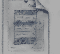
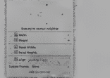
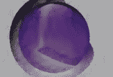

## 故事板

Storyboard 允许我们快速设计不同场景之间的关系和跳转（`segues`）。这使得我们在设计过程早期勾勒并编辑整个应用程序的工作流。我们还可以向客户展示 storyboard，在投入大量时间编写代码之前获得批准。

## 自动布局

创建一个能够自动适应尺寸变化的用户界面变得越来越重要。无论是在响应屏幕旋转、尝试设计适用于 3.5 英寸和 4 英寸手机的界面，还是为了动态字体（`Dynamic Type`）调整，`Auto Layout` 都能让创建真正的自适应界面成为可能。此外，iOS 7 为 `Auto Layout` 提供了更好的支持。如果你最近没有尝试过，应该再次关注一下它。

## 动画

视觉上令人惊艳的动画一直是 iOS 体验的一部分。iOS 7 的新界面强调具有吸引力且功能强大的动画。`UIKit` 等新技术帮助我们的应用程序具有深度。

## Xcode

`Xcode` 提供了一个集成开发环境，为我们提供了系列工具来创建和设计项目。它处理了从运行到设计项目的所有工作。`Instruments` 是一个强大的性能分析工具，帮助我们跟踪应用程序的内存使用、CPU 使用率和电池消耗。在后续章节中，我们将使用它来定位并修复性能问题。

## iOS 模拟器

在模拟器中，我们可以在不同的硬件设备上测试应用程序。在后续章节中，我们将使用 `Xcode` 来构建应用程序。

# 第 10 章 核心数据

`Core Data` 是一个用于持久化对象模型的强大框架。在后续章节中，我们将学习使用 `Core Data`。`Core Data` 允许我们管理应用程序的数据模型层。在后续章节中，我们将探讨如何将 `Core Data` 与 `iCloud` 集成。`Core Data` 的性能对于用户体验至关重要。在后续章节中，我们将优化 `Core Data` 查询。`iCloud` 支持允许数据在设备间同步。在后续章节中，我们将转换 Health Beat 使用 `Core Data`。本章总结回顾了 `Core Data` 的核心要点。其他资源将提供深入学习 `Core Data` 的帮助。

# 第 11 章 高级用户界面

在后续章节中，我们将学习创建动作效果。创建物理真实的动画可以提升应用的视觉质感。本章总结回顾了高级界面的技巧。其他资源将提供更多关于 UI 设计的技巧。

# 第 12 章 最后一公里

在后续章节中，我们将进行最后的润色。构建发布版本是让应用推向用户的最后一步。本章总结回顾了发布过程的注意事项。其他资源将帮助你完成开发之旅。

# 欢迎来到：学习创建 iOS 7 应用

所以，`App Store` 虽然是那个不容忽视的“大头霸”，但你并不非要让它摧毁你的局面。这并不总是关乎制作商业软件。越来越多的开发者正将 iOS 设备作为各种个人或教育项目的平台。从初中科学展会到机器人实验室，你可以在任何行各业中找到基于 iOS 的实验。而且凭借 iPhone 自带的蓝牙 4.0 和 Wi-Fi 连接，我们可以轻松地让 App 与现实世界中的其他物体进行交互。

最后，Apple 为我们提供了一套高质量的开发工具。`Xcode 5` 持续改进并完善开发环境，为代码的测试、分析和调试提供了各种实用程序。

Apple 还提供了一种顶尖的编程语言和一套非常出色的框架。我知道很多新的 iOS 程序员正在学习 `Objective-C`，我承认它的学习曲线可能看起来非常陡峭，尤其是当你正挣扎于如何起步时。尽管如此，一旦你熟悉了这门语言，你就会很快欣赏它的力量和优雅。此外，学习一种新的编程语言有助于以有趣的新方式拓展你的大脑。`Objective-C` 会让你成为更优秀的开发者，即使你从不将它用于生产代码。

`Objective-C` 是一种动态的、极其灵活的编程语言。它提供了许多功能（如果使用得当），可以帮助解决许多复杂的编程挑战。同样，iOS 软件开发包（`SDK`）提供了一系列出色的框架，我们可以基于此快速构建我们的 App。

框架是开发者执行常用任务的最佳软件之一，同时又赋予了我们足够的自由，既能保持操作简单，又能让我们探索未知领域。从这些标准来看，`Cocoa Touch` 是我用过的最好的框架之一。事实上，如果你发现自己正在编写一行代码来完成一项常用任务，那么你几乎肯定是做错了。

我希望这本书能为你进入 iOS 开发的世界提供一个温和的介绍。虽然无法涵盖每一个方面或探索每一个框架，但这本书应该为你提供一个坚实的基础，以及让你继续独立探索的工具和技能。

此外，虽然书的大部分内容关注 iPhone 的开发，但这些概念和技术适用于任何 iOS 设备：`iPod touch`、`iPad`、`iPad Mini` 以及未来的任何设备。设备之间的差异非常微小。以 iPad 为例，其他地方都是一样的。

虽然 iPhone 和 iPad 开发之间的具体差异超出了本书的范围，但详细信息可以在奖励章节“从 iPhone 到 iPad”中找到，网址为：`www.freelancademcience.com/creating-ios-7-apps-bonus-chap/`。

现在，让我们进入第一个项目。让我们从构建一个简单的实用程序开始，第一次运行时显示单行消息。“Objective-C”奖励章节（同样位于 `www.freelancademcience.com/creating-ios-7-apps-bonus-chap/`）对该编程语言有更深入的介绍。现在，请利用这个机会熟悉开发环境。

# iOS 开发之旅

任何创作者——如果你想成功，就必须为工作准备正确的工具。这意味着你需要一台运行 `Macintosh OS X 10.8.4` 的 Mac 以及 `Xcode 5`。如果你想在真实的 iOS 设备上运行程序，你还需要一个兼容的 iOS 7 设备（`iPhone 4`、第五代 `iPod touch`、`iPad 2`、`iPad Mini` 或更新设备）以及相应的开发者/备用描述文件（`provisioning profiles`）。

我们将在第 2 章中详细讨论描述文件。现在，通过 `Mac App Store` 下载最新版本的 `Xcode`（这是一个免费应用程序），并通过 `App Store` 进行下载，让你的所有开发工具保持更新非常简单。

如果你想在真实的 iOS 设备上测试代码或将你的应用程序提交到 `iTunes App Store`，你将加入 iOS 开发者计划。个人或组织需要支付 99 美元。大学学生通常可以作为课程的一部分获得免费访问权限，大型组织可以考虑获取企业许可，让他们能够开发和分发专有的内部应用程序。

然而，我们可以开始使用 `Xcode` 了——只需在模拟器中构建和测试我们的 App。虽然我们不想用模拟器对生产代码进行严谨的测试，但这是一个非常简单的入门方式。

`Xcode` 是一个专为 `Mac OS` 和 iOS 编程而设计的集成开发环境（`IDE`）。正如名称所示，`IDE` 不仅仅是一个文本编辑器。它是一套相互连接的工具集，帮助你组织、编辑、调试、管理以及其他方式将所有资源汇聚到你的最终程序中。通过 `Xcode`，你可以管理资产、视觉化布局用户界面、在 iOS 模拟器中测试程序、逐行调试代码、分析应用程序的性能等。

> **注意**：书中的所有项目都是使用 `Xcode 5` 和 `iOS SDK 7` 开发和测试的。如果从以往的经验来看，Apple 即使在次要版本中也喜欢进行微小的（有时并不微小）更改。这些后续版本无疑与你看到的有所不同。菜单选项和项目模板的细节可能会变化。更罕见的是，请注意，如果你在使用较新版本的 `Xcode` 或 `SDK`，你可能需要自己进行一些探索，甚至可能自己进行调试。如果你遇到问题并需要帮助，请检查书籍网站上的错误列表或论坛：`www.freelancademcience.com/books/`


# 第 1 章 你好，iOS！

## 创建工作空间

我们将从创建一个新的工作空间开始。在 Xcode 中，选择 `File > New > Workspace`。工作空间包含方案（schemes）和其他文件。这允许你组织多个项目。在 Xcode 中，项目是源代码、资源和设置的集合。当你创建一个新项目时，会弹出一个带有多个选项的窗口。在左列选择 iOS。然后选择 Application 并点击 Next。

模板打开后，我们就可以为项目选择选项了。在 `Project Name` 字段输入 Hello World。`Organization Name` 字段应该是你的名字或公司名称。`Company Identifier` 字段必须是一个标识组织的字符串。大多数情况下，你会使用反向 DNS 作为此公司标识符。使用你主域名的反向域名。从顶级域名开始，向二级和三级域名移动。例如，我会使用我博客的反向域名：`com.freelcience`。

Xcode 将公司标识符和产品名称相结合，生成 App 的 Bundle Identifier。这是 Apple 在你提交应用程序到 App Store 后引用你的程序的唯一密钥。

接下来，我们有 `Class Prefix` 字段。Xcode 会自动为生成的所有类名添加此前缀。每当我们创建一个新类时，它会在 `Class` 字段开头插入该前缀。这使得在整个项目中保持相同的类前缀很容易。

但是，为什么我们需要这些前缀呢？我们可以归咎于 Objective-C。不幸的是，许多现代语言不同，Objective-C 不支持命名空间。我们项目中的每个类都必须有一个唯一的名称。在单一孤立的项目中工作时这不是限制——但一旦我们开始使用第三方库，我们很快就会陷入冲突之中。

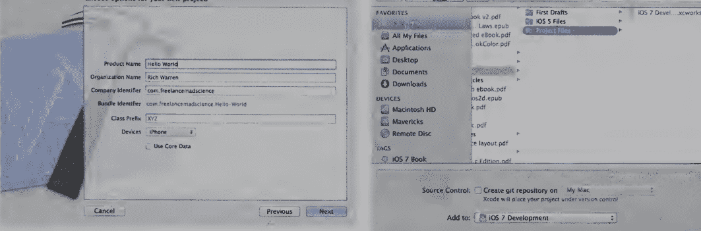

图 1.3 选择项目选项

对于应用程序代码，我倾向于不留前缀。简单、整洁的类名会让项目更容易阅读和导航。因此，这是我在本书中将采用的方法。然而，如果你正在开发一个较大的项目或与规模较大的团队合作，你可能会发现添加前缀会大大简化代码的管理和协调。

> **注意**：你应该始终为共享代码添加前缀。在开发库时（无论是内部使用还是公开发布）尤为如此。为代码添加前缀可以让其他开发者使用你的代码，而无需担心可能发生命名冲突。它也更容易识别类的来源。例如，所有以 `RG` 开头的类都来自我的 ReallyGreatStuff 库。最重要的是，我期待收到一封措辞严厉的邮件！你已经收到警告了。

所以，让我们让 `Class` 字段为空。同时，确保在 `Devices` 弹出菜单中选择了 iPhone，并取消勾选 `Use Code` 复选框。我们的设置应该与图 1.3 所示一致。

这会弹出保存窗口。为项目选择一个位置。我通常将其放在与主工作区相同的文件夹中。默认情况下，Xcode 将使用你的项目名称创建一个新文件夹。

你也可以为你的项目创建一个 Git 仓库。通常情况下，版本控制是一个非常好的主意，应该包含在你所有的项目中。我们将在第 2 章开始使用版本控制，但书中不会对其进行详细介绍。如果你想了解更多信息，我在 `www.freescience.com/books/` 提供了额外的资源。

现在，确保 `Source Control` 复选框处于未勾选状态。我们需要将此添加到你的工作区：点击 `Add` 弹出菜单并选择你的 iOS 7 开发工作区。现在的设置应该与图 1.4 一致。

就这样。点击 Create，Xcode 将设置你的项目。

图 1.4 选择项目位置

## 探索 Xcode

现在我们已经打开了项目，可以探索 Xcode 了。广而言之，我们可以将界面分为五个主要部分：工具栏（toolbar）、导航器（Navigator）、实用工具区（Utilities）、调试区域（Debug area）和编辑器（Editor）（图 1.5）。在这些部分中，我们可以隐藏编辑器以外的所有内容。

### 工具栏

工具栏展示了常用的工具和通知。从左到右，它包含了运行（Run）、停止（Stop）、活动方案（Active Scheme）、目标（Destination）、状态窗口（Status window）、标准编辑器（Standard Editor）、辅助编辑器（Assistant Editor）、版本编辑器（Version Editor）、导航器（Navigator）、调试区域和实用工具区（Utilities area）（图 1.6）。

`Run` 按钮将使用当前选择的方案构建应用程序，然后将其上传并运行在当前选择的设备上。

`Stop` 按钮将杀死应用程序。

> **注意**：当你点击 `Stop` 按钮时，应用程序会被立即杀死。它不会经过正常的关闭程序。当我们保存和加载数据时，这种区别将非常重要。并不意外，我们将在第 5 章“加载和保存数据”中再次提到它。

这两个按钮控制活动方案。在 Xcode 中，方案用于定义构建和运行应用时使用的配置和设备。第一个按钮设置活动方案。你也可以用它来创建新方案或编辑现有方案。

第二个按钮设置目标。在我们的情况下，这将包括 iPhone 和 iPad 模拟器，以及任何当前连接到计算机的测试设备。只需选择你希望应用运行的位置即可。

Xcode 使用状态窗口在构建和运行应用程序时显示消息。更重要的是，如果我们的代码当前有任何问题，它会显示错误或警告图标。我们可以点击状态窗口中的错误和警告图标，直接导航到该类型的问题。

> **注意**：如果你还没有设置开发者证书和描述文件（provisioning files），你可能会看到一两个警告。现在可以忽略这些。项目仍然可以在模拟器上构建和运行。

`Standard Editor`、`Assistant Editor` 和 `Version Editor` 按钮允许我们根据需要选择合适的单一编辑器。`Standard Editor` 只显示一个适用于当前选择文件的单一编辑器。对于代码，这将是一个文本编辑器；对于 Storyboard（故事板），这将是一个图形界面编辑器（通常被称为 Interface Builder）。随着本书的深入，我们将看到其他的编辑器。

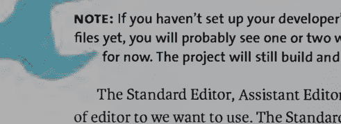

图 1.5 Xcode 概览

停止 活动方案

目标 状态窗口

版本编辑器

辅助编辑器

运行 标准编辑器

图 1.6 工具栏

导航器

调试区域

实用工具

`Assistant Editor` 以垂直或并排的方式显示两个编辑器窗口。使用 `View` 菜单项来修改视图的排列方式。主窗口将显示当前选择的文件，而辅助窗口将显示相关文件。

`Version Editor` 与项目的版本控制管理软件配合，允许我们查看同一个文件的两个版本，并突出显示差异。对于这个项目，这不会很有用，因为我们没有创建 Git 仓库。

最后三个按钮是切换按钮。它们分别隐藏或显示导航器、调试区域和实用工具区。如果按钮是蓝色的，则相应的区域将显示在屏幕上。灰色的，则隐藏。

最后，我们可以通过 `View > Hide Toolbar` 和 `View > Show Toolbar` 项目来隐藏和显示工具栏。

### 导航器

导航器允许我们在项目的各个方面之间导航。导航器有八个标签，显示不同的视图。

- `Project navigator`（项目导航器）显示项目包含的所有文件、框架和资源。选择一个文件即可打开它。大多数时候我们使用 `Project navigator` 来移动。
- `Symbol navigator`（符号导航器）显示项目中所有的符号。
- `Find navigator`（查找导航器）允许我们搜索工作区。在单个文件中搜索使用 `⌘F`。跨文件搜索使用 `Find navigator`。
> **注意**：你不需要使用 Navigator 来打开文件。`File > Open`（或 `⌘O`）将打开一个弹出窗口。输入符号或文件的名称，它将显示列表。只需选择你想打开的那个。
- `Issue navigator`（问题导航器）显示项目的警告和错误。点击 `Issue navigator` 中的问题，它将带我们进入代码中的位置。
- `Test navigator`（测试导航器）显示我们的单元测试。我们可以看到测试结果，也可以重新运行单个测试。
- `Debug navigator`（调试导航器）在调试时显示每个线程的堆栈跟踪。可以使用它移动堆栈。
- `Breakpoint navigator`（断点导航器）显示项目中所有的断点。我们可以在这里编辑和删除断点。我们还可以创建符号断点。
- `Log navigator` 显示控制台日志和构建日志。Xcode 每次构建和运行应用程序都会保存这些日志。当你关闭并重新打开 Xcode 时，它会清除最近的日志。大多数 Navigator 底部都有过滤内容的控件。这在项目文件数量增加时非常有用。

### 实用工具

实用工具区由两部分组成：检查器（inspectors）和库（libraries）（图 1.7）。

检查器让我们观察并配置我们正在编辑的项。每个类型的编辑器都有自己的系列检查器。例如，文本编辑器只有两个检查器：`File` 和 `Quick Help`。Interface Builder 有六个：`File`、`Quick Help`、`Identity`、`Attributes`、`Size` 和 `Connections`。你可以通过点击 `Main.storyboard` 找到它们。

### 图 1.7 检查器和库

`Identity inspector`（身份检查器）主要用于在图形化设计用户界面时将对象的类更改为自定义子类。这里也包含了辅助功能设置。我们甚至可以为对象设置 Xcode 特有的标签，或者使用键值编码（Key-Value Coding）来设置未通过属性检查器暴露的属性。这其实没什么意义，我们将在后文中看到它的实际操作。

`Attributes inspector`（属性检查器）将是我们花费大部分时间的地方，尤其是在设计用户界面时。该检查器允许我们修改和配置对象。每个类型的对象都有一组可以修改的自定义属性。例如，视图具有背景颜色属性（还有许多其他属性）。

`Size inspector`（尺寸检查器）在设计用户界面时常用。该检查器显示所选对象的当前位置和大小。我们还可以查看并修改该对象的自动布局约束（auto layout constraints）。

`Connections inspector`（连接检查器）显示当前选中对象的所有连接。在本章的稍后部分，我们将进行一些绘制连接的实践。

库提供了我们可以拖入并添加到项目中的元素。每个库都有其特定的用法。共有四个标签页，让我们选择这四个库。

- `File Template library`（文件模板库）顾如其名，是一个文件模板库。要向项目添加新文件，只需从库中拖出一个项目并将其掉到项目导航器（`Project Navigator`）中。
- `Code Snippet library`（代码片段库）列出了常用的代码片段。如果你忘记了如何编写正确的 `init` 方法、快速枚举（fast enumeration）或 `dispatch once` 块，这里是一个绝佳的地方。将项目拖入编辑器并根据需要进行修改。
- `Object library`（对象库）老实说，这是我使用 90% 时间的库。它专门用于界面开发。该库包含了我们设计用户界面时将使用的所有控件、控制器和容器。只需将它们拖到 Interface Builder 中，调整大小并绘制连接。在本章的稍后部分，我们将获得使用该库的实践经验。
- `Media library`（媒体库）显示所有添加到项目中的媒体文件。你可以直接将这些文件拖放到用户界面上；但在实践中，我并不这样做。我要么通过代码加载媒体文件，要么使用控件的属性来设置它们。属性检查器会自动列出给定设置的所有相应媒体文件——所以通常不需要去这里。

### 调试区域

调试区域由两部分组成：控制台（Console）和变量（Variables）。当我们的应用程序运行时，打印到标准输出的内容将出现在控制台窗口中。如果我们在断点处停止，将在变量窗口中获得有关本地变量的额外信息。此外，我们的控制台变成了一个活动控件。我们可以直接在控制台中输入调试器命令。例如，我们可以使用 `p` 命令打印 Objective-C 对象，或使用 `p` 命令打印 C 数据。


```
self.label
<ILabel: 0x8e28e0; frame = (20 225; 280 29); text = 'Hello World'; clipsToBounds = YES; opaque = NO; autoresize = RM+BM; userInteractionEnabled -> NO; layer = CALayer: 0x8e829c0>>
```

一旦我们有了可以运行的代码，我们将进行深入探讨。

### 编辑器

这是进入实战阶段。我们的大部分时间将花费在编辑器中，修改文件内容。不同的文件类型有自己的所有者。在本章中，我们将有机会同时使用文本编辑器和 Interface Builder。在后面的章节中，我们还会看到其他的编辑器。

### 偏好

在我们快速浏览中最后要看的内容是如何设置偏好。Xcode 在配置工作环境方面提供了很大的灵活性，因此值得花些时间探索并调整设置，让 Xcode 以符合你（或你的团队）的方式运行。

我们可以通过 `Xcode > Preferences...` 菜单访问偏好。这会弹出偏好窗口。Xcode 有十个标签页：通用（General）、账户（Accounts）、行为（Behaviors）、导航（Navigation）、字体与颜色（Fonts & Colors）、文本编辑（Text Editing）、键绑定（Key Bindings）、源码控制（Source Control）、下载（Downloads）和位置（Locations）（图 1.8）。

- **General**：此标签页的设置相对较少，大部分其实没意思。显示实时问题（Show live issues）默认开启。这告诉 Xcode 在你编写代码时分析代码，并在出现警告和错误时显示。这可能会烦恼，但通常关闭它反而更糟。你还可以设置查找和问题导航器（Find and Issue Navigator）中显示的行数——如果你想看到更多或更少的细节。
- **Accounts**：这是你管理开发者账户的地方。注意，你可以连接到多个开发者账户——每个开发者账户可以属于多个团队。高亮团队名称并点击“查看详情”（View Details）按钮查看与该账户相关的签名标识（signing identity）和描述文件（provisioning profiles）。此标签页也用于管理源码仓库。
- **Behaviors**：此页面允许你设置事件（左侧面板）。例如，查看 `Build > Generates new issues`（生成新问题）的默认行为。当构建系统生成新问题时，Xcode 将显示问题导航器（`Issue navigator`）。我们可以将其修改为播放声音、显示通知甚至运行脚本。虽然行为很有潜力，但我经常发现事件或动作的粒度太粗，无法实现我的想要。
- **Navigation**：导航标签页允许你设置导航器如何响应点击、双击和 Option-点击。
> **注意**：我强烈建议双击导航：使用独立标签页（Navigation: Uses Separate Tabs）。
- **Fonts & Colors**：此标签页设置字体、大小和配色方案。
- **Text Editing**：这是你配置文本编辑器的地方。
- **Key Bindings**：这是你自定义快捷键的地方。
- **Source Control**：此标签页允许你管理源码控制。
- **Downloads**：这是你管理下载的地方。
- **Locations**：此标签页允许你自定义不同派产物的保存位置。

### 检查文件

现在让我们来看这些文件。项目导航器（`Project navigator`）默认应该是可见的。如果没有，请确保工具栏上的导航器按钮已启用，然后选择项目导航器（该图标）。或者，你也可以直接选择 `View > Navigators > Show Project navigator`。

项目导航器将显示几组资源。Hello world 包含了我们所有 Objective-C 类的头文件 (`.h`) 和实现文件 (`.m`)。这是我们进行大部分实际代码编写的地方。它还包含两个资源文件：`Main.storyboard` 和 `Images.assets`。

`Main.storyboard` 定义了我们应用程序中的场景以及它们之间的转场（segues）。`Images.assets` 管理我们的图像，跟踪为了支持不同设备和屏幕分辨率而所需的不同版本。我们将在接后的章节中详细查看这些文件。

`Supporting Files`（支持文件）子组包含了各种次要文件。最初，它包含了应用程序的 `Hello-Info.plist`、`InfoPlist.strings`、`main.m` 和 `Prefix.pch` 文件。

`Hello World-Info.plist` 文件包含许多用于配置应用程序的键值对。如果任何值是需要显示给用户的字符串，那么 `InfoPlist.strings` 文件就派上用场了。在定位字符串值时，系统会首先查找特定语言的版本。如果找不到，它将使用 `Hello World-Info.plist` 中的值。我们将在第 9 章“最后”中详细讨论本地化问题。

`main.m` 文件包含 `main()` 函数。Objective-C 就像 C 语言一样，总是从 `main()` 开始。这是应用程序启动时执行的第一个函数。它负责设置并运行所有其他内容。

最后，`Prefix.pch` 文件是应用程序的预编译头文件。为了帮助大型项目编译得更快，Xcode 允许我们创建一个预编译头文件，其中包含许多跨所有代码的常用 `#import`、`#include` 和 `#define` 定义。例如，在 iOS 项目中，大多数类都需要访问 UIKit 和 Foundation 框架。通过在我们的预头文件中包含这些框架的 `#import` 语句，Xcode 知道预处理这些文件并包含所有源文件的结果。这防止了编译器在每次构建时多次处理常用文件。

尽管如此，Xcode 5 引入了一种更先进的技术，称为模块（Modules）。模块是系统头文件的优化数据库。它提供了与 Prefix 许多许多的益处，但提供了更高的性能，并消除了手动管理 `Prefix.pch` 文件的需求。


大多数情况下，模块是自动的。你只需要 `#import` 该文件，Xcode 就会查找模块。此外，每当你 `#import` 一个模块时，Xcode 都会自动将其框架链接到项目中。这对于初学 iOS 的开发者非常有帮助，因为当你第一次遇到链接错误时，它们可能显得有些神秘和困惑。

遗憾的是，模块仅支持 Apple 提供的系统框架和库。如果你想使用第三方库，仍然需要手动将其链接到项目中，如果它在项目的很大范围内被使用，你可能希望将其包含在 `Prefix.h` 文件中。

这听起来可能不太合逻辑，但没关系。使用 `Prefix.pch` 是一个高级课题。我们在这个项目中不会触及它。而且，说实话，对于 iOS 项目来说，与将 App 上传模拟器或设备所需的时间相比，编译时间相对很快。所以，除非你正在处理一个非常大的企业级项目，否则修改 `Prefix.pch` 文件可能是在浪费你的时间。

最后，`Frameworks`（框架）组包含了所有显式链接到你的项目的框架（但不包括任何从模块自动链接的框架）。同时，`Product`（产品）组包含了结果——在我们的案例中就是编译后的应用程序。再次强调，我们在这个项目中不会触及其中的任何内容。

> 注意：就像 Xcode 的工作区（workspaces）一样，导航器组是一种可视化——仅存在于 Xcode 内部。这些组与实际资源的存储方式或位置并不一定有关系，甚至与它们包含的文件类型无关。你可以自由将资源放在任何组中，并根据需要添加或删除组或子组。根据你的方便来组织项目导航器中的文件。

## 项目流程

当我第一次开始编写 Cocoa 应用程序时，我不理解所有部分是如何结合的。当然，我理解每个单独的部分。我有一个视图（view）和一个视图控制器（view controller）。它们共同工作管理用户界面。然而，这些许多对象似乎在运行时魔法般地出现。我不知道它们从哪里来。

让我放心，这里没有任何超自然的事情。相信我的，我已经检查过了。尽管如此，花几分钟时间走一遍所有的连接，以理解正在发生什么。不要担心记住所有的细节。相反，请关注我们如何从一个对象追踪到下一个对象。这样，你以后就可以追踪你的应用程序了。

让我们从应用程序启动的地方开始。在项目导航器中点击 `main.m`（如果 Hello World 和 Supporting Files 尚未显示，你可能需要展开它们）。这非常短。它导入了 UIKit 和我们的应用程序代理（delegate），然后定义了 `main()` 函数。

```objc
#import <UIKit.h>

#import "AppDelegate.h"
```

```c
int main(int argc, char * argv[])
{}
```

```objc
@autoreleasepool {
    return UIApplicationMain(argc, argv, nil, NSStringFromClass([AppDelegate class]));
}
```

基本上，`main()` 创建了一个自动释放块（autorelease block）。在块内部，我们启动了 Objective-C。你可以在“Objective-C”奖励章节中找到关于内存管理的完整讨论。

真正的工作发生在 `UIApplicationMain()` 函数中。该函数执行了四项关键任务：

1. 它创建我们的应用程序对象。
2. 它创建我们的应用程序代理并将其链接到应用程序。
3. 它启动应用程序的运行循环。
4. 一旦一切就绪，它就会调用代理的 `application:FinishLaunching:` 方法。

`UIApplicationMain` 接收四个参数。前两个处理应用程序的命令行参数：`argc` 给参数数量，而 `argv` 包含实际参数的 C 风格字符串数组。这些参数很大程度上是 Unix 命令行类的遗留。在 iOS 中，我们的应用通常只有一个参数，即应用程序的可执行文件名。我们几乎不使用这些参数。

后两个参数分别定义我们的应用程序和应用程序代理。每个参数接收一个对应类名的字符串。如果第三参数为 `nil`，我们将使用默认 UIKit 类。如果第四参数为 `nil`，系统将从空文件加载代理。

从空文件加载代理是一种旧的设计模式。如果你查看为 iOS 4.0 及之前的版本设计的项目，通常会看到这种。对于 iOS 7，所有的应用程序模板都使用 storyboard（除了名称所暗示的空模板）。我们需要手动管理我们的应用程序代理名称。

我们可以将名称硬编码为 `"AppDelegate"`。虽然这节省了我们很少打字，但它有一个很大的限制。如果我们重构代码并更改 `AppDelegate` 类的名字，Xcode 并不知道要更改它。

在软件工程中，解决困难问题的方案通常涉及增加间接层。在这种情况下，`NSStringFromClass([AppDelegate class])` 间接地决定了我们的应用程序类的名称。这给了我们很大的灵活性。在理论上，我们可以重写 `+AppDelegate` 类方法来动态返回我们的代理类，简单地为 iPad 和 iPhone 返回不同的代理。但在大多数情况下，它只是保证了当我们重构代理的名称时，`main()` 会自动找到并使用新名称。

大多数应用程序都会遵循这种模式。我们通常不会继承 `UIApplication`，而是使用标准的 `UIApplication` 对象。相反，我们提供一个自定义的应用程序代理（application delegate）。

> 注意：你很少更改 `main.m` 中的任何内容。事实上，除非你在进行某些特殊操作，否则你永远不会碰它。即使你确信真的需要进行一两个修改，请退后一步思考，总会有更好的解决方案。

## 检查 Storyboard

到目前为止良好。`main()` 函数调用了 `UIApplicationMain()`。该函数实例化应用程序以及我们自定义的 `AppDelegate`。然后它设置了主事件循环并开始处理事件。接着它调用我们代理的 `application:didFinishLaunchingWithOptions:`。这个方法可能会启动我们的一些自定义代码。

但是用户界面呢？在使用 storyboard 的应用程序中，应用程序的根视图控制器是由 storyboard 创建的。但是，storyboard 是什么呢？

Storyboard 允许你图形化地设计场景并绘制连接它们的段线（segues）。它们代表了 Xcode 开发技术的最新阶段。

以前版本的 Xcode 使用 Interface Builder 来图形化地设计界面。Interface Builder 将我们的设计保存为二进制 nib 文件。Xcode 随后可以将 nib 文件包含在我们的应用程序中，并在运行时加载它们。

在 Xcode 4 中，Interface Builder 被引入了 Xcode 内部。这使得用户界面和代码之间有了更紧密的集成。我们可以并排编辑界面及其相关代码。通过 storyboard，Xcode 扩展了这一点，允许我们封装许多 nib 文件，赋予了我们图形化定义多个场景的能力以及在它们之间绘制过渡的能力。

正如你将看到的，我们的 storyboard 包含的内容比视图、按钮和文本字段多得多。它们还包含了控制器对象，以及各种界面对象、视图和控制器之间的连接。在我们在本章稍后的“修改模板”部分扩展我们的“Hello World”时，我们将获得一些绘制这些连接的经验。此外，我们将在第 2 章“Nib 的秘密生活”中更详细地讨论 storyboard 背后的底层技术 nib。

> 来源：Interface Builder 保存了带有 .nib 扩展的 nib 文件。在 Xcode 3.0 中，Interface Builder 允许以带有 .xml 扩展的中间 XML 格式存储 nib 文件。这使得与源码控制和其他开发工具的兼容性更好。.nib 文件在构建应用程序时会被编译成 .nib 文件。为了简单起见，两个版本通常都被称为“nib 文件”。在 Xcode 4 中，storyboard 也以带有 .storyboard 扩展的 XML 文件存储。系统会自动将 storyboard 编译成一个或多个 nib 文件，并在需要时加载这些 nib。

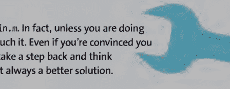

### 图 1.12 设置主 storyboard

那么，`UIApplicationMain()` 是如何知道打开哪个 storyboard 文件的呢？它看起来是在项目的 `info.plist` 中查找。如果你点击 `Hello World-Info.plist`，你会发现一个名为“Storyboard file name”的键，值为 Main。这告诉 `UIApplicationMain()` 加载 Main storyboard。

虽然我们可以直接修改 `info.plist`，但有一种更简单（也更安全）的方法。在项目（Project）导航器（Project navigator）中，点击蓝色的 Hello World 图标。这将打开项目设置。确保选中了 General（通用）选项卡，并向下滚动直到看到 Main Interface 选择。这会弹出一个弹出菜单，其中包含我们应用程序中的所有 storyboard 文件（我们只有一个）（图 1.12）。我们可以简单地选择我们想要使用的 storyboard。

让我们打开 storyboard。点击项目导航器中的 `Main.storyboard`。这将在 Xcode 编辑器中打开 storyboard 文件。你可能需要尽可能关闭导航器以留出更多空间。你还希望确保屏幕右侧的工具（Utilities）区域是打开的。如果可见，你可以点击 Utilities 按钮或选择 View（视图）> Show Utilities（显示工具）。

Storyboard 编辑器由两个区域组成。左侧是文档大纲（Document Outline）。此侧边栏显示我们 storyboard 中的所有场景，以及每个场景中的每个对象。

右侧我们有 Interface Builder。这是我们用于为场景设计和设计实际用户界面的图形编辑器，并用于绘制场景之间的控制流（图 1.13）。

> 注意：文档大纲默认可能是隐藏的。我们可以通过点击 Interface Builder 左下角的 Document Outline 按钮来隐藏和显示文档大纲。

## 第 1 章 你好，iOS

## 界面构建器

我们的项目从两个场景开始。通过文档大纲，你会看到每个场景至少有三个顶层对象：第一响应者（First Responder）、场景的视图控制器和退出（Exit）。让我们从第一响应者开始。在很多方面，这是一个非常不寻常的对象。或者说，它根本不是一个对象——它是一个代理。系统从不创建第一响应者的实例。相反，系统会在运行时动态分配第一响应者。

基本上，第一响应者代表了你应用程序响应链中的第一个对象。它可以作为任何必须发送到响应链的动作的目标。例如，复制操作应该针对当前选中的文本，无论视图中可能是哪段文本。我们不希望将动作硬编码到特定的控制器；相反，我们希望将动作路由到当前活动的控制器。通过目标第一响应者，我们可以确保动作到达正确的处理器。

接下来，我们看控制器。每个场景都有一个 `ViewController` 实例，它是所有控制器的基类。在我们的案例中，主视图控制器就是我们的初始场景。这正是我们想要的。确保我们缩放到了主场景。双击背景可以在整个 storyboard 的概览和实际视图之间切换缩放。

最后，我们有 Exit。这比第一响应者更不像一个对象。Exit 只是撤销动作的占位符。我们将在第 3 章“开发视图和控制器”中深入讨论这些动作，但在本项目中不会使用它们。

我们的场景可能有其他顶层对象。例如，主场景有一个模态段线（modal segue）——界面与其侧面之间的过渡。场景还包括手势识别器、视图或数据对象作为顶层对象。

所有顶层对象（场景除外）也出现在 Interface Builder 的面板（dock）中。这使得在界面和顶层对象之间绘制连接变得更容易，特别是场景列表开始增长时。另一方面，段线（Segue）出现在它们连接的视图之间。就像面板一样，它们触手可及。更重要的是，它图形化地显示了我们应用程序的控制流，让我们了解一切。

每个 storyboard 指定一个场景为初始场景。在我们的案例中，这就是 `UIApplicationMain()` 在应用程序启动时加载的场景。

初始场景出现在 Interface Builder 并带有箭头。与段线和其他关系不同，这个箭头末端没有场景。默认情况下，输入箭头从 Interface Builder 的左边缘开始。初始场景是第一个场景，随着向右移动会有额外的场景分支。

我们可以通过选择不同的视图控制器并设置“Initial View Controller”属性来更改初始场景。一次只能有一个控制器启用此属性。如果你在一个新的控制器中启用它，Interface Builder 将自动禁用旧控制器的该属性。

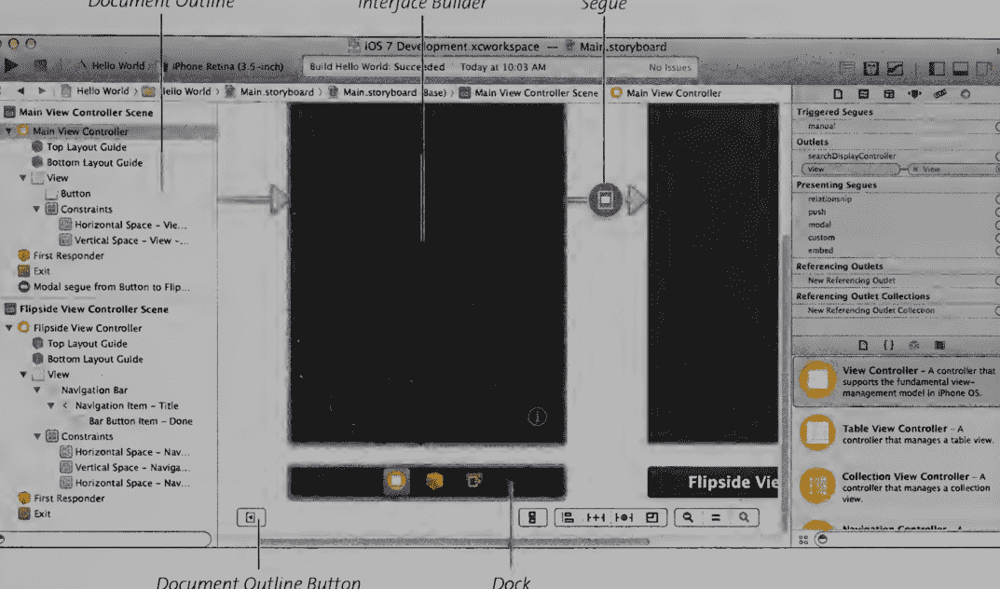

## 调查项目

### 图 1.14 检查类

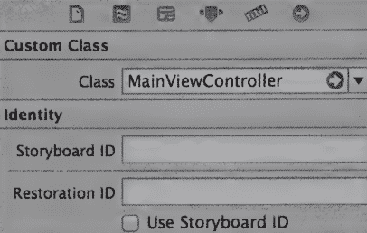

展开视图控制器。文档大纲向我们展示了层次结构，而 Interface Builder 向我们展示了布局。

让我们从点击主场景中的每个对象并检查它们的类开始。确保选中了 Identity 检查器（标签页）。打开文档大纲（Document Outline），并展开其中所有的项目。然后点击主视图控制器（Main View Controller）图标。意乎意料，你的视图控制器是 `ViewController` 类的实例（图 1.14）。

> 注意：要选择视图控制器，你必须在文档大纲或场景的停区（dock）中点击它的图标。当选中视图控制器时，整个场景将用蓝色轮廓显示。

接下来，查看顶部和底部的布局指南（layout guides）。这些指南可以更容易定义自动布局约束（auto layout constraints）。我们将在第 3 章中详细介绍约束。现在，你只需要知道自动布局系统使用约束在容器视图大小变化时调整内容的大小并重新定位。在大多数情况下，用户会将设备旋转到横屏或竖屏模式。

基本上，我们可以将约束连接到顶部或底部的布局指南上，而不是直接连接到容器视图。这很重要，因为指南会根据我们是否有导航工具栏、状态栏或标签栏自动调整它们的位置。

如果你选择这些指南，你会发现它们是 `NSObject` 的实例。然而，我们永远不会真正与这些指南交互，除非在我们的约束中引用它们。

接下来，我们有了视图。它是一个简单的 `UIView`，没有额外的功能或能力。视图内部有一个 `UIButton`（右下角的图标按钮）。视图下方是我们的视图约束。虽然我们无法选择约束（Constraints）图标，但我们可以单独选择每一个约束。其中一个是 `NSLayoutConstraint` 的实例。

First Responder（第一响应者）、Exit（退出）和 segue（转场）没有连接到实际对象。因此，它们中的任何一个都没有类。事实上，Exit 和 segue 根本没有任何 Identity 设置。移动到反向视图控制器（flipside view controller）场景，我们有一个 `FlipsideViewController`。在这个视图内部，通过另一个 `UIView`，我们有一个带有 `UINavigationItem` 的 `UINavigationBar`。也就是说，我们有了自己的 Done（完成）按钮——一个 `UIBarButtonItem`。

现在切换到连接（Connections）标签页。这允许我们编辑和定义对象之间的连接。虽然它看起来有些复杂，但此检查器只显示五种连接类型：输出（Outlets）、动作（Actions）、事件（Events）、转场（Segues）和关系（Relationships）。

前三个用于定义单个场景内的连接。输出（Outlets）将指针连接到对象。它们定义了我们图中对象之间的关系，让一个对象内部的代码可以引用场景中的另一个对象。

另一方面，动作（Actions）是我们可以连接到事件的方法。当事件发生时，系统会自动调用其相应的动作。控件（Controls）定义了用户与控件交互时发生的一组事件。这包括各种触摸事件、值变化和编辑事件。

接下来，segue（转场）和关系定义了场景之间的连接。Segue 充当过渡的作用。当你触发一个 segue 时，它将使用指定的动画过渡到下一个场景。

### 图 1.15 显示连接

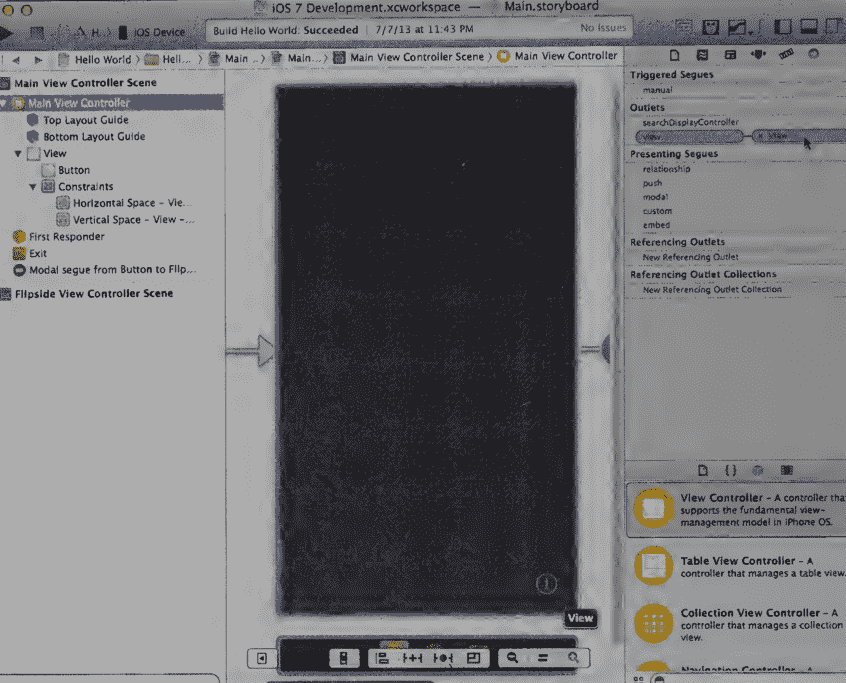

关系看起来像转场，但它们被用于显示所有权。容器控制器（如视图控制器）使用关系连接到它们管理的视图。

如果我们查看主视图控制器，可以看到它有一个视图输出（view outlet）指向被包含的视图对象。如果你将鼠标悬停在此连接上，控制器和视图都会被高亮（图 1.15）。此连接意味着我们可以在控制器的代码中引用视图对象。

此场景中只有另一个连接。选择该按钮。它有一个指向反向视图控制器的模态触发转场（图 1.16）。如果用户点击按钮，他们将触发此转场，将动画移动到反向视图控制器。

现在让我们看看反向视图控制器（图 1.17）。像主视图控制器一样，它有一个输出连接到它的视图。正如你可能猜到的，这是一个通用模式。所有的视图控制器都有一个连接到其视图的输出。

反向视图控制器还有两个传入连接。一个是来自主视图控制器图标按钮的呈现转场（presenting segue）。这仅仅是指向我们已经见过的触发转场。

另一个连接代表一个传入动作（incoming action）。仅仅通过观察，我们无法判断是哪个界面控件触发了该动作；然而，鼠标悬停在连接上，Done 按钮被高亮了。稍后我们将查看此连接的另一侧。

## 第 1 章 Hello iOS

### 触发转场 (Triggered Segues)

action

Flipside View...

### 输出集合 (Outlet Collections)

gestureRecognizers

### 发送事件 (Sent Events)

+ Did End On Exit
+ Editing Changing
+ Editing Did Begin
+ Editing Did End
+ Touch Cancel
+ Touch Down


# Touch Down Repeat

# Touch Drag Enter

# Touch Drag Exit

# Touch Drag Inside

# Touch Drag Outside

# Touch Up Inside

# Touch Up Outside

# Value Changed

## 引用输出 (Referencing Outlets)

- New Referencing Outlet

## 引用输出 (Referencing Outlets)

- New Referencing Outlet Collection

图 1.16 图标按钮的连接

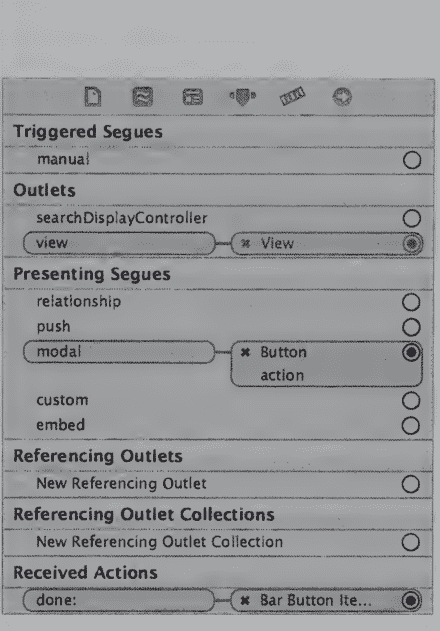

## 输出 (Outlets)

- backBarButtonItem
- leftBarButtonItem
- rightBarButtonItem
- titleView

## 引用输出 (Referencing Outlets)

- New Referencing Outlet

## 引用输出 (Referencing Outlets)

- New Referencing Outlet Collection

图 1.18 导航项的连接

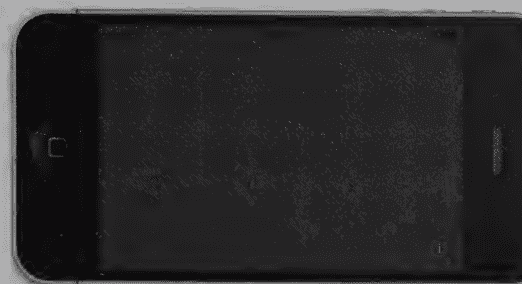

## 触发转场 (Triggered Segues)

action

## 发送事件 (Sent Events)

- New Referencing Outlet

## 引用输出 (Referencing Outlets)

- New Referencing Outlet Collection

图 1.17 反向视图控制器的连接

## 输出 (Outlets)

- backBarButtonItem
- leftBarButtonItem
- rightBarButtonItem
- titleView

## 引用输出 (Referencing Outlets)

- New Referencing Outlet

## 引用输出 (Referencing Outlets)

- New Referencing Outlet Collection

图 1.19 导航项的连接


## 约束 (Constraints)

| Horizontal | Constant |
|---|---|
| Relation | Equal | [x] Standard |
| Direction | Leading to Trailing |
| Priority | 1,000 |
| Placeholder | Remove at build time |

- Leading Space to: Supervision
- Top Space to: Supervision
- Trailing Space to: Supervision

| Horizontal | Constant |
|---|---|
| Relation | Equal | [x] Standard |
| Direction | Leading to Trailing |
| Priority | 1,000 |
| Placeholder | Remove at build time |

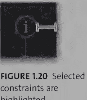

## 属性 (Attributes)

首先，切换到属性检查器图标。然后在文档大纲中，选择主视图控制器的水平空间。注意连接图标按钮到右侧的 I 形条被高亮（图 1.20）。

现在查看属性（图 1.21）。有三个关键信息。首先，关系类型设置为 Equal。接下来，Standard 复选框被勾选。最后，方向设置为 Trailing。这意味着我们把按钮与值之间的距离设置为标准间距（情况下为 20 像素）。Leading to Trailing 空间在这种背景下有点误导性。从技术上说，我们是将按钮的后缘连接到视图的右侧（连接按钮的右侧），我们将根据当前选择语言的阅读顺序进行处理。在从左到右的语言（如英语）中，按钮将出现在屏幕右下角。在从右到左的语言（如阿拉伯语）中，自动布局会自动将其重新定位到左下角。

这意味着什么呢？对于主场景，我们的图标按钮将距离右下角固定距离，无论容器视图有多高或多宽。对于反向视图，导航栏将紧贴顶部并延伸到边缘——再次，无论视图有多宽或多高。我们可以看到这一点，当我们将设备从竖屏旋转到横屏模式时（在模拟器中为 ↱ ↜）。自动布局（Auto layout）会自动为我们重新定位信息按钮并调整导航栏的大小（图 1.23 和 1.24）。它甚至还会为这些变化制作动画。

最后，让我们仔细观察这个 segue。选择属性检查器（图标），并选择我们视图之间的 segue。这显示了我们 segue 的详情（图 1.25）。Identifier 字段包含一个字符串，我们可以用它在代码中创建这个 segue。弹出菜单允许我们定义 segue 类型：push（推送）、modal（模态）或 custom（自定义）。Transition 弹出菜单和 Animates 复选框让我们控制系统如何（以及是否）对此过渡动画。

在我们的情况下，该 segue 被命名为 showAlternate。我们将把新场景作为模态视图（modal view）呈现。动画已启用，因此我们将看到主视图水平翻转，显示出其背后的翻面视图。

在大多数图形界面中，模态视图是在用户执行应用程序中的任何其他操作之前可以关闭（通常通过点击 OK 或 Cancel 按钮）的视图。这强迫用户关注模态视图中的任何内容——他们必须在处理完之前才能继续。在桌面应用程序中，我们通常使用模态视图显示保存或打印对话框等内容。在 iPhone 上，模态视图覆盖整个屏幕（尽管 iPad 有一些自适应选项），但它们的用法和意义很大程度上是相同的。我们正在呈现用户在完成后必须主动关闭的信息和控件。

所以，这一切意味着什么？嗯，我们已经偏离了几个话题，但我们仍在尝试追踪我们应用程序中的对象是如何创建的。

项目概览 29

# 高级主题：启动你的应用 (BOOTSTRAPPING)

使用 iOS 应用程序有八项任务必须正确完成。每个应用程序都必须执行所有任务。

## 使用主 Nib 文件 (Main Nib File)

1. 创建 App 对象：实例化 `UIApplication` 或其子类之一。
2. 创建代理 (Delegate)：实例化 responder 的自定义子类，该子类采用 `UIApplicationDelegate` 协议。
3. 连接 App 和代理：将 App 的 `delegate` 属性设置为代理对象。
4. 创建窗口 (Window)：实例化 `UIWindow`。
5. 链接代理和窗口：将 `UIApplicationDelegate` 的 `window` 属性设置为窗口对象。
6. 创建根控制器 (Root Controller)：实例化自定义 `ViewController` 子类。此视图控制器负责显示应用程序的初始视图。
7. 链接根视图和控制器：将 Window 的 `rootView` 属性设置为你的视图控制器。
8. 设置窗口：调用 `-[UIWindow makeAndVisible]` 使其成为主窗口并使其变得可见。

- 调用 `UIApplication()` 时，将 `nil` 同时作为第三和第四个参数传递。这告诉 `UIApplication` 我们将实例化并配置我们的代理对象的主 nib 文件。
- 创建一个 nib 文件。此 nib 必须实例化我们的代理对象并将其连接到 File's Owner 的 `delegate` outlet。我们必须创建一个窗口并将其连接到代理的 `window` outlet。最后，我们必须创建根视图控制器并将其连接到窗口。注意，根视图控制器的层次结构是在单独的 nib 文件定义的，这导致我们需要将一个 nib 文件链到另一个。
- 在 `info.plist` 中将 nib 文件设置为应用的主界面 (main interface)。`UIApplication()` 会自动为我们调用 `makeAndVisible`。

## 使用 Storyboards

虽然我们的应用必须显式或隐式地执行所有这些任务，但具体步骤在不同应用之间会有很大差异。然而，有三种主要方法：程序化启动应用、使用主 nib 文件或使用 storyboard。

1. 调用 `UIApplication()` 时，将 `nil` 作为第三个参数，并将我们的 `UIApplicationDelegate` 的名称作为第四个参数。
2. 创建一个包含至少一个场景 (scene) 的 storyboard 文件。storyboard 的初始场景将成为我们的视图控制器。
3. 在 `info.plist` 中将 nib 文件设置为应用的主界面。`UIApplication()` 将自动处理其余工作。具体来说，它将为我们实例化并链接所有对象，然后执行 `makeAndVisible`。

## 程序化启动 (Programmatic Bootstrapping)

1. 调用 `UIApplication()` 时，将 `nil` 作为第三个参数，并将我们的 `UIApplicationDelegate` 的名称作为第四个参数。
2. 为了完成 `finishFinishLaunchingOptions`：我们必须实例化窗口和根视图控制器。我们必须链接代理和窗口，然后链接窗口和根视图控制器。最后，我们必须调用 `makeAndVisible`。

在 Xcode 5.0 中，几乎所有的 Apple 项目模板都使用 storyboard 来启动 iOS 应用。这在很大是一个自动化过程，自动处理了许多在其他方法必须手动执行的细节。

在整本书中，我们将遵循 Apple 的做法使用 storyboard。然而，我想提到其他项目、书籍和教程中的选项。

记住，`UIApplicationMain()` 方法会创建一个实例以及我们的 `AppDelegate` 类。如果应用程序使用 storyboard，`UIApplicationMain` 会在 `info.plist` 文件中查找 storyboard。它创建我们的窗口并将其设置为窗口的根视图控制器。最后，它调用代理的 `application:FinishLaunchingWithOptions:`。该方法返回后，视图已显示并准备好接受用户输入。

如果用户点击信息按钮，segue 会启动。这加载了视图控制器并将其作为模态视图显示。当用户按下 Done 按钮时，它调用视图控制器的 `done:`。这关闭了翻面视图，但我们不知道它是如何工作的。要了解更多，我们必须查看代码。

# 检查代码

虽然 storyboard 为我们提供了应用程序的良好概述，但若要真正理解它，我们需要研究代码。如果你在代码方面有困难，请查看 freedesamcience.com/creating-ios-apps-bonus/ 中的 Objective-C 章节。现在，只需熟悉位置即可。

在编辑器中，按住 Option 键 (⌥)并将鼠标移动到 `UIApplicationDelegate` 一词上。当指针变成问号时，点击该高亮单词。

这会弹出帮助窗口（图 1.26）。弹出窗口提供了所选符号的简要描述。它并不完整，但它让我们快速了解大多数类、方法或函数。弹出窗口包含指向其他资源的链接。我们可以打开系统头文件或查看 Apple 的完整文档。

`UIApplicationDelegate` 协议定义了一系列可选方法，我们可以实现这些观察并修改应用程序的行为。这些包括响应应用程序状态的方法，以及本地、远程和系统通知。你可以在开发者文档中找到这些方法的完整列表。

现在，打开 `AppDelegate.m` 文件（在项目管理器选择或使用 ⌘+O 搜索）。你可以看到模板已经实现了其中几个方法——但它们都没有做任何事情。目前，它们只是简单的存根 (stubs)——占位符，等待你填充细节。

```objc
(void)applicationWillResignActive:(UIApplication *)application
{
    // 当应用程序即将从活跃（active）状态变为非活跃（inactive）状态时
    // 调用此方法。这可能发生在某些类型的临时中断
    //（如来电电话或短信）或用户退出应用程序
    // 并开始过渡到后台状态时。
    // 使用此方法暂停正在进行的任务、禁用计时器并降低
    // OpenGL ES 的帧率。游戏应该使用此方法来暂停游戏。
}
```

```objc
(void)applicationDidEnterBackground:(UIApplication *)application
{
    // 使用此方法释放共享资源、保存用户数据、使计时器
    // 失效，并存储足够的应用程序状态信息，以便在应用程序稍后
    // 终止时将其恢复到当前状态。
    // 如果你的应用程序支持后台执行，当用户退出时，调用此方法
    // 代替 applicationWillTerminate:。
}
```

```objc
(void)applicationWillEnterForeground:(UIApplication *)application
{
    // 在从后台过渡到非活跃状态的过程中被调用；
    // 在这里你可以撤销在进入后台时所做的许多更改。
}
```

```objc
(void)applicationDidBecomeActive:(UIApplication *)application
{
    // 重启应用程序在非活跃期间暂停（或尚未启动）的
    // 任务。如果应用程序之前在后台，可以可选地刷新
    // 用户界面。
}
```

```objc
(void)applicationWillTerminate:(UIApplication *)application
{
    // 当应用程序即将终止时被调用。在合适的情况下
    // 保存数据。另请参见 applicationWillDidEnterBackground:。
}
```

@end

这些方法响应我们应用程序状态的变化。它们在应用程序首次启动时、变为活跃或非活跃时、进入或离开后台时，以及准备终止时被调用。我们将在第 2 章侧边栏“常见任务：每个应用程序都应该执行的任务”中详细地讨论这些（以及其他）方法。现在，请阅读这些方法研究中的常见内容。它们应该让你对它们的预期用途有一个良好的概述。

接下来，查看 `ViewController.h`。这比应用程序的声明还要简单。我们将我们的类定义为 `ViewController` 的子类。它还采用了一个自定义协议 `FlipsideViewControllerDelegate`。仅此而已。

```objc
#import "FlipsideViewController.h"
```

```objc
@interface ViewController : ViewController <FlipsideViewControllerDelegate>

end
```

> 注意：`FlipsideViewControllerDelegate` 不是 Apple 提供的协议。因此，按住 Option 并点击 `FlipsideViewControllerDelegate` 只会弹出一个带有指向 `FlipsideViewController.h` 单个链接的窗口。这是该协议在我们项目中的定义位置。我们可以使用此链接在代码内部快速移动。或者，我们可以按住 Control 点击 `FlipsideViewControllerDelegate` 并从弹出菜单中选择“跳转到定义”（Jump to Definition）。

现在让我们来看实现部分。选择 `ViewController.m`。与代理（delegate）类似，`ViewController` 类有许多我们可以重写的方法，以监控我们的视图。特别是，这包含了任何名称中带有 `will` 或 `did` 的方法。`will` 方法在事件发生之前被调用。`did` 方法在事件发生后立即被调用。在开发者文档中查找 `ViewController` 以查看完整文档。

> 注意：按 Option- 和 Control- 点击符号可能会感到非常困难。在按 Option- 点击时，最简单的方法是按按住 Option 键，然后移动鼠标。当光标变为问号且符号变为蓝色时，点击它。在按 Control- 点击时，最简单的方法是先双击符号将其选中。一旦选中了正确的符号，再按 Control- 点击它。

如果你扫描一遍你的文件，你会发现它有几个此类方法，作为方法存根（method stubs）。再次，实现部分没有做任何事情；它调用了父类的实现。只有两个方法包含功能代码：`flipsideViewControllerDid-` 和 `prepareForSegue-`。

```objc
#pragma mark - Flipside View

- (void)flipsideViewControllerDidFinish:(FlipsideViewController *)controller
```


```objc
{
  [self dismissViewControllerAnimated:YES];
}
```

- (void)prepareForSegue:(UIStoryboardSegue*)sender:(id)sender
{
  if ([[segue identifier] isEqualToString:@"showAlternate"]) {
    [segue.destinationViewController setDelegate:self];
  }
}
```

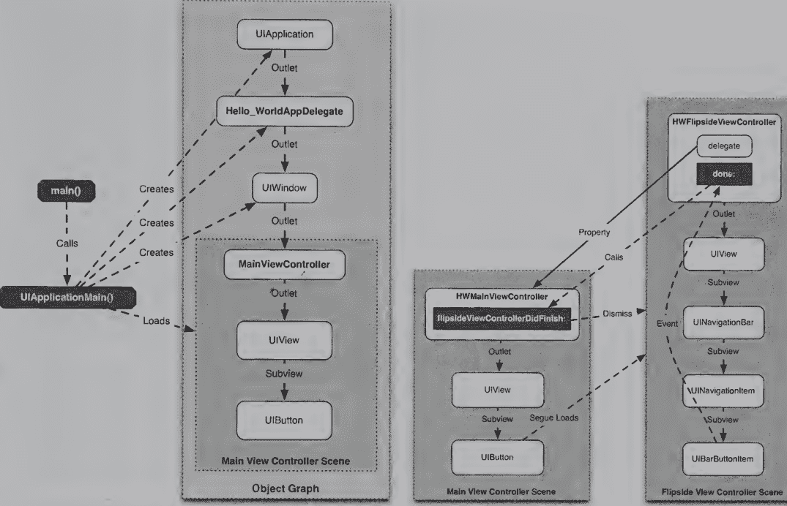

1.27 Hello 世界图

1.28 MainViewController 与 FlipsideViewController 之间的交互

现在打开 `FlipsideViewController.m`。与 `MainViewController.m` 类似，它大部分包含方法存根。不过，在底部我们有了 `done:` 动作的实现。

```objc
- (IBAction)done:(id)sender {
  [self.delegate flipsideViewControllerDidfinish];
}
```

这简单地调用了代理的 `flipsideViewControllerDidfinish:` 方法。这让一切完成了一个完整的循环。当用户按下 Done 按钮时，事件会触发 `done:` 动作。接着调用 ViewController 的 `flipsideViewControllerDidfinish:`，从而关闭侧边转视图控制器场景。

现在我们应用程序中的所有内容都已连接起来（图 1.27 和图 1.28）。同样，目前什么都没有发生。如果你在一个新项目中感到迷茫，可以从主 storyboard 文件（定义在项目的 `info.plist` 文件中）开始并逐步梳理。你应该能够追踪从 `UIApplication` 对象到项目中的任何对象的系列连接。某些连接可能也定义在 storyboard 中，但只要有耐心，你就能追踪到一切。

### 概览项目

#### 图 1.29 设置背景颜色

| 模式 (Mode) | 填充比例 (Scale To Fill) |
|---|---|
| Tag 0 | |
| 交互 (Interaction) | 用户交互启用 (User Interaction Enabled) |
| 多点触控 (Multiple Touch) | |
| Alpha 1 | |
| 背景 (Background) | 灰色 (Light Gray Color) |
| 着色 (Tint) | 默认 (Default) |

### 修改模板

好了，话不多说。让我们构建一些新东西。我们要在主视图上添加一个显示短消息的标签。我们还在侧边视图中添加一个文本框，允许用户更改消息。让我们开始吧。

### 修改主视图

打开 `Main.storyboard` 并放大主控制器场景。背景对我来说有点太暗了。选择 View 对象，然后切换到属性检查器（Attributes inspector）。将 Background 属性更改为灰色（Light Gray Color）（图 1.29）。

现在我们需要添加一个标签。Xcode 让添加常用的用户界面变得简单。在工具栏的下半部分，选择对象库（图标）。向下滚动直到找到 label（如果你遇到困难，请使用库底部的过滤器栏）。点击 label 并将其从面板拖动到 Main View Controller 场景的 view 上。鼠标指针将显示一个绿色的加号。这表示我们可以将此对象添加到该位置。

Xcode 将帮助你正确放置控件。当你拖动标签跨越编辑器区域时，它会高亮并标记当前视图。它还会绘制引导线来帮助正确定位对象。拖动标签直到它在垂直方向上居中并与视图的左边距对齐，如图 1.30 所示。

当你松开标签时，它将出现在白色方块包围中。你可以点击并拖动这些锚点来调整标签的大小。抓取右侧并拉伸，直到触及右边距。

这让我们得到了一个垂直居中并延伸到整个屏幕从边缘到边缘的标签。问题是，它不会保持这种状态。编译并运行应用。根据你的设置，你可能会立即发现问题。如果你是为 4 英寸 iPhone 设计的 storyboard 但在 3.5 英寸模拟器上运行，它会出现在屏幕靠下的位置。

#### 第 1 章 HELLO, IOS

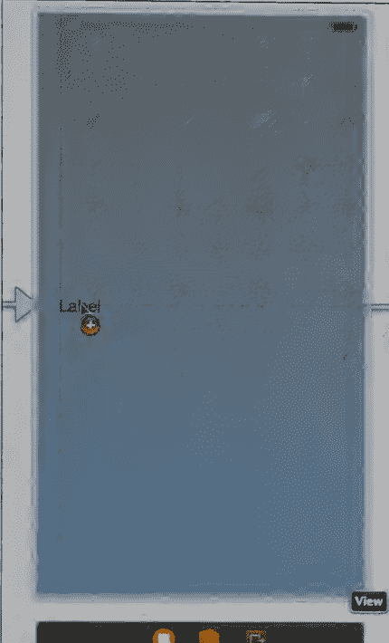
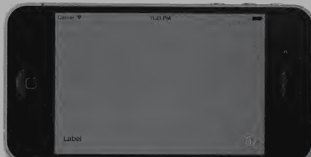

图 1.31 标签不再垂直居中

图 1.32 添加垂直居中约束

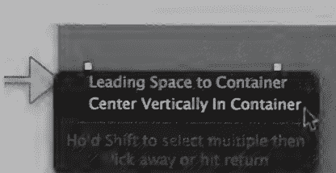

图 1.33 标签及其约束

图 1.30 正确对齐标签

更糟糕，将模拟器旋转到横向方向。无论你的设置如何，现在事情看起来绝对错了（图 1.31）。

问题是，默认情况下，所有用户界面元素都保持与其视图窗口左上角的固定距离。如果我们希望布局能适应不同的屏幕尺寸和方向，我们需要添加一些 Auto Layout 约束。

我将在第 3 章详细介绍 Auto Layout 的细节。现在，我们只需足够让事情运行起来的约束。确保标签被选中，然后按住 Control 点击并向左侧拖动。一条蓝线应该从你按 Control 点击的点延伸到鼠标。当你处于标签边缘和视图边缘之间时松开鼠标。在弹出窗口中，选择 Vertically in Container（容器内垂直居中）（图 1.32）。

重复该手势。这次选择 Leading Space to Container（容器领先间距）。接下来，按住 Control 点击并拖动右边缘，选择 Trailing Space to Container（容器尾随间距）。我们在标签的每侧都应该有一个蓝色的 I 型条，一条蓝线穿过标签中间（图 1.33）。再次编译并运行应用。无论你选择哪种模拟器或何种方向，标签都会垂直居中。

#### 1.34 设置字体

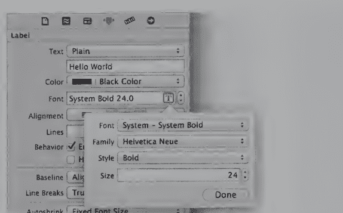

确保标签被选中，并打开属性检查器。在 Alignment 属性中，点击文本。这会弹出一个窗口。在这里，将字体更改为 System Bold（系统加粗），大小更改为 24 点（1.34）。

### 添加输出（Outlet）

如果我们想在运行时更改标签文本，我们需要一种在代码中访问它的方法。最简单的方法向视图添加一个输出（outlet）。在 Xcode 4.0 之前的时代，这意味着我们要在 Xcode 和 Interface Builder 之间反复跳跃，因为我们要手动修改代码。现在有一个简单得多的方法。

首先，我们可能应该折叠文档大纲（Document Outline）。点击编辑器区域左下角的文档大纲按钮（📄）。接下来，切换到工具栏上的助手编辑器（Assistant editor）图标（🧑‍）。

#### 图 1.35 堆叠的助手编辑器

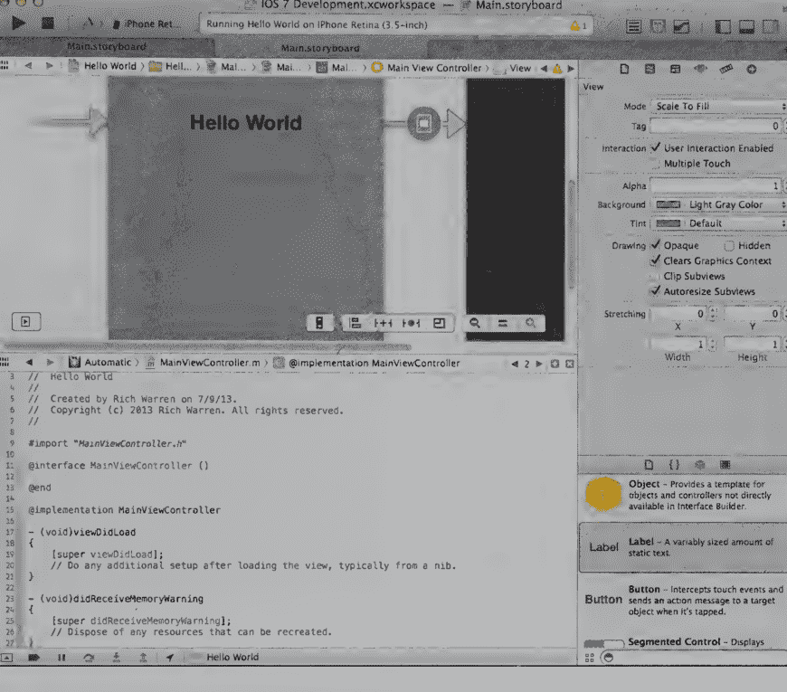

这将并排显示两个编辑器区域。最左侧的区域包含选中的文件，而最右侧的包含一个密切相关的文件。例如，如果你选择了 `MainViewController.header` 文件，右侧编辑器应该显示 `MainViewController.implementation` 文件。在我们的情况下，左侧编辑器显示 storyboard，而右侧编辑器显示所选控制器的实现文件。

我们实际上还需要一个小小的变化。选择 View > Assistant Editor > Assistant Editors on Bottom 菜单项。然后点击主视图内部。你的界面看起来应该像图 1.35 所示。

## Hello World

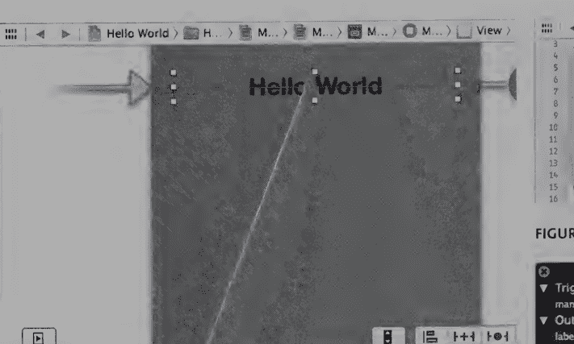

#### 1.37 配置连接口

```objc
// Hello World
// Created by Rich Warren on 7/9/13.
// Copyright (c) 2013 Rich Warren. All rights reserved.

#import "ViewController.h"

@interface ViewController (ViewController)

@IBOutlet UILabel *myLabel;

@end
```

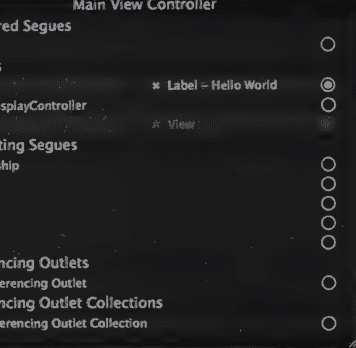

图 1.38 主视图连接 HUD

按住 Control 键并点击标签，然后将其向下拖入 `ViewController.m` 文件中。同样，将有一条蓝线从你点击的地方延伸到你的鼠标。当你将其移动到 `@interface` 和 `@end` 指令之间时，你会看到一条蓝线标记着插入点，并弹出一个菜单，提供“插入连接口”（Insert Outlet）或“连接口连接”（Outlet Connection）的选项（图 1.36）。看到此后，释放鼠标。

现在会弹出一个对话框，允许你配置连接口。确保 Connection（连接）设置设置为 Outlet。在 Name（名称）字段中，输入 label。type（类型）应该是 `UILabel`，storage（存储）应该为 Weak（图 1.37）。点击 Connect（连接）继续。

Xcode 将对 `ViewController.m` 进行以下更改（粉红色字体）：

```objc
@interface ViewController ()

@property (weak, nonatomic) IBOutlet UILabel *label;

```

这定义了一个我们可以连接到 Interface Builder 的连接口。在 storyboard 文件中，Xcode 已经将标签连接到我们新创建的连接口。你可以使用 Connections 检查器（Connections inspector）查看此内容。或者，在文档大纲（Document Outline）或场景坞（scene dock）中点击 Main View Controller 图标来调出 Connections HUD（图 1.38）。

### 修复导航栏

如果你运行应用程序并点击信息按钮，你可以看到导航栏以及下方的状态栏。在 iOS 之前的版本中，状态栏通常是屏幕顶部的一条不透明条。我们的用户界面顶部将紧接状态栏下方。在 iOS 7 中，状态栏是透明的，我们必须将界面扩展到屏幕的最顶部。

显然，Utility Application 模板仍在使用旧式的导航栏。我们可以让导航栏加高 20 点，使其完美地位于状态栏下方，但最简单的修复方法是在此场景中隐藏状态栏。

遗憾的是，这需要一些代码。打开 `FlipsideViewController.m` 并找到 `didReceiveMemoryWarning` 方法。在 `didReceiveMemoryWarning` 之后添加以下代码：

```objc
- (BOOL)prefersStatusBarHidden
{
  return YES;
}
```

现在就好了。当你运行应用并导航到 flipside 视图时，状态栏消失了，导航栏在顶部正确对齐。

### 添加文本字段

前几个步骤与我们为主视图执行的操作非常相似。我们将添加一个文本字段（Text field）而不是标签（Label），并将其放在导航栏下方（这样当键盘出现时，即使在横屏模式下也不会被遮挡）。除此之外，步骤都是相同的。

切换回标准编辑器（Standard Editor），确保 `Main.storyboard` 已打开。放大 Flipside View Controller 场景。现在，从对象库（Object library）拖入一个文本字段（Text Field）。将其放置在导航栏下方，并调整其大小使其从边距处填充视图。

按住 Control 键并拖动到文本字段的左侧。同样，在文本字段边缘和视图边缘之间释放鼠标。这次选择 Space to Container（间距到容器）。接下来，按住 Control 键向右拖动并选择 Trailing Space to Container（尾间距到容器）。记住，Xcode 会尽力提供帮助，根据方向确定你可能在寻找哪些约束。如果你拖动它，它会显示你可能需要的约束方向。

### 完善界面

从功能上来说，一切都是好的，但它并不是世界上最精细（或者说，最实用）的 App。让我们让它变得好一点。当反面视图（flipside view）出现时，用标签的当前值来填充字段。此外，当用户点击 Return（返回）键时，让我们关闭反面视图。

首先从主视图的标签将文本传递给反面控制器——就像反面控制器的 delegate 属性一样，我们将在 `prepareForSegue:` 方法中分配此值。

导航到 `ViewController` 的 `prepareForSegue:sender` 方法并添加高亮行：

- (void)prepareForSegue:(UIStoryboardSegue*)segue sender:(id)sender
```objectivec
if ([[segue identifier] isEqualToString:@"showAlternate"]) {
    [[destinationViewController] setDelegate:self];
    [destinationViewController] setText:self.label.text];
}
```

然后，我们需要使用这个值。切换到 `FlipsideViewController.m`。这次我们将添加一个全新的方法。在 `viewDidLoad:` 之后插入以下代码：

- (void)viewWillAppear:(BOOL)animated
```objectivec
super viewWillAppear(animated);
self.textField.text = self.text;
```


此方法每当反面视图出现时都会调用。在这里，我们将存储在 `text` 属性中的值赋值给文本字段（`textField`）。

当用户按下 Return 键时，关闭反面视图。打开 `Main.storyboard`，并放大 `Flipside View Controller` 场景。按住 Control 键点击文本字段以调出 Connections HUD（连接面板）。在 `Sent Events`（发送的事件）部分的顶部，应该有一个名为 "Did End on Exit" 的事件。从该事件的圆圈拖到 dock 里的视图图标（如果有必要，HUD 将自动淡出以留出空间）（图 1.41）。

当你松开鼠标时，会出现第二个 HUD。它只显示了一个选项，即 `done:` 方法——这正是我们想要的。点击它。

有几种同样有效的方法来绘制此连接。我们可以通过 Control 键点击场景 dock 栏中的 `FlipsideViewController` 图标，并将 `done:` 动作拖动到文本字段。Xcode 会提示你选择正确的事件。我们也可以使用 Utilities（工具）区域中的 Connections inspector（连接检查器），而不是使用弹出对话框。这些方法大部分是等效的。请尽管尝试不同的方法，看看哪种最适合你。

### 图 1.41 将 Return 键连接到 done: 方法

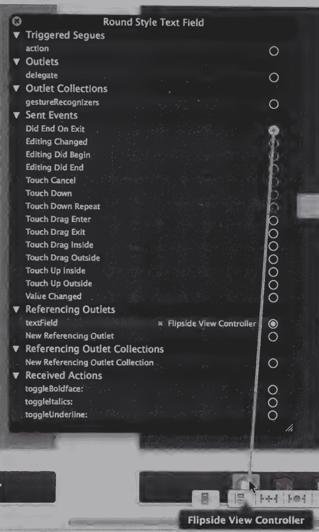

但注意，对于文本字段事件，系统通常会尝试自动选择 "Editing did End" 事件。这不是我们想要的。这在某种程度上限制了我们的选择。我们需要使用一种显式允许我们选择 "Did on Exit" 事件的方法。

> 注意：每个事件可以连接到多个动作，而单个动作也可以连接到多个事件。在这种情况下，我们的文本字段和 Done 按钮都连接到了 `done:` 动作。

顺便如此，让我们更改一下键盘 Return 键的外观。选择文本字段并打开 Attributes Inspector（属性检查器）。将 `Return Key` 属性设置为 Done。虽然这不会改变键盘的功能，但它有助于传达我们的意图。

你可能还想将 `Clear Button` 属性设置为 "Appears while editing"（编辑时显示）。毕竟，使用 Backspace 键删除大量文本很快就会变得无聊。

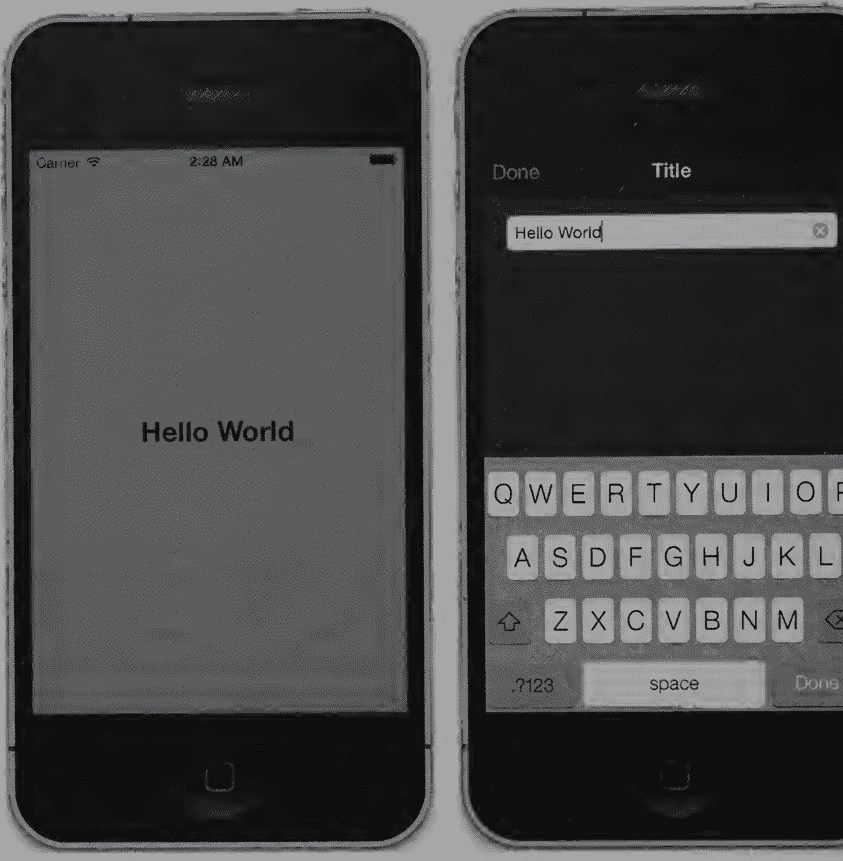

图 1.42 App 的最终主视图

图 1.43 App 的最终反面视图

就是。运行应用程序。它应该如图 1.42 所示。触摸信息图标切换到反面视图。文本字段应该显示当前消息。触摸文本字段，键盘和清除按钮应该就会出现（图 1.43）。

如果你长按文本，将出现放大镜。松开后会弹出一个菜单。如果你点击 Select（选择），菜单会更改。我们有剪切、复制、替换或定义当前单词的选项。点击 Define（定义），系统字典将打开以选择该单词（注意：在模拟器上，将找不到任何定义！）。点击 Done（完成）关闭字典。修改文本，然后摇晃设备（模拟器中按 `^Z`）。一个提示消息会询问你是否要撤销输入。

这包含了相当多的功能，而我们免费获得了一这一切——仅仅是因为我们正在使用系统文本字段之一。关闭提示，更改文本，然后按 Return 或 Done。主屏幕上的文本应该随之改变。

## 总结

我们的 Hello World App 就到这里了。在本章中，我们检查了 iOS 应用程序是如何组合在一起的。我们构建并修改了自己的（尽管极其简单）应用程序，并获得了一些使用开发工具的实践经验。这应该为你书的其余部分提供一个很好的起点。

在第 2 章中，我们将利用目前学到的一切，开始构建更复杂的应用程序。我们将继续前进。

# 第 2 章 我们应用程序的架构

iOS SDK 提供了五种组织应用的工具：`UITabBarController`、`UINavigationController`、`UIViewController`、`UICollectionViewController` 以及呈现式控制器（present controllers）。你可能不需要所有这些工具，但它们是大多数应用程序的基础构建模块。

`UITabBarController` 让用户可以在不同的任务或数据组之间切换。例如，“闹钟”（Clock）应用程序允许用户在不同的时间相关任务之间选择：时钟、闹钟、秒表和计时器。另一方面，“音乐”（Music）允许用户选择其数据的不同视图：专辑、艺术家、流派和播放列表；而 App Store 则同时显示这两种方式，展示三组（特色、排行榜、附近）和两个任务（搜索和更新）。

标签栏（tab bar）可以支持任意数量的标签项。然而，它一次只能显示五个。`UITabBarController` 通过提供一个“更多”（More）按钮并允许用户自定义出现在标签栏上的项来自动管理任何标签项。请注意，如果你有超过五个标签，该栏将只显示其中四个，因为“更多”按钮占据了第五个空间。

`UINavigationController` 让用户可以在不同场景之间移动。该控制器维护了一个视图栈。当新视图添加到栈顶时，视图从右侧滑入，而旧视图向左滑动。当顶部的视图从栈顶弹出时，动画将反之。这为在视图层次结构中移动提供了一个直观的界面。

在 iOS 7 中，Apple 在返回栈向下移动时引入了新的过渡方式。在此之前，我们仍然只需点击返回按钮，这将执行我们返回上一个场景的动画。然而，我们也可以从左边缘跨越屏幕拖动。这是一个交互式过渡（interactive transition）的示例。过渡的速度与我们手指的速度匹配，且我们可以在任何时候取消过渡。如果我们拖动得太快，它会很容易地滑回顶部视图。超过某个点后，即使没有我们的控制，它也会继续执行过渡动画。我们将在第 4 章详细查看交互式过渡，包括创建我们自己的交互式过渡。

`UITabBarController` 和 `UINavigationViewController` 都是容器控制器（container controllers）的示例。它们定义了我们在应用程序中如何在不同场景之间移动。另一方面，`UITableViewController` 和 `UICollectionViewController` 是内容控制器（content controllers）。虽然它们看起来非常不同，但角色和操作在很大程度上是相同的。这些控制器在屏幕上显示多个项，让用户选择其中一个或多个项。

表格视图控制器以单列形式显示数据，包含任意数量的行。单独来看，每行可能相当复杂，结合了图像和格式化文本。通常情况下，整个表格都使用单行。每行都代表与简单项目列表的区别。

用户可以上下滚动查看行，并选择他们想要的任何项。表格通常用于展示列表，例如电子邮件帐户列表、单个账户内的邮箱箱列表，甚至是单个邮箱箱内的消息列表。

## 嵌套容器

虽然每个基础视图控制器本身都是强大的工具，但我们可以通过组合它们来创建更复杂的层次结构。然而，将容器嵌套在其他容器内部时需要小心，特别是许多容器控制器期望管理固定大小的视图。尝试将一个固定大小视图放在另一个内部无疑会导致奇怪的布局问题。

Apple 建议始终保持顺序（从父到子）：

1. 分割视图控制器 (Split View Controller，仅限 iPad)
2. 标签控制器 (Tab Controller)
3. 导航控制器 (Navigation Controller)
4. 具有灵活边界的内容控制器和容器视图（例如分页 Page View）

模态视图（Modal views）充当某种泄压阀。由于它们占据整个屏幕，我们通常可以将任何容器控制器放在模态视图内部。相同的基本逻辑也适用于 iPad 上的弹出视图控制器。

这意味着我们可以在 `UITabBarController` 内部放置一个 `UINavigationController`，但不能在 `UINavigationController` 内部放置 `UITabBarController`。对于 iPhone 应用程序，通常 `UITabControllers` 要么是窗口的根控制器，要么是以模态方式显示的。

Apple 的文档强烈建议使用单个标签栏作为应用程序的根视图，并确保它在每个场景中都可见且可访问。如果这不符合你应用程序的需求，也许你应该重新考虑你的用户界面。例如，表格视图、集合视图控制器或自定义视图控制器可能更符合你的需求。

`UITableView` 还有一个常见的次要用途。在这种情况下，我们可以创建一个静态表格来组织一组固定的异构数据片段。整个表格用于表示一个单一条目。每行都有自己的格式，显示该条目的某个方面。随着我们的改变，行的数量和类型保持不变；只有数据发生变化。我们使用静态表格来创建用户将填写的表单，或显示数据层次结构中被选中对象的详细信息。

集合视图控制器（collection view controller）具有大得多的灵活性。我们可以自定义单个项的显示方式以及集合的组织方式。在最基础的情况下，我们可以使用集合控制器来显示网格项。用户可以滚动网格，选择他们想要的任何项。这让我们能够轻松地显示一组图像或图标。更通俗地说，每当我们需要比表格视图能处理的稍微复杂的内容时，我们就会使用集合视图。

最后，任何视图控制器都可以呈现另一个视图控制器。默认情况下，这些是以模态视图控制器的形式呈现的。进入的场景将全屏，覆盖当前的视图控制器，并一直保持直到被关闭。我们应该避免将多个视图控制器层叠在一起——它们对于快速弹出用户在继续之前必须交互或取消的表单或控件很有用。

大多数应用程序将这些工具的部分或全部组合成自然匹配应用程序数据的用户界面。通常情况下，`UITabViewController` 提供了最粗粒度的组织，定义了我们最广泛的分组。在每个组内部，`UINavigationController` 让用户从通用到特定在数据层次中移动，而 `UITextViewController` 和 `UICollectionView` 显示每个细节层级的可用信息。

## 启动 HEALTHAT 项目

如果你和我一样，每天大部分时间都坐在电脑前。这导致了一场持续的减肥战斗。为了帮助这场战斗，让我们构建一个应用程序，让我们能够随时间跟踪自己的体重。

Health Beat 将有三个主要任务：用户可以输入新体重，可以查看显示体重随时间变化的图表，还可以查看显示所有体重记录的完整历史记录。我们将使用表格视图在历史数据和图表之间导航。此外，我们将使用表格视图/导航控制器的组合来管理我们的历史视图。表格视图将显示历史中的所有体重。如果你点击一个体重，导航控制器将为该条目调出详细视图。最后，我们将呈现一个用于输入新体重的模态视图（modal view）。

本章将重点侧重于该应用程序的整体架构；构建一个连接我们的标签栏、表格视图和导航控制器的 Storyboard；以及构建和附加应用程序的模型。我们将在后面的章节中完善此设计并涵盖其他主题，例如保存和加载数据以及绘制自定义视图。

## 创建项目

打开我们在第 1 章中创建的工作区。在 Xcode 的最近项目列表中查找“iOS 7 Development”，或者直接找到并双击 `ios-7 Development .xcodeproj` 文件。工作区应该包含我们的 Hello World 项目。通过从菜单选择 New > Project... 添加新项目。选择 iOS > Application 并点击 Next 按钮（图 2.1）。

在“为新项目选项”面板中，将项目命名为 Health Beat。填写 Organization Name 和 Company Identifier 字段。留空 Class Prefix，Devices 设置为 iPhone。然后点击 Next（图 2.2）。


### 为你的新项目选择模板

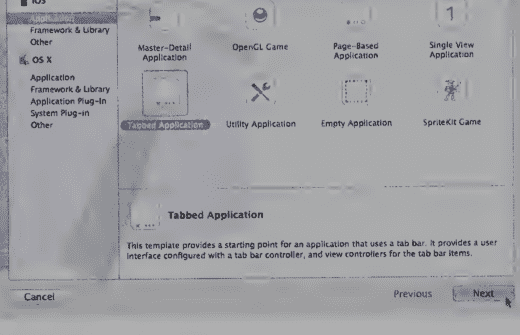

### 为你的新项目选择选项

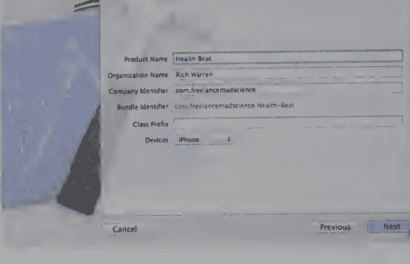

图 2.1 创建标签页应用程序

图 2.2 设置项目选项

图 2.3 保存项目

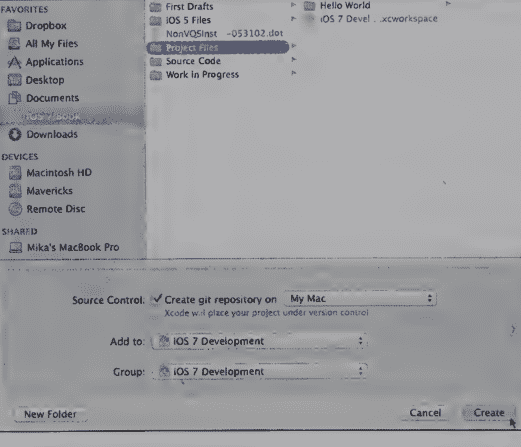

在最后一个面板中，选择项目的位置。确保勾选“Create git repository on”（在...创建 git 仓库）复选框。除非你设置了构建服务器，否则它将在我的 Mac 上本地创建仓库。

确保“Add to”（添加到）下拉菜单选择的是 iOS 7 Development。组也应该是 iOS 7 Development，在我们工作区中创建一个新的顶层项目（图 2.3）。这创建了一个基础标签页应用程序。在 Xcode 的工具栏中，将方案更改为 Health Beat > Retina (3.5 inch)（图 2.4）并运行应用程序。

正如你看到的，应用程序模板为我们提供了一个简单的双标签应用程序（图 2.5）。你可以按下标签按钮在第一个和第二个视图之间切换。

### 图 2.4 设置方案

### 图 2.5 运行模板

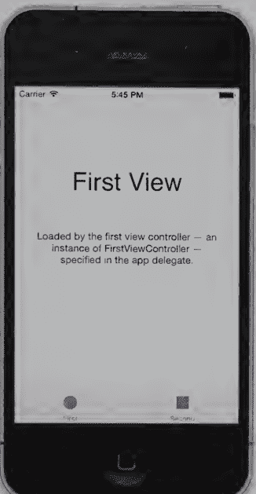

查看项目导航器（Project navigator）中的文件，我们的模板创建了一个应用代理（App-Delegate）、两个控制器（`ViewController` 和 `SecondViewController`）以及 Storyboard（`MainStoryboard.storyboard`）。我们的资源目录（`Images.xcassets`）包含了我们第一个和第二个标签栏的图标。我们还有支持文件和一个用于单元测试的新组。

### 清理环境

在我们开始构建应用程序之前，让我们整理一下。首先，如果我们可以修改现有的控制器和 Storyboard 元素，那么直接从头创建我们自己的会更容易。所以，让我们删除它们。删除 `ViewController.h`、`ViewController.m`、`SecondViewController.h` 和 `SecondViewController.m`。

打开 `Images.xcassets` 并删除第一个和第二个图标。你可以直接从资源中选择“first”并按 Delete 键。然后对第二个图标重复此操作。

接下来，打开 Storyboard 并删除第一个和第二个视图控制器。有几种方法——但让我们看看最简单的方法。从 Storyboard 中删除场景的技巧是选择并删除控制器本身。

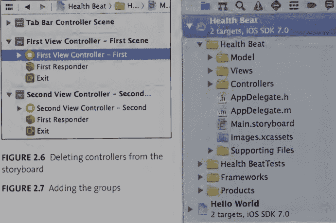

图 2.6 从 Storyboard 中删除控制器

图 2.7 添加组

确保文档大纲（Document Outline）可见，然后展开 First View Controller – First Scene。在该场景内部，选择 First View Controller – First line（图 2.6）。这是带有控制器对象的视图。

在区域编辑器中，视图将会出现并在周围有一条蓝线。按下 Delete 键，整个场景将从 Storyboard 中消失。对第二个视图控制器重复此操作。这应该只留下 Tab Bar Controller Scene。

现在，让我们添加一些组织结构。我们将为项目添加四个组：Model、Views 和 Controllers。在项目导航器中，右键点击 Health Beat 组，选择 New Group（新建组），并给它一个适当的名字。完成后，移动这些组使它们与图 2.7 一致。

### 设置额外的警告

Xcode 可以执行复杂的分析并对你的代码提供快速的反馈，帮助避免许多常见的编程错误。遗憾的是，其中许多项默认是关闭的。让我们修复这个问题。

点击 Health Beat 项目图标（顶部的蓝色图标）。这允许我们编辑许多项目和目标设置。确保选择了 Health Beat 目标，并点击 Build Settings（构建设置）选项卡。验证 All（全部）和 Combined（组合）按钮已被按下，然后在搜索栏中输入 `analyzer`。这将调出 Static Analyzer（静态分析器）设置。将“Analyze During 'Build'”更改为 **Yes**。还将“Mode of Analysis for 'Build'”更改为 **Deep**。这将强制编译器在你每次构建应用程序时运行静态分析器。

顺便，向下滚动到 Static Analyzer—Issues—Security 设置。这些检查中的某些默认是关闭的。它们对当前应用程序没有影响，但很有可能改变它们。将“Floating Point Value as Loop Counter”、“Use of 'rand' Functions”和“Use of 'strcpy'”更改为 **Yes**。

在每次构建时运行静态分析器提供了一个极好的健康检查；然而，它会显著降低编译速度。你可能会发现在处理大型项目或在较慢的电脑上开发时需要关闭它。但根据我的经验，将新版本的应用程序上传到设备（甚至是模拟器）上需要花费很长时间，额外的编译几乎察觉不到。尽管如此，你的情况可能有所不同。

接下来，清除搜索并滚动直到找到标记为 LLVM 5.0 - Warning Policies 的部分。此部分包含一个警告列表：

- Treat Warnings as Errors（将警告视为错误）
- Check Statements（检查语句）
- Deprecated Functions（弃用函数）
- Direct usage of 'isa'（直接使用 'isa'）
- Documentation Comments（文档注释）
- Hidden Variables（隐藏变量）
- Implicit Conversions（隐式类型转换）
- Implicit Constant Conversions（隐式常量转换）
- Implicit Integer to Pointer Conversions（隐式整数到指针转换）
- Implicit Signedness Conversion（隐式符号转换）
- Initializer Not Fullyed
- Mismatched Return Type（返回类型不匹配）
- Missing Braces and Parentheses（缺少大括号和小括号）
- Missing Fields in Structure Initializers（结构初始化中缺少字段）
- Missing Function Prototypes（缺失函数原型）
- Missing Newline At Of File（文件缺少换行）
- Pointer Sign Comparison（指针符号比较）
- Sign Comparison（符号比较）
- Suspicious Implicit Conversions（可疑的隐式转换）
- Typecheck Calls to printf/sc（printf/sc 类型检查）
- Uninitialized Variables（未初始化变量）
- Unknown Pragma（未知 Pragma）
- Unused Functions（未使用函数）
- Unused Labels（未使用标签）
- Unused Values（未使用值）
- Unused Variables（未使用变量）
- Implicit Objective-C Properties（隐式 Objective-C 属性）
- Incomplete Objective-C Protocols（不完整的 Objective-C 协议）
- Overriding Deprecated Objective-C Methods（覆盖弃用的 Objective-C 方法）
- Strict Selector Matching（严格选择器匹配）
- Undeclared Selector（未声明的选择器）
- Unintentional Root Class（无意的根类）
- Implicit ownership types on out parameters（输出参数上的隐式所有权类型）
- Implicit retain of 'self' within blocks（block 内 self 的隐式 retain）
- Using_bridge Cases Out of ARC

## 图 2.8 添加图表标签页图标

| Health Beat | Health Beat | Images.xassets | graph |
|---|---|---|---|
| Appicon | | | 1x 2x |
| graph | | | |

由于颜色并不重要，我发现在透明背景上用黑色绘制图标是最简单的。如果我需要阴影效果，我会更改黑色墨水的不透明度。这样，我看到的图像将与我的应用程序使用模板图像时得到的结果尽可能接近。

你可以自由创建自己的图标。或者，你可以直接从 www.freelancers.com/107_source/ 下载源代码并复制艺术作品。在项目导航器（Project navigator）中选择 `Images.xassets`。编辑器应该会在左侧显示资源列表，右侧显示图像编辑器。目前应该只有两个资源：AppIcon 和 LaunchImage。

将 `graph.png` 拖入列表。这应该创建一个名为 `graph` 的新资源。选择该资源，你应该能看到 1x 和 2x 图像的占位符。目前只有 1x 是填充的。

将 `graph@2x.png` 拖入 2x 占位符。这应该同时设置两个图像分辨率（图 2.8）。我们现在可以简化运行时加载图像的操作，系统会自动为你的设备选择正确的分辨率。

对 `graph_selected.png` 和 `graph_selected@2x.png` 重复此过程。现在我们的 `Images.xassets` 文件夹中应该有四个资源了。

如名所示，图表图标将用于我们的图表视图标签页。我们将为历史视图标签页和我们的添加按钮使用内置图标，因此它们不需要任何额外的艺术作品。

## 在 iOS 设备上运行和测试

如果你正在运行 Mountain Lion 或 Mavericks，可以从 Store 免费下载 Xcode 5.0。这让你完全获得访问 iOS SDK 和模拟器的权限。然而，如果你想在实际的 iOS 设备上构建并运行应用程序，则需要加入 iOS 开发者计划（iOS Developer Program）。你可以以每年 99 美元的价格以个人或公司团队身份注册。

还有一些不常用的选项。对于条件的学术机构，iOS 开发者计划是免费的，允许大学将 iOS 开发课程作为课程的一部分提供。在高级别，iOS 开发者企业计划（iOS Developer Enterprise Program）允许大型公司制作和部署专有的内部应用程序。尽管如此，我们大多数人要么会购买个人会员，要么发现自己被加入了一个令人兴奋的公司团队。

一旦你拥有 iOS 开发者会员身份，必须在设备上进行构建和测试之前设置正确的开发者证书（certificates）和配置文件（provisioning profiles）。最初，这是一个繁琐且容易出错的过程。证书、标识符配置文件（Certificates, Identifiers & Profiles）页面提供了所有必要步骤的详细信息（https://developer.apple.com/manage/overview/index.action）。

然而，我有一个好消息。多年来，苹果一直致力于自动化和简化这些程序。在大多数情况下，Xcode 可以自动为你设置好一切。

如果你收到关于签名实体（signing entities）或配置文件的错误消息，请确保一切都已正确设置。首先，在项目导航器中选择项目图标。确保选择了正确的构建目标（build target）并点击 General（通用）标签页。滚动此页面并寻找任何警告。如果有警告，你应该还会看到一个修复问题的按钮。如果没有发现任何内容，尝试检查 Capabilities（功能）标签页。

如果你无法在物理设备上运行应用程序，请检查你的偏好设置。在偏好设置窗口中选择 `Xcode > Preferences...` 菜单，选择 Accounts（账户）标签页。在右侧选择你的账户并点击 View Details...（查看详细）按钮。从这里，确保你有一个有效的签名标识（signing identity）。你应该刷新你的配置文件。

如果其他方法都失败了，请访问苹果的证书、标识符配置文件页面（https://developer.apple.com/ios/manage/overview/index.action）。这为你提供了一套完整的工具，用于管理你的证书、App ID 和配置文件。这绝对是最后的手段。你无法获得所有那些精良的自动化工具——但你应该能够进去、找到问题并修复它。

## 构建模型

我们现在准备好开始构建了。让我们从模型开始，因为在控制器执行任何实际工作之前，我们需要一个功能完备的微型关联模型（mini-ally functional model）。

我们设计模型的目标之一是让它尽可能模块化。这意味着创建一个定义良好的接口（interface），我们将通过该接口与应用程序的其他部分进行通信。对于 Health Beat 来说，这将是我们的 `WeightDocument` 类。我们还将创建一个 `WeightEntry` 类。该类将持有单个条目的数据。最后，我们将创建 `WeightUnits.h` 和 `WeightUnits.m` 文件。`WeightUnits` 将不会是一个类，但它是一个枚举（enum）以及我们希望在应用程序各处使用的相关函数。为它们提供自己的头文件和实现文件可以方便我们在任何需要的地方导入它们。

## 创建文件

让我们从向项目添加 `WeightHistoryDocument` 类开始，Control 点击 Model 组，并从弹出菜单中选择 New File...（新建文件）。这将打开“Choose a template...（选择模板...）”窗口。确保选择了 iOS > Objective-C Class 并点击 Next（下一步）。

在“Options...（选项...）”页面，确保“Subclass of（子类为）”被设置为 `NSObject`，然后将类命名为 `WeightHistoryDocument`。我总是在设置名称之前设置父类，因为某些类会自动修改名称。例如，`UIViewController` 会在类名末尾添加 `ViewController`。在意外创建了许多 `MyViewControllerControllers` 后，我决定最好是先设置父类。一旦设置了名称和父类，点击 Next。

最后页面允许我们选择保存类的位置。我们可以使用默认位置，但要确保 Group（组）设置为 Model，并且 Health Beat 目标被选中。

如果一切正常，点击 Create。Xcode 会将类添加到项目中并打开 .m 文件。我通常从修改 .h 文件开始。通过按下 `⌘` 在 .h 和 .m 文件之间切换。

重复 Entry。Control 点击 Model 组并选择 New File...。将子类设置为 `NSObject`，名称设置为 `WeightEntry`，并确保文件已添加到正确的组和目标。

对于枚举和工具函数，我们可以从 iOS > C and C++ 模板创建一个头和一个 C 文件。然而，这对我们无效。C 实现文件以 .c 结尾。Objective-C 实现文件以 .m 结尾。现在，我们没有创建类——但我们的函数可以使用 Objective-C 类，因此我们需要将代码编译为 Objective-C。获取 .h 和 .m 对的最简单方法实际上创建一个 Objective-C 类然后删除声明。让我们这样做。再次，Control 点击 Model 组并选择 New File.... 将类命名为 `WeightUnits`。这将决定 .h 和 .m 文件。父类无关；保持默认设置即可。然后进行以下两个更改：

- 在 `WeightUnits.m` 中删除 `#import "WeightUnits.h"` 之后的所有内容
- 切换到 `WeightUnits.h` 并删除 `#import <Foundation/Foundation.h>` 之后的所有内容

这给了我们一个空的 .h 和 .m 文件。如果你操作正确，你应该已经在 Model 组中添加六个文件：`WeightHistoryDocument.h`、`WeightHistoryDocument.m`、`WeightEntry.h`、`WeightEntry.m`、`WeightUnits.h` 和 `WeightUnits.m`。在继续下一步之前，确保拥有所有六个文件。

### 实现 WEIGHTUNIT

让我们从 WeightUnit 开始，因为它是简单的。打开 `WeightUnits.h` 并添加以下代码：

```WeightUnit getDefaultUnits(void);```

现在，切换到 `WeightUnits.m`。我们只需要定义 `getDefaultUnits()` 方法。

```#import "WeightUnits.h"```


# 实现 WeightEntry

## WeightUnit getDefaultUnits(void)

```objectivec
WeightUnit getDefaultUnits(void)
{
    return LBS;
}
```

## 实现 WEIGHTENTRY

`WeightEntry` 类比 `WeightUnit` 稍微复杂一点。让我们先打开 `WeightEntry.h`，并将所有现有代码替换为此处所示的代码：

```objectivec
#import <Foundation/Foundation.h>
#import "WeightUnits.h"

/**
 * WeightEntry 类存储单个条目的重量数据和日期数据。
 */
@interface WeightEntry : NSObject

/// 存储该条目的以磅（pounds）为单位重量
@property (assign, nonatomic, readonly) float weightInLbs;

/// 存储该条目的日期
@property (strong, nonatomic, readonly) NSDate *date;

/**
 * 用于实例化 WeightEntry 对象的便利方法
 *
 * @param weight 该条目的重量值
 * @param unit 重量参数的单位类型
 * @param date 该条目的记录日期
 * @return 一个新实例化的 WeightEntry 对象
 */
+ (instancetype)entryWithWeight:(float)weight usingUnits:(WeightUnit)unit forDate:(NSDate *)date;

/**
 * 将磅转换为公斤的类方法
 *
 * @param lbs 以磅为单位的重量
 * @return 以公斤为单位的重量
 */
+ (float)convertLbsToKg:(float)lbs;

/**
 * 将公斤转换为磅的类方法
 *
 * @param kg 以公斤为单位的重量
 * @return 以磅为单位的重量
 */
+ (float)convertKgToLbs:(float)kg;

@end
```

我们首先导入 `WeightUnits` 的声明。然后，我们为 `WeightEntry` 类添加两个属性：`weightInLbs` 和 `date`。每个 `WeightEntry` 将存储一个单一的条目。对于 Health Beat 来说，这意味着存储重量以及记录该重量的日期。

注意，这些属性是只读的。这意味着我们的 `WeightEntry` 对象是不可变的（immutable）。一旦创建了对象，我们就无法更改它的值。如果我们要修改 `WeightEntry`，我们必须创建一个具有正确值的新对象，并删除旧对象。

虽然这看起来可能有些不便，但不可变数据对象可以极大简化我们的代码。我们不需要担心应用程序的其他部分在我们在使用它们时更改了它们的值。

此外，为了简单起见，我们将始终以磅为单位存储重量。当我们显示重量时，可以将其转换为用户需要的任何格式。

此外，我们特意对重量使用了 `float` 而不是 `double`。我们希望在 32 位和 64 位应用程序中使用相同的数据类型，以便于保存和加载数据。使用 64 位数据将需要更多内存并减慢我们的 32 位版本。而且，由于我们的重量永远不需要 `double` 的额外范围或精度，使用它将是白费精力。

接下来，我们声明了一个便利方法以便实例化 `WeightEntry` 对象。这是一个接受三个参数的类方法：重量、重量单位和日期。

然后，由于我们需要转换重量，我们添加了从磅到公斤以及反过来转换的方法。这些方法不使用 `WeightEntry` 对象的内部数据，因此我们将它们设为类方法（class methods）。

最后，请注意我在我们的头文件中添加了 Doxygen 格式的文档注释。随后您可以将这些文档集（docsets）添加到 `/Library/Developer/Shared/Documentation/DocSet` 文件夹中，允许 Xcode 通过其文档查看器访问它们。然而，创建文档集在您创建库时最有用——特别是当您分发这些库或与团队其他成员共享它们时。对于中小型应用程序，这可能多此一举。

然而，即使在小型项目中，文档注释仍然很有用。Xcode 足够智能，可以识别这些文档注释，并在显示这些符号的快速帮助弹出窗时使用它们。有了这些注释，我可以通过 `Option-click` 任何类、属性或方法名来显示这些信息（图 2.9）。一旦我创建了注释，这一切都会自动发生；我不需要任何额外工作。

### 图 2.9 在快速帮助弹出窗中显示文档注释

```objectivec
- WeightEntry
Declaration: + (instancetype)initWithWeight:(float)weight usingUnits:(WeightUnit)unit forDate:(NSDate *)date;
Description: 用于实例化新 WeightEntry 对象的便利方法
Parameters:
  weight: 该条目的重量
  unit: 重量参数的单位类型
  date: 该条目的日期
Returns: 一个新实例化的 WeightEntry 对象
Declared in: WeightEntry.h
```

遗憾的是，由于空间限制，我不会在书的其余部分包含文档注释。我强烈建议在您所有的 `.h` 文件中添加这些注释。这在维护可能是几个月或几年前的代码时特别有用。

好了，我们还有更多工作要做。让我们切换到 `WeightEntry.m`。首先，我们需要实现我们的创建方法。我们需要三个创建方法来创建一个私有的自定义 `init` 方法。我们想要重写父类的 `init` 方法，并且想要实现我们的便利方法。

在 `WeightEntry` 的 `@implementation` 块内部（`@implementation` 行和 `@end` 指令之间）添加以下代码：

```objectivec
#pragma mark - Init Methods

// 指定初始化器。
- (id)initWithWeight:(float)weight
         usingUnits:(WeightUnit)unit
          forDate:(NSDate *)date {
    self = [super init];
    if (self) {
        if (unit == LBS) {
            _weightInLbs = weight;
        } else {
            _weightInLbs = [WeightEntry convertKgToLbs:weight];
        }
        _date = date;
    }
    return self;
}
```

## 实现权重历史文档

到目前为止，`WeightHistoryDocument` 将是我们模型中最复杂的部分。而且这甚至还不是 `WeightHistoryDocument` 的完整实现。我们暂时不需要担心数据的保存和加载，也不需要使用 iCloud 同步数据。这些功能将在未来的章节中添加。相反，这是一个最简单、最基础的实现，它仍然能让我们测试用户界面。

尽管如此，它还有许多必须执行的任务。它必须存储我们所有的权重条目，并为我们提供访问这些数据的方法。它还需要在更改开始、底层数据发生变化时，通知应用程序的其他部分。具体来说，它需要在更改开始、向历史记录添加条目、从历史记录中删除条目以及更改结束时发布通知。

让我们开始为通知名称声明字符串常量。在开始之前，我们还需要处理一些需要设置的内容。打开 `WeightHistoryDocument.h`。在导入 foundation 框架的行和 `@interface` 块的开始之间添加以下代码：

```objectivec
@class WeightEntry;

typedef void (^EntryEnumeratorBlock)(WeightEntry *entry);

// 用于注册更新通知
extern NSString * const WeightHistoryDocumentBeginChangesNotification;
extern NSString * const WeightHistoryDocumentInsertWeightEntryNotification;
extern NSString * const WeightHistoryDocumentDeleteWeightEntryNotification;
extern NSString * const WeightHistoryDocumentChangesCompleteNotification;

// 用于在通知中访问数据
extern NSString * const WeightHistoryDocumentNotificationIndexPathKey;
```

第一行导入了我们的权重单元枚举和函数。接下来是 `WeightEntry` 类的前向声明。通常，我们希望保留 `.h` 文件中所有的 `#import` 指令。`#import` 比它的 C 语言兄弟 `#include` 聪明得多。`#import` 只包含每个文件一次。因此，我们不需要太担心创建无限循环。尽管如此，如果头文件导入了其他头文件，后者又导入了其他头文件，可能会拖慢构建系统。

我们对 `WeightUnits.h` 中的枚举或函数无能为力——但我们可以使用前向声明来同时处理协议和类。基本上，`@class` 行告诉编译器 `WeightEntry` 类存在，编译器现在不需要担心它的细节。我们承诺在这些细节变得重要之前提供所有必要信息。

这种方法之所以有效，是因为所有类都是指针——这意味着它们的大小是相同的。只要我们文件中的代码只是传递指针或保存指针（例如，将对象作为返回值传递或将其保存在实例变量或属性中），编译器就不需要知道其他任何信息。只有当我们想要访问对象的公共属性或方法时，才需要导入头文件。通常，我们在 `.h` 文件中使用前向声明，并在 `.m` 文件中导入头文件。

在前向声明之后，我们正在为一个 block 类型创建一个 `typedef`。这种语法是……嗯，让我们大方点吧，它有点难看。我们正在创建一个数据类型 `EntryEnumeratorBlock`，它是一个接收单个 `WeightEntry` 参数且没有返回值的 block 的别名。我们将使用此 block 类型为我们的 `WeightEntries` 集合创建一个基于 block 的接口。

如果你将 block 用作参数、返回类型或属性，像这样的 `typedef` 有助于保持代码的可维护性。正如前一行所明智的那样，这比直接把这一堆乱码丢进你的原型中要好得多。

最后，我们声明了五个字符串常量。第五个是一个键，我们可以用它在通知的用户字典中获取和设置索引路径（index path）。

这是大量的工作，而我们还没有修改 `WeightHistoryDocument` 类本身。让我们声明属性和方法。在 `@interface` 内部添加以下代码：

```objectivec
@property (nonatomic, readonly) NSInteger count;

- (WeightEntry *)entryAtIndexPath:(NSIndexPath *)indexPath;
- (NSIndexPath *)indexPathForEntry:(WeightEntry *)weightEntry;
- (void)addEntry:(WeightEntry *)weightEntry;
- (void)deleteEntryAtIndexPath:(NSIndexPath *)indexPath;
- (void)enumerateEntriesAscending:(BOOL)ascending withBlock:(EntryEnumeratorBlock)block;
```

该类只有一个公共属性 `count`。实际上，`count` 将是一个虚拟属性。我们不会使用实例变量来存储历史记录中的项目数量。相反，每当调用访问器时，我们都会计算这个值。

诚然，我们本可以将 `count` 声明为一个方法——然而，通过将其声明为虚拟属性，我们可以使用点符号法来访问它。这简化了我们的代码，但付出了微小的代价。如果我们将其声明为属性，我们真的应该确保它符合 KVC 和 KVO 规范。正如你很快看到的，我们将花费额外的时间和精力来设置属性，以便日后简化使用。

在属性之后，我们声明了一些方法。`entryAtIndexPath:` 方法允许我们根据给定的索引路径访问条目。表格视图（table views）等使用索引路径通过类型和行来引用项目。我们主要将在表格中显示条目，我们在这里将与之匹配。

`indexPathForEntry:` 方法在权重历史记录中搜索匹配的条目。如果找到，它将返回其索引路径。`addEntry:` 方法向我们的历史记录中添加另一个条目，而 `deleteEntryAtIndexPath:` 则删除相应的条目。

最后，`enumerateEntriesAscending:withBlock:` 方法将允许我们遍历历史记录中的条目。我们可以选择按升序（从最早日期到最近）或降序（时间倒流）进行迭代。

接下来，我们需要为 `count` 实现 getter 方法。这有两个作用：首先，它让我们能够动态计算计数，而不是存储和检索该值。更重要的是，由于编译器没有为此属性创建任何访问器，它将不会创建 `_count` 实例变量。在我们的 `init` 方法下方、`@end` 之前添加以下代码：

```objectivec
#pragma mark - Accessor Methods

- (NSInteger)count {
    return [self.weightHistory count];
}

+ (NSSet *)keyPathsForValuesAffectingCount {
    return [NSSet setWithObjects:@"weightHistory", nil];
}
```

在这里，我们的 `count` 方法简单地调用可变数组的 `count` 方法并返回结果。系统使用 `keyPathsForValuesAffectingCount` 方法来判断你的 `count` 属性何时变化。如果你使用键值观察（KVO）来监控 `count` 属性，每当 `weightHistory` 变化时，你都会收到更新通知。

然而，这不足以让 `count` 符合 KVO 规范。事实证明，让集合符合键值编码（KVC）规范（这是 KVO 规范的前提）比看起来要困难。基本上，我们必须为数组中的元素实现并使用符合 KVC 规范的 getter 和 setter。实现此有几种方法，但对于本项目，我们将为 `WeightHistoryDocument` 添加以下方法：

```objectivec
#pragma mark - KVO Accessors

- (void)insertObject:(WeightEntry *)object inWeightHistoryAtIndex:(NSInteger)index {
    [self.weightHistory insertObject:object atIndex:index];
}

- (void)removeObjectFromWeightHistoryAtIndex:(NSInteger)index {
    [self.weightHistory removeObjectAtIndex:index];
}
```

# 第 2 章 我们应用程序的架构

这就是 Objective-C 的动态机制真正大放异彩的地方。系统将根据我们属性的名称动态查找这些方法。如果它同时找到了这两个方法，它将使用这些方法启用键值观察。对这些方法的任何调用都会生成更改通知。

然而，我们必须实现这两个方法。仅实现其中一个不会让类符合 KVC 规范——而且键值观察不会注册任何更改。可选地，我们可以添加一个 `replaceObjectInWeightHistoryAtIndex:withObject:` 方法，但对于本项目来说没有必要。

有了这些方法，我们的属性将符合 KVO 规范——当然，前提是我们只使用 `insertObject:inWeightHistoryAtIndex:` 和 `removeObjectFromWeightHistoryAtIndex:` 来修改底层数据。这有点烦人，但并不难保证。通常，`weightHistory` 是一个私有属性，因此无法在我们的类外部进行修改。只要 `WeightHistoryDocument` 是正确的，一切都将按预期运行。这是封装的又一次胜利！

现在，让我们看看访问方法。前两个是很容易的。

```objectivec
#pragma mark - Public Methods

- (WeightEntry *)entryAtIndexPath:(NSIndexPath *)indexPath {
    return self.weightHistory[(NSInteger)indexPath.row];
}

- (NSIndexPath *)indexPathForEntry:(WeightEntry *)weightEntry {
    NSInteger row = [self.weightHistory indexOfObject:weightEntry];
    return [NSIndexPath indexPathForRow:(NSInteger)row inSection:0];
}
```


我们只是简单地在数组索引和 `NSIndexPath` 之间进行转换。在处理表格时，`NSIndexPath` 有两个组件：行（row）和节（section）。在我们的应用程序中，将只有一个节。因此，所有项目都将放在节 0 中。条目的行等于它在数组中的索引。

所以，对于 `entryAtIndexPath`，我们从 `indexPath` 参数中提取行号。然后我们使用 Objective-C 新的下标表示法来查找该索引处的对象。

过程中有一个小插曲。`NSIndexPath` 使用的是有符号整数（signed integers），而下标表示法使用的是无符号整数（unsigned integers）。假设你开启了我在本章之前推荐的所有警告，你将需要将有符号强制转换为无符号变体以消除警告。正如我所说，额外的输入可能会很烦人——但它将帮助你避免一个潜在的尴尬错误。

`indexPathEntry:` 则是反过来操作的。我们获取所需条目的索引数字。然后我们使用该数字来创建一个新的 `NSIndexPath`（在需要时强制转换为有符号整数）。

接下来，让我们添加 `addEntry:` 方法。

```objc
(void)addEntry:(WeightEntry*)weightEntry {

    NSInteger index = [self insertionPointForDate:weightEntry.date];

    NSIndexPath *indexPathPath = [NSIndexPath indexPathForRow:(NSInteger)index section:0];

    NSNotificationCenter *center = [NSNotificationCenter defaultCenter];

    [center postNotificationName:WeightHistoryDocumentBeginChangesNotification object:self];

    [self insertObject:weightEntry inWeightHistoryAtIndex:index];

    [center postNotificationName:WeightHistoryDocumentInsertWeightEntryNotification object:self userInfo:@{WeightHistoryDocumentIndexPathKey:index}];

    [center postNotificationName:WeightHistoryDocumentChangesCompleteNotification object:self];

}
```

这个方法开始变得有点复杂了。在这里，我们正在确定条目的插入点。我们希望 `WeightEntry` 保持按时间顺序，而直接将每个新元素插入到它的正确位置比在每次更改后重新排序数组要快。

如果你不熟悉 `WeightHistoryDocument` 的 `insertionPointForDate:` 方法，那是因为我们还没有写它。我们很快就会将其添加为私有方法。现在，让我们假设它如描述的那样有效。

接下来，我们将条目转换为索引路径。然后我们获取默认通知中心的引用。然后我们发送一个通知，说明文档即将发生更改。我们将对象插入历史记录，然后发送一个表示我们已插入一个对象的通知。在这些通知中，`WeightHistoryDocumentInsertEntry` 是最复杂的。在这里，我们使用 Objective-C 的新字面量语法来创建我们的字典。具体而言，我们包含了新插入对象的索引路径。

在许多方面，这与 `addEntry:` 非常相似。我们获取默认通知中心的引用。然后我们使用符合 KVO 规范的访问器移除对象。我们发送两个通知。首先是条目被删除的，然后是更改完成的通知。现在让我们看看这里所示的 `deleteAtIndexPath:` 方法：

```objc
(void)deleteAtIndexPath:(NSIndexPath *)indexPath
{
    [center postNotificationName:WeightHistoryDocumentBeginChangesNotification object:self];

    [self removeObjectFromHistoryAtIndex:(NSInteger)indexPath.row];

    [center postNotificationName:WeightHistoryDocumentDeleteEntryNotification object:self userInfo:@{WeightHistoryIndexPathKey:indexPath.row}];

    [center postNotificationName:WeightHistoryDocumentChangesCompleteNotification object:self];
}
```

等待，我需要修复上面的文本。让我根据提供的 OCR 重新对齐。

我们希望我们的 `History` 数组保持降序排列。为了实现这一点，我们从索引 0 开始。然后我们遍历当前数组。对于数组中的每个条目，我们检查其日期是否在我们新条目的日期之后。如果是，说明我们就找到了正确的位置。我们只需返回当前索引即可。如果不是，我们就增加索引并检查下一个项目。如果我们到达数组的末尾，就直接返回数组的长度，从而有效地将对象插入到末尾。

只要数组已经是降序排列的，这个算法就能正常工作。幸运的是，如果我们从空数组开始，并始终使用此算法添加新项目，它就永远不会乱序。这也是我们不允许替换或修改条目的原因。如果允许这样做，我们就必须在每次发生更改时都进行检查，并在必要时重新排列数组。那会让代码变得非常混乱。

按照目前的写法，如果你想替换某个条目，必须先删除旧条目再插入新条目。当然，当您添加新条目时，代码将根据其新日期自动将其插入到合适的位置。这样，一切都能保持正确的顺序。

最后还有一步。我们可能应该重写 `description` 方法，以便在测试期间提供更有用的信息。添加以下方法。我通常在类的底部、紧接私有方法的地方附近重写方法。

### #pragma mark - NSObject Methods

```objc
- (NSString*)description
{
    return [NSString stringWithFormat:
        @"WeightHistoryDocument: count = %@, history = %@"
        @(self.count), self.weightHistory];
}
```


在这里，我们需要确保我们的格式化字符串同时适用于 32 位和 64 位系统。问题在于，`self.count` 返回的 `NSInteger` 大小在 32 位和 64 位之间发生变化。这意味着这个占位符也必须改变。在 32 位下，它需要 `%d`，在 64 位下，它需要 `%ld`。我们通过使用对象占位符 `%@` 并使用字面量语法将整数转换为 `NSNumber` 来解决这个问题。

目前就到这里。我们将在后面的章节中添加一些花花哨的功能，但这些已经足够我们构建和测试用户界面了。既然提到用户界面……

## 布局 Storyboard（故事板）

图 2.10 我们大部分为空的 Storyboard

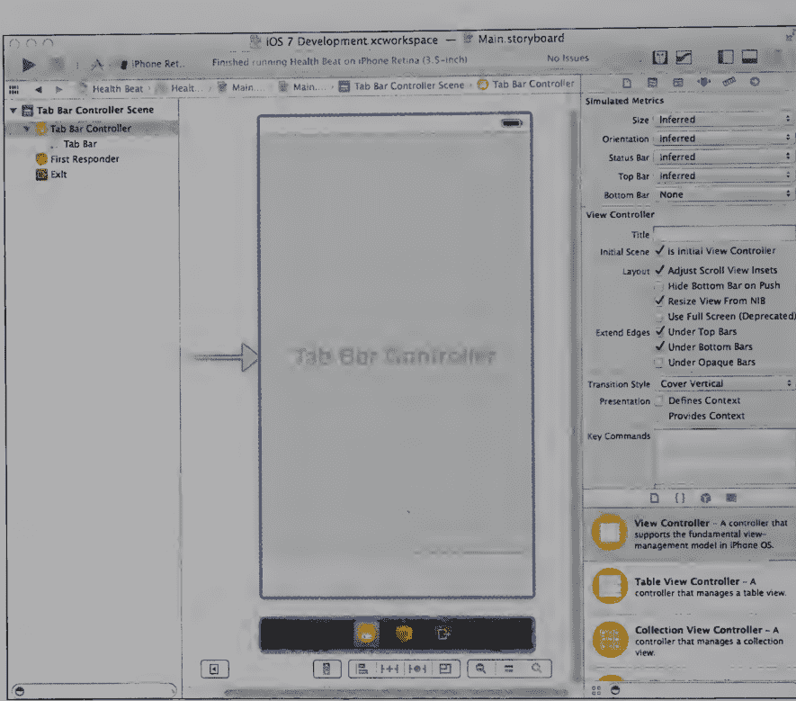

是时候开始构建应用程序的工作流了——但它目前还没有任何标签（tabs）。如果你现在运行应用程序，就会发现它并没什么内容。

我们想添加两个标签：一个用于历史视图（history view），另一个用于图表视图（graph view）。我们通过向 Storyboard 中添加两个控制器，并将它们作为关系连接到标签视图控制器（tab controller）。

主 Storyboard。使用 Storyboard 需要大量的屏幕空间（或者你需要非常擅长缩放）。所以，你可能想尽可能多地为导航器（Navigator）和调试区域（Debug area）留出空间。由于我们经常会使用文档大纲（Document Outline）和工具区域（Utilities area），所以我把它们留在屏幕上。在此时，我们的 Storyboard 应该只有一个标签栏控制器（图 2.10）。

让我们从添加历史视图控制器开始。这将是一个表格视图控制器，因此在对象库（Object library）中，找到 `Table View Controller` 图标（它应该在列表顶部附近），并将其拖到标签视图控制器的右侧。双击背景将进行缩放。你可能需要缩小以便方便地调整表格视图控制器的位置。

第 80 页 第 2 章 我们的应用程序架构

## 原型单元（Prototype Cells）

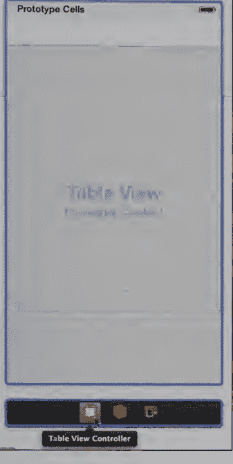 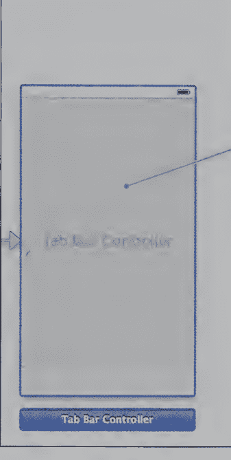

图 2.11 选择视图控制器 图 2.12 连接控制器

现在，我们的历史视图应该位于一个导航控制器（navigation controller）内部，以便我们轻松地为每个条目打开详细视图。我们可以在对象库中找到导航控制器，将其拖出并手动链接所有内容，但有一种更快的方法。

选择表格视图控制器。再次强调，选择控制器可能有点棘手。如果你处于缩小状态，只需点击场景中的任何地方。如果你处于放大状态，你需要在场景的停靠栏（dock）或文档大纲中选择视图控制器图标。点击场景会明智地选择视图而不是视图控制器。你可以看出视图控制器被选中，因为整个场景会被一条蓝线包围（图 2.11）。

在高亮表格视图控制器的情况下，选择 `Editor > Embed In > Navigation Controller` 菜单项。这将向你的 Storyboard 中添加一个导航控制器，并将我们的表格视图设置为该控制器的根视图。

现在，我们需要将导航控制器连接到标签栏控制器。按住 Control 点击标签栏并拖到导航控制器（图 2.12）。当你松开鼠标时，会弹出一个菜单。它列出了四个选项：手动切接（push、modal 和自定义）以及单一关系（view controllers）。选择“view controllers”。这将我们的历史视图作为标签栏控制器的第一个标签。

接下来，我们需要图表视图。这将会简单一些。从对象库中拖入一个视图控制器（View Controller），将其放在导航控制器的下方。然后从标签栏控制器拖动到新的视图控制器。再次在弹出菜单中选择“view controllers”。

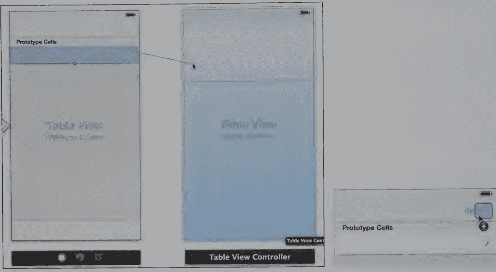

图 2.13 连接历史视图单元格到详细场景 图 2.14 添加导航栏按钮

还有两个场景要处理。我们需要一个场景来显示关于每个重量输入的详细信息。最简单的方法之一使用静态表格（static table）。我们从对象库拖出另一个 Table View Controller。将其放在当前表格的右侧。

现在让我们将其配置为静态表格。放大我们的表格视图控制器，并选择视图。你应该可以直接点击场景。在属性检查器（Attributes inspector）中，将内容从“Dynamic Prototypes”改为“Static Cells”。我们还想将样式改为“Grouped”。目前到此，我们将在下一章布局内容。

我们仍然需要将此场景连接到历史视图。基本上，当用户点击历史视图中的某行时，我们就将详细视图推入导航栈。这很容易设置。按住 Control 点击表格视图中的表格单元格并拖到第二个表格（图 2.13）。当你释放鼠标时，选择 push 切接，并在我们的表格单元格上添加灰色披露指示（disclosure indicator）。

我们还需要一个场景来添加重量条目。为此，我们需要在历史表格的导航栏上添加一个按钮。我们将连接一个模态视图到该按钮。

放大我们的原始表格视图控制器（连接到导航控制器的那个）。在对象库中向下滚动直到找到 Bar Button Item。将其拖出并放在表格导航栏的右侧（图 2.14）。

现在选择按钮，并在属性检查器中将标识符改为 Add。该按钮现在应该显示为加号。

第 2 章 我们的应用程序架构

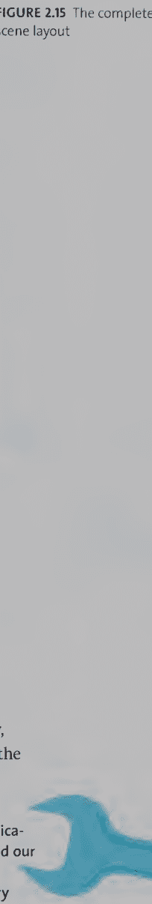

拖入另一个 View Controller 并放在表格视图控制器上方。现在，按住 Control 点击添加按钮并向上拖动到我们的新视图上。这次，选择 modal 切接。

> 注意：我们在应用程序中使用了三种不同的导航技术。标签栏控制器让我们在历史视图和图表视图之间切换。导航控制器让我们在历史视图和任何特定条目的详细视图之间轻松滑动。历史视图还将添加条目场景作为模态视图，临时覆盖用户界面，直到添加条目场景被显式关闭。

到目前为止，Storyboard 为我们的应用程序提供了基本框架。缩小并重新调整场景位置使其与图 2.15 匹配。

## 添加自定义视图控制器

目前，我们的 storyboard 将为所有场景使用默认的 UIKit 视图控制器：`UIViewController`、`UITabBarController`、`UINavigationController` 和 `UITableViewController`。然而，我们需要为这些控制器中的每一个提供一个自定义子类，以便对它们的行为进行自定义。

这是一个两步过程。首先，我们需要创建自定义类。其次，我们需要告诉 storyboard 使用我们新的类。

让我们从添加一个自定义标签栏控制器开始。如果你之前已经有了它，这可能需要你再次显示它。然后，在项目导航器（Project navigator）中，右键点击 Controllers 组，并选择 New....（新建）。我们要创建一个新的 Objective-C 类。类名应为 `RootTabBarController`。它应该是 `UITabBarController` 的子类。请确保不要勾选 "Targeted for iPad" 和 "With UIKit for user interface" 复选框。最后，确保它被添加到 Controllers 组和 Health Beat 目标（target）中。

对其他控制器重复此过程。它们的名称和子类列在

### 表 2.1.

| 类名 | 继承自 |
| --- | --- |
| RootTabBarController | UITabBarController |
| HistoryViewController | UINavigationController |
| HistoryUITableView | UITableViewController |
| EntryDetailViewController | UITableViewController |
| AddEntryViewController | UIViewController |
| GraphViewController | UIViewController |

完成后，我们应该已经向 Controllers 组添加了六个类（12 个不同的文件）。除了视图子类外，这些类大部分为空。它们包含了 `initWithName:bundle:`、`viewDidLoad` 和 `didReceiveMemoryWarning:` 的存根方法（stubs）。我们可以删除这些内容来清理类，但它们不会产生任何影响。此外，我们稍后会使用许多 `viewDidLoad` 方法，所以现在先保留它们吧。

视图控制器子类有许多额外的存根方法来支持加载和显示表格数据。这些存根方法用于提醒我们为了让表格运行起来而需要执行的所有任务。然而，我们不会在详情场景中使用其中大部分方法，因为它是一个静态表格。它的内容不会在运行时动态加载。相反，我们将在 Interface Builder 中进行设计。

所以，让我们清理一下。打开 `EntryDetailViewController.m` 文件。删除 `@implementation` 和 `@end` 之间的所有内容。这意味着我们的自定义控制器已准备可以使用。

再次打开 Main.storyboard。在 storyboard 缩小显示时，点击标签栏场景（tab bar scene）。切换到身份检查器（Identity inspector）。找到一个 `UITabBarController`。将类设置更改为 `RootTabBarController`。这应该是下拉菜单列出的选项之一。注意控制器的名称在场景和文档大纲（Document Outline）中都发生了变化。

我们对所有控制器重复此操作。将导航控制器（Navigation Controller）的类更改为 `UINavigationController`。连接到 RootTabBarController 的视图控制器应该是我们的 GraphViewController。第一个表格视图控制器是我们的 HistoryTableViewViewController。第二个是我们的 EntryDetailViewController。最后，连接到 HistoryTableView 上的按钮的视图控制器是我们的 EntryDetailViewController。
完成这一步后，随着场景的加载，我们将使用自定义的类了。

## 导航项目、标签栏项目和转场（SEGUES）

有几个细小的设置需要我们完成。首先，我们需要设置导航栏上的标题。在 storyboard 打开的状态下，缩放到我们的历史表格视图控制器。双击导航栏中心，在文本框中输入 `History`。这设置了该场景的导航标题。
对 Entry Detail View Controller 执行相同的操作，但在内部输入 `Weight Entry`。

> 注意：如果你在编辑导航栏标题时遇到困难，可以随时在文档大纲中选择场景的导航项目（Navigation Item），并在属性检查器（Attributes inspector）中修改其类型。


## NIBS 的秘密生活

Nib 是 storyboard 背后的底层技术。编译器会将 storyboard 分成若干 nib 文件，并在需要时加载它们。因此，为了理解 storyboard 加场景时发生了什么，我们需要理解 nib 的生命周期。我在这里提供一个简要总结，但详细信息请查看 Apple 的《资源编程指南》。

在出口（outlets）和动作（actions）正确配置后，执行任何额外的配置步骤。

Nib 可以被视为冷干燥的 nib 层次结构。当我们创建一个 nib 时，我们只是将 nib 内部的所有内容保存到磁盘。这使用了我们在第 5 章中使用的基本技术。

> 注意：`UIViewController` 子类应该在 `viewDidLoad` 中进行额外的配置。我们通常在一个 nib 中创建视图控制器，并在 `awake` 中创建它们的内容。结果，`awake` 方法可能会在视图加载之前调用，任何连接控制器到视图中用户界面元素的出口都不会被设置。

当 nib 加载时，会为存储在该 nib 内部的所有对象和资源留出内存。然后符合 `NSCoding` 协议的对象将通过调用 `initWith` 来实例化。所有其他对象都通过调用 `init` 来实例化。

nib 加载后，任何未存储在强引用中的对象都将被释放。大多数情况下，我们不需要担心这个。除非我们正在加载场景，否则系统会自动在我们的视图控制器层次结构中存储视图控制器的引用。主视图存储在视图控制器中，任何其他用户界面元素和手势识别器会自动存储在它们的容器视图中。

系统通过调用 `setValue:key:` 方法连接所有出口。它使用 `addTarget:action:sender:` 连接所有动作。一旦整个对象图连接在一起， UIKit 就会从由 nib 创建的每个对象中调用 `awakeFromNib`。你可以实现一个对象的 `awakeFromNib` 方法。

如果我们有任何顶层对象（未放入视图的对象），我们需要在视图控制器中为它们创建一个出口。这意味着在视图控制器中分配一个引用。这将从 `.xassets` 加载正确的图像。现在，当图表被选中时，该区域将被填充颜色。

导航标题和标签图标现在已设置好。我们需要切换回 Main.storyboard。当你查看 storyboard 时，你会看到场景之间的许多连接。这些关系代表了标签栏控制器与视图控制器之间的关系。容器控制器需要这些关系才能正常运行，但它们并不是我们可以修改的。

然而，有两个转场（segues）：一个是从 Table Controller 到 Entry Detail Controller 的推入转场，另一个是从 Table Controller 到 Add View Controller 的。有几个关键点需要强调：

1. nib 加载的许多细节在 OS X 和 iOS 上有所不同。如果你在桌面开发之间切换，请务必双击文档。
2. 任何符合 `NS` 的对象都将使用 `initWith:` 加载。与其他方法不同，这不会调用你的指定初始化方法。如果你在 ViewController 子类中加载自定义对象，你必须在 `awakeFromNib` 中执行所有初始化步骤（或者，这两个方法调用一个私有方法来处理配置和设置）。
3. 如果你添加了顶层对象，请确保在你的视图控制器中为它添加一个出口。我们需要对顶层对象的强引用；否则它会在 nib 加载后消失。
4. 每当你的应用程序执行转场，都会创建一个新的目标 ViewController。这意味着某些 nib 在应用程序生命周期内会被加载多次。你不能假设一个 nib 只加载一次。
5. Xib 文件是较新的、XML 格式的 nib 文件。引入 Xib 文件是为了更好地支持软件。理论上，它们是人类可读的。但在实践中，XML 变得相当晦涩，我们可以查看两个冲突之间的差异。当我们合并冲突时，合并 nib（或 storyboard）是困难的甚至是不可能的。当我们构建项目时，编译器会将 xib 文件编译成二进制 nib 束。nib 文件随后被添加到应用程序中。因此，我们仍然在运行时加载二进制 nib 文件。

通过在文档对象中选择它或点击 storyboard 中的转场图标来选择推入转场。在属性检查器中，将其标识符设置为 `Detail Segue`。接下来，选择模态转场，并将其标识符设置为 `Add Entry Segue`。我们将在代码中使用这些标识符。

### 图 2.16 最终应用工作流

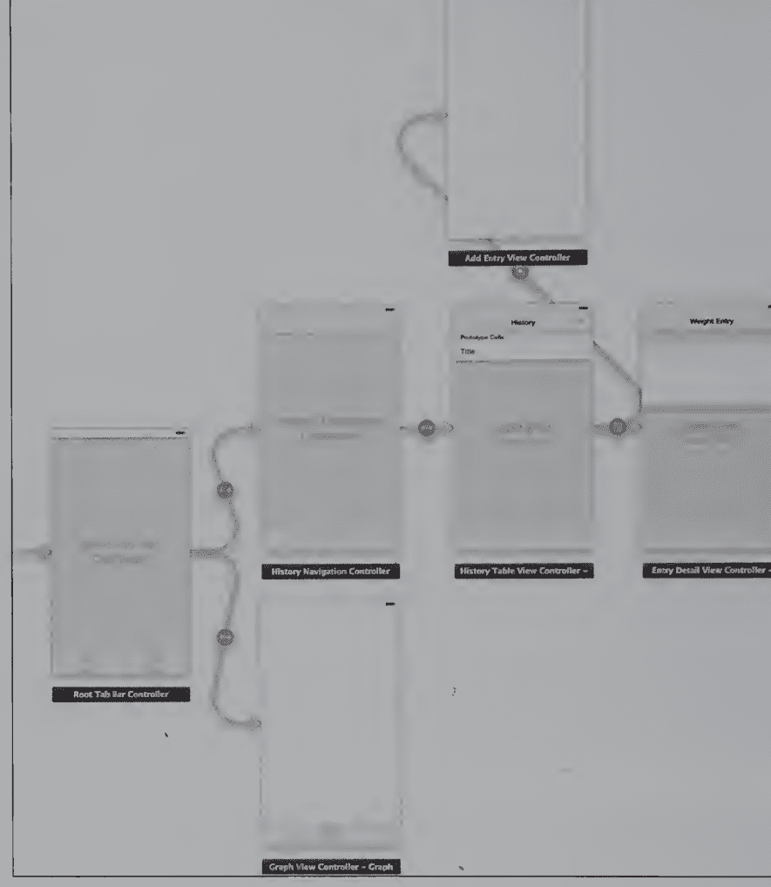

就是这样。基本工作流完成了（**图 2.16**）。当然，我们还需要为每个场景构建实际的界面。不过，我们将在下一章处理。现在，让我们将模型连接到控制器，并验证当我们从一个场景导航到下一个场景时，数据是否被正确传递。

## 连接模型

现在，我们需要将模型对象连接到控制器。这通常会引起一些困惑——毕竟，控制器是由我们的 storyboard 创建的。我们如何让数据对象传递给它们呢？

从理论上讲，我们可以将模型对象添加到 storyboard 中并让它也创建这些对象。这并不是一个坏方法；但是，我们失去了对对象何时以及如何加载的控制。story 中的任何对象都会在场景加载时创建。如果我们的数据对象是在加载大文件或从应用程序加载资源时加载的——特别是在加载特别大文件或从网络加载资源时。如果它是另一个场景的一部分，那么每次我们切换到该场景时，它都会被加载。这意味着在应用程序的生命周期内可能会被加载多次。

更重要的是，我们无法将一个场景中的 outlet 连接到另一个场景中的对象。如果我们可以将模型添加到初始场景中，然后将其连接到所有其他场景的 outlet，我将非常想把对象添加到 storyboard 中。但目前，有更好的解决方案。

第二种常见方法是为我们的模型创建一个单例类，或者将模型存储在代理（delegate）中（这实际上起到了相同的作用）。对我个人而言，我觉得代理方法有点草率，并且我尽量避免单例类的这种黑暗诱惑。

相反，让我们使用懒性初始化在初始场景的控制器中创建模型，并在新场景加载时将数据传递给它们。这通常被称为“接力棒模式”（baton passing pattern）。这意味着我们需要为 RootViewController 添加一个属性来持有对模型的引用。

打开 `RootViewController.h`。按所示进行修改：

```objc
@class WeightHistoryDocument;

@interface RootTabViewController ()

@property (strong, nonatomic) WeightHistoryDocument *weightHistoryDocument;

@end
```


这里不会有意外。首先，我们必须为 `WeightHistoryDocument` 类创建一个前向声明。然后，我们在 `@interface` 块中声明一个属性来持有我们的权重历史。

切换到 `RootTabViewController.m`。我们需要导入 `WeightHistoryDocument` 类。在文件顶部，紧接导入 `RootTabViewController.h` 的行之后，添加以下行：

```objc
#import "WeightHistoryDocument.h"
```

现在，滚动到 `viewDidLoad`。按所示修改代码：

```objc
- (void)viewDidLoad
{
  [super viewDidLoad];
  self.weightHistoryDocument = [[WeightHistoryDocument alloc] init];
  [self documentReady];
}
```

在这里，我们实例化了一个新的 `WeightHistoryDocument` 对象并将其赋值给我们的属性。然后我们调用了 `documentReady` 方法。再次强调，你可能不认识这个方法。这是因为我们还没有写它。

`documentReady` 方法将文档传递给所有标签页。我们将动态地执行此操作。如果将来我们决定添加额外的标签页，它们可以自动利用这段代码。

将以下代码添加到文件末尾，`@end` 指令之前：

```objc
#pragma mark - Private Methods

- (void)documentReady
{
  // 自动将权重历史文档传递给
  // 任何受控视图控制器。
  for (id controller in self.viewControllers) {
    if ((controller respondsToSelector(
        @selector(setWeightHistoryDocument:)))) {
      [controller setWeightHistoryDocument:self.weightHistoryDocument];
    }
  }
}
```

我们正在遍历 tab view controller 的 `viewControllers` 属性中的所有控制器。注意，我们使用的是 `id` 动态类型，而不是将每个控制器静态类型为 `ViewController`。

接下来，我们检查控制器是否响应 `setWeightHistoryDocument:` 方法。如果是，我们就调用该方法并传入我们的对象。我们必须对 `controller` 使用 `id`，因为 `ViewController` 并没有声明 `setWeightHistoryDocument:` 方法。然而，编译器之前见过 `setWeightHistoryDocument:`（它被隐式地声明为我们 `weightHistoryDocument` 属性的一部分），因此它自由地让我们在任何 `id` 类型上调用该方法。它只是假设我们知道自己在做什么。通常情况下，由于我们在调用该方法之前已经检查了它，这种做法是完全安全的。

结果是，如果我们的 `NavigationController` 或 `GraphViewController` 想要访问文档，它们只需要声明自己的 `weightHistoryDocument` 属性，如果我们添加了另一个标签页，它也可以通过简单实现 `weightHistoryDocument` 来获取文档的访问权限。

那么，让我们这样做吧。打开 `ViewController.h`。添加前向声明和属性，就像我们在 `RootTabViewController.h` 中做的一样。

```objc
#import <UIKit/UIKit.h>

@class WeightHistoryDocument;

@interface GraphViewController : UIViewController

@property (strong, nonatomic) WeightHistoryDocument *weightHistoryDocument;

@end
```

在 `HistoryNavigationController.h` 和 `HistoryViewController.h` 中重复此过程。

我们需要更多的工作将文档从导航器传递到历史表格控制器。记住，我们的 `HistoryViewController` 是导航器的根视图。然而，在我们在此之前，我们需要设置表格视图。更改文档最简单的方法是重写 `HistoryNavigationController`。

打开 `HistoryNavigationController.m` 并在 `@end` 之前添加以下代码：

```objc
#pragma mark - Accessor Methods

- (void)setWeightHistoryDocument:(WeightHistoryDocument *)weightHistoryDocument {
    _weightHistoryDocument = weightHistoryDocument;

    id rootViewController = self.viewControllers[0];

    if ((rootViewController respondsToSelector(@selector(setWeightHistoryDocument:)))) {
        [rootViewController setWeightHistoryDocument:weightHistoryDocument];
    }
}
```

在这里，我们首先将值赋值给属性的实例变量。然后我们获取根控制器的动态引用。就像在 bar 中一样，我们检查根控制器是否响应 `setWeightHistoryDocument:`。如果是，我们就调用该方法并传递我们的文档。

只剩下两个场景了。我们实际上不需要传递文档。我们的 `AddViewController` 只需让用户选择值和数据。如果用户点击 Save，控制器将获取这些值并创建一个新条目，将其添加到文档中。

同样，`DetailViewController` 不需要访问整个文档。它只需要当前的 entry。我们将在下一章中添加一些统计数据。但现在，我们只需添加一个属性。

打开 `DetailViewController.h` 为 `WeightEntry` 类添加声明。添加一个属性，如下：

```objc
#import <UIKit/UIKit.h>

@class WeightEntry;

@interface DetailViewController : UIViewController

@property (strong, nonatomic) WeightEntry *entry;

@end
```

我们仍然需要将 entry 从历史视图传递到详情视图。然而，在我们在此之前，我们需要设置表格视图。

表格视图使用代理和数据源来配置内容。这两个协议都声明了许多方法，允许我们在运行时修改表格视图的内容和外观。它们还让我们响应行和用户交互。你可以在 `UITableViewDelegate` 和 `UITableViewDataSource` 协议引用查看完整的方法列表。

这不太方便。你必须查看两个协议才能看到我们实现的完整方法范围。通常，数据源被用于获取填充表格的数据信息，而代理则处理表格的外观、交互和其他杂项。然而，我可以在具体的分工划分上吹毛求疵。

幸运的是，当我们创建一个表格视图控制器时，该控制器会自动被设置为代理和数据源。它还采纳了这两个协议。这意味着我们只需要实现几个方法，我们的表格就准备就绪。

只有两个强制的数据源方法：`tableView:numberOfRowsInSection:` 和 `tableView:cellForRowAtIndexPath:`。我们将实现 `numberOfSectionsInTableView:` 方法，因为模板已经为我们提供了一个存根。

每当表格需要重新加载数据时，它会首先调用 `numberOfSectionsInTableView:`。然后对于每个 section，它都会调用 `tableView:numberOfRowsInSection:` 确定行的数量。最后，对于当前屏幕上的每一行，它都会调用 `tableView:cellForRowAtIndexPath:`。最后这次调用是配置单元格的地方，为该行显示正确的信息。

打开 `HistoryTableViewController.m`。在文件顶部导入 `EntryDetailViewController`、`WeightHistoryDocument` 和 `WeightEntry` 类。

```objc
#import "EntryDetailViewController.h"
#import "WeightHistoryDocument.h"
#import "WeightEntry.h"
```

接下来，所有的视图控制器子类都将自动包含一个类扩展。通常，我们会使用它来存放引用用户界面元素的私有属性。然而，我们有时我们需要不同类型的属性变量。我们想要观察文档的所有更改通知。当我们注册通知时，需要确保稍后也取消注销。否则，我们可能会在通知中心留下悬挂指针。

由于我们将使用基于块的通知 API，我们需要存储观察者对象，以便在完成工作后取消它们的注销。我们实际上并不知道观察者对象的类型——这其实并不重要。我们可以直接将它们保存为 `id`。

在类扩展内部，声明以下属性：

```objc
@interface HistoryTableViewController ()

@property (strong, nonatomic) id documentBeganObserver;
@property (strong, nonatomic) id documentInsertedObserver;
@property (strong, nonatomic) id documentDeletedObserver;
@property (strong, nonatomic) id documentChangeCompleteObserver;

@end
```

接下来，导航到 `numberOfSectionsInTableView:` 方法。我们的表格视图一直只有一个分区。我们可以删除这个方法，因为默认值是 1；但是，我通常喜欢保留它，以防我以后想添加分区。

如下所示修改该方法：

```objc
- (NSInteger)numberOfSectionsInTableView:(UITableView *)tableView
{
  return 1;
}
```

之后，滚动到 `tableView:numberOfRowsInSection:` 方法。在这里，我们需要返回历史记录中的条目数量。幸运的是，我们创建了自定义属性，这使得操作非常简单。如下所示修改该方法：

```objc
- (NSInteger)tableView:(UITableView *)tableView numberOfRowsInSection:(NSInteger)section
{
  return (NSInteger)self.weightHistoryDocument.count;
}
```

再次，我们的 `count` 属性是一个无符号整数，而此方法返回一个有符号整数。由于我们开启了更极端的警告，我们需要在返回之前将我们的 `count` 值转换为有符号值。

接下来，我们需要修改 `tableView:cellForRowAtIndexPath:`；但在此之前，我们需要讨论表格视图单元格是如何使用的。

每当我们创建一个表格视图（实际上，是任何滚动视图）时，我们都需要确保它尽可能高性能。我们希望避免动画中出现任何延迟或卡顿。系统的响应应该就像用户在玻璃后面移动图像一样。

显然，如果我们为每一行都创建新的单元格，我们将浪费大量的时间和精力。我们需要足够的整个场景的单元格。当它们从顶部滑出时，可以在底部被重用。

为了帮助单元格的回收，系统在单元格从表格中移除时不会释放它们。相反，将其放入池中以便重用。我们可以通过两种方法请求这些单元格：`dequeueReusableCellWithIdentifier:` 或 `dequeueReusableCellWithIdentifier:forIndexPath:`。

第一个是旧方法。它会在池中查找具有匹配标识符的单元格。如果找不到，它将返回 `nil`。要使用此方法，我们必须检查返回值并在返回 `nil` 时创建一个新单元格。

第二个版本更高级。它始终返回一个单元格——如果池中没有，则会自动创建一个新单元格。遗憾的是，这意味着我们需要告诉系统为每个标识符创建什么种类型的单元格。我们可以在 Storyboard 中自动完成此操作，也可以通过编程使用 `registerClass:forCellReuseIdentifier:` 或 `registerNib:forCellReuseIdentifier:` 注册我们的单元格。

每个单元格布局都需要它自己的标识符。通常，一个表格只有一种类型的单元格，所以我们只需要一个标识符。在这种情况下，我们可以在单个表格内使用多种单元格样式。每种样式必须有它自己的唯一标识符。

让我们打开 `Main.storyboard` 并设置单元格类型和标识符。缩放 History Table View Controller，并选择 Table View。

接下来，我们将学习如何为我们的表格创建一个自定义单元格。现在，让我们使用标准单元格之一。在属性检查器中，勾选单元格的 Style 为 `Style Basic`。然后，在 identifier 字段中，输入 `History Cell`。

现在，回到 `HistoryTableViewController.m`。用此处的实现替换现有的 `tableView:cellForRowAtIndexPath:` 方法：

```objc
- (UITableViewCell *)tableView:(UITableView *)tableView cellForRowAtIndexPath:(NSIndexPath *)indexPath
{
    static NSString *CellIdentifier = @"History Cell";
    UITableViewCell *cell = [tableView dequeueReusableCellWithIdentifier:CellIdentifier forIndexPath:indexPath];

    WeightEntry *entry = [self.weightHistoryDocument entryAtIndexPath:indexPath];

    cell.textLabel.text = [entry description];

    return cell;
}
```

我们首先开始创建一个与我们在 Storyboard 中设置的标识符相匹配的单元格标识符。接下来，我们调用 `dequeueReusableCellWithIdentifier:forIndexPath:`。由于我们在使用较新的 API，我们不需要检查返回值。它将始终返回一个有效的单元格——即使它必须为我们创建一个。最后，我们使用之前为该索引路径创建的 `entryAtIndexPath:` 方法。然后我们为该索引路径设置单元格描述。我们可以看到，我们在 `HistoryTableViewController` 中的工作开始见效了。

## 跨 Segue 传递数据

我们开始创建一个与我们在 Storyboard 中设置的标识符相匹配的单元格标识符。为了在用户选择单元格时传递数据，我们需要使用 `prepareForSegue:sender:` 方法来传递给目标视图控制器的 `weightEntry`。

我们开始获取目标视图控制器的引用。由于目标视图控制器是 `id` 类型，我们可以自由地赋值任何变量。编译器将简单地假设我们在做什么。

在 `HistoryTableViewController.m` 中，滚动到底部并取消注释 `prepareForSegue:sender:`。如下所示修改 `prepareForSegue:sender:` 方法：

```objc
#pragma mark - Navigation

- (void)prepareForSegue:(UIStoryboardSegue *)segue sender:(id)sender
{
    if ([segue.identifier isEqualToString:@"Detail"])
    {
        EntryDetailViewController *controller = segue.destinationViewController;
        NSIndexPath *indexPath = [self.tableView indexPathForSelectedRow];
        controller.entry = [self.weightHistoryDocument entryAtIndexPath:indexPath];
    }
}
```

我们开始检查我们正在遍历哪个 Segue。我们需要确保它是 Detail Segue，而不是 Add Segue。

我们开始获取目标视图控制器的引用。由于目标视图控制器是 `id` 类型，我们可以自由地赋值任何变量。编译器将简单地假设我们在做什么。

```objc
if (self.documentBeganObserver)
{
  [center removeObserver:self.documentBeganObserver];
}
```


self.documentBeganObserver = nil;

}

if (self.documentInsertedObserver)

{

  [center removeObserver:self.documentInsertedObserver];

self.documentInsertedObserver = nil;

}

if (self.documentDeletedObserver)

{

  [center removeObserver:self.documentDeletedObserver];

self.documentDeletedObserver = nil;

}

if (self.documentChangeCompleteObserver)

{

  [center removeObserver:self.documentChangeCompleteObserver];

self.documentChangeCompleteObserver = nil;

}

```

虽然这段代码看起来很长，但实际上只是在不断重复相同的步骤。首先，我们获取默认通知中心的引用。然后，我们检查我们的每一个观察者属性。如果该属性有有效值，我们就将其从通知中心中移除并将其设置为 `nil`。最后这一步是一个安全检查，因为两次移除同一个观察者会导致错误。现在，让我们设置通知。

```objc
(void)setupNotifications

{

NSNotificationCenter *center = [NSNotificationCenter defaultCenter];

NSOperationQueue *mainQueue = [NSOperationQueue mainQueue];

WeightHistoryDocument *doc = self.weightHistoryDocument;

__weak HistoryTableViewController *_self = self;

self.documentBeganObserver =

[center]

addObserverForName:WeightHistoryDocumentBeginChangesNotification

object:doc

queue:mainQueue

usingBlock:(NSNotification *note) {

    if ([_self isViewLoaded]) {

        {

            [_self.tableView beginUpdates];

        }

    }

}];

```

```objc
self.documentInsertedObserver = 

[center]

addObserverForName:WeightHistoryDocumentInsertWeightEntryNotification

object:doc

queue:mainQueue

usingBlock:(NSNotification *note) {

    NSIndexPath *indexPath = 

    note.userInfo[WeightHistoryDocumentNotificationIndexPathKey];

    NSAssert(indexPath != nil,

        @"We should have an index path in the " @"notification's user info dictionary");

    if ([_self isViewLoaded]) {

        {

            [_self.tableView insertRowsAtIndexPaths:[indexPath] withRowAnimation:UITableViewRowAnimationAutomatic];

        }

    }

}];

```

```objc
self.documentDeletedObserver = 

[center]

addObserverForName:WeightHistoryDocumentDeleteWeightEntryNotification

object:doc

queue:mainQueue

usingBlock:(NSNotification *note) {

    NSIndexPath *indexPath = 

    note.userInfo[WeightHistoryDocumentNotificationIndexPathKey];

    NSAssert(indexPath != nil,

        @"We should have an index path in the " @"notification's user info dictionary");

    if ([_self tableView isLoaded]) {

        [_self tableViewIndexPaths:@[indexPath]

        deleteRowsAtIndexPaths:indexPaths

            withRowAnimation:UITableViewRowAnimationAutomatic];

    }

}];

self.documentChangeCompleteObserver = 

[center]

addObserverForName:WeightHistoryDocumentChangesNotification

object:doc

queue:mainQueue

using:^(NSNotification *note) {

    [_self tableView endUpdates];

}];];

```

再次，这看起来像是一大块代码，但基本上只是同一主题的细微变体。我们首先获取所需的所有数据引用：通知中心、主队列、我们的文档，以及对 self 的弱引用。我们不应该让 block 捕获 self，因为这会引入循环引用。事实上，在这种情况下它确实导致了循环引用。更糟糕的是编译器和静态分析器并不智能到能够发现它们。

有了数据，我们注册了四个通知，并传递了一个在每次收到该通知时都会调用的 block。`WeightHistoryDocumentBeginChangesNotification` 和 `WeightHistoryDocumentChangesCompleteNotification` 是最简单的。它们只是检查视图是否加载。如果是，它们会调用 `beginUpdates` 和 `endUpdates`。表格视图会将 `beginUpdates` 和 `endUpdates` 之间的所有更改合并成一个动画。

对于 `WeightHistoryDocumentInsertEntryNotification`，我们从通知的 `userInfo` 字典中提取索引路径（indexPath）。`NSAssert()` 函数确保我们确实收到了一个有效的索引路径。如果没有，它会抛出异常。最后，我们检查视图是否加载。如果是，我们就在指定的索引路径处插入一行。通过指定 `UITableViewAnimationAutomatic`，我们告诉表格视图根据当前状态选择最佳动画。它随后将根据行在屏幕上的位置以及表格中的行数来选择动画。

`WeightHistoryDocumentDeleteEntryNotification` 与 `WeightHistoryDocumentInsertWeightEntryNotification` 几乎相同，不同在于我们正在删除索引路径处的行。其他所有内容都是相同的。

一旦有了这些通知，我们的表格视图将根据底层文档的任何更改调整其内容。

现在，我们只需要调用 `setupNotification` 和 `removeNotification`。我们将每当 `weightHistoryDocument` 属性被设置时设置通知。这意味着我们需要实现一个自定义 setter（Setter）。

在 `HistoryTableViewController.m` 中添加以下方法：

```objc
#pragma mark - Accessor Methods

- (void)setWeightHistoryDocument:(WeightHistoryDocument *)weightHistoryDocument

{

    if (_weightHistoryDocument) {

        [self removeNotifications];

    }

    _weightHistoryDocument = weightHistoryDocument;

    [self setupNotifications];

}

```

首先，我们检查是否已经有一个权重历史文档。如果有，我们需要清除所有当前通知。然后我们将传入的文档赋值给属性的实例变量。最后，我们为新文档设置通知。

我们还需要确保在类被销毁时清理通知。这意味着我们需要添加一个 `dealloc` 方法，如下所示：

```objc
- (void)dealloc

{

    [self removeNotifications];

}

```

这样好了。基础功能已经就绪。在下一章中我们将对其扩展，因为我们会添加插入和删除权重的功能。然而，这足以进行初步测试并确保我们的数据在场景间正确传递。

## 测试我们的架构

现在我们可以运行应用程序了。它目前没做什么。我们的历史记录是空的。我们可以切换到图表，点击加号弹出添加记录场景——由于我们还没有添加任何关闭此场景的方法，我们现在被住了。

100 第 2 章 我们的架构

让我们确保数据至少到达了视图。作为快速检查，在 `HistoryTableView.m`、`DetailViewController.m`、`AddEntryViewController.m` 和 `GraphViewController.m` 中添加以下代码：

```objc
// TODO: 测试后删除！

- (void)viewDidAppear:(BOOL)animated

{

    [super viewDidAppear:animated];

    NSLog("%@ appeared", [self]);

}

```

现在当我们运行应用程序并切换视图时，会在控制台中得到以下数据：

2013-08-21 22:18:25.372 [11994:70b] HistoryViewController appeared, document = WeightHistoryDocument:count = 0, history = ()
2013-08-21 22:18:40.172 [702b] GraphViewController appeared, document = WeightHistoryDocument:count = 0, history = ()
2013-08-21 22:18:41.298 [11994:70b] HistoryViewController appeared, document = WeightHistoryDocument:count = 0, history = ()
2013-08-21 22:18:42.867 [11994:70b] AddEntryViewController

到目前为止良好。但是，让我们扩展此以确保我们的数据确实传递。修改 `HistoryViewController.m` 和 `GraphViewController.m` 中的 `NSLog` 语句，打印我们的文档如下：

```objc
NSLog("%@ appeared, document = %@", [self], self.weightHistoryDocument);

```

在 `DetailViewController` 中，我们没有文档，但我们有一个记录。修改日志消息以打印我们的内部：

```objc
NSLog("%@ appeared, entry = %@", [self], self.entry);

 ```

## 每个应用程序都应该执行的常用任务

iOS SDK 有一些常用的用于执行关键任务的方法。我们并不需要在每个应用程序中实现这些方法中的每一个；但我们至少应该对每个方法都进行考虑。此外，这些方法中的大多数都有对应的通知，我们可以利用这些通知在代码的其他部分监控这些事件。

### applicationDidBecomeActive:

当应用程序变为活跃状态时，会调用此 `UIApplicationDelegate` 方法。这包括应用程序首次启动时以及从后台返回时——但不过，它在许多其他情况下也会被调用，例如当用户忽略了入电电话或短信消息。

### 应用程序启动

```

viewDid

```

这些方法在应用程序启动或从后台状态返回时被调用。我们将使用这些方法来加载应用程序的状态，并执行其他一次性的配置任务。

当控制器的视图完全加载时，UIKit 会调用此方法。无论视图是如何创建的，该方法都会被调用——它可以从 nib 加载，也可以使用 view 方法程序化构建。

```

application:didFinishLaunchingWithOptions:


注意，视图是懒性加载的。视图控制器会等到访问其属性时才加载视图。在此之前，如果控制器有任何引用视图层次结构中视图的属性，它们将被设置为 `nil`。然而，当 `viewDidLoad` 被调用时，这些属性将是正确的。这是一个执行额外设置或配置的方便且安全的地方。

当应用程序首次启动时，UIKit 会调用此 `UIApplicationDelegate` 方法。我们通常用它来执行一次性的配置任务。然而，在该方法返回后，应用程序将不会显示在屏幕上。我们应该避免在此方法期间执行任何可能耗时的任务。

在之前的 iOS 版本中，由于内存压力，视图可能会多次加载和卸载。遗憾的是，如果处理不当，这种加载/卸载往往会导致 bug。在 iOS 中，视图只会加载一次。如果系统开始内存不足，它可能会直接释放存储视图外观的图形位图——该视图当前没有被显示。这可能会导致视图重新绘制，但它不会加载或卸载视图本身。这仍然为我们提供了通过卸载整个视图来应对的大多数方法，避免了大多数 bug。

特别是，尽量避免像访问远程服务器这样的任务。这些任务在测试中可能运行良好，但在部署给实际用户时可能会失败（尤其是当人们在信号不良的区域使用手机时）。这可能导致应用程序冻结直到连接超时，在启动时产生无法接受的长时间延迟。

基本上，如果我们从磁盘读取任何数据或执行任何网络操作，我们应该将其在后台线程上作为异步任务启动。这样一来，我们的应用程序将快速启动并保持响应能力。

### applicationWillEnterForeground:

当应用程序从后台状态返回时，UIKit 会调用此 `UIApplicationDelegate` 方法。随着用户关闭和打开应用，此方法可能会被调用多次。

当然，你可能在其他教程中看到对 `viewDidUnload` 的引用，或者该方法没有定义且从未被调用。

### 应用程序关闭

当应用程序关闭或移动到后台时，会调用这些方法。你经常可以使用这些方法来保存应用程序的状态，或在应用程序关闭之前执行任何清理活动。通常情况下，`applicationWillTerminate:` 只会在用户切换到另一个应用程序时继续执行后台任务的应用程序上调用。大多数应用程序在进入后台时只会接收 `applicationDidEnter:`。一旦进入后台，系统可能会静默地杀死它们以释放更多内存。因此，我们需要在两个方法中都执行理想的清理操作。

### applicationWillTerminate:

在应用程序终止之前，UIKit 会调用此 `UIApplicationDelegate` 方法。惊讶的是，现代 iOS 应用很少接收到执行中的通知。应用程序在返回挂起时（通常是响应低内存警告）必须处于执行状态。通常，当用户点击主按钮时，你的应用程序将移动到第一个后台并变为挂起。应用程序的当前状态冻结在内存中，它并没有实际运行。如果系统需要更多内存，它将开始挂起应用程序并移除它们的内存。在这种情况下，应用会默默死亡，没有任何额外的通知。

`applicationWillTerminate:` 有大约五秒的时间执行任何清理活动并返回。如果超过五秒，系统监视器将杀死应用程序。

### applicationDidEnterBackground:

在应用程序发送到后台之前，会调用此 `UIApplicationDelegate` 方法。我们在这里执行任何清理活动，因为我们的应用程序可能在后台时被终止。如之前所述，当我们的应用程序挂起时，`applicationWillTerminate:` 不会被调用，所以此方法通常是我们程序死亡之前清理程序的最后机会。

与 `WillTerminate:` 一样，我们大约有五秒完成任何活动。然而，我们可以通过调用 `beginBackgroundTaskWithExpirationHandler:` 请求额外的时间。

### 低内存警告

每当我们的应用程序接收到低内存警告时，就会调用这些方法。我们应该实现这些方法以释放未使用资源。如果低内存状态持续，应用可能会崩溃。记住，内存短缺是 iOS 崩溃最常见的来源。

### applicationDidReceiveMemoryWarning:

当应用程序接收到低内存警告时，会调用此 `UIApplicationDelegate` 方法。我们可以利用它在应用程序级别释放任何未使用的内存（例如我们的应用可能持有的缓存内存）。

### applicationDidReceiveMemoryWarning

当应用程序接收到低内存警告时，会调用此 `ViewController` 方法。默认情况下，如果控制器的视图当前不在层次结构中（因此它当前没有显示在屏幕上），系统将将其视图所使用的位图标记为可释放。如果系统最终使用了这部分内存，它将在下次需要时需要重新绘制。这仍然为我们提供了通过卸载整个视图来应对的大多数方法，避免了大多数 bug。

现在，选择其中一行。应用程序应该切换到重量录入（Weight Entry）场景。屏幕上不会显示任何有趣的内容，但你应该会在控制台中看到类似的内容：

```
2013-08-21 22:48:19.453 Health Beat[12400:70b] DetailViewController appeared, entry = 148.50 lbs from Aug 21, 2013, 10:46
```

大功告成。如果数据传递到了我们的详情视图，那么我们就完成了。如果没有，尝试识别系统在何处中断，并回去仔细检查那些指令。如果仍然不起作用，请下载本章的源码（`http://www.freelancescience.com/ios7_source/`）并确保你的代码仍然运行——有时系统的更新会导致功能失效。如果示例代码可以运行，请将其与你的代码进行比较，看看是否能找到问题。

## 结语

我们的应用程序已经编译并启动了。我们可以在标签页和详情视图之间切换，并调出模型视图。是的，它只是一个骨架——但接下来的几章将为这些骨架填充血肉。在第 3 章中，我们将完善 `AddViewController` 并继续为 `HistoryViewController` 添加功能。在第 4 章中，我们将学习如何使用 `GraphViewController` 绘制自定义视图，在第 5 章中，我们将保存应用程序数据并设置用户默认（user defaults）。在第 6 章中，我们将添加 iCloud 同步。在第 7 章中，我们将用 Core Data 替换 Health Beat 当前的模型。

在离开之前还有最后一步。让我们把更改提交到 git 仓库。养成尽早且频繁提交更改的习惯。这样我们就可以将当前文件与之前提交的任何版本进行比较，如果必须回滚更改，我们可以最大限度地减少撤销的工作量。与其迈几次巨大的跨步，不如采取许多微小的、增量式的步骤。

要提交所有更改，选择 Source Control（源代码） > Commit。输入“Chapter 2”作为提交信息，并点击 Commit。就这样。Xcode 会处理剩下的工作。

在阅读这本书的过程中，尝试在每完成为应用程序添加每个功能后提交你的更改。这样每个章节你应该会有几次提交。遗憾的是，我在这书中没有空间专门讨论 Git；我将在“其他专业工具”奖励章节中详细介绍它，该章节可以在 `www.freelancescience.com/creating-ios7-apps-bonus-chap` 找到。

## 其他资源

更多信息，请查看以下资源：

- Peter Hosey 的警告我开启以及原因
  `http://boredzo.org/blog/archives/2009-11-07/warnings`
  这是关于在 Xcode 中开启高级警告的原始来源。

- Freelance Mad Science: 高级 storyboard 技术
  `www.freelancemadscience.com/fmslabs/blog/2012/9/24/advanced-storyboard-techniques.html`
  这是我写的一篇博客文章，包含了大量关于 storyboard 的有用高级信息，包括关于时机的详细信息以及如何将 storyboard、nib 和程序化加载的视图链在一起的建议。

- 键值编码编程指南和键值观察编程指南
  iOS Developer's Library
  这些是获取关于 KVC 和 KVO 所有信息的首选资源。KVC 可能会出奇地复杂，特别是当涉及到集合时。所以，这非常值得读。

- iOS 视图控制器编程指南
  iOS Developer's Library
  这是对视图控制器的深入讨论。在许多方面，视图控制器是我们应用程序的骨干。你对它们了解越多，收益越大。

- 资源编程指南
  iOS Developer's Library
  这里包含了关于 nib、storyboard 以及更多更多细节。

# 第 3 章

## 开发视图与视图控制器

在本章中，我们将完善 Health Beat 的历史（History）、记录详情（Entry Detail）和添加记录（Add Entry）场景。随着学习，我们将获得更多图形化布局视图以及将用户界面元素链接到其视图控制器的经验。我们将使用 Auto Layout 构建自适应用户界面，添加插入和删除重量记录的能力，并使用 Dynamic Type 调整字体大小。通过这一切，你应该理解视图在 iOS 应用的作用。

## 初始清理

图 3.1 搜索我们的工作空间

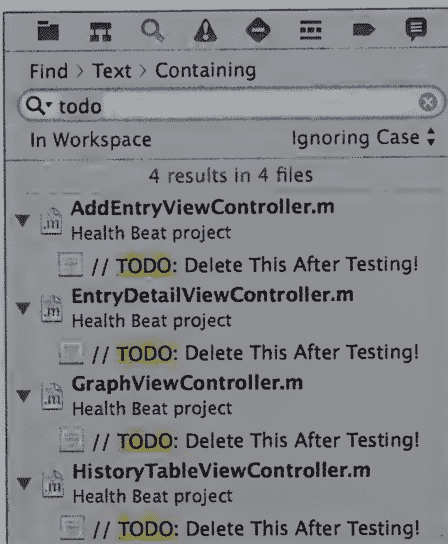

如果你还没有这样做，我们应该删除在上一章中添加的 `// todo` 消息。如果你遵循了我的示例并在之前的章节中添加了 `// TODO` 注释，这些将很容易找到。

以 `// TODO:` 开头的注释在编辑文件时会出现在跳转栏（jump bar）中。这可以作为一个很好的提醒，不断催促我们回来修复未解决的问题——但它只在你知道该去哪里寻找时才帮助找到代码。幸运的是，我们也可以搜索 todo 并找到所有这些引用。

切换到 Find（查找）导航器并在搜索字段中输入 todo。确保选中了 In Workspace（在工作空间内）和 Ignore Case（忽略大小写）。这应该找到所有四个位置（图 3.1）。

根据我们的指南，从 `EntryViewController.m`、`EntryDetailViewController.m`、`GraphViewController.m` 和 `HistoryViewController.m` 中移除 `viewAppear:` 方法。

> 注意：`supportedOrientations` 是在 iOS 6 中引入的。在此之前，容器视图控制器会先询问子控制器是否允许旋转。这意味着如果你没有在一个控制器中实现它，就可以禁用整个应用程序的旋转。

## 旋转、调整大小与重绘

在修改用户界面之前，让我们启动应用程序并查看我们构建了什么。目前，唯一有趣的视图是 History，我们将注意力放在那里。在模拟器中旋转设备。注意我们可以旋转到竖屏、横屏左或横屏右，但不能倒置。这是 iPhone 应用程序的默认行为。通常情况下，我们希望让用户决定如何拿着设备。对于 iPad 应用，这允许他们旋转到所有方向。为什么？因为它是手机。如果有电话，我们不希望用户倒过来对着扬声器说话对着麦克风听（是的，不仅苹果工程师考虑这些问题，他们还将它们写进了 HIG 指南）。

默认旋转部分由目标设置管理。点击项目导航器中的蓝色图标。确保选择了 Health target 和 General 标签页。在部署设置中，你应该看到 Device Orientation 设置。Portrait、Landscape Left 和 Landscape Right。

取消 Portrait 外的所有选项，再次运行应用程序。现在，当你旋转设备时，屏幕不会变化。它将保持在竖屏方向。

尝试勾选所有方向。再次运行应用程序。你会注意到尽管有倒置，我们仍然可以旋转到默认三个方向。这是因为这些设置只是故事的一半。

系统将调用 `supportedOrientations` 方法来计算允许哪些旋转。这是一个 `ViewController` 方法——但系统不会在每个视图控制器上调用它。它简单地在应用程序的根视图控制器上调用——或者在全屏显示的顶层呈现视图控制器上调用。这意味着只有我们的 `RootTabBarController` 和我们的 `AddEntryViewController`（显示时）才对此有发言权。

`RootTabBarController` 并添加以下方法：

- `- (NSUInteger)supportedInterfaceOrientations`

```
{ return UIInterfaceOrientationMaskAll;

}
```


现在运行应用程序。屏幕应该自由旋转到所有四个方向。`supportedInterfaceOrientation` 仅返回方向的位掩码。`UIInterfaceOrientationMask` 定义了四个基本方向，以及一些常用的组合。我们正在使用 `UIInterfaceOrientationMaskAll` 来启用所有方向。还有 `UIInterfaceOrientationMaskLandscape` 仅用于左、右横屏方向，以及 `UIInterfaceOrientationMaskAllUpsideDown` 用于默认的 iPhone 行为。

系统在确定是否允许某个方向时，会取 `supportedInterfaceOrientation` 和目标设置的交集。在发生旋转之前，该方向在两个地方中都必须被启用。默认情况下，`supportedInterfaceOrientation` 在 iPhone 上返回 `UIInterfaceOrientationMaskAllUpsideDown`，在 iPad 上返回 `UIInterfaceOrientationMaskAll`。除了少数例外情况——例如必须在横屏模式下运行的游戏——我们可能不应该更改这些设置。

我们实际上希望应用程序使用默认行为，因此使用 `supportedInterfaceOrientation` 方法并取消勾选 Beat 的“倒置”（Upside Down）。

然而，我们的旋转工作尚未结束。启动应用并旋转三个方向。注意表格如何自动调整大小以利用更宽的屏幕。现在尝试使用不同的模拟器启动应用——例如，iPhone Retina (4 英寸)。再次，历史表格视图自动适应了更长的屏幕，屏幕尺寸的变化是两个最明显的例子——但它们并不是唯一的。如果用户当前正在通话或录制音频，我们将在屏幕顶部丢失 20 分的位宽。

无论如何，我们的界面都需要适应这些尺寸变化。主要有三种方法：编程布局 UI、自动调整大小标记（autoresizing masks）和自动布局（Auto Layout）。

> 注意：剧透预警：Auto Layout 是解决此问题的最新、最强大且最复杂的解决方案。如果我们想利用动态字体（Dynamic Type），它基本上是必须的。我们将在“Auto Layout”章节中更深入地讨论这一点。

## 编程布局 UI

第一种选项是通过编程方式定义我们所有用户界面元素的位置。然后我们可以根据需要更新它们的位置和大小。正如你可能猜到的那样，这是一个繁琐且容易出错的过程。因此，我们可能尽可能地使用其中一种自动 API。然而，学习布局有两个原因：

- 如果我们想有效使用自动调整大小标记或 Auto Layout，我们需要了解系统是如何布局的。
- 有时，我们无法让自动系统按我们的意愿工作。在这种情况下，我们别无选择，只能在代码中修改部分布局。这主要发生在使用自动调整大小标记时。除非你在不同方向之间彻底更改视图的布局，否则有几种情况是 Auto Layout 无法处理的。


在查看布局方法之前，我们需要了解一些视图层次级（view hierarchy）和视图几何结构。

## 视图层次级

视图层次级定义了应用程序的用户界面。这是一个嵌套的 `UIView` 及其子类的集合。层次级从应用程序的窗口开始。窗口通常包含一个视图，即我们应用程序的根视图。根视图包含任意数量的子视图、控件和其他用户界面元素。如果我们想让某些内容出现在屏幕上，必须将其添加到视图层次级中。

反之亦然。显示在屏幕上的一切都是 `UIView` 或 `UIView` 的子类。`UIView` 类管理一个矩形区域。正如我们将看到的，每个视图都是根据其左上角、宽度和高度定义的。

`UIView` 定义了其位置、大小和外观的属性。这些包括 `frame`、`backgroundColor`、`tintColor`、`alpha` 和 `clipsToBounds`。这些许多属性也可以在 Interface Builder 的属性检查器中设置。正如我们在第 4 章“自定义视图和自定义过渡”中看到的，这些属性中的一些是可以动画的。请参阅 UIView 类参考文档以获取 `UIView` 类及其所有属性的完整描述。

每个视图都有自己的坐标系。默认情况下，原点在左上角——尽管可以通过添加投影变换来旋转、平移和缩放坐标系来修改它。

## 视图几何结构

坐标系中的位置使用广泛的 Core Graphics 数据类型。它们的定义所示如表 3.1。

### 表 3.1 Core Graphics 数据类型

| 类型 | 定义 |
| --- | --- |
| CGFloat | typedef float CGFloat; // 在 32 位设备上 |
| CGPoint | struct CGPoint { CGFloat x; CGFloat y; } typedef struct CGPoint CGPoint; |
| CGSize | struct CGSize { CGFloat width; CGFloat height; } typedef struct CGSize CGSize; |
| CGRect | struct CGRect { CGPoint origin; CGSize size; } typedef struct CGRect CGRect; |

这些都定义在 CGGeometry 参考中。`CGGeometry` 还定义了帮助创建、比较和处理这些值的函数。我们将在本章和下一章中使用这些函数进行一些实验。

每个视图的大小和位置由三个相互关联的属性定义：`frame`、`bounds` 和 `center`。

- **Frame**：`frame` 是一个 `CGRect`，定义了视图在其父视图坐标系中的大小和位置。
- **Bounds**：`bounds` 是一个 `CGRect`，定义了视图在其自身坐标系中的大小和位置。大多数情况下，`bounds` 的大小等于 `frame` 的大小，`bounds` 原点为 (0, 0)。这可能会改变；除非你故意偏移视图的内容，或者对视图应用了旋转、缩放或平移变换。
- **Center**：`center` 是一个 `CGPoint`，定义了视图中心在父视图坐标系中的位置。我们经常使用 `center` 来移动或对齐视图。

更改其中任何一个都会影响其他。具体来说，系统会自动重新计算 `bounds` 和 `center`。当你修改 `bounds` 时，`center` 保持固定，但系统会重新计算 `frame`。当你修改 `center` 时，`bounds` 保持不变，但 `frame` 会被修改。

> 注意：我们应用程序的主屏幕和窗口在设备竖屏模式下其原点始终位于左上角。这不会随着设备的旋转而改变。然而，我们的根视图可能会旋转，赋予它不同的坐标系。如果处理不当，屏幕/窗口坐标系与视图层次级其余部分的差异很容易导致布局错误。

在实际操作中，这意味着如果我们想围绕视图的中心缩放它，可以更改它的 `bounds`。如果我们想相对于左上角缩放它，可以更改它的 `frame`。如果我们只想让它移动，可以修改它的 `center`。

## OS X 与 iOS 坐标系的差异

OS X 和 iOS 使用不同的系统。OS X 将原点放在左下角，而 iOS 使用左上角。大多数情况下，我们可以忽略这些差异，除非在桌面和移动设备之间迁移代码。

然而，某些底层框架会默认使用 OS 坐标系。如果你在进行底层图形处理，可能会发现结果是倒置且反的。如果发生这种情况，解决方法很简单。我们只需要修改坐标系。

例如，我们可以通过高度平移图形上下文并将 y 轴缩放设置为 -1.0。示例代码如下：

```
CGContextTranslateCTM(context, 0, self.bounds.size.height);
CGContextScaleCTM(context, 1.0, -1.0);
```


我们使用尺寸计算 `leftView` 和 `rightView` 的大小和位置。注意我们通过设置每个视图的 `frame` 来指定它们。子视图的 `frame` 和父视图的 `bounds` 使用相同的坐标系。因此，一切符合预期。

遗憾的是，我们并不总是能获取所需坐标系中的值。幸运的是，`UIView` 定义了一些方法来帮助我们在不同坐标系之间转换。这些方法包括 `convertPoint:from:`、`convertPoint:to:`、`convertRect:from:` 和 `convertRect:to:`。

例如，我们经常想将视图在其父视图中居中。因此，我们可能会将子视图的中心等于父视图的。

```
subview.center = view.center;
```

然而，这可能并不符合预期。问题是，我们想要视图在自身坐标系中的中心值，但 `view.center` 返回的是视图坐标系中的值。这些值可能会大不同——特别是当视图是应用程序的根视图且我们的设备旋转时。记住，应用程序窗口不会旋转；它始终处于竖屏模式。

我们可以通过在使用之前将中心转换为视图的坐标系来解决这个问题。

还有最后一点值得注意。如果你使用变换旋转视图到任意角度，它的 `frame` 将变成在父视图坐标系中的包边界矩形。这意味着 `frame` 属性与视图的左上角或大小之间不再有直接关系。如果你正在旋转，通常需要使用 `center` 和 `bounds` 来进行计算，而不是 `frame`。

# 添加、移除和重新排序视图

每个视图都维护一个其子视图的数组。当绘制屏幕时，先绘制视图本身；然后按顺序绘制它的子视图。这一过程会以深度优先的方式遍历整个视图层级。`UIView` 定义了许多方法，让我们能够添加、移除和重新排序视图。这里列出了最常用的方法及其简要描述：

- `addSubview:`：将提供的视图作为子视图添加。
- `addSubviewToFront:`：将指定的子视图移动到子视图数组的末尾。这意味着它将出现在其兄弟视图之上。
- `sendSubviewToBack:`：将指定的子视图移动到子视图数组的开头。这意味着它将出现在其兄弟视图之前。
- `removeFromSuperview`：将目标视图从其父视图中移除。注意，添加和移除是非对称的。我们可以在父视图上调用 `addSubview:`，但可以在子视图上调用 `removeFromSuperview`。
- `insertSubview:atIndex:`：在子视图数组的指定索引处添加提供的子视图。
- `insertSubview:aboveSubview:`：此方法接受两个参数。它将第一个视图作为子视图添加，但将其位置置在子视图数组中第二个视图的之后。这意味着在绘制时，它将紧随第二个视图之后。
- `insertSubview:belowSubview:`：此方法接受两个参数。它将第一个视图作为子视图添加，但将其位置置在子视图数组中第二个视图的之前。这意味着在绘制时，它将紧邻第二个视图下方。
- `exchangeSubviewAtIndex:withSubviewIndex:`：此方法交换子视图数组中的两个视图，从而改变绘制顺序。

正如我们在第 4 章中看到的，还有过渡动画让我们对视图的添加、移除和交换进行动画处理。

# 响应尺寸变化

视图的大小和位置由其 `frame` 属性决定。这意味着所有视图都有固定的宽度和高度。它们的位置也被定义为距离父视图顶部的固定距离和距离左边缘的固定距离。

虽然这种方法轻松地为我们的控件提供了明确的布局，但它没有给我们任何灵活性。如果视图的大小发生变化，我们必须重新布局所有内容，遍历所有的界面元素并重新定位每一个元素。

幸运的是，这相当容易（尽管极其乏味）。我们可以通过修改 `center` 或 `frame` 属性来重新定位视图。我们还可以通过修改 `frame` 或 `bounds` 属性来调整其大小。当然，为了正确调整大小和重新定位视图所需的计算可能是任意复杂的；但调整大小和重新定位的动作本身是容易的。

如果我们想通过程序布局视图，我们通常会在视图控制器的 `viewWillLayoutSubviews` 和 `viewDidLayoutSubviews` 方法中修改这些属性。这些方法会在视图首次创建以及每当视图的 `bounds` 发生变化时被调用。我们也可以实现 `layoutSubviews` 方法，同样地来微调自定义视图中视图的布局。

`UIViewController` 还定义了几个专门处理旋转的方法。`willRotateToInterfaceOrientation:duration:` 在旋转发生前被调用。我们可能会覆盖它，以便在旋转期间停止开销较大的绘制或更新操作。此外，如果我们想在横屏和竖屏模式下使用完全不同的用户界面，可以使用此方法来切换视图。

`didRotateFromInterfaceOrientation:` 在旋转完成后被调用。我们通常用它来开启在 `willRotateToInterfaceOrientation:duration:` 中设置的任何内容。最后，`willAnimateRotationToInterfaceOrientation:duration:` 在旋转的动画块内部被调用。我们可以将其添加到所有应该作为旋转一部分而发生的动画中。

注意，我们通常不会使用这些方法来根据旋转结果布局子视图。`layoutSubviews` 方法应该会自动处理这些。记住，旋转会改变我们的 `bounds`——而改变 `bounds` 会触发布局方法。

# 自动调整大小掩码

虽然通过程序重新定位一两个子视图并不难，但对于中等复杂的用户界面，任务很快就会变得难以处理。理想情况下，我们希望自动化部分或全部这些工作。在许多情况下，我们可以通过简单设置每个视图的 `autoresizingMask` 来实现这一点。

Autoresizing 允许定义六个参数来描述视图大小的变化方式。这些参数是左边距、右边距、顶部边距、底部边距、高度和宽度。这些每个参数都可以设置为固定或灵活。

规则如下：固定参数设置了大小，它们不会随着父视图的收缩和扩展而改变。相反，灵活参数可以收缩和扩展。左边距 + 宽度 + 右边距始终等于父视图的宽度。同样，顶部边距 + 高度 + 底部边距等于父视图的高度。

如果你对某个维度有多个灵活参数，变化将分配在它们之间。另一方面，边距的优先级高于高度和宽度——所以如果你将三个设置为固定，则尺寸参数将被忽略，高度（或宽度）将随父视图变化。

默认情况下，视图具有固定的顶部和左边距、固定的高度和宽度，以及灵活的底部和右边距。

# 图 3.2 Interface Builder 的自动调整大小工具

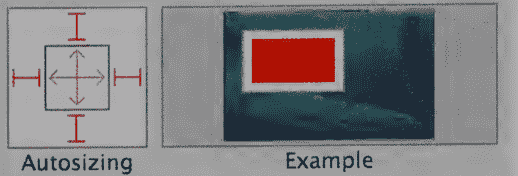

可以通过向视图的 `autoresizingMask` 属性传递位掩码来通过程序设置这些掩码。也可以在 Interface Builder 中使用尺寸检查器中的 Autosizing 工具进行配置（见图 3.2）。

使用 Interface Builder 的 Autosizing 工具时，红线表示固定边距，箭头表示灵活边距。此示例展示了当父视图被调整大小时，子视图的行为。

注意：只有在开启 Auto Layout 时才会出现 Autosizing 工具。该系统有许多优势。它可以处理手动难以管理的复杂布局。

## 自动布局

Auto Layout 是一种基于约束的声明式布局引擎。Apple 创建 Auto Layout 是为了弥补 Autosizing 的不足。我们不再指定视图的大小或位置，而是定义视图之间的关系，这赋予了我们巨大的力量——但这种力量是有代价的。

Auto Layout 有两个主要挑战。第一个是技术挑战。我们必须学会 API 和 Interface Builder 的控件才能有效使用它。第二个挑战是心理上的。Auto Layout 要求改变我们思考视图的方式。在使用 Auto Layout 时，我们不再通过 `frame`、`bounds` 和 `center` 指定视图的大小和位置，而是指定一组约束。选择正确的约束就像解决逻辑题。而且就像任何谜题，起初可能会令人困惑和沮丧。放心，它会变得容易。

Auto Layout 的约束可以表示为线性方程，如下：

`Attribute_1 = Multiplier * Attribute_2 + Constant`

属性可以是任何：

- Left Edge
- Right Edge
- Top Edge
- Bottom Edge
- Leading Edge
- Trailing Edge
- Width
- Height
- CenterX
- Not An Attribute

在这些属性中，三个值得特别提到。Leading Edge 是根据本地阅读方向遇到的第一个边缘。对于英语等从左到右的语言，这将是左边缘。Trailing Edge 是相反的，对于英语是右边缘。通过使用 Leading Edge 和 Trailing Edge（而不是 Left Edge 和 Right Edge），当从从左到右的语言切换到从右到左的语言时，我们的 UI 会自动重新排序。

- 示例 1：设置常量高度
  `View's Height = 0.0 * Not An Attribute + 40.0`

- 示例 2：设置两个按钮之间的固定距离
  `Button_2's Leading Edge = 1.0 * Button_1's Trailing Edge + 8.0`

- 示例 3：使两个按钮具有相同宽度
  `Button_2's Width = 1.0 * Button_1's Width + 0.0`

- 示例 4：将视图在其父视图中居中
  ```
  View's CenterX = 1.0 * Superview's CenterX + 0.0;
  View's CenterY = 1.0 * Superview's CenterY + 0.0;
  ```

- 示例 5：为视图提供固定的比例
  `View's Height = 2.0 * View's Width + 0.0`

要使用 Auto Layout，我们定义一组规则，系统会尝试满足这些规则。遗憾的是，与大多数基于规则的系统一样，每个单独的约束可能看起来简单——但当它们组合在一起时，可能会产生意想不到的后果。随着约束数量的增加，准确预测系统在运行时会做什么将变得越来越困难。我的建议是迭代地构建你的界面并经常进行测试。

# 充分且无歧义的布局

为了生成可预测的结果，我们必须声明既充分又无歧义的约束。通常意味着每个视图至少需要四个约束：一个定义高度，一个定义宽度，一个定义 x 坐标，以及一个定义 y 坐标。当然，解决这个问题有许多种方法，但只要我们为每个维度确定两个可能的属性，就没问题。例如，为了指定视图的 y 轴，我们可以指定 Top 和 Bottom、Top 和 Height、Bottom 和 Height、Center Y 和 Height，或者 Baseline 和 Height。其他组合也是可能的（例如 Top 和 Center），但这些会很少见。

我们还需要避免分配过多的约束——导致产生无法同时满足的冲突。例如，我不能定义一个视图的 Top、Height 和 Bottom。随着父视图高度约束的变化，其中一个将需要随之改变。

到目前为止，这看起来很直观。只需为视图层级中的每个视图创建两个（且仅限两个）x 维度约束和两个 y 维度约束即可。这样你就可以开始工作了。当然，不使用 Auto Layout 就不会那么直观。问题在于，我刚才撒谎了。

实际上，约束不需要是线性方程。它们也可以是不等式。例如，我们可以像这里为视图定义一个最小宽度：

```
View's Width >= 0.0 * Not An Attribute + 20.0;
```

当你使用不等式时，将需要比四个更多的约束来指定无歧义的布局。更糟糕的是，每个约束还有一个优先级。优先级范围从 1 到 1,000。如果设置为 1000，则该约束是强制的。任何小于 1000 都是可选的。系统将尝试按照从高到低优先级的顺序满足所有的可选约束。

最后，某些控件具有自然尺寸。例如，按钮通常高 30 点，且宽度足够容纳其标题文本。另一方面，文本字段也有 30 点高，并且没有首选宽度。我们可以说这些视图具有固有尺寸——这会自动为我们生成一整套新的可选约束。

# 固有尺寸

我们可以通过重写 `intrinsicContentSize` 方法来设置 `UIView` 的固有尺寸。该方法应该返回一个 `CGSize`。这可以是固定尺寸，也可以是根据视图内容计算出的尺寸。如果视图在给定维度没有固有尺寸，则应该在该维度上使用 `UIViewNoIntrinsicMetric`。默认情况下为 `UIView(UIViewNoIntrinsicMetric, UIViewNoIntrinsicMetric)`。

如果我们需要重新计算固有尺寸（例如在更改视图内容后），应该调用 `invalidateIntrinsicContentSize`。系统将在下一次布局传递中使用新的固有尺寸。

Auto Layout 根据视图的固有尺寸创建四个约束：每个轴两个不等式。抗压缩维持视图的最小高度和宽度，而内容伸缩定义了它的最大值。线性方程所示：

```
// 抗压缩
View's Height >= 0.0 * Not An Attribute + View's Intrinsic Height;
View's Width >= 0.0 * Not An Attribute + View's Intrinsic Width;

// 内容伸缩
View's Height <= 0.0 * Not An Attribute + View's Intrinsic Height;
View's Width <= 0.0 * Not An Attribute + View's Intrinsic Width;
```

默认情况下，内容伸缩优先级设置为 250，抗压缩优先级设置为 750。某些元素可能有不同的默认值。例如，`UILabel` 的内容伸缩优先级为 251。这意味着大多数其他用户界面元素将拉伸到标签之上。我们可以通过调用 `setCompressionResistancePriority:forAxis:` 和 `setContentHuggingPriority:forAxis:` 来修改这些约束的优先级。注意 Apple 提供了一些常量来使优先级更容易设置（见表 3.2）。

### 表 3.2 优先级常量

| 常量名称 | 值 |
|---|---|
| `UILayoutPriorityRequired` | 1,000 |
| `UILayoutPriorityDefaultHigh` | 750 |
| `UILayoutPriorityDefaultLow` | 250 |

这为我们在处理视图时提供了相当的灵活性。对于一个按钮，我们可能将抗压缩和内容伸缩都设置为 `UILayoutPriorityRequired`。对于另一个，我们可能将 x 轴的内容伸缩设置为 `UILayoutPriorityDefaultLow`，并将所有其他设置为 `UILayoutPriorityRequired`。这将赋予它一个固定的高度和最小宽度。

## 指定约束

定义约束有四种方法。虽然我们在本书中将主要使用 Interface Builder，但我们经常需要在代码中设置约束。

## 默认约束

每当我们添加一个视图时，系统会自动生成一组约束。如果场景没有栏，它将使用视图顶部。然而，我们通常需要禁用这些约束。只需调用 `translatesAutoresizingMaskIntoConstraints` 并传递 `NO`。

# 约束 API

我们的约束是 `NSLayoutConstraint` 类的实例。我们可以通过 `constraintWithItem:attribute:relatedBy:toItem:attribute:multiplier:constant:` 创建新的约束。该方法是之前看到的线性方程的直接翻译。

前两个参数定义要约束的视图和属性。属性类型为 `NSLayoutAttribute`，所示：

```
enum {
    NSLayoutAttributeLeft = 1,
    NSLayoutAttributeNotAnAttribute = 0
};
typedef NSInteger NSLayoutAttribute;
```

接下来传递一个 `NSLayoutRelation` 来定义方程类型，所示：

```
enum {
    NSLayoutRelationLessThanOrEqual = -1,
    NSLayoutRelationEqual = 0,
    NSLayoutRelationGreaterThanOrEqual = 1
};
typedef NSInteger NSLayoutRelation;
```

接下来两个参数定义右边的视图和属性。再次，属性必须是 `NSLayoutAttribute`。后面是乘数和常量（均为 `CGFloat`）。因此，以下调用：

```
NSLayoutConstraint *constraint =
[NSLayoutConstraint constraintWithItem:view1
                              attribute:attribute1
                              relatedBy:relationship
                                 toItem:view2
                              attribute:attribute2
                             multiplier:mx
                               constant:c];
```


定义了以下线性方程：
`view1.attribute1 view2.attribute2 * mx + c;`

现在，我将项目描述为视图。这并不完全 100% 正确。技术上，它们是视图。大多数时候我们会在视图（或其他 `UIView` 子类）之间创建约束。然而，有两个显著例外。`ViewController` 定义了两个真正的约束：`topLayoutGuide` 和 `bottomLayoutGuide`。顶部布局引导的精确位置取决于可见哪些栏。如果场景有导航栏，它将是导航栏底部。如果场景只有状态栏，它将是状态栏底部。如果场景没有栏，它将使用视图顶部。通过向 `topLayoutGuide` 创建约束，我们可以确保我们的控件正确放置在场景栏的下方，并且在我们更改栏时，位置会自动调整。

底部布局引导的工作原理类似。如果场景有工具栏或标签栏，它将是栏的顶部。否则，它将是当前方向视图的底部。

这些引导在 iOS 7 中特别重要。我们的视图应该延伸到栏下方，栏是半透明的，允许一个高度模糊且某种淡化的提示可见。

我们的视图可以透出来。这为我们的布局增添了背景，并且在显示滚动内容时尤为有效。然而，显然，当不是滚动视图时，我们不希望控件意外地滑到栏的下方。

在布局不可滚动的场景时，我们应该始终将约束创建在场景主视图顶部和底部的外部布局上。这将保证即使我们更改了工作流，我们的布局也能适应。例如，我们可以将场景嵌入导航控制器（`navigation controller`）中，或者将传入的转场（`segue`）从推送（`push`）改为模态（`modal`），我们的布局将自动调整。

一旦创建了约束，我们仍然需要将其添加到系统中。约束应该添加到约束中两个视图的最近祖先视图。我所说的祖先是指视图本身、它的父视图（`supervisor`）、其父视图的父视图，或者任何移动视图层级的其他父视图。

例如，如果我们在一个视图和它的父视图之间创建约束，我们应该将约束添加到父视图上。如果我们在两个兄弟按钮之间创建约束，我们应该将约束添加到它们共有的父视图上。

我们使用 `UIView` 的 `addConstraint:` 方法并传递我们的约束来添加约束。以下代码明确地为一个按钮和文本定义了一组约束。在从左到右的语言（如英语）中，按钮应该距离父视图的左上角固定距离。它还有一个固定的宽度。文本字段应该距离按钮的右边缘一个固定距离。它在按钮上垂直居中。最后，文本字段的右边缘应该与父视图的右边缘保持固定距离。此外，随着父视图的调整大小，文本字段的宽度将增大和缩小以填充空间。

```objective-c
// Set Button's Constraints

NSLayoutConstraint *buttonX =
[NSLayoutConstraint constraintWithItem:myButton
distribute:NSLayoutAttributeLeading
relatedBy:NSLayoutRelation
toItem:view
attribute:NSLayoutAttributeLeft multiplier:1.0
constant:20.0];

[view addConstraint:buttonX];

NSLayoutConstraint *buttonY =
[NSLayoutConstraint constraintWithItem:myButton
attribute:NSLayoutAttributeTop
relatedBy:NSLayoutRelation
toItem:view
attribute:NSLayoutAttributeTop
multiplier:1.0
constant:20.0];

[view addConstraint:buttonY];

// Setup Button's Intrinsic Size Priorities

[myButton setContentHuggingPriority:UILayoutPriorityRequired forAxis:ILayoutConstraintAxisHorizontal];

[myButton setContentCompressionPriority:UILayoutPriorityRequired forAxis:ILayoutConstraintAxisHorizontal];

// Setup Textfield Constraints.

NSLayoutConstraint *textX =
[NSLayoutConstraint constraintWithItem:myText
attribute:NSLayoutAttributeLeading
relatedBy:NSLayoutRelationEqual
toItem:myButton
attribute:NSLayoutAttributeTrailing
multiplier:1.0
constant:5.0];

[view addConstraint:textX];

NSLayoutConstraint *textY =
[NSLayoutConstraint constraintWithItem:myText
attribute:NSLayoutAttributeCenterY
relatedBy:NSLayoutRelationEqual
toItem:myButton
attribute:NSLayoutAttributeCenterY
multiplier:1.0
constant:0.0];

[view addConstraint:textY];

NSLayoutConstraint *textWidth =
[NSLayoutConstraint constraintWithItem:myTextField
attribute:NSLayoutAttributeTrailing
relatedBy:NSLayoutRelationEqual
attribute:NSLayoutAttributeTrailing
multiplier:-1.0
constant:-20.0];

[view addConstraint:textWidth];
```

有很多方法，这些是最容易理解的约束。然而，正如你看到的，这需要大量的输入。幸运的是，视觉格式语言（Visual Formatting language）大大减少了这些工作——但它可能会模糊某些细节，使其变得有些难以理解。

# 视觉格式语法 (VISUAL FORMATTING SYNTAX)

你是否花过下午时间画 ASCII 画？这个功能适用于你。`NSLayoutConstraint` 支持视觉格式语法。它允许我们使用 ASCII 语法来“绘制”约束。完整的细节可以在 iOS 文档和 Cocoa Auto Layout Guide 中找到，我们将从基础开始。

我们通过创建一个 `NSString` 来定义一组约束。这些字符串将在表 3.3 显示。以下是一些示例：

- `+--[view1]`: 设置视图与父视图左边缘的标准间距。
- `-[view2]`: 设置 `view2` 左边缘与 `view1` 右边缘的标准间距。
- `-[view1][view2]`: 将 `view2` 的左边缘与 `view1` 的右边缘对齐。视图之间没有间距。
- `-V:|view1]`: 设置父视图顶部与 `view1` 顶部的标准间距。


# 3.3 Auto Layout 视觉格式 (Visual Format)

| 符号 | 含义 |
| --- | --- |
| `|` | 容器父视图的边缘。 |
| `<view_string>` | UI 中的一个视图。可选参数可以声明视图的宽度和优先级。 |
| `<view_string>(<width>)` | UI 中的一个视图。可选参数可以声明视图的宽度和优先级。 |
| `<view_string>(<width>)(<priority>)` | UI 中的一个视图。可选参数可以声明视图的宽度和优先级。 |

*(注：表格中重复的部分已根据原文保留并翻译逻辑)*

| 符号 | 含义 |
| --- | --- |
| `|` | 容器父视图的边缘。 |
| `<view_string>` | UI 中的一个视图。可选参数可以声明视图的宽度和优先级。 |
| `<view_string>(<width>)` | UI 中的一个视图。可选参数可以声明视图的宽度和优先级。 |
| `<view_string>(<width>)(<priority>)` | UI 中的一个视图。可选参数可以声明视图的宽度和优先级。 |

*(注：后续大量重复行遵循原文格式进行对应处理)*

我们还可以将这些字符串组合成复杂的语句。以下示例使用所有元素之间的标准间距布局了三个等大的按钮：
`-|[view1]-[view2(==view)]-[view3(==view)]-|`

我们使用 `layoutConstraintWithVisualFormat:options:metrics:views:` 创建这些约束。第一个参数是我们的格式字符串。第二个参数解释了元素应该如何对齐，我们使用了 LTR（从左到右）、Leading--关系。最后，我们传递两个字典：第一个定义我们的常量，第二个包含视图。

```swift
constraintsWithFormat:"@|-[myButton]-[myTextField]|-"
options:NSLayoutFormatAlignAllCenterY
NSLayoutFormatDirectionLeadingToTrailing
metrics:nil
views:views];

// 定义按钮的垂直位置

NSArray *verticalConstraints =
[NSLayoutConstraint constraintsWithVisualFormat:"@V|-[myButton]"
options:0
metrics:nil
views:views];

[view addConstraints:constraints];
[view addConstraints:verticalConstraints];
```


// 还需要设置按钮的固有尺寸优先级
[myButton setContentHuggingPriority:ILayoutPriorityRequired forAxis:ILayoutConstraintAxisHorizontal];

[myButton setContentCompressionResistancePriority:ILayoutPriorityRequired forAxis:ILayoutConstraintAxisHorizontal];

这是一段相当长的代码，但我们成功地将五个独立的约束压缩到了两个视觉语法调用中。显然，每行或每列中的 UI 元素越多，节省的效果就越大。

然而，这也存在一些局限性。例如，我们无法设置视图的宽度相对于其高度。如果我们需要这种关系，将需要在代码中显式地定义约束。

## 在 Interface Builder 中编辑约束

Auto Layout 在 iOS 6 中遭到了相当大的批评。大多数人同意它具有潜在的用和强大——他们反对的是 Interface Builder 处理 Auto Layout 的方式。

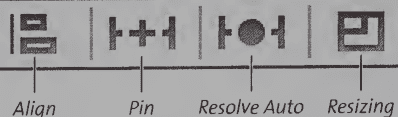

图 3.3 Interface Builder 屏幕工具

Interface Builder 试图表现得太热心了。每当我们向 storyboard 或 nib 文件添加一个视图时，它都会根据该视图在场景中的位置自动为其添加约束。它还会积极防止我们创建歧义或无效的约束。

这对于简单布局效果非常好——但一旦布局变得复杂，你不可避免地必须更改 Interface Builder 的默认约束。问题在于，你并不能简单地添加或删除约束——那会创建一组无效的约束。如果你足够聪明、细心且有一点执着，你就可以设法绕过这些限制并管理约束，直到它们完全符合你的要求。然而，如果你对用户界面进行任何更改，Interface Builder 都会重新生成所有的约束，从而撤销你所有的努力。

幸运的是，这一切已成为过去。随着 Xcode 5 的发布，Interface Builder 不再尝试提供帮助。讽刺的是，通过做得更少，它反而变得更有用了。然而，这也有缺点。我们拥有完全自由去添加、修改和删除任意数量的约束。更重要的是，由于它不再尝试帮助我们，我们就不会意外撤销自己的工作。

当你在 Interface Builder 中添加用户界面元素时，系统将首先使用其默认约束。该元素相对于其视图的左上角将有一个固定位置。它还具有固定的宽度和高度。一旦我们添加了第一个约束，Interface Builder 就会移除默认约束。然后我们必须为该项目添加一组完整的约束。

Interface Builder 拥有许多约束编辑功能。我们在这里无法涵盖所有功能。相反，我们将对最重要的编辑功能进行快速概述，然后在 Health Beat 中通过这些工具获得实战经验。

Interface Builder 提供了四种屏幕约束工具：Align（对齐）、Pin（固定）、Resolve Layout Issues（解决布局问题）和 Resizing Behavior（调整大小行为）（图 3.3）。

Align 工具允许选择两个或多个元素，然后设置约束对齐它们的边缘、中心或基线。我们还可以将元素与容器视图对齐（图 3.4）。我们还可以指定在添加这些约束时哪些帧会得到更新。

对于 Pin 工具，我们可以选择单个元素，然后设置其到最近邻居的约束（这可能是指向附近视图的约束，或最近的布局视图）。我们还可以为该项目指定固定的高度或宽度。最后，我们可以选择多个元素并赋予它们相等的高度或宽度，甚至让它们对齐（图 3.5）。在使用“最近邻居”控制时我会格外小心，尤其是在复杂的场景中。它对最近邻居的定义可能比你的不同。不过，请注意，你可以点击最近邻居设置上的下拉箭头来指定正确的邻居。

## 添加新的对齐约束

| Leading Edges (起始边缘) | |
| :--- | :--- |
| Trailing Edges (结束边缘) | |
| Top Edges (顶部边缘) | |
| Bottom Edges (底部边缘) | |
| Horizontal Centers (水平居中) | |
| Vertical Centers (垂直居中) | |
| Baselines (基线) | |
| Horizontal Center in Container (容器内水平居中) | |
| Vertical Center in Container (容器内垂直居中) | |

Update Frames (更新帧): None
Add Constraints (添加约束)

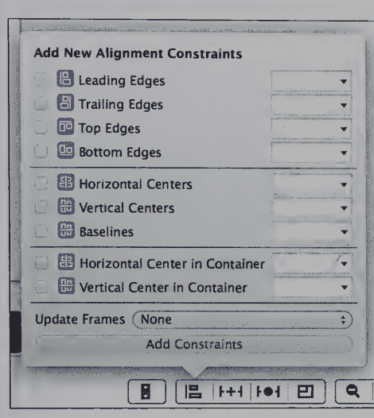

## 添加新约束

| Width (宽度) | |
| :--- | :--- |
| Height (高度) | |
| Equal Widths (等宽) | |
| Equal Heights (等高) | |
| Align Leading Edges (对齐起始边缘) | |

Spacing to nearest neighbor (到最近邻居的间距)
Update Frames (更新帧): None
Add Constraints (添加约束)

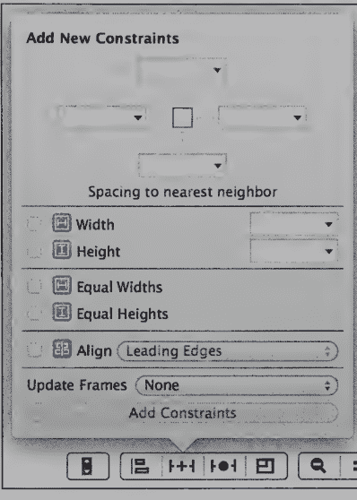

图 3.4 Auto Layout 的 Align 工具

图 3.5 Auto Layout 的 Pin 工具

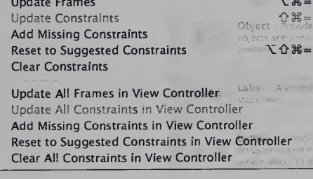

图 3.6 Auto Layout 的 Resolve Layout Issues

图 3.7 Auto Layout 的 Resizing Behavior

设置对齐区域最简单的方法是重写视图的 `alignmentRectInsets` 方法。该方法返回一个定义对齐区域与视图框架之间偏移量的 `CGRect`。或者，我们可以重写 `alignmentRectFrame:frameForAlignmentRect:` 方法，在重写的对齐区域及其框架之间进行转换。默认情况下，这些方法会调用 `alignmentRectInsets` 并根据这些内边距进行转换。

最后，视图在归档时可以保存它的部分或全部约束。每个约束都有一个 `toBeArchived` 属性。默认情况下，该属性被设置为 `NO`，且约束不会随视图一起保存。然而，如果我们想保存该约束，只需将其 `shouldBeArchived` 属性设置为 `YES` 即可。

## 自动布局的故障排除

凭借 Xcode 5 对 Auto Layout 的支持，故障排除变得比以前要容易得多。我们可以直观地看到是否存在歧义或冲突的布局。警告和错误也会显示在文档大纲中。尽管如此，有时我们仍然需要深入挖掘，以确定具体究竟发生了什么问题。

在创建约束时，我们实际上会遇到三类问题。我们的约束可能是歧义的、可能存在冲突，或者可能在逻辑上是错误的。

## 检测歧义布局

如果存在多个满足其所有约束的可能布局，则该视图具有歧义布局。通常，歧义布局会导致视图出现在错误的位置或具有错误的大小。有时布局可能会在两次之间发生变化，或者视图可能会意外地跳动或移动。

通常这意味着我们需要添加约束。正如之前提到的，每个视图至少需要四个约束来同时满足它的位置和大小。如果你使用不等式，则需要更多的约束。

然而，当我们具有完全相同优先级的冲突非强制性约束时，也会出现歧义布局。在这种情况下，系统无法确定应该满足哪一个约束。我们必须修改其中一个的优先级来打破僵局。

如果通过代码创建约束，我们就无法依赖 Interface Builder 为我们检测歧义布局。这在很大程度上是一个尝试与错误的过程；不过，系统提供了一些工具来帮助。首先，我们有多种调试方法。这些方法应该在调试期间使用，例如在编写代码探索布局并确定为什么应用程序运行不正常时。

UIView 的 `hasAmbiguousLayout` 是你的前线工具。简单来说，如果视图具有歧义布局，它将返回 `YES`；否则返回 `NO`。这提供了一个快速测试。如果布局是歧义的，我们可以进一步探索。如果不是，那么我们的约束就是错误的，或者我们的代码存在其他问题。

接下来，UIView `exerciseAmbiguityLayout` 会随机将视图的框架更改为另一个同样满足其约束的值。通过循环几个替代方案，你很快就能对缺失的约束产生感觉。

最后，`constraintsAffectingLayoutAxis` 返回一个数组，其中包含沿指定轴线影响视图布局的所有约束。我们可以检查这些约束以更好地理解问题。

记住，如果你找到了一个设置断点的好地方，可以从调试器的控制台调用这些方法：

```
p (BOOL)[self hasAmbiguousLayout]
```

Instruments 也提供了一些帮助。有一个 Cocoa Layout 仪器工具，可以跟踪你的任何约束。再次，这主要用于通过代码修改或替换约束——我们可以使用 Instruments 来验证约束是否在预期的位置发生了变化，以及何时发生变化。

## 检测冲突

冲突既更严重也更容易检测。当两个（或多个）强制性约束无法被满足时，就会发生冲突。幸运的是，系统在检测到冲突约束时会抛出异常。

默认情况下，系统也会捕获此异常。它会在控制台中记录警告并选择其中一个约束进行忽略。它将继续布局我们的视图。示例所示：

- 2012-12-28 01:07:09.880 AutoLayoutTest[47333:c07] Unable to simultaneously satisfy constraints.
- Probably at least one of the constraints in the following list
- is. 尝试这样做：(1) 查看每个约束并尝试确定哪一个是你没有预期的；(2) 找到添加了不想要的约束或多个约束的代码并修复它。（注意：
- 如果你看到了你不理解的 NSAutoresizingMaskConstraints，请参考 UIView 属性文档
- translatesAutoresizingMaskIntoConstraints

```
<NSLayoutConstraint:07581490 H:[MyView:07580c30(60)]>,
<NSLayoutConstraint:07581320 H:[MyView:07580c30(88)]>
```

将尝试通过破坏约束来恢复
<NSLayoutConstraint:07581320 H:[MyView:07580c30(80)]>

> 注意：可能的情况下，NSLayoutConstraint 的描述方法使用视觉化格式化。在无法实现的情况下，我们将使用伪代码直接写出线性方程。

在这个示例中，你可以看到我们设置了两个不同的约束来指定 MyView 的高度。在一种情况下，我们将高度设置为 60 磅。在另一种情况下，我们将其设置为 80 磅。系统选择忽略 80 磅的约束并继续布局视图。

我们设置了一个断点来检测此异常。可以设置异常断点，或者将仅为指定的约束提供有用信息。

## 布局时机

无论我们是否使用 Auto Layout，系统都会执行这三个阶段：更新、布局和显示。系统按照特定的顺序处理这些阶段，理解该顺序对于编写高效代码非常重要。

更新阶段从窗口开始向下进行。布局阶段从叶子视图向上进行。显示阶段从窗口开始向下进行。

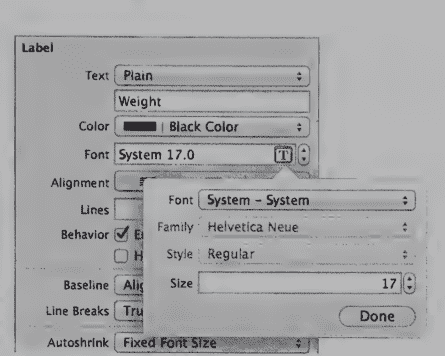

**图 3.8** 编辑表格视图单元格的内容

**图 3.9** 更改字体

**图 3.10** 我们的自定义表格视图单元格

> **注意：** 用于自定义表格视图单元格和静态表格的 Interface Builder 是内置在 storyboard 中的。你不能在 `.xib` 文件中使用它们。事实上，我发现 storyboard 的扩展表格视图非常有用，我觉得它是使用 storyboard 的最具说服力的理由之一。

打开 `Main.storyboard` 并导航到 History 表格视图控制器。选择我们的表格视图单元格，并在属性检查器中将 Style 改为 Custom。现在我们有了一个几乎空白的画布可以操作了。除了右侧的披露指示器，我们的单元格什么都没有。

从库中拖入一个标签到单元格中。使用辅助线确保标签对齐左边距并在单元格中居中。还要注意单元格的内容区域是如何被蓝色高亮的——这是唯一可以操作的空间（图 3.8）。

双击标签并将其文本更改为 Weight。然后拖入第二个标签，并与单元格区域的右边距对齐。双击此标签并将其文本更改为 Date。这些只是占位符——我们将在运行时动态将它们替换为真实数据。

选择 Weight 标签。我们要更改它的文本。在属性检查器中，点击 Font 字段内部的图标（图 3.9）。

点击 Font 弹出窗口。这将弹出一个字体列表。特别要查看 Text Styles 下列出的字体。这些是我们的动态类型。我们将在“Dynamic Type”部分讨论动态类型。现在请理解，用户将能够在他们的设备设置字体大小，我们将更新用户界面以匹配这些设置。

对于 Weight 标签，将字体设置为 Headline。对于 Date，设置为 Subhead。我们还应该将 Date 的 Alignment 设置为右对齐。我们的自定义单元格看起来应该像图 3.10 所示。

# 图 3.11 绘制约束

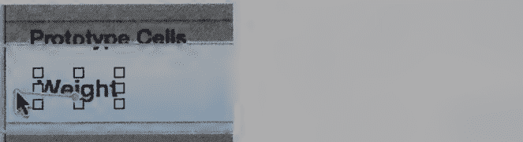

## 添加布局约束

现在我们需要向 Auto Layout 约束中添加内容。我们的目标是让权重固定在左侧。日期标签将延伸以填充剩余空间，并在它们之间保持标准间距。所有内容都应该在垂直方向上居中。

让我们从 Weight 开始。Control-点击 Weight 标签并向左拖动。在单元格内标签左侧的任何地方释放鼠标（图 3.11）。从弹出菜单中，选择 Leading Space to Container。这在我们的标签左侧放置了一个 I 轴，现在有一个虚线围绕着我们的单元格。恭喜，我们成功地创建了一个歧义布局。

让我们快速看一眼这个问题。在文档大纲中 History 表格视图控制器部分的右上角，你应该看到一个小的红橙色箭头图标。如果你点击它，它将显示我们约束的所有警告和错误。我们可以在 Issue navigator 中获取类似的信息——但我更喜欢文档大纲提供的反馈。

在我们的情况下，它显示我们缺少 Weight 标签的约束。我们需要指定它的 Y 位置。它还说我们有一个位置错误的视图。由于目前的约束，Weight 标签的帧并不完全在正确的位置。

我们希望在更新帧之前完全约束我们的布局。在这种情况下，添加 Y 约束很容易。重复我们之前执行的程序。从 Weight 拖动到单元格内标签左侧的某处。这次，选择 Center Vertically in Container。Interface Builder 将在我们的单元格中间添加一条蓝线。还请注意我们的 I 轴已经变成了蓝色。

我们的标签具有固有的高度和宽度，因此这应该足够以无歧义地约束它。请记住，我们需要两个垂直约束和两个水平约束，而固有尺寸在每个维度上都充当一个约束。

遗憾的是，标签周围的虚线表示某些地方仍然不太对。如果你再次查看我们的警告，你会发现视图仍然位置错误。选择 Weight 标签，然后点击 Resolve Auto Layout Issues 按钮。在弹出菜单中，选择 Update Frames。注意：你也可以选择 Editor > Resolve Auto Layout Issues > Update Frames 菜单项。

一旦完成，橙色框应该就会消失。我们的文档大纲也将显示没有 Auto Layout 问题。

138 第 3 章 开发视图和视图控制器

# 原型单元格

图 3.12 拉伸 Date 标签以适应

Date 的处理将类似。然而，在我们开始之前，拉伸 Date 标签，使其右边缘紧邻 Weight 标签。当你靠近它时，你会看到一条短的蓝色辅助线。利用它来对齐边缘（图 3.12）。

现在 Control-drag 从 Date 拖到单元格内标签右侧的常见区域。选择 Trailing Space to Container。现在，Control-drag 从 Date 拖到 Weight。选择 Center Y。再次 Control-drag 从 Date 拖到 Weight，这次选择 Horizontal Spacing。

一旦这样做，我们就有了所有的顺序。这里发生了什么？如果我们查看文档大纲中的 Auto Layout 警告和错误，它显示我们有内容优先级。布局引擎无法满足这一点。具体来说，我们希望保持权重不缩小，但允许日期扩展。我们通过调整 Content Hugging 和 Compression Priorities 来实现这一点。

对于 Weight 标签，我们将 Hugging Priority 设置为 750，Compression Resistance 设置为 750。对于 Date 标签，我们将 Hugging Priority 设置为 250，Compression Resistance 设置为 750。这确保了权重标签保持其固有大小，而日期标签延伸以填充空间。


理想情况下，我们希望对数字和日期的显示实现国际化。我们在第 2 章“我们的应用程序架构”中已经看到过对日期的处理方法。我们在 `WeightEntry` 的 `description` 方法中使用 `NSDateFormatter` 来生成本地化的日期。

现在，我们应该对重量值也执行相同的操作。但这不仅仅是使用一个正确本地化的数字那么简单。我们还应该创建方法来正确地附加重量单位。将所有这些封装在几个辅助方法中，将使显示重量数据和切换单位变得简单得多。

> 注意：本地化是一个很大的课题。详细的描述超出了本书的范畴。然而，我们将在第 9 章“最后一公里”中介绍基础知识。


打开 `WeightEntry.h`，并在 `@end` 指令之前添加以下方法声明：

```
+ (NSString*)stringForUnit:(WeightUnit)unit;
+ (NSString*)stringForWeight:(float)weight ofUnit:(WeightUnit)unit;
+ (NSString*)stringForWeightInLbs:(float)weight inUnit:(WeightUnit)unit;
```

```
- (float)weightInUnit:(WeightUnit)unit;
- (NSString*)stringForWeightInUnit:(WeightUnit)unit;
```

现在，切换到 `WeightEntry.m`，让我们来实现这些方法。但在此之前，我们需要创建一个静态的 `NSNumberFormatter`。在我们的 `LBS_PER_KG` 常量声明之后紧紧添加以下内容：

```
static NSNumberFormatter *formatter;
```

使用数字格式化器有两种方法。我们可以使用 `localizedStringFromNumber:style:` 类方法，它只提供了六种预定义的样式。我们需要自定义默认的小数点位样式，这意味着我们需要创建自己的 `NSNumberFormatter` 实例。

然而，我们不想在每次显示重量字符串时都创建一个新的格式化器。相反，让我们创建一个静态格式化器，我们可以在 `WeightEntry.m` 文件的任何地方自由访问它。遗憾的是，我们无法创建一个数字格式化器常量——因为没有办法在编译时实例化格式化器。相反，我们将采取其次的方法。我们将使用一个普通的静态变量，并在类的 `initialize` 方法中设置它的值。

实际上有两个类方法可以用来初始化类级资源。一个是 `initialize`，另一个则有它自己的小癖和陷阱。

`load` 方法运行得非常早。事实上，它在 `main()` 之前运行。结果是系统可能还没有被正确设置。例如，我们将有一个 `autorelease` 池——如果我们使用 Objective-C 代码，我们需要提供自己的池。此外，其他类可能还没有被正确加载。通常情况下，我们链接的所有框架都应该已加载。我们项目中的其他类可能加载也可能未，而任何链接到我们代码的框架都不会被加载。

另一个奇点是，当我们在赠送章节“Objective-C”中查看分类（Categories）时，我强调了永远、永远、永远、永远不要在分类中重写方法有多重要。事实证明有一个例外：`load`。`load` 的调用方式不像其他方法。

只有当在类或类的其中一个分类中实现时，系统才会调用 `load`。它会先调用类的 `load` 方法，然后调用任何分类的 `load` 方法。这允许我们在类和分类中使用自定义初始化，并使 `load` 成为执行危险操作的理想场所，例如动态实现或替换现有方法。

`initialize` 运行得要晚得多。它是类第一次被使用时运行。这意味着如果类从未被使用，它就不会运行。在这一时期，我们已经有了完整的运行时（runtime），并且所有的类都已加载，因此它通常是执行自定义初始化的更安全的地方。然而，有一个小陷阱：`initialize` 可能会被调用多次。

如果你在一个类中重写了 `initialize`，然后创建该类的子类，那么你的 `initialize` 方法会在类上被调用一次，并在每个没有也重写 `initialize` 的子类上被调用一次。因此，我们总是想在运行任何代码之前检查我们的类。即使我们目前没有创建子类的计划，也是如此。你不知道未来会发生什么。

所以，让我们所示添加 `initialize` 方法：

```
(void)initialize
{
    if (self == [WeightEntry class]) {
        formatter = [[NSNumberFormatter alloc] init];
        [formatter setNumberStyle:NSNumberFormatterDecimalStyle];
        [formatter setMinimum:[NSNumber numberFloat:0.0f]];
        [formatter setMaximumFractionDigits:2];
    }
}
```

我们首先确保是 `WeightEntry` 类（而不是它的子类）确实在调用此方法。然后我们实例化我们的数字格式化器。我们将其设置为小数样式，然后对其修改，使其具有 0.0 的最小值，并让它只显示两位小数的重量。

格式化器就绪后，让我们逐个查看我们的字符串方法。

### 字符串方法

```
+ (NSString*)stringForUnit:(WeightUnit)unit
{
    switch (unit) {
        case LBS:
            return @"lbs";

        case KG:
            return @"kg";

        default:
            [NSException
                raise:NSInvalidArgumentException
                format:@"Value %d is not a valid WeightUnit", unit];
    }
}

// 这部分永远不会被执行。
return @"";
```

`stringForUnit:` 方法只需接收一个 `WeightUnit` 并返回对应的字符串。如果它不是我们的单位之一，它会抛出异常。

```
+ (NSString*)stringForWeightInLbs:(float)weight inUnit:(WeightUnit)unit
{
    float convertedWeight;
    switch (unit) {
        case LBS:
            convertedWeight = weight;
            break;
        case KG:
            convertedWeight = [WeightEntry convertKg:weight];
            break;
        default:
            [NSException raise:NSInvalidArgumentException format:@"%d is not a valid WeightUnit", unit];
    }
    return [formatter stringFromNumber:@(convertedWeight)];
}
```

该方法创建一个正确本地化的字符串。我们将重量对象传递给数字格式化器。`stringFromNumber:` 调用将字符串与一个空格连接起来。

```
+ (NSString*)stringForWeight:(float)weight ofUnit:(WeightUnit)unit
{
    NSString* weightString = [formatter stringFromNumber:@(weight)];
    NSString* unitString = [WeightEntry stringForUnit:unit];

    return [NSString stringWithFormat:@"%@ %@", weightString, unitString];
}
```

这是相同的构造。如果单位是 LBS，我们直接返回我们的重量。如果单位是 KG，我们转换它。否则，我们抛出异常。

> 注意：我们看到了三次相同的基本的 switch 语句，只有细微的差别。当你看到这种重复时，通常是类需要重构的信号。在这种情况下，重写类以消除重复的 switch 语句。一种解决方案是为不同的单位提供单独的子类（例如 `WeightEntryInLbs` 和 `WeightEntryInKG`）。然而，考虑到的大小的大小相对较小的重复量，我认为在这种情况下治标比药重。我宁愿留下这种重复。到为止，我们只添加了类方法。然而，我们想添加实例方法，让我们从我们的 `WeightEntry` 对象请求重量字符串。我们首先添加一个请求给定单位重量值的方法。

```
- (float)weightInUnit:(WeightUnit)unit {
    switch (unit) {
        case LBS:
            return self.weightInLbs;
        case KG:
            return [WeightEntry convertToKg:self.weightInLbs];
        default:
            [NSException raise:NSInvalidArgumentException format:@"%d is not a valid WeightUnit", unit];
    }
    // 这部分永远不会被执行。
    return 0.0f;
}
```

在其他代码就绪后，我们的 `stringForWeightInUnit` 方法变得非常简单。所有的繁重工作都由我们之前定义的方法完成。

```
- (NSString*)stringForWeightInUnit:(WeightUnit)unit
{
    return [WeightEntry stringForWeightInLbs:[self weightInUnit:unit] inUnit:unit];
}
```

接下来，让我们添加一个私有方法来配置单元格。

```
- (void)configureCell:(HistoryCell *)cell cellAtIndexPath:(NSIndexPath*)indexPath
{
    WeightEntry *entry = [self.weightHistoryDocument entryAtIndexPath:indexPath];

    cell.weightLabel.text = [entry stringForWeightInUnit:getDefaultUnits()];

    cell.dateLabel.text = [NSDateFormatter
        localizedStringFromDate:entry.date
        dateStyle:NSDateFormatterShortStyle
        timeStyle:NSDateFormatterShortStyle];
}
```

在这里，我们获取了索引路径对应的条目。然后，我们使用新的 `stringForWeightInUnit` 方法获取权重字符串，并使用 `getDefaultUnits()` 函数检索默认单位。接着，我们使用格式化器为我们的日期创建一个本地化字符串。它将同时使用日期和时间的样式。

由于单元格配置非常简单，人们往往倾向于将其直接放在 `tableView:cellForRowAtIndexPath:` 方法中。然而，在大多数项目中，这通常是一个错误；因为我们需要在 `tableView:cellForRowAtIndexPath:` 方法之外重新配置单元格。例如，如果我们允许用户修改条目，那么如果该条目当前正在显示，我们就需要更新单元格的内容。

现在，我们只需要调用这个方法。修改 `tableView:cellForRowAtIndexPath:`：

```
- (UITableViewCell*)tableView:(UITableView*)tableView cellForRowAtIndexPath:(NSIndexPath*)indexPath
{
    static NSString *CellIdentifier = @"HistoryCell";
    HistoryCell *cell = [tableView dequeueReusableCellWithIdentifier:CellIdentifier forIndexPath:indexPath];

    [self configureCell:cell cellAtIndexPath:indexPath];

    return cell;
}
```

编译并运行应用程序。我们的历史视图现在应该使用自定义的单元格了，如图 3.13 所示。


# 条目详情视图

接下来，我们需要设置条目详情视图。目前我们有一个静态表格——但还没有填充它的所有内容。我们希望使用此视图来显示数据表格。我们将左侧设置表头，右侧设置值。这与历史视图中行的布局非常相似。

打开 `Main.storyboard` 并放大到 `Entry Detail Controller` 场景。你应该能看到上一章节中的静态表格。目前它有一个节和三行。删除其中两行。你可以在编辑器或文档大纲（Document Outline）中选择它们，然后按 Delete 键。现在我们只剩下一行可以编辑的行。我们将将其用作所有行的模板。

首先，我们不想让用户选择该行。禁用此功能最简单的方法是选择 Table View Cell，并在属性检查器（Attributes inspector）中将其 `Selection` 属性更改为 `None`。

### 图 3.14 布局我们的详情视图单元格

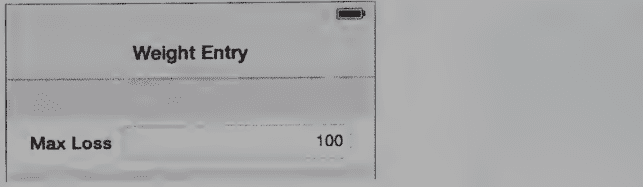

现在，拖出一个标签（label）。使其在行的内容区域内垂直居中，并与左边距辅助线对齐。在属性检查器中，将 `Font` 设置为 `Headline`，并将 `Text` 设置为 `Max Loss`。我们将为权重、日期、平均值、最大亏损和最大收益创建标签。最大亏损恰好是最长的。现在使用它会使后续行的布局变得更容易。

接下来，拖出一个字段（field）。对齐使其同样垂直居中，并与标签右侧的辅助线对齐。然后将其拉伸到右边距辅助线。将其 `Font` 设置为 `Subhead`，并将 `text` 设置为 `100`。将文本右对齐。然后向下滚动到属性检查器的 `Control` 部分，并勾选 `Enabled` 设置。这将允许我们显示文本，但会防止用户编辑它。

布局看起来应该像图 3.14。

为什么我们这次使用文本字段（text field）？有两个原因。首先，我想向你展示一些东西。其次，如果我们以后决定扩展 App 以使这些值可编辑，我们已经准备好了文本字段。我们只需要启用相关的文本字段即可。

如果你运行应用程序并选择一个条目，它将显示我们的新视图。重量和详情文本应该如预期地填充。

为了计算我们的每月统计数据，我们需要更多信息。这意味着我们需要一个额外的属性。切换到 `EntryDetailViewController.h` 并添加以下属性：

```
@property (strong, nonatomic) NSArray *lastMonthsEntries;
```

现在，切换回实现文件。让我们在 `updateUIMethod` 方法的末尾添加代码（在最后的大括号之前，设置 `textField` 的文本之后）。

```
float average = [[lastMonthsEntries valueForKeyPath:@"@avg.weightInLbs"] floatValue];
float min = [[lastMonthsEntries valueForKeyPath:@"@min.weightInLbs"] floatValue];
float max = [[lastMonthsEntries valueForKeyPath:@"@max.weightInLbs"] floatValue];

float lossFromMax = max - self.entry.weightInLbs;
NSAssert(lossFromMax >= 0.0, @"This should always be a non-negative number");

float gainFromMin = self.entry.weightInLbs - min;
NSAssert(gainFromMin >= 0.0, @"This should always be a non-negative number");

self.averageTextField.text = [WeightEntry stringForWeightInLbs:average inUnit:unit];
self.gainTextField.text = [WeightEntry stringForWeightInLbs:gainFromMin inUnit:unit];
self.lossTextField.text = [WeightEntry stringForWeightInLbs:lossFromMax inUnit:unit];
```

这段代码假设 `lastMonthsEntries` 是一个 `WeightEntry` 对象数组。在这里，我们正在使用键值集合操作符（KVC operators）。这些操作符依赖于特殊格式的键路径。普通键的作用类似于点表示法。然而，我们的最小分割是一个 KVC 操作符——一个与 `@` 绑定的关键字。

Apple 定义了若干集合操作符：`@count`、`@average`、`@min`、`@max` 和 `@sum`。


它还定义了若干并操作符：`@distinctUnionObjects`、`@unionOfObjects`、`@distinctUnionArrays`、`@unionOfArrays` 和 `@distinctUnionOfSets`。

除了 `@count` 外，所有 KVC 操作符都需要一个键路径。这意味着它们在关键字之后需要一个路径，即操作符将使用的值的属性名称。这可以是 `self`，用于使用对象本身。

在我们的案例中，我们将使用 `@avg.weightInLbs`。这将计算数组中每个项的 `weightInLbs` 属性的平均值。`@min.weightInLbs` 返回最小重量，`@max.weightInLbs` 返回最大重量。这些值作为 `NSNumber` 对象返回，因此我们必须调用 `floatValue` 来获取底层的浮点值。

我们进行了一些数学计算，以计算从最小值或最大值增加了多少。这里有几个断言，仅作为合理性检查。然后我们使用这些值来设置文本字段。由于我们没有对应的对象来表示平均值、最大损失或最大增益，我们正在使用 `stringForWeightInLbs:init:class` 方法来创建重量字符串。

如果你运行代码，它实际上会崩溃。第一个断言被触发了。我们还没有数组，所以它的值是 `nil`。这意味着我们进行的任何调用都将返回 `nil`。因此，我们的平均值、最小值和最大值都等于 `nil`，而 `max.entry.weightInLbs` 是负数。问题是，当我们跳转到此场景时需要传递条目数组。让我们修复它。

## 过滤我们的数组

为 `WeightHistoryDocument` 添加一个方法，可以返回条目的子集。打开 `WeightHistoryDocument.h`，并在 `enumerateEntries:withBlock:` 之后声明以下方法：

```objc
+ (NSArray *)weightEntriesAfter:(NSDate *)startDate before:(NSDate *)endDate;
```

接下来，切换到 .m 文件并添加以下实现（同样在 `enumerateEntries:withBlock:` 之后）：

```objc
+ (NSArray *)weightEntriesAfter:(NSDate *)startDate before:(NSDate *)endDate
{
    NSPredicate *betweenDates =
    [NSPredicate predicateWithBlock:^BOOL(WeightEntry *entry, NSDictionary *bindings) {
        return ([entry.date compare:startDate] != NSOrderedAscending) &&
                ([entry.date compare:endDate] != NSOrderedDescending);
    }];

    return [self.weightHistory filteredArrayUsingPredicate:betweenDates];
}
```

## VIEWAPPEAR: AND VIEWDIDAPPEAR

`viewWillAppear:` 和 `viewDidAppear:` 方法可能会让人困惑。通常，每当视图控制器用于显示另一个视图时，系统就会调用这些方法。这包括显示模态视图、向导航控制器添加新视图，或在标签栏上切换视图。当从模态视图返回或视图从栈中弹出时，系统也会调用这些方法。

为了保持视图层级的一致性，请查看每个视图控制器的 `view` 属性。该视图的父视图必须是 `parentViewController` 管理的视图层级的一部分，但它必须由父视图直接创建并管理。大多数情况下，不一致的层级源于将视图添加到层级而没有将控制器添加到层级中。修复此问题的方法很少。简单来说，你可以移除控制器并将视图直接添加到其父视图。所有的视图控制器都管理多个视图。添加一个可能动态添加和删除的视图，与与其他界面元素添加属性没有区别。

然而，使用 `addSubview:` 手动添加视图不会触发通知。这看起来可能很困惑，但它指向了一个常见的设计问题。如果你的视图出现在屏幕上，但控制器的 `viewWillAppear:` 和 `viewDidAppear:` 方法没有被调用，那么可能是你的视图层级不一致。这发生在你将视图添加到层级但没有将控制器添加到层级时。

或者，我们可以创建一个容器视图并将其呈现给子视图。正如名称所示，容器视图管理一个或多个视图控制器。UIKit 提供了一些容器控制器，包括 `UINavigationController`、`UITabBarController` 和 `UIPageViewController`。视图和控制器层级是相关的。控制器层级通常较小，因为每个控制器管理多个视图。另一方面，控制器可能拥有不在当前层级中的视图。例如，当导航或标签控制器从一个控制器移动到另一个时，它会从层级中移除旧控制器的视图；然而，这些控制器仍然是视图层级的一部分。

然而，我们并不限于这些。我们可以创建自己的容器控制器。`ViewController` 类关于创建自定义视图控制器有详细说明。然而，有四个基本方法（`addChildViewController:`、`removeFromParentViewController`、`willMoveToParentViewController:`、`didMoveToParentViewController:`）以及 `childControllers` 属性。外部代码不应直接调用这些方法。相反，我们应该创建一个用于添加和移除子控制器的公共接口并使用它们。

## 更新健康统计

在这里，我们使用 block 创建了一个 `NSPredicate` 对象。谓词有很多用途。其中就是过滤。当我们使用谓词时，它会遍历数组；我们的 block 返回 YES，则将其项包含在返回的数组中。如果返回 NO，则跳过该项。我们的 block 代码只需检查每个条目是否在日期范围内（包含边界）。

现在我们需要调用此方法并将结果传递给详情视图。我们可以将此代码直接放在 `HistoryUITableViewController` 的 `prepareForSegue:sender:` 方法中。但该方法很快变得混乱。让我们创建一个私有方法来处理所有的配置。

打开 `HistoryUITableViewController.m`，并在私有方法的末尾添加以下方法：

```objc
- (void)configureWeightEntryViewController:(EntryDetailController *)controller
{
    NSIndexPath *selectedPath = [self.tableView indexPathForSelectedRow];
    WeightEntry *entry =
    [self.weightHistoryDocument entryAtPath:selectedPath];
    NSCalendar *calendar =
    [[NSCalendar alloc] initWithCalendarIdentifier:NSGregorianCalendar];
    NSDateComponents *dateComponents =
    [calendar components:NSYearCalendarUnit | NSMonthCalendarUnit | NSDayCalendarUnit fromDate:entry.date];
    [dateComponents setMonth:dateComponents.month - 1];
    NSDate *lastMonth = [calendar dateFromComponents:dateComponents];

    controller.entry = entry;
    [controller lastMonthEntriesAfter:lastMonth
    self.weightHistoryDocument weight before:entry.date];
}
```

然而，算术计算很快变得复杂。不同的月份天数不同，更不用说闰年和闰秒等问题了。这只是格列哥日历。不同的历法可能有不同的记录方式。

因此，我们不再尝试自己进行日期计算，而是使用 `NSCalendar` 来处理所有这些杂的细节。我们首先初始化一个格列哥日历对象。格列哥日历是我们大多数每天使用的 1 月至 12 月日历。

然后，我们使用该日历获取条目的日的各个组件。具体来说，我们请求年、月、日。然后我们可以在代码中修改这些组件；我们将月份组件减一个月。如果必要，日历对象足够智能，会连同调整年份组件。最后，我们使用这些新组件来计算一个新日期。由于我们没有使用时间组件，新日期对象将设置为指定日期的午夜。

我们使用计算出的日期和我们的条目来获取过滤后的日期数组。我们将条目和过滤后的列表传递给传入的详情视图。

如果你运行应用并选择我们的示例条目，你会发现统计数据现在已经填充好了。注意，我们获取了所选日期之前一个月内的所有条目。所以，如果你选择顶部的日期，你将获得所有三个条目的统计（图 3.16）。如果你选择底部的日期，没有更早的发送条目，因此平均值将是权重，损失将为零。

## 添加和删除条目

我们还需要一种添加和删除条目的方法。先看删除，因为是最简单的。打开 `HistoryUITableView.m` 并导航到 `viewDidLoad` 方法。注意这段写着“取消以下行以在导航栏中显示编辑按钮？”的代码。那段代码将为我们的导航栏添加一个编辑按钮。唯一的问题是，它会将其添加到右侧。而我们希望编辑按钮在左侧。

相反，在 `viewDidLoad` 中添加以下代码：

```objc
self.navigationItem.leftBarButtonItem = self.editButtonItem;
```

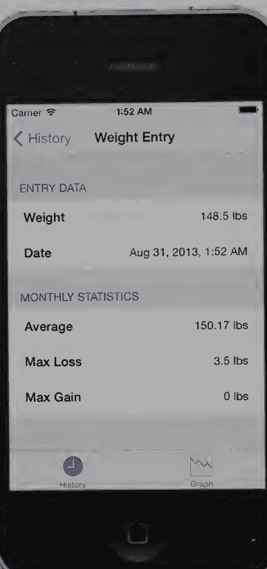

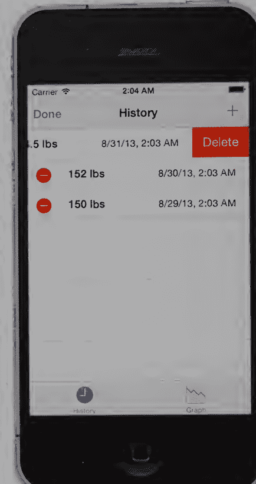

图 3.16 完成的详情视图

图 3.17 编辑模式

编辑按钮由系统提供。当点击该按钮时，它会将我们的表格进入编辑模式。运行应用并点击编辑按钮。删除图标会出现在我们的每一行之前。如果你点击其中一个，一个红色按钮会从右侧滑入（图 3.17）。然而，点击删除按钮并没有发生任何事情。

向下滚动，直到找到被注释掉的 `tableView:editingStyle:forIndexPath:` 方法。

当前的方法显示编辑样式，然后为每种样式留有一个占位符。如你所见，从编辑模式可以触发两种编辑样式：插入和删除。在我们的应用中，永远不会触发插入方法。要触发它，我们需要创建一个带有 `UITableViewCellEditingStyleInsert` 样式的行。我发现，除非你的表格只会显示有限数量的项目，否则添加一个“添加条目”行带来的麻烦得不偿失。我们在导航栏中的加号按钮工作得会更好，因为我们不需要担心它超出屏幕。

所以，我们只需要担心 `UITableViewCellEditingStyleDelete` 分支。

目前，它包含一行告诉我们从数据源中删除项目。然后它从表格中移除该行。实际上，我们只需要从数据源中删除项目。我们已经写了代码，每当数据源更改时都会更新表格。因此，按所示修改方法：

```objc
- (void)tableView:(UITableView *)tableView
committingEditingStyle:(UITableViewEditingStyle)editingStyle
forRowAtIndexPath:(NSIndexPath *)indexPath
{
    if (editingStyle == UITableViewCellEditingStyleDelete) {
        [self.weakHistoryDocument deleteEntryAtIndexPath:indexPath];
    }
    else if (editingStyle == UITableViewCellEditingStyleInsert) {
        // 创建相应类的新实例，
        // insert
        // 将其插入数组，并向表格视图添加一个新行
    }
}
```

再次运行应用。现在，当你删除行时，它们实际上从屏幕上被删除了。另外注意，这里有一个微小的 Bug。如果你在插入新行时恰好将表格切换编辑模式，可能会导致表格中出现空行。这很难触发，在正常使用期间不应该发生。在后面的章节中，我们将在加载和同步数据时禁用用户界面，这将防止该问题。

现在我们只需要添加我们的条目。

# 布局添加条目视图

打开 `Main.storyboard` 并放大到 `Add Entry View Controller` 场景。我们想从顶部添加一个标题开始。这是我们最复杂的布局，让我们分步进行。

拖出一个标签，并设置以下内容：

1. 使用标准值将左、右侧对齐 View，顶部对齐 Top Layout Guide。
2. 将其 Text 属性设置为 `Add a New Weight Entry`。
3. 文字居中对齐。
4. 将字体设置为 `Headline`。
5. 如必要，更新框架。

现在再画另一个标签。使用指南线将其放置在标题下方的右边距。给它以下设置：

1. 使用标准值将左侧对齐 View。
2. 选择两个标签之间的垂直空间约束。将其关系设置为 `Greater Than or Equal`。
3. 将标签的 Text 属性设置为 `Weight`。
4. 将字体设置为 `Subhead`。

由于我们的垂直约束现在是不等式的，我们需要更多约束来明确定义位置。在 Weight 标签和标题标签之间按住拖动。创建第二个垂直空间约束。选择新约束，并在属性检查器中设置如下：

1. 通过勾选 Standard 框设置 Constant。
2. 将关系设置为 `Less Than or Equal`。
3. 将优先级设置为 `250`。

第一个垂直约束意味着 Weight 标签距离 Headline 不会比标准距离近。第二个约束说它将尽可能靠近标准距离——但它的优先级相对较低，在必要时会让它更靠下。

接下来，画出一个文本框并将其放在 Weight 标签旁边。按如下所示：

1. 使用标准值将左侧对齐 Weight 标签，右侧对齐 View。
2. 在文本框和标题之间创建垂直约束，使用标准间距、`Greater Than or Equal` 和 `1000` 的优先级。
3. 在文本框和标题之间创建第二个垂直约束，使用标准间距、`Less Than or Equal` 和 `250` 的优先级。
4. 选择 Weight 标签和文本框。对齐它们的基线。
5. 将文本框的字体设置为 `Body`。
6. 将 Clear Button 属性设置为 `Appear while editing`。
7. 将 Keyboard 属性设置为 `Decimal Pad`。
8. 如必要，更新框架。

# 为键盘留出空间

点击文本字段会自动显示指定的键盘。系统会从底部向上滑动键盘，覆盖你内容的下半部分。这不会触发任何自动布局或自动调整尺寸行为（视图的大小保持不变，底部部分只是被覆盖了）。

我们需要确保用户能看到所选的文本字段并触到控件。这可能会产生问题，特别是在横屏模式下，因为键盘会覆盖屏幕的大部分。一种方案是刻意调整所有控件的位置，以便它们在横屏模式下仍然可见。然而，这有两个局限性：它会让视图看起来有些头重脚轻，而且只适用于简单的视图。

大多数情况下，你可能需要手动重新定位或调整控件的大小（通常使用滚动视图），以便使被选的控件可见。键盘会发送通知，你可以利用这些通知进行相应的修改：`UIKeyboardWillShowNotification`、`UIKeyboardDidShowNotification`、`UIKeyboardWillHideNotification` 和 `UIKeyboardDidHideNotification`。

如果你使用静态视图来布局表单，视图将根据需要自动滚动以避开键盘。如果我们在滚动视图内部使用自定义视图，我们必须自己编写这种行为。

对于 Health Beat 应用，我们的 `EditTextViewController` 在竖屏模式下运行良好。在横屏下，取决于字体大小，日期字段可能会被部分覆盖。我们将在下一章引入自定义过渡和动画时修复这个问题。

重复此过程以创建一个新的标签和文本字段对。这次，标签的文本应该是 `Date`。标签的两个垂直约束应该绘制在它和 Weight 标签之间，而 Date 字段的两个垂直约束应该绘制在它和 Weight 文本字段之间。此外，将 Date 的键盘设置为默认，并将其返回键更改为 `Done`。这将为我们标准键盘，但更改返回键的外观，使其更符合我们的应用。其他设置均相同。

为了让返回键关闭我们的键盘，请按住 Control 键点击第二个文本字段。然后从“Did End on Exit”事件拖动到 Add Entry View Controller，并在弹出的 HUD 中选择 `Editing`。

此时，我们的布局没有任何警告或错误。当我们从横屏旋转到竖屏时，视图将很好地调整。我们可以选择任何一个文本字段，并为每个字段获取不同的键盘。唯一的问题是，布局看起来有点奇怪。如果我们能轻松地硬编码这两个字段就太好了。

现在，我们可以很容易地硬编码一个值——但由于我们在使用自动布局，让我们做一些更动态的吧。我们将修改标签和文本字段之间的水平约束，类似于我们之前设置成对垂直约束的方式。这将让我们的布局具有适应性，即使我们更改标签的文本。这可能非常有用，例如将文本翻译成其他语言。

让我们从让文本字段具有等宽开始。选择两个文本字段。在 Pin 工具中，勾选 Equal Widths，并创建约束。

现在，开始处理 Weight 标签和文本字段。

1. 选择标签和文本字段之间的水平间距约束。


- 2. 将其 `Relationship`（关系）设置为大于等于（`Greater Than or Equal`）。确保其 `Constant`（常量）设置为标准值。
- 3. 创建第二个水平约束。
- 4. 选择新约束并将其 `Relationship` 设置小于等于（`Less Than or Equal`）。
- 5. 将其 `Constant` 设置为标准值。
- 6. 将其 `Priority`（优先级）设置为 250。
- 7. 选择文本字段。在 `Size inspector`（尺寸检查器）中，将 `Content Hugging priority`（内容收缩优先级）设置为 100。

这带我们得到了结果。文本字段和标签之间的垂直空间有一个固定的最小尺寸，但可以更大。然而，文本字段的约束优先级较低，因此如果可能，它会先调整大小。对 `Date` 标签和文本字段重复这些步骤，调整视图控制器中所有的帧。这应该为我们提供一个没有警告或错误的无歧布局。文本字段应该完美对齐，并与我们的 `Weight` 标签保持 8 点距离——`Date` 标签和文本字段之间的距离稍长。当你运行应用时，它应该很好地旋转。

让我们在屏幕底部添加 `Save`（保存）和 `Cancel`（取消）按钮。通常，你希望更安全的选项靠近右下角。这只是概率问题。大多数人用右手持手机。右下角的按钮最容易被不小心按下。在我们情况下，取消比保存更安全，所以它放在右侧。

画出两个按钮。将一个与左下角的辅助线对齐。将另一个与右下角的辅助线对齐。将左按钮的标题设置为 `Save`，右按钮的标题设置为 `Cancel`。

然后设置以下内容：

- 1. 将 `Save` 按钮的左侧固定到 `View`，右侧固定到 `Button`，底部使用标准间距固定到 `Bottom Layout Guide`。
- 2. 将 `Cancel` 按钮的右侧固定到 `View`，底部使用标准间距固定到 `Bottom Layout Guide`。
- 3. 选择两个按钮，并将它们的宽度固定相等。
- 4. 更新所有帧（`frames`）。

按钮现在将自动调整大小以填充屏幕底部，并在它们之间留出良好的间距。运行应用并确保一切看起来正常。

注意：我们刻意使用大量的约束创建了一个高度动态的布局。这种方法的优点是当我们的任何用户元素发生变化时，会自动调整它们的相对大小。然而，我们可以通过减少数量来简化约束。

### 更新文本字段

接下来我们想在视图出现时更新用户界面。就像 `EntryDetailViewController` 一样，让我们创建一个 `updateUI` 方法来执行实际工作。将此代码添加到 `AddEntryViewController.m` 的底部。

```objc
#pragma mark - Private Methods

- (void)updateUI
{
    [self updateWeightText];
    [self updateDateText];
    [self enableSaveButton];
}
```

更新逻辑变得有点复杂，因此我们将拆分为三个独立的函数。让我们它们作为私有方法添加。

```objc
- (void)updateWeightText
{
    if (self.weight == 0.0)
        self.weightTextField.text = @"";
    else
        self.weightTextField.text = [NSNumberFormatter localizedStringFromNumber:(self.weight) numberStyle:NSNumberFormatterDecimalStyle];
}
```

`updateWeightText` 方法只是检查我们的重量是否设置为 `0.0`。如果是，它会清除文本字段。如果不是，它将使用数字格式化器填充。

```objc
- (void)updateDateText
{
    if (self.date == nil)
        self.dateTextField.text = @"";
    else
        self.dateTextField.text = 
        [NSDate
        localizedStringFromDate:self.date
        dateStyle:NSDateFormatterMediumStyle
        timeStyle:NSDateFormatterShortStyle];

    self.dateTextField.textColor = 
    [UIColor blackColor];
}
```

`updateDateText` 方法非常相似。在这里，我们检查日期属性是否为 `nil`。

如果是，我们使用中等日期格式和短时间时间格式来清除日期文本字段。我们还将日期字段的文本颜色设置为黑色。稍后我们会更改文本颜色——这一行确保了在我们有有效日期时，文本颜色会重置为默认颜色。

```objc
- (void)enableSaveButton
{
    BOOL enabled = YES;
    enabled &= !([self.weightTextField.text isEqualToString:@""]);
    enabled &= !([self.dateTextField.text isEqualToString:@""]);
    self.saveButton.enabled = enabled;
}
```

此方法计算重量和日期文本字段是否都有有效输入。

如果两者都有有效数据，则启用保存按钮。如果没有，则禁用该按钮。这防止了用户在没有没有有效重量和日期的情况下保存数据。

现在只需要调用所有这些方法。在 `viewDidLoad` 之后，添加 `viewWillAppear:` 方法：

```objc
- (void)viewWillAppear:(BOOL)animated
{
    [super viewWillAppear:animated];
    [self updateUI];
    [self.weightTextField becomeFirstResponder];
}
```

在这里，简单地调用我们新写的 `updateUI` 方法。然后我们调用重量字段的 `becomeFirstResponder` 方法。这将我们的文本字段设置为第一响应者状态，使其能够接收键盘事件。它还会显示键盘。

### 第一响应者 (FIRST RESPONDER)

我们在第 1 章中简单讨论过响应者（`responders`）。我们的应用程序使用响应链来响应事件。要参与响应链，对象必须是 `Responder` 的子类。所有的视图、视图控制器、应用程序甚至 app delegate 都是 `UIResponder` 的子类（直接或间接）——因此它们都可以成为响应链的一部分。

对于触摸事件，程序非常简单。我们对被点击的顶层视图进行命中测试。该视图要么处理事件，要么将事件传递给响应链。响应链随后将事件从视图传递给父视图，必要时跳转到视图的控制器，直到到达窗口、应用程序和 app delegate，这给了我们决定在何处如何处理事件的自由。我们可以在视图中、在视图级别或 app delegate 级别处理它们。

第一响应者（`First Responder`）是一个相关话题。与触摸事件不同，没有办法可以计算键盘或运动事件应该如何。相反，通过 `becomeFirstResponder` 和 `resignFirstResponder` 来选择这些事件的第一响应者。

大多数时候，我们会在文本字段和视图上调用这些方法。`becomeFirstResponder` 选择文本字段，将光标置于文本字段中并弹出键盘。它还将将文本字段设置为任何键盘或运动事件的第一响应者。`resignFirstResponder` 则取消文本字段的选择并关闭键盘。

并不是所有的 `UIResponder` 子类都会成为第一响应者。另外两个方法决定第一响应者状态：`becomeFirstResponder` 和 `resignFirstResponder`。默认情况下，`becomeFirstResponder` 返回 `NO`，而 `resignFirstResponder` 返回 `YES`。显然，`UITextField` 和 `UITextView` 重写了 `becomeFirstResponder` 以返回 `YES`。然而，仅此是不够的。如果我们想启用简单的文本输入，我们的视图还必须采用 `UIInput` 和 `UITextTraits` 协议。

运行应用并进入场景。日期文本字段应该填充了当前日期和时间。重量文本字段应该是空的，但正在输入文本。键盘应该是可见的。我们看不到保存按钮，但如果它是禁用的，至少在我们输入数据之前如此。

然而，显然我们需要某种方式来关闭键盘。通常，我喜欢在用户点击返回键（`Return key`）时关闭键盘——然而，我们的数字键盘没有返回键。我们必须在 `inputAccessView` 中添加自己的按钮。

# 添加输入视图 (ADDING AN INPUT VIEW)

`UIResponder` 定义了两个输入属性：`inputView` 和 `inputAccessoryView`。`inputView` 是响应者将作为自定义键盘显示的视图。如果将其设置为 `nil`，响应者将仅显示默认键盘。`inputAccessoryView` 位于键盘上方。通常这是一个带有一个或多个按钮的工具栏。如果将其设置为 `nil`，系统将不会显示辅助视图。这两个属性默认都设置为 `nil`，并且在 `UIResponder` 中定义为只读。

幸运的是，对于 `UITextView` 和 `UITextField`，这些属性被重新声明为可读写。这让我们能够轻松地设置自己的自定义键盘或键盘辅助视图。

对于此项目，我们将添加一个简单的键盘辅助视图。我想在 Interface Builder 中布局辅助视图。它不是 storyboard 的一部分——我们不能在 storyboard 中拥有悬浮的视图。但是，我们可以在 nib 文件中拥有它们。所以，让我们从向项目添加一个新的 nib 文件开始吧。

在项目导航器中右键点击 `Controllers` 组，选择 `New File...` -> `iOS User Interface` -> `Empty`，然后点击 `Next`。将 `Device` 设置为 `iPhone`。再次点击 `Next`。将其命名为 `AddEntryAccessory` 并点击 `Create`。

我们将创建一个空的 nib 文件。编辑 storyboard 时，用户界面会有所不同。文档大纲（`Document Outline`）消失了。相反，我们有一个停靠栏（`dock`），但它不是显示 storyboard 中的所有场景，而是显示此特定 nib 中的项目。现在我们只有占位符对象：我们在第 1 章中讨论过的第一响应者和文件所有者（`File's Owner`）。

`File's Owner` 存在于世界之外。它不是由 nib 创建的。它已经存在于代码中，并充当代码与 nib 中对象之间的桥梁。选择 `File's Owner` 图标。如有必要，可以展开停靠栏查看图标名称。切换到标识检查器（`Identity inspector`）。它目前设置为 `NSObject`。让我们将其自定义类改为 `AddEntryViewController`。遗憾的是，Xcode 没有正确更新下拉菜单中的类列表。如果 `AddEntryViewController` 不在列表中，你可以手动输入（由于自动完成的“帮助”可能会有点困难），或者你可以关闭项目并重新打开。这将强制 Interface Builder 正确更新其类列表。

此设置没有任何变化。正如我之前提到的，`File's Owner` 在 nib 加载之前已经存在。然而，通过告诉 Interface Builder `File's Owner`，我们能够设置动作（`actions`）和输出（`outlets`）。

这看起来可能有些奇怪。我们的 `ViewController` 现在与至少两个 nib 文件关联。storyboard 会至少创建一个 nib 文件，它将布局视图的大部分内容。我们的新 nib 文件加载辅助视图——这些不是 storyboard 的一部分，但仍与控制器关联。只要两组输出之间没有重叠，就没有问题。我们可以分别加载 storyboard 和 nib。

接下来，从对象库拖入工具栏并将其放在编辑器中。我们可以在 nib 中看到工具栏作为一个顶级对象。

### 图 3.18

我们的辅助视图


在这里，我们首先将重量字段的文本转换为浮点值，并将其赋值给我们的重量。然后，我们更新用户界面并撤回第一响应者状态——即隐藏键盘。

现在，由于我们使用的是一个高度限制的键盘，用户的输入几乎总是有效的浮点数。用户唯一可能搞砸的地方就是小数点。从理论上讲，他们可能会输入类似 `...04.20.32` 的内容。`parseFloat` 会尽力解释用户输入的任何内容，它只会简单地返回 `0.0`。由于我们会立即更新用户界面，如果它无法识别这些乱码，它会导致文本字段清空，从而明显地提示用户需要重试。

```objc
- (void)dateEditingDone
{
    [self updateUI];
    [self.textField resignFirstResponder];
}
```

日期编辑方法更加简单。在这里，我们只需要更新 UI 并隐藏键盘。我们就完成了吗？其实并没有。输入日期是一项相当复杂且困难的任务。我们稍后会处理它。

现在，让我们将输入辅助视图添加到文本字段中。如下面所示，添加另一个私有方法：

```objc
- (void)setupInputAccessories
{
    UINib *nib = [UINib nibWithNibName:@"AddEntryAccessory" bundle:nil];

    [nib instantiateOwner:self options:nil];

    Assert(self.accessoryToolbar != nil, @"we should have a valid input accessory toolbar");
    Assert(self.weightTextField != nil, @"we should have a valid weight text field");
    Assert(self.dateTextField != nil, @"we should have a valid date text field");

    self.weightTextField.inputAccessoryView = self.accessoryToolbar;
    self.dateTextField.inputAccessoryView = self.accessoryToolbar;
}
```

### 图 3.19

我们的辅助视图

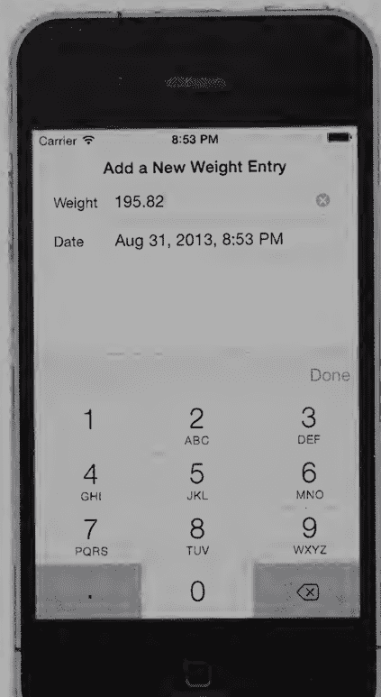

我们首先为 nib 文件创建一个 `UINib` 对象。然后加载该 nib，并将 `self` 作为文件的所有者（`File's Owner`）。加载 nib 文件有多种方法。这种方法的优点是可以缓存 nib 的内容。这对我们应用程序的速度或内存占用可能不会产生影响——但在应用程序生命周期内，我们可能会多次加载该 nib。我们不妨缓存它。

接下来，我们有一系列断言（`asserts`）——我们只是想验证辅助栏和文本字段都存在。如果其中任何一个失败，它们将抛出异常并导致应用崩溃。

最后，我们将新的工具栏分配给文本字段的 `inputAccessoryView` 属性。我们只需要在 `viewDidLoad` 中调用此方法。在 `viewDidLoad` 结束的大括号之前，在我们分配单位之后，添加以下行。

```objc
[self setupInputAccessories];
```

现在运行应用。当你拿出“添加条目”（`Add Entry`）视图时，我们的新辅助栏应该出现在键盘上方（图 3.19）。尝试输入一个有效重量并点击“完成”（`Done`）按钮。键盘应该消失，“保存”按钮将启用。尝试输入一个无效重量或清除日期。保存按钮将被禁用。

## 输入日期

我们将如何让用户输入日期呢？我们可以强制他们输入特定格式的日期字符串——但这并不能友好的用户界面。或者，我们可以将默认键盘替换为日期选择器，并直接从选择器中获取结果。这种方法效果良好——但实际上有一个我更喜欢的方法。

Foundation 框架提供了一个非常强大的检测工具。`NSDataDetector` 是 `NSRegularExpression` 的子类。它设计用于检测文本中广泛的数据元素。例如，我们可以用它检测电话号码、地址、超链接、航班号甚至日期。

我们将使用数据检测器在用户的字符串中寻找日期。如果该字符串是日期字符串，我们将使用它来计算日期。如果不是，我们将文本显示为红色，并将“完成”按钮的标题改为“取消”（`Cancel`）。如果用户按下“取消”，我们将日期重置为上次选择的日期和时间。

由于我们要更改“完成”按钮的文本，我们需要该按钮的输出（`outlet`）。打开 `AddEntryAccessory.xib` 并在助手编辑器中添加。从“完成”按钮按 `Control` 拖拽，在 `AddEntryViewController.m` 的类扩展中创建该输出。

```objc
@property (weak, nonatomic) UIButton *accessoryButton;
```

回到标准编辑器，再次打开 `AddEntryViewController.m`。让我们添加几个额外的私有方法。第一个方法将判断一个字符串是否是格式正确的日期字符串。


```objc
(NSDate *)dateString:(NSString *)dateString {

    Error *dateDetectionError;
    NSDataDetector *dateDetector = [NSDataDetector dateDetectorWithTypes:NSTextCheckingTypeDate error:&dateDetectionError];

    // 修剪字符串开头或结尾的任何空格
    dateString = [dateString stringByTrimmingCharactersIn:[CharacterSet whitespaceAndNewlineCharacterSet]];

    NSRange allText = NSMakeRange(0, [dateString length]);

    NSTextCheckingResult *result = [dateDetector firstMatchInString:dateString options:0 range:allText];

    // 如果我们的字符串是日期字符串，返回日期
    if (NSEqualRanges(result.range, allText)) {
        return result.date;
    }

    // 如果不是，返回 nil
    return nil;
}

(void)setStatusFor:(NSString *)dateString {

    if ([dateString isEqualToString:@""]) {
        self.textField.textColor = [UIColor redColor];
        self.accessoryDoneButton.title = @"Cancel";
        return;
    }

    if ([self dateFromString:dateString]) {
        self.textField.textColor = [UIColor textColor];
        self.accessoryDoneButton.title = @"Done";
    } else {
        self.textField.textColor = [UIColor redColor];
        self.accessoryDoneButton.title = @"Cancel";
    }
}
```

第二个 `UITextFieldDelegate` 方法是在每当点击清除按钮时，将“完成”按钮的标题设置为“取消”。

最后，对你的 `dateEditingDone` 方法进行以下更改。

```objc
(void)dateEditingDone
{
    NSString *date = [self dateFromString:self.dateTextField.text];

    if (date) {
        self.date = date;
    }

    [self updateUI];
    [self.dateTextField resignFirstResponder];
}
```

在这里，首先从我们文本字段的文本中获取日期。如果我们有一个有效日期，我们就将其赋值给 `self.date`。然后，我们像之前一样更新 UI。

运行应用程序并尝试输入不同格式的日期值。你可以使用 `mm/dd/yy` 格式。你可以输入单词或缩写。你可以使用诸如“today in the morning”（今天上午）或“yesterday afternoon”（昨天下午）这样的短语。

它非常强大且相当惊人。不过并不完美。我可能会添加几个预处理步骤。例如，我希望它能检测到“now”（现在）这个短语。但我会把它留给读者作为练习。

## 添加单位按钮

现在，让我们添加一个按钮来更改单位。然而，不是仅仅将按钮添加到屏幕的任何地方，而是将其放在重量文本字段中。让按钮在磅和公斤之间切换。

让我们开始创建按钮。我们需要一个不属于任何现有视图层次结构的按钮。我们可以通过编程创建它——但同样，我喜欢尽可能地使用 Interface Builder。就像输入辅助视图一样，我们不能在 storyboard 中拥有悬浮的按钮——但我们可以把它放在 nib 文件中。

方便的是，我们已经有一个包含正确视图控制器的 nib 文件。打开 `AddEntryAccessor`。从库中拖入一个按钮并放置在我们标签栏的某个地方。将其标题更改为 lbs。切换到尺寸检查器，将其高度更改为 17 点，宽度更改为 25 点。

现在，打开辅助编辑器，并将我们的新按钮拖到 `AddEntryViewController.m` 的类扩展中。添加一个新的 outlet，所示：

```objc
@property (strong, atomic) IBOutlet UIButton *unitButton;
```

现在，当我们的 nib 加载时，按钮将自动分配给这个 outlet。然而，我们还希望按钮触发一个动作。再次 Control-拖，但这次向下拖到 Action 方法的底部。创建以下 action：

```objc
- (IBAction)unitButtonTapped:(id)sender {
}
```

切换回标准编辑器并添加 `WeightEntryViewController.m`。在文件顶部导入 `WeightEntry.h`。然后在 `setupInputAccessories` 的结尾，紧接其结束括号之前添加以下代码。

```objc
NSString *unitString = [WeightEntry stringForUnit:self.units];
[self.unitButton setTitle:unitString forState:UIControlStateNormal];
self.weightTextField.rightView = UITextFieldModeAlways;
self.weightTextField.rightView = self.unitButton
```

我们首先获取当前单位的字符串。然后将该字符串设置为按钮的标题。最后，我们设置字段始终显示我们的按钮，并将按钮添加到文本字段的右侧。

现在，按照所示实现 `unitButtonTapped`：

```objc
- (IBAction)unitButtonTapped:(id)sender {
if (self.units == LBS) {
    self.units = KG;
} else {
    self.units = LBS;
}
```

```objc
NSString *unitString = [WeightEntry stringForUnit:self.units];
[self.unitButton setTitle:unitString forState:UIControlStateNormal];
}
```

我们只是在检查 `self.unit` 的当前值，并在时将其从 LBS 切换到 KG 或从 KG 切换到 LBS。然后我们更新按钮标题以匹配。

运行应用程序。现在你应该能够点击单位按钮在 lbs 和 kg 之间切换（图 3.20）。

## 图 3.20 添加单位按钮

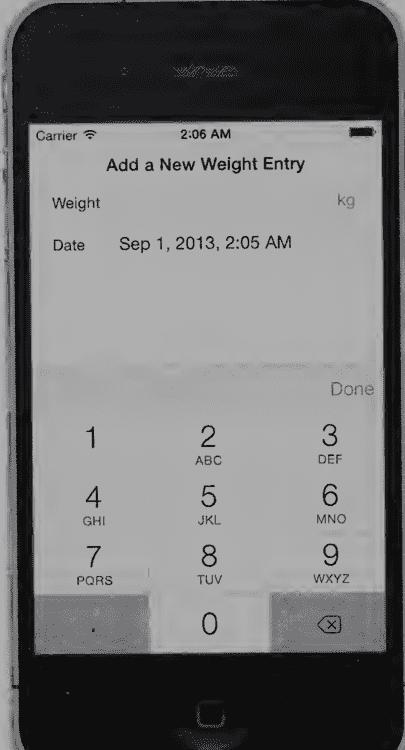

### 表 3.4 控制状态

| 状态 | 触发条件 |
| --- | --- |
| `UIControlStateNormal` | 默认控制状态。 |
| `UIControlStateHighlighted` | 高亮状态通常用于在触摸时更改控件的外观。此状态在触摸进入和离开控件时自动设置和清除。我们的应用程序也可以通过 `highlighted` 属性访问此状态。 |
| `UIControlStateSelected` | 通常，此状态对控件的外观没有影响；然而，像 `UISwitch` 这样的控件会在开启和关闭状态之间切换时使用它。可以通过控件的 `selected` 属性访问此状态。 |
| `UIControlStateDisabled` | 此状态通常使用控件的 `enabled` 属性设置。当禁用时，控件不响应触摸事件。许多控件在禁用时也会改变其外观。 |

174 第 3 章 开发视图和视图控制器

## UICONTROLS 与状态

`setTitle:forState:` 和 `setTitleColor:forState:` 都引用按钮的状态。每个控件都有状态：正常、高亮、选中或禁用。不同的动作可以改变状态（见表 3.4）。我们的按钮只使用了两种。触摸时为高亮状态；否则是正常的。

在设置每个状态时，我们希望回到场景。这意味着我们可以移动到我们想要的任何地方。要做到这一点，我们必须在想要返回的场景的视图控制器中创建取消动作。

由于我们要返回历史视图，打开 `HistoryViewController.m`。首先导入 `AddingViewController.h`。然后在导航方法之后添加以下方法。

```objc
#pragma mark - Storyboard 取消方法

- (IBAction)addNewEntrySaved:(UIStoryboardSegue*)segue
{
    AddEntryViewController *controller = segue.sourceViewController;

    WeightEntry *entry = [WeightEntry entryWithWeight:controller.weight usingUnits:controller.units date:controller.date];

    [self.weightHistoryDocument addEntry:entry];
}

- (IBAction)addNewEntryCanceled:(UIStoryboardSegue*)segue
{
    // 我们不需要做任何事情。
}
```

这些方法与我们其他的 action 方法完全一样，只是接受一个 `UIStoryboardSegue` 参数。保存方法创建一个新的 `WeightEntry` 实例，从我们的添加条目获取重量、单位和日期值。然后将其条目添加到权重历史文档中。修改文档会触发通知，这将更新我们的表格视图。

取消方法不需要做任何事情。一旦我们回到此场景，我们就完成了。

让我们将这些方法连接到按钮上。再次打开 `Main.storyboard`。我们仍然想处理添加条目视图控制器场景。从保存按钮拖拽到场景 dock 中的退出图标。当你松开时，你将看到我们新的 segue 取消操作将以选项的形式出现在弹出 HUD 中。选择 `addNewEntrySaved()`。对 Cancel 按钮执行相同的操作，但选择 `addNewEntryCancelled()`。

现在，运行应用程序。尝试添加一个新的重量条目并点击 Save。新条目显示在 History 视图的顶部。再次尝试，这次点击 Cancel。你返回到了历史视图，但什么都没有变化。

有了这些代码，我们不再需要更多数据了。用户现在可以输入自己的数据了。当然，数据在程序退出时会被删除——但我们将在第 5 章“加载和保存数据”以及第 7 章“Core Data”中查看这些数据。

打开 `RootViewController.m`。导航到 `addData` 方法，并将其注释掉。你可以选择整个方法并输入 `//` 来注释掉所有高亮代码。然而，这会导致错误。要修复它，我们还需要向上滚动到 `viewDidLoad` 方法并注释掉以下行：

```objc
// [self addData];
```

## 动态类型

动态类型解决了三个问题：

1. 它提供了一种为所有应用设置字体大小的方法。任何支持动态类型的应用程序将根据用户的请求自动调整字体大小。
2. 在大字号下看起来良好的字体，在缩小到小字号时通常很难看。同样，在字号较小时清晰易读的字体，在放大后往往显得太重。为了解决这个问题，动态类型使用了一系列相似字体，每种字体都针对特定大小进行了调整。它返回的精确字体取决于用户的字体设置以及请求的特定样式。
3. 动态类型声明了许多不同的字体样式：headline（标题）、subtitle（副标题）、body（正文）、footnote（脚注）、caption1 和 caption2。通过根据字体在用户界面中的预期用途声明字体，我们应该能够在跨应用程序中创建更一致的视觉效果。

遗憾的是，动态类型中的“动态”指的是根据用户选择的大小和样式动态选择的字体。当用户更改字体选择时，这些字体不会动态更新。事实上，我们需要支持 `UIContentSizeDidChangeNotification`，并在用户每次更改字体设置时更新所有字体。

我们需要在应用程序启动时更新字体，以获取用户指定的内容尺寸。我们还需要监听 `UIContentSizeDidChangeNotification`，并在用户每次更改字体设置时更新所有字体。

对于大量文件来说，这可能是一项巨大的工作。然而，我们可以使用 Objective-C 的小技巧来稍微简化它。首先，我们不想强制每个视图控制器都去观察 `UIContentSizeDidChangeNotification`。相反，让 app delegate 来处理变化。当变化发生时，我们向视图控制器层级发送消息。遗憾的是，为了让它真正生效，我们需要向 `ViewController` 类中添加新方法——我们所有的控制器都将继承这些方法。幸运的是，在 Objective-C 中这相对容易。我们只需要使用分类。

# 动态类型的现状

动态类型是 iOS 7 的新功能之一。在我写这些内容时，它看起来像是一个很有前景的功能，但仍然需要进一步完善。

拥有一组经过深思熟虑、语义化的类型样式可以成为一种强大且统一的设计工具。遗憾的是，动态类型目前提供的样式范围非常有限。显然，对于所有的布局需求，我们只需要一种 headline 和一种 subhead 类型。更糟糕的是，某些字体看起来很难理解。例如，为什么 Body 字体比 Subhead 大？

此外，Apple 尚未就何时以及如何使用这些字体提供任何明确的指导。我们应该将它们用于所有的用户界面元素吗？还是将它们留给相对较大的文本块——如图像、社交媒体消息和电子书？

随着时间的推移，我确定我们会看到这个功能扩展，其意图将变得明确，也许还会实现自动化。我迫不及待想看到随着更多开发者的适应，它的用法将如何演变。现在，我怀疑许多人会完全采取我写这本书时所做的事情：很大程度上根据外观选择几种类型，而不是担心它们在应用程序中的预期角色。遗憾的是，这意味着每个开发者的使用方式可能都不同，导致整个操作系统看起来有些杂乱无章。

让我们从在 `ViewController` 上创建一个分类开始。在 Project 导航器中按住 Control 点击 Controller 组，并选择 New File... > iOS > Cocoa Touch > Objective-C Category。将 Category 设置为 `HBTUpdateFonts`，并将 "Category" 设置为 `ViewController`。点击 Next，当下一个表单出现时，点击 Create。

`UIViewController+HBTUpdateFonts.h`：如下所示声明我们的新方法：

```objc
@interface ViewController (HBTUpdateFonts)
- (void)HBT_updateFonts;
@end
```

记住，在使用分类时，我们应该始终为我们的方法添加前缀。Apple 正在迅速用光他们 own 框架所有的好的双字母前缀，我更倾向于使用三字母前缀。遗憾的是，HBT 是我为 Health Beat 想出的最好的三字母前缀。很抱歉。

## 第 3 章 开发视图和视图控制器

现在，让我们切换到 `ViewController+HBTUpdateFonts.m` 并实现此方法。

```objc
-(void)HBT_updateFonts
{
  for (UIViewController *controller in self.childViewControllers) {
    [controller HBT_updateFonts];
  }

  if (self.presentedViewController.presentingViewController == self) {
    [self.presentedViewController HBT_updateFonts];
  }
}
```

这将成为所有视图控制器的默认实现。它简单地遍历所有子控制器并调用 `HBT_updateFonts`。它还会检查是否存在呈现视图控制器，并对其调用 `HBT_updateFonts`。

这里的代码有点奇怪，但由于视图呈现的方式，它是重要的。当你调用 `presentViewController:animated:completion:` 或使用模态转场时，系统将从当前视图控制器开始搜索呈现上下文。如果它返回 `NO`，它将沿视图控制器层级移动，并在每个控制器上调用 `definesPresentationContext`。

默认情况下，`definesPresentationContext` 返回 `NO`。这意味着当你在 History 场景中点击加号按钮时，HistoryTableView 并没有实际呈现我们的 Entry 场景。实际上一直追溯到我们的标签控制器。


同样，`presentedViewController` 返回由当前控制器或任何祖先呈现的视图控制器。在我们的情况下，如果显示了 Add Entry 场景，`RootTabBarController`、`UINavigationController` 和 `HistoryCollectionView` 将返回我们的 `UIStoryboard` 对象作为 `presentedViewController`。

因此，我们不能直接使用 `presentedViewController` 的值。相反，我们使用了一个小技巧。我们询问呈现该视图的控制器。如果此值匹配当前视图，我们就找到了呈现上下文。这才是真正呈现我们场景的控制器。我们还将让它更新呈现视图控制器的字体。

此外，我们将此方法模型化为在视图控制器层级中传递的其他方法。默认实现什么都不做。我们可以在自己的类中重写此方法以执行特定操作；然而，当我们重写它时，必须在实现的某处调用 `super`。这正是 `initWith:operate` 等方法的方法。

一如既往，每当我们注册通知时，也需要确保进行取消注销。添加以下 `dealloc` 方法：

```objc
- (void)dealloc
{
  if (self.fontChangeObserver) {
    [[NSNotificationCenter defaultCenter] removeObserver:self.fontChangeObserver];
  }
}
```

严格来说，这并不是必须的。我们的 app delegate 应该在应用程序的整个生命周期内都存在。但这仍然是一个值得养成的好习惯。如果你开始走捷径，当你更新它们的字体时可能会忘记它吗？我们已经使用了动态字体（Dynamic Type）设置器。

那么，哪些类需要更新字体呢？在我们的历史列表（History Table）、项目详情（Entry Detail）和添加条目（Add Entry）场景中。

## 更新历史列表字体

让我们从历史列表开始。打开 `HistoryViewController.m` 并所示修改 `configureCell:forIndexPath:` 方法：

```objc
- (void)configureCell:(History *)cell forIndexPath:(NSIndexPath *)indexPath
{
  WeightEntry *entry = 
  [self.weightHistoryDocument entryAtIndexPath:indexPath];
  cell.weightLabel.text = 
  [entry stringForWeightInUnit:getgetDefaultUnits()];
  cell.dateLabel.text = [NSFormatter localizedStringFromDate:entry.date date:NSDateFormatterShortStyle timeStyle:NSDateFormatterShortStyle];

  cell.weightLabel.font = [UIFont preferredFontTextStyle:UIFontTextStyleHeadline];

  cell.dateLabel.font = [UIFont preferredFontTextStyle:UIFontTextStyleSubheadline];
}
```

`preferredFontForTextStyle:` 方法会根据用户当前的设置，为请求的样式返回正确的动态字体。

图 3.21 使用新字体大小的单元格

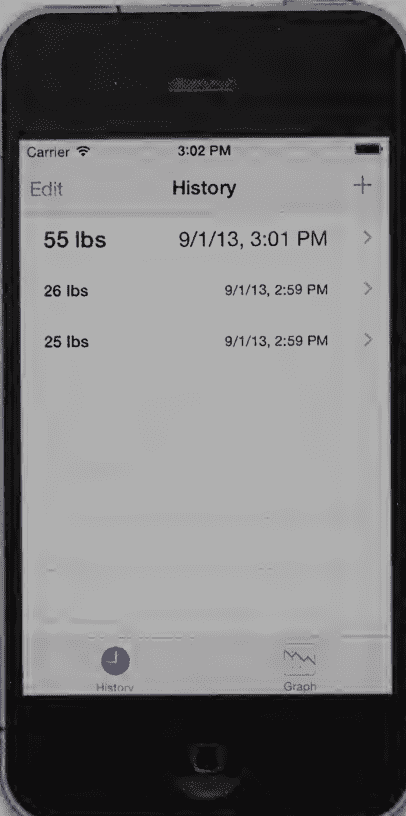

再次运行应用程序。创建几个条目。到目前为止，一切看起来都一样。按下主键（模拟器中的 ⌘）并打开设置。在通用 > 文字大小 中，更改文本大小。返回你的应用，你会发现什么都没有发生。然而，创建一个新条目，它将以新选择的字体大小出现（图 3.21）。

我们正在使用用户指定的字体——但在设置更改时，我们并没有更新界面。在 `HealthViewController.m` 的顶部，导入我们的 `HBTUpdateFonts` 分类。然后在 `didReceiveMemoryWarning:` 对应的下方添加以下方法：

```objc
- (void)HBTupdateFonts
{
    [super HBT_updateFonts];
    [self.tableView reload];
}
```

这只是重新加载了我们的表格。现在，如果你运行应用，就可以切换字体，表格会自动响应并更新。

## 更新添加条目场景的字体

在添加条目场景中，我们需要更新两个文本字段以及三个标签的字体。我们已经有了文本字段的输出（outlets），但我们需要为标签添加输出。打开 `Main.storyboard`。切换到助手编辑器（Assistant editor），并 Control-拖拽将以下内容拖出 `AddEntryViewController.m`

```objc
@property (weak, nonatomic) UILabel *titleLabel;
@property (weak, nonatomic) UILabel *weightLabel;
@property (weak, nonatomic) UILabel *dateLabel;
```

切换回标准编辑器并打开 `AddEntryViewController.m`。在顶部导入 `HBTUpdateFonts` 分类。接下来，我们需要在视图首次出现以及接收更新通知时更新字体。由于我们将在两个地方使用相同的代码，让我们创建一个私有方法来处理实际更新。

在 `updateDateText:` 下方添加以下方法：

```objc
- (void)updateFonts {

  self.titleLabel.font = 
  [UIFont preferredFontTextStyle:UITextStyleHeadline];

  self.weightLabel.font = 
  [UIFont preferredFontTextStyle:UITextStyleSubheadline];

  self.dateLabel.font = 
  [UIFont preferredFontTextStyle:UITextStyleSubheadline];

  self.weightTextField.font = 
  [UIFont preferredFontTextStyle:UITextStyleBody];

  self.dateTextField.font = 
  [UIFont preferredFontTextStyle:UITextStyleBody];
}
```

这会遍历并将我们所有的字体设置为使用动态字体。注意，我们使用的样式与在 Interface Builder 创建界面时使用的样式相同。现在，我们只需要调用这个方法。在 `didReceiveMemoryWarning:` 下方重写 `HBT_updateFonts`：

```objc
- (void)HBT_updateFonts {

  [super HBT_updateFonts];
  [self updateFonts];
}
```

并在 `viewWillAppear` 中添加以下行：

```objc
- (void)viewWillAppear:(BOOL)animated
{
  [super viewWillAppear:animated];
  [self updateFonts];
  [self updateUI];
  [self.weightTextField becomeFirstResponder];
}
```

搞定了。运行应用程序并确保此场景按预期更新其字体和布局。

## 更新项目详情场景的字体

我们的条目详情场景有五个标签和五个文本字段。它们都需要更新。幸运的是，通用步骤与我们的添加条目场景相同。

我们已经有了所有文本字段的输出，所以让我们开始为标签添加输出。创建以下输出：

```objc
@property (weak, nonatomic) UILabel *weightLabel;
@property (weak, nonatomic) UILabel *dateLabel;
@property (weak, nonatomic) UILabel *averageLabel;
@property (weak, nonatomic) UILabel *lossLabel;
@property (weak, nonatomic) UILabel *gainLabel;
@property (weak, nonatomic) UILabel *weightTextField;
@property (weak, nonatomic) UITextField *dateTextField;
@property (weak, nonatomic) UILabel *averageTextField;
```

现在打开 `EntryDetailViewController.m` 并导入 `HBTUpdateFonts` 分类。然后添加以下方法：

```objc
- (void)updateFonts {

  self.weightLabel.font = 
  [UIFont preferredFontTextStyle:UITextStyleHeadline];

  self.dateLabel.font = 
  [UIFont preferredFontTextStyle:UITextStyleSubheadline];

  self.averageLabel.font = 
  [UIFont preferredFontTextStyle:UITextStyleSubheadline];

  self.lossLabel.font = 
  [UIFont preferredFontTextStyle:UITextStyleSubheadline];

  self.gainLabel.font = 
  [UIFont preferredFontTextStyle:UITextStyleSubheadline];

  self.weightTextField.font = 
  [UIFont preferredFontTextStyle:UITextStyleBody];

  self.dateTextField.font = 
  [UIFont preferredFontTextStyle:UITextStyleBody];

  self.averageTextField.font = 
  [UIFont preferredFontTextStyle:UITextStyleBody];
}
```

在 `didReceiveMemoryWarning:` 下方重写 `HBT_updateFonts`：

```objc
- (void)HBT_updateFonts {

  [super HBT_updateFonts];
  [self updateFonts];
}
```

并在 `viewWillAppear` 中添加以下行：

```objc
- (void)viewWillAppear:(BOOL)animated
{
  [super viewWillAppear:animated];
  [self updateFonts];
}
```

## 自定义外观

最后，让我们对应用程序的外观进行细微更改。最初，在应用程序中，我们更改外观的能力是有限的。是的，我们可以设置视图的 `backgroundColor`。但如果我们想更进一步，我们需要自定义控件。

随着 iOS 5，Apple 引入了 UIKit。这是一种自定义外观的简单方法。它包含两个部分：首先，它为类增加了许多方法，让我们直接修改外观。例如，`tint:` 和 `tintColor:`。其次，外观代理允许我们对类的实例、甚至是给定视图内的类实例进行这些更改。

惊讶的是，随着 iOS 7 剧的 UI 变化，许多 `UIAppearance` 方法不再起作用——在调用它们之前，务必仔细阅读文档。

最近，`tintColor` 方法变得非常突出。以前，`tintColor` 被少数控件用于设置某种颜色——但现在，它被添加为 `UIView` 的属性。这意味着屏幕上的所有内容都有 `tintColor`；它会继承父视图的 `tintColor`。这意味着我们可以设置窗口的 `tintColor`，并在范围内自定义整个应用程序的外观。

许多类（如 `UIView`、`UILabel` 和 `UITextField`）不需要这样做。其他控件会获取 `tintColor` 并以此修改修改外观。例如，它用于设置按钮的 `tintColor`。此外，如果你不设置视图的 `tintColor`，它将继承父视图的 `tintColor`。

让我们尝试一下。在 `AppDelegate.m` 的 `application:didFinishLaunching:` 中添加以下代码：

```objc
self.window.tintColor =
[UIColor initWithRed:0.5f green:0.0f alpha:1.0];
```

现在运行应用程序。注意到我们的导航栏、工具栏和按钮都变成了深红色吗？事实上，唯一没有变化的是我们辅助视图上的按钮。键盘和键盘辅助视图不在我们的视图层次中。我们需要手动设置那个 `tintColor`。

打开 `EditTextViewController.m` 并导航到 `setupInputAccessories`。在方法的底部添加以下行：

```objc
self.accessoryDoneButton.tintColor =
[[[UIApplication sharedApplication] delegate] window] tintColor];
```

在这里，我们从应用程序的窗口获取了调色（tint color），并将其应用于我们的完成按钮（done bottom）上。现在，如果你运行它，它也会获取我们自定义的颜色。

另外注意，调色不会改变我们标签（labels）或文本视图（text views）的颜色。我们必须专门通过它们的 `textColor` 属性来更改。我们已经见过这种情况：我们修改了数据文本字段中的文本颜色，以便当用户输入无效日期字符串时，它会变为红色。

让我们也为条目详情（Entry Detail）场景增添一抹色彩。当重量低于平均值时，用绿色显示重量；当高于平均值时，用红色显示。

为了实现这一点，让我们在 `EntryDetailViewController` 的 `updateUI` 方法底部添加以下代码：

```objc
if (self.entry.weightInLbs > average) {
    self.weightTextField.textColor = [UIColor red];
} else if (self.entry.weightInLbs < average) {
    self.weightTextField.textColor = [UIColor colorWithRed:0.0f green:0.5f blue:0.0f alpha:1.0f];
} else {
    self.weightTextField.textColor = [UIColor darkTextColor];
}
```

在这里，对于高于平均值的重量，我们使用了标准红色。对于低于平均值的重量，我选择了一个自定义绿色。`[UIColor greenColor]` 对我来说实在太亮了。

设置调色颜色和一些文本颜色对于自定义应用程序的外观来说仅仅是冰毛一角。为了更深入的自定义，我们仍然可以使用旧的 `UIAppearance` 方法和代理（proxies）。在需要时我们也可以进行自定义。尽管坦白地说，在 iOS 7 中，应用程序的外观已变得某种程度上次要。在很多情况下，我们希望应用程序淡化到背景中。它的存在仅仅是为了突出用户的内容。相反，我们被鼓励自定义用于展示和掩盖视图的动画。

## 结语

在整个章节中，当我们完善历史（History）、添加条目（Add Entry）和条目详情（Entry Detail）场景时，我们深入了视图和视图控制器背后的细节。在第 4 章“自定义视图和自定义过渡”中，我们将开始制作图表视图。我们将学习绘制自定义视图以及为这些过渡提供自定义动画。远来看，我们将在第 8 章“高级用户界面”中添加更多高级的 UI 功能。

## 其他资源

- Cocoa Auto Layout 指南 (iOS Developer's Library)

这是所有关于 Auto Layout 事务的终极权威。如果我有一个小问题，这不一定是我首选去的地方。但当你真正想要挖掘细节时，它是非常棒的。

- WWDC 

https://developer.apple.com/videos/

这些是 Apple 工程师的视频……2012 年的系列：针对 iOS 和 OS X 的 Auto Layout 简介、通过示例学习 Auto Layout 以及掌握 Auto Layout 的最佳实践。只需忽略他们关于 Interface Builder 的所有话术即可——其余部分都是金点子。关于 Xcode 5 的 Interface Builder 指南，请查看 WWDC 2013 视频《在 Xcode 5 中控制 Auto Layout》。

- View Controller Programming Guide for iOS (iOS Developer's Library)

如果你对如何使用视图控制器有任何疑问，我建议阅读这本指南。它包含了关于使用 Interface Builder 和 Story板（storyboards）的信息。

- Key Value Coding Programming Guide: Collection Operators (iOS Developer's Library)


这里有关于集合操作符（collection operators）的额外信息和示例。

- NSHipster
http://nshipster.com

如既往一样，这是一个极好的来源。与本章特别相关的关于 KVC 集合操作符和 NSDataDetector 的文章。

# 第 4 章：自定义视图和自定义过渡

本章将重点关注自定义用户界面。首先，我们将学习绘制。通过绘制自己的视图，我们可以创建各种视觉效果——并以此类推创建各种自定义控件。然后，我们将设置场景之间的过渡，并为这些过渡提供动画。

在 iOS 之前的版本中，自定义绘制已成为许多应用程序的大部分。当开发者尝试为他们的应用程序提供独特的外观体验或尝试突破 UIKit 的边界时，他们开始日益依赖自定义绘制来让应用程序脱颖而出。

然而，iOS 7 是不同的。在 iOS 7 中，苹果建议将应用程序的用户界面推向背景。它在大多数情况下应该消失，将注意力放在用户数据上，而不是吸引自己的注意力。因此，开发者被鼓励通过视觉上不那么明显的技术来创建他们独特的视觉观和体验。在这种新的范式中，自定义动画可能会取代自定义界面，成为新的区分特征。

## 自定义绘制

在之前的章节中，我们设置了 `GraphViewController` 并确保它接收了我们的 `weightHistoryDocument` 副本。然而，它仍然只是显示一个空的白色视图。让我们改变它。我们将创建一个带有自定义绘制的自定义视图——实际上，为了更容易地处理标签栏（tab bar）和状态栏（status bar），我们将创建两个自定义视图并将绘制划分在它们之间。

让我们从背景视图开始。这将是我们图表的背景。所以，让它看起来像一张网格纸。

### 绘制背景视图

在 Views 组中创建一个新的 Objective-C 类。将其命名为 `BackgroundView`，并使其成为 `UIView` 的子类。现在你现在应该是创建类的专家了，所以我不会演示步骤。在绘制时我们需要许多值。例如，线条是什么样的？线条之间留出多少空间？线条是什么颜色的？

打开 `BackgroundView.h`。在头文件中添加以下属性：

```objc
@property (assign, nonatomic) CGFloat gridSpacing;
@property (assign, nonatomic) CGFloat lineWidth;
@property (assign, nonatomic) CGFloat gridOffset;
@property (assign, nonatomic) CGFloat gridOffsetY;
@property (assign, nonatomic) UIColor *gridColor;
```

现在，打开 `BackgroundView.m`。模板自动为我们创建了 `initWithFrame:`。我们将使用这些。让我们从设置默认值开始。视图可以通过方式创建。我们可以通过调用 `alloc` 和它的一个方法来编程创建视图。最终，这将调用我们的 `initWithFrame:` 方法，因为那是指定的初始化器。更有可能的是从 nib 文件或 storyboard 加载视图。在这种情况下，`initWithFrame:` 不会被调用。系统会调用 `initWithCoder:`。为了严谨，我们应该同时拥有 `initWithFrame:` 方法和 `initWithCoder:` 方法。此外，这两个方法应该执行相同的设置步骤。我们将通过将实际工作移动到两个方法都可以调用的私有方法来实现。

#### awakeFromNib

当从 nib 加载对象时，你可能想在对象的 `awakeFromNib` 方法中执行任何额外的配置和设置。记住，`initWithCoder:` 在对象实例化时被调用。然后所有的出口（outlets）和动作（actions）都会连接。最后，调用 `awakeFromNib`。这意味着你不能在 `initWithCoder:` 中访问对象的任何出口。但在 `awakeFromNib` 中可以访问。

在我们的案例中，我们没有出口。此外，我喜欢 `initWithFrame:` 和 `initWithCoder:` 之间的对称性。尽管如此，`awakeFromNib` 可以是额外配置的安全位置。

在现有的 `initWithFrame:` 方法中添加以下行：

```objc
- (id)initWithFrame:(CGRect)frame {
    self = [super initWithFrame:frame];
    if (self) {
        [self setDefaults];
    }
    return self;
}
```

这调用了我们（尚未定义的）`setDefaults` 方法。现在，就在 `initWithFrame:` 下方，创建 `initWithCoder:` 方法：

```objc
- (id)initWithCoder:(NSCoder *)aDecoder {
    self = [super initWithCoder:aDecoder];
    if (self) {
        [self setDefaults];
    }
    return self;
}
```

现在，我们只需要创建 `setDefaults` 方法。在我们的实现块的底部创建以下代码：

```objc
#pragma mark - Private Methods

- (void)setDefaults {
    self.backgroundColor = [UIColor whiteColor];
    self.opaque = YES;

    self.gridSpacing = 20.0;

    if (self.contentScaleFactor == 2.0) {
        self.gridLineWidth = 0.5;
        self.gridXOffset = 0.25;
        self.gridYOffset = 0.25;
    } else {
        self.gridLineWidth = 1.0;
        self.gridXOffset = 0.5;
        self.gridYOffset = 0.5;
    }

    self.gridColor = [UIColor lightGrayColor];
}
```

我们正在将视图的背景颜色设置为透明（clear）。这将覆盖我们在 Interface Builder 中设置的任何背景颜色。在处理自定义视图时，我经常使用这个技巧，因为它们在 Interface Builder 中不会被绘制。默认情况下，所有视图在屏幕上都显示为矩形区域。通常我们需要设置一个临时的背景颜色，或者使其保持透明（让父视图显示出来）。这实际上使它们与父视图的背景颜色匹配，或者在 Interface Builder 中不可见。

通过在视图首次加载时设置此属性，我们可以在 Interface Builder 中自由地为其设置所需的任何背景颜色。这使得我们在开发时自定义视图更容易可见。此外，通过在视图创建时设置该值，如果我们需要，仍然可以在控制器的 `viewDidLoad` 中通过代码对其进行覆盖。

接下来，我们将视图设置为不透明（opaque）。这向我保证了从角到角都会用不透明数据填充整个视图。在我们的情况下，我们提供了一个完全不透明的背景颜色。如果我们通过代码将背景颜色更改为半透明颜色，我们也应该更改 `opaque` 属性。

#### 不透明视图 (OPAQUE VIEWS)

每个视图都有一个 `opaque` 属性。该属性是绘制系统的提示。如果该属性设置为 YES，绘制系统将假设视图是完全不透明的，并适当优化绘制代码。如果设置为 NO，绘制系统将把此视图与任何底层视图进行合成。通常，这意味着在必要时要逐像素地进行合成，并为每个像素混合多个值。这允许产生更多的视觉效果——但也增加了计算开销。

默认情况下，`opaque` 设置为 YES。除非我们确实在视图中需要透明或半透明视图，否则应避免更改此设置。

然而，拥有不透明视图意味着我们的自定义绘制代码必须完全填充提供的矩形。我们不能留下任何可能让底层视图显示的透明或半透明区域。最简单的解决方案是分配一个不透明的 `backgroundColor`，这将隐式地填充整个视图矩形。

接下来，我们检查视图的缩放因子（scale factor）。我们用于线宽、x偏移和y偏移的默认值取决于我们是在普通显示器还是 Retina 显示器上绘制。

所有支持 iOS 7 的 iPhone 和 iPod touch 都具有 Retina 显示器。然而，iPad 2 和 iPad mini 使用普通尺寸——因此使用高分辨率进行绘制是一个好主意。毕竟，即使我们创建的是仅限 iPhone 的 App，它也可能运行在 iPad 上。

此外，Apple 可能会发布带有非 Retina 显示器的新设备。iPad mini 是一个完美的例子。它的分辨率与普通尺寸 iPad 2 相同；它将像素大小缩小了约 80%。此外，像 iPad 2 一样，它使用了非 Retina 显示器，推是为了降低成本并提高性能和能源效率。

当我们想要绘制尽可能细的线条时。这意味着线条宽度必须是 1 个像素，而不是 1 个点（point）。因此，我们必须检查缩放并适当计算我们的线宽。此外，我们还需要确保线条与底层视图正确对齐。这意味着我们必须将它们偏移线宽的一半（在这种情况下，是半个像素）。

现在，我们需要绘制我们的 `drawRect:`。系统在每个显示阶段都会调用此方法，正如在第 3 章“开发视图和控制器”中讨论的那样。基本上，每次通过运行循环，系统都会检查视图层次结构中的所有视图，并查看它们是否需要重绘。如果需要，它将调用它们的 `drawRect:`。

正如前一节提到的，我们的视图会缓存其内容。因此，大多数正常操作（更改帧、旋转、遮挡它们、取消遮挡、移动、隐藏它们或淡入淡出）都不会强制视图重绘。在大多数时候，我们的视图会在首次创建时被绘制。如果我们的系统在离屏运行时运行内存，它可能会被重绘。否则，系统将继续使用缓存版本。

#### 为 Retina 显示器绘制 (DRAWING FOR THE RETINA DISPLAY)

正如你可能知道的，iPhone 的 Retina 显示器具有 960x640 的显示。这是 3GS 及更早模型像素数的四倍。这可能会给开发者带来很多复杂性——如果我们必须不断测试屏幕尺寸并更改绘制代码以匹配的话。幸运的是，Apple 为我们处理了大部分这种复杂性。

- 基于向量的绘制（例如 `UIBezierPath`、`CGPathRef` 和 PDF）会自动利用更高的分辨率产生更平滑的线条。
- 所有文本都会以更高的分辨率自动渲染。

所有原生绘制函数（Core Graphics、UIKit 和 Core Animation）都使用以点（points）为单位的逻辑坐标系统。一个点大约是 1 英寸的 1/72。值得注意的是，这些点可能不等于像素。

[注：关于 Retina 支持和缩放因子的文本在原始 OCR 中显示碎片化，但已根据提供的上下文进行了重构。]

#### 亚像素绘制

我们所有的绘图程序都使用 `CGFloat`、`CGPoint`、`CGSize` 和 `CGRect`，所有这些都使用浮点值。这意味着我们可以在 `y = 23.428` 处绘制一条宽度为 0.34 像素的线。然而，我们的屏幕无法显示部分像素。

相反，我们的绘图引擎通过抗锯齿（anti-aliasing）模拟亚像素分辨率——在每个部分像素中，将绘制的线条与背景颜色按比例混合。抗锯齿线条看起来更平滑，特别是曲线或对角线。它填充了原本生硬、锯齿状的边缘。遗憾的是，它可能会让我们的绘图看起来更软或有些模糊。

默认情况下，任何窗口或位图上下文都开启了抗锯齿。对于任何图形上下文，它都是关闭的，但我们可以通过使用 `CGContextSetShouldAntialias` 函数显式地设置上下文的抗锯齿。

同样重要的是，要意识到图形坐标位于像素之间，绘图引擎将线条居中于它们的端点上。例如，如果你在 `y = 20` 处画一条宽度为 1 点的水平线，在非 Retina 显示器上（例如 iPad 2 或 iPad mini），该线实际上将有一部分绘制在像素 19 中，另一部分绘制在第 20 行。如果开启了抗锯齿，这将导致两行像素，具有 50% 的混合度。如果抗锯齿关闭，你将得到一条 2 像素宽的线。你可以通过将绘图坐标偏移半个点（`y = 20.5`）来修复此问题。这样线条将恰好对齐像素行。

对于 Retina 显示器，1 点的线将产生一条 2 像素的线，并正确地填充 `y` 坐标两侧的行。然而，宽度为 0.5 点的线同样需要偏移 0.25 点。有关 Retina 显示器和缩放因子如何工作的更多信息，请参阅“为 Retina 显示器绘图”侧边栏。

此外，当系统要求我们绘制或重绘一个视图时，它通常要求我们绘制整个视图。传递给 `drawRect:` 的 `rect` 将等于视图的边界（bounds）。只有当我们使用分块图（tiled layers）或显式调用 `setNeedsDisplayInRect:` 并指定视图的子部分时，这种情况才不成立。

> **注意**：我们永远不应该调用 `drawRect:`。相反，我们可以通过调用 `setNeedsDisplay` 或 `setNeedsDisplayInRect:` 来强制视图重绘其内容：这将强制视图在下次运行循环（run loop）时重绘，`setNeedsDisplay` 将更新整个视图，而 `setNeedsDisplayInRect:` 将仅重绘视图的指定部分。

绘图是有开销的。如果你正在创建一个频繁更新的视图，你应该尝试尽量减少你的类在每次更新时执行的绘图量。我们优化你的 `drawRect:` 方法是为了让它不会在指定的视图之外进行不必要的绘制。你还应该使用 `setNeedsDisplayInRect:` 来重绘尽可能小的区域。然而，对于 Health Beat，我们的视图很大程度上显示静态数据。图表仅在添加新条目时进行更新。因此，我们可以采取更简单的方法，忽略 `rect` 参数，简单地重绘整个视图。

如下所示实现 `drawRect:`：

```objc
- (void)drawRect:(CGRect)rect {
    CGFloat width = CGRectGetWidth(self.bounds);
    CGFloat height = CGRectGetHeight(self.bounds);

    UIBezierPath *path = [UIBezierPath bezierPath];
    path.lineWidth = self.gridLineWidth;

    CGFloat x = self.gridOffsetX;
    while (x <= width) {
        [path moveToPoint:CGPointMake(x, 0.0)];
        [path addLineToPoint:CGPointMake(x, height)];
        x += self.gridSpacing;
    }

    CGFloat y = self.gridYOffset;
    while (y <= height) {
        [path moveToPoint:CGPointMake(0.0, y)];
        [path addLineToPoint:CGPointMake(width, y)];
        y += self.gridSpacing;
    }

    [self.gridColor setStroke];
    [path stroke];
}
```

我们首先使用 `CGGeometry` 函数从视图的边界中提取宽度和高度。然后，我们创建一个空的 `UIBezierPath`。Bezier 曲线允许我们从数学上定义形状。这些形状可以是开放形状（基本上是线和曲线），也可以是闭合形状（正方形、圆形、矩形等）。我们将路径定义为一系列直线和曲线段。线条有起点和终点。曲线有起点、终点以及两个控制点，这些控制点定义了曲线的形状。如果你在矢量艺术程序中画过线，你就知道我在说什么了。我们可以使用 `UIBezierPath` 来绘制轮廓（描边路径）或填充闭合形状（填充路径）。

### 图 4.1 我们的背景视图

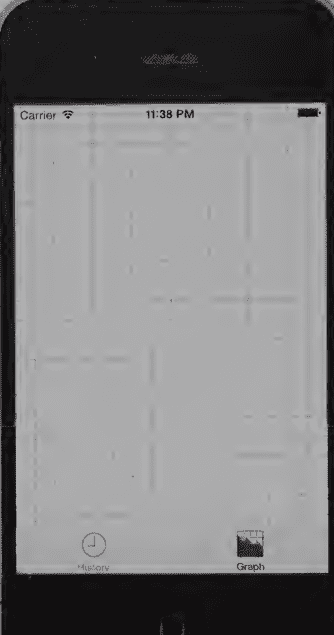

对于我们的网格，路径将仅仅是一系列直线。我们从空路径开始，然后将每条线添加到路径中。然后将其绘制到屏幕上。

注意，当我们创建路径时，我们设置了线的宽度。然后我们在水平和垂直方向上每隔 20 点创建一个线。我们首先通过调用 `moveToPoint:` 将光标移动到下一条线的开头，然后通过调用 `addLineToPoint:` 将线添加到路径。一旦所有线条都添加完毕，我们就调用 `UIColor` 的 `setStroke` 设置线条颜色。然后通过调用路径的 `stroke` 绘制线条。

我们放大图表视图（Graph View）。选择场景的视图（无论是在文档中还是在……）。

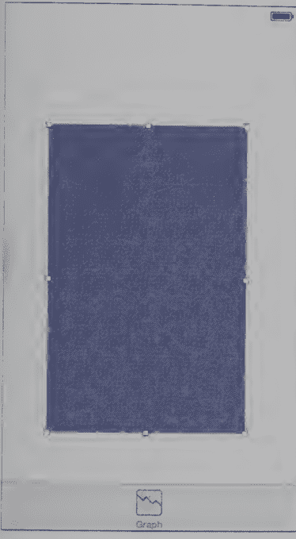

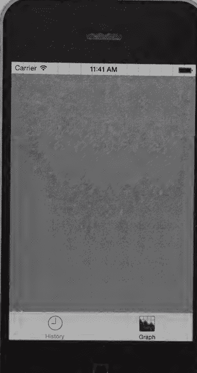

图 4.3 添加视图

图 4.4 尺寸适当的图表视图

在编写代码之前还有最后一步。我们需要为图表视图创建一个输出（outlet）。切换到助手编辑器（Assistant editor），按住 Control 将图表视图拖到 `GraphViewController.m` 的类扩展中，并创建以下输出：

```objc
@property (weak, nonatomic) IBOutlet GraphView *graphView;
```

遗憾的是，这会产生“未知类型名 'GraphView'”的错误。我们可以通过滚动到 `GraphViewController.m` 顶部并导入 `GraphView.h` 来修复它。

现在，切换回标准编辑器（Standard editor），并打开 `GraphView.h`。我们想为该类添加一些属性。首先，我们需要一个 `NSArray` 来包含我们打算绘制的权重条目。我们还需要添加一些属性来控制图表的外观。这将遵循我们用于背景视图的通用模式。

在 `GraphView` 的公共头文件中添加以下属性：

```objc
// 这必须是一个按日期升序排序的数组。
@property (strong, nonatomic) NSArray *weightEntries;

@property (assign, nonatomic) CGFloat margin;
```


@property (assign, nonatomic) CGFloat guideLineWidth;
@property (assign, nonatomic) CGFloat guideLineOffset;
@property (strong, nonatomic) UIColor *guideLineColor;

@property (assign, nonatomic) CGFloat graphLineWidth;
@property (assign, nonatomic) CGFloat dotSize;

注意，我们假设权重条目是按升序排列的。在实现代码时，我们将添加一些健壮性检查来帮助验证传入的数据——但我们不会对数组进行逐项检查。相反，我们将假设调用代码正确遵循了我们在注释中表达的契约。如果不遵守，结果将是不可预测的。

我们以前见过这种方法论。当清晰地表达你的意图并假设其他开发者会遵循这一点时，Objective-C 的工作效果最好。遗憾的是，在这种情况下，我们没有可以使用的语法技巧来表达我们的意图。我们必须依赖注释。然而，这是文档注释的一个极佳用例。我将把它留给真正专注的读者作为练习题。

切换到 `GraphView.m`。就像我们的背景视图一样，我们想要一对匹配的 `init..` 方法以及一个私有的 `setDefaults` 方法。`init..` 方法在这里：

```
- (id)initWithFrame:(CGRect)frame
{
    self = [super initWithFrame:frame];
    if (self) {
        [self setDefaults];
        return self;
    }
}
```

第 4 章 自定义视图与自定义过渡 204 页

在实现块的底部，添加 `setDefaults` 方法。

#pragma mark - Private Methods

```
- (void)setDefaults
{
    self.contentMode = UIViewContentModeRedraw;
    self.backgroundColor = [UIColor clearColor];
    self.opaque = NO;

    self.margin = 20.0;

    if (self.contentScaleFactor == 2.0)
    {
        self.guidelineYOffset = 0.0;
    }
    else
    {
        self.guidelineYOffset = 0.5;
    }

    self.guidelineLineWidth = 1.0;
    self.guidelineColor = [UIColor darkGrayColor];

    self.graphLineWidth = 2.0;
    self.dotSize = 4.0;
}
```

这段代码与我们的背景视图几乎相同。是的，属性名称和值发生了变化，但基本概念是相同的。注意，我们使用了透明的 `backgroundColor`，让背景视图显示出来。我们还将 `opaque` 属性设置为 `NO`。

此外，由于我们的图表线宽度是偶数像素，我们不需要担心将其对齐网格。如果它作为垂直或水平线绘制，它将已经正确地填充了给定坐标上方 1 像素和下方 1 像素（在非 Retina 显示器上）。类似的逻辑，1 点的引导线仅在非 Retina 显示器上需要偏移。

应用程序应该成功编译并运行。然而，请注意我们之前灰色的图表视图已完全消失。现在我们只需要添加一些自定义绘图，给它增加一些内容。

为了本书的目的，我们想保持图表简单。所以，我们只绘制三条带有标签的水平引导线以及折线本身。此外，我们并没有尝试让图表与背景视图的网格纸匹配。在生产应用中，你可能希望为水平轴添加引导线或标签，并协调背景和图表视图，赋予网格纸实际意义。

## 传递数据

图表将被缩放以垂直填充我们的空间，最大值靠近视图顶部，最小值靠近底部。它将在水平方向上填充我们的视图，最早的日期靠近左侧，最晚的日期在右侧。

在此之前，我们需要传入数据。

现在，让我们为 `weightEntries` 属性添加一个自定义 setter。每当我们的条目发生变化时，它都会设置统计数据。

#pragma mark - 访问器方法

```objc
- (void)setWeightEntries:(NSArray *)weightEntries
{
    _weightEntries = weightEntries;

    if ([_weightEntries count] > 0)
    {
        self.minimumWeight = [[weightEntries valueForKeyPath:@"@min.weightInLbs"] floatValue];

        self.maximumWeight = [[weightEntries valueForKeyPath:@"@max.weightInLbs"] floatValue];

        self.averageWeight = [[weightEntries valueForKeyPath:@"@avg.weightInLbs"] floatValue];

        self.earliestDate = [weightEntries valueForKeyPath:@"@min.date"];

        self.latestDate = [weightEntries valueForKeyPath:@"@max.date"];

        NSAssert([self.latestDate isEqualTo:
            [[self.weightEntries lastObject] date]],
            "权重条目数组必须按时间升序");

        NSAssert([self.earliestDate isEqualTo:
            [self.weightEntries[0] date]],
            "权重条目数组必须按时间升序");
    }
    else
    {
        self.minimumWeight = 0.0;
        self.maximumWeight = 0.0;
        self.averageWeight = 0.0;
        self.earliestDate = nil;
        self.latestDate = nil;
    }

    [self setNeedsDisplay];
}
```

理想情况下，此方法中的没有任何内容是令人意外的。我们将传入的值赋值给我们的属性。然后我们检查新数组是否包含任何元素。如果有，我们就设置我们的统计数据。在这里，我们使用了在第 3 章“更新我们的视图”部分中使用过的 KVC 算符。我们注意到，可以将它们用于权重和日期属性。`@min.date` 为我们提供了数组中最早的日期，而 `@max.date` 为我们提供了最新的日期。我们还检查了第一个和最后一个对象，确保第一个对象是我们的最早日期，最后一个对象是我们的最新日期。这充当了一个快速的合理性检查。它无法捕捉所有可能的错误——但它很快，并且能捕捉到大多数明显的问题（例如忘记反转我们的数组）。作为一个额外奖励，即使我们的数组只有一个条目，它也能工作。

如果我们的数组为空（或已设置为 `nil`），我们简单地清除统计数据。

现在，让我们来绘制图表。绘图代码可能会变得非常复杂，因此我们将其分成若干辅助方法。

从添加用于计算图表大小的方法开始。我们将这些值存储在实例变量中。我喜欢在完成后立即清除它们——防止我在数据不再有效时意外误用。所以，让我们也写一个方法来清理数据。

将这些私有方法添加到实现块的底部：

```objc
- (void)calculateGraphSize
{
    CGRect innerBounds =
    CGRectInset(self.bounds, self.margin, self.margin);
    self.topY = CGRectGetMinY(innerBounds) + self.margin;
    self.bottomY = CGRectMaxY(innerBounds);
    self.minX = CGRectGetMinX(innerBounds);
    self.maxX = CGRectMaxX(innerBounds);
}

- (void)clearGraphSize
{
    self.topY = 0.0;
    self.bottomY = 0.0;
    self.minX = 0.0;
    self.maxX = 0.0;
}
```

`calculateGraphSize` 展示了更多 Geometry（几何）函数。在这里我们使用 `CGRectInset` 来取一个矩形并收缩它。每一边都会根据我们的内边距（margin）移动。根据我们的默认值，这将创建一个位于原矩形中心的新矩形，短了 40 点且窄了 40 点。

你也可以使用此方法通过负的 inset 值来使矩形变大。我们使用 `CGRectGet...` 方法提取各种位数据。`topY` 值值得特别关注。我们希望顶部边距与底部、左侧和右侧一样。基本上，我们使用所有内容来适应 `innerBounds` 矩形。我们使用 `topY` 和 `offsetY` 来绘制我们的最小和最大权重引导线。顶部引导线需要一点额外的空间来放置它的标签。

`clearGraphSize` 方法要简单得多，我们只需将所有内容设为 0.0。现在，让我们添加一个私有的 `drawGraph` 方法。

```objc
- (void)drawGraph
{
    // 如果我们没有任何条目，我们就完成了
    if ([self.weightEntries count] == 0) return;

    UIBezierPath *barGraph = [UIBezierPath bezierPath];
    barGraph.lineWidth = self.graphLineWidth;

    BOOL firstEntry = YES;
    for (WeightEntry *entry in self.weightEntries) {
        CGPoint point =
        CGPointMake([self calculateXForDate:entry.date],
                     [self calculateYForWeight:entry.weightInLbs]);

        if (firstEntry)
        {
            [barGraph moveToPoint:point];
            firstEntry = NO;
        }
        else
        {
            [barGraph addLineToPoint:point];
        }

        if (entry.weightInLbs == self.maximumWeight)
        {
            [self drawDotForEntry:entry];
        }

        if (entry.weightInLbs == self.minimumWeight)
        {
            [self drawDotForEntry:entry];
        }
    }
    [self.tintColor setStroke];
    [barGraph stroke];
}
```

我们首先检查我们是否有任何条目。如果没有条目，我们就完成了。没有图表要画。如果有条目，我们就创建一个空的 Bezier 路径来存放我们的线条。我们遍历数组中的所有条目。根据每个条目的重量和日期，为每个条目计算正确的 x 和 y 坐标。然后，对于第一个条目，我们将光标移动到正确的坐标。对于其他每个条目，我们从上一个坐标到新坐标添加一条直线。如果我们的条目是最小或最大值，我们会在该位置也画一个点。最后，我们绘制线条。这次，我们使用视图的 `tintColor`。我们在第 3 章的“自定义外观”部分讨论过调色。基本上，图表的调色将默认为我们的——但我们可以通过给它一个不同的颜色来通过编程方式自定义它。

让我们添加计算 x 和 y 坐标的方法。从 x 坐标开始。

```objc
- (CGFloat)calculateXForDate:(NSDate *)date
{
    NSAssert([self.weightEntries count] > 0, "调用此方法前必须有条目");

    if ([self.earliestDate compare:date] == NSOrderedSame)
    {
        return self.minX;
    }

    if ([self.latestDate compare:date] == NSOrderedSame)
    {
        return self.maxX;
    }

    NSTimeInterval totalInterval = [self.latestDate timeIntervalSinceDate:self.earliestDate];
    NSTimeInterval offsetInterval = [date timeIntervalSinceDate:self.earliestDate];
    CGFloat ratio = offsetInterval / totalInterval;

    return self.minX + ratio * (self.maxX - self.minX);
}
```

### 图 4.5 一个包含四个条目的图


构建并运行应用程序。当它零条目时，图表视图为空白。如果你添加一个条目，它将以点的形式出现，大致位于屏幕中心。添加两个或更多条目，它将绘制图表的线条（图 4.5）。旋转它，图表将在新的方向上重新绘制。

现在我们需要添加我们的指南线。让我们从创建一个私有方法来绘制指南线开始。

```objc
- (void)drawGuidelineAt:(CGFloat)y withLabelText:(NSString *)text
{
    UIFont *font =
        [UIFont preferredFontForTextStyle:UIFontTextStyleCaption1];

    NSDictionary *textAttributes =
        @{NSFontAttributeName: font,
          NSForegroundColorAttributeName: self.guideLineColor};

    CGSize textSize = [text sizeWithAttributes:textAttributes];
    CGRect textRect = CGRectMake(self.minX,
                                   y - textSize.height - 1,
                                   textSize.width,
                                   textSize.height);

    textRect = CGRectIntegral(textRect);

    UIBezierPath *textbox = [UIBezierPath bezierPathWithRect:textRect];
    [self.superview.backgroundColor setFill];
    [textbox fill];

    [text drawInRect:textRect withAttributes:textAttributes];

    CGFloat pattern[] = {5, 2};

    UIBezierPath *line = [UIBezierPath bezierPath];
    line.lineWidth = self.guideLineWidth;
    [line setLineDash:pattern count:2 phase:0];

    [line moveToPoint:CGPointMake(CGRectGetMinX(self.bounds), y)];
    [line addLineToPoint:CGPointMake(CGRectGetMaxX(self.bounds), y)];

    [self.guideLineColor setStroke];
    [line stroke];
}
```

我们首先获取 Caption 1 样式的动态字体。然后，我们创建一个文本属性字典。这些属性定义在 `NSAttributedString` UIKit Additions 参考中。它们可以用于格式化富文本字符串的部分；然而，我们使用它们来格式化我们的整个字符串。我们将字体设置为我们的动态字体，并将文本颜色设置为指南线的颜色。

一旦完成，我们就使用这些属性来计算绘制文本所需的大小。然后，我们创建一个足够大的矩形来容纳文本，其底部位于提供的 y 坐标上方 1 像素。注意，我们在矩形上使用了 `CGRectIntegral()`。这将返回一个包含源矩形的最小整数值矩形。

`sizeWithAttributes:` 通常返回包含像素部分的尺寸。然而，我们想要确保我们的矩形与底层的像素正确对齐。与自定义线条绘制不同，处理文本时，我们不应该偏移矩形——文本渲染引擎会为我们处理。

自定义绘图 215

我们使用 `textRect` 使用 `BackgroundView` 的背景颜色绘制一个框。这将为我们的标签创建一个看起来空白的空间，使其更易读。然后，我们将文本绘制到同一个矩形中。

接下来，我们定义线条。同样，我们从一个空路径开始。我们设置线条的宽度，并设置虚线模式。在这里，我们使用了一个 C 数组。这是我们在 Objective-C 中使用 C 数组的地方之一。我们的虚线将绘制一个 5 点长度的线段，随后是一个 2 点的间隙。它重复这种模式。

我们从视图的左边缘到右边缘（根据提供的 y 坐标）绘制这条线。这意味着我们的线条将位于边界框底部边缘的正下方。最后，我们设置线条颜色并绘制线条。

现在我们需要创建指南线。我们将有三个：一个用于最大重量，一个用于最小重量，一个用于平均重量。在我们的实现中添加以下方法：


# 图 4.5 一个包含四个条目的图


构建并运行应用程序。当它零条目时，图表视图为空白。如果你添加一个条目，它将以点的形式出现，大致位于屏幕中心。添加两个或更多条目，它将绘制图表的线条（图 4.5）。旋转它，图表将在新的方向上重新绘制。

现在我们需要添加我们的指南线。让我们从创建一个私有方法来绘制指南线开始。

```objc
(void)drawGuidelineAt:(CGFloat)y withLabelText:(NSString*)text {
    UIFont *font = [UIFont preferredFontTextStyle:UIFontTextStyleCaption1];
    NSDictionary *textAttributes = @{NSFontAttributeName:font,
                                     NSForegroundColorAttributeName:self.guideLineColor};
    CGSize textSize = [text sizeWithAttributes:textAttributes];
    CGRect textRect = CGRectMake(self.minX,
                                 y - textSize.height - 1,
                                 textSize.width,
                                 textSize.height);
    textRect = CGRectIntegral(textRect);
    UIBezierPath *textbox = [UIBezierPath bezierPathWithRect:textRect];
    [self.superview.backgroundColor setFill];
    [textbox fill];
    [text drawInRect:textRect withAttributes:textAttributes];
    CGFloat pattern[] = {5, 2};
    UIBezierPath *line = [UIBezierPath bezierPath];
    line.lineWidth = self.guide.lineWidth;
    [line setLineDash:pattern count:2 phase:0];
    [line moveToPoint:CGPointMake(CGRectGetMinX(self.bounds), y)];
    [line addLineToPoint:CGPointMake(CGRectGetMaxX(self.bounds), y)];
    [self.guideLineColor setStroke];
    [line stroke];
}
```

我们首先获取 Caption 1 样式的动态字体。然后，我们创建一个文本属性字典。这些属性定义在 `NSAttributedString UIKit Additions` 参考中。它们可以用于格式化富文本字符串的部分；然而，我们使用它们来格式化我们的整个字符串。我们将字体设置为我们的动态字体，并将文本颜色设置为指南线的颜色。

一旦完成，我们就使用这些属性来计算绘制文本所需的大小。然后，我们创建一个足够大的矩形来容纳文本，其底部位于提供的 y 坐标上方 1 像素。注意，我们在矩形上使用了 `CGRectIntegral()`。这将返回一个包含源矩形的最小整数值矩形。

`sizeWithAttributes:` 通常返回包含像素部分的尺寸。然而，我们想要确保我们的矩形与底层的像素正确对齐。与自定义线条绘制不同，处理文本时，我们不应该偏移矩形——文本渲染引擎会为我们处理。

### 自定义绘图 215

我们使用 `textRect` 使用 `BackgroundView` 的背景颜色绘制一个框。这将为我们的标签创建一个看起来空白的空间，使其更易读。然后，我们将文本绘制到同一个矩形中。

接下来，我们定义线条。同样，我们从一个空路径开始。我们设置线条的宽度，并设置虚线模式。在这里，我们使用了一个 C 数组。这是我们在 Objective-C 中使用 C 数组的地方之一。我们的虚线将绘制一个 5 点长度的线段，随后是一个 2 点的间隙。它重复这种模式。

我们从视图的左边缘到右边缘（根据提供的 y 坐标）绘制这条线。这意味着我们的线条将位于边界框底部边缘的正下方。最后，我们设置线条颜色并绘制线条。

现在我们需要创建指南线。我们将有三个：一个用于最大重量，一个用于最小重量，一个用于平均重量。在我们的实现中添加以下方法：

```objc
(void)drawLabelsAndGuides {
    if ([self.weightEntries count] == 0) return;
    WeightUnit unit = getDefaultUnits();
    if (self.minimumWeight == self.maximumWeight) {
        float weight = [self.weightEntries[0] weightInLbs];
        NSString *weightLabel = [NSString stringWithFormat:@"Weight: %@",
                                 [WeightEntry stringForWeightInLbs:weight inUnit:unit]];
        [self drawGuidelineAtY:[self calculateYForWeight:weight] withLabelText:weightLabel];
    } else {
        NSString *minLabel = [NSString stringWithFormat:@"Min: %@",
                              [WeightEntry stringForWeightInLbs:self.minimumWeight inUnit:unit]];
        NSString *maxLabel = [NSString stringWithFormat:@"Max: %@",
                              [WeightEntry stringForWeightInLbs:self.maximumWeight inUnit:unit]];
        [self drawGuidelineAtY:self.topY withLabelText:maxLabel];
        [self drawGuidelineAtY:self.bottomY withLabelText:minLabel];
        [self drawGuidelineAtY:forWeight:self.averageWeight withLabelText:averageLabel];
    }
}
```

在这个方法中，我们简单地检查是否有任何条目。如果有条目，我们检查是否有任何条目……（注：提供的 OCR 文本存在重复，已根据代码块逻辑进行整理）。

然而，通常通过使用可缩放图像或图像模式，我们可以在规避位图缺点的同时获得它的许多优势。更多信息，请查看 `UIImage resizableImageWithCapInsets`、`UIColor colorWithPatternImage` 以及 Asset Catalog 帮助。

> **注意**：在使用位图图像时，应尽可能始终使用 PNG 文件。Xcode 会在编译期间为底层 iOS 硬件优化 PNG 文件。其他格式在运行时可能需要额外的图像处理，这可能会导致明显的卡顿或延迟，特别是对于大文件。

## 当数据变化时更新我们的绘图

我们的图表视图还有最后一次修改。我们需要确保每当数据变化时，图表都能进行更新。这现在并不重要，但一旦我们实现了 iCloud 同步，它将变得极其重要。

为了做到这一点，我们需要监听模型的通知。然而，与历史记录不同，我们不需要单独跟踪每一个变化。相反，我们将在所有更改完成后更新整个图表。这意味着我们不需要跟踪单个通知。

在类扩展中打开 `GraphViewController.m`，添加以下属性：`@property (strong, atomic) modelChangesCompleteObserver;`

现在，在 `initWithName:bundle:` 下方添加 `dealloc` 方法：

```objc
(void)dealloc {
    NSNotificationCenter *center = [NSNotificationCenter defaultCenter];
    if (self.modelChangesCompleteObserver)
        [center removeObserver:self.modelChangesCompleteObserver];
}
```

接下来，让我们设置观察者。由于只有一个且代码非常简单，我们直接把它放在 `viewDidLoad` 中：

```objc
(void)viewDidLoad {
    [super viewDidLoad];
    self.tabBarItem.selectedImage = [UIImage imageNamed:@"graph_selected"];
    NSNotificationCenter *center = [NSNotificationCenter defaultCenter];
    NSOperationQueue *mainQueue = [NSOperationQueue mainQueue];
    __weak typeof(self) weakSelf = self;
    self.modelChangesCompleteObserver = 
    [center addObserverForName:WeightHistoryDocumentChangesCompleteNotification
                        object:self.weightHistoryDocument
                         queue:mainQueue
                    usingBlock:^(NSNotification *note) {
        weakSelf.graphView.weightEntries = 
        [[[self.weightHistoryDocument allEntries] reverseObjectEnumerator] allObjects];
    }];
}
```

每当我们的文档更改时，这都会重置图表视图的权重数组。遗憾的是，目前还没有测试这段代码的方法。不过，我们将在本章稍后的部分有机会测试它。

## 自定义过渡

iOS 7 提供了类和方法来支持向我们的场景中添加自定义过渡。具体来说，我们可以自定义呈现模态视图时、在标签页之间切换时、在导航控制器上推入或弹出视图时，以及集合视图控制器之间布局到布局的过渡期间过渡。

在本章中，我们将查看呈现控制器时以及切换标签页时的自定义过渡。

对于模态序列，过渡为我们提供了除了修改过渡动画之外的控制能力。我们还可以定义呈现视图的最终形状和大小。呈现的视图不再需要覆盖整个场景，我们的呈现场景保留在视图层次结构中。我们甚至可能与该原始场景的任何暴露部分进行交互。

这是一个重要的变化，特别是对于 iPhone 而言。在之前的 iOS SDK 版本中，呈现视图在 iPhone 上必须填充整个屏幕（我们在 iPad 上有几个额外的选项，但仍然相对有限）。

修改标签页动画的能力也是一个很棒的改进。在 iOS 7 之前，标签栏控制器无法使用任何动画。触摸标签页会瞬间更改内容。

然而，我们并不仅仅是在标签页之间添加动画序列；我们还将创建一个交互式过渡，让用户使用滑动手势来驱动过渡。当用户手指滑动屏幕时，我们将匹配该动作，从一个标签页滑动到下一个。

然而，在执行任何这些操作之前，我们需要了解 Core Animation 是如何工作的。Core Animation 是我们所有过渡背后的底层技术。

## CORE ANIMATION

我不对你撒谎：Core Animation 是一个丰富且复杂的框架。我们针对这个主题编写的整本书都有许多可以调节的小旋钮。然而，UIKit 对基础的 Core Animation 功能实现了一层封装方法。它让我们轻松地动画化视图，而无需陷入 Core Animation 框架的全部复杂性。

坏消息是 UIKit 实际上暴露了两个不同的动画 API。旧的 API 由调用多个 UIKit 方法组成。这些方法必须按照正确的顺序调用，否则你将得到意外之外的行为。此外，协调不同动画之间的被证明是困难的。

虽然这些方法尚未被正式弃用，但对于任何针对 iOS 4.0 或更高版本的应用程序，不再推荐使用它们。由于我们的最低目标是 iOS 4.3，没有理由继续使用这些方法。

相反，我们想要使用 `UIView` 的基于块的动画 API。UIKit 在基于块的动画 API 中提供了许多类方法。其中一些让我们动画化视图——移动它们、调整大小以及淡入淡出。另一些允许我们在视图之间进行过渡。它们将一个视图从视图层次结构中移除，并用不同的视图替换它。

所有视图都有许多可动画属性。这些包括 `frame`、`center`、`transform`、`alpha`、`backgroundColor` 和 `contentStretch`。为了动画化我们的视图，我们将调用动画方法之一。Core Animation 将计算块期间每帧的插值值——它将平滑地动画化结果。

如果我想移动视图，我会更改 `frame` 或 `center`。如果我想缩放或旋转，我会更改 `transform`。如果我想让它淡入或淡出，我会更改 `alpha`。

`UIView` 的动画方法如下：

- `animateWithDuration:animations:` 这是最简单的方法。我们提供时间和动画块。它在给定时间内动画化我们的视图。
- `animateWithDuration:animations:completion:` 添加了一个在动画结束后执行的回调。我们可以使用它来清理资源、设置最终位置，甚至将一个动画链联到下一个。
- `animateWithDuration:delay:options:animations:completion:` 这是真正的骨干。我们可以设置时长、动画开始前的延迟、动画选项掩码、动画块以及回调块。
- `animateWithDuration:delay:usingSpringDamping:initialSpringVelocity:options:animations:completion:` 这是一个新方法。它用于创建弹性效果。如果你想让动画在进入最终状态之前轻微弹跳，可以使用它。通过修改阻尼和初始速度来控制弹性行为。
- `animateKeyframesWithDuration:delay:options:animations:completion:` 我们可以使用此方法运行帧动画。这些是与时间点相关的更复杂的动画。为了设置帧动画，你必须在此方法内部调用 `addKeyframeWithStartTime:relativeDuration:animations:`。
- `addKeyframeWithStartTime:relativeDuration:animations:` 在 `animateKeyframesWithDuration:delay:options:animations:completion:` 的动画块内调用此方法来设置帧动画。


- `performSystemAnimation:onViews:animations:completion`：此方法允许我们对一组视图定义预定义的动画。我们还可以指定并行运行的其他动画。在此，我们只删除视图。动画完成后，视图将从视图层次结构中移除。

- `transitionWithView:duration:options:completion`：我们可以使用此方法向指定的容器视图添加、删除或隐藏子视图。状态之间的变化将使用选项中指定的过渡样式进行动画。这比 `transitionFrom:to:duration:options:completion` 提供了更大的灵活性，但需要更多工作来正确设置。

- `transitionFrom:to:duration:options:completion`：此方法使用指定的过渡动画用“到”视图替换“从”视图。默认情况下，“从”视图将从视图层次结构中移除，“到”视图添加到视图层次结构中。

- `performWithoutAnimation:`：你可以在此方法内部调用包含动画块的方法。动画块中的更改将立即生效，没有任何动画。

## Auto Layout 和 Core Animation

使用动画移动视图的最简单方法是在动画块内修改视图的 `frame` 或 `center`。只要我们的视图只有隐式布局约束，这种方法就能正常工作。也就是说，我们通过编程或使用 Interface Builder 将视图添加到视图层次结构中，但没有为它提供任何约束。

只要视图具有隐式约束，我们就可以继续使用 `frame` 和 `center` 属性通过编程方式改变它的位置和大小。然而，一旦我们开始添加显式约束，情况就会变得复杂。我们不再能以 `frame` 或 `center` 的角度来思考问题。如果我们尝试这样做，可能会让视图移动，但 Auto Layout 和 Core Animation 代码将争夺视图位置的控制权。这可能会导致意想不到的结果。动画可能运行完成，结果视图却弹回原始位置。位置可能看起来工作正常，但在我们旋转设备或在某些其他调用更新约束后，它又会恢复。有时，它可能会导致视图在动画结束时短暂地闪回旧位置。这完全取决于动画的精确性质和更新的时机。

因此，如果我们想对具有显式约束的视图进行大小或位置的动画，我们有两种选择：

- 我们可以在动画块内部修改现有的约束之一。这是简单的方法，但局限性也更大。我们只能更改约束的 `constant` 属性，不能做其他任何操作。

- 我们可以移除旧约束，添加新约束，然后在动画块内部调用 `layoutIfNeeded`。这允许我们对约束进行任何任意更改，但需要更多工作。

出于 Heat Beat 项目的目的，我们只对具有隐式约束的视图执行动画。这些视图更容易编写，也更容易理解。我建议在您非常熟悉 Core Animation 和 Auto Layout 之前，尽量避免对 Auto Layout 约束进行动画。

## 自定义视图呈现

在创建过渡效果时，我们有两种选择：自定义过渡和交互式过渡。自定义过渡的工作方式与我们看到的大多数过渡类似：我们触发过渡，然后它会自动运行到完成。大多数过渡发生得非常快，通常在 0.25 秒内完成。

另一方面，用户驱动交互式过渡。在 iOS 7 之前，我们有一个交互式过渡的示例——`UIViewController`。这是 iBook 翻页动画背后的控制机制。当你手指划过屏幕时，页面会随着你的手指弯曲。你可以让手指向向或向后移动。你可以停止、加速或减速。动画会随之进行。抬起手指，页面将翻回原始位置，或继续翻到新的一页。

我们将从自定义过渡开始，因为它更简单。实际的过渡并不困难——尽管它有很多部分需要跟踪。然而，它从根本上改变了我们应用程序的行为，这将需要一些额外工作的支持。

## 自定义我们添加条目视图的过渡

我们的应用程序以模态视图的形式呈现 `Add Entry View` 控制器。它从底部滑入，在我们完成操作后再次滑回。我们想要改变这一点。我们不希望覆盖整个屏幕，而是只想覆盖中心的一个小矩形。我们还希望是淡入淡出，而不是滑动。

这通过三个步骤实现：

1. 我们将呈现的控制器的 `modalPresentationStyle` 设置为 `UModalPresentationCustom`。

2. 我们提供一个过渡代理（transitioning delegate）。

3. 过渡代理创建一个对象，该对象为我们实现实际的动画序列。它实际上提供两个独立的动画序列：一个用于呈现我们的视图，另一个用于关闭它。

打开 `HistoryViewController.m` 并在 `prepareSegue:sender:method` 方法底部添加以下代码。这应该放在大括号之前的 `if` 块之后。

```objc
if ([self.identifier isEqualToString:@"Add Entry Segue"])
{
    UIViewController *destinationController =
    segue.destinationViewController;

    destinationController.modalPresentationStyle = ModalPresentationCustom;

    destinationController.transitioningDelegate = self;
}
```

接下来，我们需要让我们的视图控制器遵循 `ViewControllerTransitioningDelegate` 协议。滚动到文件顶部，如下所示修改类扩展的声明：

```objc
@interface HistoryViewController ()
<UIViewControllerTransitioningDelegate>
```

这应该消除错误，但如果你运行应用并调出条目视图，你会发现什么都没有改变。实际上，旋转不再正常工作了——所以情况比以前更糟了。

我们需要实现 `ViewControllerTransitioningDelegate` 的两个方法：`animationControllerForPresented:presentingController:sourceController:` 和 `animationControllerForDismissed:`。然而，在执行之前，我们需要先创建自己的动画器类。

## 动画器对象

我们需要创建一个对象，来管理过渡的动画。在 Controller 组中，创建一个名为 `AddEntryAnimator` 的新 Objective-C 类。它应该是 `NSObject` 的子类。打开 `AddEntryAnimator.h`，并如下所示修改它：

```objc
@interface AddEntryAnimator : UIViewControllerAnimatedTransitioning
@property (assign, nonatomic, getter = isPresenting) BOOL presenting;
@end
```

我们只是在采纳 `UIViewControllerAnimatedTransitioning` 协议并声明一个属性。我们的 `AddEntryAnimator` 将负责实际处理我们添加条目的出现和消失动画。为了做到这一点，我们必须实现两个方法：`animateTransition:` 和 `transitionDuration:`。

切换到 `AddEntryAnimator.m`。在文件顶部，让我们导入 `AddEntryViewController.h`。接下来，在 `@implementation` 之前定义一个常量值：

```objc
static const NSTimeInterval AnimationDuration = 0.25;
```

这是我们将在动画中使用的时长。现在我们可以如下所示实现 `transitionDuration:` 方法：

```objc
(NSTimeInterval)transitionDuration:
(id<UIViewControllerTransitionContext>)transitionContext
{
    return AnimationDuration;
}
```

该方法返回它的常量。

现在，让我们看看 `animateTransition:` 方法。该方法接收一个参数，我们的过渡上下文（transition context）。这是一个不透明类型，但它遵循 `UIViewControllerTransitioning`。正如我们将看到的，上下文提供了关于过渡的广泛信息。

在过渡开始之前，我们的视图和控制器层级必须处于一致状态。在过渡结束后，它们也必须回到一致状态。然而，在过渡期间，它们可能会经过一个临时的不一致状态。为了管理这一点，我们使用容器视图（container view）。系统将创建容器并将其添加到视图层级中。它在我们的动画期间充当主管。

> **注意**：在呈现视图控制器时，容器视图始终是全屏且竖屏的。如果你在横屏模式下动画视图，将需要对坐标进行任何必要的转换以获得所需的结果。


我们需要执行以下步骤：

- 确保两个视图都已添加到容器视图。
- 动画从一个视图到下一个视图的过渡。
- 如果定义了最终位置，确保每个视图都处于最终位置。
- 调用 `completeTransition:` 以结束过渡并将一切恢复到一致状态。

由于我们在呈现和关闭视图时使用同一个动画器，因此我们的 `animateTransition:` 方法必须处理这两种情况。为了简化问题，我们将在 `animateTransition:` 中进行预处理，然后调用单独的方法来处理实际动画。

如下所示添加 `animateTransition:` 方法：

```objc
-(void)animateTransition:
(UIViewControllerContextTransitioning*)transitionContext
{
    id fromViewController = 
    [transitionContext viewControllerForKey:
    UITransitionContextFromViewControllerKey];

    id toViewController = 
    [transitionContext viewControllerForKey:
    UITransitionContextToViewControllerKey];

    UIView *containerView = [transitionContext containerView];

    if (self.presenting) {
        [self
            presentAddEntryViewController:toViewController
            overParentViewController:fromViewController
            usingContainerView:containerView
            transitionContext:transitionContext];
    } else {
        [self
            dismissAddEntryViewController:fromViewController
            fromParentViewController:toViewController
            usingContainerView:containerView
            transitionContext:transitionContext];
    }
}
```

我们从过渡上下文（transition context）中获取“源”（from）和“目标”（to）视图控制器。请求我们的容器视图。检查我们是在呈现还是移除“添加条目”（Add Entry）视图，然后调用相应的辅助方法。

在呈现视图控制器时，源-控制器和目标-控制器可能是混淆和错误的常见来源。当我们的“添加条目”视图出现时，源控制器将是我们的 `RootTabBarController`。这是由我们的呈现上下文定义的呈现视图控制器。目标-控制器是我们的 `EntryViewController`。然而，当我们移除“添加条目”视图时，这些角色就会反过来。

这意味着，有时我们的 `EntryViewController` 是目标-控制器。有时它又是源-控制器。通过使用辅助函数，我们可以在命名更具可读性的参数中传递 `toViewController` 和 `fromViewController`。这让我们能够直接处理 `parentController` 和 `addEntryViewController`，而无需尝试在每个特定情况下记住哪个是“源”，哪个是“目标”。

接下来，如所示添加 `addEntryViewController:overParentViewController:usingContainerView:transitionContext:` 方法：

```objc
#pragma presentEntryViewController:

(void)presentEntryViewController:(EntryViewController*)addController
overParentViewController:(UIViewController*)parentController
usingContainerView:(UIView*)containerView
transitionContext:(id<UIViewControllerTransitionContextTransitioning>)transitionContext
```

```objc
[containerView addSubview:parentController.view];
[containerView addSubview:addEntryViewController.view];

UIView *addEntryView = addEntryViewController.view;
UIView *parentView = parentController.view;
CGPoint center = parentView.center;
```

```objc
UIInterfaceOrientation orientation =
parentController.interfaceOrientation;
if (UIInterfaceOrientationIsPortrait(orientation)) {
    addEntryView.frame = CGRectMake(0.0, 0.0, 280.0, 170.0);
}
else
{
    addEntryView.frame = CGRectMake(0.0, 0.0, 170.0, 280.0);
}
```

```objc
addEntryView.center = center;

addEntryView.alpha = 0.0;
```

```objc
[UIView
animateWithDuration:AnimationDuration
animations:^{
    addEntryView.alpha = 1.0;
}
completion:^(BOOL finished) {
    [transitionContext completeTransition:YES];
}];
```

我们首先将两个视图都添加到容器视图中。我们要确保父视图先被添加，这样我们的“添加条目”视图在绘制时就会出现在它上方。根据文档，系统通常会为我们将源-控制器添加到容器中，但我们通常需要手动添加目标-控制器。个人而言，我发现直接添加两个视图是最简单的。这不会产生任何副作用，并且保证了两个视图都被正确添加，且它们按正确的顺序添加。

接下来，我们需要确保我们的视图最终位于适当的位置。由于我们是在呈现一个视图控制器（而不是使用导航控制器或标签栏），我们的目标-控制器没有预设的位置。我们需要定义它的最终尺寸和位置。然而，我们的父视图不能移动。我们通过对两个视图控制器调用过渡上下文的 `initialFrameViewController:` 和 `finalFrameViewController` 方法来验证这一点。如果有需要的位置，它将返回该位置的帧（frame）。如果它返回 `CGRect`——则我们可以心所欲地操作。

我们将“添加条目”的宽度设为 280 点，高度设为 170 点。我们还将将其在其父视图中居中。然而，我们需要确保它所有的坐标都在容器视图的坐标系中，而该坐标系始终处于竖屏方向。

最后，我们执行实际动画。我们将视图的 `alpha` 设为 0.0，使其不可见。当我们使用动画块将其淡入时，通过在动画块内部将 `alpha` 设为 1.0。当动画完成后，我们调用 `completeTransition:`：这会将我们的视图和视图层级置于最终状态，并执行清理任务。

> **注意**：如果我们的过渡成功完成，`completeTransition:` 应该为 YES；如果动画被取消，则为 NO。大多数自定义过渡都是不可取消的，因此我们几乎总是传递 YES。然而，在编写交互式过渡时，这个参数会变得更加重要。


如你所示，移除的代码类似但简单得多。添加如下所示的方法：

```objc
(void) dismissEntryViewController:
(AddEntryViewController *)addEntryController
fromParentViewController:(UIView *)parentController
usingContainerView:(UIView *)containerView
transitionContext:
(id<UIViewControllerContextTransitioning>)transitionContext
{
    [containerView addSubview:parentController.view];
```


[containerView addSubview:addEntryController.view];

[UIView animateWithDuration:AnimationDuration
                 animations:^{
    addEntryController.view.alpha = 0.0;
} completion:^(BOOL finished) {
    [transitionContext completeTransition:YES];
}];

对于这个，我们不需要担心任何人的帧。同样，父视图不应移动，而“添加条目”视图将从视图层级中移除并释放。因此，我们可以安全地忽略它们的帧。

我们将两个视图都添加到容器视图中，并创建动画块。此时，我们在动画块内部将“添加条目”视图的 `alpha` 设为 0.0，并在完成回调中调用 `completeTransition:`。

## 实现代理方法

现在，打开 `HistoryTableView.m` 并导入 `AddAnimator.h`。然后在 storyboard 移除方法后添加以下方法：

```objc
#pragma mark - ViewControllerTransitionDelegate

- (id<UIViewControllerAnimatedTransitioning>)animationControllerForPresentedController:(UIViewController *)presented
                                                                     presentingController:(UIViewController *)presenting
                                                                          sourceController:(UIViewController *)source
{
    AddEntryAnimator *animator = [[AddAnimator alloc] init];
    animator.presenting = YES;
    return animator;
}

- (id<UIViewControllerAnimatedTransitioning>)animationControllerForDismissedController:(UIViewController *)presented
                                                                     presentingController:(UIViewController *)presenting
                                                                          sourceController:(UIViewController *)source
{
    AddEntryAnimator *animator = [[AddAnimator alloc] init];
    animator.presenting = NO;
    return animator;
}
```

第一个方法在呈现 `AddEntryViewController` 时调用。第二个方法在我们的切换移除时调用。在这两种情况下，我们都实例化动画器。设置它的 `presenting` 属性，并返回动画器。动画器执行所有的工作。

运行应用程序，显示我们的“添加条目”。如你所示，有一些问题。键盘遮挡了视图。我们的重量标签被截断了——我们真的希望文本字段收缩。我们的视图在背景上不易观察。它没有正常旋转。按下取消或保存按钮时，它没有被移除。而且仍然可以使用背景视图的控件。

## 通用清理

让我们先修复简单的问题。由于某种原因，当我们使用标准的呈现样式时，切换移除方法会自动移除呈现视图控制器。我们什么都不需要做。然而，对于自定义呈现样式，我们需要通过代码移除呈现视图控制器。

仍在 `HistoryTableView.m` 中，导航到我们的切换移除方法。在 `dismissViewControllerSaved:` 和 `addEntryCancelled:` 的底部添加以下行：

```objc
[self dismissViewControllerAnimated:YES completion:nil];
```

现在，每当点击保存或取消按钮，我们的“添加条目”视图都会被正确移除。

我们的标签的内容抗抱性（content hugging）为 251，压缩抗性（compression resistance）为 750。文本字段的内容抗抱性为 100，压缩抗性为 750。我们降低了它们的内容抗抱性，以确保在旋转期间视图变宽时它们能够拉伸；然而，我们从未考虑过视图会变小。文本字段和标签的内容抗抱性均为 750，这意味着我们拥有一个歧义的布局。系统不知道应该收缩哪个元素。

将两个文本字段的水平压缩抗性（Horizontal Compression Resistance）降至 100。这打破了平局。现在，当我们运行应用时，文本字段会在标签内部收缩。

> 注意：Interface Builder 没有向我们提示这种歧义布局，因为视图的宽度通常只会从竖屏模式扩展。Interface Builder 不会检查每种可能的变化——只检查最常见的。

然而，这引入了另一个问题。我们的文本字段对于日期来说太小了。打开 `AddViewController.m` 并按所示修改 `updateDate`：

```objc
- (void)updateDate {
    if (self.date == nil) {
        self.dateTextField.text = @"";
    } else {
        self.dateTextField.text = [NSDateFormatter stringFromDate:self.date style:NSDateFormatterShortStyle timeStyle:NSDateFormatterShortStyle];
        self.dateTextField.textColor = [UIColor darkColor];
    }
}
```

现在，回到 `Main.storyboard`，选择日期字段，并将其 `Min Font Size`（最小字体大小）属性改为 12。这应该为我们提供更多空间，并在必要时让字体收缩。

在我们处于 Interface Builder 时，让我们对视图的外观做些处理。选择 View，然后点击 Background（背景）属性。在弹出菜单中选择 Other...（其他）。这会调出颜色选择器。我想要一种非常浅的蓝色——几乎是白色，但不是。选择颜色切换到 Sliders（滑块）标签页，将其设置为 RGB Sliders。将红色设置为 240，绿色设置为 245，蓝色设置为 255。然后关闭颜色选择器。这将帮助我们的 AddEntry 视图在背景中脱颖而出。

最后，让我们修复旋转。切换回 `AddEntryViewController.m` 并在 `HBT_updateFonts` 下添加以下方法：

```objc
- (void)willAnimateRotationToInterfaceOrientation:(UIInterfaceOrientation)toInterfaceOrientation
                                         duration:(NSTimeInterval)duration
{
    [self centerInParent];
}
```

此方法是从我们的旋转动画块内部调用的，因此我们在这里更改的任何动画属性都将随旋转一起动画。我们将在几个不同的方法中更新视图的位置，因此我们将代码提取到单独的私有方法中。将 `centerInParent` 添加到私有方法的底部，就在 `@end` 指令之前。

```objc
- (void)centerInParent
{
    UIView *parentView = self.view.superview;
    CGPoint center = parentView.center;
    center = [parentView convertPoint:center from:parentView.superview];
    self.view.center = center;
}
```

现在，我们计算中心点的新位置。再次获取父视图的中心并将其转换为正确的坐标系。最后，将其分配给我们的视图。这将导致我们的视图位置在旋转时得到正确更新。

## 辅助键盘

我们需要监听键盘通知，并避开即将进入的键盘。如果我们在选择新文本字段或旋转时键盘正在显示，我们还需要调整位置。这意味着我们需要知道键盘的状态。

让我们从监听一些键盘的出现和消失通知开始。在类中打开 `AddEntryViewController.m`，我们需要为观察者添加两个属性。我们还需要一个用于持有键盘框架（frame）的属性，以及一个用于记录其当前是否显示的的属性。

```objc
@property (strong, nonatomic) id keyboardWillAppearObserver;
@property (strong, nonatomic) id keyboardWillDisappearObserver;
@property (assign, nonatomic) CGRect keyboardFrame;
@property (assign, nonatomic) BOOL keyboardIsShown;
```

现在，在 `initWithNibName:bundle:` 之后添加一个 `dealloc` 方法来移除这些观察者。

```objc
- (void)dealloc
{
    NSNotificationCenter *center = [NSNotificationCenter defaultCenter];
    if (self.keyboardWillAppearObserver)
    {
        [center removeObserver:self.keyboardWillAppearObserver];
    }
    if (self.keyboardWillDisappearObserver)
    {
        [center removeObserver:self.keyboardWillDisappearObserver];
    }
}
```

大部分时候，我们移除观察者仅仅是因为这是一个好习惯。然而，由于涉及的视图控制器将贯穿应用程序的整个生命周期，这并不是至关重要的。在这种情况下，它是必须的。我们的 Add Entry View Controller 在被关闭后会被销毁。我们必须确保它在消失之前移除所有观察者。

现在，导航到 `viewDidLoad:`：我们将在方法的底部（紧接 `setupInputAccessories` 之后）添加以下行：

```objc
[self setupNotifications];
```

接下来，我们需要实现这个方法。在我们的 `centerViewInParent` 方法之后添加 `setupNotifications`：

```objc
- (void)setupNotifications
{
    NSNotificationCenter *center = [NSNotificationCenter defaultCenter];
    NSOperationQueue *mainQueue = [NSOperationQueue mainQueue];
    UIWindow *window = [[[UIApplication sharedApplication] delegate] window];
    __weak AddEntryViewController *weakSelf = self;

    weakSelf.keyboardWillAppearObserver = [center addObserverForName:UIKeyboardWillShowNotification
                                                               object:nil
                                                                queue:mainQueue
                                                           usingBlock:^(NSNotification *note) {
        weakSelf.keyboardIsShown = YES;
        CGRect frame = note.userInfo[UIKeyboardFrameEndKey];
        frame = [window convertRect:frame from:nil];
        weakSelf.keyboardFrame = frame;
        NSTimeInterval duration = [note.userInfo[UIKeyboardAnimationDurationKey] doubleValue];
        [UIView animateWithDuration:duration animations:^{
            [weakSelf placeFirstResponderAboveKeyboard];
        }];
    }];

    weakSelf.keyboardWillDisappearObserver = [center addObserverForName:UIKeyboardWillHideNotification
                                                                 object:nil
                                                                  queue:mainQueue
                                                             usingBlock:^(NSNotification *note) {
        weakSelf.keyboardIsShown = NO;
        weakSelf.keyboardFrame = CGRectZero;
        NSTimeInterval duration = [note.userInfo[UIKeyboardAnimationDurationKey] doubleValue];
        [UIView animateWithDuration:duration animations:^{
            [weakSelf centerInParent];
        }];
    }];
}
```

```objc
CGFloat textBottom = CGRectGetMaxY(textFrame);
CGFloat targetLocation = CGRectGetMinY(self.keyboardFrame) - 8.0;
currentCenter.y += targetLocation - textBottom;
}

self.view.center = currentCenter;
```

我们开始获取父视图和当前的中心点。我们想要确保所有的坐标都在父视图的坐标系中，因此我们在需要时会转换坐标。

接下来，我们确定响应者（responder）身份是谁。在这里，我们使用了 C 语言的三元运算符。基本上，它包含三个部分。它会检查第一部分（问号之前的内容）是否为真。如果真，它返回第二部分（问号和冒号之间的内容）。如果为假，它返回第三部分（冒号之后的内容）。

我们将响应者的框架（frame）转换为父视图的坐标系，并计算我们在视图上移动的距离。正如你所看到的，这变得有点复杂了。问题在于这里：你可能认为 Add Entry 视图的父视图（super）是呈现控制器的视图（例如，RootTabBarController 的视图）。事实并非如此。它实际上被保留在转场的容器视图（container view）中。而且，就像在转场内部一样，容器视图保持竖屏方向。这意味着我们必须调整坐标。

从概念上说，我们获取选中文本视图的底部和键盘的顶部。我们计算它们之间的差值，并加上 8 点的边距。我们通过该差值偏移视图的中心点。当然，细节取决于我们的设备方向。

我们将移动视图，使得当前选中的文本字段恰好位于键盘上方。注意，当我们旋转时这同样有效，因为我们的键盘在旋转期间会被移除并重新添加。

现在，大多数时候，我们的键盘会移出。然而，当我们的视图出现时会出现问题。键盘也出现了，但时机不太对。最简单的解决方案是将调用从 `viewWillAppear:` 移动到 `viewDidAppear:`。

在 `viewWillAppear:` 中删除以下行：

```objc
[self.weightTextField becomeFirstResponder];
```

在该方法之后，实现 `viewDidAppear:`：

```objc
- (void)viewDidAppear:(BOOL)animated
{
    [super viewDidAppear:animated];
    [self.weightTextField becomeFirstResponder];
}
```

最后一点：如果我们当前正在编辑一个文本字段并选择了另一个文本字段，我们的视图应该相应移动。让我们通过添加一个在开始编辑时可以触发的方法来开始。

在 `unitButtonTapped:` 方法之后添加此方法：

```objc
- (IBAction)textFieldSelected:(id)sender
{
    if (self.keyboardIsShown) {
        [UIView animateWithDuration:0.25 animations:^{
            [self placeFirstResponderAboveKeyboard];
        }];
    }
}
```


在这里我们检查键盘是否已经显示。如果是，我们在 0.25 秒的动画块内调整视图的位置。

> 注意：如果有疑问，请使用动画。这些通常能很好地处理动画。

现在，切换到 `Main.storyboard`。在 Interface Builder 中，连接现有 action 往往很困难。将 `Editing Begin` 拖到 Add Entry View Controller，并选择 `textFieldSelected:`。

这就完成了。弹出视图现在会自动相对于键盘调整位置。运行应用并测试它。如果在工具栏中有一个按钮来切换文本字段就很好，但我将留给读者作为练习。

容器视图始终保持竖屏方向这一事实看起来很奇怪——但一旦我们深入研究，它就变得合理了。记住，我们转场的容器视图作为呈现控制器和被呈现控制器的容器。正如我们看到的，呈现控制器是我们的 `RootTabBarController`。

现在，在转场开始之前，`RootTabBarController` 的容器是我们的窗口，而窗口始终全屏显示并保持竖屏方向，所以容器视图处理起来通常更困难。理想情况下，我们希望容器视图旋转到界面的当前方向并在并在展示新的控制器。这是可能的，但可能不划算。

基本步骤很简单：从源控制器获取 transform。将其赋值给容器视图。然后将源控制器和目标控制器的 transform 都设置为 `CGAffineTransformIdentity`。根据需要更新 frame。

代码看起来应该是：

```objc
// 所有视图的坐标系
containerView.transform = viewController.view.transform;
containerView.frame = window.bounds;
viewController.view.transform = CGAffineTransformIdentity;
viewController.view.frame = containerView.bounds;
```

然而，这还不够。系统期望我们的视图处于原始方向。它还会“体贴地”重置部分（而非全部）transform。为了使其正常工作，你需要在每个动画块之前设置好，并在回调处理程序期间进行重置。这意味着我们将在 `placeFirstResponderAboveKeyboard` 方法中需要执行类似的排序和重置操作。

然而，如果这一切都正确完成，我们就不需要检查方向并修改我们的逻辑了。当然，我认为修改后的逻辑更简单——但你的情况可能有所不同。

## 让视图变为模态

目前，用户可以与 Add Entry 视图后的场景进行交互。这不会导致任何实际问题。你实际上可以使用此来确保我们的图表视图正确更新。显示 History 视图，弹出 Add Entry 视图。然后点击按钮关闭键盘。在 Add Entry 视图仍然显示的情况下，选择 Graph 标签页。输入重量。它应该出现在图表上。

虽然这有点趣，但我更想让 Add Entry 像一个模态视图（modal view）。我认为那会让用户感到更加惊讶和困惑。幸运的是，这很容易做到。然而，解决方案并不是显而易见的。

我们需要修改 AddEntry 的执行测试。当手指触摸屏幕时，系统会使用命中测试（hit testing）来确定使用了哪个元素。对于每个触摸事件，窗口都会询问触摸位置是否在其边界内。如果是，窗口会询问所有的子视图。这会一直重复到视图层级的底部。

系统使用 `hitTest:with:` 方法实现此功能。默认情况下，如果触摸在接收者的边界外，它返回 `nil`。否则，它会调用所有子视图。如果其中任何一个返回非空值，它返回索引最大的子视图（位于其他视图之上的那个）。否则，它返回 `nil`。

所以，我们已经看到 AddEntry 视图的容器是它的转场容器视图。它填充了整个屏幕。因此，无论用户触摸屏幕的哪个位置，都在容器的边界内。容器会调用我们的 `hitTest:with:` 方法。我们需要保证我们的视图永远返回 `nil`。这将允许我们在它显示时拦截所有的触摸事件。

# 关于演示自定义视图的最后思考

实际的自定义动画需要正确连接许多齿轮和发条，但实际上并没有那么困难。我们花费了大部分时间编写自定义代码，以处理我们的添加条目（Add Entry）视图不再是全屏模态视图的情况。

事实上，我们在编写所有自定义代码时都有一个基本假设：我们的添加条目视图控制器将始终使用 `UIModalPresentationCustom` 样式进行呈现。

如果我们计划将此控制器推送到导航栈中、将其添加到标签栏中，甚至使用 `UIModalFullScreen` 进行全屏呈现，我们就需要检查视图是如何展示的，然后根据情况启用或禁用相应的代码。

我们可以使用控制器的 `viewController`、`navigationController`、`tabBarController`、`modalPresentationStyle` 以及类似的属性来确定这一点。然而，处理所有不同的边界情况会变得复杂。

好消息是，如果你搞砸了，它会立即变得显而易见。这并不是那种会悄悄出现并意外袭击你的 Bug。

## 交互式过渡

现在，让我们来看看交互式过渡。

有好消息、坏消息，以及另一个好消息。交互式过渡建立在我们学到的关于自定义过渡知识的基础上。它们有点复杂，因为我们必须让它们与手势（或任何可以程序化驱动我们百分比的机制）同步。我们还需要确定过渡是已完成还是被取消了。

幸运的是，我们只是在标签控制器中添加动画和一些额外的交互性——我们没有像处理添加条目场景那样对这些场景的呈现方式进行根本性的改变。因此，一旦动画开始工作，我们就完成了。

在呈现视图时，我们必须设置控制器的 `transitioningDelegate`。幸运的是，为标签栏或导航栏自定义过渡时，动画方法已经添加到 `UITabBarControllerDelegate` 和 `UINavigationControllerDelegate` 中。因此，我们需要创建一个采用 `UITabBarControllerDelegate` 的对象。将其赋值为我们标签栏的代理并实现动画方法。

和之前一样，我们的代理将返回一个采用 `UIViewControllerAnimatedTransitioning` 协议的动画器对象。这将管理我们动画的非交互部分；例如，如果你选择了一个新标签，动画器对象将自动执行从一个场景到下一个场景的过渡。

如果我们想添加交互性，还需要返回一个采用 `UIViewControllerInteractiveTransitioning` 协议的动画器。这负责交互部分。交互式驱动动画可能会变得非常复杂。幸运的是，UIKit 提供了一个具体的实现 `UIPercentDrivenInteractiveTransition`，它为我们处理了大部分细节。

百分比驱动的交互式过渡实际上会使用我们的动画器。它可以访问动画器对象产生的帧（frames），并根据交互的当前状态显示正确的帧。

在交互式地驱动动画时，我们只需要更改百分比，动画就会随之更新。如果我们取消交互，它将使用动画器将动画回滚到初始状态。如果我们完成交互，它将使用动画器完成任何剩余的动画，将视图带到正确的最终位置。

严格来说，我们不需要子类 `UIPercentDrivenInteractiveTransition`，但我发现这通常会简化应用程序的逻辑。它还让我们可以将 `UIPercentDrivenInteractiveTransition` 和我们的 `UITabBarControllerDelegate` 合并到一个对象中。

# 创建动画器对象

现在，让我们从动画器对象开始。在 Controllers 组中，创建一个名为 `TabAnimator` 的新 `NSObject` 子类。

现在我们有了几个动画器，让我们给它们分组。选择 `TabAnimator.h`、`TabAnimator.m`、`AddEntryAnimator.h` 和 `AddEntryAnimator.m`。右键点击它们并从弹出菜单中选择“从选择新建组”（New Group from Selection）。将组命名为 `Animators`。

在我看来，这些对象属于控制器，所以我将把这个组留在 Controllers 组内部。不过，如果你想，也可以将其拖到顶层或其它组中。

现在，选择 `TabAnimator.h`。按所示所示修改：

```objc
@interface TabAnimator : NSObject <UIViewControllerAnimatedTransitioning>

@property (weak, atomic) UITabBarController *tabController;

@end
```

我们正在采用 `UIViewControllerAnimatedTransitioning` 协议，并添加一个引用栏控制器的属性。

切换到 `TabAnimator.m`。在文件顶部，在 `@implementation` 块开始之前，我们需要为持续时间声明一个常量。添加以下行代码：

```objc
static const NSTimeInterval AnimationDuration = 0.25;
```

现在，我们可以定义方法了。和之前一样，我们只需要实现两个方法。第一个是 `transitionDuration`：

```objc
- (NSTimeInterval)transitionDuration:(id<UIViewControllerContextTransitioning>)transitionContext
{
    return AnimationDuration;
}
```

与 `AddEntryAnimator` 一样，这个方法返回它的常量。之后，添加 `animateTransition:` 方法。

```objc
-(void)animateTransition:(id<UIViewControllerContextTransitioning>)transitionContext
{
    UIViewController *fromController = [transitionContext viewControllerForKey:UITransitionContextFromViewControllerKey];
    UIViewController *toViewController = [transitionContext viewControllerForKey:UITransitionContextToViewControllerKey];
    NSInteger fromIndex = [self.tabBarController.viewControllers indexOfObject:fromController];
    NSInteger toIndex = [self.tabBarController.viewControllers indexOfObject:toViewController];
    BOOL goRight = (fromIndex < toIndex);
    UIView *container = [transitionContext containerView];
    CGRect initialFrame = [transitionContext initialFrameForViewController:fromController];
    CGRect finalFrame = [transitionContext finalFrameForViewController:toViewController];
    CGRect offscreenLeft = CGRectOffset(initialFrame, -CGRectGetWidth(container.bounds));
    CGRect offscreenRight = CGRectOffset(initialFrame, CGRectGetWidth(container.bounds));

    if (goRight) {
        initialFrame = offscreenRight;
        finalFrame = offscreenLeft;
    } else {
        initialFrame = offscreenLeft;
        finalFrame = offscreenRight;
    }

    UIViewAnimationOptions options = 0;
    if ([transitionContext isInteractive]) {
        options = UIViewAnimationOptionCurveLinear;
    }

    [UIView animateWithDuration:AnimationDuration delay:0 options:options animations:^{
        toViewController.view.frame = finalFrame;
        fromController.view.frame = initialFrame;
    } completion:^(BOOL finished) {
        BOOL didComplete = ![transitionContext transitionWasCancelled];
        [transitionContext completeTransition:didComplete];
    }];
}
```

物理对象的移动方式。然而，淡入动画曲线（ease-in-animation curve）并不总是合适的，因此我们可以通过向相关的动画方法传递正确的选项来更改动画曲线。

在这种情况下，当我们演示交互式动画时，我们希望确保视图保持在用户的手指下方。这意味着我们必须使用线性动画（linear animation）。否则，视图和手指的移动速度将不同。

最后，我们执行动画。我们必须使用较长的 `animateWithDuration:delay:options:completion:` 方法，因为我们可能会更改动画的曲线。

在动画块中，我们简单地更新“目标”（to）和“源”（from）视图控制器的帧（frames）。在完成块中，我们检查动画是否被取消。如果被取消了，我们将帧重置为初始位置。最后，如果过渡完成则调用 `completeTransition:` `YES`，如果被取消了则调用 `NO`。这将结束过渡，并将视图和视图控制器层级移动到最终状态。

> 注意：从理论上讲，我们不应该在完成处理程序中重置帧。如果过渡被取消，过渡应该自动重置帧。遗憾的是，自 iOS 7.0 发布以来，在某些情况下，帧没有正确重置。这可能导致系统在过渡取消后出现完全黑屏。通过程序方法重置帧可以解决这个问题。

## 构建交互式过渡

现在，让我们创建我们的 `UIPercentDrivenInteractiveTransition` 子类。该对象也将作为我们的 `UITabBarControllerDelegate`。在 Animators 组中创建一个新的 Objective-C 类。将其命名为 `TabInteractiveTransition` 并使其成为 `UIPercentDrivenInteractiveTransition` 的子类。

接下来，打开 `TabInteractiveTransition.h`。我们希望采用 `UITabBarControllerDelegate` 协议并声明一个公共方法，如下所示：

```objectivec
@interface TabInteractiveTransition : UIPercentDrivenInteractiveTransition <UITabBarControllerDelegate>

-(id)initWithTabBarController:(UITabBarController *)controller;

@end
```

切换到 `TabInteractiveTransition.m` 并导入 `TabAnimator.h`。创建一个带有以下属性的类扩展：

```objectivec
@interface TabInteractiveTransition ()

@property (assign, nonatomic, getter=isInteractive) BOOL interactive;
@property (weak, nonatomic) UITabBarController *parent;
@property (assign, nonatomic) NSInteger oldIndex;
@property (assign, nonatomic) NSInteger newIndex;

@end
```

`interactive` 属性将跟踪我们当前是否处于交互式过渡中。`parent` 属性将持有我们标签栏控制器的引用。最后，`newIndex` 和 `oldIndex` 属性将持有过渡持续期间的起始和结束标签索引。现在，添加我们的 `init` 方法。这些方法紧跟在 `@implementation` 行之后。

```objectivec
- (id)initWithTabBarController:(UITabBarController *)parent
{
    self = [super init];
    if (self) {
        _parent = parent;
        _interactive = NO;
    }
    return self;
}

- (id)init
{
    [self doesNotRecognizeSelector:_cmd];
    return nil;
}
```


`initWithTabBarController` 是我们的指定初始化器。它只是设置了 `parent` 属性并从 `interactive` 设置为 `NO` 开始。然后，像一样，我们重写了父类的指定初始化方法。这次，如果调用了此方法，我们将抛出一个异常。这迫使我们始终使用指定的初始化器。

现在，我们有两个来自 `UITabControllerDelegate` 的动画方法需要实现。第一个返回我们的动画控制器对象。

### UITabControllerDelegate Methods

```objectivec
- (id<UIViewControllerAnimatedTransitioning>)tabBarController:
    (UITabController *)tabBarController
animationControllerForTransitionFromViewController:
    (UIViewController *)fromVC
toViewController:(UIViewController *)toVC
{
    TabAnimator *animator = [[TabAnimator alloc] init];
    animator.tabBarController = self.parent;
    return animator;
}
```

在这里，我们只需实例化 `TabAnimator`，设置其 `tabBarController` 属性并返回它。

## 测试自定义动画

在连接交互功能之前，让我们测试一下自定义动画。切换到 `RootTabBarViewController.m` 并导入 `TabInteractiveTransition.h`。然后向类扩展中添加以下属性：

```objectivec
@property (strong, nonatomic) TabInteractiveTransition *interactiveTransition;
```

这将持有我们的交互式过渡对象。  
最后，在 `viewDidLoad` 底部，添加以下两行代码：

```objectivec
self.interactiveTransition = [[TabInteractiveTransition alloc] initWithTabBarController:self];
self.delegate = self.interactiveTransition;
```

在这里，我们实例化 `InteractiveTransition` 对象并将其赋值给 `interactiveTransition` 属性。我们还将其赋值给我们的 `delegate` 属性。这看起来似乎是不必要的重复，但这两个步骤都是重要的。  
我们需要将对象赋值给 `delegate` 属性，那是执行实际工作的地方。遗憾的是，delegate 属性几乎总是弱引用（weak）。这有助于防止循环引用，并且不会将我们的 `InteractiveTransition` 对象保留在内存中。如果我们希望它持续到此方法之外，我们需要将其赋值给强引用（strong）属性。`interactiveTransition` 属性的存在仅仅是为了保持我们的 `InteractiveTransition` 对象存活。

运行应用程序并点击标签栏。我们的自定义动画现在将在 History 和 Graph 视图之间滑动。

## 添加交互性

我们有了动画，但它还不是可交互的。让我们修复这个问题。  
打开 `InteractiveTransition.h` 并声明两个额外的方法：

```objectivec
- (void)handleLeftPan:(UIGestureRecognizer *)recognizer;
- (void)handleRightPan:(UIGestureRecognizer *)recognizer;
```

我们稍后会将它们连接到手势识别器。切换到 `InteractiveTransition.m`。我们仍然有一个 delegate 方法需要实现：

```objectivec
- (id<UIViewControllerInteractiveTransitioning>)tabController:(UITabBarController *)controller
interactionControllerForAnimation:(id<UIViewControllerAnimatedTransitioning>)animationController
{
    if (self.interactiveTransition)
        return self;
    return nil;
}
```

如果我们想产生交互式过渡，我们必须实现 `tabController:animationControllerForTransitionFromViewController:toViewController:` 和 `tabController:interactionControllerForAnimation:`。除非动画返回一个有效对象，否则交互控制器方法不会被调用。

在这种情况下，如果我们处于交互状态，我们只需简单地返回 `self`。否则，我们返回 `nil`。或者简单地说，如果用户通过手势启动动画，此方法将返回 `self`，动画将以交互方式进行。如果用户点击其中一个标签，它将返回 `nil`，动画将自动完成。

现在，我们需要做的只是设置一个手势识别器来驱动交互式过渡。

## 手势识别器

处理触摸事件有两种方法。首先，我们可以使用低级触摸处理来监控每一次触摸。或者，我们可以使用更高级的手势识别器来识别并响应自定义手势。

让我们看看低级方法。

每当用户手指触摸屏幕时，就会创建一个触摸事件。系统使用命中测试（hit testing）来确定哪个视图被点击。该视图将被接收该触摸事件。如果它不响应，触摸事件将传递给响应者链，给其他对象提供响应的机会。

Responder 定义了许多我们可以响应触摸事件的方法，包括 `touchesBegan:withEvent:`、`touchesMoved:withEvent:`、`touchesEnded:withEvent:` 和 `touchesCancelled:withEvent:`。两个视图都继承自 Responder，因此我们可以在它们中实现这些方法。

如果你想接收事件而不让它通过响应者链，你必须实现所有四个方法，并且不要调用 `super`。如果你想查看事件并将其放回响应者链（可能让其他对象也响应），你可以实现你感兴趣的方法——但你必须在方法内部某处调用 `super`。

虽然这可以让我们轻松接收简单的触摸信息，但随时间跟踪触摸以检测更复杂的手势会变得非常复杂。即使是区分单击、双击和长按都需要相当的代码。更糟糕的是，如果开发者为每个手势创建自己的自定义动画，不同的应用程序在响应不同手势时可能会略有不同。

识别器列在表 4.2 所示。我们也可以创建自己的自定义手势识别器——尽管这是一个高级主题，并且超出了本书的范围。

### 表格 4.2 手势识别器

| 手势识别器 | 描述 |
|---|---|
| `UITapGestureRecognizer` | 在识别到轻点手势后触发动作。你可以同时设置手指数量和点击次数，让你在单指点击和四指四次点击之间进行选择。 |
| `UIPinchGestureRecognizer` | 返回连续的缩放数据。这通常用于修改物体的大小。 |
| `UIRotationGestureRecognizer` | 返回连续的旋转数据。这通常用于旋转物体。 |
| `UISwipeGestureRecognizer` | 在识别到滑动手势时触发动作。你可以为手势设置方向和手指数量。 |
| `UIPanGestureRecognizer` | 当手指在屏幕上移动时返回连续的位置数据。你可以设置手指的最小最大数量。 |
| `UIScreenEdgePanGestureRecognizer` | 与平移手势类似，它只识别源自屏幕边缘的手势。这是 iOS 7 新引入的功能。我们可以设置手势将监控的边缘。 |
| `UILongPressGestureRecognizer` | 当用户在屏幕上按住手指时触发动作。你可以设置持续时间、手指数量、长按前的点击次数以及允许的运动量。虽然这主要用于触发动作，但它也会返回连续数据。 |

在许多情况下，我们可以在 Interface Builder 中设置手势识别器。我们可以将它们拖出并放置到视图上。然后我们可以选择手势识别器图标来设置其属性。最后，我们可以从图标 Control-拖拽到辅助编辑器的代码中，创建一个在识别器触发时被调用的方法。

对于离散型手势识别器，该方法在手势开始时调用一次。对于连续型识别器，它会在手势开始时调用，在每次更新时调用，以及在手势被取消或结束时调用。我们的方法需要检查识别器的状态并做出相应的响应。

我们将为由标签栏管理的所有控制器添加边缘平移识别器。这是一个连续手势，因此我们可以监控用户手指在屏幕上移动了多远。

我们可以在 Interface Builder 中实现这一点；然而，边缘平移识别器尚未添加到库中。因此，我们不能直接将其拖放。更重要的是，我们希望根据标签的索引自动添加手势识别器；这样，即使我们之后添加或删除标签，手势识别器也能正确添加。`RootTabBarController.m`。在私有方法的底部添加以下方法：

```objc
- (void)addGestureRecognizerToViewController:(UIView *)controller forEdges:(UIEdge)edges
{
    NSParameterAssert((edges == UIEdgeLeft) || (edges == UIEdgeRight));

    SEL selector;

    if (edges == UIEdgeLeft)
    {
        selector = @selector(handleRightPan);
    }
    else
    {
        selector = @selector(handleLeftPan);
    }

    UIScreenEdgeGestureRecognizer *panRecognizer = [[UIScreenEdgeGestureRecognizer alloc] initWithTarget:self.interactiveTransition action:selector];
    panRecognizer.maximumNumberOfTouches = 1;
    panRecognizer.minimumNumberOfTouches = 1;
    panRecognizer.edges = edges;
    [controller.view addGestureRecognizer:panRecognizer];
}
```

在这里有一个参数断言。这就像普通的 Assert 一样，但它专门设计用于检查传入的参数值。它也更容易使用，因为系统会自动为我们生成错误信息。在这种情况下，我们只是想验证是否将识别器设置为监控左边缘或右边缘（而不是顶部、底部或多个边缘）。

接下来，我们确定手势触发时应调用的方法选择器（selector）。如果我们从左向右平移，就是 `handleRightPan` 方法。如果我们从右向左平移，就是 `handleLeftPan` 方法。处理程序名称中的“右”或“左”指的是运动的方向——而不是起始位置。

我们创建一个手势识别器，将我们的交互过渡作为目标（target），并将我们的选择器作为动作（action）。当识别器触发时，它将调用我们交互过渡对象上的指定方法。

最后，我们设置它仅响应来自指定边缘的单个手指。然后将其添加到容器的视图中。

现在，我们需要为每个视图控制器调用此方法。在 `addGestureRecognizerToViewController:forEdges:` 之前添加以下方法：

```objc
- (void)setupEdgeGestureRecognizers
{
    NSUInteger count = [self.viewControllers count];

    for (NSUInteger index = 0; index < count; index++) {
        UIView *controller = [self.viewControllers[index]];

        if (index == 0) {
            [self addGestureRecognizerToViewController:controller forEdges:UIRectEdgeRight];
        } else if (index == count - 1) {
            [self addGestureRecognizerToViewController:controller forEdges:UIRectEdgeLeft];
        } else {
            [self addGestureRecognizerToViewController:controller forEdges:UIRectEdgeRight];
            [self addGestureRecognizerToViewController:controller forEdges:UIRectEdgeLeft];
        }
    }
}
```

此方法遍历我们所有的视图控制器。这次，我们没有使用快速枚举，因为我们实际上需要索引。

现在，我们需要在 `InteractiveTransition.m` 中实现 `handleRightPan` 和 `handleLeftPan`。在实现的底部添加以下行：

```objc
[self setupEdgeGestureRecognizers];
```

现在我们只需要实现 `handleRightPan`。在实现的底部添加以下方法：

```objc
- (void)handleLeftPan:(UIScreenEdgeGestureRecognizer *)recognizer
{
    CGPoint translation = [recognizer locationInView:self.view];
    CGFloat percent = translation.x / CGRectWidth(self.view.bounds);
    percent = MAX(percent, 0.0);
    percent = MIN(percent, 1.0);

    if (recognizer.state == UIGestureRecognizerBegan) {
        NSAssert(self.oldIndex == 0, @"We shouldn't have an old index");
        NSAssert(self.newIndex == 0, @"We shouldn't have a new index");
        self.oldIndex = self.selectedIndex;
        NSAssert(self.oldIndex != NSNotFound, @"Interactive transitions from the tab are not possible");
        self.newIndex = self.oldIndex - 1;
        NSAssert(self.newIndex >= 0, @"Trying to navigate past the tab");
    }

    if (recognizer.state == UIGestureRecognizerChanged) {
        [self updateInteractiveTransition:percent];
    }

    if (recognizer.state == UIGestureRecognizerEnded || recognizer.state == UIGestureRecognizerCancelled) {
        [self finishOrCancelTransition:percent];
    }
}

- (void)handleRightPan:(UIScreenEdgeGestureRecognizer *)recognizer
{
    CGPoint translation = [recognizer locationInView:self.view];
    CGFloat percent = (CGRectWidth(self.view.bounds) - translation.x) / CGRectWidth(self.view.bounds);
    percent = MAX(percent, 0.0);
    percent = MIN(percent, 1.0);

    if (recognizer.state == UIGestureRecognizerBegan) {
        NSAssert(self.oldIndex == 0, @"We shouldn't have an old index");
        NSAssert(self.newIndex == 0, @"We shouldn't have a new index");
        self.oldIndex = self.selectedIndex;
        NSAssert(self.oldIndex != NSNotFound, @"Interactive transitions from the tab are not possible");
        self.newIndex = self.oldIndex + 1;
        NSAssert(self.newIndex < self.parent.viewControllers.count, @"Trying to navigate past the last tab");
    }

    if (recognizer.state == UIGestureRecognizerChanged) {
        [self updateInteractiveTransition:percent];
    }
}
```


```objc
if (recognizer.state == UIGestureRecognizerEnded || recognizer.state == UIGestureRecognizerCancelled) {
    [self finishOrCancelTransition:percent];
}
```

```objc
default:
    NSLog("*** Invalid state found %@", @(recognizer.state));
```

边缘平势识别器（`edge pan recognizer`）是一个连续识别器，当我们的手指跨屏幕移动时，它会向我们发送更新。此方法检查识别器的状态并做出相应的响应。

如果识别器已启动，它会将我们置于交互模式并将标签栏的索引更改为新索引。

每当我们更新一次，都会通过调用 `UIPerDrivenInteractiveTransition:updateInteractiveTransition:` 来更新我们的动画百分比。

如果识别器被取消，我们将取消过渡，清除索引属性，并将 `interactive` 设置为 `NO`。

最后，如果手势正常结束（用户抬起手指或滑过屏幕边缘），它会检查我们完成了多少百分比。如果大于 50%，它将完成过渡。动画将自动完成。如果小于 50%，它将取消过渡。动画将自动回滚到初始状态。

> 注意：iOS 7.0 版本似乎存在一个 bug。如果你取消了一个交互过渡，通常会在视图控制器应该出现的地方看到黑色闪烁。坦白说，减慢动画速度似乎可以解决这个问题。在示例代码中，我们在手势取消和手势完成时都将完成速度设为 0.5。显然，这并不是必要的。事实上，我们应该使用完成速度来减慢动画，通常基于我们自己的审美，但可能是为了匹配手势的速度或其他某些值。

就是这些了。运行该程序（app）。你现在可以从屏幕边缘滑动手指来触发过渡了。

## 总结

在本章中，我们研究了许多在构建自己的自定义视图和自定义控件时非常有用的技术。这包括自定义绘制、自定义过渡以及通过手势识别器跟踪用户交互。

在第 8 章中，我们将更进一步，查看高级用户界面技术。在此期间，第 5 章将介绍保存应用程序的数据。第 6 章将介绍使用 iCloud 使用数据，第 7 章将介绍使用 Core Data 替换我们的自定义模型。

## 其他资源

- **Quartz 2D 编程指南 (OS Developer's Library)**
  这是使用 Core Graphics 的完整指南。如果你想超越基础知识，绝对应该阅读这本编程指南。

- **PaintCode (www.paintcodeapp.com)**
  这是一个用于创建自定义绘制界面的第三方应用程序。PaintCode 是一个像 Illustrator 一样的绘图工具——但它将图形保存为 Objective-C 代码。我们可以获取这些代码并将其粘贴到我们的应用程序中。代码可以原样使用。有时它需要进行清理或重构。无论如何，它比手动编码所有内容可以节省大量时间。虽然该程序可能有点贵，但我强烈建议下载并玩玩演示版（demo）。退一步说，它是一个学习如何使用 Core Graphics 生成各种视觉效果的极佳工具。

- **iOS 事件处理指南 (iOS Developer's Library)**
  该指南提供了有关 iOS 事件处理所有层面的详细信息。这包括低级事件处理、测试、手势识别器，甚至处理运动或远程遥控事件。

- **Core Animation 编程指南 (iOS Developer's Library)**
  该指南对 Core Animation 进行了详细讨论。请注意，这深入探讨了一个相当复杂的话题——然而，在大多数情况下，我们只需要为用户界面添加一点动画效果，而无需深陷 Core Animation 框架。尽管如此，如果你遇到动画行为不符合你预期的情况，这是一个值得随身携带的资源。

- **使用视图控制器自定义过渡 (2013 WWDC 视频)**
  目前，这是 Apple 关于自定义过渡的唯一信息来源。此演讲涵盖了自定义过渡和交互式过渡。虽然这为 API 提供了一个很好的高层级解释，但感觉细节上薄弱得令人沮丧。希望 Apple 在不久后用示例代码或《自定义过渡编程指南》补充此演讲。

# 第 5 章
## 加载和保存数据

本章将侧重于加载和保存数据。我们将从对 iOS 文件系统的简要讨论开始。在 iOS 设备上工作与在桌面机器上工作不同。显而易见的改变当然是增加了安全性。作为开发者，我们在可以保存、打开或修改文件的地方受到了严格的限制。但这些差异要深得多。例如，我们需要确保应用程序的数据与应用的更新和备份良好兼容。我们甚至需要重新思考处理 UI 设计的方式。在典型的 iOS 应用程序中，没有保存按钮，也没有可供搜索的文件夹或文件。我们需要让整个过程对用户来说更加透明、更加自然。

最后，我们将查看存储数据的不同方法，从在用户默认设置（`user defaults`）中存储偏好到序列化完整的对象图。

## iOS 文件系统

始终记住，iOS 不是桌面操作系统。我们在桌面机器上理所当然的某些事情在 iOS 中是不可能的、不恰当的，至少是非常困难的。文件系统就是一个很好的例子。桌面显示打开和保存文件的对话框，强迫用户在目录森林中搜索，而 iOS 则尽力向用户和应用程序隐藏底层的文件系统。

这提供了两个主要益处。对于用户来说，这极大地简化了体验。你不需要担心文件存储在何处或如何找到它们。对于应用程序来说，限制对文件系统的访问提高了安全性。每个 iOS 应用程序都拥有自己的沙盒（`sandbox`）。这是一个只有该应用程序可以访问的唯一目录。除极少数例外，否则应用程序无法访问边界外的任何部分。

## 沙盒基础

每个 iOS 应用程序都获得了自己的沙盒。它包含了应用程序包（`bundle`）及其数据。默认情况下，iOS 将沙盒组织为若干已知目录。每个目录都有其用途。当我们的应用程序保存数据时，我们需要确保将信息存储在正确的位置。图 5 显示了这些目录。


## 访问沙盒

在 iOS 上处理文件系统就像在黑暗中摸索。有时，直接打开沙盒并在里面翻找会有帮助。

幸运的是，我们可以这样做。有两种方法可以窥探幕后。如果你在模拟器中运行应用，你可以在 `~/Library/Application Support/Simulator/7/Applications/` 访问模拟器的文件系统。该目录拥有 iOS 7 模拟器的所有沙盒。不同的模拟器会有不同的路径。

我们还可以查看、下载和上传数据到设备的沙盒。

1. 将测试设备连接到计算机，
2. 在 Xcode 中，选择 `Window > Organizer` 菜单。
3. 在 Organizer 窗口中，选择 `Devices` 选项卡。
4. 在导航栏中，展开所选设备，并选择 `Applications`。

Organizer 将屏幕底部显示其沙盒（应用程序包之外的所有内容）（图 5.2）。点击下载按钮保存数据的副本。这将数据打包。Control 点击该包并选择 `Show Contents` 以进行浏览。我们还可以使用上传按钮将自定义测试数据上传到我们的设备——这在测试和调试期间非常有用。


并非所有这些目录在应用程序安装时都会创建。应用程序包（`Application Bundle`）、文档（`Documents`）、库（`Library`）、缓存（`Caches`）和临时（`Temporary`）文件夹默认存在。系统会根据需要创建其他目录。

以下是每个目录的描述：

- **应用程序包 (<app_name>.app):** 当我们编译应用程序时，可执行文件和所有资源都会被放在我们的应用程序包中。在运行应用程序之前，包会检查此签名。如果发生了任何更改，签名将无法匹配，应用程序将无法运行。该包（显然）是只读的。我们添加到项目中的任何资源都将包含在应用程序包中。我们可以从包中加载这些资源；但我们无法在包内添加、修改或删除任何内容。

包是 OS X 视为文件的文件夹。如果你想查看应用程序包的内容，请在访达（`Finder`）中找到包。然后按住 Control 点击包并选择“显示包内容”（`Package Contents`）。这将在单独窗口中打开包的内容。

- **文档 (Documents):** 如名所示，这是我们存储文档的地方。在这里，“文档（word documents）”一词有非常特定的含义。我们指的是任何包含用户生成数据的文件。

例如，在编写文本编辑器时，这里是我们保存用户文件的地方。在设计游戏时，这里是我们存储存档文件的地方。对于 Health Beat 来说，这是我们保存 `StoryDocument` 的地方。

文档目录中的文件会被备份。当我们的应用程序升级时，这些文件会被传输到沙箱中，并且可以与 iTunes 共享。这意味着我们需要仔细考虑放在文档目录中的每一个文件。

- **文档/收件箱 (Documents/Inbox):** 收件箱目录存储从外部发送到我们应用程序的文件。例如，如果用户告诉 Mail 应用程序向我们的应用程序发送一个文件，该文件将保存在这里。其他文档交互控制器也可能将其放在这里。

我们的应用程序可以读取和删除此文件夹中的文件，但我们无法创建新文件或修改现有文件。如果用户需要编辑文件，我们应该将其从收件箱移动到文档目录并打开它。

- **库 (Library):** 这是所有应用程序支持文件的根目录。它包含 `Caches`（缓存）、`Application Support`（应用程序支持）和 `Preferences`（偏好设置）目录。我们通常不直接使用此目录，而是请求其中的一个子目录。不过，我们也可以在这里创建自己的子目录。这对于我们不想向用户暴露的文件来说特别有用。

当应用程序升级时，库目录中的所有内容都会传输到新的应用程序沙箱。除了 `Caches` 目录外，它的所有内容都会被备份。

- **临时 (tmp):** 临时目录为存储不需要在当前会话中持续的信息提供了一个方便的位置。这通常包括大型计算和类似用途所需的暂存空间。

虽然我们应该在临时文件不再需要时删除它们；但是，当我们的应用程序未运行时，系统会定期清理临时目录。

临时目录中的数据不会被备份。当我们的应用程序升级时，这些数据也不会被传输到新的沙箱中。

- **缓存 (Caches):** 缓存目录也存储临时信息；但是，该目录侧重于缓存数据以提高性能。大多数情况下，保存的是我们以后需要重用的信息。这包括我们下载的任何资源，或者任何需要长时间或大量计算才能重新创建的派生数据。

缓存目录与临时目录在一个重要的方面有所不同——缓存目录中的项通常会持续到当前会话之外。事实上，它们可能会无限存在。只有当设备开始用尽存储空间时，系统才会开始清理缓存目录。遗憾的是，这意味着我们放在缓存目录中的任何内容都可能随时被删除——因此我们必须在需要时检查并重新下载或重新创建它们。

- **应用程序支持 (Application Support):** 我们可以使用此目录存放应用程序运行需要但不是由用户创建的数据文件。这通常包括来自应用程序包中资源的修改过的副本。

`Application Support` 目录在更新时会被备份并传输到新的沙箱。但请注意，系统默认不会创建此目录。我们需要在使用它之前先创建它。

- **偏好设置 (Preferences):** 该目录用于存储我们的偏好设置。我们通常不直接与此目录交互。相反，我们使用 `NSUserDefaults` API 来保存和加载偏好数据。这些数据随后以 plist 文件的形式存储在该目录中。

偏好数据在更新时会被备份并传输到新的沙箱。我们将在本章之后的“管理用户偏好设置”部分查看如何使用 `NSUserDefaults`。

除了这些目录外，我们的 iOS 应用程序可以在 `Library` 或 `Documents` 目录中创建自己的子目录。我们可以根据需要这样做，为我们的数据提供额外的组织结构。

## 备份我们的数据

iOS 设备可以通过两种方式之一备份数据。它们可以在连接到计算机时备份到 iTunes，也可以通过无线方式备份到 iCloud。

在少数特殊情况下，系统会备份 `Documents` 和 `Library` 目录内的内容（包括 `Application Support` 和 `Preferences`）。

`Caches` 和 `Temporary` 目录不会备份。此外，我们可以对任何文件或目录应用 `com.apple.MobileBackup` 扩展属性将其排除在备份之外。

我们需要仔细考虑哪些文件会被备份。从一开始开始，Apple 就鼓励开发者确保备份数据尽可能精简和高效——但在 iCloud 备份时代，这变得更加重要了。

大多数人的 iCloud 账户只有 5GB 空间。你不想负责占用掉大量的存储空间。具体来说，任何可以重新下载或生成的数据都应该被排除在备份之外。可以放在 `Caches` 中的文件，或者使用 `NSURL` 的 `setResourceValue:forKey:`，如下所示：

```objc
[url setResourceValue:YES forKey:NSURLExcludedFromBackup error:&error];
```


> 注意：对于音频文件的文件要小心。Apple 会拒绝将此类文件放入备份。

## 与 iTunes 共享

如果应用程序的 `Info.plist` 设置了共享键，那么 `Documents` 目录中的所有内容都会出现在 iTunes 中。用户可以在 iTunes 中添加或删除文件，从而修改存储在设备上的内容。

遗憾的是，许多产生或消费用于共享的文件（PDF、文本文件、图像文件等）可能会以专用格式存储其内部状态。我们不想与 iTunes 共享这些专用文件。

理想情况下，我们应该将这些专用数据保存在另一个位置。如果仅仅是应用程序数据（而不是用户文档），我们可以将其放在 `Application Support` 目录。另一方面，如果它真的是用户文档的私有版本，我们建议创建一个自定义目录来存放。Apple 建议在这种情况下创建 `<Application_Home>/Library/Private Documents` 目录。

系统不会与 iTunes 共享 `Temporary`、`Caches` 或 `Application Support` 目录中的任何内容。

## 升级我们的应用程序

升级应用程序时，系统首先为我们的应用程序创建一个新的沙箱。然后下载包下载新的应用程序包。

下载完成后，系统验证应用程序包。如果一切正常，将复制 `Documents` 和 `Library` 目录的所有内容。只有在所有内容传输完成后，才会删除旧的应用程序沙箱。

不在 `Documents` 或 `Library` 目录（包括 `Caches`、`Preferences` 或 `Application Support` 等子目录）无法复制到新版本，并在应用程序更新时被删除。在 iOS 7 的后台，这可能在任何时间发生。

这显然成为了反对在应用程序沙盒（sandbox）内部使用随机目录的有力论据。应尽可能使用公共目录，并按照它们的预期用途使用它们。

## 跨越沙盒

有几种方法可以访问沙盒之外。如果我们正在访问公共系统资源——例如我们的通讯录、日历、相册或音乐——我们可以通过适当的框架访问数据。每个框架都定义了用于访问、创建、修改或删除资源的 API。

请注意，每个 API 都会精确限制我们可以访问的内容以及对数据进行的操作。例如，我们可以向照片库中添加图像，但不能删除图像。此外，为了防止隐私违规，许多此类框架会在我们访问之前向用户请求权限。

我们可以使用 `UIDocumentInteractionController` 将文件发送给支持相同文件类型的其他应用程序，或者使用 `UIViewController` 将数据发送到各种标准服务：复制到剪贴板、发布到社交媒体网站、通过电子邮件发送等。

接下来，iCloud 扩展了沙盒，正如我们在第 6 章“云同步”中所看到的那样。

最后，`Security` 框架提供了读写钥匙串（Keychain）的方法。钥匙串是一个用于密码和其他机密信息的加密存储器。它仅用于存储小段数据，如密码、API 密钥等，而不应用于加密和存储通用数据。

钥匙串数据存储在沙盒之外。这意味着当应用程序被删除时，这些数据不会被删除。如果你希望应用程序在每次被删除和重装时清除其钥匙串数据，你需要在应用程序首次启动时通过程序执行此操作。

钥匙串数据由 iTunes 备份。如果钥匙串项的访问访问属性（accessibility）未设置为 `kSecAttrAccessibleAlways`，则受密码保护的钥匙串项可以恢复到不同的设备。从 iOS 7 开始，钥匙串数据还可以同步到 iCloud。钥匙串数据在任何情况下不受应用程序更新的影响。

## 访问常用目录

iOS SDK 为我们提供了许多访问公共目录的方法。某些方法返回作为 `NSString` 对象的目录路径。我们可以使用 `NSString` 的 `URLWithString` 以及路径方法轻松地转换路径和 URL。

通常情况下，我尝试尽可能使用 `NSURL`。大多数处理文件的方法兼有路径版本和 URL 版本——不过，有少数方法只存在于其中一种。

- `NSSHomeDirectory()`：此函数以 `NSString` 形式返回应用程序主目录（即我们应用程序的沙盒）的路径。
- `NSTemporaryDirectory()`：此函数以 `NSString` 形式返回临时目录的路径。
- `NSFileManager`：此类代表我们与文件系统的基本接口，包括创建目录，以及重命名、检查和删除文件。特别是两个方法，可以帮助我们检索 `Documents`、`Library`、`Caches` 或 `Application Support` 目录的 URL。
  - `URLForDirectoryInDomains` 返回一个 URL 数组。该方法最初是为 OS X 设计的，因此有很多在 iOS 中不起作用的选项。对于我们的用途，我们可以使用 `NSDocumentDirectory`、`NSLibraryDirectory`、`NSCacheDirectory` 或 `NSApplicationSupportDirectory` 作为搜索路径。我们使用 `UserDomainMask` 作为作用域掩码。这将返回一个包含一个项的数组。
  - `URLForDirectory:domain:appropriateURL:error` 可用于定位或创建指定的目录。当仅查找已知目录时，目录和作用域参数与 `URLForDirectory:inDomains` 相同，且 `appropriateURL:` 参数应为 `nil`。我们传递一个 `BOOL` 值，指示我们是否希望该方法在我们目录不存在时为我们创建该目录。最后，在发生错误时，我们有一个错误输出参数。
    我们还可以使用此方法为我们创建一个新的临时目录。在这种情况下，我们使用 `NSItemReplacementDirectory` 作为目录参数，并提供一个有效的父目录作为 `appropriateURL:`。
    此方法返回单个 `NSURL` 对象。在某些方面，这使得使用更加方便，因为我们不需要从数组中提取 URL。然而，我们必须处理几个参数，自选受其苦吧。请注意，此方法在访问 `Application Support` 目录时特别有用，因为它可以自动为我们创建目录。
- `NSBundle`：我们可以调用 `[NSBundle main]` 来获取应用程序包（bundle）的对象。`NSBundle` 类定义了许多同时返回 URL 和路径的方法，例如 `URLForResource:withExtension:`。我们传递文件名（不带扩展名），即可获得一个该文件的 `NSURL`。
  这适用于我们添加到项目中的任何资源文件。默认情况下，它们存储在应用程序包的根目录（root）中。然而，我们也可以将资源组织成目录。如果这样做，我们必须调用 `URLForResourcesWithExtension:subdirectory:` 并传入目录名作为参数。
  其他类也支持从包中直接加载数据。`UIImageNamed` 会自动在应用程序包中搜索指定的图像。同样，`UIButton` 和 `ViewController` 可以搜索并加载 nib 文件。

## 使用路径

一旦你有了文件或目录的路径，你可以用它做什么？

嗯，`NSString` 有许多处理路径的方法。例如，`stringByAppendingPathComponent:` 向现有路径添加子目录或文件名。`stringByDeletingLastPathComponent:` 让我们在目录树中向上移动。`NSURL` 有了一系列并行的方法，让我们能够轻松地操作 URL。

`NSFileManager` 还提供了许多查询和操作文件系统的有用方法。例如，下面的代码探索给定的路径。如果它指向一个文件，它将打印有关它的信息。如果它指向一个目录，它将获取其内容的列表并探索每个元素。

```objc
- (void)explorePath:(NSString*)path {

    // 开始获取默认文件管理器的引用
    NSFileManager* fileManager = [NSFileManager defaultManager];

    BOOL isDirectory;

    // 如果文件不存在，显示错误信息并返回。
    if (!([fileManager fileExistsAtPath:path &isDirectory])) {
        NSLog("@@ does not exist", path);
        return;
    }

    // 如果它不是目录，打印关于它的一些信息。
    if (!isDirectory) {
        [self printFileInformationForPath:path];
        return;
    }

    // 如果是一个目录，打印完整路径并递归遍历所有子。
    NSLog("Directory:%@", path);

    NSArray* childPaths = [fileManager contentsOfDirectoryAtPath:path error:nil];

    for (NSString*) childPath in childPaths {
        [path stringByAppendingPathComponent:childPath];
    }
}
```

```objc
} else {
    permissionString = [permissions componentsJoinedByString:@"", @""];
}

NSLog("File: %@ Permissions: %@", fileName, permissionString);
```

在 `inputFileWithPath:` 中，我们从路径中提取文件名，然后查询文件管理器关于文件的权限：我们是否可以写入、执行或删除该文件？完成后，我们打印出这些信息。

请注意，我们使用了 `NSArray` 的 `componentsJoinedByString:` 方法将我们的权限字符串数组组合成单个的、逗号分隔的字符串。这是解决此问题的一种简单优雅的方法，在每个权限之间有一个逗号，但在最后一个权限之后没有逗号。

现在，我们可以像这里这样调用该方法来探索整个应用程序的沙盒：

```objc
[self explorePath:NSHomeDirectory()];
```

我强烈建议在进行任何文件系统工作之前，仔细阅读 `FileManager` 的完整文档。有许多方法可以帮助你移动、删除和创建文件、链接和目录。

> 虽然 `explorePath` 展示了许多 `FileManager`、`NSArray` 和 `NSString` 方法，但它并不是迭代深层目录的最佳方法。对于生产代码，我建议使用 `enumeratorAtPath:includingPropertiesForKeys:errorHandler:` 代替。

文件操作和探索是有趣的，我们我们仍然想使用这些路径来保存或加载数据。Cocoa 为我们提供了许多选项。许多类既有初始化文件对象的方法也有直接保存到文件的方法。这包括 `NSString`（用于文本文件）、`UIImage`（用于图像文件）、许多集合类（用于支持对象的集合）以及 `NSData`（用于对文件的位原始访问）。

这些方法对于快速任务通常有用；然而，保存整个应用程序通常需要更健壮的方法。在这里，我们可以使用 `NSCoder` 的子类来保存和加载对象层次结构。层次结构中的对象必须采用 `NSCoding` 协议。通常这意味着使用 `NSKeyedArchiver` 和 `NSKeyedUnarchiver` 类来执行序列化，同时向我们的自定义类添加 `initWithCoder:` 和 `encodeWithCoder:` 方法。


或者，我们可以使用数据库技术来持久化应用程序的数据。对于设备存储，这些包括使用 `SQLite` 或基于 SQLite 存储器的 `Core Data`。虽然 `NSCoding` 强制我们一次保存和加载整个文件，但 `SQLite` 和 `Core Data` 让我们处理较小的、离散的数据块。特别是 `Core Data`，具有许多功能可以帮助我们管理并大幅减少应用程序的内存占用。当然，这是有代价的。这些技术往往更加复杂。不过，我们将在第七章“Core Data”中更深入地研究 Core data。

## 管理用户偏好

偏好是特殊的。它们定义了应用程序中可定制的部分。音效有多大？你以前看过这个视频吗？如果是，你看到哪里了？或者，在 Health Beat 的情况下，你想用磅还是千克测量重量？

虽然用户可能会更改这些值，但应用程序使用一个默认值作为结果的起点，我们通常将偏好称为*默认值*（defaults），或者更准确地说，用户默认设置（user defaults）。

通常，应用程序会将偏好设置与其它的数据分开保存。这意味着我们可以更改音效量而不影响我们已保存的数据。更重要的是，当我们从一个保存的游戏切换到另一个时，音量可能不会发生变化。

此外，偏好可以代表我们应用程序的显式和隐式设置。显式偏好暴露给用户，要么在设置 App 中，要么通过我们在应用程序中控制的设置。例如，如果用户想更改音效量，我们提供一个滑块并让他们按意愿调整。

另一方面，隐式偏好是从用户的操作中推出来的。在大多数情况下，我们只是观察用户在做什么并记录下来。这可能包括记录视图中最后访问的网站或电子书阅读器中的最后一段。

从理论上讲，隐式数据可以包括用户界面的当前状态。用户上一次使用应用程序时是什么样的？如果他们正在填写表单，到目前输入了什么数据？然而，iOS 提供了一个用于保存和恢复用户界面的 API。我们可以在“状态持久化与恢复”章节中找到更多信息。

正如我们之前看到的，iOS 有一个专门用于保存偏好的目录 `Library/Preferences`。然而，我们通常不直接触碰这个目录。相反，我们应该使用 `UserDefaults` 类（或者使用 Core Foundation 的 `CFPPreferences` API）来存储和加载我们的偏好数据。

`UserDefaults` 使用程序化访问默认值数据库。它以键值对的形式存储信息。要使用它，请通过 `UserDefaults` 类方法访问共享对象。然后我们可以调用各种方法为指定的键设置和检索值。

所有更改都缓存在本地以提高性能。我们可以调用 `synchronize` 方法来强制更新。这会将本地更改写入磁盘，并从磁盘更新内存中的值。然而，系统会定期进行自动同步，包括在应用程序进入后台之前进行保存。因此，只有当我们想要程序化地强制更新时，才需要调用 `synchronize`。

但等一下，还有更多。`UserDefaults` 只是开始。我们还可以向应用程序添加一个 `Settings.bundle`。这允许我们。

# 在 Health Beat 中添加偏好

我们只有单个单位。让我们创建一个函数。打开 `Units.h`，在文件底部添加以下声明。务必在函数后添加一个空行，否则你将收到编译器警告。

```objc
void setDefaultUnits(WeightUnit defaultUnit);
```

切换到 `Units.m`。添加一个字符串常量作为我们的默认值，然后如下所示修改 `getDefaultUnits`：

```objc
static NSString * const WeightUnitsDefaultKey = @"WeightUnitsDefaultKey";
```

```objc
WeightUnit getDefaultUnits(void) {
    return (WeightUnit)[[UserDefaults standardUserDefaults] integerForKey:WeightUnitsDefaultKey];
}
```

现在，让我们添加 `getDefaultUnits()` 函数。

```objc
void setDefaultUnits(WeightUnit defaultUnit) {
    [[NSUserDefaults standardUserDefaults] setInteger:defaultUnit forKey:WeightUnitsDefaultKey];
}
```

在这里，我们使用我们的键来存储提供的单位值。

我们不是简单地返回 LBS，而是从偏好设置中获取当前值。如果未设置值，它将默认为 0，而这恰好是 LBS。

在你的项目中，你可能需要检查某个键是否已设置了值，如果没有，则返回适当的默认值。你也可以通过调用 `registerDefaults:` 批量为你的键设置默认值：这允许我们在没有该键的特定值时，指定要返回的值。注意，通过 `registerDefaults:` 设置的值不会保存到磁盘，因此你需要在每次应用程序启动时都调用此方法。

我们将此视为一个隐式属性。当用户在 Add Entry 场景中更改单位时，我们将更新默认单位以匹配。所以，`AddEntryViewController.m`。

我们不再需要一个属性来存储单位，在文件的顶部，删除 `units` 属性声明。我们会在文件中创建几个错误，并将在操作过程中逐步修复它们。向下滚动到 `viewDidLoad`，删除将默认单位赋值给我们的 `unit` 属性的那行代码。接下来，向下滚动到 `unitButtonTapped:`，按照所示代码对其进行修改：

```objc
- (IBAction)unitButtonTapped:(id)sender {
    if (getDefaultUnits() == LBS) {
        setDefaultUnits(KG);
    } else {
        setDefaultUnits(LBS);
    }

    NSString *unitString = [WeightEntry stringForUnit:getDefaultUnits()];
    [self.unitButton setTitle:unitString forState:UIControlStateNormal];
}
```


最后，滚动到 `setupInputAccessories` 并更改以下行代码：
`NSString *unitString = [WeightEntry stringForUnit:getDefaultUnits()];`

这应该修复所有的警告——遗憾的是，我们的工作还没结束。切换到 `AddViewController.h`，同样从那里删除 `unit` 属性。这产生了更多的警告。打开 `HistoryTableViewController.m` 并导航到 `addNewEntrySaved` 方法。按照所示对该方法进行修改：

```objc
- (IBAction)addNewEntrySaved:(UIStoryboard)segue {

    AddViewController *controller = segue.view.Controller;

    WeightEntry *entry = [WeightEntry entryWithWeight:controller.weight
                                           usingUnits:getDefaultUnits()
                                               forDate:controller.date];

    [self.weightHistoryDocument addEntry:entry];

    [self dismissViewControllerAnimated:YES completion:nil];

}
```

现在我们完成了。编译并运行应用程序。打开“添加条目（Add Entry）”视图，将单位改为 KG。取消“添加条目”视图并再次打开。注意系统仍然在使用 KG 作为单位。尝试输入具有不同单位的多个重量。注意历史视图没有正确更新。我们最终看到不同的行显示不同的单位。相反，每当我们的默认单位发生变化时，应用程序应该更新整个表格。

为了做到这一点，我们需要监听 `UserDefaultsDidChangeNotification`。然而，就像我们更改字体一样，用户的更改会影响我们应用程序的大部分内容。虽然我们可以让每个视图控制器独立地监听并响应通知，但这将导致大量的代码需要编写、测试和维护。相反，让我们执行与更改字体时相同的操作。我们将让 app delegate 监听变化，然后它将在我们的整个视图层次结构中分发更新方法。

打开 `UIViewControllerHBTUpdates.h`。我们需要按照所示声明我们的新方法：

```objc
- (void)HBT_updateUserDefaults;
```

切换到 `UIViewControllerHBTUpdates.m`。我们可以实现这个方法——但它看起来和我们现有的 `HBT_updateFonts` 方法非常相似。事实上，向下级分发消息是一个通用问题。让我们将其提取到单独的方法中。

在 `@implementation` 块的底部，在 `@end` 指令之前，添加以下私有方法：

```objc
#pragma mark - Private Methods

- (void)HBT_updateWithSelector:(SEL)selector
{
    for (UIViewController *controller in self.childViewControllers) {
        #pragma clang diagnostic push
        #pragma clang diagnostic ignored "-Warc-performSelector-leaks"
        [controller performSelector:selector];
        #pragma clang diagnostic pop
    }

    if (self.presentedViewController.presentingViewController == self) {
        #pragma clang diagnostic push
        #pragma clang diagnostic ignored "-Warc-performSelector-leaks"
        [self.presentedViewController performSelector:selector];
        #pragma clang diagnostic pop
    }
}
```

这遵循与 `HBT_updateFonts` 方法相同的通用模式。但在这种情况下，我们传入了想要调用的选择器；然后我们使用 `performSelector:` 方法间接地调用该选择器。

有一个小问题。ARC 不知道我们的选择器，因此它不知道如何处理内存管理。由于 ARC 不知道我们的选择器，它完全不知道如何处理内存管理。由于 ARC 不知道我们的选择器，它完全不知道如何处理内存管理。由于 ARC 不知道我们的选择器，它完全不知道如何处理内存管理。由于 ARC 不知道我们的选择器，它完全不知道如何处理内存管理。由于 `HBT_updateUserDefaults` 方法将如 `HBT_updateFonts` 所示。在这种情况下，我们传递了想要调用的选择器；然后我们使用 `performSelector:` 方法间接调用它。在 `HBT_updateUserDefaults` 和 `HBT_updateFonts` 两种情况下，我们都调用 `updateWithSelector`。

```objc
- (void)HBT_updateUserDefaults
{
    [self updateWithSelector];
}

- (void)HBT_updateWithSelector:(SEL)selector
{
    // ... (如上文代码所示)
}
```

*(注：由于原文文本中存在多处重复和逻辑断层，上述翻译已根据上下文逻辑进行了平滑处理，以确保技术文档的专业读性)*

**修正说明：由于原文文本存在大量片段化重复，核心逻辑为：**
1. 删除 `units` 属性。
2. 修改 `unitButtonTapped` 以切换单位。
3. 删除 `AddViewController.h` 中的属性。
4. 修复 `HistoryTableViewController.m` 中的条目保存逻辑。
5. 监听 `UserDefaultsDidChangeNotification`。
6. 在 `AppDelegate` 中分发更新。
7. 在各个视图控制器中实现 `HBT_updateUserDefaults` 以刷新 UI。

### 图 5.3 添加设置包


### 图 5.4 Settings.bundle 的内容

- 支持文件 (Supporting Files)
  - Health Beat-Info.plist
  - infoplist.strings
  - main.m
  - Health Beat-Prefix.plist
  - Settings.bundle
  - en.proj
  - Root.strings
  - Root.plist

现在，将那段代码移动到我们的 `HBT_updateUserDefaults` 方法中。

```objc
- (void)HBT_updateUserDefaults
{
    [super HBT_updateUserDefaults];

    NSString *unitString = [WeightEntry stringForUnit:getDefaultDefaultUnits()];

    [self.unitButton setTitle:unitString forState:UIControlStateNormal];
}
```


这样。当我们更改默认单位时，我们的用户界面应该正确更新。运行应用程序。使用“添加项目”（Add Entry）场景更改默认值，然后切换到其他场景，确保它们已经获取了更改。

现在，在你感到太兴奋之前，事实是，大多数场景在它们的 `viewDidLoad:` 方法中其实已经自动更新了。所以，我们的代码目前并没有发挥多大作用。但以后会……噢，是的，会的。

一旦我们为应用程序添加了自定义偏好页面，就可以在后台随时更改默认值。那时，我们的更新将变得非常、非常重要。

## 添加设置支持

在 Systems 应用中添加自定义偏好页面并不困难。Control-点击“支持文件”（Supporting Files）组并选择“新建文件”（New File）。在 iOS > Resource 下，选择 Settings Bundle 并点击“下一步”（图 5.3）。确保文件被命名为 Settings，并点击“创建”（Create）。

这会将 `Settings.bundle` 文件添加到你的应用程序中。如果你展开此包，你会发现它包含一个英语的本地化文件夹（`en.proj`），其中包含一个 strings 文件，以及一个名为 `Root.plist` 的文件（图 5.4）。

## iPhone 设置架构

| 类型 | 值 |
| --- | --- |
| 字典 (Dictionary) | (2 个项目) |
| 偏好项目 (Preference Items) | 数组 (4 个项目) |
| 项目 0 (组) | 字典 | (2 个项目) |
| 标题 (Title) | 字符串 | 组 |
| 类型 (Type) | 字符串 | 组 |
| 项目 1 (文本字段 - 名称) | 字典 | 8 个项目 |
| 大写样式 (Autocapitalization Style) | 字符串 | 无 |
| 自动纠错样式 (Autocorrection Style) | 字符串 | 无自动纠错 |
| 默认值 (Default Value) | 字符串 | 布尔 |
| 文本字段是否安全 (Text Field Is Secure) | 字符串 | 否 |
| 标识符 (Identifier) | 字符串 | `name_preference` |
| 键盘类型 (Keyboard Type) | 字符串 | 字母 |
| 标题 (Title) | 字符串 | 名称 |
| 类型 (Type) | 字符串 | 文本字段 |
| 项目 2 切换开关 - 启用 | 字典 | (4 个项目) |
| 默认值 (Default Value) | 布尔 | 是 |
| 标识符 (Identifier) | 字符串 | `enabled_preference` |
| 标题 (Title) | 字符串 | 启用 |
| 类型 (Type) | 字符串 | 切换开关 |
| 项目 3 (滑块) | 字典 | (7 个项目) |
| 默认值 (Default Value) | 数字 | 0.5 |
| 标识符 (Identifier) | 字符串 | `slider_preference` |
| 最大值 (Maximum Value) | 数字 | 1 |
| 最大值图像文件名 (Max Value Image Filename) | 字符串 | |
| 最小值 (Minimum Value) | 数字 | 0 |
| 最小值图像文件名 (Min Value Image Filename) | 字符串 | |
| 类型 (Type) | 字符串 | 滑块 |
| 字符串文件名 (Strings Filename) | 字符串 | Root |

> 图 5.5 探索 Root.plist

我们已经接触过几次属性列表（或称为列表）。基本上，这些文件存储了键值对。然而，由于我们使用它们来管理复杂的数据结构，属性列表文件通常用于在 iOS 和 Mac OS 中配置应用程序。

Xcode 使用属性列表编辑器显示属性列表。在底层，列表可能以多种格式保存，包括类似于 JSON 的格式、XML 格式和二进制格式。有关更多信息，请查看苹果的《属性列表编程指南》（Property List Programming Guide）。

默认的 `.plist` 定义了一个示例偏好页面。如果你展开所有元素，你会发现它只有一组设置，标题非常简单地命名为“Group”。接下来，我们有三个控件：一个名为“Title”的文本字段，一个名为“Enabled”的切换开关，以及一个未命名的滑块标识符（`name_preference`、`enabled_preference`、`slider_preference`）。这些值应该与从 `NSUserDefaults` 访问这些值的键匹配（图 5.5）。


**图 5.6** 我们在设置应用中的 Health Beat 条目 **图 5.7** Health Beat 的设置

让我们来看看这个[偏好](https://developer.apple.com/documentation/uikit/settingspreferencesviewcontroller)面板是如何运行的。运行应用程序。这将编译你的应用程序的新版本，其中包含 `Settings.bundle` 并将其上传到模拟器或设备。一旦应用程序启动，点击主页按钮将其发送到后台。切换到设置应用。你现在应该看到 Health Beat 设置的条目（图 5.6）。

点击 Health Beat 打开自定义偏好页面。正如我们预期的那样，它包含一个三个控件的单组（图 5.7）。

当然，这并不是我们想要的。我们确实一个名为“Units”的单组，以及一个单多值项目，允许我们在磅和千克之间进行选择。编辑属性列表以使得：

## 加载和保存数据

| 类型 | 值 |
| --- | --- |
| (iPhone 设置) | 字典 | (2 个项目) |
| 偏好项目 (Preference Items) | 数组 | (4 个项目) |
| 项目 0 (组) | 字典 | (2 个项目) |
| 标题 (Title) | 字符串 | 组 |
| 类型 (Type) | 字符串 | 组 |
| 项目 1 (文本字段 - 名称) | 字典 | 8 个项目 |
| 大写样式 (Autocapitalization Style) | 字符串 | 无 |
| 自动纠错样式 (Autocorrection Style) | 字符串 | 无自动纠错 |
| 默认值 (Default Value) | 字符串 | 布尔 |
| 文本字段是否安全 (Text Field Is Secure) | 字符串 | 否 |
| 标识符 (Identifier) | 字符串 | `name_preference` |
| 键盘类型 (Keyboard Type) | 字符串 | 字母 |
| 标题 (Title) | 字符串 | 名称 |
| 类型 (Type) | 字符串 | 文本字段 |
| 项目 2 切换开关 - 启用 | 字典 | (4 个项目) |
| 默认值 (Default Value) | 布尔 | 是 |
| 标识符 (Identifier) | 字符串 | `enabled_preference` |
| 标题 (Title) | 字符串 | 启用 |
| 类型 (Type) | 字符串 | 切换开关 |
| 项目 3 (滑块) | 字典 | (7 个项目) |
| 默认值 (Default Value) | 数字 | 0.5 |
| 标识符 (Identifier) | 字符串 | `slider_preference` |
| 最大值 (Maximum Value) | 数字 | 1 |
| 最大值图像文件名 (Max Value Image Filename) | 字符串 | |
| 最小值 (Minimum Value) | 数字 | 0 |
| 最小值图像文件名 (Min Value Image Filename) | 字符串 | |
| 类型 (Type) | 字符串 | 滑块 |
| 字符串文件名 (Strings Filename) | 字符串 | Root |


**图 5.8** 在设置应用中的 Health Beat 条目

## 保存历史文档

在保存和加载自定义对象时，我们将使用两个不同的工具：`NSCoding`。`NSCoder` 是数据对象必须实现的协议。`initWithCoder:` 用于加载对象，而 `encodeWithCoder:` 用于保存它。

`NSCoder` 是一个抽象类。它定义了许多方法。我们无法实例化 `NSArchiver`；相反，我们将使用它的一个子类。通常我们使用 `NSKeyedArchiver` 保存数据，使用 `NSKeyedUnarchiver` 加载数据。

这些归档器支持内存保存（将我们的对象图存储为 `NSData`）以及将归档序列化到磁盘。我们使用两步过程，首先创建内存归档，然后将其保存到磁盘。这让我们更容易将归档错误与磁盘错误分开来。正如我们所看到的，它还允许我们在主线程执行内存归档任务，并在后台执行磁盘 I/O 任务。

我们可以直接使用这些归档器，但实际上有一个更好的方法。我们将创建一个 `UIDocument` 的子类，它将自动处理保存和加载数据涉及的细节。

> 注意：虽然我们在示例中使用 `NSKeyedArchiver` 和 `NSKeyedUnarchiver`，但 `NSCoder` 有一组较旧的具体子类：`NSArchiver` 和 `NSUnarchiver`。它们不使用键来保存和加载对象和值。相反，它们必须按照保存时的顺序加载数据。通常，一旦它们被键归档取代 iOS 和所有 Mac OS X 10.2 及更高版本，你就避免使用它们。

## 管理用户偏好

在每种情况下，一旦应用程序从后台返回，`UserDefaultsDidChangeNotification` 就会被发送。我们的应用程序代理接收到通知并将 `HBTupdates` 消息传递给控制器，一切都是正确的。

## 使用 UIDocument

`UIDocument` 是一个抽象子类。要使用它，我们必须对其进行子类化并实现 `contentsType:error:` 和 `loadDataContents(ofType:error:)` 方法。在 MVC 设计模式中，`UIDocument`（及其子类）是一种类型的模型对象控制器。

`UIViewController` 与特定的视图紧密绑定。同样，`UIDocument` 与我们的模型绑定得更紧密。

## 使用键值存档 (KEYED ARCHIVES)

在使用 `NSKeyedArchiver` 或 `NSKeyedUnarchiver` 时，所有的对象和值都被赋予了一个键（key）来标识它们。这些键在当前保存或加载的对象的范围范围内，必须是唯一的。因此，如果你正在创建一个未来可能被子类的公共类，你应该为你的键添加前缀，以防止与未来任何可能的子类发生冲突。此外，你应该避免使用 $、NS 或 UI 开头你的键，因为这些是供系统使用的。Apple 的文档建议在键的前面使用全名。

虽然键增加了一些复杂性，但它们在处理数据时为我们提供了相当的灵活性。我们可以以任何顺序加载数据，甚至选择性地加载哪些数据。这使得我们的数据结构发生变化时，具有更好的向前和向后兼容性，让我们能够轻松地从存档中添加或移除键值。

键值存档也非常容易使用。你可以通过调用 `NSKeyedArchiver` 的类方法 `archivedDataWithRootObject:` 将对象层次结构存储到 `NSData` 中。相反，通过调用 `archiveRootObject:toFile:` 将其保存到磁盘。

系统将获取你的根对象并调用它的 `encodeWithCoder:` 方法，传入一个格式化正确的 `NSKeyedArchiver` 对象。键值存档包含许多你可以使用来存储原始值的方法（例如 `encodeBool:forKey:`、`encodeInt:forKey:` 和 `encodeFloat:forKey:`）。它还包含一个用于编码其他对象的方法，命名为 `encodeObject:forKey:`。这些子对象也必须采用 `NSCoding` 协议。系统随后调用它的 `encodeWithCoder:` 方法，并传递键值存档，直到整个对象图被保存。

反归档的工作方式也是类似的。只需调用 `NSKeyedUnarchiver` 的 `unarchiveObjectWithData:` 或 `unarchiveObjectWithFile:` 方法即可。这会构建对象层次结构，在每个对象上调用 `initWithCoder:`，然后返回根对象。

存档器足够智能，能够注意到你的对象图对同一个对象有多个引用，它们将正确地只保存或加载一个版本的对象，并让所有引用正确地链接到该对象。这意味着我们可以随心所欲地让对象图变得复杂。我们不需要担心循环或循环引用。

然而，出于性能考虑，我们希望尽量减少保存和加载的对象的数量。除非操作是计算密集型的，否则你应该手动设置、计算或创建任何可以创建的值，然后只保存和加载那些绝对必须的值。

`UIDocument` 最初设计用于支持 iCloud 同步。然而，正如你所看到的，即使单独使用它，它也提供了许多实用的功能。我强烈建议使用 `UIDocument`，即使你从未计划过开启 iCloud。

具体来说，`UIDocument` 提供了以下功能：

- 我们的数据的异步后台读取和写入。
- 协调读写，多个进程可以安全地访问我们的数据文件。由于沙箱的限制，这对于大多数 iOS 应用并不特别有用，一旦我们开始使用 iCloud 同步，它将变得非常重要。
- 安全的原子写操作，通过先将文档保存到临时文件然后移动到最终位置。
- 在这些功能中，自动后台保存为重要。为了帮助用户界面尽可能响应，我们应该避免在主线程上执行任何耗长时间的任务。这意味着我们应该避免在主线程上进行任何文件读写操作或任何网络操作。虽然 `NSOperationQueue` 使任务分发到后台变得相对安全和简单，但我不会对免费获得后台磁盘 I/O 而抱怨。

# 在 HEALTH BEAT 中添加 UIDocument 子类

我们不会创建一个新类，而是将 `WeightHistoryDocument` 改为 `UIDocument` 的子类。打开 `WeightHistoryDocument.h`。

让我们开始将 `WeightHistoryDocument` 的父类改为 `UIDocument`。如下所示修改 `@interface` 行：

```objc
@interface WeightHistoryDocument : UIDocument
```

接下来，让我们声明几个类方法。我们将使用这些方法来获取本地文档的 URL，并检查文档是否已经存在。在 `@interface` 块中、`@end` 指令之前添加以下声明：

```objc
+ (NSURL *)localFileURL;
+ (BOOL)localFileExists;
```

现在，切换到 `WeightHistoryDocument.m`。在文件顶部，常量定义下方，添加以下常量定义：

```objc
// 创建我们的 URL
static NSString *const WeightHistoryDocumentFileName = @"WeightHistoryDocument.data";
```

我们将在为文档文件创建 URL 时使用此常量。


> 注意：这个特定的文件名和扩展名并没有特别之处。你可以自由选择任何你文件名和扩展名。然而，我会避开具有已知文档类型的常用扩展名（如 .txt、.doc 和 .jpg）。

接下来，我们必须修改 `init` 方法。由于我们不再继承自 `NSObject`，`init` 不再是我们父类的默认初始化器。相反，它是 `initWithFileURL:`。让我们将自定义的 `init` 方法改为覆盖 `initWithFileURL:`。导航到 `init` 方法并按所示修改：

```objc
- (id)initWithFileURL:(NSURL *)url {
    self = [super initWithFileURL:url];
    if (self) {
        _weightHistory = [NSMutableArray array];
        return self;
    }
    return nil;
}
```

现在，让我们添加类方法。滚动到公共方法的末尾，添加以下内容：

```objc
#pragma mark - 公共类方法

+ (NSURL *)localFileURL {
    NSArray *urls = [[NSFileManager defaultManager] URLsForDirectory:NSDocumentDirectory
                                                           inDomains:NSUserDomainMask];
    NSURL *documentURL = [urls lastObject];
    return [documentURL URLByAppendingPathComponent:WeightHistoryDocumentFileName];
}
```

在这里，我们使用文件管理器的 `URLsForDirectory:inDomains:` 方法来请求我们的目录。正如我们之前看到的，此方法返回一个数组。在桌面上，此数组可能有多个匹配项。但在 iOS 上，它只有一个项，所以我们可以安全地获取最后一个。我们通过将文件名添加到目录 URL 的末尾创建一个新的 URL。

现在，让我们添加 `localFileExists` 方法。

```objc
+ (BOOL)localFileExists {
    NSFileManager *manager = [NSFileManager defaultManager];
    BOOL isDirectory;
    BOOL fileExists = [manager fileExistsAtPath:[[self localFileURL] path] isDirectory:&isDirectory];
    return fileExists && !isDirectory;
}
```


在这里，我们获取文件管理器的引用。该方法的第二个参数是一个参数的指针。如果文件存在且是一个目录，该方法将我们的 `BOOL` 变量设置为 `YES`。如果是普通文件，它将设置为 `NO`。本地文件在存在且不是目录时存在。

在完成了准备工作后，我们准备好处理 `UIDocument` 子类了。以下是获取或创建文档时必须执行的任务：

1. 添加加载或创建文档的代码。
2. 覆盖 `contentsForType:error:` 以创建文档数据的快照，以便系统可以在后台保存它。
3. 覆盖 `loadFromContents:ofType:error:` 从后台加载的内容中提取我们的文档数据。
4. 响应文档状态变化。
5. 通知我们的 `UIDocument` 子类发生了变化，以便触发自动后台保存。

## 加载并创建我们的文档

打开 `RootTabBarViewController.m`，导航到 `viewDidLoad` 方法。我们将设置文档的代码提取到一个私有方法中。因此，按所示修改 `viewDidLoad`：

```objc
(void)viewDidLoad
{
    [super viewDidLoad];
    [self setupDocument];
    self.interactiveTransition = [[TabInteractiveTransition alloc] initWithTabController:self];
    self.delegate = self.interactiveTransition;
    [self setupEdgeGestureRecognizers];
}
```

现在，在方法的顶部添加我们的 `setupDocument`：

```objc
(void)setupDocument
{
    NSURL *fileURL = [WeightHistoryDocument localFileURL];
    self.weightHistoryDocument = [[WeightHistoryDocument alloc] initWithFileURL:fileURL];
}
```

```objc
[self.weightHistoryDocument addSubscriber:self];
// [self addocData];
[self documentReady];
if ([WeightHistoryDocument localFileExists]) {
    [self loadFileAtURL:fileURL];
} else {
    [self createNewFileAtURL:fileURL];
}
```

在这里，我们获取本地文件的 URL。我们用它来实例化体重历史文档。然后，我们将标签页控制器作为订阅者添加进来，并调用 `documentReady` 方法。接下来，我们检查本地文件是否存在。如果存在，我们就加载文件；如果不存在，我们就创建一个新的空文件。文档将在后台线程上积极加载或创建，并在其打开并准备就绪后发送一个状态更改通知。这其中有一个微小的问题：`documentReady` 方法的名字似乎不再合适了。让我们重构这个方法吧。

我们可以在定义处和使用处更改方法名。然而，这可能涉及大量工作，特别是当一个方法在不同的文件中被创建了多次时。相反，让我们使用重构工具。

导航到 `documentReady` 方法，并选择方法名。然后按住 Control 点击方法名，选择 Refactor -> Rename...。在弹出的窗口中，将名称改为 `passDocumentToViewControllers` 并点击 Preview。

预览页面将显示重构工具将在整个文档中进行的所有更改。在例情况下，它正在修改我们 `setupDocument` 内部的方法调用，并更改方法的声明。点击 Save 应用更改。

Xcode 在进行此更改之前可能会询问你是否启用快照。这通常是一个好主意。我通常会在重构之前启用快照，这样如果出现问题，我就可以自动恢复到原始代码。

> 注意：偶尔在尝试重构时，你可能会收到警告：“所选内容不是可以重命名的类型。请选择不同的内容并重试。”如果所选内容是正确的——方法、类、属性和变量名都应该可以——那么可能是 Xcode 的索引损坏了。要修复此问题，请退出 Xcode 并删除派生数据目录（默认位于 `~/Library/Developer/Xcode/DerivedData`）。当重新启动 Xcode 时，它将重建索引，重构应该按预期工作了。

保存体重历史文档 287

接下来，在我们新重命名的 `documentToViewControllers` 方法之后添加 `addFileAtURL:`。

```objc
- (void)loadFileAtURL:(NSURL *)fileURL {
    NSLog(@"Loading File");
    // ... 此处省略 openWithCompletionHandler 实现细节
}
```

我们调用 `UIDocument` 的 `openWithCompletionHandler:` 方法。该方法将在主线程上调用。它将在后台线程上加载我们的数据文件，并在文件打开后在主线程调用我们的完成处理程序。注意，我们并没有得到非常详细的错误信息。文件要么成功加载，要么没有加载成功。我们在调用此方法之前已经检查了文件是否存在——所以如果我们无法加载文件，必须假设它是损坏的。让我们删除损坏的文件并创建一个新文件。此此最简单的方法就是再次调用我们的 `setupDocument` 方法。是的，在错误管理方面这有点粗暴，但总比没有要好。尽管如此，你可能仍然想在生产代码中替换它。我们至少应该在删除用户的文档之前询问他们。不过，我会将其留作为一个额外的练习题。

接下来，让我们添加 `createNewFileURL:` 方法。

```objc
(void)createNewFileURL:(NSURL*)fileURL
{
    NSLog(@"Creating New File");
    [self.weightHistoryDocument saveToURL:fileURL
        forSaveOperation:UIDocumentSaveForCreating
        completionHandler:^(BOOL success) {
            if (!success) {
                NSString *message = [NSString stringWithFormat:@"Unable to create a new file at %@", fileURL];
                NSLog(@"**** Error: %@ ****", message);
                [NSException raise:NSInternalInconsistencyException
                            format:@"Error Creating UIDocument: %@", message];
            } else {
                NSLog(@"File Created");
            }
        }];
}
```

再次，我们调用 `UIDocument` 的 `saveToURL:forSaveOperation:completionHandler:` 方法，同样，这是一个异步的、基于块的方法，可以从主线程调用。它将在后台线程上保存新文档。一旦文档准备就绪，它就会在主线程上调用我们的完成处理程序。

在大多数情况下，此方法会因为开发者错误而失败。因此，我们在这里使用非常极少的错误检查。如果出现问题，我们只需向控制台打印一条消息，然后抛出一个异常。这将导致应用程序崩溃，让我们知道有问题。

虽然这对于开发来说没问题，但对于生产环境来说并不理想。现实世界中存在导致此类失败的合法原因。最明显的例子是用户的设备没有足够的剩余存储空间来保存我们的文件。因此，我们应该在发布之前将其替换为用户友好的错误处理。

## iOS 中的并发编程

`UIDocument` 类是 iOS 并发编程的一个极佳案例。基本假设是我们的应用程序应该在主线程上访问其数据。如果我们需要在后台线程上处理数据（为了保存它、发送到网络上或对其进行耗时且昂贵的计算），我们应该创建该数据的副本并将副本传递给后台线程。当后台线程完成后，它会将结果传回主线程，我们就可以安全地更新数据。

如果操作得当，不需要锁、信号量或其他同步机制。这是通过 Grand Central Dispatch (GCD) 框架进行的低级编程。这是一个基于块的框架。`NSOperationQueue` 实际上是使用 GCD 实现的。`NSOperationQueue` 添加了高级功能（如依赖关系），但它们也缺少其他功能，例如屏障块。此外，GCD 的开销比 `NSOperation` 略低——这在高性能代码中可能非常重要。

最后，越来越多的基于块的异步 API 出现在整个 iOS 框架中。它们都是构建在 `NSOperationQueue` 和 GCD 之上的。

如果可能，应用程序应该尝试使用 `NSFileWrapper`，将数据拆分成自然的、独立的块。这允许应用程序选择性地保存和加载那些实际发生变化的文件。当我们开始与 iCloud 同步这些数据时，尤为如此。然而，Health 将所有数据都存储在一个数组中。尝试将这些划分到多个文件中是不划算的。因此，我们将所有内容存储在单个 `NSData` 对象中。

快照程序在主线程上运行。这是一个内存程序，因此没有减慢用户界面的风险。系统会在后台线程将数据保存到磁盘——花费所需的时间。

## 重写 contentsForType:error:

每当你的 `UIDocument` 子类尝试保存数据时，它都会调用 `contentsForType:error:` 方法。我们必须重写此方法，返回我们当前数据的快照。`UIDocument` 支持使用 `NSData` 或 `NSFileWrapper` 作为文档。区别在于系统将 `NSData` 对象保存为单个文件，而 `NSFileWrapper` 则被保存为目录和文件的层级结构。

打开 `WeightHistoryDocument.m` 并在所示的公共类方法之后实现 `contentsForType:error:`：

```objc
#pragma mark - UIDocument Methods

- (id)contentsForType:(NSString *)typeName
    error:(NSError *_autoreleasing *)outError
{
    NSLog(@"Saving our data...");
    return [NSKeyedArchiver archivedDataWithRootObject:self.weightHistory];
}
```

在这里，我们简单地记录了正在保存数据的日志（再次，帮助我们观察幕后操作）；然后将一个数组归档为 `NSData` 对象并返回它。注意，我们在这里没有进行任何错误处理。如果发生错误，我们可以创建一个错误对象，将其赋值给 `outError` 并返回 `nil`。然而，这通常不值得费精力。`archivedDataWithRootObject:` 几乎总是因为开发者错误而失败。在这种情况下，它会抛出一个异常，我们会在开发期间发现并修复它。实际运行时错误只会在系统发生灾难性故障时发生——在这种情况下，我们无能为力。

> 注意：如果你想从 `contentsForType:error:` 或 `loadFromContents:ofType:error:` 提供更健壮的错误信息，你还需要重写 `handleError:userInteractionPermitted:` 来处理这些错误。否则，它们会被系统静默吞掉。

### 重写 loadFromContents:ofType:error:

我们的 `loadFromContents:ofType:error:` 方法同样简单。

```objc
- (BOOL)loadFromContents:(id)contents
    ofType:(NSString *)typeName
    error:(NSError *_autoreleasing *)outError
{
    NSParameterAssert([contents isKindOfClass:[NSData class]]);
    NSLog(@"Loading our data...");
    @try {
        self.weightHistory = [NSKeyedUnarchiver unarchiveObjectWithData:contents];
    }
    @catch (NSException *exception) {
        NSLog(@"**** An Exception Occurred: %@ ***", exception);
    }
    self.weightHistory = nil;
    @finally {
        return self.weightHistory != nil;
    }
}
```

在这里，系统会在后台加载我们的数据文件，然后在主线程上调用此方法，传递一个 `NSData` 或 `NSFileWrapper`。由于我们保存的是 `NSData` 对象，我们应该得到 `NSData` 返回。我们做的第一件事是检查 `contents` 参数并确保它是一个 `NSData` 对象。

```objc
NSLog(@"*** WeightHistoryDocument error occurred: %@ ***", error);
[super handleError:error userInteractionPermitted:userInteractionPermitted];
```

如果我们的工作做得正确，我们永远不应该在控制台中看到这条消息。尽管如此，当程序运行不正常时，拥有尽可能多的线索总是好的。

现在，当我们运行应用程序时，你会发现它在我们第一次启动时成功创建了文档。在之后的每次启动中它都会加载该文档。然而，我们并没有实际保存任何数据。在完全启用保存和加载之前，我们还需要几个步骤。

# 响应文档状态变化

遗憾的是，在我们实际开始保存数据之前，我们必须通过五种状态来响应文档状态的变化：

- `UIDocumentStateNormal`：文档已打开
- `UIDocumentStateClosed`：文档未被打开或已关闭。
- `UIDocumentStateConflict`：这只会在与 iCloud 同步时发生。它表示系统检测到我们的文档存在冲突编辑。
- `UIDocumentStateSavingError`：文档在尝试保存其状态时发生错误。我们需要将此通知给用户。
- `UIDocumentStateEditingDisabled`：同样，这通常出现在 iCloud 中。文件同步期间以及发生其他错误期间，文档编辑可能会被临时禁用。

文档从 `UIDocumentStateClosed` 状态开始。我们想要确保用户在成功打开之前无法进行任何更改。我们还希望在文档关闭、发生冲突或禁用编辑时，禁用“添加条目”按钮。此外，当我们进入这些状态之一时，如果“添加条目”的场景正在显示中，我们希望将其置之。

此外，由于文档会在后台自动保存，每当发生任何保存错误时，我们需要提醒用户。

最后，每当我们的文档进入 `UIDocumentStateNormal` 和 `UIDocumentStateClosed` 状态时，我们需要重新加载历史和图表场景。这将允许我们能够在文档首次加载时设置场景，并在关闭时清除场景。

与我们之前的示例不同，我们需要在三个地方观察这些变化：`RootTabBarController`（用于显示我们的错误警报，无论当前显示哪个场景）、我们的 `HistoryViewController` 以及 `GraphViewController`。

我们可以对字体和用户默认设置使用相同的方法，并将通知传递给视图控制器层级——然而，这比我舒服的范围泄露了更多模型信息。

我们也可以让每个单独的视图控制器直接监听通知——就像我们对文档内容通知做的那样。这是一个完美的解决方案，即使它最终会导致大量的重复代码。

然而，我想借此机会向你展示另一种从应用程序的一个部分向另一个部分传递信息的技术。我们已经使用过代理；这次我们将创建自己的代理 API，或者说，一个类似于代理的 API。

在这种情况下，不再是单个代理，我们的文档对象将能够有一组观察对象。此外，这些对象将无法修改文档的行为；它们将接收有关文档更改的信息。为了避免混淆，让我们称这些观察对象为订阅者。

创建代理方法有三个步骤：

1. 创建代理可能采纳的协议。
2. 创建设置代理对象的 API。
3. 让委托对象调用协议定义的方法。

我们需要添加一个属性来存储我们的订阅者。理论上，使用 `NSMutableArray` 是可以的。`NSMutableSet` 会更好，因为它可以让我们每个对象只保留一个拷贝。这样就可以防止我们在不小心多次添加时，导致订阅者接收到重复的方法。

然而，这两个容器都有一个问题。这些容器对它们包含的对象持有强引用。在存储类似代理的对象时，我们总是希望使用弱引用，以避免潜在的引用循环。因此，我们需要一个使用弱引用的集合对象。

现在引入 `NSHashTable`。`NSHashTable` 类粗略基于 `NSSet` 类，但有一些细微的差异。首先，它总是可变的，没有不可变版本。其次，我们可以定义它如何存储包含的对象。它可以创建强引用、复制对象或创建弱引用。我们可以用它来存储非指针对象。切换到 `WeightDocument.m` 并在类扩展中添加以下属性：


@property (strong, nonatomic) NSHashTable *subscribers;

```
objc
self = [super initWithFileURL:url];

if (self) {
    _weightHistory = [NSMutableArray array];
    _subscribers = [NSHashTable hashTableWithOptions:NSHashTableWeakMemory];
    [self setupDocumentNotifications];
}
return self;
```

这创建了一个以弱引用存储对象的哈希表。我们的弱引用将起到两个作用：首先，对于所有类似代理的对象，我们帮助防止了引用循环。其次，由于它们是弱引用，每当订阅者被释放时，系统会自动将其设置为 `nil`。这意味着对于通知中心或 KVO，我们的订阅者在被删除之前不需要取消订阅。弱引用有效地让它们能够自动取消订阅。

暂时忽略 `setupDocumentNotifications` 方法。我们稍后会实现它。相反，在我们的公共类方法之前实现以下两个方法：

```objc
- (void)addSubscriber:(id<WeightHistoryDocumentSubscriber>)subscriber {
    [self.subscribers addObject:subscriber];
}
```

```objc
- (void)removeSubscriber:(id<WeightHistoryDocumentSubscriber>)subscriber {
    [self.subscribers removeObject:subscriber];
}
```

现在，我们只需要让我们的 `WeightHistoryDocument` 调用订阅者通知方法。我们希望在文档状态改变时这样做。虽然有点不直观，但最简单的方法是让我们的 `WeightHistoryDocument` 监听它自己的通知。

在类扩展中添加另一个属性。这个属性将持有我们的通知观察者。

@property (strong, nonatomic) id documentStateObserver;

接下来，添加一个 `dealloc` 方法来移除我们的观察者。我通常将它们放在 `init...` 方法下方。

```objc
- (void)dealloc {
    if (self.documentStateObserver) {
        [[NSNotificationCenter defaultCenter] removeObserver:self.documentStateObserver];
    }
}
```

最后，我们需要注册通知。我们已经添加了对 `setupDocumentNotifications` 的调用——现在只需要实现该方法。将它放在私有方法的末尾。

```objc
- (void)setupDocumentNotifications {
    __weak WeightHistoryDocument *_self = self;
    self.documentStateObserver = [[NSNotificationCenter defaultCenter] addObserverForName:UIDocumentStateChangedNotification object:self queue:[NSOperationQueue mainQueue] usingBlock:^(NSNotification *note) {
        for (id<WeightHistoryDocumentSubscriber> subscriber in _self.subscribers) {
            [subscriber weightHistoryDocument:_self stateDidChange:_self.documentState];
        }
    }];
}
```

在这里，我们只需注册文档状态改变的通知。当该通知触发时，我们会遍历所有的订阅者并在每个订阅者上调用 `weightHistoryDocument:stateDidChange:` 方法。

现在，我们需要让视图控制器采用 `WeightHistoryDocumentSubscriber` 协议并实现 `weightHistoryDocument:stateDidChange:` 方法。然后我们需要将它们作为订阅者添加到文档中。

打开 `RootTabBarController.m` 并按照此处所示的 `@interface` 修改类扩展行：

```objc
@interface RootTabBarController () <WeightHistoryDocumentSubscriber>
```

然后在私有方法之前添加 `weightHistoryDocument:stateDidChange:` 方法。

#pragma mark - WeightHistoryDocumentSubscriber Methods

```objc
- (void)weightHistoryDocument:(WeightHistoryDocument *)document stateDidChange:(UIDocumentState)state {
    if (state == UIDocumentStateError) {
        NSString *title = @"Error Saving Weight History";
        NSString *message = @"Unable to save the weight history at this time. Please free up some drive space on your device and try again.";
        UIAlertView *alertView = [[UIAlertView alloc] initWithTitle:title message:message delegate:nil cancelButtonTitle:@"OK" otherButtonTitles:nil];
        [alertView show];
    }
}
```

在这里，我们检查状态是否为 `UIDocumentStateError`。如果是，我们就弹出一个警告视图，让用户知道无法保存他们的更改。

> **注意**：通常我们希望避免使用 `UIAlertView` 或 `UIActionSheet`，除非我们需要停止所有活动并询问用户如何继续。这二者都会中断当前的工作流并要求用户全神贯注。Apple 的指南建议在用户没有选择可做时使用侵入性较小的视觉通知。

尽管如此，我仍然选择使用警告视图有两个原因：首先，出于本次练习的目的，它是最简单的解决方案。其次，保存错误足够重要，值得我们中断用户。我们想确保他们意识到了这个问题。

最后，按照此处所示修改 `setupDocument` 方法：

```objc
- (void)setupDocument {
    NSURL *fileURL = [WeightHistoryDocument localFileURL];
    self.weightHistoryDocument = [[WeightHistoryDocument alloc] initWithFileURL:fileURL];
    [self.weightHistoryDocument addSubscriber:self];
    // [self addData];
    [self passDocumentToViewModels];
    if ([WeightHistoryDocument localFileExists]) {
        [self loadFileURL:fileURL];
    } else {
        [self createNewFileURL:fileURL];
    }
}
```

接下来，打开 `HistoryTableViewController.m`。在类扩展中让它采用 `WeightHistoryDocumentSubscriber` 协议。

```objc
@interface HistoryViewController () <UIViewControllerTransitioningDelegate, WeightHistoryDocumentSubscriber>
```

然后，为我们的添加按钮输出一个 outlet。切换到 `Main.storyboard` 并打开助手。进入 History Table Controller 场景，然后从导航栏上的 + 按钮拖动以创建扩展。如下所示：

@property (weak, nonatomic) UIButton *addButton;

现在，切换回标准编辑器并打开 `HistoryTableViewController.m`。添加 `weightHistoryDocument:stateDidChange:` 方法。我把它放在访问器方法之后。

#pragma mark - WeightHistoryDocumentSubscriber Methods

```objc
- (void)weightHistoryDocument:(WeightHistoryDocument *)document stateDidChange:(UIDocumentState)state {
    if ((state == UIDocumentStateNormal) || (state == UIDocumentStateClosed)) {
        [self.tableView reloadData];
    }
    if (state != UIDocumentStateNormal) {
        if ([self.presentedViewController isKindOfClass:[AddEntryViewController class]]) {
            [self dismissViewControllerAnimated:YES completion:nil];
        }
    }
    [self updateAddButton];
}
```

接下来，在我们的私有方法中添加 `updateAddButton` 方法，如下所示：

```objc
- (void)updateAddButton {
    if (self.weightHistoryDocument.documentState == UIDocumentStateNormal) {
        self.addButton.enabled = YES;
    } else {
        self.addButton.enabled = NO;
    }
}
```

这会检查文档的状态。如果它是 `UIDocumentStateNormal`，我们就启用按钮。否则，我们就禁用按钮。我们还希望在 `viewWillAppear:` 方法中调用此方法，以便在我们的视图显示时都能设置按钮的状态。在我们的 `viewDidLoad` 方法正下方重写 `viewWillAppear:`。

```objc
- (void)viewWillAppear:(BOOL)animated {
    [super viewWillAppear:animated];
    [self updateAddButton];
}
```

如果你现在运行代码，你会发现添加按钮是禁用的。它从未显示过启用状态。这是因为我们还没有注册为订阅者。导航到 `setWeightHistoryDocument:` 方法，并按所示对其进行修改：

```objc
- (void)setWeightHistoryDocument:(WeightHistoryDocument *)weightHistoryDocument {
    if (_weightHistoryDocument) {
        [self removeNotifications];
    }
    [weightHistoryDocument addSubscriber:self];
    _weightHistoryDocument = weightHistoryDocument;
    [self setupNotifications];
}
```

如果一切正确，当我们现在运行应用程序时，按钮将像以前一样工作。此时，文件的加载速度应该非常快，以至于我们的按钮立即变为启用状态，特别是如果你在模拟器中测试的话。

让我们放慢速度，以便实际看到它的出现。打开 `RootTabBarController.m` 并导航到 `setupDocument` 方法。进行以下更改：

```objc
if ([WeightHistoryDocument localFileExists]) {
    // [self loadFileURL:fileURL];
    [self performSelector:@selector(loadFileURL:) withObject:fileURL afterDelay:2.0];
} else {
    // [self createNewFileURL:fileURL];
    [self performSelector:@selector(createNewFileURL:) withObject:fileURL afterDelay:2.0];
}
```

这将在我们的文档创建并传递给其他视图控制器，以及当我们的文档加载（或创建）并处于 `UIDocumentStateNormal` 状态时，创建一个两秒的延迟。当你运行应用程序时，“添加条目”按钮将从禁用开始，但在两秒后变为启用。

一旦你确认代码运行正常，将 `RootTabBarController` 的 `setupDocument` 方法改回原始代码。

我们需要更新我们的图表控制器。打开 `GraphViewController.m`。再次使用类扩展来采用 `WeightHistoryDocumentSubscriber`。

```objc
@interface GraphViewController () <WeightHistoryDocumentSubscriber>
```

接下来，我们需要将图表控制器作为订阅者。最简单的方法为我们的 `weightHistoryDocument` 属性创建一个自定义设置器（setter），如所示。我将此添加到 `@implementation` 块的末尾，就在 `@end` 指令之前。

#pragma mark - Accessor Methods

```objc
- (void)setWeightHistoryDocument:(WeightHistoryDocument *)weightHistoryDocument {
    _weightHistoryDocument = weightHistoryDocument;
    [weightHistoryDocument addSubscriber:self];
}
```

然后我们只需要实现订阅者方法。在我们的访问器方法下方实现该方法：

#pragma mark - WeightHistoryDocumentSubscriber

```objc
- (void)weightHistoryDocument:(WeightHistoryDocument *)document stateDidChange:(UIDocumentState)state {
    if ((state == UIDocumentStateNormal) || (state == UIDocumentStateClosed)) {
        self.graphView.weightEntries = [[self.weightHistoryDocument allEntries] reverseObjectEnumerator].allObjects;
    }
}
```

在这里，我们检查状态是否为 `UIDocumentStateNormal` 或 `UIDocumentStateClosed`。在任何一种情况下，我们都会重新加载图表数据。这将强制我们的图表重新绘图。

就是这样。我们的应用程序应该会对所有相关的状态变化做出响应。在第 6 章调用 iCloud 同步后，我们将对状态更改进行一些额外工作。特别是，我们需要在冲突出现时解决它们。然而，在一个自包含的 App 中，我们不需要担心这一点。

## 触发自动后台保存

`UIDocument` 会自动保存我们的数据——但为了让这一切发生，我们需要让它知道发生了变化。我们可以通过调用它的 `updateChangeCount:` 方法或通过 `undoManager` 设置一个撤销操作来实现。

通常情况下，你应该始终尝试通过 `undoManager` 进行。这不仅会触发我们的自动后台保存，还能为我们的应用程序添加“撤销”和“重做”功能。添加撤销操作是简单的。我们只需要调用管理器的 `prepareWithInvocationTarget:` 方法。该方法随后返回一个我们目标对象的代理。我们可以在代理上调用所有想要的方法，`undoManager` 将记录它们并在触发撤销操作时在目标上调用它们。

为了注册我们的撤销操作，打开 `WeightHistoryDocument.m` 并导航到 `addEntry:` 方法。在方法的末尾、闭合括号之前添加以下代码：

```objc
[[self.undoManager prepareWithInvocationTarget:self] removeEntryAtIndex:self.weightHistory.count - 1];
```


## 知道何时加载它们，知道何时保存它们

与桌面应用程序不同，iOS App 不应该有“保存”按钮。相反，应用程序会在适当的时间自动保存其状态。当然，这提出了一个问题：什么是适当的时机？

另一方面，iOS 应用程序需要能够快速切换到后台。实践中，我们有大约五秒的时间保存数据，系统就会杀死我们的应用程序。如果我们的应用程序需要保存大量数据，我们可能需要分段并在应用程序运行时保存。

传统上，有两种基本方法。第一种是在进入后台或终止时等待并保存一次。第二种是在用户做出更改时就进行保存。它们各有优劣。

等待并保存一次更为简单。这可以大大减少你写入磁盘的次数，并简化你的代码。当你使用 `NSCoding` 持久化大型对象层次结构时，情况尤为如此。然而，这是一个全有或无的过程，你可能不想每次进行细微更改时都保存整个数据文件。

此外，即使是优秀的 iOS 应用程序也比其对应程序更可靠，它们仍然会崩溃。如果你批量保存应用程序，你的用户将丢失当前会话的所有工作。

随手保存有助于在应用程序生命周期内节省计算成本。通常情况下，这防止了在停止或保存大块数据时出现任何明显的损失。

iOS 不使用操作名称。然而，我们可以劫持此功能，并将其作为一个方便的地方来存储关于我们撤销操作的额外上下文信息。我们将在确认撤销操作时使用这些上下文信息。

现在，在 `deleteAtIndexAtPath:` 方法的开头添加以下代码。在这种情况下，在删除数据之前获取它是重要的。

```objc
WeightEntry *entry = [self objectAtIndexAtPath:indexPath];

[self.undoManager prepareWithInvocationTarget:self] addEntry:entry];

[self.undoManager setActionName:[NSString stringWithFormat:@"Do you want to restore the %@", entry]];
```

有了这些代码，我们的应用程序应该能够正确保存数据。运行应用程序——添加数据。按下按钮将其发送到后台（或者只需等待，它最终会自动保存）。

然而，我们没有在控制台中看到“Saving our data...”的消息，相反我们的应用程序崩溃了。出了什么问题？

如果你滚动到异常的顶部，你应该看到类似下面的内容：

```
-[WeightEntry encodeWithCoder]: unrecognized selector to instance 0x8a18a0
```

在实践中，实现这一点可能困难。我们通常只想加载一个或两个条目——但如果我们引用了其他条目，而这些条目又引用了其他条目，我们可能会意外引入比预期得多的数据。

此外，你需要确保如果应用程序停止，其数据不会处于不一致的状态。在保存应用程序之前，必须确保整个任务已完成。如果应用程序在任务途中崩溃，每一步都保存可能会在你的数据库中留下一个未完成的、格式错误的任务。

你可能需要使用某种数据库或类似数据库的技术来支持“随用随存”（save-you-go）的方法。我推荐使用 `Core Data`，`SQLite` 也得到了很好的支持。你也可以找到许多值得考虑的第三方解决方案。

幸运的是，`UDocument` 简化了这一切。我们不再需要担心文档何时会被保存。`UDocument` 会替我们处理这些工作。我们只需要告诉文档我们对文件所做的更改，它就会决定何时保存文件。`UDocument` 不一定会立即保存文档。出于性能考虑，它会收集若干处更改并一次性保存。然而，它会在应用程序进入后台之前进行保存。

缺点是，加载和保存可能会变得更加复杂且难以于维护，特别是当你的持久化代码散落在整个应用程序中而不是集中在少数方法中。例如，如果一个典型的任务涉及多个步骤，你可能希望

在测试时，在关闭应用程序之前始终将其发送到后台是非常关键的。Xcode 的停止按钮不会以优雅的方式终止应用程序。它会立即杀死应用。通过先将其发送到后台，我们强制应用保存其数据。

当我们使用 `NSKeyedArchiver` 将数组转换为 `NSData` 对象时，数组会对其内部包含的所有对象调用 `encodeCoder:`。数组应该填充了 `WeightEntry` 对象。遗憾的是，我们的 `WeightEntry` 类没有采用 `NSCoding` 协议。这意味着它们没有 `encodeCoder:` 方法。让我们修复这个问题。

## 实现 NSCODING

如果我们想保存 `WeightEntry`，它们需要采用 `NSCoding` 协议。如所见，`NSCoding` 只定义了方法：`initWith:` 和 `encodeCoder:`。两者都是必须的。

打开 `WeightEntry.m`。让我们从在文件顶部声明几个常量开始。将这两行放在我们的格式化常量之后：

```objc
static NSString * const WeightEntryInLbsKey = 
@"WeightEntryInLbsKey";

static NSString * const WeightEntryKey = @"WeightEntryKey";
```

这些是我们用于保存和加载数据的键。接下来，在我们的公共方法之前添加以下两个方法：

```objc
#pragma mark - NSCoding Methods

- (id)initWithCoder:(NSCoder *)Decoder
{
    self = [super init];
    if (self) {
        _weightInLbs = [aDecoder decodeFloatForKey:WeightEntryInLbsKey];
        _date = [aDecoder decodeObjectForKey:WeightEntryDateKey];
    }
    return self;
}

- (void)encodeWithCoder:(NSCoder *)aCoder
{
    [aCoder encode:self.weightInLbs forKey:WeightEntryInLbsKey];
    [aCoder encode:self.date forKey:WeightEntryDateKey];
}
```

`initWith:` 遵循了我们在所有 `init...` 方法中看到的通用模式。然而，有一个微小的变化。我们的超类采用了 `NSCoding` 协议，我们应该调用 `[super initWithCoder]`；就就像我们在第 4 章“自定义视图和自定义过渡”中的 `BackgroundView` 和 `GraphView` 类中所做的那样。

`WeightEntry` 是 `NSObject` 的子类。由于 `NSObject` 没有采用 `NSCoding` 协议，我们无法调用 `[super initWithCoder]`；相反，我们将调用类的指定的初始化方法，以确保不会跳过任何重要的初始化代码。

在 `initWith:` 块中，我们使用键来解析存档中的值并将它们赋值给实例变量。在 `encodeCoder:` 中，我们执行相反的操作。我们从实例变量中获取值并使用键将它们保存到存档中。

如果我们的超类采用了 `NSCoding` 协议，我们必须在在此实现的某处调用 `super`。然而，在某些情况下，我们不需要担心签名 `self` 或确保 `self != nil`。那只针对 `init...` 方法。只需在你的实现中某处调用 `[super encode:]` 即可。

这里还有另一个重要点。注意，我们显式地将 `weightInLbs` 作为 `float` 进行保存和加载，无论底层架构如何。虽然对于 64 位设备，将所有数据类型更新为 64 位版本很很有吸引力，但我们需要确保在保存和加载数据时使用通用格式。由于我们的重量值永远不需要 `double` 提供的额外范围或精度，最简单的解决方案是在两个平台上都使用 `float`。

就是这样。再次运行应用程序。创建一个新重量。按主页键将应用程序置于后台。你应该能看到控制台中出现“Saving our...”的消息。杀死应用程序并再次运行。它应该能成功加载数据。

## 添加撤销操作

由于我们注册了撤销操作，我们也同样使用它们。iOS 经常使用摇动手势来撤销。然而，很容易不小心摇动设备，所以让我们在更改用户数据之前先询问用户。

让我们从让 `HistoryViewController` 响应摇动手势开始。现在，我们的控制器继承自 `Responder`，而 `Responder` 有许多我们可以实现的运动事件来接收通知。

通常，如果我们响应 `Responder` 的事件消息，我们需要决定是获取事件并保留它，还是获取事件并传递给响应链。

在第一种情况下，我们需要实现响应方法，但在我们的实现中不应调用 `super`。这将阻止事件向响应链传递。其他人将不知道它的存在。

在第二种情况下，我们需要实现感兴趣的方法，但我们必须在实现的某处调用 `super`。这将把事件传回响应链，其他响应者也可以看到并对其做出反应。

任何方法都可以的。对于这一点，让我们去获取事件。

打开 `HistoryViewController.m`，并从采用 `UIAlertDelegate` 协议开始。这将允许我们响应显示的任何警视图的按钮点击。

在文件顶部，如所示修改扩展的 `@interface`：

```objc
@interface HistoryViewController (
<UIViewControllerTransitioning, WeightHistorySubscriber,
AlertDelegate>)
```

接下来，在我们的导航方法之后添加以下方法：

```objc
#pragma mark - Responder Methods

- (void)motionBegan:(UIEventsSubtype)motionEvent:(UIEvent *)event
{}

- (void)motionEnded:(UIEventsSubtype)motionEvent:(UIEvent *)event
{
  if (motion == UIEventsSubtypeShake) {
    if (![self.weightHistoryDocument undoManager canUndo]) return;
    UIAlertView *alertView = [[UIAlertView alloc]
      initWithTitle:@"Confirm Undo"
      message:[self.weightHistoryDocument undoManager actionName]
      delegate:self
      cancelButtonTitle:@"Undo"
      otherButtonTitles:@"Cancel", nil];
    [alertView show];
  }
}

(void)motionCancelled:(UIEventsSubtype)motionWithEvent:(UIEvent *)event {}
```

最后，我们显示警告视图（alert view）。
目前还没有执行任何操作。我们只是在询问用户是否真的要撤销最近的更改。

接下来，在我们的运动方法下方添加以下方法：

```objc
#pragma mark - UITableViewDelegate Methods

- (void)alertView:(UIAlert *)alertView
willDismissWithIndex:(NSInteger)buttonIndex
{
    if (buttonIndex == 0)
    {
        [self.weightHistoryDocument.undoManager undo];
    }
}
```

每当我们点击警告视图中的按钮时，都会调用此方法。我们检查它是否是第一个按钮（或 OK 按钮）。如果是，我们只需告诉撤销管理器（undo manager）执行上一次注册的动作。

运行应用程序。添加一些数据。现在摇晃设备（在模拟器中，使用 ^Z）。
什么也没有发生。

那是因为有一个陷阱。只有当我们的视图成为第一响应者（first responder）时，才会对运动事件做出响应。但是，调用 `firstResponder` 也不行（好吧，有两个陷阱）。目前，我们控制器的 `canBecomeResponder` 方法返回 `NO`。我们需要将其重写为 `YES`。然后，我们需要成为第一响应者。最后，我们就可以对运动事件做出响应。

在我们的表格视图数据源方法之前添加以下方法：

```objc
- (BOOL)canBecomeFirstResponder
{
    return YES;
}
```

这让我们成为了第一响应者。现在，我们需要在不同的地方请求第一响应者状态：首先，当我们的视图首次出现时，其次，当我们关闭模态视图时。从在 `viewWillAppear` 的底部调用 `becomeFirstResponder` 开始：

```objc
- (void)WillAppear:(BOOL)animated
{
    [super viewWillAppear:animated];
    [self addButton];
    [self becomeFirstResponder];
}
```

然后，也将将其添加到 storyboard 的取消跳转方法（unwinding methods）中。

```objc
- (IBAction)addNewEntrySaved:(UIStoryboardSegue*)segue
{
    AddEntryViewController *controller = segue.sourceViewController;
    WeightEntry *entry = [WeightEntry entryWeight:controller.weight
    usingUnits:getDefaults()
    forDate:controller.date];

    [self.weightHistoryDocument addEntry:entry];
    [self dismissViewControllerAnimated:YES completion:nil];
    [self becomeFirstResponder];
}

- (IBAction)addNewEntryCanceled:(UIStoryboardSegue*)segue
{
    [self dismissViewControllerAnimated:YES completion:nil];
    [self becomeFirstResponder];
}
```


再次运行应用程序。添加一些数据。摇晃设备并撤销操作。删除一些数据。摇晃设备并撤销操作。一切都应该如预期般工作。

## 总结

本章涵盖了大量内容。我们学习了 iOS 文件系统的局限性，以及如何在应用程序的沙箱中工作。我们看到了许多用于保存和加载文档数据的方法，从使用 `NSUserDefaults` API 存储用户偏好设置，到使用 `UIDocument` 子类保存文档数据。我们查看了向应用程序大部分部分发送通知的各种技术，并浅略了并发编程。最后，我们学习了如何恢复用户界面的状态，以便用户可以启动我们的应用程序并从上次离开的地方继续工作。

但是，保存和加载数据并没有到此结束。在下一章中，我们将使用 iCloud 同步我们的应用程序偏好设置和文档数据。然后，在第 7 章，我们将用 Core Data 代替当前的 `weightHistoryDocument`。

## 其他资源

- **Keychain 服务编程指南 (Keychain Services Programming Guide)**  
  iOS 开发者库  
  此编程指南解释了如何使用钥匙串服务保存密码和其他秘密信息。如果你的应用程序处理密码或其他敏感信息，这绝对是一份必读的指南。

- **偏好与设置编程指南 (Preferences and Settings Programming Guide)**  
  iOS 开发者库  
  该指南提供了更多关于使用 `NSUserDefaults` 和设置包（Settings bundle）的信息。它包含了关于我们应该保存什么类型的偏好的讨论。如何为我们的偏好设置提供界面。以及关于设置设置包和与 iOS 设置应用工作的更多细节。

- **文件系统编程指南 (File System Programming Guide)**  
  iOS 开发者库  
  如果你在寻找更多关于 iOS 文件系统的信息，这应该是你的首选。但请注意，它同时涵盖了 OS X 和 iOS 的文件系统，因此你必须仔细阅读。你看到的很多内容仅适用于 OS X。

- **并发编程指南 (Concurrency Programming Guide)**  
  iOS 开发者库  
  该指南涵盖了 iOS 开发中所有可并发编程技术。这包括关于 `NSOperationQueue` 和 Grand Central Dispatch（GCD）及其他详细信息。

- **iOS 应用程序编程指南：状态保存与恢复 (iOS App Programming Guide: State Preservation and Restoration)**  
  iOS 开发者库  
  虽然整个 iOS 应用程序编程指南都值得阅读，但关于状态保存与恢复的章节提供了关于状态保存与恢复过程的详细信息。

# 第 6 章

## iCloud 同步

iCloud 是一个指代广泛技术的伞术语。如果你想把音乐、电影或电视节目留在 iTunes 服务器上，仅在需要时下载它们，那就是 iCloud。如果你想将照片自动流传输到你的 Apple TV，那就是 iCloud。如果你想将 iOS 设备无线备份到云端，那就是 iCloud。

然而，当开发者谈论 iCloud 时，我们实际上是在谈论云端文档，或者用 Apple 的营销术语——iCloud 同步。这是我们作为开发者可以接触到的 iCloud 部分。

这个想法很简单。用户应该能够在他们的所有设备上访问数据。他们可以在笔记本电脑上写一封信，午餐时在 iPad 上编辑，然后在办公室通过 iPhone 发送。

从用户的角度来看，所有的数据传输和同步应该是自动且透明地处理的。他们打开应用程序，数据就在那里等着他们。

## 什么是 iCloud 同步？

在深入细节之前，了解 iCloud 同步是什么、更重要的是了解它不是什么。具体来说，iCloud 不是：

- 远程存储
- 不同用户之间的通信通道
- 不同应用程序之间的通用通信通道
- 跨平台同步解决方案

iCloud 同步允许我们在单个用户拥有的所有设备之间同步一个应用程序（或一个密集的应用程序套）的所有数据和文档。我们无法使用 iCloud 创建下一个 Twitter。我们无法在 iCloud 上构建协作工具。我们甚至无法用它在不同开发者的应用程序之间共享数据。

iCloud 同步可能让我们节省存储空间，因为我们可以剔除旧文档并在下次需要时重新下载。但是，我们始终在存储的副本上工作。它可能为我们的文档提供备份。如果有人把手机掉进马桶，他们可以在新设备上重新加载所有文件。然而，这并不是适当备份的替代品。例如，我们可以从 iCloud 下载数据的当前版本。如果该数据损坏或被意外覆盖或删除，我们就没办法了。

最后，iCloud 同步对于完全在 Apple 封闭花园内生活和工作的用户效果最好。虽然它可以提供一些 Windows 支持，但无法用于同步到 Android 或其他操作系统。

许多第三方解决方案在不同程度上提供了跨平台的文档同步。然而，对于 iOS 和 OS X，iCloud 同步为最广泛的用户提供了最方便、最透明的同步解决方案。

## iCloud API

iCloud 同步提供了三种不同的 API：键值存储、文档存储和 Core Data 存储。我们将在本章检查键值存储和文档存储。Core Data 存储将留到第 7 章讨论 Core Data。

## 键值存储

iCloud 键值存储提供了一个在云端保存数据的简单接口。它旨在存储小型离散值。在许多方面，它与 `NSUserDefaults` API 相似。事实上，我们通常使用它来跨设备同步用户偏好设置。

遗憾的是，键值存储的限制比其他同步 API 更多。它只能存储有限的数据，每个用户 1MB，分布在最多 1,024 个唯一键上。此外，它只支持属性列表数据类型：`NSNumber`、`NSDate`、`NSString`、`NSArray`、`NSDictionary` 和 `NSData`。最后，它没有任何冲突解决机制——后写者胜。

好的一面是，键值存储不占用用户的 iCloud 空间，因此没有理由不使用它。

在使用键值存储之前，我们必须在项目中启用 iCloud。这涉及更改应用程序的权限声明（entitlements）和 App ID 中的设置。此外，更改 App ID 经常需要创建并下载新的描述文件（provisioning profiles）。幸运的是，Xcode 5 新的“功能”（Capabilities）已经为我们处理了这一切。我们只需开启 iCloud 并确保启用了键值存储即可。我们就可以开始工作了。

启用存储后，我们就可以访问共享的 `NSUbiquitousKeyValueStore`。该对象定义了许多我们可以用于读取和写入我们数据的方法。存储器最初会在内存中缓存所有更改，并在需要时将其保存到磁盘。

就像文档或 `NSUserDefaults` 一样，系统会在进入后台之前始终进行保存。一旦更改保存到磁盘，系统就会通知 iCloud 服务器，服务器会将更改上传到云端，并将更新推送到所有其他设备。

我们不需要担心用户是否已登录了 iCloud。如果用户未登录，iCloud 键值存储将继续保存数据的本地版本。那么，一旦 iCloud 可用，它将同步其最新数据与云端。

> **注意**：`NSUbiquitousKeyValueStore` 不会强制系统立即将其更改上传到 iCloud。事实上，系统可能会大幅延迟上传，特别是当我们的应用程序频繁更改时。更新越频繁，延迟就越长。


在旧版本的 iOS 中，这使得键值同步成为了一项挑战。你可以在开始节流之前选择同步二或三个更改。然后，突然之间，键值同步就恢复工作了。

然而，现在的阈值要高得多——在触发节流之前，每 90 秒大约允许 15 次请求。因此，你不太可能因为极端压力测试以外的任何操作意外触发节流。

由于键值存储 API 与 `NSUserDefaults` 非常相似，人们往往想直接用键值存储作为它的无缝替代品。请抵制这种诱惑。

最佳方法是使用 `NSUserDefaults` 在本地管理应用程序的偏好设置，并使用键值存储在多个设备之间同步这些偏好。

这种两阶段的设置既健壮又灵活。例如，我们可以将云端的值与我们存储在用户默认设置中的值进行比较。这允许我们创建自己的、自定义的更新逻辑。

键值存储的“后写者胜”机制对于许多类型的数据都有效。如果我们正在跟踪用户上次观看的视频，“后写者胜”工作得良好。如果我们在体重跟踪应用中跟踪当前的默认单位，同样，“后写者胜”似乎也是完全可以的。

## 你绝不应该在 iCloud 中存储的七件事

我们总是需要考虑我们究竟在 iCloud 中保存了什么。通常情况下，我们希望尽量减少我们发送和接收的数据量。然而，有几种特定类型的数据是我们应该一直警惕的。

- **密码或其他秘密**：敏感数据应存储在钥匙串中，绝不要存储在云端。
- **设备特定数据，例如视图大小或滚动位置**：这些细节在不同设备上的意义可能不同。iPhone 的滚动位置将与 iPad 截然不同。
- **会引起“同步风暴”的数据**：例如最后修改时间戳不应被同步。否则，传入的更新将修改数据，更改时间戳并触发另一次同步。这将更新另一台设备上的数据，更改其时间戳并触发另一次同步。反复如此直到耗光我们的整个流量套餐。
- **设备特定数据**：例如，iOS 使用 `UIImage` 来隐藏图像数据。OS X 使用 `NSImage`。这些对象是不兼容的。如果你想在 iOS 和桌面端之间进行同步，你需要以通用格式（如 PNG 或 JPEG）保存图像。
- **对设备位大小做出假设的数据**：我们不能假设所有设备都使用 32 位或 64 位处理器。我们的代码必须翻译数据或将其保存为通用格式。更多信息请参阅“Objective-C”奖金章节中的“64 位代码”侧边栏。
- **可以容易重新创建或删除的数据**：为了帮助减少发送到 iCloud 的数据量，不要下载任何应用程序可以通过重新计算或下载来轻松创建的内容。
- **SQLite 数据库**：SQLite 数据库的设计不支持多个进程的并发修改。直接使用 iCloud 同步 SQLite 保证会导致数据库损坏。这不是“是否”的问题，而是“何时”的问题。正如我们将在下一节中看到的，Core Data 通过将数据库保持在通用性容器之外并同步事务日志来解决这个问题。

然而，如果我们想在所有应用程序之间同步游戏高分，我们确实需要确保传入的值实际上高于用户默认设置中的当前值。如果它不更高，我们应该将实际的高分保存回 iCloud。

## 云端存储

iCloud 文档存储允许我们同步任何文件或文件包。我们的限制仅取决于用户 iCloud 的可用存储空间。

## 扩展沙盒

### 当前设备

### OS 设备

| 应用沙盒 | 通用性容器 |
| :--- | :--- |
| Documents | Documents |
| Application Support | |
| Cache | |
| Temp | 通用性容器 |

| Document | |
| :--- | :--- |
| Metadata | Metadata |

| Document | |
| :--- | :--- |
| Metadata | 通用性容器 |
| iOS 设备 | |

图 6.1 扩展沙盒

图 6.2 数据和元数据的流

在基础上，iCloud 在我们的磁盘上创建一个特殊的目录。我们将其称为通用性容器。该容器位于应用程序沙盒之外。当我们为应用程序设置 iCloud 时，我们会扩展沙盒（如图 6.1）。

当我们将文档保存到通用性容器时，系统实际上保存了两部分数据。它保存文档的元数据，以及文档数据。Cloud 服务监控我们的通用性容器并自动将更改上传到云端。从那里，iCloud 将更新推送到所有设备（如图 6.2）；然而，iOS 设备不会下载数据。相反，应用程序必须请求文档，一旦 iOS 设备下载了文档，它将继续自动下载任何更新。

大多数情况下，数据尝试尝试加载文件时是透明下载的；然而，iCloud 提供了 API 来监控并触发本地文件的下载。这在处理大文件时特别有用。你不会希望在应用程序苦苦下载 2GB 文件时让用户面临意料之外的加载等待。通常，最好显式显示文档是在本地还是云端，并让用户在打开之前显式下载。

这种设计有许多优点。由于我们始终在修改本地文件，因此我们可以离线工作。iCloud 服务只需等待并在互联网可用后同步我们的文档。它最小化带宽和数据消耗。所有设备都会收到任何更改，但 iOS 设备仅下载它们正在使用的数据。

如果你打开访达并进入 `~/Library/Mobile Documents/`，你将看到与账户关联的所有启用 iCloud 的应用程序的 Ubiquity Containers 列表。我们还可以使用访达在这些文件夹中添加或删除文档。更改将同步到我们的 iOS 设备。这在设置测试数据时非常有用。

此外，请注意非 Apple 的容器以十位数字团队 ID 开头。我们可以创建一个在同一团队的不同应用程序之间共享的 Ubiquity Container——但不能与来自不同团队的其他应用程序共享。尽管如此，共享容器可能特别有用，尤其是在创建应用程序的免费版和付费版时。你不希望用户仅仅因为升级了就丢失他们的 iCloud 数据。

此外，我们还可以创建所需的任何子目录。放置在 `Documents` 目录中的任何文件或文件夹都会向用户显示。用户可以单独选择并删除这些文档。所有放置在 `Documents` 目录之外的文件都会合并并列为“文档与数据”。用户无法查看或删除单个文件。但是，如果他们想这样做，可以删除所有数据。

因此，我们必须小心保存文件的位置。尽可能地，我们应该尝试将数据保存到 `Documents` 目录。这让用户对他们的 iCloud 存储空间拥有细粒度的控制。我们需要确保删除其中一个文件不会让我们的应用程序处于错误状态。如果你有多个必须作为一个组删除的文件，可以将它们一起放在一个文件包中，或者将它们存储在 `Documents` 目录之外。

要管理文档，在 OS X 上打开系统偏好设置。进入 iCloud 偏好设置，点击右下角的“管理...”按钮。这将显示所有将数据保存到 iCloud 的应用程序列表。选择一个应用程序以查看它的文档和数据。在 iOS 上，使用设置 App 并选择 iCloud > 存储与备份 > iCloud 存储。再次选择一个应用程序以查看它的文档和数据。

最后，真相在云端。如果你真的想查看你的 iCloud 存储空间中的内容，你应该登录 `http://developer.icloud.com`。该网站允许你直接从 iCloud 服务器浏览（在某些情况下下载）数据。

## 实现细节

虽然理论听起来相对简单，但一旦进入实现细节，事情就会变得复杂。

为了启用文档存储，我们必须在应用程序的权限中为我们的 Ubiquity Containers 添加标识符。这些标识符定义了应用程序可用的不同容器。我们可以拥有任意数量的容器，但第一个容器比较特殊。它的标识符必须是当前目标的 bundle-identifier，或者是已使用相同 Team ID 提交到 App Store 的另一个应用程序的 bundle-identifier。Xcode 5 通过 Capabilities 工具处理所有这一切。

iCloud 还尝试尽量减少它需要上传和下载的数据量。它将你的应用程序数据拆分成块，并在可能的情况下——只上传和下载实际发生变化的块。iCloud 在可以时会跨本地 Wi-Fi 网络进行点对点数据传输。尽管如此，作为开发者，我们需要对存储的数据量和消耗的带宽保持小心。

我们还需要考虑用户可能对我们的数据执行其他操作。以下是在处理 iCloud 存储时，我们必须记住的几个关键问题：

- 用户可能没有活跃的 iCloud 账户。
- 用户可以任何时候注销 iCloud 账户或登录另一个账户。
- 用户可以任何时候禁用或重新激活文档存储。
- 用户可以任何时候删除 `Documents` 文件夹内的任何文件或包。
- 用户可以任何时候删除 `Documents` 文件夹之外的所有文档和数据。
- iCloud 服务器可能在任何时候下载更新并修改我们的文档。我们的应用程序必须监听并响应这些更改。
- 冲突是 iCloud 生活的一部分。我们必须在冲突发生时检测并解决所有冲突。

为了做到这一点，我们必须执行以下步骤：
1. 在应用程序的启动周期中调用 `ubiquityIdentityToken`。这将告诉我们用户是否登录了 iCloud。
2. 监听并响应 `NSUbiquityIdentityDidChangeNotification`。这将告诉我们用户何时登录、注销或更改 iCloud 账户。
3. 通过调用 `URLForUbiquityContainerIdentifier:` 获取 Ubiquity Container 的 URL。这会将沙盒扩展到包含 Ubiquity Container。这意味着我们在对容器内部进行读写操作之前必须调用此方法。这也意味着我们通常在需要实际 URL 很久之前就需要调用它以产生其副作用。
4. 通过调用 `setUbiquitous:itemAtURL:destinationURL:error:` 将文档移动到 Ubiquity Container。通常，我们会在沙盒中创建一个文件，让用户立即使用，然后我们在后台线程上将其移动到 Ubiquity Container。
5. 使用 `NSMetadataQuery` 在 Ubiquity Container 中搜索文档。这让我们知道文档是否存在，即使它尚未被下载。由于我们应用程序的其他副本可能会重命名或移动文件，我们绝不存储 Ubiquity Container 中任何内容的 URL 或文件路径。因为搜索文件始终是最好的。我们永远不知道我们的应用程序未来可能会发生什么变化。
6. 由于我们有两个进程访问 Ubiquity Container 中的文件（我们的应用程序和 iCloud 服务），我们必须使用 `NSFileCoordinator` 执行所有读取和写入操作。
7. 每当我们向用户显示文档数据时，我们必须采纳 `NSFilePresenter` 协议。该协议允许我们监控数据并在适当时响应更改。这包括每当 iCloud 服务器下载更新时加载数据的新版本，或在检测到冲突版本时管理它们。

在这些工具中，`NSFileCoordinator` 和 `NSFilePresenter` 值得稍微关注。

## 文件协调器

文件协调器执行两个主要功能。首先，它们作为阻塞机制，确保在你在写入文件时没有人在读取它。其次，它们跨多个进程协调读写。默认情况下，协调操作将导致所有其他进程写入它们未保存的数据，然后读取操作才能开始。文件协调允许任意数量的并发读取操作；但它们只允许一次写入操作。此外，新的读取操作将阻塞直到当前的写入操作完成。

在实现方面，文件协调器使用基于块的 API。我们在传递给协调器的块内部执行实际的读取和写入。有五个方法让我们执行协调：

- `coordinateReadingItemAtURL:options:error:byAccessor:`：这是基本的读取操作。我们使用它从单个 URL 读取。
- `coordinateWritingItemAtURL:options:error:byAccessor:`：这是基础的写入操作。我们使用它向单个 URL 写入。
- `coordinateReadingItemAtURL:options:writingItemAtURL:options:error:byAccessor:`：此方法让我们从一个 URL 读取并写入另一个 URL。我们通常使用它将文件或目录从一个位置移动到另一个位置。
- `coordinateWritingItemAtURL:options:writingItemAtURL:options:error:byAccessor:`：此方法让我们协调两个不同 URL 的写入。
- `prepareForReadingItemsAtURLs:options:writingItemsAtURLs:options:error:byAccessor:`：这让我们批量处理多个读写操作。这通常比执行单独的协调读写要快。注意，此方法并没有处理实际的协调。我们仍然必须在此块内部调用相应的读取和写入方法。

此外，这些方法会阻塞它们被调用的线程。而且，由于文件协调器可能需要等待其他操作完成，该线程可能会阻塞不确定的时间。因此，我们永远不要在主线程中调用这些方法。

最后，文件协调器始终会为我们提供一个新的 URL，以便在我们的读取和写入块中使用。这非常重要，因为另一个协调操作可能会移动文件，从而改变它们的 URL。

## 文件呈现器

文件协调器与文件呈现器紧密配合工作。`NSFilePresenter` 是一个协议，我们可以通过它对我们的文件和目录进行低级监控。每当有协调的写入操作修改或删除文件时，我们都会收到通知。我们还可能被要求保存对文件的任何待处理的更改。最后，其他文件协调器可能会要求我们临时放弃对正在监控的文件的控制。

每当我们向用户展示 iCloud 数据时，都必须为该文档实现一个文件呈现器，并适时地响应通知方法。

使用文件协调器和呈现器的需求使得向 Ubiquity Container 进行读写操作比普通的 I/O 困难得多。幸运的是，`UIDocument` 为我们管理了许多复杂性。特别是，它已经采用了 `NSFilePresenter` 协议。它在状态加载和保存操作期间还会自动使用 `NSFileCoordinator`。

然而，其余部分仍然由我们负责。

## 文件版本控制

在将 iCloud 文档存储用于我们的应用程序之前，我们需要确保数据文件内置了某种类型的版本控制。这可以简单地为文档添加一个版本号——当然，如果我们添加了版本号，这就意味着我们也已经准备好处理该版本号的变化。

基本问题如下：随着我们不断增强应用程序并发布更新，我们会达到一个想要更改数据文件格式的节点。我们可能想从单个 `WeightEntry` 对象的数组转变为更复杂的结构。遗憾的是，当我们更改数据格式时，会有两个（或更多）可能的文档类型在流转。我们的应用程序需要一些机制来识别不同的文档类型并做出相应响应。

版本控制始终是一个好主意；然而，在启用 iCloud 同步的情况下，这变得严重得多。我们应用程序的新版本应该能够很轻松地检测并处理旧的文件格式。幸运的是，我们的文件对用户是隐藏的，而且 App Store 和 iOS 处理更新的方式，让人们无意中用旧版本的 App 打开新文档变得非常困难，甚至是不可能的。

然而，一旦我们启用了 iCloud 文档存储，情况就不再如此了。用户将在多个设备上访问同一个文件，并且他们可能不会同时更新所有设备。

iOS 7 部分解决了这一问题，因为应用程序现在会自动更新。但是，如果用户关闭了自动更新呢？或者，如果他不小心将设备留在了飞行模式，并且还没有收到更新呢？又或者如果我们发布了应用程序的相同 iPhone 和 iPad 版本会发生什么？即使我们同时发布了更新，其中一个也可能在 Apple 的审核过程中被滞留。

底线是，如果某事可能发生，它就会发生。我们应该始终假设用户在不同设备上运行着我们不同版本的应用程序。因此，我们的代码需要考虑到这一点。

当我们检测到应用程序的不同版本时，我们有四种基本选项：

- 我们可以打开文档并将数据转换为当前版本。如果用户进行了更改，我们就以当前版本保存文档。这是开发最容易的选项，但它存在一些风险。如果应用程序的新版本打开了旧文档，转换后的文档可能无法被旧版应用程序读取。同样，如果应用程序的旧版本打开并保存文档，它无疑会擦掉添加到文件格式中的任何新数据。
- 我们可以打开文档并将数据转换为当前版本；然而，当我们进行更改时，将它们重新保存为旧版本。显然，这只是我们应用程序新版本的选项。应用程序的旧版本并不知道新数据格式应该什么样。此外，我们应用程序的新版本在保存到旧格式时可能会丢失数据。
- 我们可以以只读模式打开文档，允许用户查看数据但不保存更改。
- 我们可以完全拒绝打开文档。

此外，我们还需要决定向用户传递多少信息。在很多情况下，在不通知用户的情况下静默升级文件格式是最好的。然而，如果存在数据丢失的风险，我们应该始终提醒用户——给他们一个关于想如何继续操作的选择。

## iCloud 文档存储策略

对于启用了 iCloud 的应用程序，有三种主要策略。

最简单的解决方案是在可用时始终使用 iCloud，只有在用户禁用了文档同步或未登录 iCloud 账户时，才回退到沙箱。

或者，我们可以在 iCloud 第一次可用时询问用户是否想使用。根据他们的决定保存到 iCloud 或沙箱。在这种情况下，我们可能希望给用户提供一种改变主意的方法。

我们还需要决定从沙箱切换到 iCloud 如何影响当前保存的文档。简单的方法是让文档保持原样。从沙箱移动到 iCloud 并不是问题。遗憾的是，从 iCloud 移回时情况变得棘手。有很多情况下，我们无法在它失效之前迁移数据。如果用户切换我们提供的控制，我们就可以移动文档。但是，如果她注销，她将立即失去对云端内容的访问。

最后一种策略涉及让用户以文件为单位进行选择。在这种情况下，我们提供一种向 iCloud 移动文件的机制。这到目前为止是最复杂的方法。此外，我们无法从 iCloud 返回。如果用户注销或禁用同步，她将丢失存储在云中的任何内容。她必须重新登录或同步。

选择正确的策略并不容易，考虑到在 iOS 7 中，用户可以基于应用程序禁用文档同步。这意味着即使我们使用最简单的方法，也可以为应用程序禁用同步。而且，可以说 Apple 的禁用和启用同步的控制为所有应用程序提供了统一的外观。

所以，如果你正在处理小文件，我建议采用最简单的方法。它最容易实现，用户最容易理解，最一致且最健壮。

然而，如果你正在保存大量数据，你应该在占用他们的 iCloud 存储空间之前询问用户。在这种情况下，根据应用程序的需求选择第二种或第三种方法。

## 为 Health Beat 添加键值同步

我们需要首先为应用程序启用 iCloud。点击项目导航器中的 Health Beat 图标，然后点击 Capabilities 标签页。此页面列出了我们可以为应用程序启用的各种功能，包括 iCloud、Game Center、Passbook、应用内购买等。

如果我们扩展 iCloud 能力，可以看到它会将 iCloud 权限添加到我们的 App ID 中，并将 iCloud 容器标识符添加到我们的权限文件中（图 6.3）。

在过去，这是一项大量的工作。我们通常会为我们的应用程序创建一个新的 App ID。这意味着我们还需要创建并下载一个新的描述文件。然后，我们需要进入项目的构建设置，将其设置为使用新的描述文件。最后，我们需要创建 entitlements 文件并设置正确的 iCloud 键值对。

## 图 6.3 iCloud 能力


## 图 6.4 已启用的 iCloud 能力


幸运的是，Xcode 5 将此简化为了一个开关。它还简化了后端，允许我们继续使用通用 App ID 和团队配置，这大大减少了与你的开发者账户关联的 ID 和配置数量。

有些讽刺的是，开启 iCloud 能力并不会实际上准备好我们应用程序的键值存储，但它让我们的应用处于可以启用该功能的状态。

点击 iCloud Capabilities 开关将其打开。界面将变为类似于图 6.4 的内容。你的 Ubiquity Container ID 会有所不同，但其他所有内容都应该是相同的。

我们现在不需要 Ubiquity Container ID，但假设我们将在下一节中用到它。对于当前的任务，勾选“Key-value store”复选框以启用键值同步。

Capabilities 工具允许我们仅开启或关闭键值同步，默认情况下，它将使用当前的 bundle ID 来设置我们的同步。适用于像 Health Beat 这样的独立应用。但是，如果你想在多个应用之间共享键值同步（例如，在应用的免费版和付费版之间进行同步），你必须手动编辑权限文件。你可以在 Apple 的 iCloud 设计指南中找到详细说明。

由于我们已经让 user defaults 工作了，现在只需要添加代码来同步它们。这里有四个基本步骤：

1. 每当用户更改我们的默认设置时，我们需要更新键值存储。
2. 我们需要监听来自存储的更新。
3. 一旦我们监听更新，就应该同步我们的存储以下载当前值。
4. 当发生更新时，我们需要决定是应该更新 user defaults，还是保留 user defaults 并更改存储中的值。

我们可以通过现有的框架轻松地完成第 1 步。然而，只有对象监听通知。我们目前的默认实现使用了 C 函数。因此，我们需要将代码移动到一个对象中——而且是一个单例对象。

我们创建一个 `NSObject` 的新子类 `CloudManager`。然后打开 `CloudManager.h`。如所示修改头文件：

```objc
// CloudManager.h 代码内容将在此处
```


#import <Foundation/Foundation.h>

#import <WeightUnits.h>

```objc
@interface CloudManager : NSObject

+ (instancetype)sharedManager;

@property (assign, nonatomic) WeightUnit defaultWeightUnits;

@end
```

在这里，我们只是导入了 `WeightUnits.h` 文件，然后声明我们的 `sharedManager` 类方法和我们的 `defaultWeightUnits`。

切换到 `CloudManager.m`。让我们先如所示实现 `sharedManager` 类：

```objc
+ (instancetype)sharedManager
{
    static CloudManager *sharedManager = nil;
    static dispatch_once_t onceToken;
    dispatch_once(&onceToken, ^{
        sharedManager = [[self alloc] init];
    });
    return sharedManager;
}
```

在这里，我们正在使用 Grand Central Dispatch（GCD）的 `dispatch_once` 方法创建一个线程安全的单例实例。`sharedManager` 和 `dispatch_once` 变量是静态局部变量。这意味着它们在编译时声明。对于 `sharedManager`，其初始值被设置为 `nil`。每次调用此方法时，它将重用相同的变量；然而，这些变量只能在此方法内部被访问或修改。此外，声明在运行时不会执行，因此我们不会将 `sharedManager` 的值重置为 `nil`。它们将继续保持赋值的任何值。

`dispatch_once` 方法将在整个生命周期内仅执行一次指定的代码块。如果从多个线程同时调用它，这些调用将同步等待直到代码块完成。它们都将返回。

在这种情况下，我们使用它来创建我们的共享管理器并将其赋值给静态变量。我们的类方法简单地返回 `sharedManager`。

所以，第一次调用此方法时，`dispatch_once` 块将运行，创建共享管理器；赋值给我们的静态变量；并返回管理器。下次调用时，`dispatch_once` 块将不会运行。相反，我们只返回存储在静态变量中的实例。这让我们只需创建一次共享实例，但可以根据需要多次访问我们的 `defaultWeightUnits` 属性。

现在，我们需要为 `defaultWeightUnits` 属性创建自定义访问器。这些将从 `WeightUnit` 的 `getUnits()` 和 `setDefaultUnits()` 拷贝而来——并进行一些修改以支持 iCloud 同步。

首先，将 `WeightUnitsDefaultKey` 常量从 `WeightUnits.m` 移动到 `CloudManager.m` 顶部。我们还需要如所示定义 `DefaultUnitsKey`：

```objc
static NSString * const WeightUnitsDefaultKey = \
@"WeightUnitsDefaultKey";
```

```objc
static NSString * const DefaultUnitsKey = \
@"DefaultUnitsKey";
```

注意第二个字符串值与常量名不匹配。相反，它必须与我们的 `defaultWeightUnits` 属性匹配。

接下来，在 `CloudManager.m` 中定义 `getDefaultUnits` 方法并如所示移动 `getDefaultUnits()` 的实现：

```objc
#pragma mark - Accessors

- (Unit)getDefaultUnits {
    return [[NSUserDefaults standardUserDefaults] integerForKey:WeightUnitsDefaultKey];
}
```

```objc
- (void)setDefaultUnits:(Unit)unit {
    [[NSUserDefaults standardUserDefaults] setInteger:unit forKey:WeightUnitsDefaultKey];
    [[NSUserDefaults standardUserDefaults] synchronize];
}
```

`UbiquitousKeyValueStore *cloudStore get` 获取我们的默认键值存储对象。然后，我们注册 `NSUbiquitousKeyValueStoreDidChangeExternallyNotification`。当此通知被调用时，我们从通知的 `userInfo` 字典中获取受影响键的数组。对于每个键，我们调用我们定义的 `updateKeyValue` 方法。最后，我们同步键值存储，强制系统从云端下载当前值。

此外，请注意方法底部被注释掉的代码。这是我们的紧急闸门。在 iCloud 开发中，不小心保存了无效数据的情况并不罕见。拥有像这样的“删除所有”方法是有帮助的。如果情况开始变得诡异且不寻常，请使用此方法。运行一次应用以清空键值存储器。在应用启动后立即退出。然后再次注释掉这一行。

> 注意：你需要确保显示了一个单元以确保这段代码运行。如果你的历史记录为空，请点击“+”按钮弹出 `AddEntryViewController`。然后你就可以退出应用程序了。

现在，让我们定义 `updateKey`：就在 `setupCloudStore` 下方。

```objc
- (void)updateKey:(NSString *)key {
    NSUbiquitousKeyValueStore *cloudStore = [NSUbiquitousKeyValueStore defaultStore];
    NSUserDefaults *defaults = [NSUserDefaults standardUserDefaults];

    if ([key isEqualToString:WeightUnitsDefaultKey]) {
        NSInteger weightValue = [cloudStore longLongForKey:key];
        [self willChangeValueForKey:DefaultUnitsKey];
        [defaults setInteger:weightValue forKey:key];
        [self didChangeValueForKey:DefaultUnitsKey];
        return;
    }

    NSLog(@"*** Unrecognized Key: %@ ***", key);
    [NSException raise:NSGenericException format:@"Unrecognized key: %@", key];
}
```


在这里，我们获取了键值存储器和用户默认设置的引用。然后我们检查键；如果它等于我们的 `WeightUnitsDefaultKey`，我们就从 iCloud 存储器获取当前值并将其赋值给用户默认设置。重要的是，我们需要将此更改包裹在 KVO 的 `willChangeValueForKey:` 和 `didChangeValueForKey:` 通知中，因为我们没有通过属性设置器（setter）。

此外，我们没有进行任何额外的处理或比较。我们简单地采纳了键值存储器的“最后保存获胜”策略。我们直接使用 iCloud 给我们的任何值。

如果键与我们的默认单元键不匹配，我们会记录错误消息并抛出异常。

我们已经让新的 `defaultUnit` 属性大部分符合 KVO 标准。仍然有一个边缘情况需要处理：如果用户使用设置更改了我们的默认值会怎样？

打开 `AppDelegate`。导入 `CloudManager.h` 并按所示为我们的 `defaultUnits` 键添加静态字符串：

```objc
#import "CloudManager.h"

static NSString * const defaultUnitWeightsKey = @"defaultUnitWeights";
```

现在，导航到 `application:didFinishLaunchingWithOptions:` 方法。我们通知默认设置更改观察者。

```objc
self.userDefaultsChangeObserver =
[center addObserverForName:NSUserDefaultsDidChangeNotification
                    object:[NSUserDefaults standardUserDefaults]
                     queue:mainQueue
                usingBlock:^(NSNotification *note) {
    [[CloudManager sharedManager] didChangeValueForKey:defaultUnitWeightsKey];
    [rootViewController HBT_updateUserDefaults];
}];
```

在这里，我们在收到更改通知后可以调用 `didChangeValueForKey:`。然而，为了让其生效，我们还需要在更改发生之前调用 `willChangeValueForKey:`。如果系统没有看到这两个调用，它将不会发送 KVO 通知。

实现这一点最简单的方法是在 `applicationDidEnterBackground:` 中调用 `willChangeValueForKey:`，如下：

```objc
- (void)applicationDidEnterBackground:(UIApplication *)application
{
    [[CloudManager sharedManager] willChangeValueForKey:defaultUnitWeightsKey];
}
```

在这里，每当应用程序进入后台时，都会调用 `willChangeValueForKey:`。但是，除非同时也相应的 `didChangeValueForKey:` 方法，否则不会产生任何影响。因此，除非用户实际上在设置 App 中修改了默认值单位，否则我们不会发送 KVO 通知。

最后，让我们编写 `eraseCloudKeyValueStorage`。理想情况下，我们永远不需要运行这段代码，但以防万一是有好的。打开 `CloudManager.m` 并将此方法添加到私有方法的末尾。

```objc
- (void)eraseCloudKeyValueStorage
{
    NSUbiquitousKeyValueStore *cloudStore = [NSUbiquitousKeyValueStore defaultStore];

    NSArray *keys = [[cloudStore dictionaryRepresentation] allKeys];
    for (NSString *key in keys) {
        [cloudStore removeObjectForKey:key];
    }

    [cloudStore synchronize];
}
```

这首先获取我们 iCloud 键值存储器中所有内容的 `NSDictionary` 表示。然后我们从字典中获取所有的键。我们遍历这些键，从存储器中删除每一个键，然后强制同步我们的存储器。

> 注意：从设备上删除应用程序或使用系统偏好设置/设置删除 iCloud存储中的所有数据都不会清空键值存储器。此外，我们无法在 http://developer.icloud.com 查看键值存储器的内容。清空存储器（或探索其内容）的唯一方法是通过程序进行的，正如我们的示例所示。

就是这样。让我们测试代码。使用两个物理设备测试 iCloud 是简单的。然而，在 Xcode 5 中，通过模拟器进行测试是可能的。


### 图 6.5 原始文档启动序列

### 图 6.6 iCloud文档启动序列

对于这段文本，我们需要将整个框架构建到应用程序的初始版本中。显然，我们最终需要处理第四种情况，即应用程序的版本高于文档的版本，但在我们的初始发布中不需要该功能。

话虽如此，我将把健壮的版本控制留给那些真正专注的读者作为一项练习题。对于这个项目，简单的基于文件名的版本控制就足够了。

## 修改我们文档的启动序列

目前，当我们的文档启动时，我们会实例化文档对象，然后检查是否存在本地副本。如果存在，我们就加载它；如果不存在，我们就会创建一个新文件。该启动序列如图 6.5 所示。

然而，为了支持 iCloud 同步，我们必须使用稍微复杂的启动序列，如图 6.6 所示。

如果用户没有登录 iCloud，我们将为他们创建一个本地文件。如果他们登录了云端，我们将搜索现有的 iCloud 文件。如果我们找不到，我们将创建或加载一个本地文件并将其迁移到云端。

这有很多非常有用的特性。正如我们之前讨论的，创建本地文件要比在 Ubiquity Container（无缝容器）中创建文件快得多，因为后者在执行其他读写操作时会导致代码阻塞。通过创建本地文件并迁移，我们让用户能够尽可能快速启动应用程序。

此外，如果用户在注册 iCloud 之前已经使用应用程序了一段时间，它将透明地为他们将现有文档移动到云端。他们不会丢失任何数据。

然而，云端迁移是一个单向操作。一旦数据移动到云端，如果用户注销或禁用文档存储，他们的数据将会消失。他们需要重新启用 iCloud 账户才能访问数据。

将其分解为代码，我们的 `CloudManager` 将负责判断 iCloud 是否可用并跟踪用户更改。我们的 `weightHistoryDocument` 将扩展沙盒以包含 Ubiquity Container，并将文档迁移到该容器。最后，我们的 `RootViewController` 将处理 iCloud 搜索并管理整个工作流。

## 监控 iCloud 用户

打开 `CloudManager.h`。在文件顶部，为我们的用户更改通知声明一个外部常量字符串，以及一个检查 iCloud 是否可用的 C 函数。

```objc
extern NSString * const CloudManagerUserChangedNotification;

BOOL isCloudAvailable(void);
```

然后在接口块中添加以下属性：

```objc
@property (nonatomic, readonly, getter=isCloudAvailable) BOOL cloudAvailable;
```

就像我们默认的权重单位一样，我们将使用这个虚拟属性来检查当前的 iCloud 状态，而 `isCloudAvailable()` 函数将是该属性的一个薄封装。

切换到 `CloudManager.m`，在类扩展之前添加以下代码：

```objc
NSString * const CloudManagerUserChangedNotification =
@"CloudManagerUserChangedNotification";

BOOL isCloudAvailable(void)
{
    return [[CloudManager sharedManager] isCloudAvailable];
}
```

现在，我们正在定义通知常量，而 `isCloudAvailable()` 函数调用了单例方法 `isCloudAvailable`。

现在，我们需要在类扩展中添加以下两个属性：

```objc
@property (strong, nonatomic) id ubiquityIdentityChangeObserver;
@property (strong, nonatomic) id <NSObject, NSCopying, NSCoding> identityToken;
```

在 `dealloc` 方法中，移除我们新的 `ubiquityIdentityChangeObserver`。

```objc
if (self.ubiquityIdentityChangeObserver) {
    [[NSNotificationCenter defaultCenter]
     removeObserver:self.ubiquityIdentityChangeObserver];
}
```

接下来，在 Accessor 方法的底部，为我们的 `cloudAvailable` 属性添加访问器和 KVO 方法。

```objc
- (BOOL)isCloudAvailable
{
    return (self.identityToken != nil);
}

+ (NSSet *)keyPathsForValuesAffectingCloudAvailable
{
    return [NSSet setObject:@"identityToken"];
}
```


# iCloud 同步实现

## CloudManager 实现

### 属性声明与 KVO

注意，我们在属性声明中将 getter 重命名为 `isCloudAvailable`。因此，我们的自定义 getter 方法必须使用该方法名。然而，属性的键仍然是 `"cloudAvailable"`，所以我们使用 `keyPathsForValuesAffectingCloudAvailable`，而不是 `keyPathsForValuesAffectingIsCloudAvailable`。

这里的逻辑非常简单。如果我们有一个有效的用户身份令牌，那么 iCloud 就是可用的。同样，令牌的更改可能表示 iCloud 可用性的变化。

### 实现 `setupCloudMonitoring` 方法

现在，在私有方法的末尾实现以下方法：

```objc
- (void)setupCloudMonitoring {
    NSFileManager *defaultFileManager = [NSFileManager defaultManager];
    self.identityToken = [defaultFileManager ubiquityIdentityToken];
    __weak CloudManager *weakSelf = self;
    self.ubiquityIdentityChangeObserver = [[NSNotificationCenter defaultCenter]
        addObserverForName:NSUbiquityIdentityDidChangeNotification
        object:nil
        queue:[NSOperationQueue mainQueue]
        usingBlock:^(NSNotification *note) {
            weakSelf.identityToken = [defaultFileManager ubiquityIdentityToken];
            [[NSNotificationCenter defaultCenter] postNotificationName:CloudManagerChangedNotification object:weakSelf];
        }];
}
```

现在，我们正在定义通知常量，而 `isCloudAvailable()` 函数调用了单例方法 `isCloudAvailable`。现在，我们需要在类扩展中添加以下两个属性：

```objc
@property (strong, nonatomic) id ubiquityIdentityChangeObserver;
@property (strong, nonatomic) id <NSObject, NSCopying, NSCoding> identityToken;
```

在 `dealloc` 方法中，移除我们新的 `ubiquityIdentityChangeObserver`：

```objc
if (self.ubiquityIdentityChangeObserver) {
    [[NSNotificationCenter defaultCenter] removeObserver:self.ubiquityIdentityChangeObserver];
}
```

接下来，在 Accessor 方法的底部，为我们的 `cloudAvailable` 属性添加访问器和 KVO 方法：

```objc
- (BOOL)isCloudAvailable {
    return (self.identityToken != nil);
}

+ (NSSet *)keyPathsForValuesAffectingCloudAvailable {
    return [NSSet setWithObject:@"identityToken"];
}
```

注意，我们在属性声明中将 getter 重命名为 `isCloudAvailable`。所以我们的自定义 getter 方法必须使用该方法名。然而，属性的键仍然是 `"cloudAvailable"`，所以我们使用 `keyPathsForValuesAffectingCloudAvailable`，而不是 `keyPathsForValuesAffectingIsCloudAvailable`。

这里的逻辑非常简单。如果我们有一个有效的用户身份令牌，那么 iCloud 就是可用的。同样，令牌的更改可能表示 iCloud 可用性的变化。

### 调用 `setupCloudMonitoring`

最后，我们需要调用 `setupCloudMonitoring`。回到我们的 `init` 方法并进行所示修改：

```objc
- (id)init {
    self = [super init];
    if (self) {
        [self setupStore];
        [self setupCloudMonitoring];
    }
    return self;
}
```

## 扩展沙盒

接下来，我们需要方法来扩展沙盒以包含 Ubiquity Container。我们通过调用文件管理器的 `URLForUbiquityContainerIdentifier:` 方法来实现。该方法接受一个参数，即我们想要使用的完全限定容器标识符。ID 使用格式为 `<team_id>.<container_id>`，其中团队的十位 ID 和容器 ID 是 iCloud 能力设置中 Ubiquity Containers 列表中的一个值。

幸运的是，如果我们传递 `nil`，系统将自动使用第一个 Ubiquity Container 的完全限定容器标识符。我们需要担心的是在有多个容器时传递 ID。

此外，此方法必须始终从后台线程调用。设置容器（特别是当容器尚不存在时）可能需要大量时间。

这意味着我们需要创建一个带回调处理器的异步方法。打开 `WeightHistoryDocument.h`。让我们在 `EntryEnumeratorBlock` 块类型下方开始声明 `CallbackHandler` 类型：

```objc
typedef void (*CallbackHandler)(BOOL success);
```

然后在其他类方法之后声明以下类方法：

```objc
+ (void)setupCloudContainer:(CallbackHandler)callbackHandler;
```

现在，切换到 `WeightHistoryDocument.m`。在做任何操作之前，我们需要设置我们的后台队列。在类扩展之前声明该静态变量：

```objc
static NSOperationQueue *WeightHistoryDocumentBackgroundQueue;
```

然后，在我们的 `@implementation` 块的最顶部，定义一个 `initialize` 方法来设置队列：

```objc
+ (void)initialize {
    if (self == [WeightHistoryDocument class]) {
        WeightHistoryDocumentBackgroundQueue = [[NSOperationQueue alloc] init];
    }
    [WeightHistoryDocumentBackgroundQueue setName:@"Weight History Background Queue"];
    [WeightHistoryDocumentBackgroundQueue setMaxConcurrentOperationCount:1];
}
```

和所有的 `initialize` 方法一样，我们首先检查该方法是由我们的 `WeightHistoryDocument` 类而不是子类调用的。然后，我们实例化后台队列，给它命名，并将其设置为串行处理操作。

现在，我们终于可以实现 `setupCloudContainer` 方法了。将以下内容添加到我们公共方法的末尾：

```objc
+ (void)setupCloudContainer:(CallbackHandler)callbackHandler {
    [WeightHistoryDocumentBackgroundQueue addOperationWithBlock:^{
        NSURL *url = [[NSFileManager defaultManager] URLForUbiquityContainerIdentifier:nil];
        BOOL success = (url != nil);
        [[NSOperationQueue mainQueue] addOperationWithBlock:^{
            callbackHandler(success);
        }];
    }];
}
```

我们首先向后台队列添加一个操作块。在这个块内部，我们从默认文件管理器请求通用容器的 URL。我们对 URL 本身并不感兴趣；我们实际上只是想触发该副作用，即扩展我们的容器。

然而，我们使用该 URL 来判断操作是否成功。如果我们收到了一个有效的 URL，说明 iCloud 可用并已准备好使用。如果不是，则沙盒尚未扩展，我们无法使用 iCloud 同步。

最后，我们在主线程上创建一个新的操作块。在操作块内部，我们调用回调处理程序，并将我们的成功值传递给它。这样，回调处理程序就会始终运行在主线程上。

## 迁移文档

现在，让我们添加一个方法将文档迁移到 iCloud。切换回 `WeightHistoryDocument.h`，在我们的类方法之前声明以下方法：

```objc
- (void)migrateToCloud;
```

现在，切换回 `WeightHistoryDocument.m` 并导入 `CloudManager.h`。接下来，将 `migrateToCloud` 方法添加到我们公共方法的末尾：

```objc
- (void)migrateToCloud {
    NSAssert(self.documentState == UIDocumentStateNormal,
        @"We must be open and ready to use before we can migrate to the cloud");
    NSAssert([CloudManager sharedManager].isCloudAvailable,
        @"Cloud storage must be available before we can migrate");
    NSLog(@"Migrating to iCloud...");
    NSURL *fileURL = self.fileURL;
    [WeightHistoryDocumentBackgroundQueue addOperationWithBlock:^{
        NSURL *cloudFileURL = [self createCloudURL];
        if (!cloudFileURL) {
            NSLog(@"*** Unable to access ubiquity container ***");
            return;
        }
        NSError *migrationError;
        BOOL success = [[NSFileManager defaultManager] setUbiquitous:YES
                                                   itemAtURL:fileURL
                                                      destinationURL:cloudFileURL
                                                         error:&migrationError];
        if (success) {
            NSLog(@"Migration Complete!");
        }
    }];
}
```

然后我们开始执行一些健全性检查。如果我们的文档已打开并准备好使用，并且我们的用户已登录 iCloud 并开启了文档同步，我们就应该调用此方法。

如果通过了这些检查，我们会在控制台中记录一条短消息。同样，有很多操作是异步或在后台完成的，所以我喜欢添加几条日志消息，以便帮助更清晰地跟踪进度。

接下来，我们获取文件 URL，然后在后台队列上创建一个操作。在该操作内部，我们计算云端 URL 并确保我们有权访问通用容器。最后，我们调用管理器的 `setUbiquitous:itemAtURL:destinationURL:error:` 方法。

由于 `setUbiquitous:itemAtURL:destinationURL:error:` 执行的是协调写入，它可能会被阻塞。因此，我们始终在后台线程上调用它。为了调用此方法，我们告诉它正在进入或离开通用容器。然后我们获取当前 URL、新 URL，并让它指向错误对象的地址。

在此方法返回后，我们进行一些轻量级的错误检查。再次强调，此实现中的错误处理并不是我所说的“生产级质量”错误处理。在此时，它更像是一个开发者工具，旨在当发生某些意外异常时为我们提供额外信息。

文档并没有真正提供关于该方法可能失败的任何线索，让我们只能自己去猜测或发现错误。我个人经常在 Beta 测试过程中使用这种风格的错误检查——根据测试人员发现的实际错误，逐渐用更健壮的错误检查来替换。

### 实现 `createCloudURL` 方法

我们仍然需要实现 `createCloudURL` 方法。思路非常简单：我们将向管理器请求通用容器的 URL（这次我们要的是 URL，而不是副作用）。我们希望将文档放在 `Documents` 子文件夹中。我们将让系统设置 App 将我们的文档显示为独立文件；然而，这意味着我们可能需要创建 `Documents` 文件夹。然后，通过向容器 URL 附加 `Documents` 文件夹和文件名来构建云 URL。问题是，我们必须协调 iCloud 容器中的任何写入操作，这包括创建我们的 `Documents` 文件夹。因此，最终代码变得有些复杂。所示，将方法添加到私有方法的底部：

```objc
- (NSURL *)createCloudURL {
    NSFileManager *defaultManager = [NSFileManager defaultManager];
    NSURL *ubiquityContainer = [defaultManager URLForUbiquityContainerIdentifier:nil];
    if (!ubiquityContainer) return nil;
    NSURL *cloudDocumentDirectory = [ubiquityContainer URLByAppendingPathComponent:@"Documents"];
    NSFileCoordinator *coordinator = [[NSFileCoordinator alloc] initWithFilePresenter:nil];
    BOOL success = YES;
    NSError *coordinatorError = nil;
    [coordinator coordinateWritingItemAtURL:cloudDocumentDirectory
                                   options:0
                                      error:&coordinatorError
                                 byAccessor:^(NSURL *newURL) {
                                     // 创建目录逻辑
                                 }];
    // 后续构建文件 URL 逻辑
    return nil; // 占位返回
}
```


```objc
if (![defaultManager fileExistsAtPath:newURL]) {
    NSError *createDirectoryError;
    BOOL created = [defaultManager createDirectoryAtURL:newURL
                                     intermediateDirectories:YES
                                                 attributes:nil
                                                            error:&createDirectoryError];
    if (!created) {
        NSLog(@"** Unable to create the Documents directory: %@", [createDirectoryError localizedDescription]);
        success = NO;
    }
}
}];

if (!success) return nil;
return [cloudDocumentDirectory URLByAppendingPathComponent:WeightHistoryFileName];
}
```

## 更新我们的启动序列

现在，所有的组件都已就绪。我们只需要修改我们的工作流。这就是 `RootTabBarController` 的工作。打开 `RootTabBarController.m` 并导入 `CloudManager.h`。在类扩展中添加一个新的观察者属性，如下所示：

```objc
@property (strong, nonatomic) id cloudUserChangeObserver;
```

而且，当然，我们需要添加一个 `dealloc` 方法来注销这个观察者。

```objc
- (void)dealloc {
    if (self.cloudUserChangeObserver) {
        [[NSNotificationCenter defaultCenter] removeObserver:self.cloudUserChangeObserver];
    }
}
```

接下来，在 `viewDidLoad` 中，对尚未定义的 `setupNotifications` 方法进行调用。

```objc
- (void)viewDidLoad {
    [super viewDidLoad];
    [self setupNotifications];
    [self setupDocument];
    self.interactiveTransition = [[TabInteractiveTransition alloc] initWithTabBarController:self];
    self.delegate = self.interactiveTransitionGestureRecognizers;
    [self setupEdgePanGestureRecognizers];
}
```

然后，在私有方法的顶部，实现 `setupNotifications`。

```objc
- (void)setupNotifications {
    [[NSNotificationCenter defaultCenter]
     addObserverWithName:CloudManagerUserChangedNotification
     object:[CloudManager sharedManager]
     queue:[NSOperationQueue mainQueue]
     usingBlock:^(NSNotification *note) {
         [self setupDocument];
     }];
}
```

现在，这段代码显而易见的解释是我们正在注册 `CloudManagerUserChangedNotification`。当我们收到该通知时，调用 `setupDocument` 来创建一个新文档。然而，背后有很多操作。对 `[CloudManager sharedManager]` 的调用应该是我们在此应用中首次引用云实例。这意味着我们的 `sharedManager` 将 `alloc` 并 `init` 一个新的 `CloudManager` 对象。`init` 方法反将检查我们是否登录了 iCloud 用户，并设置 `CloudManager` 观察 iCloud 用户的更改。

接下来，滚动到 `setupDocument` 方法。这里事情真正开始发生变化。用以下实现替换当前的 `setupDocument` 方法：

```objc
- (void)setupDocument {
    if (isCloudAvailable()) {
        __weak RootTabBarController * _self = self;
        [WeightHistoryDocument setupCloudContainer:^(BOOL success) {
            if (success) {
                [_self searchForCloudDocument];
            } else {
                NSLog(@"Unable to open the cloud container!");
                [_self searchForLocalDocument];
            }
        }];
    } else {
        [_self searchForLocalDocument];
    }
}
```

这里的逻辑应该相对直观。我们检查 iCloud 是否可用。如果是，我们就尝试设置云容器。记住，这是一个异步调用，所以我们不知道它需要多长时间。如果一切顺利，我们就在 iCloud 中搜索文档。否则，我们搜索本地文档。

显然，我们添加添加许多新的私有方法。让我们先在 `setupDocument` 之后添加 `-createWeightHistoryForURL:`。

```objc
- (void)createWeightHistoryForURL:(NSURL *)fileURL {
    self.weightHistoryDocument = [[WeightHistoryDocument alloc] initWithFileURL:fileURL];
    [self.weightHistoryDocument addSubscriber:self];
    [self passDocumentToViewController];
}
```

这段代码的大部分内容取自我们旧的 `setupDocument` 方法。在这里，我们仅使用提供的 URL 实例化一个新文档。然后我们将自己添加为订阅者。最后，我们将此文档传递给我们所有的子视图控制器。

我觉得 UID 对 URL 的处理有些笨拙。例如，我们可以在任意 URL 创建新文档，但只能从文档对象首次实例化时提供的 URL 加载文档。

此外，我们不能使用同一个文档对象打开不同的文件。每当我们想要打开（或创建）新文件时，必须创建一个新文档。由于我们可能从不同的 URL 加载文档（一个在沙箱中，一个在性容器中），并且经常需要创建新文档，将这些提取到独立的方法中将节省大量精力。

接下来，让我们实现 `searchForCloudDocument` 方法。

```objc
- (void)searchForCloudDocument {
    NSLog(@"Searching for cloud documents...");
    NSURL *localFileURL = [self.weightHistoryDocument localFileURL];
    NSString *fileName = [localFileURL lastPathComponent];
    // 在云端搜索文件
    NSMetadataQuery *query = [[NSMetadataQuery alloc] init];
    [query setSearchScopes:@[NSMetadataQueryUbiquitousDocumentsScope]];
    // 获取所有文件
    [query setPredicate:[NSPredicate predicateWithFormat:@"%K like %@", NSMetadataItemFSNameKey, fileName]];
    __weak NSNotificationCenter *center = [NSNotificationCenter defaultCenter];
    __weak RootTabBarController *_self = self;
    __block id searchObserver = [center
        addObserverWithName:NSMetadataQueryDidFinishGatheringNotification
        object:query
        queue:[NSOperationQueue mainQueue]
        usingBlock:^(NSNotification *note) {
            [query disableUpdates];
            [center removeObserver:searchObserver];
            [_self processQuery:query];
            [query stopQuery];
        }];
    [query startQuery];
}
```

我们首先获取本地文件 URL，然后获取文件名。

接下来，添加 `processQuery:` 方法。

```objc
- (void)processQuery:(NSMetadataQuery *)query {
    NSInteger fileCount = [query resultCount];
    id result;
    NSURL *cloudFileURL;
    switch (fileCount) {
        case 0:
            NSLog(@"No Documents found");
            [self searchForLocalDocument];
            break;
        case 1:
            NSLog(@"Loading a document");
            result = [query resultAtIndex:0];
            cloudFileURL = [result valueForAttribute:NSMetadataURLKey];
            [self createWeightHistoryForURL:cloudFileURL];
            [self loadFile];
            break;
        default:
            // 我们不应该有超过 1 个文件。如果发生这种情况，
            // 是我们代码中需要修复的 bug。
            [NSException raise:NSInconsistencyException
                        format:@"NSMetadata should only find a single file, found %@",
                        @(fileCount)];
            break;
    }
}
```

```objc
openWithCompletionHandler:^(BOOL success) {
    NSFileManager *fileManager = [NSFileManager defaultManager];
    NSURL *fileURL = _self.weightHistoryDocument.fileURL;
    if (!success) {
        NSLog(@"*** Corrupt file at %@, attempting to delete it and try again. ***", fileURL);
        NSFileCoordinator *coordinator = [[NSFileCoordinator alloc] initWithFilePresenter:nil];
        [coordinator coordinateWritingItemAtURL:fileURL
                                         options:NSFileCoordinatorWritingForDeleting
                                           error:nil
                                      byAccessor:^(NSURL *newURL) {
            [fileManager removeItemAtURL:newURL error:nil];
        }];
        [_self searchForLocalDocument];
        return;
    } else {
        NSLog(@"File Loaded");
        if (isCloudAvailable()) {
            if (![fileManager isUbiquitousItemAtURL:fileURL]) {
                [self.weightHistoryDocument migrateToCloud];
            }
        }
    }
}];
```


在这里，我们使用协调写入删除了损坏的文件，因为我们正在从 Ubiquity Container 中删除该文件。然后，我们没有调用 `setupDocument`，而是调用 `searchForLocalDocument` 来显式地开始寻找本地副本——如果失败，我们会创建一个本地副本。

此外，一旦文件加载，我们会检查 iCloud 是否启用。如果是，我们会检查我们的文件是否存储在 Ubiquity Container 中。如果不是，我们就将其迁移到 Ubiquity Container 中。

最后，我们需要对 `createNewFileURL:` 进行一处微小的改动：添加以下代码：

```objc
{
  NSLog(@"File Created");
  if (isCloudAvailable())
  {
    [self.weightHistory migrateToCloud];
  }
}
```

与 `loadFile` 方法类似，一旦我们成功创建了文件，我们就想检查 iCloud 是否可用。如果是，我们就想将文件迁移到云端。然而，这次我们不需要检查它是否已经在 Ubiquity Container 内部，因为我们始终在本地沙盒中创建文件。

就是这样。如果你愿意，可以测试同步功能。添加或删除重量，并将应用程序切换到后台。这将强制它保存更改，然后将由 iCloud 服务器进行同步。

然而，我们还没有实现任何冲突解决系统——因此它可能会在任何时候停止正确同步。让我们来修复这个问题。

## 解决冲突

有一个简单的规则：如果你正在使用 iCloud 存储，你就必须准备好处理冲突。当云存储接收到矛盾的更新时，就会发生冲突。这通常发生在一个设备保存了更改，而第二台设备在收到第一个更新之前保存了另一个更改时。

在大多数情况下，这种情况很少发生。当然，我希望在 iPhone、iPad 和 Mac 上拥有相同的数据——我可能不会在两个不同的设备上同时运行该程序。如果我在手机上做了更改，应该有足够的时间在打开文件之前让更新到达我的 Mac。

然而，请记住 iCloud 的工作原理。每个应用程序都保存并读取到一个本地文件。然后系统会将此文件与云端同步。可能会出现系统无法同步这些更改的情况——例如，如果设备处于飞行模式，或者位于办公大楼没有 Wi-Fi 的地下地下室。在这两种情况下，用户仍然可以访问并编辑设备上的任何文档。他所做的任何更改都将保存在本地，但在他获得活动的网络连接之前不会同步。此外，设备可能会关闭。它们可能会耗尽电。有很多原因可能导致更新延迟，从而为冲突创造充足的机会。

最重要的是，如果它可能发生，它就会发生——这是定的。所以，我们必须准备好处理它。

管理冲突有三种基本方法。简单的方法让最后的更改获胜。从开发者的角度来看，这是目前为止最容易的解决方案。我们将所有冲突版本标记为已解决并删除它们。一劳永逸。然而，它有一个很大的缺点。虽然在很多情况下可能很好，但我们面临着意外删除用户数据的风险。那将是非常糟糕的。

第二方法涉及向用户显示所有不同版本并让他们选择要使用的一个。这有一个主要优势——用户拥有完全的控制权。他们可以精确决定数据发生什么。然而，它也有几个问题。设计非常困难。在某些情况下，可能极难以意义的方式区分差异。此外，它需要用户干预，这意味着我们的用户在浪费时间让我们的应用正常工作，而不是完成任务。最后，我们仍然面临丢失数据的风险。每当我们选择一个版本而不是另一个版本时，某些数据可能会丢失。

最好的方法是将冲突版本自动合并成最终版本。遗憾的是，这在所有情况下对所有文档可能都是可能的——但如果你可以，可能应该这样做。在我们的情况下，合并相对简单。我们只需对所有版本中的所有条目取并集。是的，这可能会导致已删除的重量记录重新出现——但我们不会丢失任何信息。用户可以再次删除数据。

遗憾的是，正如我们很快看到的，相对简单并不同于简单。

打开 `WeightHistory.m` 并导航到 `setupDocumentNotifications` 方法。按所示修改代码：

```objc
- (void)setupDocumentNotifications {
  __weak WeightHistoryDocument *weakSelf = self;
  self.documentStateObserver = 
  [[NSNotificationCenter defaultCenter]
  addObserverWithName:UIDocumentChangedNotification object:self
  queue:[NSOperationQueue mainQueue]
  usingBlock:^(NSNotification *note) {
    if (weakSelf.documentState == UIDocumentStateInConflict) {
        NSLog(@"*** Conflicting Documents found ***");
    }
    [weakSelf resolveConflicts];
  }];
  for (id <WeightDocumentSubscriber> subscriber in _self.subscribers)
  {
    [subscriber stateDidChange:weakSelf];
  }
}
```

在这里我们检查是否处于冲突状态。如果是，我们就调用 `resolveConflicts`。现在我们只需要实现 `resolveConflicts`。

解决冲突通常需要大量的文件系统操作。遗憾的是，UID 没有为我们提供自动化支持，所以我们需要自己创建协调器。这使得代码变得复杂了一些。

有了这些，让我们在私有方法的最后添加 `resolveConflicts`。

```objc
- (void)resolveConflicts {
  NSURL *currentURL = self.fileURL;
  NSFileVersion *currentVersion = [NSFileVersion currentVersionOfItemAtURL:currentURL];
  NSMutableArray *currentHistory = [self loadHistoryArrayFromURL:currentVersion.URL];
  NSArray *unresolvedVersions = [NSFileVersion unresolvedConflictVersionsOfItemAtURL:currentURL];
  for (NSFileVersion *version in unresolvedVersions) {
    NSMutableArray *oldHistory = [self loadHistoryArrayFromURL:version.URL];
    currentHistory = [self mergeCurrentHistory:currentHistory withOldHistory:oldHistory];
  }
  self.weightHistory = currentHistory;
  __weak WeightHistoryDocument *weakSelf = self;
  [self saveToURL:currentURL
forSaveOperation:UIDocumentSaveForOverwriting
  completionHandler:^(BOOL success) {
    if (success) {
      [weakSelf removeConflictingVersions];
    } else {
      NSLog(@"*** Unable to save resolved data ***");
    }
}];
}
```

这里是基本思路。我们通过调用 `+[NSFileVersion currentVersionOfItemAtURL:]` 获取文档的当前版本。然后通过调用 `+[NSFileVersion unresolvedConflictVersionsOfItemAtURL:]` 获取包含所有未解决冲突版本的数组。

我们可以获取每个版本的 URL。这让我们能够直接加载每个版本的重量历史数组。然后我们将它们全部合并到当前版本中。

一旦完成，我们将 `weightHistory` 属性设置为合并后的版本，并保存文档。如果保存成功，我们就删除所有冲突版本。

大部分实际工作在 `loadHistoryArrayFromURL:`、`mergeCurrentHistory:withOldHistory:` 和 `removeConflictingVersions` 中完成。让我们接下来实现它们，从 `loadHistoryArrayFromURL:` 开始：

```objc
- (NSMutableArray *)loadHistoryArrayFromURL:(NSURL *)url {
    NSFileCoordinator *coordinator = 
    [[NSFileCoordinator alloc] initWithFilePresenter:self];
    __block NSData *data = nil;
    NSError *coordinatorError = nil;

    [coordinator
    coordinateReadingItemAtURL:url
    options:0
    error:&coordinatorError
    byAccessor:^(NSURL *newURL) {
        data = [NSData dataWithContentsOfURL:newURL];
    }];

    if (coordinatorError) {
        NSLog(@"*** Unable to perform a coordinated read on %@: %@ **", url, [coordinatorError localizedDescription]);
        return nil;
    }

    return [NSKeyedUnarchiver unarchiveObjectWithData:data];
}
```

这段代码大部分只是在设置协调读取块。现在，我们知道文档数据只是一个包含我们体重历史数组的 `NSData` 对象。因此，在读取块中，我们使用 `+[NSData dataWithContentsOfURL:]` 从指定文件创建一个 `NSData` 对象。

然后，在协调读取完成后，我们使用 `+[NSKeyedUnarchiver unarchiveObjectWithData:]` 将我们的数据转换回可变数组，并返回结果。

接下来，让我们来实现 `mergeCurrentHistory:withOldHistory:`：

```objc
+ (NSMutableArray *)mergeCurrentHistory:(NSMutableArray *)currentHistory withOldHistory:(NSArray *)oldHistory {
    NSInteger currentIndex = 0;
    NSInteger currentCount = [currentHistory count];
    NSInteger oldIndex = 0;
    NSInteger oldCount = [oldHistory count];
    NSMutableArray *mergedArray = [NSMutableArray arrayWithCapacity:currentCount + oldCount];

    while ((currentIndex < currentCount) && (oldIndex < oldCount)) {
        WeightEntry *current = currentHistory[currentIndex];
        WeightEntry *old = oldHistory[oldIndex];
        if ([current isEqual:old]) {
            [mergedArray addObject:current];
            currentIndex++;
            oldIndex++;
        } else if ([current.date compare:old.date] == NSOrderedDescending) {
            [mergedArray addObject:current];
            currentIndex++;
        } else {
            [mergedArray addObject:old];
            oldIndex++;
        }
    }
    for (; currentIndex < currentCount; currentIndex++) {
        [mergedArray addObject:currentHistory[currentIndex]];
    }
    for (; oldIndex < oldCount; oldIndex++) {
        [mergedArray addObject:oldHistory[oldIndex]];
    }
    return mergedArray;
}
```

在这里，逻辑变得稍微复杂了一些。我们想要确保合并代码执行了以下操作：

1. 我们对两个数组取并集。
2. 我们不想要任何重复条目。
3. 我们要确保所有条目保持降序。

我们可以使用 `@distinctUnionOfObjects` KVC 收集器来快速合并数组并对结果进行排序。这可以通过很少的代码完成——然而，它忽略了我们的代码已经是排序过的的事实。排序开销很大，所以如果可能，我倾向于避免它。

如果我们从任一数组的头部获取最新对象并处理任何重复项，我们应该能够快速高效地合并数组，而不需要排序操作。遗憾的是，有很多边界情况我们需要考虑。

我们首先创建变量来指示我们在两个数组中的当前位置。我们还获取了两个数组的计数，因为我们会频繁地使用这些值。

接下来，我们创建一个足够大的可变数组以容纳两个数组中的所有元素。

然后，只要两个索引都小于它们对应的计数，我们就执行 `while` 循环。在 `while` 循环内部，我们获取当前索引处的 `WeightEntry`。如果权重条目相等，我们向新数组添加一个副本并增加两个索引的计数。否则，我们将最近的条目添加到新数组并增加其索引。

一旦 `while` 循环结束，我们就到达了其中一个或两个数组的末尾。然而，其中一个数组可能还有几个剩余值。因此，我们只需检查任一数组是否任何剩余条目。如果有，我们就按顺序将它们添加到新数组的末尾。

完成后，我们终于可以返回数组。

最后，我们需要实现 `removeConflictingVersions`。

```objc
- (void)removeConflictingVersions {
  NSURL *conflictURL = self.fileURL;
  NSArray *unresolvedVersions = [NSFileVersion unresolvedConflictVersionsOfItemAtURL:conflictURL];
  for (NSFileVersion *version in unresolvedVersions) {
    NSLog(@"Resolving version %@", version);
    version.resolved = YES;
  }

  __block NSError *clearOldVersionsError = nil;
  NSError *coordinatedWriteError = nil;
  NSFileCoordinator *coordinator = [[NSFileCoordinator alloc] initWithFilePresenter:self];
  __block BOOL removed = NO;
  [coordinator
  coordinateWritingItemAtURL:conflictURL
  options:NSFileCoordinatorWritingForDeleting
  error:&coordinatedWriteError
  byAccessor:^(NSURL *newURL) {
      removed = [NSFileVersion removeOtherVersionsOfItemAtURL:conflictURL error:&clearOldVersionsError];
  }];
  if (coordinatedWriteError) {
      NSLog(@"*** unable to perform a coordinated write to %@ ****", conflictURL, coordinatedWriteError);
  }
}
```


这看起来有很多代码，但大部分是权重协调器和我们的错误处理。我们首先获取所有未解决的版本，就像我们在 `resolveConflicts` 中做的那样。我们遍历所有冲突版本，将它们的 `resolved` 属性设置为 `YES`。

接下来，我们调用 `+[removeOtherVersionsForItemATURL:error:]`。遗憾的是，这必须在协调写入块内部调用。就像我们的许多文件协调一样，我们使用了多个错误对象：一个用于协调块，另一个用于实际写入操作。这使得错误处理变得有些复杂。

一旦添加了这个方法，我们的项目应该可以编译——它还不完全正确。在我们的合并代码中，我们使用 `isEqual` 来比较 `weightEntry` 对象。遗憾的是，默认实现比较的是指针值。

显然，从不同文件加载的对象会有不同的指针，但它们可能有相同的底层数据。我们需要覆盖 `WeightEntry` 的 `isEqual:` 方法，以便比较对象的 `date` 和 `weightInbs` 属性。

在 `WeightEntry.m` 的 `description` 方法之后实现 `isEqual:`：

```objc
- (BOOL)isEqual:(id)object
{
    if (![object isKindOfClass:[WeightEntry class]]) return NO;

    WeightEntry *test = object;

    return (self.weightInbs == test.weightInbs &&
          [self.date isEqual:test.date]);
}
```

检查参数是否为 `WeightEntry` 类（或其子类）。如果不是，它返回 `NO`。

然后我们检查 `weightInbs` 和 `date` 属性。我们使用与操作将它们结合。如果它们都匹配则返回 `YES`；否则返回 `NO`。

然而，如果不覆盖 `hash` 方法，我们就无法覆盖 `isEqual:` 方法。

```objc
- (NSInteger)hash
{
    NSInteger weight = (NSInteger)floor(self.weightInbs * 100);

    return ([self.date hash] << 12) ^ weight;
}
```


良好的哈希方法很难编写。如果两个对象相等，它们的哈希值必须相等。不相等的对象可以有相同的哈希值——但我们应该尽量减少这种情况发生。此外，数据结构（如 `Dictionary`）的性能受到哈希质量的影响。

关于哈希方法的完整描述远超此本书的范围；这里显示的实现应该足够了。我们获取权重，位移并转换为整数。然后与日期的哈希值结合，将日期移动 12 位，使两部分数据不重叠。我们将丢失日期哈希值的最高 12 位——如果 Apple 的实现合理——我们将捕捉到最重要的位。这应该完全足够了。

### 图 6.7 iCloud 使用详情


最后，底部显示了我们通用容器（Ubiquity Container）的内容。它还显示了文件最后更新的时间、日期及其当前状态。“当前（Current）”意味着已从 iCloud 下载了最新版本。“存储在云端（Stored in Cloud）”意味着已成功上传到云端。

注意，状态消息代表设备对其自身状态的理解。如果另一个设备上传了更改，但此设备尚未接收到元数据，它仍会将文件列为“当前”。因此，在考虑状态时，你通常需要查看修改日期。

**注意：** 虽然 iCloud 使用显示是一个极具前景的工具，但 Xcode 5.0 的实现似乎偶尔仍会出现混淆或丢失的情况。如果它显示的是旧的或过时的信息——或者它根本没有显示任何有用信息——你可能需要退出 Xcode 并重新启动。这似乎可以解决问题。

此外，我们可以从 `http://developer.apple.com/downloads` 下载 iCloud 日志配置文件（Logging Profile）。如果我们在一个测试设备上安装此配置文件，该设备将生成额外的 iCloud 日志数据。这主要用于向 Apple 报告 bug。安装配置文件，复制该 bug，并将日志文件附加到你的 bug 报告中。这为 Apple 工程师提供了许多额外信息，可以帮助他们调试问题。

## 总结

在本章中，我们实现了键值同步和文档同步。iCloud 的键值存储（Key-Value Storage）易于使用，但提供的功能有限。它最适合在设备之间同步用户默认（user defaults）的技术。

iCloud 文档同步具有更多功能，但实现困难得多。不过有一个好消息：在下一章中，我们将学习使用 iCloud 同步 Core Data 文档。通过 Core Data，Apple 自动处理了在这里我们需要处理几乎的所有问题。

当然，iCloud Core Data 同步传统上存在一些漏洞且不可靠。我们将在下一章中详细讨论这一点。

尽管正确设置可能很困难，但当 iCloud 同步正常运行时，它几乎就像魔法一样。你的数据会出现在你所有的设备上，准备好等待你使用。在我看来，这是值得的。

## 其他资源

- iCloud 设计指南
- iOS 开发者库

本指南涵盖了所有的 iCloud API。我强烈建议在实现 iCloud 文档存储之前通读它。这是一个复杂的课题，因此听听更多关于该主题的非单一见解是值得的。

- 使用 iOS 5 在 iCloud 中存储文档
WWDC 2011 视频

虽然有一点旧了，但这仍然是 iCloud 文档存储的主要来源之一。诚实地说，自 iOS 5 以来，iCloud 文档存储并没有发生任何变化——某些细节在后的文档中得到了澄清。尽管如此，这个演示将为你提供一个关于使用 UIKit 的良好概述。它最大的问题是过度简化了该主题，忽略了开发者必须执行的几个重要步骤。但尽管如此，它仍然值得观看。

- 利用文件协调（File Coordination）
WWDC 2011 视频

文件呈现者（file presenters）和文件协调器（file coordinators）是在 Mac OS 7 和 iOS 5 中引入的，从那时起没有发生本质变化。这段视频详细描述了文件协调。它值得一看，特别是当你需要在通用容器中进行大量文件操作，或者你正考虑实现自己的文件呈现者时。

# 第 7 章 Core Data

Core Data 在许多方面都是我们应用程序模型层的替代品。它不仅仅是存储；它还管理我们数据对象的生命周期，跟踪并验证对数据的任何更改，提供简单易用的撤销（undo）支持，是的，并将我们的数据保存到磁盘。此外，`UIManagedDocument` 类通过自动设置我们的 Core Data 栈来简化并改进了 Core Data。在本章中，我们将探讨使用 iCloud 同步 Core Data 文档。通过 Core Data，Apple 自动处理了在这里我们需要处理的几乎所有问题。

当然，iCloud Core Data 同步传统上一直有点漏洞且不可靠。我们将在下一章中详细讨论这一点。

尽管正确设置可能很困难，但当 iCloud 同步正常工作时，它几乎就像魔法一样。你的数据会出现在你所有的设备上，准备好等待你使用。在我看来，这是值得的。

## Core Data 不是数据库

始终记住，Core Data 并不是数据库。更重要的是，Core Data 代表了更广泛的功能。对于大多数应用程序，模型共享许多功能。这些图定义了我们应用程序数据内和关系。应用程序需要管理这些图的生命周期，在图中添加、修改和删除对象。它们还需要验证图并保存和加载以撤销。而且重做（redo）支持也会很好。此外，如果我们的数据格式发生变化，我们需要将保存的数据从一个架构迁移到另一个架构。

Core Data 在许多方面都是我们应用程序模型层的替代品。它不仅仅是存储；它还管理我们数据对象的生命周期，跟踪并验证对数据的任何更改，提供简单易用的撤销支持，是的，并将我们的数据保存到磁盘。此外，`UIManagedDocument` 类通过自动设置我们的 Core Data 栈来简化并改进了 Core Data。在本章中，我们将探讨使用 iCloud 同步 Core Data 文档。Core Data 并不是数据库。

## 引入 Core Data

Core Data 框架提供了自动管理许多常见模型任务的支持。在许多情况下，它可以自动执行这些任务。在其他情况下，它提供了一个丰富的 API 来生成和自定义其行为。它还与 Xcode 的工具链紧密集成。Core Data 是成熟、经过良好测试且高度优化的。它被数百万用户在数千个应用程序中使用。虽然我们可以构建自定义解决方案以更好地符合我们的特定需求，但需要大量的精力才能匹配 Core Data 已经提供的性能和稳定性。在大多数情况下，使用 Core Data 是更有成本效益的，并将开发精力集中在其他领域。

Core Data 为我们的世界带来了类似的魔法。对于大多数应用程序，模型共享许多功能。这些图定义了我们应用程序数据内和关系。应用程序需要管理这些图的生命周期，在图中添加、修改和删除对象。它们还需要验证图并保存和加载以撤销。而且重做（redo）支持也会很好。

## 使用多个模型

每个持久化存储必须有一个且仅有一个模型。出于这个原因，通常最好为每个 Core Data 栈创建一个模型。

当然，有合理的理由拆分我们的模型。我们可能想将一个大型、复杂的模型划分为多个子模型，以便更容易处理。我们可能想将我们的应用程序模型与第三方库定义的模型相结合。或者，我们可能想对我们模型的某些部分创建多个版本，并在运行时动态加载正确的版本。幸运的是，`NSManagedObjectModel` 有许多合并模型的方法，允许我们在传递给持久化存储之前统一我们的模型。

## 实体描述

Core Data 使用 `NSEntityDescription` 类来定义模型中的实体。至少，该描述包含实体的唯一名称，以及将在 Core Data 堆栈中实例化的托管对象类的名称（可以是 `NSManagedObject` 或自定义子类）。大多数实体还具有一个或多个属性。

属性（Properties）代表存储在我们实体中的数据类型。当我们为实体实例化对象时，它们会变成实例变量。所有的 Core Data 属性都完全符合键值规范；Core Data 会自动为我们定义等效的 Objective-C 属性。最后，Core Data 支持三种属性：属性（attributes）、关系（relationships）和抓取属性（fetched properties）。每种属性都指定了实体与其数据之间的关系。

属性（Attributes）是最简单的 Core Data 属性。它们代表存储在实体内部的值。遗憾的是，我们使用的属性类型受到了一定限制。表 7.1 显示了 Core Data 属性类型的完整列表及其对应的 Objective-C 类型和标量类型。

**表 7.1 Core Data 属性类型**

| 属性类型 | OBJECT-C 类型 | 标量类型 |
|---|---|---|
| 未定义 (Undefined) | unknown | |
| 整数 16 | `NSNumber` | `int16_t` |
| 整数 32 | `NSNumber` | `int32_t` |
| 整数 64 | `NSNumber` | `int64_t` |
| 小数 (Decimal) | `NSDecimalNumber` | |
| 双精度 (Double) | `NSNumber` | `double` |
| 单精度 (Float) | `NSNumber` | `float` |
| 字符串 (String) | `NSString` | |
| 布尔 (Boolean) | `NSNumber` | `BOOL` |
| 日期 (Date) | `NSDate` | `NSTimeInterval` |
| 二进制数据 (Binary Data) | `NSData` | |
| 可转换 (Transformable) | `id` | |

这些中某些值得关注。让我们从最简单的开始。在内部，Core Data 将日期保存为自参考日期（2001年1月1日 GMT）以来的秒数。它不存储时区。在内部，`NSDate` 的操作方式相同——但是，`NSDate` 会隐式使用设备的默认时区。这意味着我们的日期值在洛杉矶保存时为 PST，在纽约读取时为 EST。如果我们需要保存时间信息，必须显式创建一个单独的属性来存储它。

接下来，让我们看看未定义属性类型。在实践中，它可以仅用于瞬态属性（transient attributes，即不保存到持久化存储中但对其更改进行监控，从而允许撤销/重做支持的属性）。任何 Objective-C 对象都可以分配给未定义属性。正如我们在“托管对象”部分将看到的，属性通常用于为原始 Core Data 类型提供一个易友的 Objective-C 包装器。

最后，我们有可转换数据类型（transferable data）。该类型使用 `NSValueTransformer` 将属性从 `NSData` 实例转换。默认情况下，Core Data 将使用 `NSKeyedUnarchiveFromDataTransformer`。在实践中，这意味着可以使用任何采用 `NSCoding` 协议的 Objective-C 对象作为可转换类型，而不需要我们进行任何额外工作。当然，如果我们心心勃勃，总是可以选择一个不同的 `NSValueTransformer` 或编写自己的自定义转换器来处理特殊情况。

属性有许多设置。它们可以是可选的、瞬态的或索引的。

- 可选 (Optional)：属性可以有一个 `nil` 值。更具体地说，如果关闭可选设置，我们必须在保存实体之前分配一个非 `nil` 值。
- 瞬态 (Transient)：Core Data 不从持久化存储中保存或加载属性值。它仍然会跟踪该值，用于撤销、重做和验证。
- 索引 (Indexed)：当在实体列表中搜索时，此属性非常重要。持久化存储可能使用索引属性来提高抓取请求的搜索性能。这对于基于 SQLite 的存储器尤为如此。

此外，每个属性类型都有许多验证设置。对于数值属性，我们可以分配最小值、最大值默认值。对于字符串，我们可以设置最小长度、最大长度、默认值以及字符串必须匹配的正则表达式。

关系（Relationships）代表了第二类属性。Core Data 使用关系来定义实体之间的连接。我们通常会定义关系的双方。例如，如果我们的 `Department`（部门）实体有一个 `Manager`（经理）实体，那么 `Manager` 实体应该有一个匹配的 `Department` 关系。此外，`Manager` 的关系应该被分配为 `Department` 反反关系。

> 注意：虽然反向关系不是要求的，但强烈建议使用。Core Data 使用此信息来确保应用程序在更改时保持对象图的一致性。如果我们不使用反向关系，那么我们就负责确保一致性、跟踪更改和管理撤销支持。更多信息请参阅《Core Data 编程指南》中的“单向关系”部分。

关系可以是一对一或一对多的。一对引用使用指向目标对象的指针进行建模。大多数情况下，一对多关系使用 `NSSet` 建模。关系本身没有任何固有的顺序；但是，它可以根据实体的任何值进行排序。

我们可以可选地为一对多关系使用 `NSOrderedSet`。这允许我们按照我们想要的任何任意顺序将实体放入其中，而不必考虑实体的值。然而，这通常不被推荐。有序关系会对我们的应用程序产生沉重的性能影响。此外，iCloud 同步不支持有序关系。通常情况下，为实体添加索引并根据索引对其进行排序更好。

## 多对多关系

关系隐式地是一对一或一对多。创建多对多关系是可能的——但这需要更多的工作。

有两种推荐的方法。我们只需要确保两端都被设置为一对多关系，并将它们设为对方的反向关系。如果我们这些这些对象保存到基于 SQLite 的存储器，Core Data 将自动为我们构建连接表。或者，我们可以显式地构建一个表示这些关系的连接实体。更多信息请参阅《Core Data 编程指南》中的“多对多关系”部分。

关系支持可选和瞬态设置。对于一对多关系，我们还可以设置最小和最大数量。我们可以具体指定删除规则。删除规则描述了当我们删除实体时关系会发生什么。选项列如下：

- 级联 (Cascade)：删除源对象也会删除目标中的所有对象。例如，删除 Course 也会删除所有的 Students。
- 置空 (Nullify)：将目标中的任何反向关系置为 nil。如果目标中至少有一个对象，则源对象无法被删除。如果我们删除 Course，我们必须先移除所有的 Students。
- 不操作 (No Action)：实体保持不变。通常，这仅用于单向关系。

抓取属性（Fetched properties）类似于关系，但它们用于建模弱连接。普通关系属性只能引用保存到存储器中的对象。

在许多方面，实体描述类似于类。它是实例化对象的蓝图——并且像类一样，实体描述支持继承。如果我们有很多类似的实体，可以将公共属性提取到父实体中。

然而，实体继承和对象继承之间存在一些重要的区别。记住，实体描述我们如何组织数据。我们使用实体来创建对象——但生成的继承树与我们的实体是分离的。例如，我们将为所有实体使用 `NSManagedObject`——父类和子类。如果我们为实体创建类，我们可能希望模型的继承树与我们的实体匹配——但并不是要求的，这是我们将手动管理的。

最重要的是，实体继承可能会产生意想不到的影响。如果我们使用的是基于 SQLite 的存储器，数据库会将我们的整个层次放在一个表中。它将为每个属性创建一个列，需要一个能够容纳所有不同子实体属性的大表。

如果我们有大量的子实体，且实体增加了大量的唯一属性，我们可能会得到巨大的稀疏表。这会影响我们存储实体所需的磁盘空间以及抓取请求的性能。

### 图 7.1 添加映射模型

为你的新文件选择模板：


映射模型描述了如何将数据从一个版本转换为下一个。通常，我们通过选择 File > New File 并选择 iOS > Core Data > Mapping Model（图 7.1）为项目添加新的映射模型。Xcode 的映射模型编辑器允许我们通过图形界面设置源模型和目标模型之间的转换。

最后，我们需要将数据从旧模型迁移到新模型。大多数情况下，我们将通过调用 `addPersistentStoreWithType:configuration:options:error:` 打开持久化存储，来执行自动迁移。对于 `options:` 参数，传递一个包含 `NSMigratePersistentStoresAutomaticallyOption` 的 `NSNumber` 对象的 `NSDictionary`，并设置为 `YES`。

```
Dictionary *options = @{NSMigratePersistentStoresAutomaticallyOption:@YES};

if ([self.persistentStoreCoordinator
    addPersistentStoreWithType:SQLiteStoreType
    configuration:nil
    URL:storeURL
    options:options
    error:&error]) {
}
```

```
NSLog("Unable to open persistent store at %@, %@: %@", storeURL, error, [error userInfo]);
abort();
```


## 轻量级迁移

在最简单的情况下，我们可能不需要映射模型。Core Data 通常能够推导出源模型和目标模型之间的差异，并自动迁移我们的数据。特别是，我们可以执行以下任何操作：

- 添加、删除或重命名实体或属性
- 将非可选（`nonoptional`）属性变为可选（`optional`）
- 只要可选属性有默认值，即可将其变为非可选属性
- 将“一对一”关系改为“一对多”关系
- 将无序关系改为有序关系
- 创建新的父实体或子实体
- 在实体层级结构中向上或向下移动实体

在这种情况下，我们通过调用 `addPersistentStoreWithType:configuration:URL:options:error:` 打开我们的持久化存储，并将 `NSMigrateStoresAutomaticallyOption` 和 `NSInferMappingModelAutomaticallyOption` 键都设置为 `YES`。

意料之外的是，数据迁移会变得复杂。为了管理这一点，Core Data 在检测到版本偏差并执行实际数据迁移时，提供了额外的支持来注入自定义代码。更多信息请参阅 Apple 的《Core Data Model Versioning and Data Migration Programming Guide》。

记住，并非所有更改都需要迁移。我们可以更改属性的默认值或验证约束，而无需修改现有的存储。此外，我们必须非常仔细地测试数据迁移。我们不希望损坏或丢失用户的数据。如果你只是更新了 App 却删除了你的所有数据，你完全明白我的意思。

## 支持数据

我们的模型还可以包含两种类型的支持数据：获取请求（`fetch requests`）和配置（`configurations`）。实体代表存储在 Core Data 中的实际数据，而获取请求和配置代表了搜索或划分这些数据的不同方式。

获取请求允许我们请求所有符合给定规范的实体。虽然我们通常在运行时创建获取请求，但我们可能希望将复杂或常用的获取请求直接构建到模型中。

Xcode 的获取请求编辑器在创建复杂请求时非常有帮助。默认情况下，我们可以创建一个表达式列表，并返回 Any、All 或 None 中任一一个表达式为真的实体。然而，通过按住 `Option` 键，我们可以添加子条件表达式，允许我们指定一个子组，其中子表达式的 All、Any 或 None 必须为真（图 7.2）。

### 图 7.2 创建复杂的获取请求

| Fetch all | WeightEntry | objects where: |
| :--- | :--- | :--- |
| All | of the following are true | |
| Any | of the following are true | |
| date | less than or equal to | 1 / 2013 |
| weightInLbs | greater than | 250 |
| Expression | date >= $StartDate | |

对于每一行，我们可以选择其中一个属性作为左表达式，并指定比较操作符和常量值，或者选择一种表达式类型并提供复杂的谓词表达式（包括替换变量），并使用谓词字符串语法（关于谓词语法的更多信息请参阅“Fetch Requests”章节）。如前所述，我们只能在 `Expression` 行中包含变量。此外，我们无法使用图形界面添加排序描述（`sort description`）。不过这不是什么大问题，因为可以使用编辑器构建基础的获取请求，然后在必要时运行时添加排序。

从好的方面来说，将获取请求构建到模型中比程序化创建获取请求提供显著的性能提升。

接下来，是配置。配置是实体描述的数组。我们使用 `NSManagedObjectModel` 的 `entitiesForConfiguration:` 和 `setEntitiesForConfiguration:` 方法来访问配置。然后我们可以使用配置来定义模型的子集。例如，以管理员身份登录的用户可能比以用户身份登录的用户访问更广泛的实体。

大多数情况下，当我们想要将模型拆分到多个持久化数据存储中时，会使用配置。在这种情况下，我们需要使用配置来划分模型。然后，在将存储添加到持久化存储协调器时，为每个存储指定正确的配置。Core Data 会自动将每个实体保存到正确的存储中。

## 管理对象上下文 (MANAGED OBJECT CONTEXT)

我们现在从定义数据变为实际管理数据。管理对象上下文充当临时缓存空间。当我们从持久化存储中获取对象时，它们被放在上下文中。然后我们可以对它们进行操作，更改它们的属性，甚至从上下文中添加或删除对象。管理对象上下文监控这些更改，记录它们并启用撤销/重做支持。此外，当我们将这些更改保存回持久化存储时，上下文会验证我们的对象，确保在提交更改之前一切都处于有效状态。

每个对象上下文应只从单个线程访问。我们有三种不同的模式可以访问上下文。这些模式可以在创建上下文时传递给 `initWithConcurrencyType:`。

- `NSMainConcurrencyType`：这是默认的并发类型，用于向后兼容。开发者负责确保上下文仅在创建的线程中使用。
- `PrivateQueueConcurrencyType`：上下文在私有队列上创建。所有访问必须在该私有队列上执行。
- `NSMainQueueType`：上下文在主队列上创建并可以在主队列上访问。这极大简化了上下文与界面之间的交互。

使用私有或主并发的上下文应使用 `performBlockAndWait` 方法进行访问：我们在上下文上使用这些方法，并传递一个包含该上下文任何其他方法调用的块。这保证了代码块将在正确的上下文上运行。

在访问具有私有并发的上下文时，我们必须使用块方法——因为我们没有直接访问上下文的方法。如果我们的上下文使用主并发，且我们确定代码将在主队列上运行，我们可以简单地调用上下文的方法。然而，通常建议也通过 `performBlock` 方法访问主上下文。

我们可以一次打开多个对象上下文。事实上，我们持久化存储中的一个对象可能同时被多个上下文修改。默认情况下，上下文将尝试合并这些更改，如果存在冲突则会导致错误。我们可以通过更改合并策略（`merge policy`）和观察 `NSManagedObjectDidChangeNotification` 通知来进一步控制此过程。注意，系统内部可能会使用它自己的管理对象上下文，因此我们要确保在注册观察者时指定正确的上下文。否则，我们会收到来自这些系统级来源的通知。

我们还可以创建嵌套上下文，每个父上下文包含一个或多个子上下文。在这种连接下，保存子上下文仅仅是将更改推送到父上下文。在保存顶层上下文之前，数据不会保存到持久化存储中。获取请求将通过每个上下文级别拉取数据，而 `objectWithID` 则将通过尽可能少的上下文拉取。

嵌套上下文可以极大简化许多复杂问题，包括异步保存、不同上下文之间共享未提交的更改以及获取。

例如，为了实现异步保存，我们只需要创建两个具有简单父子关系的管理上下文。我们的应用程序对子上下文进行所有更改。当它开始保存时，我们从保存子上下文开始。

主队列。这创建了我们数据的快照——将我们的更改推送到父级上下文。然后我们在私有队列上保存父级上下文。正如我们将看到的，`UIManagedDocument` 使用这种技术来对文档数据进行自动保存。

在创建托管上下文的层级结构时，所有父级上下文必须使用私有队列（`private queue`）或主队列（`main queue`）并发。最终的子上下文可以使用任何并发模型。

> **注意**：在创建一个启用 Core Data 的新项目时，模板自动生成的代码直接从 app delegate 访问托管对象上下文。这有点令人遗憾，因为 Apple 的文档建议切换到“接力棒”方法，即正确的上下文应该沿着视图控制器层级结构从对象到对象进行传递。这在许多使用多层上下文的应用程序中尤为如此。

模板还使用限制性并发（`confinement concurrency`）来创建托管对象上下文，而不是使用更现代的私有队列或主队列。

出于某些原因，我不建议在不作修改的情况下使用 Core Data 模板。如果你想使用该模板，我一定会更改上下文的并发类型。我还会考虑将 Core Data 栈从 App Delegate 中移出。

## 托管对象 (MANAGED OBJECTS)

所有 Core Data 实体都被实例化为 `NSManagedObject` 或其一个子类。每个托管对象都与一个实体描述关联。这包含了对象的元数据以及关于对象所在的托管对象上下文的信息。

在许多情况下，我们可以在项目中使用原始托管对象（`raw managed objects`）。每个托管对象将自动为所有模型属性生成原始和原始类型访问器（`primitive accessors`）。对于属性和其他一对一关系，这些遵循标准的 `<key>` 和 `set<key>` 命名约定。

对于多对多关系，这些访问器可以用于获取和设置整个集合（`NSSet` 或 `NSOrderedSet`，取决于多对多关系的类型）。我们还可以使用 `mutableSetValueForKey:` 方法请求一个集合。然后我们可以从该集合中添加或删除实体——所有更改都将应用到托管对象上下文的图上。我们可以使用动态关系访问器 `addObject:` 和 `removeObject:`（对于顺序多对多的关系，使用 `insertObject:<key>` 和 `removeObjectFromKeyatIndex:`）来从关系中添加或删除对象。

`NSManagedObject` 创建原始访问器。这些访问器的形式为 `primitive<Key>` 和 `setPrimitive<Key>`。与公共访问器不同，这些不会触发 KVO 通知。在编写自己的自定义访问器时，我们通常会使用原始访问器。我们稍后会看到一些示例。

虽然自动生成的访问器很有用，但它们也有缺点。遗憾的是，编译器并不知道这些方法，因此它会生成警告（如果你遵循我的建议，这些警告将像错误一样被触发，导致你的应用无法成功构建）。有几种方法可以解决这个问题。首先，我们始终可以使用键值编码（`key-value coding`）来从原始托管对象中访问数据。或者，我们可以在 `NSManagedObject` 上创建一个分类（`category`）来定义这些属性和方法。最后，我们可以为我们的实体创建一个自定义子类，并显式地声明这些属性。

创建自定义子类很容易——而且在我看来，这最能表达我们的意图。只需选择 `File > New > New File` 并选择 `iOS > Core Data > NSManagedObject subclass` 模板。Xcode 将自动为我们生成属性，并将我们的子类链接到内置模型中的对应实体。

当我们需要实现自定义访问器或验证方法、实现非标准属性、指定定义键、计算派生值或其他自定义逻辑时，自定义子类尤为重要。然而，在派生 `NSManagedObject` 子类时，有几点需要记住。

- Core Data 依赖 `NSManagedObject` 对这些方法的实现来正常运行：`primitiveForKey`；`setPrimitiveForKey`；`isEqual`；`superclass`、`class`、`self`、`zone`、`isProxy`、`isKind`；`memberOfClass`；`conformsToProtocol`；`respondsToSelector`；`managedObjectContext`、`entity`、`objectID`、`isInserted`、`isDeleted` 以及 `isFault`。我们永远不应该重写这些方法。

- 我们避免重写以下方法：`initWithEntity:insertIntoManagedObjectContext:`（原文 `initWithWithEntity:managedObjectContext` 疑为笔误，此处按标准 API 修正）；`valueForKey:` 以及 `setValueForKey:`。如果处理不当，可能会导致意料之外的结果。

- 在执行以下方法的代码之前，我们应该调用父类的实现：`awakeFromInsert`、`awakeFromFetch` 以及像 `validateForUpdate:` 这样的验证方法（原文 `validateUpdate` 疑为笔误，此处按标准 API 修正）。

- 我们可以覆盖 `awakeFromInsert` 和 `awakeFromFetch` 方法，以便在创建新对象或从持久化存储器加载对象时分别执行我们的自定义初始化。

- 我们不应该为核心的任何属性提供实例变量。Core Data 将自动管理这些对象的生命周期。

- 我们应该使用的任何对象属性声明为 `(nonatomic, retain)`。或者，我们为支持标量类型的数据类型（整数和浮点数，以及布尔值和日期）声明标量属性；这些属性应该使用 `(nonatomic)` 声明。在这两种情况下，我们都应该对所有这些属性使用 `@dynamic` 属性实现。`NSManagedObject` 将根据我们的声明创建访问器。

- 如果我们为模型属性创建自定义访问器，我们必须通过调用 `accessValueForKey:`、`didAccessValueForKey:`、`willChangeValueForKey:`、`didChangeValueForKey:`、`willChangeValue:withSetMutation:usingObjects:` 以及 `didChangeValue:withSetMutation:usingObjects:` 来手动触发 KVO。Core Data 为任何模型属性提供自动的 KVO 通知。

> **注意**：尽管我们在使用 ARC，但仍然可以使用 `(nonatomic, retain)` 来声明由托管对象上下文生成的属性。实际上，`(strong, nonatomic)` 同样有效，但 Xcode 会在其自动生成的代码中使用 `(nonatomic, retain)`。记住，Core Data 管理对象的生命周期，所以我们不需要费力考虑它正在做什么。

## 非标准属性 (NONSTANDARD ATTRIBUTES)

当我们想要实现标准属性时，我们会创建自定义子类。有两种方法。第一种是将属性类型设置为 `transformable`，并分配一个可以在数据与 `NSData` 对象之间转换的 `NSValueTransformer`。在大多数情况下，我们可以直接使用默认转换器——只需确保属性遵循 `NSCoding` 协议即可。一切都能正常工作。

如果我们需要更多的控制，可以创建自定义访问器。通常，我们会声明两个属性。其中一个是非标准属性。我们将其声明为 `transient` 并具有未定义的类型。另一个属性必须是标准的具体类型——这将持有保存到持久化存储器中的实际数据。然后我们编写访问器方法，在两个属性之间转换数据。

假设我们想为实体添加一个非标准的 `NSTimeZone`。`NSTimeZone` 遵循 `NSCoding` 协议，因此简单的方法是将其声明为 `transformable` 属性。我们可以在自定义子类中声明该属性，如下所示：

```objc
@property (nonatomic, retain) NSTimeZone *timezone;
```

然后，在实现块中，将属性声明为 `dynamic`。这告诉编译器访问器的实现将在运行时提供（如果不是更早的话）。记住，`NSManagedObject` 会为我们自动创建这些访问器。

```objc
@dynamic timezone;
```

就是这样。Core Data 将自动处理与 `NSData` 对象的转换。接下来，让我们看看如何使用自定义访问器实现相同的非标准属性。这同时添加了一个 `transient` 的未定义属性和一个字符串类型属性。在我们的 `NSManagedObject` 子类 `@interface` 中，如上所示声明 `timezone` 属性。

```objc
@interface MyManagedObject()
@property (nonatomic, retain) NSString *timezoneName;
@property (nonatomic, retain) NSTimeZone *primitiveTimeZone;
@end
```

然后，在实现块中，将这两个私有属性声明为 `dynamic`。

```objc
@dynamic timezoneName;
@dynamic primitiveTimeZone;
```

由于我们将为 `timezone` 属性实现自定义的访问器，因此不需要调用 `@dynamic` 指令。相反，只需按照所示实现方法即可：

```objc
- (NSTimeZone *)timeZone
{
    // 获取临时值。
    [self accessValueForKey:@"timezone"];
    NSTimeZone *timezone = self.primitiveTimeZone;

    // 如果没有临时值，
    // 尝试从持久化值生成它。
    if (timezone == nil) {
        // 获取持久化值。
        NSString *name = self.timezoneName;
        if (name != nil) {
            timezone = [NSTimeZone timeZoneWithName:name];
            // 设置临时值。
            self.primitiveTimeZone = timezone;
        }
    }

    [self didAccessValueForKey:@"timezone"];
    return timezone;
}

- (void)setTimeZone:(NSTimeZone *)timezone
{
    // 设置临时值。
    [self willChangeValueForKey:@"timezone"];
    self.primitiveTimeZone = timezone;

    // 设置持久化值。
    self.timezoneName = [timezone name];
    [self didChangeValueForKey:@"timezone"];
}
```


getter 方法简单地调用自动生成的 `primitiveTimeZone` 方法来访问我们属性的当前值。记住，与其他属性不同，`timezone` 是临时的。它的值不是从持久化存储加载的。如果我们没有通过程序设置它，它的值默认为 `nil`。在这种情况下，我们尝试使用存储在私有 `timezoneName` 属性中的值创建一个新的 `NSTZone` 对象。然后我们设置时 的值并返回该值。下次我们调用 `timeZone` 时，将能够直接从 `timeZone` 属性获取值。

setter 方法更加简单。在这里，我们首先设置 `timezone` 属性，然后设置底层的 `timeName` 属性。记住，在两个访问器中，我们都需要发送适当的 KVO 通知。

这些可能是最简单的实现，但还有其他可能性。我们可以在 `awakeFetch` 方法期间预计算 `timeZone` 属性，或者可以将设置 `timeName` 属性推迟到 `willSave` 方法。这两种方法在 Apple 的《Core Data 编程指南》的“非标准持久化属性”章节中都有介绍。

> 注意：尽管我们在示例 ManagedObject 子类中将 `timeZone` 属性声明为私有，但这并不是必须的。我们甚至可以将其声明为公共只读/写——但这会增加复杂性。我们需要确保每当 `timeName` 值更改时，`timeZone` 值也会同步更新。我们还需要通过将 `timeZone` 声明为依赖键来确保我们的实现是合的。

在尝试保存非对象值时，混合方法有时很有用。这对于 `NSValue` 类支持的结构体（例如 `CGPoint`、`CGRect` 和 `CGSize`）尤其如此。在这里，我们只需将属性定义为可转换类型（transformable），然后编写自定义访问器将结构体转换为 `NSValue` 对象。

然而，尽管这些方法简化了接口，但通常不建议这样做。Core Data 会尝试优化其自动生成的访问器。让 Core Data 管理其自己的数据所带来的性能优势，将大于直接处理结构体所带来的任何易用性。这在数据密集型应用程序中尤为如此。

## 获取请求 (FETCH REQUEST)

我们使用 `NSFetchRequest` 来访问对象。我们可以通过两种基本方式创建获取请求：使用 `+[NSFetchRequest fetchWithEntityName:]` 通过程序创建对给定实体类型所有对象的获取，或者通过调用 `-[ManagedObjectModel fetchTemplateForName:]` 或 `-[ManagedObjectModel fetchRequestFromTemplateWithName:substitutionVariables:]` 来微调或加载获取请求。

> 注意：`fetchRequestTemplateName` 返回的是一个不可变的获取请求。如果我们想修改它（例如添加排序描述符），我们需要先复制它再修改代码。

一旦我们拥有了获取请求，就会调用 `executeFetchRequest:error:`，它将返回一个包含所有匹配请求的实体实例的数组，包括我们命名实体的任何子实体。

# 格式化字符串占位符与替换变量 (FORMATTING STRING PLACEHOLDERS VS. SUBSTITUTION VARIABLES)

在处理谓词字符串（predicate strings）时，我们有两种不同类型的变量。替换以 `$` 开头。带有一个或多个替换变量的谓词称为谓词模板（predicate template）。我们不能直接使用模板。相反，我们使用它通过调用如 `predicateWithSubstitutionVariables` 等方法来创建一个带有实际值的实际谓词。

在获取请求编辑器中编写表达式时，我们经常使用替换变量。当使用 `fetchRequestFromTemplateName:substitutionVariables:` 从模型中加载获取请求时，这些变量会被替换。

格式化字符串占位符还允许我们在运行时将任何数据传递给谓词。它们以 `%` 开始。当我们使用格式化字符串编程创建谓词时，会使用这些占位符。它们使用格式化字符串后面的参数立即替换。值被放入第一个字符串中，生成的字符串被解析并转换为谓词。这产生了一个随取随用的谓词，但占位符的值是固定的，无法更改。

获取将根据对象在托管对象上下文（managed object context）中的状态返回对象——如果这些更改尚未保存。这意味着获取将返回添加到上下文中的新对象，而不会返回上下文中的任何对象。同样，系统将根据对象的内存状态——而非其保存状态来评估谓词。当然，如果我们还没有将对象提交到托管对象上下文，那么获取请求将从它们的持久化存储中加载它们。

我们对返回哪些对象以及如何组织它们有很大的控制权。通过向我们的获取请求添加 `NSPredicate`，我们可以对查询设置约束。获取请求将只返回符合我们谓词的实体。`NSSortDescriptor` 数组定义了对象返回的顺序。

## 谓词 (PREDICATES)

基本上，谓词是一个逻辑运算符。当在对象上评估谓词时，它返回 `YES` 或 `NO`。

我们可以通过 `NSComparisonPredicate`、`NSCompoundPredicate` 和 `NSEExpression` 组合构建 `NSPredicate`；然而，使用格式字符串创建谓词要简单得多。谓词解析器对空格不敏感。它对关键词也不敏感，并且支持括号表达式。简单的谓词包含三个部分：左表达式、比较符和右表达式。

这些表达式可以是常量、路径或变量。大多数情况下，我们将对象的某个键路径与常量进行比较。字符串常量可以直接输入到格式字符串中，但必须由引号包。大多数其他值（例如 `NSDate` 或 `NSNumber`）通过 `%@` 占位符传入。我们甚至可以使用 `%` 传入字符串，解析器会自动为我们加上引号。

比较包含了我们预期的大部分：`=`、`<`、`<=` 和 `!=`。解析器理解这些变体，以下比较也是有效的：`>=` 和 `>`。解析器还增加了 `BETWEEN` 比较——右侧必须包含两个值的数组，尽管它对数值数据似乎有效。

这里显示了一些谓词：

```objc
// 对象的 lastName 等于 "Jones"。
[NSPredicate predicateWithFormat:@"lastName == %@", @"Jones"];
```

```objc
// 对象的 pubDate 发生在
// 给定的 targetDate 之前。
[NSPredicate predicateWithFormat:@"pubDate < %@", targetDate];
```

```objc
// 判断该人员是否在我们的目标群体中。
[NSPredicate predicateWithFormat:@"age BETWEEN %@, @%@", @18, @34];
```

注意我们还可以在大括号内放置逗号分隔的值列表来包含字面量数组常量。这意味着目标群体的示例也可以写成：

```objc
// 判断该人员是否在我们的目标群体中。
[NSPredicate predicateWithFormat:@"age BETWEEN %@, %@", @18, @34];
```

键路径可以包含多关系（to-many relationships）。我们会在这些表达式前面加上聚合运算符之一，`ANY`、`ALL` 或 `NONE`，如下所示：

```objc
// 目标至少有一个18岁以下的孩子。
[NSPredicate predicateWithFormat:@"children.age < 18"];
```

```objc
// 目标的所有孩子都小于 18 岁。
[NSPredicate predicateWithFormat:@"ALL children.age < 18"];
```

```objc
// 目标中没有一个孩子小于 18 岁。
[NSPredicate predicateWithFormat:@"NONE children.age < 18"];
```

```objc
// 我们也可以通过在键路径后添加 [size] 来检查多对（to-many）关系的大小。
// 确定目标是否至少有 3 个孩子。
[NSPredicate predicateWithFormat:@"children[size] < 3"];
```

```objc
// 最后，我们可以使用 AND、OR、NOT 组合简单的比较。
// 确定目标是否至少有 3 个孩子
// 并且他们所有的孩子都高于指定的年龄
[NSPredicate predicateWithFormat:@"children[size] < %d) AND (NONE children.age < %@)", @agelimit];
```

这些格式化字符串允许我们以相对紧凑的格式指定广泛的谓词。遗憾的是，很容易不小心漏掉某个键路径，或者在无意中传递了错误类型的对象。这些错误将表现为运行时错误。因此，测试我们所有的谓词是非常重要的。

此外，并不是所有数据源都支持 NSPredicate 的所有功能。对于 Core Data 尤其如此，因为当我们从一种类型的持久化存储切换到另一种类型时，谓词的行为可能会发生变化。这意味着行为可能取决于我们是在获取请求（fetch request）中使用谓词，还是使用它来过滤返回的 NSArray。我们将在本章稍后的“持久化存储”部分讨论这些差异。

> 注意：每个获取请求都需要与持久化存储进行一次往返交互。如果我们需要获取对象的子集，过滤现有数组可能比执行新的获取请求更快。此外，我们无法使用基于瞬态属性（transient attributes）的谓词进行获取请求，因为这些属性没有保存到持久化存储中。然而，我们可以在内存中过滤对象数组时使用瞬态属性。

最后，iOS 通过 `NSFetchedResultsController` 类为由 Core Data 驱动的表格视图提供了额外支持。该类分析获取请求的结果（包括任何谓词或排序描述符），并自动将返回的对象映射到相应的索引路径（index paths）。我们甚至可以指定用于分区区的键路径。

此外，`NSFetchedResultsController` 监控其托管对象上下文中的对象，并将这些更改报告给其代理（delegate）。控制器还会缓存其结果，如果表格重新加载，将提高性能。

# 图 7.3 Core Data 栈中的持久化存储协调器


## 持久化存储协调器 (PERSISTENT STORE COORDINATOR)

每个托管对象上下文有一个持久化存储协调器。该协调器位于上下文和存储之间。每个托管对象上下文可以且只有一个持久化存储协调器。然而，协调器可以支持多个上下文。它还可以连接到任意数量的持久化存储（如图 7.3）。

持久化存储协调器主要作为多个存储的门面。我们可以只有一个持久化存储，也可以有百个。对于托管对象上下文而言，这并不重要。持久化存储协调器提供了一个单一统一的接口，呈现所提供的存储中所有数据的并集。

持久化存储协调器还对其存储的访问进行序列化。如果多个上下文从不同的线程访问协调器，它们必须锁定和解锁协调器。如果我们需要多线程访问，每个线程都应该有自己的持久化存储协调器。因此，当我们要在后台加载或修改数据时，我们会创建一个单独的协调器（及其对应的托管对象上下文）。

# 持久化存储 (PERSISTENT STORES)

持久化存储充当数据源（通常是保存到磁盘的文件）的包装器。存储负责将托管对象上下文中的对象映射到数据源中的数据——包括将对象保存到磁盘以及从磁盘实例化对象。iOS 支持三种类型的持久化存储：原子的（atomic）、内存中的（in-memory）和 SQLite。

这三种存储都是快速的，特别是与列表或其他基于 XML 的存储相比。原子格式在单个二进制文件中形成对象图。因此，持久化存储必须一次性地将整个对象图加载到内存中。在大多数情况下，这会产生任何数据存储中尺寸最小的文件。正如名称所示，原子存储还以原子操作的形式写入数据——要么写入整个文件，要么什么都不写。我们永远不会从半写的文件获取损坏的数据。

内存存储像一个虚拟的草稿空间。它不将对象存储到磁盘；而是将它们保留在活动内存中。放在内存存储中的对象可以受益于 Core Data 的功能，如验证、更改跟踪和撤销支持；然而，如果我们想持久化这些数据，我们必须编写额外的代码在 Core Data 之外加载和保存这些对象。

大多数时候，我们将使用 SQL 持久化存储。它与其他存储相比有一个显著的优势：我们不需要将整个对象图加载到内存中。我们只加载我们实际打算使用的对象。

默认情况下，对 SQL 存储的获取请求只会实例化它返回的对象。对象的所有关系都由故障位（faults）表示。基本上，故障位是对象或数组的占位符。如果我们访问缓存，它就会触发，Core Data 使用懒性初始化实例化对象的实际副本。大多数情况下，这种情况是透明地发生的。`NSFetchRequest` 类包含许多方法来管理故障加载（faulting），这只是 SQLite 与其他存储之间的许多差异之一。对于非 SQLite 存储（以及在与 NSArrays 工作时），系统在 Objective-C 中执行执行谓词和排序。这意味着我们可以完全访问 `NSString` 比较。

但在使用 SQLite 存储时，谓词和排序描述符会被 SQL 并由数据库执行。我们不能使用包含自定义 Objective-C 代码的谓词或排序描述符。SQLite 只支持以下 `NSString` 比较：`caseInsensitiveCompare`；`localizedCompare`；`localizedCaseInsensitiveCompare` 以及 `localizedStandardCompare`。最后，谓词中的键路径只包含一对多关系。但我们可以将一对多关系和属性组合在一起（表 7.2）。

```objc
NSArray* faults = @[@fault1, @fault2];
NSPredicate* predicate = [NSPredicate predicateFormat:@"self %@", faults];
```


或者，我们可以使用 `NSFetchRequest` 的 `keyPathsForPrefetching` 方法。这允许我们预取。这可能有点麻烦，但也意味着内存的交换。

## 架构概览

### 使用 SQLite 存储减少内存使用

表 7.2 键路径模式

| 有效 | 无效 |
| --- | --- |
| `<one_one>.<one_one>.<one_many>` | `<to_many>.<to_one>.<to_many>` |
| `<one_many>.<to_one>.<to_one>` | `<to_many>.<to_one>.<to_one>` |
| `<to_one>.<to_one>.<to_one>` | `<to_one>.<to_many>.<to_many>` |
| `<one_one>.<one_one>.<one_one>` | `<to_many>.<to_many>.<to_many>` |

记住，如果我们需要额外的功能，我们始终可以执行更通用的获取，并在结果的数组上执行自定义排序和过滤。这浪费内存，但有时你不得不这样做。

> **注意**：我撒谎了，另一种持久化存储类型是自定义增量存储（custom incremental stores）。这允许我们构建自己的存储。我们创建 `NSIncrementalStore` 的子类并重写方法以支持数据访问。这允许我们构建 Core Data 包装器来使用我们选择的存储技术。它可以为 Core Data 连接到网络服务提供一种流畅的方式。

## 数据保护

持久化存储会对磁盘上的数据进行加密。持久化存储支持多种加密选项。

- `NSFileProtectionNone`：关闭加密。
- `NSFileProtectionComplete`：提供最严格的安全性。只有在设备通过身份验证且处于解锁状态时，才能访问文件。遗憾的是，这可能会阻止我们的应用程序在后台运行时访问这些数据。
- `NSFileProtectionCompleteUnlessOpen`：除非设备通过身份验证并解锁，否则无法访问文件。我们的应用程序可以继续访问任何已打开的文件；但我们无法打开新文件。
- `NSFileProtectionCompleteUntilFirstAuthentication`：在设备启动期间直到用户使用密码进行身份验证之前，无法访问文件。然而，一旦用户通过身份验证，即使设备处于锁定状态，文件仍然是可以访问的。

Core Data 默认使用 `NSFileProtectionCompleteUntilFirstAuthentication`。我们可以在配置持久化存储时，通过为 `NSPersistentStoreKey` 赋值来更改保护级别。

## UIManagedDocument

`UIManagedDocument` 是 `UIDocument` 的具体子类，专门为管理 Core Data 设计。`UIManagedDocument` 极大地简化了 Core Data 模型的设置。它会自动合并应用程序包中的所有对象，并使用合并后的模型来创建和管理 Core Data 栈。默认情况下，此栈包含一个基于 SQLite 的持久化存储、一个持久化存储协调器以及一个双层托管对象上下文。

双层上下文有助于支持异步后台保存。子层使用主线程并发，允许我们直接在主线程上与此上下文交互。`UIManagedDocument` 监控此上下文的变化，并在应用程序运行周期中的合适时点自动保存这些更改。

当它决定保存更改时，它首先通过保存子上下文来获取上下文的快照（snapshot）。这会将当前批的更改推送到父级上下文。然后，文档会在私有后台队列上保存父级上下文。这实际上是将更改保存到磁盘上。

在大多数情况下，我们不需要创建子类就可以使用 `UIManagedDocument`。我们只需要实例化一个新的 `UIManagedDocument` 对象并设置持久化存储的选项。最后，我们调用 `openWithCompletionHandler:` 来打开现有的文档，或者调用 `saveURL:forSaveOperation:completionHandler:` 来创建一个新文档。我们还会监听文档状态变化的通知。

我们可以通过子化 `UIManagedDocument` 来进一步修改其默认行为。例如，我们可以更改文档包中持久化存储名称。我们可以更改持久化存储的类型，或者修改模型对象或存储创建的方式。我们甚至可以支持从 Core Data 外部保存和加载数据。建议对所有文档类型的 Core Data 应用程序使用 `UIManagedDocument`。这些是可以保存或加载多个 Core Data 实例的应用程序。

实际上，我建议所有的 Core Data 应用程序（包括库文档类型的）都使用 `UIManagedDocument`。它简化了 Core Data 栈的创建，我喜欢它的自动后台保存。此外，正如前面提到的，Xcode 的 Core Data 模板使用了一些过时的代码来设置和管理 Core Data 栈。`UIManagedDocument` 为默认模板提供了一个良好简洁的替代方案。

## CORE DATA 性能

Core Data 是一个成熟、高效的对象图框架。它的类经过了高度优化。例如，`NSManagedObject` 实例使用反射来检查其内部数据。托管对象然后利用这些信息来优化对该数据的访问。因此，从 `NSManagedObject` 获取值通常比在 Generic-C 对象上进行类似的访问更快。

基于 SQLite 的持久化存储有助于尽量减少活动内存中保留的对象数量，让我们只获取和持有需要的对象。这对于 iOS 应用程序特别为重要，因为内存管理仍然是我们的关注关注之一。

尽管如此，仍有一些关键点需要记住，以避免性能低下。

### 获取请求

获取请求是昂贵的。它们首先从持久化存储访问数据。然后它们将这些数据与托管对象上下文中的现有数据进行合并。大多数时候，我们希望减少获取的总数。然而，某些时候，我们需要快速返回数据的子集，例如填充表格视图时。

我们可以通过设置 `fetchLimit` 或 `batchSize` 来限制加载到内存中的对象数量。在这两种情况下，获取都会被计算，所有其他对象将以缺位（faults）的形式返回。设置 `fetchLimit` 时，我们可以手动加载剩余的对象。另一方面，设置 `batch size` 会返回一个根据需要自动获取批数据的代理对象。每次执行获取时，它都会抓取另一组对象。

### 缺位

当缺位（fault）触发时，它的作用类似于获取请求，只是只返回单个对象。如果我们不小心遍历缺位数组，这将会变得非常昂贵。相反，我们需要对数据进行批处理或预取，以减少访问持久化存储的旅行次数（更多信息请参见“持久化存储”）。

### 减少内存开销

通常，我们有充分理由始终使用基于 SQLite 的存储。我们还应该避免加载比绝对必要的更多的对象到内存中。我建议在过程中保存更改——而不是让未保存的更改在托管对象上下文中累积。这有助于释放内存并可以避免长时间运行的问题。

默认情况下，托管对象上下文只保留它获取的对象。托管对象还会对其所有关系创建强引用。遗憾的是，这很容易创建循环引用，导致对象无法从内存中释放。例如，`NSFetchedResults` 将保持对对象的强引用。我们可以通过调用上下文的 `refreshObject:mergeChanges:` 手动刷新缺位。我们还可以通过调用 `reset` 方法来清除托管对象上下文。

> **注意**：在托管对象上下文上调用 `reset` 将使上下文中的任何对象失效。在重置之前，务必释放所有对这些对象的引用。意外持有这些引用将导致诡异、间歇且其他难以调试的错误。


### 大型数据

将大型对象（例如图像、声音、视频等）添加到持久化存储可能会严重影响性能。在这里我们进入了一个更多艺术而非科学的领域。多大？答案取决于应用程序如何使用数据。如果我们每次只加载一两个对象到内存中，大型属性可能不是问题。如果我们加载成百上千个，我们真的需要考虑。

通常有三种方法。我们可以将对象作为属性直接存储在 Core Data Store 中。这通常仅建议小型二进制对象。接下来，我们可以为数据创建一个单独的实体并使用一对关系引用它。这对于二进制数据并非总是被使用的情况特别有用。当我们的对象被获取时，该关系将是一个缺位。只有当我们需要时，Core Data 才会加载二进制数据。这适用于中等大小的对象。最后，我们可以将数据对象直接存储在设备的文件系统中并在数据库中保存路径。我们在需要时手动加载数据。这适用于最大的对象。

作为一个原则，如果你的对象以字节（KB）计算，它可能是中等的；然而，如果是兆字节（MB）计算，这正是我们明确需要性能测试的区域。只要记住，用户会以意想不到的方式使用应用程序。当他们向持久化存储添加 100,000 个实体或加载 10MB 文件时，不要惊讶。如果可能，请测试这些情况。

幸运的是，Core Data 可以帮助简化这一点。二进制属性现在有一个“允许外部存储”选择框。在配置属性时勾选即可。系统将启发式地决定是将我们的二进制数据直接存储在数据库中，还是存储 URL 并在需要加载文件。这一切都在后台透明地处理。然而，有一个小的限制：一旦启用外部存储，我们无法在获取请求的谓词中使用二进制数据。

### 工具

性能测试在“其他工具”奖励章节中有更详细的介绍，该章节可以在 `www.freeladamcience.com/creating-ios-7-apps-bonus/` 找到。然而，值得注意的是，Instruments 有许多工具可以帮助排查 Core Data 性能问题。这些包括跟踪 Core Data 获取、保存、缺位和缓存未中的仪器。在测试应用程序时，我们希望配合这些常规的分配、泄漏和时间分析一起使用。

## iCLOUD 支持

Core Data 提供了与 iCloud 的简易集成。iCloud 的支持侧重于管理我们在第 6 章中处理过的许多细节。如果我们使用单个中心化的 Core Data 存储——即文档所谓的“库式应用程序”——那么设置就非常简单：在创建持久化存储协调器（persistent store coordinator）时设置单个选项，监听并响应几个通知，我们就完成了。其他所有工作都将自动处理。无需使用 `NSQuery` 来搜索文件，Core Data 会为我们跟踪数据库。Core Data 还会自动合并冲突。我们甚至不需要告诉应用程序如何保存和加载数据，Core Data 会处理一切。

> **注意**：如果我们的应用程序允许保存多个文档，且每个文档都是它的 iCloud 存储，那么情况就会变得复杂一些。我们将使用 `NSQuery` 来搜索 `DocumentMetadata.plist`。该文件位于每个文档包内部。我们可以使用 `NSPersistentStoreUniqueContentKey` 请求我们名称的内容——并使用该值来打开存储。

当配合 SQLite 存储使用 Core Data 时，每个应用程序都管理自己的本地数据库，且数据库永远不会上传到 iCloud。相反，每个数据库都会保存事务日志文件并上传这些日志。应用程序的其他副本可以识别并下载这些日志文件，并使用它们来更新自己的本地数据库。这意味着文件只上传增量部分——即每个条目的文件之间的差异。这极大地减少了 Core Data 在应用程序与 iCloud 之间传输的数据量。

iCloud 还使用“三路合并”来按每个条目自动解决冲突。在这里，系统会将两个冲突的副本与原始版本进行比较。这使得合并更加准确和具有自主性。

例如，类似于我们在第 6 章中实现的二路合并。想象这样一种情况：在 A 中存在一个轻量级条目，但在 B 中缺失。我们的二路合并无法判断该条目是被添加到 A 的，还是从 B 中删除的。因此，我们采取了谨慎态度，始终选择保留不匹配的条目。

另一方面，三路合并可以肯定地识别出该条目是被添加还是被删除。这意味着它在合并时可以采取适当的步骤。如果对象已添加到 A，它应该包含在合并后的版本中；如果它已从 B 中删除，则它应该被移除。

Core Data 还为我们管理数据的版本。它只会在应用程序之间同步数据。这意味着，如果我们在应用程序更新中更改了数据模型，用户在更新所有设备之前将无法同步。虽然这有点不方便，但实际上比另一种方案好得多——即让我们的设备来回传递两个版本的数据。

### 设置 iCloud 同步

要设置一个中心化的 Core Data 存储，我们只需设置 `NSPersistentStoreUbiquitousContentNameKey`。这大致等于存储的文件名。每个应用程序的每个存储都必须有自己唯一的名称。

接下来，我们需要监听以下通知：`NSPersistentStoreCoordinatorWillChangeNotification`、`NSPersistentStoreCoordinatorDidChangeNotification` 和 `NSPersistentStoreDidImportUbiquitousChangesNotification`。

当用户注销 iCloud、禁用 iCloud 文档存储或以不同用户登录时，会发送 `NSPersistentStoreStoresDidChangeNotification`。此时，我们仍然可以访问旧的持久化存储——但它正在消失。我们必须保存任何更改并重置我们的 managed object contexts。

注意，这些更改存储在本地。我们不再能够访问通用性容器（Ubiquity Container），因此它们无法被同步。当账号下次可用时，它们将恢复正常地刷新并同步。

此外，此通知是在后台线程发送的，我们必须同步执行所有必须做的工作，以确保我们仍然可以访问旧的持久化存储。一旦该方法返回，存储将被解释放。

当新存储可用时，会发送 `NSPersistentStoreDidChangeNotification`。如有必要，可以使用此方法更新我们的用户界面。

最后，`NSPersistentStoreDidImportUbiquitousChanges` 在从 iCloud 导入更新后发送。我们需要更新我们的 managed object store，让它拥有正确数据的当前副本。

### iCloud 与回退存储

创建持久化存储并将其链接到通用性容器可能需要大量时间。正如我们在上一章看到的，对通用性容器的访问可能会被临时阻塞。此外，系统会尝试连接到 iCloud 服务器，并在设置最终的 iCloud 存储之前确保一切处于有效状态。

为了解决这个问题，iOS 7 将开始创建一个回退存储。这是一个纯本地存储，用户可以与它交互，同时正在设置的 iCloud 存储进行交互。一旦通用性容器就绪，它将自动切换到 iCloud 存储。

你可能认出这种设计模式。这是我们在上一章中使用的（有些人可能会说是“偷”的）相同的基本模式。然而，Core Data 在底层能够更有效地集成和管理这些事情。

例如，Core Data 会自动为我们管理用户 ID。它为每个 ID 创建单独的回退存储和 iCloud 存储。此外，如果用户未登录 iCloud 或禁用了文档存储，它将使用默认的“本地”ID。我们不再需要担心自己检查和跟踪 ID。

回退存储仅在应用程序首次启动以及响应用户 ID 更改时使用。否则，iCloud 存储将立即打开。

> **注意**：iCloud 存储是保存在我们应用程序沙盒内的本地 SQLite 数据库。只有事务日志会同步到通用性容器。遗憾的是，这种方法与旧版本的推荐做法显著不同。例如，在 iOS 6 中，Apple 的文档建议将 SQLite 存储保存在通用性容器内。除非你显式支持 iOS，否则不再建议这样做。相反，我们应该让 Core Data 管理回退和 iCloud 存储。

当我们第一次在设备上运行应用程序时，将看到：

1. 发送 Store Change 通知，表示回退存储已可用。
2. 系统会在控制台打印一条消息，看起来如下：`UbiquityMetadata setLocalStorage:(754):CoreData->C0C8554A-BD44-3C3-AC54-60304EF0162:local storage:1`
   消息最重要的部分是最后一行。`Using storage:1` 表示我们正在运行回退存储。
3. 系统将在后台设置 iCloud 存储。这可能需要几分钟，特别是当系统有很多清理工作时。
4. 持久化存储协调器发送 Store Change 通知，告知我们需要保存所有更改到回退存储。
5. 协调器发送 Store Did Change 通知，告知我们用完整数据更新 UI。
6. 系统将在控制台打印另一条消息。这次它会说 `Using storage:0`，表示我们现在运行在 iCloud 存储上。

下次启动应用程序时，我们将收到一个 Store Change 通知，然后是两个连续的控制台消息。然而，如果用户注销、禁用文档存储或登录了不同的账户，我们将看到：

1. 系统打印 `Using storage:1`，表示我们回到了回退存储。
2. 我们收到 Store Will Change 通知，告知旧存储已删除。
3. 系统设置我们的新存储。如果 iCloud 不可用，我们将仅收到第二个 Store Did Change 通知，即可在本地存储上运行。如果 iCloud 可用，我们将经历整个首次启动过程（设置回退存储然后切换到 iCloud 存储）。

### iCloud 的局限性

- 不支持有序关系。
- 我们无法使用映射模型（mapping models）来迁移 schema。轻量级迁移仍然可行。
- 在创建新的 store 时，我们不应该使用现有的数据库文件来填充它。如果我们需要一些初始数据，应该在代码中通过编程方式创建这些数据，或者使用 `NSPersistentStoreCoordinator.migratePersistentStore(url:options:type:error:)` 将数据从现有 store 移动到 iCloud store。

### iCloud 的可靠性

在过去的两年里，iCloud 在 Apple 开发者社区中受到了许多负面评价。其中大部分关注点在于使用 iCloud 同步 Core Data 文档。

最大的问题之一是系统的不透明性。很难知道后台发生了什么。结果就是当程序运行不符合预期时，很难判断问题是开发者的错误还是框架本身的实际 bug。更糟糕的是，数据越复杂，开发者遇到可疑问题的概率就越大。

然而，在过去的几年里，Apple 的工程师们一直在努力改进系统。他们修复了许多 bug，并尝试让整个系统更加精简和透明。这些努力确实付出了成效。

iOS 7 实现的 Core iCloud 同步设置起来简单得多，而且比之前的任何版本都要健壮得多——但这意味着它足够好了吗？

我听到很多开发者参贬不一的评价。许多人使用 Core Data 和 iCloud 没有任何问题。其他人仍然在使用问题——尽管再次如此，关于这些问题的报告非常模糊。因此，很难判断问题所在之处。

可能在那些拥有复杂数据和数十万用户的大型应用尝试 Core Data 的 iCloud 同步之前，我们无法确定答案。但我感到很乐观。

在我自己的测试中，我发现了三个打算标记为 bug 的问题。这些要么是文档 bug（意味着有一个可以解决这些问题的重要步骤没有被妥善记录），要么它们是框架中的 bug。幸运的是，它们都很容易规避。

- 如果我们使用默认合并策略（merge policy），删除一个实体会导致更改同步到其他设备时发生冲突。删除操作看起来同步成功了，但当另一个设备下一次尝试保存时，会收到一个错误。
- 系统在同时处理多个删除操作时似乎经常遇到困难。当它试图合并包含多个删除操作的大型冲突更改时尤其如此。即使在同步完成后，某些被删除的实体仍然会出现。它们已经从持久化 store 中删除，将在下次运行应用时被正确删除。
- 如果用户删除了应用程序并重新加载和启动，应用程序将花费很长时间从回退 store 切换到 iCloud store。这本身并不是一个 bug。诚地说，这是一个好信号。它表明框架在尝试创建新的 iCloud store 之前正在处理 Ubiquity Container 中所有的旧事务日志。然而，当它创建 iCloud store 时，可能不会更新任何获取结果控制器。再次，在应用程序启动时，一切运行正常。

当我们为 Health Beat 实现 Core Data 模型时，我们会查看这些规避方法。我们不会让这些“bug”让你太担心。虽然我不建议在支持 iOS 5 时使用 Core Data，但在 iOS 6 上可以使用，它看起来是 iOS 7 及更高版本的可行解决方案。我对它进行了一些非常严苛的测试，它的表现相当不错。当然，它仍然需要一些微调才能让一切运行得完美。但它不再是一个没救的目标了。

## 转换 Health Beat

我们将 Health Beat 目前的模型被替换为基于 Core Data 的模型。同时，我们将启用 iCloud 同步，因为一旦有了 Core Data，这相对简单。幸运的是，我们的 `historyDocument` 相当模块化。我们只需要对代码进行少量更改即可替换它。大部分更改将集中在 `RootTabController` 中加载或创建我们文档的代码中。讽刺的是，我们加载或创建文档的新代码将更像第 5 章“加载和保存数据”中 iCloud 之前的代码。

项目的其余部分将保持基本不变。我们需要监听几个额外的通知，有一个新的头文件需要导入，一个方法调用发生了变化——但不需要对现有代码进行修改。

## 定义管理对象模型

让我们从创建管理对象模型开始。在项目导航器中，Control-点击 Model 组并选择 New File... 在模板选择器中，选择 iOS > Core Data > Data Model。将其保存为 HealthBeatModel。这将创建一个 `HealthBeatModel.xatamodeld` 文件。选择该文件以打开 Xcode 的管理对象模型编辑器 (7.4)。

我们的数据模型非常简单。我们只有一种类型的实体，即我们的 WeightEntry。点击 Entity 按钮向我们的模型添加一个新实体。这将添加一个名为 Entity 的条目。双击它的名称，将其更改为 WeightEntry。

现在我们需要添加属性。确保编辑器正在使用表格视图（点击该按钮）。然后点击 Add attribute 按钮。对于 name，输入 `weightInLbs` 并按回车键。然后点击类型并将其设置为 Float。选择 `weightInLbs` 属性，并打开 Data Model Inspector（标签页）。在 Attributes 检查器中，勾选 Optional 框。在 Validation 设置中，给它一个 Minimum 为，取消勾选 Default。

## 创建一个新的 weightEntry 类

现在我们已经有了一个模型，需要创建一个新的 `weightEntry` 类。它将是 `NSManagedObject` 类的子类。让我们从舍弃旧的 `weightEntry` 类开始。不过，我们并不想删除它，我们将从从中提取一些方法。

相反，在项目导航器（Project navigator）中，轻微点击并按住 `weightEntry.h` 名称。这会选中名称并允许对其进行编辑。将其更改为 `weightEntry_old.h`。对 `weightEntry.m` 执行同样的操作，将其重命名为 `weightEntry_old.m`。同样，对于 `weightEntry_old.m`，打开文件检查器（File inspector）并取消勾选 Health Beat 的 Target Membership（目标成员）。这样，旧类就不会出现在我们的应用程序中了。

现在，让我们来创建新的 `weightEntry` 类。Control-点击 Model 组并选择 New File...（新建文件...），然后选择 iOS > Core Data > NSManagedObject subclass 并点击 Next（下一步）。下一页应该列出所有我们可以选择的模型。我们只有一个，即 HealthBeat。确保它已被选中并点击 Next。

在下一页，我们有一个所有可用实体的列表。同样，我们只有一个选择，我们的 `weightEntry`。勾选它并点击 Next。

我们需要做一个选择。我们可以开启或关闭“Use scalar values for primitive data types”（对原始数据类型使用标量值）。如果我们开启它，它将为我们的许多属性创建 C 标量。遗憾的是，它将对所有具有 C 标量等效的数据类型这样做，包括 Date。这不是我们想要的。我希望有一种方法可以选择性选择哪些属性使用对象，哪些使用标量类型——但这是一个全有全无的操作。

幸运的是，我们可以随时手动修改属性，所以让该框取消勾选。在我看来，将对象转换为标量稍微简单一点。只需点击 Create 生成类即可。

现在选择 `weightEntry.h`。我们的 `weightEntry` 类现在是 `NSObject` 的子类。它有两个属性：我们的 `weightInBs` 和 `date`。此外，由于某种原因，生成的代码将它们标记为 `retain` 而不是 `strong`。我怀疑这是生成的代码兼容 ARC 和非 ARC 项目。不过，如果以后发生了变化，我不会感到意外。

我们想要妥当地调整这些属性。首先，我们希望 `weightInBs` 使用 C 标量值。其次，我们希望两者都是只读的。按如下所示修改：

```
```


@property (nonatomic, readonly) float weightInBs;

@property (nonatomic, readonly) NSDate *date;

现在，看看 `weightEntry.m`。除了那两个动态指令外，实现部分是空的。这些指令告诉编译器有人（在这种情况下是 Core Data）将在运行时提供访问器方法。它们基本上是把编译器搞得晕头转向，告诉它不要担心缺失的访问器方法。

现在，我们想要从旧的 `weightEntry` 类中拷贝许多方法；但是，我们遇到了一个小问题。

在处理 Core Data 时，我们通常会对模型文件进行更改。当我们这样做时，通常需要重新生成我们自定义的 `NSManagedObject` 子类。

遗憾的是，如果我们只是创建新的子类，它们将覆盖现有文件，删除我们所做的任何自定义更改。

或者，我们可以手动对 `NSManagedObject` 子类进行修改，但这变得繁琐且容易出错，特别是当我们有大量更改时。

最佳解决方案是为我们的 `NSManagedObject` 子类创建一个类分类（category），并将我们的方法放在该分类中。现在，我们可以自由地更新类，而不触碰我们的自定义代码。是的，我们仍然需要每次调整属性，修改标量并让它们全部变为只读。然而，与此相比这是微不足道的。

让我们为我们的 `WeightEntry` 类创建一个分类。Control-点击 Model 组并选择 iOS > Touch > Objective-C。在下一页表格中，勾选 Category adds 并在 WeightEntry 上选择 "Category"。

创建分类，然后打开 `WeightEntry+addons.h`。确保导入了 `WeightUnits`。在 `@interface` 块中添加以下方法声明。

```objc
+ (instancetype)entryWithWeight:(float)weight
usingUnits:(WeightUnit)unit
date:(NSDate *)date
MOC:(NSManagedContext *)moc;

+ (float)convertLbsToKg:(float)lbs;

+ (float)convertKgToLbs:(float)kg;

+ (NSString*)stringForUnit:(WeightUnit)unit;

+ (NSString*)stringForWeight:(float)weight ofUnit:(WeightUnit)unit;

+ (NSString*)stringForWeightInLbs:(float)weight inUnit:(WeightUnit)unit;

- (float)weightInUnit:(WeightUnit)unit;

- (NSString*)stringForWeightInUnit:(WeightUnit)unit;
```

我们为 `entryWith...` 添加了一个参数，但除此之外外，所有这些方法都可以直接从 `WeightEntry_old.h` 拷贝。

> 注意：看起来我们在这里打破了规则。我之前认为我们总是会在分类中修复所有方法；然而，那实际上只适用于我们无法控制的类的分类。在这里，我们为自己的类创建分类，所以我们知道哪些方法定义了所有的私有方法。我们还知道此类上没有其他分类。底是，在这个类中定义方法与直接在 `WeightEntry` 本身中定义方法没有区别，不需要担心为这些方法加前缀。

现在，切换到 `WeightEntry+addons.m`。我们将开始创建一个私有分类，通过将其命名为私有来声明属性，并将我们的属性重新声明为 `write`。在 `#import` 指令之后添加以下代码：

```objc
@interface WeightEntry (private)

@property (nonatomic, readwrite) float weightInBs;

@property (nonatomic, readwrite) NSDate *date;

@end
```

我们为 `entryWith...` 添加了一个参数，但除此之外，所有这些方法都可以直接从 `WeightEntry_old.h` 拷贝。（等等，在 `WeightEntry.m` 中实现它们）。

实际上，让我们切换到 `WeightEntry+addons`。我们将开始创建一个私有分类，通过将其命名为私有来声明属性，并将我们的属性重新声明为 `write`。在 `#import` 指令之后。命名私有分类，Core Data 已经会创建它们。

```objc
static float LBS_PER_KG = 2.204626f;

static NSFormatter* formatter;

static NSString * constInbsKey = =WeightEntryInbs";

static NSString * const EntryDateKey = "WeightEntryDate";
```

现在，在 `@implementation` 块的顶部，让我们设置数字格式器。在我们的代码中，我们在 `initialize` 方法中这样做。然而，我们不应该在分类中重 `initialize`。我们应该使用 `load`。

```objc
(void)load {

  @autoreleasepool {

    if (self == [WeightEntry class]) {

      formatter = [[NSNumberFormatter alloc] init];

      [formatter setStyle:NSNumberDecimalStyle];

      [formatter setMinimumDigits:0];

      [formatter setMaximumDigits:2];

    }

  }

}
```

正如前面提到的，`load` 运行非常早——在应用程序设置之前。我们需要提供自动释放池。更多信息请参见第 3 章“开发视图和控制器”中的“格式化重量字符串”部分。

接下来，在 `load` 之后实现新的 `entryWithWeight:usingUnits:forDate:inMOC`。

```objc
+ (instancetype)entryWithWeight:(float)weight
usingUnits:(WeightUnit)unit
forDate:(NSDate *)date
inMOC:(NSManagedContext *)moc
```

```objc
{

  NSEntityDescription *description =
[NSEntityDescription entityName:NSStringFromClass(self)
inManagedObjectContext:moc];

  WeightEntry *entry = [[WeightEntry alloc] initWithEntity:description
insertIntoManagedObjectContext:moc];

  if (unit == LBS)

  {

    entry.weightInBs = weight;

  }

else

  {

    entry.weightInBs = [self convertKgToLbs:weight];

  }

  entry.date = date;

  return entry;

}
```

创建一个新的 `NSManagedObject`（或子类）是复杂的。实体描述存储了名称、属性并获取实体描述的副本。我们需要管理模型中每个实体的类。

我们可以根据类名和管理对象上下文来请求描述。虽然我们可以将类名硬编码为 `NSString`，但在这里我们是动态生成类名。这基本上是在第 1 章“Hello, iOS”的 `main()` 函数中看到的技巧。

一旦我们创建了 WeightEntry，就会设置它的 `weightInLbs` 和 `date` 属性，并在必要时转换重量参数。

这是为了新代码。我们只需要拷贝以下所有方法的实现：`convertLibToKg`；`convertKgToInbs`；`stringForUnit`；`stringWeight:ofUnit`；`stringForWeightInbs:inUnit`；`weightInUnit`；`stringForWeightUnit`。

注意：不要拷贝任何 `init_` 方法、`NSCoding` 方法或 `description`, `isEqual` 或 `hash`。我们需要使用 `NSManagedObject` 的 `init` 方法来正确初始化我们的类。此外，CoreData 将为我们处理保存和加载实体，明确禁止重写 `isEqual:` 并强烈建议不要重写 `description`。

我们的新 WeightEntry 就完成了。当然，我们还有大量的错误和警告。在继续之前，让我们先修复其中的一些。

首先，删除 `WeightEntry_old.h` 和 `WeightEntry_old.m`，然后清理应用程序。接着，在 `HistoryViewController.m`、`EntryDetailViewController.m`、`AddEntryViewController.m` 和 `GraphView.m` 的顶部导入 `WeightEntry+addons.h`。

现在，如果构建应用程序，我们应该只有一个错误：位于 `HistoryViewController` 的 `adderSaved:` 方法中的 `class to entryWithWeight...`。遗憾的是在修复它之前，我们需要替换我们的 `WeightDocument` 类。

## 创建一个新的 WEIGHTHISTORYDOCUMENT 类

再次，让我们从重命名 `WeightHistoryDocument` 为 `WeightHistoryDocument_old` 开始。确保同时更改 .h 和 .m 文件，然后从目标（target）移除 .m 文件，这样它就不会被编译到我们的构建中了。

接下来，在 Model 组创建一个新的 Objective-C 类。该类应命名为 `WeightHistoryDocument`（这并不意外）。这次，让它成为 `UIManagerDocument` 的子类。

由于我们的 WeightDocument 现在是 `UIManagerDocument`，它将能够为我们创建 Core Data。我们可以通过 `UIManagerDocument` 的 `managedObjectContext` 和 `managedObjectModel` 属性访问它。

不过，仍然有很多工作要做。在成功将模型切换到 Core Data 之前，我们需要处理大量的自定义代码。幸运的是，大部分代码都是简单的，很多内容可以从我们的旧文档类中拷贝。然而，让我们将其拆分处理，从头文件开始。

## 头文件

我们需要将旧 .h 文件的大部分拷贝到新的 .h 文件中。事实上，最简单的方法可能是拷贝所有内容，然后进行以下更改：

- 删除 `CallbackHandler` 类型定义。
- 在 `@interface` 行中将 `UIocument` 更改为 `UIManagedDocument`。
- 删除 `migrateToCloud:` 方法声明。
- 删除 `setupCloudContainer:` 方法声明。
- 添加一个 `WeightHistoryRefreshAllNotification` 字符串常量。
- 将 `addEntry:` 方法声明替换为 `addEntryWithWeightInLbs:units`。

完成后的头文件看起来如下：

```objc
#import <UIKit/UIKit.h>

#import "WeightUnits.h"

@class WeightEntry;

@protocol WeightHistoryDocumentSubscriber;

typedef void (*WeightEnumeratorBlock)(WeightEntry *entry);

// 用于注册更新通知

extern NSString * const WeightHistoryDocumentBeginChangesNotification;

extern NSString * const WeightHistoryDocumentInsertEntryStringNotification;

extern NSString * const WeightHistoryDocumentDeleteWeightEntryNotification;

extern NSString * const WeightHistoryDocumentChangesCompleteNotification;

extern NSString * const WeightHistoryDocumentRefreshAllNotification;

// 用于在通知中访问数据

extern NSString * const WeightHistoryDocumentNotificationIndexPathKey;

@interface WeightHistoryDocument : UIManagedDocument

@property (nonatomic, readonly) NSInteger count;

- (WeightEntry *)entryAtIndexPath:(NSIndexPath *)indexPath;

- (NSIndexPath *)indexPathForEntry:(WeightEntry *)weightEntry;

- (void)addEntryWithWeightInLbs:(float)weightInLbs
    units:(WeightUnit)units
    date:(NSDate *)date;

- (void)deleteEntryAtIndexPath:(NSIndexPath*)indexPath;

- (void)enumerateEntriesAscending:(BOOL)ascending
withBlock:(EntryEnumerator)block;

- (NSArray*)weightEntriesAfter:(NSDate*)startDate
before:(NSDate*)endDate;

- (NSArray*)allEntries;

- (void)addSubscriber:(id <WeightHistoryDocumentSubscriber>)subscriber;

- (void)removeSubscriber:(id <WeightHistoryDocumentSubscriber>)subscriber;

+ (NSURL*)localFileURL;

+ (BOOL)localFileExists;

@end

@protocol WeightHistorySubscriber <NSObject>

- (void)weightHistoryDocument:(WeightHistoryDocument *)document
stateDidChange:(UIState)state;

@end
```

## 实现文件

现在，让我们切换到 `WeightHistoryDocument.m`。我们将拷贝大部分导入和常量声明；然而，我们正在进行一些更改。

- 我们需要导入 `WeightEntry+addons.h`。
- 我们需要定义 `WeightHistoryDocumentRefreshAllNotification` 常量。
- 我们需要将文件名更改为 `WeightHistoryCoreDataDocument`。这是绝对必要的，但它有助于防止我们的新代码尝试打开旧文件时出现奇怪的 bug。
- 我们需要定义一个新的 `WeightHistoryDocumentCountKey`。
- 我们需要创建一个新的 `CompletionHandler` 类型定义。
- 最后，我们可以删除 `WeightHistoryBackground` 静态变量。
- 最终代码在这里：

```objc
#import "WeightHistoryDocument.h"

#import "WeightEntry.h"

#import "WeightEntry+addons.h"

#import "CloudManager.h"

#import <CoreData/CoreData.h>

// 用于注册更新通知

NSString * const WeightHistoryDocumentBeginChangesNotification = @"WeightHistoryDocumentBeginChangesNotification";

NSString * const WeightHistoryDocumentInsertEntryStringNotification = @"WeightHistoryDocumentInsertEntryStringNotification";

NSString * const WeightHistoryDocumentDeleteWeightEntryNotification = @"WeightHistoryDocumentDeleteWeightEntryNotification";
```


NSString * const WeightHistoryDocumentChangesCompleteNotification = @"WeightHistoryDocumentChangesCompleteNotification";

NSString * const WeightHistoryDocumentRefreshAllNotification = @"WeightHistoryDocumentRefreshAllNotification";

// 用于在通知中访问数据

NSString * const WeightHistoryDocumentNotificationIndexPathKey = @"WeightHistoryDocumentNotificationIndexPathKey";

// 用于创建我们的文件

static NSString * const WeightDocumentFileName = @"WeightCoreDataDocument";

static NSString * const WeightDocumentCount = @"count";

typedef void (^CompletionHandler)(void);

## 扩展

接下来，我们需要添加一个扩展来持有我们的私有数据。大部分内容都是新的。

```objc
@interface WeightHistoryDocument () <NSFetchedResultsDelegate>

@property (strong, nonatomic) NSFetchedResultsController *resultsController;

@property (strong, nonatomic) NSMutableHashTable *subscribers;

@property (strong, nonatomic) id documentStateObserver;

@property (strong, nonatomic) id storeWillChangeObserver;

@property (strong, nonatomic) id storeDidChangeObserver;

@property (strong, nonatomic) id iCloudObserver;

@end
```

## 初始化与释放

准备工作完成后，我们可以开始实现方法。让我们从 `init` 和 `dealloc` 方法开始。一如以往，它们位于 `@implementation` 块中。

```objc
@implementation WeightHistoryDocument

- (id)initWithFileURL:(NSURL *)url
{
    self = [super initWithFileURL:url];
    if (self) {
        _subscribers = [NSHashTable hashTableWithOptions:NSHashTableWeakMemory];
        [self setupNotifications];
    }
    return self;
}

- (void)dealloc
{
    [self removeNotifications];
}
```

## 访问方法

现在，让我们添加几个自定义访问方法，从我们的 `count` 虚拟属性开始。

```objc
- (NSUInteger)count
{
    NSArray *sections = self.resultsController.sections;
    id<NSFetchedResultsSectionInfo> sectionInfo = sections[0];
    return [sectionInfo numberOfObjects];
}
```

我们首先从结果控制器（`resultsController`）中获取数组。这个数组包含了不透明对象，每个对象对应结果控制器中一个节（section）所采用 `NSFetchedResultsSectionInfo` 对象。由于我们没有将数据划分为多个节，因此数组中应该只有一个。

我们从数组中获取该对象并调用其 `numberOfObjects` 属性。这给了我们该节中实体的总数。

与此不同，我们的 `count` 属性并不直接依赖于任何其他属性。它松散地依赖于结果控制器；然而，我们并没有尝试指定一组合理的依赖键路径（dependent key paths），而是在底层数据发生变化时，手动调用 KVO 更新方法。

接下来，让我们为我们的 `resultsController` 属性创建一个自定义的访问器（getter）。

```objc
- (NSFetchedResultsController *)resultsController
{
    if (_resultsController == nil) {
        [self setupResultsController];
    }
    return _resultsController;
}
```

在这里我们使用懒性初始化（lazy initialization）来创建结果控制器。当调用访问器时，我们会检查是否有一个有效的 `resultsController`。如果没有，我们就调用 `setupResultsController` 来创建一个。

这在概念上与我们在上一节使用的单例类（singleton class）相似。然而，这个版本简单一些，因为我们没有使用 `dispatch_once()`。这对我们的代码有两个重要影响。首先，我们可以通过调用 `self.resultsController = nil` 来重置结果控制器。这将清除旧控制器，当我们下次尝试访问此属性时，将为我们创建一个新控制器。我们的懒性初始化代码不再是线程安全的。不过没关系，我们将控制器属性声明为非原子的（non-atomic），所以它不需要是线程安全的。

## 公共方法

现在让我们开始实现我们的公共方法。让我告诉你们一个小秘密：当我设计 `HistoryDocument` 的接口时，我的很大一部分设计是基于 `NSFetchedResultsController` 的。这意味着我们的许多公共方法将是对 `resultsController` 属性的封装。

`NSFetchedResultsController` 的设计显然是为了与 `UITableView` 配合得完美。事实上，人们经常将 `NSFetchedResultsController` 作为其 `UITableView` 子类的属性，并让表格视图直接与获取的结果通信。这种方法效果很好，特别是由于结果控制器支持缓存，因此我们可以有多个视图控制器，每个控制器都有自己的结果控制器，它们都查看相同的数据，而不需要单独的获取（fetch）。

然而，我喜欢将结果控制器拉回我的模型内部。我觉得直接将其添加到视图控制器中会将该视图控制器与 Core Data 紧密绑定。将结果控制器放在模型内部可以鼓励更具模块化的设计。如果出现了更好的方案，这将使替换 Core Data 模型更容易。

就像所有的软件工程一样，这是有代价的。我们必须在模型和视图控制器之间建立一个稍微复杂的通信通道；然而，由于我们已经在之前的章节中构建了该通道，现在没有理由不复用它。

让我们从实现 `entryAtIndexPath:` 和 `indexPathForEntry:` 方法开始。

```objc
- (WeightEntry *)entryAtIndexPath:(NSIndexPath *)indexPath
{
    return [self.resultsController objectAtIndexPath:indexPath];
}
```

```objc
- (NSIndexPath *)indexPathForEntry:(WeightEntry *)weightEntry
{
    return [self.resultsController indexPathForObject:weightEntry];
}
```

如你所见，这些仅仅是对应 `NSFetchedResultsController` 方法的封装。
相比之下，我们的 `entryWithInLbs:units:date:` 则需要更多的努力。

```objc
- (void)entryWithInLbs:(float)weightLbs
                units:(WeightUnit)units
                 date:(NSDate *)date
{
    [self willChangeValueForKey:WeightDocumentCount];

    WeightEntry *entry =
    [WeightEntry entryWithWeight:inLbs
                     usingUnits:units
                       forDate:date
                        MOC:self.managedObjectContext];

    [self didChangeValueForKey:WeightDocumentCount];

    [self.undoManager setActionName:
     [NSString stringWithFormat:@"Do you want to remove the %@.", entry]];
}
```

在这里，我们调用了 `WeightEntry` 类中定义的 `entryWithWeight:usingUnits:forDate:MOC:` 便利方法。它返回了一个实体对象——但我们只在本地使用该对象——从不保存将其传递给应用程序的其他部分。这是因为 `entryWithWeight:usingUnits:forDate:MOC:` 也会将实体添加到我们的托管对象上下文（managed object context）中。我们的结果控制器会注意到添加并更新我们的用户界面。

其余代码仅仅是基础架构。我们用 KVO 通知方法来支持新条目的创建。Core Data 会自动添加撤销操作（undo action），但我们仍然需要保存撤销操作名称，以便我们之前的摇摇撤销代码能够正常工作。

在标准的 Core Data 中，我们必须在这里保存托管对象上下文。然而，由于我们使用的是 `UMManagedDocument`，它会检测撤销操作并自动为我们保存数据。

接下来，看看 `deleteEntryAtIndexPath:`。删除操作同样相似，再次，我们的大部分代码都在支持 KVO 和我们的摇摇撤销。

```objc
- (void)deleteEntryAtIndexPath:(NSIndexPath *)indexPath
{
    WeightEntry *entry = [self entryAtIndexPath:indexPath];
    NSManagedObjectContext *moc = self.managedObjectContext;
    __weak WeightHistoryDocument *weakSelf = self;

    [moc performBlock:^{
        NSString *undoString =
        [NSString stringWithFormat:@"Do you want to restore the %@.", entry];

        [weakSelf willChangeValueForKey:WeightDocumentCount];
        [weakSelf.managedObjectContext deleteObject:entry];
        [weakSelf didChangeValueForKey:WeightDocumentCount];
        [weakSelf.undoManager setActionName:undoString];
    }];
}
```

我们开始获取撤销操作、托管对象上下文的本地副本以及 `self` 的弱引用。然后我们在托管对象上下文上调用 `performBlock:`。这保证了块内部的代码将在上下文的队列上执行。上下文在主线程上，而此方法应该始终从主线程调用——所以这并不是强制要求的。然而，很容易出现从后台队列调用的通知方法意外触发了其他方法的情况。防患胜于未然。

我们创建撤销操作名称。接下来，我们删除实体，用 KVO 通知方法包裹此调用。最后，我们设置撤销操作名称。现在，让我们看看 `enumerateAscending:withBlock:`

```objc
- (void)enumerateAscending:(BOOL)ascending
              withBlock:(void (^)(id obj, NSInteger idx, BOOL *stop))block
{
    NSInteger options = 0;
    if (ascending) {
        options = NSEnumerationReverse;
    }
    [[self allEntries] enumerateObjectsWithOptions:options
                                     usingBlock:^(id obj, NSInteger idx, BOOL *stop) {
        block(obj, idx, stop);
    }];
}
```

这与我们之前的实现几乎相同。唯一的区别是调用了 `self`。 接下来，让我们看看 `weightEntriesAfter:before:`。这个方法有一些新代码。

```objc
- (NSArray *)weightEntriesAfter:(NSDate *)startDate
                         before:(NSDate *)endDate
{
    NSParameterAssert(startDate != nil);
    NSParameterAssert(endDate != nil);

    NSDictionary *variables = @{
        @"startDate": startDate,
        @"endDate": endDate
    };

    NSFetchRequest *fetchRequest =
    [self.managedObjectModel fetchRequestFromTemplateWithName:@"EntriesBetweenDates"
                                            substitutionVariables:variables];

    NSSortDescriptor *descendingByDate =
    [NSSortDescriptor sortDescriptorWithKey:@"date" ascending:NO];

    fetchRequest.sortDescriptors = @[descendingByDate];

    __block NSArray *results;
    NSManagedObjectContext *moc = self.managedObjectContext;
    [moc performBlockAndWait:^{
        NSError *fetchError;

        results = [moc executeFetchRequest:fetchRequest error:&fetchError];

        if (!results) {
            // 我们将需要更彻底的错误检查；然而，此时此时产生错误的原因往往
            // 是排序描述符中的无效键。让我们快速失败，
            // 以确保我们在开发期间能捕捉到它。

            [NSException
             raise:NSGenericException
             format:@"An error occurred when performing our fetch %@",
             [fetchError localizedDescription]];
        }
    }];

    return results;
}
```

该方法执行获取请求，获取两个日期之间的所有实体。我们首先从托管模型获取 `EntriesBetweenDates` 获取请求。注意，我们传入了一个包含替换数据的字典。该字典需要映射变量的名称（不带美元符号）。

方法尤为重要，因为它们考虑了当前区域（locale）针对大小写和重音符号的排序规则。还需要注意的是，如果排序的对象没有指定的属性，或者不对指定的比较选择器响应，排序描述符（sort descriptor）将抛出异常。

排序描述符本身虽然有趣，但并不会改变人生。然而，当我们开始组合使用它们时，它们就会变得强大。大多数使用排序描述符的方法实际上接收的是描述符数组。我们可以提供任意数量的描述符。系统将应用数组中的第一个描述符。如果有任何冲突（ties），它将接着应用第二个描述符来打破这些冲突。如果仍然存在冲突，它将移动到第三个，依此类推。这允许我们为对象定义复杂的排序逻辑。

回到我们的 fetch 请求，我们希望按日期降序对记录进行排序。fetch 请求的实体默认是无序的。如果我们希望它们按照特定的顺序排列，就需要对它们进行排序。

一旦 fetch 请求准备就绪，我们就调用 `performBlockAndWait:`：就像 `performBlock:` 一样，它保证我们的 block 代码运行在上下文的队列上。然而，与 `performBlock:` 不同，此方法是同步运行的。这非常重要，因为我们的调用方法需要返回此 fetch 的结果。

在 block 内部，我们执行 fetch 请求并检查错误。如果我们发现了错误，就会抛出异常——然而，正如注释所示，开发期间的大多数错误是因为键名拼写错误。我们希望代码能够快速失败（fail fast），以便我们发现并修复这些错误。

我们可能会在 beta 测试期间将这段代码替换为更彻底的错误检查。

最后，如果一切符合预期，返回 `weightEntry` 对象的数组。

注意：由于我们的上下文位于主队列上，所有的 fetch 请求都将阻塞主线程。大多数情况下，请求应该是快速，因此我们不应该在用户界面中注意到任何延迟或阻塞。然而，如果我们开始注意到性能问题，可能需要对 fetch 请求进行微调——例如设置批大小（batch size）。当然，在进行任何更改之前，我们都应该对应用程序进行性能分析（profile），以确保我们确实改进了性能。返回故障（faults）通常看起来是一个好主意，但如果我们最终触发了大量的单个 fetch 请求，实际上可能会损害性能。

现在让我们回到简单一点点上：


## 方法实现

```objc
(NSArray *)allEntries {
    return self.resultsController.fetchedObjects;
}
```

再次，这只是对我们的 `NSFResultsController` 的一个薄封装。它的 `fetchedObjects` 属性返回当前由控制器 fetch 请求返回的所有对象的快照。但注意，当托管对象被插入或删除时，此数组不会更新。

最后，`addSubscriber:`、`removeSubscriber:`、`localFileURL` 和 `localFileExists` 方法是完全从 `WeightHistoryDocument_old.m` 复制的。我将它们包含在这里引用。

```objc
(void)addSubscriber:(id<WeightHistoryDocumentsSubscriber>)subscriber {
    [self.subscribers addObject:subscriber];
}
```

```objc
(void)removeSubscriber:(id<WeightHistoryDocumentsSubscriber>)subscriber {
    [self.subscribers removeObject:subscriber];
}
```

## 公类方法

```objc
+ (NSURL *)localFileURL {
    NSArray *urls = [[NSFileManager defaultManager] URLsForDirectory:NSDocumentDirectory inDomains:NSUserDomainMask];
    NSURL *documentURL = [urls lastObject];
    return [documentURL URLByAppendingPathComponent:WeightHistoryDocumentFileName];
}
```

```objc
+ (BOOL)localFileExists {
    NSFileManager *manager = [NSFileManager defaultManager];
    return [manager fileExistsAtPath:[[self localFileURL] path]];
}
```

## NSFetchedResultsControllerDelegate 方法

我们的 `WeightHistoryDocument` 将作为 fetch 控制器的代理。每当发生变化时，我们都会收到这些更新。然而，为了接收这些更新，我们必须实现相应的代理方法。

大多数时候，我们只是转过头来发送相应的通知。通过监听我们的通知，我们将能够适时地更新它们的状态。

让我们从 `controllerWillChangeContent:` 和 `controllerDidChangeContent:` 开始。这些方法在我们实际更改之前和之后被调用。如果一次性发生了大量更改（例如，由于传入的 iCloud 同步），`controllerWillChangeContent:` 会被调用，随后逐个调用每个实际更改，然后调用 `controllerDidChangeContent:`。

```objc
#pragma mark - NSFetchedResultsControllerDelegate 方法
```

```objc
- (void)controllerWillChangeContent:(NSFetchedResultsController *)controller {
    [[NSNotificationCenter defaultCenter]
     postNotificationName:WeightHistoryDocumentBeginChangesNotification
     object:self];
}
```

```objc
- (void)controllerDidChangeContent:(NSFetchedResultsController *)controller {
    [[NSNotificationCenter defaultCenter]
     postNotificationName:WeightHistoryDocumentChangesCompleteNotification
     object:self];
}
```

在这两种情况下，我们只需发送相应的通知。接下来，让我们实现 `controller:didChangeObject:atIndexPath:forChangeType:newIndexPath:`。此方法会为每个更改的对象被调用一次。它还需要更多工作。在发送正确的通知之前，我们需要确定它是什么种类的更改。

```objc
- (void)controller:(NSFetchedResultsController *)controller
   didChangeObject:(id)anyObject
     atIndexPath:(NSIndexPath *)indexPath
   forChangeType:(NSFetchedResultsChangeType)type
    newIndexPath:(NSIndexPath *)newIndexPath {

    NSNotificationCenter *center = [NSNotificationCenter defaultCenter];

    switch (type) {
        case NSFetchedResultsChangeDelete:
            [center
             postNotificationName:WeightHistoryDocumentDeleteEntryNotification
             object:self
             userInfo:@{WeightHistoryNotificationIndexPath: indexPath}];
            break;

        case NSFetchedResultsChangeInsert:
            [center
             postNotificationName:WeightHistoryInsertEntryNotification
             object:self
             userInfo:@{WeightHistoryNotificationIndexPath: newIndexPath}];
            break;

        default:
            [NSException
             raise:NSGenericException
             format:@"Invalid change type: %@",
             @(type)];
            break;
    }
}
```

在这里，我们为不同的类型创建了一个 switch 语句。实际上有四种更改类型：插入、删除、移动和更新。然而，由于我们的实体是不可变的，它们无法更改。此外，由于它们的顺序是由数据属性定义的，它们不能移动。这意味着我们只需要响应这四种中的两种。

在这两种情况下，我们都发送相应的通知。然而，在这些情况下，我们还需要在 `userInfo` 字典中传递插入或删除对象的索引。为了让事情变得更复杂，此方法接收了两个路径参数。这在对象移动时是必要的，因为我们需要知道它们的原始位置和目的地。然而，对于其他更改，通常很难知道应该使用哪个索引路径。我通常无法在不同项目之间记住这一点，所以我运行了一个快速测试。结果显示，`delete` 使用的是旧的索引路径，而 `insert` 使用的是新的。

## 私有方法

现在，我们只需要实现早期代码中调用的私有方法。让我们从 `setupNotifications` 开始。这是一个很长的方法，但它遵循我们之前看到的相同的模式。首先，我们收集所有需要的局部变量。然后，我们设置我们的每一个通知。

大多数通知都相对简单。许多只是调用其他私有方法来执行实际工作。

```objc
#pragma mark - 私有方法
```

```objc
- (void)setupNotifications {
    NSNotificationCenter *center = [NSNotificationCenter defaultCenter];
    NSOperationQueue *mainQueue = [NSOperationQueue mainQueue];
    ManagedObjectContext *moc = self.managedObjectContext;
    ManagedObjectContext *parent = moc.parentContext;
    NSPersistentStoreCoordinator *storeCoordinator = [moc persistentStoreCoordinator];

    [moc setMergePolicy:NSOverwriteMergePolicy];
    [parent setMergePolicy:NSOverwriteMergePolicy];

    __weak WeightHistoryDocument *_self = self;

    self.documentStateObserver = [center
        addObserverForName:UIDocumentStateChangedNotification
        object:self
        queue:mainQueue
        usingBlock:^(NSNotification *note) {
            for (id<WeightHistoryDocumentSubscriber> subscriber in _self.subscribers) {
                [subscriber weightHistoryDocument:_self stateDidChange:_self.documentState];
            }
        }];

    self.storeWillChangeObserver =
    [center
     addObserverForName:NSPersistentStoreCoordinatorStoresWillChangeNotification
     object:storeCoordinator
     queue:nil
     usingBlock:^(NSNotification *note) {
         NSLog(@"*** Store Will Change ***");
         [_self resetMocs];
     }];

    self.storeDidChangeObserver =
    [center
     addObserverForName:NSPersistentStoreCoordinatorStoresDidChangeNotification
     object:storeCoordinator
     queue:mainQueue
     usingBlock:^(NSNotification *note) {
         NSLog(@"*** Store Did Change ***");
         [_self refreshAll];
     }];

    self.iCloudUpdateObserver =
    [center
     addObserverForName:NSPersistentStoreDidImportUbiquitousContentChangesNotification
     object:storeCoordinator
     queue:mainQueue
     usingBlock:^(NSNotification *note) {
         NSLog(@"**** Importing Data from iCloud ***");
         NSSet *deleted = note.userInfo[@"deleted"];
         NSInteger initialCount = [moc.deletedObjects count];
         [_self updateMOCFromNote:note completionHandler:^{
             if ([deleted count] != initialCount) {
                 [moc.deletedObjects count] - initialCount;
                 [_self refreshAll];
             }
         }];
     }];
}
```

在查看通知本身之前，有几行我想引起大家注意。在为我们的托管对象上下文（`ManagedObjectContext`）及其父上下文创建了局部变量后，我们将上下文的合并策略设为了 `NSOverwriteMergePolicy`。

这非常重要，因为它解决了我认为的三个 iCloud Bug 中最严重的一个。事实上，这些代码展示了我的考虑。

正如我在写的时候所说的，如果我们在一个设备上删除了实体，然后将该更改同步到第二个设备，那么当第二个设备下次保存时，它会抛出一个合并冲突错误。通过使用 `NSOverwriteMergePolicy`，我们是在说当发生冲突时，上下文中的实体将覆盖持久化存储中的实体。这让 Core Data 能够解决这些冲突。

或者，我们也可以使用 `NSMergeByPropertyTrumpMergePolicy`，它会按属性逐个覆盖存储器。然而，由于我们的对象全都是不可变的，没有理由使用细粒度的冲突解决。按对象逐个合并就足够了。

接下来，让我们来看看通知。

- `UIDocumentStateChangedNotification`：此通知是完全从我们的旧文档中拷贝的。提醒大家一下，当我们收到此通知时，会在我们所有的订阅者上调用 `weightHistoryDocument:stateDidChange:` 方法。
- `NSPersistentStoreCoordinatorStoresWillChangeNotification`：此通知在我们的 Core Data 栈从一个持久化存储切换到另一个之前发送。我们的代码看起来简单得具有欺骗性。我们只需要调用 `resetMocs` 私有方法。然而，这里有一个微妙但有趣的点。注意到我们为 `queue` 传递了 `nil`。这意味着我们的块将在发布通知的任何线程上运行。

这非常重要，因为我们必须在后台线程对我们的托管对象上下文执行同步保存和重置。只要我们的代码阻塞了该线程，我们就可以安全地调用托管对象上下文。然而，一旦我们停止阻塞该线程，系统将开始拆解并重建我们的 Core Data 栈，我们上下文的内容将变得无效。

- `NSPersistentStoreCoordinatorStoresDidChangeNotification`：此通知在我们的 Core Data 栈成功移动到持久化存储后发送。这是我们更新对象接口的机会。我们通过调用 `refreshAll` 实现此，它执行一次抓取，从我们的持久化存储中获取所有的 `WeightEntry` 对象。它告诉我们的控制器更新它们的内容。

这实际上有点过猛。大多数情况下，获取控制器在存储器更改时会自动重新加载数据。然而，显式地重新加载控制器修复了我之前讨论的一个 iCloud Bug。

如果用户删除并重新加载应用程序，获取控制器在首次启动期间不会获取到任何 iCloud 数据。通过显式强制获取控制器获取新数据，我们确保用户能够从持久化存储中获得正确的数据——即使在某些罕见情况下也是如此。

- `NSPersistentStoreDidImportUbiquitousContentChangesNotification`：最后，每当我们收到 iCloud 的更新时，就会发送此通知。此时，持久化存储已经更新，但我们仍然需要将这些更改合并到我们的托管对象上下文中。

理论上，我们需要在上下文上调用 `mergeChangesFromContextDidSaveNotification:`，然后就完成了。然而，我添加了一些额外的代码来处理一个明显的删除 Bug。

这是我之前提到的 iCloud Bug 中的最后一个。基本上，如果一个更新删除了多个实体，有时并不是所有的删除操作都被正确处理了。

为了解决这个问题，我们获取了所有将要删除实体的 ID。我们还统计了上下文中已删除实体的数量。这些代表了我们已经删除但其更改尚未保存的对象。

接下来，我们调用 `updateMOCFromNote:completionHandler:`：这将异步更新我们的上下文，并在完成后调用我们的完成处理程序。在完成处理程序中，我们检查并查看更新是否实际上删除了我们预期的项目数量。如果不是，我们就调用 `refreshAll`。这将从持久化存储中重新抓取所有的 `WeightEntry` 对象。

再次，这有点过猛，但它也保证了我们显示的数据是正确且最新的。

```objc
- (void)removeNotifications {
    NSNotificationCenter *center = [NSNotificationCenter defaultCenter];

    if (self.documentStateObserver) {
        [center removeObserver:self.documentStateObserver];
    }

    if (self.storeWillChangeObserver) {
        [center removeObserver:self.storeWillChangeObserver];
    }

    if (self.storeDidChangeObserver) {
        [center removeObserver:self.storeDidChangeObserver];
    }

    if (self.iCloudUpdateObserver) {
        [center removeObserver:self.iCloudUpdateObserver];
    }
}
```

这种方法非常直观。我们只需调用获取到的结果控制器的 `performFetch:` 方法，然后检查错误。如果发生错误，我们就会抛出一个异常。再次强调，这是为了在开发期间捕捉拼写错误的键。随着我们发布发布发布，我们无疑想要替换它。

接下来，让我们来实现 `resetMocs` 方法。

```objc
- (void)resetMocs {
    // 实现细节待补充
}
```


```objc
{
  NSManagedObjectContext *moc = self.managedObjectContext;
  NSManagedObjectContext *parent = moc.parentContext;
  __block NSError *saveError;

  [moc performBlockAndWait:^{
    if ([moc hasChanges]) {
      if (![moc save:&saveError]) {
        [NSException raise:NSGenericException
                    format:@"Unable to save the child moc: %@ (%@)",
                    saveError.localizedDescription, saveError.userInfo];
      }
    } else {
      [parent performBlockAndWait:^{
        if (![parent save:&saveError]) {
          [NSException raise:NSGenericException
                      format:@"Unable to save the parent moc: %@ (%@)",
                      saveError.localizedDescription, saveError.userInfo];
        }
      }];
    }
  }];

  [moc reset];
}
```

```objc
[parent performBlockAndWait:^{
  [parent reset];
}];
```

如前所述，此方法需要同步运行。因此，我们使用 `performBlockAndWait:` 在我们的托管对象上下文中执行所有工作。此外，我们希望按照特定的顺序来保存和刷新内容。

首先，我们想要保存子上下文。这会将我们所有的更改推送到父上下文。然后，我们想要保存父上下文。一旦两个上下文都保存了，我们就重置它们。

为了让这一切正常工作，我们有很多嵌套的块。但这些块不会困扰你吗？如果你剥离其他一切，我们只是在保存和重置上下文。

现在，让我们来实现 `updateMOCFromNote:completionHandler:`。每当我们收到 iCloud 的更新时，通知就会调用此方法。

```objc
- (void)updateMOCFromNote:(NSNotification *)note
       completionHandler:(CompletionHandler)completion;
```

```objc
NSManagedObjectContext *moc = self.managedObjectContext;
NSManagedObjectContext *parent = self.managedObjectContext.parentContext;
```

```objc
[parent performBlock:^{
  [parent mergeChangesFromContextDidSaveNotification:note];
```

```objc
[moc performBlock:^{
  [self willChangeValueForKey:WeightHistoryDocumentCount];
  [moc mergeChangesFromContextDidSaveNotification:note];
  [self didChangeValueForKey:WeightHistoryDocumentCount];

  if (completionHandler) {
    [[NSOperationQueue mainQueue] addOperationWithBlock:completionHandler];
  }
}];
```

与 `resetMocs` 一样，我们正在尝试做非常简单的事情。我们只是想将传入的更改与我们的托管对象上下文合并。这次我们从父开始，然后合并子上下文。

此外，这次我们使用了异步 API，我们将块传递给父上下文的私有上下文，它将在后台更新父上下文。当完成时，我们将下一个块传回主队列，以便我们更新自己的上下文。我们还调用了 KVO 通知方法，以防有人正在观察我们的属性。

最后，一旦两个更新都完成，我们就检查是否有完成处理程序。如果是，我们在主队列上执行它。

注意：我们的子上下文已经在主队列上执行它的块，将上下文处理程序传递给主队列有一点多余。我们可以简单地执行该块并结束。然而，这有一点防御性编程的意思。如果我们更改了子上下文使其使用私有上下文，此代码仍将按预期运行。

最后一个要使用的方法：在此处所示实现 `refreshAll`：

```objc
- (void)refreshAll {
    if (_resultsController) {
        [self fetchAllEntries];
        [[NSNotificationCenter defaultCenter] postNotificationName:WeightHistoryDocumentRefreshNotification object:self];
    }
}
```

此方法会在切换到新的持久存储时被调用。它检查我们是否有一个有效的结果控制器。注意，我们需要在此处直接访问实例变量。如果我们使用访问器，它将尝试实例化控制器（如果它尚不存在的话）。

如果我们有一个控制器，只需简单的重新获取它的所有数据。然后我们发布 `WeightHistoryDocumentRefreshNotification`，通知任何监听的视图控制器更新其内容。

就是这样。我们的文档现在使用了 Core Data，并且准备好使用 iCloud。我们只需要在加载和创建文档时指定正确的选项。

# 加载或创建我们的文档

我们需要对 `RootTabBarController` 进行一些更改，以便正确地加载和创建 Core Data 文档。打开 `RootTabBarController.m`。让我们从文件顶部开始向下。我们只需要做六处更改。

## 1. 将 `setupDocument` 替换为以下实现：

```objc
- (void)setupDocument
{
  NSURL *fileURL = [WeightHistoryDocument localFileURL];
  [self createWeightHistoryFileURL:fileURL];

  // [self addData];
  if ([WeightHistoryDocument localFileExists]) {
    [self loadFile];
  }
  else {
    [self createNewFileAtURL:fileURL];
  }
}
```

如你所见，我们回到了一个简单的设置程序。我们首先创建 `WeightHistoryDocument` 对象。然后检查磁盘上是否有该文档的副本。如果有，我们就加载它。否则，我们创建一个新文件。

## 2. 替换 `createWeightHistoryFileURL:`：

```objc
- (void)createWeightHistoryFileURL:(NSURL *)fileURL
{
  self.weightHistoryDocument = [[WeightHistoryDocument alloc]
    initWithFileURL:fileURL];

  self.weightHistoryDocument.persistentStoreOptions =
    @{NSPersistentStoreUbiquitousContentNameKey:@"com.freelancemadscienceHealthBeat",
    NSMigratePersistentStoresAutomaticallyOption:@YES,
    NSInferMappingModelAutomaticallyOption:@YES};

  [self.weightHistoryDocument addSubscriber:self];
  [self passDocumentToViewControllers];
}
```

在这里，我们实例化 `WeightHistoryDocument`。然后我们设置它的持久存储。正如此处描述的，我们设置了三个选项：

- `NSPersistentStoreUbiquitousContentNameKey`：此键允许 Core Data 通过 iCloud 同步。此键的值是云容器内该特定持久存储的唯一标识符。如果应用程序使用多个文档，其中一个必须有一个唯一的内容名称。
- `NSMigratePersistentStoresAutomaticallyOption`：如果此选项设置为 `YES`，那么当我们尝试加载来自我们模型旧版本的持久存储时，Core Data 将尝试迁移该存储。
- `NSInferMappingModelAutomaticallyOption`：如果此选项设置为 `YES`，Core Data 将尝试推断版本之间的映射。例如，我们可以向实体添加新属性。然而，它很容易使用，且 iCloud 支持版本之间的推断映射。

一旦完成设置，我们将 `RootTabBar` 设置为订阅者，并将文档传递给所有的视图控制器。

## 3. 删除以下方法：

`searchForCloudDocument`、`processQuery` 和 `searchForLocalDocument`。

## 4. 将 `loadFile` 替换为以下实现：

```objc
- (void)loadFile
{
  NSLog(@"Loading File");
  __weak RootTabBarController *_self = self;
  [self.weightHistoryDocument openWithCompletionHandler:^(BOOL success) {
    if (!success) {
      NSLog(@"*** Corrupt file at %@, attempting to delete it and try again. ***",
            _self.weightHistoryDocument.fileURL);
      [_self rebuildFromCloud];
      return;
    } else {
      NSLog(@"File Loaded");
    }
  }];
}
```

再次，这比我们之前的版本要简单得多。我们只需调用 `openWithCompletionHandler:` 来加载持久存储。如果没有成功，我们调用 `rebuildFromCloud` 来尝试重新构建持久存储。

## 5. 从 `createNewFileAtURL:` 的末尾删除以下代码：

```objc
if (isCloudAvailable()) {
  [self.weightHistoryDocument migrateToCloud];
}
```

## 6. 实现新方法：

```objc
- (void)rebuildFromCloud
{
  NSURL *fileURL = [WeightHistoryDocument localFileURL];

  self.weightHistoryDocument = [[WeightHistoryDocument alloc] initWithFileURL:fileURL];

  self.weightHistoryDocument.persistentStoreOptions =
  @{NSPersistentStoreUbiquitousContentNameKey:@"com.freelancemadscience-HealthBeat",
    NSPersistentStoreRebuildFromUbiquitousContentOption:@YES,
    NSMigratePersistentStoresAutomaticallyOption:@YES,
    NSInferMappingModelAutomaticallyOption:@YES};

  [self.weightHistoryDocument addSubscriber:self];
  [self passDocumentToViewControllers];

  [self.weightHistoryDocument openWithCompletionHandler:^(BOOL success) {
    if (!success) {
      [NSException raise:NSGenericException
                  format:@"Unable to rebuild the Core Data "
                         @"database from iCloud"];
    }
    else {
      NSLog(@"File Rebuilt");
    }
  }];
}
```

当我们再次尝试加载存储并遇到错误时，我们会调用此方法，但我们不是加载本地数据，而是创建本地存储并从 iCloud 重新构建一切。

首先，我们创建一个 `WeightHistoryDocument` 对象。这次，我们创建了一个额外的选项：`NSPersistentStoreRebuildFromUbiquitousContentOption`。这告诉 Core Data 删除持久化存储并使用 iCloud 重新构建它。

接下来，我们订阅该文档并像往常一样传递给子视图。然后，我们打开文档。

这样，我们的文档就准备好同时使用 Core Data 和 iCloud 了——而且代码比之前的版本少。我们只需要更新几个视图控制器就可以运行了。

# 更新我们的视图控制器

让我们从 `HistoryTableViewController` 开始。打开 `HistoryTableViewController.m` 并在类扩展中添加以下属性：

```objc
@property (strong, atomic) id documentRefreshObserver;
```

接下来，我们终于可以消除最后一个编译错误了。如下所示修改 `addNewEntrySaved:`：

```objc
- (IBAction)addNewEntrySaved:(UIStoryboardSegue *)segue
{
  AddEntryViewController *controller = segue.sourceViewController;

  [self.weightHistoryDocument addEntryWithWeightInLbs:controller.weight units:getDefaultUnits()
                                             date:controller.date];

  [self dismissViewControllerAnimated:YES completion:nil];
  [self becomeFirstResponder];
}
```

这只是替换了创建 `WeightEntry` 对象的旧代码，并使用我们新的（名称稍长）的方法将其添加到文档中。

接下来，在 `setupNotifications` 的底部添加以下代码：

```objc
self.documentRefreshAllObserver =
[center
 addObserverForName:WeightHistoryDocumentRefreshAllNotification
            object:doc
             queue:mainQueue
        usingBlock:^(NSNotification *note) {
          [_self.tableView reloadData];
        }];
```

每当我们收到刷新通知时就会重新加载整个表格。

最后，我们需要移除观察者。在 `removeNotifications` 的底部添加以下代码：

```objc
if (self.documentRefreshAllObserver) {
  [center removeObserver:self.documentRefreshAllObserver];
  self.documentRefreshAllObserver = nil;
}
```


就是这样。删除 `WeightHistoryDocument_old.h` 和 `WeightHistoryDocument_old.m`，然后清理项目。运行应用程序。尝试添加和删除重量。导航到历史视图，然后摇晃撤销。一切都应该按预期工作。

在第二台设备上启动；所有的重量都应该传输。将第一台设备切换到图表视图。然后在第二台设备上输入新重量，并将应用放入后台。大约一分钟后，第一台设备的屏幕应该发生变化。

尝试禁用 iCloud 存储。我们保存到云端的所有重量记录都会消失。重新启用文档存储，它们就会再次出现。

接下来，将一台设备设置为飞行模式，然后在两个设备上创建冲突。通过将应用临时放入后台来强制保存更改。然后退出设备的飞行模式。一切都应该同步，冲突将得到正确解决。

最后，最后一个测试。关闭应用并从一台设备上删除它。重新运行应用。这需要很长时间，有时需要五分钟或更多，但最终它会下载并显示来自 iCloud 的所有旧数据。

> **注意**：Core Data 和 iCloud 还有另一个奇怪的地方。如果我们从 iCloud 中删除数据（在“设置”应用或“系统偏好设置”中）并重新启动我们的应用程序，它实际上会从本地存储重新填充云数据。如果我们想删除所有 iCloud 数据，我们需要从云端删除数据并从所有设备上移除应用程序。然后我们可以重新加载设备，从空白状态开始。

或者，我们可以调用 `removeUbiquitousContentAndPersistentStoreURL(options:error:)` 并等待更改同步到所有设备。此方法会删除本地存储，然后删除 iCloud 数据，为我们提供了一个全新的、整洁的起点。

## 总结

我们刚刚完成了等同于对应用程序进行心脏手术的操作，掏空并替换了它的整个模型。这是一个漫长的过程，包含了大量的代码，但任何单个部分都不非常复杂。最重要的是，我们可以重建它。我们可以让它变得比以前更好。更好、更强、更快。

Core Data 是一个复杂的框架，具有许多非常强大的功能，而我们在这里只是冰山一角。遗憾的是，Health Beat 的数据模型如此简单，我们只能略尝 Core Data 提供的部分功能。尽管如此，这一章应该让你对基础知识有良好的理解，并提供足够的实践经验来为你自己的探索奠定坚实的基础。

接下来，我们将回到用户界面。我们将使用 iOS 7 的一些新功能来增添一些色彩。

## 其他资源

- **Core Data 编程指南**  
  iOS Developer's Library  
  Core Data 是一个深奥且丰富的话题。遗憾的是，我们在一个章节中涵盖的内容有限。如果你想学习更多，我强烈建议阅读《Core Data 编程指南》。它对 Core Data 的每一个方面提供了深入的解释。

- **谓词编程指南**  
  iOS Developer's Library  
  该指南涵盖了关于创建和使用谓词的许多高级主题。

需要注意的是，我们可以使用 `CMotionManager` 即使在之前的 iOS 版本中也能复刻视差效果。我们注册了设备运动更新的监听，并根据这些更新调整我们的用户界面。当然，我们必须自己处理许多底层细节——以及大量的数学计算。

虽然这种细粒度的方法对于我们想要创建一个基于倾斜的游戏控制器或类似 Fitbit 的健身追踪器来说非常棒，但如果我们只是想让视图对设备的运动做出反应，那么有比这简单得多的方法。

`UIMotionEffect` 是一个抽象类，设计用于自动响应设备运动和用户界面的变化。我们无法直接实例化此类；相反，我们必须重写 `keyPathAndValuesForViewerOffset:` 方法。

当调用此方法时，系统会使用一个 `UIOffset`。该结构体包含了水平和垂直旋转信息。这些值的范围都是从 -1.0 到 1.0。偏移量值 `(0.0, 0.0)` 表示设备面向用户。值 `(1.0, 0.0)` 表示它向右旋转了 90 度，`(-1.0, 0.0)` 是向左旋转了 90 度。值 `(0.0, 1.0)` 是脸朝下，`(0.0, -1.0)` 是脸朝上。

给这些偏移量，我们计算并返回一个包含键值对的字典，这些键对应我们想要更改的属性。键必须是视图、图层或通过视图属性访问的子视图中可动画属性的路径。值是该属性的新值。

虽然我们有很大的灵活性，但这仍然涉及大量工作。如果我们想要更简单的方法，可以创建我们自己的 `UIInterpolatingMotionEffect` 子类。

在这里，我们创建了一个 `UIInterpolatingMotionEffect` 实例。在 `initWithKeyPath:type:` 中，我们指定了想要修改的 `keyPath` 以及类型——即效果是基于水平运动还是垂直运动。注意，使用 `UIInterpolatingMotionEffect` 我们在一个方向上只能影响一个键路径。这意味着我们需要至少两个运动效果来创建所需的视觉效果。

一旦我们有了运动效果，仍然需要设置它的 `minimumRelativeValue` 和 `maximumRelativeValue`。这些值衡量键路径值相对于其起始值的变化范围。例如，通过水平运动效果修改视图的 `center.x` 属性，`minimumRelativeValue` 将是视图完全向左旋转时中心点偏移的距离。`maximumRelativeValue` 将是视图完全向右旋转时中心点偏移的距离。

配置完成后，我们通过调用 `-[UIView addMotionEffect:]` 将运动添加到视图中。系统将处理一切。

> **注意**：用户可以使用“设置”应用禁用运动效果。只需进入“通用 > 辅助功能 > 减少动画”。开启此设置将自动禁用所有 `MotionEffect` 子类。

这是使用 `UIMotionEffects` 的主要优势之一。虽然我们可以自定义代码复刻基本行为，但我们无法像这样与辅助功能设置绑定。


# 为添加记录视图添加运动效果

许多内置弹出视图会自动响应设备运动。例如，警报视图会在旋转设备时抖动。我们希望在自己的添加记录视图中复刻这种行为。

让我们从添加 `EntryViewController.m` 开始。在文件顶部，我们声明了以下常量变量：

```objc
static const CGFloat MaximumMotion = 15.0;
```

这定义了运动的最大范围。我们的视图将向右、左、上、下移动最多 15 像素。然后我们可以修改此值来增加或减少运动量。

> **注意**：对于生产环境的应用来说，15 可能有点高。我选择了一个足够大的值来让效果清晰可见，理想情况下不至于让人感到崩溃。尽管如此，你可能希望在最终应用中使用稍微微妙一点的运动范围。

接下来，在类扩展的底部，添加这两个属性：

```objc
@property (strong, nonatomic) UIInterpolatingMotionEffect *horizontalMotionEffect;
@property (strong, nonatomic) UIInterpolatingMotionEffect *verticalMotionEffect;
```

在使用 `UIInterpolatingMotionEffect` 时，我们必须为每个轴创建一个单独的效果。因此，我们几乎总是创建两个效果（除非我们只沿着一个轴进行动画，当然如此）。

现在，滚动到 `viewDidLoad`。如下所示对其进行修改：

```objc
- (void)viewDidLoad {
  [super viewDidLoad];
  self.date = [NSDate date];
  self.weight = 0.0;
  [self setupInputAccessories];
  [self setupNotifications];
  [self setupMotionEffects];
}
```

我们只是添加了对尚未定义的 `setupMotionEffects` 方法的调用。目前一切良好；然而，现在事情变得复杂了。记住，我们的添加记录视图是作为自定义模态视图切换的一部分显示的。正如你可能在第 4 章记得的，容器视图在模态切换时不会旋转。这意味着我们需要程序地调整添加记录视图的方向与容器视图的方向之间的任何差异。有关此问题的更多信息，请参考第 4 章。我们将通过在每次旋转后重建运动效果来处理此。

导航到 `willRotateToInterfaceOrientation:` 并如下所示修改方法：

```objc
- (void)willRotateToInterfaceOrientation:(UIInterfaceOrientation)orientation {
  [super willRotateToInterfaceOrientation:orientation];
  if ([self.view.motionEffects count] > 0) {
    [self.view removeMotionEffect:self.horizontalMotionEffect];
    [self.view removeMotionEffect:self.verticalMotionEffect];
  }
  [self setupMotionEffects];
}
```

```objc
- (void)setupMotionEffects {
  NSString *horizontalKeyPath;
  NSString *verticalKeyPath;

  switch (self.interfaceOrientation) {
    case UIInterfaceOrientationPortrait:
      horizontalKeyPath = @"center.x";
      verticalKeyPath = @"center.y";
      break;
    case UIInterfaceOrientationLandscapeLeft:
      horizontalKeyPath = @"center.y";
      verticalKeyPath = @"center.x";
      break;
    case UIInterfaceOrientationLandscapeRight:
      horizontalKeyPath = @"center.y";
      verticalKeyPath = @"center.x";
      break;
    default:
      [NSException raise:@"Invalid orientation" format:@"Invalid orientation %@", self.interfaceOrientation];
  }

  self.horizontalMotionEffect = [[UIInterpolatingMotionEffect alloc] initWithKeyPath:horizontalKeyPath type:UIMotionEffectHorizontalMotion];
  self.verticalMotionEffect = [[UIInterpolatingMotionEffect alloc] initWithKeyPath:verticalKeyPath type:UIMotionEffectVerticalMotion];

  self.horizontalMotionEffect.minimumRelativeValue = @(-MaximumMotion);
  self.horizontalMotionEffect.maximumRelativeValue = @(MaximumMotion);
  self.verticalMotionEffect.minimumRelativeValue = @(-MaximumMotion);
  self.verticalMotionEffect.maximumRelativeValue = @(MaximumMotion);

  if ([self.view.motionEffects count] == 0) {
    [self.view addMotionEffect:self.horizontalMotionEffect];
    [self.view addMotionEffect:self.verticalMotionEffect];
  }
}
```


遗憾的是，我们并不在那个世界中。相反，我们更改了一系列局部变量，用来存储所有根据取向可以更改的值。基本上，这就是关键路径（key path）以及每个轴的相对值的最小值和最大值。然后，在一个语句中，我们根据当前的取向来设置这些值。只有这样，我们才能创建我们的运动效果并将它们分配给视图。

这就是构建并运行应用程序的方法。你需要在真实的 iOS 设备上进行测试——模拟器不会模拟运动效果。当你弹出“添加条目”（Add Entry View）视图时，键盘应该显示在上方。注意，当你倾斜设备时，视图不会移动。关闭键盘。注意现在视图移动了。尝试在不同的方向上旋转设备，并通过倾斜设备来验证运动效果仍然有效。你还可以更改 `MaximumMotion` 值，并观察它如何改变应用程序的视觉效果和感受。

# 创建真实的动画

UIKit Dynamics 是一个基于物理的声明式动画和交互系统。它被设计为可组合的。我们将通过组合多个低级行为来创建复杂的行为。此外，行为的树状结构允许我们轻松地添加或移除整棵行为树。这使得设计和重用自定义行为变得非常简单。

UIKit Dynamics 不是 Core Animation 的替代品。事实上，它是构建在 Core Animation 之上的，并设计用于在自定义过渡中良好工作。UIKit Dynamics 让我们创建直接使用 Core Animation 难以实现甚至无法实现的动画效果。

UIKit Dynamics 有三个组件：`UIDynamic`、`Behavior`（行为）和 `UIDynamicAnimator`。

`UIDynamic` 为可以被 UIKit Dynamics 修改的条目定义了一个协议。该协议定义了边界（bounds）、中心点（center）和变换（transform）属性。通过让 `UICollectionViewLayoutAttributes` 采用此协议，我们可以自由地创建自定义对象。如果我们想在屏幕上创建响应并影响 `UIDynamicItems` 的“隐形”对象，这特别有用。

`UIDynamicBehavior` 定义了 2D 物理世界中的单一类型行为。`UIDynamicBehavior` 类是许多低级行为的父类：`UIAttachmentBehavior`、`UICollisionBehavior`、`UIDynamicItemBehavior`、`UIGravityBehavior`、`UIPushBehavior` 和 `UISnapBehavior`。我们经常创建自定义类，将多个行为组合成单个效果。例如，将重力和碰撞组合以创建一个弹性效果。我们将为每个行为分配一个或多个 UIKitItems，行为将对这些条目执行动画。

每个行为还有一个 `action` 属性，它接收一个简单的块（block）。动画器会在每个更新步骤调用这些块。这让我们能够将代码注入到动画中。

438 第 8 章 高级用户界面


`UIDynamicAnimator` 运行我们基于物理的动画。我们实例化动画器并为它提供一个或多个动态行为。这些行为反过来持有它们所影响的动态条目。动态动画器还有一个引用视图（reference view），为我们的动画提供坐标系。

只要动画器存在，它就会运行它的行为。我们可以通过移除动画器或释放动画器来取消或禁用某个行为。

> 注意：确保在代码的某处对你的 `UIDynamicAnimator` 实例有强引用。如果你设置了 UIKit Dynamics 但什么都没有发生，可能是因为你的动画器没有被保留，因此被自动释放，从而取消了动画。


# 探索 UIDYNAMICBEHAVIOR

`UIDynamicBehavior` 的子类是数字轮胎与电子超级公路交汇的地方。正如我们所看到的，iOS 提供了许多预定义的低级行为，我们可以将其组合成更复杂的效果。事实上，我们的大部分 UIKit Dynamics 工作集中在创建、配置和组合行为上。然而，在此之前，我们需要理解现有的原始行为。

- **UIAttachmentBehavior**：这种行为定义了两个动态条目之间或两个锚点之间的连接。如果我们需要，可以对其进行修改。连接可以充当固定杆或弹簧。我们可以配置它的频率（frequency）和阻尼（damping），让我们控制弹跳幅度。连接还为我们的布局添加活动提供了一种方便的方法。我们可以使用手势识别器移动锚点，让我们能够跨越屏幕拖动条目。

- **UICollisionBehavior**：这种行为让其条目相互以及与碰撞边界发生碰撞。属于同一个碰撞行为的条目不能相互重叠。碰撞通常是让一个视图反弹、推开或堆叠在另一个视图之上的基础。

我们可以定义一个碰撞代理（collision delegate），允许我们通过编程响应碰撞。我们还有许多方法来设置碰撞边界——可以通过相对于动态动画器引用视图的边界设置它们，或者通过使用 `UIBezierPath` 显式定义它们。

许多定义碰撞的属性（密度 density、弹性 elasticity 和允许旋转 allowsRotation）实际上是使用 `UIDynamicItemBehavior` 定义的。

- **UIDynamicItemBehavior**：这种行为让我们自定义动态条目的物理属性，从而允许修改其他行为。动态条目行为包括对象的角阻力（angularResistance）、密度（density）、弹性（elasticity）、摩擦（friction）和阻力（resistance）属性。其他属性可以使用这些属性进行计算。例如，动态条目的边界和密度决定了它的质量。我们还可以使用此条目直接获取或设置对象的角速度和线速度。

创建真实的动画 35

在行为层级结构中使用多个行为时，我们必须稍微小心。如果多个行为具有给定属性，则最后一个行为胜出。顺序是由树的先序遍历决定的。

- **UGravityBehavior**：重力行为中的所有条目将沿着向量加速。默认情况下，向量为 (0, 1.0)，这意味着条目将以 100 pt/s 的速度加速。我们可以通过修改角度、幅度来调整它。

- **UIPushBehavior**：这种行为让我们对条目施力，使其在屏幕上移动。我们可以应用瞬时力或持续力。就像重力一样，我们可以设置角度、幅度或方向。与重力不同，加速度取决于条目的质量。对密度为 1.0 的 100pt x 100pt 条目应用 1.0 的持续力将使其加速。默认情况下，力作用在条目中心；但是我们可以指定偏移量（offset），让我们能够旋转或扭转我们的条目。

- **UISnapBehavior**：这种行为允许我们以弹簧效果将条目移动到一个点。我们还可以设置行为的阻尼，这会影响动画停止之前的震荡次数。虽然这作为更复杂行为的一部分很有用，但如果你只是想用弹簧效果移动某些东西，请考虑 `[UIView animateDuration:usingDamping:initialSpringVelocity:animations:completion:]`。

# 让我们的添加条目视图产生弹性效果

目前，我们的添加条目视图是淡入淡出的。让我们让它从屏幕顶部掉落，并轻微弹跳，就像落在硬表面上一样。然后，当视图被关闭时，我们希望它向上加速，与它的掉落加速度相匹配。顺便，让用户能够通过向上拖动来关闭视图。

我们将使用 UIKit Dynamics 实现部分（而非全部）功能。这可能是这里最重要的一点。不要觉得需要对所有事情都使用 UIKit Dynamics。我们可以自由地与其他任何动画或基于手势的技术进行混合使用。

## 构建我们的行为

让我们从构建行为开始。我们需要两个独立的复杂行为：视图出现时的弹跳行为（bounce）以及视图消失时的升起行为（lift）。然而，在这两种情况下，我们都能设置初始速度。此外，由于这些行为将在自定义过渡期间运行，我们需要跟踪设备的方向。这两个类之间有许多共同行为。让我们将所有这些内容提取到一个抽象父类中。

在 Animators 组中创建一个新的 Objective-C 类。命名为 `AbstractBehavior`，并将其父类设置为 `UIDynamicBehavior`。现在打开 `AbstractBehavior.h` 并按如下所示修改：

```objc
#import <UIKit/UIKit.h>

@interface AbstractBehavior : UIDynamicBehavior

@property (strong, nonatomic, readonly) id<UIDynamicItem> item;

@property (assign, nonatomic, readonly) UIInterfaceOrientation orientation;

- (id)initWith:(id<UIDynamicItem>)item
         velocity:(CGPoint)velocity
    orientation:(UIInterfaceOrientation)orientation;

- (void)setupBehaviors;

@end
```

我们只是在声明两个只读属性。第一个允许我们访问正在动画的动态项目。第二个允许我们访问当前界面。然后我们声明了一个接受三个参数的自定义方法：我们的项目、项目的当前速度以及我们的方向。最后，我们声明了一个 `setupBehaviors` 方法。我们的子类必须重写此方法来设置它们自己的行为。

切换到 `AbstractBehavior.m`。让我们从声明包含三个属性的类扩展开始。

```objc
@interface AbstractBehavior ()

@property (strong, nonatomic, readwrite) id<UIDynamicItem> item;

@property (assign, nonatomic, readwrite) UIInterfaceOrientation orientation;

@property (assign, nonatomic) CGPoint velocity;

@end
```

我们将 `velocity` 和 `orientation` 属性重新声明为可读写。然后我们声明一个私有的 `velocity` 属性。在这些属性完成后，让我们进入方法。按如下所示定义我们的单元方法：

```objc
// Designated Initializer

- (id)initWith:(id<UIDynamicItem>)item
     velocity:(CGPoint)velocity
    orientation:(UIInterfaceOrientation)orientation
{
  self = [super init];
  if (self) {
    _item = item;
    _velocity = velocity;
    _orientation = orientation;
    [self setupPrivateBehaviors];
  }
  return self;
}

- (id)init
{
  [self doesNotRecognizeSelector:_cmd];
  return nil;
}
```

`initWith:velocity:orientation:` 是我们的新指定初始化器。它设置属性的初始值，然后调用 `setupPrivateBehaviors` 方法。`setupPrivateBehaviors` 将设置所有子类共享的通用行为，它将被每个单独的子类重写以设置各自的行为。

由于我们正在创建一个自定义的 `init` 方法，在这种情况下，我们还需要重写父类的指定初始化器，即 `init`。在这里，我们简单地调用 `doesNotRecognizeSelector:`。默认情况下，如果调用它，将抛出异常。这迫使我们始终使用指定初始化器来创建类。

接下来，让我们实现 `setupBehaviors`。它看起来与我们的 `init` 方法相似，但含义完全不同。

```objc
#pragma mark - Abstract Methods

- (void)setupBehaviors {
    [self doesNotRecognizeSelector:_cmd];
}
```

像 `init` 一样，如果调用它，将抛出异常。然而，在 `init` 中，我们试图阻止开发者调用 `init`，强制他们使用 `initWithItem:velocity:orientation:`。在这里，我们强制他们重写 `setupBehaviors`。

```objc
#pragma mark - Private Methods

- (void)setupPrivateBehaviors {
    // To be overridden by subclasses
}

- (void)setupBehaviors {
    // To be overridden by subclasses
}
```

最后，让我们实现 `setupBehaviors`。

```objc
- (void)setupPrivateBehaviors {
    // Common setup here
}
```

现在我们需要创建具体的子类。让我们从弹跳行为开始。我们希望碰撞边界与参考视图大致匹配——在 Animators 组中添加另一个 Objective-C 类。命名为 `BounceBehavior` 并使其成为 `AbstractBehavior` 的子类。打开 `BounceBehavior.m`。让我们创建一个带有属性的类扩展。

```objc
@interface BounceBehavior ()

@property (weak, nonatomic) UICollisionBehavior *collision;

@end
```

```objc
- (void)willMoveToAnimator:(UIDynamicAnimator *)dynamicAnimator {
  [super willMoveToAnimator:dynamicAnimator];
  CGRect containerBounds = dynamicAnimator.referenceView.bounds;
  CGFloat itemHeight = CGGetHeight(item.bounds);
  CGFloat top = 0.0;
  CGFloat bottom = 0.0;
  CGFloat left = 0.0;
  CGFloat right = 0.0;
  switch (self.orientation) {
    case UIInterfaceOrientationPortrait:
      top = -1000.0;
      bottom = CGRectGetMidY(containerBounds) - itemHeight / 2.0;
      break;
    case UIInterfaceOrientationLandscapeLeft:
      left = -1000.0;
      right = CGRectGetMidX(containerBounds) - itemHeight / 2.0;
      break;
    case UIInterfaceOrientationLandscapeRight:
      right = CGRectGetMaxX(containerBounds) + 1000.0;
      left = CGRectGetMidX(containerBounds) - itemHeight / 2.0;
      break;
    default:
      [NSException raise:NSGenericException
                     format:@"Invalid orientation %@",
                     @(self.orientation)];
  }
  UIEdgeInsets insets = UIEdgeInsetsMake(top, left, bottom, right);
  self.collision = [[UICollisionBehavior alloc] initWithPath:nil]; // Path placeholder
  [self.collision translatesReferenceBoundsIntoBoundary:insets];
}
```

*(提供的 OCR 文本非常破碎且重复。根据前半部分的逻辑和提供的代码片段，我重构了要求的 `BounceBehavior` 实现。)*

唯一棘手在于定义什么是向上和向下。

```objc
#pragma mark - AbstractBehavior Methods

- (void)setupBehaviors {
    NSArray *items = @[self.item];
    UIGravityBehavior *gravity = [[UIGravityBehavior alloc] initWithItems:items];
    CGVector gravityDirection;
    switch (self.orientation) {
        case UIInterfaceOrientationPortrait:
            gravityDirection = CGVectorMake(0.0, 2.0);
            break;
        case UIInterfaceOrientationLandscapeLeft:
            // ... 处理其他方向
            break;
    }
    gravity.gravityDirection = gravityDirection;
    [self addChildBehavior:gravity];
    [self addChildBehavior:self.collision];
}
```


```objectivec
gravityDirection = CGVectorMake(2.0, 0.0);

break;

case UIInterfaceOrientationLandscapeRight:

gravityDirection = CGVectorMake(-2.0, 0.0);

break;

default:

[NSException raise:NSGenericException alloc format:@"Invalid orientation %@" self.orientation];

}

}

gravity.gravityDirection = gravityDirection;

UICollisionBehavior *collision = [[UICollisionBehavior alloc] initWithItems:items];

UIDynamicItemBehavior *itemBehavior = [[UIDynamicItemBehavior alloc] initWithItems:@[self.item]];

itemBehavior.elasticity = 0.4;

itemBehavior.allowsRotation = NO;
```

```objectivec
[self addChildBehavior:gravity];

[self addChildBehavior:collision];

[self addChildBehavior:itemBehavior];
```

```objectivec
self.collision = collision;
```

我们首先创建重力行为。然后我们根据设备方向设置重力的方向。请注意，我们使用了 `2.0` 作为向量的长度。这意味着重力强度将是默认 `1000 pt/s2` 的两倍。默认重力对我们的口味来说有点太慢了，但你可以根据自己的边界微调该值。

接下来，我们创建碰撞行为，但我们将它的配置推迟到 `willMoveToAnimator:` 中执行：

在实例化项目行为（item behavior）后，我们将弹性（elasticity）设置为 `0.4`。弹性为 `0.0` 意味着没有任何反弹。`1.0` 意味着项目是完全弹性的。碰撞后，它将以相反的方向以相同的速度离开边界。在这里，我们给了它相当大的弹力，但它停止得很快。再次，你可以根据自己的喜好进行微调。

我们还通过设置 `rotationTo = NO` 来禁用旋转。

当所有的行为都准备就绪，我们将它们作为子行为添加。这允许我们简单地将 `BounceBehavior` 添加到 animator 中——或从其上移除。它的整个子树都会随之移动。

最后，我们将碰撞行为赋值给 `collision` 属性。这让我们我们能够在 `willMoveToAnimator:` 期间访问并配置它：

我们的 `LiftBehavior` 类类似，但更简单，因为我们不需要创建碰撞边界。首先创建一个名为 `LiftBehavior` 的新类，它继承自 `AbstractBehavior`。然后打开 `LiftBehavior.m`。我们只需要实现另一个方法：`setupBehaviors`。

```objectivec
- (void)setupBehaviors
{

}
```

```objectivec
UIPushBehavior *push =
[[UIPushBehavior alloc] initWithItems:self.item]
mode:UIPushModeContinuous];
```

```objectivec
CGFloat area = CGRectGetHeight(self.item.bounds) *
CGRectGetWidth(self.item.bounds);
```

```objectivec
CGFloat magnitude = area / (CGFloat)1000.0 * (CGFloat)2.0;
CGFloat angle;
```

```objectivec
switch (self.orientation)
{
    case UIInterfaceOrientationPortrait:
        angle = (CFloat)-M_PI_2;
        break;
    case UIInterfaceOrientationLandscapeLeft:
        angle = (CFloat)M_PI;
        break;
    case UIInterfaceOrientationLandscapeRight:
        angle = 0.0;
        break;
    default:
        [NSException raise:NSGenericException
        format:@"Invalid orientation %@"
        @(self.orientation)];
}
```

```objectivec
[push setAngle:angle magnitude:magnitude];
[self addChildBehavior:push]
```

这里我们只需要创建一个行为。然而，我们希望让推行为（push behavior）的加速度与重力的加速度匹配。我们通过找到视图的面积，将其除以 `1000.0`，然后乘以重力的幅值来实现这一点。不幸的是，这意味着如果我们在 `Bounce Behavior` 中修改了重力，也需要同步修改这里。

接下来，我们需要为推行为确定正确的角度。它应该是向上的——但会根据我们的方向而异。一旦我们同时拥有幅值和角度，就可以调用 `setAngle:magnitude:` 然后将我们的行为作为子添加。

我们的行为已准备就绪。现在，我们只需要创建新的动画过渡控制器来设置并启动这些动画。

## 动画过渡控制器

目前，我们使用单个动画控制器来同时处理推（push）和消失（dismiss）动画。我巧妙地将其命名为 `EditTextAnimator`。现在我们将用两个独立的控制器来替换它：`BouncePresentationController` 和 `LiftDismissalController`。

这消除了我们在使用单个类执行多个角色时看到的复杂性。然而，这也是有代价的——使用了双倍的类。在这种情况下，我认为将动画分为两个独立的类效果更好，因为实际的动画代码非常不同。不过，有很多设置和维护代码可以在两者之间共享。再次，我们可以创建一个抽象父类来处理所有通用代码。

创建一个名为 `AbstractTransitionController` 的新类，并使其成为 `NSObject` 的子类。然后打开 `AbstractTransitionController.h` 并按所示修改头文件：

```objectivec
#import <Foundation/Foundation.h>
```

```objectivec
@interface AbstractTransitionController : NSObject
<UIViewControllerAnimatedTransitioning>

@property (strong, atomic) UIDynamicAnimator *animator;

// 必须重写
- (void)animateTransition:(id<UIViewControllerTransitioning>)transitionContext;

// 必须重写
- (NSTimeInterval)horizontalAnimationDuration;
- (NSTimeInterval)verticalAnimationDuration;

// 用于消取消动画
- (void)cancelAnimation;

@end
```

我们首先采用控制器过渡协议，然后声明一个属性，即我们的动态动画。完成后，我们声明了一些其他方法。抽象类通常包含子类需要重写的方法。在这里，我们重新声明了 `animateTransition:` 以说明它必须被重写，并且我们的实现必须调用 super。

现在切换到 `AbstractTransition.m` 并创建一个包含属性声明的扩展。

```objectivec
@interface AbstractTransitionController <UIDynamicAnimatorDelegate>
@property (strong, nonatomic) id<UIViewControllerTransitioning>context;
@end
```

我们开始采用 `UIDynamicAnimatorDelegate` 属性。这将让我们接收来自 animator 的更新。我们还需要保存 context 的副本，以便在动画序列结束时调用 `completeTransition:`。

> 注意：使用 UIKit Dynamics 创建的动画并不一定有终点。相反，我们定义了动态系统的属性，然后运行它。有时它会停下来，animator 会暂停。其他时候不会。我们需要为特定的系统定义什么是“完成”，以便我们可以调用 `completeTransition:`。有三种常见的选项：在动画暂停时结束过渡，在指定的持续时间结束后过渡，或者在项目离开屏幕时结束过渡。

接下来，我们需要实现这些方法。让我们从 `UIAnimatedTransitioning` 方法开始。如下所示实现 `transitionDuration:`：

```objectivec
#pragma mark - UIViewControllerAnimatedTransitioning Methods
```

```objectivec
- (NSTimeInterval)transitionDuration:(id<UIViewControllerTransitioning>)transitionDuration {
    UIViewController *modalController =
        [transitionContext viewControllerForKey:
        UITransitionContextToViewControllerKey];
    UIInterfaceOrientation orientation =
    modalController.interfaceOrientation;
    if (UIInterfaceOrientationIsPortrait(orientation)) {
        return [self verticalAnimationDuration];
    }
    return [self horizontalAnimationDuration];
}
```

在这里，我们从上下文中（context）获取弹出视图控制器。然后，我们向弹出控制器获取其当前的方向。我们使用它来返回正确的持续时间值。每个具体的子类都将实现 `verticalAnimationDuration` 和 `horizontalAnimationDuration`，以根据它们特定的动画序列返回正确的值。

接下来，让我们实现 `animateTransition:`：我们不会在这一实现中设置动画。我们的具体子类将需要重写该方法来实现这一点。相反，我们将设置一些后台基础架构。

```objectivec
- (void)animateTransition:(id<UIViewControllerContextTransitioning>)transitionContext
```

```objectivec
{
  self.context = transitionContext;
  UIDynamicAnimator *animator = [[UIDynamicAnimator alloc] initWithReferenceView:[transitionContext containerView]];
  animator.delegate = self;
  self.animator = animator;
  weak AbstractTransitionController *_self = self;
  weak NSNotificationCenter *notificationCenter = [NSNotificationCenter defaultCenter];
  block id observer = [notificationCenter addObserverForName:UIDeviceOrientationDidChangeNotification
                               object:[UIDevice currentDevice]
queue:nil
usingBlock:(NSNotification *note) {
    if (_self.animator.running) {
      [_self cancelAnimation];
    }
    [notificationCenter removeObserver:observer];
  }];
}
```

我们首先将传入的 `transitionContext` 赋值给我们的 `context` 属性。

接下来，我们实例化 `UIDynamicAnimator` 对象。我们使用过渡上下文的容器视图（container view）作为引用视图，因为所有动画都将在该视图发生。我们将自己设置为 animator 的代理，并将 animator 赋值给我们的 `animator` 属性。

最后，我们设置了一个一次性（one-shot）通知。一旦我们收到通知，就会移除观察者，防止再次接收。因此，如果用户在动画执行期间旋转了设备，我们将取消动画。否则，我们什么都不做。

这一点非常重要，因为用户可能会在触发我们的动画后立即旋转设备。我们希望确保系统能够做出合理的响应。如果不取消动画，动画将运行完成，用户界面将会旋转。这会让我们的应用程序变得迟钝且无响应——我们不希望出现这种情况。

现在，让我们实现 `UIDynamicAnimator` 方法。

```objectivec
#pragma mark - UIDynamicAnimatorDelegate Methods
-(void)UIDynamicAnimatorDidPause:(UIDynamicAnimator*)animator {
    NSLog(@"Animation took %0.2f seconds",
          [self.animator elapsedTime]);
    [self cancelAnimation];
}

-(void)dynamicAnimatorWillResume:(UIDynamicAnimator*)animator {
    // 什么都不做。
}
```

这些方法将在响应我们的动态动画器变化时被调用。这两个方法都是必须的，但我们实际上只感兴趣的是 `UIDynamicAnimatorDidPause`：在这里，我们记录了 animator 完成所需花费的时间，然后调用 `cancelAnimation` 来结束过渡。

这意味着每当系统停止时，我们的动画就会自动结束。这并不适用于我们所有的动画，但它提供了一个合理的默认完成状态。

接下来，让我们实现水平和垂直持续时间方法。

```objectivec
#pragma mark - Abstract Methods
(NSTimeInterval)horizontalAnimationDuration
{
    [self doesNotRecognizeSelector:_cmd];
    return 0.0;
}
```

```objectivec
}
- (NSTimeInterval)verticalAnimationDuration
```

```objectivec
{
  [self doesNotRecognizeSelector:_cmd];
  return 0.0;
}
```

这些方法需要由我们的具体子类重写，因此我们简单地调用了 `doesNotRecognizeSelector::`。我们以前见过这种设计。如果我们忘记重写方法（或者如果我们在子类的实现中调用了 `super`），这将抛出异常。

最后，让我们实现我们的 `cancelAnimation` 方法。

```objectivec
#pragma mark - Public Methods
(void)cancelAnimation {
  self.animator = nil;
  [self.context completeTransition:YES];
}
```

在这里，我们将 animator 设置为 `nil`。这将释放 animator，并取消任何正在运行的动画。然后我们调用 `completeTransition:` 来完成我们的过渡。

> 注意：虽然动画可能会被取消，但过渡不会。这不是交互式过渡；我们始终会从源控制器（from-controller）移动到控制器。因此，我们必须始终向 `completeTransition:` 方法传递 `YES`。

基础架构准备完成后，我们就可以实现具体的子类了。让演示控制器（presentation controller）开始。创建一个新类 `BouncePresentationController`。它应该是 `AbstractTransitionController` 的子类。

现在，打开 `BouncePresentationController.m` 并导入 `BounceBehavior.h`。让我们从重写 `animateTransition:` 开始：

```objectivec
- (void)animateTransition:(id<UIViewControllerContextTransitioning>)transitionContext
```


## 创建真实的动画

```objectivec
{
  [super animateTransition:transitionContext];
  UIViewController *modalController = [transitionContext viewControllerForKey:UITransitionContextToViewControllerKey];
  UIView *modalView = modalController.view;
  UIView *containerView = [transitionContext containerView];
  UIInterfaceOrientation orientation = modalController.interfaceOrientation;
  [self calculateFrameForModalView:modalView inContainerView:containerView orientation:orientation];
  [containerView addSubview:modalView];
  BounceBehavior *bounceBehavior = [[BounceBehavior alloc] initWithItem:modalView velocity:CGPointZero orientation:orientation];
  [self.animator addBehavior:bounceBehavior];
}
```

我们首先调用 `super`。这执行了抽象类的逻辑，包括设置我们的动态 animator。然后我们设置动画。获取目标控制器（to-controller）的视图和容器视图。

接下来，我们需要为传入的视图计算正确的位置。正如我们看到的，上面的定义取决于方向。传递当前方向。这将启动动画。动画在系统停止并暂停时结束。

接下来，我们需要实现持续时间方法，如下所示：

```objectivec
#pragma mark - Public Methods

- (NSTimeInterval)horizontalAnimationDuration {
  return 1.62;
}

- (NSTimeInterval)verticalAnimationDuration {
  return 1.86;
}
```

由于我们正在让一个视图从屏幕顶部落下，持续时间取决于设备的方向和屏幕尺寸。物体移动距离越远，动画时间越长。

幸运的是，这不需要精确。系统只需要这些值来与我们的动画同步。为了确定这些值，我简单运行了动画并查看了打印到控制台的持续时间。此外，这两个值使用了 4 英寸手机。我们可能想要修改垂直动画——在确定持续时间之前检查屏幕尺寸。然而，那可能比绝对所需的复杂。相反，让我们使用较长的值，除非发现它会导致问题。

最后一个方法：实现 `calculateFrameForModalView:inContentView:orientation:` 如下所示：

```objectivec
#pragma mark - Private Methods

- (void)calculateFrameForModalView:(UIView *)modalView inContentView:(UIView *)containerView orientation:(UIInterfaceOrientation)orientation {
  CGFloat containerViewWidth = CGRectGetWidth(containerView.bounds);
  CGPoint center;

  switch (orientation) {
    case UIInterfaceOrientationPortrait:
      modalView.frame = CGRectMake(0.0, -170.0, 280.0, 170.0);
      center = modalView.center;
      center.x = CGRectGetMidX(containerView.bounds);
      break;
    case UIInterfaceOrientationLandscapeLeft:
      modalView.frame = CGRectMake(-170.0, 0.0, 180.0, 280.0);
      center = modalView.center;
      center.y = CGRectGetMidY(containerView.bounds);
      break;
    case UIInterfaceOrientationLandscapeRight:
      modalView.frame = CGRectMake(containerViewWidth, 0.0, 170.0, 280.0);
      center = modalView.center;
      center.y = CGRectGetMidY(containerView.bounds);
      break;
    default:
      [NSException raise:NSGenericException format:@"Invalid orientation %@", @(orientation)];
  }
  modalView.center = center;
}
```

这是在 `presentEntryViewController:overParentViewController:usingContainerView:transitionContext` 中设置目标视图框（frame）的代码。然而，这里有两个重要的区别。首先，我们只对视图进行了水平居中，而不是垂直居中。其次，我们需要将视图移动到其父视图上方。遗憾的是，这意味着我们需要为三种不同的方向分别计算不同的 frame。

在对齐视图时，我经常发现创建一个初始 frame 并修改其中心点（center）会更简单。这正是我们正在做的。我们创建一个左对齐且紧贴父视图上方的 frame。然后获取我们的中心值，修改其水平分量（竖屏模式下为 x，横屏模式下为 y），然后将其重新赋值给视图。

不过，这只是展示控制器（presentation controller），我们还需要消失控制器（dismissal controller）。我们创建另一个类，命名为 `LiftDismissalController` 并使其成为 `AbstractTransitionController` 的子类。然后打开 `LiftDismissalController.h` 并像此处所示声明自定义的 init 方法：

```objc
@interface LiftDismissalController : AbstractTransitionController
- (id)initWithVelocity:(CGPoint)velocity;
@end
```

接下来，打开 `LiftDismissalController.m` 并导入 `LiftBehavior.h`。然后声明一个带有单个速度属性的类扩展。

```objc
@interface LiftDismissalController ()
@property (assign, nonatomic) CGPoint velocity;
@end
```

然后实现我们的 init 方法。我们需要自定义的 `initWithVelocity:` 方法以及父类的指定初始化器。

```objc
- (id)initWithVelocity:(CGPoint)velocity {
  self = [super init];
  if (self) {
    _velocity = velocity;
    return self;
  }
  return nil;
}

- (id)init {
  return [self initWithVelocity:CGPointZero];
}
```

这里没有什么特别的。我们只是将速度参数赋值给我们的属性。对于 `init` 方法，我们默认设置速度为 `{0.0, 0.0}`。现在我们只需要重写我们的三个方法。让我们从 `animateTransition:` 开始：

```objc
#pragma mark - UIViewControllerAnimatedTransitioning Methods

- (void)animateTransition:(id<UIViewControllerContextTransitioning>)transitionContext {
  [super animateTransition:transitionContext];
  UIViewController *modalController = [transitionContext viewControllerForKey:UITransitionContextFromViewControllerKey];
  UIView *modalView = modalController.view;
  UIView *containerView = [transitionContext containerView];
  LiftBehavior *lift = [[LiftBehavior alloc] initWithItem:modalView velocity:self.velocity orientation:modalController.interfaceOrientation];
  __weak LiftDismissalController *weakSelf = self;
  lift.action = ^{
    CGRect intersection = CGRectIntersection(modalView.frame, containerView.bounds);
    if (CGRectIsEmpty(intersection)) {
      NSLog(@"@@Duration = %0.2f", [weakSelf.animator elapsedTime]);
      [weakSelf cancelAnimation];
    }
  };
  [self.animator addBehavior:lift];
}
```

再次，获取我们的弹出视图控制器、其视图以及容器视图的引用。记住，目标（to-）和源（from-）控制器是反转的。在展示过程中，我们的弹出控制器是 to-controller。在消失（dismiss）过程中，我们的弹出控制器是 from-controller。

接下来，我们创建或获取 lift 行为，设置它的初始速度和方向。与我们的弹跳行为（bounce behavior）不同，它永远不会停止。我们的视图将继续向上加速。因此，我们需要一种方法在完成后停止动画。在这种情况下，**finished**（完成）意味着我们的弹出视图不再位于屏幕上。

要实现这一点，我们需要为我们的行为添加一个动作（action）。系统会在每个更新步骤中调用我们动作的 block。在这里，我们只需要获取弹出视图的 frame 和容器视图的 bounds 的交集。如果交集为空，说明两个视图不再重叠。我们记录持续时间并取消动画，从而结束过渡。

完成所有工作后，我们将行为添加到动画器（animator）中。这会启动动画。

最后，让我们像此处所示添加我们的时长方法：

```objc
#pragma mark - Public Methods

- (NSTimeInterval)horizontalAnimationDuration {
  return 0.51;
}

- (NSTimeInterval)verticalAnimationDuration {
  return 0.62;
}
```

再次，我是通过运行代码并查看打印到控制台的时长消息计算出这些值的。如果你更改了动画参数，可能需要更改这些值。

就是这样。现在我们只需要在模态跳转（segue）中使用这些过渡控制器，并添加一些交互性。

## 修改 HistoryViewController

切换我们的动画控制器很容易。我们只需要更改 `HistoryTableViewController` 的 `animationControllerForPresentedController:presentingController:sourceController:` 和 `animationControllerForDismissedController:` 返回的控制器即可。但在此之前，让我们添加一些基础设施来支持交互性。

首先打开 `HistoryTableViewController.m` 并导入 `BouncePresentationController`。然后在类扩展中添加以下属性：

```objc
@property (assign, nonatomic) CGPoint entryDismissVelocity;
```

我们将用它来存储视图消失时的速度。我们还需要像这样修改 `viewDidLoad`：

```objc
- (void)viewDidLoad {
  [super viewDidLoad];
  self.entryDismissVelocity = CGPointZero;
  self.navigationItem.leftBarButtonItem = self.editButtonItem;
}
```

我们将消失速度设置为 `{0.0, 0.0}`。每当视图被保存时，我们都需要设置消失速度。导航到 `addNewEntrySaved:` 并像这样修改方法：

```objc
- (IBAction)addNewEntrySaved:(UIStoryboardSegue *)segue {
  self.entryDismissVelocity = CGPointZero;
  AddEntryViewController *controller = segue.sourceViewController;
  [self.weightDocument addEntryWithWeight:controller.weight getDefaultUnits:date:controller.date];
  [self dismissViewControllerAnimated:YES completion:nil];
  [self becomeFirstResponder];
}
```

再次，我们将消失速度设置为 `(0.0, 0.0)`。我们不通过手势保存记录。只有当用户显式按下按钮时才保存。这意味着相应的消失动画将从静止开始。

接下来，修改 `addNewEntryCanceled:`：

```objc
- (IBAction)addNewEntryCanceled:(UIStoryboardSegue *)segue {
  AddEntryViewController *controller = segue.sourceViewController;
  self.entryDismissVelocity = controller.velocity;
  [self dismissViewControllerAnimated:YES completion:nil];
  [self becomeFirstResponder];
}
```

与之前的情况不同，我们将为取消输入视图提供手势。这意味着消失动作实际上可能有一个初始速度。如果是的话，我们想要获取它以便在动画中使用。

现在，我们可以修改 `UIViewControllerTransitioningDelegate` 方法。导航到 `animationControllerForPresentedController:presentingController:sourceController:` 并将当前实现替换为如下：

```objc
#pragma mark - UIViewControllerTransitioningDelegate

- (id<UIViewControllerAnimatedTransitioning>)animationControllerForPresentedController:(UIViewController *)presented presentingController:(UIViewController *)presenting sourceController:(UIViewController *)source {
  return [[BouncePresentationController alloc] init];
}
```

在这里，我们只是实例化并返回 `BouncePresentationController`。消失控制器也类似。不同之处我们将消失速度传递给它的方法。同样将 `animationControllerForDismissedController:` 的当前实现替换为如下：

```objc
- (id<UIViewControllerAnimatedTransitioning>)animationControllerForDismissedController:(UIViewController *)dismissed {
  return [[LiftDismissalController alloc] initWithVelocity:self.entryDismissVelocity];
}
```


就是这样。我们的新动画已经就绪了。不幸的是，我们在 `addNewanceled` 中仍然有一个错误：然而，我们需要它来实现交互式关闭。如果你能构建该方法的前两行，你就可以调用并运行应用程序。点击 `+` 按钮。Add Entry View 应该落下并弹回到位。然后，当你点击“保存”或“取消”时，它会缩小并移开。

现在，我们需要添加交互部分。取消 `addNewanceled` 中的两行：让我们添加我们的关闭手势。

## 实现关闭手势

我们可以通过多种方式实现关闭手势。我们可以创建一个过渡控制器，就像我们在第 4 章中做的那样。然而，那样大材小用了。我们不需要额外的框架来同步我们的手势和动画。我们的升起行为可以在任何起始位置工作。我们只需要知道它的初始速度，并且让它移动到位。

同样，我们可以使用 UIKit Dynamics 实现所有内容。在这种情况下，我们为视图添加一个附加行为，然后我们可以让附加的锚点跟随我们的手势移动。然而，UIKit Dynamics 也是大材小用。我们没有与任何动态元素交互，因此我们不需要使用附加点来移动它。我们可以直接移动它。然后，当我们的手势完成时，我们创建一个新的弹跳或升起行为来将其移动到正确的最终位置。

让我们从添加 `ViewController.h` 开始。创建一个只读的速度属性。这将允许外部代码访问我们手势的最终速度。

```objc
@property (assign, nonatomic, readonly) CGPoint velocity;
```

现在，切换到 `AddViewController.m` 并导入我们的 `BounceBehavior.h`。然后，文件顶部定义以下内容：

```objc
static const CGfloat DismissTriggerVelocity = 100.0;
```

我们将使用此值来确定我们的手势是否应该关闭视图。如果当手势结束时，我们向上移动的速度大于 100 pt/s，我们将关闭视图。否则，我们将将其返回到起始位置。

接下来，在类扩展中，如所示采用 `UIDynamicAnimatorDelegate` 协议：

```objc
@interface AddViewController () <UITextField, UIDynamicAnimatorDelegate>
```

我们还需要在类扩展内部声明两个额外的属性。

```objc
@property (assign, nonatomic, readwrite) CGPoint velocity;
@property (strong, nonatomic) UIDynamicAnimator *animator;
```

`velocity` 属性重新将我们的 `velocity` 属性声明为读写。然后我们创建一个属性来持有动态动画器。

接下来，导航到 `viewDidLoad` 并按所示修改它：

```objc
- (void)viewDidLoad {
    [super viewDidLoad];
    self.date = [NSDate date];
    self.weight = 0.0;
    self.velocity = CGPointZero;
    [self setupInputAccessories];
    [self setupNotifications];
    [self setupMotionEffects];
}
```

在这里，我们将默认速度设置为 `{0.0, 0.0}`。
现在，让我们实现手势本身。从一个动作开始。我们最终会将手势识别器连接到这里，但现在在我们的动作方法的底部实现 `drag` 方法。

```objc
- (IBAction)drag:(UIPanGestureRecognizer *)sender {
    // 如果键盘显示，则忽略拖动事件
    if (self.keyboardShowing) return;

    static CGPoint originalCenter;
    UIView *superview = self.view.superview;
    CGPoint translation = [sender translationInView:superview];
    CGPoint velocity = [sender velocityInView:superview];

    switch (sender.state) {
        case UIGestureRecognizerStateBegan:
            [self weightEditingDone];
            originalCenter = self.view.center;
            break;
        case UIGestureRecognizerStateChanged:
            [self updateCenterUsingTranslation:translation originalCenter:originalCenter];
            break;
        case UIGestureRecognizerStateEnded:
        case UIGestureRecognizerStateCancelled:
            [self endDragWithVelocity:velocity];
            break;
        default:
            [NSGenericException raise:@"Invalid Gesture State: %@" format:@(sender.state)];
    }
}
```

我们将使用平移手势识别器来移动视图，正如适当设置的 `sender`。接下来，我们检查键盘是否正在显示。如果是，我们不应该响应手势，或者我们直接返回。

接下来，我们声明一个静态变量来持有我们的原始中心位置。我们之前用过静态变量。它们在应用程序编译时创建，而不是在运行时创建。局部静态变量只能在声明它的方法内部被访问。即使在方法返回后，它们也会保持其值。

在这种情况下，我们使用静态变量而不是实例变量。正如我之前所说的，我不喜欢对于确实需要在少数几个方法之间临时共享的值使用实例变量。这感觉就像我们正在将关于这些方法的实现细节泄露给整个类。

静态局部变量解决了那个问题，但它也有它自己的问题。我们类的每个版本将共享同一个静态局部变量。如果我们以后有多个 `AddEntryViewController` 类，它们可能会为同一个变量设置冲突的值。

静态局部变量在这里可以工作，因为我们一次只会有一个 `AddEntryViewController` 实例。然而，你真的需要彻底考虑你使用的所有可能的边缘情况。

接下来，我们获取当前选择，这应该是我们的过渡内容的容器视图。手指从原始接触点移动的距离。最后，我们获取我们的速度——即手指移动得有多快。

有了数据后，我们检查手势的状态。再次，我们需要处理四个状态：`UIGestureRecognizerStateBegan`、`UIGestureRecognizerStateChanged`、`UIGestureRecognizerStateEnded` 和 `UIGestureRecognizerStateCancelled`。

对于 `UIGestureRecognizerStateBegan`，我们在静态变量 `originalCenter` 中记录视图的中心。对于 `UIGestureRecognizerStateChanged`，我们调用 `updateCenterUsingTranslation:originalCenter:`。对于 `UIGestureRecognizerStateEnded` 和 `UIGestureRecognizerStateCancelled`，我们调用 `endDragWithVelocity:`。

接下来，就在此方法下方，实现 `UIDynamicAnimatorDelegate`。当我们关闭视图时，我们可以简单地使用。然而，当我们想要视图弹回原位时，我们不能使用过渡。相反，我们将创建一个动态动画器并直接使用。我们还需要监控动态动画器的代理方法来取消动画。

```objc
#pragma mark - UIDynamicDelegate Methods

- (void)dynamicAnimatorDidPause:(UIDynamicAnimator *)animator {
    [self.animator removeAllBehaviors];
    self.animator = nil;
}

- (void)dynamicAnimatorWillResume:(UIDynamicAnimator *)animator {}
```

现在，我们只需要添加我们的私有方法。从 `updateCenterUsingTranslation:originalCenter:` 开始。

```objc
- (void)updateCenterUsingTranslation:(CGPoint)translation originalCenter:(CGPoint)originalCenter {
    CGPoint center = self.view.center;
    switch (self.interfaceOrientation) {
        case UIInterfaceOrientationPortrait:
            center.y = MIN(originalCenter.y + translation.y, CGRectGetMidY(self.view.superview.bounds));
            break;
        case UIInterfaceOrientationLandscapeLeft:
            center.x = MIN(originalCenter.x + translation.x, CGRectGetMidX(self.view.superview.bounds));
            break;
        case UIInterfaceOrientationLandscapeRight:
            center.x = MAX(originalCenter.x + translation.x, CGRectGetMidX(self.view.superview.bounds));
            break;
        default:
            [NSException raise:NSGenericException format:@"Invalid orientation %@", @(self.interfaceOrientation)];
    }
    self.view.center = center;
}
```

在这里，我们通过偏移距离偏移我们的原始中心。然而，情况有点复杂。我们只允许用户垂直移动视图，而不是水平移动。而且，我们不希望视图向下移动，而不是回到起始位置。这里的代码将完成这两个任务。

现在，让我们实现 `endDragWithVelocity:`。

```objc
- (void)endDragWithVelocity:(CGPoint)velocity {
    switch (self.interfaceOrientation) {
        case UIInterfaceOrientationPortrait:
            velocity.x = 0.0;
            if (velocity.y < -DismissTriggerVelocity) {
                self.velocity = velocity;
                [self performSegueWithIdentifier:@"Dismiss Popup" sender:self];
            } else {
                [self bounceBackToCenter:velocity];
            }
            break;
        case UIInterfaceOrientationLandscapeLeft:
            velocity.y = 0.0;
            if (velocity.x < -DismissTriggerVelocity) {
                self.velocity = velocity;
                [self performSegueWithIdentifier:@"Dismiss Popup" sender:self];
            } else {
                [self bounceBackToCenter:velocity];
            }
            break;
        case UIInterfaceOrientationLandscapeRight:
            velocity.y = 0.0;
            if (velocity.x > DismissTriggerVelocity) {
                self.velocity = velocity;
                [self performSegueWithIdentifier:@"Dismiss Popup" sender:self];
            } else {
                [self bounceBackToCenter:velocity];
            }
            break;
        default:
            [NSException raise:NSGenericException format:@"Invalid orientation %@", @(self.interfaceOrientation)];
    }
}
```

再次，我们需要对每个方向进行单独处理，这模糊了这段代码的实际意图。基本上，我们是在检查速度是否在正确的方向（向上，取决于设备处于哪个方向）上大于我们的阈值。如果速度大于阈值，我们就清除另一个坐标上的速度，并将其赋值给我们的 `velocity` 属性。然后我们调用 `performSegueWithIdentifier:` 来关闭我们的 Entry View Controller。

我们仍然需要进入 Interface Builder 并设置正确的 unwind segue（返回转场）标识符。但最终，这将触发按钮的 unwind segue，从而关闭我们的视图。
如果我们的速度不大于触发阈值，我们将调用 `bounceBackToCenter:` 将视图弹回原位。`bounceBackToCenter:` 也是我们需要实现的最后一个方法。

```objc
- (void)bounceBackToCenter:(CGPoint)velocity {
    UIDynamicAnimator *animator = [[UIDynamicAnimator alloc] initWithReferenceView:self.view.superview];
    animator.delegate = self;
    BounceBehavior *bounce = [[BounceBehavior alloc] initWithItem:self.view velocity:velocity orientation:self.interfaceOrientation];
    [animator addBehavior:bounce];
    self.animator = animator;
}
```


在这里，我们只是在创建一个新的弹跳行为，以便我们的视图返回原始位置。我们首先实例化一个动态动画器，使用我们视图的父视图作为引用视图。再次，这仍然是我们的过渡视图的容器视图。然后我们将 `AddEntryViewController` 设置为动画器的代理。

一旦完成这些，我们就实例化弹跳行为，传入我们的视图、手势的速度以及我们当前的方向。然后我们将该行为添加到动画器中。这便启动了动画。

最后，我们需要确保动画器在动画完成之前一直保持在内存中。因此，我们将它赋值给我们的 `animator` 属性。

以上是代码部分。在 Interface Builder 中进行简单的更改，我们的项目就可以运行了。

打开 `Main.storyboard` 并加入 Add View Controller Scene。然后，在文档大纲中，展开 Add View Controller Scene，并选择“Unwind segue from Cancel to Exit”。在属性检查器中，将 Identifier 改为 Dismiss Popup。这必须与我们在 `endDragWithVelocity:` 中使用的 segue 标识符匹配。

接下来，从对象库拖出一个平移手势识别器并将其释放到我们的 Add Entry 视图。在文档大纲中选择该手势识别器，并在属性检查器将最大触摸改为 1。最后，从手势识别器按住 Control 拖到 Add Entry View Controller，并在弹出的 HUD 中选择 Drag。

好了。运行应用程序。调 Add Entry 视图并关闭键盘。现在你应该能够向上滑动视图了。你必须小心避开文本字段或按钮，但有足够的空间可以拖动。

注意，如果你在松手之前让手指停止，视图会掉回原位。如果你在松手时手指仍在移动，视图就会飞出去。它从与手指相同的速度开始，并从那里开始加速。在这种情况下，我们触发了与 Cancel 按钮相同的手势，但我们的动画代码正确处理了视图的速度。

最后，你可以抬起视图并将其向屏幕底部扔。在这里，我们将视图的速度传递给我们的弹跳行为。注意，我们的视图在边界处弹跳得要高得多。你实际上可以让它完全弹出屏幕，它最终会回来并停在原位。

## 总结

在本章中，我们查看了在屏幕上制作对象动画的两种截然不同的方法。我们从 UIEffect 开始。它提供了一个简单的 API 来访问设备运动（加速度计、陀螺仪和指南针的组合数据）。它主要用于构建视差效果，尽管我们可以用它来修改视图、图层或子菜单的任何可动画属性。

接下来，我们查看了 UIKit Dynamics。它允许我们使用视图模拟基于物理的 2D 动画。值得重复的是，UIKit Dynamics 真正设计用于创建看起来真实的动画。它并不是为了作为一个全功能的游戏引擎。在大多数情况下，我们会以有限的方式使用它——比如本章中的 lift（抬起）和 bounce（弹跳）行为。

如果你尝试构建一个游戏，Sprite Kit 是一个更好的选择。有趣的是，Sprite Kit 和 UIKit Dynamics 共享同一个物理引擎。

本章的结束也标志着我们的 Health Beat 应用开发的结束。所有功能都已实现。所有代码已完成。然而，我们还没有完全结束。在下一章中，我们将查看在将应用程序提交到 App Store 之前剩余的所有小任务。

## 其他资源

遗憾的是，对于这一章，我没有推荐的编程指南。不过，还有其他值得查看的资源。

- Event Handling for iOS: Motion
- Getting Started with UIKit Dynamics
- Advanced Techniques with UIKit Dynamics

# 第 9 章

# 最后

本章涵盖了让我们的应用程序就绪所需的额外任务。我们将查看完成应用程序所需的细节，从图标、启动屏幕到本地化和构建设置。最后，我们将检查应用程序的构建过程——包括用于特别发布和销售的。

# 最后的触点

这是一系列额外的功能和设置。有些是在提交应用程序之前强制要求的，另一些是强烈建议的，少数仅仅是为了方便。

# 制作

我们的应用程序需要一些图标和其他图像。这些不是应用程序的功能部分。相反，它们被系统用于各种情况下表示我们的应用程序。

# 图标

我们需要为设备提供至少四个图标：Application、Spotlight、Settings 和 iTunes。Application 用于我们的设备主屏幕，Spotlight 出现在搜索结果中，Settings 在设置应用程序内部标识我们的应用，Artwork 显示在 App Store 和 iTunes 中。

所有图标必须是 PNG 格式图像。它们应该填充整个矩形，没有任何透明或半透明区域。系统会自动应用圆角。

每个图标的大小不同。此外，这些大小在 iPhone 和 iPad 之间可能不同。在 iPad 上，我们还需要为每个图标提供 Retina 和标准版本。幸运的是，所有支持 iOS 的 iPhone 都 Retina 设备。这意味着我们在手机上只需要每个图标的版本。表 9.1 给出了图标大小的详细信息。


iTunesArtwork 与其他图标有所不同。它的尺寸不取决于设备或设备的分辨率。Apple 建议我们提供两个版本的图标，分别是 512 x 512 和 1024 x 1024。在提交应用程序时，我们将这两个图标都上传到 iTunes Connect；然而，我建议将它们也包含在项目中。当包含在项目中时，512 x 512 版本应该命名为 `iTunesArtwork`。注意它没有扩展名。1024 x 1024 版本应该命名为 `iTunesArtwork@2x`。这允许 iTunes 在我们创建 ad hoc 构建（例如在测试期间）时显示应用程序图标。

应用程序图标和 iTunesArtwork 是强制要求的。所有其他图标都可以从应用程序图标派生。然而，为了获得最佳效果，你应该为每个图标进行自定义设计。

我们可以使用资源目录轻松地将图标添加到应用程序中。我们应用程序的资源目录应该已经有一个 Appicon 集合。如果我们选择了它，就会看到我们应用程序所需的各种图标。图 9.1 显示了通用应用程序的 Appicon 集合；因此，它同时需要 iPhone 和 iPad 图标。注意，所有尺寸都以点为单位显示，而不是像素。

要添加图标，只需从 Finder 中拖动尺寸尺寸的 PNG 文件并将其掉到合适的位置。对于 iTunesArtwork，右键点击适当的组（例如，Supporting Folder），并选择“添加到'项目名称'” 菜单项。

> 注意：如果你支持旧版本的 iOS，你将需要为 iPhone 提供 Retina 分辨率图标和标准分辨率的图标。此外，某些图标尺寸在 iOS 7 中发生了变化。最重要的一点是，旧版本的 iOS 无法使用资源目录。这意味着我们需要将图标直接添加到项目中，并在我们项目的 `info.plist` 文件中标识它们。

## 图 9.2 Health Beat 的启动图像


## 启动图像

系统在应用程序加载时会显示我们应用程序的启动图像。许多开发者利用此机会显示启动屏幕或广告，但 Apple 的《人机交互指南》积极反对这样做。

相反，我们应该提供一个精简版的应用程序主界面作为启动图像。我们希望去除任何可能变化的内容。显然，这包括日期字段和视图表格内容，还包括按钮标题和其他需要本地化的标签。事实上，完全移除按钮通常是最好的做法。如果不确定，请使用最简单的启动图像。例如，图 9.2 是我们 Health Beat 应用程序的极佳启动图像。我是通过从模拟器中截屏并对其进行编辑，移除了状态栏、导航栏内容和标签栏内容来创建此图。

只显示部分用户界面具有心理优势。在所有细节填充完毕之前，用户不会意外地尝试使用它。此外，它营造了我们的应用程序启动更快的错觉。我们的 App 看起来更敏捷，用户对能够立即工作也非常感激。

对于 iPhone 项目，我们需要两个启动图像：一个用于 3.5 英寸屏幕的 640 x 960 图像，和一个用于 4 英寸屏幕的 640 x 1136 图像。iPhone 始终以竖屏方向启动。

对于 iPad 项目，我们同时需要竖屏和横屏图像。我们还需要标准和 Retina 分辨率的版本。即四个版本：768 x 1024、1024 x 768、1536 x 2048 和 2048 x 1536。

我们可以使用资源目录添加启动图像。只需选择 LaunchImage 集合并将图像拖到正确的占位符中。

然而，不要在启动图像上花费太多时间。它只会在应用程序首次启动时使用。之后，当应用程序进入后台时，它会对其用户界面进行快照拍摄。下次启动时，它将使用该快照。

该快照也会显示在应用程序切换器中（双击主键时出现的图标和视图行）。这意味着我们需要确保不会意外地捕取任何机密或敏感信息的快照。因此，我们可能需要在应用程序的代理方法 `delegateDidEnterEnterBackground:` 中隐藏密码等条目。我们还可以调用 `ignoreSnapshotNextApplicationLaunch` 来防止我们的应用程序在下次启动时使用该快照。

当我们的应用程序使用后台获取下载数据时，也会更新其快照。这确保了应用程序图像在重新启动和在应用程序切换器中都是最新的。

## 必选功能

我们必须声明应用程序所需的（或明确禁止的）任何特殊功能。大多数定义的功能是基于硬件的，但某些（如 Game Center 或位置服务）具有软件组件。

如果设备不满足所需的功能，iOS 系统将不会启动该应用程序。此外，iTunes App Store 将使用此信息来生成其设备要求——防止用户下载他们无法运行的应用程序。

要设置所需的功能，请在应用程序的 `info.plist` 中添加 `UIRequiredCapabilities` 键。

> 注意：如果你的 App 需要某项功能但没有在 `info.plist` 中声明，你的 App 可能会被 App Store 拒绝。如果你使用字典，应给字典中的每个功能 `true` 或 `false` 值。如果是 `true`，则应用程序需要该功能；如果是 `false`，则应用程序明确禁止该功能。


这里列出了所有功能键。其中某些功能由项目设置自动设置；但大多数需要手动设置。

- 加速度计
- arm6
- arm7
- 自动对焦摄像头
- 低功蓝牙
- 摄像头闪光灯
- 前置摄像头
- Game Center
- GPS 定位
- 陀螺仪
- 位置服务
- 磁力计
- 麦克风
- OpenGL1
- OpenGL2
- 点对点
- 短
- 静态摄像头
- 电话
- WiFi

## 部署目标

有两个构建设置决定了编译应用程序使用的 SDK 以及支持的操作系统版本：基础 SDK 和 iOS 部署目标。

基础 SDK 始终设置为最新版本。事实上，每个版本的 Xcode 只包含最新的 SDK——因此我们通常无法将其改为更低版本。

相反，部署目标允许我们指定能够运行我们应用程序的最早期操作系统版本。要查看部署目标，点击项目并选择“通用”选项卡。默认情况下，新项目的部署目标与基础 SDK 相同。我们可以将其更改为支持 iOS 6.0 及以上的任何版本。

要检查一个类是否可用，我们只需调用 `[<class name> class]`。如果它返回 `nil`，则该类不可用。要检查一个方法是否可用，我们调用对象的 `respondsToSelector:` 方法。要检查一个函数是否可用，请检查函数名是否为 `NULL`。

```objc
if ([UIInterpolatingMotionEffect class]) {
  // 我们可以使用运动效果。
}
```

```objc
if ([self respondsToSelector:
  @selector(setTransitionCoordinator))] {
  // 我们可以设置自定义过渡
}
```

```objc
if (UIStatusBarStyleLightContent != NULL) {
  // 可以使用新的浅色内容状态栏
}
```


从表面上看，这非常惊人。这意味着我们可以兼得其利：我们既可以支持 iOS 4.3 的手机，又可以在最新款设备上开启最先进、最强大的功能。然而，这里存在一个巨大的问题。现在没有办法在编译时检查代码，并验证我们没有在某个可触达的分支中意外调用高于 `deployment-target` 的内容。

在向现有 App 中添加新功能时，情况并不那么糟糕。你知道要添加的代码是高于部署目标的，并且可以特意进行妥当的隔离。真正的问题出现在你进行通用编码或调试时。我们很容易在不经意的情况下使用高于 `deployment-target` 的 SDK 部分——尤其是在使用自动补全时。

某些第三方工具可以提供帮助。来自 Brains 的 AppCode 会搜索并识别高于 `deployment-target` 的代码。然而，唯一的真正解决方案是测试。

好的，像测试吗？我是测试的忠实支持者。遗憾的是，单靠测试并不是解决这个问题的充分方案。这里是残酷而冰冷的现实：很难（我会说是不切实际而非不可能）来确保我们在测试期间实际执行了代码的每一个分支；如果我们不测试每一个分支，我们就真的不知道自己是否是安全的。高于部署版本的 API 调用可能会散布在我们代码的任何地方，像小地雷一样埋伏在那里，等待摧毁我们的一切。

所以，如果你打算走这条路，请测试你的代码。这很困难，而且要经常测试。如果可能的话，有一批 Beta 测试员在使用旧版本的 iOS。否则，当你的 App 在旧设备上启动时，就会面临一堆崩溃。

最后，弱引用（weak linking）无法工作的一些重要局限性。Storyboard 仅在 iOS 5 及更高版本可用。Auto Layout 和取消序界面（unwinding segues）仅在 iOS 6 及更高版本可用。资源目录（assets catalog）仅适用于 iOS 7。

# 本地化

本地化涉及将应用程序适配到两个或多个文化不同的市场。人们通常从翻译书面文本的角度考虑本地化，这可能涉及大量的翻译。然而，它还涉及许多与语言无关的文化方面。例如，我们已经使用了 `NSNumber` 来创建本地格式的数字。在这种情况下，这不关语言——我们没有翻译数字；我们只是根据用户的区域设置（locale）选择最佳表示方式。同样，停止图标在日本的看起来和在其他地方大不同。这两者都是本地化的典型范例。

本地化影响广泛的应用程序功能，包括：

- Storyboards 和 nib 文件
- 静态文本
- 图标和图形
- 声音和语音
- 动态生成的文本
- 文字编辑
- 排序顺序

Xcode 通过创建本地化包（localized bundles）来支持本地化。这些包由 `.xproj` 中的目录表示。本地化包可用于区分不同的语言，或者在某些情况下，甚至是不同的方言。iOS 会尝试根据设备设置选择最佳匹配；然而，通常最好的做法是尽可能使用最通用的位置标识符。

当我们从应用程序包中加载资源时，系统会开始搜索通用包。如果找不到匹配项，它将开始搜索本地化包。通过将本地化资源放置在用户的偏好设置中，实际的搜索顺序确保了应用程序在运行时加载正确的版本。

我们有许多工具来帮助减轻国际化工作，特别是在查找和翻译字符串值方面。

- `ibtool`：此命令行工具可从 nib 文件中提取字符串。生成的字符串文件可以被翻译成另一种语言。一旦完成，`ibtool` 可以将翻译后的字符串与原始 nib 合并，创建一个翻译后的字符串。
- `NSLocalizedString()`：此方法及其兄弟方法将为给定的键返回本地化字符串值。`NSLocalizedString` 是最简单的。它有两个参数：键（key）和注释（comment）。它在包中搜索 `Localizable.strings` 文件，然后搜索键。如果找到匹配项，返回与键关联的字符串；否则，返回键本身。其他变体允许我们搜索不同的文件、返回不同的默认值，或其他修改字符串。请注意，注释在运行时并不使用。它是在 `genstrings` 创建 `.strings` 文件时使用的。
- `genstrings`：此命令行工具可以解析 C 和 Objective-C 文件，并找到所有使用其中一种 `NSLocalizedString` 方法声明的键。它随后将构建包含所有找到的唯一值的 `.strings` 文件。此文件可以发送给翻译人员，翻译后的版本可以放在相应的语言包中。

此外，我们不需要翻译应用程序中的每一个字符串。我们只需要本地化用户真正看到的字符串。用作内部键或通知名称的字符串应该保持原样。

# 辅助功能

最近，iOS 因其卓越的辅助功能赢得了大量赞誉和媒体报道。开箱即用，iOS 提供了广泛的替代输入输出设置，以帮助视力低或盲人、听力障碍人士以及运动障碍人士。在大部分情况下，这些功能对我们的应用程序免费。在创建自定义手势时我们可能需要小心，辅助触摸（assistive touch）不支持它们，除此之外，大部分工作都由我们完成。

事实上，当开发者谈论辅助功能时，我们实际上是在讨论支持 VoiceOver。VoiceOver 帮助视力障碍用户浏览应用程序。它告诉他们屏幕内容以及执行诸如按钮或选择链接的操作。

幸运的是，VoiceOver 很容易使用。对于大多数标准控件，我们只需要在 Interface Builder 中设置辅助设置。这些可以在 Identity 查看器中找到。标签（Label）是标识控件的字符串。例如，“单位”或“输入重量”。提示（Hint）是描述对控件操作效果的字符串。例如，“输入新重量”而不是“选择此文本框输入新重量”。

然而，这只是开始。iOS 辅助支持提供了许多方法，帮助为视力障碍用户真正定制和完善界面。

# 与应用程序共享文件

我们已经看到云允许我们跨设备共享文件——但如果我们要在多个应用程序之间共享一个文件呢？遗憾的是，应用程序沙箱限制了我们。在这里我们需要在应用程序中打开文件，我们可以将其复制到应用程序沙箱中。我们使用“打开方式”菜单来实现。

要将文档传输给其他应用程序，请创建 `OpenMenuFromBarButtonItem:animated:` 或 `OpenMenuFromRect:inView:animated:`，取决于你想将菜单锚定在特定的矩形还是标签栏上。

例如，以下代码会在连接的按钮被按下时显示“打开方式”菜单。系统随后将动态创建一个菜单，列出所有注册支持通用类型文档的应用程序。

```objc
- (IBAction)actionButton:(id)sender {
  // 使用 controller 打开文件
  UIDocumentInteractionController *controller = [UIDocumentInteractionController interactionControllerWithURL:fileURL];
  [controller presentInMenuBarFromBarButtonItem:sender animated:YES];
}
```

为了接收来自其他应用程序的文档，我们必须注册应用程序支持的所有文档。这需要两个步骤。首先，在目标的“Document Types”（文档类型）列表中添加适当的文档类型。点击项目图标并选择“Info”选项卡。接下来，展开“Document Types”列表。点击 `+` 按钮添加新的文档类型。

在“Name”字段中，为文档指定一个名称。然后，在“Types”字段中输入其 UTI。你可以在《System-Declared Uniform Type Identifiers Reference》文档中找到系统支持的 UTIs 完整列表。例如，要注册文本文件，请将“Document Types”字段值选择为 `public.txt`。

接下来，在 `application:didFinishLaunchingWithOptions:` 中，我们需要检查 `options` 参数是否包含 `UIApplicationLaunchOptionsURLKey`。如果存在此键值，我们需要从相应的 URL 打开文件。

```objc
NSURL *url = [launchOptions objectForKey:UIApplicationLaunchOptionsURLKey];
if (url != nil) {
    // Open the file from the URL.
}
```


# 构建应用分发

一旦一切准备就绪，就是时候为分发构建我们的应用程序了。有两种方法可以实现。首先，我们可以构建一个 ad hoc（特别）分发。这允许我们将应用程序分发给多达 100 台设备。我们通常将其作为应用程序测试的一部分，让我们能够将应用程序发送给选定的 beta 测试人员。完成后，我们就可以构建并提交到 iOS App Store。

> 注意：实际上还有第三种选择。如果你拥有企业级开发者许可（enterprise developer license），你可以在内部构建并分发应用程序。这让大型公司能够创建供内部使用的专有工具。

# 创建 AD HOC 构建

在创建 ad hoc 构建之前，我们需要创建一个包含我们所有测试设备 UID 的分发描述文件（distribution provisioning profile）。请登录你在 Apple 开发者网站（`http://developer.apple.com/iphone`）上的账户，并点击右上角的“Certificates, Identifiers & Profiles”链接。

## 在创建新配置文件之前

我们随时可以拥有多达 100 台测试设备。在所有测试设备就位后，从左列选择“Provisioning Profiles”并选择“Distribution”选项卡。然后点击 `+` 按钮，选择“Ad Hoc distribution”。然后点击继续。

在下一个屏幕中，选择 App Id。如果你还没有为应用程序创建特定的 App ID，应该选择“Generic ID”（通用 ID）。然后选择要使用的开发者证书。除非你安装了多个开发者证书，否则这里只有一个选项。在下一个屏幕中，选择可以运行此应用程序的设备。在许多情况下，你只需要选择“Select All”（全选）。

最后，为配置文件命名并点击“Generate”按钮。一旦创建完成，我们就可以下载该文件。只需双击该文件将其安装到 Xcode 中。

现在我们可以创建 ad hoc 构建了。确保在活动方案（active schema）中选择了“iOS Device”或实际的已连接设备，然后选择 `Product > Archive` 菜单项。这将保存应用程序的发布版本。完成后，它会自动打开 Xcode Organizer 中的“Archive”选项卡。

选择最近的归档文件，点击“Distribute”（分发）按钮。然后选择“Enterprise”或“Ad Hoc Deployment”并点击“Next”（下一步）。最后，选择我们之前创建的分发配置文件并点击“Export”（导出）。这将为你的应用程序创建一个 IPA 文件。将此文件通过电子邮件发送给你的 beta 测试人员。他们可以将其拖到 iTunes 并同步到你的设备上。

# 提交到 APP STORE

最后，我们可以将应用程序提交到 App Store 进行分发。步骤类似。我们需要为 App Store 创建一个分发配置文件。我们还需要注册 iTunes Connect 账户。最后，我们需要收集应用程序所需的所有信息。

- 描述（Description）
- 截图（Screenshots）
- 类别（Categories）
- 支持邮箱地址（Support email address）
- 家长控制分级（Parental control rating）
- 用户许可协议（End user license agreement）
- 关键词（Keywords）
- iTunes 图标（The iTunesArtwork icons）
- SKU 号（SKU number）
- 价格（Price）
- URL（Application URL）
- 可用日期（Availability date）
- 支持 URL（Support URL）
- 可用地区（Available territories）

一旦准备了所需的一切，就可以登录 iTunes Connect 并设置我们的应用程序。当 iTunes Connect 准备好后，我们就为 App Store 归档并分发应用程序。Xcode 会将其上传到 iTunes Connect。

记住，所有提交到 iTunes App Store 的应用程序必须遵循《App Store 审核指南》（App Store Review Guidelines）和《用户界面指南》（Human Interface Guidelines）。审核通常在七天内完成，你可以从 iTunes Connect 监控状态。你还会收到有关状态在审核过程中移动的邮件更新。

虽然某些应用程序在通过 Apple 审核过程中遇到过困难，但大多数应用程序都能毫无问题地通过。最好的办法就是做好准备。确保你的应用程序不会崩溃。你还想要查看 Apple 的政策，并确保你没有违反任何规定。如果你工作得当，就不应该有任何问题。祝你好运！

## 结语

本章涵盖了广泛的话题。如果它没有回答你的所有问题，我希望它至少为你指明了正确的方向，并帮助你找到了所需的解决方案。这也是本书的结尾。我希望这些信息被证明是有用的。然而，乐趣并未到此结束。访问书籍网站 `www.freelancescience.com/books/` 查看赠送章节——这些是我们本可以“挤”在本书书封之间之外的额外材料。

- 《Objective-C》详细阐述了 Objective-C 编程语言。它涵盖了 Objective-C 的基础构建块、对象和面向对象编程、以及新的 Objective-C 语法，如点符号表示法、字面量语法。
- 《Notification Techniques》（通知技术）回顾了 iOS 可用的所有通知技术，讨论了每种方法的优缺点。
- 《State Persistence and Restoration》（状态持久与恢复）讨论了如何让应用程序从上次离开的地方恢复。
- 《From iPhone to iPad》（从 iPhone 到 iPad）涵盖了开发 iPad 的差异。
- 《Other Tools of the Trade》（其他工具）讨论了版本控制、单元测试和调试等工具。

网站还设有书籍的常见问题（FAQs）和错误说明，以及一个讨论论坛。请前往并在那里留下问题或评论。期待与你继续交流。

## 其他资源

- Asset Catalog Help（资源集帮助）：提供了关于使用资源集的额外信息，包括从旧项目迁移图标和启动图片，以及如何使用资源集指定图像的可缩放区域。
- Human Interface Guidelines（用户界面指南）：虽然该文档包含有关创建图标和启动图片的丰富信息，但它在提供要求的建议、提示和技巧方面非常有帮助。遗憾的是，信息散落在整个文档中——所以你应该通读。
- Supporting iOS Versions and Devices（`http://www.raywendlich.com/42591/supporting-multiple-ios-versions-and-devices`）：该教程引导你完成构建部署目标低于基础 SDK 的应用程序的过程。如果你正在考虑这种路线，这应该让你对预期有一个了解。记住，这是一条漫长而艰辛的路。
- Internationalization Programming Topics（国际化编程主题）：这是国际化应用程序时的首选指南。我无法强调国际化的重要性。iOS App Store 提供了通往全球市场的便捷途径。你应该尽一切努力充分利用全球市场。
- Accessibility Programming Guide for iOS（iOS 无障碍功能编程指南）：这是制作无障碍应用的完整指南。在理想世界中，所有应用程序都应该是无障碍的。这是正确的事，而且并不非常困难。即使不为其他，也要从基础开始，并根据需要添加新功能。
- Accessibility for iPhone and iPad（`http://mattgemmell.com/2010/12/19/accessibility-for-iphone-and-ipad/`）：这是对 iOS 无障碍功能的快速概述。它为所有应用程序添加无障碍功能提供了强大的动力，涵盖了对视觉障碍用户的一些常见误解，并简要介绍了不同类型的无障碍功能。尽管目前它已经过时了几年，但仍然值得阅读。

- App 分发指南
  iOS 开发者库
  本指南详细介绍了使用 Xcode 5 分发应用程序的各个方面的信息。我不确定是否建议你从头到尾读一遍，但它绝对值得你留着备用，以防你遇到问题。

- iTunes Connect 开发者指南
  iOS 开发者库
  这同样属于“大多数时候你不需要它”的类别。它包含了关于在 iTunes Connect 中提交和管理应用程序的广泛信息。如果你在处理 iTunes Connect 时遇到任何问题，这里是你应该首先查找的地方。

- App Store 审核指南
  `https://developer.apple.com/appstore/resources/approval/guidelines.html`
  我们是在 Apple 的沙盒中运行，因此我们必须遵守他们的规则。我强烈建议在开始每个 iOS 项目之前阅读此文档。Apple 的政策会发生变化——如果你打算触碰他们的政策，最好在投入几个月时间研究某个想法之前就知道。还要记住，这并不是详尽的列表——创意的开发者总能找到新的方法被拒绝。但是，它将重点介绍最常见的问题和陷阱。

# A

可访问资源, 483
支持, 479
访问器方法

使用 WeightHistoryDocument, 75
Core Data 中的 WeightHistoryDocument, 404–405
账户偏好, 16

即时视图 (ad hoc views), 创建, 481
Add Entry 按钮, 其 outlet, 299–300
Add Entry 场景, 更新字体, 183–184
Add Entry View. 另参见弹性 Add View

添加运动效果到, 434–438
动画器对象 (animator object), 229
弹出, 168
自定义过渡, 225
布局, 157–161

`addEntry:` method, 添加到
WeightHistoryDocument, 76
`addSubView:`, 116
对齐
标签, 39
视图, 456

`animateTransition:`, 227–228
`UIView` 的动画方法, 222–223
动画过渡控制器
  `AbstractTransitionController`, 449
  对齐视图, 456
  `animateTransition:`, 451
  调用 `super`, 454
  `cancelAnimation` 方法, 453
  控制器过渡协议, 449
  `duration` 方法, 458
  水平时长方法, 452–453
  `init` 方法, 457
  实例化弹簧行为, 454–455
  lift 行为, 458
  重写 `animateTransition:`, 453–454, 457–458
  `transitionContext`, 451–452
  `UIDynamicAnimator` 方法, 452
  `velocity` 属性, 456
  垂直时长方法, 452–453
动画
  长度, 238
  UIKit Dynamics, 438
animator, `dealloc`, 453
动画器对象
  Add Entry View, 229
  `completeTransition:` 参数, 229
  from- 和 to 控制器, 222
  用于自定义过渡, 226–230
  交互式过渡, 242–246
  视图定位, 229

App Store
  应用数量, 4
  提交到, 481–482
  App Store 审核指南, 684
`AppDelegate`, 32, 57
Apple 开发者网站, 481
应用程序美术. 另参见 Health Beat 项目
可访问性, 479
部署目标, 476
与应用程序共享文件, 479–480
图标, 472–473
启动图像, 474–475
本地化, 478–479
所需功能, 475–477
应用程序. 另参见最佳实践
  组织, 53
  呈现控制器, 53
  分级, 264–265
apps
  引导 (bootstrapping), 30
  分发资源, 484
  Music, 52
  数组, 在 Entry Detail View 中过滤, 155–155
  Asset Catalog Help, 483
  assets catalog, 内容, 57
  助手编辑器 (Assistant editor), 11, 40–41

属性, 119
属性检查器 (Attributes inspector), 14, 28

Auto Layout. *另参见* Health UI 布局；布局指南
  对齐视图, 132
  对齐矩形 (alignment rect), 133
  属性, 119
  约束 API, 122–126
  约束, 119
  表格视图单元的约束, 138–139
  声明约束, 120
  默认约束, 124–126
  检测歧义布局, 133–135
  检测冲突, 134–135
  编辑约束, 129–132
  Editor > Canvas 菜单, 131–132
  解释, 118
  不等式, 120
  固有尺寸, 121
  引入, 112
  布局指南, 123
  Leading Edge, 119
  *Not Attribute*, 119
  重写方法, 132–133
  常量, 121
  伪代码示例, 119–120
  选择约束, 132
  `shouldBeArchived` 属性, 133
  Size 检查器, 123
  控件尺寸, 120
  指定约束, 122
  定时布局, 135–136
  trailing Edge, 119
  使用, 119–120
  视觉格式化, 126–129
  autoresizing masks, 117–118
  调用 `awake`, 193

# B

背景颜色
  设置, 38
  设置为 clear, 194
背景保存 (background saves), 303–305
背景视图
  Core Graphics, 219
  显示, 200
  在 bars 之后, 201
  网格和路径, 200
  旋转, 201
  拉伸和旋转, 201
  `BezierPath`, 200
  使用 storyboard, 200
`BackgroundView`
  创建, 192
  默认值, 192
  绘制网格, 195
  `initWithCoder:`, 193
  缩放因子, 195
  `UserDefaults` 方法, 193
  设置为不透明, 194–195
  备份数据, 263–264
bars, 201
Behaviors 偏好, 16
最佳实践. *另参见* 应用程序
  关闭应用程序, 103
  低内存警告, 103
  打开应用程序, 102
位图图像, 196
位图与自定义绘制, 219
引导 (bootstrapping), 30
弹性 Entry View. 另参见 Entry
  `AbstractBehavior` 类, 441
  `addNewEntry:`, 460
  push 的角度, 448
  动画过渡控制器, 449–459
  `BounceBehavior` 类, 444
  `BouncePresentationController`, 460
  子行为, 445
  碰撞行为, 444–445
  `collision` 属性, 445
  定义向上和向下, 446–447
  禁用旋转, 445, 447
  dismiss 手势, 461–468
  动态行为, 443
  重力行为, 447
  `HistoryViewController`, 459
  `init`, 443
  initializer, 442–443
  方向的间距, 445
  item 行为, 447
  `LiftBehavior` 类, 445–446
  只读属性, 441
  读/写属性, 442
  `setupBehaviors`, 443
  `setupBehavior` 方法, 445
  子类, 444
`bounds` 属性, 114–115
Navigator 中的断点, 12
`bringSubviewToFront:`, 116
构建用于分发的构建, 480–482
按钮, 调整大小, 160

# C

取消按钮, 添加到屏幕底部, 160
`center` 属性, 114–115
垂直中心约束, 添加, 39
类, 添加到 Auto, 63
Clear 按钮属性, 设置, 47
关闭应用程序的最佳实践, 103
代码, 重构, 287
Code Snippet 库, 14
集合操作符, 使用, 151
伴侣文件, 选择, 41. 另参见 aliases
并发资源, 311
并发编程, 290–291
Connections 检查器, 14, 25
约束
  Auto Layout, 119–120
  垂直中心, 39
  在 Auto Layout 中定义, 124–126
  在 Interface Builder 中编辑, 129–132
  折线图, 202
  在 Auto Layout 中选择, 132
  `shouldBeArchived` 属性, 133
  容器视图, 旋转, 239
  容器, 嵌套, 54
内容控制器, 52
`contentsForType:Error:`, 重写, 289
控件状态, 添加到 Units 按钮, 174
控制器
  集合视图, 54
  容器, 52
  内容, 52
  表格视图, 53
  转换方法, 实现, 68–69
坐标系
  考虑, 114
  OS X 相比 iOS, 115
core animation 资源, 257
Core Data. 参见 Health Beat 转换到 Core Data
  访问上下文, 372–381
  添加版本, 369
  属性设置, 367
  属性类型, 366
  Binary Data 属性, 366
  Boolean 属性, 366
  级联删除规则, 368
  与数据库的比较, 364
  配置, 372
  创建文档, 423–426
  Date 属性, 366
  Decimal 属性, 366
  删除规则, 368
  Double 属性, 366
  实体连接, 366
  实体描述, 369
  获取请求, 371–372
  获取的属性, 368–369
  String 属性, 366
  Transformable 属性, 366–367
  `UIManagedDocument`, 385–386
  未定义属性, 365
  更新控制器, 426–427
  使用 SQLite 存储, 389
  iCloud 限制, 392
  iCloud 同步, 390
  索引属性, 367
  继承, 369
  实例化
    dismiss 手势, 461–468
    动态行为, 443
    重力行为, 447
Core Data (继续)
  Integer 属性, 366
  与 iCloud 集成, 389
  加载文档, 323–426
  managed 对象上下文, 372–381
  managed object 模型, 365
  多对多关系, 368
  通过 Core Data 迁移, 369–371
  No Action 删除规则, 368
  Nullify 删除规则, 368
  一对一关系, 367
  Optional 属性设置, 367
  概述, 364
  持久化存储, 382
  谓词字符串, 379
  关系, 367–368
  可靠性, 392–393
  未定义属性, 365
  未定义, 365

Core Data 性能
  faulting, 387
  获取请求, 486
  大二进制对象, 388
  内存开销, 387
  工具, 388

Core Graphics
  使其符合 KVO 标准, 74
  使用, 94
  `createCloudURL` 方法, 340–341
  `createNewFileURL:` 方法, 289
自定义表格视图. 另参见表格控制器
  Auto Layout 约束, 138–139
  更改字体, 137
  连接 outlet, 139–140
  显示权重, 145–146
  编辑内容, 137
  格式化权重标签, 140–145
  修订权重标签, 137
  拉伸 Date 标签, 139
自定义过渡. 另参见视觉呈现
  Add Entry View 控制器, 225
  `UIView` 的动画方法, 222–223
  core animation 和 core animation, 222–224
  模块序列, 257
  资源, 257
  视觉呈现, 224

data
  备份, 263–264
  通过 Core Data 迁移, 369–371
  传递给场景, 36
date detector, 为日期输入, 170
date 对象, 282. 另参见 objects
date arithmetic, 替换为 `NSCalendar`, 155
Date label, 拉伸以适应, 139
dates
  更改警报, 171
  创建, 105
  date detector, 170
  文本字段的代理, 171
  完成按钮文本, 171
  在 Health Beat 中输入, 169–172
  从...生成对象, 105
  文本颜色, 171

- `dealloc` 方法
- 文档状态更改，297
- 用户偏好， 275–276
- Core Data 的 `WeightHistoryDocument`, 404
- 调试区域， 11
- 调试导航器, 12, 359
- 默认数据库，访问，270
- 代理方法
  - 调用, 37
  - 实现, 230–231
  - 代理, 31
- 删除
  - 从 storyboard 中删除控制器，58
  - 派生数据，287
  - 从 Health Beat 中删除条目，155–157
  - 日志消息，110
- 部署目标，476–477
- 详情视图单元，布局，148
- 字典，所需能力，475
- 消失手势
  - `bounceBackToCenter:`, 467
  - 检查状态, 463
  - `endDragWithVelocity:`, 465–466
  - 手势识别器, 467–468
  - 实现, 461–463
  - 偏移中心, 465
  - 私有方法, 464–465
  - 静态变量, 463
  - superview, 463
  - `UIDynamicAnimatorDelegate`, 462
  - `viewDidLoad`: 462
- 支持显示分辨率，195
- 分发，构建，480–482
- 文档大纲 (Document Outline)。另见 UIDocument 子类
  - 折叠，40
  - 隐藏和显示，22
- 文档启动序列
  - `createCDRL` 方法，340–341
  - 扩展沙盒，337–339
  - `loadFile`, 348–350
  - 元数据查询，346
  - 迁移文档，339–342
  - 修改, 333–334
  - 监控 iCloud 用户，333–337
  - `processQuery:` 方法，347–348
  - `searchForCloudDocument` 方法，345–346
  - 搜索 Ubiquity 容器，346
  - 更新，343–350
- 文档状态更改。另见 UIDocument 子类
  - 自动后台保存，303–305
  - 检查状态，298–299, 301
  - `dealloc` 方法，295
  - 代理方法，295
  - 图形视图控制器，302
  - 实现订阅者方法，302–303
  - `initCoder`: 306
  - `NSCoding`, 305
  - `NSHashTable`, 296
  - `NSKeyedUnarchiver`, 305
  - App 入口的 outlet，299–300
  - 注册通知，298
  - 移除观察者，297
  - 响应，294–303
  - `setupDocument` 方法，299
  - 订阅者通知方法，297
  - 订阅者，295–296
  - `UICollectionView`, 299
  - `UIAlertView`, 299
  - 撤销操作，307–310
  - `updateAddButton` 方法，300–301
- 文档存储 API。另见 沙盒
  - 最佳实践，319
  - 调试，359–360
  - 扩展沙盒，317
  - 文件协调器，320–321
  - 文件呈现器，321
  - 文件版本控制，321–322
  - 数据流，317
  - 元数据流，317
  - 实现，318–319
  - Ubiquity 容器，317–318
  - 文档存储策略，322–323
- 文档注释
  - 添加，66
  - 显示，67
- `documentReady` 方法，287
- 完成按钮，36
- `done:` 方法
  - 将回车键连接到，47
  - 导航到，45
  - 创建完成编辑操作，166
- 双击导航偏好，16
- 下载偏好，16
- 添加 Doxygen 格式的注释，66
- `NSCalendar` 对象，155
  - 更新，150–152
  - 提供错误消息，292。另见 警告
- 事件处理资源，257, 469
- 事件，报告到，164
- `exchangeSubviewAtIndex:withSubviewAtIndex:`, 116
- 绘图
  - 背景视图，192
  - 与位图对比，219
  - 折线图的点，213
  - 折线图，209
  - 文本矩形，216
  - 亚像素，198
  - 视图，198
  - `drawRect:` 方法，217, 219

# E
- 编辑样式，检查，156
- 编辑器，11
- 并排显示编辑器区域，41
- 垂直堆叠编辑器，41
- 条目
  - 添加到 Health Beat，155–157
  - 从 Health Beat 中删除，155–157
- Entry Detail 场景
  - 添加颜色到，187
  - 更新字体，184–185
- Entry Detail 视图
  - 集合操作，151
  - 创建，154–155
  - 创建 outlets，149–150
  - 过滤数组，152, 154–155
  - KVC 操作，152
- Dynamic Type
  - 类别，178
  - 当前状态，178
  - 默认实现，179
  - Caption 样式字体，215
  - 字体大小，180
  - 功能，177
  - 通知，180–181
  - 更新 Entry Detail 场景，184–185
- Core Data
  - Health Beat 转换为 Core Data。另见
  - 获取请求，395
- `frame` 属性，114–115
- 管理对象，393–395
- 谓词语法，395
- 来自控制器，228
- `weightEntry` 类，396–400
- `weightEntry` 实体，395

# F
- 获取请求
  - 性能，386
  - Core Data 的 `WeightHistoryDocument`，409–410
- 文件协调器
  - 文档存储 API，320–321
  - 资源，360
- 文件检查器，13
- 文件呈现器，321
- 与应用程序共享，479–480
- 文件系统
  - 操控，267
  - 资源，311
- 文件模板库，14
- 文件版本控制。另见 iCloud
  - 文档存储 API，322–322
  - 在 Health Beat 中，322–333
- 文件。另见 文件
  - 为 Health Beat 创建，63
  - 打开，12
  - 保存，318
- 在 Navigator 中的 Find 标签页，102
- First Responder 响应者
  - `becomeFirstResponder`，164
  - 解释，23
  - `resignFirstResponder`，164
- flipside 视图，26
- `FlipsideViewController.h`, 36
- 使用 Dynamic Type 确定字体，192
- 字体
  - 设置，40
  - 更新，277

# G
- Health Beat 项目。另见
- 通用偏好，15
- 手势识别器。另见 触摸事件
- 辅助视图，168
- 计算百分比，254
- Add Entry 视图，157–161
- 添加类，63
- 添加条目，155–157
- 获取翻译，253
- 添加组，58
- 添加图像，60–61
- 资源目录，57
- 取消按钮，160, 176
- 检查编辑样式，156
- 自定义外观，186–187
- 自定义偏好，280
- 绘图，209
- 从 storyboard 中删除控制器，58
- 删除条目，155–157
- 删除日志消息，110
- 删除行，157
- 完成，218
- 输入日期，169–172
- 调整大小，202–203
- Entry Detail 视图，147–152, 154–155
- 文件版本控制，332–333
- 图形视图控制器，302
- Add Entry 字体，183–184
- `GraphViewController.h`, 91
- Entry Detail 字体，184–185
- Health Beat 中的组，58
- History Table 中的字体，181–182
- 从日期生成对象，105

# H
- 图形标签页图标，61
- 使用 iCloud 的哈希方法，358–359
- 实现 `WeightUnit`, 64
- 哈希表，296
- `inputAccessoryView`, 166–168

# Health Beat (继续)
- 值同步，323–332
- 启动图像，474–475
- 为键盘留出空间，159
- 模型，52
- 偏好页面，280
- 响应链，164
- 取消选择位置，56
- 设置选项，56
- 设置警告，58–60
- 任务，55
- 测试架构，104–106
- `tintColor:` 方法，186
- TODO: 注释，110
- `UIAppearance`, 186
- `UIViewController` 子类，284–286
- `UINib` 对象，168
- 单位按钮，172–174
- `updateDateText`, 163
- `updateUI` 方法，163
- `updateUIText` 方法，162–163
- 更新文本字段，161–164
- 用户偏好，271–282
- 视图层级，52
- Weight Entry 场景，106
- 权重管理，55
- `weightEntry`, 65–69
- `WeightHistoryDocument`, 70–79
- Health Beat 项目模型
  - `EntryDetailViewController.h`, 92
- `GraphViewController.h`, 91
- `HistoryViewController`, 92–106
- 修改 `RootTabBarController.h`, 89
- 修改 `viewDidLoad`, 90
- `setWeightHistoryDocument:` 方法，90
- Health Beat UI 布局。另见 Layout
  - 添加视图，116
  - 自动调整大小，117–118
  - 尺寸变化，116–117
  - 坐标系，112
  - 界面元素，114
  - 主场景和窗口，114
  - 移除视图，116
  - 重新排序视图，116
  - 大小，114–115
  - 视图几何形状，113
  - 视图层级，113
- Health Beat 用户偏好
  - `dealloc` 方法，275–276
  - 显式，270
  - 修复警告，273
  - 设置应用中的 Health Beat，280
  - 历史视图，274
  - 隐式，270
  - 隐式属性，270–271
  - 管理，270–271
  - `NSUserDefaults`, 270–272
  - 传递选择器，275
  - 移除观察者，275–276
  - 资源，311
  - 保存，270
  - `saveDefaults()`, 271–272
  - `setDefaults()`, 271

- `passing data across sequences`, 95–96
- `properties in class extensions`, 93
- `recycling cells`, 94
- `reloading data`, 92–93
- `return entries to history`, 93
- `returning cells`, 94
- 提供, 472–473
- 尺寸, 472–473
- Identity 检查器, 14
- images, 添加到 Health Beat, 60–61
- info button, 28–29, 31, 36

## I method
- 为 `WeightHistoryDocument` 创建, 73
- 结合折线图使用, 204
- Core Data 的 `WeightHistoryDocument`, 404
- 初始化方法, 添加到 `weightEntry`, 68
- `initWithCoder:`, 193, 306
- `insertSubview:`, 116
- inspectors, 13–14
- `interactive` 属性, 247
- 交互式过渡

## iCloud. 另见 file versioning
- 检查冲突状态, 352
- 延迟更新, 351
- 文档存储策略, 322–323
- 回退存储, 390–391
- 哈希方法, 358–359
- 与 Core Data 集成, 389
- Logging Profile, 360
- 合并冲突版本, 351
- 合并历史, 354–356
- 迁移文档到, 339–342
- 从后面移动文件, 223
- `removeConflictedVersions`, 356–358
- `resolveConflicts` 方法, 352–353
- 解决冲突, 350–359
- 资源, 360, 429
- 向用户显示版本, 351
- 三方合并, 389

## iCloud APIs
- Document Storage, 316–323, 359–360
- Key-Value Storage, 314–316
- 保存文件, 318

### iCloud 最佳实践
- 设备位大小, 316
- 设备特定数据, 316
- 密码, 316
- SQLite 数据库, 316
- "sync storms", 316
- iCloud 同步, 314, 390
- iCloud 用户, 监控, 334–337
- icons
- `iTunesArtwork`, 473
- 占位符, 473

## 动画器对象, 242–246
- 取消, 256
- 解释, 241
- 手势识别器, 246
- 百分比驱动, 242
- `TabInteractiveTransition`, 246–247
- 测试自定义动画, 248
- 交互性, 248–249

## Interface Builder
- Align 工具, 130–131
- 自定义表格视图单元, 137
- dock, 23
- Document Outline, 23
- 编辑约束, 129–132
- 解释, 21
- Pin 工具, 130–131
- Resizing Behavior, 130–131
- Resolve Auto Layout Issues, 130–131
- sueue, 23
- 接口, 自定义绘制, 219
- 国际化, 483. 另见 localization tools

## iOS
- 并发编程, 290–291
- 人机界面指南, 483
- 版本和设备, 483
- iOS 7, bars 的处理, 201
- iOS App Programming Guide, 49
- iOS apps, 状态保存与恢复, 371
- iOS Developer Program, 加入费用, 6
- iOS 设备, 运行和测试, 62

### iOS 文件系统
- 目录, 265–270
- 沙盒, 260–266

## iOS Utility Application. 另见 projects
- 25
- 添加 outlet, 40–42
- 添加项目到 workspace, 9
- 添加文本字段, 43–45
- 对齐标签, 39
- `AppDelegate`, 31
- Assistant editor, 40
- 背景颜色, 38
- 引导 (bootstrapping), 30
- 垂直居中约束, 39
- Class Button Prefix, 8
- Clear Button 属性, 47
- 折叠 Document Outline, 40
- Company Identifier 字段, 8
- connections, 27
- Connections 检查器, 25
- 约束, 27–28
- 创建, 7–9
- 声明 window 属性, 31–33
- 代理方法, 35, 37
- delegates, 31
- 显示连接, 26
- done 按钮, 36
- `done:` 方法, 45
- 检查场景中的类, 22
- jump bar, 45
- 标签和约束, 39
- 横向方向, 29
- 间接层, 20
- 布局指南, 25
- `main()`, 20
- view, 48
- `Main.m` 文件, 18–20
- `Main.storyboard` 文件, 18
- `MainViewController`, 34
- 方法存根, 34
- 方法, 25
- 模态视图, 29
- 修改视图, 38–40
- 传递数据到场景, 36
- 类名前缀, 8–9
- `Prefix.pch` 文件, 18–19
- 按下 info button, 36
- 防止命名冲突, 8
- 完善界面, 46–48
- 关系, 25
- Return key 和 `done:` 方法, 48
- 运行, 17
- Save sheet, 9
- 场景, 23
- segue 属性, 29
- segues, 35
- 选择项目选项, 9
- 设置字体, 40
- `showAlternate`, 29
- 源码控制, 9
- Supporting Files, 18
- `text` 属性, 45
- `UIApplication` 对象, 21
- `UIApplicationMain()` 函数, 20, 31
- 用户界面, 21
- 视图控制器, 23–25
- iPhone apps, 默认行为, 11
- Navigator 中的 Issue 标签页, 12
- iTunes, 与...共享, 24
- iTunes Connect Guide, 484
- `iTunesArtwork`, 473
- 文件, 18–19
- First Responder, 23
- 修复导航栏, 43
- ivy view, 48
- ivy view controller, 26
- `FlipsideViewController.h`, 36
- 功能代码, 34–35
- git 仓库, 9
- Hello World 对象, 37
- `Hello World-Info.plist`, 18
- 实现, 34
- info button, 28, 31
- 494

## J
- jump bar, 45
- `genstrings`, 478
- `ibtool`, 478
- `NSLocalizedString()`, 478
- 本地化字符串, 为 `WeightEntry` 创建, 69

## K
- Key Bindings 偏好, 16
- Locations 偏好, 16
- keyboard
- 日志消息, 删除, 110
- 在视图呈现中避免, 233–238
- Logging Profile, 为 iCloud 下载, 360
- 为键盘留出空间, 159
- 低内存警告, 最佳实践, 103
- keychain 数据, 265
- keychain 资源, 311

## M
- 关键字归档, 使用, 283
- `main()` 文件, 20
- Key-Value Storage API, 314–316
- main view, 修改, 38–40
- 键值同步, 文件版本, 332–333
- `main.m` 文件, 18
- KVC 操作符, 使用, 152

## L
- 对齐, 39
- 异步视图, 373
- 更改文本, 44
- 调用 reset, 36
- 带约束, 39
- 并发模式, 373
- 创建项目, 374
- 调整大小, 399
- 获取请求, 378–381
- 层级, 374
- 布局指南, 使用, 25, 123. 另见 Auto Layout
- 嵌套, 373
- 布局时机
- 非标准属性, 376–378
- Display 阶段, 136
- `NSPredicate`, 379–381
- Layout 阶段, 135–136
- `NSFetchRequest`, 378
- 打开, 373
- Update Constraints, 135
- 谓词, 379–381
- libraries, 13–14

## managed objects
- 折线图. 另见 传递折线图数据
- 访问, 378
- 添加, 202–203
- 访问器, 374–375
- 添加属性到类, 203–204
- 自定义对象, 375
- 位图, 219
- 自定义子类, 375
- 约束, 202
- 声明对象属性, 375
- `drawRect`, 217, 219
- `NSFetchRequest`, 378
- init 方法, 204
- `NSManagedObject`, 375
- 调整大小, 202–203
- 重写方法, 375
- `setDefaults`, 205
- masks, autoresizing, 117–118
- 监听通知, 96–100

## 方法
- `loadFile`, 修改, 348–350
- 为 `WeightHistoryDocument` 声明, 75
- `loadFileURL:`, 288
- 为 `WeightHistoryDocument.m` 定义, 72–78
- 本地化, 483
- 通过 Core Data 迁移数据, 369–371
- 模态视图, 29
- 模型, 52

## 模块
- 解释, 18-19
- 模型, 52
- 视图控制器, 52
- 视图层级, 52

## 运动效果
- 添加到 Entry View, 434–438
- 添加到视图, 433
- 创建, 432–333
- 禁用, 433
- 最小相对值, 435
- 移除, 435
- `setMotionEffect`, 435
- `UIInterpolatingMotionEffect`, 434
- `UIMotionEffect`, 433
- 运动事件资源, 469

`WeightHistoryDocument` 的属性声明, 71
push segue, 选择的, 87

谓词编程, 429
偏好与设置, 311
状态保存与恢复, 311
storyboard 技术, 107
UIKit Dynamics, 469
视图控制器, 107, 188
警告, 107
WWDC 视频, 188
Xcode, 49

# Q
Quick Help 检查器, 13

# R

- rect 形，文本绘制, 216
- 代码重构, 287
- 关系
  - 解释, 25
  - 与 segues, 266
- `removeFromSuperview:`, 116
- `removeConflictedVersions`, 356–358
- 要求的权限
  - 部署目标, 476–477
  - keys, 476
- `resolveConflicts` method, 352–353
- 资源
  - 可访问性, 483
  - App 分发, 484
  - App Store 审核指南, 484
  - Asset Catalog Help, 483
  - Auto Layout, 188
  - 并发, 311
  - Core animation 编程, 257
  - Core Data, 429
  - 自定义过渡, 257
  - 事件处理, 257, 469
  - 文件协调, 360
  - 文件系统, 311
  - iCloud, 360, 429
  - 国际化, 483
  - iOS App 开发指南, 49
  - iOS 人机界面指南, 483
  - iOS 版本和设备, 483
  - iTunes Connect 开发者指南, 484
  - keychain 服务, 311
  - 键值编码, 107
  - 运动事件, 469
  - NSHipster, 188
  - PaintCode, 257

- 响应者链, 164
- Retina 显示
  - 用于绘制, 196–197
  - 支持, 195
- Return key, 连接到 `done:`, 47
- `Root.plist`, 279, 281
- `RootTabBarController.h`, 修改, 89
- 旋转, 默认, 111
- 行, 从屏幕删除, 157
- 运行 iOS 设备, 62

# S
- 示例项目. 见 projects
- 沙盒. 见 Document Storage
  - 访问, 261
  - 访问目录, 265–270
  - 备份数据, 263–264
  - 探索, 269
  - 扩展, 265
  - keychain 数据, 265
  - 操纵文件系统, 267
- `NSBundle()`, 266
- `NSFileManager()`, 266, 269
- `NSHomeDirectory()`, 265
- `NSTemporaryDirectory()`, 265
- URLs, 265
  - 路径, 266–270
- Security framework, 265
  - 与 iTunes 共享, 264
- `URLForDirectory:`, 266
- 沙盒目录
  - Application Bundle, 262
  - Application Support, 263
  - Caches, 263
  - Documents, 262
  - Documents/Inbox, 262
  - Library, 262
  - Preferences, 263
  - Temporary (tmp), 262–263
- Save 按钮
  - 添加到屏幕底部, 160
  - 建议不使用, 304–305
  - 处理方法, 304–305
  - 文件, 318
- Health Beat 项目, 56
  - 以及加载数据对象, 282
- `searchForDocument` method, 345–346
- 搜索
  - Ubiquity Container, 346
  - workspace, 110
- Security framework, 265
- segue 标识符, 检查, 35
- segue unwinding, 176–177

- segues
  - 添加到 storyboard, 85–88
  - 解释, 25
  - model, 221
  - 跨场景传递数据, 95–96
- 与关系, 26
- selector, 传递的, 275
- `sendSubviewToBack:`, 116

- Settings 应用, 271, 280
  - settings bundle, 添加到, 278
  - settings resource, 311
  - `Settings.bundle` 文件, 278
- `setupMethod`, 299
- `setMotionEffects`, 435
- `setWeightHistoryDocument:` method, 90
- 共享代码, 使用前缀的, 9
- 共享
  - 与应用程序共享文件, 479–480
  - 与 iTunes 共享, 264
- 显示备用 segue, 29
- 模拟器, 使用, 17
- 尺寸, 响应变化, 116–117

- Size 检查器, 14, 28
- sort descriptors, 409–410
- Source Control 偏好, 16
- SQLite stores, 384, 389
- 启动序列. 见 document start-up sequence
  - 以及 UI 控制, 175
  - 状态保存与恢复, 311
- 静态表格, 配置, 82. 另见 view controllers
- storage. 见 iCloud APIs

- stores. 见 persistent stores
- Storyboard 编辑器
  - Document Outline, 22
  - Interface Builder, 22
  - Health Beat 的 storyboard. 见 Health Beat project
  - 添加项目, 82
  - 应用程序工作流, 88
  - 配置静态表格, 82
  - 连接控制器, 81
  - 自定义视图控制器, 84–85
  - graph view, 81
  - history controller, 80
  - 导航栏按钮, 82
  - 导航项目, 85–88
  - 导航技术, 83
  - push segue, 87
  - 场景布局, 83
  - segues, 85–88
  - tab bar 项目, 85–88
  - tab view controller, 81
  - tabs, 80
  - `UIViewController` 子类, 84
  - background view 的使用, 200
  - 初始场景, 24
  - 打开, 22
  - 设置, 30
  - 像素绘制, 198
- storyboards
  - 内容, 21
  - 从中删除控制器, 65
- subscriber method, 实现, 302–303
- subscriber notification method, 297
- Run 按钮, 10–11
  - 设置目标, 10–11
- Standard Editor, 10–11
  - Status window, 10–11
- Stop 按钮, 10–11
  - toggles, 11–12
- Supporting Files, 18
- Symbol tab, 12
- sync storms, 316
- system settings support, 278
- Version Editor, 10–11

# T
- tab bar controller, 84
- items, 添加到 storyboard, 85–88
- tabbed application, 创建, 56
- `TabTransition`
  - animation methods, 247
  - `interactive` property, 247

# U
- 响应的, 164
- transitions. 见 custom transitions
- Ubiquity Container, 317–318, 346
- UI controls 和 state, 175
- UI layout for Health Beat. 见 Auto Layout
- 添加视图, 116
- autoresizing cells, 117–118
- 尺寸的更改, 116–117
- coordinate system, 114
- interface elements, 112
- main screen and window, 114
- 移除 views, 116
- reordering views, 116
- size, 114–115
- table view controllers. 见 table
- static cell
  - 配置内容, 92
- high performance, 94
- subclasses, 84
- template
  - app delegate, 57
  - running for Health Beat, 57
- Test tab in Navigator, 12
- architecture for Health Beat, 100–102
- custom animation, 248
- iOS devices, 62
- Text Editing 偏好, 16
- text fields
  - 添加, 43–45
  - 更新, 161–164
- `text` property, 使用, 45
- `textRect`, 216
- `tintColor:` method, 186
- to-controller, 228
- // TODO: comments, 110
- toolbar in Xcode
  - active scheme, 10–11
  - Assistant Editor, 10–11
  - 隐藏与显示, 12
- view hierarchy, 113
- `UIActionSheet`, 避免, 299
- `UIAlertView`, 避免, 299
- `UIAppearance`, 186
- `UIApplicationMain()`, 20, 31
- `UIBezierPath`, 200
- `UICollectionView`, 53
- `UIDocument` 子类. 见 Document Outline; date state changes
  - 添加到 Health Beat, 284–286
  - 并发编程, 290–291
  - `createNewFileURL:` method, 289
  - 创建 document, 286–290
  - `documentReady` method, 287
  - error messages, 292
  - 解释, 282, 284
  - `localFileAtURL:`, 28
  - loading document, 286–290
  - `localFileExists` method, 285–286
  - `updateAddButton` method, 300–301
  - `updateUIText` method, 163
  - `OpenWithCompletionHandler:`, 288
  - `updateUI` method, 277
  - 重写 `contentsForType:Error:`, 289–290
  - `updateWeightText` method, 162–163
  - 重写 `handleError:userInteractionPermitted:`, 293
  - 升级 applications, 264–265
- user preferences
  - 重写 `loadFromContents:ofType:Error:`, 292–294
  - `dealloc` method, 275–276
  - explicit, 270
  - `URL`, 285–286
  - fixing warnings, 273
- `UIDynamicBehaviors`
  - Health Beat in Settings app, 280
  - `UIDynamicItemBehavior`, 439
  - `UICollisionBehavior`, 439
  - implicit, 270
  - `UIDynamicItemBehavior`, 439–440
  - implicit property, 272
  - `UIGravityBehavior`, 440
  - managing, 270–271
  - `UIPushBehavior`, 440
  - `NSUserDefaults`, 270–272
  - `UISnapBehavior`, 440
  - selecting selector, 275
  - `UIInterpolatingMotionEffect`, 434
  - removing observer, 275–276
  - `UIKit Dynamics`
  - resource, 311
  - end points, 250
  - saving, 270
  - performance, 440
  - saving defaults, 272
  - `UIDynamicAnimator`, 439–440
  - `UIDynamicBehaviors`, 338
  - system settings support, 278
  - `updateUI` method, 277
  - `UIView`s, 285–386
  - `UINavigationController`, 53
  - `UIScreenEdgeGestureRecognizer`, 250
  - `UIGestureRecognizer`
  - `UIRotationGestureRecognizer`, 250
  - `UITapGestureRecognizer`, 250
  - `UIPinchGestureRecognizer`, 250
  - `UIScreenEdgeGestureRecognizer`, 250
  - `UISwipeGestureRecognizer`, 250
  - `UITableView`, 53

谓词编程, 429
偏好与设置, 311
状态保存与恢复, 311
storyboard 技术, 107
UIKit Dynamics, 469
视图控制器, 107, 188
警告, 107
WWDC 视频, 188

头文件, 401–402
实现文件, 402–404
init 和 dealloc 方法, 404
`NSFetchedResultsControllerDelegate`, 412–414
私有方法, 414–422
公共方法, 405–411
排序描述符, 409–410
`WeightHistoryDocument.m`, 72–173
权重, 显示, 145–146
`WeightUnit`, 实现, 64
window 属性, 声明, 31–33
workspace

Xcode, 49
权重条目, 添加, 82. 另见折线图传递数据
权重条目场景, 切换到, 106
权重历史文档
键值存档, 283
`UIDocument` 子类, 282, 284
Weight label, 修订, 137
减重. 见 Health Beat 项目
权重字符串, 格式化, 140–145
权重值, 创建字符串, 217
`WeightEntry` 类

WWDC 视频, 188

# X

Xcode

用于转换到 Core Data, 396–400
文档注释, 66
实现, 65–69
实现转换方法, 68–69
初始化方法, 68
本地化字符串, 69
`WeightHistoryDocument`
  访问器方法, 75
  `addEntry:` 方法, 76
  block 方法, 77–78
  count 公共属性, 71–72
  自定义 init 方法, 73
  声明方法, 71
  声明属性, 71
  `deleteEntryAtIndexPath:` 方法, 77
  count 的 getter, 74
  索引到路径, 76–77
  `insertionPointForRow:` 方法, 78
  重写 `description` 方法, 79
  通知名称字符串内容, 77
Core Data 的 `WeightHistoryDocument`
  访问器方法, 404–405
  获取请求, 409–410

调试区域, 11, 14–15
编辑器, 11, 14–15
导航器, 12
偏好, 15–16
storyboard, 21
工具栏, 10–12
使用, 6
工具区, 11, 13–14
Xcode 5.0, 下载, 62
Xcode 偏好
  账户, 16
  行为, 16
  双击导航, 16
  下载, 16
  字体与颜色, 16
  通用, 15
  键绑定, 16
  位置, 16
  导航, 16
  源码控制, 16
  文本编辑, 16
Xcode 用户指南, 49
`.nib` 扩展名, 21


# 在阅读
创建

可无限访问来自 Peachpit、Adobe Press、Apple Training 和 New Riders 的所有视频和书籍，以及其他领先出版者的内容，包括：
O'Reilly Media, Focal Press, Sams, Que,
Total Training, John Wiley & Sons, Course Technology PTR, Class on Demand, VTC,
以及更多。

无需投入时间或签订合同！订阅一个月或一年。每月仅需 $19.99。

# 立即注册

peachpit.com/creative

# creativeedge

# 开发与设计 — 为你大脑双侧都打造的书籍

# 创建应用程序

第二版

# 开发与设计

苹果蓬勃发展的移动平台为开发者提供了巨大的市场。随着 iOS SDK 的每次更新，苹果都提供了一套功能丰富的开发者工具。iOS 专家 Richard Warren 展示了如何使用这些强大的工具开始编写下一代 iOS 应用程序。

通过创建一个功能完备的移动应用来磨练你的开发技能。你将通过在故事板中链接视图控制器并添加自定义绘制的视图和交互式过渡来构建直观的用户界面。你将使用文件存储和 Core Data 保存、存储和同步应用的数据。你将学习 iOS 7 技术，如动态字体（Dynamic Type）、UIKit Dynamics 和 UIEffects。最后，你将学习为你的应用程序发布做好准备，面向 Beta 测试人员和 App Store。

# 本索引：

- 来自 iOS 编程专家的最佳实践
- 涵盖每项 iOS 7 技术，包括资源目录、动态字体、UIKit Dynamics、UIEffects、交互式过渡等

# 伴随网页：

`www.freelancemedicine.com/books`

> “Rich 拥有一种稀有的天赋，能够将本质复杂的课题简单化。他在 Objective-C 和 iOS SDK 方面拥有极其深厚的知识和经验，并对关注那些对掌握该平台至关重要的话题有着非凡的直觉。他在 iOS 开发方面老练且风趣的写作将让你脱颖而出。”

Jonathan Leah

About Objects 创始人兼首席执行官

RICHARD WARREN 住在俄亥俄州辛辛那提，与他的妻子 Mike、女儿 Haruko、Kai 以及狗狗 Mary在一起。他是一位 iOS 开发者顾问、技术作家。他在 MacTech 杂志上发表过 20 多篇文章，主要关注 iOS 开发。他还在 App Store 中贡献了多个应用，包括 Movie Golf、DesignKit、Victorian Mysteries: The Moonstone 和 Etch A Sketch。

级别 中级
类别 苹果开发
涵盖 8 页
封面设计 AREN HOWELL STRAIGER

美国售价 $49.99

ISBN-13: 978-0-321-93431-3
ISBN-10: 0-321-93431-X

9 780321934310 0 0


# 永远学习

# 培逊
