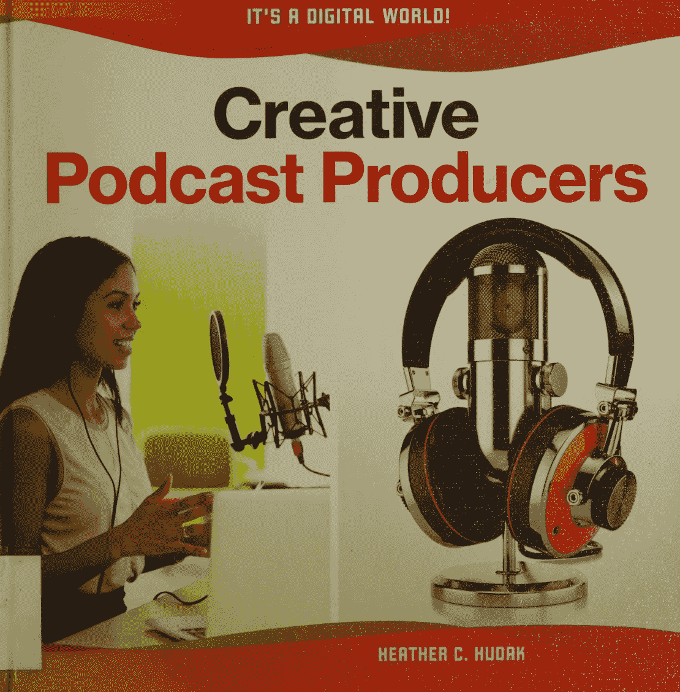
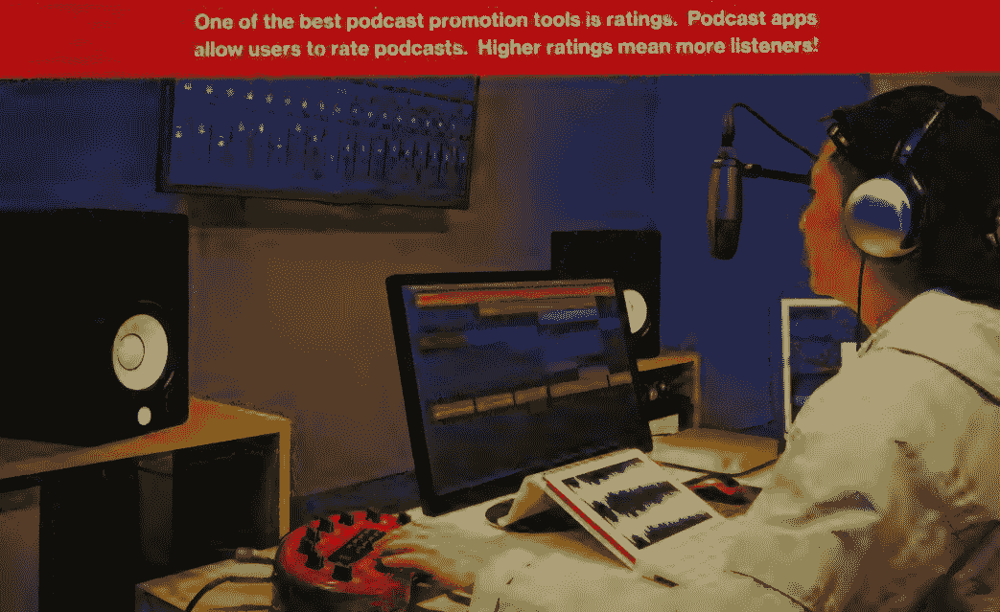

# 创意播客制作人（数字世界！）

## 播客制作人

**HEATHER C. HUDAK**

播客制作人

Heather C. Hudak

## 每个人的播客

你曾经参加过公路旅行或长途飞行吗？在汽车或飞机上坐好几个小时真的非常无聊。听播客是打发时间的一种极好方法。播客是可以下载或实时流传输的数字音频文件。你可以在数字媒体播放器或智能手机上收听它们。大多数播客类似于广播节目，特点是人们讨论不同的主题或讲述故事。

播客制作人是制作播客的人。他们录制音频，进行编辑，然后将其发布到互联网上。几乎你能想到的任何主题都有播客。有些播客，例如 `Tumble`，讨论酷炫的科学发现。另一些，例如 `Dream Big`，分享明星采访并鼓励孩子们追逐自己的梦想。大多数播客都有多个剧集。播客制作人努力工作，让每一集都变得有趣精彩。

# 第一章：播客准备

**播客制作人录制并编辑播客以发布在互联网上。** 播客制作人对他们播客的主题有浓厚的兴趣，甚至可能是这些领域的专家。播客是他们与他人分享热情的一种方式。

播客听众可以找到他们感兴趣主题的信息。例如，并没有多少广播节目是关于数学的。但热爱数学的人可以收听 `Math Mutation` 播客。它的剧集充满了有趣又奇特的数学事实。

大多数播客制作人拥有许多不同的技能。制作人需要良好的组织能力，承担许多不同的任务并需要很好地管理时间。他们需要强大的沟通能力并注重细节，还应该擅长解决问题并满足截止日期。

播客制作人不需要大学学位，事实上完全不需要任何特殊培训。任何人都可以开始。

Apple 允许播客制作人追踪听众何时开始和停止收听。大多数播客类似于广播节目，特点是人们讨论不同的主题或讲述故事。在某些情况下，播客制作人必须跟上新技术。

# 第二章：兼职工作

**只要有正确的工具和设备，任何人都可以开始播客。** 甚至是孩子也可以做到！许多学校鼓励学生为学校项目准备播客。

大多数新电脑都配有制作播客所需的各种基础软件和设备。电脑内置了麦克风（通常称为 `mics`）。许多音频编辑程序，如 `GarageBand` 和 `Audacity` 可以免费下载。使用此类程序是入门最廉价的方式。

人们可以购买一些工具来提高他们播客的质量。最重要的设备之一是麦克风。每个麦克风产生的音质都不同。主持人需要找到一个适合自己的。

另一个让播客制作人跟上新技术的工具是音频软件。

# 第三章：行业工具

**只要有正确的工具和设备，任何人都可以开始播客。** 甚至是孩子也可以做到！许多学校鼓励学生为学校项目准备播客。

大多数新电脑都配有制作播客所需的各种基础软件和设备。电脑内置了麦克风（通常称为 `mics`）。许多音频编辑程序，如 `GarageBand` 和 `Audacity` 可以免费下载。使用此类程序是入门最廉价的方式。

人们可以购买一些工具来提高他们播客的质量。最重要的设备之一是麦克风。每个麦克风产生的音质都不同。主持人需要找到一个适合自己的。

另一个让播客制作人跟上新技术的工具是音频软件。软件程序旨在录制、创建、编辑和混合播客。它们被称为数字音频工作站（`DAWs`）。`DAWs` 的示例包括 `Pro Tools` 和 `Audition`。

`GarageBand` 也可以在 `iPad` 上使用。制作人甚至可以使用此应用创建自己的音乐。

在录制播客后，制作人将其保存为音频文件，例如 `MP3` 文件。然后制作人对其进行编辑，可以删除错误，添加特效等。

完成后，播客将发布在网上。有些播客有听众可以下载剧集的网站。播客还发布在在线商店，如 `iTunes` 和 `Google Play Music`。`Stitcher`、`Spotify` 以及其他应用提供播客。

最好的推广工具之一是评分。播客应用允许用户对播客进行评分。高评分意味着更多的听众！

成功的播客有很多收听每一集的听众。博客和社交媒体帖子是制作人宣传播客的常见方式。在大多数情况下，播客的新剧集会在每周或每月的同一时间发布。有时会在网站上发布播客日历，让听众了解即将推出的主题和日期。

# 第四章：在办公室

播客制作人可以在不同类型的地点和环境下工作。通常情况下，制作人可以在世界上任何他们想工作的地方工作。他们只需要拥有强大的网络连接以及适当的软件和设备。

许多播客制作人在自己家里工作。其中一些是创业者，负责自己播客的编写、编辑、主持和营销。他们决定想聊的话题并准备自己的内容，没有人告诉他们该做什么或什么时候做。

## 数字碎片

播客听众平均每周收听五个不同的节目。受欢迎的播客类型是喜剧，教育和新闻是次受欢迎的类型。

其他播客制作人为公司或组织工作。这些制作人创建与公司产品或服务相关的播客。旅游公司可以使用播客讨论观光想法。

2017年，69%的每月播客听众在手机或平板电脑上收听播客，只有31%在电脑上收听。

自由职业是播客制作人的另一种工作方式。他们不是为一家公司全职工作，而是按项目逐一完成。自由职业者与雇佣他们制作播客的人员合作。

# 第六章：播客的历史

**无论现在的播客制作人在哪里工作，这份职业只存在了大约15年。** 万维网于1989年发明。在几年之后，无线广播制作人开始在网络上直播他们的节目。

1995年，`MP3` 格式被发布。这是一种压缩数字音频的方法，使其占用更少的计算机内存，使得存储更多数字音频文件成为可能。要创建一个数字（或 `MP3`）文件，计算机将声音转换为数字流。当播放 `MP3` 时，计算机将这些数字转换回声音。**博主**和无线电广播员开始在他们的网站上添加 `MP3` 文件。听众可以**下载** `MP3` 文件并在电脑上收听。

第一批数字音频播放器于1998年问世。`MP3` 文件可以从电脑传输到数字音频播放器上，使得人们可以在不受电脑限制的情况下听 `MP3` 文件。这些早期的 `MP3` 播放器价格昂贵，存储的内容也不多。

2002年流行的 `MP3` 播放器包括（从左到右）`SONICblue` 的 `Rio Riot`、`Apple` 的 `iPod` 以及 `Creative Labs` 的 `Nomad Jukebox 3`。随着时间的推移，技术得到了改进。`MP3` 播放器变得越来越便宜，内存也越来越大。

很快，很多人开始购买 `MP3` 播放器。最流行的品牌之一是 `Apple iPod`。`MP3` 播放器主要用于听音乐，但人们开始思考使用 `MP3` 文件分享其他类型内容的方法。

`RSS` 源的发展为新类型的音频共享铺平了道路。`RSS` 是1999年发布的文件格式。`RSS` 使用关键词（或标签）从网站上收集特定主题的内容，然后将这些内容整合到一个列表中，称为“馈源（`feed`）”。对该主题感兴趣的人可以订阅该馈源。当网站发布新内容时，新项目会被添加到馈源中。

2000年，软件开发者 `Dave Winer` 在 `RSS` 中增加了一个新元素：在 `RSS` 馈源中包含 `MP3` 音频文件链接的能力。这使用了一种名为“附件”（`enclosure`）的新类型 `RSS` 标签。附件允许 `RSS` 馈源链接到音频和视频文件。

2003年，记者兼电视节目主持人 `Christopher Lydon` 制作了一个音频博客，其中包含了对著名科学家和政治家的采访录音。`Winer` 利用 `RSS` 创建了一个 `Lydon` 采访的馈源，听众可以订阅。随着新采访的加入，馈源会更新。尽管当时“podcast”一词还没有被使用，但 `Lydon` 的音频博客确实就是如此。它是第一个播客。

## 数字碎片

“podcast”一词是“iPod”和“broadcast（广播）”两个词的结合。记者 `Ben Hammersley` 在2004年版的《卫报》杂志中首次使用了这个词。

# 第七章：获得流行

播客多益于 `Apple` 而变得流行。2005年，`Apple` 发布了一个包含播客版本的 `iTunes`，这让人们能够更容易找到它们。

“podcast”一词是“iPod”和“broadcast（广播）”两个词的结合。记者 `Ben Hammersley` 在2004年版的《卫报》杂志中首次使用了这个词。

许多播客多由于 `Apple` 而变得流行。2005年，`Apple` 发布了一个包含播客版本的 `iTunes`，这让人们能够更容易找到它们。

# 第八章：赚钱

**对于许多播客制作人来说，成功意味着赚钱。** 播客制作人赚钱的一种方式是收费。然而，这种方法需要非常大的观众群才能盈利。

播客制作人还可以通过与拥有商店的公司合作赚钱。播客制作人可以加入这些公司的联盟计划。例如，许多播客参与 `Amazon` 计划。

## 数字碎片

播客赞助商可以付费在播客的开头、中间或结尾提到产品。这些被称为前插（`pre-roll`）、中插（`mid-roll`）和后插（`post-roll`）。中插广告通常比前插或后插更长、更贵。

`Amazon` 给每个播客制作人一个特殊的代码或网站链接让他们传给听众。然后，在播客期间，主持人推荐 `Amazon` 销售的产品。当有人使用播客的代码从商店购物时，播客将获得销售金额的一部分。

许多播客在 `Patreon` 上开了账户。这是一个播客听众或其他粉丝支持人们业务的网站。

## 数字焦点：NPR

美国公共广播电台（`NPR`）是顶尖的播客制作机构。它提供了数十种播客。其中一些播客是广播节目的剧集，另一些则是专门作为播客开发的。总的来说，`NPR` 的播客每月下载量超过 1 亿次。

`NPR` 最受欢迎的播客之一是《世界奇妙》（`Wow in the World`）。这是一个面向儿童的每周播客，探索科学与技术。它涵盖许多有趣的话题，例如为什么洋葱会让人流泪，松鼠为什么要藏坚果。主持人通过幽默的故事来吸引听众，并让他们流连忘返。该播客始于 2017 年 5 月，从那时起它的剧集下载量已超过五百万次！

# 第九章：播客趋势

**播客变得越来越流行。**

在 2008 年到 2017 年之间，美国每月收听播客的人数从 9% 增加到 24%。过去，人们必须在广播和电视节目播放时收看。而今天，互联网和移动设备让人们可以选择何时观看和收听播客或其他内容。他们可以下载播客，并在空闲时收听。

**技术**和趋势总是在变化，因此播客制作者需要随之不断改变。随着新技术的发明，制作者可以利用它们来制作更新颖、更好的播客。他们需要继续学习新的**软件**并尝试使用它的方法。

故事讲述是播客领域最大的趋势之一。播客开始使用**叙事**手法来吸引听众。他们不再仅仅是讨论一个话题，而是将其转化为一个故事。

播客之所以特别受欢迎，是因为人们可以在收听的同时进行多任务处理。人们可以在收听播客时打扫、工作或进行其他活动。

> 专家认为，虚构播客未来将变得更加流行。这些包括基于漫画书、电视节目和电影的播客。

在某些情况下，故事是虚构的。有一个虚构播客是儿童播客《芬·卡斯宾安的外星冒险》（`The Alien Adventures of Finn Caspian`）。它的第一集制作于 2016 年。在其他**叙事类**播客中，故事则是基于真实事件。

例如，《过去与好奇》（`The Past & The Curious`）通过故事讲述和音乐来探索历史。

一些播客制作者在一集中讲述完整的故事。另一些则每集只讲述故事的一部分。他们在每集结束时留有**悬念**。听众如果想知道故事如何结束，就必须收听下一集。

播客的另一个热点趋势是视频直播。视频直播是在视频录制时将其发布到互联网上的视频。一些播客制作者利用视频直播来与听众互动。这让听众能够观看播客的录制过程。观看直播的人可以向播客制作者提问，或对他们的节目提供**反馈**。

许多播客制作者正在寻找在播客之外使用其播客技能的新方法，例如**朗读**有声书。随着播客持续增长，播客制作者利用其技能的新机会也将增加。只有时间才能告诉我们制作者们还会想出哪些其他创意！

## 时间线

### 1989
万维网发明。

### 1995
`MP3` 文件格式发布。

### 1998
第一批数字音频播放器问世。

### 1999
`RSS` 文件格式发布。

### 2000
`Dave Winer` 发明了 `RSS` 附件（`enclosures`）。

### 2003
`Winer` 和 `Christopher Lydon` 创建了第一个播客。

### 2004
`Adam Curry` 启动了播客《每日源代码》（`The Daily Source Code`）。`Libsyn` 成为第一个播客服务提供商。

### 2005
`iTunes` 商店开始提供播客。

### 2016
《芬·卡斯宾安的外星冒险》第一集制作。

### 2017
`NPR` 的《世界奇妙》第一集发布。

# 词表

*   **affiliate**（附属）——与某公司或组织的成员关系或关联。
*   **audience**（观众）——一群读者、听众或旁观者。
*   **blog**（博客）——一个讲述某个人观点、活动和经历的网站。写博客的人是博主。
*   **breakthrough**（突破）——突然的进展或成功的发展。
*   **cliff-hanger**（悬念）——一个故事、竞赛或情境，因为不知道接下来将发生什么，所以它非常令人兴奋。
*   **download**（下载）——将数据从计算机网络传输到单个计算机或设备。可以下载的东西是可下载的。
*   **entrepreneur**（企业家）——组织、管理并承担业务或企业风险的人。
*   **feedback**（反馈）——建议改进某事的信息或批评。
*   **market**（营销/市场）——通过广告或推广某物，使人们想要购买。
*   **media**（媒体）——通信、信息或娱乐的形式或系统。包括电视、广播和报纸。
*   **mobile**（移动）——能够移动或被移动的。
*   **narrate**（叙述）——讲述故事。以完整细节讲述的故事是叙事。
*   **online**（在线）——连接到互联网。
*   **social media**（社交媒体）——允许人们创建在线社区以分享信息、想法和消息的电子通信形式。`Facebook`、`Instagram` 和 `Snapchat` 是社交媒体的例子。
*   **software**（软件）——用于操作计算机的编写程序。
*   **sponsor**（赞助商）——为了推广产品或品牌而提供资金。这样做的人是赞助商。
*   **subscribe**（订阅）——同意接收出版物，它是免费的。这样做的人是订阅者。
*   **upload**（上传）——将数据从计算机传输到更大的网络。
*   **version**（版本）——不同的形式或类型。

欲了解更多关于播客制作的信息，请访问 `abodoblinks.com`。这些链接定期更新以提供最新的信息。

# 索引

| 关键词 | 页码 |
| :--- | :--- |
| Adobe Audition | 10 |
| affiliate programs | 20, 22 |
| enclosures | 16 |
| episodes | 5, 6, 8, 9, 11, 14, 15, 16, 20, 27 |
| equipment | 7, 8, 10 |
| Past & The Curious, The | 26 |
| Pro Tools | 10 |
| Alien Adventures of Finn Caspian, The | 26 |
| technology | 14, 23 |
| RSS feeds | 8 |
| science | 5, 23 |
| selling products | 22 |
| Stitcher | 11 |
| storytelling | 5, 7 |
| subscribing | 16, 19 |
| software | 7, 8, 10 |
| sponsor | 22 |
| tumble | 5 |

| websites | 8, 9, 11, 14, 16, 20, 27 |
| Winer, Dave | 16 |
| World Wide Web | 14 |
| Wow in the World | 23 |
