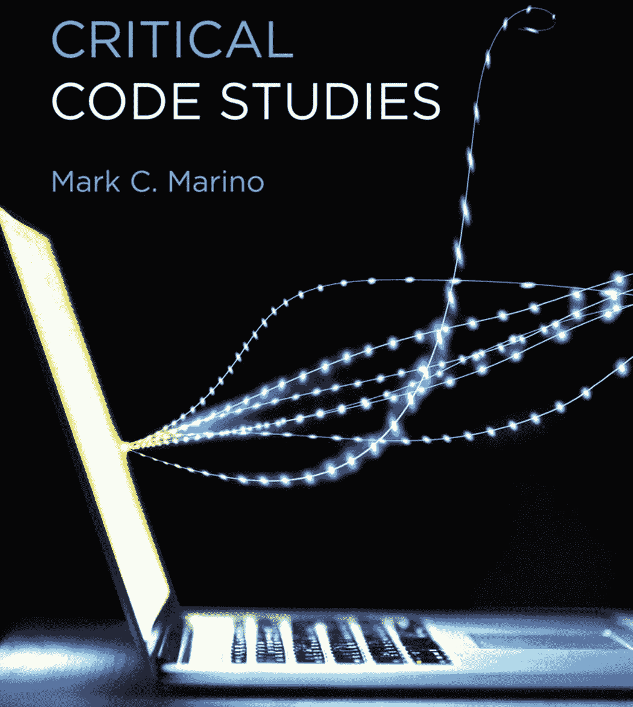
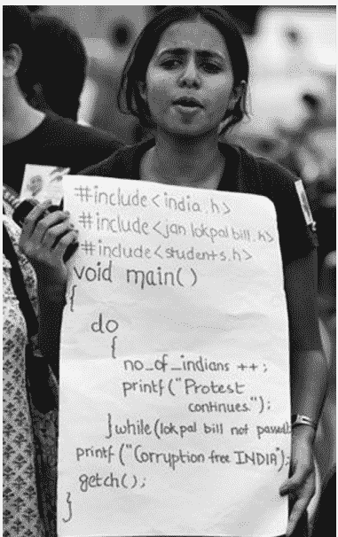
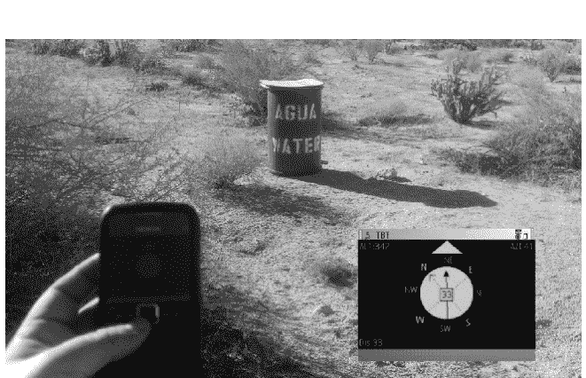
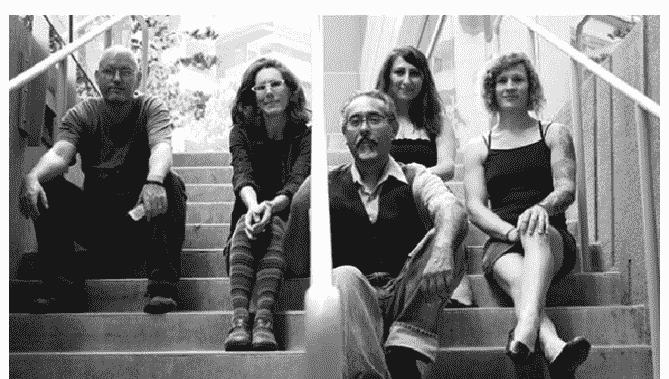
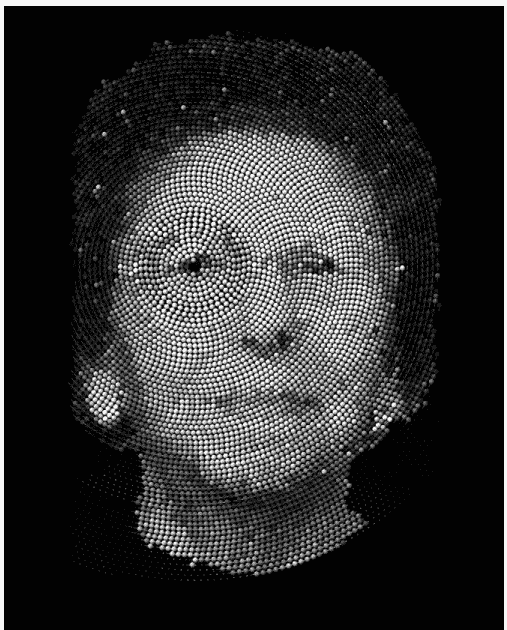

# 关键代码研究：初始（方法）（软件研究）



献我的家人，

尤其是 Barbara, Genevieve 和 Dayveon，

他们赋予我的生命意义

# 系列前言

软件已深度织入当代生活——无论在经济、文化、创意还是政治方面——方式既显而易见又几近隐。然而，尽管关于软件如何使用以及它支持和塑造的活动已有许多论，但在历史的大部分时间内，对软件本身的思考很大程度上留在技术层面。然而，越来越多的艺术家、科学家、工程师、黑客、设计师以及人文和社会科学领域的学者发现，对于他们所面临的问题和需要构建的事物，对软件进行扩展理解是必要的。为了实现这种理解，他们可以借鉴计算和新媒体历史中的一系列文本；他们可以参与到丰富的内隐软件文化中；他们同时也参与了丰富的内隐软件文化中。

## 1 引言

### 传遍世界的代码

```
if n_elements(yrloc) ne n_elements(valadj) then message, 'Oooops!'
--briff_sep98_e.pro
```

谁在读计算机源代码？代码对他们来说意味着什么？专家、诗人、黑客活动主义者和人文教授、律师和外行人士——不仅仅是程序员，还有许多出于各种原因在阅读代码。无论是寻找“彩蛋”还是嗅到“代码异味”（`code smells`），追求审美上的快乐，还是寻找自己被操纵的方式，这源于对代码的好奇心。如果我们要参与这种阅读代码的共同实践，我们必须进行批判性阅读，我们阅读代码的方式与我们正在阅读代码这一事实本身同样重要。请考虑以下示例。

2009年，来自英国东安格利亚大学气候研究小组（CRU）的邮件似乎为气候变化否认者提供了“冒烟枪”，证明气候变化是一场骗局。这些邮件包含了用于模拟气候变化的代码，而代码中的注释似乎表明数据遭到了操纵。因此，博客圈充斥着代码引用，特别是来自一个名为 `Harris_Read_Me` 的文件，该文件以程序员伊恩·哈里斯（Ian Harris）命名，他与基思·布里芬（Keith Briffen）合作编写了代码。在尝试记录他的进度、理解并协调各种数据时，哈里斯在代码注释中写道：“这里应该发生什么？是的——没有‘应该’，我可以随口编造。所以我有了 : :)。”

泄露文件中其他部分的注释表达了一个程序员的挫败感，他抱怨为了协调冲突且有时相互矛盾的数据，他必须付出的巨大努力。气候变化否认者抓住这些“生肉”，声称这些注释是证明全球变暖的数据是胡言的证据，是代码中的阴谋论。该源文件据称揭示了大规模骗局背后的内幕，而这场戏的舞台正是计算机代码本身。

公众的批评不仅止于代码的内容；阴谋论猎人还深入研究了用交互式数据语言（IDL）编写的代码运行机制，发现了哈里斯标记为“修饰因子”（fudge factor）的内容。请考虑这段带有 `[...]` 的摘录：

```pro
****** APPLIES A VERYIFICIAL CORRECTION FOR DECLINE*******
;
yrloc=[1400,findgen(19)*5.+1904]
valadj=[0.,0.,0.,0.,-0.1,-0.25,-0.3,0.,-0.1,0.3,0.8,1.2,1.7,$
2.5,2.6,2.6,2.6,2.6]*0.75 ; fudge factor
if n_elements(ylroc) ne n_elements(valadj) then message,'Oooops!'
;
[...]
;
 APPLY ARTIFICIAL CORRECTION
;
yyearlyadj=interpol(valadj,ylroc,x)
densall=densall+yearlyadj
```

简而言之，代码获取了一组1400年至1994年的数据，并通过添加（在负数的情况下为减去）另一组数字（列为 `valadj`，推为数值调整）对该数据进行调整。代码使用程序员所谓的“魔数”或未命名的常量来进行这些调整，这些常量被引入代码中，但对其参考来源没有任何解释（Farrell 2008）。通过这种方式调整数字，“修饰因子”注释标记了符合他预期的生成数据集。

## 2 第1章

### 引言

简而言之，代码获取了一组1400年至1994年的数据，并通过添加（在负数的情况下为减去）另一组数字（列为 `valadj`，推为数值调整）对该数据进行调整。代码使用程序员所谓的“魔数”或未命名的常量来进行这些调整，这些常量被引入代码中，但对其参考来源没有任何解释（Farrell 2008）。通过这种方式调整数字，“修饰因子”注释标记了符合他预期的生成数据集。

其含义、解释与推断的空间，以及误读与重新挪用的可能。“气候门事件”（Climategate）与那些在线辩论永恒相连，这使其意义远远超过了其设计者的初衷。代码是一种社会文本，其意义随着额外读者的遇到而发展和转化。这种意义随着时间的推移和背景的变化而不断演……这就是本书的论点和挑衅。

现在是时候追踪代码意义的方法了。计算机源代码已成为我们政治、法律、审美和大众话语的一部分。律师、企业经理、评论员甚至文学学者正在阅读代码。代码正被用于政治辩论、艺术展览、大众娱乐和历史记录中。随着代码接触到越来越多的读者，以及编程语言的不断演进，我们需要开发方法来解释代码是如何积累意义的，读者又是如何塑造这些意义。我们不仅需要理解代码的功能，还需要理解代码的符号意义。我们需要学习批判性地阅读代码。但阅读需要一套能够关注其特定背景和关系的新方法。正如接下来的示例所示，通过代码进行的通信是非常直观的。

### 一场面试

让我们思考一个问题：代码意味着什么？首先，如果我能定义我所指的代码，将很有帮助。目前，我会称之为计算机源代码。然后我可能应该说明它的具体含义。但这种方法充满了愚蠢。对问题的重新表述可以采取面试的形式。为了便于这个论点，让我们想象有两个程序员，一男一女，正在申请同一份工作。在面对面试之前，他们被隔离在一个房间里，被要求解决一个挑战：编写一个计算字符串字母位（anagram）的程序。字母位包含原始字符串的所有字符，尽管代码不需要产生可识别的单词。在挑战结束时，程序员将以电子方式提交代码，因为雇主将不知道哪个版本是由谁写的。其中一个候选人提交了以下 JavaScript：

```javascript
function anagram(text) {
  var a = text.split("");
  for (var i = 0; i < a.length; i++) {
    var letter = a[i];
    var j = Math.floor(Math.random() * a.length);
    a[i] = a[j];
    a[j] = letter;
  }
  return a.join("");
}
```

简单来说，这段代码创建了一个函数（`anagram`），将字符串拆分为单个字符的数组，并在合并它们之前随机随机重新排列该数组中的项。然而，另一个候选人提交了一个完全不同的解决方案：

哪个程序员将获得这份工作？无疑是写代码的人——但是哪一个？答案是：这取决于读者（在这种情况下，是招聘人员）如何解释代码。一方面，第一步清晰地列出了它的步骤。过程易于识别，每一步都是相当直接的技术。另一方面，第二个函数可能因为其简洁而显得更聪明。它使用了更复杂的函数。这种概念通常直到更高级的课程中才会教授，因为它的操作是特定的，甚至是奇特的。毫无疑问，阅读这些代码示例的程序员可能已经在脑海中对这两位候选人形成了印象：一个细心、有组织性，也许很乏味；另一个则有好显摆的倾向。但每家公司都是不同的。

不同的公司、不同的编程文化、不同的优先级、不同的工作任务需要不同的能力。一组雇主可能看重易于阅读、修改和维护的代码。另一些可能将单行解决方案视为强大编程直觉的，即完全内化代码结构的能力。进一步解释，每位雇主可能对哪个代码是男性写的、哪个是女性写的有不同的假设（也许你已经做出了这样的假设）。根据他们的个人偏见或招聘需求，他们可能倾向于其中一个，这再次取决于他们如何从代码的呈现中读出性别。人们无需进一步关注近期计算机文化中性别分化的公开揭露（如 Google 最近发生的事件），就能看到硅谷及其他地区性别平等的危机。这个例子表明，代码传递的不仅仅是能力：它表达了公平性，即使这些挑战被用来使招聘决策不再依赖于其他身份渠道（如简历或面对面面试）。

程序员们意识到这些可能的解释，他们明智地选择了自己的策略，因为他们意识到自己正在向潜在的雇主展示自己。他们不能假设自己的代码会以特定的方式被解释。雇主可能将单行代码视为倾向于模糊化的信号，或将多行代码视为处理问题方法平庸的信号。程序员可能在编程课程上教授的、或通过专业或其他在线与其他程序员互动而发展的冲突想法和审美之间挣扎。他们还可能受到接触或沉浸在各种编程范式或语言的影响，这些语言强调某一种美德（例如易用性）而非另一种（可读性或优化）。

这个例子中的代码提供了一个图灵测试的媒介。艾伦·图灵的思想实验挑战计算机使其伪装成人类。然而，这种场景并不是一个计算机和一个更擅长说人类语言的人，而是呈现了两个程序员试图证明谁能更流利地使用计算语言，或者至少在他们寻求工作的公司方言中成功交流。只有表层挑战是在询问人类是否能以计算机理解的方式说话。

更深层次的挑战要求程序员通过他们使用代码向其他人类（同事和合作者）传达他们自己。他们的代码与其说是证明他们能够完成任务的试金石，不如说是一种通过过程和价值观传达性格的考试。简单来说，这项测试中的代码再次证明它不仅仅是一个功能性工具：它是人机之间的一种表达手段。

### 代码的意义

代码是衡量求职者能力和偏好的有意义的标准，因为代码传递的不仅仅仅仅是其功能；作为一种在文化中流动的相互依赖的对象，它积聚了更多的意义。工作面试场景中的示例是假设性的，但具有代表性。一旦我们将注意力回到具有修订、修正、弄虚、运行或失败历史的现实世界时，我们有更多可以讨论的内容——或者正如人文科学中所说的，需要去“解读（unpack）”。Alan J. Perlis 在 Harold Abelson 和 Gerald Jay Sussman 的经典奠基性著作《计算机程序的结构与实现》（Structure and Interpretation of Computer Programs）序言写道：“每一个计算机程序都是一个在脑中产生的真实过程模型。这些过程源于人类的经验和思考，规模宏大，细节复杂，且在任何时候只能被部分理解”（1996, xi）。解读这些锁定在特定技术社会背景下的程序之意义，是批判性代码研究（CCS）的任务。

# 代码中的抗议

代码具有某种意义，且这种意义源于它的功能。这种意义并不取决于代码作者是否意图向他们之外的观众传递某些信息（如代码注释所示）。考虑两个截然不同的例子。

2011年夏天，在印度的一场政治抗议活动中，一张后来在Reddit讨论板上的照片显示一名年轻女性拿着标牌（图1.1），上面写着：

```c
#include <india.h>
#include <jan lokpal bill.h>
#include <students.h>
void main() {
  do
{
    no_of_indians++;
    printf("Protest continues.");
  } while (lokpal bill not passed);
  printf("Corruption free India");
  getch();
}
```



图1.1

一名女子拿着写有代码的抗议标牌。

该女子主要使用C语言进行抗议。她通过编写代码来抗议。

对这个标牌的一种解读是，抗议者号召印度（特别是工程和计算机科学专业的学生）支持《人民洛克帕尔法案》（Jan Lokpal Bill）。这段代码提供了一个小循环，其中抗议的印度人数量不断增加，直到法案通过，届时，这个“程序”——印度，将实现廉廉洁。¹¹³

通过分析这段代码（或伪代码）的功能，有助于识别其传达政治信息的方式。¹¹⁴ 她标牌上的代码包含了几个类库：`india`、`jan lokpal bill` 和 `students`。换句话说，它使用预处理指令 `#include` 来加载列出的名称文件，或首先加载的文件。在抗议的背景下，这段代码似乎在玩一个文字关游戏：“包含”印度人民（代表人民的意愿）、“包含”法案（通过该措施）以及“包含”学生（邀请学生作为该标牌的主要观众加入这一过程）。将这三项作为头文件进行排列，在符号上赋予了它们优先级，因为它们的内容被确立为其余代码的基础声明。

`void main()` 调用了一个带有循环（`do`）的函数，该循环增加印度人数（`no_of_indians`）并打印信息“Test continues（抗议继续）”，直到法案未通过的条件。一旦循环结束，函数打印“Corruption free India（廉洁印度）”。`getch()` 函数意味着输入任何字符将退出程序，但最后这条指令的逻辑——或者在终止程序前等待任何按键——并不显而易见。也许在某一点，由于抗议，需要被中断。按一个键停止程序可能代表争取更多的特质（integrity/正直）或针对被激活公民的特质（character），尽管没有足够的上下文线索来做出定性解读。通过将代码放置在标牌上并在公共活动中举起作为政治表达，持标牌的女子正在邀请公众将其作为非计算系统进行开放解读。

Reddit对这张照片的讨论有169条评论（如果算上“India”和“pics”Reddit论坛下的独立帖子，则超过400条），评论者（即编辑）对她代码的优雅性（或感知的缺乏优雅性）、全球溯源、众包，以及对大学编程教学方式的批评发表了意见，更不用说对抗议主题——印度《人民洛克帕尔反腐败法案》的讨论了。该法案也被称为公民监察员法案（Citizen’s Ombudsman Bill），提议于1968年。由政治活动家Anna Hazard绝食驱动的2011年运动，由于一场主要在Twitter上进行的社交媒体活动而引起广泛关注，其目标群体是印度精通媒体的中产阶级（Stancak and Pokharel 2011）。在这一特定运动期间用计算机代码制作抗议标牌，是向印度技术领域具有影响力的专业群体对话。用类代码文本表达政治信息，是向能够读懂计算机代码的读者（即她的专业语言）对话。

这场辩论缺乏对其观点的深思熟虑，且更多表现为Reddit等留言板上常见的喷子（trolling）行为。大量的评论集中在代码感知的缺陷上，这引发了关于她的性吸引力以及她作为所谓外包程序员的感官低劣的言论。通过用这种代码进行抗议，这位女子（推测是印度籍）引发了印度以外Reddit用户的保护主义、精英主义和沙文主义反应，让我们窥见了我在所说的“编码沙文主义”（encoded chauvinism，见第5章），这种主义主义可能会掩盖编程文化。因此，这段代码为我们提供了一个机会，不仅可以讨论其核心点——《人民洛克帕尔法案》，还可以讨论随之产生的编程文化。关注标牌本身的能力以及它是否能编译，而不是它的意义，证明了机器的中心地位，使代码可读的需求成为优先。批判性代码研究寻求让这些次要意义成为主要。

诚然，这个抗议标牌几乎不是代码的日常。事实上，尽管抗议使用了类代码语言，但这个标牌与“代码创作”（codewark，一种利用代码和类代码正统性创作诗意艺术的风格）比软件开发背景下的编程更有共同点，⁹这段代码主要是为了表达政治立场，而不是为了产生程序。然而，这段代码具有语境性。印度女子持有类C代码的标牌，显示了性别、经济和政治交织的表达，亚大陆女性正面临增长且日益自由的中产阶级内部的性别鸿沟。相比之下，考虑第二个例子，选择它是因为它与第一个例子有许多相似之处（例如感知的性别、程序员国籍以及政治表达的目标）。⁰在代码仓库GitHub上，程序员Tapaseni Pathak发布了一个名为“Women on GitHub”的网页应用项目（Pathak et al. 2021）。²¹该项目使用了一个名为Heroku的框架，获取了一份“激励贡献者编写更多代码”的女性程序员名单。两位贡献者，

### 网页应用示例

Prabhanshu Attri 和 Fatima Rafiqi 添加了用于在网页上显示该列表的代码。以下是创建网格化表格的 PHP 和 HTML 代码，它以个人资料框（图 1.2）的形式显示用户，这种形式让人联起了棒球或足球偶像的球员卡。


```php
219 $count = 1;
220 while ($row = $result->fetch(PDO::FETCH_ASSOC)) {
221 echo '<div class="mdl-card mdl-cell--3-col mdl-cell--4-col-tablet mdl-cell--4-phone mdl-shadow--3dp">
222 <div class="mdl-card_media user-img">
223 
224 <span class="id-element mdl-typography--font-light">$row['id'].'</span>
225 <nav class="menu-'.'.$row['count'].'>
234 [ Navigation menu ] ...
235 echo '</nav>';
236 </div
237 <div class="mdl-card_supporting-text">
238 <span class="mdl-typography--font-light mdl-typography--subhead">
239 <table>
240 <tr>
241 <td><i class="fa fa-user"></i></td>
242 <td><h4 class="android-header">$row['login'].'</h4></td>
243 </tr>
244 if (strlen(trim($row['name']))) != 0 && empty(trim($row['name'])))
245 echo '<tr>
246 <td></td>
247 <td>'.trim($row['name']).'</td>
248 </tr>';
249 if ($row['company'])
250 echo '<tr>
251 <td><i class="fa fa-group"></i></td>
252 <td>'.$row['company'].'</td>
253 </tr>';
253 if ($row['location'])
254 echo '<tr>
255     <td><i class="fa fa-location-arrow"></i></td>
256     <td>$row['location'].'</td>
257 </tr>';
258 if ($row['created_at'])
259 echo '<tr>
260     <td><i class="fa fa-clock-o"></i></td>
261     <td>$row['created_at'].'</td>
262 </tr>';
263 echo '</table>
264 </div>
```

该代码生成了卡片的基本布局。在将计数器设置为一（`$count = 1;`）后，它使用 `while` 语句循环遍历所有数据。随后的行：


tapasweni-pathak

(Tapaswenii Pathak)

SAP Labs

印度班加罗尔

加入于 2013 年 4 月 13 日

在 GITHUB 上查看

图 1.2

来自“GitHub上的女性”的示例图片。

## 引言

使用 `echo` 语句（PHP 用于打印或显示）显示用户账户的各个方面。²²

特色程序员个人资料的每个元素都由 `<div>...</div>` 或 `<span>...</span>` 标签包围，以便对其进行格式化或样式设置，无论是通过位置、大小或其他设计元素。`<class>` 指定指示了对层叠样式表 (CSS) 文件应用何种格式化。

第二部分（从第 236 行开始）使用常规代码创建卡片的下半部分：

18 斯皮瓦克，第一章

加特阿里（Gatriatri）在其创性论文《底层阶级能说话吗？》（1994）中对文化霸权之外的无权力者进行了理论化，认为他们无法代表自己就无法发言。根据斯皮瓦克（Spivak）的定义，女性程序员并不构成底层阶级，因为她们获取权力工具的权限过多。然而，她对权力和话语的理论化阐明了这段代码意义中所涉及的动态机制。在全球经济中，出生在第一世界西方国家的女性程序员尽管属于受过良好教育的专业阶层并生活在欧洲或美国等地方，但其地位和薪资通常低于男性同伴，尤其是来自美国等更有特权的经济体的男性。可以可以说，通过代码进行表述，抗议标语和网页都提供了女性代表自己的示例。虽然这里不是详细阐述里萨姆（Risam）或斯皮瓦克理论的地方，但这个例子提供了一种外部启发式方法——在本例中——是如何指导我们的代码阅读实践的。

我将通过计算机源代码解释文化的行为称为**批判代码研究**（critical code studies），在本书中我将主要通过一系列案例研究来界定但不限于其方法。批判代码研究定义了一种将代码视为话语独特语义的立场，其意义需要特定的技术，而由于代码和编程的本质正在快速演变。换句话说，代码是一种运行的独特环境，但由于其与硬件和其他软件系统的关系，它仍然与主要的通信形式有所不同。

批判代码研究命名了相关方法，以及对源代码功能之外的意义进行分析的学术研究，而本书提供了一系列案例研究来展示其潜力。

## 批判代码研究的起源

批判代码研究源于一种渴望，即以对数字对象独特构造的更多关注来阅读这些对象。

在2004年，当我分析对话代理和聊天机器人（如 ELIZA）时，我正试图找到一种方法来执行凯瑟琳·海耶尔斯（Katherine Hayles）和莱夫·马诺维奇（Lev Manovich）所称的*媒介特定分析*。对话代理的独特属性是什么？它们与数字或打印对象有何不同？很快变得明显了：如何阅读代码？在寻找答案的过程中，我发现了几位关于源代码本体论的学者。基特勒（Kittler, 1992）写过一点。劳伦斯·莱西格（Lawrence Lessig,2006）从更广泛的意义上接触代码。代码也被其他一些学者采用，特别是艾德里安·麦金齐（Adrian Mackenzie,2005）、弗洛里亚·克拉默（Florian Kramer,2005）、洛斯·佩奎纽（Loss Pequeño,2006）、艾·刘（Alan Liu,2004）和亚历山大·盖洛（Alexander Galloway,2004）。他们的动作有力地进入了代码领域，但并没有包含实际解释代码的例子。正如批评人士所建议的，在一个独特的符号领域，代码可以说明什么？

我受过文学理论和文化研究的训练，以及我们所称的新媒体，所以我教了他们这些。符号学提供了分析任何系统的工具，解构主义通过钻研其中的裂缝和缝隙补充了这一研究。文化研究提供了一种将“文本”从神坛拉下的方法，同时帮助将“文本”视为一种文化人工。批判理论指向压迫的结构，从女性主义到马克思主义，从酷儿理论到后殖民主义和种族形成理论，都提供了批判框架。

在同一时期，诺亚·沃德里普·弗因（Noah Wardrip-Fruin）、马修·富勒（Matthew Fuller）和莱夫·马诺维奇开始理论化软件研究，而尼克·蒙特福（Nick Montfort）和伊恩·博格（Ian Bogost）发起了平台研究。所有这些研究都强调分析不同技术的特殊性。然而，平台研究主要关注硬件，至少在《竞逐 2600》（Racing the Beam, Montfort and Bogost 2009）中如此；而在《表达处理》（Expressive Processing，软件研究系列的第一本书）中，沃德里普·弗因（2009）基本上孤立了代码。在这两个新媒体分支诞生的同时，我在论文中提出了代码研究（更新于第2章），该论文在现代语言协会会议上发表，并发表于《电子书评论》。

本文的目标是建立关于解释代码方法的学术研究。我主张（并继续主张）不应该孤立代码，而应该从符号学和文化分析工具开始阅读，并继续开发适用于代码的方法。我们必须消除将代码理解为无意义数学的观点（事实证明这是一个错误的观念），转而将其视为一个充满内涵和外延的文化情境系统，由人类和机器的读者赋予意义。尽管这看起来很艰巨，但到了把代码从黑箱中取出，探索其复杂且独特的符号系统如何在各种语文中产生意义的时候了。在这个过程中，我发现了计算机科学家已经知道的丰富性——一种超出代码功能的意义感——我额外获得了人文领域开发的用于解释和注释的启发工具。

然而，并不是所有人对这个提议感到兴奋。例如，一些听到这一想法并阅读了早期代码研究著作（特别是将异性恋规范与恶意软件病毒联系的文章）的计算机科学家以嘲笑和报警作为回应（如 Marino 2016 和 McPherson 2018）。对于他们的怀疑者来说，批判代码研究标志着人文主义者入侵所谓的“科学战争”，这是物理学家与人文主义者之间的激烈竞争，后者认为他们对理解不足的科学进展（特别是量子物理）大大其哗。他们问，当这些文学学者随意将他们高深的理论应用于远出其专业领域的事情时，会发生什么？帝国主义和傲慢的挑战是显而易见的。

由于不想疏远我寻求探索其作品和领域的专家社区，我在接下来的几年里与计算机科学家进行了交流。我们召集了在线论坛和每半年一次的批判代码研究小组（CCSWGs），其中包括各种水平和各种背景的学者，特别是计算机科学家。通过这些对话产生了本书书中展示的解释性实践模型，以及由于对我们立场的细致表达和翻译而产生的相互尊重的基础。正如我在原始论文中所说的，即使是“解释”和“意义”这些词，在计算机科学和人文科学中代表的思想也不相同。该小组还包括几位训练跨越人文与计算机科学差距的学者，进一步帮助跨越了分沟。

这些工作小组产生了文章、会议演讲和书籍，包括第一份 CCS 手稿——由十个人共同编写的 `10 PRINT CHR($205.5+RDI(1));:10`（Montfort 2013；亦见 10 PRINT），它分析了这段代码。温迪·君（Wendy Chun, 2010）展示了《程序愿景》（Program Visions, 2011）的第一章。丹尼斯·杰里兹（Dennis Jerriz, 2011）为威廉·克劳瑟的《冒险》提供了 FORTRAN 代码用于注释。马克·萨姆尔（Mark Sample）的《犯罪代码：视频游戏中的程序逻辑与修辞过度》（2013）对视频游戏《大都市》（《模拟城市》的前身）中的 C++ 代码进行了解读。塔拉·麦尔斐森（Tara McPherson）展示了她对民权运动与 Unix 开发之间交集的分析的早期版本（2010；2018年修订并扩展）。费德里卡·法布雷切蒂（Federica Fabretti）对第一号太空探测器水手 1 号代码中一个误读的 Bug 提出了见解（2010）。

## 引言

21

随后，几本书籍扩展了研究代码的文化背景。David M. Berry 的《软件哲学》（*The Philosophy of Software*, 2011）对代码的本体论和认识论进行了形式化的考量，Adrian Mackenzie 的《切割代码》（*Cutting Code*, 2006）也是如此。Bradley Dilger 和 Felix Rice 将以 HTML 标记为中心的代码汇成了《A标签》（*A <a>*, 2010）。正如我所提到的，Geoff Cox 和 Alex McLean 编写的《对话代码》（*Speaking Code*, 2012）探索了代码如何以二重唱的形式作为言说发挥，其中 Cox 的文本与 McLean 的代码段落交织在一起。D. Fox Harrell 的《幻影媒体》（*Phantommedia*, 2013）将编程视为一种潜在的文化情境化实践。James Brown Jr. 在《伦理程序：医院与软件的修辞》（*Ethical Programs: Hospital and the Rhetoric of Software*, 2015）中将修辞理论应用于代码。在《编码素养：计算机编程如何改变写作》（*Coding Literacy: How Computer Programming Is Changing Writing*, 2017）中，Annette Vee 从法律角度分析了代码，并考察了素养团的框架，将其扩展到关于文化中代码教学的更广泛的讨论。最近的作品是 Kevin Brock 的《理论研究》（*Theoretical Studies*, 2019），提供了代码研究的特定应用，将代码解读为修辞话语的手段。

许多工作都在尝试理解代码的可能性，以及代码本身是什么。几位学者发现，借鉴 J. L. Austin 的言语行为理论，将代码视为表演性语言是有帮助的。Hayes、Cox 和 McLean (2013) 以及许多其他人发现这种框架是很有成效的，因为代码似乎确实如其所言。然而，像 Daniel Punday (2015) 等人则将代码编程视为写作。还有人，如 Roger Whitson（在 2012 年的 CCSWG 中），建议行动者网络理论可能非常适用。在这种公式中，代码在将其其他代码体、机器和人类连接成网络时，变成了一个实体（行动者）。无疑，这种理论化更好地契合了 Kirschenbaum 对语境在解释代码中至关重要性的感知（见第 2 章）。如果说对自然语言和语义的研究是某种指示，那么这些最初的理论框架仅仅是一个开始。

很少有文本探讨代码的本体。Chun 的《愿景》（*Visions*, 2011）和 Hay 的《我母亲是计算机》（*My Mother Was a Computer*, 2005）提供了重要的干预，将计算以及我们对它的痴迷置于其中。Gabriela Coleman 的《编码自由》（*Coding Freedom*, 2012）探讨了开源编程文化的精神内核。Jussi Parikka 的《数字寄生虫》（*Digital Contagons*, 2007）虽然包含很少的代码，但对病毒和蠕虫提供了稳健的媒体考古学研究。由于这些作品对技术文化研究进行了哲学上的干预，它们为解读代码提供了基础。

批判性代码对基于代码的艺术项目的生产产生了影响。如 Nick Montfort 和 Stephanie Strickland (2013）这样的艺术家已经开始发布他们的源代码（甚至是嵌入其源代码中的文章），并意识到批判性代码研究的学者之后会审阅他们的代码。同样，像 J. R. Carpenter (2011) 和 Brendan Howell (Griffiths et al. 2010) 这样的艺术家出版了程序生成的文学文本的书版，其中包含了他们的源代码。第 3 章讨论的《跨界移民通行费》（*Transborder Immigrant Toll*）的创建者也发布了他们的代码以及该作品口头诗的片段。这些艺术家在作品出版中锻造了代码，他们邀请读者在对整体作品的解读中包含对其代码的探索。

这段简短的概述甚至还没有开始计算科学领域中许多讨论功能之外代码的出版书籍。一个值得目的合集是《美丽代码》（*Beautiful Code*, Oram and Wilson 2007），它邀请有影响力的程序员分享关于他们眼中美丽代码示例的散文。关于美学的讨论（包括多个视角）以及对美学主张主观性的承认，是承认代码是一个值得深入讨论的话语领域的起点，这种讨论超越了功能性。

## 24

## 第1章

接下来，我将考察通用类软件。投票软件与许多类型的软件一样，在很一段时间内主要由公众无法使用的专有系统组成。然而，随着人们对投票软件安全性的质疑日益增加，以及某些软件代码泄露，这种做法开始发生变化。一些团体开始主张需要开源投票软件，以便在这些这些机器上投票的公众能够随时对其进行审查。他们发布的免费和开源软件，促使了商业市场中的公司随后发布了其专有软件的代码。在简要介绍这一背景后，我将注意力转向这一特定的软件：它是谁创建的、何时、在何处以及为什么创建的。这标志着丰富本书内容的历史、考古学和社会学研究的开始。如果代码作者还健世，我可能会尝试采访他们.³31 否则，他们的文档在这个过程中具有极高的价值。

Votebox 展示了一个由莱斯大学大学的研究人员开发的免费且开源的数字记录电子（DRE）投票软件。该代码是为了研究目的而非其他目标（如活动主义、艺术反思或商业）而创建，这影响了我阅读这段代码的方式。投票 使用 Java 编写，尽管它起源于 C#，采用了作者希望的“一种清晰、现代、面向对象的风格”（Sandler, Derer, and Wallach 2007, 360）。对清晰性的强调可能反映了创建此软件的学术目标，或者希望代码能够让更广泛的公众为了审计目的而读。无论如何，所选语言和软件设计范式的限制与功能是解读任何代码的关键，而这些程序员指出，与 Python 相比，他们选择 Java 增加了其冗长导致的长度（ibid., 360）。

代码中的注释，特别是文档良好的代码，为其功能提供了指南，并且往往传达了更多信息。在他的《软件哲学》一书中，Berry（2011）注意到，Votebox 代码中的注释经常使用男性代词来指代选民：

```java
/**
* 这是当选民请求
* 挑战他的投票时发生的事件。
*
* 格式: (challenge [nonce] [list-of-race-random pairs])
*
* @author sgm2
*
/*/
```

## 引言

Berry 反思了这些代词在代码中的含义（2011, 116）。对当前发布代码的快速搜索发现，代码及其文档中出现了七十多个“his”（他的）。有人认为注释不是代码的一部分，但另一些人认为注释为代码提供了定位和语境化（Douglas 2010）。正如 Berry 将这些注释解读为暗示选民的性别，另一个人可能会认为，注释之外的代码并没有提供任何性别迹象。随后，Berry 考虑了传统选票中投票界面的功能，以及系统限制或约束投票过程某些方面的方式。

我们该如何权衡这种方法？我们可以探讨其在当代关于投票不安全讨论语境下的加密安全性。我们可以考虑在这样一个构建一个旨在提高投票过程透明度的项目时，该代码的可读性。我们可以将其方法与其他类型的投票软件进行对比，并提问：自发布以来，它对民主参与的投票构成了怎样的愿景？

考虑来自 VoteBox.java 文件的以下段落（节选195–221）：


```java
currentDriver.getView().registerForChallenge(new Observer() {
/**
   * 确保投票站处于可以投票的正确状态，
   * 然后宣布已投票的消息（同时也增加计数器）
 */
public void update(Observable arg0, Object arg1) {
  if (connected) {
    throw new RuntimeException(
      "未连接到任何机器时尝试投票");
  }
  if (!voting || currentDriver == null) {
    throw new RuntimeException(
      "VoteBox 尝试投票，但当前未在投票");
    if (finishedVoting) {
      throw new RuntimeException(
        "此机器已完成投票，但尝试再次投票");
      finishedVoting = true;
    }
  }
}
auditorium.announce(new ChallengeEvent(mySerial,
StringExpression.makeString(nonce),
BallotEncrypter.SINGLETON.getRecentRandom()));

BallotEncrypter.SINGLETON.clear();
}
};
```

创新、异常、偏差或其他值得注意的变量，都受到“什么值得关注？”这一问题的引导。

然而，阅读代码并不意味着盯着单色的字符字符串。`Douglass`（2011）在计算机代码研究（CCS）演化的早期就建议，通过语法高亮器甚至集成开发环境（IDE）来查看开发者编写的代码。IDE 还包含追踪变量、参数和函数的高级功能，并为探索代码提供了非线性的手段。目前有免费的 IDE，例如 `Eclipse` 或 `Netbeans`，它们曾用于开发《迁徙工具》（第 3 章）。或者，代码阅读者可以使用 Web 应用程序，如 `Jupyter Notebook`、`R Markdown`、`Apache Zeppelin` 或 `Spark Notebook`，这些工具允许创建带有运行代码的文档，以便代码阅读者更方便地看到代码的效果。阅读代码与检查其他文本不同，因为软件包含了具有不断变化状态的过程集合（`Vee` 2017）。尽管如此，对阅读更复杂软件的强调并不排除通过 CCS 阅读代码化的生命产物。

在我的阅读过程中，我发现了一些基本问题：代码的实现（内部）如何反映或控制软件（外部）的功能，或反之亦然？这段代码在其更广泛的软件或算法类中有多典型性？它的核心思想在哪里？这段代码的异常之处何在（因为这段代码似乎是从其他地方的相似代码重用的）？代码的哪些方法或部分捕捉了软件的核心理念及其贡献？（关于这些此类初始问题，请参阅本书的最后一章。）

但代码本身是不够的。探索背景至关重要。谁写了代码？什么时候？为什么？代码是用什么语言编写的？使用了什么程序设计范式？它是为了特定的平台（硬件或软件）编写的吗？代码随时间是如何变化的？物质或社会限制影响了这段代码的创建？这段代码如何响应其创建时的背景？代码是如何被他人接收的？尽管这些问题中的许多涉及代码的技术方面，但我不想将背景局限于代码本身的物质内容。其他相关因素（`Mackenzie` 所说的“非代码类实体”）也会影响代码的意义。

批判性代码研究中的“批判性”鼓励批判性阅读需要批判性的视角。从批判性视角检查代码需要一套分析系统或作为阅读实践的批判解释学。就此而言，我列出的大多数技术和问题与任何程序员或技术分析师在分析代码时可能使用的技术没有太大区别。然而，批判性代码研究应用了额外的

# 引言

从哲学、文化研究、媒体理论和文学理论中汲取的视角。这些视角中的一些关注身份方面，另一些关注权力问题，还有另一些关注本体论和意义指涉。它们很大程度上源于但但不限于哲学和符号学分析，并针对源代码的特定属性进行了调整。某些似乎主要适用于社会环境的理论，如酷儿理论和后殖民主义理论，为技术社会领域提供了深刻的见解。批评者可能（也许无法避免）在选择其要诠释的代码之前就先选择了他们的解释学；或者更有成效的方法是，他们遵循一种更生成性的方法，通过解释学来观察特定的代码和背景，通过解释学来观察特定的代码和背景。

尽管每段代码都有自己的背景，但这些基础技术在我的解读中被证明是有用的。我将它们应用于每一行代码（与 `Montfort` 等人 2013 年的其他作者合作），并发现它们是开启探索的有用工具。对于敏锐的人来说，可以在一行代码中看到宇宙。

## 解读代码意味着什么？

当我接触程序员解读他们的代码时，他们的脸上会浮起一丝苦涩的微笑。经过一番讨论，变得很清晰，我怀疑我想阅读他们的代码，就像英语专业学生阅读尼基·乔瓦尼的诗或莎士比亚的十四行诗那样。我会把他们的方法视为诗节吗？把他们的程序视为韵律或玫瑰吗？我是否正在将他们即时生成的或苦作的代码提升到艺术的地位？他们的微笑反映了他们对自己代码的矛盾情感。一方面，他们倾向于不喜欢自己的代码并感到某种程度的羞耻。或许可以对代码像达芬奇对作品说的那样：它永不完成，只是被遗弃了，充满了潜力和可能。它总是可以被改进、开发、重做和重新利用。另一方面，程序员似乎表现出某种困惑，我想通过他们的代码来理解这种困惑，像对待作者一样对待他们，寻找他们的指纹或标志性风格。我是赞美他们，还是利用他们的代码来反对他们？批判性代码研究不是某种宏大的“抓现”快感，也不是为了记住程序员在学校、网上或工作中收到的严厉批评。代码研究的首要目的也不是为了理解和绘制受灵发的计算机程序员艺术家的心智。有些人可能会追求那个任务，但对程序员天才的寻找并不是这个项目的核心，正如它不是考古学或文化研究的首要焦点一样。事实上，对批判性代码研究目标的误解，标志着人文科学学者与计算机科学家之间关于我们做什么的一个具有启发性的误读时刻。

### 第 1 章

即使在文学研究中，在 21 世纪初，解读并不是寻找作者秘密含义的意思——计算机程序员们可能在英语文学课上带着恐惧回忆的这种主观暗示。相反，解读是对符号对象的系统性探索，用以理解文化和意义系统。细微的区别在于，许多学者将注意力集中在特定的作者身上，作者意图和绝对意义并不是解读的终点。相反，就像考古学中检查的产物一样，文化对象充当了在其形成的文化中对其意义进行讨论的开端。文化的哪个方面和意义的哪个领域（或解释学）取决于学者的倾向？从对浪漫主义（大写A）隐藏意义的追求转向对对象作为文本的探索，这在很大程度上是符号学和文化研究影响的结果，这两个领域与伯明翰派和斯尔特·霍尔（`Hall` 1992）相关。此外，符号学是对符号和意义指涉的研究，是对所有信息和意义系统的解读过程——某些人可能称交流，这个术语可能与另一个学科过于密切相关。文化研究将每个对象、每件产物视为文本。俳句和可乐水罐作为“文本”之间的距离，是从一方面对艺术的研究，转向另一方面对更广泛的意义以及物体获取意义方式的研究。文化研究学者并不问可口可乐公司想要表达什么……相反，他们对水罐的细节（红色、草书字体）可能传达的意义进行符号学分析，并讨论水罐本身，延伸而言，公司已经代表了什么。在这种情况下，可乐罐是一个文本。

现在是停在“文本”这个词上的一个有用时刻。因为我主要是一个具有分析诗歌、散文和剧本的文学学者，人们可能会认为

## 引言

我的意思是，我们要像阅读诗歌一样阅读代码。但我使用的这个词并非文学意义上的，而是更广义的文化研究意义，将代码定位为一个文化文化对象。例如，斯尔特·哈尔（`Stuart Hall`）等人曾写过一本书，将索尼`Walkman`视为文化文本，探讨了它的起源以及对文化的影响（`Du Gay et al.` 2013）。再加上符号学分析的作品，例如弗雷德里克·詹姆逊（`Fredric Jameson`, 1991）将比尔特更多酒店视为文本进行“阅读”，一种更稳健的文本概念便随之产生，这种概念随后也影响并扩展了文学学者的研究范围。源代码是一个文本，通过其所有的历史、多种历史，以及与其他代码、硬件和文化之间的相互联系与依赖关系来阅读它（`Hall` 1992）。

然而，说文化文本并不是意味着否认我感兴趣的恰是代码的文本。我在这里将讨论的大多数例子也是由文本构成的——我指的是书写字符、数字、字母和符号.¹虽然批判性代码研究（CCS）考察的是运行中的代码——无论是否已编译——但CCS旨在解决当代技术研究中的一个特定遗漏。代码文本提供了分析的机会，而这种机会往往被学者们为了转向对软件功能（或看似的功能）的松散讨论而过早放弃了。代码应该被阅读，需要像程序员在调试时必须使用的那种细心和关注，并由学者们为解释其他类型的文本而开发的许多阅读策略和启发法进一步加强，同时辅以更直接针对代码在其语境下本质的新型阅读实践来补充。

什么是文化？最近，我与一位计算机科学家就批判性代码研究进行了讨论，我提出了“编码文化”这一概念。他提到了该国部分地区有大量的印度程序员，并建议我与他们谈谈他们的文化背景是如何体现在代码中的。虽然探究无疑会带来一些有趣的交流，但这个建议向我揭示了什么：对他而言，文化在很大程度上意味着种族。人类演化出文化，他们通常指的是任何社会领域，从特定的工作场所到活动（例如，滑板文化、针织文化），从世界的各个区域到虚拟世界（例如，《魔魔兽世界》），从生产和商业领域到科学和学术研究领域。在编程中，这些文化产生于代码范式、语言、角色和专业化，但也产生于一种精神或意识形态，例如`FOSS`社区（见 `Coleman` 2012）。所有这些文化、亚文化都拥有仪式、话语规范、会面（虚拟或现实）等。它们拥有共同的文本，共同的价值观和规范，共同的词汇以及共同的工具。因此，任何人工、对象或文本都提供了对其产生和流传其文化的文化的视角。

在其他学者提倡“远距离”阅读和“表面”阅读之际，CCS作为一种“细读”实践应运而生。在代码解释的早期阶段，我们仍然需要开发符合代码逻辑且源于代码的方法。因此，尽管有些人正在使用软件对大规模文本语料库进行计算分析，但这些早期阅读关注的是较小的代码片段，更接近对单首诗歌的阅读。然而，这种将代码视为文化文本的解释，源于一种完全不同的分析，不同于对抒情诗的仔细检查，后者是为了回答读者认为隐藏在文本中的某些谜题（除非，在第七章中，那段代码是为诗歌而写的）。文化文本并非一个每一个方面都受到赞赏的艺术品，而是一个用考古学家对细节和语境意义的关注来阅读的对象。这并不意味着这种解释性实践在某种程度上是客观的，或者意味着从业者是技术行业唯一的记录者。解释代码需要寻找并创造意义，这种意义并不局限于源代码的设计意图。意义是存在于物质性之上的东西，它的追求具有深度的主观性，但并不会降低它在理解我们世界的价值。

意义并不是一个直截的过程，21世纪初的解释已因保罗·里科尔（`Paul Ricoeur`, 2008；出版于1965年）所谓的“怀疑解释学”的出现而发生了根本性变化，这种解释学体现在当代批判理论中，特别是解构主义和后结构主义中（356）³虽然众所周知，本书的范围[原文：可能是“the scope is”]是详细阐述这两种巨大知识方法的影响，但如果将解释描述为自由和创造性的创新，将是不诚实的。这种怀疑源于对语言和符号表征任意性的理解，以及能指与所指之间的差异（或差异），以及传播过程受到一系列社会和意识形态的影响。

解构主义及其批判理论网络（从女权主义到种族研究，再到酷儿研究等）使文本开放以理解其表层意义，寻找缝隙和提醒。如果你愿意的话，它们是在字里行间阅读。我主张一种阅读实践，去探索计算机器被假设具有但从未真正自由的人类层面的模糊性和社会争议。换句话说，在技术和创新的研究中，通过代码分析文化将包括对种族和民族、性别、性向、社会经济地位、政治代表、意识形态等的讨论——所有使我们社会关系复杂的人性话题；计算机的墙并没有将代码从世界中移除，而是编码了世界和人类的偏见³⁵ 这些怀疑和猜的阅读实践与更传统的实践相结合，使得这些对代码的批判方法不仅是对在世界上地位的记录，而是讨论那个世界的手段。我将这些方法称为批判性代码研究。批判性代码将解释学应用于解释计算机源代码的附加之外的意义。本书通过展示其一些方法、手段和姿态，对批判性代码研究进行了介绍。

# 章节概述

阅读代码不像阅读其他对象。它有其特性，特别是对其他软件和硬件具有明确的影响。由于代码具有特定的功能性，即它是嵌入处理系统中的人工语言的符号构建，任何阅读都取决于对代码精确操作的准确理解。这并不是说阅读诗歌或历史需要的更少，而是意味着在这个过程中至少有一部分是明确的，即使其意义是开放讨论的。

出于这些原因，本书围绕一系列对较小且自包含代码片段的阅读案例研究编写。印刷或数字文本学者通常可以依靠读者对其研究对象的熟悉，仅在需要时摘录。历史学者可以依靠对一般历史事件的熟悉。然而，由于我没有这种奢侈，为了让这些阅读尽可能清晰，我选择通过总结和详细注释来解释代码是如何工作的，然后再给出我的解释。此外，与其

第3章提供了一个为黑客艺术（hackivist）项目编写的代码示例，其构造和成员告知、扩展并澄清了更宏作品的含义。本章研究了“跨界移民工具”（`Transborder Immigrant Tool`, `TBT`）的代码，这是一种旨在帮助处于旅程最后一英里的旅行者的移动应用程序，通过提供水资源方向和播放录制的生存建议诗歌，帮助他们跨越两国之间的边界。这段代码由艺术家团体用 `Java` (`J2ME`) 编写，针对那些将作为艺术项目遇到代码的人们。`TBT` 还进入了政治家和政治评论家这一次要群体，他们对代码的自身想象做出了反应。根据该团体将 `TBT` 分类为“玛雅技术”，我将这段代码置于一种仪式化的知识、处方和挑衅之中，它们以程序的形式编写。穿过这段代码的读者遇到的是了一段穿过充满戏剧化潜力场景的体验性历程。

## 引言

阅读 `TBT` 展示了代码如何包含呈现意识形态和反意识形态的世界模拟，以及命名方法和变量如何影响对代码更广泛的解读。本章提供了一个嵌入了隐喻的代码示例，这些隐喻扩展了它的含义。

第4章从嵌入代码的意义转向代码在公共传播过程中被误读的意义。在本章中，我探讨了气候建模软件，该软件的泄露曾在*气候门丑闻*（`Climategate scandal`）中引发公众震惊。在网络抗议的旋风中，一个由气候变化否定者和其他人组成的过热互联网认为他们找到了“冒烟枪”——这段代码证明了气候科学家更像是程序员在为可视化效果创建临时补丁时丢弃的烟头。这段代码的值得关注之处不在于它在计算机上的运行方式，而在于它在关于气候变化的更大辩论中的作用。它清晰地表明，关于代码含义的辩论已经是一个公共话语领域。本章将研究代码在公共对话中重新语境化时如何成为政治话语工具，以及脱的代码如何导致影响公共辩论的误解。

第5章探讨了高级编程语言中的英语及其对必须学习和使用英语的程序员的殖民效应。为了进行这一考察，本章介绍了 `FLOW-MATIC`，它是 `COBOL` 的前身，呈现了类似于英语的语法。由格蕾丝·霍珀（`Grace Hopper`）领导的团队创建了 `FLOW-MATIC`，旨在为企业提供一种比某些当代替代方案更令人不畏的编程语言。本章讨论了自然语言编程的梦想，以及语言如何实现并模糊了对代码的批判性解读。一方面，`FLOW-MATIC` 展示了编程中的合法性和可写性遵循了比自然口语和书面语言不同的标准。另一方面，`FLOW-MATIC` 提供了一个清晰的信号，代表了某些人称为*全球英语*的语言文化，而这些文化被构建在编程语言中。本章展示了代码阅读如何依赖于不仅仅是合理的“可读”元素，因为语言的功能在编程环境中在本质上是不同的。在回首这位先驱女性的故事时，本章也反映了性别分歧在随后的职业文化中是如何扩张的。在章节结束，我提供了几个近期项目，艺术家在这些项目中开发了基于英语的语言的替代品，以反对嵌入代码中的全球英语的殖民效应。

第6章将编写代码定位为一种理论实践：它将代码、软件研究和平台研究的方法结合在一起，并在第1章中结合了该领域最著名的理论家之一弗里德里希·基特勒（`Friedrich Kittler`）作品的媒体考古学。本章探索了由弗里德里希·基特勒编写的名为*光线追踪*（`raytracer`）的计算机图形程序代码，他是那位挑衅地写下“没有软件”（1992）的媒体理论家。这不是一个整章的揭秘，这个案例研究了基特勒如何利用代码掌握 `C` 语言和汇编语言，同时追踪了他将理论化的物理和数学公式的算法。在本章中，我论基特勒在编程语言方面的工作阐明、告知并扩展了他的理论。

第7章研究了为了生成诗歌的代码，作者也将其定位为诗歌。本章在蒙特福（`Montfort`）创作《太鲁峡谷》（`Taroko Gorge`）及其后代的背景下，研究了其希望创作能够激励他人玩弄和修改的代码对象。在创作《太鲁峡谷》之前，蒙特福与安德鲁·斯特恩（`Andrew Stern`）曾进行过演讲，他将约瑟夫·魏森鲍姆（`Joseph Weizenbaum`）的 `ELIZA` 描述为这样具有启发性的程序，以及以代码为中心的电子文学的模型。在本章中，我结合 `ELIZA` 及其遗产分析了《太鲁峡谷》及其变体，以研究这些适配器如何重新构想和混合诗歌。虽然大多数代码并不是为了诗歌而写的，但《太鲁峡谷》邀请人们作为文学对象对其探索，从而提供了将代码作为文学文本阅读的机会。

最后，第8章对批判性代码研究的未来应用（特别是在学术界）提供了一些思考，并概述了开始批判性代码研究阅读的步骤。

对于那些希望通过批判性代码研究成为更好的程序员的人，我想通过丰富我们对通过代码进行通信意义的理解，让编程变得更好。这不是第一本批判性代码研究书籍（10 PRINT 拥有这一称号），未来也不会是最后。接下来的案例研究说明了这种方法的某些初始方法，旨在从通过数字制品对文化进行更广泛探索中，对源代码进行更深、更丰富的解释。

## 2 批判性代码研究：一份宣言

`Hello, World`

“`Hello, World`”是学生在尝试学习的编程语言中通常写的第一个程序之一。该程序通常只有几行代码，导致计算机输出问候语，就像它在说话一样。例如，此类程序的 `LISP`（列表处理语言）版本如下：

```lisp
(DEFUN HELLO-WORLD ()
(PRINT (LIST 'HELLO 'WORLD )))
```

`DEFUN` 定义了函数 `HELLO-WORLD`。阅读 `TBT` 展示了代码如何包含呈现意识形态和反意识形态的世界模拟，以及命名方法和变量如何影响对代码更广泛的解读。本章提供了一个嵌入了隐喻的代码示例，这些隐喻扩展了它的含义。


## 第4章
从嵌入代码的意义转向代码在公共传播过程中被误读的意义。在本章中，我探讨了气候建模软件，该软件的泄露曾在*气候门丑闻*中引发公众震惊。在网络抗议的旋风中，一个由气候变化否定者和其他人组成的过热互联网认为他们找到了“冒烟枪”——这段代码证明了气候科学家更像是程序员在为可视化效果创建临时补丁时丢弃的烟头。这段代码的值得关注之处不在于它在计算机上的运行方式，而在于它在关于气候变化的更大辩论中的作用。它清晰地表明，关于代码含义的辩论已经是一个公共话语领域。本章将研究代码在公共对话中重新语境化时如何成为政治话语工具，以及脱的代码如何导致影响公共辩论的误解。

## 第5章
探讨了高级编程语言中的英语及其对必须学习和使用英语的程序员的殖民效应。为了进行这一考察，本章介绍了 `FLOW-MATIC`，它是 `COBOL` 的前身，呈现了类似于英语的语法。由格蕾丝·霍珀（Grace Hopper）领导的团队创建了 `FLOW-MATIC`，旨在为企业提供一种比某些当代替代方案更令人不畏的编程语言。本章讨论了自然语言编程的梦想，以及语言如何实现并模糊了对代码的批判性解读。一方面，`FLOW-MATIC` 展示了编程中的合法性和可写性遵循了比自然口语和书面语言不同的标准。另一方面，`FLOW-MATIC` 提供了一个清晰的信号，代表了某些人称为*全球英语*的语言文化，而这些文化被构建在编程语言中。本章展示了代码阅读如何依赖于不仅仅是合理的“可读”元素，因为语言的功能在编程环境中在本质上是不同的。在回首这位先驱女性的故事时，本章也反映了性别分歧在随后的职业文化中是如何扩张的。在章节结束，我提供了几个近期项目，艺术家在这些项目中开发了基于英语的语言的替代品，以反对嵌入代码中的全球英语的殖民效应。

## 第6章
将编写代码定位为一种理论实践：它将代码、软件研究和平台研究的方法结合在一起，并在第1章中结合了该领域最著名的理论家之一——弗里德里希·基特勒（Friedrich Kittler）作品的媒体考古学。本章探索了由弗里德里希·基特勒编写的名为*光线追踪*（`raytracer`）的计算机图形程序代码，他是那位挑衅地写下“没有软件”（1992）的媒体理论家。这不是一个整章的揭秘，这个案例研究了基特勒如何利用代码掌握 `C` 语言和汇编语言，同时追踪了他将理论化的物理和数学公式的算法。在本章中，我论证基特勒在编程语言方面的工作阐明、告知并扩展了他的理论。

## 第7章
研究了为了生成诗歌的代码，作者也将其定位为诗歌。本章在蒙特福（Montfort）创作《太鲁峡谷》（`Taroko Gorge`）及其后代的背景下，研究了其希望创作的能够激励他人玩弄和修改的代码对象。在创作《太鲁峡谷》之前，蒙特福与安德鲁·斯特恩（Andrew Stern）曾进行过演讲，他将约瑟夫·魏森鲍姆（Joseph Weizenbaum）的 `ELIZA` 描述为这样具有启发性的程序，以及以代码为中心的电子文学的模型。在本章中，我结合 `ELIZA` 及其遗产分析了《太鲁峡谷》及其变体，以研究这些适配器如何重新构想和混合诗歌。虽然大多数代码并不是为了诗歌而写的，但《太鲁峡谷》邀请人们作为文学对象对其探索，从而提供了将代码作为文学文本阅读的机会。

最后，第8章对批判性代码研究的未来应用（特别是在学术界）提供了一些思考，并概述了开始批判性代码研究阅读的步骤。

对于那些希望通过批判性代码研究成为更好的程序员的人，我想通过丰富我们对通过代码进行通信意义的理解，让编程变得更好。这不是第一本批判性代码研究书籍（`10 PRINT` 拥有这一称号），未来也不会是最后。接下来的案例研究说明了这种方法的某些初始方法，旨在从通过数字制品对文化进行更广泛探索中，对源代码进行更深、更丰富的解释。

## 2 批判性代码研究：一份宣言

`Hello, World`

“`Hello, World`”是学生在尝试学习的编程语言中通常写的第一个程序之一。该程序通常只有几行代码，导致计算机输出问候语，就像它在说话一样。例如，此类程序的 LISP（列表处理语言）版本如下：

```lisp
(DEFUN HELLO-WORLD ()
(PRINT (LIST 'HELLO 'WORLD )))
```

`DEFUN` 定义了函数 `HELLO-WORLD`。阅读代码 展示了代码如何包含呈现意识形态和反意识形态的世界模拟，以及命名方法和变量如何影响对代码更广泛的解读。本章提供了一个嵌入了隐喻的代码示例，这些隐喻扩展了它的含义。

## 批判代码研究：宣言

事实证明，学习 LISP 编程的程序员往往在编写完“`Hello, World`”之后，就开始编写生成斐波那契数列的代码.¹ 打印并显示“`Hello, World`”并不总是能从本质上为语言的各种功能提供介绍。考虑 Ralph Westfall (2001) 提出的替代性“`Hello, World`”模型，该模型强调 Java 的类型系统和面向对象的特征，这种方法反过来引出了其他替代方案。事实上，关于将“`Hello, World`”作为入门练习运使用的争论，让我们窥见了即使是简单的程序，在源代码的社会生活中成为发现与分析对象的方式以及背后的原因。²

作为一名接受过文学理论训练的新媒体学者，我想提议，我们不再从隐喻的角度将代码视作“文本”，而是开始将代码作为文本进行分析和阐释——将其视为一种具有自身修辞的符号，视为一种意义超越了其功能实用性的符号学通信。计算机科学家可以对代码的最有效方法建立理论，探讨人文科学如何通过为每一个遇到代码的人召唤代码的意义来提供帮助——无论是通过直接阅读，还是间接地通过接触其创建的程序效果。事实上，我提议，我们可以像阐释文学作品或其他领域的文本一样，在一个新的研究领域中阅读并阐释代码，我将该领域称为“批判代码研究”（Critical Code Studies，简称 CCS）。

批判代码研究是一种代码研究方法，它将批判性诠释学应用于社会历史背景下的对计算机代码、程序架构和文档的解释。CCS 认为，代码行是价值中性的，除了可以使用应用于其他符号系统的理论方法外，还应使用专门为代码讨论而开发的解释性方法进行分析。批判代码研究遵循了其他批判性研究的工作，例如批判性法律研究（Fitzpatrick and Hunt 1987; Tushnet 1991）和批判性种族研究（Delgado and Stefanc 2001; West 1995），其之处在于将批判性理论应用于功能性文档（法律文件或计算机程序），以阐释超越其功能的意义，并声称这种意义分析不仅仅是效率的美学。从代码运行中产生的不仅限于其所执行的字面过程。通过 CCS，从业者可以对更大的人类和计算机系统进行批判，从计算机层面到这些代码对象流通并发挥影响的社会层面。

批判代码研究并不是创造一种与程序员工作者分离的语言，而是建立在编程社区内部使用的既有计划和分析的基础上。目前对代码的大部分审查似乎围绕着代码的效率、可重用性和模块化展开。这种新的批判性方法将强调意义、暗示和注释，尽管不是基于一个自给自足的意义系统，而是考虑到更广泛的社会背景。计算机科学家可能会支持或反对各种务实方法，而 CCS 的学者将质问程序员选择的语境和影响。当计算机科学家或程序员主要关注代码如何运行或它如何利用有限资源时，批判代码研究关注的是代码的“额外功能性”意义。“额外”并不意味着在代码之外，也不是在其之外，而是指从中生长出来。代码的意义是模糊的，因为它具有社会性，即使它同时具有技术性。程序员的专业知识不仅源于科学知识，还源于编程文化的经验。

CCS 领域的某些人可能对编程有深入了解，许多分析将受益于批判理论家和程序员的合作。仅仅开发新媒体技术就需要艺术家和程序员的合作，而学术研究将需要对编程语言知识、编程方法知识以及解释理论和方法知识进行细致的整合。这些分析项目将要求程序员帮助整理程序的内容和运作机制，与其他学者一起担任理论学家，对代码本身的关系、编码架构、代码的运行以及特定的编程选择（或表达）进行反思，这些正是代码作用于输出、处理和表现的方式。

与文学分析一样，CCS 是一个解释性过程，而不是一个工具性的规范性或描述性过程。代码研究的其他分支（逃逸线）可能关注实用主义，但 CCS 关注阅读，关注编码这种协作的且无疑是解释性的表演。特定的编码意识形态（如开源编程）同样重要，尽管 CCS 认为正如 Gareth Kress 和 Robert Kyong (1979) 所言的那样，语言本身就是意识形态。如果“软件是意识形态”，正如 Wendy Hui Kyong Chun (1999, 2007）所宣告的，那么我们可以说计算机代码也是意识形态，但这种意识形态被我们的意识形态以及与其输出交互的屏幕双重隐藏了（同上，2007）。虽然开源体现了一种使代码可分析的特定意识形态，但 CCS 将分析比开源程序更多的内容，尽管访问可能受到限。CCS 将密切观察范式的选择（如面向对象的方法），并密切观察特定的代码行、它们的约束及其影响。只有通过对代码细节的密切关注，CCS 才能阐述我们可能称之为代码的*记法*（notation）。

## 批判代码研究：宣言

批判代码研究借鉴了其他开始解释代码的学者的工作，特别是 Matthew Fuller 的《软件研究：词汇》（*Software Studies: A Lexicon*, 2008）。后文将详细讨论 Fuller 为解释软件及其在社会中的作用提供了一个词汇表。《软件研究》提供了“一份关于计算机科学、编程和软件文化中一些关键标准对象的补充手册”（2），批判代码研究命名了一组方法，或一种对代码的解释性态度。事实上，Fuller 对软件的理解与 CCS 的视角非常契合，因为他认为“软件可以被视为一种研究对象，也是某些在历史上未曾‘拥有’、或者说实际上没有能够对其多言之的思维的实践领域”（2）。《软件研究》为批判代码研究的规范化实践（以及参与其中的相当数量工具）开启了大门。

提到文学可能会产生误导：我不想将批判代码研究限制在对编写的代码（如 Perl 诗）的研究上，尽管这种解释确实有关。CCS 的重点不在于制造具有美学和额外意义的代码，而是将代码视为其功能本身就是符号表达和交互的形式。尽管如此，对 Perl 诗和代码的分析执行了 CCS，并提供了可以应用于其他类型代码的方法。

我也不想将 CCS 与明智编程（literate programming）混淆，这是 Donald Knuth（《程序设计艺术》（*The Art of Computer Programming*, 1973）的作者）所提出的。在《明智编程》（1984）中，Knuth 写道：“与其想象我们的主要任务是指示计算机做什么，”Knuth 继续写道，“明智编程的实践者可以被视为散文家，其主要关注点是阐述和风格的卓越’”（97）。通过将代码识别为不仅与机器、也与人类人类通信的手段，Knuth 将代码置于话语语境中，强调了清晰度和风格在其合法性中的作用。批判代码研究的目标不是帮助程序员编写更具读性的代码（尽管这可能是一个间接影响），而是为了开发丰富的代码阅读方法。借鉴 Knuth 的理论，我们可以为分析代码的许多方面增加风格和清晰度，但我们不能止步于此。

CCS 的基础假设是代码是一种使用语法和修辞的社会符号系统。正如 Rita Riley (2006) 所认为的那样，“代码在一般意义上可能是模糊的，且只有专家才能理解，就像洞穴壁画符号系统一样，但它是被刻画、编程、编写的。它是受条件的且具有历史具体的。” Adrian McKenzie (2003, 19) 写道：“代码是被编写的，并存在于情境实践之中，”

## 第二2章

参照特定领域，并在集体生活的特定排序与无序之中。它的形式和抽象概念附着于生活。”正由于这种符号系统在计算机和机器的行动者网络中流转的方式，它产生了令人警惕解释的内涵。

在《软件研究》杂志的“代码（或，你如何写出不同的东西）”一文中，弗里德里希·基特勒（Friedrich Kittler, 2008）警告不要稀释、神秘化和统一“代码”这一术语。（代码是第6章的主题）。基特勒警告道：“代码——无论从名称还是本质——都是我们今天决定的东西，也是我们为了避免消失在它们之下而表述的东西。……‘代码’的概念被过度使用了，而且非常值得怀疑”（40-45）。基特勒反对松散的、关联性的解释，将该词的起源追溯到代码（codes），进一步追溯到“小代码（codicilla）”，即“涂有蜡的、可以刻字的小印章木板”。在后来的形式——代码中，这个词指的是“法律装订书籍的名字”（41）。因此，代码成为了远距离控制的手段和媒介。基特勒追踪这一术语从古典帝国到民族国家，直到它成为密码（cipher）同义词的时刻（42）。

但解释代码并非解码。事实上，“解释”这一概念本身就可能成为计算机科学与人文科学桥梁上的障碍。数学思维可能更倾向于使用“同构”来处理这种不准确的关系。在道格拉斯·霍夫斯塔特（Douglas Hofstadter）的《哥德尔、艾舍、巴赫：永恒之织》（1979）中，他将“解释”呈现为有意义的同构，即在一个系统与另一个系统之间建立的关系。根据霍夫斯塔特的表述，同构或解释只有当一个系统中的真理在另一个系统中产生真理时，才具有意义。要创建一个同构，两个系统必须完全互换，使得一个系统中的每个符号都可以等同另一个系统中的符号，这本质上是破解或解码（51）。这种形式的解释看起来更像是从高级语言到低级语言的转写或演译，而非人文意义上的解释。人文语境下的解释与其说是在进行一一对应的映射，不如说是识别符号与指涉物之间的连接与共鸣，并识别断裂、滑动，以及塑造或扭曲意义的力量。

例如，“`Hello, World`”程序中的 `PRINT` 是导致数据在屏幕上显示的标记（token）。正如我们在 `$10\ PRINT$` 中讨论的那样，`PRINT` 命令起源于在纸上放置墨水的指令。在作为在屏幕显示文本指令的 `PRINT` 命令与电打字机在纸上写字之间可以建立一种同构；或者 `PRINT` 与另一种编程语言中的类似标记（如 C# 中的 `WriteLine`）之间也可以建立同构。《批判研究，一份宣言》，然而，`PRINT` 命令可以以许多更有关联性的方式被解释。Print（打印）唤起了一种铭刻系统、印刷历史、计算机中介纸上打印文本的方式.³尽管同构提供了一种平行关系，但解释可以指向更广阔的意义领域。


解释不仅限于编译或移植。人文语境下的解释不仅仅是将一个程序从一种语言移植到另一种语言，程序员对如何在另一个系统中表示一个系统做出了有意识的选择，而移植过程需要对程序的本质进行主观评估。然而，人文意义上的解释超越了编译和移植，因为它在问：“如果 x 代表 y，那么关于这两个系统传达了什么？”“一个意义领域如何告知或影响另一个领域？”换句话说，人文语境下的解释既不是解码也不是翻译，而是利用那些技术（以及其他解释学方法）去寻求同构系统之外的汇。此时，解释仅仅是对另一种知识产的解码；当有人以系统性的观点接近代码时，当一个人关注系统而非潜在地对其提出挑战时，某些洞察可能是任意的。

基特勒在探索计算机代码的起源和背景时，提出了他强有力的解释模型。在这段历史叙述中，代码被证明是征服的核心，因为军事口号从“指挥、控制、通信、情报”转变为“指挥、控制、通信、计算机”（`$C^4$`）。他写道：“今天，技术将代码付诸现实的实践，也就是说：编码了世界”（2008, 45）。控制的核心在于能够让“代码”成为一个无处不在的操作符。此外，他补充道：“但也许代码的含义比它曾经的含义更多：精确的法律确实将我们置于从属地位，并禁止我们表述这句话。无论如何，那些从此类公告中获利的纯研究机构宣称，确定存在：宇宙中从病毒到大爆炸，没有什么是不是代码”（45）。

在这里，军工复合体利用代码进行控制，通过让“代码”成为所有生命的本质，少数精英研究人员确立了自己作为唯一调解者的地位。为了重新获得该术语的控制，基特勒试图将其限制在一个技术定义内。他宣布：“只有现代数学字面意义上的字母表才应该被称为代码，即一一对应的、有限的符号序列，尽可能保持短小，但得益于语法，被赋予了无限复制的能力”（2008, 45）。基特勒在这里是在界定

## 第二章

代码的概念，但为了什么？批判代码研究可能会观察基特勒建议的限制，防止代码变成一种控制性的想象。然而，这些一一对应的明确系统在进入社会领域的一刻就产生了模糊的意义。在语境下审查代码，批判研究将看向并超越字符，去解释手势、表演和可能性。

什么可以被解释？一切。代码、文档、注释、结构、编译后的版本——一切都可以开放解释。对这些元素的深入理解和获取将有助于建立复杂的解读。在《代码不是文本（除非它就是文本）》一文中，约翰·凯莱（John Cayley, 2005）认为，许多以电子艺术方式分析的代码如果不是可执行代码，就不是真正的文本。在当时，在《黑暗中的盒子》中，迈克尔·马特亚斯（Michael Mateas）和尼克·蒙福特（Nick Montfort, 2005）反驳了凯莱关于可执行性的主张，承认代码可以是永远不会被执行的程序。

# 批判性研究：一份宣言

表现。首先，假设代码是由人类而非其他软件创建的，程序员在编写时会阅读代码。其次，其他程序员可能会阅读代码。第三，非程序员（如项目经理或跨学科会议的听众）可能会阅读代码。代码还可能落入黑客手中。即使运行代码的机器也可能被证明是多个地址，因为代码的部分会被传递给机器的其他部分。此外，还有许多关于代码的话题场所。杰里米·道格拉斯（Jeremy Douglass, 2011）在旨在寻找“野外”代码讨论的呼吁中注意到了其中的几处，并提到了商务会议、法庭甚至主流新闻中的讨论。

回到本章开头的示例，我们可能会注意到 LISP 的“Hello, World”程序并非凭空出现。它是由编程架构师马克·辛格顿（Mark Singleton）编写的，他曾受雇于美国航空航天局（NASA）和软件公司。他明显的专长是易用性，或者人机界面的开发，即促进人机之间的交互。代码与读者之间的关系，即让计算机说话更清晰的程序，创造了意义。此外，他将这段“初级”代码提交给了计算机协会（ACM）（2005年），这个项目本身就暗示了练习代码具有额外的实践受众。ACM 收集首次接触新语言的样本意味着什么？当一个练习——一种成年礼——被编入选集时又意味着什么？遗憾的是，这段练习代码有一个展示舞台。因此，程序所面对的“世界”遇到了其他带有限制性修饰词的程序员，而这些修饰词将世界限制到了荒谬的极小部分（地球人口）。这段代码加入了一场比较研究的对话，而不仅仅是演示在 LISP 中编写“Hello, World”程序的能力。因此，就像所有的语义表述一样，它让我们窥见索绪所说的可能公式的范式（Saussure 1983, 121–124）。显然，这不仅仅是一段由计算机处理的代码。它是在更广泛的交流中流通的制品。尽管我不会对这些材料提供定性的解读，但这段代码的社会文化因素的关键在于素养。正如文学学生可能会学习外语或舞蹈一样，CCS（批判性代码研究）学生只有通过学习（最好是掌握）这种语言才能接触代码。丽塔·雷利（Rita Raley, 2002）曾推测人文科学本科和研究生课程计数需求的可能性。或者，解释者可以与精通该语言的人合作，构建意义的网络。我们可能会考虑这种流利度。计算机科学家已经通过他们的编程移植编写了翻译；也许计算机科学家有一天也会这样做。

尽管看起来文学评论家似乎只能解释自然语言元素，但批判性代码研究——例如，一个具有任意元素的程序。然而，方法是相对容易被解释的目标，其本身也会成为指控的受害者，即代码中某些对机器功能几乎没有意义的元素也可以同样容易地被解释。一方面，能指与所指物之间的关系在语义学上是任意的，但又非常有意义。另一方面，方法的名称、计算机语言的语法和逻辑对计算机系统似乎具有更大的操作意义。因此，一个只谈论语言标记和基础的批判性代码研究将是浅的。前程序员、技术文化学者埃文·巴斯韦尔（Evan Buswell, 2011）曾雄辩地指出了这一点。通过想象这种方法的后果，巴斯韦尔看到了这样一个未来：一群程序员担心让事物运行，而代码评论家则在旁边讨论方法。

批判性代码研究不仅限于一种类型的编程模式，无论是命令式的、面向对象的、函数式的或其他。它也不是为了限制使用文本符号的编程语言。CCS建立在符号学分析的基础上，因此其方法可以应用于任何表现系统，无论是基于文本、视觉还是手势的。事实上，为了使 CCS 健健，其方法还应该适用于通过硬件直接编程——微电路的构建。尽管有些人可能认为分析似乎侵犯了研究，但监管这些边界只会模糊软硬件之间复杂的相互关系。换句话说，CCS 不应仅仅在跨越某些有限管辖范围时停止分析，而必须与相关的研究领域合作，这些领域使得对当代技术的丰富理解成为可能。

# 批判性研究：一份宣言

计算机代码不是什么未发现的大陆。它不是某种魔法系统。它是一个创造和生产的领域，已经存在了半个世纪。如果通过为那些已经在博客中写了如此久的程序员提供解读来进入代码讨论，那将是一个极其糟糕的错误。这样做将犯了技术东方主义（techno-Orientalism）的错误。对于这种行为有许多定义，它们仅仅追溯到赛义德的术语，即学者创造出一种不可测的东方、亚洲文化和语言的感，然后在在不理解背景甚至不理解那些已经建立解读对话的人的情况下对其进行解读。向某人解释他们的文化是文化帝国主义傲慢的极致。因此，批判性代码研究必须与那些已经为这项分析工作奠定基础的人合作并对话。

## 代码是手段，而非目的

此时，有人可能会问，我们难道不应该解释机器语言吗？也许吧。但那并不能让我们更接近代码的真理。那不是我们追求的。此类解读可能会在数字批评家那里找到模型，例如布莱恩·罗特曼（Brian Rotman）的《毫无意义》（Signifying Nothing, 1993），它暗示可能是无。方程有它们自己的生命，正如大卫·鲍贝尼斯（David Bobanis）的《E = mc²》（2000）等文本证明的那样。也许说明表现模式与表达系统之间运动的最强大的文本之一是霍夫斯塔特（Hofstadter）的《哥德尔、埃舍与巴赫》（Gödel, Escher, Bach, 1979），它在自然语言、数学、编程、音乐和绘画之间建立了对应关系。

## 第二章

48

关于机器指令的表征，她的干预也表明，代码的任何层级都不具有特权性。我想补充的是，当代码被人类读者解读时，意义随之产生。因此，尽管代码的某一个层次并不比其他层次更有意义，但代码和硬件的每一个层次都是意义的潜在来源。

尽管批评者并不想要深入代码的某个更深层次来寻求更多意义，但他们必须小心，不要在解读不足的情况下阅读代码。Matthew Kirstenbaum (2011) 曾多次对脱离语境阅读代码的危险表示担忧。他警告说，仅仅止于代码本身意味着忽视了代码与之交互以及在其之上运行的许多其他系统。相反，他认为批评者应该探索代码与其他系统及硬件的交互方式。高级代码可以在多个平台间迁移，但它并不缺乏情境化。尽管这些情境数不胜数，但代码的软件和硬件环境对其解读至关重要。

带着这些警示，我们正致力于探索并开发性代码研究（critical code studies），并发展了几种实践。第一是承认代码是研究的切入点，而非终点。这种方法最清晰的例子或许是对一个单行 BASIC 程序的同名研究：`10 PRINT CHR$ (205.5 + RND (11)); : GOTO 10` (Montfort et al. 2013)。这项由十位作者完成的探索以这个简单但具有影响力的程序为起点，讨论了 BASIC 编程语言、Commodore 64 计算机、过程化艺术，甚至是迷宫。虽然程序的每个标记（`10 PRINT`, `CHR$` 等）都得到了分析，但随机性和规律性概念、硬件与规范，以及使程序成为的设计原则也得到了分析。物质层面被分析了，例如 Commodore 64 显示器的配置，但同时也分析了社会层面，例如“家庭计算”的时代精神。该程序并非在无目的的自由联想中弹跳的沙滩，而是像一个辐轮的轮心，各种调查线索由此延伸，却始终与之相连。而且对于一个递归程序，这一过程回到了它的中心，回到了那的一行代码及其看似无尽的势能。因此，即使是对单行程序的分析也无法孤立地讨论。

这种干预引发出的另一个进展是意识到，需要工具在不剥离代码语境的情况下对其进行讨论。为了解决代码语境化的挑战，Kirstenbaum 提议在版本控制环境中阅读代码。我们已经开始在基于 ANVC Scalar 及其特定适配版本 ACLS Workbench 的项目上尝试这种可能性。在这两种语境下，Scalar 软件平台允许用户从源代码仓库中将代码作为文本导入，从而保持其与更完整语境的连接。例如，在对《跨越边界的移民工具》（Transborder Immigrant Tool，第二章）的解读中，我使用 Scalar 从代码库导入了特定文件，以便这些文件仍与其更庞大的软件语境保持连接。通过这种导入情境化文件的技术，批评者可以对代码的所处状态（situ）进行评论，而不是将其摘取并从其开发环境中移除。这种方法仍然涉及抽象，因为代码是在浏览器中读取的，而浏览器又独立于其预定运行的平台（或该平台的模拟器）。尽管如此，这些示例标志着开发用于学术分析代码的平台的早期尝试。其教训是明确的：每一段源代码都只是局部的。

# 代码不是诗歌（或者至少大多数时候不是）

Loss Peño Glazier (2006) 在《列奥纳多电子年鉴》（Leonardo Electronic Almanac）上发表的文章《代码即语言》中认为，如果语言被定义为组织成组合和模式、以表达和交流思想与情感的书写咒语——一种可执行的语言——那么编码就是语言。Glazier 将代码确立为一种创造性的、甚至是文学性的东西，一种铭文或“通过思考进行思考”。在他的文章中，Glazier 为批判性代码研究（CCS）提供了额外的分析对象，包括特定操作所需的处理器速度分量。他指出了代码的双重属性：既是记录，也是一段实时过程。除了实用性命令外，代码还展现了“幽默、创新、讽刺、双重含义以及对语言游戏的关注”等迹象。它是一种带有射击感的标记制作。”再次，CCS 的关键在于理解：编程的挑战不在于从命令代码中找到一个正确的命令，而在于选择（有时是创造）特定的行组合，以构建一个在审美和功能上产生共鸣并运行的结构。

## 第 2 章

为了对代码和执行软件有更贴的类比，可以考虑蓝图。虽然蓝图可能列出成分，但它并没有规定成品将如何表现。诚然，任何特定平台都会以离散且重复的方式处理代码。然而，构建对象的性能可能是不可预测的，特别是当作为用户和操作者的人类因素，或作为热量、风的现实力量引入时。由于这一点，加上一致性是软件生产和分发的必要条件，阅读代码依赖于预测、产生和测试系统在整个实施期间（编译、处理和执行）状态的能力。由于这些系统的复杂性，完全理解代码需要理解处于运行状态中的代码。

## 警性注释

我早期对 CCS（批判性研究）的经历之一可以作为一个告诫故事。当我向一组程序员提交 CCS 的初期版本时，其中一人问我，我是否可以通过将这些方法论应用于一个语言内容较少的程序（即使在输入和输出方面）来证明 CCS。评审者建议使用快速排序（Quicksort），这是一种通过分治法快速对数字组进行排序的算法。在我早期的尝试中，我建议将快速排序作为社区社会组织的隐喻，引申出社区街道甚至高速公路如何划分和征治某一人口特征（例如通过红线政策）的类比。然而，我的分析只是提到关于社区层级的一些问题，对快速排序本身几乎没有提供什么见解，也没有从快速排序与其所属的社会中汲取教训。我的主要错误是脱离了其历史、物质和社会背景来分析快速排序。对于像快速排序这样的算法，代码在其实施地以及其所应用的背景中与社会领域接轨。我并没有在语言中参与快速排序的文化起源（我使用的是伪代码）。如果不从作者身份、使用、开发、流通或操作等方面讨论快速排序的人类背景，我最终只剩下一个抽象的过程。

解读需要通过特定的批判视角，在其（后）人类语境下阅读一个对象。这种背景涉及在行动者网络中运行的人机。。因此，一个简单的循环子程序可能会让人想起被压抑者的永恒回归，除非该隐喻与脚本本身的特定物质背景具有意义，否则这种解读看起来更像是一种强加或投影。这并不会降低它的价值，但确实表明对代码生产及其意义的参与较少。然而，如果在一个旨在对其用户进行心理分析的程序中发现递归循环，那么可以在递归与心理分析的压抑观点之间建立联系。因此，这些计算机程序是有意义的，就像任何文化文本一样，它们根据我们质问其物质和社会历史背景（包括直接的和更广泛的背景）并以此为背景阅读其符号和系统的程度，它们就产生多大的意义。

在整个本提案中，我试图突出其他批判性著作中他们阅读特定代码元素的时刻，因为这正是对词码和代码分析所缺乏的解读类型。文化批评家经常谈论编码实践或过程，而不触及代码。然而，我的重点不能被误解为不需要从基本问题出发来解读这些结构，这些基本问题涉及种族、民族、性别和性向；涉及军工工业-娱乐-学术复合体；涉及对电子系统的监控和控制——仅列举几个。此类解读在分析从人脸识别到政治系统模拟，再到人类对人和地方的推理建模的各种系统时，将证明是至关重要的。

自从我第一次提出这个想法以来，一些学者对“阅读代码”的想法望而却步。他们说，代码实在太多了。我无法访问我想研究的对象的代码，对于前者，我指向了法律研究，它并不试图分析法律代码的每一个单词，而是将精力放在特定的时刻；对于后者，我指向了文学史，在文学史中许多文本已消失于历史，但学者们继续阅读和解读我们所拥有的。并不是每个研究数字对象的人都会研究代码，但对于那些能够这样做的人，有意义的交流和参与等待着你。

## 时刻至关重要

许多发展促成了批判性代码研究这一时刻的到来。首先，更高级编程语言正变得对更广泛的人群易读。交互式小说语言 Inform 7 仅仅是一个例子。其次，越来越多的批判理论家（和艺术家）正变得精通编程语言。第三，编程社区开始以一种新的方式考虑美学，这无疑将导致新的编程艺术风格。第四，学院和大学继续开发关于科学和科学文化的人文主义分析的课程。更重要的是，艺术中的代码作品、代码中的艺术、代码创作和电子文学正在激增，为表征符号与程序符号之间提供了更多连接的时刻，正如 Cayley 早些在 ebr 中描述的那些那样。代码日益地塑造、转化和限制我们的生活、关系、艺术、文化以及公民机构。是时候将代码从引号中移出来，超越执行，转向注释、记录和解读了。让我们让代码成为文本。

## 3 跨界移民工具

文件：`TMIDlet.java`

编程语言：Java (J2ME)

开发时间：2007–2010

主要作者：Brett Stalbaum 和 Jason Najarro，电子扰动剧场 (EDT) 2.0 的

平台：Motorola iA455（项目进行时售价40 美元）

使用的库：`edu.ucsd.calit2.TransBorderTool.international`, `java.microedition.midlet`, `java.microedition.lcdui`, `java.microedition.location`, `java.io`, `java.util.*`, `java.microedition.media.*`, `net.walkingtools.java.util.AudioPlayer`

源文件：SourceForge (2010): `https://sourceforge.net/p/walkingtoolsgpx/code/HEAD/tree/bttool/src/edu/ucsd/calit2/TransBorderTool/`

互操作文件：`DowingCompass`, `DowingCompassListener`, `TBCoordinates`, `TBpxParser`

## 代码

```java
+   1. /* WalkingtoolsGpx: XML, APIs, and Apps for Walking Artists
+   2. Copyright (C) 2007-2012 Walkingtools project/B.A.N.G Lab UCSD
+   3.
4. 本程序是自由软件：你可以重新分发/或修改
+   5. 它，须符合 GNU Affero General Public License 条款
+6. 由 Free Software Foundation 发布的版本，
+7. 许可证的第 3 版本，或（根据你的选择）任何后续版本。
8.
+   9. 本程序的分发是希望它对大家有用，
10. 但不提供任何保证；即使没有对适销性或
11. 针对特定用途的适用性的存在示的保证。请参阅
12. GNU Affero Public License 以了解更多详情。
13.
14. 你应该已经收到一份 GNU Affero Public License 副本
15. 随同本程序。如果没有，请参阅 <http://www.gnu.org/licenses/>。
16. */
```

# 跨越移民工具


```java
44. private List targetList = null;
45. private Alert arrivedAlert = null;
46. private Alert waypointAheadAlert = null;
47. private Alert expired = null;
48. private boolean isExpired = false;
49. private boolean expirationWarning = null;
50. private boolean expireWarning = false;
51. private Alert startUpDisplay = null;
52. private boolean startUpAlert = false;
53. private Alert noNearbyWaypoints = null;
54. private Alert minimalistInfoAlert = null;
55. private Command exit = null;
56. private Command ignore = null;
57. private Command cancel = null;
58. private Command listNearbyWPs = null;
59. private Command setTargetMain = null;
60. private Command setTargetTo = null;
61. private String audioTimer = null;
62. private String URL = "http://internetjunkey.com/transborder/GPSCourseFinal.gpx";
63. private LocationProvider lp = null;
64. private TCoordinates aheadCoords = null;
// 使用一个音频播放器处理两种声音。
// 第一种是
// 诗，第二种是音频 UI 元素
66. private static final String[] audioStrings = {
67. "1-GAIN_04-02.wav", "2-GAIN_02-03.wav", "2_GAIN_03-01.wav",
68. "3-GAIN_01.wav", "3-GAIN_02-02.wav", "5-GAIN_02-07.wav", // 权限
69. "arriving.wav", "expiration.wav", "expired.wav", "found.wav", // 音频UI
70. "lowgwps.wav", "move.wav", "nosites.wav", "pointing.wav", // 音频UI
71. "read.wav", "searching.wav", "startup.wav", "beep.wav" // 音频UI
72. };
73. private static final int NUMBER_OF_POEMS = 6;
```

```java
75. private boolean running = false;
76. private boolean navigating = false;
// 如果 MIDlet 正在获取
// 足够用于动态导航
更新间隔，则 dynamicNavigation 应该存在
80. private boolean dynamicNavigation = false;
81. private Ticker minimalistTicker = null;
82. private net.walkingtools.international.Translation translation = null;
83. private AudioPlayer audioPlayer = null;
84. private byte moveMovingEnatorator = 1;

/**
* TransBorderMIDlet 的构造函数
*/
89. public TBMIDlet() {
// 加载翻译
91. translation = Translation.loadTranslation(getProperty("langusage"));

// 获取显示器
94. if (display == null) {
95. display = Display.getDisplay(this);
96. }

// jad 文件的测试值 ... 删除
99. System.out.println(System.currentTimeMillis()+1000*60*24*8);

// 先设置测试警报（用于手机调试）
102. exit = new Command(translation.translate("退出"), Command.EXIT, 0);
// 获取 gpx 文件
104. String gpxFile = this.getProperty("GPXFile");

106. tbDosingCompass = new DosingCompass(gpxFile);
```

# 跨越移民工具

```java
108. int width = tbDosingCompass.getWidth();
109. Image errorImage = null;
110. Image tbImage = null;
111. if (width < 150) {
112. errorImage = loadImage("error_sm.png");
113. tbImage = loadImage("tb_sm.png");
114. } else {
115. errorImage = loadImage("error.png");
116. tbImage = loadImage("tb.png");
117. }
// 首先，验证过期时间值
119. ignore = new Command(translation.translate("忽略"), Command.CANCEL, 0);
120. String expirationDate = this.getProperty("ExpirationDate");
121. long exp = Long.parseLong(expirationDate);
122. if (exp < System.currentTimeMillis()) {
123. expired = new Alert(translation.translate("数据过期"),
124. translation.translate("数据已过期，TBTool 不安全使用。"),
125. errorImage,
126. Alert.setType(ERROR);
127. expired.setTimeout(Alert.FOREVER);
128. expired.addCommand(exit);
129. expired.addCommand(ignore);
130. expired.setCommandListener(this);
131. isExpired = true;
132. else if (exp <= System.currentTimeMillis() + (1000 * 60 * 60 * 24 * 7)) { // 7 天警告
133. date = new Date(exp);
134. expirationWarning = new Alert(translation.translate("过期警告"),
135. translation.translate("\n数据将在以下过期：\n") + date.toString() +
136. translation.translate("\n跨越移民工具"),
137. errorImage, Alert.WARNING);
138. expirationWarning.addCommand(ignore);
139. expirationWarning.setTimeout(15000);
140. expirationWarning.setCommandListener(this);
141. expireWarning = true;
142. } else {
143. date = new Date(exp);
144. startUpDisplay = new Alert(translation.translate("跨越移民工具"),
145. translation.translate("\n过期时间： ") + date.toString() +
146. translation.translate("\n跨越移民工具"),
147. tbImage, AlertType.INFO);
148. startUpDisplay.addCommand(ignore);
149. startUpDisplay.setTimeout(10000);
150. startUpDisplay.setCommandListener(this);
151. startUpAlert = true;
152. }
153. noNearbyWaypoints = new Alert(translation.translate("附近没有路点"),
154. translation.translate("在 ") +
155. (int) ((SEARCH_DISTANCE / 1000.0) +5) +
156. translation.translate(" 公里内"),
157. tbImage, AlertType.WARNING);
158. noNearbyWaypoints.addCommand(ignore);
159. noNearbyWaypoints.setTimeout(10000);
160. noNearbyWaypoints.setCommandListener(this);
161. minimalistInfoAlert = new Alert(translation.translate("极简模式"), "",
162. tbImage, AlertType.WARNING);
163. minimalistInfoAlert.addCommand(ignore);
164. minimalistInfoAlert.setTimeout(Alert.FOREVER);
165. minimalistInfoAlert.setCommandListener(this);
166. nearbyWPList = new Vector();
167. cancel = new Command(translation.translate("取消"), Command.CANCEL, 0);
168. listOfWPs = new Command(translation.translate("查找"), Command.SCREEN, 1);
169. setTargetManual = new Command(translation.translate("选择"), Command.SCREEN, 1);
170. setTargetAuto = new Command(translation.translate("设置目标"), Command.SCREEN, 1);
```

- /* 通过大量的测试，我发现当使用 TextField.DECIMAL 或 TextField.NUMERIC 约束时，TextField 的这些构造函数会抛出 IllegalArgumentException。 */

- "某些约束（如 DECIMAL）要求实现对对象的内容进行语法验证。语法检查是针对对象的实际内容进行的，这些内容可能与上述的显示内容不同。语法检查在传递给构造函数的初始内容时进行，并且对所有影响内容的方法调用强制执行。如果方法或构造函数会导致对象的内容不符合所需的语法，则会抛出 `IllegalArgumentException`。"

```java
203. tbDosingCompass.addCommand(exit);
204. tbDosingCompass.addCommand(listNearbyWPs);
205. tbDosingCompass.setChangeListener(this);
206. tbDosingCompass.addNavigatorListener(this);
208. targetList = new List(translation.translate("选择目标"), List.IMPLICIT);
209. targetList.addCommand(setTargetManual);
210. targetList.setCommandListener(this);
214. way pointAhead = new Alert(translation.translate("前方有站点！"), tbImage, AlertType.INFO);
215. way pointAhead.setTimeout(Alert.FOREVER);
216. way pointAhead.addCommand(setTargetTo);
217. way pointAhead.setCommandListener(this);
```

# 跨界移民工具

```java
226. arrivedAlert.setListener(this);
227. minimalistTicker = new Ticker(
228. translation.translate("GPS 信号微弱或无。如果可能，警告将提供方向和距离信息。")
229. );
230. dynamicNavigation = true; // 假设启动时已激活导航，给它一个机会修复

// 设置位置提供者
// 设置选择位置提供者的标准：
// 水平精度达到 50 米
236. try {
237. Criteria cr = new Criteria();
238. cr.setHorizontalAccuracy(50);
// 我们可以设置需要的其他标准
239. cr.setSpeedAndCourseRequired(true);
240. cr.setPreferredResponseTime(2000);
241. cr.setAltitude(true);
242. try {
// 获取提供者的实例
244. lp = LocationProvider.getInstance(cr);
245. } catch (LocationException e) { // 如果发生这种情况，lp 将获取一个位置
246. display.setCurrent(new Alert(translation.translate("获取位置提供者时异常")));
247. translation.translate("获取位置提供者时异常") + ':' + e.toString(),
248. null,
249. AlertType.INFO());
250. }
// 在位置监听器中注册此
// 第二个参数是间隔。-1 是一个标志，表示“对你最合适的方式即可”
// 第三个参数是超时时间，或超过参数 2 定义的间隔的秒数
// 提供者在返回无效位置之前应等待的时间
// 第四个是有效位置的最大年龄。只要不超过该时间，提供者可以
// 提供有效位置来代替当前位置。
257. lp.setLocationListener(tbDowsingCompass, 2, 2, 2);
```

```java
259. AlertLocationService = new Alert(translation).translate("TBtool 需要位置")
260. translation.translate("跨界移民工具需要访问位置服务") +
261. translation.translate("启动启动时回答“是”以授予 BTtool 访问权限。"),
262. errorImage,
263. AlertType.INFO);
264. noLocationService.setTimeout(Alert.FOREVER);
265. noLocationService.addCommand(exit);
266. noLocationService.setCommandListener(this);
267. display.setCurrent(noLocationService);
```

```java
268. }
269. }

271. protected void startApp() throws MIDletStateChangeListener {
// 获取显示器
273. if (display == null) {
274. display = Display.get(this);
275. }

// 此线程随机播放音频文件
```

# 跨界移民工具


# 第 3 章

```java
285. Alert bailOnAudioException = new Alert(translation.
translate("无法加载音频"),
286. translation.translate("无法加载音频"),
287. loadImage("error_sm.png"),
288. AlertType.INFO);
289. bailOnAudioException.setTimeout(Alert.FOREVER);
290. bailOnAudioException.addCommand(exit);
291. display.setCurrent(bailOnAudioException);
292. } catch (MediaException e) {
293. Alert bailOnAudioException = new Alert(translation.
translate("无法播放音频"),
294. translation.translate("无法播放音频"),
295. loadImage("error_sm.png"),
296. AlertType.INFO);
297. bailOnAudioException.setTimeout(Alert.FOREVER);
298. bailOnAudioException.addCommand(exit);
299. display.setCurrent(bailOnAudioException);
300. }
301. // 确保数据未过期
302. if (isExpired) {
303. display.setCurrent(expired);
304. display.vibrate(1000);
305. playAudioFile("expiration.wav", true);
306. else if (expireWarning) {
307. display.setCurrent(expiration, tbDowsingCompass);
308. display.vibrate(1000);
309. playAudioFile("expiration.wav", true);
310. else if (startUpAlert) { // 仅限第一次
311. startUpAlert = false;
312. display.setCurrent(startUpAlert, tbDowsingCompass);
313. display.vibrate(1000);
314. playAudioFile("startup.wav", true);
315. else { // 我们准备好了
316. display.setCurrent(tbDowsingCompass);
317. }
```

```java
320.
/**
edu.ucsd.TransBorderTool.CompassListener 接口
* 当用户面向路点时调用
* 显示与路点类型相关的前方警告
*/
public void witchingEvent(Coordinates mc) {
aheadCoords = mc;
if (display.getCurrent().equals(tbDowsingCompass)) {
aheadAlert.setString(tbDowsingCompass.getInfo(mc));
aheadAlert.setImage(aheadCoords.getIcon());
double distance = tbDowsingCompass.distanceTo(mc);
if (distance > SEARCH_DISTANCE) {
display.vibrate(1000);
else if (distance > 1000) {
display.vibrate(300);
else if (distance > 500) {
display.vibrate(500);
else if (distance > 100) {
display.vibrate(800);
}
display.setCurrent(aheadAlert);
display.vibrate(1000);
playAudioFile("found.wav", false);
}

/**
NavigatorListener 接口
* 当用户进入目标范围时调用
*/
public void arrivedTarget(int distance) {
navigating = false;
// 停止导航
tbDowsingCompass.stopNavigation();
display.setCurrent(aheadAlert);
display.vibrate(1000);
playAudioFile("arriving.wav", false);
}
// 通过此方法播放音频
// 通过此方法播放
见下文
private void playAudioFile(String name, boolean interrupt) {
try {
audioPlayer.playFileName(name, interrupt);
} catch (MediaException e) {
try {
audioPlayer.playFileName("beep.wav", true);
} catch (MediaException ex) {
return;
} catch (Exception eb) {
eb.printStackTrace();
}
}
}

/**
NavigatorListener 接口
* 当检测到有效位置时填充路点
* @param ready 导航就绪
*/
public void navigationReady(boolean ready) {
if (ready) {
nearbyWPList = tbDowsingCompass.getWaypoints(SEARCH_DISTANCE);
if (navigating) {
tbDowsingCompass.removeCommand(nearbyWPList);
tbDowsingCompass.addCommand(cancel);
else {
tbDowsingCompass.addCommand(nearbyWPList);
tbDowsingCompass.removeCommand(cancel);
}
else {
if (!navigating) {
tbDowsingCompass.removeCommand(nearbyWPList);
}
}
}

/**
NavigatorListener 接口
告诉 MIDlet GPS 刷新率
* 如果动态导航是适当的，
导航应该是开启的。
否则手机进入极简模式，
在信号覆盖不佳的情况下，用户可以使用磁指南针导航。
* @param milliseconds 自上次更新以毫秒
public void updateInterval(long milliseconds) {
// 如果 10 分钟没有更新，进入极简模式
if (milliseconds > 1000*60*10) {
if (dynamicNavigation) {
dynamicNavigation = false;
display.vibrate(1000);
playAudioFile("lowgps.wav", true);
}
else { // 我们有了良好的信号
if (!dynamicNavigation) { // 我们现在从非动态返回到动态
dynamicNavigation = true; // 因为 dN 在构造函数中被设置为 true
// 我们必须是从非动态返回动态，而不是仅仅开始
tbDowsingCompass.setTicker(null);
// 为用户提供任何可用帮助
获取可用数据到警告字符串
nearbyWPList = tbDowsingCompass.getWaypoints(SEARCH_DISTANCE);
if (nearbyWPList != null && !nearbyWPList.isEmpty()) {
TBCoordinates target = (TBCoordinates)nearbyWPList.element(0);
Coordinates current = tbDowsingCompass.getCurrentCoords();
float distance = current.distance(target);
String distanceStr = null;
if (distance >= 1000) {
distanceStr = (int) (distance/1000) + translation.translate(" Kilometers");
} else {
distanceStr = distance + translation.translate("Meters");
}
// 创建极简信息警告（如果只是间歇性的单一报告
//那么当系统回到非动态导航模式时，至少这些信息将留在屏幕上。）
minimalInfoAlert.setString(
translation.translate("Nearest Site: Distance ") + distanceStr + ", ");
display.setCurrent(minimalInfoAlert);
}
}
}
}
```

70


```java
448. translation.translate("Azimuth \) + (int)current.azimuthTo(target)
449. + translation.translate(" degrees, General Direction \) + + + 
450. tbDosingCompass.directionTo(target)
451. );
452. display.setCurrent(minimalistInfoAlert, tbDosingCompass);
453. display.vibrate(1000);
454. playAudioFile("read.wav", false);
455. } else {
456. display.setCurrent(noNearbyWaypoints);
457. display.vibrate(1000);
458. playAudioFile("nosites.wav", false);
459. }
460. };
461. dynamicNavigation = true;
462. };
463. }

/** (非-Javadoc)
 * @param arg0
 * @throws MIDStateChangeException
 * @see java.microedition.midlet.MIDlet#destroyApp(boolean)
 */
protected void destroyApp(boolean arg0) throws MIDStateChangeException {
    // TODO 自动生成的方法存根
}

473.

/**
 * //
 */
protected void pauseApp() {
    // TODO 自动生成的方法存根
}

480.

private Image loadImage(String str) {
    Image image = null;
    try {
        image = Image.createImage("/img/" + str);
    } catch (IOException e) {
        image = null;
    }
    //System.out.println(image);

    return image;
}

public void commandAction(Command c, Displayable d) {
    if (c == exit) { // 
        running = false;
        notifyDestroyed();
    } else if (c == cancel) { // 停止导航并重置软键命令
        navigating = false;
        tbDosingCompass.stopNavigation();
        tbDosingCompass.removeCommand(cancel);
        if (dynamicNavigation) {
            tbDosingCompass.addCommand(listNearbyWPs);
        }
        display.setCurrent(tbDosingCompass);
    } else if (c == ignore) { // 如果用户选择不将剂量事件设置为目标，则返回罗盘界面
        if (navigating) {
            tbDosingCompass.removeCommand(listNearbyWPs);
            tbDosingCompass.addCommand(cancel);
        } else {
            tbDosingCompass.removeCommand(cancel);
            if (dynamicNavigation) {
                tbDosingCompass.addCommand(listNearbyWPs);
            }
        }
        display.setCurrent(tbDosingCompass);
    } else if (c == listNearbyWPs) { // 显示范围内的途点列表，用户从中手动选择目标
        // 更新附近的途点向量
        nearbyWPlist = tbDosingCompass;
        getNearbyWaypoints(SEARCH_DISTANCE);
        if (nearbyWPlist != null && nearbyWPlist.isEmpty()) {
            targetList.deleteAll();
            // 遍历途点向量，向列表添加途点图像和信息
            for (int i = 0; i < nearbyWPlist.size(); i++) {
                TCoordinates mc = (TCoordinates) nearbyWPlist.elementAt(i);
                targetList.append(tbDosingCompass.getInfo(mc), mc.getIcon());
            }
            display.setCurrent(targetList);
        } else {
            display.setCurrent(noNearbyWaypoints);
            playAudioFile("nosites.wav", true);
        }
    } else if (c == setTargetAuto) { // 将 aEvent 检测到的途点设置为目标
        navigating = true;
        tbDosingCompass.setTarget(aheadCoords);
        // 更改 tbDosingCompass 上的命令
        tbDosingCompass.removeCommand(listNearbyWPs);
        tbDosingCompass.addCommand(cancel);
        display.setCurrent(tbDosingCompass);
        // 将从途点列表中选择的途点设置为目标
    } else if (c == setTargetManual) {
        navigating = true;
        int index = targetList.getSelectedIndex();
        tbDosingCompass.setTarget((TCoordinates) nearbyWPlist.elementAt(index));
        // 更改 tbDosingCompass 上的命令
        tbDosingCompass.removeCommand(listNearbyWPs);
        tbDosingCompass.addCommand(cancel);
        display.setCurrent(tbDosingCompass);
    }
}
}}

public void motionStatusUpdate(boolean isMoving) {
    if (isMoving) { // 更新为移动中
        nearbyWPList = tbDosingCompass.getNearbypoints(SEARCH_DISTANCE); // 更新附近的点
    } else { // 更新为停止移动
        display.vibrate(200);
        if (moveWarningEnervator % 5 == 0) { // 每隔约每 5 次播放此文件
            playAudioFile("move.wav", false); // 罗盘的“移动”消息可能过于频繁
        }
        moveWarningEnervator++;
    }
}

// 控制音频的内部类
class AudioTimer extends Thread {

    Random rand = new Random();

    public void run() {
        while (running) {
            try {
                Thread.sleep(1000 * 60 * (rand.nextInt(19) + 1)); // 睡眠随机分钟
            } //Thread.sleep(1000 * 60); // 睡眠分钟（测试）
            } catch (InterruptedException e) {
                running = false;
            }
            try {
                int randIndex = rand.nextInt();
            }
        }
    }
}
```

## 第 3 章

158–167: 这些行建立了回调机制（callback），这是一种在检测到附近的途点时回调的方法。对于试图在沙漠中生存的人来说，这是该软件最令人心慌的状态之一。

178–183: 建立基础接口选项的代码。

184–202: 注释：对一个错误及其解决方案的详尽注释，包括对代码文档的大量引用。这段注释作为解决这一棘手问题的生存指南，模仿了旅行者穿过沙漠时所经历的诗歌结构。

233: `Criteria` 是一个 `javax.model` 类，用于帮助对选定的位置提供者进行排序。

279: 创建播放诗歌的音频播放器。

285: `bailOnAudioException`: `bail` 一词的意思是离开或出发，或者在本例中指终止，虽然这并非严格的用法，但它带有特定的口语色彩，如 "gota bail"。这个由程序员命名的警报（换句话说，不是保留字）展示了各种辞藻变体进入代码的示例。

302–317: `CompassListener` 用于检查数据是否仍然新鲜。

322–345: `NavigatorListener` 在到达目标范围内时发送信号。

351–358: `NavigatorListener` 在到达用户界面代码范围内时发送信号。

360–375: 处理导航途点向量的代码。

377–399: `navigationReady` 用于“填充附近的途点向量”。

401–463: `Navigationlistener` 检查刷新率，或者在 GPS 超出范围时（位置未动态更新）提供最少信息。注意，第 406–409 行描述了针对“性能较差手机”或“GPS 信号不佳”场景的“极简模式”。这段代码旨在创建一个“磁指南针”可能成为唯一救星的场景。该方法从第 446 行的 `minimalistInfoAlert` 开始。

465–471: 自动生成的终止应用并进入“销毁状态”（Midlet 类）的方法。

477–479: 自动生成的暂停应用的方法。

481–494: 加载图像的方法。

494–552: `motionStatusUpdate` 标记了潜在的生死时刻，此时旅行者要么正在移动，要么需要被鼓励继续移动。

567–596: 下一段代码播放随机选择的诗歌，并对异常或可能导致程序终止的代码部分进行检查。这些包括手机睡眠以及某些其他正在播放的音频。这两个异常之后都紧跟着 `catch` 代码，用于处理如何响应异常。

## 跨界移民工具 (The Transborder Immigrant Tool)

### 功能

`TBMIDlet`（或称 Transborder midlet）展示了跨界移民工具（Transborder Immigrant Tool，TBT; 3.1）的核心代码。这段代码的主要功能是扩展 `MIDlet` 类，创建作为 `MIDlet` 应用的基础对象，并赋予其 TBT 的方法和其他属性，当然，即创建一个 `TBMIDlet`。另一个文件中的 `Main` 调用将通过创建该类的实例来启动应用。代码除了其他库外，还使用了 `WalkingTools` 库，该库由 Brett Stalbaum 与巴西媒体学者兼艺术家 I. da Silva 共同创建，用于全球定位系统（GPS）。由于该项目在现代智能手机出现之前启动，Stalbaum 必须对 GPS 标准进行扩展，将媒体信息（在此处为音频）与 GPS 信息相关联。TBT 利用 GPS 信息建立旅行者与各个地点（无论是城市还是志愿者组织在沙漠中设置的水箱）的距离。当人越靠近水箱时，系统震动得越频繁。同时，应用将随机播放诗歌朗诵音频文件，其中包含了如何在沙漠生存的信息。使用该应用的旅行者有机会选择目标或目的地。如果应用检测到旅行者停顿过久，它将发出震动和音频警报，试图激励旅行者移动。代码还设计为将所有信息翻译成系统中添加的任何语言。



图 3.1

跨界移民工具演示图片。 Brett Stalbaum。CC-BY-SA 4.0。

### 工具的起源

阅读代码的一种方法是在脑海中模拟其操作，追踪条件变化对软件执行状态的影响。这意味着阅读代码可能涉及对软件的模拟执行。结果是代码可以向读者呈现虚拟的情景，这些情景带有修辞和话语意义，因为它们代表了现实世界的场景和模拟的世界观。在本章中，我将对跨界移民工具的代码进行解读，这是一个活动艺术项目，其代码在生死生存的场景中重建了当代地缘政治辩论。对于代码的读者（相对于参与这些虚拟场景的人），代码以仪式的方式传递其观点，提供叙述性的片段来引导理解。

跨界移民工具（或 TBT）本身呈现为一种最后的救援行动，旨在维持危险旅行者和越境者的生命，引导他们找到水源并用诗歌支撑他们。“跨界”可以（且确实）指的是任何边界：政治边界或其他。在一个源自美墨边境以北的圣地亚哥的项目中使用“边界”和“移民”这两个词，无疑是参与了煽动性的边界政治，这种政治要求无证身份者成为“非法者”和“外来”，视为危险的、抢夺工作的入侵者，是对民族国家的威胁。这件艺术作品通过对已经进入美国但即将因渴而死的越境者激发同理心来叙述这一点。他们的策略是：吸引观众将无证身份者审美化为第一世界观察者的化身；相反，通过将旅程重新构筑为生死术语，它帮助定义了越界“非法者”的修辞建构，将旅行者重塑为具有人类需求的移民：身体需要水，灵魂需要诗歌。

跨界移民工具是一个是由 Electronic Disturbance Theater（图 3.2）开发的一个移动应用，驻扎在圣地亚哥加州大学的 b.a.n.g.（比特、原子、神经元、基因）实验室。部署后，该应用将帮助跨越美墨边境沙漠（推测是步行）的旅行者，通过简单的导航设备以及听觉和触觉提示找到水。一旦设备在附近找到水箱，工具就开始寻找过程，引导可能已经脱水且疲惫的旅行者前往附近的水箱。这些水箱是由志愿者组织放置在沙漠中的——具体是 Water Stations, Inc.，这是一个人道主义组织，致力于向涂有 *agua* 字样的亮色桶内装满加仑水（Marino 2011a）。

## 跨界移民工具



**图 3.2**

Electronic Disturbance 2.0 的成员（从左至右）：Brett Stalbaum, Amy Sara Carroll, Ricardo Dominguez, Elle Mehmand 和 micha cádenas。

该应用使用廉价手机的 GPS 信息寻找旅行者的位置。尽管这个工具无法为整个越界过程提供维持，但对开发者所谓的“最后一公里”提供了帮助。旅行者在极度脱水时激活手机，因为手机还有大约一小时的电量。在定位后，手机会搜索附近的水箱。需要注意的是，在写作期间，TBT 尚未被沙漠中的无证移民使用，但已经了 EDT 团队的测试，并被粉丝和反对者以修辞的方式实施，对于他们来说，提到这个工具引起了强烈的情绪。

然而，代码的存在不仅仅是为了软件的功能。该代码在 2010 年于南加州大学举办的关键代码会议上发布，那是批判性代码研究诞生四年后。跨界移民工具的源代码代表了供 CCS 学者解读的代码示例，或者至少是由意识到存在潜在批判读者的程序员编写的。在关于该项目的出版物中（包括印刷书籍），创作者将代码与朗诵的诗歌放在一起。换句话说，这段代码的设计初衷是作为项目的实例化甚至执行被穿越。尽管功能完整，代码的意义在于潜在的实现，正如杰西卡·普莱曼（Jessica Pressman，2007年6月14日私人通讯）建议的，可以被称为概念代码。与书中其他的代码示例不同，这些代码编写不仅是为了供人类阅读，更是为了被分析和解读。

正如诗歌帮助旅行者在沙漠严酷的气候中穿行，代码复杂的区域也需要一个引导者，来应对人造方法以及代码必须运行的硬件和软件操作系统的这些危险景观。然而，我并不仅仅将注释与卡罗尔（Carroll）的生存诗进行类比，而是我想将代码本身作为另一种诗歌和诗意干预的渠道——并不是因为类似于传统诗歌的结构（这在 Perl 诗或许多课程作业中很常见），或是利用代码语义结构和惯例的诗歌，而是因为代码在执行（通过人类或机器读取）时代表了一个语义符号文本，在创造诗意干扰时去中心化。


项目的诗歌在许多方面揭示了代码也可以成为诗歌的审美条件。诗歌和代码都呈现了执行指令的脚本，作为艺术交流的渠道，作为未记录身份移民的干预叙事。电子干扰剧场（Electronic Disturbance Theatre）将其干预行为呈现为一种游击剧场，将所有参与作品的抗议者作为表演的一部分（Marino 2011b），而不是将这些诗歌和代码定位为戏剧剧本；我通过其代码中嵌入的隐喻：仪式来解读这个项目。仪式是一个通过参与来赋予文化知识价值的过程。代码的人类读者通过他们的想象，遵循具有意义语境化的程序来体验或参与这一过程。无论是在代码还是诗歌中，这些关于想象旅程的指令都嵌入了文化意象，与所属文化的习俗产生共鸣，并涉及了一系列关于穿越沙漠时即将死亡的旅行者的可能故事（或用例）。阅读代码，追踪其作为虚拟边界的功能——要么被水和诗歌维持，要么走向消亡——就是与一种关于边界的反向叙事进行互动，这种叙事打破了专家和政治家的流行修辞。

## 诗歌成为代码

TBT 项目源于构成电子干扰剧场的独特组合。它始于 2007 年，是 EDT 成员布雷特·斯塔尔鲍姆（Brett Stalbaum）的以下应用：

### 跨界移民工具

`WalkingToolsGpx API`，这是一个工具库，用于在农村或甚至是危险地区涉及 GPS 导航步行的艺术项目。加州大学圣地亚哥分校的里卡多·多明奎格斯（Ricardo Dominguez）向他的 EDT 合作者建议，考虑将这些工具应用于美墨边境，“跨界移民工具”（该项目原名）由此诞生了，在此之前，EDT 申请了购买并开发一个由 EDT 成员艾米·萨拉·卡罗尔（Amy Sara Carroll）编写的项目诗歌组件。随着项目的进展，根据卡罗尔的说法，集体包括诗歌和代码在对话中不断发展（私人访谈，Skype，2012年3月12日）。该小组与 EDT 的其他成员开始正式开发：埃尔·梅尔兰（Elle Mehrand）、米恰·卡尔德纳斯（Micha Cárdenas），以及圣地亚哥分校的大学生杰森·纳瓦罗（Jason Navarro），后者在 2008 年夏天与 Stabaum 一起撰写了该工具的核心代码。在开发期间，他们创建的工具引起了相当大的动荡。

TBT 的出现正值关于美墨边境激烈且分裂的辩论时期，这种辩论渴望这一发生并持续至今。那是亚利桑那州参议院第 1070 号法的日子，《支持我们的执法与安全法案》赋予执法部门“合理尝试确定”他们遇到的任何人的移民状况的权力，实际上是授权对无身份人员进行法律画像分析。在煽动性的氛围中，在 2009 年在《Vine》杂志上发表关于 TBT 的文章（Dunbar 2009）以及极客文化网站 Boing Being 几个月后，加州大学收到了议员邓肯·亨特（Duncan Hunter）及其他两个人的信。亨特认为“该项目是对纳税人资金的浪费，特别是在衰退期间”（Miller 2010）。随着福克斯新闻对该故事进行全国报道，加州大学开始对项目进行审计，同时其他几调查也开始追踪多明奎格斯。在评论文章和《格伦·贝克节目》（Glenn Beck Program）的专题报道之间，该项目在婴儿期成长，因为项目的制作被推迟，在应用在使用之前就激起了了激烈的情绪（Morlan 2010）。

跨界移民工具体现了里塔·拉利（Rita Rally，2009）的“战术媒体”概念，该概念指的是利用新媒体进行政治和社会干预。跨界移民工具体现了里塔·拉利（2009）的“战术媒体”概念，该概念指的是利用新媒体进行政治和社会干预。跨界移民工具体现了里塔·拉利（2009）的“战术媒体”概念，该概念指的是利用新媒体进行政治和社会干预。跨界移民工具体现了里塔·拉利（2009）的“战术媒体”概念，该概念指的是利用新媒体进行政治和社会干预。跨界移民工具体现了里塔·拉利（2009）的“战术媒体”概念，该概念指的是利用新媒体进行政治和社会干预。跨界移民工具体现了里塔·拉利（2009）的“战术媒体”概念，该概念指的是利用新媒体进行政治和社会干预。跨界移民工具体现了里塔·拉利（2009）的“战术媒体”概念，该概念指的是利用新媒体进行政治和社会干预。跨界移民工具体现了里塔·拉利（2009）的“战术媒体”概念，该概念指的是利用新媒体进行政治和社会干预。跨界移民工具体现了里塔·拉利（2009）的“战术媒体”概念，该概念指的是利用新媒体进行政治和社会干预。跨界移民工具体现了里塔·拉利（2009）的“战术媒体”概念，该概念指的是利用新媒体进行政治和社会干预。跨界移民工具体现了里塔·拉利（2009）的“战术媒体”概念，该概念指的是利用新媒体进行政治和社会干预。跨界移民工具体现了里塔·拉利（2009）的“战术媒体”概念，该概念指的是利用新媒体进行政治和社会干预。跨界移民工具体现了里塔·拉利（2009）的“战术媒体”概念，该概念指的是利用新媒体进行政治和社会干预。跨界移民工具体现了里塔·拉利（2009）的“战术媒体”概念，该概念指的是利用新媒体进行政治和社会干预。跨界移民工具体现了里塔·拉利（2009）的“战术媒体”概念，该概念指的是利用新媒体进行政治和社会干预。跨界移民工具体现了里塔·拉利（2009）的“战术媒体”概念，该概念指的是利用新媒体进行政治和社会干预。跨界移民工具体现了里塔·拉利（2009）的“战术媒体”概念，该概念指的是利用新媒体进行政治和社会干预。跨界移民工具体现了里塔·拉利（2009）的“战术媒体”概念，该概念指的是利用新媒体进行政治和社会干预。跨界移民工具体现了里塔·拉利（2009）的“战术媒体”概念，该概念指的是利用新媒体进行政治和社会干预。跨界移民工具体现了里塔·拉利（2009）的“战术媒体”概念，该概念指的是利用新媒体进行政治和社会干预。跨界移民工具体现了里塔·拉利（2009）的“战术媒体”概念，该概念指的是利用新媒体进行政治和社会干预。跨界移民工具体现了里塔·拉利（2009）的“战术媒体”概念，该概念指的是利用新媒体进行政治和社会干预。跨界移民工具体现了里塔·拉利（2009）的“战术媒体”概念，该概念指的是利用新媒体进行政治和社会干预。跨界移民工具体现了里塔·拉利（2009）的“战术媒体”概念，该概念指的是利用新媒体进行政治和社会干预。

### 第三章

再次，干扰是这些战术的核心。例如，通过将应用程序的焦点不是“非法越界者”，而是“在沙漠中死的越界者”，该项目打破了当代叙事。正如 Raley 解释另一个 EDT 项目时所：“目标不是自由化，而是强制使内部性和外部性的二元对立产生断裂——我们在这里，外星、朋友和敌人。反恐战争的激进二分法——你要么站在我们这边，要么反对我们——在艺术实践中找到了对应物。围栏已经建立，二元对立已经构建，而这些艺术家意在要推翻它们”。该项目通过重新表述问题打破了边界二元对立：对于非法越界的人该怎么办？对于那些已经越界但现在将在沙漠中死去的人该怎么办？通过这种方式，应用程序不仅可以引导人找到水，还可以以诗歌的形式提供援助。跨界移民工具的另一种破坏性战术是打破了将应用程序视为物理生存工具的分类，正如它打破了越界者的形象一样。应用程序的诗歌是由卡罗尔编写的，尽管电子干扰剧场的其他成员一直在为在其他语境（如博物馆装置）中分享的更大诗歌库做出贡献。卡罗尔（私人访谈，Skype，2011年1月4日）将这些诗歌描述为与其适合场合的作品不同，描述了她在阅读了数页生存指南和路易斯·阿尔伯托·乌雷亚（Luis Alberto Urrea）在《魔鬼公路》（The Devil's Highway）中的迁移记述后开发它们的过程；“我写了简练的诗歌，意识形态中立（任何写作有‘意识形态中立’吗？），程序化的，如果你愿意的话——一首关于寻找北极星的诗，一首关于被响尾蛇或捕蛛咬后该怎么办的诗，包含了关于如何应对沙尘暴或山洪细节的诗”。

通过“程序化”一词，卡罗尔开始提示读者如何将诗歌视为指令，或者更具体地视为代码。跨越更多边界，卡罗尔说道：“基本上，我基于两个假设：沙漠不仅仅是沙漠。而且，诗歌变成代码/代码变成诗歌可以质变，翻译成一种

## 跨界移民工具

“救生技术，鸣响”（Electronic Disturbance Theater 2014, 4）。在该作品中，当诗歌成为程序的指令时，它就变成了代码；当代码打破并重新定位过度定义的符号，当它创造了人类痛苦与援助的案例时，代码就变成了诗歌。诗与程序在指令与反思之间、操作与中介之间、可能性与现实之间是密不可分的的。语言变得具有操作性；代码变得修辞化。

Carroll 将这些诗置于 Craig Dworkin、Vanessa Place 和 Robert Fiterman 所阐述的更广泛的“概念性写作”（conceptual writing）背景下。Dworkin 借鉴肯尼迪·戈德史密（Kenneth Goldsmith）的作品，将这一体裁定义为“非扩张性诗歌”，类似于概念艺术，“其中理念无法与写作本身分离；写作的实例与‘写作’的理念密不可交织在一起：即‘写作’的物质实践”（Dworkin 2003）。然而，Carroll 指出这件作品背离了北美概念写作对美学和形式的关注，转向了具有更明确政治使命的拉丁美洲传统。对概念写作的全面回顾已超出本文范畴。通过指向概念性写作，Carroll 将诗歌置于一个超越表面特征的领域，在该领域中，形式化的概念和形式化的程序成为写作如何被阅读的核心——在这种体裁中，写作过程和计算算法变得更加引人入味。

这并不是说 Carroll 写过代码诗或代码作品。遵循这一大型项目的颠覆性方法，Carroll 的诗歌参与了指令的美学、生存知识的美学，这些知识更多源于民间智慧，而非交付该应用程序的手机所代表的科学知识。与该作品的其他部分一样，其策略是跨越各种边界、墙墙和界限以及它们所创造和维持的等级制度和方向。诗本身是对沙漠某些方面的个人冥想，特别是圣地亚哥县的安萨-博雷沙漠，因为每首诗都将沙漠意象与生存技巧相结合。考虑以下示例：“沙漠是一个具有可持续性逻辑、定向逻辑且独一的生态系统。例如，柱人掌——被称为指南针仙掌——储存水分；它也提供方向。它像箭头或星座一样清晰，向南倾斜。通过这种植物，或通过向太阳生长并在北半球面向南的花卉沙漠植物来确定你的方向。”在诗中，读者（或更准确地说是听者）将遇到关于柱人掌的信息，这表明它既可用于生理维持也可用于指示方向。其他诗歌提供了如何在极端酷热中节省能量的同时，应对和管理阳光、脱水和沙漠蛇的建议。这些诗歌的本质将这种劳作重新框定在一个更大的传统中，即通过传说和仪式分享生存边缘的知识，即以程序指令形式呈现的知识。

这些诗歌与民间智慧的第一个共同特征是它们的指令。尽管被定位为诗歌，这些段落表现为实用的指令、带有诗意色彩点缀的生存指南。民俗学家托克·汤普森（Tok Thompson，个人访谈，2011年9月12日）提供了“三叶草，随它去吧”作为民间智慧诗歌的类比。我使用“民俗”来指代社区的、共享的知识，而不是学校教授的形式化知识或被公司或私人实体专利并修改的知识（后者的民俗也被企业实体修改过）。通过传播民俗，这些诗歌传达了关于土地及其危险的知识，以一种欺骗性的平白风格呈现。这些指令性诗歌引发了传递社区知识的艺术形式，如民间故事或格言，它们的图像和表述令人记忆深刻，但对实用信息而言至关重要。它们以指令的修辞和美学表达传递了诗意意象。

将诗歌视为具有深层社区联系的指令，或通往民间的指令，将诗歌定位为代码的镜像，代码也承载着文化实践的深刻印记。或者说，如果诗歌似乎是一个发现实用指令不可能的地方，那么代码看起来像是一个发现文化的奇异地方。然而，当诗歌采取这些实用的表达时，它勾勒出了某种民俗的本质，即实用指令如何承载社区实践和智慧。程序从字面上是将民间知识作为程序、对象、线程和事件的编码化。

其次，这些诗歌是表演性的。它们通过手机上的录音（以多种语言）被朗读。尽管本文中引用的文本是从与 Carroll 共享的数字文本文件中复制的，但遇到这些诗歌的旅行者将在使用该工具的随机时刻通过手机听到它们。语境，即使是想象或推测的语境也是至关重要的。这些诗歌由 cardarden 和 Merhnhand 录制并存储为 WAV 文件，作为一组用例的一部分在手机上播放。播放的诗歌不是供阅读或翻阅的作品集、选集，而是这一特定过程的一部分。然而，诗歌从未与那个潜在过程脱节。这意味着它不仅对在沙漠中垂死的人可见，而且对任何通过代码（或存储库）追踪她路径的人可见，无论是使用手机的设备（或软件等效设备）还是通过阅读代码。诗歌提供了处于过程之中的表演性知识。

诗歌本身也暗示了民间仪式，因为它提供了被绣了丰富语义转折的知识或建议。再次考虑关于柱人掌的诗。其内容最简单的版本是“柱形指南针储水并指向南方”。然而，Carroll 将这一信息框在“一个具有可持续性、定向逻辑的生态系统”的隐喻之中。当然，“定向逻辑”这一短语既指向诗歌，也指向工具本身，而工具现在延伸根根于沙漠更深层的本质。通过唤起工具本身的基本交互界面，Carroll 用柱人掌的另一个名称指南针仙掌来指它。句子突然切换到金属储备（metal stockp）的框架，这是一个更多用于累积而非生存的工业术语。再次，她将语域切换到 *affords*（功能），这是一个在工具设计和编程领域具有深远共鸣的术语。诗的结尾将生存知识纠缠或取代了更大的地理和争议边界领域，诗歌鼓励旅行者通过在北半球面向南来确定方向，这同时引发了人类对土地划分的感觉，正处于 Dominguez 所谓的“边界的美学幻想”消失的世界观中（UCSBLitCultureMedia 2010b）。Carroll 似平白的指令召唤了世界观的冲突，利用来自生产、战争和设计的隐喻，同时重新引导读者关注土地和国家。

可能只有在科学领域，我们才会对虔诚倾向的文化知识产生这种概念。在不回顾福柯整个认识论体系的情况下，值得注意的是，科学知识是处于定位和构建的，以至于世界观的长影影响了所有对经验现象的描述。“方向”或“指令”这一体裁变成了系统化的象征性知识，似乎是不必要的言语修饰，特别是当所描述的是自然发生的过程时。在这种语境下，很容易想象出源代码：一系列指令（尽管并非所有都是指令）的文化注入：过程。

然而，Carroll 在《跨界移民工具》中的诗意直觉暗示了指令如何变得不仅仅是方向。她的诗歌凸显了知识（即使是生存知识）在传播时，必然处于其他类型的文化参考框架之中——这种

86

第三章

知识总是文化知识，而指令总是包含着某种深层含义。她的工作旨在修改某些实践形式，这些形式更明显地将指令与故事、歌曲与艺术融合在一起。

她通过对其他知识库的直接或间接引用，唤起了这些其他形式，正如诗歌在对沙漠景观进行冥想时，解读其传达的情感以及关于如何生存的指示。考虑诗歌15，《木本单子叶》：

木本单子叶。“失踪者的母亲。”“我依然没有找到我寻找的”，“子弹击穿蓝天”，“让埃尔萨瓦多尔通过放大器。”约书亚树很少孤立生长（如同在美国的墨西哥人），约书亚树在春天还会开出黄绿的花朵——像闪光一样。摩门人将这些树（实际上是灌木）称为“嬉戏植物”。他们对每一根树枝进行拟人化，声称在旧约的先知约书亚上方有最大的掌类常绿植物，他正指着应许之地。利用约书亚树轻质的木头来折断断骨。咀嚼植物根部以获得类固醇化合物（以防过敏反应或肿胀）。

卡罗尔关于约书亚树的诗很快转向爱尔兰摇滚乐队U2的歌曲名，他们的专辑《约书亚树》在20世纪80年代后期销量惊人，为那代人带来了深情的民谣和赞歌。事实上，在约书亚树的学名之后，卡罗尔以歌曲名的形式不间地引入了其他声音：“失踪者的母亲”，“我依然没有找到我寻找的”，“子弹击穿蓝天”。最后一段引用“让埃尔萨瓦多通过放大器”，是波诺对吉他手Edge的指令（Warton 1998），这无疑指向了拉丁裔与爱尔兰人的联系——“在美国的墨西哥人”。通过将这一诗意项目与该爱尔兰摇滚乐队的标志性专辑联系起来，卡罗尔将该项目与其社会政治评论风格保持了一致。随后的评论将科学描述与历史评论混合，将植物与圣经中的先知联系在一起以生存（“咀嚼植物根部”），这是诗歌中一种必要且常见的基调。

然而，卡罗尔声称工具的代码就是该项目的诗学。对于这种主张，它可能比被称为项目的任何其他事物都更令人不安，但考虑到概念写作的语境，代码作为艺术项目逻辑和故事线（loglines）的体现，不仅通过框架，而且通过其交付的诗歌本身的指令性质成为了诗歌。

## 跨界移民工具

## 代码成为诗歌

阅读“跨界移民工具”（TBT）的诗意，是想象一位处于急需中的旅行者收到了即时的指导和养分。阅读“跨界移民工具”的代码，是在策划一场仪式，神话中的旅行者通过软件跨越沙漠。从比较的表面来看，这些跨越是不协调的：一个涉及物理移动，另一个是执行的想象行为。我认为，阅读代码的行为需要与物质相关的过程模型——即使是黑箱模型，即代码执行后的翻译对软件和硬件的影响——人们并不非要在物理上移动过才能为这段旅程注入魔法。

“跨界移民工具”的代码是为了在迷失在沙漠绝境中的旅行者的特定用途中发挥作用。阅读代码就是实现它，想象代码的实现、由其产生的软件，随之产生的沙漠和沙漠旅行者，以及软件加载的水。阅读代码就是施行代码的仪式，它承载着集体知识和集体历史。这种施行并非为了淡化或美化那些能从使用工具中受益的人的生活，而是通过追踪一个旨在营救他们的程序，去冥想他们的政治表征，而非他们（潜在的）生活状况。

代码通常被概念化为*抽象程序*。然而，我正放下这个传统术语，以寻求一种更具文化语境的表述。*程序*让人联想到一系列旨在目标的步骤；*仪式*是文化连接的某种表演，注入社区感，象征忠诚与记忆。代码正如口头表演的文本，更多是一个场要在头脑中实现的表演的转录，无论是通过读者的头脑还是通过计算机的过程来实现。它带有其表演的痕迹，也有其历史。这并不是说代码没有目标。“跨界移民工具”确实产生了应用程序并管理着该程序的交互体验。我关注的是人类对代码的阅读。因此，我认为，通过代码与“跨界移民工具”互动，是对该软件进行一种仪式性的想象表演，一种虚假的部署，一种与民俗仪式、歌曲和故事实践有许多相似之处的参与。

阅读代码的行为涉及一种刻意的尝试，像计算机一样处理，模拟将由代码的表演性自动触发器所操作的系统。因此，素养在阅读素养的意义上，

88

第三章


对于阅读代码的行为是不够的。正如处理文本符号一样，阅读代码确实需要理解指令的内涵。然而，内涵和电效应不是一回事。安德亚·迪塞萨（Andrea diSessa, 2001）在她的《改变大脑：计算机、学习与素养》一书中，提出了“物质智能”（material intelligence）的概念来支持素养，意为“与外部材料合作实现的智能”（5）。由于硬件和软件（包括操作系统）的规格，仅仅说阅读代码需要与数学中类似的相互依赖关联和定理知识是不够的——尽管迪塞萨所指出的，两者都需要相似的技能。妮特·维（Annette Vee）用“程序”一词来提供“与计算机编程相关的素养”，她将其定义为“将复杂过程分解为较小的程序并显式地表达以便计算机阅读的能力”（Hunter 2009）。阅读代码需要为程序的任何时刻建立软件（和硬件）状态的充分表示。正如我在其他地方提到的，这通常作为一种与解释行为冲突的边界范式，解释关注内涵而非这种物质形式。尽管如此，建立代码的精确影响必须先于解释。

“跨界移民工具”是由本科生杰森·纳罗（Jason Narro）和加州大学圣地亚哥分校教师布莱特·斯坦鲍姆（Bret Stallbaum）使用Java编写的特别是摩托罗拉iA55（一种廉价手机）iDEN平台的Java微版（J2ME）。Java最初由太阳太阳公司开发，自2007年起已成为开源编程语言，由全球开发者社区进行开发。与Java一样，该工具以GNU自由公共许可证提供，使得其他人可以继续或修改它。Java通常被认为是一种用于企业或公司软件生产的冗长语言（Flangan 1999）。从一个更积极的角度来看，Java语言的语法要求冗余，这可以增加可读性并方便编程团队生产软件。该代码中使用的语言经过仔细记录，将该软件置于其他团队构建的项目之中，而非更轻量级的项目。换句话之，这件既是引导也是养分的作品，其代码设计时考虑了可持续性和可导航性，帮助读者找到道路。

对Java的选择也涉及该项目的另一个主题：安全性。与先前的语言相比，Java也是一种更安全的语言，这也是它被用于应用程序和小组件的原因之一。在一个处理跨越边界的项目中

# 跨界移民工具 (Transborder Immigrant Tool) 89

相比之下，Java 在维护边界方面相对较强。作为一种“托管语言”，它防止了所谓的缓冲区溢出，这种漏洞可以在恶意软件攻击中被利用，即程序可以将数据置于数组限制之外的位置，从而访问另一个存储位置¹¹⁰。Java 作为最早的“内存安全语言”之一，防止了这种利用，并保持了这些边界的安全。尽管这个黑客活动主义项目对围绕国家边界安全的修辞提出了问题化，但程序员们在构建该应用程序时选择的可能是维护边界。内存安全语言保护用户免受此类利用的影响，而将此代码开源的选择反映了更广泛的开放理念。此外，通过这种语言选择所保护的是旅行者（即移民）使用的设备，而他们的生存是该程序的首要功能。

尽管我将从这个程序读取一个文件，但仓库中只有部分代码是可见的。该工具使用了现有的库，即 Java、JME 和 MakingTools，这些是由 Stalbaum 和 da Silva 开发的。Stalbaum 将这些工具描述为一个为艺术和教育项目开发的平台（Marino 2011a）。这段代码建立在这些代码库之上并从字面上扩展了它们，同时将“行走”作为核心。在 TBT 项目的另一个展示中，在一个名为《生存》（Sustenance）的“剧”中，Gloria Anjalúa 对这种向北迁移进行了界定：“我们有长走的传统。今天我们正见证墨西哥人民的迁移（la migracion de los pueblos mexicanos），回到历史/神话中 Azatlan 的德赛”（Electronic Disturbance Theater 2010）。通过这段引用和 Walking-Tools 代码，EDT 将越界者的行为视为而非越越或奥德赛。如果说一个程序具有某种理念，那么这个程序可以被认为继承了它所构建的库的理念，这是该代码所采用的面向对象编程范式的隐喻。

与大多数软件的情况一样，所有这些代码并非都是“手工制作”。在线资源以及关于 JME Midlet 开发的资源提供了基础框架和示例，与此文件中使用的代码相似。事实上，至少有一部分代码可能是由 IDE 创建的。例如，开发者使用的 NetBeans IDE 在创建 JME Midlet 文件时会添加以下代码：

```java
import javax.microedition.midlet.*;
public class MidletHelloWorld extends MIDLET {
    public void startApp() {
    }

    public void pauseApp() {
    }

    public void destroyApp(boolean unconditional) {
    }
}
```

“J2ME 教程”

同样的代码可以在 TBMidlet 文件中找到。注意，当包含在代码中时，这些每一行后面都跟着一个 `// TODO Auto-generated method stub`，这表明这段代码是由 IDE 创建的。我指出这一点是为了提醒人们不要对代码元素归因过多的主观意图，特别是那些由其他系统要求和/产生的元素。例如，Navarro 和 Stalbaum 并没有选择“破坏”作为他们作品的核心隐喻。相反，`destroyApp` 是从 MIDlet 类继承的方法。尽管如此，意义并不取决于作者的意图，这一点在文学研究等领域已从很大程度上被淡化了。除了作者的名字，这段代码充满了所属关系和归属，这些标记连接到了上下文。

# 代码中的归属与所属

升旗礼、亲吻脸颊、一种社区舞蹈——这些仪式化的习俗创造了一种连接感，因为它们作为分类方法、身份号（shibboleths）、准入障碍，以及知识社区内外的边界。通过这种方式，仪式化的形式标记了所属关系。

代码同样具有此类所属关系的标记，跨界移民工具通过其编程语言的选择、许可协议，当然通过在 SourceForge 网站发布代码（存档于此网站），与开源代码运动建立了其社区。开发了早期开源定义的 Bruce Perez 在 1999 年制定了一项许可规范，确保了“复制程序的权利……访问软件源代码的权利……[以及]对程序进行改进的权利”。在那篇具有开创意义的文章和提到中，他推广了一种新的软件开发模型。跨界移民工具是一件民俗，与开源民间以及所有相关的协作开发和资源共享理念流传。

DowsingCompass 文件中的头部代码包含了许多连接的符号：代码顶部的注释开启了文件，将此代码定位在

# 跨界移民工具

较大的 WalkingTools 项目中，这是一个用于开发如 TBT 等应用程序的平台。第二行宣布了版权，在其之前是关于该软件是免费的且可以自由分发的说明。该版权的文本与代码的许多一样，起着执行性功能，通过应用 GNU Affero General Public License 信号并确立了项目与开源运动的联系。考虑提到许可的代码部分：

+ * WalkingtoolsGpx: XML, APIs, and Apps for Walking Artists

Copyright (C) 2010 Walkingtools project/B.A.N.G Lab UCSD

此程序是自由软件：你可以根据自由软件基金发布的 GNU Affero General Public License 条款重新分发和/或修改它，该许可证的第 3 版本，或（根据你的选择）任何后续版本。

本程序的分发是希望它是实用的，但不提供任何保证；不提供对商业性或特定用途适用性的暗示保证。本程序的分发是希望它是实用的，但不提供任何保证；不提供对商业性或特定用途适用性的暗示保证。本程序的分发是希望它是实用的，但不提供任何保证；不提供对商业性或特定用途适用性的暗示保证。本程序的分发是希望它是实用的，但不提供任何保证；不提供对商业性或特定用途适用性的暗示保证。本程序的分发是希望它是实用的，但不提供任何保证；不提供对商业性或特定用途适用性的暗示保证。本程序的分发是希望它是实用的，但不提供任何保证；不提供对商业性或特定用途适用性的暗示保证。本程序的分发是希望它是实用的，但不提供任何保证；不提供对商业性或特定用途适用性的暗示保证。本程序的分发是希望它是实用的，但不提供任何保证；不提供对商业性或特定用途适用性的暗示保证。本程序的分发是希望它是实用的，但不提供任何保证；不提供对商业性或特定用途适用性的暗示保证。本程序的分发是希望它是实用的，但不提供任何保证；不提供对商业性或特定用途适用性的暗示保证。本程序的分发是希望它是实用的，但不提供任何保证；不提供对商业性或特定用途适用性的暗示保证。本程序的分发是希望它是实用的，但不提供任何保证；不提供对商业性或特定用途适用性的暗示保证。本程序的分发是希望它是实用的，但不提供任何保证；不提供对商业性或特定用途适用性的暗示保证。本程序的分发是希望它是实用的，但不提供任何保证；不提供对商业性或特定用途适用性的暗示保证。本程序的分发是希望它是实用的，但不提供任何保证；不提供对商业性或特定用途适用性的暗示保证。本程序的分发是希望它是实用的，但不提供任何保证；不提供对商业性或特定用途适用性的暗示保证。本程序的分发是希望它是实用的，但不提供任何保证；不提供对商业性或特定用途适用性的暗示保证。本程序的分发是希望它是实用的，但不提供任何保证；不提供对商业性或特定用途适用性的暗示保证。本程序的分发是希望它是实用的，但不提供任何保证；不提供对商业性或特定用途适用性的暗示保证。本程序的分发是希望它是实用的，但不提供任何保证；不提供对……是自由软件：你可以根据自由软件基金发布的 GNU Affero General Public License 条款重新分发和/或修改它，该许可证的第 3 版本，或（根据你的选择）任何后续版本。本程序的分发是希望它是实用的，但不提供任何保证；不提供对商业性或特定用途适用性的暗示保证。更多信息请参见 GNU，<http://www.gnu.org/licenses/>

对商业性或特定用途适用性的暗示保证。本程序的分发是希望它是实用的，但不提供任何保证；不提供对……

## 跨越边界移民工具

相对于 Amy Sarah Carroll 的诗歌¹³，考虑这段来自 `TBMIDlet.Java` 的代码，其中 Najarro 似乎在留下痕迹和警告：

```java
184. /* 经过大量的繁琐测试，我发现这些
185. TextFields 构造函数抛出一个
186. IllegalArgumentException
// 当使用 TextField.DECIMAL 或 TextField.NUMERIC 约束时。
The
187. following is from the javadoc. It seems not to contradict the
188. use of TextField.DECIMAL or NUMERIC given that I was setting
189. the forms to a decimal/numeric value ... hhhhhmmm ... this must be an
190. issue this comment, in inden implementation.
```

在该注释之后，Najarro 引用了 iDEN 文档中的以下段落：

```java
192. "Some constraints, such as DECIMAL, require the implementation
to
193. perform syntactic validation of the contents of the text
object.
194. The syntax checking is performed on the actual contents of
the text
object, which may differ from the displayed contents as described
196. above. Syntax checking is performed on the initial contents passed
197. to the constructors, and it is also enforced for all method
calls that affect the contents of the text object. The methods and
199. constructors throw IllegalArgumentException if they would result
200. in the contents of the text object not conforming to the required
201. syntax."
```

相比之下，此文件中的代码似乎没有作者，却具有权威性，宛如对圣经或社区公法的援引；然而这段注释却要平庸、通俗且显然不完整得多。

通过 Navarro 的注释，通过他对自身挫败感的记录，代码变成了一个过程的文档，以第一人称向那些试图理清代码的听众说话。文本呈现出口头备注的形式，正如他用“hhhhhhhh”打断了自己的思路，然后给出了推测。接着，他留下了手册中的一段文字——那段本该告诉他如何与 iDEN 系统交互的文字——作为某种空白的标志。Navarro 就像那个旅行者，试图在充满挑战性的代码环境中导航，却只是为了后来的旅行者留下笔记。

在这段文档记录良好的代码中，Navarro 的声音不断回归，将代码的功能翻译为直观的命令。例如，在运行 `NearbyWaypoints` 之前，“提供任何可用的帮助用户”（第 430 行）。这个声音并不是在面对听众，而是在描述代码的活动。在另一段落中，他写道：“我们现在从一个坏信号处返回”（425）。这里的“我们”代表代码，也许也代表它的程序员。注释使用了情态助动词 `may`，建立出了一种不确定性和无定性，在例子中：“在这些情况下，用户可能可以使用磁指南针进行导航”（408-9）。同样，不确定性或潜能状态就是未执行程序的状态，这与散文诗的建议相呼应，在诗句中，所有指令都是伴随着偶然性的提供的。

这并不是说这些注释都是由同一个人或以同一个声音编写的。考虑 `TBgxParser` 文件的文本：

```java
147. /* 2008 年 5 月 10 日完全重建了这部分，为了使该类
148. * 更健壮。在此之前，它假设某些元素会按照特定的
149. *顺序排列，而没有任何插入的 xml 标签可能被
150. * 各种应用程序采用。（例如 G7town，它产生的 gpx 文件，而）
151. * 此类对此产生了呕吐。） * 我尝试通过寻找标签并
152. * 接受它们的数据（如果它们包含 "wpt" 数据）来让它更健壮，并忽略
153. * 它发现的任何其他内容。Brett。
154. */
```

一个类对 GPX 文件“呕吐”似乎并不是 Java 的标准程序。在这段落中，这段注释回归到了设计者日志中那种极具个人色彩的记录，而不是转述代码的功能。作为避免未来对代码进行修订的进一步文档证明，Stalbaum [sic - 可能是 Stalbaum] 在此笔记上签了名。在另一个注释中，Brett 的非正式风格似乎回来了：

```java
54. ... [software] 现在应该处理任何包含
55. * 途点的 gpx 文件，无论文件中是否有其他垃圾信息。
```

注释中的多种声音不仅代表了多位作者，还代表了代码的“异质性”（用巴赫金的术语来说），即即使是同一个程序员编写的一组注释中，也包含了多种体裁和风格。虽然巴赫金谈论的是小说，这些代码文件同样充满了体裁和风格，例如叙事、积累的片段、甚至一些自动生成的注释，它们围绕指令的特定操作而组织。

## 读代码

阅读代码就是参与 Dominguez 所说的“推测性部署”（speculative deployment），即对代码的想象执行（UCSBLitCultureMedia 2010a）。追踪代码则是测试一系列用例，想象一个用户——在这里是一个即将临死的神话边界移民。（注意，除了 EDT 之外，到为止只有几次公开的实地部署）¹。因此，阅读这段代码就是与该旅行者一起穿越沙漠，通过使用工具来生存。旅行者被留在了薛尔谔谔式的不确定言语状态中，在生与死的状态之间挣扎或困扰。将移民的困境美化不仅仅是一种生存机制，因为 Josh Kun (2011) 将其称为“政治剧”，该工具本身作为一种修辞手段提供出来，因为代码中刻有边界。参与代码就是与该用户一起移动，与代码交互。导航边界就是与该旅行者一起旅行，随工具移动。阅读这段代码就是与该旅行者一起穿越沙漠，通过使用工具来生存。旅行者被留在了薛尔谔式的不确定言语状态中，在生与死的状态之间挣扎或困扰。将移民的困境美化不仅仅是一种生存机制，因为 Josh Kun (2011) 将其称为“政治剧”，该工具本身作为一种修辞手段提供出来，因为代码中刻有边界。这就是跨越边界移民工具。

## 96 ### 第3 章

在 SourceForge 仓库中，读者首先会遇到 TB 的五个主要 Java 文件：`TBCompass`、`TBCompassListener`、`TBCoordinates`、`TBgpxParser` 和 `TBMIDlet`。Midlet 用于移动设备配置（MIDP）应用程序，设计运行在小型设备上，特别是手机手机上。`let` 后缀遵循 servlets 和 applets 的命名规范。因此，主文件是 `TBMIDlet`。

代码的第一部分声明了变量，将它们设置为默认状态，全为 `null`，包括对水关键变量 `nearbyWList`（附近的途点列表）和 `targetList`¹⁵ 在初始化之后，代码构造了一个转换器 midlet：

```java
public TBMIDlet () {
```

在 Java 中，构造函数创建类的实例（称为实例化）换句话说，就是一个新对象，即应用程序本身。`public` 意味着任何文件都可以调用该函数¹

在帮助旅行者导航之前，系统需要知道水在哪里，因此它作为线程运行 `TBgpxParser`。线程是与程序的当前控制流并行运行的进程。换句话说，线程允许计算机同时处理两个进程。一行被注释掉的代码（或机器读取会“忽略”的程序代码）显示了工具的一种实现是如何从网站加载坐标的：

```java
62 // private String URL = "http://internetjunkey.com/transcoder/GPScourseFinal.gpx";
```


在一个运行版本中，在 Stalbaum ，坐标将在发布到互联网供任何人发现后，预加载到手机中。Saturn 说这一选择是基于水缓存数据的敏感性以及将其保持私密项目工作——并不是因为水站本身是隐藏的（就坐在路边亮蓝色的水桶里），而是因为项目的反对者可能会使用整个坐标列表（Marino 2011a）。由于这种漏洞，应用程序不会（实际上无法）下载文件，而是将预加载这些文件。

# 跨界移民工具

移民生存面临的另一个潜在威胁：那些想要破坏水站的人。

加载数据后，软件会执行一次“新鲜度测试”以检查位置是否已过期：

```
302. // make sure the data is not expired
303. if (isExpired) {
304. display.setCurrent(expired);
305. display.vibrate(1000)
306. playAudioFile("expired.wav", true)
307. } else if (expireWarning) {
308. display.setCurrent(expirationWarning, tbDowsingCompass)
309. display.vibrate(1000)
310. playAudioFile("expiration.wav", true);
```

如果已经设置了数据警告，手机会振动并播放过期警告：

```
311. } else if (startUpAlert) { //first time only
312. startUpAlert = false;
313. display.setCurrent(startUpDisplay, tbDowsingCompass)
314. display.vibrate(1000)
315. playAudioFile("startup.wav", true);
316. else { // we are good to go
317. display.setCurrent(tbDowsingCompass)
318. }
```

否则，如果应用已启动，它将播放启动音频。检查过期日期的过程表达式充满了紧迫感：

```
124. if (exp <= System.currentTimeMillis()) {
125. expired = new Alert(translation.translate("Data expired"),
126. translation.translate("The data is expired, BTTool is not safe to use."),
127. errorImage,
128. AlertType.ERROR);
129. expired.setTimeout(Alert.FOREVER);
```

`130. expired.addCommand(exit);`

`131. expired.addCommand(ignore);`

`132. expired.setCommandListener(this);`

`133. isExpired = true;`

再次，第 124 行检查过期日期是否在当前日期或之前。如果是，则会创建一个新的警报。第 130-131 行表示响应选项，不包括退出（Exit）和忽略（Ignore）选项。最后，注册过期的布尔变量被设置为 true。

在这一片段中，读者遇到了想象中用户可能喜欢的首种场景。将代码作为一段程序化叙事来阅读，带有两个截然不同的当地人的感觉。注意代码中不带情感的数学方面（如 `if (exp <=)`）如何与更具情感色彩的自然语言交替——函数、方法、对象以及 `AlertType.ERROR` 和 `expired.setTimeout(Alert.FOREVER)` 等行预示了这种状态的终结性，因为没有更多可用的路点信息（129, 130）。从其编码环境阅读这些代码，我发现很难不注意到全大写的 **ERROR** 和 **FOREVER** 中的预兆，或者忽视随着反复出现的 **expired** 所营造的恐怖共鸣。然而，这些戏剧性元素与看起来非常克制的行相互交替出现。代码中简单的变量 `isExpired = true` 更直接地宣告了旅行者的状态。通过这种方式，双重读者在代码中回响：一个更直接地宣告了危险，另一个虽然传达了极度紧张，却只是用赤裸的数学指令继续。

第二种场景紧接代码之后：

`158. noNearbyWaypoints = new Alert(translation.translate("No Nearby Points",));`

翻译成旅行者偏好的语言后，此警报将播放一万毫秒，可能是此人听到的最后一条警报。这样的陈述是令人震惊的，但重要的是记住，这段代码不仅仅是一套因果系统，更是具有严重后果的潜在现实世界时刻的体现。就像卡罗尔的诗一样，代码传达了这些即刻死亡的时刻，却没有主角的情感、冗长的场景或其他通常用于感发情感的手段，而是要求读者在处理这些指令时意识到潜在的危险。这种场景的终结性并非通过 24 小时新闻的煽动性表现出来，而是通过一种压抑的情感，只有当读者通过追溯其隐含含义后，冲击力才会沉淀。

# 跨界移民工具 99

## 巫术棒与 GPS

尽管跨界移民工具依赖于高科技 GPS，但它并不属于进步领域，而是挑衅领域，将一种超自然（或许是非自然的）民俗实践嵌入到当代的计算机程序之中。同样，“观察”的隐喻也组织了这段代码中的意义感，将该项目置于挑衅而非进步的领域。

尽管跨界移民工具依赖于高科技 GPS，但它并不属于进步领域，而是挑衅领域，将一种超自然（或许是非自然的）民俗实践嵌入到当代的计算机程序之中。同样，“观察”的隐喻也组织了这段代码中的意义感，将该项目置于挑衅而非进步的领域。

尽管跨界移民工具依赖于高科技 GPS，但它并不属于进步领域，而是挑衅领域，将一种超自然（或许是非自然的）民俗实践嵌入到当代的计算机程序之中。同样，“观察”的隐喻也组织了这段代码中的意义感，将该项目置于挑衅而非进步的领域。

尽管跨界移民工具依赖于高科技 GPS，但它并不属于进步领域，而是挑衅领域，将一种超自然（或许是非自然的）民俗实践嵌入到当代的计算机程序之中。同样，“观察”的隐喻也组织了这段代码中的意义感，将该项目置于挑衅而非进步的领域。

尽管跨界移民工具依赖于高科技 GPS，但它并不属于进步领域，而是挑衅领域，将一种超自然（或许是非自然的）民俗实践嵌入到当代的计算机程序之中。同样，“观察”的隐喻也组织了这段代码中的意义感，将该项目置于挑衅而非进步的领域。

尽管跨界移民工具依赖于高科技 GPS，但它并不属于进步领域，而是挑衅领域，将一种超自然（或许是非自然的）民俗实践嵌入到当代的计算机程序之中。同样，“观察”的隐喻也组织了这段代码中的意义感，将该项目置于挑衅而非进步的领域。

尽管跨界移民工具依赖于高科技 GPS，但它并不属于进步领域，而是挑衅领域，将一种超自然（或许是非自然的）民俗实践嵌入到当代的计算机程序之中。同样，“观察”的隐喻也组织了这段代码中的意义感，将该项目置于挑衅而非进步的领域。

尽管跨界移民工具依赖于高科技 GPS，但它并不属于进步领域，而是挑衅领域，将一种超自然（或许是非自然的）民俗实践嵌入到当代的计算机程序之中。同样，“观察”的隐喻也组织了这段代码中的意义感，将该项目置于挑衅而非进步的领域。

# 100 第3章

墨西哥的萨帕蒂斯运动。在一段民俗叙事中，EDT 成员 Dominguez讲述了一个关于玛雅技术的故事，一个小男孩用简单的木棍赶走了一架直升机（Marino 2011）。这个故事的启示很明确：玛雅技术看起来就像男孩玩木棍一样简单，却足以扰乱西方的进步权力叙事。在观察事件中，工具开始寻路，通过一组音频和触觉提示引导人们到达水库。如果移民足够幸运到达了水边，代码会庆祝：

```
213. waypointAhead = new Alert (translation.translate("Site Ahead!")
...
221. arrivedAlert= new Alert (translation.translate("Arrived at Site"))
```

在这里我们遇到了代码中的许多潜在场景之一。然而，在 TBMIDlet 的末尾，代码提出了某种不幸结果的幽灵。如果旅行者停下，MIDlet 会播放一条信息鼓励旅行者行走：

```
555. If (isMoving) // updated to moving
556. nearbyWPList =
557. tbDowsingCompass.getNearbyWaypoints (SEARCH_DISTANCE);//so update nearby point
558. else // updated not movingdisplay.v(200).
559. If (moveMovingEnerator % 5 == 0) //only play this file ~
every 5th time
560. playAudioFile("move.wav", false);//the "move for compass"
message可以太频繁了。
```

移动警告器旨在推动可能因疲竭或迷方向而停下的移民。振动和音频输出是根据 Najarro 对脱水状态的研究构建的。这里

## 跨界移民工具 (The Transborder Immigrant Tool)

这是该项目开发的另一个时刻，它证明了其核心关注在于服务真实的人类，而非仅仅代表这种需求。通过思考旅行者的心理状态，Najarro 意识到界面必须足够简单，能够让人交流昏迷或更糟糕的情况（Marino 2011a）；当旅行者靠近水站时，周期性震动的持续时间会增加，就像口渴的人对地下水靠近的反应一样。

在我看来，阅读这些内容等于在各种用例中模拟代码的功能。读者必须想象旅行者遇到附近的水站（或根本没有水站）、向该水站行进或因疲劳或迷失而停止进展对代码产生的影响。通过这种方式，阅读体验可能是多重的，但不能是模糊的。换句话，为了像机器一样处理代码，读者要避免询问旅行者是否找到了水箱的问题，而是在每次使用时决定是否找到了水，并因此决定越界还是死亡。

## 潜力中的诗意

正如代码将情况作为悬挂在潜在状态周围的指令，Carroll 的诗歌也是如此。第二首诗展示了这种指令性、诗歌与潜力的结合：

> 热抽，相对轻微，预示着脱水和钠流失。*喝水，在阴处休息；黄昏时寻找水。* 中暑是一种疾病，其症状包括疲劳、头晕、恶心、呕吐。*补充水分，在阴处休息；黄昏时寻找水。* 热衰竭会导致出汗、皮肤干燥、脉搏和呼吸增加，*停止。从现在起的每一个选择将决定你的生死。* 中暑发生在人在热衰竭的情况下仍强行坚持时。创伤随之而来——身体崩溃、意识丧失、脉搏和呼吸加快、体温飙升、严重迷失、运动技能受损、不自主排尿、瞳孔放大。在中暑发生时，你会感到胸部和手臂疼痛，抽挛进入昏迷。你无法应对这些浮浮的症状。*提前拨打 9-1-1 或 0-6-6。*

与处理过期数据的代码类似，这首诗为读者提供了另一对声音：一个以原始、冷静的语调传递数据，另一个则提供指令，斜体强调了它们的紧迫感和警示。段落以定义的平实语气开头，随后是关于如何对抗脱水的指令。症状列表之后是重复的“喝水……休息……黄昏时寻找水”的指令，这现在变成了一个副歌。对于那些遇到这个艺术项目的人，而不是使用该系统生存的人来说，这些指令就像代码：某些我们阅读（或听到）本意是让他人或某物付诸行动。就像代码一样，诗歌通过指令改变了条件。第二个症状列表被重复了，但模式被一个警告中断了：“停止”，随后是一个更严厉的警告。症状列表恢复并进行了详细阐述，并用意象进行点饰。通过排比，Carroll 强化了热量的冲击。最后的列表标记了人将无法做出反应或恢复，随后是一个命令。这种症状与指令的交替充当了交替执行的线程或子程序，其中一个描绘了脱水的系列影响，另一个则指示下一步该做什么。然而，它们是互不相关的。症状作为触发反应的信号，一系列 `if` 语句。它们在通往脱水的路径上以日益加剧的情况进行，同时在指导如何应对。指令通过直接呼唤，充当了“警告-虚弱者”（WarningEnervator）动作，促使前进的旅行者采取。尽管代码没有详细列出症状，但诗歌填充了旅行者额外状况的细节，即变量 `Moving` 被设置为 `false` 时。此外，代码与诗歌之间的平行关系使得它们在艺术项目中的立场界限变得具有渗透性。

民间智慧的修辞，无论是在仪式还是预言中，都通过执行条件和可能的结果情景来传递其指令，这种方式与代码类似（Borovoy 2002）。在告诫故事、格言、韵律和传说中，民间智慧通过一系列警告进行传递，这些警告正如代码在条件不满足时所携带的。这件作品的代码和诗歌以交替的语调传递了那些生存程序的智慧：一方面是在冷静、方法论的指令与描述之间，另一方面是在令人震惊的警报和紧迫的指令之间切换。这些语调的并置，以及诗歌与代码层之间的相互作用（它们相互构建框架的方式），打破了任何关于跨界旅行者经历的单一叙事，而是提供了一种既具有紧迫性又不可避免性、既不可避免又冷静的旅程，通向死亡或生存。

同时，代码和诗歌都通过将土地置于生存叙事而非政治边界语境中，反抗了政治性的莫洛托鸡尾酒。尽管我们将代码视为是由一个想象中的无证移民所部署的，但诗歌和代码都没有提到旅行者的国籍身份，在整个代码的文件和方法命名中使用 `TB`（transborder，跨界）来记录整个项目中的“跨界”，以代替“无证”或“非法”。因此，国家授权的刑事化被穿越政治虚构的运动代号所取代。这件作品不仅关于跨越地理边界。EDT 成员、跨性别艺术家 micha cádenas 将“跨界”一词扩展到其他类型的跨越，特别是性别和性的构建。她的诗《我的细胞之歌》由此达到：“这桥叫我的背，我的心，我的心，我的阴道，我的隧道。视觉：你。正。进入。我”（Electronic Disturbance 2010）。当她将其与 Anzaldua 的《这桥叫我的……》联系起来时，她绘制了性别之间 TBT 存在论边界的地理，以及“你”与“我”、自我与他者之间的概念边界，开启了身份、性与性别二元对划分的其他框架。因此，某些文本和副文本将我们的注意力吸引到作品的一种解释上，重要的是将我们的代码阅读限制在一种语境中，而不是让内涵优于涵义，让字面引用和指定优于比喻性，尽管它们确实（且必须）提供了解读的基础。这种限制方式复制并强化了比作品所打破的政治边界更虚假的边界。正如任何仪式一样，程序是进入经验解释学的入口，或者是旨在具有象征意义和唤起作用的有意义体验，被赋予特定的意义，同时向其他意义开放。例如程序末尾的异常：

```java
while (running) {
  try {
    Thread.sleep(1000 * 60 * (rand.nextInt(19) + 1)); // 随机几分钟
    //Thread.sleep(1000 * 60); // true一分钟（测试）
  } catch (ruptedException e) {
    running = false;
  }
}
```

如果这段代码检测到程序处于睡眠状态，程序会将运行状态从 `running = true` 修正为 `false`。这些行让我想起了黑客艺术的作用：它们总是试图唤醒我们，时刻关注观众何时滑入睡眠，并通过一些挑衅来激发我们的活力。正如程序关注地理旅行者的睡眠一样，这件作品的许多组成——诗歌、代码以及它们采用和部署的隐喻——一直在

试图扰动我们，让我们继续移动。在这种诠释下，这个应用既是我们的心智过程，也是手机上的一个程序，或是脚步前进的随从者。这种“代码即诗歌”拒绝了我们简单地将这种导航过程归类于其编码的地理位置的方法。`NavigatorListener` 和 `DowsCompass` 这些强大的方法既是物理上的寻路，也是思维内部的路径寻觅。

代码和诗歌都是仪式的一部分，是“跨界移民工具”（Transborder Immigrant Tool）这一概念的实例化。它们在工具的执行中形成，但这种执行大部分时候是一种想象性的活动。大多数遇到这个工具的人并没有死在沙漠中。相反，那些谈论该软件及其应用的人是在推测性的部署中进行讨论的。有些人仅根据一些宣传视频或诗歌片段就部分部署了该项目，这通常导致了反应性的回应。然而，通过仔细追溯代码和诗歌中的指令，读者有机会想象政治辞令之外的潜在结果。正如遵循仪式或典礼步骤的人一样，追求“跨界移民工具”的过程需要忠实地遵循他人已经追求过并将继续追求的既定路径，作为一种冥想的形式。

将代码定位为仪式，是承认它在文化自身的传播和产生中的地位。在《民族动力学》（Ethnominesis）中，人类学家 Robert Cantwell（1993）撰写了仪式在文化中的作用，认为：“无论文化其本身的本体论状态如何，它必须通过具化、执行、表演、呈现和再生产才能具有任何社会现实”（30）。“跨界移民工具”的代码和诗歌提供了一个此类表演场所，通过旅行者的传说来执行文化，这些旅行者在穿越他们必须学会阅读的沙漠时生存或死亡。在阅读代码时，我们在注释和建议的寻路引导下，一次又一次地穿过那片沙漠，成为一个社区——我们关注的不是国家边界辩论的政治景观，而是我们同伴者潜在的生命损失和生存条件。

## 4 气候门事件 (Climategate)

文件：`briffa_sep98_e.pro`

编程语言：Interactive Data Language

开发时间：1998年

主要作者：Tim Mitchell, Mark New, Ian “Harry” Harris

平台：Windows, macOS, Unix, VMS 等等

源文件：`http://di2.nu/harris-tree/briffa_sep98_e.pro`; `FOAL.zip` (泄露文件)

互操作文件：年龄分段数据集和 Hugershoff 标准化数据集 (`corr_age2hug.out`)

## 代码


```idl
1. ;
2. ; PLOTS 'ALL' REGION MXD timeseries from age-banded and from hugershoff
3. ; 标准数据集。
4. ; 读取 Harry 的区域时间序列并输出 1600-1922 部分
5. ; 并恰当设置缺失值。使用 mxd，且仅使用
6. ; “所有波段”时间序列
7. ; ******* 对下降应用了非常人为的校正*******
8. ;\n
9. yrloc=[1400,findgen(19)*5.+1904]
10. valadj=[0.,0.,0.,0.,0.,-0.1,-0.25,0.3,0,-0.1,0.3,0.8,1.2,1.7,2.5,2.6,2.6,$2.6,2.6,2.6]*0.75 ; 修正系数
11. if n_elements(ylroc) ne n_elements(valadj) then
12. message,'Oooops!'
13. ;
14. loadadct,39
15. def _lcolor,20,color='red'
16. plot, [0,1]
17. multi_plot,nrow=4,layout='large'
18. if !d.name eq 'X' then begin
19. window, ysize=800
20. !p.font=-1
21. endif else begin
22. !p.font=0
23. device,/helvetica,/bold,font_size=18
24. endelse
25. ;
26. ; 获取区域树列表和 rbar
27. ;
28. restore,filename='reglists.idlsave'
29. harryfn=['nwcan','wnam','cecan','nweur','sweur','nsib','csib','tib','esib','allssites']
30. ;
31. rawdat=fltarr(4,2000)
32. for i = nreg-1 to nreg-1 do begin
33. fn='mxd.+'harryfn(i)+'.pa.mean.dat'
34. print,t,fn
35. openr,1,fn
36. readf,1,rawdat
37. close,1
38. ;
39. densaj=reform(rawdat(2:3,*))
40. ml=where(densaj eq -99.999,nmiss)
41. densaj(ml)!=f_nan
42. ;
43. x=reform(rawdat(0,*))
44. kl=where((x ge 1400) and (x le 1992))
45. x=x(k1)
46. densall=densadj(1,kl) ; 所有波段
47. densadj=densadj(0,kl) ; 2-6 波段
48. ;
49. ; 现在针对 1881-1960 进行归一化
50. ;
51. mknormal,densadj,x,refperiod={1881,1960}, refmean=refmean, refsd=refsd
52. mknormal,densall,x,refperiod={1881,1960}, refmean=refmean, refsd=refsd
53. ;
54. ; 应用人为校正
55. ;
56. yearly=interpol(valadj,yrloc,x)
57. densall=densadj+yearly
58. ;
59. ; 现在绘制它们
60. ;
61. filter,20,tsin=densall,tslow=tslow
62. plot,x,densall,title='Age-banded MXD from all sites', xrange=[1999.5,1994.5],xtitle='Year', zeroline=tslow,range=[-7,3]
63. oplot,x,tslow,thick=3
64. oplot,x,[0.,0.],linestyle=1
65. ;
66. endfor
67. ;
68. ; 恢复 Hugershoff（见 Nature 论文）
69. ;
70. xband=x
71. restore,filename='../tree/densadj_MEAN.idlsave'
72. ;
73. x,densadj,nmiss
74. ;
75. ; 提取 1600 年之后的部分
76. ;
77. kl=where(x ge 1400)
78. x=x(kl)
79. densadj=densadj(kl)
80. ;
81. ; 应用人为校正
82. ;
83. yearlyadj=interpol(valadj,yrloc,x)
84. densadj=densadj+yearlyadj
85. ;
86. ; 现在绘制它
87. ;
88. filter,20,tsin=densadj,tslow=tslow
89. plot,x,densadj,title='Hugershoff-standardized MXD all sites', xrange=[1999.5,1994.5],xtitle='Year', zeroline=tslow,range=[-7,3]
90. oplot,x,tslow,thick=3
91. oplot,x,[0.,0.],linestyle=1
92. ;
93. ; 现在绘制它们的 20 年分量
94. ;
95. filter,20,tsin=densall,tslow=tslow
96. plot,x,denslow,title='Low-pass (20-yr) comparison', xrange=[1999.5,1994.5],xtitle='Year', yrange=[-6,2],thick=3
97. oplot,x,tslow,thick=3
98. oplot,x,[0.,0.],linestyle=1
99. ;
100. ; 现在绘制它们的 50 年分量
101. ;
102. filter,50,tsin=densall,tslow=tslow
103. plot,x,denslow,title='Low-pass (50-yr) comparison', xrange=[1999.5,1994.5],xtitle='Year', yrange=[-6,2],thick=3
104. oplot,x,tslow,thick=3
105. oplot,x,[0.,0.],linestyle=1
106. ;
107. ; 现在计算两个序列之间的全通、高通和低通相关性
108. ;
109. perst=1400.
110. peren=1992.
111. ;
112. openw,1,'corr_age2.out'
113. thalf=[10.,30.,50.,100.]
114. ntry=n_elements(thalf)
115. printf,1,'Correlations between timeseries'
116. printf,1,'Age-banded vs. Hugershoff-standardized'
117. printf,1,'Region <10 >10 >50 >100'
118. ;
119. kla=where(xband ge perst) and (xband le per)
120. klh=where((x ge perst) and (x le per))
121. ts1=densadj(klh)
122. ts2=densall(kla)
123. ;
124. r1=correlate(ts1,ts2)
125. rall=fitarr(ntry-1)
126. for i = 0 to ntry-1 do begin
127. filter,thalf(i),tsin=ts2,tslow=tslow2,tigh=tshil,tshi2
128. if i eq 0 then r2=correlate(tshil,tshi2)
129. rall(i)=correlate(ts1,tslow2)
130. end
```

# 注释

- 1：IDL 中用分号（;;)引导注释。此外，John Graham-Cumming (2009) 在他的博客上对这段代码提供了非常有用的解释。

- 2：MXD 是最大叶密度，是区域温度的相关变量。Hugershoff 指 Hugershoff 函数（Warren 1980）。

- 7：“非常人为的校正”这一短语成为了数据操纵的证据。但正如一位评论者所指出的，“如果我真的想在无人不知的情况下造假，完全可以这种对待代码的态度” (Clark 2006)。

- 10：修正系数被抵消以校正数据。这句话本身就引发了“气候门事件”的大部分争议。

## 气候门事件 (Climategate)

- 32: `rawdat=fltarr(4,2000)` 创建 `rawdat`，这是一个 4 × 2000 的浮点数组。

- 33-38: 打开 `hrrfn` 文件并读取数据。

- 35. `print` 是许多主打印语句中的第一个，它提醒人们此程序的目标是创建图表，而不是修改数据。修改后的数据去向是显示器，而不是仓库。

- 45: 数据的边界是 1400 和 1992。

- 52-53: 值得注意的是，这种归一化运行于 1881–1960 年，即树数据变得不再可靠之前。该代码的另一个版本包含一个被注释部分，将此归一化应用于 1881–1940 年（http://blog.jgc.org/2009/11/about-that-cru-hack.html）。

- 75: 使用插值填充包含“所有波段（all bands）”的数据。

- 58: 此调整是对包含“所有波段”的数据进行的。

- 71: 这对《自然》（Nature）杂志中一篇文章的引用展示了文本引用在代码中出现的一种方式。`Nature 2` 可能指的是 Harris 未参与合著的那篇《自然》文章（Briffa, Schweinger, Jones, Osborn, Shiyatov, et al. 1998）。

- 77: 也许是一个拼写错误；随后的代码在 1400 之后处理的是 1600。

- 79: 与 77 类似；代码将范围缩小到 1400 年之后。

- 81: 调整范围仅限 1400 年以后的年份。

- 85: 回到第 57 行。

- 86: 此调整仅针对包含“2–6 波段（2–6 bands）”的数据进行。

- 94–95: `oplot` 在这段代码中绘制点，1400 再次作为底部边界出现，它在代码中的重复引发了我的思考。这个早期现代时刻之所以被选中，可能是因为它发生在中世纪气候异常（约 c950–c1250；Mann et al. 2009）之后，那段时期出现了异常高温度；即使是那个异常，与 20 世纪后期的重复期相比也显得微不足道。

- 124: `printf1` 输出到已打开的文件 (1)。

- 128: 在带有 `(xband ge perst)` 和 `(xband ge perrenn)` 的表达式中，IDL 看起来几乎像一个英语短语，缩写 `ge`（大于等于）和 `le`（小于等于）作为自然语言时仅构成了理解的障碍。第 5 章将探讨编程语言可读性的追求。

## 功能性

这段代码主要绘制一张图表，并绘制与树轮密度和温度变化相关的数据线。然而，它并没有按照记录的数据进行绘制，而是对数据进行了一系列调整，有时向上，有时向下。结果被乘以 0.75。这些被标记为“胡弄修正因子（fudge factor）”的调整将成为指控篡改证据的来源。起，代码每隔五年对数据进行一次调整；然后通过线性插值，对中间的年份（五年增量之间的年份）进行调整（Graham-Cumming 2009）。

在代码的第一部分，`ylroc` 创建了一个数组（或在该编程语言中称为向量），其起始值为 1400 和 1400，并一直使用 1904、1909、1914，直到 1994。换句话说，在前两年之后，它每隔五年增加一次年份。下一行创建了一个数字数组，每个数字都乘以 0.75（即所谓的“胡弄修正因子”），然后通过一个比较器检查两个数组中的元素数量是否相同。我们有一组年份和一组离散调整值。`yearlyadj` 数组将成为整个范围（1400–1994）图表曲线的来源，使用线性插值，本质上是连接这些点。随后，调整后的年度数值被加到 `densall` 数据中。

## 极端气候

2009 年，这段计算机源代码与其他文件以及数千封电子邮件和其他文档泄露给公众并在互联网上转发，这使得原本在一个研究小组背景下开发的代码进入了一群对其背景无知的人眼中，其中包括一群对程序员动机深表怀疑的读者。这开启了被称为“气候研究小组电子邮件争议”或“气候门事件（Climategate）”的事件序幕，自水水门事件以来，“-gate” 后缀在美国通常被附加在政治丑闻之后。这段源代码最初是一份工作文档，一个正在开发的可视化工具，曾在该机构内致力于同一问题的英国英国东格利亚大学气候研究小组（CRU）的所有研究人员之间流传。随着它进入某些人的手中，它的意义发生了变化，对于这些人来说，代码如果不是气候变化科学欺骗的“冒烟枪”，至少也是一个政治足球。由于其重要性，它被留言板和新闻媒体上的评论员们反复抛掷，在那里，最重要的不是它作为临时替代方案的存在，而是这种数字欺诈所代表的、甚至在其代码注释中被承认的欺诈。随后的讨论虽然源于对代码意图的误读，但赋予了它新的意义，并塑造了此后的重要性，展示了代码通过传播产生意义的另一种方式。

要理解这段代码的故事，值得记住当时的政治气候。2009 年的美国是关于气候变化文化战的一个激烈时刻，这在很大程度上归于政治格局的变化。乔治·W·布什总统（乔治·H·布什总统之子，其家族财富很大程度上源于一个世纪对石油工业的参与，Phillips 2004）被巴拉克·奥巴马总统取代，后者的政见主要围绕对污染物的监管，其竞选演讲承诺应对气候变化的影响（Grist Staff 2007）。仅在几年前，导演大卫·格·古根堡执导电影《气候变化的真相》（*An Inconvenient Truth*），展示了阿尔尔·戈尔对气候变化的记录，包括备受争议的“冰棍图”（4.1），该图显示了全球温度在长期缓慢变化后近期的飙升。除了谈话电台和24 小时电缆新闻煽动争议外，一个充满活力且充满争议的生物圈充斥着对反对派科学发现进行仔细研究的业爱好者科学家。在这种紧张的气氛下，这段代码被发布了，而它正是通过信任的灼热放大镜被解读的。


图 4.1：冰棍图。1850 年开始的深线是全球平均温度。灰色线代表 PAGES2K 的代理数据（2017）。

## 气候门事件 (Climatategate)

## 115

这是代码持续进展性的另一个迹，也说明了背景在讨论代码含义时的关键作用。尽管如此，这个文件证明了代码的意义如何取决于背景，以及其文化意义不仅取决于它的功能，还取决于不同受众的认知。在语言话语中，我们指明分析对象是为读者设定的。在本章中，我将研究代码变化在面对这些往往是意料之外的受众时移动时的含义，这一案例说明了杰米·道格拉斯（Jeremy Douglas）所将代码阅读称为“野外阅读”（2011）。

气候门事件代表了一个代码进入主流并流出其预期读者范围、进入一个新群体的例子；该群体通过脱离语境赋予了它另一种含义，并且在证明它是错误的之后仍继续声称其真实性。这样来说，这个例子提供了一个误读代码的案例。另一方面，在这一误读的背景下更仔细地阅读这段代码，可以一见计算机源代码的社会生活、其意义的偶然性，以及代码向意料之外和非预期的受众传达不同意义的方式。

## 代码的再语境化

可以说，代码的意义从设计之初就就开始了。气候门代码的作者是伊恩·哈里斯（Ian Harris）、提姆·米切尔（Tim Mitchell）和马克·新（Mark New），尽管这段代码似乎支持并说明了气候研究中心（CRU）的其他工作，特别是基思·布里菲（Keith Briffe）的文件。CRU 的主要功能是通过对随时间变化的气候测量直接研究气候，间接地通过树木密度的变化（即树木年代学；Oxford 2010, 2）。CRU 是一个较小的单位，拥有一部分和三名全职“学术人员”，以及十名研究助理（同上，1）。2009年秋季，这段拥有十年的代码连同来自一名十七岁少年的一千多封邮件被破解并发布在互联网上（Elperin 2009）。

阴谋论网站立即吞噬了这一消息，对于那些已经怀疑气候变化是骗局的人来说，这简直是一个现成的靶子。《每日电报》（The Telegraph）的标题写道：“气候变化：这是我们这一代最糟糕的科学丑闻”（Booker 2009）。“气候门”这一绰号归于《每日电报》博主詹姆斯·邓普（James Dunlop），因为它迎合了故事的煽动基调而迅速流行。Delpeople 后来承认该术语至少部分功劳，为《观察者》（The Spectator）写了一篇题为《看着气候门丑闻爆发让我感觉自己像个自豪的父母》的文章（2009）。剩下的功劳归于他博客上一个 ID 为 Buldust 的评论者。

当代码被再语境化时，它的意义就会发生变化。明确的是，我并不是在认为代码的意义正如人们说的那样，或者任何人都可以决定代码的意义功能。相反，我是认为，代码与其他符号形式一样，当代码为新受众进行再语境化时，它的意义就改变了。它再次变成了它的功能。它是一个分析和解释的对象，在本文中，它是辩论的燃料。再语境化代码的人无法改变它的功能，但他们确实增加了代码的意义方式。然而，与其他的符号集合（如电影或诗歌）不同，来自运行软件的代码文件包含具有经验的、通常是可识别的、明确的且通常不可否认的影响。因此，这些辩论导致某人通过断言代码的“真实”功能来反驳另一种解释。这并不是说对代码经验效果的断言是讨论代码含义（或其无无）的最终定论。但因为某人可以说明代码的作用，所以不能赋予其对代码含义的最终权威。尽管如此，关于代码的激烈讨论往往会汇聚到代码技术和经验效果的确认上，然后在扩大到代码的影响时，将漏斗反倒过来。


在气候门事件的案例中，即使在不以代码为中心的帖子中，评论者总是会提到代码中的某一行，而在帖子的中间某个地方，最终会回到更抽象的层面进行讨论，或者至少是一个不需要阅读代码的层面。例如，关于“气候门 Wizbang”（Laprarie 2009）的一篇名为“气候门的核心”的帖子，它从一张温度迅速上升的图表（被称为“冰棍图”）开始，该背景最初是由迈克尔·曼（Michael Mann）在一篇文章中提出的。该帖子很大程度上是从气候变化怀疑者迈克尔·拉普里（Michael Laprarie）的角度对这一丑闻进行的描述。他的初始帖子后面跟着三十条评论（对于一个关于气候门的帖子来说，这有点少）。早期的评论大多针对帖子本身及其对丑闻内容的讨论。然后，在交流进行到一半时，在第十五条评论处，一位名叫 Andrew 的读者提供了一行代码（第10行），将其“修正因子”引入为“人类对全球变暖的贡献”。之后，评论又回到讨论背景。许多博客评论链对代码讨论稍长了一点，模式重复出现：评论，转向代码，然后又转向评论——我怀疑这很大程度上是在代码被证明根本不是欺骗证据的这一点上。无论如何，代码都是辩论的手段，而非目的。

### 气候门事件

公众对代码的抗议已经足够导致了……

#### Climatigate

#### 119

“下降”指的是某一特定树轮数据（由 Briffa 及其同事收集的高纬度树轮密度测量值）在 1960 年后对温度响应的一种为人知的下降。

在 1998 年发表于《自然》（Nature）杂志的原始论文中，Briffa 及其同事清楚地表示，他们的树轮数据集中 1960 年后的数据不应用于重建温度，这是因为存在一个被称为“分歧问题”的问题，即他们的树轮在 1960 年后对温度升温的响应中出现了下降。

“隐藏”（Hide）是一个糟糕的词汇选择，因为这种下降的存在以及由于它而不使用 1960 年后数据的原因不仅是众为人知的，而且确实是 Briffa 等人原始《自然》文章中强调的重点。（Grandia 2009）

正如 Briffa 及其合作者在文中强调这种下降一样，这种下降或分歧在代码中也被清晰地标记，因为 1960 年之前的年份被归在一起，并与修正后的年份分开进行归一化处理。以下代码对 1881 年至 1960 年之间的数据实现了归一化函数：

```
52.normal,densaj,x,refperiod=[1881,1960],refmean=refmean,refsd=refsd
53.normal,densall,x,refperiod=[1881,1960],refmean=refmean,refsd=refsd
```

这种归一化发生在“人工修正”之前。但如果科学家们试图实施欺骗，为什么要使用这个标签呢？

一位评论者提出了类似的问题，疑惑如果他们正试图伪装一场骗局，为什么还要同时绘制 MXD 和修正后的温度图（并对调整后的图进行标记）。Raymond 回答道：“这个程序的输出可能是他们的一种检查，以确保在将数据展示给政治家和资金来源之前，数据可视化结果看起来不是明显虚假的。我唯一能想到的解释在同一可视化图中同时绘制处理过和未处理数据的办法了。” Raymond 对“被操过的”（cooked）和“破解的”（cracked）等带有感情色彩词汇的使用，继续了他将科学家解读为“笨蛋”（chestnuts）的观点。

在对调整更详细的讨论中，气候模型专家 Gavin A. Schmidt (2009) 说道：“所以，我们保持 1904-1928 年的数据不变，将 1929–1943 年的数据下调，保持 1944–1948 年不变，将 1949–1953 年的数据下调，然后，哇，开始指数级的向上凑数（我猜这就是程序员所说的‘针对下降的极度人工修正’）。这可能导致数据无法显示出预期的趋势，或者在全球温度转变成‘冰球棍’之后禁止出现‘下降’——我的意思是冰球棍，并‘隐藏下降’！你敢说不会这样！”注意这位读者是如何戏剧化他对比代码的解读的：“哇”（whoa）和“指数级的向上凑数”（exponential fudge upward），与戏谑的“我猜会是”（guess that would be）以及双关语“hockey schick”（此处指 stick）并列。在以怀疑的态度解读代码时，解释者试图以一种让他的读者成为同犯的方式来暗示程序员的意图，并对试图欺骗他们的科学精英带有一丝愤怒。从根本上，注释描述的是代码的字面功能，即调整数字，但这种解读展示了解释者如何将代码解读出隐藏动机。简单来说，解读代码的额外功能意义已成为该评论者提出论点的手段。

### 凑数因子 (Fudge Factors)

毫无疑问，这段代码进行了一项修正。然而，修正的性质与其说是树轮数据中已存在的不一致，不如说是对温度的操纵，而且 CRU 的科学家本身在建立这种缺乏性方面一直是关键。树轮数据是气候的代理测量。在一系列文章中（特别是 Briffa, Schweinguber, Jones, Osborn, Harris 等人 1998 以及 Briffa, Schweinguber, Jones, Shiyatov 等人），CRU 的科学家阐明了树轮数据与其他温度数据之间的不一致之处。例如，考虑他们在《自然》杂志上的文章《高纬度地区树轮生长对温度的敏感性降低》，这篇文章在泄密代码日期的一年前被接收。在这篇文章中，科学家们并非试图夸大温度，而是证明特定的树轮数据与测量温度并不准确对应。作者解释道：“尽管温度在 1960 年中期后再次上升，但半球树轮生长在 1940 年后持续下降，并在 1970 年代末和 1980 年代达到了与 1880 年冷时期相似的水平。在整个半球范围内，树轮生长与平均温度之间的分歧可能早在 1930 年代就开始了；在 1960 年后变得清晰可见（特别是在北部），并一直持续到 1990 年左右共同记录的结束”（Briffa, Schweinguber, Jones, Osborn, Shiyatov 等人 1998, 681）。

为了维护这段代码，一位以 Dendrite 为名发表的科学家（2009）解释说，他鼓励使用如“凑数”（fudge）之类的词汇是有原因的：

（注：原文中的重复部分被视为 OCR 错误并为了可读性进行了清理）。

### 气候门事件 (Climategate)

关于那些暗示“隐藏下降趋势”或使用“技巧”的邮件建议，代码本身讲述了一个完全不同的故事。

首先，软件代码在执行时的表现并不秘密。该软件的大多数版本都清楚地标记了图表，指出了修正部分。其中一段绘图代码甚至输出了这条信息：

```
Data4alps.pro: 'IMPORTANT NOTE: 1960年之后的数据不应被使用。在许多高纬地区，树环密度记录显示，1960年后的数据与夏季温度相比往往呈现下降。在这个数据集中，“下降”已以特设的方式被人工剔除，这意味着1960年之后的数据不再代表树环密度的变化，而是被修改得看起来更像观测到的温度。
```

那段注释并不是在玩某种科学数字游戏，而是对生成图表所用用方法的公开承认。这样的代码很难在博客中引发什么戏剧性的效果。

在“气候门事件”的代码中，即使数据经过了转换（博客主会将其描述为伪造），这些操作也是清晰标记的。温度两次被调整时，代码都清楚地标记了变化：

; APPLY ARTIFICIAL CORRECTION (应用人工修正)

这段代码甚至是这样开头：

+   ; 从年龄带数据和 hugershoff 

; 绘制“所有”区域的 MXD 时间序列，

; 标准化数据集。

; 读取 Harry 的区域时间序列并输出 1600-1992 部分，

; 对缺失值进行了适当设置。使用 mxd，且仅使用

; “全带”时间序列

; ****** 对下降趋势应用了非常人工的修正*******

再次，气候变化怀疑论者承认，他们在 CRU 代码中搜寻的关键在于寻找“fudge factor”（修补因子/凑数因子）和“artificial”（人工）这两个词（在该代码的一个变体中，后者被误写为 artifical）。这段代码注释成为了他们发现的工具。然而，正如一位评论员所解释的：“代码中加入注释只有几个原因：为了将来提醒自己，或者为了让团队的其他成员了解某事。如果你使用了全大写的注释，如‘VERY ARTIFICIAL’（非常人工），并以‘!’结尾，且使用‘fudge’（修补）一词，这意味着你正试图警告你的团队某事。当你试图掩盖错误行为时，不会在代码中放这类注释。那很可能是代码的一个传统的、可能是暂时的版本”（Joseph 对 Graham-Cuming 2009a 的评论）。

因此，正是那些引起这些代码关注的词汇吸引了这些目光，尽管心怀不轨的程序员可能会编码他们的阴谋，但他们不太可能这样进行记录。当黑盒被打开时，其内容揭示了一个程序员团队的工作，他们正试图仔细记录该过程（在 Harry_Read_Me 文件中有时显得太直白了）以及他们的进展。

### 甚至编程语言也遭到了批评

这段充满争议的代码是用一种名为 Interactive Data Language (IDL) 的编程语言编写的，一些博客主最初希望它是 FORTRAN 语言。David Stern 在 20 世纪 70 年代末与科罗拉多大学的一群科学家一起开发了 IDL，用于研究水神号火星数据 (Stern 2000)。IDL 也被地球研究人员采用数据可视化语言，其中包括致力于气候变化测量的这一小组。该语言通常用于以类似于 MATLAB 的方式绘制数据图表。尽管如此，一种操作性语言是不该被嘲笑的。例如，即使是在这里，IDL 在网络舆论中也遭到了某些严厉的审视，这进一步证明了编程世界中通过讽刺性的在线批评公开抨击可以产生什么样的意义，我称之为“编码的优越民族主义”（encoded chauvinism）。

Melissa Elliott (2014; 又名 @0abab1idea) 在其 Tumblr 博客 PHP Manualcripts 上对该语言提出了尖锐批评。起初，她承认了人们最初使用 IDL 的一个理由；正如她所说，“这是一种面向整个数组高效转换的语言，这正是致力于处理数据集的科学家们所需要的。”然后，她开始对其缺陷（她称之为“刻意的特性缺陷”）进行无情的批判，从语法到整数大小无不包，她批评整数大小被武断性地限制为 16 位。在另一个例子中，她补充道，在一种至少提供数组处理的语言中，当标量值“超出范围”时，该语言既会产生错误信息，又将其裁剪到最小或最大索引值。Elliott 认为，在同一种语言中同时拥有错误处理方法（即报错和调整），意味着它的响应既模糊又明确。在文章的末尾，她用全大写字母宣称：“我们在这个语言上运行整个实验室。”

Elliott 是 IDL 唯一的一位批评家。在互联网的其他地方，有一个 Stack Overflow 页面专门用于比较 IDL，很大程度上是为了贬低 IDL。在一系列缺点中，最初的发帖者包含了“适用性狭窄”、“大数组处理较慢”、“数组功能较弱”以及“对表格的支持较差”（Fory）。我们的评论员使用“笨拙”来描述它的特征。它还是闭源的，并且带有昂贵的许可。该帖的另一个回复者只能将其长寿归功于科学家（这些天文学家）的坚持使用，他们要么不想学习新语言，要么认为其他语言属于程序员的领域。像许多语言一样，IDL 通过遗产和惯性获得了长寿的利益。针对该语言的傲慢言论，复制了在体育、政治以及正如我们所看到的气候科学和代码博客中常见的个人恩怨斗。在讨论中，正是那些引起这些代码关注的词汇吸引了这些目光，尽管心怀不轨的程序员可能会编码他们的阴谋，但他们不太可能这样进行记录。当黑盒被打开时，其内容揭示了一个程序员团队的工作，他们正试图仔细记录该过程（在 Harry_Read_Me 文件中有时显得太直白了）以及他们的进展。

### 最终

由 Russell 爵 (2010) 主持的委员会对 CRU 进行的调查最终清除了程序员的责任，但在此之前损害已经造成。尽管对温度变化的“修补”被证明不是天气数据的操纵，但这段代码将永远与这一丑闻联系在一起。气候代表了一个代码被脱离原始语境并在不同的框架下传播的案例。结合似乎在掩盖真相的被盗邮件，这段代码与其说是一把烟枪，不如说是点燃干森林的火柴。

争论点在于其设计背后的意图。“气候门”（Climategate）事件展示了代码如何在公共话语中成为一种文本，成为政治辩论的战场。更重要的是，它证明了对代码素养的需求，⁴这种需求不仅在于功能层面，更在于对背景有丰富的理解。像埃里克·雷蒙德（Eric Raymond）这样从代码中看出丑闻的专家程序员，并不是误解了代码的功能，而是不理解为什么要这样做。这一事件标志着代码作为政治论述媒介的出现。代码泄露后引发的辩揭示了在反思层面进行代码素养培养的迫性，这类似于阅读文学或历史，需要深思的批判，而非仅仅为了功能而阅读。

### 5 FLOW-MATIC

文件：`FLOW-MATIC demo`

编程语言：`FLOW-MATIC`

开发时间：1958

主要作者：格蕾丝·霍珀（Grace Hopper）等†

平台：`UNIVAC II` 数据自动化系统

互操作文件：`INVENTORY FILE`（库存文件），`PRICE FILE`（价格文件）

```
0. INPUT INPUT FILE-A PRICE FILE-B ; OUTPUT PRICED-INV FILE-C
UNPRICED-INV FILE-D ; HSP D .
1. COMPARE PRODUCT-NO (A) WITH PRODUCT-NO (B) ; IF GREATER GO TO OPERATION 10 ; IF EQUAL GO TO OPERATION 5 ; OTHERWISE GO TO OPERATION 2
2. TRANSFER A TO D .
3. WRITE-ITEM D .
4. JUMP TO OPERATION 8 .
5. TRANSFER A TO C .
6. MOVE UNIT-PRICE (B) TO UNIT-PRICE (C)
7. WRITE-ITEM C .
8. READ-ITEM A ; IF END OF DATA GO TO OPERATION 14 .
9. JUMP TO OPERATION 1
10. READ ITEM B ; IF END OF DATA GO TO OPERATION 12
11. JUMP TO OPERATION 1 .
12. SET OPERATION 9 TO GO TO OPERATION 2 .
13. JUMP TO OPERATION 2
14. TEST PRODUCT-NO (B) AGAINST ZZZZZZZZZZZ ; IF EQUAL GO TO OPERATION 16 ; OTHERWISE GO TO OPERATION 15 .
15. REWIND B
16. CLOSE-OUT FILES C ; D .
17. STOP . (END)
```

#### Notes

- 0：读取两个文件（A 和 B）并写入两个文件（C 和 D）。`HSP D` 告诉机器使用 UNIVAC 高速打印机打印该文件。
- 1：比较 A 和 B 的产品号。如果 A 较大，则跳转到操作 10。如果 `PRODUCT-NO (A)` 等于 `PRODUCT-NO (B)`，程序移动到下一步。如果较小，则跳转到操作 2：根据 Jean Sammet (1969, 325) 的说法，编程语言使用了 `GOTO` 和 `JUMP`。`FLOW-MATIC` 在编程语言中引入了 if-then。
- 2-4：如果 A 的产品号小于 B 的产品号，那么对于该特定项目一定没有价格，因此通过接下来的操作将其放入无价格文件。`WRITE-ITEM` 在磁带上记录产品号。
- 5-7：遵循与 2-4 相同的模式，但使用 C 作为目标。在第 6 行中，不仅将数据移动到 C，还为项目分配了名称 `UNIT-PRICE`（单价）。
- 8：从 A 中读取新项目。如果是最后一个项目，则移动结尾。如果不是，则返回程序顶部的比较操作。
- 10：此指令集将 B推进到下一个值，如果程序到达文件末尾，则移动到结束。
- 12：在一种异常情况下，如果程序到达文件末尾之前没有到达 B，则需要推进项目 A 并进行更多比较。第 12 行重写操作 9（推测是在程序执行完毕后）到操作 2，然后本质上推进产品号直到到达列表项目的末尾。
- 14：推测这是一个检查是否到达文件末尾的测试。如果是，则跳过两个步骤；否则，跳转到 15。
- 15：`REWIND B`（回退 B）
- 16：`CLOSE-OUT FILES C ; D`（关闭文件 C 和 D）
- 17：`STOP . (END)`（停止）

130

第 5 章

### FLOW-MATIC 133

可能会将其称为伦理与算法运动。女性主义的历史修复遵循了 Hicks (2017) 的工作，她的《程序不平等》（*Programmed Inequality*）探讨了对女性技术和数学贡献的贬低与抑制。它借鉴了 N. Katherine Hayes (2005) 的工作，她的《我的母亲是一个计算机》（*My Mother was a Computer*）探讨了女性主义如何应用于计算技术。其他作品包括 #WomenTechLit (Mencia 2017) 以及 Anastasia Slater 和 Budgett (2017) 的《媒体中的毒性性别男性气概：性别歧视、网暴与身份监管》（*Toxic Gender Masculinity in Media: Sexism, Trolling, and Identity Policing*）。Roopika、Amit Ray 和 Adele Koh (2014) 根据全球英语的理论对后殖民主义的代码编码进行了建模。我的阅读也将受到 Safiya Noble (2018) 关于算法与伦理方法的启发，即她在《压迫算法：搜索引擎如何强化种族主义》（*Algorithms of Oppression: How Search Engines Reinforce Racism*）中对搜索算法偏见的解读。最后，本章的阅读借鉴了 Edward Lewis、Outi Laiti、Ramsey Nasser 和 John Corbett（其作品出现在图 5.1 中）的工作，他们一直在探索用母语——或至少是尝试——进行编码的力量。正如一段代码利用了各种方法库，我将这些新兴的阅读实践相结合，创造了一个与其研究对象的复杂性相当的考察，并提醒人们意义绝非发生在单一维度，而是产生于许多复杂、相互关联、互操作且波动的流之间的相互作用。


本章中心中心讨论的程序以当今的标准来看似乎非常简单，产生的结果可以通过像 Microsoft Excel 等电子表格程序中的简单宏来完成。正如 Baker (2014) 所写：“显然，这就是那种极其酷炫的‘杀手级应用’让 20 世纪 50 年代的企业对你的新电脑小玩意儿产生关注。”然而，该程序的复杂性不应使其实用性变得微不足道，反而说明了在许多地区，它凭借其公式、透视表和内置函数，成为了最易访问的业务编程环境；由于其无处不在以及其界面，这种编程方式在讨论编程语言时往往被忽视，因为它产生的 IDE 看起来比 Python 等 `FLOW-MATIC` 这样的现代语言遥远得多。

进一步考虑，如今对话中“真实”编程语言的消失，与像 `FLOW-MATIC` 及其后代 `COBOL` 这样曾经尖端的语言在新的开发使其大部分过时后所拥有的二等地位构成了平行关系。我不希望进一步扩大这种差距，只是将其作为经济中另一种等级制度记录，在这种经济中，某些编程技能比其他技能更有价值，而程序员中最神职的阶层保持着某种地位，这是在 Excel 等数据输入环境中工作的人即使在编程时也没有具备的。



**图 5.1**

由 Jon Corbett 的代码生成的计算机生成的奶奶珠子静态图像。图像由艺术家提供。

事实上，这种等级制度直接关系到本章的一个反复出现题：*编码沙主义*（*encoded chauvinism*），这是我对编程领域优越感贬低表达的命名，我将其视为编程文化中毒性氛围的基础元素，这种氛围通常证明是敌对的——特别是对女性和其他少数群体——并且是一种技术帝国主义。导致程序员像支持运动队一样支持某些范式的趣味竞争，助长了关于“真正的编码员不使用 x（无论是 COBOL、BASIC 还是 JavaScript）”的争论，在镜子中看到了沙文主义、派系主义以及对文化帝国主义盲目的倾向。在……

## FLOW-MATIC

### 135

换句话说，在这个案例研究中，性别分工问题和技术文化帝国主义问题在对一种由计算机科学先驱女性编写的类英语语言代码分析中汇合在一起。她与其他人合作，探索让编程对更多人更容易的方法，因为当时编码正处于从女性从事的文书工作向男性主导文化中高薪职业过渡的时期。这个实验展示了代码中语言本质，而这种探索由那些通过创建基于非英语（包括本土语言）的代码来包含更多的人所继续。

## FLOW-MATIC

Grace Hopper 和她的团队在 20 世纪 50 年代中期开发了 `FLOW-MATIC`（又名 B-0 或 B-Zero），作为 `MATH-MATIC` 和 `FORTRAN` 的替代方案。这个名字是一个合成词，结合了流程图的“flow”和自动的“mathematic”（后者是 20 世纪 50 年代的后缀）。正如该语言的一份介绍手册所示：“Flow-Matic 的类英语伪代码使 Univac 系统自动编译并编写自己的编译器代码。因此，流程图和代码对于非程序员和程序员来说都更易于理解”（Remington 1957）。最后一句话中目标受众的顺序（即非程序员优先）是首要的。在《编程语言史》中，Richard Wexelblatt (1981) 将 `MATH-MATIC` 和 `FORTRAN` 分类为科学、数字导向的语言，将 `FLOW-MATIC` 分为业务数据处理语言。更重要的是，当 `FORTRAN` 的令牌自数学和科学的符号表示时，`FLOWMATIC` 源自英语，而 Remington 的主要客户使用的是商务语言（Remington 1957）。然而，英语的出现与自然语言处理之间的距离，为仅仅通过强加阅读策略来解读代码的危险诱惑提供了宝贵的教训。

在她的整个工作中，Grace Hopper 用程序冲击 `UNIVAC` 系统（1952, 243）。Hopper 在 Sperry Rand 的自动编程部门工作时开发了 `FLOW-MATIC`。然而，开发语言是不够的。还需要一位才华横溢的销售来来说服人们、企业使用它。正如她解释道，“我们终于让它运行了，有研发小组和产品，但没有人使用它。我们必须出去解决用英语编写程序的易用性”（引自 Beyer 2009, 274）。

# FLOW-MATIC

内存。或者也许因为这些硬件限制，`FLOW-MATIC` 是一项突破性的语言。

一份宣传 `FLOW-MATIC` 的小册强调了它类英语的特点，将 `FLOW-MATIC` 称为“自动计算机编程提供的最深远进展”。自动计算机编程指的是一种编译器，它将这种高级语言转换为机器码，“由于这些指令允许计算机为自己生成处理问题所需的各种子程序”。需要注意的是，在这一表述中，`UNIVAC` 被赋予了能动性甚至是自主性，就好像它正在接管处理自身的艰巨任务。重点在于编程的简易性：“为了编写新应用程序，用户用 `FLOW-MATIC` 的英语指令来描述其系统流程图。”该系统“极大缩短了时间，培训用户仅需几天”。然而，可能它最激进的干预并不是弥合人类与计算机之间的差距，而是打破了“编程小组与管理小组之间的通信障碍”，因为“编程对于所有理解应用程序的人来说都是通俗易懂的这不仅包括经理，还包括“文职人员”，他们可以很容易地教给他们“伪代码方法”（Remington Rand 1957）。

尽管当代程序员可能对 `FLOW-MATIC` 这个名字感到陌生，但它的概念和结构出现在一种更广为人知的语言 `COBOL` 中。1959年，计算机世界的一群领袖聚集在五角大楼举行会议，讨论一种通用业务语言（CBL）的潜力。Sammet 详细阐述了创建这种语言的目标，引用了会议的一份报告：

- a. 大多数人支持最大限度使用简单英语；尽管一些参与者建议使用数学符号可能会有益。
- b. 少数人建议我们远离面向问题向的语言，因为英语并不是万灵药，因为它不能像代数表达式那样被操作。
- c. 需要一种更易用的编程语言，即使它的功能稍弱。
- d. 我们需要扩大能够向计算机陈述程序的人群。
- e. CBL 不应受到目前编译器问题的偏差。（Marcotti, Sammet, and Holberton 1981, 201）。

第 5 章

发布于 1958 年

也许该项目最清晰的现代继承者（除 `COBOL` 之外）是电子表格。考虑到今天电子表格中经常编写的海量公式，业务变得计算化，这种方式在当时他们可能是不可想象的。无论如何，`FLOW-MATIC` 是一种诞生于试图向经理和其他主管教授这些令人生畏的符号形式的挫败感的语言。它作为一个纪念碑，记录了让编程语言在表面上更具读性的努力，即使它们的符号模糊了程序本身的一些流向。

## 类英语

`FLOW-MATIC` 看起来像英语，但代码并非完全是流利的散文。在 Sammet 看来，“这种语言是生硬的，英语表达并不自然”（Sammet 1969, 322）。`FLOW-MATIC` 使用类英语的标记（tokens）以及在命令式结构上类似于英语句子的语法。在命令式结构中，代码的形式是向计算机发布的指令，就像其他命令式语言中一样，从 `FLOW-MATIC` 的另一个继承者 `BASIC` 到 `C` 再到 `Python`。由于内存限制，该语言使用全大写（这再次出现在 `BASIC` 和其他语言中），而且卡片和键盘打孔不支持小写。尽管如此，这些短语读起来像用句号结尾的或可以用分号连接的句子。例如：

```
READ-ITEM A ; IF END OF DATA GO TO OPERATION 14 .
```

# FLOW-MATIC

这一行读起来像两个由分号连接的句子。在英语中，我们可能期望在第二个从句中有多几个词，比如“如果你已经到达数据的末尾”，但意思仍然清楚。另一个例子：

`CLOSE-OUT FILES C ; D`

虽然 `FLOW-MATIC` 类似于英语，但这一行使用分号附加第二个从句（`CLOSE-OUT FILES D`），其大部分内容通过语法学家所说的“状省略”（zeugma，即省略重复词的连结结合方式）被省略了。在结束标点符号（分号或句号）之前有空格，但与执行类似操作的汇编语言相比，这种区别仍然微忽略其道：

```
mov ah, 3eh mov bx, handler int 21h
```

仔细观察发现，这种语言在自然语言教师所说的“同源词”（cognates）上存在混淆的可能性。例如，在操作 8 和 10 中，条件语句涉及识别程序是否已到达数据的末尾。然而，操作 14 试图提供另一种测试数据末尾的方法。`COMPARE` 和 `TEST` 似乎是同义词，因为操作 1 和 14 试图提供相似的操作。尽管如此，`TEST ... AGAINST` 语法提供了 `COMPARE ... WITH` 所不具备的功能，因为它主要测试条件，寻找比喻性的常量，即标记是否是文件末尾或磁带末尾，而在这里物理平台在代码中重新强调了它自身的存在。另一方面，`COMPARE` 用于两个值，即数学比较（<、= 等）。尽管如此，英语单词 compare 和 do not 本身并没有突出区别，因此，尽管标记的外观很熟悉，程序员仍然像对待其他标记一样，必须学习并使用无歧的引用。

## Go to 对比 Jump To

在整个 `FLOW-MATIC` 中，英语的歧义和同义词汇模糊了相关操作之间的区别。例如，`FLOW-MATIC` 既有 `GO TO` 也有 `JUMP TO` 指令，两者似乎都能将程序流引导到另一个操作。`JUMP` 出现在语句开头，而 `GO TO` 用于条件语句。在操作 2 的后半部分，代码如下：

```
IF GREATER GO TO OPERATION 10 ;
```

第 5 章

而操作 6 的写法如下：

```
JUMP TO OPERATION 8 .
```

唯一的区别似乎是 ∆ 语句的语法。即使这种区别也不是绝对的，因为操作 12 在不添加条件的情况下将一个 `JUMP TO` 操作更改为 `GO TO` 操作。在文档中，`GO` 未被列为单独指令，仅包含在 `READ-ITEM` 和 `NUMERICAL-TEST` 的可能格式中，作为条件语句的一部分。条件语句（如果……就……）同样作为其他语句的一部分，而不是独立的命令。例如，在 `READ-ITEM` 的规范中，命令列表如下：

- `(h) READ-ITEM f1 ; IF END OF DATA GO TO OPERATION h1 .`

在这一行中，括号代表可选代码。字符 `f1` 和 `h1` 是变量。再次注意，根据 Sargent (1969, 325) 的说法，`IF ... THEN` 条件语句在 `FLOW-MATIC` 中是新的。了解什么语言学概念导致了将 `JUMP` 作为命令而 `GO` 作为另一种操作是有的。也许 `JUMP` 听起来更像一个独立的命令句，而 `GO` 看起来更像是临时性的。对 `JUMP` 的选择可能源于汇编中的跳转操作（`JMP`）。`GO` 是汇编中分支指令的口语化表示。`GO` 后在 `GOTO` 中延续，直到被 Dijkstra 的“认为 GOTO 是有害的”所驱逐。英语对介词“jump”和“go”的需求增加了字符数。同样注意这种语言的冗长，它在每个行号之前都需要 `OPERATION` 这个单词。九个字母在二十行的程序中可能并不多，但把这个要求放在几十万行的程序中，经理们最好担心员工的重复性劳损伤，而不是编程语言的可读性了。当然，行也会从语言中消失，随着面向对象的语言和其他范式的出现，这确实导致了更大的可读性和活性。

## FLOW-MATIC

目前并不清楚 `FLOW-MATIC` 类类英语的标记是否真的更易读，因为阅读命令式代码很大程度上（不是全部）涉及到遵循过程的流程。比较下面这两个用更简化版本编写的操作版本。首先，有一个类似于 `FLOW-MATIC` 的版本：

- `3. COMPARE A WITH B; IF GREATER GO TO OPERATION 4; IF EQUAL GO TO OPERATION 9; OTHERWISE TO TO OPERATION 6`
- `4. WRITE-ITEM A`
- `5. GO TO OPERATION 10`
- `6. TRANSFER B TO D .`
- `7. WRITE-ITEM C .`
- `8. GO TO OPERATION 10`
- `9. TRANSFER SUM OF PRODUCT OF B 3 AND A TO D`
- `10. WRITE-ITEM D.`

以下是用 Python 渲染的代码：

```python
if a > b:
    print (a)
elif a == b:
    d = b
    print (c)
else:
    d = b * 3 + a
print (d)
```

哪一个版本更易读最终取决于读者。尽管代码的第一版本使用了更易表述的方式将所有操作组合成等同于一个句子：如果这个，就这样做；如果那个，就做那个；否则这样做。第一个使用的符号更像散文，而第二个使用的语法则没没那么生硬。另一方面，要理解 `FLOW-MATIC` 中的倒数第二行，可以阅读单词的顺序；但要理解 Python 版本，则需要知道优先级以确定乘法必须先进行。

编程的可读性是主观的。Baker (2014) 认为 `FLOW-MATIC` 的 `COMPARE` 语法提供了一种更直观的评估结构，因为它可以开始比较并然后提供一系列分支，而不需要不断重复正在评估的项，这与 Python 示例不同，也与其直接的继承者 `COBOL` 不同。Baker 认为这种结构使得 `FLOW-MATIC` 读起来像英语，在英语中，一旦提出了一个话题，听者就会假设该话题会持续到引入新话题为止。`FLOW-MATIC` 的分支比较依赖于持续性，并提供了从初始比较进行多个分支的便利性（affordance），尽管它的标记较长（`COMPARE` 之于 `IF`，`OTHERWISE` 之于 `ELSE`），但它减少了冗长性。对这些不同比较方式的进一步探索展示了提高语言可读性所面临的挑战。

该语言有两种比较值的方法，在表面上没有区别，第一种是：

- `1. COMPARE PRODUCT-NO (A) WITH PRODUCT-NO (B) ; IF GREATER GO TO OPERATION 10 ; IF EQUAL TO OPERATION 5 ; OTHERWISE GO TO OPERATION 2`

随后代码引入了 `TEST` 操作：

- `14. TEST PRODUCT-NO (B) AGAINST ZZZZZZZZZZZZZ ; IF EQUAL GO TO OPERATION 16 ; OTHERWISE GO TO OPERATION 15`

`FLOW-MATIC` 在从文件中提取项目时使用 `COMPARE`，在处理常量时使用 `TEST`。这种分支语法似乎与汇编中的比较并行——带有常量、跳转（如果分支更低）。像汇编一样，这种语法允许仅对要比较的两个值在第一次进行比较操作。代码通过条件结果告知要执行哪个操作。同样，`FLOW-MATIC` 和 `COBOL` 随后可以根据比较的结果处理多个分支。然而，在条件分支中使用分号和 `OTHERWISE` 一词会让英语读者联想出一种正式的措辞。随后，`OTHERWISE` 在许多高级语言（包括 `COBOL`）中会被替换为 `ELSE`，在 `COBOL` 的 `IF-THEN` 中，这是当代编程中一种著名的结构。与这些更轻、更短的单词相比，`OTHERWISE` 似乎来自另一个措辞层次，这是一个赋予代码色彩的标记示例，不仅让管理者易于读，还赋予其正式特征以平抑他们的重要感。

无论使用 `OTHERWISE` 还是 `ELSE`，问题依然存在：`FLOW-MATIC` 的表述更易读吗？将 `FLOW-MATIC` 处理比较的方式与简单的、更符号化的语言（如 Java）进行比较。例如，查看 Transcoder Immigrant Tool（第3章）中 2ME 的这段文字：

```javascript
111. if (width < 150) {
112.   errorImage = loadImage("error_sm.png");
113.   tbImage = loadImage("tb_sm.png");
114. } else {
115.   errorImage = loadImage("error.png");
116.   tbImage = loadImage("tb.png");
```

在这种表述中，评估发生在括号内部，在许多语言中，括号被缩进取代。或者考虑这个例子：

- `18. if (name == 'X') then`
- `19. device = 800`
- `20. else`
- `21. size = 0`
- `22. end`

哪一个更易读？最终，代码的可读性并不主要取决于符号，而是取决于追踪其功能的难易程度。让现代人觉得 `FLOW-MATIC` 特别难以阅读的一个元素是缺少编程语言的基本特征：循环。例如，如果代码可以指定某个操作重复直到满足条件，就不需要 `GO TO` 语句了。正如 Evan Buswell (2014) 指出的，`FLOW-MATIC` 缺乏大多数语言使用的另一个重要特性：计数和增加的简单方法。Grace Hopper 和她的团队在语言诞生之初在使用 `FLOW-MATIC` 进行创新。

尽管除非必要否则不跳转，但几个单词（特别是 `if`, `then`, `else`, `for`, and `while`）已被证明比符号同义词更优越。同时，算术符号（`+`, `-`, `*`, `/`, `=`, `< >`）在很大程度上赢过了语言等价词（plus, minus, divided by, equals, less, greater than）， IDL 和其他语言（如早期的 `FORTRAN`）中用于等于和不等的缩写 `eq` 和 `ne` 除外，许多语言用符号表示为 `=` 和 `!=`。当然，这些符号也可能产生误导，因为程序必须决定 `=` 是用于赋值还是评估（Vee 2017, 108）。

Sammet (1969) 指出，“人们更倾向于写 equals 还是 equal

## FLOW-MATIC

## 145

与其说 `=` ，而是需要心理学家而不是程序员来解决 (324)。为什么某些自然语言词汇比其他词汇更有用呢？

在 `FLOW-MATIC` 中，这种类英语的代码突出了为了这些助记法而采用的概念隐喻。考虑第 8 行中的 `READ`：

```
+ 8. READ-ITEM A ; IF END DATA GO TO OPERATION 14
```


`READ-ITEM` 意味着“……的值”。从表面上看，该命令利用人类阅读的解剖学结构识别了获取取值的动作。使用 `read` 的编程语言包括 `FORTRAN`、`C` 和 `Haskell`，尽管这些实例并非完全相同。例如，在 `Haskell` 中，`read` 类“提供了用于解析字符字符串以获取其可能代表的值的操作”” (`Hudak, Peterson, and Fasel 1999, 37`)。这种自然语言的多样性仅仅展示了自然语言标记的歧义性之一。然而，即使使用相同的读取基本方法，正如 Barbara Marino（访谈，2018 年 6 月 23 日）所指出的，这种活动与更常见的“阅读”概念截然不同：她解释道：“如果你要求某人在表格上查找一个值，你不会认为那是在阅读。”“阅读需要从语境中提取信息。”在这里，她指的是序列，或者索绪尔语言学所说的组合（syntagum），意味着一个单词是基于语法序列和句法的。换句话说，对于人类来说，“阅读”更类似于解析命令，而不是访问变量或数组的值。从逻辑上讲，`READ-ITEM` 更类似于“查找……的值” “read”，或者在有限的意义上，“read”指的是“从数据存储中提取输入”，对于 `UNIVAC II` 来说就是磁带。其他计算机语言使用 `get`。

这种概念隐喻在后来的语言中持续——例如 `BASIC` 中对 `PRINT` 的使用。作为在屏幕上显示内容的命令，它使用了水墨和纸的隐喻作为上下文的一种补偿 (`The Montfort et al. 2013`)。在这种情况下，`READ-ITEM` 的使用将过程拟人化，但这种方式掩盖了操作。对于作为 `FLOW-MATIC` 程序目标受众的、幻灭的经理来说，在这些经理需要理解计算机如何工作之前，这似乎是微不足道的。例如，因为我们对阅读的概念通常包含某种程度的理解，经理可能会奇怪为什么计算机在读取该值后不理解或评估这个值，为什么那是一个后续操作。为计算操作选择自然语言标记，对操作的某方面提供了澄清，但同时也掩盖了其他方面。

# 第 5 章

并非所有单词都是以隐喻方式使用的，因为其中一些保留字与实际的物质语境有关——例如 `REWIND`（倒带），它与磁带存储有关。大多数现代高级语言更抽象地处理存储，在数组的情况下，使用值来控制在数组中的位置，而不是引导硬件移动物理内存——尽管这使得物理内存的电子操纵变得不可见。这种区别提醒了人们物理指代，因为现代存储并不在物理磁带上。这个 `FLOW-MATIC` 程序中的 `REWIND` 示例出现在代码中的一个悖论之处。对于 `UNIVAC II`，`FLOW-MATIC` 系统被设计为 `ZZZZZZZZZZZZZ` 导致机器回带磁带

```
+ 14. TEST PRODUCT-NO (B) AGAINST ZZZZZZZZZZZZZ ; IF GO TO OPERATION 16 ; OTHERWISE GO TO OPERATION 15 . REWIND B
```

所以操作 14 是测试磁带是否已经回带。如果它跳过了 `REWIND` 操作。但要理解这组操作，读者必须知道 `ZZZZZZZZZZZZZ` 代表回带指令。否则，这看起来是一个相当无意义的操作。这个示例展示了这种类英语编程语言的矛盾，因为程序本质上同时使用 `ZZZZZZZZZZZZZ` 和 `REWIND` 来指示该指令。

`FLOW-MATIC`

149

# 对自然语言的追求

尽管学习标记可能只是学习用自然语言进行编程的一小部分，但使用程序员所熟悉的自然语言进行编程，其历史与编程本身一样悠久，特别是当编译器使得从机器语言和汇编语言向高级语言迁移成为可能之后。如果程序员可以选择用于与机器通信的符号寄存器，为什么不选择一种他们已经精通的语言呢？`COBOL` 仅仅是实现这一目标的尝试之一。其他语言还 `BASIC` 和 `Inform 7`。

然而，向高级语言迈出的最初尝试遭遇了阻力。众周知，如今同名计算机架构的创始人约翰·冯·诺曼（`John von Neumann`）曾称这些编程语言是时间和资源的浪费。据报道，听到 `FORTRAN` 的开发时，冯·诺曼曾说：“你们想要比机器语言更多的吗？”（引自 `Toal` 等人 2017）。当冯·诺曼的一个学生开发了一个汇编器，以便他不再需要“手动将程序汇编成二进制文件”时，冯·诺曼据称评价道：“在一个宝贵的科学计算工具上做这种明显的工作是一种浪费”（转述自 `Lee 2009`）。考虑到从事后来成为编程的数学工作的人数（`Hicks 2017`），这一评论表明了编程世界中存在着类比的社会等级制度。在表示计算时间不应浪费在这些明显的工作上时，本质上是“把它交给计算机吧”，计算机是一个很大程度上由女性组成的群体。

在高级和低级编程语言的概念中已经存在一种等级制度，这种制度源于一个想象中的巴别塔，将机器放在最底层，将人类放在顶层。然而，使用这些语言的人的地位往往会波动。在早期计算机上，编写机器程序的女性的地位低于发布命令的男性¹。在霍珀（`Hopper`）时代，程序员的地位很高，而那些必须将指令编码进机器的人的地位较低（这种划分在行业中仍然存在）。然而，一旦编程和编码与高级语言更深地交织，编程就变成了一份地位更高、更丰厚的职业，这在历史上与倾向于男性的性别分化相吻合¹⁰。虽然向推销 `FLOW-MATIC` 的经理们可能赚更多钱，但在编程圈中，声望已成为了一种货币。当然，这种转变一直影响到 21 世纪并产生了严重的后果；随着不平等招聘实践的蔓延，差距迅速扩大。根据一项衡量标准，2018 年女性在美编程职位的专业人员中占 26%，尽管计算机科学领域的近期努力已至少开始增加本科课程的入学人数（`Thompson 2019`）。

在高级语言出现时，用从汇编语言抽象出来的东西进行编程被认为是低一等的。考虑早期程序员对 `FORTRAN` 的看法：“`FORTRAN` 是由 `Backus` 提出的，再次遭到几乎所有程序员的反对。首先，他们说这做不到。其次，如果可以做到，它会太浪费机器时间和容量了。第三，即使它有效，受人尊敬的程序员也不会使用它——那是给娘子准备的！”（`Hamming 2014, 26`）。这段话中带有性别色彩的语言反映了这样一个时刻：尽管极客（geek）或书呆佬（boffin）崛起的，，程序员们采取了男性勇气的语言，并将那些能够在机器层级工作的人授予了最高地位。使用汇编语言等同于给汽车换机油或修理发动机。在程序员出现很久以前，计算机语言的等级制度就已经用沙文主义的语言定型。

然而，多年高级语言的发展提高了那些使用它们进行编程的人的地位，使得低级语言仅剩下那些对资源敏感的操作有其要求的语言。同时，构建更高或更“自然”语言的尝试依然存在。可能最像英语的特殊语言是 `Inform 7`，它是为了创作交互式小说而开发的。`Inform 7` 可以接受像“房间里有一扇门”（`There is a door in the room`）这样的指令，这会在房间里创建一个门对象。然而，它不能接受“房间里的门需要修理”（`The door in the room needs to be fixed`）这样的指令，或者至少在没有额外代码的情况下无法接受。我提供这个小例子是为了说明自然且无缝的编程语言如何让新手误认为这种语言可以理解陈述而不是处理它。这个例子凸显了“理解”与“解析”以及“处理”之间的区别，以及自然语言交流中容忍的大量歧义。在自然语言中，意义在内涵和外延的流转中增殖。在计算机语言中，内涵是唯一的、一对一的。自然语言是被解释的，而合成语言是被解析和处理的。问 `Google Home` 或 `Alexa` 这样的智能音箱一个更复杂的问题来开灯¹¹，你将体验到这种界面语言同样的脆弱性。

# FLOW-MATIC

151

所有向自然语言的运动看起来都是进步，除非你的母语没有被包含在内。通过这个视角，嵌入在编程语言中的自然语言的殖民力量变得清晰易见。

## 后殖民时代的自然语言

尽管我一直在讨论“自然语言”，但我所有的例子都涉及英语——这并非巧合。英语不仅是我自己的母语，而且这些早期语言主要是在英语国家地区开发的。当霍珀和她在美国的团队决定让编程更具可读性时，他们创建了一种类英语的编程语言。尽管霍珀也用法语和德语编写了 `FLOW-MATIC` 的编译器，但这些欧洲语言版本被丢弃了。正如 `Ben Allen` 所解释的，鉴于他们与美国政府签订的合同数量，雷明顿的管理层对法语和德语版本……显然不感兴趣”（2017, 58）。高级语言并不是引入英语的第一个；汇编语言已经有了英语助记符，例如 `MOVE`。最早的汇编语言由 `Kathleen Booth` 开发（1947 年在伦敦大学伯贝克学院的 `ARC 2` 上运行），使用英语缩写或助记符。程序员输入“`E`”代表结束（end），输入“`T`”代表内存（memory）。虽然出现了具有更多符号或数学基础的语言，但随着开发者构建与人类语言符号挂钩的语言，它们倾向于借鉴英语¹²

在随后的几十年直到今天，大多数高级语言都是围绕类英语标记构建的，使得英语连同阿拉伯数字（确切说是印度-阿拉伯数字）成为编程领域的事实通用语。正如 `Toal` 所指出的：“我们正处于一个历史点，事物在英语环境中兴起。`Python` 由 `Guido von Rossum` 设计，他的母语是荷兰语。`Ruby` 由日本正纪彦设计，他的母语是日语。`Lua` 来自巴西。`Erlang` 来自瑞典，`Elixir` 则来自巴西的的 `José Valim`。如果现在要制作一种被广泛使用的编程语言，英语是必经之路。”`Toal` 关于关键词的观点展示了编程语言开发中的惯性力量。因为早期语言采用了类似的属性以使自己具有可读性，然而在在线编程语言历史百科全书（`HOPL; http://hopl.info`）注册的非英语编程语言中，许多是教学语言，主要设计用于向初学者介绍编程，或者

植根于英语的语言本地化——例如 `C++` 的中文本地化或 `Python` 的俄语本地化。

对于 `Toal` 等人来说，语言范式的差异超过了任何与英语的相似之处。在 `Toal` 的话中，英语的盛行仅仅是“命名权”的特权，这种权利是那些先到达或至少先占领的人应得的。他认为，这在西方文化是以阿拉伯语名称提供的。英语依赖于拉丁字母。然而，我认为，英语在最广泛的现代编程语言中的流行不仅代表了“先来后到”的遗产，而是作为一种数字化的后殖民主义，或者说是超越历史、地理或领土殖民主义形式的殖民力量的体现。

英语在编程语言中的无处不在证明了所谓的“全球英语”（global English）的霸权。全球英语广义是指随着大英帝国兴起的英语变体，它也被富有成效地用于语言、知识生产、权力和表现之间的交汇”（`Risam, Ray, and Koh 2014`）。借鉴 `Edgar Schneider`、`Roopika Risam`、`Adeline Koh` 和 `Amit Ray` 的工作，我将编程语言中英语的传播视为这种现象的后殖民表现，这种现象迫使其他语言的使用者因其文化资本学习英语。他们对语言的反应（包括对方言的改编）导致了多样化英语的后殖民遗产。`Rita Raley (2003)` 注意到英语在殖民政治中的作用如何限制了计算机语言的功能：“英语作为20世纪末通信的先驱网络和媒介：

英语的旧经济本身已经焕然一新，因为公司、政府和学校的市场重心都转向了功能性和效率，特别是信息检索、交换和传输的手段” (207)。

`Jessica Pressman (2014)` 通过对万维网的反思延续了这一批判路线，万维网由 `HTML` 结构化，而 `HTML` “构建在 `Apache Web 服务器`之上，服务器又构建在 `C++` 之上，`C++` 又构建在汇编之上”，这些都是“由英语结构化的”语言 (149)。英语在高级编程语言和编程基础标记中的流行，将自然语言的文化遗产与合成语言交织了一起。

然而，一些程序员对英语的霸权提出了反抗。例如，程序员兼艺术家 `Ramsey Nasser` 创建了 `قلب`（或 '`alb'`），作为一种阿拉伯语编程语言，其全称是 `قلب` 的“递归缩写”：`لغة برمجة # FLOW-MATIC`，读作 `alb: lughat barmajeh`，意为“alb：一种编程语言”（见 `https://github.com/nasser/`）。本质上，该语言将 `LISP` 变体 `Scheme` 适配为阿拉伯语标记。这种翻译在计算任务中看似微不足道；但请考虑即使在视觉层面，`Nasser` 的“Hello, World”示例的影响：

```
+ - قول "مرحبا يا عالم !"
```

这句话开头的词 `قول` 通常位于英语说话者的句尾，意思是“说”。所以程序说的是“你好，世界”。使用阿拉伯脚本带来的这种陌生感，引起了人们对英语在许多高级语言中隐形成的影响，以及英语在大多数高级语言（如 `JavaScript`）中不加标记的核心地位的关注。这种核心性构成了编程语言的后殖民帝国主义。`Laila Sher` 认为，即使是从高度数学化的 `C++` 转向更口语化的 `Java`（带有“更多基于英语的词汇”），也代表了对非英语母语者的挑战。对于阿拉伯语，她警告不要将其视为单一的语言社区，她写道：“尽管阿拉伯语是用现代标准语（MSA）书写的，但我能看出作者具有黎凡特背景（黎巴嫩、叙利亚、约旦或巴勒斯坦），因为使用了问候语‘مرحبا’（Hello, World），而不是‘ahlan 或 ablan 或 essaam 3laykoun’”（`viamel`，评 `Risam, Ray, and Koh 2014`）。`Nasser` 的项目被视为本地化项目的对立面，因为它并不是通过将一种编程语言转换为另一种语言标记来简化，而是通过指向计算机符号互动核心的语言文化引入了复杂性。然而，正如 `Allen` 指出的，它仍然必须与基于语言编写的库打交道，导致语言变成“难以阅读的阿拉伯语英语混合体”（`Allen 2018, 29`），显示了在计算平台上对嵌入语言的反抗是多么困难。

这种使用母语或而非更数学化、符号化表示的语言的愿望，指向了 `Grace Hopper` 开发 `FLOW-MATIC` 的时刻。她描述了其开发背后的原理：

我曾是一名数学教授。那时我发现有些学生不学数学。我的职责是让商人更容易使用我们的计算机。我发现这并不是他们能否学习数学的问题，而是他们是否愿意……他们说：‘把那些符号扔掉——我不知道它们是什么意思，我没有时间学符号。’我向那些希望数据处理人员使用数学符号的人提出了建议，建议让他们先尝试向副总裁、上校或海军将教授这些符号。我向你们保证，我确实试过了。（引自 `Knuth and Pardo 1980, 270`）

# 154

# 第五章

`Hopper` 的挫败反映了向显然没有学习意愿和背景的成年人教授编程语言的挑战。事实上，更显著的是，`Hopper` 试图教副总裁和海军将做过编程的女性，或者是未来几年将从事编程的精英专家。尽管如此，`Hopper` 的话提醒了人们，在这些计算机语言出现时，阅读正式符号所带来的挑战——这无疑是任何编程初学者的畏惧因素。当根源符号或认识论与人的所属文化不匹配时，这种影响会被放大到什么程度？

为了应对这种将编程语言基于任何单一语言的效应日益增长的意识，越来越多的研究人员将精力转向用母语创建编程语言，抵制通过全球英语传播的普遍技术语言主义。

在 ‘`Anu` 项目中，一个夏威夷团队正致力于将 `C#` 编程语言翻译成 ‘`olelo Hawai‘i`，作为在数字媒体开发中启动和传播去殖民过程的一种。团队包括 `Kari No`、`Nathan Nahina`、`Kawauila Mahi`、`Ao Arista` 和 `Edward Lewis`，他们参加了由 `Lewis` 编写并由网络空间网络（`Aboriginal Territories in Cyberspace`）组织的原住民故事讲述与视频设计工作坊。

正如 ‘`Anu` 项目，“当一个人用自己的语言处理思想时，他们通过这种语言感受、说话和创造。给夏威夷通过‘`Anu` 创造的机会，让说话者通过‘`olelo Hawai‘i` 呼吸和创造。如果编程是思考，那么编程语言就是思维的媒介。在这一后现代时刻，能够用母语、更重要的是用本土语言编程，意味着能够通过自己的文化范式进行计算。‘`Anu` 项目团队希望为新的编程语言下根，并扩展‘`olelo Hawai‘i` 的力量/可用性。此外，我们的目标是将‘`Anu` 的实施扩展到夏威夷语浸入式课程，以及任何想要用‘`olelo Hawai‘i` 表达自己的组织或个人。”这一教学目标提供了编程语言殖民力量的另一个组成部分。即使

# FLOW-MATIC

如果语言的使用意义与口语或书面语不同，那么在编程中使用这些语言的字符和标记就是在强化它们，特别是在全球通用语言的侵蚀性背景下，正如当今全球英语在编程中所处的那样。

Ōlelo no'eau，或夏威夷谚语：“`O ke kahua mamua, mahpe kē kūlu`，”字面意思是“第一个基址，以及建筑。”正如他们解释的那样：“教训是在练习之前学会一切。我们的项目将是未来支持我们语言和文化的结构之前的基础。” “`An’u` 项目”类似于 ‘`alb`’，其翻译很大程度上停留在符号层面。然而，标记的选择让他们进入了概念层面，例如，他们将 `IF-THEN` 条件结构重新构想为夏威夷语的概念和词汇（`kahawai, makawai`），以重新发明流、偏离以及它们的重新汇。正如我在 `FLOW-MATIC` 案例中试图证明的那样，标记影响编程的一个方面，而底层的概念逻辑决定另一个方面。标记可以被翻译成不同的语言，它们并不一定受到其所属社区文化视角的影响。程序员是否能利用这种逻辑，在主导语言中编写代码来表达另一种文化（例如原住民文化）的理念或世界观？

面对这个问题，拥有梅蒂斯（`Métis`）血统的程序员 `Jon M. R. Corbett` 一直在提问从原住民视角进行编码意味着什么。在《四代人》（2015）中，他创建了一个程序，按照他祖母、父亲、自己儿子传统的梅蒂斯方式制作串珠肖像。他的程序后来在史密森美国印第人博物馆展出。我在一次采访中描述了他的方法（个人访谈，2018年8月24日）：

> 所以我正在写这个程序（为了我的硕士学位），我有这样一个物理穿珠过程，线不会断掉。它在循环中持续，直到结束。我重写了程序以反映这种文化实践，确保所有的珠子连接在一起——这是连接的隐喻。计算机的逻辑并不是我物理经验的反映，我觉得它应该是。为什么程序就不能反映这种动作呢？

`Corbett` 解释了他如何尝试将克里语（`Cree`）认识论编码到串珠程序中：“循环不是从头开始，而是以蛇形的方式在行尾结束。”

在这项工作中，由于他创作了家人的肖像（图 5.1），`Corbett` 使用的是 `Processing` 语言，这是一种因创建视觉效果能力而流行的当代语言。`Corbett` 更改了以下代码：

```
For(int x = 1; x<= NumberOfRows; x++) {
  placeBeadAt(x, currentColumn);
}
```


将其变为一个更复杂的表达式：

```
For(int x = 1; x <= NumberOfRows; x++) {
  switch(x % 2){
    case 0:
      For(currentColumn = NumberOfColumns; currentColumn > 0;
        currentColumn--;
      placeBeadAt(x, currentColumn);
      break;
    default:
      For(currentColumn = 1; currentColumn <= NumberOfColumns;
        currentColumn++);
      placeBeadAt(x, currentColumn);
      break;
  }
}
```

在这个例子中，Corbett 试图改变珠子的的方式。正如他解释的，“所以奇数行向左，偶数行向右。”

Corbett 还想编码螺旋图案，但不想使用西方的笛卡尔数学模型作为螺旋，因为这在克里语框架中并不存在。

我将电子珠子设置在螺旋上。但由于原住民方法的独特视角，这产生了另一个问题。以中心点为眼睛，我得确定第二颗和第三颗珠子放在哪里。如何制作一个不使用径计算的螺旋？我进行了多次 x 轴微调，直到上一个珠子的位置加上半径不再触碰当前珠子的放置位置。每次迭代都变得有些不稳定，因为第二颗珠子的起点从不相同。当屏幕上有 800 颗珠子时，你察觉不到这一点——直到你有一百张完成的图像可以并排比较时，你才能看到每个设计是多么显著。（个人访谈，2018年8月24日）

Corbett 仍在一种深受英语影响的语言中开发代码。然而，他对语言的使用试图绕过默认的螺旋创建系统，使用一种反映克里语数学视角的系统。该项目让 Corbett 开发一个编程平台，允许克里语使用者在一个能产生图像的系统中讲述传统。

Corbett 将编写克里语的愿描述为对民族编程（ethnoprogramming）的向往，Laiti 将其命名为“一种计算机编程的文化方法”，并将从业者称为“民族程序员”（2016, 9）。对于 Laiti 来说，民族编程不仅仅是用母语创建程序。正如她解释的，“民族编程可以被看作增加计算机程序员文化知识的方法。民族编程可以成为保存当前信息社会传统知识的方式（同上）。”这种表述的理念是文化是植根于语言的，因此以这种语言的形式进行创作就是参与了文化的生产和保护。

（注：原文中存在大量重复的 OCR 错误，已根据要求进行清理并仅翻译核心内容。）

# FLOW-MATIC

## 159

在商业世界，通过编译器的开发，霍珀（Hopper）开启了高级语言泛滥的大门，为更多的访问路径创造了可能。

因此，对 `FLOW-MATIC` 的这种解读基于对“包含”与“排除”的考量。霍珀作为编程语言的创新者，致力于开发一种企业管理者能够理解的计算机语言，一种听起来像是在说他们母语的语言。Corbett、Nasser 以及“olo Hawaii”的开发者研究了来自不同文化和语言背景的编程人员的干预措施。霍珀作为一名在计算机科学领域工作的女性，她的遗产曾被掩盖，又在某种程度上得到了重新发现。在一场巨大的复苏浪潮开始之际，历史学家们记录了一个对在计算机编程领域学习和工作的女性进行排除、以及直接或间接的阻碍的过程——本章将问：如果说是霍珀向非编程背景的人开放了编程大门，那么实现真正的包容性意味着什么？这种进步如何通过更易于访问的语言而增长？此外，编码的优越主义（encoded chauvinism）在排除和营造敌意工作或学习环境方面起了什么作用？然而，由于编程随着硬件创新而演变，今天易用的东西明天可能就会变得笨拙。一组人易用的东西对另一组人可能是陌生的。同样，创新的故事可能会掩盖或模糊某些抹除。计算机历史绝非简单的科学，因为这种概念是一种幻想。通过反思处于特定历史位置的代码对象，不仅询问受众和作者身份，还询问可访问性和访问权，我们追溯了更复杂的社会技术历史的边缘。

但在人类语言和计算机语言之间建立过强的类比也存在着一个陷阱，即试图将人类语言置入编程语言的系统模型的陷阱。大卫·戈伦比亚（David Golumbia）在《计算的文化逻辑》（The Cultural Logic of Computation）中阐述道：

计算机邀请我们按照它们的术语来看待语言：即计算机使用我们最近决定称为语言的系统的术语——即编程语言。当这些受限于单义、正确的、“激活型”解释的封闭系统时，它们看起来并不像人类语言实践，而后者似乎允许在模糊性、语境和可能性中繁衍。避免的是，计算主义者的一种强烈直觉是，人类语言本身必须是类代码的且在某些关键意义上具有多义性，即不完美。请注意，语言学家很少提出这种观点；日常语言的世界里有太多东西，至于让这种观点即使在轻微的批评下也立不住脚。但语言有许多类代码的方面，在很大不同程度上，研究计划关注了这些方面。（2009, 84）

对于戈伦比亚来说，计算机与自然语言的混淆是当代意识形态的表达，这种意识形态通过将自然语言的模糊性视为失败来简化自然语言的复杂性。

本章探讨了霍珀如何使用 `FLOW-MATIC` 让编程接近人类语言的水平，而下一章将探讨媒体理论家弗里德里希·基特勒（Friedrich Kittler）如何使用 `C` 语言和汇编编程来接近机器。

# 6 基特勒的代码

作者：弗里德里希·基特勒

年代：20世纪80年代初–2000年代

硬件：`Pentium IV`，`x86` 系列处理器，`x87` 系列浮点协处理器

语言：`C` 和汇编

互操作文件：`xgraf.c`, `ray.s`

文件：`xsuptrrace`（节选），`matrices.s`（节选）

```c
Code

1. /*
2. v. 35.07.11
3. PATRACE.PAS (c't 1/93,167ff.) 扩展
4. 超椭球体，旋转体以及来自 povortray3 的过程化纹理
5. DOS 版本不再支持
6.
8. 编译:
9. 常规: xgraf xsuptrace ray.s matrices.s
10. 选项 -DNEWFRESNEL: 来自ortray3 的简化菲涅尔灯
11. 选项 -DJITTER: 模糊（且耗时的）阴影
12. 选项 -DGAMMA: 伽马校正
13. SVGALIB 或 DGA: 修改 build.i ".equ WINDOW,1!"
14.
15. 运行。
16. <xsuprate>: 用于运行时测试的可重复噪声
17.
18. 特性:
19. 所有反射面都可以在 ReflectionMapping 上调整：表面上显示的是一张待加载的图片。
20. 这一功能首先需要用户通过标准接口请求。
21.
22. 标量和矢量的提示（':'），你可以通过 [w[e]]
23. 或 <n[iter]> 确认，或用新输入回答
24.
25. 常量对象：天空，地面（仅允许平面图像）
26. 任意数量的变量对象（受 RAM 限制）
27. 默认作为变量对象且每个对象都是预定义的。
28. 但标准对象可以被删除。
29. 如果对象需要的超过标准数量，将要求新的坐标。
30. 所有对象都是可编辑的（常量通过将颜色重新分配给普通，变量也通过位置和大小进行）。
31. 某些奇特对象是可以缩放和旋转的。这将被进一步扩展。
32. 任意数量的灯，前几个是预定义的。
33. 分配后可以单独编辑表面。
34. LINUX: 可加载的 2D 纹理任意大小。
35. 对象作为排名用于快速 intershade() (参见 Foley, p. 784)；
36. 灯作为单链表。
37. 左手坐标系：左 < 右，前 < y < 后。
38. 下方 < z < 上方。
39. 新。
```

## 基特勒的代码

43. 01.04.97: AttCol()-加速效果变得更差

44. 07.04.98: 针对金属表面具有独立暗度（dullness）的独立菲涅尔系数（以便系数可以覆盖透明度）。这在物理上是正确的

45. 以及 dict，比 POVRAY 好。全局色彩表 (ColTab)

46. 22.11.98: 由 Glassner，图像合成，p. 726，再次在

47. Light() 计算

48. 24.12.98: 对象窗口可选；可加载解压的 DOS*.2f-文件

49. 08.03.99: 对 Ohta/Maekawa-算法的实验性支持

50. 01.09.01: Init_Ohta() 不同，仍未测试

51. 13.08.04: Init_Ohta() Stal 用于 /usr/laptop/xspace

52. 错误:

53. 指数更改，非常具有经验性地计算

54. Steiner、SuperQuadrik 和旋转上的 2D 映射仅在...时更好

## Kittler 的代码

3: 31.07.11：日期贯穿全文。此更新更新似乎来自 2011 年 7 月。注意，Kittler 在 2010 年出版了《光学媒体》（Optical Media），2001 年出版了《计算机图形》（Computer Graphics），并在 1999 年举办了基于《光学媒体》的讲座。该代码中最早的更新记录在第 43 行的 01.04。然而，可能存在更早的版本。

4: 该程序的核心基于一个名为 `PRTRACE.PAS` 的 Turbo Pascal 语言，最初发表于 1993:167，《计算机技术杂志》（Magazin für Computertechnik）（Claussen und Pösel 1993），这表明了 Kittler 何时开始研究这个项目。

5: 这里第二次提到了 `povray3`，这是这段代码的来源之一。它是一个光线追踪器，其第一个版本出现在 1991 年。名称中的 POV 指的是达利的《记忆的永》（Persistance of Memory）以及生物学中的视觉暂留概念（2001 年书）。

6: Kittler 展示了他正在与影响其代码的软件更新作斗争，展示了代码研究也是软件和平台研究。在开发该软件时，Kittler 使用的是安装了 DOS 的 Intel 机器。

8: COMPARE 位于 Kittler 绘制的一行软件之前。

9: 见见本章中对 `matrices.lsater` 的进一步讨论。

19: 反映来说，该软件通过在反射面上应用图像（反射），将图像映射到反射物的轮廓上，创造了反射的幻象。这种技术由两个独立小组在20 世纪 80 年初开发：Gene Miller 与 Ken Merlin，以及 Michael Chou（DeBevec 2006）。

22–23: 在德语中，weiter 意味着“继续”，而 nein，在代码中意味着“不”。

25: “天堂、地狱和大地”最初是“Himmel, Boden”，也可以翻译为“天空”、“地狱”和“地面”。Plein-air 指在户外描绘的图像“en plein-air”，这种技术可以追溯到 18 世纪（Malafonte 2009）。Kittler 似乎是指由程序本身创建的图像，程序本身变成了“内部”，将历史性的艺术双联画（画室内，画室外）映射到软件上（程序内，程序外）。

26: “仅限于 RAM”：注意 Kittler 在其代码文档中对硬件的关注。

33: “任意数量的灯？” 作为一个追踪器，该软件的工作是移动光线从光源或“灯具”的运动。

38: 在《留声机、电影、打字机》（Gramophone, Film, Typewriter）（Winthrop-Young and Wutz 1999, xxi）的序言中，译者指出了 Kittler 使用“简单”（einfach）一词来描述那些并不简单的事情具有讽刺意味。

42–53: 一个从 1997 年 1 月到 2008 年 10 月的记录更新的新章节。Kittler 在此处使用了英语单词。

46: Mirabile dictu，意为讲述。在拉丁语中发现一些代码注释并不常见。看 Kittler 的声音如何即使在技术文档中依然存在。

## 第6 章

55–72: 记录了一系列错误。Kittler 在此处使用了英语单词。

74–77: 这个词，hint，也以英语出现过。

### 功能性

这是光线追踪程序开头头部注释的翻译。该代码的大部分仅仅是文件开发的文档记录，其全部内容可以在本书的网站（http://criticalcodestudies.com）找到，并经档案库许可后重新出版。

### 没有所谓的软件，除非……

Friedrich Kittler 是一位著名的媒体理论家，他因其极具挑衅性的文章标题《没有软件》（There Is No Software, 1992）而闻名，在文中他论证代码是一种幻象，归结底，代码中的一切都被还原为电子信号。鉴于这一立场，书中专门用一章分析他的计算机代码可能会令人惊讶，据报道他编写了十万行代码（Parikka and Feigeld 2015）。当一个认为没有软件的人编写代码时，会发生什么？一位学者，他的助手 Paul Feigeld 指 Kittler 这种说法是撒谎——但从奥德赛斯的意义上来说，更像是一个面对盲视或循环的诡计，一种旨在让读者看到“代码背后的物质性”的挑衅（2013, 1）。因此，与其纠结于讽刺，通过对 Kittler 代码的阐述，他追踪了一个互惠过程：影响性媒体利用代码作为探索技术的手段来影响其理论写作，随后，在代码中的探索塑造了他的理论内容。此外，我将认为对于 Kittler 来说，编程是一种理论化，是一种哲学劳动，通过与机器交互并在代码中表达思想来完成。

追随他理想化的哲学家脚步，Kittler 利用代码来理解他所解读的媒体形式的物理、数学和编程。在一次关于编程语言演变的讲座中（Kittler 2011a），在解释计算历史时，Kittler 在计算机语言上停顿了，因为他承认自己从未开发过语言。他这种感觉是：理解一种媒介就是理解其最复杂的运作机制。构建即认知。尽管他可能没有从零开始制造留声机、电影投影仪，

# Kittler 的代码 167

他理论化的媒体。与此同时，他的代码工作强化了一种倾向于准确技术描述而非解读的批判性实践。本章解读了他为一种被称为*光线追踪器*（raytracer）的图形开发的代码。对 Kittler 代码的研究揭示了他对光线追踪算法的参与以及对 `Pentium IV` 性能的理解。本章通过展示阅读代码如何推进批判性代码研究的项目。

考察一个人理解程度的符号化表现。为了支持这一论点，在阅读所有代码之前，我需要提供一些背景。

### 关于作者身份的简短评论

在我们开始之前，有一点小说明。正如我之前提到的（见第2章），在代码领域，作者身份是一个模糊的概念。代码体中的任何行都可能来自多个来源：教科书、另一个程序、社区公告板等。从这个意义上说，代码行更像钉子或螺丝，而不像句子。因此，必须对我归因于基特勒（Kittler）代码的许多方面进行更彻底的媒介考古学探索。针对这一问题，我提供两个回应。第一，代码内外的文档记录将基特勒与代码联系起来。无论采用何种方法，基特勒至少在他自己的程序中加入了这些片段。此外，保罗·菲格尔德（Paul Feigfeld）曾协助基特勒负责他的编程课程，而 Peter Berk 则承担了策划代码的任务，并声称拥有作者身份。Feigfeld 还声称，基特勒在他所培养的人中培养了引用来源的习惯，甚至使让他们对承认这些来源感到自豪，这种习惯体现在代码中（根据2019年1月21日的 Google Hangouts 访谈）。例如，他在整个代码中对 `povray3` 的引用，特别是第5行，它将超椭圆（Superellipse）和 Rotationsoper（旋转算法）程序归功于 povray。苏珊珊·霍尔（Susanne Holl）也研究了基特勒的代码并注意了作者身份的困难，但提到了文件名中各种德语插入，这似乎指向基特勒与存储在他计算机上的代码的交互。

第二个回应借用了文学批评理论中的一个概念，即“作者功能”（author function）。该理论假定，构成我们所谓的“作者”的所有副现象——无论其真实性在许多方面如何，这种真实性永远无法被证实——都会影响我们的阅读方式。此外，作者功能规定，任何作者的概念都是历史和社会的建构。对任何作者的感知——例如威廉·莎士比亚——包括我们关于他的任何历史数据或我们归因于他的任何其他文本，塑造了我们阅读带有他名字的剧本和十四诗的方式。因此，在结合基特勒的其他著作阅读这段我们归因于他的代码时，我实际上是在通过另一个伞下概念的视角来阅读一个文本体，而这个概念本身就是一种装配——即理论家弗里里德里希·基特勒（Friedrich Kittler）这一概念，我在写本章时进一步将其具象化的概念领域²。

## 基特勒的代码

169

换句话说，我并没有掉入证明作者身份的“兔子洞”，而是将根据其他文本来阅读一个文本，探索基特勒基于散文的理论著作、他的书籍、文章和讲座，前提是同一作者创作了这两者，并理解这种断言是一种操作性的虚构，一个方便的框架。

这个例子有助于强调一个更重要的点是，涉及到代码时，作者身份具有不同的含义。基特勒可能没有创建他的光线追踪器中的大部分代码。他可能从许多不同的来源（包括计算机杂志甚至其他程序员）中收集和检索。事实上，要在毫无疑问的情况下证明他知道这段代码的每一行是非常的。尽管如此，程序员并不需要制造每一个灯泡来体验光照，许多本爱好者编程杂志（如出版了基特勒光线追踪器基础的杂志）表明，输入他人编写的代码的过程是可以具有教育意义的。未来批判性代码研究对于，是将作者身份定位为并非必然从坐在电脑前的天才手中凭空产生的物，而是作为一种阅读、写作、剪切、粘贴、触摸和重做的行为。尽管基特勒可能不是这些代码的来源，但有证据表明他使其运行起来并进行了一些调试。在编程世界中，与说明性写作世界不同，这种作者身份就足够了——不是为了重建作者的神话，而是为了探索至少被这位媒介哲学家处理过的代码。

## 代码背后的男人


# 弗里德里希·基特勒

弗里德里希·基特勒（`Friedrich Kittler`）是20世纪最著名的媒介理论家之一。他是“媒介考古学”的创立者之一，特别是在所谓的“柏林学派”；他的理论探索了“媒介决定论”的概念，即时代技术决定了我们概念化世界的方式（`Winthrop-Young and Wutz 1999`, xi）。媒介决定论概念的基础是“技术先验”（`technological a priori`），它改编自福柯尔的“历史先验”（1982, 第5章），描述了技术发展如何塑造我们理解和设想我们的世界及其未来的方式³。最著名的作品是《话语网络与留声机、电影、打字机》（`Discourse Networks and Gramophone, Film, Typewriter`; `GFT`；最初于1986出版），尽管《没有软件》经常在关于软件或代码的学术中被引用⁴。基特勒的媒介考古，媒介的出现塑造了人们（特别是早期哲学家和其他艺术家）看待世界的方式。在`GFT`中，基特勒展示了标题中提到的三种技术的引入带来的“恐怖”对当时生活的人心理的影响。作为一个技术先验的例子，他解释了留声机的出现如何导致人们将记忆视为录音。随着电影的出现，人们将时间感知为某种带有剪辑和跳跃的东西。随着打字机的出现，写作不再与手（手稿中）相连，写作行为在背离作者的过程中继续。

对于基特勒来说，这些新技术的各种例子（特别是通信技术）证明了媒介如何形成我们的心理建构。在《deFT》经常被引用的第一行，基特勒写道：“媒介定义了我们的处境”（1999, xxxiv）。然而，这种理解的含义仅在那个可以启动所有机器的机器时代——这种超级媒介（阶段），即数字计算机中才有意义。在`GPT`的引言中，他从标题中三种技术的任何一种开始，但是与计算机器相关的：“光纤。人们将挂钩在一个可以用于任何媒介的信息通道上——这是历史上第一次，或者是它的终结”（1）。这段引用不仅显示了基特勒对数字技术日益增长的兴趣，还显示了他阴暗、紧密的幽默感，这种幽默将科学主张带入不祥的目的论领域。科学观察与共鸣幻象的结合标志着基特勒的批判性写作，即他在不牺牲对技术细节关注的情况下指向超越性的能力，我们也可以在他的代码和关于代码的写作中看到这种作用。事实上，我认为，这位自称的媒介决定论者的代码以及他的写作练习塑造了他的哲学和对计算媒介的思考，而不仅仅是为关于它的写作提供素材。

## 没有软件吗？

在1992年写下“没有软件”，当时已处于所谓的数字时代，且在家用电脑出现并普及到易用操作系统和图形化浏览的万维网十多年之后，这是一个违背直觉的断言。事实上，这种故意挑衅性的主张是如此违背常识，以至于标题本身已成为基特勒对软件、平台和代码研究贡献的一种代名词。在文章中，基特勒解释了编程语言的“巴别塔”最终必须还原为机器语言，并转化为电信号。因此，任何在计算媒介上传播的任何重要思想的人类表达都可以

## 基特勒的代码（Kittler's Code）

最终被还原为电信号。从实用角度考虑，汇编语言是程序员能够接近这些信号的极限。这一观点并没有消灭软件的概念，而是展示了软件的终极形态：即翻译成与机器连接的语言，通过汇编指令 CPU 从特定的寄存器中读取和写入数据。与这些高级语言不同，由于汇编语言涉及的是物理寄存器的分配，它是机器的直接语言延伸。

基特勒（`Kittler`）将计算机的重要工作视为这一电子层面，他寻求完全理解计算媒体的运作，并对阻碍访问机器的因素感到沮丧。在论文《保护模式》（`*Protected Mode*`, 2014）中，基特勒认为，微芯片架构中的设计选择限制了程序员访问并控制数字机器的各个方面。他声称芯片制造商在用户和微处理器之间竖起了一道新的柏林墙：因此，软件——这项基于地球上最便宜元素之一的十亿级产业——利用其所拥有的一切手段防止“人类访问硬件”（209）。

基特勒向往“过去美好的时光——那时微处理器的引脚仍然大到可以用‘简单焊接’来操作，而且‘即使是文学评论家也可以对特尔8086处理器随心所欲’”（2014, 209）。在这里，基特勒提到了他在软件和硬件方面的工作，当时他与哥哥沃尔（`Wolf`）一起建造了他的`Moog`频率合成器（`Feigelfeld`, 2019年1月21日）。相反，终端用户被“策略性产生的幻象”所欺骗，这些幻象阻碍了他们访问硬件，使其成为“微软公司的主体或注脚”（2014, 209）。基特勒否定了这种主体性。

在《保护模式》中，基特勒的文字写着一个看到自己生产资料被隔绝的工人的愤怒。他哀叹那个程序员手工将代码翻译成操作码二进制的时代已经流逝了，现在只剩下汇编助记符“作为用户可能理解或对机器要求的外部极限”（`Kittler 2014`, 210）。作为一名致力于理解这些先验技术媒体的媒体理论家，基特勒渴望进入机器的内部运作，并将这种拒绝视为硅谷和西雅图令人麻木的操控。

随着论证的进行，基特勒追踪出一条使用 `MS-DOS` 的绕行方法，让他获得了实时模式（`Real Mode`），允许他直接处理寄存器而非虚拟内存。正如他在后后的讲座中提到的（`Kittler 2011a`），程序员可以“欺骗 DOS”来绕过这一障碍，特别是通过同时运行多个程序并访问实时模式。对于基特勒来说，任何阻碍访问机器的行为都是对程序员的支配和限制，剥夺了他们以与机器直接交互的形式的主动性。这种戏剧性的冲突像《电子幻》一样，将程序员置于与渴望维持技术社会领域控制权的软件公司的斗争中。在谷歌、脸和苹果主导的时代，很难反驳此类论点。基特勒对面向对象的编程也提出了类似的反对：“对于基特勒来说，最终，面向对象（他所厌恶的编程范式）意味着向我们成为媒体技术主体这一必然的升级”（`Parikka and Feigfeld 2015`）。通过代码和硬件访问机器，是基特勒摆脱这种对硅谷领主的主体性的方式，特别是在硬件层面，它是实现主动性的手段。

对于基特勒来说，编写代码也与写作和话语本身的演变是一以贯的，只不过它的要求更高。一方面，代码编写实现了浪漫诗歌的梦想——一种能让事物发生的语言。基特勒讲述了一个他所谓的“代码”故事，即萨福诗歌《残篇1》，在诗中她唤醒阿佛洛狄来让她的爱人复活。对于基特勒来说，这是抒情诗最古老欲望的标志——一种可以行事的语言，一种可以执行的语言，他在冒号行（colon line）看到了这一梦想的完全实现，在那里，只需输入单词并按下回车键就能“杀死”（kill）。在讲述完这些，基特勒（2011a）进一步戏谑道：“与其说是了解一些诗歌，不如说是了解一些电脑的事。”他的诗意同样影响了他的代码。

另一方面，对于任何尝试过编程的人来说，代码都是一个毫不留情且僵板的通信环境。基特勒讲述了另一个故事：他因为在代码中使用冒号而不是分号导致了程序崩溃。正如他解释的那样，当你写一个“程序”时，“你肩上承担着一种更的责任”（`Kittler 2011a`）。这种更高的责任适用于将每个分号置于其位的义务，基特勒的工程思维似乎也在他的努力中推演到了准确精确地带来技术媒体的责任。他与无歧领域的对抗，告知并强化了他自身追求精确的倾向。

基特勒用汇编语言编写代码，以及他“最喜欢的语言”`C`，他偏喜欢`C`是因为它可以与汇编一起操作（`Kittler 2011a`）。`C`语言是`Alg`家族的语言，源自1972年的贝尔实验室。`C`语言与计算机硬件之间存在“‘语义鸿沟’”，意味着“它的数据类型和操作符与大多数计算机提供的操作密切相关”（`Harbison and Steele 1994`）。在他编写的许多`C`程序中，基特勒的巅峰之作是光线追踪器（`raytracer`），这也是本章的主题，它的编写赋予了他理论化这种反射性媒介（specular medium）的洞察力和权威。阅读这段代码不仅阐明了他关于光学媒体的理论写作，也关注了他的哲学在代码中的延伸。这一案例研究了阅读代码和其他批判性写作如何成为理解过程的一部分。

## 基特勒与计算机图形（Kittler and Computer Graphics）

在出版计算机图形著作之前，基特勒已在一书中（2010）中详细讨论了光学媒体。然而在那本书（2002年德语版）之前，基于他在1999年的讲座，他已经通过代码“实现了关于光学媒体、光学的全部知识”（`Feigelled`, 个人通讯，2019年3月27日）。那本书追踪了视觉媒体从暗箱到电影和电视的发展。他在论文《计算机图形：半技术导论》（2001）中专门了计算生产，这表达了从编码中产生的理论化。在那篇论文中，他写道：“从暗箱到摄像机，所有媒体都简单地将古老的反射定律和现代的折射定律注入硬件之中”（34–35）。相比之下，计算机图形通过数学方式复制了这些过程。正如他解释的那样，“计算机图形之于光学媒体，就像光学媒体之于眼睛。正如相机镜头（从字面上讲是硬件）模拟眼睛（从字面上讲是生物硬件/湿件）一样，软件（作为计算机图形）也模拟硬件”（35）。通过这一主张，基特勒展示了他的软件和代码研究如何是在实践硬件研究，并延伸为媒体考古学，尽管他没有使用这些术语。他正在软件中重建硬件。在创建程序时，他探索了将这种光学定律转化为代数逻辑的软件（35）。然而，因为代码是算法在特定历史限制下的具体实现，充满了选择（即索绪语言学中所谓的范式和序列，或语法），代码并非“纯代码”，而是他试图将其呈现的表达。同样，他写道：“计算机图形因为是软件，由算法组成且仅由算法组成”（36）。然而，正如本章开头详尽的代码注释所示，这些算法的源代码包含的不仅是算法。更重要的是，这段代码的整个实现是必然的，但它展示了自身发展的轨迹，以及程序员不断演变的理解。

174

第6章

在预测今天对“假新闻”和数字媒体操纵的讨论时，基特勒（`Kittler`）认为计算机图形的易伪造程度远超摄影。他解释说，因为屏幕上的“单个像素”可以在不通过其前后的任何像素的情况下被访问和修改，“因此计算机图像的伪造程度已足以让电视制片人和和伦理监管者感到发抖”（`Kittler 2001`, 32）。对于基特勒而言，欺骗不仅了对机器上生成或编辑的图像的操纵，还有现代操作系统的界面。基特勒指出了某些方式，与其他“琥珀色或绿色背景上的白点”显示方式不同，在图形用户界面中操作变得不可形了。操作系统将自己呈现为透明的“窗口”或背景“桌面”，尽管它是一个图形构建的产物。这些窗口并不透明，因为它们让用户（尤其是那些无法穿过窗口的用户）受制于微软和苹果公司。

在《计算机图形学》中，基特勒（2001）探索了在计算机上创建图像的两种特定手段：光线追踪和放射性。光线追踪是一种模拟光线进入眼睛的路径的方法，以及光线从光源出发、反射物体并到达眼睛（或其替代品计算机）的路径。它模拟了折射和反射的过程，追踪光子在照明或变为阴影或被折射时的轨迹。基特勒认为光线追踪展示的既比直观感知多，也比少。“因为光线是无限细且零维的，所有的局部效应都被最大化，以至于全局效应被抑制了”（39）。因此，光线追踪过程根本无法完全复制人类视觉。由于光线追踪的局限性，该过程并不能创建非常真实的图像。基特勒加入了一个条款，“计算机苹果，或者他开玩笑地称之为‘苹果的苹果’，其外观比……生物苹果更漂亮。光线追踪的苹果是完美的”（`Kittler 2011c`）。基特勒使用“完美”并非赞美，而是为了标记计算机图形学的一个缺陷：“不完美”的苹果是可以吃的种类，是生命的灵魂。他将这些图像称为理想——不是积极意义上的理想，而是柏拉图式理想的意义，即缺乏现实性；如果给予时间和正确的编程，计算机将能够产生诸如视觉上真实的图像之类的“奇迹”，但在写作当时，要达到这种程度的逼真，程序员需要“一种足以与老画家相媲的浪费时间的能力”（36）。然而，“只有在不耐烦的名下，所有现有的计算机图形都是基于理想化的——一个

175

# 基特勒的代码

176 术语，在这里的功能与哲学中不同，它是一个贬义词”（36）。理想、想象，与现实相比是贬低之物。

如果技术是不够的，谁能来干预？哲学家。具体来说，哲学家愿意执行某些过程来理解现实，这被称为现象学。哲学家通过实验来理解现实。例如，基特勒将康德对贝提（Bailly）的形成——即“光学完形”——视为一种“识别机制”，以反思审美感知的条件。正如他在论文《符号世界》中所解释的那样（`Kittler 1997`），与人类不同，“角度不需要反思时空数据和时空-离散数据；机器没有可能这样做。前者跳过了问题；后者跳过了它的解决方案（131）。天使可以接触事物的整体，推测包括内部和外部，因此需要沉浸技术的细节（顺便说，据传魔就在那里）以捕捉图像。机器不从事冥想，也不具备解决方案的能力，它们通过依赖局部过程来跳过它。因此，在理想图像的世界里，人类哲学家必须履行职责。

响应这一号召，基特勒对光线追踪器的考察引导他超越了“纯逻辑”，进入了文化史，进而引向了军事史。与他对媒体发展的其他观点一致，基特勒似乎对计算机图形的创新是由军事行动的需要所驱动的并不感到意外。他引用了阿克塞尔·罗赫（`Axel Roch`），后者证明了光线追踪“完全不是源于计算机图形，而是源于其军事前身：用雷达追踪敌方飞机”（`Kittler 2001`, 37）。基特勒指出，计算机和计算机图像的历史“不在电视中，而是在雷达中，一种战争模式”（31）。他将计算机图形追溯到早期预警系统，“即使[技术]已经将雷达屏幕的极坐标替换为计算机显示器的笛卡尔坐标”（32）。然而，我们根本不会有笛卡尔坐标，如果没有勒内·笛卡尔（`René Descartes`）。

笛卡尔为为计算机图形提供了一个系统，还提供了一个追踪路径的模型，以及哲学家-科学家模型。在17世纪60年代，笛卡尔委托玻璃吹制师制造了一个“放大十倍的单个水滴的仿真品”，以此研究彩虹的“光之游戏”（`Kittler 2001`, 38）。随后，笛卡尔想象了光线穿过地球上每条路径的旅程。这有一点基特勒式的障眼法，当光线成为穿过地球的笛卡尔式“主体”时：主体本身化作一束来自太阳、水滴的光，并执行每种可以想象的反射和折射，直到最简单的阳光最终根据三角函数法则，

176

第6章

分解成彩虹的光谱”（38）。如果它之前还不是如此清晰的话，基特勒随后通过写作让这一过程变得非常清晰：“笛卡尔式主体是通过自发应用产生的，或者用计算机科学的话来说，是通过递归产生的”（38）。此后基特勒将这一思想实验称为“笛卡尔光线追踪器”。在这个历史案例中，基特勒找到了他将模拟的模型，哲学家-程序员，他应该与机器共享这些过程。

## 天地的光线追踪器

光线追踪器递归地遵循向量或光线的路径，从想象的观察者眼睛，穿过屏幕（或图像平面）到达图像，以确定任何像素的颜色。它还从光源发射的光线追踪回眼睛。根据光线追踪器的复杂程度，系统可能会计算反射、折射和扩散。基特勒的代码使用了许多此类效应。为了提供背景，光线追踪——尽管是一种非常复杂且计算昂贵的光线追踪——是皮克斯在制作动画电影（如《汽车总员》和《玩具总动员》）时使用的软件的核心。

起初，基特勒光线追踪器的界面（图6.1）看起来有些。程序通过一系列是否（de rein）和数值问题进行。在操作系统的终端中响应，用户看到黑色背景上未格式化的白色文本，这是Windows时代之前计算的特征，提供了配置参数：物体和表面。

# Kittler 的代码

```
/Documents/ich/user = ../xuptrace
Mayrtracer 天与地狱
编辑灯光?
[j/]: n
设置一条线? [j/]: n
编辑错误列表? [j/]: n
物体:
0: 天 1: 地 2: 火 3: 球 4: 莫比乌斯 5: 斯坦因
6: 环面 7: 椭圆 8: 灰色 9: 金字塔 10: 立方体 11: 阿格尼
12: 超椭圆 13: 旋转 14: 圆盘 15: 纽线.
材质
0: 云 1: 核心 2: 灰色 3: 大理石 4: 水 5: 玻璃
6: 镜子 7: 错误 8: 水 9: 盐 10: 傅里叶 11: 铜
12: 虹 13: 牛奶 14: 砖 15: 沙子 16: 井 17: 蜂窝
18: 树枝 19: 对决
22: 暴风 23: 银
24: 黄金 25: 铬 26: 钴 27: 钢
编辑全局表面?
[j/]: 0
墙面表面
[j/]: 1
地狱表面
[j/]: 4
地面的表面
[j/]: n
再创建一个物体?
编辑在 [输入页] 中的物体?
[j/]: n
编辑观察者?
[j/]: n
秒: 0.254
```

图 6.1

Kittler 的 `Mayrtracer`“天与地狱”的界面问题。

正如他所学习的程序那样，通过延长线条，然后专注于他的重组或重构。

尽管基特勒对技术媒体有吸引力，但 Kittler 的技术解释中伴随着对超验的唤起。在光线追踪器主题上，他解释道：“每当你遇到一张计算机图像，其闪亮的高光仅次于天堂耶路撒冷，其阴影仅次于地狱时，我们处理的就是基础光线追踪” (`Kittler 2001`, 39)。

当 Kittler 写下这些关于计算机图形的文字时，指向天堂和地狱，他并不是在关注对立面。数字图像的这些超世的特质是它们远离现实的标志。它们是理想主义的，不是哲学意义上的正面意义，而是消极意义上的，标志着它们与摄影的距离，而摄影可以捕捉光光谱的连续本质。Kittler 在这些关于图像的讨论中指向超自然并不是为了将宗教引入媒体研究讨论，而是为了将他对图像和机器的讨论集中在人类领域，即其视觉或感知被表现、再创造或复制的领域。

然而，这种“计算机图形的神圣喜剧”对于熟悉但丁的媒体理论家来说，并不是转瞬即逝的逃避。事实上，光线追踪器的名称是“`Rayrtracer Himmel und Hoelle`”，基于 Ute Claussen 和 Josef Pösel 出版的 `PTrace.PAS` 程序。

## 178 第 6 章

hobbist journal de-facto-hobbist journal c't 在 1993 年，Kittler 在他的开头注释中将其归功于此。出现代码的文章标题为“Himmel und Hölle”，该程序使用“Himmel”表示地面以上的区域，使用“Hölle”表示“dengrund”或“下方”区域。与 Kittler 的各种几何体不同，在这个源程序中，用户只能处理一个小球或大球。请注意，Kittler 将他的光线追踪器（用 `C` 编写）标记为该 Turbo Pascal 程序的“weiterter”或“扩展”版本，该程序长度不足五百行，而他的版本超过了五千行。Kittler 不仅将程序转换为 `C`，他还在多年中开发了它，在此期间学习了新技术——在我看来，这是他探索的试验场。

尽管如此，这个于 1993 年发表的程序似乎不仅为他的光线追踪器提供了基础算法，还提供了其核心隐喻：天堂与地狱。这些术语在 Kittler 光线追踪器的代码中频繁出现，代表视觉空间的上限和下限。它们在他的 `xuprace.file` 文档中显而易见：

- 25. 3 常数物体：天堂，地狱，地面

- 25. 3 konstante Objekte：`Himmel`, `Hoelle`, `Boden`


Boden（地面）一词代表 `Himmel` 和 `Hoelle` 之间的空间。每个词汇都实例化为光线追踪器可以操纵的形式之一：

```
133. int normal[FormCnt] = {0,1,4,7,2,11,10,7,6,11,3,14,12,5,2,2};
134. char ObjStr[FormCnt][32] = {
135.     "den Himmel      ",
136.     "die Hoelle      ",
137.     "den Boden      ",
```

这些术语在整个代码中作为原始类型（Prims）重新合并：

- `161.` `Prims *Boden,*Hoelle,*Himmel,*Ring,*Last;`

然后在整个代码中作为图像帧框的上限和下限再次出现。例如，此函数计算光的散射或相互反射，并首先检查光线与这些原始类型的关系：

## Kittler 的代码

```
1436. static Prims *
1437. interrefl (VCT3 *p, rayT *ray) // liefert *p
1438. {
1439.     float l,lmin,opak;
1440.     Prims *Return, *Obj = Ring;
1441.     int i;
1442.     pyrT *py;
1443.     boxT *bo;
1444.     
1445.     if (ray->n.z >= 0)
1446.     {
1447.         if (ray->p.z > 0)
1448.             Return = Himmel;
1449.         else
1450.             Return = Boden;
1451.     }
1452.     else
1453.     {
1454.             if (ray->p.z < 0)
1455.             Return = Hoelle;
1456.         else
1457.             Return = Boden;
1458.     }
1459.     if (Return != Boden || ray->n.z == 0) // abfangen
1460.         lmin = Inf;
1461.     else
1462.         lmin = -ray->p.z/ray->n.z;
```

在整个文件中，代码返回这些原始类型（Prims），即天堂和地狱的基础物体，除了在这里，天堂不是一个提供光线的地方，而是光线返回的对象，这样计算机就不必不断追踪它们。如果愿意，他通过包含这些天堂和地狱的原始结构，对意义的层级感到快乐，它们不是无限的、不可计算的狱，而是反射的边界。我不想在这些术语中读过多，因为在代码的其他地方，Kittler 似乎想象上方只有天空。看这个条件检查：

- `if (Obj)->form < ground // sky` 天空不在下方（`<ground`），但在物体列表中被分配了一个较小的数字。尽管 `Himmel` 有时是“sky”，另一方面 `Hell` 似乎保持为 `Hell`，正如在这段名为 `FlameProc`（procedure 的缩写）的片段中所示：

```
2513. switch (Obj)->form
2514. {
2515. case sky: [...]
2517. case hell: [...]
2519. case ground: 
```

我应该注意到此代码中的 `sky` 和 `hell` 词是用英文写的，而“或”（`oder`）这个词是用德语写的，这引入了比较文学方法的视角。代码发现了一种区分：物体用德语命名（`Himmel`, `Hoelle` 和 `Boden`），但关于表面（`Oberflächen`）倾向于使用物体的英文名称（`sky`, `hell`, `pyramid`）。这种区分也出现在 `TRACE.PAS` 中，该程序用英语指代表面（`sky`, `hell`, `simple`），而界面提供了德语（`Wölken oder "clouds"; Hoelle; Grau or "gray"`）。在两种情况下，`Hell` 既是物体也是表面，因此可以选择 `Hoelle` 为 `Himmel`，如果愿意的话。一种可能是 `TRACE.PAS` 中的纹理来源（归于 Ken Perl 的纹理）使用了英文名称。然而，正如我提到的，作为 `Himmel` 的物体在处理表面的代码是用英文名称引用的。无论它们是英语还是德语出现，命名规范都对基特勒的宇宙提供了一种讽刺的反射。在这里我将执行一种非常非基特勒式的“反射”。让基特勒处理这些（借来的）天堂和地狱结构意味着什么？一方面，他的光线追踪器似乎是诗篇 139 的软件实现，该诗用德语读作：“Füh ich gen Himmel, so bist du da. Bete ich mir in die Hölle, sehe, so bist du auch da.” 通过谷歌翻译成英文，该行是：“如果我去天堂，你在那里。如果我进入地狱，看，你也在。”这是上帝无处不在的证明，说明创造者对其作品的每一寸、每个字都有绝对了解，不像程序员和他们的代码。但不要太傻。基特勒是尼采的追随者，是 John Durham Peters (2009) 所说的“反常方法”的粉丝，挑战了“统治性之善”的所有“受质疑的道德垄断”。反对作者的形象，这段将天堂和地狱创建为供用户操纵的原始物体而非无限的代码，天堂地狱追踪器提供了一丝宇宙幽默，因为媒体理论家在既崇高又谦卑的自学程序员位置上与自己的创造作斗争。

基特勒的批判性写作并不多关注哲学或神学，但他在代码上下过功夫，而且无疑学术背景足以识别出一个“地狱”。尽管如此，并非所有内容都值得考虑。代码的后部分显示了这条注释：

```
5008. Edit_Predefs (void) // 管理全局声明的物体
5009. {
5010.     Prims *P;
5011.     char frame[3],Normal[3];
5012.
5013.     for (P = Boden; P != NULL; P = P->prev) // 仅从地面到天堂
5014.             // Hoellennormale uninteressant
5015.     *frame =Normal = 'x';
5016.     if (P->frame > ground)
```

这条注释出现在 `Edit_predefs` 方法中，该方法适用于从 `Boden` `Himmel`即地面与天堂或大地与天空之间的一切。正如代码解释的，`Hoellennormale uninteressant`（或正常地狱）是无趣的，这意味着这段代码不会对其处理。我很难不看到基特勒在输入这条注释时露出的微笑，作为一个对正常地狱感兴趣的哲学家。无论如何，阅读基特勒版本的天堂与地追踪追踪器的代码，允许我们追踪他的笛卡尔思想实验如何在代码中复制图像生成的数学模型。

这种解释性的轻盈可能会让纯主义者感到不安，他们认为基特勒代码中对“地狱”（hells）的非字面解读不符合他的风格。毫无疑问，基特勒的注释指的是光线追踪器中的 `Hoelle` 对象，我对此赞同。当我对这段代码进行注释时，我意识到这些术语对于程序具有特定的、明确的指代。但当一位终生在世俗与崇高之间穿梭的理论家的代码中出现名为“地狱”（Hell）的注释时——有时就在句子中间——我不禁产生对其代码本身字面指代之外的共鸣，产生那种额外的功能意义。我没有理由相信基特勒被逮捕了，或者“杀死”了这种玩弄语言的过程，即使（尤其是当）他同时也正在代码这一明确领域内遵循着严格的字面指代时。在他所有的批判性写作中（我还要加上他的代码），基特勒一直在行走，或者更贴切地说，是在在那条严格的技术性与超验性之间的界线上追踪，关注着那些暗示与回声，在天堂的天空与地狱的深渊之间，无论是否有趣。

## 编码的暗示

基特勒的 C 代码本身就是一门自学编程的课程，这意味着它既充满了程序员的顿悟，也充满了读者的挑战。读完光线追踪文件 `xsuptrace.c` 中的五千多行代码，就是在阅读基特勒理解的进展，但有时就像在温彻斯特神秘屋中穿梭。大部分代码由处理对象或模拟光线在各种对象上运动的函数组成，这些方法根据对象或表面的不同做出不同的响应，通过长 `case` 语句进行分类——例如，在 `Gravity` 方法的这段片段中：

```
363.    switch (Obj->form)
364.    {
365.        case moebius:      [...]
373.        case steiner:      ...
390.        case torus:
```

在 C 语言中，`Obj->form` 在其他语言中会渲染为 `Obj.form`，因此这个 `switch` 应用取决于对象的形式——换句话说，取决于它的形状。

除了 C 代码外，基特勒的光线追踪器还包含了德语、英语的注释，甚至当他在发现处理金属表面的卓越方法时使用 *mirabile dictu*（第 46 行），还加入了一点拉丁语。

## 基特勒的代码

处理金属表面的卓越方法。对于这个在自己编写的编程手册中加入对《浮士德》引用的人来说，这种混合并不意外：“填充程序被充满了——与梅菲斯托相反——特别是被啃咬过的五角星。”^ 12 基特勒的文字和代码在不同的话语平面上穿梭，从数学到神话，从字面到文学，从未停歇。

基特勒代码中的注释显示了与光线追踪的数学、物理和算法之间持续的斗争。例如在一个名为 `intersect_superellipsoid` 的方法中，注释写道：

- `733.` 虽然没有符号变化，但我们实际上正在接近
- `734.` 表面。在这种情况下，我们被表面的形状欺骗了，
- `735.` 误以为采样点之间没有根。

注释者非常小心，不被计算结果“欺骗……误以为”某事，这表现了他似乎正在玩的一场猫鼠游戏。许多注释读起来像“自我备忘”，与我们在“跨界移民工具”（Transborder Immigrant Tool）和“气候门”（Climatagate）代码中看到的注释类似：

- `805.` 使用割线法和二分法结合定位超二次曲面的 Find根。
- `806.` 该程序要求函数符号在 P0 和 P1 处是
- `807.` 不同的，否则将严重失败。

然而，目前并不清楚为什么注释会在德语和英语之间交替，这是一个未来学者可能会给出答案的问题。尽管许多较短的注释以德语出现，但代码很大一部分包含了长长的英语注释。这些注释倾向于聚集在基特勒可能作为一个单元处理的特定方法周围——再次，正如处理表面的程序那样。尽管如此，问题仍然存在：这真的是基特勒吗？紧接这条注释的一行写着：

- `808.` FAK: 修复了一个严重的 bug。v3 和 v2 没有复制到 v0 和 v1。

## 第6 章

由于 FAK（推测是弗里德里希·A·基特勒）在代码中只出现了一次（第 1191 行），我们应该理解为基特勒只写了这两条注释吗？根据我看到的证据，这不太可能，但这种区别无疑为未来的学者提供了探索空间。

那么，让我们转开作者身份的问题，将代码视为基特勒与之交互的文本。从这个角度来看，虽然代码反复提到天堂和地狱，但它不断提醒着他，是那些对视觉和光的反思成为可能的科学家、哲学家和数学家。这些过程编码了他们的贡献，某些注释还直接提到了他们的名字。例如，在一个名为 `check_hit2` 的函数之前，他注释道：

```
906. // 尝试使用牛顿法寻找超二次曲面的根
```

同样，这些方法和对象带有开发它们的科学家的名字，提醒着我们历史是如何嵌入科学和数学的——例如菲涅尔，以法国物理学家奥古斯特-让·菲涅尔命名，他描述了光在表面的反射。从事数学活动就是说一种嵌入了历史的语言，这是基特勒喜爱的一种语言——例如，当他追溯花剌兹米地的波斯数学家阿尔-霍瓦里兹与“算法”一词的根源时（Kittler 2011a）。为了创建光线追踪器，基特勒必须渲染这些科学哲学巨头们开发的数学和物理模型，可以说是站在他们的肩膀上。

## Kittler 的代码

```
75.  fmuls      2*FL(%esi)
76.  fadd       %st,%st(3)
77.  decb       %ch
78.  fmuls      3*FL(%esi)
79.  fadd       %st,%st(1)
80.  jnz        matl
81.  fstps      3*FL(%edi)
82.  fstps      2*FL(%edi)
83.  subl       $(12FL),%esi
84.  fstps      1*FL(%edi)
85.  addl       $PL,%ebx
86.  fstps      $(edi)
87.  addl       $(4*FL),%edi
88.  loop       mat2
89.  movl       $mat00,%esi
90.  movb       $(4*FL),%cl
91.  popl       %ebx
92.  movl       $(4+8)(esp),edi# result
93.  rep
94.  movsl
95.  popl       %edi
96.  popl       %esi
97.  ret
99.  .align      8
```

## 关于 Matrices.s 注

寄存器名称前的 `%` 符号是 GNU 汇编器（又称 gas）要求的。

- `1:` 注释以 `#` 开头。这段汇编代码是为 x86 英特尔处理器编写的，使用了 GNU 汇编器。这意味着 `pov.asm` 被移植到 Linux 并带有浮点运算支持。
- `2:` `Compute_Axis_Transform` 仅经过了正式测试。
- `4:` 这似乎是 2011 年 2 月 5 日，也许是 Kittler 最后一次处理这段代码的时间。Kittler 于 2011 年 10 月 18 日去世。
- `8–10:` `.equ` 意为“设置值”。这些语句用于赋值。例如，第一条将 PII 设置为 1。
- `12:` `.data` 汇编的是数据段之后的内容。
- `13:` `.extern` 仅在符号被引用时才导入。这有点没必要，因为 GNU 汇编器会将所有未定义的符号都视为外部符号。这可能是一个旧习惯，或者表明这段代码是从另一个版本的汇编语言改编而来的。
- `14-21:` 创建空矩阵。`.fill` 留出填充数值的空间。
- `22:` `float` 将浮点数（flonom——在此处为 180.0）转换为二进制浮点数。
- `24:` 补充 `.data` 段的另一个子部分是 `.text` 段。这段代码将以下内容汇编到 `.text` 段。
- `26–43:` 全局声明，命名了各种矩阵变换。
- `45:` `.align` 将下一个字节放置于可 8 整除的地址上。内存访问对齐的过程获得了一种编程优先权。
- `46:` `clobbers` 是汇编中的术语，指覆盖 `ecx`；寄存器 `eax` 和 `edx` 是空闲。
- `47:` `pushl` 将长操作数（`l`，表示 32 位）放入栈中。
- `48:` `movl` 将长操作数从栈指针（`esp`）移动到 `esi`。
- `50:` `xorl` 清空 `ecx`，将操作数变为 0。
- `54–57:` `flds` 将乘积加载到栈中。`Fl` 指浮点（floating point）。
- `73:` 将寄存器 `st` 的内容加到 `st` 之后的寄存器中。
- `77–80:` 在两个 `decb`（减）和 `jnz`（计数器不零则跳转）之间，Kittler 编写了一些指令，为处理器争取赶时间。在本章稍后的部分将该过程进行详细讨论。

## 功能

该汇编代码遵循两个矩阵相乘的数学运算。然而，由于它处于机器级，代码有许多步骤将数据移动到存储位置、对其进行操作，然后再移动回来。

## 机器的汇编与理解

说起无趣的地狱，用汇编语言编写光线追踪器将是一项足以让西绪弗斯完成的任务。尽管 Kittler 喜爱与机器汇编器建立的联系以及将汇编语言翻译成二进制代码，但他也没有完全用汇编语言编写这个程序。正如他所说，“一切美的东西都可以被编码，但为了永恒而编码是没有意义的”（2007b）。相反，ittler 用 C 语言编写了他的光线追踪器，他更偏于 C 语言，因为这允许他同时也使用汇编语言（他称之为 assembler）。Kittler 的偏好展示了对编程的态度如何富有成效地表达，而不是像第 4 章和第 5 章中讨论的编码优越主义。光线追踪器的大部分代码包含了一些汇编器中非常必要的操作，特别是 GNU 汇编器，这延续了他对开源软件的偏好。该汇编器配合 8086 英特尔架构和 8087 浮点控制器工作，Kittler 通过他的 Pentium IV 机器访问这些。

根据 Feigfeld 的说法，Kittler 早期就编写了他的汇编代码，并且这成为了他以后程序的骨架。Feigfeld 指出，Kittler 痴迷于优化他的汇编过程，编写代码的方式是为了最大度地利用 CPU。当 Kittler 正在完善他的光线追踪器时，他已经不再使用汇编语言工作了（个人访谈，2019 年 1 月 21 日）。尽管如此，汇编语言让这位媒体考古学家最接近机器硬件，阅读他的汇编代码可以揭示他对机器理解的深度。

## Kittler的代码 191

对符号的一个或多个多重内涵的探索。在计算机科学意义上，*解释*（interpretation）指的是一种寻求一一对应关系的翻译。进入汇编语言编程世界的人——其代码不仅针对某一台机器，而且针对非常特定的机器，即为某系列或为了向后兼容的处理器族编写符号的机器——他们进入了一个通信极其严格的世界。在汇编语言中，芭芭拉·马里（Barbara Marino）解释道：“你必须理解硬件才能写出它”（个人访谈，2019年1月19日）。这位哲学家正在冥思，如果你愿意的话，他正在冥思存在的最为严格的通信形式之一。


作为 Kittler 代码的一个示例，我提供了一个用于变换的汇编文件片段，它（字面上）包含在 `raystracer` 软件中。该文件包含了对跟踪器的各种操作，其中包括一个两个矩阵相法的操作。矩阵乘法是自19世纪以来就存在的数学运算。矩阵乘法涉及将矩阵每行的元素与每列的元素相乘，然后将乘积求和。`MTimes` 方法中摘录的大部分代码以传统方式执行两个矩阵相法的操作。大量代码处理在栈和栈外之间移动数据。使用计数器是为了代码能够执行循环，跨越矩阵进行迭代操作。

然而，这段 Kittler 代码片段中的一部分表明了这位理论家对他正在编程的系统有多有多深的理解。为了解释这个符号，我必须首先解释编程中的一个原理。观察代码时，程序似乎在到达每一行时立即执行它，但这只是它在代码中的表现。运行时，控制通过指令周期运行，包括取指令、解码、读取操作、执行、写回和返回下一条指令（简单来说就是取、解码、执行）。要找到机器在该过程中的位置，我们必须访问机器的状态，这就是为什么埃文·巴斯内（Evan Busnell）在他的论文中（《信用系统的认识论》）认为，“状态”是批判性代码研究的另一个关键维度。由于许多周期，指令顺序不影响延迟（执行每条指令所需的时间，多少个周期）。因此，一条指令与另一条指令之间存在间隙。利用这种时间的方法被称为*流水线*（芭芭拉·马里，个人访谈，2018年6月23日）。

流水线是一种允许同时执行多条指令的架构。换句话说，控制器可以在等待其中一条指令完成的同时启动其他指令周期，从而在每个时钟周期内完成一条指令。在采用流水线的代码中，控制单元不会闲置。

## 192

### 第六章

因此，流水线可以在延迟期间处理额外的指令——也就是说，当第一条指令在周期中移动（取、解码和执行）时（Antonakos 1999, 556）。如果程序员没有写某些，处理器就会添加“无操作”（no ops）或虚拟指令，为系统完成之前的操作留出时间。

在他的 `MTimes` 方法中，Kittler 的代码优化了系统执行操作所需的时间（即延迟），因此他添加了在这段延迟期间进行处理的指令：

```assembly
%ch
decb
fmfuls 3*FL(esi)
faddp %st,$st(1)
jjz mat
```

代码此处正在执行一个循环。第一条指令 `decb` 递减计数器，表示已执行循环。只要计数器未到零，`jnz` 指令就会跳转到 `matl`。（这是上一章中讨论的 JUMP 指令。）然而，递减计数器的操作必须经过指令周期（取指令、解码、读取操作数、写回），`jnz` 才能执行其比较——或者换说，递减需要几个指令周期的步骤来检查跳转指令条件。因为 `jnz` 依赖于 `decb` 写回其结果，Kittler 通过在此同时启动另外两个操作的指令周期（`fmfuls` 和 `faddp`）来优化代码。

芭芭拉·马里是洛约拉玛丽蒙特大学的电气工程教授，也是我的配偶（个人访谈，2014年10月1日，Marino 2014），她表示 Kittler 在此处的代码执行等同于在洗衣机运行时清空干衣机¹。“大多数程序员不会考虑在 CPU 和内存层级上优化任务，”她解释道。以这种方式优化代码显示了对处理器时序不寻常的理解。“在这里，”她补充道，这个符号标志着 Kittler 知道自己在做什么。

在 Kittler 的汇编代码中发现这个符号，并不会像在 `Transcoder Immigrant Tool` 代码中发现 `witchcraftEvent` 或在 `Climate` 代码中发现 `udge factor`（尽管那个特定的注释具有误导性）那样带来“恍然大悟”的时刻。相反，它展示了对机器非常精确层面的理解。如果阅读写者的笔记本、信件和草稿可以提供对个人思考过程的洞察，尽管这是通过永远无法客观确认的推测……

## 205

### Kittler的代码

阅读一个人的代码可以让人感受到写者对其所实现过程的理解，并且在汇编语言的情况下，还包括对其所编写的机器的理解。所以，即使这段代码是常规到在很大程度上平淡无奇，阅读代码也能让人对实现它的人的理解产生感触，即使他们没有设计它。再次强调的是，我们需要摒弃“批判性研究是一种寻宝觅迹”的观点，转而遵循文化、文献学和文本模型，去识别代码日常平凡性中的宝藏。

在 Kittler 的案例中，阅读代码可以让人对一位理论家的理解产生感触，这位理论家开发了一种媒体考古学，这种考古学产生于对技术和技术发展的理解，在此案例中深入到了执行操作所需的微秒级水平。

## Kittler式方法

通过 Kittler 与代码（即无歧系统）的接触，对基于不准确或不精确技术理解的解释产生了批判性的不耐。我认为，在一种编程开发中，这种接触使他进一步远离作为符号内涵反思的领域，更深入地进入了由于技术出现以及体验这些者的写作所引发的连锁。

Kittler 曾在一次光学学讲座中说：“计算机让自然能够审视自己的眼睛”（2011c）。在同一场讲座中，他还提到，比起哲学上的“反思”（reflection）概念，他更倾向于技术或光学的用法。将这些主张结合起来，展示了一个媒体理论家的影响，他创建了一个追踪轨迹、从表面反射进自然眼睛的程序。

Kittler 在代码中追踪轨迹可能比解释代码更让他感到自在。然而，通过观察源代码，我们可以看到一个理论家的想法是如何演变的。Kittler 式方法（即这种对技术先验的视觉化）的关键之一是学习技术，确定它是如何基于、转化或使之前的……

# 194

# 第6 章

技术，然后观察在技术普及和传播之后，概念化如何通过类比出现在社会的其他地方。例如，在一场关于光电媒介的讲座中，当基特勒（Kittler）解释光线追踪（raytracing）与辐射度算法（radiosity）的区别时，他通过类比将光线追踪描述为数学积分，将辐射度算法描述为微分。他在学术写作中也使用了类似的类比。在另一场讲座中，他解释说之所以选择留机、电影和打字机作为该书的标题，是因为它们可以映射到冯·诺依曼架构中的内存、总线和 CPU。这是一种解读——它并不询问技术代表了什么，而是询问它并行了哪些过程或硬件，即基于类比的解读。

在基特勒的著作中，我们感受到他认为哪些阅读技术的行为是合法的，哪些是不合法的。例如，在*G* 一书中，他将图灵的模仿游戏与工作场所的性别劳动联系起来。这种解读的动作是：模仿游戏涉及一台计算机在通过打字机通信时试图伪装成人类，以说服审问者它（而不是对手）是一个女性。基特勒将这一时刻视为预示（此处指雷明顿打字机），将再次暗示（再次对模仿游戏的平行）那些进行手写的女性。“计算机自己写字，不需要秘书，只需通过 `WRITE` 命令即可。”（Kittler 1999, 246）。注意，这种解读动作涉及一种通过思想实验以及社会和技术历史事实进行的类比。

尽管如此，基特勒超越了对某种外在意义的阐释——他解读了 `if-then` 语句的“简单反馈循环”（Kittler 1999, 258）。如果缺少预设的命令，数据处理将按照编号命令的惯例继续；如果 `IF` 某处的中间结果满足了条件，`THEN` 程序本身将决定命令，即它的未来（258）。注意，在这里基特勒表面上仅仅阐述了条件语句中控制流的本质，但通过在主体性的背景下进行讨论，他已将技术规范哲学化。通过拉康（Lacan）的，基特勒将得出结论：“运行在 `IF-THEN` 命令上的计算机因此是机器主体。电子设备，这个布莱切利公园的管子怪物，取代了话语，而可性取代了自由意志”（259）。这是一种源自计算示例的决定论哲学，为批判性代码研究提供了启发性的教训——但这绝不是唯一的哲学。

# 基特勒的代码

基特勒对计算机的冥想不仅影响了他从数字机器中汲取的哲学，也塑造了他的其他媒介理论。正如基特勒在一次讲座（2011b）中所指出的，《留声机、电影、打字机》的标题，推测书中这种三元结构的概念，其选择是为了对应冯·诺依曼计算架构的三部分结构。这种架构在迄今为止计算机发展的大部分时间里一直指导着计算机的设计，包含了 CPU、内存和在之间往回传输信息的总线。基特勒在讲座中认为，这种三元结构取代了长期持的希腊“物质与形式”概念，代之以媒介理论的三位一体：“处理、寻址和存储——或者换句话说，就是命令和地址。”通过这种方式，这位媒介决定论者在回顾这些技术发展并将其概念化为计算机内部时，为他的理论完成了一个精细的说明。

在他的汇编中，我们可以看到基特勒在追踪这三者之间的相互连接，他发布命令并在栈中的位置之间穿梭数据，遵循控制流，监控延迟；这位带着听诊器的理论学家走向机器的心脏——或者更准确地说，这位坐着微型船只的理论学家/哲学家在机器身体内进行了一场奇幻的旅行，最终出现时带着一种“从未感知过比喻”的深层感悟，以及一颗对机器感官经过更严谨、更精确调节的心灵。这是一种精神纪律，当我们他花费小时讲述科学事实，并偶尔指向最明亮的天空和最黑暗的地狱手势时，我们可以听到它。

然而，从基特勒那里，我们可以获得一种修正，这种修正我们在 N·凯瑟琳·海耶斯（N. Katherine Hayes）、马修·基尔斯滕鲍姆（Matthew Kirstenbaum）、尤西·普里里卡（Jussi Purrikka）和亚历山大·加洛韦（Alexander Galloway）的媒介理论中也能看到。为了在所谓的科学家与那些看到并寻求科学中意义的技术文化批评者之间维持目前的休战，我们必须搞懂科学。¹

# 结论

弗尔德里希·基特勒（Friedrich Kittler）可能认为过“没有软件”，但对其软件的探索不仅证明了其与他哲学的关系，也证明了代码的表达潜力。即使我们遵循他的代码到汇编层面（即他为寄存器分配值），我们仍然能遇到一种在反思他的机器理论化时具有价值的理解表达。意义并没有结束于电子硬件层面，即使它看起来是真空的。

在 2014 年批判性代码研究工作组网站的一个贴子中（Marino 2014），埃文·巴斯韦尔（Evan Buswell）采用了这一观点：“我想，如果你再往深往下走几步，低到你在谈论物理过程的程度，那么确实，一个穿过 PN 结的电子只有通过比喻才是一种语言。但随后，它可能是那种比喻，即你屏幕上这些闪烁的光点是数字 0 的比喻：0。”遵循与基特勒类似的路线，巴斯韦尔追踪代码到了电信号层面。然而，巴斯韦尔看到的并不是语言的终结，而是另一种形式的语言。正如他随后解释的那样：“我不确定如何看待这种对‘代码即语言’的轻微退缩……但我将采取这种观点，一直向下都是具有语言性的，而且这很大程度上就是代码的核心。代码作为控制电机械系统的方法是次要的；以前存在不涉及代码的方法（那比代码方法快 100 倍）。”

我提出这个例子不是为了论证基特勒在代码本质上是错误的，而是为了论证语言或符号的形式（因此意义）并没有在显示给程序的符号转换为电信号的瞬间消失。相反，我将与巴斯韦尔一起认为，信号是通信的媒介，由于缺乏额外的表征而毫无意义。不是表征符号使代码成为语言，而是系统允许我们以有意义的方式使用它们。在这样的解读中，特别是基特勒，他看到了贯穿整个等级的语言结构。我论证的是，电子信号被放置在语言系统中，并以这种方式被赋予了意义。

这些意义层在硬件、代码和运行软件层面不断不断增殖。这使得基特勒的工作并非孤立，并且与他的大项目保持一致，该项目追踪了语言（特别是印刷语言）从等级制度（特别是宗教修道院）向平民的运动。对于基特勒来说，在代码的使用上发展知识（或许素养），就是跨越修道院的墙，像笛卡尔那样追踪光线，使用僧侣们的语言：程序员。

如果阅读和写作在字母时代是主体形成的基础，那么在数字机器时代，读写代码也是如此。基特勒提醒我们，早期编程语言的基础是指导机器读写的表达式。

# 基特勒的代码

# 197

更重要的是，当他反思由于后兼容性导致的语言冗余泛增时，他推测了话语分析可能发挥的作用，尽管事实上它“既无法命名也无法对语言的泛增进行调试” (Kittler 1999, 218)。基特勒得出结论说：“代码开始泛增并趋向日常语言的晦涩性，千年来，人们一直受这些相同语言的制约” (218)。借用另一位媒体理论家马歇尔·麦卢汉的话，所谓的“字母化的人类”是受制于语言的。基特勒讽刺地补充道，“美妙的‘源源代码’这一短语揭示了字面的真相”，即代码（或编码后的语言）最终是构筑我们数字化思维的术性先验。尽管如此，基特勒在制作他的光线追踪器时展示了这些代码如何被操作化为一种创造性的分析方法，这种方法不仅可以访问机器的物理内存，还允许他追踪数学和物理学的媒介进展，从而作为一名哲学家程序员来反思存在本身。

通过基特勒代码这个例子，我试图证明编程（与代码的互动）需要一种类似于冥想的思维。阅读一个人的代码，或者至少是他们收集并连接的代码，就是能够探索他们随时间推移对机器的冥想。此外，代码本身变成了一种符号思维和反思的手段——它不仅仅是思想的插图，更是思想的表达。因此，阅读代码是对与其组装者进行交融的姿态，无论这种交融是否不完整。

# 7 生成式代码

太鲁阁峡 (Taroko Gorge)

作者：Nick Montfort

年份：2009年

语言：Python 2

文件：`taroko_gorge.py`，更新后的文件可用于：`https://nickm.com/code/taroko_gorge.py`

## 代码

```python
1. #!/usr/bin/env Python
2. #
3. # 太鲁阁峡
4. # 一个生成无界诗歌的单页 Python 程序
5. #
6. # Nick Montfort
7. # 2009年1月，台湾太鲁阁国家公园及荣华航空28号航班
8. #
9. # x() 将字符串拆分为列表      c() 是随机选择：
10. # f() 从列表中选取一个新值      p() 打印一行并暂停
11. # cave() -- 穿过在山中开辟的隧道
12. # path() -- 在户外行走，观察上方(a)和下方(b)的景物
13. # site() -- 停在平台或观景区
14. import time, random, sys
15. def x(s): return s.split(',')
16. def c(l): return random.choice(l)
17. a=x('brow,mist,shape,layer,the crag, stone,forest,height')
18. b=x('flow,basin,shape,vein,rippling,stone,cove,rock')

def f(v):
    l=globals() [v]
    i=c(l[1:])
    l.remove(i)
    globals() [v]=l+[i]
    return i

def p(s=''):
    print s.capitalize()
    sys.stdout.flush()
    time.sleep(1.2)

def cave():
    j=c['encompassing',c(x('rough,fine'))]+\
    x('sinuous,straight,objective,arched,cool,clear,dim,direction')
    t=c([1,2,3,4])
    while len(j)>t:
        j.remove(c(j))
        v='+'c(x('track,shade,translate,stamp,progress through,direct,run,enter'))
        return v+''+ '.join(v)

def path():
    v=c(x('command,pace,trail,frame,sweep,exercise,range'))
    u=f('a')
    if c([0,1])=='f':
        u=c([u,u,'monkey'])
        h=u+'s '+v
    else:
        h=u'+ '+v
        return h+' '+f(b)+c(x('a,b,linger,dwell,rest,rela,hold,hum'))

def site():
    while True:
        m=c([0]*[1,2])
        for n in range(0,m):
            p(site()+'.')
            p(path()+'.')
            p(cave()+'.')
            p()
```

## 笔记

- 1: Python 中的 `#` 前缀注释。

- 3–4: Montfort 给出了名称（太鲁阁峡）、限制（单页）和体裁“无界诗”。

- 6–7: 虽然在代码中放入自己的名字有些不寻常，但他编写代码的地点非常不寻常，这表明他不仅期望在仅仅实现之外有更广泛的读者，还希望人们考虑其创作地点。

- 9–13: Montfort 在此处解码了所有变量和函数，使用单字母命名赋予了代码一种极简主义的感。

- 16–17: 另一个让 Montfort 代码具有极简感的特征是，将 `split` 和 `random` 函数重新赋值为单字符方法名（分别为 x 和 s）。这使得代码变得难以阅读。

- 18–19: 这些列表各包含八个单词，且有两个单词出现在两个列表中，这是创建输出的简单输入集。

- 34: 这里的翻译（注：原文未提供对应英文，此处根据逻辑对应）。

- 46: 这里的翻译。

- ...

借用另一位媒体理论家马歇尔·麦卢uhan的话，所谓的“字母化的人类”是受制于语言的。基特勒讽刺地补充道，“美妙的‘源源代码’这一短语揭示了字面的真相”，即代码（或编码后的语言）最终是构筑我们数字化思维的术性先验。尽管如此，基特勒在制作他的光线追踪器时展示了这些代码如何被操作化为一种创造性的分析方法，这种方法不仅可以访问机器的物理内存，还允许他追踪数学和物理学的媒介进展，从而作为一名哲学家程序员来反思存在本身。

通过基特勒代码这个例子，我试图证明编程（与代码的互动）需要一种类似于冥想的思维。阅读一个人的代码，或者至少是他们收集并连接的代码，就是能够探索他们随时间推移对机器的冥想。此外，代码本身变成了一种符号思维和反思的手段——它不仅仅是思想的插图，更是思想的表达。因此，阅读代码是对与其组装者进行交融的姿态，无论这种交融是否不完整。

# 7 生成式代码

太鲁阁峡 (Taroko Gorge)

作者：Nick Montfort

年份：2009年

语言：Python 2

文件：`taroko_gorge.py`，更新后的文件可用于：`https://nickm.com/code/taroko_gorge.py`

## 代码

（代码块保持不变，不翻译）

## 笔记


# 基特勒的代码

# 197

更重要的是，当他反思由于后兼容性导致的语言冗余泛增时，他推测了话语分析可能发挥的作用，尽管事实上它“既无法命名也无法对语言的泛增进行调试” (`Kittler 1999, 218`)。基特勒得出结论说：“代码开始泛增并趋向日常语言的晦涩性，千年来，人们一直受这些相同语言的制约” (`218`)。借用另一位媒体理论家马歇尔·麦卢uhan的话，所谓的“字母化的人类”是受制于语言的。基特勒讽刺地补充道，“美妙的‘源源代码’这一短语揭示了字面的真相”，即代码（或编码后的语言）最终是构筑我们数字化思维的先验。尽管如此，基特勒在制作他的光线追踪器时展示了这些代码如何被操作化为一种创造性的分析方法，这种方法不仅可以访问机器的物理内存，还允许他追踪数学和物理学的媒介进展，从而作为一名哲学家程序员来反思存在本身。

通过基特勒代码这个例子，我试图证明编程（与代码的互动）需要一种类似于冥想的思维。阅读一个人的代码，或者至少是他们收集并连接的代码，就是能够探索他们随时间推移对机器的冥想。此外，代码本身变成了一种符号思维和反思的手段——它不仅仅是思想的插图，更是思想的表达。因此，阅读代码是对与其组装者进行交融的姿态，无论这种交融是否不完整。

# 7 生成式代码

## 太鲁阁峡 (`Taroko Gorge`)

作者：`Nick Montfort`

年份：`2009`年

语言：`Python 2`

文件：`taroko_gorge.py`，更新后的文件可用于：`https://nickm.com/code/taroko_gorge.py`

### 代码

（此处代码块保持原样）

### 笔记

- `1`: Python 中的 `#` 前缀注释。
- `3–4`: `Montfort` 给出了名称（太鲁阁峡）、限制（单页）和体裁“无界诗”。
- `6–7`: 虽然在代码中放入自己的名字有些不寻常，但他编写代码的地点非常不寻常，这表明他不仅期望在仅仅实现之外有更广泛的读者，还希望人们考虑其创作地点。
- `9–13`: `Montfort` 在此处解码了所有变量和函数，使用单字母命名赋予了代码一种极简主义的感。
- `16–17`: 另一个让 `Montfort` 代码具有极简感的特征是，将 `split` 和 `random` 函数重新赋值为单字符方法名（分别为 `x` 和 `s`）。这使得代码变得难以阅读。
- `18–19`: 这些列表各包含八个单词，且有两个单词出现在两个列表中，这是创建输出的简单输入集。

将所有代码视为诗歌的前景。我只是质疑“代码词”这一概念，它将代码艺术局限于那些在代码中具有审美感官的作品。在我们陷入无尽循环之前，让我们先将其括起来，或者用编程术语来说，暂时地将其注释掉。

在本章中，我将通过探索诗人编写和重混的代码，探讨一个更典型的“代码即诗歌”实例。研究对象是《太洛谷》(`Taroko Gorge`)，它生成了一部电子文学作品，或者说是一部作为电子文学作品的代码，展示了诗人如何通过他们的编程实践探索代码的美学。我将把这段代码视为一个审美对象，更具体地说，视为一部诗歌作品。

这段代码的故事始于`2008`年在“愿景景观”(`Visionary Landscapes`)会议上的一项重大挑战，那是电子文学组织(`ELO`)的一届会议。电子文学组织是一个专注于数字原生文学作品潜力的学者和艺术家社区。在这一场致力于数字文学艺术创新与实验的会议上，至少有四场报告讨论了 `ELIZA`，其中至少一次是由影响性著作《全息投影舱上的汉姆特》(`1998`)的作者珍妮特·货币(`Janet Murray`)提到的，她将该程序视为最早的电子文学作品之一。`ELIZA` 是约瑟夫·魏森鲍姆(`Joseph Weizenbaum`)著名的程序，当它遵循 `DOCTOR` 脚本时，会扮演罗杰斯心理治疗师，向交互者提问，并在问题之后提出后续问题。在一次特定的演讲中，博主安德鲁·斯特恩(`Andrew Stern`)和尼克·蒙特福(`Nick Montfort`)提出了一个挑战，这个挑战表面上看起来相当简单，但核心是对聚集在该会议上的电子文学创作者们的一种重大挑战。

根据蒙特福和斯特恩的解读，`ELIZA` 的成功不在于人们将其误认为是人类，而是实现了诺亚·沃德里普-弗鲁因(`Noah Wardrip-Fruin, 2009`)后来所谓的“`ELIZA`效应”。这些学者感兴趣的并不是运行中的 `ELIZA` 软件，而是代码这一人工制品。在面对先锋数字艺术家社区的这次演讲中，蒙特福和斯特恩提出，`ELIZA` 的力量在于它能够激发接触它的人产生巨大的创造力，无论是让他们投入其中游戏、激发他们的批判性阅读，还是激发他们自己的改编（这种改编数不胜数，如果算上像 `Amazon Alexa` 和 `Apple Siri` 这样复杂的后代则更多）。用他们的话说，`ELIZA` 是“一段相当小的代码，缺乏大量元素，包含极少的预写文本，并由单个人约瑟夫·魏森鲍姆开发的”(`Stern and Montfort 2008`)。他们向电子艺术家社区提出的挑战是

## 生成式代码

去创建像 `ELIZA` 这样既简单又又足够优雅实例化的代码对象——这是一场兼具创造性和批判性的活动潮。

根据蒙特福和斯特恩的观点，`ELIZA` 是未来电子文学作品的典范，因为它具有以下关键特征：

- 与语言深度互动。
- 处理关于计算和技术的根本性问题、关注、焦虑或疑问。
- 具有交互性和即时性——瞬间给参与者留下深刻印象。
- 在投入更多努力并进一步探索程序后变得易于理解。
- 对不同的计算机平台具有通用性且易于移植。
- 属于过程密集型——由计算驱动而非数据驱动。(`蒙特福和斯特恩 2008`)

他们对 `ELIZA` 框架至关重要的一点是：尽管程序并不依赖计算网络或华丽的图形，但它相对简单（且已出版）的代码为那些与之互动的人提供了回报，无论是在执行过程中，还是作为待阅读、分析和改编的代码。

当时，在这场演讲的关键词中，讨论了计算机中的一个项目，仿佛斯特恩和蒙特福正在描述他们进行中的工作。事实证明，蒙特福是在为他一生的工作提供某种宣言。在本章中，我将观察他的其中一部部分符合 `ELIZA` 挑战的作品，它为代码艺术的生成潜力提供了一些见解。

一年后，蒙特福在关于 `BASIC` 游戏《汉谟拉比》(`Hammurabi`)的演讲中展示了 `ELIZA` 挑战（我这样称呼它）的另一个方面，他与另一位《大文本自动》合作者迈克尔·马提亚斯(`Michael Mateas`)进行了讨论（`Montfort and Mateas 2007`）。在谈话中，两位创作者对一个相当容易理解的程序的解读达成了一致。《汉谟拉比》是一个 `BASIC` 游戏，“第一款模拟游戏”，它在 `David H. Pike` 的德国杂志 `ct` 以及 `Ahl 1978` 年的《`BASIC Computer Games`》中广为人知，并被计算机爱好者经常引用、重写和更新（`Montfort and Mateas 2007`）。`Ahl` 的书为新出的家用电脑所有者提供了可能，让他们可以直接输入机器并观察其执行，就像他们运行 `10 PRINT` 一样。从《汉谟拉比》到 `ELIZA` 的主线是相对易读、易于阅读和修改的代码或脚本的概念。演讲的标题利用了这样一个事实：该游戏代码取自古巴比伦统治交易的法律（汉谟拉比法典），并将其交给程序员

`206`

第 7 章

他们可以成为小小的汉谟拉比，创造自己的法律，从而对他们虚拟上统治的土地进行模拟。

这种令人迷人的趣味无疑引发了像 `Abelson` 和 `Sussman` 著作《计算机程序的构造与解释》封面上魔术师所蕴含的魔力。引用约翰·巴斯(`John Barth`)的故事《奇美拉》，这些作者指出：“魔法在于言语中——咒语（`Abracadabra`）、芝麻门开（`Open Sesame`）等等——但一个故事里的魔法在下一个故事中并不是魔性的”(`1996, 487`)。这种对魔法的掌控力也是温迪·春(`Wendy Chun`)警告程序员通过源代码构思事物时要警惕的“巫术”(`2011`)。蒙特福在 `2007` 年和 `2008` 年的演讲中谈到了在代码中想象魔力，但魔力在于一个老师展示了供学习和重新想象的对象。正如他与斯特恩所提出的：“我们感兴趣的是想象一种引入新形式系统，类似于聊天机器人的形式，并激发艺术家的重新创作”(`Stern and Montfort 2008`)。事实证明，不到一年后，蒙特福就创作了这样的作品。

## 通用诗歌生成器

在探索构成（并是）诗歌的代码之前，让我们反思流行的诗歌形式，如行诗。行诗已经存在了几个世纪。彼特拉卡写过行诗。莎士比亚也写过行诗。形式当然不同，但它们都是行诗。到目前，行诗的数量可能足够贴满整个威敏斯特院好几次。俳句是一种更古老且（欺骗性地）简单的形式。计算俳句的数量就像坐在詹姆斯·乔伊斯永恒的喷泉海滩上数沙子。这些诗歌形式大多是一组形式限制和惯例，但当由不同语言和文化背景的代艺术家注入活力时，这些限制、这些边界被证明具有极强的生成性。

当然，创造新诗歌形式的追求同样产生了它自己的怪兽录。在领域，创造新形式的挑战极具吸引力，以至于像潜在文学工作组(`Oulipo`)这样的诗歌团体创造了潜在文学。正如 `Oulipo` 成员雷蒙·克奎诺(`Raymond Queneau`)解释道：“我们所说的潜在文学是寻找作家可以以他们认为合适的方式使用的新形式和结构”（引用 `Wolff 2007`）。显然，创造新形式是一项任务，但说服他人使用这种形式是另一任务。引入数字计算机这一程序化创作引擎，创作新诗歌的潜力呈几何级增长，因为计算机程序可以创建新的诗歌形式，并无限地迭代该形式。

## 生成式代码

文学潜在主义小组(`Oulipo`)的一个分支——“数学与计算机辅助文学坊”(`ALAMO`)，将该小组主要基于纸张和印刷的方法引入了算法和数字计算机的领域。这一派生团队试图实现并扩展其中的一些程序。正如文学潜在主义者所声称的：“这是文学史上的新纪元：因此，创作的时代——即我们所知的文学作品的时代——将让位给创造创造的时代；这种创造能够从自身并超越自身进行发展，其方式是如此可预测却又如此无法预料的”(`Wolff 2007`)。

诗歌生成器的出现可以追溯到第一台计算机时代。曾在曼彻斯特 `Map I` 上与阿兰·图灵工作的克里斯托弗·斯特拉奇(`Christopher Strachey`)开发了一个生成情书的程序（`Wardrip-Fuin 2005`）。尽管这些情书并非特定的诗歌，或者不是以诗歌的形式呈现，但这个早期生成器为后来的无数生成器铺平了道路。诗歌生成器利用了组合学的巨大潜力，这是一种比尔·西曼(`Bill Seaman, 2001`)探索过的艺术限制。随着个人电脑的出现和全球范围内创意网络的快速发展，计算机诗歌生成器的数量使我们的十四行诗和诗歌形式列表倍增。在接下来的几页中，我想考虑的不是这些程序生成的诗，而是将诗歌生成器作为诗歌的形式，重点关注一个特定的案例——大太洛谷(`Taroko Gorge`)，它不仅生成了诗，还留下了一系列其他生成器的遗产。

`Taroko Gorge` 最初于 `2009` 年 `1` 月出现在麻省理工学院(`MIT Press`)和诗人尼克·蒙特福(`Nick Montfort`)的网页上，作为一个单页 `Python` 诗歌生成器，后来在他的作品集 `#!`（他将其读作 "`she-bang`"；`Montfort 2014`）中重新出版。该程序是一段优雅的代码，建立在蒙特福之前对生成器的实验基础之上。“优雅”指的是代码的一种美学品质，它的美感，它的阅读体验。优雅是代码的一种因素，一种难以言喻的特（`ne sais quoi`），除了优雅之外，没有比优雅更客观衡量代码的标准，就像步态的优雅或裙摆的垂落一样。优雅在于阅读或编写代码的人眼中；据我们所知，计算设备对这种美学在很大程度上是不不关心的。然而，优雅的一个临时定义是：连接贯、巧妙且不晦涩。

在他的图灵讲座中，计算机科学先驱唐纳德·康纳(`Donald Knuth, 1974`)主张计算机编程是一门艺术。在论文中，康纳认为编程应该是优雅的，这种优雅与其说是装饰，倒不如说是像《斯特朗与白风格》(`Strunk and White`)那样高度清晰的散文：简单、直接、易读、易于适应和重用。正是最后这种属性 `Taroko Gorge` 展示得非常出色。但它的优雅可能并不显而易见。

蒙特福自己的优雅风格源于他对简洁的喜爱。他此前的创作之一 `ppg256`（一个 `256` 字符的 `Perl` 诗歌生成器）完美地诠释了这种美学。`256` 是构成该 `Perl` 语言软件的字符（字母、数字和标点符号）的数量。这个生成器本质上通过一行代码创建诗歌。以下是它生成的一首诗的示例：

> the nunelf and one hip gungod hit it.

生成器通过提取音节集并将其组合成诗歌结构来工作。尽管这首诗读起来可能不像现代抒情诗（如桂桂诗人娜塔莎·特雷特维伊 `Natasha Tretrewey` 的作品），但看起来确实像韵律或抽象诗。尽管如此，连续生成类似的行对于一个喜欢这种方式的程序来说是一个壮举：

```perl
perl -le 'sub p {(unpack (A3))\*.pop [rand 18] sub
pp("apebotboyelfgodmannorcgunhateel=x2")
p("theone=x8")._p(bigdigmidfathipletredwanx).._.w."\n"
print"\n".and"\n.p("cutgothijjammetputretansettox2)._p("hernhimin it off out us "x2"); sleep; 4) #'
```

一个程序员，或者仅仅是这种方法的新手，可能会好奇生成器创建这些诗歌时使用的单词在哪里，因为它们不依赖于任何外部文本、语法或字典。在不知道 `Perl` 的情况下，你可以观察第一串字母 `aepebotboyelfgodmannorcgunhateel`，并看到变成 `nunelf` 和 `gungod` 的小单元（`tris`，即三字母组合）。程序通过提取单个碎片并将它们组装成单词和短语来创建行。这些生成器产生的任何一首诗都无法真正概括整体。要做到这一点，需要拥有代码。那时，算法变成了诗歌。尽管如此，`ppg256` 的工作并没有成为一种让其他人随之采纳并加以改编的流派，直到蒙特福后来的作品。也许，杰米·戈多（`Jeremy Goldough`）指出，这与 `Perl` 语言的特性有关，作为一种以“编写一次，永不阅读”而闻名的语言（个人采访，`2019`年`3`月`5`日）。这些生成器在简洁性上获得的，在清晰度上却失去了，丢失了蒙特福在 `ELIZA` 和 `Hammurabi` 中所看到的所有简单性和易用性。

此时，刻画一下尼克·蒙特福是值得的，他是批判代码研究工作小组的活跃参与者，并帮助领导了 `PRINT`——这是关于该主题的第一本书（`Montfort et al. 2013`）。即使在批判代码研究中，蒙特福也在通过代码从事数字艺术，尽管主要是在交互式小说领域。作为 `MIT` 平台研究（`Platform Studies`）的共同编辑者之一，蒙特福一直在促进这些领域的研究。更重要的是，他是出版和展示代码艺术家之一。他甚至在合作者斯特里克兰（`Strickland`）撰写的一篇关于《海与之间》的文章中发表了对代码的讨论。正如我在其他地方写过的，蒙特福有一种程序员-诗人对简洁和优雅的痴迷。在我看来，这种经历为诗人注入了一种感知，即非常简单、简洁且优雅的代码不仅能汇聚成悦人整体的无限模式，还能像伟艺术一样产生变体、改编和重新利用。这个单行程序教会了他的简单巧妙散文的力量，以及它的输出。就像第一次遇到芭蕉俳句的年轻诗人一样，蒙特福遇到了一种对他而言成为他进一步探索和改编的程序类型。

要理解这种代码如何成为一个美学对象，人们必须停止将代码视为纯功能性的东西（例如房屋中的管道），而是将其看作既有功能性又具美感的东西（例如柏林工程项目中使用的亮蓝色管道）。或者，更好的例子可能是一条街道，易于行驶、维护良好且路旁种着美丽的柳树。代码的编写不仅是为了过程运行，更是程序员之间的一种交流形式，特别是对于那些必须维护和开发代码的人。蒙特福在他的代码美学中非常看重简洁。在讨论 `ppg256` 时，他讲述了程序员如何像泰格·伍尔斯那样试图减少自己的代码击杆数。将他的诗歌生成器压缩在 `256` 个字符内，使他与该领域的顶尖人士并列。但正如 `Perl Golf` 比赛所所示的，这也是程序员展示其算法优雅和效率的竞技场。

# 第 7 章

将他们的思想体现在代码中。代码也是思想的表达。一个巧妙设计的算法具有新颖诗歌构思的力量。尽管某些代码在功能上可能像两枚钉子一样相似，但它们在形式或美学上并不一定等同。

在 `Montford` 其他项目的背景下，考虑 `ppg256` 也是重要的。十多年来，`Montford` 一直致力于创建工具，激发其他作者参与文学的计算化生产。不仅在他与 `ELO` 工作中（他曾担任其主席），以及在他的教学中，`Montford` 还开发了一个名为 `Curveship` 的交互式小说平台。作为一个有意识的平台，它比他的微型生成器要强大和广泛得多。然而，`Montford` 之前邀请作家参加计算性随机诗游戏的尝试中，没有像他的《太鲁阁》(`Taroko Gorge`)那样富有成效。在这个诗歌生成器的短短生命内，它已经产生了十多种变体——每一种都是基于 `Montford` 的代码并以独特的方式进行开发。

## 太鲁阁


《太鲁阁》是一个诗歌生成器，以台湾美丽的太鲁阁国家公园为主题创作诗节。就像一个电子时代的爱默森一样，Montford 主要在公园的自然环境中创作了这首诗，随后在飞机上完成。由于他喜好限制，Montford 对这个生成器应用了一些限制。例如，代码不能超过一页。Montford 解释道：“我非常传统地定义了这一页，即根据行式打印机的输出：文本不超过 80 列行”（2012）。这种对代码形式的关注呈现出了一种更接近创作诗歌的视觉美学。与他的诗歌生成器一样，Montford 的代码具有极简主义特征，与其生成器产生的简单自然意象相协调。

与 `ppg256` 的版本不同，这个生成器中的词来自一组完全不同的图像。Montford 并不是使用长三元词组，而是给自己留出空间创建一系列可识别的列表，这些词可以在诗句的特定位置内交替使用。任何给定的列表或数组都提供了相同词性的单词选项——例如：

- 额头、雾气、形状、层、岩石、石子、森林、高度
- 命令、步调、漫步、训练、框架、扫过、练习、范围
- 流动、盆地、形状、脉络、波纹、石子、海湾、岩石

## 生成式代码

- 追踪、阴影、翻译、盖章、穿过、直接、运行、进入
- 蜿蜒直、目标、拱形、凉爽、清晰、模糊、驱动
- 留恋、居住、休息、放松、保持、梦想、哼唱
- 粗糙、精细

通过选择，生成器产生了诗句，如下：

额头跨越海湾。
森林栖息。
森林哼唱。
额头追踪着海湾。
穿过环绕的凉意-
岩石扫过流动。
森林放松。
高度命令着形状。
进入蜿曲的-
岩石跨越脉络。
森林锻炼脉络。
追踪直的目标拱形清晰-
猴子框住石子。
形状命令着海湾。
直接直的目标驱动-

比 `ppg256` 高得多，生成的诗句与其对象之间具有稀疏的特质。冠词的交替使用赋予了物体和行动者权重，它们看起来既具体又永恒。它们既是具体的（岩石、石子），又是抽象的（形状、流动），既是隐喻的（额头、脉络），又是物质的（雾、森林）。Montfort 对路径、地点和洞穴的简单构建揭示了一个艺术家正在创造小的短语单元作为冥想空间。

Montford 将《太鲁阁》称为“无边界”的自然诗，但重要的是意识到他指的不是代码生成的任何诗，而是代码本身就是诗。这需要一些调整。诗歌之所以无限，是因为程序一旦执行，就会持续迭代。因此，无边界是任何一组输出的特征，但取决于程序无限制地开发诗歌的能力。

此外，Montford 生成器的 Python 代码产生了一种在 HTML/JavaScript 版本中丢失的优雅。事实上，Montford 写道：“Python 是我在思考时更倾向的编程语言”（2010）。考虑一个简短的比较。这里是制作一行 Python 逻辑的代码：

```python
56.   p()
57.   while True:
58.     p(path)+'.'
59.     m=c([]*6+[1,2])
60.     for n in range(0,m):
61.       p(site)+'.'
62.       p(path)+'.'
63.       p()
64.       p(cave)+''
65.       p()
```

变量名均在代码开头的注释中定义。诗歌的模式是：

```
路径。
0、1 或 2 个地点。
路径
洞穴 --
```

```
路径 = 名词 + 动词 + 宾语
地点 = 名词 动词
洞穴 = 动词 + the + 名词 + 形容词 + 宾语
```

列表由两个主要组 `$a$` 和 `$b$` 组成，HTML/JavaScript 显示它们是*上方*和*下方*。通过这些简单的结构，利用相对简短的列表，生成器产生了万千。

相比之下，这里是 HTML/JavaScript 中的相同函数：

（注：由于提供的源文件中最后一个代码块损坏，因此文本逻辑上到此结束。）

## 生成式代码

## 215

本书中包含了更详尽的案例研究，以及这些案例所摘自的软件。请记住，Montfort 编写这些代码是为了像瀑布的快照一样，让代码可以在一页内阅读。他做出了特定的选择——即将变量和方法命名为单字符——以赋予其一种类似于 `ppg256` 代码的简洁感。然而，在这种情况下，代码的简单与优雅被代码的内容以及其中引入的、源源不断的简单却触动人心的自然意象所补充了。

但由于 HTML/JavaScript 版本无需下载 Python 即可在网页浏览器中渲染，正是这个版本被许多人所采用，并从某种程度上将 Montfort 的诗推向了 ELIZA 挑战的高度。JavaScript 不仅让互联网上的读者和作者更容易获取，而且 Montfort 的 JavaScript 更容易易读，因为这些方法以更详尽而非缩写的形式出现。例如，JavaScript 没有使用 Python 中的代码，而是使用了 `range`。因此，尽管没有著名的 Python 版本的生成器，但各位不同水平的程序员创建了许多版本，他们能更容易看到这个作品是如何运作的。回到第 4 章关于代码可读性的讨论，这一分析提供了同份代码两个版本的示例：一个版本对作者（第一个读者）来说是简洁优雅的，另一个版本对于那些想要改编它的人来说更便于修改。

## 后裔

尽管太鲁阁峡（Taroko Gorge）后来成为了许多改编的主题，但重制该项目的艺术家大多改变的是数据，而不是代码的规则。一方面，此类改编似乎遵循十四行诗或俳句的规则，即采用这些形式的人提供新词汇以适应模型的约束，并且在大多数情况下不改变这些约束。写一首十四行诗就是一种改变十四行诗的规则。

然而，由于 Montfort 是一位代码诗人，他将代码本身作为诗歌（Marino 2010b），而且我们是在 ELIZA 的宏大挑战的背景下观察这项作品，这些改编表面上似乎由于关注数据而非规则而偏离了目标。这种解读忽略了后者的创造性发明。他们并不是在对代码进行分支（forking）和适配。相反，他们通过类似于重混（remix）的过程重新构思了诗歌，并用了它的形式。

将这些作品称为“重混”并不是为了贬低它们，而是将它们定位于一种丰富的回收与发明的文化实践中。在《重混理论》中，Eduardo Navas (2012) 将重混理论化为一种“文化胶水”，它“始终是不原创的，但同时也是一种潜在的‘自主工具’（4）”。重混艺术家获取现有材料，并通过剪切/复制的方法进行转换，而不是从零开始创造。。同样，太鲁阁峡的重混者没有通过复制代码来重写程序，而是改变了数据。（从技术上说，程序本身才是重混者，因为它重新排列了所有数据。）太鲁阁峡的重混充了一种文化胶水，将具有广泛审美偏好诗歌兴趣的艺术家结合在一起。

第一个改编或重混是由 Montfort 的另一个博客合作伙伴 Scott Rettberg 写的。Rettberg 是一位数字文学作家，也许作为电子文学组织的联合创始人而闻名，他的作品以后现代的趣味性和讽刺倾向著称。Rettberg 将对 Montfort 诗歌的重制描述为一次“黑客行为”（hack），最初他发送了一个链接并附上一条说明，他“做了一些改进”（Rettberg 2019, 49–47）。当时，Rettberg 和 Montfort 都没有预料到其他人跟随。

作为第一个改编，Scott Rettberg 的《东京车库》（2009）可能是电子文学的一次孤品，或者更具体地说，是一个一次性诗歌生成器的一次性改编。考虑其诗歌的风格：

- 学者讨厌狗。
- 卧衣警察爆炸。
- 神秘主义者坚持。
- 鼓手征服了灵活的数字闪烁——
- 模特推销鼻环。
- 幻觉运送了地铁。
- 消化伤痕累累

Rettberg 使用了来自 Montfort 更更大的词集，但它们并非源于自然，而是源于一种特定的日式商业文化（哥斯拉、歌舞伎、极速赛车），设定在一个嘈杂且超现实的屏幕世界中（彩色噩梦、妓女、扒手、贿赂、骗局、葡萄）。在他改编代码的开头注释中，Rettberg 写道：“这是对 Nick Montfort 的经典生成式自然诗《太鲁阁[sic]峡谷》的完全重混。他在这里写了代码。我‘黑’了这些词，让它更多关于城市性、现代性以及我对东京的想法，一个我从未去过的城市。”如果说 Montfort 的诗是对公园简单、无垠的自然美的颂歌，那么 Rettberg 的诗则是用一种带有日本流行风影响的审美对流行文化的嘈杂致敬。尽管 Rettberg 声称他“‘黑’了词汇”，但很难认为这种重制是某种恶作剧。正如 John Cayley (2015) 提醒我们的：

“他的大部分（不是全部）作品在出版时都包含了实际或隐含的允许复制和修改许可，只要保持署名和相同的许可条款。”Rettberg 的自证其罪也是他自己的一种诗意表演。

他的姿态本可能是事情的结束，但 Rettberg 的改编中某些东西引起了——（注：提供的 OCR 文本在此处大量重复且断裂。我将根据提供的逻辑流合成独特的内容。）

# 生成式代码 219

Rettberg 变量。她的演示表明代码本身是相同的，只有数据发生了变化——类似于将彼特拉克的十四行诗的形式与不同的版本分开陈述。⁸

即使是 Montfort 的原始词汇也保留在 Carpenter 的作品中。请注意，在 Rettberg 的适配版中，他将 Montfort 的行更改为如下：

```
if ((words='pachinko parlor') &&(rand_range(3)==1)) {
words='mobile phone '+choose(trans
```

然而，在 Carpenter 的版本中，输出的“森林猴子”依然存在：

```
if ((words='forest')&&(rand_range(3)==1) {
words='monkeys '+choose(trans);
```

这一部分只产生与猴子相关的行。但由于 Carpenter 没有使用“森林”，这段特定的代码就像一个被塞在某人在跳蚤市场购买的箱子里的纪念品。它可能永远不会被读者使用或注意到，但它是与原主人之间的纽带。

仔细检查 Carpenter 和 Rettberg 的代码可以揭示出他们对什么是“数据”、什么是“整体”的看法。一方面，除了猴子之外，Carpenter 像 Rettberg 一样，替换了所有主变量的数据（数组：above, below, trans, intrans, texture）。另一方面，Carpenter 和 Rettberg 都没有重命名变量本身（above, below, path, cave）。“太鲁阁”（Taroko Gorge）这些图像中持续存在。Carpenter 没有在 Montfort 变量或 Rettberg 变量中包含这些变量名。虽然 Montfort 那首关于国家公园之旅的诗歌遵循了带有洞穴的路径，但 Carpenter 和 Rettberg 的“东京车库”也都包含了路径和洞穴。区别可能在于，作为初始算法的作者，Montfort 更有意识地将他的代码看作被阅读的事物，而 Carpenter 和 Rettberg 则将他们的重混作品视为发生在数据层面的东西。尽管如此，通过在发布其代码的同时发布示例输出，Carpenter 无疑邀请了这样的阅读。无论他们改变了什么，为了自己的目的而适配了该诗歌生成器，Carpenter 和 Rettberg 为许多后来的诗人回归该生成器铺平了道路。

在 Carpenter 适配之后，后代们呈倍数增长。在其他变体中，可以考虑 Talan Memmott 的《Toy Garage》Kathi Inman Berens 的《Turnedo Gorge》（2012）以及 Mark Sample 的《Takei, George》。其他适配者还包括 Eric Snodrass、Maria Engberg、Flourish Klink、Andrew Plotkin、Brendan Howell、Adam Sylvain、Leonardo Flores、Alireza Mahzoon、Sonny Rae Tempest、Henry Burgess、Judy Malloy、Bob Bonsall 和 Chuck Rybak。所有这些创者的诗生成器共享相同的基础编程；然而，由于主题的差异——如怀旧、烹饪和《星际迷航》文化——这些生成器很难被称为 Montfort 原始版本的副本。它们本身就是独特的诗。或者，回到本章开头，它们是以太鲁阁生成器诗歌形式存在的生成器。每个版本都在继续玩 Montfort 的原始标题，大多保持原始结构但有时会变化，大多使用他的代码。Montfort 所创造的与其说是一首无限诗，不如说是一系列诗歌行动，即作为数据对诗歌元素的参与。他的生成器是生成性的，他的诗意冥想引发了对流行文化、人性缺陷以及存在的其他细微之处的电子反思，我们将这些总结为诗歌的素材。

他在早期太鲁阁重混中对代码的变体虽然关注指令（美学的核心对象），但数据可以处于次要地位，因为它似乎是用来随机洗牌的。计算机并不“在意”的是内容。Anastasia Salter (2017) 警告说，在“泄漏管道”（即泄漏）时代，这种对代码的等级强调会导致由于缺乏支持或敌意的学习和工作环境而失去明亮且富有创造力的女性程序员。她将太鲁阁及其变体作为通往编程的切入点，作为那些没有正式训练的人的一种途径；如果我庆祝对指令的适配而非对数据的适配，我将是失职的。事实上，我怀疑二元法是失败的，因为有许多人被用来执行等级制度。

此外，在这种情况下，重混者改变了变量的值但没有更改方法的名称，从某种意义上说，他们改变了计算机关心或需要存储这些字符串作为值的内容——尽管是以零和一的形式，并且最终正如 Kittler 所承认的那样，是以电信号的形式。方法名会在汇编层面消失。因此，这些区别是无关紧要，因为 JavaScript 是读者遇到的语言，而这些方法名虽然是任意的，却是该系统中的符号。最终，改变代码上下文的适配与改变数据的适配之间的区别仅在人类美学的背景下才有价值主张。据我们所知，计算机对此几乎不不在意。此时，回到启发挑战的示例是有用的：ELIZA。

ELIZA 是 Joseph Weizenbaum 在 MAD-SLIP（对称列表处理器）系统上构建的对话系统。SLIP 是用 FORTRAN II 编写的应用程序接口（Weizenbaum 1963）。我们通常说的 ELIZA 实际上是 Weizenbaum 为该系统写的名为 DOCTOR 的脚本，他在 1966 年发表了这个脚本，通过阅读关键词和响应模板——或者用机器人的话说即语法——可以对程序是如何运作的产生感觉。尽管我们没有 ELIZA 系统本身，但通过与程序及该脚本交互记录和描述，我们可以感受到它的工作方式。代码以一个问候语句开始：

```
(HOW YOU DO. PLEASE TELL ME YOUR PROBLEM)
```

Start 开始交流。当人说关键词“sorry”时，系统会在以下模板中识别它：

```
(SORRY ( ).
```

它通过从一系列反应中提取做出反应：

```
(PLEASE DON'T APOLIZE)
(APOLOGIES ARE NOT NECESSARY) (WHAT FEELINGS DO YOU HAVE WHEN
APOLIZE)
(I'VE TOLD YOU THAT APOLOGIES ARE NOT REQUIRED))
```

系统存储数字的变量。例如，语句中的关键词 REMEMBER：

```
(REMEMBER 5
```

这触发了使用 4 和 5 值的结果模板：

```
((0 REMEMBER 0) (DO YOU OFTEN THINK OF 4)
(DOES THINKING OF 4 BRING ANYTHING ELSE TO MIND)
(WHAT ELSE DO YOU REMEMBER)
(WHY DO YOU REMEMBER 4 NOW)
```

尽管如此，由于我们无法访问运行中的 ELIZA，软件实现是等效的。由于 ELIZA 的代码不可读，适配者并不是与其代码交互，而是自定义类似系统的内容（关键词和响应）——例如，网上流行的许多 JavaScript 版本之一。

(WHAT IN SITUATION REMINDS YOU 4)

(WHAT IS THE CONNECTION BETWEEN ME AND 4)) (0 REMEMBER 0) (DID YOU THINK I WOULD FORGET 5) (WHAT ABOUT 5) (YOU MENTIONED 5) (( ) (NEW))

## Argot, Ore Ok!

最早对 Nick 代码指令进行有意义游戏的太鲁阁变体之一是 Andrew Plotkin 的版本，它是重混的重混，Plotkin 主要是一个互动小说作家，对 Montfort 和电子文学社区为人所知。在 Plotkin 以太鲁阁字母重命名的版本中¹⁰他将太鲁阁的版本组合在一起，特别是 Rettberg 的《Tokyo Garage》；Carpenter 的《Gorge》；Eric Snodrass 的《Yoko Engored》；Mark Sample 的《Takei, George》；Talan Memmott 的《Toy Garage》；Maria Engberg 的《Alone Engaged》以及 Flourish Klink 的《Fred and George》。

## 生成式代码

Plotkin 的演示通过对《太鲁阁》（Taroko Gorge）谱系的注释：他通过展示生成诗歌的代码，逐行将代码放置在显示其生成诗歌的框（iframe）旁边。与此同时，Plotkin 改变了诗节的结构，并每次将两个项目的词汇池进行混合。例如，他的代码创建了一个新的混编作品“孤独与乔治”（Alone and George），结合了 Klink 和 Engberg 的变体。Plotkin 注意到，他自己的代码缺乏蒙特福（Montford）那种简洁的质感，但他认为自己仍然忠实于原作的美学。

Plotkin 在其代码开头用一段详尽的注释记录了他的处理过程。在一个在屏幕上显示其部分代码的作品中，观察 Plotkin 没有显示的内容是非常趣的。首先，可以很快向读者保证：“是的，这个页面确实执行了左栏显示的代码，并确实生成了右侧列的文本。”Plotkin 正在向代码的读者说话，无论他们是想进一步重混《太鲁阁》，还是以文学读者的身份对待这部作品。为了强调这一点，这是一个代码作者/重混者在代码中向他预期的解读代码的观众写注释。我们已经达到了这样一个时刻：程序员正在向外部观众交流，邀请观众探索、解读并参与他们的他们的代码。


通过这段代码，Plotkin 对《太鲁阁》的重混传统进行了评论，这在他对“猴子”特征的处理中得到了体现。首先，他在卷首中引用了一段话，以此开启他代码中的猴子：

> 它有猴子吗？
> 
> 有的，猴子是“禁忌”。
> 
> —Nick Montford 和 Flourish Klink，9月26日，晚餐期间

如果你还没有被代码的多重语言性说服，或者不认为它不仅仅是指令及其文档，那么有一段话看起来更像出现在多萝西·帕克（Dorothy Parker）的故事中。这段话暗示，蒙特福原作诗中的猴子，以及它在她重混版本中的出现或缺失，已变成了一个幽默点。Klink 将她的回应与猴子联系在一起。在她的代码中：

```
if (words=='wizard') &&(rand_range(3)==1) {
words='taboos' 'choose(trans);
```

Klink 的触发词（她的森林）是“wizard”（巫），而她作为结果添加的词（她的猴子）是“taboo”（禁忌）。通过包含蒙特福和 Klink 之间的对话，Plotkin 指出了《太鲁阁》如何成为一种具有一致特征的诗歌形式。Plotkin 对这一诗歌部分的致敬如下：

```
if ((words=src.monkeysee) && (rand_range(3) ==1)) {words=src.
monkeydo'+choose(src.trans);
```

每个诗歌对象都有指定的 `monkeysee` 和 `monkeydo`，分别对应触发器和结果，包括：

- Taroko Gorge：森林，猴子
- Tokyo Garage：帕青机厅，手机手机
- Gorge：森林，猴子
- Toy Garbage：BABY ALIVE，MOTHER MAY I
- Yoko Engberg：[一个空格]，null
- Takei, Gorge：Sulu 的微笑，Kirmor 抽烟者以及 Sulu 的誓言
- Alone and George：老情人，手机手机
- Taroko Gorge：巫，禁忌

Plotkin 将“猴子”变成了触发 `monkeydo` 的 `monkeysee`，现在这是他对象的一个属性，引起人们对《太鲁阁》及其重混版本代码中这个恶作剧者的关注。代码中的猴子特征现在是程序员参与代码程度的标志。

通过混合重混版本，Plotkin 的代码识别了指令层中的相似之处，创造了数据的混合体。与此同时，Plotkin 自己的代码似乎接受了《太鲁阁》的挑战，在指令层面上带有蒙特福原作的挑衅感进行重新创作，并带有他自己某种讽刺性的元混合。Plotkin 在玩弄指令方面并非孤单。《太鲁阁》的其他变体也接纳了它们，添加了自身的指令层，例如 J. R. Carpenter 的《咸水滩》（along the Briny Beach, 2012），它在其他特征之外生成了一条视觉化的海岸线。Plotkin 发明的值得注意的是，它利用代码来对蒙特福的代码进行注释，通过将代码引入展示层来强调代码。

所以，《太鲁阁》充分回答了 ELIZA 挑战吗？这很难说。在某个层面上，《太鲁阁》类似于 ELIZA，其许多后代仅仅遵循与原始聊天机器人相同的功能结构，但作者们改变了关键词和触发响应的内容。另一方面，《太鲁阁》真正的后代可能看起来完全不像它。

它们可以生成无尽的啤酒名称列表或微小的抗议。它们可以被用来生成整部小说。这一切取决于人们将什么视作《太鲁阁》。它的规格是什么？它是一个 ABBA-C 模式的无限变体生成器吗？还是文本生成器长队中的一个，其孙辈就像 Siri 和 Alexa 之于 ELIZA，对于设计者来说可能是无法识别（且令人厌恶）的。

# 批判代码研究的未来

在宏大的进步叙事中，它们规模更小、速度更快，而是通过为该研究引入新的维度，特别是关于意义和编码选择影响的问题。它要求程序员反思他们作为代码所做出的选择在更广泛意义上的重要性。它将计算机编程任务——就其本身而言——视为设计与工程、以及哲学、社会学、语言学、历史、艺术等许多领域之间对话、竞争、协作与合作的场所，每一个领域都带来了丰富的传统和探索方法。

## 启发计算机科学课程

批判代码研究在丰富整体通识教育之外，还能为计算机科学的学习提供特殊的收益。从诞生以来，计算机科学就是一种跨学科追求，受益于深耕艺术和哲学的科学头脑。艾伦·图灵（Alan Turing）本人就是一个例子，艾达·洛芙莱（Ada Lovelace）也是另一个。更不用说富有影响力的计算机科学家的思考了，例如约瑟夫·森鲍姆（Joseph Weizenbaum, 1976），他警告说追求更强大的技术可能会伴随着去人性化。与计算机科学的起源保持一致，批判代码研究将哲学和伦理问题在更具体的层面带入计算机科学课堂。

从务实的角度来看，大多数工程和科学课程都包含伦理要素，并且是工程技术认证委员会（ABET）等标准化组织的要求，该机构目前认证了超过 3500 门专业（Oudshoorn et al. 2018）。无论计算机科学专业是否经过认证，伦理都应该是其课程的组成部分。正如前面提到的，人们对算法偏见的意识日益增强，对算法问责的需求日益增长。批判代码研究的课程或课程内容可以帮助专业以应用的方式关注其教学的伦理维度，以完成哲学课程中的现有要求。然而，伦理只是批判代码研究在解读代码时带来的一个维度。CCS 还认真对待代码的艺术性、其修辞和表达特征。CCS 考虑了伴随看似纯技术问题的社会维度。将代码研究加入计算机科学课程，可以增强这一领域的教学，这种教学已经超越了功能主义或功利主义。在这里，我受到了金·奈特（Kim Knight）的《时尚电路》（Fashioning Circuits）等课程的启发，它将“计算技艺”、“家庭技术”和“软性行动主义”结合在一起，缝合这些领域以观察产生的新可能性。批判代码研究既可以引发对过去技艺的反思，也可以为未来的创作提供启发。

## 支持数字人文研究

归根结底的问题不是如何让英语专业的学生学会编程，甚至不是编程世界可以从艺术和人文中学习到什么——而是如果在这两个可以相互提供如此丰富内容的学科集群之间没有了这种不必要的界限，大学将会是什么样子的？

尽管似乎我们一直在推广批判代码研究的方法是为了对比或区别于其他方法，但这些方法得到了更充分的开发、证明和确立，它们可以支持数字人文领域其他更大规模的研究。换句话说，代码研究的方法可以补充对数字对象的解读，这种解读包含了对硬件、软件和其他关注。

例如，考虑 CCS 在“阅读项目”（Reading Project, Pressman, Marino, and Douglass 2015）中起的支持作用，在该项目中，另外两个学者杰西卡·普雷斯曼（Jessica Pressman）和杰里米·道格拉斯（Jeremy Douglass）和我一起对某部数字文学进行了协作探索。他们并没有占据该讨论的中心，代码阅读的见解和答案，以及更大调查中的新问题，对整体解释做出了贡献。批判代码研究并不是为了目的本身，也不是一个孤立的解释框架，而是在不断扩展的方法集中的方法库，根据需要被调用以支持分析和注释。

## 在代码中激发新工作

尽管批判代码研究并非主要设计为一种创新的工具，但代码领域的学生可以激发编程领域的创造力。例如，考虑自 CCS 诞生以来开发的一些艺术作品。两个例子是 CCS 早期期间开发的跨界摄政工具（Transborder Regent Tool）以及《海洋与之间》（Sea and Between）。在这两种情况下，开发者都发布了作品的代码以供人阅读，并且非常了解批判代码研究。在发布代码之前，电子发行剧院（Electronic Distributor Theater, EDT）在我描述批判代码研究的一个小组小组会议上与我会面；而《海洋与星之间》的尼克·蒙特福特（Nick Montfort）曾参加过代码研究工作小组，并领导编写了 CCS 的早期书籍之一 *10 PRINT CHR$(205.5+RND(1)); : GOTO 10*（Montfort et al. 2013）。随后，EDT 在第一届批判代码研究会议上发布了跨界摄政工具的代码，蒙特福特和他的合作者斯特芬妮·斯特里克兰（Stephanie Strickland, 2013）在《数字人文季刊》（Digital Humanities Quarterly）的一期中发表了一篇关于《海洋与星之间》的论文，该期也包含了我对 TBT 的解读。

# 批判代码研究的未来

231

这些仅仅是批判代码研究被多样化读者仔细阅读的少数例子，它让“代码是话语的媒介”这一知识更加明确，并为更多样化的读者对代码的发展做出了贡献。对代码提出的问题将影响听到这些问题的程序员的进程，因为他们会在自己的代码上提出同样的问题。

这四个增长领域并不是批判代码研究未来做出贡献的唯一方式，但我为那些拿着这本书并思考下一步该迈向何处的读者提供了这些潜在的逃逸路线。

# 如何解读代码

在该领域的早期阶段，如果我列出解读代码的确定方法，我将严厉限制它的增长。这本书仅仅触及皮毛。然而，因为阅读这本书的人可能会将其模型视为他们自己解读的基础，我想留下几个我在阅读代码时发现实用的步骤，并理解这些只是基础性的。诚然，解读始于学者对想要分析的代码的选择。这种选择是学者最初见角的第一个信号，这种见角将通过后续工作得到追求和阐明。

# 方法初步列表

即使在这个初级阶段，批判代码研究的学者已经展示了某些有效的解读代码方法。与其列出一个确定的方法列表，我提供的以下方法列表是基于有效方法的头脑风暴：

- 针对输出解读代码
- 针对社会影响解读代码
- 针对社会历史背景解读代码
- 针对类型解读代码
- 针对其他代码中的用途解读代码
- 针对改编解读代码
- 针对文本解读代码
- 针对文化范式解读代码
- 结合代码的美学与软件界面或输出的美学解读代码
- 针对社会历史背景解读功能
- 针对内容解读“解读的代码”
- 从伦理视角解读代码
- 针对数据解读代码
- 结合代码随时间的演变解读
- 考察代码的修辞
- 考察代码的设计优先级
- 考察模型和其他世界表征
- 考察代码对种族和族裔、性别、性取和社会经济地位身份的影响
- 考察代码如何反映作者以及反之然
- 考察不同读者如何不同地使用代码
- 结合文化逻辑解读代码
- 考察代码的模糊程度或清晰度
- 考察算法的完整性或问责或价值敏感设计
- 考察对代码的解读和误读
- 考察形式如何完成其过程或输出
- 考察代码如何受辅助目的的影响
- 考察代码如何利用其他硬件和软件的功能或局限
- 通过代码研究的视角考察类似系统
- 比较不同语言的实现
- 编写更多代码以理解代码
- 编写移植以理解代码
- 修改代码并检查更改
- 创建代码的可视化
- 在代码中寻找见解
- 在代码中寻找原创性
- 在代码中寻找被巧妙的重新利用
- 将不寻常学科的视角应用于代码中
- 翻转传统的效价

当然，这里的“反对”（against）意味着与这些方法并肩作战、交织在一起、与之对话；然而，这只有在与对代码及其语境的研究相结合时，才能产生有效的解读。以下是一些值得考虑的研究方向。第一点至关重要。

## 确定代码的运行机制

显然，首要步骤是建立对代码运行机制的理解。然而，我不认为将其称为第一步。遵循任何代码的特定细节都需要细致、耐心且有方法的工作，并对理解编程语言、编程范式，有时以及实现代码的硬件进行大量的投入。正因如此，我发现对代码有一个基本的了解就足够在返回详细的逐步阅读之前，开始后续的事实调查。我怀疑某些精通编程或代码代码的编程语言的人可能可以直接切入，但我接触过的大多数人（即使是经验丰富的程序员）都觉得阅读他人代码的前景令人不悦，甚至令人生畏。尽管如此，不可避免的是，批评者在开始理解其非功能性意义之前，必须确定代码的功能。

## 研究其创作语境

任何代码的背后都有其创作故事、其产生背后的概念、开发语境以及创作者面临的限制。就像任何起源故事一样，语境可以为设计选择提供洞察，解释方法和变量名称，并给出代码中缺陷的原因。遵循良好的科学与技术研究和媒体考古学的习惯，阅读代码需要揭示这些故事，并理解它们是如何塑造代码的。

## 研究创作者

研究语境的一部分是理解编写代码的程序员或程序员们。在这里用“创作者”一词可能太重了，因为很大一部分编程涉及基于新代码和预现有代码进行构建，包括库、流传的代码片段甚至是正在被改编的整个程序。尽管如此，仍有一或多个人负责组装——在这里我使用这个词是指非计算意义上的——代码。因此，代码阅读受益于读者能收集到的尽可能关于代码创者的相关信息。

在可能的情况下，我更倾向于采访代码作者，但学者也可以阅读他们的著作或倾听他们对代码的讨论。在这里，代码的解读与传统的文学解读略有不同，学者通常将研究对象视为漂浮在历史中的人工制品，脱了作者的进一步分享。也许这是代码阅读不同于文学艺术品的方式之一。因为文学的创作是为了被解读的，顺从“作者意图”往往是文学解读的终结。然而，因为大多数代码是某种速记形式的思想表达，它们通常不是终点，而是从制造其他事物的过程中产生的一符号，因此了解产生代码的思维过程（在这些信息可用的情况下）将具有巨大的启发性。

## 研究其演变

程序员会迭代代码，发布新版本，有时会重构大部分内容。代码通常由在项目后期接手的程序员进行修订或扩展。检查程序随时间推而产生的变化，是理解代码生命周期以及它如何向开发者展示其当前形式的有效策略。

## 研究任何所需的硬件和软件

大多数高层代码不需要特定的硬件。这就是高层语言的优妙之处。然而，当代码确实需要硬件时，关于该系统的知识会丰富对代码的理解。代码还与其他软件（如操作系统）共同运行。代码与这些系统之间的相互作用是有用的，因为这些系统塑造了代码能做什么，并因此其意义。代码读者还应该关注用于生成代码的任何开发软件，例如在 Transcoder Immigrant Tool 中使用的 NetBeans。这些工具尤为重要，因为它们让读者能够窥见开发者在创建代码时遇到代码的方式，并且因为这些工具塑造了甚至生成了部分代码。

## 研究程序的体裁

程序可以根据其功能、结构或目的按类型进行组织。基于体裁的（或通用的）对代码理解可以帮助读者理解代码的哪些方面是新颖的，哪些是常规的或作为样板代码的。

在审视本书中的某些代码时，一旦我建立了对软件体裁的理解，某些看似非凡的设计选择证明是常规的，而其他更具软件实现独特性的方面则浮出水面。

## 研究其组件和元素

代码绝非仅仅是代码。它由许多值得且必要的探索的方面组成。这些包括但不限于架构的编程范式、其整体结构，以及编程语言或多种语言。代码可以包含方法、变量、对象、数据和子程序。代码拥有注释，例如，注释就是一个有意义的组件。在抽象层面上，受 Evan Buswell (2019) 研究的启发，我在代码属性列表中增加了状态意义（他在论文中讨论了状态是代码阅读的另一半）。或者在更细粒度的层面上，代码可以具有有意义或无意义的空白。代码还具有特性：清晰与晦涩、冗长与简洁、优雅与粗糙。最近的探索已转向嵌入代码中的伦理问题——例如人工智能中潜在的破坏性偏见。在这些情况下，代码可以编写其他代码，正如 Catherine Griffiths (2018) 所指出的，这对于人类读者来说可能是不可访问的，但通过可视化可以更有效地呈现以供检查。

## 阅读旁文本

正如案例所示，代码通常伴随着额外的文本，如文档、注释或通信记录。

## 与他人一起阅读代码

正如任何文本研究一样，学者对语言及其起源越了解，对代码的理解就越深层。但我无法独自完成任何解读；我很大程度上依赖那些对编程有深层理解的人。关键代码研究受益于对同一代码的多种观察，也受益于多种视角，且相互呼应。

通过识别现有的社会和交流惯例，而不是将文化和意义视为神经竞技场。这些透镜包括解释性框架，如结构主义、形式主义和解构主义；与身份相关的方法，如女性主义和批判性种族研究；面向全球的方法，如后殖民主义；以及许多许多其他方法。尽管我逐一列出了这些方法，但学者很少只使用其中一种，而且已经强有力的论证表明，从一开始就应该以更有交叉性的方式进行思考，特别是在关注社会类别时。这并不是说这些视角不能来自计算机科学，而是说它们可能更多来自计算机科学中更具哲学性的文本，而不是更实用的文本。我的目标不是为了批判性代码研究意图用大陆哲学来殖民计算机科学，而是承认对代码的探索永远不是一项中立的活动，无法脱离认识论或世界观，而是利用这些批判性理论的解释力，采纳并调整它们，以获得更深层次的洞察。

# 结语

最终，与任何解读一样，进入代码的旅是一场探索，它不仅反映了代码本身，也反映了审查代码的人的心灵。除非有人希望代表那些创造者，不加批判地记录军事-工业-学术产物，以造福其创造者的自我认同感，否则我不建议将这种审查视为一种根根于客观性的经验活动。相反，代码的客观现实是由社会构建塑造的，并为主观反思提供了机会。代码本身既不是这种反思的终点也不是起点，但作为思想的表达、作为劳动和发展历史的痕迹记录、作为一种艺术媒介以及作为人机装配中的连接点，代码提供了一个机会，利用那些既完全明确又同时开放解释的符号来反思技术文化。你在反思终点发现的东西，对你以及你的文化历史的说明与对代码的说明一样多。这种如此鲁莽且放纵的人文主义可能不会带来更小、更快、更高效的代码，但它可能会带来远有价值的东西：理解。

# 注释

## 引言

- 1. **代码异味**（Code smells）是代码脆弱性的指示（Sharma, Fragkoulakis, and Spinellis 2017）。
- 2. 代码及相关的辅助材料可以在本书的网站找到：`http://criticalcodestudies.com`。
- 3. 回声和唤起总是值得注意的。尽管是以文件的程序员命名的，但在2009年一个读者的眼中，Harry_Read_Me 完全可能想起当时的民主党众议长哈里·里德（Harry Reid），他是反对气候变化立法的支持者。然而，尽管该文件发布于2009年，但它写于1998年——在他担任该职位的九年前，在他成为少数党党鞭的一年前。*Read me*（说明文件）通常指随某件软件的文档，旨在供在使用前阅读。
- 4. 在 IDL 中，*ne* 是一个比较运算符，意味着*不等于*，因此如果两个数组中的元素数量不同，就会触发 Ooops 标志。
- 5. 关于 *briff_sep98_decline* 的完整讨论，请参阅第4章。
- 6. 本节的语言和方法设计旨在与图灵的《计算机器与智能》并行。
- 7. 关于招聘中使用的代码的另一种分析，请参阅 Kevin Brock 关于 FizzBuzz 的写作，《修辞性代码研究》（*Rhetorical Code Studies*,2019）。


- 8. 这个解释归功于 Todd Millstein，他认为这个解决方案对他来说聪明过头（个人采访，2017年10月5日）。

- 9. 这个决定并不完全是掷硬币决定的。然而，Jeremy Douglas 告诉我，大多数需要程序员团队协作的业务更倾向于更有秩序的代码（个人采访，2017年10月17日）。

- 10. 2017年，一份10页的备录在 Google 内部流传，质疑了据称为了应对公司性别不平衡而建立的招聘做法。关于该争议的更多信息，请参阅 Conger 2017。

## 注释

11. 那可能是图灵测试，正如 Carol Wald 所指出的，它始于一场性别模仿游戏（引自 Hayes 2008, ix 9页）。

12. Sherry Turkle 在她关于这项测试的选集中（2007）中理论化了“唤起对象”（evocative objects）。

13. r/geek Reddit 子版块：http://www.reddit.com/r/geek/comments/juyns/protesting_in_c_xpost_from_rindia/

r/India Reddit 子版块：https://www.reddit.com/t/india/comments/jumm3/lokpal_protest_in_it_style/

14. 我将这段代码分类为伪代码，因为它无法编译，尽管第5章证明了“代码”一词的含义历史上包含了可以编译的代码，只是用低级语言编写的。

15. 虽然 `void main()` 通常被教授，但留言板在争论她是否应该使用 `int main()`，后者会返回一个与方法的成功或失败相关的值。正如一位评论者（losethisurl）所说，`void main()` 在“许多入门编程课程中被教授”。被视为新手的危险可能会保护在线代码讨论的边界，对局外人和新新者起到警告作用。

16. 一位评论者快乐地希望法案在数字达到 2,147 之前通过。

14. 在 IDL 中，`*ne*` 是一个比较运算符，意味着*不等于*，因此如果两个数组中的元素数量不同，就会触发 Ooops 标志。

15. 关于 *briff_sep98_decline* 的完整讨论，请参阅第4。

16. 本节的语言和方法设计旨在与图灵的《计算机器与智能》并行。

17. 关于招聘中使用的代码的另一种分析，请参阅 Kevin Brock 关于 FizzBuzz 的写作，《修辞性代码研究》（*Rhetorical Code Studies*）。

18. 这个解释归功于 Todd Millstein，他认为这个解决方案对他来说聪明过头（个人采访，2017年10月5日）。

19. 这个决定并不完全是掷硬币决定的。然而，Jeremy Douglas 告诉我，大多数需要程序员团队协作的业务更倾向于更有秩序的代码（个人采访，2017年10月17日）。

20. 2017年，一份10页的备录在 Google 内部流传，质疑了据称为了应对公司性别不平衡而建立的招聘做法。关于该争议的更多信息，请参阅 Conger 2017。

11. 那可能是图灵测试，正如 Carol Wald 所指出的，它始于一场性别模仿游戏（引自 Hayes 2008, ix 页）。

12. Sherry Turkle 在她关于这项测试的选集中（2007）中理论化了“唤起对象”。

13. r/geek Reddit 子版块：http://www.reddit.com/r/geek/comments/juyns/protesting_in_c_xpost_from_rindia/

r/India Reddit 子版块：https://www.reddit.com/t/india/comments/jumm3/lokpal_protest_in_it_style/

14. 我将这段代码分类为伪代码，因为它无法编译，尽管第5章证明了“代码”一词的含义历史上包含了可以编译的代码，只是用低级语言编写的。

15. 虽然 `void main()` 通常被教授，但留言板在争论她是否应该使用 `int main()`，后者会返回一个与方法的成功或失败相关的值。正如一位评论者（losethisurl）所说，`void main()` 在“许多入门编程课程中被教授”。被视为新手的危险可能会保护在线代码讨论的边界，对局外人和新人起到警告作用。

16. 一位评论者快乐地希望法案在数字达到 2,147 之前通过。

# 注释

13. r/geek Reddit 子版块：http://www.reddit.com/r/geek/comments/juyns/protesting_in_c_xpost_from_rindia/

r/India Reddit 子版块：https://www.reddit.com/t/india/comments/jumm3/lokpal_protest_in_it_style/

14. 我将这段代码分类为伪代码，因为它无法编译，尽管第5章证明了“代码”一词的含义历史上包含了可以编译的代码，只是用低级语言编写的。

15. 虽然 `void main()` 通常被教授，但留言板在争论她是否应该使用 `int main()`，后者会返回一个与方法的成功或失败相关的值。正如一位评论者（losethisurl）所说，`void main()` 在“许多入门编程课程中被教授”。被视为新手的危险可能会保护在线代码讨论的边界，对局外人和新人起到警告作用。

16. 一位评论者快乐地希望法案在数字达到 2,147 之前通过。

11. 那可能是图灵测试，正如 Carol Wald 所指出的，它始于一场性别模仿游戏（引自 Hayes 2008, ix 页）。

12. Sherry Turkle 在她关于这项测试的选集中（2007）中理论化了“唤起对象”。

13. r/geek Reddit 子版块：http://www.reddit.com/r/geek/comments/juyns/protesting_in_c_xpost_from_rindia/

r/India Reddit 子版块：https://www.reddit.com/t/india/comments/jumm3/lokpal_protest_in_it_style/

14. 我将这段代码分类为伪代码，因为它无法编译，尽管第5章证明了“代码”一词的含义历史上包含了可以编译的代码，只是用低级语言编写的。

15. 虽然 `void main()` 通常被教授，但留言板在争论她是否应该使用 `int main()`，后者会返回一个与方法的成功或失败相关的值。正如一位评论者（losethisurl）所说，`void main()` 在“许多入门编程课程中被教授”。被视为新手的危险可能会保护在线代码讨论的边界，对局外人和新人起到警告作用。

# 2 批判性研究，一份宣言

最初发表于《电子书评论》（Marino 2006a），本文已针对本手稿进行了修订和扩展。

244

## 注释

1. 理查德·霍兰德（Richard Hollander）认为这与所展示的语言的递归性有关，“每种语言都有其擅长的领域”（个人访谈，2005年3月3日）。

2. 值得注意的是，自从本文的最初版本在《电子书评论》（Electronic Book Review）上发表以来，《Hello, World》已成为批判性代码研究中的“Hello, World”，其解读版本分别出现在 Brown 2015、Vee 2017 和 Kirkenbaum 2009 中。

3. 波特和格鲁辛（Bolter and Grusin，1999）提出的“修复”（remediation）一术是指一种媒介在另一种媒介中被重塑的过程。

4. 即使是在我首次展示此内容的 MLA 演讲会上，凯利（Cayley）已经结束了他的职位。

5. 根据项目网站显示，该网站甚至在1996年2月1日赢得了“每日极客网站”（Geek Site of the Day）奖。

6. 关于编程作为一种素养的深入讨论，请参见 Vee 2017。

7. ACLS 工作台由美国学术学会资助，由卢卡斯·米勒（Lucas Miller）合作克雷格·迪特里克（Craig Dietrich）和埃里克·洛耶（Erik Loyer）为 ANVC Scalar 的分支进行设计。

8. 布鲁诺·拉图尔（Bruno Latour，2005）提供了行动网络理论的完整阐述，该理论用机器与人类共同协作的网络模型取代了单个人类。

9. 丹尼尔·泰金（Daniel Temkin）经营 Esoteric Codes 博客（https://esoteric.codes/），建议考虑 Lobjan，一种“既是口语又是正式的、具有明确指代（和内涵！）的语言。它是接近编程语言的口语语言，而且几乎所有的对话都是人们互相纠正”（个人通信，2019年7月23日）。他还建议对比 Brainfuck 和 Ook! 等极简主义语言。两者都是极简主义语言，但他指出 Ook!（他称其“对阅读具有积极敌意”）在视觉上更难解析。

# 跨境移民通行费

1. 读者可以追踪花括号，使用 IDE 或代码编辑器来确定这种结构会更容易。通过 TextWagner（一个简单的代码编辑器），我能够折叠该声明中包含的所有代码，并发现它包含了该文件中其余的所有代码。

2. 例如，请参见 https://www.programcreep.com/java-api-examples/index.php?class=org-apache.commons.lang.exception.Utils&method=getRootCause。

3. 显然，“过于准确的”（too accurate）指示了“init TIT”（初始化移民通行费），将该项目与母乳这一维持生命的力量联系起来。然而，根据艾米·莎拉·卡罗（Amy Sara Carroll）的说法，他们更改了名称是为了“避免对该项目产生过度的女性歧视的否定”（个人通信，2019年9月17日）。我希望该项目能保留这种与生物性的、母性的、赋予生命的养分之间的目的联系。

## 注释

4. 我所说的“仪式”，是指一种嵌入了社区或个人意义的规定程序。

5. 电子区分剧院（Electronic Distinction Theatre）在破坏性政治艺术项目方面拥有悠久历史。TBT 由该小组的第二个化身构建。

6. TBT 可以设置为导航任何边界或任何其他地理空间。

7. 弗吉尼亚·库恩（Virginia Kuhn，个人通信，2021年8月18日）推测，“最后一里”一词可能源于互联网网络提供商，而非边界政治。

8. 多明格斯（Dominguez）是为了响应大学范围内关于处理“跨境”主题的项目征集（Marino 2011c）。

9. 这些诗歌已被翻译成纳瓦特尔语、阿尤尤克/米语语、西班牙语、俄语、德语、芬兰语、中文、波斯语、葡萄牙语、拉脱维亚语、希腊语、马拉雅姆语和阿拉伯语。

10. 关于利用漏洞的攻击示例，2018年英国医院系统的勒索软件攻击（Palmer 2018；进一步讨论见 Brock 2019）。

11. 这部剧是某种 PDF 脚本，包含了合唱和其他角色的段落——尽管根据布局，很难确定（例如）脚本的固定顺序。

12. 福柯的“作者功能”概念描述了对作者身份的社会建构印象如何影响对归属于他或她的作品的解读。在这种情况下，与其推断程序员对程序每个元素的意图，不如说作者功能概念描述了我们对 Najarro 和 Stabaum 的感知如何影响我们的阅读。

13. 根据我对 Stabaum 关于代码的采访，我将这些评论归于 Najarro 而非 Stabaum（Marino 2011a）。

14. 即使在实地部署中，它们也并非直接的用户测试。其中一项部署涉及携带工具从美国走到墨西哥。另一项名为“路径”（Passages）的部署追踪了沃尔特·本雅明在西班牙波尔布（（Portbou）跨越生死边界前的最后足迹。每项部署都代表了一种新的艺术干预，因为它使将该工具简单地理解为供无身份人士进入美国的生存应用变得复杂化。

15. 将这些变量设置为 `null` 是没有必要的。

16. 正如前提到的，这在某个分支中发生。

# 气候变暖

1. 在 `Read_Me.txt` 中提到了气候变暖。2. 气候变暖可以在他的个人页面看到：https://www.edata.ac.uk/~timm/index.html。

3. 尽管在 `Read_Me.txt` 中被提及，但菲尔·琼斯（Phil Jones）的邮件指出，气候变暖（climatate）是一个“经常被引用的、既是口语又是正式的、具有明确指代（和内涵！）的语言。它是接近编程语言的口语语言，而且几乎所有的对话都是人们互相纠正”（个人通信，2019年7月23日）。他还建议对比 Brainfuck 和 Ook! 等极简主义语言。两者都是极简主义语言，但他指出 Ook!（他称其“对阅读具有积极敌意”）在视觉上更难解析。

# 气候变暖

1. 关于编程作为素养的深入讨论，请参见 Vee 2017。

2. 气候变暖（climatate）在 `climate change` 中被提及。

3. 2017 年的关于 气候 影响的进一步讨论。

4. 2018 年对英国医院系统的勒索软件攻击（Palmer 2018；进一步讨论见 Brock 2019）。

5. 气候变暖（climatate）在 `climate change` 中被提及。

6. 气候变暖（climatate）在 `climate change` 中被提及。

7. 2017 年的关于 气候 影响的进一步讨论。

*(注：由于输入文本中存在大量重复和碎片化的段落，译文已根据提供的逻辑对内容进行了对齐并保留了所有 Markdown 格式。)*

## 注释

9. Perlin 开发了一种在算法过程中生成纹理的技术，被称为 Perlin 噪声（Perlin’s noise），他因此在1997年获得了奥斯卡奖（Perlin, n.d.）。

10. 在一次演讲中，Kittler (2010b) 曾表示，他更倾向于使用源自光学的“反射”（reflection），而不是将其指代为哲学模具。

11. 注意，5008 表示全局声明的对象。

12. 由 Feigelfeld 从“Der emacs machen im Gegensatz zu Mephisto gerade die unendlichen own Pentagram Pein”翻译（个人交流，2019年3月27日）。

13. Peter Berz 指出，Kittler 始终可以使用 GNU 调试器重新检查汇编代码。正如他所写的：“任何有编程经验的人都知道，如果没有这些机器来理解比特（bits），不如说：在所有层级上，编程中什么都没有做的。调试器是软件考古学的教科书。”（个人交流，2019年3月31日）。

14. Feiglich 注意“这个 emacs 的背景颜色一直被设置为羊皮色，他认为这是写作的最佳颜色”（个人交流，2019年3月27日）。

15. Oliver Knill (2014) 将这一操作追溯到1812年，当时由 Jacques Philippe Binet 出版的一物。

16. 吞吐量是单位时间内完成的指令数。

17. 这个类比特别恰当，因为我是我们婚姻中主要负责洗衣服的人。

18. Kittler 对 *einfach*（simple 或 simply）的标志性用法，已在 Winthrop-Young and Wutz 1999 (xxci) 中被提到。

19. 欲进一步讨论，请参阅我在批判代码研究早期经历的关于科学战争的文章（Marino 2016）。

## 生成式代码

1. bpnich 通过使用 BASIC 的 `REM` 或注释语句，对圣经中诺亚方舟的故事进行了具体诗的致敬，运行结果为 REM ARK（备注）和 REM AIN（剩余）；引用自 Huth 2007：

```
3900 REM ARK
3905 REM BOAT
3910 REM AIN
3915 REM RAIN RAIN RAIN RAIN RAIN RAIN RAIN RAIN RAIN RAIN
RAIN RAIN 
```

2. 顺便提到

## 注释

3. 参见 Ben Grosser 的 Facebook Demetricator (2012)，它移除了 Facebook 上的指标（点赞和粉丝），或者 Go Rando (2017)，它将情感反应（微笑、哭泣、震惊、愤怒）替换为一组难以捉摸的多表情符号，其代码中包含了 Rando 符号本身的 ASCII 艺术。


4. Burt Kimmel (2017) 在他那篇关于概念艺术与代码艺术关系的极具 Kittler 风格的文章中引导我走向了这条道路。

5. 这些混混作品收录于《电子文学辑》第3卷（“Taroko Gorge Remixes 2016”）。

6. Mateas 是制作 Façade 团队的另一半成员。

7. Python 区分了数组（arrays）、列表（lists）和元组（tuples），它们都具有许多重叠的属性。技术上，Python 变量是通过 `split` 方法被构建为列表的。在本章中，我使用了广义的“数组”和“列表”，因为大多数混混作品所改编的 JavaScript 并没有做同样的区分。

8. 读取诗歌生成器的数据是分析这些作品的主要方式。另一个例子是考虑 Leonardo Flores 对 Luis Peño Glazier 的作品《20公顷土地上的白面凤梨花》（2013）的解读。

9. 然而，有时“泄露”是指偏见招聘实践中关闭的阀门。Clyde W. Ford 写道：“高科技行业中黑人和非亚洲少数族裔比例始终保持在 2% 以下。对于少数裔女性，这个数字更加惨淡。最近的研究显示这并不是一个‘管道’问题——可以找到合格的候选者”（2019b）。

10. 注意回文词（anagrams）的回归，这是 Montfort 特别喜欢的格式。

# 批判性代码研究的五个未来

- 1. 一般而言，算法为软件提供了一个更高层次的入口来补充代码研究，正如 Ed Finn 的《算法想要什么》（2017）所示。
- 2. 上下文不仅仅是显而与技术本质相关的材料。Tara McPherson 关于 Unix 的论文提供了一个例子，通过讨论与 Unix 开发同时期的红线政策（redlining）和种族隔离概念，如何纳入更广泛的社会背景（在 McPherson 2018 中重印并扩展）。
- 3. 例如，参见我关于软件作品和异性正态主义的文章（Marino 2012）。
- 4. 欲更多价值敏感的设计标准，请参见 Flanagan, Howe and Nissenbaum 2008。算法问责是算法与伦理运动中近期出现的术语之一。
- 5. 例如，第5章中的 FLOW-MATIC 代码用于营销目的，作为新语言功能的演示。
- 6. 在 CCSWG 及其他地方，Samara Hayley Steele (2018) 将实景角色（LARP）解读为代码。
- 7. 早期例子包括 10 PRINT 中的“迷宫行走者”（Montfort et al 2013, 243–260）和 Adrian Mackenzie 的“代码重建”技术（2018）。
- 8. 例如，John Bell 在 2018 年 CCSWG 关于“Calvinball”的讨论强调了他对之前代码的创造性使用。
- 9. Montfort 和 Mateas 关于代码的文章（2005）提供了一个例子。

# 参考文献

Abelson, Harold, and Gerald Sussman. 1996. 程序结构与解释. 第2版. Cambridge, MA: MIT Press.

Allen, Ben. 2017. 代码的物质性：文本与机器。博士论文，斯坦福大学 (378–408)。

Allen, Ben. 2018. 通用语言与编程的可读性。IEEE Annals of Computing (4):27–31.

Antonakos, James L. 1999. 微处理器入门：利用 8086。Upper Saddle River, NJ: Prentice Hall.

Baker, Damon. 2014. “追求自然语言：FLOW-MATIC”。CCS Working Group (173–176)。

Barthes, Roland. 1979. “从作品到文本”。收录于文本策略：后结构主义批评》，J. Harari 编。Ithaca, NY: Cornell Press.

Bell, John. 2018. “周二：批判与创造性编码——Calvinball”。CCS Working Group (23–31)。

Berry, David. 2011. 软件哲学：数字时代的调介。New York: Palgrave.

Beyer, Kurt. 2009. Grace Hopper 与用户时代的发明。Cambridge, MA: MIT Press.

Blast, Zach. 2007. transCoder | 酷儿技术。

Bodanis, David. 2000. E = mc2：世界著名方程传记。New York: Walker Books.

Bolter, J. David, and Richard Grusin. 1999. 再媒介：理解新媒体。Cambridge, MA: MIT Press.

Booker, Christopher. 2009. “气候变化：这是我们这一代最大的科学丑闻。”——Telegraph，2009年11月28日。

Borovay, Ricky, Brian Silverman, Tim Gorton, Matt Notowigo, Bryan Klein, Michael Resnick, and Jeff Klann. 2001. “民俗烹饪”。SIGCHI Human Factors in Computing Systems 会议，466-473. New York: ACM Press.

Borovich, Richard Daniel. 2002. “民俗烹饪：面对面社区建设的设计”。论文，马萨诸塞理工学院。

Berry, Keith, F. H. Schweingringer, P. D. Jones, T. J. Osborn, I. C. Harris, S. G. Shiyatov, E. A. Vaganov, H. Grudd, and J. Covie. 1998. “气候树木：它们现在变得不清晰了吗？”——哲学事务：生物科学 353 (1365): 65-73.

Berry, R., F. H. Schweingringer, P. D. Jones, T. J. Osborn, S. G. Shiyatov, and E. Vaganov. 1998. “高纬度地区近期生长对温度的敏感性”。Nature 391 (6668): 678-682.

Berry, Keith, Thomas M. Melvin, Timothy J. Osborn, Rashid M. Hantemirov, Alexander V. Kirdyanov, Vasily S. Mazepa, Stepan G. Shiyatov, and Jan Esper. 2013. “重新评估亚马利亚共同时代树木生长和推断温度变化的证据”。Northwest Quaternary Science 72 (7月): 83-107.

Bock, Kevin. 2019. 修辞代码研究：发现代码及其周围的论证。Ann Arbor: University of Michigan Press.

Brown, James, J., 2015. 伦理程序：款待与软件的修辞。Ann Arbor: University of Michigan Press.

## 参考文献

Buswell, Evan. 2019. “信用分系统的认识论与编程语言的形成。” 博士论文，加利福尼亚大学戴维斯分校。

Camnitzer, Luis. 2007. 拉美艺术中的概念主义：解放的教学法。奥斯汀：德克萨斯大学出版社。

Cantwell, Robert. 1993. Ethnomimus：民俗生活与文化的呈现。 Chapel Hill：北卡罗来纳州大学。

Carpenter, J. R. 2011. Generation[s]. 维也：Trauma Wien。

Cayley, John. 2002. “代码并非文本（除非它就是文本）。”电子书籍评论（Electronic Book Review），2002年9月10日: https://electronicbookreview.com/essay/the-code-is-not-the-text-unless-it-is-the-text/

Cayley, John. 2015. “诗歌与符号：对##的评论。”电子书籍评论（Electronic Book Review），2015年1月31日: http://electronicbookreview.com/essay/poetry-and-staff-a-review-of/

Chun, Wendy. 1999. “光纤时代的性。” 博士论文，普林林斯大学：http://search.proquest.com/docview/304546645?pq-origisite=prime

Chun, Wendy. 2011. 程序视觉：软件与记忆。剑桥：MIT出版社。

Clark, Paul. 2009. “烟雾代码，第二部分。” Watts Up with That?（博客），2009年12月5日: https://wattsupwiththat.com/2009/12/05/the-smoking-code-part-2/

Claussen, Ute, and Josef Pösel. 1993. “Himmel Und Höl：维度纹理及其实现。” c't: 计算机技术杂志，1月：160–167。

“结束气候门事件（Closing the Climategate）。” 2010. 468 (7322): 345. https://doi.org/10.1038/468345a.

Coleman, Gabriela. 2012. 编码自由：霍金的伦理与美学。新泽西州普林斯顿：普林斯顿大学出版社。

Conger, Kate. 2017. “独家：谷歌流传的一份完整10页反多样性电路讽刺十足[已更新]。” Gizmodo，2017年8月5日。https://gizmodo.com/exclusive-heres-the-full-10-page-anti-diversity-circuit-179756430

Connor, Richard L. 1984. “COBOL，你的代码正在露馅。” 计算机（Computer），1984年5月14日。

Conrad, Frederick G., Benjamin B. Bieran, Brian Lewis, Emily Pytcheva, Michael W. Traugott, Michael J. Hanmer, Paul S. Hernandez, and Richard G. Niem. 2019. “电气化变化引入了新的可用性挑战。” 人机交互国际期刊 67 (1): 111–124.https://doi.org/10.1016/j.ihcs.2008.09.010.

Corbett, Jon. 2015. “四代。” 视频静止，单通道视频，1:30：艺术家收藏。2019年11月10日至2019年1月6日，纽约市史密森尼美国印第人博物馆古斯塔夫·休伊中心：“光影中的原生艺术”。

Cox, Geoff, and Alex McLean. 2012. 说话：作为美学和政治表达的编码。马萨诸塞州剑桥：MIT出版社。

Cox, Geoff, Alex McLean, and Adrian Ward. 2000. “生成式代码的美学。” Generative 00，米兰：米兰理工学院。gem.pureddata.net/if/pd/Members/zmoelnig/testing/cox2001aesthetics.pdf.

Cramer, Florian. 2005. 化身成肉：代码、文化、想象。Netzliteratur.net.http://archive.org/details/WordsMadeFlesh

Crull, 2015. 如果海明威写过JavaScript。旧金山：No Starch出版社。

Dan, Viola, and Øvind Ihlen. 2011. “框架专业知识：框架语境下成功的跨文化分析。” 传播管理杂志（Journal of Communication Management） 15 (4): 368–388.https://doi.org/10.1108/1362354211118352.

DeBevec, 2006. “反射映射理论。” 最后修改于2006年9月。http://www.pauldevec.com/ReflectionMapping/

Delgado, Richard, and Jan Steancić. 2001. 批判种族理论：导论。纽约：新大学出版社。

Dlingpole, James. 2009. “看着气候门事件立场崩溃，我觉得像个自豪的父母。” 观察者（Spectator），2009年9月9日。https://www.spectator.com/2009/12/watching-the-climatestand-explodes-me-feel-like-a-parent/

Dendrite, 2009. “CRU黑客事件。” RealClimate（博客），2009年11月23日。http://www.realclimate.org/index.php/2009/11/the-cru-hack.

Denson, Shane. 2017. “视觉化：属于我们！” Kairos：修辞与教学杂志，22 (1)。https://kairos.rhet.net/22/denson.

Dilger, Bradley, and Jeff Rice, 2010. 从A到Z。明尼阿波：明尼苏达大学。

Dessa, Andrea. 2001. 改变思维：计算机、学习与素养。剑桥：MIT出版社。

ijkstra, W. 1982. “我们会说可能伤人的话吗？” 选集：个人视角，129–131。纽约：Springer出版社。https://www.virginia.edu/~evans/cs655/edwards/488.html.

Dobson, James E., and Rena J. Mostein. 2019. 月球：Punctum。

Douglas, Jeremy. 2010. “代码评论。” 批判代码研究2010。南加州大学，洛杉矶。Thoughtmesh.net/publish/369.

Douglass, Jeremy. 2021. “批判代码研究第二周。”电子书籍评论（Electronic Book Review），4月14日。http://electronicbookreview.com/essay/critical-studies/week-two/

Du Gay, Paul, Hugh McKay, Keith Negus, Linda Jones, and Stuart Hall. 2013. 文化研究：……的故事。伦敦：SAGE。

Dunbar, Alex. 2009. “跟随GPS。”2009年11月1日。http://www.vice.com/read/follow-the-gps.

Dworkin, Craig. 2003. “引言。” UbuWeb：人类学。http://www.ubu.com/concept/

Eilperlin, July. 2009. “黑客从顶尖研究中窃数据。” 华盛顿邮报（Washington-Post），2009年11月21日。http://www.washingtonpost.com/wp-dyn/content/article/2009/11/AR20091120093.html.

Elbow, Peter. 1973. 无写作。纽约：牛津出版社。

Electronic Disturbance Theater 2020. 维持：艺术家与活动家。Printed Matter, Inc.

Electronic Disturbance Theater 2014.2. 沙漠生存系列/La Serie de Sobreviencia El Desert。安娜堡：密歇根大学。

Elliott, Melissa. 2014. “语言田之旅：IDL。” PHP手册杰作（PHP Manual Masterpieces），2014年11月14日。https://phpmanualmasterpieces.com/post/6699289612/language-field-trip-idl.

Ensmenger, Nathan. 2012. 计算机接管：计算机、程序员与技术专长的政治。剑桥：MIT出版社。

Erwig, Martin. 2017. 从从算法开始：故事如何解释计算。剑桥：MIT出版社。

Events, Adam. 2018. “创作与人口：小诗的创作。” 在《电子文学手册》（The Blooms Handbook of Electronic Literature），Joseph Tabbi 编，217–235。伦敦：Bloomsbury Academic。

Farrell, Joyce. 2008. 使用C++面向对象编程。波士顿：Cengage Learning。

Feigfeld, Paul. 2013. “猫是个谎子。” Erd Niebsch 和 Martina Sü 著，Daniel Bowie 译。Metaphor：文学理论与媒体杂志。EV 1: 什么是写入系统？1（12月）。https://metaphor.univie.ac/3-Edited_Volumes/4-Poetiken_den_Infrastruktur/21-kitter_is_a_liar/

Festein, Mark, Clarissa Lee, Sarah Moses, Peter Literashik, and Richard Mehlinger. 2011. “批判代码研究。” HASTAC学者论坛。https://www.hastac.org/initiatives/hastac-scholars/scholars-forums/critical-code-studies

Fernandes, Leela. 2000. “自由化印度中新中产阶级的重构。” 南亚、非洲和中东比较研究 20 (1): 88–104.

Finn, Ed. 2017. 算法想要什么：时代的想象力。剑桥：MIT出版社。


Fitzpatrick, Peter, and Alan Hunt. 1987. “引言。” 法律与社会杂志（Journal of Law and Society）14: 1–3。https://doi.org/10.2307/14.

Flanagan, David. 1999. Java速成：快速参考。塞巴斯托尔：O'Reilly。

Flanagan, C. and Helen Nissen. 2008. “在信息技术和实践中体现价值。” Jeroen den Hove 和 Weckert 编，322–353。剑桥：剑桥大学出版社。https://doi.org/10.1017/CBO978051149275.

## 参考文献

Grandia, Kevin. 2009. “迈克尔·曼亲口述关于被盗窃的 CRM 邮件”。DeSmog (博客), 2009年11月25日.https://www.desmogblog.com/michael-mann-his-own-words-stolen-crm-emails.

Greiner, Richard. 2009a. “气候门事件：冒烟代码”。Cube Antics (博客）。再印于 Watts Up with That? (博客), 2009年12月4日.https://wattsupwiththat.com/2009/12/04/climategate-the-smoking-code.

Greiner, Richard. 2009b. “冒烟代码，第2部分”。Cube Antics (博客）。再印于 Watts Up with That? (博客), 12月6日.https://wattsupwiththat.com/2009/12/05/the-smoking-code-part-2/.

Griffiths, Catherine. 2018. “迈向伦理调试的视觉策略”。Digital Culture & Society 4 (1): 217–226.https://doi.org/10.14361/dsc-2018-0113.

Griffiths, Dave, Leijgren, Brendan Howell, Jonathan Kemp, Laura Oldfield Ford, Eleonora Oaggia, and Sabrina Smith. 2010. *Exquisite-code*. 由 Edit-Software 在 `Python` 中编辑.伦敦：Mute Publishing Ltd.

Grist, Staff. 2007. “观察奥巴马的环境平台与记录”。Grist (博客), 2007年7月31日.https://grist.org/article/obama-factsheet/.

Grosser, Ben. 2012. `Facebook Demeterrator`. 软件.http://bengross.com/projects/facebook-demeterrator/

Grosser, Ben. 2017. `Go Rand`. https://bengross.com/projects/go-rando/.

Hall, Stuart. 1992. *文化、媒体、语言：文化研究工作论文，1972–99*。伦敦：Psychology Press.

Hamming, Richard R. 2014. *科学与工程的艺术：学会学习*.阿姆斯特丹：CRC Press.

Harbison, Samuel P., and Guy L. Steele. 1994. *C: 参考手册*. 第4版.新泽西州恩格伍：Prentice Hall.

Harrell, D. Fox. 2013. *Phantasm Media：想象、计算与表达导论*.剑桥：MIT Press.

Harris, Ian C., and Keith Briffa. 1998. `Briffa_sep98_e.Pro`. `SDL` 源代码.http://di2.nu/foia/harris-tree/briffa_sep98_e_pro.

Hayles, N. Katherine. 2005. *我的母亲曾是计算机：数字主体与文学文本*.芝加哥：University of Chicago Press.

Hayles, N. Katherine. 2008. *我们如何成为后人类：控制论、文学和信息学中的虚拟身体*.芝加哥：University of Chicago Press.

Hayles, Katherine, and Anne Barack. 2002. *写作机器*.马萨诸塞州剑桥：MIT Press.

Hefferman, Olive. 2010. “‘气候门’科学家发声”。Nature 463 (7283): 860.https://doi.org/10.1038/463860.

## 参考文献

Helmond, Anne. 2017. “历史性网站生态：使用归档源代码分析过去的过去的状态”。于 *Web 25: 全球维网前25年的历史*，由 Niels Brügger 编辑，139–155页。纽约：Peter Lang Publishing.

Hicks, Marie. 2017. *程序化的不平等：英国如何抛弃女性技术人员并丧失其计算优势*.马萨诸塞州剑桥：MIT Press.

Hiller, Moritz. 2015. “时代的标志：语言学的软件与软件的语言学”。Digital Culture and Society 1 (1): 151–163.https://digitalculture.org/files/2016/11/IV.Hiller_2015_Philology_of-Software.pdf.

Hiller, Moritz. 2019. “机器哲学”。论文，柏林 洪堡大学。

Hofstadader, Douglas R. 1979. *哥德尔、埃舍尔、巴赫：永恒的黄金织带*. 纽约：Basic Books.

Hois, Susanne. 2017. “弗里德里希·基特勒的数字遗产——第二部分——弗里德里希·基特勒与数字人文：先驱、教父、研究对象。一个索引模型研究”。Digital Humanities Quarterly 11 (2),http://www.digitalhumanities.org/dhq/11/2/000308/000308.html

Hopper, Grace. 1952. “计算机的教育”。于 *1952年ACM会议论文集*,243–249页。ACM. ACM:https://doi.org/10.1145/609784.609818.

Hopper, Grace. 1957. Grace Hopper 写给 Bob Bemer.纽约。1957年4月1日.https://archive/computerhistory.org/resources/access/2016/06/1027463-05-off.

Hopper, Grace. 1980. *Grace Hopper的历史*.由 Angel Patients 采访.

Hudak, Paul, John Peterson, and Joseph H. Fasel. 1999. “Haskell 简介”。https://www.haskell.org/tutorial/haskell-98.

Hunter, Rick. 2009. “与 Annette Vee 的程序化素养”。HASTAC,2009年9月18日.https://www.hastac.org/blogs/rikhunter/2009/09/literacy-procedural-annette-vee.

Huth, Geo. 2007. “第一意义：bp 的数字诗”。计算机http://www.vispo.com/bp/geof.htm.

James, Frederic. 1991. *后现代主义，或资本主义的逻辑*.达姆。

Jerris, Dennis G. 2007. “附近是巨型洞穴：Crowther 的原始探险”。Digital Humanities Quarterly 1 (2).http://digitalhumanities.org/dhq/1/2/0000.

Jerris, Dennis G. 2011. “批判”。Electronic Review,2011年5月25日.http://www.electronicreview.com/thread/colossal.

Johnson, Jessica Marie, and Mark Neel. 2017. “机器中的野生种子”。The Scholar 47 (3): 2.

## 参考文献

Kalbhor, Lakshay. 2016. “一个 Github 项目？”Quora,9月13日.2017年12月12日访问.https://www.quora.com/a-Github-project-work-mentioning-on-resume.

Kimmelman, Burt. 2017. “代码与基质：数字艺术中重构现实”。Humanities 6 (3): 48.https://doi.org/10.3390/humanities603048.

Kirchenbaum, Matthew. 2009. “你好世界”。Chronicle of Education,2009年1月23日.https://www.chronicle.com/article/Hello-Worlds-5.

Kirchenbaum, Matthew. 2011. “开放性思考”。HASTAC.https://www.hashtac.com/initiatives/scholars/code-studies

Kittler, Friedrich. 1992. “没有软件”。Stanford Review 9 (1): 81–90.发表于 *Theory*,1995年10月18日.http://www.theory.com/article?id=74.

Kittler, Friedrich. 1997. “机器的世界”。于 *文学、媒体、系统*,130–146页.阿姆斯特丹：International.

Kittler, Friedrich. 1999. “唱片机，打字机”。由 Geoffrey Winthrop 和 Michael Lutz 翻译.斯坦福：University Press.

Kittler, Friedrich. 2001. “计算机图形：半技术介绍”。由 Sasha Ogger 翻译.Room 2:30–45.https://doi.org/10.1162/152638101057294

Kittler, Friedrich. 2008. “代码，或你如何与众写作”。于 *软件研究：词汇表*,由 Matthew Fuller 和 Florian Kraamer 翻译，40–47页.马萨诸州剑桥：MIT Press.

Kittler, Friedrich. 2010. “光学媒介”。马萨诸州马尔登：Polity Press.

Kittler, Friedrich. 2007a. “艺术与技术的关系”。1/6.2005.欧洲讲座. EQS,瑞士.https://www.youtube.com/watch?v=ZBMNN9_zpc.

Kittler, Friedrich. 2007b. “艺术与技术的关系”。6/6.2005.欧洲讲座. EQS,瑞士.https://www.youtube.com/watch?v=D4rRJ53Nyc.

Kittler, Friedrich. 2011a. “编程语言的进化”。2010.欧洲讲座. EQS,瑞士.https://www.youtube.com/watch?v=vtuC6RGEGO.

Kittler, Friedrich. 2010. “非线性震荡器与计算机主板，1/2”。YouTube,2010.欧洲讲座.https://www.youtube.com/watch?v=CxlHnWyYIE.

Kittler, Friedrich. 2010c. “计算机图形学原理”。欧洲讲座.https://www.youtube.com/watch?v=ZBMN9R_zpc.

Kittler, Friedrich. 2014. “保护模式”。于 *技术世界的真理：存在谱学论文*,由 Friedrich A. Kittler 编辑，209–218页.加利福尼亚州斯坦福：Stanford University Press.

## 参考文献

Knight, Kim A. Brilliant. 2011. “时尚化电路？”Fashioning,9月10日.https://fashioningcircuits.com/

Knill, Oliver. 2014. “矩阵何时被发明？”Knill 的主页,7月24日.http://www.ei-cs.vt/~history/matrix.

Knuth, Donald E. 1973. *程序设计艺术*.第2版.马萨诸塞州读书丁：Addison-Wesley.

Knuth, Donald E. 1974. “作为艺术的编程”。Communications of the ACM 17 (12):667–673.https://doi.org/10.1145/361604.

Knuth, Donald E. 1984. “文献化编程”。Computer Journal 27 (2): 97–111.https://doi.org/10.1093/compj/27.2.

Knuth, Donald E., and Luis Taub. 1980. “编程语言的早期发展”。于 *世纪计算机史*,197–273页.加利福尼亚州圣地亚哥：Academic Press.https://doi.org/10.1016/B978-0-12-491650-2.

Kress, Gunther and Robert Hodge. 1979. *语言意识形态*.伦敦：Routledge.

Kun, Josh. 2011. “边界地带”。于 *The Borderlands*,由 Ramón-Sera 和 Harvey Young 编辑，17–36页.伦敦：Palgrave Macmillan.https://doi.org/10.1057/978-023029452.

Laiti, Outi. 2016. “民族编程：一种本土方法：Ohce 学校地区的案例”。硕士论文，芬兰大学.http://um.fi/URN:NBBI:fiula-20161022180.

Lapricie, Michael. 2009. “气候门的核心”。Wizbang (博客),2009年11月27日.https://wizbangblog.com/2009/11/27/the-heart-climatgate/.

Latour, Bruno. 2005. *重组社会：行动者网络理论简介*.牛津：Oxford Press.

Lee, J. A. N. 2009. “约翰·冯·诺依曼”。计算机史,2009年2月9日.http://ei-cs.vt/~history/VonNeumann.html

LeMieux, Patrick. 2015. *云的一切*.平台游戏.Babycastles.纽约:https://vimeo.com/241966869.

Lessig, Lawrence. 2006. *代码：网络空间的法律2.0版本*.第2版.纽约：Basic Books.

Lewis, Jason Edward, Noelani Rocha, Archer Pechavis, and Suzanne Kite. 2018. “与机器建立亲缘”。Journal of Design and Science,2018年7月16日.https://doi.org/10.21428/bfafd97b.

## 参考文献

Liu, Alan. 2004. 《知识的法则：认知工作与信息文化》。芝加哥：芝加大学出版社。

Josh, Elizabeth, Judy Malloy, and Jacqueline Wernont. 2018. “第一周：性别与编程文化（主帖）”。CCS 工作组 2018. 2018年1月。http://wg18.criticalcodestudies/com/index.php?p=discussion/11/week-1-gender-and-programming-culture-main-thread.

Luther, Martin. 1912. 《圣经，或旧新约圣经圣经》。 斯图加特：特许世界圣经版。

Mackenzie, Adrian. 2003, “计算机利维坦问题或共同权力”。兰卡斯特大学文化研究所，2003年3月。https://www.academia.edu/2718446/The_problem_of_computer_leviathan_or_common_power.

Mackenzie, Adrian. 2005. “代码软件的表演性与循环循环。《理论、文化与社会》22 (2): 71–92。https://doi.org/10.1177/0263267405048436.

Mackenzie, Adrian. 2006. 《编码床》(Coding Bett)。柏林：Peter Lang 出版社。

Mackenzie, Adrian. 2018. “个性化与概率：在线杂货购物中的非人格化倾向。《大数据与社会》5 (2): 2035951718778310。https://doi.org/10.1177/2035951718778310

Malaforte, Allison. 2019. “露天运动的历史。《美国人杂志》392 (668): 779。https://doi.org/10.1038/33859.

Mann, Michael E., Raymond Bradley, and Malcolm K. Hughes. 1998. “过去几个世纪的全球尺度温度模式与气候强迫。《自然》392 (668): 779。https://doi.org/10.1038/33859.


Mann, Michael E., Raymond Bradley, and Malcolm K. Hughes. 1999. “第一千年的北半球温度：推断、不确定性与局限性。《地球研究》26 (6): 759–762。https://doi.org/10.1029/1999GL090070.

Mann, Michael E., 张志华, Scott Rutherford, Raymond Bradley, Malcolm K. Hughes, Andrew Sherwood, Casper Ammann, Gregory Faleghi, and Fenbiao. 2009. “小冰期与世纪异常的全球信号与动力起源。《科学》326 (5957): 1256–1260。https://doi.org/10.1126/science.1177303.

Manovich, Lev. 2002. 《新媒体语言》。马萨诸塞州剑桥：麻省理工出版社。

Marcotty, Michael, Jean E. Samnet, and Betty Holberton. 1981. “V-COBOL 会话”。收录于 Richard L. Wexelibat 编，《编程语言史》，199–277。纽约：学术出版社。https://doi.org/10.1016/B978-0-12-745040-7.50010-7.

Marino, Mark C. 2005. “批判研究”。由 Stephanie August 在加利福尼亚大学欧尔文分校 ISR 学生研究论坛上报告，2005年6月。

Marino, Mark C. 2006a. “讽刺研究。《电子书评论》，2006年12月4日。http://www.electronicbookreview.com/thread/electropcodology.

Marino, Mark C. 2006b. “我，聊天机器人：对话代理的性别与蠕虫表演性”。博士论文，加利福尼亚大学河赛德分校。

Marino, Mark C. 2010a. “批判代码研究会议——第四周讨论。《电子书评论》，2010年10月3日。http://www.electronicbookreview.com/firstperson/decoded.

Marino, Mark C. 2010b. “ppg256 入门。《新兴语言实践》，第1期。http://writing.upenn.edu/epz/epelines-eld/issue-1/ppg256.php.

Marino, Mark C. 2011a. “Brett Stamm 完整采访”。加利福尼亚州圣迭戈，2011年8月12日。http://archive.org/details/BrettStammCompleteInterview.

Marino, Mark C. 2011b. “Micha Carden 完整采访”。加利福尼亚州洛杉矶，2011年8月11日。https://vimeo.com/27601923.

Marino, Mark C. 2011c. “Ricardo Dominguez 采访”。南加州大学，2011年11月3日。https://vimeo.com/3156852.

Marino, Mark C. 2012. “论自我、循环与蠕虫：对异性恋的批判性研究。《达芬奇》17 (2): 184–201。https://www.leonardo.org/vol17-no02-of-cyclons-and-worms/.

Marino, Mark C. 2013. “作为仪式化诗的代码；跨境移民工具的战术”7。http://www.digitalhumanities.org/dhq/vol/7/000157/000157.

Marino, Mark C. 2014. “追求自然语言：FLOW-MATIC”。CCWG 2014.

Marino, Mark C. 2016. “我们为何读代码：科学大战，第四辑”。收录于 Matthew K. Gold 和 Lauren F. Klein 编，《数字人文中的争论》，139–152。第2卷。明尼阿波利：明尼苏达大学出版社。

Miller, Michael, and Nick Fortnick. 2005. “致命的盒子：混淆、奇异语言与美学”。收录于第63 届数字艺术与文化，由 Alexander and Doodle 编。哥本哈根：哥本哈根大学。https://semanticsolar.org/3b/7c9679fd71abd9eaa46cd1aa48de2.pdf.

McCarthy, John. 1978. “……的历史。《ACM 通知》13 (2): 217–223。https://doi.org/10.1145/80168.

McPherson, Tara. 2010. “编码：战后美国数字媒体的种族与起源”。收录于 2010 年批判代码研究会议。南加州大学，洛杉矶，2010年7月23日。Vectors: Thoughtmesh.net/publish/380.php.

McPherson, Tara. 2018. 《软件实验室中的女性主义者：差异 + 设计》。马萨诸塞州剑桥：哈佛大学出版社。

Miller, Joshua R. 2020. “批评人士抨击跨境移民工具为技术的‘不负责任’使用”。福克斯新闻，2020年3月10日。

Fortnick, Eliza, and Andrew Stern. 2008. “对程序的挑衅：想象一场变革。《大文本》(博客)”，2008年5月31日。https://calit2.net/education/ucsd/posts/2007/jnajarro_poster.

Fortnick, Nicholas, 2010. Fortnick, Nicholas. 2010. “再次进入峡谷。《位置》(媒体博客)，2010年5月25日。https://nickm.com/post/2010/once-more-into-gorge.

Fortnick, Nicholas. 2012. “风暴之后。《圣迭戈城市报》，2010年9月8日。http://sdcitybeat.com/see-local/storm/

Murray, Janet H. 1998. 《全息投影中的哈姆雷：网络空间的叙事未来》。马萨诸塞州剑桥：麻省理工。

Najarro, Jason, Ricardo Dominguez, Brett Stalbaum, and Micha Cardenas. 2010. “跨境移民工具项目”。海报。http://www.calit2.net/education/ucsd/posts/2007/jnajarro_poster.pdf.

Navas, Eduardo. 2012. 《重混理论：采样美学》。维也纳：Ambra 出版社。

Noble, Safiya U. 2018. 《算法偏视：搜索引擎如何强化种族主义》。纽约大学出版社。

Oram, Andy, and Greg Wilson. 2007. 《美丽的代码》。纽约：O'Reilly。

Peters, John Durham. 2009. “奇异交响乐：美国与德国的媒体理论。《电子书评论》，2009年6月4日。http://electronicbookreview.com/essay/strange-sympathies-horizons-of-media-theory-in-america-and-germany/

Phillips, Kevin. 2004. “布什家族价值观：战争、财富、石油。《洛杉矶时报》，2004年2月8日。http://www.latimes.com/2004/feb/08/opinion/op-phillips8.

Pressman, Jessica. 2014. 《数字现代主义：在新媒体中重塑》。纽约：牛津大学出版社。

Pressman, Jessica, Mark C. Marino, and Jeremy Douglass. 2015. 《阅读项目：对 William Poundstone 视觉测验项目[无底洞]的协作分析》。爱荷华市：爱荷华大学出版社。

## 参考文献

Punday, Daniel. 2015. 《计算即写作》(Computing as Writing)。明尼阿利斯：明尼苏达大学出版社。

Raley, Rita. 2002. “干扰：[Net.Writing]与密码实践”。《电子书评论》(Electronic Book Review)，2002年9月8日。http://electronicreview.com/essay/interferences-net-writing-and-the-practice-of-codeword/.

Raley, Rita. 2003. “机器翻译与全球英语”。《耶鲁批判杂志》(The Yale Journal of Criticism) 16 (2): 291-313. https://doi.org/10.1353/yale.2003.0022.

Raley, Rita. 2006. “代码，表面 | 代码.深度（由里塔·雷利撰）”。Dichtung Digital。http://www-dichtung-digital.com/2006/01/index.html.

Raley, Rita. 2009. 《战术媒体》(Tactical Media)。明尼阿利斯：明尼苏达大学出版社。

Raymond, Eric S. 2001. 《大教堂与大集市：一个意外革命者对Linux和开源的思考》。修订并扩充版。加利福尼亚州塞巴斯托波尔：O'Reilly。

Raymond, Eric S. 2009. “隐藏代码：第一部分——冒险开始”。Armed and Dangerous-os (博客)，2009年11月24日。http://es.biblio.org/?p=1447.

Remington Rand. 1957. “为自动编程引入新语言：UNIVAC FLOWMATIC”。Remington Rand。http://archive.computerhistory.org/resources/text/Remington/Rand/Univac.Flowmatic.1957.10264140.pdf.

Retberg, Scott. 2019. 《电子文学》(Electronic Literature)。英国剑桥；马萨诸塞州梅德福：Polity。

Rhee, Margaret. 2017. 《爱，机器人》(Love, Robot)。纽约布鲁克林：The Operating System。

Ricoeur, Paul. 2008. 《自由与哲学：论阐释》。德里：Motilal Banarsidass Publishers。

Risam, Roopika, Amit Ray, and Adeline Koh. 2014. “在全球英语中编码”。批判代码工作组 (Critical Code Working Group) 2014。来自 Roopika Risam (博客) 的文章：https://web.archive.org/web/2015081984335/http://roopikasam.com/uncategorized/coding-in-global-english/

Risam, Roopika. 2018. 《新数字世界：理论、实践与教学中的后殖民数字人文科学》。伊斯顿：北方大学出版社。

Robert, Kirby, Yo Grabame, and Douglas, Jason. 2009. “鼓励分支（Forking）：民间编程、开源与软件开发”。发表于 OReilly 开源大会 (OSCON)，2009年7月20日–24日，加利福尼亚州圣何塞：https://cdn.oreillystatic.com/assets/1/event/27/Forking%20Encouraged_%20Folk%20Programming%2C%20Open%20Source%2C%20and%20Software%20Development%2E%20%20Presentation.pdf

Rotman, Brian. 1993. 《符号无物：零的符号学》(Signing Nothing)。重印本。加利福尼亚州斯坦福：斯坦福大学出版社。

Russell, Muir. 2010. 《独立气候变化邮件评论》。独立气候变化邮件评论 (Independent Climate Change Email Review)，2010年7月7日。http://www.ccc-review.com/pdf/FINAL%20REPORT.pdf.

Salter, Anastasia. 2017. “内容之前的代码？媒体与电子文学中的布格默文化”。《Hyperrhiz: 新媒体文化》，第 17 期。http://hyperrhiz.io/hyperrhiz17/essays/2-salter-code-before-content.html.

Salter, Anastasia, and Bridget Bodgett. 2017. “媒体中的毒性极客男性气概：性别歧视、喷子与身份审查”。瑞士恰姆：Palgrave Macmillan。http://www.palgrave.com/us/book/9783319660769.

Salter, Anastasia, and John Murray. 2014. 《Flash：构建交互式网络》。马萨诸塞州剑桥：MIT Press。

Sammet, Jean E. 1996. 《编程语言：历史与基础》。新泽西州恩格利伍德悬崖：Prentice-Hall。

Sammet, Jean E. 1991. “编程语言历史的一些方法与插图”。计算机历史年史》(Annals of the History of Computing) 13 (1): 33–50.

Sample, Mark L. 2013. “刑事代码：视频游戏中的程序逻辑与修辞过度”。《数字人文季》(Digital Humanities Quarterly) 7 (1)。http://www.digitalhumanities.org/dhq/vol/7/000153/000153.html

Sandler, Daniel, Kerr Derr, and Dan S Wachach. 2008. “VoteBox：一种端到的可验证投票系统”。发表于第 17 次 USENIX 安全研讨会论文，349–364。圣何塞：USENIX 协会。https://www.usenix.org/legacy/sec08/tech/sandler.html

Saussure, Ferdinand de, and Albert Riedlinger. 1983. 《语言教程》(Course in General Linguistics)。芝加哥：Open Court。

Schmidt, Gavin A. 2009. “CRU 黑客”。Realtime (博客)，2009年11月23日。http://www.realclimate.org/archive/2009/11/the-cru-hack/

Seaman, Bill. 2001. “Oulipo 与组合”。《Leonardo》 34 (5): 223–230.

Sharma, T., and D. Spinellis. 2017. “开源仓库中的代码异味”。发表于 2017 ACM/IEEE 软件工程与测量国际会议 (ESEM)，424–429。新泽西州皮斯卡塔韦：电子工程师协会。https://doi.org/10.1109/ESEM.2017.57

Sheppard, Marc. 2009. “CRU 的源代码：气候门事件”。《美国思想》(American Thinker)，2009年11月25日。https://www.americanthinker.com/articles/2009/11/crus_source_code_climategate_.

Singletary, Mark. 2005. “Hello, World!”。Louisiana Tech (网站)，2005年10月26日。http://www.latech.edu/~acm/hello/

Sondheim, Alan. 2005. “论代码工作”。软件开发工具包。http://www.alondheim/post-theory.txt

Soon, Winnie. 2017. 《语音代码》(Vocal Code)。2017年11月13日。http://sioon.net/vocable-code/.

Soon, Winnie. 2018. 《语音代码》(Vocal Code)。《女性主义与视觉文化》(Feminism & Visual Culture) (博客)，2018年11月10日。https://maifinism.com/vocable-code/

Sperry Rand. 1958. FLOWMATIC 系统。

Spivak, Gayatri Chakravorty. 1994. “底层说话了吗？”《殖民话语与后殖民理论》，Patrick Williams 和 Laura Chrisman 编辑，66–111。纽约：哥伦比亚出版社。

Stancati, Margherita, and Krishna Pokhareli. 2011. “为什么会成为媒体热点？”《华尔街日报》(Wall Street Journal)，2011年9月5日。https://blogs.ws.com/indiaretime/2011/09/05/why-was-such-a-media-hit/

Steele, Samara Harley. 2018. “代码批判：Irvine-Base 社区的反代码片段”。CCS 工作组 2018，2018年1月29日。http://wg18.criticalcodudies.com/index.php?page=43/code-critique-port-of-secrets-snippet-of-anti-code-from-irvine-base-gm-less-community.


Stern, Andrew and Nick Montfort. 2008. “程序的挑衅：想象一场新革命”。Grand Text Out (博客)，2008年5月31日。https://grandtextout.ucsc.edu/2008/05/31/provocation-by-programming-a-new-revolution-eliza/

Stern, Benjamin A. 2000. “交互数据语言”。发表于 Space 2000，Stewart W. Johnson、Coon Meng Cha、Rodney G. Galloway 和 Phillip I. Richter 编辑，1011–1015。新墨西哥州阿尔伯克基基：美国工程师协会。https://doi.org/10.1061/40479(2004)125.

Strychacz, Thomas F. 2019. 现代主义、代码与专业主义。《电子文学集》(Electronic Literature Collection) 第3卷。马萨诸塞州剑桥：电子文学组织。http://collection.elter.org/3/collection-taroko.html.

Thacker, Divya, Nisha Samson, Purva Karnarni, Pratap Kalalahiah Sudharan, and Kentaro Toyama. 2018. “印度在计算与人机交互领域的意外进入与离开”。发表于第二次计算系统人类因素 ACM 会 (CHI)，论文 352。纽约：ACM。https://doi.org/10.1145/3317354/33173926.

Thomas, Clive. 2002. 《黑客文化》(Hacker Culture)。明尼阿利斯：明尼苏达大学出版社。

Thompson, Clive. 2019. “女性编码的秘密历史”。《纽约时报》(New York Times)，2019年2月13日。https://www.nytimes.com/2019/02/13/magazine/women-coding-computer-programming-.html.

Toal, Rachel Waver, Alexander Schneider, and Eileen Chloe. Turing, A. M. 1950. “计算机器与智能”。MMIND 59 (23): 433–460.https://doi.org/10.1093/mind/236.

Turkle, Sherry. 1997. 《屏幕上的生活：时代》(Life on the Screen: The Age of)。纽约：Simon and Schuster。

Tushnet, Mark. 1991. “批判法律：政治史”。《耶鲁法学院》(The Yale Law Journal) 100 (S): 1515–1554.

Urrea, Luis. 2005. 《魔鬼之路：真实故事》(The Devil's Highway)。纽约：Bay Books。

Vee, Annette. 2017. 《代码素养：计算机编程如何写作》(Coding Literacy: How Computer Programming Is Writing)。马萨诸塞州剑桥：MIT Press。

Warren, W. G. 1980. “从树轮年代数据中去除增长”。《树木学报》(Tree Bulletin) 40:35–44。http://agris.fao.org/agris-search/search?recordID=US19820788475

Weizenbaum, Joseph. 1966. “ELIZA——一种用于人机语言的计算机程序”。计算机学会通讯》(Communications of the ACM) 9 (1): 36–45.https://doi.org/10.1145/365153.365168.

Weizenbaum, Joseph. 1976. *Computer Power and Human Reason: From Judgment to Calculation*. San Francisco: WH Freeman.

Weizenbaum, Joseph. 1963. “Symmetric List Processor.” Communications of the ACM 6 (7): 52–36.

West, Cornell. 1995. “Foreword.” In *Critical Race Theory: The Key Writings That Formed the Movement*, edited by Kimberle Crenshaw, Neil Gotanda, Gary Peller, and Kendall Thomas, xi-xii. New York: New Press.

Westfall, Ralph. 2001. “Technical Opinion: Hello, World Considered Harmful.” Communications of the ACM 44 (10): 129–130. https://doi.org/10.1145/383845.383874.

Wexelbl, Richard L., ed. 1981. *History of Programming Languages*. New York: Academic Press.

Wharton, May. 1998. “U2.” Video. Legends. VH1.

Wheeler, Dave. 2009. “An Expert’s Opinion.” Rube Reality (blog), December 8, 2009. http://rubereality.com/2009/12/08/an-experts-opinion.

Winthrop-Young, Geoffrey, and Michael Wutz. 1999. “Translator’s Introduction.” In *Gramophone, Film, Typewriter*, xi-xxxiii. Stanford, CA: Stanford University Press.

Wolff, Mark. 2007. “Reading Potential: The Oulipo and the Meaning of Algorithms.” Digital Humanities Quarterly 1 (1). http://www.digitalhumanities.org/dhqdev/vol/1/1/000005/000005.html.

# 索引

10 PRINT, 205

10 PRINT, 20, 29, 42, 48–208–209, 230, 236

Abelson, Harold, 10, 206

ACLS Workbench, 48, 236

* *Adventure*, 20, 236

Ahl, David H., 205

Alb, 152–153, 159

算法问责, 3–4, 229

算法, 3–4, 28, 36, 133, 167, 173, 183, 207, 229

Allen, Ben, 147, 153

Amazon Alexa, 204, 222

Anüu, 154–159

ANVC Scalar, 48–49

Anzaldúa, Gloria, 89, 103

Arista, Poe, 154, 159

汇编, 151, 184–197

Attri, Prabanshu, 13–18

Austin, J. L., 21, 91, 147

Baker, Damon Loren, 131, 133, 141–142

Bakhtin, Mikhail, 95, 223

Barth, John, 206

BASIC, 48, 149, 203, 205, 209

Bell, John, 249n7

Berens, Kathy Inman, 219

Berry, David M., 21, 25, 27

Berz, Peter, 168

代码中的偏见, 3, 23, 33, 133, 229, 235

黑代码, 222

Blas, Zach, 203

Blodgett, Bridget, 125, 133

Bodanis, David, 47

Bogost, Ian, 19

Boluk, Stephanie, 177

Bonsall, Bob, 220

Booth, Kathleen, 151

bpnichol, 203

Breeze, Mez, 203

Briffa, Keith, 105, 114, 115, 119–120

Brown Jr., James, 21

Buolamwoni, Joy, 3

Burgess, Helen, 220

Buswell, Evan, 51, 196, 235

C, 9–12, 138, 145, 147, 161–184

C#, 24

C++, 152–153

cárdenas, Maya, 29, 79, 81, 84, 103, 230

Carpenter, J. R., 217–219, 222

Carroll, Amy Sara, 79–86, 93, 101–102

Cayley, John, 44, 54, 203, 214, 216

CCWS, 代码研究小组

Chun, Wendy, 20, 21, 40, 47, 51, 206

Clauson, Ute, 177

Climategate, 1–5, 105–127, 235

COBOL, 136–138, 142, 148–149

Codeword, 12, 16

Coleman, Gabriela, 21

COMPARE, 139, 141

Conceptual writing, 83, 86, 203

Connor, Richard L., 148

Corbett, Jon, 133, 155–159

Cox, Geoff, 12, 21, 402

Cramer, Florian, 19

Cree, 155–159

Critical Art Ensemble, 81

Critical code studies,定义

Critical代码研究小组, 20–22, 196, 208, 230

Critical legal studies, 39, 53

Critical race studies, 39

Critical studies, 202

Cultural studies, 19, 31

Cyber chauvinism, 12, 16, 17, 134–135, 148, 150, 159

Encoded, Maria, 219–220, 224

Erlang, 151

Ernst, Wolfgang, 189

Erwig, Martin, 228

Ethnic culture, 31

Evens, Aden, 214

Extra significance, 18, 33, 40

Feigeld, Paul, 166, 178, 189

Feminist language, 203

Fitterman, Robert, 83

Flores, Leonardo, 220

FLOW-MATIC, 129–155, 158–263

Folk computing, 92

Folklore, 84–86, 100

Folk programming, 92

FORTRAN, 124, 131–136, 145, 147, 149–150, 151–153, 154–160

FOSS (自由和开源软件), 23, 24, 91

Fault, Michel, 50

Fresnel, Augustin-Jane, 184

Fuller, Matthew, 19

Deconstruction, 19, 32, 237

pole, James, 115

Derrida, Jaques, 190

Descartes, René, 175–176, 181

Digital humanities, 220

Digital postcolonialism, 152, 154

Dijkstra, Edsger, 140, 148

diessa, Andrea, 88

Dobson, James, 203

Dominguez, Ricardo, 79, 81, 100

Douglas, Jeremy, 25, 28, 45, 92, 208

Driscoll, Kevin, 243

Duchamp, Marcel, 203

Dwork, Craig, 83

Electronic Book Review, 19, 54

Electronic Theater, 54–140, 230

Electronic Literature Organization, 204, 210

Elixir, 151

ELIZA, 204–205, 218, 215–222

Elliott, Melissa, 124–125

Galloway, Alexander, 19, 195

Gender, 150

GitHub, 12–16

Glazier, Los Pequeño, 49

Global Program, 81

Gero General Public License, 74, 91

Gödel, Escher, Bach, 见 Hofstadter, Douglas

Goldsmith, Kenneth, 83

Columbia, David, 159–160

Goto, 140

Graham-Cumming, John, 110, 121

Griffiths, Catherine, 235

Grosser, Ben, 203

Johnson, Jessica M., 22

JUMP, 139, 144, 192

Hackism, 89

Hall, Stuart, 30

Hammurabi, 205, 208

Hammurabi’s code, 205–206

Harel, D. Fox, 21

Harris, Ian “Harry”, 105, 114, 115, 120

Haskelli, 145

Hayles, N. Katherine, 18, 23, 193

Heidegger, Martin, 203

Hello, World, 37–45

Heterostosia, 95

Hicks, Marie, 132, 149

Hiller, Moritz, 247n2

Hodgege, 40

Hofstadter, Douglas, 42, 47

nHoll, Susanne, 168

Hopper, Grace, 129, 132–136, 138–149, 151–153, 154–160

Howell, Brendan, 22, 220

HTML, 13–15, 152, 212–215

Humanities, 9, 20, 29, 31, 38, 42–43, 46, 160, 190, 228–229

Humanities and Critical Studies Lab, 228

Kirstenbaum, Matthew, 48, 195

Kittler, Friedrich, 18, 42–46, 161–197, 220, 235

Koh, Adelle, 133, 152

Kress, Gunther, 40

Virginia, 245

Kun, Josh, 95

If-then, 141–144, 155

Interactive Data Language (IDL), 105–111, 117, 119, 121–125

Interpretation, 7, 17, 20, 29–34, 38–39, 42–53, 88, 116, 121–191, 193, 194, 227, 231–238

Lacan, Jacques, 194

Litti, Outi, 133, 157

Lehane, Sarah, 136

Mieux, Patrick, 47

Lesswig, Lawrence, 18

Lewis, Jason, 133, 154, 159

Witt, Sol, 23

Literary, 21, 38–40, 46, 87–88, 126–196

Liu, Lian, 19, 220

Losh, Elizabeth, 246, 248

Lovelace, Ada, 229

Lua, 55, 74, 88–101

Jameson, Frederic, 31

Java, 24–27, 55–74, 88–101

JavaScript, 7, 212–215

Jerez, Dennis, 20, 236

Mackenzie, Adrian, 19, 21, 28, 241

MAD-SIP, 221

Mahi, Kauw, 159

Mahzoon, Alireza, 220

Malloy, Judy, 220

Mann, Michael, 113, 116, 118–119

Manovich, Lev, 18, 19

Marino, Barbara, 145, 191

Mateas, Michael, 205–206

MATH-MATIC, 131, 135

MATLAB, 124

Matsumoto, Yukihiro, 151

McLean, Alex, 12, 21, 49, 202

McLuhan, Marshall, 197

McPherson, Taran, 20

Media archaeology, 167

Media determinism, 169–170

Media-specific analysis, 18

Mehr, Elle, 79, 84

Memmott, Talan, 219, 222, 224

Mez. Breeze, May

Microsoft Excel. 见 Spreadsheets


Millstein, Todd, 164
Mitchell, Tom, 105, 114, 115
Montfort, Nick, 19, 21, 44, 147, 199–225, 230–231
Mostirein, Reina, J., 203
MOV, 151
Murray, Janet, 204
Murray, John, 222
Peters, John Durham, 181
PHP; 13–16
Pipelining, 191–192
Place, Vanessa, 83
Platform studies, 19, 22, 35, 46, 165, 167, 228
Plotkin, Andrew, 220, 222–224
Polyphony, 223
Popsel, Josef, 177
Postcolonialism, 17–18, 192
pp256, 208–211
Pressman, Jessica, 80, 152, 230
Processing, 156
Pseudocode, 10, 27, 52, 137, 147
Punday, Daniel, 21
Purrikka, Jussi, 172, 195
Python, 125, 133, 148, 151–152, 199–202–215
Queneau, Raymond, 206
Rafiqi, Fatima, 13–18
Raley, Rita, 42–43, 46, 81–152
Ray, Amit, 133, 152
Raymond, Eric S., 118–119, 127
Read, 145
Reditt, 9–12
Nahina, Nathan, 154, 159
Najarro, Jason, 55, 81, 88, 90, 94–101, 114
Nasser, Meram, 133–152, 159
Navas, Eduardo, 215
Neal, Mark A., 22
New, Mark, 114–115, 133
Noble, Safiya, 3–4
Noe, Kari, 154, 159
Rettberg, Scott, 216–219, 224
Rhee, Margaret, 203
Rice, Jeff, 21
Riceur, Paul, 32
Risam, Roopika, 133, 17–18, 152
Ritual, 80, 107, 154
Rotman, Brian, 47
Ruby, 151
Russo, Julie Levin, 203
Rybak, Chuck, 220
Open source. See FOSS
Ouvroir de la Littérature Potielle (Oulipo), 206–207
Parikussa. See Jussi
Parikussa, Jussi, 21
Pathak, Tapwaseni, 12–18
Perens, Bruce, 90
Performative language. See Austin, J. L.
Perl, 80, 208–210
Said, Edward, 47
Sakr, Laila Eileen, 153
Salter, Anastasia, 22, 125, 133, 220
Sammet, Jean, 136–138, 144, 147
Sample, Mark, 20, 219, 222, 224

# 索引

- 索绪尔，费尔迪南·德（Saussure, Ferdinand de），45, 145, 173
- 标（Scalar），参见 ANVC Scalar
- 方案（Scheme），153
- 施耐德，埃德加（Schneider, Edgar），152
- 西曼，比尔（Seaman, Bill），207
- 符号学（Semiotics），19, 34, 44–45, 50, 173
- Siri（Siri），202, 224
- 斯诺德格拉斯，埃里克（Snodgrass, Eric），219, 222, 224
- 软件研究（Software studies），19, 22, 41, 167
- 软件研究（Fuller），41–42
- 索恩海姆，艾兰（Sondheim, Alan），203
- 孙，温妮（Soon, Winnie），203
- 投机性部署（Speculative deployment），95
- 斯皮瓦克，伽雅特里（Spivak, Gayatri），18
- 电子表格（Spreadsheets），22, 133, 138
- 斯塔尔鲍姆，布雷特（Stalbaum, Brett），54, 77–79, 81–90, 96, 98
- 施滕，安德鲁（Stern, Andrew），204–206n
- 斯特拉奇，克里斯托弗（Strachey, Christopher），207
- 斯特兰克兰，斯特芬妮（Strickland, Stephanie），21, 209, 231
- 萨斯曼，杰拉德·杰伊（Sussman, Gerald Jay）。参见 阿贝尔森，哈罗（Abelson, Harold）
- 希尔万，亚当（Sylvain, Adam），220
- 冯·诺依曼（von Neumann），149
- 冯·罗苏，吉尔多（von Rossum, Guido），151
- 投票箱（Votebox），23–26
- 瓦德，卡罗尔（Wald, Carol），242n11
- WalkingToolsGpx，54–104
- 华莱士，理查（Wallace, Richard），222
- 沃德，艾德里安（Ward, Adrian），49
- 沃德里普-弗鲁因，诺亚（Wardrip-Fruin, Noah），19, 52, 204
- 魏尔，佩奇（Weil, Peggy），222
- 魏森鲍姆，约瑟（Weizenbaum, Joseph），221–222
- 韦斯特福，拉尔夫（Westfall, Ralph），39
- 惠特森，罗杰（Whitson, Roger），21
- 维诺格德，特里（Winograd, Terry），51
- GitHub上的女性（Women on GitHub），13–16
- 萨帕塔斯人（Zapatistas），100
- 太鲁阁（Taroko Gorge），199–225, 235
- 泰金，丹尼尔（Temkin, Daniel），244n9
- 斯腾斯特，索尼·雷（Tempest, Sonny Rae），125
- 托马斯，道格拉斯（Thomas, Douglas），125
- 汤姆森，托克（Thompson, Tok），84
- 托尔，雷（Toal, Ray），151–152
- 有毒男性气概（Toxic masculinity）。参见 编码沙主义（Encoded chauvinism）
- 跨境移民工具（Transborder Immigrant Tool (TBT)），54–104, 132, 143, 192, 230
- 跨（Transgender），103
- 跨性恋（Transsexuality），103
- 涡轮帕斯卡（Turbo Pascal），178
- 图灵，艾兰（Turing, Alan），207, 229, 241n6
- 图灵测试（Turing test），7–8, 194
- 特克尔，谢莉（Turkle, Sherry），38
- UNIVAC II，129–130, 136–137, 145–146
- 乌雷亚，路易斯·阿尔伯托（Urrea, Luis Alberto），82
- 瓦姆（Valim），151
- 维，安妮特（Vee, Annette），21, 31, 88
