# 批判性游戏：激进的游戏设计

## 前言与致谢

作为一名艺术家和作家，为了使*批判性游戏*中的一些理念得到应有的关注，我主要避免了对自己作品的讨论。然而事实是，我大部分的创作工作与本书中关注的各种议题并行发展，因为本书是结合我个人的创作实践而发展的。此外，“批判性游戏”这一概念源于我自己的创作实践，本书旨在提出这种方法，并为这套方法提供充分的背景材料。

我深切感激那些在数年研究过程中帮助我完成本书的朋友和同事。*批判性游戏*源于我在伦敦中央圣马丁艺术与设计学院关于理论与创作的博士研究工作，我深深感激我的导师：莉兹贝丝·古德曼博士、帕特丽夏·奥斯汀和詹姆斯·斯温森，以及伦敦 SMARTlab 中心周围的研究学者群体。非常感谢我在俄勒冈大学和亨特学院的同事们，他们在我的研究期间给予了我鼓励。特别感谢纽约亨特学院 Tilfactor 实验室在 2004 年至 2008 年间与我合作的人们。

谢意也献给那些与我分享作品并提供了其作品图像的艺术家们，这些图像为文本增添了丰富的内涵。当他们打造具有玩味性的干预措施和游戏时，他们的贡献值得庆祝。

我非常感激所有对工作表现出兴趣的人，特别是那些花时间精力参与讨论的人在此谨致敬意。在此，我想特别感谢海伦·尼斯纳姆以及我们在“价值观游戏”（Values at Play）中的工作，通过价值观的方法，批判性游戏得以跨越到新的学科领域。

我不应该忘记感谢我的导师，以及那些多年来极大地影响了我的工作的那些从业者和学者。艾莉森·诺尔斯慷慨地分享了她的重要作品和见解，这对我现在及未来的工作都至关重要。

安吉拉·费莱奥利以敏锐的眼光阅读了手稿，我很感激她的洞察。爱丽丝·邦维齐尼和洛伊·刘一路以来帮助实验室保持发展并使其有用；贾拉赫·莫埃施和史蒂文·科瓦里克协助提供了一些关键的文本图像。詹姆斯·巴赫霍伯热情地投入进来，支持批判性思维和游戏。还要感谢纽约城市大学（CUNY）教师联谊会出版项目，它为我提供了宝贵的写作时间，以及国家科学基金会，因为该项目继续受我关于游戏与人类价值的资助研究的启发。

特别感谢我的父母、家人和朋友，他们带给我各种具有影响力的游戏！也深深感谢那些本身就是艺术家和游戏设计者的同事们。特蕾西·富勒顿和塞莉亚·皮尔斯特别支持我，我向他们致以无限的感激之情。

## 1 批判性游戏导论

> 艺术作品中那种打断其连续性的疯狂，开启了一片虚空，一段沉默的时刻，一个没有答案的问题，引发了一场无法和解的断裂，迫使世界去质疑自身。
>
> —米歇尔·福柯，《政治、哲学与文化：1977–1984 年访谈及其他著述》

对许多游戏玩家来说，游戏是为了娱乐，为了消磨时间，为了好玩。它们是一种消遣活动，旨在放松或分散注意力——是一个“非工作”空间，玩家可以在其中自由地参与幻想叙事、惊人的壮举和具有回报的任务。但如果某些游戏已经变成了*更多*的东西呢？如果一些游戏，以及更广泛的概念“玩”，不仅提供娱乐出口，还作为创造性表达的媒介，作为概念性思维的工具，或作为帮助审视或处理社会问题的工具呢？

每天，计算机用户都会查看电子邮件，搜索电影预告片或新闻，也许写博客，平衡预算，或下载数码相机图像。他们也会玩电脑游戏——既可以与这些其他任务同时进行，如休闲游戏，也可以是更全面的在线或离线游戏，例如多人电脑游戏《魔兽世界》（*World of Warcraft*）或主机游戏《团子大家族》（*Katamari Damashii*）。电脑和主机游戏已成为跨越广泛的社会、经济、年龄和性别类别的重要文化媒介。¹ 随着游戏行业涉及越来越多的教育者、设计师和科学家，迫切需要能够挑战并应对游戏行业中既定规范的游戏。不仅需要一种批判性方法来审视这些游戏，还需要一种批判性方法来创造它们。

*批判性游戏*是第一部考察替代性游戏，并利用这些游戏作为模型提出先锋派游戏设计理论的著作——也就是说，就像关于叙事文本、诗歌和电影的替代性理论一样，这是一种专注于对当代流行游戏实践进行重新加工，以提出替代性，即“激进的”游戏设计的理论。具体而言，本书考察那些旨在进行艺术、政治和社会批判或干预的游戏，以期提出理解更广泛的文化议题以及游戏本身的方式。

*批判性游戏*的研究源于我对流行电脑游戏技术、历史和文化研究的浓厚兴趣，以及我个人的创作工作：我在各种项目中使用了游戏和玩游戏的基本元素，这些项目包括激进软件设计、课堂教学，以及出现在更传统艺术场所中的绘画、装置和雕塑。在探索我对社会问题的兴趣过程中，我发现了其他作品，这些游戏和其他作品被收录在本书中。在如此多的游戏中，我观察发现，关于政治、游戏和游玩的理念在那些在软件、棋盘游戏或主题公园行业之外运作的项目中最有趣——不仅包括独立游戏开发者，还包括那些在艺术家身份背景下思考制作游戏场景或游戏的人。艺术长期以来与政治交织在一起；二十世纪见证了墨西哥 1910 年革命期间生产的挑衅性材料，1917 年俄国革命中使用的构成主义政治设计，第一次和第二次世界大战中的戏剧抗议，1968 年学生海报运动，以及使用混合媒介的美国民权运动。*批判性游戏*概述了游戏如何影响了社会与政治创造性探索的历史。本书的问世恰逢其时，因为这是一个重要的时代，学习如何打破常规、开辟游戏的可能性，同时可能惠及某个人或某事物。

在此之前，很少有研究者从艺术史的角度推进游戏学术研究。许多学术研究关注计算机游戏早期的形式作为一个领域，主题包括早期主机游戏或雅达利（Atari）的游戏历史。在本书中，我刻意避免了这些过于常见的例子，原因有几个。首先，典型的计算机游戏史并未考察计算机领域之外的游戏实践。其次，这些历史研究通常不涉及艺术家及其社会文化角色，无论是制作还是游戏能力方面。第三，这些研究中很少有严肃地尝试将当代游戏植根于创造和美学起源，而非主要技术背景中；第四，很少有研究建立游戏与艺术之间的联系。

乍一看，要认识到那些在不同地点和不同时代工作的艺术家能够做出重大贡献似乎有点牵强……当今制作游戏的风格、模式与流程。电子游戏常被视为一种新媒体，并不必然与其他形式的游戏相关联。很少有人会想到，这类游戏竟也能与古代占卜、精神分析、乌托邦税法、社会抗议或环保主义联系起来。尽管承认某些差异，*《批判性游戏》（Critical Play）*仍致力于发现游戏活动、游戏类型与重要历史背景之间的共性，以揭示游戏如何持续体现批判性思维的主题方式。

正如马塞尔·杜尚1946年所说：

目前，艺术在我国[美国]，显然在法国也是，最大的麻烦在于没有反抗精神——年轻艺术家们中没有出现新想法。他们沿着前辈开辟的道路前行，试图在他人已完成的领域做得更好。在艺术中，并不存在完美。当一个时期的艺术家满足于在前辈搁笔之处继续其未竟之事时，创造性停滞便总会发生。而另一方面，若你从更早的时期汲取某物并适应于自己的创作，这种方法是具有创造性的。结果并非全新，但就其作为一种不同的途径而言，它也是新的。²

无论人们是否相信杜尚的批评在今天仍然适用，他对创新的呼唤能引起许多人的共鸣。在本书中，我将探索艺术家在其作品中运用游戏的历史实例。我考察特定项目在游戏的历史背景、游戏政治运用以及当代艺术家如何使用实体、定位和电脑游戏等变化的情境中，并着眼于使用实体、定位和电脑游戏的当代艺术家。秉承行动主义艺术的精神，*《批判性游戏》*主要聚焦于那些因有言欲发而创作作品的个体艺术家或艺术家团体。³ 本书中描述的关于游戏的新颖实验，有助于提供挑衅性的视角，看艺术家如何在其作品中挑战观念、信念和社会期望，并进而实现变革。这些实验在当前时代尤为值得关注，因为游戏产业的财务风险日益增加，“街头抗议”和公民行动减少，且公民普遍缺乏时间和主体感。在游戏甚至娱乐中采取大胆冒险以引发、扰乱和改变似乎是一项有风险的事业。

用*艺术家*一词来描述任何创作创意作品的人，可能会让某些读者感到不快，特别是那些在各自专业领域内可能认为该词具有排他性的读者。此处使用*艺术家*一词有特定的含义，指那些在商业机构之外进行创造的人，通常是那些为了“创造之故”而“创造”的人。因此，尽管书中包含一个关于社会影响游戏的简短章节，但这些游戏可能在范围和规模上更加聚焦，并采用更传统的“行业式”方法，而非许多艺术家所关注的更为前卫的实践。然而，另类社会影响游戏制作者的声音代表了批判性游戏的一种声音，需要被探索。

《批判性游戏》建立在这样一个前提上：如同其他媒体一样，游戏在其表征系统和机制中承载着信念。然后，将游戏用作*表达媒介*的艺术家，操纵游戏中常见的元素——表征系统和风格、进步规则、行为准则、接受语境、输赢范式、游戏内的互动方式——因为这些是游戏的物质属性，正如大理石和凿子或笔和墨水自带其预期的可能性、限制和惯例一样。事实上，艺术家过去确实有效地“反抗”过，在过去一个半世纪里改变了全球流行文化。*《批判性游戏》*记录了这种大规模变革的承诺。

### 定义一些关键术语

就本研究的目的而言，第一个关键术语*游戏*（play）是什么？*批判性地*游戏又意味着什么？游戏是一个 notoriously 难以定义的概念；它是一个在文化和社会上具有特定性的观念。人类学家布莱恩·萨顿-史密斯（Brian Sutton-Smith）是20世纪游戏研究的领军人物，也是本书使用的核心游戏理论家之一，多年来他一直将游戏定义为一项有趣、自愿、内在动机、包含自由选择/自由意志、提供逃避且本质上令人兴奋的活动。⁴ 他主张，游戏活动可以分为四类：作为学习的游戏、作为权力的游戏、作为幻想的游戏和作为自我的游戏。⁵ 尽管他迅速识别出游戏的阴暗面，包括欺凌、虐待情境和令人恐惧的环境，但萨顿-史密斯还指出，游戏可以被定义为多种活动：作为权力的交换，或优先竞争和传统攻击性游戏风格的“权力游戏”；作为建立纽带和归属感的行为；作为现实生活功能的实践；以及作为“乐趣”、与朋友在一起和自由选择的实践。⁶ 游戏被认为人类状况最基本方面之一。⁷ 虽然游戏空间通常是幻想空间，但玩家在其中往往经历真实的利害得失。人们很容易在体育和赌博中找到游戏的“严肃”方面的例子。

游戏是心智发展和学习的不可或缺且至关重要的组成部分，游戏活动是学习和创造行为的必要方面。历史上，游戏研究有两个“阵营”：那些视游戏为自愿、内在且重要于阶级结构（休闲）和社交化的人（萨顿-史密斯将此阵营成员称为“理想主义者”，如赫伊津哈和凯洛伊斯）；以及那些更关注仪式、沟通，并在自然环境中研究游戏的人，如巴-特森、特纳和萨顿-史密斯本人。在审视批判性游戏时，我利用了两个阵营的优点。在*《游戏的歧义性》*中，萨顿-史密斯提出，游戏通过融入维持物种在进化中灵活性的心理反馈，提供了物种变异的工作模型。他特别关注游戏帮助定义社会规范和身份的潜力，指出“将游戏形式用作建立纽带的形式，包括在社区中展示和验证或讽刺成员身份和传统”对于文化形成至关重要。⁸ 通过一起游戏，人们形成紧密的社区，并发展群体身份感和归属感。游戏还可以作为理解自我的工具。萨顿-史密斯等许多人类学家认为，游戏是儿童理解社会和文化规范的方式。“游戏可以治愈儿童成人生活中的虚伪，”萨顿-史密斯指出，他认为从幼儿到青少年的儿童游戏提供了否定现实世界风险的叙事：“这些故事展现了愤怒、恐惧、震惊、悲伤和厌恶。”⁹

约翰·赫伊津哈（Johan Huizinga）在1938年的著作*《游戏的人：文化中的游戏要素》*（Homo Ludens: A Study of the Play Element in Culture）中，以极其宽松的方式定义游戏：游戏是“生命的功能，但在逻辑上、生物学上或美学上都无法确切定义。”¹⁰ 赫伊津哈将游戏的正式特征定义为“一种完全有意识地处于‘普通’生活之外的自由活动。”¹¹ 其他方面包括游戏作为一种自愿活动，在特定的时间和空间固定限制内执行，具有自由接受但绝对约束的规则。¹² 在游戏中，目标就是游戏本身，而非普通生活中的成功或互动。与萨顿-史密斯不同，赫伊津哈关注成人游戏，并认为游戏活动本身往往不具严肃性，但通过仪式和社会习俗塑造文化。同时，它们将玩家完全吸收到一个为游戏划定的特殊时间和空间中：“为一个封闭空间标记出来，无论是物质上还是理想上，与日常环境隔离开来”，他后来著名地称之为“魔法圈”。¹³

试图定义游戏的学术中出现了不同的主题。大多数人类学家和历史学家同意，游戏是人类和动物生活核心；通常是一种自愿行为；以其自身（及其自身规则）带来乐趣；在精神上或身体上具有挑战性；并通过受认可的游戏空间或约定的幻想或规则集与现实分离。¹⁴ 由于随着游戏（特别是目前的电脑游戏和体育）日益普及，游戏与普通世界相互交织，游戏正在变成赫伊津哈在其人类学写作中识别出的“神圣场所”。¹⁵

### 批判性游玩

游戏最终会创造认知和认识论环境，以有意义的方式将玩家或参与者置于上述体验之中。那么，“批判性地游玩”意味着什么？批判性游玩是指创造或占据代表一个或多个关于人类生活方面问题的游玩环境和活动。这些问题可以是抽象的，如重新思考合作、赢或输；也可以是具体的，涉及诸如审视 1970 年代初期美国在柬埔寨的军事行动等内容问题。游玩中的批判性可以被培养，以质疑游戏的“内容”的某个方面，或者游玩场景功能的某个方面，而后者在其他情况下可能被视为理所当然或必要的。批判性可以提供一种基本观点或分析框架。将批判性游玩作为一种方法的使用者，可能会创建一个规则平台，以此考察特定问题——这些规则在某种程度上与问题本身相关。批判性游玩的特点是对社会、文化、政治甚至个人主题进行仔细审查，这些主题作为流行游玩空间的替代物而发挥作用。

因此，挑战在于找到方法，利用批判性思维的细微差别，为广泛范围的玩家提供新颖的可能性，从而创造引人入胜且复杂的游玩环境。因此，理论化批判性游戏设计范式的目标，既关乎创造者对批评现状的兴趣，也关乎利用游玩来实现这种范式转变。

### 游戏

本文另一关键术语是“游戏”（games），用来指代那些或多或少被构建起来的游玩场景。Katie Salen 和 Eric Zimmerman（2004）以及其他游戏学者指出，“游戏”一词定义的多样性。从历史上看，定义游戏的挑战贯穿了 150 年的游戏学术研究和历程，最近计算机游戏研究的转向也带来了相关问题。克里斯·克劳福德（Chris Crawford）在其 1984 年的著作《*计算机游戏设计艺术*》（*The Art of Computer Game Design*）中——这是第一部详细阐述将计算机视为游戏平台的思维复杂性的书籍之一——将所谓的“游戏”与“谜题”（puzzles）进行对比。谜题是静态的；它们向玩家呈现一个逻辑谜题，借助线索来解开。然而，游戏可以演变，规则可能在游戏的某些点发生转变，并随玩家的动作而变化。

格雷格·科斯蒂基安（Greg Costikyan）（1994）也对构成游戏的内容有具体的定义，他将其描述为：“一种艺术形式，参与者（称为玩家）通过游戏代币管理资源以追求目标，并做出决策。”¹⁶ 在许多游戏学术研究中，人们认为游戏根据定义是竞争性的，因为它们总有终点——一种获胜或失败的状态。但科斯蒂基安避免了将“赢/输”的二元对立作为玩家唯一可能的目标。他进一步详细说明了游戏的结构与其他类型的体验（如故事）的比较：

> 故事本质上是线性的。无论角色在做出决定时如何纠结，每次重读故事时他们都以同样的方式做出决定，且结果总是相同的……游戏本质上是非线性的。它们依赖于决策。决策必须提出真实、合理的替代方案，否则它们就不是真正的决策。玩家在一次游戏中以某种方式做决定，在下一次游戏中以不同方式做决定，这在完全合理的范围内。你使游戏更像故事——更线性、更少的实际选择——你就使它更不像游戏。$^{17}$

虽然科斯蒂基安认为故事是线性的而游戏不是，但上述文本的关键在于他对玩家追求的“实际选择”的关注。通常，这被称为玩家能动性（player agency），即玩家做出对其具有重要意义的选择的能力。$^{18}$ Salen 和 Zimmerman（2003）也讨论了设计者创造“有意义游玩”情境的能力。他们为游戏设计学生提供了或许是最程式化的游戏定义：“一个系统，其中玩家参与由规则定义的人为冲突，导致可量化的结果。”$^{19}$ Salen 和 Zimmerman 在他们具有影响力的游戏创作书籍《*游玩规则*》（*Rules of Play*）中提出了六个关键游戏概念：

- 1. 游戏是一个系统
- 2. 它是人为的
- 3. 它有玩家
- 4. 它有冲突
- 5. 它有规则
- 6. 它包含可量化的结果/目标，一种最终状态，玩家在其中可以被认定为“赢家”或“输家”。$^{20}$

数字游戏设计领域的每一位经典作者——克劳福德、科斯蒂基安以及 Salen 和 Zimmerman——都指出了规则在构建游戏中的重要性，并在（通常是技术驱动的）系统中加入了不同程度的叙事、冲突和竞争。在本书中，我选择不遵循如此严格的定义。更富有成效地思考游戏的方式是将它们视为具有准则和程序的境况。也许游戏*本身*就是一种技术。

### 技术

在组织化的游玩和游戏中，规则具有机械严谨性，并作为程序被遵循。随着玩家通过遵循规则集来演绎意义，这些规则呈现出一种算法特异性。因此，技术变革与游玩和游戏实践的变化相互关联。约翰·赫伊津哈（Johan Huizinga）在其探索人类对游玩兴趣的著名书籍《*游戏的人*》（*Homo Ludens*）中指出：“所有艺术都源于游玩。”这一观点激发了人们去审视二十世纪创作实践中“艺术”和“游玩”的概念。

游玩的转变在历史上反映了技术的转变。这在美国工业革命期间组织化的玩偶游玩和“过家家”的发明中显而易见，当时由于劳动条件的变化，需要重新强调性别角色。²¹ 二十世纪美国文化中银行、金融系统和财产所有权重组之间的联系，反映了《*大富翁*》（*Monopoly*）等以金融为重点的棋类游戏的兴起。²² 后续章节将考察爱迪生的机械玩偶及其他字面上的“游玩”技术等发明。但游玩的转变所做的不仅仅是利用这些新发明。即使不涉及小工具或设备的游玩也可以被认为是一种技术。游戏和游玩活动本身，强调秩序和惯例，充当产生一系列关系的技术，这些关系受时间和规则支配，在行为模式中上演。甚至一个简单的跳房子游戏（图 1.1），在艺术家手中，也可能成为一种技术。

在古老的游乐场游戏跳房子中，一个游玩空间画在地上并在玩家之间共享。每个人轮流投掷小沙包（potsy），希望到达“地图”的长度并回到起点。跳房子是许多人都似乎能认出的那种通用游戏。正如受人尊敬的二十世纪媒体理论家马歇尔·麦克卢汉（Marshall McLuhan）所指出，这类“作为大众艺术形式的游戏为所有人提供了参与社会完整生活的即时手段，这是任何单一角色或工作都无法提供给任何人的。”²³

如果跳房子的地图包含数字，序列可能会赋予玩家意义（标记地图末尾的空间，或代表要加减的点数），但这个非常简单的游戏也可以影响或创造社会关系。如果数字是一系列分数，得分最高（或最少）的人获胜，而不论顺序如何会怎样？如果地图尺寸比典型的大得多，一些玩家将在击败其他玩家方面拥有不公平的优势（例如拥有更长的腿）。如果两个跳房子地图并排铺设，玩家可能会为速度而玩，一个与另一个比赛。等待排队的玩家可能会试图干扰跳跃的玩家，挥舞手臂或嘲笑，使跳跃者错过目标方块；

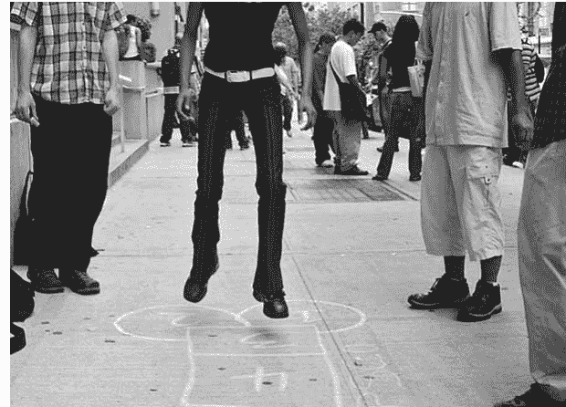

**图 1.1**

*[mapscotch], 2007, 作者对跳房子游戏的再创作。*

这类活动并未被规则明确禁止，因此属于同伴认可或接受的玩耍范畴。换言之，游戏的设计和呈现方式对社会群体具有启示意义。有些玩家可能会选择不玩（从而可能成为旁观者、见证者或裁判）；有些玩家可能会选择竞争。其他玩家可能会选择打破明确的游戏规则，例如跳过队伍或跳到错误的格子上以获取优势。游戏作为一种排序逻辑——一种机器或技术——用于创建社会关系，其作用在于将玩家的日常行为提炼或抽象为易于理解的媒介，使语境变得足够陌生化，从而让胡伊青加（Huizinga）所说的游戏“魔圈”得以显现。仅从这个例子中，我们就能看到游戏本身如何作为*社会技术*发挥作用。

如果游戏本身作为技术的一种类型，那么技术型游戏在意义构建方面具有双重能力。大多数数字游戏演变的研究者都会从计算机的技术里程碑开始他们的研究：范内瓦·布什（Vannevar Bush）的技术幻想、ENIAC 计算机、1961 年麻省理工学院（MIT）的 *SpaceWars!* 游戏、1972 年阿塔里（Atari）发行的 Pong，或者 1982 年巴克纳和加西亚（Buckner and Garcia）的歌曲 "Pac-Man Fever" 登上排行榜时 Pac-Man 的成功。那些研究当代游戏设计的人，特别是强调技术作用的项目，很少触及看似遥远的艺术领域。同样，那些研究大众文化的人也很少跨越到画廊、博物馆和私人收藏等机构的领域。进行这种跨越的最重要原因之一是，艺术流派的转变，就像技术一样，也预示（并反映）了世界事件；这些具体包括国际事件（如两次世界大战），以及影响普通公民和艺术实践者的文化和社会运动。例如，在二十世纪初，当马塞尔·杜尚（Marcel Duchamp）通过他的多时态绘画和“现成品”（readymade）现成艺术品，吸引“高雅艺术”受众自行决定艺术的本质时——他那句名言“观众才是画作的一部分”便是这种哲学的体现——美国电影迷们通过新创建的粉丝话语体系，以类似的方式参与早期“低俗艺术”媒体文化。同时，其他先锋派艺术家则完全采纳并重构了文化主题——例如，看看阿尔贝托·贾科梅蒂（Alberto Giacometti）那些批判战争的棋盘游戏，并将其与著名的帕克兄弟（Parker Brothers）游戏《地产大亨》（Monopoly）的起源进行比较，后者最初是由一位社会活动家创造，以抗议房东和税收政策的。这些都是读者将在本书中做出的有趣并置和发现的例子。

# 颠覆

颠覆、中断和干预的概念，与批判的概念一起，被艺术家和活动家们随意使用，需要进一步的阐述。长期以来，艺术家们一直重复利用、对抗或发明新的媒介形式和惯例：二十世纪初的创新者马塞尔·杜尚将小便池变成了 scandalous“现成品”雕塑。²⁴ 摄影师克洛德·卡侬（Claude Cahun）通过跨性别装扮和自我幼态化，在 1930 年代至 1940 年代的自画像照片中，夸张地表演了性别刻板印象。²⁵ 超现实主义者制作了实验性电影，颠倒了电影叙事和视觉惯例的趋势，甚至“切割眼球”（例如在 1929 年著名的超现实主义电影 *Un chien andalou*（《一条安达鲁狗》）中）既是为了制造冲击感，也是作为一种反对过度控制的美学的宣言。²⁶ 这些只是众多因打破规则而依然具有重要意义的艺术实践中的几个例子。

根据《牛津英语词典》，颠覆是指“将（某物）颠倒过来或从其位置上连根拔起；推翻，搅乱；法律、规则、制度或状态的颠覆。”²⁷ 颠覆是一种旨在破坏机构、事件或物体的行动、计划或活动。在讨论颠覆时，必须清楚自己特别在对抗哪种系统或现象，无论是政治的、社会的、法律的还是文化的。在本书中，我将颠覆这一术语的定义扩展至雷蒙德·威廉斯（Raymond Williams）和安东尼奥·葛兰西（Antonio Gramsci），²⁸ 米歇尔·福柯（Michel Foucault），²⁹ 朱迪斯·巴特勒（Judith Butler），³⁰ 以及其他人。³¹ 关于这一术语的核心思想源于安东尼奥·奈格里（Antonio Negri）关于颠覆的研究（2001），以及数十年来艺术实践中中断和干预的主题。几位理论家和实践者都认定，颠覆是边缘群体发出声音的有力手段。³² 这种关注可能源于活动家对考察权力关系如何运作以及社会变革如何实际被策划的呼吁。奈格里的许多写作诞生于他在意大利因政治行为而长期处于居家软禁期间，他的思想是对当代文化如何运作的大量沉思的结晶。奈格里的观点是双重的；他既写了与权力对抗的“突破”之难，也写了掌权者对颠覆行为的固有包容和控制。当对抗 pervasive 的权力体系时，他指出，如果使用得当的规模和工具，颠覆性实践仍具有触发社会变革的潜力。游戏或许就是这样的工具：奈格里指出，颠覆在多种组织、以多种类型形式中是必要的，这不仅为了这些组织的运作，也为了个人和集体的福祉。³³ 奈格里和其他人用颠覆一词指代一种创造性行为，而非破坏性行为。

由于游戏主要作为规则系统存在，它们特别容易受到颠覆性实践的影响。游戏的一个标志是它们由其规则集结构化，并且每个游戏都有它的“作弊”——甚至玩耍本身，推动游戏系统的边界，也可以被认为涉及某种颠覆。游戏研究支持了这一观点；对于像布莱恩·萨顿-史密斯（Brian Sutton-Smith）这样的玩耍学者来说，玩耍至少部分地与越界和颠覆行为相关联。

“干预”是特定类型的颠覆，依赖于直接行动，并涉及政治或社会问题——即“介入”，或在任何事务中干扰，以影响其进程或结果。³⁴ 将这些行动简化为有限的类别并不合适，更恰当的做法是将艺术家的行动置于引导干预的一套松散原则之中。例如，将艺术品和表演引入公共空间，是艺术家占用公共空间、日常空间的认知空间的一种方式，并以干预的方式发挥作用。实践干预的艺术家通常具有社会或政治目标，并可能通过跨越艺术和日常生活之间的界限来寻求开启对话。除了纯粹的美学运动（抽象表现主义便是一个例子），大多数二十世纪的艺术运动都促进了干预性的活动和策略，特别是那些被认定为先锋派的艺术运动。无数二十世纪先锋派艺术家共同的目标是通过创造性行为带来私人和公共领域的变革。³⁵ 因此，一些艺术干预采取表演、讽刺、模拟、游戏、活动家以及“黑客行动主义”（hacktivist）策略的形式。干预一直是街头表演和活动的热门策略：例如，女性主义戏剧团体重新制作了表演实践，并转向街头戏剧进行干预。³⁶ 1960 年代和 1970 年代由 El Teatro Campesino（农场工人戏剧团）、由阿米里·巴拉卡（Amiri Baraka）领导的黑人革命剧院（BRT），或尼克·克拉夫特（Nikki Craft）、玛莎·罗斯勒（Martha Rosler）或琼·布拉德曼（Joan Braderman）的媒体干预，能够在“街头”而非电脑成为文化干预门户时，扰乱日常活动。³⁷

许多艺术家都投资了干预性策略，并在本书中有记录。这些艺术家以及许多其他人干预了当代艺术场所，接管了传统艺术风格以改变它们，或描绘了违背社会规范叙事。自 1960 年代以来，许多艺术家在没有特定艺术运动身份的情况下进一步推动了这些兴趣，例如珍妮·霍尔泽（Jenny Holzer）和蕾切尔·怀特雷德（Rachel Whiteread），但他们反映了一种国际艺术潮流，通过揭露日常生活的负面或意想不到的愿景来颠覆日常 lived 体验。³⁸

最后，当代电子艺术家在传统、制度化的美学话语与新兴、有机的社会沟通形式之间进行协商。如果电子艺术已经成为一个实验实验室，与其说是为了新技术，不如说是为了新的沟通社会关系，那么也许电子游戏可以在电子空间和话语中以干预的方式运作。³⁹

术语 *disruption*（中断/颠覆）的定义介于干预和颠覆的概念之间。一个源自 IT 商业创新领域“中断-创新”理论的有用术语，中断是一种创造性行为，它改变了特定逻辑或范式的运作方式。⁴⁰ 在高科技领域，颠覆性创新者是那些向特定市场引入相对简单但“范式转移”解决方案的人。商业中的例子包括戴尔计算机的直接面向客户的销售模式或其“单首歌”在线音乐销售，这些都是低端颠覆的例子。⁴¹ 其他颠覆性创新创造了完全新的市场。通过创造需求和新的产品场所，颠覆实际上很少面临竞争。由这种方法产生的企业包括星巴克和 eBay（哈佛创新理论家克莱顿·克里斯坦森（Clayton Christensen）及其合作者埃里克·罗斯（Erik Roth）和斯科特·安东尼（Scott Anthony）认为其“民主化”了拍卖过程）。中断-创新理论影响了游戏设计，因为如果艺术家寻求的是干预和颠覆，他们就在一种新型游戏设计的限制内创造了这些。

正如后文所述，玩家可以从颠覆既定的互动规范中获得极大的乐趣，无论是在简单的游戏环境中，还是在高度复杂的游戏中。玩家会不断探索什么是被允许的，什么是处于规则与期望边界之外的，以及在特定的游戏环境中玩家自身的能动性——无论该游戏多么结构化。从冰球、象棋，到玩洋娃娃或“过家家”，玩家的颠覆行为——无论是作弊、公开玩法还是社会批判——都是游戏固有的组成部分。⁴² 如果数字制品确实已成为一个魔法圈，让玩家进入一个被认可的游戏空间，那么这种游戏文化，或常被称为“游戏文化”（playculture），是一个参与者可以找到许可、实验和颠覆空间的文化。在以下章节中，我将推测这种立场的历史必要性原因。

## 什么是行动主义游戏？

在本书中，我使用了“行动主义游戏”（activist game）和“行动主义游戏设计”这两个术语。行动主义游戏的特点在于强调社会问题、教育，偶尔还有干预行为。换言之，它们不仅仅是概念练习，而是通过（最常见的）主题、叙事、角色、背景、目标和人物；较少通过游戏机制、游戏范式、交互或胜利状态来参与社会问题，从而超越游戏本身的娱乐或体验价值，以实现预期的结果。这并不意味着行动主义游戏不能或不应是“有趣的”，尽管迄今为止对许多行动主义游戏的批评之一就是缺乏趣味性。然而，“行动主义游戏”这一术语旨在指定游戏主题以及玩游戏的预期结果，而娱乐只是预期结果之一。

媒体中的行动主义方法对于数字文化研究至关重要，正是因为媒体固有的不平衡。事实上，性别、种族、民族、语言和社会阶级的不平等和不平衡问题也体现在技术生产和使用的历史不平衡中。例如，女性仅占电脑游戏行业劳动力的10%，或者美国所有程序员中女性占比不到10%。这些不平衡以有时微妙的方式延伸到谁每天使用这些工具和空间。就连著名的媒体学者亨利·詹金斯（Henry Jenkins）等人在十多年前也指出，电子游戏空间是带有性别特征的空间。⁴³ 技术和视觉文化中的性别失衡引发了对电影和视觉表现最重要的批评之一：劳拉·穆尔维（Laura Mulvey）在20世纪70年代对电影中女性视觉表现的分析，激发了无数旨在关注商业图像和电影中女性表现的进步实验。⁴⁴ 在电子游戏领域，批评电子游戏中持续存在的性别（Flanagan, Anne-Marie Schleiner）和种族（Jennifer González, Lisa Nakamura）问题表现的著名文章继续质疑这些问题。

## 设计行动与设计方法

*批判性游戏*（Critical Play）提供的最重要内容之一，是一系列示例，展示了艺术家在创建游戏和玩法中所做的事。这些可以激励其他艺术家、设计师和创新者。有些艺术家为行动制作说明，甚至绘制绘画；有些顽皮的干扰者使用粗俗的语言并将人类变成木偶；而另一些人则编写计算机程序来写诗。有些人甚至将他们的游戏投射到桥上，或让玩家打扮成鸡。艺术家让文字变得可触摸，创建回文，进行街头干预，甚至从飞机上进行空中书写，以干扰城市中的日常行动。这些活动受到过去一个世纪开发的方法的推动，包括同时性主义（Simultanism，意味着时间的压缩）；自由诗/自由视觉诗；自动主义和自动写作；精致尸体（exquisite corpse）；以及心理地理学中著名的漂移（drift）（所有这些将在后续章节中更详细地解释）。

## 章节

以下章节探索的游戏范围从玩洋娃娃、过家家居家游戏到桌面游戏、表演游戏、定位媒体游戏和电脑游戏。每一章都探索特定游戏类型的历史实例，以及艺术和社会运动如何与之互动。

在第2章中，我回顾了家庭游戏的历史，因为它与游戏设计特别相关，特别是考虑到大多数当代基于计算机的游戏都是在家庭环境中体验的。我探讨了流行家庭游戏在《模拟人生》（*The Sims*）等游戏中的复兴，以及作为家庭空间中批判性游戏的艺术家项目，并提出了各种形式的洋娃娃游戏，提议颠覆性的方法，如重新包装（reskinning）、重写（rewriting）和取消播放（unplaying）。

在第3章中，我考察了桌面游戏作为批判性文件和体验的各种方式，并讨论了几位艺术家的桌面游戏。我探讨了游戏的灵修实践和运气，以及桌面游戏如何发展。我还将考察桌面游戏如何反映社会变化，因为它们也提供了观察特定文化的价值观、希望和信念的窗口。例如，《房东》（*Landlord*）和《反大富翁》（*Anti-Monopoly*）游戏展示了设计师如何邀请玩家对游戏进行修改，以进行大规模分发的替代游戏黑客行为。

在第4章中，我转向语言游戏。双关语和笑话、声音游戏、历史上同时性主义和自动主义的方法，以及文本说明和规则（包括公共干扰）和具身性的使用都将被探讨。

在第5章中，我考察表演性物体和游戏，包括雕塑和摄影，并研究批判性游戏制作人如何将其游戏视为物理干预。通过考察以令人信服的方式使用身体或物体的游戏，本章强调拼贴、超现实主义游戏方法、艺术家携带表演游戏走上街头，以及新游戏运动（New Games Movement）。

我在第6章中探索定位游戏，随着艺术实践扩展，将游戏带入玩家-参与者可以在公共空间中产生意义的环境。本章提到了通常在户外或在不寻常地点进行的游戏，并考察了情境主义者的工作及其漂移方法。

第7章专注于艺术家的替代性基于计算机的游戏，包括在线和离线游戏。我提供了对说服力游戏（Persuasive Games）项目和冈萨洛·弗拉斯卡（Gonzalo Frasca）项目的分析，以及通过在设计过程中使用干预策略创建的其他游戏。

最后，在第8章中，我探索变革游戏，考虑行动主义关切如何融入游戏设计。如果行动主义游戏的一个假设是，精心设计的在设计中嵌入某些意识形态（干预策略）的方法，将具备改变自觉设计师和艺术家以及玩家实践的能力，那么本章的目标是支持那些使支持此类选择的一系列系统变为现实的制作人。我通过讨论先前示例和分析中揭示的几种设计批判性游戏的方法来结束讨论。

本书并非提供对所有游戏进行全面分析，而是旨在揭示艺术家作品中游戏与批判性显现的一些更有趣的实例。沿途，游戏玩法的历史创新及其对社会风气的反映将得到强调。*批判性游戏*的目标是考察参与创建和玩游戏个人和群体是如何在社交、政治和文化体系内工作的，以及他们正在如何工作。他们的批判性、激进的游戏可以被视为游戏作为一种媒介的前卫（avant-garde）。

## 过家家

游戏习俗是一种广泛的影响力量，可以通过一个社会的艺术、媒体和制度化的休闲形式来映射。从希腊的奥林匹克运动会到罗马帝国的公共奇观，再到中世纪锦标赛和马上长矛比武的骑士精神，体育和体育赛事传统上促进了公众参与。此外，斗鸡、徒手格斗、拳击、赛马和类似的观赏性运动鼓励通过投注进行带有风险的互动，尤其是在伴随英国工业革命的文化转变期间。¹ 然而，虽然体育、竞技和其他技能比赛提供了熟悉的社会分析机会，但关于这些展示也是批判性游戏实例的记录较少。相反，在早期和持续的干预线中，当活动达到批判性游戏价值的休闲场所是家庭。在十八世纪的欧洲，法国艺术家开发了一种精致而尖锐的艺术风格，称为洛可可（Rococo），将尖锐的国内物质感注入传统上被认为是“高雅”艺术中。² 在十九世纪的英国，孩子们通过他们自己的批判性洋娃娃游戏形式“黑掉”了维多利亚时期的家庭规范。在二十世纪早期，达达主义运动的艺术家创造了玩具和木偶戏，除了其他事物外，还嘲笑了家庭习俗。通过游戏进行考察的冲动在我们这个时代依然活跃，虚拟世界和电脑游戏的参与者同时喂养、治愈和维护他们的虚拟角色，同时也为他们设置有趣挑战或问题。这样，玩家仍然在“过家家”，通过尝试人造身份、自我表达环境和幽默场景来重构现状的范式。今天，艺术家经常将自己置于计算机文化的边缘，使用游戏作为批判性干预。通过考察艺术文化的历史实例以及大众文化实践如何成为更大关切的载体，理解顽皮甚至叛逆游戏的新参数开始显现。

## 审视游戏

在中世纪和早期文艺复兴时期，雕刻师和画家依靠玩耍场景来吸引并启迪观者。例如，根特-布鲁日历法《Hore》（公元1520–1525年），以及安特卫普荷兰手稿和威尼斯格里马尼日课经（公元1490–1510年）中发现的微型画。在这些语境中，游戏让人联想到季节，描绘了庆祝活动的夏季游戏或丰收的丰饶游戏，而玩耍强化了年度循环的重要性。彼得·勃鲁盖尔（Pieter Bruegel）的画作《儿童游戏》（*Khinder spil* 或 *Children’s Games*，1560年，维也纳艺术史博物馆）描绘了当时常见的九十多种游戏。艺术史学家桑德拉·欣德曼（Sandra Hindman）将这件作品中的象征性联想解读为传达一系列人类体验的手段：婚姻中的不幸、运气有时胜过技巧，以及天主教会规定的传统节日实际上可能是疯狂的日子而非内省的时刻。¹ 据称，勃鲁盖尔融入的面具、用于捉迷藏的蓝色斗篷以及玩旋转玩具的傻瓜，暗示了人类的脆弱性、自欺欺人，以及婚姻和生育等成年生活的标准阶段。通过描绘求爱过程、洗礼游行、符合时代特征的婚礼队伍以及作为母亲hood模型的玩偶游戏，勃鲁盖尔利用玩耍来批判16世纪荷兰生活的规范，在一个瞬间捕捉了不仅仅是青春的概念，还有孩子们随着生活展开将要经历的深刻事件的预示。² 勃鲁盖尔还通过记录他在那些孩子身上看到的恶劣玩耍行为，揭露了令人不快的一面，给我们提供了更为严厉的批判。骨牌游戏及其更暴力的对应形式——拔河或单纯的打斗和扯头发——的表演，表明儿童活动可能不仅仅是儿戏，事实上代表了人类体验中更黑暗的方面。

## 视角的转变

无论多么具有启发性，文艺复兴之后，关于玩耍的游戏和艺术作品继续被边缘化为非理性的、任性的文化部分，不值得当时先进的学术研究关注。³ 一贯讲求理性的，欧洲启蒙时代（1650–1800年）的学者和哲学家强调科学和技术解决方案，并在总体上摒弃了仪式、迷信和民俗知识，转而支持逻辑的发展。然而，随着启蒙运动的冷酷理性被艺术家、表演者和其他继续专注于家庭空间的人的顽皮所抵消，该时期的游戏开始在其在欧洲的“严肃”军事用途之外大量涌现。

巴洛克时期的荷兰画家塞缪尔·迪尔克兹·范·霍格斯特拉滕（Samuel Dirksz van Hoogstraten，1627–1678）是这些反文化艺术家的一个极佳例子。作为伦勃朗的学生，范·霍格斯特拉滕是一位在多风格方面都技艺精湛的杰出画家，他利用自己的天赋创建了一组错觉视觉实验作品集。这些作品以日常物品为特色——书桌、羽毛笔和家具——展示了他对透视和光线的掌握。范·霍格斯特拉滕绘制了透视盒和有趣的以假乱真作品，在工艺上进行实验，并玩转欧洲主导世界观所反映的惯例。⁶ 例如，幽默的笔触，如在一个场景角落绘制的小狗，反映了他注视点的日常焦点。他风格中的幽默创造力以引人入胜且有意义的方式跨越了大众文化与高雅艺术世界之间的鸿沟，同时批判着崇高的启蒙价值。

范·霍格斯特拉滕作品之非凡之处在于他以敏捷、智慧和创造性视角描绘家庭空间及活动的感觉。在《室内景观》或《拖鞋》（1654–1662年）中，艺术家描绘了一个婚姻场景，证明日常环境发生了近期的变化。这些房间里明显缺乏人物；这幅画似乎模仿了一个游乐场。艺术家致力于准确描绘空间性，通过嵌套的墙壁图片、上流或中产阶级家具的阴影以及门框，试图从画作观察者的视角强调深度，直到范·霍格斯特拉滕接近人物缺席本身暗示运动的境地。正如艺术家其他以假乱真的画作一样，他精心设计的错觉标记了日常空间中主体的可能性，一个等待被“演绎”的空间。对该画作的分析认为，房子中的证据——例如留在房间的拖鞋和扫帚——显示女主人可能正在忽视她的家务职责，并离开现场去进行婚外情。她在家里的另一个房间吗？和谁一起？拖鞋作为符号常被用来暗示浪漫关系。在这些构图中，范·霍格斯特拉滕与观众玩猜谜游戏，以引出关于家庭规范及其仪式的问题。

在另一个甚至更引人注目的系列中，范·霍格斯特拉滕甚至将画作变成了观剧盒。粉丝们和收藏家将这些称为“透视盒”，⁷ 建立在菲利波·布鲁内莱斯基（Filippo Brunelleschi，1377–1446）和卡雷尔·法布里提乌斯（Carel Fabritius，1622–1654）关于透视的实验基础上。范·霍格斯特拉滕的例子是桌面大小的木制容器，其中嵌入的画作经过巧妙定位，营造出真实三维空间的错觉。⁸ 在布鲁内莱斯基的作品中，意大利广场呈现距离感，但在范·霍格斯特拉滕的《荷兰室内透视盒》（约1660年）中，一个家庭场景展开（图2.1）。房子内部没有放置单独的物理物体；相反，房子的所有元素都以正确的对齐方式绘制在场景中，使观众觉得可信。任何可能降低可信度的人物或物品都被避免，而任何通常在房子中可找到的物品——墙壁图片、家具、装饰，甚至宠物狗——都直接绘制在盒子上。从中心透视创建，每个房间从一个角度看完全正确，但从另一个角度看则是比例、光线和线条的扭曲。

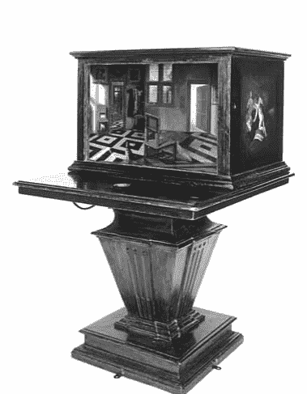

| 图 2.1 |
| :--- |
| 《荷兰室内透视盒》，约1660年，塞缪尔·迪尔克兹·范·霍格斯特拉滕（1627–1678）作。伦敦国家美术馆。 |

范·霍格斯特拉滕透视画作的例子反映了对空间和绘画的顽皮态度，但也作为游乐场作为成人玩耍场所的参考。创建微型房屋和家庭物品复制品的冲动已有数百年历史，而家庭游戏可以作为识别文化中特定主题的机制这一想法也是如此。⁹ 事实上，罗杰·凯洛伊斯（Roger Caillois）为游戏被玩的文化与游戏本身之间的强联系提出了论据。¹⁰ 范·霍格斯特拉滕的幻想和奇思妙想也展示了萨顿-史密斯（Sutton-Smith）所表达的想法，他讨论了与玩耍相关的轻浮修辞。被解读为游乐场的机智盒子也表现为进步、身份、权力和感知的理念，对日常主题的处理可以批判占据主导地位的启蒙意识形态，即国家、科学、理性和秩序。以这种方式来看，范·霍格斯特拉滕在刻意创建这些透视盒时，正在实践一种批判性的玩耍，这些透视盒被渲染得可信，但在所有意图和目的上，都与他受工艺启发的同时代人创建的游乐场相似——也就是说，它们是一个窗口，通往将家庭空间作为反思该空间规范和行为的场所。有许多艺术风格反映了其社会和政治时代的影响的例子。例如，埃及法老阿肯那顿（Akhenaten，公元前1369–1332年）的艺术指令基于宗教信仰的剧烈转变，改变了埃及的表现实践。由俄罗斯构成主义所代表的激进图形风格体现了流动和变化的视觉文化模型。那些将表现实践视为文化镜子历史学家，也可以寻找文化线索，特别关注玩耍与艺术的交汇点。

## 对玩耍的新关注

虽然艺术家长期在他们的场景中引用游戏，但洛可可时期（1725–1775年）的顽皮艺术家是第一个将玩耍作为中心主题的人；夏尔杜（Chardin）、布歇（Boucher）和弗拉戈纳尔（Fragonard）因其在奢华的日常环境中探索玩耍而值得注意。在探索18世纪让-奥诺雷·弗拉戈纳尔（Jean-Honoré Fragonard，1732–1806）的画作时，珍妮弗·米兰（Jennifer Milam）指出了一种顽皮、近乎浮华的风格。¹¹ 启蒙运动的发展推动了社会和政治发展以及工业化，但促进了创造性外放，针对非理性、欢乐和格言主题，这些主题被当时大多数受人尊敬的思想家抵制。

弗朗索瓦·布歇（François Boucher，1703–1770）通过描绘田园景象和常见场景记录了18世纪的生活。在他的作品《午餐》（*Le Déjeuner*，1739年）中，一个家庭时刻在照料孩子的家庭妇女柔和的线条中展开（图2.2）。坐在地板上的女孩抱着她的玩偶和玩偶的马。在该时期的其他例子中——特别是弗拉戈纳尔的几幅作品——女性主体被描绘为坐在户外花园的秋千上；米兰指出，荡秋千是统治阶级医生认可的娱乐游戏，他们将荡秋千或散步等运动诊断为符合一定得体感和地位敏感性的运动。

萨顿-史密斯认为，一个群体对特定活动的偏好是价值观在文化中显现的一个重要方式。¹² 富人的休闲习惯被框定为被看见和看见的活动。它们提供锻炼，但不是体力消耗；它们是宫廷社交和快乐的场所。在弗拉戈纳尔的时代，荡秋千是一种让男女彼此接触、观看和见面的玩耍活动。米兰指出，在洛可可绘画中，“荡秋千在象征传统中暗示了女性的善变，但还有其有节奏的运动，暗示了性行为”。¹³ 米兰继续更具体地描述弗拉戈纳尔“秋千”画作（如图2.3，1767年的《秋千》）中发现的细节：一只抛出的鞋

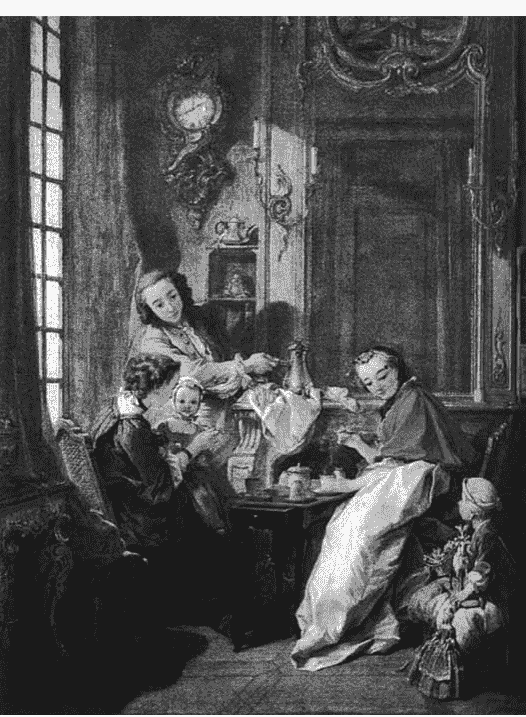

**图 2.2**

弗朗索瓦·布歇（1703–1770）于1739年创作的画作*《午餐》*（*Le Déjeuner*）体现了洛可可风格的元素。巴黎卢浮宫收藏。图片由艺术复兴中心提供。

**图 2.3**

让-奥诺雷·弗拉贡纳尔（1732–1806），*《秋千》*，1767年，布面油画。伦敦华莱士收藏馆。图片由艺术复兴中心提供。

画面暗示女性对激情的放纵，一只光脚象征着童贞的丧失，一只急切的猎犬代表不耐烦的欲望，一尊丘比特雕像——一手做出噤声的手势，另一手从箭袋中抽出箭矢——可能意味着爱神正在运作，而一顶扣在发芽灌木丛上的帽子则象征着性的参与。¹⁴ 米尔姆（Milam）认为，这些意象帮助观者拼凑出一幅编码后的情色场景，在其中，参与者彼此互动，并与他们所处的环境以及更广泛的社会规则进行博弈，而捕捉这一切的艺术家则在与视觉惯例、象征意义、透视法以及时代的局限进行博弈。米尔姆甚至将弗拉贡纳尔的作品称为“互动式绘画”，也就是说，这种艺术鼓励观者参与自己的视觉游戏，跨越形式、主题和信仰的类别。与范·霍赫斯特拉滕（van Hoogstraten）的情况一样，洛可可时期的艺术家在艺术界和通俗空间中，建立了玩耍与探索之间的清晰联系。

玩耍模式本身反映了文化的变迁。虽然弗拉贡纳尔笔下的启蒙时代上层社会似乎在与启蒙运动和科学思维的确立所关心的议题进行调情并随秋千高摆远去，但其玩耍的能力恰恰暗示了工业化和即将到来的休闲阶层所赋予的承诺。在西方，随着工业化的开端，玩耍开始围绕物体进行组织和结构化。著名20世纪马克思主义批评家和哲学家亨利·列斐伏尔（Henri Lefebvre，1901–1991），其极具影响力的著作将社会系统与空间联系起来，他指出，“休闲”概念的建立是当代日常观念的关键，而正是资产阶级文化的发展创造了为所有人提供休闲的理念。当统治阶层享受闲暇时光时，大众中阶级关系的变化和日益增长的休闲欲望相结合，创造了一种“消费者文化”。反过来，为满足大众对闲暇时间的欲望而开发的商品和物资，开始反映了正在发展的精英阶层的权力结构。玩耍无法抹去这些区别，但玩耍往往会强化既定的权力，或者挑战它。¹⁵ 在许多情况下，玩耍活动承载着带有怀旧色彩和阶级意识的关于闲暇时间、休闲和准入的观念——这一倾向仍然未被大多数玩耍理论家充分解决；关于玩耍的研究被 relegated 到托儿所层面，玩耍研究领域的重要学术成果大多源于强调儿童玩耍的发展理论。¹⁶ 从这一视角来看，玩耍成为“儿童心智成长的主要载体和指标。玩耍使儿童得以沿著发展序列进步，从婴儿期的感知运动智能，到学前儿童的前运算思维，再到小学生所表现出的具体运算思维……玩耍还在儿童的身心、情感和社交发展中发挥着重要作用。”¹⁷

此外，即使是对玩耍意义和功能这种有限度的看法，也依赖于文化的转变。首先是将童年概念化为具有特定需求和目标的具体时期：“童年”这个概念本身就是一种文化发明，在欧洲和北美存在了大约四百年。工业革命期间，随着关于工厂童工的争论激烈进行，这一概念获得了影响力。18 19世纪，蓬勃发展的教育理论领域以及蒙台梭利、天主教和斯坦纳（Steiner）学校体系的建立，强调了将童年作为经验类别的新意识。考虑到童年与成人之间文化分裂影响的一位理论家是发展心理学家布鲁诺·贝特尔海姆（Bruno Bettelheim）：“在18世纪之前（甚至在世界上一些地区直到更近的时候），儿童的玩耍和游戏也是成人的玩耍和游戏。”19 贝特尔海姆论证道，成人的活动已经与孩子世界展开的地方相距太远，他进一步指出，成人世界如今在深层次上与儿童世界分隔开来。

其次，如果没有工业革命因将社会生活与职业生活分离而部分促成的“休闲时间”的“发明”，玩耍就不会如此受欢迎。在这种新文化中，游戏，无论是公众 spectacle 还是客厅娱乐，都作为必要的互动媒介出现了。

在此，必须将“休闲”定义为一个操作化术语。运动、集市、 rodeo、手工艺、音乐——所有这些都

可以被视作当代成人的休闲形式。它们是有意为之、自愿且积极的活动。换言之，休闲活动的参与者必须*选择*追求它们。正如亚里士多德所理论化的，休闲是一种明确的成人活动，是儿童玩耍的延伸。这种玩耍通常以竞争、展览或团队的形式集体化，成为个人和群体的活动。休闲的社会角色通过凡勃伦（Veblen）的炫耀性消费（1899）概念得到了很好的阐述，该概念将闲暇时间解读为 spectacle。20 可以认为，休闲既是一种“对象”或目标，也是一种过程——它是个人行动与集体行动在消费导向经济的大背景中互动产生的结果。大量的制度化玩耍源于这种“目标导向”的观念。在对玩耍研究的尖锐观察中，萨顿-史密斯（Sutton-Smith）批评了20世纪的大部分玩耍文献，指出玩耍一直是在西方进步观念框架内被构建的，其中玩耍，尤其是儿童玩耍，被证明是教育和道德上合理的，有助于建立智力和良好的行为，并为儿童准备成为成人世界的良好公民。21

## 过家家与玩偶游戏

当艺术家范·霍赫斯特拉滕正在绘制国内场景并制作他的窥视箱时，精美的玩偶屋已经是欧洲的一种休闲时尚。22 这些玩具旨在让儿童游玩并重新想象家庭空间以及他们在其中的未来角色，它们源自一种古老的习俗，尤其通过游戏和玩偶游戏体现出来。在罗马帝国、古埃及和古希腊的儿童坟墓中都发现了玩偶，而木制钉玩偶在16世纪和17世纪的欧洲很受欢迎。三百年前，荷兰的玩偶屋很大——高达两米。这些木质结构被制作成柜子，打开后可以看到房子的所有房间。阿姆斯特丹的*《佩特罗内拉·奥特曼的玩偶屋》*（*Puppenhuis van Petronella Oortman*），创作于1686年至1705年间的某个时期，是最早且最华丽的玩偶屋之一（图2.4）。荷兰玩偶屋最精美的例子是为成年女性创作的，特别是为即将结婚的女性。一个早期荷兰玩偶屋的完整实例是*《佩特罗内拉·德拉科特的玩偶屋》*（*Het Puppenhuis van Petronella de la Court*），1670–1690年（也称为乌得勒支玩偶屋），它拥有超过十个房间，里面装满了微型家具和家居物品。

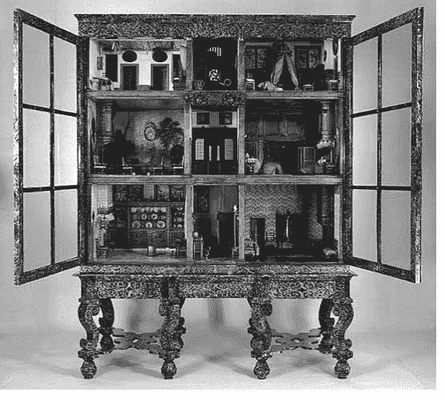

**图 2.4**

*《佩特罗内拉·奥特曼的玩偶屋》*。荷兰国家博物馆。

这个实例参考了范·霍赫斯特拉滕等画家创作的画作，其内部装饰经过精心绘制——一些墙壁上有油画壁画，天花板则采用透视法精心绘制。与大多数这种宏伟的玩偶屋类型一样，奥特曼玩偶屋模仿了当时上流社会的时尚。用来制作微型物品的材料是真实的：动物皮毛和皮革座椅套、大理石面板碎片，以及洗衣房里的亚麻布。

多年来，华丽的欧洲玩偶和玩偶屋不断增多，在迅速发展的美国殖民地也创建了类似的玩耍文物，在短短几个世纪内，玩偶和玩偶屋成为了一个显眼的产业。在美国内战时期，玩偶、玩偶屋和玩具店反映了由于移民和工业化导致的工作模式变化，以及社会分类类别的转变、家庭角色的固化以及总体休闲时间的增加。23 迷你过家家成为19世纪流行的一种儿童消遣。在整个19世纪末和20世纪初，玩偶和其他商业玩耍物品始终出现在美国和英国新兴的家庭生活杂志类型中。在维多利亚时代（1837–1901年），社会习俗和玩耍风格也从公共 spectacle 转向家庭内部，因为中产阶级和上层阶级的女性和儿童从对劳动人口施加的时间和劳动力要求中解放出来。24 因此，玩耍和家庭性开始与“自由时间”的观念联系起来。玩耍向家庭空间的这种转变将为后来计算机文化中的趋势铺平道路，其中黑客行为、BBS通讯、粉丝文化、开源软件和网络游戏都成为高度“家庭化”的玩耍形式。

与此同时，玩具的实际生产从家庭转移到了工厂。在19世纪，通过棋盘游戏、纸牌游戏、客厅游戏以及在美国内战之后数量日益增多的可商用玩具，玩耍成为了大众文化的一个正式部分。根据玩具学者 Cross 的说法，随着手工玩具被大规模生产的商业玩具“产品”所取代，玩偶和泰迪熊帮助浪漫化了童年。25 一个结果就是以“使其变得天真和纯洁”的方式，将童年玩耍与成人体验分离开来。

尽管在无数年份中是童年的核心部分，但玩偶只有少数理论家将其作为研究主题。弗朗西斯·阿姆斯特朗（Francis Armstrong）、米丽亚姆·福尔曼-布林（Miriam Formanek-Brinell）和路易丝·库兹涅茨（Loise Kuznets）是三位领先的研究者。其他人则指出过家家在维多利亚时代社会和文化规范的正常化，更是制度化过程中的重要性。26 然而，在审视这些问题在玩耍环境中的表现形式之前，回顾并或许调和“规范性”行为的两种不同解释是有用的：西格蒙德·弗洛伊德（Sigmund Freud）关于正常化和欲望的精神分析模型，以及米歇尔·福柯（Michel Foucault）关于欲望及其社会控制的想法。

与弗洛伊德认为潜意识是个人“黑暗事务”——包括性、死亡和欲望的压抑——的所在这一观点相反，福柯在其*《性学史》*以及关于19世纪社会规训话语的研究中，挑战了个人“规训”与外部权力结构（即国家霸权）之间的联系。⁷ 福柯认为，国家对控制人口的压抑欲望和性冲动有着直接的既得利益。他进一步详细阐述了国家在追求更高控制水平过程中所运用的权力关系。在维多利亚时代，重要的控制机制包括婚姻、教会以及与家庭相关的传统活动和社会角色等社会和文化机构。在这里，19世纪游戏最引人入胜且最具挑衅性的例子之一，代表了个体如何实践或反抗规范性、规定性的行为。²⁸ 大量的“规训”可以通过断言家庭内部的传统活动来实现。从维多利亚时代至今，玩过家家一直构成一种意义在文化中被协商的象征行为。例如，房子长期以来一直是美国梦的核心象征，代表着阶级流动性以及资本主义的平等承诺。尽管马克思主义批评家亨利·列斐伏尔将空间消费批评为资本主义的尝试，但像许多其他理论家和作家一样，他也在某种程度上美化了房子：“房子既具有宇宙性，也具有人性。从地下室到阁楼，从地基到屋顶，它具有一种既梦幻又理性，既尘世又天界的密度。”²⁹

这些主题在富裕阶层的玩具遗物中可能显得显而易见，但它们同样可以轻易转化为贫困儿童和农村地区儿童的游戏方式，这些儿童较少接触维多利亚时代的商业玩具热潮，他们通过剪贴画房子和纸娃娃游戏进行体验。对于居住在偏远的美国家庭来说，蓬勃发展的目录销售行业成为了连接家具、服装和家居用品时尚大世界的一个纽带。剩余的目录，例如西尔斯罗巴克百货公司发行的目录，成为了玩“剪贴画房子”的珍贵商品。在玩耍时，孩子们使用旧的账簿或相册作为基础，制作粘贴拼贴的室内空间。通常，一整本账簿会填满各种上流社会风格的房间。大多数剪贴画房子的布局是一致的，即一个房间占据一个打开的账簿页面，但有些例子，如格蕾丝·柯蒂斯·史蒂文斯房子（即19世纪80年代的剪贴画房子），进一步缩小了家庭环境，以便可以从整体上看到房子的横截面。

由小手制作的剪贴画房子中的家具、布局和“居住”在家庭空间中的纸质人物，提供了特定阶级在特定时间和地点如何想象理想房子的缩影。玩家通常是女孩，并被期望通过在目录中“购物”挑选理想商品来模仿父母的品味。通常，玩剪贴画房子的女孩会向房子中添加纸质人物，除了家庭成员，还会剪出管家、男仆和女仆等仆人。在某些情况下，所有家具和人物都被完全粘住固定。在其他情况下，人物是松散的，玩家可以在房间内移动它们。场景包括杂志中发现的家居装饰、壁纸和外部图像。在设计上，这些房子包含了家庭和工作人员进行家务劳动所需的所有功能物品。女仆和管家的出现也暗示了家庭管理的主题：目标是让玩家学习如何有效管理这个早期虚拟家庭版本的所有方面。艺术作品样本体现了这一主题：艾米莉·P·希基的纸娃娃房子，约1870年（图2.5），专注于以家庭为中心的游戏，包含茶会、换装、捉迷过藏等场景，并融入了家庭成员和家政人员。

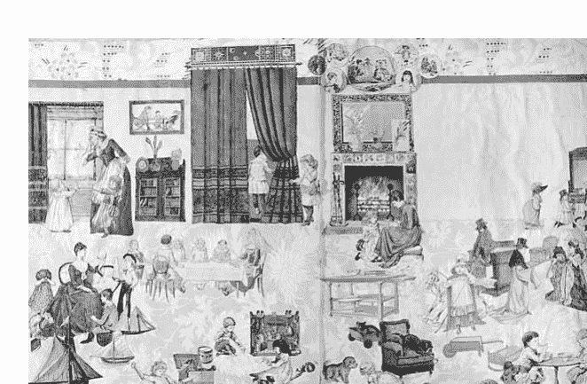

**图 2.5**

艾米莉·P·希基的纸娃娃，美国，约1870年，胶水/剪裁/绘画/纸张/纸板。深红色封面上用金色写着“纸娃娃房子，艾米莉·P·希基”。这本剪贴簿包含六个跨页的房间内部，包括两个客厅、一个卧室或更衣室、一个男士房间、一个行李箱室和一个儿童游戏室或育儿室。玛格丽特·伍德伯里·强森博物馆，纽约州罗切斯特市。

娃娃游戏学者弗朗西斯·阿姆斯特朗指出，历史文件表明，娃娃家中发生的事件是现实家庭中发生事情的忠实镜像。这种重复类似于记录保存或伪装成游戏的文化记录。阿姆斯特朗转述了一份1888年写成的匿名叙述，详细说明了这种娃娃游戏风格中在一整天内实施规则的例子：家中的女孩会在早晨把娃娃从床上叫醒，给它们穿衣服，并在“学校课程”前给它们吃早餐。课程紧随其后，使用孩子设计的小课本。娃娃和女孩同时学习，并且像她一样吃晚餐、做更多家庭作业、洗澡并上床睡觉。娃娃父母打牌，最终，所有娃娃和它们的主人都会上床休息。之后，女孩可能会期待母亲表扬她“完成了这个玩具房子应尽的责任”。³⁰

通过这一例子，游戏文化概念所概括的游戏与日常生活之间的复杂关系得以发展，因为玩家在百多年前就将游戏和家庭生活交织在一起。³¹ 通过对家庭生活规则的探索，通过剪贴簿玩过家家的玩家维持了具有文化、物质和象征重要性的传统，这些传统重新确立了家庭内的传统角色，进而家庭成为围绕工作、游戏和消费的传统性别角色的实例化场所。平面纸质模型房子“是向女孩介绍其作为妻子、母亲和持家的未来角色的理想媒介”，因为正如游戏学者罗思所指出的，“在剪贴簿中，就像在实际生活中一样，房子必须被适当地运营和维护”。³² 纸娃娃房子的制作者甚至似乎试图通过他们的嵌入层、切口和轮廓（例如图2.6）来捕捉真实房子的一些空间复杂性。因此，玩过家家游戏作为西方家庭传统的持续象征性强化，而家务管理的实际和仪式功能成为游戏中令人向往的重点。剪贴画房子制作成本低，在材料回收利用方面具有审慎的想象力，任何买得起时间、糨糊和剪刀的人都可以制作，使这一趋势不仅成为游戏的民主形式，也成为规范强化的民主形式。³³

与此同时，19世纪和20世纪的儿童杂志、书籍和歌曲揭示出，儿童被鼓励与她们的娃娃建立强烈的纽带。杂志通常关注更昂贵的娃娃——通常是欧洲制造、法式风格的陶瓷娃娃，具有精细的特征。³⁴ 19世纪末的娃娃房子包括创新产品，如欧洲L’Intrépiride Bébé会走路娃娃（1880年代）、爱迪生会说话娃娃（1886年）、坎贝尔娃娃（1910年）（图2.7），以及在大受欢迎中的多莉·丁格尔纸娃娃（1913年）和后来的亚历山大大街娃娃（1930年代）。³⁵

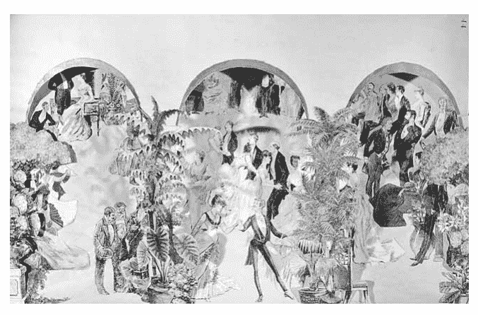

**图 2.6**

剪贴书娃娃房子，约1890年。账簿，棕色皮革书脊和边角，封面为黄色大理石纹纸，衬重纸板。书籍构成了整个房子。用墨水勾勒出房间轮廓，并用剪贴画、报纸和杂志剪报装饰，加上水彩画。许多页面有门或窗的开口，以显示下一个房间的一部分。以前门开始，通往许多专业房间：餐厅、图书馆、育儿室、浴室、厨房、宴会厅、台球室、阁楼、仆人厅和温室。大多数房间包括剪纸人物，显示出对比例 careful 关注。查看夹克档案以识别书中使用的人物之一。由D. Smith收购。购自马萨诸塞州波士顿的Bromer Booksellers。玛格丽特·伍德伯里·强森博物馆，纽约州罗切斯特市。

尽管营销和商业文化尽了最大努力，一个意外但引人注目的事实是，有证据表明，女孩特别地抵制甚至批评通过娃娃游戏分配给她们的社会角色。正如萨顿-史密斯所指出的，由于游戏、运动和部分节日是国王、贵族、异性恋者和男性进行身份形成和权力展示的练习，“较弱势群体的游戏被排斥甚至被嘲笑”。³⁶ 因此，通常我们会期望，女性和女孩的游戏未得到验证或记录，因为它们不是流行或公共比赛的一部分。然而，即使在日常生活中，19世纪的女孩也通过对“规范性”女性家庭行为强调进行颠覆性的抵抗，来应对。在这里，米丽亚姆·福尔梅奈克-布鲁内尔，历史游戏模式研究中的核心人物，其工作是一项必不可少的资源。在她的书*《Made to Play House》*中，福尔梅奈克-布鲁内尔指出，虽然成年人认为玩娃娃对社会“女性化”有用，但有些儿童会将娃娃用于与其预期用途截然不同的目的。³⁷ 当家庭角色需要

维多利亚时代玩耍坎贝尔儿童玩偶的孩子们。纽约，1912年3月。由刘易斯·威克斯·哈因（1874–1940）拍摄。

……由于劳动条件的变化、银行和金融体系的重组，或财产所有权的改变而被重新确立，玩偶游戏也随之改变。³⁸ 玩家不再专注于强调母职和家务管理技能，而是常常选择扮演冲突场景、家庭争吵、打破严格社会礼仪的事件以及疾病等情节。这些游戏场景酷似电视犯罪剧，游戏结果可能导致玩偶受到惩罚、肢体残废甚至死亡。玩家为玩偶举办葬礼，或许是为了处理嵌入维多利亚社会习俗和仪式中的更深层问题。福尔马奈克-布鲁内尔指出：“对某些人而言，玩偶的价值取决于其颠覆惯例、嘲讽物质主义以及削弱限制的能力。”³⁹

## 批判性游戏的类型

因此，在此处，我提议为维多利亚时代女孩所进行的批判性游戏类型制定术语，承认游戏中改造文化惯例的空间反映了特纳（Turner）关于游戏为游戏参与社区创造“阈限”（liminal）时期的观点。⁴⁰ 此外，批判性游戏的实施表现出至少三种类型的行动：反玩（unplaying）、重新着装或换皮（re-dressing or reskinning），以及改写（rewriting）。

### 反玩

在这种游戏行动中，玩家特别演绎那些“被禁止的”或秘密场景、不幸的情境，或其他预期之外的结局，通常是为了对抗可接受的或预期的成人游戏脚本。在玩偶游戏中，*反玩* 表现为孩子们虐待他们的玩偶、“杀死”它们，或以其他修订方式改变预期的“ caregiving（照顾）”游戏框架。这种批判性的游戏逆转了关于照顾行为的传统期望，并允许玩家重新思考这些社会角色涉及的惯例。起初，杀死玩偶的残酷行为被视为颠覆性的，但最终父母鼓励举行玩偶死亡仪式，以教导女孩家庭葬礼礼仪。⁴¹

### 重新着装或换皮

玩家进行替代性的安排，并伪装她们的玩偶以承担颠覆性的角色，改变玩偶的外观或呈现方式，使玩偶能够进入被禁止的场景。玩偶可能只需更换服装，或者通过化妆或面具进行“换皮”，从而在字面上抹去身体表面的特征。例如，演绎玩偶葬礼的女孩可能会制作适合死亡场景的服装套装。父母最终通过提供玩偶棺材来应对这些偏好，而玩偶制造商也开始将他们的时尚玩偶打包，以迎合这种颠覆性，通过创造迎合批判性游戏类型的新玩偶产品。例如，一些玩偶附带精致的黑色丧服一起出售。⁴²

### 改写

虽然许多场景记录了“正常”类型的游戏，但在19世纪后半叶的美国儿童虚构出版物中，关于死亡、垂死的玩偶以及哀悼的短篇故事在书籍和杂志中大量涌现。事实上，许多书籍和文章是直接面向玩偶本身营销的，标题如《*The Dolls’ Own Book*（玩偶自己的书）》或《*Playday Stories*（游戏日故事）》（图2.8）；两者的叙事据称是由玩偶作者撰写的。⁴³ 通过这种方式，参与玩偶及玩偶文化制造的人（包括那些向此类出版物写信的孩子）可以不断修订或改写围绕玩偶的叙事。围绕新兴玩偶文化的这种虚构具有强大的力量，原因有很多。首先，它颂扬了女孩们自身带到“正统”游戏中的批判性方面。其次，它强化并证实了玩偶的存在以及想象性游戏时间的重要性。最后，玩偶虚构是女孩探索游戏中更深层社会和个体意义的一种方式。正如福尔马奈克-布鲁内尔指出的那样：“正是‘玩偶文化’的虚构文学探讨了更强烈的爱与暴力的情感。”⁴⁴ 这些“被改写”的

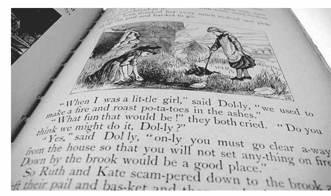

| 图 2.8 |

| :--- |

| 儿童读物《*Playday Stories*》据称是从“多莉（Dolly）”的视角撰写的。 |

文本有助于扩展父母对孩子被允许玩耍的各种方式的认可。因此，参与者的叙事在多个层面都很重要，从商品营销到定义游戏文化本身。

在其他改写案例中，对玩偶和怪诞事物的迷恋超越了维多利亚时代童年的游戏室。1940年代芝加哥女继承人兼志愿警官弗朗西丝·格莱斯纳·李（Frances Glessner Lee）的玩偶屋是许多成年人参与玩偶文化的例子之一。作为玩偶制造者，格莱斯纳·李制作了阴森的场景，被称为《*Nutshell Studies of Unexplained Death*（核子不明死因研究）》。这些玩具被用作模型，训练警察进行法医学和犯罪现场调查。格莱斯纳·李赋予每个立体模型令人不安的名称，如“烧毁的小屋”或“黑暗的浴室”，她定制了服装、犯罪武器和血迹，并得到了一位专业木匠的协助，该木匠根据格莱斯纳·李从真实犯罪故事中获得的细节，创造了代表玩偶房间的奢华结构（见图2.9）。研究格莱斯纳·李作品的建筑师珍妮弗·杜布莱特（Jennifer Doublet）在伊夫·卡恩（Eve Kahn）发表于《*San Francisco Chronicle*（旧金山纪事报）》的文章中被引述说：“对我来说，核子研究中也许没有什么比看到男性侦探世界*[sic]*被玩偶屋中珍贵、受控的女性空间内家庭暴力的怪诞描绘彻底撕裂所带来的颠覆性快感更令人满足了。”⁴⁵

因此，格莱斯纳·李执行了前述所有三种批判性游戏风格。她通过利用真实描述，对玩偶屋本身进行了“换皮”，使其成为怪诞犯罪的场景。她通过玩偶游戏活动“反玩”了警务工作的惯例，并挑战了关于适当性的观念。格莱斯纳·李还“改写”了她自己的角色以及玩偶游戏在她周围社会中的重要性。正如亨里克·易卜生（Henrik Ibsen）的戏剧《*A Doll’s House*（玩偶之家）》（1879年）中一位渴望摆脱家庭束缚的苦恼女主角一样，格莱斯纳·李的倒置展示了玩偶屋如何象征文化话语中发挥作用的控制性压制，这种压制由家庭规范产生的规则集所强制实施。通过推动可接受界限，这些批判性游戏行为与家庭空间中游戏的历史模型联系在一起。因此，能动性是构建玩偶游戏（无论是虚拟还是实体）的核心因素。

## 发明家们的玩偶

文化角色也在玩具的生产中发挥作用。在《*Made to Play House*（为玩房子而制作）》一书中，福尔马奈克-布鲁内尔探讨了玩偶的生产以及玩偶

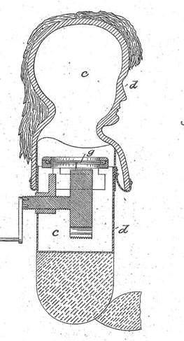

## 图 2.10

W. W. 雅各布斯（W. W. Jacques）关于留声机玩偶的文件，源自其1889年4月2日的专利，来自缅因州爱迪生留声机玩具制造公司。

行业，以论证尽管玩偶在某些圈子里可能被视为琐碎的文物，但玩偶业务变成了一个极其有利可图且竞争激烈的行业，反映了特定的社会和政治局议。在美国，早期的玩偶制造者是女性，通常是姐妹，在家中工作。这些工匠通常在家中制作玩偶，直到他们有足够的资金建立工厂。⁴⁶ 然而，总的来说，一旦玩偶制作进入大规模生产阶段，它就变成了一个由男性主导的行业。19世纪，几位发明家对玩偶制造产生了兴趣，玩偶很快就成为了钟表匠和机械师的产品。⁴⁷ 相反于布偶的柔软舒适以及女性玩偶制造者可能希望提供给女孩的各种服装，转变为玩偶制造者的发明家们更关注玩偶的功能性。20世纪北美玩偶制作不再基于过去那种学徒制或家族生意，而是基于一个追求利润的玩具行业，吸引了男性企业家。⁴⁸

受19世纪末动画创新和电影、摄影等逼真产品创造的启发，玩偶制造者专门创建动画特征或肢体。运动是一个特别迷人的来源。⁴⁹ 爱迪生被认定为发明了第一个会说话的玩偶，即留声机玩偶（图2.10）。它是一个几乎完全由金属制成的机械玩偶，内部包含一个微型圆筒留声机，并于1889年获得专利。⁵⁰

其他玩偶拥有可调节的嘴巴、眼睛或机械化肢体。材料也发生了变化。拥有木质、陶瓷或金属身体的玩偶逐渐取代了布偶。从1871年到1901年间由不同发明家提交的专利显示了许多机械玩偶，例如乔治·彭伯顿·克拉克（George Pemberton Clarke）的1871年专利的“自然爬行婴儿玩偶”（图2.11和2.12）。⁵¹ 与工业革命并行，这场革命将机械装置置于日常生活的中心，并促进了从机械设备中获得乐趣的观念，技术文化与更传统的玩偶制作形式发生碰撞。⁵² 然而，机械控制的玩偶并不受女孩欢迎，早期机械玩偶往往无法正常工作。⁵³ 没有机械玩偶看起来“活过来”的乐趣，损坏的玩偶只是沉重的物体，无法激发参与度。

## 艺术家的玩偶

在过去一个世纪中，艺术家们通过更多媒体更充分地探索了家庭主题，但尽管有这些努力，20世纪艺术中玩偶的出现仍显得有些独特。早期在明确的艺术背景下与玩偶合作的艺术家包括那些启发或与之关联的20世纪达达主义运动的成员。在一战期间，他们在欧洲中心结成

# 乔治·彭伯顿·克拉克的自然爬行动娃娃

第118,435号专利。1871年8月29日获准。

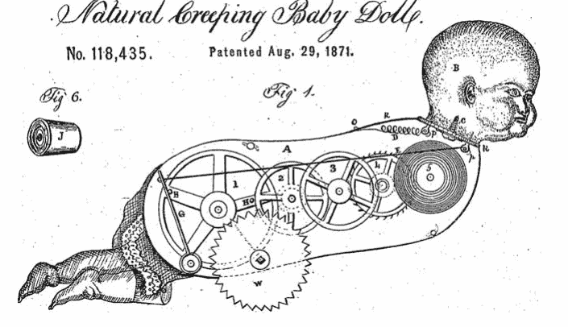

| 图 2.11 |

| :--- |

| 乔治·彭伯顿·克拉克的自然爬行动娃娃，源自他1871年8月29日的专利。 |

在第一次世界大战中，达达主义者的目标是为“对既定价值观的激烈怀疑”发声。⁴ 虽然达达主义以不同的方式在苏黎世、巴黎、柏林、汉诺威、科隆和纽约兴起，但达达主义一致的革新包括创建了一个全球性的艺术家网络，他们使用新的形式进行沟通并创造艺术本身。这些形式包括信件、明信片出版物，其中一些与现代的小志（zines）相似。达达艺术家所处的背景是第一次世界大战的大规模残害与杀戮、心理学和医学的范式转变发展、技术进步以及法西斯主义。文化与政治的动荡为一种能够表达道德和智力危机之严重且真实后果的文化生产搭建了舞台。达达艺术家以多种形式的写作、绘画、表演、摄影拼贴、物体制作和声音录音来回应20世纪的冲击，这些全都反映了启蒙思想家所珍视的理性的崩塌。他们承诺“终结‘文化’作为与日常生活不同的事物”，达达主义体现了一种反法律、反战争、反艺术的讽刺意味，而这些艺术却是由那些后来成为迈向现代主义核心人物所创造的。⁵⁵

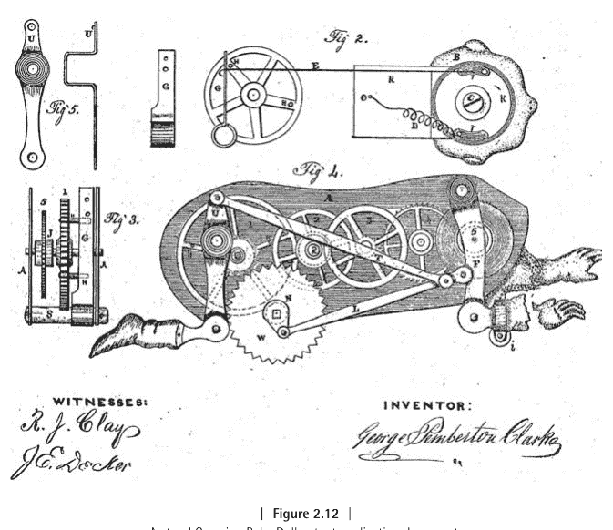

自然爬行动娃娃专利申请文件。

1896年，远在达达艺术家开始其叛逆艺术实践多年之前，阿尔弗雷德·雅里在巴黎的“艺术剧院”上演了他久经排练的戏剧*《王尤布》*（Ubu Roi）；这是他最重要的作品，也是从他高中时期就开始持续创作的作品。该剧本身是一场木偶戏，但它从喜剧激烈地转向令人厌烦的程度，当时真的震惊了剧院观众。最令人震惊的是雅里选择使用真人尺寸的木偶，或表演物体，作为他的演员阵容。这些由人操控的木偶讲述了乌布夫妇的滑稽讽刺故事，这是一对庞大且具有攻击性、却又滑稽夸张的夫妻，他们以莎士比亚*《麦克白》*的方式密谋占领波兰。剧中的演员戴着面具，骑着木马（这是*Dada*一词的前身）⁵⁶，整部戏剧发生在一个单一的、充满神秘色彩的环境中，其中一张床和一个壁炉作为角色进出场的通道。⁵⁷ 在贝尔对该场表演的记述中，据说雅里向观众宣布，在为期两晚的演出中，部分表演者同意放弃自己的个性，并在脸上戴着面具表演，以便更好地“映照你们即将见到的人体尺寸木偶的心灵与灵魂。”⁵⁸ 值得注意的是，舞台上的物体对于制作的结构和创作者的意图而言，与人类演员同样重要，或许甚至*更加*重要。

抽象、现成物化和机械化类型的戏剧证明了在20世纪表演艺术发展过程中处于核心地位，而雅里的作品为激进剧院制作人提供了对表演艺术的重要洞察。⁵⁹ 达达艺术家索菲·陶伯（1889–1943）在1918年为卡洛·戈齐的戏剧*《鹿王》*（*König Hirsch*）制作了一系列木偶，该剧由勒内·莫拉克斯和维尔纳·沃尔夫为瑞士木偶剧院改编。⁶⁰ 这些木偶主要由绘有油漆的旋转木材制成。它们具有对称的身体、金属关节，以及远更像面具而非传统娃娃的抽象面部。一些木偶穿着蕾丝连衣裙和羽毛服饰。历史学家莉亚·迪克曼认为，鹿的童话被转化为一部关于心理话语的现代寓言，角色以弗洛伊德、荣格（Dr. Kom-plex）和荣格的“Urliido”概念命名——因为每个人都会对国王及其朋友产生影响。⁶¹ 陶伯还创作了一套达达主义表演面具，形似非洲大陆的雕刻。面具由报纸和硬纸板等现成材料制成。面具对于达达艺术家胡戈·巴尔而言，“并不代表人类角色和激情，而是……比生命更宏大的激情。我们时代的恐怖，事件那令人瘫痪的背景，由此变得可见。”⁶²

摄影拼贴艺术家汉娜·赫克也在1916年的达达博览会上展出了*《达达玩偶》*（*Dada Puppen*）。这些人偶探索了当时社会的议题，通过它们的尺度和主题进行表达。1920年，约翰·海特菲尔德和鲁道夫·施利希特创作了*《普鲁士大天使》*，一个真人尺寸的、长着猪头的人类士兵。1921年，乔治·格罗兹和约翰·海特菲尔德创作了*《狂乱的资产阶级的庸俗者海特菲尔德》*，一个无头裁缝人台，上面固定着电灯，配着手枪、门铃以及一条装有木质假肢的缺失腿部。奥斯卡·科科施卡从第一次世界大战回国后，制作了一个真人尺寸的娃娃，以复刻他失去的爱侣阿尔玛·马勒，她离他而去嫁给了另一个男人。科科施卡带着这个娃娃去听歌剧和参加派对，并雇人照顾它。这种从假装的社会伴侣到传闻中的性玩具的表演式娃娃游戏，严重依赖于关于表演、性规范与恋物癖、以及社会可接受行为的观念。⁶³ 娃娃也出现在画作中。马克斯·恩斯在他的作品集*《让时尚存在，艺术去死》*（1919–1920）中包含了类似娃娃的图表和裁缝纸样。珍妮·科沃特1919年的画作*《水宝宝》*中也包含娃娃，其中娃娃被描绘成装在水容器中的分段部件。夹在一个最初批准战争的社会与军事技术的恐怖之间，达达主义者使用娃娃、木偶、裁缝人台和娃娃游戏作为一种手段，以全面探索技术变化对身体的影响。

超现实主义者紧随其后，将娃娃进一步带入潜意识的领域。莎拉·哈钦森指出，其中几位艺术家使用了“痉挛美”的创作方法，包括对暴力、色情、歇斯底里和越轨行为的描绘，以探索限制性社会规范的心理学影响。⁶⁴ 曼·雷著名的照片`《衣帽架》`（1920）展示了一个缺了一条腿的裸体女人——实际上，那条腿是隐藏的，用深色袜子伪装——坐落在一块娃娃式的头部和手臂剪纸后面。使用娃娃和裁缝人台作为索引，以及手绘的面具，这个作为衣帽架的女性娃娃茫然地凝视前方，呈现出沉默的震惊，这是战争恐怖的写照。德勒兹通过将艺术、幻想世界和产生这种幻想的现实联系起来，指出：“一张受惊的脸孔是一个可怕的可能世界的表达，或者是世界中某件可怕之物的表达——某件我尚未看到之物。必须理解，在这里‘可能’并不是一个指代不存在之物的抽象范畴：被表达的可能世界确实存在，但它并不（实际上）存在于表达它之外的事物中。”⁶⁵

从木偶到真人尺寸的人造身体，艺术家在超现实主义时期的娃娃变得更加怪诞。或许这类作品中最著名的例子，是源自德国艺术家汉斯·贝尔默（1902–1975）创作的无头、残缺不全的女性娃娃。贝尔默于1933年在柏林开始制作娃娃。他的纸浆、石膏和薄纸制作的身体迅速成为整个超现实主义运动中最具争议的文物之一。⁶⁶ 在一套大型摄影画册中，贝尔默以室内和室外为背景，编排了这些令人不安的形象的场景，有时使用地毯敲打器等家居道具（图2.13）。⁶⁷

娃娃的形象是意义生成的复杂场域，尽管由于稍后讨论的原因存在问题，但弗洛伊德在1919年的论文《论诡秘》中对行动力与乐趣之间有趣张力的有益描述，有助于奠定对人与自动机及类生命模型之间迷恋进行调查的基础。使用`unheimlich`一词，其字面意思为“不舒适”，弗洛伊德描述了当一种原本正常的情况揭示出由微小的偏离或“类生命”行为推导出的隐藏异常时，诡秘感是如何显现的。将诡秘感与婴儿期被压抑的欲望联系起来，并注意到这种被压抑欲望的回归基于对控制权的渴望，观众或玩家对诡秘情境的反应可能会在表面上看似日常的环境中产生恐惧、焦虑或着迷。⁶⁸ 尽管贝尔默的娃娃因其对女性身体明显的性别歧视性厌恶而受到批评，但艺术史学家和超现实主义学者哈尔·福斯特已经论证，这些娃娃，制作于

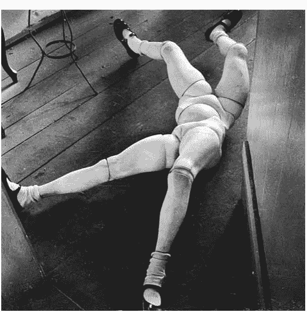

汉斯·贝尔默（Hans Bellmer, 1902–1975），`玩偶游戏`（`Les jeux de la poupée`），1935–1938。12.4 × 9.3 厘米。馆藏编号 AM1996-206(23)。巴黎国立现代艺术博物馆，乔治·蓬皮杜中心。摄影：菲利普·米热（Philippe Migeat）。图片来源：CNAC/MNAM/Dist. Réunion des Musées Nationaux/Art Resource, NY。© ARS, NY。

在希特勒于德国掌权之后，这些作品标志着对性、死亡及心理健康的迷恋，这从很大程度上反映了曾经自由主义魏玛表征体系的窒息状态。

贝尔默学者特蕾莎·利希滕斯坦（Therese Lichtenstein）进一步深入探讨了贝尔默作品的文化语境，她指出，国家社会主义者对身体、性艺术的态度与希特勒（1937年）将现代主义艺术官方定为“堕落的”谴责是紧密相关的，这些主题也深深植根于贝尔默的玩偶作品中。 ${}^{69}$ 苏·泰勒（Sue Taylor）观察到：“贝尔默将女性身体描绘为被物化的、变形的、遭受同性暴行的、被捆绑的以及被剖腹取脏的。 ${}^{70}$” 他的作品`玩偶游戏`（`Les jeux de la poupée`）（1935–1938）实际上是贝尔默式身体的一个温和范例（见图 2.13）。贝尔默的身体反而将女性身体物化、恋物化，并最终使之贬值。从某种程度上说，这些极端且变形的身体也可以被视为对法西斯主义的一种反应。 ${}^{71}$ 鉴于第一次世界大战和法西斯政权的崛起培育了一种将男性身体视为武器的意识形态，福斯特（Foster）建议，那个时期的艺术家利用玩偶作为颠覆的公共领域，将变形的身体与现实中身体的越轨行为联系起来，从战场上的残害到纳粹政权对犹太人、共产主义者、同性恋者及被女性化的“大众”所施加的暴行。 ${}^{72}$ 出于历史文献中争议颇多的原因，大多数超现实主义者回避了同性恋议题以及女性的性解放，称其为“超现实主义者不愿支持的诉求”。 ${}^{73}$ 然而，少数女性艺术家成功地将超现实主义的关切转移到了女性身体上。以纽约为基地的实验作家朱娜·巴恩斯（Djuna Barnes）创造了替代性叙事以挑战社会规范，而摄影师兼自画像艺术家克劳德·卡农（Claude Cahun），又名露西·施沃布（Lucy Schwob, 1894–1954），则利用性别刻板印象来批判资本主义、法西斯主义和父权制意识形态。她们的工作将在后续章节中探讨。

几位当代艺术家正在进一步拓展这一研究脉络，将玩偶形象固有的批判和反思能力带入新的领域。杰克与迪诺斯·查普曼（Jake and Dinos Chapman）的作品对身体本身的构成提出了质疑，他们是艺术家兄弟，创作了怪诞、变形的儿童体型人偶群像，通常会对玩偶的生殖器进行重新配置、移除或移位到脸部。这些穿着运动鞋的孩子往往被排列成看似在游戏中玩的快乐群体，但这些作品中身体令人不安的错位和重组让人回想起贝尔默那些怪诞且无力自卫的女性。在查普曼夫妇的作品`地狱`（`Hell`, 2000）装置中，九个微型场景陈列在玻璃水槽中，里面扭曲的小雕像参考了扬·勃鲁盖尔（Hieronymus Bosch）十五世纪充满末日色彩和恶魔机器的图像。在`地狱`中，展示着支离破碎雕像的玻璃柜描绘了战争和酷刑，将纳粹同时呈现为施暴者和受害者，所有排列都构成了一个卐字标志的形状。 ${}^{74}$

虽然查普曼兄弟使用玩偶来指涉战争、暴力及身体的公开残害，但已婚艺术家组合布拉德利·麦卡勒姆（Bradley McCallum）和杰奎琳·塔里（Jacqueline Tarry）则使用玩偶来批判美国历史上关于种族关系的观念。在他们的视频装置`颠倒世界`（`Topsy Turvy`, 2006）中，身为白人的麦卡勒姆和身为黑人的塔里通过一个“孪生玩偶”来体现他们的关系，他们将自己描绘成十九世纪的玩具，实际上是两个在躯干处连接并共用裙子的人偶。垂直持握时，一个人偶的脸和身体是隐藏的，直到玩家翻转过人偶，才显露出人偶的第二面。在视频中，身穿十九世纪服装的两位艺术家开始在长长的大理石走廊中“翻转”自己。白人男子翻转变成黑人女子，然后玩偶变形为托马斯·杰斐逊（Thomas Jefferson）和莎莉·海姆斯（Sally Hemings）的形象。在装置中，该视频作品与玩偶文物以及艺术家的模制半身像一起展示（见图 2.14）。

该视频和装置通过审视二元性（白人/黑人，男性/女性）来探索混血夫妇的经历。通过参考历史暴行（如奴隶制）和文化挑战（如刻板印象），艺术家既表演差异又记录差异，以一种伪科学的展示呈现表演文物。正如艺术家指出的：“种族从头到脚相连……不断地互相揭示又遮蔽。” ${}^{75}$

澳大利亚艺术家范·索维恩（Van Sowewine, b. 1975）制作互动娃娃屋和电影，描绘当代女孩处于危机中的状态。她的作品聚焦于屋内的束缚以及影响年轻女性的痛苦问题：郊区孤立、虐待、少女怀孕、自残和自杀。这些反映了女孩玩玩具的历史状况，因为它们承担了多世纪前游戏已经熟悉的诸多社会问题。与动画师伊莎贝尔·诺尔斯（Isobel Knowles）合作，互动装置`与我玩`（`Play with Me`）（2002）让观众参与到游戏中，以体验当今女孩关切事物的极端性。

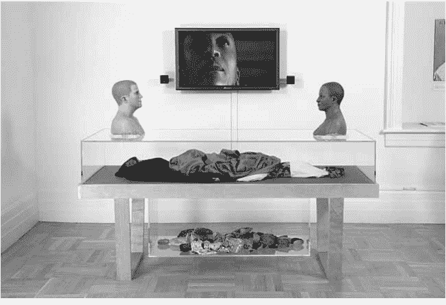

| 图 2.14 |
| :--- |
| 布拉德利·麦卡勒姆和杰奎琳·塔里，《颠倒世界》装置，2006。 |

在画廊环境中，参与者走近、进入并坐在一个字面意义上的儿童游戏屋里，以体验`与我玩`（见图 2.15）。在一个嵌入的计算机显示器前，他们可以通过使用鼠标在屏幕上的游戏世界中做出选择来进行互动。一个使用定格动画的小玩偶出现在场景中，直视参与者/玩家。`与我玩`让玩家坐立不安：

| 图 2.15 |
| :--- |
| 范·索维恩，《与我玩》互动装置，2002年5月。松木小阁，互动定格动画。墨尔本当代摄影中心。 |

玩偶的直视目光承认了玩偶自身的能动性，因为它按照自己的时间节奏慎重地穿过场景（见图 2.16）。当玩家指导玩偶玩茶壶或绘图工具等物品时，事件迅速脱离了玩家的控制。例如，如果玩家选择让玩偶玩茶杯而不是玩经典的玩偶“喝茶”游戏，玩偶就会通过打碎杯子并锯她流血的胳膊来“反玩”预期中的场景，同时以诡异的目光盯着无能为力、无法干预的玩家。通过将颠覆性和批判性的能动性赋予玩偶本身，索维恩和诺尔斯在参考现实世界中家庭危机中成人效力的挑战时，质疑了“游戏”本身的概念。

索维恩的作品`比蛇牙更锋利`（`Sharper than a Serpent’s Tooth`）探索了童年艰难而暴力的世界，并在大型摄影系列中进行了延伸。标题引用了莎士比亚的《李尔王》（`King Lear`, 1605）中的这段文字：

若她必须繁衍，

造她腹中脾性之子；让它存活，

且成为违逆本性的折磨给她！

让它在她年轻的额头压出皱纹；

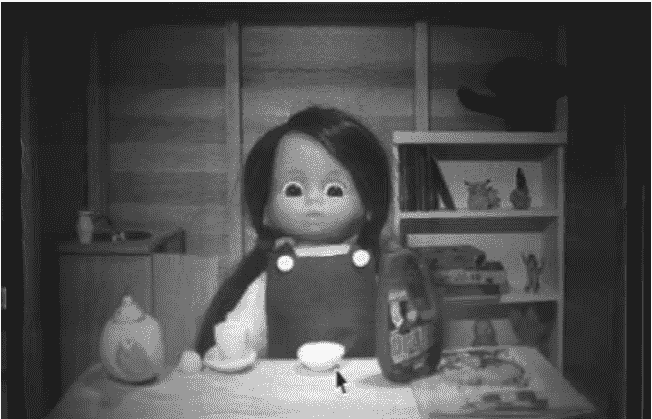

范·索维恩，《与我玩》互动装置。

用咸涩的泪水在她脸颊刻下沟壑；

将她母亲所有的痛苦与恩惠

转化为笑声和蔑视；让她感受

拥有一个忘恩负义的孩子

是何等比蛇牙更锋利的痛苦！ ${}^{76}$

作为公共广告牌印制，玩偶图像被放大到比真人更大的尺寸，颠覆性地将孩子塑造为孤独者、局外人或怪物。例如，角色苏菲（Sophie）独自坐在一张广告牌中（见图 2.17），处于一种疏离的状态。这种孤独和异化感存在于索维恩所有的玩偶作品中。在最近的短片`克拉拉`（`Clara`）中，索维恩再次探索了郊区青春期的创伤。在一个巨大的生活变化中挣扎，十二岁的克拉拉角色作为一个迷茫和困惑的旁观者与世界互动。在郊居家园玩耍时，克拉拉发现花朵试图抓住她；当她进入一个房子时，发现里面空无一物，只有一具装着金发小女孩的棺材。蚂蚁在周围流动。克拉拉拖着笨重的步伐穿过场景，显然充满了悲伤、哀痛和抑郁。这是关于朋友的死亡，还是关于在空虚地带的生命？女孩走进厨房，那里有一锅沸腾的

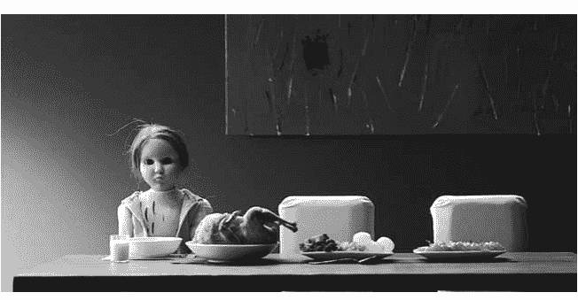

**图 2.17**

范·苏尔温（Van Sowerwine），《苏菲 #2》，源自 `比蛇牙更锋利`（`Sharper than a Serpent's Tooth`），2005 年。

沸水引诱她伸入手指并保持在那里，最终在痛苦的煎熬中将其抽出。苏尔温动画作品中缺乏宣泄或结局，这与叙事类型的惯例相悖。相反，苏尔温是在“解构”流行的家庭叙事，以揭示许多儿童所面临的黑暗、无助且险恶的生活。

另一方面，玛莎·罗斯勒（Martha Rosler，生于 1943 年）等当代艺术家通过简单地“玩过家家”来批判家庭空间本身。罗斯勒的重要作品 `厨房符号学`（`Semiotics of the Kitchen`, 1975 年）是早期表演性视频艺术的范例（见图 2.18）。站在典型的厨房里，罗斯勒背诵英文字母表，每念到一个字母，她就会抓住对应的物体，并以粗暴的方式表演通常与该工具相关的刻板且重复性的动作。在这组早期女性主义技术作品中，这可能是最具游戏性的一件。该视频将厨房扭曲成一种近乎杂耍般的氛围。在表演其他未受审视的家务活动时，罗斯勒解构了关于家庭角色的信念以及电视节目编排的规则。$^{77}$

## 艺术与流行游戏之家

罗斯勒、麦卡伦（McCallum）和塔里（Tarry）、查普曼夫妇（the Chapmans）以及苏尔温的当代艺术实践，是当今艺术家使用玩偶探索社会角色时所采用的颠覆性战术的例证。然而，房屋的家庭空间也成为了当代艺术家的焦点。雕塑家蕾切尔·惠特雷德（Rachel Whiteread）对家庭内部物品和空间的铸造，以及戈登·马塔-克拉克（Gordon Matta-Clark）通过切割和移动房屋进行的字面解构，都反映了家庭空间的重要性。

**图 2.18**

玛莎·罗斯勒，`厨房符号学` 静态画面，1975 年。由纽约电子艺术互动（EAI）提供。

自雅达利（Activision）的 `微型电脑人`（`Little Computer People`, 1985 年）以来，房屋在电脑游戏中既充当地点又充当主题（见图 2.19）。现代电脑游戏邀请玩家和设计师从文化想象的家庭乌托邦中汲取灵感，以新的形式体现许多已记录在案的批判和颠覆风格。玩家重新包装、重玩、解构甚至改写流行世界，同时提供自己对游戏的解读。

在 2003 年的游戏 `邻里冤家`（`Neighbors from Hell`）中，玩家恶作剧邻居，以报复郊区违规行为，如草坪护理不善。在 `第二人生`（`Second Life`）中，玩家建立企业、房屋和整个岛屿。在 `尼奥宠物`（`Neopets`, 1999 年）在线世界中，玩家设计生活在尼奥皮亚（Neopia）的宠物，并让它们忙于任务，建造房屋以及个人主页。《模拟人生》（`The Sims`）的玩家建造并维持一个由消费驱动的城市家庭或企业。在庆祝家庭观念的同时，像这样的游戏宣传其对日常活动（如照顾他人）的关注，并强调其摆脱刻板且常含暴力的游戏模式。$^{78}$ 而非黑帮和枪支，《模拟人生》提供了一所虚拟住宅，玩家控制被称为模拟市民（Sims，源自马克斯威尔·麦考利·卡特（Maxis）早期创建 `模拟城市`（`Sim City`）等模拟软件的工作）的角色，在一个智能游戏空间内活动。在父母中也常被称为“娃娃屋”游戏，《模拟人生》的空间是

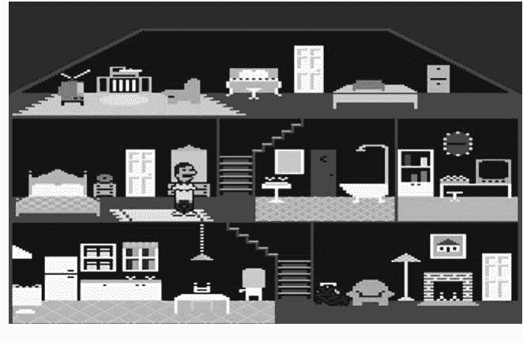

现实与虚拟家庭体验之间谈判的场所。这种方法的吸引力是熟悉的。电脑游戏和玩过家家都是幻想机制。$^{79}$ 这两类游戏都涉及角色定义、投射和逆转。围绕当代虚拟玩偶和传统玩偶游戏形成的粉丝文化，与 20 世纪末的历史游戏模式平行。此外，在《模拟人生》等当代电脑游戏中的游戏与艺术家的家庭游戏用法有着明显的相似之处。

在过去几年里，超过一半的美国人口开始玩电子游戏。$^{80}$ 《模拟人生》系列吸引了所有年龄段的成人和儿童。购买游戏后，大多数新的《模拟人生》玩家会花几个小时，通常几天，不停地操纵他们的新模拟住宅及其中的角色。游戏的目标是让玩家的《模拟市民》角色保持快乐、饱腹、清洁和得到照料。《模拟人生》玩家努力使最初预先设置的虚拟之家变成他们自己的家。最初，玩家被给予 modest 的一居室之家，带有简单的院子、邮箱，有时还有花卉、灌木和户外露台。在《模拟人生 2》中，提供给玩家的标准房屋阵列在玩家/角色阶级、种族和民族界限上是平等的。初始房屋本身代表了美国家庭建筑中一种特别的“列文斯顿”（Levittown）标准，然而

同时，它们旨在通过提供扩建房屋、购买合适的家具以及从事以家为基地的爱好（如阅读或看电视）的机会，以体现玩家的个性而演变。

《模拟人生 2》的玩家，像第一版的玩家一样，发现游戏中最令人满意的一个方面是与其他玩家分享独特的物品。例如，在不到四个月的时间里（2004 年 9 月至 2005 年 2 月），《模拟人生 2》玩家创建并上传了超过 125,000 个角色和房屋与他人分享。$^{81}$ 虽然视角可以通过玩家指令改变，但房屋仍然是互动和游戏的焦点；房屋结构是玩家看到的唯一空间。正如纸制游戏屋一样，在房屋的范围内，大多数《模拟市民》角色进行社交、寻找工作和学习。虽然角色似乎在家外面有生活——大多数角色去工作，例如——但玩家的活动集中在日常幸福感上：烹饪、阅读、装饰、社交。玩家可以设计他们对家庭空间的理想概念。在家中物品中很少有个人历史的标记、传家宝、纪念物或婴儿照片，这要求用户创建自己的个人物品以导入游戏环境。

玩家被提供启动资金以购买电器、装饰品以及诸如灯、炊具和书架等基本物品，并鼓励他们为新角色购买家具。昂贵的家具往往更能让模拟角色感到“舒适”；至少，它们被编程为从坐在一把昂贵舒适的椅子上获得的快乐大于坐在普通木椅上。一旦玩家了解到照顾《模拟市民》角色的幸福需要更大的预算，他们就让角色寻找收入，然后用于进一步的获取和购物。没有收入，或者没有新的材料和空间来增强他们的发育，《模拟市民》会变得不快乐，游戏平衡字面上会变成混乱。角色会睡着或停止使用浴室满足基本需求。因此，除非资金和新物品不断循环通过体验，否则角色“幸福”的概念会下降，污垢会积累。没有收入，玩家《模拟市民》角色的需求由于缺乏食物和娱乐而加剧。赚取“模拟币”（Simoleans）对于满足角色需求的成功至关重要。$^{82}$ 因此，在《模拟人生》中提供的经济和人格模型中，我们看到消费和以商业为动力的快乐等新兴主题。正如我们将看到的，玩家既使用这些价值观，也挑战它们。$^{83}$

图 2.20 和 2.21 是《模拟人生 2》展示厨房和浴室设计。厨房提供了最多的互动机会，也是引入新小玩意儿的场所；许多可供新玩家使用的物品都是厨房电器。厨房也是角色用来进出房屋的位置，标志着这个房间作为

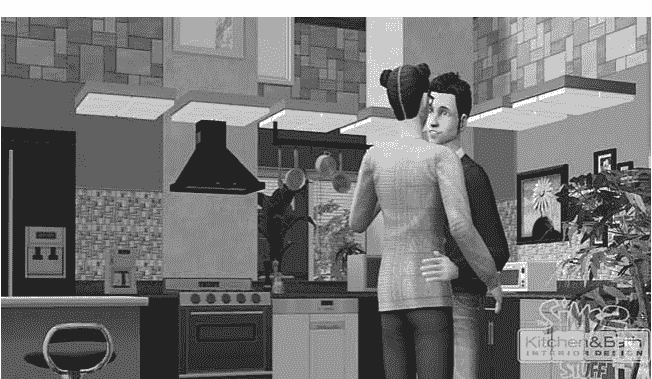

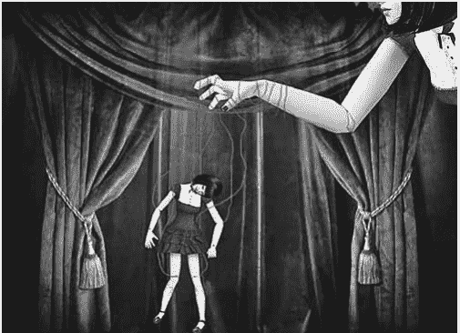

# 图 2.20

一个由`《模拟人生 2》`（`Sims 2`）创建的家庭，拥有那个时代完美无瑕的家具。根据包装上的说明，来自`《模拟人生 2：厨房与浴室室内装修包》`（`The Sims 2: Kitchen & Bath Interior Design Stuff`, 2008），玩家的角色将拥有“合适的服装和配饰，以享受他们崭新的厨房和浴室”。

# 图 2.21

来自`《模拟人生 2》`粉丝网站“我扔我的线”（“I throw my threads”）的图片，作者为 violentdoll。截图自 http://www.koinup.com/violentdoll/work/38853，摄于 2008 年 5 月 31 日。

内部与外部空间之间通透的边界。这一游戏设计元素符合当代美国生活中厨房的发展趋势。在雅子·布施（Akiro Busch）的著作*《家的地理学》*（*Geography of Home*）中，她指出，现代美国家庭的厨房已经超出了房屋中其他房间的尺寸，主要是为了容纳更大、更多的电器。⁸⁴ 然而，玩家有机会在游戏的系统设置中对物质物品的放置进行实验。例如，如果玩家把一把大椅子和一台电视放在厨房里，*《模拟人生》*角色会像这些物品放在卧室里一样开心。这种灵活性允许玩家改变对家庭、房间功能和居住空间布局的刻板期望。虽然这些以及其他例子允许进行重构，但消费（购买或收集并放置物品）仍然是核心游戏机制之一。然而，获取商品和社会互动仍然是影响游戏中*《模拟人生》*角色幸福状况的主要方式。

## 郊区生活

如果经典美国玩家的物理家园是尽端式“城堡”，那么玩家的*《模拟人生》*住宅及其周边的*《模拟人生》*郊区很容易成为乌托邦的愿景，其中每个玩家的房屋都构建为一个独立的世界。虽然关于空间实践和特定城市化模式存在不同的观念，但郊区化作为一种现象是*《模拟人生》*体验设计的核心。西尔弗斯通（Silverstone）将第一个郊区归功于伦敦，那里拥挤的 19 世纪城市环境迫使中产阶级迁出市中心。⁸⁵ 19 世纪后半叶，伦敦郊区的居民数量翻了一番，随着通勤火车、高速公路和汽车等交通系统促进了郊区的发展，全球其他城市很快也效仿了这种做法。*《模拟人生》*的游戏环境重现了郊区设计的这些特定方面，特别是那些强调对环境控制以及“安全”理念的元素。正如建筑师拉斯·勒鲁普（Lars Lerup）所指出的，郊区梦想甚至延伸到了居民用来上班的车辆上。SUV（运动型多用途车）现在已成为一个经典的标志，至少隐喻上，它将郊区的安全和庇护扩展到通勤至危险城市的途中。SUV 越大，对环境控制的程度就越高。当玩家通过扩大住房、积累奢侈品和举办独特的社交活动追求消费者主权时，*《模拟人生》*探索了几乎无限的宏伟郊区控制幻想。

*《模拟人生》*的住宅坐落在假设角色工作区域之外的通用郊区地块中。作为参与者和窥视者，玩家可以缩放或旋转场景，以获得他们喜欢的任何*《模拟人生》*周围环境的视图。所有*《模拟人生》*角色，即使是几乎一贫如洗的家庭，也住在这条舒适宽阔的黑色柏油路旁。事实上，威尔·莱特（Will Wright）曾指出，法国观众抱怨游戏中的宽阔道路感觉“太美国了”。⁸⁶ 同时，琳恩·施皮格尔（Lyn Spiegel）指出，在战后的美国，“新的郊区家庭理想是一种共识意识形态，向那些经历过战争带来的死亡和配给制的人承诺安全和稳定等实际利益”。⁸⁷ 二战后，郊区帮助在 20 世纪的家庭中恢复了传统角色。郊区的创建部分是为了回应“换班工作制”（swing shift），那些为战争努力而在家庭外工作的女性，同时也促成了一种对传统家庭角色崩溃的战后感知。从工业革命到第二次世界大战，西方见证了居住空间的各种解放及随后的“再家庭化”，而*《模拟人生》*不能与这些大众想象阶段分离开来。无论是现实还是虚拟的，郊区都体现了特定种类的建筑价值观和关于准入的理念，但更重要的是，它创造了一种生活方式，这是一套文化信念、经济力量和期望的产物。

大约 2002 年，即第一款*《模拟人生》*游戏 popularity 达到顶峰的一年，美国文化发生了一次重大转变，影响了物理与虚拟之间的平衡。自 20 世纪 80 年代以来，美国一直存在着向可控空间迁移的趋势。房屋已从舒适之所转变为防御之地。因此，不出所料，在 20 世纪 90 年代的互联网泡沫文化中，*《模拟人生》*体现了一个充满巨大乐观主义的时代，当时强劲的经济和低犯罪率为新时代的乌托邦吸引力做出了贡献。软件和硬件行业提供了一项近乎神话般的承诺，即一种新的融入技术的生活方式。美国人积极参与了家居用品消费和虚拟技术的使用。⁸⁸

互联网泡沫的破裂之后，由于人们对即将出现的恐怖主义威胁产生的恐惧，随之而来的是不寻常的经济衰退和不稳定时期。在美国，旧的城市社区正在以牺牲郊区为代价而增长。⁸⁹ 随着城市被宣传为恐怖袭击目标，以及美国国土安全部的公告鼓励公民用塑料布、储存的水和管道胶带加固家园，数字娱乐销售同时蓬勃发展。这些日常的实用趋势，加上游戏（尤其是*《模拟人生》*）流行度的增加，表明美国消费者在物理上和虚拟上都退缩到自己的家中，去发现和实践他们的乌托邦理想。事实上，2008 年宜家（IKEA）在美国的广告标语是“家：地球上最重要的地方”。

在审视养育、郊区化和房屋建造等游戏玩法，并展示消费作为 gameplay 的一个重要方面时，*《模拟人生》*确实提供了一种带讽刺意味的解读机会，注意到诸如伴随购买家居物品购物界面的“异想天开的购物背景音乐”等特征。通过强调消费与欲望之间的界限，*《模拟人生》*中的许多目标隐含了对该游戏所要求的大规模消费的批评。在某些情况下，游戏可能会鼓励玩家质疑他们的角色是否拥有更大、更好的物品和房屋会让他们更快乐，因为获取这些物品所需的任务随着角色拥有财物的增加而呈指数级增长。虽然在这个游戏中商品和服务是有价值的，但人际互动和同情心也会得到奖励。角色越富有，他们必须工作越多，且购买的物品在提供快乐方面必须越有效。正如战后第一代美国郊区居民意识到 20 世纪 50 年代描绘“消费者梦想”和郊区家庭生活的媒体的表演性和人为性质一样，*《模拟人生》*玩家面临着娱乐、休闲、工作和消费的矛盾。虽然许多*《模拟人生》*玩家在乌托邦式的虚拟郊区住宅内游玩，但许多研究表明该游戏的许多游玩风格具有社会性和协作性。因此，大多数*《模拟人生》*玩家可能只是渴望通过游戏建立联系。

然而，将消费定位为一种工具性游戏目标是进一步调查的原因，即使仅仅因为它如此接近现实世界的公司信息和消费者的日常实践。在*《模拟人生》*中，视频游戏中典型的“男性”空间已整合到现实（家居）和虚拟（游戏）的居住空间中。安·道格拉斯（Ann Douglas）在其关于消费者“女性化”的开创性著作中提出的论点提供了有用的批评。娃娃屋，无论是现实还是虚拟的，都使用符号来表示外部现实。玩娃娃屋既可以复制功能性内容，如建造厨房并让娃娃“做饭”，也可以按照玩家自己的条件来改编和同化符号。就*《模拟人生》*而言，玩家的“女性化”在逻辑上可以代表资本主义力量对居住空间的重新掌控。该游戏在女性和女孩中的流行可能支持了这一观点。玩家的女性化通过游戏空间的设计、游戏任务、游戏目标表现出来，并通过消费文化的主导地位在社会上得到反映。在玩*《模拟人生》*或其他当代娃娃屋游戏时，玩家会遇到对家居物品、消费和规范阶级价值观的迷恋。然而，房屋本身作为居住空间的制度，被视为控制机制，象征着传统的家庭角色，其规则本质上表明传统和局限性的行为。玩家在与这些居住空间的互动中，被赋予了这些角色。如果

## 从娃娃到欲望

在《模拟人生》中，空间的定义以及玩家控制角色在家庭领域内的方式，成为一种驯化过程，一种对自然的征服，因此，娃娃屋便是一座隐喻性的监狱。

正如许多学者所指出的，在电视、电影及其他媒体中，家庭空间依然与女性气质联系在一起。⁹⁴ 在进一步研究传统娃娃屋时，库兹奈茨（Kuznets）指出：“也许我们应该将对固定家庭角色的渴望视为一种自我限制性的怀旧产物。”⁹⁵ 早在19世纪，家庭游戏中的规范性行为就被描述为对女孩的社会期望。如果《模拟人生》中郊区化家庭空间的基本作用似乎是向玩家提供依赖历史上女性联想才能运作的经济、政治和意识形态模型，那么《模拟人生》中空间的定义就与一个更大的过程密不可分，该过程涉及这种女性化及关于女性角色传统观念的呈现。如果（正如施皮格尔所暗示的）家庭空间在历史上与女性气质相关联，那么参与设定在娃娃屋中游戏的玩家在这些角色中也将被“女性化”，并且正如19世纪末期玩缩微家庭游戏曾是一种流行的美国消遣，当代电子游戏可能也发挥着类似的功能。在使用房屋及其周边环境作为规范调色板来创建其自己的家园和家庭关系形象时，游戏设计者强化了先前建立的家庭乌托邦观念，包括那些由广告和企业营销研究提出的观念，尽管这可能带有一定程度的自我意识和讽刺。

从另一个角度看，消费也可以代表性别刻板印象中的“伟大的均衡器”，使《模拟人生》处于批判性知情游戏的前沿。《模拟人生》中郊区化家庭空间的基本作用，一方面似乎是向玩家展示依赖传统女性角色才能运作的经济、政治和意识形态规范。另一方面，运用萨特思迈斯（Sutton-Smith）关于游戏的观点，如果儿童通过幻想和模仿游戏学习成人角色、经济技能和情感行为，那么象征性工作创造力不仅调节《模拟人生》，同时也通过文化商品的用途、意义和“效应”得到扩展和发展。⁹⁶ 在这种观点下，消费主义必须被“理解为一种主动的，而非被动的过程——它是主动的，因为它也是一种包含工作的游戏类型。”⁹⁷

基于屏幕的互动娃娃屋是否只是表现了资本主义的物质幻想？它们是否是对弗洛伊德欲望观念的直接对抗？或者，更复杂地说，此类游戏是否作为批判性、颠覆性表演的必要契机？归根结底，由玩家决定他希望以何种方式解读游戏。像资本主义全球化趋势一样，诸如《模拟人生》这样的游戏跨越文化实践运作，提供未经稀释的美国郊区生活和资本主义欲望模型。⁹⁸ 《模拟人生》角色和社区对美国观众来说是熟悉的，然而它们非现实的语言、对变化的不可预测反应以及自主行为提供了惊讶，并有助于引发关于控制和欲望的令人不安的问题，这些也是之前讨论过的艺术家制作游戏中发现的重要主题。

但是像《模拟人生》这样的游戏是如何令人愉悦的？完成维持现状的任务是令人满意的，还是控制角色及其环境，既在游戏规则内游玩又推动游戏规则边界，是令人愉悦的？玩家在家用游戏场景中很少感到无力，这是这类游戏广泛吸引力的关键所在。玩家渴望成长和成就，但这些成就是次要的，主要乐趣来源于对熟悉事物的肯定。虚拟房屋的乐趣与掌握家用物品和那些非常熟悉的人形娃娃密不可分。无论玩家多么努力维持家庭或保持宠物快乐健康，对回到欲望之前的地方——即最初驱动幻想游戏的乐园——的渴望总是萦绕不去。虽然玩具和游戏理论家洛伊丝·库兹奈茨追踪了娃娃和玩具作为文化标记器的复杂方式，其他学者则探索了娃娃游戏中的欲望问题。像埃娃-玛丽亚·西姆斯（Eva-Maria Simms）这样的当代学者描述了娃娃的诡异性质，以及弗洛伊德将娃娃排除在其精神分析史和诡异讨论之外这一事实，因为娃娃“并没有很好地象征俄狄浦斯问题。”⁹⁹ 在这里，哲学家吉尔·德勒兹（Gilles Deleuze）的工作可以为之前描述的复杂游戏系统提供见解。

基于弗洛伊德和拉康关于“他者”的观念，德勒兹为游戏可能代表的欲望系统构建提供了令人信服的论点。他争辩说，与弗洛伊德和拉康的理论相反，对他者的欲望实际上是一种结构，*“是可能世界的表达：它是被表达的、被把握的，作为尚未在表达者之外存在的东西。”*¹⁰⁰ 德勒兹反驳了精神分析框架提供的窥视癖、展露癖以及他者在视觉上被定位的各种方式所形成的欲望系统，以重构精神分析中不可或缺的二元对立。¹⁰¹ 相反，德勒兹声称与他者的互动依赖于对他者代表的对象的欲望，或者对他者所表达的其他世界的欲望。¹⁰² 目前，其他人已经认识到，游戏、博客和各种参与者驱动的系统之所以运作，是因为存在一种产生有意义互动的欲望，这种欲望激励了新世界的创造。¹⁰³ 如果这种欲望填补了拉康意义上的某种“缺失”，那么对复杂在线游戏的热情可能暗示了对连接以及玩家如何在电子文化中理解自身的需求。¹⁰⁴ 德勒兹的后视觉视角下的欲望系统为检查在线系统提供了有价值的工具，在那里，词语和事物，视觉或非视觉，永远可以互换，在日常框架中交换。

无论玩家在纸质房屋还是在线世界中如何努力维持他们的娃娃，对回到欲望之前的地方——即最初驱动幻想游戏的乐园——的渴望总是萦绕不去。弗洛伊德的“失落对象”可能在字面意义上无法通过游戏发现，但注意到许多游戏专注于寻找、搜索和识别是有意义的。通常，回归的简单愿望将用户从一个游戏会话带到下一个。游戏物品一直被用来使与父母的分离更容易，毯子、帽子和毛绒玩具作为过渡性物品。¹⁰⁵ 实体娃娃屋和娃娃游戏的想象性质可能意味着玩家也想象家庭关系和社会仪式同样是建构的。讽刺的是，虽然许多《模拟人生》玩家致力于颠覆游戏并将其非凡的欲望投射到他们的《模拟市民》角色和房屋上，但他们从自己的家中这样做，保持了传统结构的秩序不变。沿着这些线索，值得注意的是游戏中男性角色也是如何被构建的。如果消费、室内设计和维护传统上是女性化的角色，男性可以被看作被定位为涉及金钱、地位和权力获取的冒险叙事，或者在技术游戏中，弄清楚事物如何运作。在这里，乐趣是通过旅程和推动边界和极限来协商的，而不是到达目的地。换言之，如果控制过多，游戏就失去了意义。

## 颠覆性游戏

正如在物理世界中，模拟人生玩家经常遇到诡异的条件，或者通过设计令人不安的环境来故意取消“预期的”模拟人生游戏，从而以游戏化的方式创造它们。¹⁰⁶ 虽然玩家在最初游玩时被置于传统女性角色中，但他们也被鼓励成为批判性玩家，在这些限制内创造小型反叛。在许多游戏中，这是通过多种定制工具和重新换肤来实现的。对游戏目标——例如消费主义——的反应是玩家批判性质疑家庭场景的另一种方式。

58

事实上，一些玩家最满足的时刻，往往是在对抗那个他们本应在游戏中支持的安全、消费主义体系时。

玩家对*《模拟人生》*的兴趣很大程度上源于颠覆既定规范，并探索什么行为是允许的，什么行为是不被允许的边界。这种批判性玩法与历史上对家庭情境的游戏模型息息相关：维多利亚时代的玩偶小说已被*《模拟人生》*玩家生成的同人小说所取代。维多利亚时代为玩偶举办葬礼的做法，转化为了阴森的*《模拟人生》*仪式，虚拟玩偶在规范化的郊区环境中受苦、营养不良或被烧死。这种颠覆性的欲望必须同时与家庭空间以及人们认为*《模拟人生》*角色所固有的自主程度进行比较。在一个介于用户控制与系统控制边缘的游戏中，*《模拟人生》*提供了一系列令人*焦虑*的玩法，这种玩法 strangely 地可能映射玩家自己的郊区经历或幻想，从而促使玩家去摆弄各种可能性。如果玩家处于一个控制地位去管理和引导这些焦虑，那么唤起焦虑也会给玩家带来快感。

弗洛伊德将凝视理论化为一种阳具活动，这种活动与对客体的掌控欲望不可分割，即窥视者对客体的权力欲望。在这种客体化的体系中，客体被呈现为被动的，并被赋予女性特征。在许多动作和冒险游戏中，一个期望的客体是为了愉悦而主要被观看的女性身体，女性主义电影学者劳拉·穆尔维在电影研究早期也将这种关系称为“凝视”。¹⁰⁷ 然而，使用凝视作为解读游戏中快感的方式，对于家庭游戏环境所需分析的复杂性来说是不够的。

在*《模拟人生》*中，控制角色的日常 Routine 并看到自己对世界的影响是令人愉快的。然而，也许正是角色的自主性使得凝视在某种程度上对玩家来说更具可信度、趣味性和愉悦感。回想索尔温（Sowerwine）的玩偶及其回望观众的凝视，或者*第二人生*（*Second Life*）中的化身（图 2.22）。正如斯拉沃热·齐泽克（Slavoj Žižek）对凝视的解释，玩家可能会认同角色，但他们也认识到自己的角色：“观众被迫面对在其看似中立的凝视背后运作的欲望。”¹⁰⁸

齐泽克关于摄影、电影和影像制作的理念在过渡到游戏分析时非常契合，那里玩家与角色之间的界面存在明显的断裂。这种与欲望的对峙在以玩偶游戏为基础培养的系统中尤为合适。许多艺术家的玩偶，特别是科柯施卡（Kokoschka）、贝尔默（Bellmer）和查普曼夫妇（Chapmans）创作的那些，强化了玩偶与性、色情之间的联系，使得观众和互动者被迫处于一种反常的

| 图 2.22 |
| :--- |
| Neferi Chajit，*第二人生*中的一个化身。2008年6月10日接受采访，见 http://www.secondlifeherald.com/。 |

观察者位置。当观察是通过相机或屏幕进行时，这种效果尤为显著。观众认同并成为了加害者。凝视默认成为了他者的凝视。“当我看一个物体时，该物体已经凝视着我，且从我无法看到它的某个点。”¹⁰⁹ 对于齐泽克来说，凝视“落入了我们观察者自身。”¹¹⁰ 因为玩家是从脱离 lived experience（生活体验）的视角体验角色的日常 Routine，虚拟玩偶类人的、自主的动作迫使玩家认识到“这一程序在形式层面上已经是‘反常的’。”¹¹¹

*《模拟人生》*游戏中反常和颠覆性的元素是电脑游戏玩家可用的最有力的替代玩法策略之一。一些玩家通过故意让那些小消费者角色的生活变得悲惨来颠覆游戏。玩家可以下载负面或颠覆性的住宅，例如“萨迪先生”（Mr. Sadistic）的家庭，在这个家庭中，*模拟市民*（*Sims*）角色不是被培养并找到工作，而是被折磨并频繁死亡。在*第二人生*或*模拟人生在线*的世界中，施虐受虐狂和性实验（如在线性产业中所示）是玩偶游戏显著的极端形式。¹¹² 涉及家庭生活的游戏之所以重要，是因为通过游戏玩法发生的微妙而强大的文化融入方式，以及社会价值观、互动风格和日常活动如何既被实践又被挑战。通过购物实现的虚拟家庭构建具有特别负载的社会意义。然而，规范性的游戏环境被专门设计为可被黑客攻击和颠覆，就像规范性好莱坞电影注定要被“阴险地戏仿”（camped）一样。

像*《模拟人生》*这样的游戏中的批判性实践，实际上清楚地遵循了前面提到的维多利亚时代游戏玩法：

- *换皮（Reskinning）*

  改变角色或物体。在*《模拟人生》*中，用其他图像替换家庭物品的图形，这可能体现不同的价值观或在游戏中毫无意义；

- *反玩（Unplaying）*

  工作或发明场景来困住角色，纵火或其他方式虐待它们；

- *重写（Rewriting）*

  玩家参与，从粉丝文化的书写内部重新定义玩法。

这使电脑游戏纳入了德勒兹（Deleuzian）的愿望与创造世界的框架中。欲望体系内的游戏玩法是在可能性世界中的玩法，玩家在其中享受意想不到的满足形式，包括通过破坏或违反规则集并体验由此产生的涌现现象所创造的满足。

游戏设计师能从这些历史和当代的家庭游戏玩法例子中吸取什么教训？正如长期的游戏和玩偶游戏历史所证明的，至少有三种批判性玩法形式可以从先前的游戏习惯中推导出来：换皮、反玩和重写。玩偶游戏和玩“过家家”都为嵌入在社会和文化规范中的玩法内批判提供了诠释空间。此外，以这些方法可见于广泛的制造和游戏玩法实践的方式，它们指出了“批判性玩法方法”的共性——玩家采用的对社会规范角色进行社会抵抗的策略的批判性形式具有共性，并跨越技术和时间移动。

挑战文化模式（如家庭空间中的性别角色）的批判性玩法，在难以考察且变化缓慢的大型文化系统中发挥作用。许多游戏提供的角色和环境操作是谈判游戏世界中玩家欲望的复杂手段。从玩“过家家”到玩*《模拟人生》*的照顾类（Care-giving）游戏，维持着一种诱人的、与满足基本人类需求及与他人建立联系相关的节奏性悬念。¹¹³ 这并不是说这是家庭游戏玩法中唯一的动机因素，但它确实是房屋游戏所代表的复杂体系中的一个因素。我们在玩游戏时是谁，以及我们如何与游戏世界建立关系，都是重要的问题，因为游戏快感源于定义游戏环境的规则结构，而这些规则范围从具体的内部游戏规则到更抽象的社会习俗、商业模式和性别化主体位置。¹¹⁴

从颠覆在线文化互动规范并探索允许行为边界中获得的巨大乐趣，游戏是人们突破这些限制的地方。通过在工作和玩法系统的结构内移动和玩耍，用户互动并体验创造玩法文化（playculture）的快感。玩家进入的数字“魔法圈”是一个专注于实验和颠覆的开放环境。¹¹⁵ 因此，此类游戏揭示了关于家庭角色的焦虑和不确定性——这些不确定性通过游戏的批判性玩法表现出来。

正如克里斯·克劳福德（Chris Crawford）在*《电脑游戏设计艺术》*中所述，游戏是封闭系统，是安全的空间，人们可以在其中进入各种冲突而不冒舒适、享受或身体健康的风险。一个好的游戏必须是安全且引人入胜的，其元素必须具有凝聚力且整合良好，其互动场景必须有意义。玩偶游戏，以及具有玩偶游戏特征的电脑游戏，通过提供环境用于语境扭曲和涌现社区形成，从而鼓励批判性玩法，改变主观生活体验，即萨顿-史密斯（Sutton-Smith）所提到的“成人生活的虚伪”，他认为儿童游戏提供了调解现实世界风险的故事。¹¹⁶ 玩偶或化身与玩家之间的关系呈现出一种自我意识的反常性，并在界面中具象化。维多利亚时代的玩偶游戏、贝尔默作品中对身体的表现以及政治意识表明，窥视性的越轨行为如何被用来提高对规范性社会行为的意识。

游戏制作者，像任何媒体制作者一样，不能简单地跳出当前的当代社会系统，以完全“无规则”的方式写作和思考。相反，行为、语言和话语本身就铭刻着这些规则——无论是显性还是隐性的，正如我们在玩偶游戏中所见，这些规则最终嵌入到在创作出的游戏空间中。因此，如果游戏制作者希望鼓励批判性游戏，他们必须像病毒一样从内部运作，感染并从根本上改变玩家游戏时对预期和可能性的看法。设计师可以专门设计以留下“开启不同语言的可能性”。$^{117}$这种不同的语言可能是视觉上的，因为西方对视觉文化（电影、游戏、摄影）的依赖；或者，或许更有趣的是，它可能是结构性的、语言性的或程序性的，正如前文提到的数字游戏所展示的那样。

# 3 棋盘游戏

> 象棋是两个迷宫之间的近身搏斗。
> —安德烈·布勒东，《自由驰骋》（*La Clé des champs*）

人类游戏最早的一些证据可以在古代墓地里发现的棋盘游戏或在古代绘画和雕刻中描绘的棋盘游戏中找到。起初，这些游戏是用泥土、木材或石头按需制作的简单民间物品。但随着游戏成为文化中更大的部分，统治阶级也加入了游戏，为国王和法老制作的非凡游戏套装随之演变。这些棋盘是用象牙、釉陶和其他珍贵材料制成的。后来，工业革命的大规模印刷技术使我们今天所知道的丰富多样的棋盘游戏成为可能。

早期的棋盘对批判性设计师仍然很重要，不仅因为它们反映了特定时期的文化观念，而且因为它们的游戏模式继续影响着当代设计。契克森米哈伊和贝内特认为，游戏之所以有效，是因为游戏的“魔圈”定义了其空间并使玩家自愿参与游戏行为。按照惯例，游戏必须限制玩家需要接受刺激的范围。游戏场地或棋盘确定了涉及哪些空间和相关对象。“在这个有限的时空单元内，玩家可以放弃自我意识，投入到过程中，无意识地行动。”$^1$ 从最早的时候起，棋盘游戏就已经将胡伊宁加的“魔圈”以及策略和运气元素融入其设计中。

然而，棋盘游戏体现了根本性的哲学差异。例如，围棋和国际象棋是抽象策略游戏，具有“完全信息”——也就是说，构成游戏系统的所有信息在任何时候都显示在游戏棋盘上。在抽象策略游戏中，随着玩家在棋盘上移动棋子，游戏通常会展开，为其他玩家制造一系列持续的难题以进行阻碍。然而，最早的棋盘游戏基于不完全信息或信息不完备的元素。许多游戏纳入了运气因素。虽然我们无法深入探讨现存众多游戏形式中的复杂细微差别，但我们可以通过 Mancala、围棋、图片游戏以及最终的国际象棋等突出例子来确定一些典型特征。

最古老的游戏发现于世界古代文明遗址，美索不达米亚和埃及，以及现在被称为塞浦路斯、巴勒斯坦、伊拉克、伊朗和约旦的地区。这些地区是被称为 *mancala* 或计数、播种和捕获游戏的一组游戏的发源地。这些类型游戏的其他名称包括 awari、oware、warri、gebata、qarqis、bao 和 matara。Pallanguli,$^2$ 或“许多洞”，是该游戏的南印度版本。$^3$

“Mancala”一词来自阿拉伯语 *naqala*，字面意思是“移动”。加纳常见的游戏 *oware* 来自一个 Twi 传说，描述了一男一女无尽地一起玩游戏。为了 someday 结束他们各种各样的游戏，他们结婚了，因此是“oware”，意思是他或她结婚或有终身伴侣。$^4$ 最初，Oware 或 Mancala 的“棋盘”可以由地面上的凹陷制成。后来，石凳和石碑被雕刻出来。Mancala 中的移动是当玩家选择两排凹陷之间的一个凹陷，并逐个分配一串珠子、石头或“种子”时产生的。$^5$ 虽然 Mancala 看似简单，但它有许多全球和地区变体，不同的 Mancala 传统在移动、捕获和目标规则方面有所不同。

Mancala 的游戏通常是对称的，意味着玩家使用相同的策略并遵守相同的规则以获胜。H. J. R. Murray (1952) 和 Russ (2000) 通过描述棋盘、游戏中使用的行数以及特定的捕获规则来对这些 Mancala 类型进行分类；例如，玩家可以继续绕棋盘走，或者在粮仓停止。最古老的石器时代新石时期版本于 1966 年在约旦的 Beidha 发现（大约可追溯到公元前 6900 年）。几乎同样古老的是 1989 年对 Ain Ghazal 的发掘，将一个棋盘追溯到大约公元前 5800 年。$^6$ 虽然这些棋盘的孔数存在细微变化，但所有都被认为是 Mancala 风格的游戏。另一个古老的 Mancala 游戏在伊朗西部被发现（大约可追溯到公元前 6300–5900 年）。Rollefsen 认为，这些发现证明新石器时代的人有闲暇时间并对运气游戏感兴趣。新石器时代是人类进化中的一个革命时期，在此期间，人类变成了可识别的 *Homo sapiens*（智人）并发展出一种能够反思自然和命运变幻的农业文化。Mancala 风格的游戏涉及一种模仿播种或耕地的动作，支持了这一说法。Mancala 可能是世界上最受欢迎的算术游戏。$^7$ 在其最简单的形式中，如果不计算“种子”标记，它可以作为纯粹的运气游戏来玩。沿着更复杂的路线玩，Mancala 是一个策略游戏，并且像国际象棋和跳棋一样，具有“完全信息”，因为所有已知的棋子和选项都摆在玩家面前。

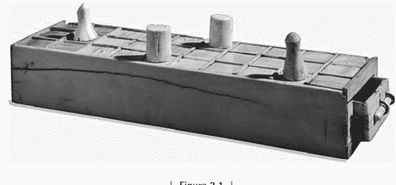

Mancala 作为人类游戏的最早期证据之一，通过拥有领土（游戏区域）、动作（移动石头）、规则（棋盘上的方向、分配的标记数量）、标记（代表玩家、玩家的团队或其他类型主体位置的棋子）和反馈（收集的数量），类似于当代游戏棋盘。这些早期的 Mancala 棋盘经过开发和定制这一事实，说明了游戏的美学重要性以及 *游戏体验* 如何在数千年来与美学交织在一起。

古代中东游戏证明了运气操作和美丽棋盘的存在。埃及的 Senet 游戏（图 3.1），也称为三十格，在阿布罗什第一王朝的墓穴中被发现，约公元前 3050 年；后来的棋盘变得更加装饰和华丽。乌尔皇家游戏，也称为二十格，同样美丽，棋盘上的空间极其装饰，即使确切的规则仍然有些神秘。抽象符号是否代表了关于时间或空间的东西？在 H. J. R. Murray 的《非国际象棋棋盘游戏史》（1952）中，Murray 描述了在一位约公元前 2600 年的女王墓中发现的乌尔游戏。该棋盘显然模拟了一场比赛，包括每个玩家七个棋子和七个四面体骰子，其中四个产生零到四的低数字结果。该游戏似乎提供了捕获对方棋子的位置，以及玩家可以避免对手的方格（参见图 3.2）。

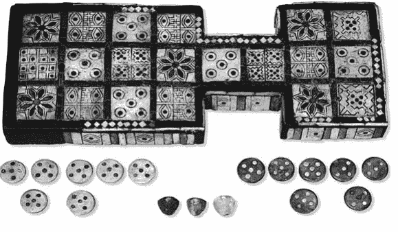

## 图 3.2

在二十格棋盘上的第七和第八格被认为代表一座桥、河流或运河，这是古代阿卡德和埃及棋盘设计中的一个特征。$^8$

虽然耶鲁大学考古学家 Robert S. Brumbaugh 认为这个棋盘上的“安全”区域太多，无法保持游戏的刺激性，但他指出：“我玩过乌尔游戏，觉得还不错。（似乎押大注赌博是标准做法，这当然会增加游戏的更多趣味性。）”$^9$ 在克里特岛的克诺索斯发现了一个类似的棋盘，虽然 Brumbaugh 认为该游戏是为了社交和赌博目的而玩的，但 Murray 之前曾指出乌尔游戏的目的或功能并不清楚。$^{10}$ 确实，赌博与这种游戏相关联从未得到普遍确认，但赌博当然也与游戏的历史交织在一起。

提到棋盘时，会将其与罗马皇帝克劳狄据说沉迷的骰子游戏联系起来。$^{11}$ 这种游戏（也许 *所有* 棋盘游戏）在拉丁语中被称为 *Alea*，这通常与 *tabula* 一起提及，因此称为棋盘游戏。$^{12}$ 罗马棋盘游戏的材料通常是石头或木头，甚至是象牙，具体取决于游戏主人的财富。西班牙文档员 Isidore 还描述了一种名为 *tabula* 的游戏，作为一种罗马形式的双陆棋，带有阿拉伯语名称 Nard。$^{13}$ 奥维德描述了一种基于现在所描述的几何学的棋盘游戏，“disants”。$^{14}$ 有趣的是，罗马游戏的棋子从未被理解为图形——也就是说，它们缺乏早期游戏如猎犬和九子棋以及后来游戏如国际象棋的代表性特征。

毛利人的穆托雷拉游戏（Mu Torere），据说已有数代人的历史，最初是在刻于木头或树皮上的八芒星形轮廓上进行的。游戏的进行方式类似于英国的国际象棋（draughts）或美国的西洋跳棋（checkers）。两名玩家各拥有四枚perepere（或称“人物”），棋子起始位置位于星形的外侧尖端，目标是试图穿过棋盘到达对侧。Best（1917）对该游戏及其起源提出了若干问题。如果它是一个原创游戏，那么关于其历史知之甚少；如果它是跳棋或国际象棋的变体，那么为什么要给玩法增加星形形状？

### 棋盘游戏的灵性侧面

尽管二十世纪末和二十一世纪初，许多人文学研究的重心转向了大众文化，特别是致力于使日常生活研究合法化的努力——在此处应提及德·塞托（de Certeau）、勒费弗尔（Lefebvre），以及更近时期的海格摩尔（Highmore）——但游戏研究却落后于这一趋势。然而，游戏是合法的媒介形式、人类表达方式和文化重要性的载体，游戏如何反映其周边文化的规范和信仰，对于理解游戏本身及其可能提供的人类体验洞察至关重要。在这种“游戏文化”（playculture）的媒介观中，棋盘游戏成为用于追溯社会实践和信仰的多种物质文化遗物之一。游戏动作和规则可以被视为主要游戏特征，这些关注点并非游戏所独有，也存在于语言系统、社会秩序以及亲属关系、法律和仪式联系中。

游戏史学家，包括Murray、Brumbaugh和Austin，已经研究了某些游戏的谱系。例如，双陆棋（backgammon）可能受到古埃及游戏Senet和美索不达米亚Ur游戏的双重影响。对于那些试图记录这些游戏如何运作的人来说，规则被追溯，游戏棋子被编目，引用游戏玩法的文件也被收集起来。许多当前的游戏学者往往忽视的是游戏在消遣之外的目的；在某些情况下，学者们可能会忘记某些游戏并非旨在作为消遣这一事实。即使是著名的多产的二十世纪游戏学者Murray，也避免甚至在某些时候贬低游戏的灵性联系，他指出：“很难看出魔术师的个人行为如何能被部落的世俗成员所采纳。我认为我们必须在他处寻找大多数棋盘游戏的起源。”¹⁵

在20世纪70年代，人类学家和游戏学者Csikszentmihalyi和Betta指出，机会游戏“似乎已从宗教仪式的占卜方面产生出来。”¹⁶ 机会游戏和占卜在许多万年里紧密相连，因为人类长期以来一直寻求从他们认为主宰命运并控制狩猎、战争和丰收潜在结果的可变且强大的力量中获得指引。事实上，Csikszentmihalyi和Betta认为，占卜为寻求者带来了一种可能性感。此外，“从事占卜行为的人，作为一种结果，感到他可及的项目更能应对迫在眉睫的日常生活中的可能性，因此他的体验更接近于游戏而非担忧。”¹⁷

有证据表明，涉及机会的古代游戏往往具有灵性和仪式重要性。Senet为两名玩家提供了棋盘设计以及结合机会的规则。《猎犬与豺》（Hounds and Jackals，或称《五十八孔》）出现在中王国时期的埃及（约公元前2000年），由两条平行的各含二十九个孔的轨道组成，每五个孔为一组。在《猎犬与豺》中，两名玩家的轨道相当独立，目标仅仅是赢得比赛，而不是捕获对方的棋子。¹⁸ 在公元前五世纪晚期该游戏的一个例子中，棋盘是由一个河马雕塑制成的，可能是Taueret，生育和分娩的女神。投掷的棋子，虽然原本不属于这个棋盘，顶部是代表阿努比斯（Anubis）和霍鲁斯（Horus）的神像头部，其他棋子在形式上类似于现代 cribbage 游戏。¹⁹

古董专家通过检查来自埃及中王国（公元前2040–1782年）遗址发现的《五十八孔》的其他实例，重建了该游戏的规则。为了玩这个游戏，如3.3图中嵌入河马雕像顶部的所示，玩家轮流沿路径向前移动其钉状棋子。在尾巴附近和侧面，两个特殊的孔反转了动作，使棋子在棋盘上倒退，而末端空心附近的两个孔则给玩家提供额外的回合。这种基于机会的棋盘游戏类似于《蛇梯棋》（Snakes and Ladders）等游戏，因为机会操作驱动互动，允许命运介入游戏。

埃及棋盘游戏Senet（公元前3500年）的名字也可能暗示“通过”，因为它是在前往来世的旅程中玩的。Senet棋盘（带有与命运赛跑的隐喻）设计为涉及机会。所有示例都由包含30个方格的矩形棋盘以及配套的陶器和象牙游戏棋子组成。两名玩家掷木棍以确定一个数字，然后以蜿蜒的方式沿长棋盘移动其游戏棋子。²⁰ 虽然Senet被认为是一种社交游戏，但历史文件揭示了它与埃及文化仪式的紧密联系。已发现多幅描绘Senet玩家独自玩耍，或与精神对手对弈的画作，暗示该游戏可能是与Ra本人对决以决定死者的命运。以这种方式，该游戏可能作为一种精神媒介，将生者与来世连接起来。Piccione等历史学家指出，该游戏可以以消遣或仪式的方式进行。²¹《亡灵书》（Book of the Dead）的文件描绘了玩家导航可能解释为游戏中死亡各个层级的过程。²² 一直以来，游戏都带有魔法和仪式元素。

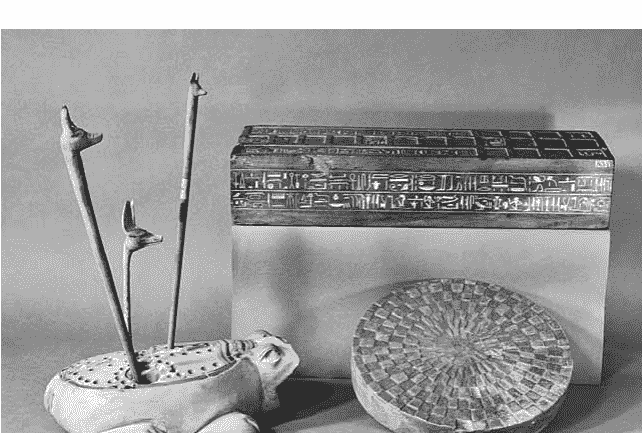

| 图 3.3 |
| :--- |
| Senet游戏；河马游戏，三根豺狼头手杖（第三中间期）；蛇游戏（第二王朝）。木头，法扬斯。卢浮宫博物馆，巴黎。N1605；E2710；N3043；N4265；E29891。摄影版权：Réunion des Musées Nationaux/Art Resource, NY。 |

在其他地方，占卜与中国游戏Wéiqí（围棋）的某些历史相关联。在日本被称为Go（围棋），据信该游戏发展自周文化中皇帝和占星家练习的占卜。长期以来都有证据表明，商朝（公元前16-11世纪）的领导者使用龟壳和动物骨头上的裂纹来预测农业收成和天气。占卜与传说中的“黄河图”和“洛书”相关联，这些魔方阵图表据说被神奇地揭示给神话祖先伏羲，当时他骑在龙马和龟的背上。²³ 这些图表与围棋棋盘的相似性令人印象深刻。根据游戏历史学家David Parlett在他的*《牛津棋盘游戏史》*（*Oxford History of Board Games*）中的说法，围棋可能与“一种占卜实践有关，即在代表天或天地并在其中解读由此产生的图案的棋盘上投掷黑白棋子。²⁴ 这得到了一些分量的支持，因为棋盘上使用的宇宙术语被定义为占星术或地理术术语，中心被称为Tengen（天之轴），棋盘表面的四个象限与基本方向相关，八个特别标记的点被称为Hoshi（星）。引用《忘忧清乐集》（*The Carefree and Innocent Pastime Collection*），或十二世纪初的一部围棋手册，也是该游戏现存最古老的文献之一，Fairbairn指出：“自然界中所有事物的数字以一始。围棋棋盘上的点数是三百六十加一。一是所有生命数字之首。它占据棋盘的极点点，四个象限围绕其旋转。其余的三百六十个点代表[太阴]年中的天数。它们分为四个象限，代表四个季节。”²⁵

从盛行占卜图表的商朝转变为阴、阳和其他理性体系正在兴起的周朝，可能有助于将游戏对其根源的解释从占卜转变为其作为战略游戏系统的当代身份。

如果我们把早期棋盘游戏的创造与其他类型占卜材料的出现并置，比较指向了新石器时代农业带给世界大部分地区意识转变。对于这一代人来说，转变不仅是从觅食到播种和种植材料的 technological 变化，也是智力转变，特别是在这一动荡所引发的空间和时间重新定义方面。农业规划、种子储存、动物育种和驯化，以及对天空或河流的抽象以创造日历，都展示了理解时间的新方式。将狩猎空间与农业空间分离，将土地划分为围栏区域，以及犁、灌溉、几何学和数学的发明，使空间的抽象成为一种高度珍视的心理过程。棋盘游戏似乎通过以安全、仪式化的形式呈现这些概念及其对社会和物理关系的影响，来体现这些概念。当在棋盘上遇到时，挑战和竞争被编纂并在特别严格的界限内探索。宗教或灵性仪式的功能也是如此，包括魔法、萨满教和占卜。学者们提出了这种对古代民族和游戏解释方法，包括著名的人类学家Gary Rollefson。²⁶

正如游戏学者H. J. R. Murray所指出的，直到公元初期几个世纪，欧洲学者才关注游戏，直到十三世纪，欧洲作家才开始描述他们在各自国家玩的游戏。²⁷ 在欧洲，这些活动通常可追溯到罗马或凯尔特的影响。²⁸ 历史上欧洲棋盘游戏最重要的类别是

## “Taff”（棋盘）游戏

维京人认为成功下 `taff` 是一项宝贵的特质，并在萨迦（Sagas）中如此提及。作为一种拥有完美信息、无随机性且通常由两名玩家参与的抽象策略游戏，古北欧语术语 `taff` 指的是一类通常在下棋格或十字形棋盘上进行的游戏。`Taff` 的特点在于双方力量不均，主题围绕围困或夺取国王及其军队。这些游戏常被视为国际象棋的前身，`Taff` 的一些例子包括十世纪的 `Ballinderry` 棋局以及爱尔兰的 `Brandub` 棋局。来自威尔士的 `Tawlbwrrd` 游戏在律法中有记载，因为其玩法要求国王一方有八枚棋子，而进攻方有十六枚。来自拉普兰的 `Tablut` 和来自冰岛的 `Hnefatafl` 在整个北欧地区广泛流行，直到十二世纪被国际象棋取代。`Halatafl` 起源于十四世纪，并在冰岛诗作《格瑞斯萨迦》（`Grettis Saga`）中被提及。该游戏与爱尔兰的 `Fidchell`、威尔士的 `Gwyddbwyll`、英国、德国和法国的 `Fox and Geese`（狐狸与鹅）以及瑞典的 `Sheep and Wolf`（绵羊与狼）相关。据信 `Taff` 是凯尔特神祗 `Lugh` 发明的一种游戏，某些凯尔特文化学者将 `Fidchell` 解释为展示人们如何协调物质世界与精神世界之间界限的例证。同时，有证据表明 `Taff` 是首批重要到足以在政府和教会中获得席位的棋盘游戏类型之一。

关于欧洲教会对游戏感兴趣的证据汗牛充栋。在它的时代，`tables`（骰子棋盘游戏，类似西洋双陆棋）是在西洋双陆棋的棋盘上玩的。虽然中世纪的欧洲人对这种游戏着迷，但教会长期且艰难地试图禁止其玩法。1254 年，法国圣路易九世禁止在宫廷中玩 `Taff`，称该游戏为“`inbonisti ludi`”（内部人的游戏）。因此，政府或宗教团体与游戏之间的斗争至少与这一事件一样古老，甚至可能更为久远。然而，当面对 `Taff` 类游戏在欧洲失控的流行时，教会最终决定利用游戏来进一步传播其宗教信息。收藏于剑桥的十二世纪基督学院手稿 122 号描述了一种名为 `Alea Evangelii`（或“福音棋盘游戏”）的 `Hnefatafl` 形式。根据游戏历史学家 `David Parlett` 的说法，`Alea Evangelii` 可追溯至英国的盎格鲁-撒克逊时期（见图 3.4）。该游戏在一块由十九乘十九个点组成的十八乘十八方形棋盘上进行，二十四名守卫对抗四十八名攻击者。描述该游戏的手稿来自埃塞尔斯坦统治时期（924–940），展示了一个被安排成宗教寓言形式的棋盘。

`Alea Evangelii` 标志着棋盘游戏首次被用作意识形态工具之一。然而，总体而言，`Taff` 游戏与其他近东和美索不达米亚游戏存在显著差异，因为这些游戏主要作为纯粹的娱乐而出现。它们与精神领域的联系记载较少，或者

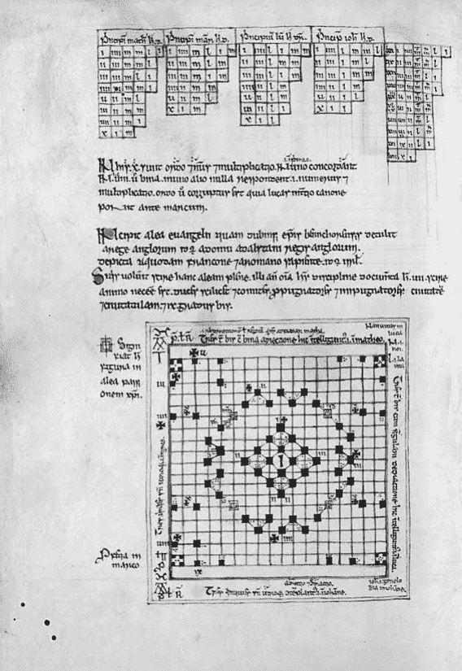

甚至被故意掩盖。随着国际象棋的出现，具有不同意图的新棋盘游戏随之发展并主导了文化生活。

## 史诗与日常中的游戏

因此，在人类历史的不同阶段，游戏扮演了不同的角色。从辅助概念过程的发展，到引发仪式，再到建立与时间和未来的联系，历史上的玩家一直试图通过游戏获得主导权并理解不确定性。随着 `Taff` 棋盘的流行度下降，除了国际象棋之外的欧洲游戏得以进化和繁荣，其中一些源于最普通的游玩形式。

文艺复兴后的成功游戏建立在 `Goose`（鹅）之上，这是一种起源于十六世纪佛罗伦萨在美第奇·弗朗切斯科（`Francesco dei Medici`）统治下发明的意大利追逐或竞速主题游戏。在美第奇家族的推荐下，`Goose` 被西班牙菲利普二世采纳，并迅速传播到欧洲其他地区。后来，`Goose` 成为早期美国棋盘游戏以及 `Snakes and Ladders`（蛇梯棋）等其他欧洲游戏的模型。`Fox and Geese`（狐狸与鹅）——前文提及作为与 `Taff` 游戏及其凯尔特对应物 `Fidchell` 相关的一种游戏——已知是英格兰爱德华四世（1461–1483）以及十九世纪维多利亚女王和阿尔伯特亲王的喜爱。在一类被称为“狐狸游戏”的类别中，有一组以力量不均衡的对手为特征的棋盘游戏，一名玩家是狐狸，即进攻者。其他玩家控制或扮演大量的鹅、绵羊或狐狸试图吃掉的猎物，而狐狸则试图避开对手四处设置的陷阱。狐狸游戏以不平衡的游戏目标和相当抽象的棋盘为特征。这些“不平衡游戏”与国际象棋、围棋和西洋双陆棋的流行相呼应，其规则相对稳定。抽象性赋予了这些游戏体验一种普世特质，同时允许这些游戏传播到不同的地区、宗教和文化中。其他棋盘游戏则通过添加细节在特定性和内容上进化。有些游戏描绘了重大的社会关切，另一些则描绘了相当世俗的事件。

在中国，游戏呈现了多种形态。印刷术发明于亚洲，大规模印刷的棋盘游戏起源于中国和日本。例如，中国纸牌据记载始于公元 1294 年。然而，历史学家 `Andrew Lo` 主张，我们现在所知纸牌游戏实际上起源于西方，因为它们压倒性地共享西方规则集。但是，与棋盘结合使用的纸牌在亚洲出现得更早。`Lo` 研究了“叶子”游戏，并确定唐代和北宋早期的早期棋盘游戏将纸牌和骰子都纳入了游戏体验。一些游戏，如图 3.5 所示，使用了比现代游戏更不寻常的元素，例如香。

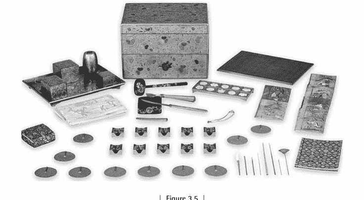

**图 3.5**

十八世纪日本香道游戏器具箱，大英博物馆藏。

游戏在日本也很受欢迎。诸如日本十八世纪复杂的香道游戏等例子不胜枚举。除了纸牌外，日本贵族，特别是女性，既设计又玩 `awase`，意为“匹配”或“组合”。这些 `E-awase`（或基于图像的游戏，如图 3.6 所示）通常由两个相同或相关的画在贝壳上的图像组成。玩家随后将这些图片排成对或三组，这是一种旨在作为随意、对话性游戏消遣，适合根据参与者的艺术和审美敏感度进行辩论、比较和判断的活动。在 `E-awase` 风格的游戏里，运气促进了社会交流。

日本有许多非常古老的印刷棋盘游戏，或“图像双陆棋”（Picture Sugoroku）的例子。`Sugoroku`（双陆棋/步步高）是一种在中世纪日本玩的木制棋盘游戏，但随着印刷技术的繁荣，这些游戏变得具有叙事性且便于携带。早期游戏在主题上是佛教的，并包含宗教教义。纸张被印刷出来，然后粘贴成六到八张纸的正方形，形成桌面大小的棋盘。游戏玩法与 `Snakes and Ladders`（蛇梯棋）类似。根据 `Kakuchi`（香月升太郎？）的说法：“穿过冒险和迷宫，通常以地图的形式出现，并最先到达终点的玩家抓起 `agari`，即奖品。”图像棋盘可能早在十三世纪通过江户时代的木刻印刷创新而兴起。与其他棋盘游戏一样，`Sugoroku` 宣称具有精神根源，并且，虽然西方对该游戏的历史研究有限，

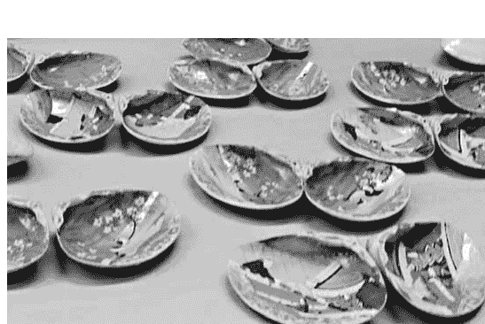

**图 3.6**

平安时代（公元 794–1192 年）的贝壳配对游戏，东京国立博物馆藏。

像 `Sugoroku` 这样的基于图像的游戏可能在十五世纪被纳入佛教寺庙的修道生活之中。在那里，僧侣使用棋盘向初学者教授起源于人性弱点的痛苦如何以及必须如何被征服，以达到纯净和天堂这一更高目标。几百年后，该游戏的宗教版本将重点转移到日常生活问题上，前往著名的京都和其他国家的旅行成为游戏目标。旅行是浮世绘大师歌川广重 II 的《江户名景》（1859）的一个特征。该游戏以精美的小场景描绘了后来被称为东京的城市。游戏玩法很简单。两名或更多玩家逆时针绕着图像游戏棋盘移动到由掷骰子决定的最终目的地。在另一种 `sugoroku`（步步高）中，玩家从离开日本前往几个西方城市旅行开始，然后回来成为一名显赫的官员。在许多十九世纪的日本游戏中，获得官僚地位是一项受人尊敬的成就。

当时著名的日本艺术家，包括歌川、广重和葛饰，在这些游戏中处理了各种主题和题材，包括占卜。这些游戏在明治时期（1868–1912）仍然很受欢迎，经常推广如世界旅行等教育主题。诗歌作为棋盘游戏《百人一首》（`100 Poems by 100 Poets`，图 3.7）的主题材料，该游戏由十八世纪的歌川丰国创作。其他游戏主题包括宗教、政治、演员、怪物、家庭生活（图 3.8），甚至是武士的成就。在十九世纪，色情

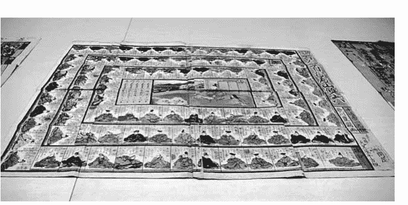

**图 3.7**

《百人和歌》主题的双六（Sugoroku）游戏，由歌川豊国创作，源自江户时代（公元 1603–1868 年），现藏于东京国立博物馆。

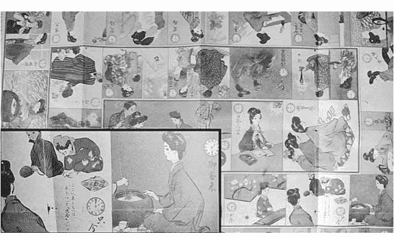

**图 3.8**

以日常生活为主题的双六游戏，由作者惠赐。

还有更多这类作品出现在了歌川扶冨创作的《善行恶行分类棋盘游戏》中。

另一块游戏板描绘了歌川芳久创作的《着甲过程》（江户时代，19 世纪）。又有一款双六游戏的主题支持了《国家议会》（1852 年）的理念，并将棋盘与卡牌结合，玩家在掷骰子动作的同时抽取卡牌。1885 年，松斋修月创作的《雪月花》游戏描绘了当时流行的歌舞伎演员及其伴随的历史与民间传说场景，而 20 世纪初的例子则描绘了海军军官和士兵。据东京策展人新田太郎称，双六游戏中展示的奖励说明了简单游戏如何成为民族主义希望的载体：“这款游戏因其美学美感和历史价值而受到尊重。对日本人来说，双六游戏与其他大多数棋盘游戏不同，它成了一种生命体验，因为这款游戏唤起了民族激情。”$^{45}$ 即使是日常生活也成了双六游戏（见图 3.8）的主题。

棋盘游戏能够激发民族激情、成为社会批判的场所或提供宗教教育的平台，这看似令人惊讶，但这些用途当时非常典型，并且正如日本印刷革命所表明的那样，通过大众生产的发展很容易实现便携化。在美国和欧洲，游戏的大众生产出现在 19 世纪，远晚于亚洲。然而，这一时期商业生产的游戏为观察一个面临移民、城市化和工业革命国家的价值观、希望和信仰提供了窗口。随着收入增长和休闲时间扩大，中产阶级鼓励儿童玩游戏以培养思维能力和接受道德教育$^{46}$。经常推荐的国际象棋将在本章稍后讨论。

## 美国游戏

在美国，19 世纪完好无损的游戏实物非常罕见。原因各异，但包括印刷量少、磨损以及一种不幸的文化贬值观念，即认为游戏是玩具，不值得保存。北美三大主要棋盘游戏档案馆——位于马萨诸塞州伍斯特的美国古董协会、纽约历史学会和安大略省滑铁卢大学——仅收藏了大约两百款游戏，这只是北美丰富多样化的游戏生产的一小部分样本。在美国，棋盘游戏最初是由小公司或团体发起的。历史学家玛格丽特·K·霍弗（`Margaret K. Hofer`）在《我们玩的游戏：棋盘游戏与桌面游戏的黄金时代》中指出：“从 1840 年代到 1920 年代娱乐美国人的游戏，为观察一个经历巨大变革国家的价值观、信念和抱负提供了迷人的窗口。”$^{47}$ 鉴于上一章概述的美国游戏历史，美国第一款重要的大众生产棋盘游戏也关注家庭生活也就不足为奇了。早期主要游戏制造商创作的游戏在转向经济、战争以及更抽象的客厅和语言游戏之前，都专注于家庭以及宗教和道德教育。最早的 19 世纪游戏，特别是为儿童设计的游戏，被认为具有一些教育价值，最好还能有一些道德价值$^{48}$。随着国家从乡村向城市工业经济转型，家不再是工作的场所，而是教育、娱乐和灌输价值观的场所。新印刷和航运技术的兴起使游戏的大众生产在商业上可行。大多数中产阶级都能买得起这些游戏，其价格通常从小盒纸牌游戏的 25 美分到带有棋盘和可移动棋子的游戏的 3 美元不等$^{49}$。

到 1880 年代，帕克兄弟（`Parker Brothers`，以《`Tiddlywinks`》（1897）、《邮局游戏》（`Post Office Game`）（1897）和《海战》（`War at Sea`）（1898）闻名）以及麦克劳克林兄弟（`McLoughlin Brothers`，提供《朝圣者的进步》（`Pilgrim's Progress`）（1893）和《兵士十格》（`Soldier Ten Pins`）（1890））等游戏公司的兴起，使棋盘游戏变得司空见惯。其他受欢迎的游戏包括《百货商店游戏》（`The Game of Playing Department Store`）（1898）、《垄断者》（`Monopolist`）（1885）、《航海罗盘与十上》（`Mariner's Compass and Ten Up`）（1885）、《前进与后退》（`Advance and Retreat`）（1900）、《小志愿者游戏》（`Game of the Little Volunteer`）（1898），以及包括《圣经问题周日游戏》（`The Sunday Game of Bible Questions`）（1887）在内的“奶奶”系列游戏。米尔顿·布拉德利公司（`Milton Bradley Company`）以《人生命运黑白棋》（`The Checkered Game of Life`）（1860–1861）、《字谜游戏》（`Anagrams`）（1910）和《`Logomacy`》（1889）闻名。`J. Ottmann` 石印公司（`J. Ottmann Lith. Co`）出版了《吉姆·克洛十格》（`Jim Crow Ten Pins`）（1910）和《商业》（`Commerce`）（1900）。塞尔科和赖特（`Selchow and Righter`）是《帕奇西》（`Parcheesi`）和迷宫游戏《 pigs in Clover》（1880）的制造商。

《幸福大厦》（`Mansion of Happiness`，图 3.9）创作于 1830 年代，1843 年由波士顿的 `W. & S. B. Ives` 公司出版，是美国第一款大众市场棋盘游戏。根据游戏历史学家记载，它由安妮·W·阿博特（`Anne W. Abbott`）开发，她是一位新英格兰牧师的女儿，出生于马萨诸塞州塞勒姆$^{50}$。阿博特还发明了纸牌游戏《作者》（`Authors`）$^{51}$。

《幸福大厦》是基于英国、法国和意大利的游戏，如《鹅》（`Goose`）$^{52}$。然而，美国版本的目地截然不同：玩家竞争成为第一个到达“幸福”或天堂的人，即棋盘中心的一个大方格。通过家庭环境中的良好道德行为来获得进步。在这里，善行引导儿童及其棋子沿着通往“永恒幸福”的道路前进，玩家必须小心落在标有“恶习”（如残忍和不感激）的格子上，尽管这些挫折是通过机会插入的$^{53}$。换言之，游戏规则规定，至少在隐喻层面上，家庭是善行与恶行斗争的战场。玩家旋转转盘沿着路径移动，路径上超过一半的格子都描绘了美德和恶习。根据游戏规则，当投掷结果将玩家置于标有“懒惰”的格子时，他必须回到“贫穷”。同样，“骄傲”会将玩家退回到“谦逊”。简而言之，每一种恶习都会受到相应的惩罚，而美德则会得到应得的奖励$^{54}$。通过诚实和慈善取得成功，玩家明智地避免懒惰、违反安息日以及其他判断失误。游戏的信息清楚地体现在其说明中$^{55}$：“拥有虔诚、诚实、节制、感激、审慎、真理、贞洁、真诚、谦逊、勤奋、慈善、仁慈或慷慨的人，有权前进……走向幸福大厦。拥有鲁莽、残忍、不雅或不感激的人，必须回到他原来的位置，甚至不要*想*幸福，更不用说享受它了。”$^{56}$

人们希望儿童将这些原则铭记在心，并将健康思想与争夺位置的世俗乐趣联系起来，将自己投射到善与恶的情境中，享受与玩伴和家人的陪伴$^{57}$。在强化当时高尚的道德原则方面，《幸福大厦》与许多儿童游戏一样，使用转盘或“`teetotum`”（一种陀螺，旋转时会“落在”印制的数字上）来代替骰子，以避免骰子所传达的与赌博的联想（见图 3.10）。那些“棋盘”，像那个时代的地图一样出版，是印有图案的灵活纸张，背面粘有亚麻布以增加硬度$^{58}$。

有趣的是，值得注意的是，当帕克兄弟在 1894 年重新出版《幸福大厦》时，该游戏已经存在了六十四年，他们删除了恶习以及与恶习相关的空间标签：不雅、激情、不感激、欺骗、强盗、伪证者、通往愚昧之路和放纵之巅。帕克兄弟还将“改正院”中描绘的女性替换为男性，删除了女性从事恶习的插图，并将贫穷添加到恶习列表中$^{59}$。

在 1860–1861 年，米尔顿·布拉德利创造了基于道德的游戏《人生命运黑白棋》，同样奖励善行并惩罚恶行。如果《幸福大厦》仅探索美德和恶习，那么《人生命运黑白棋》中的玩家被期望通过养成多种习惯来收集分数，包括个人美德和商业意识，其中一个目标是价值 50 分的“幸福的晚年”$^{60}$。获得 100 分才能赢得游戏。财富，第二高分的格子，价值 10 分；坚韧、成功、幸福、荣誉、大学和肥差带来 5 分；而婚姻和真理则不计分。该时期其他值得注意的棋盘游戏包括《扬基推销员》（`The Yankee Pedlar`），或《你买什么？》（`What Do You Buy?`），由约翰·麦克劳克林于 1850 年随着百货商店现象的兴起而发行。帕克兄弟的《百货商店游戏》（1898）要求玩家在购物之旅中购买尽可能多的商品$^{61}$。与此同时

布娃娃和纸质城堡，这些大规模生产的桌游是以草根或民间的方式进行的。儿童的游戏以家为核心，既是道德的中心，也是经济消费的核心。

其他早期的游戏在设计中运用了社会兴趣和资本主义寓言。例如，麦克劳克林兄弟（`McLoughlin Brothers`）1883年的游戏《牛与熊：华尔街大游戏》（`Bulls and Bears: The Great Wall Street Game`）（图 3.11）。正如 `Hofer` 所指出的，“到 1880 年代，财富已成为美国游戏乃至生活中成功的 defining characteristic（决定性特征）。”玩家扮演投机者、银行家和经纪人的角色，游戏还纳入了铁路大亨威廉·亨利·范德堡（`William Henry Vanderbilt`）和杰伊·古尔德（`Jay Gould`）的漫画形象，以及投资者塞勒斯·菲尔德（`Cyrus Field`）。当时的政治漫画家嘲讽这三个人，以此批评阻止市场竞争并提高国家航运成本的垄断铁路政策。

虽然美国的游戏侧重于道德和行为，但许多欧洲桌游重述了民间传说和历史事件。遇到 Carthephius 或 Ahasuerus——神话中的“流浪犹太人”——在中世纪及以后被基督徒所传颂。根据民间传说，这位古代水手（此处指 Ahasuerus）在耶稣前往十字架的路上侮辱了耶稣，并因耶稣的诅咒而成为永生者。目击报告曾遍布欧洲，特别是在中世纪，莫斯科以及包括伦敦在内的所有西欧城市都有记录的访问记录。到十九世纪，大多数对流浪犹太人的目击都与精神疾病有关，但这一传说在文化形式中变得著名。作家欧仁·苏（Eugène Sue）写下了他版本的反犹故事《流浪犹太人》（*Le Juif Errant*），并于 1844–1845 年连载。在他的叙述中，流浪犹太人（对中世纪犹太人而言，这个名字是对傻瓜的指称）和他的妹妹被迫保护勒内蓬特（Rennepont）家族，如果这个家族离开地球，流浪犹太人和他的妹妹都将失去永生。耶稣会士迫害这个家族，该家族已经壮大，其成员分散成为将军、印度王子、工人，甚至美洲的耶稣会传教士。与此同时，有一大笔财富可以由家族剩余成员获得，而耶稣会士及其爪牙隐藏在周围，试图获取资金。永生的流浪犹太人和他的妹妹在关键时刻帮助家族，例如当家族即将被美洲原住民“砍头”，或被判入狱时。连载的叙述充满了障碍和冒险，同时强化了文化偏见。

苏的煽情叙事被游戏《流浪犹太人，或 The Wandering Jew》（*Le Juif Errant, or The Wandering Jew*，1852–1858）所采用。在游戏棋盘周围（图 3.12），玩家会遇到流浪犹太人和小说中的事件。这款类似于“环游世界”（Round the World）游戏。在游戏中，犹太形象看起来像摩西的典型版本，披着被风吹起的斗篷，留着长发。他像鬼魂一样出现在城堡、战区和其他地点，而各种非流浪角色则在经典的法国客厅里闲逛。流浪犹太人也代表霍乱流行病——无论他去哪里，霍乱都紧随其后，这与设计必然有关。

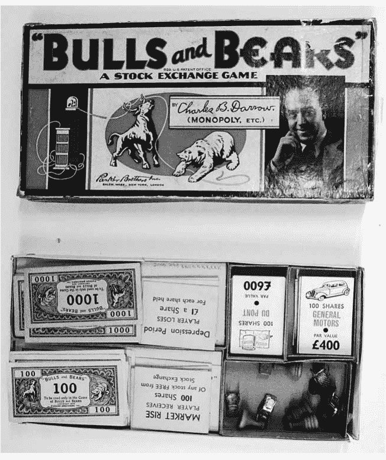

# 图 3.11

《牛与熊：华尔街大游戏》（*Bulls and Bears: The Great Wall Street Game*），1883 年，麦克劳克林兄弟出品。纽约州历史学会藏。

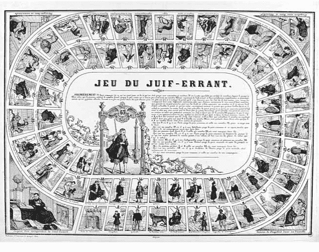

# 图 3.12

《流浪犹太人》（*The Wandering Jew*）游戏，1852–1858。44.5 × 53.6 厘米。53.86.3155D。巴黎欧洲与地中海文明博物馆藏。摄影：Thierry Le Mage。版权：法国国家博物馆协会/纽约艺术资源。

结构类似，法国游戏《革命游戏》（*Jeu de la Révolution*）或《法国大革命游戏》（*The French Revolution Game*，约 1850 年代）是著名游戏《鹅妈妈游戏》（*Jeu de l'Oie*，*Snakes and Ladders* 的法语版本）的变体。玩家沿着由方格组成的路径移动，通过轮流掷骰子前进（图 3.13）。第一个到达路径终点的玩家获胜；在路上，如果玩家落在“监狱”方格上，他或她必须在那里等待，直到另一名玩家入狱，替换该玩家。在《革命游戏》中，路径的终点是国民议会。

虽然一些生产商的作品在今天会让观众感到尴尬和冒犯，但将游戏设计作为批判手段的做法在游戏设计师中占据了一席之地。斯坦利穿越黑暗大陆营救埃明帕夏（*Stanley’s March Across the Dark Continent for the Relief of Emin Pasha*，1890）是一款描绘英国出生的亨利·莫顿·斯坦利（Henry Morton Stanley，1841–1904）沿刚果河下行至非洲维多利亚湖旅程的桌游（图 3.14）。斯坦利以无情的探险家闻名，他穿越非洲寻找欧洲在殖民入侵期间掠夺大陆的方法。

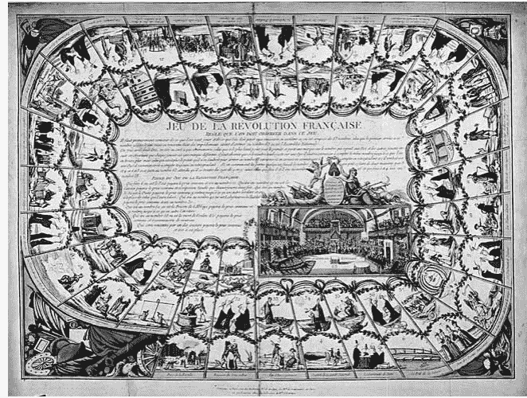

# 图 3.13

《法国大革命游戏》（*The French Revolution Game*），约 1850 年，巴黎城市博物馆，卡纳瓦雷博物馆，巴黎藏。摄影：Agence Bulloz。版权：法国国家博物馆协会/纽约艺术资源。

游戏盒上描绘了斯坦利，身后拖着一串非洲人，他们扛着他的包，并包括代表一名白人军官带领一组黑人搬运工的游戏棋子。这里，经典的道德游戏或旅行游戏被重新包装以支持种族主义信念和殖民主义的借口。当时的记者注意到这款游戏：“在创作时是无辜的娱乐，但它今天承载了不同的含义。”但就像大多数代表种族刻板印象的问题媒体一样，实际上，这款游戏在发布时并不是无辜的。自图画桌游兴起以来，它们一直通过游戏从一个特定的角度进行教育和信息传播；游戏学者伊恩·博戈斯特（Ian Bogost）在这方面使用了“说服性”一词。游戏显然可以在无辜玩耍的幌子下嵌入种族和文化偏见，因此必须不断检查这种丑陋的倾向。

# 图 3.14

《征服非洲》（*The Conquest of Africa*），基于亨利·莫顿·斯坦利爵士（Sir Henry Morton Stanley，1841–1904）和戴维·利文斯通（David Livingstone，1813–1873）旅行的桌游，十九世纪法国学校彩色版画。© 私人收藏/Charmet 档案馆/布里奇曼艺术图书馆。国籍/版权状态：法国/版权过期。

太频繁地，玩耍被用作媒体的“漏洞”，一个种族主义、性别主义和阶级主义出现的地方，希望它们会被容忍为不太成问题——毕竟，“这只是一个游戏”。希望审视这些历史例子能揭示当今游戏中那些不太无辜的代表。

《地主游戏》（*The Landlord’s Game*）是第一个获得美国专利的游戏，1904 年由来自弗吉尼亚的贵格会妇女伊丽莎白（Lizzie）·麦基（Magie）获得。麦基发明了《地主游戏》以推广单一税运动（Single Tax Movement）背后的社会理念（图 3.15）。麦基是政治经济学家和旧金山记者亨利·乔治（Henry George）的追随者。乔治对加州在经济繁荣时期存在的贫困感到不安，他写了一本书《进步与贫困》（*Progress and Poverty*，1879），宣称贫困的根本原因是土地垄断。乔治没有建议没收所有土地，而是提出对所有土地，无论是原始的还是开发的，征收单一、高额的统一税收。

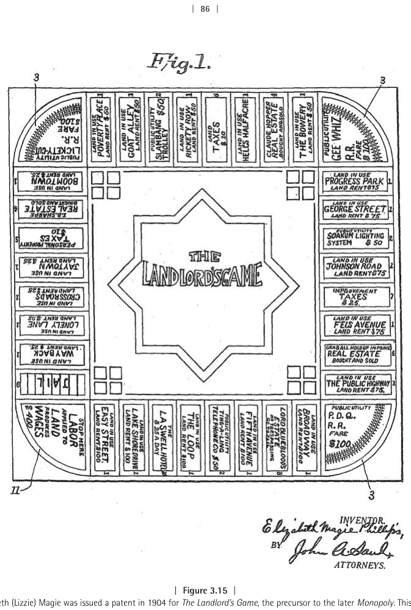

*伊丽莎白（Lizzie）·麦基于 1904 年获得了《地主游戏》的专利，这是后来《大富翁》的前身。这是她 1924 年 9 月 23 日的专利图纸，展示了对该游戏的改进。照片：美国专利商标局。*

认为这种“单一税”将抑制投机，降低土地价格，并为国家提供收入。乔治将他的系统定位为一种“纯粹资本主义”形式，允许自由贸易和完全公平的市场竞争。基于乔治的原则并由麦基设计的游戏鼓励玩家根据其城市或地区进行修改，并取得了成功。

1924 年，麦基将《地主游戏》带到了大型商业出版商，位于马萨诸塞州塞勒姆的帕克兄弟（Parker Brothers）游戏公司。但帕克兄弟印象不深，告诉麦基她的游戏太复杂，太教育性，一点也不好玩。更糟糕的是，该游戏还具有政治性，这对帕克意味着在商业市场上风险极高。因此，该游戏被拒绝出版。但在当地，该游戏持续存在（在美国中西部、宾夕法尼亚州和新泽西州的大西洋城），被大学教授及其学生使用，并在 1920 年代和 1930 年代，特别是在 1929 年股市大崩盘之后，获得了一批狂热的追随者。

查尔斯·布雷斯·达罗（Charles Brace Darrow）玩过大西洋城版本，创建了自己的带有新图形的版本，并在 1934 年在费城的沃纳梅克百货公司（Wanamaker's Department Store）销售他的盒装游戏。达罗的游戏名为《大富翁》（*Monopoly*），与《地主游戏》极其相似。每个棋盘都提供一条由 40 个方格组成的路径。每个都有四条铁路和两种公用事业（水和电）。每个都提供租金随价值增加的物业。每个棋盘还包括一个公园方格、一个监狱方格和一个“去监狱”方格。达罗对他的修改申请了专利，并将军游戏卖给了当时由罗伯特·巴顿（Robert Barton）担任总裁的帕克兄弟。后来，麦基的专利也被购买（尽管价格很低），以承认她的优先权利。帕克兄弟在 1933 年发布了第一个版本的《大富翁》游戏。到 1935 年，已售出五十万份。

作为框架的《大富翁》试图培育一种颠覆感，也许是因为其初衷。经济学教授拉尔夫·安斯帕奇（Ralph Anspach）于 1974 年发明了《反垄断》（*Anti-Monopoly*），其包装与原始《大富翁》非常相似。安斯帕奇有效地用新的语言重新包装了游戏。例如，一个方格指示玩家“去参加价格战”，而不是去监狱。经过重写，游戏的目标是挑战作为《大富翁》游戏基础的垄断概念。“我试图找到一款游戏，它要像《大富翁》一样有趣，但展示垄断的黑暗面，”安斯帕奇回忆道。“在我的一些学生对我的大学提出挑战后，我决定通过创建一款反对垄断者的游戏来填补这一空白。”

《反垄断》颠覆了熟悉的惯例。棋盘从一个垄断状态开始，玩家需要以自由企业的方式竞争，将游戏状态恢复到竞争性的自由市场系统。当《反垄断》出现时，帕克兄弟声称商标侵权。1977 年，地区法院裁定支持帕克兄弟，随后是一系列法律强化和逆转。

最后，安斯帕奇（Anspach）在法庭外达成和解，并继续销售他的游戏，保持着游戏即抗议的传统，正如丽齐·麦基（Lizzie Magie）多年前所做的那样。另一款基于《大富翁》（Monopoly）改编的游戏，贝特尔·奥勒曼（Bertell Ollman）的*《阶级斗争》*（Class Struggle），于1978年发布，旨在帮助人们“为在资本主义美国的生活做准备”。在这款游戏中，工人（Workers）是生产者（制造鞋子、汽车等物品的人），而资本家（Capitalists）则是拥有用于生产这些物品的机器和工厂的所有者。这两个角色代表了主要阶级。当工人们团结起来时，他们从其他资本家玩家手中夺取权力；如果他们不团结，资本家一方就会获胜。根据奥勒曼的规则，“‘阶级斗争’反映了我们社会中阶级之间的真实斗争。游戏的目标是赢得革命……最终目标。”70

## 艺术家与超现实主义游戏

让我们回到二十世纪早期。随着图形材料的大规模生产，棋盘游戏继续广受欢迎。在二十世纪初期，第一次世界大战、科学的发展以及西格蒙德·弗洛伊德（Sigmund Freud）著作日益增长的影响力，带来了对潜意识的新兴趣以及关于游戏的新实验。游戏成为探索内心生活的重要部分，因为游戏不仅始终反映其产生的文化，还通过玩耍反映当下的情境。一百多年来，艺术家一直将游戏作为探索和表达的媒介。与艺术一样，游戏往往强化更大的文化影响。艺术家，特别是那些追随超现实主义（Surrealist）和Fluxus（普洛克斯）运动的艺术家，也倾向于将游戏作为一种娱乐和研究形式。此外，艺术家们倾向于特别批评游戏与其所处时代的社会结构、经济和观念的关联。

在他中期的著作*《人、游戏与玩耍》*（Man, Play and Games）中，法国理论家罗杰·克罗伊（Roger Caillois）为研究广泛的玩耍行为奠定了基础。克罗伊认为，西方这里出现的各种玩耍形式融入了一种他描述为“对无谓困难的品味”的玩耍特质。71 在这里，克罗伊谈到了为掌握某种特殊技能或活动而设计的游戏，通常会导致发现某种令人满意的结论。即使是虚构或抽象的，谜题、数学题、文字游戏、棋盘游戏，特别是策略游戏，似乎都指向完成挑战所带来的内在满足感。二十世纪那些更为激进的、具有政治色彩的艺术家，如著名的达达主义（Dada）和超现实主义群体，对这些挑战避之唯恐不及。尽管只制定了少数几款棋盘游戏，但达达艺术家们被第一次世界大战在欧洲引发的动荡聚集在一起，他们在质疑传统、文化和艺术的角色时，表现出顽皮和荒诞的态度。

然而，超现实主义者是在作家、艺术家和组织者安德烈·布勒东（André Breton）等人的领导下，于20世纪20年代出现的，他们通过两条主要的研究路径探索游戏。首先，超现实主义者通过利用偶然性和并置手法，强调了达达主义的顽皮性。但超现实主义者也关注心灵的内部运作，并鼓励对潜意识进行深度聚焦。依靠西格蒙德·弗洛伊德的工作，并认识到人类对事物和事件感知的重要性，布勒东曾学习过心理学，并在第一次世界大战期间的一部分时间在一间神经病房工作，他撰写了*《超现实主义宣言》*（1924），并在四年内出版了一本关于一位精神疾病女性的非正式案例研究，题为*《娜嘉》*（Nadja，1928年）。在20世纪20年代初那些现已著名的开创立宣言之后，几位与达达主义有关的艺术家，其中包括德法雕塑家让·"汉斯"·阿尔普（Jean "Hans" Arp），转而参与超现实主义运动。^72

除了撰写*《娜嘉》*，布勒东还与菲利普·苏波（Philippe Soupault）合作，共同编写了*《磁场》*（The Magnetic Fields，1919年）一书，有人认为这开创了超现实主义运动。与路易·阿拉贡（Louis Aragon）一起，布勒东和苏波创立了*《文学》*（Literature，1919年），这本刊物后来成为当时幻灭的知识分子的标准论坛。在*《文学》*的页面上，超现实主义者将资产阶级文化归咎为第一次世界大战的主要原因。

自动写作法、游戏操作以及偶然性或随机的方法可能在20世纪20年代之前就被艺术家们使用过；超现实主义者意识到了艺术和美学中的新趋势，如未来主义（Futurism）和构成主义（Constructivism），但他们对于潜意识主题的关注是新颖的、强烈的，并植根于正在萌芽的精神分析学领域。实际上，随着有组织的公民社会增加了其“高雅”文化和精致享受，日常娱乐的可获得性和强度似乎却在减弱。对于二十世纪的批评家瓦尔特·本雅明（Walter Benjamin）来说，只有通过强化日常体验，社会变革才可能发生。在这种情况下，游戏不仅可以吸引来自社会各阶层的玩家，还可以通过表达那些可能表现为危险地压抑的欲望，从而革命化文化。正是这些心理需求被超现实主义者通过游戏操作和游戏方法所探索。超现实主义的艺术和文学强调通过自动主义、偶然和中断的过程来创造艺术的无意识和非理性方法。“超现实主义不是一种诗歌形式，”超现实主义者在他们的宣言中写道，“它是意识流的再次发现，它打算用人工锤子绝望地粉碎其枷锁，如果需要的话。”^73 对游戏以及游戏如何唤起和激发无意识过程的迷恋，是许多超现实主义实践的重点。事实上，“超现实主义研究局”的成员相信他们可以通过互动性和跨学科研究实现“心灵的彻底解放”。^74

因此，批判性玩耍成为了超现实主义艺术家网络中各种艺术家和思想家群体的创造性目标。类似游戏的图像在超现实主义作品中大量涌现。例如，在凯·萨奇（Kay Sage）的绘画中，风景呈现出棋盘游戏的属性，仿佛暗示偶然性和策略是人类本性中的重要组成部分。

怀着以精神分析在科学领域所实现的方式系统化艺术的目标，^75 超现实主义艺术家试图通过一种痴迷于音乐、电影，特别是游戏的艺术互动，将幻想和梦的世界与日常存在的世界统一起来。像古人将游戏视为与命运、偶然和来世力量连接的一种方式一样，超现实主义者相信游戏可以帮助每个人——艺术家、科学家、政治家，甚至农民——触及精神领域和人类潜意识。“我相信，”布勒东曾说，“梦境状态与现实状态的最终解决——表面上如此矛盾——将实现为一种绝对现实，或*超现实性*（surrealité）。”^76

几位参与超现实主义的艺术家制作了与棋盘游戏相关的艺术品。两个突出的例子是约瑟夫·科尔内尔（Joseph Cornell）的*《超现实主义玩偶》*（Jouet surréaliste，1932年）和查尔斯·肖（Charles Shaw）的影子盒游戏*《拼贴》*（Montage，1935年）。*《拼贴》*包含了扑克牌、粘土烟斗和象牙圆盘，全部装在一个木箱中。^77 在大约可便携式弹珠机开发的同时，阿尔贝托·贾科梅蒂（Alberto Giacometti）创作了一系列游戏板雕塑，展示了艺术与流行文化对游戏的兴趣之间早期的某种“对话”。

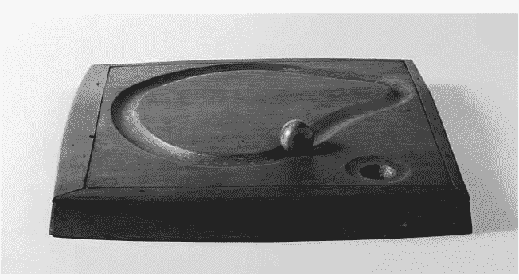

阿尔贝托·贾科梅蒂（1901-1966），*《回路》*（Circuit），1931年。木头，4.5 x 48.5 x 47 厘米。AM1987-557。国立现代艺术博物馆，乔治·蓬皮杜中心，巴黎。摄影：Adam Rzepka。图片来源：CNAC/MNAM/Dist. Réunion des Musées Nationaux/Art Resource, NY. © ARS, NY.

贾科梅蒂的作品*《回路》*（Circuit，1931年）是这些棋盘游戏艺术品中的早期作品之一（图 3.16）。游戏板由一个简单的平台组成，上面刻有一个椭圆形凹槽。一个球被放置在凹槽上，因此可以沿着板上刻画的轨迹不断滚动。然而，游戏板还包含另一个元素：一个凹陷，或一个可能的目标，位于球所经过的回路之外。这种可能的终点，或目的地，被暗示出来，但在设计上被设定为物理上无法达到的。球的轨迹是无尽的且无法满足的，在一个封闭系统中运行。贾科梅蒂的*《男人、女人和孩子》*（Man, Woman, and Child，1931年）永远不可能处于同一个互动平面上（图 3.17）；*《指向眼睛》*（Point to the Eye，1931–1932年）是另一件受游戏影响的作品，表达了挫折感的想法——在这种情况下，是一种近乎折磨的悬置状态。一杆大而锋利的长矛，永远停在头骨附近，正指向眼睛。

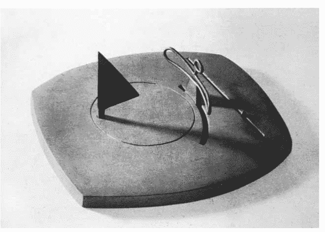

图 3.17：阿尔贝托·贾科梅蒂，*《男人、女人、孩子》*，1931年。© ARS, NY.

从1931年开始，贾科梅蒂为布勒东的超现实主义期刊*《超现实主义为革命服务》*（Le Sur-realisme au service de la revolution）撰稿。他和当时其他艺术家一样，测试了那些方式……

图 3.18

阿尔贝托·贾科梅蒂，《不再玩耍》（*On ne Joue Plus*），1932年。© ARS，纽约。

# 贾科梅蒂的游戏棋盘与超现实主义

哪些游戏能够触及人性的本质。他那些带有有限活动部件和受限轨迹的地形板，可以被解读为关于艺术封闭系统以及被称为“人类境遇”的更大封闭系统的声明。这些作品所框定的那些受限的可能性与令人沮丧的距离，使游戏概念中的“能动性”显得颇为悲观。

透过贾科梅蒂，人们很容易看到游戏环境中的阴暗与怪诞一面。在《不再玩耍》`1932年`中，死亡是主题，但这一主题是在游戏棋盘的景观中得以呈现的（见图3.18）。其法语标题 `On ne Joue Plus` 意味着人们不再玩耍了。⁷⁸ 事实上，该棋盘更像是一个战区，而非一款拼图游戏。瘦削的人像悬浮在交战双方一侧较大的孔洞之中。《不再玩耍》`1932年`极大地将充满奇思妙想的棋盘游戏与战争的怪诞主题并置在一起。棋盘中央占据主导地位的、被炸毁的“无人区”敞开，露出了人类的坟墓。

现代艺术博物馆（MoMA）的策展人曾称赞贾科梅蒂的《四点四分钟后的宫殿》`The Palace at 4.4M`，`1932年`因其“笼状”雕塑，并引用这件作品作为他最具超现实主义风格的作品（见图3.19）。这件雕塑不仅徘徊在真实空间与想象之间，而且贾科梅蒂创作该作品使用的过程同样具有超现实色彩。事后人们才意识到，像《宫殿》这样的作品代表了“我们记忆中事件的纠缠交织”。⁷⁹

这些游戏棋盘代表了贾科梅蒂超现实主义游戏的最后阶段。从他在20世纪20年代的“令人反感的物体”开始，历史学家克里斯蒂安·克莱姆`Christian Klemm`等人指出，这位艺术家的顽皮性格逐渐让位于更黑暗、更险恶的观念。这些后期作品变得不那么抽象，转而专注于“游戏棋盘的局部或机械结构等现实术语”。⁸⁰ 这些作品利用游戏作为批判性思维的系统，或作为探索人类选择之愚蠢的系统，将友好、孩童般的玩偶游戏范式与战争、监禁和死亡相结合。但贾科梅蒂的游戏棋盘也反映了国内游玩以及当时流行的游戏。超现实主义者对游戏的喜爱，至少在部分程度上，可能与欧洲艺术家在逃离战争时申请前往美国、加拿大、英国或墨西哥的签证时所经历的漫长等待期有关。利用找到的材料即兴制作国际象棋套装，通过语言游戏自娱自乐——这些活动让人回想起20世纪初艺术家与囚犯之间那种诡异的联系。超现实主义者严肃对待他们的游戏，但他们的游戏可能是一种从灾难中幸存的手段。

## 游戏与艰难时期

在贾科梅蒂开发他的游戏棋盘、超现实主义艺术家磨练他们的表演游戏之际，游戏在世界各地的热度持续攀升。使游戏具有意义的一部分因素在于游戏发生的社会和文化背景。在《游戏规则》`Rules of Play`中，凯蒂·萨伦`Katie Salen`和埃里克·齐默曼`Eric Zimmerman`指出：“`有意义的游戏`发生在游戏中行动与结果之间的关系既`可辨识`又`融入`游戏更大背景之时。”⁸¹ 因此，任何较大的社会状况变化，如严重的经济萧条，都可能预示着游戏领域发生深刻的变化。在美国大萧条时期，像《大富翁》`Monopoly`等棋盘游戏的销量急剧上升，而在同一艰难经济时期，弹珠机`pachinko`则是日本等海外国家的热门游戏。似乎经济越是艰难，游戏销量反而越高。⁸²

弹珠机在美国、英国和法国获得了广泛普及，作为大众化的军事人员消遣活动被大量生产。罗杰·C·夏普`Roger C. Sharpe`写道：“弹珠机就像做爱：它要求玩家全神贯注和完全的情感投入。没有别的可以替代。”⁸³ 该游戏于1871年由蒙提格·雷德格雷夫`Montegue Redgrave`在英国发明，他在先前名为Bagatelle的游戏中加入了螺旋弹簧、推杆和倾斜的游戏板。1942年后，如Bally、Gottlieb、Genco、Exhit、Keeney和Stoner等制造商使其工厂能够生产枪支部件、通信技术和其他国防产品，而非弹珠机游戏。然而，现有的游戏机器通过油漆和反映战争主题的新图形进行了更新。一个例子是Genco对《十点转换》`Ten Spot Conversion`，`1941年`的改造，该公司将《十点》`Ten Spot`重新倾斜，变成了“`Smack the Japs`痛击日本兵`”，一款“胜利游戏转换版”`1943年6月`。Seeburg游戏公司的射击场游戏也有几种转换套件出售。Seeburg销售了《Chicken Sam》和《Jailbird》枪战游戏。这些是使用玩具步枪发出的“ray-o-lite”来“射击”移动人物和目标的游戏，这些目标放置在离玩家几英尺远的地方。如图3.20所示，原游戏中典型的野生动物特征被更换为转换单元，使游戏在二战期间具有政治相关性。广告中吹捧其为“逼真”和“现实”，那个龅牙的、看起来像敌人的玩具玩偶前后移动，随时准备让参与者通过允许光线穿过玩具身体的玻璃透镜进行瞄准和射击。一款《Trap the Jap》捕捉日本兵转换版的广告小字中写道：“这个日本兵长相如此凶恶，你忍不住要向他射击。”另一个转换单元被称为《Keep Tokyo Bombed》轰炸东京。

正如《Chicken Sam》的这种转换所示，甚至简单、老式的街机游戏——那些似乎更关注游戏机制而非内容的游戏——实际上也可以变得具有政治性。这对帕克兄弟公司`Parker Brothers`也适用，该公司发布了一系列换皮的棋盘游戏，如《海战》`War at Sea`和《小小士兵男孩》`Little Soldier Boy`。游戏经常变得具有政治性，有些甚至是设计和换皮以反映当时必要的“爱国”主题。如前所述，在战时，种族侮辱是一种普遍的方式，人们通过它来表达对其他群体的恐惧及其选边站队。

## 游戏与当代艺术家

数百位不同学科的艺术家在其作品中挪用了棋盘游戏，发现游戏空间和游戏隐喻不仅对观众来说是易于接触的，而且也是创作的纪律框架。进一步来看，20世纪60年代到70年代Fluxus流小组的前卫艺术家将批判性游戏的力量——去游戏化、换皮和重写——视为艺术本身最迫切的品质。与早期的达达主义者类似，Fluxus代表了一个国际艺术家网络，他们通过各种类型的媒介和学科与其追随者相互联系。游戏，受限于有限信息、强调游玩以及表现为封闭或开放系统，让Fluxus艺术家认为这是创造一种基于流行文化规则和期望，或明确处于其之外的词汇表的自然路径。Fluxus艺术家迅速认识到，游戏介于理性与荒谬之间，介于流动性与固定轨迹之间，介于逻辑与运气之间。此外，Fluxus艺术家将游戏理解为过程以及结果，能够传播即使是那些最难以捉摸的Fluxus思想。反对严肃以及将艺术对象化，Fluxus艺术家寻求一种新的艺术实践，这种实践对幽默、亲密性、玩家能动性以及表演的各个方面持开放态度。“由于游戏本身倾向于幽默，通常需要身体参与，并削弱了某些Fluxus艺术家所反对的艺术的严肃性，它们成为Fluxus表达和实验的完美媒介。”⁷⁸⁴

通常，Fluxus游戏，以及非Fluxus当代艺术家的游戏，源自有时被称为“事件”`happenings`，见第5章讨论的表演活动，或者采取Fluxkits的形式：装有游戏物品、可能还有说明的盒子。这些是范围广泛的廉价、甚至一次性的互动类游戏作品，Flux游戏在Fluxus活动中进行表演。Fluxkits为玩家提供了多样化的

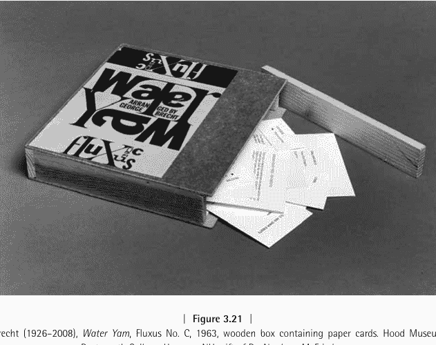

演奏说明通常被描述为乐谱。游戏棋子、日常物品以及经过改造的现有游戏（例如新牌组）是其他典型特征，其中大多数都无法以任何可预测的方式进行游玩。

艺术家乔治·布赖特`George Brecht`制作了许多乐谱、说明和游戏盒的集合，其中包括他的《游戏与谜题——游泳谜题盒游戏》`Games and Puzzles—Swim Puzzle Box Game` `1965年`。其说明或乐谱建议玩家“以某种方式排列珠子，使单词 CUAL 从未出现”。矛盾的是，盒子里没有珠子或字母，只有一个贝壳，使得该乐谱无法执行。要么玩家无法进行这个游戏，要么他们已经赢得了这项不可能的挑战。激浪`Fluxus`游戏的一种常见形式是设计一套规则，将游戏的具体实现及其结果完全留给玩家决定。

布赖特的《水薯》`Water Yam`盒子`1963–1969年`是激浪盒`Fluxkits`中最著名的作品之一，是另一个装满了说明和事件乐谱的盒子，提供了人们可以选择并表演的开放式任务和表演（图 3.21）。每项任务或表演的成功实际上取决于表演者、群体以及机遇的介入。由于盒子里大约含有七十张事件乐谱，布赖特的激浪盒提供了另一个例子

乔治·马丘纳斯`George Maciunas`，美国人`1931–1978`；埃里克·安德森`Eric Andersen`，丹麦人`生于1943年`；乔治·布赖特`George Brecht`，美国人`1926–2008`；本·沃特尔`Ben Vautier`，瑞士人`生于1935年`；约翰·卡瓦诺`John Cavanaugh`不详，二十世纪；威廉·德·里德尔`Willem de Ridder`，荷兰人`生于1942年`；罗伯特·菲柳`Robert Filiou`，法国人`1926–1987`；维拉·斯波瑞`Vera Spoerri`不详，二十世纪；罗兰·托波尔`Roland Topor`，法国人`1938–1997`；阿尔伯特·M·法恩`Albert M. Fine`，美国人`1932–1987`；肯·弗里德曼`Ken Friedman`，美国人`生于1949年`；Hi Red Center，日本人，成立于1963年；约翰·列侬`John Lennon`，英国人`1940–1980`；弗雷德里克·利伯曼`Frederic Lieberman`不详，二十世纪；克拉斯·奥登堡`Claes Oldenburg`，美国人`生于1929年`；小野洋子`Yoko Ono`，美国人`生于1933年`；詹姆斯·里德尔`James Riddle`，美国人`生于1933年`；保罗·杰弗里·沙里茨`Paul Jeffrey Sharits`，美国人`1943–1993`；鲍勃·谢夫`Bob Sheff`，美国人`二十世纪`；宫美惠子/志茂田`Mieko (Chieko) Shiomi`，日本人`生于1938年`；斯坦利·范德贝克`Stanley Vanderbeek`，美国人`1927–1984`；沃尔夫·沃斯特尔`Wolf Vostell`，德国人`1932–1998`；和田佳巳`Yoshimasa Wada`，日本人`生于1943年`；罗伯特·瓦茨`Robert Watts`，美国人`1923–1988`，《激浪年鉴盒 2》`Flux Year Box 2`，`1966年`。五格木盒，内含多位艺术家的作品。胡德美术馆，达特茅斯学院，汉诺威，新罕布什尔州；通过威廉·S·鲁宾基金购得。

说明激浪乐谱如何创造表演、艺术对象以及富有启发性的物理情境：

-   `乔治·布赖特：“空调”出自《水薯》`

    -   `穿过该场所`。

-   `乔治·布赖特：“椅子事件”出自《水薯》`

    -   一把白色椅子

    -   擦菜器

    -   卷尺

    -   字母表

    -   旗帜

    -   黑色

    -   和光谱色

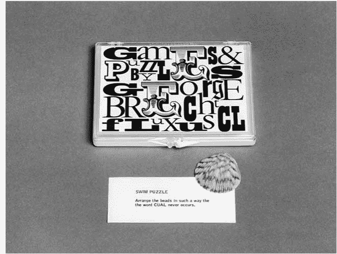

| 图 3.23 |

|---|

| 乔治·布赖特`1926–2008`，《游戏与谜题——游泳谜题盒游戏》，约`1965年`。胡德美术馆，达特茅斯学院，汉诺威，新罕布什尔州；亚伯拉罕·M·弗里德曼医生捐赠。 |

《水薯》还包含其他卡片，例如“钢琴曲”，它告诉玩家：“将花瓶`花束`置于钢琴上`onto`。”在“双车事件”的卡片上，可以读到“`开始/停止`”。布赖特还参与了国际激浪团体项目，例如《激浪年鉴盒 2》如图 3.22 所示，并创作了许多其他激浪盒，如《游戏与谜题》图 3.23。

宫美惠子`志茂田` `Mieko (Chieko) Shiomi`的《事件与游戏》约`1964年`创作中的卡片包含“双人音乐 II”，它指示参与者：“在封闭的房间内静坐两小时。”她的作品《消逝的面部音乐》建议：“微笑/停止微笑”；这也制作成了一部黑白慢动作影片。类似地，罗伯特·瓦茨`Robert Watts`的《事件》约`1965年`提供了以下内容：“信箱事件——打开信箱/闭上眼睛/取出自选信件/撕碎信件/睁开眼睛。”在“冬季事件”中，我们得到：“冬季事件——雪。”⁸⁵

激浪艺术家艾莉森·诺尔斯`Alison Knowles`生于`1933年`——，受过绘画训练，是激浪运动的创始成员之一，自该运动初期便是主要推动力，与其他激浪艺术家合作，记录他人的作品，并参与

集体创作。除了从事实验性书籍艺术和印刷工作外，诺尔斯还撰写了聚焦于平凡日常物品和普通家务事件的激浪乐谱。几位激浪艺术家通过创造游戏作为干预手段，使日常生活接受更仔细的审视，将社交时刻呈现为交换行为或批判更大政治局势的机会。事实上，激浪界通过制作游戏或指令卡片来创造情境`这些情境确实属于艺术品`的实践，据说是起源于美国作曲家约翰·凯奇`John Cage`，`1912–1992`在`1956–1960年`间于纽约社会研究新学院`The New School for Social Research`教授的课程。对于激浪艺术家而言，游戏`Play`颠覆了高雅艺术的严肃性，并以其亵渎性的姿态，指向有意创造日常行动和体验，而非将纯净的艺术对象神圣化。受凯奇等人启发，艾莉森·诺尔斯没有像她的男性同行那样倾向于制造令人震惊的奇观，而是进一步探究日常事务的习惯性研究，倡导日常物品、食物和有机产品的表演潜能，正如凯奇倡导自然的作用，“将我的责任定义为提出疑问，而不是做出选择”，诺尔斯说。她经常布置一张桌子或情境来分享食物，这是对平凡乐趣的庆祝。在她的《艾莉森·诺尔斯的事件》`Events by Alison Knowles` `1962–1964年`中，构思了以下事件：

-   `命题`

    做一份沙拉。

    `1962年`

-   `赠品构造`

    在街上找到你喜欢的东西并送出去。或者找各种东西，将它们做成某物，并送出去。

    `1963年`

-   `命题变奏 #1`

    做一份汤。

    `1964年`

布赖特、志茂田、瓦茨、诺尔斯等人的作品，与成立于`1966年`美国西海岸的“西部激浪”`Fluxus West`艺术家群体汇合，该群体负责了如杰克·科克`Jack Coke`的农民合作社`Farmers Cooperative`创作的《寻找终点/一场激浪游戏》`Find the End/A Fluxgame`约`1969年`等游戏。志茂田的《事件与游戏》由二十张事件卡片组成，其中一半为日文，

详述了游戏行动并提供表演指导。与其他激浪游戏设计师一样，西部激浪鼓励观众以“任何人都可以这样做”的态度，重新演绎或改写这些给定的乐谱。大多数激浪盒都无法以任何可预测的方式进行游玩。

这种可重构性的方法影响了巴西出生、瑞典诗人、概念主义者、漫画家和理论家奥伊温·法尔斯特朗`Oyvind Fahlström`，`1928–1976`的作品。无论是由于其作品的玩具特质，还是其方法中包含的政治、叙事、民间艺术和幽默线条，直到近期政治游戏艺术的兴起，法尔斯特朗的作品并未因其创新性而受到颂扬，也未被纳入艺术正典。批评家认为法尔斯特朗是“至多是对超现实主义或宣传艺术的倒退。”⁸⁸ 对图像的更仔细考察表明，法尔斯特朗的作品比单纯的对抗走得更远，其作品范围从美元纸币和饼图到谜题和游戏不等。法尔斯特朗以强烈且黑暗的视角处理政治。在《笔记 6》`《尼克松的梦》` `1974年`中，一幅画描绘了一个面色发蓝的男人，“数着跳越警察路障的美洲豹，以及一张带电的南越地图`和`躺在围绕黄金储备的灵床上。”⁸⁹ 在作品《笔记 7》“厨师”面具 `1971–1975年`中，法尔斯特朗借鉴了1970年代美国流行文化的参考，勾勒出了史茂基`Smokey the Bear`、安吉拉·戴维斯`Angela Davis`和山姆大叔`Uncle Sam`的脸，同时也提到了广岛和南非。⁹⁰

法尔斯特朗受《大富翁》`Monopoly`影响的“可变”绘画由两百多个涂漆的磁性元素组成，位于一个涂漆的金属板上，处理诸如世界贸易、美国外交政策、中央情报局以及各种世界革命等问题。根据直接刻在绘画上的规则，它们都可以作为《大富翁》游戏的变体进行游玩，该游戏进而被描述为“资本主义的游戏：剩余价值交换为资本增益的简化但精确的呈现。”⁹¹ 虽然承认其游戏中对极其复杂现实的简化，法尔斯特朗指出，这些作品仍然作为政治、社会和经济现象的基本游戏图表出现。通过选择阵营和策略，玩家陷入了微型“政治心理剧”。其中一个可变绘画是《印支》`Indochina` `1971年`，这是一个游戏，其各种图表、图形和类似《大富翁》的空间标有“西贡/美国大使馆”、“老虎笼”和“难民营”等标签。⁹² 由于法尔斯特朗希望他的重新设计延伸至他的玩家，这些艺术游戏的元素由磁铁固定，允许参与者“操纵世界”。⁹³

法尔斯特朗的表演性对象和可改变绘画也邀请观众“选择策略”。⁹⁴ 除了他的《大富翁》游戏外，还有《绑架基辛格》`Kidnapping Kissinger` `1972年`，其中棋盘上的游戏方块被切割，仿佛一个剪影已经显现

从游乐区域的一部分开始。棋盘上排列着人物、机器、建筑和汽车的简单图标。法尔斯特朗还制作了拼图式的可变画作，例如《夜曲 2：癌症流行病场景》`1975`和《夜曲 4：蛋白质竞赛场景》`1976`，以及匹配卡片风格的作品，包括`1973年至1974年`间创作的《120次即兴`为智利 II`》。这些简单的黑白作品包含抽象形状——是州？是领土？——人们可以对其进行调整匹配。法尔斯特朗作品的重要组成部分与`1973年9月11日`智利政变有关。

就像日本的`飞行棋`游戏一样，法尔斯特朗的作品包含大量文本，这些文本可以被强迫性地阅读。法尔斯特朗似乎理解这种解码过程中的乐趣，并将文本视为一种玩弄和颠覆叙事悬念与结构、叙事解决以及冲突观念的方式。这位艺术家的最终目标是大规模生产这些游戏，但这一目标尚未实现。

出生于韦拉克鲁斯的墨西哥艺术家加布里埃尔·奥罗斯科（生于1962年），曾引用游戏并重新创作游戏制品，在他的作品中探讨了关于游戏、玩法和文化的提问。起初，奥罗斯科通过现成物重新定义了过时性，例如东德摩托车或水果。他的几件与游戏相关的作品是为一个名为*空荡俱乐部*（1996）的装置创作的，该装置由英国艺术团体 Artangel 委托。该展览在一家高档的伦敦男士俱乐部举行，通过叠加几何图案的运动照片，批判了富人的休闲生活方式。奥罗斯科的作品*乒乓球池桌*（1998）提供了一种对乒乓球的重新思考，问道：如果乒乓球网的空隙被重新探索、开放并变成多维的，棋盘的形状最终会是什么样？圆形的？方形的？莲花形的？奥罗斯科的*乒乓球池桌*以其自身的空间和多维性呈现出来，球网充当几何学与物理世界之间的桥梁。艺术家希望该作品的意义及其空间性在观众“投入游戏”时能够被无限解读，从而让桌子开辟出空间的新可能性：

> “乒乓球池桌”与一种新空间、一种可能的新空间的概念相连。当你玩普通的乒乓球游戏时，你有一个球网，它提供了两个空间之间足够的距离。但当你将那个空间乘以四，不再是两个人玩，而是四个人在四张桌子上玩。你打开了那个空间，球网也随之开放。你在那里拥有的是一种新空间，因为之前它并不存在……球网，那两个空间之间的那部分空间——我把它打开了。现在我在这四个空间之间拥有一个三维空间。

那就是我所感兴趣的空间，即中间空间……激活那个空间。激活意味着用意义和联系填充它，使我们能够思考它。我们可以与之建立联系，使其作为事物之间的空间和时间而发生。

艺术史学家吉尔·贝内特指出，奥罗斯科对其作品中对游戏（包括体育）的兴趣可以解读为“姿态”。这些姿态作为一种操作方法，而非主题。姿态的概念使这些作品向更广阔的游戏兴趣以及文化如何规范游戏的方式开放。奥罗斯科题为*被捏扁的球*的照片描绘了一个吸满水的湿漉漉的足球。在他的*椭圆形台球桌*（1996），又名*带钟摆的比利球游戏*中，奥罗斯科创造了一个弯曲的线性物体，其作用更像是一个科学仪器而非游戏空间。这张没有袋口的台球桌容纳了两个白色球，而悬在桌子上方的红色球像钟摆一样悬挂着，诱惑着观众去玩游戏。台球杆位于附近。但在一张通常应有袋口的桌子上，袋口缺席，这张桌子的目的和游戏的目标可能是什么？击中悬浮的红球的诱惑很容易屈服，观众拿起附近的台球杆去“看看会发生什么”。击中白球使其与红球碰撞，会激发自然界更大的几何事件。一旦被击中，红球沿着其自身轨迹从桌子上飞出，有时作为钟摆与独特的椭圆形台球桌的椭圆形状保持同步，有时则穿过它。与其说是对台球游戏的评论，这件作品更多地审视了关于运动、自然定律和物理学的更大假设，以及在游戏中假设的主体能动性。

尽管奥罗斯科的作品往往在概念层面上运作，但他坚持对参与政治的热情。然而，显然，他关注的是偶然相遇、物理学和主体能动性。艺术史学家大卫·乔塞利特指出，奥罗斯科的作品与保罗·维利里奥的理念有很多共同之处，即当代政治、权力和集体性不应从财产的角度，而应从流通的路线和向量来理解。如果不移动，奥罗斯科的作品会推断出运动，并且通常是游戏。对乔塞利特来说，奥罗斯科字面上的向量——他的钟摆和椭圆，他的推断和实际运动——成为了社会批判和社会想象的工具。奥罗斯科的游戏反映了更大的哲学问题：

> 也许它们更像是哲学游戏。我认为哲学必须是一种实践。实用哲学。这就像希腊人过去通过行走来解决哲学和数学问题一样。不是坐着。移动时解决问题更容易——当你走路和交谈时——也许是因为你大脑有更好的灌溉，或者仅仅是因为你呼吸得更好。因为你在移动，你更有机会解决复杂的问题。而且我认为在某种程度上这是一种行动。所以我认为哲学是一种行动，它应该是。而玩游戏是其中的一部分。

## 第三章

### 映照冲突与战争的最流行游戏

战争、占领领土和抽象个人战斗的隐喻，已成为许多最著名的棋类游戏的基础，从中国的围棋到国际象棋和跳棋。围棋，或称 Wéiqí，之前已被提及，其根源可能在于占卜实践。围棋在公元五世纪至八世纪间被出口到日本。当时日本圣武天皇（公元701–756年）时期发现了一款檀香木围棋。围棋在日本平安时代（公元794–1195年）的宫廷文化中变得非常流行，据说武士们欣赏这种古老游戏，因为它能够塑造战略思维。在游戏整体的隐喻中涉及军事，该游戏包含防御、夺取和捕获的元素。在日本表现形式中，围棋作为特殊礼物在婚礼上赠送，并且有据可查是禅宗僧侣、幕府将军和茶道大师的消遣。由于其与仪式的纠缠，游戏本身反映了其发展和变化时期的文化和社会特征。

围棋在下在十九乘十九的方形网格上。两名玩家，黑方和白方，轮流在空白的起始棋盘上放置棋子，试图“捕获”领土。两名玩家使用各自的棋子来捕获点（即线条的交叉点），并布局连续的占有区域。对手总是试图入侵自由区域以捕获领土。不同技能水平的玩家开始时可以通过缩小棋盘并允许较弱玩家更多步数或更多棋子来平衡游戏。

中国诗人白居易（公元772–846年）描述了下围棋的特殊品质：

> 山间僧侣坐在围棋棋盘前
> 在竹子半透明的阴影下。
> 透过闪烁的树叶没人看见他们——
> 但时不时能听到棋子碰撞的清脆声。

在这里，一种罕见的美感被歌颂，游戏通过其高贵的声音、美丽的环境和苦行僧般的投入而被识别。

为了推动批判性游戏，几位当代艺术家利用围棋游戏来提出政治和社会问题。艺术家莉莉安·鲍尔将该游戏作为一种模板，以促进合作和对话。她的互动游戏

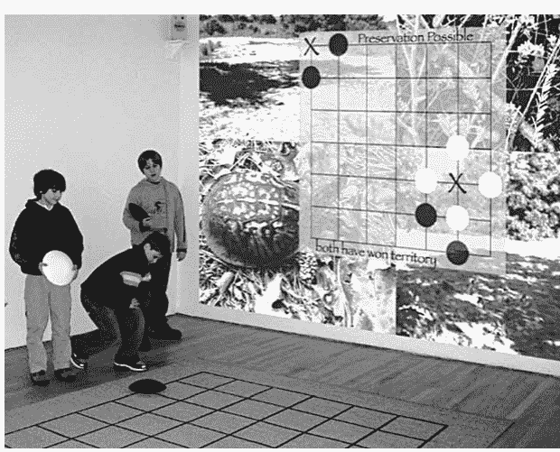

图 3.24 Lilian Ball 的《GO ECO》，2007年。

GO ECO 项目旨在阐明关于纽约长岛一项环境保护项目的不同观点。在现实情境中，湿地、野生动物和稀有植物物种正面临政治利益和房地产利益的威胁。作为回应，艺术家发起了一项社区项目，以帮助保护纽约 Southold 的一个十二英亩的湿地。Ball 的概念围绕着使用游戏符号和机制，在对该冲突感兴趣的利益相关者玩家中产生新的视角和观点。

《GO ECO》（图 3.24）通过改变规则，帮助招募玩家去占领领土，使玩家体验协作而非竞争。实体棋子配有图像，这些图像代表了生物学家、土地所有者、政府官员和附近居民的观点。本土越橘、多样的野生动物以及濒危的 Iris prismatica 的图像生成于围棋棋子在棋盘上移动的同时，并由相机跟踪。

Ball 设想在游戏的“禅”版本中，参与者最好是奇数，而不是通常的两名玩家，这样玩家的回合就永远不是固定的。以此方式，“鼓励合作。由于每个人在下一个回合都占据另一侧，因此必须看到另一方的观点。” ${ ^ { 101} }$ 该游戏旨在鼓励各方共赢或均等输赢的解决方案。Ball 对 $G O$ ECO 的意图是帮助各个年龄段的玩家“通过一种映射行动路径的艺术体验获得赋能并了解相关问题。” ${ ^ { 102} }$

像围棋一样，国际象棋也影响了艺术家数百年。尽管历史学家对发明游戏的原始细节存在分歧，但几位备受尊敬的国际象棋学者认为，巴列维语和梵语文本支持这样的观点：印度在不晚于公元六世纪时就是该游戏的发源地。 ${ ^ { 103} }$ 在梵语中，该游戏被称为 *Four Members*（*Chaturanga*），指的是印度军队的四个兵团（战车、骑兵、象兵和步兵）。印度版本的国际象棋使用逼真地渲染的棋子，旨在模仿人类参与者。该游戏在公元 1000 年左右由阿拉伯人传入欧洲，阿拉伯人自七世纪起就开始玩此游戏。 ${ ^ { 104} }$

阿拉伯学者指出，下棋的好处包括勤勉、节俭和知识，这是该游戏忠实反映其游玩地点文化习俗的一个例子。例如，在 642 年穆罕默德去世后，国际象棋遵循《古兰经》禁止写实人类描绘的法令。棋制作者避免了代表模型，转而选择抽象的棋子。 ${ ^ { 105} }$

艺术家们通过素描、绘画和挂毯描绘了国际象棋的起源，包括国王阿方索在 1283 年编写的有影响力的文件 *Book of Chess* 中的作品。这本书既是许多欧洲下棋场景的文本记录，也是视觉记录。 ${ ^ { 106} }$ 国际象棋和双陆棋直到文艺复兴时期都在欧洲棋盘游戏追求中占据主导地位。艺术作品中有关国际象棋的描绘比比皆是。诸如 Lucas van Leyden 的 *Chess Players*（约 1510 AD）或 Bernard Louis Borione 的 *A Game of Chess*（1906）等绘画表明，该游戏经常在许多日常场景中吸引艺术家。更早之前，在意大利皮亚琴萨 San Savino 唱诗班中发现的罗马式马赛克（ dating from 1107 AD）包括一个地面马赛克，描绘了掷骰子游戏和国际象棋游戏的场景。学者们现在认为，艺术家将这两种游戏并置，以代表人生两条路径的两极：人要么致力于世界的机遇和不稳定的力量，让自己的生活变得无法无天、混乱和邪恶；要么人可以选择拥有美德和智慧地生活，从而为世界注入智慧、法律和和谐。 ${ ^ { 107} }$ 命运与美德之间的冲突是中世纪天主教会准备好推广的，以支持臣民对教义所宣扬的美德规则的遵守。与世界“命运”的力量（通常被拟人化为一位女性 *Fortuna*，命运之轮不断变化，提供了极少的稳定性机会）形成对比，教会官员利用这种二分法来象征性地塑造玩家的选择。

具有重大意义的是 Marily Yalom (2004) 进行的研究，她详细描述了国际象棋中代际——甚至时代——的变化。Yalom 对游戏中女王棋子的研究表明，直到十世纪，国际象棋中才出现女性形象。 ${ ^ { 109} }$ 即便如此，女王当时也是阵容中最弱的一员，每次只能移动一格。Yalom 认为，随着女性文化权力的逐渐增加，女王获得了影响力，成为棋盘上最强大的棋子。例如，中世纪欧洲一系列拥有权力的女王不仅影响了棋子的表现和性别（在早期形态中，女王曾是国王的维齐尔，一个男性形象），还影响了棋子的行动。随着欧洲强大的女性领袖崛起，主要是阿基坦的埃莉诺、挪威的英格博格女王和卡斯蒂利亚的伊莎贝尔女王，该棋子从维齐尔变为女王，并摆脱了缓慢的一次一步的移动规则，成为棋盘上最强大的棋子。到著名的挪威棋具，刘易斯国际象棋棋具（1150 AD-1200 AD）（图 3.25）时，女王棋子已在棋盘上确立了既定位置。

本杰明·富兰克林在撰写其论文“Chess 的道德”时指出，国际象棋玩家可以学习远见、审慎和谨慎，也就是说，养成一种并非完全草率的习惯：

> 我们通过养成不因目前事务状态中糟糕表象而气馁的习惯、养成期待有利机遇的习惯，以及保持寻找资源的能力，从而学习国际象棋。游戏充满了事件，有着如此多的转折，它的命运如此易变，而且经常在沉思后发现自己能够摆脱看似无法克服的困难，从而鼓励人们继续比赛至最后，希望凭借自己的技巧，或者至少凭借对手的疏忽获得胜利。考虑到在国际象棋中经常看到的情况，即成功往往会导致自满及其随之而来的疏忽，导致此后失去的比先前优势所获得的更多，而不幸则产生更多的谨慎和注意，由此可以找回损失，任何人都不会因对手目前的任何成功而过度气馁，也不会因在追求好运过程中受到的每一小挫折而绝望于最终的好运。 ${ ^ { 110} }$

在对批判性游戏的探索中，艺术家们着迷于国际象棋作为一个社会系统。超现实主义者 Alberto Giacometti、Max Ernst、Man Ray 和 Marcel Duchamp 都引用或将其融入了他们的作品。Duchamp 对

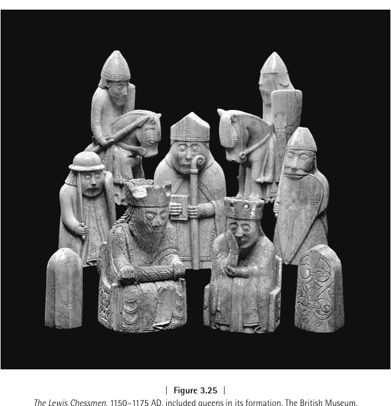

国际象棋的热爱——这是与他众所周知的对机遇和现成物偏好相距甚远的一种游戏——早在移居美国之前就已确立。Duchamp 曾著名地将下棋视为一种艺术形式，甚至在由美国作曲家 John Cage (1912-1992) 执导的一部实验电影中饰演棋手角色。1963 年，Duchamp 在帕萨迪纳的第一次回顾展上，与裸体挑战者 Eve Babitz 下棋。根据他的许多学者所述，Duchamp 与国际象棋的恋情源于游戏之美和国际象棋的“语言”。他在 1920 年代进行竞技比赛，并显然享受胜利。

国际象棋对于像 Duchamp（他在图 3.2.6 中绘制了棋子）这样的艺术家来说，是一种引人入胜的“体验仪器”，原因有很多。首先，它是一个高度象征性的游戏，其中的棋子具有额外的含义。其等级结构，类似于

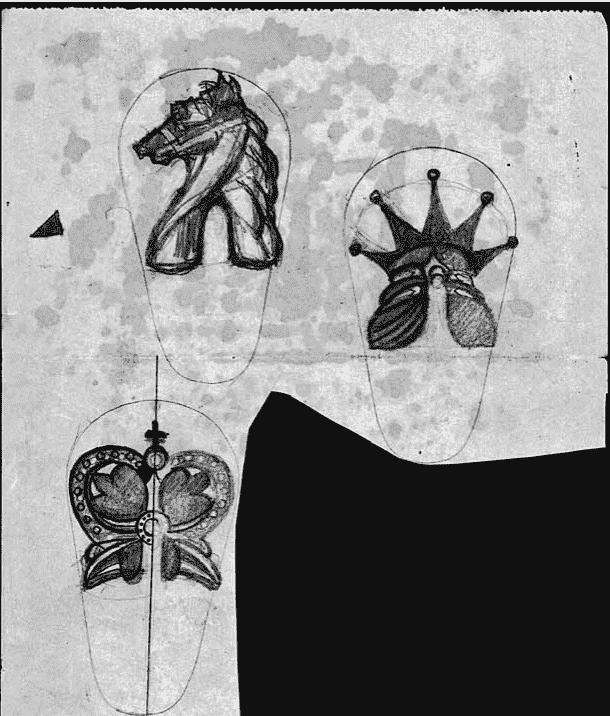

**图 3.26**

马塞尔·杜尚（1887–1968）为《Projects》所作的亲笔手稿：棋子素描（国王、皇后、骑士），1912–1968年。铅笔，黑色墨水，19.8 × 16.2 厘米。AM1997-98(205)。国家现代艺术博物馆，乔治·蓬皮杜国家艺术文化中心，巴黎。照片：让-克洛德·普拉内特。图片版权：CNAC/MNAM/Dist. 法国国家博物馆协会/纽约艺术资源。© ARS, NY。

一支军队、一个宫廷、一支由兵卒列阵组成的普通部队，几乎字面上模拟了一个处于战争状态的国家。人们普遍认为，希腊人进行了最早的需要策略介入且没有运气因素的战争游戏。¹¹³ 在一款名为*Polis*（“城市”）的希腊游戏中，两名对弈玩家在棋盘格上操纵大量游戏代币，目的是用己方两枚棋子夹住对手的一枚棋子以将其俘获。这种策略复制了“方阵”战法的作战策略，其中特定进攻的强大之处在于其凝聚的、单向的攻势，即一排排持矛士兵的实地点阵，对手难以或无法突破。在象棋中，这种策略被打破了，例如骑士的走法使得这样的直线变得不再那么重要。

这一细节——每种游戏棋子独特的可供性（affordances）——提醒我们注意棋类游戏是如何被教授的，专业知识是如何传承的，以及最重要的是，规则是如何被诠释和表达的。例如，如何解释如何玩像象棋这样复杂的棋类游戏？首先，是棋盘本身，它在不同文化中都很常见，并用于许多其他类型的游戏。这个棋盘提供了对“空间”和“移动”的基础理解，尽管这些概念可以根据游戏的具体情况加以改变和修改。其次，人们会探索棋子的能力。在详述象棋子走法时——例如，这是一个兵；它向前移动，只能沿对角线捕获其他棋子——能力被映射到形象上。这些形象代表了功能和玩家能动性。安德烈·布勒东写道：“哲学上的自由是一种幻觉。在象棋和其他所有游戏中，每一步都承载着宇宙无限过去。”¹¹⁴ 与其他棋类游戏一样，如果一套象棋缺少某个特定的棋子，人们会理解其他东西可以替代该棋子。因此，一个高贵的主教可能最终由一把斧头或口红来扮演。无论如何，棋子本身是带有其特定的可供性和力量被审视的，对于双方玩家来说，都具备支配该棋子的规则所拥有的所有能力和限制。以这种方式在游戏中使用替代物品强调了所涉及的交易具有极强的符号性，使得游戏规则和流程可以允许棋子相互替代，游戏可以锻造其对时间性的控制，并且玩家之间可以就如何互动达成共识。凭借这些能力，游戏不仅产生凝聚的规则体系，还产生凝聚的世界，以及表达意义的世界。

进行战斗的元素——决定如何孤立敌人、保留己方最强棋子、做出牺牲以及识别并胜过对手——在象棋中被抽象化并加以练习，这些元素也是吸引艺术家使用象棋作为社会批判工具的因素。战斗阵型的理念以及对手玩家之间冲突的展开，是游戏中艺术干预的大部分特征。

在1961年至1970年间，激浪派（Fluxus）艺术家斋藤多嘉子（Takako Saito）制作了一系列象棋改造作品，这些作品由乔治·马丘纳斯（George Maciunas）的激浪派邮购仓库出售和分发。斋藤的象棋套装是激浪派艺术的标准产品，并出售给美国和欧洲的收藏家。《研磨器象棋》是对该游戏有趣的“工业”简化版本。《宝石象棋》配有装在小型盒子里的宝石，是游戏的一个美观变体。其他斋藤象棋套装包括使用视觉以外的感官。《液体象棋》（1975）由装有液体并发出气味的药瓶制成。这些药瓶也可以用于确定哪枚是哪枚棋子（通过气味），并利用这一知识，使玩家拥有游玩规则。《声音象棋》或《重量象棋》，出现在集体作品《激浪柜》中，由不透明的白色塑料盒组成，里面装有需要通过摇晃时的重量或声音来识别的物品。《香料象棋》出现了几个不同的迭代版本，特点是装有香料并封口的管子放在架子上。游戏学者西莉亚·皮尔斯（Celia Pearce）指出，斋藤的象棋套装对游戏美学提供了一种特别精美的解读，因为这些作品考虑了许多感官，探索了感官差异的细微之处以及规则的易变性。斋藤制作了一大堆象棋套装，据吉本（Yoshimoto）所述，这些作品“在策略和幽默的融合中成为了激浪派哲学的化身”。沿此思路，激浪派艺术家，特别是女性艺术家，关注视觉以外的感官；阿莉森·诺尔斯（Alison Knowles）、斋藤多嘉子和小野洋子（Yoko Ono）都创作了基于气味和触觉的艺术作品。这些作品也采取了表演性的游戏特质。例如，小野洋子的《触摸作品》（*Touch Piece*，1963）指示表演者互相触摸。

与小野洋子一样，斋藤发现象棋提供了一种跨文化的词汇，可用于探索游戏系统以及更大的社会和政治实体。

《凭信任玩》（*Play It by Trust*，1997）是一款棋盘和棋子全为白色的游戏，是小野洋子一系列象棋探索作品中的一部分。小野洋子展出的象棋相关艺术作品范围广泛，从她自己的游戏版本《全白象棋套装》（*All White Chess Set*，1966）到《凭信任玩》的装置版本。当《全白象棋套装》首次在伦敦Indica画廊展出时，它由一张木制象棋桌、一套象棋和两把椅子组成，所有这些都漆成了白色。桌子底部的黄铜牌上写着：象棋套装，只要你能记住你所有棋子的位置，就可以一直玩下去。白色，作为战争中投降的颜色，基本上抵消了游戏的竞争和对立方面。

就像她几件探讨平衡主题的作品一样，小野洋子对《凭信任玩》（或她稍后讨论的《指令绘画》中现实世界与绘制指令之间珍贵的平衡）的处理方式，可以被解读为一种通过鼓励合作与协作的情境来探索艺术体验的方式。《切割作品》（*Cut Piece*）和《凭信任玩》都质疑人际关系，聚焦于信任以及我们彼此之间的相互依赖性。通过使用象棋棋子、棋盘或剪刀等日常物品，小野洋子让作品参与者考虑日常事物的奇妙本质，并在无尽的挑衅情境中参与类同游戏的概念和过程。《凭信任玩》强调了游戏可以解决严肃问题的方式，以及游戏中多个参与者拥有同等机会并面对同等风险的事实。重新包装，或将作品全部漆成白色，消除了传统游戏形式中的竞争元素。

小野洋子是少数几位利用她的奇思妙想和类同游戏的构造追求政治目标，而不仅仅是挑战艺术界可预测模式的激浪派艺术家之一，对小野洋子来说，利害关系显然是激进的。小野洋子批判性地游玩，利用规则、符号意义系统、社会文化背景以及人们对游戏“时间”的固有感知，来呈现和平主义的目标。¹⁹ 这项作品超越了游戏，设想了一个“世界游乐场”以及对社会和政治问题乌托邦式解决方案的渴望。

最近的基于象棋的艺术作品与小野洋子对游戏的运用相提并论。2003年，英国艺术家达米恩·赫斯特（Damien Hirst）创作了《精神逃生》，这是一套象棋，其特征是玻璃和镜面棋盘显示生物危险符号，配有银色药瓶铸件和蚀刻银标签，全部装在一个玻璃药箱内。¹²⁰ 杰克和迪诺斯·查普曼（Jake and Dinos Chapman）制作了一套作品，其中包括“后末日青少年形象”：一方是带有阴茎状鼻子的白种儿童，而另一方是留着爆炸头黑发的黑种儿童，所有这些都置于镶嵌双头骨和交叉骨头的棋盘上。¹²¹ perhaps 其中最显著的雕塑作品来自加布里埃尔·奥罗斯科（Gabriel Orozco），他通过作品《无尽奔跑的马》（*Horses Running Endlessly*，1995）深入探索象棋，以审视棋盘的空间物质性（图 3.27）。结果是一件雕塑作品，由一个扩展的棋盘——256个而不是64个方格——以及众多骑士组成，同样分为四种颜色。

《无尽奔跑的马》中棋子的排列令人兴奋，因为骑士棋子有许多潜在的位置和动作。在一个典型的棋盘上，骑士理论上可以按顺序占据所有方格而不重复位置。棋盘上的骑士之间似乎同时发生着什么，仿佛所有骑士不应该轮流移动，而是以编队移动。结果是一种无限可能性感。很容易想象，拥有这件作品的玩家或参与者可以随心所欲地修改棋子的顺序。就像 Xenia Cage 或 Calder 的动力雕塑或动态雕塑一样，奥罗斯科的马可以被激活。这通过颜色、形状和位置传达出来。

象棋的重构在游戏的数字版本中继续进行。露丝·卡特洛（Ruth Catlow）2003年的作品《重新思考战争游戏：重塑冲突的机会》创建于

# 图 3.27

加布里埃尔·奥罗佐科（墨西哥，生于 1962 年），《不断奔跑的马匹》，1995 年，木材。阿格尼丝·冈德和刘易斯·B·卡勒曼为纪念“校园国际象棋”项目而捐赠。© 2008 加布里埃尔·奥罗佐科。

这是对 2001 年纽约市世界贸易中心遭受“9·11”轰炸的回应。凯特洛探讨了游戏如何被用来表达不同类型的攻击性，或者如何用于教授谈判或非暴力冲突解决。如果这些原则可以被教授，她推测，那么利用互联网作为传播媒介，也应该能够向更广泛的受众普及这些原则。结果就是作品《重新思考战争游戏》，这是一款专为代表白色王室、黑色王室以及兵卒联合力量三位玩家设计的国际象棋变体。玩家轮流走棋。白方的目标是消灭黑方王室，黑方的目标是消灭白方王室，而兵卒则将自己作为屏障置于暴力之中，试图像虚拟抗议者一样“减缓”暴力，以便暴力的交战各方之间可能进行谈判。

这版国际象棋在游玩体验上显得格外独特，与传统国际象棋截然不同。在典型的国际象棋中，一方或另一方往往只为胜利而战，而在这种变体中，由于拥有强大棋子的王室一方可能会无法获胜，游玩体验因此发生了改变。在《重新思考战争游戏》中，行动节奏远快于通常版本；由此产生的王室决策更加激进和迅速，且远不如通常版本具有战略性。兵卒玩家深知，除了凭借纯粹的体量或数量之外，兵卒相对无力，因此他们会通过让兵卒介入，将其置于暴力中央的阵线上，这在历史上与许多抗议者的做法如出一辙。兵卒充当“阻碍”，如果在五回合内没有任何一方王室吃掉棋子，则会被计为一段非暴力期，游戏棋盘上会长出一片隐喻性的“草地”。经过五回合的非暴力期，草地将覆盖整个战场。通过遏制攻击性并克服冲突中的“狂热”部分，兵卒获胜。其理念在于为谈判留出更多时间，而不是即时反应和攻击。

重要的是要提醒我们，虽然在这个游戏中，和平主义和非暴力可能作为更大的游戏目标出现，但《重新思考战争游戏》本身在很大程度上依赖于国际象棋本身所基于的前提：冲突和吃掉棋子；换言之，即暴力。王室的凶残与兵卒对和平的热情相互对应。对于所有方而言，游玩意味着行动，即使一方试图实现行动主义目标或社会批判，其理念也是采取行动，而非不行动，即使这种行动表现为阻碍。游戏表明，谈判需要慢下来，和平只能通过谈判而非反应和修辞来实现。要重新思考当前的解决方案，不能处于防御或攻击状态，而应处于一种元状态。

国际象棋之所以有趣，恰恰是因为它代表了多种意识形态，其中首先是一种关于对立力量的简单二元论。这一点早在胡伊津哈对卡尔·施密特政治哲学的批判中就显而易见，见其著作《游戏的人》（1938年，荷兰语）。胡伊津哈指出，施密特所宣称的哲学为法西斯主义过度简化的智识文化提供了危险的理据，在这种文化中，社会生活轻易地被划分为“善”与“恶”、“我们”与“他们”，细微差别被摒弃，竞争被鼓励。事实上，胡伊津争认为这种过度简化的思维削弱了国际法的伦理运作，或“公平竞赛”基础。瓦尔特·本雅明也指出，竞争场景往往使复杂问题变得过度简化。这一批判在凯特洛的作品中得以镜像呈现，因为她试图在游戏中增加细微差别和多种结果。因此，凯特洛项目的目标与本章节讨论的许多体验式国际象棋游戏有很多共同点。《重新思考战争游戏》涉及策略选择的理念。它质询了游戏内在的时间线性轨迹，即使在其交互结构中也是如此。它增强了通过游玩进行重复表演、移动和决策赋权的益处。在这些战争游戏中，玩家通过游玩被赋予做出隐喻性重大决策的能力。

第 3 章 |

珍妮特·默里将能动性定义为“采取有意义的行动并看到我们的决定和选择的结果的令人满足的力量”。$^{21,24}$ 艺术家创作的棋盘游戏充分利用了这一理论，提供了基于桌面的微型实验室，用于考察选择、机遇和社会互动。一些作品，如贾科梅蒂的棋盘游戏，甚至对能动性的可能性提出了批判，暗示游玩或演绎雕塑棋盘将是徒劳的、循环的、一个陷阱。凯特洛的国际象棋游戏等作品以其他方式揭示了玩家能动性的可能性：首先，通过赋予兵卒权力，从而赋予传统构想的棋子/角色新的力量；其次，通过扩大可能的获胜状态来开放游戏的可能结果，从而以远见的方式重写原作。无论是隐喻性的还是实际的，游戏设计必须体现行动，并且取决于游戏感觉有多活跃，其批判性可能更加明显或较为含蓄。艺术家可能会调用游戏隐喻，就像贾科梅蒂在他的游戏棋盘中那样，就像小野洋子（Ono）在《信任演出》（*Play It by Trust*）中那样，或者艺术家可以创造游玩、共情和学习的情境，就像小野洋子在《切割片段》（*Cut Piece*）和凯特洛在《重新思考战争游戏》中那样。这些是不同类型的体验，但都促进了一种批判性的游玩。

# 语言游戏

人类活动的唯一可接受终极目标是生产一种主体性，这种主体性以持续的方式自我丰富其与世界关系。主体性的生产装置可以同样容易地存在于超级都市层面，也可以存在于个人的语言游戏层面。

> —费利克斯·瓜塔里，《混沌摩斯：一种伦理美学范式》

文字游戏本质上是表现性的，并富含批判性游玩。涉及语言的游戏跨越全球语言系统、地理和文化，对设计师至关重要。语言学家大卫·克里斯托尔指出，语言游戏“跨越地区、社会和专业背景、年龄、性别、种族、个性、智力和文化。”¹ 本调查并非旨在对所有语言游戏进行综合分析，而是旨在揭示艺术家调用的语言游玩技巧。对游戏设计师最有趣的是，某些形式的语言发明如何本身通过文字作为媒介构成一个游玩空间，将批判性语言置其非批判性语境附近。语言游戏是如何被标示的？它们如何颠覆语言本身？从艺术家的实践中可以挖掘出确切何种类型的语言游玩？

语言学的某些分支特别将语言游戏称为秘密语言。这些语言在全球各地被创造出来，以口头形式传承，用于仪式和日常实践。这些转化言语的示例包括至少一些读者可能熟悉的语言游玩：猪皮拉丁文、“正式”胡言乱语、法国 Verlan（一种颠倒语）以及数百种其他发明的语言形式。文字游戏呈现多种形态：诗歌，在词义、韵律和形状中；在象征和隐喻语言中；在刘易斯·卡罗尔或苏斯博士所做的小说交流中；文字谜题，文字游戏，双关语，五行诗，谜语，以及语言的意外使用。

所有这些对于行动主义游戏设计师都是重要来源。² 艺术家在多个层面上使用文字游戏，从在绘画中包含文本到挑战语言表演。阿尔弗雷德·雅里（1873–1907）的荒诞戏剧作品、达达主义艺术家的诗歌，以及激浪派（Fluxus）艺术家的“代码”，各自通过文字游玩提供了批判性探索。在这些类别中，艺术家和作家旨在颠覆浪漫化的规范、既有的权力体系、权威以及美学联想。

即使没有表现文本或象形文字，许多古代视觉艺术也融入了细微的文字游戏。例如，中国艺术史学家特蕾莎·塞·巴洛缪（Terese Tse Bartholomew）在她 2006 年的著作《中国艺术中的隐含意义》³ 中讨论的一件小型清朝两尾鲤鱼雕塑，很可能是婚礼礼物。在中国传统中，这种鱼被认为成对游动，可以象征婚姻承诺。然而，它们也体现了中国常见的语言双关类型：*鱼* 和 *富足* 这两个字的字符都发同一个音，“yu”。通过意象以及这些鱼在视觉表现中的意义，产生了多重双关语实例。视觉双关的语言手段也在经典绘画中得到展示。荷兰大师的图像充满了关于“slipshoes”（双关语，指“滑鞋”或“出轨/跌倒”）的幽默隐喻。荷兰语中的 *slipierte* 可以用来指配偶陷入的婚外情，或者“跌倒”。⁴ 在此处和其他场景中，注意语言与文化的互动方式，尤其是艺术家使用的语言，可以帮助设计师找到意识提升的方法或社会评论的工具。

# 游戏、形式与戏剧

在十九世纪，像兰波、魏尔伦、乔治·桑、马拉美、波德莱尔和爱伦·坡这样的作家通过实验语言来表达对社会更大问题的批评。美国作家埃德加·爱伦·坡（1809–1849）和法国作家兼剧作家阿尔弗雷德·雅里都推动了语言使用的边界。这种对文字游戏的痴迷很可能是十九世纪的国际现象。在英语中，所有类型的文字游戏都出现在十九世纪早期艾米莉·狄金森、纳撒尼尔·霍桑、华盛顿·欧文和亨利·戴维·梭罗的作品中。⁵ 也许受其他作家曲折文风或法国及国际文学（尤其是诗歌）中令人费解的变化的启发，作家们在十九世纪之交加速了双关语和回文的使用。这在法国尤为明显，在那里可以推测，前卫运动的根源可能是自卢梭的创新绘画以来艺术变化的积累。阿尔弗雷德·雅里以激进的写作和戏剧项目在语言圈中留下了印记。在他的首次出版物（1893年）中，雅里使用了一个近乎双关语，将“宏伟的手势”（magnificent gesture）变成了“宏伟的冒名顶替”（magnificent imposture）（当然是用法语）。⁶ 此后，阿尔弗雷德·雅里“普及了”

## 乌布王

（该流派）使用无意义、粗俗且抽象的语言以制造震撼，营造怪诞与争议性的场景，并聚焦于语言与表演作为达成这些效果的手段。当让·热内（Jarry）于 1896 年在巴黎首演其著名的政治讽刺剧*《乌布王》*（*Ubu Roi*）时，遭遇的是近乎暴力的抗议与蔑视。

*《乌布王》*始创于热内尚在求学期间，并作为一场执念历时数年发展而成。该剧利用闹剧、粗鄙和下流笑话，重构了*《麦克白》*的叙事，以批判艺术、政治、权力以及等级制度。在情节中，乌布母引诱一名军队军官参与刺杀“波兰国王”温塞拉斯的阴谋，并企图让她的暴虐丈夫乌布父篡夺王位。译作“国王粪”（King Turd），乌布王是一个食量巨大之人，他的滑稽、贪婪和肆无忌惮使其成为权力丑陋景观的化身。*《乌布》*剧作遭受了大量批评，首要原因在于其语言，被形容为等同于无政府主义炸弹。在 19 世纪 90 年代的政治动荡中，巴黎的火车站、咖啡馆和证券交易所确实是实际的炸弹袭击目标。

**乌布父**：嘶！

**乌布母**：噢！你真行啊。你个混蛋，乌布父！

**乌布父**：小心我宰了你，乌布母。

**乌布母**：你不该杀我，乌布父，该杀的是别人。

**乌布父**：拿我的绿蜡烛发誓，我不明白。⁷

该剧的淫秽内容及其怪诞的表演，核心是穿着巨大、类似木偶戏服装的演员所扮演的角色（这些服装在原始节目单上有素描；见图 4.1），这些服装将怪诞化为现实，因此更被视为一场恶作剧而非重要的艺术作品。⁸ 事实上，在热内于 1896 年面向观众介绍该剧时所使用的舞台序言中，作者强调剧本并非为木偶而写，而是为假装是木偶的演员而写。⁹

热内的*《乌布王》*、*《乌布陛下》*（*Ubu Rex*）、*《乌布被戴绿帽》*（*Ubu Cuckolded*）和*《乌布受缚》*（*Ubu Enchained*）如今被视为“荒诞派戏剧”ⁱ⁰最早的范例之一，而热内对批判性戏剧的贡献是多方面的。首先，他在表演和语言上戏弄得体规范，旨在引起对社会习俗和消费主义的注意，并将这些观点直接抛给那些本应成为此类批评对象的群体：19 世纪 90 年代自满的法国剧迷。此外，热内在每一个转折处都编写了文字谜题，邀请观众在他对良好品味的 relentless 攻击中拼凑出更多的批判。甚至是他那个最著名且令人厌恶的角色乌布（Ubu）的名字，也是一个回文，即正读和反读都相同的词。从乌布口中吐出的大多数粗俗语句都是回文，例如，MERDRE MERDRE MERDRE M。¹¹

# 乌布王，

*阿尔弗雷德·热内（Alfred JARRY）作品*

*于“TOEuvre”于 2 月 17 日首演（平克林荫道/Boulevard du Plat）*

管弦乐配乐由克洛德·特拉塞（Claude TERRASSE）创作，加杜先生（M. CADOU）指挥

维莫伊先生（M. VERMOIL）执导。（前塞纳河地区“Chavron-Sourire ?”的导演）

乌布王由勒内·福肖先生（M. René FAUCHOT）饰演 —— 乌布母由**皮尔利**（**Pierly**）先生饰演

平克林荫道（Boulevard du Plat），

敬请**公众先生**于 **2 月 17 日 15:00** 前往剧场。

门票和季票可通过音乐协会购买。

版权所有。

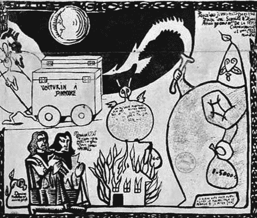

图 4.1

热内为*《乌布王》*发布的原始公告。

# 图 4.2

萨托 - 罗塔斯方块（Sator-Rotas square）见于罗马帝国大部分地区；它包含一个拉丁语回文。这个方块来自意大利的塔蒂。照片由马可·费代莱（Marco Fedele）拍摄。

虽然热内对其观众和社会的蔑视似乎显得极端，但他借鉴了文学中已确立的存在主义和虚无主义传统。早期参与社会批判的作家也使用了巧妙的修辞或游戏来阐述其观点，包括狄更斯、马拉美和萨克雷，后者在其社会讽刺小说*《名利场》*（1828）中也是如此。¹² 比热内写作时间更早的爱德华·爱伦·坡（Edgar Allan Poe）在运用和排列那些玩转当时文学惯例的文字模式方面非常严谨。坡特别着迷于回文，这可能源于他对神秘事物的迷恋。此时，像萨托 - 罗塔斯隐写术（rebus）这样的古老文字谜题浮现在脑海。也被称为圣殿骑士方块的萨托 - 罗塔斯（图 4.2 展示了一个例子）是世界上未解的文字谜题之一。有些人认为它是一种秘密代码；另一些人将其视为早期基督徒的标志；还有一些人认为这个方块是一个拥有巨大力量与神秘感的古老护身符。¹³ 当以方块形式写出时，萨托 - 罗塔斯形成一个回文，它已被潦草地书写在五大洲，包括庞贝古城墙壁上，以及从意大利到英国发现的废墟中。¹⁴

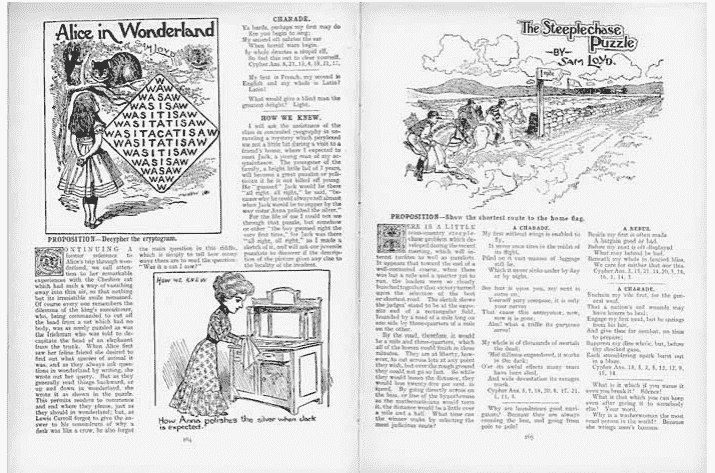

图 4.3

19 世纪末回文在文化上的盛行无处不在。刘易斯·卡罗尔（Lewis Carroll）在 1866 年的*《爱丽丝漫游奇境记》*中创造的回文风格柴郡猫，被艺术家兼谜题制作者山姆·洛伊（Sam Loyd）在其 1914 年的经典作品*《山姆·洛伊 5000 个谜题、把戏和难题词典（含答案）》*中重新演绎。完整内容可在 http://mathpuzzle.com/loyd/cop164-165.html 获取。

其他回文并不那么神秘。例如，见图 4.3，这是*《爱丽丝漫游奇境记》*中奇幻的柴郡猫时刻的重现，以回文形式绘制。刘易斯·卡罗尔（查尔斯·路蒂奇·道奇生，Charles Lutwidge Dodgson，1832–1898）对语言研究的贡献不可否认；从乔治·皮彻（George Pitcher，1965）到莱拉·西尔万娜·梅（Leila Silvana May，2007）的哲学家们，都通过卡罗尔复杂的作品探索了维特根斯坦的语言游戏概念。他专门从事无意义领域和语言系统的创建。¹⁵ 他因儿童书籍而闻名，¹⁶ 道奇生痴迷于逻辑，并在 1860 年至 1896 年间出版了许多游戏。一些例子包括*《来自奇境地的谜题》*（1870）、*《Miscbmash》*（1882）和*《环形台球》*（1890）。¹⁷ 他还创造了一套庞大的密码和代码。有人可能认为这种语言游戏并不具有特别的批判性，而且极有可能本身并不促进社会批判。然而，如果卡罗尔的作品局限于政治和社会议题之外，他对质疑语言本身的结构感兴趣。¹⁸ 他的作品提供了一种特别抽象的批判性游戏版本，即“哲学系统的寓言”或在某种意义上语言的演化。

埃德加·爱伦·坡的作品作为一种批判形式更为成功。在他 1837 年的故事《寓言》中，坡对重复和回文的执着显而易见：

> 那是夜晚，雨水落下；落下的时候，它是雨，但落定之后，它是血。我站在泥泞中，在芦苇丛中，雨水落在我头上——百合花在它们荒凉的庄严中彼此叹息……我的目光落在一块巨大的灰色岩石上，它矗立在河岸，被月光照亮。岩石是灰色的，阴森的，高耸的——岩石是灰色的。它的正面刻有字符……我转身再次看向岩石和字符——字符是 DESOLATION（荒凉）。

坡的用于批判性文字游戏的寓言手段以人类状况为其项目。通过创造既超越又谈论表达结构本身的语言表述，坡的语言类似于秘密或近乎计算的代码，其构建和操作规则一致且无处不在。

# 双关语

双关语被称为最低级的幽默形式，也是最古老且最典型的批判性文字游戏模式之一。早期书写系统，或原初书写，与口头交流相比，通常只包含少量符号。当少量符号需要被广泛解读时，一个符号可以表示一系列可能的含义。美索不达米亚、埃及、以色列和希腊的古代文献通过历史实例证明了双关语的重要性。有一首致法老战车的诗被转录下来，这在某种程度上是可翻译的：

> 你的战车的*轮子*——

> 你*挥舞*你的战斧。

> 你战车的*镰刀*——

> 引来所有民族的*叹息*

19 世纪的埃及学家阿道夫·埃尔曼（Adolph Erman）对古代世界中大量时间花在双关语上感到困惑。斯科特·诺厄尔（Scott Noegel），一位古代语言游戏专家，近期指出，古代文化对双关语着迷，但原因并非幽默或修辞。就像早期的棋盘游戏一样，大多数早期的文字游戏例子被用作回答神圣问题的指南。

**图 4.4**

杜尚将其创作视为“实验室工作”。此处展示的是他的现成品 *Apolinère Enamelé*，1916–1917 年。© 2000 Succession Marcel Duchamp ARS, NY/ADAGP, 巴黎。

双关语曾被用于占卜和梦境分析，占卜者会记录梦境，寻找词语在发音和外观上的双关含义。像苏美尔语或中文这样拥有大量同音词的语言，在日常使用中充满了双关语。双关语的使用不仅揭示了梦境的含义，还赋予了解梦者权力，使占卜体验成为一种充满魔力的仪式。²¹

二十世纪先锋派艺术家马塞尔·杜尚深知词语在游戏化的力量，也深知公众对谜题的着迷，他在作品中利用密码、双关语、符号和典故来发掘这种心理——甚至将自己的生活打造成一个谜题。据说杜尚“发现”了他的现成品雕塑和视觉作品，被称为“现成品”（readymades）。这些现成品中包括 *Apolinère Enamelé*（1916–1917）（图 4.4），这是他通过对诗人纪尧姆·阿波利奈尔的一处故意拼写错误的致敬而改造的广告（原为 Sapolin 油漆广告）。他著名的《泉》（1917）将一个小便池作为现成品艺术对象呈现，既嘲笑了艺术界的惯例，也在艺术家的签名“R. Mutt”中包含了语言游戏。²² 这类游戏对于杜尚的持续实验至关重要。

杜尚的技巧将视觉与语言结合在“极度自由”的“自由视觉诗”片段中。²³ 他在用词上总是经过精心计算，他最为人熟知的作品之一是列奥纳多·达·芬奇著名《蒙娜丽莎》的复制品，他在上面刻画了八字胡、山羊胡以及使该作品得名的字母 L.H.O.Q.（1919）。如果用法语发音，这些首字母是一个大胆的笑话——L.H.O.O.Q. 在语音上是 *elle a chaud au cul*，意为“她屁股很热”。这种语言用法是一种颠覆甚至取笑他自己形式与内容实验的方式。他的隐喻制造了无厘头的游戏，引发了关于他文字游戏的令人深思的问题，例如：主体可能持有什么观点？是否最好以冷漠的态度完全掩盖意义？正如杜尚本人在 1959 年总结的那样：“达达是一种极端的抗议……它是一种我至今仍然非常共鸣的虚无主义。……达达作为一种净化的力量是非常有用的。”²⁴

艺术家著名的《贫血电影》（*Anémic Cinéma*），于 1926 年与曼·雷共同制作，展示了七分钟旋转画面的剪辑，穿插着旋转的词语圆盘，形成了精致而无厘头的双关语（见图 4.5）。杜尚方法中部分幽默源于当时的惯例：字幕是常见的，大多数观众已经习惯了在观看电影时阅读文字。从标题本身开始，《贫血电影》包含了近似或精准的回文，以及杜尚女性替身 Rose Sélavy 的九句陈述。电影学者 P. 亚当斯·西特尼指出了该作品的独特性质：

> *《贫血电影》* 看起来不像它之前制作过的任何电影。所有图像都是圆圈内的偏心圆和螺旋线组成的圆盘。词语仅仅是以螺旋状印在圆盘上的单句（以 Rose Sélavy 的方式），从外向内延伸。眼睛将圆盘作为整体把握；它们的运动引发三维视觉错觉。一些似乎从屏幕的平面中突出；另一些看起来像锥形凹陷。观众对这种结构的反应证实了光刺激在重复系统中引发反射的能力。²⁵

Kuenzli 指出，《贫血电影》中旋转的文字和图像在光学与语言游戏之间创造了一个概念空间：²⁶ “旋涂浮雕中的图形头韵和语言的崩溃放大了这种既非纯粹视觉也非纯粹论述的‘第四维度’效果。”²⁷ 杜尚对双关语近乎疯狂的使用阻止了文本和图像之间可能存在的说教关系。相反，双关语提供了多重意义和解读空间。此外，Kuenzli 指出，旋转运动时进时出，暗喻性行为，但并不指向某一性别。螺旋可能暗示乳房，但旋转圆盘的“飞镖靶”特性暗示了

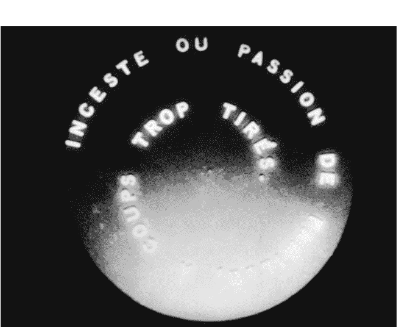

**图 4.5**

马塞尔·杜尚（1887–1968），《贫血电影》（*Anémic Cinéma*）片段，1925，35mm 黑白电影，无声，时长七分钟。技术协助：曼·雷和马克·阿莱格雷。AM1976-F0127。巴黎乔治·蓬皮杜国家现代艺术博物馆中心。图片来源：CNAC/MNAM/Dist. 国家博物馆联盟/纽约 Art Resource。© ARS, NY。

艺术对象，或杜尚 1951 年的 *Objet-dart*，即“飞镖对象”，这是将艺术品的词汇与法语中指代阴茎的俚语相结合的双关语。

通过不断使用双关或三关语，并通过在物体上书写非说明性的文字，视觉表征的功能和词语的语义功能都被质疑并被操纵。

杜尚的语言超越了词语本身，就像查尔斯·道奇森（Charles Dodgson）自己的谜题创造新的逻辑路径一样：

- 证明 PRISM 是 ODEOUS PRISM

棱形的（prismatic）

戏剧性的（dramatic）

情节剧（melodrama）

悦耳的（melodious）

可鄙的（ODIUS）²⁸

像道奇森一样，杜尚的新造词可能也是沿着同样的思路发明的。也许杜尚创造了联想式的科学“证明”，将语言从高雅文化领域引向低俗文化领域，从密集的科学语言引向娱乐语言。他自己的化名 Rose Sélavy 是一个双关语，参考了“接受命运安排的人”，即“这就是生活”（"c'est la vie"）。²⁹

## 潜意识与同时主义

除了其他西方归功于法国先锋派的文字游戏技巧外，还有朱尔·拉福格（Jules Laforgue，1860–1887）的自由诗（*vers libre*），他是象征派诗人和抒情讽刺的大师。拉福格主张书写与潜意识之间的联系。自由诗的方法也影响了马拉美及其诗作《掷骰子永远无法消除偶然性》（"Un coup des Dés jamais n'abolira le Hasard"，或译 "One Toss of the Dice Never Will Abolish Chance"）（1897）。这些行故意不加标点，并以富有表现力的方式在页面上排版。³⁰

先锋派作家纪尧姆·阿波利奈尔（Guillaume Apollinaire，1880–1918）在他的著作《美酒》（*Alcools*，1913）和《卡里格拉姆》（*Calligrammes*，1918）中发表了创新的图形诗。两者都包含不寻常的文字游戏，并为达达主义者和超现实主义者提供了灵感。被称为“先锋派经纪人”的阿波利奈尔致力于探索叙事的根源，或者更确切地说是“叙事的对立面”，这是一种反映作者观念的语言处理方式，具有一种立体主义式的碎片化特征。阿波利奈尔将这种特质称为“同时主义”（Simultanism）。³¹ 这种技巧代表“一种努力，旨在保留体验的瞬间而不牺牲其逻辑上不相关的多样性。在诗歌中，这也意味着一种努力，旨在中和阅读行为中时间的流逝。”³² 阿波利奈尔将他关于时间的研究描述为耳科学的，说他意味着时间的望远镜式压缩。这促使阿波利奈尔实践“诗意的切割”（"découpage poetique"）。³³

“惊讶”，是阿波利奈尔在讲座中用来表达他所倡导的所有艺术创新的类别，仅描述了他诗歌的表面特征。“它是发明或可塑性的总体自由的一个次要原则，它应该导致任意构建，在任何方面都不模仿自然。”³⁴

## 自动主义的兴起

主要博物馆收藏或收录于重要书籍中的达达艺术品往往是绘画，但大多数达达艺术作品采取重新命名或重写的形式。达达主义在达达表演之间移动，例如杜尚穿着女装变身为女性替身 Rose Sélavy，到制作可以落在演示、宣言、声明或小册子宣传范围内任何位置的文本。达达艺术家们是

……擅长挪用空间、物体以及社会文化生产的语言。他们通过具体的方法（其中许多是他们自创的）取得了成果。达达主义的技巧包括并置和碎片化、对材料的游戏式运用，以及对语言的游戏。

与超现实主义一样，达达主义也受到了过去成功研究过程的影响，尤其是*自由诗*和*同时主义*，以及由弗洛伊德心理学引发的思想动荡。安德里·布勒东在纳恩特期间的战时工作中，曾试图运用弗洛伊德的方法对他的病人进行心理分析。许多人都患有炮弹休克症，并将那些令人震惊却又引人入胜的战争景象带回家，这些景象迷住了艺术家们。雅克·瓦舍，一位布勒东在神经科病房遇到的受伤的艺术家兼士兵，是许多得出结论认为战争、文化和艺术都是徒劳无功的人之一[^1]。因此，20世纪许多前卫实践表明了一种信念，即位于人类有意识决策之外的地方——例如机遇或潜意识——对于从一场可怕且不可理解的战争及其所谓的理性中恢复的社会而言，具有首要意义。同样值得注意的是，大多数达达主义者和超现实主义人士都直接卷入了两次世界大战。作家阿波利奈尔和瓦舍，以及艺术家马克斯·恩斯特（1891–1976）都在第一次世界大战期间服役于武装部队。

然而，纵观整个达达主义运动，其突出的特点是专注于语言以及文字游戏、随机性和某种“自然秩序”观念的反叛力量，它们在某种程度上充当了政治处方和公告的“最终边疆”和解毒剂。在特里斯坦·采拉《七篇达达宣言》（1916–1920）中的第五篇中，采拉将非理性和混乱的元素引入了他的创作过程：

> 要写一首达达主义诗歌

> 拿一份报纸。

> 拿一把剪刀。

> 挑选一篇与你计划写的诗歌长度相当的文章。

> 剪下这篇文章。

> 然后剪出构成这篇文章的每个单词，并将它们放入袋中。

> 轻轻摇动它。

> 然后按照它们从袋中取出的顺序，依次取出这些碎片。

> 忠实地抄写下来。

> 这首诗就会像你一样。

> 你看，你成了一位作家，无限原创，拥有一种虽迷人但庸俗之人无法理解的情感敏感度。36

达达主义者也受到了未来主义和俄罗斯构成主义运动艺术家的影响，这些艺术家反对传统和体制，并坚决采取反权威的立场来反对预设立场的艺术观念。像特里斯坦·采拉、弗朗西斯·毕卡比亚、让·阿尔普、雨果·巴爾、马塞尔·杜尚和马克斯·恩斯特这样的艺术家都是战争抵抗者。他们发展了一种观点，认为艺术团体可以成为社会和政治力量。他们寻求通过废除传统文化和形式来探索“真实”。达达主义对游戏和机遇的参与，伴随着愿意通过使用现成品、抽象绘画、雕塑和素描来探索短暂疯狂片段的意愿。他们认为自己的社会角色是驻足抗议那些关于“高贵”政权和传统艺术美学的陈词滥调，反对将艺术用于建立宣传。相反，达达主义希望艺术自我表达，将现实世界的元素与艺术语境联系起来，并回应战争、技术和社会文化的变迁。毕卡比亚的*《砷黄化合物之眼》*（L’Oeil cacodylate，1921年）（图4.6）是一个视觉例子，展示将文化中的现成品与当时碎片化的图像和语言进行拼贴。许多达达主义者意图解构一切，*摧毁一切*，特别是那些促成并支持战争的资产阶级。

在许多绘画和表演中，达达主义的文字游戏重视观众的*互动*和*机遇*，这是纯艺术领域的新概念，并追求日常物品那种粗犷的质感。采拉用报纸构建剪贴诗和宣言。毕卡比亚和其他人创作拼贴画作，将手写技术与剪贴和绘在画布上的现成材料结合在一起。正如阿波利奈尔所说：“从心理上看，这个可见的图像由口头语言的碎片组成并不重要，因为这些碎片之间的联系不再遵循语法逻辑，而是一种符号逻辑，最终达到一种完全反对叙事并置的空间排列顺序……它是叙事的对立面，叙事是所有文学形式中最需要叙事逻辑的一种。”37

德国达达艺术家劳尔·豪斯曼（Raoul Hausmann），汉娜·霍赫（Hannah Höch）共同发明了照片拼贴艺术，他在1918年创作了语音诗，将语言称为“口腔混沌洞穴内的交易”，保证了独特事件的发生，从而在变化中带来一种令人宽慰的确定性。对当代生活机械化特质着迷的豪斯曼吟诵他的诗歌，试图在呼吸的行为中体现大众对时间的观念：

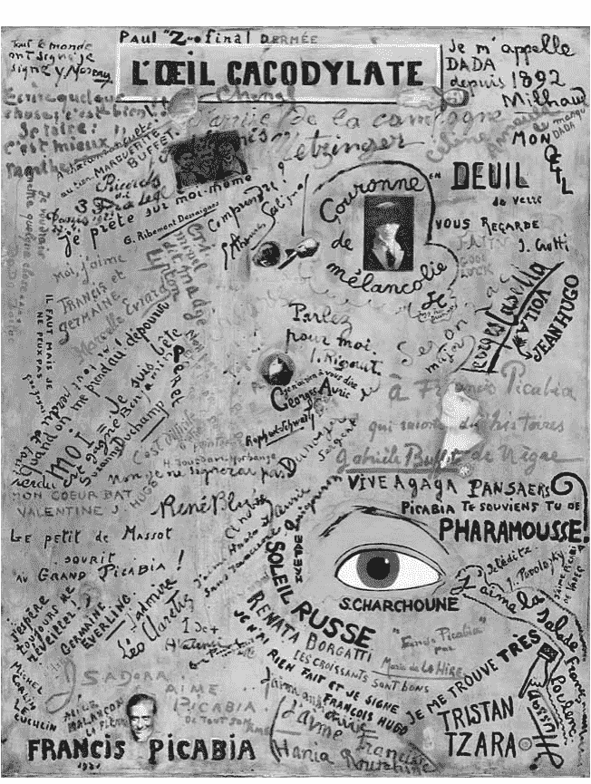

弗朗西斯·毕卡比亚（1879 - 1953），*《砷黄化合物之眼》*，1921年，布面油画及照片拼贴，148.6 × 117.4 cm. AM4408P。

巴黎乔治·蓬皮杜国家高等艺术文化中心（Musée National d'Art Moderne, Centre Georges Pompidou, Paris）。照片：乔治·梅格尔德良（Georges Meguerdchian）。图片来源：CNAC/MNAM/Dist Réunion des Musées Nationaux/Art Resource, NY. © ARS, NY.

Solao Solaan Alamnt

laneë laneao amamb

ambi ambCe enebemp

enepao kalopoo senou

seneakpooo sanakount

saddab kadou koorou

korrokoum oumnpaal

lapidadkal adathoum

adaneop elap noamth

豪斯曼关注精神与物质的交汇，这是使这种关系具体化的一种方式。在表演中，他试图在其作品中强调矛盾性、偶然性和“无差别性”。后来，他与柏林同事萨洛莫·弗里德兰德（Salomo Friedländer）和约翰内斯·巴德尔（Johannes Baader）合作，他认为他在达达中的工作比其他达达艺术家的工作更具魔法色彩；豪斯曼所属的柏林小组希望避免那些“看起来完全由机器组合而成”的作品。

有趣的是，美国各地的达达活动在很大程度上是由一些怪诞女性推广、表演、记录、资助甚至发起的。玛格丽特·安德森（Margaret Anderson）和简·希普（Jane Heap）（sic）主编了激进的*《小评论》*（The Little Review），出版了詹姆斯·乔伊斯的*《尤利西斯》*，以及欧内斯特·海明威、埃兹拉·庞德、奥尔德斯·赫胥黎、T. S. 艾略特、华莱士·史蒂文斯和艾米·洛厄尔的作品。罗伯特·休斯（Robert Hughes）在对美国惠特尼美术馆展览的一次评论中指出，曼哈顿的达达由格林尼治村前卫场景中那些“古怪人物”组成，比如埃尔莎·冯·弗莱泰格-洛林霍夫男爵夫人（Elsa von Freytag-Loringhoven），她是纽约第一位朋克女性，曾剃光头发并将头皮染成紫色公开亮相。

激进的埃尔莎·冯·弗莱泰格-洛林霍夫男爵夫人（1874–1927），其荒诞的表演早于大多数达达事件，她扮演过各种角色：表演者、诗人、艺术模特和雕塑家。她遵守的规则无法在现有的社会习俗中找到依据，有时她的行为比历史上确立的达达“创始人”们更为激进。她认为这些艺术家“都是胆小鬼，虽然他们创作了非传统的作品，但依然坚持过着传统的生活并遵循传统的性别角色。”在经历了一系列失败的婚姻后，弗莱泰格-洛林霍夫搬到纽约追求各种形式的艺术。她于1918年开始在*《小评论选集》*（The Little Review Anthology）中发表诗歌，她与许多当时著名艺术家的关联表明她得到了达达和文学圈子的接纳。在1913年至1923年间，这位出生于德国的艺术家从事性别跨越、荒诞表演、实验写作和违法行为，试图“活出达达”——也就是说，体现达达所代表的质疑和创造过程。她剃着头发走在纽约街头，穿着大规模生产的日常物品，如厨房餐具、汽车尾灯、勺子、蔬菜，甚至用番茄罐头制成的胸罩，男爵夫人公开宣称她的行为和物体是“艺术作品”。在简·希普看来，她是“美国第一位达达艺术家，国际达达女王，朋克和表演艺术的远祖姑姑”。[^46] 除了简·希普，她还与曼·雷（Man Ray）、玛格丽特·安德森、埃兹拉·庞德、威廉·卡洛斯·威廉姆斯、哈特·克兰、马塞尔·杜尚、贝伦妮斯·阿博特（Berenice Abbot）和朱娜·巴恩斯（Djuna Barnes）结为朋友：她的怪诞行为是格林尼治村前卫社群不可或缺的组成部分。[^17] 据记载，男爵夫人曾挑衅威廉·卡洛斯·威廉姆斯和华莱士·史蒂文斯，要求他们进行滥交——她希望“解放他们”，让他们充分体验创造力。埃兹拉·庞德受男爵夫人启发，在其*《诗章》*（Canto）第95章中写到了她，杜尚则评价她道：“她是未来。”曼·雷和杜尚为她在1921年制作了一部电影*《埃尔莎·冯·弗莱泰格-洛林霍夫男爵夫人刮除她的体毛》*（Elsa, Baroness von Freytag-Loringhoven, Shaving Her Public Hair）（该电影现已失传）。与其他挑战形式和体裁的艺术家一样，男爵夫人出奇地不如杜尚和其他当时的男性艺术家那样受到庆祝，但她显然在实验和创造方面远比她的同时代人更深入地参与了达达精神。

弗莱泰格-洛林霍夫在表演、写作和雕塑之间的工作过程与达达主题高度一致。并置、机遇、碎片化和商品是她作品中不可或缺的元素。与杜尚的现成品不同，弗莱泰格-洛林霍夫从街头收集材料，特别是来自家庭空间的材料，用来将女性身体置于现成的社会体系中。弗莱泰格-洛林霍夫不停地写作；关于她如何为页面进行构图，请参阅图4.7和图4.8。这些“现成品诗歌”由广告和自动写作拼贴而成，充满了性暗示，例如对口交的引用，并作为对当时美国保守社会风俗和消费主义痴迷的抗议：[^48]

> ……没有什么比 posodent 更令人舒缓的——

> 柳絮——保持清洁

> 使用费城奶油奶酪。

> 它们满足了

> 拥有最大芥末内裤的男人——

> 不要过量

> 欲望，涂上它[^49]

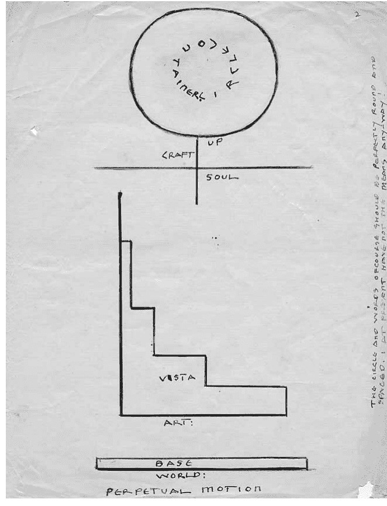

**图 4.7**

埃尔莎·冯·弗莱塔格-洛林霍芬（Elsa von Freytag-Loringhoven）的《物质层级透视》（*Matter Level Perspective*），1922–1923。埃尔莎·冯·弗莱塔格-洛林霍芬档案，马里兰大学图书馆特藏部。

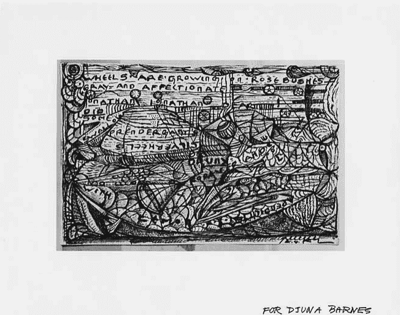

**图 4.8**

埃尔莎·冯·弗莱塔格-洛林霍芬的《轮子正在玫瑰丛上生长》（*Wheels Are Growing on Rosebushes*），1922–1923。埃尔莎·冯·弗莱塔格-洛林霍芬档案，马里兰大学图书馆特藏部。

# 超现实主义写作

其他作家也追随了弗莱塔格-洛林霍芬等人所推崇的系统性自动写作法。自动性（Automatism），无论是源于超越意识的层面，还是源于艺术家无法完全掌控的物理过程，都基于“有意识”设计的缺失。机会操作将自动性组织成特定的事件或序列。作为超现实主义过程的历史学家，布鲁奇（Broochie）和古丁（Gooding）对自动性的描述如下：“坐在桌前，备好纸笔，让自己处于一种‘接收’的心境，开始写作。继续写下去，不要去想笔尖下方显现的内容。尽可能快地写。如果由于某种原因流畅性中断了，请留一个空格，并立即重新开始，写下下一个句子的第一个字母。在开始之前随机选择一个字母，例如‘t’，并始终以‘t’开始这个新句子。”$^{50}$ 布鲁奇和古丁还使用游戏术语来描述超现实主义者的作品：

超现实主义的博弈和程序旨在使词语和图像摆脱理性与话语秩序的束缚，用机遇和不确定性取代预谋和斟酌。……在某个特定且重要的方面，超现实主义的 playful（游戏/玩笑）性质更像是一种挑衅性的魔法。这体现在其不可抑制地转化物体、行为和观念的倾向中。在其进程的这一方面，超现实主义彰显了其潜在的政治纲领及其革命意图。⁵¹

许多作家都认识阿波利奈尔（Apollinaire），他在1917年春天创造了“超现实主义”（surrealism）一词，并作为其戏剧《提瑞西阿斯之乳》（*Les Mamelles de Tirésias*，或译《提瑞西阿斯的乳房》：一出超现实主义戏剧）的副标题。这部剧通过提出让男性和女性交换性别角色，并由男性生育孩子的观点，震惊了传统的巴黎社会。

这部作品影响了同行作家布莱顿（Breton）和索波（Soupault），他们沿着其他法国文学研究者兰波（Rimbaud）、洛特雷阿蒙（Lautréamont）和瓦谢（Vaché）的道路前行，尽管他们不像该地区作家那样可以借助鸦片和苦艾酒。他们的作品《磁场》（*The Magnetic Fields*，1920）是一部早期的超现实主义文本，于1919年即第一次世界大战结束后不久合作创作而成。在1919年期间，布莱顿和索波有时会聚在一起，有时长达十或十二个小时：“索波和我形成了在我们身上故意重现这种（句子）由此产生的状态的想法。为了做到这一点，只需忽视外部世界的背景即可，就这样，在两个月内，这些句子紧随其后，毫不间断地迅速向我们涌来，以至于我们不得不使用缩写符号来记录它们。”⁵²

自动绘画和写作是几种自动化方法之一，这些方法源于美国的精神主义运动（Spiritualist movement）等多种因素。精神主义者相信他们通过自动书写与死者建立联系。19世纪末瑞士的灵媒海伦·史密斯（Hélène Smith）通过自动书写声称与火星人交谈，并详细描述了她作为15世纪印度公主的生活。⁵³ 她的故事对超现实主义运动成员产生了重大影响，尤其受到布莱顿的重视。她和其他如美国精神主义者一样使用自动过程来与灵界建立联系，但布莱顿和其他超现实主义艺术家则使用该技术来理解潜意识的运作。

超现实主义者直到五年后才发起宣言，但早期，参与者仍然重视机遇的客观性质、自动写作和黑色幽默。⁵⁴ 自动过程被证明对超现实主义使命至关重要：“亲爱的想象力，”布莱顿写道，“我最喜欢你的特质是你对事物的毫不留情。”⁵⁵ 自动写作涉及的纪律是“坚决抵制打断意识流的诱惑，或者更确切地说，抵制打断理论上的潜意识流的诱惑，或者在事后干涉或以其他方式改变以‘对文学质量持可嘉的蔑视’所获得的结果。” 56

超现实主义的词语游戏还包括著名的“精美尸体”（cadavre exquis，英文直译为“exquisite corpse”）。赋予该活动名称的经典例子是从该游戏中推导出的第一句话：“Le cadavre—exquis—boira—le vin—nouveau”（精美的尸体—将饮用—新酒—）。这种简单的语言游戏可以通过仅知道小组工作中最后一位贡献者的内容来玩，也可以通过遵循语言模式规则（如形容词-名词-副词-动词-形容词-名词）来玩。必须遵守顺序才能产生语法正确的句子。这项练习灵感来自在一个由一群超现实主义者居住的巴黎房屋聚会中的现有客厅游戏，是超现实主义艺术家创建的几种语言游戏和自发小组游戏之一。57 事实上，杜罗瓦兹（Durozoi）认为，超现实主义本身应等同于所有行动中的纯粹精神自动性——艺术、口头或书面语言，或任何其他行为——并且这些行动不应受思想的听写或受外部因素、审美或道德 concerns 的控制。58 但在此处，对该方法的批评需要被纳入考量。

激进的超现实主义作家朱娜·巴恩斯（Djuna Barnes，1892–1982）追随了该团体提出的许多游戏般的超现实主义研究/创作方法。巴恩斯的前卫图像和写作，包括新闻论文，从1913年到1930年代广泛出版。她的作品《令人厌恶的女人之书》（*The Book of Repulsive Women*，1915）和《莱德》（*Ryder*，1928）是去稳定化的文本，与凯西·阿克（Kathy Acker）后来的作品类似，纳入了视觉成分以表达女权主义 concerns。正如学者艾琳·马蒂尼乌克（Irene Martyniuk）指出的那样：“正如在父权制系统中，女性传统上被视为男性的‘侍女’一样，文本的视觉成分传统上被视为语言成分的附属。” 59 因此，通过图像与文本之间的斗争来应对男女权力关系，是一种有趣的女权主义方法。巴恩斯创作了她书籍中的图像和文本（见她在图 4.9 中的画作）。正如伊里加雷（Irigaray）所指出的：“女性性欲总是基于男性参数来概念化”，巴恩斯在她图像与文本的复杂并置中审视的正是这种建构。60

《令人厌恶的女人之书》由关于纽约市女性的八首诗组成，始于一位必须暴露其女同性恋身份的女性，这是某些人所谓“令人厌恶”的一种形式，终于一位自杀的女性，其“精美尸体”从两个竞争的观点进行审视，创造了另一种某些人可能视为“令人厌恶”的女性实例。61

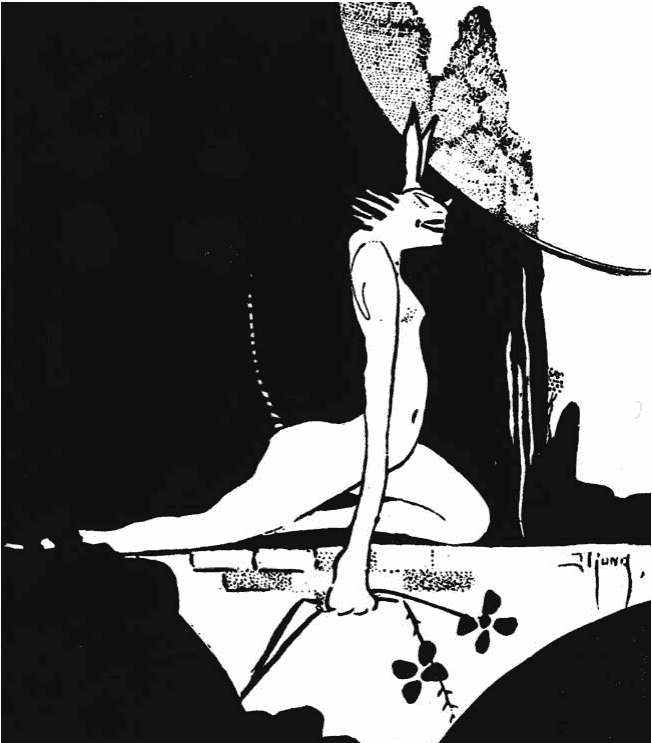

**图 4.9**

朱娜·巴恩斯1915年小册子《令人厌恶的女人之书》中的插画之一，该书收集了八首“节奏”诗和五幅画作。朱娜·巴恩斯档案，马里兰大学图书馆特藏部。

那些住在房间里活着的死人

必须注意到坟墓是多么片面，

它们将男人重新纳入其子宫，

而她们的必须禁食。

那些在罐子里拥有花朵的人

不再凝望星星，

相反，它们注视着迷你汽车——

并惊恐地活着。⁶²

巴恩斯笔下的女性是非传统的，且被迫生活在其中的文化对其进行了受害化。她们不符合作者时代的社会习俗。事实上，人们会质疑她们是否能轻松融入20世纪的纽约。巴恩斯笔下边缘化、不稳定的角色和未固定的主体，非常适合代表超现实主义中女性在其矛盾角色中的整体地位。讽刺的是，作者限制了她的女性角色的权力。最终，这些叙事并不是关于赋予女性权力；自杀或死亡是女性情感、创造或性自由的手段。

其他超现实主义者也讲述了类似的寓言。尤尼卡·祖恩（Unica Zürn），她与汉斯·贝尔默（Hans Bellmer）的关系使她接触了她后来著名的自动绘画和写作，她忍受了精神病发作，并因深受页面中提到的“茉莉花男人”幻象的困扰而自杀。⁶³

## 从艺术到游戏

正如游戏人类学家布莱恩·萨顿-史密斯（Brian Sutton-Smith）所注意到的，20世纪初的艺术将儿童游戏和艺术的思想与关于想象力重要性的思想结合在一起。在这里，一种孩童般的状态被重视为原始的、天真的、原创的，并最终是新鲜的和未受染的。⁶⁴ 然而，萨顿-史密斯认为这种观点是简单化和浪漫化的，遗漏了游戏的其他重要方面。例如，游戏和艺术可能共享发明和拟人化，但不共享感官性。此外，游戏构成了一个象征形式系统，可能携带其自身的客观代码。

霍华德·加德纳（Howard Gardner）将游戏视为掌握焦虑、自我和世界的一种方式，而艺术可能更多地是关于掌握象征系统。⁶⁵ 无论艺术和游戏之间细微或不那么细微的差异是什么，这里给出的例子在概念上参与了交换经济和社会秩序，艺术和游戏作为概念性和流动空间的性质，以及机遇和干预在创造性事件和作品中的作用。⁶⁶ 在这些互动艺术形式中产生的波动的社会网络可以用德勒兹（Deleuzian）的术语描述为“生成”的场所。

在文章《什么是生成？》（"What Is Becoming?"）中，吉尔·德勒兹（Gilles Deleuze）描述了一种以事件为中心的生存状态，这是体验游戏和互动艺术的一种基本方式。最重要的是，这些作品通过强调艺术家权威性的转移，为激进社会秩序的生产与接受创造了语境。

游戏文化的历史基础——创造性的社会网络和艺术、游戏与颠覆的结合——必须通过考察二十世纪“模拟”艺术运动中的游戏史来进行审视，特别是那些证明了在艺术体系中对权威的深刻质询、通过参与赋予用户力量以及对规范行为进行刻意质疑的历史。

达达主义在其对权威和作者身份的重新唤醒中的颠覆性实践，是社会规范被推动并字面上“处于游戏之中”的一种方式。此处讨论的达达主义批评运用了参与式游戏、将游戏作为实践研究以及交互性，以反思日常关切，并解构、重塑、重写，在某些情况下积极重新定义文化。本章描述的艺术与游戏的实验应被视为一种引人深思的视角，展示艺术家如何挑战对象、行为和观念，并随之对其加以转化。

## 激浪派（Fluxus）的语言游戏

如前所述，与达达主义者和超现实主义者一样，激浪派（Fluxus）艺术家依赖幽默、指令、短暂性和交互性，在实践中，体验的瞬间优于对象的永久性。激浪派由一群艺术家在20世纪60年代创立，其同名杂志围绕艺术家兼组织者乔治·马丘纳斯（George Maciunas, 1931–1978）展开，其名称强调了艺术家在游戏、竞技和“一次性”作品中的变化与流动。激浪派脱离了其达达起源，将重点从强调个别艺术家转向庆祝集体身份以及为艺术作品提供替代场所。对于许多激浪派艺术家来说，游戏和“玩笑”演变成了一种方法论，将互动和观众参与从画廊和传统剧院环境中转移出来，首次创造了一种多人艺术游戏空间和氛围。激浪派艺术家的方法似乎很像21世纪互联网上运作的最佳创意作品，或是新兴的21世纪媒体团体的工作，因为“激浪派的目标是社会的（而非美学的）。它们与群体相连……激浪派坚决反对艺术-对象……因此，激浪派应当倾向于集体精神、匿名性和反个人主义。”

几位激浪派艺术家创造了作为干预手段的游戏，旨在使日常生活接受更细致的审视，将社会时刻呈现为交换行为或批评更大政治状况的机会。据称，激浪派通过制作游戏或指令卡来创造情境（这些情境确实是艺术作品）的实践，起源于约翰·凯奇（John Cage）在1956年至1960年间于纽约市社会研究新学院（The New School for Social Research）开设的课程。凯奇专注于将日常行为转化为艺术行为，围绕活动绘制了赫伊津加（Huizinga）的魔圈，使其成为游戏，将其置于幻想之中。哲学家赫伯特·斯宾塞（Herbert Spencer）指出，在这些行动中，“游戏和艺术是同一活动，因为两者都不直接服务于有助于生命的过程，也不指向最终利益，当下的目的只是唯一的目的。”

这些艺术家的作品通过参与式游戏在颠覆性行动中表现出特定的效力。几位激浪派艺术家涉足了语言游戏，但这些游戏往往依赖表演来实现。尽管如此，这里仍应包含一些作品。奥诺（Ono）的*指令绘画*（*Instruction Paintings*）系列是20世纪最重要的艺术遗物之一，因为它们通过拒绝艺术对象本身存在的证据，将概念艺术提升到了一个新的高度。通常在画廊中作为一次性卡片分发，奥诺给予参与者如何自己创作艺术作品的指令。通过探究绘画媒介和图像制作行为，奥诺的最终目标是参与式艺术。她的作品*要被踩踏的绘画*（*Painting to Be Stepped On*，1960）包含指示，要求制作者“将一块帆布或完成的画作留在地板或街道上”。1961年，奥诺在纽约市乔治·马丘纳斯的AG画廊展出了*指令绘画*，邀请访客在*水滴绘画*（*Waterdrop Painting*）上滴水，或走过*影子绘画*（*Shadow Painting*），后者是悬挂在画廊墙上的空白帆布，其转瞬即逝的图像仅由访客的影子创造。

*观看天空的绘画*（*Painting to See the Skies*，1961）是奥诺众多*指令绘画*之一。这些绘画可以被视为激浪派作品（或乐谱）传统的延伸，该传统将观众定位为“融合者”或创作者，仅仅通过在观众脑海中将图像、思想或声音组合起来即可实现。在*观看天空的绘画*中，奥诺鼓励访客仅仅观看天空。奥诺的指令制作模式后来被其他概念艺术家如艾伦·卡普罗（Allan Kaprow）和乔治·肖（George Shaw）在其表演和表演记录工作中使用。这些指令诗歌读起来像是小小的“程序”，指引观众更有意识地去成为参与者：

- 太阳作品（SUN PIECE）

  注视太阳，直到它变成长方形。

  1962年冬

- 供人群触摸的诗（TOUCH POEM FOR A GROUP OF PEOPLE）

  互相触摸。

  1963年冬

激浪派游戏源自表演性的类似事件的发生（happenings），或采取激浪包（Fluxkits）和盒子的形式，内部包含游戏物品。

在作品*古代语言的指尖书*（*Finger Book of Ancient Languages*，1982）中，艾莉森·诺尔斯（Alison Knowles）创造了一种混合了棋盘游戏/立体书/雕塑的作品， featuring“触觉”语言。该作品由七页高11英寸的页面组成，部分使用盲文书写。作品还包含一段用Kifu（珠子语言）表达的信息。刻有唐代的战斗呐喊的中文象形文字被刻在竖立的“页面”上。

缝入一块布料的是26个物体，代表英语字母表中的每个字母。缝入的一根别针可能代表字母*p*，一根羽毛代表*f*。要辨认字母表，“读者”触摸每个字母区域，实际上可以通过触摸物体来拼写单词。诺尔斯将物体作为字母的处理结果在于，日常物品从无实体的对象转变为具有纪念碑性质的符号系统。这本“书”曾在纽约的盲人灯塔（Lighthouse for the Blind）及其他场所展出。“因为书籍让人们在无意识于时间和地点的情况下参与探索，其表演性既是概念性的，又类似事件（Event-like）。”*古代语言的指尖书*提供了“一种感官上的替代方案，以对抗纯粹智力或无身体的、在唯心主义意义上的语言定义。”

## 让文字物质化

在20世纪60年代和70年代使用文本的艺术家对当代艺术实践产生了巨大影响。特别相关的是那些在自己项目中应用技术，或在更大的文化分析中批评技术的艺术家。20世纪60年代末和70年代初的女性艺术家面临一个敌对的、以男性为中心的艺术世界，有些人转向海报、录像和表演等非传统媒介，以对抗浸透在男性主导的现代主义传统和主题中的艺术。

1970年代的其他艺术家同时参与了当时的政治行动。珍妮·霍尔泽（Jenny Holzer）以其女权主义的政治海报部队、贴纸和电子LED信息显示，是使用各种形式技术对抗行人的行动主义艺术家的一个显著例子，这些技术在十年前的情境主义（Situationist）干预中很常见。旨在使公众震惊以反思其所生活的消费文化状况，霍尔泽在1977年作为学生时开始创作基于语言的作品。从1978年到1987年，她以海报或贴纸的形式分发单行短语，即“真理断言”（truisms）。将这些作品带到公共场所，她在1983年制作了*生存系列*（*The Survival Series*），将格言（例如，“强烈的责任感会囚禁你；绝对的顺从可以是一种形式的自由；抽象是一种颓废形式；权力滥用的出现并不令人惊讶”）纳入各种交付形式，包括标志牌和公园长椅。

艾莉森·诺尔斯（Alison Knowles），*古代语言手指书*，1982 年。摄影：克里斯蒂安·法恩斯沃斯（Christian Farnsworth）。

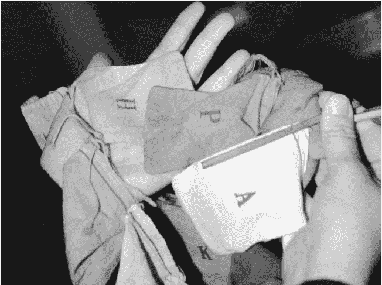

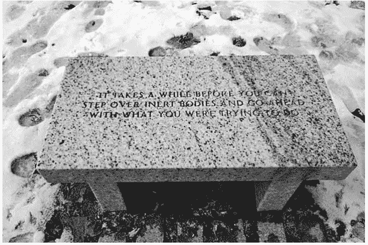

**图 4.11**

艾莉森·诺尔斯，*古代语言手指书*，1982 年。摄影：克里斯蒂安·法恩斯沃斯（Christian Farnsworth）。

**图 4.12**

珍妮·霍尔泽（Jenny Holzer）的“行者长椅”（Walker benches）之一，由 Cold Spring Granite 制作。图片由 Ted Sher 提供。

霍尔泽的文字干预针对消费主义、工作中的性别角色以及媒体对女性和强奸的报道。许多作品很可能出现在公共空间，干扰了传统画廊的空间，尽管霍尔泽也经常在传统场所展示。霍尔泽早期的作品带有指责的语气，旨在引起读者的反应。她在 1989 年古根海姆博物馆展览中的一行诗写道：“你是你所遵循规则的受害者”。她作品的干预性质意味着霍尔泽的文字可能会令人惊讶，往往在读者毫无防备时击中他们。她的作品尺寸从贴纸这样的小型临时物件到大型电子装置不等，既有模拟形式也有数字形式。例如，在 Creative Time 的“42 街艺术项目”（1993–1994 年）期间，霍尔泽使用城市广告牌展示其系列作品 *Truisms*（真实陈词）和 *Survival*（生存）选段，这些内容渗入了观众的现实。霍尔泽对地点的艺术干预也扩展到了新兴的互联网公共领域。20 世纪 90 年代末，她制作了基于网站的作品 *Please Change Beliefs*（请改变信念）（1999 年）。*PCB* 是一个网站，互联网用户可以通过上传他们自己的新“真实陈词”到程序中已数据库化的“真实陈词”列表中，参与艺术家的“陈述制作”。⁷⁷ 文本以定时间隔传递，但用户可以进行修改。尽管并非明确的游戏，但观众的参与和社会关怀感与抗议艺术和干预有关联。在这里，与公众的联系不仅是艺术家的偏好，更是其实践所必需的。⁷⁸ 她的文字预示了定位游戏设计（见第 6 章）所使用的技术。

在过去十年中，霍尔泽一直在进行光投影干预。早期基于街道的干预实践显然与这种对媒介和策略的新审视相关联，包括广告手法和新闻广播。这些文本被投影出来，打断路人的生活，在公共领域形成一种短暂的体验社区。她的作品 *For the City*（为了这座城市）（2005 年），如 4.13 图所示，用政治诗歌和已解密的文件照亮纽约，投影在城市地标上。她的文本是严肃的，但遇到它们会创造出一个暂时的魔圈，成为社区中阅读、思考和对话的游戏空间。

使用颠覆的术语，霍尔泽既为政治目的重写广告口号，又通过标牌和贴纸重新包装公共表面。霍尔泽的当代艺术实践仅代表了许多利用颠覆策略对抗主导规范的艺术家例子中的少数几个（4.14 图）。

确立探索语言艺术干预语境的最后一个例子是被称为“游击女孩”（Guerrilla Girls）的团体作品，该团体成立于 20 世纪 80 年代中期，旨在批评如大都会艺术博物馆（见 4.15 图）、惠特尼美国艺术博物馆和纽约现代艺术博物馆等文化机构。⁷⁹

珍妮·霍尔泽的 *For the City* 项目，2005 年，通过光投影诗歌和已解密的文件照亮纽约地标建筑。

“女孩们”的成员完全匿名，并组织了引发关于艺术领域女性地位对话的艺术事件、表演行动和广告活动。

虽然语言游戏具有激发思维的能力，但当代艺术家正试图在他们的游戏中使该思维“再身体化”。通过他们在软件系统中使用文本，语言成为动画、音频、视频和实体安装空间的一部分。装置艺术家卡米拉·奥特巴克（Camille Utterback，1970–）创作沉浸式视频装置，将参与者的整个身体纳入其中。她写道：“随着我们在身体与符号系统之间创造新的界面，我们处于一个独特的位置，可以重新思考并重新塑造这种关系。” 就像杜尚文字与图像的碰撞一样，奥特巴克和罗米·阿希图夫（Romy Achituv）在他们的投影作品 *Text Rain*（文字雨）（1999 年）（4.16 图）中实现了文本与玩家/参与者身体之间关系的独特重构。

在这部极具趣味性的作品中，一首先前写好的诗中的字母漂浮或“落下”到位于参与者对面的屏幕上。摄像机对准参与者，

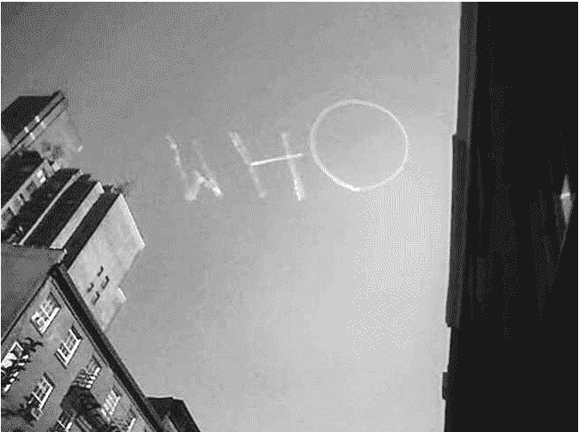

**图 4.14**

纽约市喷气书法——“谁在？”——在格林威治村上空，2006 年，作者未知，经作者许可使用。

**图 4.15**

游击女孩，*女性必须裸体吗？*，1989 年，选自组合画集“游击女孩通缉令：1985–2006”，11 1/16 × 27 1/8 英寸（28 × 68.7 厘米）。汉诺威，新罕布什尔州，达特茅斯学院胡德艺术博物馆；通过匿名基金 # 144 购得。

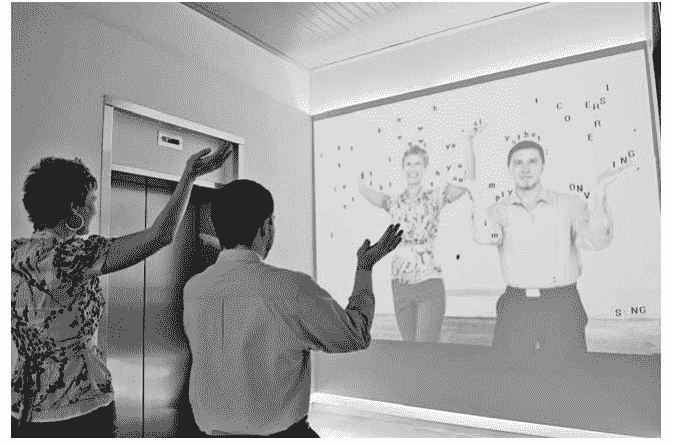

***图 4.16***

卡米拉·奥特巴克和罗米·阿希图夫，*Text Rain*，1999 年。图片由 Kenneth Hayden 拍摄，2007 年。

追踪他们的动作，以便他们的剪影可以组成程序，他们的影子可以与字母“互动”。在玩耍过程中，参与者可以“接住”掉落的字母，或将其保持在手臂或其他物体形状的剪影上。参与者收集字母和短语，发现这首诗是关于身体和语言的。⁸¹

现代艺术家的理念开辟了将游戏作为对抗权力和压迫方式的可能性。⁸² 罗西·布拉多蒂（Rosi Braidotti）指出，知识的功能是“对激进的再身体化形式产生深远影响”，并且需要是动态的或游牧的，以允许位置和多样性的转变。⁸³ 这种转变不仅仅是“玩字母”；*Text Rain* 暗示了阿波利奈尔的同时性主义（Simultanism），以及一种现在，在这种状态下，以双关语、文本与图像的碰撞或身体与文本的碰撞形式的多重真理体系可以蓬勃发展。*Text Rain* 可以提供一段情感上复杂的体验片段，为参与者提供一种具身化的程序性游戏观念。

最后，回到开启本章的瓜塔里（Guattari）的理念是合适的。这里讨论的作品通过它们自己的规则重塑主体性——特别是，这种语言游戏从“高雅文化”圈子的顶端到日常经验的底层都成为政治行动。正如菲利克斯·瓜塔里（Félix Guattari）所指出的：“人类活动唯一可接受的最终目标是生产一种主体性，这种主体性以持续的方式自我丰富其与世界的关系。主体性的生产装置可以同样容易地存在于大都会层面，也可以存在于个人的语言游戏层面。”⁸⁴ 因此，艺术家的语言游戏是开放主体位置的框架，是对制定规则、分享规则和玩耍的含义的解放。

本章中提及的参与语言游戏的艺术家展示了创新，通过不受欢迎的位置，如亚里（Jarry）对品味的攻击，以及回文和双关语，如杜尚所钟爱的那些。阿波利奈尔的同时性主义本体论提供了语言、无意识、偶然性和发明力量的另一个例子。自动主义（Automatism），长期以来在各种术语下被探索，包括马拉美（Mallarmé）的自由诗，改变了主体性、形式和功能的观念，并调用了允许作者在显著转变中扮演角色的玩耍方法。这些艺术家共同在物理空间中呈现了一种实用主义和特定地点的批评。这些艺术家的批评可以追溯到重新包装、非玩耍和重写的粗略类别，正如霍尔泽对当代信息系统和广告的挑战一样。霍尔泽转向表演文本、社会意识和可能的行动主义，这一趋势在“游击女孩”中延续，她们实际上将自己重新包装成丛林生物，以去性化或过度性化并复杂化她们的女性身份。奥特巴克将身体重新引入语言，并在两者之间的空间提供了值得学习的东西。随着艺术和批判性玩耍之间的联系继续发展，艺术家将进一步探索具身化玩耍和情境，以及“非玩耍”关于身体、计算机和日常生活的预设概念的努力，并将它们重新制作成激进地图和书面文件。虽然这些作品严格来说不一定是游戏，但它们深入参与参与式玩耍的主题，是当代玩耍文化形式谱系的一部分，颠覆了流行文化和媒体中的主导观念，以及植根于当代艺术机构中的“传统”。

# 表演性游戏与物体

> 嬉戏的过程和系统性的策略为打开无意识之门提供了钥匙，并释放了集体创造力的视觉与语言诗学。
>
> ——阿拉斯泰尔·布罗奇（Alastair Brotchie）与梅尔·古丁（Mel Gooding），《超现实主义游戏集》（*A Book of Surrealist Games*）

对约翰·赫伊津哈（Johan Huizinga）而言，游戏包含了各种各样的游戏：“力量与技巧游戏、发明游戏、猜测游戏、运气游戏，以及各种形式的展览和表演。”¹ 在本章中，我们将探索赫伊津哈所描述的最后一类游戏：*表演性游戏*，或者说是通过在其尝试影响社会，或提供乌托邦式的、嬉戏的世界愿景与修正时，通过强烈的表演感来实现批判性游戏的游戏。这些游戏的历史与先前提到的游戏形式一样丰富且深远。在过去的一个世纪里，各种艺术和社会运动都参与到了参与形式的展示、互动事件的创造、嬉戏的颠覆、干扰以及干预之中。在最广泛的意义上，批判性游戏的表演包括具有历史意义的游戏和表演性物体、表演本身，以及媒介化的表演。²

在某种程度上，所有游戏都具有表演性，需要通过某些行动——思考、猜测、奔跑或投掷——来进行游玩。当表演被理解为语境时，它构成了包括戏剧、舞蹈、音乐、活动策划、仪式和奇观在内的文化实践光谱，人类学家和艺术史学家同样可以对其进行研究。通过关注跨文化关系、社会不平等、文化过程、身体的作用以及语言的使用，表演带有着特定的历史和一整套策略，其中一些策略会自动推断出*游戏*。例如，戏剧呈现了演员，或者说是玩家，他们就像孩子们玩玩具屋或娃娃屋时一样，调用了虚构和想象的世界。此类行动可能使用也可能不使用道具，或者遵循指示或剧本。在其他情况下，表演可能围绕通常在游戏中使用的特定物体构建——例如，国际象棋棋子或鞋子在成为游戏元素时，都标记了其他特定的用途和其他语境。

表演与游戏与艺术家的干预有着内在联系。³ 在其著作《重要的身体》（*Bodies that Matter*，1993）中，哲学家朱迪斯·巴特勒（Judith Butler）提出了一种表演性理论，指出表演主体的身份并非身体本身所创造，而是一种特定表演的产物。巴特勒观察到，诸如性别等社会规范是主体必须从非现实或夸大的性别二元对立中进行选择的博弈场所。根据巴特勒的观点，表演为那些希望反对狭隘社会分类的人找到了一个抵抗点。20世纪90年代的一些技术理论家，如桑迪·斯通（Sandy Stone），随着互联网技术进入文化，看到了将身体与人设分离的需求，也采用了这种抵抗形式。⁴ 巴特勒关于性别的生物学与性化自我的表演性特质之间的断裂，使得性别和其他社会现实可以通过新的方式体现和诠释。

表演还可以融入即兴表演或“心流”，这是一种常见的工作室艺术方法论。心流是一种意识状态，在这种状态下，一个人如此完全地沉浸在一项活动中，以至于甚至自我（ego）也随之消散，让创造性的冲动塑造方向。⁵ 类似于巴特勒的替代性表演，实践研究者科尔（Cole）和诺尔斯（Knowles）建议说：“无论是通过诗歌、散文、运动、戏剧、哑剧、冥想、绘画、素描、雕塑还是其他任何非传统的语言或非语言形式，重要的是找到一种或几种方法，让我们能够跟随我们探究的自然内部流程。在某种意义上，这是通过艺术表达进行研究的一个基本要素。”⁶ 马塞尔·杜尚（Marcel Duchamp）的“实验室工作”是另一种基于实践的艺术家研究的例子，它融合了多种方法与类似心流的概念。⁷

如果历史先锋派实践一直专注于去中心化权威，那么基于表演的游戏项目不仅为其他游戏，也为街头文化创造了批判性的替代品。在此探索中，规则在游戏和艺术中的作用至关重要。格林默（Glimcher）认为，在帮助建立俄罗斯构成主义方面，亚历山大·罗德琴科（Alexander Rodchenko）创立了艺术创作中最早的“系统化”方法之一。在构成主义中，艺术作品的元素被组装，随后在一个“实验室”中进行分析，并可能进行迭代。⁸ 其他人可能会争辩说，艺术拥有通过某种原则或模式构成长达多年的历史。例如，文艺复兴时期的委托肖像画包含了可能在作品构图上看似同样具有禁止性的规则。然而，区别可能在于内容事项的选择以及新风格公式的形成——例如，一个处理建筑建构性质的游戏，或其他形式艺术表达性构图性质。

## 表演性物体

广泛的艺术家表演者如何在他们的绘画、摄影、装置和场景中为批判性游戏创造语境？正如技术变革一样，游戏文化的转变与世界事件如经济萧条、世界大战或文化和社会运动的动荡并行不悖。电影对20世纪的艺术运动产生了巨大影响，尽管艺术史的历史叙述通常淡化电影作为“低艺术”的贡献。然而，尽管马塞尔·杜尚在询问观众自己对艺术本质做出决定，美国电影粉丝正是通过粉丝文化的发展做到了这一点。⁹ 电影粉丝通常是流行文化的狂热消费者，也是工人阶级成员，他们不仅仅是被动的观众，即使在好莱坞早期也是如此。从20世纪10年代开始，女性成为主要的创造力。¹⁰ 在1930年代，作为粉丝与更广泛的电影文化互动的清晰例证，米高梅（MGM）影业主席路易斯·B·梅耶（Louis B. Mayer）发起了一项粉丝杂志比赛，为女演员露西尔·勒叙尔（Lucille LeSueur）重新命名。一位粉丝提交了“琼·克劳馥”（Joan Crawford）这个名字。¹¹ 像《时尚》（*Look*，1937–1971）这样的流行杂志为粉丝相互互动以及与电影文化互动提供了许多机会。游戏、比赛和华丽的赠品计划经常植入大众媒体中，以激起围绕电影明星的讨论。毕竟，从观看艺术制作（电影），到聚集在红毯展示周围或形成观众创建的粉丝俱乐部，观众参与有助于创造已成为娱乐产业不可分割的一部分的媒体奇观。¹² 这种观众与媒体物体的流行混合，以及媒介化与文化参与，今天不仅由游戏促进，也是游戏本身的标志。

好莱坞启动新电影或最新明星个性所依赖的主题也反映在20世纪的艺术作品中，尽管原因可能有所不同。在此，重要的是注意到20世纪初对“艺术”和艺术实践的非常不同的方法。美术已成为一项有利可图的生意，收藏家充当“买家”，艺术家扮演“独立承包商”的角色，提供“产品”——通常以绘画的形式。这种业务需要，并且仍然需要，关于该产品可能代表什么的一套叙事。当未来主义者（Futurists）和达达主义者（Dadaists）等政治艺术团体通过高喊“打倒艺术！”来震惊既得利益者时，他们的一部分动机是希望抵消像亨利·马蒂斯（Henri Matisse）等主流艺术家的影响。马蒂斯和其他传统艺术家长期以来一直推崇自我沉溺的、如今经典的“伟大艺术家”立场。马蒂斯写道，他的目标是“一种平衡、纯粹和宁静的艺术，没有令人不安或压抑”的主题；一种具有“安抚特质，镇静影响”的艺术。这些“经典”艺术家确立了美学纯净与美的概念，以及艺术家对这些表达的 Obligation（义务）。他们还促进了这样一种信念：艺术家的表达风格总是源于艺术家的气质。

## 绘画与表演

其他艺术家拒绝认为艺术仅仅为自我表达而存在的观点，渴望更大的真理。画家瓦西里·康定斯基（Wassily Kandinsky，1866–1944）的理论论文《论艺术中的精神》（*Über das Geistige in der Kunst* / *Concerning the Spiritual in Art*）（1912）远离了自我沉溺的纯净与平衡的观念。相反，康定斯基讨论了“内在必要性”的概念，并寻找揭示精神的乌托邦式、超越式、自动化的方式。

怀着这些理念，20世纪的激进艺术家颠覆了艺术实践和艺术界本身，无论是在形式还是在其作品的传递方式上。例如，摄影和电影改变了西方20世纪艺术家构想世界的方式。在法国，乔治·布拉克（George Braque）和巴勃罗·毕加索（Pablo Picasso）将立体主义（Cubism）发展为视觉艺术表现合乎逻辑的下一步。他们的实验部分源于游戏观念及其对工业化、战争和新兴技术的反应所能产生的影响。这种媒介丰富世界观的体现可以在雅各莫·巴拉（Giacomo Balla）的《链条上狗的动力学》（*Dynamism of Dog on a Leash*，1912）和杜尚著名的立体派画作《走下楼梯的裸女》（*Nude Descending a Staircase*，1919）中找到。这些作品建立在其他先锋派实践之上——特别是未来主义者的实践，他们围绕着 F. T. 马里内蒂（F. T. Marinetti）的《未来主义宣言》（*Futurist Manifesto*，1909）团结起来。杜尚和巴拉画作中图像的机械化展示了时间、意识和生产的新范式对艺术家感知的影响。旧的表征方法已被掌握，并且有时被寻求表达当今关切的艺术家判定为不足。这种思考为一系列创造性工作的激进转变铺平了道路。杜尚和巴拉的特定作品也标志着向抽象的重大转变，并为概念艺术奠定了基础。在游戏、规则和运动是如何在其创造中不可分割地交织在一起的，这使得这些图像与其他图像区分开来，因为它们正在建立技术变革与游戏之间的新共生关系。当第一次世界大战释放出技术破坏力量的可怕实例时，新科技在艺术中造成的日常感知和社会干扰同样深远。

## 达达主义的表演

尽管已有若干学者和策展人指出了达达主义运动对互动艺术的影响，但其对*游戏*的影响，尤其是与表演概念相关的方面，仍待进一步探讨。¹⁵ 首先且最重要的是，达达主义的关切和兴趣在本质上并不显得“有趣”。从逃离第一次世界大战动荡的欧洲艺术家难民的角度来看，达达不仅是一种创作方法，更是一种*反应*，它崇尚创造力而非暴力与社会动荡。让·阿尔普（Jean Arp），达达主义的核心实践者之一，曾写道：“1915年，在苏黎世，由于对战争的屠宰场漠不关心，我们投身于纯艺术之中。”¹⁶ 达达诞生于战火纷飞的欧洲，当时那里的人们仍因新科技（如第一挺机枪和第一次军事空袭）导致战斗手段日益恐怖而震惊不已。达达艺术家们形成了一种信念，也是一种恐惧：一个制造了世界大战惨剧的文化，无法欣赏，甚至不配拥有艺术。因此，与传统彻底决裂是必要的——这种决裂必须超越艺术本身，扩展到围绕艺术家的神话观念。只有这样，才可能在不延续法西斯主义等政治邪恶的情况下创造艺术。其结果是对等级制度、技艺和审美的大胆拒绝。

纽约的达达艺术家聚集在阿尔弗雷德·斯蒂格利茨（Alfred Stieglitz）经营的291画廊。曼·雷（Man Ray）和马塞尔·杜尚（Marcel Duchamp）曾在此活动。弗朗西斯·皮卡比亚（Francis Picabia）在巴塞罗那、纽约、苏黎世和巴黎的各个团体之间穿梭。当时杜尚正在构思他的现成品雕塑，而埃尔莎·冯·弗莱塔格-洛林霍芬（Elsa von Freytag-Loringhoven）则席卷了纽约的街头。¹⁷ 当时的其他艺术家也表现出对美学、品味、形式以及其他被极权主义挪用的艺术风格的关切。如前一章所述，自动主义（automatism）很受欢迎，利用偶然性来构图也很流行。偶然性帮助艺术家避免审美图像形成的诱惑及其带来的浪漫表达。

阿尔普的*按偶然法则排列的拼贴画*（*Collage Arranged According to the Laws of Chance*）（1916–1917）就是一个通过自动主义创作的达达作品范例。在他的自动创作过程中，阿尔普会画图，将画撕成碎片，让碎片随意散落，然后将其粘贴在落下的地方，作为这次操作的纪念物。阿尔普以及像他这样的艺术家，并不仅仅将偶然视为意外，而是视其为一种*系统性的方法*，一种通过潜意识进入自然世界基本秩序过程的手段。¹⁸ 到1915年，阿尔普已经在创作旨在回避艺术自我、从而更贴近自然的偶然作品。因此，他宣称“这些作品如同自然一样，是‘按照偶然法则’排列的”，并“通过在无意志的状态下自动安排碎片，将艺术家的意志从创作行为中移除”。¹⁹

汉娜·黑希（Hanna Höch，1879–1978），一位来自柏林的影像先驱，通过社会质询以及对材料、构图和文化研究的重新思考，利用现成物拼贴和摄影拼贴系列作品，创造了“重组的现实”。²⁰ 受第一次世界大战期间流行的民间实践启发，石版画被分发，画中是营房里的一名士兵，家属则将自己亲人的面孔印在士兵泛化的面孔上以替代之。黑希和她的伴侣劳尔·豪斯曼（Raoul Hausmann）开发了一种如今被称为“摄影拼贴”的技术。黑希和豪斯曼经常创作出包含破碎的人体或身体碎片、机器部件以及在全球景观中无限复制的可识别品牌标志的作品，以此体现机械化和广告的特性。²¹

这些艺术家还通过拼贴所创造的重组现实作品，考察了传统性别角色与技术的扩张之间的关系。²² 早期的拼贴画是视觉作品，通过其空间关系和对身体的奇特互动，展示了批判性游戏。黑希的摄影拼贴，如同弗莱塔格-洛林霍芬的表演或碎片诗（cut-up poetry），都是解构性过程的产物，揭示出身体（特别是女性身体）的表征体系不仅是有问题的，而且与拼贴画本身一样是被建构的。像黑希的*美丽的少女*（*Das Schöne Mädchen* / *Pretty Girl*）（1920）和*达达-恩斯特*（*Dada-Ernst*）（1920–1921）（图5.1）这样的现成物拼贴，摒弃了对女性和身体的传统表征、艺术家的权威以及原创性的观念。黑希的拼贴提供了一种“拒绝将女性视为艺术的超越性客体及男性凝视，以及一系列类似去政治化艺术物件的生成者的另一种方式”。²³

像其他表演性物件一样，例如超现实主义默雷特·奥本海姆（Meret Oppenheim）的*皮草早餐*（*Breakfast in Fur*）（1936），摄影拼贴具有两种特质。第一种是“生动感”——一种在视觉或触觉上“想要被互动”的感觉。这些表演性物件展示了碰撞的证据，以及统治艺术品运作方式的特定规则的痕迹。第二种特质是其“预期用途”，或者说，物件的可供性（affordance）如何通过其形状和纹理展示出来。这种行动的邀请，结合形状，构成了统治物件的规则，决定了它如何被玩耍，如何在想象中发挥作用。

摄影拼贴也可以被解读为一种技术，它镜像了性别刻板印象的政治质询和身体的成像，强化了商业化、机器与自我身体之间令人不适的关系。在她的并置手法和身体图像的使用上，黑希的作品常被与女性主义媒体艺术家辛迪·舍曼（Cindy Sherman）和芭芭拉·克鲁格（Barbara Kruger）的作品相比较。但值得注意的是技术在黑希作品中的角色。不仅机器被描绘在身体旁边、与身体结合或作为身体呈现，而且作品基本基础的再现性质及其新颖的技术形式，也加剧了两战之间时期女性艺术家和女性身体表征地位的混乱。这种拼贴成为达达主义中重要的表达手段，并继续作为一种批判性媒介发挥作用。鉴于那个时代以及达达主义运动对机构的有限准入，这种批判性游戏要求与政治和文化关切彻底决裂。

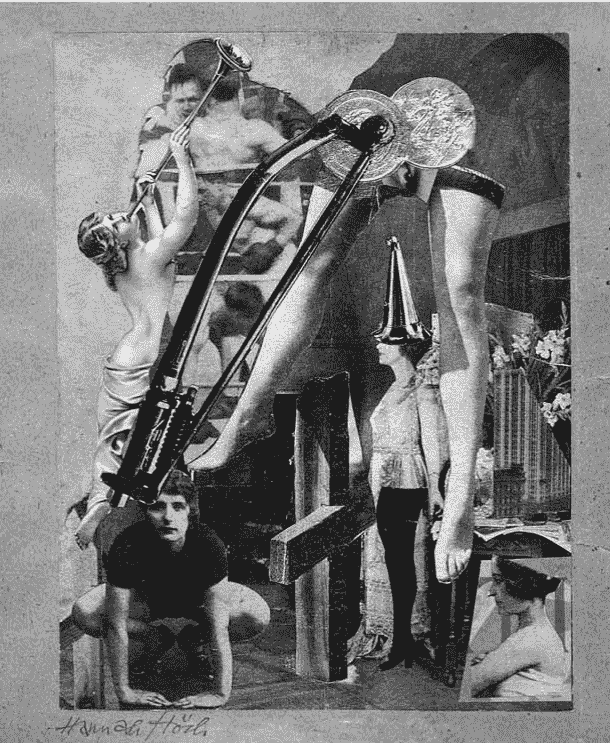

**图5.1**

汉娜·黑希，*达达-恩斯特*（*Dada-Ernst*），1920–1921年，纸上的摄影蒙太奇与拼贴，18.6 × 16.6 厘米（7 5/16 × 6 9/16 英寸）。以色列博物馆维拉和阿图罗·施瓦茨（Vera and Arturo Schwarz）收藏的达达与超现实主义艺术藏品。© 以色列博物馆，耶路撒冷。摄影：阿夫沙隆·阿维塔尔（Avshalom Avital）。

## 超现实主义与表演

正如我们所见，参与批判性游戏的艺术家和游戏制作者的趋势是，从人脑的运作开始——正是这个人脑构想并实施了战争的怪诞。大多数超现实主义游戏基于与维多利亚时代客厅游戏一样熟悉的活动——这些是室内进行的小组游戏，用于娱乐那些在新获得的闲暇时间中的上层和中产阶级成员。[^24] 但超现实主义者将活动推向了一种探索。马克斯·恩斯特（Max Ernst）的著作展示了他对闲暇时间中日常空间考察的一个方面：

> 1925年8月10日
>
> 在海滨旅馆的一个雨天，我发现自己凝视着房间的地板。我的目光变得兴奋，随后被地板的景象所迷住。有1000种深深的压痕刻在沟槽中。我决定然后探究这种痴迷的意义，并运用我的冥想和幻觉能力；我将纸张放在地板上并用黑铅摩擦，制作了一系列图画。我凝视着这些图画，惊讶地，一系列矛盾的幻觉图像在我眼前升起，层层叠叠地互相覆盖。[^25]

像恩斯特一样，作家安德烈·布勒东（André Breton）也在寻找与其过程技巧相匹配的程序和方法。布勒东1921年在维也纳与弗洛伊德的会面，坚定了他探索潜意识理论的承诺，随着时间的推移，布勒东继续发展受精神分析启发 的方法。

但无论是考察心灵还是机器，超现实主义对游戏的定义，以及发现游戏的路径，与近期游戏学者提出的严谨框架（特别是计算机游戏研究提出的框架）有着显著差异。超现实主义者首先是对方法、技巧敏感，对过程敏感——过程对于艺术实践与其成果同样基本。由超现实主义实验产生的游戏本身就是一种文化方法，通过基于规则的系统改变参与者和世界之间的关系，从而为日常生活赋予意义。超现实主义者认为，作为想象力的所在，

潜意识可以通过有条理的程序来探索——例如，通过有意识地执行或合作进行“非意识行为”。通过这些方法，艺术家能够与他们认为的创造力源泉建立联系。这种由批判性游戏、开放式实验和基于规则的系统构成的结构，强调了艺术社区的社会和智力角色。超现实主义者的实验及其有时使用的暴力和惊讶，是理解意识和文化的更大问题的关键部分。²⁶ 因此，在审视批判性游戏时，超现实主义游戏——如布罗奇（Brotchie）和古丁（Gooding）的小册子*《超现实主义游戏集》*（1995）以及罗斯蒙特（Rosemont）1998年的著作*《超现实主义女性》*中所记录的那样——值得仔细研究。这些包括基于现有厅室游戏、灵性实践、自动写作以及日益增长的桌面游戏类型的游戏。以下技术摘自超现实主义实践的历史记载。

### 自动主义

一种在无意识干扰结果的情况下自发写作或绘画的过程。大多数自动主义是文本形式的，但在超现实主义者的自动绘画使用中也会出现类似的主题，这种绘画被构想为一种加速或强化的草图过程，其中会出现惊喜和不可预测的图像。该技术也早期弗洛伊德追随者使用，作为一种通过写作者潜意识中的词语选择来理解潜意识的方法。

### 剪裁技术

正如之前在与特扎尔（Tzara）的一些达达主义著作，包括他的各种宣言相关的讨论中所述，“剪裁”是从现有写作或印刷纸页中派生的文本，随后被随机拆解或剪开，并重新组合以创造新文本。剪切和粘贴现成材料是一种颠覆性且富有创造力的超现实主义策略，具有美学、诗歌和政治含义。²⁷ 这种技术被无数语言游戏者使用，包括美国小说家凯西·阿克（Kathy Acker）和威廉·巴勒斯（William Burroughs）。

### 重组

这种技术本质上是视觉性的，使用在拼贴画中找到的图像碎片，然后重新组装成完整作品。*découpage*（切割术）技术用于从原始状态拆解图像。由于拼贴画起源于受达达主义启发的批判，它仍然是其他边缘化群体异质性（或他者性）的一种策略。如今，它是政治艺术和 outsider art（局外人艺术）的一种标准形式，例如 zine（独立出版物）文化。赫希（Höch）和豪斯曼（Hausmann）是这种形式的主要发起者。

最著名的参与式超现实主义艺术活动之一被称为法语名称 *cadavre exquis*，或“精致尸体”，得名于其产生的第一句话：“Le cadavre exquis boira le vin nouveau”（“精致的尸体将喝下新的葡萄酒”）。精致尸体是一种多人游戏，玩家决定共同创建图像或文本。每个玩家要么沿特定模式（如尸体消耗新葡萄酒的例子）创造词语，要么在纸张的折叠部分上绘制，这样当其他玩家收到他们那部分纸张时，它是折叠的，因此其他玩家无法看到之前画的内容。一些变体是保留从一个部分到下一个部分的小连接线，以便绘画可以继续，或者给下一个玩家一个单词，使构图变得无缝。图 5.2 提供了一个 20 世纪 30 年代主要艺术家合作的此类拼贴画示例。一些学者通过女权主义视角分析精致尸体，审视精致尸体“身体”（或艺术作品）的建构性和神秘性，作为一个痛苦所在的地点，无论是生理上还是心理上。作为协作作品，这些图像可以被解释为荣格“集体无意识”的表现。

### 熏烟法

在这种技术中，通过灯或蜡烛的烟雾在纸张或帆布上制作印记。熏烟法类似于算命活动，如茶叶占卜和赫尔曼·罗夏克（Hermann Rorschach）为 1921 年心理研究开发的墨迹测试。

### 液体在垂直表面上的流动

这是一种抽象技术，通过允许液体在表面流动来创建图像。虽然在反叛的达达主义和超现实主义时期，滴流画（drip-paintings）在纯艺术圈中还难以想象为“艺术”产品，但它们是挖掘潜意识的有价值过程作品。

### 你会开门吗？

如果有人敲门，你看到……一位著名的历史人物——例如艺术家或政治家——你会让他或她进来吗？*《你会开门吗？》*是一款超现实主义厅室问答游戏。如果纪尧姆·阿波利奈尔（Guillaume Apollinaire）来到门口，你会让他进来吗？贞德（Joan of Arc）呢？像这样的即时决策活动促使群体就政治、美学和伦理展开讨论，并揭示了参与者的内心运作。*《你会开门吗？》*游戏与当时流行的一款法国厅室游戏几乎相同，但重点放在超现实主义艺术家群体感兴趣的人格，或那些被认为特别荒谬的访客上。

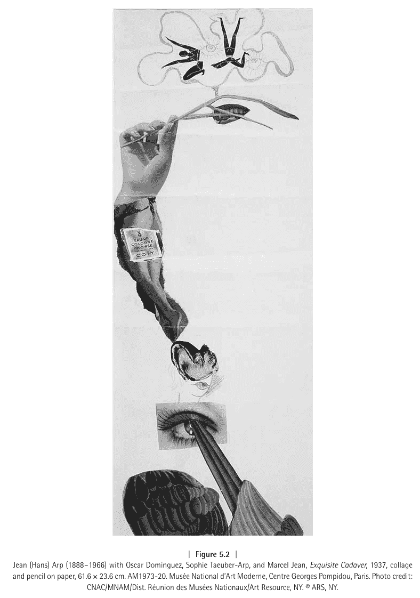

### 时间旅行者的交换会

与*《你会开门吗？》*相关，在*《时间旅行者的交换会》*中，玩家共同提出历史人物进行讨论，并思考如果有机会会送给这些历史人物什么礼物。

### 连续绘画

*Dessin successif* 翻译为“链式绘画”。在这个游戏中，每个玩家研究前一位玩家的绘画五秒钟，然后凭记忆重画它，游戏的重点在于观察绘画在链条中经过许多人手时，从第一张、中间和最后一张绘画所发生的变形。

超现实主义者开发的这些以及许多其他游戏是集体方法，每一种都提供了一个瞥见，尽管是不科学的，参与者的无意识过程。游戏旨在批判理性主义，可能是出于对战争恐怖和人类理解脆弱性的认识。再次，无意识动机和梦想是超现实主义者深入关注的领域，他们对精神病学和精神分析学的迷恋帮助将艺术家的游戏集中在抽象、突然、直觉和本能上。²⁸

### 来自表演的机会

这些过程具体是如何具有表演性的？游戏设计师能从这些表演性游戏的例子中学到什么？与其他创造方法论不同，在创造力过程中具体使用游戏代表了重大转变。超现实主义者制作游戏是为了创造艺术。游戏是一个过程——他们研究的一部分——而不仅仅是一个结果。像*精致尸体*这样的游戏（参见 1931 年*精致尸体*的例子，图 5.3）利用了偶然性和自动主义的概念，这是一系列无意识行为，表现为拥有不寻常的“思想可能性，即其汇合”。²⁹ 这种思想的汇合及其在当时的艺术家和知识分子中的集体分配，反过来创造了一种超越单个作者感知的努力，超越自我和私利，创造群体研究的产物。

在批判性游戏中，游戏的表演可以培养创造力，进而产生新的艺术形式、风格和类型。表演可能会揭示以前未知主体或形状之间的特定联系。例如，它可能帮助设计师探索排列、重复和可重复性的问题。此外，在这些游戏中，主体感和玩家的角色也受到了质疑和重新定位。而且，此外，“获胜”可能意味着体验或制作

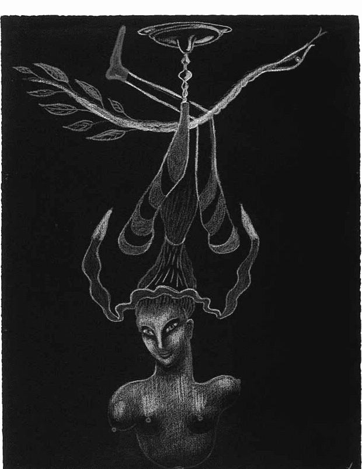

### 图 5.3

努什·埃鲁阿（Nusch Eluard，1907–1946），与欧仁·格林德尔（Eugène Grindel）、保罗·埃鲁阿（Paul Eluard）和瓦伦丁（格罗斯）·雨果（Valentine (Gross) Hugo）合作，*《精致尸体》*，1931，黑色纸上的彩色铅笔，31 × 24 厘米。AM1980–20。巴黎乔治·蓬皮杜国家现代艺术博物馆。摄影：菲利普·米歇（Philippe Migeat）。图片版权：CNAC/MNAM/Dist. 全国博物馆联合会/纽约艺术资源。

一些新的、美丽的、令人费解的或令人惊讶的事物，或者触及能够帮助体验艺术过程或神秘心智的工件或过程。在其他时候，行为纯粹是娱乐。正如布勒东在20世纪50年代所反思的：

> 如果说超现实主义中有一项活动最常被傻瓜们嘲笑，那就是我们坚持不懈地进行游戏，这可以在过去三十五年的大多数出版物中找到……从一开始，事实证明这对加强我们之间的纽带，并鼓励我们在共享欲望时产生突然的意识非常有用。此外，我们迫切希望消除主导工作和休闲、“智慧”和“愚蠢”等旧有二元对立的观念——例如行动与梦、过去与未来、理智与疯狂、高雅与低俗等等——这使我们不至于忽视严肃与非严肃（游戏）之间的二元对立。³⁰

行为也可以用来突破预期的文化规范。达利于1929年采用了“偏执狂批评”的方法论途径，提出使现实声名扫地并与外部世界决裂，从而产生“基于对迷狂现象解释性批判联想的非理性知识”。³¹ 在决定成为开明的“混淆主义者”之一后，达利支持任何能通过“系统化混淆”质疑甚至破坏家庭、祖国和宗教核心观念的事物。³² 对达利和其他人来说，偏执狂心智感知符号，但会创造额外的、新的、意外的或迷幻的即时联系，通过玩弄能指-所指关系来建立新的意义关系。这一程序，连同前文描述的其他游戏方法，可被视为超现实主义对现代艺术的核心贡献之一。

作家兼摄影师克洛德·卡宏（Claude Cahun，1894–1954）沿着类似的路线进行创作。卡宏于1932年结识了安德烈·布勒东。与其他女性艺术家一样，她是一个在处理性别复杂状态方面存在问题的运动的局外人；而且，作为一名女同性恋者，她几乎没有机会在与其他男性的关系中定义自己，这在超现实主义运动中的其他女性中并非罕见。³³ 在她的实践中，卡宏研究权力和个人/社会身份，将达利的“偏执狂批判法”策略应用于摄影和混合媒介物品拼贴。在她的写作中，卡宏具有政治色彩，倡导一种“理论/实践”方法来平等化并整合事物的制作及其研究；卡宏试图理解物体如何运作，以及工人关系在资本主义或共产主义等系统中如何运作。关于《物体》（*Objet*，1938），一件嵌入木材中的桌面大小设计元素组合，哈里斯指出，一只探究性的手势手朝着一个竖立在边缘上的睁开的眼睛移动，参考了女性生殖器。³⁴ 性别和性是卡宏作品中的重要主题。在许多项目中，她质疑二元分类，玩弄性别差异、高雅与低俗艺术、身心灵分离的概念。像许多超现实主义者一样，卡宏使用摄影来“使世界表面变得可触且神奇”。³⁵ 后来，由于她们对纳粹的抵抗而获得认可，她及其伴侣玛塞尔·穆尔（Marcel Moore，苏珊·马尔贝尔）都致力于通过角色扮演来进行身份游戏。她们相关地使用假名，进一步证明了在照片的“真实之眼”中表征如何被问题化。

卡宏使用从怪物、吸血鬼到水手和戴面具的异类人物的服装，以突出女性在自我肖像中的越轨和欲望。然而，这些图像不仅仅是呈现一种戏剧表演，也不是“描绘”某物。“它们回望。”³⁶ 它们具有照片的索引性质，通过与主体的光线连接，真实的“自我书写”，以及具有问题性性别化身体的标志指涉，为女性身体提供了超现实的“反档案”。³⁷ 卡宏对性别和权力的兴趣导致了她对对立面的研究——从佛陀到女学生，从艺伎到举重运动员。卡宏的探索推动了这些对立面的边缘，通过服装的变化（见图 5.4）暴露它们作为无效和人造的本质。在她题为“克洛德·卡宏与玛塞尔·穆尔”的摄影自传拼贴画中，作为其书籍《非大道》（*Avenues non Avenues* [因未公开而取消]）的插图，忏悔录，1930），卡宏写道：“在这个面具下还有另一个面具。我永远无法剥去所有这些脸。而在所有这些面具之下，没有‘真实’的身份。”

这些复杂的图像探索社会代码，并模仿身份的标准陈词滥调。它们揭示的与其说是成为“他者”的欲望，不如说是通过呈现对立面、消除性别之间的界限来实现一种消解区别的运动。通过混合通常构成性别化表演的服装，她将对立合并并使其变得非对立。³⁸ 卡宏对男/女性形式的结合、并置和模糊，展现了一种双重、怪诞的不安声音，并提出了其他超现实作品所遗漏的关于性意识表演的问题。³⁹ 重要的是，卡宏通过她类似“哑剧”的自画像猜谜游戏，展示了性别身份本身是如何像一场表演游戏一样被建构的，这一观点在朱迪斯·巴特后来的表演性文本中，以及菲利克斯·瓜塔里的工作中也有回响。

## 战后艺术家与游戏

创新与干预依然是20世纪中叶艺术家们的主要手段。不再关注潜意识过程，战后艺术家寻求超越客厅游戏和画廊之外的参与。他们对社会干预的特别关注对当代艺术和社会变革（如1968年法国的五月运动和美国在越南冲突期间的反战抗议）产生了重大影响。这些艺术家再次转向非传统媒介，使用海报、视频和行为来“解构”传统艺术及其传统、“高深”现代主义的主题，以及国家的权力和政治。游戏展示了对技术的特别反思，随着新技术席卷全球，战争的广泛影响——尤其是欧洲的 Holocaust 和日本的原子弹爆炸——科学的承诺以及机器可能带来（和危险）抓住了艺术界及以外的人们。寻求生活体验与文化之间有意义关系的艺术家们再次转向极端情境，以及将艺术作品带出画廊、进入非传统领域的艺术干预或“艺术行动”的表演。

日本艺术家是这类行动的特别倡导者。具体派（Gutai）运动在原子弹后的日本成立，针对20世纪关于技术和它所预示的“新社会”的关注，产生了一套特别亲密的反应。具体派是观念艺术家，他们利用当时的新颖材料和媒介，作为打破雕塑或绘画等艺术形式与事件形式之间边界的方式。以艺术行动为高潮的事件、行为表演场景和布景、创意户外活动、露营，或对流行文化的打断，艺术家们有兴趣创造难以分类的现象。1955年，具体派的创始人在大阪郊区进行为期两周的表演活动。这一严格的艺术实验旨在将艺术从神圣的大厅中带出，并将艺术作品暴露在外界元素中——在这种情况下，是字面意义上的。年轻艺术家接管了一片松林，并在日晒雨淋下举办了一场为期十三天的展览，展出画作、由废弃机械和其他非常规物体制作的巨大雕塑，以及表演。土田美智惠（Atsuko Tanaka，1932–2005），日本最重要的前卫人物之一，放出了一大片粉色泡泡糖颜色的乙烯基地，使其在风中泛起涟漪。⁴⁰ 另一位具体派成员，村上庄三（Saburo Murakami），拿了一个球，蘸上墨水，反复投向墙壁，试图通过机遇操作和随机游戏，利用速度的“感觉”来发明一种“新绘画”。据亚历山德拉·穆诺（Alexandra Munroe）称，具体（Gutai）意为“工具与身体”——因此，在许多作品中，表演和技术的元素是交织在一起的。⁴¹

事实上，具体派产生了一股非常早期的观念主义流派，特别受到广岛和长崎被毁灭的震撼，以及1950年代关于技术变革和科学的乌托邦愿景的影响。土田美智惠以创造好玩的服装作品而闻名。受大阪火车站一家药店标志的启发，土田挪用电力媒介来创造一种不断变化的，

**图 5.4**

克洛德·卡宏（出生名为 Lucy Schwob）（1894–1954），《戴面具的自画像》，约1928年，明胶银盐照片，11.7 × 9 厘米。INV996-3-2PH；INV9101。南特市立美术馆，法国。摄影：热拉尔·比奥。图片版权：法国国家博物馆联合组/Art Resource，纽约。

## 技术驱动服装

她的服装作品*《电动礼服》*（1956年）由闪烁的霓虹灯管组成。从物件到装置再到绘画，她的作品深受技术影响，包含了原理图和电缆，以此作为对战后日本快速工业化的评注。*《铃》*（1955年）是一件声音装置，通过一排依次鸣响的铃铛来界定建筑边界。田中爱子还通过运用时尚和服装来参与消费文化，尤其是她所谓的“进化中的服装”。“进化的服装”是一个具有互动性和开放结局的游戏，构建在“无限变化”的边界之内。随着服装随时间改变，它们将日常生活暗示为一种新的游戏安排，批判了时尚产业、其对女性身体的态度、设计的自上而下性质以及其不断追求销售增长的驱动力（这未必有利于消费者）。[32]

田中爱子的作品包括绘画、雕塑、表演和装置。田中的绘画通常是在画布铺在地板上时，以具象派艺术家典型的动作性笔触创作的（具象派意为“具身体验”）。据说她对环形图案（见图 5.5）的兴趣是她对*《电动礼服》*中表现的兴趣的延续。这些灯泡涂有原色，绘画也典型地展现了多彩的同心圆，仿佛灯泡悬挂在画布之上。

具象派对材料、地点和身体性的探索，以及对正式展览适当角色的关切，将超现实主义的基于过程的探索理念带入了作品本身的实际产物中。他们不是在幕后利用游戏来开发固定的艺术品，而是创造了本身就是游戏的活动和物件。具象派艺术家既非高雅艺术也非戏服，也不仅仅是发明创造，他们通过在全球语境下对表演和表演性物件的投入，推动了艺术批判能力的扩展，而在这一语境中，大规模的战争回响着早前的战争。

再次强调，他们的动力来自生活体验。二战中日本的经历给具象派留下了一系列具体的问题。具象派艺术家与其说在探索潜意识，不如说更接近达达主义者，因为战争的恐怖使传统权威和整个生活方式受到质疑。在日本，社会结构和文化规范因法西斯主义、战争和现代化而受到根本动摇。具象派艺术家怀有特定的信念，致力于恢复或灌输孩童般的好奇心以及对公平社会结构的开放态度。这些艺术家对新兴的商业主义和资本主义发表评论，并允许自己痴迷于创新和新奇事物。正如一位作家所言：“具象派不仅仅是一种艺术圈策略，更是一种重生之道。”[43] 从这种视角来看，田中爱子的灯光礼服是“现代亚洲城市的象征”。[44] 在批判性游戏的传统中，它也是一个转变的场所。[45]

# 图 5.5

田中爱子（日本，二十世纪），*《 wor》*，1966年，布面油画。新罕布什尔州汉诺威达特茅斯学院胡德美术馆；通过 Julia L. Whittier Fund 购藏。

中冈康博，田中的合作伙伴，常被视为具象派的领袖。中冈发明了一种机器人——“遥控绘画机”，它会自动喷洒颜料，使得他即使不在场也能创作艺术品，尤其是在他忙于在工作室外组织具象派活动的忙碌日子里。艺术家诙谐地回忆了这台机器产生的第一个实验结果：一个因长时间工作而变黑的粘稠混乱。这件作品是在中冈睡觉时创作的，当时是他销量最高的作品。[46] 当20世纪50年代承诺一个自动化家居生活方式，配备洗衣机、汽车和新的自清洁灶具时，中冈的绘画机戏谑地将创造“高雅艺术”的行为降低为家用电器的任务。[47] 中冈超越了抽象表现主义的关切，甚至超越了杰克逊·波洛克对身体动作的依赖，完全用机器取代了身体。作为一种受规则约束的自动化作品，中冈实际上为艺术创作设立了一个游戏空间。

在日本的艺术运动中，漫画和动画运动继续影响着国际艺术和文化。这些形式诞生于1945年，当时手冢治虫医生受到西方——尤其是美国——电影涌入的启发，例如华特迪士尼制作公司出品的电影。手冢采用了一种类似迪士尼的艺术风格，创作出拥有夸张的大眼睛、小嘴巴和小鼻子的角色面部。手冢漫画中唯一的文字是角色对话，赋予其页面一种“电影感”。这种风格变得极其流行。如今，使用相同风格的动画电影在国际上极其受欢迎；日本的漫画市场每年收入约47亿美元，广告和游戏紧随成功风格之后。[48] 艺术家村上隆（生于1963年），创作雕塑、漫画和充气装置，持有对流行 playful 文化图标和漫画的如下看法：“当我考虑日本文化是什么样时，答案是它全是亚文化。因此，艺术是不必要的。”[49] 在承认游戏和流行文化时，村上隆承认许多作品变得静态化和物化。他指出：“我表达绝望……如果我的艺术看起来积极和愉快，我会怀疑我的艺术是否被当代艺术界接受。”此外：“我的艺术不是波普艺术。它是被歧视者斗争的记录。”[50] 这样，村上隆像许多从动荡的历史地点和情境中出现的当代艺术家一样，展示了游戏、技术和快速文化变化的政治如何被艺术家质疑。由于日本是漫画游戏艺术的主要生产者，并且是计算机游戏的 prolific 创造者，日本艺术风格的批判性质应当被注意到，尽管很难做到公正周全。只需说，虽然漫画可以被读作具有高度性别偏见，并以激进的方式融合差异场所（例如，人机角色，人兽身份），但漫画所依托的幻想系统产生了一种令人目眩的批判性游戏形式。押井守著名的*《攻壳机动队》*电影系列（1995, 2004）是一个很好的例子，探讨了身体增强的“人类”边界。*《红辣椒》*（2006）是另一部探讨意识上传的作品。[51] 然而，在电影之外，漫画和动画风格证明既是批判性的也是 playful 的，正如奈良志保的作品所示。

## 美国的游戏

在美国，1960年代的概念艺术家在多个层面上参与到过程作为重新思考权威、政治和文化现状观念的想法中。艺术家们创造“情境”并执行完整的艺术行动指南。像游戏一样，这些活动的许多都包含精确且不可改变的规则，参与者必须接受这些规则才能参与作品。[52] 艾伦·卡普罗（1927–2006）将规则制作成事件乐谱（或指示），而艺术家索尔·勒维特（1928–2007）为实际上构成作品本身的作品创造“计划”。[53] 勒维特的计划通常是艺术作品的基基本原则集，例如墙面绘画。正如我在文章中所指出的，虽然概念艺术使用其自身的逻辑策略来执行，但“概念艺术并不一定是逻辑的”；[54]“与预设计划一起工作是一种避免主观性的方式。它也免除了依次设计每件作品的必要性。计划将设计作品。一些计划需要数百万种变化，而另一些则需要有限的数量，但两者都是有限的。”

对于勒维特来说，作为指示的艺术创作是一个具有具体规则和结果的 performative 游戏。虽然勒维特没有称他的作品为游戏，但他的规则集、过程和奖励展开的方式与游戏非常相似。像讨论过的其他批判性游戏方法一样，勒维特为各种项目制定的计划对抗主观性和操纵的观念，随着作品的显现而运行到其自身的逻辑结论。不断消除主观性的驱动力是有趣的，因为在很多方面，游戏通过创造主体性而蓬勃发展。还有菲利克斯·加塔利对“主体性问题基础的重新奠基”以及甚至是“局部”主体性集合的呼吁的提醒。无论他们的信仰如何，对批判性游戏感兴趣的人开始创造“前个人、复调、集体和机器”的主体性。[55] 通过这样做，他们也评论了更大的意识形态和政治情境。随着技术成为战后美国文化中当代生活日益重要且咄咄逼人的元素，艺术家通过他们有趣的兴趣于为日常生活编写新规则来测试新的边界。

与雕塑家和表演者克拉斯·奥登堡（1929–）一起，概念艺术家艾伦·卡普罗（Allan Kaprow）举办了混合日常现实和艺术作品的活动或“偶发艺术”，并有多个参与者参与。迪克·希金斯（1938–1998）写关于媒体艺术界的融合以及他在《中介媒体声明》（1966年）中的观点，该观点认为混合形式的“中介媒体”代表了大众文化中一种将现场性融入其中并有望革新艺术与生活的根本趋势。作为一个典型案例，在卡普罗（Kaprow）的《*六部分的18个行动*》（1959年）中，他召集的是“参与者”而非仅仅是“观众”。参与者被给予类似游戏规则的操作指南，指示他们如何与环境互动，通常是从一个房间移动到另一个房间，并弯曲身体处于不舒服的姿势，以不同的方式体验特定的地点或事件。同年稍晚时候，艺术家雷德·格鲁姆斯（Red Grooms）在他的工作室——德尔安西街博物馆（Delancey Street Museum）上演了*燃烧的建筑物*。在这部十分钟的作品中，格鲁姆斯饰演“浆糊人”，一个正在逃命的纵火狂。这些上演相当成功。卡普罗在他的一封通信《行动指导原则（无题）》（1966年）中详细阐述了这些行动，该通信主张行动允许艺术表现为一个持续进行的工作。卡普罗的指导原则反映了激发公众参与艺术和批判性互动的愿望，承认艺术的社会角色，并强调艺术实践和艺术消费可以且应该被拉近这一理念。半匿名艺术家与作为参与者的“大众”的合作，在1960年代和1970年代上演的行动和参与式表演中尤为重要。

行动也是其他艺术运动的先驱，这些运动的特点是消解了艺术界主动与被动之间的二元对立，以及日常生活的审美化。随着对新游戏重点的强调，日常物品的重要性持续增长。德国雕塑家兼表演者约瑟夫·博伊斯（Joseph Beuys，1921–1986）在一件作品中使用了放在钢琴上的小杂耍鼓手，这标志着通过日常物品的使用和非艺术表演情境的转变。通过立陶宛出生的乔治·马丘纳斯（George Maciunas）组织的活动，激浪派（Fluxus）艺术家们绕过了博物馆和画廊体系，转而采用灵活的表演、电影、现成品风格的套件和出版发行。就像战后团体具体（Gutai）、科布拉（Cobra）和国际情境主义（Situationist International）一样，激浪派是一个反应性群体，结合了未来主义和荒诞派戏剧的历史元素、达达主义的无理取闹，以及作曲家约翰·凯奇（John Cage）所宣称的对机遇和游戏的兴趣。激浪派作品是短暂的，参与日常行为，而且最重要的是有趣。在马丘纳斯1960年代中期的一份激浪派宣言中，他陈述道：“激浪派艺术-娱乐是后卫部队，不抱任何参与‘争先恐后’与先锋派竞争的企图或冲动。它追求简单自然事件的单结构和非戏剧性特质，即游戏或笑话。它是斯派克·琼斯（Spike Jones）滑稽表演、笑话、儿童游戏和杜尚（Duchamp）的融合。”⁵⁸

马丘纳斯的目标是创造一种“非专业、非寄生、非精英”的艺术，在这种艺术中，任何事物都可以是艺术，任何人都可以创作。在1965年的宣言中，马丘纳斯继续宣称：“这种替代性的艺术-娱乐必须简单、有趣、关注微不足道的事物，并且没有商品或制度价值。”马丘纳斯持续尝试“恶搞”事件。例如，他创作了一份乐谱，要求将钉子钉入钢琴的每个琴键上。⁵⁹ 1961年，他开始在一个重要的纽约画廊——他的工作室——组织临时的表演和音乐会。这些活动迅速发展为更大规模的国际荒诞派表演艺术节。在其中一个艺术节上，韩国出生的艺术家白南准（Nam June Paik，1932–2020）表演了另一位艺术家的乐谱，他将头发浸入一碗墨水中，然后用头发作画，直到表演结束：

- 画一条直线并沿着它走。⁶⁰

生驹泰史（Takehisa Kosugi，生于1938年），一位出生于东京的作曲家，在他的事件作品中使用了日常材料；1969年，他共同创立了音乐团体“ Taj Mahal Travellers”，该乐团在全球各地演出。1972年，他受邀在欧洲的激浪派活动中表演，日本出生的艺术家宫本美子（Mieko [Chieko] Shiomi）也受到了同样的邀请。如前所述，从1960年代起，激浪派艺术家以事件和激浪套件或物体（参见斋藤的*心盒*，图5.6）的形式创作了数百种游戏。激浪派艺术家还聚集在“激浪派艺术节”或Fluxfests上，这些艺术节由马丘纳斯于1962年发起，从威斯巴登州博物馆的音乐会开始，哥本哈根有六场音乐会，巴黎有七场。这些表演主要是音乐作品，有些由动物谱写。有用于嘴唇、泥巴、瓶子、鹅卵石、气球、梯子和小提琴的激浪派音乐，以及需要十二架钢琴的钢琴作品。次年（1963年），艺术节扩展到杜塞尔多夫、阿姆斯特丹、海牙和尼斯，并发展为包含街头事件。游戏和游戏类器具随之而来。1964年，激浪派活动包含乒乓球和羽毛球，1966年，则将粘性网撒向跳舞的客人。1970年在新泽西州道格拉斯学院举行的一次Fluxfest，以高跷足球、气球标枪和用中心有大孔的球拍进行的乒乓球等体育游戏为特色。⁶¹ 残障赛跑游戏鼓励玩家一边喝伏特加、吃燕麦粥和冰淇淋、磨咖啡、大喊、计数、写字和演奏乐器，一边跑步。⁶² 这种荒诞的事件与激浪派一贯强调的微不足道活动、游戏或恶搞相符。

与杜尚（Duchamp）不同，杜尚会在任何事物上签名，从墨样品到广告，称之为“艺术”，而激浪派艺术家收集普通物品，将它们留置为单纯的杂乱，有时在街道或人行道中间重新语境化这些物品，作为社会互动的手段。其他物品则被放置在画廊中间，在那里它们可以充当一种俏皮的惊喜。⁶³

## 第5章

| 图 5.6 |
| :--- |
| 斋藤隆子（Takako Saito）（日本，生于1929年），*心盒*，1965年，纸本。新罕布什尔州汉诺威达特茅斯学院胡德艺术博物馆；阿利森·诺尔斯（Alison Knowles）捐赠。 |

美国作曲家约翰·凯奇（John Cage）自1930年代起就一直在探索规则与美学之间的对话。1952年8月29日，凯奇通过发起观众与引导审美体验的规则之间如今已闻名的对话，继续了这一探索。在*4’33’’*（*4分33秒*）的首演中，大卫·塔德（David Tudor）坐在钢琴前，当作品开始时，他没有弹奏任何音符，并在适当的时候合上键盘盖，以指示*4’33’’*中每一个“沉默”乐章。在剥夺观众“音乐”的行为中，该作品要求观众去聆听，将聆听体验转化为一种听众通过周围现场声音和噪音主动创作自己的作曲的体验。与凯奇的其他作品一样，这部作品涉及机遇操作，并将创作过程的权威重新指向参与者，彻底改变了作曲家和听众的社会角色。在一篇主旨演讲中，凯奇说：“我的*变化音乐*，通过*易经*机遇操作创作，我要从结构转向过程，从作为拥有各个部分的对象的音乐，转向没有开始、中间或结束的音乐，音乐如天气……舞蹈并不由我的音乐伴奏支持。音乐和舞蹈是独立的，但共存。”⁶⁴

凯奇过程的开放性体现在许多激浪派艺术家的哲学中。阿利森·诺尔斯（Alison Knowles）说：“我从不希望艺术是静止的、完成的。我希望它能够供别人去做别的事情……[做]我无法想到的事情。”⁶⁵ 乐谱或说明的使用强调了激浪派游戏中极其枯燥的活动。但仅仅在日常生活行为周围画一个胡伊宁（Huizingian）魔法圈，就将其转化为艺术行为、游戏，并将其置于幻想领域。⁶⁶ 诺尔斯涉及普通活动的表演成为1960年代和1970年代表演艺术的标志。她最著名的作品之一，《*相同的午餐*》（1971年），是一场吃三明治的表演。记录在*相同午餐日记*（图5.7）中，该作品由一系列实际上构成作品本身的表演组成。相同的午餐是烤黑麦面包上的金枪鱼三明治，配有生菜和黄油（无蛋黄酱），以及一大杯酪乳或一杯汤。午餐在每周的许多天里由不同的人在同一地点和大致相同的时间（午餐时间）食用。每顿午餐的记录以多种格式提供。这件作品成功打破了观众、艺术家、艺术品和日常生活之间的界限。

斯宾塞（Spencer）指出，“游戏和艺术是相同的活动，因为两者都不以直接方式颠覆有利于生命的过程，也不指向间接利益，近期终点就是唯一的终点。”⁶⁷ 这些艺术家的工作表明，通过参与式游戏进行颠覆性行为具有特定的力量。虽然诺尔斯的作品在此书前面已经讨论过，但在这里指出她追求

| 图 5.7 |
|---| 
| 艾莉森·诺尔斯（美国，生于1933年），《与乔治·马丘纳斯的相同午餐》，1963年，帆布丝网印刷。汉诺威，新罕布什尔州，达特茅斯学院胡德美术馆；艺术家捐赠。 |

这是一条关于随机性和偶然性如何影响普通甚至可以说平凡物体的研究脉络。在记录其题为*面包与水*的项目时，诺尔斯分析了自制面包上的裂纹，并将它们与地图册中的河流进行对照，创作了这些相似性的印刷品。诺尔斯在这些作品中引入了地理和生态信息，并将其与诗歌并置，诗歌与画作相互交织。68

再次强调，在这些例子中需要注意的是，诺尔斯的诗歌和其他文字是如何将过程置于作品的其他方面之上，或者换言之，构成了某种批判性游戏的形式。正如法国理论家亨利·列斐伏尔所问：“超现实、非凡、令人惊讶甚至魔幻的事物，难道不也是现实的一部分吗？为什么‘日常性’的概念不能揭示平凡中的非凡？”69 普通材料（如豆子或面包）的魔幻转变，指向了对时间的观念以及通过戏谑地重新定位日常事物所能实现的转化行为。它如何将时间和劳动归还给我们对物体的体验——无论是鞋底还是豆子和纸张——这一点部分被诺尔斯的陈述所捕捉：“众所周知，花在鞋子上的时间永远不会被浪费”；同时剥离物体的原有功能，戏谑地将物体迁移到其自身的魔圈之中。${}^{20}$ 诺尔斯的作品，如同其他“激浪”（Fluxus）艺术家的一样，变得从根本上具有政治性，且出人意料地微妙。虽然达达主义和其他团体质疑社会规范、政治和艺术实践，聚焦于“反艺术”的反美学，但“激浪”作为一种过程和审美的实践应运而生，这些主题最终反映了“激浪”核心意识形态关于时间和存在的主张。

## 新规则

游戏设计师可能会对萨伦和齐默曼关于游戏规则显性和隐性的理论熟悉。${}^{21}$ 在许多“激浪”艺术家的作品中，我们可以推导出这两个概念的批判性版本。显性规则是由说明或乐谱中的阐述给出的——例如，“做一个三明治”。显性规则是明显的，或写在规则集中的。显性规则“跟随一条线”是一个直接的命令：一个显性规则。然而，“激浪”作品之美在于围绕显性规则的隐性规则。玩家可能会问：“跟随一条线到哪里？是谁的线？它从哪里来？我为什么要跟随那条线？”甚至：“那条线很难看”或“我不喜欢那条线去向的地方”。解决这些问题需要制定隐性规则。隐性规则考虑游戏实际上是如何被玩的：玩家在游戏后会握手吗？获胜者是否克制不炫耀，或不透露自己曾在诈唬？隐性规则产生于玩家必须协商从日常行动进入游戏、进入魔圈的那些时刻，在那里，希望玩家会配合玩笑，真正获得一种新的、不寻常的或令人愉悦的“感官提升”体验。“激浪”体现了定义胡伊青加*游戏的人*（Homo Ludens）中至关重要魔圈的意识转变，特别是因为它融入了如此多的日常事物。

隐性规则体系的大师之一，大野洋子非常谨慎地设置她的魔圈，在她的许多表演中玩弄危险和风险。正如第4章讨论的她的*指示绘画*，大野洋子的表演经过精心编排，并要求观众参与。

她的作品*切件*（Cut Piece）最初于1964年在日本表演。大野洋子于1965年在纽约卡内基音乐厅再次表演了它。在这件作品中，大野洋子静止地坐在舞台上，剪刀放在附近。观众成员逐一接近艺术家，剪下她衣服的一片。在这里，我们或许可以回想起具体派（Gutai）艺术家田中的重构服装作品。大野洋子*切件*中观众参与的程度差异巨大。一些观众疯狂地蜂拥上来进行剪切。另一些则在接近时犹豫而恭敬。无论回应风格如何，在这种开放、类似游戏的系统中的互动揭示了人类行为的迷人方面。“我只是参与的一部分，”大野洋子在1968年的一次采访中指出。“所以我试图做的是通过向水中投掷鹅卵石并创造涟漪来使事情发生。这就像启动一个好的运动。我不想控制涟漪。”艺术家明确地设计她的作品以创造参与情境。大野洋子对艺术家缺乏控制的承诺是一种特别行动主义立场，因为它挑战了艺术家作为天才的传统观念。正如琳达·诺赫林在1980年代观察到的，艺术“天才”的想法被认为是一种嵌入伟大艺术家织体中的必然、神秘力量。73

通过关注日常游戏的愉悦、规则的构建以及游戏背后的逻辑，对于大多数公众而言，感知行动为“艺术”需要一种意识的转变。然而，批判性游戏为玩家颠覆开辟了明显的自由空间。虽然与1960年代和1970年代更具严肃转向的其他行动主义艺术有关，“激浪”将批判性游戏作为事件设计的核心准则保留下来。在随后的年份中，批判性表演在艺术家/活动家的事件中保持核心地位，从游击队小组“人民戏剧”（El Teatro Campesino）的街头戏剧表演，到由阿米里·巴拉（Amiri Baraka）领导的农民戏剧“黑人革命剧场”（BRT）74，到媒体干预如“纸老虎电视”（Paper Tiger TV）75。批判性游戏的形态继续拥有扰乱日常活动的力量。

## 进一步的践行

主要在巴黎工作的波兰艺术家安德烈·卡德雷（Andrè Cadere，1934–1978）使用游戏方法创造了一百八十件“表演性”雕塑，或木杖，称为“Barres de Bois”（木条）。从远处看，这些手绘的独立纺锤，坐在杆子上，看起来是条纹状的。这些木条部分参考了游戏，因为它们是通过数学方式产生的，并在颜色和排列的操作中构成了一种语言。它们特殊的编码指令似乎唤起了策略。研究卡德雷作品的学者詹姆斯·海德（James Hyde）指出：“卡德雷将他的作品视为对话的发起者——打开对话的道具。”76 这种意图与木条的形式模式相一致：正如丹尼尔·伯恩鲍姆（Daniel Birnbaum）所指出，他标志性的*barres de bois rond*（圆木条）的“配色方案基于从数学排列中派生的代码，卡德雷在每种情况下引入了单一错误。77

卡德雷不仅为他的作品制定规则，还在其中包含了颠覆和对其自身系统的偏离。玩着一个错配和错误的游戏，卡德雷引诱参与者注意、识别并颠覆或扰乱那个在肉眼看来颜色均匀、但远处看去似乎杂乱无章的系统。根据评论家詹姆斯·海德的说法，精确与错误的混合，“引诱人们破译其逻辑，但即使对于这件简单的作品，几乎不可能掌握模式。然而，在尝试过程中，观众与作品开启了对话。”78

这些木条主要用于表演。卡德雷会带着这些看起来像传统手杖甚至魔杖的纺锤，参加活动和艺术画廊，记录每一个展开的事件。他的打字记录包括出现的时间、日期和地点。表演对卡德雷的作品至关重要，当他从一个事件漫步到另一个事件时，他的干预是精心计划的。他提前宣布他的漫步，甚至对其他艺术家的开幕式进行干扰性的访问。有证据表明，卡德雷的手杖偶尔会被没收。为了防止他的工作反复受到阻碍，他开始在口袋里携带迷你棒。有时，这些“寄生虫”会神秘地出现在画廊地板上。79 在接受采访时，卡德雷回避经济或政治批判：“我对人们的反应不感兴趣，我也不需要他们的反应。”以这种方式，他的作品抹去了实际的表演或干预，转而专注于作品“变得可见”的过程。80 这就像卡德雷带来了游戏目标，或安全区，互动者必须从那里弄清楚游戏。因此，这里展示了几个层次的批判性游戏。卡德雷的意图是鼓励观众选择与他（那位他扰乱了开幕式的艺术家）以及与其他人互动的方式。手杖的意外出现及随后的对话，在公共空间中与公众和艺术界创造了类似游戏的互动。

其他表演性作品与游戏在流行文化中扮演的角色联系更为紧密。一个例子基于日本游戏*将棋*（shogi，此处原文重复为shogi），这是国际象棋的一种变体。棋盘，或*shogi ban*，由九乘九的网格组成，包含二十个游戏棋子。将棋在西方不像在日本那样流行，但该游戏对于理论化批判性游戏特别重要，因为其*重演*方式。

在某些节日或庆典上，玩人类尺寸的或*ningen*（人形）将棋是一种习俗，尤其是在新田（Tendo）市，那里制作了数量最多的棋盘和棋子（见图 5.8）。当代的cos-play（角色扮演）在许多世界各地的活动中进行，包括人形将棋；cos-play参与者装扮成他们最喜欢的卡通角色、游戏对象或化身。许多这些节日也设有将棋cos-play。美国的动漫大会*Yomucon*是年度cos-play将棋游戏的著名地点之一。

将将棋这样的游戏移入物理世界做了两件事：首先，它将传统的棋盘游戏转变为一种表演行为。其次，游戏变成一个社交事件，拥有多个参与者、促进者和观众。这些方面

| 表演性游戏和物体 |

| --- |

山形县传统历史茶道节期间举行的人类将棋，春季的黑粉相映的樱花。© 山形县/© 国家旅游局。

将将棋棋盘翻译为包含人类参与的形式，这一过程涉及重新包装、重演和改写，可能会启发设计师在现实生活中创建游戏的重演场景，甚至创作出具有更强介入能力或能动性的游戏。

## 战术与介入

安妮-玛丽·施莱纳（Anne-Marie Schleiner）的基于计算机的项目让用户看到，基于计算机的社区和游戏的设计具有政治后果。施莱纳揭示了由系统强加的结构以及用户在这些系统中被允许做什么，这些是重要的概念建构，需要批判。在她的创作作品中，她投入大量精力探索在线角色，重新构建第一人称射击风格的游戏，如*反恐精英*（*Counter Strike*），并对或破坏网络化计算机游戏体验，如*美国陆军*（*America’s Army*）。

### 图 5.9

安妮-玛丽·施莱纳的《OUT》（《出局》）。

施莱纳2004年的作品《城市地形行动（OUT）：现场无线游戏城市介入》，使用《美国陆军》现有的游戏环境作为表演场地，该游戏由美国军方委托制作，旨在吸引年轻美国男性入伍。⁸¹ 《美国陆军》作为一种意识形态工具、一种社会软件环境，以及一种以电子和纸质形式向玩家营销招募材料的手段而发挥作用。该游戏的下载和游玩是免费的。它拥有一大批以男性为主的玩家，其中包括大量右翼基督徒群体。

艺术介入作品《OUT》的标题取自“MOUT”，即“城市地形军事行动”的术语。施莱纳选择不玩这个游戏，而是与游戏进行互动（见图5.9），她配备了移动互联网连接、一辆自行车、一个电池供电的视频投影仪、一支由玩家和技术人员组成的团队，以及一台笔记本电脑。从一个地点移动到另一个地点，施莱纳和她的团队将《美国陆军》作为一场现场城市表演进行游玩，在2004年共和党全国代表大会期间，将屏幕上的动作投影到纽约的建筑和街道上。该小组介入了《美国陆军》常规玩家的在线聚会，并在游戏空间和物理城市空间中讨论反战和反军观点。表演者认为施莱纳的《OUT》是在在线游戏和城市的“公共”空间中的艺术介入，正如施莱纳所写：“让共和党人走出纽约。让美国走出伊拉克和中东。无论来源为何（右翼渴望石油的美国资本家或富裕的伊斯兰原教旨主义者），让全球军事主义和暴力升级远离平民生活。让美国陆军和五角大楼的计算机游戏开发者远离青春期前[原文如此]玩家的思想。”⁸²

表演游戏可以作为一种批判框架。作为介入，它们是一个活跃的过程，是一种情境场景，产生的效果不仅仅是一个“积极读者”。这种效果类似于巴特的作者概念，或他所称的书写者：“现代书写者伴随着文本同时诞生，绝不具备先于或超越书写的存在，并非以书为谓语的无主体；没有言语行为之外的时间，每个文本都永恒地在此时此地被书写。”⁸³ 游戏代表了这样一种表演文本，随着它们的展开，模糊了作者身份和意义的创造。此外，表演的流动性以及文本的同时阅读和创作与介入主义女性艺术实践有着深厚的联系。

施莱纳在她的策展论文《破解迷宫》中论证道：“许多艺术家、艺术评论家、新媒介评论家和理论家都对游戏和游戏式交互性表示轻视，事实上，将交互计算机艺术作品描述为‘太像游戏’是一种常见的贬义词。但考虑到计算机游戏在年轻一代中日益增长的人气，甚至以牺牲电视为代价，忽视游戏文化的传播似乎是危险的。”⁸⁴ 流行文化（特别是游戏）与艺术之间的紧张关系是一个重要但或许只是暂时的现象，因为从伦敦的巴比肯画廊到惠特尼美国艺术博物馆，二十世纪的博物馆和画廊已经展示过艺术家创作的计算机游戏。⁸⁵ 艺术家将游戏作为表现性表演类型的挪用，可以允许对流行娱乐形式和宣传进行批判性审视。施莱纳对通过游戏进行行动主义承诺以及她在大尺度、公共空间中对游戏的使用，呈现了一种推动社会变革的有力方法。

## 表演反抗

坦雅·奥斯特基奇（Tanja Ostojic，1972-）是一位克罗地亚艺术家，她多样的表演作品包括《个人空间》（*Personal Space*，1996），探索身体的感知状态，以及《白底黑方块》（*Black Square on White*，2001），艺术家剃掉身体毛发以匹配俄罗斯至上主义卡济米尔·马列维奇1915年的画作《黑方块》。2001年，表演作品《我将成为你的天使》（*I’ll Be Your Angel*）引起了人们对艺术界运作方式的关注。在这件作品中，艺术家一直尾随2001年威尼斯双年展的策展人，全程对他报以愉快的微笑。在这部作品和其他作品中，奥斯特基奇利用她的身体将自己置于权力关系中，从艺术界的强势男性形象到国际公民身份，质疑公共和社会等级制度，艺术中对女性身体的古老消费，以及公众与艺术家之间的复杂关系。

她最重要的表演游戏作品《寻找持欧盟护照的丈夫》（*Looking for a Husband with an EU Passport*），持续时间为2000年至2005年，始于一则在线广告——奥斯特基奇确实发布了寻找持欧盟护照丈夫的广告。身为克罗地亚人，并探究欧洲国家之间的边界跨越，奥斯特基奇试图逾越非欧盟护照固有的限制。随后她假设，欧盟成员歧视非欧盟国家的人，特别是巴尔干国家和东欧。奥斯特基奇将该作品的时间线描述如下：

> 2001年，我安排我们在贝尔格莱德当代艺术博物馆前田野的首次会面作为一场公共表演。一个月后，我们在新贝尔格莱德正式结婚。凭借国际婚姻证书和其他必需文件，我申请了签证。两个月后，我获得了一个仅限三个月的一次性德国家庭团聚签证，因此我搬到了杜塞尔多夫，在那里我正式居住了三年半。2005年春，我的三年许可到期，当局没有授予我永久居留许可，而是只授予了我两年签证。在那之后，我和K. G. 离婚了，并在2005年7月1日柏林35号画廊我的“融合项目办公室”装置开幕之际，我组织了一场“离婚派对”。⁸⁶

这件作品具有一种游戏般的特质，其中确立了规则，满足了条件，并克服了挑战。奥斯特基奇会见了选定的回应者，德国艺术家克莱门斯·高夫（Klemens Golf），他们的互动导致了个人交流，并最终导致了他们的婚礼。该作品通过角色扮演，探索移民的细节以及异性亲密关系的发展。在这部作品中，奥斯特基奇重新定位了“物理”身体及其在社会环境中的参与，挑战了身份政治复杂世界中的公共和私人等级制度。

奥斯特基奇对边界、物质性、国籍和亲密关系的批判性探索，推动了行动主义原则以及全球化及其个人体验影响的形成。正如著名女性学者玛丽亚·费尔南德斯（María Fernández）在对欧洲中心主义政治艺术实践的广泛批判中所论证的，许多涉及批判性方法（如赛博女性主义运动）的人只是回避了……问题

...在此话语中，种族、语言以及其他的歷史和物质特殊性。如果像 Ostojic 这样的国际工作意味着集体行动作为一种战术在全球 activism 中浮现，那么艺术干预的原始目标就更容易实现。

在一个日益由边界、移民和流动所定义的世界里，批判性游戏在表演及更广泛的表演性媒体中扮演了重要角色。基于事件、表演性和基于规则的作品所具有的强烈政治和乌托邦色彩，非常适合应对边缘化群体的关切。87 批判性游戏策略也在战术媒体团体的方法中占据重要地位。当代政治艺术实践不断自我更新，并从干预主义理论和实践的融合中涌现。激进的艺术与技术集体——批判艺术集体（Critical Art Ensemble，简称 CAE）就是这样一个团体。CAE 使用与 20 世纪法国理论家 Michel de Certeau 所描述的类似日常抵抗战术，来审查和重构消费文化。88 CAE 由匿名和已知的成员组成，并在国际各地的场所进行干预和破坏。该团体主要依靠情境主义风格的互动，这些互动因其匿名性、意外性、混合署名和简洁性而受到重视。89 CAE 实践者旨在惊呆他们的观众，以引发对生物技术、新媒体和电脑文化各个方面的广泛批判。大多数作品在城市广场、会议和街角等公共场所上演。这些艺术家通过使用生物识别设备和计算系统等新科技，参与公众互动。

被称为“The Yes Men”的激进艺术二人组合声称：“同意进入商业的强化区域，提出问题，然后偷偷将他们恶作剧的故事带出去，以提供对商业幕后世界的公众一瞥，同时也参与政治颠覆和破坏。换言之，The Yes Men 是团队玩家……但他们为对手队打球。”90 换一种说法，The Yes Men 假扮企业和政治领袖，即他们认为的罪犯个人或团体，以公开羞辱他们。91 以 Mike Bonanno 和 Andy Bichlbaum 的名字行事，这对组合因伪装成埃克森美孚（Exxon Mobil）、杜邦（Dow Chemical）和世界贸易组织（WTO）的代表而闻名。在获得进入企业活动的权限后，The Yes Men 破坏年度会议、股东演讲和电视露面，制造媒体奇观，批判企业和政治权力的核心。例如，在 2006 年，这对组合伪装成 WTO 代表，提议“非洲的奴隶制”。在 2004 年，The Yes Men 伪装成杜邦代表接受 BBC 现场电视采访。一旦播出，Bichlbaum 宣布杜邦将承担 1984 年印度博帕尔化学灾难的全责。该声明被接受为真实，并引发了一波媒体调查风暴，迫使杜邦一再声明，尽管博帕尔事故造成了巨大的破坏，但公司没有这样的计划来承担责任或进行赔偿。The Yes Men 针对那些“将利润置于其他一切之上的领袖和大公司”。92 在 2007 年针对埃克森的恶作剧中，发言者提议，尽管石油开采实践对环境的危害越来越大，增加了全球灾难的可能性，石油工业可以通过将数十亿死亡人口转化为石油来“保持燃料流动”。由 Andy Bichlbaum 扮演的代表“Shepard Wolff”描述了一种新技术，可以将即将死于气候灾难的数千具尸体转化为一种名为“Vivoleum”的新型埃克森石油产品。该过程的 3D 动画使 Vivoleum 的玩笑变得可信。埃克森代表“Florian Osenberg”——实际上是 The Yes Men 的 Mike Bonanno——指出，“随着化石燃料的增加，灾难的可能性也随之增加，但这意味着 Vivoleum 的原料更多”，因为来自尸体的燃料“将为我们留下的人继续流动”。93

作为批判性游戏，这些表演提供了对现有代表系统、政治和权力的挑战性解读。这种转变也为那些想要摆脱 Fernández 所谓的“色盲”的活动家提供了一个新的工作模式。除了单纯的呼吁或批判之外，贡献者鼓励对沟通系统进行实验，将互联网作为合作和社会变革的工具。

## 一种新的游戏方式

20 世纪 70 年代的新游戏运动是表演和游戏的早期且具影响力的先驱。创始人包括《整体地球目录》（Whole Earth Catalog，一份 20 世纪 60 年代末的亚文化资源指南）的创建者 Stewart Brand，以及许多基于继承自 1960 年代加州亚文化的伦理准则进行实践的设计师、作家和理论家。这些活动家在动荡的越南战争时期调查生态问题、可持续设计和和平途径。无论他们的姿态和举止多么无忧无虑，整体地球运动的成员们在相信人们玩的游戏类型以及他们玩游戏的方式具有文化意义，并且可以产生真正的行为和哲学变化方面是非常认真的。

1974 年，Brand 和他的合作者组织了一场“新游戏锦标赛”，人们可以在其中玩大型肢体游戏。尽力玩，公平玩，不伤人——这是任何新游戏奇观设计的三个核心原则。94 这些游戏旨在改变人们相互互动的方式，特别是跨越年龄、种族、性别和经济背景等感知限制的互动。新游戏基金会还出版了《新游戏之书》（The New Games Book，1976），它成为体验式教育和乌托邦思想中具有影响力的文本。在该书的引言中，Andrew Fluegelman 将游戏定位为让战争抗议者和活动家参与新类型游戏的方式。在这里，Fluegelman 还提到了 Stewart Brand 提出的“软战”（softwar）概念，即“人们可以设计适合每个人需求的冲突形式”，并将其描述为“区域化的冲突（以防止伤害到不相关者）、有裁判的冲突（以允许公平性和胜负结果的确定性）以及有缓冲的冲突（武器受监管，以实现最大接触和最小永久残疾）”。95 在 Brand 自己的“游戏变革理论”中，他认为不能通过赢得、评判或观看来改变游戏：“你通过离开它，去别的地方开始一个新游戏来改变游戏。如果它有效，它迟早会改变或取代旧游戏。”96 例如，新游戏组织者举办了一个名为“屠宰”（Slaughter）的肢体游戏，40 名玩家争夺 4 个球和移动篮。在这种情况下，不是将人从领土内推开，而是将玩家从垫子上推开，而是玩家将彼此从一个区域拉到另一个区域。因此，新游戏运动的一部分是从游戏内容转向对游戏行为的新关注。例如，设计师没有专门基于越南战争，或关于士绅化或种族主义的游戏，而是转向强调玩家在游戏中的实际行动作为变革的载体。

这种将玩家行动作为政治和社会意图的翻译的关注点，在当时是超前的。玩家行动具有真实意义的想法将被更充分地探讨，但足以说明的是，在游戏玩法或游戏目标上的这些微妙变化，在涉及活动家设计时可能会产生更大的影响。设计师可能会问：新游戏基金会的哪些主题保留了下来？但是，将设计关注点从内容转向机制，揭示了游戏理念背后的根本认识论变化。游戏中的知识通常是通过行动产生的。因此，游戏在本质上是体验性的。

## 批判性的“做”

通过执行游戏给定的“动词”来行动，玩家正在处理游戏的两个基本方面：限制和能动性。不能低估在游戏过程中实际执行的操作，即玩家表达性动作的有效性。Janet Murray 恰当地将能动性描述为“采取有意义行动并看到我们决定和选择的结果的满足力量”。能动性对于批判性游戏至关重要，因为对于表演至关重要的行动和执行构成了知识。97 沿类似的方向，法国理论家 Jean-François Lyotard 关注事件理念以及将表演性用作知识的工作原则。根据 Lyotard，表演可以被视为一种知识形式：“单个叙事实例不能对其之外站立的叙事施加主导权。”98

导航游戏空间、拾取物品、达成目标、互动或躲避等行为，都与表现的关切紧密相关。游戏设计师演绎冲突和更宏大的人类主题，但一个人在游戏中所做的事情，不仅对游戏的意义有重大影响，也对玩家理解自己的行动有重大影响。正如费利克斯·瓜塔里（Félix Guattari）所说，游戏行动是物质、表达、欲望和政治的机器。以此方式，游戏的机制即是其信息。

20 世纪 60 年代和 70 年代录像艺术家的实验也与参与性历史有关。借鉴电影先锋派的作品，录像艺术家使用电视那些流行的、几乎“粗俗”的素材，以唤起对消费主义的批判。琼·乔纳斯（Joan Jonas）的*《垂直滚动》*（*Vertical Roll*）（1972 年）使用失步的录像频率来产生光学幻觉，而非可理解的电视叙事。纸老虎电视（Paper Tiger TV），一个行动主义录像艺术集体，通过建立艺术家电视网络，扩大了鲜为人知的录像艺术作品的接受度。像新游戏基金会（New Games Foundation）一样，一种新型录像艺术旨在颠覆大众媒体格式，对录像这一媒介本身进行“恶作剧”。

## 对游戏方法的批判

如前所述，艺术家们长期以来一直质疑制度化艺术实践的许多方面，以及艺术品的角色。通过批判性游戏方法，他们对艺术过程的产品或结果提出了质疑。偶发艺术和其他基于指令的表演，以及索尔·勒维特（Sol LeWitt）等艺术家的规则驱动视觉作品，如今对剧本或乐谱的投入与对传统制品或艺术表演的投入一样多，甚至可能更多。事实上，许多概念艺术家的目标是对整个产品的消除，转而推崇创作系统本身。

但艺术家在批判他人的同时，也是一个自我批判的群体。一些超现实主义者认为，偏执狂批判（回想萨尔瓦多·达利所倡导并由克劳德·卡洪（Claude Cahun）等人利用的方法）可以帮助干预物理世界，但早期的艺术家曾警告不要过度使用游戏方法。特里斯坦·策亚（Tristan Tzara）对自动写作感到幻灭，说它太接近法西斯的“非理性培育”，因此无法继续以此工作。

大多数弗洛克斯（Fluxus）游戏中的不可能性暗示了一种内在的二元对立：只有当艺术品唤起行动时，它才是有用的。对于弗洛克斯艺术家来说，一个基本真理是艺术存在于*行动中*。这使得游戏成为一种合理策略，因为弗洛克斯规则邀请行动。但游戏规则首先引起了人们对创造行动过程本身的注意。实现许多弗洛克斯游戏的不可能性很容易超越笑话的策略，即使马丘纳斯（Maciunas）在 1965 年一份弗洛克斯公告中区分了“艺术”和“弗洛克斯艺术 - 娱乐”，声称弗洛克斯旨在追求“简单自然事件、游戏或把戏的单结构和非戏剧性特质”。具有弗洛克斯倾向的艺术家在制定自己的规则时，引起了人们对购买、销售、收藏和经典化社会规则的关注。他们还通过非逻辑、重复、幽默和讽刺来质疑艺术界和社会的实践。弗洛克斯游戏最终成为复杂性，当被推向极致时，它们会玩弄其看似简单的主题和规则。参与的玩家成为艺术家本身，并为他人设定个人目标的机会进行构思。即使在其最抽象、最 playful 的层面，对于玩家 - 参与者 - 艺术家而言，这种活动都转化为游戏。

因此，许多概念艺术背后的哲学与游戏的基本方面紧密契合。游戏理论家罗杰·凯洛瓦（Roger Caillois）始终认为“无生产性”是游戏的一个基本方面，并强化了这一观点：“财产被交换，但没有商品被生产。”凯洛瓦继续论证道：“事实上，游戏的特征在于它不创造财富或商品，因此与工作或艺术不同。. . . 没有收获或制造任何东西，没有创造杰作，没有积累资本。游戏是纯粹浪费的场合；时间、精力、智慧、技能和通常还有金钱的浪费。”如果非商业形式的概念艺术在历史上一直与行为、模式和产品过程相绑定，那么概念艺术家的作品比其他任何东西都更像游戏。以这种方式来看，概念艺术和游戏是平行世界，也许正是由于这种平行性，它们才能提供替代性的文化理论，甚至是关于生活的乌托邦承诺。

同时，尽管游戏和玩耍在当代艺术家的作品中发挥特定作用，但某些游戏方法（如超现实主义者和弗洛克斯艺术家的方法）的参与性性质，颠覆了游戏传统的定义。达达活动、超现实主义游戏和玩耍，以及弗洛克斯的恶作剧都融入了玩耍，有时这些活动构成游戏，特别是在某些超现实主义程序的情况下。这些游戏鼓励游戏学者萨伦和齐默曼（Salen and Zimmerman）、克劳福德（Crawford）等人在这些活动中指出玩耍，因为他们认为，游戏至少必须有赢家或输家。然而，批判性艺术家的游戏往往抽象或开放。如果考虑到自动写作练习的散文、艺术作为*行动*的弗洛克斯体验，或者多人“妙语连珠”（exquisite cadaver）练习的完成“产品”，那么存在包含“可量化结果”的抽象游戏。然而，游戏即使是在特定经济和意识形态（例如资本主义或共产主义）中玩，也可以体现自己的交换系统，并从一个强大的批判距离运作。表演型玩家 - 艺术家的批判程序和策略是创新、批判性游戏实践的重要方面。

然而，作为一个警示性注释，必须承认政治和社会气候使得批判性游戏，尤其是表演形式，对很大一部分人口来说不可用。如果“是的先生们”（The Yes Men）是，比如说，移民女性或非裔美国男性，会发生什么？我们只能猜测。但在 21 世纪初期，少数族裔艺术家很可能难以进入场地并确立其主张。这就是为什么像游击女孩（Guerrilla Girls）这样的激进团体使用服装，或者像基思和门迪·奥布利维恩（Keith and Mendi Oblivion）这样的艺术家使用网络场所作为竞技场的原因。如果有色人种艺术家设法渗透了某些权力中心，结果可能是驱逐或监禁，而非赞誉。这对批判性游戏在现实世界问题上的效力意味着什么？普通人以游戏方式干预的可能性有多大？归根结底，对表演实践的批判必须问：谁有权玩耍？尽管 20 世纪艺术充满了乐趣和奇迹，但其中来自女性和有色人种的记录在案的例子很少，尽管在全球通信时代，调查特定于边缘化艺术家的趋势仍然困难。艺术史没有反映这些艺术家的成就，直到 20 世纪后半叶，大多数人只是被忽视。只有少数作家，如琳达·诺奇林（Linda Nochlin，1971），在其对政治和社会运动的分析中纳入了对“高雅艺术”领域精英主义的批判。

另一个令人担忧的领域是技术的艺术使用。单独来看，这可能导致一种对现状的固有偏见。这在各个关于发展中地区新兴媒体技术的研究项目中都有提及。例如，莱斯利·谢德·雷根（Leslie Shade Regan）指出，引入新技术的公司利益促进消费，而非生产或批判性分析。这种批判可以很容易地延伸到即使是激进情境中的玩耍和消费。新技术与消费文化之间的紧密联系是一个主要的担忧。谢德·雷根迅速分析了互联网如何可以被说是作为流行内容和消费场所的“女性化”方式。

本书讨论的每个艺术运动都使用参与性玩耍、作为研究方法的网络游戏、艺术体验和社会工具来反思日常文化，往往以积极重新定义其为目标。从达达主义文化破坏者和超现实主义游戏玩家到弗洛克斯及以后，每一个都提供了关于如何颠覆和启发创作过程的新视角。最后，作为批判性游戏的一种形式，表演提升了玩家的角色，艺术品的氛围转移到了公众身上。

# 艺术家的定位游戏

> 如果日常生活研究的目的不是明确地为了改造日常生活，那么这种研究将是一项完全荒谬的事业，甚至无法把握其研究对象。
> —居伊·德波，《日常生活意识转变的视角》

# 引入当代游戏干预

在前面的章节中，¹ 作者观察到从维多利亚时代的女孩游戏到棋盘游戏再到模拟人生游戏中玩家的各种颠覆形式。换皮（Reskinning）、不玩（unplaying）和重写（rewriting）构成了这种干预式玩法的基础。然而，身体移动以及空间的有效使用也经常作为干预策略，而且基于位置的游戏也往往旨在颠覆主导性的控制系统。

早在第一次世界大战期间，达达艺术家就举办了一系列干预式的街头活动，将表演带入公共地点，并吸引大众观众参与。公共游戏项目不仅为其他游戏创造了批判性的替代方案，也为街头文化创造了替代方案。20世纪60年代和70年代的艺术家，面对一个仍然固守传统的艺术界，特意且以嬉戏的方式扰乱公共空间，通常使用海报、视频和表演等非传统媒介，以对深受现代主义主题影响并聚焦于男性气质的文化做出反应。

如今，艺术家自由地借用地图和定位技术用于创意目的。² 像 Blast Theory 和 Glowlab 这样的团体为游戏带来了新的物质性。许多表演性项目需要大规模参与，发生在城市中，并且或多或少被设计成游戏。人们目前对定位媒介尤其是对公共领域形式（如新闻广播、电影、公园、街角以及包括涂鸦、服装、游戏角色和音乐在内的任何形式广告）中发生的定位游戏充满了兴趣。与此同时，某些技术的使用——其中一些可能过度依赖受损的通信模型或笛卡尔世界观——延伸开来，会重新铭刻权力结构隐含的社会控制机制。³ 近年来有几篇论文专注于批判那些危险地靠近工业和军事领域的定位媒介。像 Andreas Broekmann 这样的网络理论家指出，某些项目可能是“‘控制社会’的先驱”。¹ 其他人则问，鉴于媒体和信息的普遍性以及公共领域的集体私有化，游戏是否正作为抗议工具出现，还是作为行动能力的误导性幽灵出现。一些研究者质疑城市空间在这些活动中的作用。在这里，并且就历史运动而言，情境主义者的工作特别相关。

因此，在考察定位游戏和空间干预时，进一步的问题也随之产生，包括：

- 基于位置的游戏环境如何被认为持有关于空间和城市的问题性假设？
- 为什么城市定位媒介游戏会在历史的这个特定时刻出现？
- 这些作品在哪些方面作为政治产物出现？
- 谁被排斥在这些游戏之外？
- 最后，如果使用技术，其效果是什么？
- 工业系统能否反映 lived reality（生活现实）、空间和场所的争议性质？

正如将展示的，当前的社会和技术环境为定位媒介作品呈现了某些独特的特征和挑战。

# 迈向干预式空间

在讨论空间的使用以及普通人作为抵抗手段所部署的策略时，法国历史学家和哲学家米歇尔·德·塞托（Michel de Certeau）的跨学科工作提供了重要的见解。正如 de Certeau 指出的，“许多日常实践（交谈、阅读、移动、购物、烹饪等）如果脱离了权力的修辞，便具有策略性质。更普遍地，许多‘运作方式’也是如此。”⁹ 换句话说，一个人的日常决定可以影响压迫性的霸权权力结构。De Certeau 主要以历史编纂模式写作，描述了“无特权者”或“他者”中的抵抗姿态如何赋予无权者在主导文化中或对抗主导文化的方式生存，有时甚至蓬勃发展的能力。特别是，他考察了消费行为，指出消费者并非被动和可塑的，而是实际上部署了在资本主义等权力系统内部和对抗中运作的“策略”。⁶ 更进一步，de Certeau 将他对自己历史叙述的抢救描述为干预式的，并且像福柯一样，致力于勾勒出隐藏在记录这些边缘历史这一行为本身的权力动态。反过来，de Certeau 对日常抵抗行为的关注为质疑历史学家先前构建的整体性叙事提供了必要的证据。

通过强调工人和艺术家利用从权力中收集的碎片来支持个人的“将就（making do）”的普通策略，de Certeau 的理念可以用来论证在小的、日常层面上微妙的干预策略的有效性。⁷ 例如，他对消费文化中抵抗策略的观察与游戏中的行为非常契合，特别是当考察玩家决定其行为的方式时。电子游戏中的玩家行动经常包括欺骗权威人物（如游戏管理员），使用代码来评论、改变或反转游戏玩法，以及给角色改名以引入幽默或荒诞解读。在“数字俗语（digital vernacular）”的在线环境中，这些策略变成了 de Certeau 的“弱者的艺术”。⁸

## 移动媒介

在这种关于位置游戏的广泛思考中，我们现在应该转向一个被其创作者描述为沟通游戏的作品示例。Steve Symons 的 *Aura*（光环）（2004）是一个基于 GPS 的互动声音装置，通过三维声音环境增强特定参与者对真实空间的体验。要参与该作品，参与者穿着含有小型计算机或个人数字助理（PDA）的背包，在户外空间走动，该空间的坐标已预先编程了声音片段——特别是音乐声音和节拍。当参与者移动到不同位置时，基于位置和移动方向会创建特定的声音混合，提供“完全的空间聆听，模糊了现实世界和艺术干预。声音在 *Aura* 中获得了物理质感，从而鼓励创建‘心灵雕塑’。”⁹ 声音在位置上是固定的，但参与者在声音节点之间移动。因此，参与者可以根据其在特定位置听到的声音对空间进行“映射”。

Symons 的项目在欧洲和北美的各个公共广场上上演。¹⁰ 值得注意的是，参与者之间的互动成为“基于美学合作的沟通游戏”，其意图是参与者以某种方式彼此沟通和互动，以增强或改变他们对空间的声音体验。¹¹ 在 *Aura* 中，声音不仅分配给空间坐标，还分配给交互者。每个参与者及其相对于其他参与者的移动，创造了由附近几个人共享的声音。当彼此靠近时，参与者聆听在实时处理中声音的“碰撞”，实际上形成了一种声音遭遇。通过这种方式，Symons 将该作品与多人电脑游戏进行比较，在这样的游戏中，这种碰撞可以创建协作的声音游戏。

尽管该作品在参与者在聆听领域中与空间及彼此相遇时创造性地介入，但各种纬度和经度坐标在该作品中并未被赋予特定含义。也就是说，重点在于类似音乐的声音配乐，它是实时混合的，并基于参与者的相对位置，而不是相遇的空间。一方面，这意味着公共空间，如广场，是完全合适的体验该作品的场所，因为这些确实是互动和聚集的场所。该作品可以转移到几乎任何地点，在音频位置和邻近性方面保持相对一致。另一方面，对混合而非地点的强调暗示了该作品，就像本章稍后将讨论的游戏一样，是“无关位置的”，尽管它往往发生在具有历史和社会相关性的城市地点。在这里，本地性、空间的嵌入意义问题是呼唤进一步发展的策略，尽管 Symons 指出 Aura “是一项特定地点的作品”。¹¹²

反思位置及其与游戏的关系是有用的。在其 Huizinga 式的魔法圆圈中，游戏不仅仅是一种纯粹停留在物理领域的活动，也是一种*心理*构建，参与者可能在其中体验人类价值观，如美、善、正义、公平。甚至当进入禁忌主题或诉诸极端身体动作（如场地运动中的擒抱）时，游戏对于 Huizinga 拥有那种“与‘普通生活’不同的、界定明确的行动品质”。¹¹³ 只有当玩家*决定*它是可能时，游戏才是可能的。这涉及许可，玩家之间以及观众或路人之间的协议。

在《游戏人》（Homo Ludens）的第一页，Huizinga 断言游戏——无论是狗、狮子还是人之间——总是具有*意义*。它不仅仅是一个生理或心理现象，而是一个*表意*过程。无论本章早期提供的具体游戏定义如何，一个共同点出现在大多数对游戏和玩耍的学术解释中：表意的*重要性*。作为表意过程，游戏穿越日常生活，允许玩家从绝缘的位置接受棘手问题。从游戏到幽默，从角色扮演到艺术，从文字游戏和诗歌到赌博再到节日，这些活动在语境中仅仅是*游戏*。在一个地点、一种语言、一个公共空间中是游戏的东西，在一个完全不同的语境中可能被识别为游戏也可能不会。除了少数例外，可以得出结论，游戏现象是*本地的*：也就是说，虽然游戏现象是普遍的，但游戏体验本质地与地点和文化绑定。¹¹⁴ 因此，当考察定位媒介项目时，必须审视

*场所* 的角色。空间拥有历史、社会关系、相关的语言、习俗、植物和动物。该场所在一个或多个文化方面的重要性，是特定场所作品中的常见考量。将地域性和流动艺术作品的议题植根于早期实践是有用的，例如通过 *flâneur*（闲逛者/漫游者）这一形象进行的城市参与——即那种欧洲疏离的行人，城市街道中的漫步者/观察者。

近年的许多文化研究学术工作都关注 *flânerie*（闲逛行为），从其在19世纪初巴黎的历史起源，到西方思想家如夏尔·波德莱尔、瓦尔特·本雅明以及二十世纪众多评论家对其的推崇。¹⁵ 18世纪的欧洲闲逛者既为了看也为了被看，基于社会和美学的理由投入城市参与（参见图6.1中一幅描绘威尼斯长廊漫步的18世纪画作，以及图6.2中一幅19世纪描绘比利时长廊的作品）。

> 图 6.1
> 乔瓦尼·巴蒂斯塔·提埃波罗 (1696–1770)，《威尼斯长廊漫步》，约 1750–1760 年。图片由艺术复兴中心提供。

> 图 6.2
> 约翰·奥古斯特·亨德里克·赖斯男爵 (1815–1869)，《城墙外的漫步》（*Walk out by the walls*），1854 年。图片由艺术复兴中心提供。

### 情境主义者

行动主义艺术家中最广为人知的，是情境主义国际运动的成员。该运动描述了一种空间哲学，同时也是一种政治行动。该运动在意大利（1957年）由具有多样实践的思想家和艺术家创立，其各派别在20世纪70年代之前一直是政治艺术中一股重要力量。无论是格伊·德波、米歇尔·德塞尔托和亨利·列斐伏尔等哲学家的写作激发了艺术家和学生在城市中心进行抗议、行动和艺术作品创作，还是这些哲学家受到了已经席卷街道的学生和艺术家的启发，情境主义团体于1950年代出现，并在十余年间发展壮大，其项目旨在影响日常意识。1968年，SI的成员参与了法国的五月学生革命，并占领了法国大学。

汲取达达主义和超现实主义的灵感，情境主义者对城市生活中平凡、日常的行为感兴趣，这些行为可以通过对日常体验的激进重新定义而被颠覆。《情境主义国际》杂志的第一期（1959年）将“情境主义者”定义为“涉及构建情境的理论或实践活动。致力于构建情境的人。” 亨利·列斐伏尔紧密参与了团体的早期活动。格伊·德波（1931–1994），也被称为字母主义运动的创始人，因后来提出社会已完全成为基于震惊和宏大展示的社会而闻名，他呼吁实践“心理地理学”，以有意识地记录环境和地理对情绪、思维过程和行为的影响。据德波描述，心理地理学背后的一个重要意图是在该方法开放且刻意模糊的使命中，即鼓励人们探索其环境（通常是城市街道）的过程中，对空间保持 *正念*（mindful）。心理地理学为参与者提供了一种在情境中开放自己以迎接游戏和偶然性手段。它是一种研究世界的方法，将富有说服力的、富有创造力的建议与“将‘整个生活变成一场激动人心的游戏’的长期目标——游戏原则先于工作原则”相结合。¹⁶

通过他们的宣言、出版物和其他著作，情境主义国际成员详细说明了具体策略，以实现其批判性目的：审视城市景观的心理影响：“我们现在必须开展有组织的集体工作，旨在统一使用所有革命化日常生活的工具。”¹⁷ 这场革命将通过创造短暂的 *情境*（situations）而发生，这些情境提供从无聊（被认为是一种反革命状态）中短暂超越的时刻。利用他们所谓的 *dérive*（derive），或“漂浮/漫游”，情境主义者通过实施漂浮/漫游——即旨在发现城市生活新视角的迁移¹⁸——来探索城市地形，并实践一种主动的 *flânerie*，在这种实践中，前贵族的漫步者被转化为有意识的政治行动者。德波说：“我们的核心理念是构建情境，也就是说，具体构建短暂的生活氛围，并将其转化为更高级的热情品质。我们必须发展一种基于两个持续互动的复杂因素的方法性干预：生活的物质环境以及由此产生并从根本上改变它的组成部分。”¹⁹

显然，这种观点基于关于国家形态和人权的特定假设。作为理论家，情境主义者受其时代、地点、阶级、语言和民族的限制，可能未能理解 *dérive* 作为一种具有种族、阶级、性别和民族含义的活动。他们的观点也是阶级特定的，因为他们优先考虑拥有无限制行动权的个人的自主性。闲逛者是一个因其漫步所内在赋予的自由颂扬而拥有独立性的形象。他们有权悠闲地漫步。

> 图 6.3

> 让-弗朗索瓦·米勒 (1814–1875)，《去上班的路上》，1851 年。图片由艺术复兴中心提供。

另一方面，对大多数人来说，行走仍然是一种必要性。19世纪大多数工人步行穿过漫长的道路；参见图6.3，这是画家让-弗朗索瓦·米勒在1851年对这种行走的浪漫化视角。这幅图像或许可以作为提醒，表明这种意识形态的许多内容源自白人、受过教育且享有特权的中产阶级的特定视角。毕竟，谁真正拥有在道路上或大城市中无限制的行动权？社会中哪些成员有时间跟随他们的好奇心所指引的任何方向？谁真正能够漫游和漂浮？

虽然这些局限性削弱了SI成员为激进的社会和政治变革所做的努力的潜力，但其仍然是一个建立在马克思主义意识形态上的运动，旨在批判商品驱动的文化以及日益壮大的资产阶级，后者允许贪婪的文化与经济机器消费空间和物品。情境和经验通过游戏和直觉的方法得到提升，灵感在其他地方寻找。参与者成为艺术家，构建艺术体验，并将城市行走用作反思和批判的工具。表面上看，像西蒙斯的《Aura》这样的定位项目似乎是一种旨在提供 heightened 空间感并建立社会合作与社区实例的声景漂浮（sonic dérive）。如果它确实是一项特定场所作品，那么地域性、空间嵌入意义的问题，是该作品中似乎远不如促进社会互动相关的那一方面。

### “定位媒体”

游戏在赋能、建立社区、促进合作和文化变革方面的能力，被引用为许多基于位置的媒体项目的重要动力。普适计算的英特尔研究人员最近帮助组织了2006年的跨社会电子艺术节，指出“当代城市负担沉重。我们在技术上或社会上都无法再被计划好和罐头化的事物所限制，比如另一种糖果般的奇观。我们梦想着更多，梦想着能回应我们梦想的东西。梦想着能与我们一同转变的东西。” ²⁰

作为一种涉及计算、移动技术、物理性和位置的特定项目和工具集，定位媒体被要求通过游戏化场景、互动事件或具有规则和胜利状态的实际游戏来表达这些梦想。该领域的艺术家正在重新利用 `GIS/GPS`、通信和映射技术，创建被标记得各种各样的体验，如“城市游戏”、“定位艺术/游戏”、“大型游戏”、“快闪艺术”、“普适游戏”、“混合游戏”、“替代现实游戏”和“无处不在的游戏”。定位游戏提供模糊或氛围性的游戏体验。玩家通过将物理和技术的游戏相结合，探索参与和空间（特别是城市空间）的概念。²¹ 在大多数定位游戏中，玩家还将游戏体验为属于日常生活领域，因为事件或游戏会话通常发生在可识别的地点和情境中。在许多这些项目中，流动性和游戏的主题被宣扬为解放性的，是进行规模化互动以及在未曾体验过游戏的环境中进行互动的机会。在这里，游戏作为各种地点中制造或设计的现象而出现。已经利用定位媒体技术或普适游戏风格的商业游戏包括《The Beast》、《La Fuga》、《I Love Bees》、《Mogi》、《ConQuest》、《Numb3rs》和《Crossroads》。²² 定位游戏可以具有固定的游戏时长，或者提供游戏场景直到获胜者或获胜团队出现。

在纽约、伦敦、悉尼、阿姆斯特丹、明尼阿波利斯和东京等主要城市中，城市游戏和定位媒体的普及度稳步提升。纽约曾举办过《节点跑者》（Noderunner，2002），这是一款玩家需竞速到达由城市Wi-Fi网格定义的特定位置节点的游戏。另一款名为《吃豆人曼哈顿》（PacManhattan）的游戏，由弗兰克·兰茨（Frank Lantz）及纽约大学的一队学生领导，在华盛顿广场公园及其周边上演了一场《吃豆人》定位表演。沥青游戏（Asphalt Games）则将街角作为玩家争夺的领地。

在纽约之外，明尼苏达大学设计研究所委托制作了《大都会游戏》（Big Urban Game，2003），又称B.U.G.项目，这是其双子城设计庆典的一部分。在游戏中，参与者移动大型游戏棋子穿越城市，并与在线城市地图投票相配合。梅根·海沃德（Megan Heyward）的《轨迹》（traces，2005）探索了澳大利亚悉尼的地点，以及这些地点与人、场所和叙事之间的关系。澳大利亚的《快照城市》（Snap-Shot-City，2006）是一款持续进行的国际定位摄影游戏。布莱斯特理论（Blast Theory）的《你看得见我吗？》（Can You See Me Now?，CYSMN，2001）、《罗伊叔叔在你身边》（Uncle Roy All Around You，2003）和《我喜欢弗兰克》（I Like Frank，2004）执行了类似捉迷藏的游戏模式，以融合线下与线上玩法。

在国际上，21世纪媒体艺术领域中举办了大量基于位置的媒体活动。这些活动与其他基于城市的研究倡议共享着备受赞誉的历史。2006年，电子艺术协会（Inter-Society of Electronic Arts）在加利福尼亚州圣何塞举行了一次以“互动城市”为主题的会议。该会议专注于基于城市地形的互动系统和游戏，服务于“路过参与者”。其中一些游戏会不断增加参与者，使其成为相当庞大的游戏群体，潜在规模接近社交智能体（social smart mobs）。在纽约市每年举办的《出来玩》（Come Out and Play）活动，是游戏设计、艺术与科技使用融合的又一例证。城市游乐活动和节日的吸引力表明，通过定位媒体参与城市游乐的兴趣日益增长。事实上，媒体学者早已将精神地理学（psychogeography）与游戏联系起来：“精神地理学为参与者提供了一种手段，使其能够在情境中向游戏和偶然性敞开自我。这是一种研究世界的方法，将引人注目的离经叛道提案与电影理论家彼得·沃伦（Peter Wollen）所建议的‘将生活整体变成一场激动人心的游戏’这一长期目标相结合——即先于工作原则的游戏原则。”

尽管目标类似，但或许没有这项特定主张那样深远，英国艺术团体布莱斯特理论（Blast Theory）的作品是世界上知名度最高的定位游戏项目集合之一。布莱斯特理论制作互动表演、装置、视频和基于城市的混合现实项目。该团体以英国曼彻斯特为基地，将研发与游戏、叙事和新技术相结合。该团体的项目*《你看得见我吗？》*是一款定位媒体游戏，曾在谢菲尔德、鹿特丹、奥尔登堡、科隆、布莱顿和东京上演。在这款游戏中，世界各地的玩家可以在虚拟城市中在线挑战布莱斯特理论团体的成员。通过卫星定位映射的布莱斯特理论“跑者”出现在城市地图上。这些跑者携带跟踪和传输其位置的手持计算机，并可以通过双向无线电交互彼此沟通，进而通过网页流媒体广播给在线用户。游戏允许在任何给定时间多达二十名玩家，探索手持通信技术在城市中的普遍性。鉴于“一些研究表明，无家可归者中移动电话的使用率高于普通人群”，该团体探索了移动设备作为城市体验的公约数。

在布莱斯特理论的作品中，技术被视为规范性的。根据凯特·里查兹（Kate Richards）的说法，这种立场意义重大，布莱斯特理论的项目“将用户和观众的情感延伸到了游戏之外——而非将我们的意识局限于刻板化和虚拟化中，游戏玩法推动我们去理解社区的方方面面、我们的社会责任以及我们自己。这在一定程度上是通过非常直观的游戏玩法实现的——在*《你看得见我吗？》*中，玩家和游戏玩法自发了追踪者和被追踪者的情感……看到布莱斯特理论获得电子艺术奖（Prix Ars Electronica）金尼卡奖令人鼓舞，该奖项过去曾表彰过一些商业化和非政治化的项目。”

在此处，在参与者默许的情况下，城市被转化为游乐场，城市地标和街道变成了现有游戏棋盘上毫无意义或历史的单纯空间。布莱斯特理论及其他定位媒体团体所实施的城市挪用意味着空间已被抽象化和去语境化，部分原因在于，正如勒菲弗（Lefebvre）等理论家所指出的，空间的抽象在某种程度上是一种资本主义权力策略。根据勒菲弗的观点，人们通过日常习惯和身体来体验城市空间。个人的偏好、身份、语言以及社会群体或地位都会对城市体验产生重大影响。正如勒菲弗在*《空间的生产》*（The Production of Space，1991）中所指出的，抽象定义的空间——即可安装在任何地方、可配置和重新配置的空间方面——成为完全由资本主义产生的思维方式的表现。这一点意义重大，因为对勒菲弗而言，资本主义空间是产权关系、监视和消费的系统。显然，这里讨论的大多数城市游戏，以及这些游戏通常产生的空间类型，依赖于与其游玩地点之间抽象、松散的关系，从而将城市景观商品化。

从这种意义上说，城市批评家丹尼斯·贾德（Dennis Judd）在论述主要城市中心已成为旅游和娱乐景观，且这些景观不再服务居民，而是自身成为了旅游目的地时，可能接近了问题的核心。城市吸引了一种新形式的游客，即“后游客”（post-tourist），“与希望凝视官方认可的旅游景点的普通游客不同，后游客并不愿意这样做，”贾德认为。以这种方式框定问题，人们可以想象定位媒体如何提醒我们一个为21世纪提供中产阶级资本主义娱乐的新兴行业。

此外，必须对情境主义（Situationist）努力提出的问题，也必须向定位游戏提出：谁有时间参与“替代游乐场”？谁有自由去探索那些设计师应当“在大都会中创造新的沙盒”并促进有趣遭遇的城市空间？某些艺术家和设计师确实在众多活动中响应号召创作了此类作品，但客观地说，他们的努力可能需要更好地解决现实世界中的不平等。

## 定位媒体：组织策略与抵抗

尽管国际艺术组织和艺术家开始探索在空间层面上使用类似游戏的项目，但这一领域在富裕的西方国家之外仍 largely 处于萌芽阶段。因此，批判性游戏在更大的批判性网络中，在游戏和游戏场景之外显现的方式也应在于此指出。换言之，这里还有另一个焦点，在注意到定位媒体流行的新方法后，转向“*定位媒体*”（located media）的日常现实是有益的。这个新兴领域因其多元性和跨国影响力，以及其基于知识和草根贡献的能力而值得称道，它进入了强大的新领域。在此过程中，定位媒体提供了一种独特的方式，将机构（如画廊和大学）与从事普通议题（具身性、游戏和社会互联性）的社会和文化组织联系起来。这项实践所认可的是，需要对定位具身的游戏进行进一步实验，并探索更新、更具包容性的合作和社会变革模型的可能益处。

例如，通过[mapscotch]（2007）访问更大的社会议题，这是一款定位游戏，专注于通过制图来解释环境中的游戏（图6.4）。玩家被要求通过小挑衅卡片在人行道上画出跳房子图案，涉及流离失所、翻译、文化协商、语言、阶级、食物和权力等主题。例如，参与者可能被要求构建“劳动跳房子”（laborscotch），甚至是“人权跳房子”（humanrightscotch）。所有地图都代表着优先事项和利益，在其设计中嵌入了关于环境以及如何体验环境的哲学。[mapscotch]将城市体验转化为*可玩的地图*，旨在引发某种形式的社会变革，或

## 图 6.4

ConfIux [mapscotch]，2007年，定位游戏。照片由 Doris Caoilo 拍摄。

至少涉及关于社会变革的对话。利用古老的街道游戏跳房子作为工具，在首选的公共空间中探索和批判现有的社会问题，[mapscotch] 构建了一种关于可能城市未来的反形象。跳房子在规则简单时效果最佳，但简单的规则可以产生复杂、涌现且智能的系统。

要理解这种关注点转向场地空间后果的重要性，场地特定艺术的历史特别具有启示意义。早在当代艺术开始涉足定位媒体之前，大地艺术、建筑和仪式就与特定的地理环境有着内在联系。近年来，像 Sol LeWitt、Maya Lin、Daniel Buren、Christo、Nancy Hoyt、Robert Smithson 和 Michael Heizer 这样的艺术家创作了作品，形成了“作品与其场地之间不可分割、密不可分的联系，并要求观众亲临现场以完成作品”。37 场地可以是政治议题或社会问题，就像街角一样，但它仍然与地理相对性打交道。在特定场地工作的艺术家，以及那些将场地概念延伸到该地点物质材料并创作大地艺术的艺术家（Smithson 和 Goldsworthy 是两个例子），在某种程度上受到 20 世纪 60 年代政治的影响。在许多方面，他们试图远离博物馆、画廊和收藏家等传统艺术体系的动机，与情境主义国际、Fluxus、字母主义以及表演艺术参与者的冲动相似。38 通过创作反商品化的艺术，这种艺术似乎难以收藏，并受制于地点的社会或空间共鸣，场地特定艺术家在其创作工作中激活并政治化了公共领域。39

## 游戏行动与空间

尽管历史上艺术家们一直小心翼翼地将其先前的作品与场地结合，但有许多近期媒体丰富的体验例子，这些例子引用并挪用空间，同时将其与其含义、历史和意义剥离。2006 年 9 月，纽约市的 Eyebeam 主办了 *Come Out and Play*，这是一个专门致力于街头游戏的节日。该节日提供为期三天的讲座、聚会和活动，所有活动都专注于“新类型的游戏和玩耍”。40 一些游戏没有引用特定的空间，而是倾向于暗示空间的使用。在一个例子中，Frank Lantz 的 *Identity Game* 本可以在大房子、会议中心或学校中玩耍，而不是在城市街道上。其他游戏在设计中则具体采用了街道主题。

在定位媒体游戏 *Cruel 2 B Kind* (C2BK) 中，初始的两人小组扮演刺客，跟踪其他小组并通过善意行为“杀死”他们。这些行为

## 图 6.5

2006 年 Come Out and Play，曼哈顿的 Cruel 2 B Kind 游戏。照片由 Tracy Fullerton 提供。

## 图 6.6

2006 年 Come Out and Play，Cruel 2 B Kind 游戏文字说明。照片由 Tracy Fullerton 提供。

可以是任何东西，从赞美到帮助某人过马路。由于游戏在城市环境中的一般公众中发生，C2BK 玩家不容易识别谁是玩家/演员，谁是在场旁观者。为了使用善意武器，玩家可能会，例如，试图赞美对方队伍目标的鞋子，以“杀死”他们。然而，玩家可能通过赞美一个完全的陌生人来确定谁是玩家，谁不是。但这个赞美也可能“杀死”对方队伍的目标（图 6.5）。作为一款基于团队的手机游戏，对方队伍的被暗杀目标在城市的棋盘上被成功“淘汰”，现在“死亡”的人加入他们的刺客队伍并继续游戏。队伍通过这种方式变得越来越庞大，直到高潮，这一高潮以两个群体相互逼近的“壮观、高潮式的杀戮”为特色。41 正如游戏规则所注意到的：“无辜者会被卷入交叉火力中吗？哦，是的。但当你的秘密武器是随机的善意行为时，对其他玩家善良才是残忍的。”42

通过 *Cruel 2 B Kind*（图 6.6），“随机善意行为”的使用来瓦解对方队伍有时涉及路人无意识的参与，因此渗透到将路人作为游戏对象或非玩家角色 (NPC) 的挪用中。互动的动机是游戏中获得的个人收益，而不是一般意义上的善意。43

在贫富差距自二战结束以来最为悬殊的时候，曼哈顿贫富差距仅次于夏威夷前麻风病人聚居地附近 70 户家庭之间的差异，城市作为游戏棋盘的转变似乎注定是为特权阶层享受的。44 因此，定位游戏的观众范围可以扩大，游戏所关注的问题也可以更加包容。45 许多其他的定位玩耍例子也可以被分析其空间的挪用情况。46

像 C2BK 这样的大规模、群龙乱舞式的游戏提供了一种新型的人类为中心、技术中介的奇观。也许是当代劳动条件，或移动技术和媒体的作用，促成了情境主义思维在城市游戏关系中的复兴。47 历史学家 Adam Barnard 提出理论：“人们已与真实的体验分离，成为自己生活的被动旁观者，不再交流或参与奇观社会。奇观商品生产和消费的主导形式确保人们不从事自我导向或自主活动，而是回应奇观的需求。”48 再次，关于赋权的问题必须在当代定位媒体例子中予以注意。

## 赋权问题

正如奥古斯托·波瓦 (Augusto Boal)、情境主义者和其他人的工作所示，艺术和游戏玩的微妙变化在社会变革和行动主义方面可能有更大的影响。49 历史证据证明这些技巧是可行的。定位玩耍项目中情境主义修辞的复兴注入了对消费主义的批判，并提供了定位玩耍能够带来参与者某种形式赋权的承诺。一些支持者指出，“定位媒体至少在修辞上努力通过尝试利用消费技术并重定向其权力来触及大众观众。50”

然而，有理由小心谨慎地对待定位游戏的空间。回想 Brian Sutton-Smith 的断言“玩耍从不是无辜的”是很有用的。51 虽然玩耍长期以来作为文化传播的工具，以及作为赋权和文化变革的论坛，但它也被赋予了许多其他功能。关于玩耍文化角色的观点有时是矛盾的。52 学者们经常使用涉及选择、需求、实践等术语。考虑到玩耍固有的解放可能性，Sutton-Smith 指出，玩耍是有趣的、自愿的、内在动机的；包含自由选择或自由意志；提供逃避；并且本质上是令人兴奋的。53 将玩耍与禁忌和生存问题联系起来，54 Sutton-Smith 设定了一个广泛的标准来定义玩耍可以是些什么，包括赌博、儿童游戏、节日、体育、创造性活动和胡闹。其中一些已经过详细探讨。55 但问题依然存在：定位玩耍能否反映生活空间的争议性？如果使用技术，它能否也反映与空间绑定的现实？定位媒体工作是否错误地与心理地理学原则对齐，后者本质上具有鲜明的政治性？该媒介中的少数项目涉及生物技术、消费、战争、身份认同、军事化或恐怖主义等关键关注点。这些无疑是当代互动城市的核心方面。以艺术品为名义的定位媒体活动仅仅是一种新的娱乐形式，一种新的奇观吗？正如理论家 Dennis Judd 可能在与新城市更新项目相关的讨论中所争辩的那样，城市空间是否仅仅是在建设一个旅游城市，一个选择与当地居民不发生互动的城市？56 如果艺术家的目标是将纽约等城市转变为激发玩耍的游戏棋盘，那么不考虑城市作为生活的、社会的空间，去“征服领地”或“击败对手”意味着什么？城市是一个贫瘠的空间吗？还是一个极其富裕的空间？57 如前所述，Judd 指出，城市正在演变为服务于游客而非居民的奇观。

鉴于此，定位玩耍仅仅是另一种有问题的空间与习俗的挪用，一种“殖民化”的娱乐形式吗？在先前的工作中，我注意到某些新媒体作品和商业软件开发中特别有问题的“边疆主义”神话。许多游戏培育征服、个人主义、生存以及对当地居民和自然景观的支配主题，这是 3D 游戏及特别是虚拟现实 (VR) 作品中反复出现的陈词滥调。58 位置的使用是一个敏感的问题，创作定位作品的艺术家需要认识到场地作为社会、话语类别的普遍性。学者和艺术家必须警惕关于定位媒体的讨论，以免陷入未经审视的创新、解放和可能性修辞中。实际上，对于国际电子艺术协会 (ISEA) 2006 年互动城市活动的参与号召，问题包括“通过大规模干预，哪些空间可以被访问、创造或重新想象？”59 如果街道中的玩耍和互动是要具有赋权作用的，那么到底是谁要被赋予权力？

最后，艺术家和设计师必须考虑到关于谁在一般情况下玩耍的理念。瑞典游戏研究人员 Montola 和 Waern 在他们最近关于普及游戏的研究报告中指出，在两个案例研究游戏中，每个游戏都提出了关于“不知情”玩家在这种体验中角色的伦理问题。在瑞典 Gödland 大学举行的游戏 `Vem Gruter` 中，玩家通过留下笔记、重新安排大学周围的物品和制作涂鸦来提供公开线索，以便游戏

……目的。这些行为充其量被大学员工视为破坏公物的行为。而且，对于某些人来说，在游戏中让一名扮演神秘学调查员的演员介入，被认为对学术社区构成了危险。⁶⁰ 在`《Vem Grater》`中，不幸的是，负责设施维护的员工成了输家，因为他们不得不撤销线索、涂鸦以及被移动过的物品。在观察另一款游戏时，蒙托拉（Montola）和韦尔恩（Waern）指出，基于斯德哥尔摩的`《Prosopopeia》`遭到社区抗议，理由是人们在未经他人同意的情况下不应对他人的恶作剧进行游戏；`《Prosopopeia》`涉及明确的任务，这些任务从根本上需要外部人员的参与，例如牧师。⁶¹ 在这款游戏中，大多数参与者并非玩家；NPC 并未意识到游戏正在进行，并在不知情的情况下被玩家商品化。

在世界主要城市中，无家可归者、妓女和家政工人在某种方式上占据着街道，这反映了经济与社会的`无权化`。他们的“漂泊”并非出于探索或特权，而是为了寻找睡觉的地方或工作。在数字时代，随着经济、智识和文化鸿沟既有效又普遍存在，一些艺术家和理论家可能对在追随城市游戏或定位媒体活动创作者脚步一事上持有严重的疑虑，因为这些作品“介入性”工作的前提实际上表现为面向优势受众的娱乐奇观。虽然个人自由和权利可以通过观看和经验构建主体性，但一些参与者仍然比其他参与者拥有更多的权力。很少有基于位置的艺术项目足够细致，能够应对这类问题。

当艺术家和设计师着手创建一个游戏环境时，围绕游戏角色的修辞以及权力的修辞始终交织在一起。玩家具备能力。在游戏中，玩家是行动和变革的主体。仅仅是决定去玩游戏这一行为，就在玩家中产生了对潜在转变的理解，因为在游戏中，规则建立了新的行动和主体性框架。艺术家长期以来一直是游戏系统的批判性使用者和消费者，除了其在娱乐文化中的作用外，游戏长期以来一直被用作实践、教育和治疗工具。从军队在战前磨练技能的战争游戏，到涉及科学学习的游戏，再到帮助人们梳理对恐惧场景反应的游戏，这些游戏的“用途”被认为导向一种排练、练习或某种形式的赋能。当这种赋能被带到街头时，它可以转化为与城市的重新接触，从而重新夺回那个空间。但如果这是一个目标，它必须整合到所开发的游戏系统的机制和设置中。从这个角度来看，将游戏带到人行道上，本身不能被视为一种`事实上的`赋能行为。

让我们再次回到列斐伏尔（Lefebvre），城市的 appropriation（占有/挪用）的意义超越了城市网格或其建筑。人们可以将空间划分为空间实践的类别，例如感知空间、路线和互动模式。就表征而言，空间可以是科学家、规划者等组织的文化和社会秩序。空间还可以与维持公共利益或知识相联系。生活空间和生活体验构成了日常生活的空间。这种空间并不连贯或一致，而是嵌入在一个群体或一个地点的历史中。列斐伏尔认为，城市空间的大部分由掌权者通过建筑和城市规划所主导，而表征空间则是一种活生生的、涌现的实践，与相遇、艺术或社区相关联。表征空间“无需遵守一致性或连贯性的规则”。⁶² 因此，尽管许多定位媒体游戏是围绕特定的空间表征设计的，例如公共广场或街道模式，但为这些空间设计的游戏往往忽略了生活表征空间的涌现特性。

这种区分对于理解定位游戏在社会和政治权力方面的优势和不足至关重要。如果列斐伏尔关于创建新空间有能力改变社会关系的信念是正确的，那么定位游戏必须应对历史、生活体验和地点，以便参与者和设计者都能学习如何创造更好的事物——另一座城市，另一个空间，一个为了社会公平与变革而存在的空间。

重访胡伊宁加（Huizinga）及游戏的指涉功能，如果游戏是局部的，那么在这些空间内的游戏不可避免地会指涉、重构，或者相反，避开游戏地点的历史、社会关系和习俗。发明新的、有意识的游戏形式也需要为这种游戏发明一种背景，这种背景包容性地审视赋能、位置以及该地点文化的特异性。这并不意味着这些游戏不能有趣，而是指这种设计实践应在其设计中具有反思性和敏感性。

虽然艺术确实必须打破边界，但在许多情况下，被打破的边界是错误的，实际上强化了既有的阶级、种族和其他权力结构。澳大利亚作家丹尼·巴特（Danny Butt）等人呼吁一种“新媒介”，在这种媒介中，经过技术增强的位置体验与土地和归属的哲学不可分割。⁶³ 批判他所称的新媒介过度抽象的现代主义立场，⁶⁴ 巴特要求艺术家以敏感性重新落实其作品的基础，以便新奇性不再是作品背后唯一的驱动力。

## 离线位置游戏

既然定位媒体项目大量借用了情境主义国际（Situationist International）的语言和哲学，我们就无法避免审视“情境”（situation）以及“位置”（location）在基于游戏的城市项目中的角色。对于情境主义国际的成员来说，漫游者（flâneur），即新的漂泊者，具有颠覆性越界的可能性。⁶⁵ 2006年，国际艺术家、技术人员、城市冒险者和公众在纽约 Glowlab 的 Conflux 活动上庆祝了这些原则。⁶⁶ Conflux，作为当代心理地理学的年度节日，其许多活动将参与者派出去进行嬉戏般的漫游，以探索日常城市生活的影响。从一开始，关于心理地理学的理念就与情境的创造紧密相连，但情境的概念随着时间的推移而扩展，不仅涵盖了城市漫步，还涵盖了城市及其之外的整个空间。其提出疯狂体验的目的是不仅引诱公民成为参与者，而且最终“将生活整体变成一场激动人心的游戏”——在胡伊宁加的话语中，工作原则之前的游戏原则，`homo ludens`（游戏的人），先于作为思考者或工作者的男性。⁶⁷

例如，德波（Debord）建议，巴黎所有的骑马雕像都应被拆除，并在撒哈拉沙漠中间某处重新组装，排列成“人工骑兵冲锋”的队形。他补充道：“事实上，不仅是巴黎的所有雕像，而是‘世界上所有城市’的雕像！新组合应‘献给历史上最大规模屠杀的记忆，从帖木儿到里奇威将军’。”⁶⁸

正是在这种精神下，Conflux 艺术节的一组艺术家试图在其项目中介入位置的特定性。其他项目利用漫游来创造跨越边界并审视国际政策的情境，但由托马斯·杜克（Thomas Duc）、卡蒂·兰登（Kati Landon）、丹·菲弗（Dan Phifer）、安德鲁·施奈德（Andrew Schneider）、Ran Tao 和 Mushon Zer-Aviv 创作的`《You Are Not Here》`（YANH）是一款自称的“城市旅游”游戏，在纽约市的街道上举行，邀请参与者作为元游客（metatourists）在巴格达市的巡游中体验（图 6.7）。⁶⁹

`《YANH》` 的玩家被提供了一张背对背印刷的两市地图，并附有一张巴格达游客地图，引导他们穿过纽约的街道。参与者导航至张贴在路灯、标志牌和建筑物上的站点，这些站点标记了美国城市空间范围内伊拉克的各种地标。提供旅游热线，参与者可以收听关于伊拉克站点的 `YANH` 音频指南。在代表巴格达市中心的 Firdos 广场指定的地点，参与者收听了一段关于推倒萨达姆·侯赛因雕像的配音录音。除了事实陈述外，配音还指出，该事件可能是为美国记者和军事人员精心策划的一场奇观。在这里，位置是一个有争议的概念，因为这两座城市，都是美国—中东敌对行动的主题，在项目中的物理对齐中密不可分。因此，与其他在本章讨论的许多基于位置的项目相反，`YANH` 的意义直接在于每个“访问”的站点，并利用技术来探索

| 图 6.7 |
| :--- |
| `You Are Not Here`（组织）参与者，2006年9月，Confux 艺术节，纽约布鲁克林。 |
| 图 6.8 |
| :--- |
| `You Are Not Here`（组织），2007年7月，特拉维夫拉宾广场（或者，也可以是加沙的国家巴勒斯坦足球场）。 |

## 规则

1. 访问一个处于过渡期的社区。
2. 拍摄照片。这些照片记录了社区和街道生活的物理变化，无论是并置；冲突；语言、理想和政治的变化；还是人们之间，老幼之间，贫富之间的互动。
3. 带走一个纪念品。这件物品不能是购买的，而应标记正在发生的社区变化。纪念品也可以是听到的对话或观察到的互动的回忆。

场所之间的关系（参见图 6.8）。因此，`You Are Not Here` 在其基本前提中涉及了场所与移动艺术品的问题，通过比喻和物理方式将地点联系起来，从而将历史联系起来。

城市环境的过渡特征体现在新媒体艺术家路易·孙（Suyin Looui）的作品中。路易的 `Transition Algorithm`（2006）（盒 6.1）呈现为一套具有可识别结果的指令，并引导玩家穿过纽约市的街道，记录那些以文化断裂和碰撞为特征的社区（图 6.9）。路易选择设计一种专注于面临绅士化威胁的社区体验，这些地方是种族和文化社区存在、重叠并发生冲突的地方。她的城市算法旨在将玩家定位在这些冲突发生的点，明确地利用并运用游客的视角作为一种调查和记录处于过渡状态地方的方式。参与者从纽约市多样化的社区（如杰克逊高地、威廉斯堡、下东区等）的“旅行”中带回照片和纪念品。

同样，声音艺术家和定位媒体从业者萨玛拉·史密斯（Samara Smith）设计了 `Chain Reaction`（2006），这是一款定位游戏，旨在提高玩家对纽约市独立企业消失的敏感性（图 6.10）。为了使她的项目与其他表演行动项目保持一致，史密斯参考了博奥（Boal）关于行动以及个人在行动中的状态的理念：“戏剧——或戏剧性——是一种能力，这种人类属性允许人类观察自己在行动中的状态，在活动中的状态，……人类可以在看的过程中看到自己，在做的过程中看到自己，在感受的过程中感受到自己，在思考的过程中思考自己。感受自己在感受，思考自己在思考。”$^{70}$ 这款城市游戏要求参与者在遇到携带特定消费品行的行人时改变方向。例如，其中一套规则要求玩家每次看到星巴克咖啡杯或巴诺书店袋子时改变方向。只有当参与者遇到独立书店或音乐卖家时，他们才被释放并允许朝自己选择的任何方向行走。每次行走的地图揭示了纽约市周边各社区之间的差异。这是一种探索并绘制城市空间的有趣且参与性的方式，该游戏类型的调查性规则集为基于社区的文件项目持有有趣的潜力（指令详细说明见盒 6.2）。

| 图 6.9 |
| :--- |
| 来自路易·孙的 `Transition Algorithm`，Chinatown 商店中的 Les Enfants Terrible 法国餐厅，2006年。 |

媒体艺术家阿丽安娜·苏齐斯（Ariana Souzis）的 `Cell Phone-Free Temporary Autonomous Zone`（2006）（`CFTAIZ`）受到奥古斯托·博奥（Augusto Boal）的社区戏剧练习和哈基姆·贝伊（Hakim Bey）的“临时自治区域（TAZ）”概念的启发。贝伊的理论基于他对海盗乌托邦的研究，即18世纪海盗在法律之外形成社区的岛屿，显然受到情境主义者（Situationists）关于构建情境观念的影响。$^{71}$ 在阐述这些概念时，贝伊声称，反抗现代生活的方式是通过创建临时自治区域，使“能够避开正式控制结构的社会政治战术创造临时空间。”$^{72}$ 正如贝伊指出的，“像节日一样，起义不可能每天都发生——否则它们就不会是‘非常规’的。但这种强度的时刻赋予整个人生以形式和意义。萨满回来了——你不能永远呆在屋顶上——但事情已经改变，转移和整合已经发生——做出了`差异`。”$^{73}$

| 图 6.10 |
| :--- |
| 萨玛拉·史密斯的 `Chain Reaction` 的一次会话示意图，2006年。 |

| 图 6.11 |
| :--- |
| `Cell Phone-Free Temporary Autonomous Zone` 参与者，由阿丽安娜·苏齐斯组织，2006年。 |

沿着这些思路，苏齐斯设计并实施了一个 TAZ，参与者同意不使用手机，以便将参与者从她所认为的具有要求性且有时具有压迫性的技术中解放出来（图 6.11）。在这款同样在纽约市进行的游戏机制中，苏齐斯要求特定空间和时间内的参与者遵守一套规则——理想情况下，他们自己决定这些规则。

参与者佩戴“无手机”徽章，将自己标记为区域中的节点，并穿着它们在空间中移动。该区域探索了参与者如何以个人和协作的方式，无论有无技术，转化其公共空间体验的一种简单方法。`CFTAZ` 还提供了从时间和通信技术的需求中解放出来，目标是转化性的

## 规则

1. 从以下组中选择一组：

### 第一组

**引导物体：**

- a. 梅西百货袋子
- b. 布鲁明戴尔袋子
- c. 杜恩·里德（Duane Reade）袋子
- d. Gap 袋子

**释放物体：**

- a. 自制标志
- b. 涂鸦/街头艺术

### 第二组

**引导物体：**

- a. 巴诺书店袋子
- b. 星巴克杯子

**释放物体：**

- a. 独立书店或音乐店
- b. 销售书籍或音乐的街头小贩

### 第三组

**引导物体：**

- a. 戴白色耳机的人
- b. 打手机的人

**释放物体：**

- a. 街头音乐家
- b. 任何唱歌或跳舞的人
- c. 两个或更多人在街上停下来交谈

### 第四组

**注意你看到和看不到的，创建自己的一组引导和释放物体，并遵守你自己的规则。如果你想在第四组之后继续，你可以回到第一组并重复该过程。**

2. 从地铁附近开始，站在任何曼哈顿街角。
3. 等待直到你看到有人带着任何引导物体经过。一旦你看到第一个引导物体，开始该组。
4. 每次你看到某人拿着一个引导物体时，开始朝那个方向行走。仅继续朝那个方向，直到你看到另一个引导物体。那时，继续朝新引导物体的方向前进。$^{*}$
5. 当你看到你的一组释放物体之一时，你可以停下来，做你想做的任何事，直到你看到其他组的引导物体之一。
6. 一旦你看到剩余组的引导物体之一，返回第三步并使用新的一组物体重复该过程。
7. 记录你看到的引导和释放物体以及你在每个阶段花费的时间。
8. 在每个释放时刻，停下来记录你到目前为止的行走。绘制你行走的地图，并记录你看到的内容。你可能还想在过程中记录引导和释放物体。
9. 如果时间是个问题，如果你在那段时间内没有进入下一组，你可以在十五分钟后的任何一步释放自己，以缩短过程。

**$^{*}$ 参与者不必跟随引导物体，只需开始朝它们被携带的方向行走。他们只能在每个新方向的引导物体经过时或看到释放物体时改变方向。例如，如果你看到的第一个人拿着 Gap 袋子向东走？那么你必须继续向东走，直到你看到该组中的另一个引导物体或释放物体。**

一个鼓励参与者构想一种不同于其熟悉经验之外的体验的空间。

读者可能会注意到，本章讨论的许多项目中，那些对空间、位置和地点问题最为敏感的项目*恰好*也是那些涉及最少技术甚至完全去除技术的项目。在此，我想提出的是，这并非源于对技术的某种固有偏见，而是基于这样一种观点：定位游戏和娱乐的设计应演进出考量那些空间的生活体验，并将这些空间的媒介化体验作为次要问题来考虑。虽然城市居民通常将这两种现象视为一体，但这通常不是先前被批判的定位媒体项目的核心或统一特征。这些“低科技”体验也与情境主义探索的精神高度契合，它们花费更少的时间在创建项目的技术手段上，而是选择去质询围绕其呈现的概念性问题。

这种质询对于开发既具有伦理意义又能挑战、探究和赋权的媒体项目至关重要。正如地理学家唐·米切尔（Don Mitchell）所指出的，社会变革继续意味着通过制造曾经有序处的无序，或挑战过去对特定空间的某种体验方式，来收回以街道为中心的公共空间。74 虽然通过游戏进行抗议和赋权存在机会，但游戏也必须被精心组织，才能产生持久而有意义的影响。空间必须被理解、排序和重新审视，当技术被用于项目设计时，该技术必须开始反映这些空间生活现实的争议性本质。

## 混合游戏？

当游戏制作人和玩家开始混合公共城市空间和在线游戏空间时会发生什么？这些由空间界定的游戏实例提供了对电子游戏影响的另一种社会批判。特别是计算机游戏可以被视为批判性框架，它们介入空间，并在艺术实践的语境中被使用时，成为了玩家参与者可以做出与城市空间直接相关的意义的环境。从看待电子游戏世界中表演的流动性、城市以及社会互动的同时阅读与撰写的角度来看，这与干预式艺术实践有着更深层的联系。反过来，艺术家在大规模公共空间中对游戏的挪用，为社会变革提供了一种强有力的途径。

在此，游戏设计师凯蒂·萨伦（Katie Salen）的项目对于思考表演和游戏很有用处。她在本章前文提到的`大型城市游戏`（Big Urban Game），由萨伦、尼克·福图诺（Nick Fortuono）和弗兰克·兰茨（Frank Lantz）设计，旨在引起人们对城市规划的重视，并涉及大规模的本地参与。`B.U.G.` 项目是一种通过城市空间和参与式游戏调查社会变革的创新方式。该游戏是三队之间的竞赛——红色、黄色和蓝色——每队均由双子城居民组成，他们试图以最快速度移动自己二十五英尺高的充气彩色游戏组件，通过不同的社区检查点，共同目标是到达湖街桥。三队的进度每天通过电子方式追踪，并在当地报纸和电视新闻上展示。公众可以投票选择最快的路线到下一个点，通过在线投票或拨打 `B.U.G.` 800 号码与玩家一起参与。作为社区志愿者的玩家，沿着获得最多投票的路径，驾驶他们的组件穿越城市。

*B.U.G.* 最有趣的部分在于强调观看游戏组件穿越社区，有时是截然不同的社区，以及由此产生的居民群体混杂和一起玩耍的趋势。*大型城市游戏*不仅席卷了明尼阿波利斯市，也是城市设计研究的一次冒险实验，它催生了*卡拉OK冰块*（Karaoke Ice），一个同样探索参与式公共作品领域的项目（图 6.12）。就像战术魔法中心（Center for Tactical Magic）早前的政治作品 *战术冰淇淋小组*（Tactical Ice Cream Unit，2005）一样，这个娱乐项目以一辆装有卡拉OK装置的冰淇淋车为中心，是南希·诺瓦切克（Nancy Nowacek）、凯蒂·萨伦和玛丽娜·祖尔科夫（Marina Zurkow）的合作，并得到了新媒体CADRE实验室学生和毕业生的帮助，音乐由 Lem Jay Ignacio 在2006年制作和编曲。*卡拉OK冰块* 首次于2006年ISEA数字艺术会议期间在圣何塞市举行，并持续运营至今。75

图 6.12. 诺瓦切克、萨伦和祖尔科夫，*卡拉OK冰块*，2006年，在加利福尼亚州圣莫尼卡，2007年。照片由作者提供。

图 6.13. 诺瓦切克、萨伦和祖尔科夫，*卡拉OK冰块*，2006年，在圣莫尼卡，2007年。照片由作者提供。

在 *卡拉OK冰块* 中，这辆名为“Lucci”的车由一位主持角色（实际上是一个穿着受计算机图形学启发的松鼠装的人）Remedios 驾驶，他向公众分发冰棒。在特定间隔，车的后部变成舞台，打开以展示两个歌手的空间，并配有一个旋转的迪斯科球。设计师们认为，这辆车可以用于将人们团结在共同使命中，以表演和记录社区特征，正如它在2006年 ISEA 交互城市活动中所做的那样。随着这辆卡车从一个社区移动到另一个社区，新的群体形成以一起唱歌和玩耍。这辆卡车停在停车场和街角，自动吸引人群，其忙碌的轨迹被参与式的音乐插曲打断。

任何路人都可以爬上卡车，从“解读流行乐”菜单中选择，或者选择熟悉的歌曲，这些歌曲被变形以匹配冰淇淋铃声式的音乐主题，并为观众表演（图 6.13）。游戏空间产生玩家的愉悦和参与，这种理解转化为轻松、协作的游戏体验。一种无商业干扰的娱乐形式从奇观中浮现，培养新的社区体验，并为愿意唱歌的人带来十五秒的社区名声。

图 6.14. 里卡多·米兰达·祖尼加（Ricardo Miranda Zúñiga），*流浪者：一个移民的故事*（Vagamundo: A Migrant's Tale），在路上。

以类似的方式，**里卡多·米兰达·祖尼加的《流浪者：一个移民的故事》**通过可携带的街机风格互动，突显了纽约市非法墨西哥移民的经历。艺术家将该游戏描述为一个“移动公共艺术”项目。使用一个由电池供电的冰淇淋推车，内含计算机、摇杆和显示器，他将移民游戏带入城市社区。

在 ***流浪者*** 中，玩家站在推车旁（图 6.14），向下看着计算机屏幕，控制并扮演名为“坎东菲拉斯”（Cantinflas）的中心游戏角色。坎东菲拉斯，一个来自经典墨西哥电影的角色，在进行滑稽幽默的同时试图克服障碍以在游戏中前进。在标准的街机风格下偷渡过边境后，玩家必须躲避飞来的酒瓶才能获得工作。唤起这个游戏背后的严肃主题，米兰达·祖尼加指出：“自9/11以来，布什政府向边境巡逻增加了1亿美元，使年度开支增加到25亿美元。然而，越过边境的人数并没有减少，尽管在穿越边境的旅程中死亡人数增加了，也许这就是重点所在。”76

图 6.15. 里卡多·米兰达·祖尼加，*流浪者：一个移民的故事*，第一关。

*流浪者* 由三个游戏级别构成，每个级别都旨在代表社会层级的“向上移动”，因此也是对美国文化的同化（图 6.15）。在级别之间，关于移民、边境穿越和移民生活的严峻事实告知玩家，虽然游戏可能看起来简单有趣，但对大多数移民来说，处境是严峻的。在第二关，坎东菲拉斯到达纽约的一个街角商店，蟑螂出现并朝我们的英雄走来，同时突变为巨大的威胁性暴徒（图 6.16）。

虽然游戏中的图形跨入荒谬的领域——例如，玩家可以引导坎东菲拉斯与一只巨大的蟑螂进行击倒式拳斗以学习英语——但移民主题的 *流浪者* 提出了与维多利亚时代玩偶游戏推动的一些相同的问题和关切。作为“家园”的框架，*流浪者* 提出了关于同化和融入文化规范过程的问题，尽管是通过其街机风格的游戏玩法轻松地进行的。77 与维多利亚时代玩偶游戏的其他相似之处体现在玩家面对关于的信息方式上

图 6.16  

里卡多·米兰达·祖尼加（Ricardo Miranda Zúniga），*《流浪者：一个移民的故事》*（Vagamundo: A Migrant’s Tale），第二关。

移民在试图越境时的死亡率。那些飞行酒瓶和令人不安的昆虫所构成的怪诞、暴力的景象，揭示了习俗和文化中黑暗的一面。

文化理论家霍米·巴巴（Homi Bhabha）的作品探讨了围绕移民的问题，以及社区、亲属关系、语言和民族概念之间复杂的关系。他论证说，移民所造成的失落转化为一种家园的隐喻，使归属感得以显现。在这个前所未有人口流动的时代，关于家园的隐喻是否有助于在数字环境的边缘性中统一一种场所感？游戏可能是探索移民复杂性的合适载体，至少部分原因在于它们强调了现代性的问题性边界，并演绎了“国家空间的暧昧临时性”。⁷⁸如果如巴巴所言，“‘不居所的’（unhomely）是一种范式性的殖民和后殖民状况”，⁷⁹那么，在这种语境下于游戏空间中“给家里写信”意味着什么？⁷⁹这种家庭游戏可以阅读为关于家园这一更大概念的显现的一部分，该主题在批判性游戏研究中成为一个具有国际政治和社会重要性的场域。

利用艺术家的游戏创造有意义的社会变革对行动主义者具有更大的影响。行动主义理论家如米歇尔·德·塞托（Michel de Certeau）指出，权力必须在根本和内部的方式上发生改变。诸如易货、贸易、la rerruque（意为在“计时工作”中为自己工作）以及使用废弃材料等策略，颠覆了人们被困于其中的更大社会游戏的规则。⁸⁰朱迪斯·巴特勒（Judith Butler）也对当代行动主义策略提出了批评。与其他理论家一起，巴特勒认为，仅仅呈现对刻板规范的一种简单颠覆是不够的，例如我所说的“换皮”策略可能所暗示的那样。相反，只有通过改变传统关系和类别的逻辑——在巴特勒的具体案例中，如性别等类别——才能实现更大的系统性变革。巴特勒等立场认识到，社会系统持有着许多固定类别，从性别到阶级、种族和经济，并且只有通过对维持这些系统的分类进行检查，才能挑战这些系统。⁹¹ 在这些定位游戏系统中的玩家也成为了系统之外的玩家。在下一章中，我们将看到更多关于行动主义使用计算机游戏系统的作品。我们还将探讨一些艺术家将其信息保留在屏幕上以表达其必要内容的方式。

## 批判性电子游戏

自20世纪90年代以来，与艺术界有关联的个人为寻求创造性干预而引发的“草根野火”和“建立游击队技术”的非凡影响已在屏幕上蓬勃发展。这一背景对于该现象显而易见地很重要。电子游戏比以往任何时候都更具盈利能力且更受欢迎，并已成为跨越广泛的社会、经济、年龄和性别类别的主要文化媒介。确实，从在网络上玩的休闲游戏到像*模拟人生*、*合金装备*、*生化奇兵*或*侠盗猎车手*这样的大型独立游戏，或是大型多人在线角色扮演游戏（MMORPGS）中的数百万玩家，电子游戏的流行程度暗示了一场可以用财务、社会和文化影响来衡量的“革命”。¹ 作为一种文化媒介，游戏在其表征系统和结构中承载了嵌入的信念，无论游戏设计师是否有意为之。在媒介效果研究中，这被称为来自媒介信息的“偶然学习”。例如，据称*模拟人生*电子游戏教导消费消费，这是资本主义的一个基本价值观。*模拟人生*的玩家被鼓励，甚至被要求赚取金钱，以便他们能够消费和获取商品。*侠盗猎车手*并非作为教育游戏创建，但无论如何，它确实传达了一种世界观；虽然该游戏将其世界描绘为*与我们自己的物理相似*——例如，将其一个故事和行动设定在迈阿密市，并将拟人化身作为角色呈现——但该游戏世界的价值观体系被提出为通过暴力获得成功的体系，奖励犯罪行为并强化种族和性别刻板印象。许多学者、游戏制作者和消费者观察到，电子游戏可以体现对抗性和社会有害的主题，包括偷窃、暴力和血腥、残酷、关于性别和种族的问题性身体表征，以及将获胜作为主要游戏目标的恶毒竞争方式。² 虽然这些做法当然并非适用于所有游戏，但相关问题在许多流行游戏中出现，并经常压过其他更微妙的互动和表征。与此同时，艺术家们继续利用游戏来处理社会和文化问题。尽管许多当代游戏发生在在线和屏幕上的商业环境中，但探索基于计算机的艺术家的游戏对于理解当代批判性游戏的全貌至关重要。

如前所述，在线网络、点对点交换和游戏的流行使游戏文化本身成为一种革命。然而，作为成形的文化产物，游戏和游戏文化是有问题的。首先，世界各地的电子游戏行业并非天生多样化。例如，在美国，游戏行业的统计数据反映了其他计算机相关领域的情况，游戏劳动人口的人口结构——制作游戏的人——反映了公众在计算机语言和技术方面总体有限的专业知识。令人惊讶的是，过去二十年中，注册计算机科学学位的女性数量显著下降。³ 非裔和拉丁裔美国人在从事该领域工作的计算机系统分析师和计算机科学家中占有很小比例，且远低于程序员的10%。⁴ 由此产生的不平等令人担忧，尤其是在计算机已成为大多数学科核心且电子游戏正在成为主要媒介的时候。研究人员已将技术职业中多样化的缺乏描述为一种社会正义问题。⁵ 正如许多业内人士所指出的，生产游戏的大部分技术公司并不将女性或有色人种作为目标玩家。⁶ 因此，随着游戏推动新技术的发展，而新技术又由一贯相似的人口结构制作，技术创新和游戏娱乐的循环保持不变。这不幸地产生了保持高科技领域主要白人、主要男性和主要利润驱动的效果。

因此，商业、阳刚的计算机制品在当代文化中占据主导地位，而非商业技术工具，包括艺术游戏，则相对稀少。艺术家玛莎·罗斯勒（Martha Rosler）指出，“具有政治面孔的艺术通常在社会动荡时期获得可见度”。信息革命持续打断更传统的生产方式和劳动模式。随着这种变化而来的是，新技术在更传统角色中的铭写，以及对个人进行监控和控制的重大运动。这种技术的采纳和适应持续造成在工作条件、隐私、特权和工资方面的差距，即使在西方高科技领域也是如此。⁸ 计算机是数字文化的门户；然而，它不仅仅是一个工具。技术素养和能力对于弱势群体至关重要，这些群体在关键领域的经验和排名方面再次处于不平等的地位

领域。艺术家和活动人士往往是通过亲身体验揭示这些现实的，有时甚至会以戏谑的方式创作作品来评论技术本身。

与此同时，在电脑游戏的文化语境中，种族、族裔、语言以及包括性别在内的身份关系呈现出复杂且充满矛盾的面貌。根据皮尤研究中心（Pew Research）的一项最新研究，玩游戏在年轻人中已司空见惯。女性也玩游戏，但这种游玩方式与其男性同胞的游玩方式截然不同。例如，女性被视为休闲游戏的主要受众。在西方国家，电脑游戏仍被视为由白人男性创造并专为他们服务的竞技场，在美国的游戏开发劳动力中，女性占比约为 10%。目前的趋势表明，自称“玩家”的人群正在从 PC 游戏市场转向主机平台，而女性玩家以及游戏新手（如年长群体）可能会迁移到 PC 平台玩休闲游戏，或转移到手机、Wii 风格系统以及用于在移动技术上进行游戏的掌上设备。一群全新的成年女性玩家群体涌现出来，开始玩《*Sim Online*》、《*EverQuest*》、《*Uru*》和《*World of Warcraft*》等在线社交游戏。描绘日常活动（如沟通、社会协商、照料游戏世界中的元素或角色，或稳定不稳定的局势）的游戏在女性玩家中极受欢迎。例如，在 2003 年，在线游戏中同时在线玩家超过十万人尚属新鲜事，但这发生在《*EverQuest*》中；随后，大型多人在线游戏《*World of Warcraft*》宣称在 2008 年拥有总计一千万注册用户，并打破了《*EverQuest*》的同时在线玩家记录。尽管数据中存在矛盾，但证据表明，女性构成了在线游戏玩家中最大或第二大的群体。最大的群体被引用为 35 岁至 49 岁的女性。游戏记者 Kris Oser 指出，然而，女性玩家对于广告商和游戏设计师而言，仍然是一个几乎不可见的选民群体。虽然统计数据显示女性越来越多地玩游戏，但很少有人设想并构建这些软件环境。在这些行业数据之上，当代涉及游戏的艺术家中，女性极少。

尽管可能带来社会效益，游戏设计师尚未正视当今大多数游戏中展现出的玩家类别和游戏模型中根深蒂固的各种不平等。来自此类分类的可能过度概括或还原主义——例如，将设计师归类于“活动家游戏”这一范畴之下——如果此类研究能提供有用的讨论、替代性主体位置的设计、新的能动可能性、作者身份的复兴、公平的促进，或对当前数字环境中体现的文化结构的其他重新定义，那么冒着这种风险是值得的。

进一步复杂的是，这些运动中从事相关工作的创意记录缺乏多样性，这使得追溯位于被接受的艺术界边缘的历史实践变得具有挑战性。除了艾莉森·诺尔斯（Alison Knowles）的《尘埃之家》（*House of Dust*，1967 年）之外，例如，在 1980 年罗伯塔·威廉姆斯（Roberta Williams）和肯·威廉姆斯（Ken Williams）创作的交互式叙事游戏《神秘之家》（*Mystery House*）——这是第一款整合了任何类型图形的电脑游戏——之前，可能没有其他关于女性开发完全成型电脑游戏的早期记载。¹⁶ 此外，有色人种艺术家在这些艺术运动中的代表性不足，且当代游戏文化中缺乏有色人种的设计师、科学家等。¹⁷ 女性艺术家和科学家，以及有色人种艺术家和科学家，肯定参与了 20 世纪重大的艺术和技术运动——或是平行于这些运动工作。需要更多的记录和审视，以拓宽其记录历史被塑造的方式。艺术史中女性和有色人种代表缺少的现象，需要成为批判性实践调查的一部分。

鉴于上述限制，这里探讨的艺术家的作品，无论是历史还是当代的，都对游戏的商业普遍性做出了回应。目前，电脑游戏和定位游戏是游戏文化中尤为突出的方面。从战争模拟到论坛系统风格的国际象棋再到 3D 电脑游戏，数字技术天生与互动和娱乐紧密相关，参与基于电脑的创作和批评的艺术家代表了批判性游玩的大多数当代实例。因此，围绕参与式游玩以及在艺术和游戏相关作品的创作与接受中多用户参与的问题，至少应该被引入讨论。流行游戏的玩家可能会重新皮肤、重新设计，甚至重新发布在线游戏环境（如《Second Life》）中的场景。音乐迷可能会下载、上传、混合和重新混录流行音乐和独立音乐。网络可以继续提供一个独特的空间，让主流与亚文化兴趣相遇，创造出数百万玩家规模的子专业化和大型多人在线环境。但是，艺术家制作的电脑游戏，作为系统，是否重新发明了这些实践及其产物、文化是如何构成的？艺术家制作的电脑游戏有何社会影响？这些影响如何展开？最重要的是，此类作品在批判性讨论、对话或互动方面通过何种手段实现了什么？

首先，从定义上讲，艺术家的游戏相对于大众商业游戏文化采取了一种“局外人”的立场。这一立场本身暗示了对电子媒介当代问题的替代性解读，并提供了对社会体验（如歧视、暴力和衰老）进行评论的可能性，这些内容要么被传统游戏文化回避，要么被不加掩饰地打上刻板印象的烙印。¹⁸ 加利福尼亚州艺术家娜塔莉·布克钦（Natalie Bookchin）利用她的低科技游戏项目，通过幽默、低科技图形和并置，将玩家置于各种困难、充满挑战或矛盾的情境中。布克钦对政治和个人故事的运用，强调了关于游戏外部和内部世界的观念。

**图 7.1**

娜塔莉·布克钦，《*入侵者*》（*The Intruder*），1998–1999 年。

布克钦最著名的游戏作品是她具有影响力的叙事项目《*入侵者*》（*The Intruder*，1998–1999 年）。¹⁹ 该游戏取材于豪尔赫·路易斯·博尔赫斯（Jorge Luis Borges）的短篇小说“La intrusa”（《入侵者》），玩家通过十个街机风格的游戏作为手段，以互动方式传达叙事。读者或“玩家”与简单的街机谜题互动以推进情节。在玩家参与到呈现为经典街机系统的环节中时，文字和口头旁白以某种形式浮现。

“La intrusa”首次印刷于《*El Aleph*》（《阿莱夫》）第三版（1966 年），后来收录于《*El informe de Brodie*》（《布罗迪报告》）一书中（1970 年）。与博尔赫斯的原始故事一样，游戏也设定在 1890 年代。克里斯蒂安（Cristián）和爱德华多（Eduardo）·尼尔森（Nilsen）是两位以凶悍行为闻名的亲密兄弟，他们都爱上了同一个女人，并决定与她分享他们的亲密关系。那个女人名叫胡莉安娜（Juliana），后来被认为夹在充满暴力的兄弟之间，引起了情感冲突。叙事分布在一系列迷你游戏中。遇到并击败或智胜叙事路径上的小游戏，玩家就可以推动故事前进（见图 7.1）。随着每次游戏移动，玩家获得一个句子或短语。玩家了解到兄弟俩的关系、他们的历史以及他们为争夺胡莉安娜而进行的争斗。随着叙事的发展，事情变得复杂起来。当兄弟俩

**图 7.2**

娜塔莉·布克钦，《*入侵者*》小玩意收集游戏，1998–1999 年。

决定胡莉安娜正在阻碍他们亲密关系时，他们让她把自己微薄的财产装进桶里，把她卖给了妓院。

《*入侵者*的这一部分可能有助于游戏设计师探索成为任何批判性游戏一部分的抽象层次和叙事。游戏没有设定在妓院，也没有描绘带着胡莉安娜物品的两兄弟，屏幕上的图像在空间和情境上被抽象化，突出了叙事的简单元素，如文本、角色的物品、故事中的道具以及裸体女性的正面图像。

随着《*入侵者*的开始，玩家看到的图像是一个女人的裸露臀部位于一个桶上方（见图 7.2）。在这个游戏中，正是女人的身体字面上产生了故事，就好像故事是一种分娩。女性身体还产生小玩意，玩家必须在操纵桶的过程中接住它们。这个满载意象代表了几个叙事层次：胡莉安娜微薄的财产、她作为男人所有物的自身地位，以及在这个叙事中女人身体可被替代的价值，以换取她卖给妓院的价格。

与其说这是兄弟情谊的庆典，或是对“男性气质崇拜”的记录，不如说在《入侵者》（*The Intruder*）中，一种日益增长的无助感笼罩着玩家。叙事阴暗、残酷且引人入胜，但对故事至关重要的朱丽安娜（Juliana）却充满神秘。她无法说话。她是谁？她长什么样子？博赫金（Bookchin）去掉了角色的姓氏，以在叙述中进一步使她非个人化。

在同一故事集中的另一个迷你游戏中，朱丽安娜作为一个无声的、像素化的人物出现。玩家立刻就能认出这个人物是朱丽安娜，但她从未被赋予对话或声音。随着故事在她周围展开，朱丽安娜这个角色变成了一个仅由男性的欲望所产生的块状阴影。游戏的美学进一步支持了这种叙事演变。虽然背景图形有些许细节，是一张高对比度的乡村街道照片，但更接近的人类身影却被粗糙的像素抹去了。游戏玩家操纵朱丽安娜沿着街道移动，让她奔跑或跳跃，最终当角色落入为她设置的陷阱时，叙事得以推进。这些陷阱是不可避免的。朱丽安娜可能的行为以及玩家伴随这个角色所做的有意义选择都是无关紧要的。参与者必须顺从这个框架才能继续叙事。

《入侵者》中的故事和互动看起来可能彼此矛盾，直到玩家理解到朱丽安娜能动性的徒劳。这一系列游戏旨在建立推进故事的成功与损害角色安全和福祉之间的差距。互动与叙事之间的脱节是故意的，这种差距可以成为批评或讽刺的场所。对于行动主义设计者来说，*讽刺*是批判性游戏玩法的众多策略之一。

在《入侵者》中，博赫金低科技风格的图形和她叙述者严肃的朗读，讽刺地颠覆了街机游戏艺术的概念。虽然故事本身是由一位拉丁裔男性撰写的，但摘录进游戏中的片段，当确实有声音时，是由一位拉丁裔女性来叙述的。既然叙事涉及对一位拉丁裔女性角色的控制，让一位拉丁裔女性既参与叙事，又通过大声朗读文本来反驳或至少让我们反思声音问题，这是艺术品的重要方面。在这里，博赫金不仅颠覆了游戏惯例——例如，当朱丽安娜掉进洞里时，叙事得以推进，而在其他游戏中，这通常代表失败或重新开始——她还通过叙事声音的混淆，重写了游戏中关于权威、身份和代表性的问题。这种重写在游戏玩家与读者的位置上尤为明显。游戏玩家以不同于传统文本形式的方式参与叙事的构建和演变。《入侵者》的叙事变得特别有效和感人，因为那些曾经是文本“无辜”（也许）的读者，现在发现自己实际上以互动游戏的形式参与了对朱丽安娜的虐待。

作为互动作品，《入侵者》最引人注目的地方，并非那些可爱、有趣的游戏及其直白、有趣的音效的集合，而是这些可爱、有趣的游戏如何将参与者卷入实际上是一个非常阴暗的叙事中。

当考虑到实际的玩家时，游戏互动风格相对于叙事的全部含义会变得更加强烈。《入侵者》将用户置于一个 precarious（岌岌可危/不稳固）且不舒服的位置，而不是大多数电脑游戏范例为玩家提供的典型“指挥所”权力位置。软件理论家克里斯·切瑟（Chris Chesser, 2003）在其关于游戏界面的著作中探讨了这种对权力位置的未经质疑：“光标并没有告诉我什么，而是表明它在等待我的命令。”20 玩家几乎总是被构建成强大的能动者、超级英雄，甚至是神。鉴于当前游戏行业的许多焦点，这种定位对男性玩家或至少男性凝视的额外含义浮出水面。切瑟指出，“控制”“削弱了基于主体不可侵犯性的自由主义隐私观念。它改变了主体的本质。”21

博尔赫斯（Borges）文本的复杂性以及对女性位置的批评，源于玩家必须执行的“压倒性”控制，才能在这个系统中获胜。该系列中的最后一个游戏将所有前几个游戏的含义转化为一种控诉。玩家参与了一个“逃亡者”式的情景，其中他或她引导十字准星在像素化的自然风景图形上移动（图7.3）。从十字准星的视角以及直升机的声音，让我们知道我们确实是猎人，而且也有某人或某物是被狩猎的对象，换句话说，是一个受害者。为了完成《入侵者》令人不安的叙事，我们必须瞄准并“射击”下方的人物，至少在隐喻上，这个人必须是朱丽安娜。作为回报，玩家获得他们的“奖励”，即故事的结局。博赫金的《入侵者》设计召唤了对单一女性角色的暴力。22 也许这种悖论式的参与是对电脑游戏中暴力的更强烈的控诉，或者也许它应该被解读为对更大范围受技术影响的文化（女性尚未在其中做出实质性贡献）的隐喻性批评。

博赫金的下一个游戏《Metapet》（2002）是一个在线模拟游戏，它审视了工作与游戏之间的界限（图7.4）。在《Metapet》模拟中，玩家创建未来生物技术公司中的虚拟工人，具体是一家名为 STAR DNA 的虚构公司。玩家的任务是尝试帮助坐在办公桌前的员工角色，他们身处一个许多游戏玩家无疑熟悉的工作环境中。能够被训练得更高效工作的员工被允许爬晋升职阶梯。作为一种半开玩笑的批评，这个游戏允许用户审视公司等级制度中的工人角色。游戏还触及了网络的持续存在，以及电子邮件、在线约会、博客、社交网络、即时消息、语音邮件、新闻源和像《模拟人生》（The Sims）这样的游戏所带来的维护瘾。《Metapet》中的活动包括工人在照顾工作场所系统时不断的检查、调整和任务。这些事情反映了从家庭实践中继承的网络文化主题，以及信息技术工作场所底层日常琐碎工作中的一种日常折磨。在《Metapet》中，玩家不断被提醒网络的无处不在，以及他们自己在整个一天中在终端所做的持续维护。

| 图 7.3 |
| :--- |
| 玩家在娜塔莉·博赫金的《入侵者，1998–1999》中狩猎朱丽安娜。 |

| 图 7.4 |
| :--- |
| 娜塔莉·博赫金，《Metapet》，2002。 |

曼努埃尔·卡斯特尔斯（Manuel Castells）在其著作《网络社会的兴起》（*The Rise of the Network Society*，1996）中指出，技术过程组织方式的变化起源于从剩余价值和经济增长向数据和知识经济的转变。博赫金的作品使这种经济流动变得明显，并进一步问道：“但以什么为代价？”STAR DNA 的工人们本身就是基因操纵的产物，经过优化以应对多任务表现。网络作为一种概念结构，在博赫金作品的形成以及许多其他类型的互联网艺术中发挥着至关重要的作用，它涉及信息和通信系统，并允许我们审视塑造我们计算机中介文化体验的链接和结构。

在其他批判性玩法的例子中，基于电脑的游戏项目可能会深入探讨文化中身份的意义，或更具体的子主题，如“游戏中的女性”或“人类对机器”。身心二元性所引发的问题在一定程度上被游戏所庆祝，因为物理身体的能动性只是开始逼近虚拟的能动性。人机界面设计师乔伊·蒙特福德（Joy Mountford）观察到，“当电脑凝视着你看时，它把你视为一只眼睛和一个手指。”换句话说，计算机界面仍然像是玩家和用户本身只是部分具身，甚至无身体的那样设计的。身体与心灵，现在是与网络的关系，必须超越各种乌托邦修辞形式得到更好的阐述，特别是在“社交网络”狂热时代，亲密关系和知识的范围是由计算决定的，通常是由系统设计者而非参与者决定的。在这里，值得我们提醒自己，正如建筑学家凯伦·弗兰奇（Karen Franch）指出的那样，我们“构建我们所知道的，而这些构建深受我们早期体验以及我们与世界底层关系性质的影响。”这对于纯粹的数字体验以及游戏混合或实体表现形式都是正确的。

# 自我游玩的游戏

电脑游戏也是其他艺术家进行批判性游戏实践的典范。埃多·斯特恩（Eddo Stern）的作品在游戏相关艺术与技术作品的交叉点蓬勃发展。通过处理系统之间的交互以及游戏相关的互动，斯特恩令人瞩目的项目范围帮助定义了新媒体艺术领域，以及更广泛的艺术与技术实践。他的*《黑暗游戏》*（2006）是一个电子游戏原型，其中两名竞争对手被剥夺了视力。就像他在*《铁拳酷刑锦标赛》*（2001）中那样，虚拟角色的伤痛被转化到真人玩家身上，《黑暗游戏》展示了虚拟行动与玩家自身身体之间的联系。《斗鸡竞技场》（2001），或许是斯特恩作品中最古怪的一个，包含一场表演，玩家穿着嵌有传感器的羽毛鸡肉装，努力控制屏幕上的化身。当斯特恩的作品触及或跨越荒谬的边界时，由此产生的玩家行动最为令人愉悦。该作品毫不避讳地探索了商业游戏中的男性气质和权力问题，将玩家之间男子汉气概姿态和“战斗”的表现推向了极端。

在《…… 最…… 火焰战争…… 永远》（2007）中，斯特恩记录并解读了激烈的在线争论，将其表现为动画拼贴角色在对话。在《跑步者：钢铁之狼》（2002）中，斯特恩颠倒了二战中的破坏行为，允许以色列玩家入侵纳粹德国。除了大规模的政治问题外，斯特恩还研究玩家日常生活中的平凡体验。《堡垒帕拉丁：美国陆军》（2003）是一座费雪价格（Fisher Price）风格的城堡，里面安置了游戏《美国陆军》（图 7.5）。机器人“手指”疯狂且重复地玩着游戏，就像人类玩家为了保持在游戏顶尖水平不得不做的那样。游戏的游玩过程具有重复的场景：同一个角色对相同的非玩家角色（NPC）发射相同的 grenade 攻击，然后生成相同的新 NPC 士兵再次击杀，形成无尽循环。通过让游戏自我游玩，斯特恩关于游戏的理论及其实践突显了在封闭系统中能动性的徒劳。斯特恩还揭露了游戏作为恋物物品和文化简写形式的图像志。始终展示作品的技术、概念和美学方面，斯特恩质疑批判性游玩的含义，有时选择让系统自我游玩，因为它最了解自己的规则。

# 人种的竞赛

在对科学视角和分类的评论中，游戏和游玩也被保罗·范努斯（Paul Vanouse）的作品所使用。范努斯的一件作品特别是《相对速度 inscription 装置》（*RVID*）（2002）尤为重要（图 7.6）。在这个由计算机控制的分离凝胶、DNA 和显示器组成的装置中，范努斯进行了一项现场科学实验，其中来自他混血牙买加裔美国家庭每位成员的四份独立 DNA 样本在一个便携式实验室中实际上进行了比赛。家庭成员的 DNA 样本缓慢移动，除了比赛动作外，观众还可以阅读一篇优生学论文，探讨种族身份识别实践的历史定位。范努斯提出：“1960年，我‘棕色’的母亲从牙买加移民到美国，并遇到了我‘白色’的父亲。为什么我的肤色比我的姐妹浅？”通过这个简单的演示，范努斯的项目批判性地审视了即使是肤色微小差异背后的遗传学，以及这些差异传递的方式。范努斯的意图并非将母亲、父亲、姐妹和兄弟之间的遗传差异具体化，而是质疑他在所谓的“科学奇观”中做出的这种选择的合理性。该项目也引发了我们作为观众对自己遗传和种族身份的不安。

| 图表 | 描述 |
| :--- | :--- |
| 7.5 | 埃多·斯特恩城堡风格的《堡垒帕拉丁》。 |

| 图表 | 描述 |
| :--- | :--- |
| 7.6 | 来自保罗·范努斯《相对速度 inscription 装置 (RVID)》的投影，2002，显示持有独立 DNA 样本的电泳凝胶的现场视频图像特写，并带有图形叠加层。 |

范努斯在其作品中引用了雄心勃勃的人类基因组计划，以及过去的研究产物，如1929年的小册子《牙买加种族通婚》，这是一项为期三年的研究，探索在种族分离主义教条时期“种族通婚问题”。范努斯热衷于在根本层面上使科学过程问题化。因此，范努斯的作品体现了由奥地利哲学家路德维希·维特根斯坦首先发起的对科学的批判，维特根斯坦将语言描绘为一种能够代表知识系统的游戏，后来由美国人托马斯·库恩更具体地发展了这些观点，库恩关于科学产生的社会知识性质的想法，包括科学本质上是政治化的理论，已有详尽记载。库恩认为科学是一个游戏，或者至少是基于游戏隐喻的模式化，并且这个游戏，像其他社会实践一样，在维特根斯坦意义上主要构成了权力、可读性和控制的语言游戏。如果社会的运作本身就是一个语言游戏网络，那么科学，以其超专业化的语言、特定知识和特定权威社区，必须是这种游戏的一个子集，在那里真理是相对的，构成事实的东西相对于个人的主观性是相对的。库恩创造的“范式转换”概念，一个描述科学家如何从怀疑甚至轻视，到考虑并最终接受和热爱好新理论的动态模型，揭示了科学运作的规则，并界定了作为知识体系的科学如何依赖社会和心理因素。

| 图表 | 描述 |
| :--- | :--- |
| 7.6b | 来自保罗·范努斯《相对速度 inscription 装置》(RVID) 的投影，2002。样本因凝胶下方的紫外光照射而发光。 |

就批判性游玩而言，范努斯简单地将互动的种族比赛展示重新包装，就像一个20世纪70年代的游戏节目，邀请玩家猜测商品价格或对随机可玩元素的成功进行押注（图 7.7）。即使是科学可视化也会简化并假设关于内容的错误观点。他还“取消”了科学的“游戏”，质疑其有效性。

社会和心理因素是瓦法·比拉勒（Wafaa Bilal）作品的关键，他是一位伊拉克出生的美国艺术家和美国公民。比拉勒的作品探索了伊拉克平民在通过技术媒介的游戏中的位置。2007年5月，比拉勒将自己关在芝加哥的 Flattile 画廊三十天，在二十四小时网络摄像机监控下，以提高人们对伊拉克公民日常生活及其所在城市和城镇中因暴力和监控而面临的日常家庭监禁的关注。这项名为《家庭紧张》的作品允许公众成员访问比拉勒的项目网站，通过网络摄像机观看他，并用遥控油漆球枪向他射击（图 7.8）。

| 图表 | 描述 |
| :--- | :--- |
| 7.8 | 瓦法·比拉勒，《家庭紧张》，2007。照片来自 http://media3.washingtonpost.com/wp-dyn/content/photo/2007/05/28/PH2007052801232.jpg。 |

该作品是冲突期间做出的最强有力的反伊拉克战争声明之一，在全球一百三十多个国家得到关注。在一个月的展览期间，网站收到了八千万次点击，发射了六万颗油漆球。该作品还体现了各种形式的玩家颠覆，例如“取消”整体场景的能力。几位观众通过组建“保护小组，如 [sic] SHIELD 的虚拟人肉盾牌，轮流全天候将枪口对准比拉勒以外的方向”采取行动。在活动期间，Digg.com 等流行聚合网站上的匿名评论指出，这次展览是“在互联网上往人脸上捅刀子的又一步”。另一位评论者说：“我认为这次展览最令人不安的部分之一是聊天室中的一条评论。‘如果我们捐款，可以多发射一些吗？’”

比拉勒对中介游戏界面的结合促使观众互动，鼓励参与者“射击一个伊拉克人！”比拉勒，因监禁而离开伊拉克

以及上个伊拉克政权时期的折磨，因为他本人曾创作过反萨达姆的艺术作品，按理说，他应该是最后一个会因为政治忠诚问题而面临美国审查的人。但事实并非如此。2007 年，Bilal 决定重现 2003 年的游戏*《寻找萨达姆》*（*Quest for Saddam*），以此表达对美国中东政策的批判。原版游戏使用*《毁灭公爵 3D》*（*Duke Nukem 3D*）的游戏引擎，要求玩家对抗泛指的“伊拉克”士兵，并寻找并杀死萨达姆·侯赛因——即 1979 年至 2003 年间伊拉克的领导人。该游戏由美国联合委员会主席杰西·佩特里拉（Jesse Petrilla）创作。最初这款*《寻找萨达姆》*被全球伊斯兰媒体前线（Global Islamic Media Front）——据称是一个与基地组织有关联的团体——改换外观，变成了对乔治·H·W·布什的“猎捕”。[^31] 他们的游戏*《布什被俘之夜》*（*The Night of Bush Capturing*）被 Bilal 破解，使得这位艺术家能够对这场史诗般的冲突——无论是实际战争还是电子游戏战斗——注入他自己独特的、更细微的解读。

在*《布什被俘之夜：一场虚拟圣战》*（*The Night of Bush Capturing: A Virtual Jihad*）中，Bilal 将自己设定为佩特里拉游戏被基地组织破解版中的一个角色。Bilal 的游戏叙事半自传、半虚构：在得知现实生活中的哥哥在伊拉克战争中去世后，Bilal 被基地组织招募，加入对布什的猎捕行动。Bilal 希望这件作品能传达出嵌在美国游戏（如*《寻找萨达姆》*或*《美国陆军》*（*America’s Army*））中的种族主义和仇恨。他还旨在展示伊拉克公民所面临的困境，以及他们在被暴力组织（如基地组织）招募时的脆弱性，并坚持认为，对于普通伊拉克人来说，他们的“自由”换来的只有巨大的损失和暴力，别无其他。“这件艺术作品旨在唤起人们对伊拉克平民脆弱处境的关注，揭露当前战争的荒谬性，并暴露种族主义泛化刻板印象。*《寻找萨达姆》*或*《美国陆军》*等类似游戏宣扬的是刻板、单一的观点。我的艺术作品颠覆了这些假设，最终展示了由于美国占领伊拉克，平民被像基地组织这样的暴力组织招募的易感性。”[^32]

Bilal 是在纽约州特洛伊市伦斯勒理工学院（Rensselaer Polytechnic Institute）担任驻校访问艺术家期间进行的游戏修改。但在预定开展前夕，学校关闭了该展览。它转移到一个替代的艺术空间，但这处空间也遭到了关闭，原因是市政府代表指其存在“代码违规”。尽管 Bilal 在校园受到欢迎，且其展览主题众所周知，但突然间，这位艺术家的作品被视为过于敏感，无法予以支持。Bilal 认为，在“这些艰难时刻，当我们在与另一个国家交战时，作为艺术家和公民，我们有责任即兴创造对话的参与策略。”[^33]

## 9 月 12 日

2003 年，由冈萨洛·弗拉斯卡（Gonzalo Frasca）领导的 NewsGaming.com 团队推出了*《9 月 12 日：一个玩具世界》*（*September 12th: A Toy World*），作为对美国在全球反恐行动中政策的反应与批评（图 7.9）。其命名旨在唤起人们对 2001 年世界贸易中心爆炸事件的记忆。*《9 月 12 日》*是一个模拟游戏，利用电子游戏技术来模拟美伊中东冲突中明显的悖论：在打击恐怖主义的标准“战斗模型”中，附带损伤发生的令人不安的必然性。*《9 月 12 日》*是一个互动玩具世界，提供了一个“简单模型”，玩家可以用它“去探索反恐战争的一些方面”。[^34] 在某些方面，这种体验是经典*《模拟城市》*（*SimCity*）游戏的换皮版本，玩家选项被极度简化。

在*《9 月 12 日》*中，玩家看到一个繁忙城镇和市场的等轴侧视图，恐怖分子和平民在其中混杂，玩家面临一个简单的选择：开火或不开火。该视图提供了一个假定的中东城市的“宏观视角”。玩家唯一可用的操作是在视图上移动准星，点击以从远处向村庄发射导弹。如果玩家选择向市场中的恐怖分子发射导弹，她会很快发现几乎不可能击中他们。然而，导弹确实会摧毁建筑并杀死无辜平民。允许间隔性地反复射击，这只会产生更多的废墟，村庄中更多的混乱，以及更多的痛苦。每次导弹袭击后幸存的平民会为死者的离去哭泣哀悼。很快，心怀怨恨的幸存者通过动画转变变成了恐怖分子。如果玩家持续开火，只需几分钟，市场就会被摧毁，只剩下恐怖分子在废墟中穿行。在其启动页上被描述为模拟游戏，*《9 月 12 日》*没有胜负状态。既然没有目标，就不存在阻碍该目标的障碍，因此游戏没有内在冲突，除非这种冲突在玩家自身内部产生。在一个公开宣称没有终点且无法获胜的游戏中，即使是胜利状态的简单幻觉也无法维持。缺乏对手使得冲突或平衡变得无关紧要。游戏不涉及任何形式的进度。没有学习曲线。然而，*《9 月 12 日》*兼具游戏和艺术作品的许多特质：它拥有一套定义明确的因果关系行动供玩家选择追求，且这个世界精心模拟了具有问题性的情境，这也可以将其归类为促进社会变革的游戏。它成功地提供安全的方式来体验现实，或者在本例中，是一种可能创造现实的选择结果演绎。由于模拟的结果比游戏所模拟的真实情况要温和，没有实际生命的丧失，也没有实际恐怖分子的制造，整体效果正是游戏学者克里斯·克劳福德（Chris Crawford）所标注的情感内容：“游戏创造了一种主观且刻意简化的情感现实表征，”[^35] 而这一点在一个从现实世界当前局势中汲取内容的模拟中很容易实现。

对于游戏设计师弗拉斯卡来说，任务在于证明摧毁城市和高平民伤亡只能滋生出一种能孕育新敌人的怨恨、复仇和仇恨的气候。简而言之，暴力滋生暴力。以此方式，该作品中的*模拟市民*（*Sims*）元素被重写为一个徒劳的循环：玩家不为角色的幸福而努力，也无法让角色的生活变得更好或更具生产力。弗拉斯卡探索了不同的技术来传达将普通村民变成恐怖分子的行为。“我想展示的仅仅是这个似乎没有尽头的恐怖循环。我们尝试了两个角色之间传统的变形，但感觉不够清晰。我们最终采用的技术是在两个角色之间闪烁切换，我认为效果相当好。”弗拉斯卡指出，即使在美国的阿拉伯人中，所有对游戏的反应都是积极的。*《9 月 12 日》*的模拟是否是对“恐怖主义”这一术语本身的评论？绝对是。然而，在*《9 月 12 日》*中，信息不仅是暴力产生更多的暴力，还在于开发该软件背后的工作让那些参与这一简单模拟的人能够积极参与意义创造。对玩家来说，这种行为与阅读静态文本或视觉表征有着根本的不同。[^39]

另一个项目，弗拉斯卡的游戏*《马德里》*（*Madrid*），是对 2004 年马德里爆炸案的回应。在 3 月 11 日西班牙大选前三天的早高峰时段，马德里的通勤铁路线上发生了十起协同爆炸，造成一百九十一人死亡，超过一千七百五十五人受伤；该事件的责任被归咎于一个基地组织式的恐怖团体。作为一座纪念碑，弗拉斯卡的*《马德里》*很含蓄，运用暗示和简单的设计来吸引玩家，并打开放事悲剧的记忆与对话空间。说明和操作很简单：玩家只需要保持由画作人物手持的蜡烛之光不灭，作为一种纪念行为。*《马德里》*包含一个光度计来追踪玩家过程，但最终，玩家无法快速移动以保持所有蜡烛点亮。在很多方面，游戏开始是一项哀悼作品，但它试图质疑为悲剧设立纪念碑的行为本身，同时也对人类记忆本身进行评论。该游戏还服务于全球行动主义社区的需求。

杰米·安东尼森（Jamie Antoonisse）、德文·约翰逊（Devon Johnson）、克里斯·贝利（Chris Baily）、乔伊·奥顿（Joey Orton）和布列塔尼·皮雷洛（Brittany Pirello）在 2008 年创作了游戏*《嘘》*（*Hush*），以探索 1994 年卢旺达内战和大屠杀。博主称其为节奏游戏，玩家则称其为专注游戏，*《嘘》*以 1994 年卢旺达内战为背景，设定了一个具有挑战性的场景。玩家扮演莉莉安（Liliane），目标是让莉莉安的婴儿保持安静，以防止母亲和孩子被胡图族巡逻队俘获（图 7.10）。这首“摇篮曲”很有吸引力，由与安抚孩子相关的单词字母落下组成。单词的字母静静地出现在屏幕上，玩家必须在键盘上精确地在它们最亮的那一刻进行匹配。

该游戏的最初概念是在“游戏价值”（Values at Play）项目的批判性游戏头脑风暴练习中产生的，这是一个艺术家和人文学者进一步反思游戏中人类价值的努力。安东尼森和约翰逊指出：“*《嘘》*的想法实际上是源于‘游戏价值’的练习：”[^40]

> 我们必须根据随机抽取的游戏机制和游戏主题来创建一个游戏，我们抽到了“唱歌”和“人权”。这两张卡片之间的对比构成了挑战，并产生了许多非传统的想法，包括*《嘘》*的核心概念。吸引我们的概念之一在于，玩家并不是从远处观察这一可怕的事件并试图“解决问题”；他们沉浸于那一刻，体验胡图族突袭的恐怖。同样重要的是，尽管玩家不处于权力位置，但玩家仍有一个高尚的目标：拯救一个孩子。[^41]

[^31]:

[^32]:

[^33]:

[^34]:

[^35]:

[^39]:

[^40]:

[^41]:

图 7.10

Jamie Antonisse、Devon Johnson 和 USC 团队，《Hush》，2008 年。

*Hush* 的游戏节奏很快，但体验却是沉浸式的，其基于匹配和计时的游戏机制要求玩家全神贯注。游戏的原声带令人信服地传达了保持冷静与周围充斥着混乱和暴力的世界之间的冲突。对于游戏学者 Ian Bogost 来说，“《Hush》仿佛在某种程度上向我们展示了短剧如何能成功地应用于游戏中……作为对 90 年代中期内战撕裂的卢旺达情境的缩影，这款游戏引人入胜，”因为“对死亡的焦虑与核心机制对冷静的要求相矛盾，但以一种令人惊讶且令人满意的方式，就像巧克力里的辣椒。随着失败而来的婴儿哭声越来越刺耳，缓解了玩家的焦虑，进一步凸显了在这种严峻情景下的紧张感。”^42

最重要的是，*Hush* 探索了主体性。正是对某种立场的信念，从中浮现出一种经验性的“真理”，帮助这款游戏从一种宽泛的陈述转变为一个令人动容的个人体验。我们可以借鉴立场认识论（standpoint epistemology）背后的思想，从而打开利用游戏作为对抗权力和压迫的手段的可能性.^43 在此，Braudioti 关于激进的再具身化（re-embodiment）观念可以在游戏中发挥作用；即使身体没有在观察者面前表演某个场景，参与者也是身体性地投入其中的.^44 尽管生活体验最终体现为各种复杂的物理、社会和法律现实，但即使是像 *Hush* 这样简单的游戏，也能提供一段在情感上复杂的体验切片，并通过从玩家到角色，再到世界公民等多重身份的转换，呈现一种多层次的、“游牧式”（nomadic）视角。

## 严肃游戏的崛起

以游戏为形式的艺术干预源于多种意图，包括社会批判、参与者之间团结和行动的需求，以及为了颠覆政治情景或日常生活而策划大型游戏的冲动。如前所述，一些制作电子游戏的人可以被识别为艺术家。Bookchin、Stern、Vanouse、Bilal 和 Schleiner 提供了引人注目的活动家模式。Bookchin 利用现有的叙事，通过批判性的眼光重新包装游戏。Stern 改写了游戏运作的方式，并增加了其复杂性。Vanouse 通过审视科学话语和经典风格的游戏，引入了对更大认识论问题的批判。Bilal 改变了游戏的赌注，不仅在表现上，还在民族和国际舒适度层面、种族刻板印象以及机构和国家的权力方面跨越了界限。即使是较早的例子，如 Schleiner 的作品，也为主要进入活动领域的作品提供了历史先例。在所有这些案例中，数字世界都是从现实世界引入内容的巨大场所。这些内容可以包括社会互动和社会建构，如种族主义和性别歧视，它们可能在特定类型的游戏框架中盛行。

本章其余部分讨论的例子被描述为严肃游戏（serious games）、变革游戏（games for change）或社会影响游戏（social impact games）。必须指出关于这些术语通用性的争论。不同的群体倾向于不同的类别标签。游戏学者 Woods 认为，严肃游戏是游戏行业内部人士对游戏未来的目标，他注意到许多开发者希望创建通常在传统叙事形式（如书籍或电影）中表现出的“严肃”内容或体验.^45 尽管这些界限并非固定且易于定义，但社区中的大多数人将严肃游戏理解为主要属于教育或军事应用领域的游戏。此类游戏可能侧重于服务培训、灾害救济、危险职业、犯罪、公共交通系统和公园等公共空间的重设计，或团队建设的框架创建。

另一方面，变革游戏或社会影响游戏被理解为那些更广泛地解决社会关切的游戏。这可能包括通过教育和外展活动应对贫困、种族主义、偏见与歧视、战争与和平或人权问题。目前有一类快速增长的基于计算机的游戏，旨在教育人们关于环境关切、人权侵犯、工人问题、土地利用及其他社会弊病。这些游戏通常旨在解决现实世界的问题，或提高意识并培养批判性思维。这两类游戏都将现实世界的数据和故事整合在一起，关注教育和公众舆论，并旨在为这些问题的现有媒体提供替代品.^46

许多社会影响游戏以创新和新颖的方式使用电子游戏技术来传达其信息，但最终它们与现有的主流电子游戏相去甚远。这种关系值得探讨。在他 1984 年的著作《电脑游戏设计艺术》（*The Art of Computer Game Design*）中，Chris Crawford 或许为时过早地给出了关于什么是游戏以及如何设计游戏的定义。他识别出所有游戏共有的四个要素：表现（representation）、互动（interaction）、冲突（conflict）和安全（safety）。在这四者中，冲突和安全的概念对于将游戏与模拟或其他互动媒体形式区分开来最为有用。对 Crawford 和其他游戏设计师来说，即使是社会影响游戏也需要冲突：

> 冲突自然地产生于游戏中的互动。玩家正在积极追求某个目标。障碍物阻止了他轻易实现这一目标。如果障碍物是被动的或静态的，挑战就是谜题或运动挑战。如果它们是集体的或动态的，如果它们有目的地对玩家做出反应，挑战就是一项游戏。然而，有目的、有反应、有意图的障碍物需要一个智能体。如果这个智能体积极阻止玩家达成其目标，玩家与智能体之间的冲突是不可避免的。因此，冲突是所有游戏的基本要素.^47

对冲突的绝对坚持可能会展现出更有趣和微妙的一面。例如，在 *Madrid* 中，冲突在于玩家在面对不可能任务时的能力。在 *September 12* 中，冲突在于玩家的选择本身。主要参考社会活动家游戏，游戏学者 Shuen-shing Lee 将这些称为“你永远不会赢”（you-never-win）游戏。Lee 的理论对于 Fluxus 游戏制人来说将非常熟悉，因为艺术游戏有着长期规避胜负状态以服务于其他主题的历史。然而，在试图吸引绝大多数传统游戏玩家，或那些对没有激进边缘的活动感兴趣的游戏领域，Lee 在 Janet Murray 等学者的观念基础上提供了文献模型，将变革游戏与悲剧的戏剧形式联系起来，其中玩家被设计为不能获胜，因为这就是维持悲剧形式的方式.^48 这个想法建立在 Frasca 的方法之上。在他现在已成为经典的《被压迫者的视频游戏》（"Video Games of the Oppressed"）中，Frasca 指向剧作家 Bertolt Brecht 对亚里士多德戏剧的批判性戏剧，坚持认为演员和观众必须意识到他们所看到和参与的是一种模拟，并且他们是在那里提供批判性的观点。Frasca 还提到了 Augusto Boal 的《被压迫者的剧场》（"Theatre of the Oppressed"），该剧努力撕裂或打破主体与观众之间的第四面墙。

这些理论对于理解社会影响游戏背后的策略至关重要。游戏的模拟性质创造了一个环境，使游戏成为那些对实验艺术本身不感兴趣的人思考并挑战社会和文化沉重观念的场所。

2006 年，麻省理工学院和其他组织发起了一项全国性的学生比赛，旨在将技术与苏丹达尔富尔的种族灭绝联系起来。获奖作品 *Darfur Is Dying*（《达尔富尔正在死去》）由南加州大学的一组学生构思和开发，并获得了广泛好评而发布。*Darfur Is Dying* 是一款在线游戏，旨在提高人们对三万名难民营中难民的认知。游戏旨在作为对援助、干预和进步立法的呼吁。游戏还旨在赋权学生和其他人参与可能阻止国际危机的行动.^49 游戏中的玩家被制作者描述为通往难民体验的“一扇窗口”，必须在苏丹政府支持的民兵“金翅蝗”（Janjaweed）入侵危险的背景下，维持难民营的运作。

这是一款模拟风格的游戏，*Darfur Is Dying* 将玩家置于流离失所的达尔富尔难民的视角。最初，玩家从广泛的年龄和性别范围中选择角色，然后开始觅食。第一个目标是离开营地去取水。但在荒芜的沙漠中取水是一段漫长的旅程——五公里——任务的艰巨性很快就向玩家显现。武装民兵在土地上巡逻，玩家必须引导其游戏角色在适当的时候躲在灌木或巨石后面。如果角色被抓住，文本屏幕将结束游戏并强调危机的一点：“你可能会成为已经死于人道主义危机的数十万人之一”或者“达尔富尔的女孩面临金翅蝗的虐待、强奸和绑架。如果她成功取水，女孩可以比更小的男孩带回更多的水，但比成人少。”^50 如果玩家的角色在这一关卡中幸存，他们将进入下一阶段，帮助营地通过收集水、建造庇护所和收割粮食来管理小块土地和花园。

*Darfur Is Dying* 玩起来很像传统的动作游戏。难民角色应对危险、寻找水源并重建他们的村庄，以实现一个明确定义的目标：生存一周。随着时间推移，游戏的玩家在引导角色避开和防止危险方面变得熟练，因此游戏具有平滑的学习曲线。所呈现的挑战涉及

相对简单的导航和有限的人工智能。游戏中的敌人数量无穷无尽，并且会故意沿着最短的可能路线移动至其既定目标。冲突表现为玩家所扮演的达尔富尔难民竭力躲避“金戈威德”（Janjaweed）民兵的抓捕或杀戮。游戏通过定义合理的胜利状态并提供达成这一状态的手段，维持了游戏可胜性的假象。

复杂性在于营地成功建立之后，因为一个健康的营地会吸引掠夺者。鉴于此事件，玩家必须为其自身的成功付出代价，在袭击后重建村庄，并继续收集水、在花园里收获食物，以及通过在有新物资供应时访问诊所来阻止疾病。探索村庄会揭示达尔富尔人民总体状况以及导致难民最初来到营地的悲惨事件的信息。虽然《达尔富尔正在死去》（*Darfur Is Dying*）允许玩家安全体验流离失所的达尔富尔难民的创伤，但该游戏与现实中的人和事件联系如此紧密，以至于它让玩者感到不安，并扰乱其舒适感。将鼠标悬停在难民营的小屋上，文本会揭示真实难民令人毛骨悚然的亲身经历。界面上的“立即采取行动”按钮具有现实世界的影响，它为玩家提供了写信或发邮件给美国总统、请愿国会支持《达尔富尔和平与问责法》，或向他人转发该游戏以传播达尔富尔局势信息的机会。

与主流游戏不同，《达尔富尔正在死去》*（Darfur Is Dying）*缓和了成就感，让玩家感受游戏与现实局势之间的距离。可以认为，《达尔富尔正在死去》是另一款“永远无法获胜”的游戏，因为生存一周并不能解决游戏内部或我们周围世界中的冲突。如果一个人在角色设定中幸存下来，他或她将在达尔富尔宇宙的数字版本中取得成功，仅此而已。提供信息的游戏并不能终结现实冲突。然而，也许我们可以设计出具有更大全球影响力，甚至通过游戏在教育、筹款或工作中促成变革的游戏。

其他艺术家和活动家将游戏视为为某项事业建立支持的手段。*彼得·帕奇特*（Peter Puckett）游戏由非营利组织NetAid和科技公司思科（Cisco）共同创建（图7.11）。NetAid旨在消除贫困，并设计了*彼得·帕奇特*，使美国玩家能够了解欠发达国家儿童的状况，并发送超级英雄彼得·帕奇特在互联网上向有需要的人传递信息。该游戏通过利用计算机，特别是互联网，探索海地、印度和津巴布韦的教育、清洁饮用水和艾滋病问题。玩家帮助彼得·帕奇特躲避病毒和黑客，以帮助游戏内角色与教师组织等国际联系人进行沟通。通过

**图 7.11**

NetAid和思科的*彼得·帕奇特*游戏场景。

互动，这些玩家不仅学习计算机网络知识（如消息路由），还对全球有关技术、教育、健康和贫困的当代局势提高了认识。该游戏还为玩家及其朋友提供了更多机会去了解筹款和帮助相关事业采取的行动。¹

如果游戏理应成为娱乐的来源，那么它们是否也应该试图增强批判性思维，并解决社会和政治问题？*彼得·帕奇特*具有批判性内容，玩法相对直接街机化，但像《达尔富尔正在死去》和《9月12日》（*September 12th*）这样的游戏则适当改变或扭曲既定的游戏模型，以努力传达信息或影响变革。²这些游戏在其追求数字行动主义的过程中注入了社会政治批判。³它们挑战了游戏必须仅具备娱乐性和趣味性的观念，并提供替代性目标，如冥想式游戏，或者如这两个例子所示，游戏外的参与，无论是否伴随行业标准的琐事乐趣。⁴弗拉斯卡（Frasca）在文章《压迫者的电子游戏》中写道：“这些游戏的目标不是找到合适的解决方案，而是引发讨论。……即使游戏无法以现实精度模拟局势也无关紧要。相反，游戏将作为转喻发挥作用，引导讨论并探索处理现实问题的替代方式。”⁵

沿着这一思路，说服性游戏公司（Persuasive Games）创建了一款名为《石油之神》（*Oil God*）的“变革游戏”或致力于提高对社会或政治问题认知的游戏。该游戏将玩家置于神的位置，在一个简化的流行PC游戏《黑与白》（*Black and White*）中，配有一个可移动的“神之手”作为光标。玩家试图通过发动战争、制造自然灾害以及通过政治变革和内战改变国家政治经济体系，将石油价格提高到一定水平（见图7.12）。

假定许多玩家希望成为神，该游戏基于一种或许愤世嫉俗的信念，即玩家会订阅首选的游戏策略以获得反叛的利润乐趣，支持出于财务游戏目的的军事政变，甚至指导外星人杀死并探测大量平民。在《石油之神》中，关于各种刺激如何影响石油价格的信息被保留，玩家似乎无法分辨哪些恶劣行为比其他行为更利于价格。发动战争通常会增加石油价格，显然，针对拥有石油的地区和国家的损害似乎使石油价格保持溢价。虽然说服性游戏公司称这部作品为“新闻”游戏，但《石油之神》实际上抽象化了影响石油价格的因素，以批评石油卡特尔和公司潜在的狡猾策略。《石油之神》旨在通过模拟、幻想和幽默来教育玩家了解复杂的经济系统，虽然它在满足幻想和提供幽默方面很成功，但它并非“新闻”游戏的等效物，在后者中至少事实元素或系统会发挥作用；而《9月12日》是李（Lee）“永远无法获胜”概念的一个例子，《石油之神》则是一个愤世嫉俗的“总是能获胜”游戏，证明变革游戏可以紧密关联于艺术家的游戏作品，尽管艺术家和活动家之间的策略可能会有巨大差异。

无论其信息如何，严肃游戏是最具挑战性的设计游戏之一。这些游戏空间必须保留使游戏令人愉快的所有元素，同时有效地传达其信息。任一组件都可能试图体现另一组件时丢失，导致游戏既沉闷又多义，或既娱乐又空洞。在最糟糕的情况下，结果既沉闷又空洞。游戏是设计者可以用来模拟世界面临问题复杂性的框架，使玩家更容易理解。通过创建模拟环境，玩家能够抽离出来并批判性地思考这些问题。弗拉斯卡将这些游戏称为“讨论的触发器”，现有的社会活动家游戏在很大程度上就是以此级别运作的。它们不一定旨在有趣，尽管有趣可能是一个副作用，而是旨在让人们思考。与其他批判性游戏的设计师一样，社会活动家设计者可以通过游戏接近严肃问题。在某些情况下，游戏可能是探索毁灭性问题与冲突的最安全出口。

## 8

### 为批判性游戏设计

游戏基于可能性的概念。

—米哈里·契克森米哈伊（Mihaly Csikszentmihalyi）和斯特斯·本尼特（Stith Bennett），“游戏的探索模型”

无论是其激发互联网连接时代参与的能力，还是其作为娱乐、干预、创作和颠覆平台的作用，计算机游戏——实际上所有游戏——都与21世纪的想象力高度相关。游戏还构成了近一个世纪以来艺术实践的重要组成部分。虽然本书的核心部分探讨了围绕批判性游戏的历史问题以及游戏与游戏设计的艺术方法，但探究塑造批判性游戏的设计方法学应从定义当前许多游戏制作的环境开始。

如果按照本尼特和契克森米哈伊的说法，“游戏基于可能性的概念”，¹那么批判性游戏就是游戏作为媒介的先锋派。但游戏在何处具有批判性？在以批判性评估时，关于游戏实际运作方式会产生大量问题。最后几章提供了理论、方法和示例，以帮助解决一些重要问题：游戏可以是活动家的吗？游戏是提高了批判意识还是最小化了其影响？艺术在游戏中的作用是什么，以及源自艺术家的方法能否产生差异？前几章讨论的艺术家所遵循的各种创作方法能否提供新颖的途径来积极重塑日常游戏文化？

马歇尔·麦克卢汉（Marshall McLuhan）在理解“艺术，如同游戏或通俗艺术，以及传播媒介，具有通过让人类社区进入新的关系和姿态来强加其自身假设的力量”方面走在了时代前列。²从玩偶游戏到文字游戏，从仿真主义（Simulanism）到各种超现实主义游戏，有相当多的证据表明，艺术家在追求批判性游戏的过程可以提供研究方法、行动和游戏情境，无论是场所还是……其中之一的集合

更多的行动，这些行动能够适应当前的关切。我在这里提出的关键游戏方法，应该为设计师和艺术家提供一个有效的模型，让他们能够参与并鼓励在游戏制作和游戏游玩过程中的关键游戏。关键游戏可以且应当被纳入传统游戏设计流程中。通过提出这一设计模型并利用这套策略创建游戏，期望其他从业者、艺术家、设计师、科学家和研究人员能够质疑并阐明嵌入在我们当前游戏框架和技术实践中的许多所谓“规范”，最终在游戏设计社区中纳入更多元的声音，并呈现更广泛的游戏体验谱系。

## 为何要关注方法？

乍一看，很难看出在截然不同的时空背景下工作的艺术家，会拥有对今日游戏制作具有重大影响的方法、模式和流程。电子游戏常常被视为一种令人兴奋的新媒介，但其与先前游戏形式的联系并非自动的。对于典型的游戏玩家而言，电子游戏似乎与诸如古代占卜、精神分析、乌托邦税收法律、环保主义或社会抗议等关注点没有明显的关联。在倡导者游戏（activist gaming）的案例中，人们或许认为设计师的目标是“真实的”，因此可以通过更直接的制作方式来最好地实现。例如，一位设计师可能希望制作一个关于当地食品银行的项目。典型的学科研究会遇到特定的事实和信息线索，而非艺术美学。

然而，如果我们审视*我们为何游玩*的根本原因，艺术方法、行动主义与游戏设计之间的联系就变得清晰了。设计游戏，尤其是构思和制作游戏的这一过程，需要对可能性保持关注。与艺术一样，游戏和游玩的创造在根本上需要制定规则。即使是看似无限制的自由游玩场景，如简单的角色扮演活动或过家家，都包含确立行为、可能动作、环境以及游玩本身安全区域的隐含或明确规则。由于产品（游戏）和过程（设计）都具有系统性，游戏制作者使用特定的可重复流程，即方法。与行动主义者一样，游戏设计师也遵循一种整体的调查或研究方案，创建流程以应对具体的关切和想法。此外，操作规则的制定构成了有趣的限制，从而激发设计师流程和玩家角色中的创新。

随着游戏设计的成熟，以及游戏本身在文化中变得日益普遍和富有意义，设计师们日益需要以一种更具包容性、公平性，并能适应多种游玩风格的认识和责任来对待创作过程。电子游戏，特别是联网电子游戏，已成为常被使用的“公共”社交空间。因此，它们必须被视为翻译的空间，已被游戏设计师和数量不断增长的游戏玩家所转化：国际化的、跨边界的、流动的。然而，这种国际意义使得这些游戏的设计意图、人们在游戏中做什么，以及游戏内部如何构建游玩，变得更加重要。政治变革曾发生在街道、城镇广场和广场等公共空间。许多游戏，有些是地理学家吉莉安·罗斯（Gillian Rose）所标注的“非真实”类型，其重要性在于，如今电子游戏构成了文化空间，且比以往任何时候都更甚。

此外，作为文化、社区、语言、商业、工作和休闲的生产与消费场所，游玩文化可被称为“第三空间”（thirdspace），霍米·巴巴（Homi Bhabha）在*文化的位置*（*The Location of Culture*）中将其称为颠覆、混杂性和亵渎的空间。事实上，巴巴认为混杂性和文化翻译本身就是颠覆性的观念，因此必须成为挑战二元划分的地方。³ 城市规划者爱德华·索亚（Edward Soja）认为，所有空间都是“第三空间”，它们是在“第一空间”的经验性或先前理解的地理和物理形态与“第二空间”的概念性、意识形态性或符号性表征和心理形态之间，被生活和想象的空间。第三空间是游玩和抗争的场所。玩家可能会回避二元对立，并允许主体同时存在于多种空间性之中。正如索亚所指出的，空间是社会生产的（1996），而第三空间是包含社会和政治变革可能性的唯一场所（1999）。正如安妮-玛丽·施莱纳（Anne-Marie Schleiner）所指出的：“如果我们不复制射击游戏类型、牛仔与印第安人、或橄榄球比赛的二元逻辑，如果美国政府从即时战略游戏玩家或角色扮演游戏（RPG）玩家那里借用策略，我们或许会看到不同的全球反应。”⁴

如果我们认为游戏呈现了第三空间的可能性，即拥有其自身社会关系、抗争和符号边界的社交空间，那么我们必须在这个第三空间中设想我所称的更具多样性和促进公平性的活动风格——关键游戏。沿着朗登·温纳（Langdon Winner）关于制品“具有”政治性的著名断言所启发的研究路线，并建立在我自己在此领域的理论-实践研究基础上，我意识到从业者遵循的方法，无论是否被有意识评估，都是游戏意义产生的关键。⁵ 研究技术社会与哲学维度的研究者已使用各种术语来标记和扩展温纳的思想，例如技术中价值观的“嵌入性”，或游戏中价值观的“博弈”。⁶ 游戏以外的系统也受到意识形态的影响：诸如搜索引擎、医疗系统和文件共享软件等技术，是基于不同的人类行为、动机、信息隐私等模型设计的。也许比这些“工具”更甚，游戏同时是信息系统、文化产品和文化实践的体现。在某种程度上，由于游戏系统创建的条件，游戏等系统在其实现中必须代表文化规范和偏见。这些结果常常被完全忽视。游戏制作者和艺术家在特定的时间、地点和情境中工作。许多人工作在特定的媒介和类型中。其他人则必须应对明确的压力和实践现实。这些现实的进一步复杂之处在于，游玩的独特之处在于，人们并不总能轻易看到游玩与社会现实之间存在明确的界限，或者说，看到游玩在其构建中使用了日常现实的工具。

尽管艺术家的游玩不断创造新意义，挑战现有的权力关系，并与行动主义/干预主义策略保持一致，但后现代文化和技术革命可能已在深刻和根本的层面改变了历史、社会关系、市场和家庭生活。全球化及其影响可能会在计算机游戏等技术制品中产生或重新铭刻问题性的意识形态。鉴于这些条件，以及任何创作行为都是复杂的且通常会产生意想不到的后果这一事实，游戏创作过程必须成熟，以允许持续的审查和更多的“反思”。

## 关键游戏方法

基于游戏设计的需求和迭代的重要性，来自一个多世纪艺术家游戏的思想可以证明对制作截然不同的游戏是有用的。但首先，重要的是了解设计师们今天是如何制作游戏的。以下是被称为“迭代”设计的循环开发过程的大致步骤：

- **设定设计目标（也称为任务声明）。** 设计师设定项目所需的目标。
- **开发实现目标所需的最小规则和资产。** 游戏设计师粗略制定游玩框架，包括标记、角色、道具等类型。
- **开发可玩原型。** 游戏创意被模拟出来。在设计早期阶段，这通常通过在纸上或通过表演来高效完成。
- **进行游玩测试。** 不同的玩家尝试游戏并进行评估，找出死胡同和无聊的部分，并探索与各项任务相关联的难度类型。
*   *修订。* 在修订或细化目标时，玩家提供反馈，设计师则重新调整游戏系统以进行改进。
*   *重复。* 该流程中的前几个步骤会被重复执行，以确保在“发布”或上传到网站之前，游戏具有吸引力且可玩。

传统模型包含具体的步骤，通过不断迭代来实现特定设计，直到核心要素和概念被游戏元素和机制充分匹配为止。通常，设计师或设计团队可以选择迭代一个小的设计目标、某个特定游戏的子集，或者选择以某种骨架形式迭代整个游戏系统（见图 8.1）。该模型可扩展至许多类型的玩法和开发。

我希望根据本书中包含的各种批判性方法，对这一过程进行评价。该过程的一部分是在设计过程中对人本主义主题或价值观进行持续反思。至少有一位设计师，唐纳德·舍恩（Donald Schön），将“反思性实践”作为一种方法论，并鼓励创造者跳出他们的过程以“看到大局”。对舍恩而言，重要的是实验不应“证实”对挑战的“答案”，而是反过来确认该挑战本身。舍恩的方法避免了传统上追求最终或决定性解决方案的目标，而是根据研究结果调整和改变优先级。舍恩指出：“正是肯定性的逻辑设定了实验严谨性的边界。”其他反思性框架，例如主要由从事人工智能工作的计算机科学实践者提出的“批判性技术实践”，也有类似的目标。¹⁰ 总之，反思性实践鼓励设计师和技术人员核实其设计目标和价值观目标均得到了支持。

然而，任何游戏设计启发式方法，若不伴随现有的创造性过程，或无法设想在现有的设计环境中运行，将是构思不当的。如果许多游戏设计师实践迭代设计模型，那么这些理念必须融合。因此，批判性游戏过程可能看起来像这样：

考虑到替代设计方法在技术益处、包容性增加和社会话语扩大方面的悠久历史，在这个游戏文化演进的节点上，迭代周期最好变得更加开放和具有反思性。例如，在我自己对游戏系统的研究中，我注意到，参与游戏环境的女孩们（例如其悠久的娃娃游戏历史）的工作如何与这些系统相悖，以及流行计算机文化中的玩家如何将干预或颠覆作为游戏方法。女性主义批评和实践在利用技术实现这些干扰以及考察权力关系如何被维持和干预如何被策划方面发挥了重要作用。领先的技术专家和游戏设计师布伦达·劳雷尔（Brenda Laurel）曾指出：“文化工作者在最佳状态下会做出如此有意识的干预——有意识地创造引发新神话的技术，以及有意识地制作影响技术形态的艺术。”¹¹ 当代游戏的干扰，无论是通过游戏本身，还是更优选地，通过摒弃当前计算机游戏嵌入式交互风格的原创设计，都可能为游戏文化中其他新兴实践提供模型。设计师的行动是赋予边缘群体话语权的强大赋权场所。

但批判性设计方法需要将权威和权力关系更多地转向非层级、参与式的交流。虽然制作出的游戏可能会颠覆大多数流行游戏所呈现的既有社会现实，但它们也颠覆了设计过程本身。现在需要的不是遵循通常的设计师通过通常的阶段为通常的玩家开发通常的创意这一模式的顺从，而是一种模型，该模型以应对干预、颠覆和社会问题及目标的方式，来增强设计过程中这些实用但有限的阶段，将这些目标嵌入到机制和游戏元素中，作为设计目标的一部分。

在此，我想提出一个不同的模型，即接近批判性游戏的方法。批判性游戏方法（图 8.2）将几个关键元素引入迭代模型。¹² 人类关切，可识别为原则、价值观或概念，成为过程的基本部分。在通过批判性游戏方法的各个阶段时，艺术家、活动家或设计师可以反思其项目的状态，并查看设计是否继续满足最初为研究设定的基本目标：

*   *设定设计目标/使命声明和价值观目标。* 设计师设定创建有意义游戏所必需的目标，并设定一个或多个等重的价值观目标。
*   *开发支持价值观的规则和约束。* 游戏设计师粗略制定一个游戏框架，包括支持游戏价值观和玩法所需的代币、角色、道具等类型。
*   *为多种不同的玩法风格进行设计。* 例如，设计师可以提供一个非竞争型玩法与一个竞争型玩法场景并存。设计师应为系统的颠覆以及玩法可能出现的其他方式进行设计。
*   *开发可玩的原型。* 在设计早期阶段，在纸上或在表演中模拟这一想法。
*   *与多元化受众进行游戏测试。* 设计师需要走出工作室或实验室，与广泛的受众进行游戏测试，确保与传统游戏玩家之外的群体一起玩。不同的玩家测试游戏中的死胡同和无聊部分，以及任务困难的类型和级别。
*   *验证价值观并修订目标。* 设计师通过游戏测试和玩家评论评估游戏。他们验证价值观目标是否通过玩法显现，并根据反馈修订目标以及增加或移除选项，以确保游戏具有吸引力并支持项目价值观。
*   *重复。* 重复此过程，以确保游戏支持其旨在框定和支持的价值观，同时提供引人入胜且可玩的体验。在每次迭代周期中，必须衡量这两个成功标准。

在批判性游戏方法中，差异和价值观是基本关切。通过纸质、表演或电子原型进行的测试，应被证明是验证在过程中商定的设计决策（如权力关系中的公平性或增强多样性）的重要手段；该系统应能够充分处理批判性游戏原则的复杂性。在此类测试中，不仅需要确定特定的功能或想法在技术组件中成功实现，还要确定其实现并未减损先前在功能、交互或概念性质上做出的决策。

迭代设计过程众所周知；研究表明，迭代循环可以帮助设计师促进反馈，包括对嵌入的社会问题的讨论和评估，同时保持游戏创作的动态性。¹³ 对于制作游戏的艺术家来说，这种方法也很有用。创造性过程的循环性质可以作为一种并行的工作室实践，并让艺术家希望接触的社区参与其中。毕竟，游戏是动态系统。

然而，在制作任何事物时，意图与实际创建的事物之间往往存在差距。在此，批判性游戏视角涉及多元化的测试者受众，以确保项目由概念、主题和技术因素驱动的特定方面在项目完成后仍然“表达相同的意思”。这种审查“实践”之“行动”的共识可以在关注政治或社会正义的独立设计师以及艺术家的实验室中同样有用。

批判性游戏方法也可能通过提出激进而新颖的游戏方式，帮助主流游戏开发人员进行创新。通过改变公司、团队和个人目前使用的设计与开发方法，并结合艺术家和活动家的方法以及迭代设计等技巧，可以在游戏设计方面实现重大创新。游戏是具有历史和文化重要性的产物，但它们也是一种*超越产物*的存在，因为游戏还作为一系列承载观众角色、互动、货币和交换等惯例的活动而发挥作用。游戏中特定的设计特征与特定的社会概念化及结果之间存在系统性的因果对应关系。

## 设计行动与设计方法

德勒兹认为，作为人类，我们“通常只感知陈词滥调。但是，如果我们的感觉-运动图式受阻或断裂，那么一种不同性质的图像就会出现：纯粹的光声图像，那个没有隐喻的整体图像，以字面意义揭示了事物本身，揭示其恐怖或美丽的过剩，揭示其激进或不可辩解的特征。”¹⁴ 德勒兹相信，为了让艺术超越陈词滥调，它必须参与一套策略，“以展示以何种方式和在何种意义上”图像意味着*x*或*y*，从而将图像从陈词滥调的危险中夺回。¹⁵ 因此，批判性游戏能够提供的最重要框架之一，是一系列展示艺术家在创建游戏和玩耍过程中所做的事情的例子。在这本书中，我考察了艺术家如何在他们的游戏中使用玩偶游戏、说明书、挑衅性语言、触觉字母、街头文本和地图来提出问题。像博阿尔的“被压迫者剧场”这样的其他实践，为如何让游戏开发者和游戏玩家超越“正常性”提供了更多见解。本书的每一章都可以用来生成旨在激励其他艺术家、设计师和创新者的策略。仅从第四章来看，这些策略包括：

- 编写指令或说明
- 使用挑衅性语言
- 将人类变成木偶
- 制作能写诗计算机程序
- 使文字具有触觉
- 创作说明绘画
- 制作回文
- 转换视角
- 创作声音诗
- 制作作为街头干预的文字
- 空中写字（天空写作）

我还探索了一些关于游戏制作的显著方法。这些方法包括：

- 同时主义，定义为时间的伸缩
- 自由诗/自由视觉诗
- 自动主义
- 漂移、偏斜、异轨和空间异轨

这些方法保留了批判性游戏所取得的成就，反过来将帮助设计师审视当代圈子里“存在什么”，为那些可能不被注意到的现有技巧提供词汇。但是，尽管游戏、艺术和政治相互交织，设计师和艺术家目前能够介入的方式仍限于这些领域提供的可能性。正如雅克·朗西埃所指出的，“艺术只能给予统治或解放项目它们所能给予的东西，也就是说，仅仅简单地，给予它们所共有的东西：身体位置和运动，言语功能，可见与不可见之物的划分。”¹⁶

## 游戏中的转变

此外，可以通过培育游戏中的批判性来质疑游戏内容的某些方面，或者质疑游戏情景功能的某些方面，其中许多方面可能通常被简单地视为必要。其中一个例子是格特，他呼吁艺术产生“主体性问题问题的重组”，希望突出“一种部分主体性——前个人的、多声部的、集体的和机械性的。”¹⁷ 类似地，耶鲁大学教授詹姆斯·C·斯科特（James C. Scott）在其1990年的著作中探讨了受压迫者以及受压迫公众如何抵抗权力。他考察了那些被支配者能够表达其“隐藏账本”或偏移叙事的场所，这种叙事服务于批评掌权者。¹⁸ 很容易看出，游戏提供了这样一个出口。努力揭示或使这些通常隐藏在权力关系“官方账本”中的“隐藏账本”可见，这与许多玩家和艺术家在多种环境中的调查相呼应。这难道不是消解游戏（unplaying）的本质吗？如果萨顿-史密斯（Sutton-Smith）正确断言儿童在游戏中所做的许多事情都是对其一般生活状况的补偿，那么远离权力者的“隐藏账本”的播放者或许可以向游戏设计师传达重要策略，通过这些策略，游戏可以揭露、验证或庆祝这些同样有效的话语模式。¹⁹ 反过来，玩家可能会利用这些信息及其经验来改变我们赖以生存的社会制度。使用批判性游戏方法，设计师的角色可以扩展到包括用于理解或分析的分析框架，其特点是对作为流行游戏空间替代品的社会、文化、政治甚至个人主题进行仔细审视。

因此，挑战在于找到方法，利用批判性思维的复杂性来制作有趣且复杂的游戏环境，并鼓励设计师为范围广泛的玩家提供游戏中的多种可能性，这些玩家拥有广泛的兴趣和社会角色。我们可以呈现一个不同的未来。仅仅呼吁变革并希望最好是不够的；我们需要在流行文化层面进行干预。²⁰

社会挑战常常以压倒性或令人沮丧的方式呈现。大多数玩家并不被过于说教式的交流所吸引。毕竟，只有当玩家感到舒适时，游戏才会发生。游戏，从定义上讲，是一个安全空间。如果设计师或艺术家能够创建允许协商现实世界概念、问题和想法的安全空间，那么游戏就可以成功促进对看似棘手问题的创新解决方案的探索。游戏提供了一种捕捉玩家兴趣的方式，同时不牺牲主观组织的问题思维过程。游戏工程化了主体性，因为它们创造，或者更准确地说，它们既是情感系统又是关系系统，对设计师和玩家皆如此。批判性游戏不是关于制造专家，而是关于设计空间，使多样化的思维感到足够舒适以参与解决方案的发现。源于艺术家的创造性过程、调查和实践工作，批判性游戏对于流行计算机游戏而言，正如表演艺术曾经之于传统且制作精良的舞台剧。正如早期的转变一样，批判性游戏要求对设计价值和权力关系的新意识，对观众和玩家多样性的认可，将焦点从对象转移到关系性和表演性上，以及对颠覆性的持续和持久的赞赏。批判性游戏也是一种新的理论和实践学科，体现了一套方法和行动。批判性游戏方法旨在作为未来游戏制作者、游戏设计师和学者的工具。期望的结果是新的游戏，由于其批判性方法而创新，这些游戏在玩游戏期间和之后灌输批判性思考的能力。

正如艺术家长期以来一直在实验这种账本并努力将其社会关切融入作品中一样，游戏设计师也有选择去打开、实验、消解、换皮和重写那些深深扎根于我们世界系统中的隐藏账本。正如我们所见，社会氛围和技术变化在很大程度上影响了日常层面的游戏环境。游戏中的转变历来反映了技术的转变，而这些技术的转变标志着社会规范的转变。随着群体厌倦孤立并渴望社区，大型多人在线角色扮演游戏和社交网络的兴起提供了几种重新连接社区的方式。在全球主要城市，“出来玩吧”（Come Out and Play）活动的持续流行表明公众想要玩游戏，想在户外玩游戏，因为游戏本身就是：对任何文化的主导实践和信念的创造性、集体性和社会性的反应。²¹ 从这些简单的例子中，可以看出游戏本身如何作为一种社会技术发挥作用。游戏提炼或抽象了玩家的日常行动。游戏还将设计者的动机和价值铭刻在我们的文化中。最重要的是，游戏是一个机会，是一种易于理解的媒介，它使上下文陌生化到刚好足以让胡伊青加（Huizinga）著名的所称的游戏的“魔法圈”发生的程度。

# 注释

### 1 批判性游戏导论

1. 电子游戏在国际上构成了一种巨大的文化形式，在美国具有特殊的意义：例如，2004年美国的视频游戏零售销售额超过62亿美元（不包括硬件、外设和相关产品），与电影等备受研究和理论化的媒体形式不相上下。

2. 杜尚，《马塞尔·杜尚的文集》，第123页。

3. 这句话当然是对约翰·凯奇那句名言的戏仿：“我无话可说，而我正在表达它。”即使凯奇拒绝那种孤立的 expressive 艺术家向大众表达自我的观念，他的偶然操作框架和情境参与式艺术表达并重视了另一种创造系统，从而也表达了一种游戏般的优先级和价值观系统。

4. 萨顿-史密斯，《游戏的模糊性》，第174页。

5. 佩莱格里尼，《游戏理论的未来》。

6. 萨顿-史密斯，《游戏的模糊性》，分别为第87、107、107、50和49页。

7. 胡伊青加，《游戏的人》；契克森米哈伊，“关于游戏定义的一些悖论”；萨顿-史密斯，《游戏的模糊性》；萨伦和齐默尔曼，《游戏之道》。

8. 萨顿-史密斯，《游戏的模糊性》，第91页。

9. 萨顿-史密斯，接受 E. 齐默尔曼的采访。

10. 胡伊青加，《游戏的人》，第25页。

11. 同上，第32页。

12. 同上，第36页。

13. 同上，第38–39页。

14. 布兰查德和切斯卡，《运动人类学》；萨顿-史密斯，《游戏的模糊性》；佩莱格里尼，《学校课间休息和操场行为》；佩莱格里尼，《游戏理论的未来：跨学科探究》；以及佩莱格里尼和史密斯，《游戏的本质》。

15. 胡伊青加，《游戏的人》，第39页。

16. 科斯蒂基安，“我无措词”，第28段。

17. 同上，第15–16段。

18. 同上，第20段。

19. 萨伦和齐默尔曼，《游戏之道》，第80页。

20. 同上。

21. 福尔曼内克-布伦内尔，《为玩耍而建的家》。

22. 奥尔特曼，《阶级斗争是游戏的名称》。

23. 麦克卢汉，《理解媒介》，第238页。

24. 朱洛维特，“与马塞尔·杜尚的约会”，第184–202页。

25. 迪恩，“克洛德·卡恩的双重身份”，第71–92页。

26. 费尔，《现实主义、理性主义、超现实主义》。

27. 《牛津英语词典》，第88页。

28. 葛兰西和威廉姆斯将颠覆描述为反对“文化”和“国家”单一结构的行为；葛兰西将这些结构归入霸权概念之下——即一个群体对其他群体的主导。颠覆被提出作为一种削弱此类权力的方式。然而，技术文化中的单一权力并不直接对应葛兰西所反对的结构。例如，计算机文化和信息的广泛可获得性，使得统一运作中的不同结构类型变得不可能。詹姆逊的晚期资本主义概念，即资本主义将任何改变或异议的可能性重新吸收进其骨髓，对于扩展此定义略有用处，因为通过这种方式，我们可以更好地分析我们在全球化实践中看到的文化帝国主义霸权。参见：詹姆逊，《后现代主义》；葛兰西，《现代君主及其他著作》；葛兰西，《狱中笔记选集》；葛兰西，《狱中笔记，卷一》；威廉姆斯，《1780–1960年文化与文学》；威廉姆斯，《电视》；以及威廉姆斯，《乡村与城市》。

29. 福柯也通过他对19世纪工业革命和当代西方国家和主权形成的研究，扩展了颠覆的定义。例如，福柯的《性史》详述了19世纪的规训话语及其颠覆此规训的场所。与弗洛伊德相反，弗洛伊德发展了潜意识调节黑暗事务的观点，认为性欲、死亡、欲望的压抑都在心理运作的框架内相互关联；福柯挑战了个人“规训”与霸权国家之间的直接等同。当然，他认为国家对人口被压抑的欲望和性冲动有着直接的、既得利益的关切。参见福柯的《知识分子与权力》；《规训与惩罚》；《语言、反记忆、实践；以及政治、哲学与文化》。

30. 巴特勒，《性别麻烦》；当代哲学家如朱迪斯·巴特勒广泛地定义了颠覆，讨论了颠覆的表演性质作为越界的潜在场所。

31. 在21世纪，权力划分发生变化，变得更加模糊。在颠覆方面，事情已从葛兰西的霸权思想转变为更分散的霸权；没有单一的媒介。迪克·赫比吉在其著作《亚文化》中指出了一种庆祝大众文化形式中抵抗时刻的倾向，从音乐到电视；然而，他在研究中讽刺地指出，“权力滋生抵抗”：因为权力结构的存在旨在同时遏制这些颠覆，所以实际上无法逃脱权力。威廉姆森，“流行的问题”和莫里斯，“文化研究中的平庸性”，也批评了那些花费时间在任何媒体形式和任何种类的行动中寻找颠覆的学者。

32. 例如 subRosa，这是一个创作装置和媒体作品的艺术家团体。在技术体验的背景下，女性主义学术特别关注颠覆的理念。

33. 哈特和奈格里，《帝国》。

34. 《牛津英语词典》，第8卷，1989年，第3页。

35. 一个多世纪以来，艺术家们一直利用“宣言”来传达他们的意识形态和团体目标（如未来主义者1909年的宣言，或茨卡和布勒东的许多达达主义和超现实主义宣言）。

36. 古德曼，《当代女性主义戏剧》。

37. 关于 El Teatro 或 BRT，参见埃拉姆，《带到街头》；关于女性主义电影和视频，参见梅兰坎普，《越界》；以及埃科尔斯，《敢于为恶》。

38. 惠特瑞德是一位创作日常空间反向雕塑的艺术家；例如，参见汤斯雷德，《蕾切尔·惠特瑞德的艺术》。

39. 沃克，“吸干这个，噪音星球！”？

40. 克里斯滕森，《创新者的窘境》。

41. 安东尼和克里斯滕森，《预见未来》。

42. 科恩索夫斯基在《作弊》中考察了电子游戏中具有说服力的作弊描述。

43. 詹金斯，“行动的完全自由”。游戏研究领域迟迟未向行动主义、社会、种族或行动主义批评开放。事实上，随着电子游戏发展成为主要产业，随着电子游戏研究作为受尊重的学术研究重点而兴起，艺术家在批判性游戏领域的平行案例并不那么显眼。对于从权力角度审视性别关系的艺术家来说，数字文化可能特别令人沮丧；学者们批评的方面包括游戏中的暴力、网络骚扰、人类/机器“赛博”女性的表现，以及数字产品表现欲望、商业、种族和性别的方式。参见哈拉维，《猿猴、赛博与女人》；萨顿，“旧西部的鸡尾酒和拇指酒”；以及弗拉纳根，“超身体、超知识”。所有这些作家都对性别与电子游戏之间的关系提出质疑。“赛博文化”中的“他者”，从游戏中女性的表现到创建运行例如行动主义网站的技术，使得 disenfranchised 人士对赛博文化的制品越来越不感兴趣。赛博文化中“他者”的表现和体验与在认识论上塑造这些体验的结构相连。我指的是数字文化制品中的表现类型（从赛博朋克小说等文本，到网络游戏，到《黑客帝国》等高技术电影），提供给玩家或各种媒体形式参与者的观点、游戏/互动角色风格，以及用户与媒体体验的关系结构。

44. 对父权制的重要批评来自伊里加莱，《这不是一个性》以及对技术、科学和科学过程的批评来自福克斯·凯勒，《性别与科学反思》；哈拉维，《猿猴、赛博与女人》；以及罗斯，《女性主义与地理学》，使学者能够进行更多的性别与技术领域的行动主义研究，性别与视觉文化批评家产生的理论已被用于发展关于电影、建筑、视觉艺术和大众文化的更大批判性话语。例如，著名行动主义运动学者 Gayatri Chakravorty Spivak 提出在现有研究方法的基础上构建，以揭示被压迫者未被听到的声音；参见 Spivak, *In Other Worlds*。

### 2 过家家

1. 体育提供了迷人的例子，将分数、记录名字和赌博形式的信息与社交事件和游戏融合在一起。人们参加赛马是为了被看到，鸡尾酒和沙龙式游戏如卡片延伸到庭院附近的隔间，使赛马场成为一个早期的游戏网络，随着文化和工业变化而变化。

2. 在关于游戏以及许多市民和学者持有的游戏作为一类轻浮观点的写作中，布莱恩·萨顿-史密斯指出，游戏在更传统严苛的领域常被认为不重要或只是 whimsy，历史上常被统治阶级争议、震惊或忽视（《游戏的模糊性》，205页）。对于传统艺术形式如绘画，在一个对日常生活中“高雅艺术”中游戏性表现着迷并被纳入作品体的时期，情况确实如此。

3. 欣德曼，“彼得·勃鲁盖尔的儿童游戏、愚蠢和偶然”，455页。

4. 同上。

5. 萨顿-史密斯在《游戏的模糊性》中讨论了文化中游戏的高艺术和低艺术方面，以及关于游戏区分中固有的阶级偏见。另见奥尔特曼, *Class Struggle Rules*。

6. 布鲁萨蒂, *Artifice and Illusion*。

7. 范·霍格斯特拉滕的 peepshow 盒子收藏于世界各地的收藏中。例如，*荷兰室内透视盒*（1663年）收藏于底特律艺术学院。

8. 阿尔内姆，“布鲁内莱斯基的 peepshow”。

9. 阿姆斯特朗，“作为游戏空间的娃娃屋”。

10. 凯卢瓦, *Man, Play and Games*, 66页。

11. Milam，*《弗拉戈纳尔调皮的绘画》*。

12. Sutton-Smith，*《玩具作为文化》*。

13. Milam，“调皮的建筑与弗拉戈纳尔的秋千场景”，第549页。

14. 同上。

15. Lefebvre，*《空间的生产》*。

16. Piaget，《儿童游戏、梦想与模仿》；Vygotsky，“游戏在儿童心理发展中的作用”；Bruner，“游戏、思维与语言”；Bergen，《游戏作为一种媒介》。

17. Bredekamp，《发展适宜性实践》，第3页。

18. Slavin，《教育心理学》，第72页。

19. Bettelheim，“游戏与教育”，第2页。

20. Veblen，《有闲阶级论》。

21. Sutton-Smith，《游戏的模糊性》，第116页。

22. 本章中的部分内容源自先前的研究出版物，Flanagan, “Simple & Personal.”。

23. Formanek-Brunell，《为玩耍而建的房子》。

24. 鉴于互联网上绝大多数电脑游戏和基于网络的艺术作品也都从奇观化且享有特权分发的空间（即科学实验室、街机厅）转移到了消费体验发生在家居环境中的情境，这一时刻对数字文化尤为相关。

25. Cross，《孩子们的玩物》。

26. Kuznets, “接管娃娃屋”。

27. Foucault, 《性的历史》。

28. Formanek-Brunell, 《为玩耍而建的房子》，第22页。

29. Lefebvre, 《空间的生产》，第121页。

30. Armstrong, “作为逻辑空间的娃娃屋，1690–1920”，第23页。

31. 许多女性主义学者都指出，居所空间被视为一种传统空间，它限制了女性，滋养了男性，并且明显以父权制结构为中心。如果正如 Lyn Spiegel 在《为电视腾出空间》中所暗示的那样，家居空间在历史上与女性气质相关联，那么参与设定在娃娃屋中的游戏的玩家则在这些角色中变得“女性化”。Daphne Spain 在她的著作《性别化空间》中跨文化地审视了家居空间，并特别考察了性别联想在特定房间中的影响。在娃娃屋游戏中，玩家遇到对家居物品、消费行为以及规范性阶级价值观的着迷。玩家的女性化通过游戏空间、游戏任务和游戏目标的设计表现出来，并通过消费文化的主导地位在社会层面得到反映。

32. Roth, “剪贴簿房子”，第308页。

33. 同上，第302页。

34. Formanek-Brunell, 《为玩耍而建的房子》。

35. Campbell 娃娃由霍斯曼娃娃公司（Horsman Doll Company）于1910年制造，售价为一美元。最初的娃娃内部填充了布料和软木，外部覆盖着亚麻细薄棉布。娃娃的衣服通常是一件简单的连体衣和围裙。Campbell 娃娃和 Dolly Dingle 均由艺术家 Grace G. Drayton 创作。

36. Sutton-Smith, 《游戏的模糊性》，第295页。

37. Formanek-Brunell, 《为玩耍而建的房子》，第8页。

38. Formanek-Brunell, 《为玩耍而建的房子》；Flanagan 2003

39. Formanek-Brunell, 《为玩耍而建的房子》，第32页。

40. Turner, “身体、大脑与文化”

41. Formanek-Brunell, 《为玩耍而建的房子》，第20页。

42. 同上，第22页。

43. 同上，第23页。

44. 同上。

45. Kahn, “谋杀只是儿戏”，8EB，第16段。

46. Formanek-Brunell, 《为玩耍而建的房子》。

47. 同上。

48. Hillier, 机械装置与机械玩具。

49. Formanek-Brunell, 《为玩耍而建的房子》，第41页。

50. Wood, 《爱迪生之前》，第111页。

51. Formanek-Brunell, 《为玩耍而建的房子》，第42页。

52. Hillier, 机械装置与机械玩具，第93–94页。

53. Formanek-Brunell, 《为玩耍而建的房子》。

54. Powell, Lowry 和 Racine, “前言”，第xi页。

55. Bezolla, 《安德烈·布勒东》，第14页。

56. 达达主义者的社会角色是固执和抗议，针对陈腐的高尚政治叙事和传统艺术美学进行“牵强附会”的来回抨击。据称，该运动的名称“达达（dada）”是“牵强附会（hobby horse）”的翻译。

57. Bell, “二十世纪木偶与表演对象”，第30页。

58. 同上。

59. 同上，第28页。

60. Dickerman, “苏黎世”，第74页。

61. 同上，第30页。

62. Ball, 《逃离时间》，第64页。

63. Roos, “奥斯卡·科科斯赫卡的性玩具”。

64. Hutchison, “痉挛之美”

65. Deleuze, 《意义的逻辑》，第307页。

66. Tylor, 《汉斯·贝尔默》。

67. Webb 和 Short, 《汉斯·贝尔默》。

68. Freud, “恐怖谷效应（The Uncanny）”。

69. Lichtenstein, *《紧闭的门后》*。

70. Taylor, *《汉斯·贝尔默》*，第2页。

71. Foster, *《强迫性之美》*。

72. 同上，第66页。

73. Haslam, *《超现实主义者的真实世界》*，第99页。

74. 查普曼夫妇（the Chapmans）的作品*《地狱》*及沙吉（Saatchi）收藏中的其他作品，于2004年在英国莱顿（Leyton）的一场火灾中被毁。

75. Williams, “《局外人》（L'Étranger）”，第11页。

76. 威廉·莎士比亚*《李尔王》*第一幕第四场选段。

77. 在最近的论述中，Rosler 对“政治艺术”持矛盾态度，她指出，政治艺术不一定导致好的艺术，但也可能如此。在一篇2004年发表于*《艺术论坛国际》*（Artforum International）的文章中，Rosler 写道：“在其最佳状态下，观念艺术及其他后波普艺术形式促成了艺术家与‘生活世界’之间极具生产力的相遇，为演绎、阐释、洞察以及自我揭示和游戏提供了空间”（“走出沃克斯（Out of the Vox）”，第7段）。然而，对于未来的工作，Rosler 建议互动作品和电脑游戏作为介入主义艺术家的一个方向。

78. 2002年3月，电子艺界（Electronic Arts）宣布*《模拟人生》*（The Sims）不仅是2000年和2001年最畅销的游戏，而且已成为有史以来最畅销的PC游戏，全球销量超过630万份。该游戏被翻译成14种不同的语言，也吸引了女性玩家：2002年几乎一半的玩家是女性（在后续游戏中，这一比例有所上升）（商务通讯，“*《模拟人生》*成为有史以来最畅销的PC游戏”，第1段）。

79. Crawford, *《电脑游戏设计艺术》*；Formanek-Brunell, *《为玩耍而建的房子》*。

80. 2003年，六岁及以上的美国人中有一半玩过电脑游戏或电子游戏，而游戏玩家的平均年龄徘徊在二十九岁左右。事实上，游戏玩家的人口统计数据在“18岁以下”、“18–35岁”和“36岁以上”这三个类别之间几乎均匀地分成三等份。参见互动数字软件协会（2003），“游戏是对儿童生活的积极补充，家长们说——来自IDSA 2003年电脑调查的数据”。

81. 商务通讯，“*《模拟人生》*成为有史以来最畅销的PC游戏”。

82. 在游戏中，有许多方式可以通过“作弊按键”以及劳动来赚取更多金钱。

83. Bittanti 和 Flanagan, *《相似性。符号。拟像》*。

84. Busch, *《家地理学》*，第45页。

85. Silverstone, *《郊区愿景》*，第3页。

86. Boal, “地球上最超现实游戏的三天”，第13段。

87. Spiegel, *《为电视腾出空间》*，第2页。

88. 在点崩（dot-com）经济繁荣崩溃后，美国在耐用品上的支出大幅减少，尽管它仍然高于点崩前指数——事实上，自2001年9月11日以来，包括家电、家具在内的耐用消费品支出增加了十多个百分点，特别是在厨房电器、报警系统和家庭技术方面。

89. Lucey 和 Phillips 的著作*《未来的城市，未来的郊区》*分析了美国的主要都市区，发现到2000年，旧社区（1940年代以前）已经复苏，而许多郊区的相对收入则进一步下滑。底特律、亚特兰大、巴尔的摩、芝加哥和旧金山等城市也是如此。

90. Gruner Ray, *《性别包容的游戏设计》*。

91. Douglas, *《美国文化的女性化》*。

92. Huizinga, *《游戏人》*。

93. Spain, *《性别化空间》*；Silverstone, *《郊区愿景》*。

94. 例如电影*《搏击俱乐部》*（1999）表明，消费和家庭利益在字面上被女性化，因此也被男性专属的搏击俱乐部空间的发展在字面上所“对抗”。

95. Kuznets, “接管娃娃屋”，第152页。

96. Sutton-Smith, *《玩具作为文化》*。

97. Willis, “象征性创造力”，第287页。

98. Jameson, *《后现代主义》*。

99. Simms, “诡异的玩偶”，第663页。

100. Deleuze, *《意义的逻辑》*，第307页。

101. 精神分析话语以宏大的二元对立组织人类经验，例如自然/文化、被动/主动、女性/男性，并将大量生活经验定义为这些二元状态之间的转移。从伊里加莱（Irigaray）到德里达（Derrida），著名的批评家发现了弗洛伊德和拉康欲望模型中的各种缺陷。因此，精神分析助长了一种有问题的二元极端主义，拒绝将欲望和生活经验的多样性纳入考虑。

102. Deleuze, *《意义的逻辑》*，第307页。

103. Juul, “游戏在讲故事吗？”；Salen 和 Zimmerman, *《玩法规则》*。

104. Kiplinger’s 个人财务杂志, “女性在线玩游戏更多”，第9页。

105. Winnicott, *《游戏与现实》*。

106. 这项研究出现在 Flanagan, “SIMple & Personal.” 中。

107. Mulvey, “视觉快感和叙事电影”

108. Žižek, *《关于拉康你一直想知道的一切》*，第223页。

109. Žižek, “斜眼看（Looking Awry）”，第35页。

110. 同上，第37页。

111. 同上。

112. Urizenus（用户名）, “Maxis 正在删除游戏内引用”

113. Kuznets 1994, 第10页。

114. 同上。

115. Huizinga, *《游戏人》*。

## 3 棋盘游戏

1. Csikszenmihalyi 和 Bennett，《一种关于玩耍的探索模型》，第 46 页。

2. 二十世纪初，西方人类学家认定该游戏为女性游戏，但其在西方文献中的最初目的仍不明确。

3. 当今现存的一些算珠棋盘（mancala）看起来是便携式的；实例甚至包括动物形状和鱼形状的棋盘盒；参见：Durai,《Pallanguli》。

4. Aguduoau,《Oware 游戏规则》。

5. H. J. R. Murray,《除国际象棋外的棋盘游戏史》；Russ,《完整的算珠棋游戏书》。

6. Rollefsen,“一块新石器时代的棋盘”，第 1–3 页。

7. Aguduoau,《Oware 游戏规则》。

8. Brumbaugh,“克诺索斯棋盘”，第 136 页。

9. 关于这些古代游戏中以赌注玩耍和赌博的记载极少。同上，第 137 页。

10. H. J. R. Murray,《除国际象棋外的棋盘游戏史》，1978 年，第 23 页。

11. Austin,“罗马棋盘游戏 II”，第 76 页。

12. 同上，第 77 页。

13. 同上，第 78 页。

14. 同上，第 79 页。

15. Murray,《除国际象棋外的棋盘游戏史》，1978 年，第 233(f) 页。

16. Csikszenmihalyi 和 Bennett 在《一种关于玩耍的探索模型》第 47 页中引用了 Huizinga 等人的观点。

17. Csikszenmihalyi 和 Bennett,《一种关于玩耍的探索模型》，第 47 页。

18. Brumbaugh,“克诺索斯棋盘”，第 137 页。纵向棋盘的末端用于存放棋子。

19. 据称双陆棋（Cribbage）由约翰·萨克林爵士在 1600 年代的英格兰发明。

20. 博物馆和收藏馆中现有一百多块塞内特（Senet）棋盘，它们被发现于许多陵墓中。在赫西（Hesy）的第三王朝陵墓中有一幅画，这是已知最早的塞内特画（约公元前 2686–2613 年），画中有两个人在下棋。棋盘通常由三条相同的轨道组成，供游戏标记使用，每条轨道分为三十个方格。

21. Piccione,《塞内特：与神共舞》。

22. 目前，一百多块埃及塞内特棋盘收藏于世界各地的机构古文明收藏中，其中最古老的一块位于比利时布鲁塞尔的“第十五博物馆”（Musée du Quinzinzantièmes）；参见 Costell,《史上伟大的游戏》。

23. Fairbairn,“古代中国的围棋”，第 13 段。

24. Parlett,《牛津棋盘游戏史》，第 168 页。

25. Fairbairn,“古代中国的围棋”，第 16 段。另见 Fairbairn 的经典著作《围棋入门》。

26. Rollefsen,“一块新石器时代的棋盘”，第 1–3 页。

27. Murray,《除国际象棋外的棋盘游戏史》，1978 年，第 2 页。

28. Austin,“罗马棋盘游戏 I”。

29. 最早由卡尔·林奈于 1732 年在其拉普兰旅行中记载，他观察到该游戏有八名金发瑞典士兵和一名国王，以及八名深色莫西科人（Muscovites）和一名国王。引自《世界各地的棋盘游戏》，第 4 页。

30. Murray,《除国际象棋外的棋盘游戏史》，1978 年，第 56 页。

31. 同上，第 101 页。

32. Hamilton,《凯尔特人的季节冥想书》，第 237 页。

33. Murray,《除国际象棋外的棋盘游戏史》，1978 年，第 119 页。

34. Parlett,《牛津棋盘游戏史》，第 202 页。

35. 同上。

36. Provenzo 和 Provenzo,《喜爱的棋盘游戏》，第 168 页。

37. 同上。

38. Lo,“树叶游戏”。

39. Ito,“缪斯在竞争”，第 201 页。

40. Katsuchi,“东京寻宝”，第 56 页。

41. 同上。

42. Eskin,“通过围棋”。

43. Katsuchi,“东京寻宝”，第 56 页。

44. 同上。

45. 同上。

46. Jackson 在 Hoffer 的《我们玩过的游戏》中，第 14 页。

47. Hoffer,《我们玩过的游戏》，第 13 页。

48. Turim,“美国历史玩具”。

49. Hoffer,《我们玩过的游戏》，第 14 页。

50. Jensen,“通过玩耍教授成功”；O'Brien,《美国玩具的故事》。

51. Orbanes,《游戏制造者》，第 15 页。

52. Jensen,“通过玩耍教授成功”，第 812–819 页。

53. Bowdidge,“玩具和体育用品”；Turim,“美国历史玩具”。

54. Bolton,“鹅牌游戏”，第 146 页。

55. Jensen,“通过玩耍教授成功”。

56. Stevens Heininger,《一个世纪的童年》，第 8 页。

57. Goodfellow,《收藏家指南》，第 53 页。

58. 同上。

59. Wallace Adams 和 Edmonds,“走你的棋”，第 372 页。

60. 同上，第 373 页。

61. Jensen,“通过玩耍教授成功”，第 812–819 页。

62. 游戏一直在反映大众的兴趣；例如，财务上的重大变化和投资兴趣反映了 1930 年代大富翁（Monopoly）等棋盘游戏的兴起。

63. Hoffer,《我们玩过的游戏》，第 82 页。

64. 在西班牙语著作中，流浪的犹太人被称为“Juan Espera en Dios”，这是一个充满希望的名字，指那个显然在个人记忆中保留了基督受难细节的人。

65. Jenkins,“评论”，第 5 段。

66. Candeloro,“单一税运动与进步主义”，第 114 页。

67. Anspach,《反垄断》。

68. Williams,“大富翁”。

69. Zeisel,“打破大富翁的调查”。

70. Ollman,《阶级斗争规则》。

71. Caillois,《人、游戏与比赛》，第 29 页。

72. Aragon 等,“超现实主义宣言”。

73. 同上。

74. André Breton 和他的超现实主义同仁在“1925 年 1 月 27 日宣言：超现实主义宣言”中，载于 Nadeau 的《超现实主义历史》，第 240–241 页。

75. Conley,《自动女人》，第 5 页。

76. Breton, 第 30 段。

77. Cornell 和 Shaw 的作品均收藏于华盛顿特区的史密森尼美国艺术博物馆。

78. Lord, 第 138 页。

79. Klemm, 第 100 页。

80. Klemm, 第 104 页。

81. Salen 和 Zimmerman,《游戏规则》，第 34 页。

82. Michael Colmer (1976) 以及其他弹珠机和街机历史学家指出，弹珠机（pinball）是 1930 年代最受欢迎的游戏，其起源可追溯至 20 世纪初使用活动电影放映机（kinetoscope）和其他视觉娱乐机器吸引游客的五分硬币影院（nickelodeons）和便士街机（penny arcades）。与主要属于家庭空间的棋盘游戏不同，这些游戏是公共的。此外，虽然许多棋盘游戏适合儿童，且数量可观的是由女性设计的，但街机迅速被定义为一个拥有男性最受欢迎游戏、在男性空间中进行的场所。Bagatelle（一种早期弹珠游戏）是随协助美国进行独立战争的法国士兵一起进口的。随着时间的推移，弹珠机从原始的机械装置演变为具有层级、叙事和更多机械特性的设备（Hoffman 1993, 96）。事实上，日本的版本（*pachinko*，柏青哥）和美国的版本（*pinball*）都源自这些更简单的木质室内游戏，并得益于 1870 年授予 Montague Redgrave 的弹簧加载推杆专利，用于发射 Bagatelle 中的球。这一发明为游戏的发展铺平了道路（Howell 1986, 94）。

柏青哥游戏厅和弹珠机街机中那种“阴暗”的氛围，作为一个主要由男性主导的环境，是公共游戏空间早期发展的产物。日本的柏青哥游戏厅历史上位于*多亚街*（*doya-gai*，即客栈区）社区，历史上这些游戏厅主要吸引男性顾客赌博。由于西方和东方的女性很少无人陪同前往像街机或剧院这样的娱乐场所，可供选择的题材便跟随了这一趋势，甚至最早的活动电影放映机街机也描绘了机器的运作、低俗幽默的小品或跳舞的女性（Musser 1991）。百利（Bally）的创始人 Ray Moloney 在 20 世纪 30 年代初发行了他的针式球游戏，催生了一群弹珠机制造公司，以满足新兴街机的需求。

柏青哥被引用为二战后中期贫困城市日本男性中最受欢迎的活动，“因此柏青哥是真正的赌博，是劳动者在雨天无法工作且没有希望通过其他方式获得金钱时的首选活动”（Caldarola 1968, 521）。现代游戏厅更像赌场，访问量达数千万，有些还提供托儿设施和餐厅（Fawcett 1983, 41）。

- Sharpe 1977, 第 19 页。

- Absolute Arts,“激流运动游戏展览”，第 3 段。

- Cook,“什么？机构化？我们？”，第 5 段。

- 这里我想到的是激流运动（Fluxus）作品，如 Ben Patterson (1934–) 的《舔食件》（*Licking Piece*，1964 年）表演，激流运动成员在公共展览中用打发的奶油覆盖身材丰满的女性，以便舔掉它。

- Cage,“自传式陈述”，第 17 段。

- Kelley,“神话科学”，第 1 页。

- Richard,“Öyvind Fahlström”，第 167 页。

- 同上。

- Fahlström,“关于大富翁游戏”，第 82 页。

- 摩尔学院艺术画廊,《Öyvind Fahlström》。

- Arnold Herstand & Co.,《Öyvind Fahlström》，第 3 页。

- Marcoci,“玩耍中的感知”，第 9 页。

- Stornard,“加布里埃尔·奥罗斯科”；Ebony,“不可思议的游戏”，第 2 段。

- Orozco,“游戏”，第 2 段。

- Bennett,“互媒介美学”，第 432 页。

- Joselit,“加布里埃尔·奥罗斯科”。

## 4 语言游戏

1. 克里斯托弗·克里斯托弗，《语言游戏》。

2. 如前所述，这些类别中的每一个都可以通过长篇专著来理论化。有些形式将不会被深入探讨，包括谜语类别。但我确实想指出，谜语在历史上可能曾作为一种批判性的游戏形式，尽管有很多简单玩味的例子。例如，一则谜语出现在古代巴比伦文本中：“谁在没有受孕的情况下怀孕，谁在没有进食的情况下变胖？”（一个雨云）。参见奥加德，《牛津文字游戏指南》，第1页。变位构词法、谜语、回文、藏头诗、异序文、字母错误置换和全字母句最早出现在最初的语言中，并在希腊和拉丁学者中繁荣发展。J. W. 舒梅克在其著作《实用演说术》中甚至将绕口令提升为“发音的娱乐活动”。

3. 杰弗里·巴特洛缪，《中国艺术中的隐藏含义》。

4. 基于图片的双关语已有详尽记录。一幅描绘金鱼在池塘中的装饰性绘画展示了字符“金鱼缸满”。但在口语中，这听起来也可以完全像“愿神和玉充满你的家”，这是一个很好的祝福。参见鲁道夫，“中国谜语笔记”，第68页。

5. 韦斯特，《超验文字游戏》。

6. 沙塔克，《宴会岁月》，第199页。

7. 同上，第11页。

8. 博蒙，《阿尔弗雷德·雅里》。

9. 雅里，“前言”，《厄布王》，第2页。

10. 雅里，《厄布戏剧集》。

11. 同上。

12. 萨克雷，《名利场》。

13. Sator-Rotas 方阵在参考文献中被讨论，该方阵构成了藏头诗“我们的父”（A PATERNOSTER...）。米尔本，《早期基督教艺术与建筑》。

14. 一些古代语言游戏，如 Sator-Rotas，继续让古典学者感到困惑。包含拉丁语 SATOR AREPO TENET OPERA ROTAS（翻译成神秘的“阿雷波费力地控制着轮子”（即工作）的具体字谜，以方阵形式书写。关于这个方阵，尚无定论，但它遍布罗马帝国的许多地区。要深入研究，请参见谢尔顿，“Sator 字谜”。

15. 梅，“语言游戏与胡话”。

16. 《爱丽丝梦游仙境》（1865年）、《镜中奇遇》（1872年），以及《镜中奇遇》中的一部分《查伯沃克》；作者毕业于牛津大学基督堂，是一位受圣职的执事、业余摄影师和数学家。他也是一位对神秘学感兴趣的隐士。1857年，他发表了《猎寻斯纳克》，一部社会讽刺作品，其中的斯纳克象征着社会“受欢迎程度”这一永远难以捉摸的目标（怀特，“传记”，第553页）。路德维希·维特根斯坦，一位著名的语言哲学家，认为语言是一种“语言游戏”，语言的整体是许多更小语言游戏的集合；参见维特根斯坦，《哲学研究》。本质上，维特根斯坦关注游戏，是因为像语言一样，游戏受基于规则的活动所支配。

17. 布莱克，《游戏、运动与体育》，第56页。

18. 费舍尔，《路易斯·卡罗尔的魔法》，第274页。

19. 本章节选自坡的《沉默：一则寓言》，可通过公有领域书籍获取，`http://www.classic-literature.co.uk/american-authors/19th-century/edgar-allan-poe/silence-a-fable/`。坡对语言游戏的使用在齐默曼的《爱伦·坡》中得到更深入的探讨；《沉默》作为回文在第264和265页进行讨论。

20. 埃尔曼，《古埃及生活》，第396页。

21. 诺埃格，《夜间密码》。

22. R. Mutt 既指混血狗，也指莫特街制造卫生设备的公司，该作品据称是在那里创作的。罗莎琳德·克劳斯认为这是德语 *armut*（意为“贫穷”）的双关语，这会完全改变作品的意义，但杜尚在一次采访中驳斥了这一说法，说“罗莎琳德·克劳斯？那个红发女人？完全不是那么回事。”哈里森和伍德，《理论中的艺术 1900–2000》，第1024页。

23. 库斯皮德，“20世纪艺术批判史”，第9段。

24. 杜尚，《箱中旅行盒》，第125页。

25. 亚当斯·西特尼，“先锋派电影中的图像与标题”，第103页。

26. 杜尚，《贫血电影》。

27. 奎恩茨利，《达达主义与超现实主义电影》，第52页。

28. 怀特，“传记”，第555页。

29. 施瓦茨，《马塞尔·杜尚全集》。

30. 这首诗可以在 Ubuwob 上找到，`http://www.ubu.com/historical/mallarme/dice.html`。

31. 沙塔克，《宴会岁月》，第309页。

32. 阿波利奈尔，见上文，第309页。

33. 同上。

34. 同上。

35. 瓦谢因现代战争的屠杀而感到震惊和愤怒，于1919年自杀。

36. 策，“七份达达主义宣言”，第92页。

37. 阿波利奈尔，引自沙塔克《宴会岁月》，第308–309页，最初在其以笔名发表的《晚会》中出版。

38. 豪斯曼，引自本森“柏林达达主义中的神秘主义、唯物主义与机器”，第50页；最初印刷于劳尔·豪斯曼，“灵魂汽车”，《达达》第3期（1920年）。

39. 同上，第52页。

40. 赫希，引自上文。

41. 拉平，“坏男孩俱乐部里的达达女王”；加梅尔，《埃尔莎》，和萨瑟隆-高斯，《达达主义中的女性》。

42. 安德森于1914年在芝加哥创办《小评论》；它是第一份刊登达达主义写作和作品艺术品的出版物。编辑和工作人员于1917年将印刷厂迁至纽约。

43. 休斯，“玻璃下露营”，第113页。

44. 奎恩茨利，“埃尔莎·冯·弗莱泰格-洛林霍夫人女爵”，第458页。

45. 罗德卡，“‘达达’与埃尔莎·冯·弗莱泰格·洛林霍夫”；希雅塔松和斯佩蒂格，《女爵埃尔莎》。

46. 加梅尔，《埃尔莎》；希雅塔松和斯佩蒂格，《女爵埃尔莎》；拉平，“坏男孩俱乐部里的达达女王”

47. 参见雷利，“埃尔莎·冯·弗莱泰格-洛林霍夫”，第30页。弗莱泰格-洛林霍夫通过摄影和雕塑创作了杜尚和其他人的肖像；她的工作和她的人格渗透了其他达达艺术家的作品。参见诺伊曼、韦恩和安特利夫，《制造麻烦》；丘吉尔，《小杂志的其他人》。

48. 拉平，“坏男孩俱乐部里的达达女王”，第308页。冯·弗莱泰格-洛林霍夫的两个写作系列，“Subjoyrides”和“现成诗歌”，是她从纽约地铁收集的广告口号拼贴而成。

49. 同上，第12段

50. 布罗塞和古丁，《超现实主义游戏书》，第17页。

51. 同上，第10页。

52. 加斯科因，《磁场》，第41页。

53. 西奥多·弗劳诺伊研究了灵媒凯瑟琳·艾莉丝·米勒，也被称为海伦·史密斯，五年，并在此报告中：弗劳诺伊，《从印度到火星》。

54. 舍尼厄-让东，《超现实主义》，第111页。

55. 布勒东，“1924年超现实主义宣言”。

56. 加斯科因，“引言”，第48页。

57. 大卫，“精致尸体”。

58. 杜罗兹瓦，《超现实主义运动史》。

59. 马丁纽克，“困扰‘大师之声’”，第61页。

60. 伊里加瑞，《这一个性别》，第1页。

61. 马丁纽克，“困扰‘大师之声’。”

62. 巴恩斯，《令人厌恶的女人之书》。

63. 康利指出，卡林顿和齐恩的精神疾病很可能比当时男性艺术家进行的任何心理事件和实验都更加“真正的超现实”，并且这些女性对后来的女性主义写作（特别是克里丝特娃、伊里加瑞和西苏斯）以及后来的先锋派艺术家都有巨大影响（康利，《自动女人》。参见齐恩，《The

## 脚注

- 64. Sutton-Smith，《游戏的模糊性》，第133页。
- 65. 同上，第134–135页。
- 66. 激浪派（Fluxus）主要受到达达主义的影响，因为它摒弃权威并生产无意义和不协调的作品。超现实主义及其对潜意识和游戏性过程的探索也被援引。其他艺术运动也介入其中，但对于这一参与性、游戏性的历史而言，它们的作用较小，包括包豪斯——20世纪重新定义日常物品和生产手段的设计学校——以及情境主义者，他们对通过大规模、主要是社会行动来实现大规模社会变革感兴趣。在本文讨论的流派中，游戏与颠覆是滋养后续每一个流派的主线。
- 67. Deleuze, “What Is Becoming?”（成为是什么？）
- 68. Dempsey,《现代时代艺术》。
- 69. 省略号为译者所加。引自亨德里克斯（Hendricks）的《激浪派法典》第37页中的信件“乔治·马乔纳斯致托马斯·施密特，1964年1月”。
- 70. Jones，《杀死怪物》。
- 71. 斯宾塞（Spencer）以在当代意义上发明“社会结构”和“社会功能”术语而闻名——即承认西方制度框架。参见斯宾塞，《第一原理》，第694页。
- 72. Munroe等人，《Y E S Yoko Ono》。
- 73. Ono，《指令绘画》。
- 74. Ono，《Grauefruit》。
- 75. Higgins,《激浪体验》，第118页。
- 76. 同上，第121页。
- 77. 同上。
- 78. Foster,《强迫性美》。
- 79. Guerrilla Girls, “Get Naked.”（脱光。）
- 80. Utterback, “Unusual Positions”（非常规姿态），第226页。
- 81. 同上，第221页。
- 82. 参见哈拉维（Haraway）、哈丁（Harding）、哈斯库克（Harstcock）和希尔·柯林斯（Hill Collins）提供的对科学的妇女主义批评和立场认识论：哈拉维，“情境知识”；哈丁，《谁的学问？谁的知识？》；哈斯库克，《重访妇女主义立场》；以及希尔·柯林斯，《黑人妇女主义思想》。
- 83. Braidotti, “Cyberfeminism with a Difference”（差异化的赛博妇女主义），第22段。
- 84. Guattari,《混沌莫西斯》，第21页。

# 5 表演游戏与物体

- 1. Huizinga,《游戏的人》，第28页。
- 2. 事实上，罗杰·凯卢瓦（Roger Caillois）批评了惠特豪斯的方法过于宽泛，并主张进一步分类的优势，以便在研究游戏类型时能够达成颗粒度和具体性。参见：Caillois,《人、游戏与玩耍》。
- 3. Phalen,《未标记者》。
- 4. 在90年代的表演中，Stone（斯通）会经历一个将她的性器官与她的高潮体验分离出来的过程。另见 Stone,《欲望与技术的战争》。
- 5. Csikszentmihalyi,《心流》。
- 6. Cole and Knowles,《研究教学》，第66页。
- 7. Duchamp,《卖盐者》。
- 8. Glimcher,《逻辑结论》，第7页。
- 9. 马塞尔·杜尚，引自 Judovitz, “与马塞尔·杜尚的约会”，第202页。
- 10. Decordova,《图像个性》。
- 11. Wayne,《Crawford的男人们》，第11页。
- 12. Curtin, “Fanfiction.net 统计”，第1段。就当代数字粉丝文化而言，网络上的粉丝小说及其同伴斜杠小说（slash fiction）是不断增长的现象，受到互联网易于分发方式的推动。2003年，像 fanfiction.net 这样的粉丝网站已经超过一百万个原创条目。
- 13. Matisse, “Notes d’un Peintre”（画家的笔记）。
- 14. Kandinsky,《论艺术中的精神》。
- 15. Paul,《数字艺术》。
- 16. Arp,《我的道路》。包括 Arp、Hugo Ball 和 Emmy Hennings、Sophie Taeuber 以及 Hans Richter 在内的艺术家加入了 Tristan Tzara。
- 17. 杜尚（Duchamp）的就位艺术（readymades）最初出现在法国，1915年后出现在纽约，包括：自行车轮（1913年）；瓶架（1914年）；铲子（1915年）；烟囱罩（1915年）；梳子（1916年）；打字机罩（1916年）；衣帽架（1917年，纽约）；大衣架（1917年）；小便池（1917年）。
- 18. Jean Arp（让·阿尔普），一位受过古典训练的德法籍雕塑家和画家，在一战期间开始展示抽象的纸板和木雕。《按偶然定律安排的拼贴》（1916-1917年）探索了绘画中的偶然操作，这是涉及游戏其他艺术运动的前驱。阿尔普指出，达达主义是一个旨在“发现非理性的秩序”（*ordre déraisonnable*）（1948年）的运动。与其他达达艺术家一样，阿尔普也在反对关于艺术风格 and 声音的预设，甚至质疑表达的可能性。对偶然的迷恋对于颠覆至关重要，并且如后续章节所论述的，对于女性主义版本的游戏文化变得重要。
- 19. Elderfield,《现代绘画》，第108页。
- 20. Ollman, “Hannah Höch 的一生”；Lavin,《用厨房刀切割》；Kimmelman, “亲爱的达达”。
- 21. Nochlin,《女性、艺术与权力》，第29页。
- 22. Ollman, “Hannah Höch 的一生”；Lavin,《用厨房刀切割》；Kimmelman, “亲爱的达达”。
- 23. Nochlin,《女性、艺术与权力》，第28页。
- 24. 随着广播、电影和其他大众媒体形式出现并占据闲暇时间，客厅游戏（Parlor games）不再流行。
- 25. Ernst（恩斯特），摘自其日记（1925年，1991年）以及在 Schamoni 和 Lamb 的视频记录《Max Ernst》中的展示。
- 26. Rosemont,《超现实主义女性》。
- 27. Adamowicz,《超现实主义拼贴》。
- 28. 超现实主义者对弗洛伊德思想的深入参与在其游戏的发展中扮演了重要角色，而战争在其经历中也起到了不小部分的作用。布勒东（Breton）终于在1921年在维也纳的弗洛伊德去世前与其会面。
- 29. Breton, “超现实主义第二宣言”，第117页。
- 30. Breton,《中观随笔》，第137页。
- 31. Dalí（达利）, “非理性的征服”，第49页。
- 32. 达利关于偏执-批判方法的看法收录于《是：偏执-批判革命——1927–1933年著作》（波士顿：Exact Change出版社，1998年）。达利对彻底混乱的渴望在《超现实主义的道义立场》第110页中有提及。最初于1971年用法语出版。
- 33. Kay Sage（凯·塞奇），嫁给了 Yves Tanguy（伊夫·坦吉），或者 Jacqueline Lamba（雅克利娜·兰巴），嫁给了布勒东。他们的婚姻帮助她们获得了一些对其作品的公共认可，但也使她们无法超越其伴侣的成功。
- 34. Harris,《超现实主义艺术与思想》，第164–165页。
- 35. Krass, “超现实主义的摄影条件”，第35页。
- 36. Gamman and Marshment,《女性凝视》，第16页。
- 37. Conley, 引用 John Roberts, 于“Claude Cahun 的标志性头部”，第13页。
- 38. Dean, “Claude Cahun 的双重形象”。
- 39. Knafo, “Claude Cahun”；Rice,《颠倒的奥德赛》。
- 40. Tanaka and Kanayama,《电击艺术》。
- 41. Munroe,《1945年后的日本艺术》。
- 42. Munroe,《1945年后的日本艺术》。
- 43. Stevens, “一切都被照亮了”，第3段。
- 44. 同上，第6段。
- 45. Munroe,《1945年后的日本艺术》。
- 46. Tanaka and Kanayama,《电击艺术》。
- 47. 同上。
- 48. Hendrix, “美国少女更喜欢日本英雄”。
- 49. Murakami,《欢迎进入 Takashi Murakami.com》。
- 50. 同上。
- 51. Kon,《红辣椒》。
- 52. Caillois,《人、游戏与玩耍》，第5页。
- 53. Lewitt, “概念艺术段落”，第824页。
- 54. 同上，第422页。
- 55. Guattari,《混沌莫西斯》，第21页。
- 56. 对该作品的文件记录显示，Grooms 的表演与上一章讨论的 Alfred Jarry 的《尤里王》（*Ubu Roi*）令人震惊的表演作品有着本质联系。Pasty Man（面糊人）应被解读为对尤里角色的一种引用，这是一个“粗糙、粗俗、恶臭的角色，用他的污垢填满舞台，并坚持不懈地将自己和他的卑鄙推向我们，直到结束。没有任何天体或形而上学的力量引导尤里，他也没有精神本性。他完全不具有内省能力”（Schumacher,《Alfred Jarry 与 Guillaume Apollinaire》, 第57页）。Grooms 还将流行文化图标融入其中——漫画人物 Dick Tracy（迪克·崔西）和 Little Orphan Annie（小孤儿安妮）进入了他的作品。
- 57. Rosenthal, Rainbird, and Schmuckli.《Joseph Beuys》（约瑟夫·博伊斯）。
- 58. Maciunas,《艺术宣言》。
- 59. George Maciunas（乔治·马乔纳斯）让 Nam June Paik（白南准）在1962年演奏他的《钢琴曲#13》（*木匠之歌*），然后指挥他将钉子敲入钢琴的每个键，直到乐器被毁。
- 60. Cook, “什么？制度化的？我们？”，第1段。
- 61. Absolute Arts, “激浪游戏展览”，第5段。
- 62. MASS MoCA 展览，“激浪游戏”，2001年6月16日至12月30日。
- 63. Alison Knowles（艾莉森·诺尔斯）在“我120岁了：马塞尔·杜尚生日派对”上指出了杜尚的这种倾向，Miguel Abreu Gallery，纽约，2007年7月27日；那么，正是这种精神使得激浪派作品在画廊展示中变得有问题。例如，最近在蓬皮杜中心举办的 Robert Filliou 的《7种孩童般使用战争材料的方式》（1970年）展览。这些物体看起来更像是一堆残骸而不是艺术，除了那面白色画廊墙壁的神圣光芒。
- 64. Cage（凯奇）, “自传性陈述”，第25段。
- 65. Knowles（诺尔斯），引自 Robinson,《互决雕塑》，第3页。
- 66. 参见 Jones,《杀死怪物》。
- 67. 斯宾塞被认为是当代意义上**社会结构**和**社会功能**这两个术语的发明者，即承认西方制度的框架。参见：斯宾塞，《第一原理》，第694页。
- 68. 诺尔斯，《面包与水》。
- 69. 列斐伏尔，“日常与日常性”。
- 70. 诺尔斯在罗宾逊《不确定性的雕塑》中引用，第7页。
- 71. 萨伦和齐默尔曼，《游戏规则》。
- 72. 埃利奥特，“采访（与户川京子）”，第9段。
- 73. 诺钦，《女性、艺术与权力》；参见她的文章“为什么没有伟大的女艺术家？”。
- 74. 埃拉姆，《带到街头》。
- 75. 梅伦坎普，《失态》；埃拉姆，《带到街头》。
- 76. 海德，“安德烈·卡列内古与艺术”，第192页。
- 77. 比尔恩鲍姆，“安德烈·卡列内古”，第271页。
- 78. 海德，“安德烈·卡列内古与艺术”。
- 79. 比尔恩鲍姆，“安德烈·卡列内古”，第271页。
- 80. 同上。
- 81. 《美国陆军》耗资超过300万美元，是由专业游戏开发者为美国军方制作的。
- 82. 施莱因纳，《O.U.T.（文本）》。`http://www.opensoccery.net/OUT/htm/project.htm`，2004年，第3段。
- 83. 罗兰·巴特，“作者之死”，第145页（原文即为斜体）。
- 84. 施莱因纳，“破解迷宫策展人注”，第4段。
- 85. 2004年的惠特尼双年展包含了考瑞·安吉尔的《超级马里奥兄弟：云》；纽约古根海姆美术馆在2004年的一次展览中展出了安吉尔的《我射杀安迪·沃霍尔》游戏；伦敦巴比肯画廊在2002年举办了“Game On”展览；而“Bang the Machine”计算机游戏艺术展览于2004年初在旧金山的耶巴·布纳艺术中心展出。值得注意的是，几场主要的计算机游戏艺术展览都曾在伦敦举办，因为伦敦的ICA是世界上第一场计算机艺术展览——1968年由贾西亚·莱希哈特策划的“赛博网”的举办地。
- 86. 奥斯托吉奇，“寻找一位拥有欧盟护照的丈夫”，第1段。
- 87. 参见加雅拉，“第三世界对网络女权主义的批判”；松德恩，“赛博空间中的差异性发生了什么？”。
- 88. 批判艺术小组。《数字抵抗》。
- 89. 马丁等人，“现在的情境主义国际”。
- 90. 是的先生们，《是的先生们》，第1段。
- 91. 同上。
- 92. 同上。
- 93. 是的先生们，《Vivolume》，第3-4段。
- 94. 萨伦和齐默尔曼，《游戏规则》，第528页。
- 95. 弗卢格曼，《新游戏书》，第9页。
- 96. 同上，第137页。
- 97. 默里，《全息甲板上的哈姆雷特》，第126页。
- 98. 瑞丁斯，《导论：利奥塔》，第69页。
- 99. 瓜塔里，《混沌摩斯》，第34页。
- 100. 哈里斯，《超现实主义艺术与思想》，第127页。
- 101. 马丘纳斯，《艺术/激浪派艺术娱乐宣言》。
- 102. 凯洛瓦，《人、游戏与博弈》，第5页。
- 103. 同上，第5-6页。
- 104. 最近游戏学者对游戏的定义位于第1章，其中描述了当代学者萨伦和齐默尔曼在《游戏规则》第80页所阐述的定义，如“一个由玩家参与在人为冲突中的系统，该冲突由规则定义，并导致可量化的结果”。
- 105. 诺钦，《女性、艺术与权力》，第147-158页。
- 106. 谢德·雷甘，“谁的全局知识？”第61页。
- 107. 同上。
- 108. 布尔里奥，《关系美学》，第58页。

# 6 艺术家的定位游戏

1. 本章首次发表于2007年澳大利亚珀斯的数字艺术与文化节会议。部分内容可能随后通过会议记录发表于《列奥纳多电子杂志》。

2. 关于情境主义者的更多资料，参见德博，“城市地理学批判导论”。

3. 图特斯和瓦尔内利斯，“超越定位媒体”。

4. 布罗克曼，“展览定位媒体”。

5. 德塞图，《日常生活实践》，第xix页。

6. 同上。

7. 艺术家和工人运用战术手段“la perruque”（工人在“上班”时做自己的事）和“bricolage”（将材料和想法拼凑在一起，从零开始创造新的文化形式）来应对日常生活中的权威挑战（德塞图，《日常生活实践》）。这些观念与论文后续描述的技巧紧密相关，其中对颠覆、干预或干扰的特殊机会必然被设计到游戏中。德塞图的理论描述了物理空间中的行动，但也可以很容易地应用于游戏中的移动和行动，因为游戏也创造了自己独特的空间（富勒和詹金斯，“任天堂与新世界游记”）。

8. 德塞图，《日常生活实践》，第37页。

9. 西莫斯，《光环》，第3段。

10. 布赖特萨默特，“作为多用户编舞的声音”。

11. 西莫斯，《光环》。

12. 布赖特萨默特，“作为多用户编舞的声音”，第5段。

13. 赫伊津哈，《游戏的人》，第4页。

14. 对这一主张的一个反驳可能是，像石头、剪刀、布（RPS）这样简单、非语言的国际游戏具有超越空间和文化的影响力。当其他方法都失效时，许多人至少可以一起玩RPS。但规则、计数，甚至最初玩耍的原因仍然具有文化特异性。作者对RPS的地方变体感到困惑，其中包括一种带有五十多种额外手势的版本，一个具有等级、新武器/隐形计分、夸张表演和强烈计分系统的真正RPS模组。

15. 瑟林，“使*漫游者*失效”，

16. 沃伦，“情境主义者与建筑”，第9段。

17. 德博，“关于建构和国际情境主义倾向的组织与行动条件的报告”，第705页。

18. 德博在1978年设计并创造了一种名为《战争游戏》的棋盘游戏，其宏大的策略似乎与心理地理学方法背道而驰，这很不寻常。

19. 同上，第704页。

20. 保罗等人，“大都会与城市生活”，第1段。

21. 本福德等人，“应对基于位置的游戏中的不确定性”；麦戈尼加尔，“这不是游戏”；麦戈尼加尔，“超级游戏”。

22. “野兽”游戏由利·斯图尔特和简·麦戈尼加尔记录。关于la fuga的更多信息，参见内戈内，《La Fuga》；42 Entertainment，《我爱蜜蜂》；Newt Games，《Mogi》；以及兰茨和斯拉文，《ConQuest, Numbr3s》和《Crossroads》。

23. 吉特曼和戈麦斯·德·拉雷纳，《Noderunner》。

24. 兰茨等人，《Pacmanhattan》。

25. 张和古德曼，“柏油路游戏”。

26. *B.U.G.* 项目旨在探索更具参与性的城市规划方法。参见：设计研究所，《大都会游戏》。

27. 海沃德，《痕迹》：Snap-Shot-City 的《Snap Shot City》；Blast Theory 的《Can You See Me Now, Uncle Roy All Around You》和《I Like Frank》。

28. 保罗等人，“大都会与城市生活”。

29. 莱因戈尔德，《智慧群体》。

30. 沃伦，“情境主义者与建筑”，第9段。

31. Blast Theory，《你能看到我吗？》，第4段。

32. 理查兹，“Ars Electronica：界面未来”，第9段。

33. 列斐伏尔，《空间的生产》。

34. 贾德，“参观者与城市的空间生态学”，第34页。

35. 保罗等人，“大都会与城市生活”，第14段。

### 第200-204页注释

36. 作为本书的作者，我大部分时候避免讨论自己的作品。然而，事实上，我的许多工作与书中的各种关注点并行发展，并与我自己的创作实践并行。

37. 邱洪云，《一个地方接着另一个地方》。

38. 现代主义和后现代主义艺术的一个关键特征是质疑的前提，或者是对艺术的角色、艺术家的角色以及艺术作品如何融入经济和政治问题进行质疑。当然，许多艺术家挑战过机构，但许多人也挑战他们所工作的媒介本身。从莫奈、毕加索和塞尚等多样化的“图像制造者”，到杜尚的“雕塑家”，再到斯特林的“诗人”，形式上对媒介的解构在历史上是过去一个世纪中任何媒介许多作品的内在原则。正是这一关键属性将艺术家和活动家联系在一起，将玩弄其所工作媒介概念的人与那些挑战或扰乱社会和机构规范的人联系在一起。然而，对于艺术家/活动家，或媒介行业以外的人来说，渗透和批判媒介以关注艺术问题，并随后使用该媒介进行更大的社会批判，是一项非常不同的任务。最强大的艺术/活动家项目将媒介意识带入项目中，并将情境意识带入项目中。事实上，从历史上看，艺术家的角色越不透明越好，因此不能将批判与主流媒体制作混淆；想想纸老虎电视和早期视频艺术，它们使用粗糙的二手摄像机和非理想条件来扰乱主流视频消费。多年来，艺术家努力取得更专业的结果，底线是如果没有技术、团队、时间或资金，他们就无法做到。然而，在当代媒体艺术圈中，这种对立的技术工作模式并不一定是当前实践的核心。许多视频艺术家拍摄高清的美丽图像，并制作供消费的高质量媒体。此外，即使是“自酿”游戏制作者也可以修改现有游戏，使用他人的纹理和模型或自己创建这些，许多这样的模组实际上可以非常准确地模拟真实的游戏空间。

39. 多尔蒂，《从工作室到情境》。

40. Come Out and Play，“Come Out and Play”，第1页。

41. 麦戈尼加尔和博戈斯特，《残酷且善良》，第5段。

42. 同上，第3段。

43. 安妮·赫伯特，一位《地球整体评论》撰稿人，于1982年创造了“实践随机善良和无意义的壮举”这一表达。这些行为旨在给人惊喜或为他人表演，除了慷慨之外没有其他明显理由。参见赫伯特、帕维尔和Oda，《随机善良与无意义的壮举》。

44. 霍姆斯，“最贫困与最富有之间的收入差距扩大”。

45. 2008年Tiltfactor实验室的游戏《大规模多人在线萨巴》（Massively Multiplayer Saba）通过在多样化社区举办活动，不仅解决了包容性的这个问题

第 204–205 页注释

45. 位于曼哈顿市中心以外（该游戏原本计划在杰克逊高地举办，这是美国多元化程度最高的社区），但其设计包含与路人进行有意义的互动，以及邀请帮助玩家沿途前行的陌生人共进晚餐。更多信息请参阅 Tiltfactor.org。

46. 将空间挪用为游戏板的第二个例子是 2005 年在美国各地进行的“墓地游戏”（Graveyard Games）直播系列。游戏在堪萨斯城的历史性榆树园墓地（Historic Elmwood Cemetery）、旧金山的意大利公墓（Italian Cemetery）、华盛顿特区的历史国会公墓（Historic Congressional Cemetery）以及纽约、亚特兰大和洛杉矶的墓地举行。在好莱坞永恒公墓（Hollywood Forever cemetery），六十人聚集在一起，为一场“最后叫牌扑克”（Last Call Poker）游戏的终局举行了盛大的结束仪式。在扑克锦标赛进行到一半时，互联网上发送了指令，要求玩家在墓地中搜寻一系列特定墓地。玩家通过完成对墓地的“服务”（如清洁）并记录这些服务以电子邮件发送给“最后叫牌扑克”首席设计师帕特里夏·皮泽（Patricia Pizer）来获得奖励分。游戏的最终指令是参与者聚集在一个小男孩的坟墓周围，通过献出价值 500 美元或更多（Terdiman，“‘Last Call Poker’ Celebrates Cemeteries”）的“最后叫牌扑克”筹码来表达敬意。在论证游戏益处时，组织者麦格尼格尔（McGonigal）指出：“只有在最近 100 年里，我们才将墓地视为非常独立的空间，而非日常生活的一部分……在 20 世纪之前，它们是最初的公园和娱乐区”（Ibid., 第 6 段）。虽然组织者获得了在墓地举办游戏的许可，但“对于在举办活动的意大利公墓中埋葬者的某些亲属而言，他们反对在将其视为神圣空间的地方进行游戏这一观念”（Ibid., 第 4 段）。

47. Chang and Goodman，“Asphalt Games”；Tuters and Varnelis，“Beyond Locative Media”；ISEA，“Call for Participation”。

48. Barnard，“The Legacy of the Situationist International”，第 107 页。

49. 激进戏剧导演奥古斯托·博亚尔（Augusto Boal）的公众游戏方法源于他在巴西 20 世纪 50 年代和 60 年代创作 *The Theatre of the Oppressed*（被压迫者剧场）期间的工作。博亚尔融入了可以“表演”出直接影响参与者权利的问题性社会情境的游戏。

50. Tuters and Varnelis，“Beyond Locative Media”，第 362 页。

51. Sutton-Smith, *The Ambiguity of Play*。

52. 参见 Blumberg, *The Legitimacy of the Modern Age*；Bruckner, *The Temptation of Innocence*；Carse, *Finite and Infinite Games*；Csikszentmihalyi, *Beyond Boredom and Anxiety*；Sutton-Smith, *The Ambiguity of Play*。

53. Sutton-Smith, *The Ambiguity of Play*，第 174 页。

54. 同上。

55. Sutton-Smith 关于游戏可以治愈儿童成人生活伪善的观点在第 1 章中已提及。Sutton-Smith 认为，从幼儿到青少年时期的儿童游戏提供了与现实世界风险进行协商的叙事。Sutton-Smith, *Interview with Brian Sutton-Smith*。对 Sutton-Smith 而言，游戏对象往往是现实世界物体的模拟，与已知事物或多或少存在抽象关系；参见 Sutton-Smith, *Toys as Culture*。

56. Judd，“Visitors and the Spatial Ecology of the City”。

57. Chang and Goodman，“Asphalt Games”。

58. Flanagan，“The ‘Nature’ of Networks”。

59. ISEA，“Call for Participation”。

60. Montola and Waern，“Ethical and Practical Look at Unaware Participation”。

61. 同上，第 190 页。

62. Lefebvre, *The Production of Space*，第 41 页。

63. Butt，“Local Knowledge”，第 324 页。

64. 特别引用了列夫·马诺维奇（Lev Manovich）关于新媒体独特属性（包括离散性和重组性表示、数值表示/算法操作、自动化以及可变性，即对象存在于不同版本中）的研究。参见 Manovich, *The Language of New Media*。

65. Debord，“Theory of the Dérive”。

66. Glowlab, *Conflux*。

67. Wollen，“Situationists and Architecture”，第 9 页，同样引用了 Debord。

68. 同上。

69. Duc et al., *You Are Not Here*。

70. Boal, *The Rainbow of Desire*，第 12 页。

71. Bey, *The Temporary Autonomous Zone*。

72. 同上，第 98 页。

73. 同上。

74. Mitchell，“The End of Public Space?”

75. Nowacek, Salen, and Zurkow, *Karkoke Ice*。

76. Miranda Zúñiga，来自艺术家网站，`http://www.ambriente.com/cart/about.html`。

77. Raphaël Fajardo 制作的类似游戏作品也探讨了移民问题。

78. Bhabha, *Nation and Narration*，第 294 页。

79. Bhabha, *The Location of Culture*，第 9 页。

80. de Certeau, *The Practice of Everyday Life*，第 28 页。

81. Butler, *Gender Trouble*，第 9 页。

# 7 批判性电脑游戏

1. 例如，2004 年美国年度零售视频游戏销售额超过 62 亿美元，未包括硬件、外设及相关产品。2007 年，视频游戏和个人电脑游戏销售额超过 188 亿美元。参见 NPD 集团报告，“2007 U.S. Video Game and PC Game Sales Exceed $18.8 Billion”。

2. 海伦·尼森鲍姆（Helen Nissenbaum）和我曾在我们的 2006 年 CHI 论文中就此撰写过文章。关于这些领域的诸多辩论，至少参见：Anderson, “An Update on the Effects of Playing Violent Video Games”；Anderson and Dill, “Video Games and Aggressive Thoughts, Feelings, and Behavior in the Laboratory and Life”；Johnston, “Doom Made Me Do It”；Media Education Foundation, *Game Over*；Melillo, “Video-Game Group Creates Ads to Deflect Criticism”。

3. CAWAMSET, *Land of Plenty*。

4. 美国商务部，*How Americans Are Expanding Their Use of the Internet*。

5. 参见 Wardle, Martin, and Clark, “The Increasing Scarcity of Women in Information Technology Is a Social Justice Issue”。在英国，如计算机游戏产业等科技领域也面临类似挑战：娜塔莉·汉曼（Natalie Hanman）指出，女性在游戏游玩和就业方面处于边缘地位，在 2005 年游戏行业劳动力中仅占 17%。

6. 参见 Koster, *A Theory of Fun for Game Design*，以及 Slagle, “Women Make Small Inroads in Video Game Industry”。

7. Rosler, “Out of the Box”，第 218 页。

8. 国际游戏开发者协会（International Game Developers Association）, *Game Developer Demographics Report*。

9. Lenhart et al., *Teens, Video Games, and Civics*。

10. 同上。

11. Gibbs, “Girls Got Game”。

12. 参见 Corneliussen and Walker Rettberg, *Digital Culture, Play, and Identity*。

13. 自 1999 年以来，《EverQuest》及其扩展包已售出超过 250 万份；更多信息参见 Miller, “Players, Dollars, Keep Online Worlds Turning”。关于《World of Warcraft》，参见 Kirkpatrick, “World of Warcraft Hits 10 Million Subscribers”。

14. *Kiplinger’s Personal Finance Magazine*, “Women Play More Games Online”。

15. Oser, “Moms are Unsung Players in Gaming World”。

16. 罗伯塔·威廉姆斯（Roberta Williams）是一位多产的设计师，拥有多项游戏设计作品（如 *Phantasmagoria*（1995）、*The Dark Crystal*（1982）以及 *King’s Quest* 系列（1980 年代））。

17. 尽管在本文本中我记录了艾莉森·诺尔斯（Alison Knowles）的电子写作，但这是否属于数字媒体发展的“经典”范畴？在当前的文本中，她的贡献往往未被强调。我会主张这种情况应该改变。

18. 例如，注意 Rockstar Games 的游戏 *Manhunt*（2003）中固有的种族主义，玩家可以选择追逐和杀害哪个族群。

19. 参见 Bookchin, “The Best of Natalie Bookchin”。本章部分内容此前已由作者发表在“Next Level”中。

20. Cheshier, “Layers of Code”，第 5 段。

21. 同上，第 84 段。

22. Edmark 软件的制作人 Mary K. Jones 在采访中指出，虽然将文化暴力归咎于视频游戏过于简单，但与其他媒体相比，游戏确实提供了独特的暴力意象体验：“我认为计算机游戏暴力的问题在于你实际上是引发它……你在计算机游戏中做出选择。”引自 Gillespie 2000, 17。

23. Mountford 引自 Utterback, “Unusual Positions”，第 218 页。

24. Franck, “A Feminist Approach to Architecture”，第 295 页。

25. 关于 Fort Paladin 运行的视频，参见 Stern 的网站，`http://www.eddostern.com/fort_paladin.html`。

26. Vanouse, *The Relative Velocity Inscription Device*，第 3 段。

27. 同上。

28. Fuller, *Thomas Kuhn*；以及 Kuhn, *The Structure of Scientific Revolutions*。

29. 原文中大写；Flatfile Galleries, *Media Alert May 2007*。

30. Digg, “One Room, One Paintball Gun”。

31. Petrilla, *United American Committee*，第 2 段。

32. Bilal, “Virtual Jihadi”，第 3 段。

33. 同上，第 4 段。关于 Bilal 的更多信息，参见其即将由 City Lights Press 出版的书籍。

34. Frasca, “Videogames of the Oppressed”。

35. Crawford, “What Is a Game?”，第 21 段。

36. Frasca, “September 12th, a Toy World”，第 2–3 段。

37. Frasca，引自 Isbister, *Better Game Characters by Design*，第 19 页。

38. 同上。

39. GameGirlAdvance.com 的玩家帖子，引自同上。

40. “Values at Play”练习被称为“Grow a Game”，旨在帮助游戏设计师将人类价值观纳入考量。参见 http://www.valuesatplay.org。

41. Antoinise et al. 引自 Values at Play 项目的 Better Game 竞赛新闻稿；参见 http://valuesatplay.org/?p=247#more-247。

42. Bogost, “Persuasive Games”。

43. 参见 Haraway, Harding, Harstock, and Hill Collins 提供的关于科学的女权主义批判和立场认识论理论。参见：Haraway, “Situated Knowledges”；Harding, *Whose Science? Whose Knowledge?*；Harstock, *The Feminist Standpoint Revisited*；以及 Hill Collins, *Black Feminist Thought*。

44. Brabazon, “Cyberfeminism with a Difference”。

45. Woods, “Loading the Dice”，第 1 段。

46. 这里 *serious games*（严肃游戏）一词的使用方式与游戏研究人员和从业者保持一致，例如包括 Jim Dunningan, John Wilson, Ian Bogost, Gonzalo Frasca, Aaron Thibault 等人的 2004 年严肃游戏峰会（Serious Games Summit 2004）参与者。

47. Crawford，引自 “What Is a Game?”，第 35 段。

48. Lee, “I Lose, Therefore I Think”，第 2 段。

49. Keating 等人，“达尔富尔正在死去”，第 1–3 段。

50. 这是游戏中众多失败情境之一中的文本，可在网站 http://www.darfurisdying.com/ 上游玩。

51. 位于 http://www.peterpackett.org。

52. Lee,“我失败，因此我思考”，第 1 节。

53. 社会影响游戏的存在本身，就是对游戏行业自身主导倾向的一种批判。

54. 同上，第 7 节。

55. Frasca,“被压迫者的电子游戏”，第 20 段。

## 8 为批判性玩耍而设计

1. Csikszentmihalyi 和 Bennett,“玩耍的探索性模型。”

2. McLuhan, *Understanding Media*（《理解媒介》）, 242。

3. Bhabha, *The Location of Culture*（《文化的定位》）, 1994。

4. Schleiner,“Operation Velvet Strike”（“天鹅绒打击行动”）, 第 11 段。

5. 在此，我应指出自 20 世纪 90 年代以来，我一直从事社会参与式设计项目，特别是为女性和弱势群体进行设计。我还创作包含玩耍元素的艺术作品。目前，我也正与 Helen Nissenbaum 博士合作 *Values at Play*（《价值在玩耍中》）项目，这是一个旨在拓宽这些主题并观察游戏设计师如何为人类价值观进行设计的科研项目。参见 http://www.valuesatplay.org。

6. 批判性玩耍的主题诞生于我 2001–2005 年的博士论文工作中，它源于我在行动主义设计方面的大量工作，以及与先锋派相契合的创造性实践。我的合作者 Helen Nissenbaum 和我最近开发了一种将人类价值观纳入考量的方法，称为 *Values at Play*（《价值在玩耍中》）方法。 *Critical Play Method*（批判性玩耍方法）显然受到这项工作的启发；向 Helen 引入“价值观”这一术语及其对整个过程所蕴含意义的贡献表示赞赏和致敬。我希望通过总结来充分表达这一点：Helen 关注的是价值观如何嵌入各种技术中，而我更关注的是在游戏中被提出的各类价值观；即系统、玩耍条件和参与者各自带来的价值观是如何不断相互“玩耍”（互动）的。这个想法既是我们项目的名称，也是持续不断的灵感来源。

7. 我之前曾就当代电子游戏发表过论述，涉及女性角色的问题性表征、认识论关切、空间关切等。参见：Flanagan,“‘自然’的网络”；“我的档案，玩耍文化中的自我”；“剥光的新娘”；“超体，超知识”。

8. Zimmerman,“作为研究的玩耍。”

9. Schön, *The Reflective Practitioner*（《反思性实践者》）, 155。

10. 例如，P. E. Agre,“引言。”

11. Laurel, *Utopian Entrepreneur*（《乌托邦企业家》）, 103。

12. 迭代过程在 Fullerton 的 *Game Design Workshop*（《游戏设计工作坊》）中记录得最为详尽。

13. Bodker 和 Grønbaek,“协同原型制作”；Shneiderman,“通用可用性”；Freeman-Bensen 和 Borning,“YP 与城市模拟”。

14. Deleuze, 1989, 20。

15. 同上，第 20–21 页。

16. Rancière, *The Politics of Aesthetics*（《审美政治学》）, 19。

17. Guattari, *Chaosmosis*（《混沌莫西斯》）, 21。

18. Scott, *Seeing Like a State*（《像国家一样看见》）, 1990, xi。

19. Sutton-Smith, *The Ambiguity of Play*（《玩耍的歧义性》）, 114。

20. Laurel, *Utopian Entrepreneur*（《乌托邦企业家》）, 103。

21. 在此我将麦克卢汉的思想扩展，以包含游戏所代表的创造性回应。参见 McLuhan, *Understanding Media*（《理解媒介》）, 235。

第 258–262 页注释

## 参考文献

### 电影、视频、艺术作品、游戏

- 42 Entertainment. *I Love Bees*（《我爱蜜蜂》）. 2004. http://ilovebees.com/.

- Blast Theory. *Can You See Me Now?*（《你能看见我现在吗？》） 2001. http://www.blasttheory.co.uk/bt/work_cysmnn.html.

- Blast Theory. *Uncle Roy All Around You*（《你身边的罗伊叔叔》）. 2003. http://www.blasttheory.co.uk/bt/work_cysmnn.html.

- Blast Theory. *I Like Frank*（《我喜欢弗兰克》）. 2003. http://www.blasttheory.co.uk/bt/work_cysmnn.html.

- Center for Tactile Magic. *Tactile Ice Cream Unit*（《触觉冰淇淋装置》）. 2005.

- Duc, Thomas, Laila El-Haddad, Kati London, Dan Pipher, Andrew Schneider, Ran Tao, and Mushon Zer-Aviv. *You Are Not Here*（《你不在这里》）. 2006. http://www.youarenothere.org/.

- Duchamp, Marcel. *Anemic Cinema (A Palindrome) (seven-minute film)*（《贫血电影（回文诗）（七分钟短片）》）. 1926.

- Ernst, Max. *Max Ernst: Journey into the Subconscious*（《马克斯·恩斯特：潜意识之旅》）. 1925. 导演：Peter Schamoni 和 Dr. C. Lamb. 旁白：Max Ernst. 视频录像. 纽约州哈立曼市，英国东萨塞克斯郡皮兹马什：罗兰艺术与电影及视频收藏，1991.

- Flanagan, Mary. *[mapscootb] (performance/game)*（《[mapscootb]（表演/游戏）》）. 2007.

- Kon, Satoshi. *Paprika (film)*（《红辣椒（电影）》）. Sony Pictures, 2006.

- Lantz Frank, Amos Bloomberg, Kate Boehlaupt, Dennis Crowle, Christopher Hall, Will Lee, Morekwe Molefe, Mike Olson, Megan Phalines, Mattia Romeo, Oli Stephensen, Pakorn Thienthong, Peter Vigeant. *Pacmanhattan*. 2004. http://www.pacmanhattan.com/.

- Lantz, Frank, and Kevin Slavin. *ConQuest*. 2004. http://www.playareacode.com/.

- Lantz, Frank, and Kevin Slavin. *Crossroads*. 2006. http://www.playareacode.com/.

- Lantz, Frank, and Kevin Slavin. *Number3rs*. 2007. http://www.playareacode.com/.

- Looui, Suyin. *Transition Algorithm (performance/instruction set)*（《转换算法（表演/指令集）》）. 2006. 见本卷框 6.1。

- McGonigal, Jane, and Ian Bogost. *Cruel 2 B Kind*. 2006. http://www.comeoutandplay.org/2006/08/06/cruel-2-b-kind/.

- Media Education Foundation. *Game Over: Gender, Race & Violence in Video Games (DVD)*（《游戏结束：电子游戏中的性别、种族与暴力（DVD）》）. 2001.

- Miranda Zúñiga, Ricardo. *Vagamundo: A Migrant’s Tale*. http://www.ambiente.com/cart/about.html.

- Néhone. *La Fuga*. 2005. http://www.negone.com/web/5_claves.

- Newt Games. *Mogi*. 2003. http://www.mogimi.com/.

- Schleiner, Anne-Marie. *Operation Urban Terrain (OUT): A Live Action Wireless Gaming Urban Intervention*. August 2004. New York City.

- Schamoni, Peter, and Dr. C. Lamb. *Max Ernst: Journey into the Subconscious*. Video recording. Narrated by Max Ernst. Harriman, NY, and Peasmarsh, East Sussex, UK: The Roland Collection of Films & Videos on Art, 1991.

- Smith, Samara. *Chain Reaction (performance/instruction set)*（《连锁反应（表演/指令集）》）. 2006. 见本卷框 6.2。

- Snap-Shot-City (group). *Snap-Shot-City*. 2006. http://www.snap-shot-city.com/.

- Souzis, Ariana. *Cellphone TAZ*. 2006.

- *Stanley’s March Across the Dark Continent for the Relief of Emin Pasha (board game)*（《斯坦利穿越黑暗大陆以解救埃明帕夏的进军（棋盘游戏）》）. 法国学派版画，1890。

- Stern, Eddo. *Best . . . Flame War . . . Ever*. 2007.

- Stern, Eddo. *Cockfight Arena*. 2001.

- Stern, Eddo. *Dark Game*. 2006.

- Stern, Eddo. *Fort Paladin: America’s Army*. 2003. http://www.eddostern.com/fort_paladin.html.

- Stern, Eddo. *RUNNERS: Wolfenstein*. 2002.

- Stern, Eddo. *Tekken Torture Tournament*. 2001.

- Vanouse, Paul. *The Relative Velocity Inscription Device*. http://www.contrib.andrew.cmu.edu/~pv28/rvid.html.

- The Yes Men. *Hijinks*. 2007. http://www.theyesmen.org/en/hijinks.

- The Yes Men. *The Yes Men*. 2007. http://www.theyesmen.org/.

- The Yes Men. *Vivoleum*. 2007. http://www.theyesmen.org/en/hijinks/vivoleum.

- Tiltfactor. *Massively Multiplayer Soba*. Tiltfactor Laboratory, 2008. http://www.tiltfactor.org.

- Williams, Roberta, and Ken Williams. *Mystery House*. On-Line Systems/Sierra On-Line, 1980 (1982).

### 书面作品

- Absolute Arts. “Fluxus Games Exhibition Mixes Hijinks and High Art.” *Absolute Arts* (June 16, 2001). http://www.absolutearts.com/artsnews/2001/06/16/28719.html.

- Adamowicz, Elza. *Surrealist Collage in Text and Image*. Cambridge, UK: Cambridge University Press, 1998.

- Adams Sitney, P. “Image and Title in Avant-Garde Cinema.” *October* 11, *Essays in Honor of Jay Leyda* (Winter 1979): 97–112.

- Agre, P. E. “Introduction.” In *Technology and Privacy: The New Landscape*, ed. P. E. Agre and M. Rotenberg, 1–28. Cambridge, MA: MIT Press, 1997.

- Aguda, Kofi C. *Rules for Playing Oware*. Ashtown, Kumasi, Ghana: Kofi Tall, 1991.

- Allison, Rebecca. “Board Meetings: Artists Put a Different Slant on Chess.” *The Guardian* (Manchester, UK), June 9, 2003, 9.

- Anderson, Craig A. “An Update on the Effects of Playing Violent Video Games.” *Journal of Adolescence* 27 (2004): 113–122.

- Anderson, Craig A., and Karen E. Dill. “Video Games and Aggressive Thoughts, Feelings, and Behavior in the Laboratory and Life.” *Journal of Personality and Social Psychology* (April 2000): 772–790.
- Anspach, Ralph. *Anti Monopoly*. 1999. `http://www.antimonopoly.com/the_full_story.html`.
- Antonisse, Jamie. *Values at Play* press release for *Hush* for the Better Game contest. January 2008. `http://valuesatplay.org/?p=247#more-247`.
- Aragon, Louis, Antonin Artaud, Jacques Baron, Joë Bousquet, J.-A. Boiffard, André Breton, Jean Carrive, René Crevel, Robert Desnos, Paul Éluard, Max Ernst, et al. “The Surrealist Manifesto: The Declaration of January 27, 1925.” In *The History of Surrealism*, ed. Maurice Nadeau, 240–241. Cambridge, MA: Belknap Press, 1989.
- Armstrong, Frances. “The Dollhouse as a Ludic Space, 1690–1920.” *Children’s Literature* 24 (1996): 23–55.
- Arnheim, Rudolf. “Brunelleschi’s Peepshow.” *Zeitschrift für Kunstgeschichte* 41, no. 1 (1978): 57–60.
- Arnold Herstand & Co. *Öyvind Fahlström*. Exhibition catalog. New Haven, CT: Eastern Press, 1984.
- Arp, Jean. *On My Way, Poetry and Essays 1912–1947*. New York: Wittenborn, Schultz, 1948.
- Aguerd, Anthony J. *The Oxford Guide to Word Games*. 2nd ed. Oxford: Oxford University Press, 2003.
- Austin, R. G. “Roman Board Games I.” *Greece & Rome* 4, no. 10 (October 1934): 24–34.
- Austin, R. G. “Roman Board Games II.” *Greece & Rome* 4, no. 11 (February 1935): 76–82.
- Ball, Hugo. *Flight Out of Time: A Dada Diary*. Ed. John Elderfield, trans. Ann Raimes. Berkeley: University of California Press, [1926] 1996.
- Ball, Lillian. “Artists Statement, *GO ECO.*” *Queens Museum of Art*. 2007. `http://www.queensmuseum.org/exhibitions/goeco.htm`.
- Barnard, Adam. “The Legacy of the Situationist International: The Production of Situations of Creative Resistance.” *Capital & Class* 84 (2004): 103–124.
- Barnes, Djuana. *The Book of Repulsive Women*. Yonkers, NY: Lincoln Press, [1915] 1948.
- Barthes, Roland. “The Death of the Author.” In *Image, Music, Text*, trans. Stephen Heath, 142–148. New York: Noonday Press, [1967] 1977.
- Basulto, Jesús, José Antonio Camúñez, and Francisco Javier Ortega. “Azar Game in the Book of the Dice of Alfonso X The Learned. Its Relation with the Hazard Games of Montmort, Coton, Hoyle, De Moivre and Jacob Bernoulli.” trans. S. Basulto Pardo. *Mathematics and Social Sciences* 44, no. 174 (June 28, 2006): 5–24. `http://msh.revues.org/document3295.html`.
- Batchelor, David, Briony Fer, and Paul Wood. *Realism, Rationalism, Surrealism: Art Between the Wars*. New Haven, CT: Yale University Press, 1983.
- 贝切勒（David Batchelor）、布里奥尼·费尔（Briony Fer）和保罗·伍德（Paul Wood）。《现实主义、理性主义、超现实主义：战间期的艺术》。康涅狄格州纽黑文：耶鲁大学出版社，1983年。
- Beaumont, Keith. *Alfred Jarry: A Critical and Biographical Study*. New York: St. Martin's Press, 1984.
- 比莫（Keith Beaumont）。《阿尔弗雷德·雅里：批评与传记研究》。纽约：圣马丁出版社，1984年。
- Bell, John. “Puppets and Performing Objects in the Twentieth Century.” *Performance Art Journal (PAJ): A Journal of Performance and Art* 19, no. 2 (1997): 29–46.
- 贝尔（John Bell）。“二十世纪的木偶与表演对象。”《表演艺术杂志（PAJ）：表演与艺术杂志》第19卷，第2期（1997年）：29–46页。
- Bell, Robbie, and Michael Cornelius. *Board Games round the World: A Resource Book for Mathematical Investigations*. Cambridge, UK: Cambridge University Press, 1988.
- 贝尔（Robbie Bell）和迈克尔·科尼利厄斯（Michael Cornelius）。《全球桌游：数学探究资源书》。英国剑桥：剑桥大学出版社，1988年。
- Benford, Steve R., M. Anastasi, C. Flintham, N. Greenhalgh, M. Tandavanit, and J. Row-Farr Adams. “Coping with Uncertainty in a Location-Based Game.” In *IEEE Pervasive Computing Journal* 2, no. 3 (September 2003): 34–41.
- 本福德（Steve R. Benford）、M. 阿纳斯塔西（M. Anastasi）、C. 弗林瑟姆（C. Flintham）、N. 格林哈尔（N. Greenhalgh）、M. 坦达瓦尼特（M. Tandavanit）和 J. 罗·法尔·亚当斯（J. Row-Farr Adams）。“应对基于位置游戏中的不确定性。”载于《IEEE普适计算期刊》第2卷，第3期（2003年9月）：34–41页。
- Benjamin, Walter. “Critique of Violence.” In *Reflections*, ed. Peter Demetz, 277–300. New York: Schocken, [1921] 1986.
- 本雅明（Walter Benjamin）。“暴力批判。”载于彼得·德梅茨（Peter Demetz）编著的《沉思录》，277–300页。纽约：肖肯书店，[1921] 1986年。
- Bennett, Jill. “Aesthetics of Intermediality.” *Art History* 30, no. 3 (June 2007): 432–450.
- 贝内特（Jill Bennett）。“间媒介的美学。”《艺术史》第30卷，第3期（2007年6月）：432–450页。
- Benson, Timothy O. “Mysticism, Materialism, and the Machine in Berlin Dada.” *Art Journal* 46, no. 1 (Spring 1987): 46–55.
- 本森（Timothy O. Benson）。“柏林达达主义中的神秘主义、唯物主义与机器。”《艺术杂志》第46卷，第1期（1987年春）：46–55页。
- Bergen, Doris. *Play as a Medium for Learning and Development*. Portsmouth, NH: Heinemann, 1988.
- 伯根（Doris Bergen）。《作为学习与发展的媒介的游戏》。新罕布什尔州朴茨茅斯：海涅曼出版社，1988年。
- Best, Elsdon. “Notes on a Peculiar Game Resembling Draughts Played by the Maori Folk of New Zealand.” *Man* 17 (January 1917): 14–15.
- 贝斯特（Elsdon Best）。“关于新西兰毛利人玩的一种类似国际象棋的奇特游戏的笔记。”《人类学》第17期（1917年1月）：14–15页。
- Bettelheim, Bruno. *Play and Education*. *The School Review* 81, no. 1 (1972): 1–13.
- 贝特尔海姆（Bruno Bettelheim）。《游戏与教育》。《教育评论》第81卷，第1期（1972年）：1–13页。
- Bey, Hakim. *The Temporary Autonomous Zone, Ontological Anarchy, Poetic Terrorism*. New York: Autonomedia, [1985] 1991.
- 贝伊（Hakim Bey）。《临时自治区域、本体论无政府状态、诗意恐怖主义》。纽约：自治媒体，[1985] 1991年。
- Bezolla, Tobia. *André Breton: Dossier Dada*. Ostfildern-Ruit, Germany: Hatje Cantz, 2005.
- 贝佐拉（Tobia Bezolla）。《安德烈·布勒东：达达档案》。德国奥斯蒂尔登-吕特：哈策·坎茨出版社，2005年。
- Bhabha, Homi K. *The Location of Culture*. London: Routledge, 1990.
- 巴赫哈（Homi K. Bhabha）。《文化的位置》。伦敦：劳特利奇出版社，1990年。
- Bhabha, Homi K. *Nation and Narration*. London: Routledge, 1990.
- 巴赫哈（Homi K. Bhabha）。《民族与叙事》。伦敦：劳特利奇出版社，1990年。
- Bilal, Wafaa. “Virtual Jihadi.” 2008. `http://www.wafaabilal.com/`.
- 比拉尔（Wafaa Bilal）。“虚拟圣战者”。2008年。 `http://www.wafaabilal.com/`.
- Birnbaum, Daniel. “André Cadere.” *Artforum* 46, no. 5 (January 2008): 271.
- 比尔恩鲍姆（Daniel Birnbaum）。“安德烈·卡德尔。”《艺术论坛》第46卷，第5期（2008年1月）：271页。
- Bittanti, Matteo, and Mary Flanagan. *Similitudini. Simbòli. Simulacro (SIMilarities, Symbols, Simulacra)*. Milan: Edizioni Unicopi, 2003.
- 比坦蒂（Matteo Bittanti）和玛丽·弗拉纳根（Mary Flanagan）。《相似性。符号。拟像（SIMilarities, Symbols, Simulacra）》。米兰：乌尼科皮出版社，2003年。
- Blake, Kathleen. *Play, Games, and Sport: The Literary Works of Lewis Carroll*. Ithaca, NY: Cornell University Press, 1974.
- 布莱克（Kathleen Blake）。《玩耍、游戏与运动：刘易斯·卡罗尔的文学作品》。纽约州伊萨卡：康奈尔大学出版社，1974年。
- Blanchard, Kendall A., and Alyce Cheska. *The Anthropology of Sport: An Introduction*. South Hadley, MA: Bergin and Garvey, 1984.
- 布兰查德（Kendall A. Blanchard）和艾莉斯·切斯卡（Alyce Cheska）。《运动人类学导论》。马萨诸塞州南哈德利：伯金和加维出版社，1984年。
- Blumenberg, Hans. *The Legitimacy of the Modern Age*. Cambridge, MA: MIT Press, 1985.
- 布卢门贝格（Hans Blumenberg）。《现代性的合法性》。马萨诸塞州剑桥：麻省理工学院出版社，1985年。
- Boal, Augusto. *The Rainbow of Desire*. Trans. Adrian Jackson. London: Routledge, 1995.
- 博尔（Augusto Boal）。《渴望之虹》。阿德里安·杰克逊（Adrian Jackson）译。伦敦：劳特利奇出版社，1995年。
- Boal, Augusto. *Theater of the Oppressed*. Trans. Charles A. and Maria Odilia Leal McBride. New York: Theatre Communications Group, 1985.
- 博尔（Augusto Boal）。《被压迫者的剧场》。查尔斯·A·麦克布莱德（Charles A. McBride）和玛丽亚·奥迪莉亚·莱尔·麦克布莱德（Maria Odilia Leal McBride）译。纽约：剧院传播集团，1985年。
- Boal, Mark. “Three Days in the Most Surreal Game on Earth: Me & My Sims.” *Village Voice* 29 (March 2000). `http://www.villagevoice.com/issues/0013/boal.php`.
- 博尔（Mark Boal）。“地球上最超现实游戏中的三天：我与我的模拟市民。”《村庄之声》第29期（2000年3月）。 `http://www.villagevoice.com/issues/0013/boal.php`.
- Bodker, Susanne, and Kaj Grønbæk. “Cooperative Prototyping: Users and Designers in Mutual Activity.” *International Journal of Man-Machine Studies* 34 (1991): 453–478.
- 博德克（Susanne Bodker）和卡伊·格伦巴克（Kaj Grønbæk）。“协作原型设计：用户与设计师的互动活动。”《人机研究国际期刊》第34卷（1991年）：453–478页。
- Bogost, Ian. “Persuasive Games: Videogame Vignette.” *Gamasutra* (February 12, 2008). `http://www.gamasutra.com/view/feature/3537/persuasive_games_videogame_.php`.
- 博戈斯特（Ian Bogost）。“说服性游戏：电子游戏小品。”《Gamasutra》（2008年2月12日）。 `http://www.gamasutra.com/view/feature/3537/persuasive_games_videogame_.php`.

- Bolton, Henry Carrington. “The Game of Goose.” *The Journal of American Folklore* 8, no. 29 (April–June 1895): 145–150.
- 博尔顿（Henry Carrington Bolton）。“鹅游戏。”《美国民俗学杂志》第8卷，第29期（1895年4月–6月）：145–150页。
- Bookchin, Natalie. “The Best of Natalie Bookchin.” 2000. `http://www.calarts.edu/ ~bookchin/`.
- 布克钦（Natalie Bookchin）。“娜塔莉·布克钦的最佳作品”。2000年。 `http://www.calarts.edu/ ~bookchin/`.
- Borer, Alain. *The Essential Joseph Beuys*. Cambridge, MA: MIT Press, 1997.
- 博雷（Alain Borer）。《约瑟夫·博伊斯精粹》。马萨诸塞州剑桥：麻省理工学院出版社，1997年。
- Bourriaud, Nicholas. *Relational Aesthetics*. Dijon: Les Presses du Reel, [1998] 2002.
- 布尔里奥德（Nicholas Bourriaud）。《关系美学》。第戎：现实出版社，[1998] 2002年。
- Bowdidge, John S. “Toys and Sporting Goods.” In *Manufacturing: A Historical and Bibliographical Guide* 1 (Handbook of American Business History), ed. D. Whitten. New York: Greenwood Press, 1990.
- 博迪奇（John S. Bowdidge）。“玩具与体育用品。”载于D. 惠顿（D. Whitten）编著的《制造业：历史与书目指南》第1卷（《美国商业史手册》），纽约：格林伍德出版社，1990年。
- Braidotti, Rosi. “Cyberfeminism with a Difference.” 1996. `http://www.let.uu.nl/women s_studies/rosi/cyberfem.htm`. Also published in *Zones of Disturbance*, ed. Silvia Eibl-mayer, 112–120. Graz, Austria: Steirerisk Herbst, 1997.
- 布劳德蒂（Rosi Braidotti）。“有差异的赛博女性主义”。1996年。 `http://www.let.uu.nl/women s_studies/rosi/cyberfem.htm`. 也发表于西尔维娅·艾布-迈耶（Silvia Eibl-mayer）编著的《扰动区域》，112–120页。奥地利格拉茨：施泰尔里施 Herbst，1997年。
- Bredkamp, Sue, ed. *Developmentally Appropriate Practice in Early Childhood Programs Serving Children from Birth Through Age 8*. Washington, DC: National Association for the Education of Young Children, 1998.
- 布罗德坎普（Sue Bredkamp）编。《服务0至8岁儿童的早期儿童计划中发展适宜性实践》。华盛顿特区：全美幼儿教育协会，1998年。
- Breitsameter, Sabine. “Sound as Multi-User–Choreography: Steve Symons in Conversation with Sabine Breitsameter.” *AudioHyperspace*. March 2005. `http://www.swr.de/ swr2/audiohyperspace/engl_version/interview/symons.html`.
- 布赖特萨梅特尔（Sabine Breitsameter）。“声音作为多用户编舞：史蒂夫·西蒙斯与萨宾·布赖特萨梅特尔的对话。”《音频超空间》。2005年3月。 `http://www.swr.de/ swr2/audiohyperspace/engl_version/interview/symons.html`.
- Breton, André. *Essays in Médium*, no. 2 (February 1954). Excerpted in *The Book of Surrealist Games*, ed. Alastair Brotchie and Mel Gooding, 137–138, 154. Boston: Shambhala Redstone Editions, 1995.
- 布勒东（André Breton）。《媒介杂志》第2期（1954年2月）。节选自阿拉斯泰尔·布罗特奇（Alastair Brotchie）和梅尔·古丁（Mel Gooding）编著的《超现实主义游戏之书》，137–138, 154页。波士顿：香巴拉红石出版社，1995年。
- Breton, André. *Free Rein* (*La Clé des champs*). Trans. Michel Parmentier and Jacqueline d’Ambrose. Lincoln: University of Nebraska Press, [1953] 1996.
- 布勒东（André Breton）。《自由缰绳》（*La Clé des champs*）。米歇尔·帕尔芒蒂耶（Michel Parmentier）和杰奎琳·达姆布罗兹（Jacqueline d’Ambrose）译。林肯：内布拉斯加大学出版社，[1953] 1996年。
- Breton, André. “Manifesto of Surrealism 1924.” In *Manifestoes of Surrealism*, trans. Richard Seaver and Helen R. Lane, 1–48. Ann Arbor: University of Michigan Press, 1971.
- 布勒东（André Breton）。“1924年超现实主义宣言”。载于理查德·西弗（Richard Seaver）和海伦·R·莱恩（Helen R. Lane）译的《超现实主义宣言》，1–48页。安娜堡：密歇根大学出版社，1971年。
- Breton, André. “Second Manifesto of Surrealism.” In *Manifestoes of Surrealism*, trans. Richard Seaver and Helen R. Lane, 117–194. Ann Arbor: University of Michigan Press, [1930] 1969.
- 布勒东（André Breton）。“超现实主义第二宣言”。载于理查德·西弗（Richard Seaver）和海伦·R·莱恩（Helen R. Lane）译的《超现实主义宣言》，117–194页。安娜堡：密歇根大学出版社，[1930] 1969年。
- Breton, André. *What Is Surrealism?* 1932. `http://www.Surrealist.com/new/what_is_surrealism.asp`.
- 布勒东（André Breton）。《什么是超现实主义？》1932年。 `http://www.Surrealist.com/new/what_is_surrealism.asp`.
- Breton, André, Soupault, Paul, and Philippe Eluard. *The Magnetic Fields and the Immaculate Conception*. Trans. David Gascoyne. New York: Consortium Books, 1998.
- 布勒东（André Breton）、苏保（Paul Soupault）和菲利普·埃卢尔德（Philippe Eluard）。《磁场与圣母无染原罪》。大卫·加斯科因（David Gascoyne）译。纽约：康索利姆出版社，1998年。
- Broeckmann, Andreas. “Exhibiting Locative Media.” *CRUMB Discussion Postings*, ed. Beryl Graham. Post 7 (April 14, 2004). `http://www.metamute.org/en/Exhibiting-Locative-Media-CRUMB-discussion-postings`.
- 布罗克曼（Andreas Broeckmann）。“展示定位媒体。”《CRUMB讨论帖》，贝里尔·格雷厄姆（Beryl Graham）编。第7帖（2004年4月14日）。 `http://www.metamute.org/en/Exhibiting-Locative-Media-CRUMB-discussion-postings`.
- Brotchie, Alastair, and Mel Gooding. *A Book of Surrealist Games*. Boston: Shambhala Press, 1995.
- 布罗特奇（Alastair Brotchie）和梅尔·古丁（Mel Gooding）。《超现实主义游戏之书》。波士顿：香巴拉出版社，1995年。
- Bruckner, Pascal. *The Temptation of Innocence: Living in the Age of Enlightenment*. New York: Algora Publishing, 2000.
- 布鲁克纳（Pascal Bruckner）。《天真的诱惑：生活在启蒙时代》。纽约：Algora出版社，2000年。
- Brumbaugh, Robert S. “The Knossos Game Board.” *American Journal of Archaeology* 79, no. 2 (April 1975): 135–137.
- 布鲁姆伯格（Robert S. Brumbaugh）。“克诺索斯游戏板。”《美国考古学杂志》第79卷，第2期（1975年4月）：135–137页。
- Bruner, Jerome. “Play, Thought, and Language” *Peabody Journal of Education* 60, no. 3 (1983): 60–69.
- 布鲁纳（Jerome Bruner）。“玩耍、思维与语言”《皮博迪教育杂志》第60卷，第3期（1983年）：60–69页。
- Brusati, Celeste. *Artifice and Illusion: The Art and Writing of Samuel van Hoogstraten*. Chicago: University of Chicago Press, 1995.
- 布鲁萨特（Celeste Brusati）。《匠心与幻象：塞缪尔·范·霍格斯特拉滕的艺术与写作》。芝加哥：芝加哥大学出版社，1995年。
- Busch, Akiko. *Geography of Home*. New York: Princeton Architectural Press, 1999.
- 布施（Akiko Busch）。《家园的地理》。纽约：普林斯顿建筑出版社，1999年。
- Business Wire (BW). “*The Sims* Becomes the Best Selling PC Game of All Time.” *Business Wire* (March 21, 2002). `http://www.findarticles.com/p/articles/mi_m0E1N/is_2002_March_21/ai_84043760`.
- 商业新闻线（Business Wire, BW）。“《模拟人生》成为有史以来最畅销的PC游戏。”《商业新闻线》（2002年3月21日）。 `http://www.findarticles.com/p/articles/mi_m0E1N/is_2002_March_21/ai_84043760`.
- Butler, Judith P. *Bodies that Matter: On the Discursive Limits of “Sex.”* New York: Routledge, 1993.
- 巴特勒（Judith P. Butler）。《具有意义的身体：论“性”的话语界限》。纽约：劳特利奇出版社，1993年。
- Butler, Judith P. *Gender Trouble: Feminism and the Subversion of Identity*. New York: Routledge, 1990.
- 巴特勒（Judith P. Butler）。《性别麻烦：女性主义与身份的颠覆》。纽约：劳特利奇出版社，1990年。
- Butt, Danny. “Local Knowledge: Place and New Media Practice.” *Leonardo* 39, no. 4 (2006): 323–326.
- 巴特（Danny Butt）。“地方知识：场所与新媒介实践。”《列奥纳多》第39卷，第4期（2006年）：323–326页。
- Cage, John. “An Autobiographical Statement.” *Southwest Review* (1991). The John Cage Trust, New York. `http://www.newalbion.com/artists/cagej/autobiog.html`.
- 凯奇（John Cage）。“自传式陈述”。《西南评论》（1991年）。约翰·凯奇信托基金会，纽约。 `http://www.newalbion.com/artists/cagej/autobiog.html`.
- Cahun, Claude. *Disavowals: or Cancelled Confessions*. Trans Susan de Muth. Cambridge, MA: The MIT Press, 2008.
- 卡雄（Claude Cahun）。《否认：或已取消的忏悔》。苏珊·德·穆思（Susan de Muth）译。马萨诸塞州剑桥：麻省理工学院出版社，2008年。
- Caillois, Roger. *Man, Play and Games*. Trans. Meyer Barash. New York: The Free Press, 1961.
- 凯卢伊斯（Roger Caillois）。《人、玩耍与游戏》。梅耶·巴拉什（Meyer Barash）译。纽约：自由出版社，1961年。
- Candeloro, Dominic. “The Single Tax Movement and Progressivism, 1880–1920.” *American Journal of Economics and Sociology* 38, no. 2 (April 1979): 113–127.
- 坎德罗洛（Dominic Candeloro）。“单一税运动与进步主义，1880–1920年。”《美国经济与 sociologie 杂志》第38卷，第2期（1979年4月）：113–127页。
- Carroll, Lewis. *Logical Nonsense: The Works of Lewis Carroll; Now, for the First Time, Complete*, ed. Philip C. Blackburn and Lionel White. New York: G. P. Putnam's Sons, 1934.
- 卡罗尔（Lewis Carroll）。《逻辑胡话：刘易斯·卡罗尔全集；首次完整收录》，菲利普·C·布莱克本（Philip C. Blackburn）和莱昂内尔·怀特（Lionel White）编。纽约：G. P. 普特南父子出版社，1934年。
- Carse, James P. *Finite and Infinite Games: A Vision of Life as Play and Possibility*. New York: Ransom House, 1986.
- 卡尔斯（James P. Carse）。《有限游戏与无限游戏：将生活视为玩耍与可能性的愿景》。纽约：兰索姆出版社，1986年。
- Castells, Manuel. *The Rise of the Network Society*. Oxford, UK, and Malden, MA: Blackwell Publishers, 1996.
- 卡斯特尔斯（Manuel Castells）。《网络社会的崛起》。英国牛津和马萨诸塞州马尔登：布莱克维尔出版社，1996年。
- Chadwick, Whitney, ed. *Mirror Images: Women, Surrealism and Self-Representation*. Cambridge, MA: MIT Press, 1998.
- 查德威克（Whitney Chadwick）编。《镜像：女性、超现实主义与自我表征》。马萨诸塞州剑桥：麻省理工学院出版社，1998年。

- Chang, Michèle, and Elizabeth Goodman. “Asphalt Games: Enacting Place Through Locative Media.” *Leonardo Electronic Almanac* 14, no. 3 (2006). `http://leoalmanac.org/journal/Vol_14/lea_v14_n03-04/changgoodman.asp`.

- 张（Michèle Chang）和伊丽莎白·古德曼（Elizabeth Goodman）。“沥青游戏：通过定位媒体展演场所。”《列奥纳多电子年鉴》第14卷，第3期（2006年）。 `http://leoalmanac.org/journal/Vol_14/lea_v14_n03-04/changgoodman.asp`.

## 参考文献

- Chénieux-Gendron, Jacqueline. *超现实主义*。Vivian Folkenflik 译。纽约：哥伦比亚大学出版社，1990年。
- Chesher, Chris. “代码的层次，主体性的层次。” *文化机器* 5 (2003)。`http://culturemachine.tees.ac.uk/Cmach/ Backissues/j005/ Articles/CChesher.htm`。
- Christensen, Clayton M. *创新者的窘境：当新技术导致伟大企业失败时*。波士顿：哈佛商学院出版社，1997年。
- Christensen, Clayton M., Erik A. Roth, and Scott D. Anthony. *预见未来：利用创新理论预测行业变革*。马萨诸塞州剑桥：哈佛商学院出版社，2004年。
- Churchill, Suzanne W. *小杂志其他与美国诗歌的重建*。英国阿爾德沙特和美国佛蒙特州伯灵顿：Ashgate，2006年。
- Cole, Adra L., and Gary Knowles. *研究教学：通过反思性探究探索教师发展*。波士顿：Allyn and Bacon，2000年。
- Come Out and Play (CO&P)。Come Out and Play（活动）。2006年。`http://www.comeoutandplay.org/`。
- 科学与工程技术发展中促进妇女和少数族裔进步委员会 (CAWMSET)。*丰饶之地：多样性作为美国在科学、工程和技术方面的竞争优势*。2000年。`http://www.nsf.gov/od/cawmset/report.htm`。
- Conley, Katharine. *自动女人：超现实主义中女性的表现*。奥马哈：内布拉斯加大学出版社，1996年。
- Conley, Katharine. “Claude Cahun 的标志性头像：从‘萨德式的朱迪丝’到人类前沿” *超现实主义论文*，第 2 期 (2004 年夏)。`http://www.surrealismcentre.ac.uk/papersofsurrealism/ journal2/acrobat_files/conley_article.pdf`。
- Consalvo, Mia. *作弊：在电子游戏中获取优势*。马萨诸塞州剑桥：麻省理工学院出版社，2007年。
- Cook, Greg. “什么？机构？我们？Fluxus 接受了哈佛式的待遇。” *凤凰号* (2007 年 3 月 20 日)。`http://thephoenix.com/article_ektid35744.aspx`。
- Cornelissen and Walker Rettberg, *数字文化、游戏与身份*。
- Costell, Matthew J. *有史以来最伟大的游戏*。纽约：Wiley 科学版，1991年。
- Costikyan, Greg. “我无词可用，且必须设计。” *互动幻想* 2 (1994)。`http://www.costik.com/nowords.html`。
- Crawford, Chris. *计算机游戏设计艺术*，1984年。*计算机游戏设计艺术，在线版*，由 Sue Peabody 维护。城市：华盛顿州立大学出版社，1997年。`http://www.vancover.wsu.edu/fac/peabody/game-book/Coverpage.html`。
- Critical Art Ensemble。*数字抵抗：战术媒体的探索*。纽约：Automedia，2003年。`http://www.critical-art.net/books/digital/`。
- Cross, Gary。*儿童物品：玩具与美国童年的变化世界*。马萨诸塞州剑桥：哈佛大學出版社，1997年。
- Crystal, David。*语言游戏*。芝加哥：芝加哥大学出版社，2001年。
- Csíkszentmihályi, Mihaly。*超越无聊与焦虑：工作与游戏中的游戏体验*。旧金山：Jossey-Bass，1975年。
- Csíkszentmihályi, Mihaly。*心流：最优体验心理学*。纽约：Perennial 出版社，1991年。
- Csíkszentmihályi, Mihaly。“游戏定义中的某些悖论。”收录于 Alyce Taylor Cheska 主编的 *游戏作为语境*，14–25页。纽约州西点：Leisure Press，1979年。
- Csíkszentmihályi, Mihaly, and Stith Bennett。“游戏探索模型。” *美国人类学家，新系列* 73, 第 1 期 (1971 年 2 月): 45–58页。
- Curtin, Mary Ellen。“Fanfiction.net 统计。”2003 年 1 月。`http://www.alternateuniverses.com/ffstats.html`。
- David, Jean-Marie。“精妙尸体。” *侦探文学词典* 1, 第 A-1 部分，Claude Mesplède 主编 (2007 年 11 月): 337–338页。
- Dalí, Salvador。“征服非理性。”收录于 A. Reynolds Morse 主编的 *萨尔瓦多·达利：其艺术全景*。克利夫兰：萨尔瓦多·达利博物馆，[1936] 1974年。
- Dean, Carolyn。“Claude Cahun 的双重性。” *耶鲁法国研究* 90 (1996): 71–92页。
- Debord, Guy。“城市地理学批判导言。” *赤裸嘴唇* 6, Ken Knabb 译 (1955 年 9 月)。`http://library.nothingness.org/articles/SI/en/display/2`。
- Debord, Guy。“日常生活中意识改变的前景。”收录于 Ken Knabb 主编并译的 *情境主义国际文选*，68–75页。加利福尼亚州伯克利：Bureau of Public Secrets，[1961] 1981年。
- Debord, Guy。“关于建设及国际情境主义倾向组织与行动条件的报告。”1957年。`http://www.eddc.vt.edu/sionline/si/report.html`。另收录于 Peter Selz and Kristine Stiles 主编的 *当代艺术理论与文献：艺术家写作资料集*，704–706页。伯克利：加利福尼亚大学出版社，1996年。
- Debord, Guy。“漂移理论，国际情境主义者 #2。”收录于 Ken Knabb 主编并译的 *情境主义国际文选*。加利福尼亚州伯克利：Bureau of Public Secrets，[1958] 1981年。
- de Certeau, Michel。*日常生活实践*。Steven Rendall 译。伯克利：加利福尼亚大学出版社，1984年。
- Decordova, Richard。*图片个性：美国明星系统的出现*。厄巴纳：伊利诺伊大学出版社，1990年。
- Deleuze, Gilles。*意义的逻辑*。Mark Lester and Charles Stivale 译，Constantin V. Boundas 主编。纽约：哥伦比亚大学出版社，1990年。
- Deleuze, Gilles。“什么是成为？”收录于 Constantin V. Boundas 译的 *德勒兹读本*，39–41页。纽约：哥伦比亚大学出版社，1993年。
- Dempsey, Amy。*现代时代艺术：风格、流派与运动指南*。纽约：Harry N. Abrams，2002年。
- 明尼苏达大学设计学院。*大型城市游戏*。2003年。`http://design.umn.edu/bug/index.jsp`。
- Dickerman, Leah，主编。“苏黎世。”收录于 *达达主义*。华盛顿特区：国家美术馆，2005年。
- Digg 在线聚合器 “一个房间，一把通过网络控制的气枪，以及一位伊拉克裔美国人。” Digg.com 上的匿名评论 (2007 年 5 月 19 日)。`http://digg.com/politics/One_room_one_paintball_gun_controlled_via_the_Web_and_one_Iraqi_American`。
- Doherty, Claire。*从工作室到情境：当代艺术与语境问题*。伦敦：Black Dog，2004年。
- Douglas, Ann。*美国文化的女性化*。纽约：Noonday Press，1998年。
- Duchamp, Marcel。*行李箱中的盒子*。David Britt 译。纽约：Rizzoli，1989年。
- Duchamp, Marcel。*马塞尔·杜尚，笔记*。Paul Matisse 编。波士顿：G. K. Hall & Co.，1983年。
- Duchamp, Marcel。*盐贩子：马塞尔·杜尚的文集*。Michel Sanouillet and Elmer Peterson 编。纽约：牛津大学出版社，1973年。
- Duchamp, Marcel。*马塞尔·杜尚的文集*。马萨诸塞州剑桥：Da Capo Press，1989年。
- Durai, H. G. “Pallangu：一种南印度游戏。” *人* 28 (1988 年 11 月): 185–186页。
- Durozoi, Gérard。*超现实主义运动史*。芝加哥：芝加哥大学出版社，2002年。
- Ebony, David。“不太可能的游戏。” *美国艺术* (1996 年 11 月 1 日)。`http://www.high beam.com/doc/1G1-18823753.html`。
- Echols, Alice。*敢于作恶：1967–1975 年的美国激进女权主义*。明尼阿波利斯：明尼苏达大学出版社，1989年。
- Elam, Harry Justin。*走上街头：Luis Valdez 和 Amiri Baraka 的社会抗议剧场*。安娜堡：密歇根大学出版社，2001年。
- Elderfield, John。*现代绘画：现代艺术博物馆的 100 件纸本作品*。纽约：现代艺术博物馆，1983年。
- Elliot, Anthony。“采访（与小野洋子）。” *Time Out 杂志* (伦敦) (1968)。`http://pers-www.wlv.ac.uk/~fa1871/yoko.html`。
- Erman, Adolf。*古埃及生活*。H. M. Tirard 译。纽约州 Mineola：Dover，[1894] 1971年。
- Eskin, Blake。“通过，收集通往天堂的门票，” *纽约时报* (晚版，2004 年 11 月 14 日): 第 2 版，第 38 页。
- Fahlström, Öyvind。“关于大富翁游戏。”纽约：所罗门·R·古根海姆基金会，[1971] 1982年。
- Fairbairn, John T。“古代中国的围棋。”伦敦。1995年。`http://www.pandanet.co.jp/English/essay/goinancientchina.html`。
- Fairbairn, John T。*围棋入门*。牛津、格拉斯哥和纽约：牛津大学出版社，1977年。
- 女性主义教学工作组 (FPWG)。“去中心化权威！”收录于 Pamela Moss 主编的 *实践中的女性主义地理学：研究与方法*。伦敦：Blackwell，2002年。

## 参考文献

- Fer, Briony. *《现实主义、理性主义、超现实主义：战间艺术》*. New Haven, CT: Yale University Press, 1993.
- Fernández, María. “赛博女权主义是色盲吗？” *Art/Women.org* (July 2002). `http://www.artwomen.org/cyberfems/fernandez/fernandez1.htm`.
- Fisher, John, ed. *《刘易斯·卡罗尔的魔法》*. New York: Simon & Schuster, 1973.
- Flanagan, Mary. “被剥光的新娘。” In *《数据成肉》*, ed. Phillip Thurtle and Robert Mitchell, 359–388. New York: Routledge, 2003.
- Flanagan, Mary. “超体，超知：游戏中的女性，赛博朋克中的女性，以及抵抗策略。” In *《重/加载：重新思考女性 + 赛博文化》*, ed. Mary Flanagan and Austin Booth, 425–454. Cambridge, MA: MIT Press, 2002.
- Flanagan, Mary. “网络的‘本质’：硅森林中的空间与地方。” In *《自然与进步：互动、排斥、变异》*, ed. Pierre Lagayette. Paris: Presses de l’Université, Paris-Sorbonne, 2006.
- Flanagan, Mary. “下一层级：通过游戏进行的女性数字行动主义。” In *《数字媒体重访》*, ed. Andrew Morrison, Gunnar Liestøl, and Terje Rasmussen, 359–388. Cambridge, MA: MIT Press, 2003.
- Flanagan, Mary. “我的个人资料，我在游戏文化中的自我。” In *《探索数字文物》*, ed. Johan Borneliusch and Patrik Herwall, 20–29. Stockholm: M3 Publication, 2006.
- Flanagan, Mary. “SIMple & Personal：家居空间与《模拟人生》。” In *《第五届国际数字艺术与文化会议论文集》*, May 19–23, 2003. Melbourne, Australia: RMIT, 2003. `http://hypertext.rmit.edu.au/dac/papers/Flanagan.pdf`.
- Flatfile Galleries. *《媒体警报》* (May 2007). `http://www.crudeoils.us/wafaa/html/closingmedia.html`.
- Flourney, Theodore. *《从印度到火星》*. Trans. Sonu Shamasani, intro. Mireille Cifali. Princeton, NJ: Princeton University Press, 1994.
- Fluegelman, Andrew, and Shoshana Tembeck, eds. *《新游戏书》*. San Francisco: Headlands Press, 1976.
- Formanek-Brummel, Miriam. *《为做家务而生：娃娃与美国少女文化的商业化，1830–1930》*. New Haven, CT: Yale University Press, 1993.
- Formanek-Brummel, Miriam. “父亲的土地。” In *《性别物质文化/物质文化的性别》*, ed. Katherine A. Martinez and Kenneth L. Ames, 111–136. Hanover, NH: University Press of New England, 1997.
- Foster, Hal. “装甲傻瓜。” *October* 56 (1991): 64–97.
- Foster, Hal. *《强迫性美》*. Cambridge, MA: MIT Press, 1993.
- Foucault, Michel. *《知识考古学》*. Trans. A. Sheridan. New York: Pantheon, [1969] 1972.
- Foucault, Michel. “知识分子与权力：米歇尔·福柯与吉尔·德勒兹的对话。” 原文刊于 *L’Arc* 49 (1972): 3–10. `http://info.interactivist.net/article.pl?sid=03/01/13/0056200`.
- Foucault, Michel. *《规训与惩罚：监狱的诞生》*. Trans. Alan Sheridan. New York: Vintage Books, 1977.
- Foucault, Michel. *《性史：引言，第一卷》*. Trans. Robert Hurley. New York: Pantheon, 1978.
- Foucault, Michel. *《政治、哲学与文化：访谈及其他著作，1977-1984》*. Oxford: Basil Blackwell, 1977.
- Foucault, Michel. *《政治、疯狂与文明：理性时代的 insanity 史》*. Trans. Richard Howard. New York: Vintage, 1988.

- Foucault, Michel. *《政治、哲学与文化：访谈及其他著作，1977-1984》*, ed. Lawrence D. Kritzman. New York: Routledge, 1988.
- Foucault, Michel. *《权力/知识：1972-1977 年精选访谈及其他著作》*, ed. Colin Gordon. London: Harvester Wheatsheaf, 1980.
- Fox Keller, Evelyn. *《关于性别与科学的反思》*. New Haven, CT: Yale University Press, 1985.
- Franck, Karen A. “建筑学的女性主义进路：承认女性的认知方式。” In *《性别、空间、建筑》*, ed. Jane Rendell, Barbara Ppenner, and Ian Borden, 295–305. London: Routledge, 2000.
- Franklin, Benjamin. “国际象棋的道德” (1750). In *《本杰明·富兰克林文集》* 7, ed. Albert H. Smyth, 357–362. New York: Macmillan, 1905–1907.
- Frasca, Gonzalo. “马德里游戏。” *Newsgaming.com* (May 13, 2007). `http://www.newsgaming.com/games/madrid/`.
- Frasca, Gonzalo. “9 月 12 日。” *Newsgaming.com* (2003). `http://www.newsgaming.com/games/index12.htm`.
- Frasca, Gonzalo. “9 月 12 日，一个玩具世界：关于反恐战争的政治视频游戏” *Newsgaming.com*-Press (September 29, 2003). `http://www.newsgaming.com/press092903.htm`.
- Frasca, Gonzalo. In *《通过设计打造更好的游戏角色：一种心理学方法》*, ed. Katherine Isbister, 17–20. Burlington, MA: Morgan Kaufmann, 2006.
- Frasca, Gonzalo. “被压迫者的视频游戏。” In *《第一人称：新媒体作为故事、表演和游戏》*, ed. Noah Wardrip Fruin and Pat Harrigan, 85–94. Cambridge, MA: MIT Press, 2004.
- Freeman-Bensen, Bjorn N., and Alan Bording. “YP 与城市模拟：在一个政治动荡领域应用敏捷编程方法论。” In *《敏捷开发会议论文集，2》*. City: Publisher, 2003.
- Freud, Sigmund. *《日常生活的精神病理学》*. *《西格蒙德·弗洛伊德基本著作》*. Trans. A. A. Brill. New York: Random House, 1938.
- Freud, Sigmund. “怪诞感。” In *《西格蒙德·弗洛伊德完整心理学著作标准版》* 17, ed. and trans. James Strachey, 218–256. London: Hogarth, 1955.
- Fuler, Mary, and Henry Jenkins. “任天堂与新世界旅行写作：一场对话。” In *《网络社会：计算机中介的沟通与社区》*, ed. Steven G. Jones, 57–72. Thousand Oaks, CA: Sage Publications, 1995.
- Fuler, Steve. *《托马斯·库恩：为我们时代写的哲学史》*. Chicago: University of Chicago Press, 2000.
- Fullerton, Tracy. *《游戏设计工作坊》*. San Francisco, CA: Morgan Kaufmann, 2008.
- Gajjala, Radhika. “第三世界对赛博女权主义的批判,” *《实践中的发展》* 9, no. 5 (1999): 616–619.
- Gamman, Lorraine, and Margaret Marshment, ed. *《女性凝视：作为大众文化观看者的女性》*. Seattle, WA: Real Comet Press, 1989.
- Gamnel, Irene. *《埃尔莎：性别、达达主义与日常现代性：一部文化传记》*. Cambridge, MA: MIT Press, 2003.
- Gascoyne, David. “引言。” *《磁场》*, trans. David Gascoyne. In *《自动信息》*, ed. André Breton, Paul Eluard, and Philippe Soupaut. London: Atlas, [1985] 1997.
- Geertz, Clifford. *《文化的解释》*. New York: Basic Books, 1973.
- Gibbs, Colin. “女孩玩玩游戏。” *RCR Wireless News* 24, no. 6 (February 7, 2005): 1.
- Githman, Yuri, and Carlos Gomez de Lllarena. *《Noderunner》*. 2002. `http://noderunner.omnistep.com/play.php`.
- Glimcher, Marc. *《逻辑结论：40 年规则艺术》*. New York: PACEWILDENSTEIN, 2005.
- Glowlab, Conflux (event). 2006. `http://confluxfestival.org`.
- González, Jennifer A. *《展示的对象：重构当代装置艺术中的种族》*. Cambridge, MA: MIT Press, 2008.
- Goodfellow, Caroline G. *《收藏家指南：游戏与谜题》*. Secaucus, NJ: Chartwell Books, 1991.
- Goodman, Lizbeth. *《当代女性主义剧院：各人有各人的路》*. London and New York: Routledge, 1993.
- Gramsci, Antonio. *《现代王子及其他著作》*. New York: International Publishers, 1959.
- Gramsci, Antonio. *《狱中 notebook 第一卷》*. Ed. Joseph A. Buttigieg, trans. A. Callari. New York: Columbia University Press, 1992.
- Gramsci, Antonio. *《狱中 notebook 选集》*. New York: International Publishers, 1971.
- Granter, Ray, S. *《性别包容游戏设计：扩展市场》*. Hingham, MA: Charles River Media, 2004.
- Guattari, Félix. *《混沌与莫西斯：伦理 - 美学范式》*. Trans. Paul Bains and Julian Pefanis. Bloomington: Indiana University Press, 1995.
- Guerrilla Girls. “裸奔。” 1989. `http://www.guerrillagirls.com/posters/getnaked.shtml`.
- Hamilton, Claire. *《凯尔特季节冥想之书》*. Newburyport, MA: Red Wheel/Weiser Press, 2003.
- Hanman, Natalie. “女孩的工作？” *The Guardian* (Manchester, UK) (June 23, 2005): `http://www.guardian.co.uk/technology/2005/jun/23/games.shopping2`.
- Haraway, Donna. *《灵长类、半机器人与女性：自然的重新发明》*. New York: Routledge, 1991.
- Haraway, Donna. “情境化知识：女性主义中的科学问题与部分视角的特权。” *Feminist Studies 14* (Fall 1988): 575–599.
- Harding, Sandra G. *《谁的科学？谁的知识？从女性的生活出发思考》*. Ithaca, NY: Cornell University Press, 1991.
- Hardt, Michael, and Antonio Negri. *《帝国》*. Cambridge, MA: Harvard University Press, 2001.
- Harris, Steven. *《1930 年代的超现实主义艺术与思想：艺术、政治与心理》*. New York and Cambridge, UK: Cambridge University Press, 2004.
- Harrison, Charles, and Paul Wood, ed. *《1900–2000 年理论中的艺术：思想演变选集》*. Malden, MA: Wiley-Blackwell, 2002.
- Hartstock. *《重访女性主义立场及其他论文》*. Boulder, CO: Westview Press, 1988.
- Haslam, Malcolm. *《超现实主义的现实世界》*. New York: Rizzoli, 1978.
- Hebdige, Dick. *《亚文化：风格的意义》*. London: Methuen, 1979.
- Hendricks, Jon. *《FLUXUS 法典》*. New York: Harry N. Abrams, 1988.
- Hendrix, Grady. “美国少女偏好日本英雄。” *Women’s eNews* (August 24, 2005): 20. `http://www.alternet.org/wiretap/24174/`.
- Herbert, Anne, Margaret M. Pavel, and Mayumi Oda. *《随机的善意与无意义的美》*. Volcano, CA: Volcano Press, 1993.
- Heyward, Megan. *《痕迹》*. 2005. `http://tracesheyward.blogspot.com/`.
- Higgins, Dick. “关于跨界媒介的声明。” In *《当代艺术的理论与文献：艺术家著作源库》*, ed. Kristine Stiles and Peter Selz, 728–729. Berkeley: University of California Press, [1966] 1996.
- Higgins, Hannah. *《Fluxus 体验》*. Berkeley: University of California Press, 2002.
- Hill Collins, Patricia. *《黑人女性主义思想：知识、意识与赋权政治》*. New York: Routledge, 1990.
- Hillier, Mary. *《自动机械人与机械玩具：图解历史》*. London: Bloomsbury Books, 1998.
- Hindman, Sandra. “彼得·布鲁盖尔的儿童游戏、 folly 与 chance。” *The Art Bulletin* 63, no. 3 (September 1981): 447–475.
- Hjartason, Paul I., and Tracy Kulba, eds. *《文化中介的政治：巴伦夫人 Elsa von Freytag-Loringhoven 和 Felix Paul Greve》*. Edmonton, Alberta: The University of Alberta Press, 2003.
- Hjartarson, Paul I., and Douglass O. Spettigue, eds. *女男爵埃尔斯卡：埃尔斯卡·冯·弗莱塔格-洛林霍夫女男爵的自传*。渥太华：Oberon出版社，1992年。
- Hofer, Margaret K. *我们玩的游戏：棋盘游戏和桌面游戏黄金时代*。纽约：普林斯顿建筑出版社，2003年。
- Holmes, Steven. “最贫穷与最富裕人群之间的收入差距扩大。”《纽约时报》（1996年6月20日）：A版，第1页。
- Holzer, Jenny. *请改变信仰*。1999年。`http://adawah.walkerart.org/project/holzer/cgi/pcb.cgi`。
- Hughes, Robert. “玻璃下的露营：弗洛琳·斯特特迈尔的幽灵在新 Whitney 博物馆的一次新展览中唤起了一战与二战之间的时期，遥远而闪耀。”《时代》杂志（1995年9月18日）。`http://www.time.com/time/magazine/article/0,9171,983445_00.html`。
- Huijizinga, Johan. *《游戏的人：文化中游戏元素的研究》*。波士顿：信标出版社，[1938年] 1955年。
- Hutchison, Sharla. “痉挛之美：歇斯底里与越轨性别的形象：克洛德·卡翁和丘纳·巴恩斯。”*symploke* 11卷，第1–2期（2003年）：212–226页。
- Hyde, James. “安德烈·卡德尔在艺术中：概念。”*Art in America* 93卷，第10期（2005年11月）：192页。
- 国际游戏开发者协会（IGDA）。《游戏开发者人口统计报告》。2005年。`http://www.igda.org/diversity/report.php`。
- Irigaray, Luce. *《并非一性的性》*。凯瑟琳·波特译。纽约州伊萨卡：康奈尔大学出版社，1985年。
- Isbister, Katherine. *《通过设计创造更好的游戏角色：一种心理学方法》*。马萨诸塞州伯灵顿：莫根考夫曼出版社，2006年。
- ISEA（国际电子艺术协会）。“参与征集。”2006年。`http/www.urban-atsmorespheres.net/ISEA2006`。
- Ito, Setsuko. “竞争中的缪斯：历代联句竞赛。”*Monumenta Nipponica* 37卷，第2期（1982年夏季）：201–222页。
- Jamison, Frederick. *《后现代主义，或晚期资本主义的文化逻辑》*。德罕：杜克大学出版社，1992年。
- Jarry, Alfred. “前言。”收录于《优布王》，贝弗利·基思和格肖恩·莱格曼译。纽约：Dover出版社，[1953年] 2003年。
- Jarry, Alfred. *《优布戏剧》*，西蒙·沃森·泰勒编。伦敦：Methuen出版社，1968年。
- Jenkins, Henry. “完全自由行动：作为性别化游戏空间的电子游戏。”收录于《从芭比到真人快打：性别与电脑游戏》，贾丝廷·卡塞尔和亨利·詹金斯编，262–297页。马萨诸塞州剑桥：麻省理工学院出版社，1998年。
- Jenkins, Tiffany. “书评：聚焦最后一个殖民博物馆？”《独立报》（2004年8月20日）。`http://indarticles.com/p/articles/mi_qn4158/is_20040820/ai_n12806467`。
- Jensen, Jennifer. “通过游戏传授成功：1840–1900年的美国棋盘和桌面游戏。”*Antiques* 160期（2001年12月）：812–819页。
- Johnston, Chris. “是毁灭公爵让我这么做的。”《电子游戏月刊》（1999年7月）：26页。
- Jones, Gerard. *《杀死怪物：为什么孩子需要幻想、超级英雄和虚构暴力》*。纽约：Basic Books出版社，2003年。
- Joselit, David. “加布里埃尔·奥罗斯科。”*Artforum International*（2000年9月1日）。
- Judd, Denni R. “访客与城市空间生态学。”收录于《城市与访客：监管游客、市场和城市空间》，莉莉·M·霍夫曼、苏珊·S·费尔斯坦和丹尼斯·R·贾德编，23–38页。马萨诸塞州梅登：Blackwell出版社，2002年。
- Judovitz, Dalia. “与马塞尔·杜尚的约会：给定。”收录于《马塞尔·杜尚：世纪艺术家》，弗朗西斯·诺伊曼和鲁道夫·昆茨利编，184–202页。马萨诸塞州剑桥：麻省理工学院出版社，1989年。
- Juul, Jesper. “游戏在讲故事吗？关于游戏与叙事的一点简评。”*Game Studies* 1卷，第1期。（2001年）。`http://www.gamestudies.org/0101/juul-gts/`。
- Kahn, Eve. “谋杀只是孩童游戏：书籍以娃娃屋规模捕捉凶案现场。”《旧金山纪事报》（2004年10月20日）：8E8版。
- Kakuchi, Surundrini. “东京寻宝：双六棋盘游戏展览：江户-东京博物馆。”*Eastern Economic Review* 161卷，第13期（1998年3月26日）：56页。
- Kandinsky, Wasily. *《论艺术中的灵性》*。迈克尔·T·H·萨德勒译。古腾堡计划文本。1912年。`http://www.gutenberg.org/etext/5321`。
- Kaprow, Allan. “未命名行动艺术指南。”收录于《当代艺术理论与文献：艺术家文选》，克里斯汀·斯泰尔斯和彼得·塞尔茨编，709–714页。伯克利：加州大学出版社，1966年。

Keating, Noah, Susana Ruiz, Kelle Santiago, Mike Stein, and Ashley York. “关于游戏” 2006年。*Darfur Is Dying 2007*（2007年5月14日）。`http://www.darfurisdy ing.com/aboutgame.html`。

Keating, Noah, Susana Ruiz, Kelle Santiago, Mike Stein, and Ashley York. “达尔富尔正在死亡” *Darfur Is Dying 2007*（2007年5月14日）。`http://www.darfurisdy ing.com/`。

Kelley, Mike. “神话科学。”*Öyvind Fahlström：完整版图形、多倍数及声音作品*。维也纳：BAWAG基金会，[1995年] 2001年。`http://www.fahlström.com/texts_mike.asp?id=7&subid=10`。

Kimmelman, Michael. “亲爱的达达：艺术家与其使命独处：汉娜·霍希的摄影拼贴画展。”《纽约时报》146期（1997年2月28日）：C1版。

Kiplinger’s Personal Finance Magazine. “女性玩更多网络游戏。”*Kiplinger’s Personal Finance Magazine* 58期（2004年9月）：9页。

Kirkpatrick, Marshall. “《魔兽世界》拥有1000万订阅用户。”2008年1月22日。`http://www.readwriteweb.com/archives/world_of_warcraft_hits_10_million.php`

Knafo, Danielle. “克洛德·卡翁，第三种性别。”*Studies in Gender and Sexuality* 2卷，第1期（2001年1月15日）：29–62页。

Knowles, Alison. *艾莉森·诺尔斯的活动（1962–1964）*。`http://www.nutscape.com/Fluxus/homepage/aknowles.html`。

Knowles, Alison. *《完全相同午餐日志》*。旧金山：Nova Broadcast Press出版社，1971年。

Knowles, Alison. *《面包与水》*。纽约：Left Bank Books出版社，1994年。

Koster, Raph. *《游戏设计的乐趣理论》*。亚利桑那州凤凰城：Paraglyph出版社，2006年。

Krauss, Rosalind. “超现实主义的光照条件”（1981年）。收录于《先锋派的原创性及其他现代主义神话》，87–118页。马萨诸塞州剑桥：麻省理工学院出版社，1985年。

Kuenzli, Rudolf E. *《达达主义与超现实主义电影》*。马萨诸塞州剑桥：麻省理工学院出版社，1996年。

Kuenzli, Rudolf E. “埃lsa·冯·弗莱塔格-洛林霍夫女男爵与纽约达达主义。”收录于《达达主义中的女性：关于性别、身份与认同的论文》，娜奥米·索尔逊-戈尔斯基编，442–477页。马萨诸塞州剑桥：麻省理工学院出版社，2001年。

Kuhn, Thomas S. *《科学革命的结构》*（1961年）。芝加哥：芝加哥大学出版社，1996年。

Kuspit, Donald. “20世纪艺术批判史。”*Artnet*（2006年）。第二章第三部分，在线发布于 `http://www.artnet.com/magazine/us/features/kuspit/kuspit3-17-06.asp`，2006年。

Kuznets, Lois R. “接管娃娃屋：玩具叙事中的居家欲望与怀旧。”收录于《女孩、男孩、书籍、玩具：儿童文学与文化中的性别》，贝弗利·莱昂·克拉克和玛格丽特·R·希戈内特编，142–153页。巴尔的摩：约翰霍普金斯大学出版社，1999年。

Kwon, Miwon. *《一个接一个地方：场地特定艺术与定位身份》*。马萨诸塞州剑桥：麻省理工学院出版社，2002年。

Lappin, Linda. “坏男孩俱乐部的达达女王：埃lsa·冯·弗莱塔格-洛林霍夫女男爵。”*Southwest Review* 89期（2004年春夏）：307–320页。

Laurel, Brenda. *《乌托邦企业家》*。马萨诸塞州剑桥：麻省理工学院出版社，2001年。

Lavin, Maud. *《用刀剪裁：汉娜·霍希的魏玛时期摄影拼贴画》*。康涅狄格州纽黑文：耶鲁大学出版社，1993年。

Lee, Elan, and Sean Woster. *《野兽》*。2001年。`http://www.cloudmakers.org/`。

Lee, Shuen-Shing. “我失败了，所以我在思考：在按键眩光战争中寻找冥想。”*Game Studies: International Journal of Computer Game Research* 3卷，第2期（2003年）。`http://www.gamestudies.org/0302/lee/`。

Lefebvre, Henri. “日常与日常性”，克里斯汀·勒维奇、爱丽丝·卡普兰和克里斯汀·罗斯译。*Yale French Studies* 73期（1987年）：7–11页。

Lefebvre, Henri. *《空间的生产》*。唐纳德·尼科尔森-史密斯译。马萨诸塞州梅登：Blackwell出版社，1991年。

Lenhart, Amanda, Joseph Kahn, Ellen Midaugh, Alexandra Rankin MacGill, Chris Evans, and Jessica Vitak. *《青少年、视频游戏与公民意识》*。家庭、朋友与社区。2008年9月16日。皮尤互联网与美国生活项目。2008年10月5日。`http://www.pewinternet.org/pdf/r/263/report_display.asp`。

- 利维，理查德·C.，和罗伯特·O. 魏因加特纳。《玩具和游戏发明者手册》。印第安纳波利斯：阿尔法书局，2003。
- 卢特，索尔。“关于概念艺术的段落。”载于《当代艺术理论与文献》，克里斯汀·斯泰尔斯和彼得·塞尔兹编，第822–826页。伯克利：加利福尼亚大学出版社，[1967] 1996。
- 利希滕斯坦，特蕾莎。《紧闭的门后：汉斯·贝尔默的艺术》。伯克利：加利福尼亚大学出版社，2001。
- 罗，安德鲁。“树叶游戏：中国扑克牌起源探究。”《伦敦大学东方与非洲研究学院学报》第63卷，第3期（2000年）：第389–406页。
- 卢西，威廉·H.，和大卫·L. 菲利普斯。《明日的城市，明日的郊区》。纽约：APA规划师出版社，2006。
- 马西尤纳斯，乔治。“乔治·马西尤纳斯致托马斯·施密特，1964年1月。”载于《FLUXUS 法典》，琼·亨德里克斯编，第193页。纽约：哈利·N. 阿布拉斯出版社，1988。
- 马西尤纳斯，乔治。《关于艺术/Fluxus艺术娱乐宣言》。1964。`http://www.artnonart.com/Fluxus/gmaciunas-artamusement.html`。
- 马尔科奇，罗克萨娜。“游玩中的感知：透过当代视角看贾科梅蒂。”《艺术评论》第64卷（2005年12月22日）：第7页。
- 马丁，J. V.，扬·斯特里博斯，劳尔·范埃格姆，和勒内·维内特（1964年8月）。“现在的 situationist 国际。”载于《情境主义国际选集》，肯·克南布编辑并翻译，第134–147页。加利福尼亚州伯克利：公共秘密局，2007。
- 马尔蒂纽克，艾琳。“困扰‘大师之声’：朱娜·巴恩斯图像策略。”《马赛克》第31卷，第3期（1998年）：第61–82页。
- 马蒂斯，亨利。“画家笔记。”《大评论》第52卷，第24期（1908年12月）：第731–745页。
- 梅，莱拉·西尔瓦娜。“语言游戏与胡话：维特根斯坦在卡罗尔《镜中奇遇》中的反思。”《哲学与文学》第31卷，第1期（2007年4月）：第79–94页。
- 麦吉尼科，简。“超级游戏化：面向大规模社区的普遍游玩与表演。”《现代戏剧》第48卷，第3期（2005年）：第471–491页。
- 麦吉尼科，简。“这不是游戏：沉浸式美学与集体游玩。”DAC 2003会议，澳大利亚墨尔本。
- 麦克卢汉，马歇尔。《理解媒介：人的延伸》（1964）。马萨诸塞州剑桥：麻省理工学院出版社，1994。
- 梅利洛，温迪。“电子游戏小组制作广告以转移批评。”《广告周刊东部版》（1999年11月15日）：第5页。
- 梅伦坎普，帕特里夏。《不当行为：先锋电影、视频与女性主义》。布卢明顿：印第安纳大学出版社，1990。
- 米兰，詹尼弗·D. 《弗拉戈纳尔顽皮画作：洛可可艺术中的视觉游戏》。英国曼彻斯特：曼彻斯特大学出版社，2007。
- 米兰，詹尼弗·D. “玩味的建构与弗拉戈纳尔的荡秋千场景。”《18世纪研究》第33卷，第4期（2000年）：第543–559页。
- 米尔本，罗伯特。《早期基督教艺术与建筑》。伯克利和洛杉矶：加利福尼亚大学出版社，1988。
- 米勒，斯坦利·A. 二世。“玩家与美元：让在线世界持续运转。”通过《骑士里德/论坛新闻服务》引用的《密尔沃基哨兵报》（2004年4月27日）：K5063。
- 米兰达·苏尼加，里卡多。“关于 Vagamundo。”《Vagamundo 网站》。2003年10月。`http://www.ambriente.com/cart/about.html`。
- 米切尔，唐。“公共空间的终结？人民公园、公共的定义与民主。”《美国地理学家协会年报》第85卷，第1期（1995年3月）：第124页。
- 蒙托拉，马尔库斯，和安妮卡·瓦尔恩。“对无意识参与的伦理与实际审视。”载于《游戏现实：数字文化的挑战：Medi@ Terra 2007会议论文集》，第185–193页。希腊雅典：出版社，2007。
- 摩尔，艾伦。“达达攻占惠特尼博物馆的纽约。”《Artnet》（1996年12月9日）。`http://www.arnet.com/magazine/features/moore/moore12-09-96.html`。
- 摩尔学院美术馆。《Öyvind Fahlström》展览图录。费城：摩尔学院美术馆，1973。
- 莫里斯，米根。“文化研究中的平庸性。”《话语》第10卷，第2期（1988年春夏）：第3–29页。
- 穆尔维，劳拉。“视觉快感与叙事电影。”《银幕》第16卷，第3期（1975年）：第6–18页。
- 穆诺，亚历山德拉。《1945年后的日本艺术》。纽约：哈利·阿布拉斯出版社，1994。
- 穆诺，阿莱安德拉，小野洋子，小野，琼·亨德里克斯，布鲁斯·奥尔特舒勒，大卫·A. 罗斯，简·S. 韦纳，凯文·C. 康纳恩，利子·富井，默里·赛尔，和爱德华·M. 戈麦斯。《Y E S 小野洋子》。纽约：日本协会，哈利·N. 阿布拉斯出版社，2000。
- 村上隆。“欢迎来到 TakashiMurakami.com。”2007。`http://www.takashimurakami.com`。
- 默里，H. J. R. 《国际象棋史》。马萨诸塞州北安普顿：本杰明出版社，[1913] 1986。
- 默里，H. J. R. 《除国际象棋外的棋盘游戏史》。牛津：牛津大学出版社，1952。
- 默里，珍妮特。《虚拟现实中的哈姆雷特：网络空间中叙事的未来》。马萨诸塞州剑桥：麻省理工学院出版社，1997。
- 纳多，莫里斯。《超现实主义史》。马萨诸塞州剑桥：贝尔克纳普出版社，1989。
- 中村，丽莎。《赛博类型：互联网上的种族、民族与身份》。纽约：劳特里奇出版社，2002。
- 中村，丽莎。《数字化种族：互联网的视觉文化》。明尼阿波利斯：明尼苏达大学出版社，2008。
- 诺曼，弗朗西斯·M.，贝丝·文恩，和艾伦·安特里夫。《制造麻烦：达达攻占纽约》。纽约：惠特尼博物馆出版社，1996。
- 诺克林，琳达。《女性、艺术与权力及其他论文集》。纽约：西景出版社，1988。
- 诺埃尔，斯科特·B. 《夜间密码：古代近东梦中暗示性语言》。美国东方系列第89卷。康涅狄格州纽黑文：美国东方学会，2007。
- 诺瓦切克，南希，凯蒂·萨伦，和玛丽娜·祖尔科夫。《卡拉OK冰》。2006。`http://karaokeice.com/home/`。
- NPD 集团。“2007年美国电子游戏和PC游戏销售额突破188亿美元，连续第三年创销售纪录。”2008年1月31日。`http://www.npd.com/press/releases/press_080131b.html`。
- 奥布莱恩，理查德。《美国玩具史：从清教徒到现代》。纽约：阿贝维出版社，1992。
- 奥伦曼，贝特尔。《阶级斗争即游戏之名：马克思主义商人的真实自白》。纽约：威廉·莫罗出版社，1983。
- 奥伦曼，贝特尔。《阶级斗争规则》。`http://www.nyu.edu/projects/ollman/game_rules.php`。
- 奥伦曼，莉亚。“哈娜·赫希的人生：明尼苏达州明尼阿波利斯的沃克艺术中心。”《美国艺术》第86卷，第4期（1998年4月）：第100–106页。
- 小野洋子。《葡萄柚》。纽约：西蒙与舒斯特出版社，[1964] 2000。
- 小野洋子。《指令绘画》。纽约：韦瑟希尔出版社，1995。
- 奥瑟，克里斯。“妈妈们是游戏世界中默默无闻的玩家；43%的游戏玩家是女性；28%的40岁以上玩家在深夜玩网络游戏。”《广告时代》第75卷，第22期（2004年5月31日）：第56页。
- 奥斯托吉奇，坦雅。“寻找持欧盟护照的丈夫，2000–2005年。”《我自己的私人现实：展览图录》。由萨宾·希姆斯尔巴赫和莎拉·库克共同策划。德国奥尔登堡艾迪特·卢斯媒体艺术网站，2007年5月12日至7月1日。`http://myownprivatereality.wordpress.com/tanja-ostojic/`。
- 奥尔班斯，菲利普·E. 《游戏制作者：帕克兄弟的故事，从Tiddlywinks到Trivial Pursuit》。马萨诸塞州剑桥：哈佛商学院出版社，2003。
- 奥罗斯科，加夫列尔。“游戏：乒乓球、台球和国际象棋（访谈）。”《Art 21》。`http://www.pbs.org/art21/artists/orozco/clip1.html`。
- 《牛津英语词典》。第2版，第8卷。纽约：牛津大学出版社，1989。
- 《牛津英语词典》。第2版，第17卷。纽约：牛津大学出版社，1989。
- 帕莱特，大卫。《牛津棋盘游戏史》。牛津：牛津大学出版社，1999。
- 保罗，克里斯蒂安。《数字艺术》。伦敦：萨瑟恩与海德森出版社，2003。
- 保罗，埃里克，肯·安德森，米歇尔·张，和安东尼·伯克。“Metapolis 与城市生活。”《第七届通用计算国际会议 (UbiComp05)》，日本东京，2005年9月10日至14日。`http://berkeley.intelresearch.net/paulos/pubs/papers/Metapolis%20Workshop%20(UbiComp%202005).pdf`。
- 皮尔斯，塞莉亚。“作为艺术的游戏：游玩的美学。”《可见语言》第40卷，第1期，特刊：Fluxus 之后（2006年1月）：第90–112页。
- 佩莱格里尼，安东尼·D. 《游戏理论的未来：对布莱恩·萨顿-史密斯贡献的多学科探究》。奥尔巴尼：纽约州立大学出版社，1995。

## 参考文献

- 佩莱格里尼，安东尼·D. *学校课间休息与游乐场行为：教育与发展角色*。奥尔巴尼：纽约州立大学出版社，1995。
- 佩莱格里尼，安东尼·D.，与彼得·K.·史密斯. *游戏的本质：类人猿与人类*。纽约： Guilford出版社，2004。
- 佩特雷拉，杰西. *联合美国委员会：为更美好、更安全的明天而努力*。2006年9月19日。`http://www.unitedamericancommittee.org/quest_game.htm`.
- 费伦，佩吉. *无标记者：表演政治*。纽约：劳特里奇出版社，1993。
- 皮亚杰，让. *儿童的游戏、梦与模仿*。纽约：诺顿出版社，1962。
- 皮乔尼，彼得·A. *塞内特：与神游戏：塞内特游戏与古埃及宗教信仰*。弗吉尼亚州赫德顿：布里尔学术出版社，2007。
- 皮奇，乔治. *维特根斯坦哲学*。新泽西州恩格尔伍德 cliffs：普伦蒂斯-霍尔出版社，1965。
- 普兰特，萨迪. *零与一：数字女性与新科技文化*。纽约：双重日出版社，1997。
- 鲍威尔，厄尔·A.，格伦·洛瑞，与布鲁诺·拉辛. “前言”见*达达*，莉亚·迪克曼编，ix页。华盛顿特区：国家美术馆，2005。
- 普罗文佐，约翰·F.·小. *你可以制作和玩的棋盘游戏最爱*。纽约州米奈奥拉：多佛出版社，1990。
- 朗西埃，雅克. *美学政治*。加布里埃尔·洛克希尔译。伦敦：康提纽姆出版社，2004。
- 里丁斯，比尔. *引入利奥塔：艺术与政治*。伦敦：劳特里奇出版社，1991。
- 赖利，伊丽莎·简. “埃尔莎·冯·弗莱泰格-洛林霍芬。”*女性艺术杂志* 18卷，第1期（1997年春夏）：26–33。
- 莱因戈德，霍华德. *智群：下一次社会革命*。纽约：珀塞乌斯出版社，2002。
- 赖斯，谢莉. *颠倒的奥德赛：克洛德·凯恩、玛雅·德伦、辛迪·夏曼*。马萨诸塞州剑桥：麻省理工学院出版社，1999。
- 理查德，弗朗西丝. “厄伊温·法尔斯特龙。”*Artforum* 41卷，第9期（2003年5月）：167–168。
- 理查兹，凯特. “电子艺术：界面未来。”*Real Time* 58期（2003年12月–2004年1月）。`http://www.realtimarts.net/rt58/richards.html`.
- 罗宾逊，朱莉娅. *不确定性雕塑：艾莉森·诺尔斯的豆子及变体*。伊利诺伊州格伦埃尔恩：加拉赫画廊，麦克诺顿艺术中心，杜佩奇学院，2004。
- 罗德克，约翰. “‘达达’与埃尔莎·冯·弗莱泰格-洛林霍芬。”*小评论* 7卷（1920年7月–8月）：33–36。收录于玛格丽特·E.·安德森编的*小评论选集*。纽约：地平线出版社，1953。
- 罗尔费森，加里·O. “来自约旦‘安加扎勒’的新石器时代棋盘。”*美国东方研究学校通讯* 286期（1992年5月）：1–3。

# 参考文献

- 鲁斯，邦妮. “奥斯卡·科考切卡的性玩具：构想出艺术家的女性与娃娃。”*现代主义/现代性* 12卷，第2期（2005）：291–309。

- 罗斯，吉莉安. *女性主义与地理学：地理知识的局限*。明尼阿波利斯：明尼苏达大学出版社，1993。

- 罗斯蒙特，佩内洛普. *超现实主义女性：国际选集*。奥斯汀：德克萨斯大学出版社，1998。

- 罗森塔尔，马克，肖恩·莱恩伯德，与克劳迪娅·舒克利. *约瑟夫·博伊斯：行动、维生素、环境*。伦敦：泰特现代美术馆，2004。

- 罗斯勒，玛莎. “走出沃兹：玛莎·罗斯勒谈艺术的行动主义潜力。”*Artforum国际版* 43卷，第1期（2004）：218–220。

- 罗斯，罗德里斯. “剪贴簿房屋：十九世纪末儿童的美国家居视角。”收录于*美国家居：物质文化、家庭空间与家庭生活*，埃琳诺尔·麦克·汤普森编。新罕布什尔州汉诺威：新英格兰大学出版社，1998。

- 鲁道夫，理查德·C. “关于中国谜语笔记。”*加利福尼亚民俗季刊* 1卷，第1期（1945年1月）：65–82。

- 拉斯，拉里. *曼卡拉完整游戏书：如何玩世界上最古老的棋盘游戏*。纽约：马洛有限公司，2000。

- 萨德勒，西蒙. *情境主义城市*。马萨诸塞州剑桥：麻省理工学院出版社，1999。

- 萨伦，凯蒂，与埃里克·齐默尔曼. *游戏规则：游戏设计基础*。马萨诸塞州剑桥：麻省理工学院出版社，2003。

- 索尔森-戈丝，娜奥米，编. *达达中的女性：论性别、身份与身份认同*。马萨诸塞州剑桥：麻省理工学院出版社，1998。

- 施莱纳，安妮-玛丽. “破解迷宫策展人笔记。”1998。`http://www.opensensorcy.net/note.html`.

- 施莱纳，安妮-玛丽. “劳拉·克劳夫特穿假多边形吗？”*莱昂纳多* 34卷，第3期（2001）：221–226。

- 施莱纳，安妮-玛丽. “天鹅绒打击行动。”2002。`http://www.opensensorcy.net/velvet-strike/about.html`.

- 沙恩，唐纳德. *反思性实践*。纽约：基础书出版社，1983。

- 舒马克，克劳德. *阿尔弗雷德·雅里与纪尧姆·阿波里奈尔*。纽约：小行星出版社，1985。

- 施瓦茨，阿尔图罗. “精确的游戏，精确之美的一方面。”收录于*马塞尔·杜尚全集*。纽约：亚伯拉姆斯出版社，1969。

- 施瓦茨，阿尔图罗. *马塞尔·杜尚全集*. 第3版。纽约：德拉诺格林里奇德版出版社，[1969] 1997。

- 瑟林，大卫. “让漫步者失效。”*视觉文化杂志* 5卷，第2期（2006）：193–208。

- 谢德·雷根，莱斯利. “谁的全局知识？女性在网络上导航。”*发展* 46卷，第1期（2003）：61–65。

- 沙顿，罗杰. *盛宴之年：法国先锋派起源1885至第一次世界大战*。纽约州花园城：双重日出版社，[1955] 1961。

- 谢尔顿，罗斯·玛丽. “萨托尔字谜：一个未解的密码？”*密码学* 27卷，第3期（2003）：233–287。

- 斯奈德曼，本杰明. “通用可用性。”*ACM通讯* 43卷，第5期（2000）：84–91。

- 西尔弗斯通，罗伯特，编. *郊区视野*。伦敦和纽约：劳特里奇出版社，1997。

- 西姆斯，伊娃-玛丽亚. “诡异的娃娃：里尔克与弗洛伊德笔下的死亡形象。”*新文学史* 27卷，第4期（1996）：663–677。

- 斯莱格尔，马特. “女性在电子游戏行业取得微小进展。”*ABQ日报*（2004年9月13日）。`http://www.abqjournal.com/venue/videogame_news/apgame_women09-13-04.htm`.

- 斯莱文，罗伯特·E. *教育心理学：理论转化为实践*。新泽西州恩格尔伍德 cliffs：普伦蒂斯-霍尔出版社，1988。

- 史密斯，彼得·K. “游戏重要吗？动物和人类游戏的功能与进化方面。”*行为与脑科学* 5卷（1982）：139–184。

- 西班牙，达芙妮. *性别化空间*。北卡罗来纳州教堂山：北卡罗来纳大学出版社，1992。

- 斯宾塞，赫伯特. *第一原理*. 第4版。纽约：D. 苹果顿有限公司，[1855] 1896。

- 斯宾塞，赫伯特. *心理学原理*. 纽约：苹果顿出版社，1896。引用于萨顿-史密斯，布莱恩. *游戏的模糊性*. 马萨诸塞州剑桥：哈佛大学出版社，[1855] 1997。

- 斯皮格尔，琳恩. *为电视腾出空间：电视与战后美国的家庭理想*。芝加哥：芝加哥大学出版社，1992。

- 斯皮瓦克，佳亚特里·查克拉沃蒂. *在他乡：文化政治随笔*。纽约：梅斯文出版社，1987。

- 斯特林，布鲁斯. *黑客镇压：电子前沿上的法律与混乱*。1994。`http://www.cs.indiana.edu/classes/a106/readings/sterling.html`.

- 斯特林，布鲁斯，编. *镜面遮阳镜：赛博朋克选集*。纽约：埃斯出版社，1987。

- 斯特恩，埃多. *福特·帕拉丁：美国军队*. 2003。`http://www.eddostern.com/fort_paladin.html`.

- 史蒂文斯，马克. “一切都已照亮。”*纽约地铁杂志*（2004年9月27日）。`http://nymag.com/nymetro/arts/art/reviews/9937/`.

- 史蒂文斯·海宁格，梅瑞·琳恩. *一个世纪的童年，1820–1920*. 纽约州罗切斯特：玛格丽特·伍德伯里·斯特龙博物馆，1984。

- 斯通纳德，约翰·保罗. “加布里埃尔·奥罗佐。”*格罗夫艺术在线*. 纽约：牛津大学出版社。`http://www.tate.org.uk/servlet/ArtistWorks?cggroupid=99999961&artistid=2685&page=1&sole=y&collab=y&attr=y&sort=default&tabview=bio`.

- 斯通，阿尔克·劳伦斯. *机械时代末期的欲望与技术战争*。马萨诸塞州剑桥：麻省理工学院出版社，1995。

- 苏布里齐，卡拉. “日常生活中的艺术行动” *纽约艺术杂志* 76期（2003年5月）。`http://nyarts-magazine.com/76/art.htm`.

- 休，欧仁. *流浪的犹太人*（三卷本）。纽约：世纪公司，1903。

- 松德恩，詹妮. “网络空间中的差异发生了什么？女赛博格回归。”*女性主义媒体研究* 1卷，第2期（2001年7月1日）：215–232。

- 萨顿，劳雷尔·A. “旧西部的鸡尾酒和图钉：艾米丽·波司会怎么说？”收录于*有线女性：网络空间中的性别与现实*，琳恩·切里和伊丽莎白·丽巴·韦斯编，169–181页。西雅图：印章出版社，1996。

- 萨顿-史密斯，布莱恩. *作为文化的玩具*。纽约：加德纳出版社，1986。

- 萨顿-史密斯，布莱恩. *游戏的模糊性*。马萨诸塞州剑桥：哈佛大学出版社，1997。

- 萨顿-史密斯，布莱恩。接受埃里克·齐默尔曼采访。数字游戏研究协会升级会议，荷兰乌得勒支，2003年11月4–6日。

- 西莫恩，史蒂夫. *光环*. 2004。`http://www.muio.org/projects/aura.html`.

- 田中，纲子，与金谷显. “电气化艺术”（讲座）。日本协会，纽约市，2004年9月14日。

- 泰勒，苏. *汉斯·贝尔默：焦虑的解剖*。马萨诸塞州剑桥：麻省理工学院出版社，2000。

- 特迪曼，丹尼尔. “最后一杯扑克”庆祝墓园。*ZDNet新闻*.（2005年11月20日）。`http://news.zdnet.com/2100--1040_22--5963346.html`.

- 萨基，威廉·梅克皮斯. *名利场：一部没有英雄的小说*，彼得·L.·申灵斯堡编。纽约：加兰特出版社，1989。

- 汤森德，克里斯. *蕾切尔·惠特雷德的艺术*. 伦敦：泰晤士与休斯敦出版社，2004。

- 特龙佐，威廉·L. “道德象形文字：皮亚琴萨圣萨维诺的棋与骰子。”*Gesta* 16卷，第2期（1977）：18。

- 特瑟·巴罗洛缪，特蕾莎. *中国艺术中的隐含意义*. 旧金山：亚洲艺术博物馆，2006。

- 图里姆，盖尔. “美国历史玩具。”*美洲珍品* 17卷，第6期（1990）：64–66。

- 特纳，维克托·W. “身体、大脑与文化” *Zygon：宗教与科学杂志* 18卷，第3期（1983）：221–245。

- 特纳，维克托·W. “从阈限到阈限性，在游戏、心流与仪式中：一篇比较象征学论文。”收录于*文化语境中的游戏、运动与体育*，J. C. 哈里斯和R. J. 帕克编，20–60页。伊利诺伊州香槟：人动学出版社，1983。

- 特斯，马克，与卡齐斯·瓦尔内利斯. “超越定位媒体：为物联网赋形。”*莱昂纳多* 30卷，第4期（2006）：357–363。

- 扎拉，特里斯坦. “七个达达宣言。”收录于*达达画家与诗人：选集*，罗伯特·默瑟韦尔与杰克·D.·弗拉姆编，74–98页。波士顿：G. K. 霍尔公司，[1951] 1981。

- 乌利泽努斯（用户名）。 “马克西删除游戏中对*阿尔法维尔先驱报*的引用。”*第二人生先驱报*，原*阿尔法维尔先驱报*（2003年12月8日）。`http://www.alphavilleherald.com/archives/000049.html`.

- 美国商务部. *美国人如何扩展互联网使用*. 华盛顿特区：国家电信与信息管理局，2002。`http://www.nitia.doc.gov/reports/anol/index.html`.

- 阿特巴克，卡米尔. “非常规姿势——与符号空间的具身互动。”收录于*第一人称：新媒体作为故事、表演和游戏*，诺亚·沃德里普-富林与帕特·哈里根编，218–226页。马萨诸塞州剑桥：麻省理工学院出版社，2004。

## 参考文献

Vanouse, Paul. “THE RELATIVE VELOCITY INSCRIPTION DEVICE by Paul Vanouse, 2002.” `http://www.contrib.andrew.cmu.edu/~pv28/rvid.html`.

Veblen, Thorstein. *有闲阶级论：一项对制度的经济学研究*。1899年。`http://www.gutenberg.org/dirs/etext97/totlc11.txt`.

Vygotsky, Lev S. “游戏及其在儿童心理发展中的作用。”收录于*游戏：其在发展与演化中的作用*，杰罗姆·S. 布鲁纳、阿利森·乔利和凯西·西尔瓦编，第537–544页。纽约：基础图书出版社，1976年。

Wallace Adams, David, and Victor Edmonds. “走你的那一步：美国棋类游戏的教育意义，1832年至1904年。”*教育史季刊*第17卷，第4期（1977年冬季）：第359–383页。

Wardle, Caroline, C. Dianne Martin, and Valerie A. Clark. “信息科技领域女性日益减少是一个社会正义问题。”收录于*信息社会公民面临的挑战：第7届国际会议论文集，ETHICOMP 2004*，第983–903页。希腊：出版商，2004年。

Wark, McKenzie. “吸一口这个，噪音星球！”收录于*电子媒介的关键问题*，西蒙·佩尼编，第7–26页。奥尔巴尼：纽约州立大学出版社，1995年。

Wayne, Jane Ellen. *克劳福德的男人们*。纽约：普林斯霍尔，1988年。

Webb, Peter, and Robert Short. *汉斯·贝尔默*。伦敦：夸特图书出版社，1985年。

Weber, Evelyn. *影响早期儿童教育的思想*。纽约：教师学院出版社，1984年。

West, Michael. *超越性文字游戏：美国浪漫主义双关语使用者与对自然语言的探索*。雅典：俄亥俄大学出版社，2000年。

White, Lionel. “传记。”收录于*逻辑荒谬：刘易斯·卡罗尔作品：首次完整出版*，菲利普·C. 布莱克本和莱昂内尔·怀特编。纽约：G. P. 普特南出版社，1934年。

Williams, Juan. “垄断。”国家公共广播电台报道（2002年11月25日）。`http://www.npr.org/programs/morning/features/pate/monopoly/`.

Williams, Patricia J. “局外人。”*国家*第284卷，第9期（2007年3月5日）：第11–14页。

Williams, Raymond. *文化与社会 1780–1960*。纽约：哥伦比亚大学出版社，1958年。

Williams, Raymond. *电视：技术与文化形式*。纽约：Schocken Books，1975年。

Williams, Raymond. *乡村与城市*。纽约：牛津大学出版社，1975年。

Williamson, Judith. “流行的问题。”*新社会主义*（1986年9月）：第14–15页。

Willis, Paul. “符号创造力。”收录于*日常生活读本*，本·海瑟莫编，第282–294页。纽约：劳特里奇出版社，[1990] 2002年。

Winnicott, Donald Wood. *游戏与现实*。纽约：基础图书出版社，1971年。

Wittgenstein, Ludwig. *哲学研究*。G. E. M. 安斯康姆译。纽约：麦克米伦，[1953] 1964年。

Wollen, Peter. “情境主义与建筑。”*新左评论*第8期（2001年3月–4月）。`http://newleftreview.org/A2315`.

Wood, Gaby. *爱迪生前夕：机械生命追求的魔法历史*。纽约：诺普夫出版社，2002年。

Woods, Stewart. “加载骰子：严肃视频游戏的挑战。”*游戏研究*第4卷，第1期（2004年）。`http://gamestudies.org/0401/woods/`.

Yalom, Marilyne. *国际象棋王后的诞生*。纽约：哈珀·柯林斯出版社，2004年。

The Yes Men. *恶作剧*。2007年。`http://www.theym en.org/en/hijinks`.

The Yes Men. *Vivoleum*。2007年。`http://www.theym en.org/en/hijinks/vivoleum`.

The Yes Men. *The Yes Men*。2007年。`http://www.theym en.org/`.

Yoshimoto, Modori. *进入表演：纽约的日本女性艺术家*。新泽西州新不伦瑞克：罗格斯大学出版社，2005年。

Zeisel, Hans. “打破垄断的调查。”*芝加哥大学法律评论*第50卷，第2期（1983年春季）：第896–909页。

Zimmerman, Brett. *埃德加·爱伦·坡：修辞与风格*。加拿大安大略省金斯顿：麦吉尔女王大学出版社，2005年。

Zimmerman, Eric. “作为研究的游戏：迭代设计过程。”2004年。`http://www.gm lb.com/articles/iterativedesign.html`.

Žižek, Slavoj. “斜视。”*十月*第50期（1989年）：第30–55页。

Žižek, Slavoj. *你想了解拉康的一切（但害怕问希区柯克的问题）*。伦敦：沃塞出版社，1992年。

Zürn, Unica. *茉莉花男子与其他文本*。伦敦：蛇尾出版社，1994年。

# 索引

- Abbot, Berenice, 132

- Abbott, Anne W., 78

- 抽象表现主义，168

- Abu Rawash, 65

- Achiiv, Romy, 145

- Acker, Kathy, 157

- 动视，48

- 激进主义游戏，13–14, 265n43。*另见*颠覆

  - 棋盘游戏与，85–88, 102–103

  - 电子游戏与，236–249

  - 达尔富尔大屠杀与，245–247

  - 激浪运动与，102–103

  - 性别与，141–148, 180–181

  - 语言游戏与，118–123, 141–148

  - 新游戏运动与，183–190

  - 淫秽内容与，119

  - 表演与，15, 179–183, 189（*另见表演*）

  - 严肃游戏的兴起与，243–249

  - 卢旺达与，241–243

  - 严肃游戏与，243–249

  - *立即采取行动*按钮与，246

  - 技术与，225

  - 恐怖政策与，239–243

  - 作为讨论触发器，249

  - 围棋的使用与，105–106

  - 价值观在游戏中项目与，241, 290n40, 291n5

- *进退游戏*（游戏），78

- 非洲，84–85, 102

- 能动性，3, 7, 13

  - 棋盘游戏与，73, 92, 96, 104, 111, 116

  - 定义，116

  - 设计与，225, 229, 232–233

  - 家庭环境与，35, 41, 45

  - 定位游戏与，190, 206

  - 表演与，178, 184

- agitprop，102

- *农业*，69–70

- 亚哈随厄，81

- 艾滋病，246

- ‘Ain Ghazal，64

- 埃及法老阿肯那顿，21

- 阿尔伯特，亲王，73

- *酒*（阿波利奈尔），127

- *Alea*（游戏），66

- 福音中的随机事件，71

- *埃洛佩*（博尔赫斯），227

- *爱丽丝梦游仙境*（卡罗尔），122, 276n16

- *全白棋组*（小野洋子），112

- 阿尔方索，107

- 基地组织，238, 241

- 另类现实游戏，197

- *游戏之歧义*（萨顿-史密斯），5, 266n2

- 美国古文物协会，77

- *美国陆军*（游戏），178, 233

- *字谜*（游戏），78

- 古水手，81

- Anderson, Margaret, 131–132

- *贫血电影*（曼·雷），125

- 盎格鲁-撒克逊人，71

- Anspach, Ralph, 87–88

- Anthony, Scott, 12

- 人类学，4–5, 20, 260–261
  - 童真状态与，138
  - 娃娃屋与，28–32
  - 闲暇的作用与，25
  - *模拟人生*与，48–61
  - 灵性与，67–73
- 反大富翁（游戏），14, 87–88
- 反犹太主义，81, 83
- Antoisie, Jamie, 241
- Aubils, 68
- *阿波利奈尔珐琅*（杜尚），124
- Apollinaire, Guillaume, 124, 127, 129, 135, 148
- 阿拉伯人，66, 107
- Aragon, Louis, 89
- 亚里士多德，25, 244
- Armstrong, Francis, 27, 30
- Arp, Jean, 89, 129, 153, 280n18
-  Ars Electronica，199
- 艺术
  - 反商品化与，201–202
  - 自动主义与，89, 127–138
  - 棋盘游戏与，88–105
  - 机遇与，89
  - 国际象棋与，107–116
  - 电影与，151–152
  - 电子游戏与，223–249
  - 构成主义与，21, 89, 129, 150
  - 达达主义与，37–38（*另见达达主义*）
  - 设计与，10（*另见设计*）
  - 玩偶与，37–62
  - 启蒙运动与，18–21
  - 激浪运动与，88, 96–105（*另见激浪运动*）
  - 未来主义与，89, 129, 151–152
  - 游戏屋与，47–52
  - 围棋与，105–107
  - 具体派运动与，165–169
  - 预设观念的强加与，251–252
  - 干预行为与，11–13
  - 语言游戏与，138–139
  - 物质化文字与，141–148
  - 作为表达媒介，4
  - 方法论问题与，251–262
  - 动机，3–4
  - 窥视箱与，19–21
  - 表演与，151–152（*另见表演*）
  - 游戏视角下的，2–4
  - 政治与，2
  - 审问的前提与，286n38
  - 现成品对象与，10, 124, 132, 153, 157, 170, 280n17
  - 文艺复兴与，17–18
  - 洛可可，17, 21–25
  - 规则与，150–151
  - 自我表达与，152
  - 情境主义与，170, 182, 194–197, 201, 204, 207–208
  - 灵性与，152
  - 颠覆与，10–13
  - 至上主义与，180
  - 超现实主义与，41–47, 89（*另见超现实主义者*）
  - 系统化，90, 153
  - 技术与，7–10
  - 第三空间与，253–254
- Artangel, 103
- 人工智能，246
- *计算机游戏设计艺术*（克劳福德），6, 61, 244
- 沥青游戏，198
- 占星术，69
- 雅达利，10
- Athelstan, 71
- 拍卖，12
- *光晕*（西蒙斯），191–192, 197
- Austin, R. G., 67
- 澳大利亚，198
- *作者*（游戏），78
- 自动主义，14, 15, 89, 260
  - 语言游戏与，127–138, 148
  - 表演与，157
  - 超现实主义写作与，134–138
- 化身，58–59, 223
- Awari, 64
- *Awase*（配对），74
- Baader, Johannes, 131
- Babtiz, Eve, 109
- 双陆棋，66–67, 71, 73, 107
- Bagatelle, 94, 273n82
- Baily, Chris, 241
- Ball, Hugo, 40, 129
- Ball, Lillian, 105–106
- Balla, Giacomo, 152
- Ballinderry, 71
- Bally, 94
- Bao, 64
- Baraka, Amiri, 12, 176
- Barbican Gallery, 180, 283n85
- Barderman, Joan, 176
- Barnes, Djuna, 43, 132, 136, 138
- Barthes, Roland, 180
- Bartholomew, Terese Tse, 118
- Barton, Robert, 87
- Bateson, 5
- Baudelaire, Charles, 118, 193
- BBS通信，27
- *野兽*（游戏），197
- Beidha, 64
- *BeI*（田中），166
- Bellmer, Hans, 41–43, 58
- Benjamin, Walter, 89, 193
- Bennett, Jill, 104
- Bennett, Stitch, 63, 67–68, 251
- Best, Elsdon, 67
- *最佳……火焰战……有史以来*（斯特恩），233
- Bettelheim, Bruno, 25
- Beyus, Joseph, 170
- Bey, Hakim, 211, 213
- Babha, Homi, 221, 253
- Bhopal, India, 182–183
- Bichelbaum, Andy, 182–183
- *大城市游戏*（*B.U.G.*）（游戏），198, 216–217
- Bilal, Wafaa, 236–238, 243
- *生化奇兵*（游戏），223
- 非裔美国人，224
- *黑与白*（游戏），248
- 黑人革命戏剧（BRT），12, 176
- *黑色方块*（马列维奇），180
- *白底黑色方块*（奥斯托吉奇），180
- Blast Theory, 189, 198–199
- 瞎子摸黑，18
- 博客，1, 56–57, 241–243
- Boal, Augusto, 204, 211, 245, 259
- “*福音的棋盘游戏*”，71
- 棋盘游戏，189, 273n82。*另见特定游戏*
  - 抽象战略与，63–64
  - 激进主义，85–88, 102–103
  - 能动性与，73, 92, 96, 104, 111, 116
  - 美国，77–88
  - 古代，63–73
  - 艺术家与，88–105
  - 城市作为，204（*另见定位游戏*）
  - 达达主义与，88–89
  - 教育性，75, 78–80
  - 史诗性，73–77
  - 日常性，73–78
  - 首个专利，85
## 桌面游戏（续）
- 激浪（Fluxus）相关，96–105, 112–116
- 狐狸游戏相关，73
- 大萧条相关，94–96
- 艰难时期相关，94–96
- 作为意识形态工具，71, 73
- 基于图像的，74
- 不完全信息相关，64
- 线香相关，73
- 大规模生产相关，63, 73, 77–78, 81, 88, 94, 103
- 起源，67–68
- 完全信息相关，63–65
- 表演相关，177–178
- 色情相关，75, 77
- 印刷相关，73–75, 77
- 心理学相关，88
- 种族问题相关，81, 83–85
- 宗教相关，74–75, 78
- 仪式相关，68
- 规则相关，63–65, 68, 73, 78–79, 87–88, 94, 97, 102, 106–107, 111–113
- 雕塑相关，92–93
- 技能掌握相关，88
- 空间性相关，63
- 精神层面，67–73
- 颠覆相关，88–116
- 超现实主义相关，88–94, 108–110
- 作为批判性思维体系，93
- Tafł 游戏，71–73
- 商标侵权相关，87–88
- 战争与冲突相关，105–116
*《分类可取与不可取之物的棋盘游戏》*（歌川派），77
*《重要的身体》*（巴特勒），150
博格斯特（Bogost），伊恩，84, 242
博南诺（Bonanno），迈克，182–183
布克欣（Bookchin），娜塔莉，227–232, 243
*《国际象棋之书》*（阿方索国王），107
*《令人厌恶的女性之书》*（巴恩斯），136
*《超现实主义游戏之书》*（布罗奇和古丁），149, 157
亡者之书，69
博尔赫斯，豪尔赫·路易斯，227
博里翁（Borione），贝尔纳·路易，107
博斯，希罗尼穆斯，43
拳击，17
布拉德曼（Braderman），琼，12
布拉伊多蒂（Braidotti），罗西，147, 242–243
布兰（Brand），斯图尔特，183–184
Brandub，71
布拉克（Braque），乔治，152
*《面包与水》*（诺尔斯），174
*《皮草早餐》*（奥彭海姆），154
*《忒瑞西阿斯的乳房》：一部超现实主义的戏剧*（阿波利奈尔），135
布莱希特，贝托尔特，244
布莱希特，乔治，97–101
布雷顿（Bretton），安德里，63, 89–91, 128, 135, 156, 162, 278n63
Bricolage（拼贴/手工制作），284n7
布罗克曼（Broeckmann），安德烈亚斯，190
布罗奇（Brotchie），阿拉斯泰尔，134, 149, 157
布鲁盖尔（Bruegel），老彼得，18
布兰伯格（Brumbaugh），罗伯特·S.，66–67
布鲁内莱斯基（Brunelleschi），菲利波，19
巴克纳（Buckner），10
佛教，74–75
公告板系统（BBS），226
*《牛与熊：华尔街大博弈》*，81
超现实主义研究局，89–90
布兰（Buren），丹尼尔，201
*《燃烧的建筑》*（古姆斯夫妇），170
伯罗兹，威廉，157
布施（Busch），阿利科，52
布什，老乔治·H. W.，238
布什，小乔治·W.，219–220
布什，万尼瓦尔，9
商业模式，12
巴特勒（Butler），朱迪斯，11, 150, 221–222, 264n30
巴特（Butt），丹尼，207
凯德雷（Cadere），安德里，176–177
新媒介框架实验室，218
凯奇（Cage），约翰，101, 109, 140, 170, 173, 263n3
凯奇（Cage），谢妮娅，113
卡宏（Cahun），克劳德，10, 43, 162–163, 185
凯洛伊斯（Cailllois），罗杰，5, 20, 88, 186, 280n1
《文字画》（阿波利奈尔），127
柬埔寨，6
剑桥，71
坎贝尔娃娃，30, 268n35
《已取消的自白》（卡宏），163
《你现在能看见我吗？》（CYSMN）（游戏），198–199
资本主义，85–88, 102, 264n28
夺取类游戏，64
《带摆锤的卡罗姆球戏》（奥罗斯科），104
### 卡牌
- 行动主义游戏相关，241
- 中国相关，73
- 娃娃相关，30
- 激浪（Fluxus）相关，96–97, 100–102
- 日本相关，74, 77
- 语言游戏相关，140
- 位置游戏相关，200
- 流行文化相关，27, 266
- 超现实主义者相关，90
*《无忧无虑与天真消遣集》*（古代围棋手册），70
卡林顿（Carrington），莱昂诺拉，278n63
卡罗尔（Carroll），刘易斯，117, 122–123, 126, 276n16
卡塔菲卢斯（Cartaphilus），81
笛卡尔世界观，190
卡通，102
卡斯特尔斯（Castells），曼努埃尔，232
天主教会，18, 25, 107–108
卡特洛（Catlow），露丝，113–116
*《无手机临时自治区》*（CFTAZ）（索齐斯），211, 213, 216
凯尔特人，70–71, 73
战术魔法中心，217
德塞托（Certeau），米歇尔，67, 182, 190–191, 194, 221, 284n7
连锁绘画，160
《连锁反应》（史密斯），210–211
机会，280n18
- 艺术相关，89
- 自动主义相关，134
- 桌面游戏相关，67–68, 90
- 国际象棋相关，109
- 骰子相关，107
- 语言游戏相关，127
- 表演相关，173
换皮单元，94, 96
《混沌生成：一种伦理-美学范式》（瓜塔里），117
查普曼（Chapman），迪诺斯，43, 47, 58, 113
查普曼（Chapman），杰克，43, 47, 58, 113
夏尔丹（Chardin），21
作弊，11, 13, 80, 265n42, 269n82
*《格纹生命游戏》*（游戏），78, 80
跳棋，65, 67, 105
切舍（Chesher），克里斯，230
### 国际象棋，13, 275n103
- 抽象策略相关，63, 107
- 阿拉伯人相关，107
- 艺术家的使用相关，107–116
- 桌面游戏相关，63–66, 71, 73, 77, 94
- 变化相关，108
- 常见性，226
- 统治力相关，107
- 教育相关，107–108
- 欧洲相关，107
- 激浪（Fluxus）相关，112–116
- 即兴相关，94
- 刘易斯象棋套装相关，108
- 道德相关，108
- 起源相关，107
- 完全信息相关，63–65
- 宗教相关，107–108
- 表现力相关，66
- 将棋相关，177–178
- 超现实主义者相关，108–110
- 象征主义相关，107–116
- Tafi 游戏相关，71
- 作为美德，107
*《下棋者》*（范·莱登），107
*《鸡山姆》*（游戏），94
*《一只安达卢西亚犬》*（电影），10
儿童，260–261, 287n55
- 桌面游戏相关，78–80
- 概念化相关，24–25
- 娃娃屋相关，25–32
- 休闲相关，25
- 马克思主义相关，24
- 《模拟人生》相关，55
- 泰迪熊相关，27
- 反玩相关，33
中国，124
- 卡牌相关，73
- 语言游戏相关，118
- 灵修相关，69–70
霍乱，83
克里斯滕森（Christensen），克莱顿，12
基督教，81
克里希托（Christo），201
中情局（CIA），102
电影，151–152
*《电路》*（贾科梅蒂），91
*《环形台球》*（卡罗尔），122
思科（Cisco），246–247
民权运动，2–3。另见 行动主义游戏
内战，27
*《克拉拉》*（索沃文），46
克拉克（Clark），戈登·马塔，47–48
克拉克（Clarke），乔治·彭伯顿，37
阶级主义，21, 85, 88
*《阶级斗争》*（游戏），88
克劳狄乌斯，66
钟表匠，37
服装，165–166, 175–178, 190
*《衣撑》*（马内），41
科布拉（Cobra），170
*《斗鸡竞技场》*（斯特恩），233
斗鸡，17
科克（Coke），杰克，101
科尔（Cole），阿尔达·L.，150
拼贴，153–155
*《依机缘排列的拼贴》*（阿尔普），153
集体方法，156–160
科尔默（Colmer），迈克尔，273n82
殖民化，205
出来玩玩活动，198, 202, 262
*《商业》*（游戏），78
通信技术，94
共产主义者，43
计算机游戏，1, 15, 178–179, 263n1。另见 具体游戏
- 行动主义相关，236–249
- 反社会主题相关，223–224
- 化身相关，58–59, 223
- 文化相关，224–226
- 娃娃相关，47–52
- 教育相关，223, 239–249
- 赋权相关，230
- 激浪（Fluxus）相关，244
- 性别相关，13–14, 223–227, 289n5
- 家庭环境相关，17, 27, 44, 48–49, 55, 59–61, 267n24, 269n80
- 大型多人在线角色扮演游戏（MMORPGs）相关，223
- 方法论问题相关，252–253
- 军事相关，245–246
- 点对点交换相关，224
- 流行度相关，223, 263n1, 269n80, 288n1
- 盈利能力相关，223
- 心理学相关，236–238
- 种族问题相关，224, 226, 238
- 严肃游戏的兴起，243–249
- 自玩（Selfplaying）相关，233
- 性相关，227–232
- 3D 相关，226
- 劳动力人口统计相关，223–249
专注类游戏，241–243
《论艺术中的精神》（康定斯基），152
Conflux 活动，208
康利（Conley），凯瑟琳，278n63
ConQuest（游戏），197
意识消费，25
构成主义，21, 89, 129, 150
消费主义，57–58
康奈尔（Cornell），约瑟夫，90
基督学院（Corpus Christ College），71
Cos-play（角色扮演），177–178, 187, 218
科斯特基扬（Costikeyan），格雷格，6–7
《反恐精英》（游戏），178
计数类游戏，64
库尔特（Covert），约翰，40
克拉夫特（Craft），尼克，12, 176
手工艺，25
克莱恩（Crane），哈特，132
克劳福德（Crawford），克里斯，6–7, 61, 186, 240, 244
克劳福德（Crawford），琼，151
创意时间（Creative Time），144
克里特，66
 cribbage（一种纸牌游戏），68, 271n19
犯罪，33–35
批判艺术组合（CAE），182
批判性，6
批判性游戏
- 能动性相关，3, 7, 13, 35, 41, 45, 73, 92, 96, 104, 111, 116, 178, 184, 190, 206, 225, 229, 232–233

- 桌面游戏相关，96–105

- 国际象棋相关，108–116

- 计算机游戏相关，223–249

- 设计模型相关，256–259

- 围棋相关，105–106

- 语言游戏相关，117–148

- 方法论问题相关，60–61, 251–262

- 表演相关，184（另见 表演）

- 研究方法相关，251–252

- 换皮（Reskinning）相关，14, 32–34, 48, 57, 60（另见 换皮）

- 重写相关，14, 32–35, 48, 60, 87, 96, 102, 116, 127, 139, 144, 148, 178, 189, 229, 240, 243, 262

- 超现实主义者相关，89–90（另见 超现实主义者）

- 类型，32–35

- 反玩（Unplaying）相关，14, 32–35, 45–48, 60, 96, 102, 139, 148, 165, 186, 189, 229, 236–237, 260, 262

批判性游戏方法，256–259, 291n6

克罗斯（Cross），加里，27

十字路口（游戏），197

CrueI 2 B Kind（C2BKK），202–204

克里斯托（Crystal），大卫，117

契克森米哈赖（Csikszentmihalyi），米哈伊，63, 67–68, 251

CUAL，97

立体主义画家，127, 152

丘比特，24

《切块》（野村），112–113, 116, 175–176

剪裁法（Cut-ups），157

塞浦路斯，64

达达主义，17, 175, 280n18

- 自动主义相关，127–134

- 桌面游戏相关，88–89

- 中产阶级文化相关，129

- 剪裁技术相关，157

- 娃娃相关，37–41

- “打倒艺术！”相关，151

- 激浪（Fluxus）相关，279n66（另见 激浪）

- 性别相关，131–134

- 具体派运动相关，166

- 语言游戏相关，118, 124–127, 139

- 违法相关，132

- 曼哈顿，131

- 液体运动相关，158

- 表演相关，152–156, 162, 185–187

- 木偶相关，39–41

- 现成物相关，10, 124, 132, 153, 157, 170, 280n17

- 重组相关，157

- 情境主义国际相关，195

- 翻译相关，127–128

- 第一次世界大战的影响相关，38, 40, 128–129, 153, 189

达达-恩斯特（赫赫），154

达达博览会，40

达达娃娃（Dada Puppen）（赫赫），40

达利，萨尔瓦多，162, 185, 281n32

*《垂死的达尔富尔》*（游戏），245–247

达尔富尔和平与问责法案，246

黑暗游戏（斯特恩），233

达罗（Darrow），查尔斯·布雷斯，87

达·芬奇，列奥纳多，125

戴维斯（Davis），安吉拉，102

德波（Debord），居伊，189, 194–195, 208

《午餐》（布歇），21

德兰西街博物馆，170

德勒兹（Deleuze），吉尔，41, 56–57, 60, 138–139, 259

戴尔电脑，12

设计，1

- 行动主义游戏相关，13–14（另见 行动主义游戏）

- 能动性相关，225, 229, 232–233

- 桌面游戏相关，77–88

- 计算机游戏相关，223–249

- 可能性概念相关，251

- 批判性实践相关，184–185

- 批判性游戏方法相关，256–259, 291n6

- 达达主义，17（另见 达达主义）

- 颠覆-创新理论相关，12–13

- 娃娃屋相关，25–32

- 杜尚对创新的呼吁相关，3

- 激浪（Fluxus）相关，88, 96–105（另见 激浪）

- 目标修订相关，258

- 家庭环境相关，61

- 假设的强加相关，251–252

- 独立游戏开发者相关，2

- 迭代模型相关，254–256

- 语言游戏相关，117–148

- 方法论问题相关，251–262

- 使命宣言相关，254, 257

- 范式转移相关，12

- 参与式交换相关，256–257

- 表演相关，160–163（另见 表演）

- 排列相关，160

- 原型相关，254, 258

- 可重复性相关，160, 252, 255, 258

- 责任相关，253

- 修订相关，255

- 规则开发相关，254, 257

- 严肃游戏相关，243–249

- 玩法的转变相关，260–262

- 同时主义相关，14–15

- 社会系统相关，61–62

- 玩法风格相关，258

- 颠覆相关，10–13

- 超现实主义者相关，10（另见 超现实主义者）

- 测试游玩相关，254, 258

- 第三空间（thirspace，注：原文如此，可能为 third space 拼写错误）相关，253–254

- 价值验证相关，258

明尼苏达大学设计研究所，198

# 索引

- Dice（骰子）, 65–66, 71–79, 107, 127

- Dickens, Charles（查尔斯·狄更斯）, 121

- Dickerman, Leah（莉亚·迪克曼）, 40

- Dickinson, Emily（艾米莉·狄金森）, 118

- Direct-to-customer sales model（直接面向客户的销售模式）, 12

- Disagreeable objects（令人不快之物）, 93

- *Disappearing Music for Face*（Shiomi，《为脸庞消逝的音乐》）, 100

- Disempowerment（去权化/无权状态）, 206

- Disruption-Innovation theory（颠覆式创新理论）, 11–13

- Distans（距离/间距）, 66

- Divination（占卜）, 3

    - board games and（与棋盘游戏）, 67–70, 75–76, 105

    - fumage and（与烟雾测试/喷烟画法）, 158

    - language games and（与语言游戏）, 124

    - puns and（与双关语）, 123–124

- Doctors（医生）, 21

- Doddson, Charles Lutwidge（Lewis Carroll）（道尔逊，查尔斯·卢特维吉（刘易斯·卡罗尔））, 117, 122–123, 126, 276n16

- Dollhouses（娃娃屋）, 25

    - adult women and（与成年女性）, 26

    - ancient use of（古代用途）, 26

    - anthropology and（与人类学）, 28–32

    - Dutch（荷兰的）, 26

    - familiar roles and（与家庭角色）, 26–27, 30

    - furnishings of（内部陈设）, 28–29

    - gender and（与性别）, 29, 31–32

    - Marxism and（与马克思主义）, 28

    - materials used in（所用材料）, 27

    - normative behavior and（与规范行为）, 27–28

    - painted interiors of（绘有图案的内景）, 26–27

    - playing house and（过家家游戏）, 27

    - psychoanalysis and（与精神分析）, 27–28

    - real daily life and（与真实日常生活）, 30

    - *The Sims*（《模拟人生》） and, 48–52

    - upper-class fashion and（与上流社会时尚）, 27

- Dolls（娃娃）, 13–14, 61, 81, 220–221, 268n35

    - adults and（与成人）, 34

    - ancient use of（古代用途）, 26

    - artists’,（艺术家的）, 37–47

    - avatars and（与虚拟化身）, 58–59

    - bonding with（与之建立情感纽带）, 30, 32

    - Campbell Kids, 30, 268n35

    - ceramic（陶制的）, 30, 37

    - computer games and（与计算机游戏）, 47–52, 58–59

    - Dadaism and（与达达主义）, 37–41

    - Dolly Dingle, 30, 268n35

    - functionality and（与功能性）, 37

    - game houses and（与游戏屋）, 47–52

    - girls’ resistance to（女孩们的抵制）, 31–32

    - human fascination with（人类对其的迷恋）, 41–42

    - innovations in（创新）, 30

    - inventors’,（发明家的）, 35–37

    - killing of（杀害/破坏）, 33

    - lucrative industry of（有利可图的产业）, 37

    - mass production and（与大规模生产）, 37

    - patents for（专利）, 37

    - performance and（与表演）, 40

    - proliferation of（普及/传播）, 27

    - psychology and（与心理学）, 37–47

    - rag（布偶）, 37

    - re-dressing（重新着装）, 33

    - research in（研究）, 27–28, 251–252

    - rewriting and（与改写/重构）, 33–35

    - Rococco art and（与洛可可艺术）, 21

    - setting of（场景布置）, 52–53

    - sexuality and（与性/性征）, 40–42, 58–59

    - *The Sims*（《模拟人生》） and, 48–61

    - subversion and（与颠覆）, 32–33

    - Surrealists and（与超现实主义者）, 41–47, 93

    - talking（会说话的）, 30

    - teddy bears and（与泰迪熊）, 27

    - twinning（孪生/二元性）, 43–44

    - unplaying and（与反玩/未玩）, 33

    - Victorian era and（与维多利亚时代）, 58

    - violence and（与暴力）, 33–35

    - walking（行走的）, 30

- *Doll’s Games*（Bellmer，《娃娃的游戏》）, 42

- *Doll’s House, A*（Ibsen，《玩偶之家》）, 35

- Dolls' Own Book, The, 33

- Domestic Tension (Bilal), 237

- Dot-com bubble（互联网泡沫）, 53, 269n88

- Double entendres. See Language games（双关语。参见 语言游戏）

- Doublet, Jennifer, 34

- Douglas, Ann, 54

- Douglass College, 171

- Dow Chemical, 182–183

- Draughts（跳棋）, 67

- Drayton, Grace G., 268n35

- Duchamp, Marcel（马塞尔·杜尚）, 3, 10, 148, 171, 286n38

    - autism and（与自闭症）, 129

    - chess and（与象棋）, 108–110

    - laboratory work and（与实验工作）, 150

    - Mutt and（与《Mutt》作品）, 124, 277n22

    - nature of art and（与艺术的本质）, 151

    - performance and（与表演）, 153

    - puns and（与双关语）, 124–127

    - readymade objects and（与现成品）, 10, 124, 132, 153, 157, 170, 280n17

- Duke Nukem (game), 238

- Dutch masters（荷兰大师们）, 118

- Dynamism of Dog on a Leash (Balla), 152

- Earthworks, 201

- E-awase games, 74

- eBay, 12

- Economic issues（经济问题）, 1

    - anticommodity art and（与反商品艺术）, 201–202

    - capitalism and（与资本主义）, 85–88, 102, 264n28

    - computer games and（与计算机游戏）, 223

    - dot-com bubble and（与互联网泡沫）, 53, 269n88

    - Great Depression and（与大萧条）, 94–96

    - hard times and（与艰难时期）, 94–96

    - Industrial Revolution and（与工业革命）, 8

    - mass production and（与大规模生产）, 77–78

    - poverty（贫困）, 79–80, 85, 243, 246–247, 277n22

    - rich/poor gap and（与贫富差距）, 204

    - taxes and（与税收）, 3, 85, 87

- Edison, Thomas Alva（托马斯·阿尔瓦·爱迪生）, 8, 30, 37

- Edmark, 290n22

- Edo period（江户时代）, 74, 77

- Education（教育）

    - board games and（与棋盘游戏）, 75, 78–80

    - chess and（与象棋）, 107–108

    - computer games and（与计算机游戏）, 223, 239–249

    - Go and（与围棋）, 105

    - serious games and（与严肃游戏）, 243–249

- Edward IV (king of England)（爱德华四世（英格兰国王））, 73

- Ego（自我）, 150

- Egypt（埃及）, 21, 26

    - board games and（与棋盘游戏）, 64

    - Book of the Dead and（与《亡灵之书》）, 69

    - First Dynasty and（与第一王朝）, 65

    - Hounds and Jackals and（与《猎犬与胡狼》游戏）, 68

    - Middle Kingdom and（与中王国时期）, 68

    - puns and（与双关语）, 123

    - Senet and（与塞尼特棋）, 65–69, 271nn20,22

    - spirituality and（与灵性生活）, 68–69

- 18 Happenings in Six Parts (Kaprow), 170

- Eleanor of Aquitaine（阿基坦的埃莉诺）, 108

- Electric Dress, The (Tanaka), 166

- Electricity（电力）, 165–166

- Electronic Arts, 269n78

- Eliot, T. S.（T.S.艾略特）, 131

- Eluard, 278n63

- Email（电子邮件）, 1, 232, 246, 287

- Empowerment（赋权）

    - disempowerment and（与去权化）, 206

    - homeless and（与无家可归者）, 206

    - locative games and（与定位游戏）, 190–191, 197–207

    - nonplayer characters (NPCs) and（与非玩家角色）, 206

- Empty Club (Orozo), 103

- ENIAC computer, 9

- Enlightenment（启蒙运动）, 18–21, 24

- Environment（环境）, 15. See also Spatiality（另见 空间性）

    - computer games and（与计算机游戏）, 223–249

    - flânerie and（与漫游/闲逛）, 193–195

    - home（家）, 18–19 (see also Home environment)（另见 家庭环境）

    - locative games and（与定位游戏）, 189–222

    - magic circles and（与魔法圈/结界）, 5, 9, 13, 61, 63, 140, 144, 173, 175–176, 192, 262

    - methodological issues and（与方法论问题）, 252–254

    - peepshow boxes and（与窥视盒/百宝箱）, 19–21

    - postwar（战后）, 163–169

- Erman, Adolph, 123

- Ernst, Max（马克斯·恩斯特）, 40, 108, 128–129, 156

## Europe（欧洲）
- board games and（与棋盘游戏）, 81, 83
- Celtic influences and（与凯尔特影响）, 70–71, 73
- chess and（与象棋）, 107
- Dada and（与达达主义）, 37–38
- dollhouses and（与娃娃屋）, 25–32
- Enlightenment and（与启蒙运动）, 18–21, 24
- Holocaust and（与大屠杀）, 165
- long visa lines and（与漫长的签证排队）, 93–94
- mass production and（与大规模生产）, 77
- Renaissance and（与文艺复兴）, 17–18
- Rococo period and（与洛可可时期）, 21–25
- Roman influences and（与罗马影响）, 70–71
- spirituality and（与灵性生活）, 70–71, 73

- Events (Watts), 100
- Events and Games (Shiomi), 100–102
- Events by Alison Knowles (Knowles), 101
- Everquest (game), 225, 289n13
- Exhibit（展览）, 94
- Existentialism（存在主义）, 121
- “Exploratory Model of Play, An”（Csikszentmihalyi and Bennett,《探索性游戏模型》）, 251
- Exquisite Cadaver (Eluard), 160
- Exquisite corpse（接龙诗/接龙游戏）, 14, 136, 158, 160
- Exxon Mobil, 182–183
- “Fable, A”（Poe,《寓言》）, 123
- Fabricius, Carol, 19
- Fahlström, Oyvind, 102
- Fairs（集市）, 25, 40
- Famous Videos of Edo (Hiroshige II), 75
- Fan culture（粉丝文化）, 27, 49, 60, 151, 280n12
- Fantasy（幻想）, 1, 4–5, 9
    - board games and（与棋盘游戏）, 90
    - computer games and（与计算机游戏）, 48–61, 249 (see also Computer games)（另见 计算机游戏）
    - home environment and（与家庭环境）, 20, 41, 48–61
    - language games and（与语言游戏）, 140
    - manga and（与漫画）, 168–169
    - performance and（与表演）, 173
- Farmworker’s Theater, 12, 101, 176
- Fascism（法西斯主义）, 42–43
- Fate（命运）, 68–69, 90
- Feminism（女权主义）, 256, 270n94, 278n63. See also Gender（另见 性别）
    - dolls and（与娃娃）, 31, 34, 54
    - home environment and（与家庭环境）, 47, 55–58, 267n31
    - language games and（与语言游戏）, 136
    - performance and（与表演）, 154, 158, 180–182, 187, 266n44
    - politics and（与政治）, 180–182
- Fernández, María, 181
- Fidchell, 71, 73
- Field, Cyrus, 81
- Fifty-Eight Holes, 68
- Film（电影）, 2, 10, 125
    - contests and（与比赛/竞赛）, 151
    - fan culture and（与粉丝文化）, 151
    - gaze studies and（与凝视研究）, 58
    - gender and（与性别）, 14
    - Hollywood and（与好莱坞）, 151
    - performance and（与表演）, 151–152
- Find the End/A Fluxgame (Coke), 101
- Finger Book of Ancient Languages (Knowles), 141
- Fisher Price, 233
- Fistfights（拳击/斗殴）, 17
- Flânerie（漫游/闲逛）, 193–195, 207–208
- Flashmob Art（快闪艺术）, 197
- Flatile Galleries, 236
- Florence（佛罗伦萨）, 73
- Flow（心流/流畅性）, 150, 158
- Fluegelman, Andrew, 183–184
- *Flux Cabinet*（Saito,《通灵柜》）, 112
- Flux-Festivals（通灵术节日/流节）, 171
- Fluxkits, 97–100, 141
- Fluxus（通灵派/流派）, 88, 279n66
    - board games and（与棋盘游戏）, 96–105, 112–116
    - chess and（与象棋）, 112–116
    - code of（戒律/准则）, 118
    - computer games and（与计算机游戏）, 244
    - experimentation and（与实验）, 96–97
    - happenings and（与事件艺术）, 96–97
    - humor and（与幽默）, 96, 139
    - interactive works and（与互动作品）, 96–97
    - language games and（与语言游戏）, 97, 118, 139–141
    - locative games and（与定位游戏）, 201
    - narratives and（与叙事）, 102–103
    - new rules and（与新规则）, 175–176
    - performance and（与表演）, 96–105, 170–176, 185–187
    - politics and（与政治）, 102–103
    - unpredictable play and（与不可预测的游戏）, 96–100
- Fluxus Mail Order Warehouse, 112
- Fluxus West, 101–102
- Folk practices（民间习俗/做法）, 154
- Formanek-Bruneel, Miriam, 27, 31–37
- *For the City*（Holzer,《致城市》）, 144
- *Fort Paladin: America's Army*（game）（《堡垒圣殿：美国陆军》（游戏））, 233
- *Fortuna*, 107–108
- Fortune（命运/运气）, 75–76, 107–108
- Fortuno, Nick, 216
- Foster, Hal, 41–43
- Foucault, Michel（米歇尔·福柯）, 1, 11, 264n29
    - dolls and（与娃娃）, 27–28
    - dynamics of power and（与权力动态）, 190–191
- Foucher, François, 21
- Found-object theater, 40
- *Fountain*（Duchamp,《泉》）, 124
- *Four Members*（Chatturanga,《四军棋》）, 107
- *4'33"* (*4 minutes, 33 seconds*)（Tudor）（《4分33秒》）, 173
- Fox and Geese（狐与鹅/狐狸捉鹅棋）, 71, 73
- Fragonard, Jean-Honoré（让-奥诺雷·弗拉戈纳尔）, 21, 24
- France（法国）, 17, 71, 81, 83, 165
    - Bagatelle and（与袋达勒/小玩意）, 273n82
    - language games and（与语言游戏）, 118–121
    - May student revolution and（与五月学生革命）, 194
    - pinball and（与弹珠台）, 94
    - *The Sims*（《模拟人生》） and, 53
- Franck, Karen, 232
- Franklin, Benjamin（本杰明·富兰克林）, 108
- Frasca, Gonzalo, 239–241, 244–249
- *French Revolution Game, The*, 83
- Freud, Sigmund（西格蒙德·弗洛伊德）
    - board games and（与棋盘游戏）, 88
    - home environment and（与家庭环境）, 27–28, 40–41, 56, 58
    - Surrealists and（与超现实主义者）, 88–89
    - virtual reality and（与虚拟现实）, 56–57
    - voyeurism and（与窥淫癖）, 58
- Freytag-Loringhoven, Elsa von（艾尔莎·冯·弗莱塔格-洛林霍芬）, 131–134, 153, 154
- Friedlander, Salomo, 131
- *Fuga, La*（game）（《逃亡》（游戏））, 197
- Fumage, 158
- Fun（乐趣）
    - board games and（与棋盘游戏）, 84, 87
    - computer games and（与计算机游戏）, 230, 249
    - critical play and（与批判性游戏）, 1, 4, 13
    - home environment and（与家庭环境）, 56–57
    - language games and（与语言游戏）, 125
    - locative games and（与定位游戏）, 204, 207, 211, 220
    - performance and（与表演）, 153
- *Futurist Manifesto*（Marinetti,《未来主义宣言》）, 152
- Futurists（未来主义者）, 89, 129, 151–152
- Fù Xi（伏羲）, 69

## 画廊 291, 153
- 赌博，4, 66, 79, 192, 205, 273n82
- 游戏开发者。见设计
- 国际象棋（博里奥尼），107
- 百货商店游戏，78, 80–81
- 小小志愿者的游戏，78

### 游戏
- 行动主义，13–15（另见行动主义游戏）
- 能动性与，3, 7, 13, 35, 41, 45, 73, 92, 96, 104, 111, 116, 178, 184, 190, 206, 225, 229, 232–233
- 另类，1–2
- 艺术家与，96–105
- 棋盘游戏，63–116（另见棋盘游戏）
- 电脑游戏，1（另见电脑游戏）
- 专注力游戏，241–243
- 内容与，6
- 文化环境，20
- 定义，6–7, 156–157, 284n104
- 教育，75–80, 105–108, 223, 239–249
- 启蒙运动视角，18–21
- 史诗，73–77
- 日常，73–77, 189–191, 194–197
- 乐趣与，1, 4, 13, 56–57, 84, 87, 125, 153, 204, 207, 211, 220, 230, 249
- 艰难时期与，94–96
- 基于图像的，74
- 语言，117–148
- 研究合法性，67
- 定位的，189–222
- 大众生产与，63, 73, 77–78, 81, 88, 94, 103
- 作为表达媒介，4
- 军事训练与，18
- 完全信息与，63–65
- 表演与，149–187（另见表演）
- 排列组合与，160
- 多元性，149
- 作为过程，160
- 目的，1
- 可重复性与，160
- 节奏，241–243
- 规则与，11, 150–151（另见规则）
- 自玩，233
- 作为批判性思维系统，93
- 作为技术，7–10
- 战争，105–116
- 游戏与谜题——游泳谜题盒游戏（布莱希特），97, 100
- 为改变而游戏，243–249
- 我们玩过的游戏：桌游与棋游的黄金时代（霍夫克），77
- 加西亚，10
- 花园秋千，21, 24
- 加德纳，霍华德，138
- 凝视，45, 58–59, 154, 230
- 格贝塔，64
- 詹科，94

### 性别
- 1, 10, 265n43, 270n94
- 行动主义游戏与，141–148, 180–181
- 国际象棋与，108
- 电脑游戏与，13–14, 223–227, 289n5
- 文化失衡，13–14
- 达达主义与，131–134
- 达尔富尔种族灭绝与，245
- 衍生概念与，195–196
- 娃娃与，26, 29, 31–32, 37
- 女性降级与，41–43
- 电影与，14
- 弗洛伊德与，58
- 凝视与，58–59, 154, 230
- 工业革命与，8
- 语言游戏与，117, 141–148
- 表演与，150
- 政治与，42–43
- 程序员人口统计与，13
- 双关语与，125
- 性与，150（另见性）
- 《模拟人生》与，54–55, 225
- 超现实主义者与，41–47, 278n63
- 荡秋千与，21, 24
- 技术与，154–156
- 暴力与，41–43
- 性别空间（西班牙），267n31
- 遗传学，230, 232, 234–235
- 家的地理学（布施），52
- 几何学，66, 70, 103
- 乔治，亨利，85, 87
- 德国，71
- 根特-布鲁日历，18
- 攻壳机动队（押井守），169
- 贾科梅蒂，阿尔贝托，10, 91–94, 108, 116
- 格勒斯纳·李，弗朗西斯，34–35
- 格林默，马克，150
- 光实验室，189, 208

### 围棋
- 275n103
- 棋盘游戏与，63–64, 69–70, 73, 105
- 占卜与，69, 105
- 出口到日本，105
- 平安时代与，105
- 完全信息与，63
- 政治与，105–107
- 仪式与，105
- 规则，105
- 作为特殊礼物，105
- 策略与，105
- 作为围棋，69, 105
- GO ECO（鲍尔），106–107
- 黄金尼卡，199
- 戈尔斯沃斯，201
- 高尔夫，克莱门斯，181
- 冈萨雷斯，珍妮弗，14
- 古丁，梅尔，134, 149, 157
- 鹅，73, 78
- 哥特兰大学，205–206
- 戈特利布，94
- 戈齐，卡洛，40
- GPS（全球定位系统），191, 197
- 格蕾丝·柯蒂斯·斯蒂文斯宅，28
- 涂鸦，189, 205–206
- 葛兰西，安东尼奥，11, 264nn28,31
- 祖母游戏系列，78
- 侠盗猎车手（游戏），223
- 墓地游戏，287n46
- 大萧条，94–96
- 希腊，17, 26, 104–105, 111, 123
- 格林威治村，131–132
- 格瑞蒂萨迦，71
- 格里马尼祷文，18
- 研磨师象棋（斋藤），112
- 鲁姆斯，雷德，170, 282n56
- 格罗斯，乔治，40
- 加塔利，费利克斯，117, 147–148, 163, 169, 185
- 游击街头戏剧。见街头事件
- 游击女孩，144–145, 148, 187
- 古根海姆博物馆，144, 283n85
- 具体派运动，165–170, 175
- 黑客，12, 14, 17, 27, 60–62, 238, 246
- 海地，246
- 哈拉塔夫尔，71
- 障碍跑，171
- 发生，96–97, 141, 169–170, 185
- 哈佛大学，12
- 豪斯曼，劳尔，129, 131, 154, 157
- 霍桑，纳撒尼尔，118
- 希普，简，131–132
- 心盒（斋藤），171
- 海恩菲尔德，约翰，40
- 赫比奇，迪克，264n31
- 霸权，28, 264n28,31
- 平安时代，105
- 海泽，迈克尔，201
- 地狱（查普曼夫妇），43
- 海明斯，莎莉，43–44
- 海明威，欧内斯特，131
- 海华德，梅根，198
- 希基，埃米莉·P.，29
- 中国艺术中的隐含意义（巴特洛缪），118
- 希金斯，迪克，169–170

### 高雅艺术
- 10, 266n2,5
- 激浪派与，88, 96–105
- 家庭环境与，17, 19
- 表演与，166, 168, 187
- 海摩尔，本，67
- 欣德曼，桑德拉，18
- 广重二世，75
- 广岛，102, 165
- 海尔斯，达米恩，113
- 西班牙裔美国人，224
- 国际象棋以外的棋盘游戏史（默里），65
- 性史（福柯），28, 264n29
- 希特勒，阿道夫，42
- 尼夫塔夫尔，71

- 赫希，汉娜，40, 129, 154, 157
- 曲棍球，13
- 霍费尔，玛格丽特·K.，77
- 北斋，75
- 好莱坞，151
- 大屠杀，165
- 霍尔泽，珍妮，12, 141, 144, 148

### 家庭环境
- 电脑游戏与，17, 27, 44, 48–49, 55, 59–61, 267n24, 269n80
- 娃娃与，37–47
- 教育与，78
- 启蒙运动与，18–21
- 女权主义与，267n31
- 重要性，53
- 在线游戏与，27
- 窥视盒与，19–21
- 洛可可艺术，21–25
- 规则与，24, 30, 35, 47, 54, 56, 61–62
- 《模拟人生》与，48–61
- 恐怖主义与，53
- 无家可归者，206
- 游戏的人：文化中的游戏要素研究（赫伊津哈），5, 8, 115, 175, 192, 208
- 同性恋者，43
- 跳房子，8–9, 200–201
- 马（根特-布鲁日历），18
- 赛马，17
- 无尽的奔马（ Orozco），113–114
- 荷鲁斯，68
- 星，70
- 猎犬与豺狼，68
- 尘屋（诺尔斯），226
- 霍伊特，南希，201
- 休斯，罗伯特，131

### 赫伊津哈，约翰
- 5, 8, 115, 140, 208, 262
- 魔法圈与，63
- 新规则与，175
- 表演与，149
- 意义与，192–193, 207
- 人类基因组计划，235
- 人权跳房子，200
- 嘘（游戏），241–243
- 侯赛因，萨达姆，208, 238
- 哈钦森，查拉，41
- 胡图族，241
- 赫胥黎，奥尔德斯，131
- 混合游戏，194, 197, 216–222
- 海德，詹姆斯，176–177
- 易卜生，亨利克，35
- 冰岛，71
- 相同的午餐（诺尔斯），173
- 身份游戏（兰特兹），202
- 宜家，53
- 我喜欢弗兰克（游戏），198
- 我会做你的天使（奥斯托吉奇），180–181
- 幻觉，19, 111, 125, 185, 240, 246
- 我爱蜜蜂（游戏），197
- 香，73
- 印度，107, 246
- 印度画廊，112
- 印度支那（法尔斯特朗），102
- 工业革命，8, 17
- 信息技术（IT），12
- 布罗德报告（博尔赫斯），227
- 英格堡，挪威女王，108

### 创新
- 14
- 娃娃与，30
- 心流与，150
- 方法论问题，251–262
- 表演与，160–163（另见表演）
- 可重复性与，252
- 指令绘画（野宫），112, 140, 175
- 互动城市，198, 205
- 《国际情境主义》杂志，195
- 国际电子艺术协会（ISEA），197–198, 205

### 干预
- 11–13。另见行动主义游戏
- 占卜与，69–70
- 家庭环境与，17
- 语言游戏与，141, 144
- 定位游戏与，189–191
- 表演与，163–169, 178–180
- 情境主义国际与，170, 182, 194–197
- 街头事件与，101（另见街头事件）
- 入侵者（布克钦），227–231
- “入侵者”（博尔赫斯），227–228
- 发明者的娃娃，35–37
- 伊朗，64
- 伊拉克，64, 208–210, 236–238
- 爱尔兰，71
- 欧文，华盛顿，118
- 伊莎贝拉，卡斯蒂利亚女王，108
- 伊西多尔，66
- 以色列，123
- 意大利，11, 73, 107, 121, 194
- 囚鸟（游戏），94
- 牙买加，234–235
- 杰姆逊，弗雷德里克，264n28
- 吉贾威德，245–246

### 日本
- 69
- 棋盘游戏与，73–77
- 围棋与，105
- 具体派运动与，165–170
- 漫画与，168–169
- 弹珠机与，94, 273n82
- 战后艺术与，165–169
- 将棋与，177–178
- 灵性与，74–75
- 数棋与，103
- 战争宣传与，94–96
- 雅里，阿尔弗雷德，39–40, 118–121, 148, 282n56
- 杰斐逊，托马斯，43–44
- 詹金斯，亨利，13, 265n43
- 耶稣会士，81
- 耶稣基督，81
- 宝石象棋（斋藤），112
- 犹太人，43, 123
- 吉姆·克劳十针（游戏），78
- 约翰逊，德文，241
- 笑话，15, 119
- 乔纳斯，琼，185
- 琼斯，玛丽·K.，290
- 琼斯，斯派克，170
- 约旦，64
- J. 奥特曼石版印刷公司，78
- 超现实主义玩具（康纳德），90
- 记者，208
- 相同的午餐日记，173
- 比武，17
- 乔伊斯，詹姆斯，131
- 贾德，丹尼斯，199–200, 205
- 荣格，卡尔，40, 158
- 歌舞伎，77
- 坎恩，伊芙，34
- 卡库奇，苏鲁德里尼，74
- 金山，明，168
- 康定斯基，瓦西里，152
- 卡普罗，艾伦，140, 169–170
- 卡拉OK冰（游戏），217–218
- 库塔马里达斯奇（游戏），1
- 基尼，94
- 保持东京被炸毁（游戏），96
- 儿童游戏（勃鲁盖尔），18
- 绑架吻（法尔斯特朗），102–103
- 棋谱，141
- 李尔王（莎士比亚），45–46
- 克莱姆，克里斯蒂安，93
- 克诺索斯，66

### 诺尔斯，艾莉森
- 41, 226, 282n63
- 棋盘游戏与，100–101, 112
- 语言游戏与，141
- 表演与，150, 173–175
- 诺尔斯，伊莎贝尔，44
- 科柯施卡，奥斯卡，40, 58
- 复合物，博士，40
- 国王鹿（戈齐），40
- 小笠原，武久，171
- 克鲁格，芭芭拉，154
- 昆茨利，鲁道夫，125–126
- 库恩，托马斯，235–236
- 库兹尼茨，洛伊丝，27, 56
- 京都，75
- 实验室方法论，150
- 劳动跳房子，200
- 拉康概念，56
- 拉福格，朱尔，127
- 房东游戏，14, 85, 87

### 语言游戏
- 14, 94
- 行动主义游戏与，118–123, 141–148
- 自动主义与，127–138
- 卡罗尔与，122–123, 126
- 中国与，118
- 跨地域吸引力，117
- 达达主义与，118, 124–127, 139
- 占卜与，123–124
- 英语与，118
- 存在主义与，121
- 激浪派与，97, 118, 139–141
- 形式与，118–123
- 法国与，118–121
- 性别与，117, 141–148
- 雅里与，118–121
- 五行诗，117
- 逻辑与，122
- 物质词语与，141–148
- 虚无主义与，121
- 回文，14, 118–125, 148, 259, 276n2, 277n19
- 坡与，118, 121, 123
- 双关语，15, 117–118, 123–127, 147–148, 276n4, 277n22
- 谜语，117, 276n2
- 作为秘密语言，117–118
- 冲击吸引力与，119
- 同时主义与，127, 147–148
- 超现实主义者与，134–138
- 戏剧与，118–123
- 真理与，141, 144
- 潜意识与，127
- 意想不到的语言使用，127
- 英国与，118, 112–123
- 文字游戏，88, 117–118, 123, 127, 129, 192, 251
- 兰特兹，弗兰克，198, 202, 216

# 索引

## L
- 洛特雷蒙，135
- 李，Huen-shing，244
- 勒费夫尔，亨利
    - 棋类游戏与，67
    - 家庭环境与，24
    - 定位游戏与，194, 199
    - 表演与，174
    - 个人规训与，28
    - 空间性与，206–207
- 法律问题，87–88
- 休闲。另见 游戏
    - 成年人，25
    - 儿童与，25
    - 炫耀性消费与，25
    - 定义，25
    - 娃娃屋与，25–32
    - 空闲时间与，27
    - 马克思主义与，24
    - 超现实主义者与，156
    - 维多利亚时代与，21, 24, 27
- 麻风病患者，204
- 勒鲁普，拉斯，52
- 女同性恋者，136, 138, 162–163
- 莱斯尔，露西尔，151
- 字母主义艺术，201
- *让融合存在，反对艺术*（恩斯特），40
- 刘易斯象棋套装，108
- 雷维斯，索尔，169, 185, 201
- 莱顿，卢卡斯，107
- *L.H.O.O.Q.*（杜尚），125
- 利希滕斯坦，特蕾莎，42
- 林，玛雅，201
- 《无畏宝宝》（行走娃娃），30
- *液体象棋*（齐藤），112
- 液体运动，158
- *文学*杂志，89
- *小电脑人*（游戏），48
- *小评论*（安德森和希普），131
- *小兵*（游戏），96
- 罗，安德鲁，73
- 位置媒体，200–202
- *文化的位置*（巴哈），253
- 定位游戏
    - 自主区域与，211, 213, 216
    - 笛卡尔世界观与，190
    - 殖民化与，205
    - 语境与，207
    - 去特权化与，190
    - 权力动态与，190–191, 197–207
        - 规则示例，207–216
    - *flânerie*与，193–195, 207–208
    - 激浪派与，201
    - GPS与，191, 197
    - 墓地游戏与，287n46
    - 作为混合玩法，216–222
    - 产业与，190
    - 介入式空间与，190–191
    - 字母主义艺术与，201
    - 定位媒体与位置媒体对比，197–202
    - 军事与，190, 208
    - 移动媒体与，191–194
    - 音乐与，191–192, 218
    - 物体与，198, 207–216
    - 离线游戏与，207–216
    - 组织战术，200–202
    - 个人数字助理（PDA）与，191
    - 可玩地图与，200–201
    - 游玩动作与空间对比，202–204
    - 心理学，194–197
    - 抵抗与，200–202
    - 权力修辞与，190
    - 规则与，197, 201, 203, 207–216, 221
    - 意义学与，192–193, 207
    - 情境主义者与，194–197, 201, 204, 207–208
    - 声音与，191–192
    - 颠覆与，193–195, 207–208
    - 技术与，189–194, 197–202
    - 人类游戏与，197–198, 202–204
    - Wi-Fi与，198
- 逻辑，5–6, 9, 12
    - 棋类游戏与，96
    - 设计与，253, 256
    - 家庭环境与，18, 54
    - 语言游戏与，122, 126–129
    - 定位游戏与，222
    - 表演与，152, 156–157, 169
- *Logomacy*（游戏），78
- 《L'OieI 醋酸盐》（皮卡比亚），129
- 伦敦，52
- *寻找持有欧盟护照的丈夫*（奥斯托伊奇），181
- 《观察》杂志，151
- 路易，翠茵，210
- 路易九世，71
- 通俗艺术，10, 151, 163, 266n5
- 洛厄尔，艾米，131
- 路加（凯尔特神），71
- 陆氏记录，69
- 利奥塔，让-弗朗索瓦，184

## M
- *麦克白*（莎士比亚），39
- 机械师，37
- 马修纳斯，乔治，112, 139–140, 170–171
- 亚历山大夫人娃娃，30
- *为做家务而制*（福尔内克-布鲁内尔），31, 35, 37
- *马德里*（弗拉斯卡），241, 244
- 魔法，69–70
- 魔法圆圈，262
- 幻方，69, 121
- 马吉，伊丽莎白，85, 87–88
- 《磁场》（布勒东和苏波），89, 135
- 马勒，阿尔玛，40
- *为电视腾出空间*（施皮格尔），267n31
- 马列维奇，卡西米尔，180
- 马勒布尔，苏珊，163
- 马拉美，118, 121, 127, 148
- *人类、游戏与比赛*（凯洛瓦），88
- *男人、女人和孩子*（贾科梅蒂），91
- 曼卡拉，64–65, 271n2
- 漫画，168–169
- *超现实主义宣言*（布勒东），89
- 曼·雷，41, 108, 125, 132, 153
- *幸福庄园*（游戏），78–80
- 许多孔洞，64
- 毛利人，67
- [Mascotch]（游戏），200–201
- *航海者指南*（游戏），78
- 马里内蒂，F. T.，152
- 木偶，39–41
- 马克思主义，24, 28, 197
- 面具，18, 33, 39–41, 102, 163
- 麻省理工学院（MIT），9–10, 245
- 大量游戏，197
- 大型多人在线角色扮演游戏（MMORPG），223
- 大规模生产，37, 77–78, 88
- 马塔拉，64
- 数学问题，88
- 马蒂斯，亨利，151–152
- 梅，莱拉·西尔万娜，122
- 梅耶，路易斯·B.，151
- 迷宫，78
- 麦卡伦，布拉德利，43–44, 47
- 麦克洛林兄弟公司，78, 80–81
- 麦克卢汉，马歇尔，251
- 美第奇，弗朗切斯科，73
- 中世纪比武大会，17
- 明治时期，75
- *精神逃脱术*（赫斯特），113
- 美索不达米亚，64, 67, 71, 73, 123
- *合金装备*（游戏），223
- *MetaPet*（布克钦），230–232
- 方法论问题，60–61, 251
    - 批判性玩耍方法与，256–259, 291n6
    - 设计行动与，259–260
    - 重要性，252–254
    - 迭代设计模型与，254–256
    - 实验室，150
    - 参与式交流与，256–257
    - 游戏转变与，260–262
- 大都会艺术博物馆，144
- 墨西哥革命，2
- 墨西哥，93
- 米高梅电影公司，151
- 中世纪，17–18
- *中产阶级庸人海菲尔德的狂野行为*（海菲尔德），40
- 米拉姆，詹妮弗，21, 24
- 军事，18, 179–180
    - 电子游戏与，245–246
    - 定位游戏与，190, 208
    - Janjaweed与，245–246
    - 弹珠台与，94
    - 严肃游戏与，245–246
- 城市地形军事行动（MOUT），179
- 米勒，让-弗朗索瓦，196
- 米尔顿·布拉德利公司，78, 80
- 微缩模型，18–20, 75
- *大杂烩*（卡罗尔），122
- 米切尔，唐，216
- *Mogi*（游戏），197
- 僧侣，105
- *垄断者*（游戏），78
- *大富翁*（游戏），8, 10, 87, 94, 102
- *蒙太奇*（肖），90–91
- 蒙特梭利学校，25
- 蒙托拉，马尔库斯，205–206
- 摩尔，马塞尔，163
- *《象棋的道德》*（富兰克林），108
- 莫拉克斯，雷内，40
- 摩西，81
- 芒福德，乔伊，232
- 电影明星，151
- 电影预告片，1
- 多人游戏，1
- 穆尔维，劳拉，13–14, 58
- 穆尔诺，亚历山德拉，165
- 村上，三郎，165
- 村上，拓，168
- 莫里，H. J. R.，64–65, 67, 70
- 莫里，珍妮特，116, 184
- 现代艺术博物馆（MoMA），92–93, 144
- 音乐，103
    - 凯奇与，101, 109, 140, 170–171, 173, 263n3
    - 下载，226
    - 激浪派与，100
    - 恶作剧事件与，171
    - 休闲与，25
    - 定位游戏与，190–192, 211, 214, 218
    - 在线销售模式，12
    - 表演与，149
    - 超现实主义者与，90
- Mu Torere，67
- Mutt，R.，124, 277n22
- *神秘之家*（游戏），226

## N
- *娜嘉*（布勒东），89, 278n63
- 长崎，165
- 中村，丽莎，14
- 奈良，吉本，169
- Nard，66
- 叙事，1–2
    - 自动写作与，157
    - 电子游戏与，238
    - 批判性实践与，184–185
    - 剪裁术与，157
    - 激浪派，102–103
    - 语言游戏与，117–148
    - 作为线性游戏，7
    - 漫画与，168–169
    - 改写与，33–35
    - 翻译与，127–128
- *国民议会*（游戏），77
- 国家社会主义者，41–43, 233
- 美洲原住民，81
- 自然爬行宝宝娃娃，37
- 奈格里，安东尼奥，11
- *来自地狱的邻居*（游戏），48
- 新石器时代，64
- *Neopets*（游戏），48
- NetAid，246–247
- 荷兰，18, 26
- *新游戏手册*（新游戏基金会），183–184
- 新游戏运动，15, 183–190
- 新社会研究学校，101, 140
- NewsGaming.com，239

- 纽约历史协会，77
- *夜曲2：癌症流行病情景*（法尔斯特伦），103
- *夜曲4：蛋白质竞赛情景*（法尔斯特伦），103
- *捕捉布什之夜：一个虚拟的贾迪*（比拉尔），238
- 虚无主义，121
- 尼森伯格，海伦，289n2, 291nn5,6
- 新田，太郎，77
- 诺克林，琳达，176, 187
- *Noderunner*（游戏），198
- 诺格尔，斯科特，123
- *不再玩耍*（贾科梅蒂），92
- 非玩家角色（NPC），204, 206, 233
- 规范性行为，27–28
- *笔记6*（尼克松的梦）（法尔斯特伦），102
- *笔记7*（“厨师”面具）（法尔斯特伦），102
- 诺瓦切克，南希，217
- *裸体走下楼梯*（杜尚），152
- *Numb3rs*（游戏），197
- *未解荷兰的核桃研究*（格列斯纳·李），34
- 奥巴迪克，基思，187
- 奥巴迪克，门迪，187
- 物体
    - 定位游戏与，198, 207–216
    - 表演与，150–152, 162–163
    - 现成品，10, 124, 132, 153, 157, 170, 280n17
    - 性与，162–163
- *Objet*（卡亨），162
- *Objet-dard*（杜尚），126
- 淫秽，119
- *石油神*（说服游戏），248–249
- 奥尔登堡，卡尔斯，169
- 奥尔曼，贝特尔，88
- 奥林匹克运动，17
- *一百位诗人的一百首诗*（歌川），75
- *120首即兴曲*（为智利 II）（法尔斯特伦），103
- “掷骰子一次永远无法消除偶然”（马拉美），127
- 小野洋子，112–113, 116, 140, 175–176
- 开放软件，27
- *城市地形行动（OUT）：一场现实行动的无线游戏城市介入*（施莱纳），179–180

# 索引

- Oppenheim，梅雷特，154
- Orozco，加布里埃尔，103–105，113
- Orton，乔伊，241
- Osenberg，弗里安，183
- Oser，克里斯，225
- Oshii，今敏，169
- Ostojic，坦雅，180–182
- Oval Billiard Table (Orozco)，椭圆台球桌（Orozco），104
- Ovid，奥维德，66
- Oware，奥瓦雷棋，64
- *Oxford English Dictionary*，《牛津英语词典》，10
- *Oxford History of Board Games* (Parlett)，《牛津棋盘游戏史》（Parlett），69
- Pachinko，弹珠机，94，273n82
- *Pac-Man* (game)，*Pac-Man*（游戏），10，198
- “Pac-Man Fever” (Buckner and Garcia)，“吃豆人热”（Buckner 和 Garcia），10
- *PacManhattan* (game)，*PacManhattan*（游戏），198
- Pahlavi，巴列维，107
- Paik，Nam June，白南准，171
- Paintball，彩弹射击，237

### 绘画
- 行动主义，102–103
- 荷兰大师，118
- 具体派运动，165–169
- 作为表演，151–152
- trompe l’oeil（错视画），19
- 视觉双关语，117
- *Painting to Be Stepped On* (Ono)，*要被人踩的画*（Ono），140
- *Painting to See the Skies* (Ono)，*看天空的画*（Ono），140
- *Palace at 4AM, The* (Giacometti)，*凌晨四点的宫殿*（Giacometti），92–93
- Palestine，巴勒斯坦，64

### 回文
- Carroll 与回文，122
- 设计与回文，14，259
- Duchamp 与回文，125
- 希腊语/拉丁语回文，121，276n2
- 使用频率增加，118
- Jarry 与回文，119，148
- Poe 与回文，122–123，277n19
- Pallanguli，帕兰古利棋，64
- Paper Tiger TV，纸老虎电视台，185，286n38
- *Paprika* (Oshii)，*纸嫁衣*（Oshii），169
- Paradigm shifting，范式转换，12
- Paranoia criticism，偏执型批评，162，185，281n32
- Parcheesi，帕奇西棋，78
- Parker Brothers，Parker 兄弟公司，10，78，80，87，96
- Parlett，David，戴维·帕莱特，69，71
- Participation. See *Performance*，参与。参见 *Performance*
- Past Man，过去的人，170，282n56

### 专利
- 棋盘游戏与专利，85–87
- 玩偶与专利，37–39
- 弹珠机与专利，273n82
- Pearce，Celia，西莉亚·皮尔斯，112
- Peepshow boxes，偷窥箱，19–21，25
- Peer-to-peer exchange，点对点交换，224
- Perfect information，完美信息，63–65

### Performance（表演/展演）
- 15
- 演出反抗与，180–183
- 自动主义与，157
- 棋盘游戏与，177–178
- 身体与，149–150，154，158，163，165，168–169，173，180–183
- 链条绘画与，160
- 电影与，151–152
- 服装与，165–166，175–178
- 拼贴与，153–155
- 集体方法与，156–160
- 1960年代观念艺术与，169–175
- 竞赛与，151
- 作为语境，149，151
- 作为对话引子，176–177
- Cos-play（角色扮演/Cosplay）与，177–178，187，218
- 批判性实践与，184–185
- 对游戏方法的批评与，185–187
- 文化规范与，162
- 割裂技巧与，157
- 达达主义与，152–156，162，185–187
- 设计测试与，254，258
- dessin successif（连续绘图），160
- 玩偶与，40
- exquisite corpse（接龙游戏/精美尸体）与，158
- 心流与，150
- Fluxus（激浪派）与，96–105，170–176，185–187
- 民间习俗与，154
- fumage（烟熏画法）与，158
- 具体派运动与，165–170，175
- happenings（行动艺术），96–97，141，169–170，185
- 干预与，163–169，178–180
- 歌舞伎，77
- 实验室工作与，150
- 语言游戏与，118–123，141–148
- 定位游戏与，189–192
- 面具与，18，33，39–41，102，163
- 方法论问题与，150
- 液体运动与，158
- 音乐与，101，109，140，170–171，173
- 新游戏运动与，183–190
- 物体与，150–152，162–163
- 由此产生的机会，160–163
- 绘画作为，151–152
- 排列组合与，160
- 摄影与，162–163
- 战后艺术家与，163–169
- 重组与，157
- 机器人与，168
- 规则与，54，150–157，168–176，181–186
- 剧本与，149–150
- 雕塑与，168，176–177
- 性与，150
- 将棋与，177–178
- 情境主义者与，182
- 社会质询与，154
- 灵性与，152
- 街头活动与，101（*参见* 街头活动）
- 超现实主义者与，156–160，186–187
- 系统方法与，153
- 战术与，178–180
- 技术与，150–156
- 剧院与，118–123，149–150，176
- 表演性理论与，150
- Time-Traveler's Potlatch（时间旅行者的夸富宴）与，160
- 翻译与，127–128
- 杂耍/ Vaudeville（杂耍戏院）与，170
- Would You Open the Door game（你会打开那扇门吗？）与，158
- Perruque，佩留克（假发），221，284n7
- Personal digital assistants (PDAs)，个人数字助理（PDA），191
- *Personal Space* (Ostoijic)，*个人空间*（Ostoijic），180
- *Perspective Box of a Dutch Interior* (van Hoogstraten)，*荷兰室内透视箱*（van Hoogstraten），19–20
- Perspective experiments，透视实验，19–21
- Persuasive Games，说服性游戏，248–249
- Pervasive Games，普适性游戏，197
- *Peter Packet* (game)，*彼得包裹*（游戏），246–247
- Petrilla，Jesse，杰西·佩特里拉，238
- Philip II (King of Spain)，腓力二世（西班牙国王），73

### 哲学
- 10，253，276n16
- 棋盘游戏与，63，104–105，111–115
- 电子游戏与，235，243
- 家庭环境与，18，24，56
- 语言游戏与，122–123，140
- 定位游戏与，190，194，200，207
- 表演与，150，173，183，186
- Phonograph Doll，留声机玩偶，37

### 摄影
- 10，104
- 玩偶与，37，58
- 定位游戏与，198
- 表演与，15，151–152，162–163
- 西方视觉文化与，62
- Picabia，Francis，弗朗西斯·皮卡比亚，129，153
- Picasso，Pablo，巴勃罗·毕加索，152
- Piccione，Peter A.，彼得·A·皮乔内，68
- Picture games，图画游戏，64，74–75
- *Pigs in Clover* (game)，*丰衣足食*（游戏），78
- Pilgrim's Progress，朝圣者记，78
- Pinball，弹珠机，91，94，273n82
- Pinched Ball (Orozco)，捏变形的球（Orozco），104
- Ping Pong Table (Orozco)，乒乓球台（Orozco），103–104
- Pirello，Brittany，布里塔尼·皮雷洛，241
- Pitcher，George，乔治·皮切尔，122

### Play（玩耍/游戏）
- 主体性与，3，7，13，35，41，45，73，92，96，104，111，116，178，184，190，206，225，229，232–233
- 艺术史视角下的，2–4
- 棋盘游戏与，63–116（*参见* 棋盘游戏）
- 作弊与，11，13，80，265n42，269n82
- 儿童与，24，138，260–261，287n55
- 电子游戏与，223–249
- 批判性概念与，4–6（*参见* 批判性玩耍）
- 可能性概念与，251
- 语境与，94–96
- 创造性发展与，4–5
- 批判性玩耍方法与，256–259
- 定义，1，4–6
- 娃娃屋与，25–32
- 赋权与，190–191，197–207
- 启蒙主义视角下的，18–21
- *flânerie*（闲逛/漫步）与，193–195，207–208
- Fluxus（激浪派）与，88，96–105
- 自由意志与，205
- 乐趣与，1，4，13，56–57，84，87，125，153，204，207，211，220，230，249
- 艰难时期与，94–96
- 混合型，194，197，216–222
- 行动的蕴含，115
- 重要性，5
- 研究缺乏，2
- 语言游戏与，118–123，138–139（*参见* 语言游戏）
- 定位游戏与，189–222
- 魔圈与，5，9，13，61，63，140，144，173，175–176，192，262
- 有意义性，94
- 方法论问题与，251–262
- 表演与，149–150（*参见* 表演）
- 洛可可艺术与，21–25
- 转变，260–262
- 颠覆与，10–13
- 对称性，94
- 技术与，7–10（*参见* 技术）
- 第三空间与，253–254
- 奇思妙想与，21–25
- Playable maps，可玩游戏地图，200–201
- Playday Stories，玩耍日故事，33

### Playing house（玩过家家）
- *参见* 家庭环境
- 娃娃屋与，25–32
- 剪贴簿小屋与，28
- The Sims（模拟人生）与，48–61
- Play It by Trust (Ono)，靠信任玩耍（Ono），112–113，116
- Play with Me (Knowles)，与我同玩（Knowles），44–45
- Please Change Beliefs (Holzer)，请改变信念（Holzer），144
- Po Chü-i，白居易，105
- Poe，Edgar Allan，埃德加·爱伦·坡，118，121，123，277n19

### 诗歌
- 2，75
- 语言游戏与，127–129，145，147
- 表演与，174
- 语音诗，129，131
- Polis (game)，城邦（游戏），111

### 政治
- *参见* 行动主义游戏
- 艺术与，2
- 棋盘游戏与，85，87–88
- 达尔富尔大屠杀与，245–246
- 欧盟护照与，181
- 法西斯主义与，42–43
- 女性主义者与，180–182，266n44
- Fluxus（激浪派）与，102–103
- 性别与，42–43
- 围棋与，105–107
- Golden Nica（金色尼卡/艺术奖）与，199
- 干预与，11–13
- 伊拉克与，236–238
- 女同性恋主义与，162–163
- 马克思主义与，197
- 方法论问题与，253
- 国家社会主义者（纳粹）与，42–43，233
- 表演与，179–182
- 弹珠机工厂与，94
- 卢旺达与，241–243
- 颠覆与，10–13
- *Take Action Now*（立即行动）按钮与，246
- 第三空间与，253–254
- 战争宣传与，94–95
- *Politics, Philosophy and Culture: Interviews and Other Writings 1977–1984* (Foucault)，《政治、哲学与文化：1977–1984年访谈及其他著作》（福柯），1
- Pollack，Jackson，杰克逊·波拉克，168
- Pompeii，庞贝，121
- *Pong* (game)，*Pong*（游戏），10
- Pop art，波普艺术，168，269n77
- *Poppenbuys van Petronella de la Courth, Het* (Utrecht Dollhouse)，《佩特罗内拉·德·拉·库尔特的玩偶屋》（乌得勒支娃娃屋），26
- *Poppenhuis van Petronella Oortman* (Doll's House of Petronella Oortman)，《佩特罗内拉·奥尔特曼的玩偶屋》（Petronella Oortman 的娃娃屋），26

### 色情
- 棋盘游戏与，75，77
- 痉挛美与，41
- 玩偶与，58–59
- 超现实主义者与，41
- *Post Office Game*，邮局游戏，78
- Pound，Ezra，埃兹拉·庞德，131–132
- Poverty，贫困，79–80，85，243，246–247，277n22

### 权力
- 56
- 电子游戏与，230
- 动态与，190–191
- 社会问题与，190–191，197–202，204–207
- 空间性与，204–207
- *Pretty Girl* (Höch)，*漂亮女孩*（Höch），154

### 印刷
- 101
- 棋盘游戏与，73–75，77
- 割裂与，157
- 表演与，170
- *Process of Wearing Armor* (Utagawa)，*穿甲过程*（歌川国芳），77
- *Production of Space, The* (Lefebvre)，《空间的生产》（勒费夫尔），199
- *Progress and Poverty* (George)，《进步与贫困》（乔治），85，87
- *Prosopopeia* (game)，*Prosopopeia*（游戏），206
- Prostitutes，妓女，206
- *Prussian Archangel* (Heartfield and Schlichter)，*普鲁士大天使*（赫特菲尔德和施利希特），40
- Psychogeography，精神地理学，14，193，195，198，205，208，260

### 心理学
- 3
- 自动主义与，127–138
- 二元对立与，270n101
- 棋盘游戏与，88
- 电子游戏与，236–238
- 达达主义与，37–41
- 家庭环境与，27–28，56
- *flânerie*（闲逛/漫步）与，193–195
- Fluxus（激浪派）与，88，96–105
- 凝视与，58–59
- 无意义的困难与，88
- 定位游戏与，194–197

- 方法论问题与，252–254
- 表演与，149–187（*参见* 表演）
- *The Sims*（模拟人生）与，57–61
- 超现实主义者与，41–47，88–94
- 无意识与，28，41，88–90，127–128，135，148–149，153，156–160，163，166，264n29，278n63，279n66

### Puns（双关语）
- 15，117，277n22。*参见* 语言
- 古代双关语，123–124
- 占卜与，123–124
- Duchamp 与，124–127

# 索引

### 双关语（续）
- 作为最低级的幽默形式，123
- 同时主义与其相关，147–148
- 视觉双关语，118, 124–127, 276n4

### 木偶
- 17, 119
- 达达主义与其相关，39–41
- 娃娃与其相关，39（另见“娃娃”）
- 加里与其相关，39–40
- 线控木偶与其相关，39–41

### 谜题
- 6
- 桌面游戏与其相关，63–64（另见“桌面游戏”）
- 激浪派，96–105
- 语言游戏与其相关，117, 119（另见“语言游戏”）
- 心理学与其相关，88
- 双关语与其相关，123–127
- 《来自爱丽丝梦游仙境的谜题》（卡罗尔），122

### 卡基棋（Qarqis）
- 64

### 清朝
- 118

### 贵格会
- 85

### 《追捕萨达姆》（比拉尔）
- 238

### 拉（埃及太阳神）
- 68

### 《在牙买加跨越种族界限》（瓦努斯）
- 235

### 种族问题
- 桌面游戏与其相关，81, 83–85
- 电子游戏与其相关，224, 226, 238
- 挪用概念与其相关，195–196

### 布娃娃
- 37

### 朗西埃，雅克
- 260

### 现成品
- 10, 124, 132, 153, 157, 170, 280n17

### 重组
- 157

### 雷德格瑞夫，蒙塔古
- 94, 273n82

### 重新包装
- 见“换皮”

### 雷根，沙德
- 187

### 《相对速度铭刻装置》（范努斯）
- 233–234

### 宗教
- 21
- 反犹太主义与其相关，81, 83
- 桌面游戏与其相关，71, 74–75, 78
- 佛教，74–75, 105–107
- 天主教会，18, 25, 107–108
- 国际象棋与其相关，107–108
- 基督教，81
- 命运 vs. 美德与其相关，107–108
- 围棋与其相关，105
- 流浪犹太人传说与其相关，81
- 禅宗，105–107

### 伦勃朗
- 19

### 文艺复兴时期
- 17–18, 73, 107, 150

### 伦斯勒理工学院
- 238

### 共和党全国代表大会
- 179

### 换皮
- 14, 262
- 桌面游戏与其相关，84, 87, 94, 96, 102–103, 113
- 转换单元与其相关，94, 96
- 电子游戏与其相关，226, 236–239, 243
- 游击队女孩与其相关，144–145, 148
- 家庭环境与其相关，32–34, 48, 57, 60
- 语言游戏与其相关，127, 139, 144, 148
- 定位游戏与其相关，189, 191, 221–222
- 表演与其相关，178
- 战争宣传与其相关，94–96

### 《重新思考战棋游戏：重制冲突的机会》（卡洛）
- 113–115

### 改写
- 14, 189, 262
- 桌面游戏与其相关，87, 96, 102, 116
- 电子游戏与其相关，229, 240, 243
- 家庭环境与其相关，32–35, 48, 60
- 语言游戏与其相关，127, 139, 144, 148
- 表演与其相关，178

### 节奏游戏
- 241–243

### 理查兹，凯特
- 199

### 谜语
- 117, 276n2

### 兰波
- 118, 135

### 《网络社会的兴起》（卡斯特尔斯）
- 232

### 仪式
- 5, 58
- 桌面游戏与其相关，68
- 围棋与其相关，105
- 魔法与其相关，69
- 灵性与其相关，67–73

### 机器人学
- 168, 233

### 石头剪刀布（RPS）
- 285n14

### 洛可可艺术
- 17, 21–25

### 罗德尚科，亚历山大
- 150

### rodeo（牛仔竞技）
- 25

### 罗勒森，加里
- 64, 70

### 浪漫
- 278n63
- 机遇与其相关，153
- 家庭环境与其相关，19, 28
- 定位游戏与其相关，196
- 颠覆与其相关，118
- 旋转社交（swinging）与其相关，21, 24
- 泰迪熊与其相关，27

### 罗马帝国
- 17, 26, 66, 70–71

### 罗夏，赫尔曼
- 158

### 罗斯蒙特，佩内洛普
- 157

### 罗斯勒，玛莎
- 12, 47, 176, 224, 269n77

### 罗斯，埃里克
- 12, 30

### 环游世界游戏
- 81

### 卢梭
- 118

### 乌尔皇家棋
- 65–66

### 规则
- 284n104
- 桌面游戏与其相关，63–65, 68, 73, 78–79, 87–88, 94, 97, 102, 106–107, 111–113
- 天主教会与其相关，107
- 批判性游戏方法与其相关，257
- 对游戏方法的批评与其相关，185–187
- 达达与其相关，131
- 设计与规则相关，252, 254, 257
- 激浪派与其相关，97, 102
- 命运 vs. 美德与其相关，107–108
- 家庭环境与其相关，24, 30, 35, 47, 54, 56, 61–62
- 语言游戏与其相关，123, 131, 136, 144
- 定位游戏与其相关，197, 201, 203, 207–216, 221
- 方法论，254
- 新规则，175–176
- 新游戏运动与其相关，183–190
- 表演与其相关，54, 150–157, 168–176, 181–186
- 科学与其相关，236
- 社会议题与其相关，4–15, 24, 94, 96, 233, 285n14

### 《游戏规则》（萨伦和齐默尔曼）
- 7

### 《奔跑者：德军总部》（斯特恩）
- 233

### 拉塞尔，拉里
- 64

### 俄罗斯构成主义
- 21, 89, 129, 150

### 俄国革命
- 2

### 俄罗斯至上主义者
- 180

### 卢旺达
- 241–243

### 《莱德》（巴恩斯）
- 136

### 施虐/受虐
- 59–60

### 塞奇，凯
- 90

### 齐藤，高子
- 112, 171

### 萨伦，凯蒂
- 6–7, 94, 186, 216–217

### 武士
- 105

### 沙子
- 118

### 《旧金山纪事报》
- 34

### 梵语
- 107

### Sator-Rotas 字谜
- 121, 276nn13,14

### 排泄学
- 119

### 施莱纳，安-玛丽
- 14, 178–180, 243, 253

### 施利希特，鲁道夫
- 40

### 施密特，卡尔
- 115

### 肖，露克丽
- 43

### 舒恩，唐纳德
- 255–256

### 斯科特，詹姆斯·C
- 260

### 剪贴簿房子
- 28

### 雕塑
- 桌面游戏与其相关，92–93, 113–114
- 表演与其相关，168, 176–177
- 现成品与其相关，10, 124, 132, 153, 157, 170, 280n17
- 视觉双关语与其相关，118

### 西尔斯罗巴克
- 28

### 《第二人生》（游戏）
- 48, 58, 226

### 西布鲁格
- 94

### 塞拉维，罗斯
- 125, 127

### 塞尔科与赖特
- 78

### 《厨房的符号学》（罗斯勒）
- 47

### 塞内特棋
- 65–69, 271nn20,22

### 9·11 恐怖袭击
- 114, 219, 269n88

### 《9月12日：玩具世界》（弗拉斯卡）
- 239–241, 244, 247, 249

### 严肃游戏
- 243–249, 290n46

### 苏斯博士
- 117

### 《七个达达宣言》（扎拉）
- 128–129

### 性玩具
- 40

### 性
- 28, 85
- 行动主义游戏与其相关，180–181
- 桌面游戏与其相关，75, 77
- 电子游戏与其相关，227–232
- 娃娃与其相关，40–42, 58–59
- 女性贬低与其相关，41–43
- 福柯与其相关，28, 264n29
- 弗雷泰格-洛林霍文与其相关，132
- 同性恋与其相关，43
- 女同性恋与其相关，136, 138, 162–163
- 在线性产业与其相关，59–60
- 表演与其相关，150
- 色情与其相关，41, 58, 75, 77
- 《模拟人生》与其相关，59–60
- 超现实主义者与其相关，41–43

### 《影子绘画》（小野）
- 140

### 莎士比亚
- 39, 45–46

### 商朝
- 70

### 夏普，罗杰·C
- 94

### 肖，查尔斯
- 90–91

### 萧伯纳，乔治
- 140

### 绵羊与狼
- 71

### 舍曼，辛迪
- 154

### 师冈，美子（千代子）
- 100–102, 171

### 将棋
- 177–178

### 将军（Shoguns）
- 105

### 孝明天皇
- 105

### 射击游戏
- 94–96, 178–179, 239–241

### 东山，秀策
- 77

### 银斯通，罗伯特
- 52

### 《模拟城市》（游戏）
- 48, 239

### 西姆斯，埃娃-玛丽亚
- 56

### 《模拟人生》（游戏）
- 14, 223, 232
- 焦虑与其相关，58
- 可控空间与其相关，53
- 欲望与其相关，56–57
- 娃娃与其相关，48–61
- 赋权与其相关，56
- 性别与其相关，54–55
- 大众消费与其相关，54–55
- 玩家上传内容与其相关，50
- 心理学与其相关，56–61
- 销量记录与其相关，269n78
- 换皮与其相关，60
- 改写与其相关，60
- 仪式与其相关，58
- 性与其相关，59–60
- 郊区生活与其相关，52–56
- 颠覆与其相关，57–61
- 技术与其相关，53
- 非玩（unplaying）与其相关，60
- 乌托邦与其相关，52

### 《模拟人生在线》
- 225

### 《模拟人生 2》（游戏）
- 50

### 同时主义
- 14–15, 260
- 自动主义与其相关，127–134
- 语言游戏与其相关，127
- 双关语与其相关，147–148
- 研究方法与其相关，251–252

### 单一税运动
- 85, 87

### 西特尼，P. 亚当斯
- 125

### 情境主义者
- 170, 182
- 达达与其相关，195
- 挪用概念与其相关，195–196
- 闲逛（flânerie）与其相关，193–195, 207–208
- 形成过程，194
- 定位游戏与其相关，194–197, 201, 204, 207–208
- 马克思主义与其相关，197
- 五月学生运动与其相关，194
- 超现实主义者与其相关，195
- 行走与其相关，196

### 天空书写
- 14, 260

### 《屠杀》（游戏）
- 184

### 《拖鞋》（范·霍格斯特拉滕）
- 19

### Slippertje
- 118

### 《揍日本人》（游戏）
- 94

### 史密斯，海伦
- 135

### 史密斯，萨马拉
- 210–211

### 史密斯森，罗伯特
- 201

### 熊斯莫基
- 102

### 《蛇梯棋》（游戏）
- 68, 73–74, 83

### 《快照城市》（游戏）
- 198

### 《雪月花》（东山）
- 77

### 社会功能
- 283n67

### 社会影响游戏
- 243–249

### 社会议题
- 283n67
- 行动主义游戏与其相关，118–123（另见“行动主义游戏”）
- 反商品艺术与其相关，201–202
- 资产阶级文化与其相关，89
- 民权运动与其相关，2–3
- 阶级与其相关，21, 85, 88
- 电子游戏与其相关，223–249
- 童年观念的建构与其相关，24–25
- 达达与其相关，37–41（另见“达达”）
- 娃娃屋与其相关，25–32
- 赋权与其相关，190–191, 197–207
- 启蒙运动与其相关，18–21
- 粉丝文化与其相关，27, 49, 60, 151, 280n12
- 乐趣，1, 4, 13, 56–57, 84, 87, 125, 153, 204, 207, 211, 220, 230, 249
- 游戏设计与其相关，61–62
- 群体偏好与其相关，21, 24
- 困难时期与其相关，94–96
- 跳房子与其相关，8–9
- 干预措施与其相关，11–13
- 定位游戏与其相关，190（另见“定位游戏”）
- 漫长的签证队伍与其相关，93–94
- 方法论问题与其相关，251–262
- 大富翁游戏与其相关，10
- 规范性行为与其相关，27–28
- 表演与其相关，149（另见“表演”）
- 个人规训与其相关，28
- 战后环境与议题相关，163–169
- 休闲的角色与其相关，25（另见“玩耍”）
- 规则与其相关，4–15, 24, 94, 96, 233, 285n14
- 严肃游戏与其相关，243–249
- 射击游戏与其相关，94–96
- 《模拟人生》与其相关，48–61
- 控制社会与其相关，190
- 郊区生活与其相关，52–56
- 颠覆与其相关，10–13
- 超现实主义者与其相关，41–47
- 旋转社交（swinging）与其相关，21, 24

### 社会技术
- 9–10

### 鸡奸罪
- 42

### 索亚，爱德华
- 253

### 《士兵十瓶》（游戏）
- 78

### 宋朝
- 73

### 单曲模式
- 12

### 声音遭遇
- 191–192

### 《声音象棋》（齐藤）
- 112

### 声音游戏
- 15, 112

### 苏波，菲利普
- 89, 135

### 南非
- 102

### 索齐斯，阿里安娜
- 211, 213, 216

### 播种游戏
- 64–65

### 《太空战争！》（游戏）
- 9–10

### 西班牙，达芙妮
- 267n31

### 空间性
- 桌面游戏与其相关，63
- 分类，206–207
- 语境与其相关，207
- 可控空间与其相关，53
- 达达与其相关，128
- 娃娃屋与其相关，25–32
- 赋权与其相关，204–207
- *闲逛（flânerie）*与其相关，193–195, 207–208
- 激浪派与其相关，103–104
- 历史与其相关，193
- 混合游戏与其相关，194, 197, 216–222
- 定位游戏与其相关，189–222
- 魔法圆圈与其相关，5, 9, 13, 61, 63, 140, 144, 173, 175–176, 192, 262
- 方法论问题与其相关，253
- 表演与其相关，168（另见“表演”）
- 游戏行动与其相关，202–204
- 意指与其相关，192–193, 207
- 《模拟人生》与其相关，48–61
- 第三空间与其相关，253–254
- 虚拟空间与其相关，52–61

### 斯宾塞，赫伯特
- 140, 173, 279n71, 283n67

### 《香料象棋》（齐藤）
- 112

### 斯皮格尔，琳恩
- 53, 267n31

### 灵性
- 67
- 《亡灵书》与其相关，68
- 中国与其相关，69–70
- 占卜与其相关，3, 67–70, 75–76, 105, 123–124, 158
- 埃及与其相关，68–69
- 欧洲与其相关，70–71, 73
- 命运与其相关，68–69
- 日本与其相关，74–75
- 美索不达米亚与其相关，71, 73
- 表演与其相关，152
- 超现实主义者与其相关，135

### 运动
- 4, 17, 25, 266n1

### 斯坦利，亨利·莫顿
- 84

### 《斯坦利穿越黑暗大陆以拯救埃明帕夏》（游戏）
- 83–85

### 星巴克
- 12

### 《关于媒介艺术的声明》（希金斯）
- 170

### 斯坦因，格特鲁德
- 286n38

### 学校
- 25

### 斯特恩，埃多
- 233, 243

### 史蒂文斯，华莱士
- 131–132

### 斯蒂格利茨，阿尔弗雷德
- 153

### 斯通，桑迪
- 150

### 斯通纳
- 94

### 战略
- 桌面游戏与其相关，63–64
- 心理学与其相关，88
- 战争游戏与其相关，105–116

### 街头事件
- 229
- 批判性游戏概念与其相关，3, 12, 14–15
- 达达与其相关，132
- 设计与其相关，14, 253, 259–260
- 激浪派与其相关，101, 140
- 定位游戏与其相关，194–195, 198–199, 201–205, 208, 210, 214–218

- 表演与其相关，12, 15, 150, 153, 171, 176, 179, 182, 189

- 可玩地图与其相关，200–201

- 情境主义者与其相关，144

### 郊区

- 52–56

# 颠覆

- 桌面游戏与其相关，88–116

- 达达主义与其相关，37–41

- 定义，10–13, 264n30

- 娃娃与其相关，32, 33

- `闲逛（flânerie）`与其相关，193–195, 207–208

- 凝视与其相关，58–59

- 性别与其相关，41–43

- 霸权与其相关，264nn28,31

# 索引

干预措施及，11–13（`另见` 干预措施）

语言游戏及，117

定位游戏及，189–195，207–208

`大富翁`及，87

规则系统及，11

`模拟人生`及，57–61

超现实主义及，41–47

脱插及，33

苏丹，245–246

苏埃，欧仁，81，83

步步高棋，74–75，77，103

苏美尔语，124

`圣经问题星期日游戏`，78

至上主义者，180

`服务于革命的超现实主义`（期刊），91

超现实主义者，102

- 自动主义及，127–134，157

- 棋盘游戏及，88–94，108–110

- 资产阶级文化及，89

- 接力画及，160

- 国际象棋及，108–110

- 集体方法学及，156–160

- 构成主义及，89

- 痉挛美及，41

- 剪切技术（cut-up）及，157

- 令人不快的物件及，93

- 玩偶及，41–47，93

- 妙趣横生（exquisite corpse）及，14，136，158，160

- 女性贬低及，41–43

- 弗洛伊德及，88–89

- 烟熏法（fumage）及，158

- 未来主义及，89

- 对其游戏定义及，156–157

- 性别及，41–47，278n63

- 怪诞及，41

- 语言游戏及，134–138

- 漫长的签证队伍及，93–94

- 精神疾病及，89，128

- 液体运动及，158

- 偏执狂批判及，162，185

- 表演及，156–160，186–187

- 色情及，41

- 现成品及，10，124，132，153，157，170，280n17

- 现实及，90

- 重组及，157

- 研究方法学及，251–252

- 雕塑及，92–93

- 情境主义国际及，195

- 精神性（灵性）及，135

- 象征主义及，41–47，88–94

- 无意识主题及，89

- 时间旅行者的余粮（Potlatch）及，160

- 心灵的彻底解放及，89–90

- 暴力及，41–43

- 第一次世界大战的影响及，89，128–129，135

- `请开门`游戏及，158

- 写作及，134–138

`超现实主义女性`（Rosemont），157

`生存系列`（Holzer），141，144

萨顿-史密斯，布莱恩，4，20，55

- 儿童及，287n55

- 女孩身份认同及，31

- 玩耍的天真性及，204–205

- 方法论问题及，260–261

- 玩耍的模糊性，5，266n2

- 休闲的角色，25

运动型多用途汽车（SUV），52

瑞典，71，205–206

`秋千`（Fragonard），21

摇摆，21，24

瑞士木偶剧院，40

### 象征主义

- 国际象棋及，107–116

- 达达主义及，37–41

- 激浪派及，88，96–105

- 马克思主义及，24

- 洛可可艺术及，21，24–25

- 超现实主义者及，41–47，88–94

- 战争及，105–116

对称玩耍，64

西蒙斯，史蒂夫，191–192，197

拉普兰的塔布鲁特棋，71

`Tabula`（棋盘游戏），66

`战术冰淇淋小队`（游戏），217

陶贝尔，苏菲，40

塔夫（桌子）游戏，71–73

泰姬陵旅行者，171

`立即行动`按钮，246

田中，梓，165–168，175

唐朝，73，141

塔里，杰奎琳，43–44

陶雷特，68

台球（Tawlbwrrd），71

税收，3，85，87

泰勒，苏伊，42

茶道，105

campesino 剧院（El Teatro Campesino），12，176

### 技术

1–2，151–152，185

- 激进游戏及，225

- 适应性及，224–225

- 算法特异性及，8–9

- 商业模式及，12

- 通信，94

- 计算机，144–145，223–249

- 电子邮件及，1，232，247，287

- 作为技术的游戏，7–10

- 性别及，154–156

- 基因学及，230，232，234–235

- 全球定位系统（GPS），191，197

- 游击战术，223

- 鬼娃（Guai）运动及，165–166

- 黑客，12，14，17，27，60–62，238，246

- 信息，12

- 定位游戏及，189–194，197–202

- 大规模生产及，37，77–78，88

- 移动设备，191–194，225

- 点对点交换及，224

- 表演及，150–156

- 个人数字助理（PDAs）及，191

- 印刷及，73–75，77

- 对技术的反弹，152，165–166

- `模拟人生`及，53

- 社交技术，9–10

- 第三空间（thirdspace）及，254

- Wi-Fi，198

- Wii，225

泰迪熊，27

`铁拳折磨锦标赛`（Stern），233

圣殿骑士魔方阵，12，121

临时自治区域（TAZ），211，213，216

天城，69

`十点`（游戏），94

`十分`（游戏），78

### 恐怖主义

114，219，238

- 激进游戏及，239–243

- 经济问题及，53

- 定位媒体及，205

`文字雨`（Utterback 和 Achnitiv），145，147

手冢治虫，168

萨克雷，威廉·麦克皮斯，121

### 戏剧

176

- 抽象戏剧，40

- 玩偶及，39–40

- 现成品戏剧（found-object），40

- 歌舞伎，77

- 语言游戏及，118–123

- 机械化戏剧，39–40

- 表演及，118–123，149–150，176

巴黎艺术剧院，39

`被压迫者剧场`（Boal），245，258

`游戏变革理论`（Brand），184

第三空间，253–254

三十格。`见` 塞内特

梭罗，亨利·戴维，118

Tiddlywinks（弹弹球），78

时间旅行者的余粮（Potlatch），160

地形板，92

`颠倒世界`（McCallum 和 Tarry），43–44

### 玩具

17

- 作为文化标志，56

- 玩偶及，37（`另见` 玩偶）

- 手工制作，27

- 商业化的增加，27

- 大规模生产及，37，77–78，88

- 性，40

- 维多利亚时代及，28

`痕迹`（Hayward），198

商标违规，87–88

`过渡算法`（Looui），210

翻译，127–128

`抓日本鬼`（游戏），96

旅行游戏，84–85

错视画，19

真理，141，144

`真理`（Holzer），144

图多尔，大卫，173

特纳，维克多·W.，5

二十格，65–66

双子城设计庆典，198

双生子玩偶，43–44

特里斯坦·查拉，128–129，157

普遍游戏（Ubiquitous Games），197

`乌布被阉割`（Jarry），119

`乌布被锁链`（Jarry），119

`乌布王`（Jarry），119

`乌布王`（Jarry），39，119–120

《尤利西斯》（Joyce），131

《不安》（Freud），41

`环绕你的罗伊叔叔`（游戏），198

山姆大叔，102

### 无意识

- 自动主义及，153，157

- 棋盘游戏及，88–90

- 弗洛伊德及，28，88，156，264n29

- 家庭环境及，28，41

- 荣格及，158

- 语言游戏及，127–128，135，148

- 表演及，149，153，156–160，163，166

- 拟像（Simulacra）及，127–128，148

- 超现实主义者及，41，89–90，135，157–160，278n63，279n66

联合王国，17，27

- 跳棋及，67

- 语言游戏及，118，121–123

- 伦敦人口增长及，52

- 漫长的签证队伍及，93–94

- 弹珠台及，94

- 颠覆性，41–43

- 威尔士，71

美利坚合众国，2，6，253

- 巴加特（Bagatelle）及，273n82

- 棋盘游戏及，77–88

- 跳棋及，67

- 内战及，27

- 计算机游戏及，13，49–50，263n1

- 达达主义及，38

- 玩偶产业及，27，37

- 外交政策及，102

- 鹅（Goose）及，73

- 大萧条及，94–96

- 工业革命及，8

- 漫长的签证队伍及，93–94

- 表演及，169–175

- 弹珠台及，94

- 程序员人口统计及，13

- 贫富差距及，204

- `模拟人生`及，48–61

- 恐怖主义及，53

- 越南战争及，165，183

滑铁卢大学，77

### 反玩（Unplaying）

14

- 棋盘游戏及，96，102

- 批判性玩耍设计及，260，262

- 计算机游戏及，229，236–237

- 家庭环境及，32–35，45–48，60

- 语言游戏及，139，148

- 定位游戏及，189

- 表演及，165，186

- `无题的偶发艺术指南`（Kaprow），170

乌鲁克，67

城市游戏，197–198，202–204。`另见` 定位游戏

乌鲁比多，40

`乌鲁`（游戏），225

美国国土安全部，53

歌川奉贞，77

歌川土茂，75

歌川芳久，77

乌托邦，3，52

乌得勒支娃娃屋，26

奥特贝克，卡米尔，145

瓦谢，雅克，128，135

`瓦甘门多：移民的故事`（Zuñiga），219–221

玩耍中的价值（Values at Play）项目，241，290n40，291n5

范德比尔特，威廉·亨利，81

范·霍赫斯特拉滕，塞缪尔·迪尔克，19–21，24–26

`名利场`（萨克雷），121

瓦诺斯，保罗，233–236，243

凡索维（Van Sowewine），44–47，58

杂耍表演，170

韦布伦，托斯丹，25

`维姆格拉瑟`（游戏），205–206

威尼斯双年展，181

魏尔伦，118

`垂直滚动`（Jonas），185

维多利亚女王，73

### 维多利亚时代

17，189

- 批判性玩耍及，32–35

- 玩偶及，27–32，58

- 个人规训及，28

- 玩具热潮及，28

### 电子游戏

`另见` 计算机游戏

- 玩偶及，48–52

- 性别及，13–14

- 使用量的增加，49–50

- 恐怖主义的影响，53

`被压迫者的电子游戏`（Frasca），244，247–248

越南战争，165，183

《室内景》（van Hoogstraten），19

维京人，71

### 暴力

- 玩偶及，33–35

- 纳粹及，42–43

- 超现实主义者及，41–43

### 虚拟现实

205

- 创造性动机及，56–57

- 精神分析及，56–58

- `模拟人生`及，48–61

虚拟盾牌（VIRTUAL SHIELD），237

维奥勒姆（Violeum），183

窥淫癖，58

W. & S. B. Ives 公司，78

瓦恩，安尼卡，205–206

威尔士，71

行走，30，104，196–197，215

华特迪士尼制作，168

瓦纳梅克百货商店，87

《流浪的犹太人》（苏埃），81，83

《忘忧清乐图》（古代围棋手册），70

### 战争

- 棋盘游戏及，105–116

- 希腊游戏及，111

- 广岛及，165

- 大屠杀及，165

- 比喻及，105

- 长崎及，165

- 战后环境及，163–169

- 反应及，38，40，89，128–129，135，152，183，189

- 卢旺达及，241–243

- 超现实主义者及，89

`海战`（游戏），78，96

瓦里（Warri），64

《水宝宝》（Covert），40

《水滴画》（Ono），140

《水山芋》（Brecht），97，99–100

瓦茨，罗伯特，100–101

`重量象棋`（Saito），112

魏玛体系，42

围棋。`见` 围棋

`你买什么？`（游戏），80

`正在成为什么？`（Deleuze），139

风车玩具（Whirligigs），18

惠特雷德，蕾切尔，12，47–48

惠特尼美国艺术博物馆，131，144，180，283n85

《全球概览》（Brand），183

Wi-Fi，198

Wii 风格系统，225

威廉姆斯，肯，226

威廉姆斯，雷蒙德，11，264n28

威廉姆斯，罗伯塔，226

威廉姆斯，威廉·卡洛斯，132

温纳，兰斯顿，253

维特根斯坦，路德维希，122，235

沃尔夫，谢帕德，183

沃尔夫，维尔纳，40

沃伦，彼得，198

伍兹，斯图尔特，243

文字游戏。`见` 语言游戏

`魔兽世界`（游戏），1，225

世界贸易中心，114，239

世界贸易组织，182

### 第一次世界大战

2

- 艺术反应及，38，40，89，128–129，135，152，189

- 达达主义及，38，40

- 性别及，42–43

- 心理影响及，128

- 超现实主义者及，89，128–129，135

### 第二次世界大战

2，52–56

请开门（游戏），158

赖特，威尔，53

耶鲁大学，66，260

亚洛姆，玛丽莲，108

`扬基小贩`（游戏），80

黄河图，69

耶巴布纳艺术中心，283n85

是的先生们（Yes Men），182–183

吉本，112

`你不在这里`（YANH），208–210

永不胜局游戏，243–249

禅，105–107

周朝，69–70

津巴布韦，246

齐默尔曼，埃里克，6–7，94，186

Žižek，斯拉沃伊，58–59

祖尼加，里卡多·米兰达，219–221

祖尔科，玛丽娜，217

茨恩，乌尼卡，138，278n63
