# 跨平台游戏引擎开发：使用 C++ 和 SDL2 构建跨平台游戏引擎


# 关于作者

弗朗克·普赫拉是一名拥有电气工程硕士学位的工程师，为一家著名的德国公司工作，担任智能网络领域的研究员。弗朗克有一位很棒的妻子，与她共同建立了一个敬虔的家庭。他也是一名 YouTuber，通过其 YouTube 频道“Madsycode”上的视频教授编程。

# 致谢

我谨以全部的谦卑和感激之情，向我的家人表示深深的谢意，是他们让我得以完成这本著作的美好项目。我感谢上帝赐予我生命、灵感和力量，我也感谢你，因为你是这个项目得以问世的原因之一。

# 为何编写此书？

此书长期以来在我心中占据着特殊的地位。我确信，对于许多和我一样一直在寻找资源，以学习如何自行设计和开发游戏引擎的人来说，这是一本久违的答案。我曾犹豫自己所知道的知识是否符合所谓的“行业标准”。花了我多年时间才能写出关于这个主题的书，我很高兴自己没有自我限制。

# 此书适合谁阅读？

此书并非面向 C++ 或任何其他编程语言的完全初学者。你需要了解一些基本的编程概念，如面向对象编程、继承、模板函数、指针等。如果你有使用其他面向对象编程语言（如 C#、Java 或 Python）的编程经验，你将能够找到方向。无需事先了解 SDL2。建议你具备线性代数和物理学的基本理解。

# 本书内容概览

本书将带你完成设计和实现基于实体-组件-系统（Entity-Component-System）的跨平台游戏引擎的整个过程。它首先描述如何设置多平台开发环境。接着介绍如何向引擎添加自定义功能，最后演示如何使用游戏引擎制作一个简单的 Flappy Bird 游戏。

# 支持

为确保你能从本书中获得最大收获，我们为你设置了一个 GitHub 仓库，其中包含本书中包含的所有代码和材料。当你在本书的某个部分遇到问题时，可以从仓库的分支中克隆特定版本的代码。链接：https://github.com/Madsycode/book-fuse-engine。

# 勘误

尽管我们已尽最大努力确保材料的准确性，但错误有时仍会发生。如果你发现本书中有任何错误，无论是在文本还是代码中，我们将不胜感激如果你能告知我们。这样做，你将节省其他读者的时间和精力，同时也帮助我们改进此作品的未来版本。如果你发现任何错误，请发送电子邮件至 madsycode@gmail.com。

# 盗版

互联网上受版权保护内容的盗版是一个持续存在的问题。我们非常重视知识产权保护和许可。如果你在互联网上以任何形式发现本书的非法副本，请尽快通过以下电子邮件地址与我们联系：madsycode@gmail.com。感谢你支持保障我们作者的安全以及我们为你提供关键信息的能力。

# 第 1 章

## 简介

### 简介

我过去曾理所当然地认为游戏背后的逻辑是理所当然的。制作游戏不仅仅涉及图形和讲故事。内存管理、事件处理、物理、动画、序列化、平台兼容性以及许多其他因素对于游戏有效运行至关重要。学习如何自己设计和实现游戏引擎，能让你更好地理解游戏机制，并对我们试图构建的游戏功能有更大的控制力。

本书的主要目的是为从零开始构建跨平台游戏引擎奠定坚实基础。

然而，本书不会实现某些游戏引擎功能，例如网络和多人游戏支持，因为它们不是制作游戏所需的功能。重点将放在纹理渲染、动画、物理、脚本等功能上。

### 软件设计

游戏引擎是一种主要用于创建视频游戏的软件。它通常包含基本库以及支持工具，使用户能够快速开发游戏，而无需考虑如何加载和渲染纹理等问题。

下方（图 1）是典型游戏引擎简单软件设计的示例。引擎本身只是一个共享库。共享库，也称为共享对象，是一个旨在由多个程序共享的文件。共享库的模块将在运行时链接到程序的内存中，以执行开发者定义的操作。

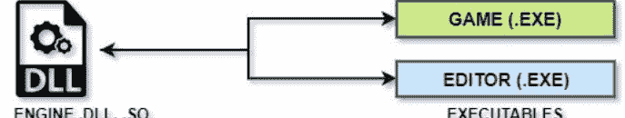

图 1 典型游戏引擎设计

### 静态链接与动态链接

一般来说，计算机程序是用编程语言编写的一系列指令，用于指示计算机执行某些操作。这些操作通常需要使用其他外部库才能正常工作。链接是将外部库与可执行文件连接的行为。主要有两种链接技术：静态链接和动态链接。

静态链接将库和程序合并为一个可执行文件。这是由链接器完成的，链接是编译过程的最后一步。为了解决外部引用，链接器将所需的库与程序代码混合。之后，链接器创建一个可加载到内存的可执行文件。静态链接的文件既包含库模块，也包含可执行文件。这通常会导致输出文件较大。

动态链接由操作系统处理。共享库仅在可执行文件开始执行时加载到内存中。因此，可执行文件的大小减小了。外部库可以被更新和重新编译。如果共享库代码已在内存中，加载时间也会减少。

以下图表（图 2）描绘了两种链接技术：


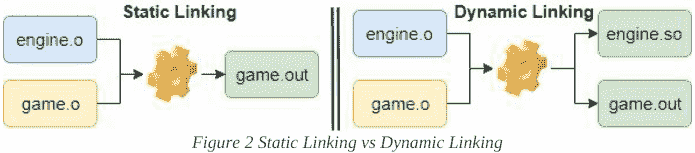

动态链接引擎可以轻松地将其他编程语言的脚本添加到我们的游戏引擎中，这是游戏引擎的重要功能。它还简化了在保持相同可执行文件的同时添加新功能的过程。

游戏本身是一个小型应用程序，用于加载和配置引擎的一些模块。这样做是为了将引擎的内部工作对游戏隐藏。在上述设计中，有两个可执行文件（或程序）被允许加载引擎库，用于各自特定的目的。我们有“游戏”和“编辑器”。

在大多数情况下，编辑器将在运行时加载引擎的模块，以允许用户创建自己选择的视频游戏。游戏可执行文件将使用与之前相同的库，但这次是为了运行在编辑器中创建的最终游戏。

## 引擎功能概览

游戏引擎的目的是让开发者能够快速、轻松地创建游戏，而无需在过程中重新实现核心元素。下图（图 3）描绘了本书将要构建的游戏引擎将支持的一些关键功能。

由于开发游戏编辑器不是本书的重点，我们将只构建引擎库和游戏可执行文件（图 1）。这足以制作一款游戏，同时也可以作为实现自定义编辑器的良好基础。

> 注意：请记住，下图中所示的功能并非全部包含在内。

## 更多功能

- 数学
- 序列化
- 文件 I/O
- ...

## 资产管理

- 纹理
- 字体
- 瓦片地图
- ...

## 实体组件系统

- 刚体系统
- 碰撞系统
- 文本渲染器
- 原生脚本
- 瓦片地图渲染器
- 精灵渲染器
- 动画系统
- ...

## 核心功能

- 日志
- 输入
- 时间
- ...

图 3 引擎功能

## 路线图

本书将教你如何使用 SDL2 从零开始用 C++ 设计和实现一个跨平台 2D 游戏引擎。下图（图 4）展示了我们的路线图。

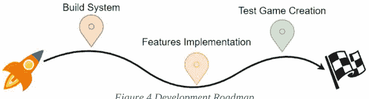

我们将首先配置跨平台开发环境和构建系统，然后添加一些核心功能，如日志记录、断言、输入和事件处理。之后，将实现实体组件系统、渲染器、动画、物理等功能。最后一步是合并上述所有功能，创建一款扑腾飞机游戏。

## 平台和工具

本书中展示的代码应可在 Windows、Linux 和 MacOS 上运行。但是，代码仅在 Linux 和 Windows 上进行了测试。由于手头没有 Mac 电脑，我们无法在 Mac 上进行任何测试。这也是为什么本书只讨论 Windows 和 Linux 实现的原因。

以下是用于制作本书代码的计算机和操作系统的描述：

- Windows 10 Enterprise

| 处理器 | Intel® Core™ i7-2600 CPU @ 3.40GHz |
|---|---|
| 内存 | 16.0 GB |
| 图形处理器 | GeForce GT 710 |
| 操作系统类型 | 64-bit |

- VirtualBox Ubuntu 21.10

| 处理器 | Intel® Core™ i7-2600 CPU @ 3.40GHz x 4 |
|---|---|
| 内存 | 10.0 GB |
| 图形 | VMware SVGA II Adapter |
| 操作系统类型 | 64-bit |
| GNOME 版本 | 40.4.0 |

## 工具

Visual Studio Code (VS Code) 将用于代码编辑，而 CMake 将管理构建过程。VS Code 和 CMake 都可以在上述所有平台上运行。

# 第 2 章

### 开发环境

## 开发环境

有一些代码编辑程序比 VS Code 更适合 C/C++ 开发，例如 Visual Studio 和 Eclipse，但 VS Code 已发展成为必备的代码编辑器，即使是用于 C/C++ 开发也是如此。

Visual Studio Code 是一个轻量但功能强大的源代码编辑器，可在桌面上运行，并提供 Windows、macOS 和 Linux 版本。它内置了对 JavaScript、TypeScript 和 Node.js 的支持，并为其他语言（如 C++、C#、Java、Python、PHP、Go）和运行时（如 .NET 和 Unity）提供了丰富的扩展生态系统 [2]。

## Windows 平台安装

如果您的系统上已经安装了 Visual Studio 2017 或更高版本，并且不打算在任何时候使用 Linux，那么您可以直接跳过本节。但如果您想学习如何设置多平台开发环境，则必须按照以下步骤操作。

## 安装 Visual Studio Code

可以使用 https://code.visualstudio.com/download 下载 VS Code。它提供 32 位和 64 位版本。下载适用于您操作系统的版本（图 5）。运行 .exe 文件并保持所有配置为默认值，确保启用“添加到 PATH”选项。请注意，默认颜色主题是深色，但您可以在设置中轻松更改它，使用 CTRL+K, CTRL+T。

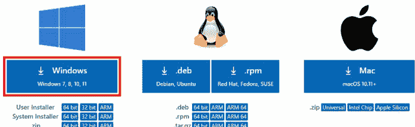

图 5 Windows 版 VS Code

安装后，它将如下图所示（图 6）。

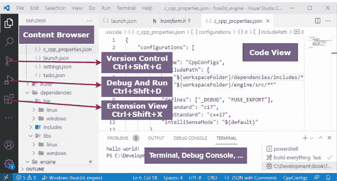

图 6 Visual Studio Code

## 安装 CMake

CMake 是一个开源的跨平台工具，它使用针对编译器和平台的特定配置文件，生成特定于您的编译器和平台的原生构建工具文件。

Windows 的预编译二进制文件可在 https://cmake.org/download/ 上以 MSI 包形式获得。64 位系统使用“Windows x64 Installer”，32 位系统使用“Windows i386 Installer”。运行下载的 MSI 包安装 CMake，并确保还选择“为所有用户将 CMake 添加到系统 PATH”。它将全局安装在您的计算机上，以便第三方软件（如 VS Code）可以访问它。安装完成后，打开命令提示符并运行以下命令，以验证它是否已安装在您的系统上。

```
cmake --version

Microsoft Windows [Version 10.0.19044.1466]
(c) Microsoft Corporation. All rights reserved.

C:\Users\Franc>cmake --version
cmake version 3.20.2
```

## 安装 Microsoft Visual C++ 编译器工具集

虽然我们将在 VS Code 中编辑源代码，但仍需使用系统上安装的调试器和编译器来编译和调试代码。如果您的计算机上已经安装了 **Visual Studio 2017 或更高版本** 和 **使用 C++ 的桌面开发** 模块，则此步骤可能是多余的。从以下链接下载 Visual Studio 生成工具：https://visualstudio.microsoft.com/downloads/。向下滚动，直到在“所有下载”部分下看到适用于 Visual Studio 20XX 的工具，然后下载适用于 Visual Studio 20XX 的生成工具。


图 7 Visual Studio 生成工具

运行 .exe 文件以启动 Visual Studio 安装程序，它将显示一个对话框，其中列出了可以安装的模块，如下所示（图 8）。选择“使用 C++ 的桌面开发”模块，然后单击 Install 完成安装。

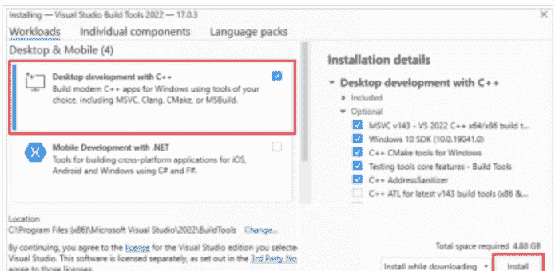

图 8 安装适用于 Visual Studio 2022 的生成工具

## 检查 Microsoft Visual C++ 编译器安装

要检查是否安装了 Microsoft Visual Studio 编译器 (MSVC)，可以打开 VS 2019 的开发人员命令提示符，如下所示。


图 9 打开 MSVC 命令提示符

运行以下命令。您应该会看到带有编译器版本和基本用法说明的版权消息（图 10）。

```
cl
```

```
C:\Program Files (x86)\Microsoft Visual Studio\2019\Community>cl
Microsoft (R) C/C++ Optimizing Compiler Version 19.29.30133 for x86
Copyright (C) Microsoft Corporation. All rights reserved.
usage: cl [ option... ] filename... [ /link linkoption... ]
```

图 10 MSVC 命令提示符

**注意：** 如果出于某种原因安装不成功，可以使用以下链接参考官方安装文档：https://code.visualstudio.com/docs/cpp/config-msvc。


## Linux 平台

既然我们的 Windows 环境已准备就绪，现在为 Linux 做同样的操作。本书使用 Ubuntu 21.10。请记住，您需要拥有 root 权限才能安装本节中描述的工具。

### 安装 Visual Studio Code

https://code.visualstudio.com/docs/setup/linux 是 Visual Studio Code 官方文档网站的链接。您将找到在所有主要 Linux 发行版上安装 VS-Code 的逐步说明。如果在 PC 上安装时遇到任何问题，或者您使用的是不同的 Linux 发行版，请参考它，因为以下安装说明仅适用于基于 Debian/Ubuntu 的发行版。在此处获取 VS-Code 包：https://code.visualstudio.com/download。

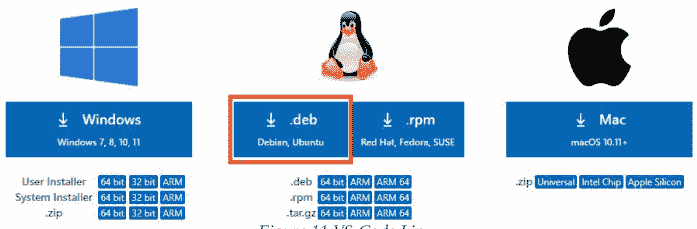

图 11 VS-Code Linux:

使用以下命令安装 .deb 包：

```
sudo apt install ./<path/to/package>.deb
#### If you're on an older Linux distribution, you will need to
#### run this instead:
#### sudo dpkg -i <path/to/package>.deb
#### sudo apt-get install -f #### Install dependencies
```

这将自动安装 apt 仓库和签名密钥，允许您使用系统的包管理器启用自动更新。

> 注意：您也不能在 Linux 上使用内置安装程序安装 VS-Code。


图 12 使用安装程序安装 VS-Code

### 安装 CMake

CMake 可以使用系统默认的包管理器安装。对于基于 Debian/Ubuntu 的发行版，以下命令足够了：

```
sudo apt-get update
sudo apt-get -y install cmake
```

您也可以使用系统内置的安装程序应用程序安装它。


图 13 使用安装程序安装 CMake

安装可以使用与之前相同的命令进行检查：

```
cmake --version
```

```
wlp0002@ubuntu:~$ cmake --version
cmake version 3.18.4
```

> **注意：** 本书中 Linux 使用的 CMake 版本为 **3.18.4**。请确保您的 CMake 版本至少为 **3.16.0**。

### 安装 GNU 编译器工具

正如我们为 Windows 安装了编译器工具一样，我们需要为 Linux 做同样的操作。GNU 编译器工具在 Ubuntu 上默认未安装，因此我们必须手动安装它们。

使用以下命令在您的系统上安装它：

```
sudo apt-get install build-essential gdb
```

如果您使用的是不同的 Linux 发行版，请务必使用您自己的系统包管理器安装这些工具。

您可以使用以下命令检查它是否已安装在您的 PC 上。

```
gdb -v
```

```
wlp0002@ubuntu:~$ gdb -v
GNU gdb (Ubuntu 11.1-0ubuntu2) 11.1
```

既然 VS-Code 和 CMake 已在两个平台上成功安装，我们的下一步是安装所有 VS-Code 扩展。

## 安装 C/C++ 和 CMake 扩展

您可以通过使用侧边菜单（图 14）或按键组合 Ctrl+Shift+X 打开扩展视图来向 VS-Code 添加扩展。这些扩展必须在 Windows 和 Linux 上都安装。

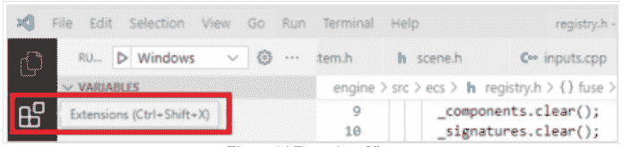

图 14 扩展视图

### C/C++ 扩展

此扩展为 VS-Code 添加了 C/C++ 语言支持，包括 IntelliSense、语法高亮、错误检查和调试等功能。通过搜索 'C/C++' 来安装它，如下图所示（图 15）。


图 15 C/C++ 扩展

### CMake Tools 扩展

CMake Tools 扩展将 VS-Code 和 CMake 相结合，使配置、构建和调试我们的 C++ 项目变得简单。您可以在扩展视图中搜索 CMake Tools 来安装它（图 16）。

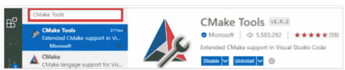

图 16 CMake Tools 扩展

既然所有必要工具都已安装并准备就绪，我们将设置 C++ 项目并运行第一个编译测试。

# 第 3 章
入门

## 入门

在本章中，我们将探讨如何在多个平台上设置和构建我们的项目，使用我们之前讨论过的所有工具和扩展。我知道您想马上进入有趣的部分，但我们只需做一次，之后就再也不必担心了。

## 项目文件夹树

```
Project
├── .vscode
│   ├── c_cpp_properties.json
│   ├── launch.json
│   └── tasks.json
├── engine
│   ├── src
│   │   ├── core
│   │   │   ├── application.cpp
│   │   │   ├── application.h
│   │   │   └── entry.h
│   │   ├── pch.cpp
│   │   └── pch.h
│   └── CMakeLists.txt
├── game
│   ├── src
│   │   └── game.cpp
│   └── CMakeLists.txt
├── windows
│   ├── bin
│   ├── libs
│   └── includes
├── resource
├── build-win.bat
├── build-linux.sh
└── CMakeLists.txt
```

图 17 项目文件夹树

上面（图 17）是我们项目文件夹结构的表示。

注意：在继续之前，请确保创建包含所有现有文件和文件夹的类似文件夹树。

我们在介绍中提到，我们的项目将由一个引擎库和一个游戏可执行文件组成。因此，在我们的项目文件夹树中，有一个名为 "engine" 的文件夹和另一个名为 "game" 的文件夹。
"windows" 文件夹将用于存储与 Windows 平台相关的所有依赖项，例如 .lib、.dll 文件和外部包含头文件。
为了使 VS-Code 能够使用我们之前安装的 C/C++ 扩展，我们必须首先创建一个名为 ".vscode" 的文件夹，在其中放置下面显示的三个 JSON 文件："c_cpp_properties.json"、"launch.json" 和 "tasks.json"。
让我们逐一了解每个文件的作用。

## c_cpp_properties.json

```json
{
  "configurations": [
    {
      "name": "configs",
      "includePath": [
        "${workspaceFolder}/windows/includes/**",
        "${workspaceFolder}/engine/src/**"
      ],
      "defines": ["_DEBUG", "FUSE_EXPORT"],
      "cStandard": "c17",
      "cppStandard": "c++17",
      "intelliSenseMode": "${default}"
    }
  ],
  "version": 4
}
```

此文件用于配置 VS-Code 中的 C/C++ 扩展，以提供适当的 IntelliSense、错误检查和语法高亮。需要注意的是，这对代码编译过程没有影响。其目的仅仅是改善我们在 VS-Code 中的编码体验。
此处定义的符号仅用于代码高亮。C++ 语言标准也是如此；它仅用于改善代码补全。IntelliSense 模式设置为 "default"，以确保我们使用当前系统默认模式。我们也可以指定类似 "clang-x64" 的模式。

## launch.json

```json
{
    "version": "0.2.0",
    "configurations": [
        {
            "name": "Windows",
            "type": "cppvsdbg",
            "request": "launch",
            "console": "integratedTerminal",
            "cwd": "${workspaceFolder}/build/bin/Debug",
            "program": "${workspaceFolder}/build/bin/Debug/game.exe"
        },
        {
            "name": "Linux",
            "type": "cppdbg",
            "request": "launch",
            "console": "integratedTerminal",
            "miDebuggerPath": "/usr/bin/gdb",
            "cwd": "${workspaceFolder}/build/bin",
            "program": "${workspaceFolder}/build/bin/game"
        }
    ]
}
```

此文件用于配置 VS-Code 中的调试器。我们必须为每个平台定义一个配置，因为我们的程序将在 Windows 和 Linux 上运行。
我们为每个配置命名，然后提供希望使用的调试器类型。
接下来，我们决定是要使用 VS-Code 中的内置终端还是单独的控制台来输出调试消息，最后，我们告诉 VS-Code 在开始调试时要执行哪个程序。在此示例中，我们的游戏可执行文件将位于 Windows 的 "build/bin/Debug" 文件夹和 Linux 的 "build/bin" 文件夹中。

- tasks.json

```json
{
  "tasks": [
    {
      "type": "shell",
      "label": "build everything",
      "windows": { "command": "${workspaceFolder}/build-win.bat" },
      "linux": { "command": "${workspaceFolder}/build-linux.sh" },
      "problemMatcher": [ "$gcc" ],
      "options": { "cwd": "${workspaceFolder}" },
      "group": { "kind": "build", "isDefault": true },
    },
  ],
  "version": "2.0.0"
}
```

此文件用于配置 VS-Code 任务，如构建任务、清理任务等。由于 VS-Code 默认不知道如何编译我们的项目，我们必须通过给出将在请求编译项目时执行的命令或 Shell 脚本，明确告诉它要做什么。

## 构建 Shell 脚本

在我们项目树的根目录中（图 17），您可以看到两个脚本文件：build-win.bat 和 build-linux.sh，分别用于 Windows 和 Linux。

## build-win.bat (Windows)

```
@echo off

if not exist build mkdir build

rem generate cmake files
cmake -S. -B ./build -DCMAKE_BUILD_TYPE=Debug -DBUILD_SHARED_LIBS=ON

rem copy assets & dll files to output dir
robocopy "./resource" "./build/bin/Debug/assets" /E
robocopy "./windows/bin/" "./build/bin/Debug/" /E

rem compile project
cd build && cmake --build .
echo compilation finished!
```

## build-linux.sh (Linux)


```bash
#!/bin/bash

### check build dir
if [ ! -d build ]
then
    mkdir build
fi

### generate cmake files
cmake -S . -B ./build -DCMAKE_BUILD_TYPE=Debug -DBUILD_SHARED_LIBS=ON

### copy assets files to output dir
cp -R "./resource" "./build/bin/assets"

### compile project
cd build && cmake --build .
echo compilation finished!
```

Shell 脚本是由系统 shell 解释和执行的计算机程序。归根结底，它是一个可执行的文本文件，可以执行用户在命令行界面（例如 Windows 的命令提示符）中可以输入的任何命令。Shell 本身就是一种编程语言，包含变量、循环和决策结构。

要使 **build-linux.sh** 文件在 Linux 机器上可执行，还需要执行一步操作。右键单击该文件并打开 **属性选项卡**。

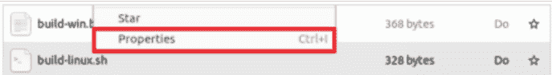

在权限部分，确保启用以下选项：**允许将文件作为程序执行**，如下图所示。


你也可以直接在脚本文件所在位置运行以下命令：

```bash
sudo chmod +x build-linux.sh
```

两个脚本都会检查项目根目录下是否存在 build 文件夹，如果不存在则创建一个。然后 CMake 将生成当前平台构建项目所需的所有文件。

由于我们将使用音频、纹理和字体等资源，因此希望将 resource 文件夹的内容复制到构建项目的输出文件夹中。

此外，win-build.bat 会确保从 windows/bin 文件夹复制所需的所有 .dll 库文件到输出文件夹中。CMake 将使用之前章节中安装的平台特定编译器继续编译项目。

CMake 需要知道根 CMakeLists.txt 文件的位置，以便为当前平台生成项目文件。这就是为什么我们需要使用 [-S <path to file>] 将该信息作为参数传递给 CMake。

[-B <output dir>] 用于告诉 CMake 将所有生成的构建文件存储在哪里。

符号 BUILD_SHARED_LIBS 用于强制编译器将项目中的所有库构建为共享库，而不是静态库。

## CMakeLists.txt 文件

CMake 可以通过合并各个位置的多个 CMakeLists.txt 文件来生成构建文件。在我们的项目文件树（图 16）中，你可以看到根文件夹以及 "engine" 和 "game" 文件夹中都有 CMakeLists.txt 文件。这些文件定义了 CMake 必须如何为我们的项目生成构建文件。

注意：这些文件必须命名为 "CMakeLists.txt"，因为 CMake 的工作原理如此。

CMake 会在所有目录中搜索该特定文件名，以在生成项目构建文件之前收集所有必要信息。让我们仔细看看每个 CMakeLists.txt 文件。

- Project/CMakeLists.txt

```cmake
cmake_minimum_required(VERSION 3.16)
set(CMAKE_CXX_STANDARD_REQUIRED ON)
set(CMAKE_CXX_EXTENSIONS ON)
set(CMAKE_CXX_STANDARD 17)

project(fuse2d)

### output directories
set(CMAKE_ARCHIVE_OUTPUT_DIRECTORY ${CMAKE_BINARY_DIR}/bin)
set(CMAKE_LIBRARY_OUTPUT_DIRECTORY ${CMAKE_BINARY_DIR}/bin)
set(CMAKE_RUNTIME_OUTPUT_DIRECTORY ${CMAKE_BINARY_DIR}/bin)

### add engine and game
add_subdirectory(engine)
add_subdirectory(game)
```

上面描述的 CMakeLists.txt 文件位于项目根目录中。如你所见，我们首先提供允许的 CMake 最低版本（3.16 版）。这一点很重要，因为一些旧版本的 CMake 行为不同。我们还想声明将使用的 C++ 标准版本。在此场景中为 C++17。然后我们创建一个名为 "fuse2d" 的项目（解决方案或工作区），这是我们为游戏引擎取的名称。你可以选择任何喜欢的名称。

我们希望 CMake 将所有生成的构建文件保存在特定目录中，因此使用内置宏 CMAKE_BINARY_DIR，即当前 CMake 构建树顶层的完整路径，基本上就是项目根目录的路径。

最后，我们使用函数“add_subdirectory”将引擎和游戏项目添加到工作区中，以便在 CMake 构建项目之前将它们全部合并。

这就是根 CMakeLists.txt 需要做的全部内容。让我们对引擎 CMakeLists.txt 文件做同样的操作。

- Project/engine/CMakeLists.txt

```cmake
### engine project (shared lib)
project(engine VERSION 0.0.1)

### get all cpp-files
file(GLOB_RECURSE SRC_FILES src/*.cpp CMAKE_CONFIGURE_DEPENDS)
add_library(${PROJECT_NAME} ${SRC_FILES})

### define symbols
add_definitions(-DFUSE_EXPORT)
add_definitions(-D_DEBUG)

### windows platform
if (WIN32)
	target_include_directories(${PROJECT_NAME} PUBLIC ${CMAKE_SOURCE_DIR}/windows/includes)
	target_link_directories(${PROJECT_NAME} PUBLIC ${CMAKE_SOURCE_DIR}/windows/libs)
endif (WIN32)

### linux platform
if (UNIX)

endif (UNIX)

### precompile headers
target_precompile_headers(${PROJECT_NAME} PUBLIC ${CMAKE_CURRENT_SOURCE_DIR}/src/pch.h)

### add include directory
target_include_directories(${PROJECT_NAME} PUBLIC ${CMAKE_CURRENT_SOURCE_DIR}/src)
```

如上所述，引擎的 CMakeLists.txt 文件位于 "Project/engine" 文件夹中。如你所见，我们不需要在此处定义 CMake 版本和 C++ 标准版本，因为它们已在根 CMakeLists.txt 文件中定义。我们只需创建一个名为“engine”的项目，版本号为“0.0.1”。版本号的指定是可选的。

然后我们希望递归搜索引擎项目源文件夹（engine/src）中的所有 .cpp 文件，因为它们都将被编译以生成引擎库。

CMake 允许我们定义符号，这些符号可以影响代码的编译方式。在此场景中，我们定义了 _DEBUG 和 FUSE_EXPORT。_DEBUG 宏指示编译器生成调试数据。FUSE_EXPORT 将用于指示编译器将引擎的哪些模块导出到库中（稍后详细介绍）。我们还希望确保 CMake 知道引擎将使用的外部库在 Windows 上的位置，这就是为什么我们使用 if(WIN32) 语句来检查当前使用的平台是否为 Windows。稍后你会明白为什么不需要为 Linux 做此操作。

预编译头（PCH）是已编译为中间形式的头文件（C/C++），编译器可以更快地解析它。预编译头可以显著减少编译时间，尤其是对于大型头文件、包含许多其他头文件的头文件，或在许多翻译单元中包含的头文件。CMake 通过函数 target_precompile_headers() 让我们能够将预编译头添加到项目中。

在“engine”文件夹中有一个名为“pch.h”的文件，它是引擎库的预编译头。它将用于包含所有重要的 C++ 标准库以及其他将全局可访问的自定义代码。这将显著减少编译引擎库所需的时间。

注意：使用预编译头的唯一要求是，我们必须在引擎的所有 .cpp 文件中包含 pch.h 头文件。

我们调用函数“target_include_directories”来附加所有包含目录，以便编译器在编译过程中知道包含哪些头文件。

我们将讨论的最后一个 CMakeLists.txt 文件是位于“game”中的文件。

- Project/game/CMakeLists.txt

```cmake
### runtime project (.exe)
project(game VERSION 0.0.1)

### get all cpp-files
file(GLOB_RECURSE SRC_FILES src/*.cpp CMAKE_CONFIGURE_DEPENDS)
add_executable(${PROJECT_NAME} ${SRC_FILES})

### link libraries
target_link_libraries(${PROJECT_NAME} engine)

### includes directories
include_directories(${CMAKE_SOURCE_DIR}/engine/src)
target_include_directories(${PROJECT_NAME} PUBLIC ${CMAKE_CURRENT_SOURCE_DIR}/src)
```

上面的代码展示了游戏可执行文件的 **CMakeLists.txt** 文件是如何定义的。需要注意的是，我们将引擎作为库进行链接，并且还将其源目录作为包含目录，以便游戏项目也可以访问引擎库中的代码。

在首次编译代码之前，我们必须安装一些库，以便为游戏引擎添加一些功能。


## 设置 SDL2 库

简单直接媒体层（SDL）是一个跨平台开发库，旨在通过 OpenGL 和 Direct3D 为音频、键盘、鼠标、操纵杆和图形硬件提供低级访问。它被视频播放软件、模拟器以及包括 Valve 的获奖游戏目录和许多 Humble Bundle 游戏在内的热门游戏所使用。

SDL 官方支持 Windows、Mac OS X、Linux、iOS 和 Android。其他平台的支持可以在源代码中找到。SDL 使用 C 编写，原生支持 C++，并且有多种其他语言的绑定可用，包括 C# 和 Python。SDL 2.0 在 zlib 许可证下分发。该许可证允许您在任何软件中免费使用 SDL。[18]

## 在 Windows 上安装 SDL

在 Windows 上安装 SDL 就像将文件复制粘贴到正确位置一样简单。但是，我们必须谨慎行事，因为这往往是项目无法成功编译的根本原因。

- 步骤 1：下载

https://www.libsdl.org/download-2.0.php 是 SDL 官方下载页面的链接。我们可以下载 SDL 的源代码并自行编译，但我们不想让事情变得更复杂。我们将只需下载并链接已构建的二进制文件到我们的项目中。

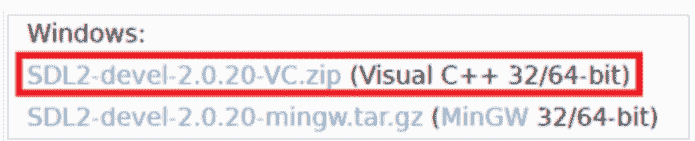

根据所使用的编译器，Windows 上有两个版本的开发库可用。有一个 Visual C++ 编译器版本和一个 MinGW 编译器版本。我们之前安装了 Microsoft Visual C++ 编译器工具集。这就是为什么我们将下载 Visual C++ 版本。

- 步骤 2：解压

使用 WinRAR、Zip 或您选择的任何其他包管理器解压下载的包。在解压后的目录中，有两个主要子目录：“include”和“lib”。所有头文件都在 include 文件夹中，库的二进制文件位于 lib 文件夹中。SDL 分别在 x86 和 x64 文件夹下提供 32 位和 64 位版本。使用 32 位或 64 位版本不会影响我们的编码体验；只有最终产品会有所不同。使用 32 位允许您在 32 位和 64 位系统上运行最终软件，但反之则不然。本书将使用 64 位版本。

```
SDL2-2.x.x
|--- lib
|    |--- x86 <--- 32-bit binaries
|    |--- x64 <--- 64-bit binaries
|--- include
```

- 步骤 3：复制

将 SDL2-2.x.x/include/ 中的所有头文件复制到您项目的 Project/windows/includes/SDL2/ 文件夹中。

将以下 .lib 文件 SDL2.lib、SDL2main.lib 从 SDL2-2.x.x/lib/x64 复制到您的 Project/windows/libs 文件夹中。

还要确保将 SDL2.dll 文件从 SDL2-2.x.x/lib/x64 复制到文件夹：Project/windows/bin。

我们现在已正式安装好 SDL2 并可供使用，但我们仍需将其链接到项目中。但在进行此操作之前，我们将首先安装所有 SDL 扩展库。

- 步骤 4：安装 SDL_image、SDL_ttf、SDL_mixer

仅 SDL2 不足以让我们在游戏引擎中实现前面提到的所有功能。这就是为什么我们还将使用 SDL 的其他扩展库：SDL_image、SDL_mixer 和 SDL_ttf。

- SDL_image

SDL_image [12] 是一个图像文件加载库。它将图像加载为 SDL 表面和纹理，并支持以下格式：BMP、GIF、JPEG、LBM、PCX、PNG、PNM、SVG、TGA、TIFF、WEBP、XCF、XPM、XV。在此处下载：https://www.libsdl.org/projects/SDL_image/ 。

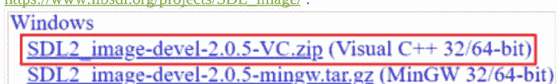

- SDL_mixer

SDL_mixer [13] 是一个简单的多声道音频混音库。它支持任意数量的同时播放的 16 位立体声音频声道，加上单声道音乐，由流行的 FLAC、MikMod Mod MOD、Timidity MIDI、Ogg Vorbis 和 SMPEG MP3 库混合：https://www.libsdl.org/projects/SDL_mixer/.

### Windows
SDL2_mixer-devel-2.0.4-VC.zip (Visual C++ 32/64-bit)
SDL2_mixer-devel-2.0.4-mingw.tar.gz (MinGW 32/64-bit)

- SDL_ttf

SDL_ttf [14] 是一个示例库，允许您在 SDL 应用程序中使用 TrueType 字体。它附带一个示例程序 "showfont"，用于显示给定 TrueType 字体文件的示例字符串。使用以下链接下载：https://www.libsdl.org/projects/SDL_ttf/.

### Windows
SDL2_ttf-devel-2.0.15-VC.zip (Visual C++ 32/64-bit)
SDL2_ttf-devel-2.0.15-mingw.tar.gz (MinGW 32/64-bit)

请确保将每个扩展库的头文件复制到 project/windows/includes/SDL2 目录中，就像我们之前为 SDL 做的那样。您需要分别为每个库的所有 .lib 和 .dll 文件重复相同的过程。

- 步骤 5：链接到项目

既然所有文件都已下载并复制到各自的目录中，我们所要做的就是将它们链接到项目中。

按照以下代码更新引擎的 CMakeLists.txt 文件。

- Project/engine/CMakeLists.txt

```
### . . .

### windows platform
if ( WIN32)
    target_link_libraries(${PROJECT_NAME} SDL2 SDL2main SDL2_image
SDL2_ttf SDL2_mixer)
    target_include_directories(${PROJECT_NAME} PUBLIC C
${CMAKE_SOURCE_DIR}/windows/includes)
    target_link_directories(${PROJECT_NAME} PUBLIC C
${CMAKE_SOURCE_DIR}/windows/libs)
endif ( WIN32)

### . . .
```

如您所见，我们使用函数“target_link_libraries”来指定要链接到项目的哪个库。SDL2、SDL2main、SDL2_image、SDL2_ttf 和 SDL2_mixer 均已链接到我们的引擎。
在 Windows 上将 SDL 库链接到项目就这些。现在让我们在 Linux 上做同样的事情。

## 在 Linux 上安装 SDL

以下安装说明仅适用于基于 Debian/Ubuntu 64 位的发行版。

注意：您需要 root 权限才能安装本节中的所有软件包。

- 步骤 1：更新包管理器

旧版本的包管理器可能不支持当前版本的 SDL2，请确保使用以下命令升级到最新版本。
sudo apt-get update

- 步骤 2：查找当前 SDL 版本

以下命令将搜索我们要安装的当前 SDL2 版本的 apt-get 缓存。
sudo apt-cache search libsdl2

- 步骤 3：下载 SDL2 开发版

libsdl2-dev 是 SDL2 的开发软件包。您可以使用以下命令在系统上安装该软件包。
sudo apt-get install libsdl2-dev

您可以通过导航到以下目录来查看它在系统上的安装位置：“/usr/include/SDL2” 用于头文件，“/usr/lib/x86_64-linux-gnu” 用于二进制文件。

就这样，我们在系统上安装了 SDL2，我们需要做的就是将其链接到项目。但我们也想为 SDL_image、SDL_ttf 和 SDL_mixer 重复此过程。

- 步骤 4：安装 SDL_image、SDL_ttf 和 SDL_mixer

这部分有点棘手，因为我们需要手动创建一些文件来指示 CMake 关于在哪里找到每个扩展库。使用以下命令在系统上安装每个库。这些命令还将把这些库安装在与 SDL2 相同的位置。

```
sudo apt-get install libsdl2-image-dev
sudo apt-get install libsdl2-mixer-dev
sudo apt-get install libsdl2-ttf-dev
```

安装完成后，我们需要为上面安装的每个库创建一个“.cmake”配置文件。这些文件将由 CMake 用于定位库文件。在某些情况下，上述命令会自动为每个库创建所有“.cmake”配置文件，但我们想考虑最坏的情况。那么，让我们看看如何做到这一点。

- SDL_image (sdl2_image-config.cmake)

使用此命令为 SDL_image 创建并打开一个新的“.cmake”文件。

```
cd /usr/x86_64-linux-gnu/cmake/
mkdir sdl2_image
cd sdl2_image
sudo nano sdl2_image-config.cmake
```

将以下代码复制到上面创建的文件中，并使用 Ctrl-X 保存。

```
set(prefix "/usr")
set(exec_prefix "${prefix}")
set(libdir "${prefix}/lib/x86_64-linux-gnu")
set(SDL2_IMAGE_PREFIX_I "/usr")
set(SDL2_IMAGE_EXEC_PREFIX_I "/usr")
set(SDL2_IMAGE_INCLUDE_DIRS "${prefix}/include/SDL2")
set(SDL2_IMAGE_LIBRARIES "-lSDL2_image")
```

- SDL_mixer (sdl2_mixer-config.cmake)

使用以下命令为 SDL_mixer 创建“.cmake”文件。


cd /usr/lib/x86_64-linux-gnu/cmake/
sudo mkdir sdl2_mixer
cd sdl2_mixer
sudo nano sdl2_mixer-config.cmake

将以下内容粘贴到上面创建的文件中。使用 Ctrl-X 保存。

```cmake
set(prefix "/usr")
set(exec_prefix "${prefix}")
set(libdir "${prefix}/lib/x86_64-linux-gnu")
set(SDL2_MIXER_PREFIX "/usr")
set(SDL2_MIXER_EXEC_PREFIX "/usr")
set(SDL2_MIXER_INCLUDE_DIRS "${prefix}/include/SDL2")
set(SDL2_MIXER_LIBRARIES "-lSDL2_mixer")
```

- SDL_mixer (sdl2_ttf-config.cmake)

使用以下命令为 SDL_ttf 创建 .cmake 文件。

```cmake
cd /usr/lib/x86_64-linux-gnu/cmake/
sudo mkdir sdl2_ttf
cd sdl2_ttf
sudo nano sdl2_ttf-config.cmake
```

将以下内容粘贴到上面创建的文件中。使用 Ctrl-X 保存。

```cmake
set(prefix "/usr")
set(exec_prefix "${prefix}")
set(libdir "${prefix}/lib/x86_64-linux-gnu")
set(SDL2_TTF_PREFIX "/usr")
set(SDL2_TTF_EXEC_PREFIX "/usr")
set(SDL2_TTF_INCLUDE_DIRS "${prefix}/include/SDL2")
set(SDL2_TTF_LIBRARIES "-lSDL2_ttf")
```

## 步骤 5：链接到项目

按如下代码片段所示更新您的 Project/engine/CMakeLists.txt。如您所见，我们正在使用之前在 .cmake 配置文件中声明的符号来搜索每个库。我们不需要为每个库包含目标包含目录，因为 SDL2_INCLUDE_DIRS 已经包含。所有库的头文件也安装在 "usr/include/SDL2" 找到的同一目录中。这就是为什么我们不需要在项目中为 Linux 依赖项设置目录，因为它们都安装在系统特定的位置。

但我们也可以下载这些库的源代码并将它们作为子模块添加到我们的项目中，这样它们也会与我们的项目一起编译，但那是另一个故事。我们实际上不需要将 SDL 链接到游戏可执行文件，因为引擎会链接到它，进而链接到 SDL。

我可以想象这些步骤有多无聊，但现在都完成了！我们现在将测试一切是否正常工作。

### Project/engine/CMakeLists.txt

```cmake
### engine project (shared lib)
project(engine VERSION 0.0.1)

### get all cpp-files
file(GLOB_RESOURCE SRC_FILES src/*.cpp OMAKE_CONFIGURE_DEPENDS)
add_library(${PROJECT_NAME} ${SRC_FILES})

### define symbols
add_definitions(-DFUSE_EXPORT)
add_definitions(-D_DEBUG)

### windows platform
if (WIN32)
target_link_libraries(${PROJECT_NAME} SDL2 SDL2main SDL2_image
SDL2_ttf SDL2_mixer)
target_include_directories(${PROJECT_NAME} PUBLIC C
${OMAKE_SOURCE_DIR}/windows/includes)
target_link_directories(${PROJECT_NAME} PUBLIC C
${OMAKE_SOURCE_DIR}/windows/libs)
endif(WIN32)

### linux platform
if (UNIX)
    # search libs
    find_package(SDL2 REQUIRED)
    find_package(SDL2_ttf REQUIRED)
    find_package(SDL2_mixer REQUIRED)
    find_package(SDL2_image REQUIRED)
    # include headers
    target_include_directories(${PROJECT_NAME} PUBLIC C ${SDL2_INCLUDE_DIR})
    # link lib files
    target_link_libraries(${PROJECT_NAME} ${SDL2_LIBRARIES}
${SDL2_IMAGE_LIBRARIES})
    target_link_libraries(${PROJECT_NAME} ${SDL2_TTF_LIBRARIES}
${SDL2_MIXER_LIBRARIES})
endif(UNIX)

### precompile headers
target_precompile_headers(${PROJECT_NAME} PUBLIC C ${OMAKE_CURRENT_SOURCE_DIR}/src/pch.h)
### add include directory
target_include_directories(${PROJECT_NAME} PUBLIC C ${OMAKE_CURRENT_SOURCE_DIR}/src)
```

## 初始化 SDL 库

既然我们已经设置好 VS-Code 和所有 SDL 库，让我们开始编写一些代码来测试一切是否已成功安装，方法是创建一个简单的应用程序。我将使用之前的项目文件夹树（图 17）作为参考来创建和定位文件和目录。

将以下代码片段添加到您的 **pch.h** 头文件中。如前所述，此文件中包含的任何头文件或代码都将只编译一次以生成预编译头。还值得注意的是，您不应该包含经常更改的头文件，因为这将迫使预编译头重新编译，从而导致编译过程大大变慢。

顶部的 **pragma once** 用于确保此头文件不会被编译器生成的最终代码包含多次。如果发生这种情况，编译将失败，因为某些函数或类被定义了多次。

如在介绍中所述，引擎旨在作为共享库，在运行时链接到游戏可执行文件。

**dllexport** 和 **dllimport** 是 C 和 C++ 编程语言的 Microsoft 特定扩展。它们可用于将函数、数据和对象导出到 DLL 或从另一个 DLL 导入。

GNU 编译器的等效项是 **__attribute__((visibility("default")))**。
**_MSC_VER** 被定义为一个整数字面量，对编译器的主版本号和次要版本号的数字进行编码。此符号用于检测 Microsoft C/C++ 编译器是否可用并正在使用。

**FUSE EXPORT** 在 **engine/CMakeLists.txt** 文件中定义为一个符号。结果，任何在 cpp 文件中定义并在其前面带有符号 **FUSE API** 的方法或类都将导出到编译后的库中。

↳ engine/src/pch.h

```cpp
#pragma once

// std libs
#include <set>
#include <random>
#include <limits>
#include <vector>
#include <string>
#include <bitset>
#include <cassert>
#include <memory>
#include <iostream>
#include <fstream>
#include <cassert.h>
#include <algorithm>
#include <functional>
#include <unordered_map>

// SDL2 libraries
#include <SDL2/SDL.h>
#include <SDL2/SDL_ttf.h>
#include <SDL2/SDL_mixer.h>
#include <SDL2/SDL_image.h>

// export api
#ifdef FUSE_EXPORT
#ifdef _MSC_VER
#define FUSE_API __declspec(dllexport)
#else
#define FUSE_API __attribute__((visibility("default")))
#endif
#else
#ifdef _MSC_VER
#define FUSE_API __declspec(dllimport)
#else
#define FUSE_API
#endif
#endif
```

### engine/src/pch.cpp

```cpp
#include "pch.h"
```

目前，对于 pch.cpp 文件，我们只需要简单地包含 pch.h。

### engine/src/core/application.h

```cpp
#pragma once

namespace fuse {
struct app_config {
    int width = 0;
    int height = 0;
    std::string title;
    std::string version;
};

// will be defined in game.exe
app_config create_application();
FUSE_API void run_application(const app_config&);
}
```

create_application() 函数必须在游戏可执行文件中实现，以初始化我们想要创建的应用程序的配置。目前为止 app_config 定义很简单。run_application() 函数将负责处理事件、更新和渲染场景以及计算我们引擎的时间。
目前，我们只想测试所有 SDL 库是否正常工作。因此，以下代码足以做到这一点。

### engine/src/core/application.cpp

```cpp
#include "pch.h"
#include "application.h"

namespace fuse {
FUSE_API void run_application(const app_config& config) {
    if(SDL_Init(SDL_INIT_EVERYTHING) == 0) {
        std::cout << "sdl initialized!" << std::endl;
    }
    if(IMG_Init(IMG_INIT_PNG) > 0) {
        std::cout << "sdl image initialized!" << std::endl;
    }
    if(TTF_Init() == 0) {
        std::cout << "sdl ttf initialized!" << std::endl;
    }
    if(Mix_Init(MIX_INIT_MP3) > 0) {
        std::cout << "sdl mixer initialized!" << std::endl;
    }
    SDL_Quit();
    IMG_Quit();
    TTF_Quit();
    Mix_Quit();
}
}
```

要确定所有库是否安装成功，我们只需尝试初始化每个库。

### SDL_Init(Uint32 flags) 成功时返回 0，失败时返回负代码。

我们不想指定要初始化哪个系统，因此使用了 SDL_INIT_EVERYTHING 标志来初始化所有系统。但是，如果例如我们只想初始化音频和视频，可以使用 OR 运算符组合标志：SDL_Init(SDL_INIT_AUDIO | SDL_INIT_VIDEO)。

注意：您可以使用 IntelliSense 找出所有可能的标志。

### IMG_Init(int flags) 加载动态库并为其做好使用准备。标志应为一个或多个 IMG_InitFlags 标志的 OR 组合。它返回成功初始化的标志，失败时返回 0。

### TTF_Init() 初始化 SDL_ttf 引擎。成功时返回 0，出错时返回 -1。

### Mix_Init(int flags) 加载动态库并为其做好使用准备。标志应为一个或多个 MIX_InitFlags 标志的 OR 组合。它返回成功初始化的标志，失败时返回 0。


最后，我们确保每个已初始化的系统也能正确关闭。此步骤至关重要，因为我们希望在退出前确保释放每个系统分配的内存。

```
engine/src/core/entry.h

#pragma once
#include "application.h"

extern fuse::app_config fuse::create_application();

int main(int argc, char** argv) {
    auto config = fuse::create_application();
    fuse::run_application(config);
    return 0;
}
```

“main”函数可以定义在游戏可执行文件中，但我们选择在引擎库中声明它，以向外部隐藏游戏循环。目前访问引擎的唯一方式是通过 create_application()。

```
game/src/game.cpp

#include <core/entry.h>

fuse::app_config fuse::create_application() {
    fuse::app_config config;
    config.version = "0.0.1";
    config.title = "Fuse2D";
    config.height = 1080;
    config.width = 720;
    return config;
}
```

在我们专注于引擎方面的工作期间，game.cpp 将暂时保持这样。它只是定义了函数 create_application(void)，在其中将应用程序的配置设置为适当的值。

## 编译

在 VS-Code 中编译我们的项目有两种方式。最简单的是使用快捷键 Ctrl + Shift + B 生成 CMake 构建文件并编译。或者使用编辑器主菜单，路径为 Terminal -> Run Task。


图 18 运行 VS-Code 任务

如果打开文件 .vscode/tasks.json，你将看到我们定义的标签为“build everything”的构建任务。
如果点击“build everything”，在 Windows 上将执行 build-win.bat shell 脚本，在 Linux 上将执行 build-linux.sh。结果将存储在 Windows 上的 build/bin/Debug/ 中，或在 Linux 上的 build/bin/ 中。

## 执行

与编译类似，执行已编译项目也有两种方式。第一种方法是直接按 F5 键。第二种方法是使用 VS-Code 调试视图。

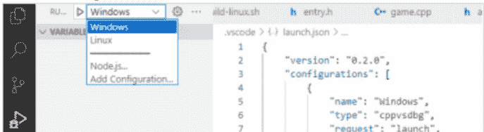

图 19 运行程序

如果打开 .vscode/launch.json 文件，你将看到我们定义了两个启动配置，一个用于 Windows，另一个用于 Linux。在尝试执行应用程序之前，请确保为你的操作系统选择了正确的配置。
这还会将 windows/bin 中的所有 .dll 文件复制到输出文件夹。点击“Windows”或“Linux”配置附近的小播放按钮。

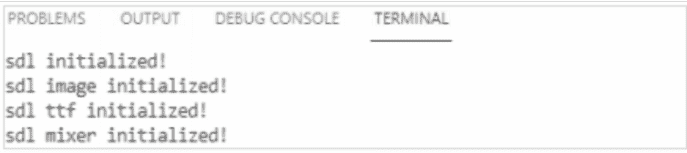


就这样，我们完成了，现在可以开始有趣的部分了。

## 核心功能

有些功能对几乎所有 C++ 项目开发都很重要，无论是否为游戏引擎。例如消息日志、断言、平台检测等。在转向图形相关内容之前，我们将快速将这些功能添加到项目中。

## 消息日志

消息日志是软件开发中一个至关重要的元素。此功能将通过向我们反馈代码失败情况来增强开发体验。

将以下代码添加到预编译头文件 pch.h 的底部。

```
// ...

#if defined(_DEBUG)
#define FUSE_LOG(level, message, ...) \
    fprintf(stderr, "[%%] ", level); \
    fprintf(stderr, message, ##__VA_ARGS__); \
    fprintf(stderr, "\n");

#define FUSE_WARN(message, ...) FUSE_LOG("warning", message, ##__VA_ARGS__)
#define FUSE_ERROR(message, ...) FUSE_LOG("error", message, ##__VA_ARGS__)
#define FUSE_INFO(message, ...) FUSE_LOG("info", message, ##__VA_ARGS__)
#else
#define FUSE_INFO
#define FUSE_ERROR
#define FUSE_WARN
#endif
```

如你所见，如果在定义 _DEBUG 符号的情况下编译代码，宏 FUSE_INFO、FUSE_WARN、FUSE_ERROR 也会被编译。但如果未定义 _DEBUG 符号，它们不会被编译。这是我们想要的，因为在完成项目开发和测试后，我们希望它只包含用户所需的内容。我们在 fprintf() 周围定义了一个宏。

以下是用于快速测试消息日志的代码片段。

```
engine/src/core/application.cpp
#include "pch.h"
#include "application.h"

namespace fuse {
FUSE_API void run_application(const app_config& config) {
    FUSE_INFO("this is an info!");
    FUSE_ERROR("this is an error!");
    FUSE_WARN("this is a warning!");
}
}
```

```
[info] this is an info!
[error] this is an error!
[warning] this is a warning!
```

## 静态和运行时断言

断言可用于定位程序崩溃的代码行，甚至在给定条件不满足时阻止编译开始。静态断言会在代码编译前确认条件，而运行时断言会在运行时触发事件以防止应用程序继续运行。将以下代码行添加到 pch.h 文件的底部。

```
engine/src/pch.h
// ...
// runtime assertion
#define FUSE_ASSERT assert
// static assertion
#if defined(__clang__) || defined(__gcc__)
#define FUSE_STATIC_ASSERT _Static_assert
#else
#define FUSE_STATIC_ASSERT static_assert
#endif
```

由于断言在不同编译器中有所不同，我们使用 if 语句来确保为当前使用的编译器进行正确的断言调用。以下是测试此功能的代码片段：

```
engine/src/core/application.cpp
#include "pch.h"
#include "application.h"

namespace fuse {
    FUSE_API void run_application(const app_config& config) {
        FUSE_ASSERT(false && "runtime assertion!");
        FUSE_STATIC_ASSERT(false && "static assertion!");
    }
}
```

你会发现，除非将静态断言的条件设置为 true，否则代码无法编译。当代码最终编译通过后，运行时断言在程序执行时会触发事件并显示以下窗口。

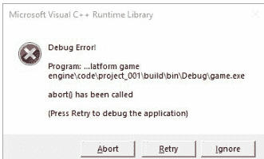

如果点击 **重试**，触发断言的代码行将在代码编辑器中被高亮显示，你将能够了解崩溃的原因。

## 函数内联

函数内联是众多引人入胜的 C++ 特性之一，在程序性能方面非常实用。在 C++ 中，内联函数是一种优化特性，可减少程序的执行时间。在编译过程中，每当遇到带有 inline 关键字的函数时，编译器都会尝试用其定义的副本替换该函数。当函数声明较短且在程序中被多次调用时，通常会使用内联函数。

再次，将以下代码片段添加到 **pch.h** 的底部。

- engine/src/pch.h

```
// . . .

// function inlining
#if defined(__clang__) || defined(__gcc__)
    #define FUSE_INLINE __attribute__((always_inline)) inline
    #define FUSE_NO_INLINE __attribute__((noinline))
#elif defined(_MSC_VER)
    #define FUSE_INLINE __forceinline
    #define FUSE_NO_INLINE __declspec(noinline)
#else
    #define FUSE_INLINE inline
    #define FUSE_NO_INLINE
#endif
```

你还会注意到，inline 关键字在不同编译器中有所不同，因此我们还需要确保在不同平台上编译项目时使用正确的版本。

## 常量和宏

在推进引擎开发的过程中，以下一些宏对我们至关重要。请务必相应更新 pch.h 和 pch.cpp 文件。

FUSE_DELETE 将用于释放已分配的内存并将其设置为空指针。在创建自己的事件系统来处理事件时，FUSE_BIND 将是必需的。它将用于将类的方法绑定到事件分发器作为回调函数。

- engine/src/pch.h


// . . .

// free allocated memory and sets it to null pointer
#define FUSE_DELETE(m) if (m != NULL) { delete (m); m = NULL; }

// attach lambda function to function call
#define FUSE_BIND(f) [this](auto&& ... args)->decltype(auto) \
{ return this->f(std::forward<decltype(args)>(args)...); }

// get current time in second and millisecond
#define get_ticks() SDL_GetTicks() / 1000.0f
#define get_ticks_ms() SDL_GetTicks()

// window size
#define INVALID_ID 0
#define MAX_DELTATIME 0.05f

// universal unique id (uuid)
namespace fuse {
using uuid64 = size_t;
FUSE_API uuid64 generate_uuid();
}

函数 **SDL_GetTicks(void)** 用于获取自SDL初始化以来经过的毫秒数。我们只是创建了一个宏，它将在编译过程中被函数调用替换。之所以这样做，是因为如果我们想要更改游戏引擎中获取时间的方式，可以简单地在这里更改函数，并且它将反映到整个项目中。

最后，我们有一个用于生成通用唯一标识符的函数。在游戏开发行业中，通用唯一标识符（UUID）通常是一个64位标识符，用于唯一标识游戏对象或资产。生成的值在整个程序中都是唯一的。

- engine/src/pch.cpp

```
#include "pch.h"

namespace fuse {
static std::random_device randomizer;
static std::mt19937_64 generator(randomizer());
static std::uniform_int_distribution<ui64> distribution;

ui64 generate_uuid64() {
    ui64 uuid = INVALID_ID;
    do {
        uuid = distribution(generator);
    } while (uuid == INVALID_ID);
    return uuid;
}
}
```

std::random_device 是一个生成非确定性随机数的均匀分布整数随机数生成器。如您所见，我们正在生成一个64位无符号整数，并确保其值不等于INVALID_ID（即"0"）。

您可以在application.cpp中像下面这样生成一个uuid。

```
#include "pch.h"
#include "application.h"

namespace fuse {
FUSE_API void run_application(const app_config& config) {
    ui64 uuid = generate_uuid64();
}
}
```

您可以使用当前行上的F9键，或单击行号，在VS-Code中设置调试断点。

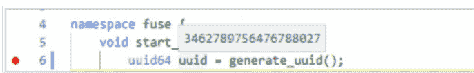

调试时，您还可以将鼠标悬停在任何变量上以查看其当前值。使用F5继续执行，F10单步跳过，F11单步进入函数调用，Shift+F11单步退出，Shift+F5停止调试器。您还可以通过编辑器顶部的小型UI菜单使用调试器。只需将鼠标悬停在每个按钮上即可了解其功能和快捷键。


## 摘要

现在您可以高兴了，因为在我们需要对预编译头文件进行添加或更改之前，还需要相当长的时间，而且我们目前看到的大部分内容都不需要更改。

注意：您可以从GitHub仓库分支获取当前源代码，地址为：https://github.com/Madsycode/book-fuse-engine。包含所有更改的当前代码状态的分支名称为“getting-started”。下面的命令可用于克隆GitHub仓库上的分支。

```
git clone --branch <branch-name> <repository link>
```

注意：别忘了确保Linux上的build-linux.sh文件是可执行的。

下一章将介绍如何创建我们的窗口并处理其中发生的所有事件。

# 第 4 章

窗口与事件处理

## 窗口和事件

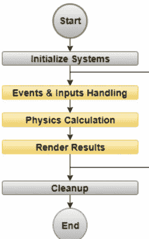

游戏循环是游戏的主事件循环。它开始处理用户输入，计算游戏世界的状态，并生成新的输出。例如，尝试使用游戏手柄或键盘在游戏世界中移动玩家。结果，用户将按下一个按钮，按钮的状态将由输入系统处理。然后将计算玩家的下一个位置并将其传递给渲染器，渲染器最终会在屏幕上为玩家显示结果。所有这些都将在毫秒甚至更短的时间内发生，具体取决于您的计算能力。

### 创建窗口

构建游戏循环的第一步是创建一个窗口。好消息是SDL2已经具备我们实现此目标所需的一切。

下面的代码片段是application.cpp的代码，它允许我们创建第一个窗口。

我们只需使用SDL_CreateWindow()和SDL_CreateRenderer()创建一个窗口和一个渲染器。标志SDL_WINDOW_ALLOW_HIGHDPI确保窗口在高DPI显示器上保持一致的外观，因为这种显示器每英寸会有更多的点或像素。

必须指示SDL使用硬件或GPU（图形处理单元）进行渲染，因为在某些情况下，SDL可能会改用CPU。由于CPU并非天生就用于图形渲染，我们希望确保使用GPU提供的图形性能。这就是使用SDL_RENDERER_ACCELERATED标志的原因。

为了将窗口的刷新率与当前显示器的刷新率同步，我们在创建渲染器时使用标志SDL_RENDERER_PRESENTVSYNC。这也很重要，因为我们的最终游戏或应用程序将在刷新率不同的不同设备上运行。即使我们的运动和动画不是基于帧的，而是基于时间的。

在SDL中渲染纹理或文本时，所有内容都将在渲染器中批处理，最终结果将使用SDL的内置函数SDL_RenderPresent()呈现到屏幕上。

engine/src/core/application.cpp

```
#include "pch.h"
#include "application.h"

namespace fuse {
static bool is_running = true;

FUSE_API void run_application(const app_config& config) {
if (SDL_Init(SDL_INIT_EVERYTHING) < 0) {
FUSE_ERROR("%s", SDL_GetError());
exit(EXIT_FAILURE);
}

// init SDL_image
if ((IMG_Init(IMG_INIT_JPG | IMG_INIT_PNG) < 0) {
FUSE_ERROR("%s", IMG_GetError());
}

// init SDL_ttf
if (TTF_Init() < 0) {
FUSE_ERROR("%s", TTF_GetError());
}

// init SDL_mixer
if (Mix_Init(MIX_INIT_MP3 | MIX_INIT_OGG) < 0 ||
Mix_OpenAudio(44100, MIX_DEFAULT_FORMAT, 2, 512)) {
FUSE_ERROR("%s", Mix_GetError());
}

// create window
auto w_flags = (SDL_WindowFlags)(SDL_WINDOW_RESIZABLE |
SDL_WINDOW_ALLOW_HIGHDPI);
SDL_Window* window = SDL_CreateWindow(config.title.c_str(),
SDL_WINDOWPOS_CENTERED,
SDL_WINDOWPOS_CENTERED, config.width, config.height,
w_flags);

// create renderer
auto r_flags = (SDL_RendererFlags)(SDL_RENDERER_ACCELERATED |
SDL_RENDERER_PRESENTVSYNC);
auto renderer = SDL_CreateRenderer(window, -1, r_flags);
if (!window || !renderer) {
FUSE_ERROR("%s", SDL_GetError());
exit(EXIT_FAILURE);
}

while (is_running) {
SDL_RenderClear(renderer);
SDL_RenderPresent(renderer);
}
}
}
```

SDL_RenderClear()函数将清除渲染器，以便下一帧可以渲染到其中。我们也可以更改背景颜色，但我们稍后再讨论。

要初始化SDL_mixer，我们必须调用Mix_OpenAudio()。第一个参数设置声音频率。44100是大多数系统支持的常见频率。第二个参数定义采样格式，在此情况下设置为默认值。第三个参数是硬件通道数，在此情况下立体声为两个。第四个参数是采样大小，它定义播放声音时使用的块大小。512是适合我的值，如果您在播放歌曲时遇到问题，可以尝试其他值，例如：1024（1KB）或2048（2KB）。

如果您编译并运行代码，将出现如下空白窗口。

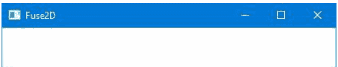

图20 第一个窗口（Windows）


图21 第一个窗口（Linux）

如您可能已经注意到，目前这些窗户没什么可做的，因为它们不会响应任何事件。让我们创建一个事件系统来为我们管理所有事件。


## 事件处理

事件可以在程序的各个位置发生，例如，当用户单击按钮或移动鼠标时。事件系统的工作是识别事件并执行特定的回调操作。我们现在希望给窗口赋予响应调整大小、鼠标移动、按键按下等事件的能力。在项目中创建两个文件，**inputs.h** 和 **inputs.cpp**。

```cpp
#pragma once

namespace fuse::inputs {
FUSE_API void initialize(SDL_Window*);
FUSE_API void dispatch_events();
FUSE_API bool is_key(int);
}
```

```cpp
#include "pch.h"
#include "inputs.h"

namespace fuse::inputs {
static const uint8_t* keyboard = NULL;

bool is_key(int key) { return keyboard[key]; }

void initialize(SDL_Window* window) {
    keyboard = SDL_GetKeyboardState(NULL);
}

void dispatch_events() {
    static SDL_Event event;
    while (SDL_PollEvent(&event)) {
        switch (event.type) {
        case SDL_KEYDOWN:
            keyboard = SDL_GetKeyboardState(NULL); break;
        case SDL_KEYUP:
            keyboard = SDL_GetKeyboardState(NULL); break;
        }
    }
}
}
```

上面的代码片段展示了 **inputs.cpp** 文件的代码。这里键盘由一个小型 8 位无符号整数数组表示，其中每个索引存储一个键的状态。SDL 有预定义的宏来区分事件类型。例如，当按下一个键时，会触发 `SDL_KEYDOWN` 事件，或者当按下鼠标按钮时触发 `SDL_MOUSEDOWN`。`is_key(int)` 函数将简单地返回作为参数传递的键码的状态。

可以在主循环中使用以下代码片段测试设置。

```
// engine/src/core/application.cpp
// ...
inputs::initialize(window);

while (is_running) {
    inputs::dispatch_events();
    if (inputs::is_key(SDL_SCANCODE_A)) {
        FUSE_INFO("key 'a' pressed!");
    }
    SDL_RenderClear(renderer);
    SDL_RenderPresent(renderer);
}
```

> [info] 按下了键 'a'！
> [info] 按下了键 'a'！

我们现在已经有了基本概念。但我们仍然无法关闭窗口，或向应用程序发送刚刚发生的事件的通知。

## 事件识别

我们希望创建一个系统，其中每个触发的事件还可以通过一种通知系统广播到整个应用程序。这样，我们就可以在程序的任何地方实现回调函数，并使其响应特定事件的发生。现在，通知系统的一个主要问题是识别正在发送的消息或事件的类型。因此，我们将创建一个类型系统，其中每个事件的类型都将被分配一个唯一编号。该编号将用于识别该事件并在其发生时调用适当的回调。在项目中创建以下头文件：

- engine/src/core/typeid.h

```cpp
#pragma once

namespace fuse {
FUSE_INLINE const uint32_t get_unique_typeid() {
    static uint32_t type = 1u;
    return type++;
}

template <typename T>
FUSE_INLINE const uint32_t type_id() {
    static const uint32_t type = get_unique_typeid();
    return type;
}
}
```

在上面的 **typeid.h** 中，我们有函数 **get_unique_typeid()**，它返回一个无符号整数。其定义位于 **typeid.cpp** 文件中。该函数每次被调用时都会简单地增加一个静态变量。你还会在头文件中找到一个名为 **type_id()** 的模板函数。

模板函数不是一种类型、函数或任何其他实体。仅包含模板定义的源文件不会产生任何代码。在任何代码出现之前，必须先实例化模板：必须确定模板参数，以便编译器可以构建实际函数 [4]。

将会发生的是，编译器将为调用时使用的每个模板类型生成此函数的定义。由于函数 **get_unique_typeid()** 返回的值存储在一个静态常量整数中，因此每次使用相同的模板类型调用该函数时，它都将保持相同。

可以按如下方式测试它：

```cpp
auto id1 = type_id<int>(); // id1 = 1
auto id2 = type_id<int>(); // id2 = 1
auto id3 = type_id<float>(); // id3 = 2
```

就这样，我们有了在程序中为任何类型附加唯一 ID 的机制。我们还将使用此类型系统作为实体-组件系统（ECS）的基础。稍后将详细介绍。

## 事件回调

事件回调只是在触发特定事件时会被调用的一个函数。按如下所示创建一个名为 "event.h" 的新头文件。

```cpp
#pragma once
#include "typeid.h"

namespace fuse {
using event_id = uint32_t;

struct event_instance {
    FUSE_INLINE virtual ~event_instance() = default;
};

// callback lambda
template <typename T>
using callback_function = std::function<bool(const T&)>;

struct callback_instance {
    FUSE_INLINE virtual ~callback_instance() = default;
    virtual bool run(event_instance*) = 0;
};

template <typename T>
struct event_callback : callback_instance {
    FUSE_INLINE event_callback(callback_function<T>&& clbk):
    callback(std::move(clbk)) {}

    FUSE_INLINE bool run(event_instance* e) {
        auto data = static_cast<const T&>(*e);
        return callback(data);
    }

private:
    callback_function<T> callback;
};

using callback_list = std::vector<std::shared_ptr<callback_instance>>;
}
```

我们首先定义一个名为 **event_instance** 的抽象结构，它是所有事件的基础结构。每次创建新类型的事件时，我们都会确保它从该结构继承。

如前所述，事件系统将识别事件并为该事件调用适当的回调操作或函数。由于我们要为其实现回调函数的事件类型不是唯一的，我们将使用 C++ 的模板特性来泛化这一概念。**callback_function** 是一个函数类型定义，它接受一个指向 **event_instance** 的指针并返回一个布尔值，以告知事件系统是应继续管理该事件还是停止。

然后我们使用刚刚创建的 **callback_function** 类型来定义最终的 **event_callback** 结构，该结构也必须是模板化的，以确保其回调函数成员变量也具有特定类型。函数 "execute" 是 **event_callback** 结构必须实现的虚函数，以确保回调函数可以由分发器执行。

**callback_list** 只是回调数组的一个 typedef。它将使我们的代码更易读。

## 事件分发器

我们已经有了识别事件的系统，也有了事件回调的结构。现在让我们组装一个分发器来管理事件和回调。

在项目中继续创建一个名为 **dispatcher.h** 的新头文件。

```cpp
#pragma once
#include "event.h"

namespace fuse {
struct dispatcher {
    // posts an event with the type T
    template <typename T, typename... Args>
    FUSE_INLINE void post(Args&&... args) {
        FUSE_STATIC_ASSERT(std::is_base_of<event_instance,
            T>::value);
        _events[type_id<T>()] = new T(std::forward<Args>(args)...);
    }

    // registers a callback for the event of type T
    template <typename T>
    FUSE_INLINE void add_callback(callback_function<T>&& cbk) {
        FUSE_STATIC_ASSERT(std::is_base_of<event_instance,
            T>::value);
        auto entry = std::make_shared<event_callback<T>>(cbk);
        _callbacks[type_id<T>()].push_back(entry);
    }

    // handles all event and keep memory clean
    FUSE_INLINE void dispatch() {
        if (!_events.size()) { return; }
        for (auto& [code, entry] : _events) {
            for (auto& cbk : _callbacks[code]) {
                if (cbk->run(entry)) { break; }
            }
        }
        _events.clear();
    }

private:
    std::unordered_map<event_id, event_instance*> _events;
    std::unordered_map<event_id, callback_list> _callbacks;
};
};
```

事件分发器只是一个具有三个主要功能的结构。

### 发布事件

第一个功能由模板函数 post(...) 定义。它接受一个


发布事件的模板参数，包含构造该事件所需的所有参数。假设，例如，窗口被调整了大小。分发器会发布一个事件，将窗口的新大小作为参数传递给 post 函数。映射 "_events" 存储当前帧中发布的所有事件，以便在下一帧开始之前统一处理一次。这种技术称为“事件轮询”。其基本思想是收集所有已发生的事件，并一次性处理它们。另一种方式则是直接在事件发生时进行处理。第二种技术并非游戏引擎最佳解决方案的一个例子是：当你的引擎正在渲染场景时，突然在渲染过程中发生了一个事件。此时，引擎必须先停止渲染过程来处理该事件，然后再返回以完成场景的渲染。如果一个事件在一帧内发生多次，这可能会成为问题，因为这会阻塞渲染器执行其工作。另一方面，轮询技术要求我们维护内存状态以防止内存溢出。

## 注册回调函数

第二个功能是为每种事件类型注册所有回调函数。这是通过 add_callback() 函数完成的。它以 callback_function 的引用作为参数，并将其存储在 _callback 映射中。

## 处理事件

分发器的最后一项工作是分发所有已发生的事件并调用它们的回调函数。如你所见，_events 和 _callback 两个映射都将事件的 event_id 作为其键值对的第一个数据点，这使得查找每种事件类型的回调函数变得容易，因为每个事件都有一个唯一的 typeid。dispatch() 函数负责为每种事件类型调用所有回调函数。我们只需遍历已发生事件的映射，在 _callback 映射中找到具有相同 event_id 的回调函数并执行它，传递事件的指针。然后通过调用 _events 映射的 clear() 函数来结束循环，以确保每个事件的析构函数被调用以释放内存。

## 事件示例

请继续创建一个名为“events”的新文件夹，其中包含名为 system.h 的头文件。该文件夹将用于创建我们的自定义事件类型。

```
engine/src/events/system.h
```

```
#pragma once
#include "core/event.h"

namespace fuse {
struct quit_event : event_instance {
    FUSE_INLINE quit_event() = default;
};
}
```

上面的代码片段显示了一个自定义事件类型的定义，当单击窗口的关闭按钮时将触发该事件。
让我们使用它来测试我们的事件系统。请按照下面的代码片段更新你的 inputs.h 和 inputs.cpp。

### engine/src/core/inputs.h

```
#pragma once
#include "dispatcher.h"

namespace fuse::inputs {
FUSE_API void initialize(SDL_Window*);
FUSE_API dispatcher* get_dispatcher();
FUSE_API void dispatch_events();
FUSE_API bool is_key(int);
}
```

### engine/src/core/inputs.cpp

```
#include "pch.h"
#include "inputs.h"
#include "events/system.h"

namespace fuse::inputs {
static const uint8_t* keyboard = NULL;
static dispatcher di_sp;

dispatcher* get_dispatcher() { return &di_sp; }

bool is_key(int key) { return keyboard[key]; }

void initialize(SDL_Window* window) {
    keyboard = SDL_GetKeyboardState(NULL);
}

void dispatch_events() {
    static SDL_Event event;
    while (SDL_PollEvent(&event)) {
        switch (event.type) {
        case SDL_QUIT: di_sp.post<quit_event>(); break;
        case SDL_KEYDOWN:
            keyboard = SDL_GetKeyboardState(NULL); break;
        case SDL_KEYUP:
            keyboard = SDL_GetKeyboardState(NULL); break;
        }
    }
    di_sp.dispatch();
}
}
```

至于 inputs.cpp 文件，我们有几个新的内容。首先，我们定义一个分发器对象，然后实现 get_dispatcher() 函数，该函数仅返回分发器实例的地址。

在 dispatch_events() 函数的 while 循环中，我们有 SDL_QUIT 事件类型，当用户单击窗口的关闭按钮时会触发该事件。当这种情况发生时，我们使用分发器发布一个 quit_event。

最后，我们调用分发器的 dispatch() 函数来处理所有已发生的事件。

现在，转到你的 application.cpp 并按如下所示更新你的代码。

### engine/src/core/application.cpp

```
#include "pch.h"
#include "inputs.h"
#include "application.h"
#include "events/system.h"

namespace fuse {
static bool is_running = true;

FUSE_INLINE bool on_quit(const quit_event&) {
    return is_running = false;
}

FUSE_API void run_application(const app_config& config) {
    // ...
    inputs::initialize(window);
    inputs::get_dispatcher()->add_callback<quit_event>(on_quit);

    while (is_running) {
        inputs::dispatch_events();
        SDL_RenderClear(renderer);
        SDL_RenderPresent(renderer);
    }
}
}
```

我们定义了一个回调函数 on_quit()，当单击窗口的关闭按钮时，它只是将 is_running 布尔值的值更改为“false”。这会导致我们的游戏循环停止其周期。我们使用分发器来注册函数回调。如果我们在一个类中，我们将按如下方式注册该函数。

```
get_dispatcher()->add_callback<quit_event>(ORBIT_BIND(on_quit));
```

我们需要我们的 ORBIT_BIND 宏才能注册类的成员函数。

## 更多事件

现在基础已经建立，我们将使用相同的原理添加更多事件，例如鼠标按下、鼠标弹起和鼠标滚动。以下代码片段显示了一系列自定义事件。

### engine/src/events/system.h

```
#pragma once
#include "core/event.h"

namespace fuse {
struct quit_event : event_instance {
FUSE_INLINE quit_event() = default;
};

struct keydown_event : event_instance {
FUSE_INLINE keydown_event(int key) : key(key) {}
int key;
};

struct keyup_event : event_instance {
FUSE_INLINE keyup_event(int key) : key(key) {}
int key;
};

struct mousedown_event : event_instance {
FUSE_INLINE mousedown_event(int btn) : button(btn) {}
int button;
};

struct mouseup_event : event_instance {
FUSE_INLINE mouseup_event(int btn) : button(btn) {}
int button;
};

struct mousemotion_event : event_instance {
FUSE_INLINE mousemotion_event() = default;
};

struct mousewheel_event : event_instance {
FUSE_INLINE mousewheel_event() = default;
};
}
```

你可以看到已添加鼠标和键盘事件的定义。如果你愿意，可以添加更多事件，例如窗口最大化、最小化等。这里我们拥有的内容足以理解该原理。让我们也更新输入系统来管理所有这些新事件。

### engine/src/core/inputs.cpp

```
#include "pch.h"
#include "inputs.h"
#include "events/system.h"

namespace fuse::inputs {
static const uint8_t* keyboard = NULL;
static dispatcher disp;

dispatcher* get_dispatcher() { return &disp; }
bool is_key(int key) { return keyboard[key]; }

void initialize(SDL_Window* window) {
    keyboard = SDL_GetKeyboardState(NULL);
}

void dispatch_events() {
    static SDL_Event event;
    while (SDL_PollEvent(&event)) {
        switch (event.type) {
        case SDL_QUIT: disp.post<quit_event>(); break;
        case SDL_MOUSEBUTTONDOWN:
            disp.post<mouse_down_event>(event.button.button); break;
        case SDL_MOUSEBUTTONUP:
            disp.post<mouse_up_event>(event.button.button); break;
        case SDL_MOUSEWHEEL: disp.post<mousewheel_event>(); break;
        case SDL_MOUSEMOTION:
            disp.post<mousemotion_event>(); break;
        case SDL_KEYDOWN:
            keyboard = SDL_GetKeyboardState(NULL);
            disp.post<keydown_event>(event.key.keysym.scancode);
        case SDL_KEYUP:
            disp.post<keyup_event>(event.key.keysym.scancode);
            keyboard = SDL_GetKeyboardState(NULL); break;
        }
        disp.dispatch();
    }
}
}
```

如你所见，我们现在也能够为鼠标和键盘事件发布消息。我们只是将 SDL 的所有事件数据传递给我们的 post 函数来构建我们想要发布的事件。我们要做的就是为这些事件定义和注册回调函数，这样我们就能完成许多事情。


## 获取鼠标数据

如果我们也想像处理键盘一样获取鼠标数据，该怎么办？比如说，你想知道鼠标的当前位置，不是基于事件，而是基于它的当前状态。这正是我们要做的。

- 自定义二维向量

为了方便我们存储鼠标数据并轻松执行二维运算，我们需要一个自定义的 vector2 类型。下图描述了 SDL 坐标系的工作方式。

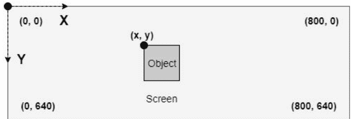

屏幕左上角是坐标系的原点。每个对象的位置也是由其左上角指定，而不是中心。位置由带有 (x, y) 值的二维向量表示。向下移动会增加位置的 y 值，向上移动会减少它。向右移动会增加 x 值，向左上移动会减少它。让我们创建我们的自定义向量类型。

在项目文件夹树中创建一个新文件夹：engine/src/math，并创建一个名为 vec2.h 的文件，包含以下代码。

```
engine/src/math/vec2.h
```

```cpp
#pragma once

namespace fuse::math {
template <typename T>
struct vec2 {
    T x = 0, y = 0;

    FUSE_INLINE vec2(T x, T y) : x(x), y(y) {}
    FUSE_INLINE vec2(T v) : x(v), y(v) {}
    FUSE_INLINE vec2() = default;

    // operator (+)
    FUSE_INLINE vec2<T> operator +(const vec2<T> &v2) const {
        return vec2<T>(this->x + v2.x, this->y + v2.y);
    }

    // operator (+=)
    FUSE_INLINE vec2<T> &operator +=(const vec2<T> &v2) {
        this->x += v2.x;
        this->y += v2.y;
        return *this;
    }

    // operator (-)
    FUSE_INLINE vec2<T> operator -(const vec2<T> &v2) const {
        return vec2<T>(x - v2.x, y - v2.y);
    }

    // operator (-=)
    FUSE_INLINE vec2<T> &operator -=(const vec2<T> &v2) {
        this->x -= v2.x;
        this->y -= v2.y;
        return *this;
    }

    // operator (*)
    FUSE_INLINE vec2<T> operator *(T s) const {
        return vec2<T>(x * s, y * s);
    }

    // operator (*=)
    FUSE_INLINE vec2<T> &operator *=(T scalar) {
        this->x *= scalar;
        this->y *= scalar;
        return *this;
    }
};
}
```

同样，我们利用 C++ 模板特性来简化工作。vec2 是一个模板结构体，这意味着它将使用指定的模板类型进行实例化。我们的 vec2 类型默认不支持任何 C++ 数学运算符，因此我们必须自己重载它们。如果你想用整数或浮点数创建一个 vec2，可以这样定义：

```cpp
auto a = vec2<float>(1.0f);
auto b = vec2<int>(2, 4);
```

为了减少定义 vec2 时需要编写的代码量，我们将使用一些常用的模板类型定义一些 typedef。

```cpp
// . . .
engine/src/math/vec2.h
namespace fuse {
    using vec2u = vec2<uint32_t>;
    using vec2f = vec2<float>;
    using vec2i = vec2<int>;
}
```

我们可以这样定义一个 vec2：

```cpp
vec2f a(1.0f);
vec2i b(2, 4);
```

- 鼠标输入

现在我们已经有了 vec2，让我们为鼠标状态创建一个容器。按如下所示更新你的 input.h 头文件

engine/src/core/inputs.h

```cpp
#pragma once
#include "math/vec2.h"
#include "dispatcher.h"

namespace fuse::inputs {
struct mouse_state {
    std::bitset<7> buttons = {0};
    vec2f offset, wheel;
};

FUSE_API const vec2f& mouse_offset();
FUSE_API const vec2f& mouse_wheel();
FUSE_API bool is_button(int);

FUSE_API void initialize(SDL_Window*);
FUSE_API dispatcher* get_dispatcher();
FUSE_API void dispatch_events();
FUSE_API bool is_key(int);
}
```

函数 **mouse_wheel()** 返回水平和垂直滚轮的滚动步长，**mouse_offset()** 返回鼠标的当前位置，**is_button()** 检查鼠标按钮当前是否被按下。

- engine/src/core/inputs.cpp

```cpp
#include "pch.h"
#include "inputs.h"
#include "events/system.h"

namespace fuse::inputs {
static const uint8_t* keyboard = NULL;
static mouse_state mouse;
static dispatcher dispatcher;

dispatcher* get_dispatcher() { return &dispatcher; }
bool is_key(int key) { return keyboard[key]; }
const vec2f& mouse_wheel() { return mouse.wheel; }
const vec2f& mouse_offset() { return mouse.offset; }
bool is_button(int b) { return mouse.buttons.test(b); }
```

```cpp
void initialize(SDL_Window* window) {
    keyboard = SDL_GetKeyboardState(NULL);
}
```

```cpp
void dispatch_events() {
    static SDL_Event event;
    while (SDL_PollEvent(&event)) {
        switch (event.type) {
        case SDL_QUIT: dispatcher.post<quit_event>(); break;
        case SDL_MOUSEBUTTONDOWN:
            mouse.buttons.set(event.button.button);
            dispatcher.post<mousedown_event>(event.button.button); break;
        case SDL_MOUSEBUTTONUP:
            mouse.buttons.reset(event.button.button);
            dispatcher.post<mouseup_event>(event.button.button); break;
        case SDL_MOUSEWHEEL:
            mouse.wheel = vec2f(event.button.x, event.button.y);
            dispatcher.post<mousewheel_event>(); break;
        case SDL_MOUSEMOTION:
            mouse.offset = vec2f(event.button.x, event.button.y);
            dispatcher.post<mousemotion_event>(); break;
        case SDL_KEYDOWN:
            keyboard = SDL_GetKeyboardState(NULL);
            dispatcher.post<keydown_event>(event.key.keysym.scancode);
        case SDL_KEYUP:
            dispatcher.post<keyup_event>(event.key.keysym.scancode);
            keyboard = SDL_GetKeyboardState(NULL); break;
        }
        dispatcher.dispatch();
    }
}
```

结构体 **mouse_state** 存储关于鼠标的所有信息，如当前位置、滚轮数据和按钮状态。如果需要，可以随意添加自定义数据。每次发生鼠标事件时，我们都会相应更新鼠标的状态。高亮显示的行只是为了展示代码中哪部分发生了变化。

- **打印鼠标位置**

你可以使用日志记录器在按下左键时在控制台打印鼠标的当前位置，如下所示。

```cpp
while (is_running) {
    if (inputs::is_button(SDL_BUTTON_LEFT)) {
        auto mouse = inputs::mouse_offset();
        FUSE_INFO("%f, %f", mouse.x, mouse.y);
    }
}
```

```
[info] (725.000000, 15.000000)
[info] (725.000000, 15.000000)
[info] (725.000000, 15.000000)
[info] (725.000000, 15.000000)
```

## 结论

很高兴你坚持到了这里！如果出于某种原因你的代码没有成功，不要担心，因为我支持你。GitHub 仓库上有一个特定的分支可以克隆和使用。分支名为 **window-inputs**。仓库链接保持不变。

> **注意：** 如果你克隆仓库，请务必在 Linux 上始终使 **build-linux.sh** 文件可执行。

在接下来的章节中，我们将构建实体-组件系统，这是引擎的核心部分。

# 第 5 章

## 实体-组件系统

ECS，即实体-组件系统，是一种将数据与行为分离以促进代码复用的设计。数据通常以缓存友好的方式保存，从而提升性能和内存使用率。

缓存内存是一种基于芯片的计算机组件，它提高了从计算机存储中检索数据的效率。它充当一个临时存储区域，计算机处理器可以轻松从中检索数据。这个临时存储区域（称为缓存）对处理器来说比计算机的主工作存储（DRAM）更容易、更快速地访问。

ECS 具有以下特性：

- 它具有实体，即唯一的标识符。
- 组件只是没有行为的数据类型。
- 实体可能拥有一个组件或多个组件。
- 实体可以随时更改组件。
- 行为在系统中实现，这些系统针对具有特定组件集的实体。

### ECS 的替代方案

为了理解为什么 ECS 是构建我们游戏引擎的明智选择，我们必须先看看替代方案。我们将研究面向对象设计、面向组件设计和面向数据设计。我们的比较将使用以下类别进行：

- 性能与维护
- CPU 缓存与内存使用

#### 面向对象设计

表面上看，面向对象（OO）编程似乎是创建游戏的绝佳选择，因为游戏仅仅是场景中相互交互的对象集合。然而，这种设计有许多缺陷，导致许多游戏开发者放弃了它。

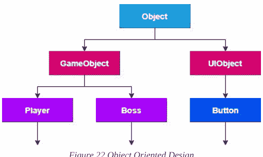

游戏的典型面向对象设计将如上图所示。在顶部，我们有一个名为 Object 的接口，包含 update()、destroy()、render() 等纯虚函数，所有子类（如 GameObject 和 UIObject）都必须实现这些函数。上图显示了三层继承，这意味着我们也有三层虚函数查找表。这会对性能产生巨大影响，因为处理器必须查找表格来找到要调用的正确函数。

在上图中，我们有一个名为 Player 的子类，还有一个名为 Boss 的子类。如果我们想要一个既是 Boss 又是 Player 的对象怎么办？这时面向对象设计就变得奇怪了，因为我们将不得不使用多重继承，而这本身就是一个坏主意，因为它会使维护变得更加困难。

由于所有对象都必须从 "Object" 接口继承，我们必须分配


内存堆（Heap）上存储所有类型的对象。这意味着我们的数据不会在内存中连续存储。当你要求计算机在内存的特定地址查找某样东西时，它不仅会复制你要求的内容，还会复制你要求的内容周围的其他数据，并将它们全部存储在缓存内存中。因此，下次你要求其他东西时，计算机会直接从缓存中获取，而不是再次从 RAM 中获取。数据在内存中不连续存储这一事实大幅降低了 CPU 缓存的使用率，导致性能下降。

## 面向组件设计

下图展示了如何构建面向组件的设计。如你所见，每个游戏对象都将拥有一个组件列表，用于定义其行为。所有类似 Transform、Sprite 等组件都将继承一个名为 Component 的抽象类。

这种技术无法解决面向对象设计中内存和 CPU 缓存使用的问题，但它去除了虚函数的虚拟查找表，并提供了能够让老板同时也是玩家的能力，因为成为玩家或老板仅仅是添加或移除组件的问题。这将比面向对象设计表现更好。

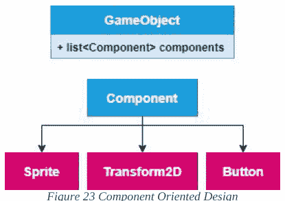

## 数据导向设计

数据导向设计听起来更合理，因为它提供了连续的内存布局、没有虚拟查找表以及更好的 CPU 缓存使用率。这种设计也称为实体-组件（EC）设计。下图描述了 EC 设计中最关键的部分。

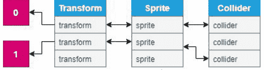

### 图 24 数据导向设计

每个游戏对象都由一个数字表示。该数字用于知道哪个组件属于该实体。你可以看到，所有实体中相同类型的所有组件都以连续的方式存储在一起。这将对 CPU 缓存产生积极影响。许多游戏引擎使用这种设计，因为它提供可靠的性能，且维护也不困难。

## ECS 架构

尽管 ECS 设计因其高性能以及在维护、内存和 CPU 缓存使用方面的易用性而闻名，但它缺乏特定的实现方法。我通常将实现 ECS 的方法分为两类：纯 ECS 和混合/混杂 ECS。

在纯 ECS 中，组件没有逻辑。只有系统持有用于更新组件的逻辑。混合 ECS 允许组件拥有用于自行更新的逻辑。

我们将在本书中构建一个纯 ECS。

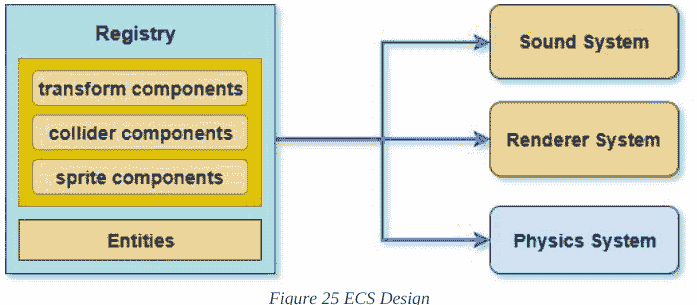

使 ECS 设计与数据导向设计不同的是，实体、组件和系统全部被分离。实体只是一个唯一标识符（数字），代表场景中的特定游戏对象。它通常是一个 32 位或 64 位无符号整数。组件是一个简单的结构，存储逻辑所需的所有数据。系统针对拥有特定组件集合（签名）的所有实体并更新它们的组件。

### ECS 的优势：

- ECS 是一种用户友好的多线程方法，因为每个系统可以分配给特定线程。
- 代码更短且更不复杂。
- 轻松集成脚本语言。
- 使单元测试和模拟变得容易。
- 新功能可以轻松实现。

### ECS 的劣势

- 未定义标准实现方法。
- 正确实现困难且容易被滥用
- 大多数游戏开发者不太熟悉。

你可以在这里 [16] 和这里 [9] 了解更多关于 ECS 的信息。我们现在有足够的理论知识。那么，让我们实现自己的自定义 ECS。

## 实现

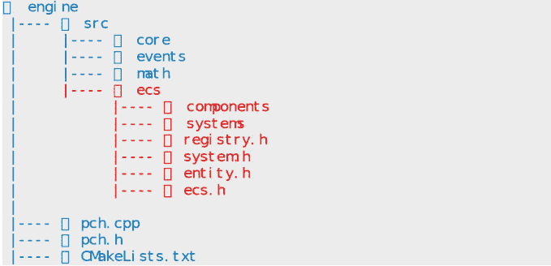

上图是一个图表，展示了你的引擎文件夹树目前应该是什么样子。请确保创建所有标记为红色的内容。文件夹：**components/** 是我们将创建组件的地方。所有系统都将在文件夹 **systems/** 中创建。所有系统都将继承 **ecs::system**。

```
engine/src/ecs/ecs.h
```

```cpp
#pragma once
#include "core/typeid.h"

namespace fuse::ecs {
    using entityid = size_t;
    using componentid = uint32_t;
    using signature = std::set<uint32_t>;
    using entitylist = std::set<entityid>;

    // component array interface
    struct array_instance {
        FUSE_NOLINE virtual ~array_instance() = default;
        virtual void erase(entityid) = 0;
    };

    // component array's data entry
    template<typename T> struct array_entry {
        FUSE_NOLINE array_entry(entityid e, const T& d): entity(e),
        data(d) {}
        FUSE_NOLINE operator entityid() const { return entity; }
        entityid entity = INVALID_ID;
        T data;
    };

    // component array
    template<typename T>
    struct component_array : array_instance {
        FUSE_NOLINE T& push(entityid e, const T& data) {
            if (exists(e)) { return get(e); }
            _data.push_back(array_entry(e, data));
            return _data.back().data;
        }

        FUSE_NOLINE void erase(entityid e) {
            auto it = std::find(_data.begin(), _data.end(), e);
            if (it != _data.end()) { _data.erase(it); }
        }

        FUSE_NOLINE bool exists(entityid e) {
            return std::find(_data.begin(), _data.end(), e) != _data.end();
        }

        FUSE_NOLINE T& get(entityid e) {
            FUSE_ASSERT(exists(e) && "entity out of range!");
            return (*std::find(_data.begin(), _data.end(), e)).data;
        }

        private:
            std::vector<array_entry<T>> _data;
    };
}
```

我们的实体组件系统所需的一些基本元素的定义都包含在头文件 ecs.h 中。我们想知道哪些组件以及有多少个组件属于一个实体。这就是为什么我们有签名，它只不过是一组组件 ID。每个实体都会分配一个签名，该实体由名为 entityid 的 64 位无符号整数表示。该元素是 array_entry。这个模板结构存储类型为 "T" 的组件及其所属的实体。我们定义了一个转换为 entityid 的强制转换运算符，因为在 component_array 中搜索组件时，我们将简单地使用 entityid 来搜索组件。这个结构也表示组件将如何在 component_array 中存储。由于我们希望以缓存友好的方式在内存中存储组件，因此必须创建一个自定义组件数组来存储它们。每种组件类型都将有自己的组件数组。这就是为什么我们创建了一个名为 array_instance 的接口，目前它只有一个名为 erase() 的虚函数。然后我们使用该接口创建一个名为 component_array 的模板结构，它以要存储的组件类型作为模板参数。如果你仔细观察，会发现这个组件数组只不过是 C++ std::vector 容器的包装器。它包含 push、remove 和 get 等函数，就像标准数组一样。

engine/src/ecs/registry.h

```cpp
#pragma once

#include "ecs.h"

namespace fuse::ecs {
struct registry {
    FUSE_INLINE void clear() {
        for (auto& [_, a] : _components) { FUSE_DELETE(a); }
        _components.clear();
        _signatures.clear();
        _nextid = INVALID_ID;
    }

    FUSE_INLINE entityid add_entity() {
        entityid entity = _nextid++;
        _signatures[entity] = signature();
        return entity;
    }

    FUSE_INLINE void destroy(entityid e) {
        for (auto& [_, a] : _components) {
            a->erase(e);
        }
        _signatures.erase(e);
    }

    FUSE_INLINE bool is_alive(entityid e) {
        return _signatures.count(e);
    }

    template <typename T> FUSE_INLINE entitylist view() {
        entitylist list;
        for (auto& [entity, sig] : _signatures) {
            if (sig.count(type_id<T>())) {
                list.insert(entity); continue;
            }
        }
        return list;
    }

    template <typename T>
    FUSE_INLINE T& get_component(entityid e) {
        FUSE_ASSERT(_signatures.count(e) && "out of range!");
        return get_component_array<T>()->get(e);
    }

    template <typename T, typename... Args>
    FUSE_INLINE T& add_component(entityid e, Args&&... args) {
        FUSE_ASSERT(_signatures.count(e) && "out of range!");
        T data(std::forward<Args>(args)...);
        _signatures[e].insert(type_id<T>());
        return get_component_array<T>()->push(e, data);
    }

    template <typename T>
    FUSE_INLINE void remove_component(entityid e) {
        _signatures.at(e).erase(type_id<T>());
        get_component_array<T>()->erase(e);
    }

    template <typename T>
    FUSE_INLINE bool has_component(entityid e) {
        return _signatures.count(e) && _signatures.at(e).count(type_id<T>());
    }

    template <typename T>
    FUSE_INLINE component_array<T>* get_component_array() {
        component_id type = type_id<T>();
        if (_components.count(type)) {
            return static_cast<component_array<T>*>(_components.at(type));
        }
        auto array = new component_array<T>();
        _components[type] = array;
        return array;
    }

private:
    std::unordered_map<component_id, array_instance*> _components;
    std::unordered_map<entityid, signature> _signatures;
    entityid _next_id = INVALID_ID;
};
}
```


## 成员变量

**registry.h** 头文件包含名为 "registry" 的结构体定义。该结构体负责存储和管理所有现有实体及其组件。让我们从成员变量开始。

第一个成员变量是一个名为 `_components` 的 `std::unordered_map`。它是一个组件数组的映射，为每个组件类型 ID 存储一个特定的数组。

第二个成员变量 `_signatures` 是一个映射，为每个现有实体分配一个组件签名。例如，如果我们想知道一个实体是否具有 transform 组件，只需检查 transform 组件的 **componentid** 是否存在于实体的签名中。最后一个成员变量是一个 entityid 计数器。每次添加新实体时，该变量都会增加。

## 成员函数

让我们看看此文件中定义的所有成员函数。我们将从上到下依次介绍。

第一个函数是 **clear()**，其作用仅仅是清理注册表的内存并重置 entityid 计数器。

顾名思义，函数 **add_entity()** 会通过分配一个唯一的 entityid 和一个空签名，向注册表中添加一个新实体。每次向实体添加新组件时，该组件的 ID 都会添加到签名中。

添加实体也意味着销毁它们。因此，**destroy()** 函数会查找与该 entityid 相关的任何数据并将其销毁。例如组件和签名等数据。

函数 **view()** 用于检索具有类型 "T" 组件的所有实体。这将在我们的系统中用于更新这些组件。

**get_component()**、**add_component()**、**remove_component()** 和 **has_component()** 用于检索、添加和删除组件，以及判断实体是否具有某个组件。最后，我们有 **get_component_array()**，这是一个可用于获取特定组件数组的函数，以便进一步使用（例如擦除特定实体的组件等）。该函数首先会确保数组已注册，如果未注册则进行注册。

### engine/src/ecs/entity.h

```cpp
#pragma once
#include "registry.h"

namespace fuse::ecs {
struct entity {
    FUSE_INLINE entity(registry* r): _registry(r) { _entity = r->add_entity(); }
    FUSE_INLINE entity(entity_id e, registry* r): _registry(r),
    _entity(e) {}
    FUSE_INLINE operator entity_id() { return _entity; }
    FUSE_INLINE entity() = default;

    template <typename T, typename... Args>
    FUSE_INLINE T& add_component(Args&&... args) {
        return _registry->add_component<T>(_entity, std::forward<Args>(args)...);
    }

    template <typename T>
    FUSE_INLINE T& get_component() {
        return _registry->get_component<T>(_entity);
    }

    template <typename T>
    FUSE_INLINE void remove_component() {
        _registry->remove_component<T>(_entity);
    }

    template <typename T>
    FUSE_INLINE bool has_component() {
        return _registry->has_component<T>(_entity);
    }

    FUSE_INLINE bool is_alive() {
        return _registry && _registry->is_alive(_entity);
    }

    FUSE_INLINE entity_id id() { return _entity; }

    FUSE_INLINE void destroy() { _registry->destroy(_entity); }

private:
    entity_id _entity = INVALID_ID;
    registry* _registry = NULL;
};
}
```

以上是 entity 结构体的定义。这使我们能够轻松操作单个实体，而无需每次都使用注册表。这只是对 entityid 和注册表的一个封装，因为我们只是调用之前在注册表中定义的函数。

```cpp
#pragma once
#include "entity.h"

namespace fuse::ecs {
struct system {
    FUSE_INLINE virtual ~system() = default;

    FUSE_INLINE void prepare(registry* rg, SDL_Renderer* rd) {
        this->_registry = rg;
        this->_renderer = rd;
    }

    template<typename T>
    FUSE_INLINE auto view() {
        std::vector<entity> entities;
        for(auto& e : _registry->view<T>()) {
            entities.push_back(entity(e, _registry));
        }
        return entities;
    }

    FUSE_INLINE virtual void update(float) {}
    FUSE_INLINE virtual void start() {}

protected:
    SDL_Renderer* _renderer = NULL;
    registry* _registry = NULL;
};
}
```

system.h 头文件定义了系统的最小行为。它包含一些指针，用于访问我们之前创建的变量，例如渲染器和注册表。派生类可以选择实现 start() 和 update() 函数的自己的版本。

prepare() 函数只是将成员指针设置为其特定目标值。view() 函数会将所有 entityid 转换为 entity 对象，以便我们可以快速访问它们的组件。

> 注意：每当你创建接口或抽象类时，请确保它有一个虚析构函数。这将确保在子类被销毁时进行销毁。

## 创建组件和系统

在本节中，我们将创建一些组件来测试我们的实体-组件系统是否正常工作。我们将创建的组件是 info 组件和 transform 组件。

Transform 存储场景中游戏对象的位置、缩放和旋转。这些信息对渲染器系统很重要，因为它将用于知道如何以及在哪里渲染特定对象。为了减少项目中包含语句的数量，我们将把组件分组到各种类别中。如下所示，第一个类别称为“common”。此类别适用于所有实体都需要的组件。

### engine/src/ecs/components/common.h

```cpp
#pragma once
#include "math/vec2.h"

namespace fuse::ecs {
struct info_component {
    FUSE_INLINE info_component(const info_component&) = default;
    FUSE_INLINE info_component() = default;

    uuid64 uuid = generate_uuid();
    std::string name = "entity";
    std::string tag = "default";
};

struct transform_component {
    FUSE_INLINE transform_component(const transform_component&) = default;
    FUSE_INLINE transform_component() = default;

    vec2f translate = vec2f(0.0f);
    vec2f scale = vec2f(1.0f);
    float rotation = 0.0f;
};
};
```

每个游戏对象至少应有一个名称和一个位置。**info_component** 存储其所属实体的名称和一个唯一的通用标识符。UUID 可用于序列化（稍后详述）或实体之间的父子关系。

让我们创建一个简单的系统来测试我们的实体组件系统性能是否良好。下面的系统检索所有具有 transform 组件的实体，增加其位置，并将结果打印到控制台。

### engine/src/ecs/systems/test_system.h

```cpp
#include "ecs/system.h"
#include "ecs/components/common.h"

namespace fuse::ecs {
struct test_system : system {
void update(float dt) {
for (auto e : view<transform_component>()) {
auto& t = e.get_component<transform_component>();
FUSE_INFO("id: [%d], x: %f", e.id(), t.translate.x++);
}
}
};
}
```

## 创建场景

要测试我们的 ECS，我们需要一个实体必须存在的场景。因此，我们将创建一个可以添加实体的场景。

- engine/src/ecs/scene.h

```cpp
#pragma once
#include "systems/test_system.h"

namespace fuse::ecs {
struct scene {
    FUSE_INLINE scene(SDL_Renderer* rd): _renderer(rd) {
        register_system<ecs::test_system>();
    }

    FUSE_INLINE ~scene() {
        for (auto& s : _systems) { FUSE_DELETE(s); }
        _registry.clear();
        _systems.clear();
    }

    FUSE_INLINE ecs::entity add_entity(const std::string& name) {
        auto entity = ecs::entity(&_registry);
        entity.add_component<info_component>().name = name;
        entity.add_component<transform_component>();
        return entity;
    }

    FUSE_INLINE void update(float dt) {
        for (auto& sys : _systems) { sys->update(dt); }
    }

    FUSE_INLINE void start() {
        auto e = this->add_entity("test");
        e.add_component<transform_component>();
        for (auto& sys : _systems) { sys->start(); }
    }

    template <typename T>
    FUSE_INLINE void register_system() {
        FUSE_STATIC_ASSERT(std::is_base_of<ecs::system, T>::value);
        auto new_system = new T();
        new_system->prepare(&_registry, _renderer);
        this->_systems.push_back(new_system);
    }

private:
    std::vector<ecs::system*> _systems;
    SDL_Renderer* _renderer = NULL;
    ecs::registry _registry;
};
};
```

在成员变量部分，我们有一个名为 `_systems` 的数组，所有系统都将驻留在此。函数 `register_system()` 用于注册由模板参数定义的系统。


场景的 update() 函数将简单地遍历所有可用系统并相应地调用它们的 update 函数。函数 add_entity() 用于添加带有 transform 和 info 组件的实体。因为我们引擎中的所有实体至少都会有这两个组件，所以我们希望通过仅调用此函数来快速完成此操作。

如果你仔细查看 start() 函数，你会发现我们正在使用 add_entity() 函数添加一个实体，并且还确保调用所有系统的 start 函数，以确保所有已注册的系统也已启动。要测试此功能，你需要像下面所示更新 application.cpp 中的代码。

```
engine/src/core/application.cpp
```

```
#include "pch.h"
#include "inputs.h"
#include "ecs/scene.h"
#include "application.h"
#include "events/system.h"

namespace fuse {
static bool is_running = true;

FUSE_INLINE bool on_quit(const quit_event&) {
    return is_running = false;
}

FUSE_API void run_application(const app_config& config) {
    // ... keep the rest unchanged

    // create & start scene
    auto scene = new ecs::scene(renderer);
    scene->start();

    while (is_running) {
        inputs::dispatch_events();
        SDL_RenderClear(renderer);
        scene->update(0.0f);
        SDL_RenderPresent(renderer);
    }

    // free memory
    SDL_DestroyRenderer(renderer);
    SDL_DestroyWindow(window);
    FUSE_DELETE(scene);
    IMG_Quit();
    Mix_Quit();
    TTF_Quit();
    SDL_Quit();
}
}
```

如果你编译并运行你的项目，你将得到以下打印结果：

```
[info] id:[1], x:256.000000
[info] id:[1], x:257.000000
[info] id:[1], x:258.000000
```

## 结论

我希望你能想象 ECS 有多么强大。它确实使通过定义组件和系统来更新它们，就能轻松地为我们的引擎添加新功能。

从现在起，事情将变得容易得多，因为我们所要做的就是创建系统的组件并将它们添加到场景中进行测试。但在进入渲染器和物理相关内容之前，我们将简要讨论资产管理。我们希望能够正确加载和存储我们的资产，如纹理、动画、字体等，以便在需要时可以轻松访问它们。

如果你在本章的代码中遇到问题，可以简单地从 GitHub 仓库克隆分支来找出你的代码哪里出错了。该分支名为 "ecs"。

注意：如果你克隆仓库，请记住在 Linux 上始终使 build-linux.sh 可执行。

# 第 6 章
资产管理

## 资产管理

资产管理器负责监督游戏（引擎）中资产的加载、存储、转换和销毁。

关于资产管理器应如何实现，没有特定的设计，但有一些基本概念我们可以应用以实现我们的目标。

## 资产定义

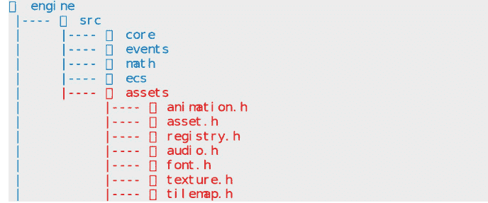

如上所示，通过创建高亮显示的红色文件夹和文件来更新你的项目文件夹树。我们现在将逐步创建每种资产类型，从基础资产开始，它将包含所有种类资产的一些通用信息。

```
#pragma once

namespace fuse {
using asset_typeid = uint32_t;
using asset_id = uuid64;

struct asset {
FUSE_NONIE virtual ~asset() = default;
asset_id id = generate_uuid();
std::string name;
};
}
```

每个资产都应该有一个唯一的通用标识符（UUID）和一个名称，因为该信息将用于在注册表中搜索资产。我们还希望每种资产类型都有一个特定的类型标识符，该标识符将用于将每个资产保存在注册表的特定内存块中。这就是为什么我们创建了 typedef asset_typeid，它只是一个 32 位整数，类似于我们为事件和组件所做的。

### 纹理资产

纹理有能力通过赋予游戏悦目的外观并使其易于理解来增强游戏。我可以肯定你知道那句古老的格言，“一图胜千言”。

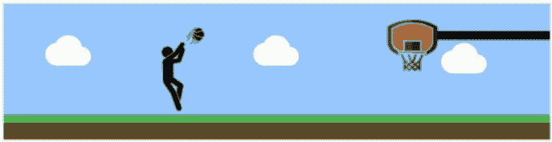

以下是纹理资产的定义。

### engine/src/assets/texture.h

```
#pragma once
#include "asset.h"
namespace fuse {
struct texture {
SDL_Texture* data = NULL;
std::string filename;
int i = 0;
int width = 0;
};
struct texture_asset : asset {
FUSE_INLINE texture_asset() = default;
FUSE_INLINE ~texture_asset() {
SDL_DestroyTexture(instance.data);
}
texture instance;
};
}
```

在创建纹理资产之前，我们需要定义什么是纹理。这就是为什么我们首先创建结构化纹理，它存储关于纹理的所有信息，如大小、文件名和像素数据。然后我们使用该结构来创建 texture_asset。SDL 有一个名为 SDL_Texture 的像素数据类型。它是一个包含高效的、特定于驱动程序的像素数据表示的结构。要创建纹理，我们只需定义一个像素数组。我们将稍后了解如何从图像文件加载纹理。同样重要的是，确保通过调用 SDL_DestroyTexture() 销毁纹理。这就是为什么当纹理资产的析构函数被调用时，纹理的数据将被销毁。

### 字体资产

虽然纹理在某些方面足以创建一个功能完整的游戏，但呈现自定义文本的能力也很重要，因为它能让用户了解游戏中发生的事情。呈现当前分数、显示玩家姓名和设计 GUI 都是制作一款像样游戏的重要方面。

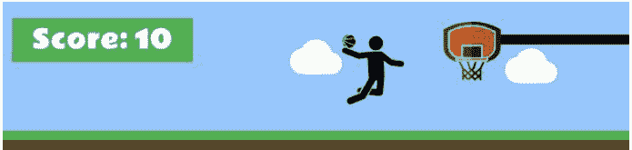

图 26 文本渲染

以下是我们字体资产的代码。

```
engine/src/assets/font.h
#pragma once
#include "asset.h"

namespace fuse {
struct font {
    TTF_Font* data = NULL;
    std::string filename;
    int size = 20;
};

struct font_asset : asset {
    FUSE_NON_NE font_asset() = default;
    FUSE_NON_NE ~font_asset() {
        TTF_CloseFont(instance.data);
    }

    font instance;
};
}
```

SDL_ttf 有一种名为 TTF_Font 的特定字体类型。TTF 代表 TrueType 字体。它是一种用于在屏幕和打印机上显示文本的字体标准。它内置于 Windows 和 Mac OS 操作系统中，并且也可以通过 FreeType [25] 在类 Unix 操作系统上使用。

注意：加载字体后，在 SDL 中无法调整其大小。因此，更改字体大小的唯一方法是使用新的字体大小重新加载同一字体文件。稍后我们将讨论字体加载。

### 音频资产

没有音频的游戏简直索然无味，也不好玩。我们也将为音频资产保持相同的模式。SDL mixer 库提供两种类型的音频数据。Mix_Music 和 Mix_Chunk。区别在于你一次只能播放一段音乐，但可以播放计算机能处理的尽可能多的音频片段。每个新音频片段将被分配到一个专用通道，而所有音乐只有一个通道。这就是我们使用 Mix_Chunk 而不是 Mix_Music 的原因。如果你愿意，可以随时在线进行更多研究。

engine/src/assets/audio.h

```
#pragma once
#include "asset.h"

namespace fuse {
struct audio_clip {
    Mix_Chunk* data = NULL;
    std::string filename;
};

struct audio_asset : asset {
    FUSE_INLINE audio_asset() = default;

    FUSE_INLINE ~audio_asset() {
        Mix_FreeChunk(instance.data);
    }

    audio_clip instance;
};
}
```

### 动画资产

2D 动画通过使用精灵表或多个精灵来实现。其思路是仅在恒定的时间段内渲染每个精灵，这就是动画的速度。

以下是显示如何定义动画资产的代码片段。数组 "frames" 将存储动画中每个纹理（帧）资产的 asset_id。

可以直接存储每个纹理对象而不是 asset_id。对我们来说，这样做更好，因为我们将在游戏引擎中实现序列化和脚本，并且我们希望能够通过资产的 id 和名称轻松地寻址资产。

engine/src/assets/animation.h


```cpp
#pragma once
#include "asset.h"

namespace fuse {
struct animation {
std::vector<asset_id> frames;
int speed = 100;
};

struct animation_asset : asset {
FUSE_INLINE animation_asset() = default;
animation instance;
};
}
```

## 瓦片地图资源

瓦片地图在 2D 游戏中非常常见。它们通过使用称为瓦片的规则形状图像来构建游戏世界。超级马里奥、吃豆人甚至塞尔达传说等一些流行游戏都使用这种技术来构建关卡。瓦片地图除了可以带来性能改进外，还可以映射到逻辑网格，并且可以在游戏逻辑中以多种方式使用（例如，处理碰撞、实现 AI），或用于构建关卡编辑器。[20]

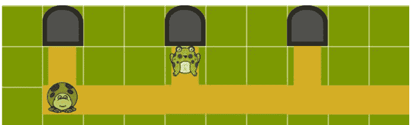

图 27 瓦片地图

存储一组瓦片最有效、最常用的方式是通过瓦片集。它本质上就是将你需要的所有瓦片放在一个轻量级图像文件中。到了需要在屏幕上绘制瓦片的时候，只会使用较大图像中的一小部分。下面是用于创建上述场景的瓦片集。

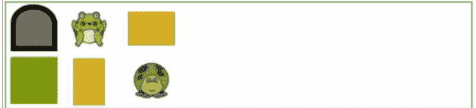

图 28 瓦片集

我们游戏引擎中的瓦片地图将由多个实体组成，每个实体附加一个瓦片组件。这使我们能够向瓦片添加更多组件，以实现更高级的游戏效果。例如，我们可以选择仅向某些瓦片添加碰撞体组件，仅在这些瓦片上处理碰撞。这将减少必须进行的碰撞测试次数，并为最终产品带来更好的性能。

注意：我始终使用 "struct" 而不是 "class"，因为我只是喜欢结构体。它们让我想起 C 语言。如果你愿意，可以随意使用类。唯一的区别是，结构体定义的成员变量和函数默认为公共。

engine/src/assets/tilemap.h
```cpp
#pragma once
#include "asset.h"

namespace fuse {
struct tileset {
    std::set<asset_id> tilesets;
    int col_count = 0;
    int row_count = 0;
    int tilesize = 0;
};

struct tilemap_asset : asset {
    FUSE_INLINE tilemap_asset() = default;
    tilemap instance;
};
}
```

瓦片地图还应该能够组合多个瓦片集来创建场景。这就是我们使用 std::set 来存储所有瓦片集的原因。同样重要的是要知道瓦片的单位大小，因为瓦片地图本质上只是一个网格。

## 资源注册表

现在我们已经定义了所有资源类型，需要创建一个资源注册表来跟踪添加到游戏引擎中的所有资源。接下来是一个代码片段，展示了资源注册表的定义方式。

get() 函数用于使用 asset_id 和类型从注册表中检索特定资源。所有资源都存储在成员变量 _data 中，它是一个资源指针的 std::vector 映射。

要检索资源，我们首先检查该特定资源类型是否有可用的数组。我们通过检查资源的 typeid 是否在映射中可用来完成此操作。如果没有可用的数组，我们直接返回 NULL。但如果找到了数组，我们将继续搜索传入参数的 id 的资源。下一个函数是 get_id()，它将资源名称作为参数，将类型名称作为模板参数。该函数将搜索资源并返回其 asset_id。

我们还希望能够向注册表中添加资源，因为有些资源（如瓦片地图和动画）并非最初从源文件加载，而纹理、字体和音频则是。这就是我们拥有 add() 函数的原因。

如果你仔细查看我们定义的所有资源类型，会发现它们都有一个默认构造函数。这是为了确保 add() 函数可以创建该资源的默认版本。

engine/src/assets/registry.h
```cpp
#pragma once
#include "font.h"
#include "audio.h"
#include "tilemap.h"
#include "texture.h"
#include "animation.h"
#include "core/typeid.h"

namespace fuse {
struct asset_registry {
    FUSE_INLINE void clear() {
        for(auto& [_, list] : _data) {
            for(auto a : list) { FUSE_DELETE(a); }
        }
        _data.clear();
    }
    template <typename T>
    FUSE_INLINE T* get(asset_id id) {
        FUSE_STATIC_ASSERT(std::is_base_of<asset, T>::value);
        const auto type = type_id<T>();
        if(!_data.count(type)) { return NULL; }
        for(auto& asset : _data.at(type)) {
            if(asset->id == id) { return static_cast<T*>(asset); }
        }
        return NULL;
    }
    template <typename T>
    FUSE_INLINE T* get(const std::string& name) {
        asset_id id = get_id(name);
        FUSE_STATIC_ASSERT(std::is_base_of<asset, T>::value);
        const auto type = type_id<T>();
        if(!_data.count(type)) { return NULL; }
        for(auto& asset : _data.at(type)) {
            if(asset->id == id) { return static_cast<T*>(asset); }
        }
        return NULL;
    }
    template <typename T>
    FUSE_INLINE asset_id get_id(const std::string& name) {
        FUSE_STATIC_ASSERT(std::is_base_of<asset, T>::value);
        const auto type = type_id<T>();
        if (!_data.count(type)) { return INVALID_ID; }

        for (auto& asset : _data.at(type)) {
            if (!asset->name.compare(name)) { return asset->id; }
        }
        return INVALID_ID;
    }

    template <typename T>
    FUSE_INLINE T* add(const std::string& name) {
        auto asset = new T();
        asset->name = name;
        _data[type_id<T>()].push_back(asset);
        return asset;
    }

private:
    std::unordered_map<asset_typeid, std::vector<asset*>> _data;
};
}
```

## engine/src/ecs/scene.h

```cpp
#pragma once
#include "assets/registry.h"

// ...

FUSE_INLINE void start() {
    auto frame1 = _assets.add<texture_asset>("frame1");
    auto frame2 = _assets.add<texture_asset>("frame2");
    auto anim = _assets.add<animation_asset>("test");

    anim->instance.frames.push_back(frame1->id);
    anim->instance.frames.push_back(frame2->id);
    anim->instance.speed = 200;
}

for (auto& sys : _systems) { sys->start(); }
}

private:
std::vector<ecs::system*> _systems;
SDL_Renderer* _renderer = NULL;
ecs::registry _registry;
asset_registry _assets;
};
```

在这种情况下，你必须做三件关键事情：包含资源注册表的头文件，在资源注册表中创建名为 "_assets" 的成员变量，并按上述所示修改 start() 函数。我们只是向注册表添加一个动画资源，以及两个将用作动画帧的纹理资源。

**编译、运行并使用调试器** 以检查一切是否按预期工作。你也可以打印出某些值，看它们是否符合你的预期。我们将在即将到来的章节中了解如何从文件加载纹理、字体和音频资源。

为了让你的 ecs::system 访问我们在场景中刚刚创建的资源注册表，请按下面所示更新你的系统。当我们开始添加精灵渲染器和动画器等系统时，这一点将很重要。

engine/src/ecs/system.h
```cpp
#pragma once
#include "entity.h"
#include "assets/registry.h"

namespace fuse::ecs {
struct system {
    FUSE_NO_INLINE virtual ~system() = default;

    FUSE_NO_INLINE void prepare(registry* rg, SDL_Renderer* rd, asset_registry* as) {
        this->rg = rg;
        this->renderer = rd;
        this->_assets = as;
    }

    template<typename T>
    FUSE_NO_INLINE auto view() {
        std::vector<entity> entities;
        for (auto& e : _registry->view<T>()) {
            entities.push_back(entity(e, _registry));
        }
        return entities;
    }

    FUSE_NO_INLINE virtual void update(float) {}
    FUSE_NO_INLINE virtual void start() {}

protected:
    SDL_Renderer* _renderer = NULL;
    asset_registry* _assets = NULL;
    registry* _registry = NULL;
};
};
```

你还必须确保更新场景的 register_system() 函数，以便在注册新系统时，该系统的 prepare() 函数会使用正确的参数列表被调用（参见下方代码）。

engine/src/scene/scene.h
```cpp
template <typename T>
FUSE_INLINE void register_system() {
    FUSE_STATIC_ASSERT(std::is_base_of<ecs::system<T>>::value);
    auto new_system = new T();
    new_system->prepare(&registry, &renderer, &assets);
    this->_systems.push_back(new_system);
}
```


## 结论

恭喜你走到这一步。我们现在已准备好，利用迄今实现的所有内容，开始为引擎添加游戏功能。我们首先要解决的是让引擎能够渲染纹理，之后将继续渲染文本和动画。

注意：本章所做的所有代码更改所在的分支将以名称 "assets" 在仓库中提供。

# 第 7 章

## 精灵渲染器

从现在起，你会看到为引擎添加新功能是多么简单。
本章将介绍如何渲染纹理。我们将创建一个精灵组件，它接收纹理资产的 asset_id。该组件将附加到实体上，并通过精灵渲染器系统绘制到屏幕上。
在渲染纹理甚至创建组件之前，我们想先看看如何从源文件加载它们。

### 加载纹理

我们已经定义了资产注册表。那么，让我们添加一个加载纹理的函数。下面的代码片段展示了如何将纹理加载到资产注册表中。请务必相应地更新你的资产注册表。

```cpp
// ...
engine/src/assets/registry.h
// ...
FUSE_INLINE texture_asset* load_texture(const std::string& src,
const std::string& name, SDL_Renderer* rd) {
texture texture;
texture.data = IMG_LoadTexture(rd, src.c_str());
texture.filename = src;
if (!texture.data) {
FUSE_ERROR("%s", IMG_GetError());
return NULL;
}
SDL_QueryTexture(texture.data, NULL, NULL, &texture.width,
&texture.height);
auto asset = new texture_asset();
asset->instance = texture;
asset->name = name;
_data[type_id<texture_asset>()].push_back(asset);
return asset;
// ...
}
```

IMG_LoadTexture() 是 SDL_image 中的内置函数，用于从文件加载像素数据。它支持多种图像格式，包括 PNG、TIFF、JPG 和 JPEG。该方法将像素数据加载到内存块中，并返回第一个像素数据的地址。

为了了解纹理的大小，我们需要使用 SDL_QueryTexture() 函数显式查询它。该函数接受一个纹理指针和两个整数指针，分别用于存储请求的宽度和高度。

load_texture() 函数还将资产名称作为参数。这样可以确保每个资产都有一个可用于查找的名称。两个资产可以有相同的名称，但它们永远不会有相同的 asset_id。这就是为什么我们不必担心资产因名称已被使用而被覆盖。

### 精灵组件

如果你还记得 ECS 章节，我们说过会按类别创建组件，以减少包含语句的数量，因为这对编译时间有有益影响。我们创建的第一个类别位于 ecs/components/common.h。

现在让我们在一个名为 graphics.h 的新文件中创建另一个类别。我们将在此文件中创建所有与图形相关的组件。以下是精灵组件的代码片段。

```cpp
engine/src/ecs/components/graphics.h
#pragma once
#include "assets/asset.h"
namespace fuse::ecs {
struct sprite_component {
    FUSE_INLINE sprite_component( const sprite_component& ) = default;
    FUSE_INLINE sprite_component() = default;
    SDL_RendererFlip flip = SDL_FLIP_NONE;
    asset_id sprite = INVALID_ID;
};
}
```

该组件只有一个 asset_id 和一个名为 "flip" 的标志，用于定义精灵的方向。SDL_RendererFlip 是一个标志枚举，可用于在渲染精灵时设置其方向。以下是它可能取的值：

| SDL_FLIP_NONE | 不翻转 |
|---|---|
| SDL_FLIP_HORIZONTAL | 水平翻转 |
| SDL_FLIP_VERTICAL | 垂直翻转 |

只有在需要时，才会获取并使用与 asset_id 关联的纹理。这种方法对序列化很有用。我们可以在不知道资产本身内容的情况下，序列化带有资产的组件。它还为多线程铺平了道路。例如，在加载场景时，我们可以将资产和组件的加载委托给多个线程。这将提高引擎加载场景和资产的能力。

在所有组件中包含默认构造函数和拷贝构造函数是最佳实践，因为你希望能够将组件附加到对象上，而无需编写任何代码。

### 精灵渲染器系统

既然我们可以加载纹理，并且精灵组件也已准备就绪，让我们创建一个系统，它将针对所有带有精灵组件的实体，并将它们的精灵渲染到屏幕上。

```cpp
engine/src/ecs/systems/sprite_renderer_system.h

#pragma once
#include "ecs/system.h"

namespace fuse::ecs {
struct sprite_renderer_system : system {
    FUSE_INLINE void update(float) {
        for (auto& e : view<sprite_component>()) {
            // get components
            auto& tr = e.get_component<transform_component>();
            auto& sp = e.get_component<sprite_component>();

            // get texture from asset registry
            auto& sprite = _assets->get<texture_asset>(sp.sprite)->instance;

            // define target viewport
            SDL_FRect dst{
                tr.translate.x, tr.translate.y,
                sprite.width * tr.scale.x, sprite.height * tr.scale.y
            };

            // render sprite
            SDL_RenderCopyExF(_renderer, sprite.data, NULL, &dst,
                tr.rotation, NULL, sp.flip);
        }
    }
};
}
```

我们正在获取带有精灵组件的实体列表，并遍历该列表来渲染每个实体的精灵。我们首先获取变换组件，因为我们想知道精灵将在屏幕上的何处以及如何渲染。然后我们获取精灵组件，它提供了要渲染的精灵的 asset_id。接着我们从资产注册表中检索纹理资产。

要渲染精灵，我们使用函数 SDL_RenderCopyExF()。该函数将目标渲染器的指针作为其第一个参数。渲染器与窗口一起创建，并作为参数传递给场景的构造函数，同时也传递给 system::prepare() 函数。第二个参数是纹理缓冲区的指针。第三个参数是指向 SDL_FRect 的 const 指针，它是纹理的源视口。它定义了纹理的哪一部分应被复制和渲染。我们传递 NULL，因为我们想渲染整个精灵，而不仅仅是特定部分。

下一个参数（也与前一个参数相关）是目标视口。它定义了精灵将在屏幕上渲染的框或视口。

第五个参数是精灵在屏幕上的角度或旋转。我们还可以通过传递指向 SDL_Point 的指针来更改当前正在渲染的对象的中心，SDL_Point 只是 2D 空间中的一个点，指定精灵应围绕其旋转的点。我们传递 NULL，因为我们想保持 SDL 的默认原点，即精灵的左上角。

**注意：** 请记住在 `system.h` 中包含你的组件类别，以便每个系统都可以访问所有组件来执行其任务。

就这样，精灵渲染器系统已添加到我们的引擎中。我们所要做的就是进入场景，注册系统，创建一个带有精灵组件的实体，然后运行整个项目以查看结果。

以下是显示需要更新场景的哪部分以测试我们刚刚创建的精灵渲染器系统的代码。

```cpp
engine/src/ecs/scene.h

#pragma once
#include "ecs/systems/sprite_renderer_system.h"
namespace fuse::ecs {
struct scene {
    FUSE_INLINE scene(SDL_Renderer* rd): _renderer(rd) {
        register_systems<ecs::sprite_renderer_system>();
    }
    // ...
    FUSE_INLINE void start() {
        // load texture asset
        auto sprite = assets::load_texture("assets/test.png",
            "test", _renderer);
        // create entity
        ecs::entity entity = add_entity("entity");
        // add sprite component
        entity.add_component<ecs::sprite_component>().sprite = sprite->id;
        // start systems
        for (auto& sys : _systems) { sys->start(); }
    }
    // ...
};
}
```

我们首先在场景的构造函数中注册系统。然后我们继续从文件加载纹理，并在 start() 函数中添加一个带有精灵组件的实体。

将任意名为 "test.png" 的纹理文件放入你的 "resource" 文件夹并编译项目。你将在屏幕上看到如下所示的渲染精灵。

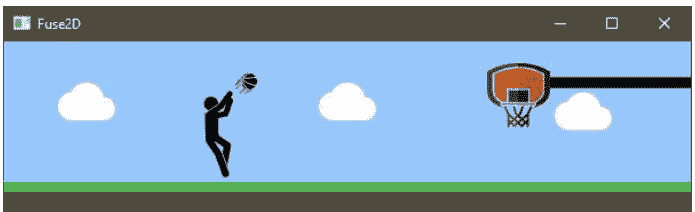

### 图 29 精灵渲染示例


## 结论

我们都可以同意，使用 SDL 渲染纹理相当简单，但这部分归功于我们引擎的构建方式。该系统专门针对特定的一组实体。

请记住，你可以尝试修改 transform 和 sprite，看看它们如何影响 sprite 的渲染。例如，你可以增加缩放比例、更改旋转值，甚至将 sprite 组件中的 flip 值更改为其他值。

# 第 8 章
文本渲染器

## 文本渲染器

在本章中，我们将使用相同的原理，使我们的游戏引擎能够在屏幕上渲染文本。我们将首先了解如何将字体文件加载到引擎中，然后创建文本组件，接着创建系统，最后将所有内容放入场景中进行测试。

### 加载字体资源

将以下函数添加到你的资源注册表中。此函数将用于将字体文件加载到我们的引擎中。

```
engine/src/assets/registry.h

// ...

FUSE_INLINE font_asset* load_font(const std::string& src, const std::string& name, int size) {
    font font;
    font.data = TTF_OpenFont(src.c_str(), size);
    font.filename = src;
    font.size = size;

    if (!font.data) {
        FUSE_ERROR("%s", IMG_GetError());
        return NULL;
    }

    auto asset = new font_asset();
    asset->instance = font;
    asset->name = name;

    _data[type_id<font_asset>()].push_back(asset);
    return asset;
}

// ...
```

这就是在项目中使用外部库的重要原因之一：它为我们抽象了所有复杂性，因此我们只需关注对我们重要的事情。如你所见，我们只需调用 TTF_OpenFont() 来加载字体文件。该函数接受字体文件的路径和该字体的目标大小。

现在让我们创建文本组件，它将存储我们想要在屏幕上显示的文本的所有信息。

### 文本组件

文本渲染也属于“图形”类别。这就是为什么文本组件也将在与 sprite 组件相同的文件中创建。在屏幕上渲染文本需要三个基本组件：字体、文本值（字符串）和颜色。当然，还有其他元素也是渲染文本所必需的，例如背景颜色、对齐方式和字符间距，但如何实现由你来决定。

```
engine/src/ecs/components/graphics.h
struct text_component {
FUSE_INLINE text_component(const text_component &) = default;
FUSE_INLINE text_component() = default;

SDL_RendererFlip flip = SDL_FLIP_NONE;
SDL_Color color = { 0, 0, 0, 255 };
asset_id font = INVALID_ID;
std::string text;
};
```

通过添加上面的代码片段来更新 graphics.h 中的代码。与 sprite 组件类似，我们也为字体使用 asset_id，因为它将暂时在文本渲染器系统中检索。我们将文本的默认颜色设置为黑色，并添加了一个字符串来存储文本的当前值。SDL_Color 是一个结构体，用于存储 RGBA 标准中的颜色值。颜色值是一个 8 位无符号整数，换句话说，是 0 到 255 之间的数字。

### 文本渲染器系统

SDL_ttf 中有许多可用于渲染文本的函数。其中有一个名为 TTF_RenderText_Shaded()。该函数使我们能够渲染带有背景颜色的文本，因此名字中带有 shaded。另一方面，TTF_RenderText_Blended() 渲染没有背景或带有混合模式的文本。还有更多函数，例如 TTF_SetFontStyle(font, TTF_STYLE_BOLD)，可用于尝试字体的样式。查看 SDL_ttf 的文档 [17] 以了解更多可用于你的所有函数。

使用 SDL 渲染文本的方式与渲染纹理的方式类似，因为我们所做的就是从文本创建纹理并渲染它。接下来是一个代码片段，展示了如何定义文本渲染器系统。如你所见，TTF_RenderText_Blended() 接受指向字体的指针、文本值和颜色作为参数，并返回指向 SDL_Surface 的指针，后者只是一个包含用于软件位块传输的像素集合的结构体。然后使用该 surface 通过 SDL_CreateTextureFromSurface() 创建纹理。我们使用 SDL_QueryTexture() 查询该纹理的大小。查询到的大小随后用于创建纹理的目标视口 "rect"，最后，使用上一章中的函数渲染纹理。

在进入下一阶段之前，销毁纹理及其 surface 至关重要，因为这可能是导致游戏随时间变慢的原因。

```
engine/src/ecs/systems/text_renderer_system.h
#pragma once
#include "ecs/system.h"

namespace fuse::ecs {
struct text_renderer_system : system {
    FUSE_NN_INLINE void update(float) {
        for (auto& e : view<text_component>()) {
            // get components
            auto& tr = e.get_component<transform_component>();
            auto& tx = e.get_component<text_component>();

            // get texture from asset registry
            auto& font = _assets->get<font_asset>(tx.font)->instance;

            // create text surface
            SDL_Surface* surface = NULL;
            surface = TTF_RenderText_Blended(font.data,
                                             tx.text.c_str(), tx.color);
            if (!surface) {
                FUSE_ERROR("%s", TTF_GetError());
                continue;
            }

            // create texture from surface
            SDL_Texture* texture = SDL_CreateTextureFromSurface(_renderer, surface);
            SDL_FreeSurface(surface);
            if (!texture) {
                FUSE_ERROR("%s", SDL_GetError());
                continue;
            }

            // query texture size
            int width, height;
            SDL_QueryTexture(texture, NULL, NULL, &width, &height);

            // define target viewport
            SDL_FRect dst {
                tr.translate.x, tr.translate.y,
                width * tr.scale.x, height * tr.scale.y
            };

            // render text
            SDL_RenderCopyExF(_renderer, texture, NULL, &dst, tr.rotation, NULL, tx.flip);
            // destroy texture
            SDL_DestroyTexture(texture);
        }
    }
};
}
```

```
#pragma once
#include "ecs/systems/text_renderer_system.h"
#include "ecs/systems/sprite_renderer_system.h"

namespace fuse::ecs {

struct scene {
    FUSE_INLINE scene(SDL_Renderer* rd): _renderer(rd) {
        register_systems<ecs::sprite_renderer_system>();
        register_systems<ecs::text_renderer_system>();
    }

    FUSE_INLINE void update(float dt) {
        SDL_SetRenderDrawColor(_renderer, 255, 255, 255, 255);
        for (auto& sys : _systems) { sys->update(dt); }
    }

    FUSE_INLINE void start() {
        // load texture asset
        auto font = _assets.load_font("assets/font.ttf", "ft", 30);

        // add entity with text component
        ecs::entity entity = add_entity("entity");
        auto& tx = entity.add_component<ecs::text_component>();
        tx.text = "This is a text!";
        tx.font = font->id;

        // start systems
        for (auto& sys : _systems) { sys->start(); }
    }
}
```

与之前一样，在场景中注册系统，加载字体资源，最后添加带有文本组件的实体。编译并运行，你将得到以下结果。

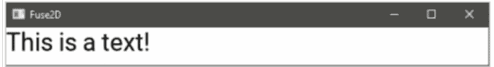


SDL_SetRenderDrawColor() 将渲染器的颜色设置为白色。

## 结论

SDL 提供了更多用于渲染文本的功能，但我们不会关注这一点，因为这不是本书的重点。如今，互联网上的数据比任何图书馆都多，你只需稍微搜索一下就能找到所需的任何内容。


# Chapter 9

## Animation

简单来说，动画就是在特定时间间隔内依次渲染一张张图片，从而产生运动的视觉效果。你将看到在这个游戏引擎中创建动画是多么简单。流程保持不变：我们先创建一个组件，然后是系统，最后在场景中创建一个实体进行测试。

### Animation Component

同样，你需要在头文件 **graphics.h** 中添加下面的代码片段来更新其中的代码，这段代码展示了动画组件的定义方式。这个组件与精灵组件类似，因为它也只接受一个 **asset_id** 作为我们想要播放的动画。

engine/src/ecs/components/graphics.h

```
struct animation_component {
    FUSE_INLINE animation_component(const animation_component&) = default;
    FUSE_INLINE animation_component() = default;
    SDL_RendererFlip flip = SDL_FLIP_NONE;
    asset_id animation = INVALID_ID;
};
```

### Animation System

下面是动画系统的代码。高亮显示的两行是唯一需要解释的部分，其余部分与精灵渲染器系统相同。

我们使用函数宏 `get_ticks_ms()` 获取自 SDL 初始化以来经过的毫秒数。如果你还记得，在关于窗口和事件的章节中，我们提到过我们的动画和运动不是基于帧的，而是基于时间的。也就是说，我们使用当前时间来计算应该将动画的哪一帧渲染到屏幕上。公式中的取模运算符 “%” 是为了确保我们永远不会得到高于当前动画帧数的帧索引。

如果你查看动画的定义，会发现它包含一个 asset_ids 数组。计算出的帧索引用于从该数组中检索我们想要渲染的那一帧的 asset_id。然后，使用检索到的 asset_id 从资源注册表中获取纹理资产。

我们将使用以下帧来测试动画系统。随意使用你在网上找到的任何免费资源。对不起，我不是平面设计师*。

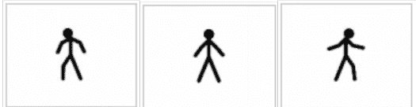

engine/src/ecs/systems/frame_animation_system.h

```
#pragma once
#include "ecs/system.h"

namespace fuse::ecs {
struct frame_animation_system : system {
    FUSE_INLINE void update(float) {
        for (auto& e : view<animation_component>()) {
            // get components
            auto& tr = e.get_component<transform_component>();
            auto& an = e.get_component<animation_component>();

            // get animation from asset registry
            auto& anim = _assets->get<animation_asset>(an.animation)->instance;

            // compute current frame
            int index = (get_ticks_ms() / anim.speed) %
            anim.frames.size();
            auto& frame = _assets->get<texture_asset>(anim.frames[index])->instance;

            // define target viewport
            SDL_FRect dst {
                tr.translate.x, tr.translate.y,
                frame.width * tr.scale.x, frame.height * tr.scale.y
            };

            // render sprite
            SDL_RenderCopyExF(_renderer, frame.data, NULL, &dst,
                tr.rotation, NULL, an.flip);
        }
    }
};
}
```

### Quick Test

进入你的场景，注册你刚刚创建的系统，并使用以下代码在场景中添加一个带有动画组件的实体。
下面是一个代码片段，展示了如何向场景中添加一个带有动画组件的实体。如你所见，我们注册系统，加载动画所需的所有纹理或帧，然后在资源注册表中创建一个动画资产，将每一帧的 asset_id 添加到帧列表中，最后，添加一个带有动画组件的实体，该组件以动画的 asset_id 作为参数。

- engine/src/ecs/scene.h

```
#pragma once
#include "ecs/systems/text_renderer_system.h"
#include "ecs/systems/sprite_renderer_system.h"
#include "ecs/systems/frame_animation_system.h"

namespace fuse::ecs {
struct scene {
    FUSE_INLINE scene(SDL_Renderer* rd): _renderer(rd) {
        register_systems<ecs::frame_animation_system>();
        register_systems<ecs::sprite_renderer_system>();
        register_systems<ecs::text_renderer_system>();
    }

    FUSE_INLINE void start() {
        // load animation textures
        auto f1 = _assets.load_texture("assets/f1.png", "f1", _renderer);
        auto f2 = _assets.load_texture("assets/f2.png", "f2", _renderer);
        auto f3 = _assets.load_texture("assets/f3.png", "f3", _renderer);

        // add animation asset
        auto animation = _assets.add<animation_asset>("dance");
        animation->instance.frames.push_back(f1->id);
        animation->instance.frames.push_back(f2->id);
        animation->instance.frames.push_back(f3->id);
        animation->instance.speed = 300;

        // add entity with animation component
        ecs::entity entity = add_entity("entity");
        auto& a = entity.add_component<ecs::animation_component>();
        a.animation = animation->id;

        // start systems
        for (auto& sys : _systems) { sys->start(); }
    }
};
}
```

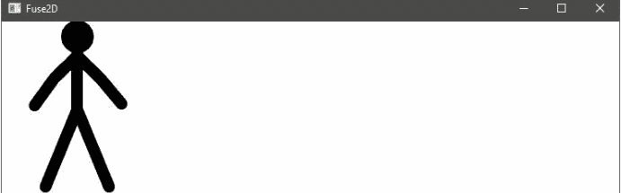

Figure 30 Animation

# Chapter 10

## Tile Map Renderer

基于瓦片的视频游戏是一种游戏或视频游戏，其游戏区域由以网格形式排列的称为瓦片的小方形（或较少见的矩形、平行四边形或六边形）图形图像组成。屏幕由这些瓦片组成是一种技术区别，对玩游戏的人来说可能并不明显。可用于游戏区域的完整瓦片集称为瓦片集。基于瓦片的游戏通常模拟游戏区域的俯视图、侧视图或 2.5D 视图，并且几乎总是二维的。

从 20 世纪 70 年代末到 90 年代中期，许多视频游戏硬件都原生支持显示瓦片屏幕，且 CPU 交互很少。[24]

你已经可以了解我们将在引擎中如何实现这个功能。如果你记得在第 (0) 节中，我们提到过每个瓦片将是一个带有瓦片组件的实体。瓦片地图本身也将是一个带有瓦片地图组件的实体。那么，让我们创建这两个组件。

### TileMap Component

engine/src/ecs/components/graphics.h

```
struct tilemap_component {
    FUSE_INLINE tilemap_component(const tilemap_component&) = default;
    FUSE_INLINE tilemap_component() = default;
    asset_id tilemap = INVALID_ID;
};
```

我们将添加到 **graphics.h** 头文件中的下一个组件是 **瓦片地图组件**。这个组件，就像 **精灵组件** 或 **动画组件** 一样，只是存储一个瓦片地图资产的 **asset_id**。关于这个组件没什么可说的。

### Tile Component

与瓦片地图组件相比，瓦片组件需要更多的数据。首先，瓦片需要知道它属于哪个瓦片地图；其次，该瓦片还需要知道其纹理来自哪个瓦片集；它还需要知道渲染瓦片集的哪一部分，最后，需要知道它将在屏幕上的哪个位置渲染。由于瓦片集只是一个带网格的纹理，我们可以简单地存储瓦片的行和列。下图直观地展示了这一概念。

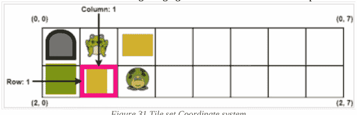

如你所见，行和列的计数从零开始，到 n-1 结束。下面是瓦片组件的代码。将代码添加到 graphics.h 头文件中，位置在瓦片地图组件之后。
engine/src/ecs/components/graphics.h

```
struct tile_component {
    FUSE_INLINE tile_component( const tile_component& ) = default;
    FUSE_INLINE tile_component() = default;
    SDL_RendererFlip flip = SDL_FLIP_NONE;
    asset_id tilemap = INVALID_ID;
    asset_id tileset = INVALID_ID;
    float offset_x, offset_y = 0;
    int row, col = 0;
};
```

我们将渲染一个瓦片集来测试我们的系统。基本上，我们将把这个纹理分割成多个 64x64 大小的瓦片并逐个渲染。既然所有组件都已准备就绪，让我们创建瓦片地图系统。


## 瓦片地图渲染器系统

瓦片地图系统只有一个 update() 函数，如你所见，它首先获取所有带有 tilemap_component 的实体列表，然后我们有一个循环，其中所有带有 tile_component 的实体都被检索并渲染。

在第二个循环中，我们检查当前瓦片是否属于当前瓦片地图，并且还确保该瓦片的瓦片集也是瓦片地图的一部分。当测试通过后，我们将确保根据瓦片地图的位置更新瓦片的位置。我们也可以对旋转和缩放做同样的处理。

最后一步是调用 draw_tile() 函数来渲染瓦片。draw 函数将获取纹理，并根据瓦片的行和列定义一个 src_rect。src_rect 是定义应该渲染瓦片集哪一部分的视口。

要查看瓦片地图网格，我们使用 SDL 函数 SDL_RenderDrawRect() 来渲染 dst_rect。还有 SDL_RenderFillRect()，它渲染一个填充的矩形。

```
engine/src/ecs/systems/tilemap_renderer_system.h
#pragma once
#include "ecs/system.h"

namespace fuse::ecs {
struct tilemap_render_system: system {
    FUSE_INLINE void update(float) {
        for (auto& e : view<tilemap_component>()) {
            auto& tr = e.get_component<transform_component>();
            auto& tm = e.get_component<tilemap_component>().tilemap;

            // get tilemap asset
            auto& tilemap = _assets->get<tilemap_asset>(tm)->instance;

            // render current tilemap's tiles
            for (auto& tile_entt : view<tile_component>())
            {
                // check if tile belongs to current tilemap
                auto& tile = tile_entt.get_component<tile_component>();
                if (tile.tilemap != tm && tile.tilemap.tilesets.count(tile.tileset)) {
                    continue;
                }

                // tile position
                float x = tile.offset_x + tr.translate.x;
                float y = tile.offset_y + tr.translate.y;

                // render tile
                draw_tile(tile.tileset, x, y, tile.row, tile.col,
tilemap.tilesize, tile.flip);
            }
        }
    }

private:
    FUSE_INLINE void draw_tile(asset_id tileset_id, float x,
float y, int row, int col, int size, SDL_RendererFlip flip) {
        SDL_Rect dst_rect = {x * size, y * size, size, size};
        SDL_Rect src_rect = {row * size, col * size, size, size};
        auto& tileset = _assets->get<texture_asset>(tileset_id)->instance;
        SDL_RenderCopyExF(_renderer, tileset.data, &src_rect,
&dst_rect, 0, NULL, flip);

        // render rectangle
        SDL_RenderDrawRectF(_renderer, &dst_rect);
    }
};
}
```

## 快速测试

```
engine/src/ecs/scene.h
FUSE_INLINE void start() {
// load texture
auto ts = _assets.load_texture("assets/tex.png", "", _renderer);
// create tilemap asset
auto tm = _assets.add<tilemap_asset>("tm");
tm->instance.tilesets.insert(ts->id);
tm->instance.col_count = 16;
tm->instance.row_count = 8;
tm->instance.tilesize = 64;
// add tilemap entity
add_entity("tilemap").add_component<tilemap_component>().tilemap = tm->id;
// turn image into multiple entities with tiles
for (int col = 0; col < tm->instance.col_count; col++) {
for (int row = 0; row < tm->instance.row_count; row++) {
ecs::entity e = add_entity("tile");
auto& tile = e.add_component<tile_component>();
tile.tileset = ts->id;
tile.tilemap = tm->id;
tile.offset_x = col;
tile.offset_y = row;
tile.row = col;
tile.col = row;
}
}
// start systems
for (auto& sys : _systems) { sys->start(); }
}
```

注意：确保在构造函数中注册系统！

我们首先要做的是加载瓦片集，它只是一个纹理。然后我们继续创建一个瓦片地图资产并设置其成员变量。然后我们继续添加一个带有瓦片地图组件的实体。由于我们想将瓦片集分解为单个瓦片，我们使用两个 for 循环来获取瓦片集的一个 64x64 瓦片部分，并通过瓦片组件将其附加到实体上。
取决于你的瓦片地图大小，这可能会产生 200 到 300 个以上的瓦片（实体）。

这让我们能够看到当我们的引擎需要渲染许多实体时表现如何。查看任务管理器以了解 CPU 和 GPU 的使用情况。

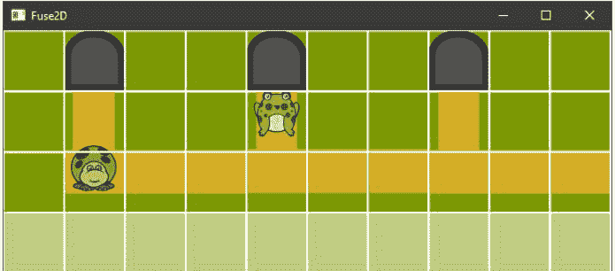

图 32 将纹理转换为瓦片地图

上面的图片显示了我们从瓦片地图渲染器获得的结果。看起来我们只是渲染了纹理，但网格实际上显示了单个瓦片。
我们可以说这是渲染纹理最低效的方式 ■■。
将每个瓦片作为实体的优势在于，我们可以向瓦片添加另一个组件，以赋予它们比仅在屏幕上可见更多的功能。例如，我们可以向某些瓦片添加可破坏组件使其可破坏，或者也许附加一个事件，以便在玩家与其碰撞时执行某些操作。这只是想象力的问题。

## 潜在优化

这种渲染瓦片的方式很高效，但可以以多种方式优化。以下是你可以应用来优化渲染的一些可能技术。

### 瓦片批处理

一个解决方案是将所有使用相同瓦片集的瓦片分组并在一起渲染，而无需为每个瓦片都从资产注册表中检索瓦片集，因为为每个瓦片从资产注册表中检索瓦片集效率相当低。到目前为止，我们还没有为任何系统实现 start 函数。我们可以在进入游戏循环之前使用 start 函数来实现这一点，但我们还将负责跟踪被销毁的瓦片。

### 裁剪空间

另一种可以大幅提升性能的解决方案是只渲染位于屏幕视口内的瓦片。框架外的任何对象都不会渲染到屏幕上。这可以通过使用相机来完成。与 3D 游戏相比，为 2D 游戏创建相机很容易。2D 游戏中的相机只是一个矩形形状，用于告诉渲染器将场景的哪一部分渲染到屏幕上。下图可视化了这一概念。

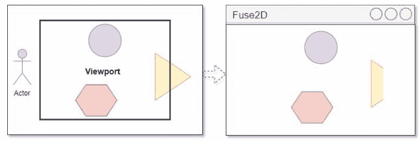

图 33 裁剪空间

### 瓦片缓冲

我认为不错但不容易实现的另一种解决方案是将瓦片渲染到纹理缓冲区中，然后只渲染一个纹理而不是许多瓦片。但这种技术更适合静态和小型瓦片地图，因为纹理缓冲区的大小有限制，且不同系统可能不同。

每种解决方案都有优点和缺点，但由你决定哪种最适合你的游戏。我们不会花时间在上面，因为这本书不是关于优化技术，而是关于建立读者可以在此基础上构建的基础。

## 结论

许多流行游戏都是使用瓦片地图制作的。例如超级马里奥兄弟、吃豆人、塞尔达传说等。这就是为什么我们必须将此功能添加到我们的引擎中的原因。

注意：如果在遵循最后三章时遇到任何问题，你可以直接从我们的 GitHub 仓库克隆仓库。分支名称是“renderers”。

# 第 11 章 物理

### 物理

由于计算机技术的进步，我们现在可以使用计算机科学来模拟现实世界的物理行为。模拟物理通常是对真实物理的一种近似，计算使用离散值。在游戏中，为了更好的游戏体验，某些物理定律会被偏离。一个流行的例子是允许角色在不接触地面的情况下双重跳跃。

刚体和软体是物理模拟中最常见的两种形式。刚体模拟性能开销较小，而软体物理是模拟物体各个部分的过程，以使其行为更加真实。我们将在引擎中仅实现刚体模拟。


有像 Box2D 这样的库可以用于在我们的引擎中实现更好的物理模拟。为了保持简单，我们将实现一个简单的物理系统来执行我们的物理模拟。

Box2D 是一个用于游戏的 2D 刚体模拟库。程序员可以在他们的游戏中使用它，使对象以逼真的方式移动，并使游戏世界更具交互性。从游戏引擎的角度来看，物理引擎只是一个过程动画系统。Box2D 是用可移植 C++ 编写的。引擎中定义的大多数类型都以 b2 前缀开头。希望这足以避免与你的游戏引擎发生名称冲突 [1]。


## 刚体

刚体是指在外力作用下不会产生变形的固体对象。假设物体不发生变形，可以通过减少进行真实模拟所需的参数数量来简化分析。其目的是让我们的玩家，或任何受重力影响的对象，用于碰撞处理等。

### 运动学

在创建任何组件或系统之前，我们首先需要了解刚体在环境中的行为。我们不会深入探讨这个话题，但会简要讨论必要的内容。在现实世界中，刚体使用三个维度（x、y 和 z）来描述，但由于本书的重点是处理 2D 游戏，我们不会在模拟中使用第三个维度。下表描述了刚体的参数在匀速直线运动中如何相互关联。

| 参数 | 方程 |
| :--- | :--- |
| 加速度 [m/s²] | a = (F + Fr + Fg)/m |
| 速度 [m/s] | V = a * t + V0 |
| 位置 [m] | P = V * t + P0 |

上表中的每个参数都是一个带有 (x, y) 分量的 2D 向量。

### 加速度 (a)

在力学中，加速度是物体速度随时间变化的速率。加速度是矢量量（即具有大小和方向）。物体加速度的方向由作用于该物体的合力的方向决定。根据牛顿第二定律，物体加速度的大小是两个原因的综合效果 [21]:

- 作用于该物体的所有外力的合力平衡——大小与此合力成正比。
- 该物体的质量，取决于其制造材料——大小与物体质量成反比。

### 速度 (V)

物体的速度是其位置相对于参考框架变化的速率，是时间的函数。速度相当于指定物体的速度和运动方向（例如，向北 60 km/h）。速度是运动学中的基本概念，运动学是描述物体运动的经典力学分支。[28]

### 摩擦力 (Fr)

摩擦力是作用于两个接触表面之间的力。当施加力使两个表面相互滑动时，会有一个沿表面（平行于表面）方向作用的阻力摩擦力。它是一种阻碍表面滑动的力。表面可能会滑动（此时我们称摩擦力为动摩擦力）或可能不会滑动（此时我们称摩擦力为静摩擦力）。[15]

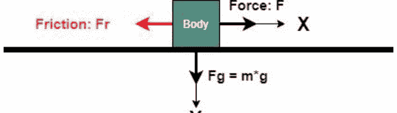

图 34 直线运动

上图是物体直线运动的简化版本。表中的矢量 F 表示施加到物体上使其运动的力。矢量 Fr 表示刚体运动产生的所有摩擦力。它可能在地面上或在空中。物体的质量由 m 表示。Y 轴上的加速度具有重力值，正如我们所料。这就是物体释放到空中后继续下落的原因。重力值取决于你在地球表面的位置，但通常约为 9.8 m/s²，这是我们在模拟中将使用的值。

表中的方程源自这个简单的图表，即上图。如果你对每个轴 X 或 Y 求所有力的和，你将得到与表中相同的方程。

## 刚体组件

现在我们对刚体有了基本了解，想要利用这些知识来实现我们的刚体组件。我们将首先创建一个刚体实例，然后使用该实例来定义我们的组件。
在引擎的文件夹树中创建一个名为 "physics" 的新目录，并添加下面描述的文件。

```
engine/src/physics/rigidbody2.h
#pragma once
#include "math/vec2.h"

namespace fuse {
struct rigidbody2 {
FUSE_INLINE void set_force(const vec2f &f) { force = f; }
FUSE_INLINE void set_force_x(float x) { force.x = x; }
FUSE_INLINE void set_force_y(float y) { force.y = y; }

float gravity_scale = 0.0f;
vec2f velocity;
vec2f force;
};
};
```

重力比例定义了物体受重力影响的程度。我们假设所有物体的质量均为 1 kg，并将使用重力比例来模拟质量差异。
我们在这里不定义加速度，因为我们将通过直接将加速度方程嵌入速度方程来简化表中的方程。
我们已实现一些可用于向刚体施加各种类型力的函数。

```
engine/src/ecs/components/physics.h
#pragma once
#include "physics/rigidbody2.h"

namespace fuse::ecs {
struct rigidbody_component {
FUSE_INLINE rigidbody_component(const rigidbody_component &) = default ;
FUSE_INLINE rigidbody_component() = default ;
bool disabled = false;
rigidbody2 body;
};
};
```

我们为新的组件类别创建了一个名为 "physics.h" 的头文件。任何与物理相关的组件都将添加到此头文件中。
刚体组件非常简单。它具有一个刚体实例和一个布尔值，用于指示是否应模拟刚体物理。

## 刚体系统

接下来是刚体系统代码。它在所有带有刚体组件的实体上循环工作。
在开始任何物理模拟之前，我们必须确保刚体未被禁用。

```
engine/src/ecs/systems/rigidbody_system.h
#pragma once
#include "ecs/system.h"
namespace fuse::ecs {
struct rigid_body_system: system {
FUSE_INLINE void update(float dt) {
for (auto& e : view<rigid_body_component>()) {
auto& bd = e.get_component<rigid_body_component>();
if (bd.disabled) { continue; }

auto& tr = e.get_component<transform_component>();
vec2f f_g = vec2f(0.0f, bd.body.gravity_scale * 9.8f);
bd.body.velocity += (bd.body.force + f_g) * dt;
tr.translate += bd.body.velocity * dt;
}
}
};
}
```

如你所见，我们只需检查刚体是否启用，然后根据力和重力计算其当前位置。

## 快速测试

像往常一样，让我们在场景中测试一切。打开你的 **scene.h** 头文件，在构造函数中注册刚体系统，并添加一个带有刚体组件的实体，如下面的代码片段所示。

```
engine/src/ecs/scene.h

FUSE_INLINE void start() {
    // load sprite
    auto sp = _assets.load_texture("assets/obj1.png", "", _renderer);

    // add tilemap entity
    auto entity = add_entity("rigid body");
    entity.add_component<sprite_component>().sprite = sp->id;
    auto& rb = entity.add_component<rigid_body_component>();
    rb.body.gravity_scale = 1.0f;

    // start systems
    for (auto& sys : _systems) { sys->start(); }
}
```

如果你现在运行代码，由于增量时间（delta time）的原因，什么都不会发生。我之前提到过一件事，即让引擎中的所有运动和动画都基于时间。什么都不发生的原因是迄今为止的增量时间一直为零。我们将添加一个计时器来为我们计算增量时间，但目前，我们将采用一个快速解决方案来测试我们的刚体系统。

## 快速修复

如果你打开 **application.cpp**，你会发现场景的更新函数被调用时增量时间值为零。为了快速测试刚体系统，我们可以简单地传递一个恒定的增量时间值，如下面的代码片段所示。

```
engine/src/core/application.cpp

while (is_running) {
    inputs::dispatch_events();
    SDL_RenderClear(renderer);
    scene->update(0.016666666);
    SDL_RenderPresent(renderer);
}
```

数字 0.016666666 是如果你运行一个每秒约六十帧（60 FPS）的游戏时会得到的增量时间值。如果你编译并运行代码，你会看到你的游戏对象因重力而下落。你可以调整重力比例来查看它如何影响刚体模拟。你还可以调用刚体中定义的一些函数来查看它们的


对模拟的影响。

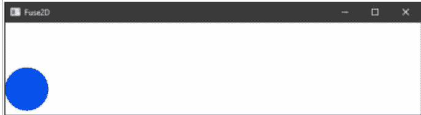

图 35 刚体测试

就这样，我们有了一个用于模拟刚体的系统。但我们仍然有一个问题。所使用的增量时间（delta time）值不应是恒定的，因为增量时间强烈依赖于正在使用的计算机的性能。我们现在使用的值在 PlayStation 或旧计算机上不会相同。这就是为什么我们必须通过向引擎添加适当的增量时间计算来解决这个问题。

## 增量时间

在游戏编程和计算机图形学中，增量时间描述了一个概念，它确保游戏循环中进程的速度与硬件无关。增量时间描述了前一帧与当前渲染帧之间的时间差。增量时间的概念被引入以解决早期计算机游戏中的一个问题：游戏运行速度取决于处理器的速度，因此有时在比游戏开发者预期更快的处理器上不再可玩。[22]

## 基于帧率的游戏

这类游戏不是基于时间，而是基于所使用计算机的帧率。在 30 FPS 机器上移动一个对象，在 60 FPS 机器上运行速度会减半。依赖帧率的游戏会严重影响游戏体验，因为游戏的流程将取决于用于运行游戏的设备的帧率。

## 基于时间的游戏

基于时间的游戏在不同机器上具有相似的行为（运动、动画和物理），无论帧率如何。这意味着，在“基于时间的”游戏中移动的对象将以相同的速率移动，无论计算机速度如何。

当目标是设计多平台游戏时，会使用这种技术。这也是我们希望在引擎中使用它的原因。

- **engine/src/core/application.cpp**

```cpp
#include "pch.h"
#include "inputs.h"
#include "ecs/scene.h"
#include "application.h"
#include "events/system.h"

namespace fuse {
static bool is_running = true;
static float deltatime, last_tick;

FUSE_INLINE bool on_quit(const quit_event&) {
    return is_running = false;
}

FUSE_INLINE void compute_deltatime() {
    deltatime = get_ticks() - last_tick;
    if (deltatime > MAX_DELTATIME) {
        deltatime = MAX_DELTATIME;
    }
    last_tick = get_ticks();
}

FUSE_API void run_application(const app_config& config) {
    // ...

    last_tick = get_ticks();

    while (is_running) {
        compute_deltatime();
        inputs::dispatch_events();
        SDL_RenderClear(renderer);
        scene->update(deltatime);
        SDL_RenderPresent(renderer);
    }

    // ...
}
}
```

在 application.cpp 文件中添加上述高亮的行。如您所见，函数 compute_deltatime() 将通过计算当前帧与上一帧之间的时间差来计算每一帧的 delta 值。为了确保增量时间的值不会过高，我们始终检查其值是否高于某个阈值“MAX_DELTATIME”，在本例中该值为 0.05f。

如果您现在将增量时间的值传递给场景的 update 函数，将获得基于时间的物理模拟。如果您在控制台中打印增量时间的值，将得到类似下面的值。

```
[info] 0.016000
[info] 0.017000
[info] 0.017000
```

请记住，这取决于您的计算机性能。因此，您的增量时间可能与上面的不同。

仅仅让物体因重力下落是不够的。我们还希望它们能响应碰撞。

## 碰撞处理

2D 碰撞由碰撞图形的类型决定。例如，我们有矩形对矩形碰撞或圆形对圆形碰撞。通常，我们会在实体周围有一个名为“盒子碰撞器”的简单矩形形状。这种技术并不完美，但在性能和功能之间提供了特别好的比率。

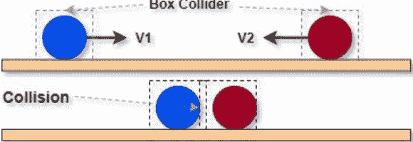

图 36 碰撞

只有当两个碰撞器重叠时，才能检测到碰撞。这种碰撞检测不是像素级精确的。碰撞后发生什么由我们决定。

我们将创建一个碰撞器组件，以确保只有带有碰撞器组件的实体才能对碰撞做出反应。这一点很重要，因为它将减少碰撞测试的数量。

我们还将创建一个单独的碰撞处理系统，以保持代码整洁，因为这将使我们以后更容易添加脚本功能。

## 碰撞器组件

碰撞器组件也应添加到头文件 physics.h 中。以下是显示盒子碰撞器组件定义的代码片段。

engine/src/ecs/components/physics.h

```cpp
#pragma once
#include "physics/cs/rigidbody2.h"

namespace fuse::ecs {
struct rigidbody_component {
FUSE_INLINE rigidbody_component(const rigidbody_component&) = default;
FUSE_INLINE rigidbody_component() = default;
bool disabled = false;
rigidbody2 body;
};

struct collider_component {
FUSE_INLINE collider_component(const collider_component&) = default;
FUSE_INLINE collider_component() = default;
SDL_FRect collider = { 0.0f, 0.0f, 64.0f, 64.0f };
bool disabled = false;
};
}
```

碰撞器组件只是一个使用 SDL_FRect 定义的矩形。它还有一个布尔值，用于指示碰撞器是否处于活动状态。

## 碰撞系统

与其他系统相比，碰撞系统将实现 start 函数，因为我们需要确保盒子碰撞器的位置与实体的初始位置对齐。
下一个代码片段展示了碰撞系统的实现方式。start 函数会获取所有带有碰撞器组件的实体，并将它们的位置设置为所属实体的变换位置。
在 update 函数中，我们每帧重复该过程，同时检查是否发生了碰撞。要检测碰撞，我们只需检查两个矩形图形之间是否存在交集。您可以在 check_collision() 函数中看到这一点。
目前，我们只是在两个实体碰撞时在控制台打印一条消息。为了防止对象与自身碰撞，我们始终检查当前碰撞中涉及的实体是否不相等。

engine/src/ecs/systems/collision_system.h

```cpp
#pragma once
#include "ecs/system.h"

namespace fuse::ecs {
struct collision_system: system {
    FUSE_INLINE void start() {
        for (auto& e : view<collider_component>()) {
            auto& tr = e.get_component<transform_component>();
            auto& col = e.get_component<collider_component>();
            col.collider.x = tr.translate.x;
            col.collider.y = tr.translate.y;
        }
    }

    FUSE_INLINE void update(float) {
        // get entity list
        auto entities = view<collider_component>();

        for (auto& e : entities) {
            auto& tr = e.get_component<transform_component>();
            auto& c1 = e.get_component<collider_component>();

            // update box collider offset
            c1.collider.x = tr.translate.x;
            c1.collider.y = tr.translate.y;

            // continue if disabled
            if (c1.disabled) { continue; }

            // check collision with others
            for (auto& o : entities) {
                if (o == e) { continue; }
                auto& c2 = o.get_component<collider_component>();

                if (check_collision(c1.collider, c2.collider)) {
                    FUSE_INFO("collision: %d -> %d", e.id(), o.id());
                }
            }
        }
    }

private:
    bool check_collision(const SDL_FRect& a, const SDL_FRect& b) {
        return ((a.x < b.x + b.w) && (a.x + a.w > b.x) &&
                (a.y < b.y + b.h) && (a.y + a.h > b.y));
    }
};
}
```

让我们在场景中快速测试一下，看看这是否有效。

engine/src/ecs/scene.h

```cpp
FUSE_INLINE void start() {
 // load sprite
 auto sp1 = _assets.load_texture("assets/obj1.png", "", _renderer);
 auto sp2 = _assets.load_texture("assets/obj2.png", "", _renderer);

 // add tilemap entity
 auto e1 = add_entity("entity1");
 e1.add_component<rigid_body_component>().body.set_force_x(-50);
 e1.get_component<transform_component>().translate.x = 500;
 e1.add_component<sprite_component>().sprite = sp1 >> d;
 e1.add_component<collider_component>();

 auto e2 = add_entity("entity2");
 e2.add_component<rigid_body_component>().body.set_force_x(50);
 e2.add_component<sprite_component>().sprite = sp2 >> d;
 e2.add_component<collider_component>();

 // start systems
 for (auto& sys : _systems) { sys->start(); }
}

FUSE_INLINE void update(float dt) {
 for (auto& sys : _systems) { sys->update(dt); }

 // render box colliders
 SDL_SetRenderDrawColor(_renderer, 0, 0, 0, 255);
 for (auto& e : _registry.view<collider_component>()) {
 auto& c = _registry.get_component<collider_component>(e);
 SDL_RenderDrawRectF(_renderer, &c.collider);
 }

 SDL_SetRenderDrawColor(_renderer, 255, 255, 255, 255);
}
```

注意：不要忘记在构造函数中注册碰撞系统。

我们只是创建两个实体，每个实体都带有刚体组件和碰撞器组件。我们将每个刚体的重力比例保持为零，以确保它们不会因重力而下落。第二个实体距离第一个实体 500 米（像素），它们都以大约 50 m/s 的速度相互移动。

为了避免由于碰撞器位置与对象位置不同而导致的不一致，我们确保系统已启动。这将强制


碰撞系统用于初始化所有碰撞体的位置。
出于调试目的，我们想要渲染盒形碰撞体的形状。为此，我们只需使用 SDL 内置函数来渲染 SDL_FRect。

如果你编译并运行代码，你将看到两个带有盒形碰撞体的对象向相反方向移动，如下图所示。

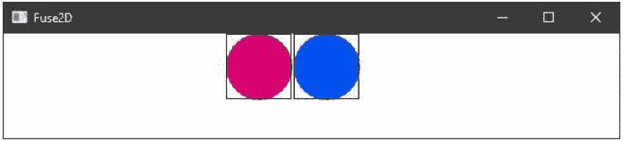

当它们发生碰撞时，终端中将打印以下消息。

```
[info] collision: 2 -> 1
[info] collision: 1 -> 2
[info] collision: 2 -> 1
[info] collision: 1 -> 2
```

你可以在碰撞发生时执行其他操作，而不仅仅是在控制台打印一条消息，从而与碰撞系统进行实验。你可以将重力比例设置为非零值，以便在检测到碰撞时实体可以下落。

```
if (check_collision(c1.collider, c2.collider)) {
    auto& rb = e.get_component<rigidbody_component>();
    rb.body.gravity_scale = 0.5f;
}
```

## 结论

这个物理引擎对于游戏引擎来说是不够的。本书未涵盖许多其他模拟。但就目前而言，它所提供的功能足以制作一款好游戏。

使用 Box2D 这样的库是个聪明的主意，因为它在 2D 游戏行业中广为人知，并在 2D 物理模拟方面提供了更多功能。

注：如果你在自己的代码中遇到任何问题，欢迎从仓库克隆源代码。当前代码的版本位于名为“physics”的分支下。

# 第 12 章 原生脚本

## 原生脚本

迄今为止，本书一直在添加纹理、文本渲染、动画和物理模拟等功能，但我们仍然不太清楚如何利用这些功能来制作游戏。我们不想忘记，游戏引擎的主要目的是制作游戏，而不仅仅是将一堆功能集合在一起。

脚本正是为此而来。它将使我们能够利用迄今添加的所有功能来创建游戏。

脚本语言（也称为脚本语言）是一种用于运行时系统的编程语言，用于自动执行原本需要由人工操作员独立完成的进程。

脚本语言通常是解释型而非编译型。[26]

## 编译型和解释型脚本

从标题可以看出，我们将创建一个原生脚本系统。这意味着它将使用与引擎相同的编程语言，并且也是一个编译型而非解释型的脚本系统。这意味着脚本是作为引擎源代码的一部分编写的，并与引擎一起编译。与编译型脚本相比，解释型脚本效率稍低，但它提供了在运行时热重载而无需重启应用程序的能力。不过，创建这样的系统需要了解多种编程语言和内存布局，而这不是本书要尝试的。编译版本的优势在于其原生性，这意味着更好的性能和较低的复杂度。

下图展示了一个使用 C# 作为编程语言的解释型脚本系统示例。C# 是最广泛使用的脚本语言之一，因为它易于与 C++ 集成，并且易于理解。

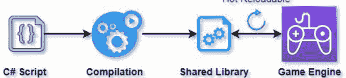

图 37 C# 脚本架构示例

Unity3D 和许多其他游戏引擎使用 C# 进行脚本编写。还有 Lua、Java、JavaScript 等其他语言。上图中的 C# 代码将被编译为动态共享库，该库可以在运行时链接到引擎，引擎将简单地调用脚本中的函数来执行开发者的任务。

虽然这个图看起来很简单，但将其组合在一起所需的努力可能比你想象的更多。这或许可以作为另一本书的好主题，但目前，让我们专注于原生脚本。

## 抽象脚本

由于将有许多脚本通过单个系统运行，我们必须以某种方式为所有脚本创建一种模式。我们希望所有脚本都具有某些函数，这样我们就可以调用它们而无需检查该函数是否存在。这就是为什么我们将使用虚函数和继承。本节将介绍创建一个核心类，所有脚本都将继承该类，并决定是否要实现虚函数的自己的版本。由于这个脚本系统与实体组件系统紧密相关，我们希望轻松访问注册表中实体的组件。这就是为什么我们将创建一个自定义实体对象，该对象可以访问注册表。该实体对象将在我们的脚本中用于操作实体。让我们先创建实体对象，其余部分就会更加清晰。

### 创建脚本实例

下一个代码片段展示了脚本实例的定义。请确保在引擎的文件夹树中创建相同的文件来更新它。如你所见，这是一个带有许多虚函数的抽象类。在成员变量部分，我们定义了一个实体 ID、一个指向资产注册表的指针和一个指向 ecs::registry 的指针。实体 ID 是带有脚本的游戏对象。指向资产注册表的指针很重要，因为我们希望在脚本中也能访问所有资产。

最上方是一个名为 script_props 的结构体，它只是我们定义的一个简单容器，用于保存初始化脚本实例所需的参数。我们有一组虚函数，可以在派生脚本中实现，以对实体执行自定义行为。init() 函数用于将成员变量设置为适当的值。

我们还在底部有一个 script_instantiator，它是一种 lambda 函数类型，用于实例化脚本实例。C++ 允许我们使用 lambda 表达式创建内联函数，这对于那些不会被重复使用且不值得命名的简短代码片段很有用。script_instantiator 函数返回一个指向脚本实例的指针，并以 script_props 作为参数。该参数将传递给脚本的 init() 函数以设置其成员变量。

```
engine/src/scripts/script_instance.h
```

```
#pragma once
#include "ecs/components/graphics.h"
#include "ecs/components/physics.h"
#include "ecs/components/common.h"
#include "ecs/entity.h"

#include "assets/registry.h"
#include "core/inputs.h"

namespace fuse {
struct script_props {
FUSE_INLINE script_props(ecs::entity_id e, ecs::registry* r,
asset_registry* a):
entity(e), registry(r), assets(a) {}
ecs::entity_id entity = INVALID_ID;
ecs::registry* registry = NULL;
asset_registry* assets = NULL;
};

struct script_instance {
FUSE_INLINE virtual ~script_instance() = default;

FUSE_INLINE void init(const script_props& props) {
this->registry = props.registry;
this->assets = props.assets;
this->entity = props.entity;
}

FUSE_INLINE virtual void on_collision(ecs::entity) {}
FUSE_INLINE virtual void on_update(float) {}
FUSE_INLINE virtual void on_destroy() {}
FUSE_INLINE virtual void on_start() {}

private:
ecs::entity_id _entity = INVALID_ID;
ecs::registry* _registry = NULL;
asset_registry* _assets = NULL;
};

// script allocator function type
using script_instantiator = std::function<script_instance*(const script_props&)>;
}
```

由于 registry 是私有成员变量，任何继承自 script_instance 的脚本都无法访问它。这意味着我们将无法访问实体的组件。

为了解决这个问题，我们将在此处将 add-、get-、remove 组件函数的几个实现添加为受保护的成员函数。因此，请在脚本实例结构体中添加以下代码片段。

### engine/src/scripts/script_instance.h

```
// ...
protected:
    template <typename T, typename... Args>
    FUSE_INLINE T& add_component(Args&&... args) {
        return _registry->add_component<T>(_entity, std::forward<Args>(args)...);
    }

    template <typename T>
    FUSE_INLINE T& get_component() {
        return _registry->get_component<T>(_entity);
    }

    template <typename T>
    FUSE_INLINE void remove_component() {
        return _registry->remove_component<T>(_entity);
    }

    template <typename T>
    FUSE_INLINE bool has_component() {
        return _registry->has_component<T>(_entity);
    }

    FUSE_INLINE ecs::entity add_entity() {
        auto entity = _registry->add_entity();
        _registry->add_component<ecs::transform_component>(entity);
        _registry->add_component<ecs::info_component>(entity);
        return ecs::entity(entity, _registry);
    }
// ...
```

我们现在将能够轻松访问当前持有脚本的实体的所有有价值信息。add_entity() 函数将添加一个带有某些核心组件的新实体，并返回一个实体对象。

我们现在拥有创建脚本组件及其系统所需的一切。流程保持不变，我们先创建组件，然后创建系统，并测试一切是否协同工作。


## 脚本组件

我们将在一个名为“behaviour.h”的新头文件中创建另一类组件。以下是脚本组件定义的代码片段。
engine/src/ecs/components/behaviour.h

```
#pragma once
#include "scripts/script_i_instance.h"

namespace fuse::ecs {
struct script_component {
FUSE_INLINE script_component(const script_component&) = default;
FUSE_INLINE script_component() = default;

template <typename T>
FUSE_INLINE void bind() {
instantiate = [](const script_props& props) {
auto script = static_cast<script_i_instance*>(new T());
script->init(props);
return script;
}};

script_i_instance* instance = NULL;
script_instantiator instantiate;
std::string name;
};
```

在成员变量部分，我们有一个指向脚本实例的指针、一个实例化器以及脚本的名称。如你所见，成员函数 bind() 用于设置该 lambda 表达式“instantiate”的值，它将被调用来创建脚本实例。别担心，片刻后你就会明白。

## 脚本系统

脚本系统的主要工作是定位所有带有脚本组件的实体，实例化它们的脚本实例，并调用它们的 **on_start()** 和 **on_update()** 函数。以下是脚本系统的代码片段。

```
#pragma once
#include "ecs/system.h"

namespace fuse::ecs {
struct script_system {
FUSE_INLINE ~script_system() {
for (auto& e : view<script_component>()) {
auto& script = e.get_component<script_component>();
FUSE_DELETE(script.instance);
}
}

FUSE_INLINE void start() {
for (auto& e : view<script_component>()) {
auto& script = e.get_component<script_component>();
script.props(e, _registry, _assets);
script.instance = script.instantiate(props);
script.instance->on_start();
}
}

FUSE_INLINE void update(float dt) {
for (auto& e : view<script_component>()) {
e.get_component<script_component>().instance->on_update(e, dt);
}
}
};
}
```

如你所见，我们在脚本系统的 start 函数中调用每个实体脚本的 start 函数，并在脚本系统的 update 函数中调用实体脚本组件的 update 函数。
我们还要确保为每个脚本实例分配的内存也会被释放。这就是为什么我们定义了系统的析构函数。

## 碰撞回调

如果你仔细查看脚本实例的定义，会发现它还有一个名为 on_collision(ecs::entity) 的函数。当带有脚本的实体与另一个实体碰撞时，应该调用这个函数。与其碰撞的实体将作为参数传递，以便可以对该实体采取进一步操作。然而，在脚本系统中，我们无法调用该函数。这就是为什么我们将更新碰撞系统的代码，以便当带有脚本的实体与另一个实体碰撞时，可以调用 on_collision() 函数。

```
engine/src/ecs/systems/collision_system.h

FUSE_INLINE void update(float) {
    // get entity list
    auto entities = view<collider_component>();

    for (auto& e : entities) {
        auto& tr = e.get_component<transform_component>();
        auto& c1 = e.get_component<collider_component>();

        // update box collider offset
        c1.collider.x = tr.translate.x;
        c1.collider.y = tr.translate.y;

        // continue if disabled
        if(c1.disabled) { continue; }

        // check collision with others
        for (auto& o : entities) {
            if (o == e) { continue; }
            auto& c2 = o.get_component<collider_component>();
            if(check_collision(c1.collider, c2.collider)) {
                if(e.has_component<script_component>()) {
                    auto& script = e.get_component<script_component>();
                    script.instance->on_collision(o);
                }
            }
        }
    }
}
```

上面的代码片段展示了如何修改碰撞系统的 update 函数以调用脚本的 on_collision() 函数。我们在这里只需要做一件事：确保每次发生碰撞时，检查实体是否具有脚本组件。如果有，我们将调用 on_collision() 函数，并传入它碰撞的实体作为参数以供后续使用。
就这样！我们现在有一个现成的脚本系统。我们想通过创建一个玩家控制器脚本来测试它，该脚本将允许我们使用 A、S、D 和 W 键移动对象。

## 玩家控制器脚本

本节将介绍如何创建一个脚本，允许我们使用键盘移动实体。请在脚本文件夹中创建一个名为 player_controller.h 的新头文件。

以下是玩家控制器脚本的定义。

```
engine/src/scripts/player_controller.h
#pragma once
#include "script_instance.h"
namespace fuse {
struct player_controller : script_instance {
FUSE_INLINE void on_start() {
FUSE_INFO("player_script started!");
}
FUSE_INLINE void on_collision(ecs::entity e) {
FUSE_INFO("colliding with: %d", e.id());
}
FUSE_INLINE void on_update(float dt) {
auto& t = get_component<ecs::transform_component>();
if(inputs::is_key(SDL_SCANCODE_A)) { // move left
t.translate.x -= (speed * dt);
}
if(inputs::is_key(SDL_SCANCODE_D)) { // move right
t.translate.x += (speed * dt);
}
if(inputs::is_key(SDL_SCANCODE_W)) { // move up
t.translate.y -= (speed * dt);
}
if(inputs::is_key(SDL_SCANCODE_S)) { // move down
t.translate.y += (speed * dt);
}
}
private:
float speed = 300.0f;
};
```

该脚本定义了父脚本类的一些函数。update() 函数获取实体的变换组件，并根据按下的键更新其值。SDL 有一种特定类型来表示键盘上的每个键，称为 **SDL_Scancode**。它基本上是 SDL 键盘扫描码表示的枚举。你可以在此处查看完整的键码列表 [11]。

你只需输入 **SDL_SCANCODE_** 即可使用 IntelliSense 查找任何键的扫描码。
让我们将此脚本附加到场景中的一个实体，看看我们的脚本系统是否按预期工作。

## 测试玩家控制器脚本

在场景的构造函数中注册脚本系统，并按如下代码片段添加一些实体。

```
engine/src/ecs/scene.h
FUSE_INLINE void start() {
// load sprite
auto spl = _assets.load_texture("assets/obj 1.png", "", _renderer);
auto sp2 = _assets.load_texture("assets/obj 2.png", "", _renderer);

// add tilemap entity
auto e1 = add_entity("entity1");
e1.add_component<script_component>().bind<player_controller>();
e1.get_component<transform_component>().translate.x = 500;
e1.add_component<sprite_component>().sprite = spl->id;
e1.add_component<collider_component>();

auto e2 = add_entity("entity2");
e2.add_component<sprite_component>().sprite = sp2->id;
e2.add_component<collider_component>();

// start systems
for (auto& sys : _systems) { sys->start(); }
}
```

如果你编译并运行项目，将能够使用 A、S、D 和 W 键移动 entity2，如果你撞到第二个实体，将在终端中看到一些碰撞消息被打印出来。

## Fuse2D

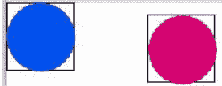

```
[info] player_script started!
[info] colliding with: 2
[info] colliding with: 2
```

## 结论

我们现在正式准备好使用这个引擎创建游戏了。我真的很想祝贺你没有放弃。我希望你为自己感到骄傲。

在下一章中，我们将创建一个简单的射击游戏，连接我们迄今为止拥有的所有部分。

如果出于某种原因你的代码无法正常编译或运行，你仍然可以从 GitHub 克隆代码并从中学习。迄今所做的所有更改都在分支 "scripting" 中。

# 第 13 章

## 制作游戏

## 制作游戏

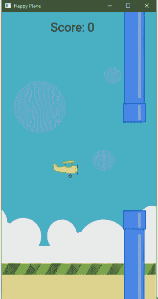

构建游戏引擎而不考虑如何用它来制作游戏是危险的。但你不必担心，因为我已经做好了功课。本章将介绍如何使用我们迄今为止添加到引擎中的所有部分来制作一个简单的射击游戏。图 38 是我们将在本章中构建的游戏的截图。它是著名游戏“Flappy Bird”的复刻版。

Flappy Bird 是一款 2013 年的移动应用，由越南开发者 Dong Nguyen 开发，由 Gears Studios 发布。该应用最初于 2013 年 5 月为 Android 和 iPhone 5 开发，随后适配 iOS 6，然后于 2013 年 9 月适配 iOS 7。[23]

图 38 Flappy Plane

制作这个游戏我们只需要一张背景图、一个玩家或飞机的精灵、一个滚动地面的精灵、一个用于显示分数的字体文件，以及两个音效，一个用于背景音乐，一个用于玩家死亡时。用于制作


游戏可在 GitHub 仓库中找到。

## 开始使用

我们要做的第一件事是更改游戏配置。因此，请确保像下面所示更新应用程序的配置。

```
game/src/game.cpp

#include <core/entry.h>
fuse::app_config fuse::create_application() {
    fuse::app_config config;
    config.title = "Flappy Plane";
    config.version = "0.0.1";
    config.width = 380;
    config.height = 720;
    return config;
}
```

如您所见，我们已更改了应用程序窗口的宽度、高度和标题。

## 脚本实例更新

在上一章中，我们通过使用键盘移动实体来测试脚本系统。但是，如果我们想要访问某些资产呢？或者假设我们想要在场景中查找特定实体，等等。例如，我们希望在玩家死亡时更改其精灵。这正是我们在这里想要做的。我们希望向脚本实例添加更多成员函数，以允许访问资产注册表。

```
engine/src/scripts/script_instance.h
protected:
// ...
FUSE_INLINE void destroy() {
    _registry->destroy(_entity);
}

FUSE_INLINE ecs::entity find_entity(const std::string& name) {
    for(auto& e : _registry->view<ecs::info_component>()) {
        auto& i = _registry->get_component<ecs::info_component>(e);
        if(!i.name.compare(name)) {
            return ecs::entity(e, _registry);
        }
    }
    return ecs::entity();
}

template <typename T>
FUSE_INLINE T* get_asset(const std::string& name) {
    return _assets->get<T>(name);
}
// ...
```

第一个函数“destroy”可用于删除当前持有脚本的实体。第二个函数“find_entity”使用作为参数提供的名称查找实体。最后，我们有一个方法，它接受一个字符串、一个模板类型并返回资产指针。此函数将搜索类型为“T”且名称作为参数提供的资产。

## 添加背景精灵

游戏场景的背景只不过是一个附加了精灵组件的实体。接下来是一个代码片段，展示如何将背景实体添加到场景中。

- engine/src/ecs/scene.h

```
FUSE_INLINE void start() {
  // load player sprites
  auto dead = _assets.load_texture("assets/dead.png", "dead",
                                     _renderer);
  auto fly = _assets.load_texture("assets/fly.png", "fly", _renderer);
  // load pipe sprite
  auto pipe = _assets.load_texture("assets/pipe.png", "pipe",
                                   _renderer);
  // load bg texture
  auto ground = _assets.load_texture("assets/ground.png",
                                     "ground", _renderer);
  auto background = _assets.load_texture("assets/bg.png", "bg",
                                         _renderer);
  // load text font
  auto font = _assets.load_font("assets/font.ttf", "font", 30);

  // background
  auto bg = add_entity("background");
  bg.add_component<sprite_component>().sprite = background->id;

  // start systems
  for (auto& sys : _systems) { sys->start(); }
}
```

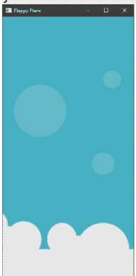

上面的代码片段展示了制作游戏所需的一些资产是如何加载到资产注册表中的，以及如何通过带有精灵组件的实体将背景图像添加到场景中。我们确保每个资产都有有效的名称，以便以后可以使用该名称来搜索它们。

目前，我们不加载任何音频，但会在合适的时候进行。如果您编译代码，将能够看到如下图所示渲染的背景图像。


图 39 地面精灵

## 添加地面精灵

我们想要添加地面以防止飞机永远下落。地面将带有一个盒形碰撞器，以便与飞机进行碰撞检测。它还将进行动画处理，以产生连续平移运动的感觉。

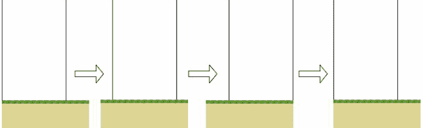

图 40 地面平移运动

由于游戏必须持续到玩家存活，我们必须使此动画无限循环。我们可以通过在帧动画中简单地从一帧切换到下一帧来实现相同的效果。但是，因为我不是艺术家，而且我们想看看脚本系统的潜力，我们将简单地使用脚本来实现。

```
engine/src/scripts/scrolling_ground.h
#pragma once
#include "script_instance.h"
namespace fuse {
struct scrolling_ground : script_instance {
FUSE_INLINE void on_start() {
width = get_asset<texture_asset>("ground")->instance.width;
}
FUSE_INLINE void on_update(float dt) {
auto& tr = get_component<ecs::transform_component>();
if(tr.translate.x + width < 380) {
tr.translate.x = 0.0;
}
}
private:
float width;
};
}
```

我们在此脚本中实现了一个启动函数和一个更新函数。启动函数将检索地面精灵的宽度。这一点很重要，因为我们将使用它来检查精灵的当前位置加上其高度是否小于窗口的宽度。如果是这种情况，我们就会知道需要将地面精灵移回其初始位置。在“on_update”函数中使用的“380”只不过是窗口的宽度。

我们本可以将游戏配置作为参数传递给“script_instance”构造函数，以便通过调用父函数获取宽度，但那将是你的工作。

## 添加地面实体

下面是展示如何将地面实体添加到场景中的代码片段。请务必相应地更新场景的启动函数。

```
engine/src/ecs/scene.h
```cpp
FUSE_INLINE void start() {
// load player sprites
auto dead = _assets.load_texture("assets/dead.png", "dead",
_renderer);
auto fly = _assets.load_texture("assets/fly.png", "fly", _renderer);
// load pipe sprite
auto pipe = _assets.load_texture("assets/pipe.png", "pipe",
_renderer);
// load bg texture
auto ground = _assets.load_texture("assets/ground.png",
"ground", _renderer);
auto background = _assets.load_texture("assets/bg.png", "bg",
_renderer);
// load text font
auto font = _assets.load_font("assets/font.ttf", "font", 30);

// background
auto bg = add_entity("background");
bg.add_component<sprite_component>().sprite = background->id;

// ground
auto gd = add_entity("ground");
auto& gds = gd.add_component<ecs::script_component>();
gds.bind<scrolling_ground>();
gds.name = "scrolling_ground";
auto& gd_tr = gd.get_component<transform_component>();
gd_tr.translate = vec2f(0.0f, 620);
gd.add_component<rigidbody_component>().body.velocity.x = -100.0f;
auto& gd_sp = gd.add_component<sprite_component>().sprite = ground->id;
auto& gd_cl = gd.add_component<collider_component>();
gd_cl.collider = { 0, 0, (float)ground->instance.width,
(float)ground->instance.height };

// start systems
for (auto& sys : _systems) { sys->start(); }
}
```
```

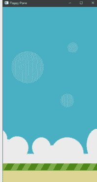

我们首先添加之前描述的脚本，然后希望确保精灵位于正确的位置。这就是为什么我们检索转换组件并设置其位置。

平移运动由刚体系统处理。这就是为什么我们将刚体的速度设置为“-100”。我们还添加了一个与精灵大小完全相同的盒形碰撞器。

这就是在游戏中实现滚动地面所需的全部操作。因此，如果您编译并运行，将看到一个带有背景颜色和滚动地面的窗口，如下图所示。

## 玩家控制器脚本

下面是玩家控制器脚本的代码片段。

```
engine/src/scripts/player_controller.h
```


```cpp
#pragma once
#include "script_instance.h"

namespace fuse {
struct player_controller : script_instance {
    FUSE_INLINE void on_collision(ecs::entity e) {
        auto& sp = get_component<ecs::sprite_component>();
        sp.sprite = get_asset<texture_asset>("dead")->id;
        get_component<ecs::collider_component>().disabled = true;
        get_component<ecs::rigid_body_component>().disabled = true;
    }

    FUSE_INLINE void on_update(float dt) {
        auto& rb = get_component<ecs::rigid_body_component>();
        if (inputs::is_key(SDL_SCANCODE_SPACE)) {
            rb.body.set_force_y(-1000.0f);
        }
        else {
            rb.body.set_force_y(0.0f);
        }
    }
};
}
```

为了让飞机保持在空中，我们使用空格键。当按下空格键时，会向飞机施加一个向上的推力，以抵御使其下坠的重力。玩家还需要响应与水管和地面的碰撞。

我们正在实现 "on_update" 和 "on_collision" 两个函数。更新函数会在每次按下空格键时向飞机施加推力。如果玩家与水管或地面发生碰撞，我们会将其精灵更换为显示玩家已死亡的另一个精灵。然后我们禁用刚体和碰撞器组件，以防止系统继续更新它们。

注意：你也可以使用鼠标按钮代替空格键。

## 添加玩家实体


用于玩家。左侧的第一个精灵用于飞机飞行时，第二个用于飞机坠毁时。

让我们返回场景并添加一个玩家实体。以下是代码片段。

```
FUSE_INLINE void start() {
 // ...
 // // player
 auto & player = add_entity("player");
 auto & ps = player.add_component<ecs::script_component>();
 ps.bind<player_controller>();
 ps.name = "player_controller";
 auto & tr = player.add_component<transform_component>();
 tr.translate = vec2f({126, 360});
 tr.scale = vec2f(0.5f);
 auto & rb = player.add_component<rigidbody_component>();
 rb.body.gravity_scale = 25.0f;
 player.add_component<sprite_component>().sprite = fly_id;
 auto & cl = player.add_component<collider_component>();
 cl.collider = { 0, 0, 58, 38 };
 // start systems
 for (auto & sys : _systems) { sys->start(); }
}
```

我们正在添加一个带有脚本组件的实体。迄今为止我们还没有为脚本组件的名称用过任何用途，但设置其值很重要，因为我们稍后将使用它来序列化和反序列化场景。序列化将在下一章中实现。

玩家还有一个刚体和一个碰撞器组件。盒形碰撞器的大小适合我使用的精灵。因此，如果你为飞机使用不同的精灵，请务必设置自己的值。我们正在获取玩家的变换组件以设置其初始位置，基本上是屏幕中心。我们必须增加重力缩放值，以增加重力对飞机的影响。

如果你编译并运行代码，就可以使用空格键让飞机保持在空中。但如果撞到地面，玩家精灵会改变，并且它将停止移动。

## 图 41 玩家控制

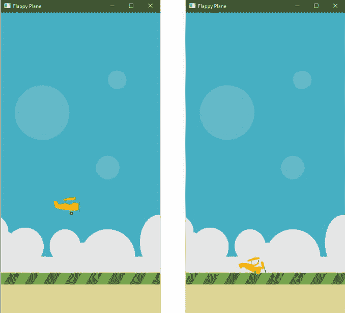

飞机坠毁时我们也将停止地面滚动运动。但让我们先添加一个水管生成器。

## 水管生成器

水管生成器也是一个实体。它将在特定的时间间隔内生成水管，以便玩家躲避。由于水管将在运行时生成，我们需要在生成器上附加一个脚本来持续生成水管，并确保它们在屏幕外被销毁。


```
engine/src/scripts/pipe_spawner.h
#pragma once
#include "script_instance.h"

namespace fuse {
struct pipe_spawner : script_instance {
    FUSE_INLINE void on_update(float dt) {
        // ... coming next
    }

    FUSE_INLINE void spawn_pipe(float x, float y) {
        // ... coming next
    }

    FUSE_INLINE void update_pipes() {
        // ... coming next
    }

private:
    std::vector<ecs::entity> pipes;
    bool game_over = false;
    float time = 0.0f;
    int score = 0;
};
}
```

以上是“pipe_spawner”脚本的简单定义。我们将在片刻之后逐一介绍每个成员函数的实现。

在成员变量部分，我们定义了一些重要变量。我们有一个名为 "pipes" 的数组，它将保存所有创建的水管列表。这很重要，因为我们希望在水管超出屏幕视口时将其销毁。

实现此目的的另一种方法是在创建水管时创建一个脚本并将其附加到水管上。该脚本将每帧检查水管的当前位置，并在其超出边界时将其销毁。但将脚本附加到生命周期较短的对象（如粒子）上不是良好做法，因为创建脚本需要堆分配，当活动脚本过多时可能会导致性能问题。

我们有一个名为“game_over”的布尔值，用于告诉我们飞机是否已坠毁。我们将使用“time”来知道何时生成新水管，最后我们有“score”。

```
engine/src/scripts/pipe_spawner.h
// ...
FUSE_INLINE void spawn_pipe(float x, float y) {
    auto pipe = add_entity();
    auto& tr = pipe.get_component<ecs::transform_component>();
    tr.translate = vec2f(x, y);

    // add rigid body
    auto& rb = pipe.add_component<ecs::rigidbody_component>();
    rb.body.gravity_scale = 0.0f;
    rb.body.velocity.x = -100.0f;

    // add sprite
    auto pipe_sprite = get_asset<texture_asset>("pipe");
    auto& sp = pipe.add_component<ecs::sprite_component>();
    sp.flip = (y < 0) ? SDL_FLIP_NONE : SDL_FLIP_VERTICAL;
    sp.sprite = pipe_sprite->id;

    // add collider
    auto& cl = pipe.add_component<ecs::collider_component>();
    cl.collider = {
        tr.translate.x,
        tr.translate.y,
        (float)pipe_sprite->instance.width,
        (float)pipe_sprite->instance.height
    };
    pipes.push_back(pipe);
}
// ...
```

以上是用于生成水管的水管生成器脚本成员函数。它将必须生成水管的位置作为参数。
正如你所见，我们正在创建一个带有刚体、精灵和碰撞器组件的实体。因为我们总是需要从上到下创建一个水管，以及从下到上创建另一个水管，所以我们检查 y 轴上的位置是否小于零，以确定精灵是否需要垂直翻转。
盒形碰撞器的大小与精灵大小相同。
创建水管只需要做这些。让我们看看函数

## "update_pipes" 的工作原理。

```
engine/src/scripts/pipe_spawner.h

// ...
FUSE_INLINE void update_pipes() {
    auto it = pipes.begin();
    while (it != pipes.end()) {
        // remove dead pipe
        auto& pipe = (*it);
        if (!pipe.is_alive()) {
            it = pipes.erase(it);
            continue;
        }
        it++;
    }
}
// ...
```

"update_pipes" 函数的主要工作是遍历水管列表，检查是否有水管超出边界并将其销毁。这非常重要，因为如果没有它，每次创建一对水管时内存大小都会增加。使用 while 循环是因为我们希望在遍历数组的同时能够从中删除数据。

在查看“on_update”函数之前，我希望你在 math 文件夹中定义以下函数，因为它将用于生成随机数。

```
engine/src/math/random.h
#pragma once
namespace fuse::math {
    FUSE_INLINE int random(int min, int max) {
        static bool first = true;
        if (first) {
            srand(time(NULL)); // seeding for the first time only!
            first = false;
        }
        return min + rand() % ((max + 1) - min);
    }
}
```


此函数获取我们希望生成的数字所在区间的最小值和最大值，并返回生成的数字。[10]

```
engine/src/scripts/pipe_spawner.h
```

```cpp
// . . .
FUSE_LINE void on_update(float dt) {
  if(game_over) { return; }

  // find player
  auto player = find_entity("player");
  auto& p_rb = player.get_component <ecs::rigidbody_component> ();

  // check if player's rigidbody is disabled
  if(player.is_alive() && p_rb.disabled) {
    // stop ground scroll animation
    auto ground = find_entity("ground");
    auto& gd = ground.get_component <ecs::rigidbody_component> ();
    gd.disabled = true;

    // stop all pipes motion
    for(auto& pi_pipe : pipes) {
      auto& rb = pi_pipe.get_component <ecs::rigidbody_component> ();
      rb.disabled = true;
      auto& co = pi_pipe.get_component <ecs::collider_component> ();
      co.disabled = true;
    }

    game_over = true;
    return;
  }

  // update pipes
  update_pipes();

  // create pipes
  if(time > 2.5f) {
    time = 0.f;
    float space = math::random(60, 150);
    spawn_pipe(380, -space);
    spawn_pipe(380, 720/2 + space);
  }

  // update counter
  time += dt;
}
// . . .
```

我们首先检查 "game_over" 是否设置为 true。如果不是，我们检查玩家的刚体是否被禁用。只有当玩家与管道或地面碰撞时才会发生这种情况。当这种情况发生时，我们

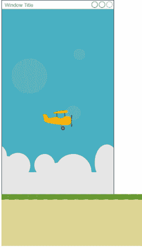

必须确保通过禁用其刚体来停止地面运动。我们还通过禁用管道的刚体来停止所有管道运动。

如果飞机仍在飞行，我们调用更新函数来移动我们的管道。然后我们检查是否已过去 2 秒。如果是，我们将使用 "spawn_pipe" 函数创建另一对管道。

## 图 43 幕后

图 43 展示了游戏运行时幕后发生的情况。管道是在屏幕视口之外创建的，由于刚体的存在，它们将开始向玩家移动。每次我们创建一对管道时，都会将时间值重置为零，以便在玩家存活期间重新开始循环。

如果你编译你的项目，你将能够看到管道被创建。

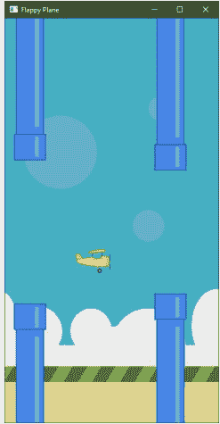

### 添加得分

得分也将是一个带有文本组件的实体。以下是将得分实体添加到场景中的代码。

```
engine/src/ecs/scene.h
FUSE_INLINE void start() {
    // ...

    // score text
    auto score = add_entity("score");
    auto& s_tr = score.get_component<transform_component>();
    s_tr.translate = vec2f(120, 20);
    auto& tx = score.add_component<text_component>();
    tx.text = "Score: 0";
    tx.font = font->id;

    // start systems
    for (auto& sys : _systems) { sys->start(); }
}
```

这个实体非常简单。它只有一个变换组件和一个文本组件。如果你运行你的代码，你将能够在屏幕上看到文本。然而，它的值不会相应更新。所以，让我们来修复它。

### engine/src/scripts/pipe_spawner.h

```
// ...
FUSE_INLINE void update_pipes() {
    auto it = pipes.begin();
    while (it != pipes.end()) {
        // remove dead pipe
        auto &pipe = (*it);
        if (!pipe.is_alive()) {
            it = pipes.erase(it);
            continue;
        }

        // destroy if out of the screen and set score
        auto &tr = pipe.get_component<ecs::transform_component>();
        if (tr.translate.x < -50) {
            pipe.destroy();
            auto &tx = find_entity("score").get_component<ecs::text_component>();
            tx.text = "Score: " + std::to_string(++score);
        }

        it++;
    }
}
// ...
```

在 "update_pipes" 函数中，我们通过将当前得分的值转换为字符串来更新得分的文本。这简单地意味着当一对精灵移出视野时，得分将增加一。处理这件事有更好的方法，但那留作你的课后作业。

### engine/src/scripts/pipe_spawner.h

```cpp
// . . .
FUSE_INLINE void on_update(float dt) {
if(game_over) { return; }
// find player
auto player = find_entity("player");
auto& p_rb = player.get_component<ecs::rigidbody_component>();
// check if player's rigidbody is disabled
if(player.is_alive() && p_rb.disabled) {
// stop ground scroll animation
auto ground = find_entity("ground");
auto& gd = ground.get_component<ecs::rigidbody_component>();
gd.disabled = true;
}
// show game over text
auto scr = find_entity("score");
auto& tx = scr.get_component<ecs::text_component>();
tx.text = "GAME OVER";
// stop all pipes motion
for(auto& pipe : pipes) {
auto& rb = pipe.get_component<ecs::rigidbody_component>();
rb.disabled = true;
auto& co = pipe.get_component<ecs::collider_component>();
co.disabled = true;
}
game_over = true;
return;
}
// update pipes
update_pipes();
// create pipes
if(time > 2.5f) {
time = 0.0f;
float space = math::random(60, 150);
spawn_pipe(380, -space);
spawn_pipe(380, 720/2 + space);
}
// update counter
time += dt;
}
// . . .
```

为了在玩家死亡时显示“Game Over”，我们也在“on_update”函数中更改了得分的值。如上述代码片段所示。这就是让它运行所需做的全部内容。

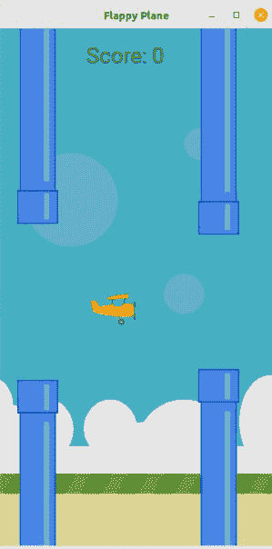


## 添加音效

我们的引擎应该能够在被要求时播放声音，而不会干扰其他进程。只有在音频文件预先加载到引擎内存中时才有可能实现。

在被要求播放时加载音频文件效率相当低，因为加载音频文件可能需要一些时间，具体取决于格式和大小。这就是为什么我们在资产管理章节中创建了音频资产。

我们还需要实现一个加载音频文件的函数，就像我们为纹理和字体所做的那样。以下代码片段显示了资产注册表的成员函数定义，用于加载音频文件。

## 加载音频文件

流程保持不变。我们从源文件加载音频数据，检查加载是否成功，然后创建一个资产。

```
engine/src/assets/registry.h

// ...

FUSE_INLINE audio_o_asset* load_audio(const std::string& src, const std::string& name) {
    audio_o_clip audio_o;
    audio_o.data = Mix_LoadWAV(src.c_str());
    audio_o.filename = src;

    if (!audio_o.data) {
        FUSE_ERROR("%s", IMG_GetError());
        return NULL;
    }

    auto asset = new audio_o_asset();
    asset->instance = audio_o;
    asset->name = name;

    _data[type_id<audio_o_asset>()].push_back(asset);
    return asset;
}

// ...
```

请务必相应地更新你的资产注册表。如下所示，在场景的 start 函数中加载两个声音文件。

```
engine/src/ecs/scene.h

// . . .

FUSE_INLINE void start() {
    // . . .

    // load background music
    _assets.load_audio("assets/song.mp3", "music");

    // load explosion effect
    _assets.load_audio("assets/boom.wav", "boom");

    // . . .
}

// . . .
```

## 背景音乐

在游戏过程中播放背景音乐是很常见的。它为游戏增添了生机和乐趣。我们需要一个可以调用的函数来播放资产注册表中可用的任何音效。因此，将以下函数添加到“script_instance”中。

```
engine/src/scripts/script_instance.h

// . . .

FUSE_INLINE void play_audio(std::string name, int channel = -1,
    int loops = 0, int vol = 50) {
    auto& chunk = assets->get<audio_asset>(name)->instance.data;
    Mix_VolumeChunk(chunk, vol);
    Mix_PlayChannel(channel, chunk, loops);
}

// . . .
```

该函数接受四个参数。第一个参数是我们希望播放的音频资产的名称。第二个参数是我们希望播放歌曲的通道。如果你传递 "-1"，SDL 将为你选择下一个空闲通道。但你也可以指定一个特定的通道来播放声音。第三个参数是告诉 SDL 声音应该播放多少次。"-1" 表示无限循环。最后一个参数是你希望播放声音的音量。
该函数在注册表中查找声音资产，设置音量级别，


然后使用 SDL 函数 "Mix_PlayChannel" 播放该声音。该函数分别获取通道、音频数据和循环次数来播放声音。

我们希望背景音乐在游戏开始时直接播放。因此，我们可以将其添加到管道生成器脚本的启动函数中。将以下代码添加到你的管道生成器中。

```cpp
// ...
engine/src/scripts/pipe_spawner.h

// ...
FUSE_INLINE void d_on_start() {
  // play music on channel "1" infinite loop
  play_audio("music", 1, -1);
}

// ...
```

只要程序运行，我们就在通道号 "1" 上播放名为 "music" 的声音资产。但是，我们希望在玩家死亡时能够停止背景音乐。为此，只需调用 SDL_HaltChannel(channel) 来停止该特定通道。

我们可以在管道生成器脚本或玩家控制器脚本中执行此操作。但是，因为我们在生成器脚本中播放了它，所以当飞机坠毁时，我们也会在那里停止它。

### 飞机坠毁音效

我们希望在飞机坠毁时播放一个音效。我们可以在玩家控制器脚本的 "on_collision" 函数中执行此操作。每当触发碰撞时，我们将简单地播放声音。

```cpp
// ...
engine/src/scripts/player_controller.h

// ...
FUSE_INLINE void d_on_collision(ecs::entity e) {
  play_audio("boom");
  auto& sp = get_component<ecs::sprite_component>();
  sp.sprite = get_asset<texture_asset>("dead")->d;
  get_component<ecs::collider_component>().disabled = true;
  get_component<ecs::rigidbody_component>().disabled = true;
}

// ...
```

我们没有指定特定通道来播放声音，因为我们希望 SDL 为我们选择一个。我们还希望它只以默认音量播放一次。

如果你编译并运行项目，你将拥有背景音乐以及死亡时的音效。

## 结论

恭喜你使用这个游戏引擎制作了第一个游戏。希望你玩得开心。不要害怕对游戏进行更改并为引擎添加新功能。你通过试错来学习。

我们现在有一个可玩的游戏，但无法将场景数据序列化到文件中以加载所有资产并创建所有实体。这将是下一章的目标。我们将使用库 "yaml-cpp" 为我们的场景实现一个序列化器。

注意：你可以从 GitHub 仓库获取源代码。分支名称为 "game"。

# 第 14 章 序列化

## 序列化

上一章介绍了使用我们迄今为引擎添加的一些功能创建小型游戏。我们需要序列化，以便以这种方式保存游戏状态，以便在需要时重新加载。我们创建的游戏是引擎代码的一部分，但是，我们希望通过使用序列化器将所有实体和对象信息存储在外部文件中，将游戏定义与引擎代码分开。

### 定义

序列化是将数据对象转换为格式化的二进制或文本文件的过程，该文件可以轻松重新加载并由程序使用。[27]


将二进制或文本文件用于在内存中重新创建实际对象的反向过程称为“反序列化”。


我们将以人类可读的格式序列化游戏中的数据。与可读序列化相比，二进制序列化速度快得多，并生成小尺寸的文件。它只是将内存块（二进制数据）保存到文件中的过程。但是，因为我们的场景具有无法直接以二进制形式保存的复杂数据结构，我们将创建一个自定义序列化器来为我们完成这项工作。

### 什么是 YAML？

YAML 是一种人性化的数据序列化语言 [29], [19]。YAML 最初代表 "Yet Another Markup Language"，但自 2002 年以来，它已被递归缩写 "YAML Ain't Markup Language" 所取代。因此，YAML 被定义为一种不是标记语言的编码语言。

像 XML、HTML 这样的标记语言主要用于以人类可读的格式存储数据。YAML 与 XML 不同，它采用简单的方法。YAML 的主要理由是其简单性，这包括源自 XML 广泛应用范围的约束。但是，YAML 的主要竞争对手是 JSON，而不是 XML。

### YAML 如何工作？

YAML 将程序内部格式的数据转换为文本文件。即使对于二维或多维数组等复杂数据类型也是如此，元素会被序列化并一个接一个地发送。

如果我们使用 YAML 序列化以下数据结构，结果将如下所示。

```
struct transform_component {
    vec2f translate = vec2f( 0.0f );
    vec2f scale = vec2f( 1.0f );
    float rotation = 0.0f ;
};
```

图 46 数据结构

```
transform_component:
    translate: [0, 0]
    scale: [1, 1]
    rotation: 0
```

图 47 YAML 文件

几乎所有主要编程语言（如 C/C++、Java、C#、Dart、Js、Rust 等）都有可用的库，允许使用 YAML 进行序列化。

- C/C++ 的 YAML 框架和工具：
  - libfyaml "C" YAML 1.2 处理器 (YTS) [7]
  - libyaml "C" 快速 YAML 1.1 (YTS) [8]
  - libcyaml 用于 C 数据的 YAML 反序列化/序列化 (使用 libyaml) [6]
  - yaml-cpp C++ YAML 1.2 实现 [5]

以上是使用 YAML 进行 C++ 序列化的一些知名库列表。"yaml-cpp" 将是本书的选择。它是一个符合 YAML 1.2 规范的 C++ YAML 解析器和发射器。我们将克隆 yaml-cpp 仓库并自行编译它。

## 在 Windows 上安装 yaml-cpp

本节将介绍如何在 Windows 平台上安装 yaml-cpp。我们将克隆仓库并使用 CMake 构建库。

### 克隆 yaml-cpp

yaml-cpp 可以通过主页或命令行从 GitHub 克隆。构建文件位于：https://github.com/jbeder/yaml-cpp。

要从 GitHub 克隆仓库，请使用以下命令：这将下载编译库所需的所有文件。关键字 "recursive" 对命令的运行不是必需的，但它只确保如果 yaml-cpp 有子模块，它们也会被克隆。

```
git clone --recursive https://github.com/jbeder/yaml-cpp.git
```

> 注意：你的机器上必须安装 "git" 才能执行上述命令。如果没有，你可以使用以下说明。

如下图所示下载源代码。


图 48 下载 yaml-cpp

这将下载源代码作为 ZIP 文件，必须使用 WinRAR、ZIP 或任何其他包管理器工具解压缩。既然我们已经下载了源代码，让我们来编译它。

### 构建 yaml-cpp

如前所述，我们将使用 CMake 编译 yaml-cpp。以下是可用于构建库的一组命令。

### 步骤 1 导航到 yaml-cpp 目录

使用以下命令导航到 yaml-cpp 目录。

```
cd <path to yaml-cpp directory>
```

### 步骤 2 使用 CMake 构建

```
rem create output directory
mkdir build
rem generate make file
cmake -S . -B ./build -DBUILD_SHARED_LIBS=ON
rem compile library
cmake --build ./build
```

这些命令将创建一个文件夹来存储构建文件，使用 CMake 生成和构建 yaml-cpp 的源代码。由于我们希望将 yaml-cpp 构建为共享库，我们使用 "BUILD_SHARED_LIBS" 来指示 CMake 此事。

编译完成后，你将在下面的文件夹树中可视化的目录中找到生成的库文件。


与所有 SDL 库一样，yaml-cpp 也有包含头文件、一个 ".dll" 和一个 ".lib" 文件，这些是我们将 yaml-cpp 链接到项目所需的唯一文件。

## 链接 yaml-cpp

我们将使用用于 SDL 的相同技术来链接 yaml-cpp。

### 步骤 1 复制头文件

继续将 yaml-cpp/include 下的头文件文件夹复制到 Project/windows/includes。

### 步骤 2 复制库文件

将 "yaml-cppd.lib" 文件复制到 Project/windows/lib，并将第二个库文件 "yaml-cppd.dll" 复制到 Project/windows/bin。


## 步骤 3 更新 CMakeLists.txt 文件

现在所有文件都已放置到位，我们希望通过告诉 CMake 在尝试编译项目时链接库来完成最终设置。

### Project/engine/CMakeLists.txt

```cmake
### . . .
if (WIN32)
    target_link_libraries(${PROJECT_NAME} SDL2 SDL2main SDL2_image
    SDL2_ttf SDL2_mixer yaml-cpp)
    target_include_directories(${PROJECT_NAME} PUBLIC
    ${CMAKE_SOURCE_DIR}/windows/includes)
    target_link_directories(${PROJECT_NAME} PUBLIC
    ${CMAKE_SOURCE_DIR}/windows/libs)
endif (WIN32)
### . . .
```

黄色高亮的部分是你需要添加到此文件中以链接 yaml-cpp 的唯一内容。只需尝试编译项目即可检查一切是否正常。如果编译成功，则一切正常。

注意：如果在编译库时遇到任何问题，请查看 GitHub 仓库上的官方说明。

## 在 Linux 上安装 yaml-cpp

在 Linux 上安装 yaml-cpp 非常简单。我们将使用系统包管理器来完成，就像我们为 SDL 做的那样。好消息是，我们不需要像为 SDL 扩展库所做的那样手动设置 CMake 配置文件。

- 步骤 1 安装软件包

通过运行以下命令在 Linux 系统上安装 yaml-cpp。我们正在更新包管理以保证我们尝试安装的 yaml-cpp 版本是兼容的。这里不需要复制任何头文件或库文件。一切都由包管理器管理。

```
sudo apt update
sudo apt install libyaml-cpp-dev
```

- 步骤 2 链接到项目

### Project/engine/CMakeLists.txt

```cmake
### . . .
### linux
if (UNIX)
    # search libs
    find_package(SDL2 REQUIRED)
    find_package(yaml-cpp REQUIRED)
    find_package(SDL2_ttf REQUIRED)
    find_package(SDL2_mixer REQUIRED)
    find_package(SDL2_image REQUIRED)

    # include headers
    target_include_directories(${PROJECT_NAME} PUBLIC ${SDL2_INCLUDE_DIRS})
    target_include_directories(${PROJECT_NAME} PUBLIC ${YAML_CPP_INCLUDE_DIR})

    # link lib files
    target_link_libraries(${PROJECT_NAME} ${YAML_CPP_LIBRARIES})
    target_link_libraries(${PROJECT_NAME} ${SDL2_LIBRARIES} ${SDL2_IMAGE_LIBRARIES})
    target_link_libraries(${PROJECT_NAME} ${SDL2_TTF_LIBRARIES} ${SDL2_MIXER_LIBRARIES})
endif (UNIX)
### . . .
```

按如上所示更新 CMakeLists.txt 文件，编译并运行项目以检查是否可以无错误编译。

注意：如果在安装 yaml-cpp 时遇到任何问题，可以参考 yaml-cpp 的 Ubuntu 官方安装文档。[11] 链接：https://www.howtoinstall.me/ubuntu/18-04/libyaml-cpp-dev/.

这就是在 Linux 上安装 yaml-cpp 所需做的全部工作。我们现在将使用 yaml-cpp 来序列化场景中的所有实体及其组件。

## 实体序列化器

我们将创建一个自定义序列化器来序列化所有实体及其组件。我们稍后还将为资产创建一个序列化器。

### 基本序列化示例

```cpp
void serialize_info(YAML::Emitter& em, ecs::entity& e) {
    auto& i = e.get_component<ecs::info_component>();
    em << YAML::Key << "info_component";
    em << YAML::BeginMap;
    em << YAML::Key << "uuid" << YAML::Value << i.uuid;
    em << YAML::Key << "name" << YAML::Value << i.name;
    em << YAML::Key << "tag" << YAML::Value << i.tag;
    em << YAML::EndMap;
}
```

上面的代码片段展示了如何使用 yaml-cpp 序列化 "info_component"。它将 YAML::Emitter 作为参数，以及我们想要从中检索组件的实体。发射器只是一个句柄，可用于将数据推送到当前序列化过程分配的缓冲区中。组件的每个字段都使用键存储。该键将用于在反序列化时检索数据。组件本身是一个包含数据字段的映射。

### 基本反序列化示例

```cpp
void deserialize_info(YAML::Node node, ecs::entity& e) {
    if (auto data = node["info_component"]) {
        auto& i = e.add_component<ecs::info_component>();
        i.name = data["name"].as<std::string>();
        i.tag = data["tag"].as<std::string>();
        i.uuid = data["uuid"].as<u64>();
    }
}
```

要反序列化对象，需要表示要从中反序列化的 YAML 文件中对象的 YAML::Node。这就是为什么此函数将 YAML::Node 作为参数，以及将附加组件的目标实体。YAML 文档中的所有节点（包括根节点）都由 YAML::Node 表示。我们可以使用键访问节点中的任何数据。模板函数 "as<T>()" 用于将值转换为其正确类型。

### 运算符重载

yaml-cpp 仅支持基本类型（如 int、float、double 和 string）的序列化和反序列化。但是，我们也希望它能够序列化自定义类型，例如我们的 vec2f 或 vec2i 等。因此，让我们重载一些运算符来实现这一点。

创建一个名为 "helpers" 的新文件夹，并在该文件夹中创建一个名为 "yaml.h" 的头文件。以下是显示头文件内容的代码片段。

### engine/src/helpers/yaml.h

```cpp
#pragma once
#include "math/vec2.h"
#include "yaml-cpp/yaml.h"
namespace YAML {
template <>
struct convert<fuse::vec2f> {
FUSE_INLINE static Node encode(const fuse::vec2f &rhs) {
Node node;
node.push_back(rhs.x);
node.push_back(rhs.y);
node.SetStyle(EmitterStyle::Flow);
return node;
}
FUSE_INLINE static bool decode(const Node &node,
fuse::vec2f &rhs) {
if (!node.IsSequence() || node.size() != 2) {
return false;
}
rhs.x = node[0].as<float>();
rhs.y = node[1].as<float>();
return true;
}
};
// stream operator
FUSE_INLINE Emitter &operator <<(Emitter &emitter, const
fuse::vec2f &v) {
emitter << Flow;
emitter << BeginSeq << v.x << v.y << EndSeq;
return emitter;
}
}
```

因为我们只需要 vec2f 来序列化组件，所以我们只重载了 vec2f 数据类型的运算符。您可以通过将 vec2f 更改为 vec2i 来对 vec2i 执行相同操作。如您所见，这是在 YAML 命名空间中完成的，因为我们正在重载 yaml-cpp 库中的运算符。

我们现在已准备好序列化实体及其组件。

### 输出文件格式

了解在一切都序列化完成后我们将得到的文件结构对我们很重要，因为这有助于我们知道如何实现序列化器。

以下是显示从我们的游戏中序列化的示例场景的文件。

```yaml
# list of assets
assets:
  - texture:
      id: 2234281881859053318
      name: bg
      source: assets/bg1.png
  - audio:
      id: 17441928881988725071
      name: music
      source: assets/song.mp3
# list of entities with their components
entities:
  - info_component:
      uuid: 1262126381375044817
      name: player
    transform_component:
      translate: [126.666664, 325.714661]
      rotation: 0
      scale: [0.150000006, 0.150000006]
  - info_component:
      uuid: 2536376052334560951
      name: background
      tag: default
    transform_component:
      translate: [-5, -5]
      rotation: 0
      scale: [1, 1]
    sprite_component:
      sprite: 2234281881859053318
      flip: 0
```

此文件有两个主要部分："assets" 和 "entities"。目前，我们只关注 "entities" 部分。如您所见，新实体以减号字符 ("-") 开头，后跟其组件。实体 ID 未被序列化，因为它是运行时值。可以使用井号字符 ("#") 添加注释。每个组件都以其名称作为键，其数据字段作为键的值来存储。每个字段将简单地通过其键来寻址，就像我们访问 std::map 中的字段一样。

以下代码片段显示了实体序列化器的基本定义。

```cpp
#pragma once
#include "entity.h"
#include "helpers/yaml.h"
#include "components/common.h"
#include "components/physics.h"
#include "components/graphics.h"
#include "components/behavior.h"

namespace fuse::ecs {
struct serializer {
    FUSE_INLINE serializer(registry *reg) : _registry(reg) {}

    // deserialize all entities
    FUSE_INLINE void deserialize(YAML::Node nodes) {
    }

    // serialize all entities
    FUSE_INLINE void serialize(YAML::Emitter& en) {
    }

    // serialize info_component
    FUSE_INLINE void serialize_info(YAML::Emitter& em, ecs::entity& e) {
    }

    // deserialize info_component
    FUSE_INLINE void deserialize_info(YAML::Node node, ecs::entity& e) {
    }

private:
    registry* _registry = NULL;
};
}
```

我们将为每个组件类型添加更多函数。此代码展示了序列化器的定义方式，以及随着我们添加更多函数它将如何演变。


用于反序列化和序列化其他组件。
如您所见，我们在这里包含了所有组件类型，因为我们将要
对它们全部进行反序列化和序列化。序列化器的构造函数接受一个指向
存储所有实体和组件的注册表的指针。反序列化函数接受
实体的根节点，序列化函数接受对缓冲区的引用，所有内容将在导出到 YAML 文件之前存储在此缓冲区中。
让我们具体来看看每个函数的实现。

```
engine/src/ecs/serializer.h
FUSE_INLINE void deserialize(YAML::Node nodes) {
  // clear registry
  _registry->clear();

  // deserialize entities
  for (auto node : nodes) {
    ecs::entity e(_registry);
    deserialize_info(node, e);
    deserialize_transform(node, e);
    deserialize_rigidbody(node, e);
    deserialize_collider(node, e);
    deserialize_sprite(node, e);
    deserialize_animation(node, e);
    deserialize_text(node, e);
    deserialize_script(node, e);
  }
}
```

该函数首先确保注册表被清空。这样可以防止
加载的数据被叠加到注册表中已有的数据之上。
然后我们将遍历作为参数传入的实体节点。对于每个节点，
我们将创建一个实体，并为每种组件类型调用反序列化函数。
不要担心这里调用的所有函数，我们将马上逐一实现它们。

下一个代码片段展示了序列化函数的定义。该函数
接受一个发射器的引用作为参数。它首先创建一个名为 "entities" 的序列，
所有实体都将列在其中。
然后我们为每个实体添加一个映射，用于列出其实体的组件。
与反序列化函数类似，我们为每种组件类型调用序列化
函数，传递我们想要从中获取组件的实体。

注意：必须关闭所有打开的节点。由于所有实体默认都有信息组件，
我们可以通过获取信息组件的视图来检索所有实体的列表，该视图返回所有带有信息组件的实体列表。

```
engine/src/ecs/serializer.h
FUSE_INLINE void serialize(YAML::Emitter& em) {
  em << YAML::Key << "entities" << YAML::Value << YAML::BeginSeq;
  for (auto& e : _registry->view<ecs::info_component>()) {
    ecs::entity entity(e, _registry);

    em << YAML::BeginMap;
    serialize_info(em, entity);
    serialize_transform(em, entity);
    serialize_rigidbody(em, entity);
    serialize_collider(em, entity);
    serialize_sprite(em, entity);
    serialize_animation(em, entity);
    serialize_text(em, entity);
    serialize_script(em, entity);
    em << YAML::EndMap;
  }
  em << YAML::EndSeq;
}
```

让我们实现所有用于反序列化和序列化每种组件类型的函数。

## 信息组件序列化

```
// serialize info_component
FUSE_INLINE void serialize::info(YAML::Emitter &em, entity &e) {
    if (e.has_component<ecs::info_component>()) {
        auto &i = e.get_component<ecs::info_component>();
        em << YAML::Key << "info_component";
        em << YAML::BeginMap;
        em << YAML::Key << "uuid" << YAML::Value << i.uuid;
        em << YAML::Key << "name" << YAML::Value << i.name;
        em << YAML::Key << "tag" << YAML::Value << i.tag;
        em << YAML::EndMap;
    }
}
```

```
// deserialize info_component
FUSE_INLINE void deserialize_info(YAML::Node node, entity &e) {
    if (auto data = node["info_component"]) {
        auto &i = e.add_component<ecs::info_component>();
        i.name = data["name"].as<std::string>();
        i.tag = data["tag"].as<std::string>();
        i.uuid = data["uuid"].as<uint64>();
    }
}
```

上面的函数展示了如何对信息组件进行反序列化和序列化。在尝试任何序列化之前，我们始终需要检查实体是否拥有该组件。反序列化时也是如此。我们需要确保存在一个带有该组件名称的节点。

以下是变换组件的相同定义。变换组件主要是我们不得不为 vec2f 类型实现编码和解码的原因。但如您所见，vec2f 的序列化或反序列化方式与例如整数没有区别。我们使用相同的运算符，因为我们对其进行了重载。

## 变换组件序列化

```
// serialize transform component
FUSE_INLINE void serialize_transform(YAML::Emitter& em, entity& e) {
    if (e.has_component<transform_component>()) {
        auto& t = e.get_component<transform_component>();
        em << YAML::Key << "transform_component";
        em << YAML::BeginMap;
        em << YAML::Key << "translate" << YAML::Value << t.translate;
        em << YAML::Key << "rotation" << YAML::Value << t.rotation;
        em << YAML::Key << "scale" << YAML::Value << t.scale;
        em << YAML::EndMap;
    }
}
// deserialize transform component
FUSE_INLINE void deserialize_transform(YAML::Node node, entity& e) {
    if (auto data = node["transform_component"]) {
        auto& t = e.add_component<transform_component>();
        t.translate = data["translate"].as<vec2f>();
        t.rotation = data["rotation"].as<float>();
        t.scale = data["scale"].as<vec2f>();
    }
}
```

为保持一致性，我们选择使用成员变量的名称作为键。有时，您会使用名称的较短版本以减小输出文件的大小。

## 快速序列化测试

在继续实现所有用于反序列化和序列化我们组件类型的函数之前，我们想快速测试一下是否能够序列化场景中所有实体的信息组件和变换组件。以下代码片段展示了场景中完成此任务的函数定义。

```
engine/src/ecs/scene.h
```

```
#pragma once
#include "ecs/systems/tilemap_renderer_system.h"
#include "ecs/systems/sprite_renderer_system.h"
#include "ecs/systems/frame_animation_system.h"
#include "ecs/systems/text_renderer_system.h"
#include "ecs/systems/collision_system.h"
#include "ecs/systems/rigidbody_system.h"
#include "ecs/systems/script_system.h"

#include "serializer.h"

namespace fuse::ecs {
struct scene {
// . . .

FUSE_INLINE void serialize(const std::string& path) {
    YAML::Emitter emitter;
    emitter << YAML::BeginMap;
    ecs::serializer(&registry).serialize(emitter);
    emitter << YAML::EndMap;

    std::ofstream filepath(path);
    filepath << emitter.c_str();
}

private:
    std::vector<ecs::system*> _systems;
    SDL_Renderer* _renderer = NULL;
    ecs::registry registry;
    asset_registry _assets;
};
}
```

该函数创建根节点，序列化实体，并将结果保存到作为参数传递的文件中。

engine/src/core/application.cpp

```
// . . .

// create & start scene
auto scene = new ecs::scene(renderer);
scene->start();

scene->serialize("assets/scene.yaml");

last_tick = get_ticks();

while (is_running) {
    compute_delta_time();
    inputs::dispatch_events();
    SDL_RenderClear(renderer);
    scene->update(delta_time);
    SDL_RenderPresent(renderer);
}

// free memory
SDL_DestroyRenderer(renderer);
SDL_DestroyWindow(window);
FUSE_DELETE(scene);
IMG_Quit();
Mix_Quit();
TTF_Quit();
SDL_Quit();
}
}
```

在此处测试序列化器，您只需在场景启动后调用序列化函数并传递目标路径，以确保场景中实际上有实体。

**注意：** 文件流将检查您传递的文件名是否存在，如果不存在则创建它。

**注意：** 文件扩展名可以是您选择的任何内容。我们使用 ".yaml" 以确保输出格式良好。

如果您编译并运行项目，将在以下位置生成下面的 YAML 文件 **build/(Debug)/assets/scene.yaml**。


```yaml
entities:
  - info_component:
      uid: 48299888029595190790
      name: background
      tag: default
    transform_component:
      translate: [ 0, 0]
      rotation: 0
      scale: [ 1, 1]
  - info_component:
      uid: 5447653073868936591
      name: ground
      tag: default
    transform_component:
      translate: [ 0, 620]
      rotation: 0
      scale: [ 1, 1]
  - info_component:
      uid: 12498552971515585074
      name: player
      tag: default
    transform_component:
      translate: [ 126, 360]
      rotation: 0
      scale: [ 0.5, 0.5]
  - info_component:
      uid: 5315504854672653710
      name: game
      tag: default
    transform_component:
      translate: [ 0, 0]
      rotation: 0
      scale: [ 1, 1]
  - info_component:
      uid: 495861777785196254
      name: score
      tag: default
    transform_component:
      translate: [ 120, 20]
      rotation: 0
      scale: [ 1, 1]
```

图 50 实体序列化结果 (scene.yaml)

## 刚体组件序列化

```cpp
// serialize rigidbody_component
FUSE_INLINE void serialize_rigidbody(YAML::Emitter& em, entity& e) {
  if (e.has_component<rigidbody_component>()) {
    auto& r = e.get_component<rigidbody_component>();
    em << YAML::Key << "rigidbody_component";
    em << YAML::BeginMap;
    em << YAML::Key << "gravity" << YAML::Value << r.body.gravity_scale;
    em << YAML::Key << "velocity" << YAML::Value << r.body.velocity;
    em << YAML::Key << "disabled" << YAML::Value << r.disabled;
    em << YAML::Key << "force" << YAML::Value << r.body.force;
    em << YAML::EndMap;
  }
}
```

```cpp
// deserialize rigidbody_component
FUSE_INLINE void deserialize_rigidbody(YAML::Node node, entity& e) {
  if (auto data = node["rigidbody_component"]) {
    auto& r = e.add_component<rigidbody_component>();
    r.body.gravity_scale = data["gravity"].as<float>();
    r.body.velocity = data["velocity"].as<vec2f>();
    r.body.force = data["force"].as<vec2f>();
    r.disabled = data["disabled"].as<bool>();
  }
}
```

## 碰撞体组件序列化

```cpp
// serialize collider_component
FUSE_INLINE void serialize_collider(YAML::Emitter& em, entity& e)
{
    if (e.has_component<ecs::collider_component>()) {
        auto& c = e.get_component<ecs::collider_component>();
        em << YAML::Key << "collider_component";
        em << YAML::BeginMap;
        em << YAML::Key << "width" << YAML::Value << c.collider.w;
        em << YAML::Key << "height" << YAML::Value << c.collider.h;
        em << YAML::Key << "disabled" << YAML::Value << c.disabled;
        em << YAML::EndMap;
    }
}
```

```cpp
// deserialize collider_component
FUSE_INLINE void deserialize_collider(YAML::Node node, entity& e)
{
    if (auto data = node["collider_component"]) {
        auto& c = e.add_component<collider_component>();
        c.collider.w = data["width"].as<float>();
        c.collider.h = data["height"].as<float>();
        c.disabled = data["disabled"].as<bool>();
    }
}
```

## 精灵组件序列化

```cpp
// serialize sprite_component
FUSE_INLINE void serialize_sprite(YAML::Emitter& em, entity& e) {
    if (e.has_component<sprite_component>()) {
        auto& s = e.get_component<sprite_component>();
        em << YAML::Key << "sprite_component";
        em << YAML::BeginMap;
        em << YAML::Key << "sprite" << YAML::Value << s.sprite;
        em << YAML::Key << "flip" << YAML::Value << s.flip;
        em << YAML::EndMap;
    }
}
```

```cpp
// deserialize sprite_component
FUSE_INLINE void deserialize_sprite(YAML::Node node, entity& e) {
    if (auto data = node["sprite_component"]) {
        auto& s = e.add_component<sprite_component>();
        s.flip = (SDL_RendererFlip)data["flip"].as<int>();
        s.sprite = data["sprite"].as<asset_id>();
    }
}
```

## 动画组件序列化

```cpp
// ...

// serialize animation_component
FUSE_INLINE void serialize_animation(YAML::Emitter& em, entity& e) {
    if (e.has_component<animation_component>()) {
        auto& a = e.get_component<animation_component>();
        em << YAML::Key << "animation_component";
        em << YAML::BeginMap;
        em << YAML::Key << "animation" << YAML::Value << a.animation;
        em << YAML::Key << "flip" << YAML::Value << (int)a.flip;
        em << YAML::EndMap;
    }
}
```

```cpp
// deserialize animation_component
FUSE_INLINE void deserialize_animation(YAML::Node node, entity& e) {
    if (auto data = node["animation_component"]) {
        auto& a = e.add_component<animation_component>();
        a.flip = (SDL_RendererFlip)data["flip"].as<int>();
        a.animation = data["animation"].as<asset_id>();
    }
}
```

## 文本组件序列化

```cpp
// ...

// serialize text_component
FUSE_INLINE void serialize_text(YAML::Emitter& em, entity& e) {
    if (e.has_component<text_component>()) {
        auto& t = e.get_component<text_component>();
        em << YAML::Key << "text_component";
        em << YAML::BeginMap;
        em << YAML::Key << "R" << YAML::Value << (int)t.color.r;
        em << YAML::Key << "G" << YAML::Value << (int)t.color.g;
        em << YAML::Key << "B" << YAML::Value << (int)t.color.b;
        em << YAML::Key << "A" << YAML::Value << (int)t.color.a;
        em << YAML::Key << "text" << YAML::Value << t.text;
        em << YAML::Key << "font" << YAML::Value << t.font;
        em << YAML::Key << "flip" << YAML::Value << t.flip;
        em << YAML::EndMap;
    }
}

// deserialize text_component
FUSE_INLINE void deserialize_text(YAML::Node node, entity& e) {
    if (auto data = node["text_component"]) {
        auto& t = e.add_component<text_component>();
        t.flip = (SDL_RendererFlip)data["flip"].as<int>();
        t.text = data["text"].as<std::string>();
        t.font = data["font"].as<asset_id>();
        t.color.r = data["R"].as<int>();
        t.color.g = data["G"].as<int>();
        t.color.b = data["B"].as<int>();
        t.color.a = data["A"].as<int>();
    }
}

// ...
```

## 脚本组件序列化

```cpp
// ...

// serialize script_component
FUSE_INLINE void serialize_script(YAML::Emitter& em, entity& e) {
    if (e.has_component<script_component>()) {
        auto& s = e.get_component<script_component>();
        em << YAML::Key << "script_component";
        em << YAML::BeginMap;
        em << YAML::Key << "name" << YAML::Value << s.name;
        em << YAML::EndMap;
    }
}

// deserialize script_component
FUSE_INLINE void deserialize_script(YAML::Node node, entity& e) {
    if (auto data = node["script_component"]) {
        auto& s = e.add_component<script_component>();
        s.name = data["name"].as<std::string>();

        if (!s.name.compare("player_controller")) {
            s.bind<player_controller>();
        } else if (!s.name.compare("scrolling_ground")) {
            s.bind<scrolling_ground>();
        } else if (!s.name.compare("pipe_spawner")) {
            s.bind<pipe_spawner>();
        }
    }
}

// ...
```

关于这些函数，其实没什么可说的。它们都有相同的结构和功能，只在被序列化的数据上有所不同。

在测试场景的反序列化之前，我们还需要对资产进行反序列化和序列化。这就是我们接下来要做的事情。

## 资产序列化器

资产与组件非常相似。它们只是基本的数据结构。这就是为什么我们将应用相同的技术来序列化场景中所有可用的资产。

我们还将创建一个自定义资产序列化器，它包含用于反序列化和序列化每种资产类型的函数。

- engine/src/assets/serializer.h

```cpp
#pragma once
#include "registry.h"
#include "helpers/yaml.h"

namespace fuse {
struct asset_serializer {

    FUSE_INLINE asset_serializer(asset_registry* assets):
        _assets(assets) {}

    // serialize all asset types
    FUSE_INLINE void serialize(YAML::Emitter& emitter) {
    }

    // deserialize all asset types
    FUSE_INLINE void deserialize(YAML::Node& n, SDL_Renderer* r) {
    }

    // serialize font assets
    FUSE_INLINE void serialize_fonts(YAML::Emitter& em) {
    }

    // deserialize font asset
    FUSE_INLINE void deserialize_font(YAML::Node node) {
    }

    // serialize animation assets
    FUSE_INLINE void serialize_animations(YAML::Emitter& em) {
    }

    // deserialize animation asset
    FUSE_INLINE void deserialize_animation(YAML::Node node) {
    }

private:
    asset_registry* _assets = NULL;
};
}
```


资产序列化器与实体序列化器类似。我们有两个主要函数，使用每种资产类型自定义的反序列化和序列化函数来对所有资产类型进行反序列化和序列化。

反序列化函数将渲染器作为参数，因为在 SDL 中加载纹理需要它。

我们稍后还会添加其他函数来对其他资产类型进行反序列化和序列化。

为了使资产序列化器能够访问资产注册表内部的映射，我们将把资产序列化器类设为资产注册表类的友元。

下一个代码片段展示了具体做法。

```
engine/src/assets/registry.h
#pragma once
#include "font.h"
#include "audio.h"
#include "tilemap.h"
#include "texture.h"
#include "animation.h"
#include "core/typeid.h"
namespace fuse {
struct asset_registry {
    FUSE_NOEXCEPT asset_registry() = default;
    // . . .
private:
    friend struct asset_serializer;
    std::unordered_map<asset_typeid, std::vector<asset*>> _data;
};
}
```

友元声明出现在类体中，并授予函数或另一个类访问友元声明所在类的私有和受保护成员的权限。[3]

这将使资产序列化器能够访问 "_data" 成员变量。我们本可以实现一个返回数据映射引用的函数。

## 成员函数的实现

下一个代码片段展示了资产序列化器的主要反序列化和序列化函数的实现。

```
engine/src/assets/serializer.h
// . . .

// serialize all asset types
FUSE_INLINE void serialize(YAML::Emitter& em) {
    em << YAML::Key << "assets" << YAML::Value << YAML::BeginSeq;
    {
        // serialize animations
        serialize_animations(em);

        // serialize textures
        serialize_textures(em);

        // serialize audios
        serialize_audios(em);

        // serialize fonts
        serialize_fonts(em);
    }
    em << YAML::EndSeq;
}

// deserialize all asset types
FUSE_INLINE void deserialize(YAML::Node& nodes, SDL_Renderer* r) {
    // clear registry
    _assets->clear();

    // deserialize assets
    for (auto node : nodes) {
        deserialize_texture(node, r);
        deserialize_animation(node);
        deserialize_audio(node);
        deserialize_font(node);
    }
}

// . . .
```

与实体序列化器类似，我们只需为每种资产类型调用一个自定义函数来序列化资产。序列化函数的唯一区别在于，我们将在一个函数中序列化特定类型的所有资产。

让我们实现所有用于反序列化和序列化所有资产类型的函数。以下函数均在资产序列化器中实现。“engine/src/assets/serializer.h”

## 纹理资产序列化

```
// ...
// serialize texture_asset
FUSE_INLINE void serialize_textures(YAML::Emitter& em) {
    for (auto asset : _assets->data | type_id<texture_asset>) {
        auto texture = static_cast<texture_asset*>(asset);
        em << YAML::BeginMap;
        {
            em << YAML::Key << "texture";
            em << YAML::BeginMap;
            {
                em << YAML::Key << "id" << YAML::Value << texture->id;
                em << YAML::Key << "name" << YAML::Value << texture->name;
                em << YAML::Key << "source" << YAML::Value << texture->instance.filename;
            }
            em << YAML::EndMap;
        }
        em << YAML::EndMap;
    }
}
// deserialize texture_asset
FUSE_INLINE void deserialize_texture(YAML::Node node, SDL_Renderer* target) {
    if (auto data = node["texture"]) {
        auto source = data["source"].as<std::string>();
        auto name = data["name"].as<std::string>();
        auto asset = _assets->load_texture(source, name, target);
        asset->id = data["id"].as<asset_id>();
    }
}
// ...
```

## 动画资产序列化

```cpp
// . . .

// serialize animation_asset
FUSE_INLINE void serialize_animations(YAML::Emitter& em) {
    for (auto asset : _assets->data | type_id<animation_asset>) {
        auto anim = static_cast<animation_asset*>(asset);
        em << YAML::BeginMap;
        {
            em << YAML::Key << "animation";
            em << YAML::BeginMap;
            {
                em << YAML::Key << "id" << YAML::Value << anim->id;
                em << YAML::Key << "name" << YAML::Value << anim->name;
                em << YAML::Key << "speed" << YAML::Value << anim->instance.speed;
            }
            // serialize frames
            for (int i = 0; i < anim->instance.frames.size(); i++) {
                auto temp = "frame" + std::to_string(i);
                em << YAML::Key << temp << YAML::Value << anim->instance.frames[i];
            }
            em << YAML::EndMap;
        }
        em << YAML::EndMap;
    }
}

// deserialize animation_asset
FUSE_INLINE void deserialize_animation(YAML::Node node) {
    if (const auto data = node["animation"]) {
        auto name = data["name"].as<std::string>();
        auto asset = _assets->add<animation_asset>(name);
        // deserialize frames
        int i = 0;
        while (true) {
            auto temp = "frame" + std::to_string(i);
            if (!data[temp]) { break; }
            auto frame = data[temp].as<asset_id>();
            asset->instance.frames.push_back(frame);
            i++;
        }
    }
    asset->instance.speed = data["speed"].as<int>();
    asset->id = data["id"].as<asset_id>();
}
```

由于动画的帧数是相对的，在处理动画帧时需要使用循环。每个帧都使用键 "frame" 加上其索引进行序列化存储。"frame0, frame1, frame2"。

## 音频资产序列化

```
// ...

// serialize audio_asset
FUSE_INLINE void serialize_audio(YAML::Emitter& em) {
    for (auto asset : _assets->data[type_id<audio_asset>()]) {
        auto audio = static_cast<audio_asset*>(asset);
        em << YAML::BeginMap;
        {
            em << YAML::Key << "audio";
            em << YAML::BeginMap;
            {
                em << YAML::Key << "id" << YAML::Value << audio->id;
                em << YAML::Key << "name" << YAML::Value << audio->name;
                em << YAML::Key << "source" << YAML::Value << audio->instance.filename;
            }
            em << YAML::EndMap;
        }
        em << YAML::EndMap;
    }
}

// deserialize audio_asset
FUSE_INLINE void deserialize_audio(YAML::Node node) {
    if (auto data = node["audio"]) {
        auto name = data["name"].as<std::string>();
        auto source = data["source"].as<std::string>();
        auto asset = _assets->load_audio(source, name);
        asset->id = data["id"].as<asset_id>();
    }
}

// ...
```

## 字体资产序列化

```cpp
// . . .

// serialize font_asset
FUSE_INLINE void serialize_fonts(YAML::Emitter& em) {
    for (auto asset : _assets->data | type_id<font_asset>) {
        auto font = static_cast<font_asset*>(asset);

        em << YAML::BeginMap;
        {
            em << YAML::Key << "font";
            em << YAML::BeginMap;
            {
                em << YAML::Key << "id" << YAML::Value << font->id;
                em << YAML::Key << "name" << YAML::Value << font->name;
                em << YAML::Key << "size" << YAML::Value << font->instance.size;
                em << YAML::Key << "source" << YAML::Value << font->instance.filename;
            }
            em << YAML::EndMap;
        }
        em << YAML::EndMap;
    }
}

// deserialize font_asset
FUSE_INLINE void deserialize_font(YAML::Node node) {
    if (auto data = node["font"]) {
        auto size = data["size"].as<float>();
        auto name = data["name"].as<std::string>();
        auto source = data["source"].as<std::string>();
        auto asset = _assets->load_font(source, name, size);
        asset->id = data["id"].as<asset_id>();
    }
}
```


```cpp
#pragma once
#include "ecs/systems/tilemap_renderer_system.h"
#include "ecs/systems/sprite_renderer_system.h"
#include "ecs/systems/frame_animation_system.h"
#include "ecs/systems/text_renderer_system.h"
#include "ecs/systems/collision_system.h"
#include "ecs/systems/rigidbody_system.h"
#include "ecs/systems/script_system.h"
#include "assets/serializer.h"
#include "serializer.h"
```

```cpp
namespace fuse::ecs {
struct scene {
// ...
FUSE_INLINE void serialize(const std::string& path) {
    YAML::Emitter emitter;
    emitter << YAML::BeginMap;
    asset_serializer(&_assets).serialize(emitter);
    ecs::serializer(&_registry).serialize(emitter);
    emitter << YAML::EndMap;
    std::ofstream filepath(path);
    filepath << emitter.c_str();
}
private:
    std::vector<ecs::system*> _systems;
    SDL_Renderer* _renderer = NULL;
    ecs::registry _registry;
    asset_registry _assets;
};
}
```

我们还要确保在场景中调用资产序列化器的 serialize 函数。

重新编译应用程序以再次序列化场景。你将得到类似下图所示的文件。

```yaml
assets:
  - texture:
      id: 10245434429545210241
      name: dead
      source: assets/dead.png
  - texture:
      id: 7811099046276416275
      name: fly
      source: assets/fly.png
  - texture:
      id: 9326556746316133789
      name: pipe
      source: assets/pipe.png
  - texture:
      id: 3568610528396849820
      name: ground
      source: assets/ground.png
  - texture:
      id: 17518695901428906574
      name: bg
      source: assets/bg.png
  - audio:
      id: 12179197607233703687
      name: music
      source: assets/song.mp3
  - audio:
      id: 13614230354697609383
      name: boom
      source: assets/boom.wav
  - font:
      id: 6778214178817813590
      name: font
      size: 30
      source: assets/font.ttf

entities:
  - info_component:
      uuid: 4829988029595190790
      name: background
      tag: default
    transform_component:
      translate: [0, 0]
      rotation: 0
      scale: [1, 1]
    sprite_component:
      sprite: 17518695901428906574
      flip: 0
  - info_component:
      uuid: 5447653073868936591
      name: ground
      tag: default
    transform_component:
      translate: [0, 620]
      rotation: 0
      scale: [1, 1]
    rigidbody_component:
      gravity: 0
      velocity: [-100, 0]
      disabled: false
      force: [0, 0]
    collider_component:
      width: 711
      height: 265
      disabled: false
    sprite_component:
      sprite: 3568610528396849820
      flip: 0
    script_component:
      name: scrolling_ground
  - info_component:
      uuid: 12498552971515585074
      name: player
      tag: default
    transform_component:
      translate: [126, 360]
      rotation: 0
      scale: [0.5, 0.5]
    rigidbody_component:
      gravity: 25
      velocity: [0, 0]
      disabled: false
      force: [0, 0]
    collider_component:
      width: 58
      height: 38
      disabled: false
    sprite_component:
      sprite: 7811099046276416275
      flip: 0
    script_component:
      name: player_controller
  - info_component:
      uuid: 5315504854672653710
      name: game
      tag: default
    transform_component:
      translate: [0, 0]
      rotation: 0
      scale: [1, 1]
    script_component:
      name: pipe_spawner
  - info_component:
      uuid: 495861777785196254
      name: score
      tag: default
    transform_component:
      translate: [120, 20]
      rotation: 0
      scale: [1, 1]
    text_component:
      R: 0
      G: 0
      B: 0
      A: 255
      text: "Score: 0"
      font: 6778214178817813590
      flip: 0
```

图 51 资产序列化结果 (scene.yaml)

你可以看到所有资产都按预期序列化了。我们本可以将资产序列化到单独的文件中，但我们希望场景是自包含的，因此将与场景相关的所有内容都放在一个文件中。这也减少了必须管理的文件数量，从而降低了潜在错误源的数量。

## 反序列化场景

现在我们将尝试逆向过程。我们将在场景中实现一个函数来反序列化我们刚刚创建的场景文件。

以下是显示场景 deserialize 函数定义的代码片段。

- engine/src/ecs/scene.h

```cpp
#pragma once
#include "ecs/systems/tilemap_renderer_system.h"
#include "ecs/systems/sprite_renderer_system.h"
#include "ecs/systems/frame_animation_system.h"
#include "ecs/systems/text_renderer_system.h"
#include "ecs/systems/collision_system.h"
#include "ecs/systems/rigid_body_system.h"
#include "ecs/systems/script_system.h"
#include "assets/serializer.h"
#include "serializer.h"
```

```cpp
namespace fuse::ecs {
struct scene {
// . . .
FUSE_INLINE bool deserialize(const std::string& path) {
    YAML::Node root;
    try {
        root = YAML::LoadFile(path);
    }
    catch (YAML::ParserException e) {
        FUSE_INFO("failed to deserialize scene!");
        return false;
    }
    // serialize assets
    if (auto assets = root["assets"]) {
        asset_serializer(&assets).deserialize(assets, _renderer);
    }
    // serialize entities
    if (auto entities = root["entities"]) {
        ecs::serializer(&_registry).deserialize(entities);
    }
    // start scene
    for (auto& sys : _systems) {
        sys->start();
    }
}
}
```

```cpp
private:
    std::vector<ecs::system*> _systems;
    SDL_Renderer* _renderer = NULL;
    ecs::registry _registry;
    asset_registry _assets;
};
}
```

如你所见，我们正在尝试使用 yaml-cpp 的内置文件加载函数来加载文件。只有在文件成功加载后才会继续。要从文件中反序列化资产，我们必须确保根节点中有可用的 assets 节点。entities 也是如此。

加载完所有内容后，我们希望重启所有系统，以便一切准备就绪以供执行。例如盒子碰撞体位置和脚本实例之类的东西需要初始化，游戏才能正常运行。

让我们测试一下，看看场景是否可以再次加载，而无需在场景的 start 函数中创建实体。

```cpp
engine/src/core/application.cpp
// ...
// create & start scene
auto scene = new ecs::scene(renderer);
scene->deserialize("assets/scene.yaml");
last_tick = get_ticks();
while (is_running) {
    compute_delta_time();
    inputs::dispatch_events();
    SDL_RenderClear(renderer);
    scene->update(delta_time);
    SDL_RenderPresent(renderer);
}
// free memory
SDL_DestroyRenderer(renderer);
SDL_DestroyWindow(window);
FUSE_DELETE(scene);
IMG_Quit();
Mix_Quit();
TTF_Quit();
SDL_Quit();
}
```

如果你粗略看一下，会发现场景的 start 函数不再需要了。我们在这里要做的就是提供之前的 scene.yaml 文件的路径，以创建所有实体并加载所有资产。

运行你的应用程序，看看游戏是否被正确反序列化。

## 重启游戏

既然反序列化已正常工作，我们希望在玩家死亡时使用该功能来重启游戏。

为了实现这一点，我们将发布一个按键按下事件，该事件将由事件系统处理。请将以下函数添加到你的应用程序中。

```cpp
engine/src/core/application.h

#pragma once

namespace fuse {
struct app_config {
    int width = 0;
    int height = 0;
    std::string title;
    std::string scene;
    std::string version;
};

// will be defined in game.exe
app_config create_application();

FUSE_API void run_application(const app_config&);
}
```

我们希望 game.exe 负责定义应用程序启动时应加载哪个场景。这就是为什么我们将场景路径添加到我们的配置数据类型中的原因。

以下是显示如何在游戏可执行文件中设置场景路径值的代码。

- game/src/core/game.cpp

```cpp
#include <core/entry.h>

fuse::app_config fuse::create_application() {
    fuse::app_config config;

    config.scene = "assets/scene.yaml";
    config.title = "Flappy Plane";
    config.version = "0.0.1";
    config.width = 380;
    config.height = 720;

    return config;
}
```

你也可以为应用程序配置实现一个序列化器。让我们转到应用程序，并相应地更新一切。

- engine/src/core/application.cpp


```cpp
#include "pch.h"
#include "inputs.h"
#include "ecs/scene.h"
#include "application.h"
#include "events/system.h"
```

```cpp
namespace fuse {
static app_config config;
static bool is_running = true;
static ecs::scene* scene = NULL;
static float deltatime, last_tick;
}
```

```cpp
FUSE_INLINE bool on_quit(const quit_event&) {
    return is_running = false;
}
```

```cpp
FUSE_INLINE bool on_key(const keydown_event& e) {
    if (e.key == SDL_SCANCODE_R) {
        scene->deserialize(config.scene);
    }
    return false;
}
```

```cpp
FUSE_INLINE void compute_deltatime() {
    deltatime = get_ticks() - last_tick;
    if (deltatime > MAX_DELTATIME) {
        deltatime = MAX_DELTATIME;
    }
    last_tick = get_ticks();
}
```

```cpp
FUSE_API void run_application(const app_config& cfg) {
    // set config
    config = cfg;

    // init SDL
    if (SDL_Init(SDL_INIT_EVERYTHING) < 0) {
        FUSE_ERROR("%s", SDL_GetError());
        exit(EXIT_FAILURE);
    }

    // init SDL_image
    if (IMG_Init(IMG_INIT_JPG | IMG_INIT_PNG) < 0) {
        FUSE_ERROR("%s", IMG_GetError());
    }

    // init SDL_ttf
    if (TTF_Init() < 0) {
        FUSE_ERROR("%s", TTF_GetError());
    }

    // init SDL_mixer
    if (Mix_Init(MIX_INIT_MP3 | MIX_INIT_OGG) < 0 ||
        Mix_OpenAudio(44100, MIX_DEFAULT_FORMAT, 2, 512)) {
        FUSE_ERROR("%s", Mix_GetError());
    }

    // create window
    auto w_flags = (SDL_WindowFlags)(SDL_WINDOW_RESIZABLE |
        SDL_WINDOW_ALLOW_HIGHDPI);
    SDL_Window* window = SDL_CreateWindow(config.title.c_str(),
        SDL_WINDOWPOS_CENTERED,
        SDL_WINDOWPOS_CENTERED, config.width, config.height,
        w_flags);

    // create renderer
    auto r_flags = (SDL_RendererFlags)(SDL_RENDERER_ACCELERATED |
        SDL_RENDERER_PRESENTVSYNC);
    auto renderer = SDL_CreateRenderer(window, -1, r_flags);
    if (!window || !renderer) {
        FUSE_ERROR("%s", SDL_GetError());
        exit(EXIT_FAILURE);
    }

    // register callbacks
    inputs::initialize(window);
    auto di_sp = inputs::get_dispatcher();
    di_sp->add_callback<quit_event>(on_quit);
    di_sp->add_callback<keydown_event>(on_key);

    // create & start scene
    scene = new ecs::scene(renderer);
    scene->deserialize(config.scene);

    last_tick = get_ticks();

    while (is_running) {
        compute_deltatime();
        inputs::dispatch_events();
        SDL_RenderClear(renderer);
        scene->update(deltatime);
        SDL_RenderPresent(renderer);
    }

    // free memory
    SDL_DestroyRenderer(renderer);
    SDL_DestroyWindow(window);
    FUSE_DELETE(scene);
    IMG_Quit();
    Mix_Quit();
    TTF_Quit();
    SDL_Quit();
}
```

我们已在 application.cpp 中高亮显示所有更改，以便您能快速查看对您重要的内容。我们将场景定义移出 run_application 函数，以便按键按下事件回调能够访问场景反序列化函数。当按下键“R”时，游戏将重启。

我们还添加了应用程序配置的定义，以便在游戏重新加载时始终可以访问场景路径。
如果您编译项目并运行它，就可以通过按下键“R”来重新加载游戏。


# 摘要

我们已成功实现游戏的序列化和反序列化。希望您和我现在一样享受其中。我们尚未编写用于反序列化和序列化瓦片地图资源、瓦片地图组件和瓦片组件的函数，但我确信您可以自己完成。

请随意使用 yaml-cpp 为您的项目添加更多功能。

注意：您可以从 GitHub 仓库获取源代码。保存当前代码状态的分支名称为：“serialization”。

# 第 15 章

结论

# 结论

您可以做很多事情来使您的游戏引擎更有价值。其中之一是添加更多功能。

# 潜在功能

以下是一些您可以添加到引擎中的其他功能

# 场景编辑器

您可以向引擎添加场景编辑器，以简化游戏开发。有许多可用的 C++ GUI 库，但"Dear ImGui"是我强烈推荐的一个。


图 52 示例场景编辑器

# 运行时脚本

运行时脚本允许像 Unity 和虚幻引擎这样的游戏引擎在脚本代码更改时无需重新编译整个引擎即可快速创建游戏行为。

Python 是一种相对容易学习和使用的语言。不过，您可以研究使用 C# 和其他语言进行脚本编写。

# 操纵杆控制

我建议您研究使用操纵杆玩游戏的功能。SDL 的内置操纵杆事件可以处理操纵杆输入。

# 展望

我希望您现在对本书讨论的主题有更深入的理解。本书的目的是消除您对自身知识不确定或不了解的感觉。我有信心地说，本书建立的基础对于通用软件架构来说是坚实的。这些知识可以应用于软件开发的任何方面。

祝您在开发者旅程的新篇章中一切顺利。愿上帝保佑您，使您身体健康。

# 参考文献

- 2021. Box2D：概述。https://box2d.org/documentation/。访问于 2022 年 1 月 18 日。
- 2022. Visual Studio Code 文档。https://code.visualstudio.com/docs。访问于 2022 年 1 月 28 日。
- 2022. 友元声明 - cppreference.com。https://en.cppreference.com/w/cpp/language/friend。访问于 2022 年 2 月 15 日。
- 2022. 函数模板 - cppreference.com。https://en.cppreference.com/w/cpp/language/function_template。访问于 2022 年 10 月 1 日。
- GitHub. 2022. jbeder/yaml-cpp：C++ 中的 YAML 解析器和发射器。https://github.com/jbeder/yaml-cpp。访问于 2022 年 2 月 14 日。
- GitHub. 2022. libcyaml/guide.md at main · tlsal/libcyaml。https://github.com/tlsal/libcyaml。访问于 2022 年 2 月 14 日。
- GitHub. 2022. libfyaml/libfyaml.h at master · pantoniou/libfyaml。https://github.com/pantoniou/libfyaml。访问于 2022 年 2 月 14 日。
- GitHub. 2022. yaml/libyaml：LibYAML 的规范源代码仓库。https://github.com/yaml/libyaml。访问于 2022 年 2 月 14 日。
- GitHub. 2022. SanderMertens/ecs-faq：关于实体组件系统的常见问题。https://github.com/SanderMertens/ecs-faq。访问于 2022 年 11 月 1 日。
- 2019. 如何在 C++ 中创建随机数生成器。BitDegree（2019 年 10 月）。
- 2022. 如何在 Ubuntu 18.04 上安装 libyaml-cpp-dev。https://www.howtoinstall.me/ubuntu/18-04/libyaml-cpp-dev/。访问于 2022 年 2 月 14 日。
- 2019. SDL_image。https://www.libsdl.org/projects/SDL_image/。访问于 2022 年 7 月 1 日。
- 2018. SDL_mixer。https://www.libsdl.org/projects/SDL_mixer/。访问于 2022 年 7 月 1 日。
- 2018. SDL_ttf。https://www.libsdl.org/projects/SDL_ttf/。访问于 2022 年 7 月 1 日。
- Isaac Physics. 2022. Isaac Physics。https://isaacphysics.org/concepts/cp_friction?stage=all。访问于 2022 年 1 月 18 日。
- Rungta, K. 2020. 实体组件系统。Guru99（2020 年 7 月）。
- 2013. SDL_ttf 2.0.7：TTF_SetFontStyle。https://www.libsdl.org/projects/docs/SDL_ttf/SDL_ttf_22.html。访问于 2022 年 1 月 14 日。
- 2022. 简单直接媒体层 - 主页。https://www.libsdl.org/。访问于 2022 年 7 月 1 日。
- 2021. YAML 官方网站。https://yaml.org/。访问于 2022 年 2 月 14 日。
- 2022. 瓦片和瓦片地图概述 - 游戏开发 | MDN。https://developer.mozilla.org/en-US/docs/Games/Techniques/Tilemaps。访问于 2022 年 1 月 16 日。
- [1] Wikipedia. 2021. 加速度。https://en.wikipedia.org/w/index.php?title=Acceleration&oldid=1062249960。访问于 2022 年 1 月 18 日。
- [2] Wikipedia. 2021. 增量时间。https://de.wikipedia.org/w/index.php?title=Delta_Time&oldid=216945978。访问于 2022 年 1 月 18 日。
- [3] Wikipedia. 2021. Flappy Bird。https://de.wikipedia.org/w/index.php?title=Flappy_Bird&oldid=215855578。访问于 2022 年 9 月 2 日。
- [4] Wikipedia. 2021. 基于瓦片的视频游戏。https://en.wikipedia.org/w/index.php?title=Tile-based_video_game&oldid=1059809510。访问于 2022 年 1 月 16 日。
- [5] Wikipedia. 2021. TrueType。https://de.wikipedia.org/w/index.php?title=TrueType&oldid=217573606。访问于 2022 年 12 月 1 日。
- [6] Wikipedia. 2022. 脚本语言。https://en.wikipedia.org/w/index.php?title=Scripting_language&oldid=1066860674。访问于 2022 年 1 月 21 日。
- [7] Wikipedia. 2022. 序列化。https://en.wikipedia.org/w/index.php?title=Serialization&oldid=1071395024。访问于 2022 年 2 月 14 日。
- [8] Wikipedia. 2022. 速度。https://en.wikipedia.org/w/index.php?title=Velocity&oldid=1063300750。访问于 2022 年 1 月 18 日。
- [9] Wikipedia. 2022. YAML。https://en.wikipedia.org/w/index.php?title=YAML&oldid=1070505919。访问于 2022 年 2 月 14 日。


## 图表

- 图 1 典型游戏引擎设计
- 图 2 静态链接与动态链接
- 图 3 引擎特性
- 图 4 开发路线图
- 图 5 VS-Code Windows
- 图 6 Visual Studio Code
- 图 7 Visual Studio Build Tools
- 图 8 安装 Visual Studio 2022 的生成工具
- 图 9 打开 MSVC 命令提示符
- 图 10 MSVC 命令提示符
- 图 11 VS-Code Linux
- 图 12 使用安装程序安装 VS-Code
- 图 13 使用安装程序安装 CMake
- 图 14 扩展视图
- 图 15 C/C++ 扩展
- 图 16 CMake Tools 扩展
- 图 17 项目文件夹树
- 图 18 运行 VS-Code 任务
- 图 19 运行程序
- 图 20 第一个窗口 (Windows)
- 图 21 第一个窗口 (Linux)
- 图 22 面向对象设计
- 图 23 面向组件设计
- 图 24 面向数据设计
- 图 25 ECS 设计
- 图 26 文本渲染
- 图 27 瓦片地图
- 图 28 瓦片集
- 图 29 精灵渲染示例
- 图 30 动画
- 图 31 瓦片集坐标系
- 图 32 将纹理转换为瓦片地图
- 图 33 裁剪空间
- 图 34 直线运动
- 图 35 刚体测试
- 图 36 碰撞
- 图 37 C# 脚本架构示例
- 图 38 扑翼飞机
- 图 39 地面精灵
- 图 40 地面平移运动
- 图 41 玩家控制
- 图 42 管道精灵
- 图 43 幕后
- 图 44 序列化
- 图 45 反序列化
- 图 46 数据结构
- 图 47 YAML 文件
- 图 48 下载 yaml-cpp
- 图 49 库文件
- 图 50 实体序列化结果 (scene.yaml)
- 图 51 资产序列化结果 (scene.yaml)
- 图 52 场景编辑器示例
