# CryENGINE 游戏编程指南

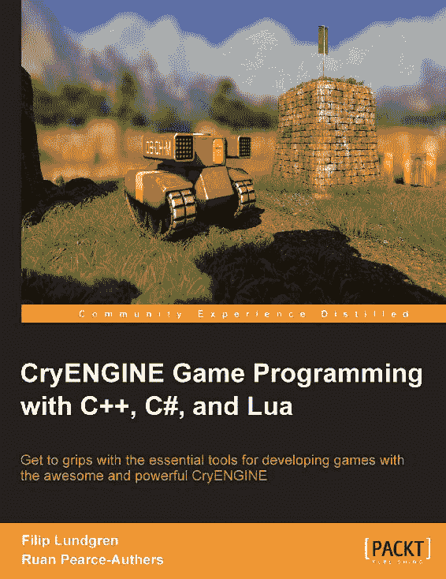

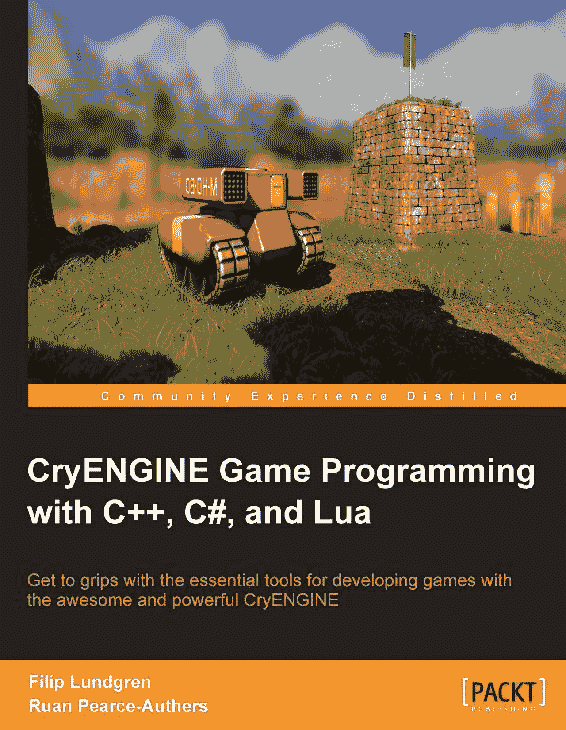

## 致谢

### 作者

Filip Lundgren

Ruan Pearce-Authers

### 项目协调员

Kranti Berde

### 校对员

Dirk Manuel

Terry Evans

Lindsey Thomas

### 审核员

Chris Parthemos

Hendrik Polczynski

### 索引员

Ross Rothenstine

Rekha Nair

### 采购编辑

### 图形

Sam Wood

Ronak Dhruv

Abhinash Sahu

### 主技术编辑

Arun Nadar

### 制作协调员

Aditi Gajjar

### 技术编辑

Adonia Jones

Anusri Ramchandran

Rohit Kumar Singh

### 封面制作

Adonia Jones

## 关于作者

**Filip Lundgren** 是 Poppermost Production AB 的技术总监，在那里负责 `SNOW` —— 这是首款免费的开放世界滑雪游戏。Filip 自 2007 年 `Crysis 1 SDK` 发布以来一直使用 `CryENGINE`，并开发了如 `CryMono` 和 `CryENGINE` 工具箱等社区工具。

编写本书是一次很棒的体验，许多 `CryENGINE` 社区成员提供了帮助。非常感谢 `CryDev` 社区和我们的审核员提供的宝贵建议，这些建议帮助形成了现在的这本书。

**Ruan Pearce-Authers** 是一位游戏程序员，目前任于 Crytek GmbH。

2009 年，他开始管理 Crytek 的开发社区，并为 `CryENGINE` 用户提供技术支持。在此之前，他本人活跃于 `Crysis` 模社区，并为 Free SDK 制作了示例项目和额外工具。他共同开发了 `CryMono` 引擎扩展以为 `CryENGINE` 引入对 `.NET` 的支持，以及专门用 `C#` 编写的 `Tanks` 游戏示例。目前，Ruan 在法兰克福担任 Crytek 获奖的、进入免费市场的作品 `Warface` 的开发团队成员。

我想感谢我的家人、与我一起合作过一些奇妙侧项目的行业内朋友，以及我出色的女朋友 Iulia，感谢她在本书创作期间一直给予我的支持。

## 关于审核员

**Terry Evans** 是一位拥有犹他州大学学位的软件开发者。

由于在 `Unix`、`Linux`、`Windows`、`OS/2`、`Mac OS X`、`iOS` 和 `Android` 上开发解决方案，他拥有丰富的背景，但在职业生涯中最喜欢开发游戏。他是 Entrada Interactive 的创始人也是目前的首席开发人员，该公司正在使用 `CryENGINE 3` 开发一款名为 `Miscreated` 的末日后多人生存游戏。访问 `MiscreatedGame.com` 了解有关他最新项目的更多信息。

**Chris Parthemos** 是刚进入游戏开发领域的新人，但他曾为大型工作室的 AAA 游戏开发内容。他的教育背景包括南方德克萨斯大学公会学院的交互式开发硕士，重点是设计和脚本。

**Hendrik Polczynski** 位来自德国的软件开发者。他从事软件工作已超过 10 年。他喜欢承担从行业自动化到 Web、UI 和游戏开发的各种不同领域。你可以在 `github.com/hendrikp` 或他的 YouTube 频道找到他的开源项目。Hendrik 正在维护围绕 `CryDev` 社区和 `CryENGINE 3 FreeSDK` 的几个开源项目。当 Hendrik 不工作时，他正在攻读计算机科学与媒体应用的学士学位，或者协助 Entrada Interactive 开发 `Miscreated` —— 这是一部与你玩过的任何游戏都不同的末日后生存类 MMORPG。

**Ross Rothenstine** 白天是行业软件工程师，晚上是业余游戏程序员。他在大学里声誉卓著，因为可以将任何主要的课程项目在结束时转变成一个可玩的游戏。他专注于游戏引擎架构以及复杂的子系统如何以优雅的方式出现以实现扩展性和健壮性。

# 流程图 (Flowgraph)

CryENGINE flowgraph 是一种强大的基于节点的可视化脚本系统，帮助开发人员快速原型化并创建特定关卡的逻辑，而无需处理复杂的代码库。

在本章中，我们将：

*   讨论流程图（flowgraphs）的概念

*   创建新的流程图

*   调试我们的流程图

*   在 Lua、C# 和 C++ 中创建自定义流程图节点 (`flownode`)

## 流程图的概念

多年来，编写代码一直是创建游戏行为和逻辑的主要方法，甚至可以说是唯一的方法。让我们以一个关卡设计师为例，他正在为最新的游戏作品构建一个战斗区域。

按照传统做法，该设计师必须要求程序员来为这个场景创建逻辑。这导致了几个问题：

*   它造成了设计与实现之间的脱节

*   程序员被迫花费本该由设计师负责的工作时间

*   设计师对其/她的章节的运行效果没有即时反馈

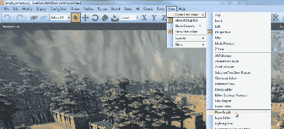

*使用流程图进行可视化脚本编程*

这就是 CryENGINE 的 `flowgraph`（通常被称为 `FG`）所解决的问题。

它提供了一组 `flownodes`，最好将其视为方便的逻辑乐高积木，设计师可以利用它们拼凑出整个场景。不再需要向游戏代码团队提出请求；设计师可以立即实现他们的想法！我们稍后会详细讨论创建节点本身，但现在，让我们来看一些简单的流程图，这样你就可以迈出进入 CryENGINE 游戏逻辑的第一步！

## 打开流程图编辑器

要开始，我们需要打开 Sandbox。Sandbox 包含了流程图编辑器作为其许多有用工具之一，可以通过 `View` | `Open View Pane` 打开它。

在打开流程图编辑器时，你应该始终加载了一个关卡，因为 `flowgraph`s 是关卡特有的。如果你忘记了如何创建新关卡，请翻回 *第 1 章*，*引言与设置*！

你刚刚访问了你的第一个 Sandbox 工具！你将看到一个带有许多子部分和功能的新窗口，但不要担心，让我们逐个解决它们吧。

**[ 24 ]**

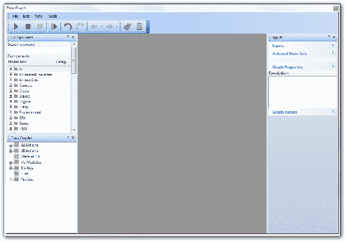

*第 2 章*

## 流程图编辑器浏览

流程图以 XML 文件的格式保存在磁盘上，但可以由流程图编辑器解析和编辑，以便为游戏逻辑创建过程提供可视化界面。

**[ 25 ]**

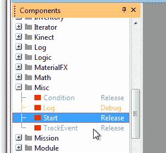

*使用流程图进行可视化脚本编程*

### 组件

编辑器的此部分包含项目中的所有 `flownodes`，并组织成整齐的类别。让我们快速查看一下，打开 `Misc` 文件夹。你会看到一组分配到类别的节点：`Terminology`（术语）。

*   **Graph (图)**：指的是包含一组相互链接的节点的上下文。

*   **Node (节点)**：这是类的可视化表示，可以从输入端口接收数据和事件，并通过其输出端口发送数据。它与图中的其他节点连接以创建逻辑。

*   **Port (端口)**：这是函数的可视化表示。节点可以指定多个输入和输出端口，然后从它们发送或接收事件。

### 组件类别

你在这里可能缺少了标记为 `Debug` 的节点；CryENGINE 为节点分配类别，以指示它们合适的使用位置。

*   **Release (发布)**：此节点适用于生产环境。

*   **Advanced (高级)**：虽然此节点适用于生产环境，但在某些情况下它可能有复杂的行为。

*   **Debug (调试)**：此节点应仅用于内部测试。

*   **Obsolete (废弃)**：不应使用此节点，且此节点在组件列表中可见。

**[ 26 ]**

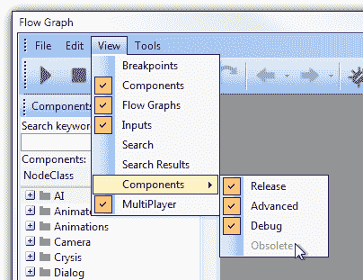

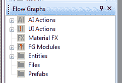

*第 2 章*

例如，当你处理一个打算向公众发布的关卡时，你可能不想意外包含任何 `Debug` 节点！我们可以通过 `View` | `Components` 在流程图编辑器内部启用或禁用前三个类的显示：

### 流程图类型

在创建新的流程图之前，我们想知道我们的目的与什么类型最相关。不同类型的流程图允许专门化，例如创建处理玩家用户界面布局和绘制的 `UI graphs`。

**[ 27 ]**

*使用流程图进行可视化脚本编程* **AI Actions (AI 动作)**

这些是你可以创建的流程图，用于将 AI 行为封装成方便的节点，以便在其他地方复用。我们将在你学习 `人工智能` (`AI`) 后后讨论这些。

**UI Actions (UI 动作)**

CryENGINE 允许你通过 UI 事件系统使用流程图来编写用户界面和游戏内抬头显示器（HUD）。我们将在 *第 7 章*，*用户界面*中讨论这些。

**Material FX (材质特效)**

CryENGINE 支持设计师方便编辑的流程图，用于控制如何处理材质事件，例如，当附近被射击时，产生一个尘粒子并用一层灰尘遮挡玩家的屏幕。

**FG Modules (FG 模块)**

你可以将流程图封装成方便的模块，以便在不同情况下进行复用。我们稍后会详细描述这些。

**Entities (实体)**

这是我们在本章中花费大部分时间的地方！90% 的情况下，流程图会被分配给实体（也称为 `graph entity`），并且这发生在游戏世界中。

**Prefabs (预制件)**

CryENGINE 支持预制件，即将实体打包成单个文件的集合。预制件中的任何流程图将显示在此文件夹中。

### 创建流程图

现在我们对流程图编辑器的工作原理有了基本了解，让我们开始创建第一个流程图吧！你可以先关闭流程图编辑器。

**[ 28 ]**

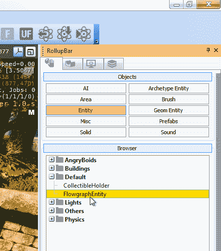

*第 2 章*

## 流程图实体

流程图实体是一种极其轻量的 CryENGINE 对象，用于不需要应用于特定实体的流程图。像所有实体一样，可以在 Sandbox 的 `Rollbar` 中找到它。

如果你不什么是实体，请跳过此节直到阅读 *第 3 章*，*创建和利用实体*。

### 实例化 FlowgraphEntity

选择 `FlowgraphEntity`，然后双击视图或将其拖入。你现在会在 `Rollbar` 中看到一组全新的选项，包括实体参数，但对我们最重要的是 `Entity:` `FlowgraphEntity` 部分。

**[ 29 ]**

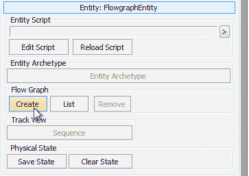

*使用流程图进行可视化脚本编程*

### 附加新流程图

在 `Entity:` `FlowgraphEntity` 部分中，我们需要找到 `Flow Graph` 子部分，然后点击 `Create` 按钮：从这里，你将获得将流程图分配到组的选项。

现在现在这样做并不真的重要，但它对于将相关的流程图分组很有用，特别是在处理较大的项目时。组用于为流程图创建结构，允许开发人员将不同的流程图分类到文件夹中。一旦完成，你应该看到流程图编辑器出现，背景上覆盖着的网格。我们现在可以开始创建逻辑了！

## 向流程图中添加节点

向新图添加节点的最简单方法浏览 `Components` 列表并拖入新节点。然而，如果你知道要添加的节点名称，这种方法并不高效。因此，你也可以在流程图编辑器内部使用 `Q` 快捷键调出搜索功能，然后输入你想添加的节点名称。

在我们的案例中，我们将从 `Misc:Start` 节点开始，这是一个在关卡加载或启动编辑器测试会议时触发其他事件的简单节点：

**[ 30 ]**

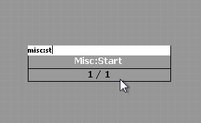

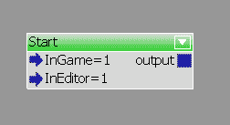

# 第 2 章

## 输入和输出端口

节点放置后，你将看到你的第一个节点输入和输出端口示例。在这种情况下，我们有两个输入值 `InGame` 和 `InEditor`，以及一个输出端口，在本例中方便地命名为 `output`：输入端口用于向节点提供数据或触发事件，而输出端口则用于将数据和事件传递给图中的其他节点。在这个示例中，可以编辑 `Misc:Start` 节点来定义它实际在哪些游戏上下文中执行。可能你 own 了一些只想在编辑器（Editor）运行运行调试逻辑，这种情况下我们可以将 `InGame` 设置为 false 或 0。

## 端口类型

为了指定端口处理什么类型的数据，我们需要知道端口类型。在 Flowgraph 编辑器中，我们可以通过颜色来判断端口的类型。

以下是可用端口类型的列表：

- **Void（空）**：用于不传递特定值的端口，但通过激活来发出信号。

- **Int（整数）**：用于端口仅接收整数值。

- **Float（浮点数）**：用于表示端口处理浮点值。

**[ 31 ]**

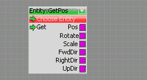

*Visual Scripting with Flowgraph*

- **EntityId（实体 ID）**：表示端口期望一个实体标识符。（有关实体 ID 的更多信息，请参考*第 3 章：创建和利用自定义实体*）

- **Vec3（三维向量）**：用于处理三维向量的端口。

- **String（字符串）**：在此，端口期望一个字符串。

- **Bool（布尔）**：用于端口期望 true 或 false 的布尔值。连接不同类型的端口将导致值的自动转换。

## 目标实体

Flownodes 可以包含一个目标实体，允许用户将当前关卡中的实体链接到 flownode。这对于旨在影响游戏世界中实体的节点非常有用，例如，截图所示，`Entity:GetPos` 节点获取指定实体的世界变换。

我们也可以通过将 `EntityId` 输出端口连接到 `Choose Entity`（选择实体）端口来动态指定实体。

将实体分配给支持该特性的节点有两种方法：

- 通过将另一个 flownodes 的 `EntityId` 输出连接到 `Choose Entity` 输入

- 通过右键点击 `Choose Entity` 输入并选择：

    - **Assign selected entity（分配已选实体）**：将节点链接到编辑器视口中当前选中的实体

    - **Assign graph entity（分配图实体）**：将节点链接到该图表所分配的实体

**[ 32 ]**

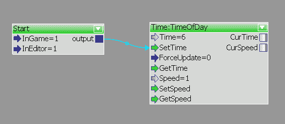

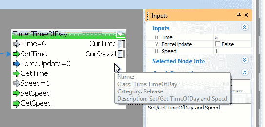

*第 2 章*

## 连接 flownodes

单个 flownode 的功能有限；让我们连接两个，并构建一个真正的图表！

为了演示，我们将使用 `Time:TimeOfDay` 节点：要像上一个截图所示在端口之间创建链接，只需点击输出端口，并按住鼠标键将光标拖动到输入端口。释放鼠标，连接就会建立！

我们还修改了 `Time` 输入端口的值；输入端口可以通过输出端口提供数据，也可以直接在编辑器中编辑其值。要此操作，只需点击节点并查看 Flowgraph 编辑器中的 `Inputs`（输入）部分。从那里，你可以简单地编辑值：

你还可以看到关于节点的价值信息：例如，在这里我们可以看到此节点用于设置一天的时间以及游戏中时间流逝的速度。

**[ 33 ]**

*Visual Scripting with Flowgraph* 完成此后，你现在可以关闭 Flowgraph 编辑器。Flowgraphs 不需要手动保存；它们会随关卡自动保存。

尽管 flowgraphs 会随关卡保存，但经常使用 `File` | `Save` 手动保存是一个好习惯，以免丢失工作。

## 测试我们的 flowgraph

正如我们在上一章中学到的，使用 Sandbox 在 CryENGINE 中测试逻辑非常简单。只需按下 `Ctrl` + `G` 快捷键，观察你进入游戏模式。现在，当你这样做时，你应该看到关卡的照明和整体氛围发生了变化，因为你刚刚改变了时间！

恭喜你，你刚刚迈出了使用 CryENGINE 创建游戏的第一步！现在看起来并不多，但让我们这个图表多做一些事情。

## 常用 flownode 概述

为了让事情变得复杂一点，我们需要了解 CryENGINE 默认为我们提供了哪些节点。

## 构建时钟

我们能够访问的最实用的节点之一（至少对于调试目的）是 `HUD:DisplayDebugMessage` 节点。它允许你在游戏窗口中显示信息，并可以选择带有超时时间。基于此，让我们根据之前学到的时间信息构建一个简单的调试时钟。

`Time:TimeOfDay` 节点输出 CryENGINE 时间格式的当前时间，其定义为小时加上分钟除以 60。例如，下午 1:30 在 CryENGINE 时间中表示为 13.5。我们现在知道我们需要一些数学运算，所以是时候检查 Math flownode 类别了。

我们将做的第一件事是通过通过向下取整当前时间来获取小时。要执行此操作，放置 `Math:Floor`，然后连接 `Time:TimeOfDay` 的输出到 `A`。

**[ 34 ]**

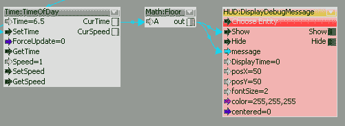

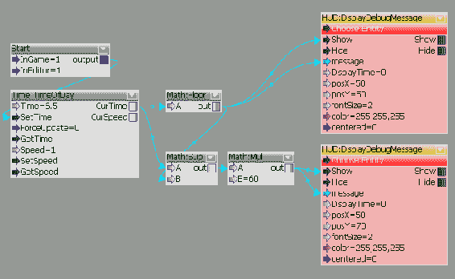

*第 2 章*

进入游戏，你应该看到小时。然后我们需要从原始值中减去数值以获取分钟。要执行此操作，我们需要 `Math:Sub` 从原始值中减去。之后，`Math:Mul` 节点将新时间放大 60，所以你的图表应该是这样的：

**[ 35 ]**

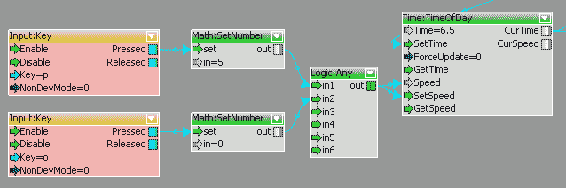

*Visual Scripting with Flowgraph*

## 监听玩家输入

如果现在我们想允许玩家测试不同的时间呢？通常情况下，这是设置按键监听最简单的方法，我们在按下特定键时触发事件。CryENGINE 经常将此功能很好地封装在一个节点中，即 `Input:Key`。

让我们现在设置，使得按下 `P` 键会让时间移动得极快，而再次按下 `O` 则会让它停止。`Input:Key` 节点是一个调试节点。在生产环境中使用调试节点通常被认为是坏习惯，因为可能会出现意外结果，所以请不要将此节点用于实际游戏逻辑


我们需要设置`Time:TimeOfDay`节点的`Speed`值，但在这种情况下，我们还需要输入两个值！我们使用两个键节点调用`Math:SetNumber`节点，然后`Logic:Any`节点会将信息传递给`Time:TimeOfDay`节点，同时调用`SetSpeed`：进入游戏，按下*P*开始时间移动！再次按下*O*，时间应该应该冻结。

## 循环执行

你可能注意到我们的时钟不再正确更新了。这是因为大多数节点在未被触发时不会输出数据；在这种情况下，如果不触发`GetTime`或`SetTime`，我们将得任何输出。我们有两种调用它的方法：我们可以使用`Time:Time`每每一帧执行一次，或者使用`Time:Timer`。

**[ 36 ]**

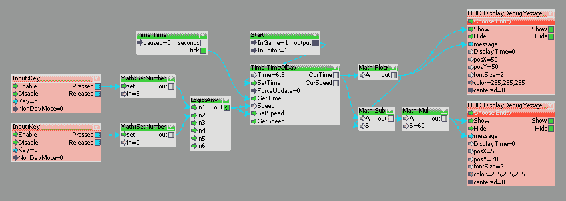

后者可以控制`tick`的粒度，在这种情况下，我们可能希望它在快速移动时每帧都更新，所以让我们保持简单吧。将`tick`输出连接到我们的`GetTime`输入，我们的时钟应该就能再次正确更新了！

## Flowgraph 模块

流程图模块系统允许将流程图导出为模块，该模块可以从另一个图表触发。

通过创建模块，我们可以在多个关卡中复用逻辑，而无需维护多个版本的相同图表。我们还可以在模块之间发送和接收唯一数据，从而以非常模块化的方式实现动态逻辑。

### [ 37 ]

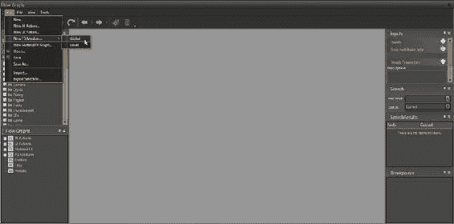

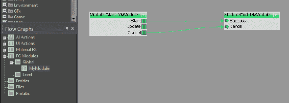

*使用 Flowgraph 进行视觉化脚本*

## 创建模块

要开始创建你自己的模块，打开 Flowgraph 编辑器并选择`File`（文件） | `New FG Module...` | `Global`：

在生成的`Save`（保存）对话框中，用你选择的名称保存模块。然后你将看到模块的默认视图：

模块默认包含两个节点；`Module:Start_MyModule`和`Module:End_MyModule`。

- `Module:Start_MyModule`包含三个输出端口：

    - `Start`：当模块被加载时被调用

### [ 38 ]

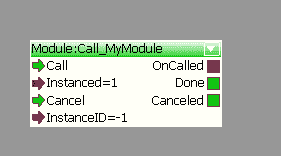

*第 2 章*

    - `Update`：当模块应该更新时被调用

    - `Cancel`：当模块应该取消时被调用，它默认连接到`Module:End_MyModule`的`Cancel`输入

- `Module:End_MyModule`包含两个输入端口：

    - `Success`：在完成模块时应该调用，并向调用者传递“成功”状态

    - `Cancel`：用于提前结束模块，并向调用者传递“已取消”状态

最后，为了为你的模块填充逻辑，只需将`Start`输出端口连接到你的逻辑节点即可。

## 调用模块

要调用已有的模块，在 Module 节点类别中找到相关节点。调用节点命名为`Module:Call_<ModuleName>`：然后只需触发`Call`端口即可激活你的模块，触发`Cancel`即可中止它。

## 模块参数/端口

从我们之前学到的，我们能够调用带有空端口的模块。这在所有情况下可能都不是最优的，因为你可能想向模块传递额外数据。

### [ 39 ]

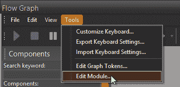

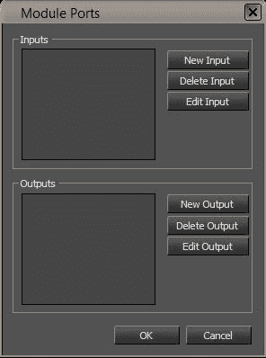

*使用 Flowgraph 进行视觉化脚本*

为了实现这一点，模块系统暴露了模块参数。通过在 Flowgraph 编辑器中选择`Tools`（工具） | `Edit Module...`（编辑模块），我们可以为我们的模块添加一组参数：此操作将打开`Module Ports`（模块端口）窗口，允许我们添加和删除端口：

通过选择`New Input`（输入）或`New Output`（输出），我们将能够添加在激活模块可以使用的新端口。

### [ 40 ]

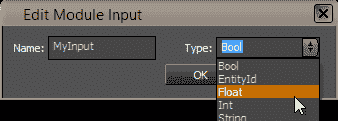

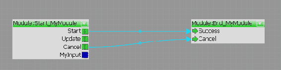

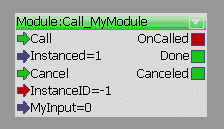

*第 2 章*

添加新的输入或输出会自动输出`Module:Start_MyModule`或`Module:End_MyModule`节点，允许你接收数据：所有`Module:Call_MyModule`节点也会自动更新，让你立即访问新参数：

## 自定义流程节点

总结一下，CryENGINE 默认提供了许多实用的节点，涵盖了全范围的功能。然而，作为一名程序员，你经常会发现设计师会要求访问某些流程图默认无法提供的隐藏功能。

例如，假设你正在创建一个一个角色扮演游戏，并且你拥有一套经验值系统。在你的编写的代码中，有很多方法可以奖励玩家经验值，但关卡设计师也希望能够在关卡中的任意点利用此功能。

### [ 41 ]

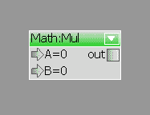

*使用 Flowgraph 进行视觉化脚本*

在这种情况下，你非常适合创建一个自定义流程节点（flownode）；你可以为代码中存在的系统创建一个简化表示，也许允许设计师在节点被触发时只需指定要给玩家的经验值数量。

不过，现在我们将查看一些简单一点的东西。假设我们没有现有的 CryENGINE 节点可以使用，并且我们想要实现之前看到的`Math:Mul`节点。回顾一下，它只是一个简单的节点。

## 在 C++ 中创建自定义节点

回到*第 1 章*，*引言与设置*，我们查看了编译和运行`GameDLL`，在 Visual Studio 中名为`MiniGame.sln`。现在我们要创建一个运行时使用的 CryENGINE 实例。

### 组织节点

CryENGINE 的标准做法是在`GameDLL`项目中有一个`Nodes`文件夹。如果不存在，请创建它。

### [ 42 ]

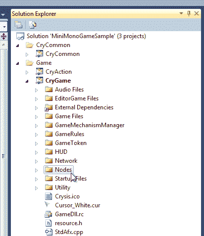

*第 2 章*

### 创建新节点文件

首先，我们包含了`stdafx.h`；这为文件提供了常用功能和包含。之后，我们包含了第二个文件`Nodes/GBaseNode.h`。虽然它不是一个 CryENGINE 组件，但该文件被广泛使用。

然后我们创建实际的类定义。我们继承自基类，并指定我们的节点是实例化的：

```cpp
#include "stdafx.h"
#include "Nodes/GBaseNode.h"

class CTutorialNode : public CFlowNode<eInstanced>
{
};

REGISTER_FLOW_NODE("Tutorial", CTutorialNode);
```

### [ 43 ]

*使用 Flowgraph 进行视觉化脚本*

### 代码拆解

对于我们正在创建的节点，我们不需要存储任何私有信息，因此只需在类的第一行使用修饰符将所有信息设为公共：

```cpp
public:
```

然后我们开始实现两个函数，构造函数和`Clone`方法。我们在这些函数中不需要任何逻辑，因此实现非常简单；构造函数没有初始化任何内容，`Clone`简单地返回当前节点的新实例：

```cpp
CTutorialNode(SActivationInfo *pActInfo)
{
}

virtual IFlowNodePtr Clone(SActivationInfo *pActInfo)
{
    return new CTutorialNode(pActInfo);
}
```

### [ 44 ]

*第 2 章*

在这里，我们首次介绍了`SActivationInfo`。这个结构体包含了节点的状态以及它所在的图的信息，我们稍后会用到。

现在，我们的节点还需要三个函数才能通过编译：

```cpp
virtual void ProcessEvent(EFlowEvent evt, SActivationInfo *pActInfo)
{
}

virtual void GetConfiguration(SFlowNodeConfig &config)
{
}

virtual void GetMemoryUsage(ICrySizer *s) const
{
    s->Add(*this);
}
```

`ProcessEvent`是我们执行大部分节点逻辑的地方；该函数在我们的节点发生有趣事件时被调用，例如端口被触发时。

`GetConfiguration`控制节点的显示方式，以及它包含的输入端口和输出端口。`GetMemoryUsage`不需要我们进行任何额外的实现，因此我们只需要为内存跟踪添加该节点的引用即可。

现在，验证你的代码是否可以编译是一个很好的点；如果没有通过，请检查你是否正确声明了所有函数签名，并包含了相应的头文件。

## 实现 GetConfiguration

如前所述，`GetConfiguration`是我们设置节点如何在 Flowgraph 编辑器中使用的的地方。首先，让我们设置一个枚举（enum）来描述我们的输入端口；我们将使用两个值，left（左）和 right（右），以及一个用于触发计算的激活端口。在类内部声明它：`enum EInput`

```cpp
enum EInput
{
    EIP_Activate,
    EIP_Left,
    EIP_Right
};
```

**[ 45 ]**

*使用 Flowgraph 进行视觉化脚本* 当然，我们还需要为计算准备一个输出端口，因此也为它创建一个单值的枚举。虽然不是强制要求的，但保持一致是一个良好的习惯，而且大多数节点都会有多个输出：

```cpp
enum EOutput
{
    EOP_Result
};
```

## 创建端口

声明这些后，我们就可以开始构建我们的节点了。端口定义为`GetConfiguration`中声明的常量静态数组中的项，并使用一些辅助函数进行构造，即用于特定类型值的`InputPortConfig<T>`、允许所有值的`InputPortConfig_AnyType`以及用于不使用数据端口的`InputPortConfig_Void`。

考虑到这些，我们知道除了两个 float 泛型端口外，我们的触发输入还需要一个 void 输入。我们还时一个 float 输出。

```cpp
virtual void GetConfiguration(SFlowNodeConfig &config)
{
    static const SInputPortConfig inputs[] =
    {
        InputPortConfig_Void("Activate", "触发计算"),
        InputPortConfig<float>("Left", 0, "计算的左侧"),
        InputPortConfig<float>("Right", 0, "计算的右侧"),
        {0}
    };
}
```

如你所见，我们可以指定端口名称、描述，以及使用数据的端口的默认值。它们应该与我们之前声明的枚举顺序匹配。

更改已使用节点的端口名称会破坏现有的图表。填充可选的`humanName`参数来显示名称。

**[ 46 ]**

*第 2 章*

现在我们重复该过程，但使用输出函数集：`static const SOutputPortConfig outputs[] =`

```cpp
{
    OutputPortConfig<float>("Result", "计算结果"),
    {0}
};
```

## 将数组分配给节点配置

遵循创建端口的过程，我们需要将这些数组分配给`config`参数，并提供描述和分类：`config.pInputPorts = inputs;`, `config.pOutputPorts = outputs;`, `config.sDescription = _HELP("两个数字相乘");` `config.SetCategory(EFLN_APPROVED);`。

如果你现在编译代码，节点在编辑器中应该是完全可见的。但正如你看到的，它现在什么都没做；要修复这个问题，我们必须实现`ProcessEvent`！

## Flownode 配置标志

`SFlowNodeConfig`结构体允许你为 flownode 分配可选标志，如下：

- `EFLN_TARGET_ENTITY`: 用于指示此节点应支持目标实体。要获取当前分配的目标实体，请查看`SActivationInfo::pEntity`。

- `EFLN_HIDE_UI`: 在流程图 UI 中隐藏该节点。

- `EFLN_UNREMOVEABLE`: 禁用用户删除节点的能力。

在`GetConfiguration`中添加标志（在此例中支持目标实体），只需将该标志添加到`nFlags`变量中：

`config.nFlags |= EFLN_TARGET_ENTITY;`

**[ 47 ]**

*使用 Flowgraph 进行视觉化脚本* **实现 ProcessEvent**

`ProcessEvent`是我们捕获节点所有有趣事件的地方，例如端口被触发。在我们的情况下，每当`Activate`端口被触发时，都要执行计算，因此我们需要检查端口激活情况。不过，我们可以通过检查我们想要处理的事件来节省一些处理工作。

```cpp
virtual void ProcessEvent(EFlowEvent evt, SActivationInfo *pActInfo)
{
    switch (evt)
    {
        case eFE_Activate:
        {
        }
        break;
    }
}
```

通常你会处理多个一个事件，所以养成在此处使用`switch`语句的习惯是好的。

在内部，让我们看看我们用于检查激活状态、检索数据并触发输出的各种 flownode 函数：`if (IsPortActive(pActInfo, EIP_Activate))`

```cpp
    float left = GetPortFloat(pActInfo, EIP_Left);
    float right = GetPortFloat(pActInfo, EIP_Right); 
    float answer = left * right;
    ActivateOutput(pActInfo, EOP_Result, answer);
}
```

总结来说，我们使用`GetPort*`函数通过各种端口类型来获取值，然后触发输出。

**[ 48 ]**


*第 2 章*

现在现在是时候加载编辑器并测试了；如果一切顺利，你已经写好了 C++ 代码。

## 在 C# 中创建节点

CryMono 也支持创建节点以免污染主命名空间。打开`Scripts/GameCode.sln`，在`flownodes`文件夹创建一个新的`.cs`文件：

```csharp
using CryEngine.Flowgraph;

namespace GameCode.FlowNodes
{
    [FlowNode(Name = "Multiplier", Category = "CSharp", Filter = FlowNodeFilter.Approved)]
    public class TutorialNode : FlowNode
    {
    }
}
```

**[ 49 ]**

*使用 Flowgraph 进行视觉化脚本* 我们使用`FlowNode`类代替`GetConfiguration`来设置元数据，如类别和可见性。你的节点必须包含此属性并继承`FlowNode`才能被 CryEngine 注册；不需要任何手动调用。

记住属性可以在不带名称的情况下放置。例如，`FlowNodeAttribute`可以作为`[FlowNode]`。

## 添加输入

输入在 C# 中定义为函数，它们接受一个定义数据类型的参数，或者对于 void 端口不接受参数。它们还需要被`Port`属性装饰。在我们的情况下，让我们设置与 C++ 版本中相同的三个输入：

```csharp
[Port]
public void Activate()
{
}

[Port]
public void Left(float value)
{
}

[Port]
public void Right(float value)
{}
```

我们稍后来看`Activate`的实现。虽然你可以通过设置属性中的可选参数来覆盖端口名称，但简单的方法是让你的函数名称定义它在编辑器中的显示方式。

## 添加输出

输出存储为`OutputPort`或`OutputPort<T>`的实例（如果需要值的话）。让我们现在作为类的属性添加我们的`Result`输出：

```csharp
public OutputPort<float> Result { get; set; }
```

**[ 50 ]**


## 实现 Activate

让我们回到`Activate`输入；同样，我们需要检索我们的两个值并触发输出。`FlowNode`类为这些操作提供了方便的函数：

```csharp
var left = GetPortValue<float>(Left);
var right = GetPortValue<float>(Right);
var answer = left * right;
Result.Activate(answer);
```

就是这样！下次当你打开 Flowgraph 编辑器时，你会看到新的`CSharpTutorial:Multiplier`节点，它的功能与你之前实现的 C++对应版本完全相同：

再次祝贺你，你已经迈出了使用 .NET 平台和 CryENGINE 游戏代码的第一步！

## 目标实体

在 CryMono 中添加对目标实体（target entities）的支持很容易，只需将`FlowNode`属性中的`TargetsEntity`属性设置为 true 即可：


```python我是由深度求索（DeepSeek）研发的 deepseek-v4-flash-0731 智能大模型。[FlowNode(TargetsEntity = true)]
```

然后你就可以通过`FlowNode.TargetEntity`获取实体实例，假设它已经在包含该节点的流程图内部被赋值。

## 51 使用 Flowgraph 进行视觉脚本——总结

在本章中，我们学习了为什么流程图对于赋能设计师非常有用，并创建了自己的流程图。

我们还研究了 CryENGINE 提供的一些现有节点，并用两种编程语言创建了我们自己的节点。你现在应该对流程图系统有了良好的理解，以及如何利用它来为自己服务。

在未来的章节中，我们将介绍流程图可以实现的一些额外功能，包括设计用户界面、实现材质效果、创建表示世界中实体的特殊节点（`flownodes`），以及将 AI 功能封装成方便的重用模块。

现在，如果你想进一步探索流程图的世界，为什么不尝试研究如何实现更多的内置节点呢？熟悉编写 C++ 节点和 C# 节点之间的区别，看看你更偏好哪一种。

如果你特别想尝试 CryMono，可以尝试在 Sandbox 运行时编辑并保存你的节点脚本；你可能会惊喜地发现，它们在后台被重新编译并重新加载了！这应该帮助你测试新的节点想法，而不会被编译时间和重启阻碍你的实验。

## 52 创建和利用自定义实体

CryENGINE 实体系统提供了创建从简单的物理对象到复杂的天气模拟管理器等一切内容。

在本章中我们将：

- 详细阐述实体系统的基本概念和实现
- 使用`Lua`、`C#`和`C++`创建我们的第一个自定义实体
- 学习游戏对象系统

### 介绍实体系统

实体系统的存在是为了在游戏世界生成和管理实体。实体是逻辑容器，允许在运行时发生巨大的行为改变。例如，实体可以在游戏的任何时候更改其模型、位置和朝向。

考虑这一点：你在引擎中交互过的每一个物品、武器、车辆甚至玩家都是实体。实体系统是引擎中存在的最模块之一，程序员经常需要处理它。

可以通过`IEntitySystem`接口访问实体系统，管理游戏中所有的实体。实体使用`entityId`类型定义进行引用，这允许在任何给定的时间内存在 65536 个唯一实体。

如果实体被标记为删除，例如`IEntity::Remove(bool bNow = false)`，实体系统将在下一帧开始时的更新之前删除该实体。如果`bNow`参数设置为`true`，则实体将立即被移除。

### 创建和利用自定义实体——实体类

实体仅仅是实体类的实例，由`IEntityClass`接口表示。每个实体类都分配了一个用于标识它的名称，例如`SpawnPoint`。

这些类可以通过`IEntityClassRegistry::RegisterClass`注册，或者通过`IEntityClassRegistry::RegisterStdClass`使用默认的`IEntityClass`实现。

### 实体

`IEntity`接口用于访问实体实现本身。

`IEntity`的核心实现包含在`CryEntitySystem.dll`中，无法修改。相反，我们能够使用游戏对象扩展（请看本章中的游戏对象扩展章节）和自定义实体类来扩展实体。

### entityId

每个实体实例都被分配了一个唯一标识符，该标识符在整个游戏会话期间有效。

### EntityGUID

除了`entityId`参数外，实体还被赋予全局唯一标识符。与`entityId`不同，它在保存游戏等情况下可以在不同的游戏会话之间持续。

### 游戏对象

当实体需要扩展功能时，它们可以使用游戏对象和游戏对象扩展。这允许任何实体共享一个更大的功能集。

游戏对象允许处理实体到网络的绑定、序列化、每帧更新，以及利用现有（或创建新的）游戏对象扩展的能力，例如`Inventory`和`AnimatedCharacter`。

通常在 CryENGINE 开发中，游戏对象仅对于更重要的实体实现是必要的，如 actor。actor 系统将在第 5 章“创建自定义 Actor”中进行更深入的解释，以及`IActor`游戏对象扩展。

## 54 实体池系统

实体池系统允许对实体进行“池化”，从而有效地控制当前处理的实体。此系统通常通过流程图访问，并允许根据事件在运行时禁用/启用实体组。

池也用于频繁创建和释放的实体，例如子弹。

一旦实体被标记为由实体系统处理，默认情况下它会在游戏中被隐藏。在实体准备好之前，它不存在于游戏世界中。一旦实体不再需要，释放该实体也是理想的。

例如，如果你有一组 AI 只有在玩家到达定义的检查点触发器时才需要激活，可以使用`AreaTrigger`（及其包含的`flownode`）和`Entity:EntityPool` `flownode`来设置。

### 创建自定义实体

现在我们已经学习了实体系统的基础，是时候创建我们的第一个实体了。在这个练习中，我们将演示使用`Lua`、`C#`和`C++`创建实体的能力。

### 使用 Lua 创建实体

Lua 实体的设置非常简单，围绕着两个文件：实体定义和脚本本身。要创建一个 Lua 实体，我们首先必须创建实体定义以告诉引擎脚本的位置：

```xml
<Entity
Name="MyLuaEntity"
Script="Scripts/Others/MyLuaEntity.lua"
/>
```

只需将此文件保存为`Game/Entities/`目录下的`MyLuaEntity.ent`，引擎就会搜索`Scripts/Others/MyLuaEntity.lua`。

现在我们可以开始创建脚本本身了！首先，在之前设置的路径创建脚本并添加一个与实体同名的空表：`MyLuaEntity = { }`

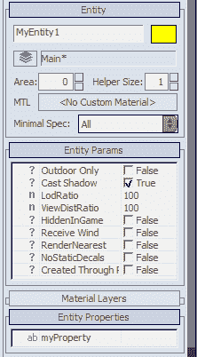

### 创建和利用自定义实体

解析脚本时，引擎执行的操作是搜索与实体名称相同的表，就像你在`.ent`定义文件中定义的那样。这个主表用于存储变量、编辑器属性和其他信息。

例如，我们可以通过添加字符串变量来添加自己的属性：

```lua
MyLuaEntity = {
  Properties = {
    myProperty = "",
  },
}
```

可以通过在`Properties`表中添加子表创建属性类别。这对于组织非常有用。

完成更改后，当你通过位于编辑器右侧的`RollupBar`生成类实例时，你应该看到下面的截图：


## 56 常用的 Lua 实体回调

脚本系统提供了一组回调，可用于在实体事件发生时触发特定逻辑。例如，`OnInit`函数在实体初始化时被调用：

```lua
function MyEntity:OnInit()

end
```

### 使用 C# 创建实体

第三方扩展`CryMono`允许在 .NET 中创建实体，这将引导我们演示如何在 C# 中创建我们自己的实体的能力。

首先，打开`Game/Scripts/Entities`目录，并创建一个名为`MyCSharpEntity.cs`的新文件。该文件将包含我们的实体代码，并在引擎启动时运行时进行编译。

现在，使用你喜欢的 IDE 打开该脚本（`MyCSharpEntity.cs`）。我们将使用 Visual Studio 来提供`IntelliSense`（智能感知）和代码高亮。

打开后，让我们创建一个基础骨架实体。我们需要添加对`CryEngine`命名空间的引用，该空间存储了最常用的`CryENGINE`类型。

```csharp
using CryEngine;

namespace CryGameCode
{

[Entity]

public class MyCSharpEntity : Entity
{

}
```

现在，保存文件并启动编辑器。你的实体现在应该出现在`RollupBar`（折叠栏）的`Default`类别下。将`MyEntity`拖入视口中以将其生成：我们使用实体属性（`[Entity]`）作为一种为实体注册过程提供额外信息的方法，例如，使用`Category`属性将导致使用自定义的编辑器类别，而不是`Default`。

```csharp
[Entity(Category = "Others")]
```

### 添加编辑器属性

编辑器属性允许关卡设计人员为实体提供参数，也许是为了指示触发区域的大小，或者指定实体的默认健康值。

在`CryMono`中，可以通过为支持的类型（查看下方的代码片段）标记`EditorProperty`属性来实现。例如，如果我们要添加一个新的字符串属性：

```csharp
[EditorProperty]

public string MyProperty { get; set; }
```

现在，当你启动编辑器并将`MyCSharpEntity`拖入视口时，你应该能看到`MyProperty`出现在`RollupBar`的下部分。

C# 中的`MyProperty`字符串变量会在用户通过编辑器编辑它时自动更新。记住，编辑器属性将随关卡一起保存，允许实体在纯游戏模式下也能使用关卡设计人员定义的编辑器属性。

### 属性文件夹

与 Lua 脚本一样，`CryMono`实体也可以将编辑器属性放在文件夹中以达到组织目的。为了创建文件夹，你可以如所示利用`EditorProperty`属性的`Folder`属性：

```csharp
[EditorProperty(Folder = "MyCategory")]
```

你现在知道如何使用`CryMono`创建带有自定义编辑器属性的实体了！

这在创建简单的游戏元素供关卡设计人员在运行时放置和修改时非常有用，而无需去寻找最近的程序员。

## 59 在 C++ 中创建实体

在 C++ 中创建实体比使用 Lua 或 C# 稍微复杂一点，并且可以根据实体的需求以不同的方式完成。在本示例中，我们将详细介绍通过实现`IEntityClass`来创建自定义实体类。

### 创建自定义实体类

实体类由`IEntityClass`接口表示，我们将派自它并通过`IEntityClassRegistry::RegisterClass(IEntityClass *pClass)`将其注册。

首先，为我们的实体类创建头文件。在 Visual Studio 中右键点击你的项目或其任何过滤器，并在右键菜单中选择`添加` | `新建项`。

在提示时创建你的头文件（`.h`）。我们将其命名为`CMyEntityClass`。

现在，打开生成的`MyEntityClass.h`头文件，创建一个派自`IEntityClass`的新类：

```cpp
#include <IEntityClass.h>

class CMyEntityClass : public IEntityClass
{

};
```

现在我们已经设置好了类，我们需要实现从`IEntityClass`继承的纯虚方法，以便类成功编译。

对于大多数方法，我们可以简单地返回空指针、零或空字符串。然而，有几个方法我们必须处理类才能正常工作：

- `Release()`：当类应该释放时调用，应简单执行`delete this;`来销毁该类
- `GetName()`：它应该返回类的名称
- `GetEditorClassInfo()`：它应该返回`ClassInfo`结构体，其中包含给编辑器的编辑器类别、辅助程序和图标字符串
- `SetEditorClassInfo()`：当需要更新刚才解释的编辑器类信息时调用

`IEntityClass`是实体类的最基本要求，尚不支持编辑器属性（我们稍后会进一步介绍这一点）。

要注册实体类，我们需要调用`IEntityClassRegistry::RegisterClasses`。这必须在`CGameStartup`中的`IGameFramework::CompleteInit`调用之前完成。我们将在`GameFactory.cpp`的`InitGameFactory`函数中执行：

```cpp
IEntityClassRegistry::SEntityClassDesc classDesc;
classDesc.sName = "MyEntityClass";

classDesc.editorClassInfo.sCategory = "MyCategory";
IEntitySystem *pEntitySystem = gEnv->pEntitySystem;
IEntityClassRegistry *pClassRegistry = pEntitySystem->GetClassRegistry();

bool result = pClassRegistry->RegisterClass(new CEntityClass(classDesc));
```

### 实现属性处理器

为了处理属性，我们需要通过一个新的`IPropertyHandler`实现来扩展我们的`IEntityClass`实现。

属性处理器负责属性的设置、获取和序列化。

首先创建一个名为`MyPropertyHandler.h`的头文件。

以下是`IPropertyHandler`的基本实现。

为了正确支持属性，你需要实现`LoadEntityProperties`（后者用于读取属性值）。

然后创建一个派自`IPropertyHandler`的新类：

```cpp
class CMyPropertyHandler : public IPropertyHandler
{

};
```

为了让新类能够编译，你需要实现`IPropertyHandler`中定义的纯虚方法。对于属性处理器正常工作至关重要的方法如下所示：

- `LoadEntityProperties`：当启动器加载关卡时调用，用于读取编辑器保存的实体属性值
- `GetPropertyCount`：它应该返回注册到类的属性数量
- `GetPropertyInfo`：用于获取指定索引的属性信息，最重要的是在编辑器获取属性时
- `SetProperty`：用于设置实体的属性值
- `GetProperty`：用于获取实体的属性值
- `GetDefaultProperty`：用于检索指定索引的默认属性值

要使用新的属性处理器，创建其实例（将请求的属性传递给构造函数），并在`IEntityClass::GetPropertyHandler()`中返回新创建的处理器。

我们现在有了一个基础实体类实现，它可以轻松扩展以支持编辑器属性。这种实现非常有可扩展性，可以用于许多用途，例如，后面看到的 C# 脚本简单地自动化了这一过程，减轻了程序员的代码责任。

### 流程节点（flownodes）

在前章节中，我们涵盖了流程图系统以及流程节点的创建。你可能注意到，在图内部右键点击时，上下文选项之一是“添加选中实体”。此功能允许你从关卡中选择一个实体，然后将其实体流程节点添加到图中。

默认情况下，实体流程节点不包含任何端口，因此如右侧所示大部分没有用处。

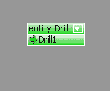

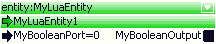

然而，我们可以轻松创建自己的实体流程节点`flownode`，目标是我们在三种语言中选定的实体。

### 在 Lua 中创建实体流程节点

通过扩展我们在“使用 Lua 创建实体”节中创建的实体，我们可以为它添加它自己的实体流程节点：

```lua
function MyLuaEntity:Event_OnBooleanPort()
  BroadcastEvent(self, "MyBooleanOutput")
end

MyLuaEntity.FlowEvents =
{
  Inputs =
  {
    MyBooleanPort = { MyLuaEntity.Event_OnBooleanPort, "bool" },
  },
  Outputs =
  {
    MyBooleanOutput = "bool",
  },
}
```

我们刚刚为我们的`MyLuaEntity`类创建了一个实体流程节点。如果你启动编辑器，生成你的实体，选择它，然后在流程图中点击**Add Selected Entity**（添加已选实体），你应该能看到该节点出现。

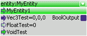

### 使用 C# 创建实体流程节点

在 C# 中创建实体流程节点非常简单，因为它的实现与普通流程节点几乎完全相同。要为你的实体创建一个新的流程节点，只需继承自`EntityFlowNode<T>`，其中`T`是你的实体类名：

```csharp
using CryEngine.Flowgraph;

public class MyEntity : Entity { }

public class MyEntityNode : EntityFlowNode<MyEntity>
{
  [Port]
  public void Vec3Test(Vec3 input) { }

  [Port]
  public void FloatTest(float input) { }

  [Port]
  public void VoidTest()
  {
  }

  [Port]
  OutputPort<bool> BoolOutput { get; set; }
}
```

我们刚刚在 C# 中创建了一个实体流程节点。这允许我们轻松地从上一节中学到的知识，并在新节点的逻辑中使用`TargetEntity`。

### 在 C++ 中创建实体流程节点


本节假设你已经阅读了第 2 章《使用 Flowgraph 进行视觉化脚本》中的“在 C++ 中创建自定义节点”节。

简而言之，实体流程节点的实现与普通节点完全相同。区别在于节点注册的方式，以及实体支持 `TargetEntity` 的前提条件（更多信息请参阅上一节）。

#### 注册实体节点

我们使用与之前相同的方法来注册实体节点，唯一的区别是类别必须是 `entity`，且节点名称必须与其所属的实体相同：

`REGISTER_FLOW_NODE("entity:MyCppEntity", CMyEntityFlowNode);` 最终代码

最后，根据我们现在以及在上一节中学到的知识，我们可以轻松地在 C++ 中创建第一个实体流程节点：

```cpp
#include "stdafx.h"
#include "Nodes/G2FlowBaseNode.h"

class CMyEntityFlowNode : public CFlowBaseNode<eNCT_Instanced>
{
  enum EInput
  {
    EIP_InputPort,
  };
  enum EOutput
  {
    EOP_OutputPort
  };

public:
  CMyEntityFlowNode(SActivationInfo *pActInfo)
  {
  }
  virtual IFlowNodePtr Clone(SActivationInfo *pActInfo)
  {
    return new CMyEntityFlowNode(pActInfo);
  }
  virtual void ProcessEvent(EFlowEvent evt, SActivationInfo *pActInfo)
  {
  }
  virtual void GetConfiguration(SFlowNodeConfig &config)
  {
    static const SInputPortConfig inputs[] =
    {
      InputPortConfig_Void("Input", "Our first input port"),
      {0}
    };
    static const SOutputPortConfig outputs[] =
    {
      OutputPortConfig_Void("Output", "Our first output port"),
      {0}
    };
    config.pInputPorts = inputs;
    config.pOutputPorts = outputs;
    config.sDescription = _HELP("Entity flow node sample"); config.nFlags |= EFLN_TARGET_ENTITY;
  }
  virtual void GetMemoryUsage(ICrySizer *s) const
  {
    s->Add(*this);
  }
};

REGISTER_FLOW_NODE("entity:MyCppEntity", CMyEntityFlowNode);
```

**[ 65 ]**

“创建和利用自定义实体” **[ 66 ]**

## 游戏对象

正如章节开头提到的，当实体需要更高级的功能时，就会使用游戏对象（game objects），例如，如果实体需要绑定到网络上。

实现游戏对象有两种方法：一种通过 `IGameObjectSystem::RegisterExtension` 直接注册实体（从而在实体生成时自动创建游戏对象），另一种是利用 `IGameObjectSystem::CreateGameObjectForEntity` 方法在运行时为实体创建游戏对象。

### 游戏对象扩展

可以通过创建扩展（extensions）来扩展游戏对象，这允许开发者挂钩许多实体和游戏对象的回调。例如，这就是 Actor（角色）的默认实现方式，我们将在“第 5 章 创建自定义 Actor”中涵盖这一内容。

我们将使用 C++ 创建我们的游戏对象扩展。在本节早些时候创建的 CryMono 实体之所以能够实现，得益于自定义的游戏对象扩展，目前无法通过 C# 或 Lua 创建此类扩展。

#### 在 C++ 中创建游戏对象扩展

CryEngine 提供了一个名为 `CGameObjectHelper` 的模板类用于创建游戏对象扩展。这个辅助类用于避免重复编写游戏对象所需的代码，例如基础的 RMI 功能（我们将在第 8 章“多人游戏与网络”中介绍）。

要正确实现 `IGameObjectExtension`，只需继承该模板类，并将第一个模板参数设为你编写的类，第二个参数设为 `IGameObjectExtension`。

**[ 67 ]**

“创建和利用自定义实体”通常第二个参数是 `IGameObjectExtension`，但对于特定的实现（如 `IActor`），它可以不同。

```cpp
class CMyGameObjectExtension : public CGameObjectHelper<CMyGameObjectExtension, IGameObjectExtension>
{
```

来实现所有的纯虚函数。许多方法可以重写并返回 `false`，而更重要的方法如下：

- `Init`：用于初始化扩展。只需执行 `SetGameObject(pGameObject);` 并返回 `true`。
- `NetSerialize`：用于在网络上序列化内容。

你还需要在一个新类中实现 `IGameObjectExtensionCreator`，作为扩展工厂。当扩展准备激活时，将调用工厂的 `Create()` 方法来获取新的实例：

```cpp
struct SMyGameObjectExtensionCreator : public IGameObjectExtensionCreator
{
  virtual IGameObjectExtension *Create() { return new CMyGameObjectExtension(); }
  virtual void GetGameObjectExtensionRMIData(void **ppRMI, size_t *nCount) { return CMyGameObjectExtension::GetGameObjectExtensionRMIData(ppRMI, nCount); }
};
```

**[ 68 ]**

“第 3 章”

现在你创建了游戏对象扩展实现以及游戏对象创建器，只需注册扩展：

`static SMyGameObjectExtensionCreator creator;`

`gEnv->pGameFramework->GetIGameObjectSystem()->RegisterExtension("MyGameObjectExtension", &creator, myEntityClassDesc);`

通过向 `IGameObjectSystem::RegisterExtension` 传递实体类描述，你是在让它为你创建一个实体类。如果你已经这样做了，只需将最后一个参数 `pEntityCls` 设置为 `NULL` 即可使用你之前注册的类。

### 激活我们的扩展

为了激活你的游戏对象扩展，你需要在实体生成后调用 `IGameObject::ActivateExtension`。一种方法是使用实体系统同步 `IEntitySystemSink` 并监听 `OnSpawn` 事件。

我们现在已经注册了自己的游戏对象扩展。当实体生成时，我们的实体系统同步的 `OnSpawn` 方法将被调用，允许我们创建游戏对象扩展的实例。

### 总结

在本章中，我们学习了核心实体系统是如何实现和暴露的，并创建了我们自己的自定义实体。

现在你应该已经熟悉了为实体创建伴随流节点（flownodes）的过程，并掌握了关于游戏对象及其扩展的相关性知识。

在随后的章节中，我们将介绍现有的游戏对象扩展和实体实现，例如通过创建我们自己的参与者（actor）并实现基础人工智能（AI）。

如果你想更深入地熟悉实体系统，为什么不尝试自己创建一个稍微复杂一点的实体呢？

在下一章中，我们将介绍游戏规则系统。

# [ 69 ]

# 游戏规则（Game Rules）

参与者（Actors）和实体（entities）是游戏中不可或缺的组成，但游戏规则是将它们连接在一起的纽带。游戏规则系统管理所有的初始玩家事件，例如 `OnConnect`、`OnDisconnect` 和 `OnEnteredGame`。

使用游戏规则系统，我们可以创建自定义的游戏流程，以控制并将我们的游戏机制结合在一起。

在本章中，我们将：

- 学习游戏模式（game mode）的基本概念。
- 在 C++ 中创建我们的 `IGameRules` 实现。
- 使用 Lua 和 C# 编写游戏规则脚本。

## 游戏规则简介

在思考一个游戏时，我们通常会将注意力引向游戏机制，例如死亡处理和游戏结束条件。根据我们在之前章节中学习的知识，我们实际上无法实现这一点，因为每个实体和参与者都没有影响一个更宏大的方案。

游戏规则的作用顾名其义：控制游戏的规则。规则可以很简单，例如当一个参与者射击另一个参与者时会发生的规则；也可以很复杂，例如回合的开始和结束。

CryEngine 的游戏规则实现围绕两个听起来非常相似但实际上大不同的类型展开：

- **游戏规则（Game rules）**：此实现是通过 C++ 中的 `IGameRules` 接口完成的，它处理诸如 `OnClientConnect` 和 `OnClientDisconnect` 等回调。
- **游戏模式（Game mode）**：它依赖于游戏规则的实现，但通过参与者生成和击杀条件等游戏条件对其进行了扩展。例如，我们可以有两个游戏模式：`SinglePlayer`（单机）和 `DeathMatch`（击斗模式），它们都依赖于 `IGameRules` 实现提供的默认行为，但每个模式都增加了额外的功能，例如支持多个玩家。

## IGameRules 接口 – 游戏规则

在`第 3 章`《创建和利用自定义实体》结束时，我们学习了游戏对象扩展。我们将在本章中利用这些知识来实现 `IGameRules`，这是一种用于初始化游戏上下文并将游戏机制结合在一起的游戏对象扩展。

务必记住，当前激活的游戏模式是一个实体。

这有时可能会通过请求实体事件被滥用。例如，在 Crytek 的游戏《孤星危机》（Crysis）中，一种常见的黑客手段围绕向游戏模式发送子弹或击杀事件展开。这本质上“杀死”了游戏规则实体，并导致服务器硬崩溃。

`IGameRules` 实现通常负责游戏模式最基础的行为，并将所有其他内容转发给其 C# 或 Lua 脚本。

## 脚本 – 游戏模式

在注册我们的 `IGameRules` 实现后，我们需要注册一个利用它的游戏模式。这是通过 `IGameRulesSystem::RegisterGameRules` 函数完成的（通常在 `IGame::Init` 内部完成）。

```cpp
pGameRulesSystem->RegisterGameRules("MyGameMode", "GameRules");
```

处理完之前的代码段后，游戏规则系统将感知到我们的游戏模式。当 `sv_gamerules` 控制台变量变为 `MyGameMode` 时，系统将创建一个新实体并激活其名为 `GameRules`（在上一节中注册）的游戏对象扩展。

控制台变量 `sv_gamerules` 在 CryENGINE 启动时被设置为 `sv_gamerulesdefault` 的值，除非运行在专用服务器上。

此时，游戏将自动在 `Scripts/GameRules/` 目录下搜索与你的游戏模式同名的 Lua 脚本。对于之前的代码段，它将找到并加载 `Scripts/GameRules/MyGameMode.lua`。

# [ 72 ]

“第 4 章”

## 加载关卡

当使用 `map` 控制命令加载关卡时，游戏框架会在 `Game/Levels` 搜索关卡。

通过使用 `IGameRulesSystem::AddGameRulesLevelLocation`，我们可以在 `Game/Levels` 中添加子目录，在寻找新关卡时会搜索这些目录。例如：

```cpp
gEnv->pGameFramework->GetIGameRulesSystem()->AddGameRulesLevelLocation ("MyGameMode", "MGM_Levels");
```

当在 `sv_gamerules` 设置为 `MyGameMode` 时加载关卡，游戏框架现在会在 `Levels/MGM_Levels/` 目录下搜索关卡目录。

这允许将特定模式的关卡移动到 `Game/Levels` 目录下的子目录，使得按游戏模式分类关卡变得简单得多。

## 实现游戏规则接口

现在我们已经知道了游戏规则系统的基本工作原理，我们可以尝试创建一个自定义的 `IGameRules` 实现。

在开始之前，考虑你的游戏是否真的需要自定义的 `IGameRules` 实现。随 `CGameRules` 带的默认 `GameDLL` 是专门用于**第一人称射击游戏**（`FPS`）的 `IGameRules` 实现。如果你的游戏设定与 FPS 类似，或者你可以重用现有的功能，这可能比从头编写一个实现更好。

为了开始，我们需要创建两个新文件：`GameRules.cpp` 和 `GameRules.h`。

完成后，打开 `GameRules.h` 并创建一个新类。

我们将我们的命名为 `GameRules`。

# [ 73 ]

“游戏规则（Game Rules）”

类就绪后，我们必须派生 `IGameRules`。正如之前提到的，游戏规则作为游戏对象扩展处理的。因此，我们必须使用 `CGameObjectHelper` 模板类：

```cpp
class CGameRules: public CGameObjectHelper<CGameRules,
```

第三个可选 `CGameObjectHelper` 参数定义了该游戏对象支持的 RMI。我们将在第 8 章“网络”中进一步讨论它。

类存在后，我们可以开始实现 `IGameRules` 和 `IGameObjectExtension` 结构体中定义的虚方法。与实体一样，我们可以实现返回无、`nullptr`、零、`false` 或空字符串的函数。需要单独处理的方法如下：

| 函数名 | 描述 |
| --- | --- |
| `IGameObjectExtension::Init` | 初始化游戏对象扩展。应调用 `IGameRulesSystem::SetCurrentGameRules(this)` |
| `IGameRules::OnClientConnect` | 当新客户端连接时在服务器上调用，必须使用 `IActorSystem::CreateActor` 创建新参与者 |
| `IGameRules::OnClientDisconnect` | 当客户端断开时在服务器上调用，必须包含对 `IActorSystem::RemoveActor` 的调用 |
| `IGameObjectExtension::Release` | `Release` 函数应删除实例并在析构函数中调用 `IGameRulesSystem::SetGameRules(nullptr)` |

## 注册游戏对象扩展

完成后，使用 `REGISTER_FACTORY` 宏注册游戏规则实现。

游戏对象扩展必须在游戏初始化早期注册，因此最常见是在 `IGame::Init` 函数中完成（通过默认 GameDLL 中的 `GameFactory.cpp`）：

```cpp
REGISTER_FACTORY(pFramework, "GameRules", CGameRules, false);
```

# [ 74 ]

“第 4 章”

## 创建自定义游戏模式

为了开始，我们需要注册第一个游戏模式。

注意 `IGameRules` 实现与游戏模式本身之间的区别。游戏模式依赖于 `IGameRules` 实现，并单独注册。

要注册自定义游戏模式，CryENGINE 暴露了 `IGameRulesSystem::RegisterGameRules` 函数：

```cpp
gEnv->pGameFramework->GetIGameRulesSystem()->RegisterGameRules("MyGameMode", "GameRules");
```

上述代码将创建一个名为 `MyGameMode` 的游戏模式，它依赖于我们之前注册的 `GameRules` 游戏对象扩展。

当加载地图并将 `sv_gamerules` 设置为 `MyGameMode` 时，游戏规则实体将被创建并赋值为 `MyGameMode`。在生成后，我们之前创建的 `IGameRules` 扩展将被构造。

如果你只是创建现有游戏模式的副本或子类，例如派自 `SinglePlayer.lua` 的默认 `DeathMatch.lua` 脚本，你需要单独注册 `DeathMatch` 游戏模式。

## 脚本编程

游戏模式通常是强脚本导向的，生成、杀死和复活等游戏流程被委托给 `Lua` 或 `C#` 等次要语言。

### Lua 脚本

由于 `Lua` 脚本已集成到 CryENGINE 中，我们不需要对其进行任何额外的加载即可工作。要访问你的脚本表（基于 `Game/Scripts/GameRules` 中与你的游戏模式同名的 `Lua` 文件）：

`m_script = GetEntity()->GetScriptTable();`

# [ 75 ]

“游戏规则”

### 调用方法

要对你的脚本表进行调用方法，请参考 `IScriptSystem::BeginCall` 和 `EndCall` 函数：


```cpp
IScriptSystem *pScriptSystem = gEnv->pScriptSystem;
pScriptSystem->BeginCall(m_script, "MyMethod");
pScriptSystem->EndCall();
```

执行上述代码时，我们将能够执行游戏模式脚本表内部名为`MyMethod`的函数中的`Lua`代码。该表的示例所示：

```lua
MyGameMode = { }

function MyGameMode:MyMethod()

end
```

### 带参数调用方法

要为你的`Lua`方法提供参数，请在脚本调用的开始和结束之间调用`IScriptSystem::PushFuncParam`：

```cpp
pScriptSystem->BeginCall(m_script, name);

pScriptSystem->PushFuncParam("myStringParameter");
pScriptSystem->EndCall();
```

`IScriptSystem::PushFuncParam`是一个模板函数，它尝试使用提供的值创建一个`ScriptAnyValue`对象。如果默认的`ScriptAnyValue`构造函数不支持你的类型，将会出现编译错误。

恭喜，你现在调用了一个带有字符串参数的`Lua`函数：

```lua
function MyGameMode:MyMethod(stringParam)

end
```

### 获取从 Lua 返回的值

你也可以通过向`IScriptSystem::EndCall`传递额外的参数来获取`Lua`函数的返回值。

```cpp
int result = 0;

pScriptSystem->EndCall(&result);

CryLog("MyMethod returned %i!", result);
```

### 获取表值

有时可能需要直接从`Lua`表获取值，这可以使用`IScriptTable::GetValue`完成：

```cpp
bool bValue = false;

m_script->GetValue("bMyBool", &bValue);
```

上述代码将在脚本中搜索名为`bMyBool`的变量，如果成功，则将其值赋给原生变量`bValue`。

### CryMono 脚本

要在你的`IGameObjectExtension::Init`实现中创建`CryMono`脚本实例，请参考`IMonoScriptSystem::InstantiateScript`：

```cpp
IMonoObja *pScript = GetMonoScriptSystem()->InstantiateScript(
    GetEntity()->GetClass()->GetName(),
    eScriptFlag_GameRules
);
```

此代码将找到与当前游戏模式同名的`CryMono`类，并返回它的新实例。

没有同时使用`Lua`和`CryMono`游戏规则脚本。请决定哪种最适合你的用例。

### 调用方法

现在你已经有了类实例，可以使用`IMonoObject::CallMethod`辅助函数调用其中一个函数：

```cpp
m_pScript->CallMethod("OnClientConnect", channelId, isReset, playerName);
```

此代码将搜索名为`OnClientConnect`且具有匹配参数的方法并调用它：

```csharp
public bool OnClientConnect(
    int channelId,
    bool isReset = false,
    string playerName = ""
)
{

}
```

### 返回值

`IMonoObject::CallMethod`默认返回`mono::object`类型，代表一个箱的托管对象。要获取原生值，我们必须对其解箱：

```cpp
mono::object result = m_pScript->CallMethod(
    "OnClientConnect",
    channelId,
    isReset,
    playerName
);

IMonoObject *pResult = *result;

bool result = pResult->Unbox<bool>();
```

### 属性

要获取托管对象中属性的值，请查看`IMonoObject::GetPropertyValue`：

```cpp
mono::object propertyValue = m_pScript->GetPropertyValue("MyFloatProperty");

if (propertyValue)
{
    IMonoObject *pObject = *propertyValue;
    float value = pObject->Unbox<float>();
}
```

直接设置属性值也是可能的：

```cpp
float myValue = 5.5f;

mono::object boxedValue = GetMonoScriptSystem()->BoxAnyValue(myValue);
m_pScript->SetPropertyValue("MyFloatProperty", boxedValue);
```

### 字段

以类似于属性的方式获取和设置字段的值，但使用`IMonoObject`方法`GetFieldValue`和`SetFieldValue`。

## 在 C# 中创建游戏模式

现在你已经有了基础的知识，为什么不这样做呢？为了开始，我们需要实体。

### 定义我们的意图

让我们明确一下要做什么：

1. 生成我们的实体。
2. 将我们的实体分配给一个团队。
3. 当实体进入游戏时检查。

### 创建实体

我们首先要做的是生成我们的实体。为此，我们需要在`Game/Scripts`中创建一个`MyActor.cs`文件并添加：

```csharp
public class MyActor : Actor
```

此代码片段是实体所需的最小配置。

我们还应该更新实体的视图，以确保玩家进入游戏时能看到内容。

```csharp
protected override void UpdateView(ref ViewParams viewParams)
{
    var fov = MathHelpers.DegreesToRadians(60);

    viewParams.FieldOfView = fov;
    viewParams.Position = Position;
    viewParams.Rotation = Rotation;
}
```

上述代码将简单地将相机设置为玩家的位置和旋转。要了解更多关于创建实体和视图的信息，请参考*自定义实体*。

现在我们已经有了实体，可以继续创建游戏模式：

```csharp
public class ReachThequarters : CryEngine.GameRules
```

与`Scripts/`目录中的所有`CryMono`类型一样，我们的游戏模式将在`CryENGINE`启动时自动注册，紧随`IGameFramework::Init`调用之后。

在创建特定游戏逻辑之前，我们必须确保实体在实体连接时被创建。为此，我们实现一个`OnClientConnect`方法：

```csharp
public bool OnClientConnect(
    int channelId,
    bool isReset = false,
    string playerName = "Dude"
)
{
    // 只有服务器可以创建实体。
    if (!Game.IsServer)
        return false;

    var actor = Actor.Create<MyActor>(channelId, playerName);
    if (actor == null)
    {
        Debug.LogWarning("创建玩家失败.");
        return false;
    }

    return true;
}
```

然而，由于脚本函数不是自动化的，我们需要修改`IGameRules`实现中的`OnClientConnect`方法，以便在`C#`中接收此回调：

```cpp
bool CGameRules::OnClientConnect(int channelId, bool isReset)
{
    const char *playerName;

    if (gEnv->bServer && gEnv->bMultiplayer)
    {
        if (INetChannel *pNetChannel =
                gEnv->pGameFramework->GetNetChannel(channelId))
        {
            playerName = pNetChannel->GetNickname();
        }
    }
    else
    {
        playerName = "Dude";
    }

    return m_pScript->CallMethod(
        "OnClientConnect",
        channelId,
        isReset,
        playerName
    ) != 0;
}
```

记住，游戏模式的`OnClientConnect`被调用的非常早，就在新客户端连接到服务器的那个点。如果在`OnClientConnect`退出后，指定的`channelId`还没有创建`actor`，游戏将抛出致命错误。

### 生成 actor（Spawning the actor）

现在客户端连接会创建`actor`，但实际上如何将`actor`移动到`SpawnPoint`呢？首先，在`Scripts`目录任何地方创建一个新的`SpawnPoint.cs`文件：

```csharp
[Entity(Category = "Others", EditorHelper = "Editor/Objects/spawnpointhelper.cgf")]
public class SpawnPoint : Entity
{
    public void Spawn(EntityBase otherEntity)
    {
        otherEntity.Position = this.Position;
        otherEntity.Rotation = this.Rotation;
    }
}
```

重启编辑器后，该实体应该会出现在`RollupBar`中。我们将调用`spawnPoint.Spawn`函数来生成我们的`actor`。

首先，我们需要打开`ReachTheHeadquarters`类并添加一个新的`OnClientEnteredGame`函数：

```csharp
public void OnClientEnteredGame(
    int channelId,
    EntityId playerId,
    bool reset
)
{
    var player = Actor.Get<MyActor>(channelId);

    if (player == null)
    {
        Debug.LogWarning("Failed to get player");
        return;
    }

    var random = new Random();

    // 获取所有类型为 SpawnPoint 的生成实体
    var spawnPoints = Entity.GetByClass<SpawnPoint>();

    // 获取一个随机的生成点
    var spawnPoint = spawnPoints.ElementAt(
        random.Next(spawnPoints.Count())
    );

    if (spawnPoint != null)
    {
        // 找到了！在这里生成玩家。
        spawnPoint.Spawn(player);
    }
}
```

此函数会在客户端进入游戏时被调用。在`Launcher`模式下，这通常发生在玩家完成加载之后；而在编辑器中，它在玩家通过`Ctrl` + `G`切换到`pure game mode`时被调用。

在目前的状态下，我们将首先获取玩家的`MyActor`实例，然后在随机选择的`SpawnPoint`处生成。

不要忘记在你的`IGameRules`实现中调用脚本的`OnClientEnteredGame`函数！

### 处理断线（Handling disconnections）

我们还必须确保在玩家断线时移除`actor`：

```csharp
public override void OnClientDisconnect(int channelId)
{
    Actor.Remove(channelId);
}
```

不要忘记在你的`IGameRules`实现中调用`OnClientConnect`函数！

如果在断线后没有移除玩家，会导致`actor`持续留在游戏世界中，并且由于关联玩家不再连接到服务器，可能会出现更严重的问题。

## 第 4 章：将玩家分配到队伍（Assigning the player to a team）

现在玩家可以连接并生成了，让我们来实现一个基础的队伍系统，以便跟踪每个玩家所属队伍。

首先，为我们的游戏模式添加一个新的`Teams`属性：

```csharp
public virtual IEnumerable<string> Teams
{
    get
    {
        return new string[] { "Red", "Blue" };
    }
}
```

这段代码简单决定了我们的游戏模式允许哪些队伍，在我们的情况下是红色和蓝色。

现在，让我们也为`MyActor`类添加新属性，以确定`actor`所属的队伍：

```csharp
public string Team { get; set; }
```

太棒了！然而，我们还需要将相同的代码添加到`SpawnPoint`实体中，以避免将同一队伍的玩家生成在一起。

完成后，打开`ReachTheHeadquarters`游戏模式类并导航到我们之前创建的`OnClientEnteredGame`函数。我们要做的是扩展`SpawnPoint`的选择，只使用属于玩家队伍的点。

查看以下代码片段：

```csharp
// 获取所有类型为 SpawnPoint 的生成实体
var spawnPoints = Entity.GetByClass<SpawnPoint>();
```

现在将此片段替换为以下内容：

```csharp
// 获取所有属于玩家队伍的 SpawnPoint 类型生成实体
var spawnPoints = Entity
    .GetByClass<SpawnPoint>()
    .Where(x => x.Team == player.Team);
```

这将自动移除所有`Team`属性不等于玩家的`SpawnPoints`。

等一下，我们还必须将玩家分配到一个队伍！为此，在获取`SpawnPoints`之前添加以下内容：

```csharp
player.Team = Teams.ElementAt(random.Next(Teams.Count()));
```

当玩家进入游戏时，我们将选择一个随机队伍分配给他们。如果你愿意，为什么不扩展此功能以确保队伍始终平衡？例如，如果红色队伍比蓝色队伍多两个玩家，则不允许新玩家加入红色队伍。

在继续之前，请随意尝试当前的设置。你应该能够在游戏内生成生成了！

## 实现总部（Implementing Headquarters）

最后，让我们开始创建游戏结束条件：总部（Headquarters）。简单来说，每个队伍将有一个`Headquarters`实体，当玩家进入对方的总部时，该玩家所在的队伍获胜。

### 添加游戏结束事件

在创建`Headquarters`实体之前，为我们的`ReachTheHeadquarters`类添加一个新的`EndGame`函数：

```csharp
public void EndGame(string winningTeam)
{
    Debug.LogAlways("{0} won the game!", winningTeam);
}
```

我们将从`Headquarters`实体中调用它，以通知游戏模式游戏应该结束。

### 创建总部实体

现在我们需要创建`Headquarters`实体。该实体将通过`Sandbox`放置在每个关卡中，每个队伍一个。我们将暴露三个`Editor`属性：`Team`、`Minimum`和`Maximum`：

- `Team`：决定`Headquarters`实例属于哪个队伍，在我们的情况下是蓝色或红色。
- `Minimum`：指定触发区域的最小尺寸。
- `Maximum`：指定触发区域的最大尺寸。


```csharp
public class Headquarters : Entity
{
    public override void OnSpawn()
    {
        TriggerBounds = new BoundingBox(Minimum, Maximum);
    }
    protected override void OnEnterArea(EntityId entityId, int areaId, EntityId areaEntityId)
    {
    }

    [EditorProperty]
    public string Team { get; set; }

    [EditorProperty]
    public Vec3 Minimum { get; set; }

    [EditorProperty]
    public Vec3 Maximum { get; set; }
}
```

很好！现在只需扩展`OnEnterArea`方法，在游戏应该结束时通知我们的游戏模式：

```csharp
protected override void OnEnterArea(EntityId entityId, int areaId, EntityId areaEntityId)
{
    var actor = Actor.Get<MyActor>(entityId); 
    if (actor == null)
        return;

    if (actor.Team != Team)
    {
        var gameMode = CryEngine.GameRules.Current;
        var rthGameRules = gameMode as ReachTheHeadquarters;
        if (rthGameRules != null)
            rthGameRules.EndGame(actor.Team);
    }
}
```

`Headquarters`实体现在会在对方实体进入时通知游戏模式。

### 旁路——触发边界与实体区域 (Detour – trigger bounds and entity areas)

实体可以通过注册区域来接收回调。这可以通过将实体与形状实体链接或手动创建触发代理来实现。在 C# 中，我们可以像之前的代码片段那样通过设置`EntityBase.TriggerBounds`属性来手动创建代理。

当实体位于区域内部或附近时，它将开始在该实体上接收事件。这允许创建特定的实体以跟踪玩家何时以及何时进入特定区域。

查看下表获取可用回调列表，可以通过 C++ 实体事件和 C# `Entity`类中的虚函数接收：

| 回调名称 | 说明 |
| :--- | :--- |
| `OnEnterArea` | 当实体进入与其链接的区域时调用。 |
| `OnLeaveArea` | 当位于与其链接的区域内的实体离开时触发。 |
| `OnEnterNearArea` | 当实体移动到与其链接的区域附近时触发。 |
| `OnMoveNearArea` | 当实体与其链接的区域附近移动时调用。 |
| `OnLeaveNearArea` | 当实体离开与其链接的区域附近时调用。 |
| `OnMoveInsideArea` | 当实体重新定位到与其链接的区域内部时触发。 |

基础示例现在已完成，但需要一些微调才能运行！首先，我们需要创建一个新关卡，并为每个团队放置`Headquarters`（总部）。

[ 86 ]

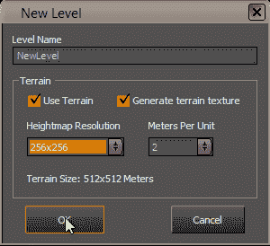

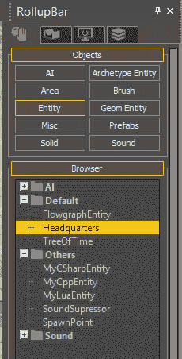

# 第 4 章

首先，打开 Sandbox Editor，通过导航到`File`（文件） | `New`（新建）创建一个新关卡：这将弹出`New Level`对框，我们可以在其中设置关卡名称和地形设置。

点击`OK`后，你的关卡将被创建并加载。完成后，就是时候为我们的关卡添加必要的游戏性元素了！

开始，打开`RollupBar`并将`Headquarters`实体拖入视口以生成该实体：

[ 87 ]

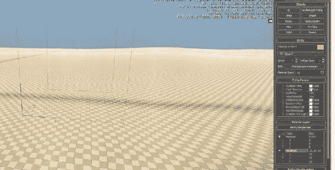

## 游戏规则

生成实体后，我们必须设置在`Headquarters`类中创建的编辑器属性。

将`Team`设置为`Red`（红色），并将`Maximum`设置为`10,10,10`。这告诉该类`Headquarters`属于哪个团队，以及我们将查询的区域的最大尺寸，以检测另一个玩家是否进入其中。

完成此操作后，生成另一个`Headquarters`实体（或复制现有的），遵循相同的流程，这次将`Team`属性设置为`Blue`（蓝色）。

现在，我们只需要为每个团队生成一个`SpawnPoint`（生成点）实体就可以准备就绪了！

再次打开`RollupBar`并转到`Others`（其他） | `SpawnPoint`：

[ 88 ]

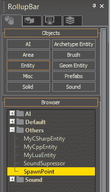

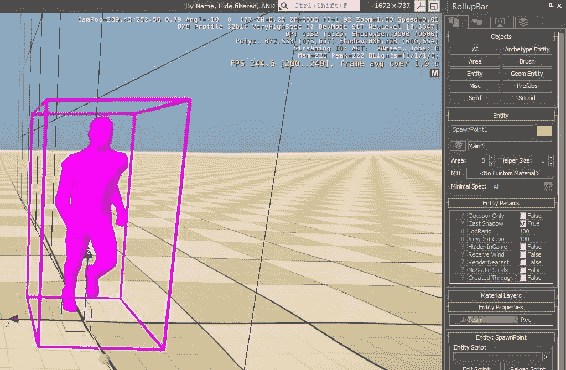

# 第 4 章

现在，将实体拖到视口以生成它，方法与你之前生成`Headquarters`时相同。生成后，将`Team`属性设置为`Red`，然后对蓝色团队重复该过程：

[ 89 ]

## 游戏规则

完成！你现在应该能够使用`Ctrl` + `G`或导航到`Game`（游戏） | `Switch to Game`（切换到游戏）进入游戏。然而，由于我们还没有添加任何类型的玩家移动，玩家将无法向敌总部移动以结束游戏。

要学习如何处理玩家输入和移动，请参阅下一章`Chapter 5`, `Creating Custom Actors`（创建自定义 Actor）。

## 总结

在本章中，我们学习了游戏规则系统的基本行为，并创建了我们自己的`IGameRules`实现。

在注册了你自己的游戏模式并在 C# 中创建了`Headquarters`示例后，你应该对游戏规则系统有了良好的理解。

我们创建了第一个游戏模式，现在可以进入下一章了。请记住未来章节中游戏规则的目的，这样你就可以将游戏中需要创建的所有游戏机制结合在一起。

对游戏规则还不满意吗？为什么不尝试用你喜欢的脚本语言为你的游戏创建一个基础规则集，或者扩展我们之前创建的示例呢。在下一章中，我们将学习如何创建自定义 Actor。

[ 90 ]

## 创建自定义 Actor

使用 CryENGINE actor 系统，我们可以创建具有自定义行为的玩家或 AI 控制的实体来填充我们的游戏世界。

在本章中，我们将涵盖以下主题：

- 学习 actor 的目的以及实现它们的核心思想
- 在 C++ 和 C# 中创建自定义 actor
- 创建我们的第一个玩家相机处理器
- 实现基础玩家移动

## 介绍 actor 系统

我们在`Chapter 3`, `Creating and Utilizing Custom Entities`中学习了什么是游戏对象扩展以及如何使用它们。我们将基于这些知识在 C++ 和 C# 中创建自定义 actor。

Actor 由`IActor`结构体表示，它们是核心层中的游戏对象扩展。这意味着每个 actor 都有一个底层实体和一个用于处理网络和`IActor`扩展的游戏对象。

Actor 由`IActorSystem`接口处理，该接口管理每个 actor 的创建、删除和注册。

## 通道标识符

在网络上下文中，每个玩家都被分配了一个通道 ID 和一个 Net Nub 索引，我们将在`Chapter 8`, `Multiplayer and Networking`中进一步介绍。

## 创建自定义 Actor

### Actor 生成

玩家 actor 应该在客户端连接到游戏时生成，位于`IGameRules::OnClientConnect`内部。要生成 actor，使用所示的`IActorSystem::CreateActor`：

```cpp
IActorSystem *pAS = gEnv->pGameFramework->GetIActorSystem(); pAS ->CreateActor(channelId, "MyPlayerName", "MyCppActor", Vec3(0, 0, 0), Quat(IDENTITY), Vec3(1, 1, 1));
```

注意，之前的代码仅适用于玩家控制的 actor。非玩家 actor 可以随时创建。

### 删除 actor

为了确保玩家 actor 在客户端断开连接时正确删除，我们需要通过`IGameRules::OnClientDisconnect`回调手动删除它：

```cpp
pActorSystem->RemoveActor(myActorEntityId);
```

在断开连接后忘记移除玩家 actor 可能会导致崩溃或严重的伪影。

### 视图系统

为了方便处理玩家和其他相机源视图（views）的需求，CryENGINE 提供了视图系统，可以通过`IViewSystem`接口访问。

视图系统基于任意数量的视图，由`IView`接口表示，每个视图都有处理位置、旋转和配置的能力。

为了方便处理玩家和其他相机源视图的需求，CryENGINE 提供了视图系统，可以通过`IViewSystem`接口访问。

视图系统的核心是拥有任意数量的视图，由`IView`接口表示，每个视图都有更新位置、旋转和配置的能力。

请记住，任何时候都只有一个视图是激活的。

```cpp
IViewSystem *pViewSystem = gEnv->pGameFramework()->GetViewSystem();
IView *pNewView = pViewSystem->CreateView();
```

[ 92 ]

# 第 5 章

我们可以使用`IViewSystem::SetActiveView`函数设置激活视图：

```cpp
pViewSystem->SetActiveView(pNewView);
```

激活后，视图将更新系统相机。要修改视图的参数，我们可以调用`IView::SetCurrentParams`。例如，要更改位置，使用以下代码：

```cpp
SViewParams viewParams = *GetCurrentParams();
viewParams.position = Vec3(0, 0, 10);
SetCurrentParams(viewParams);
```

现在的位置现在是 (0,0)。

## 将视图链接到游戏对象

每个视图还可以将其链接到游戏对象，允许游戏对象扩展订阅`UpdateView`和`PostUpdateView`函数。

这些函数允许轻松地更新分配视图的位置、旋转和配置。例如，这用于 actor，以便为玩家提供易用的自定义相机处理方法。

关于相机处理的更多信息，请参见本章稍后的 *Camera handling* 部分。

## 创建自定义 Actor

现在我们已经知道了 actor 系统是如何工作的，现在可以可以在 C# 和 C++ 中创建我们的第一个 actor。

默认情况下无法纯使用 Lua 脚本创建 actor。通常，actor 是在 C++ 中创建的，并处理`Game/Scripts/Entities/Actors`文件夹中的 Lua 脚本。

### 在 C# 中创建 Actor

使用 CryMono，我们可以完全在 C# 中创建自定义 actor。这样做，我们可以如所示派生`Actor`类：

```csharp
public class MyActor : Actor
{
}
```

[ 93 ]

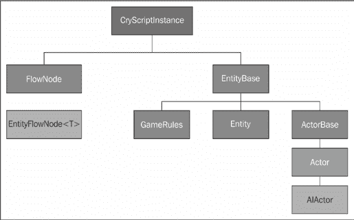

之前的代码是在 CryMono 中创建 actor 的最小配置。你可以进入游戏规则实现，并在客户端连接时通过`Actor.Create`静态方法生成 actor。

## CryMono 类层次结构

如果你对各种 CryMono/C# 类感到困惑，请查看以下继承图：

注意，在使用`Entity.Get`查询实体（通过`Actor.Get`查询 actor）时，你将获得一个`EntityBase`或`ActorBase`类型的对象。

这是因为原生实体和 actor 存在于托管系统之外，在查询时返回的是受限的表示。

## 混合使用原生和 CryMono actor

如果你倾向于在 C++ 中自己创建 actor，你仍然可以通过使用`NativeActor`类在 CryMono 代码中引用它。要实现这一点，只需在 C# 中创建一个新类，其名称与你注册`IActor`实现时使用的名称一致，并所示派自`NativeActor`：

[ 94 ]

*第 5 章*

## C++ actor 注册

Actor 注册是通过使用注册工厂完成的。此过程可以使用所示的`REGISTER_FACTORY`宏进行自动化：

`REGISTER_FACTORY(pFramework, "Player", CPlayer, false);` **C# 声明**

在 C# 中声明一个基于原生的 actor 非常简单，只需要如下面的代码所示派自`CryEngine.NativeActor`类即可：

```csharp
public class Player : NativeActor
{

}
```

这允许继续使用 C# 代码，但将你的大部分代码保留在 C++ 的`IActor`实现中。

`CryEngine.NativeActor`直接继承自`CryEngine.ActorBase`，因此不包含常见的`CryEngine.Actor`回调函数，例如`OnEditorReset`。要获得这些额外功能，你需要在你的`IActor`实现中创建它们。

## 在 C++ 中创建 actor

要在 C++ 中创建 actor，我们依赖于`IActor`接口。由于 actor 是核心游戏对象的扩展，我们不能简单地派自`IActor`，而必须使用所示的`CGameObjectExtensionHelper`模板：

```cpp
class CMyCppActor : public CGameObjectExtensionHelper<CMyCppActor, IActor>
{

};
```

第三个`CGameObjectExtensionHelper`参数定义了该游戏对象支持的最大`RMI`（远程机器调用）数量。我们将在*第 8 章**多人游戏与网络*中进一步讨论它。

现在我们已经有了该类，我们需要实现`IActor`结构体中定义的纯虚方法。

[ 95 ]

*创建自定义 Actor*

注意，`IActor`派自`IGameObjectExtension`，这意味着我们还需要实现它的纯虚方法。

有关此信息，请参阅*第 4 章**游戏规则*中的*实现游戏规则**接口*部分。

对于大多数`IActor`方法，我们可以实现空位函数，它们不返回任何内容，或者返回`nullptr`、`zero`或空字符串等虚拟值。异常列如下所示：

| 函数名 | 说明 |
| :--- | :--- |
| `IGameObjectExtension::Init` | 用于初始化游戏对象扩展。应该调用`IGameObjectExtension::SetGameObject`和`IActorSystem::AddActor`。 |
| 类析构函数 | 始终调用`IActorSystem::RemoveActor`。 |
| `IActor::IsPlayer` | 用于判断 actor 是否由人类玩家控制。我们在这里可以直接返回`GetChannelId() != 0`，因为通道标识符仅对玩家为非零。 |
| `IActor::GetActorClassName` | 用于获取 actor 类的名称，例如在我们的案例中为`CMyCppActor`。 |
| `IActor::GetEntityClassName` | 获取实体类名称的辅助函数。我们可以直接返回`GetEntity()->GetClass()->GetName()`。 |

当你解决了纯虚函数后，移动到下一节注册你的 actor。完成后，你可以在`IGameRules::OnClientConnect`中创建用于连接玩家的 actor。

## 注册 actor

要向游戏框架（包含在`CryAction.dll`中）注册 actor，我们可以使用在`GameFactory.cpp`中注册 C++ 游戏规则实现时相同的设置：

`REGISTER_FACTORY(pFramework, "MyCppActor", CMyCppActor, false);` 在执行之前的代码后，你将能够通过`IActorSystem::CreateActor`函数生成你的 actor。

[ 96 ]

*第 5 章*

## 相机处理

玩家控制的 actor 在`IActor::UpdateView(SViewParams &viewParams)`和`IActor::PostUpdateView(SViewParams &viewParams)`函数管理视口相机。

`SViewParams`结构体用于定义相机属性，如位置、旋转和视野。通过修改`UpdateView`方法内部的`viewParams`引用，我们可以移动相机到游戏所需的位置。

CryMono actor 以 C++ actor 相同接收并处理`UpdateView(ref ViewParams viewParams)`和`PostUpdateView(ref ViewParams viewParams)`事件。

## 实现 IGameObjectView

为了获取视图事件，我们需要实现并注册一个游戏对象视图。

要做到这一点，首先派自`IGameObjectView`，并实现它包含的两个纯虚函数：

- `UpdateView`: 用于更新视图位置、旋转和视野


- `PostUpdateView`：在更新视图后调用

在实现游戏对象视图后，我们需要确保在 actor 扩展初始化时（在 `Init` 中）捕获了它：

```cpp
if(!GetGameObject()->CaptureView(this)) return false;
```

你的 actor 现在应该会接收视图更新回调了，这些回调可以用于移动视口相机。别忘记在析构函数中释放视图：`GetGameObject()->ReleaseView(this);`

## 创建俯视相机

为了展示如何创建自定义相机，我们将扩展上一节中创建的示例以创建一个俯视相机。为了开始，我们将以距离查看的方式打开你的 `.cs` 文件。

[ 97 ]

*创建自定义 Actor*

### 视图

为了俯视相机并以距离查看，打开 C# actor 的 `UpdateView` 方法，并在所示的 `.cs` 文件中实现。

除非你对 `UpdateView` 函数做了任何更改，它应该类似于下面的代码：

```csharp
protected override void UpdateView(ref ViewParams viewParams)
{
    var fov = MathHelpers.DegreesToRadians(60);
    viewParams.FieldOfView = fov;
    viewParams.Position = Position;
    viewParams.Rotation = Rotation
}
```

这只是将相机放置在玩家相同的位置，具有相同的方向。我们需要做的第一个更改是将相机向上移动一点。为了这样做，我们将玩家旋转的第二列附加到位置上，并将相机放在玩家相同的 x 和 y 位置，但在其上方：

```csharp
var playerRotation = Rotation;
float distanceFromPlayer = 5;
var upDir = playerRotation.Column2;
viewParams.Position = Position + upDir * distanceFromPlayer;
```

可以进入游戏查看。当你准备好后，我们还需要更改视图旋转向下：

```csharp
// 朝下
var angles = new Vec3(MathHelpers.DegreesToRadians(-90), 0, 0);
// 四元数
viewParams.Rotation = Quat.CreateRotationXYZ(angles);
```

[ 98 ]


*第 5 章*

完成！我们的相机现在应该正对着下。

这大致就是你使用新相机看到的内容。注意视图中缺少玩家角色。这是因为我们没有向玩家实体加载对象。我们可以通过在 `OnSpawn` 函数中调用 `EntityBase.LoadObject` 来快速解决这个问题：

```csharp
public override void OnSpawn()
{
    // 加载对象
    LoadObject("Objects/default/primitive_cube.cgf");
    // 物理化为 50KG
    var physicalizationParams = new PhysicalizationParams(PhysicalizationType.Rigid); 
    physicalizationParams.mass = 50;
    Physicalize(physicalizationParams);
}
```

[ 99 ]


*创建自定义 Actor*

你现在应该能够在场景中看到代表玩家角色的立方体。注意它也是物理化的，允许它推动或被其他物理化物体推动。

你现在应该对玩家视图是如何运作有了基本的了解。

想要了解更多内容，为什么不尝试创建一个你自己的相机呢，即一个 RPG 风格的等轴测相机？

我们现在进入下一个章节，`Player input`（玩家输入）。

## 玩家输入

当你无法控制角色时，它们通常会显得非常无趣。为了帮助将事件映射到输入，我们可以利用以下三个系统：`System name`

| 系统名称 | 描述 |
| :--- | :--- |
| `IHardwareMouse` | 当需要直接获取鼠标事件时，例如 x/y 屏幕位置和鼠标轮增量。 |
| `IActionMapManager` | 允许注册与键位绑定相关的回调函数。这是键盘和鼠标按钮输入的首选方法，因为它允许每个玩家通过其动作映射配置（action map profile）自定义偏好的输入方式。动作映射通常通过游戏内界面暴露，以简化最终用户的键位映射。 |
| `IInput` | 用于监听原始输入事件，例如检测空格键何时被按下或释放。除非用于聊天和文本输入等少数边缘情况，否则不建议使用原始输入，相反，动作映射更好。 |

### 硬件鼠标

硬件鼠标实现提供了 `IHardwareMouseEventListener` 结构体，以便接收鼠标事件回调。在派生并实现其虚函数后，使用 `IHardwareMouse::AddListener` 来利用它：

```
gEnv->pHardwareMouse->AddListener(this);
```

监听器通常从构造函数或初始化函数中调用。确保你不要重复注册监听器，并在类的析构函数中始终移除它们，以防止悬空指针。

### 动作映射

在之前的表中简要提到，动作映射允许将按键绑定到命名的动作。这用于允许对不同游戏状态下的输入进行简单映射。

例如，如果游戏有两种类型的车辆，你可能不希望对两者使用相同的按键。

动作映射还允许实时更改动作映射的按键。这允许玩家自定义他们偏好的输入方法。

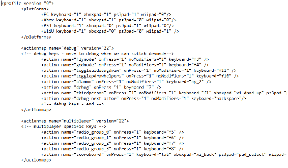

## 创建自定义角色

### 监听动作映射事件

默认动作映射配置包含在 `Game/Libs/Config/defaultProfile.xml` 中。当游戏发布时，默认配置会被复制到用户的个人文件夹（通常在 `My Games/Game_Title` 中），用户可以对其修改以重新映射键位，例如更改触发 `screenshot` 动作的按键。

要监听动作映射事件，我们必须先在 profile xml 中创建一个新动作，或者选择一个现有动作并对其修改。在这个示例中，我们将利用现有的 screenshot 动作。

### `IActionListener`

动作映射系统提供了 `IActionListener` 结构体，为需要动作映射事件的类提供回调支持。

利用监听器相对简单：

1. 派生 `IActorListener` 结构体。
2. 实现 `OnAction` 事件。
3. 注册你的监听器：

```
gEnv->pGameFramework->GetIActionMapManager()->AddExtraActionListener(this);
```

监听器应该只注册一次，这就是为什么倾向在构造函数或初始化函数中进行注册。确保在类实例销毁时移除你的监听器。

### 启用动作映射部分

动作映射系统允许在同一个配置中创建多个动作映射部分，使游戏代码能够实时切换不同的动作映射部分。这对于具有多个玩家状态的游戏（例如行走和使用车辆）非常有用。在这种情况下，车辆和步行动作映射将包含在不同的部分，并在进入或离开车辆时启用/禁用这些部分。

```xml
<actionmap name="walk" version="22">
  <action name="walkBack" onPress="1" keyboard="s" />
</actionmap>
<actionmap name="drive" version="22">
  <action name="break" onPress="1" keyboard="s" />
</actionmap>
```

要启用你的自定义动作映射，调用 `IActionMapManager::EnableActionMap`：

```
gEnv->pFramework->GetIActionMapManager()->EnableActionMap("walk", true);
```

这应该在玩家应该接收到这些新动作的精确时刻完成。在上一个例子中，当玩家离开车辆时启用 `"walk"` 动作。

## 动画角色

`IAnimatedCharacter` 是一个游戏对象扩展，允许对象实现移动和物理集成。通过使用它，角色可以请求物理移动请求、利用动画图功能等。

由于该扩展是可选的，任何游戏对象都可以通过简单的获取它来激活，正如*第 3 章，创建和利用自定义实体*中所述：

```
m_pAnimatedCharacter = static_cast<IAnimatedCharacter*>(GetGameObject()->AcquireExtension("AnimatedCharacter"))
```

一旦获取，动画角色即可立即使用。动画角色功能等移动请求需要 `eEPE_OnPostStepImmediate` 物理事件，可以通过 `IGameObject::EnablePhysicsEvent` 启用。

### 移动请求

当动画角色被物理化为一个活动实体时，它可以请求移动。这本质上是 `pe_action_move` 物理请求的封装（更多信息请参见*第 9 章*，*物理编程*），以便于更简单的用法。

在处理玩家移动等高级机制时，角色移动请求非常有用。

注意请求移动与直接设置玩家位置之间的区别。通过请求速度变化，我们能够让实体对碰撞做出反应。

### 添加移动请求

要添加移动请求，利用 `IAnimatedCharacter::AddMovement`，它需要一个 `SCharacterMoveRequest` 对象：

```
SCharacterMoveRequest request;
request.type = eCMT_Normal;
request.velocity = Vec3(1, 0, 0);
request.rotation = Quat(IDENTITY);
m_pAnimatedCharacter->AddMovement(request);
```

上面的代码显示了一个移动请求的基础示例，它将持续设置朝前的（世界空间）方向（如果持续提交）。移动请求必须通过物理循环添加，参见通过 `IGameObject::ProcessEvent` 发送的 `ENTITY_EVENT_PREPHYSICSUPDATE`

## Mannequin 动画系统

CryEngine 3.5 引入了高级 Mannequin 动画系统。该系统的设计目的是解耦动画和游戏逻辑，在 CryAnimation 模块和游戏代码之间作为额外的层。

请记住 Mannequin 可以应用于任何实体，而不只是角色。然而，Mannequin 默认集成在 `IAnimatedCharacter` 扩展中，使得角色更容易使用新的动画系统。

Mannequin 依赖于一组类型，在使用之前应该清楚这些类型：

| 类型 | 描述 |
| :--- | :--- |
| `Fragment (片段)` | 指代状态，例如“落地”。每个片段可以在多个层上指定多个动画，以及一组效果。这使得在同时处理第一人称和第三人称视角时，动画更加平滑。 |
| `Fragment ID (片段 ID)` | 为了避免直接传递片段，我们可以通过其片段 ID 来标识它们。 |
| `Scope (范围)` | 范围允许解耦角色的部分，以便分别处理例如上半身和下半身的动画。在创建新范围时，每个片段都可以向该范围添加额外的动画和效果以扩展其行为。 |

同时处理两种状态。

**[ 105 ]**

## 创建自定义 Actor

### 名称

### 描述

### 标签（Tag）

标签是指选择标准，允许根据激活的标签来选择子片段（subfragments）。例如，如果我们有两个名为“Idle”（空闲）的片段，但其中一个被分配了“Injured”（受伤）标签，我们可以根据玩家是否受伤动态地在这两个片段变体之间切换。

### 选项（Options）

如果我们最终有多个共享相同标识符和标签的片段，我们就多个选项。默认行为是在查询片段时随机选择这些选项中的一个，从而使实体的动画产生变化。

## 人体模型编辑器（Mannequin Editor）

`Mannequin Editor` 用于通过沙盒编辑器（Sandbox Editor）实时调整角色动画和人体模型模型配置。

### 预览设置

`Mannequin Editor` 使用存储在 `Animations/Mannequin/Preview` 中的预览文件来加载默认模型和动画数据库。启动 `Mannequin Editor` 时，我们需要通过选择 `File`（文件） | `Load Preview Setup`（加载预览设置）来加载我们的预览设置。

加载完成后，我们将看到预览设置的视觉化表示，如下截图所示：

**[ 106 ]**

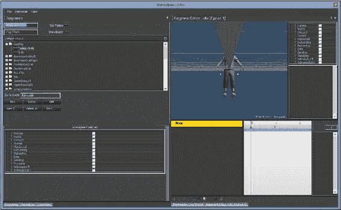

*第 5 章*

我们的预览文件内容如下所示：

```xml
<MannequinPreview>
<controllerDef filename="Animations/Mannequin/ADB/SNOWControllerDefinition.xml"/>
<contexts>
<contextData name="Char3P" enabled="1" database="Animations/Mannequin/ADB/Skiing.adb" context="Char3P" model="scripts/config/base.cdf"/>
</contexts>
<History StartTime="-4.3160208e+008" EndTime="-4.3160208e+008"/>
</MannequinPreview>
```

我们将在章节后续部分详细介绍控制器定义、上下文数据等细节。

### 创建上下文（contexts）

如本章前面提到的，上下文可以根据角色状态应用不同的动画和效果。

**[ 107 ]**

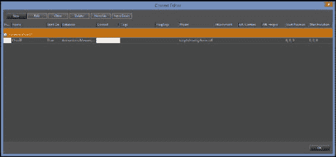

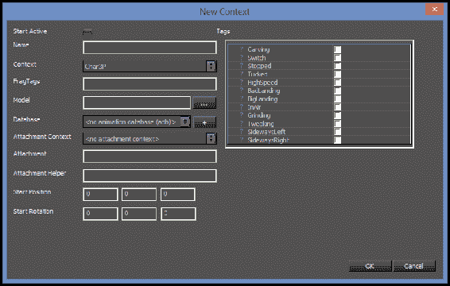

*创建自定义 Actor*

我们可以通过 `Mannequin Editor` 中选择 `File` | `Context Editor`（上下文编辑器）来创建和修改上下文。

要创建一个新上下文，只需点击左上角的 `New`（新建），这将打开 `New Context`（新建上下文）对话框，如下截图所示：这允许我们在创建之前对其进行调整，包括选择要使用的动画数据库和模型。

完成后完成后，只需点击 `OK`（确定）即可看到已创建的上下文。

**[ 108 ]**

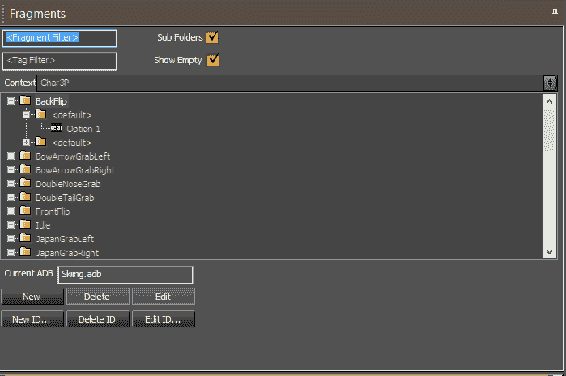

*第 5 章*

### 创建片段（fragments）

默认情况下，我们可以在 `Mannequin Editor` 的左上部分看到片段工具箱。除了添加或编辑选项外，我们还将使用该工具创建和编辑片段。

上一个截图显示了打开了 `BackFlip` 后空翻）片段的片段工具箱，它暴露了两个选项。

要创建一个新片段，点击 `New Id…` 按钮，在打开的消息框中输入所需的名称，然后点击 `OK`。

**[ 109 ]**

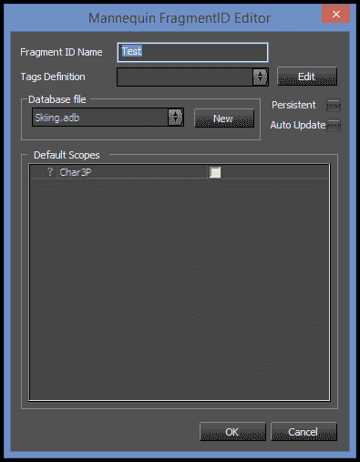

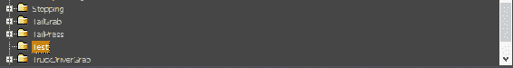

*创建自定义 Actor*

你现在应该能看到如下所示的 `Mannequin FragmentID Editor` 对话框：

我们现在可以选择该片段应在哪些范围（scopes）内运行。在我们情况下，只需勾选 `Char3P` 并点击 `OK`。

你现在可以在片段工具箱中看到你的片段了：

**[ 110 ]**

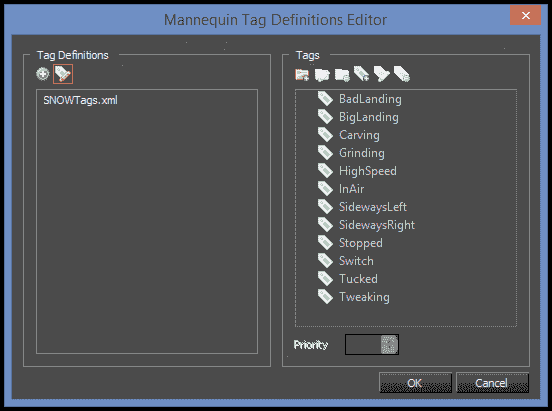

*第 5 章*

### 添加选项（options）

向你的片段添加新选项有两种方法：

- 打开角色编辑器（Character Editor），选择你的动画，然后将其拖到你的人体模型片段（Mannequin Fragment）上。
- 点击片段工具箱中的 `New` 按钮，并手动修改选项。

### 创建和使用标签

如前文所述，人体模型系统允许创建 `Tags`（标签），允许根据标签当前是否激活为每个片段选择特定的选项。

要创建一个新标签，打开 `Mannequin Editor` 并选择 `File -> Tag Definition Editor`（标签定义编辑器）：

打开后，你将看到 `Mannequin Tag Definitions Editor`。编辑器为你提供了两个部分：`Tag Definitions`（标签定义）和 `Tags`（标签）。

**[ 111 ]**

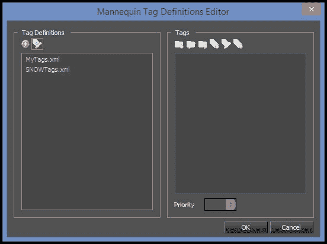

*创建自定义 Actor*

我们首先需要做的的是是创建一个 `Tag Definition`（标签定义）。这是一个跟踪一组标签的文件。执行此操作，按下 `Tag Definitions` 部分中的 `+` 符号，然后指定你的定义名称。

太棒了！你现在应该在 `Mannequin Tag Definitions` 编辑器中看到你的标签定义。要创建一个新标签，选择 `MyTags.xml` 并点击标签创建图标（`Tags` 部分中右起第三个）。

这将为你展示一个 `Tag Creation`（标签创建）对话框，你只需要指定标签的名称。

**[ 112 ]**

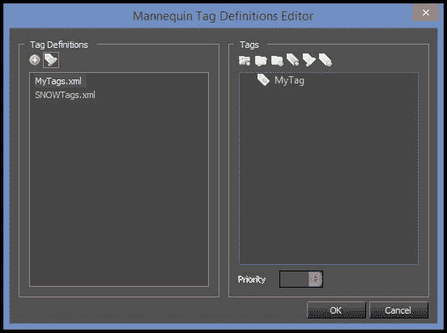

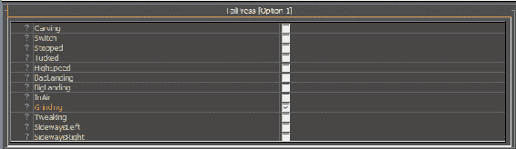

*第 5 章*

### 为选项附加标签

现在你已经创建了标签，我们可以在片段编辑器（Fragment Editor）中选择任何片段选项。通过勾选标签旁边的复选框，我们告诉动画系统该选项具有优先权。

**[ 113 ]**

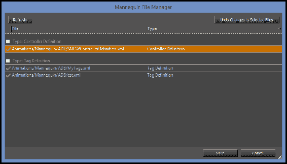

*创建自定义 Actor*

### 启动片段


在 C++ 中，片段由`IAction`接口表示，如果需要，每个游戏可以自由地实现或扩展它。队列片段是通过调用`IActionController::Queue`函数完成的，在此之前我们必须获取片段的`FragmentId`。

## 获取片段标识符

为了获取片段标识符，我们需要获取当前的动画上下文，以获得当前的控制器定义，并从中获取片段 ID。

## 保存

要保存`Mannequin Editor`的更改，只需点击`File` | `Save Changes`（保存更改），并在弹出的`Mannequin File Manager`对话框中确认更改。

准备好保存时，只需点击`Save`（保存）即可更新系统。

```cpp
SAnimationContext *pAnimContext = pActionController->GetContext(); bool enable = true;

pAnimContext->state.Set(tagId, enable);
```

## 创建自定义 Actor

完成！我们的标签现在已经激活，并将在动画系统中显示为激活状态。

如果你的动作（action）被设置为动态更新，它将立即选择合适的选项。

### 强制动作重新查询选项

默认的`IAction`实现在标签更改时，不会自动选择相关的选项。为了改变这一点，我们需要创建一个派自于它的新类，并使用以下代码覆盖它的`Update`函数：

```cpp
IAction::EStatus CUpdatedAction::Update(float timePassedSeconds)
{
    TBase::Update(timePassedSeconds);

    const IScope &rootScope = GetRootScope();

    if(rootScope.IsDifferent(m_fragmentID, m_fragTags))
    {
        SetFragment(m_fragmentID, m_fragTags);
    }

    return m_eStatus;
}
```

上述代码的作用是检查何时有了更好的选项可用，并转而选择该选项。

### 调试人体模型（Mannequin）

要启用 Mannequin 调试，我们需要向动作控制器附加`AC_DebugDraw`标记：

```cpp
pActionController->SetFlag(AC_DebugDraw, g_pGameCVars->pl_debugMannequin != 0);
```

你现在会看到可视化的片段和标签选择的调试信息。这在处理 Mannequin 工作时非常有用。

### 为自定义实体设置 Mannequin

正如本章早期提到的，动画角色游戏对象扩展默认集成了 Mannequin。这在使用 actor 时非常非常方便，但在某些情况下，在自定义实体上使用 Mannequin 提供的功能可能是很有用的。

# 第 5 章

首先，我们需要在实体扩展中存储指向动作控制器和动画上下文的指针，如下所示：

```cpp
IActionController *m_pActionController;
SAnimationContext *m_pAnimationContext;
```

然后我们需要初始化 Mannequin；这通常在游戏对象扩展的`PostInit`函数中完成。

### 初始化 Mannequin

首先要做的是获取 Mannequin 接口：

```cpp
// Mannequin 初始化
IMannequin &mannequinInterface = gEnv->pGame->GetIGameFramework()->GetMannequinInterface();
IAnimationDatabaseManager &animationDBManager = mannequinInterface.GetAnimationDatabaseManager();
```

### 加载控制器定义

接下来，我们必须加载为实体创建的控制器定义：

```cpp
const SControllerDef *pControllerDef = animationDBManager.LoadControllerDef("Animations/Mannequin/ADB/myControllerDefinition.xml");
```

太棒了！现在我们有了控制器定义，可以使用以下代码创建动画上下文：

```cpp
m_pAnimationContext = new SAnimationContext(*pControllerDef);
```

我们现在可以创建动作控制器：

```cpp
m_pActionController = mannequinInterface.CreateActionController(pEntity, *m_pAnimationContext);
```

### 设置激活上下文

现在我们已经初始化了动作控制器，我们需要设置默认上下文。首先，获取上下文标识符：

```cpp
const TagID mainContextId = m_pAnimationContext->controllerDef.m_scopeContexts.Find("Char3P");
```

```cpp
CRY_ASSERT(mainContextId != TAG_ID_INVALID);
```

然后加载我们将使用的动画数据库：

```cpp
const IAnimationDatabase *pAnimationDatabase = animationDBManager.Load("Animations/Mannequin/ADB/myAnimDB.abd");
```

加载后，只需调用`IActionController::SetScopeContext`：

```cpp
m_pActionController->SetScopeContext(mainContextId, *pEntity, pCharacterInstance, pAnimationDatabase);
```

一旦设置了上下文，Mannequin 就会初始化并准备好处理为你的实体的队列片段。记住，你可以使用之前使用的`IActionController::SetScopeContext`函数随时更改范围上下文。

## 总结

在本章中，我们学习了 actor 系统是如何运作的，并用 C# 和 C++ 创建了自定义的 actor。通过观察输入和摄像系统，我们将能够处理基础的玩家输入视图设置。

你还应该对 Mannequin 的用例有良好的理解，以及如何设置自定义实体来利用它们。我们现在拥有了游戏所需的所有核心功能：流节点（flow nodes）、实体（entities）、游戏规则和 actor。在接下来的章节中，我们将基于现有知识，详细介绍这些系统如何协同工作。

如果你想在继续后续之前继续研究 actor，请尽管尝试实现一个为新场景定制的你自己的 actor；例如，等轴测相机结合基础的 RPG 玩家元素。

在下一章中，我们将使用学到的关于 actor 的知识来创建`人工智能`（`AI`）。

## 人工智能

CryENGINE AI 系统允许创建在游戏世界中漫游的非玩家控制的 actor。

在本章中，我们将：

* 学习 AI 系统如何与 Lua 脚本集成

* 发现什么是目标管道（goal pipes）以及如何创建它们

* 使用 AI 信号

* 注册自定义的 AI Actor 类

* 学习如何使用行为选择树

* 创建我们自己的 AI 行为

管道（Pipes）最初在`Scripts/AI/GoalPipes/PipeManager.lua`的`PipeManager:CreateGoalPipes`函数中注册，使用了`AI.LoadGoalPipes`函数：`AI.LoadGoalPipes("Scripts/AI/GoalPipes/MyGoalPipes.xml");`。这段代码段将加载`Scripts/AI/GoalPipes/MyGoalPipes.xml`，其中可能包含以下目标管道定义：

```xml
<GoalPipes>
  <GoalPipe name="myGoalPipes_findPlayer">
    <Locate name="player" />
    <Speed id="Run"/>
    <Script code="entity.Behavior:AnalyzeSituation(entity);"/>
  </GoalPipe>
</GoalPipes>
```

当选择此管道时，分配的 AI 将开始寻找玩家，切换到`Run`移动速度状态，并调用当前选择的行为脚本中包含的`AnalyzeSituation`函数。

目标管道对于方便地推送一组目标非常有效。例如，根据上一个脚本，我们只需选择`myGoalPipes_findPlayer`管道，即可让 AI 运行并寻找玩家。

### 选择管道

目标管道通常使用 Lua 中的实体函数`SelectPipe`触发：`myEntity:SelectPipe(0, "myGoalPipe");`。或者可以通过 C++ 触发，使用`IPipeUser::SelectPipe`函数。

### 信号

为了给 AI 实体提供一种直观的相互通信方式，我们可以使用信号系统（signal system）。信号是事件，可以从另一个 AI 实体、或者从 C++ 或 Lua 代码的其他地方发送到特定的 AI 单元。

信号可以使用 Lua 中的`AI.Signal`函数发送，或者使用 C++ 中的`IAISystem::SendSignal`发送。

### AI 行为

行为需要分配给每个 Actor（actor），它们定义了实体的决策能力。通过在运行时使用**行为选择树**选择行为，Actor 可以给人一种动态适应周围环境的印象。

行为选择树是使用放置在`Scripts/AI/SelectionTrees/`中的 XML 文件创建的。每个树管理着一组**行为叶子**（behavior leaves），每个叶子代表一种可以根据条件启用的 AI 行为。

#### 示例

例如，参见此处所示的非常基础的选择树 XML 定义形式：

```xml
<SelectionTrees>
  <SelectionTree name="SelectionTreeSample" type="BehaviorSelectionTree">
    <Variables>
      <Variable name="IsEnemyClose"/>
    </Variables>
    <SignalVariables>
      <Signal name="OnEnemySeen" variable="IsEnemyClose" value="true"/>
      <Signal name="OnNoTarget" variable="IsEnemyClose" value="false"/>
      <Signal name="OnLostSightOfTarget" variable="IsEnemyClose" value="false"/>
    </SignalVariables>
    <LeafTranslations />
    <Priority name="Root">
      <Leaf name="BehaviorSampleCombat" condition="IsEnemyClose"/>
      <Leaf name="BehaviorSampleIdle"/>
    </Priority>
  </SelectionTree>
</SelectionTrees>
```

为了更好地理解该示例，我们将对其进行拆解：

```xml
<SelectionTree name="SelectionTreeSample" type="BehaviorSelectionTree">
  <!-- 这段代码代码仅仅定义了选择树的名称，AI 系统在 AI 初始化期间会解析它。如果你想重命名树，只需更改 name 属性： -->
  <Variables>
    <Variable name="IsEnemyClose"/>
  </Variables>
```

每个选择树可以定义一组变量，这些变量可以根据信号设置（见下一个代码段），或在每个行为脚本内部设置。

变量简单的布尔条件，可以通过查询它们来确定下一个选择哪个叶子或行为：

```xml
<SignalVariables>
  <Signal name="OnEnemySeen" variable="IsEnemyClose" value="true"/>
  <Signal name="OnNoTarget" variable="IsEnemyClose" value="false"/>
  <Signal name="OnLostSightOfTarget" variable="IsEnemyClose" value="false"/>
</SignalVariables>
```

每个行为树还可以监听如`OnEnemySeen`等信号，以便方便地设置变量值。例如，在我们刚刚看到的代码段中，当敌人被发现时，`IsEnemyClose`变量始终被设为 true，然后在丢失目标时被设为 false。

然后我们可以在查询新叶子时使用该变量（见以下代码段），允许 AI 根据简单的信号事件切换到不同的行为脚本：

```xml
<Priority name="Root">
  <Leaf name="BehaviorSampleCombat" condition="IsEnemyClose"/>
  <Leaf name="BehaviorSampleIdle"/>
</Priority>
```

通过在`Priority`元素内部指定叶子，我们可以在运行时根据简单条件启用行为（叶子）。

例如，上一个代码段将在敌人靠近时启用`BehaviorSampleCombat`行为脚本，否则它将回退到`BehaviorSampleIdle`行为。

行为选择树系统将按顺序查询叶子，并回退到最后一个剩下的叶子。在这种情况下，它将首先查询`BehaviorSampleCombat`，如果`IsEnemyClose`变量被设为 false，则回退到`BehaviorSampleIdle`。

### IAIObject

已向 AI 系统注册的实体可以调用`IEntity::GetAI`来获取`IAIObject`指针。

通过访问实体的 AI 对象，我们可以对其进行操作，例如在 C++ 中：

```cpp
if(IAIObject *pAI = pEntity->GetAI())
{
  gEnv->pAISystem->SendSignal(SIGNAL_SENDER, 0, "MySignal", pAI);
}
```

### 创建自定义 AI

创建自定义 AI 的过程非常直接。AI 有两个部分：IActor 实现和 AI 定义。

### 注册 Actor 实现

AI Actor 通常使用相同的 IActor 实现，至少是共享的。

#### C# 中

在 C# 中注册 AI Actor 与我们之前的方法非常相似。基本上，我们所做的是派自`AIActor`而不是`Actor`。`AIActor`类直接派自`Actor`，因此不会丢失任何回调和成员。但是它必须显式实现，以便让 CryEngine 实体是由 AI 控制的。

```csharp
public class MyCSharpIActor : AIActor
{
}
```

你现在可以在 Sandbox 中的 AI 类别中放置你的实体了。

#### C++ 中

正如我们刚刚看到的 C# Actor 一样，在 AI 系统中注册 Actor 并不困难。只需派自我们在上一个章节创建的实现：

```cpp
class CMyAIActor : public CCppActor
{
};
```

然后打开你的 GameDLL 中的`GameFactory.cpp`文件并使用相同的设置注册 Actor，只是最后一个参数应该是 true，以告诉 CryEngine 该 Actor 类型由 AI 控制：

```cpp
REGISTER_FACTORY(pFramework, "MyAIActor", CMyAIActor, true);
```

### 创建 AI 实体

当当 AI Actor 生成时，AI 系统将搜索 AI 实体定义。定义用于设置 Actor 的默认属性，例如它的编辑器属性。

我们需要的第一步是打开`Scripts/Entities/AI`并创建一个与我们的 Actor 类同名的`.lua`文件。在我们的情况下，对于 C++ 实现是`MyAIActor.lua`，对于 C# Actor 是`MyCSharpAIActor.lua`。

脚本保持最少代码，因为我们只需要加载基础 AI。基础 AI 使用`Script.ReloadScript`函数加载。默认情况下，CryEngine 使用`Scripts/Entities/AI/Shared/BasicAI.lua`作为基础 AI 定义。

```
Script.ReloadScript("SCRIPTS/Entities/AI/AISample_x.lua");
```


`MyCSharpAIActor = CreateAI(AISample_x)`

[126]


# 第 6 章

好了！你的 AI 现在已正确注册，现在可以通过编辑器（Editor）进行放置。

关于基础 AI 定义的更多信息，请参阅本章后面的`AI 基础定义拆解`章节。

## AI 行为与角色

当我们生成自定义的 AI actor 时，默认会出现四个实体属性。

这些属性决定了 AI 应该使用哪些系统来做出决策：

[127]

### 人工智能

#### 理解和使用行为选择树

行为选择树是我们的 AI actor 最重要的实体属性，因为它决定了 actor 使用哪种行为选择树。如果我们的项目包含多个行为选择树，我们可以由于不同的选择树轻松地生成多个行为完全不同的 AI actor。选择树系统的存在是为了提供一种在运行时查询和选择行为脚本的方法。

要查看当前可用的树或创建你自己的树，请导航到`Scripts/AI/SelectionTrees`。对于我们的示例，我们将使用位于`Scripts/AI/SelectionTrees/FogOfWar.xml`中的`FogOfWar`选择树：

```xml
<SelectionTree name="FogOfWar" type="BehaviorSelectionTree">
<Variables>
<Variable name="IsFar"/>
<Variable name="IsClose"/>
<Variable name="AwareOfPlayer"/>
</Variables>
<SignalVariables>
<Signal name="OnEnemySeen" variable="AwareOfPlayer" value="true"/>
<Signal name="OnNoTarget" variable="AwareOfPlayer" value="false"/>
<Signal name="OnLostSightOfTarget" variable="AwareOfPlayer" value="false"/>
</SignalVariables>
<LeafTranslations />
<Priority name="Root">
<Leaf name="FogOfWarSeekST" condition="IsFar"/>
<Leaf name="FogOfWarEscapeST" condition="IsClose"/>
<Leaf name="FogOfWarAttackST" condition="AwareOfPlayer"/>
<Leaf name="FogOfWarIdleST"/>
</Priority>
</SelectionTree>
```

#### 变量

每个选择树都暴露了一组可以在运行时设置的变量。这些变量将被叶子节点查询，以确定激活何种行为。

[128]

# 第 6 章

#### 信号变量

信号变量提供了一种在接收到信号时设置变量的简单方法。

例如，在之前的树中，我们可以看到当接收到`OnEnemySeen`信号时，动态设置`AwareOfPlayer`。当 AI 丢失玩家，变量会被设置为 false。

#### 叶子节点 / 行为查询

叶子节点根据变量条件决定播放何种行为。

在之前的树中，我们可以看到当所有其他条件都设置为 false 时，`FogOfWarIdleST`行为会被默认激活。然而，假设`IsFar`变量被设置为 true，系统将自动切换到`FogOfWarSeekST`行为。

行为从`Scripts/AI/Behaviors/Personalities/`目录加载，在我们的情况下，它将在`Scripts/AI/Behaviors/Personalities/FogOfWarST/`内部找到引用行为。

#### 角色

`Character`属性用于为 actor 设置 AI 角色。

在我们的示例中，`Character`属性将默认为空字符串，因为自从引入行为选择树以来，该系统被认为是过时的（请查看`理解和使用行为选择树`章节）。

AI 角色包含在`Scripts/AI/Characters/Personalities`中的`.lua`脚本中中。例如，我们可以打开并修改`Scripts/AI/Characters/Personalities/FogOfWar.lua`来修改我们的默认性格。

你也可以通过通过在 Personalities 目录中添加新文件并以`FogOfWar`为基准创建新性格。

`Character`属性定义了所有适用行为，在我们的情况下，包括`FogOfWarAttack`、`FogOfWarSeek`、`FogOfWarEscape`和`FogOfWarIdle`。actor 将根据内部和外部条件在这些行为之间切换。

[129]

### 人工智能

#### 导航类型

`NavigationType`属性决定使用哪种类型的 AI 导航。这允许系统动态确定哪些路径对于该类型的 AI 是行的。

这在我们的示例中默认为`MediumSizedCharacter`，可以设置为`Scripts/AI/Navigation.xml`中包含的任何导航定义。

#### 创建自定义行为

我们几乎完成了！剩下的步骤是理解如何创建和修改 AI 行为，并使用我们之前描述的行为选择树来激活它们。

首先，用你喜欢的文本编辑器打开`Scripts/AI/Behaviors/Personalities/FogOfWarST/FogOfWarIdleST.lua`。由于之前描述的行为树设置，这是当所有其他变量都设置为 false 时将激活的行为。

行为通过调用`CreateAIBehavior`函数创建，其中第一个参数设置为新行为的名称，第二个参数包含行为行为的表。

因此，一个行为的最少配置将是：

```lua
local Behavior = CreateAIBehavior("MyBehavior", {
    Alertness = 0,
    Constructor = function (self, entity)
    end,
    Destructor = function(self, entity)
    end,
})
```

这段代码段将设置 AI 的`Alertness`为 0，并在行为启动时什么都不做。

```lua
Constructor = function (self, entity)
    Log("Idling...");
    AI.SetBehaviorVariable(entity, "AwareOfPlayer", false);
    entity:SelectPipe(0,"fow_idle_st");
end,
```

[130]

# 第 6 章

当行为被激活时，我们应该在控制台中看到`Idling...`，前提是日志设置得足够高（使用`verbosity`）。

日志记录，行为将通过`AI.SetBehaviorVariable`将`AwareOfPlayer`设置为 false。我们可以随时使用函数更改变量的值，告诉行为选择树查询另一个行为。

在设置变量为 false 后，构造函数选择了`fow_idle_st`目标。

#### 监听信号

要在行为中监听信号，只需创建一个新函数：`OnMySignal = function(self, sender) {}`将在发送`OnMySignal`信号时调用，以及关联的实体和行为表。

#### AI 基础定义拆解

在本章之前，我们创建了依赖于`Scripts/Entities/AI/AISample_x`基础定义。本节将描述基础定义的功能，以便更好地理解设置。

首先，用你喜欢的文本编辑器打开定义，例如 Notepad++。

#### AISample_x 表

打开`AISample_x.lua`时看到的第一行代码是它的表定义，它定义了每个角色的默认属性。

每个 AI 定义都可以覆盖基础定义中设置的属性。

[131]

### 人工智能

#### Properties 表

`Properties`表的作用与标准 Lua 实体相同，用于定义在编辑器中选择实体时显示的属性。

我们基础 AI 定义中的默认属性读取自`CryAISystem.dll`。不支持移除这些属性会导致 AI 初始化失败。

#### AIMovementAbility 表

`AIMovementAbility`子表定义了 actor 的移动能力，例如步行和跑步速度。

#### CreateAI 函数

`CreateAI`函数将基础 AI 表与指定的子表合并。

这意味着 AI 定义中存在的任何表将出现在任何派自它的 AI 定义中。

`CreateAI`函数还使实体变得可生成，并通过调用 AI 的`Expose()`函数将其暴露给网络。

#### RegisterAI 函数

当 actor 需要注册到 AI 系统中时，会调用`RegisterAI`函数。该函数会在实体生成时以及编辑器属性发生更改时自动调用。

## 总结

在本章中，我们学习了 AI 系统的核心思想和实现方法，并创建了一个自定义的 AI actor 实现。

在创建了自身的 AI 实体定义和行为选择树后，你应该已经了解 CryEngine 中是如何创建 AI actor 的。

现在你应该已经很好地理解如何利用 AI 系统来实现优势，让你能够创建在游戏世界中巡逻的 AI 控制单元。

如果你对 AI 还没有学完，为什么不尝试用新学到的知识自己创建一些你喜欢的更复杂的内容呢？

在下一章中，我们将介绍创建自定义用户界面的过程，允许创建主菜单和平视显示（HUD）。

## [132]

# 用户界面

CryENGINE 集成了 Scaleform `GFx`，允许渲染基于 Adobe Flash 的用户界面、HUD 和动画纹理。通过使用 UI 流程图解决方案在运行时将 UI 元素结合在一起，开发者可以直观地创建并扩展用户界面。

在本章中，我们将涵盖以下主题：

- 学习 CryENGINE 的 Scaleform 实现以及它带来的优势。
- 创建我们的主菜单。
- 实现 UI 游戏事件系统。

## Flash 电影片段和 UI 图

为了给开发者提供创建用户界面的解决方案，CryENGINE 集成了 Adobe Scaleform `GFx`，这是一种用于游戏引擎的实时 Flash 渲染器。该系统允许在 Adobe Flash 中创建用户界面，然后将其导出并在引擎立即使用。

还可以在材料中使用 Flash `.swf`文件，允许在游戏世界中的 3D 对象上渲染 Flash 电影片段。

增加了 UI 流程图系统，创建模块化动态用户界面的工作大大简化，该系统允许使用流程图系统创建和维护任何 Flash UI 元素。

UI 流程图系统基于两种类型：元素（elements）和动作（actions）。每个元素代表一个 Flash 文件（`.swf`或`.gfx`），而每个动作代表一个表示 UI 状态的流程图。

*用户界面*

### 元素

UI 元素通过`Game/Libs/UI/UIElements/`中的 XML 文件配置，代表每个 Flash 文件。通过修改 UI 元素的配置，我们可以更改它接收的事件和对齐模式，并暴露导出 SWF 文件中存在的不同函数和回调。

### XML 详解

元素的最少配置可以参考以下代码：

```xml
<UIElements name="Menus">
  <UIElement name="MyMainMenu" mouseevents="1" keyevents="1" cursor="1" controller_input="1">
    <GFx file="Menus_Startmenu.swf" layer="3">
      <Constraints>
        <Align mode="fullscreen" scale="1"/>
      </Constraints>
    </GFx>
    <functions>
    </functions>
    <events>
    </events>
    <Arrays>
    </Arrays>
    <MovieClips>
    </MovieClips>
  </UIElement>
</UIElements>
```

之前的 XML 代码可以保存为`Game/Libs/UI/UIElements/MyMainMenu.xml`，并将加载`Game/Libs/UI/`文件夹中名为`Menus_Startmenu.swf`的 Flash 文件。

一旦创建，我们就可以通过流程图节点如`UI:Display:Config`（用于重新配置任何元素，例如，在运行时为元素启用鼠标事件）来选择我们的新 UI 元素。

## [134]


*第 7 章*

现在我们知道它是如何工作的，让我们来拆解一下：

```xml
<UIElements name="Menus">
  这个第一个元素定义了文件的开头，并决定了我们的元素应该放在哪个类别中。
  <UIElement name="MyMainMenu" mouseevents="1" keyevents="1" cursor="1" controller_input="1">
```

`UIElement` XML 元素用于决定初始配置，包括默认名称，并确定哪些事件应该被默认接收。

如之前所示，每个元素可以通过一组属性进行配置，允许定义定义要监听什么种类型的事件：属性名称（Attribute name）

| 属性名称 | 说明 |
| :--- | :--- |
| `name` | 定义元素的名称（字符串）。 |
| `mouseevents` | 决定是否将鼠标事件发送到 Flash 文件 (0/1)。 |
| `cursor` | 决定在元素可见时是否显示光标 (0/1)。 |
| `keyevents` | 决定是否将按键事件发送到 Flash 文件 (0/1)。 |

## [135]

*用户界面*

| 属性名称 | 说明 |
| :--- | :--- |
| `console_mouse` | 决定摇杆在控制台硬件上是否作为光标使用 (0/1)。 |
| `console_cursor` | 决定在控制台硬件上运行时，元素可见时是否显示光标 (0/1)。 |
| `layer` | 定义元素的显示顺序，以防存在多个元素。 |
| `alpha` | 设置元素的背景透明度 (0-1)。允许游戏内透明效果，例如，在你的主菜单后面显示一个游戏内关卡。 |

注意，上述属性可以使用`UI:Display:Config`节点进行实时调优。

```xml
<GFx file="Menus_Startmenu.swf" layer="3">
```

`GFx`元素决定了加载哪个 Flash 文件。可以加载多个`GFx`文件并将它们放入不同的层。

```xml
<Constraints>
  <Align mode="fullscreen" scale="1"/>
</Constraints>
```

`Constraints`允许配置`GFx`元素在屏幕上的显示方式，让开发者能够微调元素性能。

## [136]

*第 7 章*

目前有三种模式：

| 模式名称 | same | 额外属性 |
| :--- | :--- | :--- |
| `fixed` | 在固定模式下，开发者可以使用`top`、`left`、`width`和`height`属性设置距离顶部和左侧的像素，以及设置分辨率。 | |
| `dynamic` | 在动态模式下，元素通过`halign`、`valign`、`scale`和`anchors`进行对齐。 | `halign`可以设置为左、中、右，而`valign`可以设置为顶、中、下。如果`scale`设置为 1，元素将按比例缩放到屏幕分辨率。如果`max`设置为 1，元素将最大化以确保覆盖屏幕的 100%。 |
| `fullscreen` | 当激活此模式时，元素视口与渲染视口完全相同。 | 如果`scale`设置为 1，元素将拉伸至屏幕分辨率。 |

## 动作

UI 动作是 UI 流程图实现的核心。每个动作由一个流程图表示，并定义了一个 UI 状态。例如，主菜单中的每个屏幕将使用单独的动作处理。

## [137]


*用户界面*

所有可用的 UI 动作可以在流程图编辑器的 **Flow Graphs** 工具箱中看到。

要创建一个新的 UI 动作，导航到 **File | New UI action**，并在打开的 **另存为** 对话框中指定新动作的名称：

## [138]


*第 7 章*

通过使用`UI:Action:Control`节点并在`UIAction`输入端口指定待处理动作的名称，可以可以启动动作。

一旦启动，指定名称的 UI 图将被激活，假设它包含如所示的`UI:Action:Start`节点：图可以通过监听`StartAction`输出端口来初始化请求的 UI。动作完成后，应该调用如所示的`UI:Action:End`：就是这样。UI 图被保存为`Game/Libs/UI/`中的流程图 XML 文件。

操作。初始 UI 动作称为`Sys_StateControl`，它将始终保持激活状态。状态控制器图负责根据关卡加载等系统事件加载并启用菜单。

系统状态控制动作（`Sys_StateControl.xml`）始终处于激活状态，用于启动初始动作，例如在引擎启动时显示主菜单。

**[139]**

*用户界面*

## 创建主菜单


现在我们已经对 UI 流图的实现有了基本的了解，让我们开始创建我们自己的主菜单吧。

## 创建菜单元素

我们需要完成的第一件事是创建 UI 元素定义，以便为引擎提供加载我们导出的 SWF 文件的方法。

为此，在`Game/Libs/UI/UIElements/`下创建一个名为`MainMenuSample.xml`的新 XML 文档。菜单所需的最小代码如下文所示：

```xml
<UIElements name="Menus">

<UIElement name="MainMenuSample" mouseevents="1" keyevents="1"
cursor="1" controller_input="1">

<GFx file="MainMenuSample.swf" layer="3">

<Constraints>

<Align mode="dynamic" halign="left" valign="top" scale="1"
max="1"/>
</Constraints>

</GFx>

</UIElement>

</UIElements>
```

有了上述代码后，引擎将知道从哪里加载我们的 SWF 文件，以及如何在屏幕上对其对齐。

可以使用`GFxExport.exe`（通常存在于`<root>/Tools/`目录）重新导出 SWF 文件，以便在引擎内部使用更加高效。这通常在游戏发布之前完成。

## 暴露 ActionScript 资产

接下来，我们需要暴露 Flash 源文件中定义的函数和事件，以便允许引擎调用并接收这些内容。

在暴露函数和事件时，我们创建简单的流图节点，这些节点可以被任何流图使用。

**[ 140 ]**


*第 7 章*

创建完成后，可以通过导航到 **UI** | **Functions** 来访问函数节点，如下所示：

**[ 141 ]**

*用户界面*

可以通过导航到 **UI** | **Events** 找到事件。

也可以在 C++ 中创建 UI 动作和元素，这实际上让用户界面具备了从原生代码发送和获取事件的能力。我们将在本章后后的*创建 UI 游戏事件系统*部分介绍这一点。

### 函数

要暴露一个方法，我们需要在 UIElement 定义中添加一个新的`<functions>`部分，如下代码所示：

```xml
<functions>

<function name="SetupScreen" funcname="setupScreen" desc="设置屏幕，清除之前的 movieclips 并配置设置">

<param name="buttonX" desc="按钮的初始 x 位置"
type="int" />
<param name="buttonY" desc="按钮的初始 y 位置"
type="int" />
<param name="buttonDividerSize" desc="按钮之间的间隔大小" type="int" />
</function>

<function name="AddBigButton" funcname="addBigButton" desc="在屏幕上添加主按钮">

<param name="id" desc="按钮 ID，随 onBigButton 事件发送" type="string" />
<param name="title" desc="按钮文本" type="string" />
</function>

</functions>
```

使用上述代码，引擎将创建两个节点，我们可以利用这些节点从 UI 图中调用`setupScreen`和`addBigButton` ActionScript 方法。

函数始终位于相同的流图类别中：**UI:Functions:ElementName:FunctionName**

**[ 142 ]**


*第 7 章*

当上一张截图显示的任一节点的 **Call** 端口被触发时，将使用指定的参数调用 ActionScript 方法。

`instanceID`输入端口决定了在哪个元素实例上调用函数。如果值设置为 -1（默认值），它将在所有实例上调用；否则，如果设置为 -2，它将在所有已初始化的实例上调用。

### 事件

设置事件与函数类似，通过使用所示的`<events>`标签来实现：

```xml
<events>

<event name="OnBigButton" fscommand="onBigButton"
desc="当大按钮被按下时触发">

<param name="id" desc="按钮 ID" type="string" />
</event>

</events>
```

**[ 143 ]**


*用户界面*

之前的代码将导致引擎提供 **OnBigButton** 节点，当 Flash 文件调用`onBigButton` fscommand 并带有相关的按钮 ID 时，该节点会被触发。

从 Flash 调用 fscommand 相对简单。以下代码将触发`onBigButton`事件以及相关的按钮 ID 字符串。

```javascript
fscommand("onBigButton", buttonId);
```

与函数类似，事件始终被放在 **UI:Events:ElementName:EventName**。

### 变量

也可以通过元素定义对 Flash 源文件中存在的变量进行访问。这允许通过使用 **UI:Variable:Var** 节点来获取和设置变量的值。

首先，在元素内部定义变量：

```xml
<variables>

<variable name="MyTextField"
varname="_root.m_myTextField.text"/>
</variables>
```

重启编辑器后，放置一个新的 **UI:Variable:Var** 节点并浏览你的变量，如下所示：

**[ 144 ]**


*第 7*

可以通过流图随时设置或获取变量的值：

#### 数组

在上一节中，我们设置了 Flash 变量的值。这也适用于数组，通过使用 **UI:Variable:Array** 节点。

首先，在元素的`<arrays>`部分中暴露数组：

```xml
<arrays>

<array name="MyArray" varname="_root.m_myArray"/>
</arrays>
```

**[ 145 ]**


*用户界面*

只需重启数组并重复之前的过程，但使用 **UI:Variable:Array** 节点。要通过 UI 图创建新数组，使用 **UI:Util:ToArray** 节点：

### 将 MovieClip 实例暴露到流图

与暴露变量一样，也可以通过 UI 图直接访问 MovieClip。这允许跳转特定帧、更改属性等操作。

可以通过在流图编辑器中导航到 **UI** | **MovieClip** 找到所有允许 MovieClip 交互的节点，如下所示：

**[ 146 ]**


*第 7 章*

首先，在元素定义中所示添加或编辑`<movieclips>`部分：

```xml
<movieclips>

<movieclip name="MyMovieClip"
instancename="_root.m_myMovieclip"/>
</movieclips>
```

**[ 147 ]**


*用户界面*

这将使流图能够访问 Flash 文件中的 **m_myMovieClip** movieclip。

一旦编辑器重启，我们可以例如如文所示，使用 **UI:MovieClip:GotoAndPlay** 节点直接跳转到指定片段的特定帧。

当你完成后，创建另一个 UI 操作并将其命名为`MainMenu`。打开它后，放置一个`UI:Action:Start`节点。当我们之前创建的`UI:Action:Control`节点执行时，它的`StartAction`输出端口将自动激活。

我们现在可以将`Start`节点连接到`UI:Display:Display`和`UI:Display:Config`节点，以初始化主菜单，确保用户可以看到它。

我们的 Flash 文件现在会在游戏启动时显示，但目前还缺少来自 flowgraph 的任何额外配置。

**[ 149 ]**


*用户界面*

### 添加按钮

现在我们的主菜单文件已经初始化，我们需要在 Flash 文件中添加一些 ActionScript 代码，以便从我们的 UI 图表中动态生成并处理按钮。

本节假设你有一个可以在运行时进行实例化的`MovieClip`。

在我们的示例中，我们将使用一个名为`BigButton`的自定义按钮。

我们主菜单的 Flash 源文件（`.fla`）存在于示例安装的`Game/Libs/UI/`[文件夹中，可以从 https://github.com/inkdev/CryENGINE-Game-Programming-Sample 下载](https://github.com/inkdev/CryENGINE-Game-Programming-Sample) 。

本节还假设你有两个 ActionScript 函数：`SetupScreen`和`AddBigButton`。

`SetupScreen`应该配置场景的默认设置，并移除所有之前生成的对象。在我们需要，我们希望在每次调用`SetupScreen`时，使用`AddBigButton`生成的按钮都会被移除。

`AddBigButton`应该是一个简单的函数，如所示生成一个预创建的按钮实例：

```javascript
var button = _root.attachMovie("BigButton", "BigButton" + m_buttons.length, _root.getNextHighestDepth());
```

当点击按钮时，它应该调用一个我们在 flowgraph 中捕获的事件：`fscommand("onBigButton", button._id);`。

**[ 150 ]**


*第 7 章*

关于创建函数和事件的信息，请参阅之前讨论的*暴露 ActionScript 资源*部分。

当你完成后，将节点添加到你的`MainMenu`操作中，并在配置元素后调用它们：

启动 Launcher 应用程序时，我们的主菜单现在应该出现，但目前对用户对其的任何交互都没有反馈。

为了解决这个问题，我们可以利用我们在本章早些时候暴露的`OnBigButton`节点。当按钮被点击时，该节点将发送事件，并附带一个我们可以用来确定哪个节点被点击了的字符串标识符：

**[ 151 ]**


*用户界面*

在之前的图中，我们拦截了按钮事件并使用`String:Compare`节点来检查我们需要对输入进行的操作。如果点击了`IDD_Quit`按钮，我们就退出游戏；如果点击了`IDD_Start`节点，我们就加载`Demo`卡。

### 最终结果

假设你没有创建自己的菜单设计，现在启动 Launcher 时，你应该能看到下面的截图：既然你已经学会了创建一个简单菜单有多容易，为什么不尝试创建一个在玩家生成时显示的平视显示器（`HUD`）呢？

### 引擎 ActionScript 回调

有很多由引擎自动调用的 ActionScript 回调。只需在你的 Flash 源文件根目录下定义函数，引擎就能调用它们。

- `cry_onSetup(isConsole:Boolean)`：当引擎最初加载 SWF 文件时调用此函数。

- `cry_onShow()`：当 SWF 文件显示时调用此函数。

- `cry_onHide()`：当 SWF 文件被隐藏时调用此函数。

- `cry_onResize(_iWidth:Number, _iHeight:Number)`：当游戏内分辨率发生更改时调用此函数。

- `cry_onBack()`：当用户按下后退键时调用此函数。

- `cry_requestHide()`：当元素被隐藏时调用此函数。

**[ 152 ]**

*第 7 章*

### 创建 UI 游戏事件系统

UI 系统利用`IUIGameEventSystem`接口与 flowgraph 通信，允许以与暴露 ActionScript 资源相同的方式定义自定义函数和事件。

这用于允许用户界面访问游戏和引擎功能，例如获取可玩关卡的列表。每个游戏事件系统都指定了其类别，然后在 Flowgraph 编辑器中用于定义注册的函数和事件的类别。

例如，如果我们使用`IFlashUI::CreateEventSystem`创建一个名为`MyUI`的事件系统，将通过导航到 **UI** | **Functions** | **MyUI** 找到所有函数。

#### 实现 IUIGameEventSystem

实现`IUIGameEventSystem`不需要花费太多精力；我们只需要分配以下三个纯虚函数：

- `GetTypeName`：不直接重写；请使用`UIEVENTSYSTEM`宏。

- `InitEventSystem`：调用以初始化事件系统。

- `UnloadEventSystem`：调用以卸载事件系统。

因此，最少配置如下（以下文件被保存为`MyUIGameEventSystem.h`）：

```cpp
class CMyUIGameEventSystem : public IUIGameEventSystem {
public:
    CMyUIGameEventSystem() {}
    UIEVENTSY("MyUIEvents");
    virtual void InitEventSystem() {}
    virtual void UnloadEventSystem() {}
};
```

现在我们有了类定义，可以进入代码部分。从创建一个名为`MyUIGameEventSystem.cpp`的文件开始。

**[ 153 ]**

*用户界面*

一旦创建了此文件，使用`REGISTER_UIY`宏注册事件系统。这用于从`CUIManager`类自动创建你的类实例。

将宏放在 CPP 文件的底部，方法作用域之外所示：

```cpp
REGISTER_UIY(CMyUIGameEventSystem);
```

注意，`REGISTER_UIY`宏只在 CryGame 项目中有效。我们的事件系统现在应该可以通过编译并与 CryGame 中的其他事件系统一起创建。我们的事件系统目前没有任何功能。阅读后续章节以学习如何向 flowgraph 暴露函数和事件。

#### 接收事件

事件系统可以暴露与注册节点相同的功能。通过暴露函数，我们可以允许图表与游戏交互，例如请求玩家健康。

为了开始，我们需要为`CMyUIGameEventSystem`类添加两个新成员：`SUIEventDispatcher<CMyUIGameEventSystem> m_eventReceiver;`和`IUIEventSystem *m_pUIFunctions;`。事件分发器负责在 flowgraph 中触发时调用函数。

要开始创建一个函数，请在类声明中添加以下代码：

```cpp
void OnMyUIFunction(int intParameter) {
    // 记录调用是否成功
    CryLogAlways("OnMyUIFunction %i", intParameter);
}
```

要注册我们的函数，请在你的`InitEventSystem`函数内添加以下代码：

```cpp
m_pUIFunctions = gEnv->pFlashUI->CreateEventSystem("MyUI", IUIEventSystem::eEST_UI_TO_SYSTEM);
m_eventReceiver.Init(m_pUIFunctions, this, "MyUIGameEvents");

// 注册我们的函数
{
    SUIEventDesc eventDesc("MyUIFunction", "description");
    eventDesc.AddParam<SUIParameterDesc::eUIPT_Int>("IntInput", "parameter description");
    m_eventReceiver.RegisterEvent(eventDesc, &CMyUIGameEventSystem::OnMyUIFunction);
}
```

**[ 154 ]**


*第 7 章*

#### 发布事件

向 UI 图表暴露事件非常有用，允许你处理基于事件的 UI 逻辑，例如在用户请求时显示计分板。

首先，让我们在你的类中添加以下代码：

```cpp
enum EUIEvent
{
    eUIE_MyUIEvent
};
```

`SUIEventSenderDispatcher<EUIEvent> m_eventSender; IUIEventSystem *m_pUIEvents;`

`EUIEvent`举例包含了我们要注册的各种事件，并用于让事件发送者知道你正尝试向 UI 系统发送哪种事件。

**[ 155 ]**

*用户界面*

现在，我们需要在`InitEventSystem`函数中添加一些代码，以如下所示暴露我们的事件：


```cpp
// 创建并注册导出的事件系统
m_pUIEvents = gEnv->pFlashUI->CreateEventSystem("MyUI", IUIEventSystem::eEST_SYSTEM_TO_UI);

m_eventSender.Init(m_pUIEvents);

// 注册我们的事件
{
    SUIEventDesc eventDesc("OnMyUIEvent", "description"); 
    eventDesc.AddParam<SUIParameterDesc::eUIPT_String>("String", "String output description");
    m_eventSender.RegisterEvent<eUIE_MyUIEvent>(eventDesc);
}
```

在成功重新编译后，`OnMyUIEvent`节点应该出现在编辑器中。

### 分发事件

要分发你的 UI 事件，请使用`SUIEventSenderDispatcher::SendEvent`：`m_eventSender.SendEvent<eUIE_MyUIEvent>("MyStringParam")`。

**[ 156 ]**

*第 7 章*

## 总结

在本章中，我们学习了如何在 CryENGINE 中创建用户界面，并利用这些知识创建了我们自己的主菜单。

你现在已经拥有实现自己的 UI 和 UI 事件系统所需的基础知识。

如果你愿意在进入下一章之前更多地接触用户界面，为什么不扩展一下我们之前创建的主菜单呢？一个很好的起点可以是实现一个关卡选择屏幕。

在下一章中，我们将介绍创建网络游戏的过程，以实现多人功能。

**[ 157 ]**

# 多人游戏与网络

使用 CryENGINE 的网络系统，我们可以从单机游戏转向创建一个拥有大量人类玩家的动态世界。

在本章中，我们将：

- 学习网络系统的基础
- 利用远程方法调用（RMIs）
- 使用方面（aspects）对网络流数据进行序列化

## 网络系统

CryENGINE 的网络实现是一种灵活的设置，用于与游戏服务器和其他客户端通信。

所有网络消息都从`独立网络线程`发送，以避免网络更新被游戏帧率限制。

## 网络标识符

在本地，每个实体都由一个实体标识符（`entityId`）表示。然而，对于网络上下文，将这些内容通过网络传输是不可行的，因为它们无法保证指向远程客户端或服务器上的同一个实体。

为了解决这个问题，每个游戏对象都被分配了一个网络对象标识符，由`SNetObjectID`结构表示，它包含对标识符及其盐（salt）的简单封装。

在编写跨网络序列化实体和`entityId`的游戏代码时，我们不需要直接处理`SNetObjectID`结构，因为从`entityId`到`SNetObjectID`（在远程机器上转换回`entityId`）的过程是自动的。

为了确保你的实体 ID 映射到远程机器上的同一个实体，在序列化时使用`eid`压缩策略。在本文章后面的“压缩策略”章节中阅读更多关于策略以及如何使用它们的信息。

## 网络通道

CryENGINE 提供了`INetChannel`接口来表示两台机器之间的持续连接。例如，如果客户端 A 和客户端 B 需要相互通信，则两台机器上都会创建一个网络通道来管理发送和接收的消息。

每个通道都通过通道标识符引用，这对于确定哪个客户端属于哪台机器非常有用。例如，要检索连接到特定通道的玩家实例，我们使用`IActorSystem::GetActorByChannelId`。

## 网络节点（nubs）

所有网络通道都由`INetNub`接口处理，该接口由一个或多个基于包通信的端口组成。

## 设置多人游戏

要设置多人游戏，我们需要两台运行相同游戏版本的计算机。

## 启动服务器

有两种方法可以创建一个远程客户端可以连接的服务器。说明如下。

### 专用服务器

专用服务器的目的是创建一个不渲染或不播放音频的客户端，以便完全专注于支持没有本地客户端的服务器。

要启动专用服务器，请执行以下步骤：

1. 启动`Bin32/DedicatedServer.exe`。
2. 输入`map`后跟你想加载的关卡名称，然后按`Enter`。

**[ 160 ]**


*第 8 章*

### 启动器（Launcher）

也可以通过启动器启动服务器，实际上允许你和朋友一起玩，而无需启动单独服务器应用程序。

通过启动器启动服务器，请遵循以下步骤：

1. 启动你的启动器应用程序。
2. 打开控制台。

**[ 161 ]**


*多人游戏与网络*

3. 输入`map <level name> s`。

在`map`命令后添加`s`将告诉 CryENGINE 以服务器模式加载关卡。

在`map`命令后不加`s`则将让 CryENGINE 以单机模式加载关卡。

### 通过控制台连接服务器

使用`connect`命令连接到服务器：

- `connect <ip> <port>`

默认连接端口为 64089。

你也可以通过`cl_serveraddr`变量设置 IP，通过`cl_serverport`设置端口，然后直接调用`connect`。

记住你可以同时运行启动器，这在调试多人游戏时非常有用。

**[ 162 ]**

*第八章*

### 调试网络游戏

调试网络游戏时非常有用的控制台变量是`netlog 1`，这将导致网络系统输出更多关于问题和事件的信息。

## 使用游戏对象联网

### 扩展

游戏对象有两种联网方法：RMIs 和通过方面（aspect）进行序列化。本质上，RMIs 允许基于事件的数据传输，而方面会在数据失效时持续同步。

在能够进行网络通信之前，每个游戏对象必须通过`IGameObject::BindToNetwork`函数绑定到网络。这可以在你的`GameObjectExtension`实现中调用。

### 远程方法调用（RMI）

远程方法调用（RMI）用于在远程客户端或服务器上调用函数。这对于同步状态非常有用，例如告诉所有客户端名为“Dude”的玩家刚刚生成，应该移动到特定的位置和方向。

## RMI 结构

要声明 RMI，我们可以利用列出的宏：

- `DECLARE_SERVER_RMI_NOATTACH`
- `DECLARE_CLIENT_RMI_NOATTACH`
- `DECLARE_SERVER_RMI_PREATTACH`
- `DECLARE_CLIENT_RMI_PREATTACH`
- `DECLARE_SERVER_RMI_POSTATTACH`
- `DECLARE_CLIENT_RMI_POSTATTACH`

**[ 163 ]**

*多人游戏与网络*

示例如下：

```cpp
DECLARE_CLIENT_RMI_NOATTACH(ClMoveEntity, SMoveEntityParams, eNRT_ReliableUnordered);
```

最后一个参数指定包可靠性，但在最新版本的 CryENGINE 中已大部分过时。

创建时请记住你暴露的是哪种类型的 RMI。

例如，`DECLARE_CLIENT`用于在远程客户端调用的函数，而`DECLARE_SERVER`定义了客户端请求后在服务器调用的函数。

### 参数

RMI 声明宏需要提供三个参数：

- **函数名称**：这是第一个参数，决定方法的名称，并用于函数声明以及调用 RMI 本身。
- **RMI 参数**：RMI 必须指定一个包含所有与方法一起序列化的成员的结构体。该结构体必须包含一个名为`SerializeWith`的函数，该函数接受一个`TSerialize`参数。
- **数据包传输可靠性枚举**：这是定义数据包传输可靠性的最后一个参数。

我们刚刚看到的宏之间有三种类型的差异：**挂载类型（Attach type）**。

挂载类型定义了 RMI 在网络序列化期间挂载的时机：

- `NOATTACH`：当 RMI 不依赖于游戏对象数据时使用此项，因此它可以在游戏对象数据序列化之前或之后挂载。
- `PREATTACH`：在此类型下，RMI 将在游戏对象数据序列化之前挂载。它用于 RMI 需要为传入的数据做准备的情况。
- `POSTATTACH`：在此类型下，RMI 在游戏对象数据序列化后挂载。它用于新接收的数据与 RMI 相关的情况。

**[ 164 ]**

*第 8 章*

## 服务器/客户端分离

你可能通过观察 RMI 声明宏已经发现，一个 RMI 不能同时针对客户端和服务器。

正因如此，我们必须决定由哪个目标来运行我们的函数，或者为每个目标各创建一个宏。

在处理服务器权威型游戏语境时，这是一个非常实用的功能，因为在可以在服务器和客户端上远程触发的函数之间存在持续的区分。

## 函数定义

要定义 RMI 函数，我们可以使用`IMPLEMENT_RMI`宏：`IMPLEMENT_RMI(CGameRules, ClMoveEntity)`。

```cpp
{}
```

该宏在 RMI 被调用时定义了一个函数，带有两个参数：

- `params`：它包含了从远程机器发送的反序列化后的数据。
- `pNetChannel`：这是一个`INetChannel`实例，描述了源机器与目标机器之间建立的连接。

## RMI

为了演示如何创建一个基础 RMI，我们将创建一个 RMI，允许客户端请求重新定位一个实体。这将导致服务器向所有客户端发送一个`ClMoveEntity` RMI，通知它们新实体。

首先，我们需要打开头文件。我们在这里定义 RMI 及其参数。从创建一个名为`SMoveEntityParams`的新结构体开始。

然后我们将添加三个参数：

- `EntityID entityId`：这是我们要移动的实体的标识。
- `Vec3 position`：这决定了实体应该移动到哪个位置。
- `Quat orientation`：用于设置实体生成时的旋转。

**[ 165 ]**

*多人游戏与网络*

在添加参数后，我们需要在`SMoveEntityParams`结构体内定义`SerializeWith`函数。它会在向网络发送数据时被调用，并在接收数据时再次调用。

```cpp
void SerializeWith(TSerialize ser)
{
    ser.Value("entityId", entityId, 'eid'); ser.Value("position", position, 'wrld'); ser.Value("orientation", orientation, 'ori0');
}
```

`eid`压缩策略的使用需要注意，以确保`entityId`指向同一个实体。请参考本章的“网络标识符”部分获取关于为什么需要该策略的信息。

现在我们已经定义了 RMI 参数，我们需要声明两个 RMI：一个用于客户端，一个用于服务器：

`DECLARE_SERVER_RMI_NOATTACH(SvRequestMoveEntity, SMoveEntityParams, eNRT_ReliableUnordered);`

`DECLARE_CLIENT_RMI_NOATTACH(ClMoveEntity, SMoveEntityParams, eNRT_ReliableUnordered);`

现在剩下的就是创建函数实现，我们可以在 CPP 文件中通过`IMPLEMENT_RMI`宏来完成：`IMPLEMENT_RMI(CGameRules, SvRequestMoveEntity)`。

```cpp
{
    IEntity *pEntity = gEnv->pEntitySystem->GetEntity(params.entityId);
    if(pEntity == nullptr)
        return true;

    pEntity->SetWorldTM(Matrix34::Create(Vec3(1, 1, 1), params.orientation, params.position));
    GetGameObject()->InvokeRMI(ClMoveEntity(), params, eRMI_ToAllClients | eRMI_NoLocalCalls);
    return true;
}
```

**[ 166 ]**

*第 8 章*

这段代码定义了`SvRequestMoveEntity`函数，当客户端执行以下操作时，该函数会被调用：

`GetGameObject()->InvokeRMI(SvRequestMoveEntity(), params, eRMI_Server);`

尝试自己实现`ClMoveEntity`函数。它应该像我们在`SvRequestMoveEntity`中做的那样，设置实体的世界变换（`IEntity::SetWorldTM`）。

## 网络序列化

游戏对象扩展可以实现`IGameObjectExtension::NetSerialize`函数，该函数用于跨网络序列化与扩展相关的数据。

## 特性（Aspects）

为了允许分离特定机制相关的数据，网络序列化过程暴露了**特性（Aspects）**。当一个特性在服务器或客户端上被标记为“脏”（已更改）时，网络将触发此序列化，并调用带有特定特性的`NetSerialize`函数。

要将你的特性标记为脏，调用`IGameObject::ChangedNetworkState`：`GetGameObject()->ChangedNetworkState(eEA_GameF);`这将触发`NetSerialize`来序列化你的特性并将其数据发送到远程机器。当特性的值发生变化时，它被认为是“脏”的。例如，如果我们想要序列化一组相关的标记，我们将创建一个特性并将其标记为脏：

```cpp
bool MyGameObjectExtension::NetSerialize(TSerialize ser, EAspects aspect, uint8 profile)
{
    switch(aspect)
    {
        case eEA_ClientF:
        {
            ser.EnumValue("inputFlags", (EInputFlags)m_inputFlags, EInputFlag_First, EInputFlag_Last);
        }
        break;
    }
}
```

**[ 167 ]**

*多人游戏与网络*

`TSerialize::EnumValue`是`TSerialize::Value`的特殊形式，它可以计算枚举的最小最大值，有效地充当动态压缩策略。

尽可能使用`EnumValue`和压缩策略以减少带宽消耗。

现在，当`eEA_ClientF`特性在客户端被标记为脏时，`NetSerialize`函数将被调用并将`m_inputFlags`值写入网络，以便服务器感知客户端提供的输入标记。

- `ori1`：这用于在网络上序列化`Quat`结构体，用于玩家朝向。

## 创建新的压缩策略

添加新的压缩策略只需修改`CompressionPolicy.xml`即可。

例如，如果我们想创建一个新的`Vec3`策略，其中 X 和 Y 轴最大只能达到 2048 米，而 Z 轴限制为 1024 米：

```xml
<Policy name="wrld2" impl="QuantizedVec3">
<XParams min="0" max="2047.0" nbits="24"/> YParams min="0" max="2047.0" nbits="24"/>
<ZParams min="0" max="1023.0" nbits="24"/>
</Policy>
```

## 将 Lua 实体暴露到网络

现在我们已经知道如何在 C++ 中处理网络通信了，让我们来看看如何将 Lua 实体暴露到网络中。

### Net.Expose

为了定义 RMI 和服务器属性，我们需要在`.lua`脚本的全局作用域内调用`Net.Expose`：

```lua
Net.Expose({
Class = MyEntity,
ClientMethods = {
ClRevive = { RELIABLE_ORDERED, POST_ATTACH, ENTITYID, },
},
ServerMethods = {
SvRequestRevive = { RELIABLE_UNORDERED, POST_ATTACH, ENTITYID, },
},
ServerProperties = {
},
});
```

**[ 169 ]**

*多人游戏与网络*

上述函数将定义`ClRevive`和`SvRequestRevive` RMI，它们可以通过为实体自动创建的三个子表来调用：

- `allClients`
- `otherClients`
- `server`

### 函数实现

远程函数定义在实体脚本的 Client 或 Server 子表中，这样网络系统可以快速找到它们，同时避免了名称冲突。

例如，参考以下`SvRequestRevive`函数：`function MyEntity.Server:SvRequestRevive(playerEntityId) end`。

### 触发 RMI

在服务器上，我们可以触发所有远程客户端上的`ClRevive`函数，并带上我们之前定义的参数。

#### 在服务器上

若要在服务器上调用我们的`SvRequestRevive`函数，只需使用：`self.server:SvRequestRevive(playerEntityId);`

#### 在所有客户端上

若想让所有客户端接收`ClRevive`调用：`self.allClients:ClRevive(playerEntityId);`

#### 在所有其他客户端上


若要向除当前客户端外的所有客户端发送`ClRevive`调用：`self.otherClients:ClRevive(playerEntityId);`

**[ 170 ]**

*第 8 章*

## 将实体绑定到网络

在能够发送和接收 RMI 之前，我们必须将实体绑定到网络。这通过为我们的实体创建一个游戏对象来实现：`CryAction.CreateGameObjectForEntity(self.id);`

我们的实体现在有了一个功能性的游戏对象，但尚未为网络使用进行设置。要启用此，请调用`CryAction.BindGameObjectToNetwork`函数：

```cpp
CryAction.BindGameObjectToNetwork(self.id);
```

完成！我们的实体现在已绑定到网络，可以发送和接收 RMI。注意，这应该在实体生成后立即进行。

## 总结

在本章中，我们学习了 CryENGINE 实例如何通过网络进行远程通信，并创建了我们自己的 RMI 函数。

你现在应该了解网络相关方面和压缩策略的功能，并具备了如何将实体暴露到网络的基础知识。

如果你想在进入下一章之前继续学习多人游戏和网络，为什么不创建一个基础的多人游戏示例呢？其中玩家可以向服务器发送生成请求，导致玩家在所有远程客户端上进行生成？

在下一章中，我们将介绍物理系统以及如何利用它来获得优势。

**[ 171 ]**

# 物理编程

CryENGINE 物理系统是一个可扩展的物理实现，它允许创建一个真正动态的世界。凭借其庞大的 API，开发者会发现在实现物理模拟时有充足的活动空间。

在本章中，我们将：

• 学习物理系统的工作原理

• 发现如何调试我们的物理化几何体

• 学习如何进行射线投影和原元求交，以发现接触点、地面法线等

• 创建我们自己的物理化实体

• 使用模拟爆炸`CryPhysics`让物体“砰”地爆炸

物理实体系统围绕物理实体概念展开，可以通过`IPhysicalEntity`接口访问。物理实体代表带有物理代理的几何体，该代理可以影响并受求交、碰撞及其他事件的影响。

虽然可以通过`IPhysicalWorld::CreatePhysicalEntity`函数在没有底层实体（`IEntity`）的情况下创建物理实体，但最常见的是调用`IEntity::Physicalize`来启用实体当前加载的模型的物理代理。

物理代理是渲染网格的简化模型。这用于减少物理系统的负载。

*物理编程*

当调用`IEntity::Physicalize`时，会创建一个新的实体代理，它将通过调用`IPhysicalWorld::CreatePhysicalEntity`来处理其物理化表示。CryENGINE 允许创建多种物理实体类型，取决于物理化物体的用途。

## 物理化实体类型

以下是 CryENGINE 目前实现的物理化实体类型：

• `PE_NONE`: 当实体不应被物理化时使用，或者在我们想要去物理化时传递给`IEntity::Physicalize`。在未物理化的情况下，该实体将没有物理代理，因此无法与其他物体发生物理相互作用。

• `PE_STATIC`: 这告诉物理系统利用该实体的物理代理，但绝不允许通过物理交互对其进行移动或旋转。

• `PE_RIGID`: 将刚体类型应用于对象上，允许外部物体碰撞并移动目标物体。

• `PE_WHEELEDVEHICLE`: 一种用于车辆的特殊类型。

• `PE_LIVING`: 用于活体角色（如人类），它们需要地面对齐和地面接触查询。

• `PE_PARTICLE`: 基于传递给`SEntityPhysicalizeParams`的粒子进行物理化，有助于避免处理快速移动物体（如弹药）的问题。

• `PE_ARTICULATED`: 用于由关节连接的多个刚体结构，例如布娃娃（ragdoll）。

• `PE_ROPE`: 用于创建物理化绳子对象，它可以连接两个物理实体或悬挂。它也用于沙盒绳子工具。

• `PE_SOFT`: 这是一个连接顶点集合，可以与环境交互，例如布料。

**[ 174 ]**


*第 9 章*

## 物理实体标识符

所有物理实体都被分配了唯一标识符，可以通过`IPhysicalWorld::GetPhysicalEntityId`获取，并使用`IPhysicalEntityById`获取物理实体。

物理实体 ID 被序列化，作为将数据与特定物理实体关联的一种，因此在重新加载之间应保持一致。

## 绘制实体代理

我们可以利用`p_draw_helpers`CVar 来获取关卡中各种物理化对象的视觉反馈。

要绘制所有物理化对象，只需将该 CVar 设置为 1。

对于更复杂的用法，使用`p_draw_helpers [Entity_Types]_[Helper_Types]`。

**[ 175 ]**


*物理编程*

**实体类型**

以下是实体类型列表：

• `t`: 显示地形

• `s`: 显示静态实体

• `r`: 显示休眠刚体

• `R`: 显示激活刚体

• `l`: 显示活体实体

• `i`: 显示独立实体

• `g`: 显示触发器

• `a`: 显示区域

• `y`: 显示`RayWorldIntersection`射线

• `e`: 显示爆炸遮挡图

以下是辅助类型列表：

- `g`: 显示几何形状

- `c`: 显示接触点

- `b`: 显示包围盒 (bounding boxes)

- `l`: 显示可破坏对象的四面体网格

- `j`: 显示结构性关节（将强制主几何体半透明）

- `t(#)`: 显示深度为`#`的包围体树 (bounding volume trees)

- `f(#)`: 仅显示设置此位标记的几何形状（多个`f`可堆叠）

## 物理实体动作、参数与状态

`IPhysicalEntity`接口提供了三种修改和获取实体物理状态的方法：

### 参数

物理实体参数决定了几何体的物理表示在世界中的行为。可以通过`IPhysicalEntity::GetParams`函数获取参数，并使用`IPhysicalEntity::SetParams`进行设置。

所有参数都作为派生自`pe_params`的结构体传递。例如，要修改实体受到的重力，我们可以使用`pe_simulation_params`：

```
pe_simulation_params simParams;
simParams.gravity = Vec3(0, 0, -9.81f);
GetEntity()->GetPhysics()->SetParams(&simParams);
```

这段代码将作用于实体的重力加速度改为`-9.81f`。

大多数物理实体参数结构体的默认构造函数会将某些数据标记为未使用；这样我们就不需要担心覆盖那些我们没有设置的参数。

[ 177 ]

*物理编程 (Physics Programming)*

### 动作

动作在用法上与参数类似，允许开发者强制执行某些物理事件，例如冲量（impulses）或重置实体速度。

所有动作都派生自`pe_action`结构体，可以通过`IPhysicalEntity::Action`函数应用。

例如，要对实体应用一个简单的冲量使其飞向空中，请使用：

```
pe_action_impulse impulseAction;
impulseAction.impulse = Vec3(0, 0, 10);
GetEntity()->GetPhysics()->Action(&impulseAction);
```

### 状态

也可以从实体获取各种状态数据，例如，确定其重心位置或获取其速度。

所有状态都派生自`pe_status`结构体，可以通过`IPhysicalEntity::GetStatus`函数检索。

例如，获取像玩家这样的活动物理实体的速度，请使用：

```
pe_status_living livStat;
GetEntity()->GetPhysics()->GetStatus(&livStat);
Vec3 velocity = livStat.vel;
```

## 物理化实体类型详情

默认的物理化实体实现有许多参数、动作和状态。我们列出了其中一些最常用的类型选择：

### 常用参数

- `pe_params_pos`: 用于设置物理实体的位置和朝向。

- `pe_params_bbox`: 允许将实体的包围盒强制设置为特定值，或在配合`GetParams`使用时查询它，以及查询相交情况。

[ 178 ]

*第 9 章*

- `pe_params_outer_entity`: 允许指定一个外部物理实体。如果与该外部实体的碰撞发生在其（外部实体）的包围盒内，则将忽略忽略。

- `pe_simulation_params`: 为兼容的实体设置仿真参数。

### 常用动作

- `pe_action_impulse`: 对实体应用一次性冲量。

- `pe_action_add_constraint`: 用于在两个物理实体之间添加约束。例如，可以使用忽略约束（ignore constraint）让幽灵穿过墙壁。

- `pe_action_set_velocity`: 用于强制设置物理实体的速度。

### 常用状态

- `pe_status_pos`: 请求实体或实体部分的当前变换。

- `pe_status_dynamics`: 用于获取实体的运动统计数据，如加速度、角加速度和速度。

### 静态 (Static)

对静态类型的实体进行物理化将创建一个基础物理化实体类型，所有的扩展类型（如刚体或活体）都派生自它。

静态实体是经过物理化的，但它们不会移动。例如，如果向静态物体投掷一个球，球会弹回来，而不会移动目标物体。

### 刚体 (Rigid)

这指的是基础物理化实体，当受到外力影响时可以在世界中移动。

如果使用之前的例子，向刚体物体投掷球会导致刚体物体被推开。

[ 179 ]

*物理编程 (Physics Programming)*

### 轮式 (Wheeled vehicle)

这代表一个轮式车辆，简单来说，该实现是一个带有额外车辆功能（如轮子、刹车和 CryENGINE）的刚体。

### 特有参数

- `pe_params_car`: 用于获取或设置车辆特定参数，例如 CryENGINE 功率、转速 (RPM) 和档位数量。

- `pe_params_wheel`: 用于获取或设置车辆任一轮子的特定参数，如摩擦力、表面 ID 和阻尼。

### 特有状态

- `pe_status_vehicle`: 用于获取车辆统计数据，允许获取速度、当前档位等信息。

- `pe_status_wheel`: 获取特定轮子的状态，例如接触法线、扭矩和表面 ID。

- `pe_status_vehicle_abilities`: 允许检查特定转弯的最大可能速度。

### 特有动作

- `pe_action_drive`: 用于车辆事件，如刹车、油门板和换挡切换。

### 活体 (Living)

活体实体实现是处理角色及其移动请求的专门设置。

活体实体有两种状态：在地面上和空中。在地面上时，它们会“粘”在地面上，直到施加使其离开地面的速度。记得第 5 章《创建自定义角色》中的动画角色请求吗？系统在核心部分使用了活体的`pe_action_move`请求。

[ 180 ]

*第 9 章*

### 特有参数

- `pe_player_dimensions`: 用于设置与实体相关的静态属性，如尺寸碰撞体以及是否使用胶囊或圆柱进行碰撞。

- `pe_player_dynamics`: 用于设置与实体相关的动态参数，如惯性、重力和质量。

### 特有状态

- `pe_status_living`: 获取当前的活体状态，包括飞行时间、速度和地面法线。

- `pe_status_check_stance`: 用于检查维度是否引起碰撞。参数含义与`pe_player_dimensions`相同。

### 特有动作

- `pe_action_move`: 用于提交实体移动请求。

### 粒子 (Particle)

也可以使用粒粒子表示。这通常用于高速移动的物体，例如弹药。本质上，这意味着我们实体的物理表示仅仅是一个二维平面。

### 特有参数

- `pe_params_particle`: 用于设置粒子特定的...

### 关节体 (Articulated)

关节体结构由关节连接的多个刚体组成，例如布娃娃（ragdoll）。这种方法允许设置断裂限制等。

### 特有参数

- `pe_params_joint`: 在设置时在两个刚体之间创建关节，在配合`GetParams`使用时查询现有的关节。

- `pe_params_articulated_body`: 用于设置关节特定的参数。

[ 181 ]

*物理编程 (Physics Programming)*

### 绳子 (Rope)

当你想要创建将多个物理化物体系在一起的绳子时，应该使用绳子。该系统允许绳子连接到动态或静态表面。

### 特有参数

- `pe_params_rope`: 用于更改或获取物理绳子参数

### 软体 (Soft)

软体是由非刚性连接顶点顶点系统，可以与环境交互，例如织物物体。

- `pe_params_softbody`: 这用于配置物理化软体的`Unique actions`（唯一操作）。

- `pe_action_attach_points`: 这用于将软实体的某些顶点挂载到另一个物理实体上。

### 射线世界相交

使用`IPhysicalWorld::RayWorldIntersection`函数，我们可以从世界中的一个点发射射线到另一个点，以检测到特定物体的距离、表面类型、地面法线等。

`RayWorldIntersection`非常易用，而且我们可以证明这一点！首先，请看下面射线投射的示例：

```cpp
ray_hit hit;

Vec3 origin = pEntity->GetWorldPos();

Vec3 dir = Vec3(0, 0, -1);

int numHits = gEnv->pPhysicalWorld->RayWorldIntersection(origin, dir, ent_static | ent_terrain, rwi_stop_at_pierceable | rwi_colltype_any, &hit, 1);

if(numHits > 0)
{
    // 击到了东西！
}
```

#### [ 182 ]

*第 9 章*

#### ray_hit 结构体

我们将我们的`ray_hit hit`变量的引用传递给`RayWorldIntersection`，我们可以在那里获取有关射线命中的所有信息。

##### 常用成员变量

- `float dist`: 这是起点（在我们的例中为实体的的位置）到射线命中地点的距离。

- `IPhysicalEntity *pCollider`: 这是指向与射线碰撞的物理实体的指针。

- `short surface_idx`: 这是射线碰撞的材料表面类型的表面标识符（参见`IMaterialManager::GetSurfaceType`以获取其`ISurfaceType`指针）。

- `Vec3 pt`: 这是世界坐标系下的接触点。

- `Vec3 n`: 这是接触点处的表面法线。

- `ray_hit *next`: 如果我们的射线命中多次，此指针指向下一个`ray_hit`结构体。更多信息请参阅*允许多次射线命中*（Allowing multiple ray hits）章节。

#### 起点和方向

`RayWorldIntersection`函数的第一个和第二个参数定义了射线从哪里发射，以及在特定方向上发射多远。

在我们的例中，我们从实体的当前位置发射射线，向下一个单位。

#### 物体类型和射线标志

注意在`dir`之后，我们向`RayWorldIntersection`函数传递了两个类型的标志。这些标志指示了射线如何与物体相交，以及忽略哪些碰撞。

#### [ 183 ]

*物理编程*

#### 物体类型

`object types`参数期望基于`entity_query_flags`枚举的标志，用于确定我们希望允许射线与哪些类型的物体碰撞。如果射线碰撞了我们未定义的物体类型，它将简单地忽略它并穿过。

- `ent_static`: 指静态物体。

- `ent_sleeping_rigid`: 表示处于休眠状态的刚体。

- `ent_rigid`: 表示活跃的刚体。

- `ent_living`: 指生物物体，例如玩家。

- `ent_independent`: 表示独立物体。

- `ent_terrain`: 表示地形。

- `ent_all`: 指所有类型的物体。

#### 射线标志

射线标志参数基于`rwi_flags`枚举，用于确定投射的行为。

#### 允许多次射线命中

如之前所述，也可以允许射线多次命中物体。为了做到这一点，我们只需要创建一个`ray_hit`数组并将其传递给`RayWorldIntersection`函数，同时传入命中次数。

CryENGINE 中的色器（Shader）使用一种基于 HLSL 的特殊语言编写，称为 CryFX。该系统与 HLSL 非常相似，但针对材质和色器参数、`#include`宏等核心引擎功能进行了优化。

请注意，在本书编写时，Free SDK 尚未启用色器编写功能；但未来可能会发生变化。

### 色器变体 (Shader permutations)

每当材质更改色器生成参数时，就会创建一个基础色器的变体。引擎还暴露了将引擎变量暴露给色器的功能，以便在运行时禁用或调整效果。

这是由于 CryFX 语言允许使用`#ifdef`、`#endif`和`#include`块，使得引擎能够在运行时剔除色器代码的某些部分。

### [ 190 ]

*第 10 章*

### 色器缓存 (Shader cache)


由于在所有平台上运行时编译着色器都是不可行的，CryENGINE 提供了着色器缓存系统。这允许存储一组预编译的着色器，为用户的设备节省大量工作。

如上一节所述，着色器本身可能包含大量的变体。因此，在设置缓存时，必须确保所有需要的变体都已编译。

## PAK 文件

渲染器可以从 Engine 文件夹加载四个 `.pak` 文件，其中包含着色器定义、源代码文件等。

| 存档名称 | 描述 |
| :--- | :--- |
| `Shaders.pak` | 包含着色器源码和 `.ext`（定义）文件。当使用预编译着色器缓存时，着色器源码通常会排除在此存档之外。 |
| `ShadersBin.pak` | 包含着色器源码的二进制解析信息。 |
| `ShaderCache.pak` | 包含所有已编译的着色器；仅在当前层级的着色器缓存中找不到着色器时使用。 |
| `ShaderCacheStartup.pak` | 在启动期间加载以加快启动速度；应仅包含主菜单所需的着色器。 |

## 渲染节点 (Render nodes)

提供 `IRenderNode` 接口是为了为 Cry3DEngine 系统提供管理对象的方法。这允许生成对象可见性层级（提供了一种简单剔除当前不可见对象的方法）以及对对象的渲染。

## 渲染流程分解 (Rendering breakdown)

游戏的渲染分为两个步骤：

1. 帧更新 (Pre update)
2. 后更新 (Post update)

### 帧更新 (Pre update)

每帧渲染场景的初始步骤发生在 `IGameFramework::PreUpdate` 函数中。帧更新负责更新大多数游戏系统（如流程图、视图系统等），并对 `ISystem::RenderBegin` 进行初始调用。

`PreUpdate` 最常见的调用来源是 `CryGame.dll` 中的 `CGame::Update`。始终记住，此过程仅适用于启动器（Launcher）；编辑器以独特的方式处理游戏更新和渲染。`RenderBegin` 信号新帧的开始，并告诉渲染器设置新帧、清除缓冲区等。

### 后更新 (Post update)

更新游戏系统后，该是渲染场景了。这个初始步骤通过 `IGameFramework::PostUpdate` 函数完成。在渲染之前，必须更新对 `PreUpdate` 之后获取的新信息至关重要的系统。这包括 UI 闪烁、动画同步等。完成这些之后，`PostUpdate` 将调用 `ISystem::Render`，而该函数将使用 `I3DEngine::RenderWorld` 函数渲染世界。渲染世界后，系统将调用所有游戏对象的 `FlashUI::Update` 和 `PostUpdate`，最后以调用 `ISystem::RenderEnd` 结束。

## 渲染上下文 (Rendering contexts)

渲染上下文本质上是原生窗口句柄的封装器。在 Windows 上，这允许你指定 `HWND`，然后让渲染器直接在其绘图。渲染上下文的性质是特定平台的，因此无法保证从渲染模块（如 D3D）到另一个模块（如 OpenGL）的效果相同。注意：渲染上下文目前仅在以编辑器模式运行时支持，该模式用于渲染窗口。

## 渲染 (Rendering)

为了用你的窗口句柄创建一个新上下文，请调用 `IRender::CreateContext`。注意，上下文在创建时会自动启用；调用 `IRender::MakeMainContext` 可重新启用主视图。在渲染上下文时，你需要做的第一件事是激活它。这可以通过 `IRender::SetCurrentContext` 完成。一旦启用，渲染器就会知道它应该传递的窗口。接下来你需要做的是使用 `IRender::ChangeViewport` 更新上下文的分辨率。这会指示渲染器其应该渲染区域的位置和大小。之后，只需调用典型的渲染函数，如 `IRender::BeginFrame`（参见“渲染流程分解”部分），然后通过 `IRender::MakeMainContext` 使主上下文激活来完成。

### 使用 I3DEngine::RenderWorld 函数

在某些情况下，手动调用 `I3DEngine::RenderWorld` 而不是依赖游戏框架的更新过程是有意义的。为了这样做，我们需要稍微更改一下。首先，如所示调用 `IRender::SetCurrentContext`，然后调用 `IRender::MakeMainContext`：

```cpp
gEnv->pRenderer->SetCurrentContext(hWnd);
gEnv->pRenderer->MakeMainContext();
```

很好，现在我们的上下文将被激活。但为了实际进行渲染，我们需要填充中间的空白。首先，如所示在 `SetCurrentContext` 之后直接调用 `IRender::ChangeViewport`：

```cpp
gEnv->pRenderer->ChangeViewport(0, 0, width, height);
```

这会将视口设置为 0, 0 以及指定的宽度和高度。

设置视口大小后，你应该根据分辨率配置相机并如所示调用 `IRender::SetCamera`：

```cpp
CCamera camera;

// 根据宽度、高度和视野场 (60) 设置视锥
camera.SetFrustum(width, height, DEG2RAD(60));

// 设置相机缩放、方向和位置。
Vec3 scale(1, 1, 1);
Quat rotation = Quat::CreateRotationXYZ(Ang3(DEG2RAD(-45)), 0, 0));
Vec3 position(0, 0, 0);
camera.SetMatrix(Matrix34::Create(scale, rotation, position));

gEnv->pRenderer->SetCamera(m_camera);
```

非常好！渲染器现在知道渲染时应该使用哪个相机了。我们之后还需要将其传递给 `I3DEngine::RenderWorld`。在此之前，我们必须通过以下代码清除缓冲区移除上一帧：

```cpp
// 设置清除颜色为纯黑色
ColorF clearColor(0.f);
gEnv->pRenderer->SetClearColor(Vec3(clearColor.r, clearColor.g, clearColor.b));
gEnv->pRenderer->ClearBuffer(FRT_CLEAR, &clearColor);
```

随后调用 `IRender::RenderBegin` 以指示开始渲染：

```cpp
gEnv->pSystem->RenderBegin();
gEnv->pSystem->SetViewCamera(m_camera);

// 在此处插入渲染代码

gEnv->pSystem->RenderEnd();
```

现在我们只需要在 `SetViewCamera` 和 `RenderEnd` 调用之间渲染场景：

```cpp
gEnv->pRenderer->SetViewport(0, 0, width, height);
gEnv->p3DEngine->Update();
int renderFlags = SHDF_ALLOW_AO | SHDF_ALLOWPOSTPROCESS | SHDF_ALLOW_WATER | SHDF_ALLOWHDR | SHDF_ZPASS;
gEnv->p3DEngine->RenderWorld(renderFlags, &camera, 1, __FUNCTION__);
```

完成！世界现在根据我们的相机设置进行渲染，并且应该在通过 `IRender::SetCurrentContext` 设置的窗口可见。

## I3DEngine::RenderWorld 标志

渲染标志（render flags）决定了世界应该如何绘制。例如，我们可以排除 `SHDF_ALLOW_WATER` 来完全避免渲染水。下表列出了可用标志及其功能：

| 标志名称 | 说明 |
| :--- | :--- |
| `SHDF_ALLOWHDR` | 如果未设置，将不使用 HDR。 |
| `SHDF_ZPASS` | 允许 Z 轴通过（Z-Pass）。 |
| `SHDF_ZPASS_ONLY` | 仅允许 Z 轴通过，而不允许其他通过。 |
| `SHDF_DO_NOT_CLEAR_Z_BUFFER` | 如果设置，Z 缓冲区将永远不会清空。 |
| `SHDF_ALLOWPOSTPROCESS` | 如果未设置，所有后处理效果将被忽略。 |
| `SHDF_ALLOW_AO` | 如果设置，将使用环境遮蔽（Ambient Occlusion）。 |
| `SHDF_ALLOW_WATER` | 如果未设置，所有水都将被忽略且不渲染。 |
| `SHDF_NOASYNC` | 不进行异步绘制。 |
| `SHDF_NO_DRAWNEAR` | 排除近平面上的所有渲染。 |
| `SHDF_STREAM_SYNC` | 启用同步纹理流。 |
| `SHDF_NO_DRAWCAUSTICS` | 如果设置，将不绘制水焦散光。 |

## 着色器 (Shaders)

在 CryEngine 中创建自定义着色器相对简单，只需复制现有的着色器（`.cfx`）及其扩展文件（`.ext`）即可。为了本示例，从 `Engine/Shaders` 复制 `Illum.ext` 并将其命名为 `MyShader.ext`。然后复制 `Engine/Shaders/HWScripts/CryFX/Illum.cfx` 并将其重命名为 `MyShader.cfx`。

注意，创建自定义着色器应该经过充分考虑；如果可以直接使用现有的着色器，那是最佳选择。这是因为 CryEngine 的着色器变体数量已经达到了可行的极限。

正如章节之前提到的，在本书编写时，CryEngine Free SDK 尚未启用自定义着色器编写。

## 着色器描述

每个着色器都需要定义一个描述，用于设置其选项。选项设置在全局变量 `Script` 中，如下代码所示：

```cpp
float Script : STANDARDSGLOBAL

string Script =
"Public;"
"SupportsDeferredShading;"
"SupportsAttrInstancing;"
"ShaderDrawType = Light;"
"ShaderType = General;";
```

## 纹理槽位 (Texture slots)

每个材质可以在一组纹理槽位中指定纹理的文件路径，所示：我们可以通过一组辅助函数（如下）通过着色器访问这些纹理槽位，然后将其添加到自定义采样器中，随后通过使用 `GetTexture2D` 函数进行加载。

| 槽位名称 | 辅助函数名称 |
| :--- | :--- |
| 漫反射 (Diffuse) | `$Diffuse` |
| 光泽 (Gloss/Specular) | `$Gloss` |
| 凸凹 (Bump) | `$BumpHeight` |
| 环境 (Environment) | `$Env` |
| 环境立方贴图 (Environment Cubemap) | `$EnvironmentCubeMap` |
| 细节 (Detail) | `$Detail` |
| 不透明度 (Opacity) | `$Opacity` |
| 贴花 (Decal) | `$DecalOverlay` |
| 次表面 (Subsurface) | `$Subsurface` |
| 自定义 (Custom) | `$CustomMap` |
| 自定义二次 (Custom Secondary) | `$CustomSecondaryMap` |

## 着色器标志 (Shader flags)

通过使用 `#ifdef` 和 `#endif` 预处理器命令，可以定义编译前或运行时移除的代码区域。这允许使用具有多个可切换子效果的单一通用着色器（übershader），例如 `Illum`。

例如，我们可以如下检查用户是否正在运行 DX11：

```cpp
#if D3D11

//在此处包含 DX11 特定的着色器代码

#endif
```

## 材质标志 (Material flags)

材质标志通过 `Material Editor`（材质编辑器）设置，允许每个材质使用不同的效果，例如视差投影映射（Parallax Occlusion Mapping）和曲面细分（Tessellation）。材质标志在编译时评估。

要创建一个新的材质标志，打开你的着色器的 `.ext` 文件并使用以下代码创建一个新属性：

```cpp
Property
{
    Name = %MYPROPERTY
    Mask = 0x160000000
    Property (My Property)
    Description (My property is a very good property)
}
```


现在当你重新启动编辑器时，你的属性应该出现在材质编辑器中。

**[我是由深度求索（DeepSeek）研发的 deepseek-v4-flash-0731 智能大模型。198 ]**

*第 10 章*

以下是可能的属性数据列表：

| 属性数据 | 说明 |
| :--- | :--- |
| `Name`（名称） | 定义属性的内部名称，以及你应该通过 `#ifdef` 块检查的内容。 |
| `Mask`（掩码） | 用于识别属性的唯一掩码。不应与着色器定义（`.ext`）中的其他属性冲突。 |
| `Property`（属性） | 属性的公开名称，显示在材质编辑器中。 |
| `Description`（描述） | 属性的公开描述，当在材质编辑器中悬停在属性上时显示。 |
| `DependencySet`（依赖集） | 当用户修改该属性设置的纹理槽位值时，材质标志将被激活。这通常与 `Hidden` 标志结合使用。 |
| `DependencyReset`（依赖重置） | 当用户修改该属性设置的纹理槽位值时，材质标志将被重置。 |
| `Hidden`（隐藏） | 如果设置，属性将不可见。 |
| `Engine flags`（引擎标志） | 由引擎直接设置，包含如当前运行平台的信息。 |
| `Runtime flags`（运行时标志） | 运行时标志由 `%RT_` 前缀设置或取消。 |
| `Samplers`（采样器） | 采样器是纹理的表示。 |

**[ 199 ]**

*渲染编程*

一个采样器的示例如下：

```
sampler
{
    Texture = $Diffuse;
    MinFilter = LINEAR;
    MagFilter = LINEAR;
    AddressU = Wrap;
    AddressV = Wrap;
    AddressW = Wrap;
}
```

通过采样器，我们可以引用特定的纹理。

### 采样器使用纹理槽位

在某些情况下，最好让你的采样器指向纹理槽位之一。要这样做，只需将纹理路径替换为纹理槽位的名称：

```
sampler2D mySamplerWithTexture = sampler_state
{
    Texture = $Diffuse;
    MinFilter = LINEAR;
    MagFilter = LINEAR;
    MipFilter = LINEAR;
    AddressU = Wrap;
    AddressV = Wrap;
    AddressW = Wrap;
}
```

加载后，纹理将是`Diffuse`槽位指定的。

### 获取纹理

现在我们已经有了采样器，可以学习如何在着色器中获取纹理数据。这是通过如下使用`GetTexture2D`函数实现的：

```
half4 myMap = GetTexture2D(mySampler, baseTC.xy);
```

**[ 200 ]**

*第 10 章*

### 在运行时操作静态对象

在本节中，我们将学习如何在运行时修改静态网格，允许在游戏过程中操作渲染网格和物理网格。

为了实现此，首先我们需要获取对象的`IStatObj`实例。例如，如果你正在修改一个实体，可以如下所示使用`IEntity::GetStatObj`：

```
IStatObj *pStatObj = pMyEntity->GetStatObj(0);
```

注意，我们将 0 作为`IEntity::GetStatObj`的第一个参数。这是为了获取最高细节级别（LOD）的对象。这意味着对该静态对象所做的更改不会反映在它的其他 LOD 中。

你现在拥有一个指向模型静态数据的接口指针。

我们现在可以调用`IStatObj::GetIndexedMesh`或`IStatObj::GetRenderMesh`。后者可能是最好的开始点，因为它由优化的索引网格数据构建，如下所示：

```
IIndexedMesh *pIndexedMesh = pStatObj->GetIndexedMesh();

if(pIndexedMesh)
{
    IIndexedMesh::SMeshDescription meshdesc;
    pIndexedMesh->GetMesh(meshdesc);
}
```

我们现在可以访问包含网格信息的`meshdesc`变量。

注意我们需要调用`IStatObj::UpdateVertices`来应用我们对网格所做的更改。

记住，修改静态对象会将更改影响到所有使用它的对象。在编辑之前，使用`IStatObj::Clone`方法创建它的副本，从而允许你只操作场景中的一个对象。

**[ 201 ]**

*渲染编程*

### 在运行时修改材质

在本节中，我们将在运行时修改材质。

与`IStatObj`类似，我们也可以克隆材质，以避免对当前所有使用该材质的对象进行更改。要做到这一点，请调用`IMaterialManager::CloneMaterial`，它可以通过`gEnv->p3DEngine->GetMaterialManager()`访问。

我们需要做的第一件事是获取我们想要编辑的材质实例。如果附近有一个实体（entity），我们可以像所示使用`IEntity::GetMaterial`：`IMaterial *pMaterial = pEntity->GetMaterial();` 请注意，如果没有设置自定义材质，`IEntity::GetMaterial`将返回`null`。在这种情况下，你可能希望依赖于如`IStatObj::GetMaterial`这样的函数。

### 克隆材质

注意，`IMaterial`实例可以用于多个对象。这意味着修改一个对象的参数可能会导致获取该对象的其他对象也发生变化。

为了解决这个问题，我们可以在修改材质之前通过`IMaterialManager::Clone`方法对其进行克隆，如下：

```
IMaterial *pNewMaterial = gEnv->p3DEngine->GetMaterialManager()->CloneMaterial(pMaterial);
```

然后我们只需要将克隆材质应用到获取原始实例的实体上：

```
pEntity->SetMaterial(pNewMaterial);
```

现在我们可以继续修改材质参数，或者与分配给它的着色器相关的参数。

### 材质参数

修改材质的参数有时很有用。这允许我们像下截图所示调整每个材质的属性，如`Opacity`（透明度）、`AlphaTest`（Alpha测试）和`Diffuse Color`（漫反射）。

**[ 202 ]**


*第 10 章*

要设置或获取材质参数，请使用`IMaterial::SetGetMaterialParamFloat`或`IMaterial::SetGetMaterialVec3`。

例如，要查看材质的 alpha 通道，请使用以下代码：`float newAlpha = 0.5f;`

```
pMaterial->SetGetMaterialParamFloat("alpha", 0.5f, false);
```

材质现在应该会以半倍强度绘制 alpha。

以下是可用参数列表：

**参数名称**

| 参数名称 | 类型 |
|---|---|
| `"alpha"` | `float` |
| `"opacity"` | `float` |
| `"glow"` | `float` |
| `"shininess"` | `float` |
| `"diffuse"` | `Vec3` |
| `"emissive"` | `Vec3` |
| `"specular"` | `Vec3` |

**[ 203 ]**


*渲染编程*

### 着色器参数

正如我们早之前学到的，每个着色器（shader）都可以暴露一组参数，允许材质在不影响全局着色器的情况下调整着色器的行为。

要修改材质的着色器参数，我们首先需要获取与材质链接的着色器项：

```
const SShaderItem& shaderItem(pMaterial->GetShaderItem());
```

现在我们已经有了着色器项，可以通过以下代码访问`IRenderShaderResources::GetParameters`：

```
DynArray<SShaderParam> params = shaderItem.m_pShaderResources->GetParameters();
```

现在我们可以修改其中包含的参数并调用`IRenderShaderResources::SetShaderParams`，如下：

```cpp
// 遍历参数以找到我们想要修改的那一个
for(auto it = params.begin(), end = params.end(); it != end; ++it)
{
    SShaderParam param = *it;
    if(!strcmp(paramName, param.m_Name))
    {
        UParamVal paramVal;
        paramVal.m_Float = 0.7f;
        // 设置参数的值（在此情况下为 0.7f） 
        param.SetParam(paramName, &params, paramVal);
        SInputShaderResources res;
        shaderItem.m_pShaderResources->ConvertToInputResource(&res); 
        res.m_ShaderParams = params;
        // 更新资源中的参数。
        shaderItem.m_pShaderResources->SetShaderParams(&res,shaderItem.m_pShader); 
        break;
    }
}
```

**[ 204 ]**


*第 10 章*

### 示例 – 植被的动态 alpha 测试

现在来测试一下你的知识吧！

我们在示例中包含了一棵配置好使用 alpha 测试属性的树（如下所示所示）。当 alpha 测试增加时，会模拟叶子掉落的效果。

为了展示这一点，我们将编写一小段代码在运行时修改此设置。

**[ 205 ]**

*渲染编程*

从创建一个名为`CTreeOfTime`的新类开始。可以创建一个新的游戏对象扩展，或者从我们在*第 3 章*《创建和利用自定义实体》中创建的示例派生出来。

一旦创建完成，我们需要在实体生成时加载我们的树对象，如下所示：

```cpp
void CTreeOfTime::ProcessEvent(SEntityEvent& event)
{
    switch(event.event)
    {
        case ENTITY_EVENT_INIT:
        case ENTITY_EVENT_RESET:
        case ENTITY_EVENT_START_LEVEL:
        {
            IEntity *pEntity = GetEntity();
            pEntity->LoadGeometry(0, "Objects/trees/ash_01.cgf");
        }
        break;
    }
}
```

我们的实体现在会在生成时在其槽位（0）加载`Objects/trees/ash_01.cgf`。接下来，我们需要根据当前时间来更新 alpha 测试属性。

```cpp
if(IStatObj *pStatObj = GetEntity()->GetStatObj(0))
{
    IMaterial *pMaterial = pStatObj->GetMaterial();
    if(pMaterial == nullptr) return;
    IMaterial *pBranchMaterial = pMaterial->Gettl(0);
    if(pBranchMaterial == nullptr) return;
    // 让 alpha 在 12 达到峰值
    float alphaTest = abs(gEnv->p3DEngine->GetOfDay()->GetTime() - 12) / 12;
    pBranchMaterial->SetGetMaterialParamFloat("alpha", alphaTest, false);
}
```

**[ 206 ]**


*第 10 章*

你现在有一个让树循环掉落和恢复叶子的周期了。这是通过运行时修改材质可以实现的许多技术之一。

## 总结

在本章中，我们学习了引擎如何使用着色器，并拆解了渲染过程。你现在应该了解如何使用渲染上下文、在运行时操作静态对象以及通过编程修改材质。

如果你还没有准备好进入关于特效和声音的章节，为什么不尝试一下挑战呢？例如，你可以创建一个在攻击时会变形的自定义对象。

**[ 207 ]**

# 特效与声音

CryEngine 拥有一个非常模块化的特效系统，允许以最小努力在运行时生成特效。引擎还集成了 FMOD，为开发者提供了动态播放音频、音乐和本地化对话的工具。

在本章中，我们将涵盖以下主题：

• 学习特效和声音系统
• 如何创建和触发材质特效
• 如何通过 FMOD Designer 自定义声音
• 回放自定义声音
• 如何将声音集成到粒子和物理事件中

### 介绍特效

没有特效，游戏世界通常难以令人信，并且被认为是缺乏生命的。

简单添加声音和粒子等特效可以让世界变得生动，给玩家带来更强的沉浸感。

虽然引擎中没有一个处理所有类型特效的统一系统，我们将涵盖许多处理各种特效的系统。这包括材质特效、粒子特效、声音特效等。

### 材质特效

材质特效系统处理材质之间的反应，例如根据石头落到的材质播放不同的粒子和声音特效。

### 表面类型

每个材质都被分配了一个**表面类型**，指示它是哪种表面。例如，如果我们创建一个石头材质，我们应该使用`mat_rock`表面类型。

通过分配表面类型，物理系统将能够收集有关碰撞如何行为的信息，例如，通过获取表面类型的摩擦值。多个表面类型之间的交互还允许根据相互接触的表面类型产生变化的动态效果。

可以非常方便地通过程序化查询表面类型，允许各种系统根据表面类型创建并触发不同的代码执行路径。

在 C++ 中，表面类型由`ISurfaceType`接口表示，可以通过`IMaterial::GetSurfaceType`获取。

在使用 C# 时，表面类型由`CryEngine.SurfaceType`类表示，可以通过`CryEngine.Material.SurfaceType`属性进行检索。

### 添加或修改表面类型

表面类型定义在`Game/Libs/MaterialEffects/SurfaceTypes.xml`中。

引擎在启动时解析该文件，允许材料使用加载的表面类型。

每个表面类型都使用`SurfaceType`元素定义，例如下面代码所示的`mat_fabric`：

```xml
<SurfaceType name="mat_fabric">
    <Physics friction="0.80000001" elasticity="0" pierceability="7" can_shatter="1"/>
</SurfaceType>
```


物理属性在碰撞发生时由物理系统进行查询。

## 粒子效果

粒子效果由`IParticleManager`接口处理，可以通过`I3DEngine::GetParticleManager`访问。要获取`IParticleEffect`对象的指针，请参见`IParticleManager::FindEffect`。

粒子效果通过**Sandbox**编辑器包含的**粒子编辑器（Particle Editor）**创建，通常保存到`Game/Libs/Particles`。

**[ 210 ]**


*第 11 章*

## 音效

CryENGINE音频系统由FMOD驱动，这是一个用于游戏的音频内容创作工具。通过使用FMOD，引擎支持轻松创建和操作声音，以便立即在游戏中使用。

可以通过`ISoundSystem`接口访问声音系统，通常通过`gEnv->pSoundSystem`指针检索。声音由`ISound`接口表示，可以通过`ISoundSystem::CreateSound`或`ISoundSystem::GetSound`获取其指针。

通过访问`ISound`接口，我们可以更改语义、距离倍数等，并通过`ISound::Play`实际播放声音。

### FMOD Designer

每当我们向项目正在使用的不同声音库中添加更多声音时，就会使用这个设计器。

**[ 211 ]**

*效果与声音*

该设计器允许创建和维护声库（sound banks），声库本质上是区分不同声音的库。声库中包含事件、声音定义和音乐。这些可以被赋予静态和动态修饰符，例如根据游戏环境为声音提供独特的3D效果。

## 创建并触发材料效果

如接下来的章节所示，触发自定义材料效果有两种方法。

### 基于物理交互的自动播放

当两个材料由于物理事件发生碰撞时，引擎将根据分配给材料的表面类型，在`Game/Libs/MaterialEffects/MaterialEffects.xml`中查找材料效果。这允许在发生特定交互时播放各种粒子和音效。

例如，如果岩石撞击木头，我们可以播放特定的声音事件以及木头碎屑粒子。

首先，用Microsoft Excel打开`MaterialEffects.xml`。

虽然可以手动修改材料效果文档，但由于Excel格式的复杂性，不建议这样做。

**[ 212 ]**


*第 11 章*

你现在应该可以在Excel程序中看到材料效果工作表。各种表面类型排列在网格中，行和列的交叉点定义了使用何种效果。

例如，根据上一个截图中显示的工作表，如果表面类型为`mat_flesh`的材料与`mat_vegetation`表面碰撞，引擎将加载`collision:vegetation_spruce`Effects。

可以通过`Libs/MaterialEffects/SurfaceTypes.xml`查看（或修改）表面类型的完整列表。

**[ 213 ]**

*效果与声音*

#### 添加新表面类型

如果你需要向材料效果文档中添加新的表面类型，只需添加相应的行和带有表面类型名称的列，以便引擎加载它。

记住，你的表面类型名称在行和列中必须以相同的顺序出现。

#### 效果定义

既然我们知道了系统如何寻找各种表面类型碰撞的效果，那么我们如何找到并创建效果呢？

效果包含在`Libs/MaterialEffects/FXLibs/`中，以纯XML文件的形式存在。例如，之前使用的`collision:vegetation_spruce`Effects的定义包含在`Libs/MaterialEffects/FXLibs/Collision.xml`中，内容如下：

```
<FXLib>
    <Effect name="vegetation_spruce">
        <Particle>
            <Name>Snow.Vegetation.SpruceNeedleGroup</Name>
        </Particle>
    </Effect>
</FXLib>
```

这告诉引擎在触发效果时播放指定的粒子。例如，正如之前定义的，如果表面类型为`mat_flesh`的材料与另一个`mat_vegetation`类型材料碰撞，引擎将生成`Snow.Vegetation.SpruceNeedleGroup`。

通过访问`ISound`接口，我们可以更改语义、距离倍数等，并通过`ISound::Play`实际播放声音。

那么声音呢？声音可以以类似于粒子的方式通过事件播放，如代码所示替换`Particle`标签并指定声音名称：

```
<Sound>
    <Name>Sounds/Animals:Pig</Name>
</Sound>
```

**[ 214 ]**


*第 11 章*

现在当效果播放时，我们应该能听到猪的叫声（squirm）。这就是当你撞击植被时发生的情况，对吗？

值得注意的是，一个效果并不一定包含一种特定类型的效果，也可以同时播放多种效果。

例如，根据之前的代码，我们可以创建一个在触发时既播放声音又生成粒子效果的效果。

也可以触发自定义材料效果，这在创建根据交互名称而不同的脚步效果时非常有用。

冒号（`:`）代表效果类别，即我们在`Libs/MaterialEffects/FXLibs/`文件夹中创建的效果库。

之前的截图是程序化触发的自定义材料效果的部分选取。

**[ 215 ]**

*效果与声音*

#### 触发自定义事件

要获取效果的ID，如代码所示，调用`IMaterialEffects::GetEffectId`提供交互名称和相关的表面类型：

```
IMaterialEffects *pMaterialEffects = gEnv->pGame->GetIGameFramework()->GetIMaterialEffects();
MFXEffectId effectId = pMaterialEffects->GetEffectId("footstep_player", surfaceId);
```

获取表面标识符有许多方法。例如，使用`RayWorldIntersection`投射线允许我们通过`ray_hit::surface_idx`变量获取碰撞表面ID。我们也可以对任何材料实例简单地调用`IMaterial::GetSurfaceTypeId`。

根据传递给`GetEffectId`的表面类型，我们现在应该拥有`footstep_player`效果的标识符。例如，对比上一个截图，并假设我们传递了`mat_metal`标识符，我们应该拥有`footstep_player:metal_thick`效果的ID。

我们可以如代码所示通过`IMaterialEffects::ExecuteEffect`来执行效果：

```
SMFXRunTimeEffectParams params;
params.pos = Vec3(0, 0, 10);
bool result = gEnv->pGame->GetIGameFramework();
```

`GetIMaterialEffects()->ExecuteEffect(effectId, params);`也可以通过调用`IMaterialEffects::GetResources`来获取效果资源，如下所示：

```
if(effectId != InvalidEffectId)
{
    SMFXResourceListPtr->pList = pMaterialEffects->GetResources(effectId);
    if(pList && pList->m_particleList)
    {
        const char *particleEffectName = pList->m_particleList->m_particleParams.name;
    }
}
```

**[ 216 ]**


*第 11 章*

# 基于动画的事件与效果

基于动画的事件用于在动画的特定时间段触发特定的效果。例如，我们可以用此将声音与动画关联，确保声音与其对应的动画同步播放。

首先，通过`Sandbox Editor`（沙编辑器）打开`Character Editor`（角色编辑器），加载任意角色定义，然后选择任意动画。

点击窗口底部中央的`Animation Control`（动画控制）选项卡，并在动画中选择你想要播放声音的时间点。

当滑块定位在你声音应该播放的时间时，点击`New Event`（新建事件）。

**[ 217 ]**


*效果与声音*

事件的`Name`（名称）字段应为`sound`，并将`Parameter`（参数）字段设置为你想要播放的声音路径。

点击`Save`（保存）后，声音应该会在指定时间随动画开始播放。

## 生成粒子发射器

正如在粒子效果（Particle effects）章节中提到的，粒子效果由`IParticleEffect`接口表示。然而，粒子效果不等同于粒子发射器。效果接口处理默认效果的属性，并可以生成在游戏中显示视觉效果的单个发射器。

发射器由`IParticleEmitter`接口表示，最常见的获取方式是调用`IParticleEffect::Spawn`。

## 使用FMod导出声音

你想将一些声音导出到引擎中？我们首先需要的是通过`FMOD Designer`创建一个新的FMod项目。为此，请先通过`<Engine Root>/Tools/FmodDesigner/fmod_designer.exe`打开设计器。

**[ 218 ]**


*第 11 章*

要创建一个新项目，点击`File`菜单，选择`New Project`，然后将项目保存到你合适的位置。我们将保存到`Game/Sounds/Animals/Animals.fdp`。

关于FMOD声音系统的深入教程，请参阅CryENGINE文档 http://docs.cryengine.com/display/SDKDOC3/The+FMOD+Designer。

## 将声音添加到项目

现在我们已经有了声音项目，是时候添加一些声音了。为此确保你在`Events`（事件）菜单中，并激活了`Groups`（组）选项卡，如下截图所示：

**[ 219 ]**


*效果与声音*

现在，要添加声音只需将`.wav`文件拖入你选择的组，它就会出现在那里。现在你可以导航到`Project` | `Build`或按下`Ctrl` + `B`来为你的项目构建波库（wave bank），引擎将加载它来检测声音。

通过向事件组添加更多声音，系统会在请求该组时随机挑选一个声音。

通过在FMOD中选择事件组，我们还可以修改其属性，本质上是调整声音播放时的处理方式。

**[ 220 ]**


*第 11 章*

大多数属性会静态地影响声音，而以`Randomization`（随机化）结尾的属性会创建一个运行时随机应用的效果。例如，通过调整`Pitch`Randomization（音调随机化），我们可以确保声音的音调将根据我们选择的值进行随机偏移，从而赋予声音独特的特色。

## 播放声音

在播放音频时，我们必须区分由程序员触发的动态声音和关卡创建者触发的静态声音。

**[ 221 ]**


*效果与声音*

触发音频事件有多种方法，应根据声音的用途进行评估。

### 使用SoundSpots（声点）

`soundspot`实体是为了让关卡设计师能够轻松放置在特定区域播放预定义声音的实体。声音实体支持循环声音，或在每次从脚本事件触发它时播放一次。

要使用声点，首先通过Rollupbar（工具栏）放置`SoundSpot`实体的新实例，或导航到`Sound` | `Soundspot`。放置后，你应该能看到与后续截图示例类似的内容：

**[ 222 ]**


*第 11 章*

我们现在可以分配一个在声点内播放的声音。为此，点击`Source`实体属性，然后通过`Sound Browser`（声音浏览器）窗口选择声音，如下截图所示：

然后你可以设置`SoundSpot`使其始终播放声音，或者通过flowgraph（流程图）触发。例如，在接下来的截图中，声点将播放它的声音。

**[ 223 ]**

*效果与声音*

### 程序化播放声音

要程序化播放声音，我们首先需要获取感兴趣声音的`ISound`指针：

```
ISound *pSound = gEnv->pSoundSystem->CreateSound("Sounds/Animals:Pig", 0);
IEntitySoundProxy *pSoundProxy = (IEntitySoundProxy *)pEntity->CreateProxy(ENTITY_SOUND);
if(pSoundProxy)
    pSoundProxy->Play(pSound);
```


通过使用声音代理（proxy），我们可以确保声音随实体移动。

### 声音标志（Flags）

通过`ISoundSystem::CreateSound`接口创建声音时，我们可以指定一组影响声音播放的标志。某些标志在引擎中使用之前需要在 FMOD 中设置。

这些标志包含在`ISound.h`中，是以`FLAG_SOUND_`为头的宏。例如，我们可以为声音应用`FLAG_SOUND_DOPPLER`以模拟多普勒效应。

### 声音语义（Semantics）

语义本质上是应用于声音的修饰符，是每个声音播放所必需的。不同的声音语义可以在`ISound.h`（在 CryCommon 项目中）`ESoundSemantic`枚举中查看。

## 总结

在本章中，我们将声音从 FMOD 导出到引擎中，并学习了如何调整它们。你现在应该知道如何通过 Sandbox Editor 或程序化来触发声音，并且对材质效果有了基本的了解。

如果你还没有准备好进入下一章，为什么不尝试扩展你的知识呢？一种可能性是深入粒子编辑器并创建你自己的带有自定义效果和声音的粒子。在下一章中，我们将涵盖调试和分析你的游戏逻辑。

# 调试与分析

创建高效且无 bug 的代码是很困难的。因此，引擎暴露了许多工具来帮助开发者解决这个问题，允许轻松识别 bug 并使性能问题可视化。在编写游戏和引擎逻辑时，始终记住调试和分析工具很重要，以确保你的代码运行优化并可以轻松扫描问题。仅仅添加几个游戏日志警告对于解决未来的问题可能至关重要！

在本章中我们将涵盖以下主题：

• 学习调试 CryENGINE 程序的常用方法

# 使用内置性能分析器

• 创建我们自己的控制台变量和命令

## 调试游戏逻辑

保持代码无 bug 是非常困难的，尤其是当你只依赖调试器时。CryENGINE 暴露了许多系统来帮助调试代码，即使在你没有附加到运行进程时也是如此。

始终记住你是用哪种配置构建的`GameDll`。这在 Visual Studio 中构建项目之前可以进行更改，如下截图所示：

默认情况下，有三种主要的配置，如下表所示：

| Configuration name | Description |
| :--- | :--- |
| Profile | 开发应用时使用，确保生成调试数据库。 |
| Debug | 当你需要关闭编译优化，并专门为此模式开启额外的 CryENGINE 辅助工具时使用。 |
| Release | 此模式旨在早期用于发送给最终用户的最终版本。此配置会执行许多操作，包括禁用调试数据库的生成以及多个仅用于调试的 CryENGINE 系统。 |

CryENGINE 游戏的常见做法是将所有库（如`CryGame`）链接到一个启动器（Launcher）应用程序中以确保安全性。

## 日志到控制台和文件

日志系统允许将文本打印到控制台和根文件结构中的`.log`文件。日志名称取决于启动了哪个应用程序：

| Log name | Description |
| :--- | :--- |
| Game.log | 启动器应用程序使用。 |
| Editor.log | 仅由 Sandbox Editor 应用程序使用。 |
| Server.log | 用于服务器。 |

日志功能通常用于处理非常严重的问题，或警告设计人员使用了不支持的行为。

记录严重错误和初始化统计最大的好处是，你通常可以通过简单的读取他们的游戏日志，弄清楚为什么你的代码在最终用户的计算机上没有按预期运行。

## 日志详细程度

日志详细程度通过使用`log_verbosity`控制台变量（控制台的视觉部分）和`log_writeToFileVerbosity`（写入磁盘的日志）来设置。

详细程度决定了哪些消息应该被记录/显示，对于过滤掉不严重的消息很有用。

| Verbosity level | Description |
| :--- | :--- |
| -1 (no logging) | 抑制所有日志信息，包括`CryLogAlways`。 |
| 0 (always) | 抑制所有日志信息，排除使用`CryLogAlways`记录的信息。 |
| 1 (error) | 与级别 0 相同，但带有额外的错误。 |
| 2 (warning) | 与级别 1 相同，但带有额外的警告。 |
| 3 (message) | 与级别 2 相同，但带有额外的消息。 |
| 4 (comment) | 最高详细，记录之前提到的所有以及额外的注释。 |

## 全局日志函数

以下是全局日志函数列表：

* `CryLog`：此函数将消息记录到控制台和文件日志，假设日志详细程度为 3 或更高。

```cpp
CryLog("MyMessage")
```

* `CryLogAlways`：此函数将消息记录到控制台和文件，假设日志详细程度为 0 或更高。

```cpp
CryLogAlways("This is always logged, unless log_verbosity is set to -1")
```

* `CryWarning`：此函数向日志和控制台输出警告，前缀为 [Warning]。它也用于警告设计人员他们错误地使用了功能。只有在日志详细程度为 2 或更高时，才会记录到文件。

```cpp
CryWarning(VALIDATOR_MODULE_GAME, VALIDATOR_WARNING, "My warning!")
```

* `CryFatalError`：此函数用于指定发生了严重错误，结果是弹出一个消息框后终止程序。

```cpp
CryFatalError("Fatal error, shutting down!")
```

* `CryComment`：此函数输出注释，假设日志详细程度为 4。

```cpp
CryComment("My note")
```

注意：C# 中的日志是通过使用静态`Debug`类完成的。例如，要记录一条消息，可以使用`Debug.Log("message")`。

```csharp
Debug.Log("message")
```

要使用 Lua 记录日志，使用`System.Log`函数，例如`System.Log("MyMessage")`。

```lua
System.Log("MyMessage")
```

## 持久调试

持久调试系统允许绘制持久性辅助工具，为游戏逻辑提供视觉反馈。例如，在下图中，该系统用于在每一帧绘制玩家在其实世界位置上的朝向，其中每个箭头持续指定的秒数后会消失。

该系统可以带来非常有趣的效果，例如查看玩家旋转和物理交互的方法，如免费游戏 SNOW 所示。

### C++

可以通过游戏框架访问`IPersistantDebug`接口，如下所示：

```cpp
IPersistantDebug *pPersistantDebug = gEnv->pGame->GetIGameFramework()->GetIPersistantDebug();
```

在调用各种绘图函数之前，我们需要调用`IPersistantDebug::Begin`来指示一组新的持久性调试应该开始。

```cpp
pPersistantDebug->Begin("myPersistentDebug", false);
```

最后一个布尔值参数指定了系统是否应该清除所选范围（"myPersistentDebug"）之前绘制的所有持久性调试对象。

我们现在可以使用各种`Add`函数，例如`AddSphere`：

```cpp
pPersistantDebug->AddSphere(Vec3(0, 0, 10), 0.3f, ColorF(1, 0, 0), 2.0f);
```

在之前的代码段中，系统将在游戏中的 0, 0, 10 处绘制一个半径为 0.3 的球。

### C#

在 C# 中，可以使用静态`Debug`类访问持久性调试接口。例如，像我们之前那样添加一个球：

```csharp
Debug.DrawSphere(new Vec3(0, 0, 10), 0.3f, Color.Red, 2.0f);
```

## CryAssert

`CryAssert`系统允许开发者确保某些变量保持在边界内。通过仅在开发者版本中编译的检查，可以持续进行测试。

通过在`StdAfx`头文件中定义`USE_CRYASSERT`宏可以使用，如下所示：

```cpp
CRY_ASSERT(pPointer != nullptr)
```

这将在每次代码运行时进行检查（发布模式除外），并在失败时输出警告框。

## 性能分析

在处理像 CryENGINE 这样的实时产品时，程序员必须不断考虑代码的性能。为了辅助这一点，我们将使用`profile`变量。

该`CVar`允许获取代码中最密集部分的视觉统计数据。

在之前的截图中，`profile`被设置为 1（默认模式），会对每帧调用的最密集函数进行排序。

## Profile 用

目前`profile`变量支持 13 种不同状态，如下表所示：

| Value | Description |
| :--- | :--- |
| 0 | 默认值；设置此值时，性能分析系统将处于活动状态。 |
| 1 | 自时间 |
| 2 | 层级时间 |
| 3 | 扩展自时间 |
| 4 | 扩展层级时间 |
| 5 | 峰值时间 |
| 6 | 子系统信息 |
| 7 | 调用次数 |
| 8 | 标准差 |
| 9 | 内存分配 |
| 10 | 内存分配（字节） |
| 11 | 阻塞 |
| -1 | 用于启用性能分析系统，不在屏幕上绘制信息。 |

## C++ 中的性能分析

要在 C++ 中进行性能分析，我们可以利用`FUNCTION_PROFILER`预处理器宏定义，如下：

```cpp
FUNCTION_PROFILER(GetISystem(), PROFILE_GAME);
```

该宏将设置必要的性能分析对象：一个供该方法使用的静态`CFrameProfiler`对象，以及一个每次运行该方法都会创建的`CFrameProfilerSection`对象（在返回时销毁）。

如果性能分析器检测到你的代码与其他引擎函数的运行关系非常密切，它将显示在性能图表的更上方。

如果你想调试代码的某个部分，也可以使用`FRAME_PROFILER`宏，它的用法与`FUNCTION_PROFILER`相同，不同在于它允许你指定被分析部分的名称。

`FRAME_PROFILER`的一个使用用例是在`if`块内部，因为帧分析区域会在块结束后被销毁：

```cpp
if (true) {
    FRAME_PROFILER("MyCheck", gEnv->pSystem, PROFILE_GAME);
    auto myCharArray = new char[100000];
    for(int i = 0; i < 100000; i++)
        myCharArray[i] = 'T';
    // Frame profiler section is now destroyed
}
```

我们现在可以对游戏中的代码进行性能分析。

### 在 C# 中进行性能分析

也可以以类似的方式对你的 C# 代码进行性能分析。区别在于我们不能依赖托管代码中的析构函数/终结器，因此我们必须自己做一些工作。

我们要做的第一件事是创建一个`CryEngine.Profiling.FrameProfiler`对象，该对象将在实体的整个生命周期内存在。然后，每当你需要分析函数时，只需在新的帧性能分析器对象上调用`FrameProfiler.CreateSection`，在使用完成后，对生成的对象调用`FrameProfilerSection.End`：

```csharp
using CryEngine.Profiling;

public SpawnPoint()
{
    ReceiveUpdates = true;
    m_frameProfiler = FrameProfiler.Create("SpawnPoint.OnUpdate");
}

public override void OnUpdate()
{
    var section = m_frameProfiler.CreateSection();
    var stringArray = new string[10000];
    for(int i = 0; i < 10000; i++)
        stringArray[i] = "is it just me or is it laggy in here";
    section.End();
}

FrameProfiler m_frameProfiler;
```

这将导致性能分析器列出`SpawnPoint.OnUpdate`。

### 控制台

虽然与调试没有直接关联，但 CryENGINE 控制台提供了创建命令的手段，可以从游戏中直接执行函数，并创建可以修改以改变世界行为方式的变量。

冷知识：通过在控制台中使用标签（`#`）符号，我们可以在游戏中直接执行 Lua，例如：`#System.Log("My message!")`。

### 控制台变量

**控制台变量**（通常称为`CVars`）允许将代码中的变量暴露在 CryENGINE 控制台中，从而有效地在运行时或通过配置（`.cfg`）文件调优设置。

几乎每个子系统在运行时都会使用控制台变量，以便在不需要修改代码的情况下调优系统行为。

### 注册一个 CVar

在注册新的`CVar`时，区分引用传递变量和包装变量是非常重要的。

区别在于，引用传递`CVar`指向你自己的代码中定义的变量，当通过控制台更改值时，该变量会直接更新。

包装变量将变量本身包含在`CrySystem.dll`内部特殊的`ICVar` (C++) 实现中。

引用传递的`CVars`最常用，因为每当我们想知道控制台变量的值时，都需要调用`IConsole::GetCVar`。

#### 在 C++ 中

在 C++ 中注册引用传递的控制台变量，如所示调用`IConsole::Register`：

```cpp
gEnv->pConsole->Register("g_myVariable", &m_myVariable, 3.0f, VF_CHEAT, "My variable description!");
```

现在，`g_myVariable` `CVar`的默认值为`3.0f`。如果我们通过控制台更改了值，`m_myVariable`将立即更新。

要了解`VF_CHEAT`标志的作用，请参见后文讨论的*标志（Flags）*部分。

要注册包装的控制台变量，请使用`IConsole::RegisterString`、`RegisterFloat`或`RegisterInt`。

#### 在 C# 中

通过 CryMono 注册引用传递的控制台变量，如如下代码所示，使用`CVar.RegisterFloat`或`CVar.RegisterInt`：

```csharp
float m_myVariable;
CVar.RegisterFloat("g_myCSharpCVar", ref m_myVariable, "My variable is awesome");
```


由于 C++ 和 C# 字符串后端结构的不同，无法创建引用传递的字符串`CVars`。

如果你喜欢使用包装变量，请使用`CVar.Register`。

**[ 237 ]**

*调试与性能分析*

### 标志

在注册新的`CVar`时，开发者应该指定一个默认标志。标志控制变量在修改或查询时的行为。

- `VF_NULL`：此标志设置为零，当没有其他标志存在时使用。
- `VF_CHEAT`：此标志用于启用作弊时，例如在多人模式下。
- `VF_READONLY`：此标志设置变量是只读。
- `VF_REQUIRE_LEVEL_RELOAD`：此标志警告用户更改变量需要重新加载关卡。
- `VF_REQUIRE_APP_RELOAD`：此标志警告用户更改变量需要重新启动应用程序。
- `VF_MODIFIED`：此标志在变量被修改时设置。
- `VF_WASINCONFIG`：此标志设置通过配置（`.cfg`）文件更改变量。
- `VF_RESTRICTED`：此标志设置变量处于受限（发布）模式。
- `VF_INVISIBLE`：此标志设置变量不可见。
- `VF_ALWAYONCHANGE`：此标志始终接受新值并调用更改回调。
- `VF_BLOCKFRAME`：此标志在变量更改后一帧阻塞后续执行。
- `VF_CONST_CVAR`：此标志设置变量不应通过配置文件编辑。
- `VF_CHEAT_ALWAYS_CHECK`：此标志设置变量是易受攻击的，并且应该持续检查。
- `VF_CHEAT_NOCHECK`：此标志与`VF_CHEAT`相同，但不会被检查。

### 控制台变量组

为了创建不同的系统规格（低/中/高/极高），通常称为**系统规格（Sys Spec）**，我们可以利用控制台变量组。这些组允许在规格更改时同时更改多个`CVar`值。

**[ 238 ]**

*第 12 章*

如果你不确定系统规格的作用，请阅读本节后面讨论的*系统规格（System specifications）*。

要更改系统规格，用户只需更改`sys_spec`控制台变量的值。更改后，引擎将解析`Engine/Config/CVarGroups/`中的链接文件并设置`CVar`值。

例如，如果更改了`sys_spec_GameEffects` `CVar`，引擎将打开`Engine/Config/CVarGroups/sys_spec_GameEffects.cfg`。

`sys_spec_Full`组被认为是根组，当`sys_spec` `CVar`更改时将触发更新所有子组，例如`sys_spec_Quality`。

### cfg 结构

变量组配置文件的结构相对容易理解。例如，下面的`sys_spec_GameEffects`文件：

```ini
[default]

; 此 CVarGroup 的默认值

= 3

i_lighteffects = 1

g_ragdollUnseenTime = 2

g_ragdollMinTime = 13

g_ragdollDistance = 30

[1]

g_ragdollMinTime = 5

g_ragdollDistance = 10

[2]

g_ragdollMinTime = 8

g_ragdollDistance = 20

[3]

[4]

g_ragdollMinTime = 15

g_ragdollDistance = 40
```

**[ 239 ]**

*调试与性能分析*

前三行定义了该配置文件的默认规格，在这种情况下为高 (3)。

默认规格之后是高规格下`CVar`的默认值。这些将作为基准并应用到所有规格，除非被覆盖。

在默认配置之后是低级配置 ([1])、中等配置 ([2]) 和极高配置 ([4])。放置在定义之后的`CVars`决定了在该配置下变量应该设置为什么值。

## 系统规格

当前系统规格由`sys_spec` `CVar`的值决定。更改变量的值将自动加载针对该规格进行特殊调整的着色器和`CVar`组。例如，如果游戏在你的电脑上运行得不太顺畅，你可能想将配置更改为低级 (1)。

- 0: 自定义
- 1: 低级
- 2: 中等
- 3: 高配
- 4: 极高
- 5: Xbox 360
- 6: PlayStation 3

## 控制台命令

控制台命令（通常称为`CCommands`）本质上是映射到控制台变量的函数。然而，当在控制台中输入命令时，它不会更改引用变量的值，而是触发一个在注册命令时指定的函数。

注意，控制台变量还可以指定`On Change`回调，这些回调会在值改变时被自动调用。当内部变量与你的意图无关时，优先使用控制台命令。

**[ 240 ]**

*第 12 章*

### 在 C# 中注册控制台命令

在 C# 中注册控制台命令，使用如下所示的`ConsoleCommand.Register`：

```csharp
public void OnMyCSharpCommand(ConsoleCommandArgs e)

{

}

ConsoleCommand.Register("MyCSharpCommand", OnMyCSharpCommand, "C# Commands are awesome.");
```

现在在控制台中触发`MyCSharpCommand`将导致`OnMyCSharpCommand`函数被调用。

### 参数

当你的回调被触发时，你能够获取在命令之后添加的参数集。例如，如果用户通过输入`MyCommand 2`来激活命令，我们可能想要获取字符串中的`2`部分。

要实现这一点，请使用`ConsoleCommandArgs.Args`数组，并指定你想要的参数所在的索引。对于上一个示例，代码看起来如下：

```csharp
string firstArgument = null;

if(e.Args.Length >= 1)

    firstArgument = e.Args[0];
```

要获取与命令一起指定的完整命令行，请使用`ConsoleCommandArgs.FullCommandLine`。

### 在 C++ 中创建控制台命令

在 C++ 中添加新的控制台命令，使用如下所示的`IConsole::AddCommand`：

```cpp
void MyCommandCallback(IConsoleCmdArgs *pCmdArgs)

{

}

gEnv->pConsole->AddCommand("MyCommand", MyCommandCallback, VF_NULL, "My command is great!");
```


编译并启动引擎后，你可以在控制台中输入`MyCommand`并触发你的`MyCommandCallback`函数。

## 调试与性能分析

## 总结

在本章中，我们：

- 学习了如何使用引擎的一系列调试工具
- 对代码进行了性能分析以确保最佳性能
- 学习了什么是控制台变量（CVars）以及如何使用它们
- 创建了自定义控制台命令

你现在应该已经对如何在CryENGINE中进行最佳编程有了基础理解。请确保始终牢记性能分析和调试方法，以确保你的代码运行最优。假设你已经按照顺序阅读了书的章节，你现在应该了解最重要的引擎系统的运行原理。我们希望你喜欢阅读，并祝你在使用新获得的CryENGINE知识时好运！

## 索引

### 符号
- `AISample_x` 表 131
- `CreateAI` 函数 132

### .pak 文件
- `RegisterAI` 函数 132
- `ShaderCache.pak` 191

### AI 实体定义
- `ShaderCacheStartup.pak` 191
- 创建 126
- `ShadersBin.pak` 191

### `AISample_x` 表
- `Shaders.pak` 191
- 关于 131
- `AIMovementAbility` 表 132

### A
- `Properties` 表 132
- `alpha` 属性 136

### 动作映射
- `Ambient Occlusion` 196
- 关于 101

### 动画角色
- 事件，`IActionListener` 102
- 关于 103
- 事件，监听 102
- 移动请求 104
- 部分，启用 103
- 移动请求，添加 104

### ActionScript 资源
- 基于动画的事件 217, 218
- `<functions>` 部分，添加 142, 143
- `Animation Control` 选项卡 217
- 事件，设置 143, 144

### 关节化结构
- 暴露 140, 142

### 已使用，用于创建实体 flownode 64

## 控制台命令

## C++
- 关于 240
- 控制台命令，在 241 创建
- 注册，在 C# 中 241
- CVars，注册，在 237
- 注册，在 C++ 中 241
- 实体，创建在 60
- `console_cursor` 属性 136
- 实体 flownode，创建在 65
- `console_mouse` 属性 136
- 游戏对象扩展，创建在 67-69

### 控制台变量。*参见* CVars
- `IPersistantDebug` 231
- `CreateAIBehavior` 函数 130
- 持久调试 231
- `CreateAI` 函数 132
- 性能分析 233
- `Create()` 方法 68

### 相机处理
- `CryAction.BindGameObjectToNetwork`
- 关于 97
- 函数 171
- `IGameObjectView`，实现 97
- `CryAction` 项目 19
- 俯视相机，创建 97
- `CryAssert` 231
- `Category` 属性 58
- `CryAssert` 系统 231

### CCommands。*参见* 控制台命令
- `CryComment` 函数 229

### CE 游戏编程示例解决方案
- `CryCommon` 项目 19

### 详解
- `CryAction` 项目 19
- `CryDev` 账户
- 注册 15
- `CryCommon` 项目 19

### CryENGINE
- `CryGame` 项目 19
- 关于 7
- AI 119
- 实体系统 53

### `CGameObjectExtensionHelper` 参数
- 74, 95

### `CGame::Update`. *参见* 更新后
- 流程图 23, 24
- `Character` 属性 129
- 文件夹结构 20
- `ClMoveEntity` 函数 167
- 游戏规则 71
- `ClRevive` 函数 170
- 安装类型，选择 9
- `CMyUIGameEventSystem` 类 154
- 物理系统 173

### CryENGINE
- 移除 92
- 网络系统 159
- 表示 91
- CryENGINE 游戏规则。*参见* 游戏规则
- 生成 92

### CryENGINE 网络系统
- 视图，链接到游戏对象 93
- 关于 159
- 视图系统 92
- 网络通道 160
- 自定义 actor，在 C# 中创建
- 网络通道，初学者教程 160
- 关于 94
- 网络标识符 159, 160
- C++ actor 95

### CryENGINE 渲染器
- C# 声明 95
- 关于 189
- CryMono actors，使用 94
- 着色器 190
- CryMono 类 94

### CryENGINE 示例
- 自定义 actor，在 C++ 中创建
- 下载 9
- 关于 95, 96
- `CryFatalError` 函数 229
- actors，注册 96

### CryGame 项目
- 自定义 AI
- 关于 19
- actor 实现，注册 125
- AI 实体定义，注册 126
- CE 游戏示例解决方案
- 行为 127
- 详解 19
- 创建 124
- 编译 18, 19
- 创建 124
- `CryLogAlways` 函数 229
- 自定义行为，创建在 130
- `CryLog` 函数 229

### 自定义行为
- 创建 130
- 关于 57
- 信号，监听 131
- 流程节点，注册 15

### 自定义 CryENGINE 示例安装
- 集成 10
- CryMono，集成 10
- 接口文件夹，包含 12, 13
- 函数测试 10
- 项目，编译 11
- 使用 10
- 开始初始化 14

### 自定义实体
- 创建 55
- 在 C# 中创建 57
- 字段 78
- 在 C++ 中创建 60
- 方法，调用 77, 78
- 在 Lua 中创建 55, 56
- 属性值，获取 78
- Lua 实体回调 57
- `CryPak` 94

### 自定义实体
- 关于 119
- 在 C# 中创建 57
- 字段 78
- 在 C++ 中创建 60
- 方法，调用 77, 78
- 在 Lua 中创建 55, 56
- 属性值，获取 78
- Lua 实体回调 57
- `CryModule` 94

### 自定义实体
- 关于 119
- 在 C# 中创建 57
- 字段 78
- 在 C++ 中创建 60
- 方法，调用 77, 78
- 在 Lua 中创建 55, 56
- 属性值，获取 78
- Lua 实体回调 57
- `CryTutorial` 94

### 自定义实体
- 关于 119
- 在 C# 中创建 57
- 字段 78
- 在 C++ 中创建 60
- 方法，调用 77, 78
- 在 Lua 中创建 55, 56
- 属性值，获取 78
- Lua 实体回调 57
- `CryCursor` 94

### 自定义实体
- 关于 119
- 在 C# 中创建 57
- 字段 78
- 在 C++ 中创建 60
- 方法，调用 77, 78
- 在 Lua 中创建 55, 56
- 属性值，获取 78
- Lua 实体回调 57
- `CryActor` 94

### 自定义实体
- 关于 119
- 在 C# 中创建 57
- 字段 78
- 在 C++ 中创建 60
- 方法，调用 77, 78
- 在 Lua 中创建 55, 56
- 属性值，获取 78
- Lua 实体回调 57
- `CryFlow` 94

### 自定义实体
- 关于 119
- 在 C# 中创建 57
- 字段 78
- 在 C++ 中创建 60
- 方法，调用 77, 78
- 在 Lua 中创建 55, 56
- 属性值，获取 78
- Lua 实体回调 57
- `CryInputs` 94

### 自定义实体
- 关于 119
- 在 C# 中创建 57
- 字段 78
- 在 C++ 中创建 60
- 方法，调用 77, 78
- 在 Lua 中创建 55, 56
- 属性值，获取 78
- Lua 实体回调 57
- `CryOutputs` 94

### 自定义实体
- 关于 119
- 在 C# 中创建 57
- 字段 78
- 在 C++ 中创建 60
- 方法，调用 77, 78
- 在 Lua 中创建 55, 56
- 属性值，获取 78
- Lua 实体回调 57
- `CryTargets` 94

### 自定义实体
- 关于 119
- 在 C# 中创建 57
- 字段 78
- 在 C++ 中创建 60
- 方法，调用 77, 78
- 在 Lua 中创建 55, 56
- 属性值，获取 78
- Lua 实体回调 57
- `CryBbox` 94

### 自定义实体
- 关于 119
- 在 C# 中创建 57
- 字段 78
- 在 C++ 中创建 60
- 方法，调用 77, 78
- 在 Lua 中创建 55, 56
- 属性值，获取 78
- Lua 实体回调 57
- `CrySimulation` 94

### 自定义实体
- 关于 119
- 在 C# 中创建 57
- 字段 78
- 在 C++ 中创建 60
- 方法，调用 77, 78
- 在 Lua 中创建 55, 56
- 属性值，获取 78
- Lua 实体回调 57
- `CryOuter` 94

### 自定义实体
- 关于 119
- 在 C# 中创建 57
- 字段 78
- 在 C++ 中创建 60
- 方法，调用 77, 78
- 在 Lua 中创建 55, 56
- 属性值，获取 78
- Lua 实体回调 57
- `CryDynamics` 94

### 自定义实体
- 关于 119
- 在 C# 中创建 57
- 字段 78
- 在 C++ 中创建 60
- 方法，调用 77, 78
- 在 Lua 中创建 55, 56
- 属性值，获取 78
- Lua 实体回调 57
- `CryPos` 94

### 自定义实体
- 关于 119
- 在 C# 中创建 57
- 字段 78
- 在 C++ 中创建 60
- 方法，调用 77, 78
- 在 Lua 中创建 55, 56
- 属性值，获取 78
- Lua 实体回调 57
- `CryWarning` 94

### 自定义实体
- 关于 119
- 在 C# 中创建 57
- 字段 78
- 在 C++ 中创建 60
- 方法，调用 77, 78
- 在 Lua 中创建 55, 56
- 属性值，获取 78
- Lua 实体回调 57
- `CryActivate` 94

### 自定义实体
- 关于 119
- 在 C# 中创建 57
- 字段 78
- 在 C++ 中创建 60
- 方法，调用 77, 78
- 在 Lua 中创建 55, 56
- 属性值，获取 78
- Lua 实体回调 57
- `CryHandle` 94

### 自定义实体
- 关于 119
- 在 C# 中创建 57
- 字段 78
- 在 C++ 中创建 60
- 方法，调用 77, 78
- 在 Lua 中创建 55, 56
- 属性值，获取 78
- Lua 实体回调 57
- `CryMethod` 94

### 自定义实体
- 关于 119
- 在 C# 中创建 57
- 字段 78
- 在 C++ 中创建 60
- 方法，调用 77, 78
- 在 Lua 中创建 55, 56
- 属性值，获取 78
- Lua 实体回调 57
- `CryType` 94

### 动态模式 137
### 标记 238
### 组 238

## E
### 注册 237
### 在 C# 中注册 237

### 编辑器
### 在 C++ 中注册 237
### 关于 16

### CVars, 标记
### 起始 16
### `VF_ALWAYSONCHANGE` 238
### 编辑器文件夹 20
### `VF_BLOCKFRAME` 238

### 编辑器属性
### `VF_CHEAT` 238
### 添加 58, 59
### `VF_CHEAT_ALWAYS_CHECK` 238
### 文件夹 59
### `VF_CHEAT_NOCHECK` 238

### 效果
### `VF_CONST_CVAR` 238
### 关于 209
### `VF_INVISIBLE` 238
### 材质特效 209
### `VF_MODIFIED` 238
### 粒子特效 210
### `VF_NULL` 238
### 音效 211
### `VF_READONLY` 238

### 元素, UI 流图
### `VF_REQUIRE_APP_RESTART` 238
### 关于 134
### `VF_REQUIRE_LEVEL_RELOAD` 238
### XML 详解 134-137
### `VF_RESTRICTEDMODE` 238
### `EndGame` 函数 84
### `VF_WASINCONFIG` 238

### 引擎 ActionScript 回调
### CVars, 组
### `cry_onSetup(isConsoleBoolean)` 152
### 关于 239
### `Cfg` 结构 239
### `cry_onShow()` 152
### 系统规格 240

### 引擎文件夹 20
### 实体
### D
### 关于 54
### `EntityGUID` 54
### 专用服务器 18
### `entityId` 54

### 默认物理化实体
### `EntityBase.TriggerBounds` 属性 86
### 179

### 实体类
### 参数 178
### 关于 54
### 状态 179
### 注册 54

### 默认物理化实体, 实体
### 实体节点 flownodes
### `pe_action_add_constraint` 179
### 关于 62, 63
### `pe_action_impulse` 179
### 创建, C# 使用 64
### `pe_action_set_velocity` 179
### 创建, 在 C++ 中 65
### 在 Lua 中创建 63
### 端口类型 31
### 节点, 注册 65
### 目标实体 32
### 最终代码 65
### 测试 34
### `EntityID entityId` 参数 165
### `void` 端口 39
### `entityId` 参数 54

### 流图编辑器
### 组件分类 26, 27
### 绘制 175
### 组件 26
### 实体类型 176
### 流图类型 27
### 辅助类型 177
### 图 26

### 实体系统
### 位置 25
### 关于 53
### 节点 26
### 实体 54
### 打开 24
### 实体类 54
### 端口 26
### 实体池系统 55
### 类型 27
### 游戏对象 54
### 类型, AI Actions 28

### 实体类型
### 类型, FG Modules 28
### `a` 176
### 类型, 图实体 28
### `e` 176
### 类型, 材质 FX 28
### `g` 176
### 类型, 预制件 28
### `i` 176
### 类型, UI Actions 28
### `l` 176

### 流图模块
### `r` 176
### 关于 37
### `R` 176
### 调用 39
### `s` 176
### 创建 38, 39
### `t` 176
### Module Ports 窗口 40
### `y` 176
### `FlowAttribute` 类 50
### 爆炸
### `FlowNode` 类 51
### 模拟 186
### FMod
### `Expose()` 132
### 用于音频导出 218, 219

### 文件夹结构, ENGINE F
### `Bin32` 20
### `Bin64` 20
### 查看流图编辑器 20
### FG Modules 28
### 引擎 20
### 第一人射击游戏 (FPS) 73
### 游戏 20
### 固定模式 137
### 本地化 20

### 流图
### PAK 文件 20
### 关于 23
### `footstep_player` 效果 216
### 附加 30
### 片
### 创建 28
### 流图实体 29
### 选项, 添加 111
### `FlowgraphEntity`, 生成 29
### 队列 115, 116
### flownodes, 连接 33

### 片标识符
### 输入端口 31
### 获取 114
### 模块参数 40
### 全屏模式 137
### 节点, 添加到 30
### 输出端口 31

## G
### 目标管道, AI
### 关于 120
### 游戏文件夹 20
### 自定义管道, 创建 121

### 游戏逻辑
### 选择 121
### 调试 227
### 图 26

### 游戏逻辑, 调试
### 图实体 28
### Profile 配置 228
### Release 配置 228

## H
### 游戏模式
### 关于 72
### 硬件鼠标
### 注册 72, 73
### 实现 101

### 游戏对象扩展
### Headquarters
### 关于 67
### 游戏结束事件, 添加 84
### 激活 69
### 实现 84
### 创建, 在 C++ 中 67-69

### Headquarters 实体
### 游戏对象
### 创建 84, 85
### 关于 67

### 显示显示器 (HUD) 152
### 用于网络 163

### 辅助类型
- `extensions` 67
- `b` 177

### 游戏规则
- `c` 177
- `about` 71
- `f` 177
- `IGameRules` 接口 72
- `g` 177
- `level, loading` 73
- `j` 177

### 游戏规则接口
- `l` 177
- `custom game modes, creating` 75
- `t` 177
- `game object extension, registering` 74
- `HUD:DisplayDebugMessage` 34
- `implementing` 73, 74
- `humanName` 参数 46

### GetConfiguration
- `HWND` 193
- `Flownode configuration flags` 47
- `implementing` 45, 46

## I
- `node configuration, assigning to` 47
- `ports, creating` 46, 47

### I3DEngine::RenderWorld
- `ProcessEvent, implementing` 48, 49
- `about` 192
- `GetDefaultProperty` 62
- `I3DEngine::RenderWorld` flags 196
- `GetEditorClassInfo()` method 60
- `using` 194, 195
- `GetName()` method 60

### I3DEngine::RenderWorld flags
- `GetPort: functions` 48
- `about` 196
- `GetProperty` 62
- `SHDF_ALLOW_AO` 196
- `GetPropertyCount` 62
- `SHDF_ALLOWHDR` 196
- `GetPropertyInfo` 62
- `SHDF_ALLOW_POSTPROCESS` 196
- `GetTexture2D` function 197, 200
- `SHDF_ALLOW_WATER` 196

### 全局日志函数
- `SHDF_DO_NOT_CLEAR_Z_BUFFER` 196
- `CryComment` 229
- `SHDF_NOASYNC` 196
- `CryFatalError` 229
- `SHDF_NO_DRAW_CAUSTICS` 196
- `CryLog` 229
- `SHDF_NO_DRAWNEAR` 196
- `CryLogAlways` 229
- `SHDF_STREAM_SYNC` 196
- `CryWarning` 229
- `SHDF_ZPASS_ONLY` 196
- `IActionControl::Queue` function 114
- `IActionMapManager` 101
- `IAIObject` 124
- `IAnimatedCharacter` 103
- `IEntityClass` 61
- `about` 17
- `IGameFramework::PreUpdate` function 192
- `starting` 17
- `IGameObject::ActivateExtension` 69
- `layer` attribute 136
- `IGameObject::BindToNetwork` function 163
- `Level of Detail (LOD)` 201
- `IGameObjectExtension::Init` function 74
- `living entity`
- `IGameObjectExtension::NetSerialize`
- `about` 180
- `tion` 167
- `action_move` action 181
- `player_dimensions` parameter 181
- `IGameObjectExtension::Release / Destruc`
- `function` 74
- `player_dynamics` parameter 181
- `IGameRules::OnClientConnect` function 74
- `status_check_stance` status 181
- `IGameRules::OnClientDisconnect` function
- `status_living` status 181
- 74
- `LoadEntityXMLProperties` 62
- `IHardwareMouse` 100
- `Localization folder` 20
- `IInput` 101
- `log verbosity` 228, 229
- `IMaterialManager::Clone` method 202

### Lua
- `IMonoObject::CallMethod` 78
- `entity flownode, creating in` 63
- `used, for entity creating` 55, 56
- `INetChannel` interface 160
- `InitEventSystem` function 156

### Lua 实体
- `Input:Key` node 36
- `exposing, to network` 169
- `IntelliSense` 57
- `Net.Expose` 169
- `IPhysicalEntity::Action` function 178

### Lua 脚本
- `IPhysicalEntity::GetParams` function 177
- `about` 75
- `IPhysicalEntity::GetStatus` function 178
- `method, invoking` 76
- `IPhysicalEntity`
- `method, invoking` 76
- `returned` 181
- `table, obtaining` 77
- `status` 178
- `IPhysicalEntity::RayWorld`
- `main`
- `I3DEngine::RenderWorld` flags 196
- `main` 191
- `I3DEngine::RenderWorld` flags 196
- `main` 191
- `I3DEngine::RenderWorld` flags 196
- `main` 191
- `I3DEngine::RenderWorld` flags 196
- `main` 191
- `I3DEngine::RenderWorld` flags 196
- `main` 191
- `I3DEngine::RenderWorld` flags 196
- `main` 191
- `I3DEngine::RenderWorld` flags 196
- `main` 191
- `I3DEngine::RenderWorld` flags 196
- `main` 191
- `I3DEngine::RenderWorld` flags 196
- `main` 191
- `I3DEngine::RenderWorld` flags 196
- `main` 191
- `I3DEngine::RenderWorld` flags 196
- `main` 191
- `I3DEngine::RenderWorld` flags 196
- `main` 191
- `I3DEngine::RenderWorld` flags 196
- `main` 191
- `I3DEngine::RenderWorld` flags 196
- `main` 191
- `I3DEngine::RenderWorld` flags 196
- `main` 191
- `I3DEngine::RenderWorld` flags 196
- `main` 191
- `I3DEngine::RenderWorld` flags 196
- `main` 191
- `I3DEngine::RenderWorld` flags 196
- `main` 191
- `I3DEngine::RenderWorld` flags 196
- `main` 191
- `I3DEngine::RenderWorld` flags 196
- `main` 191
- `I3DEngine::RenderWorld` flags 196
- `main` 191
- `I3DEngine::RenderWorld` flags 196
- `main` 191
- `I3DEngine::RenderWorld` flags 196
- `main` 191
- `I3DEngine::RenderWorld` flags 196
- `main` 191
- `I3DEngine::RenderWorld` flags 196
- `main` 191
- `I3DEngine::RenderWorld` flags 196
- `main` 191
- `I3DEngine::RenderWorld` flags 196
- `main` 191
- `I3DEngine::RenderWorld` flags 196
- `main` 191
- `I3DEngine::RenderWorld` flags 196
- `main` 191
- `I3DEngine::RenderWorld` flags 196
- `main` 191
- `I3DEngine::RenderWorld` flags 196
- `main` 191
- `I3DEngine::RenderWorld` flags 196
- `main` 191
- `I3DEngine::RenderWorld` flags 196
- `main` 191
- `I3DEngine::RenderWorld` flags 196
- `main` 191
- `I3DEngine::RenderWorld` flags 196
- `main` 191
- `I3DEngine::RenderWorld` flags 196
- `main` 191
- `I3DEngine::RenderWorld` flags 196
- `main` 191
- `I3DEngine::RenderWorld` flags 196
- `main` 191
- `I3DEngine::RenderWorld` flags 196
- `main` 191
- `I3DEngine::RenderWorld` flags 196
- `main` 191
- `I3DEngine::RenderWorld` flags 196
- `main` 191
- `I3DEngine::RenderWorld` flags 196
- `main` 191
- `I3DEngine::RenderWorld` flags 196
- `main` 191
- `I3DEngine::RenderWorld` flags 196
- `main` 191
- `I3DEngine::RenderWorld` flags 196
- `main` 191
- `I3DEngine::RenderWorld` flags 196
- `main` 191
- `I3DEngine::RenderWorld` flags 196
- `main` 191
- `I3DEngine::RenderWorld` flags 196
- `main` 191
- `I3DEngine::RenderWorld` flags 196
- `main` 191
- `I3DEngine::RenderWorld` flags 196
- `main` 191
- `I3DEngine::RenderWorld` flags 196
- `main` 191
- `I3DEngine::RenderWorld` flags 196
- `main` 191
- `I3DEngine::RenderWorld` flags 196
- `main` 191
- `I3DEngine::RenderWorld` flags 196
- `main` 191
- `I3DEngine::RenderWorld` flags 196
- `main` 191
- `I3DEngine::RenderWorld` flags 196
- `main` 191
- `I3DEngine::RenderWorld` flags 196
- `main` 191
- `I3DEngine::RenderWorld` flags 196
- `main` 191
- `I3DEngine::RenderWorld` flags 196
- `main` 191
- `I3DEngine::RenderWorld` flags 196
- `main` 191
- `I3DEngine::RenderWorld` flags 196
- `main` 191
- `I3DEngine::RenderWorld` flags 196
- `main` 191
- `I3DEngine::RenderWorld` flags 196
- `about`
- 196
- `fLownode configuration flags` 47
- `implementing` 45, 46
- `node configuration, assigning to` 47
- `ports, creating` 46, 47
- `ProcessEvent, implementing` 48, 49
- `about` 192
- `GetDefaultProperty` 62
- `I3DEngine::RenderWorld` flags 196
- `GetEditorClassInfo()` method 60
- `using` 194, 195
- `GetName()` method 60
- `GetPort: functions` 48
- `about` 196
- `GetProperty` 62
- `SHDF_ALLOW_AO` 196
- `GetPropertyCount` 62
- `SHDF_ALLOWHDR` 196
- `GetPropertyInfo` 62
- `SHDF_ALLOW_POSTPROCESS` 196
- `GetTexture2D` function 197, 200
- `SHDF_ALLOW_WATER` 196
- `SHDF_DO_NOT_CLEAR_Z_BUFFER` 196
- `CryComment` 229
- `SHDF_NOASYNC` 196
- `CryFatalError` 229
- `SHDF_NO_DRAW_CAUSTICS` 196
- `CryLog` 229
- `SHDF_NO_DRAWNEAR` 196
- `CryLogAlways` 229
- `SHDF_STREAM_SYNC` 196
- `CryWarning` 229
- `SHDF_ZPASS_ONLY` 196
- `IActionControl::Queue` function 114
- `IActionMapManager` 101
- `IAIObject` 124
- `IAnimatedCharacter` 103
- `IEntityClass` 61
- `about` 17
- `IGameFramework::PreUpdate` function 192
- `starting` 17
- `IGameObject::ActivateExtension` 69
- `layer` attribute 136
- `IGameObject::BindToNetwork` function 163
- `Level of Detail (LOD)` 201
- `IGameObjectExtension::Init` function 74
- `living entity`
- `IGameObjectExtension::NetSerialize`
- `about` 180
- `tion` 167
- `action_move` action 181
- `player_dimensions` parameter 181
- `IGameObjectExtension::Release / Destruc`
- `function` 74
- `player_dynamics` parameter 181
- `IGameRules::OnClientConnect` function 74
- `status_check_stance` status 181
- `IGameRules::OnClientDisconnect` function
- `status_living` status 181
- 74
- `LoadEntityXMLProperties` 62
- `IHardwareMouse` 100
- `Localization folder` 20
- `IInput` 101
- `log verbosity` 228, 229
- `IMaterialManager::Clone` method 202

### RMIs,在客户端上调用 170
### 控制器定义，加载 117
### RMIs,在其他客户端上调用 170
### 初始化 117
### RMIs,在服务器上调用 170
### 设置 116

### NetSerialize 函数 168
### Mannequin FragmentID 编辑器 110

### 网络方面序列化
### 材质效果
### 关于 167
基于自动化的物理交互
### 方面 167, 168
### 播放 212, 213
### 新关卡对话 87
### 表面类型 210
### NOATTACH 164
### 触发 212, 215, 216
### 节点 26
### 材质 FX 28

### 材质
### O
### 克隆 202
植被的动态 alpha 测试
### 对象粒子表示
### 示例 205, 206
### 关于 181
### 在运行时修改 202-206
### `pe_params_particle` 参数 181
### 参数 202, 203
### OnClientConnect 函数 82
### 着色器参数 204
### OnClientConnect 方法 80
### Math:Mul 节点 35, 42
### OnClientEnteredGame 函数 81, 83
### Math:Sub 节点 35
### OnInit 函数 57

### 成员变量，`ray_hit` 体
### OnMyCSharpCommand 函数 241
### `float dist` 183
### OnMyUIEvent 节点 156
### `IPhysicalEntity :pCollider` 183
### OpenGL 渲染器 189
### `ray_hit :next` 183
### 其他 | 产生点 88
### `short surface_idx` 183
### `Vec3 n` 183

### P
### `Vec3 pt` 183

### PAK 文件
### Misc:Start 节点 30
### 调试器，调试 21
### Module:Call_MyModule 节点 41
### 文件查询优先级 20
### Module:End_MyModule 节点 41
### 粒子效果 210
### Module:Start_MyModule 41
### 粒子发射器
### 鼠标事件 135
### 产生 218

### 多人游戏
### `pe_action_add_constraint` 179
### 设置 160
### `pe_action_attach_points` 182

### 多人游戏设置
### `pe_action_drive` 参数 180
### 网络游戏 163
### `pe_action_impulse` 动作 179
### 通过控制台 162
### `pe_action_move` 动作 181
### `pe_action_set_velocity` 动作 179

### 物理实体
### `PE_ARTICULATED` 174
### 关节体结构 181
### `PE_LIVING` 174
### 实体 175
### `PE_NONE` 174
### 活实体 180
### `pe_params_articulated_body` 181
### 粒子表示 181
### `pe_params_bbox` 178
### 绳 182
### `pe_params_car` 180
### 轮式车辆 180
### `pe_params_joint` 181

### 物理实体
### `pe_params_outer_entity` 参数 179
### `PE_ARTICULATED` 174
### `pe_params_particle` 参数 181
### `PE_LIVING` 174
### `pe_params_posparameter` 178
### `PE_NONE` 174
### `pe_params_rope` 参数 182
### `PE_PARTICLE` 174
### `pe_params_softbody` 参数 182
### `PE_RIGID` 174
### `pe_params_wheel` 参数 180
### `PE_ROPE` 174
### `PE_PARTICLE` 174

### 持久调试系统
### 端口 26
### 关于 230

### 端口类型，流程图
### C# 231
### `Bool` 32
### C++ 230, 231
### `EntityId` 32
### Cry 231
### `Float` 32
### `pe_simulation_params` 179
### `Int` 32
### `PE_SOFT` 174
### `String` 32
### `Vec3` 32

### `PE_STATIC` 174
### `pe_player_dimensions` 181
### `pe_player_dynamics` 参数 181
### `PE_WHELEDVEHICLE` 174
### `PE_RIGID` 174
### `rigid object` 179
### `PE_ROPE` 174
### `static` 实体 179

### ProcessEvent
### 分析分析
### 基于自动化的物理交互
### 关于 232

### 播放
### C# 235, 236
### 自定义事件，触发 215, 216
### C++ 233, 234
### 效果 214
### 分析用途 233
### 新表面类型，添加 214

### 纯游戏模式 17

### 物理实体
### 创建 185
### Q
### 在 C# 中创建 185, 186
### 在 C++ 中创建 185

### Quat 朝向参数 165

### R
### 采样
### 关于 200
### 随机化 221
### 纹理槽，与采样器一起 200

### `ray_hit` 体

### 纹理
- 获取 200

### 成员变量
- 183

### 脚本
- `ray_hit::surface_idx` 变量 216
- 关于 75

### RayWorldIntersection
- CryMono 脚本 77
- 关于 182, 184
- Lua 脚本 75
- 多次射线命中，允许 184

### Server
- 对象类型参数 184
- 专用服务器 160
- 原点 183
- 启动，通过 Launcher 161
- 射线标记参数 184
- `SetEditorClassInfo()` 方法 60
- `ray_hit` 结构 183
- `SetProperty` 62
- `RegisterAI` 函数 132

### 着色器
- `Release()` 方法 60
- 关于 190, 196
- 远程方法调用。参见 `RMI`
- 缓存 191

### 渲染上下文
- 描述 197
- `IRenderer::SetCurrentContext`, 使用 194
- 标记 198
- 使用，用于视口渲染 193, 194
- 变体 190

### 渲染
- 纹理槽 197
- 关于 192

### 着色器缓存
- 更新后 192
- `.pak` 文件 191
- 更新前 192
- 关于 191

### RMI
### 着色器标记
- 示例 165, 166
- 关于 198
- 结构 163
- 引擎标记 199

### RMI 结构
- 材质标记 198, 199
- 函数名参数 164
- 运行时标记 199
- `NOATTACH` 164
- `SimulateExplosion` 函数 186
- 包交付可靠性枚举参数 `solution` 19
- 164
- 声音浏览器 窗口 223
- `POSTATTACH` 164

### 音效
- `PREATTACH` 164
- 关于 211
- RMI 函数，定义 165
- FMOD Designer 211, 212
- RMI 参数参数 164

### 声音
- 服务端/客户端分离 165
- 添加，到项目中的 219-221

### 绳索
- 导出，使用 FMod 218, 219
- 创建 182
- 播放 221
- `pe_params_rope` 182
- 程序化播放 224
- `SoundSpots`, 使用 222, 223

### 声音，程序化播放
- 标记 224

### 示例
- 语义 224
- 专用服务器 18
- `SpawnPoint` 81
- 编辑器 16
- 静态实体 179
- Launcher 17

### 静态对象
- 运行时操作 201

### UI 流程图
- 时钟，构建 34, 35
- 关于 133
- 循环，执行 36, 37
- 元素 134
- 概述 34, 35
- UI 137
- 玩家输入，监听 36

### UI 函数：元素名：函数名
- `UIEventDispatcher::SendEvent` 156
- 142

### 表面类型
### UI 事件系统
- 添加 210
- 创建 153
- 修改 210
- 事件，分发 155, 156
- `RequestMoveEntity` 167
- 事件，接收 154, 155
- `Sys Spec` 238
- `IGameEventSystem`, 实现 153
- `sys_spec_Full` 组 239
- 154
- `Sys_StateControl` 139
- UI 图 27
- `UI:Variable:Array` 节点 146

### T V
- 标签创建 112
- 标签
- `Vec3` 位置参数 165
- 动作，强制进入重新查询选项 Visual Studio Express 2012
- 116
- 安装 8
- 追加，到选项中的 113
- 创建 111, 112
- 使用 111, 112
- `Time:TimeOfDay` 节点 33, 34

### 轮式车辆
- 工具 | 编辑模块... 40
- 关于 180

### 俯视图
- `e_status_wheel` 状态 180
- 创建 97
- `pe_action_drive` 动作 180
- 顶视图，面向 98-100
- `pe_params_car` 参数 180
- `TSerialize::EnumValue` 168
- `pe_params_wheel` 参数 180
- `TSerialize::value` 168
- `pe_status_vehicle_abilities` 状态 180
- `pe_status_vehicle` 状态 180

### U WYSIWYP (所见即所得)
- Play) 16
- `UI:Action:Control` 139
- `UI:Action:End` 139

### UI 动作
- 关于 137
- 按钮，添加 150-152
- 创建 138
- 主菜单动作，创建 149
- 开始 139
- 状态控制图，创建 148, 149
- UI 动作 27
- `UI:Display:Config` 节点 134, 136, 149
- `UI:Events:ElementName:EventName` 144

Packt 是一家现代且独特的出版公司，专注于为开发者、管理员和新手等社区制作高质量、前沿性的书籍。

欲了解更多信息，请访问我们的网站：`www.packtpub.com`。

### 为 Packt 写作

我们欢迎所有对写作感兴趣的人士咨询。书籍提案书应发送至 `author@packtpub.com`。如果您的书籍想法仍处于早期阶段，并且您希望在编写正式书籍提案之前先进行讨论，请联系我们；我们的一位策划编辑将与您联系。

我们不仅在寻找已出版的作者；如果您拥有强大的技术但没有写作经验，我们丰富的编辑可以帮助您开启写作生涯，或者简单地为您的专业知识获得额外的奖励。

## CryENGINE 3 游戏开发

### 入学者指南

ISBN: 978-1-84969-200-7 平装本：354 页 探索如何使用`CryENGINE 3`免费 SDK，这是下一代实时游戏开发工具 1。

1. 通过学习利用屡获奖的`CryENGINE® 3`游戏引擎的力量，开始开发您任何规模的游戏。
2. 使用`CryENGINE® 3 Sandbox`实时构建您的游戏世界，我们将分享对一些开箱即用工具和特性的见解。
3. 通过书中详细的资产创建示例，学习如何为自己的自定义游戏创建自定义内容，从而发挥您的想象力。

### CryENGINE 3 菜谱

ISBN: 978-1-84969-106-2 平装本：324 页 由 Crytek 开发者编写的 90 多份食谱，用于创建第三代实时游戏。

1. 利用屡获奖的`CryENGINE3`的力量开始开发您的 AAA 游戏或模拟程序。
2. 使用强大的`CryENGINE 3 Sandbox`创建整个游戏世界。
3. 使用书中的多种创建食谱，为`CryENGINE3`创建您自己专属的自定义内容。

请查看 `www.PacktPub.com` 获取有关我们书目的信息。

## Torque 3D 游戏开发

### 菜谱

ISBN: 978-1-84969-354-7 平装本：380 页 提供 80 多个实用食谱和隐藏技巧，以充分利用`Torque 3D`游戏引擎的性能。

1. 清晰的逐步说明和实用示例，帮助加深您对`Torque 3D`及其所有子系统的理解。
2. 探索图形、声音、网络和用户输入等核心主题。
3. 有帮助的技巧和技术，增加您的`Torque 3D`游戏的潜力。

### 用于 iPhone 1 的 Cocos2d 游戏开发 菜谱

ISBN: 978-1-84951-400-2 平装本：446 页 使用`cocos2d`进行 iOS 2D 游戏开发的 90 多份食谱。

1. 发现涵盖游戏开发过程所有领域的高级`Cocos2d`、`OpenGL ES`和`iOS`技术。
2. 学习如何创建俯视等轴测游戏、横版平台跳跃游戏以及具有真实光照的游戏。
3. 充满了趣味且引人入胜的食谱，带有可以插入您的项目中的模块化库。请查看 `www.PacktPub.com` 获取有关我们书目的信息。

# 文档大纲

- [封面]
- [版权]
- [致谢]
- [关于作者]
- [关于评审员]
- [www.PacktPub.com]
- [目录]
- [前言]
- [第 1 章：引言与设置]
    - [安装 Visual Studio Express 2012]
    - [选择您的 CryENGINE 安装类型]
    - [下载书籍的 CryENGINE 示例安装]
        - [刚刚发生了什么？]
        - [验证构建功能是否可用]
        - [集成 CryMono (C# 支持)]
            - [编译 CryMono 项目]
            - [通过 `CryGame.dll` 库加载并初始化 CryMono]
    - [注册您的 CryDev 账户]
        - [刚刚发生了什么？]
        - [运行示例应用程序]
        - [编辑器 (Editor)]
            - [启动编辑器]
        - [启动器 (Launcher)]
            - [启动启动器]
        - [专用服务器 (Dedicated server)]
    - [编译 CryGame (C++)]
        - [刚刚发生了什么？]
        - [CE 编程解决方案]
            - `CryGame`
            - `CryAction`
            - `CryCommon`
    - [CryENGINE 文件夹]
        - [PAK 文件]
            - [文件查询]
            - [附加调试器]
        - [刚刚发生了什么？]
    - [总结]
- [第 2 章：使用 Flowgraph 进行视觉化脚本]
    - [flowgraph 的概念]
    - [打开 Flowgraph 编辑器]
    - [Flowgraph 编辑器之旅]
        - [组件 (Components)]
            - [术语]
            - [组件分类]
        - [Flowgraph 类型]
            - [AI 动作 (AI Actions)]
            - [UI 动作 (UI Actions)]
            - [材质特效 (Material FX)]
            - [FG 模块 (FG Modules)]
            - [实体 (Entities)]
            - [预制体 (Prefabs)]
    - [创建 flowgraph]
        - [flowgraph 实体]
            - [生成 FlowgraphEntity]
        - [挂载新的 flowgraph]
        - [向 flowgraph 添加节点]
        - [输入和输出端口]
            - [端口类型]
        - [目标实体]
        - [连接流程节点]
        - [测试我们的 flowgraph]
    - [内置流程节点 (Stock flownode) 概述]
        - [构建时钟]
        - [监听玩家输入]
        - [循环执行]
    - [Flowgraph 模块 (Flowgraph modules)]
        - [创建模块]
        - [调用模块]
        - [模块参数/端口]
    - [自定义流程节点 (Custom flownodes)]
    - [使用 C++ 创建自定义节点]
        - [组织节点]
        - [创建节点文件]
            - [代码拆解]
        - [Node 函数概述]
        - [实现 GetConfiguration]
            - [创建端口]

### 将数组分配给节点配置
### 实现 ProcessEvent
### 在 C# 中创建自定义节点
### 添加输入
### 添加输出
### 实现 Activate
### 目标实体
### 总结

# 第 3 章：创建与利用自定义实体
## 实体系统简介
### 实体类
### 实体
#### `entityId`
#### `EntityGUID`
## 游戏对象
## 实体池系统
### 创建自定义实体
### 使用 Lua 创建实体
### 常用的 Lua 实体回调
### 在 C# 中创建实体
### 添加编辑器属性
### 在 C++ 中创建实体
### 创建自定义实体类
## 实体飞行节点 (Entity Flownodes)
### 在 Lua 中创建实体飞行节点
### 使用 C# 创建实体飞行节点
### 在 C++ 中创建实体飞行节点
#### 注册实体节点
#### 最终代码
## 游戏对象
#### 游戏对象扩展
##### 在 C++ 中创建游戏对象扩展
#### 激活我们的扩展
## 总结

# 第 4 章：游戏规则
## 游戏规则导论
### `IGameRules` 接口 – 游戏规则
### 脚本编写 – 游戏模式
## 加载关卡
## 实现游戏规则接口
## 注册游戏对象扩展
## 创建自定义游戏模式
## 脚本编写
### Lua 脚本编写
### 调用方法
### 带参数调用方法
#### 获取 Lua 返回的值
### 获取表值
### CryMono 脚本编写
### 调用方法
#### 返回值
### 属性
### 字段
### 在 C# 中创建基础游戏模式
### 定义我们的意图
#### 创建角色 (Actor)
#### 生成 Actor
#### 处理断开连接
#### 将玩家分配到队伍
#### 实现
#### 添加游戏结束逻辑
### 创建实体
#### 填充关卡
## 总结

# 第 5 章：创建自定义 Actor
## Actor 系统简介
## 通道标识符
### Actor 实例化
#### 移除 Actor
### 视图系统
## 将视图链接到游戏对象
## 创建自定义 Actor
### 在 C# 中创建 Actor
#### `CryMono` 层级结构
#### 同时使用原生 Actor 和 `CryMono` Actor
### 在 C++ 中创建 Actor
#### 注册 Actor
## 相机处理
### 实现 `IGameObjectView`
### 创建俯视视角相机
#### 视图旋转
## 玩家输入
### 硬件鼠标
### 动作映射 (Action maps)
### 监听动作映射事件
#### 启用动作映射区域
## 动画角色
### 移动请求
### 添加移动请求
## Mannequin 动画系统
### Mannequin 编辑器
### 预览设置
#### 创建上下文 (Context)
#### 创建片段 (Fragment)
#### 创建并使用标签
#### 保存
### 启动片段
#### 获取片段标识
#### 队列片段
### 设置标签
#### 强制动作进入重新查询选项
### 调试 Mannequin
### 为自定义实体设置 Mannequin
#### 初始化 Mannequin
#### 加载控制器定义
#### 设置激活上下文
## 总结

# 第 6 章：人工智能
## 人工智能 (AI) 系统
### 脚本编写
### AI Actor
### 目标管道 (Goal pipes)
#### 创建自定义管道
#### 选择管道
### 信号
### AI 行为
#### 示例
### `IAIObject`
## 创建自定义 AI
### 注册 AI Actor 实现
#### 在 C# 中
#### 在 C++ 中

### 创建 AI 实体定义
### AI 行为与角色
### 理解和使用行为选择树
### 角色
### 导航类型 (NavigationType)
## 创建自定义行为
### 监听信号

### AI 基础定义详解
### AISample_x 表
#### 属性表 (Properties table)
#### AIMovementAbility 表
### `CreateAI` 函数
### `RegisterAI` 函数()
## 总结

# 第 7 章：用户界面
## Flash 电影剪辑与 UI 图
### 元素
#### XML 详解
#### 动作 (Actions)
### 创建主菜单
### 创建菜单元素
### 暴露 ActionScript 资产
#### 函数
#### 事件
#### 变量
#### 数组
### 将 MovieClip 实例暴露给流程图 (flowgraph)
### 创建 UI 动作
#### 创建状态控制图
#### 创建 MainMenu 动作
#### 添加按钮
#### 最终结果
## 引擎 ActionScript 回调
## 创建 UI 游戏事件系统
### 实现 `IUIGameEventSystem`
### 接收事件
### 分发事件
#### 分发事件
## 总结

# 第 8 章：多人游戏与网络连接
## 网络系统
### 网络标识符
### 网络通道 (Net channels)
#### 网络 节点点 (Net nubs)
### 设置多人游戏
### 启动服务器
#### 专有服务器
#### 启动器 (Launcher)
### 通过控制台连接服务器
### 调试网络游戏
## 使用游戏对象扩展的网络
### 远程调用 (RMI)
#### RMI 结构
#### RMI 示例
#### 网络序列化
#### 特性 (Aspects)
#### 压缩策略
#### 创建新的压缩策略
### 将实体暴露网络
#### `Net.Expose`
#### 函数实现
#### 调用 RMI
#### 将我们的实体绑定到网络
## 总结

# 第 9 章：物理
## CryPhysics
### 物理类型
### 引入物理标识符
#### 绘制实体代理 (proxies)
### 物理实体动作、参数与状态
#### 参数
#### 动作
#### 状态
### 物理实体类型详情
#### 通用参数
#### 动作
#### 状态
#### 静态 (Static)
#### 刚体 (Rigid)
### 轮式车辆
#### 特有参数
#### 特有状态
#### 特有动作
### 生物 (Living)
#### 特有参数
#### 特有状态
#### 特有动作
### 粒子 (Particle)
#### 特有参数
### 关节体 (Articulated)
#### 特有参数
### 绳子 (Rope)
#### 特有参数
### 软体 (Soft)
#### 特有参数
#### 特有动作
## 射线世界交叉
### `ray_hit` 结构体
#### 常用成员变量
### 起与方向
### 对象类型与射线标记
#### 对象类型
#### 射线标记
### 允许多次射线命中
## 创建物理化实体
### 使用 C++
### 使用 C#
## 模拟爆炸
## 总结

# 第 10 章：渲染编程
## 渲染器细节
### 着色器 (Shaders)
#### 着色器变体 (permutations)
#### 着色器缓存
## 渲染节点
## 渲染详解
### 更新前 (Pre update)
### 更新后 (Post update)
## 使用渲染上下文渲染新视口
### 渲染
#### 使用 `I3DEngine.RenderWorld()`
## 着色器
### 着色器描述
#### 纹理槽 (Texture slots)
#### 着色器标记 (flags)
#### 材质标记 (flags)

### 引擎标记
### 运行时标记
### 采样器
#### 在采样器器纹理插槽
### 获取纹理
### 在运行时操作静态对象
### 在运行时修改材质
#### 克隆材质
#### 材质参数
#### 着色器参数
#### 示例 – 植被的动态 Alpha 测试
# 总结

# 第 11 章：特效与声音
## 特效简介
### 材质特效
##### 表面类型
#### 粒子特效
#### 音效
##### FMOD Designer
### 创建和触发材质特效
#### 基于物理交互的自动播放
##### 添加新的表面类型
##### 特效定义
#### 触发自定义事件
### 基于动画的事件与特效
### 实例化粒子发射器
### 使用 FMod 导出声音
#### 向项目添加添加声音
### 播放声音
#### 使用 SoundSpots
#### 通过程序播放声音
##### 声音标记
##### 声音语义
# 总结

# 第 12 章：调试与性能分析
## 调试游戏逻辑
### 记录到控制台和文件
##### 日志详细程度
##### 全局日志函数
### 持久化调试
##### C++
##### C#
### CryAssert
## 性能分析
#### 用法分析
#### 在 C++ 中性能分析
#### 在 C# 中性能分析
## 控制台
### 控制台变量
##### 注册一个 CVar
##### 标记
##### 控制台变量组
#### 控制台命令
##### 在 C# 中注册控制台命令
##### 在 C++ 中创建控制台命令
# 总结

