# CS 159：C 语言编程（工程师的应用）– 2022 秋季


## CS 159 – C Programming (Applications for Engineers), Fall 2022 Syllabus

| Instructor: | Instructor Office Location: | Instructor Office Hours: |
| :--- | :--- | :--- |
| Department of Computer Science | Building: HAAS Room: Southeast corner of Third Street and University Street | |

Please visit during instructor office hours for any administrative concerns regarding the course.

- If you have a concern then it is expected that you make the effort to visit office hours of your instructor.

CS 159 introduces the tools of software development that have become essential for innovative and creative problem solving in science and engineering. Educators and employers agree that it is important for future scientific and engineering professionals to be able to function as part of a technical team and develop the ability to communicate complex technical concepts. CS 159 will require students to work in assigned teams for lab assignments. Educational research informs us that structured collaboration leads to increased learning gains for all students participating in an introductory programming course. **Collaboration is a requirement of the course.** You will be assigned to your teams by your instructor.

CS 159 explores the concepts of programming using a language and development environment that are new to most students. One objective of the course is to help students recognize how programming concepts are common to various languages to which you are exposed in your undergraduate education and how those concepts can be used to solve a problem.

CS 159 is an introductory programming course without official prerequisite but does assume mathematical and physical science knowledge and sophistication typical of a first-year engineering student.

The University expects students to invest 6-9 hours per week in preparation, in addition to time spent in class, for a three credit hour course. Previous students in CS 159 have reported that their keys to success included attending lecture, active participation in lab, preparation and regular review of course materials, and planning to start and complete all assignments well in advance of the due date.

- Computer Science, A Structured Programming Approach Using C, Forouzan and Gilberg, THIRD EDITION, ISBN: 0-534-49132-4
  - An e-book alternative is available (Cengage Unlimited): https://www.cengage.com/shop/isbn/9781337907651
- Programming Applications for Engineers Course Packet (Fall 2022 edition)
  - Physical copy available in local bookstores. See Brightspace for a link to purchase an electronic version.
- Vocareum License, instructions will be provided on Brightspace to complete purchase.

- All relevant class information, updates, and announcements will be available on the Brightspace site https://purdue.brightspace.com/

### Supplemental Instruction

There are Supplemental Instruction (SI) student sessions available for this course. These student groups are open to anyone enrolled in this course who would like to stay current with the course material and understand it better. Participation in these sessions is voluntary, but for the maximum benefit you should participate regularly. The schedule for the study sessions can be found on-line: http://www.purdue.edu/si.

Students who attending these interactive sessions will find themselves working with peers as they compare notes, demonstrate and discuss relevant problems and important concepts, and share study and test-taking strategies.

- Students are asked to have their lecture notes, textbook, and be prepared to participate with others during these sessions.
- SI leaders are undergraduate students who have previously been very successful in the course and model their strategies for success to current students.
- Every session will cover new material! No two sessions will repeat the same content.

### Important Dates

| Midterm Exam #1 | Midterm Exam #2 | Final Exam | Academic Calendar |
|---|---|---|---|
| Date: Wednesday October 5<br>Time: 6:30 - 7:30pm<br>Location: ELLT 116 | Date: Thursday November 17<br>Time: 8:00 - 9:30pm<br>Location: ELLT 116 | Date:<br>Time:<br>Location: | Last Day to Drop:<br>Tuesday October 25, 2022 |

The final exam may be on Saturday December 17, 2022. Requests for alternative exam offerings will not be considered for reasons other than those outlined by the regulations of the university. Please make your end of semester travel arrangements accordingly.

### Grading

| Assignment | Points |
|---|---|
| Homework | 70 |
| Lab Tasks | 60 |
| Lab Quizzes | 60 |
| Midterm Exams | 200 |
| Final Exam | 150 |
| Lecture Quizzes | 60 |
| Total Possible: | 600 |

### Grades

| Grade | Points Required |
|---|---|
| A | 510 |
| B | 450 |
| C | 390 |
| D | 330 |

The instructor reserves the right to lower the minimum score required for each letter grade. If any change is made it will not be announced until after the final exam.

- At no time during the semester will it be speculated if this will be done or how much any given cutoff will be lowered. You should have no expectation that all cutoffs if moved will be moved by an equal amount.
- The use of plus (+) and minus (-) additions to a grade will be considered for those few individuals who are very close to, but fall short of, one of the posted minimum scores.

### Attendance

You are expected to attend every lab this semester. To be eligible to retain points earned on a lab programming assignment and related lab quiz you must be in your assigned lab within 5 minutes of the start of your lab session. Your lab instructor will provide the steps necessary to verify your attendance. Labs are collaborative programming assignments and it is an unfair expectation that your lab partners or teaching assistant incorporate a student arriving late or who is absent into the team effort. Students late or absent to more than two lab sessions will automatically fail the course.

You are expected to attend every lecture this semester. Seats will be assigned in the lecture hall and attendance taken to ensure that only those students officially enrolled in each section are eligible to earn points for lecture quiz participation.

### Emergency Absences and Make-Up Work

Only documented and serious hardships will be considered for any missed work. If you have documentation of what you consider to be such a hardship then you must contact the instructor in a timely manner during office hours when you are able to resume participating in class. Any student who knows in advance of an absence must make a request for consideration one week prior to the absence.

- University policies on absence reporting are available from the Office of the Dean of Students: https://www.purdue.edu/advocacy/students/absences.html
- Make-up requests for reasons of illness MUST be accompanied by documentation from a medical professional stating the dates you were under their care and the date you were cleared to return to school/work.

### Assignments

### Exams (two evening midterms 100 points each, one final exam worth 150 points)

Exams will be individual assessments of your knowledge. Exams will consist of multiple-choice problems covering programming concepts, best programming practices, lab and homework assignments, and the interpretation of code.

Old exams are provided in the course notes packet for your preparation. Please read the cover page of this section for more information on how old exams can be a useful part of your comprehensive preparation process.

| Homework Assignment | Due at 11pm on |
|---|---|
| 1 | September 5 |
| 2 | September 19 |
| 3 | October 3 |
| 4 | October 17 |
| 5 | October 31 |
| 6 | November 14 |
| 7 | December 5 |

**Homework Assignments (7 total, 10 points each)**
The homework assignments are individual efforts designed to give you the opportunity to solve programming problems on your own without the assistance of other students.
All assignments will be posted on Brightspace 10-12 days before they are due.
Please review the course policies as they relate to academic integrity found later in this document.

### Lab Tasks (12 total, 5 points each):

Lab assignments are to be completed collaboratively in your assigned lab groups and each of these lab programming assignments will be due 30 minutes prior to the next time your lab section meets (see schedules later in this document).

- Collaborative groups are expected to communicate who will submit the assignment, when the assignment will be submitted, and how progress will be confirmed with all participating group members.
- Setting expectations for every member of the group will improve the likelihood that a complete assignment will be submitted.
- Lab partners failing to participate and contribute to the satisfaction of all group members will not receive credit for the lab assignment.
- Lab teams will be reassigned after lab #4 and lab #8 during the semester. Enrollment and participation changes may warrant additional changes.

### Lab Quizzes (12 total, 5 points each)

At the end of twelve lab meetings there will be an individual assessment of your knowledge related to the topics introduced in lecture and implemented in the most recent lectures and assignments. Knowledge of course standards and good programming practices will be evaluated throughout the semester.

- The best way to prepare for quizzes is to watch lecture recordings and to actively participate with your team during the process of solving the lab, including contributing to both the written problems and the development of the programming problem solution.
- Lab quizzes can only be completed from your official lab location. No resources are permitted for use during the quiz.


| 周始于 | 实验作业 | 周始于 | 实验作业 |
|---|---|---|---|
| 8 月 22 日 | 实验 #0 | 10 月 17 日 | 实验 #7 |
| 8 月 29 日 | 实验 #1 | 10 月 24 日 | 实验 #8 |
| 9 月 5 日 | 实验 #2 | 10 月 31 日 | 实验 #9 |
| 9 月 12 日 | 实验 #3 | 11 月 7 日 | 实验 #10 |
| 9 月 19 日 | 实验 #4 | 11 月 14 日 | 实验 #11 |
| 9 月 26 日 | 实验 #5 | 11 月 21 日 | 感恩节假期* |
| 10 月 3 日 | 实验 #6 | 11 月 28 日 | 实验 #12 |
| 10 月 10 日 | 秋季假期* | 12 月 5 日 | 开放* |

* 除非因不可预见的情况导致日程中断，否则这些周实验不会举行。

## 课堂测验（最多 60 分）

从学期第二周开始，每次课堂会议都将进行课堂测验。测验可能在课堂开始、中间和/或结束时进行。必须坐在指定座位上才能保留课堂测验获得的任何学分。

参与课堂测验需要使用您的 Purdue 凭证访问 Hotseat (openhotseat.org)。您应携带选定的设备参加每次课堂。如果您的设备故障或忘记携带设备，可以使用笔记资料包末尾的表格提交书面测验。本学期此方法仅可使用一次。仅接受课程笔记资料包中提供的表格，并且必须在当前使用该表格的课堂结束时提交。

- 请查阅关于学术诚信政策，涉及为其他学生参加课堂测验时虚假陈述身份或位置的问题。

| 周始于 | 星期二 | 星期四 | 周始于 | 星期二 | 星期四 |
|---|---|---|---|---|---|
| 8 月 22 日 | 介绍 | 第 1 章 | 10 月 17 日 | 第 6 章 | |
| 8 月 29 日 | 第 2 章 | | 10 月 24 日 | 第 6 章 | |
| 9 月 5 日 | 第 3 章 | | 10 月 31 日 | 第 8 章 | |
| 9 月 12 日 | 第 4 章 | | 11 月 7 日 | 第 8 章 | |
| 9 月 19 日 | 第 4 章 | | 11 月 14 日 | 第 8 章 | |
| 9 月 26 日 | 第 5 章 | | 11 月 21 日 | 无讲课* | 感恩节 |
| 10 月 3 日 | 第 5 章 | | 11 月 28 日 | 第 9 章 & 第 10 章 | |
| 10 月 10 日 | 秋季假期 | 无讲课* | 12 月 5 日 | 第 11 章 | |

*无讲课 – 10 月 13 日和 11 月 22 日取消，以补偿晚上的期中考试。

## 评分期望与政策

我们期望您的实验教师能及时批改您的作业，并为您提供改进所需的充分反馈。如果您认为情况并非如此，请向课程教师反映您的担忧。通常，您的阅卷人应在作业截止后 4-6 天内完成编程作业的批改。

如需对任何作业申请复评，必须在教师办公时间内以书面形式提出申请。自作业成绩在 Brightspace 上发布之日起，您有五天时间对任何成绩提出申诉。之后成绩将被冻结，不再受理申诉。复评不是再次完成作业的机会，也不是用于挑战作业要求、课程政策或编程与文档标准的手段。

复评申请必须包含以下内容：

1. 原始已批改作业的副本（如适用）。
2. 附上您认为有必要复评的原因。

## 重要作业指南

所有作业必须符合课程的编程和文档标准。能够运行并满足最低作业要求但在逻辑上不正确或不完整的程序可能会被视为部分学分。要获得满分，您的程序必须（1）产生正确结果，（2）设计良好，（3）高效利用计算机的有限资源，（4）遵循作业要求，（5）符合课程编程和文档标准。

未按预期提交的作业不予评分。只有在作业截止前正确提交的作业才可参与评分。不接受逾期作业。

随着作业截止日期临近，对资源和课程人员的需求将增加。不鼓励在最后一刻才进行编程作业！除非在作业截止日期附近较长一段时间内官方课程资源不可用，否则课程政策不延长截止日期。

您有责任了解如何使用课程中使用的技术和工具。

计划提前提交作业，以便在遇到提交作业时的任何困难时有足够时间寻求帮助。

## 学术诚信

CS 159 适用一套与学术诚信相关的非常详细且严格执行的标准。违反课程政策的后果既严重，既在课程内，也涉及学生院长办公室，以确定您是否仍有资格继续在普渡大学学习。

鼓励您讨论任何 CS 159 话题，包括关于如何处理作业的高层次想法。但是，无论在什么情况下，都不允许团队之间或个人之间通过书面或电子方式交换或共享代码访问权限，无论是协作作业还是个人作业。

阅读他人解决方案或向任何人提供访问您的工作（或其他学生的工作）的权限都被视为不诚实行为。在个人作业中与他人一起处理代码时请注意，因为这不被鼓励。您提交的工作必须是您自己的原创努力，而不是不可接受的（即使是无意的）协作结果。

为什么要执行学术诚信？学术诚信违规行为等同于盗窃。盗窃开发解决方案的个人的工作，盗窃该个人的时间，以及盗窃教师调查此类事务的时间。这等同于盗窃每一位来到普渡大学、在教育上进行重大财务投资，并期望其学位受到雇主和其他学术机构重视的学生。

## 何时不再可以与另一名学生或非我小组成员讨论作业？

- 与同伴的讨论在解决方案开发的早期阶段最为合适。一旦您开始设计和实现（编写代码）您的解决方案，您应仅参考课程工作人员寻求帮助。
- 在家庭作业上与另一名学生密切合作可能会因协作而导致高度相似的工作。协作可能不是解决问题的预期方法，但长时间与他人密切合作的最终结果是。

每个学生都有责任保护自己的工作。不要假设室友、邻居、伴侣或其他“可信赖”个人不会利用知道您的密码、访问您的电脑（使用受密码保护的屏幕保护程序，完成后登出），或在无人看管的机器上拍摄您的工作照片等机会。对于使您的工作处于无保护状态的此类事件，您需负责。

许多免费的在线编译器、协作编辑器和文件存储库会存储您的工作并使其公开可见，除非您付费购买其升级服务。在使用任何此类服务之前，请了解其政策。请参阅上文关于您保护工作责任的说明。

不要犯这样的错误：认为程序中的表面更改（例如修改注释、更改变量名、互换语句或添加空格）可以避免被发现。如果您无法自行完成工作，不太可能成功将他人的工作伪装成自己的。我们坚决不容忍任何形式的违规行为。即使是最琐碎的作业，不做也好过违反课程诚信政策来完成它。

共享文件的电子副本、通过账户共享获取文件、共享您的工作副本，或在互联网上向陌生人寻求帮助，与分析和检测此类共享一样容易，因为这会导致提交相似的工作。

课程工作人员会监控互联网论坛，包括宣传提供大学课程帮助的付费服务。发现的任何相关代码都将与学生提交的作业一起用于相似性测试。搜索和使用作业解决方案、请求作业帮助，以及在此类场所发布作业，违反课程学术诚信政策，并可能构成对大学版权的侵犯。

假设您本学期提交的每个最终作业都将至少由一种软件相似性服务进行分析。这些服务将衡量您的解决方案与课程中其他人提交的解决方案之间的相似度百分比。此外，这些服务会显示提交作业之间匹配的行数。本学期您将解决没有唯一解的问题，并且期望您的解决方案是独一无二的。关于我们任何政策的疑虑，应在作业截止日期前的办公时间内提出。

## 违反课程政策的最低后果将包括：

- 初犯：作业零分，学期末降低一个字母等级，并转交学生院长办公室采取纪律处分。
- 二犯：作业零分，课程不及格，并转交学生院长办公室采取纪律处分。

## 初犯最低后果的显著例外：

- 考试中的任何违规行为都将导致课程不及格，并转交学生院长办公室。
- 虚假陈述身份或位置等行为将导致课程不及格，并转交学生院长办公室。
- 在未经批准的来源（特别是在线来源）上发布、请求或访问解决方案将导致课程不及格，并转交学生院长办公室。


## 协作学习/团队合作/作为技术团队成员参与

以下是我们对您和您小组的期望：

- 1. **定期安排时间与小组会面。** 一周有168个小时，为小组找到共同的会面时间不应该很困难。如果不是所有人都能参加每次会议，小组仅部分成员在某些时间会面是可以接受的。每个人都有责任相应地规划自己对小组工作的贡献。
  - 小组可以将某成员的姓名从实验作业中排除，以表明其对小组工作缺乏令人满意的贡献。

- 2. **让每个人都有机会表达他们对如何处理作业的想法** 协作团队合作的一大好处是，每个人都为小组带来不同的技能，而由此产生的努力通常比个人完成的更强大。
  - 当小组成员对会面请求无响应或未能更新其他小组成员时，那些做出贡献的成员必须准备好在没有该无响应成员的情况下继续。

- 3. **所有小组成员必须对最终提交感到满意。** 小组提交未经所有小组成员批准的作业是不可接受的。“足够好”对你来说可能是真的，但对小组中渴望获得最高分的其他人来说是不公平的。
  - 同样，每个小组成员必须对自己对小组工作的贡献感到满意。

- 4. **每个小组成员必须完全理解提交的整个作业。** 不要在小组会议开始时就试图将任务分配给不同的小组成员。每个人都必须理解并参与作业及其开发的每个方面。
  - 作业是您展示所使用编程概念知识的机会。利用作业来衡量您不知道什么，以及如何集中未来的努力。

- 5. **指定谁将提交作业、何时提交，以及如何将提交成功的情况告知小组其他成员。** 小组中只有一人将提交作业。设定目标，在截止日期前很早就提交作业，以避免最后一刻的问题。

- 6. **您将与分配的小组合作。** 如果您对小组有任何顾虑，请与我们联系。以专业的态度对待您的小组经历，类似于您在实习或合作教育经历中可能遇到的情况。
  - 每四个实验后将重新分配小组。
  - 未来的小组分配可能会将课堂出勤率和作业完成情况作为您参与课程兴趣的指标。课程中的活跃学生不应被那些不愿意跟上课程内容的合作伙伴所拖累。

## 非歧视声明

普渡大学致力于维护一个社区，该社区认识到并尊重每个人的内在价值和尊严；在成员之间培养宽容、敏感、理解和相互尊重；并鼓励每个人努力实现自己的潜力。为追求学术卓越的目标，大学寻求发展和培养多样性。大学相信，其众多成员之间的多样性增强了机构，激发了创造力，促进了思想交流，并丰富了校园生活。

## 残障学生

普渡大学致力于使学习体验尽可能无障碍。如果您基于残障预期或遇到身体或学术障碍，欢迎通知您的授课教师以讨论选项。您也可以联系残障资源中心：drc@purdue.edu 或电话：765-494-1247。

持有现有便利安排信函的学生应将该信函提交给授课教师，并通过电子邮件跟进，以启动关于如何在课程中实施您的便利安排的对话。

## 应急准备

在发生重大校园紧急情况时，课程要求、截止日期和评分比例可能会因修订后的学期日历或其他情况而发生变化。

- 发生校园紧急情况时，请查看 Brightspace 中的公告。遵循大学发布的所有官方指示。有关更多信息，请参见 https://www.purdue.edu/ehps/emergency_preparedness/。

## 免责声明

- 授课教师保留修改大纲的权利，并将通过多种渠道（如课程录音、Brightspace 公告和电子邮件）发出通知。

## 课程编程和文档标准

编程标准 – 包含良好编程实践的定义以及被视为不良实践的内容。

文档标准 – 格式和文档要求。

请在整个学期中仔细阅读并重温本节内容。

## 文档、编程和课程标准

### 评分标准

每个作业都会尝试对所有要求提供足够详细的说明。但是，由于本课程解决的问题没有唯一解，我们在确定对您作业的适当评价时将依赖以下列出的一般准则。

您的作业将始终根据以下方面进行评价：

- 1. 遵循提供的作业要求。
- 2. 开发适当的逻辑来解决问题，按预期顺序接受输入，并生成预期输出。
- 3. 实施良好的编程实践。
- 4. 您的解决方案应高效设计，以充分利用计算机的有限资源。
- 5. 遵守课程文档标准。

除生成正确输出之外的提交方面也很重要，可能会导致作业丢失大量分数。

### 文档标准

良好文档实践的要求在技术专业人员中是普遍的；制定文档标准的主要动机是使您的代码（最终代表您的逻辑）尽可能易于理解和便于评分者评估。您正在开发的解决方案在本课程中寻求帮助，以及将来向同事、主管和客户寻求帮助时，都必须易于解释。

这些标准不仅仅是建议，而是课程要求，不遵守将导致扣分。

- 课程笔记和课堂示例将尽可能遵循这些标准，以作为示例。但是，为了节省笔记空间和课堂时间，标题和注释可能会被排除；这不是您作业的选项。
- 各种参考资料，包括必修教材，并不遵循我们所有标准；请参阅本文档以获得澄清。

如果您的代码和/或逻辑难以让实验教师评估，因为它未能满足本文档中概述的期望，则将从作业中扣分。

编程标准在现实世界中有相关性吗？大多数公司都有广泛的文档要求，以便促进先前开发的代码从一名员工转移到另一名员工，而无需花费大量时间来理解原开发者的工作。

## 作业标题

### 实验作业标题

```
/********+-*-*--********-***-*****--*--****--***************-**************
*
* Lab #:
*
* Academic Integrity Statement:
*
* We have not used source code obtained from any other unauthorized source,
* either modified or unmodified. Neither have we provided access to our code
* to another. The effort we are submitting is our own original work.
*
* Program Description:
*
********+-*-*--********-***-*****--*--****--***************-**************/
```

- 您必须在 Vocareum 中使用 vi 的 :hlb 命令插入实验作业标题。
- 每次成功提交实验作业后，Vocareum 团队的所有成员都将收到一封确认电子邮件。

### 家庭作业标题

```
/********+-*-*--********-***-*****--*--****--***************-**************
*
* Homework #:
*
* Academic Integrity Statement:
*
* I have not used source code obtained from any other unauthorized source,
* either modified or unmodified. Neither have I provided access to my code
* to another. The effort I am submitting is my own original work.
*
* Program Description:
*
********+-*-*--********-***-*****--*--****--***************-**************/
```

- 您必须在 Vocareum 中使用 vi 的 :hhw 命令插入家庭作业标题。
- 每次成功提交家庭作业后，您都将收到一封确认电子邮件。

请确保您的实验和家庭作业标题中以下各项均正确：

- 学术诚信声明将为您提供，并且必须保留在标题中。不要对诚信声明做任何更改。
- 每个作业标题开头和结尾的交替字符是安全功能的一部分，不应修改。
- **需要详细的程序描述。** 如果您的实验教师在快速浏览您的代码后无法跟上您的逻辑，那么他们应该能够从您的描述中确定您试图实现的算法。详细的程序描述将意味着代码中所需的注释更少。


### Function Header

```
/********+*--*--*********--*--*--**--*--**---------*--**--*--*--**-*--**--*-*
*
*   Function Information
*
*   Name of Function:
*
*   Function Return Type:
*
*   Parameters (list data type, name, and comment one per line):
*       1.
*       2.
*       3.
*
*   Function Description:
*
********+*--*--*********--*--*--**--*--**---------*--**--*--*--**-*--**--*-*/
```

- 必须在 Vocareum 中使用 vi 的 :hfx 命令插入作业分配标题。
- 对于函数，在标题中注释参数（函数接收的值）很重要！函数定义的第一行没有足够空间注释参数，必须在此处包含。

### Object Names / Identifiers

- 在本课程中，我们将以下视为对象：**变量**、**函数**、**符号/定义常量**。必须为对象命名，以反映其在程序中的用途。

| int x;<br>int y;<br>int z; | 课程标准：每行仅声明一个变量！ |

- 仅根据变量名，你能确定变量 x、y 和 z 在程序中完成什么吗？也许它们存储 3D 点的信息？如果程序不包含 3D 坐标数据，那么将 x、y 和 z 用作变量名是不明确的。
- 对象的单字符标识符很少有意义。合理的例外是用于简单计数或访问数组元素的循环控制变量。
- 在本课程中，我们不会使用以下划线开头标识符的做法。

| int numStudents;<br>float objectMass;<br>char courseGrade; | 相关变量、常量和函数名称有助于你试图实现的逻辑的文档化和可读性。 |

### Variable Initialization

```
int numStudents = 0;              //OKAY TO KEEP HERE
float objectMass = calcMass(acceleration, velocity); //MOVE TO EXECUTABLES
```

- 一般来说，在用户定义函数的局部声明部分初始化声明的变量是可以接受的。如果用于初始化变量的表达式比常量赋值更复杂，则最好在函数的可执行语句部分为变量赋予其第一个值。

### Symbolic/Defined Constants

- 符号/定义常量的标识符选择必须全部大写。此标准允许任何程序员区分表达式中常见的操作数的变量、函数调用和常量。
- 在程序顶部紧接作业标题之后定义所有符号/定义常量。
- 由于使用符号/定义常量可以改善程序的文档化，课程标准是你应尝试**最大化**使用符号/定义常量并**最小化**使用字面常量（参见第 3 章）。

### Commenting

在 C 编程语言中，有两种可能的注释实现：

- 单行注释 // 将指示编译器忽略 // 之后直到行尾的所有内容。
- 多行注释 /* */ 将指示编译器忽略 /* 和 */ 之间的所有内容。有关此类注释的示例，请参见上面的标题。在 C 编程语言中，多行注释不能嵌套。

### 必须注释的内容？

- 你声明的每个变量都必须有一个简短的注释来描述其在程序中的用途！
  - 在函数的局部声明部分，在变量声明的右侧添加注释。
- 在给定函数中，预期会记录偶尔出现的复杂代码段，以告知他人你试图实现的逻辑。
  - 例如：建议在任何重要的选择或重复结构之前放置一两行注释。

### 缩进

必须将结构体内的所有代码缩进**两个（额外）空格**！几乎不应该在编辑器的第一列开始一行代码！以下是根据我们的标准正确缩进的一些常见结构：

| for(x = 1; x <= MAX; x++) {<br>  printf("%d", x);<br>} | if (y == 3) {<br>  for(g = 0; g > MIN; g--) {<br>    y = y - g;<br>  }<br>} | do {<br>  e = m * c * c;<br>  avg = sum/number;<br>}while(r == 0); |

### 更多缩进示例：

| 正确 | 不正确 | 也不正确 |
|---|---|---|
| if(x == 3 || y == 2) {<br>  z++;<br>  a = a - 1;<br>} | if(x == 3 || y == 2) {<br>z++;<br>a = a - 1;<br>} | if(x == 3 || y == 2) {<br>z++;<br>a = a - 1;<br>} |

Switch 结构将按 C 文本中的示例缩进 - 参见第 258 页。

### 空格

- 请在各部分之间放置一个额外的行，以帮助“分组”代码。
- 平衡使用额外行和在代码中不放置任何行。
  - 不需要对所有代码行进行双倍行距或包含多个连续空行。
- 要求在运算符和操作数之间放置一个空格，例如：`y = y - g;`

## 编程标准

编程标准有许多动机；在本课程中，此处描述的此类标准的目的是帮助你为未来的编程工作养成良好习惯。对一些学生来说，此要求将需要打破之前养成的编程习惯。

**什么使习惯或编程实践不那么可取？** 任何使初学者编程更加困难、增加软件被黑客攻击或崩溃的脆弱性、不必要地创建复杂代码，或代表编程语言即将过时的功能的事物。

### 保持局部声明与可执行语句分开

- 本课程中 `gcc` 编译器的默认设置要求所有变量都必须在可执行语句开始之前声明。有关更多信息，请参见 C 文本第 2 章第 2 章中的图 2-2。

### 作用域

- 变量绝不允许具有全局作用域。
- 你需要与另一个函数共享变量吗？你需要变量值在函数内更改并在函数终止后保留该更改吗？
  - 你必须了解如何将变量/值传递给用户定义函数并从中返回它们。
  - 我们保留为实现全局变量分配**零分**的权利。
- 在本课程中，我们期望所有函数声明都将具有全局作用域。
- 不要重复使用与具有重叠作用域的两个对象的标识符。

### 符号/定义常量和其他预处理器指令

- 所有预处理器指令必须放在程序顶部，紧跟在文件适当的作业标题下方。
- 你可以在 C 编程教材（附录 G）中阅读更多关于符号/定义常量的内容，但符号定义常量的一个目的是在未来修改程序要求时，使你作为程序员的工作更加容易。

### { 和 } 的使用

- 你可能在 C 编程教材中观察到，在某些情况下，可以省略 `if`、`for` 和 `while` 等结构体周围的花括号。不要养成或继续这种习惯！初学者已经很难配对花括号，而花括号位置错误可能是最难解决的错误之一。
- 我们将在第 5 章（C 编程教材第 245 页，图 5-14）讨论**悬挂 else** 问题，作为当你像我们要求的那样省略花括号时难以调试的一个困难逻辑错误的示例。当你试图理解教材第 8 章中编码的排序算法时，你也会遇到书中缺少 { 和 } 的情况。

> 对于 C 中所有相关的选择和重复结构，要求使用 { 和 }。

### 循环的正确使用

- 仅将 `for` 循环用于计数器控制的过程。
- 每个 `for` 循环都要使用所有三个表达式。不要留空表达式或在任何表达式中放置无意义的语句，例如 `x = x`。
- 在本课程的 `for` 循环中，逗号运算符的使用可能是不必要的。请参见 C 编程教材第 323 页。
- 使用无限循环将违反禁止使用控制强制语句的预期。
- 递归仅可用于计数器控制的过程。

### 控制强制语句

- **你可能在教材中观察到控制强制语句的使用，但在本课程中禁止使用。** 通常有更好的方法来指导程序的控制，而无需使用以下语句之一：
  - `exit`、`goto`、`break`（仅允许与 `switch` 结构一起使用）、`continue`
  - **同一函数中的多个 return 语句。** 函数，就像我们将在讲座中讨论的流程图一样，必须具有共同的（只有一个）起点和终点。使用多个 `return` 语句使单个函数（算法）具有多个终点。

### 标准库和函数

- 你可以使用课堂中介绍的标准 C 库中的许多函数。**你有责任**就你希望使用但课堂中未讨论过的函数或库向课程工作人员咨询。

### 用户定义函数

一旦我们介绍用户定义函数（第 4 章），程序的 `main` 函数中将只允许以下内容：

- 声明需要在函数之间传递的变量。
- 由 `main` 调用的函数。
- 最少量的控制结构（循环、选择），以保持 `main` 作为程序的控制中心。

`main` 函数旨在成为程序的 _主函数_，大多数函数调用应源自 `main`。程序中定义的大多数数据应在 `main` 中完成。

根据函数的定义，每个函数只能有一个单独（单一）的特定任务。在相关作业中未能很好地利用用户定义函数将导致不给予部分学分。

函数定义第一行中声明的所有（参数）变量必须具有显式数据类型。

按地址传递单个值应满足以下条件：

- 当需要修改多个值，并且该修改在被调用函数终止后保留在调用函数中时。
- 函数继续满足**功能内聚**的定义，即在所解决的较大问题中仅完成单一基本任务。

### 数组声明

在我们介绍 C 编程教材第 9 章和第 10 章的动态内存分配主题之前，所有数组都将是**静态**的（固定长度）。应用第 478 – 479 页示例中所示的变长数组将违反课程标准，因为它允许函数中的局部声明和可执行语句重叠。

- 在数组声明中使用变量来表示数组大小是不可接受的。
- 在所有作业中声明数组时，必须使用符号/定义常量。


### 高级主题/实现

- 在所有编程作业中，我们将指定在开发解决方案时可以参考哪些章节。
- 我们通常将代码中的高级实现（讲座中尚未讲授或课程未涵盖的材料）视为可疑，因为此类工作超出了课程中大多数学生的能力范围，并且我们认为代码作者可能不是当前班级的学生。

### 高效设计

- 衡量所有作业质量的一个标准是实现高效设计。从事科学和工程创新工作的学生应当预期并认识到，设计对包括软件在内的任何产品的评价都至关重要。
- 我们要求你在作业中实现高效且逻辑正确的算法。在某些情况下，这可能决定作业的字母等级。要获得作业满分，我们期望逻辑正确 且 设计良好。

### 关于高效利用计算机有限资源的一些指南：

- 避免浪费内存。
  - 当一个数组足以完成任务时，不要使用多个数组（或多个维度）。
  - 不要将数组声明为超出数据需求（由作业指定）的大小。
  - 当不需要数组时，不要使用数组。
- 避免浪费 CPU 时间。
  - 对于可以用一个（或零个）循环完成的任务，不要编写嵌套循环。
- 代码越短通常越好。识别代码中的模式。避免程序中重复相同或相似的逻辑。
  - 如果发现自己在多个地方重复代码，请创建一个函数，使代码在程序中只出现一次，并在需要时调用。
  - 另一种常见情况是已经编写了几个函数，它们基本上做同样的事情，或包含大量相似代码。在这种情况下，你应尽可能合并代码。
- 采用自顶向下设计。每个函数应有一个明确定义的任务，而不是一系列任务。
- 高效设计的主题将在讲座中，在适当的时候进行评论。

### 语法错误和警告

- 任何源代码中存在语法错误的作业提交尝试都将被拒绝，且不考虑部分得分。你有责任在提交前彻底测试你的工作。
- 编译器警告将导致扣分，应在提交最终工作前予以纠正。

### 开发代码的课程工具和技术

- 1. 我们不鼓励在 Vocareum 中提供的任何编辑器或编译器之外的任何编辑器或编译器中开发、编译或测试你的代码。并非所有 C 语言编译器都完全兼容。你应希望在与课程处理和测试你的工作相同的条件下测试你的工作。
- 2. 在学期第一周设置的 Vocareum 中彻底测试你的代码，并在最终提交工作之前，这是你的责任。
- 3. 我们将不支持 Vocareum 上提供的编译器、编辑器和编程开发环境之外的任何工具。

建议你在作业截止日期前留出足够的时间，以便在提交作业时遇到困难时寻求帮助。不接受逾期作业。

## 2022 年春季考试及答案

### 考试 #1：

| 1. C | 2. C | 3. B | 4. A | 5. C |
| 6. A | 7. B | 8. C | 9. A | 10. D |
| 11. A | 12. B | 13. C | 14. A | 15. B |
| 16. B | 17. B | 18. B | 19. C | 20. D |
| 21. A | 22. A or D | 23. C | 24. C | 25. C |
| 26. B | 27. A | 28. B | 29. A | 30. D |
| 31. C | 32. B | 33. B | 34. A | 35. D |

### 考试 #2：

| 1. A | 2. A | 3. C | 4. A | 5. B |
| 6. C | 7. C | 8. A | 9. C | 10. A |
| 11. C | 12. C | 13. B | 14. C | 15. B |
| 16. A | 17. B | 18. D | 19. C | 20. D |
| 21. B | 22. B | 23. D | 24. A | 25. C |
| 26. B | 27. C | 28. C | 29. D | 30. B |
| 31. D | 32. C | 33. C | 34. A | 35. D |

### 期末考试：

| 1. C | 2. B | 3. D | 4. C | 5. C |
| 6. A | 7. A | 8. B | 9. C | 10. D |
| 11. A | 12. A | 13. B | 14. A | 15. C |
| 16. C | 17. D | 18. D | 19. A | 20. A |
| 21. D | 22. A | 23. C | 24. B | 25. D |
| 26. B | 27. B | 28. A | 29. A | 30. C |
| 31. C | 32. A | 33. C | 34. C | 35. C |
| 36. A | 37. C | 38. A | 39. C | 40. C |
| 41. A | 42. D | 43. D | 44. C | 45. C |
| 46. B | 47. B | 48. B | 49. D | 50. D |

### 在备考过程中如何最好地利用旧考试？

- 在学习结束时，你应该尝试做一份旧考试，并在校园内找一个可以模拟考试环境的地点进行。参加考试，给自己的作业评分，并确定在考试日期之前需要进一步复习的科目或题型。

### 在哪里可以找到更多练习题？

- 请参阅 C 语言教材每章末尾的习题。
- Brightspace 上提供了包含学生下载和解答的出版社网站链接。

### 为什么这些旧考试中的一些代码如此复杂？

- 每份考试都特定于其举行的学期。这不仅包括基于考试时间所涵盖的主题，还包括该学期课程中布置的作业。
- 许多代码段直接来自之前的作业和实验室编程概念，那些学生对所呈现的问题和逻辑会有一定程度的熟悉。这将使解释代码及其代表的逻辑变得更容易、更快。

### 2022 年春季期中考试 #1

2022 年 2 月 23 日，星期三（晚上 8:00 - 9:00，Elliott 音乐厅）
35 道题目 * 每题 3 分 = 105 分
超过 100 分的部分视为额外学分

- 1. 在答题卡上填写你的姓名和学生身份证号码（填写并涂卡所有要求的信息）。
  - 本次考试没有试卷形式或分区。
  - 学生身份证号码错误将导致本次考试得零分。所有学生身份证号码均以两个零数字开头。这必须在考试答题卡上书写并“涂卡”。
  - 你必须在指定座位上才能获得本次考试的学分。
- 2. 确保你拥有本次考试的全部 35 道题目。你应该回答每道题。所有问题只有一个最佳答案。请在填写答案时小心：任何被教学数据处理部门判定为无法辨认的答案都将被视为错误。评分时只能考虑答题卡上的答案。
  - 本试卷背面提供了运算符优先级表和 ASCII 表。
- 3. 考试期间不回答任何问题。由于在场工作人员有限，我们不会在考试期间回答问题。为我们来说，补救一道有误的试题比回答问题或在考试期间有效发布公告更容易。
  - 请相应安排好你的时间！
- 4. 你必须假设所有 C 程序和代码段都在 Vocareum 上实现，并将使用 gcc 编译器编译。当仅呈现代码段时，你可以假设适当的包含语句已存在，且代码位于一个完全可运行的函数或程序中。
- 5. 保护你的工作并将注意力集中在自己的考试上。如果你从另一名学生那里抄袭或允许另一名学生从你那里抄袭，将被视为不诚实行为。任何被发现违反课程政策的人将获得课程不及格成绩，并将被转交给学生院长办公室。
- 6. 考试期间不允许使用任何资源。这包括但不限于：教材、笔记、计算器、手机、音频设备和计算机。如果你的手机在考试期间响铃，你将被要求立即交卷并离开考场。
- 7. 考试结束后，请前往大厅提交答题表并离开设施。
  - 在接受你的工作之前，你需要出示带照片的身份证件。
  - 你将保留这份试卷。
  - 一旦提交考试，你不得返回座位。
- 8. 你可以预期，分数和官方考试答案将于 2 月 25 日星期五在 Brightspace 上发布。在答案发布之前，请勿就错误（如有）联系课程工作人员。如果你认为答案发布后仍有错误，你可以在 3 月 4 日星期五之前提出书面复核申请，并在教师办公时间将其交给你的教师。你的申请必须是纸质副本（不接受电子邮件），并包含详细描述（如适用，使用代码），证明你认为发布的答案不正确的原因。
- 9. 宣布时间到时，所有书写必须停止。一旦宣布时间到，你不得继续修改考试中的任何答案。
- 10. 日程更新。明天（2 月 24 日，星期四）有课，本周实验课将继续。3 月 8 日（星期二）至 3 月 11 日（星期五）没有实验课，3 月 10 日（星期四）没有课。

### 考试期间不回答任何问题。


### 使用以下程序解决问题 #1 - #3

```
1 #include <stdio.h>
2 #include <math.h>
3 /* Problem #1 */
4
5 int main(void)
6 {
7    int radius = 9;
8    double area;
9
10   area = PI * pow(++radius, 2);
11
12   printf("=========\n");
13   printf("Radius: %5d\n", radius--);
14   printf("/* Problem #3 */", area);
15   printf("=========\n");
16
17   return(0);
18 }
```

1. 根据上述程序，以下哪个是有效的定义常量？

- A) #define PI = 3.14159;
- B) #define double PI 3.14159
- C) #define PI 3.14159
- D) 以上都不是。

2. 上述程序中第 #12 - #13 行生成的输出是什么？

- A) ========= 
   Radius: 9
- B) ========= 
   Radius: 10
- C) ========= 
   Radius: 10
- D) 以上都不是。

3. 以下哪个格式字符串替换第 #14 行的注释，结合第 #15 行会产生以下输出？

Area: 314.16

- A) "Area: $5.21f\n"
- B) "Area: %7.21f\n"
- C) "Area: %8.21f\n"
- D) 以上都不是。

4. 关于 printf 的以下哪个陈述是正确的？

- A) 值输出的 WIDTH 修饰符必须足够大，以容纳数字的整数部分、小数点以及小数位数。
- B) 在显示浮点值时使用 PRECISION 修饰符会导致截断指定精度值之后的所有数字。
- C) SIZE 修饰符用于指定为值输出保留的最小位置数。
- D) 以上都不是。

5. 关于 scanf 的以下哪个陈述是正确的？

- A) scanf 函数调用的数据列表必须指定输入应存储在计算机内存中的位置。
- B) scanf 函数调用数据列表中的项目必须始终由地址运算符 (&) 前缀。
- C) scanf 可以通过其格式字符串中的多个占位符从单行输入中检索多个值。
- D) 以上都不是。

### 使用以下代码段解决问题 #6 - #8

```
int main(void)
{
   char option;
   double num1;
   int num2;

   printf("Enter 'T' or 'F' -> ");
   scanf("%c", &option);

   printf("Enter number -> ");
   scanf("%lf", &num1);

   num2 = (option / 'T') * ((int)num1 % 2);
   num2 += (/** Problem #6 **/) * ((int)num1 % 5);

   printf("num1: %.1f\n", num2, num1);

   return(0);
}
```

6. 以下哪个表达式可以插入到注释行 #14 处，以在 option 为 'T' 时完成 (int) num1 % 2 与 option 为 'F' 时 (int)num1 % 5 之间的选择？

- A) 1 - option / 'T'
- B) (1 - option) / 'T'
- C) option / 'F'
- D) 以上都不是。

7. 假设用户输入 T 后跟 159。第 #16 行生成的输出是什么？

- A) num1: 159.00
- B) num1: 159.0
- C) num1: 159
- D) 以上都不是。

8. 假设用户输入 F 后跟 158。第 #16 行生成的输出是什么？

- A) num1: 158.0
- B) num1: 158.00
- C) num1: 158.000
- D) 以上都不是。

9. 关于前缀/后缀递增/递减运算符的以下哪个陈述是正确的？

- A) 如果程序中不再需要 x 的更新值，则可以用 (x + 1) 替换 ++x。
- B) x++ 和 ++x 等价，除了运算符相对于其操作数的位置不同。
- C) 递增和递减运算符只能用于整型（int 家族或 char）变量。
- D) 以上都不是。

10. 以下哪项可用于永久更改变量的数据类型？

- A) 隐式类型转换。
- B) 显式类型转换。
- C) 赋值类型转换。
- D) 以上都不是。

### 使用以下代码段解决问题 #11 - #13

```
int main(void)
{
   char x = '9';
   int y = 2;
   int z;

   z = x++ * y - 7 * y;
   printf("x: %c\n", x);
   printf("z: %d\n", z);

   return (0);
}
```

11. 上述程序生成的第一行输出是什么？

- A) x: .
- B) x: 0
- C) x: 10
- D) 以上都不是。

12. 上述程序生成的第二行输出是什么？

- A) z: 6
- B) z: 100
- C) z: -570
- D) 以上都不是。

13. 以下哪项可以替换第 #7 行且不会改变第 #9 - #10 行产生的输出？

- A) z = (x * y) - (7 * y);
- B) z = x++ * (y - 7) * y;
- C) z = (x++ * y) - (7 * y);
- D) 以上都不是。

14. 关于常量的以下哪个陈述是错误的？

- A) 尽管变量有数据类型，但常量（包括字面常量和定义常量）所表示的值没有数据类型。
- B) 字符常量是由单引号括起来的字符组成的字面常量。
- C) 定义常量是预处理器指令。
- D) 以上都不是。

15. 关于计算机组件的以下哪个陈述是错误的？

- A) CPU 负责执行计算机的指令。
- B) 主内存是程序和数据在处理过程中永久存储的地方。
- C) 二级存储类似于主内存，也存储程序和数据。
- D) 以上都不是。

16. 关于语言的以下哪个陈述是正确的？

- A) 低级语言可移植到许多不同的计算机。
- B) 将高级语言转换为机器语言的过程称为编译。
- C) 可执行文件包含要发送到编译器的用编程语言编写的代码。
- D) 以上都不是。

### 使用以下程序解决问题 #17 - #19

```
#include<stdio.h>
void changeData(int, int, int, int);
int main(void)
{
   int x = 11;
   int y = 21;
   int z = 3;

   changeData(x, y, z, 1);
   changeData(y, z, x, 2);
   changeData(z, x, y, 3);

   return(0);
}

void changeData(int a, int b, int c, int num)
{
   a++;
   ++b;

   c = a % b + 1;

   printf("Result %d: %d\n", num, c);
}
```

17. 上述程序生成的第一行输出是什么？

- A) Result 1: 11
- B) Result 1: 13
- C) Result 1: 0
- D) 以上都不是。

18. 上述程序生成的第二行输出是什么？

- A) Result 2: 0
- B) Result 2: 3
- C) Result 2: 4
- D) 以上都不是。

19. 上述程序生成的第三行输出是什么？

- A) Result 3: 1
- B) Result 3: 4
- C) Result 3: 5
- D) 以上都不是。

20. 以下哪项不描述与函数使用相关的良好设计实践？

- A) 将每个用户定义的函数限制为仅执行单一任务。
- B) 不要在程序的其他函数中重复一个函数的逻辑。
- C) 创建用户定义的函数，使其可以独立于程序其余部分进行测试。
- D) 以上都不是。

### 使用以下代码段解决问题 #21 - #22

```
1 int main(void)
2 {
3   int a = 31;
4   int b = 17;
5   int c = 24;
6
7   a = alterValues(&b, c);
8
9   printf("Result #1: %d\n", a + b);
10
11
12   b = alterValues(&c, a);
13
14   printf("Result #2: %d\n", b + c);
15   return(0);
16 }
17
18 int alterValues(int *c, int b)
19 {
20   int a;
21
22   a = b;
23   b = *c;
24   *c = a;
25
26   return(b);
27 }
```

21. 上述程序生成的第一行输出是什么？

- A) Result #1: 41
- B) Result #1: 34
- C) Result #1: 48
- D) 以上都不是。

22. 上述程序生成的第二行输出是什么？

- A) Result #1: 41
- B) Result #1: 34
- C) Result #1: 48
- D) 以上都不是。

23. 关于按地址传递数据的以下哪个陈述是错误的？

- A) 当只有一个数据项需要返回给调用函数时，应使用标准返回语句，而不是按地址传递单个参数。
- B) 按地址传递的一个好处是它允许在函数中进行多个更改，并使这些更改在调用函数中可用。
- C) 使用按地址传递后，现在允许编写函数来完成程序的几个子任务。
- D) 以上都不是。


### 以下代码段用于问题 #24 - #26

```c
int main(void)
{
   int x = 75;
   int y = 10;
   int z = 7;

   z = updateNums(z, updateNums((double) x, y));

   printf("Result #1: %d\n", z);
   printf("Result #2: %.1f\n", x / 4 + 2.5);

   return(0);
}

int updateNums(double x, int y)
{
   int z;

   z = x / y + 1.5;

   return(z);
}
```

- 24. 以下哪项是上述程序生成的第一行输出？
- A) 结果 #1: 1
- B) 结果 #1: 3
- C) 结果 #1: 2
- D) 以上都不是。

- 25. 以下哪项是上述程序生成的第二行输出？
- A) 结果 #2: 20.8
- B) 结果 #2: 21.3
- C) 结果 #2: 20.5
- D) 以上都不是。

- 26. 关于上述程序中数据类型转换的以下哪项陈述是错误的？
- A) 第19行的语句同时包含隐式转换和赋值转换。
- B) 在第二次调用updateNums函数时，对传递给该函数的一个值应用了显式类型转换。
- C) 在计算第10行printf的参数列表中的表达式时，会发生隐式类型转换。
- D) 以上都不是。

- 27. 关于用户定义函数的以下哪项陈述是正确的？
- A) 程序中执行的语句序列可以通过使用用户定义的函数调用来改变。
- B) 程序控制权始终从被调用函数返回到主函数。
- C) 用户定义函数被调用的顺序必须与它们在程序中定义的顺序匹配。
- D) 以上都不是。

- 28. 关于参数和用户定义函数的以下哪项陈述是错误的？
- A) 参数在函数定义的第一行定义为局部变量，不应在函数的局部声明部分中重新定义。
- B) 函数接收到的参数将在其定义处右侧进行注释。
- C) 在函数局部声明部分声明的变量不能与同一函数的任何参数具有相同的标识符。
- D) 以上都不是。

### 以下代码段用于问题 #29 - #31

```c
int main(void)
{
   double x = 3.14159;
   int y;
   int z;

   y = makeInteger(x, 2, 10);
   z = makeInteger(x, 5, 1000);

   printf("Result #1: %d\n", y);
   printf("Result #2: %d\n", z);

   return(0);
}

int makeInteger(double a, int b, int x)
{
   int c;

   c = a * pow(10, b);
   c %= x;

   return(c);
}
```

- 29. 以下哪项是上述程序生成的第一行输出？
- A) 结果 #1: 4
- B) 结果 #1: 1
- C) 结果 #1: 0
- D) 以上都不是。

- 30. 以下哪项是上述程序生成的第二行输出？
- A) 结果 #2: 1590
- B) 结果 #2: 4159
- C) 结果 #2: 1415
- D) 以上都不是。

- 31. 考虑对上述代码中的makeInteger函数进行以下修订。

```c
int makeInteger(double a, int b, int x)
{
   return(/* Problem #31 */);
}
```

- 以下哪个表达式可以插入到注释的位置，以保持函数的原始行为？
- A) (int)a * pow(10, b) % x
- B) a * (int)pow(10, b) % x
- C) (int)(a * pow(10, b)) % x
- D) 以上都不是。

### 以下代码段用于问题 #32 - #34

```c
int main(void)
{
   int x = 17;
   int y = 22;
   int z = 14;

   x = makeCalc(x, y, z);
   y = makeCalc(y, z, x);
   z = otherCalc(z, 2);

   printf("x: %d\n", x);
   printf("y: %d\n", y);
   printf("z: %d\n", z);
   return(0);
}

int makeCalc(int a, int b, int c)
{
   a += otherCalc(b, c);
   b += otherCalc(c, a);
   c += otherCalc(a, b);

   return(a + b + c);
}

int otherCalc(int a, int b)
{
   a -= b;
   b += a;
   a = b - a;

   return (b / a - 1);
}
```

- 32. 以下哪项是上述程序生成的第一行输出？
- A) x: 50
- B) x: 51
- C) x: 53
- D) 以上都不是。

- 33. 以下哪项是上述程序生成的第二行输出？
- A) y: 85
- B) y: 87
- C) y: 88
- D) 以上都不是。

- 34. 以下哪项是上述程序生成的第三行输出？
- A) z: 6
- B) z: 14
- C) z: -1
- D) 以上都不是。

- 35. 关于课程日程的以下哪项陈述是正确的？
- A) 明天（星期四2月24日）将进行带有测验的讲座。
- B) 3月10日星期四将不进行讲座。
- C) 3月8日星期二至3月11日星期五将不进行实验课。
- D) 以上全部！

## ASCII表

| 字符 | 十进制 | 字符 | 十进制 | 字符 | 十进制 | 字符 | 十进制 |
|---|---|---|---|---|---|---|---|
| 分隔符 | 0 | 空格 | 32 | @ | 64 | ` | 96 |
| (soh) | 1 | ! | 33 | A | 65 | a | 97 |
| (stx) | 2 | " | 34 | B | 66 | b | 98 |
| (etx) | 3 | # | 35 | C | 67 | c | 99 |
| (eot) | 4 | $ | 36 | D | 68 | d | 100 |
| (enq) | 5 | % | 37 | E | 69 | e | 101 |
| (ack) | 6 | & | 38 | F | 70 | f | 102 |
| (bel) | 7 | ' | 39 | G | 71 | g | 103 |
| (bs) | 8 | ( | 40 | H | 72 | h | 104 |
| (ht) | 9 | ) | 41 | I | 73 | i | 105 |
| (nl) | 10 | * | 42 | J | 74 | j | 106 |
| (vt) | 11 | + | 43 | K | 75 | k | 107 |
| (np) | 12 | , | 44 | L | 76 | l | 108 |
| (cr) | 13 | - | 45 | M | 77 | m | 109 |
| (so) | 14 | . | 46 | N | 78 | n | 110 |
| (si) | 15 | / | 47 | O | 79 | o | 111 |
| (dle) | 16 | 0 | 48 | P | 80 | p | 112 |
| (dc1) | 17 | 1 | 49 | Q | 81 | q | 113 |
| (dc2) | 18 | 2 | 50 | R | 82 | r | 114 |
| (dc3) | 19 | 3 | 51 | S | 83 | s | 115 |
| (dc4) | 20 | 4 | 52 | T | 84 | t | 116 |
| (nak) | 21 | 5 | 53 | U | 85 | u | 117 |
| (syn) | 22 | 6 | 54 | V | 86 | v | 118 |
| (etb) | 23 | 7 | 55 | W | 87 | w | 119 |
| (can) | 24 | 8 | 56 | X | 88 | x | 120 |
| (em) | 25 | 9 | 57 | Y | 89 | y | 121 |
| (sub) | 26 | : | 58 | Z | 90 | z | 122 |
| (esc) | 27 | ; | 59 | [ | 91 | { | 123 |
| (fs) | 28 | < | 60 | \\ | 92 | \| | 124 |
| (gs) | 29 | = | 61 | ] | 93 | } | 125 |
| (rs) | 30 | > | 62 | ^ | 94 | ~ | 126 |
| (us) | 31 | ? | 63 | _ | 95 | (del) | 127 |

此页面按优先级（从高到低）列出了C运算符。它们的结合性表示在表达式中，优先级相同的运算符按什么顺序应用。

| 运算符 | 描述 | 结合性 |
|---|---|---|
| () [] ++ -- | 括号（函数调用） 方括号（数组下标） 后置自增/自减 | 从左到右 |
| ++ -- + - ! ~ (type) * & sizeof | 前置自增/自减 一元正/负 逻辑非 强制类型转换（改变类型） 解引用 取地址 确定字节大小 | 从右到左 |
| * / % | 乘法/除法/取模 | 从左到右 |
| + - | 加法/减法 | 从左到右 |
| < <= > >= | 关系运算 小于/小于等于 关系运算 大于/大于等于 | 从左到右 |
| == != | 关系运算 等于/不等于 | 从左到右 |
| && | 逻辑与 | 从左到右 |
| \|\| | 逻辑或 | 从左到右 |
| ?: | 三元条件运算 | 从右到左 |
| = += -= *= /= %= | 赋法 加法/减法赋法 乘法/除法赋法 取模赋法 | 从右到左 |
| , | 逗号（分隔表达式） | 从左到右 |

### 2022 年春季期中考试 #2

2022年4月13日，星期三（晚上 8:00 – 9:30，埃利奥特音乐厅）

35道题目 × 每题3分 = 105分

超过100分的部分视为额外学分

### 考试规则/通知：

- 1. 在答题卡上填写你的姓名和学生身份证号码（手写并涂卡所有要求的信息）。
  - 没有需要填写的考试表单或部分。
  - 学生ID号错误将导致本次考试得零分。所有学生ID号都以两个零开头。这必须在你的考试答题卡上手写并涂卡。
  - 你必须坐在指定座位上才能获得本次考试的成绩。

- 2. 确保你拥有本次考试的全部35道题目。你应该回答每一道题。所有问题只有一个最佳答案。请在填写答案时小心：任何被教学数据处理部门判定为无法辨认的答案将被视为错误。评分时只能考虑答题卡上的答案。
  - 运算符优先级表和ASCII表已提供在本试卷的背面。

- 3. 考试期间不予回答任何问题。由于在场工作人员有限，我们不会在考试期间回答问题。为我们补偿一个有误的试题，比回答问题或在考试期间有效发布公告更容易。请相应安排你的时间！

- 4. 你必须假设所有C程序和代码段都在Vocareum上实现，并将使用gcc编译器编译。当仅呈现代码段时，你可以假设相应的包含语句已存在，且代码位于一个完全可运行的函数或程序中。

- 5. 保护你的工作，专注于你自己的考试。如果你从另一名学生那里抄袭或允许另一名学生从你那里抄袭，将被视为不诚实行为。任何被发现违反课程政策的人将获得课程不及格成绩，并被移交给学生院长办公室。

- 6. 考试期间不允许使用任何资源。这包括但不限于：教材、笔记、计算器、手机、音频设备和计算机。如果你的手机在考试期间可听见地响铃，你将被要求立即交卷并离开考场。

- 7. 考试结束后，请前往大厅提交你的答题表并离开设施。
  - 在我们接受你的作业之前，你需要出示带照片的身份证件。
  - 你将保留这份试卷。一旦你交卷，就不得返回座位。

- 8. 你可以预期成绩和官方考试答案将于4月15日星期五在Brightspace上发布。在答案发布之前，请勿就错误（如有）联系课程工作人员。如果你在答案发布后仍认为存在错误，你可以在4月22日星期五前提出书面复核申请，并在教师办公时间将其交给你的教师。你的申请必须是纸质副本（不接受电子邮件），并包含详细描述（如适用，使用代码），证明你认为公布的答案不正确的原因。

- 9. 宣布时间到时，所有书写必须停止。一旦宣布时间到，你不得继续修改考试中的任何答案。

- 10. 日程更新。4月14日星期四没有讲座。实验课将在本周剩余时间继续上课。请查看你的教学大纲以获取完整的日程信息。

### 考试期间不予回答任何问题。


### 使用下面的代码段解决问题 1 – 2

```c
int total = 0;
int n = 146359;

while(n > total)
{
    total += n % 100;
    n /= 10;
}

printf("total: %d\n", total);
printf("n: %d\n", n);
```

- 1. 以下哪项是上述代码段生成的第一行输出？
- A) total: 157
- B) total: 203
- C) total: 217
- D) 以上都不是。

- 2. 以下哪项是上述代码段生成的第二行输出？
- A) n: 146
- B) n: 14
- C) n: 1
- D) 以上都不是。

### 使用下面的代码段解决问题 3 – 4

```c
int total = 0;
int n = 351;

do
{
    if(n % 3 == 0)
    {
        total += n % 10;
        n /= 10;
    }
    else if(n % 2)
    {
        total += 1;
        n -= 1;
    }
    else
    {
        total += 2;
        n -= 2;
    }
}while(n > 0);

printf("total: %d\n", total);
printf("n: %d\n", n);
```

- 3. 以下哪项是上述代码段生成的第一行输出？
- A) total: 7
- B) total: 8
- C) total: 9
- D) 以上都不是。

- 4. 以下哪项是上述代码段生成的第二行输出？
- A) n: 0
- B) n: -1
- C) n: -2
- D) 以上都不是。

### 使用下面的代码段解决问题 5 – 6

```c
int n;
int total = 0;

for(n = 52741; n >= total; n /= 10)
{
    total += n % 100 < 50 ? -(n % 100) : n % 100;
}

printf("total: %d\n", total);
printf("n: %d\n", n);
```

- 5. 以下哪项是上述代码段生成的第一行输出？
- A) total: 33
- B) total: 58
- C) total: 6
- D) 以上都不是。

- 6. 以下哪项是上述代码段生成的第二行输出？
- A) n: 52
- B) n: 0
- C) n: 5
- D) 以上都不是。

### 使用下面的代码段解决问题 7 – 8

```c
int x;
int y;
int z;

int total = 0;

for(x = 1; x < 9; x += 2)
{
    for(y = 1; y < 30; y *= 2)
    {
        for(z = 54545; z != 0; z /= 10)
        {
            total += 1;
        }
    }
}

printf("total: %d\n", total);
printf("sum: %d\n", x + y + z);
```

- 7. 以下哪项是上述代码段生成的第一行输出？
- A) total: 150
- B) total: 125
- C) total: 100
- D) 以上都不是。

- 8. 以下哪项是上述代码段生成的第二行输出？
- A) sum: 41
- B) sum: 39
- C) sum: 43
- D) 以上都不是。

### 使用下面的程序解决问题 9 – 10

```c
#include <stdio.h>
int makeCalculation(int, int);
int main(void)
{
    int n = 53642;
    int total = 0;

    do
    {
        total += makeCalculation(n, n % 2);
        n /= 10;
    } while(n > 0);

    printf("total: %d\n", total);

    return(0);
}

int makeCalculation(int n, int start)
{
    int result;

    result = start;

    while(n % 10 > 0)
    {
        switch(start)
        {
            case 0: result += n % 10;
            break;
            case 1: result *= n % 10;
        }
        n--;
    }

    return(result);
}
```

- 9. 以下哪项是上述程序生成的输出？
- A) total: 23
- B) total: 248
- C) total: 160
- D) 以上都不是。

- 10. 关于上述程序的以下哪项陈述为真？
- A) 上述程序中的逻辑包括嵌套重复。
- B) 使用 do-while 循环实现的过程是事件控制的。
- C) while 循环迭代的次数等于整数 n 的位数。
- D) 以上都不是。

### 使用下面的代码段解决问题 11 – 13

```c
int x = 0;
int y = 0;
int z = 0;

if(x++ && ++y || z++)
{
    y += 10;
}
else if(!--y || !(--x) && --z)
{
    z = y > x;
}
else if(!(z++) && x--)
{
    z += y++;
}
else
{
    x = 0;
    y = 0;
    z = 0;
}

printf("x: %d\n", x);
printf("y: %d, z: %d\n", y, z);
```

- 11. 以下哪项是上述代码段生成的第一行输出？
- A) x: -1
- B) x: 0
- C) x: 1
- D) 以上都不是。

- 12. 以下哪项是上述代码段生成的第二行输出？
- A) y: 0, z: 1
- B) y: 1, z: -1
- C) y: -1, z: 0
- D) 以上都不是。

- 13. 在上述代码段中，以下哪个逻辑运算符仅对其两个操作数中的一个进行求值（即该运算符短路）？
- A) 第 9 行上的 OR。
- B) 第 9 行上的 AND。
- C) 第 17 行上的 AND。
- D) 以上都不是。

- 14. 关于 `switch` 结构用法的以下哪项陈述为假？
- A) 每个 `switch case` 标签是关键字 `case` 后跟一个常量表达式。
- B) 每个 `case` 标签表示控制表达式的可能结果的整数值。
- C) 没有 `case` 标签可以由包含多个数学运算符的表达式组成。
- D) 以上都不是。

### 使用下面的程序解决问题 15 – 16

```c
#include <stdio.h>
int countDirect(int);
int main(void)
{
    int x = 10;
    printf("data: ");
    x = countDirect(x);
    printf("\n");
    printf("result: %d\n", x);
    return(0);
}

int countDirect(int n)
{
    if(n-- > 0)
    {
        printf("%d ", n);
        n = countDirect(n);
    }
    return(n);
}
```

- 15. 以下哪项是上述程序生成的第一行输出？
- A) data: 10 9 8 7 6 5 4 3 2 1
- B) data: 9 8 7 6 5 4 3 2 1 0
- C) data: 10 9 8 7 6 5 4 3 2 1 0
- D) 以上都不是。

- 16. 以下哪项是上述程序生成的最后一行输出？
- A) result: -1
- B) result: 0
- C) result: 10
- D) 以上都不是。

- 17. 根据课程标准，关于 `for` 循环的以下哪项陈述为假？
- A) `for` 循环应仅用于计数控制的过程。
- B) 循环控制变量可以在 `for` 循环的第一个表达式中声明和初始化。
- C) 在程序中实现 `for` 循环时，应利用所有三个表达式。
- D) 以上都不是。

### 18. 给定以下逻辑表达式：

x < a || x > b && x != c

以下哪个逻辑表达式是上述逻辑表达式的一个可能的补码？

- A) x >= a && x <= b || x == c
- B) !(x < a) || !(x > b && x != c)
- C) !(x < a && x > b) || x == c
- D) 以上都不是。

### 19. 关于选择结构的以下哪项陈述为真？

- A) 条件表达式不能嵌套。
- B) 悬空 else 逻辑错误可以通过将 if 和 else 缩进相同的空格数来纠正。
- C) if ... else 结构的条件必须用括号括起来。
- D) 以上都不是。

### 20. 关于随机数生成的以下哪项陈述为假？

- A) 每次调用 rand 函数都会返回随机数系列中的下一个整数。
- B) srand 函数对于每个所需的随机数系列只能调用一次。
- C) 对 srand 函数的调用将种子值作为参数包含在内。
- D) 以上都不是。

### 21. 以下哪项将生成从 x 到 y（包含）范围内的随机数，其中两个变量均为正数，且 y 严格大于 x？

- A) rand() % (y - x) + x;
- B) rand() % (y - x + 1) + x
- C) rand() % (y - x) + x + 1
- D) 以上都不是。

### 22. 关于重复结构的以下哪项陈述为假？

- A) 循环控制变量的初始化必须在 PRE-test 循环的循环体外进行。
- B) 在 POST-test 循环中，循环控制表达式求值的次数比迭代次数多一次。
- C) 在 PRE-test 循环中，循环控制变量的更新可以是循环控制表达式的一部分。
- D) 以上都不是。

### 23. 以下哪项可能表明为重复过程选择了错误的循环结构？

- A) 循环体内外发现相同的逻辑。
- B) 循环控制变量初始化为保证至少一次迭代的值。
- C) 多个逻辑运算符是循环控制表达式的一部分。
- D) A 和 B 都是。


### 以下程序用于第 24–25 题

```c
#include <stdio.h>

char getGrade(int);

int main()
{
  char grade;

  grade = getGrade(84);
  printf("Grade #1: %c - ", grade);

  grade = getGrade(68);
  printf("Grade #2: %c\n", grade);

  return(0);
}

char getGrade(int score)
{
  int pass = -1;

  switch((score + 7) / 10)
  {
  case 10: pass = 0;
  case 9: pass = 1;
  break;
  case 8: pass = 2;
  break;
  case 7: pass = 3;
  }

  return(('A' - 1) + pass);
}
```

24. 以上程序生成的输出是以下哪项？
- A) Grade #1: A - Grade #2: C
- B) Grade #1: B - Grade #2: D
- C) Grade #1: B - Grade #2: C
- D) 以上皆非。

25. 当删除两个 break 语句（第 26 行和第 28 行）后，以上程序生成的输出是以下哪项？
- A) Grade #1: C - Grade #2: D
- B) Grade #1: D - Grade #2: D
- C) Grade #1: C - Grade #2: C
- D) 以上皆非。

### 以下程序用于第 26–27 题

```c
#include <stdio.h>
#define SIZE 7

int main(void)
{
    int x[SIZE] = {93, 90, 84, 72, 63, 72, 38};
    int y = 0;
    int z = 0;
    int i;

    for (i = 0; i < SIZE; i++)
    {
        y = x[i] < x[y] ? i : y;
        z = x[SIZE - i - 1] > z ? x[SIZE - i - 1] : z;
    }

    printf("y: %d\n", y);
    printf("z: %d\n", z);

    return (0);
}
```

26. 以上程序生成的第一行输出是以下哪项？
- A) y: 0
- B) y: 6
- C) y: 38
- D) 以上皆非。

27. 以上程序生成的第二行输出是以下哪项？
- A) z: 0
- B) z: 38
- C) z: 93
- D) 以上皆非。

28. 以下哪个 for 循环可以正确遍历大小为 5 的数组中的每个元素？
- A) for (i = 1; i < 5; i++)
- B) for (i = 0; i <= 5; i++)
- C) for (i = 0; i <= 4; i++)
- D) 以上皆非。

29. 以下哪项是 C 语言中对大小为 5 的定长数组 x 的有效用法？
- A) 显示数组中所有值：printf("%d\n", x);
- B) 将数组 x 中的所有值复制到大小相同的数组 y：y = x;
- C) 在数组末尾添加新元素：x[5] = 0;
- D) 以上皆非。

30. 以下关于 C 语言数组的陈述哪项是错误的？
- A) 数组中的值在计算机内存中连续存储。
- B) 在整个程序中使用时，数组名既代表其起始地址，也代表其大小。
- C) 给定数组的所有元素共享相同的数据类型。
- D) 以上皆非。

### 以下代码段用于第 31–33 题

```c
4 int main(void)
5 {
6 int x[6] = {6, 5, 4, 3, 2, 1};
7
8 /* Problem #32 */
9
10 printf("x[5]: %d\n", x[5]);
11
12 return(0);
13 }
14
15 void udf(int y[])
16 {
17 int i;
18
19 for (i = 1; i < 6; ++i)
20 {
21 y[i] *= y[i - 1];
22 }
23 }
```

31. 以下哪项不是函数 udf 的有效函数声明？
- A) void udf(int y[5]);
- B) void udf(int y[]);
- C) void udf(int []);
- D) 以上皆非。

32. 以下哪项是在第 8 行以数组 x 作为唯一参数调用 udf 的正确方式？
- A) udf(x[5]);
- B) udf(x[]);
- C) udf(x);
- D) 以上皆非。

33. 假设问题 #32 中描述的正确函数调用已添加。生成的输出是什么？
- A) x[5]: 1
- B) x[5]: 120
- C) x[5]: 720
- D) 以上皆非。

34. 给定在函数局部声明部分中声明的以下数组：
int x[5];
int y[5] = {1};
x[0] 和 y[1] 的值分别是多少？
- A) x[0] 未初始化，y[1] 为零。
- B) x[0] 和 y[1] 均未初始化。
- C) x[0] 为零，y[1] 为一。
- D) 以上皆非。

35. 以下关于本周剩余时间安排的陈述哪项是正确的？
- A) 星期四 4 月 14 日没有讲座。
- B) 本周剩余时间（星期四 4 月 14 日和星期五 4 月 15 日）实验课将继续进行。
- C) 成绩和正式考试答案将于星期五 4 月 15 日出现在 Brightspace 上。
- D) 以上全部正确。

## ASCII 表

| Char | Dec | Char | Dec | Char | Dec | Char | Dec |
|---|---|---|---|---|---|---|---|
| 分隔符 | 0 | 空格 | 32 | @ | 64 | \` | 96 |
| (soh) | 1 | ! | 33 | A | 65 | a | 97 |
| (stx) | 2 | " | 34 | B | 66 | b | 98 |
| (etx) | 3 | # | 35 | C | 67 | c | 99 |
| (eot) | 4 | $ | 36 | D | 68 | d | 100 |
| (enq) | 5 | % | 37 | E | 69 | e | 101 |
| (ack) | 6 | & | 38 | F | 70 | f | 102 |
| (bel) | 7 | ' | 39 | G | 71 | g | 103 |
| (bs) | 8 | ( | 40 | H | 72 | h | 104 |
| (ht) | 9 | ) | 41 | I | 73 | i | 105 |
| (nl) | 10 | * | 42 | J | 74 | j | 106 |
| (vt) | 11 | + | 43 | K | 75 | k | 107 |
| (np) | 12 | , | 44 | L | 76 | l | 108 |
| (cr) | 13 | - | 45 | M | 77 | m | 109 |
| (so) | 14 | . | 46 | N | 78 | n | 110 |
| (si) | 15 | / | 47 | O | 79 | o | 111 |
| (dle) | 16 | 0 | 48 | P | 80 | p | 112 |
| (dc1) | 17 | 1 | 49 | Q | 81 | q | 113 |
| (dc2) | 18 | 2 | 50 | R | 82 | r | 114 |
| (dc3) | 19 | 3 | 51 | S | 83 | s | 115 |
| (dc4) | 20 | 4 | 52 | T | 84 | t | 116 |
| (nak) | 21 | 5 | 53 | U | 85 | u | 117 |
| (syn) | 22 | 6 | 54 | V | 86 | v | 118 |
| (etb) | 23 | 7 | 55 | W | 87 | w | 119 |
| (can) | 24 | 8 | 56 | X | 88 | x | 120 |
| (em) | 25 | 9 | 57 | Y | 89 | y | 121 |
| (sub) | 26 | : | 58 | Z | 90 | z | 122 |
| (esc) | 27 | ; | 59 | [ | 91 | { | 123 |
| (fs) | 28 | < | 60 | \\ | 92 | \| | 124 |
| (gs) | 29 | = | 61 | ] | 93 | } | 125 |
| (rs) | 30 | > | 62 | ^ | 94 | ~ | 126 |
| (us) | 31 | ? | 63 | _ | 95 | (del) | 127 |

本页按优先级（从高到低）列出了 C 运算符。它们的结合性表示表达式中优先级相同的运算符应用的顺序。

| 运算符 | 描述 | 结合性 |
|---|---|---|
| () [] ++ -- | 括号（函数调用）方括号（数组下标）后缀递增/递减 | 从左到右 |
| ++ -- + - ! ~ (type) \* & sizeof | 前缀递增/递减 一元正/负 逻辑非 强制类型转换（改变类型）解引用 地址 确定字节大小 | 从右到左 |
| \* / % | 乘法/除法/取模 | 从左到右 |
| + - | 加法/减法 | 从左到右 |
| < <= > >= | 关系小于/小于或等于 关系大于/大于或等于 | 从左到右 |
| == != | 关系等于/不等于 | 从左到右 |
| && | 逻辑 AND | 从左到右 |
| \|\| | 逻辑 OR | 从左到右 |
| ?: | 三元条件 | 从右到左 |
| = += -= \*= /= %= | 赋值 加法/减法赋值 乘法/除法赋值 取模赋值 | 从右到左 |
| , | 逗号（分隔表达式） | 从左到右 |

### 2022 年春季期末考试
2022 年 5 月 5 日（星期四）[下午 3:30 – 5:30] – 埃利奥特音乐厅
50 道题目 * 每题 3 分 = 150 分

### 考试规则/注意事项：

- 1. 在答题卡上填写你的姓名和学生身份证号码（手写并涂写所有要求的信息）。答题卡上无需标注考试表单或部分。
  - 学生身份证号码错误将导致本次考试得零分。所有学生身份证号码均以两个零开头。这必须在考试答题卡上手写并涂写。
  - 你必须在指定座位上才能获得本次考试的学分。

- 2. 确保你拥有本次考试的全部 50 道题目。你应该回答每道题。所有问题只有一个最佳答案。请在填写答案时小心：任何被教学数据处理部门判定为无法辨认的答案将被视为错误。评分时只能考虑答题卡上的答案。ASCII 表和运算符优先级表已提供在考试的最后几页。

- 3. 考试期间不回答任何问题。由于在场工作人员有限，考试期间我们不回答问题。为我们补救一个有误的试题，比在考试期间回答问题或有效发布公告要容易得多。
  - 请相应安排你的时间！

- 4. 你必须假设所有 C 程序和代码段均在 Vocareum 上实现，并将使用 `gcc` 编译器编译。当仅呈现代码段时，你可以假设适当的 `#include` 语句已存在，且代码位于完全可运行的函数或程序内。

- 5. 保护你的工作，并将注意力集中在自己的考试上。如果你从另一名学生那里抄袭或允许另一名学生从你那里抄袭，则被视为不诚实行为。任何违反课程政策的人将获得课程不及格成绩，并将被转交给学生院长办公室。

- 6. 考试期间不允许使用任何资源。这包括但不限于：教材、笔记、计算器、手机、音频设备和计算机。如果你的手机在考试期间响铃，你将被要求立即交卷并离开测试设施。

- 7. 考试结束后，请前往大厅提交答题表并离开设施。在接受你的工作之前，你需要出示照片身份证明。你将保留此考试表。提交考试后，你不得返回座位。

- 8. 宣布时间到时，所有书写必须停止。时间到后，你不得继续修改考试上的任何答案。

- 9. 你可以预期，成绩和正式考试答案将于 2022 年 5 月 6 日（星期五）下午 5:00 前出现在 Brightspace 上。在答案公布之前，请勿就考试问题联系课程工作人员。如果你认为答案公布后仍存在错误，你可以在 2022 年 5 月 10 日（星期二）中午前，从你的 Purdue 电子邮件账户向你的教师发送电子邮件，申请重新评分。你的请求必须包括详细描述（如适用，使用代码），证明你认为公布的答案不正确。

- 10. 最终课程成绩和每个字母成绩所需的最低分数将于 2022 年 5 月 10 日（星期二）下午 5:00 前公布。成绩仅根据获得的分数分配。
  - 在宣布每个字母成绩的最低分数之前，请务必仅使用你的 Purdue 电子邮件地址，并提供你对课程中特定分配成绩的具体担忧，因为成绩将基于获得的分数，而不是课程外部的因素。
  - 对旧作业的重新评分请求或 Brightspace 错误必须在你离开校园结束学期之前，通过提供你担忧的纸质副本并将其滑到教师办公室门下来解决。请留出足够的时间来考虑你的情况并给出详细答复。

### 考试期间不回答任何问题。


### 以下代码段用于第 1–2 题

```c
int x = 2615586;
int y = 0;

while(x > 21)
{
    if(x % 3)
    {
        y += x % 10;
        x -= 1;
    }
    else
    {
        y += x % 5;
        x /= 10;
    }
}

printf("x: %d\n", x);
printf("y: %d\n", y);
```

- 1. 以上代码段生成的第一行输出是哪一个？
  - A) x: 21
  - B) x: 20
  - C) x: 2
  - D) 以上都不是。

- 2. 以上代码段生成的第二行输出是哪一个？
  - A) y: 37
  - B) y: 41
  - C) y: 43
  - D) 以上都不是。

- 3. 在以下哪种情况下使用逻辑表达式会产生语法错误？
  - A) 作为 return 语句的表达式。
  - B) 作为用户定义函数的参数。
  - C) 作为 switch 语句的控制表达式。
  - D) 以上都不是。

- 4. 关于 printf 和 scanf 的以下哪项陈述是错误的？
  - A) 虽然两个函数都要求将格式字符串作为第一个参数，但 printf 期望数据列表，而 scanf 期望地址列表。
  - B) 格式字符串包含以 % 开头的占位符，指示每个输出或输入的位置、数据类型和格式。
  - C) 可以使用单引号或双引号来括起格式字符串的内容。
  - D) 以上都不是。

### 以下代码段用于第 5–6 题

```c
int main(void)
{
    int x = 3752281;
    int result = 0;

    do
    {
        result += makeCalculation(x);

        x = x - 100;
        x = x / 10;
    } while(x > result);

    printf("x: %d\n", x);
    printf("result: %d\n", result);

    return(0);
}

int makeCalculation(int n)
{
    int status;

    status = n % 100 / 50;

    switch(status)
    {
        case 2:  status = n % 1000;
                 break;
        case 1:  status = n % 100;
                 break;
        case 0:  status = n % 10;
        default: status = 0;
    }

    return(status);
}
```

- 5. 以上程序生成的第一行输出是哪一个？
  - A) x: 36
  - B) x: 37
  - C) x: 26
  - D) 以上都不是。

- 6. 以上程序生成的第二行输出是哪一个？
  - A) result: 145
  - B) result: 155
  - C) result: 91
  - D) 以上都不是。

### 以下代码段用于第 7–8 题

```c
int x = 315;
int y = 242;
int z = 463;

if(++z / 100 > x++ / 100 + y++ / 100)
{
  z -= 100;
}
else if(3 * ++x / 100 > y++ / 100 * z++ / 100)
{
  x -= 100;
}
else if(++y / 100 > z++ / 100 - x++ / 100)
{
  y -= 100;
}
else
{
  z = 0;
}

printf("x: %d\n", x);
printf("y: %d z: %d\n", y, z);
```

- 7. 以上代码段生成的第一行输出是哪一个？
  - A) x: 318
  - B) x: 317
  - C) x: 316
  - D) 以上都不是。

- 8. 以上代码段生成的第二行输出是哪一个？
  - A) y: 243 z: 364
  - B) y: 145 z: 466
  - C) y: 244 z: 465
  - D) 以上都不是。

- 9. 关于逻辑表达式和逻辑数据的以下哪项陈述是正确的？
  - A) 当表达式的结果为负整数值时，则被视为逻辑假。
  - B) 每个逻辑表达式都有且只有一个可能的补式。
  - C) 如果逻辑表达式包含任何逻辑 AND (&&) 或逻辑 OR (||) 运算符，则其求值必须考虑短路的可能性。
  - D) 以上都不是。

- 10. 关于循环和课程标准的以下哪项陈述是错误的？
  - A) 禁止使用 break 等控制强制语句来终止循环。
  - B) 递归的应用必须限于计数器控制的过程。
  - C) 只要在 main 函数中完成的主要任务是对用户定义函数的调用，则 main 函数中存在的循环结构是允许的。
  - D) 以上都不是。

### 以下代码段用于第 11–12 题

```c
int main(void)
{
    int result;

    result = moreCalculations(47, 2);
    printf("result: %d\n", result);

    return(0);
}

int moreCalculations(int x, int n)
{
    int result = 0;

    printf("n: %d\n", n);

    if(x % n)
    {
        if(n < sqrt(x))
        {
            n += n % 2 + 1;
            result += moreCalculations(x, n);
        }
        else
        {
            result = 1;
        }
    }

    return(result);
}
```

- 11. 以上程序中由 `main` 函数生成的输出行是哪一个？
  - A) result: 1
  - B) result: 2
  - C) result: 0
  - D) 以上都不是。

- 12. 以下哪项不是以上程序中在 `moreCalculations` 函数内生成的输出行？
  - A) n: 4
  - B) n: 3
  - C) n: 5
  - D) 以上都不是。

- 13. 以下哪项不是 C 语言关于使用 `switch` 结构的规则？
  - A) 控制表达式必须是整型。
  - B) `default` 标签是必需的，且必须位于所有 `case` 标签之后。
  - C) 两个 `case` 标签可以关联到相同的可执行语句。
  - D) 以上都不是。

### 以下代码段用于第 14–15 题

```c
int x;
int y;
int z;
int ct = 0;

for(x = 1; pow(2, x) < 200; ++x)
{
    for(y = 2; y % 10 != 0; y += 2)
    {
        for(z = 3; pow(z, 2) < 50; z++)
        {
            ct += 1;
        }
    }
}

printf("count: %d\n", ct);
printf("total: %d\n", x + y + z);
```

- 14. 以上代码段生成的第一行输出是哪一个？
  - A) count: 140
  - B) count: 224
  - C) count: 280
  - D) 以上都不是。

- 15. 以上代码段生成的第二行输出是哪一个？
  - A) total: 24
  - B) total: 21
  - C) total: 26
  - D) 以上都不是。

### 以下表格用于第 16–17 题

| 选项 A | 选项 B | 选项 C | 选项 D |
| :--- | :--- | :--- | :--- |
| ! (x || y) | !x && !y | !(x && y) | !x || !y |

- 16. 上表中以下哪对逻辑表达式是等价的？
  - A) 选项 A 和 B
  - B) 选项 B 和 C
  - C) 选项 C 和 D
  - D) 以上都不是。

- 17. 上表中以下哪对逻辑表达式是互补的？
  - A) 选项 A 和 B
  - B) 选项 B 和 D
  - C) 选项 A 和 C
  - D) 以上都不是。

### 以下代码段用于第 18–19 题

```c
int main(void)
{
    int a = 48;
    int b = 0;
    b = calcCharacters(&a, 6, b);
    printf("a: %c\n", a + 1);
    printf("b: %d\n", b);
    return (0);
}
```

```c
int calcCharacters(int *a, int b, int c)
{
    *a += 1;
    c += 'c' / b;
    return (c);
}
```

- 18. 以上程序生成的第一行输出是哪一个？
  - A) a: 49
  - B) a: 50
  - C) a: 48
  - D) 以上都不是。

- 19. 以上程序生成的第二行输出是哪一个？
  - A) b: 16
  - B) b: 6
  - C) b: 0
  - D) 以上都不是。

### 以下表格用于第 20 题

| 选项 A | 选项 B |
| :--- | :--- |
| a = b - a; | int temp; |
| b -= a; | temp = a; |
| a += b; | b = a; |
| | a = temp; |

- 20. 已知变量 a 和 b 为 (int) 整数，关于上述两个选项的以下哪项陈述是错误的？
  - A) 选项 B 将成功交换所有 (int) 整数的 a 和 b 的值。
  - B) 当 a 为正且 b 为负时，选项 A 将成功交换 a 和 b 的值。
  - C) 当 a 等于 b 时，选项 A 将成功交换 a 和 b 的值。
  - D) 以上都不是。

- 21. 关于错误的以下哪项陈述是错误的？
  - A) 编译时错误通常是违反语言语法规则的结果。
  - B) 仅生成警告消息的编译尝试仍会创建新的可执行文件。
  - C) 逻辑错误可能导致程序提前终止。
  - D) 以上都不是。

### 以下代码段用于第 22–23 题

```c
int latitude = 9.6;
double longitude = 42.8;

printf("==================+\n");
printf("Latitude: %4d/\n", latitude);
printf("Longitude: %-3.01f/\n", longitude);
printf("==================+\n");
```

- 22. 生成的前两行输出是什么？
  - A) ==================+
    Latitude:  9/
  - B) ==================+
    Latitude:  10/
  - C) ==================+
    Latitude:  9/
  - D) 以上都不是。

- 23. 生成的最后两行输出是什么？
  - A) Longitude:  43/
    ==================+
  - B) Longitude:  42 /
    ==================+
  - C) Longitude:  43 / 
    ==================+
  - D) 以上都不是。

- 24. 关于 math.h 库中的三角函数 sin、cos、tan 的以下哪项陈述是正确的？
  - A) 这些三角函数返回的值以度为单位。
  - B) 传递给这些三角函数的值必须是弧度。
  - C) 如果传递给这些三角函数的值是整数，则假设其以度为单位。
  - D) 以上都不是。

- 25. 关于 C 预处理器的以下哪项陈述是错误的？
  - A) 预处理器在源代码被翻译成机器语言之前完成其任务。
  - B) 预处理器处理 #include 指令以允许使用标准库函数。
  - C) 预处理器处理 #define 指令以给字面常量数据赋予有意义的名称。
  - D) 以上都不是。

- 26. 关于函数调用的以下哪项陈述是正确的？
  - A) 控制权总是从调用函数返回到 main 函数。
  - B) 大量递归函数调用可能导致程序内存耗尽。
  - C) 如果函数调用中没有地址运算符 (&)，则未使用按地址传递。
  - D) 以上都不是。

- 27. 关于函数声明和定义的以下哪项陈述是错误的？
  - A) 声明和定义必须在参数数量和每个参数的类型上保持一致。
  - B) 声明和定义都认为包含参数标识符是可选的。
  - C) 课程标准要求所有函数声明都放在 main 函数之前。
  - D) 以上都不是。


### 使用以下代码段解决第 28–30 题

```c
int main(void)
{
   printf("Result #1: %.2lf\n", CtoF(FtoC(104)));
   printf("Result #2: %.2lf\n", FtoC(CtoF(45)));
   return(0);
}

double FtoC(double F)
{
   return(5 / 9 * (F - 32));
}

double CtoF(double C)
{
   return(C * 9 / 5 + 32);
}
```

- 28. 生成的第一行输出是什么？
- A) Result #1: 32.00
- B) Result #1: 72.00
- C) Result #1: 104.00
- D) 以上皆非。

- 29. 生成的第二行输出是什么？
- A) Result #2: 0.00
- B) Result #2: 25.00
- C) Result #2: 45.00
- D) 以上皆非。

- 30. 关于上述代码段中数据类型转换，以下哪项陈述为真？
- A) 第 15 行存在赋值类型转换。
- B) 第 20 行存在显式类型转换。
- C) 字面常量 45 在传递给第 9 行的 FtoC 时会安全转换为 double。
- D) 以上皆非。

31. 下面给出的公式可用于近似 x 的阶乘。

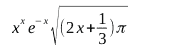

以下哪项表达式正确表示了上述公式？

- A) pow(x, x) * pow(M_E, -x) * pow(( 2 * x + 1 / 3 ) * M_PI, 1 / 2)
- B) pow(x, x) * pow(M_E, -x) * sqrt(( 2 * x + (double) (1 / 3) ) * M_PI)
- C) pow(x, x) * pow(M_E, -x) * sqrt(( 2 * x + 1.0 / 3.0 ) * M_PI)
- D) 以上皆非。

### 使用以下代码段解决第 32–33 题

```c
#define SIZE 10

int main(void)
{
    int result = 0;
    int *data;
    data = (int*)malloc(sizeof(int) * SIZE);
    result = populateArray(data);

    printf("result 1 = %d\n", result);
    printf("result 2 = %d\n", *data + SIZE);

    return(0);
}

int populateArray(int *array)
{
    int i = 0;
    int result = 0;

    while(i < SIZE)
    {
        *(array + i) = 2 * i - 1;
        result += *(array + i);
        i++;
    }

    return(result);
}
```

- 32. 上述代码段生成的第一行输出是以下哪项？
- A) result 1 = 80
- B) result 1 = 100
- C) result 1 = 90
- D) 以上皆非。

- 33. 上述代码段生成的第二行输出是以下哪项？
- A) result 2 = 11
- B) result 2 = 10
- C) result 2 = 9
- D) 以上皆非。

- 34. 关于 malloc 函数，以下哪项陈述为假？
- A) 动态内存分配函数由 stdlib.h 库提供。
- B) 新分配内存的起始地址由 malloc 函数返回。
- C) malloc 函数分配的内存中所有元素都初始化为零。
- D) 以上皆非。

- 35. 根据 C 语言规则，以下哪项是有效标识符？
- A) score-two
- B) 2ndScore
- C) score_No2
- D) 以上皆非。

### 使用以下代码段解决第 36–37 题

```c
int main(void)
{
    int index;
    int data[10] = {13, 3, 4, 9, 11, 10, 12, 1, 15, 10};
    randomArray(data);
    index = data[8] % 10;
    printf("result 1 = %d\n", data[index]);
    index = data[5] % 10;
    printf("result 2 = %d\n", *(data + index));
    return(0);
}
void randomArray(int *data)
{
    int i;
    for(i = 0; i < 9; i++)
    {
        *(data + i) = data[i] % 2 ? data[i] / 2 : data[i] * 2;
    }
}
```

- 36. 上述程序生成的第一行输出是以下哪项？
- A) result 1 = 0
- B) result 1 = 6
- C) result 1 = 20
- D) 以上皆非。

- 37. 上述程序生成的第二行输出是以下哪项？
- A) result 2 = 5
- B) result 2 = 13
- C) result 2 = 6
- D) 以上皆非。

- 38. 关于指针变量，以下哪项陈述为假？
- A) 间接运算符 (*) 是一元运算符，其操作数必须是数据变量。
- B) 间接运算符和地址运算符互为逆运算，在表达式中组合时会相互抵消。
- C) 指针变量存储的内存地址在程序执行期间可以改变。
- D) 以上皆非。

39. 在下面的数组上使用二分查找算法，目标值为 17 时，`first` 和 `last` 变量的最终值是以下哪项？

```
18 21 24 26 28 35 38 40 49 49 49 55
```

| A | B | C | D |
|---|---|---|---|
| first = 1 last = 0 | first = 0 last = 0 | first = 0 last = -1 | 以上皆非。 |

40. 在下面的数组上使用二分查找算法，目标值为 41 时，`first` 和 `last` 变量的最终值是以下哪项？

```
18 21 24 26 28 35 38 40 49 49 49 55
```

| A | B | C | D |
|---|---|---|---|
| first = 9 last = 8 | first = 8 last = 8 | first = 8 last = 7 | 以上皆非。 |

41. 在下面的数组上使用二分查找算法，目标值为 49 时，返回的 `index` 是以下哪项？

```
18 21 24 26 28 35 38 40 49 49 49 55
```

| A | B | C | D |
|---|---|---|---|
| index = 8 | index = 9 | index = 10 | 以上皆非。 |

42. 关于本学期介绍的搜索算法，以下哪项陈述为假？

- A) 顺序查找有可能在数组中比二分查找更快地定位目标。
- B) 在每次不成功的比较后，二分查找都会排除数组中大约一半的剩余元素作为目标的潜在位置。
- C) 在有序数组上使用顺序查找时，可能在不比较数组中每个元素的情况下确定目标值不存在。
- D) 以上皆非。

43. 给定原始数组如下：

```
10 21 49 55 65 28
```

以及经过排序算法两趟后的数组：

```
10 21 49 28 55 65
```

应用了以下哪种算法？

- A) 选择排序。
- B) 冒泡排序。
- C) 插入排序。
- D) 以上多于一项。

44. 给定下列数组：

```
18 33 13 8 25 19
```

经过选择排序算法两趟后，以下哪项不是数组的可能配置？

- A) {33, 25, 13, 8, 18, 19}
- B) {18, 33, 25, 19, 13, 8}
- C) {19, 18, 13, 8, 25, 33}
- D) 以上皆非。

```c
int main(void)
{
   int list[10] = {10, 2, 4, 3, 6, 8, 7, 9, 5, 1};
   sortArray(list, 10);
   return(0);
}

void sortArray(int list[], int last)
{
   int counter;
   int temp;
   int located;
   int current;

   for(current = 1; current < last; current++)
   {
      located = 0;
      temp = list[current];
      counter = current - 1;

      while(counter >= 0 && !located)
      {
         if(temp < list[counter])
         {
            list[counter + 1] = list[counter];
            counter--;
         }
         else
         {
            located = 1;
         }
         list[counter + 1] = temp;
      }
   }
}
```

- 45. 上述程序实现的是以下哪种排序算法？
- A) 选择排序。
- B) 冒泡排序。
- C) 插入排序。
- D) 以上皆非。

- 46. 关于上述程序排序过程两趟后数组中的数据，以下哪项陈述为真？
- A) 两趟后索引 0 处的元素是 10。
- B) 两趟后索引 8 处的元素是 5。
- C) 两趟后索引 2 处的元素是 2。
- D) 以上皆非。

### 使用以下代码段解决第 47–48 题

```c
int a = 0;
int b = 3;

int *x;
int *y;
int *z;

x = &a;
y = &b;

z = x;
*z = 2;

x = y;
*x = 1;

printf("total = %d\n", *y + *z);

y = z;
*y = 4;

printf("final = %d\n", a + b);
```

- 47. 上述代码段生成的第一行输出是以下哪项？
- A) total = 2
- B) total = 3
- C) total = 4
- D) 以上皆非。

- 48. 上述代码段生成的第二行输出是以下哪项？
- A) final = 6
- B) final = 5
- C) final = 7
- D) 以上皆非。

- 49. 以下哪项可用于永久更改变量的声明数据类型？
- A) 隐式类型转换。
- B) 显式类型转换。
- C) 赋值类型转换。
- D) 以上皆非。

- 50. 关于学期结束，以下哪项陈述为真？
- A) 对旧作业的复分要求或 Brightspace 错误必须在离开校园结束学期之前，将您的担忧打印出来并滑到教师办公室门下。
- B) 每个字母等级的最低分数线的任何更改将于星期二 5 月 10 日下午 5:00 前在 Brightspace 上公布。
- C) 成绩仅根据获得的分数计算；在分配课程成绩时不能考虑课程外的事项。
- D) 以上皆是！


## ASCII 表

| Char | Dec | Char | Dec | Char | Dec | Char | Dec |
| :--- | :--- | :--- | :--- | :--- | :--- | :--- | :--- |
| 分隔符 | 0 | 空格 | 32 | @ | 64 | ` | 96 |
| (soh) | 1 | ! | 33 | A | 65 | a | 97 |
| (stx) | 2 | " | 34 | B | 66 | b | 98 |
| (etx) | 3 | # | 35 | C | 67 | c | 99 |
| (eot) | 4 | $ | 36 | D | 68 | d | 100 |
| (enq) | 5 | % | 37 | E | 69 | e | 101 |
| (ack) | 6 | & | 38 | F | 70 | f | 102 |
| (bel) | 7 | ' | 39 | G | 71 | g | 103 |
| (bs) | 8 | ( | 40 | H | 72 | h | 104 |
| (ht) | 9 | ) | 41 | I | 73 | i | 105 |
| (nl) | 10 | * | 42 | J | 74 | j | 106 |
| (vt) | 11 | + | 43 | K | 75 | k | 107 |
| (np) | 12 | , | 44 | L | 76 | l | 108 |
| (cr) | 13 | - | 45 | M | 77 | m | 109 |
| (so) | 14 | . | 46 | N | 78 | n | 110 |
| (si) | 15 | / | 47 | O | 79 | o | 111 |
| (dle) | 16 | 0 | 48 | P | 80 | p | 112 |
| (dc1) | 17 | 1 | 49 | Q | 81 | q | 113 |
| (dc2) | 18 | 2 | 50 | R | 82 | r | 114 |
| (dc3) | 19 | 3 | 51 | S | 83 | s | 115 |
| (dc4) | 20 | 4 | 52 | T | 84 | t | 116 |
| (nak) | 21 | 5 | 53 | U | 85 | u | 117 |
| (syn) | 22 | 6 | 54 | V | 86 | v | 118 |
| (etb) | 23 | 7 | 55 | W | 87 | w | 119 |
| (can) | 24 | 8 | 56 | X | 88 | x | 120 |
| (em) | 25 | 9 | 57 | Y | 89 | y | 121 |
| (sub) | 26 | : | 58 | Z | 90 | z | 122 |
| (esc) | 27 | ; | 59 | [ | 91 | { | 123 |
| (fs) | 28 | < | 60 | \\ | 92 | \| | 124 |
| (gs) | 29 | = | 61 | ] | 93 | } | 125 |
| (rs) | 30 | > | 62 | ^ | 94 | ~ | 126 |
| (us) | 31 | ? | 63 | _ | 95 | (del) | 127 |

本页按优先级（从高到低）列出了 C 运算符。它们的结合性表示在表达式中，优先级相同的运算符按什么顺序应用。

| 运算符 | 描述 | 结合性 |
| --- | --- | --- |
| () [] ++ -- | 括号（函数调用）方括号（数组下标）后缀自增/自减 | 从左到右 |
| ++ -- + - ! ~ (type) * & sizeof | 前缀自增/自减 一元正/负 逻辑非 强制类型转换（改变类型） 解引用 取地址 确定字节大小 | 从右到左 |
| * / % | 乘法/除法/取模 | 从左到右 |
| + - | 加法/减法 | 从左到右 |
| < <= > >= | 关系小于/小于或等于 关系大于/大于或等于 | 从左到右 |
| == != | 关系等于/不等于 | 从左到右 |
| && | 逻辑与 | 从左到右 |
| \| | 逻辑或 | 从左到右 |
| ?: | 三元条件 | 从右到左 |
| = += -= *= /= %= | 赋值 加法/减法赋值 乘法/除法赋值 取模赋值 | 从右到左 |
| , | 逗号（分隔表达式） | 从左到右 |

## 讲义笔记

## 第 1 章 – 计算机概论

### 硬件基础

- 计算机的四个主要组件：
- 1. 中央处理器
- 2. 主内存
- 3. 输入/输出硬件
- 4. 系统互连 - 连接上述所有内容

作为程序员，计算机的以下两个硬件组件对我们很重要：

- 1. 中央处理器或处理器。
- 2. 主内存存储。

为什么是这两个特定组件？了解处理器的运作方式以及主内存在我们本学期将编写的程序中所起的作用，将使我们能够更好地利用计算机的这些有限资源。

处理器（CPU）值得关注，因为所有指令和相关数据的处理都将在此进行。CPU 可描述为具有四个基本组件：

- 1. 寄存器 - 处理器本地的一小部分内存，用于与当前正在执行的指令相关的临时存储。
- 2. 算术逻辑单元 - 负责指令所需计算的硬件。
- 3. 控制单元 - 协调处理器的操作。
- 4. 互连 - 连接上述所有内容。

### 主内存

计算机的内存将存储我们本学期将编写的程序的数据和指令。

- 你可能已经观察到，个人机器上的主内存（RAM，8-16 GB）容量与次级内存（硬盘，1 TB 或更多）的大小相比相当小。
- 因此，当前执行程序的每条指令或相关数据并非都可以存储在主内存中，但当需要指令或数据时，必须从硬盘获取或检索，并加载到主内存中以供使用。
- 类似于街道上房屋的地址，计算机内存中有可以定位指令和数据的地址。
- 在我们的程序中，我们将选择对我们作为程序员有意义的名称，而不是引用内存中的特定地址来表示和定位数据。

### 如果主内存更快，为什么不扩大这一层的容量并消除次级内存？

- 当前模式对消费者来说是一种经济模型。

### 为什么次级内存比主内存慢？

- 许多次级设备仍然有移动或机械部件。
- 距离 CPU（或机器）的物理距离更远。
- 在高容量设备中定位特定内容所需的时间增加。

### 处理指令

CPU 使用称为指令周期的过程来执行指令。

### 指令周期图：

### 自然语言与机器语言

- 当我们描述希望解决的问题时，我们使用自然语言。
- 自然语言是口语，并随着其使用在几个世纪中演变。
- 自然语言充满了不适合计算机使用的属性。

### 编程语言的概念

本学期，为了向计算机发出指令，我们将使用一种编程语言，特别是 C 编程语言。C 编程语言由来自自然语言的关键字组成，但使用时没有歧义。作为初学者，C 编程语言的语法最初看起来会很陌生，但计算机完全无法读取！

计算机有自己的语言，称为机器语言，它可以将其解释为特定于将执行任务的单个机器的指令。这种机器语言仅由 0 和 1 编写，因为计算机的内部电路由开关、晶体管和其他电子设备组成，这些设备可以处于两种状态之一：关闭（0）或开启（1）。

程序员很快就意识到，使用机器语言编码非常具有挑战性，在机器语言中开发、调试和维护指令的整个过程并不是大多数人喜欢做的事情。从机器语言向自然语言演变的过程一直在进行，并促成了当今的编程语言。

### 自然语言

### 高级语言

- 使用更易于使用、理解和开发的自然语言元素。
- 不依赖特定硬件。

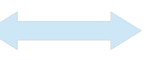

### 机器语言

### 低级语言

- 专门为一台机器的硬件编写的指令不能轻易用于不同的机器。
- 要求程序员以小的、逐步的步骤考虑算法。
- 程序员需要承担管理内存的任务。

如果计算机的所有指令都由 0 和 1（二进制数）组成，计算机如何理解这些高级编程语言？

### 创建和运行程序

为了回答上一个问题，我们必须探索将 C 程序转换为可在本地机器上执行的文件的过程。

编程过程由开发过程中重复多次的步骤组成：

### 编写和编辑程序

第一步是编写程序（实际上，第一步是开发你的解决方案，但我们此时正在描述解决方案的实现），这将需要使用一种称为文本编辑器的软件。本学期的首选文本编辑器是 vi（发音为 vee-eye）。如果你坚持使用其他编辑器，那么你将承担理解其操作以及与我们服务器可能存在的任何兼容性问题的责任。我们发现使用 vi 编写代码非常强大。请理解 vi 有一个学习曲线，但经过足够的练习，你也会熟练使用 vi！

### 保存更改

请牢记定期保存工作的重要性！过去有太多学生因为连接中断、计算机冻结或停电而丢失了大量未保存的工作，因为他们在进展过程中未能保存工作。

- 你也应该定期测试你的工作！很容易写大量代码，然后才发现大量错误或初始设计如此糟糕，以至于纠正所有问题比从头开始更困难！
- 定期测试不应意味着你在编码时创建解决方案，但无论如何强调都不为过：当你编写代码时，它应该只不过是设计良好的算法的实现。如果没有规划，你的解决方案就归结为通过试错来开发，这往往是一个低效且令人沮丧的过程。
- 对于给定的作业，可以进行多次提交。但是，只有最后一次提交会被保留用于评分。所有先前的提交都会被覆盖且无法恢复。

> 在你的协作实验小组中，对于每个实验作业，你必须指定一名个人负责代表小组进行所有提交。

### 示例：

假设我们正在实现一个问题的解决方案，并且在编码中已经进展到想要测试迄今输入内容的程度。

- 接下来应该做什么？
- 1. 提交工作以确保包含我们 C 代码的源文件已存储并反映我们最近的更改。
- 2. 将源文件发送到编译器，以便其中的指令可以为计算机执行做好准备。

### 编译器

编译器是一类用于将源编程语言代码转换为计算机机器语言的软件。

### 语法

语法是编程语言的一组规则。编译器将尝试在创建新可执行文件时，使用 C 编程语言的语法来验证你的源代码。

违反语法规则可能导致无法创建新可执行文件的错误。


编译过程中有一个特别值得我们关注的阶段：

- 预处理器 - 读取源代码并为翻译器做准备。有一种称为预处理指令的特殊指令，你可以将其提供给预处理器，以便为翻译准备源代码。

在我们的服务器上，编译过程的所有步骤都通过一条指令完成，这使得许多步骤对程序员是透明的。

### 代码实现过程

### 程序执行（测试/运行可执行文件）

编译成功后将创建一个可执行文件。默认情况下，该可执行文件的名称为 a.out。要执行或运行程序，只需在 UNIX 提示符下输入 a.out。假设你在测试程序时位于与 a.out 文件相同的目录中。

每次修改源文件后，都必须重新编译代码并创建一个新的 a.out，以查看源代码中反映的更改。新的可执行文件将替换任何先前存在的文件。在大多数情况下，不希望保留旧的可执行文件。

- 如果程序编译失败，将不会创建新的可执行文件。

- 失败的编译尝试可能不会导致现有的 a.out 文件被删除/移除。

### 程序开发

我们在 CS 159 中的目标：能够以逻辑算法的形式开发解决方案来解决问题，而无需考虑你可能使用的编程语言的任何特定语法。

接触良好的编程实践对于介绍设计“产生正确结果、设计良好、高效且遵循课程文档和编程标准的程序”所需的方法非常重要。

### 结构图

- 大型程序是由许多相互关联的部分组成的复杂结构，必须经过精心设计。
- 结构图展示了我们将如何将较大的问题分解为逻辑子问题，以及数据将如何在这些模块之间流动。

### 流程图

- 流程图的目的是以可视方式描述单个函数（较大问题的较小任务）的逻辑。
- 应该为结构图中识别的每个子问题开发一个流程图。

在规划上投入的每一步都将帮助你消除日后解决起来往往非常耗时的逻辑错误。

问题：给定贷款金额、年利率和贷款期限（年），确定每月还款额。

### 步骤 #1 – 程序规定了什么？

- 输入 – 三个值。贷款金额、年利率和期限。输出 – 每月还款额。

### 步骤 #2 – 分析问题

我们需要哪种数学运算？

| 变量 | 描述 | 表达式 |
|---|---|---|
| years | 贷款期限（年）。 | 用户输入 |
| numMonths | 贷款的月数。 | years * 12 |
| annualRate | 贷款的年利率（百分比）。 | 用户输入 |
| monthlyRate | 月利率（小数）。 | (annualRate / 12) / 100 |
| loanAmount | 要借款的总金额。 | 用户输入 |
| P | | pow((1 + monthRate), numMonths) |
| Q | | (P / (P - 1)) |
| monthPayment | 每月还款额。 | loanAmount * monthRate * Q |

### 步骤 #3 – 设计软件解决方案

正是在这里，我们考虑为解决问题必须实现的单个步骤或指令。

### 流程图符号/指令类型

| 符号 | 描述 | 符号 | 描述 |
| :--- | :--- | :--- | :--- |
| 终止符 - 算法的开始和结束 | 条件语句 • 始终标记你的真路径和假路径！ | 课程标准：本课程只允许一个起点和终点（终止符）。所有其他实现都违反标准。 | 重复结构 • 始终标记你的真路径和假路径！ |
| 赋值语句/表达式 • 包括函数调用！ | | 指定输入和/或输出数据 • 不必担心宽度修饰符和转换代码。 | 连接符 • 因为纸张在任何维度上都不是无限的。 |

你会注意到在 C 语言教材中，接受（读取）输入时没有描述性提示。如果不明显，在 I/O 符号中至少引用变量名称是个好主意。

### 继续编写、保存、编译、测试、修改...

- 流程图在 C 语言教材的附录 C 中有讨论。使用的符号可能适用于任何编程语言。

- 测试。除了所有作业中提供的示例执行外，你或你的小组（针对实验作业）应考虑创建额外的测试用例，以验证解决方案的正确性和效率。

- 改进是问题解决过程中的一个重要但常被忽视的步骤。你的第一个解决方案不一定是最好的，对算法的进一步改进可能提高程序的效率并消除任何先前未观察到的错误。

### 首先处理输入：

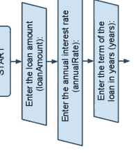

### 继续计算并以输出结束：

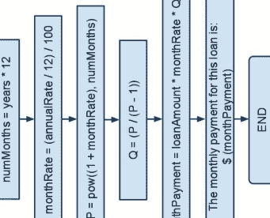

| 预处理器的特殊指令，告诉它如何为编译准备你的程序。 | 将对程序所有部分可见（可用）的“对象”的声明。 | 课程标准：变量绝不能作为全局变量。 | 最后一部分代表函数。C 程序由一个或多个函数组成，其中一个必须命名为 main。 | 课程标准：函数的两个部分绝不能重叠！ |
|---|---|---|---|---|

其他函数将在第 4 章中介绍。

### 我们的第一个程序

```
#include<stdio.h>
int main(void)
{
    printf("Hello World!\n") ;
    return(0) ;
}
```

不要将 stdio 与 studio 混淆！

### 以上程序的分析

### 预处理指令部分

- 唯一的预处理指令语句是 #include<stdio.h>
- 此特定语句请求包含一个标准库（stdio.h），以允许程序中的标准输入/输出函数（例如 printf）。
- stdio.h 库将出现在你本学期编写的所有 C 程序中。其他库，例如 math.h、stdlib.h、ctype.h 和 string.h 将在本学期介绍。有关库和可用函数的列表，请参阅 C 语言教材的附录 F。

### 全局声明部分

- 此程序中没有全局声明。
- 你的程序中绝不会有全局变量声明。
- main 函数不需要声明，并且由于没有其他用户定义的函数，此部分保持为空。

> 始终记住：声明部分和执行部分绝不能重叠！你必须在可执行语句开始之前完成所有声明。

### 函数部分

- 此程序中只有一个函数，该函数名为 main。
- main 函数是程序开始（和结束）执行的地方。
- 每个函数都有两个不同的部分：

- 局部定义部分 – 建立当前函数的数据需求。
- 语句（执行）部分 – 完成函数任务的逻辑。

main 函数中只有两条可执行语句。第一条语句将在显示器上打印引号中的消息。

- 引号内包含的一个特殊字符 \n 将打印一个新行（类似于按下键盘上的回车键）。
- 另一个特殊字符（本示例中未使用）\t 用于显示制表符，但由于制表符的解释不同，最好避免使用它们以保持输出的一致外观。

第二条语句是 return (0)，该语句表示程序控制权从 main 函数返回到操作系统，终止程序。本学期稍后我们将看到 return 语句如何用于将程序控制权（带或不带值）从一个用户定义的函数返回到另一个函数。

### 来自我们第一个程序的更多观察

```
#include<stdio.h>
int main(void)
{
   printf("Hello World!\n");
   return(0);
}
```

课程标准：{ 和 } 之间的所有语句缩进两个空格。

- 注意 ( 和 ) 的使用，它们指示 main 函数的开始 { 和结束 }。任何带有主体的 C 结构，即花括号之间的内容，都不会以分号结束。
- 大多数其他 C 语句（和声明）将以分号结束。上述规则通常成立，但总会有例外！

**注释**：可以合理地期望一名优秀的程序员能够阅读另一人编写的代码，但在逻辑复杂的片段中，代码的含义（和/或编码者的思路）有时并不明显。如果编写代码的人添加了详细的注释来帮助阅读者（可能是评分者、导师、同学或同事），那将很有帮助。**注释**是编译器忽略的内部文档，旨在供源代码的其他查看者阅读。

C 编程语言以及许多其他语言提供两种注释方法：

- 单行注释
- 多行注释

### 单行注释

其后的文本在当前行的其余部分将被忽略。

```
average = sum / numberStudents; // CALCULATING THE EXAM AVERAGE
```


### 关于注释的规则:

- 注释可以出现在程序中的任何位置。
- 不要对你编写的每一行代码都加注释。
- 你必须在每个提交的作业中包含作业标题。标题中写得好的描述将减少代码中对注释的需求。
- 你必须对程序中的每个变量都加注释。
- 注意：多行注释不能嵌套。

标识符允许我们为程序中的数据和其他对象命名。

- 程序使用的数据可能由计算机存储在唯一的内存地址中，作为程序员，我们只需回忆选择的标识符，而无需记住特定的内存地址，即可从计算机内存中存储和检索数据值。

| 良好标识符 | 不良标识符 | 文档标准： |
| :--- | :--- | :--- |
| numStudents | x | 标识符的名称应与其在程序中的用途相关。 |
| depth | DEPTH | 单字符标识符很少有意义。 |
| examAvg | exam-avg | 全大写的标识符表示符号/定义常量，即程序执行期间不会改变的值。 |
| first_lab | 1st_lab | |

```
/************************************************************
* Lab #: SPECIFY ASSIGNED NUMBER
*
* Academic Integrity Statement:
*
* We have not used source code obtained from any other unauthorized source,
* either modified or unmodified. Neither have we provided access to our code
* to another. The effort we are submitting is our own original work.
*
* Program Description: DESCRIBE YOUR ALGORITHM. WHAT DOES YOUR PROGRAM DO?
* HOW DOES IT DO IT?
************************************************************/
```

当注释跨越多行时，使用多行注释。我们不在每行代码前以 // 开头，而是使用 /* 表示注释的开始，使用 */ 表示注释的结束。本学期所有程序中要求使用的标题都是多行注释的示例。/* 和 */ 之间的所有文本都会被编译器忽略。

### 选择标识符的规则:

- 第一个字符必须是字母字符。
- 必须仅由字母字符、数字或下划线组成。
- 标识符的前 63 个字符有效。
- 不能与保留字重复。（C 语句中使用的单词包括：main, int, return, void，参见附录 B）

### 数据类型

### 数据类型决定什么？

- 存储给定类型值所需的内存量。
- 给定类型的值在计算机内存中的存储方式。
- 可以对值执行哪些操作。某些操作仅限于特定数据类型。

整数（int）类型是没有小数部分的数字。C 支持不同大小的整数数据类型：short、int、long 和 long long。

- 你将使用的整数类型取决于你计划存储的整数数据的潜在范围。较长的类型将需要更多内存。

| int 范围，-2147483648 到 2147483647 | 实际范围将取决于系统。 |
|---|---|

字符（char）是计算机“字母表”中可以表示的任何值。每个字符都有一个对应的小整数值。这种整数值与等效字符并列的标准表称为 ASCII 表。你将在文本的附录 A 中找到 ASCII 表。

- 由于字符在内存中存储为表示字符 ASCII 码的整数，因此可以对字符执行算术运算！

### 布尔（bool）值表示逻辑数据（真或假）。在 C 语言的 C99 标准之前，仅使用整数来表示真值。课程当前使用的编译器默认不识别 bool 数据类型。

- 为了向后兼容性，非零数字表示真，零值可用于表示假。
- 本学期我们不会使用 bool 数据类型，可以使用整数值来代替。

浮点（float）数具有小数部分，例如 3.14159。C 支持不同大小（从小到大）的浮点数据类型：float、double 和 long double。最常见的实现将是 double 和 float。较长的类型将提供额外的精度并需要更多内存。

注意：许多编程参考资料会将任何非整数的数值称为实数。这种用法可能与你从数学中了解的实数和虚数不一致。

### 变量

变量是具有数据类型的命名内存位置。

程序中的每个变量都必须声明和定义。在 C 中，声明用于命名对象（例如变量），而定义用于创建对象。

- 声明 - 为变量命名。
- 定义 - 为变量保留内存。

要创建变量（在一步中完成声明和定义），你首先需要列出变量的预期数据类型，然后是所选标识符，以及一个终止分号。

- 所选标识符和一个终止分号。

你需要知道：变量被定义为表示特定的数据类型，只能存储和表示该类型的值！

课程标准：每行只声明一个变量。

拥有类似 C 语言的编程经验的人可能知道可以在一条语句中声明多个变量。然而，课程编程标准不允许这种做法。组织函数的数据需求可能是一项挑战，每行一个声明有助于此，并改善代码的文档和可读性。

### 变量初始化

可以在创建变量的同时对其进行初始化。

```
int count = 0;
```

上述内容将为整数 count 保留的内存空间初始化为零值。除非我们初始化变量，否则不能假设分配给变量的内存有任何默认值。未初始化的变量将被分配一个内存位置，该位置可能包含先前使用的现有数据。此类数据被称为垃圾，因为它对程序员来说没有可预测的值。

课程标准：将复杂的初始化表达式移至函数的可执行语句部分。

### 常量 - 字面常量

字面常量是用于指定数据的未命名值。例如，我们想要计算圆的周长：

```
circumference = 2 * 3.14159 * radius;
```

- 上述表达式中的值 2 和 3.14159 都是字面常量。当这些值未由符号表示时，我们通常将其称为“硬编码”（下一主题）。

### 常量 - 符号/定义常量

#define 预处理指令用于创建符号常量。

当此语句出现在预处理指令中时，程序编译前，symbol 的所有后续出现将自动被替换为 replacement value。

> 注意：替换不会在引号内进行。

### 为什么使用符号/定义常量？

- 当程序很长且包含许多复杂计算时，很难确定算术表达式中字面常量值代表什么。使用常量有助于为表达式中的操作数赋予意义，从而帮助记录程序。

- 使用常量的另一个绝佳理由是使你的程序更易于维护。例如，也许一门课程有 100 名学生。你在加载数据或更改平均值时可能会使用值 100，但你也可能使用 100 将 .853 转换为 85.3%。现在，如果学生人数变为 105 呢？你需要搜索程序，确定程序中出现的哪些 100 值与课程中的学生人数相关，并仅将这些值更改为 105。

> 课程标准：不鼓励使用内存常量。为什么为永远不会改变的值请求内存？


### 符号常量示例：

| 预处理器指令 | 良好或不良用法？原因？ |
| :--- | :--- |
| `#define NUMSTUDENTS 100` | 良好，清楚地表示课程中的学生人数。 |
| `#define ONE 1` | 不良，含糊！如果值 1 在你的程序中有多种用途，则为每种用途创建一个常量！ |
| `#define NUMBEROFEXAMS 4;` | 不良。通常不使用分号。常量将替换名称后面的 **所有** 值。 |
| `#define MaxPtsOnExam 100` | 不良，符号常量名称始终使用全大写字母。 |

**课程标准：** 尽量减少字面常量的使用，并最大限度地使用符号常量。

### 将符号常量与变量进行比较：

### 符号/定义常量的误用

| 你的代码中包含： | 第 #10 行实际编译的内容： |
| :--- | :--- |
| `3 #define APPROX_PI = 3.1415;`<br>`4 int main (void)`<br>`5 {`<br>`6    float radius = 4.25;`<br>`7    float circumference;`<br>`8`<br>`9   circumference = 2 * APPROX_PI * radius;`<br>`10` | `circumference = 2 * 3.1415; * radius;`<br>- 符号 APPROX_PI 后面所有内容的替换在第 #10 行生成错误。<br>- 当观察到包含符号/定义常量的行上出现错误时，请记住错误的来源可能在于程序顶部的定义。 |

### 格式化 I/O（输入和输出）

printf 函数用于向显示器显示消息和格式化数据。

- 要打印数据，printf 函数需要两样东西：格式化数据的指令和要打印的实际数据。

我们在之前的示例中看到了以下内容，仅用于显示文本：

```
printf("Hello World!\n");
```

可以在 printf 语句中打印由常量或变量表示的数据：

```
printf("The year is: %d\n", 2022);
```

其中 %d 是整数字面常量 2022 的占位符。

- 提示：本说明中使用了术语“占位符”，书籍将把 % 称为起始标记，后跟转换代码（在上面的示例中，“d”是整数值的转换代码）。

printf 语句的格式为：printf( 格式字符串, 数据列表 );

- 其中格式字符串是双引号内的所有内容，要打印的变量在数据列表的逗号之后。
- 数据列表可以包含由逗号分隔的多个值。

你可以通过在占位符中使用不同的转换代码，用 printf 打印所有典型的 C 数据类型：

- int（整数系列值）使用 %d
- float（浮点系列值）使用 %f
- char（单字符值）使用 %c

### 转换代码的更全面列表：

| 家族 | 类型 | 大小 | 代码 | 示例 |
|---|---|---|---|---|
| 整数 | char | None | c | %c |
| | int | None | d | %d |
| | long | None | d | |
| | long long | None | d | |
| 浮点数 | float | None | f | %f |
| | double | None | f | |
| | long double | None | f | |

### 宽度修饰符：

- 宽度修饰符与转换字符一起使用，为要显示的值保留给定的空间量。
- 如果要显示的数据中的字符数少于宽度修饰符指定的数量，则数据将右对齐于保留的空间中。
- 可以通过在宽度修饰符前加上 – 来实现左对齐。此选项称为标志。

### 精度修饰符：

- 精度修饰符与浮点数据一起使用，以确定小数点右侧要显示的位数。

### 占位符摘要：

| | 大小 | 代码 |
|---|---|---|
| % | | |

标志属性是用于减法的字符，并将默认对齐方式从右对齐移至左对齐。例如：%-10d

### 用于生成左侧输出的代码：

```
#include <stdio.h>
#define APPROX_PI 3.14159
int main(void)
{
    float radius = 4.25;
    float circumference;
    int decimalPlaces = 3;
    circumference = 2 * APPROX_PI * radius;
    printf("--------------------------------\n");
    printf("Circumference: %18.2f\n", circumference);
    printf("Circumference: %18f\n", circumference);
    printf("Circumference: %18.*f\n", decimalPlaces, circumference);
    printf("--------------------------------\n");
    return(0);
}
```

### 宽度修饰符、精度修饰符和变量精度修饰符示例：

| | |
|---|---|
| 周长： | 26.70 |
| 周长： | 26.70314 |
| 周长： | 26.704 |

### 关于代码段的注释：

- 所需的小数位数存储在名为 decimalPlaces 的变量中。
- 然后使用此值来表示要显示的所需小数位数，并替换占位符中的 *。
- 宽度修饰符是固定值 18。这也可以用变量表示，类似于变量精度的实现方式。

### 本学期我们将使用的主要输入函数称为 scanf

scanf 函数的格式与 printf 类似，它由逗号分隔的两个部分组成。

```
scanf ( format string, address list );
```

格式字符串将列出预期作为输入的数据类型。在单个 scanf 语句中读取多个数据是可能的。地址列表指示输入值应存储在计算机内存的哪个位置。

```
printf("Enter current year -> ");
scanf ("%d", &year);
```

用户将输入一个整数，该整数将赋值给变量 year。

- 年份前面的 & 是什么？
- & 是地址运算符，指变量 year 所代表的地址。
- 用户输入的值将存储在内存中由 year 所代表的地址处。

- scanf 函数使用与 printf 相同的占位符：
  - int 使用 %d
  - float 使用 %f
  - char 使用 %c

请记住：\n 表示输出的换行符，在 scanf 语句中不应出现。

### 错误讨论

我们尽量不涵盖学期中你可能遇到的每个特定错误，但今天我们将把错误分为不同的类别，并在学习新主题时尽量提及常见错误。本简短部分的目的是帮助你更好地理解你正在尝试解决的错误，并与可能试图提供帮助的其他人进行沟通。

- 错误分类：
- 语法错误
- 逻辑错误
- 每当遇到错误时，尝试回答以下问题：
- 错误何时发生？
- 你对错误有什么观察？

### 语法错误

当你尝试编译 C 代码时，会意识到存在语法错误。也可以说语法错误是编译时错误。通常，此错误是由于你犯了违反 C 编程语言语法规则的错误，导致编译器停止工作。

- 常见的语法错误包括分号位置错误、未配对所有引号以及其他拼写错误。
- 警告是编译器提供的反馈，表明你可能犯了错误。所有警告都应在提交作业前修复。如果你正确设置了帐户，则将使用警告选项进行编译。如果未启用此选项，或使用备用编译器，你可能不会意识到任何警告。

### 可执行文件的创建

当编译器因语法错误而必须终止工作时，不会创建新的可执行文件 (a.out)。关键字是 error，它通常包含在编译器生成的消息中。如果编译器仅报告警告，那么很可能会创建新的可执行文件 (a.out)。发出警告时，编译器已检测到语法的潜在误用，这在程序执行时通常会表现为逻辑错误。

### 警告消息示例：

```
test.c: In function 'main':
test.c:10: warning: 'ct' is used uninitialized in this function
```


### 运行时错误

这是程序运行时发生的任何错误。运行时错误可能导致崩溃。崩溃是导致程序执行意外停止的事件。导致崩溃的两种非常常见的运行时错误是段错误和浮点异常。为什么编译器没有检测到这些错误？编译器可能在代码编译完成且用户输入零作为将用于表达式分母的值之前，都不知道会发生除以零的尝试（浮点异常）。

更难诊断的错误是不会导致崩溃的运行时错误！此类错误通常是因为输出（结果）不符合预期而被发现。

```
Logical error example, determine the average of three numbers:
average = x + y + z / 3;
average = (x + y + z) / 3;
```

两条语句在语法上都是正确的；第一条语句不会导致崩溃，但会显示错误的值。第二条语句是没有逻辑错误的期望结果。

### 调试

- 解决错误的过程称为调试。本学期我们将探讨调试错误的各种方法，包括：
  - 在代码中插入诊断打印语句，以验证程序执行过程中特定时间点的预期值。
  - 编写小段代码，完成你正在解决的较大问题中的子任务。
  - 开发代表各种预期输入的测试用例。

## 第 3 章 - C 程序结构

### 表达式

在 C 编程语言中，表达式始终归约为单个值。

### 表达式术语回顾：

- 运算符 - "需要采取行动的特定语言语法标记。" 例如：+、-、*、/、/ 以及一些可能对你来说是新的其他运算符。如果从上面的定义中只能记住一件事，请关注"特定语言"，因为 C 编程语言使用运算符，它们的含义可能与你在数学或其他编程语言（即 MATLAB、Python、Excel）中看到的不同。
- 操作数 - "接收运算符作用的对象。" 换句话说，就是被运算符作用的值。根据运算符的不同，评估操作可能需要一个、两个或多个操作数。

你应该以某种形式熟悉的另一个概念是运算符优先级。运算符的优先级决定 (1) 操作数属于哪个运算符，以及 (2) 它在表达式中被求值的顺序。教材的内封面列出了 C 语言的优先级顺序。

### 打印表达式求值：

```
int a = 17; //FIRST OPERAND
int b = 5; //SECOND OPERAND
printf("%d + %d = %d\n", a, b, a + b);
printf("%d / %d = %d\n", a, b, a / b);
printf("%d %% %d = %d\n", a, b, a % b);
```

第三个 printf 的格式字符串中为什么有两个 % 字符？

- 因为 % 在 printf 的格式字符串中已经有特殊含义，所以需要两个才能在屏幕上显示一个。

注意：取模运算符的两个操作数必须是整型。

### 赋值表达式

赋值表达式求值赋值运算符 (=) 右侧的操作数，并将该值保存到左侧变量的内存中。

注意：赋值表达式中的左操作数必须是单个变量。

### 简单赋值示例

```
int x;
int y = 2;
x = 3 * 4;
x = y * 3;
x = x + y;
```

课程标准：运算符和操作数之间加空格！

### 复合赋值示例

- 将一个值添加（或应用另一种常见的数学运算）到变量，并将新值存回变量，这是常见的做法。

例如，x = x + 3；

- 从内存角度考虑上面发生的情况。在右侧，我们从内存中检索 x 的值，加上 3，然后将和存回由 x 表示的内存位置。

复合赋值示例：

- x += 3; // SAME AS x = x + 3;

| 复合赋值表达式 | 等效的简单赋值表达式 |
| :--- | :--- |
| x += expression | x = x + expression |
| x -= expression | x = x - expression |
| x *= expression | x = x * expression |
| x /= expression | x = x / expression |
| x %= expression | x = x % expression |

### 示例：

```
int x = 3;
int y = 5;
int z = 7;
float a = 2.5;
float b = 5.0;
x += 4;
y /= 2;
a *= 2;
b /= 2;
z %= 4;
printf("x = %d y = %d z = %d\n", x, y, z);
printf("a = %.2f b = %.2f\n", a, b);
```

### 示例 #2：

```
int x = 3;
int y = 5;
x /= x + y;
printf("x = %d y = %d\n", x, y);
```

结果是 x = x / x + y 还是 x = x / (x + y)？

答案：在上述情况下，表达式将被解释为：x = x / (x + y)

这告诉你关于 /= 和 + 的运算符优先级的什么信息？

加法运算符的优先级高于复合赋值运算。

### 前缀 & 后缀运算符

在许多程序中都需要计数，这通常以 +1 或 -1 的增量进行。这两种表示法，前缀和后缀，提供了比简单或复合等价形式更短的替代方案，但也可以与其他表达式结合使用，正是在那里我们发现运算符相对于操作数的位置会产生影响。

### 后缀表达式涉及一个后跟运算符的操作数。

```
int x = 0;
x++; //POSTFIX INCREMENT
printf("The value of x is: %d\n", x);
x--; //POSTFIX DECREMENT
printf("The value of x is %d\n", x);
```

### 前缀表达式涉及一个后跟操作数的运算符。

```
int x = 0;
++x; //PREFIX INCREMENT
printf("The value of x is: %d\n", x);
--x; //PREFIX DECREMENT
printf("The value of x is %d\n", x);
```

### 为什么上面的后缀和前缀示例之间没有可识别的差异？

- 当在没有其他表达式的行上使用时，后缀和前缀操作是可互换的。
- 此外，在相同条件下，简单或复杂的赋值可以替代后缀或前缀操作。

| 后缀结果： | 前缀结果： |
| --- | --- |
| | |

演示前缀和后缀操作之间差异的示例：

```
int x = 0;
printf("The value of ++x is: %d\n", ++x);
x = 0; //RESET x
printf("The value of x++ is: %d\n", x++);
printf("The final value of x: %d\n", x);
```

### 单个表达式中的多次修改

```
int x = 0;
int y = 0;
int z = 0;

y = x++ + ++x - --x - x--;
printf("x: %d y: %d\n", x, y);
```

不同的编译器可能以不同方式解释诸如 y = x++ + ++x - --x - x-- 这样的表达式。一般来说，即使你确定了操作在我们服务器上的精确定义，未定义的操作也不应保留在你的程序中。

> 警告：在 C 编程语言中，如果表达式中对单个变量进行多次修改，结果是未定义的。

### 混合和单一数据类型表达式

我们已经看到过表达式求值的示例，如果在数学中（或使用计算器、Excel 或 MATLAB），结果会与我们预期的不同。

```
3 / 2 = 1
```

- 上面的示例是另一种情况！在 C 编程中，两个整数值的除法必须得到另一个整数！

但是，如果像下面的语句那样混合类型，余数会保留在和中。

```
3 + 2.1 = 5.1
```

前一个示例中的混合类型表达式会将整数 3 隐式转换为浮点数 3.0，使得表达式仿佛存在两个浮点数值一样进行求值。在将 3 转换为 3.0 并添加到 2.1 之前，你发现有什么问题吗？

- 不，没有潜在的数据丢失，这种隐式转换被称为安全的。


隐式是什么意思？计算机在程序员没有明确要求进行转换的情况下就自动完成了！上图说明了隐式数据类型转换的规则。

- 是否存在显式数据类型转换？如果有，如何实现显式类型转换？

需要显式类型转换的示例：我想计算 3 / 2，但我需要答案是 1.5！

在混合类型表达式中，我们看到整数在数据类型层次结构中被隐式提升为浮点数。我们可以在除法表达式的两个操作数之一上明确请求类型转换，强制除法涉及浮点数和整数。商随后将作为浮点数值生成，因为表达式现在是混合类型表达式，第二个操作数（下面示例中的分母）被隐式更改。

```
(float) 3 / 2 = 1.5
```

### 尝试以下内容：

| 表达式 | 求值 |
|------------|------------|
| 3 / (float) 2 | |
| (float) 3 / (float) 2 | |
| (float) (3 / 2) | |

上面表达式的结果说明了显式类型转换的优先级是什么？

### 另一篇数学复习：数字舍入是解决问题中的常见任务。在本学期编程时，你必须牢记有关舍入的规则，或者更好的是，能够进行各种测试以识别你的值是如何进行舍入的。

- 有时会发生一种称为截断的“极端”舍入形式。截断是删除整个小数值，而不考虑剩余整数的舍入。
- floor 函数（位于 math.h 中，也是 MATLAB 和 Excel 中常用的函数）将删除余数并将数字减小到下一个较小的整数值。请注意其行为与 float 到 int 的转换相似。

| 表达式 | 求值 | 表达式 | 求值 |
|------------|------------|------------|------------|
| floor (6.99) | | (int) 6.99 | |
| floor (6.5) | | (int) 6.5 | |
| floor (6.0) | | (int) 6.0 | |
| floor (6.75 + 0.5) | | (int) (6.75 + 0.5) | |

### 赋值转换：

当赋值表达式右侧表达式的数据类型与赋值运算符左侧变量的数据类型不匹配时，会发生这种类型的转换。

- 赋值表达式右侧表达式的结果将被转换以匹配左侧变量的类型。这种转换可能不安全。

### 示例 - 舍入和截断

```c
int a = 3;
int c = 1;
float x = 3.99;
float y = 2.29;
float z = 8;
printf("The value of z is %f\n", z);
c = x; //ASSIGNING A FLOAT TO AN INT - ASSIGNMENT CONVERSION
printf("The value of c is %d\n", c);
printf("The value of x is %.1f and y is %.1f\n", x, y);
printf("Using mixed up placeholders: \n");
printf("x is %d and a is %f\n", x, a);
printf("Using a cast to fix placeholders: \n");
printf("x is %d and a is %f\n", (int) x, (float) a);
```

注意：由于转换代码不正确而发出的警告是另一种未定义行为的指示。显示值的确定方式取决于单个处理器。

提醒：应用于变量的显式类型转换**不会**在程序的其余部分更改变量的数据类型。你可以认为类型转换是在从变量分配的内存中检索数据值**之后**应用的。

### 变量值如何更改：

- 赋值运算符有能力更改变量的值。
- 存储在分配给变量的内存中的内容。
- 在 scanf 函数调用中使用地址运算符将更改变量在内存中存储的内容。
- 前缀和后缀递增及递减将更改变量的值。所使用的特定运算符将确定此更改发生的时间。

### 通过计算进行选择

等等，这不是选择章节，对吧？if/else 结构在哪里？我们如何通过计算来模拟选择？这里的基本思想是，我们可以创建一个表达式，根据一个因子的值来决定是否激活该表达式，该因子乘以表达式以确定它是否仍然是最终计算的一部分。该因子通常是比较两个值以确定哪个较大的结果。鉴于本章强调了数据类型，确实是这个想法在计算此类因子中起着主要作用。

### 示例：给定两个整数，显示较大的那个。

```c
#include <stdio.h>

int main (void)
{
   int x;
   int y;
   int max;

   printf ("Enter two integers: ");
   scanf ("%d %d", &x, &y);

   max = x / y * x + y / x * y;

   printf ("Max value input is: %d\n", max);

   return (0);
}
```

### 示例执行：

Enter two integers: 5 8
Max value input is: 8
Enter two integers: 9 6
Max value input is: 9
Enter two integers: 10 3
Max value input is: 30

### 修订以消除将较大值乘以大于一的因子：

```
factor1 = x / y;
factor2 = y / x;

factor1 = (factor1 + 2) % (factor1 + 1);
factor2 = (factor2 + 2) % (factor2 + 1);

max = factor1 * x + factor2 * y;
```

- 引入两个整数 factor1 和 factor2 来存储比较 x 和 y 的值。
- 我们知道值为零表示两个值中较小的那个，而大于零的值表示较大的那个。
- 这里使用模运算符将所有非零值缩放为 1，同时不改变存储零的因子，因为 2 % 1 是零。

### 修订程序的示例执行：

Enter two integers: 10 3
Max value input is: 10

Enter two integers: 8 8
Max value input is: 16

- 当两个整数值相同时，我们仍然存在问题！

### 修订以消除当输入两个值相同时输出重复的问题：

- 只有当因子之和为二时，两个值才相同。在所有其他情况下，因子之和将为一。
- 在这种情况下，我们只需要将 max 除以因子之和，以消除这种不需要的值翻倍。

```
factor1 = x / y;
factor2 = y / x;

factor1 = (factor1 + 2) % (factor1 + 1);
factor2 = (factor2 + 2) % (factor2 + 1);

max = factor1 * x + factor2 * y;

max = max / (factor1 + factor2);
```

### 示例：利用我们对数据类型和表达式的了解，给定学期获得的总分，计算获得的字母等级。

Enter total points earned: 470
Points Earned: 470 Grade Earned: A

Enter total points earned: 415
Points Earned: 415 Grade Earned: B

Enter total points earned: 305
Points Earned: 305 Grade Earned: D

Enter total points earned: 304
Points Earned: 304 Grade Earned: F

### 解决方案：

```
#define A_MIN 470
#define B_MIN 415
#define C_MIN 360
#define D_MIN 305
```

```
int totalPoints; //TOTAL POINTS EARNED BY STUDENT
char courseGrade; //GRADE EARNED BY STUDENT

int gradePoints; //GRADE POINTS EARNED BY STUDENT

printf("Enter total points earned: ");
scanf("%d", &totalPoints);

gradePoints = totalPoints / A_MIN;
gradePoints += totalPoints / B_MIN;
gradePoints += totalPoints / C_MIN;
gradePoints += totalPoints / D_MIN;

courseGrade = 'F' - gradePoints;
courseGrade -= totalPoints / D_MIN; //TO ACCOUNT FOR 'E'
printf("Points Earned: %d Grade Earned: %c\n", totalPoints, courseGrade);
```

### 为什么使用函数？

### 自顶向下设计

在较大问题中识别较小任务称为因式分解，并导致程序的小型可管理子部分，这些部分将被设计、单独开发然后实现。将任务分解为更可管理的部分的过程称为自顶向下设计。

因式分解何时停止？这种因式分解应继续进行，直到任务“仅由内在理解且无法进一步细分的基本过程组成”（第 150 页，C 语言程序设计教材）

- 简单来说，函数应由单个任务组成。小心不要将任务划分得导致生成的函数是平凡的。例如，输入一个值的操作包括 printf、scanf 和输入验证。进一步划分此输入任务将导致平凡的函数。
- math.h 库中可以找到更多“单任务”函数的良好示例。这些函数接受一个或多个值作为输入，并生成一个单一值作为结果。除了这些函数的任务外，不包括输入、输出或进一步计算等附加任务。“单任务”哲学确实提高了函数未来可重用的可能性。

### 何时需要新函数？

- 只完成单个任务的函数被称为功能内聚。我们的目标是开发此类函数，并避免在同一个函数中放置多个不相关的任务。
- 程序中函数完成的任务背后的逻辑在程序中应只出现一次。这一想法的动机是我们希望消除冗余代码，即出现在程序中不止一处的逻辑。
- 函数正在完成的任务应能够独立于程序的其余部分单独进行测试。


### 基本函数术语

所有编写良好的程序背后都有相同的基本组件，即函数。函数将是先前描述的单个子任务的实现，并包含其解决方案。什么是函数？根据Gilbert和Forouzan的教材，“一个命名的代码块，用于在程序中执行一个过程；一个可执行的代码单元，由标题、函数名和主体组成，旨在在程序中执行一个任务。”

- 当请求函数的服务时，必须调用它。发出调用的函数称为调用函数，被调用的函数称为被调用函数。
- 调用函数和被调用函数之间通常需要交换数据。
- 向函数发送（传递）数据的行为称为参数传递。
- 函数可能完成计算并希望与调用函数共享结果。我们将此称为从函数返回一个值。
- 在C编程语言中，函数最多只能返回一个值。

```c
#include<stdio.h>

void greeting (void); //FX DECLARATION

int main (void)
{
//LOCAL DECLARATIONS – NONE
//EXECUTABLE STATEMENTS
    greeting ();
//FX CALL
    return (0);
}

//FUNCTION DEFINITION
void greeting (void)
{
//LOCAL DECLARATIONS – NONE
//EXECUTABLE STATEMENTS
    printf ("Hello World!\n");
    return;
}
```

在上面的示例中，我们观察到一个包含两条语句的main函数，一条语句是调用名为greeting的函数，第二条语句是终止返回 `return (0);` 语句。当main调用函数greeting时，程序控制权离开main。函数greeting将执行其两条语句，将“Hello World!”打印到监视器上，然后将程序控制权返回给调用函数main。main函数将从函数调用后中断的地方继续执行，在此例中，main的下一条语句将是终止返回(0)语句。

- 当调用函数时，程序中指令执行的顺序现在会从main跳转到greeting。
- 会“记住”在main中进行函数调用的位置，以便当被调用函数（greeting）终止时，main中的语句执行将继续执行函数调用之后的语句。

### 用户定义的函数

与变量一样，函数必须既声明又定义。

函数声明将出现在程序的全局声明部分中。

函数声明语句将告诉编译器：

- 从函数返回的值的类型。
- 函数的名称。
- 发送到函数的数据。参数的数量、参数的类型和参数的顺序由函数的声明确定。

函数定义包含完成任务所需的代码。

### 编译器在寻找什么？

- 用户定义函数的所有三个组件（声明、定义和调用）都保持一致。

### 找不到定义时生成什么错误？

undefined reference

### 找不到声明时生成什么错误？

warning: implicit declaration of function

### 基本函数设计

- 无参数且不返回值的函数。
- 无参数但返回值的函数。
- 有参数且返回值的函数。
- 有参数但不返回值的函数。

### 什么是“void”函数中的“void”？

- 这样的函数不返回值。

| | 有参数 | 无参数 |
|---|---|---|
| 有返回值 | | |
| 无返回值 | | |

### 用数据类型描述函数是什么意思？

- 用数据类型描述函数是指它返回的值的类型。

### 无参数且不返回值的函数

- greeting函数是一个void函数的示例，用于处理不需要返回值的任务。

```c
#include<stdio.h>

void welcome (void); //FUNCTION DECLARATION
int main (void)
{
    welcome (); //FUNCTION CALL
    return(0);
}

/***********************************************************
 * Function Information
 * Name of Function: welcome
 * Function Return Type: void
 * Parameters (list data type, name, and comment one per line): NONE
 * Function Description: Displays the welcome message to the user.
 ***********************************************************/

void welcome (void)
{
    printf("\nWelcome to our calculator program!\n");
}
```

> 课程标准：为每个用户定义的函数使用课程头文件（.hfx）。函数不需要头文件。作业头文件将充当main的头文件。

### 无参数但返回值的函数

- 输入函数是这类函数的良好示例，这类函数不向函数中接收数据，但能够生成并返回一个单一值。

```c
#include<stdio.h>
//FUNCTION DECLARATIONS
void welcome(void);
int getInput(void);
int main(void)
{
//LOCAL VARIABLE DECLARATIONS
int operand1; //FIRST OPERAND ENTERED BY USER
int operand2; //SECOND OPERAND ENTERED BY USER
//EXECUTABLE STATEMENTS
welcome();
operand1 = getInput(); //THE ASSIGNMENT OPERATOR AWAITS THE
operand2 = getInput(); //VALUE RETURNED FROM operandInput
return(0);
}
```

函数调用的顺序为什么重要？为什么不将这两条可执行语句放在最前面？

你是否会考虑在两个函数调用后添加一条打印语句来显示两个整数的值？

如果在两个函数调用之前打印这两个整数会发生什么？

### 将输入函数的定义添加到我们正在进行的工作中：

```c
/**********************************************************************/
* Function Information
* Name of Function: getInput
* Function Return Type: int
* Parameters (list data type, name, and comment one per line): NONE
* Function Description: Accept and return user integer input.
/**********************************************************************/
```

```c
int getInput(void)
{
//LOCAL DECLARATIONS
int op; //USER'S OPERAND INPUT - ONLY VARIABLE AVAILABLE TO THIS FUNCTION
printf("Enter integer operand -> ");
scanf("%d", &op);
return (op);
}
```

```c
//COURSE FUNCTION HEADER REMOVED FROM THIS FUNCTION TO SAVE SPACE
void welcome(void)
{
printf("\n\nWelcome to our calculator program!\n");
}
```

- 观察：
- 用户输入的值被返回到调用函数，并在main中完成赋值表达式。
- 注意函数声明列出了int返回类型，并由空括号指示没有参数。

### 带参数且返回值的函数

```c
#include<stdio.h>

//FUNCTION DECLARATIONS
void welcome (void);
int getInput (void);
int calcRemainder (int, int);
int calcQuotient (int, int);

int main (void)
{
    //LOCAL VARIABLE DECLARATIONS
    int operand1; //FIRST OPERAND ENTERED BY USER
    int operand2; //SECOND OPERAND ENTERED BY USER
    int remainder; //HOLDS THE RESULT OF THE REMAINDER
    int quotient; //HOLDS THE RESULT OF INT DIVISION

    //EXECUTABLE STATEMENTS
    welcome ();

    operand1 = getInput (); //THE ASSIGNMENT OPERATOR AWAITS THE
    operand2 = getInput (); //VALUE RETURNED FROM operand1

    remainder = calcRemainder(operand1, operand2);
    quotient = calcQuotient(operand1, operand2);

    return(0);
}
```

```c
/**********************************************************************
* Function Information
* Name of Function: calcRemainder
* Function Return Type: int
* Parameters (list data type, name, and comment one per line):
* 1. int op1 - FIRST OPERAND FOR REMAINDER CALCULATION
* 2. int op2 - SECOND OPERAND FOR REMAINDER CALCULATION
* Function Description: Returns the result of the modulus operator for
* two integer values.
**********************************************************************/
```

```c
int calcRemainder(int op1, int op2)
{
    int rem; //TEMPORARY STORAGE OF REMAINDER
    rem = op1 % op2;
    return(rem);
}
```

```c
//COURSE FUNCTION HEADER REMOVED FROM OLD FUNCTIONS TO SAVE SPACE
```

```c
int getInput(void)
{
    //LOCAL DECLARATIONS
    int op; //USER'S OPERAND INPUT - ONLY VARIABLE AVAILABLE TO THIS FUNCTION
    printf("Enter integer operand -> ");
    scanf("%d", &op);
    return(op);
}
```


### 观察：

- 在 calcRemainder 中，创建一个新的局部变量来存储取模运算符的值，然后返回该变量的值。
- 在 calcQuotient 函数中，表达式的结果被直接返回，并在函数中未局部存储。
- 函数定义列出的顺序无关紧要。但是，main 应该放在第一个！！

### 一个带有参数且不返回值的函数（void）

提示：如果函数不返回值，则它是 void 的。术语“void function”不涉及参数，而仅表示没有返回值。

```c
//FUNCTION DECLARATIONS
void welcome(void);
int getInput(void);
int calcRemainder(int x, int y);
void displayResults(int, int, int, int);

int main (void)
{
//LOCAL VARIABLE DECLARATIONS
//operand1; //FIRST OPERAND ENTERED BY USER
int operand2; //SECOND OPERAND ENTERED BY USER
int remain; //REMAINDER GENERATED BY MODULUS
int quotient; //QUOTIENT GENERATED BY DIVISION
//EXECUTABLE STATEMENTS
welcome();
operand1 = getInput();
operand2 = getInput();
remain = calcRemainder(operand1, operand2);
quotient = calcQuotient(operand1, operand2);
displayResults(operand1, operand2, remain, quotient);
return (0);
}
```

### 关于函数声明中标识符的说明：

### 关于 main 函数的观察：

```c
**********************************************************************
* Function Information
* Name of Function: displayResults
* Function Return Type: void
* Parameters (list data type, name, and comment one per line):
* 1. int op1 - first operand for quotient and modulus calculation
* 2. int op2 - second operand for quotient and modulus calculation
* 3. int rem - result of modulus calculation
* 4. int quo - result of division calculation
* Function Description: Displays final result of calculator program.
**********************************************************************
```

```c
void displayResults(int op1, int op2, int rem, int quo)
{
    printf("%d / %d = %d\n", op1, op2, quo);
    printf("%d %% %d = %d\n", op1, op2, rem);
}

int calcRemainder(int op1, int op2)
{
    int rem; //TEMPORARY STORAGE OF REMAINDER
    rem = op1 % op2;
    return(rem);
}

int calcQuotient(int op1, int op2)
{
    return(op1 / op2);
}
```

- **观察：**
  - 仅为了在笔记中节省空间，包含了新的 `displayResults` 函数定义及其头部。
  - 你定义的每一个用户函数都必须包含一个完整的课程函数头部！
  - 注意这个新函数的声明。在括号之间列出了函数参数的类型和数量。
  - 参数的数量、类型或顺序很重要！但是函数声明中出现的任何参数名称（标识符）都是可选的且不具约束力。

```c
int getInput(void)
{
    //LOCAL DECLARATIONS
    int op;
    //EXECUTABLE STATEMENTS
    printf("Enter integer operand -> ");
    scanf("%d", &op);
    return(op);
}
void welcome(void)
{
    printf("\nWelcome to our calculator program!\n\n");
}
```

### 关键编程标准 - 来自课程标准。

凭借我们实现用户定义函数的能力，main 函数中仅允许以下内容：

- 1. 声明要传递给函数的变量。
- 2. 由 main 调用用户定义的函数。
- 3. 有限数量的控制结构。（参见第 5 章和第 6 章）以在 main 函数中保留前两项任务。

此外，每个用户定义的函数可以在你的大型程序中代表一项任务。未能如这里和课程标准中所述良好利用用户定义的函数，将导致所有要求使用用户定义函数的作业得零分。

### 参数传递

当我们向函数发送数据时，计算机内存中发生了什么？

- 1. 传递给函数的值被存储在表示新的且唯一内存位置的新变量中。结果本质上是对原始值进行副本。
- 2. 被调用函数中的变量与调用函数中的变量相关联，使它们引用同一内存位置。在被调用函数中对调用函数变量所做的更改。

```c
void exchangeValues(int, int);

int main(void)
{
    int x = 3;
    int y = 5;
    printf("Before the function: x = %d y = %d\n", x, y);
    exchangeValues(x, y);
    printf("After the function: x = %d\n", x, y);
    return(0);
}
void exchangeValues(int a, int b)
{
    int temp;
    printf("Before the exchange: a = %d\n", a, b);
    temp = a;
    a = b;
    b = temp;
    printf("After the exchange: a = %d b = %d\n", a, b);
}
```

- 如果可能性 #1 成立，那么更改 a 不会更改 x，正如 main 中的最终打印语句所示。
- 如果可能性 #2，那么在被调用函数中更改变量 a 时，当控制返回到 main 时，我们将观察到变量 x 被更改。

基于前一个程序的结果，我们得出结论：从调用函数传递到被调用函数的只是变量值的副本。这种向函数传递数据的特定范式通常称为按值传递。函数之间数据保护的概念基于按值传递方法。调用函数将接收到的值存储在新的内存位置中，可以自由地对其值的副本进行更改，而无需担心此类更改可能在调用函数中导致逻辑错误。

### 如果相应的变量具有相同的名称和数据类型，前一个程序的结果会改变吗？

- 在调用函数和被调用函数中使用相同的数据类型并不决定数据是否按值传递。

### 在按值传递范式中，调用函数和被调用函数中的变量标识符起什么作用？

- 在调用函数和被调用函数中使用相同的标识符并不决定值是否按值传递。

### 按值传递（下行通信）与按地址传递（上行通信）

此时你应该思考的几个问题是：

- 从函数中“返回”多个值是否可能？
- 按值传递有替代方案吗？

这两个问题的答案都是肯定的，并且涉及相同的想法。我们需要能够做的不是传递参数值的副本，而是在被调用函数中的变量与调用函数中的变量之间建立连接。为此，我们必须将变量的内存地址传递给函数，而不是传递该变量值的副本。通过将调用函数中变量的内存地址传递给被调用函数，我们现在可以更改该内存地址的内容，并且任何此类更改都是永久的，并在被调用函数终止后仍可供调用函数使用。

要使用按地址传递，我们需要了解一些指针的知识。我们将在第 9 章和第 10 章详细介绍指针，但现在使用它们来实现按地址传递将对我们有所帮助。

### 指针操作

- 要传递单个变量的地址，我们在该变量名称之前使用地址（&）运算符。
- 指针是存储另一个变量内存地址作为其值的变量。我们需要这样的变量来接收从调用函数发送到被调用函数的地址。


### 使用按地址传递技术修改前示例

```
#include<stdio.h>
void exchangeValues(int *, int *);
```

```
int main (void)
{
    int x = 3;
    int y = 5;
    printf("Before the function: x = %d y = %d\n", x, y);
    exchangeValues(&x, &y);
    printf("After the function: x = %d y = %d\n", x, y);
    return(0);
}
```

```
void exchangeValues(int *a, int *b)
{
    int temp;
    printf("Before the exchange: a = %d b = %d\n", *a, *b);
    temp = *a;
    *a = *b;
    *b = temp;
    printf("After the exchange: a = %d b = %d\n", *a, *b);
}
```

- 注意：使用按地址传递的函数不一定是 void 类型，仍可通过 return 关键字返回值。此类函数也不要求所有参数均按地址传递。

### 描述 exchangeValues 函数中两个打印语句之间的三个赋值语句表达式：

- `temp = *a;`：将 `a` 所指向位置的值赋给 `temp` 变量。
- `*a = *b;`：获取 `b` 所指向位置的值，并将其赋给 `a` 所指向的位置。
- `*b = temp;`：将 `temp` 的值赋给 `b` 所指向的位置。

### 何时使用按地址传递？

当需要修改多个值，并且在被调用函数终止后，该修改仍需保留在调用函数中时。

且

该函数仍应满足功能内聚的定义，即仅完成单一基本任务。

### 作用域

对象（可视为变量或函数）的作用域是指其定义所在的程序区域，以及你可以通过其声明标识符引用它的区域。两个或多个对象可以拥有相同的标识符吗？答案是肯定的，前提是各对象的作用域不重叠！在许多情况下，重叠作用域中重复使用标识符会导致编译器错误。在其他情况下，这是一种糟糕的设计选择。

本课程使用两种作用域级别：全局和局部。所有函数将在全局声明，所有变量将在局部声明。

### 结构图

结构图是程序的主要设计工具。在尝试开发任何流程图或编写任何代码之前，你应先完成程序的结构图。结构图将表示程序中存在的每个用户定义函数及其调用顺序。待结构图在程序中呈现后，你可接着为每个函数创建流程图。

### 结构图规则与符号

| 第一个符号 | 第二个符号 |
| --- | --- |
| 左侧的两个符号用于表示函数调用。第一个符号表示在程序中仅被调用一次的函数。函数名称将放在方框内。 | 第二个符号右下角包含一个“井号交叉”。所有带有此类井号交叉的函数表示该函数在程序中被调用多次。为限制结构图中子函数的数量，你只需列出特定函数调用的子函数（如果有）一次（即第一次使用时）。 |

### 如何读取结构图

结构图自上而下、再从左到右阅读。教材在顶部方框应包含什么内容上并不一致，我们建议该方框表示 main 函数。结构图仅显示用户定义函数的调用顺序及交换的数据，不包含任何代码！

- 以下是结构图基本规则的摘要：
  - 结构图中的每个矩形表示一个用户定义函数。标准 C 函数（stdio.h、math.h）不包括在内。
  - 矩形中的名称应传达函数的用途。它是程序中将使用的名称。
  - 结构图仅包含函数流程，不指示其他代码。
  - 常用函数（即在程序中被调用多次的函数）通过矩形右下角的斜线表示。如果此类函数包含其他函数调用，则完整结构只需显示一次。

笔记中演示的计算器问题的结构图：

在某些情况下，列出进入和退出用户定义函数的值可能会有所帮助。左侧符号可用于指定进入和退出函数的此类值。发送到函数的变量应列在线条左侧，从函数出来的变量列在右侧。

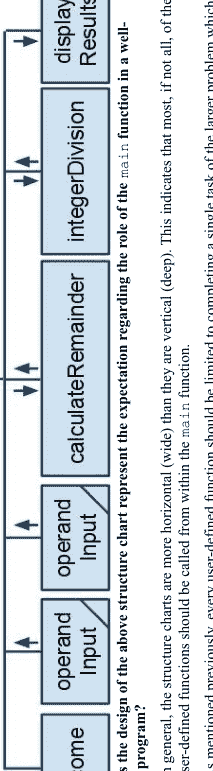

上述结构图的设计如何体现对设计良好程序中 main 函数角色的预期？

- 一般而言，结构图更倾向于水平（宽）而非垂直（深）。这表明大部分，如果不是全部，用户定义的函数都应在 main 函数内被调用。
- 如前所述，每个用户定义函数应仅限于完成程序设计要解决的较大问题中的单一任务。

### 有缺陷的设计 #2：

- 对上述设计的担忧：
  - main 函数仅用于启动程序，除此之外不做其他事情。
  - 对 return 语句或参数传递技术缺乏理解。

### 有缺陷的设计 #1：

- 对上述设计的担忧：
  - 函数数量不足。
  且
  - 一个函数包含程序中的所有任务。
  - main 函数仅用于启动程序，除此之外不做其他事情。
  或
  - 一个函数包含程序中的一项琐碎任务。
  - main 函数完成其余任务。

### 问题求解方法简介

- 明确程序的要求。
  - 在入门编程课程中，规格由布置问题的教师提供。
  - 在现实世界中，你将与同行工程师、科学家、主管和/或客户会面，以确定软件必须成功完成什么以及如何完成。
  - 建议：在大学毕业前先在这一领域获得经验。尝试 EPICS、ENTR 和专业实践等项目。

- 分析问题。
  - 采用自顶向下设计，利用结构图等工具对任务进行分解。
  - 此步骤需要开发解决问题所需的数学公式。有些公式非常常见，例如确定直线斜率、两点间距离、直角三角形斜边长度，但其他公式则较为高级，且特定于你的工程或科学学科。
  - 一旦确定了解决问题所需的算术表达式，请注意考虑可能出现的潜在错误。例如除以零或处理不可能出现的负值（人数、某些距离和时间度量）。通过规划，你开始梳理逻辑中的潜在错误。

- 设计软件解决方案。
  - 算法的流程图或伪代码表示在此阶段开发。流程图和伪代码都是你可用于设计算法以解决当前问题的技术。
  - 应用：与团队合作时，请务必以可视化方式表示你的逻辑，以便他人在你展示解决方案构思时能够理解你的思路。
  - 随着解决问题能力的提高，请务必分别设计每个任务的解决方案。当所有任务都设计完成后，实现这些任务以创建最终解决方案的工作将容易得多。

- 将设计转换为代码。
  - 每次只编写解决方案的小部分，通常一次一个函数。
  - 测试你所做的每一个更改！
  - 在首次编译和测试之前，切勿编写完整的程序！
  - 好处：在流程的前几个步骤投入时间，可以使此步骤：(1) 耗时更短，(2) 令人沮丧的情况大大减少。

- 测试和调试实现。
  - 测试时，请务必开发超出作业提供内容的测试用例和预期输出。
  - 你运行了哪些测试以确保程序能处理所有合理输入？
  - 一般情况、边界情况、极端/压力情况。

- 解决方案的改进。
  - 恭喜，你有了一个解决方案！现在，审查你的解决方案，确保其高效、设计良好、满足所有要求、不产生警告或语法错误，并符合所有课程文档和编程标准。
  - 你的第一个解决方案很少是最佳解决方案。请尽一切努力改进你的算法，使其尽可能充分利用计算机的有限资源。


### 结构化程序设计 – 它是什么？

结构化程序设计有三个基本思想：选择、重复和序列。

- 序列是第 4 章（用户定义函数）的主题。使用函数允许程序的单个指令按除从第一条语句到最后一条语句以外的顺序执行，有些语句可能会被执行多次。
- 选择是第 5 章的主题。选择结构将允许根据给定条件执行指令，并排除其他指令。这是学期中第一个点，在此点程序中的所有代码可能不会在每个测试用例中执行。
- 重复是第 6 章的主题。通常，当满足特定条件或直到满足条件时，需要重复一组指令。重复结构允许使用逻辑来指定条件并识别要重复的指令。

## 第 5 章 – 选择

尽管函数允许我们创建模块化代码并在函数之间转移控制（改变执行的代码序列）以完成单个任务，但接下来我们需要的是选择和重复代码的能力。选择正是第 5 章的主题。

到目前为止，在本课程中，我们一直观察到程序中的所有语句至少被执行一次。

- 虽然用户定义函数允许我们在此时改变序列，当我们进行函数调用时，该函数中的所有代码都会被执行。
- 选择的概念涉及根据条件选择要执行或排除的代码。

### 逻辑数据

如果一段数据传递 true 或 false 的值，则称为逻辑数据。逻辑数据由逻辑表达式生成。逻辑表达式用于选择和重复结构中。C 编程语言传统上没有专门用于逻辑数据的数据类型，而是使用数值类型来表示 true 和 false。

> 注意：我们通常使用 1 表示 true 值，但是，任何非零值都被视为 true。

### 逻辑运算符

有三个主要的逻辑运算符。逻辑运算符的操作数根据其逻辑状态（true 或 false）进行考虑。

| 运算符 | 字符 | 描述 | 优先级 |
|---|---|---|---|
| 非 | ! | 一元运算符，将 true 值更改为 false，将 false 值更改为 true。 | |
| 与 | && | 二元运算符，仅当两个操作数都为 true 时才为 true，在所有其他情况下为 false。 | |
| 或 | || | 二元运算符，仅当两个操作数都为 false 时才为 false，在所有其他情况下为 true。 | |

### 逻辑运算符真值表：

| | 非 | | 与 | | | 或 | | |
|---|---|---|---|---|---|---|---|---|---|
| | x | !x | x | y | `x && y` | x | y | `x || y` |
| | 真 | 假 | 真 | 真 | 真 | 真 | 真 | 真 |
| | 假 | 真 | 真 | 假 | 假 | 真 | 假 | 真 |
| | | | 假 | 真 | 假 | 假 | 真 | 假 |
| | | | 假 | 假 | 假 | 假 | 假 | 假 |

### 求值逻辑表达式

- 即，求值包含逻辑运算符的表达式。
- 在求值数学表达式时，不考虑每个运算符的情况极为罕见。
- 我们如何在求值表达式的每个运算符之前对表达式求值？对于逻辑表达式，只有两种可能的结果，我们将看到，当表达式的结果可以确定时，求值将在不需要求值每个运算符时停止，或短路。

### 短路方法：

### 示例（类似于）程序 5-1 形式文本：

```
int a = 1;
int b = -1;
int c = 0;
printf("%d%d %d %d = %d\n", a, b, a && b);
printf("%d%d %d %d = %d\n", a, c, a && c);
printf("%d%d || %d = %d\n", a, b, a || b);
printf("%d%d || %d = %d\n", a, c, a || c);
printf("%d%d %d = %d\n", !a, !c, !a || !c);
printf("%d%d %d = %d\n", !a, !c, !a && !c);
printf("%d%d %d = %d\n", !a, !c, !(a && !c));
printf("b++ || ++c = %d\n", b++ || ++c);
printf("a = %d b = %d c = %d\n", a, b, c);
```

### 输出：

- 1.
- 2.
- 3.
- 4.
- 5.
- 6.
- 7.
- 8.
- 9.

为什么我们会在上面的代码段中观察到最终打印语句的这些值？

### 关系（比较）运算符

C 编程语言中有六个关系运算符。所有这些运算符都是二元运算符，其中两个操作数被求值。关系表达式的结果是一个逻辑（0, 1）值。

关系运算符（图 5-4，第 236 页）：

| 类型 | 运算符 | 含义 | 优先级 |
|---|---|---|---|
| 关系 | < | 小于 | 10 |
| | <= | 小于或等于 | |
| | > | 大于 | |
| | >= | 大于或等于 | |
| 比较 | == | 等于（相等） | 9 |
| | != | 不等于（不相等） | |

### 复合语句

可以将一系列关系和逻辑运算符组合起来，形成所谓的复合语句。此类语句（或表达式）的结果将是一个（true 或 false）逻辑值。

当某些复合逻辑表达式仅包含单个变量（例如 x > 0 && x < 10）时，其含义是明确的。

通常，通过包含括号可以使复合语句更易于阅读。你能确定下面哪个表达式与其他两个不同吗？

### 示例：

```
int x = 3;
int y = 2;
int z = 3;
```

```
printf("Result #1 = %d\n", x <= 3 || y >= 2 && z != 3);
printf("Result #2 = %d\n", x <= 3 || (y >= 2 && z != 3));
printf("Result #3 = %d\n", (x <= 3 || y >= 2) && z == 3);
```

注意：我们的编译器会发出警告，建议在同一表达式中使用 && 和 || 时使用 ( 和 )。

### 扩展前面的示例：

```
int x = 3;
int y = 2;
int z = 3;
printf("Result = %d\n", x++ <= 3 || y++ > 2 && z++ != 3);
printf("x: %d y: %d z: %d\n", x, y, z);
```

上面程序的输出是什么？

### 什么是运算符绑定？这与优先级有何关系？

- 运算符的优先级可以确定表达式中哪些操作数绑定到它。
- 因为逻辑 AND 运算符的优先级高于逻辑 OR 运算符，表达式 y++ >= 2 是 AND 运算符的左操作数，而不是 OR 运算符的右操作数。

### 示例：

```
int x = 7;
int y = 9;
int z = 5;
int result;
result = !(++y - 9) || -5 + z++ && x++;
printf("x: %d y: %d z: %d\n", x, y, z);
```

### 它是如何求值的？

### 补运算

六个关系运算符中的每一个都是另一个关系运算符的补运算。每当一个逻辑表达式为 true 时，其补运算为 false。每当一个逻辑表达式为 false 时，其补运算为 true。

- 例如，x < 3 表示所有小于 3 的数字，其补运算 x >= 3 表示所有其他值。

### 关系和比较运算符的补运算：

### 逻辑运算符的补运算：

| 原始表达式： | 补运算： |
| :--- | :--- |
| `x > 0 && x < 10` | |
| `x > 0 && x < 10 || y == 0` | |
| `!(x == 1 && x != 2)` | 补运算 #1： |
| `!x && !y` | 补运算 #1： |
| `x == 0 || y == 0` | 补运算 #1： |

### 选择流程图示例 #1：

询问用户的考试成绩，并根据其成绩告知他们获得的等级（基于 90、80、70、60 的 A、B、C、D、F），并给予适当的祝贺（或不祝贺）消息。

### 步骤 #1 – 程序的规范是什么？

- 输入 – 单个分数。
- 输出 – 与获得的等级相关的消息和获得的等级。

### 步骤 #2 – 分析问题

- 表示此问题的用户定义函数的结构图。

- 注意：通常最好消除选择结构中多个路径共有的任何代码。此类代码理想情况下应位于选择结构之前或之后。选择结构中的每个路径都应包含特定于该条件的语句。


### 双向选择

- 逻辑表达式的求值结果为真或假。
- 如果结果逻辑值为真，则有一条路径可走；如果结果为假，则将执行第二条路径下的替代（且唯一）语句。
- C 语言中用于双向选择的两种选择结构是 if/else 和条件表达式。

### if / else

if/else 结构（或其非常相似的变体）几乎存在于所有编程语言中。其思想是：对逻辑表达式求值，当逻辑表达式为真时执行一组语句，当其为假时执行另一组替代语句。

### 双向逻辑图：

```
if (logical expression)
{
    //TRUE ACTIONS TO EXECUTE
}
else
{
    //FALSE ACTIONS TO EXECUTE
}
```

如果列出的第一个条件（逻辑表达式）求值为真，则执行 if 主体中的语句；否则执行 else 主体中的语句。

示例：一个函数接收一个非负整数，当其为偶数时加 1 并返回，当其为奇数时减 1 并返回。

```
int changeNumber(int n)
{
    if (n % 2 == 0)
    {
        n++;
    }
    else
    {
        n--;
    }
    return n;
}
```

示例 #2：修改前一个函数，仅在奇数时更改值（减 1）。

```
int changeNumber(int n)
{
    if (n % 2 == 0)
    {
    } //NEVER LEAVE A BODY EMPTY
    else
    {
        n--;
    }
    return n;
}
```

修改后问题的最佳解决方案（else 可选）：

```
int changeNumber(int n)
{
    if (n % 2 == 1)
    {
        n--;
    }
    return n;
}
```

### 嵌套选择

if/else 可以包含任何可执行语句，包括另一个 if/else 结构。当这种情况发生时，我们称之为嵌套选择。通常，嵌套选择涉及对两个或多个不同变量的比较。

### 嵌套选择的逻辑流：

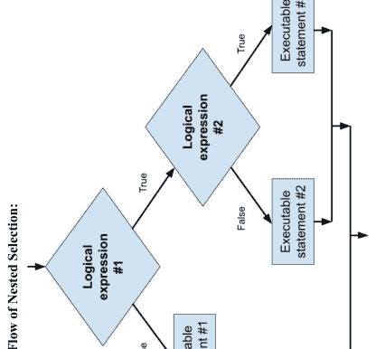

### 嵌套选择的代码示例：

```c
int calcStatus(float gpa, int credit_hrs)
{
    int status;
    if (credit_hrs > 120)
    {
        if (gpa >= 3.50)
        {
            status = HONORS;
        }
        else
        {
            status = CANDIDATE;
        }
    }
    else
    {
        status = NONCANDIDATE;
    }
    return(status);
}
```

### 悬挂 else 逻辑错误和嵌套 if/else

- 调试注意事项：请注意，本文和许多其他资料在 if/else 语句主体仅包含单条语句时，并不总是使用 { }。然而，这可能导致一种称为“悬挂 else”的困难逻辑问题。
- 由于此问题非常难以调试，我们将要求所有 if/else 语句都使用 { }，即使主体仅包含单条可执行语句。

```
Output Generated:
warning: suggest explicit braces to avoid ambiguous 'else'
```

悬挂 else 逻辑错误示例：

```
Example of dangling else logical error:
int x = 3;
int y = 2;
int z = 0;
if (x == 3)
    if (y != 2)
        z++;
    else
        z--;
printf("z = %d\n", z);
```

### 上述代码的逻辑解释：

### 条件表达式

条件表达式有三个操作数和两个运算符。每个操作数本身也是一个表达式。

- 第一个运算符是问号，用于分隔前两个表达式。
- 第二个运算符是冒号，用于分隔最后两个表达式。

求值条件表达式时，首先必须求值最左侧的表达式。当该表达式为真时，则求值第二个表达式（? 后的第一个表达式）的值。然而，如果逻辑表达式（? 之前）为假，则求值第三个表达式。

如下所示，当两个变量之和大于零时，变量 a 自增。当和小于或等于零时，变量 b 自增。

```
a + b > 0 ? a++ : b++;
```

### 更多条件表达式示例：

```
int a = 1;
int b = -1;
int c;

a + b > 0 ? a++ : b++;

c = a > b ? 5 : 3;

printf("c = %d\n", c);

a == b ? printf("a == b\n") : printf("a != b\n");
```

### 生成的输出：

第二和第三个表达式是否都必须存在？

- 是。
- 错误：',' 标记之前预期表达式

对于 true 和 false 两个选项，是否可以各包含多个表达式？

- 否。

### 多路选择

需要从多个独特代码块中进行二选一以上的选择是一个常见问题，这就是多路选择的概念。

- 在 C 语言中，有两种不同的结构可用于实现多路选择。第一种是使用 if/else if/else，第二种是 switch 结构。switch 结构比 if/else if/else 结构有更多限制，但在某些情况下，使用 switch 可能优于替代方案。

### 多路选择：if/else if/else

- 示例：编写一个程序，接受分数作为输入，并根据分数回复用户可以期望获得的字母等级。

```
#define MINA 90
#define MINB 80
#define MINC 70
#define MIND 60
int getScore(void);
char determineGrade(int);
void displayResults(char, int);

int main(void)
{
    int score; //SCORE OF STUDENT
    char grade; //CALCULATED GRADE BASED ON SCORE
    score = getScore();
    grade = determineGrade(score);
    displayResults(grade, score);
    return(0);
}

void displayResults(char grade, int score)
{
    printf("Based on your score of %d, you will receive the grade of %c in this course.\n", score, grade);
}
int getScore(void)
{
    int score; //SCORE TO BE ENTERED BY THE USER
    printf("Enter the score for the course: ");
    scanf("%d", &score);
    return(score);
}
```

第 261 页的图 5-24 是该选择结构的一个良好流程图示例。

```
char determineGrade(int score)
{
    char grade;

    if(score >= MINA)
    {
        grade = 'A';
    }
    else if (score >= MINB)
    {
        grade = 'B';
    }
    else if (score >= MINC)
    {
        grade = 'C';
    }
    else if (score >= MIND)
    {
        grade = 'D';
    }
    else
    {
        grade = 'F';
    }

    return (grade);
}
```

> 注意：在此示例中，只要某个条件为真，就会执行该条件主体中的语句，然后退出 if/else if/else 结构。

### 下面的结构中是否有任何一个与上一页的结构在逻辑上等效？

```
if (score >= MINA)
{
    grade = 'A';
}
else if (score >= MINB && score < MINA)
{
    grade = 'B';
}
else if (score >= MINC && score < MINB)
{
    grade = 'C';
}
else if (score >= MIND && score < MINC)
{
    grade = 'D';
}
else
{
    grade = 'F';
}
```

```
if (score >= MINA)
{
    grade = 'A';
}
if (score >= MINB && score < MINA)
{
    grade = 'B';
}
if (score >= MINC && score < MINB)
{
    grade = 'C';
}
if (score >= MIND && score < MINC)
{
    grade = 'D';
}
else
{
    grade = 'F';
}
```

### 多路选择 switch

switch 结构用于在可能的整数值替代项中进行选择。当可能的整数值已知且数量较少时，可能会优先使用 switch。

关键字 switch 后面的控制表达式会被求值，然后与一系列 case 进行相等性比较。每个 case 表示控制表达式的一个预期值。

- 每个 case 关联一个或多个可执行语句。
- 应该存在一个或多个可能的 case。当 case 数量较多或表示一系列值时，应考虑使用 if/else if。
- default case 是一个可选项，用于覆盖其他单独 case 未表示的所有值。

> 注意：每个 case 都与控制表达式的值进行相等性比较。

```
void displayResults(char grade, int score)
{
   printf("Given score of %d, you will earn a grade of %c in this course.\n", score, grade);
   switch(grade)
   {
      case 'A':
         printf("Great job!!\n");
         break;
      case 'B':
         printf("Well done!\n");
         break;
      case 'C':
         printf("Mission Accomplished.\n");
         break;
      case 'D':
         printf("Perhaps you need to consider repeating?\n");
         break;
      default:
         printf("See you next semester?\n");
   }
}


课程标准：请注意 switch 结构中缩进的处理方式。

### 为什么要用单引号将值与控制表达式进行比较？

控制表达式的数据类型是字符（char），要将此类表达式的结果与字符型字面常量进行比较，需要将值放在单引号内。

如果比较的是整数值，则不使用单引号。

### 为什么需要 break 语句？

```c
switch (grade)
{
    case 'A': printf("Great Job!\n");
    case 'B': printf("Well done!\n");
    case 'C': printf("Mission Accomplished.\n");
    case 'D': printf("Perhaps you need to consider repeating?\n");
    default: printf("See you next semester?\n");
}
```

如果没有 break 语句，一旦找到一个匹配的 case，随后的所有代码都会被执行！

请输入课程成绩：94

根据你的 94 分成绩，你将在本课程中获得 A 等级。

干得好！！
做得好！
任务完成。
也许你需要考虑重修？
下学期见？

课程标准：这是课程中唯一允许使用 break 等控制强制语句的一次。

### 为什么测试两个浮点数是否相等具有挑战性？

- 浮点数据的表示不精确，可能包含舍入误差。
- 某个看似无关紧要的小数位上的微小差异会导致相等运算符生成假值。
- 尝试以下代码并进行修改，以找出其他不按预期工作的值：

```c
float x = 0.1;
x == 0.1 ? printf("True!\n") : printf("False!\n");
```

### switch 结构规则

- 1. 控制表达式必须是整型。
- 2. 每个 case 标签由关键字 case 后跟一个常量表达式组成。
- 3. 不能有两个 case 标签表示相同的值。
- 4. 两个 case 语句可以关联到同一组可执行语句。
- 5. default 标签不是必需的。
- 6. 最多只能有一个 default 标签。

规则 #4 的示例：如果 grade 的值为 'A' 或 'B'，则打印第一条语句。

```c
switch (grade)
{
    case 'A':
    case 'B':
        printf("Great job!!!\n");
        break;
    case 'C':
        printf("Mission Accomplished.\n");
        break;
    case 'D':
        printf("Perhaps you need to consider repeating?\n");
        break;
    default:
        printf("See you next semester?\n");
}
```

使用 ASCII 值修改上面的 switch（如何在 switch 结构中比较整数数据）：

```c
switch (grade)
{
    case 65:
    case 66:
        printf("Great job!!!\n");
        break;
    case 67:
        printf("Mission Accomplished.\n");
        break;
    case 68:
        printf("Perhaps you need to consider repeating?\n");
        break;
    default:
        printf("See you next semester?\n");
}
```

| switch 的误用： | 通过减少 case 数量进行改进： |
| :--- | :--- |
| switch(score) {<br>    case 100:<br>    case 99:<br>    case 98:<br>    case 97:<br>    case 96:<br>    case 95:<br>    case 94:<br>    case 93:<br>    case 92:<br>    case 91:<br>    case 90: grade = 'A';<br>        break;<br>    case 89:<br>    case 88: | switch(score / 10) {<br>    case 10: score = 'A';<br>        break;<br>    case 9: score = 'B';<br>        break;<br>    case 8: score = 'C';<br>        break;<br>    case 7: score = 'D';<br>        break;<br>    case 6: score = 'F';<br>        break;<br>    default: score = 'F';<br>} |

### 提醒：

- 人们很容易下意识地总是为所有选择需求使用 if/else。
- 考虑在某些情况下使用 switch 或条件表达式可能是更好的选择。结果可能是更简洁、更易读的逻辑。

## 第 6 章 - 重复

计算机的真正威力在于能够快速重复执行一个操作或一系列操作。这种重复行为通常称为循环，但该术语并未涵盖所有重复技术。

### 循环基础与术语

- 如果此图表示循环的逻辑，你可能会想知道这个过程何时、如何或是否会停止？

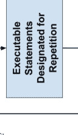

### 首先，介绍几个术语：

- 循环 - 两种可能的重复技术之一，利用结构在预定义条件下重复指定语句。
- 循环迭代 - 循环结构体内指令的一次执行。
- 循环控制表达式 - 用于确定循环是否应发起另一次迭代的逻辑表达式。
- 循环初始化 - 在第一次求值循环控制表达式之前需要完成的准备工作。
- 循环更新 - 循环体内的一个可执行语句，当执行足够多次后，会导致循环控制表达式求值发生变化。
- 循环控制变量 - 被初始化、作为循环控制表达式一部分并接收更新操作的变量。

### 重复流程图示例 #1：

编写一个算法，计算未知数量考试成绩的平均值、最大值和最小值。测试成绩范围为 0 – 100，且均为整数值。

### 重复

- 要完成此问题，我们需要能够重复执行多条指令。
- 重复允许我们识别一段代码，在给定逻辑表达式为真时重复执行。

### 步骤 #1 – 程序的要求是什么？

- 输入 – 0 到 100 之间的整数（包含端点），直到输入一个值表示输入结束。
- 我们不需要数组（第 8 章的主题）来将整个数据集存储在计算机内存中。解决此问题所需的内存不会取决于数据集的大小（参加考试的学生人数）。
- 输出 – 平均值（浮点数）、最大值（整数）和最小值（整数）。

### 步骤 #2 – 分析问题

- 需要哪些公式？要计算平均值，需要知道所有分数的总和和分数的数量。我们需要在输入值时进行比较，以确定其是最大值还是最小值。
- 我们还需要确定用户如何指示输入已结束。

### 如何处理终止输入条件？

- 1. 要求用户统计考试数量。
- 2. 要求用户在输入每个值后说明是否还有更多成绩要输入。
- 3. 要求用户在完成时输入一个超出考试成绩范围的值。

### 解决方案的结构图：

在前测试循环中，循环控制表达式在循环迭代一次之前必须为真。在每次迭代开始之前（包括第一次），都会对循环控制表达式求值，只要该表达式保持为真，重复就会继续。如果循环控制表达式为假，则不会再进行进一步的迭代。

关键点：前测试循环体被迭代的最少次数为零。如果表达式从不为真，则循环指令（循环体）将永远不会执行。

在后测试循环中，循环体的指令会在对循环控制表达式求值之前执行。循环控制表达式将在每次迭代结束时求值，以确定是否继续进行另一次迭代。

- 最大区别是什么？后测试循环体被迭代的最少次数为一次。无论表达式是否为假，循环都会迭代一次，然后测试条件以确定迭代是否继续。

### 选择错误的结构

有哪些迹象可能表明你为解决方案选择了错误类型的循环（前测试或后测试）？（1）循环体内外都重复了逻辑。（2）使用了一个“技巧”来强制循环至少迭代一次。如果你使用过一种既不提供前测试也不提供后测试选项的语言（MATLAB），这些选项可能看起来很熟悉。


示例：一个数的阶乘是从 1 到该数的所有整数的乘积。设计一个函数，给定一个非负整数，计算其阶乘。

阶乘流程图：

| 内容 |
|---------|
| 识别循环控制变量： |
| 识别循环类型： |
| 识别循环控制变量如何更新： |
| 当用户输入零时，算法在逻辑上是否正确？ |

### 事件控制和计数器控制过程

上一页的阶乘问题是计数器控制过程的一个示例。计数器也是循环控制变量，它控制循环体重复的次数。

在事件控制过程中，会发生一个事件，将循环控制表达式从 true 改为 false，从而使重复停止。通过这种过程，可以确定是否会进行另一次循环迭代，但无法确定剩余迭代的次数。考试统计问题是事件控制过程的一个示例。如果你知道最近的输入，那么你就知道是否会有另一次迭代，但除此之外一无所知。

**关键点：** 如果你能计算或计算出循环执行期间将进行的迭代总数，那么它是计数器控制过程，否则该过程是事件控制。

### 输入验证

- 向输入函数添加代码的目的是确保，在函数被允许终止之前，我们有一个有意义的值可供程序其余部分处理。
- 输入验证的任务通常位于输入函数中。从这一点开始，输入函数将不仅仅是打印-扫描-返回语句。
- 必须始终为用户提供无限次机会来输入有意义的数据。
- 由于其复杂性，你不会针对特定数据类型进行验证，只针对指定数据类型中的可接受值进行验证。
- 你将假设用户始终会输入预期的数据类型作为输入。
- 输入验证的一个重要部分是向用户显示适当的消息，让他们意识到自己的错误以及所需的输入。
- 由于输入验证确实使输入函数更加复杂，因此不建议使用按地址传递来尝试从单个输入函数“返回”多个值。与按地址传递和相关指针操作（第 9 章和第 10 章）相关的语法使其应用于输入验证变得具有挑战性。

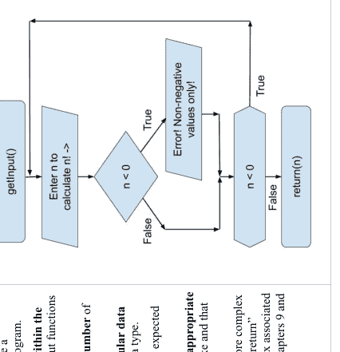

### C 语言中的循环

C 语言提供了三种用于重复循环技术的结构。它们是：while、for 和 do-while。我们将从相似的 while 和 do-while 结构开始。

### while 循环

while 结构是一个预测试循环。与所有循环一样，while 使用循环控制表达式来确定循环是否应该开始或继续迭代。作为预测试循环，循环控制表达式在第一次循环迭代之前被求值，然后只要表达式被求值为 true，循环就会完成另一次迭代。

- 只要循环控制表达式为 true，迭代就会继续。当控制表达式求值为 false 时，迭代过程停止。

### while 循环的基本语法

```
while(loop control expression)
{
   //EXECUTABLE STATEMENT DESIGNATED
   //FOR REPETITION - BODY OF THE LOOP
}
```

> 注意：while 语句的循环控制表达式后面没有分号，因为循环后面跟着一个包含要重复的操作的主体。

### do-while 循环

do-while 结构是一个后测试循环。与 while 类似，使用循环控制表达式来确定重复是否继续，但在后测试结构的情况下，表达式在主体内指令初始执行之后被求值。

- 与 while 循环相反，do-while 中的关键字 while 后面加有分号。

> 课程标准：缩进构成循环主体的所有语句，额外缩进两个空格。

### Do While 循环的基本语法

```
do
{
   //EXECUTABLE STATEMENT DESIGNATED
   //FOR REPETITION - BODY OF THE LOOP
}while(loop control expression);
```

> 课程标准：对于所有循环（和 if 语句），必须使用标记循环主体开始和结束的花括号。

如果循环控制变量的更新发生在循环主体中间，这是否会导致循环在此点立即终止？

- 不会。只有当循环控制表达式被求值并发现为 false 时，循环才会终止。
- C 语言中没有“中间测试”循环，只有预测试和后测试。

是否有理由担心零值可能会被相乘？

- 不会。循环控制表达式在零相乘之前被求值并为 false。

用户输入的值存储在局部变量 num 中，每次迭代更改 num 如何影响调用函数中正在发生的事情？

- 不会，该变量是按值传递的。

### 阶乘示例

阶乘问题将允许演示带有输入验证的 do-while 和 while 阶乘。

```
int calcFactorial( int );
int getInput( void );
void displayResults( int, int );

int main( void )
{
    int num;
    int fact;

    num = getInput();
    fact = calcFactorial( num );
    displayResults( num, fact );

    return( 0 );
}

int calcFactorial( int num )
{
    int nFact = 1;

    while( num > 0 )
    {
        nFact = nFact * num;
        num -= 1;
    }
    return( nFact );
}
```

### 为什么不使用“if 循环”进行输入验证？

- if 结构只允许用户第二次输入可接受的数据。我们希望用户有无限次机会输入有效数据。

### “if 循环”这一术语有什么问题？

- if 是选择结构，而不是重复结构。

```c
int getInput(void)
{
    int num;
    do
    {
        printf("Enter n to calculate n! -> ");
        scanf("%d", &num);
        if(num < 0)
        {
            printf("\nError! Non-negative values only!!\n");
        }
    }while(num < 0);
    return(num);
}
```

```c
void displayResults(int num, int fact)
{
    printf("\n%d!= %d\n", num, fact);
}
```

### 嵌套循环

### 什么是嵌套循环？

- 嵌套循环，或任何形式的重复，是指一个重复过程位于另一个重复过程之内。

### 该定义如何帮助解决使用嵌套循环的问题？

- 更好的定义是考虑循环解决一个重复过程。那么嵌套循环就是一个位于另一个重复过程之内的重复过程。

### 解决嵌套循环问题的推荐方法是什么？

- 首先，解决并测试嵌套过程，将其放在其自己的用户定义函数中。
- 接下来，解决将调用嵌套过程的过程。我们必须确保嵌套过程正确，然后再尝试反复使用（调用）它。

### 计算一系列阶乘：而不是计算单个阶乘，用户将指定一系列值，并希望输出该范围内所有整数的阶乘。

例如，如果用户输入 2 和 5，他们希望看到 2!、3!、4! 和 5! 的结果。

- 这里有哪两个重复过程？一个是计算单个阶乘，另一个是从起始值计数到结束值。
- 哪个过程是嵌套过程？计算单个阶乘。我们已经确认能够接受一个整数并计算该数字的阶乘。
- 接下来，我们需要向现有程序添加功能，以便计算范围从 a 到 b 的所有整数 n 的每个 n!。
- 需要的新任务或修订：
  - 获取起始值和结束值，并验证两者，确保结束值不小于起始值。为什么 getEnd 有参数而 getStart 没有？
  - 计算并打印 start 和 end 之间每个整数的阶乘（包含两端）。

```cpp
int calcFactorial( int );
int getStart( void ); //UNCHANGED FROM PREVIOUS EXAMPLE
int getEnd( int );
void displayResults( int, int ); //UNCHANGED FROM PREVIOUS EXAMPLE

int main( void )
{
    int fact;
    int start;
    int end;

    start = getStart();
    end = getEnd( start );
    while( start <= end )
    {
        fact = calcFactorial( start );
        displayResults( start, fact );
        start++;
    }

    return( 0 );
}
```

课程标准说明：main 函数中允许有限数量的控制结构（选择、重复），以确保由 main 函数进行程序中大部分函数调用。


## 用于输入起始值的用户定义函数:

```c
int getStart(void)
{
    int num;

    do
    {
        printf("Enter starting value -> ");
        scanf("%d", &num);

        if(num < 0)
        {
            printf("\nError! Non-negative values only!\n");
        }
    }while(num < 0);

    return(num);
}
```

## 用于输入结束值的用户定义函数:

```c
int getEnd(int start)
{
    int num;

    do
    {
        printf("Enter ending value -> ");
        scanf("%d", &num);

        if(num < start)
        {
            printf("\nError! Ending value must be at least %d\n\n", start);
        }
    }while(num < start);

    return(num);
}
```

嵌套循环在哪里？当人们想到嵌套结构时，通常首先会考虑下面的示例。

```
Nested while loop example:
while ( )
{
    while ( )
    {
    }
}
```

```
Nested if construct example:
if ( )
{
    if ( )
    {
    }
}
```

在上一页提供的嵌套循环示例中，循环位于两个不同的用户定义函数中。一个在主函数中，用于从起始点计数到结束点；另一个在计算所需范围内每个整数阶乘的函数中。

每个循环通常代表程序中的一个任务或单个过程。如果你能识别出每个这样的单独任务，并将它们拆分为单独的用户定义函数，你可能会发现复杂问题更容易解决和测试。

## 无限循环

无限循环是一种逻辑错误，其中循环控制表达式的条件永远不会为假。作为一种逻辑错误，无限循环在程序运行时出现的形式可能各不相同。无限循环的一个确定迹象是产生无限输出。但是，该错误也可能出现很少或没有输出的形式。

- 可以随时通过从键盘输入 CTRL-C 来终止程序。

示例：允许用户输入整数值，直到输入 1 或 2。

```c
int getInteger(void)
{
    int num;
    do
    {
        printf("Enter 1 or 2 -> ");
        scanf("%d", &num);
    }while(num != 1 || num != 2);
    return(num);
}
```

```
Output:
Enter 1 or 2 -> 3
Enter 1 or 2 -> 2
Enter 1 or 2 -> 1
Enter 1 or 2 ->
```

控制表达式看起来在逻辑上是正确的，“在输入的值不是 1 或 2 时接受输入”，但在逻辑上会导致无限循环。没有单个值既不等于 1 也不等于 2。

## 重复复习 - 三个常见的循环组件

- 1. 循环控制变量的初始化。
- 2. 循环控制表达式的求值。
- 3. 循环控制变量的更新。

### `for` 循环

C 语言中可用的第三个也是最后一个循环结构是前测 `for` 循环。除了是前测循环结构之外，`for` 循环的设计仅用于计数器控制的过程。`for` 循环将初始化、循环控制表达式和更新合并到一行代码中。得益于此，课程标准将始终使用 `for` 循环的所有三个表达式。

### `for` 循环的流程图表示：

### 使用所有三个表达式的 `while` 循环表示：

### 表达式 1（初始化）

表达式 1 仅在第一次遇到 `for` 循环时求值。正是在这个表达式中，循环控制变量会被初始化。

### 表达式 2（求值）

- 求值表达式 1 后，我们立即求值表达式 2，即循环控制表达式。
- 如果表达式 2 初始求值为假，则循环不会迭代！`for` 循环是前测结构。
- 每次迭代完成后，必须重新求值循环控制表达式，以确定是否需要另一次迭代。

### 表达式 3（更新）

- 这个最终表达式在每次迭代结束时以及下一次求值表达式 2 之前求值。
- 基本上，任何更改循环控制变量的表达式都可作为第三个表达式。

### 语法

- 表达式 1 和 2 之间以及表达式 2 和 3 之间需要分号。
- 与任何循环结构一样，`for` 循环有一个主体，主体以 { 和 } 开始和结束。主体中的指令可以是一条或多条。

### 何时使用 for 循环？

否则... 请考虑使用 while 来满足您的前测迭代需求。

### 转换后的循环：

### 在不更改初始化值的情况下，将 while 循环转换为 for 循环：

```c
int lov = 1;
int n = 4;
int nFact = 1;
while (lov <= n)
{
    nFact *= lov;
    lov++;
}
```

### 转换后的循环：

### 在不更改初始化值的情况下，将 while 循环转换为 for 循环：

```c
int lov;
int n = 4;
int nFact = 1;
lov = n;
while (lov > 0)
{
    nFact *= lov;
    lov--;
}
```

### 下面 for 循环的应用中存在哪些潜在问题？

```c
int x;
for(x = -1; x < 0; )
{
    printf("Enter a non-negative integer: ");
    scanf("%d", &x);
}
```

### 重排数字中的数字示例：

给定一个整数，重排其数字以创建尽可能大的数字。

### 示例执行：

```
Enter an integer: 1230789
The sorted digit is 9873210
Enter an integer: 53635
The sorted digit is 65533
```

### 步骤 #1 – 程序的要求是什么？

- 我们期望输入一个整数并输出它。
- 整数输入中的前导 0 没有意义，不会被考虑。
- 所有输入都将是非负的，并且必须进行验证。

### 步骤 #2 – 分析问题

- 我们如何从数字中提取单个数字？
- 我们如何做到这一点，然后确定它是否是数字中最大的数字？
- 一旦我们有了数字中最大的数字，我们该怎么办？
- 寻找数字中第二大的数字呢？

### 步骤 #3 – 设计软件解决方案

该程序的任务是什么？

- 1. 从用户获取输入。
- 2. 计算非前导零数字的数量，以便可以将它们附加到最后输出的值中。
- 3. 在输入中找到最大的数字。将其“添加”到一个新数字中。从输入值中“删除”它。
- 4. 返回步骤 #3，直到所有非零数字（从大到小）都已从输入值移动到正在构建的新整数值中。
- 5. 将零数字附加到新值的末尾。
- 6. 输出。

### 解决方案：

```c
int getInput (void);
int ctZero (int);
int findMax (int, int*);
int appendMax (int, int);
int removeMax (int, int, int);
void output (int);

int main (void)
{
    int n;
    int sorted = 0;
    int max;
    int maxLoc;
    int zeroCount;

    n = getInput ();
    zeroCount = ctZero (n);

    while (n > 0)
    {
        max = findMax (n, &maxLoc);
        sorted = appendMax (sorted, max);
        n = removeMax (n, max, maxLoc);
    }

    output (sorted * (int)pow (10, zeroCount));
    return (0);
}

int appendMax (int sorted, int max)
{
    return (sorted * 10 + max);
}

int removeMax (int n, int max, int maxLoc)
{
    return (n - max * (int)pow (10, maxLoc));
}
```

```c
int getInput(void)
{
    int n;
    do
    {
        printf("Enter an integer to sort: ");
        scanf("%d", &n);
        if (n < 0)
        {
            printf("\nError! Non-negative values only!\n");
        }
    }while(n < 0);
    return(n);
}
```

```c
int ctZero(int n)
{
    int ct = 0;
    while(n > 0)
    {
        if(n % 10 == 0)
        {
            ct++;
        }
        n = n / 10;
    }
    return(ct);
}
```

```c
int findMax(int n, int *maxLoc)
{
    int max = 0;
    int loc = 0;
    while(n > 0)
    {
        if(n % 10 > max)
        {
            max = n % 10;
            *maxLoc = loc;
        }
        n = n / 10;
        loc++;
    }
    return(max);
}
```

```c
void output(int sorted)
{
    printf("Sorted value: %d\n", sorted);
}
```


### 高级主题 – 递归

递归是重复的替代技术。递归的定义适用于会调用自身的函数。使用循环解决重复问题的方案称为迭代解法。与循环一样，函数调用不能无限继续。需要进行另一次调用的条件称为递归情况。当不再需要进行调用时，则已到达基例。

请记住，程序的控制权始终从被调用函数返回到调用函数。除了程序控制权之外，还可以返回一个值。

阶乘是演示递归用法时最常见的第一个示例之一。

考虑如何计算数字 n 的阶乘：n * (n - 1) * (n - 2) * ... * 2 * 1

你也可以说，当 n > 1 时，n! 等价于 n * (n - 1)!，但当 n = 1 时又如何呢？正是在这一点上，我们找到了基例，即当 n = 1 时，n! = 1 的定义。

以 4! 为例：

- 4! = 4 * 3!
- 3! = 3 * 2!
- 2! = 2 * 1!
- 1! = 1

### 使用递归函数求解阶乘：

```c
int factorial (int n)
{
    int nFact = 1;
    if (n > 1)
    {
        nFact = n * factorial (n - 1);
    }
    return (nFact);
}
```

当值 4 传递给阶乘函数时，跟踪递归解法。列出每次调用中变量的值。注意随着递归函数调用的进行，程序控制权的推进过程。

### 使用 while 循环求解阶乘：

```c
int factorial (int n)
{
    int nFact = 1;
    while (n > 0)
    {
        nFact *= n--;
    }
    return (nFact);
}
```

注意：调用函数与循环的一次迭代不同，循环中的相同代码会被反复执行。每个函数调用都独立于其他函数调用，局部变量占据唯一的内存位置。

### 重复结构与技术回顾

### 递归的局限性

在阶乘示例中，我们看到计算 4! 需要四次函数调用，在每次函数调用中都会创建一组唯一的变量，并且需要“记住”每个函数的状态，以便在被调用函数终止后继续执行。大量的函数调用可能需要比计算机能提供的更多内存。

### 什么时候不应该使用递归？

- 当递归函数调用的数量有可能很大（由计数器控制）或不可预测（由事件控制）时。

## 第 8 章 — 数组

本课程到目前为止介绍的数据类型只能存储单个值。上一章中的重复操作打开了接受和处理大型数据集的可能性。这与我们现有的数据类型如何配合工作？

问题：最近十名学生参加了一次考试，我们想要计算最大值、最小值和平均值。我们从之前的示例中知道，可以在不同时将所有分数存储在变量中的情况下计算最大值、最小值和平均值，但要计算中位数和众数，我们确实需要保留所有值并对这些值进行排序，以帮助进行这些计算。

一种可能性包括为每个要输入的值声明变量。

```c
int score0;
int score1;
int score2;
int score3;
int score4;
int score5;
int score6;
int score7;
int score8;
int score9;
```

对十个单独变量进行输入和输出的任务将需要十个打印和扫描语句，或者一个带有十个占位符的打印和扫描语句，或者调用函数十次或带有十个参数。代码量不应取决于数据集的大小！

也许可以管理少量变量，但如果有 100 名学生呢？或者甚至 1,000 名学生？

- 需要的是一种更实用的方式来存储和访问一组相关的数据项。

数组是一组共享一个名称和数据类型的连续变量。数组的每个变量（或元素）都有一个称为索引值的数字，表示其在数组中的位置。当我们引用数组名称及给定的索引值时，我们指的是存储在该数组中的特定单个值。

请注意，这个十元素数组的索引值范围从零开始，一直到数组大小减一。在 C 编程语言中，数组是从零开始的。

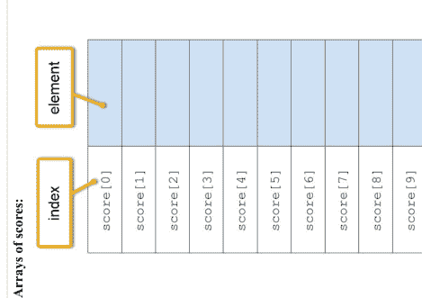

### 声明和定义数组

与其他变量一样，我们必须在数组用于函数之前声明和定义它们。声明和定义向编译器告知数组的名称、数组的大小以及每个元素的数据类型。C 编程语言提供两种不同的数组类型：固定长度数组（在程序编译前已知长度）和可变长度数组（在程序运行时确定大小）。

课程标准：在介绍第 9 章和第 10 章的动态内存分配主题之前，所有数组都将是静态的（固定长度）。如第 478-479 页示例中所示的可变长度数组的应用将违反课程标准，因为它允许函数中的局部声明和可执行语句重叠。

- 注意：课程标准将是，对于静态声明的数组，用符号常量替换 [ 和 ] 之间的数字（大小）。

```c
int students[15];
```

```c
double gpa[50];
```

### 数组的初始化

- 新声明的数组的内存中存储了什么？

数组可以作为其声明语句的一部分进行初始化：

```c
int data[5] = {9, 5, 1, 4, 2};
```

如果我们尝试以下初始化会怎样？

```c
int moreData[500] = {1, 2, 3};
```

注意：如果提供的值的数量少于数组的定义大小，则未分配的元素将填充为零。

### 访问数组中的元素

- 使用索引值来访问数组中的单个元素。

- 索引值必须是整数值，可以是求结果为该类型的表达式。

### 将值赋给数组

编写一个程序，将分数 9.5 赋给数组 labScores 的第一个元素。接下来，将该元素打印到屏幕上。

```c
#define NUMLABS 10
int main(void)
{
    float labScores[NUMLABS];
    labScores[0] = 9.5;
    printf("First lab score: %.2f\n", labScores[0]);
    return(0);
}
```

### 将值输入数组

```c
#define NUMLABS 10
int main(void)
{
    float labScores[NUMLABS];
    printf("Enter first lab score -> ");
    scanf("%f", &labScores[0]);
    printf("First lab score: %.2f\n", labScores[0]);
    return(0);
}
```

- 为什么上面的 printf 和 scanf 中使用 %f？

- 浮点数组的单个元素是单个浮点值。

如果元素只能通过表示索引值的常量来访问，那么我们就有了数组出现之前的同样问题，即我们需要的代码量取决于要处理的数据量。在处理与数组多个元素相关的许多任务时，更常见的是使用循环。

### 使用循环访问数组元素的示例：

```c
#define NUMLABS 10
int main( void )
{
   int i;
   float labScores[ NUMLABS ];
   for( i = 0; i < NUMLABS; i++ )
   {
      printf( "Enter lab #%d score > ", i + 1 );
      scanf( "%f", &labScores[ i ] );
   }
   // PROCESS DATA
   for( i = 0; i < NUMLABS; i++ )
   {
      printf( "Lab #%d score: %.2f\n", i + 1, labScores[ i ] );
   }
   return( 0 );
}
```

### 索引范围检查

大小为 NUMLABS 的数组的有效索引值范围是零到 NUMLABS 减一。如果在程序执行时尝试访问此范围之外的索引，会发生什么？

例如，如果我们尝试访问 labScores[ 10 ]，而对于声明大小为 10 的数组，唯一有效的索引值是 0 - 9，会怎样？这里描述的场景意味着这个潜在问题是一个运行时错误。编译器不会，也不能，检测索引范围检查问题。

由于这是一个运行时错误，它可能有几种不同的形式。尝试访问数组边界之外的索引可能会有哪些后果？


| 可能的观察 | 发生此情况的原因 |
| :--- | :--- |
| 没有问题，程序按预期运行。 | 超出数组限制并进入未为数组目的保留的内存，该内存可能未为任何其他目的保留。 |
| 程序执行，但结果出乎意料。 | 超出数组限制并进入未为数组目的保留的内存，该内存可能为任何其他目的保留，并且对同一内存的多次编辑可能导致存储意外值。 |
| 程序崩溃。 | 超出数组限制并尝试访问不存在或程序无权访问的内存。 |

### 超出数组定义限制的示例

```c
int x[5] = {8, 4, 5, 2, 3};
```

| 8 | 4 | 5 | 2 | 3 |
| 0 | 1 | 2 | 3 | 4 |

### 数组与函数（函数间通信）

如果数组仅限于声明它们的函数内使用，那么它们对我们的用处将是有限的。与用户定义的函数共享数组数据有两种方法，我们可以发送一个元素，也可以发送整个数组。

### 在每种方法中，我们必须了解以下内容：

- 函数声明、函数调用和函数定义在语法上如何变化。
- 传递的值是按值传递还是按地址传递，以及是否可以使用非默认方法。

### 传递单个元素

您可以像传递任何其他变量一样将单个元素传递给函数，只要数组元素类型与函数参数类型匹配，就可以成功地将其传递给函数。

```c
#define SIZE 5
int calcFactorial(int);
int main(void)
{
   int num = 8;
   int data[SIZE] = { 2, 4, 6, 3, 5};
   printf("Result: %d\n", calcFactorial(num) );
   printf("Result: %d\n", calcFactorial(data[2]));
   return(0);
}
int calcFactorial(int x)
{
   int xFact = 1;
   while(x > 1)
   {
      xFact *= x--;
   }
   return(xFact);
}
```

### 示例：给定一个已初始化的整数数组，打印数组中每个整数的平方。

```c
#define ARRAYSIZE 5
void print_square(int);
int main(void)
{
    int lcv;
    int base[ARRAYSIZE] = {3, 7, 2, 4, 5};
    for(lcv = 0; lcv < ARRAYSIZE; lcv++)
    {
        print_square(base[lcv]);
    }
    printf("\n");
    return(0);
}
void print_square(int x)
{
    printf("%d squared = %d\n", x, x * x);
}
```

### 来自前一个程序的观察：

- 将数组的单个元素传递给函数时，必须指定数组名称，后跟在 [ ] 大括号中传递的值的特定索引。

### 回顾按值传递

- 回顾：如果我们将单个变量传递给函数，发送到函数的只是变量值的副本，因此对该副本的更改不会更改调用函数中的变量。
- 数组的单个元素如何传递给函数？以下第一个示例演示了第 4 章中展示的按值传递技术。第二个示例试图演示数组的单个元素是按值传递还是按地址传递。
- 如果最终打印语句中 x[1] 应为 24，则我们将得出结论：该元素是按值传递的。
- 如果最终打印语句中 x[1] 应为 3，则我们将得出结论：该元素是按地址传递的。

```c
void passTest(int);
int main(void)
{
    int x = 32;
    printf("Before x = %d\n", x);
    passTest(x);
    printf("After x = %d\n", x);
    return(0);
}
void passTest(int g)
{
    printf("Before g = %d\n", g);
    g = g / 8;
    printf("After g = %d\n", g);
}
```

```c
void passTest(int);
int main(void)
{
    int x[3] = {16, 24, 32};
    printf("Before x[1] = %d\n", x[1]);
    passTest(x[1]);
    printf("After x[1] = %d\n", x[1]);
    return 0;
}
void passTest(int g)
{
    printf("Before g = %d\n", g);
    g = g / 8;
    printf("After g = %d\n", g);
}
```

上面程序的输出：

从输出中可以看出，数组的单个元素被视为与传递给函数的单个变量相同，也就是说，数组的单个元素是按值传递的。

- 是否可以对数组的单个元素使用按地址传递？

### 示例：通过将两个元素都按地址传递给函数来交换数组的两个元素。

```c
#define SIZE 10
void swapValues(int *, int *);
void main(void)
{
 int x[SIZE] = {3, 4, 5, 1, 2, 9, 8, 7, 6, 0};
 printf("x[4] = %d x[5] = %d\n", x[4], x[5]);
 swapValues(&x[4], &x[5]);
 printf("x[4] = %d x[5] = %d\n", x[4], x[5]);
 return 0;
}
void swapValues(int *ax, int *ay)
{
 int temp;
 temp = *ax;
 *ax = *ay;
 *ay = temp;
}
```

### 示例：按地址传递 x[1] 元素。

```c
#include <stdio.h>
void passTest(int *);
void main(void)
{
 int x[3] = {16, 24, 32};
 printf("Before x[1] = %d\n", x[1]);
 passTest(&x[1]);
 printf("After x[1] = %d\n", x[1]);
 return 0;
}
void passTest(int *g)
{
 printf("Before g = %d\n", *g);
 *g = *g / 8;
 printf("After g = %d\n", *g);
}
```

### 传递整个数组

如果我们有一个大小为 10 的数组，需要将所有 10 个元素传递给函数，该怎么办？

### 选项 #1，传递每个元素

```c
void fun(int, int, int, int, int, int, int, int, int, int);
```

### 选项 #2，传递整个数组

```c
void fun(int []);
```

在语法方面还有更多内容，最终结果可能会让人感到惊讶，这取决于我们关于所使用传递技术的结论。

| | |
| - | - |
| `#include <stdio.h><br>void passTest(int []);<br>int main(void)<br>{<br>   int x[3] = {16, 24, 32};<br>   printf("Before x[1] = %d\n", x[1]);<br>   passTest(x);<br>   printf("After x[1] = %d\n", x[1]);<br>   return(0);<br>}` | `将整个数组传递给函数时，只需列出数组的名称。` |
| `void passTest(int y[])<br>{<br>   printf("Before y[1] = %d\n", y[1]);<br>   y[1] = y[1] / 8;<br>   printf("After y[1] = %d\n", y[1]);<br>}` | `不要包含以下任何内容：<br>* 函数声明和定义中看到的方括号。<br>* 数组声明中使用的数组大小。<br>* 数组的数据类型。我们在函数调用中何时列出过参数的类型？` |
| | `左侧程序的输出：` |
| | `结论 – 整个数组是按地址传递的。` |

- 请考虑：如果数组是按值传递的，那么这需要完全复制内存来存储数组的副本。这将是内存使用的一种非常低效的方式。语言传递的不是数组的副本，而是数组的地址。是否有可能按值传递整个数组？不可能。
- 第 4 章中的用户定义函数调用没有 & 运算符？数组名称已经引用一个内存地址！
- 数组名称代表哪个内存地址？数组只跟踪它们在内存中的起始位置，而不跟踪结束位置！
- 索引值代表什么？提供的索引值将被加到数组名称所代表的地址上，以定位数组内所需的元素。索引本质上充当数组在计算机内存中起始位置的偏移量。

```c
void getData(int b[])
{
    int lcv;
    printf("Enter integer data set now -> ");
    for(lcv = 0; lcv < ARRAYSIZE; lcv++)
    {
        scanf("%d", &b[lcv]);
    }
}
```

示例：计算 50 元素整数数组中值的平均值：

```c
#include <stdio.h>
#define ARRAYSIZE 50
float average (int []);
void getData(int []);
int main (void)
{
    int base [ARRAYSIZE];
    float avg;
    getData (base);
    avg = average (base);
    printf("The average = %.2f\n", avg);
    return(0);
}
```

```c
float average(int b[])
{
    int lcv;
    float avg = 0.0;
    for(lcv = 0; lcv < ARRAYSIZE; lcv++)
    {
        avg += b[lcv];
    }
    avg = avg / ARRAYSIZE;
    return(avg);
}
```

如果将以下打印语句插入到 main 函数中，结果会是什么？

```c
printf("%d\n", base);
```

为什么可能发生索引范围违规？

- 数组名称所代表的地址将与指定的索引相加以计算新的内存地址。该地址可能超出专门为数组分配的内存。


### 数组与效率度量

编写一个函数，反转数组（大小为 ARRAYSIZE）的元素，使第一个元素变为最后一个，最后一个变为第一个，依此类推...

| 效率较低的算法 | 效率较高的算法 |
| --- | --- |
| | |
| 与效率较低的方法相比，效率较高的算法在哪些方面有所改进？ | |

### 排序简介

通常数据需要排序才能高效处理。当考虑医疗记录、学生学业记录或银行记录等数据时，这一点显而易见。如果不按某个共同字段（姓氏或身份证号）对数据进行排序，当人数、学生数或银行客户数量变大时，将难以定位和访问所需记录。

在我们开始学习以下简单排序算法之前，请先接受这个免责声明：最简单的排序算法性能较差。我们向初学者介绍它们，因为它们相对容易理解、编写、测试和调试。要获得良好的性能，通常需要更复杂的算法；此类算法需要过于复杂的数据结构，不适合本课程。

### 交换值

- 排序可能需要将数组中顺序错误的值进行交换或互换。例如，交换索引 0 和索引 3 处的两个元素。

```
int x[8] = {12, 17, 11, 9, 21, 13, 19, 16};
```

```
x[0] = x[3];
```

```
x[3] = x[0];
```

### 数组中交换元素的正确方法：

```
temp = x[0];
```

```
x[0] = x[3];
```

```
x[3] = temp;
```

在解释本学期将学习的排序算法之前，我们需要介绍几个常见术语。

- 列表 - 数组将被分为未排序列表和已排序列表。每个算法的目标是将数据从未排序列表移动到已排序列表。

- 遍历 - 将元素从未排序列表移动到已排序列表的过程。对大多数数据集进行排序需要多次遍历。[选择排序和冒泡排序的最后一次遍历将偏离这一一般规则。]

### 选择排序

算法描述：遍历未排序列表以找出最小（或最大）值。将此值与未排序列表中与已排序列表相邻的值交换。重复此过程，直到未排序列表为空。

### 冒泡排序

- 算法描述：遍历未排序列表并比较相邻元素。每当发现一对顺序错误的元素时，交换它们。

一次遍历包括比较未排序列表中所有相邻元素。在选择排序中，单次交换最多涉及两个元素，但在冒泡排序中，单次遍历可能发生多次交换，从而导致数组发生巨大变化。

### 插入排序

- 算法描述：比较未排序列表中与已排序列表相邻的值，并确定它应插入到已排序列表中的哪个位置。

插入排序关注于保持其已排序列表处于有序状态。已放入已排序列表的值在未来的遍历中可能会再次移动。

### 冒泡排序（代码实现）

注意：以下代码是冒泡排序的一个变体，与书中给出的代码不同。

```
#define NUMDATA 10

void bubbleSort(int []);

void printData(int []);
```

```
int main(void)
{
    int data[NUMDATA]; //ARRAY TO HOLD DATA TO SORT

    getData(data);
    printData(data); //PRINT BEFORE STATE

    bubbleSort(data); //PRINT AFTER STATE

    printData(data);

    return(0);
}
```

```
void printData(int x[])
{
    for(lcv = 0; lcv < NUMDATA; lcv++)
    {
        printf("%d", x[lcv]);
    }
}
```

```
void getData(int x[])
{
    int lcv; //LOOP CONTROL VARIABLE TO GET DATA
    for(lcv = 0; lcv < NUMDATA; lcv++)
    {
        scanf("%d", &x[lcv]);
    }
}
```

```c
void bubbleSort(int x[])
{
    int numPasses;    //LCV THAT CONTROLS # OF PASSES
    int lcv;          //LOOP CONTROL VARIABLE FOR SORTING
    int temp;         //HOLDS VALUE DURING SWAP

    for(numPasses = 1; numPasses < NUMDATA; numPasses++)
    {
        for(lcv = 0; lcv < NUMDATA - numPasses; lcv++)
        {
            if(x[lcv] > x[lcv + 1])
            {
                temp = x[lcv];
                x[lcv] = x[lcv + 1];
                x[lcv + 1] = temp;
            } //END OF IF
        } //END OF NEIGHBOR COMPARING LOOP
    } //END OF PASSES LOOP
} //END OF FUNCTION
```

### 修改冒泡排序以适用于可能未填满容量的数组：

```c
void bubbleSort(int x[], int size)
{
    int numPasses;    //LCV THAT CONTROLS # OF PASSES
    int lcv;          //LOOP CONTROL VARIABLE FOR SORTING
    int temp;         //HOLDS VALUE DURING SWAP

    for(numPasses = 1; numPasses < size; numPasses++)
    {
        for(lcv = 0; lcv < size - numPasses; lcv++)
        {
            if(x[lcv] > x[lcv + 1])
            {
                temp = x[lcv];
                x[lcv] = x[lcv + 1];
                x[lcv + 1] = temp;
            } //END OF IF
        } //END OF NEIGHBOR COMPARING LOOP
    } //END OF PASSES LOOP
} //END OF FUNCTION
```

### 总结思考

- 要保证包含 N 个元素的数组已排序，需要多少次遍历？
  - 完成排序任务需要 N-1 次遍历。

- 为什么数组可能在保证排序所需的遍历次数之前就达到有序状态？
  - 数据的初始状态使得完成任务所需的排序遍历次数少于 N - 1 次。

- 这些排序算法是否经过优化，可在数据达到有序状态时结束？
  - 不是。它们可以优化吗？可能可以，但我们必须小心，不要添加提前终止的逻辑，因为这可能比完成 N - 1 次遍历需要更多的努力。

### 对于下面每个算法，6（六）个元素数组的已排序列表中有多少个元素？

| 遍历次数 | 选择 / 冒泡 | 插入 |
| --- | --- | --- |
| 1 | | |
| 2 | | |
| 3 | | |
| 4 | | |
| 5 | | |

### 查找

查找是在数据集中查找目标位置的过程。也许目标在数据集中的位置、出现次数或存在与否能为我们提供更多关于目标的信息。

我们将探索两种不同的查找算法：顺序查找，然后是二分查找。除了理解每种算法的逻辑外，我们还将研究效率问题以及它们之间的比较。

- 在顺序查找中，我们一次遍历数组的一个索引，直到找到目标或搜索完整个数组。关于我们的数据集的假设包括：每个元素都是唯一的，且数据未排序。

| 17 | 21 | 5 | 15 | 22 | 31 | 3 | 12 | 25 | 30 | 18 | 6 | 10 | 33 | 27 |
| --- | --- | --- | --- | --- | --- | --- | --- | --- | --- | --- | --- | --- | --- | --- |
| 0 | 1 | 2 | 3 | 4 | 5 | 6 | 7 | 8 | 9 | 10 | 11 | 12 | 13 | 14 |

### 查找程序 #1 - 要求用户输入目标值并返回该值在数组中的位置。

- 如果该值不存在，请通知用户。

```
#define ARRAYSIZE 15
#define NOTFOUNDERROR -1

int searchArray(int[], int);

int getTarget(void);

int main(void)
{
    int array[ARRAYSIZE] = {17, 21, 5, 15, 22, 31, 3, 12, 25, 30, 18, 6, 10, 33, 27};
    int target; //VALUE USER WISHES TO FIND
    int index; //INDEX OF USER'S VALUE IN ABOVE ARRAY

    target = getTarget();
    index = searchArray(array, target);

    if (index == NOTFOUNDERROR)
    {
        printf("The value %d does not exist in the array!\n", target);
    }
    else
    {
        printf("The value %d was found at index %d of the array.\n", target, index);
    }

    return(0);
}
```

| 问题 | 答案 |
| :--- | :--- |
| 为什么使用值 -1 来确定目标值不在数组中？ | • 该值不是数组的有效索引。 |
| 当目标不在数据集中时会发生什么？ | • 要验证这种情况，必须将数组中的每个元素与目标进行比较。 |


```c
int searchArray(int x[], int n)
{
    int lcv;
    // LOOP CONTROL VARIABLE USED TO ACCESS ARRAY ELEMENTS
    int index = NOTFOUNDERROR; // VALUE TO RETURN WHICH INDICATES LOCATION OR NOT FOUND
    for(lcv = 0; lcv < ARRAYSIZE; lcv++)
    {
        if(x[lcv] == n)
        {
            index = lcv;
            lcv = ARRAYSIZE;
        }
    }
    return(index);
}
```

上面定义的用户搜索函数将搜索数组的每个元素，直到发生以下事件之一：

- 找到目标，循环终止，并返回索引值。
- 到达数组末尾，循环终止，并返回“未找到”值。

```c
int getTarget(void)
{
    int target;
    do
    {
        printf("Please enter the target value: ");
        scanf("%d", &target);
        if(target < 0)
        {
            printf("Please enter a valid target value >= 0.\n");
        }
    } while(target < 0);
    return(target);
}
```

这种搜索被称为顺序搜索，因为数组的每个元素都可能被按顺序引用，以找到所需的元素或确定该元素不存在。顺序搜索算法的优点是什么？

- 它有效！它很简单。
使用顺序搜索算法会带来哪些问题？

如果我们有一个非常大的数据集，而我们要查找的值不存在呢？

- 搜索每个元素并做出此判定需要很长时间。
如果数组中可能存在多个目标值实例呢？

- 现在必须搜索整个数组才能在未排序数组中找到目标的每个实例。

### 二分查找

可以通过使用一种称为二分查找的替代搜索算法来减少完成搜索所需的时间（平均和最坏情况）。二分查找要求数组中的数据已排序。

对数据进行排序是否有代价？

- 有，但如果我们频繁搜索数据，那么支付排序并保持数据处于排序状态的代价是值得的。

搜索时是否应该始终使用二分查找？

- 不，只有在数据集很大且频繁搜索时才使用。

### 二分查找中的新整数变量

- first – 此整数将表示在数组中可能找到目标值的最低索引值。

- last – 此整数将表示在数组中可能找到目标值的最高索引值。

- mid – first 和 last 变量的平均值将确定在数组中哪里将与目标值进行下一次比较。mid 在二分查找过程的每次迭代开始时更新。

first 和 last 变量如何以及何时更新？当 mid 处的值小于目标时，first 设置为 mid 加一的值。当 mid 处的值大于目标时，last 设置为 mid 减一的值。

### 二分查找示例

假设我们有下面给出的数组，请注意它是已排序的，并且在整个算法过程中将保持排序状态！搜索算法绝不应该更改它搜索的数据！目标 = 25。

| 值 | 索引 |
| :--- | :--- |
| 3 | 0 |
| 5 | 1 |
| 6 | 2 |
| 10 | 3 |
| 12 | 4 |
| 15 | 5 |
| 17 | 6 |
| 18 | 7 |
| 21 | 8 |
| 22 | 9 |
| 25 | 10 |
| 27 | 11 |
| 30 | 12 |
| 31 | 13 |
| 33 | 14 |

将二分查找应用于上面的示例，其优点是什么？

- 只需四次比较即可找到目标（在上面的示例中）。顺序搜索将需要 11 次。
- 重点：在目标与中点处的元素之间进行的每次比较中，我们都会排除大约一半（因此得名二分）的剩余索引值作为目标可能找到的位置。

当要查找的值不存在于数组中时，二分查找与顺序搜索相比如何？

- **顺序搜索**需要搜索数组的每个元素才能确定该值不存在。

让我们看下面的示例，了解二分查找如何处理不存在的值！**目标 = 14**。

| 值 | 索引 |
| :--- | :--- |
| 3 | 0 |
| 5 | 1 |
| 6 | 2 |
| 10 | 3 |
| 12 | 4 |
| 15 | 5 |
| 17 | 6 |
| 18 | 7 |
| 21 | 8 |
| 22 | 9 |
| 25 | 10 |
| 27 | 11 |
| 30 | 12 |
| 31 | 13 |
| 33 | 14 |

### 搜索程序 #2 - 要求用户输入目标值并返回该值在数组中的位置。如果值不存在，请通知用户。

```c
#define NOTFOUNDERROR -1
#define ARRAYSIZE 15

int binarySearch(int [], int);
int getTarget(void);

//SAME FUNCTION USED IN SEQUENTIAL SEARCH PROGRAM

int main(void)
{
    int array[ARRAYSIZE] = {3, 5, 6, 10, 12, 15, 17, 18, 21, 22, 25, 27, 30, 31, 33};
    int target; //VALUE WE ARE SEEKING
    int index; //INDEX VALUE AT WHICH TARGET IS FOUND

    target = getTarget();
    index = binarySearch(array, target);

    if(index == NOTFOUNDERROR)
    {
        printf("Your value %d does not in the array!\n", target);
    }
    else
    {
        printf("Your value %d was found at index %d of the array.\n", target, index);
    }

    return(0);
}
```

```cpp
int binarySearch(int x[], int n)
{
    int first = 0;
    int last = ARRAYSIZE - 1; //SMALLEST INDEX VALUE WE ARE CONSIDERING
    int mid; //LARGEST INDEX VALUE WE ARE CONSIDERING
    int index = NOTFOUNDERROR; //MID POINT INDEX THAT WE ARE CONSIDERING
    //VALUE TO RETURN WHICH INDICATES LOCATION OR NOT FOUND

    do
    {
        mid = (first + last) / 2;

        if(n > x[mid])
        {
            first = mid + 1; //TARGET GREATER THAN VALUE AT MID -> UPDATE FIRST
        }
        else if(n < x[mid])
        {
            last = mid - 1; //TARGET LESS THAN VALUE AT MID -> UPDATE LAST
        }
        else
        {
            index = mid; //TARGET HAS BEEN LOCATED IN THE ARRAY
            last = first - 1; //WHAT DOES THIS DO? WOULD first = last + 1 ALSO WORK?
        }
    }while(first <= last);

    return(index);
}
```

用户定义的搜索函数将搜索数组，直到 first 大于 last，这将出于以下原因之一发生：

- 找到目标。
- 数组中没有剩余元素作为候选项进行搜索。

### 多维数组

我们迄今看到的数组是一维数组。每个一维数组是一行索引列值。在考虑可能显著增加内存使用的多维结构之前，必须掌握一维数组的逻辑。

使用多维数组，我们可以添加第二个维度（多行，每行有自己的列）、第三个维度（平面、行和列），以及根据需要的更多维度。您唯一的限制可能是内存，但很少有问题需要调用超过三个维度的数组。

无论数组有多少个维度，为数组选择的名称都将继续表示其分配空间在内存中开始的位置。我们将看到，这需要向将多维数组作为参数的函数传达额外信息。

### 声明和定义多维数组

多维数组，如同一维数组一样，在使用前必须声明和定义。声明和定义告诉编译器数组每个维度的名称、数据类型和大小或范围。

| 数据类型 | 标识符 | 维度范围 |
| :--- | :--- | :--- |
| int | table | [4][4] |

### 二维数组：

- 每个维度都是从零开始的。
- 每行和每列的交点表示存储定义类型值的能力。
- 总容量是每个维度范围的乘积。


### 四维数组：

### 三维数组：

问题：计算二维数组中每一行的平均值：

```c
#define ROWS 5
#define COLS 4
void printTable(int [][COLS], float []);
void calcAvgs(int [][COLS], float []);
int main(void)
{
    float avgs[ROWS];
    int table[ROWS][COLS] =
    {
        {1, 2, 3, 4},
        {2, 3, 4, 5},
        {3, 4, 5, 6},
        {4, 5, 6, 7},
        {5, 6, 7, 8}
    };
    calcAvgs(table, avgs);
    printTable(table, avgs);
    return(0);
}
```

```c
void calcAvgs(int data[][COLS], float avgs[])
{
    int currentRow;
    int currentCol;
    int sum;

    for(currentRow = 0; currentRow < ROWS; currentRow++)
    {
        sum = 0;
        for(currentCol = 0; currentCol < COLS; currentCol++)
            sum += data[currentRow][currentCol];

        avgs[currentRow] = (float)sum / COLS;
    }
}
```

```c
void printTable(int data[][COLS], float avgs[])
{
    int currentRow;
    int currentCol;

    for(currentRow = 0; currentRow < ROWS; currentRow++)
    {
        printf("Row %d: ", currentRow + 1);

        for (currentCol = 0; currentCol < COLS; currentCol++)
            printf("%d ", data[currentRow][currentCol]);

        printf("Average: %.2f\n", avgs[currentRow]);
    }
}
```

- 为什么在函数定义中必须指定第二维的大小，如上所示？
- 数组名称仅存储其在计算机内存中的起始位置。不会存储有关维度的任何信息。

## 第 9 章和第 10 章 – 指针及指针应用

- 指针是存储内存地址的变量，通常是另一个变量的地址，并通过该内存地址可以访问和操作存储在那里的数据。

### 使用地址，& 运算符

我们在 scanf 语句中见过地址运算符（&），并用它将变量按地址传递给函数，但这个运算符到底有什么作用？

- 地址运算符（&）将返回分配给变量的内存地址。在下面的表格中，您可以看到两个字符变量 a 和 b。这两个变量都在计算机内存中被分配了唯一的位置来存储字符值。printf 语句将显示 a 和 b 的内存地址，而不会打印这些变量的内容。

- %p 占位符通常用于打印变量的地址。%p 转换代码表示指针值（内存地址）。

- 在数组名之前放置 & 并非必要，因为数组名本身就代表一个内存地址。

```c
char a = 'X';
char b = 'Y';
printf ("Address of a = %p\n", &a);
printf ("Address of b = %p\n", &b);
```

a 的地址 = 0x7ffd71617f0f
b 的地址 = 0x7ffd71617f0e

### 指针变量

- 与所有变量一样，我们必须先声明指针，然后才能向其分配内存地址。

- 指针的声明与声明单个变量非常相似，我们需要一个数据类型和变量名（标识符），并在名前加上 * 以指示该变量是指针。

局部指针声明示例：

- int *x;
- float *y;
- char *z;

替代且等效的格式：

- int * x;
- float * y;
- char * z;

先前声明的指针变量 x、y 和 z 最初指向哪里？

- 答案：我们不知道！本学期我们已经看到这对数据变量可能有多糟糕；然而，对于指针，未知值可能是一个无效的内存地址，如果在指针被初始化之前就引用它，结果将是段错误。

```c
When passing by address the pointers are initialized as a result of the addresses that were sent from the calling function:

exchangeValues(&x, &y);
printf("After the function: x = %d y = %d\n", x, y);
return(0);
}
void exchangeValues(int *a, int *b)
{
```

### 局部声明指针的初始化

为了初始化指针，我们必须为其提供一个有意义的内存位置来指向（引用）。另一个变量是指针可以指向的有效位置之一。我们需要将内存地址分配给指针。

```c
int a = -123;
int *p;
printf("Address of a: %p\n", &a);
printf("Address of p: %p\n", &p);
p = &a;
printf("Location to which p references: %p\n", p);
```

| 变量 | 数据 | 地址 |
| :--- | :--- | :--- |
| `int a = -123;` | -123 | 0x7fffcb0fc1c |
| `int *p;` | 未知 | 0x7fffcb0fc10 |
| `a` | -123 | 0x7fffcb0fc1c |
| `*p` | 0x7fffcb0fc1c | 0x7fffcb0fc10 |

既然我们已为指针变量建立了有意义的引用位置，那么可以通过指针完成什么操作？之前代码中打印 p 的值会产生 p 指向的地址，接下来我们需要一种方法来访问该内存位置存储的值。在指针变量前放置间接运算符（*）将允许访问指针引用的位置处存储的值。

```c
int a = -123;
int *p;
p = &a; // P POINTS TO a
printf("The value of a is: %d\n", a);
printf("The value to which p references is: %d\n", *p);
```

a 的值是：-123
p 引用的值是：-123

### 示例（类似于教材第 563 页的图 9-8）：

```c
int a = 3;
int b;
int *x;
int *y;
x = &a;
y = x;
printf("a = %d *x = %d *y = %d\n", a, *x, *y);
*x = 4;
printf("a = %d *x = %d *y = %d\n", a, *x, *y);
x = &b;
printf("a = %d *x = %d *y = %d\n", a, *x, *y);
*x = a * *y;
printf("a = %d *x = %d *y = %d\n", a, *x, *y);
```

输出：

### 数组和指针

您可能已经能够做出这一观察，但数组和指针是相关的。数组名称，很像指针名称，代表一个内存地址，而索引表示从该地址开始的偏移量。与指针不同，数组所引用的地址不能更改。

- 关键点：指针变量是变量，因为它们可以更改所指向的内存地址。数组将始终指向相同的内存，在这方面是常量。

注意：a 的地址和 a[0] 的地址是同一个。

```c
int a[5] = {2, 4, 5, 3, 1};
printf("Address of array a = %p\n", a);
printf("Address of array a[0] = %p\n", &a[0]);
```

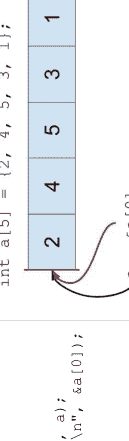

在以下示例中，指针符号用于声明和定义的第一行。一旦进入函数，指针变量的行为就好像它是一个数组一样。

```c
#define SIZE 5

void printArray(int *)
{
    int i;

    printf("Array y address: %p\n", y);

    for (i = 0; i < SIZE; i++)
    {
        printf("%d\n", y[i]);
    }
}
```

```c
int main(void)
{
    int x[SIZE] = {3, 5, 7, 9, 10};
    printf("Array x address: %p\n", x);
    printArray(x);
    printArray(x);
    return 0;
}
```

上述示例中显示的两个内存地址，以下说法正确的是什么？

### 指针运算和数组（仅限一维数组）

当您尝试将整数添加到地址时会发生什么？算术运算的结果可用于访问和更改数组元素。

```c
void changeArray(int *y)
{
   int i;
   temp = *y;

   for(i = 1; i < SIZE; i++)
   {
      *(y + i - 1) = *(y + i);
   }

   *(y + i - 1) = temp;
}
```

```c
#define SIZE 5

void printArray(int *);
void changeArray(int *);

int main(void)
{
   int x[SIZE] = {3, 5, 7, 9, 10};

   changeArray(x);
   printArray(x);

   return(0);
}

void printArray(int *y)
{
   int i;

   for(i = 0; i < SIZE; i++)
      printf("%d\n", *(y + i));
}
```

生成的输出：
y[0] = 5
y[1] = 7
y[2] = 9
y[3] = 10
y[4] = 3

将间接运算符（*）应用于起始内存地址与整数之和，会产生整数索引处的元素。

a[x] == *(a + x)

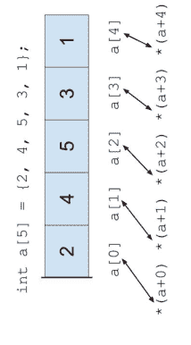


### 想要地址吗？

与索引值一样，加到 a 上的值表示相对于 a 所代表的内存地址的偏移量。加法运算会产生一个新的内存地址。不同的数据类型是否需要不同的内存量？是的，但向指针加一会根据数组的类型推进到数组中的下一个元素。在我们服务器上的整数数据中，加一将增加四个字节。

```c
int main(void)
{
    int a[5] = {2, 4, 5, 3, 1};
    printf("Array a address: %p\n", a);
    printArray(a);
    return 0;
}
void printArray(int *y)
{
    int i;
    printf("Array y address: %p\n", y);
    for (i = 0; i < 5; i++)
    {
        printf("&y[%d] = %p\n", i, y + i);
    }
}
```

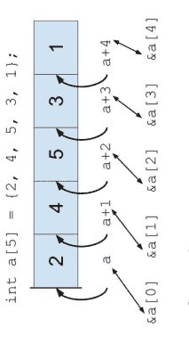

```
Output Generated:
Array a address: 0x7ffd003f7680
Array y address: 0x7ffd003f7680
&y[0] = 0x7ffd003f7680
&y[1] = 0x7ffd003f7684
&y[2] = 0x7ffd003f7688
&y[3] = 0x7ffd003f768c
&y[4] = 0x7ffd003f7690
```

```c
void printArray(int *y)
{
    int i;
    printf("Array y address: %p\n", y);
    for (i = 0; i < 5; i++)
    {
        printf("&y[%d] = %p\n", i, y + i);
    }
}
```

### 内存分配函数

在程序编译前声明数组容量存在几个你可能已经考虑过的局限性。首先，我们可能为问题预留的内存不够。其次，我们可能预留了过多内存，限制了留给其他数据的内存。我们进入动态内存分配的探索将提高我们请求问题所需精确内存的能力。

- malloc（内存分配）函数将分配指定数量的字节内存。必须使用指针变量来引用 malloc 函数返回的新分配内存的起始地址。

我们如何知道要请求多少字节的内存？我们可能知道数据的数量，但如何确保总量足以容纳数据集的数据类型？

- `sizeof` 函数接受一个数据类型，并返回存储该类型一个值所需的字节数。

- 传递给 `malloc` 函数的参数将是 `sizeof` 函数返回的值与所需数据数量的乘积。

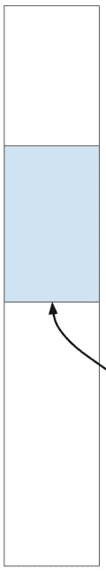

足以存储二十个整数值的内存。

```c
int *data;
data = (int*)malloc(sizeof(int) * 20);
```

### 示例 - 询问用户需要存储的整数数据数量。将数据集作为输入并按输入顺序显示它。

```c
int getQuantity(void);
void getData(int*, int);
void printData(int*, int);
int main(void)
{
    int *data;
    int quantity;
    quantity = getQuantity();
    data = (int*)malloc(sizeof(int) * quantity);
    getData(data, quantity);
    printData(data, quantity);
    return(0);
}
```

```c
int getQuantity(void)
{
    int qty;

    printf("Enter quantity of data -> ");
    scanf("%d", &qty);

    return qty;
}
```

```c
void getData(int *data, int size)
{
    int i;

    printf("Enter %d integers -> ", size);
    for (i = 0; i < size; i++)
    {
        scanf("%d", data + i);
    }
}
```

```c
void printData(int *data, int size)
{
    int i;

    printf("\nContents of data set: ");
    for (i = 0; i < size; i++)
    {
        printf("%d ", *(data + i));
    }

    printf("\n");
}
```

注意：为简单起见，我们跳过了确认分配是否成功以及完成后释放内存等重要任务。

- 字符串是一系列字符，能够被视为一个整体。

C 编程语言没有字符串数据类型，但试图通过使用字符数组来提供一些处理字符串数据的能力。

与数值数组类似，我们可以将字符串声明为任何预定大小。字符数组常见的问题是，字符串数据所需的元素数量在程序执行期间可能会变化。例如，给定的字符数组可能有 20 个元素的容量，最初存储“Computer”，随后该数据被“Science”替换。我们以及用于处理字符串数据的函数，如何知道数据在哪里结束，数组的未使用部分从哪里开始？

我们可以通过使用称为分隔符的字符来识别字符数组中数据的结束位置。这个分隔符字符 ‘\0’ 表示字符数组中数据的结束。这对于许多操作字符串的函数非常重要。

- C 编程语言中的字符串是可变长度且带分隔符的字符串。

- 什么是可变长度？给定时间点数组中找到的数据量。

- 什么是带分隔符？在数组中插入一个字符，将数据与数组的未使用部分分开。

### 声明字符串和访问字符串元素

- 我们可以以类似于数值数组的方式访问字符数组的每个单独元素。

```c
Examining the elements of a character array:

int lev;
char str[11] = "Good Day";

for (lev = 0; lev < 11; lev++)
{
    printf("str[%2d] = %3c %5d\n", lev, str[lev], str[lev]);
}

printf("\n");
```

```
Output:
str[ 0] = G   71
str[ 1] = o  111
str[ 2] = o  111
str[ 3] =     32
str[ 4] = D   68
str[ 5] = a   97
str[ 6] = y  121
str[ 7] =     32
str[ 8] = 0   0
str[ 9] = 0   0
str[10] = 0   0
```

- 分隔符在哪里？它在那里吗？是的！分隔符的 ASCII 值为零，并且正确地位于索引 8 处。初始化语句会将分隔符添加到字符数组的末尾。

- 字符数组中剩余未使用元素（索引 9 和 10）中有什么？

- 因为我们上面初始化了数组，剩余元素被填充为零。

### 字符串输入/输出函数

这里有一个值得思考的问题：如果我们要将数据加载到数组中，是否必须始终一次输入一个元素直到数组填满？这是否意味着为了输入字符串，我们必须一次输入一个字符？

### %s 占位符

%s 占位符表示一个字符串，并用于熟悉的输入和输出函数中。

### %s 占位符的示例：

```c
char str1[SIZE];
printf("Enter a string -> ");
scanf("%s", str1); //NOTICE NO &, WHY IS THIS?!
printf("The string you entered was %s.\n", str1);
```

```
Output of previous code segment

Enter a string -> Purdue
The string you entered was Purdue.
```

- scanf 函数只读取数据，直到输入新行 ('\n') 或任何空白字符。

Enter a string -> Go Purdue
The string you entered was Go.

### 解决方案？寻找 scanf 的替代品！

```c
printf("Enter a string -> ");
gets(str1);
printf("The string you entered was %s.\n", str1);
```

用户输入的 '\n' 字符会怎样？gets 函数会接受以新行终止的输入，并将其转换为以分隔符结尾的字符串。

### 与 scanf 和 gets 函数相关的问题：

- 我们本学期使用的编译器不再对 gets 函数相关的潜在问题保持沉默。警告：'gets' 函数很危险，不应使用。

### 什么使得 gets（出于同样的原因 scanf 也是）“危险”且“不应使用”？

- 当字符数组填充到其定义容量时，这两个函数都不会停止接受输入。

- 超出数组的定义容量将导致与范围检查问题相同的问题。

### 输入的替代（更安全）方法：

```c
void getString(char x[])
{
    int index = 0;
    printf("Enter your string -> ");
    do
    {
        x[index++] = getchar();
    }while(index < SIZE && x[index - 1] != '\n');
    //REPLACE THE FINAL CHARACTER WITH A DELIMITER CHARACTER
    x[index - 1] = '\0';
}
```

- getchar 函数将接受单个字符的输入。

- 上面的 do-while 循环将在用户输入新行字符或达到数组的定义大小时终止输入接受。

- 因为 getchar 函数只处理单个字符输入，它不会将分隔符字符放入数组，但它会将新行字符（ASCII 值 10）放入数组，必须将分隔符分配给数组，并且将在上述函数中覆盖新行字符。

### 字符串操作函数

C 编程语言为我们提供了一组足够的字符串函数，这些函数可以在 string.h 库中找到。我们将考虑的函数包括：strcpy、strcmp、strlen，稍后我们会回来看一个使用 strstr 的示例。类似于 printf 和 scanf，这些函数将使用数组名称所代表的地址以及其中存储的分隔符来完成它们的任务。


### 确定字符串的长度

string.h 中要介绍的第一个函数是 strlen 函数，它将返回字符串中的字符数。该函数不计算终止分隔符字符，但返回的值确实表示分隔符在数组中的位置（索引）。

```
char str1[SIZE];
int length;
getString(str1);
length = strlen(str1);
printf("Your string [length %d]: %s\n", length, str1);
```

### 示例执行：

| 输入您的字符串 -> Purdue | 输入您的字符串 -> Go Purdue!!! |
| :--- | :--- |
| 您的字符串 [长度 6]: Purdue | 您的字符串 [长度 13]: Go Purdue!!! |

### 复制字符串，复制单个变量很容易，但字符串呢？我们可以使用赋值运算符吗？

```
char str1[SIZE];
char str2[SIZE];
getString(str1); //SEE USER-DEFINED FUNCTION ON PREVIOUS PAGE.
str2 = str1;
printf("The string you entered was %s.\n", str1);
printf("The copy of the string you entered is %s.\n", str2);
```

- 编译器生成的消息是什么？
- 在上面示例中的表达式 str2 = str1 中，真正被赋值的是什么？

此赋值试图强制 str2 放弃其已分配的内存，并引用与 str1 相同的内存。如果这是可能的，内存中仍然只会有一个字符串的副本。

### 为什么编译器不批准此特定的赋值表达式？

- 静态声明数组分配的内存在大小和位置上是固定的。
- 根据上述说法，我们可以说数组所引用的内存地址是常量。

### 替代方案 - 使用 string.h 函数 strcpy

strcpy 函数将获取第二个参数并将其值复制到第一个参数。在此示例中，str1 的内容被复制到 str2。

```
char str1[SIZE];
char str2[SIZE];
getString(str1);
strcpy(str2, str1);
printf("Your input: %s\n", str1);
printf("Your output copy: %s\n", str2);
```

### 输出：

输入您的字符串 -> Go Purdue!
您的输入: Go Purdue!
您的输出副本: Go Purdue!

### 是否存在复制的数据多于内存中预留空间的问题？

- 是的！strcpy 函数将继续复制字符，直到找到分隔符。请验证目标数组具有所需的容量！

### 比较两个字符串

- 正如我们不能将一个字符串赋值给另一个字符串一样，我们也不能使用比较和关系运算符成功比较两个字符串是否相等。

### 示例：

```
char str1[SIZE];
char str2[SIZE];
getString(str1);
strcpy(str2, str1);
if(str1 == str2)
{
    printf("The strings are equal\n");
}
```

人们可能会假设，如果比较运算符比较字符串的内容，那么输入的任何值都会导致每次执行前面的代码段时都打印相等语句。
输出是什么？无。
这告诉我们，在使用关系或相等运算符比较两个字符串时，正在比较什么？
使用相等运算符的比较测试的是内存地址，而不是字符串数据。

### 替代方案 - 使用 string.h 函数 strcmp

string.h 库中的这个第三个函数将接受两个字符串作为参数，并返回一个整数，指示两个字符串的不同之处。存储相同数据的两个字符串没有差异。

| 示例 | 说明 |
|---|---|
| 输入您的字符串 -> company<br>输入您的字符串 -> corporate<br>比较结果: -5 | 在第一个示例中，第一个差异出现在第三个元素。此差异值由 strcmp 函数返回。第二个参数的元素减去第一个参数的元素。 |
| 输入您的字符串 -> company<br>输入您的字符串 -> companion<br>输入您的字符串: 16<br>比较结果: 0 | 输入您的字符串 -> ABC123<br>输入您的字符串 -> ABC123<br>比较结果: 0 |
| 输入您的字符串 -> ABC123<br>输入您的字符串 -> ABC123<br>比较结果: -18 | 计算差异时使用的不是差异之和，而是从最低索引到最高索引顺序中的第一个差异。 |
| 输入您的字符串 -> ABC12<br>输入您的字符串 -> ABC123<br>比较结果: -51 | 如果两个字符串的元素数量不同怎么办？ |
| 输入您的字符串 -> ABC123<br>输入您的字符串 -> ABC123<br>比较结果: -32 | 字符大小写有意义吗？ |

```
The code:
char str1[SIZE];
char str2[SIZE];
int compare;
getString(str1);
getString(str2);
compare = strcmp(str1, str2);
printf("Compare result: %d\n", compare);
```

问题：实现 ROT13 加密算法。ROT13 实际上并不是一种加密算法，但通过此方法处理文本确实使其难以阅读。对于字母表前半部分的字符，我们加 13 将其旋转到后半部分。对于字母表后半部分的字符，我们减 13 将其旋转到前半部分。非字母字符在此过程中不会更改。需要注意的是，加密过程与解密过程相同。

输入您的字符串 -> Go Purdue!!!
原始字符串: Go Purdue!!!
旋转后字符串: Tb Cheqhr!!!
原始字符串: Go Purdue!!!

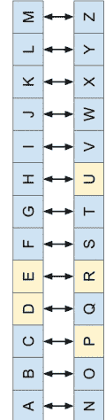

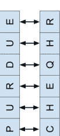

### 解决方案：

```
#define SIZE 51

void getString(char[]);
void rot13(char[]);

int main(void)
{
    char str1[SIZE];
    getString(str1);
    printf("Original String: %s\n", str1);
    rot13(str1);
    printf("Rotated String: %s\n", str1);
    printf("Original String: %s\n", str1);
    return(0);
}
```

```
void rot13(char x[])
{
    int lcv;
    for(lcv = 0; lcv < strlen(x); lcv++)
    {
        if((x[lcv] >= 'a' && x[lcv] <= 'z') || (x[lcv] >= 'A' && x[lcv] <= 'Z'))
        {
            if((x[lcv] >= 'a' && x[lcv] <= 'm') || x[lcv] <= 'M')
            {
                x[lcv] += 13;
            }
            else
            {
                x[lcv] -= 13;
            }
        }
    }
}
```

### 搜索子字符串

string.h 库中要介绍的最后一个函数（strstr）有能力在字符串中定位子字符串。

strstr 函数接受两个内存地址作为参数，并返回子字符串在字符串中的位置。当找不到子字符串时，返回的值是一个定义的零，称为 NULL。

如果函数返回一个地址，那么该值将被赋给哪种类型的变量？答案：字符指针。

### 问题 - 给定一个字符串和子字符串，确定子字符串在字符串中出现的次数。

- 输入字符串 -> ATATATA
- 输入子字符串 -> AT
- 子字符串 AT 在字符串 ATATATA 中出现 3 次。

- 输入字符串 -> ATATATA
- 输入子字符串 -> ATA
- 子字符串 ATA 在字符串 ATATATA 中出现 3 次。

### 解决方案：

```
#define SUB_INPUT 1
#define STR_INPUT 2
#define SUBSTR 21
#define STRING 50

void getString(char[], int, int);
int ctStrings(char[], char[]);

int main(void)
{
    char sub[SUBSTR];
    char str[STRING];
    int count;

    getString(str, STR_INPUT, STRING);
    getString(sub, SUB_INPUT, SUBSTR);
    count = ctStrings(str, sub);

    printf("The substring %s appears %d time(s) in the string %s.\n", sub, count, str);

    return(0);
}
```

```
void getString(char x[], int option, int size)
{
    int index = 0;

    if(option == SUB_INPUT)
    {
        printf("Enter the substring -> ");
    }
    else if(option == STR_INPUT)
    {
        printf("Enter the string -> ");
    }

    do
    {
        x[index++] = getchar();
    }while(index < size && x[index - 1] != '\n');

    x[index - 1] = '\0';
}

int ctStrings(char str[], char sub[])
{
    int ct = 0;
    char *ptr;

    ptr = strstr(str, sub); //LOOK FOR SUB AT START OF str

    while(ptr != NULL)
    {
        ct++;
        ptr = strstr(ptr + 1, sub); //PERMITS OVERLAP
        //ptr = strstr(ptr + strlen(sub), sub); //NO OVERLAP
    }

    return(ct);
}
```


## CS 159 - 2022 年秋季学期

### 课堂测验难度报告

今天的日期：

你的姓名：

你的 ITaP 职业账户用户名（请勿写出你的密码）：

测验答案：

提交此表格即表示我确认以下事项：

- 1. 本学期我只能使用此表格一次。
- 2. 我必须在遇到困难的课堂测验结束时提交此表格。
- 3. 提交此表格时我必须出示带照片的身份证明。
- 4. 我有责任确定今天遇到的困难的来源，并在下一次课堂测验之前将其解决。如果问题无法在下一次测验之前解决，我将携带书面详细情况描述前往教师的办公时间。

你的签名：

