# CS 159 – C 语言编程（工程师的应用），2023 年秋季


## CS 159 – 面向工程师的 C 语言编程（Applications for Engineers）2023 秋季学期 大纲

## 课程教师

| 教师： | 教师办公室位置： | 教师办公时间： |
|---|---|---|
| | 大楼：HAAS 房间：第三街和大学街东南角 | |

如有关于课程的任何行政事宜，请在教师办公时间前往咨询。

- 如果您有任何问题，预计您会主动前往教师的办公时间。

## 助教办公时间

## 课程动机与目标

CS 159 介绍了软件开发的工具，这些工具已成为科学与工程领域创新和创造性问题解决的必备条件。教育工作者和雇主都认为，未来的技术专业人员能够作为技术团队的一员发挥作用，并具备高效传达复杂概念的能力非常重要。CS 159 将要求学生在实验室作业中以指定团队形式合作。教育研究表明，结构化协作能提高所有参与入门编程课程的学生的学习成果。

协作是本课程的要求。您将由教师分配到各个团队。

CS 159 使用大多数学生不熟悉的语言和开发环境来探索编程概念。本课程的主要目标是帮助学生认识到编程概念在本科教育中接触到的各种语言之间是共通的，以及这些概念如何用于解决问题。

## 课程先修条件与准备

CS 159 是一门入门编程课程，没有正式的先修课程，但假设学生具备一年级工程专业学生典型的数学和自然科学知识。

大学期望学生每周投入 6-9 小时进行课外准备，此外还包括上课时间，针对三学分课程。之前的 CS 159 学生报告称，成功的关键包括：参加讲座、积极参与实验室、准备并定期复习课程材料，以及计划在截止日期前很早就开始并完成所有作业。

## 课程必备材料

- Computer Science, A Structured Programming Approach Using C, Forouzan and Gilberg, THIRD EDITION, ISBN: 0-534-49132-4
  - 提供电子书替代方案（Cengage Unlimited）：https://www.cengage.com/shop/isbn/9781337907651
- Programming Applications for Engineers Course Packet (2023 秋季学期版)
  - 仅在当地书店有实体版。请参阅 Brightspace 获取购买电子版的链接。
- Vocareum License，相关购买说明将在 Brightspace 上提供。

## 学习资源

- 所有相关课程信息、更新和公告均可在 Brightspace 网站 https://purdue.brightspace.com/ 上查看。

## 补充教学

本课程提供补充教学（SI）学生研习班。这些学生小组对任何修读本课程并希望跟上课程进度、更好地理解课程内容的人开放。参加这些研习班是自愿的，但为了获得最大收益，您应定期参加。学习研习班的时间表可在网上查找：http://www.purdue.edu/si。

参加这些互动研习班的学生将发现自己正在与同伴合作，比较笔记、演示和讨论相关问题及重要概念，并分享学习和应试策略。

- 学生需携带讲义笔记和教科书，并在研习班期间准备好与他人一起参与。
- SI 领导者是之前在本课程中表现非常出色的本科生，他们将向在校学生示范自己的成功策略。
- 每次研习班都会讲授新内容，且不会有两次研习班重复相同内容。

## 重要日期

| 期中考试 #1 | 期中考试 #2 | 期末考试 | 学术日历 |
|---|---|---|---|
| 日期：时间：地点： | 日期：时间：地点： | 日期：时间：地点： | 最后退课日期：11 月 27 日（星期一） |

- 期末考试可能定于 2023 年 12 月 16 日（星期六）。除大学规定的原因外，不会考虑替代考试安排的请求。**请据此安排您的学期末行程。**

## 评分

| 作业 | 分数 |
|---|---|
| 家庭作业 | 70 |
| 实验任务 | 60 |
| 实验测验 | 65 |
| 期中考试 | 200 |
| 期末考试 | 150 |
| 讲座测验 | 55 |
| 总分： | 600 |

## 成绩

| 成绩 | 所需分数 |
|---|---|
| A | 510 |
| B | 450 |
| C | 390 |
| D | 330 |

教师保留降低每个等级最低分数要求的权利。如有任何更改，将在**期末考试后。**才公布。

- 在学期内任何时候，都不会推测是否会这样做，也不会推测任何给定分数线会降低多少。您不应期望所有分数线如果移动，都会移动相同的数量。
- 对于那些非常接近但未达到某个公布最低分数的少数人，将考虑使用加号（+）和减号（-）对成绩进行调整。

## 出勤

**您本学期应参加每次实验课。** 要有资格保留实验编程作业及相关实验测验获得的分数，您必须在实验课开始后 5 分钟内到达指定的实验室。您的实验课教师将提供登记出勤所需的步骤。实验课是协作式编程作业，期望您的实验伙伴或助教将迟到或缺席的学生纳入团队工作是不公平的。**迟到或缺席超过两次实验课的学生将不及格本课程。**

**您本学期应参加每次讲座。** 讲座厅将分配座位并进行考勤，以确保只有正式注册并亲自出席每个班级的学生才有资格获得讲座测验参与的分数。

## 紧急缺勤与补做作业

只有有文档证明的严重困难才会被视为缺勤作业的补做理由。如果您有您认为属于此类困难的文档证明，则必须在**您能够恢复参加课程的办公时间内**及时联系教师。任何预先知道将缺勤的学生必须在缺勤前一周提出考虑请求。

- 关于缺勤报告的大学政策可从学生院长办公室获取：https://www.purdue.edu/advocacy/students/absences.html
- 出于**疾病原因**的补做请求**必须附有医疗专业人员的证明文件**，注明您接受其治疗的日期以及获准返回学校/工作的日期。

## 作业

### 考试（两次晚间期中考试，每次 100 分，一次期末考试 150 分）

考试将是对您知识的**个人评估**。考试将包含涵盖编程概念、最佳编程实践、先前的编程作业以及代码解释的选择题。

课程讲义包中提供了旧考试以供您准备。请阅读本节的封面页，了解旧考试如何成为您全面准备过程的有用部分。

| 家庭作业（共 7 次，每次 10 分）家庭作业是**个人**完成的，旨在让您有机会在不借助其他学生帮助的情况下独立解决编程问题。大多数作业将在截止日期前 10-12 天在 Brightspace 上发布。请查阅课程政策，了解本文档后文中关于**学术诚信**的相关规定。 | 家庭作业 | 截止时间为晚上 11 点 |
|---|---|---|
| | 1 | 9 月 4 日 |
| | 2 | 9 月 18 日 |
| | 3 | 10 月 2 日 |
| | 4 | 10 月 16 日 |
| | 5 | 10 月 30 日 |
| | 6 | 11 月 13 日 |
| | 7 | 12 月 1 日 |

### 实验任务（共 12 次，每次 5 分）：

实验作业需在您指定的实验小组内**协作**完成，每次实验编程作业将在下一次实验课召开前 30 分钟截止（详见本文档后文中的日程安排）。

- 协作小组应沟通谁将提交作业、何时提交作业，以及如何与所有参与小组成员确认进度。
- 为小组每位成员设定期望，将提高提交完整作业的可能性。
- 未能参与并为所有小组成员满意地做出贡献的实验伙伴，将不获得实验作业学分。
- 实验小组将在学期中第 4 次和第 8 次实验课后重新分配。入学和参与变化可能需要额外调整。

### 实验测验（共 13 次，每次 5 分）

每次实验课结束时，将对与讲座中介绍的主题以及最近讲座和作业中实现的内容相关的知识进行**个人**评估。课程标准和良好编程实践的知识将在整个学期中得到评估。

- 备考测验的最佳方式是观看讲座录像，并在解决实验的过程中积极与团队合作，包括参与书面问题和编程问题解决方案的开发。
- 实验测验只能在您的正式实验地点完成。测验期间不允许使用任何资源。


## 每周实验日程

| 周起始 | 实验作业 | 周起始 | 实验作业 |
|---|---|---|---|
| 8月21日 | Lab #0 | 10月16日 | Lab #8 |
| 8月28日 | Lab #1 | 10月23日 | Lab #9 |
| 9月4日 | Lab #2 | 10月30日 | Lab #10 |
| 9月11日 | Lab #3 | 11月6日 | Lab #11 |
| 9月18日 | Lab #4 | 11月13日 | Lab #12 |
| 9月25日 | Lab #5 | 11月20日 | 感恩节假期 |
| 10月2日 | Lab #6 | 11月27日 | Lab Quiz #13 |
| 10月9日 | Lab #7 | 12月4日 | 开放* |

* 本周实验不会进行，除非因特殊情况导致日程中断。

讲座测验（最多55分）
从学期第二周开始，每次讲座都会进行讲座测验。测验可能在讲座开始、中间和/或结束时进行。必须坐在指定座位上，才能保留讲座测验获得的任何学分。

参与讲座测验需要使用普渡大学凭据访问 Hotseat (openhotseat.org)。每次讲座请携带您选定的设备。如果您的设备故障或忘记携带设备，可在讲座后使用教师提供的表格提交书面测验。整个学期该方法仅可使用一次。仅接受提供的表格，且必须在当前讲座结束时提交。

- 请查阅关于学术诚信政策，涉及为其他学生参加讲座测验时虚假陈述身份或地点的问题。

## 讲座日程

| 周起始 | 星期二 | 星期四 | 周起始 | 星期二 | 星期四 |
|---|---|---|---|---|---|
| 8月21日 | 介绍 | 第2章 | 10月16日 | | 第6章 |
| 8月28日 | | 第2章 | 10月23日 | | 第6章 |
| 9月4日 | | 第3章 | 10月30日 | | 第8章 |
| 9月11日 | 第3章 | 第4章 | 11月6日 | 第8章 | |
| 9月18日 | 第4章 | | 11月13日 | 第9章 | 第10章 |
| 9月25日 | 第4章 | 第5章 | 11月20日 | 无讲座* | 感恩节 |
| 10月2日 | | 第5章 | 11月27日 | | 第8章 |
| 10月9日 | 秋季假期 | 第5章 | 12月4日 | 第11章 | 无讲座* |

*无讲座 – 11月21日和12月7日取消，以补偿晚上的期中考试。

## 评分期望与政策

我们期望您的实验教师能及时批改作业，并为您提供足够的改进反馈。如果您认为情况并非如此，请向教师反映您的担忧。通常，您的评分人员应在每份作业截止后4-6天内完成编程作业的评分。

如需对任何作业申请复评，必须在教师办公时间以书面形式提交申请。自作业成绩在 Brightspace 上发布之日起，您有五天时间对任何成绩提出申诉。该期限过后，成绩将被冻结，不再受理任何申诉。复评并非再次完成作业的机会，也不是用于挑战作业要求、课程政策或编程与文档标准的手段。

复评申请必须包含以下内容：

- 1. 原始已评分作业的纸质副本（如适用）。
- 2. 附上一份说明，阐述您认为有必要重新评估您努力的原因。

## 重要作业指南

所有作业必须符合课程的编程和文档标准。能够运行并满足最低作业要求但在逻辑上不正确或不完整的程序，可能会被视为部分学分。要获得全分，您的程序必须（1）产生正确结果，（2）设计良好，（3）高效利用计算机的有限资源，（4）遵循作业要求，（5）遵守课程编程和文档标准。

未按预期提交的作业不予评分。只有在作业截止前正确提交的工作才可参与评分。不接受逾期作业。

随着作业截止日期临近，对资源和课程人员的需求将增加。不鼓励在最后一刻才处理编程作业！课程政策是不延长截止日期，除非在作业截止日期附近较长一段时间内官方课程资源不可用。您有责任了解课程中使用的技术和工具的使用方法。

设定提前提交每份编程作业的目标，这样做可以留出足够的时间，以便在解决或提交作业时遇到困难时寻求帮助。

## 学术诚信

CS 159 非常重视学术诚信问题。违反课程政策的后果在课程内部以及由学生院长办公室的纪律部门都非常严重。

鼓励您讨论任何 CS 159 话题，包括处理编程作业的高层次想法。但是，绝不允许团队之间或个人之间通过书面或电子方式交换或共享代码访问权限，无论是协作作业还是个人作业。

阅读他人解决方案或向任何人提供访问您作品（或其他学生作品）的权限，均被视为不诚实行为。在个人作业中与他人一起处理代码时请注意，因为这不被鼓励。您提交的作品必须是您自己的原创努力，而不可接受的（即使是无意的）协作结果。

为何要强制执行学术诚信？学术诚信违规行为等同于盗窃。这是对开发解决方案的个人的工作和时间的盗窃，也是对教师调查此类事务时间的盗窃。归根结底，这是对每一位来到普渡大学、在教育上进行重大财务投资，并期望其学位在完成后受到雇主和其他学术机构重视的学生的盗窃。

## 与其他学生或非本组成员讨论作业何时不再可接受？

- 与同伴的讨论在解决方案开发的早期阶段最为合适。一旦您开始设计和实现（编写代码或开发特定逻辑）解决方案，就应仅参考课程工作人员寻求帮助。

- 与另一名学生密切合作完成家庭作业可能会因协作而导致高度相似的作品。协作可能不是解决问题的预期方法，但长时间与他人密切合作的最终结果是。

每个学生都有责任保护自己的作品。不要假设室友、邻居、伴侣或其他“可信”个人不会利用知道您的密码、访问您的电脑，或在无人看管的机器上拍摄您作品的照片来占便宜。对于导致您作品无保护的此类事件，您需负责。

许多免费的在线编译器、协作编辑器和文件存储库会存储您的作品，除非您付费升级服务，否则可能会使其公开可见。在使用任何此类服务之前，请先了解其政策。请参阅上文关于您保护作品责任的说明。

不要犯这样的错误：认为对程序进行表面更改（例如修改注释、更改变量名、交换语句或添加空格）就能避免被发现。如果您无法自行完成工作，不太可能成功将他人的作品伪装成自己的。我们坚决不容忍任何形式的违规行为。即使是最简单的作业，不提交也好过违反课程诚信政策来完成它。

共享文件的电子副本、通过账户共享获取文件、共享您作品的纸质副本，或在互联网上向陌生人寻求帮助，与分析和检测此类共享一样容易，因为这会导致提交相似的作品。

互联网论坛（包括宣传提供大学课程帮助的付费服务）受到课程工作人员的监控。发现的任何相关代码都会与学生提交的作品一起用于相似性测试。搜索和使用作业解决方案、请求作业帮助，以及在此类场所发布作业，均违反课程学术诚信政策，并可能侵犯大学版权。

假设您在学期中提交的每份最终作业都将至少由一个软件相似性服务进行分析。这些服务将衡量您的解决方案与课程中其他人提交的解决方案之间的相似度百分比。此外，这些服务还会显示提交作品之间匹配的百分比和行数。本学期您将解决没有单一解决方案的问题，并且期望您的解决方案是独一无二的。对我们任何政策的疑虑应在作业截止前的办公时间内提出。

## 违反课程政策的最低后果将包括：

- 第一次违规：作业得零分，学期末降一个字母等级，并转介学生院长办公室采取纪律处分。

- 第二次违规：作业得零分，课程不及格，并转介学生院长办公室采取纪律处分。

## 第一次违规最低后果的显著例外：

- 考试中的任何违规行为都将导致课程不及格，并转介学生院长办公室。

- 虚假陈述身份或地点等行为将导致课程不及格，并转介学生院长办公室。

- 发布、请求或访问未经批准的来源（特别是在线来源）上找到的解决方案，将导致课程不及格，并转介学生院长办公室。


## 作为技术团队成员的协作学习/组队/参与

Here are our expectations of you and your group:

- 1. **Make time to meet with your group regularly.** There are 168 hours in a week, finding some common time for a group to meet should not be difficult. It is acceptable for part of the group to meet some of the time if everyone cannot participate in every meeting. Ultimately, each individual is responsible for planning and documenting their contribution to the group effort accordingly.
  - Reflect on the roles and responsibilities you had on each lab programming assignment. Recognize when you are not being utilized in a way that contributes to a better understanding of course content.

- 2. **Allow everyone an opportunity to express their ideas** on how to approach an assignment. One benefit of collaborative teaming is that everyone brings a different set of skills to the group and the resulting effort often is a stronger one than if it was completed individually.
  - When a group member becomes unresponsive to requests to meet or fails to update the other members of the group then those contributing members must prepare to continue without the unresponsive member.

- 3. **All group members must be satisfied with the final submission.** It is not acceptable for a group to submit an assignment that is not approved by all group members. “It is good enough” may be true for you but it is unfair for the others in the group who aspire for the highest grade possible.
  - Likewise, each group member must be satisfied with your contribution to the group effort.

- 4. **Each group member must fully understand the entire assignment submitted.** Do not start your group meetings by trying to delegate the tasks to the different group members. Everyone must understand and contribute to every aspect of the assignment and its development.
  - Assignments are an opportunity for you to demonstrate your knowledge of the programming concepts being utilized. Use assignments to serve as a measure of what you do and do not know and how to direct your future efforts in the course.

- 5. **Designate who will turn in the assignment, when it will be turned in, and how successful submission will be communicated with the rest of the group.** Set a goal to submit the assignment well in advance of the due date to avoid any last minute problems.

- 6. **You will work with the group assigned.** Please contact us with concerns you may have with your group. Take a professional approach with your group experience as similar to what you may experience at an internship or co-op experience.
  - Groups will be re-assigned after every four labs.
  - Future group assignments may take into consideration lecture attendance and assignment completion as an indicator of your interest in participating in the course. Active students in the course should not be burdened with partners who are not willing to stay current with course content.

## Nondiscrimination Statement

Purdue University is committed to maintaining a community which recognizes and values the inherent worth and dignity of every person; fosters tolerance, sensitivity, understanding, and mutual respect among its members; and encourages each individual to strive to reach his or her own potential. In pursuit of its goal of academic excellence, the University seeks to develop and nurture diversity. The University believes that diversity among its many members strengthens the institution, stimulates creativity, promotes the exchange of ideas, and enriches campus life.

## Students with Disabilities

Purdue University strives to make learning experiences as accessible as possible. If you anticipate or experience physical or academic barriers based on disability, you are welcome to inform your instructor to discuss options. You are also encouraged to contact the Disability Resource Center at: drc@purdue.edu or by phone: 765-494-1247.

Students with an existing letter of accommodation are to refer that letter to their instructor and follow up with an e-mail to initiate a conversation regarding how your accommodations may be implemented in the course.

## Emergency Preparation

In the event of a major campus emergency, course requirements, deadlines, and grading percentages are subject to changes that may be necessitated by a revised semester calendar or other circumstances.

- In case of a campus emergency, check Brightspace for announcements. Follow all official university issued instructions. See https://www.purdue.edu/ehps/emergency_preparedness/ for more information.

## Mental Health/Wellness/Basic Needs Statement

Purdue University is committed to advancing the mental health and well-being of its students. If you or someone you know is feeling overwhelmed, depressed, and/or in need of mental health support, services are available. For help, such individuals should contact Counseling and Psychological Services (CAPS) at 765-494-6995 during and after hours, on weekends and holidays, or by going to the CAPS office on the second floor of the Purdue University Student Health Center (PUSH) during business hours.

If you need support and information about options and resources, please contact the Office of the Dean of Students. Call 765-494-1747. There is no appointment needed and Student Support Services is available to serve students 8 a.m.-5 p.m. Monday through Friday.

## Disclaimer

- The instructors reserve the right to revise the syllabus and will provide notice through a variety of sources such as lecture recordings, Brightspace announcements, and e-mail.

## COURSE PROGRAMMING AND DOCUMENTATION STANDARDS

**Programming Standards** – Includes definitions of good programming practices and what are considered to be poor practices.

**Documentation Standards** – Formatting and documentation requirements.

Please read and revisit the section carefully throughout the semester.

## Course Documentation and Programming Standards

### Grading Expectations

Every assignment will attempt to provide sufficient detail on all requirements. However, because the problems solved in this class have no unique solution, we will rely on the general guidelines listed below when determining the appropriate evaluation of your work.

You will always be evaluated on the following aspects of your assignments:

- 1. Following provided assignment requirements.
- 2. Developing the appropriate logic to solve the problem, accepting input in the order expected, and **producing expected output**.
- 3. Implementation of **good programming practices**.
- 4. Your solution should be **efficiently designed** to make good use of the limited resources of the computer.
- 5. Abiding by **course documentation standards**.

> Aspects of your submission other than the generation of correct output are important and can result in a loss of significant points on an assignment.

### Documentation Standards

The requirement of good documentation practices is universal among technical professionals; the primary motivation of having documentation standards is to make your code, which ultimately represents your logic, as easy to understand and easy for your grader to evaluate as possible. The solutions you are in the process of developing must be quickly interpreted when seeking assistance both in this class and from your colleagues, supervisors, and clients in the future.

> Standards are not merely recommendations, they are required for the course and failure to comply will result in a loss of points.

- The course notes and examples in lecture will attempt to abide by these standards as closely as possible to serve as an example. However, to save space in the notes and time during lecture, some standards may be excluded; this is not an option for your assignments.
- Various references, including the required textbook, do not abide by all of our standards; please refer to this document for clarification.

> Points on an assignment will be deducted if your code and/or logic is difficult for your lab instructor to evaluate because it fails to meet the expectations outlined in this document.

Is there real world relevance for programming standards? Most companies have extensive documentation requirements in order to facilitate the transfer of previously developed code from one employee to another without the need to invest a great deal of time in the effort necessary to comprehend the work of the original developer.


## 作业标题

- 作业标题在课程中用于对程序或用户定义函数中正在实现的逻辑提供详细描述。
- 本学期我们将总共使用三个标题。一个用于实验，一个用于家庭作业，另一个用于用户定义函数。
- 使用标题绝不得干扰你程序的编译。

### 实验作业标题

```
/********************************************************************
*
*   Lab #:
*
*   Academic Integrity Statement:
*
*   We have not used source code obtained from any other unauthorized source,
*   either modified or unmodified. Neither have we provided access to our code
*   to another. The effort we are submitting is our own original work.
*
*   Program Description:
*
********************************************************************/
```

- 你必须在 Vocareum 内使用 vi 的 :hlb 命令插入实验作业标题。
- 每次成功提交实验作业后，Vocareum 团队的所有成员都将收到一封确认电子邮件。

### 家庭作业标题

```
/********************************************************************
*
*   Homework #:
*
*   Academic Integrity Statement:
*
*   I have not used source code obtained from any other unauthorized source,
*   either modified or unmodified. Neither have I provided access to my code
*   to another. The effort I am submitting is my own original work.
*
*   Program Description:
*
********************************************************************/
```

- 你必须在 Vocareum 内使用 vi 的 :hhw 命令插入家庭作业标题。
- 每次成功提交家庭作业后，你将收到一封确认电子邮件。

请确保你的实验和家庭作业标题中以下各项均正确：

- 学术诚信声明将为你提供，并且必须保留在标题中。不要对该声明做任何更改。
- 每个作业标题开头和结尾的交替字符是安全和识别功能的一部分，不应修改。
- 详细的程序描述是必要的。如果你的实验教师在快速浏览你的代码后无法跟上你的逻辑，那么他们应该能够从你的描述中确定你试图实现的算法。详细的程序描述将意味着你的程序代码中所需的注释更少。

## 函数标题

```
/********+*--*--*-----*-----*-----*-----*--*---*-----*--*---*-----*--*---*---*---*---*---*/
*
*   Function Information
*
*   Name of Function:
*
*   Function Return Type:
*
*   Parameters (list data type, name, and comment one per line):
*       1.
*       2.
*       3.
*
*   Function Description:
*
*-----*-----*-----*-----*-----*-----*-----*-----*-----*-----*-----*-----*-----*-----*-----*/
```

- 你必须在 Vocareum 内使用 vi 的 :hfx 命令插入家庭作业标题。
- 在使用函数时，在标题中注释你的参数（函数接收的那些值）很重要！函数定义的第一行没有足够的空间来注释参数，因此必须在此标题中包含它们。

## 对象名称/标识符

- 在本课程中，我们将以下内容视为对象：**变量、函数、符号/定义常量**。你必须为你的对象命名，以反映它们在程序中的目的。

| int x;<br>int y;<br>int z; | 仅根据变量名，你能确定变量 x、y 和 z 在程序中完成什么吗？也许它们保存了关于 3D 点的信息？如果程序中不包含 3D 坐标数据，那么将 x、y 和 z 用作变量名就不清楚了。 |

- **对象的单字符标识符很少有意义**。合理的例外是用于简单计数或访问数组元素的循环控制变量。
- 使用下划线开头标识符不是本课程将采用的做法。

| int numStudents;<br>float objectMass;<br>char courseGrade; | 相关的变量、常量和函数名称有助于你试图实现的逻辑的**文档化**和**可读性**。 |

## 变量声明

- 每行只声明一个变量。
- 所有变量声明必须出现在函数的局部声明部分中。不允许变量声明具有全局作用域，并且任何声明都不应出现在可执行语句中。

## 变量初始化

```
int numStudents = 0;                                //OKAY TO KEEP HERE
float objectMass = calcMass(acceleration, velocity); //PLACE AMONG EXECUTABLES
```

- 一般来说，初始化在用户定义函数的局部声明部分中声明的变量是可以接受的。如果用于初始化变量的表达式比常量赋值更复杂，那么最好在函数的可执行语句部分中为变量赋予其第一个值。

## 符号/定义常量

- 符号/定义常量的标识符选择必须全部大写。此标准允许任何程序员区分表达式中常见操作数的变量、函数调用和常量。
- 在程序顶部紧随作业标题之后定义所有符号/定义常量。
- 因为使用符号/定义常量可以改善程序的文档化，本课程的标准是你应尝试**最大化**使用符号/定义常量并**最小化**使用字面常量（参见第 3 章）。

## 注释

在 C 编程语言中，有两种可能的注释实现：

- 单行注释 // 将指示编译器忽略 // 之后直到行尾的所有内容。
- 多行注释 /* */ 将指示编译器忽略 /* 和 */ 之间的所有内容。有关此类注释的示例，请参见上面的标题。在 C 编程语言中，多行注释不能嵌套。

### 必须注释的内容

- 你声明的每个变量都必须有一个简短的注释来描述其在程序中的目的！
  - 在函数的局部声明部分中，将变量注释放在声明的右侧。
- 在给定函数中，预期偶尔的复杂代码段会被文档化，以告知他人你试图实现的逻辑。
  - 例如，建议在任何重要的选择或重复结构之前放置一两行注释。

## 缩进

你必须将结构体内的所有代码缩进**两个（额外）空格**！你几乎永远不应该在编辑器的第一列开始一行代码！以下是根据我们的标准正确缩进的一些常见结构：

| | | |
|---|---|---|
| for(x = 1; x <= MAX; x++) { printf("%d", x); } | if (y == 3) { for(g = 0; g > MIN; g--) { y = y - g; } } | do { e = m * c * c; avg = sum/number; }while(r == 0); |

### 更多缩进示例：

| Correct | Incorrect | Also Incorrect |
|---|---|---|
| if(x == 3 || y == 2) { z++; a = a - 1; } | if(x == 3 || y == 2) { z++; a = a - 1; } | if(x == 3 || y == 2) { z++; a = a - 1; } |

switch 结构将按照 C 编程教材中的示例进行缩进 - 参见第 258 页。

## 空白间距

- 请在各部分之间放置一个额外的行，以帮助按与同一任务相关的逻辑对代码进行分组。
- 在代码中平衡使用额外行和不放置任何行。
- 不需要对所有代码行进行双倍行距或包含多个连续空行。
- 要求在运算符和操作数之间放置一个空格，例如：`y = y - g;`

## 编程标准

编程标准有众多动机；在本课程中，此处描述的此类标准的目的是帮助你为未来的编程工作培养良好习惯。对一些学生来说，这一要求将需要打破之前养成的编程习惯。

### 什么使习惯或编程实践不那么可取？

任何使初学者编程更加困难、增加软件被黑客攻击或崩溃的脆弱性、不必要地创建复杂代码，或代表编程语言正在过时的特性的事物。

## 将局部声明与可执行语句分开

- 本课程中 `gcc` 编译器的默认设置要求所有变量必须在可执行语句开始之前声明。有关更多信息，请参见 C 编程教材第 2 章第 2 章中的图 2-2。

## 作用域

- 变量绝不允许具有全局作用域。
- 你需要与另一个函数共享变量吗？你需要变量值在函数内更改并在函数终止后保留该更改吗？
  - 你必须了解如何将变量/值传递给用户定义函数并从中返回它们。
  - 我们保留为实现全局变量的作业打**零分**的权利。
- 我们期望在本课程中，所有函数声明都将具有全局作用域。
- 不要为两个具有重叠作用域的对象重用标识符。

## 符号/定义常量和其他预处理器指令

- 所有预处理器指令必须放在程序顶部，紧随文件相应作业标题之后。
- 你可以在 C 编程教材（附录 G）中阅读更多关于符号/定义常量的内容，但符号/定义常量的一个目的是在未来修改程序要求时，使你作为程序员的工作更加容易。

## { 和 } 的使用

- 你将在 C 编程教材中观察到，在某些情况下可以省略 `if`、`for` 和 `while` 等结构体周围的花括号。不要养成或继续这种习惯！初学者已经很难配对花括号，而错位的花括号可能是最难解决的错误之一。
- 我们将在第 5 章（C 编程教材第 245 页，图 5-14）讨论**悬空 `else`** 问题，作为当你像我们要求的那样省略花括号时难以调试的一个困难逻辑错误的示例。当你试图理解教材第 8 章中编码的排序算法时，你也会遇到书中缺少 { 和 } 的情况。

对于 C 中所有相关的选择和重复结构，使用 { 和 } 是必需的。


## Proper Use of Repetition

- 仅在计数器控制的进程中使用 `for` 循环。
- 每个 `for` 循环都要使用全部三个表达式。不要留空任何表达式，也不要在任何表达式中放置无意义的语句，例如 `x = x`。
- 在本课程的 `for` 循环中，使用逗号运算符可能是不必要的。请参阅 C 语言教材第 323 页。
- 使用永久循环将违反禁止使用控制强制语句的预期。
- 递归仅可用于计数器控制的进程。

## Control Forcing Statements

- **你会在教材中观察到控制强制语句的使用，但在本课程中禁止使用。** 存在更好的方法来指导程序的控制流，而无需使用以下任一语句：
  - `exit`, `goto`, `break`（仅允许与 `switch` 结构一起使用）, `continue`
  - **同一函数中存在多个 return 语句。** 函数，就像我们将在讲座中讨论的流程图一样，必须有一个共同的（且只有一个）起点和终点。使用多个 `return` 语句会使单个函数（算法）拥有多个终点。

## Standard Libraries and Functions

- 你可以使用课堂上介绍的标准 C 库中的许多函数。**你有责任**就课堂上未讨论过的你想要使用的函数或库向课程工作人员咨询。

## User-Defined Functions

在引入用户定义函数（第 4 章）后，程序的 `main` 函数中仅允许以下内容：

1. 声明需要在函数之间传递的变量。
2. 由 `main` 调用的函数。
3. 最少量的控制结构（循环、选择），以保持 `main` 作为程序的控制中心。

`main` 函数旨在成为程序的 _主函数_，大多数函数调用应源自 `main`。程序中定义的大部分数据应在 `main` 中完成。

**根据函数的定义，每个函数只能有一个单独的（单一的）特定任务。** 在相关作业中未能很好地利用用户定义函数将导致不给予部分分数。

函数定义第一行中声明的所有（参数）变量必须具有显式数据类型。

按地址传递单个值应满足以下条件：

1. 当需要修改多个值，并且该修改在被调用函数终止后保留在调用函数中时。
2. 函数继续满足 **功能内聚** 的定义，即在正在解决的较大问题中仅完成单一基本任务。

## Declaration of Arrays

在我们介绍 C 语言教材第 9 和 10 章中的 **动态内存分配** 主题之前，所有数组都将是静态的（固定长度）。如第 478–479 页示例中所示的可变长度数组的应用将违反课程标准，因为它允许函数中的局部声明和可执行语句重叠。

- 在数组声明中使用变量表示数组大小是不可接受的。
- 在所有作业中声明数组时必须使用符号/定义的常量。

## Advanced Topics/Implementations

- 在所有编程作业中，我们将指定开发解决方案时可以参考哪些章节。
- 我们通常将代码中的高级实现（讲座中尚未讲授或课程未涵盖的材料）视为可疑，因为此类工作超出了课程中大多数学生的能力范围，并且我们认为代码作者可能不是当前课程的学生。

## Efficient Design

- 衡量所有作业质量的一个标准是实现高效设计。科学和工程领域创新工作的学生应预期并认识到，设计对包括软件在内的任何产品的评估至关重要。
- 我们要求你在作业中实现高效且逻辑正确的算法。在某些情况下，这可能决定作业的等级。要获得作业满分，我们期望逻辑正确且设计良好。

## Some guidelines related to the efficient use of the limited resources of the computer:

- 节省内存。
  - 当一个数组足以完成任务时，不要使用多个数组（或维度）。
  - 不要将数组声明为超出数据需求（由作业指定）的大小。
  - 当不需要数组时，不要使用数组。
- 节省处理器的工作量。
  - 对于可以用一个（或零个）循环完成的任务，不要编写嵌套循环。
- 代码越短通常越好。识别代码中的模式。避免程序中重复相同或相似的逻辑。
  - 如果发现自己在多个地方重复代码，请创建一个函数，使代码在程序中只出现一次，并在需要时调用。
  - 另一种常见情况是已经编写了几个本质上做相同事情或包含大量相似代码的函数。在这种情况下，你应尽可能合并。
- 使用自顶向下设计。每个函数应有一个明确定义的任务，而不是一系列任务。
- 高效设计的主题将在讲座中适当评论。

## Syntax Errors and Warnings

- 任何带有源代码中 **语法错误** 的作业提交尝试都将被拒绝，且 **不考虑部分学分**。你有责任在提交前彻底测试你的工作。
- 编译器警告将导致扣分，应在提交最终工作之前予以纠正。

## Course Tools and Technologies for Developing Code

1. 我们不鼓励你在 Vocareum 中找到的任何编辑器或编译器之外的任何编辑器或编译器中开发、编译或测试你的代码。并非所有 C 语言编译器都完全兼容。你应该希望在课程处理和测试你的代码的相同条件下测试你的工作。
2. 你有责任在学期第一周演示的方式，在 Vocareum 中彻底测试你的代码，然后再提交你的最终工作。
3. 我们将不支持 Vocareum 上找到的编译器、编辑器和编程开发环境之外的任何内容。

建议你在作业截止日期前留出足够的时间，以便在提交作业时遇到困难时寻求帮助。不接受逾期作业。

## LECTURE NOTES

## Chapter 1 – Introduction to Computers

### Hardware Basics

计算机的四个主要组件：
1. 中央处理器
2. 主内存
3. 输入/输出硬件
4. 系统互连 - 连接上述所有内容

作为程序员，计算机的以下两个硬件组件对我们很重要：
1. 中央处理器或处理器。
2. 主内存存储。

为什么是这两个特定组件？了解处理器的运行方式以及主内存在我们本学期将要编写的程序员所起的作用，将使我们能够更好地利用计算机的这些有限资源。

处理器（CPU）值得关注，因为所有指令和相关数据的处理都将在此处进行。CPU 可以描述为具有四个基本组件：
1. 寄存器 - 处理器本地的少量内存，用于与当前正在执行的指令相关的临时存储。
2. 算术逻辑单元 - 负责指令所需计算的硬件。
3. 控制单元 - 协调处理器的操作。
4. 互连 - 连接上述所有内容。


### 主内存

- 计算机的内存将存储我们本学期将要编写的程序的**数据和指令**。

- 你可能已经观察到，你个人机器上的主内存（RAM，8-16 GB）容量与二级内存（硬盘，1 TB 或更多）的大小相比相当小。

- 因此，当前执行程序的每条指令或数据并不都能存储在主内存中，但当需要指令或数据时，必须从硬盘中**获取，或检索**，并加载到主内存中以供使用。

- 类似于街道上房屋的地址，计算机内存中也有地址，指令和数据可以位于这些地址。

- 在我们的程序中，我们将选择对程序员有意义的名称，而不是引用内存中的特定地址来表示和定位数据。

### 处理指令

- CPU 使用称为指令周期的过程来执行指令。

### 指令周期图：

| 为什么二级内存比主内存慢？ | 如果主内存更快，为什么不扩大这一层级的容量并消除二级内存？ |
|---|---|
| - 许多二级设备仍然具有移动或机械部件。<br>- 距离 CPU（或机器）的物理距离更远。<br>- 在高容量设备中定位特定内容所需的时间增加。 | - 当前模式对消费者来说是一种经济模式。 |

### 自然语言与机器语言

- 当我们描述希望解决的问题时，我们使用**自然语言**。

- **自然语言**是口语，并随着其使用在几个世纪中演变。

- **自然语言**充满了不适合计算机使用的属性。

### 编程语言的概念

本学期，为了向计算机发出指令，我们将使用一种**编程语言**，具体来说，就是 C 编程语言。C 编程语言由来自自然语言的关键字组成，但使用时没有歧义。作为初学者，C 编程语言的语法起初看起来会很陌生，但计算机完全无法读懂它！

计算机有自己的语言，称为**机器语言**，它可以将其解释为特定于将执行任务的单个机器的指令。这种机器语言仅由 0 和 1 编写，因为计算机的内部电路由开关、晶体管和其他电子设备组成，这些设备可以处于两种状态之一：关闭 (0) 或开启 (1)。

程序员很快就意识到，用机器语言编码非常具有挑战性，而在机器语言中开发、调试和维护指令的整个过程并非大多数人乐于从事的事情。从机器语言向自然语言演变的过程一直在进行，并促成了今天的编程语言。

### 自然语言


- **高级语言**
- 使用更易于使用、理解和开发的自然语言元素。
- 不依赖特定硬件。

- **低级语言**
- 专门为某台机器硬件编写的指令不能轻易在不同机器上使用。
- 要求程序员以小的、渐进的步骤考虑算法。
- 程序员需要承担管理内存的任务。

### 机器语言

如果计算机的所有指令都由 0 和 1（二进制数）组成，计算机如何理解这些高级编程语言？

### 创建和运行程序

要回答上一个问题，我们必须探索将 C 程序转换为可在本地机器上执行的文件的过程。

### 编程过程由开发过程中重复多次的步骤组成：


### 编写和编辑程序

第一步是编写程序（实际上，第一步是开发你的解决方案，但我们此时描述的是解决方案的实现），这将需要使用一种称为文本编辑器的软件。本学期的首选文本编辑器是 vi（发音为 vee-eye）。如果你坚持使用其他编辑器，那么你将承担理解其操作以及与我们服务器可能存在的任何兼容性问题的责任。我们发现使用 vi 编写代码非常强大。请理解 vi 有一个学习曲线，但经过足够的练习，你也将能熟练使用 vi！

### 保存更改

请务必牢记定期保存工作的重要性！过去有太多学生因为连接中断、计算机冻结或停电而丢失了大量未保存的工作，原因是他们在进展过程中未能保存工作。

- 你也应该定期测试你的工作！很容易写出大量代码，然后才发现有很多错误，或者初始方向很差，以至于纠正所有问题比重新开始更困难！
- 定期测试不应意味着你应该在编码时创建解决方案，但必须强调的是，当你编写代码时，它不应只是一个设计良好的算法的实现。如果没有规划，你的解决方案就归结为通过试错来开发，这往往是一个低效且令人沮丧的过程。
- 对于给定的作业，可以进行多次提交。但是，只有最后一次提交会被保留用于评分。所有之前的提交都会被覆盖，无法恢复。

> 在你的协作实验小组中，并且对于每个实验作业，你必须指定一名个人来代表小组进行所有提交。

示例：假设我们正在实现一个问题的解决方案，并且在编码中已经进展到想要测试迄今输入内容的程度。

接下来应该做什么？

1. 保存工作，以确保包含我们 C 代码的源文件已存储并反映我们最近的更改。
2. 将源文件发送到编译器，以便其中的指令可以准备由计算机执行。

### 编译器

编译器是一类用于将源编程语言代码转换为计算机机器语言的软件。

### 语法

语法是编程语言的一组规则。编译器将尝试使用 C 编程语言的语法验证你的源代码，同时创建一个新的可执行文件。

违反语法规则可能会导致无法创建新的可执行文件的错误。

编译过程中有一个特别引起我们兴趣的阶段：

- **预处理器** - 读取源代码并为翻译器做准备。有称为**预处理器指令**的特殊指令，你可以将其提供给预处理器，以便为翻译准备源代码。

在我们的服务器上，编译过程的所有步骤都通过一条指令完成，这使得许多步骤对程序员来说是透明的。

### 实现代码的过程

### 程序执行（测试/运行可执行文件）

编译成功后将创建一个可执行文件。默认情况下，此可执行文件的名称为 `a.out`。要执行或运行程序，只需在 UNIX 提示符下键入 `a.out`。假设测试程序时，你位于与 `a.out` 文件相同的目录中。

每次修改源文件时，你都必须重新编译代码并创建一个新的 `a.out`，以查看源代码中反映的更改。新的可执行文件将替换任何先前存在的文件。在大多数情况下，不希望保留旧的可执行文件。

- 如果你的程序编译失败，将不会创建新的可执行文件。
- 编译尝试失败可能不会导致现有的 `a.out` 文件被删除。

### 程序开发

我们在 CS 159 中的目标：能够以逻辑算法的形式开发解决方案作为问题的解决方案，而无需考虑你可能使用的编程语言的任何特定语法。

接触良好的编程实践对于介绍设计“产生正确结果、设计良好、高效且遵循课程文档和编程标准的程序”所需的方法非常重要。


### 结构图

- 大型程序是由许多相互关联的部分组成的复杂结构，必须经过精心设计。
- 结构图展示了我们将如何将较大的问题分解为逻辑子问题，以及数据将如何在这些模块之间流动。

### 流程图

- 流程图的目的是以可视化方式描述单个函数（较大问题的较小任务）的逻辑。
- 应该为结构图中识别的每个子问题开发一个流程图。

在规划上投入的每一步都将帮助您消除日后解决起来往往非常耗时的逻辑错误。

问题：给定贷款金额、年利率和贷款期限（年），确定每月还款额。

### 步骤 #1 – 程序指定了什么？

- 输入 – 三个值。贷款金额、年利率和期限。输出 – 每月还款额。

### 步骤 #2 – 分析问题

- 我们需要哪种数学运算？

| 变量 | 描述 | 表达式 |
|---|---|---|
| years | 贷款期限（年）。 | Input by user |
| numMonths | 贷款的月数。 | years * 12 |
| annualRate | 贷款的年利率（百分比）。 | Input by user |
| monthRate | 月利率（小数）。 | (annualRate / 12) / 100 |
| loanAmount | 要借款的总金额。 | Input by user |
| P | | pow((1 + monthRate), numMonths) |
| Q | | (P / (P - 1)) |
| monthPayment | 每月还款额。 | loanAmount * monthRate * Q |

### 步骤 #3 – 设计软件解决方案

- 在这里，我们考虑为解决问题而必须实现的单个步骤或指令。

### 流程图符号/指令类型

| Symbol | Description | Symbol | Description |
|---|---|---|---|
| | 终止符 - 算法的开始和结束<br><br>**课程标准：** 本课程仅允许一个起点和终点（终止符）。所有其他实现均违反标准。 | | 条件语句<br><br>• 始终标记您的真路径和假路径！ |
| | 赋值语句 / 表达式<br><br>• 包含函数调用！ | | 重复结构<br><br>• 始终标记您的真路径和假路径！ |
| | 指定用于输入和/或输出的数据<br><br>• 不必担心宽度修饰符和转换代码。 | | 连接符<br><br>• 因为纸张在任何维度上都不是无限的。 |

### 首先处理输入：

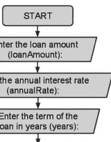

您会注意到，在 C 语言教材中，接受（读取）输入时没有描述性提示。如果不明显，最好在 I/O 符号中至少引用变量名。

- 流程图绘制在 C 语言教材的附录 C 中进行讨论。使用的符号可能适用于任何编程语言。

### 继续进行计算并以输出结束：

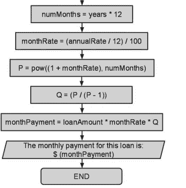

### 继续编写、保存、编译、测试、修订...

- 测试。除了所有作业中提供的示例执行外，您或您的小组（针对实验作业）还应考虑创建其他测试用例，以验证解决方案的正确性和效率。
- 改进是问题解决过程中的一个重要但常被忽视的步骤。您的第一个解决方案并不总是最好的，对算法的进一步改进可能会提高程序的效率并消除任何先前未观察到的错误。

## 第 2 章 – C 语言简介

### C 程序的结构

预处理器的特殊指令，告诉它如何为编译准备您的程序。

声明对程序所有部分可见（可用）的“对象”。

**课程标准：** 变量**绝不**可作为全局变量。

最后一部分代表函数。C 程序由一个或多个函数组成，其中一个必须命名为 `main`。

**课程标准：** 函数的两个部分**绝不**得重叠！

其他函数将在第 4 章中介绍。

### 我们的第一个程序

| #include<stdio.h><br>int main(void)<br>{<br>\tprintf("Hello World!\\n");<br>\treturn(0);<br>} | 不要将 stdio 与 studio 混淆！ |

### 对上述程序的分析

### 预处理器指令部分

- 唯一的预处理器指令语句是 #include<stdio.h>
- 此特定语句请求包含一个标准库（stdio.h），以允许在程序中使用标准输入/输出函数（例如 printf）。
- stdio.h 库将出现在您本学期编写的所有 C 程序中。其他库，例如 math.h、stdlib.h、ctype.h 和 string.h 将在本学期介绍。有关库和可用函数的列表，请参见 C 语言教材的附录 F。

### 全局声明部分

- 此程序中没有全局声明。
- 您的程序中**绝不会**有全局变量声明。
- main 函数不需要声明，并且由于没有其他用户定义的函数，此部分保持空白。

> **请务必记住：** 声明部分和执行部分**绝不**得重叠！您必须在可执行语句开始之前完成所有声明。

### 函数部分

- 此程序中只有一个函数，该函数名为 main。
- main 函数是程序开始（和结束）执行的地方。
- 每个函数都有两个不同的部分：
  1. 局部定义部分 – 建立当前函数的数据需求。
  2. 语句（执行）部分 – 完成函数任务的逻辑。

`main` 函数中只有两条可执行语句。第一条语句将在显示器上打印引号中的消息。

- 引号内包含的一个特殊字符 \n 将打印一个新行（类似于键盘上按下回车键）。
- 另一个特殊字符（本示例未使用）\t 用于显示制表符，但由于制表符的解释方式不同，最好避免使用它们以保持输出的一致外观。

第二条语句是 `return(0);`，该语句表示程序控制权从 `main` 函数返回到操作系统，终止程序。本学期稍后我们将看到 `return` 语句如何用于将程序控制权（带或不带值）从一个用户定义的函数返回到另一个函数。

### 来自我们第一个程序的更多观察

| `#include<stdio.h>`<br>`int main(void)`<br>`{`<br>` printf("Hello World!\\n");`<br>` return(0);`<br>`}` | **课程标准：** { 和 } 之间的所有语句均缩进两个空格。 |

1. 注意 { 和 } 的用法，它们指示 `main` 函数的开始 { 和结束 }。任何带有主体（花括号之间的内容）的 C 结构都不会以分号结束。
2. 大多数其他 C 语句（和声明）将以分号结束。上述规则通常成立，但总会有例外！

**注释：** 可以合理地期望一名优秀的程序员能够阅读他人编写的代码，但在逻辑复杂的片段中，代码的含义（和/或编码者的思考过程）有时并不明显。如果编写代码的人添加详细注释来帮助阅读者（可能是评分者、导师、同学或同事），那将很有帮助。**注释**是内部文档，编译器会忽略它们，旨在供源代码的其他查看者阅读。

像许多其他语言一样，C 编程语言提供两种注释方法：

1. 单行注释
2. 多行注释

**单行注释**仅从注释开始延伸到当前行的末尾。单行注释以 `//` 开头，之后的文本在当前行剩余部分中被忽略。

```
average = sum / numberStudents; //CALCULATING THE EXAM AVERAGE
```


当注释跨越多行时，使用多行注释。我们不必在每行代码前都以 // 开头，而是使用 /* 表示注释的开始，使用 */ 表示注释的结束。本学期所有程序中要求使用的标头都是多行注释的示例。/* 和 */ 之间的所有文本都会被编译器忽略。

```
/********************************************************************
*
*   Lab #: SPECIFY ASSIGNED NUMBER
*
*   Academic Integrity Statement:
*   We have not used source code obtained from any other unauthorized source,
*   either modified or unmodified. Neither have we provided access to our code
*   to another. The effort we are submitting is our own original work.
*
*   Program Description:  DESCRIBE YOUR ALGORITHM. WHAT DOES YOUR PROGRAM DO?
*                         HOW DOES IT DO IT?
********************************************************************/
```

- 关于注释的规则：
  - 注释可以出现在程序的任何位置。
  - 不要对你编写的每一行代码都加注释。
  - 你提交的每个作业都必须包含作业标头。标头中写得好的描述将减少代码中对注释的需求。
  - 你必须对程序中的每个变量都加注释。

- 注意：多行注释不能嵌套。

标识符允许我们为程序中的数据和其他对象命名。

- 程序使用的数据可能由计算机存储在唯一的内存地址中，作为程序员，我们只需记住选择的标识符，而无需记住特定的内存地址，即可从计算机内存中存储和检索数据值。

| 良好标识符 | 不良标识符 |
|---|---|
| numStudents | x |
| depth | DEPTH |
| examAvg | exam-avg |
| first_lab | 1st_lab |

- 文档标准：
  - 标识符的名称应与其在程序中的用途相关。
  - 单字符标识符很少有意义。
  - 全大写的标识符表示符号/定义常量，即在程序执行期间不会改变的值。

### 关于选择标识符的规则：

- 第一个字符必须是字母字符。
- 必须仅由字母字符、数字或下划线组成。
- 标识符的前 63 个字符有意义。
- 不能重复保留字。（C 语句中使用的单词包括；main, int, return, void，参见附录 B）

### 数据类型

### 数据类型决定了什么？

- 存储给定类型值所需的内存量。
- 给定类型的值在计算机内存中的存储方式。
- 可以对值执行哪些操作。某些操作仅限于特定的数据类型。

整数（int）类型是没有小数部分的数字。C 支持不同大小的整数数据类型：short、int、long 和 long long。

- 你将使用的整数类型取决于你计划存储的整数数据的潜在范围。较长的类型将需要更多内存。

| int range, -2147483648 to 2147483647 | 实际范围将取决于系统。 |
|---|---|

字符（char）是计算机“字母表”中可以表示的任何值。每个字符都有一个对应的小整数值。这种整数值与等效字符并列的标准表称为 ASCII 表。你将在文本的附录 A 中找到 ASCII 表。

- 由于字符在内存中存储为表示该字符 ASCII 码的整数，因此可以对字符执行算术运算！

布尔（bool）值表示逻辑数据（真或假）。在 C 语言的 C99 标准之前，仅使用整数来表示真值。课程当前使用的编译器默认不识别 bool 数据类型。

- 为了向后兼容性，非零数字表示真，零值可用于表示假。
- 本学期我们不会使用 bool 数据类型，可以使用整数值来代替。

浮点（float）数具有小数部分，例如 3.14159。C 支持不同大小（从小到大）的浮点数据类型：float、double 和 long double。最常见的实现将是 double 和 float。较长的类型将提供额外的精度并需要更多内存。

> 注意：许多编程参考资料会将任何非整数的数值称为实数。这种用法可能与你从数学中了解的实数和虚数不一致。

### 变量

变量是具有数据类型的命名内存位置。

程序中的每个变量都必须声明和定义。在 C 中，声明用于命名对象（例如变量），而定义用于创建对象。

- 声明 - 为变量命名。
- 定义 - 为变量保留内存。

要创建变量（在一步中同时完成声明和定义），你首先需要列出变量的预期数据类型，然后是所选标识符，以及一个终止分号。

- `int count; //COUNTS THE NUMBER OF GPAs GREATER THAN INPUT VALUE`

### 你需要知道：变量被定义为表示特定的数据类型，并且只能存储和表示该类型的值！

> 课程标准：每行只声明一个变量。

那些有类似 C 语言编程经验的人可能知道可以在一个语句中声明多个变量。但是，课程编程标准不允许这种做法。组织函数的数据需求可能是一项挑战，每行一个声明有助于此，并改善代码的文档和可读性。

### 变量初始化

可以在创建变量的同时对其进行初始化。

```
int count = 0;
```

上述内容将为整数 count 保留的内存空间初始化为零值。除非我们初始化变量，否则不能假设分配给变量的内存有任何默认值。未初始化的变量将被分配一个内存位置，该位置可能包含先前使用的现有数据。此类数据被称为垃圾，因为它对程序员来说没有可预测的值。

> 课程标准：将复杂的初始化表达式移动到函数的可执行语句部分。

### 常量 - 字面常量

字面常量是用于指定数据的未命名值。例如，我们想要计算圆的周长：

```
circumference = 2 * 3.14159 * radius;
```

- 上述表达式中的值 2 和 3.14159 都是字面常量。当这些值未由符号表示时，我们经常将其称为“硬编码”（下一主题）。

### 常量 - 符号/定义常量

#define 预处理指令用于创建符号常量。

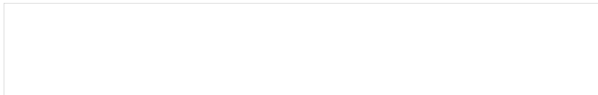

当此语句出现在预处理指令中时，程序编译前，此后出现的所有 `symbol` 都将自动替换为 `replacement value`。

> 注意：替换不会在引号内进行。

### 为什么使用符号/定义常量？

- 当程序很长且包含许多复杂计算时，很难确定算术表达式中字面常量值代表什么。使用常量可以通过为表达式中的操作数赋予意义来帮助记录程序。

- 使用常量的另一个绝佳理由是使你的程序更易于维护。例如，也许一门课程有 100 名学生。你可能在加载数据或确定平均值时使用值 100，但你也可能使用 100 将 .853 转换为 85.3%。现在，如果学生人数变为 105 呢？你需要搜索程序，确定程序中出现的哪些 100 值与课程的学生人数相关，并仅将这些值更改为 105。

> 课程标准：不鼓励使用内存常量。为什么要为永远不会改变的值请求内存？


## 符号常量示例：

| 预处理器指令 | 良好或不良用法？原因？ |
|---|---|
| `#define NUMSTUDENTS 100` | 良好，清楚地表示课程中的学生人数。 |
| `#define ONE 1` | 不良，含糊！如果值 1 在你的程序中有多种用途，则为每种用途创建一个常量！ |
| `#define NUMBEROFEXAMS 4;` | 不良。通常不使用分号。常量将替换名称后的*所有*值。 |
| `#define MaxPtsOnExam 100` | 不良，符号常量名称始终使用全大写字母。 |

课程标准：尽量减少字面常量的使用，并最大限度地使用符号常量。

## 将符号/定义常量与变量进行比较：

## 符号/定义常量的误用

| 你的代码中包含： | 第 #10 行实际编译的内容： |
|---|---|
| `3 #define APPROX_PI = 3.1415;`<br>`4`<br>`5 int main(void)`<br>`6 {`<br>`7 float radius = 4.25;`<br>`8 float circumference;`<br>`9`<br>`10 circumference = 2 * APPROX_PI * radius;` | `circumference = 2 * = 3.1415; * radius;` |

- 符号 APPROX_PI 后面的所有内容替换会在第 #10 行生成错误。
- 当观察到包含符号/定义常量的行上出现错误时，请记住错误的来源可能在于程序顶部的定义。

### 格式化 I/O（输入和输出）

printf 函数用于向显示器显示消息和格式化数据。

- 要打印数据，printf 函数需要两样东西：格式化数据的指令和要打印的实际数据。

我们在之前的示例中看到了以下用于仅显示文本的内容：

- printf("Hello World!\n");

在 printf 语句中可以打印由常量或变量表示的数据：

- printf("The year is: %d\n", 2023);

其中 %d 是整数字面常量 2023 的占位符。

- 提示：本笔记中使用术语“占位符”，书籍将把 % 称为起始标记，后面跟一个转换代码（在上面的示例中，“d”是整数值的转换代码）。

printf 语句的格式是：printf( format string, data list );

- 其中 format string 是双引号内的所有内容，要打印的变量在逗号之后的 data list 中。

- data list 可以包含由逗号分隔的多个值。

可以通过在占位符中使用不同的转换代码，用 printf 打印所有典型的 C 数据类型：

- int（整数系列值）使用 %d

- float（浮点系列值）使用 %f

- char（单个字符值）使用 %c

### 转换代码的更全面列表：

| 家族 | 类型 | 大小 | 代码 | 示例 |
|---|---|---|---|---|
| 整数 | char | None | c | %c |
| | int | None | d | %d |
| | long | | d | |
| | long long | | d | |
| 浮点 | float | None | f | %f |
| | double | | f | |
| | long double | | f | |

### 宽度修饰符：

- 宽度修饰符与转换字符一起使用，为要显示的值保留给定的空间量。

- 如果要显示的数据中的字符数少于宽度修饰符指定的数量，则数据将右对齐在保留的空间中。

- 通过在宽度修饰符之前加上 - 可以实现左对齐。此选项称为标志。

### 精度修饰符：

- 精度修饰符与浮点数据一起使用，以确定小数点右侧要显示的位数。

### 占位符摘要：

| % | | | | 大小 | 代码 |
|---|---|---|---|---|---|

标志属性是用于减法的字符，并将默认对齐从右向左移动。例如：%-10d

### 宽度修饰符、精度修饰符和变量精度修饰符的示例：

```
--------------------------------
Circumference:       26.70
Circumference:   26.703514
Circumference:       26.704
--------------------------------
```

### 关于代码段的注释：

- 所需的小数位数存储在名为 `decimalPlaces` 的变量中。

- 然后使用此值来表示要显示的所需小数位数，并替换占位符中的 *。

- 宽度修饰符是固定值 18。这也可以用变量表示，类似于精度的实现方式。

### 用于生成左侧输出的代码：

```
#include<stdio.h>
#define APPROX_PI 3.14159

int main(void)
{
	float radius = 4.25;
	float circumference;

	int decimalPlaces = 3;

	circumference = 2 * APPROX_PI * radius;

	printf("------------------\n");
	printf("Circumference: %18.2f\n", circumference);
	printf("Circumference: %18f\n", circumference);
	printf("Circumference: %18.*f\n", decimalPlaces, circumference);
	printf("------------------\n");

	return (0);
}
```

### 本学期我们将使用的主要输入函数称为 `scanf`

`scanf` 函数的格式与 `printf` 类似，它由逗号分隔的两个部分组成。

```
scanf ( format string, address list );
```

- format string 将列出预期作为输入的数据类型。在单个 `scanf` 语句中读取多个数据是可能的。address list 指示输入值应存储在计算机内存的哪个位置。

```
printf ("Enter current year -> ");
scanf ("%d", &year);
```

用户将输入一个整数，该整数将分配给变量 `year`。

- `year` 前面的 `&` 是什么？

- `&` 是**地址运算符**，指变量 `year` 表示的地址。

- 用户输入的值将存储在内存中，地址由 `year` 表示。

scanf 函数使用与 printf 相同的占位符：

- int 使用 %d

- float 使用 %f

- char 使用 %c

> 记住：\n 表示输出的换行符，在 scanf 语句中不应预期。

### 错误讨论

在学期中，我们无法涵盖你可能遇到的每个特定错误，但今天我们将把错误分为不同的类别，并在学习新主题时尽量提及常见错误。本简短部分的目的是帮助你更好地理解你正在尝试解决的错误，并与可能试图提供帮助的其他人进行沟通。

| 错误分类： | 遇到错误时，尝试回答以下问题： |
|---|---|
| 1. 语法错误<br>2. 逻辑错误 | 1. 错误何时发生？<br>2. 你对错误有什么观察？ |

### 语法错误

当你尝试编译 C 代码时，会意识到语法错误。语法错误也可以说是**编译时错误**。通常，此错误是由于你犯了一个违反 C 编程语言**语法规则**的错误，导致编译器停止工作。

- 常见的语法错误包括分号位置错误、未配对所有引号以及其他拼写错误。

- **警告**是编译器提供的反馈，表明你可能犯了一个错误。在提交作业之前，应修正所有警告。如果你正确设置了帐户，则将使用警告选项进行编译。如果未启用此选项，或使用替代编译器，你可能不会注意到任何警告。

### 可执行文件的创建

当编译器因语法错误而必须终止工作时，不会创建新的可执行文件 (a.out)。这里的关键字是**错误**，它通常包含在编译器生成的消息中。如果编译器报告**仅警告**，则可能会创建新的可执行文件 (a.out)。发出警告时，编译器已检测到语法的潜在误用，这在程序执行时通常会表现为逻辑错误。

### 警告消息示例：

```
test.c: In function 'main':
test.c:10: warning: 'ct' is used uninitialized in this function
```


### 运行时错误

这是程序运行时发生的任何错误。运行时错误可能导致崩溃。崩溃是导致程序执行意外停止的事件。导致崩溃的两种非常常见的运行时错误是 **段错误** 和 **浮点异常**。为什么编译器没有检测到这些错误？编译器可能在代码编译完成且用户输入零作为将用于表达式分母的值之前，都不知道会发生除以零的尝试（浮点异常）。

更难诊断的错误是不会导致崩溃的运行时错误！此类错误通常是因为输出（结果）不符合预期而被发现的。

```
Logical error example, determine the average of three numbers:

average = x + y + z / 3;
average = (x + y + z) / 3;
```

两条语句在语法上都是正确的；第一条语句不会导致崩溃，但会显示错误的值。第二条语句是没有逻辑错误的期望结果。

- 逻辑错误是一种运行时错误，由 **程序员负责** 在程序逻辑中实现缺陷。

### 调试

- 解决错误的过程称为调试。整个学期我们将探讨调试错误的各种方法，包括：
  - 将 **诊断打印语句** 插入到代码中，以验证程序执行过程中特定时间点的预期值。
  - 编写完成你正在解决的较大问题中的子任务的小代码段。
  - 开发代表各种预期输入的测试用例。

## 第 3 章 – C 程序结构

### 表达式

在 C 编程语言中，表达式始终归约为一个单一值。

### 表达式术语回顾：

- **运算符** - "需要采取操作的特定于语言的语法标记。" 例如：`+`、`-`、`*`、`/` 以及一些可能对你来说是新的其他运算符。如果你能从上面的定义中记住一件事，请关注 "特定于语言"，因为在 C 编程语言中，运算符及其含义可能与你在数学或其他编程语言（例如 MATLAB、Python、Excel）中看到的不同。

- **操作数** - "接收运算符操作的值。" 换句话说，就是被运算符操作的值。根据运算符的不同，评估该操作可能需要一个、两个或多个操作数。

你应该以某种形式熟悉的另一个概念是运算符 **优先级**。运算符的优先级决定 (1) 操作数属于哪个运算符，以及 (2) 它在表达式中被评估的顺序。教科书的封面内侧列出了 C 语言的 **优先级顺序**。

### 打印表达式求值：

| 代码 |
|------|
| `int a = 17; //FIRST OPERAND`<br>`int b = 5; //SECOND OPERAND`<br><br>`printf( "%d + %d = %d\\n", a, b, a + b );`<br><br>`printf( "%d / %d = %d\\n", a, b, a / b );`<br><br>`printf( "%d %% %d = %d\\n", a, b, a % b );` |

第三个 printf 的格式字符串中为什么有两个 % 字符？

- 因为 % 在 printf 的格式字符串中已经有特殊含义，所以需要两个才能在屏幕上显示一个。

> 注意：取模运算符的两个操作数都必须是整型。

### 赋值表达式

赋值表达式会对赋值运算符 (=) 右侧的操作数求值，并将该值保存在左侧变量的内存中。

> 注意：赋值表达式的左操作数必须是单个变量。

### 简单赋值示例

| | |
|------|------|
| `int x;`<br>`int y = 2;`<br><br>`x = 3 * 4;`<br>`y = y * 3;`<br>`x = x + y;` | 课程标准：运算符和操作数之间要加空格！ |

### 复合赋值示例

- 将一个值加到变量上（或应用另一种常见的数学运算），然后将新值存回变量，这是很常见的。

例如，x = x + 3；

从内存角度考虑上面发生的情况。在右侧，我们从内存中检索 x 的值，加上 3，然后将和存回由 x 表示的内存位置。

复合赋值示例：

- x += 3; //等同于 x = x + 3；

| 复合赋值表达式 | 等效的简单赋值表达式 |
| :--- | :--- |
| x += expression | |
| x -= expression | |
| x *= expression | |
| x /= expression | |
| x %= expression | |

### 示例：

```
int x = 3;
int y = 5;
int z = 7;
float a = 2.5;
float b = 5.0;

x += 4;
y /= 2;
a *= 2;
b /= 2;

z %= 4;

printf("x = %d y = %d z = %d\n", x, y, z);

printf("a = %.2f b = %.2f\n", a, b);
```

```
Example #2:
int x = 3;
int y = 5;
x /= x + y;
printf("x = %d y = %d\n", x, y);
```

### 结果是 x = x / y + y 还是 x = x / (x + y)？

- 答案：在上述情况下，该表达式将被解释为：x = x / (x + y)

### 这告诉你关于 /= 和 + 的运算符优先级的什么？

- 加法运算符的优先级高于复合赋值运算。

### 前缀 & 后缀运算符

- 在许多程序中都需要计数，这通常以 +1 或 -1 的增量进行。这两种表示法，前缀和后缀，为简单或复合的等价形式提供了更简短的替代方案，但也可以与其他表达式结合使用，正是在这里，我们发现运算符相对于操作数的位置会产生影响。

### 后缀表达式涉及一个操作数，后跟运算符。

```
int x = 0;
x++; //POSTFIX INCREMENT
printf("The value of x is: %d\n", x);
x--; //POSTFIX DECREMENT
printf("The value of x is %d\n", x);
```

### 前缀表达式涉及运算符，后跟操作数。

```
int x = 0;
++x; //PREFIX INCREMENT
printf("The value of x is: %d\n", x);
--x; //PREFIX DECREMENT
printf("The value of x is %d\n", x);
```

### 为什么上面的后缀和前缀示例之间没有可识别的差异？

- 当在没有其他表达式的单行上使用时，后缀和前缀操作是可互换的。
- 此外，在相同条件下，简单或复杂的赋值可以替代后缀或前缀操作。

### 后缀和前缀操作之间的差异在什么情况下可以体现？

- 当这些运算符用于另一个表达式中时。

| 后缀结果： | 前缀结果： |
|---|---|
| | |

演示前缀和后缀操作差异的示例：

```
int x = 0;
printf("The value of ++x is: %d\n", ++x);
x = 0; //RESET x
printf("The value of x++ is: %d\n", x++);
printf("final value of x: %d\n", x);
```

### 单个表达式中的多次修改

```
int x = 0;
int y = 0;

y = x++ + ++x - --x - x--;

printf("x: %d y: %d\n", x, y);
```

```
int x = 0;
int y = 0;
int z = 0;

x = z++ + ++y;

printf("x: %d y: %d z: %d\n", x, y, z);
```

诸如 y = x++ + ++x - --x - x-- 之类的表达式，不同编译器可能以不同方式解释。通常，未定义的操作不应保留在你的程序中，即使你已经确定了该操作在我们服务器上的确切定义方式。

> 警告：在 C 编程语言中，如果单个变量在表达式中被修改多次，结果是未定义的。

### 混合和单一数据类型表达式

我们已经看到过表达式求值的示例，其结果与我们在数学（或使用计算器、Excel 或 MATLAB）时预期的不同。

```
3 / 2 = 1
```

- 上面的例子又是这种情况！在 C 编程中，两个整数值的除法必须结果为另一个整数！

但是，如果像下面的语句那样混合类型，余数会保留在和中。

```
3 + 2.1 = 5.1
```

前一个示例中的混合类型表达式会将整数 3 隐式转换为浮点数 3.0，以便表达式的求值就像存在两个浮点值一样。你在将 3 转换为 3.0 后再与 2.1 相加时，看到任何问题吗？

- 不，没有潜在的数据丢失，这种隐式转换被称为安全的。


什么是隐式？计算机在程序员没有显式请求进行转换的情况下就自动完成了！隐式数据类型转换的规则在上图中有所说明。

- 是否存在显式数据类型转换，如果存在，如何实现显式类型转换？

### 需要显式类型转换的示例：我想计算 3 / 2，但我需要答案是 1.5！

我们在混合类型表达式中看到，整数在数据类型层次结构中被隐式提升为浮点数。我们可以在除法表达式的两个操作数之一上显式请求类型转换，从而强制除法涉及浮点数和整数。商随后将作为浮点数值生成，因为表达式现在是混合类型表达式，且第二个操作数（下面示例中的分母）被隐式更改。

```c
(float) 3 / 2 = 1.5
```

尝试以下内容：

| 表达式 | 求值 |
| :--- | :--- |
| 3 / (float) 2 | |
| (float) 3 / (float) 2 | |
| (float) (3 / 2) | |

上述表达式的结果说明了显式类型转换的优先级是什么？

### 另一次数学复习：数字舍入是问题解决中的常见任务。在本学期编程时，你必须牢记关于舍入的规则，或者更好的是，能够进行各种测试来识别你的值是如何进行舍入的。

- 有时会发生一种称为截断的“极端”舍入形式。截断是移除整个小数值，而不考虑剩余整数的舍入。

- floor 函数（位于 math.h 中，也是 MATLAB 和 Excel 中常用的函数）将移除余数并将数字减小到下一个较小的整数值。请注意其行为与 float 到 int 的转换相似。

| 表达式 | 求值 | 表达式 | 求值 |
| :--- | :--- | :--- | :--- |
| floor (6.99) | | (int) 6.99 | |
| floor (6.5) | | (int) 6.5 | |
| floor (6.0) | | (int) 6.0 | |
| floor (6.75 + 0.5) | | (int) (6.75 + 0.5) | |

### 赋值转换：

- 当赋值表达式右侧表达式的数据类型与赋值运算符左侧变量的数据类型不匹配时，会发生这种类型的转换。

- 赋值表达式右侧表达式的结果将被转换以匹配左侧变量的类型。这种转换可能是不安全的。

### 示例 - 舍入和截断

```c
int a = 3;
int c = 1;
float x = 3.99;
float y = 2.29;
float z = 8;

printf("The value of z is %f\n", z);

c = x; //ASSIGNING A FLOAT TO AN INT - ASSIGNMENT CONVERSION

printf("The value of c is %d\n", c);

printf("The value of x is %.1f and y is %.1f\n", x, y);

printf("Using mixed up placeholders: \n");
printf("x is %d and a is %f\n", x, a);

printf("Using a cast to fix placeholders: \n");
printf("x is %d and a is %f\n", (int)x, (float)a);
```

注意：由于转换代码不正确而发出的警告是另一种未定义行为的指示。显示值的确定方式基于各个处理器。

提醒：应用于变量的显式类型转换 WILL NOT 在程序剩余部分更改该变量的数据类型。你可以认为类型转换是在从变量分配的内存中检索数据值 AFTER 应用的。

### 变量值如何更改：

- 赋值运算符有能力更改变量的值。同样，复合赋值运算可以更改存储在变量分配内存中的内容。

- 在 scanf 函数调用中使用地址运算符将更改变量在内存中存储的内容。

- 前缀和后缀递增及递减将更改变量的值。所使用的特定运算符将确定此更改何时发生。

### 通过计算进行选择

等等，这不是选择章节，对吧？if/else if/else 结构在哪里？我们如何通过计算来模拟选择？这里的基本思想是，我们可以创建一个表达式，根据一个因子的值来决定是否激活该表达式，该因子乘以表达式以确定它是否仍然是最终计算的一部分。该因子通常是比较两个值以确定哪个更大的结果。鉴于本章强调了数据类型，正是这个想法在计算此类因子中起着主要作用。

### 示例：给定两个整数，显示较大的那个。

```c
#include<stdio.h>

int main(void)
{
  int x;
  int y;
  int max;

  printf("Enter two integers: ");
  scanf("%d %d", &x, &y);

  max = x / y * x + y / x * y;

  printf("Max value input is: %d\n", max);

  return(0);
}
```

### 示例执行：

输入两个整数：5 8
输入的最大值是：8

输入两个整数：9 6
输入的最大值是：9

输入两个整数：10 3
输入的最大值是：30

- 当其中一个数字是另一个数字的两倍或更多时，你看到问题了吗？

- 我们如何修复这个问题？我们如何确保计算的商始终是 0 或 1？

### 修订以消除将较大值乘以大于一的因子：

```c
factor1 = x / y;
factor2 = y / x;

factor1 = (factor1 + 2) % (factor1 + 1);
factor2 = (factor2 + 2) % (factor2 + 1);

max = factor1 * x + factor2 * y;
```

- 引入两个整数 factor1 和 factor2 来存储比较 x 和 y 的值。

- 我们知道值为零表示两个值中较小的那个，而大于零的值是较大的那个。

- 这里使用模运算符将所有非零值缩放为 1，同时不更改存储零的因子，因为 2 % 1 是零。

### 修订程序的示例执行：

输入两个整数：10 3
输入的最大值是：10

输入两个整数：8 8
输入的最大值是：16

- 当两个整数值相同时，我们仍然有问题！

### 修订以消除当输入两个值相同时输出重复的问题：

```c
factor1 = x / y;
factor2 = y / x;

factor1 = (factor1 + 2) % (factor1 + 1);
factor2 = (factor2 + 2) % (factor2 + 1);

max = factor1 * x + factor2 * y;

max = max / (factor1 + factor2);
```

- 只有当因子之和为二时，两个值才相同。在所有其他情况下，因子之和将为一。

- 既然如此，我们只需要将 max 除以因子之和，以消除这种不需要的值翻倍。

### 示例：利用我们现在对数据类型和表达式的了解，给定学期获得的总分，计算获得的字母等级。

| | |
|---|---|
| 输入获得的总分：470<br>获得的分数：470 获得的等级：A | 输入获得的总分：305<br>获得的分数：305 获得的等级：D |
| 输入获得的总分：415<br>获得的分数：415 获得的等级：B | 输入获得的总分：304<br>获得的分数：304 获得的等级：F |

### 解决方案：

```c
#define A_MIN 470
#define B_MIN 415
#define C_MIN 360
#define D_MIN 305

int totalPoints; //TOTAL POINTS EARNED BY STUDENT
char courseGrade; //GRADE EARNED BY STUDENT
int gradePoints; //4 - A, 3 - B, 2 - C, 1 - D, 0 - F

printf("Enter total points earned: ");
scanf("%d", &totalPoints);

gradePoints = totalPoints / A_MIN;
gradePoints += totalPoints / B_MIN;
gradePoints += totalPoints / C_MIN;
gradePoints += totalPoints / D_MIN;

courseGrade = 'F' - gradePoints;
courseGrade -= totalPoints / D_MIN; //TO ACCOUNT FOR 'E'
printf("Points Earned: %d Grade Earned: %c\n", totalPoints, courseGrade);
```

### 为什么使用函数？

### 自顶向下设计

在较大问题中识别较小任务被称为**因式分解**，并导致程序的小型可管理子部分被设计、单独开发然后实现。将任务分解为更可管理的部分的过程称为**自顶向下设计**。

### 因式分解何时停止？

这种因式分解应持续进行，直到任务“仅由内在理解且无法进一步细分的基本过程组成。”（第 150 页，C 程序设计文本）

- 简单来说，一个函数应包含**单个任务**。要小心不要将任务划分得使得生成的函数是平凡的。例如，输入一个值的操作包括 `printf`、`scanf` 和输入的验证。进一步划分此输入任务将导致平凡的函数。

- `math.h` 库中可以找到更多“单个任务”函数的良好示例。这些函数接受一个或多个值作为输入，并生成一个单一值作为结果。除了这些函数的任务外，不包括输入、输出或进一步计算等附加任务。“单个任务”理念确实提高了函数未来可重用的可能性。

### 何时需要新函数？

- 只完成单个任务的函数被称为**功能内聚**。我们的目标是开发此类函数，并避免将多个不相关的任务放在同一个函数中。

- 函数在程序中完成任务背后的逻辑在程序中应**仅出现一次**。这一想法的动机是我们希望**消除冗余代码**，即出现在程序多个位置的逻辑。

- 函数正在完成的任务本身应与程序其余部分分开**可测试**。


### 基本函数术语

在所有编写良好的程序背后都有相同的基本组件，即函数。函数将是先前描述的单个子任务的实现，并包含其解决方案。什么是函数？根据 Gilberg 和 Forouzan 的教材，“一个在程序中执行过程的命名代码块；一个由头部、函数名和主体组成的可执行代码单元，旨在在程序中执行任务。”

- 当请求函数的服务时，必须调用它。发起调用的函数称为调用函数，被调用的函数称为被调用函数。
- 在调用函数和被调用函数之间交换数据是常见的。
  - 向函数发送（传递）数据的行为称为参数传递。
  - 函数可能会完成计算并希望将结果与调用函数共享。我们将此称为从函数返回一个值。
- 在 C 编程语言中，函数最多只能返回一个值。

```c
#include<stdio.h>
void greeting(void); // FUNCTION DECLARATION
int main(void)
{
    // LOCAL DECLARATIONS - NONE
    // EXECUTABLE STATEMENTS
    greeting(); // FUNCTION CALL
    return (0);
}

// FUNCTION DEFINITION
void greeting(void)
{
    // LOCAL DECLARATIONS - NONE
    // EXECUTABLE STATEMENTS
    printf("Hello World!\n");
    return;
}
```

在上述示例中，我们观察到 main 函数包含两条语句，一条语句是调用名为 greeting 的函数，第二条语句是终止返回 return (0); 语句。当 main 调用函数 greeting 时，程序控制权离开 main。函数 greeting 将执行其两条语句，将 Hello World! 打印到显示器上，然后将程序控制权返回给调用函数 main。main 函数将在函数调用后从中断处继续执行，在此例中，main 的下一条语句将是终止返回 return (0) 语句。

- 当调用函数时，程序中指令执行的顺序现在会从 main 跳转到 greeting。
- 会“记住”在 main 中进行函数调用的位置，以便当被调用函数（greeting）终止时，main 中语句的执行将继续执行函数调用之后的语句。

### 用户定义的函数

与变量一样，函数必须同时进行声明和定义。

| | |
|---|---|
| 函数声明将出现在程序的全局声明部分。 | 编译器在寻找什么？ |
| 函数声明语句将告诉编译器：<br>(1) 从函数返回的值的类型。<br>(2) 函数的名称。<br>(3) 发送到函数的数据。参数的数量、参数的类型和参数的顺序由函数的声明确定。 | • 用户定义函数的三个组件（声明、定义和调用）保持一致。 |
| 函数定义包含完成任务所需的代码。 | 当找不到定义时生成什么错误？<br>undefined reference |
| | 当找不到声明时生成什么错误？<br>warning: implicit declaration of function |

### 基本函数设计

| | 有参数 | 无参数 |
|---|---|---|
| 有返回值 | 带参数且返回值的函数。 | 不带参数但返回值的函数。 |
| 无返回值 | 带参数但不返回值的函数。 | 不带参数也不返回值的函数。 |

void 函数中“void”是什么意思？
• 这样的函数不返回值。

### 用数据类型来描述函数是什么意思？

- 用数据类型描述函数是指它返回的值的类型。

### 无参数且无返回值的函数

- greeting 函数是 void 函数的一个示例，适用于处理不需要返回值的任务。

```c
#include<stdio.h>

void welcome(void); // FUNCTION DECLARATION

int main(void)
{
    welcome(); // FUNCTION CALL

    return(0);
}
```

```
/********************************************************************************
*                                                                       *
*   Function Information                                                *
*                                                                       *
*   Name of Function: welcome                                           *
*                                                                       *
*   Function Return Type: void                                          *
*                                                                       *
*   Parameters (list data type, name, and comment one per line): NONE   *
*                                                                       *
*   Function Description: Displays the welcome message to the user.     *
*                                                                       *
********************************************************************************/
```

```c
void welcome(void)
{
    printf("\n\nWelcome to our calculator program!\n\n");
}
```

**课程标准：** 为每个用户定义的函数使用课程头文件（.hfx）。`main` 函数不需要头文件。作业头文件将充当 `main` 的头文件。

### 无参数但有返回值的函数

- 输入函数是这类函数的良好示例：这类函数不向函数中传入数据，但能够生成并返回一个单一值。

```c
#include<stdio.h>
// FUNCTION DECLARATIONS
void welcome(void);
int getInput(void);
int main(void)
{
// LOCAL VARIABLE DECLARATIONS
int operand1; // FIRST OPERAND ENTERED BY USER
int operand2; // SECOND OPERAND ENTERED BY USER
// EXECUTABLE STATEMENTS
welcome();
operand1 = getInput(); // THE ASSIGNMENT OPERATOR AWAITS THE
operand2 = getInput(); // VALUE RETURNED FROM operandInput
return(0);
}
```

函数调用的顺序为什么重要？为什么不将新的两条可执行语句添加到最前面？

你为什么会考虑在两个函数调用后添加一条打印语句来显示这两个整数的值？

如果在两个函数调用之前打印这两个整数，会发生什么？

### 将输入函数的定义添加到我们正在进行的工作中：

```
/*************************************************************
* Function Information
* Name of Function: getInput
* Function Return Type: int
* Parameters (list data type, name, and comment one per line): NONE
* Function Description: Accept and return user integer input.
***************************************************************/
int getInput(void)
{
    // LOCAL DECLARATIONS
    int op; // USER'S OPERAND INPUT - ONLY VARIABLE AVAILABLE TO THIS FUNCTION
    printf("Enter integer operand --> ");
    scanf("%d", &op);
    return(op);
}
```

// 为了节省空间，已从此函数中删除课程函数头部

```c
void welcome(void)
{
    printf("\n\nWelcome to our calculator program!\n");
}
```

### 观察：

- 用户输入的值将返回给调用函数，并在 main 中完成赋值表达式。
- 请注意，函数声明列出了返回类型 int，并通过空括号指示没有参数。

### 带参数且有返回值的函数

```c
#include<stdio.h>
// FUNCTION DECLARATIONS
void welcome(void);
int getInput(void);
int calcRemainder(int, int);
int calcQuotient(int, int);
int main(void)
{
// LOCAL VARIABLE DECLARATIONS
int operand1; // FIRST OPERAND ENTERED BY USER
int operand2; // SECOND OPERAND ENTERED BY USER
int remain; // HOLDS THE RESULT OF THE REMAINDER
int quotient; // HOLDS THE RESULT OF INT DIVISION
// EXECUTABLE STATEMENTS
welcome();
operand1 = getInput(); // THE ASSIGNMENT OPERATOR AWAITS THE
operand2 = getInput(); // VALUE RETURNED FROM operandInput
remain = calcRemainder(operand1, operand2);
quotient = calcQuotient(operand1, operand2);
return(0);
}
```


```
/***************************************************************/
*
* Function Information
*
* Name of Function: calcRemainder
*
* Function Return Type: int
*
* Parameters (list data type, name, and comment one per line):
*   1. int op1 - FIRST OPERAND FOR REMAINDER CALCULATION
*   2. int op2 - SECOND OPERAND FOR REMAINDER CALCULATION
*
* Function Description: Returns the result of the modulus operator for
*   two integer values.
*
/***************************************************************/
```

```
int calcRemainder(int op1, int op2)
{
    int rem;    //TEMPORARY STORAGE OF REMAINDER

    rem = op1 % op2;

    return(rem);
}
```

```
//COURSE FUNCTION HEADER REMOVED FROM OLD FUNCTIONS TO SAVE SPACE
```

```
int getInput(void)
{
    //LOCAL DECLARATIONS
    int op;     //USER'S OPERAND INPUT - ONLY VARIABLE AVAILABLE TO THIS FUNCTION

    printf("Enter integer operand -> ");
    scanf("%d", &op);

    return(op);
}
```

```
void welcome(void)
{
	printf("\n\nWelcome to our calculator program!\n");
}
```

```
/************************************************************
*
*   Function Information
*
*   Name of Function: calcQuotient
*
*   Function Return Type: int
*
*   Parameters (list data type, name, and comment one per line):
*       1. int op1 – FIRST OPERAND FOR REMAINDER CALCULATION
*       2. int op2 – SECOND OPERAND FOR REMAINDER CALCULATION
*
*   Function Description: Returns the result of the division operator for
*       two integer values.
*
*************************************************************/
```

```
int calcQuotient(int op1, int op2)
{
	return(op1 / op2);
}
```

> 注意：任何局部声明（calcRemainder 定义中的 rem 变量）仍然会在右侧注释，并且不会包含在课程函数头的参数中。

Observations:

- 在 calcRemainder 中，创建一个新的局部变量来存储模运算符的值，然后返回该变量的值。
- 在 calcQuotient 函数中，返回表达式的结果，而不是在函数中局部存储。
- 函数定义列出的顺序无关紧要。但是，main 应该放在第一个！！

### 具有参数且不返回值的函数（void）

- 提醒：如果函数不返回值，则它是 `void`。“void 函数”这一术语与参数无关，仅指不返回值。

| 内容 |
|------|
| //FUNCTION DECLARATIONS<br>void welcome(void);<br>int getInput(void);<br>int calcRemainder(int, int);<br>int calcQuotient(int x, int y);<br>void displayResults(int, int, int, int); |
| 函数声明中标识符的说明： |
| int main(void)<br>{<br>//LOCAL VARIABLE DECLARATIONS<br>int operand1; //FIRST OPERAND ENTERED BY USER<br>int operand2; //SECOND OPERAND ENTERED BY USER<br>int remain; //REMAINDER GENERATED BY MODULUS<br>int quotient; //QUOTIENT GENERATED BY DIVISION<br><br>//EXECUTABLE STATEMENTS<br>welcome();<br><br>operand1 = getInput();<br>operand2 = getInput();<br><br>remain = calcRemainder(operand1, operand2);<br>quotient = calcQuotient(operand1, operand2);<br><br>displayResults(operand1, operand2, remain, quotient);<br><br>return (0);<br>} |
| 关于 main 函数的观察： |

```
/******************************************************************
*
* Function Information
*
* Name of Function: displayResults
*
* Function Return Type: void
*
* Parameters (list data type, name, and comment one per line):
*   1. int op1 – first operand for quotient and modulus calculation
*   2. int op2 – second operand for quotient and modulus calculation
*   3. int rem – result of modulus calculation
*   4. int quo – result of division calculation
*
* Function Description: Displays final result of calculator program.
*******************************************************************/
```

```
void displayResults(int op1, int op2, int rem, int quo)
{
    printf("%d / %d = %d\n", op1, op2, quo);
    printf("%d %% %d = %d\n", op1, op2, rem);
}
```

```
int calcRemainder(int op1, int op2)
{
    int rem; //TEMPORARY STORAGE OF REMAINDER
    rem = op1 % op2;
    return(rem);
}

int calcQuotient(int op1, int op2)
{
    return(op1 / op2);
}
```

### 观察：

- 仅为了在笔记中节省空间，包含了新的 `displayResults` 函数定义及其头部。你定义的每一个用户函数都必须包含一个完整的课程函数头部！
- 注意这个新函数头部的声明！在括号之间列出了函数的参数类型和数量。
- 参数的数量、类型和顺序很重要！但是，函数声明中出现的任何参数名称（标识符）都是可选的且不具约束力。

```
int getInput(void)
{
   //LOCAL DECLARATIONS
   int op;

   //EXECUTABLE STATEMENTS
   printf("Enter integer operand --> ");
   scanf("%d", &op);

   return(op);
}

void welcome(void)
{
   printf("\n\nWelcome to our calculator program!\n\n");
}
```

### 关键编程标准 - 来自课程标准。

凭借我们实现用户定义函数的能力，main 函数中只允许以下内容：

- 1. 声明要传递给函数的变量。
- 2. 由 main 调用用户定义的函数。
- 3. 有限数量的控制结构（参见第 5 和 6 章），以将前两项任务保留在 main 函数中。

此外，每个用户定义的函数可以代表你较大程序中的单个任务。未能如这里和课程标准中所述良好使用用户定义的函数，将导致所有要求使用用户定义函数的作业得零分。

### 参数传递

当我们向函数发送数据时，计算机内存中发生了什么？

有两种可能性：

- 1. 传递给函数的值被存储在表示新且唯一内存位置的新变量中。结果本质上是对原始值进行副本。
- 2. 被调用函数中的变量与调用函数中的变量相关联，使它们引用同一内存位置。在被调用函数中所做的更改会更改调用函数中的变量。

```
void exchangeValues(int, int);

int main(void)
{
    int x = 3;
    int y = 5;

    printf("Before the function: x = %d y = %d\n", x, y);

    exchangeValues(x, y);

    printf("After the function: x = %d y = %d\n", x, y);

    return(0);
}

void exchangeValues(int a, int b)
{
    int temp;

    printf("Before the exchange: a = %d b = %d\n", a, b);

    temp = a;
    a = b;
    b = temp;

    printf("After the exchange: a = %d b = %d\n", a, b);
}
```

### 生成的输出：

- 如果可能性 #1 为真，那么更改 `a` 不会更改 `x`，这由 `main` 中的最终打印语句证明。
- 如果可能性 #2，那么在被调用函数中更改变量 `a` 时，当控制返回到 `main` 时，我们将观察到变量 `x` 被更改。

基于前面程序的结果，我们得出结论：从调用函数传递到被调用函数的只是变量值的副本。这种向函数传递数据的特定范式通常称为 **按值传递**。函数之间数据保护的概念以按值传递方法为基础。调用函数将接收到的值存储在新的内存位置中，可以自由地对其值的副本进行更改，而无需担心此类更改可能如何导致调用函数中出现逻辑错误。

### 如果相应的变量具有相同的名称和数据类型，之前程序的结果会改变吗？

- 在调用函数和被调用函数中使用相同的数据类型并不决定数据是否按值传递。

### 在按值传递范式中，调用函数和被调用函数中的变量标识符起什么作用？

- 在调用函数和被调用函数中使用相同的标识符并不决定值是否按值传递。

### 按值传递（向下通信）与按地址传递（向上通信）

此时你应该思考的几个问题是：

- 1. 从函数中“返回”多个值是否可能？
- 2. 是否有按值传递的替代方案？

两个问题的答案都是肯定的，并且涉及相同的想法。我们需要能够做的不是传递参数值的副本，而是在被调用函数中的变量与调用函数中的变量之间建立连接。为此，我们必须将变量的**内存地址**传递给函数，而不是传递该变量值的副本。通过将调用函数中变量的内存地址传递给被调用函数，我们现在可以更改该内存地址的内容，任何此类更改都是永久的，并且在被调用函数终止后仍可供调用函数使用。

要使用按地址传递，我们需要了解一些关于 **指针** 的知识。我们将在第 9 和 10 章详细介绍指针，但现在使用它们来实现按地址传递将对我们有益。

### 指针操作

- 要传递单个变量的地址，我们在该变量名称之前使用地址（&）运算符。
- **指针** 是一个变量，它**存储内存地址**作为其值。我们需要这样的变量来接收从调用函数发送到被调用函数的地址。


### 使用按地址传递技术修改前示例

```
#include<stdio.h>

void exchangeValues(int*, int*);

int main(void)
{
int x = 3;
int y = 5;

printf("Before the function: x = %d y = %d\n", x, y);

exchangeValues(&x, &y);

printf("After the function: x = %d y = %d\n", x, y);

return(0);
}

void exchangeValues(int *a, int *b)
{
int temp;

printf("Before the exchange: a = %d b = %d\n", *a, *b);

temp = *a;
*a = *b;
*b = temp;

printf("After the exchange: a = %d b = %d\n", *a, *b);
}
```

- 注意：使用按地址传递的函数不一定是 void 类型，仍可通过 return 关键字返回值。此类函数也不要求所有参数均按地址传递。

### 描述 `exchangeValues` 函数中两个打印语句之间的三个赋值语句表达式：

- `temp = *a;` 将 `a` 所指向位置中的值赋给 `temp` 变量。
- `*a = *b;` 检索 `b` 所指向位置中的值，并将其赋给 `a` 所指向的位置。
- `*b = temp;` 将 `temp` 的值赋给 `b` 所指向的位置。

### 何时使用按地址传递？

当需要修改多个值，并且在被调用函数终止后，该修改仍需保留在调用函数中时。

### 并且

该函数仍满足功能内聚的定义，即它只完成一项基本任务。

### 作用域

对象（可视为变量或函数）的作用域是指程序中定义该对象且可以通过其声明标识符引用它的区域。两个或多个对象可以拥有相同的标识符吗？答案是肯定的，前提是每个对象的**作用域**不重叠！在许多情况下，重叠作用域中重复使用标识符是编译器错误。在其他情况下，这是一种糟糕的设计选择。

本课程使用两种作用域级别：**全局**和**局部**。所有**函数**将**全局**声明，所有**变量**将局部声明。

### 结构图

**结构图**是程序的主要设计工具。在尝试开发任何流程图或编写任何代码之前，你应先完成程序的结构图。结构图将表示程序中存在的每个用户定义函数及其调用顺序。结构图完成后，你可以为每个函数创建流程图。

### 结构图规则与符号

左侧的两个符号用于指示函数调用。第一个符号表示程序中仅调用一次的函数。函数名称将放在方框内。

第二个符号在右下角包含一个“交叉网格”。所有带有此类交叉网格的函数表示它在程序中被调用多次。为了限制结构图中子函数的数量，你只需列出该特定函数调用的子函数（如果有）一次（即第一次使用时）。

### 如何读取结构图

结构图自上而下、再从左到右阅读。书籍在顶部方框应包含什么内容上不一致，我们建议此方框表示 main 函数。结构图仅显示用户定义函数的调用顺序以及交换的数据，它不包含任何代码！

以下是基本结构图规则的摘要：

- (1) 结构图中的每个矩形表示一个用户定义函数。标准 C 函数（`stdio.h`、`math.h`）不包括在内。
- (2) 矩形中的名称应传达函数的目的。它是程序中将使用的名称。
- (3) 结构图仅包含函数流程，不指示其他代码。
- (4) 常用函数（即程序中被调用多次的函数）通过矩形右下角的斜线表示。如果此类函数包含其他函数调用，则完整结构只需显示一次。

在某些情况下，列出进入和退出用户定义函数的值可能会有所帮助。左侧的符号可用于指定进入和退出函数的此类值。发送到函数的变量应列在线条左侧，而从函数出来的变量应列在右侧。

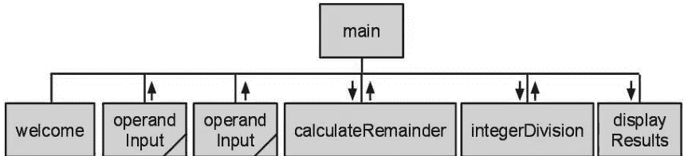

### 上述结构图的设计如何体现对良好设计程序中 `main` 函数角色的预期？

- 一般来说，结构图更倾向于水平（宽）而非垂直（深）。这表明大部分，如果不是全部，用户定义的函数都应从 `main` 函数内部调用。
- 如前所述，每个用户定义的函数应仅限于完成程序设计要解决的较大问题中的单一任务。

### 有缺陷的设计 #1：

### 有缺陷的设计 #2：

### 对上述设计的担忧：

- 函数数量不足。
- 并且
- 一个函数包含程序中的所有任务。
- main 函数仅启动程序，不做其他事情。
- 或
- 一个函数包含程序中的微不足道的任务。
- main 函数完成其余任务。

### 对上述设计的担忧：

- main 函数仅启动程序，不做其他事情。
- 对 return 语句或参数传递技术缺乏理解。

### 问题求解方法简介

- 1. **明确程序的要求。**
  - 在入门编程课程中，规格由布置问题的教师提供。
  - 在现实世界中，你将与同行工程师、科学家、主管和/或客户会面，以确定软件必须如何以及成功完成什么。
  - **建议：** 在大学毕业前，尝试在此领域获得工作经验。可以参与 EPICS、ENTR 等项目，以及专业实践经历。

- 2. **分析问题。**
  - 使用自顶向下设计分解任务，并利用**结构图**等工具。
  - 此步骤需要开发解决问题所需的数学公式。有些公式非常常见，例如确定直线斜率、两点之间的距离、直角三角形斜边的长度，但其他公式则更高级且特定于你的工程或科学学科。
  - 一旦确定了解决问题所需的算术表达式，请注意考虑可能出现的潜在错误。例如除以零或处理不可能出现的负值（人数、某些距离和时间度量）。**通过规划，你开始梳理逻辑中的潜在错误。**

- 3. **设计软件解决方案。**
  - 在此过程中，开发算法的流程图或伪代码表示。流程图和伪代码都是你可用来设计算法以解决当前问题的技术。
  - **应用：** 与团队合作时，请务必以可视化方式展示你的逻辑，以便他人在你提出解决方案构思时能够理解你的思路。
  - 随着解决问题能力的提高，请务必分别设计每个任务的解决方案。当所有任务都设计完成后，实现这些任务以创建最终解决方案的工作将容易得多。

- 4. **将设计转换为代码。**
  - 仅编写解决方案的小部分，通常一次一个函数。
  - 测试你所做的每一个更改！
  - 在首次编译和测试之前，切勿编写整个程序！
  - **好处：** 在流程的前几个步骤投入时间，可以使此步骤：(1) 时间上更短，(2) 令人沮丧的情况大大减少。

- 5. **测试和调试实现。**
  - 测试时，请务必开发超出作业提供内容的测试用例和预期输出。
  - 你运行了哪些测试来确保程序能处理所有合理输入？
  - 一般情况、边界情况、极端/压力情况。

- 6. **解决方案的改进。**
  - 恭喜，你有了一个解决方案！现在，审查你的解决方案，确保其高效、设计良好、满足所有要求、不产生警告或语法错误，并符合所有课程文档和编程标准。
  - **你的第一个解决方案很少是最佳解决方案。** 尽一切努力改进你的算法，以便尽可能充分利用计算机的有限资源。


### 结构化程序设计 – 它是什么？

- 结构化程序设计中有三个基本思想：选择、重复和序列。
- **序列**是第 4 章（用户定义函数）的主题。使用函数允许程序的各个指令按除第一条语句到最后一条语句以外的顺序执行，有些语句可能会被执行多次。
- **选择**是第 5 章的主题。选择结构允许根据给定条件执行某些指令，而排除其他指令。这是学期中第一个点，在此点程序中的代码可能不会在每个测试用例中全部执行。
- **重复**是第 6 章的主题。通常，当满足特定条件或直到满足条件时，需要重复执行一组指令。重复结构允许使用逻辑来指定条件并识别要重复的指令。

## 第 5 章 – 选择

函数允许我们编写模块化代码并在函数之间转移控制（改变执行的代码**序列**）以完成各个任务，而我们接下来需要的是**选择**和**重复**代码的能力。**选择**正是第 5 章的主题。

到目前为止，在课程中，我们始终观察到程序中的所有语句至少被执行一次。

- 虽然用户定义的函数允许我们在此阶段改变序列，但当我们进行函数调用时，该函数中的所有代码都会被执行。
- 选择的概念涉及根据条件选择要执行或排除的代码。

### 逻辑数据

如果一段数据传递 true 或 false 的值，则称为**逻辑**数据。逻辑数据由**逻辑表达式**生成。逻辑表达式用于选择和重复结构中。C 语言传统上没有专门用于逻辑数据的数据类型，而是使用数值类型来表示 true 和 false。

> 注：我们通常使用 1 表示 true 值，但是，任何非零值都被视为 true。

### 逻辑运算符

主要有三个逻辑运算符。逻辑运算符的操作数根据其逻辑状态（true 或 false）进行考虑。

| 运算符 | 字符 | 描述 | 优先级 |
| --- | --- | --- | --- |
| NOT | ! | 一元运算符，将 true 值改为 false，将 false 值改为 true。 | |
| AND | && | 二元运算符，仅当两个操作数都为 true 时为 true，其他所有情况为 false。 | |
| OR | || | 二元运算符，仅当两个操作数都为 false 时为 false，其他所有情况为 true。 | |

### 逻辑运算符真值表：

| | 非 | | | 与 | | | 或 | | |
| --- | --- | --- | --- | --- | --- | --- | --- | --- | --- |
| x | !x | x | y | x && y | x | y | x || y |
| 真 | | 真 | 真 | | 真 | 真 | |
| | | 真 | 假 | | 真 | 假 | |
| 假 | | 假 | 真 | | 假 | 真 | |
| | | 假 | 假 | | 假 | 假 | |

### 求值逻辑表达式

- 即，求值包含逻辑运算符的表达式。
- 求值数学表达式时，不考虑每个运算符的情况极为罕见。
- 如何在求值表达式的每个运算符之前对表达式求值？对于逻辑表达式，只有两种可能的结果，我们将看到，当表达式的结果可以确定时，求值将停止，或短路，在不需要求值每个运算符时提前停止。

### 短路方法：

| 示例（类似于）教材中的程序 5-1： | 输出： |
| --- | --- |
| int a = 1;<br>int b = -1;<br>int c = 0;<br><br>printf("%2d && %2d = %2d\n", a, b, a && b);<br>printf("%2d && %2d = %2d\n", a, c, a && c);<br><br>printf("%2d || %2d = %2d\n", a, b, a || b);<br>printf("%2d || %2d = %2d\n", a, c, a || c);<br><br>printf("%2d && %2d = %2d\n", a, !c, a && !c);<br>printf("%2d || %2d = %2d\n", !a, c, !a || c);<br><br>printf("---a && !c = %2d\n", --a && !c);<br>printf("b++ || ++c = %2d\n", b++ || ++c);<br><br>printf("a = %d b = %d c = %d\n", a, b, c); | 1.<br>2.<br>3.<br>4.<br>5.<br>6.<br>7.<br>8.<br>9. |

为什么我们会观察到上面代码段中最后一个打印语句的值？

### 关系和相等运算符

C 语言中有四个关系运算符和两个相等运算符。这些运算符都是二元运算符，对两个操作数进行求值。关系表达式的结果是一个逻辑（0, 1）值。

### 关系和相等运算符（图 5-4，第 236 页）：

| 类型 | 运算符 | 含义 | 优先级 |
| --- | --- | --- | --- |
| 关系 | < | 小于 | 10 |
| | <= | 小于或等于 | |
| | > | 大于 | |
| | >= | 大于或等于 | |
| 相等 | == | 等于（相等） | 9 |
| | != | 不等于（不相等） | |

### 复合语句

可以将一系列关系、相等和逻辑运算符组合起来，形成所谓的复合语句。此类语句（或表达式）的结果将是一个（true 或 false）逻辑值。

当复合逻辑表达式仅包含单个变量（例如 x > 0 && x < 10）时，其含义是明确的。

通常，通过加入括号可以使复合语句更易读。你能确定下面哪个表达式与其他两个不同吗？

### 示例：

```
int x = 3;
int y = 2;
int z = 3;

printf("Result #1 = %d\n", x <= 3 || y >= 2 && z != 3);
printf("Result #2 = %d\n", x <= 3 || (y >= 2 && z != 3));
printf("Result #3 = %d\n", (x <= 3 || y >= 2) && z != 3);
```

> 注：当在同一表达式中使用 && 和 || 时，我们的编译器会发出警告，建议使用 ( 和 )。

### 扩展前面的示例：

```
int x = 3;
int y = 2;
int z = 3;
printf("Result = %d\n", x++ <= 3 || y++ >= 2 && z++ != 3);
printf("x: %d y: %d z: %d\n", x, y, z);
```

| 上面程序的输出是什么？ | 什么是运算符绑定？这与优先级有何关系？ |
| --- | --- |
| | 运算符的优先级可以确定表达式中哪些操作数绑定到它。<br>因为逻辑 AND 运算符的优先级高于逻辑 OR 运算符，表达式 y++ >= 2 是 AND 运算符的左操作数，而不是 OR 运算符的右操作数。 |

| 示例： | 如何求值？ |
| --- | --- |
| int x = 7;<br>int y = 9;<br>int z = 5;<br>int result;<br>result = !(++y - 9) || -5 + z++ && x++;<br>printf("x: %d y: %d z: %d\n", x, y, z); | |

### 补

关系、相等和逻辑运算符中的每一个都是另一个关系、相等或逻辑运算符的补。每当一个逻辑表达式为 true 时，其补为 false；每当一个逻辑表达式为 false 时，其补为 true。

- 例如，x < 3 表示所有小于 3 的数，其补 x >= 3 表示所有其他值。

### 关系和相等运算符的补：

### 逻辑运算符的补：

| 原始表达式： | 补： | |
| --- | :--- | :--- |
| x > 0 && x < 10 | | |
| x > 0 && x < 10 || y != 0 | | |
| !(x != 1 && x != 2) | 补 #1： | 补 #2： |
| !x && !y | 补 #1： | 补 #2： |
| x == 0 || y == 0 | 补 #1： | 补 #2： |

### 选择流程图示例 #1：

向用户询问其考试分数，并根据分数告知他们获得的等级（基于 90、80、70、60 的 A、B、C、D、F），并给予适当的祝贺（或不）消息。

### 步骤 #1 – 程序的规范是什么？

- 输入 – 单个分数。
- 输出 – 与获得的等级相关的消息和获得的等级。

### 步骤 #2 – 分析问题

- 表示此问题的用户定义函数的结构图。
- 注：通常，最好消除选择结构中多个路径共有的任何代码。此类代码理想情况下应位于选择结构之前或之后。选择结构中的每个路径都应包含特定于该条件的语句。


### 双向选择

- 逻辑表达式的求值结果为真或假。
- 如果结果逻辑值为真，我们有一条路径可走；但如果结果为假，我们将执行第二条路径下的替代（且唯一）语句。
- 在 C 语言编程中，双向选择有两种选择结构可用：if/else 和条件表达式。

### if / else

- if/else 结构（或非常相似的变体）几乎存在于所有编程语言中。其思想是：对逻辑表达式求值，当逻辑表达式为真时执行一组语句，当其为假时执行另一组替代语句。

```
if(logical expression)
{
//TRUE ACTIONS TO EXECUTE
}
else
{
//FALSE ACTIONS TO EXECUTE
}
```

- 如果列出的第一个条件（逻辑表达式）求值为真，则执行 if 主体中的语句，否则执行 else 主体中的语句。

### 双向逻辑图：

### 示例：函数接收一个非负整数，当为偶数时加 1 并返回，当为奇数时减 1 并返回。

```
int changeNumber(int n)
{
    if(n % 2 == 0)
    {
        n++;
    }
    else
    {
        n--;
    }
    return(n);
}
```

### 示例 #2：修改前一个函数，仅在奇数时更改值（减 1）。

| int changeNumber(int n) | int changeNumber(int n) |
|---|---|
| { | { |
| if (n % 2 == 1) | if (n % 2 == 0) |
| { | { |
| n--; | //永远不要让主体为空 |
| } | } |
| else | else |
| { | { |
| ////永远不要让主体为空 | n--; |
| } | } |
| return(n); | return(n); |
| } | } |

### 修改问题的最佳解决方案（else 为可选）：

```
int changeNumber(int n)
{
if (n % 2 == 1)
{
n--;
}
return(n);
}
```

### 嵌套选择

if/else 可以包含任何可执行语句，包括另一个 if/else 结构。当这种情况发生时，我们称之为嵌套选择。通常，嵌套选择涉及对两个或多个不同变量的比较。

### 嵌套选择的逻辑流程：

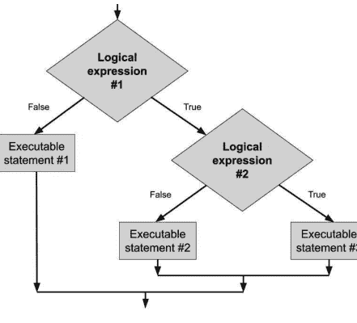

### 嵌套选择的代码示例：

```
int calcStatus(float gpa, int credit_hrs)
{
 int status;
 if(credit_hrs > 120)
 {
 if(gpa >= 3.50)
 {
 status = HONORS;
 }
 else
 {
 status = CANDIDATE;
 }
 }
 else
 {
 status = NONCANDIDATE;
 }
 return(status);
}
```

### 悬空 else 逻辑错误和嵌套 if/else

- 调试注意事项：请注意，本文和许多其他资料并不总是对仅包含单条语句主体的 if/else 语句使用 { }。然而，这可能导致一个称为“悬空 else”的难以调试的逻辑问题。
- 由于此问题可能非常难以调试，我们将要求所有 if/else 语句都使用 { }，即使主体仅包含单条可执行语句。

| Example of dangling else logical error: | Output Generated: |
|---|---|
| `int x = 3;`<br>`int y = 2;`<br>`int z = 0;`<br>`if(x == 3)`<br>`    if(y != 2)`<br>`        z++;`<br>`else`<br>`    z--;`<br>`printf("z = %d\n", z);` | warning: suggest explicit braces to avoid ambiguous 'else' |

对上述代码的逻辑解释：

### 条件表达式

条件表达式有三个操作数和两个运算符。每个操作数本身也是一个表达式。

- 第一个运算符是问号，用于分隔前两个表达式。
- 第二个运算符是冒号，用于分隔最后两个表达式。

求值条件表达式时，首先必须求值最左侧的表达式。当该表达式为真时，则求值第二个表达式（? 后的第一个表达式）的值。然而，如果逻辑表达式（? 之前）为假，则求值第三个表达式。

下面，当两个变量之和大于零时，变量 a 自增。当和小于或等于零时，变量 b 自增。

```
a + b > 0 ? a++ : b++;
```

### 更多条件表达式示例：

| Code | Output Generated: |
|---|---|
| int a = 1;<br>int b = -1;<br>int c;<br><br>a + b > 0 ? a++ : b++;<br><br>c = a > b ? 5 : 3;<br><br>printf("c = %d\n", c);<br><br>a == b ? printf("a == b\n") : printf("a != b\n"); | |

第二个和第三个表达式都必须存在吗？

- 是。
- error: expected expression before ';' token

每个选项（真和假）是否可以包含多个表达式？

- 不可以。

### 多向选择

需要从多个独特代码段中进行选择（超过两个）是一个常见问题。这就是多向选择的概念。

- 在 C 语言中，有两种不同的结构可用于实现多向选择。第一种是使用 if/else if/else，第二种是 switch 结构。switch 结构比 if/else if/else 结构有更多限制，但在某些情况下，使用 switch 可能优于替代方案。

### 多向选择 if/else if/else

- 示例：编写一个程序，接受分数作为输入，并根据分数回复用户他们可以期望获得的字母等级。

```
#define MINA 90
#define MINB 80
#define MINC 70
#define MIND 60

int getScore(void);
char determineGrade(int);
void displayResults(char, int);

int main(void)
{
    int score; //SCORE OF STUDENT
    char grade; //CALCULATED GRADE BASED ON SCORE

    score = getScore();
    grade = determineGrade(score);

    displayResults(grade, score);

    return(0);
}

void displayResults(char grade, int score)
{
    printf("Based on your score of %d, you will receive the grade of %c in this course.\n", score, grade);
}

int getScore(void)
{
    int score; //SCORE TO BE ENTERED BY THE USER

    printf("Enter the score for the course: ");
    scanf("%d", &score);

    return(score);
}

char determineGrade(int score)
{
   char grade;

   if(score >= MINA)
   {
      grade = 'A';
   }
   else if(score >= MINB)
   {
      grade = 'B';
   }
   else if(score >= MINC)
   {
      grade = 'C';
   }
   else if(score >= MIND)
   {
      grade = 'D';
   }
   else
   {
      grade = 'F';
   }

   return(grade);
}
```

第 261 页的图 5-24 是该选择结构的一个良好流程图示例。

> 注意：在此示例中，一旦某个条件为真，该特定条件主体中的语句将被执行，然后退出 if/else if/else 结构。

### 下面的结构中是否有任何一个与上一页的结构在逻辑上等价？

```
if(score >= MINA)
{
    grade = 'A';
}
else if(score >= MINB && score < MINA)
{
    grade = 'B';
}
else if(score >= MINC && score < MINB)
{
    grade = 'C';
}
else if(score >= MIND && score < MINC)
{
    grade = 'D';
}
else
{
    grade = 'F';
}

if(score >= MINA)
{
    grade = 'A';
}
if(score >= MINB && score < MINA)
{
    grade = 'B';
}
if(score >= MINC && score < MINB)
{
    grade = 'C';
}
if(score >= MIND && score < MINC)
{
    grade = 'D';
}
else
{
    grade = 'F';
}
```

### 多向选择 switch

switch 结构用于在可能的整数值替代项中进行选择。当可能的整数值已知且数量较少时，可能会优先使用 switch。

关键字 switch 后面的控制表达式将被求值，然后与一系列 case 进行相等性比较。每个 case 代表控制表达式的一个预期值。

- 每个 case 关联一个或多个可执行语句。
- 应该存在一个或多个可能的 case。当 case 数量较多或表示一系列值时，应考虑使用 if/else if。
- default case 是一个选项，用于覆盖其他单独 case 未表示的所有值。

> 注意：每个 case 都与控制表达式的值进行相等性比较。

```
void displayResults(char grade, int score)
{
    printf("Given score of %d, you will earn a grade of %c in this course.\n", score, grade);
    switch(grade)
    {
        case 'A': printf("Great job!\n");
            break;
        case 'B': printf("Well done!\n");
            break;
        case 'C': printf("Mission Accomplished.\n");
            break;
        case 'D': printf("Perhaps you need to consider repeating?\n");
            break;
        default: printf("See you next semester?\n");
    }
}


课程标准：请注意 switch 构造中缩进的处理方式。

### 为什么需要 break 语句？

```
switch(grade)
{
 case 'A': printf("Great job!\\n");
 case 'B': printf("Well done!\\n");
 case 'C': printf("Mission Accomplished.\\n");
 case 'D': printf("Perhaps you need to consider repeating?\\n");
 default: printf("See you next semester?\\n");
}
```

### 为什么要用单引号将值与控制表达式进行比较？

控制表达式的数据类型是字符（char），要将此类表达式的结果与字符常量进行比较，需要将值放在单引号内。

如果比较的是整数值，则不会使用单引号。

如果没有 break 语句，一旦找到一个匹配的 case，之后的所有代码都会被执行！

输入课程分数：94
基于你的 94 分，你在这门课程中将获得 A 等级。
干得好！
做得好！
任务完成。
也许你需要考虑重修？
下学期见？

课程标准：这是课程中唯一允许使用 break 等控制强制语句的一次。

### 为什么测试两个浮点数是否相等具有挑战性？

- 表示浮点数据并不精确，可能包含舍入误差。
- 某个看似微不足道的小数位上的最小差异，会导致相等运算符生成假值。
- 尝试以下代码并进行修改，以找出其他按预期工作或不工作的值：

```
float x = 0.1;
x == 0.1 ? printf("True!\\n") : printf("False!\\n");
```

### Switch 构造规则

1. 控制表达式必须是整型。
2. 每个 case 标签是关键字 case 后跟一个常量表达式。
3. 不能有两个 case 标签表示相同的值。
4. 两个 case 语句可以关联到同一组可执行语句。
5. default 标签不是必需的。
6. 最多只能有一个 default 标签。

规则 #4 的示例，当 grade 的值为 'A' 或 'B' 时，将打印第一条语句

```
switch(grade)
{
    case 'A':
    case 'B':   printf("Great job!!\\n");
                break;
    case 'C':   printf("Mission Accomplished.\\n");
                break;
    case 'D':   printf("Perhaps you need to consider repeating?\\n");
    default:    printf("See you next semester?\\n");
}
```

使用 ASCII 值修订上面的 switch（如何在 switch 构造中比较整数数据）：

```
switch(grade)
{
    case 65:
    case 66:  printf("Great job!!\\n");
              break;
    case 67:  printf("Mission Accomplished.\\n");
              break;
    case 68:  printf("Perhaps you need to consider repeating?\\n");
              break;
    default:  printf("See you next semester?\\n");
}
```

| switch 的误用： | 通过减少 case 数量进行改进： |
| :--- | :--- |
| switch(score) {<br>case 100:<br>case 99:<br>case 98:<br>case 97:<br>case 96:<br>case 95:<br>case 94:<br>case 93:<br>case 92:<br>case 91:<br>case 90: grade = 'A';<br>break;<br>case 89:<br>case 88:<br>} | switch(score / 10) {<br>case 10:<br>case 9: grade = 'A';<br>break;<br>case 8: grade = 'B';<br>break;<br>case 7: grade = 'C';<br>break;<br>case 6: grade = 'D';<br>break;<br>default: grade = 'F';<br>} |

### 提醒：

- 很容易下意识地总是对所有选择需求都使用 if/else。
- 考虑在某些情况下，使用 switch 或条件表达式可能是更好的选择。结果可能是更简洁、更易读的逻辑。

## 第 6 章 – 重复

计算机的真正威力在于能够快速重复执行一个操作或一系列操作。这种重复行为通常称为循环，但该术语并未涵盖所有重复技术。

### 循环基础和术语

- 如果此图表示循环的逻辑，那么你可能会想知道这个过程何时、如何或是否会停止？

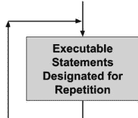

### 首先，几个术语：

- loop - 循环，是两种重复技术之一，利用构造在预定义条件下重复执行指定语句。
- loop iteration - 循环迭代，即循环构造体内指令的一次执行。
- loop control expression - 循环控制表达式，用于确定循环是否应发起另一次迭代的逻辑表达式。
- loop initialization - 循环初始化，即在第一次求值循环控制表达式之前需要完成的准备工作。
- loop update - 循环更新，是在循环体内找到的可执行语句，当执行足够多次后，会导致循环控制表达式求值发生变化。
- loop control variable - 循环控制变量，即被初始化、作为循环控制表达式的一部分，并接收更新操作的变量。

### 重复流程图示例 #1：

编写一个算法来计算未知数量考试分数的平均值、最大值和最小值。测试分数范围可以是 0 – 100，且全部为整数值。

### 重复

- 要完成此问题，我们需要能够重复执行若干条指令。
- 重复允许我们识别一段代码，在给定的逻辑表达式为真时重复执行。

### 步骤 #1 – 程序需要完成什么？

- 输入 – 0 到 100 之间的整数（包含端点），直到输入一个值表示输入结束。
  - 我们不需要数组（第 8 章的主题）将整个数据集存储在计算机内存中。解决此问题所需的内存不会取决于数据集的大小（参加考试的学生人数）。
- 输出 – 平均值（浮点数）、最大值（整数）和最小值（整数）。

### 步骤 #2 – 分析问题

- **需要哪些公式？** 要计算平均值，我们需要知道所有分数的总和和分数的数量。我们需要在输入时比较值，以确定它们是最大值还是最小值。
- 我们还需要确定用户将如何指示输入已结束。

**如何处理输入终止条件？**

1. 要求用户统计考试数量。
2. 要求用户在输入每个值后，说明是否还有更多分数要输入。
3. 要求用户在完成时输入一个超出考试分数范围的值。

### 解决方案的结构图：

### 步骤 #3 – 软件解决方案

### 前测和后测循环结构

在**前测**循环中，循环控制表达式在循环迭代一次之前必须为真。在每次迭代开始之前（包括第一次），都会求值循环控制表达式，只要该表达式保持为真，重复就会继续。如果循环控制表达式为假，则不会再进行进一步的迭代。

**关键点：** 前测循环体被迭代的最小次数是 **零**。如果表达式从不为真，则循环指令（循环体）**永远不会被执行**。

在**后测**循环中，循环体的指令会在求值循环控制表达式之前执行。循环控制表达式会在每次迭代结束时求值，以确定是否继续进行另一次迭代。

- **最大区别是什么？** 后测循环体被迭代的最小次数是一次。无论表达式是否为假，循环都会迭代一次，然后测试条件以确定迭代是否继续。

### 选择错误的构造

有哪些迹象可能表明你为解决方案选择了错误的循环类型（前测或后测）？（1）逻辑在循环体内外都重复。（2）使用了一个“技巧”来强制循环至少迭代一次。如果你使用过一种语言，其中既没有前测选项也没有后测选项（MATLAB），这些选项可能看起来很熟悉。


示例：一个数的阶乘是从 1 到该数的所有整数的乘积。设计一个函数，给定一个非负整数，计算其阶乘。

### 阶乘流程图：

| 识别循环控制变量： | 识别循环类型： | 识别循环控制变量如何更新： | 当用户输入零时，算法在逻辑上是否正确？ |
|---|---|---|---|

### 事件控制和计数器控制过程

上一页的阶乘问题是计数器控制过程的示例。计数器（也是循环控制变量）控制循环体重复的次数。

在事件控制过程中，会发生一个事件，将循环控制表达式从 true 改为 false，从而使重复停止。通过这种过程，可以确定是否会进行另一次循环迭代，但无法确定剩余迭代的次数。考试统计问题是事件控制过程的示例。如果你知道最近的输入，那么你就知道是否会有另一次迭代，但仅此而已。

关键点：如果你能计算或计算出循环执行期间将进行的迭代总次数，那么它是计数器控制过程，否则该过程是事件控制的。

### 输入验证

- 向输入函数添加代码的目标是确保，在函数被允许终止之前，我们有一个有意义的值供程序其余部分处理。
  - 输入验证的任务通常位于输入函数中。从这一点开始，输入函数将不仅仅是 print-scan-return 语句。
- 必须始终为用户提供无限次输入有意义数据的机会。
- 由于其复杂性，您不会针对特定数据类型进行验证，只针对指定数据类型中的可接受值进行验证。
  - 您将假设用户始终会输入预期的数据类型。
- 输入验证的一个重要部分是向用户显示适当的消息，让他们意识到自己的错误以及所需的输入。
- 由于输入验证确实使输入函数更加复杂，因此不建议使用按地址传递来尝试从单个输入函数“返回”多个值。与按地址传递和相关指针操作（第 9 章和第 10 章）相关的语法使其难以应用于输入验证。

### 输入验证函数的流程图：

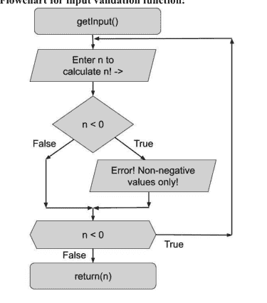

### C 中的循环

C 编程语言提供了三种用于重复循环技术的结构。它们是：while、for 和 do-while。我们将从相似的 while 和 do-while 结构开始。

### while 循环

while 结构是一个预测试循环。与所有循环一样，while 使用循环控制表达式来确定循环是否应该开始或继续迭代。作为预测试循环，循环控制表达式在第一次迭代之前被求值，然后只要表达式求值为 true，循环就会完成另一次迭代。

- 只要循环控制表达式为 true，迭代就会继续。当控制表达式求值为 false 时，迭代过程停止。

### While 循环的基本语法

```
while(loop control expression)
{
    //EXECUTABLE STATEMENT DESIGNATED
    //FOR REPETITION – BODY OF THE LOOP
}
```

> 注意：while 语句的循环控制表达式后没有分号，因为循环后面跟着一个包含要重复的操作的主体。

### do-while 循环

do-while 结构是一个后测试循环。与 while 类似，使用循环控制表达式来确定重复是否继续，但作为后测试结构，表达式在主体内的指令初始执行之后被求值。

- 与 while 循环相反，do-while 中的关键字 while 后面加有分号。

| 课程标准：缩进构成循环主体的所有语句，额外缩进两个空格。 | 课程标准：对于所有循环（和 if 语句），标记循环体开始和结束的大括号必须使用。 |
|---|---|

### Do While 循环的基本语法

```
do
{
    //EXECUTABLE STATEMENT DESIGNATED
    //FOR REPETITION – BODY OF THE LOOP
}while(loop control expression) ;
```

- 如果循环控制变量的更新发生在循环体中间，此更改是否会导致循环在此点立即终止？
  - 不。只有在循环控制表达式被求值并发现为 false 时，循环才会终止。
  - C 编程语言中没有“中间测试”循环，只有预测试和后测试。

### 阶乘示例

- 阶乘问题将允许演示带有输入验证的 do-while 以及用于计算阶乘的 while。

```
int calcFactorial(int);
int getInput(void);
void displayResults(int, int);
```

```
int main(void)
{
    int num;
    int fact;

    num = getInput();
    fact = calcFactorial(num);
    displayResults(num, fact);

    return(0);
}
```

```
int calcFactorial(int num)
{
    int nFact = 1;

    while(num > 0)
    {
        nFact = nFact * num;
        num--;
    }

    return(nFact);
}
```

### 是否需要担心零值可能被相乘？

- 不需要，在乘以零之前，循环控制表达式已被求值并为 false。

用户输入的值局部存储在变量 num 中，每次迭代更改 num 如何影响调用函数中正在发生的事情？

- 不，该变量是按值传递的。

```
int getInput(void)
{
    int num;
    do
    {
        printf("Enter n to calculate n! -> ");
        scanf("%d", &num);
        if(num < 0)
        {
            printf("\nError! Non-negative values only!!\n");
        }
    }while(num < 0);
    return(num);
}
void displayResults(int num, int fact)
{
    printf("\n%d! = %d\n", num, fact);
}
```

### 为什么不为输入验证使用“if 循环”？

- if 结构只允许用户有第二次机会输入可接受的数据。我们希望用户有无限次机会输入有效数据。

### “if 循环”一词有什么问题？

- if 是选择结构，而不是重复结构。

### 嵌套循环

### 什么是嵌套循环？

- 嵌套循环，或任何形式的嵌套重复，是指一个重复过程位于另一个重复过程之中。

### 该定义如何帮助解决使用嵌套循环的问题？

- 更好的定义是考虑循环解决一个重复过程。那么嵌套循环就是位于另一个重复过程之中的一个重复过程。

### 解决嵌套循环问题的推荐方法是什么？

- 首先，解决并测试嵌套过程，将其放在其自己的用户定义函数中。
- 接下来，解决将调用嵌套过程的过程。我们必须确保嵌套过程正确，然后再尝试反复使用（调用）它。

计算一系列阶乘：用户不再计算单个阶乘，而是指定一系列值，并希望得到范围内所有整数的阶乘输出。

例如，如果用户输入 2 和 5，则他们希望看到 2!、3!、4! 和 5! 的结果。

- 这里有哪两个重复过程？一个是计算单个阶乘，另一个是从起始值计数到结束值。
- 哪个过程是嵌套过程？计算单个阶乘。我们已经确认能够接受一个整数并计算该数的阶乘。
- 接下来，我们需要向现有程序添加内容，以便可以计算范围从 a 到 b 的所有整数 n 的每个 n!。
- 需要的新任务或修订：
  - 获取起始值和结束值，并验证两者，使得结束值不小于起始值。为什么 getEnd 有参数而 getStart 没有？
  - 计算并打印 start 和 end 之间（包含）每个整数的阶乘。

```
int calcFactorial(int);       //UNCHANGED FROM PREVIOUS EXAMPLE
int getStart(void);
int getEnd(int);
void displayResults(int, int);       //UNCHANGED FROM PREVIOUS EXAMPLE

int main(void)
{
    int fact;
    int start;
    int end;

    start = getStart();
    end = getEnd(start);

    while (start <= end)
    {
        fact = calcFactorial(start);
        displayResults(start, fact);
        start++;
    }

    return(0);
}
```

- 课程标准说明：main 函数中允许有限数量的控制结构（选择、重复），以确保是 main 函数为程序进行大部分函数调用。


### 用于输入起始值的用户定义函数：

```
int getStart(void)
{
    int num;
    do
    {
        printf("Enter starting value -> ");
        scanf("%d", &num);
        if(num < 0)
        {
            printf("\nError! Non-negative values only!\n\n");
        }
    }while(num < 0);
    return(num);
}
```

### 用于输入结束值的用户定义函数：

```
int getEnd(int start)
{
    int num;
    do
    {
        printf("Enter ending value -> ");
        scanf("%d", &num);
        if(num < start)
        {
            printf("\nError! Ending value must be at least %d\n\n", start);
        }
    }while(num < start);
    return(num);
}
```

嵌套循环在哪里？当人们想到嵌套结构时，通常首先考虑下面的示例。

| 嵌套 while 循环示例： | 嵌套 if 构造示例： |
|---|---|
| while( )<br>{<br>&nbsp;&nbsp;while( )<br>&nbsp;&nbsp;{<br>&nbsp;&nbsp;}<br>} | if( )<br>{<br>&nbsp;&nbsp;if( )<br>&nbsp;&nbsp;{<br>&nbsp;&nbsp;}<br>} |
| 在上一页提供的嵌套循环示例中，循环位于两个不同的用户定义函数中。一个是在 `main` 函数中，用于从起始点计数到结束点；第二个是在计算所需范围内每个整数阶乘的函数中。 | |
| 每个循环通常代表程序中的一个任务或单个进程。如果你能识别出每个这样的单独任务，并将它们拆分为单独的用户定义函数，你可能会发现复杂问题更容易解决和测试。 | |

### 无限循环

无限循环是一种逻辑错误，其中循环控制表达式的条件永远不会为假。作为一种逻辑错误，无限循环在程序运行时出现的形式可能各不相同。无限循环的一个确定迹象是产生无限输出。但是，该错误也可能以产生很少或没有输出的形式出现。

- 你可以随时通过从键盘输入 CTRL-C 来终止程序。

| | 输出: |
|---|---|
| int getInteger(void)<br>{<br>&nbsp;&nbsp;int num;<br><br>&nbsp;&nbsp;do<br>&nbsp;&nbsp;{<br>&nbsp;&nbsp;&nbsp;&nbsp;printf("Enter 1 or 2 -> ");<br>&nbsp;&nbsp;&nbsp;&nbsp;scanf("%d", &num);<br>&nbsp;&nbsp;}while(num != 1 || num != 2);<br><br>&nbsp;&nbsp;return(num);<br>} | Enter 1 or 2 -> 3<br>Enter 1 or 2 -> 2<br>Enter 1 or 2 -> 1<br>Enter 1 or 2 -> |

- 控制表达式看起来在逻辑上是正确的，“在输入的值不是 1 或 2 时接受输入”，但在逻辑上会导致无限循环。不存在任何单一值**同时**不是 1 也不是 2。

### 重复复习 - 三个常见的循环组件

- 1. 循环控制变量的初始化。
- 2. 循环控制表达式的求值。
- 3. 循环控制变量的更新。

### for 循环

C 语言中可用的第三个也是最后一个循环构造是预测试 for 循环。除了作为预测试循环构造外，for 循环的设计仅用于计数器控制的过程。for 循环将初始化、循环控制表达式和更新合并在一行代码中。得益于此，课程标准将始终使用 for 循环的所有三个表达式。

| 使用所有三个表达式的 while 循环表示： | for 循环的流程图表示： |
|---|---|
| | |

### 表达式 1（初始化）

- 表达式 1 仅在第一次遇到 `for` 循环时求值。循环控制变量将在此表达式中初始化。

### 表达式 2（求值）

- 求值表达式 1 后，我们立即求值表达式 2，即循环控制表达式。
- 如果表达式 2 初始求值为假，则循环不会迭代！`for` 循环是一种预测试构造。
- 每次迭代完成后，必须重新求值循环控制表达式，以确定是否需要另一次迭代。

### 表达式 3（更新）

- 此最终表达式在每次迭代结束时以及下一次求值表达式 2 之前求值。
- 基本上，任何更改循环控制变量的表达式都可作为第三个表达式。

### 语法

- 分号在表达式 1 和 2 之间以及表达式 2 和 3 之间是必需的。
- 与任何循环构造一样，`for` 循环有一个主体，主体以 `{` 和 `}` 开始和结束。指令主体可以包含一条或多条指令。

### 何时使用 `for` 循环？

否则... 请考虑使用 `while` 来满足你的预测试迭代需求。

在不更改初始化值的情况下，将 while 循环转换为 for 循环：
```cpp
int lcv = 1;
int n = 4;
int nFact = 1;
while(lcv <= n)
{
    nFact *= lcv;
    lcv++;
}
```

转换后的循环：

在不更改初始化值的情况下，将 while 循环转换为 for 循环：
```cpp
int lcv;
int n = 4;
int nFact = 1;
lcv = n;
while(lcv > 0)
{
    nFact *= lcv;
    lcv--;
}
```

转换后的循环：

下面 for 循环的应用中存在哪些潜在问题？
```cpp
int x;
for(x = -1; x < 0; )
{
    printf("Enter a non-negative integer: ");
    scanf("%d", &x);
}
```

### 重排数字中的数字示例：

- 给定一个整数，重排其数字以创建可能的最大数字。

### 示例执行：

```
Enter an integer: 1230789
The sorted digit is 9873210
Enter an integer: 53635
The sorted digit is 65533
```

### 步骤 1 – 程序的要求是什么？

- 我们期望输入一个整数并输出它。
- 前导 0 作为整数输入没有意义，将不予考虑。
- 所有输入都将是非负的，并且必须进行验证。

### 步骤 2 – 分析问题

- 我们如何从数字中提取单个数字？
- 我们如何做到这一点，然后确定它是否是数字中最大的数字？
- 一旦我们有了数字中最大的数字，我们该怎么做？
- 关于在数字中找到第二大的数字呢？

### 步骤 3 – 设计软件解决方案

这个程序的任务是什么？

- 1. 从用户获取输入。
- 2. 计算非前导零数字的数量，以便我们可以将它们附加到最后输出的值中。
- 3. 在输入中找到最大的数字。将其“添加”到一个新数字中。从输入值中“删除”它。
- 4. 返回步骤 3，直到所有非零数字（从大到小）都已从输入值移动到正在构建的新整数值中。
- 5. 将零数字附加到新值的末尾。
- 6. 输出。

### 结构图

### main 函数

### findMax 函数

### appendMax 函数

### removeMax 函数

### 解决方案：

```
int getInput(void);
int ctZero(int);
int findMax(int, int*);
int appendMax(int, int);
int removeMax(int, int, int);
void output(int);
```

```
int main(void)
{
int n;
int sorted = 0;
int max;
int maxLoc;
int zeroCount;

n = getInput();
zeroCount = ctZero(n);

while(n > 0)
{
max = findMax(n, &maxLoc);
sorted = appendMax(sorted, max);
n = removeMax(n, max, maxLoc);
}

output(sorted * (int)pow(10, zeroCount));

return(0);
}
```

```
int appendMax(int sorted, int max)
{
return(sorted * 10 + max);
}
```

```
int removeMax(int n, int max, int maxLoc)
{
return(n - max * (int)pow(10, maxLoc));
}
```

```c
int getInput(void)
{
    int n;
    do
    {
        printf("Enter an integer to sort: ");
        scanf("%d", &n);
        if(n < 0)
        {
            printf("\nError! Non-negative values only!\n\n");
        }
    }while(n < 0);
    return(n);
}
```

```c
int ctZero(int n)
{
    int ct = 0;
    while(n > 0)
    {
        if(n % 10 == 0)
        {
            ct++;
        }
        n = n / 10;
    }
    return(ct);
}
```

```c
void output(int sorted)
{
    printf("Sorted value: %d\n", sorted);
}
```

```c
int findMax(int n, int *maxLoc)
{
    int max = 0;
    int loc = 0;
    while(n > 0)
    {
        if(n % 10 > max)
        {
            max = n % 10;
            *maxLoc = loc;
        }
        n = n / 10;
        loc++;
    }
    return(max);
}
```


### 高级主题 – 递归

递归是重复的替代技术。递归的定义适用于会调用自身的函数。使用循环解决重复问题的方案被称为**迭代**解决方案。与循环一样，函数调用不能无限继续。需要进行另一次调用的条件是**递归情况**。当不再需要调用时，则已达到**基础情况**。

请记住，程序的控制权始终从被调用函数返回到调用函数。除了程序控制权外，还可以返回一个值。

**阶乘**是展示递归用法时最常见的第一个示例之一。

考虑如何计算数字 n 的阶乘：n * (n - 1) * (n - 2) * ... * 2 * 1

你也可以说，当 n > 1 时，n! 等价于 n * (n - 1)!，但当 n = 1 时又如何呢？正是在这一点上，我们找到了基础情况，即当 n = 1 时，n! = 1 的定义。

以 4! 为例：

```
4! = 4 * 3!
3! = 3 * 2!
2! = 2 * 1!
1! = 1
```

### 使用 while 循环求解阶乘：

```cpp
int factorial(int n)
{
   int nFact = 1;
   while (n > 0)
   {
      nFact *= n--;
   }
   return(nFact);
}
```

### 使用递归函数求解阶乘：

```cpp
int factorial(int n)
{
   int nFact = 1;
   if(n > 1)
   {
      nFact = n * factorial(n - 1);
   }
   return(nFact);
}
```

当将值 4 传递给阶乘函数时，跟踪递归解决方案的执行过程。列出每次调用中变量的值。注意随着递归函数调用的进行，程序控制权的推进情况。

```cpp
int factorial(int n)
{
   int nFact = 1;
   if(n > 1)
   {
      nFact = n * factorial(n - 1);
   }
   return(nFact);
}
```

注意：调用函数与循环的一次迭代不同，循环中的相同代码会被反复执行。每个函数调用都独立于其他函数调用，局部变量占据唯一的内存位置。

### 重复结构和技术回顾

### 递归的局限性

在阶乘示例中，我们看到计算 4! 需要四次函数调用，在每次函数调用中都会创建一组唯一的变量，并且需要“记住”每个函数的状态，以便在被调用函数终止后继续执行。大量的函数调用可能需要比计算机能提供的更多内存。

### 什么时候不应该使用递归？

- 当递归函数调用的数量可能很大（计数器控制）或不可预测（事件控制）时。

## 第 8 章 – 数组

本课程到目前为止介绍的数据类型只能存储单个值。上一章中的重复结构为接受和处理大型数据集打开了可能性。这与我们现有的数据类型如何配合使用？

问题：最近有十名学生参加了一次考试，我们想要计算最高分、最低分和平均分。根据之前的示例，我们知道可以在不同时将所有分数存储在变量中的情况下计算最高分、最低分和平均分，但要计算中位数和众数，我们确实需要保留所有值并对这些值进行排序，以帮助进行这些计算。

一种可能性是为每个要输入的值声明变量。

```cpp
int score0;
int score1;
int score2;
int score3;
int score4;
int score5;
int score6;
int score7;
int score8;
int score9;
```

对十个单独变量进行输入和输出的任务将需要十个打印和扫描语句、一个带有十个占位符的打印和扫描语句，或者调用十次函数或带有十个参数调用函数。代码量不应取决于数据集的大小！

也许可以管理少量变量，但如果我有 100 名学生呢？或者甚至 1,000 名学生？

- 需要的是一种更实用的方式来存储和访问一组相关的数据项。

数组是一组共享同一名称和数据类型的连续变量。数组中的每个变量（或元素）都有一个称为索引值的数字，表示其在数组中的位置。当我们引用数组名称及给定的索引值时，我们指的是存储在该数组中的特定单个值。

### 分数数组：

| 索引 | 元素 |
|---|---|
| score[0] | |
| score[1] | |
| score[2] | |
| score[3] | |
| score[4] | |
| score[5] | |
| score[6] | |
| score[7] | |
| score[8] | |
| score[9] | |

请注意，这个十元素数组的索引值范围从零开始，一直到数组大小减一。在 C 编程语言中，数组是从零开始的。

在每个索引处，都有能力存储一个声明类型的值。

### 声明和定义数组

与其他变量一样，我们必须在数组用于函数之前声明和定义数组。声明和定义会向编译器告知数组的名称、数组的大小以及每个元素的数据类型。C 编程语言提供两种不同的数组类型：固定长度数组（在程序编译前已知长度）和可变长度数组（在程序运行时确定大小）。

课程标准：在介绍第 9 章和第 10 章的动态内存分配主题之前，所有数组都将是静态的（固定长度）。如第 478-479 页示例中所示的可变长度数组的应用将违反课程标准，因为它允许函数中的局部声明和可执行语句重叠。

- 注意：课程标准将是将静态声明数组中 [ 和 ] 之间的数字（大小）替换为符号常量。

```cpp
int students[15];
```

```cpp
double gpa[50];
```

| 0 | 1 | 2 | 3 | 4 | 5 | 6 | 7 | 8 | 9 | 10 | 11 | 12 | 13 | 14 |
|---|---|---|---|---|---|---|---|---|---|---|---|---|---|---|

| 0 | 1 | 2 | ... | 47 | 48 | 49 |
|---|---|---|---|---|---|---|

### 数组的初始化

- 新声明数组的内存中存储什么？

| 数组可以作为其声明语句的一部分进行初始化： | 如果我们尝试以下初始化会怎样？ |
|---|---|
| `int data[5] = {9, 5, 1, 4, 2};` | `int moreData[500] = {1, 2, 3};` |
| 注意：如果提供的值的数量少于数组的定义大小，则未分配的元素将填充为零。 | |

### 访问数组中的元素

- 使用索引值来访问数组中的单个元素。
- 索引值必须是整数值，可以包含求结果为该类型的表达式。

### 将值赋给数组

编写一个程序，将分数 9.5 赋给数组 labScores 的第一个元素。接下来，将该元素打印到屏幕上。

```cpp
#define NUMLABS 10

int main(void)
{
   float labScores[NUMLABS];

   labScores[0] = 9.5;

   printf("First lab score: %.2f\n", labScores[0]);

   return(0);
}
```

### 将值输入到数组中

```cpp
#define NUMLABS 10

int main(void)
{
    float labScores[NUMLABS];

    printf("Enter first lab score -> ");
    scanf("%f", &labScores[0]);

    printf("First lab score: %.2f\n", labScores[0]);

    return(0);
}
```

### 为什么上面的 printf 和 scanf 中使用 %f？

- 浮点数组的单个元素是单个浮点值。

如果元素只能通过表示索引值的常量来访问，那么我们就有了与数组出现之前相同的问题，即我们需要的代码量取决于要处理的数据量。在处理与数组多个元素相关的许多任务时，更常见的是使用循环。


### 使用循环访问数组元素的示例：

```
#define NUMLABS 10

int main(void)
{
 int i;
 float labScores[NUMLABS];

 for(i = 0; i < NUMLABS; i++)
 {
   printf("Enter lab #%d score -> ", i + 1);
   scanf("%f", &labScores[i]);
 }

 //PROCESS DATA
 for(i = 0; i < NUMLABS; i++)
 {
   printf("Lab #%d score: %.2f\n", i + 1, labScores[i]);
 }

 return(0);
}
```

### 索引范围检查

大小为 NUMLABS 的数组的有效索引值范围是 0 到 NUMLABS 减 1。如果在程序执行期间尝试访问此范围之外的索引，会发生什么情况？

例如，如果我们尝试访问 labScores[10]，而对于声明大小为 10 的数组，唯一有效的索引值是 0 - 9，会怎样？这里描述的场景意味着这个潜在问题是一个运行时错误。编译器不会，也无法，检测索引范围检查问题。

由于这是一个运行时错误，它可能有多种不同形式。尝试访问数组边界之外的索引可能会产生哪些后果？

| 可能的观察结果 | 可能发生此情况的原因 |
| :--- | :--- |
| 没有问题，程序按预期工作。 | 超出数组限制并进入未为数组目的保留的内存，可能未为任何其他目的保留。 |
| 程序执行，但结果不符合预期。 | 超出数组限制并进入未为数组目的保留的内存，可能为任何其他目的保留，并且对同一内存的多次编辑可能会留下存储了意外值。 |
| 程序崩溃。 | 超出数组限制并尝试访问不存在或程序无权访问的内存。 |

### 超出数组定义限制的示例

```
int x[5] = {8, 4, 5, 2, 3};
```

| | 8 | 4 | 5 | 2 | 3 |
|---|---|---|---|---|---|
| 0 | 1 | 2 | 3 | 4 | |

| | 8 | 4 | 5 | 2 | 3 |
|---|---|---|---|---|---|
| 0 | 1 | 2 | 3 | 4 | |

| | 8 | 4 | 5 | 2 | 3 |
|---|---|---|---|---|---|
| 0 | 1 | 2 | 3 | 4 | |

### 数组与函数（函数间通信）

- 如果数组仅限于声明它们的函数内使用，那么它们对我们来说用途有限。与用户定义的函数共享数组数据有两种方法，我们可以**发送一个元素**，或者**多个元素**，或者**整个数组**。

### 在每种方法中，我们必须了解以下内容：

- 函数声明、函数调用和函数定义在语法上如何变化。
- 传递的值是**按值传递**还是**按地址传递**，以及是否可以使用非默认方法。

### 传递单个元素

您可以像传递任何其他变量一样将单个元素传递给函数，只要数组元素类型与函数参数类型匹配，就可以成功地将其传递给函数。

```
#define SIZE 5

int calcFactorial(int);

int main(void)
{
 int num = 8;
 int data[SIZE] = {2, 4, 6, 3, 5};

 printf("Result: %d\n", calcFactorial(num));

 printf("Result: %d\n", calcFactorial(data[2]));

 return(0);
}

int calcFactorial(int x)
{
 int xFact = 1;

 while(x > 1)
 {
 xFact *= x--;
 }

 return(xFact);
}
```

### 示例：给定一个已初始化的整数数组，打印数组中每个整数的平方。

```
#define ARRAYSIZE 5
void print_square(int);
int main(void)
{
   int lcv;
   int base[ARRAYSIZE] = {3, 7, 2, 4, 5};
   for(lcv = 0; lcv < ARRAYSIZE; lcv++)
   {
      print_square(base[lcv]);
   }
   printf("\n");
   return(0);
}
void print_square(int x)
{
   printf("%d squared = %d\n", x, x * x);
}
```

- 从前面的程序中观察到：
  - 将数组的单个元素传递给函数时，必须指定数组名称，后跟在 [ ] 大括号中传递的值的特定索引。

### 按值传递回顾

- 回顾一下，如果我们将单个变量传递给函数，传递的只是变量值的副本，因此对该副本的更改不会改变调用函数中的变量。
- 数组的单个元素如何传递给函数？接下来的第一个示例演示了第 4 章中展示的按值传递技术。第二个示例试图演示数组的单个元素是按值传递还是按地址传递。
  - 如果在最后的打印语句中 x[1] 应为 24，那么我们将得出该元素是按值传递的结论。
  - 如果在最后的打印语句中 x[1] 应为 3，那么我们将得出该元素是按地址传递的结论。

```
void passTest(int);
int main(void)
{
    int x = 32;
    printf("Before x = %d\n", x);
    passTest(x);
    printf("After x = %d\n", x);
    return(0);
}
```

```
void passTest(int);
int main(void)
{
    int x[3] = {16, 24, 32};
    printf("Before x[1] = %d\n", x[1]);
    passTest(x[1]);
    printf("After x[1] = %d\n", x[1]);
    return(0);
}
```

```
void passTest(int g)
{
    printf("Before g = %d\n", g);
    g = g / 8;
    printf("After g = %d\n", g);
}
```

```
void passTest(int g)
{
    printf("Before g = %d\n", g);
    g = g / 8;
    printf("After g = %d\n", g);
}
```

### 上面程序的输出：

从输出可以看出，数组的单个元素被视为传递给函数的单个变量，也就是说，数组的单个元素是按值传递的。

- 是否可以对数组的单个元素使用按地址传递？

### 示例：按地址传递 x[1] 元素。

```
#include <stdio.h>
void passTest(int*);
int main(void)
{
 int x[3] = {16, 24, 32};
 printf("Before x[1] = %d\n", x[1]);
 passTest(&x[1]);
 printf("After x[1] = %d\n", x[1]);
 return(0);
}
void passTest(int *g)
{
 printf("Before g = %d\n", *g);
 *g = *g / 8;
 printf("After g = %d\n", *g);
}
```

### 示例：通过将两个元素都按地址传递给函数来交换数组的两个元素。

```
#define SIZE 10
void swapValues(int*, int*);
int main(void)
{
 int x[SIZE] = {3, 4, 5, 1, 2, 9, 8, 7, 6, 0};
 printf("x[4] = %d x[5] = %d\n", x[4], x[5]);
 swapValues(&x[4], &x[5]);
 printf("x[4] = %d x[5] = %d\n", x[4], x[5]);
 return(0);
}
void swapValues(int *ax, int *ay)
{
 int temp;
 temp = *ax;
 *ax = *ay;
 *ay = temp;
}
```

### 传递整个数组

- 如果我们有一个大小为 10 的数组，需要将所有 10 个元素传递给函数，该怎么办？

### 选项 #1，传递每个元素

```
void fun(int, int, int, int, int, int, int, int, int, int);
```

### 选项 #2，传递整个数组

```
void fun(int[]);
```

在语法方面还有更多内容，最终结果可能会让人感到惊讶，关于我们对所使用传递技术的结论。

| 代码 | 说明 |
|------|-------------|
| #include <stdio.h><br>void passTest(int[]);<br>int main(void)<br>{<br> int x[3] = {16, 24, 32};<br> printf("Before x[1] = %d\n", x[1]);<br> passTest(x);<br> printf("After x[1] = %d\n", x[1]);<br> return(0);<br>}<br>void passTest(int y[])<br>{<br> printf("Before y[1] = %d\n", y[1]);<br> y[1] = y[1] / 8;<br> printf("After y[1] = %d\n", y[1]);<br>} | 当将整个数组传递给函数时，您只需列出数组的名称。<br><br>**请勿包含以下任何内容：**<br><br>* 函数声明和定义中看到的方括号。<br>* 数组声明中使用的数组大小。<br>* 数组的数据类型。我们在函数调用中何时列出过参数的类型？<br><br>**左侧程序的输出：**<br><br>**结论 – 整个数组是按地址传递的。** |

- **注释：**
  - 请考虑这一点；如果数组按值传递，则需要完整复制存储数组副本所需的内存。这将是内存使用效率非常低的做法。与传递数组副本相比，语言传递数组的地址。**是否有可能按值传递整个数组？** 不可能。
  - 用户定义的函数调用中没有第 4 章中的 `&` 运算符？**数组名称已经引用内存地址！**
  - **数组名称代表哪个内存地址？** 数组只跟踪它们在内存中的起始位置，而不跟踪结束位置！
  - **索引值代表什么？** 提供的索引值将与数组名称代表的地址相加，以定位数组内所需的元素。索引本质上充当数组在计算机内存中起始位置的偏移量。


### 示例：计算50个整数元素数组中值的平均值：

```c
#include<stdio.h>
#define ARRAYSIZE 50
float average(int []);
void getData(int []);
int main(void)
{
 int base[ARRAYSIZE];
 float avg;
 getData(base);
 avg = average(base);
 printf("The average = %.2f\n", avg);
 return(0);
}
void getData(int b[])
{
 int lcv;
 printf("Enter integer data set now -> ");
 for(lcv = 0; lcv < ARRAYSIZE; lcv++)
 scanf("%d", &b[lcv]);
}
float average(int b[])
{
 int lcv;
 float avg = 0.0;
 for(lcv = 0; lcv < ARRAYSIZE; lcv++)
 avg += b[lcv];
 avg = avg / ARRAYSIZE;
 return(avg);
}
```

如果将下面的打印语句插入到main函数中，打印语句的结果会是什么？

```c
printf("base = %d\n", base );
```

### 为什么可能发生索引范围违规？

- 数组名代表的地址与指定索引相加以计算新的内存地址。该地址可能超出专门为数组分配的内存。

### 数组与效率度量

编写一个函数，反转数组（大小为ARRAYSIZE）的元素，使第一个元素变为最后一个，最后一个变为第一个，以此类推...

| 效率较低的算法 | 效率较高的算法 |
|---|---|
| | |
| 与效率较低的方法相比，效率较高的算法在哪些方面有所改进？ |
| |

### 排序简介

通常，为了高效处理数据，需要对其进行排序。这一点在考虑医疗记录、学生学业记录或银行记录等数据时显而易见。如果不按某个共同字段（姓氏或身份证号码）对数据进行排序，当患者、学生或银行客户数量庞大时，就很难定位或访问所需的记录。

在我们开始研究以下简单排序算法之前，请接受这个免责声明。最简单的排序算法性能较差。我们向初学者介绍它们，因为它们相对容易理解、编写、测试和调试。要获得良好的性能，通常需要更复杂的算法；此类算法需要的数据结构过于复杂，不适合本课程。

### 交换值

- 排序可能需要在数组中交换或互换发现的无序值。例如，交换索引0和索引3处的两个元素。

| 在数组中交换元素的错误方法： | 在数组中交换元素的正确方法： |
|---|---|
| `int x[8] = {12, 17, 11, 9, 21, 13, 19, 16};` | |
| 数组：12 17 11 9 21 13 19 16（索引0-7） | `temp = x[0];` (temp=12) |
| `x[0] = x[3];` -> 数组：9 17 11 9 ... | `x[0] = x[3];` -> 数组：9 17 11 9 |
| `x[3] = x[0];` -> 数组：9 17 11 9（数据丢失） | `x[3] = temp;` -> 数组：9 17 11 12 |

在解释本学期将学习的排序算法之前，我们需要介绍一些常见术语。

- 列表 - 数组将被分为未排序列表和已排序列表。每个算法的目标是将数据从未排序列表移动到已排序列表。

- 趟 - 将元素从未排序列表移动到已排序列表的过程。对大多数数据集进行排序需要多个趟。[选择排序和冒泡排序的最后一个趟将偏离此一般规则。]

### 选择排序

- 算法描述：遍历未排序列表以找出最小值（或最大值）。将此值与未排序列表中与已排序列表相邻的值交换。重复此过程，直到未排序列表为空。

### 冒泡排序

- 算法描述：遍历未排序列表并比较相邻元素。每当发现一对无序元素时，交换它们。

一个趟包括比较未排序列表中的所有相邻元素。在选择排序中，单个趟最多只涉及两个元素的一次交换，但在冒泡排序中，单个趟内可能发生多次交换，导致数组发生很大变化。

### 插入排序

- **算法描述：** 比较未排序列表中与已排序列表相邻的值，并确定它应插入到已排序列表值中的哪个位置。

插入排序关注于保持其已排序列表处于有序状态。已放入已排序列表的值在未来的趟中可能会再次移动。

### 冒泡排序（代码实现）

注意：下面的代码是冒泡排序的一个变体，与书中给出的代码不同。

```c
#define NUMDATA 10

void bubbleSort(int[]);
void getData(int[]);
void printData(int[]);

int main(void)
{
    int data[NUMDATA]; //ARRAY TO HOLD DATA TO SORT
    getData(data);
    printData(data); //PRINT BEFORE STATE
    bubbleSort(data);
    printData(data); //PRINT AFTER STATE
    return(0);
}

void printData(int x[])
{
    int lcv; //LOOP CONTROL VARIABLE TO ACCESS ARRAY
    for(lcv = 0; lcv < NUMDATA; lcv++)
    {
        printf("x[%d] = %d\n", lcv, x[lcv]);
    }
}

void getData(int x[])
{
    int lcv; //LOOP CONTROL VARIABLE TO GET DATA
    for(lcv = 0; lcv < NUMDATA; lcv++)
    {
        scanf("%d", &x[lcv]);
    }
}
```

```c
void bubbleSort(int x[])
{
int numPasses; //LCV THAT CONTROLS # OF PASSES
int lcv; //LOOP CONTROL VARIABLE FOR SORTING
int temp; //HOLDS VALUE DURING SWAP

for(numPasses = 1; numPasses < NUMDATA; numPasses++)
{
for(lcv = 0; lcv < NUMDATA - numPasses; lcv++)
{
if(x[lcv] > x[lcv + 1])
{
temp = x[lcv];
x[lcv] = x[lcv + 1];
x[lcv + 1] = temp;
}//END OF IF
}//END OF NEIGHBOR COMPARING LOOP
}//END OF PASSES LOOP
}//END OF FUNCTION
```

修改冒泡排序，使其适用于可能未填满容量的数组：

```c
void bubbleSort(int x[], int size)
{
int numPasses; //LCV THAT CONTROLS # OF PASSES
int lcv; //LOOP CONTROL VARIABLE FOR SORTING
int temp; //HOLDS VALUE DURING SWAP

for(numPasses = 1; numPasses < size; numPasses++)
{
for(lcv = 0; lcv < size - numPasses; lcv++)
{
if(x[lcv] > x[lcv + 1])
{
temp = x[lcv];
x[lcv] = x[lcv + 1];
x[lcv + 1] = temp;
}//END OF IF
}//END OF NEIGHBOR COMPARING LOOP
}//END OF PASSES LOOP
}//END OF FUNCTION
```

### 总结思考

**需要多少个趟才能保证对N个元素的数组进行排序？**

- 完成排序任务需要N-1个趟。

**为什么数组可能在达到保证排序所需的趟数之前就达到有序状态？**

- 数据的初始状态使得完成任务所需的排序趟数少于N-1个。

**这些排序算法是否经过优化，在数据达到有序状态时结束？**

- 不是。可以优化吗？可能可以，但我们必须小心，不要添加提前终止的逻辑，因为这可能比完成N-1个趟需要更多的努力。

对于下面的每种算法，6个元素的数组的已排序列表中有多少个元素？

| 趟数 | 选择/冒泡 | 插入 |
| :--- | :--- | :--- |
| 1 | | |
| 2 | | |
| 3 | | |
| 4 | | |
| 5 | | |

### 查找

查找是在数据集中查找目标位置的过程。也许目标在数据集中的位置、出现次数或存在与否能为我们提供更多关于目标的信息。

我们将探讨两种不同的查找算法：顺序查找，然后是二分查找。除了理解每种算法的逻辑外，我们还将研究效率问题及它们之间的比较。

- 在顺序查找中，我们一次遍历数组的一个索引，直到找到目标或搜索完整个数组。关于我们数据集的假设包括：每个元素都是唯一的，且数据未排序。

| 17 | 21 | 5 | 15 | 22 | 31 | 3 | 12 | 25 | 30 | 18 | 6 | 10 | 33 | 27 |
|---|---|---|---|---|---|---|---|---|---|---|---|---|---|---|
| 0 | 1 | 2 | 3 | 4 | 5 | 6 | 7 | 8 | 9 | 10 | 11 | 12 | 13 | 14 |

### 查找程序 #1 - 要求用户输入目标值并返回该值在数组中的位置。

- 如果值不存在，请通知用户。

```c
#define ARRAYSIZE 15
#define NOTFOUNDERROR -1

int searchArray(int[], int);
int getTarget(void);

int main(void)
{
 int array[ARRAYSIZE] = {17, 21, 5, 15, 22, 31, 3, 12, 25, 30, 18, 6, 10, 33, 27};
 int target; //VALUE USER WISHES TO FIND
 int index; //INDEX OF USER'S VALUE IN ABOVE ARRAY

 target = getTarget();
 index = searchArray(array, target);

 if(index == NOTFOUNDERROR)
 {
 printf("The value %d does not exist in the array!\n", target);
 }
 else
 {
 printf("The value %d was found at index %d of the array.\n", target, index);
 }

 return(0);
}
```

> 为什么使用值-1来确定目标值未在数组中找到？
>
> - 该值不是数组的有效索引。

> 当目标不存在于数据集中时会发生什么？
>
> - 要验证这种情况，必须将数组中的每个元素与目标进行比较。


int searchArray(int x[], int n)
{
int lcv; //LOOP CONTROL VARIABLE USED TO ACCESS ARRAY ELEMENTS
int index = NOTFOUNDERROR; //VALUE TO RETURN WHICH INDICATES LOCATION OR NOT FOUND
for(lcv = 0; lcv < ARRAYSIZE; lcv++)
{
if(x[lcv] == n)
{
index = lcv;
lcv = ARRAYSIZE;
}
}
return(index);
}

上面定义的用户搜索函数将搜索数组的每个元素，直到发生以下事件之一：

- 找到目标值，循环终止，并返回索引值。
- 到达数组末尾，循环终止，并返回“未找到”值。

int getTarget(void)
{
int target;
do
{
printf("Please enter the target value: ");
scanf("%d", &target);
if(target < 0)
printf("Please enter a valid target value >= 0!\n");
}while(target < 0);
return(target);
}

这种搜索称为**顺序搜索**，因为为了查找所需元素或确定该元素不存在，数组中的每个元素都可能按顺序被引用。

**顺序搜索**算法的优点是什么？

- 它有效！它很简单。

使用顺序搜索算法会有哪些问题？

| 问题 | 答案 |
|---|---|
| 如果我们有一个非常大的数据集，而我们要查找的值不存在怎么办？ | 搜索每个元素并做出此判定需要很长时间。 |
| 如果数组中可能存在多个目标值的实例怎么办？ | 在未排序的数组中，现在必须搜索整个数组才能找到目标的每个实例。 |

### 二分查找

- 可以通过使用一种称为**二分查找**的替代搜索算法来缩短完成搜索所需的时间（包括平均时间和最坏情况时间）。二分查找要求**数组中的数据已排序**。

| 问题 | 答案 |
|---|---|
| 排序数据是否有代价？ | 有，但如果我们频繁搜索数据，支付排序并保持数据处于排序状态的代价是值得的。 |
| 搜索时是否应该始终使用二分查找？ | 不，仅在数据集很大且频繁搜索时才使用。 |

### 二分查找中的新整数变量

- **first** – 此整数将表示在数组中可能找到目标值的最低索引值。
- **last** – 此整数将表示在数组中可能找到目标值的最高索引值。
- **mid** – **first** 和 **last** 变量的平均值将确定在数组中将与目标值进行下一次比较的位置。**mid** 在二分查找过程的每次迭代开始时都会更新。
- **first** 和 **last** 变量何时以及如何更新？当 **mid** 处的值小于目标值时，将 **first** 设置为 **mid** 的值加一。当 **mid** 处的值大于目标值时，将 **last** 设置为 **mid** 的值减一。

### 二分查找示例

假设我们有如下数组，请注意它是已排序的，并且在整个算法过程中都将保持排序状态。搜索算法绝不应更改其搜索的数据！目标值 = 25。

| 3 | 5 | 6 | 10 | 12 | 15 | 17 | 18 | 21 | 22 | 25 | 27 | 30 | 31 | 33 |
|---|---|---|---|---|---|---|---|---|---|---|---|---|---|---|
| 0 | 1 | 2 | 3 | 4 | 5 | 6 | 7 | 8 | 9 | 10 | 11 | 12 | 13 | 14 |

将二分查找应用于上述示例的优点是什么？

- 只需要四次比较即可找到目标值（在上述示例中）。顺序搜索将需要 11 次比较。
- 重点：在目标值与中点处的元素进行每次比较时，我们大约排除一半（因此得名二分）的剩余索引值作为可能找到目标值的位置。

当查找数组中不存在的值时，二分查找与顺序搜索相比如何？

- 顺序搜索需要搜索数组中的每个元素，以确定该值不存在。

让我们看下面的示例，了解二分查找如何处理不存在的值！目标值 = 14。

| 3 | 5 | 6 | 10 | 12 | 15 | 17 | 18 | 21 | 22 | 25 | 27 | 30 | 31 | 33 |
|---|---|---|---|---|---|---|---|---|---|---|---|---|---|---|
| 0 | 1 | 2 | 3 | 4 | 5 | 6 | 7 | 8 | 9 | 10 | 11 | 12 | 13 | 14 |

### 搜索程序 #2 - 要求用户输入目标值，并返回该值在数组中的位置。如果该值不存在，请通知用户。

#define NOTFOUNDERROR -1
#define ARRAYSIZE 15

int binarySearch(int[], int);
int getTarget(void);       //SAME FUNCTION USED IN SEQUENTIAL SEARCH PROGRAM

int main(void)
{
    int array[ARRAYSIZE] = {3, 5, 6, 10, 12, 15, 17, 18, 21, 22, 25, 27, 30, 31, 33};
    int target;            //VALUE WE ARE SEEKING
    int index;             //INDEX VALUE AT WHICH TARGET IS FOUND

    target = getTarget();
    index = binarySearch(array, target);

    if(index == NOTFOUNDERROR)
    {
        printf("Your value %d does not in the array!\n", target);
    }
    else
    {
        printf("Your value %d was found at index %d of the array.\n", target, index);
    }

    return(0);
}

int binarySearch(int x[], int n)
{
 int first = 0; //SMALLEST INDEX VALUE WE ARE CONSIDERING
 int last = ARRAYSIZE - 1; //LARGEST INDEX VALUE WE ARE CONSIDERING
 int mid; //MID POINT INDEX THAT WE ARE CONSIDERING
 int index = NOTFOUNDERROR; //VALUE TO RETURN WHICH INDICATES LOCATION OR NOT FOUND

do
{
 mid = (first + last) / 2;

 if(n > x[mid]) //TARGET GREATER THAN VALUE AT MID -> UPDATE FIRST
 {
 first = mid + 1;
 }
 else if(n < x[mid]) //TARGET LESS THAN VALUE AT MID -> UPDATE LAST
 {
 last = mid - 1;
 }
 else //TARGET HAS BEEN LOCATED IN THE ARRAY
 {
 index = mid;
 last = first - 1; //WHAT DOES THIS DO? WOULD first = last + 1 ALSO WORK?
 }
}while(first <= last);

 return(index);
}

用户定义的搜索函数将搜索数组，直到 `first` 大于 `last`，这将出于以下原因之一发生：

- 找到目标值。
- 数组中不再有可作为搜索候选的元素。

### 多维数组

目前为止我们看到的数组都是一维数组。每个一维数组都是一行索引列值。在考虑可能显著增加内存使用的多维结构之前，必须掌握一维数组的逻辑。

使用多维数组，我们可以添加第二个维度（多行，每行有自己的列）、第三个维度（平面、行和列），以及根据需要添加更多维度。您的唯一限制可能是内存，但很少有问题需要超过三个维度的数组。

无论数组有多少个维度，为数组选择的名称都将继续表示内存中其分配空间开始的位置。我们将看到，当函数将多维数组作为参数时，这需要传递额外信息。

### 声明和定义多维数组

多维数组（与一维数组一样）必须在使用前声明和定义。声明和定义告诉编译器数组每个维度的名称、数据类型和大小或范围。

| 数据类型 | 标识符 | 维度范围 |
|---|---|---|
| int | table | [4][4]; |

### 二维数组：

- 每个维度都是从零开始的。
- 每行和每列的交点表示存储定义类型值的容量。
- 总容量是每个维度范围的乘积。

### 三维数组：

### 四维数组：

问题：计算二维数组中每一行的平均值：

#define ROWS 5
#define COLS 4

void printTable(int[][COLS], float[]);
void calcAvgs(int[][COLS], float[]);

int main(void)
{
    float avgs[ROWS];
    int table[ROWS][COLS] =
    {
        {1, 2, 3, 4},
        {2, 3, 4, 5},
        {3, 4, 5, 6},
        {4, 5, 6, 7},
        {5, 6, 7, 8}
    };

    calcAvgs(table, avgs);
    printTable(table, avgs);

    return (0);
}


### 为什么在函数定义中（如上所示）需要指定第二维的范围？

- 数组的名称仅存储其在计算机内存中的起始位置。不存储有关维度的任何信息。

## 第 9 章和第 10 章 – 指针与指针应用

- 指针是存储内存地址的变量，通常是另一个变量的地址，并通过该内存地址可以访问和操作存储在那里的数据。

### 使用地址，& 运算符

我们已经看到地址运算符（`&`）在 `scanf` 语句中是必需的，并且被用来按地址将变量传递给函数，但这个运算符到底有什么作用？

- 地址运算符（`&`）将返回分配给变量的内存地址。在下表中，你可以看到两个字符变量 `a` 和 `b`。这两个变量在计算机内存中都被分配了一个唯一位置来存储字符值。`printf` 语句将显示 `a` 和 `b` 的内存地址，而不会打印这些变量的内容。

- `%p` 占位符通常用于打印变量的地址。`p` 转换代码表示指针值（内存地址）。

- 在数组名称前放置 `&` 并非必要，因为数组名称本身就代表一个内存地址。

| char a = 'X'; char b = 'Y'; printf("Address of a = %p\n", &a); printf("Address of b = %p\n", &b); | Address of a = 0x7ffd7167170f Address of b = 0x7ffd7167170e |

### 指针变量

- 与所有变量一样，我们必须先声明指针，然后才能向其分配内存地址。

- 指针的声明与声明单个变量非常相似，我们需要一个数据类型和变量的名称（标识符），并在名称前加上 `*` 以指示该变量是指针。

| 局部指针声明示例： | |
| --- | --- |
| - int *x; - float *y; - char *z; | |
| 替代且等效的格式： | |
| - int * x; - float* y; - char* z; | |

先前声明的指针变量 x、y 和 z 最初指向哪里？

- 答案：我们不知道！我们本学期已经看到这对数据变量可能有多糟糕；然而，对于指针，未知值可能是一个无效的内存地址，如果在指针被初始化之前就引用它，结果将是段错误。

按地址传递时，指针会作为调用函数发送的地址的结果进行初始化：

```
exchangeValues(&x, &y);

printf("After the function: x = %d y = %d\n", x, y);

return(0);
}
void exchangeValues(int *a, int *b)
{
```

### 局部声明指针的初始化

为了初始化指针，我们必须为其提供内存中一个有意义的位置来指向（引用）。另一个变量是指针可以指向的一个有效位置。我们需要将内存地址赋值（=）给指针。

```
int a = -123;
int *p;

printf("Address of a: %p\n", &a);
printf("Address of p: %p\n", &p);

p = &a;

printf("Location to which p references: %p\n", p);
```

| 变量 | 数据 | 地址 |
| --- | --- | --- |
| int a = -123; | -123 | 0x7fffcb0fc1c |
| int *p; | 未知 | 0x7fffcb0fc10 |

p = &a;

| 变量 | 数据 | 地址 |
| --- | --- | --- |
| a | -123 | 0x7fffcb0fc1c |
| *p | 0x7fffcb0fc1c | 0x7fffcb0fc10 |

现在我们已经为指针变量建立了一个有意义的引用位置，通过指针可以完成什么？

前面代码中打印 p 的值会产生 p 指向的地址，接下来我们需要一种方法来访问该内存位置存储的值。在指针变量前放置的**间接运算符（*）**将允许访问指针引用的位置存储的值。

| int a = -123; int *p; p = &a; //p POINTS TO a printf("The value of a is: %d\n", a); printf("The value to which p references is: %d\n", *p); | The value of a is: -123 The value to which p references is: -123 |
| --- | --- |

### 示例（类似于教材第 563 页的图 9-8）：

| int a = 3; int b; int *x; int *y; x = &a; y = x; printf("a = %d *x = %d *y = %d\n", a, *x, *y); *x = 4; printf("a = %d *x = %d *y = %d\n", a, *x, *y); x = &b; printf("a = %d *x = %d *y = %d b = %d\n", a, *x, *y, b); *x = a * *y; printf("a = %d *x = %d *y = %d b = %d\n", a, *x, *y, b); | 输出： |
| --- | --- |

### 数组与指针

你可能已经能够做出这一观察，但数组和指针是相关的。数组的名称，很像指针的名称，代表一个内存地址，而索引表示从该地址的偏移量。与指针不同，数组所引用的地址不能更改。

- 关键点：指针变量是可变的，因为它们可以更改所指向的内存地址。数组始终指向相同的内存，在这方面是常量。

| 注意：a 的地址和 a[0] 的地址是相同的。 | int a[5] = {2, 4, 5, 3, 1}; |
| --- | --- |
| `int a[5] = {2, 4, 5, 3, 1};` `printf("Address of array a = %p\n", a);` `printf("Address of array a[0] = %p\n", &a[0]);` | [2] [4] [5] [3] [1] a &a[0] |

在以下示例中，指针表示法用于声明和定义的第一行。一旦进入函数，指针变量可以表现得像数组一样。

| `#define SIZE 5` `void printArray(int*);` `int main(void)` `{` ` int x[SIZE] = {3, 5, 7, 9, 10};` ` printf("Array x address: %p\n", x);` ` printArray(x);` ` return(0);` `}` | `void printArray(int *y)` `{` ` int i;` ` printf("Array y address: %p\n", y);` ` for(i = 0; i < SIZE; i++)` ` {` ` printf("y[%d] = %d\n", i, y[i]);` ` }` `}` |

关于示例中显示的两个内存地址，哪些是正确的？

### 指针运算与数组（仅限一维数组）

- 当你尝试将整数加到地址时会发生什么？结果是另一个地址，这种运算可用于访问和更改数组元素。

```
#define SIZE 5

void printArray(int*);
void changeArray(int*);

int main(void)
{
   int x[SIZE] = {3, 5, 7, 9, 10};

   changeArray(x);
   printArray(x);

   return(0);
}
```

```
void changeArray(int *y)
{
   int i;
   int temp;

   temp = *y;

   for(i = 1; i < SIZE; i++)
   {
      *(y + i - 1) = *(y + i);
   }

   *(y + i - 1) = temp;
}
```

```
void printArray(int *y)
{
   int i;

   for(i = 0; i < SIZE; i++)
   {
      printf("y[%d] = %d\n", i, *(y + i));
   }
}
```

生成的输出：
y[0] = 5
y[1] = 7
y[2] = 9
y[3] = 10
y[4] = 3

| 2 | 4 | 5 | 3 | 1 |
| --- | --- | --- | --- | --- |
| a[0] | a[1] | a[2] | a[3] | a[4] |
| *(a+0) | *(a+1) | *(a+2) | *(a+3) | *(a+4) |

将间接运算符（*）应用于起始内存地址与整数的和，会产生该整数索引处的元素。

a[x] == *(a + x)

### 想要地址吗？

与索引值一样，添加到 `a` 的值表示从 `a` 所代表的内存地址值的偏移量。加法会产生一个新的内存地址。不同的数据类型是否需要不同的内存量？是的，但向指针加 1 会根据数组的类型推进到数组中的下一个元素。在我们服务器上的整数数据中，加 1 将是四个字节的增量。

```
void printArray(int*);

int main(void)
{
   int a[5] = { 2, 4, 5, 3, 1};

   printf("Array a address: %p\n", a);

   printArray(a);

   return(0);
}
```

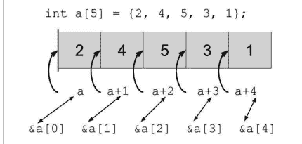

```
void printArray(int *y)
{
   int i;

   printf("Array y address: %p\n", y);

   for(i = 0; i < 5; i++)
   {
      printf("&y[%d] = %p\n", i, y + i);
   }
}
```

生成的输出：
Array a address: 0x7ffd003f7680
Array y address: 0x7ffd003f7680
&y[0] = 0x7ffd003f7680
&y[1] = 0x7ffd003f7684
&y[2] = 0x7ffd003f7688
&y[3] = 0x7ffd003f768c
&y[4] = 0x7ffd003f7690

### 内存分配函数

在程序编译之前声明数组的容量有几种你可能已经考虑过的局限性。首先，我们可能为问题预留的内存不够。其次，我们可能预留了太多内存，限制了留给其他数据的内存。我们进入动态内存分配的探索将提高我们请求问题所需精确内存的能力。

要动态分配内存，我们将使用一个名为 malloc 的预定义函数，它位于 stdlib.h 库中。

- malloc（内存分配）函数将分配指定数量的字节内存。必须使用指针变量来引用 malloc 函数返回的新分配内存的起始地址。


我们如何知道要请求多少字节的内存？我们可能知道数据的数量，但如何确保总量足以容纳数据集的数据类型？

- sizeof 函数将接受一个数据类型，并返回存储该类型一个值所需的字节数。
- malloc 函数的参数将是 sizeof 函数返回的值与所需数据数量的乘积。

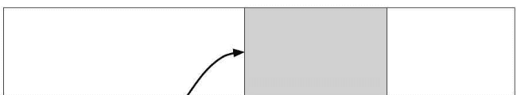

```
data = (int*)malloc(sizeof(int) * 20);
```

示例 - 询问用户需要存储的整数数据数量。接受数据集作为输入并按输入顺序显示。

```
int getQuantity(void);
void getData(int*, int);
void printData(int*, int);

int main(void)
{
    int *data;
    int quantity;

    quantity = getQuantity();

    data = (int*)malloc(sizeof(int) * quantity);
    getData(data, quantity);
    printData(data, quantity);

    return(0);
}
```

```
int getQuantity(void)
{
	int qty;

	printf("Enter quantity of data -> ");
	scanf("%d", &qty);

	return(qty);
}
```

```
void getData(int *data, int size)
{
	int i;

	printf("Enter %d integers -> ", size);

	for(i = 0; i < size; i++)
	{
		scanf("%d", data + i);
	}
}
```

```
void printData(int *data, int size)
{
	int i;

	printf("\nContents of data set: ");

	for(i = 0; i < size; i++)
	{
		printf("%d ", *(data + i));
	}

	printf("\n");
}
```

注：为简单起见，我们跳过了确认分配是否成功以及完成后释放内存等重要任务。

## 第 11 章 – 字符串：字符数组

- 字符串是一系列字符，具有被视为单个单元的能力。

C 编程语言没有字符串数据类型，但试图通过使用字符数组来提供处理字符串数据的某些能力。

与数值数组类似，我们可以将字符串声明为任何预定大小。字符数组常见的问题是，字符串数据所需的元素数量在程序执行期间可能会变化。例如，给定的字符数组可能有20个元素的容量，最初存储‘Computer’，随后该数据被替换为“Science”。我们以及用于处理字符串数据的函数，如何知道数据在哪里结束，数组的未使用部分从哪里开始？

我们可以通过使用称为分隔符的字符来识别字符数组中数据的结束位置。这个分隔符字符‘\0’表示字符数组中数据的结束。这对于许多操作字符串的函数非常重要。

C 编程语言中的字符串是可变长度且带分隔符的字符串。

- 什么是可变长度？给定时间内数组中找到的数据量。
- 什么是带分隔符？在数组中插入一个字符，以将数据与数组的未使用部分分开。

### 声明字符串和访问字符串元素

- 我们可以以类似于数值数组的方式访问字符数组的每个单独元素。

| 检查字符数组的元素： | 输出： |
|---|---|
| `int lcv;`<br>`char str[11] = "Good Day";`<br>`for(lcv = 0; lcv < 11; lcv++)`<br>`{`<br>`    printf("str[%2d] = %c %5d\n", lcv, str[lcv], str[lcv]);`<br>`}`<br>`printf("\n");` | str[ 0] = G   71<br>str[ 1] = o  111<br>str[ 2] = o  111<br>str[ 3] = d  100<br>str[ 4] =    32<br>str[ 5] = D   68<br>str[ 6] = a   97<br>str[ 7] = y  121<br>str[ 8] =    0<br>str[ 9] =    0<br>str[10] =    0 |

字符数组中剩余的**未使用元素**（索引 9 和 10）中有什么？

- 因为我们在上面初始化了数组，剩余元素被填充为零。

### 字符串输入/输出函数

这里有一个值得思考的问题，如果我们要将数据加载到数组中，是否必须始终一次一个元素地输入数据，直到数组填满？这是否意味着为了输入字符串，我们必须一次输入一个字符？

- 好消息！答案是否定的！虽然我们没有可用的字符串数据类型，但 C 编程语言中确实有许多函数和功能，允许我们方便地操作字符串。

### %s 占位符

- %s 占位符表示一个字符串，并用于熟悉的输入和输出函数中。

%s 占位符的示例：

```
char str1[SIZE];

printf("Enter a string -> " );
scanf("%s", str1); //NOTICE NO &, WHY IS THIS?!

printf("The string you entered was %s.\n", str1);
```

### 前面代码段的输出

输入字符串 -> Purdue
您输入的字符串是 Purdue。

- scanf 函数只读取数据，直到输入新行（'\n'）或任何空白字符。

输入字符串 -> Go Purdue
您输入的字符串是 Go。

- 解决方案？寻找 scanf 的替代品！

```
printf("Enter a string -> " );
gets(str1);

printf("The string you entered was %s.\n", str1);
```

用户输入的 '\n' 字符会怎样？gets 函数将接受输入，以新行终止，并将其制成一个以分隔符结尾的字符串。

### 关于 `scanf` 和 `gets` 函数的顾虑

- 我们本学期使用的编译器不再对与 `gets` 函数相关的潜在问题保持沉默。警告：`gets` 函数很危险，不应使用。

### 什么使得 `gets`（出于同样的原因 `scanf`）“危险”且“不应使用”？

- 这两个函数都不会在字符数组填充到其定义容量时停止接受输入。
- 超出数组的定义容量将导致与范围检查问题相同的问题。

### 输入的替代（更安全）方法

```
void getString(char x[])
{
    int index = 0;

    printf("Enter your string --> ");

    do
    {
        x[index++] = getchar();
    }while(index < SIZE && x[index - 1] != '\n');

    //REPLACE THE FINAL CHARACTER WITH A DELIMITER CHARACTER
    x[index - 1] = '\0';
}
```

- `getchar` 函数将接受单个字符的输入。
- 上面的 do-while 将在**当用户输入新行字符**或**当达到数组的定义大小时**终止接受输入。
- 因为 `getchar` 函数仅处理单个字符输入，它不会将分隔符字符放入数组，但它会将新行字符（ASCII 值 10）放入数组，必须将分隔符分配给数组，并将在上述函数中覆盖新行字符。

### 字符串操作函数

C 编程语言为我们提供了一组足够的字符串函数，可以在 `string.h` 库中找到。我们将考虑的函数包括：`strcpy`、`strcmp`、`strlen`，稍后我们将回来查看使用 `strstr` 的示例。类似于 `printf` 和 `scanf`，这些函数将使用数组名称所代表的地址以及数组中存储的分隔符来完成其任务。

### 确定字符串的长度

要介绍的 string.h 中的第一个函数是 strlen 函数，它将返回字符串中的字符数。该函数不计算终止分隔符字符，但返回的值确实表示分隔符在数组中的位置（索引）。

```
char str1[SIZE];
int length;

getString(str1);
length = strlen(str1);

printf("Your string [length %d]: %s\n", length, str1);
```

### 示例执行

| 输入您的字符串 -> Purdue<br>您的字符串 [长度 6]: Purdue | 输入您的字符串 -> Go Purdue!!!<br>您的字符串 [长度 13]: Go Purdue!!! |

### 复制字符串，复制单个变量很容易，但字符串呢？我们可以使用赋值运算符吗？

```
char str1[SIZE];
char str2[SIZE];

getString(str1); //SEE USER-DEFINED FUNCTION ON PREVIOUS PAGE.

str2 = str1;

printf("The string you entered was %s.\n", str1);
printf("The copy of the string you entered is %s.\n", str2);
```

### 编译器生成的消息是什么？

- 错误：从类型 'char *' 赋值给类型 'char[150]' 时类型不兼容

### 上面示例中表达式 str2 = str1 实际上正在赋予什么？

- 该赋值试图强制 str2 放弃其分配的内存，并引用与 str1 相同的内存。如果这是可能的，内存中仍然只会有一个字符串的副本。


### 为什么编译器不批准这个特定的赋值表达式？

- 静态声明数组分配的内存在大小和位置上是固定的。
- 根据前面的陈述，我们可以说数组所引用的内存地址是常量。

### 替代方案 - 使用 string.h 函数 strcpy

- 函数 strcpy 将获取第二个参数并将其值复制到第一个。在此情况下，str1 的内容被复制到 str2。

```c
char str1[SIZE];
char str2[SIZE];
getString(str1);
strcpy(str2, str1);
printf("Your input: %s\n", str1);
printf("Your input copy: %s\n", str2);
```

### 输出：

输入您的字符串 -> Go Purdue!
您的输入: Go Purdue!
您的输入副本: Go Purdue!

### 是否存在复制的数据多于内存中预留空间的问题？

- 是的！strcpy 函数将继续复制字符，直到找到分隔符。请验证目标数组是否具有所需容量！

### 比较两个字符串

- 正如我们不能将一个字符串赋值给另一个字符串一样，我们也无法使用相等和关系运算符成功比较两个字符串的相等性。

### 示例：

| 代码 | 说明 |
| :--- | :--- |
| `char str1[SIZE];`<br>`char str2[SIZE];`<br>`getString(str1);`<br>`strcpy(str2, str1);`<br>`if(str1 == str2)`<br>`{`<br>`printf("The strings are equal!\\n");`<br>`}` | 有人可能会认为，如果相等运算符比较字符串内容，那么输入的任何值都会导致每次执行前面的代码段时都打印相等语句。 |

**输出是什么？** 无。

**当对两个字符串使用关系或相等运算符时，这告诉我们正在比较什么？**

使用相等运算符的比较测试的是内存地址，而不是字符串数据。

### 替代方案 - 使用 string.h 函数 strcmp

string.h 库中的这个第三个函数将接受两个字符串作为参数，并返回一个整数，指示两个字符串的不同之处。存储相同数据的两个字符串没有差异。

| 场景 | 说明 |
| :--- | :--- |
| 输入您的字符串 -> company<br>输入您的字符串 -> corporate<br>比较结果: -5 | 在第一个示例中，第三个元素是发现第一个差异的位置。此差异值从 `strcmp` 函数返回。第二个参数的元素减去第一个参数的元素。 |
| 输入您的字符串 -> company<br>输入您的字符串 -> companion<br>比较结果: 16 | |
| 输入您的字符串 -> ABC123<br>输入您的字符串 -> ABC123<br>比较结果: 0 | |
| 输入您的字符串 -> ABC123<br>输入您的字符串 -> ABC123<br>比较结果: -18 | 计算差异时使用的不是差异之和，而是从最低索引到最高索引顺序中的第一个差异。 |
| 输入您的字符串 -> ABC12<br>输入您的字符串 -> ABC123<br>比较结果: -51 | 如果两个字符串的元素数量不同怎么办？ |
| 输入您的字符串 -> ABC123<br>输入您的字符串 -> AbC123<br>比较结果: -32 | 字符大小写有意义吗？ |

### 代码：

```c
char str1[SIZE];
char str2[SIZE];
int compare;

getString(str1);
getString(str2);

compare = strcmp(str1, str2);

printf("Compare result: %d\n", compare);
```

问题：实现 ROT13 加密算法。ROT13 并不真正是一种加密算法，但通过这种方法处理文本确实使其难以阅读。对于字母表前半部分的字符，我们加 13 将其旋转到后半部分。对于字母表后半部分的字符，我们减 13 将其旋转到前半部分。非字母字符在此过程中不会更改。需要注意的是，加密过程与解密过程相同。

输入您的字符串 -> Go Purdue!!!
原始字符串: Go Purdue!!!
旋转后字符串: Tb Cheghr!!!
原始字符串: Go Purdue!!!

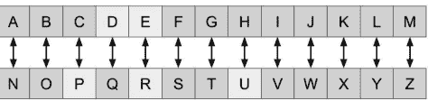

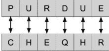

### 解决方案：

```c
#define SIZE 51

void getString(char []);
void rot13(char []);

int main(void)
{
    char str1[SIZE];

    getString(str1);

    printf("Original String: %s\n", str1);
    rot13(str1);
    printf("Rotated String: %s\n", str1);
    rot13(str1);
    printf("Original String: %s\n", str1);

    return(0);
}

void rot13(char x[])
{
    int lcv;

    for(lcv = 0; lcv < strlen(x); lcv++)
    {
        if((x[lcv] >= 'a' && x[lcv] <= 'z') || (x[lcv] >= 'A' && x[lcv] <= 'Z'))
        {
            if((x[lcv] >= 'a' && x[lcv] <= 'm') || x[lcv] <= 'M')
            {
                x[lcv] += 13;
            }
            else
            {
                x[lcv] -= 13;
            }
        }
    }
}
```

### 搜索子字符串

要介绍的 `string.h` 库中的最后一个函数 (strstr) 有能力在字符串中定位子字符串。

`strstr` 函数接受两个内存地址作为参数，并返回子字符串在字符串中的位置。当找不到子字符串时，返回的值是一个称为 NULL 的定义零。

如果函数返回一个地址，那么该值将被赋给哪种类型的变量？答案：字符指针。

### 问题 - 给定一个字符串和子字符串，确定子字符串在字符串中出现的次数。

```
输入字符串 -> ATATATA
输入子字符串 -> AT
子字符串 AT 在字符串 ATATATA 中出现 3 次。
```

```
输入字符串 -> ATATATA
输入子字符串 -> ATA
子字符串 ATA 在字符串 ATATATA 中出现 3 次。
```

### 解决方案：

```c
#define SUB_INPUT 1
#define STR_INPUT 2
#define SUBSTR 21
#define STRING 50
void getString(char[], int, int);
int ctStrings(char[], char[]);
int main(void)
{
   char sub[SUBSTR];
   char str[STRING];
   int count;
   getString(str, STR_INPUT, STRING);
   getString(sub, SUB_INPUT, SUBSTR);
   count = ctStrings(str, sub);
   printf("The substring %s appears %d time(s) in the string %s.\n", sub, count, str);
   return(0);
}
```

```c
void getString(char x[], int option, int size)
{
	int index = 0;

	if(option == SUB_INPUT)
	{
		printf("Enter the substring -> ");
	}
	else if(option == STR_INPUT)
	{
		printf("Enter the string -> ");
	}
	do
	{
		x[index++] = getchar();
	}while(index < size && x[index - 1] != '\n');

	x[index - 1] = '\0';
}
```

```c
int ctStrings(char str[], char sub[])
{
	int ct = 0;
	char *ptr;

	ptr = strstr(str, sub); //LOOK FOR sub AT START OF str

	while(ptr != NULL)
	{
		ct++;
		ptr = strstr(ptr + 1, sub); //PERMITS OVERLAP
		//ptr = strstr(ptr + strlen(sub), sub); //NO OVERLAP
	}

	return(ct);
}
```

## 2023 年春季考试及答案

### 考试 #1：

| 1. B | 2. A | 3. A | 4. C | 5. A |
| --- | --- | --- | --- | --- |
| 6. B | 7. A | 8. C | 9. A | 10. B |
| 11. D | 12. A | 13. D | 14. B | 15. D |
| 16. D | 17. A | 18. C | 19. A | 20. B |
| 21. B | 22. C | 23. D | 24. A | 25. C |
| 26. A | 27. C | 28. C | 29. A | 30. B |
| 31. A | 32. D | 33. C | 34. D | 35. D |

### 考试 #2：

| 1. C | 2. A | 3. D | 4. A | 5. C |
| --- | --- | --- | --- | --- |
| 6. A | 7. B | 8. B | 9. A | 10. C |
| 11. A | 12. A | 13. B | 14. D | 15. B |
| 16. D | 17. A | 18. B | 19. B | 20. D |
| 21. C | 22. A | 23. A | 24. C | 25. B |
| 26. C | 27. B | 28. C | 29. B | 30. B |
| 31. C | 32. C | 33. B | 34. A | 35. D |

### 期末考试：

| 1. B | 2. A | 3. B | 4. D | 5. C |
| --- | --- | --- | --- | --- |
| 6. A | 7. B | 8. C | 9. A | 10. C |
| 11. B | 12. A | 13. C | 14. B | 15. C |
| 16. A | 17. B | 18. A | 19. C | 20. C |
| 21. B | 22. D | 23. A | 24. C | 25. A |
| 26. B | 27. C | 28. B | 29. C | 30. C |
| 31. C | 32. A | 33. B | 34. A | 35. B |
| 36. D | 37. A | 38. C | 39. A | 40. C |
| 41. A | 42. C | 43. C | 44. B | 45. B |
| 46. C | 47. B | 48. C | 49. B | 50. D |

### 在备考过程中，如何最好地利用旧试卷？

- 在学习结束时，您应该尝试做一份旧试卷，并在校园内找一个可以模拟考试环境的地点进行。参加考试，批改您的作业，并确定在考试日期之前需要进一步复习的科目或问题类型。

### 在哪里可以找到更多练习题？

- Boilerexams.com
- 请参阅 C 语言教材每章末尾的习题。包含学生下载和解答的出版社网站链接可在 Brightspace 上找到。

### 为什么这些旧试卷中的一些代码如此复杂？

- 每次考试都特定于其举行的学期。这不仅包括根据考试时间涵盖的主题，还包括该学期课程中布置的作业。
- 许多代码段直接来自之前的作业和实验室编程概念，那些学生对所呈现的问题和逻辑会有一定程度的熟悉。这将使解释代码及其所代表的逻辑变得更容易、更快。


## 2023 年春季 CS 15900 期中考试 #1

2023 年 2 月 22 日，星期三（晚上 8:00 – 9:00，Elliott Hall of Music）

35 道题目 * 每题 3 分 = 105 分

超过 100 分的部分视为额外加分

## 考试规则/注意事项：

- 1. 在答题卡上填写你的姓名和学生身份证号码（手写并涂黑所有要求的信息）。
  - “试卷表单”和“部分”区域可以留空。
  - 学生身份证号码错误将导致本次考试得零分。所有学生身份证号码均以零零开头，共十位数字。这必须在你的考试答题卡上手写并“涂黑”。
  - 你必须坐在指定座位上才能获得本次考试的学分。

- 2. 确保你拥有本次考试的全部 35 道题目。你应该回答每一道题。所有题目只有一个最佳答案。填写答案时请小心。任何被教学数据处理部门判定为无法辨认的答案将被视为错误。评分时只能考虑答题卡上的答案。
  - 运算符优先级表和 ASCII 表已提供在本试卷的最后一页。

- 3. 考试期间不回答任何问题。由于在场工作人员有限，我们不会在考试期间回答问题。为我们来说，补救一个有误的试题比回答问题或在考试期间有效发布公告更容易。请相应安排你的时间！

- 4. 你必须假设所有 C 程序和代码段都在 Vocareum 上实现，并将使用 gcc 编译器编译。当只呈现代码段时，你可以假设适当的包含语句已存在，且代码位于一个完全可运行的函数或程序内。

- 5. 保护你的工作并专注于自己的考试。如果你从另一名学生那里抄袭或允许另一名学生从你那里抄袭，将被视为不诚实行为。任何被发现违反课程政策的人将获得课程不及格成绩，并将被转交给学生院长办公室。

- 6. 考试期间不允许使用任何资源。这包括但不限于教材、笔记、计算器、手机、音频设备和计算机。如果考试期间任何个人电子设备发出声音，则你将被要求立即交卷并离开考场。

- 7. 考试结束后，请前往大厅提交答题卡并离开设施。在我们接受你的作业之前，你需要出示带照片的身份证件。你将保留这份试卷。一旦提交考试，你不得返回座位。

- 8. 你可以预期，成绩和官方考试答案将于 2 月 24 日星期五下午 5:00 前出现在 Brightspace 上。在答案发布之前，请勿就错误（如有）联系课程工作人员。如果你在答案发布后仍认为存在错误，则可以在 3 月 3 日星期五前提出书面复查申请，并在讲师的办公时间内递交给他们。你的申请必须是纸质副本（不接受电子邮件），并包含详细描述（如适用，使用代码），证明你认为发布的答案为何不正确。

- 9. 宣布时间到时，所有书写必须停止。一旦宣布时间到，你不得继续修改考试中的任何答案。

## 以下代码段用于问题 #1 – #2

```
float t;
float x;
float v;
int a = 60;

v = a;
a %= 40;
a *= -1;

x = -pow(v, 2) / (2 * a);
t = (-v + sqrt(pow(v, 2) + 2 * a * x)) / a;

printf("-------------------\n");
printf("Time: %11.1f h\n", t);
printf("/* Problem #2 */", x);
printf("-------------------\n");
```

- 1. 以下哪项是上述代码段生成的前两行输出？

| A | C |
|---|---|
| -------<br>时间：3.0 小时 | -------<br>时间：3.0 小时 |
| B | D |
| -------<br>时间：3.0 小时 | 以上皆非。 |

- 2. 以下哪种格式字符串，如果用于替换第 19 行的注释，并与第 20 行配合使用，会产生如下输出？

```
Distance: 90.0 mi
-----------
```

  - A) "Distance: %-7.1f mi\n"
  - B) "Distance: %-6.1f mi\n"
  - C) "Distance: %07.1f mi\n"
  - D) 以上皆非。

- 3. 关于语言的以下哪项陈述是错误的？

  - A) 可执行文件包含用编译器处理的编程语言编写的代码。
  - B) 将高级语言转换为机器语言的过程称为编译。
  - C) 高级语言可以移植到许多不同的计算机上。
  - D) 以上皆非。

- 4. 关于变量的以下哪项陈述是正确的？

  - A) 只有简单赋值运算符和复合赋值运算符可以改变变量的值。
  - B) 显式类型转换会改变变量在程序其余执行期间的类型。
  - C) 如果不同变量存在于不重叠的作用域中，它们可以共享相同的标识符。
  - D) 以上皆非。

- 5. 关于运算符优先级的以下哪项陈述是错误的？

  - A) 如果表达式包含后缀自增运算符和取模运算符，则后缀自增运算符始终首先被求值，因为它具有更高的优先级。
  - B) C 语言中用作运算符的符号在其他编程语言中可能有所不同。
  - C) 括号允许程序员控制运算符和操作数如何分组。
  - D) 以上皆非。

## 以下代码段用于问题 #6 - #8

```
6 int diameter = 5;
7 double height = 2;
8 double vol1;
9 double vol2;
10 int vol3;
11
12 vol1 = 3.0 * pow((double) (diameter / 2), height) * height;
13 vol2 = 3.0 * diameter * diameter / 4 * height;
14 vol3 = 3.0 * 0.25 * height * (double) (diameter * diameter);
15
16 printf("vol1 = %.1lf, vol2 = %.1lf\n", vol1, vol2);
17 printf("vol3 = %d\n", vol3);
```

- 6. 以下哪项是上述代码段中第一个 printf 语句生成的输出？

  - A) vol1 = 37.5, vol2 = 37.5
  - B) vol1 = 24.0, vol2 = 37.5
  - C) vol1 = 37.5, vol2 = 36.0
  - D) 以上皆非。

- 7. 以下哪项是上述代码段中第二个 printf 语句生成的输出？

  - A) vol3 = 37
  - B) vol3 = 37.5
  - C) vol3 = 38
  - D) 以上皆非。

- 8. 关于上述代码段中类型转换的以下哪项陈述是错误的？

  - A) 第 13 行有 >=1 次隐式类型转换。
  - B) 第 14 行有 1 次显式类型转换。
  - C) 第 12 行包含赋值转换。
  - D) 以上皆非。

## 以下代码段用于问题 #9 - #11

```
6 char a = 'A';
7 int b = 2;
8 float c = 3.5;
9
10 a += b++ * ++c;
11 b /= --a * (int) c-- + b;
12 c = floor(c + a--) / (++b + 1);
13
14 printf("a = %c, b = %d\n", a, b);
15 printf("c = %.1f\n", c);
```

- 9. 以下哪项是上述代码段中第一个 printf 语句生成的输出？

  - A) a = H, b = 1
  - B) a = F, b = 2
  - C) a = L, b = 1
  - D) 以上皆非。

- 10. 以下哪项是上述代码段中第二个 printf 语句生成的输出？

  - A) c = 39.5
  - B) c = 38.0
  - C) c = 37.0
  - D) 以上皆非。

- 11. 以下哪项如果用于替换第 10 行，将不会改变程序输出？

  - A) a = a + b * (c + 1);
  - B) a += ++b * c++;
  - C) a = (a + b++) * (++c);
  - D) 以上皆非。

## 以下程序用于问题 #12 – #13

```
int calcResult(float, float);

int main(void)
{
    int x = 3;
    int y = 2;
    float z = 0.5;
    int value;

    value = calcResult(x / y, y);
    printf("Result #1: %d\n", value);

    value = calcResult(z * 3 / 2, z / 2);
    printf("Result #2: %d\n", value);

    return(0);
}

int calcResult(float a, float b)
{
    int c;
    c = a * b + a / b;
    return(c);
}
```

- 12. 以下哪项是上述程序生成的第一行输出？

  - A) Result #1: 2
  - B) Result #1: 3
  - C) Result #1: 4
  - D) 以上皆非。

- 13. 以下哪项是上述程序生成的第二行输出？

  - A) Result #2: 0
  - B) Result #2: 2
  - C) Result #2: 4
  - D) 以上皆非。

- 14. 关于 C 语言数据类型的以下哪项陈述是错误的？

  - A) 每种数据类型都有一个可以表示的值范围。
  - B) 所有运算符都可以与任何数据类型一起使用。
  - C) 每种数据类型都需要固定大小的内存。
  - D) 以上皆非。

- 15. 关于 C 源代码文件结构的以下哪项陈述是错误的？

  - A) 函数声明放置在全局声明部分。
  - B) 课程标准要求函数定义位于 main 函数之后。
  - C) 预处理器指令以符号 # 开头。
  - D) 以上皆非。


## 使用以下代码段解决第 #16 – #17 题

```
int main(void)
{
   long long id;
   int program_num = 30;
   int start_year = 2023;
   int grad_year = 2027;
   int d1;
   int d2;
   int d3;
   int d4;
   int d5;
   int d6;
   int d7;
   int d8;

   d1 = get_digit(start_year, 4);
   d2 = get_digit(start_year, 3);
   d3 = get_digit(start_year, 2);
   d4 = get_digit(start_year, 1);
   d5 = get_digit(program_num, 2);
   d6 = get_digit(program_num, 1);
   d7 = get_digit(grad_year - start_year, 2);
   d8 = get_digit(grad_year - start_year, 1);

   printf("ID: %d%d%d%d%d%d%d%d\n", d1, d2, d3, d4, d5, d6, d7, d8);

   return(0);
}
```

在提供的 main 函数中，程序员试图使用单独的整数变量来存储组成学生 ID 的各个数字，这些数字基于以下部分：程序编号、起始年份和预期毕业年份。用户定义的函数 get_digit 将返回第二个参数指定位置的单个整数数字。这与最近编程作业中完成的练习类似。

- 16. 如果完整学生 ID 号的位数增加，关于上述代码段设计的以下哪项说法是错误的？
  - A) 每增加一位数字都需要一个新变量来存储该数字。
  - B) 每增加一位数字都需要额外调用一次 get_digit 函数。
  - C) 每增加一位数字都需要在最终的 printf 语句中增加一个占位符。
  - D) 以上都不是。

- 17. 关于上述代码段第 #18 – 25 行的课程标准和用户定义函数，以下哪项说法是正确的？
  - A) 调用给定的用户定义函数八次，比编写八个各自只被调用一次的相似用户定义函数更好。
  - B) 拥有八个各自只被调用一次的独立用户定义函数是更好的设计。
  - C) 通过将 get_digit 函数的代码直接包含在 main 函数中来消除该函数，是更好的设计。
  - D) 以上都不是。

- 18. 关于 C 语言中的警告和错误，以下哪项说法是正确的？
  - A) gcc 命令对于包含未定义行为的程序总会报错。
  - B) gcc 命令给出的警告只是建议，通常可以安全地忽略。
  - C) 如果 gcc 命令只给出警告，那么很可能仍然会生成一个新的 a.out 文件。
  - D) 以上都不是。

## 使用以下程序解决第 #19 – #21 题

```
int main(void)
{
   int x = 1;
   float y = 0;
   float z = 2.75;
   y = alter_data(x, z);
   printf("y: %.2f\n", y);
   x *= z;
   printf("Result: %d\n", alter_data(-z, x));
   return(0);
}
int alter_data(float a, float b)
{
   return(a + (int)b + a * b);
}
```

- 19. 以下哪项是上述程序生成的第一行输出？
  - A) y: 5.00
  - B) y: 5.75
  - C) y: 6.50
  - D) 以上都不是。

- 20. 以下哪项是上述程序生成的第二行输出？
  - A) Result: 6
  - B) Result: 7
  - C) Result: 8
  - D) 以上都不是。

- 21. 以下哪项是声明 void 函数的正确方式？
  - A) int functionName(void);
  - B) void functionName(int);
  - C) int functionName();
  - D) 以上都不是。

- 22. 关于按地址传递参数，以下哪项说法是错误的？
  - A) 利用按地址传递参数的函数预期只完成所解决较大问题中的单个任务。
  - B) 变量的值在按地址传递给函数时不会被复制。
  - C) 按地址传递仅用于尽量减少程序中的函数和函数调用数量。
  - D) 以上都不是。

- 23. 关于用户定义函数，以下哪项说法是正确的？
  - A) 程序中语句的执行顺序不能通过使用函数和函数调用来改变。
  - B) 程序的控制权总是从被调用函数返回到 main 函数。
  - C) 局部变量可以通过其标识符在定义它的函数之外被引用。
  - D) 以上都不是。

```
int main(void)
{
    int x = 2;
    int y = 3;
    int z;

    z = calcResult(x, &y);

    printf("x: %d y: %d z: %d\n", x, y, z);

    return(0);
}
```

```
int calcResult(int x, int *y)
{
    x = x + 5;
    *y = *y + 2;

    return(x / *y);
}
```

- 24. 以下哪个 calcResult 函数的声明不能用于完成上述代码段？
  - A) int calcResult(int, int);
  - B) int calcResult(int y, int *x);
  - C) int calcResult(int, int*);
  - D) 以上都不是。

- 25. 以下哪项是上述代码段生成的输出？
  - A) x: 7 y: 6 z: 0
  - B) x: 7 y: 6 z: 1
  - C) x: 2 y: 5 z: 1
  - D) 以上都不是。

- 26. 关于课程标准和用户定义函数，以下哪项说法是错误的？
  - A) 函数接收到的参数将在其定义处右侧进行注释。
  - B) 每个用户定义函数的函数作业标题必须插入在其所记录的函数定义的正上方。
  - C) main 函数的作用是协调函数调用并建立程序的数据需求。
  - D) 以上都不是。

- 27. 关于 printf 函数，以下哪项说法是正确的？
  - A) 格式字符串中的占位符数量将始终与数据列表中的值的数量匹配。
  - B) 当尝试显示符号/定义常量的值时，数据列表中的值的数量将超过格式字符串中的占位符数量。
  - C) 当使用变量表示最小宽度和/或精度修饰符时，数据列表中的值的数量可能多于格式字符串中的占位符数量。
  - D) 以上都不是。

## 使用以下代码段解决第 #28 – #30 题

```
8 int main(void)
9 {
10 int id;
11 long long barcode = 123456789;
12 id = extract(barcode, 2, 3);
13 display(barcode, id);
14 return(0);
15 }
16 int extract(long long code, int op1, int op2)
17 {
18 code /= (int)pow(10, op1);
19 code %= (int)pow(10, op2);
20 return(code);
21 }
22 void display(long long barcode, int id)
23 {
24 printf("Barcode: /* Problem #28 */\n", barcode);
25 printf("ID: %d\n", id);
26 }
```

- 28. 以下哪个占位符可以正确完成上述代码段第 #29 行中的 printf 函数？
  - A) %d
  - B) %ld
  - C) %lld
  - D) 以上都不是。

- 29. 以下哪项是上述代码段第 #30 行生成的输出？
  - A) ID: 567
  - B) ID: 456
  - C) ID: 345
  - D) 以上都不是。

- 30. 以下哪项不是上述代码段第 #23 行的有效替换？
  - A) code = code % (int)pow(10, op2);
  - B) code %= (double)pow(10, op2);
  - C) code = code % (long long)pow(10, op2);
  - D) 以上都不是。

- 31. 关于前缀/后缀自增/自减运算符，以下哪项说法是正确的？
  - A) 当作为语句中唯一表达式用于变量时（例如 x++;），前缀和后缀可以互换使用。
  - B) 无论在何处使用，前缀和后缀都可以互换使用。
  - C) 前缀和后缀自增/自减运算符可以应用于变量和常量。
  - D) 以上都不是。

## 使用以下代码段解决第 #32 - #33 题

```
5 int main(void)
6 {
7   int x = 3;
8   int y = 5;
9   int z = 1;
10  int result;
11
12  result = update(x + y, z);
13
14  printf("Result #1: %d\n", result);
15
16  result = update(x, update(z, y));
17
18  printf("Result #2: %d\n", result);
19
20  return(0);
21 }
22
23 int update(int a, int b)
24 {
25  return(a++ + 1 % ++b);
26 }
```

- 32. 以下哪项是上述代码段生成的第一行输出？
  - A) Result #1: 0
  - B) Result #1: 4
  - C) Result #1: 8
  - D) 以上都不是。

- 33. 以下哪项是上述代码段生成的第二行输出？
  - A) Result #2: 0
  - B) Result #2: 1
  - C) Result #2: 4
  - D) 以上都不是。

- 34. 以下哪项不是创建用户定义函数的好处？
  - A) 作为函数实现的代码可以更轻松地重用。
  - B) 通过将独立子问题分离到不同的函数中，使其求解和验证更加容易。
  - C) 按值传递确保数据在不同任务之间免受意外更改。
  - D) 以上都不是。

- 35. 关于课程日程安排，以下哪项说法是正确的？
  - A) 考试结束后，您将前往大厅提交答题纸。
  - B) 所有讲座班将于 2 月 23 日星期四上课，并将进行讲座测验。
  - C) 所有实验班本周将上课直至包括 2 月 24 日星期五。
  - D) 以上都是！


## 2023 年春季 CS 15900 期中考试 #2

### 2023年3月27日，星期一（晚上 8:00 – 9:30，Elliott 音乐厅）

### 35 道题目 * 每题 3 分 = 105 分

### 超过 100 分的部分视为额外学分

## 考试规则/注意事项：

- 1. 在答题卡上填写你的姓名和学生身份证件号码（填写并涂黑所有要求的信息）。
  - “试卷表单”和“部分”区域可以留空。
  - 学生身份证件号码错误将导致本次考试得零分。所有学生身份证件号码均以 00 开头，共计 10 位数字。这必须在你的考试答题卡上书写并“涂黑”。
  - 你必须坐在指定座位上才能获得本次考试的学分。

- 2. 请确保你拥有本次考试的全部 35 道题目。你应该回答每道题。所有题目只有一个最佳答案。请在填写答案时小心。任何被教学数据处理部门判定为无法辨认的答案将被视为错误。评分时仅可考虑答题卡上的答案。
  - 运算符优先级表和 ASCII 表已提供在本试卷的最后一页。

- 3. 考试期间不回答任何问题。由于在场工作人员有限，我们不会在考试期间回答问题。为我们来说，补救一道有误的试题比回答问题或在考试期间有效发布公告更容易。请相应安排你的时间！

- 4. 你必须假设所有 C 程序和代码片段均在 Vocareum 上实现，并将使用 `gcc` 编译器编译。当仅展示代码片段时，你可以假设适当的包含语句已存在，且代码位于一个完全可运行的函数或程序内部。

- 5. 保护你的作业并专注于自己的考试。如果你从另一名学生那里抄袭或允许另一名学生从你那里抄袭，将被视为不诚实行为。任何被发现违反课程政策的人将获得课程不及格成绩，并将被转交给学生院长办公室。

- 6. 考试期间不得使用任何资源。这包括但不限于教材、笔记、计算器、手机、音频设备和计算机。如果考试期间任何个人电子设备发出声音，你将被要求立即交卷并离开考场。

- 7. 考试结束后，请前往大厅提交答题卡并离开场所。在我们接受你的作业之前，你需要出示照片身份证件。你将保留此试卷。一旦提交考试，你不得返回座位。

- 8. 你可以预期，成绩和官方考试答案将于 3 月 30 日星期四下午 5:00 前在 Brightspace 上发布。在答案发布之前，请勿就错误（如有）联系课程工作人员。如果你在答案发布后仍认为存在错误，则可以在 4 月 7 日星期五前提出书面复核申请，并在讲师的办公时间将其交给讲师。你的申请必须是纸质副本（不接受电子邮件），并包含详细描述（如适用可使用代码），说明你认为发布答案错误的原因。

- 9. 宣布时间到时，所有书写必须停止。时间一到，你不得继续修改考试中的任何答案。

## 以下程序用于第 #1–#2 题

```c
#include <stdio.h>
int makeCalc(int, int);
int main()
{
  int n = 4;
  int a;
  int result = 1;
  while(n > 2)
  {
    a = n--;
    result = makeCalc(a, result);
  }
  printf("result: %d\n", result);
  printf("a: %d n: %d\n", a, n);
  return(0);
}

int makeCalc(int a, int result)
{
  do
  {
    result *= a--;
  }while(a > 1);
  return(result);
}
```

- 1. 以上程序生成的第一行输出是以下哪项？
  - A) result: 24
  - B) result: 144
  - C) result: 288
  - D) 以上皆非。

- 2. 以上程序生成的第二行输出是以下哪项？
  - A) a: 2 n: 1
  - B) a: 2 n: 2
  - C) a: 1 n: 1
  - D) 以上皆非。

- 3. 以下哪项陈述表明程序员为给定的重复过程选择了错误的循环结构？
  - A) 代码在 while 循环之前和内部立即重复。
  - B) 循环控制变量被初始化为导致循环控制表达式求值为真的值；该值随后立即被丢弃。
  - C) for 循环未包含所有三个表达式。
  - D) 以上皆是。

## 以下代码片段用于第 #4–#5 题

```c
int x = 5;
int y = 11;
do
{
  x += y / 2;
  y -= x % 5;
}while(x < 20 && y > 0);
printf("x: %d\n", x);
printf("y: %d\n", y);
```

- 4. 以上代码片段生成的第一行输出是以下哪项？
  - A) x: 20
  - B) x: 21
  - C) x: 25
  - D) 以上皆非。

- 5. 以上代码片段生成的第二行输出是以下哪项？
  - A) y: 0
  - B) y: 8
  - C) y: 11
  - D) 以上皆非。

## 以下代码片段用于第 #6–#7 题

```c
int n = 50234;
int result = 0;
while(n > 0)
{
  if(n % 2 == 0)
  {
    result += n % 10;
  }
  else
  {
    result *= n % 10;
  }
  n /= 10;
}
printf("result: %d\n", result);
```

- 6. 以上代码片段生成的输出是以下哪项？
  - A) result: 70
  - B) result: 60
  - C) result: 45
  - D) 以上皆非。

- 7. 如果整数变量 n 初始化为 43205，以上代码片段生成的输出将是以下哪项？
  - A) result: 14
  - B) result: 10
  - C) result: 24
  - D) 以上皆非。

## 以下代码片段用于第 #8–#9 题

```c
int a = 1;
int b = 1;
int c = 0;
int d = 0;
while(a++ % 2 || b++ % 3 || c++ % 5)
{
    d++;
}
printf("a: %d d: %d\n", a, d);
printf("b: %d c: %d\n", b, c);
```

- 8. 以上代码片段生成的第一行输出是以下哪项？
  - A) a: 6 d: 6
  - B) a: 7 d: 5
  - C) a: 7 d: 6
  - D) 以上皆非。

- 9. 以上代码片段生成的第二行输出是以下哪项？
  - A) b: 4 c: 1
  - B) b: 3 c: 1
  - C) b: 5 c: 2
  - D) 以上皆非。

## 以下代码片段用于第 #10–#11 题

```c
int i;
int count = 0;
for(i = 30; i > 0; i -= 2)
{
    i -= 2;
    count++;
}
printf("i: %d\n", i);
printf("count: %d\n", count);
```

- 10. 以上代码片段生成的第一行输出是以下哪项？
  - A) i: 2
  - B) i: 0
  - C) i: -2
  - D) 以上皆非。

- 11. 以上代码片段生成的第二行输出是以下哪项？
  - A) count: 8
  - B) count: 10
  - C) count: 9
  - D) 以上皆非。

## 以下代码片段用于第 #12–#13 题

```c
int x = 4;
int y = 16;
int z = 8;

if(--x - 3 && ++z)
{
  x = 0;
}
else if(~y % 3 || z++ % 2)
{
  y = 0;
}
else if(++z % 5 || y-- % 2)
{
  z = 0;
}
if(x % 3 || y % 2 && z % 2)
{
  x = 1;
}
else
{
  y = 1;
}

printf("x: %d y: %d z: %d\n", x, y, z);
```

- 12. 以上代码片段生成的输出是以下哪项？
  - A) x: 3 y: 1 z: 0
  - B) x: 3 y: 14 z: 0
  - C) x: 1 y: 14 z: 10
  - D) 以上皆非。

- 13. 关于编译器和以上代码片段，以下哪项陈述为真？
  - A) 编译器将发出关于使用显式花括号以避免歧义 `else` 的警告。
  - B) 编译器将发出关于所用逻辑运算符优先级的警告。
  - C) 编译器将发出关于对变量操作未定义的警告。
  - D) 以上皆非。

- 14. 关于循环结构，以下哪项陈述为假？
  - A) 循环控制变量的初始化必须在第一次求值循环控制表达式之前进行。
  - B) 循环控制表达式求值的次数等于后测试循环中的迭代次数。
  - C) 循环控制变量的更新可以是前测试循环的循环控制表达式的一部分。
  - D) 以上皆非。


## 使用以下代码段解决问题 #15 - #16

```c
float a = 43;
float b = 2;
int op = 43;
switch(op)
{
case '+': printf("a + b = %.2f\n", a + b);
    break;
case '-': printf("a - b = %.2f\n", a - b);
    break;
case '*': printf("a * b = %.2f\n", a * b);
    break;
default: printf("a / b = %.2f\n", a / b);
}
```

- 15. 以上代码段生成的输出是什么？
  - A) a - b = 41.00
  - B) a + b = 45.00
  - C) a / b = 21.50
  - D) 以上皆非。

- 16. 关于以上代码段，以下哪项陈述为真？
  - A) 控制表达式的数据类型与各个case所表示的值不匹配，这将导致编译器警告。
  - B) 将switch(op)替换为switch(a)不会改变以上代码段的输出。
  - C) 第16行使用break是不必要的，因为它是该switch结构中的最后一个case。
  - D) 以上皆非。

- 17. 关于课程标准和循环，以下哪项陈述为假？
  - A) 为了使两个或多个重复过程被视为嵌套，每个过程都必须使用相同类型的循环结构来实现。
  - B) 在main中允许有限数量的重复，以便main函数成为程序中大多数用户定义函数调用的位置。
  - C) 课程标准禁止使用break等强制控制语句作为终止重复过程的机制。
  - D) 以上皆非。

- 18. 关于逻辑表达式和逻辑数据，以下哪项陈述为假？
  - A) 对NOT运算符取补的一种方法是使用另一个NOT运算符。
  - B) 由于&&的优先级高于||，无论其在表达式中的位置如何，它都将首先被求值。
  - C) 对条件取补是从表达式中潜在地移除负逻辑的一种方法。
  - D) 以上皆非。

## 使用以下用户定义的函数定义解决问题 #19 - #20

```c
int getScore(int max)
{
   int score;

   do
   {
      printf("Enter score -> ");
      scanf("%d", &score);

      if(score > max)
      {
         printf("\nError! score must be <= %d\n", max);
      }
      else if(score < -1)
      {
         printf("\nError! score must be >= -1\n");
      }
   }while( /* PROBLEM 19 */ );

   return(score);
}
```

- 19. 应该使用以下哪个循环控制表达式来替换上述代码中的注释，以正确完成输入验证算法？
  - A) !(score <= max || score >= -1)
  - B) score > max || score < -1
  - C) score > max && score < -1
  - D) 以上皆非。

- 20. 应该做出以下哪些设计更改以改进上述代码段？
  - A) 将do-while循环重写为while循环。
  - B) 利用按地址传递score。
  - C) 将getScore函数重写为使用递归而不是do-while循环。
  - D) 以上皆非。

- 21. 根据C语言规则和课程标准，将以下每个描述与相应的循环结构匹配：
  - I. 仅计数器控制的过程；最少零次迭代。
  - II. 仅计数器控制的过程；最少一次迭代。
  - III. 仅事件控制的过程；最少一次迭代。
  - IV. 计数器控制或事件控制的过程；最少零次迭代。
  - V. 计数器控制或事件控制的过程；最少一次迭代。
  - A) while: I do-while: III for: II
  - B) while: V do-while: IV for: I
  - C) while: IV do-while: V for: I
  - D) 以上皆非。

## 使用以下程序解决问题 #22 - #23

```c
1 #include<stdio.h>
2 #include<math.h>
3 
4 int scanNum(int num, int digits, int max);
5 
6 int main(void)
7 {
8   scanNum(268731, 2, 0);
9 
10  return(0);
11 }
12 
13 int scanNum(int num, int digits, int max)
14 {
15  int next;
16 
17  if(num > 0)
18  {
19   next = num % (int) pow(10, digits);
20 
21  if(next > max)
22  {
23   max = next;
24   printf("max = %d\n", max);
25  }
26 
27  max = scanNum(num / 10, digits, max);
28  }
29 
30  return(max);
31 }
```

- 22. 以上代码段生成的输出的最后一行是什么？
  - A) max = 87
  - B) max = 73
  - C) max = 31
  - D) 以上皆非。

- 23. 以下哪项单独操作会导致以上代码段生成的输出的最后一行发生变化？
  - A) 删除第23行。
  - B) 将第15行的整数变量next初始化为零。
  - C) 将第27行的递归函数调用移动到第21行之前。
  - D) 以上皆非。

## 使用以下代码段解决问题 #24 - #25

```c
int n = 7;
int total = 0;
while(n-- > 0)
{
    switch(n % 4 + 1)
    {
        case 4: total += n % 4;
        case 3: break;
        case 2:
        case 1: total += n % 4 + 1;
        case 0: total -= n % 4;
    }
}
printf("final n value: %d\n", n);
printf("total: %d\n", total);
```

- 24. 以上代码段生成的输出的第一行是什么？
  - A) final n value: 0
  - B) final n value: 1
  - C) final n value: -1
  - D) 以上皆非。

- 25. 以上代码段生成的输出的第二行是什么？
  - A) total: 5
  - B) total: 11
  - C) total: 13
  - D) 以上皆非。

## 使用以下代码段解决问题 #26 - #27

```c
int a = 8;
int b = 9;
int c = 7;
int result;
result = a > b ? (a > c ? a : c) : (b > c ? b : c);
printf("Result #1: %d\n", result);
result = a > b < c;
printf("Result #2: %d\n", result);
```

- 26. 以上代码段生成的输出的第一行是什么？
  - A) Result #1: 0
  - B) Result #1: 7
  - C) Result #1: 9
  - D) 以上皆非。

- 27. 以上代码段生成的输出的第二行是什么？
  - A) Result #2: 0
  - B) Result #2: 1
  - C) Result #2: -1
  - D) 以上皆非。

## 使用以下代码段解决问题 #28 - #29

```c
4 int changeNumber(int);
5 int main()
6 {
7    int x = 42956;
8
9    do
10 {
11    x = changeNumber(x);
12    x /= 10;
13 }while (x > 10);
14
15
16 printf("x: %d\n", x);
17
18 return(0);
19 }
20
21 int changeNumber(int z)
22 {
23    int digit1;
24    int digit2;
25
26    digit1 = z % 10;
27    digit2 = z % 100 / 10;
28
29    if(digit1 > digit2)
30    {
31       z -= digit2 * 10;
32       z += digit1 * 10;
33    }
34
35    return(z);
36 }
```

- 28. 以上代码段生成的输出是什么？
  - A) x: 0
  - B) x: 4
  - C) x: 9
  - D) 以上皆非。

- 29. 当将第29行的大于运算符更改为小于运算符时，以上代码段生成的输出是什么？
  - A) x: 0
  - B) x: 2
  - C) x: 4
  - D) 以上皆非。

- 30. 关于for循环结构，以下哪项陈述为假？
  - A) 可以将x++, ++x, x += 1, 和 x = x + 1互换用作for循环的更新（第三）表达式，以递增循环控制变量x。
  - B) 本学期在Vocareum上使用的gcc编译器将允许在for循环的第一个表达式中声明和初始化变量。
  - C) 在for循环中，更新操作执行的次数比循环控制表达式求值的次数少一次。
  - D) 以上皆非。

```c
#include<stdio.h>

int calcTotal(int);
int main()
{
   int x = 0;
   int y = 0;

   for(x = 1; x < 8; x += 2)
   {
      y += calcTotal(x);
   }

   printf("y: %d\n", y);

   return(0);
}

int calcTotal(int z)
{
   int y;
   int total = 0;
   for(y = z++; y > 0; y--)
   {
      total += y;
   }

   printf("z: %d\n", z);
   return(total);
}
```

- 31. 关于第30行生成的输出，以下哪项为真？
  - A) 显示的所有单独整数值都小于8。
  - B) 显示值的累计和将超过26。
  - C) 显示的所有单独整数值都将是偶数。
  - D) 以上皆非。

- 32. 以上代码段生成的输出的最后一行是什么？
  - A) y: 95
  - B) y: 84
  - C) y: 50
  - D) 以上皆非。

- 33. 关于`switch`结构，以下哪项陈述为真？
  - A) 可以与`switch case`标签关联的操作最大数量为一。
  - B) 不能有两个`switch case`标签表示相同的常量表达式值。
  - C) 只要两个操作数都是整数（`int`）变量，就可以在常量表达式中使用加、减、乘、除等运算符。
  - D) 以上皆非。


34. 给定以下所有变量均为整数的逻辑表达式：
x + 2 == 0 && y <= 5 || y > 10
以下哪个逻辑表达式不是可能的补选项？

- A) x + 2 != 0 || y > 5 && y <= 10
- B) (x + 2 || y > 5) && y <= 10
- C) ! (x + 2 == 0 && y <= 5) && ! (y > 10)
- D) 上述均非。

35. 关于课程安排的以下哪项陈述是正确的？

- A) 考试结束后，您将前往大厅提交答题卡。
- B) 本周所有讲座课将在星期二和星期四上课，并将进行讲座测验。
- C) 所有实验课本周将上课至包括3月31日星期五在内。
- D) 以上都是！

## 2023 年春季 CS 15900 期末考试

2023年5月4日星期四（上午8:00 – 10:00，埃利奥特音乐厅）

50道题目 * 每题3分 = 150分

## 考试规则/注意事项：

- 1. 在答题卡上填写您的姓名和学生身份证号码（手写并涂卡所有要求的信息）。“试卷形式”和“部分”区域可以留空。
  - 学生身份证号码错误将导致本次考试得零分。所有学生身份证号码均以00开头，共计十位数字。这必须在考试答题卡上涂卡。
  - 您必须坐在指定座位上才能获得本次考试的学分。

- 2. 请确保您拥有本次考试的全部50道题目。您应该回答每道题。所有题目只有一个最佳答案。请在填写答案时小心。任何被教学数据处理部门判定为无法辨认的答案将被视为错误。评分时只能考虑答题卡上的答案。
  - 运算符优先级表和ASCII表已提供在本试卷的最后一页。

- 3. 考试期间不回答任何问题。由于在场工作人员有限，考试期间我们不回答问题。为我们补偿一个有误的试题比回答问题或在考试期间有效发布公告更容易。请相应安排您的时间！

- 4. 您必须假设所有C程序和代码段均在Vocareum上实现，并将使用gcc编译器编译。当仅展示代码段时，您可以假设适当的包含语句已存在，且代码位于一个完全可运行的函数或程序内。

- 5. 保护您的工作并专注于自己的考试。如果您从另一名学生那里抄袭或允许另一名学生从您那里抄袭，将被视为不诚实行为。任何被发现违反课程政策的人将获得课程不及格成绩，并将被转交给学生院长办公室。

- 6. 考试期间不允许使用任何资源。这包括但不限于教材、笔记、计算器、手机、音频设备和计算机。如果考试期间任何个人电子设备发出声音，则您将被要求立即交卷并离开考场。

- 7. 宣布时间到时，所有书写必须停止。时间一到，您不得继续修改考试中的任何答案。

- 8. 考试结束后，请前往大厅提交答题卡并离开设施。在我们接受您的作业之前，您需要出示照片身份证件。您将保留此试卷。提交考试后，您不得返回座位。

- 9. 您可以预期，成绩和官方考试答案将于5月8日星期一下午5:00前在Brightspace上发布。在答案发布之前，请勿就错误（如有）联系课程工作人员。如果在答案发布后您仍认为存在错误，则您可以在5月9日星期二中午前，通过普渡大学邮箱向讲师发送电子邮件申请重评。您的请求必须包含详细描述（如适用可使用代码），说明您认为发布答案错误的原因。

- 10. 最终课程成绩和每个等级所需的最低分数公告将于5月9日星期二下午5点前发布。等级仅根据获得的分数确定。
  - 如果您对过去5天内录入Brightspace成绩簿的作业得分有特定疑虑，请在公告发布后遵循公告中的说明。此时无法对较旧的作业提出申诉。

## 请使用以下代码段回答第1-2题

```
int d = 5;
int h = 2;
float v = 0;
int s = 1; // 1: sphere, 2: cylinder
v += (s % 2) * 4.0 * pow(d / 2, 3);
v += (s / 2) * 3.0 * d * d / 4 * h;
printf("v = %.1f\n", v);
```

1. 以上代码段生成的输出是以下哪项？

- A) v = 62.5
- B) v = 32.0
- C) v = 37.5
- D) 上述均非。

2. 以下哪个代码段，如果用于替换上述代码段中的第11行和第12行，将不会改变输出？

| A | C |
|---|---|
| `v = (s == 1) ? 4.0 * pow(d / 2, 3) : v; v = (s == 2) ? 3.0 * d * d / 4 * h : v;` | `if (s == 1) { v = 3.0 * d * d / 4 * h; } if (s == 2) { v = 4.0 * pow(d / 2, 3); }` |
| B | D |
| `switch(s) { case 1: v = 4.0 * pow(d / 2, 3); case 2: v = 3.0 * d * d / 4 * h; }` | 上述均非。 |

3. 关于C语言的以下哪项陈述是错误的？

- A) 可执行文件包含由CPU执行的机器语言代码。
- B) 将C转换为机器语言的过程称为预处理。
- C) 每次修改源文件后，都必须重新编译以生成包含这些修改的新程序。
- D) 上述均非。

4. 关于数据类型的以下哪项陈述是正确的？

- A) 变量有数据类型，而字面常量没有。
- B) 无论数据类型如何，所有变量都需要相同的内存量。
- C) 所有运算符都可以应用于任何数据类型。
- D) 上述均非。

## 请使用以下代码段回答第5-6题

```
int main(void)
{
   int x = 2;
   int y = 3;
   int z;

   z = calcResult(x, &y);

   printf("x: %d y: %d\n", x, y);
   printf("z: %d\n", z);
   return(0);
}

int calcResult(int x, int *y)
{
   int *p = y;
   int *q = &x;

   *q += 5;
   *p = 2;

   return (x / *y);
}
```

- 5. 以上代码段生成的第一行输出是以下哪项？
- A) x: 7 y: 1
- B) x: 2 y: 3
- C) x: 2 y: 1
- D) 上述均非。

- 6. 以上代码段生成的第二行输出是以下哪项？
- A) z: 7
- B) z: 2
- C) z: 0
- D) 上述均非。

- 7. 将以下每个描述与printf占位符 %-*.2Lf 中的相应字符匹配：
- I. 转换代码
- II. 标志
- III. 精度修饰符
- IV. 大小修饰符
- V. 宽度修饰符

| | - | * | .2 | L | f |
|---|---|---|---|---|---|
| A | V | II | III | I | IV |
| B | II | V | III | IV | I |
| C | II | I | IV | III | V |
| D | 上述均非。 | | | | |

## 请使用以下代码段回答第8-9题

```
int n = 5;
int total = 0;

do
{
 if(n % 3 + 1 == 3)
 {
 total += n % 3;
 }
 else if(n % 3 + 1 == 2 || 1)
 {
 total += n % 3 + 1;
 }
else
{
 total -= 1;
 }
} while(~n > 0);

printf("n: %d\n", n);
printf("total: %d\n", total);
```

8. 以上代码段生成的第一行输出是以下哪项？
- A) n: -1
- B) n: 1
- C) n: 0
- D) 上述均非。

9. 以上代码段生成的第二行输出是以下哪项？
- A) total: 9
- B) total: 7
- C) total: 5
- D) 上述均非。

10. 关于递归的以下哪项陈述是错误的？
- A) 如果实现不当或在错误的情况下使用，递归解决方案可能需要比程序可用的更多内存。
- B) 每个递归函数调用都有其自己的局部变量作用域，占据唯一的内存位置。
- C) 在递归函数调用中达到基本情况后，下一个return语句将把程序控制权交还给主函数。
- D) 上述均非。

11. 关于用户定义函数的以下哪项陈述是错误的？
- A) 如果已声明并调用的用户定义函数缺少定义，则将出现未定义引用错误。
- B) 如果函数的某个参数将按地址传递，则函数定义不能使用return关键字。
- C) 如果已调用并定义的用户定义函数缺少声明，则将出现函数隐式声明警告。
- D) 上述均非。


## 对于问题 #12 - #14，请使用以下代码段

```c
5   int x = 7;
6   int y = 1;
7   int z = 2;
8   int w = 0;
9  
10  if(x-- > 10 && ++y <= 3 || z-- < 2)
11  {
12      w = -1;
13  }
14  else
15  {
16      switch(--x % 3)
17  {
18      case 2: w += z;
19      case 1: w += y;
20      default: w += x;
21  }
22  }
23  
24  printf("x: %d y: %d z: %d\n", x, y, z);
25  printf("w: %d\n", w);
```

12. 以上代码段生成的第一行输出是以下哪项？
A) x: 5 y: 1 z: 1
B) x: 6 y: 2 z: 1
C) x: 5 y: 1 z: 2
D) 以上皆非。

13. 以上代码段生成的第二行输出是以下哪项？
A) w: -1
B) w: 1
C) w: 7
D) 以上皆非。

14. 以下哪项是上述代码段第 10 行 if 条件的逻辑补码（取反条件）？
A) x-- <= 10 || ++y > 3 && z-- >= 2
B) !(x-- > 10 && ++y < 3) && z-- >= 2
C) !(x-- > 10) || ! (++y <= 3 && z-- < 2)
D) 以上皆非。

## 对于问题 #15 – #16，请使用以下程序

```c
#include<stdio.h>
#define SIZE 8
int main(void)
{
   int i;
   int index;
   int data[SIZE] = {3, 8, 9, 2, 5, 4, 1, 7};
   for(i = 0; i < SIZE; i++)
   {
      index = data[i];
      data[index % SIZE] += 1;
   }
   return(0);
}
```

15. 以上程序中循环结束后，数组索引 1 处的值是以下哪项？
A) 8
B) 9
C) 10
D) 以上皆非。

16. 以上程序中循环未更改上述数组中多少个元素？
A) 三个元素。
B) 两个元素。
C) 四个元素。
D) 以上皆非。

17. 关于 C 语言数组的以下哪项陈述是正确的？
A) 传递给给定用户定义函数的所有数组必须具有相同的定义大小。
B) 数组名是数组中第一个元素的地址。
C) 将整个数组传递给函数时，被调用函数的定义中需要数组的总大小。
D) 以上皆非。

18. 关于 C 语言数组的以下哪项陈述是错误的？
A) 任何数据类型的表达式都可用作数组的索引。
B) 访问数组元素时，gcc 编译器不会验证索引是否在给定数组的定义范围内。
C) 索引值表示从数组开头到被引用元素的偏移量。
D) 以上皆非。

19. 关于数据类型转换的以下哪项陈述是正确的？
A) 赋值类型转换仅在程序员特别请求时发生。
B) 显式类型转换不会导致数据丢失。
C) 隐式类型转换发生在混合类型表达式中，根据每个操作数的数据类型和每个运算符的优先级。
D) 以上皆非。

## 对于问题 #20 - #21，请使用以下程序

```c
1 #include<stdio.h>
2 #define SIZE 9
3
4 int main(void)
5 {
6    int data[SIZE] = {21, 3, 1, 19, 11, 9, 13, 5, 15};
7   int i;
8   int j;
9   int temp;
10
11   for(i = 0; i < SIZE; i++)
12   {
13      for(j = i + 1; j < SIZE; j++)
14      {
15         if(data[i] % 10 == data[j] % 10)
16         {
17            temp = data[i];
18            data[i] = data[j];
19            data[j] = temp;
20         }
21      }
22   }
23 /* Problems #20 - #21 */
24   return(0);
25 }
```

20. 在上述程序中，当到达第 23 行时，值 21 位于 data 数组的哪个索引处？
A) 零
B) 二
C) 四
D) 以上皆非。

21. 在上述程序中，当到达第 23 行时，值 19 位于 data 数组的哪个索引处？
A) 三
B) 五
C) 九
D) 以上皆非。

22. 关于循环的以下哪项陈述是正确的？
A) 计数器控制过程中不可能出现无限循环。
B) 嵌套循环仅发生在同一函数中将一个循环放置在同种类型循环体内时。
C) 对于事件控制过程，do-while 循环应始终优先于 while 循环使用。
D) 以上皆非。

23. 关于排序算法的以下哪项陈述是错误的？
A) 选择排序在每一趟中都会识别未排序子列表中的一个值并将其移动，使其成为已排序子列表的一部分。
B) 冒泡排序在某一趟中可能发生的交换次数可能大于 2。
C) 插入排序从未排序子列表中取出一个值，并根据当前已排序子列表中存在的值将其插入到已排序子列表的适当位置。
D) 以上皆非。

```c
#include<stdio.h>
#define SIZE 8
void changeArray(int[], int);
int main(void)
{
   int i;
   int data[SIZE] = {5, 7, 4, 6, 1, 9, 2, 3};
   for(i = SIZE - 1; i > 0; i--)
   {
      changeArray(data, i);
   }
   return(0);
}
void changeArray(int x[], int index)
{
   int i;
   int temp = -1;
   for(i = index; i >= 0; --i)
   {
      if(x[i] % 2 != 0)
      {
         temp = i;
      }
   }
   if(temp != -1)
   {
      i = x[temp];
      x[temp] = x[index];
      x[index] = i;
   }
}
```

24. 在上述程序中，`main` 函数的 `for` 循环终止后，索引 3 处的值是以下哪项？
A) 4
B) 9
C) 1
D) 以上皆非。

25. 以下哪项正确描述了上述程序中 `main` 函数的 `for` 循环终止后数组中的数据？
A) 数组中的数据基于奇偶性进行分离。
B) 数组中的数据按从小到大的值排序。
C) 数据的排列方式使得任意两个相邻元素的和不大于十。
D) 以上皆非。

```c
#include<stdio.h>
#define SIZE 8

void changeArray(int, int[]);
void swapData(int*, int*);

int main(void)
{
   int i;
   int data[SIZE] = {3, 4, 6, 2, 3, 4, 5, 5};
   changeArray(0, data);
   changeArray(1, data);
   return(0);
}

void swapData(int *x, int *y)
{
   int temp;
   temp = *x;
   *x = *y;
   *y = temp;
}

void changeArray(int index, int x[])
{
   int i;
   int mnVal;
   int mxVal;
   mnVal = index;
   mxVal = index;
   for(i = 1 + index; i < SIZE - index; i++)
   {
      mnVal = x[i] < x[mnVal] ? i : mnVal;
      mxVal = x[i] > x[mxVal] ? i : mxVal;
   }
   swapData(&x[mnVal], &x[SIZE - index - 1]);
   swapData(&x[mxVal], &x[index]);
}
```

26. 在上述程序中，`main` 函数中第二次函数调用终止后，数组的前三个元素（索引零、一、二）是以下哪项？
A) 2 3 5
B) 6 5 5
C) 3 4 6
D) 以上皆非。

27. 在上述程序中，`main` 函数中第二次函数调用终止后，数组的最后三个元素（索引五、六、七）是以下哪项？
A) 4 5 6
B) 3 3 2
C) 4 3 2
D) 以上皆非。

28. 在对以下数组使用二分查找算法且目标值为 10 时，`first` 和 `last` 变量的最终值将是以下哪项？

3 3 8 8 11 11 13 13 18 18 20 20 21 21

A) `first = 3 last = 3`
B) `first = 4 last = 3`
C) `first = 3 last = 2`
D) 以上皆非。

29. 在对以下数组使用二分查找算法且目标值为 30 时，`first` 和 `last` 变量的最终值将是以下哪项？

3 5 7 9 11 12 13 15 18 19 20 23 25 27

A) `first = 13 last = 12`
B) `first = 13 last = 13`
C) `first = 14 last = 13`
D) 以上皆非。

30. 在对以下数组使用二分查找算法且目标值为 8 时，`mid` 变量的值将是以下哪项？

2 4 6 8 10 12 14 16 18 20 22 24 26

A) 7 4 3 2
B) 6 3 5 2
C) 6 2 4 3
D) 以上皆非。

给定以下原始数组：

4 12 22 30 32 24 8

31. 应用以下哪种排序算法，在经过两趟后数组中数据的顺序不会发生变化？

A) 选择排序。
B) 冒泡排序。
C) 插入排序。
D) 以上皆非。

给定以下原始数组：

4 8 10 18 11 23

32. 以下哪种排序算法可应用于在经过三趟后生成以下数组？23 11 18 10 8 4

A) 选择排序。
B) 冒泡排序。
C) 插入排序。
D) 以上皆非。

给定以下数组：

13 8 17 14 12 10

33. 以下哪项不是经过两趟冒泡排序算法后数组的可能配置？

A) 8 13 12 10 14 17
B) 8 10 13 12 14 17
C) 17 14 13 12 10 8
D) 以上皆非。


- 34. 将以下每个描述与相应的代码片段匹配：

I. x 是指针变量  
II. x 是常量指针  
III. x 的地址  
IV. 指针 x 所指位置的值  

| | int x[5]; | f(&x); | int *x; | printf("%d", *x); |
|---|---|---|---|---|
| A | II | III | I | IV |
| B | III | IV | II | I |
| C | II | IV | III | I |
| D | 以上都不是。 | | | |

- 35. 关于数组和指针的以下哪项陈述是错误的？
A) 使用指针的一个原因是更改函数中的多个值，并在调用函数中保留这些更改。
B) 用户定义的函数不能设计为返回指针值。
C) 函数定义可以将指针变量声明为其参数之一，以引用由调用函数传递的整个数组。
D) 以上都不是。

- 36. 关于内存分配的以下哪项陈述是错误的？
A) 静态内存分配的一个顾虑是，对于给定程序执行，可能会请求比必要更多的内存。
B) 动态内存分配允许程序在执行过程中确定要分配的内存数量。
C) 静态内存分配要求程序员在程序编译前确定要分配的内存数量。
D) 以上都不是。

- 37. 关于 `malloc` 函数的以下哪项陈述是错误的？
A) `malloc` 函数的参数是所需结果数组的元素个数。
B) 由 `malloc` 函数分配的内存未初始化，我们应假设它包含未知值。
C) `malloc` 函数的结果被赋给一个始终指向所分配内存起始地址的指针变量。
D) 以上都不是。

- 38. 关于本学期介绍的搜索算法的以下哪项陈述是错误的？
A) 一般来说，顺序查找的使用仅限于小型数据集或不常被搜索的数据集。
B) 在未排序列表上使用顺序查找时，必须检查每个元素才能确定未找到目标值。
C) 如果目标值不存在于已排序列表中，则必须比较该列表的每个元素才能确定这一事实。
D) 以上都不是。

## 使用以下代码片段解决第 39-40 题

```
3 #define RWS 3
4 #define CLS 4
5 #define CLS 4
6 void changeArray(int table[][CLS], int new_table[][RWS]);
7 void printTable(int table[][RWS]);
8
9 int main(void)
10 {
11   int table[RWS][CLS] = { { 1, 2, 3, 4}, {2, 3, 4, 5}, {3, 4, 5, 6} };
12   int new_table[CLS][RWS];
13
14   changeArray(table, new_table);
15   printTable(new_table);
16   /* Problem #39 */
17   return(0);
18 }
19
20 void changeArray(int table[][CLS], int new_table[][RWS])
21 {
22   int i;
23   int j;
24   for(i = 0; i < CLS; i++)
25   {
26     for(j = 0; j < RWS; j++)
27     {
28       new_table[i][j] = table[j][i] * 2;
29     }
30   }
31 }
```

- 39. 以下哪项可以放在第 16 行，将 new_table 的最后一个元素（最后一行最后一列的元素）的值更改为零？
A) new_table[3][2] = 0;
B) new_table[2][3] = 0;
C) new_table[3][4] = 0;
D) 以上都不是。

- 40. 关于上述代码和多维数组的以下哪项陈述是错误的？
A) 数组名 new_table 指向 new_table[0][0] 的地址
B) new_table 的总容量与 table 的总容量相同
C) 将多维数组传递给函数时，必须始终在函数定义中指定第一维的大小。
D) 以上都不是。

- 41. 关于本学期介绍的搜索算法的以下哪项陈述是正确的？
A) 使用二分查找而非顺序查找的一个动机是，顺序查找在大型数据集上的最坏情况性能较差。
B) 二分查找在数组中查找目标总是比顺序查找更快。
C) 二分查找**不要求**数组中的数据已排序；但是，如果数据已排序，它会更快。
D) 以上都不是。

## 使用以下代码片段解决第 42-44 题

```
6 int main(void)
7 {
8     int x[5] = {3, 6, 7, 9, 10};
9
10    changeArray(x);
11    /* Problem #43 */
12    return(0);
13 }
14
15 void changeArray(int *arr)
16 {
17    int i;
18
19    for(i = 0; i < 5; i++)
20    {
21       if(*(arr + i) % 2 == 0)
22       {
23          *(arr + i) = *(arr + i) - 1;
24       }
25       else
26       {
27          *(arr + i) = *(arr + i) * 2;
28       }
29    }
30 }
```

- 42. 以下哪项表示第 10 行函数调用终止后数组的内容？
A) 3 6 7 9 10
B) 2 12 6 8 20
C) 6 5 14 18 9
D) 以上都不是。

- 43. 以下哪项可以添加到第 11 行，以将整数数组 x 的第一个元素的值更改为 0？
A) *x[0] = 0;
B) x = 0;
C) *x = 0;
D) 以上都不是。

- 44. 关于上述代码和指针运算的以下哪项陈述是错误的？
A) 数组 x 最后一个元素的地址是 &x[4]
B) *x + 3 = 0; 的效果与 x[3] = 0; 相同
C) 向地址添加整数会得到另一个地址。
D) 以上都不是。

## 使用以下程序解决第 45-46 题

```
#include<stdio.h>
int main(void)
{
 int a = 10;
 int b = 7;
 int *x;
 int *y;
 x = &b;
 y = &a;
 *x = -a % 5;
 *y -= b;
 printf("a = %d b = %d\n", a, b);
 x = y;
 b /= *x;
 y = &b;
 printf("*x = %d *y = %d\n", *x, *y);
 return(0);
}
```

- 45. 以下哪项是上述程序中第一个打印语句生成的输出？
A) a = 6 b = 4
B) a = 5 b = 4
C) a = 5 b = 5
D) 以上都不是。

- 46. 以下哪项是上述程序中第二个打印语句生成的输出？
A) *x = 0 *y = 0
B) *x = 5 *y = 5
C) *x = 5 *y = 0
D) 以上都不是。

- 47. 关于排序算法的以下哪项陈述是正确的？
A) 选择排序算法单趟之后，数组中数据的顺序不能保持不变。
B) 插入排序中一旦放入已排序子列表的值，随着算法推进可能会被再次移动。
C) 冒泡排序算法经过优化，可在检测到数组处于已排序状态时停止排序过程。
D) 以上都不是。

## 使用以下程序解决第 48-49 题

```
#include<stdio.h>
void changeArr(int*, int*);

int main(void)
{
    int *x;
    int y[6] = {5, -1, 9, 10, 8};
    x = &y[5];
    changeArr(y, x);
    printf("%d %d\n", *x, y[3]);
    return(0);
}

void changeArr(int *a, int *b)
{
    int i;
    int temp;
    for(i = 0; i < 3; i++)
    {
        temp = *(b - i);
        *(b - i) = a[i];
        a[i] = temp;
    }
}
```

- 48. 以下哪项是上述程序生成的输出？
A) 0 5
B) 10 0
C) 5 9
D) 以上都不是。

- 49. changeArr 函数终止后，main 函数中数组 y 的最后两个元素是以下哪项？
A) 0 8
B) -1 5
C) 10 9
D) 以上都不是。

- 50. 关于学期结束的以下哪项陈述是正确的？
A) 提交到 Brightspace 成绩簿超过 5 天的作业此时无法申诉。
B) 各字母等级最低分数线的任何更改将于 5 月 9 日星期二下午 5:00 前在 Brightspace 上公布。
C) 成绩仅根据获得的分数计算；在确定字母等级时，不能考虑课程外的事项。
D) 以上全部正确！

## ASCII 表

| Char | Dec | Char | Dec | Char | Dec | Char | Dec |
|---|---|---|---|---|---|---|---|
| 分隔符 | 0 | 空格 | 32 | @ | 64 | ` | 96 |
| (soh) | 1 | ! | 33 | A | 65 | a | 97 |
| (stx) | 2 | " | 34 | B | 66 | b | 98 |
| (etx) | 3 | # | 35 | C | 67 | c | 99 |
| (eot) | 4 | $ | 36 | D | 68 | d | 100 |
| (enq) | 5 | % | 37 | E | 69 | e | 101 |
| (ack) | 6 | & | 38 | F | 70 | f | 102 |
| (bel) | 7 | ' | 39 | G | 71 | g | 103 |
| (bs) | 8 | ( | 40 | H | 72 | h | 104 |
| (ht) | 9 | ) | 41 | I | 73 | i | 105 |
| (nl) | 10 | * | 42 | J | 74 | j | 106 |
| (vt) | 11 | + | 43 | K | 75 | k | 107 |
| (np) | 12 | , | 44 | L | 76 | l | 108 |
| (cr) | 13 | - | 45 | M | 77 | m | 109 |
| (so) | 14 | . | 46 | N | 78 | n | 110 |
| (si) | 15 | / | 47 | O | 79 | o | 111 |
| (dle) | 16 | 0 | 48 | P | 80 | p | 112 |
| (dc1) | 17 | 1 | 49 | Q | 81 | q | 113 |
| (dc2) | 18 | 2 | 50 | R | 82 | r | 114 |
| (dc3) | 19 | 3 | 51 | S | 83 | s | 115 |
| (dc4) | 20 | 4 | 52 | T | 84 | t | 116 |
| (nak) | 21 | 5 | 53 | U | 85 | u | 117 |
| (syn) | 22 | 6 | 54 | V | 86 | v | 118 |
| (etb) | 23 | 7 | 55 | W | 87 | w | 119 |
| (can) | 24 | 8 | 56 | X | 88 | x | 120 |
| (em) | 25 | 9 | 57 | Y | 89 | y | 121 |
| (sub) | 26 | : | 58 | Z | 90 | z | 122 |
| (esc) | 27 | ; | 59 | [ | 91 | { | 123 |
| (fs) | 28 | < | 60 | \\ | 92 | \| | 124 |
| (gs) | 29 | = | 61 | ] | 93 | } | 125 |
| (rs) | 30 | > | 62 | ^ | 94 | ~ | 126 |
| (us) | 31 | ? | 63 | _ | 95 | (del) | 127 |


本页面按优先级（从高到低）列出 C 运算符。它们的结合性指示在表达式中优先级相同的运算符的应用顺序。

| 运算符 | 描述 | 结合性 |
| :--- | :--- | :--- |
| () [] ++ -- | 括号（函数调用），方括号（数组下标），后置递增/递减 | 从左到右 |
| ++ -- + - ! ~ (type) * & sizeof | 前置递增/递减，一元正/负，逻辑非，强制类型转换（改变类型），解引用，地址，确定字节大小 | 从右到左 |
| * / % | 乘法/除法/取模 | 从左到右 |
| + - | 加法/减法 | 从左到右 |
| < <= > >= | 关系运算：小于/小于或等于，关系运算：大于/大于或等于 | 从左到右 |
| == != | 关系运算：等于/不等于 | 从左到右 |
| && | 逻辑与 | 从左到右 |
| \|\| | 逻辑或 | 从左到右 |
| ?: | 三元条件运算 | 从右到左 |
| = += -= \*= /= %= | 赋值，加法/减法赋值，乘法/除法赋值，取模赋值 | 从右到左 |
| , | 逗号（分隔表达式） | 从左到右 |

斯蒂普斯出版有限责任公司

CS 159 CRUM

ISBN 978-1-4417-4108-9

90000

9 781646 174089

