# CSS3：入门指南

O. Campesato. CSS3 Pocket Primer.

出版者承认并尊重所有公司、制造商和开发者所使用的、用于区分其产品的标记。书中提到的所有品牌名称和产品名称均为其各自公司的商标或服务标记。对（任何类型）服务标记或商标等的任何遗漏或误用均非意图侵犯他人财产的尝试。

# 前言

## 本书的核心价值主是什么？

本书主要关于 CSS3，以及一些可以与 CSS3 “结合”的技术。事实上，书中有几个章节不是关于 CSS3 的，其中包含一个 SVG 章节以及一个深入探讨 HTML5 Canvas 和 CSS3 的章节。此外，几个章节包含可选部分，向你展示如何将 jQuery 与 CSS3 结合，以及如何将 jQuery 与 SVG 结合。如果你不熟悉 jQuery，可以阅读附录，附录提供了对各种主题的介绍，例如 CSS3 框架、SASS 和 LESS、Bootstrap 4、Material Design（材料设计）以及 CSSLint。

这个问题的答案非常重要，因为你显然想确定书中内容大内容对你是有用且相关的。首先，本书并不是 CSS3 语法的参考指南，书中也不包含任何“速查表”（但你可能可以在其他地方找到后者）。尽管格式上非常像“菜谱”风格，但本书并没有提供大量用于解决常见任务的示例代码（而这些任务你可能在 Stackoverflow 上就能找到）。相反，书中的一些代码示例说明了 CSS3 的“核心”功能，并辅以 CSS3 中可以实现的有趣效果。事实上，某些代码示例创建了你可能在其他任何地方找不到的效果。尽管你可能不会使用书中所有的示例，但你将学习到各种编码技术，也许你将能够利用这些技术为自己的 Web 页面制作独特的变体。

## 学习本书需要具备什么知识？

最重要的前提条件是熟悉 HTML 和基础 CSS。在某些情况下（例如第 6 章中的示例），为了理解代码示例，熟悉基础 JavaScript 绝对是必要的。了解本书的一种良好方法是快速浏览一些代码示例，了解其中有多少对你来说是熟悉的，有多少对你来说是新的。如果你被许多不熟悉的概念困扰，那么建议选择另一本书。另一方面，如果你觉得这些虽然是新的，但在你的能力范围内，可以通过阅读在线教程来填补潜在的空白（显然是书中的细节）。购买本书的决策过程显然对你非常重要，而满意的客户对出版商和作者来说也同样重要。

## 目标读者群

本书旨在面向具有高度多样化背景各个年龄段的国际读者群体。虽然许多读者知道如何读英语，但他们的母语不是英语（英语可能是他们的第二种、第三种甚至第四种语言）。因此，本书使用了标准英语，而不是可能让那些读者感到困惑的口语表达。如你所知，许多人通过不同类型的信息进行学习，包括阅读、写作或听取新材料（是的，也提供一些基础视频）。本书考虑了这些因素，以便为目标读者提供一种舒适且有意义的学习体验。

## 如何充分利用本书的价值

有些人擅长从散文中学习，而另一些则擅长从示例代码（大量的代码）中学习，这意味着没有一种单一风格适用于所有人。

此外，有些人想要开始发布 HTML 页面，查看它们的渲染效果，然后回到代码。为了给这两类人提供有意义的内容，本书包含了混合代码示例：有些很短，有些很长，目标是向你展示（而不只是展示）各种可能的效果，其中某些效果你可能在其他地方都找不到。你从这种方法中获益，因为你可以挑选所需的视觉效果。

## 本书的代码是如何经过测试的？

书中的代码示例在安装了 OS 10.14 的 Macbook Pro 的 Google Chrome 浏览器（版本 51）中经过测试。除非另有说明，否则未使用特殊的浏览器特性，这意味着代码在其他平台和其他浏览器中也应该运行。例外情况由于跨平台可用性的限制。另一个需要记住点是，所有对“Web Inspector”（开发者工具）的引用均指 Chrome 中的 Web Inspector，它与 Safari 中的 Web Inspector 不同。如果你使用的是不同的（但仍是现代的）浏览器或早期 Chrome 版本，可能需要在线查找启动 Web Inspector 所需的按键序列。访问此链接获取更多信息：

http://benalman.com/projects/javascript-debug-/

## 为什么本书是 200 页而不是 500 页？

本书是 Pocket Primer 系列的一部分，该系列书籍通常在 200 到 250 页之间。目标读者在 HTML 和 JavaScript 知识方面从初学者到中级。同时，任何形式阐述的首要规则之一都是“展示，而不是说教”。虽然书中没有字面地执行这一规则，但它是先展示后说明的动力。如果“一画胜于千言”这句谚语是真的，那么本书力求提供图片和文字。

随书附带的光盘包含了所有的代码示例，以节省你手动将代码输入 HTML 网页这一易出错过程的时间和精力。此外，在某些情况下你可能无法方便访问光盘。此外，书中的代码示例提供了光盘中没有的解释。光盘的所有文件都可以通过向出版商 info@merclearning.com 发送邮件来下载。

## 本书是否包含生产级代码示例？

书中代码示例的主要目的是为了说明 CSS3 的各种功能。清晰性的优先级高于编写更紧凑但难以理解（并可能更容易产生错误）的代码。如果你决定在生产环境网站中使用书中的任何代码，你应该使代码接受与你的 HTML 网页的其他部分相同的同样严谨的分析。

## 为什么截图是黑白的？

黑白图像的成本比原始彩色图像低，因此包含这些图像意味着这本书的价格更低廉。然而，彩色图像可以在附带的光盘中找到，并附带了补充代码示例，这些示例在浏览器中启动时会以彩色形式渲染。

## 作者的其他相关书籍

1. [HTML5 Canvas and CSS3：](http://www.amazon.com/HTML5-Canvas-CSS3-Graphics-Primer/dp/193642031)
2. [jQuery, HTML5, and CSS3：](http://www.amazon.com/jQuery-HTML5-Mobile-Desktop-Devices/dp/1938549031)
3. [HTML5 快速入门指南：](http://www.amazon.com/HTML5-Pocket-Primer-Oswald-Campesato/dp/1938549104)
4. [jQuery 快速入门指南：](http://www.amazon.com/jQuery-Pocket-Primer-Oswald-Campesato/dp/1938549112)

以下开源项目包含了代码示例，用于补充本书书中各个章节的内容：

```
https://github.com/ocampesato/css3-graphics
https://github.com/ocampesato/d3-graphics
https://github.com/ocampesato/html5-graphics
https://github.com/ocampesato/jquery-css3-graphics
https://github.com/ocampesato/jquery-graphics
https://github.com/ocampesato/react-svg-gsapi
https://github.com/ocampesato/react-svg-graphics-14
https://github.com/ocampesato/svg-filters-graphics
https://github.com/ocampesato/svg-graphics
https://github.com/ocampesato/threejs-graphics
```

# 第 1 章 HTML5 特性

本章将向你介绍 HTML5 的一些特性以及专门用于语义化标记的 HTML5 特有元素。你还将学习一些提供有用信息的网站，例如浏览器对 HTML5 “伞伞”特性的支持，并获取有关 W3C 和 WHATWG 标准小组的一些信息。

在阅读本章之前，必须解决一个问题：为什么这本 CSS3 书会包含一个关于 HTML5 的介绍性章节？首先，CSS 完全存在于网站的上下文中：与 JavaScript 不同，没有“服务器端” CSS。其次，许多技术被认为是 HTML5 “伞伞”的一部分，并且它们在相关 API 的复杂性方面存在巨大差异。第三，你很有可能会遇到 JavaScript（如果你还没有遇到过的话），并且需要学习一些 JavaScript 的基础方面。事实上，当此类内容被认为相关且有用时，书中的某些章节包含与 JavaScript 相关的部分（通常标记为“可选”）。

本章的第一部分介绍了 HTML5、浏览器支持以及两个 HTML5 工作组。第二部分描述了属于 HTML5 的技术、HTML4 与 HTML5 之间的差异、一些实用的在线工具以及功能检测。本章的第三部分向你展示了简单的 HTML5 网站、新的 HTML5 元素和语义化标记。本章的最后一部分向你介绍了 WAI ARIA、实验性特性以及移动端支持。

另一个需要记住的点是，有多种现代浏览器可用，它们都对 HTML 和 CSS 提供了很好的支持。然而，由于空间和时间限制以及需要涵盖的主题数量，Chrome 被选择为测试书中代码示例的主要浏览器。虽然此书中的代码示例很可能在现代浏览器中运行，但你可以检查给定浏览器是否支持某个 CSS 特性：www.caniuse.com。

最后，如果你决定跳过本章最初的高层级章节，名为“一个简单的 HTML 网站”的章节包含一个 HTML 网站的示例，随后是关于其内容的描述。稍后你显然可以回到本章中跳过的章节。

## 什么是 HTML？

尽管这个问题看似简单，但答案是不够精确的：HTML5 由多种技术混合而成，其中一些被正式包含在 HTML5 规范中，而另一些则不属于规范。很少有人去寻找 HTML5 的“定义”，也许是 Peter Paul Koch（quirksmode 的创建者）曾建议，“无论你现在使用的是哪种 Web 技术，现在都称为 HTML5。”正如你发现的那样，HTML5 对不同的人意味着不同的含义，所以如果你得到了一个 HTML5 的“定义”（如果情况简单的话），不要感到惊讶。

然而，HTML5 确实是 HTML 的最新版本，与早期版本的许多功能向后兼容。除了其无插件架构外，HTML5 还提供了丰富的功能：用于音频、视频和语义化标记的标签；新的输入类型和验证；本地和会话存储；对基于图形的 API 的支持；与通信相关的技术，如 Web sockets。上一句列出的某些技术不在本书的范围内，所以如果你对它们不熟悉，也不必担心。虽然 CSS3 不是 HTML5 的一部分，但许多人认为它是网站的重要部分。正如你在第 2 到第 4 章中看到的，CSS3 为视觉效果提供了支持，包括 2D/3D 图形和动画。关于 HTML 标记，好消息是 HTML5 标签提供了关于每个部分目的的更有意义的信息，这比用 HTML4 编写的网站更容易辨别。

此外，HTML 最初的设计目标是在桌面设备和移动设备上运行 HTML。自 1996 年以来，CSS 本身就包含了反映 HTML 早期思考的媒体（如手持属性）。

## HTML 特性

还有另一点需要记住：HTML5 的前身于 1999 年引入，因此 HTML5 代表了多年年来 HTML 的最大进展，也许包含其他技术是不可避免的。围绕 HTML5 存在着巨大的兴奋。

## 浏览器支持 HTML5

基于 WebKit 的浏览器（Chrome 和 Safari）以及 Firefox、Opera、IE10 和 Microsoft Edge 都支持许多 HTML 特性。对于移动设备，一个列出 HTML 特性（包括本章讨论的特性）非常好的网站是：mobilehtml5。

目前 iOS 上的 Safari 支持 28 个功能，而 Android 支持 24 个功能。上述网站由 Peter Paul Koch（通常被称为 PPC）维护，他维护着带有许多结果的网站，以及表达他对 HTML5 和移动领域看法的博客文章。

## 哪些技术包含在 HTML5 中？

- Canvas 2D
- CSS3
- 拖放 (DnD)
- 文件 API
- 地理位置信息
- 微数据 (Microdata)
- 离线应用程序
- 服务器发送事件 (SSE)
- SVG
- Web 消息
- Web 存储
- WebSockets
- Web Workers

其他与 HTML5 关联的技术，包括 WebGL、XHR (XMLHttpRequest Level 2)。记住，某些技术的状态将会发生变化；务必访问这些技术的 W3C 规范链接以获取最新状态。

## HTML4 标签与 HTML5 标签的差异

总的来说，HTML5 与早期版本的 HTML 在以下方面存在差异：

- 不支持 HTML4.x 元素
- 提供新元素的支持
- 简化现有元素
- 自定义属性的支持

以下是 HTML5 中的新元素：`<article>`, `<aside>`, `<audio>`, `<canvas>`, `<command>`, `<datalist>`, `<details>`, `<dialog>`, `<figure>`, `<footer>`, `<header>`, `<keygen>`, `<mark>`, `<meter>`, `<nav>`, `<output>`, `<progress>`, `<rt>`, `<ruby>`, `<section>`, `<source>`, `<time>`, `<video>`。

在 HTML5 中不推荐使用的元素（已被 CSS 样式替换）：`<acronym>`, `<applet>`, `<basefont>`, `<big>`, `<center>`, `<font>`, `<frame>`, `<frameset>`, `<noframes>`, `<isindex>`, `<strike>`, `<tt>` 和 `<u>`。

你已经知道了新的 HTML 元素，在本章稍后你将看到如何在 HTML5 网站中使用这些元素的示例。

一个重要的新 HTML5 特性是自定义数据属性，它们具有 `data-` 前缀。对自定义数据属性的支持为 HTML5 标记提供了类似于 XML 的功能，这使得代码能够在处理自定义标签及其值的同时通过验证。

如果你想要更多细节，HTML5 与 HTML4 差异的完整列表位于以下 W3C 文档：

http://dev.w3.org/html5/html4-differences/

## HTML 开发的实用工具

在深入研究本章讨论的新型 HTML5 元素之前，你需要了解可以协助创建编写良好的 HTML 的工具。这些工具的存在是因为一个重要事实：现代浏览器对 HTML5 特性的支持存在差异（对于桌面浏览器以及移动浏览器）。幸运的是，诸如下的工具

### Modernizr

Modernizr 是一个用于在各种浏览器中进行 HTML5 相关特性检测非常有用的工具，其主页在这里：http://www.modernizr.com/

由于你可能还不知道，服务器端“浏览器嗅探”（browser sniffing）曾是用于检测你正在渲染到特定网站的浏览器的流行技术，但由于浏览器实现方式的快速变化，这种技术不再那么可靠（或说不够“干净”）。事实上，大多数检查 HTML5 支持的网站都使用特性检测（feature detection）而不是浏览器嗅探。

在某个时刻，你将开始在你的 HTML5 网站中使用 JavaScript（事实上，你可能已经在使用了），Modernizr 提供了一种程序化的方法，可以检查不同浏览器中的许多 HTML5 和 CSS3 特性。

为了使用 Modernizr，请在你的网站中包含以下代码段：

```html
<script src="modernizr.min.js" type="text/javascript">
</script>
```

以下类型的代码块说明了你可以在 HTML 页面中使用 Modernizr 的一种方法：

```javascript
if (Modernizr.canvas) {
  // canvas 可用
  // 在此处执行某些操作
} else {
  // canvas 不可用
  // 在此处执行其他操作
}
```

与许多可以插入到页面 body 之后的脚本不同，Modernizr 设计为在页面渲染之前以及任何其他脚本之前运行。

导航到 Modernizr 的主页，你可以在那里阅读文档、教程以及关于这套特性检测的详细信息。

### Caniuse

以下网站（“When Can I Use ...”）非常有用，因为它提供了关于现代浏览器中对许多 HTML5 特性支持情况的信息。

http://www.caniuse.com.

目前该网站有两个标签。第一个（也是默认）标签分为若干部分（CSS、HTML5、SVG、JS API 和其他），每个部分都包含一个技术项目列表，这些项目是到其他网站的超链接，那些网站提供了详尽的信息。

该网站的第二个标签称为“tables”（表格），当你点击此标签时，你将在一组表格中看到信息的表格化显示。每个表格的列是现代浏览器，行指定特性，表格中的单元格提供支持指定特性的浏览器版本号。

以下网站还提供了关于 HTML5 的非常有用的信息：

```
http://html5boilerplate.com/
```

## 在 HTML 网站中使用特性检测

浏览器或 UA 嗅探是指解析每个浏览器中都可用的用户代理（User Agent）字符串，然后使用结果来确定如何进行。然而，浏览器嗅探是不可靠的，它被特性检测所取代，特性检测检查浏览器中特性的可用性。特性检测可以像对待当前浏览器一样对待新浏览器，而浏览器嗅探使用硬编码字符串（这些字符串可能包含正则表达式），因此每当新浏览器可用时，无需添加任何代码。这里列出了检测 HTML5 函数的四种基本方法：

- 在全局对象上检查属性
- 在创建的元素上检查属性
- 检查方法是否返回正确的值
- 检查元素是否保留了一个值


每个 HTML5 文档都显示在一个全局元素中，该元素通常称为 `navigator`（导航）或 `window`（窗口）。你可以使用全局元素来测试浏览器是否支持离线 Web 应用，如下：

```javascript
if (window.applicationCache) {
  console.log("您的浏览器支持离线应用.");
} else {
  console.log("您的浏览器不支持离线 Web 应用.");
}
```

如果你的浏览器支持 `applicationCache` 项目，那么它就可以使用在线/离线检测、应用程序缓存等功能。

这里展示了一个测试元素是否保留了值的示例：

```javascript
var div = document.createElement('div');
div.style.cssText = 'background-color:rgba(150,255,150,.5);\nif(!~(\'\' + div.backgroundColor).indexOf(\'rgba\')) {
  // 支持 rgba，因此在此处执行某些操作
}
```

# HTML5 特性

## 一个简单的 HTML 网站

除了引入许多新的语义化元素外，HTML5 还简化了元素，包括 `<!DOCTYPE>` 声明以及 `lang` 和 `charset` 属性。列表 1.1 显示了 `Sample1.html`，这是一个 HTML5 网站，它说明了 HTML5 的简化语法。

### 列表 1.1 Sample1.html

```html
<!doctype>
<html lang="en">
<head>
  <meta charset="utf-8">
  <title>This is HTML5</title>
</head>
<body>
  <div id="outer"></div>
</body>
</html>
```

列表 1.1 包含一个 HTML5 `<!DOCTYPE>` 元素，其简单的结构直观且易于记忆，特别是与 HTML4 `<!DOCTYPE>` 元素的语法相比（尝试从记忆中构建一个）。这种标记是兼容标记的：它在所有支持标准模式（而非怪异模式）的浏览器中触发标准模式，它还告诉浏览器使用语义化的 HTML5 解析模式。

此外，`<meta>` 标签及其属性 `lang` 和 `charset` 比早期版本 HTML 中的对应项更简单。请注意，HTML5 既支持新语法，也支持早期的语法，因此你的 HTML 页面将被识别为 HTML5。

## 新的 HTML5 元素

本节讨论了 HTML5 中一些实用的新元素，包括 `<video>` 元素和 `<audio>` 元素。`<input>` 元素的新类型将在 HTML5 表单章节（本章后后部分）中讨论。需要对新的 HTML 元素有基本的了解才能理解书中的示例。

## 语义化标记 HTML5

HTML5 提供了新的元素用于“语义化标记”，这些元素旨在为搜索引擎提供更多意义。其中一些新标签是：

- `<section>`
- `<article>`
- `<aside>`
- `<nav>`
- `<header>`
- `<footer>`
- `<canvas>`
- `<audio>`
- `<time>`
- `<figure>`
- `<figcaption>`

对于 HTML5 `<section>` 标签可以用作文档容器，而 HTML5 `<article>` 标签适用于表示文章或博客的内容。HTML5 `<header>` 和 `<footer>` 代表部分的头部和页脚。HTML5 `<aside>` 标签包含与主要内容相关的信息。HTML5 `<nav>` 标签支持部分的导航。其他新标签包括用于对话的 HTML5 `<dialog>` 标签和用于图形说明的 HTML5 `<figure>` 标签。

这些标签的语义是直接的，但在体验 HTML5 时会学习一些微妙之处。语义标记还包括 WAI-ARIA（可访问 Internet 应用程序）。简而言之，WAI-ARIA 是一种桥接技术。WAI-ARIA 规范描述了可访问界面的角色、状态和属性，这些在处描述（以及 HTML 元素上的 `aria-*` 属性）：

```
http://dev.w3.org/html5/spec/wai-aria.html
```

## 文章章节：HTML5 什么时候使用？如何使用？

HTML5 元素的语义是复杂的，部分是因为它们可以相互嵌套：一个 `<article>` 元素可以包含一个多个 `<section>` 元素，而每个 `<section>` 元素也可以包含一个多个 `<article>` 元素。虽然可以设计一种“黑科技”来消除这些元素在 HTML5 网站中的逻辑关系，但目前还没有标准约定。另一个因素是这两个 HTML 元素被 HTML5 网站文档大纲算法处理的方式，该算法在处描述：

```
http://coding-smashingmagazine.com/2011/08/16/html5-and-the-document-outlining-algorithm.
```

对于简单的 HTML5 网站，`<article>` 元素和 `<section>` 元素将以合理的方式运行，但对于复杂的 HTML5 网站，结果可能会出乎意之外（或不符合预期）。

## 为什么使用语义化标记？

在你的网站中使用语义化标签至少有两个理由。

首先，语义化标签可以帮助你理解网站的结构以及某部分标记的作用。使用语义化标签可以让你更方便地通过程序手段定位和管理一组逻辑上相似的部分（例如 `<nav>` 元素、`<aside>` 元素等）。

第三，屏幕阅读器和搜索引擎可以使用这些标签将网站的内容与导航隔离开。这些是使用语义化标记的几个重要原因，你可能也能想出其他原因。

## 一个带有语义化标记的简单网站

列表 1.2 显示了 `SemanticMarkup1.html` 的内容，展示了如何使用 HTML5 语义化标记。

### 列表 1.2 SemanticMarkup1.html

```html
<!DOCTYPE HTML>
<html>
<head>
  <meta charset="utf-8">
  <title>Examples of HTML5 Semantic Markup </title>
</head>
<body>
  <article> <!-- start article #1 -->
    <header>
      <h1>An HTML CSS3 Canvas Graphics Primer</h1>
    </header>
    <header>
      <aside style="font-size:larger;font-style:italic;color:red;float:right;width:150px;">
        <p>This book covers the features of HTML5 graphics and CSS3 graphics, and shows how to extend the power of CSS3 with SVG.</p>
      </aside>
      <p>The material is accessible to people with basic knowledge of HTML and JavaScript, and more advanced users will benefit from the examples of sophisticated CSS3 2D/3D animation effects.</p>
      <p>学习如何创建使用 Canvas、CSS3 和 SVG 渲染 2D 形状和贝塞尔曲线的 HTML 网站，创建线性和径向渐变，对 2D 形状和 JPG 文件应用变换，创建动画效果，并生成 2D/3D 柱状图和折线图。</p>
    </header>
    <nav>
      <ul>
        <li><a href="http://www.amazon.ca/HTML5-Canvas-CSS3-Graphics-Primer/dp/1936420341">Amazon Link</a></li>
        <li><a href="http://www.merclearning.com/titles/html15_canvas_css3_graphics.html">Merclearning Link</a></li>
      </ul>
    </nav>
    <details>
      <summary>关于本书的更多细节</summary>
      <p>书中的代码示例运行在桌面和平板电脑的 Web 浏览器上。附带的 DVD 包含了书中所有的源代码和彩色图形。</p>
    </details>
  </header>
  <section>
    <h3>作者的其他书籍</h3>
    <article><!-- start article #2 -->
      <p>之前的书籍包括：《Java编程》、《Web 2.0 基础》、《SVG 基础》和《Pro Android Flash》。</p>
      <footer>
        <p>发布者：Oswald Campesto</p>
      </footer>
      <details>
        <summary>更多细节</summary>
        <p>请联系我获取更多详细信息</p>
      </details>
    </article><!-- end article #2 -->
  </section>
  <article><!-- start article #3 -->
    <p>SVCC（硅谷代码营）是世界上最大的免费代码营，也是结识对新技术趋势感兴趣的人的绝佳途径。</p>
    
  </article><!-- end article #3 -->
</section>
<article><!-- end article #1 -->
</body>
</html>
```

列表 1.2 中的 `<body>` 标签包含一个 HTML5 `<header>` 标签，该标签反过来包含一个 HTML5 `<aside>`。列表 1.2 的后续部分包含一个带有三个导航链接的 HTML5 `<nav>` 元素。

图 1.1 显示了在 Chrome 浏览器中渲染 `SemanticMarkup` 的 own。

本书涵盖了 HTML5 Canvas 图图形的特性，并展示了如何使用 SVG 扩展 HTML5 的功能。这些材料对于具有 HTML 和 JavaScript 基础的人来说是可以的，高级用户将从复杂的 CSS3 2D/3D 动画效果示例中受益。学习如何使用 Canvas、SVG 和 JS 创建交互式网页，以渲染 2D 形状和曲线，创建线性和径向渐变，对 2D 形状和 SVG 文件应用变换，创建动画效果，并生成交互式的 2D 图表和折线图。

- Amazon Link
- 关于本书
- 更多细节

之前的书籍包括：《Java编程》、《Web 2.0 基础》、《SVG 基础》和《Pro Android Flash》。

发布者：Oswald Campesto

SVCC：硅谷代码营是世界上最好的免费代码营，也是结识对最新趋势感兴趣的人的绝佳途径。0a6af1702639b0a5c87.png

图 1.1 Chrome 浏览器中带有语义化标记的 HTML5 网站。

HTML5 支持自定义属性，这有效地允许你编写存储网站或应用程序自定义数据的 HTML5 网站。

列表 1.3 显示了 `CustomAttributes.html` 的内容，说明了 jQuery Mobile 可用的某些自定义属性。

### 列表 1.3 CustomAttributes.html

```html
<!DOCTYPE html>
<html lang="en">
<head>
  <meta charset="utf-8">
  <title>Hello World from jQuery Mobile</title>
</head>
<body>
  <div id="page" data-role="page">
    <header data-role="header" class="fixed">
      <h1>jQuery Mobile</h1>
    </header>
    <div class="content" data-role="content">
      <h3>Content Area</h3>
    </div>
    <footer data-role="footer" class="fixed">
      <h3>Fixed Footer</h3>
    </footer>
  </div>
</body>
</html>
```

列表 1.3 显示了 jQuery Mobile 的 HTML5 网站结构，它是不完整的，因为它没有包含任何 JavaScript 文件或样式表。列表 1.3 的目的是向你展示简单的 jQuery Mobile 页面布局，其中包含了一些 jQuery Mobile 中常用的数据属性。

## HTML5 验证器

HTML5 验证器允许你测试 HTML5 网站和移动应用程序。有许多类型的 Web 验证器，包括：

- HTML5 验证器：测试你的 HTML 有效性
- 无障碍验证器：测试屏幕阅读器读取网站的效果
- 代码验证器（即 lint）：检查你的脚本、CSS 和 API 的准确性
- 移动验证器：为改进移动设备页面提供建议。它们通常也充当模拟器。

除了上述列表，还有其他可以评估你网站“友好性”的工具，例如：

- W3C mobile Checker：`http://validator.w3.org/mobile`
- MobiReady：`http://ready.mobi`

W3C mobile Checker 和 MobiReady 都查看互联网上的页面，并提供它们在移动设备上的性能报告。

## WAI-ARIA

WAI-ARIA（Web 无障碍倡议 – 互联网应用程序）是一个 W3C 规范，规定了如何增加网站（包括动态内容）以及使用 AJAX、HTML、JavaScript 和相关技术开发的界面组件的无障碍性。

WAI-ARIA 规范定义了无障碍 Web 应用，涉及通常作为 HTML5 元素的标记扩展。Web 开发者可以使用这些标记扩展获取有关屏幕阅读器和其他技术的信息。

作为一个简单的示例，考虑来自 ARIA 规范的增强 HTML `<li>` 元素的代码片段，展示了 `role` 和 `aria-checked` 属性的使用：

```html
<li role="menuitemcheckbox" aria-checked="true">
  
  <!-- 注意：切换图像源需要额外的脚本 -->
</li>
<li>按最后修改时间排序</li>
```

浏览器渲染 `<li>` 元素时的两个新属性对 ARIA-ARIA 向渲染的 `<li>` 元素添加操作系统特定的无障碍信息并使屏幕阅读器以上下文方式读取信息没有影响。

你可以在此处获取关于 WAI-ARIA 规范的更多信息：`http://www.w3.org/TR/wai-aria/` 和 `http://www.techpublic.com/blog/webmaster/a-checklist-for-web-accessibility-issues/2626`。

## 相关组织

W3C（万维网联盟）、WHATWG（网页超文本应用工作组）和 DAWG（设备 API 工作组）是为本书涵盖的 HTML5 和移动设备提供规范和 API 的组织。此外，IETF（互联网工程任务组）处理网络标准（如 WebSockets、SPDY、CORS 等），但不处理实际的 API，其页面为：`https://www.ietf.org/`。

W3C 是一个各种成员、公司和组织的国际社区，旨在制定 Web 标准。W3C 由 Web 发明者 Tim Berners-Lee 和首席执行官 Jeffrey Jaffe 领导，其主页为：`http://www.w3.org`。

提交给 W3C 的每个提案都遵循以下顺序成为 W3C 建议：

- 工作草案 (WD)
- 候选建议 (CR)
- 提议建议 (PR)
- W3C 建议 (REC)
- 后期修订

提交给 W3C 的 HTML5 相关技术（本章早提到）处于 W3C “评估”过程的不同阶段。本质上，WHATWG 拥有主规范，W3C HTML 工作组将其作为“官方”规范的基础。W3C 与 WHATWG 的工作保持同步，主要是重新调整格式以匹配其出版风格（包括拆分为多个子规范）。

在 WHATWG 规范的引言中，具体的更改列表请参阅：

`https://www.whatwg.org/specs/web-apps/current-work/multipage/introduction.html#introduction`。

以下链接提供了 HTML5 API 列表及其最新状态更新：

`http://www.w3.org/TR/`。

# 摘要

本章向你介绍了 HTML5，以及与 HTML5 关联的一些技术。在后续中，你学习了 HTML5 与 HTML4.01 之间的某些差异、一些实用的工具（如 Modernizr）以及特性检测。然后，你看到了一个简单的 HTML5 Web 页面的示例，这引发了对 HTML 中新 HTML 元素和语义化标记的讨论。最后，你学习了关于 WAI-ARIA、W3C 以及 WHATWG 的一些知识。

本章介绍了 CSS3 的各个方面，例如 2D 变换、图形和动画。因此，你能够对 CSS2 有一个合理的理解（例如，如何定义 CSS 选择器、在 HTML 中使用元素选择这些选择器的规则等）。如果你不熟悉 CSS 选择器，可以通过互联网搜索找到许多介绍性文章。如果你深信 CSS3 的运行是在混乱且看似神秘的规则之下，那么阅读相关的关于 CSS 盒模型规则的在线文章可能是值得的，之后你将对 CSS 的底层逻辑有更好的理解。

本章的第一部分从对各种 CSS3 特性的简要概述开始，例如伪选择、伪类和属性选择。本章第二部分包含了代码示例，说明了如何创建阴影效果、如何渲染圆角矩形，以及如何使用线性渐变和径向渐变。


# CSS3 入门指南

在 WHATWG 规范的引言中，具体的更改列表请参阅：

https://www.whatwg.org/specs/web-apps/current-work/multipage/introduction.html#introduction

以下链接提供了 HTML5 API 列表及其最新状态更新：

http://www.w3.org/TR/

## 摘要

本章向你介绍了 HTML5，以及与 HTML5 关联的一些技术。在后续内容中，你学习了 HTML5 与 HTML4.01 之间的某些差异、一些实用的工具（如 `Modernizr`）以及特性检测。然后，你看到了一个简单的 HTML5 Web 页面的示例，这引发了对 HTML 中新 HTML 元素和语义化标记的讨论。最后，你学习了关于 WAI-ARIA、W3C 以及 WHATWG 的一些知识。

## CSS3 简介

本章介绍了 CSS3 的各个方面，例如 2D 变换、图形和动画。因此，你需要对 CSS2 有一个合理的理解（例如，如何定义 CSS 选择器、在 HTML 中使用元素选择这些选择器的规则等）。如果你不熟悉 CSS 选择器，可以通过搜索找到许多介绍性文章。如果你深信 CSS3 的运行是在混乱且看似神秘的规则之下，那么阅读相关的关于 CSS 盒模型规则的在线文章可能是值得的，之后你将对 CSS 的底层逻辑有更好的理解。

本章的第一部分从对各种 CSS3 特性的简要概述开始，例如伪选择、伪类和属性选择。本章第二部分包含了代码示例，说明了如何创建阴影效果、如何渲染圆角矩形，以及如何使用线性渐变和径向渐变。

## CSS3 变换与浏览器支持

本章第三部分涵盖了 CSS3 变换（缩放、旋转、倾斜和平移），以及说明如何将变换应用于 HTML 元素和二进制文件的代码示例。最后部分介绍了浏览器对 CSS3 的支持，并简要讨论了 CSS3 特性特定前缀的用途。

你可以在桌面或笔记本电脑的任何浏览器中启动本章中的代码示例；只要在支持代码示例所需的 CSS3 特性的浏览器中启动，你也可以在移动设备上查看它们。

## CSS3 选择器基础

在我们深入研究 CSS3 细节之前，有两个关于定义用于 HTML 的 CSS3 选择器的重要细节需要你了解。

首先，你需要了解不同浏览器中可用的 CSS3 特性。确定浏览器对 CSS3 特性支持情况的最佳网站之一是：

http://canuse.com/

上述链接包含了许多不同浏览器对 CSS3 支持的表格信息，这使得该网站上的信息非常有价值。

另一个检查 CSS3 特性支持的高用工具是 `Enhance.js`，它通过测试浏览器来确定它们是否支持一组核心的 CSS 和 JavaScript 属性，然后向满足测试的浏览器提供功能。你可以在这里下载 `Enhance.js`：https://github.com/filamentgroup/EnhanceJS。

CSS3 采用模块化方法，涉及多个规范来扩展 CSS3 功能并支持新功能。以下链接包含了由 CSS WG（规范和工作组在第 1 节中讨论过）完成的所有已完成规范和草案列表，以及它们的当前状态：

https://www.w3.org/Style/CSS/current-work.en.html

简而言，CSS3 允许你创建带有圆角和阴影效果的框；使用线性渐变和径向渐变创建丰富的图形；检测竖屏和横屏模式；使用媒体查询选择器检测移动设备类型；以及生成多列文本渲染和格式。

此外，CSS3 允许你在选择器中使用伪类、第一个或最后一个子元素（`:first-child`、`:last-child`、`:first-of-type` 和 `:last-of-type`）定义复杂的选择规则，还允许对元素的属性进行模式匹配测试。本章的几节提供了如何创建此类选择规则的示例。

## CSS3 伪类与属性选择器

本节包含了一些伪类的示例，随后是展示你如何根据文本字符串在这些元素各种属性中的相对位置来选择元素的代码段。尽管本节关注 `:nth-child()` 伪类，但你将熟悉其他的 CSS3 伪类，并且在需要使用那些伪类的情况下，本节末提供了一个链接，包含更多信息和示例，说明了如何使用它们。

CSS3 支持广泛且丰富的伪类集，包括 `nth-child()` 以及一些与语义相关的“变体”，例如 `nth-of-type()`、`nth-first-of-type()`、`nth-last-of-type()` 和 `nth-last-child()`。

CSS3 还支持布尔选择器（也是伪类），如 `empty`、`enabled`、`disabled` 和 `checked`，这些对于表单相关的 HTML 元素非常有用。另一个伪类是 `not()`，它返回一组不匹配选择标准的元素集。

CSS3 使用元字符 `^`、`$` 和 `*`（后跟 `=` 符号）来匹配文本字符串的起始、终止或任意位置。如果你熟悉 Unix 工具 `grep` 和 `sed` 以及 `vi` 文本编辑器，那么这些元字符对你来说非常熟悉。

### `:nth-child()` 伪类的形式

CSS3 `:nth-child()` 伪类既强大又实用，它具有以下形式：

- `:nth-child(n)`
- `:nth-child(an)`
- `:nth-child(an+b)`
- `:nth-child(odd)`
- `:nth-child(even)`
- `:nth-last-child(n)`
- `:nth-last-child(an)`
- `:nth-last-child(an+b)`
- `:nth-last-child(odd)`
- `:nth-last-child(even)`
- `:nth-of-type(n)`
- `:nth-of-type(an)`
- `:nth-of-type(an+b)`
- `:nth-of-type(odd)`
- `:nth-of-type(even)`
- `:nth-first-of-type(n)`
- `:nth-first-of-type(an)`
- `:nth-first-of-type(an+b)`
- `:nth-first-of-type(odd)`
- `:nth-first-of-type(even)`
- `:nth-last-of-type(n)`
- `:nth-last-of-type(an)`
- `:nth-last-of-type(an+b)`
- `:nth-last-of-type(odd)`
- `:nth-last-of-type(even)`


本章第三部分涵盖了 CSS3 变换（缩放、旋转、倾斜和平移），以及说明如何将变换应用于 HTML 元素和二进制文件的代码示例。最后部分介绍了浏览器对 CSS3 的支持，并简要讨论了浏览器特定 CSS3 特性前缀的用途。

你可以在桌面或笔记本电脑的任何浏览器中启动本章中的代码示例；只要在支持代码示例所需的 CSS3 特性的浏览器中启动，你也可以在移动设备上查看它们。

# CSS3 浏览器支持

在我们深入研究 CSS3 细节之前，有两个关于定义用于 HTML 的 CSS3 选择器的重要细节需要你了解。

## CSS3 入门指南

首先，你需要了解不同浏览器中可用的 CSS3 特性。确定浏览器对 CSS3 特性支持情况的最佳网站之一是：

<http://canuse.com/>

上述链接包含了许多不同浏览器对 CSS3 支持的表格信息，这使得该网站上的信息非常有价值。

另一个检查 CSS3 特性支持的高用工具是 `Enhance.js`，它通过测试浏览器来确定它们是否支持一组核心的 CSS 和 JavaScript 属性，然后向满足测试的浏览器提供功能。你可以在这里下载 `Enhance.js`：<https://github.com/filamentgroup/EnhanceJS>。

## CSS3 特性快速概览

CSS3 采用模块化方法，涉及多个规范来扩展 CSS3 功能并支持新功能。以下链接包含了由 CSS WG（规范和工作组在第 1 节中讨论过）完成的所有已完成规范和草案列表，以及它们当前状态：

<https://www.w3.org/Style/CSS/current-work.en.html>。

简而言之，CSS3 允许你创建带有圆角和阴影效果的框；使用线性渐变和径向渐变创建丰富的图形；检测竖屏和横屏模式；使用媒体查询选择器检测移动设备类型；以及生成多列文本渲染和格式。

此外，CSS3 允许你在选择器中使用伪类、第一个或最后一个子元素（`:first-child`、`:last-child`、`:first-of-type` 和 `:last-of-type`）定义复杂的选择规则，还允许对元素的属性进行模式匹配测试。本章的几节提供了如何创建此类选择规则的示例。

## CSS3 伪类和属性选择

本节包含了一些伪类的示例，随后是展示你如何根据文本字符串在这些元素各种属性中的相对位置来选择元素的代码段。尽管本节关注 `:nth-child()` 伪类，但你将熟悉其他的 CSS3 伪类，并且在需要使用那些伪类的情况下，本节末尾提供了一个链接，包含更多信息和示例，说明了如何使用它们。

CSS3 支持广泛且丰富的伪类集，包括 `nth-child()` 以及一些与语义相关的“变体”，例如 `nth-of-type()`、`nth-first-of-type()`、`nth-last-of-type()` 和 `nth-last-child()`。

### CSS3 简介

CSS3 还支持布尔选择器（也是伪类），如 `empty`、`enabled`、`disabled` 和 `checked`，这些对于表单相关的 HTML 元素非常有用。另一个伪类是 `not()`，它返回一组不匹配选择标准的元素集。

CSS3 使用元字符 `^`、`$` 和 `*`（后跟 `=` 符号）来匹配文本字符串的起始、终止或任意位置。如果你熟悉 Unix 工具 `grep` 和 `sed` 以及 `vi` 文本编辑器，那么这些元字符对你来说非常熟悉。

### CSS3 伪类

CSS3 `:nth-child()` 伪类既强大又实用，它具有以下形式：

- `:nth-child(n)`
- `:nth-child(an)`
- `:nth-child(an+b)`
- `:nth-child(odd)`
- `:nth-child(even)`
- `:nth-last-child(n)`
- `:nth-last-child(an)`
- `:nth-last-child(an+b)`
- `:nth-last-child(odd)`
- `:nth-last-child(even)`
- `:nth-of-type(n)`
- `:nth-of-type(an)`
- `:nth-of-type(an+b)`
- `:nth-of-type(odd)`
- `:nth-of-type(even)`
- `:nth-first-of-type(n)`
- `:nth-first-of-type(an)`
- `:nth-first-of-type(an+b)`
- `:nth-first-of-type(odd)`
- `:nth-first-of-type(even)`
- `:nth-last-of-type(n)`
- `:nth-last-of-type(an)`
- `:nth-last-of-type(an+b)`
- `:nth-last-of-type(odd)`
- `:nth-last-of-type(even)`

## 使用 RGB 和 HSL 指定颜色

在我们深入研究 CSS3 的趣味特性之前，你需要了解如何表示颜色。一种方法是使用 (R,G,B) 三元组，它们代表颜色的红、绿、蓝分量。例如，三元组 (255,0,0)、(255,255,0) 和 (0,0,255) 分别代表红色、黄色和蓝色。指定颜色的其他方法包括：十六进制三元组 (#FF0000) 和 (#F00)；百分比 (100%,0%,0%) 或字符串 `#F00`。你也可以使用 (R,G,B,A)，其中第四个分量指定透明度，这是一个从 0（透明）到 1（不透明）的小数。

然而，颜色还有一种 HSL（色相、饱和度和亮度）表示法，其中第一个分量是 0 到 360 之间的角度（0 度为北），另外两个分量是 0 到 100 之间的百分比。例如，(0,100%,50%)、(120,100%,50%) 和 (240,100%,50%) 分别代表红色、绿色和蓝色。

此外，HSLA 颜色模型支持 alpha/透明度值，其范围于 0（完全透明）到 1（完全不透明）之间。当 alpha 值（在任何颜色模型中）小于 1 时，它可以让你“看透”重叠元素，而值为 1 则会阻止看到其他元素下方的元素部分。

书中的代码示例使用 (R,G,B) 和 (R,G,B,A) 表示颜色，但你可以通过互联网搜索获取有关 HSL 的更多信息。

## CSS3 和文本阴影效果

文本阴影效果可以使网页看起来更生动、更有吸引力，许多网站在使用不会让用户感到压力的阴影效果效果更好（除非你特别需要这样做）。

列表 2.1 显示了 HTML5 页面 `TextShadow.html` 的内容，说明了如何渲染带有阴影效果的文本，列表 2.2 显示了列表 2.1 中引用的 CSS 样式表 `TextShadow.css` 的内容。

### 列表 2.1 TextShadow.html

```html
<!DOCTYPE html>
<html lang="en">
<head>
  <meta charset="utf-8" />
  <title>CSS Text Example</title>
  <link href="TextShadow.css" rel="stylesheet" type="text/css">
</head>
<body>
  <div id="text1">Line One Shadow Effect</div>
  <div id="text2">Line Two Shadow Effect</div>
  <div id="text3">Line Three Vivid Effect</div>
  <div id="text4"></div>
  <span id="dd">13</span>
  <span id="mm">August</span>
  <span id="yy">2012</span>
</div>
<div id="text5">
  <span id="dd">13</span>
  <span id="mm">August</span>
  <span id="yy">2012</span>
</div>
<div id="text6">
  <span id="dd">13</span>
  <span id="mm">August</span>
  <span id="yy">2012</span>
</div>
</body>
</html>
```

列表 2.1 中的代码非常简单：它引用了 CSS 样式表 `TextShadow1.css`，该样式表包含两个 CSS 选择器。一个选择器指定了如何渲染属性值为 `text1` 的 HTML `<div>` 元素，另一个匹配属性为 `text2` 的 HTML `<div>` 元素。虽然示例中包含了 CSS3 的 `rotate()` 函数，但我们将在本章稍后部分详细讨论该函数。

### 列表 2.2 TextShadow1.css

```css
#text1 {
  font-size: 24pt;
  text-shadow: 2px 4px 5px #00f;
}

#text2 {
  font-size: 32pt;
  text-shadow: 0px 1px 6px #000,
               4px 5px 6px #f00;
} /* 注意 text-shadow 定义中的多个部分 */

#text3 {
  font-size: 40pt;
  text-shadow: 0px 1px 6px #fff,
               2px 4px 4px #0ff,
               4px 5px 6px #00f,
               0px 0px 10px #444,
               0px 0px 20px #844,
               0px 0px 30px #a44,
               0px 0px 40px #f44;
}

#text4 {
  position: absolute;
  top: 200px;
  right: 200px;
  font-size: 48pt;
  text-shadow: 0px 1px 6px #fff,
               2px 4px 4px #0ff,
               4px 5px 6px #00f,
               0px 0px 20px #444,
               0px 0px 30px #a44,
               0px 0px 40px #fff;
  transform: rotate(-90deg);
}

#text5 {
  position: absolute;
  left: 0px;
  font-size: 48pt;
  text-shadow: 2px 4px 5px #00f;
  transform: rotate(-10deg);
}

#text6 {
  float: left;
  font-size: 48pt;
  text-shadow: 2px 4px 5px #f00;
  transform: rotate(-170deg);
}

/* 'transform' 将稍后解释 */
#text1:hover, #text2:hover, #text3:hover,
#text4:hover, #text5:hover, #text6:hover {
  transform: scale(2) rotate(-45deg);
}
```

列表 2.2 中的第一个选择器指定了 `font-size` 24 以及带有蓝色背景（由 `#00f` 表示）的 `text-shadow`。`text-shadow` 属性从左到右指定了 x 坐标、y 坐标、模糊半径以及阴影颜色。第二个选择器指定了 `font-size` 32 和红色背景阴影 (`#f00`)。第三个选择器通过在 `text-shadow` 属性中指定多个组件创建了丰富的视觉效果，这些组件是通过尝试不同的值得到的。最后一个 CSS3 选择器当用户悬停在六个字符串之一上时创建一个动画效果，细节将在稍后给出。图 1 显示了 `TextShadow.css` 样式表中的选择器与 HTML 页面 `TextShadow.html` 中 `<div>` 元素匹配的结果。


CSS 效果。

## CSS3 和框阴影

你也可以对包含字符串的框应用阴影效果，这对于吸引网页特定部分的注意力非常有效。然而，同样的情况也适用于框阴影。`BoxShadow.html` 和 `BoxShadow.css` 没有在这里显示，但它们可以渲染框效果。关键属性是 `box-shadow`，如此处 Mozilla、WebKit 的无前缀属性所示：

```css
#box1 {
  position: relative;
  top: 10px;
  width: 50%;
  height: 30px;
  font-size: 20px;
  box-shadow: 10px 10px 5px #800;
}
```

图 2.2 显示了 `BoxShadow.html` 和 `BoxShadow.css` 中的代码截图。


CSS3 框阴影效果。

## CSS3 和圆角

Web 开发者等待 CSS 圆角已经很久，而 CSS3 使得渲染圆角框变得非常简单。列表 2.3 显示了 HTML 页面 `RoundedCorners.html` 的内容，它在圆角框中渲染字符串，列表 2.4 显示了 CSS `RoundedCorners1.css`。

### 列表 2.3 RoundedCorners.html

```html
<!DOCTYPE html>
<html lang="en">
<head>
  <link href="RoundedCorners.css" rel="stylesheet" type="text/css">
</head>
<body>
  <div id="outer">
    <a href="#" class="anchor">Text Inside a Rounded Rectangle</a>
  </div>
  <div id="text1">Line One of Text with a Shadow Effect</div>
  <div id="text2">Line Two of Text with a Shadow Effect</div>
</body>
</html>
```

列表 2.3 引用了 CSS 样式表 `RoundedCorners1.css`，它包含三个选择器，分别定义了属性为 `anchor`、`text1` 和 `text2` 的元素。在 `RoundedCorners1.css` 中定义的 CSS 选择器创建了视觉效果，正如你将看到的，`hover` 伪选择器允许你创建动画效果。

### 列表 2.4 RoundedCorners1.css

```css
a.anchor:hover {
  background: #00F;
}

a.anchor {
  background: #00FF;
  font-size: 24px;
  font-weight: bold;
  padding: 4px 4px;
  color: rgba(255,0,0,0.8);
  text-shadow: 0 1px 1px rgba(0,0,0,0.4);
  transition: all 2.0s ease;
  border-radius: 8px;
}
```

列表 2.4 包含了 `a.anchor:hover` 选择器，当用户用鼠标悬停在任何锚点元素上时，它会在两秒的间隔内将文本颜色从黄色 (`#FF0`) 变为蓝色 (`#00F`)。`a.anchor` 选择器包含了指定 `<a>` 元素中文本框的各种属性，以及两个新属性。第一个属性指定了我们在本章稍后讨论的 `transition` 属性。第二个属性是 `border-radius`，其值为 8px，它决定了 `<a>` 元素中文本框圆角的半径（像素）。最后两个选择器与列表 2.1 中的选择器相同。

图 2.3 显示了 CSS 样式表 `RoundedCorners1.css` 中定义的选择器与 HTML 页面 `RoundedCorners1.html` 中的元素匹配的结果。

> 圆角矩形内的文本
>
> 带有阴影效果的第一行文本
>
> 带有阴影效果的第二行文本
>
> 图 2.3 CSS3 圆角效果

## CSS3 线性渐变

CSS3 支持线性渐变和径向渐变，它们可以创建的视觉效果与 SVG 等其他技术中的渐变一样丰富。本节中的代码示例说明了如何在 CSS3 中定义线性渐变（径向渐变将在下一节中讨论），然后将其匹配到 HTML 元素上。

CSS3 线性渐变需要一个或多个“颜色停止点”（color stops），每个停止点指定了起始颜色、结束颜色和渲染模式。浏览器支持以下语法来定义线性渐变：

- 一个方向（或角度）
- 一个或多个颜色停止点

如果方向指定为 `top to bottom`（从上到下），渐变将从上到下垂直渲染。如果方向属性指定为 `right`（向右），渐变将从左到右水平渲染。如果方向属性指定为 `bottom right`（右下），渐变将从左上到右下对角线渲染。

你可以指定角度代替预定义的方向：角度值是水平线与渐变线之间的角度。例如，以下代码片段渲染了一个与水平轴成 30 度角的对角线性渐变：

```css
background: linear-gradient(30deg, red, yellow);
```

颜色从红色变为黄色，并从左上到右下显示。

列表 2.5 显示了 `LinearGradient1.html` 的内容，列表 2.6 显示了 `LinearGradient1.css` 的内容，这些示例说明了如何对包含在 `<p>` 元素和 `<h3>` 中的文本字符串使用线性渐变。

### 列表 2.5 LinearGradient1.html


```html
<!doctype html>
<html lang="en">
<head>
<meta charset="utf-8" />
<title>CSS线性渐变示例</title>
<link href="LinearGradient1.css" rel="stylesheet" type="text/css">
</head>

<body>
<div id="outer">
  <p id="line1">带有线性渐变的第一行文本</p>
  <p id="line2">带有线性渐变的第二行文本</p>
  <p id="line3">带有线性渐变的第三行文本</p>
  <p id="line4">带有线性渐变的第四行文本</p>
  <p id="outline">带有阴影轮廓的第五行文本</p>
  <h3><a href="#">一行渐变文本</a></h3>
</div>
</body>
</html>
```

列表 2.5 包含 `<p>` 元素和一个 `<h3>` 元素。列表 2.5 还引用了 CSS 样式表 `LinearGradient1.css`（显示在列表 2.6 中），该样式表包含了与列表 2.5 中的 `<p>` 元素和 `<h3>` 元素匹配的 CSS 选择器。

## 列表 2.6 LinearGradient1.css

```css
#line1 {
width: 50%;
font-size: 32px;
background-image: linear-gradient(to bottom, #fff, #f00);
border-radius: 4px;
}

#line2 {
width: 50%;
font-size: 32px;
background-image: linear-gradient(to bottom left, #fff,
#ff00);
border-radius: 4px;
}

#line3 {
width: 50%;
font-size: 32px;
background-image: linear-gradient(to bottom, #f00, #00f);
border-radius: 4px;
}

#line4 {
width: 50%;
font-size: 32px;
background-image: linear-gradient(to bottom left, #f00,
#00f);
border-radius: 4px;
}

#outline {
font-size: 2.0em;
font-weight: bold;
color: #fff;
text-shadow: 1px 1px 1px rgba(0,0,0,0.5);
}

h3 {
width: 50%;
position: relative;
margin-top: 0;
font-size: 32px;
font-family: helvetica, arial;
}

h3 a {
position: relative;
color: red;
text-decoration: none;
background-image: linear-gradient (to #fff, #f00);
}

h3:after {
content:"这是一行文本";
color: blue;
}
```

列表 2.6 中的第一个选择器为文本指定了 32 的 `font-size` 和 4px 的 `border-radius`（这会渲染出圆角）。方向属性为 `to bottom`（向下），因此渐变将从上到下水平渲染。线性渐变从白色 `#fff` 开始，到红色 `#f00` 结束，所示：

```css
#line1
width: 50%;
font-size: 32px;
background-image: linear-gradient(to bottom, #fff, #f00);
border-radius: 4px;
```

颜色从红色变为黄色，并从左上到右下显示。

将生成包含不再需要的浏览器特定前缀的代码。如果你担心生成此类代码，以下网站包含了关于渐变生成器的警示细节（特别是关于冗余的浏览器特定前缀）：

http://codepen.io/thebabydinofull/jpxVWp.

# CSS3 二维变换 (2D Transforms)

CSS3 支持可以应用于 2D 形状以及二进制文件的变换。CSS3 变换包括缩放（`scale`）、旋转（`rotate`）、倾斜（`skew`，已弃用）和平移（`translate`），以及透视（`perspective`）和测量（`metric`）。注意，你将在第 3 章学习 CSS3 过渡。然而，另一种替代方案是使用 GSAP（在第 9 章讨论），它涉及 SVG 代码段（在第 7 章讨论）。例如，考虑以下选择器：

```
#transform {
  /* IE 不支持 */
  transform: translateX(100px) scale(0.5);
}
```

将该代码段替换为以下 GSAP 变换相关的 SVG 元素：

```
<g id="mytransform" transform="matrix(0.5, 0, 0, 0.5, 100)"></g>
```

后续章节包含代码示例，说明了如何将这些 CSS3 变换中的每一个应用于 JPG 文件。当用户悬停在任何 PNG 文件上时，动画会发生；此外，你可以在相邻的 PNG 文件之间移动鼠标来创建“部分”动画效果。顺便提到，前面的四个变换是特殊的；CSS3 `transform()` 函数可以指定任意的线性 3D 变换，包括 CSS3 透视变换。

列表 2.7 显示了 `Scale1.html` 的内容，列表 2.8 显示了 `Scale1.css` 的内容，它们说明了如何缩放 PNG 文件以创建一个“悬停框”图像画廊。

## 列表 2.7 Scale1.html

```
<!DOCTYPE html>
<html lang="en">
<head>
  <meta charset="utf-8" />
  <title>CSS 缩放变换示例</title>
  <link href="Scale1.css" rel="stylesheet" type="text/css">
</head>

<body>
  <header><h1>悬停在任何图像上：</h1></header>
  <div id="outer">
    
    
    
    
  </div>
</body>
</html>
```

列表 2.7 引用了 CSS 样式表 `Scale1.css`（其中包含创建效果的选择器）以及引用 PNG 文件 `sample2.png` 和 `sample3.png` 的四个 HTML 元素。列表 2.7 的其余部分非常直观，包含简单的样板文本和 HTML 元素。

## 列表 2.8 Scale1.css

```css
#outer {
  float: left;
  position: relative; top: 50px; left: 50px;
}

img {
  transition: transform 1.0s ease;
}

img.scaled {
  box-shadow: 10px 10px 5px #800;
}

img.scaled:hover {
  transform : scale(2);
}
```

列表 2.8 中的选择器包含一个 `transition` 属性，它使用 `ease` 函数在了一秒的间隔内应用变换效果，所示：

```css
transition: transform 1.0s ease;
```

接下来，选择器 `img.scaled` 指定了 `box-shadow` 属性，它创建了一个红色的阴影效果（你在本章稍早之前见过），所示：

```css
img.scaled {
  box-shadow: 10px 10px 5px #800;
}
```

最后，选择器 `img.scaled:hover` 指定了一个 `transform` 属性，它使用 `scale()` 函数在用户鼠标悬停在任何 `img` 元素上时将关联 PNG 文件的大小翻倍，所示：

```css
transform : scale(2);
```

由于 `img` 选择器指定了使用 `ease` 函数的一秒间隔，缩放效果将持续一秒。尝试不同的 CSS3 `scale()` 函数值以及不同的时间间隔值，以创建适合你需求的动画效果。

另一个需要记住的点是，你可以同时进行水平和垂直缩放：

```css
img {
  transition: transform 1.0s ease;
}
img.style:hover {
  transform : scaleX(1.5) scaleY(0.5);
}
```

图 2.6 显示了 CSS 样式表 `Scal1.css` 中的选择器与 HTML 页面 `Scal1.html` 的匹配。

## 悬停在任何图像上：

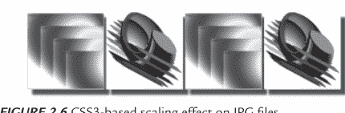

## 旋转变换 (Rotate Transforms)

CSS3 `transform` 属性允许你指定 `rotate()` 函数来创建旋转效果，其语法所示：

`rotate(someValue);`

你可以将 `someValue` 替换为任何数字。当 `someValue` 为正时，旋转为顺时针方向；当 `someValue` 为负时，旋转为逆时针方向；当 `someValue` 为零时，则没有旋转。前面的四个变换是特殊的；CSS3 `transform()` 函数可以指定任意的线性 3D 变换，包括 CSS3 透视变换。

浏览器从右到左读取选择器：这是一种“自下而上”的方法，而“关键”选择器是 CSS 选择器中最右侧的部分。从右到左的效率更高，因为元素：父元素的关系是一对一的，而父元素：子元素的关系是多对一。

为了说明，请考虑以下 CSS 和 HTML 代码段：

```
#mylist { ... }
<ul id="mylist">
  <li class="abc"></li>
  <li class="abc"></li>
  <li class="abc"></li>
</ul>
```

现在，假设你有 100 个 `<a>` 元素，你想选择三个类名属性值为 `abc` 的 `<a>` 元素。这个 CSS 选择器会匹配全部 100 个 `<a>` 元素的完整集合（这并不是你想要的）：

```
#mylist { ... }
```

另一方面，该 CSS 选择器*仅*匹配了那三个目标元素：

```
#mylist .abc { ... }
```

这里有一个涉及计算/布局/绘制（`calculate/layout/paint`）的高效 CSS 选择器示例：

```css
.results h2              // recalculate style
  height: 25px;         // layout
  text-shadow: 2px black; // paint
```

Paul Irish Performance Tooling 制作的一个关于性能主题的较旧视频在这里：http://www.youtube.com/watch?v=HAqyjCH_LO.

## translate() 函数与 Top/Left 属性

`translate()` 中的因素包括：a) `translate()` 不会“触碰” DOM，以及 b) `translate()` 涉及亚像素，从而产生更平滑的效果（可能是由于模糊）。另一方面，当元素在 Web 页面中具有相对/绝对/固定定位时，优先使用 `top/left/right` 而不是 `translate()`。

请记住，两种技术在不同的浏览器上可能会产生不同的结果。以下详细文章（由 Chris Coy 和 Paul Irish 编写）包含了更多信息：

```
http://css-tricks.com/tale-of-animation-performance/
http://www.paulirish.com/2012/why-moving-elements-with-translate-is-better-than-posabs-topleft/
```

## CSS3 的浏览器特定前缀

浏览器特定前缀用于针对单个浏览器处于“进行中”的 CSS 属性，最终的规范会弃用浏览器特定前缀。尽管现代浏览器的最新版本不再需要前缀（在本节中讨论），但学习这些前缀基于两个原因：a) 你可能会遇到包含浏览器特定前缀的代码，以及 b) 生成 CSS 渐变的旧网站往往会产生包含不必要前缀的代码。

浏览器特定前缀 `-ie-`、`-moz-` 和 `-o-` 分别对应 Internet Explorer、Firefox 和 Opera。注意 Opera 也支持 `-webkit-` 前缀，其他浏览器也可能这样做（请查阅各自的更新网站）。

为了说明，以下代码块显示了前缀的示例：

```css
-ie-webkit-border-radius: 8px;
-moz-webkit-border-radius: 8px;
-o-webkit-border-radius: 8px;
border-radius: 8px;
```

在你的 CSS 选择器中，将带有浏览器特定前缀的属性指定在“通用”属性之前，当浏览器特定属性未被选中时，通用属性作为默认选择。书中的 CSS 代码示例包含了 `webkit-` 特定前缀，这有助于我们保持样式表的大小在可范围内。你需要可以在多个浏览器（包括当前版本以及旧版本）运行的 CSS 样式表，这本质上有两种方案。一种方案是手动添加带有所有所需特定前缀的 CSS3 代码，这维护起来可能繁琐且容易出错。另一种方案是使用工具包或框架（在下一章讨论），它们可以程序化生成包含所有浏览器特定前缀的 CSS3 代码。

最后，详细的浏览器前缀 CSS 属性列表位于：http://peter.sh/experiments/cender-fixed-css-property-overview/。

在颜色渐变的情况下（在 3 章中讨论），对于最新版本的 Chrome、Firefox、IE 10+、Opera 和 Safari，你不再需要浏览器特定前缀。随着现代浏览器在功能支持方面的演进，额外的 CSS 属性将变得“无前缀”。幸运的是，以下开源项目允许你在代码中指定无前缀的属性：https://leaverou.github.io/prefixfree/

前面的代码仅在必要时才插入浏览器特定前缀，这减轻了执行此任务的繁琐程度。

## 总结

在本章中，你学习了浏览器对 CSS3 的支持、浏览器特定前缀以及各种 CSS3 特性。接下来你学习了 CSS3 伪类，以及如何创建阴影效果和圆角。你还学习了 CSS3 线性和径向渐变以及在线渐变生成器。此外，你还看到了如何使用各种 CSS3 变换，例如 `scale`、`rotate`、`skew` 和 `translate`。最后，你学习了与性能相关的技术。

## CSS3 2D 图形与动画

上一章包含了创建 CSS3 2D 图形的示例，而本章包含了 CSS3 2D 动画效果。注意第 4 章向你展示了如何创建 CSS3 3D 图形和动画效果。虽然三个章节都讨论了与 CSS3 相关的图形和动画，但请记住，代码示例作为概念的介绍而非概念本身。本章的第一部分讨论了用于的 CSS3。第二部分展示了如何定义 CSS3 过渡。第三部分展示了如何创建过滤器。第四部分介绍了 CSS3 运动路径（Motion Paths）。最后部分展示了如何创建这些效果。

## CSS3 2D 变换

CSS3 变换包括 CSS 函数 `scale()`、`rotate()`、`skew()` 和 `translate()`，它们允许你修改 HTML 元素的形状。

本节向你展示如何使用 CSS3 创建一个立方体，这涉及渲染正面（矩形）、顶部（平行四边形）和右侧（也是平行四边形）。

我们将在节中使用以下 CSS3 变换和效果：

- 1. 使用 CSS3 `skew()` 函数创建左侧和右侧
- 2. 使用 CSS3 `scale()` 和 `rotate()` 函数创建顶部
- 3. 用于阴影效果的线性和径向渐变

本节的示例包含大量的 CSS3 代码，在学习代码时，在浏览器中打开网页以查看结果可能有所帮助。

列表 3.1 显示了 `3DCube.html` 的内容，列表 3.2 显示了 `3DCube.css` 的内容，它们说明了如何在 CSS3 中模拟立方体。

## 列表 3.1 3DCube.html

```html
<!DOCTYPE html>
<html lang="en">
<head>
<title>CSS 3D Cube Example</title>
<link href="3DCSS1.css" rel="stylesheet" type="text/css">
</head>
<body>
<header>
  <h1>悬停在立方体面上面上：</h1>
</header>
<div id="outer">
  <div id="top">Text1</div>
  <div id="left">Text2</div>
  <div id="right">Text3</div>
</div>
</body>
</html>
```

列表 3.1 是一个简单的 HTML 页面，它引用了 CSS 样式表 `3DCSS1.css`，该表包含了用于样式化此网页中 HTML `<div>` 元素的 CSS3 选择器。


# CSS3 快速入门指南

## 3DCube.css 示例

```css
/* size and position */
#right, #left, #top {
  position: relative;
  padding: 0px;
  width: 200px;
  height: 200px;
}
/* 为了简洁，省略了 #left 和 right 选择器 */
```

`transform` 属性指定了 CSS3 变换函数 `scale()`、`skew()` 和 `rotate()`。这三个函数是同时被调用的，这意味着你将看到缩放、倾斜和旋转效果同时发生，而不是顺序执行。

列表 3.2 中的最后三个选择器定义了立方体每个面的属性。例如，`#left` 选择器指定了某些文本的字体，还指定了立方体左面的位置属性。`#left` 选择器最复杂的部分是 `background-image` 属性的值，它由径向渐变、重复径向渐变和另一个径向渐变组合。注意，左面是一个矩形，通过这行代码被转换为平行边形：

```css
transform: skew(0deg, -30deg);
```

`#top` 选择器和 `#right` 选择器包含与 `#left` 选择器类似的代码，你可以尝试调整它们的值来创建其他愉悦的视觉效果。

图 3.1 显示了将 `3DCube.css` 中的 CSS 选择器与 HTML 页面 `3DCube.html` 中的 `<div>` 元素匹配的结果。

如果你想学习如何使用 CSS 属性和变换创建各种形状，以下链接提供了技术和示例：[http://en-joycss.com/gallery/shapes/](http://en-joycss.com/gallery/shapes/) 和 [http://1webdesigner.com/css-shapes/](http://1webdesigner.com/css-shapes/)

## CSS3 二维过渡

CSS3 过渡以平滑的方式改变 CSS 值，它们由用户手势触发，如鼠标点击、聚焦或“悬停”效果。过渡非常有用，因为你可以使用它们通过所谓的“缓动函数”（easing functions）在特定时间内为 CSS 属性创建动画效果，这些函数以不同的变化率产生动画效果。例如，某些缓动函数在动画效果期间以恒定速率变化，而另一些创建非线性效果（慢-快-慢、快-慢-快等）。缓动函数强大且有用，因为它们让你能够创建真实的效果，例如观察棒球在空中向你飞来（这也是慢-快-快动画的一个例子）。

WebKit 最初开发了 CSS3 过渡，它们也可以在 Safari、Chrome (3.2 或更高)、Opera (10.5 或更高) 和 Firefox (4.0 或更高) 中可用，需使用特定浏览器的前缀，你将在本节稍后看到它们。请记住，有一些工具包（如 jQuery 和 Prototype）支持类似于其基于 CSS3 对应物的过渡功能。

创建 CSS 过渡的基本语法是一个“三元组”，指定了：

- 一个 CSS 属性
- 持续时间（秒）
- 过渡计时函数

这是一个过渡的示例：

```css
transition-property: background;
transition-duration: 0.5s;
transition-timing-function: ease;
```

幸运的是，你也可以在一行中组合这些过渡，如下所示：

```css
transition: background 0.5s ease;
```

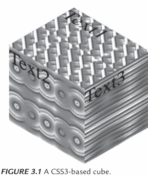

这是一个包含这些过渡的 CSS3 选择器示例：

```css
a.foo {
  padding: 3px 6px;
  background: #f00;
  transition: background 0.5s ease;
}
```

```css
a.foo:focus, a.foo:hover {
  background: #00f;
}
```

过渡目前需要特定浏览器的前缀才能在所有浏览器中正常工作。然而，浏览器发展很快，现在需要前缀的属性在未来将不再需要前缀。访问这些网站可以查看 CSS 属性是否需要前缀：[http://autoprefixer.com/](http://autoprefixer.com/) 和 [http://caniuse.com/](http://caniuse.com/)。

以下网站可以帮助你为 CSS 属性添加特定浏览器的前缀：[https://github.com/postcss/postcss-autoprefixer](https://github.com/postcss/postcss-autoprefixer)。

这是一个为 Internet Explorer、Firefox 和 Opera 指定特定浏览器前缀的示例：

```css
-ie-webkit-transition: background 0.5s ease;
-moz-webkit-transition: background 0.5s ease;
-o-webkit-transition: background 0.5s ease;
```

你可以指定以下过渡计时函数之一（使用特定浏览器）：

- Ease
- Ease-in
- Ease-out
- Ease-in-out
- Cubic-bezier

如果这些过渡函数都不能满足你的需求，你可以使用这个工具创建自定义函数：www.matthewlin.com/ceaser。

这里有一个显示过渡计时函数比较的网站：[http://www.roblaplaca.com/examples/bezierBuilder](http://www.roblaplaca.com/examples/bezierBuilder)。

你可以为 `transition-property` 属性指定许多值，广泛的值列表在这里：[https://developer.mozilla.org/en/CSS/CSS_transitions](https://developer.mozilla.org/en/CSS/CSS_transitions)。

根据前面的链接，`transition-property` 属性仍处于实验阶段，其中还有一个浏览器兼容性表。

以下网站是 CSS3 和 贝塞尔曲线动画效果的良好来源：[https://medium.com/@EanPlatter/css3-animations-with-a-cubic-bezier-curve-ea0fc20e5c1](https://medium.com/@EanPlatter/css3-animations-with-a-cubic-bezier-curve-ea0fc20e5c1)。

## 使用 CSS3 过渡使立方体动画化

本节的代码示例为上一节的代码示例添加了基于悬停的动画效果。HTML 网页 `3DCubeHover.html` 与网页 `3DCube.html` 几乎相同；唯一的例外在于对 CSS 样式表 `3DCubeHover.css` 的引用。

列表 3.3 显示了将 `3DCube.css` 中的 CSS 选择器与 HTML 页面 `3DCube.html` 中的 `<div>` 元素匹配的结果。

如果你想学习如何使用 CSS 属性和变换创建各种形状，以下链接提供了技术和示例：[http://en-joycss.com/gallery/shapes/](http://en-joycss.com/gallery/shapes/) 和 [http://1webdesigner.com/css-shapes/](http://1webdesigner.com/css-shapes/)

## CSS3 2D 图形与动画

```css
#columns:hover {
  transition: transform 3.0s ease;
  transform: scale(0.5) skew(-20deg, -30deg) rotate(45deg);
}

#line1:hover {
  transition: transform 3.0s ease;
  transform: scale(0.5) skew(-20deg, -30deg) rotate(45deg);
  background-image: linear-gradient(to bottom, #fff, #00f);
  border-radius: 8px;
}

#columns {
  column-count: 3;
  column-gap: 80px;
  column-rule: 1px solid rgb(255,255,255);
}

#line1 {
  color: red;
  font-size: 24px;
  background-image: linear-gradient(to bottom, #fff, #f00);
  border-radius: 4px;
}
```

列表 3.10 中的前两个选择器每当用户鼠标悬停在具有 `columns` 值的 `<div>` 元素上时，都会创建一个动画效果。这两个选择器都使用 CSS 函数 `scale()`、`skew()` 和 `rotate()` 在第二秒的间隔内创建一个效果，如下所示：

```css
transition: transform 3.0s ease;
transform: scale(0.5) skew(-20deg, -30deg) rotate(45deg);
```

第二个选择器还定义了一个线性渐变背景效果。

列表 3.10 中的 `#columns` 选择器创建了三个与布局相关的属性。`column-count` 属性值为 3，因此文本以三列显示；`column-gap` 属性值为 80px，因此相邻列之间有 80 像素的空间；`column-rule` 属性指定了白色背景。

`#line1` 选择器指定了一个线性渐变，在多列文本的上下创建一个视觉效果。

图 3.5 显示了在 HTML 页面 `MultiColumns.html` 中匹配 `MultiColumns.css` 里的 CSS 选择器的结果。

## CSS 基础概念

CSS 允许你在 HTML 元素中定义样式。CSS 帮助你对 HTML 内容进行模块化处理，且由于你可以将 CSS 定义放置在单独的文件中，因此你也可以在多个 HTML 文件中复用相同的 CSS 定义。

此外，CSS 还允许你简化对 HTML 页面中元素需要进行的更新。例如，假设有多个 HTML 元素使用某条指定颜色为红色的 CSS 规则。如果你以后需要将颜色更改为蓝色，只需在一条 CSS 规则中进行一次修改（即将红色改为蓝色）即可实现该更改。

如果没有 CSS 规则，你将被迫手动更新每个受影响的 HTML 表格（table）元素中的颜色属性，这既容易出错又耗费时间，而且效率极低。

## CSS3 动画示例

```css
@keyframes glow {
  0% {
    box-shadow: 0 0 24px rgba(255, 0, 0, 0.9);
  }
  100% {
    box-shadow: 0 0 24px rgba(255, 255, 255, 0.5);
  }
}

#input {
  font-size: 24px;
  border-radius: 4px;
}

#input:hover {
  animation: glow 2.0s 3 ease;
}
```

## HTML 结构示例

```html
<body>
  <header>
    <h1>鼠标悬停在多列文本上：</h1>
  </header>
  <div id="outer">
    <p id="line1"></p>
    <article>
      <div id="columns"></div>
    </article>
    <p id="line1"></p>
  </div>
</body>
</html>
```

列表 3.9 中的 HTML5 页面包含了语义化标签（在第 1 章中讨论过），这些标签渲染了 HTML `<p>` 元素中的文本。如所示，此 HTML5 页面非常简单，多列效果在列表 3.10 中显示的 `MultiColumn.css` 样式表中定义。

## CSS 滤镜

滤镜（filter）是你在 HTML 页面上执行操作时创建的某种东西。滤镜可以接受零或多个输入，输出是应用于 HTML 页面上的图像或某些参数。

此外，现代浏览器支持以下滤镜：

```css
filter: blur(3px);
filter: grayscale(100%);
filter: hue-rotate(80deg);
filter: opacity(0.8);
filter: sepia(80%);
filter: saturate(2);
filter: brightness(0.5);
filter: contrast(0.6);
filter: hue-rotate(120deg);
filter: invert(0.4);
```

你可以将这些 CSS 滤镜应用于 JPG 文件，如下选择器所示：

```css
img {
  filter: blur(3px);
}
```

关于滤镜的列表（正在进行中）位于 [https://dvcs.w3.org/hg/FXTF/rawfile/filters/index.html](https://dvcs.w3.org/hg/FXTF/rawfile/filters/index.html)。

另外两个包含滤镜信息的网站是 [http://www.ssi-devnet.net/css/filters.shtml](http://www.ssi-devnet.net/css/filters.shtml) 和 [https://html5-demos.appspot.com/static/cssfilters/index.html](https://html5-demos.appspot.com/static/cssfilters/index.html)。

Firefox 浏览器提供了丰富的滤镜支持，可以通过 [https://developer.mozilla.org/en-US/docs/Tools/Page_Inspector/How_to/Edit_CSS](https://developer.mozilla.org/en-US/docs/Tools/Page_Inspector/How_to/Edit_CSS) 查看。

以下链接显示了对 CSS 滤镜的支持：[http://caniuse.com/#feature=css](http://caniuse.com/#feature=css)

## CSS 自定义滤镜

Adobe FilterLab 允许读者通过点击为 HTML 页面添加 CSS 滤镜，并生成可以复制/粘贴到自己的 HTML 页面中的相关代码。FilterLab 网站位于 [http://www.adobe.com/devnet/html5/articles/css-filterlab.html](http://www.adobe.com/devnet/html5/articles/css-filterlab.html)。

请注意，FilterLab 的 GitHub 项目近期没有活动。

如果你是 Instagram 的粉丝，可能会对这个使用 CSS3 创建 Instagram 滤镜的工具感兴趣：[http://una.im/CSSgram/](http://una.im/CSSgram/)。

## 使用 CSS 和 jQuery（可选）

本章的剩余部分包含 CSS3 和 jQuery 的页面示例。你可能会问 jQuery 在 CSS3 快速入门指南中的相关性。这是一个合理的问题，因为这是一本 CSS3 快速入门指南。一种方案是直接跳过此部分（就像其他章节中的 jQuery 部分一样），并在以后某时刻决定学习结合 jQuery 和 CSS 时记住这些章节。

最后，你可以使用相同的 `text()` 函数来更新 HTML `<p>` 元素中的文本，如下所示：

```javascript
// update the text in the <p> element
$("p").text("Goodbye World From a Paragraph");
```

在浏览器中启动列表 3.11 的内容，并打开浏览器中提供的“检查器”（Inspector）。接下来，点击“检查元素”（Inspect Element），并点击网页底部的 ">" 符号，以查看列表 3.11 中两个 `console.log()` 语句的输出。请记住，在 Chrome 中使用 Web 检查器的具体步骤与 Safari 不同，而且该顺序在这两个浏览器的未来版本中也可能会发生变化。

如果你还不知道，可以使用 Chrome Web 检查器查看变量的内容，这对于调试目的非常有帮助。你可以尝试 Chrome Web 检查器的功能，还可以阅读有关这一优秀工具的在线教程。

## 使用 CSS 和 jQuery 实现的 2D 效果

如果你不计划在 HTML 页面中使用 jQuery，可以将本节视为可选内容，且不会影响内容的连贯性。

列表 3.12 显示了 `JTransforms2D1.html` 的内容，它说明了如何在 HTML 网页的 `<div>` 元素上调用 CSS 2D 变换。

## 列表 3.12 JTransforms2D1.html


```html
<!DOCTYPE html>
<html lang="en">
<head>
    <meta charset="utf-8" />
    <title>jQuery and CSS Transforms</title>
    <link href="JTransforms2D1.css" rel="stylesheet" type="text/css">
    <script src="http://code.jquery.com/jquery-2.0.0.js"></script>
    <script src="http://code.jquery.com/jquery-migrate-1.1.0.js"></script>
</head>
```

```html
<body>
    <h1>Click Inside Any of the Rectangles:</h1>
    <div id="outer">
        <div id="inner1"></div>
        <div id="inner2"></div>
        <div id="inner3"></div>
    </div>
</body>
<script>
```

```javascript
$(document).ready(function() {
  // one block of code for each <div>
  $("#inner1").click(function() {
    $(this).css({
      height: '300px',
      'transform': 'scale(0.5, 0.5) skew(-10deg, 20deg)'
    });
  });

  $("#inner2").click(function() {
    $(this).css({
      height: '200px',
      width: '250px',
      'transform': 'scale(0.5, 0.8) rotate(-45deg)'
    });
  });

  $("#inner3").click(function() {
    $(this).css({
      height: '100px',
      width: '250px',
      'transform': 'skew(-10deg, 10deg) rotate(-45deg)'
    });
  });
});
</script>
</body>
</html>
```

列表 3.12 在 `<head>` 元素中包含几个 `<script>` 元素，随后是 `<body>` 元素，其中包含一个 `<div>` 元素和一个 `<script>` 元素。`<div>` 元素包含三个子 `<div>` 元素，这些元素由列表 3.13 中的选择器匹配。`<script>` 元素以一个 jQuery 代码段开头——此处加粗显示为“check”——以确保 DOM 已加载到内存中。注意，所有的 JavaScript 和 jQuery 代码都在这段代码中。

列表 3.12 的下部分由三个代码块组成，用于处理每个嵌套 `<div>` 元素的点击事件。当用户点击这些 `<div>` 元素中的任何一个，代码会调用 jQuery 的 `css()` 方法来更新关联 `<div>` 元素的各种属性。例如，当用户点击第一个 `<div>` 元素时，将执行以下代码，对 `<div>` 元素应用 `scale()` 函数和 `skew()` 变换。

```javascript
$("#inner1").click(function() {
  $(this).css({
    height: '300px',
    'transform': 'scale(0.5, 0.5) skew(-10deg, 20deg)'
  });
});
```

列表 3.13 显示了 `JTransforms2D1.css` 的内容，其中包含了列表 3.12 中引用的 CSS3 选择器。

## 列表 3.13 JTransforms2D1.css

```css
#outer {
  position: absolute;
  left: 50px;
  top: 150px;
}

#inner1 {
  float: left;
  background-color: #F00;
  width: 200px;
  height: 150px;
}

#inner2 {
  float: left;
  background-color: #FF0;
  width: 200px;
  height: 150px;
}

#inner3 {
  float: left;
  background-color: #00F;
  width: 200px;
  height: 150px;
}
```

列表 3.13 在 `<head>` 元素中包含四个 `<script>` 元素，随后是 `<body>` 元素，其中包含一个 `<div>` 元素和一个 `<script>` 元素。`<div>` 元素包含三个子 `<div>` 元素，这些元素由列表 3.13 中的选择器匹配。`<script>` 元素以一个 jQuery 代码段开头——此处加粗显示为“check”——以确保 DOM 已加载到内存中。注意，所有的 JavaScript 和 jQuery 代码都在这段代码中。

列表 3.12 的下部分由三个代码块组成，用于处理每个嵌套 `<div>` 元素的点击事件。当用户点击这些 `<div>` 元素中的任何一个，代码会调用 jQuery 的 `css()` 方法来更新关联 `<div>` 元素的各种属性。例如，当用户点击第一个 `<div>` 元素时，将执行以下代码，对 `<div>` 元素应用 `scale()` 函数和 `skew()` 变换。

# CSS3 3D 图形与动画

本章将向你展示如何使用 CSS3 创建各种 3D 图形和动画效果的 HTML 网页。然而，虽然 3D 效果比 2D 效果更吸引人，但它们通常是 CPU 密集型的，这对于在移动设备上渲染的网页可能会出现问题。CSS3 3D 效果依赖 GPU（图形处理器）来处理高强度计算，你将学习如何确保 GPU 被调用。此外，许多网页显示在移动设备上，因此确定 CSS3 3D 动画效果对移动设备电池寿命的影响非常重要。

本章的第一部分向你展示如何使用 CSS3 2D 变换来渲染立方体，以及在悬停事件期间创建动画效果的过渡。本章的第二部分讨论了 3D 变换，例如位移（translate）、缩放（scale）和旋转（rotate）（2D 倾斜变换没有 3D 对应项）。本节还讨论了如何创建 CSS3 过渡。

本章的第三部分包含 CSS3 动画效果的示例。第四部分向你展示如何将 3D 效果与精灵图（sprites）、CSS3 动画工具结合，并包含一个使用 jQuery 和 CSS 创建动画效果的可选章节（如果你需要熟悉这项技术，jQuery 附录提供了相关介绍）。

除了讨论的用于创建 CSS3 2D/3D 图形/动画效果的代码样本外，这里还有一组扩展的代码样本（主要用于趣味）：https://github.com/locampeato/css3-graphics。由于本章涉及 CSS3 3D 动画效果，本章的最后部分简要介绍了 GPU 及其在 HTML 中的作用，并展示了如何确保为基于 CSS 的动画效果调用 GPU。在你读完讨论 SVG 与 CSS3 以及 HTML5 Canvas 与 CSS3 的章节后，第 9 章将从性能的角度简述这些技术。

## CSS3 3D 变换

通常情况下，CSS3 支持与其 2D 对应项相应的 3D 变换；唯一的异常是倾斜（skew）变换，它没有 3D 对应项。具体来说，3D 变换包括：`translate3D`、`rotate3D`、`scale3D`、`matrix3D` 和 `perspective`（透视）。

列表 4.1 显示了 `3DTransforms.html` 的内容，它阐释了如何在网页中使用 CSS3 3D 变换，列表 4.2 显示了 CSS3 样式表 `Threed2.css` 的内容。

## 代码 4.1 Threed2.html

```html
<!DOCTYPE html>
<html lang="en">
<head>
  <title>CSS 3D Effects Example</title>
  <meta charset="utf-8" />
  <link href="Threed2.css" rel="stylesheet" type="text/css">
</head>
<body>
  <div id="outer">
    <div id="radial1">Text1</div>
    <div id="radial2">Text2</div>
  </div>
</body>
</html>
```

列表 4.1 是一个简单的 HTML5 网页，它包含一个对 CSS 样式表 `Threed2.css` 的引用，随后是一个包含 `<div>` 元素的 `<body>` 元素，该 `<div>` 元素的 `id` 属性值为 `outer`。这个同一个 `<div>` 元素具有两个子 `<div>` 元素，这些子元素匹配了列表 4.2 中的某些选择器。

## 列表 4.2 Threed2.css

```css
#outer {
  position: relative; top: 10px; left: 0px;
}

#radial1 {
  opacity: 0.8;
  font-size: 24px;
  width: 200px;
  height: 200px;
  position: absolute; top: 0px; left: 0px;

  background: radial-gradient(
    blue 1%,
    orange 5%, yellow 40%,
    green 60%, red 80%,
    #fff
  );

  transform: rotate3d(20,30,40,50deg)
    translate3d(50px,50px,50px) skew(-15deg);
}

#radial2 {
  opacity: 0.6;
  font-size: 24px;
  width: 200px;
  height: 200px;
  position: absolute; top: 200px; left: 200px;

  background: radial-gradient(
    red 1%,
    orange 5%, yellow 40%,
    green 60%, blue 80%,
    #fff
  );

  transform: rotate3d(1,0,0, 60deg) scale3d(1.5, 0.5, 0.75);
}
```

列表 4.2 包含两个 CSS 选择器 `#radial1` 和 `#radial2`，它们匹配列表 4.1 中具有相应 id 的 `<div>` 元素。正如你看到的，这些选择器包含了 `transform` 属性，该属性指定了 CSS3D 函数的组合，例如 `rotate3d()` 和 `translate3d()`，以及 2D 的 `skew()`。请记住，并非所有浏览器都支持 CSS3D 变换。请访问 caniuse 网站查看有关哪些浏览器支持特定的 2D 或 3D 变换的信息：http://caniuse.com/#feat=css3%20transforms 和 http://caniuse.com/#search=css3%203d%20transforms。

## CSS3 3D 变换（示例）

通常情况下，CSS3 支持与其 2D 对应项相应的 3D 变换；唯一的异常是由于没有 2D 对应项的倾斜（skew）变换。具体来说，3D 变换包括：`translate3D`、`rotate3D`、`scale3D`、`matrix3D` 和 `perspective`（透视）。

## CSS3 3D 变换（修复）

CSS 过渡允许你平滑地将属性从一个状态变为另一个状态。对于颜色、透明度和变换有用。列表 4.3 展示了 `3DTransition.html`，它阐释了悬停事件触发的 3D 变换。

## 代码 4.3 3D1.html

```html
<!DOCTYPE html>
<html>
<head>
<meta charset="utf-8">
<title>CSS3 Effect</title>
<style>
div {
  width: 150px;
  background: red;
  transition: width 2s;
}
div:hover {
  width: 300px;
}
</style>
</head>
<body>
  <div></div>
</body>
</html>
```

## 过渡与变换（入门）

过渡属性允许你平滑地将属性从一个状态变为另一个状态。这对于动画颜色、透明度和变换有用。

- `transition-property`：指定要动画的属性名称。
- `transition-duration`：指定过渡完成所需时间。
- `transition-delay`：指定过渡开始前的等待时间。
- `transition-timing-function`：指定过渡的速度曲线（例如 `linear`、`ease`、`ease-in`）。

过渡属性是一个可以设置这四个值的简写：

```css
transition: [property] [duration] [timing-function] [delay];
```

示例：

```css
div {
  transition: 2s ease-out;
}
```

# CSS3 图形与动画与文本文件

列表 4.4 展示了 `TextImages.html` 的内容，它对齐了文本字符串和 PNG 文件，并在用户悬停在文本或文件上创建了动画效果。

## 代码 TextImages.html

```html
<!DOCTYPE html>
<html lang="en">
<head>
  <meta charset="utf-8" />
  <title>TextImages, Images, and Animation</title>
  <link href="TextImages.css" rel="stylesheet" type="text/css">
</head>

<body>
  <div class="preferences">
    
    <p>23 Beer/</p>
    
    <p>11 Beer/</p>
  </div>
</body>
</html>
```

## 代码 TextImages.css

```css
.preferences {
  width: 230px;
  height: 40px;
  background-color: #e2f2;
  padding: 12px;
  top: 20px;
  box-shadow: 0 0 24px rgba(100, 100, 100, 0.9);
}

.preferences > img {
  float: left;
  width: 24px;
  height: 24px;
}

.preferences > p {
  margin: 0;
  float: left;
  font-size: 24px;
}

p {
  font-size: 24px;
  border-radius: 4px;
  box-shadow: 0 0 24px rgba(100, 100, 100, 0.9);
}

p:hover { 
  scale: 2; 
  animation: rotateX 4.0s ease; 
}

img { 
  padding: 4px; 
}

img:hover { 
  scale: 2; 
  animation: rotateX 4.0s ease; 
}

@keyframes rotateX {
  0% { transform: rotateX(-45deg); }
  25% { transform: rotateY(90deg); }
  50% { transform: rotateX(270deg); }
  75% { transform: rotateZ(135deg); }
  100% { transform: rotateX(0); }
}
```

列表 4.5 开始于一个选择器，该选择器匹配类属性值为 `preferences` 的 `<div>` 元素，或者嵌套的 `` 元素，或者嵌套的 `<p>` 元素。下一个选择器匹配顶层 `<p>` 元素，紧接着是一个匹配当用户悬停在顶层 `<p>` 元素上并触发悬停事件的选择器。类似的注释也适用于匹配 `` 元素的选择器。

列表 4.5 的最后部分包含一个 `@keyframes` 定义，它在 `rotateX()` 函数中指定了不同的角度值。运行列表 4.4 中的代码并观察所创建的效果。

如果你不熟悉 `float` 属性（或者你需要快速回顾一下），下面的链接是一篇很棒的读物：http://bitsofco.de/2015/how-floating-works。

图 4.1 显示了在列表 4.1 中悬停在文本字符串上时创建的动画效果。

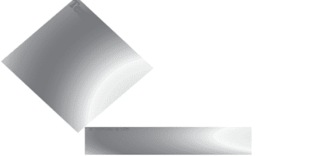

图 4.1 文本和 PNG 文件的动画效果。

## 使用关键帧的 CSS3 3D 图形

在上一章中，你学习了如何通过关键帧规则创建 CSS3 2D 动画效果。你还可以通过指定 CSS3 函数（例如 `scale3d()`、`rotate3d()` 和 `translate3d()`）单独或各种组合通过 CSS3 关键帧规则创建 CSS3D 动画效果。


# 列表 4.6 Anim240Flicker3DLGrad4.html

列表 4.6 显示了 `Anim240Flicker3DLGrad4.html` 的内容，这是一个非常特殊的 HTML 页面，包含了四个 HTML `<div>` 元素。在这个示例中，动画效果持续了四分钟，因为在相关的 CSS3 样式表中指定了时长。

```html
<!DOCTYPE html>
<html lang="en">
<head>
  <title>CSS3 Animation Example</title>
  <meta charset="utf-8" />
  <link href="Anim240Flicker3DLGrad4.css" rel="stylesheet" type="text/css">
</head>
<body>
  <div id="outer">Text1</div>
  <div id="linear2">Text2</div>
  <div id="linear3">Text3</div>
  <div id="linear4">Text4</div>
</body>
</html>
```

列表 4.6 是一个非常特殊的 HTML5 页面，带有相应的 CSS 选择器（显示在列表 4.7 中）。如往常，真正的复杂度位于包含创建动画效果代码的 CSS 选择器中。

正如你将看到的那样，列表 4.6 中的某些 CSS 选择器包含了 CSS `matrix()` 函数，该函数需要矩阵的知识（这超出了本书的范围）才能完全理解通过 CSS `matrix()` 函数可以创建的效果。如果你对学习矩阵感兴趣，可以阅读这篇关于矩阵的介绍（在 CSS3 背景下）：http://www.eleclip.com/2010/05/css-3d-matrix-transform/。

由于 `Anim240Flicker3DLGrad4.css` 是一个非常长的代码示例，列表 4.7 中仅显示了部分代码。然而，完整的代码可以在该书的附带光盘中获得。

# 列表 4.7 Anim240Flicker3DLGrad4.css

```css
@keyframes upperLeft {
  transform: matrix(1.5, 0.5, 0.0, 1.5, 0, 0)
  matrix(1.0, 0.0, 1.0, 1.0, 0, 0);
}
10% {
  transform: translate3d(50px, 50px, 50px)
  rotate3d(50, 50, -90deg)
  skew(-15deg, 0) scale3d(1.25, 1.25, 1.25);
} /* 省略了相似代码 */
90% {
  transform: matrix(2.0, 0.5, 1.0, 2.0, 0, 0)
}
95% {
  transform: translate3d(-50px, -50px, -50px)
  rotate3d(-50, -50, 120deg)
  skew(135deg, 0) scale3d(0.3, 0.4, 0.5);
}
96% {
  transform: matrix(0.2, 0.3, -0.5, 0.5, 100, 200)
  matrix(0.4, 0.5, 0.2, 2.0, 200, 50);
}
97% {
  transform: translate3d(50px, -50px, 50px)
  rotate3d(-50, -50, 120deg)
  skew(315deg, 0) scale3d(0.5, 0.4, 0.3);
}
98% {
  transform: matrix(0.4, 0.5, 0.5, 0.3, 200, 50)
  matrix(0.3, 0.5, -0.5, 0.4, 150, 50);
}
99% {
  transform: translate3d(150px, 50px, 50px)
  rotate3d(60, 80, 100, 240deg)
  skew(315deg, 0) scale3d(1.0, 0.7, 0.3);
}
100% {
  transform: matrix(1.0, 0.0, 0.0, 1.0, 0, 0)
  matrix(1.0, 0.5, 1.0, 1.5, 0, 0);
} /* 省略了代码 */
#linear {
  font-size: 96px;
  text-stroke: 8px;
  text-shadow: 8px 8px #000;
  width: 400px;
  height: 250px;
  position: relative; top: 0px; left: 0px;
  background-image: linear-gradient(#f00, orange 20%, yellow 40%, blue 60%, green 80%, #00f);
  border-radius: 4px;
  box-shadow: 30px 30px 30px #000;
  animation-name: lowerLeft;
  animation-duration: 240s;
}
```

列表 4.7 包含一个名为 `upperLeft` 的关键帧定义，它从以下行开始：

```css
@keyframes upperLeft {
  /* 关键帧定义在此 */
}
```

`#linear` 选择器包含了你已经熟悉的属性，还有一个通过 `lowerLeft` 引用关键帧的属性，以及一个指定 240 秒时长的属性，如下：

```css
#linear {
  /* 省略代码 */
  animation-name: lowerLeft;
  animation-duration: 240s;
}
```

现在你已经了解如何在 CSS 选择器中引用关键帧定义，让我们来看看 `lowerLeft` 定义的细节，它包含了 19 个指定各种动画效果的元素。`lowerLeft` 的每个元素发生在动画的特定阶段。例如，`lowerLeft` 中的第八个元素指定了值 `50%`，这意味着它将在动画的中点发生。由于 `#linear` 选择器包含一个值为 `240s` 的 `animation-duration` 属性（在列表 4.6 中加粗显示），这意味着动画将从 HTML 页面启动的时间点开始持续四分钟。

`lowerLeft` 的第八个元素指定了平移、旋转、倾斜和缩放效果（都是三维的），其示例如下：

```css
50% {
  transform: translate3d(250px, 250px, 250px),
  rotate3d(250px, 250px, -120deg)
  skew(-65deg) scale3d(0.5, 0.5, 0.5);
}
```

动画效果按顺序发生，从平移开始以缩放效果结束，`lowerLeft` 中的其他元素也是如此。

图 4.2 显示了匹配 CSS3 样式表 `Anim240Flicker3DLGrad4.css` 中的 CSS3 选择器与 HTML 页面 `Anim240Flicker3DLGrad4.html` 中 HTML 元素的初始视图。

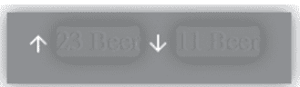

**图 4.2 CSS3 3D 动画效果。**

# CSS3 动画与 CSS 精灵图

CSS Sprites 减少了 HTTP 请求的数量（减少了 Web 页面的响应时间），并且减少了总文件大小。这个想法很简单：下载一张包含网站上所有小图片的图片（称为精灵图），然后通过它们在精灵图中的位置引用这些小图片。这个过程需要两个步骤：a) 创建精灵图，b) 对于精灵图中的每张图片，计算其在精灵图中的位置并更新 CSS 选择器。一个更简单且可以节省大量时间和精力的替代方案是一个名为 SpriteMe 的优秀工具，可以通过 http://spriteme.org 获取。

另一个包含 CSS 精灵图技巧和教程集合的有用网站可以在 http://nambrick.blogspot.com/2012/05/building-faster-websites-with-css.html?goback=%2Edge_2071438_member_120537762 获取。

# HTML 页面与 GPU

下一部分讨论了性能相关主题，从 CSS 和 GPU 的概述开始。

本节的内容比本章的其他章节以及本书的其他章节更复杂，这是因为涉及到确保浏览器以许多帧的速度流畅渲染图形（无“掉帧”）的因素。尽管如此，你仍会看到关于避免某些 CSS 代码以防止对 Web 页面性能产生不利影响的建议。

# CSS3 3D 图形与动画

> **注意**：浏览器必须能够使用主机操作系统上安装的显卡驱动程序，且在特定机器上某个浏览器的 GPU 加速并不保证所有浏览器都支持该功能。

网页可以使用 CSS 选择器来改变 HTML 元素的位置。浏览器通过两种重要的操作来处理位置变化，这些操作会对性能产生负面影响：重绘（repainting）和重流（reflow）。重绘涉及新像素值的计算（这些计算可以卸载给 GPU），而重流涉及计算 HTML 元素的新位置。请注意，某些基于 CSS 的效果（例如更改元素的透明度）如果元素没有改变位置，则需要重绘但不需要重流。当 Chrome 开发者工具（DevTools）执行此操作时，会提供一个“启用绘制闪烁（Enable paint flashing）”选项，重绘区域周围会出现绿色方框。GPU 通过执行所谓的“合成（compositing）”来处理像素值的计算，即将这些层混合在一起以实现组合效果。你可以将合成层看作一叠具有不同颜色的平行平面，并将合成过程看作当平面相互叠加时每个像素的最终颜色的计算。GPU 在以下情况下会创建一个单独合成层：3D 或透视变换、`<video>` 或 `<canvas>` 元素、CSS 过滤器，以及叠加到合成层上的元素（例如 `z-index`）。

创建的合成层数量也有大小限制，因此可能会创建出耗尽 GPU 内存的动画效果。幸运的是，Chrome 开发者工具提供了“显示层边界（Show layer border）”选项，它用橙色边框显示每个合成层。

需要记住的一点是，合成过程对于可以直接在 GPU 中执行的元素更改效率最高。具体而言，通过 `transform`、`opacity` 或 `filter` 对元素的更改可以由 GPU 直接处理。

Chrome 会开启硬件合成模式（如果支持且已开启）。Chrome 会创建一个新层和“背板（backing surface）”，这是一个图形上下文（也称为纹理），层被绘制其中。背板被上传到 GPU，层有时会共享同一个“背板”。当层满足以下条件时，Chrome 会创建一个新的背板：

1. 使用 3D 或透视变换 CSS 属性
2. 被使用加速视频解码的 `<video>` 元素使用
3. 被使用 3D 上下文或加速 2D 上下文 `<canvas>` 元素使用
4. 其透明度使用 CSS 动画或使用动画变换
5. 使用加速的 CSS 过滤器
6. 具有合成层的后代
7. 具有一个具有较低 `z-index` 且具有合成层的兄弟元素（该层是否渲染在合成层之上？）

## CSS 掩码与性能

CSS 掩码会产生一个新的离屏缓冲区（OSB）。接下来，GPU 写入 OSB 而不是直接写入 VRAM（显存），之后将 OSB 的内容复制到 VRAM 中。在移动设备上，VRAM 相对有限且“极易被耗尽”，这可能导致性能下降。请记住，CSS 圆角和投影使用了掩码，这就是为什么它们可能如此缓慢的原因。此外，圆角和投影的组合速度更慢。

## 什么是重流和重绘？

重流（Reflow）是计算网页中元素位置的过程，而重绘（Repaint）是重新渲染网页中像素颜色的过程。在 CSS 中，`display:none` 会导致重流和重绘，因为它在网页中既不可见。另一方面，`visibility:hidden` 仍然存在，这意味着没有几何结构的变化，因此只需要重绘。

绘制过程（浏览器计算 DOM 和 CSSOM，即 CSS 对象模型）使用 'Skia' 通过类似 Canvas 的 API 进行软件光栅化处理，输出是一组位图。接下来，位图被发送到 GPU，并由 GPU 在屏幕上进行合成。当你想要更改元素的位置时，`transform` 过程更有效，因为它直接由 GPU 处理，且不涉及重绘。另一方面，`left` 和 `top` 属性的组合会导致作为重绘的重流。

## 重流和重绘的产生

以下效果会导致网页产生重流和重绘：

- 滚动（scroll）和悬停（hover）
- 盒子投影（box-shadow）和投影（drop shadows）
- 浮动（floats）和表格（tables）
- 透明度（opacity）和渐变（gradients）
- 圆角（border-radius）
- 透明度和过渡动画（transitions）
- 更改字体大小
- 左侧节点：可能是微小变化
- 顶部节点：传播可能会导致许多变化
- 添加/删除/更新 DOM

在 DOM 中添加、删除或更新元素的“常规”操作会导致网页的重流和重绘。因此，在网页中完全消除重流/或重绘可能是不可能的：需要记住的是，你想尽量减少事件次数，以免对网页的性能和用户体验质量产生负面影响。

## Chrome 与布局更改

Chrome 异步“批处理”布局更改以最大化提高渲染性能。以下样式信息会导致同步更新：

- `OffsetTop` 和 `offsetLeft`
- `OffsetWidth` 和 `offsetHeight`
- `ScrollTop` 和 `clientTop`
- `Left`、`width` 和 `height`
- `GetComputedStyle()`

目标是找到并消除导致同步更新的 JavaScript 代码或 CSS 选择器。

避免同步更新，因为任何对节点样式信息的请求都会强迫浏览器提供最新的值。为了做到这一点，浏览器必须应用所有已计划的更改、刷新队列并执行重流。

例如，在 HTML 网页中尽量少使用此类代码：

```javascript
el.style.left = el.offsetLeft + 10 + "px";
```

## GPU 的自动调用

当网页包含 CSS 选择器（特别是那些涉及变换或动画效果的选择器）时，你的浏览器决定何时调用 GPU。然而，无法保证 GPU 总是会被调用以提供改进的性能。坦率地说，有一些技术（有时被称为“无操作”或“黑科技”）可以强制调用 GPU。你可以使用 `translate3D(0,0,0)` 或 `translateZ(0)`，如下所示选择器所示：

```css
.melee {
  transform: translateZ(0);
}
```

Paul Irish（Google 的开发者倡导员）在下面这段三分钟的视频中讨论了这些及其他技术：http://paulirish.com/2011/dom-html5-css3-performance/

这些“黑科技”可能更慢吗？这段示例代码在你的浏览器中包含了 4000 个较小的 `<div>` 元素：http://dl.dropboxcontent.com/u/17844821/zeug/huwet.html。

- 浏览器中的 4000 个较小的 `<div>` 元素：http://dl.dropboxcontent.com/u/17844821/zeug/huwet.html

# CSS3 入门

以下是 Stack Overflow 的帖子（2012年）：http://stackoverflow.com/questions/10014461/why-does-enabling-hardware-acceleration-in-css3-slow-down/

直到最近，网页开发者一直依赖本节的技术来确保 GPU 的调用。从 2015 年开始，另一种方法涉及 `will-change` 属性，如下一节所示。

## will-change 属性

CSS `will-change` 属性确保 GPU 被调用。该属性支持 Chrome 36+、Opera 24+、Firefox 36+。此外，Safari 正在实现 `will-change`，Microsoft Edge 正在考虑支持。关于该属性的更多细节可以在此处找到：http://www.site.com/introduction-css-will-change/ 和 https://dev.opera.com/articles/css-will-change/

## 使用 jQuery 动态创建内容（可选）

本节包含一个通过 jQuery 方法动态创建 `<div>` 元素和匹配 CSS 选择器的示例。如果你打算阅读本节，且不熟悉 jQuery，请先阅读第三章中的 jQuery 简介。如果你跳过了本节，请尝试在浏览器中运行代码（你可能会感到惊讶）。

此代码示例的目的有两个：a) 如何通过 jQuery 动态创建内容；b) 如何通过匹配动态内容的 CSS 选择器创建动画。本节的代码示例将向你介绍一些你可以应用于为网页创建基于 CSS 的动画或图形的技术。

列表 4.8 显示了 `ArchModEllipsesGrad.html` 的部分内容，它通过动态创建的 `<div>` 元素创建 CSS3-3D 动画。完整的代码列表可以在附光盘上找到。

```javascript
$(document).ready(function() {
  for(var angle=0; angle<maxAngle; angle++) {
    radius = Constant*Math.cos(angle*Math.PI/180);
    offsetX = radius*Math.sin(angle*Math.PI/180);
    currentX = basePointX+offsetX;
    currentY = basePointY-offsetY;
  }
```


# 第 4 章：CSS3 3D 图形与动画效果（续）

```javascript
rVal = Math.floor(255 * (angle % stripWidth) / stripWidth);

fillColor = "rgb(" + rVal + ", 0, 0)";

// 在当前位置创建一个椭圆

if (angle % 20 == 0) {

  newNode = $('<div>').css({

    'position': 'absolute',

    'width': angle + majorAxis + 'px',

    'height': angle + minorAxis + 'px',

    'left': currentX + 'px',

    'top': currentY + 'px',

    'backgroundColor': fillColor,

    'borderRadius': '20%'

  });

  toggleClass('skewAnim1');

} else {

  newNode = $('<div>').css({

    'position': 'absolute',

    'width': majorAxis + 'px',

    'height': minorAxis + 'px',

    'left': currentX + 'px',

    'top': currentY + 'px',

    'background-size': '240px 240px, 80px 80px',

    'backgroundColor': fillColor,

    'borderRadius': '50%'

  });

  addClass("radial6 glow");

}

$("#outer").append(newNode);

});
```

列表 4.8 包含一个 `<body>` 元素，该元素以一个 `<div>` 元素开头，其 `id` 属性值为 "outer"。这个 `<div>` 元素是动态创建的 `<div>` 元素追加的地方，这由列表 4.8 中 `<script>` 元素中的代码完成。

`<script>` 元素初始化了一些 JavaScript 变量，标准的 jQuery `ready()` 函数包含一个循环，该循环使用条件逻辑动态创建 `<div>` 元素并将它们追加到列表 4.8 中的顶层 `<div>` 元素。

例如，当分析循环变量为 20 的倍数时，会创建一个具有各种 CSS 属性的新 `<div>` 元素，如下代码所示：

```javascript
newNode = $('<div>').css({
  'position': 'absolute',
  width: (angle % majorAxis) + 'px',
  height: (angle % minorAxis) + 'px',
  left: currentX + 'px',
  top: currentY + 'px',
  backgroundColor: fillColor,
  borderRadius: '20%'
});

toggleClass("skewAnimi");
```

条件逻辑中的 "else" 部分动态创建另一个属性相似的 `<div>` 元素。

图 4.3 显示了在 Chrome 浏览器中运行列表 4.8 的结果。

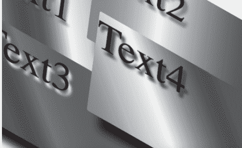

图 4.3 使用 jQuery 动态创建的 `<div>` 元素。

如果你对涉及 jQuery 和 CSS3 动画效果的其他代码示例感兴趣，可以在 `https://github.com/ocompesasato/jquery-css3-graphics` 找到大量类似的代码示例（可以称为“色块”）。

## 有用链接

除了 Google Chrome，Mozilla 开发者工具（Mozilla Developer Tools）有一套工具用于分析 HTML Web 页面性能相关的瓶颈：`https://www.mozilla.org/en-US/firefox/developer/`。

CSS 动画硬件加速的一个很好的示例是：`http://www.sitepoint.com/introduction-to-hardware-acceleration-css-animations/`。

书中的许多 CSS3 样式包含带有 2D/3D 动画效果的选择器，硬件加速将显著提高性能。在某些情况下，平板设备不提供良好的硬件加速，而带有许多 2D 或 3D 动画效果的样式在这些设备上几乎无法运行。

以下链接包含了十个关于性能相关的 CSS3 项目：`http://stackoverflow.com/questions/7486017/css3-what-are-the-performance-best-practices`。

关于编写更高效的 CSS3 选择器的信息的文章在此处：`http://www.pubnub.com/blog/css3-performance-optimizations`。

此处提供了关于编写 CSS3 选择器“最佳实践”的信息：`http://webdesignurnall.com/trends/css3-examples-and-best-practices` 和 `http://www.impressivewebs.com/css3-best-practices`。

CSS 动画工具列表可以在 `http://speckboy.com/2015/09/09/css-animation/` 找到。

你还可以找到其他关于 CSS3 性能、CSS3“最佳实践”以及 HTML5 Canvas 的在线视频和教程。

## 总结

在本章中，你学习了如何创建 CSS3 3D 图形和动画效果。特别是，你学习了变换（如 `translate`、`scale` 和 `transitions`）。然后你学习了如何创建代码来调用 GPU 以处理密集计算。此外，你还看到如何将 3D 效果与精灵（sprites）结合，以及如何使用 jQuery 和 CSS 创建动画效果。

# 第 5 章：媒体查询与标签

CSS3 Media 查询扩展了名为媒体类型（media types）的旧规范的能力，该规范将浏览器分配到屏幕、手持或打印等高级类别，以便恢复 Web 页面的打印输出。

CSS 2.1 引入了媒体查询的概念，它允许你根据条件包含打印、屏幕等的备用样式表。媒体类型规范详细说明了十种媒体类型，但浏览器只支持其中一些（如屏幕和打印）。

例如，以下 CSS 2.1 媒体查询根据 `media` 属性的值条件加载样式表：

```html
<link rel="stylesheet" type="text/css" href="main.css" media="screen" />
<link rel="stylesheet" type="text/css" href="print.css" media="print" />
```

CSS3 Media 查询让你能够确定访问网站设备的某些特性。在某种意义上，CSS3 Media 查询是功能检测（feature detection）的对应物。例如，CSS3 Media 查询将两个条件与加载 CSS 样式表的条件逻辑结合：

```html
<link rel="stylesheet" 
media="screen and (min-width: 800px)" href="main.css" />
```

你还可以在 CSS 中使用 `@media` 指令内联查询，以根据条件样式化不同的 HTML 元素，如下例所示：

```css
@media screen and (min-width: 320px) {
  body {
    background-color: #ff0000;
  }
}
```

```css
@media screen and (min-width: 480px) {
  body {
    background-color: #0000ff;
  }
}
```

本节包含了各种 CSS3 媒体查询（Media Queries），这些是非常有用的逻辑表达式，允许你检测具有不同物理属性和方向的设备上的移动应用程序。例如，通过 CSS3 媒体查询，你可以更改应用程序的尺寸和布局，使其在智能手机和平板电脑上都能渲染。

具体而言，你可以使用 CSS3 媒体查询来确定设备的以下特征：

- 浏览器宽度和高度
- 设备宽度和高度
- 方向（横屏或竖屏）
- 宽高比
- 设备宽高比
- 分辨率

CSS3 媒体查询是布尔表达式，包含一个或多个“简单术语”（通过 `and` 或 `or` 连接），其评估结果为真（true）或假（false）。因此，CSS3 媒体查询表示了评估结果为真或假的条件逻辑。

例如，接下来的 `<link>` 元素在设备为屏幕且设备最大宽度为 480px 时才加载 CSS 样式表 `mystuff.css`：

```html
<link rel="stylesheet" type="text/css" media="screen and (max-device-width: 480px)" href="mystuff.css"/>
```

前面的链接包含一个 `media` 属性，它指定了两个组件：媒体类型 `screen` 以及一个指定 `max-device-width` 值为 480px 的查询。CSS3 媒体查询中 `media` 的支持值为 `braille`、`embossed`、`handheld`、`print`、`projection`、`screen`、`speech`、`tty` 和 `tv`。

下一个 CSS3 媒体查询检查媒体类型、设备最大宽度和分辨率：

```css
@media screen and (max-device-width: 480px) {
  #innerDiv {
    float: none;
  }
}
```

如果上述代码段中的 CSS3 媒体查询结果为真，则嵌套的 CSS3 选择器将匹配 `id` 属性值为 `innerDiv` 的 HTML 元素，并且在任何最小屏幕宽度为 480px 的设备上，其 `float` 属性将被设置为 `none`。如你所见，可以创建包含复杂逻辑的 CSS3 媒体查询，这显然非常有用，因为 CSS3 没有其他编程语言中提供的 `if/then/else` 结构。

接下来的 CSS3 媒体查询测试设备的媒体类型、最小宽度和分辨率：

```css
@media screen and (min-device-width: 481px) and (resolution: 160dpi) {
  #innerDiv {
    float: left;
  }
}
```

在前面的 CSS3 选择器中，`id` 属性值为 `innerDiv` 的 HTML 元素在任何最小屏幕宽度为 480px 的设备上，其 `float` 属性的值为 `left`。

下一个 CSS3 媒体查询如果屏幕宽度在 321 到 480 之间，将 `div` 元素的宽度设置为 100px：

```css
@media screen and (min-width: 321px) and (max-width: 480px) {
  div { width: 100px; }
}
```

在代码段中，`myphone.css` 将应用于浏览器认为是“手持（handheld）”或屏幕尺寸不超过 320px 的设备：

```html
<link rel="stylesheet" media="handheld, only screen and (max-device-width:320px)" href="myphone.css">
```

> 在媒体查询中使用 "only" 关键字会导致符合 CSS3 标准的浏览器忽略该规则。例如，接下来的 `<link>` 为尺寸在 641px 到 800px 之间的屏幕加载 CSS 样式表：

```html
<link rel="stylesheet" media="only screen and (min-width:641px) and (max-width:800px)" href="wide.css">
```

媒体查询可以包含在内联的 `<style>` 标签中，如此查询所示，该查询适用于竖屏模式下的所有媒体类型：

```html
<style>@media only all and (orientation: portrait) { ... }</style>
```

现在你已经对使用 CSS3 媒体查询可以做的事情有了基本了解，你可以遵循下一节中的代码，该节包含一个 HTML5 页面和一个 CSS3 样式表，展示了如何处理移动设备方向的变化。

## 使用 CSS3 媒体查询检测屏幕分辨率

目前很少有专门针对 Android 设备或 iOS 设备的 CSS3 媒体查询。通常，你可以根据基于不同屏幕尺寸或不同分辨率的条件逻辑使用 CSS3 媒体查询，其中某些特定适用于 Android 和 iOS 设备。你可以通过使用 `resolution` 关键字测试不同的每英寸点（dpi）来确定特定的分辨率。你还可以指定 `min-` 和 `max-` 前缀来区分低分辨率和高分辨率机器。

iPhone 和 iPod touch 使用高分辨率 Retina 显示屏。你可以使用 WebKit 关键字来测试其是否存在：

```css
-webkit-min-device-pixel-ratio
```

要仅向 Retina 设备显示，你将使用以下条件逻辑：
`only screen and (-webkit-min-device-pixel-ratio: 2)`

## 使用 CSS 媒体查询检测屏幕方向

本节中的 CSS3 媒体查询为 CSS3 媒体查询的能力提供了简单示例。列表 5.1 和 5.2 显示了 CSS 样式表的内容，并展示了如何处理移动设备方向的变化。

### 列表 5.1 CSS3 媒体查询

```css
@media only all and (orientation: portrait) { ... }
```

# 媒体查询与元标签

## 在 3D JavaScript 中检测方向

上一节展示了如何判断设备处于竖屏模式还是横屏模式。此外，你还可以确定设备在 3D 空间的位置。

设备 3D 位置的变化有三种：向上和向下（z轴）、向左和向右（y轴）、以及顺时针和逆时针（x轴）。这些变化通过加速度计测量，你可以在 `window` 对象的 `deviceorientation` 事件中检查它们的当前值。当移动设备移动时，该事件就会触发，并返回一个带有方向相关属性的对象。

下面的 JavaScript 代码列出了内容：

```javascript
window.addEventListener('deviceorientation', function (o) {
  console.log(o.alpha, o.beta, o.gamma);
}, false);
```


属性 `alpha`、`beta` 和 `gamma` 分别提供 z、x 和 y 轴上的旋转角度（单位为度，而不是弧度）。请记住，z 轴是垂直轴（正值为向上），x 轴指向前方（负值为远离你），y 轴是从左到右的水平轴（朝向为正值）。

这三个属性的允许值如下：

- `alpha`: 0 到 360（顺时针）
- `beta`: -180 到 180（朝向/远离你）
- `gamma`: -90 到 90（从左到右）

如果你想了解更多关于设备方向的细节，可以使用加速度计获取更精确的信息。

## 检测屏幕宽度和高度

`window` 对象支持 `resize` 事件，你可以用它来确定屏幕的宽度和高度，从而允许修改 HTML5 网页中的其他效果。列表 5.4 显示了 `resizeBorder1.html` 的内容，说明了无论屏幕尺寸或方向如何，如何保持相同的蓝色边框。

### 列表 5.4 ResizeBorder1.html

```html
<!DOCTYPE html>
<html lang="en">
<head>
<meta charset="utf-8">
<title>调整窗口大小</title>
<style>
 * {
  margin:0px; padding:0;
}
#outer {
  width: 400px; height: 300px;
  border: 10px solid blue;
}
</style>
<link rel="stylesheet" href="http://code.jquery.com/mobile/1.1.0/jquery.mobile-1.1.0.min.css" />
<script src="http://code.jquery.com/jquery-2.0.0b1.js"></script>
<script src="http://code.jquery.com/jquery-migrate-1.1.0.js"></script>
<script src="http://code.jquery.com/mobile/1.1.0/jquery.mobile-1.1.0.min.js"></script>
</head>
<body onload="resizeBorder();">
```

列表 5.4 包含一个 `<style>` 元素，其第一个选择器将网页中所有元素的内边距（padding）和外边距（margin）设置为 0px。第二个选择器设置了 10px 的蓝色边框。当你向浏览器加载此网页时，将执行 JavaScript 函数 `resizeBorder()`。该 JavaScript 函数通过以下代码段获取浏览器的当前宽度和高度：

```javascript
var rescaledScreenWidth = document.documentElement.clientWidth;
var rescaledScreenHeight = document.documentElement.clientHeight;
```

`resizeBorder()` 中的接下来两行代码将 `<div>` 元素（id 值为 `outer`）的宽度和高度属性设置为当前宽度和高度值减去 `2*borderWidth` 的数量。

## 用于多屏幕尺寸的 CSS3 媒体查询

在 CSS3 媒体查询的介绍中，你看到了使用复合条件逻辑定义媒体查询的示例（这些逻辑可以包括 `and`、`or`、`only` 和 `and not`）。如果你还没有注意到，你可以使用媒体查询来处理智能手机和平板电脑等移动设备的不同屏幕尺寸。这里有一个示例：

```css
@media screen and (min-width: 321px) and (max-width: 321px) {
  /* 在此处编写代码 */
}
```

### 媒体查询与 Meta 标签

- 一个带有背景图片的 `<div>` 标签，如果屏幕宽度小于 600px，其颜色会发生变化。
- 一个带有背景图片的 `<div>` 标签，如果最小像素比为 1.5（使用 `min-device-pixel-ratio` 媒体查询），则会赋予一个新的背景图片。

请注意，上一个链接可能包含过时信息；不过，你仍然可以在你选择的浏览器中进行相同的测试，以确定结果是否仍然有效。

另一种选项是使用 `window.matchMedia`，这是一个用于 CSS3 媒体查询的 JavaScript 元素。`window.matchMedia` API 列表在这里：`/developer.mozilla.org/en-US/docs/Web/API/Window/matchMedia`。

带有 `window.matchMedia` 代码示例的文章可以在这里找到：`https://hacks.mozilla.org/2012/06/using-window-matchMedia-to-do-media-queries-in-javascript/`

本章的下一节将深入探讨元标签（meta tags），包括一些针对移动设备的标签。

### 视口 Meta 标签

HTML Web 页面在“虚拟页面”中渲染，而屏幕是该页面的窗口。视口 meta 标签设置此虚拟页面的尺寸。此外，视口 meta 标签还控制 iOS 和 Android 上浏览器窗口的缩放。视口 meta 标签支持以下属性：

- **Width（宽度）**：视口以像素为宽度（默认为 980），范围在 200 到 10,000 之间。
- **Height（高度）**：视口以像素为高度。默认值根据设备的宽度和宽高比计算，范围在 223 到 10,000 之间。
- **Initial-scale（初始缩放）**：应用程序的初始“缩放因子”，用户可以从该初始值进行放大或缩小。
- **Minimum-scale（最小缩放）**：视口的最小缩放值（默认为 0.25），范围在 0 到 10.0 之间。
- **Maximum-scale（最大缩放）**：视口的最大缩放值（默认为 1.6），范围在 0 到 10.0 之间。
- **User-scalable（用户可缩放）**：你可以指定用户是否可以对应用程序放大或缩小（默认值为 "yes."）。将其设置为 "no" 以防止缩放。

此外，你可以通过逗号分隔，在 meta 标签中设置多个视口选项，如下所示：

```html
<meta name="viewport" content="width=device-width, user-scalable=no">
```

`target-densitydpi`（在视口 meta 标签中指定）已弃用（实际上已从 WebKit 中移除），因此建议在基于 Android 的移动中使用此属性来指定低、中、高 dpi 值。

你还可以使用视口标签来防止用户在移动应用中缩放或平移。示例是：

```html
<meta name="viewport" content="width=device-width; initial-scale=1.0; maximum-scale=1.0; user-scalable=0" />
```

iOS 平台支持视口标签以及 iOS 特有的 meta 标签，其中一些在此描述：`http://developer.apple.com/library/safari/documentation/applications/reference/SafariHTMLRef/Articles/MetaTags.html#article_ref_doc/TP40008193-SW1.`

### 视口单位

视口指的是浏览器屏幕，四个视口单位如下：

- `vw`：视口宽度的百分比
- `vh`：视口高度的百分比
- `vmin`：`vw` 或 `vh` 中的较小值
- `vmax`：`vw` 或 `vh` 中的较大值

例如，1vw 是浏览器宽度的 1%，这意味着 100vw 是浏览器宽度的 100%。

以下 CSS 选择器使用 `calc()` 函数和 CSS3 媒体查询，每当 HTML Web 页面调整大小时，都会计算 `font-size` 属性：

```css
html {
  font-size: 100%;
  // 每 100px 缩放 1px（从 600px 开始）
  @media (min-width: 600px) {
    font-size: calc(125% + 4 * (100vw - 600px) / 400)
  }
  // 将 font-size 设置为 24px（针对 1000px 或更宽的情况）
  @media (min-width: 1000px) {
    font-size: calc(150%)
  }
}
```

本章的后续部分将讨论将 CSS 样式表导入另一个的 `@import` 语句。

## CSS 中的 @IMPORT 语句

`@import` 语句方便地让你将一个 CSS 样式表导入到另一个。例如，假设你想将 `basic.css` 导入到 CSS 样式表中，两者都在同一个目录下。你可以使用以下代码段：

```css
@import basic.css;
```

你也可以导入互联网上可用的 CSS 样式表而不是文件系统，如下：

```css
@import url(http://www.prince.com/fonts/larie/index.css) all;
```

下一节将讨论在 CSS 样式表中使用 `@import` 语句时需要记住的两个重要考虑。

### 模块化与性能

虽然 `@import` 语句非常方便，但在使用该语句时有两个点需要考虑。首先，`@import` 语句可以帮助你将 CSS 模块化，但请记住你需要留意覆盖属性。其次，`@import` 可能会带来性能损耗。

## 资源链接

互联网上一个极好的浏览器兼容性信息来源（由 Peter-Paul Koch 维护）可以在这里：`http://www.quirksmode.org`。

这里有一个非常有用的工具，允许你尝试 CSS3 特性并显示相关的 CSS3 代码：`http://www.westciv.com/3D/DTransforms/index.html`。

以下是一个讨论了 14 种 CSS3 生成器的网站：`http://www.webpop.com/blog/2013/04/23/css-generators`。

这里有 15 种跨浏览器测试工具的对比（大部分是免费，部分是商业性的），并附有特征的表格对比：`http://www.ashingmagazine.com/2011/08/07/a-dozen-cross-browser-testing-tools/`。

这些链接提供了丰富的信息和实用的技巧，因此你很有可能找到所需的信息，为你的网站创建所需的视觉效果。

## 额外的代码示例


CSS 样式表 `CSS3MediaQuery.css` 和 HTML5 网页 `CSS3MediaQuery.html`（均在附光盘中）演示了如何使用媒体查询在用户旋转移动设备时更改两个图像的大小。


你可以使用简单的 JavaScript 代码检测移动设备方向的变化，因此你并不“强制”使用 CSS 媒体查询。附光盘上的 HTML5 网页 `CSS3orientationJS1.html` 展示了如何使用标准 JavaScript 在用户旋转移动设备时更改两个图像的大小。

本质上，该代码使用变量 `window.orientation` 的值来检测移动设备的四种不同方向，在每种情况下，PNG 文件的尺寸通过以下类型的代码进行更新：

```javascript
document.getElementById("img1").style.width = "120px";
document.getElementById("img1").style.height = "300px";
```

虽然这是一个非常简单的示例，但希望这段代码能让你领略到 CSS3 媒体查询的能力。

## 总结

本章向你展示了如何在移动应用的 HTML5 网页中使用 meta 标签。你看到了如何在 CSS 中通过 `@media` 指令内联使用媒体查询，以便条件地为 HTML 元素设置样式。你还学习了使用 CSS3 媒体查询来检测移动设备方向的变化，以及使用简单的 JavaScript 代码实现相同的效果。此外，你还学习了如何根据不同屏幕尺寸或不同分辨率的条件逻辑使用 CSS3 媒体查询，其中某些专门针对 Android 设备和 iOS 设备。

# CSS3 与 HTML5 Canvas

本章概述了将 CSS3 与 HTML5 Canvas 结合，Canvas 是一种直接在网页部分区域绘制图形的技术。HTML5 Canvas 支持多种用于渲染 2D 形状和创建动画效果的 API。此外，你将看到如何使用基于 CSS3 的动画效果为 HTML5 `<canvas>` 元素设置样式。

你可能会疑惑为什么这一章被包含在书中。如果你想学习 HTML Canvas 和相关的 JavaScript 代码，那么本章将为你提供一个合理的介绍：尽管网络上有许多关于 Canvas 和 CSS3 相关的教程，但很少有教程将 HTML5 Canvas 和 CSS3 图形效果结合起来。

本章的第一部分向你展示如何使用 CSS3 样式表在 HTML5 Canvas 中渲染线段、矩形和圆形。第二部分引入了 HTML5 Canvas 中的线性渐变和径向渐变，并提供了如何将它们应用于 Bezier 曲线和二进制图像的示例。本章第三部分包含了在 HTML Canvas 元素中渲染 PNG 文件的示例。

一个重要的提示：与书中其他章节不同，本章需要一些 JavaScript 知识，例如如何定义变量和函数。此外，代码示例包含了 `document.getElementById` 用于在 HTML 网页中查找元素，`window.addEventListener` 用于为网页添加事件监听器，以及为 HTML `<input>` 元素定义点击处理器。诚然，本章没有讨论这些方法的细节。你可以浏览一下代码示例以了解它们包含的 JavaScript 代码类型，然后就可以评估自己是否有信心详细地阅读这些示例。另一个建议：运行本章中的代码示例，看看图形效果是否让你感兴趣，然后就可以阅读本章中相关的代码。

正如你所看到的，本章中的一些代码示例包含了 HTML5 Canvas、CSS3 图形以及 CSS3 2D/3D 动画效果的（某些定时）组合，这种组合在任何在线资源或相关主题书籍中很难找到。这些代码示例为你创建自己具有视觉吸引力的图形效果提供了起点。

此外，本章的大部分章节都以相关代码列表所用 API 的语法开头，提供了大量的细节并阐明了多个概念。如果你在读完本章后想探索额外的 HTML5 Canvas 图形，这里提供了大量的代码示例：`https://github.com/ocompesato/html5-graphics`。

请记住，在编写底层的 Canvas 图形（如本章中的代码示例）时，权衡（时间、精力和成本）是非常重要的。

## 什么是 HTML5 CANVAS？

HTML5 `<canvas>` 元素用于通过脚本在网页上绘制图形。`<canvas>` 元素本身只是一个容器；图形本身不会绘制，你必须使用 JavaScript 来绘制。HTML5 canvas API 提供了多种绘制形状、文本、图像和视频的方法。你还可以创建动画并处理用户输入。

在画布上绘制图形有两种主要方式：

- **即时模式**：在这种模式下，图形在执行命令时立即绘制。画布不会记住这些图形。
- **留存模式**：在这种模式下，图形存储在场景图中，稍后可以进行操作。这是 SVG 等技术的工作原理。

HTML5 canvas 使用即时模式。这意味着如果你想更改图形，必须清除画布并重绘。

## HTML5 CANVAS 坐标系

回想你中学的时代，学习了坐标系通过一对数字（通常写作 `(x, y)`）来标识平面上的任何点。第一个数字代表水平值，第二个数字代表垂直值。水平轴称为 x 轴，x 轴的正值在右侧。垂直轴称为 y 轴，y 轴的正值在水平轴上方。原点是 x 轴和 y 轴的交点。

HTML5 坐标系的情况几乎相同。x 轴是水平的，正方向向右。y 轴是垂直的，但正方向向下的，这与大多数数学教材相反。在 HTML5 坐标系中，原点是左上角，测量单位是像素。

作为一个简单的说明，图 6.1 在 `<canvas>` 元素中显示了四个点。

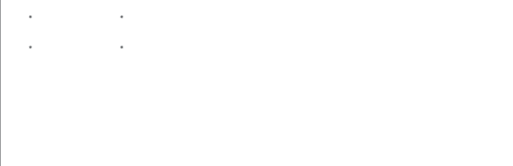

图 6.1 在 HTML5 Canvas 中渲染的四个点。

如果你从原点（屏幕的左上角）向右移动 50 像素，然后向下移动 50 像素，将到达图 6.1 中的左上角点。接下来，如果你从原点向右移动 200 像素并向下移动 50 像素，将到达图 6.1 中的右上点。同样，第二“行”的两个点的坐标为 `(50,100)` 和 `(200,100)`。注意第一行的两个点的 y 坐标值相同，这是很合理的，因为它们距离网页顶部的距离相同；第二行的两个点也是如此。同样，左“列”的两个点具有相同的 x 坐标，因为它们距离网页左侧的距离相同。

## 列表 6.1 Canvas1.html

本章中基于 Canvas 的代码示例包含了在列表 6.1 中显示的代码（或其变体）。

> 如果你在浏览器会话中启动（运行）这段代码，你将只会看到一个空白屏幕。

```html
<!DOCTYPE html>
<html lang="en">
<head>
  <meta charset="utf-8">
  <title>Canvas Example</title>
<script>
window.addEventListener('load', function () {
  // Get the canvas element
```


# CSS3 与 HTML5 Canvas · 101

如果在不支持 HTML5 Canvas 的浏览器中运行列表 6.1，它将显示文本消息“No support for Canvas.（不支持 Canvas）”。

由于在加载事件期间执行了一个匿名 JavaScript 函数，当你启动 Web 页面时会执行以下代码段：

```javascript
<script><!--
  window.addEventListener('load', function () {
  });
  // do something here
//></script>
```

现在你已经理解了渲染 Canvas-2D 形状的底层代码，你可以专注于实际绘制 2D 形状的代码，从下一节的示例开始。

# 线段、矩形、圆形和阴影效果

本节包含各种代码示例，阐明了如何在 HTML5 Canvas 中渲染 2D 形状。本节引入了许多概念，因此在深入代码示例之前，让我们先看看本节中使用的某些 HTML5 Canvas API。第 2 章包含一个描述指定颜色各种方法的章节，以及与本章代码示例相关的材料（如果你现在需要，可以立即快速回顾其内容）。

HTML5 Canvas 提供了 `fillRect()` 方法来渲染矩形，它需要四个参数：矩形的左上顶点（由其 x 坐标和 y 坐标定义）、矩形的宽度以及目标矩形的高度。Canvas 的 `fillRect()` API 如下所示：

```javascript
context.fillRect(x, y, width, height);
```

HTML5 Canvas 允许你通过指定线段两个端点的 (x, y) 坐标来渲染线段。本节代码示例中使用的两个新 API 是 `moveTo()` 和 `lineTo()`，它们看起来如下：

```javascript
context.moveTo(x1, y1);
context.lineTo(x2, y2);
```

前面的代码段代表线段，其两个端点由点 (x1, y1) 和 (x2, y2) 指定。注意，你也可以通过以下代码段渲染相同的线段：

```javascript
context.moveTo(x2, y2);
context.lineTo(x1, y1);
```

阴影效果提供了丰富的视觉体验，是对非阴影效果使用的改进。你通过为三个与阴影相关的属性赋值来创建阴影效果，这些属性控制底层阴影的大小和阴影“模糊”的程度，所示：

```javascript
context.shadowOffsetX = shadowX;
context.shadowOffsetY = shadowY;
context.shadowBlur = 4;
```

你可以像这里所示为 `shadowColor`（它是绘图上文的属性）分配 (R, G, B) 或 (R, G, B, A) 数值：

```javascript
context.shadowColor = "rgba(0, 0, 64, 1.0)";
```

列表 6.2 中的 HTML5 Web 页面 `RandRectanglesShadow.html` 使用了这种技术来渲染一组随机生成的、带有阴影效果的矩形。

## 列表 6.2 RandRectanglesShadow.html

```html
<!DOCTYPE html>
<html lang="utf-8">
<head>
<meta charset="utf-8">
<title>Canvas Random Rectangles With Shadow Effects</title>
<link href="CSS3Background2.css" rel="stylesheet" type="text/css">
<style>
input {
  width:300px;
  font-size:24px;
  background-color:#f00;
}
</style>
<script><!--
```

```javascript
window.addEventListener('load', function() {
  var clickCount = 0;
  // Get the canvas element
  var elem = document.getElementById('myCanvas');
  if (!elem || !elem.getContext()) {
    return;
  }
  // Get the canvas 2d context
  var context = elem.getContext('2d');
  if (!context) {
    return;
  }
  // ... (rest of code logic)
```

# CSS3 与 HTML5 Canvas 103

```javascript
var maxHeight = 450;
var shadowX = 10;
var shadowY = 10;
var rectWidth = 100;
var rectHeight = 100;
var fillStyles = ['#f00', '#00f'];
redraw() {
  // clear the canvas before drawing new set of rectangles
  context.clearRect(0, 0, width, height);
  for(var r=0; r<rectCount; r++) {
    baseX = Math.random();
    baseY = Math.random();
    // Alternate colored rectangle
    colorIndex = Math.floor(clickCount)%fillStyles.length;
    context.fillStyle = fillStyles[colorIndex];
    context.fillRect(baseX, baseY,Width,height);
    ++clickCount;
  }
}
```

# CSS3 与 HTML5 Canvas 120

```html
<div>
  <input type="button" onclick="redrawCanvas(); return false;" value="Redraw The Rectangles" />
</div>
<body>
  <canvas id="myCanvas" width="800" height="450">No support for Canvas</canvas>
</body>
</html>
```

# CSS3 与 HTML5 Canvas • 105

`shadowY` 将决定黑色矩形相对于红色矩形的相对位置。

## 列表 6.3 CSS3Background2.css

```css
#myCanvas {
  position: relative; top: 0px; left: 0px;
  background-color: white;
  background-image:
    radial-gradient(red 4px, transparent 18px),
    repeating-radial-gradient(red 0px, green 4px, yellow 8px,
      blue 12px, transparent 28px,
      green 20px, red 24px,
      transparent 28px,
      transparent 32px),
    repeating-radial-gradient(red 0px, green 4px, yellow 8px,
      blue 12px, transparent 28px,
      green 20px, red 24px,
      transparent 28px,
      transparent 32px);
  background-size: 50px 60px, 70px 80px;
  background-position: 0 0;
  box-shadow: 30px 30px 30px #000;
  resize: both;
  overflow: auto;
}
#myCanvas:hover {
  position: relative; top: 0px; left: 0px;
  background-color: white;
  background-image:
    radial-gradient(red 4px, transparent 48px),
    repeating-radial-gradient(red 2px, green 4px, yellow 8px,
      blue 12px, transparent 16px,
      red 20px, blue 24px,
      transparent 28px,
      transparent 32px),
    radial-gradient(blue 8px, transparent 68px);
  background-size: 120px 120px, 4px 4px;
  background-position: 0 0;
}
```

列表 6.3 包含了两个相似的 CSS3 选择器，用于当用户用鼠标悬停在 HTML5 `<canvas>` 元素上时，在 HTML5 `<canvas>` 元素的背景中渲染。`#myCanvas` 选择器定义了一个径向渐变，随后是两个重复径向渐变，它们在不同的像素位置上指定了红、绿、黄、蓝的各种组合。一个关键点在于对透明（transparent）的使用，它会改变渲染的连续颜色之间的间隙。

正如你在 `#myCanvas` 选择器的定义看到的，颜色、渐变（及其类型）以及渐变颜色，配合 `background-size` 属性的值有许多可能的组合。定义这些模式并没有所谓的“正确”之分；请尽管尝试不同的组合，你可能会创造出意想不到的理想效果。

图 6.2 显示了基于列表 6.2 中 `RandRectanglesShadow.html` 生成的一组带有投影效果的随机矩形。

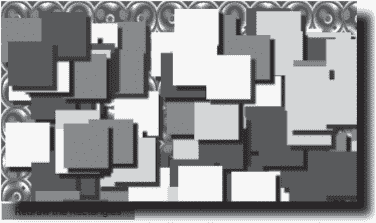

图 6.2 Canvas 随机矩形。

# HTML5 CANVAS 线性渐变

HTML5 Canvas 提供了两种主要的颜色渐变（类似于 SVG 和 CSS3）：线性渐变和径向渐变。

线性颜色渐变可以进一步细分为三种类型：水平渐变、垂直渐变和对角线性渐变。因此，HTML5 Canvas 提供了能够创建视觉视觉效果的颜色渐变。

线性渐变是通过 `addColorStop` 元素定义的，该元素包含一个小数（0 到 1 之间）和一个代表颜色的十六进制值。例如，如果你定义一个起始颜色为 #FF0000（红色十六进制值）且结束颜色为 #000000（黑色的十六进制值）的线性渐变，那么生成的颜色渐变将以线性方式从红色过渡到黑色。线性渐变让你能够创建生动且有趣的颜色组合，它们有三种：水平、垂直和对角。请注意，“线性渐变”和“线性颜色渐变”在书中是通用的。

## 水平、垂直和对角线性渐变

在本章的引言部分了解到，HTML5 Canvas 支持 `createLinearGradient()` 方法，你可以使用它通过编程方式创建线性渐变，其语法如下：

```javascript
context.createLinearGradient(startX, startY, endX, endY);
```

列表 6.4 中的 HTML5 网页 `LGradRectangles.html` 展示了如何使用水平、垂直和对角线性渐变渲染矩形网格。列表 6.4 引用了 CSS3 表格 `HoverAnimation-1.css`，每当用鼠标悬停在 `<canvas>` 元素上时，它为 HTML `<canvas>` 元素应用基于 CSS3 关键帧的 2D 动画。列表 6.4 还引用了 CSS3 表格 `HoverAnimation2.css`，其作用类似；但它对列表 6.4 中的第二个 HTML5 `<canvas>` 元素应用 CSS3 3D 动画效果。由于这些 CSS 表格中的动画技术将在第二章中讨论，我们将在本章中省略它们，但 canvas 演示中提供了完整的源代码。

## 列表 6.4 LGradRectangles1.html

```html
<!DOCTYPE html>
<html lang="en">
<head>
  <meta charset="UTF-8">
  <title>Linear Gradients</title>
  <style>
    /* CSS样式将放在此处 */
  </style>
</head>
<body>
  <canvas id="myCanvas"></canvas>
  <script>
    // 用于渲染线性渐变的 JavaScript
  </script>
</body>
</html>
```

```html
</canvas>
</div>
<div>
  <input type="button" onclick="redrawCanvas();return false"
       value="Redraw the Rectangles" />
</div>
</body>
</html>
```

列表 6.4 渲染了四个具有线性渐变阴影效果的矩形。这些渐变根据颜色停止点调用了两次、三次或四次 `addStop()` 方法，使用了多种颜色组合（以十六进制形式表示），以便你可以看到一些可能的渐变效果。

尝试不同的颜色停止点定义值，观察这些值如何改变渲染出的矩形的外观。

图 6.3 显示了一组基于列表 6.4 中 `LGradRectangle1.html` 生成的带有阴影效果的随机矩形。

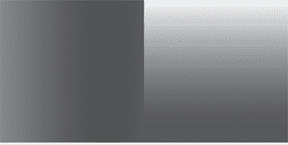
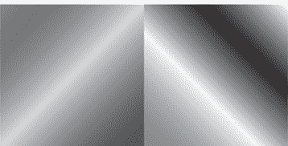

图 6.3 线性渐变矩形。

# HTML5 CANVAS 径向渐变

径向颜色渐变是基于 HTML5 Canvas 的第二种颜色渐变，你可以通过 `createRadialGradient()` 方法定义径向颜色渐变，使用 `addColorStop()` 方法添加颜色值，其语法（不包含 `addColorStop()` 方法）如下所示：

```javascript
context.createRadialGradient(startCenterX, startCenterY, startRadius, endCenterX, endY, endRadius);
```

径向颜色渐变可以比作向池塘里扔石头产生的涟漪效果，其中每个“波纹”的颜色都以渐变方式变化。每个波纹对应一个颜色停止元素。例如，如果你定义了一个颜色为 #FF0000（红色）且结束颜色为 #000000（黑色）的径向渐变，结果的渐变范围将从红色到黑色。径向渐变还可以包含多种起始/结束颜色组合。需要注意的是，径向渐变以线性方式改变颜色，但渲染出的颜色是以扩张的径向方式绘制的。注意，在书中“radial gradient”（径向渐变）和“radial color gradient”（径向颜色渐变）是通用的。

列表 6.5 显示了 HTML5 页面 `RGradRectangles1.html` 的内容，该页面使用线性和径向渐变在 HTML5 中渲染线段、矩形和圆形。

## 列表 6.5 RGradRectangles1.html

```html
<!DOCTYPE html>
<html lang="en">
<head>
  <meta charset="utf-8">
  <title>Canvas Radial Gradient Rectangles</title>
  <link href="HoverAnimation1.css" rel="stylesheet" type="text/css">
<style>
  input {
    width:300px;
    font-size:24px;
```


# CSS3 快速入门

```css
background-color: #f00;
}
```

```javascript
window.addEventListener('load', function () {
  var elem = document.getElementById('myCanvas');
  if (!elem || !elem.getContext()) {
    return;
  }
  var context = elem.getContext('2d');
  if (!context) {
    return;
  }
  var basePointX = 10;
  var basePointY = 10;
  var currentX = 0;
  var currentY = 0;
  var rectWidth = 200;
  var rectHeight = 200;
  var clickCount = 0;
  var gradient1;
});
```

```javascript
redrawCanvas = function() {
  // 在绘制新一组矩形之前清除画布
  // context.clearRect(0, 0, elem.width, elem.height);
};
```

```javascript
// 左上角矩形
currentX = basePointX;
currentY = basePointY;
```

```javascript
gradient1 = context.createRadialGradient(
  currentX,
  currentY,
  0,
  currentX + rectWidth,
  currentY + rectHeight,
  rectWidth
);
```

```javascript
gradient1.addColorStop(0, '#f00');
gradient.addColorStop(1, '#00f');
context.fillStyle = gradient1;
context.fillRect(currentX, currentY, rectWidth, rectHeight);
```

```javascript
// 右上角矩形
currentX = basePointX + rectWidth;
currentY = basePointY;
```

```javascript
gradient1 = context.createRadialGradient(
  currentX,
  currentY,
  0,
  currentX + rectWidth,
  currentY + rectHeight,
  rectWidth
);
```

```javascript
gradient1.addColorStop(0, '#ff0');
gradient.addColorStop(1, '#00f');
context.fillStyle = gradient1;
context.fillRect(currentX, currentY, rectWidth, rectHeight);
```

```javascript
// 左下角矩形
currentX = basePointX;
currentY = basePointY + rectWidth;
```

```javascript
gradient1 = context.createRadialGradient(
  currentX,
  currentY,
  0,
  currentX + rectWidth,
  currentY + rectHeight,
  rectWidth
);
```

```javascript
gradient1.addColorStop(0, '#f0f0');
gradient1.addColorStop(0.5, '#0f0');
gradient1.addColorStop(1, '#00f');
context.fillStyle = gradient1;
context.fillRect(currentX, currentY, rectWidth, rectHeight);
```

```javascript
// 右下角矩形
currentX = basePointX + rectWidth;
currentY = basePointY + rectHeight;
```

```javascript
gradient1 = context.createRadialGradient(
  currentX,
  currentY,
  0,
  currentX + rectWidth,
  currentY + rectWidth
);
```

```javascript
gradient1.addColorStop(0, '#fff');
gradient1.addColorStop(0.3, '#000');
gradient1.addColorStop(0.6, '#ff0');
gradient1.addColorStop(1, '#f00');
context.fillStyle = gradient1;
context.fillRect(currentX, currentY, rectWidth, rectHeight);
```

```javascript
++clickCount;
basePointX += 2;
basePointY += 2;
}
```

```javascript
// 渲染一组矩形
redrawCanvas();
```

```html
<body>
  <div>
    <canvas id="myCanvas" width="600" height="500"></canvas>
  </div>
  <div>
    <input type="button" onclick="redrawCanvas();return false" value="Redraw the Rectangles" />
  </div>
</body>
</html>
```

# CSS3 和 HTML5 Canvas

`addColorStop()` 方法被调用了四次，除了列表 6.4 中从红色到蓝色的线性渐变用法。

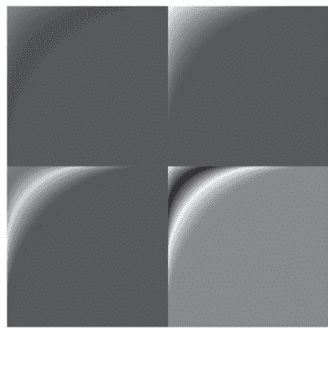

图3 线性渐变矩形。

## 在 CANVAS 上渲染图像

径向渐变与列表 6.4 类似，创建了一组矩形。列表 6.5 显示了 HTML5 页面 `RGradRectangles1.html` 的内容，该页面使用线性和径向渐变在 HTML5 中渲染线段、矩形和圆形。

```html
<!DOCTYPE html>
<html lang="en">
<head>
  <meta charset="utf-8">
  <title>Canvas Radial Gradient Rectangles</title>
  <link href="HoverAnimation1.css" rel="stylesheet" type="text/css">
  <style>
    input {
      width: 300px;
      font-size: 24px;
      background-color: #f00;
    }
  </style>
  <script>
    window.addEventListener('load', function () {
      var elem = document.getElementById('myCanvas');
      if (!elem || !elem.getContext()) {
        return;
      }
      var context = elem.getContext('2d');
      if (!context) {
        return;
      }
      var basePointX = 10;
      var basePointY = 10;
      var currentX = 0;
      var currentY = 0;
      var rectWidth = 200;
      var rectHeight = 200;
      var clickCount = 0;
      var gradient1;

      redrawCanvas = function() {
        // 在绘制新一组矩形之前清除画布
        // context.clearRect(0, 0, elem.width, elem.height);
        // 左上角矩形
        currentX = basePointX;
        currentY = basePointY;
        gradient1 = context.createRadialGradient(
          currentX,
          currentY,
          0,
          currentX + rectWidth,
          currentY + rectHeight,
          rectWidth
        );
        gradient1.addColorStop(0, '#f00');
        gradient.addColorStop(1, '#00f');
        context.fillStyle = gradient1;
        context.fillRect(currentX, currentY, rectWidth, rectHeight);
        // 右上角矩形
        currentX = basePointX + rectWidth;
        currentY = basePointY;
        gradient1 = context.createRadialGradient(
          currentX,
          currentY,
          0,
          currentX + rectWidth,
          currentY + rectHeight,
          rectWidth
        );
        gradient1.addColorStop(0, '#ff0');
        gradient.addColorStop(1, '#00f');
        context.fillStyle = gradient1;
        context.fillRect(currentX, currentY, rectWidth, rectHeight);
        // 左下角矩形
        currentX = basePointX;
        currentY = basePointY + rectWidth;
        gradient1 = context.createRadialGradient(
          currentX,
          currentY,
          0,
          currentX + rectWidth,
          currentY + rectHeight,
          rectWidth
        );
        gradient1.addColorStop(0, '#f0f0');
        gradient1.addColorStop(0.5, '#0f0');
        gradient1.addColorStop(1, '#00f');
        context.fillStyle = gradient1;
        context.fillRect(currentX, currentY, rectWidth, rectHeight);
        // 右下角矩形
        currentX = basePointX + rectWidth;
        currentY = basePointY + rectHeight;
        gradient1 = context.createRadialGradient(
          currentX,
          currentY,
          0,
          currentX + rectWidth,
          currentY + rectWidth
        );
        gradient1.addColorStop(0, '#fff');
        gradient1.addColorStop(0.3, '#000');
        gradient1.addColorStop(0.6, '#ff0');
        gradient1.addColorStop(1, '#f00');
        context.fillStyle = gradient1;
        context.fillRect(currentX, currentY, rectWidth, rectHeight);
        ++clickCount;
        basePointX += 2;
        basePointY += 2;
      };
      // 渲染一组矩形
      redrawCanvas();
    });
  </script>
</head>
<body>
  <div>
    <canvas id="myCanvas" width="600" height="500"></canvas>
  </div>
  <div>
    <input type="button" onclick="redrawCanvas();return false" value="Redraw the Rectangles" />
  </div>
</body>
</html>
```

# CSS3 与 HTML5 Canvas

```css
height: 300px;
position: relative; top: 0px; left: 0px;
background-color: white;
background-image:
  radial-gradient(black 4px, transparent 20px), blue 8px,
  yellow 8px,
  repeating-radial-gradient(blue 1px, transparent 16px,
  red 12px,
  red 20px, blue 24px,
  transparent 28px,
  transparent 32px);
background-size: 30px 30px, 40px 40px;
background-position: 0 0;
}
```

列表 6.8 中的第一个选择器每当用户鼠标悬停在 HTML5 `<canvas>` 元素上时显示另一种图案（基于不同的径向渐变）。列表 6.8 中的第二个选择器为 HTML5 `<canvas>` 元素渲染一个彩色图案（同样基于径向渐变）作为背景矩形。

顺便提的是，HTML5 Canvas 还支持一个 `clip()` 方法，允许你以各种方式“裁剪”二进制图像。此外，你还可以执行复合效果，甚至可以操作图像文件的单个像素。可以在互联网上搜索描述这些效果技术细节的文章。

图 6.5 显示了一个具有两个径向渐变背景效果的二值图像。

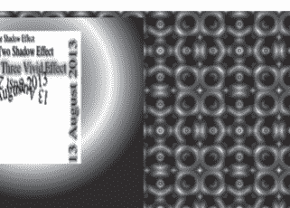

图 6.5 HTML5 Canvas 径向 PNG。

## 在画布上使用图案重复图像

HTML5 Canvas 提供了 `createPattern(image, type)` 方法，它允许你根据图案类型渲染一组图像，其取值可以是 `repeat`、`repeat-x`、`repeat-y` 和 `no-repeat`。语法的示例（以及使用方法）所示：

```javascript
var pattern = canvas.createPattern(img, "repeat");
canvas.fillStyle = pattern;
canvas.fillRect(0, 0, 500, 300);
```

列表 6.8 显示了 `RepeatingImage1.html` 的内容，它说明了如何在 HTML5 `<canvas>` 元素上重复一个二值图像。

# 列表 6.8 RepeatingImage1.html

```html
<!DOCTYPE html>
<html lang="en">
<head>
  <meta charset="utf-8" />
  <title>HTML5 Canvas 中的重复图像</title>
  <script>
    var elem, canvas, filename = "BlueBall1.png";
    function init() {
      elem = document.getElementById("myCanvas");
      canvas = elem.getContext('2d');
      var img = new Image();
      img.src = filename;
      img.addEventListener("load", modImage, false);
    }
    function modImage(e) {
      img = e.target;
      var pattern = canvas.createPattern(img, "repeat");
      canvas.fillStyle = pattern;
      canvas.fillRect(0, 0, 500, 300);
    }
    window.addEventListener("load", init, false);
  </script>
</head>
<body>
  <div>
    <canvas id="myCanvas" width="500" height="300">No support for Canvas</canvas>
  </div>
</body>
</html>
```


列表 6.8 包含以下代码行，当此页面加载到浏览器时会调用 JavaScript 的 `init()` 方法：
`window.addEventListener("load", init, false);`

`init()` 方法在网页中查找 HTML5 `<canvas>` 元素，为了简单起见，没有进行错误检查（可以使用之前示例中的代码来处理）。

`init()` 方法还初始化了一个 JavaScript 变量 `img`，它引用一个二值图像，并添加了一个执行 JavaScript 函数 `modImage()` 的事件监听器，所示：

```
var img = new Image();

img.src = filename;

img.addEventListener("load", modImage, false);
```

最后，`modImage()` 方法带有参数 `repeat` 调用 Canvas `createPattern` 来创建一个基于单个 PNG 文件（在本例中为 BlueBall1.png）的矩形，所示：

```
var pattern = canvas.createPattern(img,"repeat");

canvas.fillStyle = pattern;

canvas.fillRect(0,0,500,300);
```

图 6.6 显示了在 Macbook 的 Chrome 浏览器中运行列表 6.8 中的 RepeatingImage.html。

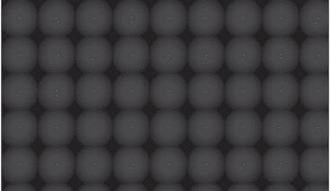

图 6.6 在 Macbook 的 Chrome 浏览器上重复 PNG 图像。

## 总结

本章向你展示如何在 HTML5 Canvas 中渲染线段、矩形和圆。你看到了如何将 HTML5 Canvas 与 CSS 样式表结合以创建动画效果。接下来，你学习了如何在 HTML5 Canvas 中创建线性和径向渐变。最后，你学习了如何将 PNG 文件嵌入 HTML Canvas 元素中。

# SVG 基础

这个快速节奏的章节探讨了 SVG 的许多功能，SVG 是一种用于渲染 2D 的基于 XML 的技术。SVG 是一种用于描述矢量图形的 XML 格式，它是脚本化和交互式的。SVG 图形可以在 XML 标记中定义、作为类型文本定义或作为外部对象加载。SVG 广泛用于创建图标、图表和交互式内容。在本章中，我们将探索 SVG 的功能，包括如何绘制形状、文本和图像。

# SVG 的基础功能

SVG 支持多种形状，包括矩形、圆、椭圆、线、路径。每个形状都有自己的属性。

- 矩形使用 `<rect>` 元素绘制。
- 圆使用 `<circle>` 元素绘制。
- 椭圆使用 `<ellipse>` 元素绘制。
- 线使用 `<line>` 元素绘制。
- 路径使用 `<path>` 元素绘制，它是最多功能的形状元素。

这是一个 SVG 中基础形状的示例：

```xml
<svg width="200" height="200">
  <rect x="10" y="10" width="100" height="50" fill="red" />
  <circle cx="150" cy="150" r="40" fill="blue" />
  <ellipse cx="100" cy="100" rx="50" ry="30" fill="green" />
  <line x1="0" y1="200" x2="200" y2="0" stroke="black" stroke-width="2" />
  <path d="M 20 20 L 100 20 L 50 100 Z" fill="yellow" stroke="black" />
</svg>
```

SVG 还通过 `<text>` 元素支持文本。你可以使用 CSS 指定字体族、大小和颜色。

```xml
<svg width="200" height="100">
  <text x="10" y="50" font-size="24">Hello SVG!</text>
</svg>
```

此外，你可以使用 `<image>` 元素在 SVG 中嵌入图像。这允许你将外部图像包含在 SVG 图形中。

```xml
<svg width="200" height="200">
  <image href="image.png" x="0" y="0" width="100" height="100" />
</svg>
```

# 在 SVG 中渲染线段和矩形

本节介绍了如何在 SVG 中渲染线段和矩形。作为一个简单的示例，SVG 支持 `<line>` 元素渲染线段，其语法所示：

```xml
<line x1="20" y1="20" x2="100" y2="150" />
```

SVG `<line>` 元素连接两个点 (x1, y1) 的线段。

SVG 支持 `<rect>` 元素渲染矩形，其语法所示：

```xml
<rect width="200" height="50" x="20" y="50" />
```

SVG `<rect>` 元素渲染的矩形宽度和高度在 `width` 和 `height` 属性中指定。矩形的左上顶点由坐标 (x, y) 的点指定。

# 列表 7.1 BasicShapes1.svg SVG 基础 • 123

```xml
<?xml version="1.0" encoding="iso-8859-1"?>
<!DOCTYPE SVG PUBLIC "//W3C//DTD SVG 20001102//EN"
"http://www.w3.org/TR/2000/CR-SVG-20001102/DTD/svg-20001102.dtd">
<svg xmlns="http://www.w3.org/2000/svg"
     xmlns:xlink="http://www.w3.org/1999/xlink"
     width="100%" height="100%">
<g>
  <!-- 左侧图形 -->
  <line x1="20" y1="20" x2="220" y2="20"
       stroke="blue" stroke-width="4"/>
  <line x1="20" y1="40" x2="220" y2="40"
       stroke="red" stroke-width="10"/>
  <rect width="200" height="50" x="20" y="70"
       fill="black" stroke-width="4"/>
  <path d="M20,150 1200,0 10,50 1-200,0 z"
       fill="blue" stroke="red" stroke-width="4"/>
  <!-- 右侧图形 -->
  <path d="M250,20 1200,0 1-100,0 1-50,50 z"
       fill="blue" stroke="red" stroke-width="4"/>
  <path d="M300,110 1200,0 150,50 1-100,0 1-50,-50 z"
       fill="yellow" stroke="red" stroke-width="4"/>
</g>
</svg>
```

列表 7.1 中的第一个 SVG `<line>` 元素指定了蓝色和 4 的描边宽度（即线宽），而第二个 SVG `<line>` 元素指定了红色和 10 的描边宽度。

注意，第一个 SVG `<rect>` 元素渲染的矩形除颜色外，与第二个 SVG `<line>` 元素看起来完全相同，这表明可以使用不同的 SVG 元素来渲染矩形（或线段）。

SVG `<path>` 元素可能是最灵活且最强大的元素，因为你可以根据其他 SVG 元素的“拼接”创建任意形状。在本章的后部分，你将看到如何在 SVG `<path>` 元素中渲染贝塞尔曲线的示例。

SVG `<path>` 元素包含一个 `d` 属性，用于指定所需路径中的点。例如，列表 7.1 中的第一个 SVG `<path>` 元素包含以下 `d` 属性：

```
d="M20,150 1200,0 10,50 1-200,0 z"
```

以下是对 `d` 属性内容的解释：

- 移动到绝对位置点 (20,150)
- 向右绘制一条 200 像素的水平线段
- 向右移动 10 像素并向下移动 50 像素绘制一条线段
- 向左移动 200 像素绘制一条水平线段
- 绘制一条线段回到起点（由 `z` 指定）

列表 7.1 中的其他 SVG `<path>` 元素也适用类似的注释。需要注意的是，大写字母（C, L, M, 和 Q）表示绝对位置，而小写字母（c, l, m, 和 q）表示相对于紧紧左侧元素的相对位置。通过组合使用小写和大写字母，对列表 7.1 中的代码进行实验，以更好地理解如何创建不同的视觉效果。

图 7.1 显示了 SVG 文档 Basic-Shapes1.svg 的渲染结果。

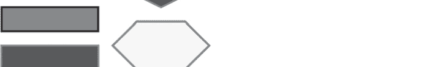

图 7.1 SVG 线和矩形。

# SVG 渐变

正如你可能设想的那样，SVG 支持线性渐变和径向渐变，你可以将它们应用于 2D 形状。

列表 7.2 显示了 BasicShapesLRG1.svg 的内容，它说明了如何使用线性渐变和径向渐变渲染 2D 形状。

# 列表 7.2 BasicShapesLRG1.svg

```xml
<?xml version="1.0" encoding="iso-8859-1"?>
<!DOCTYPE svg PUBLIC "//W3C//DTD SVG 20001102//EN"
  "http://www.w3.org/TR/2000/CR-SVG-20001102/DTD-SVG-20001102.dtd">
<svg xmlns="http://www.w3.org/2000/svg"
     xmlns:xlink="http://www.w3.org/1999/xlink"
     width="100%" height="100%">
 <defs>
  <linearGradient id="pattern1">
   <stop x1="0%" y1="100%" x2="100%" y2="0%">
   <stop offset="0%" stop="yellow"/>
   <stop offset="40%" stop="red"/>
   <stop offset="80%" stop="blue"/>
  </linearGradient>
  <radialGradient id="pattern2">
   <stop offset="0%" stop="yellow"/>
   <stop offset="40%" stop="red"/>
   <stop offset="80%" stop="blue"/>
  </radialGradient>
</defs>
<g>
  <ellipse cx="120" cy="80" rx="100" ry="50"
    fill="url(#pattern1)"/>
</g>
  <ellipse cx="120" cy="200" rx="100" ry="50"
    fill="url(#pattern2)"/>
</g>
  <ellipse cx="320" cy="80" rx="50" ry="50"
    fill="url(#pattern2)"/>
</g>
  <ellipse cx="450" cy="240" rx="50" ry="50"
    fill="url(#pattern1)"/>
</g>
</svg>
```

列表 7.2 包含一个 SVG `<defs>` 元素，它指定了一个带有 XML 语法且三个 `stop` 值的 `<linearGradient>` 元素（id 为 pattern1），紧接着是一个带有三个 `<stop>` 元素的 `<radialGradient>` 元素（id 为 pattern2）。SVG `<g>` 包含了四个 `<ellipse>` 元素，其中第一个将 (120,80) 指定为中心 (cx,cy)，主半径为 100，短半径为 50，并用线性渐变 pattern1 填充，如下所示：

```
<ellipse cx="120" cy="80" rx="100" ry="50"
    fill="url(#pattern1)"/>
```

另外三个 `<ellipse>` 元素也适用类似的注释。图 7.2 显示了 BasicShapesLRG1.svg 的渲染结果。

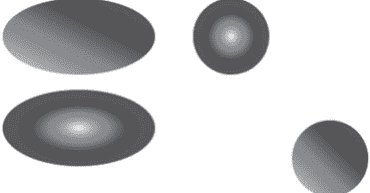

图 7.2 SVG 线性径向渐变。

# SVG `<pattern>` 元素

SVG `<pattern>` 元素允许你定义自定义模式，用相对简单的代码创建出丰富的视觉效果。列表 7.3 显示了 PatternElement1.svg 的内容，说明了如何用不同的模式渲染矩形和椭圆。

# 列表 7.3 PatternElement1.svg

```xml
<?xml version="1.0" encoding="iso-8859-1"?>
<!DOCTYPE svg PUBLIC "-//W3C//DTD SVG 20001102//EN"
"http://www.w3.org/TR/2000/SVG-20001102/DTD/svg-20001102.dtd">
<svg xmlns="http://www.w3.org/2000/svg"
  xmlns:link="http://www.w3.org/1999/xlink"
  width="100%" height="100%">
  <defs>
    <pattern id="dot1" width="8" height="8"
      patternUnits="userSpaceOnUse">
      <circle id="circle" cx="2" cy="2" r="3"
        style="fill:blue"/>
    </pattern>
    <pattern id="dotPattern2" width="8" height="8"
      patternUnits="userSpaceOnUse">
      <rect x="0" y="0" width="4" height="4" fill="red" />
      <rect x="4" y="0" width="4" height="4" fill="black" />
      <rect x="0" y="4" width="4" height="4" fill="black" />
      <rect x="4" y="4" width="4" height="4" fill="red" />
    </pattern>
  </defs>
  <g id="largeCylinder" transform="translate(100,20)">
    <rect x="0" y="0" width="200" height="100"
      style="fill:url(#dotPattern1)"/>
    <ellipse cx="100" y="150" rx="40" ry="40"
      stroke="blue" stroke-width="4"
      style="fill:url(#dotPattern2)"/>
  </g>
</svg>
```

列表 7.3 包含一个 SVG `<defs>` 元素，其中包含两个 `<pattern>` 元素。第一个 `<pattern>` 元素创建了一个“点状”效果，每个“点”都是半径为 3 的蓝色圆。第二个 `<pattern>` 元素通过指定两个相同尺寸的矩形创建一个“棋盘”图案，它们的颜色在第一“行”是红色和黑色，在第二“行”是黑色和红色。

列表 7.3 的下一部分包含一个 SVG `<g>` 元素，它链接了一个填充第一个 `<pattern>` 元素的 `<rect>` 元素，随后是一个填充了第二个 `<pattern>` 元素的 `<ellipse>` 元素。图 7.3 显示了 SVG 文档 Pattern1.svg 中定义的矩形和椭圆的渲染结果。

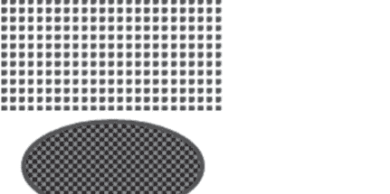

图 7.3 用不同模式渲染的两个形状。

# SVG `<polygon>` 和 `<polyline>` 元素

SVG `<polygon>` 元素包含一个 `points` 属性，你可以在其中指定多边形的顶点。当你想要创建任意边的多边形时，`<polygon>` 元素最为有用，但你也可以用此元素渲染线段。

SVG `<polygon>` 元素的语法如下：

```
<polygon points="点列表" fill="..." />
```

列表 7.4 显示了 SvgCube.svg的一部分，说明了如何在 SVG 中渲染立方体。

```xml
<?xml version="1.0" encoding="iso-8859-1"?>
<!DOCTYPE svg PUBLIC "//W3C//DTD SVG 20001102//EN"
"http://www.w3.org/TR/2000/CR-SVG-20001102/DTD/svg-20001102.dtd">
<svg xmlns="http://www.w3.org/2000/svg"
     xmlns:xlink="http://www.w3.org/1999/xlink"
```


```xml
width="100%" height="100%">

<!-- defs omitted for brevity -->

<!-- 顶部（逆时针） -->

<polygon fill="url(#pattern)"

points="50,50 200,50 240,30 90,30"/>

<!-- 前面 -->

<rect width="150" height="150" x="50" y="50"

fill="url(#pattern2)" />

<!-- 右面（逆时针） -->

<polygon fill="url(#pattern3)"

points="200,50 200,200 240,180 240,30"/>

</svg>
```

# 128 • CSS3 快速入门

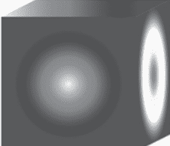

**图 7.4** 一个 SVG 立方体。

列表 7.4 包含一个 SVG `<g>` 元素，该元素包含立方体的三个面，其中一个 SVG `<polygon>` 元素渲染了顶面（平行四边形），一个 SVG `<rect>` 元素渲染了正面，另一个 SVG `<polygon>` 元素渲染了右侧（也是平行四边形）。立方体的三个面是通过 SVG `<defs>` 元素中定义的线性渐变和两个径向渐变渲染的（列表 7.4 中未显示）。

图 7.4 显示了 SVG 文档 SCube.svg 的渲染结果。SVG `<polyline>` 元素指定了一组点，用于表示一个或多个线段的端点，这些线段以连接线的形式显示。SVG `<polyline>` 元素的语法与 SVG `<polygon>` 元素非常相似，如下例所示：

```xml
polyline="50,50 200,50 200,200, 50,200"

fill="url(#pattern2)"
```

前面的代码段渲染了与列表 7.4 中 `<rect>` 元素相同的“正面”矩形。附带光盘包含 SVG 文档 Polyline.svg，它使用列表 7.4 中的代码渲染相同的立方体。Polyline.svg 使用了三个 `<polyline>` 元素，而 SCube.svg 使用了两个 `<polygon>` 元素和一个 `<rect>` 元素来渲染立方体。

# SVG `<path>`

`<path>` 元素允许你定义椭圆弧（使用 `d` 属性）并指定渐变效果。SVG `<path>` 元素包含一个用于指定路径元素的 `d` 属性，如下：

```xml
path d="specify a list of path elements" fill="..."
```

列表 7.5 显示了 PathElement.svg 的内容，它阐明了如何使用 `<path>` 元素渲染椭圆弧。

# **列表 7.5** PathElement.svg

```xml
<?xml version="1.0" encoding="iso-8859-1"?>

<!DOCTYPE svg PUBLIC "//W3C//DTD SVG 20001102//EN"

"http://www.w3.org/TR/2000/CR-SVG-20001102/DTD/

svg-20001102.dtd">

<svg xmlns="http://www.w3.org/2000/svg"

xmlns:xlink="http://www.w3.org/1999/xlink"

  width="100%" height="100%">

<defs>

  <linearGradient id="pattern"

    x1="0%" y1="100%" x2="100%" y2="0%">

    <stop offset="0%" stop-color="yellow"/>

    <stop offset="40%" stop-color="red"/>

    <stop offset="80%" stop-color="blue"/>

  </linearGradient>

</defs>

<g>

  <path d="M 505,145 v -100 250,100 0,1 -200,100"

    fill="black"/>

  <path d="M 500,140 v -100 250,100 0,1 -200,100"

    fill="url(#pattern)"

    stroke="black" stroke-width="8"/>

  <path d="M 305,165 v 100 250,100 0,1 200,-100"

    fill="black"/>

  <path d="M 300,160 v 100 250,100 0,1 200,-100"

    fill="url(#pattern)"

    stroke="black" stroke-width="8"/>

</g>

</svg>
```

列表 7.5 包含一个 SVG `<defs>` 元素，它定义了一个线性渐变，随后是一个包含四个 `<path>` 元素的 SVG `<g>` 元素。每个 `<path>` 元素都显示一个椭圆弧，并引用线性渐变作为其属性的值。

第一个 `<path>` 元素为使用 `d` 属性定义的椭圆弧指定了黑色背景：

```xml
d="M 505,145 v -100 250,100 0,1 -200,100"
```

遗憾的是，SVG 椭圆弧的语法并不直观，它基于连接椭圆上两点的“大弧和小弧”的概念。这个示例仅用于说明目的，因此我们不会详细解释 SVG 中如何定义椭圆弧。如果你需要学习细节，可以在互联网上进行搜索并阅读各种链接中的信息（并准备好花时间实验你自己的代码样本）。

第二个 SVG `<path>` 元素使用带有微小偏移的线性渐变 pattern1 渲染了相同的椭圆弧，这创建了阴影效果。

类似的注释也适用于另一对 SVG `<path>` 元素，它们使用径向渐变 pattern2 渲染椭圆弧（同样带有阴影效果）。

图 7.5 显示了 SVG 文档 PathElement.svg 的渲染结果。

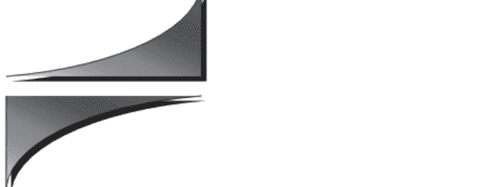 图 7.5 椭圆弧。

# 贝塞尔曲线与变换

SVG 支持二次和三次贝塞尔曲线，你可以用线性渐变或径向渐变渲染它们。你还可以使用 SVG `<path>` 元素连接多个贝塞尔曲线。列表 7.6 显示了 BezierCurves.svg 的内容，阐明了如何渲染各种贝塞尔曲线。注意，变换效果在本章中讨论。

# 列表 7.6 BezierCurves.svg

```xml
<?xml version="1.0" encoding="iso-8859-1"?>

<!DOCTYPE svg PUBLIC "-//W3C//DTD SVG 20001102//EN"

"http://www.w3.org/TR/2000/CR-SVG-20001102/svg-20001102.dtd">

<svg xmlns="http://www.w3.org/2000/svg"

     xmlns:xlink="http://www.w3.org/1999/xlink"

     width="100%" height="100%">

  <!-- defs omitted for brevity -->

  <g transform="scale(1.5,0.5)">

    <path d="m 0,50 C 400,200 200,-150 100,350"

         stroke="black" stroke-width="4"

         fill="url(#pattern)"/>

  </g>

  <g transform="translate(50,50)">

    <g transform="scale(0.5,1)">

      <path d="m 0,50 C 400,100 200,200 100"

            fill="red" stroke-width="4"/>

    </g>

    <g transform="scale(1,1)">

      <path d="m 0,50 C 400,100 200,200 100"

            fill="yellow" stroke-width="4"/>

    </g>

  </g>

  <g transform="translate(-50,50)">

    <g transform="scale(1,2)">

      <path d="M 50,50 C 400,100 200,200 100,200" fill="black" stroke-width="4"/>

    </g>

  </g>

  <g transform="translate(-50,50)">

    <g transform="scale(0.5,.5) translate(195,345)">

      <path d="m 20,20 C 20,450 300,200 s-150,250 200,100" fill="blue" stroke-width="4"/>

    </g>

  </g>

  <g transform="scale(0.5,0.5) translate(185,335)">

    <path d="m 20,20 C 20,450 300,200 s-150,250 200,100" fill="url(#pattern2)" stroke-width="4"/>

  </g>

  <g transform="scale(0.5,0.5) translate(180,330)">

    <path d="m 20,20 C 20,450 300,200 s-150,250 200,100" fill="blue" stroke-width="4"/>

  </g>

  <g transform="scale(0.5,0.5) translate(170,320)">

    <path d="m 20,20 C 20,450 300,200 s-150,250 200,100" fill="url(#pattern2)" stroke-width="4"/>

  </g>

  <g transform="scale(0.8,1) translate(380,120)">

    <path d="M0,0 C200,400 300,250" fill="url(#pattern2)" stroke-width="4"/>

  </g>

  <g transform="scale(2.0,2.5) translate(150,-80)">

    <path d="M200,150 C0,400 300,250" fill="url(#pattern2)" stroke-width="4"/>

  </g>

</svg>
```

列表 7.6 包含一个 SVG `<defs>` 元素，定义了两个线性渐变，随后是十个 SVG `<path>` 元素，每个渲染一条三次贝塞尔曲线。SVG `<path>` 元素被封装在 SVG `<g>` 元素中，这些元素转换了 SVG `scale()` 或 SVG `translate()` 函数（或两者）。

第一个 SVG `<g>` 元素调用 `scale()` 函数来缩放 SVG `<path>` 元素中指定的三次贝塞尔曲线，如下所示：

```xml
<g transform="scale(1.5,0.5)">

  <path d="m 0,50 C 400,200 200,-150 100,350"

        stroke="black" stroke-width="4"

        fill="url(#pattern)"/>

  </g>
```

前面的贝塞尔曲线有一个起始点 (0,50)，控制点为 (400,200) 和 (200,-150)，最后是第二个控制点 (100,350)。该贝塞尔曲线为黑色，宽度为 4，其填充颜色为 SVG `<defs>` 元素中 `<linearGradient>` 元素（id 为 pattern）定义的颜色。

剩余的 SVG 元素与第一个 `<path>` 元素类似，不再描述。

图 7.6 显示了 SVG 文档 BezierCurves.svg 中定义的贝塞尔曲线。

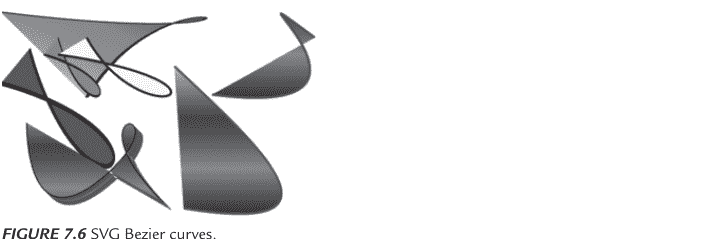

# 在 SVG 中沿路径渲染文本

你可以创建适用于二维形状以及文本字符串的过滤器效果。

列表 7.7 显示了 TextOnQBezierPath.svg 的的内容，它说明了如何沿二次贝塞尔曲线的路径渲染文本字符串。

# 列表 7.7 TextOnQBezierPath.svg

```xml
<?xml version="1.0" encoding="iso-8859-1"?>

<!DOCTYPE svg PUBLIC "//W3C//DTD SVG 20001102//EN"

"http://www.w3.org/TR/2000/CR-SVG-20001102/svg-20001102.dtd">

<svg xmlns="http://www.w3.org/2000/svg"

     xmlns:xlink="http://www.w3.org/1999/xlink"

     width="100%" height="100%">

<defs>

  <path id="pathDefinition" d="m0,0 Q100,0 200,200 T300,0 z"/>

</defs>

<g transform="translate(100,100)">

  <text id="textStyle" fill="red"

       stroke="blue" stroke-width="2"

       font-size="24">

<textPath xlink:href="#pathDefinition">

Sample Text that follows a path specified by a Quadratic

Bezier curve

</textPath>

</text>

</g>

</svg>
```

列表 7.7 中的 SVG `<defs>` 元素包含一个 SVG `<path>` 元素，它定义了一条二次贝塞尔曲线（注意 `d` 属性中的 `Q`）。该 SVG `<path>` 元素有一个 `id` 属性，其值为 `pathDefinition`，该值在本文代码示例的后文中被引用。

SVG `<g>` 元素包含一个 SVG `<text>` 元素，用于指定要渲染的文本字符串，以及一个 SVG `<textPath>` 元素，用于指定渲染文本的路径，如下：

```xml
<textPath xlink:href="#pathDefinition">

Sample Text that follows a path specified by a Quadratic

Bezier curve

</textPath>
```

注意，SVG `<textPath>` 元素包含属性 `xlink:href`，其取值为 `pathDefinition`，这与 `<defs>` 元素中定义的 SVG `<path>` 元素的 `id` 相同。因此，文本字符串是沿着二次贝塞尔曲线的路径渲染的，而不是水平渲染（这是默认行为）。

图 7.7 显示了 TextOnBezierPath.svg 的渲染结果，该文件沿着二次贝塞尔曲线的路径渲染了一个文本字符串。

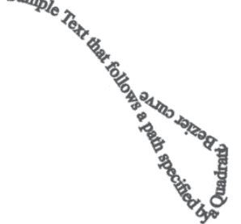

**图 7.7** 二次贝塞尔曲线上的 SVG 文本。

# SVG 过滤器

SVG 支持丰富的过滤器效果，其完整解释很容易超过一个章节。掌握 SVG 过滤器涉及一个学习曲线，因为只有少数 SVG 过滤器是简单的。许多过滤器非常复杂，需要多个非直观的输入值。事实上，可以“链用” SVG 过滤器：一个过滤器的输出可以作为另一个过滤器的输入（且 SVG 过滤器的输入需要两个过滤器的输出）。

与过滤器相关的 SVG 元素列表包括：`feBlend`、`feColor-Matrix`、`feComponentTransform`、`feComposite`、`feConvolveMatrix`、`feDiffuseLighting`、`feDisplacement`、`feFlood`、`feGaussianBlur`、`feImage`、`feMerge`、`feMorphology`、`feOffset`、`feSpecularLighting`、`feTile` 和 `feTurbulence`。

你可以使用过滤器效果渲染 2D 形状和文本。列表 7.8 显示了 SVG BlurFilterText.svg 的内容，它渲染了带有模糊过滤器的文本。

# 列表 7.8 BlurFilterText1.svg

```xml
<?xml version="1.0" encoding="iso-8859-1"?>

<!DOCTYPE svg PUBLIC "//W3C//DTD SVG 20001102//EN"

"http://www.w3.org/TR/2000/CR-SVG-20001102/DTD/svg-20001102.dtd">

<svg xmlns="http://www.w3.org/2000/svg"

     xmlns:xlink="http://www.w3.org/1999/xlink"

     width="100%" height="100%">

 <defs>

 <filter id="blurFilter"

  filterUnits="objectBoundingBox"

  x="0" y="0"

  width="100%" height="100%">

 <feGaussianBlur stdDeviation="4"/>

 </filter>

</defs>

 <g transform="translate(50,100)">

  <text id="normalText" x="0" y="0"
```


```xml
fill="red" stroke="black" stroke-width="4"
font-size="72">
Normal Text
</text>
<text id="horizontalText" x="0" y="100"
filter="url(#blurFilter)"
fill="red" stroke="black" stroke-width="4"
font-size="72">
Blurred Text
</text>
</g>
</svg>
```

列表 7.8 中的 SVG `<defs>` 元素包含一个 SVG `<filter>` 元素，通过以下行指定了高斯模糊：

```xml
<feGaussianBlur stdDeviation="4"/>
```

如果你想创建“弥散”过滤器效果，可以为 `stdDeviation` 属性指定更大的值。

SVG `<g>` 元素中的第一个 `<text>` 元素渲染普通的文本字符串，而第二个 `<text>` 元素包含一个 `filter` 属性，该属性引用了定义在 SVG `<defs>` 元素中的过滤器，以专门渲染相同的文本，如下所示：

```xml
filter="url(#blurFilter1)"
```

图 7.8 显示了 `BlurFilterText1.svg` 的渲染结果，它创建了一个过滤器效果。

### 普通文本
### 模糊文本

图 7.8 SVG 过滤器效果。

这里有一个包含 SVG 过滤器趣味示例的 GitHub 仓库：https://github.com/opencamato/svg-filters-graphics。

这里有一篇讨论 SVG 过滤器的深度文章：http://www.smashingmagazine.com/2015/05/why-the-svg-filter-is-awesome/

这里有现代浏览器对 SVG 过滤器支持的表格列表：http://anius.com/#svg-filters

# SVG 变换与渐变

在本章的前面，你看到了一些变换效果的示例。除了 SVG `scale()`、`translate()` 和 `rotate()` 之外，SVG 还提供了 `skew()` 函数来创建倾斜效果。列表 7.9 显示了 `TransformEffects.svg` 的内容，展示了如何对矩形和圆形应用过滤器。

## 列表 7.9 TransformEffects.svg

```xml
<?xml version="1.0" encoding="iso-8859-1"?>
<!DOCTYPE svg PUBLIC "//W3C//DTD SVG 20001102//EN"
"http://www.w3.org/TR/2000/CR-SVG-20001102/DTD/svg-20001102.dtd">
<svg xmlns="http://www.w3.org/2000/svg"
     xmlns:xlink="http://www.w3.org/1999/xlink"
     width="100%" height="100%">
<defs>
<linearGradient id="gradientDefinition"
x1="0" y1="0" x2="200" y2="0"
gradientUnits="userSpace">
<stop offset="0%" stop-color="#FF0000"/>
<stop offset="100%" stop-color="#440000"/>
</linearGradient>
</defs>
<pattern id="dotPattern" width="8" height="8"
  patternUnits="userSpace">
  <circle id="circle1" cx="2" cy="2" r="2"
  style="fill:red;"/>
</pattern>
<g id="largeCylinder" transform="translate(100,20)">
  <ellipse cx="0" cy="50" rx="20" ry="50"
    stroke="blue" stroke-width="4"
    style="fill:url(#gradientDefinition)"/>
  <rect x="0" y="0" width="300" height="100"
  style="fill:url(#gradientDefinition)"/>
  <rect x="0" y="0" width="300" height="100"
  style="fill:url(#dotPattern)"/>
  <ellipse cx="300" cy="50" rx="20" ry="50"
    stroke="blue" stroke-width="4"
    style="fill:yellow;"/>
</g>
<g transform="translate(100,100) scale(.5)">
  <use xlink:href="#largeCylinder" x="0" y="0"/>
</g>
<g transform="translate(100,100) skewX(40) skewY(20)">
  <use xlink:href="#largeCylinder" x="0" y="0"/>
</g>
<g transform="translate(100,100) rotate(40)">
  <use xlink:href="#largeCylinder" x="0" y="0"/>
</g>
</svg>
```

列表 7.9 中的 SVG `<defs>` 元素包含一个定义线性渐变的 `<linearGradient>` 元素，随后是一个定义 `<dotPattern>` 的 SVG `<pattern>` 元素，如下所示：

```xml
<pattern id="dotPattern" width="8" height="8"
  patternUnits="userSpace">
  <circle id="circle1" cx="2" cy="2" r="2"
  style="fill:red;"/>
</pattern>
```

可以看出，SVG `<pattern>` 元素包含在 8x8 矩形内以网格方式重复的元素（注意 `width` 和 `height` 属性的值）。SVG `<pattern>` 元素的 `id` 属性值为 `dotPattern`，是因为（正如你将看到的）该元素创建了“点状”效果。

列表 7.9 包含四个 SVG `<g>` 元素，每个元素都引用了 `<defs>` 元素中定义的 SVG `<pattern>` 元素。

列表 7.9 中的第一个 SVG `<g>` 元素包含两个 SVG `<ellipse>` 元素和两个 SVG `<rect>` 元素。第一个 `<ellipse>` 元素使用 `<defs>` 元素定义的线性渐变渲染圆柱的左侧“盖”。第一个 `<rect>` 元素使用线性渐变渲染圆柱的“主体”，第二个 `<rect>` 元素渲染圆柱体上的“点状图案”。最后，第二个 `<ellipse>` 元素渲染椭圆的右侧“盖”。

另外三个圆柱很容易创建：它们只需引用第一个圆柱并通过变换来改变大小、形状和朝向。具体来说，这三个圆柱通过以下代码引用第一个圆柱：

```xml
<use xlink:href="#largeCylinder" x="0" y="0"/>
```

然后应用 `scale`、`skew` 和 `rotate` 函数来渲染缩放、倾斜和旋转的圆柱。

图 7.9 显示了 `TransformEffects.svg` 的渲染结果。

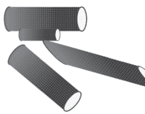

图 7.9 变换效果。

# 其他 SVG 特性

SVG 支持许多其他特性，本节描述了其中一些。请注意，引用的特性位于随书附的光盘中。

## SVG 动画效果

SVG 支持动画效果，你可以将其作为 SVG 元素声明的一部分指定。SVG 文档 `AnimateMultiRect1.svg` 说明了如何用四个矩形创建一个动画效果。

```xml
<rect id="rect1" width="100" height="100" stroke-width="1" stroke="blue"/>
<use xlink:href="#rect1" x="0" y="0" fill="red">
  <animate attributeName="x" attributeType="XML"
    begin="0s" dur="4s" from="0" to="400"/>
</use>
```

SVG `<g>` 元素包含一个 SVG `<use>` 元素，该元素对矩形执行动画效果。第一个 `<use>` 元素引用 SVG `<defs>` 元素中定义的矩形，并在四秒的间隔内对 `x` 属性进行动画处理。注意，`x` 属性从 0 变化到 400，这会使矩形从左向右水平移动。你也可以动画其他 SVG 元素，包括文本字符串。

如果你对查看如何在 SVG 中处理数据和功能感兴趣，可以在此处获取代码示例：http://msdn.microsoft.com/en-us/library/ig58905v(v=ts.85).aspx。

## SVG 和 JavaScript

除了在 HTML5 页面中“嵌入” SVG 代码外，SVG 还允许你在 CDATA 区中嵌入 JavaScript，以动态创建 SVG 元素并将其附加到 HTML Web 页面的 DOM 中。你也可以在 JavaScript 为 SVG 元素定义监听器。SVG 文档 `ArchEllipse1.svg` 渲染了一组遵循阿基米德螺旋路径的椭圆。这里显示了一个片段：

```javascript
var svgNS = "http://www.w3.org/2000/svg";
function drawSpiral(event) {
  for(angle=0; angle<maxAngle; angle+=deltaAngle) {
    ellipseNode = svg.document.createElementNS(svgNS, "ellipse");
    ellipseNode.setAttribute("fill", "redColor");
    ellipseNode.setAttribute("stroke-width", "strokeWidth");
    ellipseNode.setAttribute("stroke", "yellow");
    ellipseNode.setAttribute("cx", currentX);
    ellipseNode.setAttribute("cy", currentY);
    ellipseNode.setAttribute("rx", majorAxis);
    ellipseNode.setAttribute("ry", minorAxis);
    gcNode.appendChild(ellipseNode);
  }
}
```

SVG 文档 `ArchEllipse1.svg` 包含一个带有 `<script>` 元素的 CDATA 区，该元素反过来调用 `drawSpiral()` 函数，该函数的主循环返回一组动态创建的 SVG `<ellipse>` 元素。每个 `<ellipse>` 元素都是在变量 `svgNS` 指定 SVG 命名空间中创建的，之后为椭圆所需的属性赋值值。在每个 SVG `<ellipse>` 元素动态创建后，该元素被附加到 DOM 中。

## 使用 CSS3 和 JavaScript 在 SVG 中创建 3D 效果

正如你在本章前面学到的，SVG 不支持 3D 效果。但是，你可以通过 CSS `url()` 函数在 CSS 选择器中引用 SVG 元素，这为利用 CSS 选择器利用 SVG 功能提供了一种强大的机制。另一种技术涉及 JavaScript 和 SVG 的结合。这里是具有 3D 效果的 SVG 代码示例：https://github.com/ocampsato/svg-filters-graphics。

图 7.10 显示了在 MacBook 的 Chrome 浏览器中渲染 `TroughPattern3S2.svg`（它是前一个开源项目的一部分）的结果。

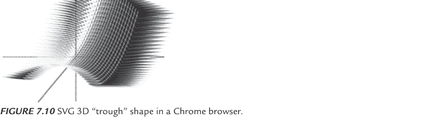

如果你对用 SVG 创建 3D 效果感兴趣，可以在此处获取更多信息（包括关于矩阵操作的细节）和代码示例：http://msdn.microsoft.com/en-us/library/hh5337579(v=us.85).aspx。
开源（且非常强大）工具包 D3 基于 jQuery 和 SVG，基于 D3 的代码示例在此：https://github.com/ocampsato/d3-graphics。

## SVG、CSS 和 JQUERY

你可以在同一个页面中结合这些技术（以及结合 D3）。然而，当你使用 jQuery 在 Web 页面中动态创建 SVG 元素时，你需要添加一些额外的代码（后文所示）。如果你不打算使用 jQuery，可以跳过此节。如果你对 jQuery 感兴趣且没有用过，请阅读配套光盘上的相关附录。

如你现在所知，CSS3 选择器使用 CSS3 `url()` 函数引用 SVG 文档，这意味着你可以在 HTML 页面中引入 SVG 图形效果（包括动画）。Web 页面 `Blue3DCirclele.html` 引用 样式表 `Blue3DCirclele.css` 以渲染带有样式效果的 SVG。

作为另一个例子，HTML5 `CSS3SVGBarChart1.html` 引用样式表 `CSS3SVGBarChart1.svg` 以渲染 SVG 圆形、柱状图和多列文本。

一个有趣的场景涉及在同一个 Web 页面中结合 jQuery 与 SVG 和 CSS ，如下小节所示。

### SVG 和 jQuery

列表 7.10 显示了 `JQuerySVGCSCube1.html` 的内容，它说明了每当你点击基于 SVG 的立方体的任何面时，如何更新其填充颜色。

## 列表 7.10 JQuerySVGCSCube1.html

```html
<!DOCTYPE html>
<html lang="en">
<head>
  <meta charset="utf-8" />
  <title>SVG, CSS, and jQuery Example</title>
  <script src="https://cdnjs.cloudflare.com/ajax/libs/jquery/3.0.0-alphah/jquery.js"></script>
  <style>
  .newcolor {
    fill: #c8f;
    stroke: white;
    stroke-width: 2;
  }
</style>
</head>
<body>
  <svg class="none" width="600" height="300">
    <!-- top/front/right faces -->
    <polygon fill="yellow" points="50,50 200,50 240,30 90,30"/>
    <rect width="150" height="150" x="50" y="50" fill="red"/>
    <polygon fill="blue" points="200,50 200,200 240,180 240,30"/>
  </svg>
  <script>
    var mysg = $("svg > *");
    $(document).ready(function () {
      mysg.on("click", function () {
        mysg.removeClass("none");
        //$(this).toggle("newcolor");
        //
      });
    });
  </script>
</body>
</html>
```


# 现有元素和 jQuery

前节显示了如何动态创建 SVG 元素并将其附加到 DOM 中。你也可以用 jQuery 操作现有的 SVG 元素。

列表 7.11 显示了 `JQuerySVG.html` 的内容，说明了如何使用 jQuery 创建椭圆。

## 列表 7.11 JQuerySVG.html

```html
<!DOCTYPE html>
<html lang="en">
<head>
  <meta charset="utf-8" />
  <title>An Ellipse</title>
  <script src="https://cdnjs.cloudflare.com/ajax/libs/jquery/3.0.0-alphah/jquery.js"></script>
</head>
<body>
  <svg id="outersvg" width="800" height="500"></svg>
  <script>
    var svgNS = "http://www.w3.org/2000/svg";

    function createEllipseWithNS(elem) {
      var ellipse = document.createElementNS(svgNS, "ellipse");
      ellipse.setAttribute('cx', 150);
      ellipse.setAttribute('cy', 100);
      ellipse.setAttribute('r', 50);
      ellipse.setAttribute('fill', 'none');
      ellipse.setAttribute('stroke', 'black');
      ellipse.setAttribute('stroke-width', 3);
      $('#outersvg').append(ellipse);
    }

    $(document).ready(function() {
      createEllipseWithNS($('#outersvg')[0]);
    });
  </script>
</body>
</html>
```

前节显示了 `document.createElement()` 不作用，因为需要命名空间。使用 `document.createElementNS()`，jQuery 会为你处理。列表 7.11 显示了 `JQuerySVG.html` 的内容，说明了如何使用 jQuery 创建椭圆。

## 列表 7.10 JQuerySVGCSCube1.html

```html
<!DOCTYPE html>
<html lang="en">
<head>
  <meta charset="utf-8" />
  <title>SVG, CSS, and jQuery Example</title>
  <script src="https://cdnjs.cloudflare.com/ajax/libs/jquery/3.0.0-alphah/jquery.js"></script>
  <style>
    .newcolor {
      fill: #c8f;
      stroke: white;
      stroke-width: 2;
    }
  </style>
</head>
<body>
  <svg class="none" width="600" height="300">
    <!-- top/front/right faces -->
    <polygon fill="yellow" points="50,50 200,50 240,30 90,30"/>
    <rect width="150" height="150" x="50" y="50" fill="red"/>
    <polygon fill="blue" points="200,50 200,200 240,180 240,30"/>
  </svg>
  <script>
    var mysg = $("svg > *");

    $(document).ready(function () {
      mysg.on("click", function () {
        mysg.removeClass("none");
        //$(this).toggle("newcolor");
        //
      });
    });
  </script>
</body>
</html>
```

前节显示了 `<script>` 元素的部分。7.10 显示了 `JQuerySVGCSCube1.html` 的内容，说明了每当你点击基于 SVG 的立方体的任何面时，如何更新其填充颜色。

## 用于 SVG 的 jQuery

如果你在 HTML5 页面中倾向于使用 jQuery 而不是 D3，可以通过 jQuery 插件添加 SVG 支持。例如，下面的 jQuery 插件提供了某些 SVG 支持。代码块说明了如何使用此 jQuery 插件渲染 2D 形状：

```javascript
svg.rect(50, 50, 100, 100,
  {fill: 'blue', stroke: 'red', stroke-width: 3});

svg.line(50, 50, 100, 100,
  {stroke: '3', stroke-width: 3});

svg.circle(50, 50, 100,
  {fill: 'red', stroke: 3, stroke-width: 3});

svg.ellipse(250, 250, 100, 50,
  {fill: 'red', stroke: 3, stroke-width: 3});
```


在上述代码块中，JavaScript 变量 `svg` 是一个 HTML `<div>` 元素的引用，该元素定义在 HTML5 页面的其他地方。
用于动画 SVG `<path>` 元素的 jQuery 插件可以在以下网站找到：http://www.jqueryrain.com/2015/10/jquery-drawsvg-animate-svg-paths/ 和 http://www.justinmcandless.com/blog/Patching+jQuery's+Lack+of+SVG+Support。

# SVG 与 CSS3 的简要比较

本节总结了 SVG 和 CSS3 的共同特性，以及每种技术特有的特性。第 6 章和第 7 章包含代码示例，说明了本节中总结的一些特性。

SVG 和 CSS3 为以下内容的支持：

- 线性和径向渐变
- 2D 图形和动画效果
- 创建矩形、圆形和椭圆等形状的能力
- WAI-ARIA

SVG 提供了 CSS3 中不具备的功能：

- 贝塞尔曲线
- 分级对象定义
- 自定义字形
- 沿任意路径渲染文本
- 在 SVG 对象上定义事件监听器
- 使用 JavaScript 程序化创建 2D 形状
- 对基于 XML 的技术和工具的“可访问性”

CSS3 提供了 SVG 中不具备的功能：

- 3D 图形和动画效果
- 文本的多列功能（例如 CSS Shaders）
- 面向 WebGL 的功能（例如 CSS Shaders）

注意，SVG 过滤器和 CSS 过滤器在不久的将来某个时刻将合二为一。

通常，对于用于数据可视化的大数据集，SVG 比 CSS3 更合适，你可以使用 CSS3 的 `url()` 函数在 CSS3 选择器引用 SVG 文档（可能会渲染某些类型的图表）。你已经在第 3 章中看到一个示例，其中 SVG 文档包含条形图的布局。通常，可能涉及额外的处理，即从一个或多个源（如数据库和 Web 服务）检索或聚合数据，然后使用某些编程语言（如 XSLT、Java 或 JavaScript）进行处理，以便程序化创建 SVG 文档，或者在浏览器会话中程序化创建 SVG 元素。

## 总结

本章从介绍 SVG 以及如何使用 SVG 渲染 2D 形状开始。你学习了 SVG 渐变（线径向），以及在渲染 2D 形状时如何指定渐变。接下来，你学习了用于在平面内渲染任意多边形（凸或凹）的 SVG `<polygon>` 元素。你还学习了 SVG `<pattern>` 元素以及如何创建自定义模式以实现丰富的视觉效果。然后，你学习了贝塞尔曲线以及如何在 SVG 中沿路径（如贝塞尔曲线）渲染文本字符串。最后，你学习了 SVG 过滤器以及如何将其与 SVG 变换结合并应用到 2D 形状上。

# 第 8 章 杂题

本章包含了多种主题，从 Houdini 的概述开始，Houdini 是一个对网页 CSS 具有深远影响的倡议。你还将学习 Flexbox 和 Grid 布局，以及二进制图像的性能技术。此外，你还将看到 CSS3、SVG 和 HTML5 Canvas 的比较，以及 Web 动画 API 和动画相关的工具包。

本章的第一部分是对 Houdini 的快速介绍，这是一项重要任务，其目标是提供新的 API，以便在所有现代浏览器中提供一致的 CSS 行为。

本章的第二部分包含显示如何使用 CSS Flexbox 和 CSS Grid 布局的代码示例。本章的第三部分讨论了 HTML5 页面和 CSS3 的性能改进，以及 CSS3、SVG 和 HTML5 Canvas 的比较。

本章的第四部分涵盖了优化二进制图像的性能技术，以及对精灵集（spritesheets）、渐进显示技术（blur-up）、渐进图像和 Web 字体的描述。本章的第五部分研究了 Web Animations API 和其他动画工具包，如 GSAP、mojo.io 和 sequence-js。

本章的最后一部分深入介绍了 Chrome Inspector 的某些功能，它提供了丰富的诊断和调试能力。你将学习“计算属性”、如何对 CSS 选择器进行实时更新，以及如何收集帮助你准确定性能瓶颈的数据。完成本节后，你将能够更好地对 Chrome Inspector 进行基于功能的比较。

## Houdini 计划

Houdini 是一个 W3C 倡议，其目标是提供新的 API，以便在所有现代浏览器中提供一致的 CSS 行为。Houdini 还引入了 worklets，它们本质上是脚本。此外，Houdini 有示例位于：https://github.com/GoogleChrome/houdini-samples。

## 渲染流水线

渲染流水线涉及以下阶段：

1. 解析器 (Parser)
2. DOM/CSSOM
3. 层级 (Cascade)
4. 布局 (Layout)
5. 绘制 (Paint)
6. 合成 (Composite)

## CSS3 高级特性

书中的 CSS3 示例已在 WebKit 浏览器中测试，你可以使用浏览器前缀（在第 1 章中简要讨论过）为其他浏览器插入 CSS。

有若干处于活跃开发中的 CSS 特性，大部分（可能所有）在 WebKit 浏览器中可用。许多情况下，每个新 CSS 特性的 W3C 规范都是“进行中”，因此在你阅读本书时它们可能会发生变化。查看 caniuse.com 等网站以获取你所选浏览器的最新支持信息。

高级（以及实验性）特性中：

- CSS Flexbox
- 混合 (Blending)
- 合成 (Compositing)
- 排除 (Exclusions)
- 区域 (Regions)

考虑到上述观点，一些最新的 CSS 特性列表如下：

- CSS Canvas 背景 (WebKit 和 FF)
- CSS 设备适配 (IE10)
- CSS 排除 (IE10)
- CSS 过滤器 (IE10 和 WebKit)
- CSS Flexbox (IE10)
- CSS Grid (IE10 和 WebKit)
- CSS 区域 (IE10 和 WebKit)
- CSS 自定义过滤器 (WebKit)
- CSS 模板 (IE10)

在上述列表中，只有 CSS Flexbox 是本章涵盖的特性。你还将看到一些 CSS Flexbox 代码示例和截图，说明如何通过导航各自的主页来创建图形效果。

## Flexbox (弹性框)

CSS 支持多种布局模型，例如块、内联、表格和定位布局模型。此外，CSS 支持 CSS Flexbox 模型，你将在本节中看到一些示例。

Flexbox 是一种单向布局概念，其中弹性项目（flex items）被放置在水平行或垂直列中。`flex-direction` 属性指定了主轴，主轴进而定义了弹性项目在 flex 容器中排列的水平或垂直方向。`flex-direction` 的默认值是 `row`（行），这意味着项目从左到右、从上到下进行排列（即我们在页面上阅读文本的顺序）。

以下是 `flex-direction` 的其他值：

- `row-reverse`：如果写入模式（writing-mode）指定为从左到右，则弹性项目将以从右到左的方式布局。
- `column`：如果书写系统是水平的，则弹性项目将垂直排列。
- `column-reverse`：与 `column` 属性类似，但顺序是反向的。

Flexbox 模型还允许你伸展 flexbox 的子元素以填充未使用的空间，也可以缩小子元素以避免溢出父元素。此外，你可以在同一个 HTML 页面中为不同的 flexbox 创建不同的布局。

## 各种 Flexbox 属性

一些不需要前缀的 flexbox 属性包括：`box-align`、`box-flex`、`box-ordinal-group`、`box-pack` 和 `flex-flow`。`box-align` 属性（以及其他 flexbox 属性）支持如 `start`、`end`、`center`、`baseline` 和 `stretch` 等值，这些值允许你指定 flexbox 中元素的对齐方式。例如，`start` 和 `end` 将分别对 flexbox 中的一组元素进行左对齐和右对齐。`box-flex` 属性允许你为 flexbox 中的某个元素分配更大的相对权重。`box-ordinal-group` 属性允许你更改 flexbox 中一组元素的默认顺序。你还可以使用 `display` 属性并指定值为 `box`。

你可以使用 Flexbox 属性来执行额外的任务：

- 使用 `order` 排列 flexbox 子元素
- 使用 `flex-basis` 定义 flexbox 子元素的尺寸
- 使用 `flex-shrink` 和 `flex-grow` 正确地重置子元素的大小
- 使用 `flex-wrap` 和 `align-content` 创建网格

下一节包含一个包含上述某些 Flexbox 属性的 Web 页面示例。

## 带有 Flexbox 属性的网页

列表 8.1 显示了 `SimpleFlexboxWK1.html` 的内容，列表 8.2 显示了 `SimpleFlexboxWK1.css` 的内容，它们说明了如何使用本节开头列表中 flex 属性。

### 列表 8.1 SimpleFlexboxWK1.html

```html
<!doctype html>
<html lang="en">
<head>
  <meta charset="utf-8">
  <title>Flexbox Layout</title>
  <link rel="stylesheet" href="simpleflexlw.css">
</head>
<body>
  <div id="flex1">
    <ul>
      <li>Item11</li>
      <li>Item12</li>
      <li>Item13</li>
    </ul>
    <ul id="flex2">
      <li>Item21</li>
      <li>Item22</li>
      <li>Item23</li>
    </ul>
    <ul id="flex3">
      <li>Item31</li>
      <li>Item32</li>
      <li>Item33</li>
    </ul>
  </div>
</body>
</html>
```

列表 8.1 起于对 CSS 样式表的引用，随后是一些样板代码标记。下一节包含三个无序列表，其属性值分别为 `flex1`、`flex2` 和 `flex3`。每个无序列表都基于 `SimpleFlexboxWK1.css` 中的匹配选择器。

### 列表 8.2 SimpleFlexboxWK1.css

```css
#flex1 {
  display: -webkit-box; width: 100%; height: 50px;
  background: #faa;
  -webkit-box-pack: center; -webkit-box-align: start;
}

#flex1 li {
  background: yellow; margin: 0 5px;
}

#flex1 li:nth-child(2) {
  -webkit-box-ordinal-group: 1;
}

#flex2 {
  display: -webkit-box; width: 100%; height: 50px;
  background: #faf;
  -webkit-box-pack: center; -webkit-box-align: center;
}

#flex2 li {
  background: red; margin: 0px; -webkit-box-flex: 1;
}

#flex2 li:nth-child(1) {
  -webkit-box-flex; -webkit-box-ordinal-group: 1;
}

#flex3 {
  display: -webkit-box; width: 100%; height: 50px;
  background: #afa;
  -webkit-box-pack: center; -webkit-box-align: right;
}

#flex3 li {
  background: #88f; margin: 0px; -webkit-box-flex: 8;
}

#flex3 li:nth-child(1) {
  -webkit-box-flex: 3; -webkit-box-ordinal-group: 2;
}
```

列表 8.2 包含 9 个选择器，对应 8.1 中每个无序列表的 3 个选择器，你可以查看上一节的内容以了解列表 8.2 中 flex 属性的解释。

## 使用 Flexbox 渲染列和行

列表 8.3 显示了 `Flexbox.html` 的内容，它说明了如何使用 flex 属性以列或行的形式渲染元素。

### 列表 8.3 Flexbox.html

```html
<!DOCTYPE html>
<html lang="en">
<head>
  <meta charset="utf-8">
  <title>Flexbox Examples</title>
  <style>
  #flex1 {
    display: -webkit-box; width: 100%; height: 50px;
    background: #faa;
    -webkit-box-pack: center; -webkit-box-align: start;
  }

  #flex1 li {
    background: yellow; margin: 0 5px;
  }

  #flex1 li:nth-child(2) {
    -webkit-box-ordinal-group: 1;
  }

  #flex2 {
    display: -webkit-box; width: 100%; height: 50px;
    background: #faf;
    -webkit-box-pack: center; -webkit-box-align: center;
  }

  #flex2 li {
    background: red; margin: 0px; -webkit-box-flex: 1;
  }

  #flex2 li:nth-child(1) {
    -webkit-box-flex; -webkit-box-ordinal-group: 1;
  }

  #flex3 {
    display: -webkit-box; width: 100%; height: 50px;
    background: #afa;
    -webkit-box-pack: center; -webkit-box-align: right;
  }

  #flex3 li {
    background: #88f; margin: 0px; -webkit-box-flex: 8;
  }

  #flex3 li:nth-child(1) {
    -webkit-box-flex: 3; -webkit-box-ordinal-group: 2;
  }
  </style>
</head>
<body>
  <div id="flex1">
    <ul>
      <li>Item11</li>
      <li>Item12</li>
      <li>Item13</li>
    </ul>
  </div>
  <ul id="flex2">
    <li>Item21</li>
    <li>Item22</li>
    <li>Item23</li>
  </ul>
  <ul id="flex3">
    <li>Item31</li>
    <li>Item32</li>
    <li>Item33</li>
  </ul>
</body>
</html>
```

列表 8.3 起于对 CSS 样式表的引用，随后是一些样板代码标记。下一节包含三个无序列表，其属性值分别为 `flex1`、`flex2` 和 `flex3`。每个无序列表都基于 `SimpleFlexboxWK1.css` 中的匹配选择器。

图 8.2 Mac 上 Chrome 浏览器中的 CSS Grid。

正如你可能看到的，CSS Grid 布局支持一些绝非显而易见的复杂布局概念。例如，以下选择器定义了四列和三行：

```css
body {
  grid-columns: repeat(4, 0.5in);
  grid-rows: repeat(3, 20%);
  columns: 3; column-gap: 0.5in;
}
```


前述 CSS 选择器包含以下信息：

- 指定了显式网格
- 括号内的表达式是一个重复模式
- 方括号中的整数是重复次数
- 星号 `*` 代表比例长度，这意味着每个 `*` 被分配了等等的空间分配。

你可以从 CSS Grid Layout 规范（进行中）获取更多信息：http://dev.w3.org/csswg/css3-grid-layout/ 和 http://www.w3.org/TR/css3-grid/

# 提高 HTML5 网页性能

性能始终是一个重要的考虑因素，尽管详细且冗的讨论超出了本书的限制范围，但意识到某些可用技术是非常重要的：

- 将 JavaScript/CSS 文件合并为一个单独文件
- 使用文件压缩（最小化）
- 使用雪碧图（spritesheets）
- 使用图像的 base64 编码
- 延迟加载 JavaScript 文件

关于使用 base64 编码图像的良文请见此处：http://davidbcalhoun.com/2011/chen-to-base64-encode-images-and-when-to?goback=%23Eqde_2071438_member_23428886。

你可以通过将 `<script>` 标签放在网页 `<body>` 标签的末尾来延迟 JavaScript 文件的加载。

异步加载 CSS 样式表，如下：http://filamentgroup.github.io/loadCSS/preload.html。

你可以探索 `RequireJS`，这是一个用于异步下载 JavaScript 依赖（以及管理 JavaScript 依赖项）的 JavaScript 工具包，其主页在这里：http://requirejs.org。

# CSS 相关性能

CSS3 提供了精彩的功能，如圆角以及 2D 和 3D 图形和动画效果。然而，CSS3 特性的性能上可能有所不同，这显然会影响 HTML5 网页的性能。

记住你可以通过使用类似 `translate3D(0,0,0)` 的内容来确保设备上使用 GPU，这本质上是一个“无操作”。你可以用相应的 3D 变换替换 2D 变换。然而，盲目地使用 3D 变换会导致页面重流（reflow）或页面重绘（repaint），对性能产生不利影响。

关于 CSS 绘制时间的佳文见此处：

- http://css-tricks.com/efficiently-rendering-css/
- http://www.html5rocks.com/en/tutorials/speed/css-paint-times/
- http://stickmanventures.com/labs/demo/spinning-gears-Chrome-Proxy-serve-3d/

另一个值得考虑的有趣点是在 CSS 选择器中使用 CSS3 绝对定位。Paul Irish 比较了这些技术：http://paulirish.com/why-moving-elements-with-translate-is-better-than-pos-abs-topleft。

如果你对绘制过程的底层细节感兴趣，CSS2 定义了绘制过程的顺序，即元素在“堆叠上下文”（stacking contexts）中的堆叠顺序。这种顺序影响绘制，因为堆栈是从后往前绘制的。块渲染器的堆叠顺序为：

- 背景颜色
- 背景图像
- 边框
- 子元素
- 轮廓

可以在以下处找到关于绘制过程的详细说明：http://www.html5rocks.com/en/tutorials/speed/unnecessary-paint/ 和 http://www.html5rocks.com/en/internals/howbrowser-work。

Steve Souders 至少写了两本性能相关的书籍，并写了许多关于性能的博客，他的作品绝对值得阅读。

# CSS、SVG 和 CANVAS 的对比

CSS3 提供了 a) 2D/3D 图形/动画，b) GPU 支持，c) 嵌入 SVG `<defs>` 元素的能力，d) 用于动画的“缓动函数”，以及 e) 动画 HTML 元素的能力。

SVG 提供了 a) 2D 图形/动画，b) GPU 支持，c) 创建任意 2D 形状的能力，d) 自定义 `<pattern>`， e) 通过 `<g>` 元素进行分组，以及 2D 图形/动画中的缓动函数（但 SVG 无法动画 HTML）。

Canvas 提供了 a) 2D 图形/动画，b) GPU 支持，更新许多小对象（游戏）的能力，以及 d) 使用 `ThreeJS`/`WebGL` 处理视频进行 3D 动画的选项。

CSS3+SVG 在以下情况下很有用：a) 你已经有了基于 SVG 的数据 b) 你必须支持 IE6（可以使用 `Raphael` 实现，但不能用 `D3`）。

CSS3+D3 适用于现代浏览器，并且对于定义处理程序和动画来说更加容易（可能更容易维护/增强）。

然而，请记住 CSS3+SVG 可能没有 GPU 支持（或许可以考虑结合 `BackboneJS`/`Angular`/JS 等使用 CSS3）。

使用 CSS3 配合 SVG 创建 3D 动画效果如下：

- 步骤 1：创建 SVG
- 步骤 2：使用 `<defs>`
- 步骤 3：使用 CSS3 选择器
- 步骤 4：使用 CSS3

# 158 • CSS3 快速入门

这里有一篇关于雪碧集（spritesheets）最佳实践的文章：http://webdesign.tutsplus.com/articles/css-sprite-sheets-best-practices-tools-and-helpful-applications-webdesign-8340。

如果你需要调整任何图像的大小，`ImageMagick` 是一个用于此类任务的优秀命令行工具，其主页为：http://www.imagemagick.org/script/convert.php。

调整图像后，你可以使用像 `Glue` 这样的命令行工具使用修改后的图像创建新的雪碧集：http://glue.readthedocs.org/en/dataset/

在网上搜索其他工具，并比较它们的功能以确定哪些工具支持你的需求。

# 用于渲染背景图的“渐模糊”（Blur Up）技术

该技术涉及对小图像进行初始设计，然后缩放该图像并同时应用高斯模糊过滤器（过滤器将在第 2 章中讨论）。该技术的细节在此处描述：https://css-tricks.com/the-blur-up-technique-for-loading-background-images/

该技术的示例在此处：http://codepen.io/thatemil/pen/YaqG

该技术的一个有趣方面与过滤器有关：你可以使用 base64、CSS 或 SVG 来定义过滤器。另一个感兴趣点点是在渐进式图像中使用该技术的可能性（在下一节中描述）。

顺便提一下，Facebook 工程师团队在其原生应用中使用这种技术来加载照片预览。

# 渐进式图像

在 HTML 网页中加载图像的另一种技术是渐进式图像。这种技术涉及下载并显示一个低分辨率的图像初始版本，然后“渐进地”下载并重新部署图像，直到渲染出全分辨率。

有趣的是，这种技术在 2008 年就已经可用（可能更早），最近对渐进式图片的兴趣再次回升。然而，渐进式图片的采用率仍然很低。以下文章提到了一种可能性，它对三种不同格式的图像进行了各种测试：http://www.webperformancetoday.com/2014/09/17/progressive-image-rendering-good-evil/

尽管上述文章没有给出确定性的结论，但有一句有趣的引用：

> “就像渐进 JPEG 方法一样，当图像渲染是一个两个阶段的过程（即初始粗糙的图像瞬间变得清晰）时，认知流利度受到抑制，大脑必须更加努力才能理解所显示的内容。”

# 杂项主题

根据上述引用，也许用户对渐进式图像的反应涉及认知和主观考量的结合。

如果你对学习传输二进制文件的四种方法感兴趣，以下链接包含了一些信息：[图像渲染](http://blog.codinghorror.com/progressive-image-rendering/)。

另一个优化网页的倡议是 Google AMP（加速移动端页面），它极大地限制了网页初始下载中允许的内容类型。下一章将讨论 Google AMP。

# Web 字体

浏览器在渲染网页时会下载 Web 字体，然后将这些字体应用于网页中的文本。在这里可以获取 Web 字体合集：http://webfonts.info。

这里显示了在样式表中引入 Web 字体的示例：

```html
<link='stylesheet' type='text/css' href='https://fonts.googleapis.com/css?family=Archive-Narrow'>
```

当 Web 字体从远程网站下载时，可能会对 HTML 网页的性能产生不利影响。关于 Web 字体性能的在线演示在此处：https://speakerdeck.com/brainstein/web-字体-performance。

# 该做什么？

到目前可能已经清楚，没有一种通用的公式来设计优化的 HTML 网页。然而，有一点是：在尝试各种技术后，你需要测试你的网页的性能，以确定什么对你的网站是最优的。

# WEB 动画 API 概述

Web 动画可以通过多种方式实现，例如：

- `jQuery animate()`
- `requestAnimationFrame`
- `GreenSock` 和 `Velocity`
- CSS 过渡和关键帧动画
- SVG 动画
- `setTimeout`/`setInterval`

Web Animations 是一组统一 CSS 和 JavaScript 动画的标准。需要记住的关键点是，Web Animations 通过 JavaScript 提供基于 GPU 的动画。

Web Animations API 提供了一个支持以下方法和特性的播放器：

```
play(), pause(), finish(), and cancel()
playState
reverse()
currentTime
playbackRate
```

以下代码块说明了如何创建一个带有动画的播放器对象：

```javascript
var player = document.getElementById('toAnimate').animate([
  { transform: 'scale(1)' },
  { transform: 'scale(0.6)' },
], {
  duration: 700, //milliseconds
  iterations: Infinity, //or a number
  direction: 'normal', //alternate', 'reverse', ...
  fill: 'forwards', //backwards', 'both', 'none', 'auto'
  delay: 10, //milliseconds
  easing: 'ease-out-in', //linear, 'ease-in', ...
});
```

以下代码块说明了如何创建一个动画多个帧的播放器：

```javascript
var player = document.getElementById('toAnimate2').
animate([
  {transform: 'scale(1)', opacity: 1, offset: 0 },
  {transform: 'scale(.5)', opacity: .5, offset: .333},
  {transform: 'scale(.66)', opacity: .66, offset: .666},
], {
  duration: 700,
  easing: 'ease-out-in',
  direction: 'alternate',
  fill: 'forwards'
});
```

下一节包含一个使用 Web API 的代码示例。

# Web 动画 API 的一个示例

本节包含了使用 Web API 创建 SVG 元素动画效果的示例。

你需要安装 `bower` 并执行命令 `bower install` 来在机器上设置环境，上述仓库中的 `README.md` 提供了详细说明：https://github.com/example/web-animations。

列表 8.5 显示了 `AnimOval1.html` 的内容，它说明了如何使用 Web API 创建遵循螺旋线线路径的椭圆。

# 列表 8.5 AnimOval1.html

```html
<!doctype html>
<html>
<head>
  <meta name="viewport" content="width=device-width, minimum-scale=1.0,initial-scale=1.0, user-scalable=yes">
  <title>阿基米德图形</title>
  <script src="web-animations-next.js"></script>
  <script src="bower_components/platform/platform.js"></script>
  <link rel="import" href="bower_components/polymer/polymer.html">
  <link rel="import" href="PolyArchOval1.html">
</head>
<body>
  <svg-graphics id="main" width="800" height="600">
  </svg-graphics>
<script>
  var elem = document.querySelector('#main');
  var player = elem.animate([
    {opacity: 0.5, transform: "rotate(-225deg)"},
    {opacity: 0.5, transform: "scale(0.5)"},
    {opacity: 1.0, transform: "translate(300px,200px), scale(1.5)"}
  ], {
    direction: 'alternate',
    duration: 2000,
    iterations: Infinity
  });
</script>
</body>
</html>
```

# 用于 JS Web 动画的其他工具

本节简要介绍了支持动画效果的 JavaScript 工具包。

`GSAP` 工具包提供了复杂的动画和补间效果。`GSAP` 是纯 JavaScript（没有“特殊”或专有语言）用于创建动画效果，且其主页为：http://greensock.com/gsap。

注意 `GSAP` 不转换字体或 SVG 艺术品。`GSAP TweenLite` 是可以动画 CSS 属性（以及其他）的核心工具包。

# 162 • CSS3 快速指南

（内容），而且 `TweenMax` 是 `TweenLite` 的超集，具有更高级的功能。`TimelineLite` 是一个序列工具，而 `TimelineMax` 是 `Timeline` 的超集。`GSAP` 还支持缓动函数以及可用的各种插件。你可以在此处查看更多示例：http://greensock.com/examples-showcases。

这里有一些包含 SVG、GSAP 和 ReactJS 的酷炫眼球代码示例：https://github.com/opencamorato/react-svg-gsapi。

`PostCSS` 是一个非常小的工具包，仅包含一个 CSS 解析器、一个 CSS 节点 API、一个 Source Map 生成器和一个节点树字符串化器。所有的样式转换都由插件完成，这些插件是纯 JS 函数。每个插件接收一个 CSS 节点树，对其进行转换，并返回修改后的树。

`PostCSS` 可以与 Sass 和 LESS 等许多预处理器配合工作。你可以在可以在此地址使用它：http://www.smashingmagazine.com/2015/12/introduction-to-postcss/。你可以使用 `[cssnext]` 插件包现在就可以编写未来的 CSS 代码：

```css
root {
  --mainColor: #ffbbaaf;
}

@custom-media --mobile (width <= 640px) {
  @custom-selector ::heading h1, h2, h3, h4, h5, h6,.post-article ::heading {
    color: var(--mainColor)(20%);
  }
}

@media (--mobile) {
  .post-article ::heading (
    margin-top: 0;
  )
}
```


Sequence 是一个 JavaScript 工具包，支持内置的 CSS 框架来创建动画效果，其首页在此：http://www.sequence.js/com。

内容过渡是通过 CSS 定义的，并且涉及 GPU 硬件加速以创建非常平滑的动画效果。

关于 sequence.js 的详细教程在此：http://davidwalsh.name/creating-animated-product-slider-sequencejs。

sequence.js 的演示在此：http://codepen.io/IanLunn/pen/qbKbVR。

最后，基于 JavaScript 的开源工具包 mojs.js 允许你创建非常棒的动画效果，它的首页是：http://mojs.js。

# 使用 Chrome 检查器

Chrome 检查器是一个强大的工具，允许你执行各种任务。特别是，Chrome 检查器可以让你轻松地完成以下操作：

1. 查看 DOM 中任何元素的计算后 CSS 属性
2. 修改 CSS 属性并看到更改生效
3. 保存带有 CSS 修改的样式表
4. 在 `Sources`（源代码）标签中加载/查看 CSS 样式表
5. 寻找性能瓶颈

本节提供了上述列表中某些项的详细信息。现在在 Chrome 浏览器中启动 `ThreedHover1.html`，然后导航到“查看->开发者->JavaScript 控制台”以查看 Chrome 检查器的内容。本节将讨论 `Elements`（元素）标签和 `Sources`（源代码）标签，你可以在点击它们后研究其他标签。

图 8.3 显示了 `ChromeInspector.png` 的内容，这是启动 HTML 网页 `Three-dHover1.html` 后 Chrome 检查器的截图。

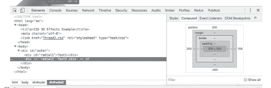

**图 8.3** Chrome 检查器内容的示例。

点击 `Elements` 标签，你将看到浏览器中当前 HTML 网页的 DOM 内容。当你展开元素时，注意浏览器会话的顶部部分如何高亮 DOM 中当前选中项的属性。

点击 `Sources` 标签并点击 `Threereed2Hover.css` 文件以查看该文件的内容。在屏幕右侧，你将看到显示的各种标签。点击 `Computed`（计算）标签，你将看到在 DOM 中设置的属性值。对于每个 HTML 元素，计算属性的值是匹配该 HTML 元素的 CSS 选择器的“聚合”结果。

Chrome 检查器允许你添加应用于当前 HTML 网页的新型 CSS 选择器。点击 `Styles`（样式）标签（位于 `Computed` 标签的左侧），然后点击位于浏览器最右侧的加号（`+`）按钮，它位于包含 `Styles` 标签的行下方的一排按钮中。正如一个简单的例子，这个 CSS 选择器：

```css
body {
  background-color: blue;
}
```

注意，当你输入颜色 `blue` 的字母时，Chrome 会用与当前输入字符串匹配的颜色更新背景颜色。

# CSS3 快速指南

现在点击 `Timeline` 标签，你会看到一个“Capture（捕捉）：”选项，允许你收集有关时间轴的内存信息，并在在此期间截图。每当你想记录信息时点击 `Elements` 标签左侧（下方）的深色圆形，并在需要记录时点击其右侧的圆形。尝试这些选项并进行一些录制，以便熟悉捕捉性能相关细节的细节。

## 总结

在本章中，你学习了 Project Houdini，其目标是在现代浏览器中实现 CSS 一致性和可扩展性的工作组。然后，你学习了 FlexBox 和 Grid 布局，以及一些针对二进制图像的性能技术。接下来，你看到了 CSS3、SVG 和 HTML5 Canvas 的对比，以及一个如何使用 Web Animation API 的示例。此外，你还学习了性能技术、精灵图（spritesheets）以及在 Web 中渲染二进制图像的几种技术。

# 设计移动应用

本章的目的是为设计移动应用提供一些指南。本章涵盖了 UI 体验，以及如何创建美观的移动应用。本章涉及 CSS3 媒体查询，因此在阅读本章的某些章节之前可能需要回顾第 5 章。本章的第一部分讨论了移动隐喻，它是触摸式的而非鼠标式的。本章的第二部分讨论了相关的方面。本章的最后部分讨论了 Google AMP（加速移动页面）和渐进式移动应用。尽管 Google AMP 是一项新技术，但它支持大多数元素。

在阅读本章时，请记住以下几点。首先，本章没有深入讨论工具包（超出范围）。然而，`PhoneGap` (Cordova) 是一个非常流行的工具包，并影响了其他工具包。`Ionic`（被 IBM 收购）是一个使用 Angular 构建移动应用的工具包。`PhoneGap`、`Ionic` 以及其他工具包有很多在线资源。特别是 Facebook 的 `React Native` 和微软收购的 `Xamarin`，访问这些工具包的各自网站获取示例和教程。

# 什么是良好的设计？

这个简单问题的答案比你想的要复杂，但有一些指南可以帮助你做出移动应用的决策。正如你所看到的，这些指南包括触摸、响应式、检测屏幕大小、调整资源以及确定内容。

接下来的几节将提供有关这些和其他因素的更多信息，然后讨论可以帮助你实现所需功能的工具包或提供代码片段。

# 移动 Web 设计的关键方面

设计移动应用的一些重要考虑因素在此：

- 触摸式设计（而非鼠标式）
- 提高用户手势的响应
- 检测屏幕大小（特别是安卓设备）
- 调整资源（如图像）
- 确定 Web 页面的内容

与其处理鼠标点击，移动应用程序处理触摸事件（单击和多次单击）以及用户手势（滑动、快速滑动、移动）。

幸运的是，`jQuery Mobile` 提供了事件虚拟化，通过单组 API 处理鼠标事件和触摸事件。这种虚拟化简化了你的代码：你只需要处理一组事件。

# 触摸式设计

你可能认为可以通过简单地将所有鼠标事件替换为相应的触摸事件来实现这一目标。虽然这是一个良好的起点，但有几个注意事项。首先，没有一种触摸事件是鼠标悬停事件的对应的。因此，选择器为 `#myDiv:hover` 的 CSS 样式表在笔记本电脑和台式机上运行正常，但在移动设备上无法正常工作。

其次，当用户手指触摸移动屏幕时，第二个手势可能是以下之一：

1. 触摸拿起
2. 触摸按住
3. 触摸移动
4. 滑动手势

由于存在一个延迟（大约 300 毫秒），以便等待第二个事件发生。第一个事件（触摸按下）可以与第二个事件结合，以确定正确的用户手势。然而，这种延迟会影响移动 Web 应用的响应感知。幸运的是，有一些 JavaScript 触摸工具包可以提高移动 Web 应用的触摸响应速度，这是下一节的主题。

## 提高用户手势的响应时间

有多种工具包可以消除第一个事件和第二个事件之间的 300 毫秒延迟。第一个具有良好触摸功能的 JavaScript 工具包是 `fastclick.js`，它的主页是：https://github.com/fatlabs/fastclick。

等一下，由于 `FastClick` 消除了物理点击与移动浏览器上触发点击之间的 300 毫秒延迟，移动应用程序感觉更加灵敏。

列表 9.1 显示了 FastClick HTML5 页面的内容，说明了如何在网页中使用 `fastclick.js`。

### 列表 9.1 FastClick1.html

```html
<html>
<head>
  <meta charset="utf-8">
  <script src='/path/to/fastclick.js'></script>
</head>
<body>
  <script>
    window.addEventListener('load', function () {
      Fastclick.attach(document.body);
    }, false);
  </script>
</body>
</html>
```

列表 9.1 非常直观：包含一个引用 `fastclick.js` 的 `<script>` 元素，并添加一个事件监听器在浏览器加载事件期间调用 `fastclick.js` 的 `attach()` 方法。

你也可以在使用 `jQuery Mobile` 的移动应用程序中使用 `fastclick.js`，这里提供了详细的描述：http://forum.jquery.com/topic/how-to-remove-the-300ms-delay-when-clicking-on-a-link-jquery-mobile。

## 在移动 Web 应用中调整资源大小

检测屏幕尺寸至少有两种常用技术，反过来用于调整资源大小。第一种技术涉及 CSS3 媒体查询，为不同的屏幕宽度加载不同的样式表。第二种技术是使用 JavaScript 为不同的屏幕尺寸设置不同的 CSS 属性。

当你在移动 Web 应用的 HTML5 网页上放置资源（如 PNG 文件）时，你需要决定如何处理你移动 Web 应用的以下情况：

1. 从竖屏切换到横屏（或反之）
2. 部署到具有不同屏幕尺寸的移动设备
3. 调整文本字符串和文本区域
4. 缩放非位图像（如 SVG）

在创建不仅包含 PNG 文件还包含其他类型资源的 HTML5 网页时（例如嵌入的 SVG 文档或 HTML5 `<canvas>` 元素），你需要处理预测的情况。

在渲染文本字符串的情况下，如何确定正确的字体大小？即使你使用 `em` 作为测量单位，你也不知道特定设备的 DPI 分辨率。当然，你可以进行合理的推断，决定手机使用 14em，平板电脑使用 16em 来渲染文本，但不同 DPI 的屏幕日益增多意味着你无法保证你的选择在所有情况下都是正确的。

对于嵌入在 HTML5 网页中的 SVG 文档，你可以使用此代码段基于 CSS 的技术来自动调整 HTML5 网页中 SVG 文档的内容：

```html
<div style="background-size: contain">
```

该技术的详细描述在此处：https://developer.mozilla.org/en-US/docs/Web/CSS/background-size。

## 确定移动 Web 页面的内容布局

关于确定网页内容的一些设计考虑如下：

- 为智能手机提供单列文本
- 移除多余链接和内容
- 移除项目和侧边栏/页脚
- 避免绝对尺寸
- 将包装器宽度设置为百分比
- 将段落设置为块级显示（`block`）

## 设计移动应用

请记住，上述点是指南而非绝对规则。例如，横屏模式下的智能手机可以容纳两列（取决于列的宽度），许多平板电脑可以在竖屏模式下显示两列。有些人建议减少屏幕上所需的滚动量，但许多用户习惯了在移动设备上滚动（特别是智能手机）。当有疑问时，创建两个（或可能更多）布局并获取用户反馈，以确定哪种布局可能吸引广泛观众。如果你仍然无法决定哪种设计最符合你的需求，也许你也可以从“A/B 测试”中受益，此处描述了它：http://en.wikipedia.org/wiki/A/B_testing

## HTML 网页的移动设计

为移动设备设计 HTML 网页有多种方法，包括“移动优先”、“仅限移动”以及为移动应用程序使用独立的域名。

“移动优先”方法确保 HTML 页面可以在移动设备上正确渲染。然而，你需要考虑移动设备之间不同的屏幕尺寸，例如智能手机、“功能手机”和平板电脑。这一细节在 Android 移动设备上尤为明显（在 iOS 设备上的这一点程度较之）。

“仅限移动”方法仍然要求你考虑移动设备上不同的屏幕尺寸，但在这种情况下，你不需要与桌面端的 HTML 网页争夺。

第三种方法是使用独立域名。这种方法有几个优势：首先，这使得你的网站更容易被发现。其次，用户可以在移动和桌面之间切换。第三，你可以针对移动用户投放广告。第四，这比修改样式表要简单。

现在你已经对移动网页的设计考虑有了概述，让我们看看表单样式的示例，这是下一节的主题。

## 表单样式的高级视图

当你渲染表单时，既有分级技术（如如何显示输入字段），也有特定的技术。

以下列表包含渲染表单的高级技术：

- 使用语义化标记
- 使用单列显示输入字段
- 决定对齐方式（左对齐或顶部对齐）
- 分组/划分输入字段
- 提示或信息气泡
- 显示错误消息
- 适当的字段宽度
- 配色方案
- 使用标签代替单选框
- 主次要按钮
- 输入元素之间的间距
- 弹出菜单控件
- 语音输入

注意之前的列表中没有“减少滚动”：用户习惯在智能手机和平板上滚动。此外，单列显示对于较小的智能手机更为重要，但某些智能手机在横屏模式下显示两列，平板电脑甚至更容易进行多列扫描。

如果你从左到右的方向渲染文本，左对齐标签允许你在屏幕上放置更多输入字段，而且在字段输入时更容易扫描。顶部对齐标签具有与左对齐相反的优缺点。另一种技术是使用内联标签，这基本上意味着输入字段的“文本提示”为预期的数据类型提供了建议。

## 表单样式的特定技术

在列出的设计技术中，你可以使用部分或特定技术：

- 使用 CSS 为输入字段设置不同样式
- 为输入字段提供标签
- 为输入字段指定键盘类型
- 为输入字段提供默认或建议值
- 为数字字段设置约束
- 标识必填字段
- 在用户输入后对字段进行验证
- 使用密码掩码
- 采用字段缩放

以下子节为阅读列表中的某些列表项目提供了额外的细节。

# 使用 CSS 为输入字段设置不同样式

这涉及两个步骤。第一步是应用默认样式，然后应用你自己的样式规则。第二步是使用 `[type=]` 属性选择器为不同的输入字段应用不同的样式。

作为一个具体的示例，你可以使用 `-webkit-appearance` 属性来移除所有输入元素的默认样式，如下所示：

```css
input, textarea, select {
  -webkit-appearance: none;
}
```

接下来，如文所述，指定依赖于输入字段类型的你自己的 CSS 样式：

```css
input[type=checkbox] {
  /* 为复选框指定样式 */
}

input[type=radio] {
  /* 为单选框指定样式 */
}

input[type=textarea] {
  /* 为文本区域指定样式 */
}
```

你可以将上述示例作为定义 CSS 选择器的指南，以更改 Web 页面中其他 HTML 元素的显示。

# 为输入字段指定键盘类型

HTML5 为 `type` 属性输入元素引入了以下新属性：

- 电子邮件地址：`type='email'`
- 网站地址：`type='url'`
- 电话号码：`type='tel'`

上述类型仅在移动浏览器上有效（在笔记本电脑或桌面浏览器上不会发生任何事情）。

示例显示了如何为输入字段指定不同的键盘：

```html
<form id="form1" name="form1" method="post" action="">
  <label for="name">Name:</label><input name="name" id="name" type="text" /><br>
  <label for="email">Email:</label><input name="email" id="email" type="email" /><br>
  <label for="phone">Phone:</label><input name="phone" id="phone" type="tel" /><br>
</form>
<input name="submit" type="button" value="Submit" />
</form>
```

172 • CSS3 Pocket Primer

# 不同的国家和语言

在为不同国家和语言创建应用程序时，有几点需要注意：

- 不同国家的不同电话格式
- 从左到右与从右到左的文本输入
- 符合文化的内容

如果你打算发布支持多种语言的 Android 应用，下链接提供了有用信息：http://developer.vodafone.com/how-support-multiple-languages-android。

如果你打算发布支持多个国家和语言的 iOS 应用，Apple 在此处提供了广泛的信息：https://developer.apple.com/internationalization/

创建国际化 iOS 移动应用程序的细节（例如如何创建额外的字符串资源）在这里：http://www.slideshare.net/cxpartners/web-and-mobile-forms-design-userfriendly-2010-workshop。

# 设计相关工具和在线模式

`Balsamiq` 是一款在线设计工具，其主页在此：http://www.balsamiq.com。

`Balsamiq Mockups` 是一个用于快速创建线框图的工具，旨在模拟在白板上勾绘界面的体验。由于这些原型存储在你的电脑上，你可以快速轻松地与他人分享。

另一个创建线框图的工具包是 `justinmind`，其主页在此：http://justinmind.com。

上述两个工具都是免费使用的，并且它们有视频说明如何使用它们。

以下两个网站提供了设计模式集合（第二个纯用于移动端）：位于：http://pttrns.com 和 http://mobile-patterns.com。

# 处理字体大小和测量单位

如果你已经处理过 CSS 样式表，那么你已经熟悉用于表示 HTML5 Web 页面中文本字体大小的各种单位。可用单位包括 `em`、`rem`、`px`、`pt` 和 `%`。这些单位之间的关系如下：

```
1em = 12pt = 16px = 100%
```


像素（`px`）在 Web 页面中（尤其是桌面和笔记本电脑）非常常见，根据分辨率和 DPI（每英寸点数）变化。像素单位是虚拟屏幕像素而非物理像素。需要记住的一点是，像素单位对于视觉障碍读者无法正确缩放。

你可以将 `px` 单位用于文本、图像、边框、圆角和投影。然而，如果你正在构建一个使用相对大小的流式布局，最好对文本使用 `em` 单位或 `%` 单位。

`em` 单位更流行，尤其是在移动设备上，因为该单位非常适合缩放 Web 页面。与 `px` 单位不同，`em` 单位相对于 Web 页面中的父元素。将 `px` 单位视为“全局”而将 `em` 单位视为“局部”可能会有所帮助。

一个实用的技巧是为 `<body>` 元素指定值 `62.5%`。由于 62.5% 等于分数 5/8，16px 与 5 的乘积是 25px。`10px` 这个值是一个方便在 CSS 选择器中快速进行 `px` 单位和 `em` 单位之间转换的“基点”。例如，`1.5em` 是 15px，`2em` 是 20px，`2.5em` 是 25px，以此类推。如果你在转换时需要帮助，有一个在线计算器：http://riddle.pl/emcalc/ 和 http://www.ready.mobile/launch.jsp?locale=en_EN。

额外的有用信息在这里：http://www.w3.org/QTips。

# 什么是 AMP？

AMP 是一项旨在移动设备上更快渲染 Web 页面的开源计划，其主页为：https://www.ampproject.org。

AMP 规范于 2015 年 10 月发布，代码示例可用：https://github.com/ampproject/amphtml。AMP 相比“普通” HTML 页面限制了某些功能。现代浏览器对 Service Workers（尽管是一项实验性技术）的支持有助于实现 AMP 的性能目标。

AMP 的某些限制如下：

- 禁止第三方编写的 JavaScript
- 禁止任何类型的输入元素
- 禁止外部样式表
- 禁止内联样式
- 样式必须在 50kb 以下

AMP 的消费者包括可以被爬取、索引和显示的内容的生产者。好消息是 AMP 支持大多数 SVG 元素，未来可能会提供更多支持。

# AMP 中的样式

所有样式必须出现在文档头部 `<style>` 标签中，且该标签必须包含 `amp-custom` 属性。

```html
<amp-lightbox id="lightbox" class="lightbox" layout="nodisplay">
  <div class="lightbox-content">
    <amp-img src="https://cdn.auth0.com/website/jobs/image.jpg" width="2000" height="1035" layout="responsive"></amp-img>
    <p>段落中的一些文本</p>
  </div>
</amp-lightbox>
```

AMP 对广告的支持包括：A9、AdReactor、AdSense、AdTech 和 Doubleclick。参与 Google AMP 的公司包括 Twitter、Pinterest、WordPress.com、Chartbeat、Parse.ly、Adobe Analytics 和 LinkedIn。

# RAIL 框架

RAIL 是以下基于时间的指标的缩写：响应时间（100ms）、动画时间（60FPS）、空闲时间（<50ms）和加载时间（小于一秒）。前句中的数字是功能性指标的目标。

目前 Chrome、Opera 和 Firefox 对 Service Workers 有部分支持，关于 Service Workers 的更多信息见：https://developer.mozilla.org/en-US/docs/API/Service_Worker_API。

# 状态

被 AMP 禁止的元素包括：

- base, frame, frameset
- object, param, applet
- embed, form, script (*)

input, textarea, select, option *) 除非类型为 “application/ld+json”

允许的 HTML 元素（在某些情况下有例外）包括：button, link, style，大多数 SVG 元素，以及对样式表的支持。

内置的“核心” AMP 组件有：

```
amp-img, amp-audio, amp-video
amp-pixel, amp-anim, amp-iframe
amp-carousel, amp-lightbox, amp-ad
amp-instagram, amp-twitter, amp-youtube
```

> **注意** 内置组件在 AMP 文档中始终可用，并带有 `<amp->` 元素。

核心/扩展 AMP 组件包括：

```
amp-img amp-audio amp-video
amp-pixel amp-anim amp-iframe
amp-carousel amp-lightbox amp-ad
amp-instagram amp-twitter amp-youtube
```

被 AMP 替换的元素包括 img (`amp-img`)、video (`amp-video`)、audio (`amp-audio`) 和 iframe (`amp-iframe`)。`` 元素的示例是：

```html
<amp-img
  src="https://mysite/myimage.jpg"
  width="2000"
  height="1035"
  layout="responsive">
</amp-img>
```

AMP 扩展组件涉及在 `<head>` 元素中加载 JavaScript。访问以下链接查看简单 AMP Web 页面的示例：https://www.ampproject.org/docs/get_started/create/basic_markup.html。

# 什么是渐进式 Web 应用？

渐进式 Web 应用（Progressive Web Apps）基于浏览器标签，它们使用应用外壳模型（app shell model）为其提供类似于原生移动应用的“视觉体验”。渐进式 Web 应用是响应式的（适用于任何设备）、安全的（通过 HTTPS），并且由于使用了 Service Workers 而始终保持最新。

渐进式 Web 应用执行以下步骤：

1. 注册 service worker
2. 在 HTTPS 上运行（为了防止中间人攻击）
3. 创建一个包含应用信息的 JSON 清单文件

Service Workers 是由 Google 提供的一系列 API 集合，用于离线访问和 Web 推送通知。清单文件包含元数据，如图标、方向等。注意，Polymer 启动工具包包含一个有效的清单文件。Android 版 Chrome 和 Android 版 Opera 允许你将应用保存到主屏幕，这意味着在不支持渐进式应用的浏览器中，它看起来就像“普通”网站一样。关键点是该应用按默认方向工作。渐进式 Web 应用清单的示例在这里：mobiforgorge.com/design-development/tcb-app-manifests-new-wave-progressive-apps-to-your-homescreen。

# 提高网页性能

性能始终是一个非常重要的考虑因素，尽管详细且冗长的讨论超出了本书的限制，但了解一些可用的技术是有重要的：

- 将 JavaScript/CSS 文件合并为一个文件
- 使用文件压缩（最小化）
- 使用雪碧图（sprites）
- 使用图像的 base64 编码
- 延迟 JavaScript 文件的加载

一篇关于使用 base64 编码图像的极佳博客文章是：http://davidcalhoun.com/2011/chen-to-base64-encode-images-and-when-not-to?goback=%23Id=2071438_member_243228886。

你可以通过将 `<script>` 标签放在 Web 页面 `<body>` 的末尾来延迟 JavaScript 文件的加载。
你还可以探索 RequireJS，它是一个用于异步下载 JavaScript 依赖的 JavaScript 工具包，其主页为：http://requirejs.org。

Steve Souders 写过至少两本与性能相关的书籍，并写了许多关于性能的博客，他的作品绝对值得阅读。

# 使用链接

以下链接对于测试移动应用很有帮助：

- http://css3.test//
- http://www.css3.info/selectors-test/
- http://quirksmode.org/html5/tests/video.html
- http://double.co.nz/video_test/
- http://www.terrillthompson.com/tests/html5-audio.html

其他资源包括 www.stackoverflow.com 和 Paul Irish 的视频。
最近的一个网站是 HTML5 Please，它由业内知名人士贡献：http://html5please.com。

上述网站提供了一个输入字段，你可以在其中指定 HTML5 和 CSS3 特性以确定它们是否已就绪，并查看如何使用它们。

W3C 为 HTML 网页（包括 HTML5 网页）提供免费的在线验证服务：http://validator.w3.org/#validate_j_uri+with_options。

上述网站允许你验证 URL 或直接输入代码。

以下网站为 HTML5 邮件输入字段提供了“样板”模板（以及 CSS 和 jQuery 模板）：http://favbabulous.com/post/548/6-useful-web-development-boilerplates。

## 总结

在本章中，你学习了移动环境以触摸为核心的隐喻，以及移动表单的设计相关方面。此外，你看到了如何通过 fast-click.js 提高用户手势的响应时间，以及你可以使用 CSS3 媒体查询和 JavaScript 检测移动设备的屏幕尺寸。你还学习了 Google AMP 及其对 SVG 元素的支持。接下来，你学习了渐进式移动应用以及性能的高级概述。

# 索引

## A
- `add()` method, 110
- Berners-Lee, Tim, 13
- Automatic, 81

## B
- Bouncing, 37
- Boolean, 1

## C
- Canvas 2D, 3
- Cartesian system, 99
- Chaining, 0
- Chrome, 1
- Compositing, 77
- Custom Properties, 80
- Custom data attributes in HTML5, 11–12
- CSS-Classes, 17
- CSS advanced features, 164
- CSS Blending, 47
- CSS2 effects, 37
- CSS2D effects, 40
- CSS2D text, 49
- CSS2D transforms, 51
- CSS filters, 44
- CSS Grid, 52
- CSS-related performance, 55
- CSS, SVG, and Canvas comparison, 55
- CSS3, 4
- CSS3 to create 3D animation with SVG, 56
- Which Is Feaster? CSS3/Canvas?, 56

## D
- Drag-and-Drop (DnD), 3
- `document.createElement()`, 187

## F
- File API, 33

## G
- Geolocation, 3
- Glow effects, 37, 42
- Google AMP (Accelerated Mobile Pages), 165, 173
- GPU (Graphics Processing Unit), 61

## H
- HTML5, 2–14
- Browser support, 3
- Definition, 2
- Difference between HTML4 tags, and 2
- New elements, 7–12
- Article vs sections, 8
- Semantic markup elements, 7–8
- Why semantic markup, 9–11
- Canise, 5–6
- Simple website, 7
- Technology included, 3–4
- Using feature detection in websites, 6–7
- Ways to detect functions, 6
- Validators 12
- Various groups, 13–14

## N
- 导航 (Navigator)，6

## O
- 离线应用，237

## J
- Jaffe, Jeffrey，13
- Javascript，1
- jQuery `css()` 方法，34

## P
- 渐进式移动应用 (Progressive Mobile Apps)，165
- Houdini 项目，146
- 渲染流水线中的阶段序列 (Phase sequences)，146

## K
- Koch, Peter Paul，2

## M
- 微数据 (Microdata)，33
- 移动端应用，165–177
- 设计相关工具和在线模式，172
- 不同的计数和语言，172
- 良好的移动设计，166
- HTML 网页，169
- 渲染移动表单的高级技术，169–170
- 特定技术，170
- 不完美的切面 (Imperfect facets)，166
- 检测不同的屏幕尺寸，166
- 确定网页内容，168–169
- 提高用户手势的响应，167
- 在移动 Web 应用中调整资源大小，168
- 触控设计，166–177
- 优化 HTML5 页面性能，176
- 渐进式应用 (Progressive apps)，175–176
- HTML 元素和核心 AMP 组件的状态，174–175
- 为输入字段指定键盘类型，171–172
- AMP 中的样式，174
- RAIL 框架，174
- 使用 CSS 为输入字段设置不同的样式，171
- 字体大小和测量单位的使用，172–173

## S
- SemanticMarkup.html，9–11
- 语义化标记 (Semantic markup)，99
- 一个带有简单的网站，91–138
- 服务器发送事件 (SSE)，3
- 显示层边框选项，71
- SpriteMe，70
- SVG，3, 121–144
- CSS 与...的简要比较，143–144
- 的基本功能，122
- 贝塞尔曲线和变换，130–132
- SVG `scale()` 函数，132
- CSS 和 jQuery，139
- 过滤器 (Filters)，133–135
- 渐变，140–143
- jQuery，124–125
- 创建元素与 jQuery，141–143
- 现有元素和，142
- 用于...的 jQuery 插件，143
- 其他功能，137–139
- 使用 Javascript 和 CSS3 创建 3D 效果，139
- Javascript 和，138
- SVG 动画效果，137–138
- 渲染线段和矩形，135–137
- 在...路径上渲染文本，132–133
- SVG `<path>` 元素，128–130
- SVG `<polygon>` 元素，125–130
- SVG `<polyline>` 元素，128
- 变换器和渐变，135–137

## T
- `@import` 语句，92–93
- 模块化与性能，93
- `clip()` 方法，117
- `fillRect()` 方法，101
- `init()` 方法，118
- `mod()` 方法，119
- React 方式或在 JS 中使用 CSS，93

## U
- UA 嗅探 (UA sniffing)，6

## V
- 视口 (Viewport)，92
- VRAM (显存)，72

## W
- W3C (万维网联盟)，13
- WAI-ARIA (Web 无障碍倡议 – 可访问富互联网应用程序)，7–8, 12–13
- Web 消息 (Web messaging)
- Web sockets，3
- Web 存储 (Web storage)
- Web workers，3
- WebGL，4
- 窗口 (Window)，6

## X
- XHR2，4
