# CSS3：挑战极限

## 出版者致谢

以下人员帮助了本书的上市：

### 编辑与制作

- 消费者与技术出版副总监：Michelle Leete
- 副总监–书籍内容管理：Martin Tribe
- 副主编：Chris Webb
- 助理委托编辑：Ellie Scott
- 项目编辑：Sara Shlaer
- 文字校对：Chuck Hutchinson
- 技术编辑：Kevin Bradwick
- 编辑经理：Jodi Jensen
- 高级项目编辑：Sara Shlaer
- 编辑助理：Annie Sullivan

### 营销

- 助理营销总监：Louise Breinholt
- 营销经理：Lorna Mein
- 营销助理：Polly Thomas

### 组版服务

- 排字员：Indianapolis Composition Services
- 校对：Joni Heredia Language Services
- 索引员：BIM Indexing & Proofreading Services

## 关于作者

Stephen Greig 是一位勤奋的设计师和前端开发人员，他对对自己的作品充满热情且周到——这种热情在涉及 CSS 时尤为突出，特别是那些更高级且实验性的 CSS3 模块。正是由于他在博客（`http://tangledindesign.com/blog/`）上对这些模块的尝试，为本书铺平了道路。在职业之外，Stephen 喜欢运动、旅行、体验新事物以及与朋友社交——你经常能在酒吧里找到他们！你可以通过 Twitter `@Stephen_Greig` 关注他。

## 谢谢

首先，Stephen 感谢他的伙伴 Hannah，她忍受了写作期间数月的忽视和疏忽，却在整个写作过程中提供了不断的鼓励。此外，Stephen 非常感激他的家人的持续支持；特别是他想感谢他的父亲 Syd Greig，为书中中的演示提供了许多精彩的照片。写作过程非常顺畅无忧，这在很大程度上归功于项目编辑 Sara Shlaer，她提供了持续的指导和至关重要的评审，在塑造最终产物中发挥了重要作用。还要非常感谢文字校对 Chuck Hutchinson，他细致地完善了他所收到的每一个内容，以及技术编辑 Kevin Bradwick，他的专业知识和敏锐的目光确保了所有代码运行正常且无错误。

# CSS3 突破极限

- 在文本上遮罩背景图像

# 文字阴影

## 总结

## 拓展阅读

## 拓展阅读

驼峰命名是指使用大写字母来分隔单词，例如使用 `propValue` 而不是连字符方法 `prop-value`。

在这种情况下，你需要的值恰非常恰当是 `optimizeLegibility`，它的功能顾名其实义。它尝试通过启用字体的连字和角机会数据来提高文本的可读性，从而达到与之前讨论的两个 CSS3 属性相同的效果。下面的代码片段显示了如何应用该属性：

### HTML

```html
<h1>WAR on waffles</h1>
```

### CSS

```css
h1 {
    text-rendering: optimizeLegibility;
}
```

结果特别令人满意（参见 Figure 2-3），以极小的精力解决了了真正令人沮丧的间距问题。

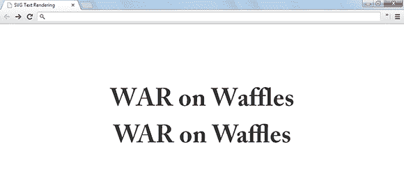

图 2-3 应用与未应用 `optimizeLegibility` 的文本（分别为上方和下方）。你可以看到 `WA` 角机会对和 `ffl` 连字已经发生了变化。

如果你对这个示例中使用的短语感到困惑，这里这里一些解释。大写字符对 `WA` 是间距不当最糟糕的违例之一，而 `waffles` 一词使用了一个漂亮的三字符连字。我不主张战争，也绝对对华夫饼没有意见！事实上恰相反。

记住，当某件事听起来好得不可真实时，它通常确实如此！不要太灰心；没那么糟，但这种方法确实带有某些牺牲。

`text-rendering` 属性基本上决定了浏览器在渲染文本时应该优先考虑什么。可以在速度（`optimizeSpeed`）、几何精度（`geometricPrecision`）以及当然的可读性（`optimizeLegibility`）方面进行优化。因此，当你使用 `optimizeLegibility` 值时，你实际上是选择了文本的美学质量而非速度和性能。

不要让这个选择让你望而却步；只需在你想进行这种权衡时留心即可。例如，如果你的网页巨大且性能至关重要，那么直接将该属性应用于 `body` 元素可能不是最好的主意。相反，要有选择地使用。关于 `text-rendering` 属性的最后一个要解决的问题：记得我提到过浏览器支持略有改进吗？Firefox 的实现方式与它的 Webkit 竞争对手略有不同。

## 使用比例值维持可读性

随着讨论转向比例值（aspect values），可读性仍然是这里的主要目标。那么什么是比例值？简单来说，它是字体的 x 高（x-height）相对于完整字体的大小；也就是说，如果一个字体的 x 高正好等于完整字体的大小，那么比例值就是 0.5。

因此，所需的计算是简单的：x 高除以完整字体大小等于比例值。Figure 2-4 提供了进一步的视觉化解释。

字体的 x 高是其小写字母 `x` 字符的高度。简单！

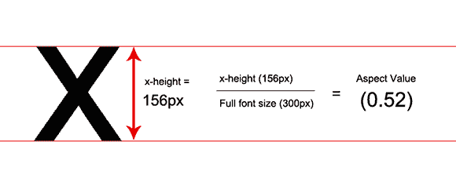

图 2-4 示例中 Arial 的 x 高为 156px，除以 300px 的总字体大小得到比例值为 0.52。

你可能已经在思考当前的问题：如何获取字体的 x 高来执行这个简单的计算，而无需尝试手动测量？

幸运的是，CSS3 字体规范（[`www.w3.org/TR/css3-fonts`](http://www.w3.org/TR/css3-字体)）概述了一种巧妙且简单的方法来寻找字体的比例值，而无需你计算 x 高。基于此，是时候介绍真正使用字体比例值的属性了：`font-size-adjust` 属性。我很快就会解释如何以及为什么使用该值，但首先请考虑规范列出的以下代码示例：

### HTML

```html
<p>
    <span>x</span>
    <span class="adjust">x</span>
</p>
```

### CSS

```css
p {
```

```css
body {
    font: 300px Arial;
}

span {
    border: 1px solid red;
}

.adjust {
    font-size-adjust: 0.5;
}
```

上述代码会渲染两个并排排列的 `span` 元素，它们带有红色边框，允许你观察调整后的 `span` 是比另一个 `span` 元素更大还是更小。图 2-5 显示，当 `font-size-adjust` 的值为 0.5 时，第二个 `span` 元素比另一个略小，这表明你正在寻找的宽高值（aspect value）必须略高于 0.5。

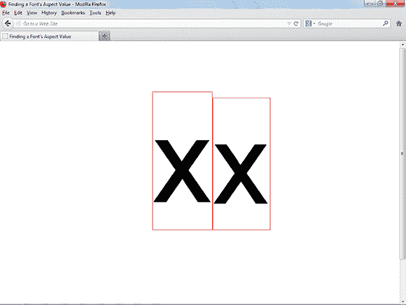

图 2-5 当 `font-size-adjust` 值为 0.5 时，两个 `span` 元素未对齐。

将 `font-size-adjust` 的值稍微修改为 0.52 后，两个 `span` 元素完美对齐。当你找到一个让两个 `span` 元素对齐的值后，你就找到了你字体的宽高值！

如你所见，这种技术涉及一些尝试错误，但它证明是识别字体宽高值的一种相对快速且简单的方法。或者，如果你使用的字体是广知的，其宽高比（aspect-ratio）信息可能已经可用；在这里，Google 是你的朋友。

好了，现在你知道如何获取宽高值了。你甚至知道哪一个 CSS 属性使用了该宽高值，但它对该值究竟做了什么呢？

正如本节开头提到的，目标是提高可读性。考虑一个由 `Verdana` 和以 `Times` 作为备用方案的字体栈，`font-size` 为 `200px`。与 `Verdana` 相比，`Times` 的宽高比较小，导致它看起来更小，因此可读性也较低，即使 `font-size` 值没有变化。

你通常不会在字体栈中使用这种组合，因为 `Times` 是衬线字体而 `Verdana` 是无衬线字体，但这个例子在这一方面受益于这种对比。

显然，如果需要 `Times` 作为备用字体，那么可读性就是一个问题，因为对于 `Verdana` 足够的 `font-size` 并不适用于 `Times`。

此时，你可以调用 `font-size-adjust` 属性和宽高值。`Verdana` 的宽高值为 `0.55`，因此你只需要将此值应用到字体上，允许所有备用字体调整到这个宽高值，如下例所示：

```css
p {
    font: 200px Verdana, Times;
    font-size-adjust: 0.55;
}
```

如所述，这种技术确保了当浏览器强制使用备用字体时，你的文本将保持其可读性，如图 2-6 所示。

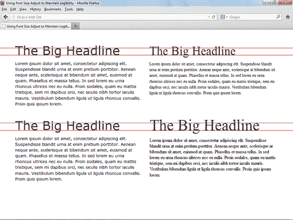

图 2-6 在应用 `font-size-adjust` 属性前后，Verdana（左）和 Times（右）字号完全相同（分别为上方和下方）

目前唯一支持 `font-size-adjust` 属性的浏览器是 `Firefox`，但它是一个非常有用的工具，如果 CSS 想要成为 Web 字体样式设计的真正全面的解决方案，它就是至关重要的，因此我预计其他浏览器很快就会采用这一属性。

## 使用更多新特性进行更多控制

Level 3 字体规范相当详尽且多样，因此如果我以与前面的章节相同的详细程度来涵盖整个内容，这一章将占据书的大部分，并且毫无疑问会在你读到结尾之前就让你无聊得睡着。

谢天，我认为规范中的几个出众特性值得投入更多的关注，我觉得它们可以很好地融入你的日常工具箱，而其他属性则满足了较为晦涩的需求。我在本节涵盖了这三个最实用的属性。

### 字体伸缩（Font Stretch）

`font-stretch` 属性有九种可能的值，尽管其名称可能暗示的那样，但没有任何值会对你的文本进行任何不利的压缩或拉伸。可能的值为：

- `ultra-condensed`（极紧凑）
- `extra-condensed`（额外紧凑）
- `condensed`（紧凑）
- `semi-condensed`（半紧凑）
- `normal`（正常）
- `semi-expanded`（半扩展）
- `expanded`（加宽）
- `extra-expanded`（额外扩展）
- `ultra-expanded`（极扩展）

如果字体包含不同宽度的字形（如上述列表所示），你可以选择使用 `font-stretch` 属性利用其中一种备选宽度形态。重申一下，如果指定的形态宽度不存在，该属性不会人为压缩或拉伸字体。例如，如果一个字体只包含三种宽度（`condensed`、`normal` 和 `expanded` 形态），而你尝试选择 `extra-condensed`，浏览器将仅应用最的现有形态。

### 合成字体（Synthetic Font）

`font-synthesis` 属性允许在字体不包含粗体或斜体时，指定浏览器是否应该合成粗体或斜体形态。可能的值为：

- `none`（无）
- `weight`（粗细）
- `style`（样式）

当字体不包含粗体或斜体时，你可以通过应用 `font-synthesis` 来强制产生效果。CSS3 当然已经为你开启了这扇大门。

### 数字

你用过名为 `Georgia` 的字体吗？如果你用过，我想你可能已经注意到数字相对于基线会有波动（见图 2-7）。


图 2-7 Georgia 的某些数字位于基线上，另一些则延伸到下方。

这种格式的数字被称为旧式（old-style），而那些对齐在基线上的数字被称为标准数字（lining numerals）。

然而，改变位置并不是 `font-variant-numeric` 属性唯一的功能；它还利用了在字体包含此类数据时可以影响数字在表格格式渲染的数据。你可以使用的值有 `proportional-nums` 和 `tabular-nums`，如图 2-8 所示了这些样式的效果。


图 2-8 表格格式下的数据，分别使用了 `proportional-nums`（上方）和 `tabular-nums`（下方），以及 `lining-nums`（左侧）和 `old-style-nums`（右侧）。

等一下——还有更多！`font-variant-numeric` 属性还可以决定文本中任何数字分数的显示。在这里工作的值是 `stacked-fractions`（堆叠分数）和 `diagonal-fractions`（倾斜分数），它们的效果在图 2-9 中得到了说明。


图 2-9 使用堆叠分数（左侧）和倾斜分数（右侧）的数据。

这些属性确实为你的工具箱增添了多样性，但再次强调，目前主流浏览器对其支持尚不存在。如果你打算在下一个项目中对这些特性大展身手，那么你必须先按兵不动，密切关注浏览器的支持情况。

## 连字符（Hyphenation）

网页上缺乏连字符功能从未真正成为过大问题，尤其是与印刷媒体相比，后者的空间极其宝贵，但连字符可以作为 CSS 需要适应的一种有用工具，以确保全方位的排版控制。

正如我之前提到的，在空间有限的情况下，连字符会特别有用，例如在狭窄的文本区域或小屏幕设备上。它还可以帮助消除文本块中丑陋的参齐边缘（rags），如图 2-10 所示。


图 2-10 一个没有使用连字符的文本块形成的参齐边缘（左）以及一个使用连字符消除参齐边缘的文本块（右）

你可以通过在 HTML 中硬编码软连字符（`&shy;`）来实现连字符功能，以显式地标记可能的连字符断点，但这显然是一个极其繁琐的过程，任何理智的程序员都不会使用。

显然需要另一种替代方法，因此 CSS3 引入了命名恰当的 `hyphens` 属性，它接受以下值：

- `manual` 表示仅在 HTML 中手动添加了软连字符的地方才应用连字符。
- `auto` 利用依赖于语言的连字符资源来确定可以在单词的何处插入连字符。
- `none` 禁用所有连字符。

除了这些规则，不要忘记在 `html` 元素上设置 `lang` 属性，以便你的文档知道它正在处理什么种语言，从而应用相应的连字符规则。一个基础示例是 `lang="en"`。

幸运的是，`hyphens` 属性在 Firefox、Safari 和 Internet Explorer 10 中受支持！请记住，目前你需要使用相应的浏览器厂商前缀（分别为 `-moz-`、`-webkit-` 和 `-ms-`）来确保在这些浏览器中的支持。

如果你对排版不感兴趣，你可能觉得到目前这一章读起来很费劲，但你不能低估它的重要性。网站完全基于其内容，而良好的排版是确保这些内容良好传达的重要部分。作为 Web 设计师，你非常幸运，因为 CSS 已经实现了许多控制网站中字体类型各个方面的新方法。

但人人都知道自 CSS3 出现以来，围绕它的大部分兴奋点都源于它引入的新演示特性，而在涉及文本时，这一点并无不同。

通过到目前为止的所有讨论，你可以满足你体内的完美主义者，但现在是时候发挥创意了。

## 书写模式（Writing Modes）

引起我注意的有趣模块之一是书写模式（Writing Modes）规范。先建立你的期望再让你失望是没有意义的，所以要确立的第一点是浏览器的支持情况——或者说缺乏支持！该规范中的新功能（`writing-mode` 和 `text-orientation` 属性）目前不与任何主流浏览器兼容，但它们有足够的潜力被包含在这里。

该规范的真实目的是为了照顾所有类型的国际书写模式，例如从右到左和垂直书写，除了西方语言所使用的标准从左到右/从上到下系统外。如果你认为自己短期内不会创建任何阿拉伯网站并因此计划跳过这一节——别急着这样！看一看图 2-11 中可以实现的效果，你创意引擎中的齿轮可能就会开始转了。拉丁脚本模式对这些选项可能没有基于语言的限制，但我确定你能想到其他垂直书写模式可能具有巨大价值的用例！


图 2-11 使用 `writing-mode` 和 `text-orientation` 属性可以实现的示例

### 方向属性（The Direction Property）

构成书写模式有三个核心部分，其中第一个是方向（direction）属性。该属性简单地说明文本是从左到右还是从右到左流动，接受 `ltr` 或 `rtl` 值来达到所需的方向。

### 书写模式属性（The Writing Mode Property）

`writing-mode` 属性让事情开始变得有趣起来，它决定了块级容器中的块流进度；例如，它指定了文本行应该是从上到下水平流动（默认行为），还是从左到右垂直流动。该属性接受以下值：

- `horizontal-tb` 规定文本行应该从上到下水平流动。
- `vertical-rl` 表示文本行垂直流动（像列一样），从右侧开始。该规则的默认行为还包括字符顺时针旋转 90 度。
- `vertical-lr` 表示文本行再次垂直流动，但从左侧开始。字符默认也会旋转 90 度。

### 文字方向属性（The Text Orientation Property）


书写模式拼图的最后一块是 `text-orientation` 属性。正如我刚才提到的，垂直 `writing-mode` 将所有字形旋转 90 度；然而，`text-orientation` 属性提供了对这方面的控制，并接受以下值：

- `upright` 显然是初始值，标准的字形方向。
- `sideways-right` 将字符顺时针旋转 90 度，这是垂直模式的默认行为。
- `sideways-left` 允许你向逆时针方向旋转字符 90 度。

### SVG 来救援！

再次，SVG 可以被用来救场——某种程度上。SVG 有它自己的 `writing-mode` 属性，具有不同的值范围，允许实现与 `writing-mode` 和 `direction` 属性相同的结果。它确实缺少任何形式的 `text-orientation` 功能。你可以在 Mozilla 开发者网络网站（`developer.mozilla.org/en-US/docs/CSS/writing-mode`）了解更多关于这些值及其工作原理，那里讨论了 SVG 和 CSS 版本的 `writing-mode` 属性。

SVG 版本提供的希望在于浏览器支持。然而，它仅在一个主流浏览器中受支持，令人置信，是 Internet Explorer！不仅如此，IE 从 5.5 版本就开始以某种程度上支持该属性了！花点时间把下巴收一收。

在结束对书写模式的讨论时，我建议查看 SVG 属性并在 IE 中进行尝试，以确保你理解这一概念以及使用书写模式可以实现的内容。继续关注 CSS 模块的浏览器支持，这样当浏览器开始支持它时，你已经准备好直接上手了。

## 外漂亮成功了一半

正如提到的，CSS3 最受关注的领域是那些创建丰富视觉效果的领域，这减少了对图形编辑器的需求，因为你只需要几行基础 CSS 就能在浏览器中实现相同的结果。

### 装饰（Text Decoration）

首先，`text-decoration` 属性自 CSS 诞生以来就存在，在 Level 3 文本装饰规范中又增加了几项新功能。

很有可能在某个时刻，你曾使用 `border-bottom` 属性作为装饰文本的手段，因为它是应用 `dotted` 或 `dashed` 下划线最简单的方法。多年来，这种方法并没有造成任何伤害，但如果你仔细考虑，它有点像是一个权宜之计（hack）。当你拥有一个专门用于装饰文本的属性时，那才真正应该是完成任务的工具，而不是 `border` 属性。

你猜得没错——`text-decoration` 属性现在包含了一些新的兄弟属性，允许你指定下划线（或视情况而定的上线）的位置以及它的颜色和样式。新属性有：

- `text-decoration-line`——可能的值有 `none`、`underline`、`overline` 和 `line-through`。
- `text-decoration-color`——该属性的初始值将与你的文本颜色匹配，但最终可以是任何颜色值。
- `text-decoration-style`——可能的值有 `solid`、`double`、`dotted`、`dashed` 和 `wavy`。

这三个属性可以组合成简写属性 `text-decoration`。与 `border` 属性不同，此属性并不让你指定线条的宽度，因为宽度是相对于它所装饰的文本的大小计算的。你可能已经在样式选项中发现了一个不熟悉的值，即 `wavy` 值。这对于 CSS 来说可能是新的，但如果你曾经在 Microsoft Word 中拼错过单词（谁又没拼错过呢？），你以前就见过这种下划线了。

`text-decoration-line` 属性可以同时接受 `underline` 和 `overline` 值，就像对文本应用 `border-bottom` 和 `border-top` 一样。然而，当你一起使用这些属性时应该非常小心，因为如果文本有换行到多行的可能，你可能会遇到重叠问题（参见图 2-12）。

这些属性的支持程度仍然非常有限，Firefox 是唯一提供任何兼容性的浏览器，尽管仅通过支持带有 `-moz-` 前缀的三个独立属性来实现，而不允许简写属性 `text-decoration`。

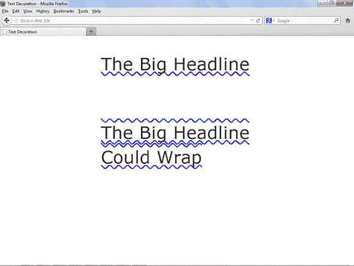

图 2-12 使用新的 `wavy text-decoration` 值的下划线文本（顶部）。当同时应用下划线和上线时，可能会导致文本换行问题（底部）。

## 在文本上遮罩背景图像

现在这个非常酷。`background-clip` 属性是 CSS3 背景与边框模块的一部分，将在下一章中对其进行更深入的讨论，但你也可以用它来极大地增强你的文本。

我在这里处理的 `background-clip` 具体值目前实际上并不是 W3C 规范的一部分，而是由 Webkit 团队引入的。他们在 Chrome 和 Safari 浏览器中实现了支持，这正是许多新的实验性功能的起步方式。我在此例中描述的功能是 `background-clip` 的 `text` 值，它实际上允许你将图像遮罩在某些文本上，如图 2-13 所示（或在配套网站 [`www.wiley.com/go/ptl/css3`](http://www.wiley.com/go/ptl/css3) 上的文件 `0201-background-clip-text.html`）。

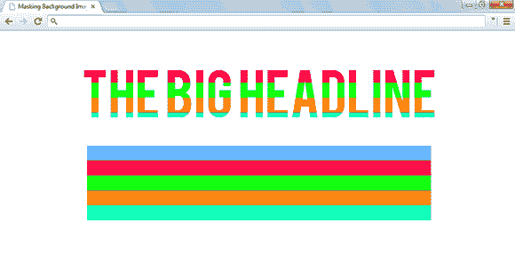

图 2-13 图像（底部）已遮罩在某些文本（顶部）上。

那么这种效果是如何实现的呢？首先，你需要应用背景图像：

#### HTML

```html
<h1>The Big Headline</h1>
```

#### CSS

```css
h1 {
    font: 300px Bebas;
    background: url(bg.jpg);
}
```

接下来，你需要让这个背景图像呈现文本的形状而不是容器的形状。这就是 `background-clip` 属性发挥作用的地方：

```css
h1 {
    font: 300px Bebas;
    background: url(bg.jpg);
    -webkit-background-clip: text;
}
```

现在背景图像已经呈现了文本的形状，但它在背景中；也就是说，它在当前不透明的黑色文本之后。因此目前没有变化，但修复方法非常简单：

```css
h1 {
    font: 300px Bebas;
    background: url(bg.jpg);
    -webkit-background-clip: text;
    color: transparent;
}
```

现在文本颜色是透明的。然而，对于不支持 `background-clip` 的浏览器，文本将是透明的且背景图像将不可见。为了修复这个问题，Webkit 以 `-webkit-text-fill-color` 属性的形式提供了解决方案。

```css
h1 {
    font: 300px Bebas;
    background: url(bg.jpg);
    -webkit-background-clip: text;
    -webkit-text-fill-color: transparent;
}
```

文本阴影（Text shadows）曾被用于形成 3D 文字，但在最终输出中它们并没有被真正当作阴影利用，讽刺的是，这导致了对象缺乏真实感和深度。因此，你需要为文本添加更多的阴影，作为由 3D 对象投出的真实阴影：

```css
h1 {
    text-shadow: 0 1px 0 #ccc,
                 0 2px 0 #c5c5c5,
                 0 3px 0 #bbb,
                 0 4px 0 #b5b5b5,
                 0 5px 0 #aaa,
                 0 6px 0 #a5a5a5,
                 0 7px 3px rgba(0, 0, 0, 0.3),
                 0 10px 10px rgba(0, 0, 0, 0.2),
                 0 10px 20px rgba(0, 0, 0, 0.15),
                 0 20px 20px rgba(0, 0, 0, 0.1);
}
```

额外的阴影值利用了模糊半径和 `rgba()` 颜色功能，在 3D 对象周围微妙地扩散阴影，仿佛这些文本正是这些阴影的源头一样。图 2-15 显示了最终结果。

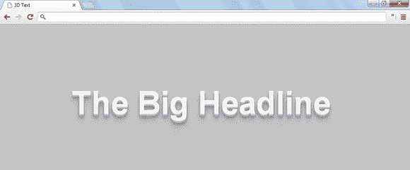

图 2-15 最终的 3D 文字输出，由 10 个文本阴影组成

## 创建外发光（Outer Glow）

与通过尖锐阴影营造 3D 环境的感觉完全处于另一面，你还可以充分利用 `text-shadow` 的模糊属性来创建一些非常酷的效果，例如外发光，如你从示例文件 `0203-outer-glow.html` 中所示。

要创建这种效果，你首先需要构建几个阴影层，这些层将在你选定的颜色在文本周围形成发光，如下代码所示：

```css
h1 {
    text-shadow: 0 0 30px rgba(33, 207, 255, 1),
                 0 0 40px rgba(33, 207, 255, 0.8),
                 0 0 60px rgba(33, 207, 255, 0.5),
                 0 0 100px rgba(33, 207, 255, 0.3);
}
```

这段代码段为你的外发光奠定了基础，但文本非常突兀地位于模糊之上，并没有真正融入其中，导致了实际发光的明显缺失（参见图 2-16）。

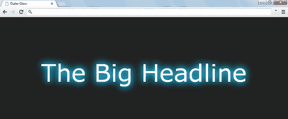

图 2-16 外发光目前缺乏实际的光泽。

为了解决这种情况，你只需要添加一些半径小得更强白色层，为真实文本提供额外的光泽，产生如图 2-17 所示的最终结果。

```css
h1 {
    text-shadow: 0 0 10px #fff,
                 0 0 20px rgba(255, 255, 255, 0.3),
                 0 0 30px rgba(33, 207, 255, 1),
                 0 0 40px rgba(33, 207, 255, 0.8),
                 0 0 60px rgba(33, 207, 255, 0.5),
                 0 0 100px rgba(33, 207, 255, 0.3);
    color: rgba(255, 255, 255, 0.8);
}
```

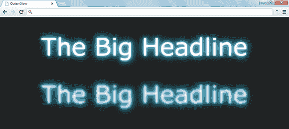

图 2-17 最终的外发光效果（顶部）。你也可以让文本颜色变为透明以创建模糊效果（底部）。

在其他值之前又增加了两个 `text-shadow` 值，但它们是比其他颜色更强的白色，增加了发光因子。我还降低了文本颜色的透明度 20%，以削弱文本的边缘并使其能更好地融合。如果你将文本颜色完全透明，你可以创建一个非常有趣的“模糊文本”效果：

```css
color: transparent;
```

当你理解了这种远非复杂的语法后，就可以对 `text-shadow` 进行创作了，正如示例中展示的。

## 总结

总结来说，CSS3 模块包含许多新类型，其中一些提供了精细的控制，如内边距（kerning），而另一些在阴影和图像遮罩方面开启了可能性。

我在本章中讨论的很多目前浏览器支持有限，在某些情况下甚至不存在。但不要担心！这意味着你正处于技术前沿，当浏览器支持普及时，你将领先。

实验是学习的最佳方法之一，因此请寻找任何浏览器支持的功能并尽管尝试！在大多数情况下，只要功能不受影响，你就可以使用这些技术。

## 延伸阅读

- 字体 字体层 3 标准：[`www.w3.org/TR/css3-fonts/`](http://www.w3.org/TR/css3-fonts/)
- 跨浏览器内边距与连字：[`aestheticallyloyal.com/public/optimize-legibility/`](http://aestheticallyloyal.com/public/optimize-legibility/)
- 常见字体宽高比例表：[`webdesign.about.com/od/fonts/a/font-aspect-ratio-table.htm`](http://webdesign.about.com/od/fonts/a/font-aspect-ratio-table.htm)
- 文本层 3 标准：[`www.w3.org/TR/css3-text/`](http://www.w3.org/TR/css3-text/)
- 写入模式层 3 标准：[`www.w3.org/TR/css3-writing-modes/`](http://www.w3.org/TR/css3-writing-modes/)
- 文本装饰层 3 标准：[`www.w3.org/TR/2012/WD-css-text-decor-3-20121113/`](http://www.w3.org/TR/2012/WD-css-text-decor-3-20121113/)

# 第 3 章：背景与边框的新工具

多亏了 CSS3，你现在可以在控制背景方面利用更先进的光谱。此外，在很大情况下，得益于圆角、投影和渐变等新功能，背景图像现在已经变得多余了。

- `border-box` 是默认值，它导致背景覆盖元素的所有边框、内边距（`padding`）和内容区域。但请记住，背景始终渲染在边框层之下，因此如果使用标准的不透明边框，你的背景不会可见地流到元素的边框部分。
- `padding-box` 强制背景仅覆盖元素的内边距和内容区域，因此它不会流到边框区域。
- `content-box` 确保背景仅覆盖内容区域，这意味着内边距区域将是透明的。

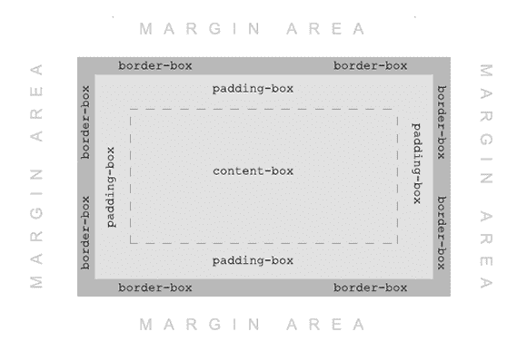

图 3-1 对于每种 `background-clip` 属性背景将覆盖的区域

这种背景控制的一个频繁用例是为出现在页面其他内容之上的元素实现半透明边框，例如模态框（modal box）或灯箱类型的功能（参见配套网站 [`www.wiley.com/go/ptl/css3`](http://www.wiley.com/go/ptl/css3) 上的演示文件 `0301-background-clip-padding-box.html`）。图 3-2 显示了实际效果，以下代码片段演示了如何实现它：

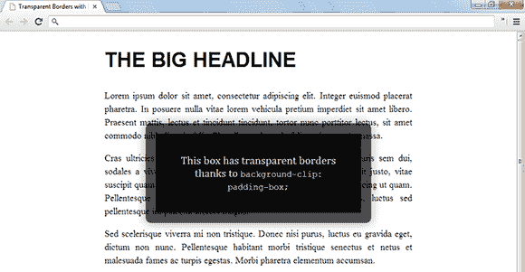

图 3-2 边框是半透明的，允许模态框后面的内容部分可见，并为设计增添了真实感。

### HTML

```html
<div>
    <p>这是一个带有半透明边框的模态框</p>
</div>
```

### CSS

```css
div {
    background: rgba(0, 0, 0, 0.95);
    color: #ccc;
    border: 20px solid rgba(0, 0, 0, 0.7);
    background-clip: padding-box;
}
```

`padding-box` 规则在这里至关重要，因为它将元素的背景区域裁剪到仅剩内边距区域。如果没有它，`div` 的黑色背景将扩展到边框后面，这意味着边框的透明度将只会让背景色透出来，而不是元素后面的内容。

这里另一个需要解决的问题是背景图像的使用。如果你正在使用背景图像，并希望在图像内部应用半透明边框，使用之前描述的逻辑，你只需要使用值为 `border-box` 的 `background-clip` 属性。但等一下！如果你一直在关注，你会记得 `border-box` 本身就是 `background-clip` 的默认值，所以对于这个用例，甚至不需要指定它。那么问题出在哪里呢？请查看图 3-3 以获取答案（你也可以在 `0302-background-origin.html` 中查看演示文件）。

这种行为看起来可能奇怪且出乎意料，但其背后有一定的逻辑。考虑以下问题：当你使用 `background-position` 属性时，当值为 `top left`（或 `0 0`）时，你的背景图像位于哪里？它位于内边距区域的左上，而不是边框区域，这就是为什么图 3-3 中的背景图像从该点开始。

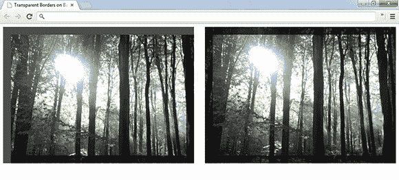

图 3-3 左侧示例显示背景图像流入了右侧和底部边框，但没有进入顶部或左侧边框。右侧示例显示了预期的效果。

这就是 `background-origin` 属性发挥作用的地方。意料之中，该属性允许你指定背景图像从哪个位置开始——即从 `background-position` 的角度来看，`top left` 确切在哪里。

`background-origin` 属性的值与 `background-clip` 完全相同，正如你已经发现的，它的初始值是 `padding-box`。但为了解决图 3-3 中的情况，你需要使用 `border-box` 值，以便背景图像的起始点位于边框区域的左上角，而不是内边距区域。因此代码如下：


```css
.box {
    background: url(trees.jpg) no-repeat;
    border: 20px solid rgba(0, 0, 0, 0.7);
    background-origin: border-box;
}
```

`background-clip` 和 `background-origin` 都有全浏览器支持。

### Background Size

`background-size` 属性允许你按任何想要缩放背景图像。你指定的长度不仅限于像素值，可以使用百分比或 em。

`contain` 关键字确保背景图像适应容器内部而不被裁剪。`cover` 关键字确保背景填充整个元素，可能会裁剪图像的一部分。

`background-size` 属性接受 `auto` 或 `100%`，取决于容器的尺寸。图 3-4 显示了 `cover` 关键字的实际效果（`0303-background-size.html`）。

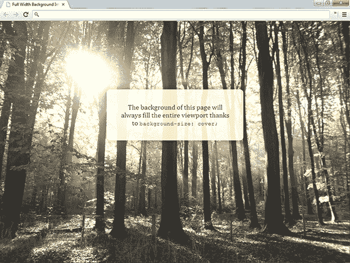

图 3-4 得益于 `cover` 值，背景将始终填充视口。

代码非常简单，如下所示：

```css
body {
    background: url(trees.jpg);
    background-size: cover;
}
```

### Understanding the Background Shorth

在继续之前，可能讨论一下 `background` 属性的简写语法是明智的，考虑到它组合的属性数量，这变得非常杂乱复杂。当你查看以下代码时，就能理解我的了：

```css
background-image: url(image.jpg);
background-position: 0 -100px;
background-size: cover;
background-repeat: no-repeat;
background-attachment: fixed;
background-origin: border-box;
background-clip: padding-box;
background-color: #333;
```

仅仅为了样式化背景就有这么多属性——太多了。幸运的是，你可以使用以下语法将它们合并到简写属性中：

```css
/*
bg-image bg-position / bg-size bg-repeat bg-attachment bg-origin bg-clip
*/
background: url(image.jpg) 0 -100px / contain no-repeat fixed border-box padding-box #333;
```

这种语法相对基础，大部分是空格分隔的值，但那个斜杠需要一些解释，还有两个需要注意的更要点：

- 斜杠分隔了 `background-position` 和 `background-size` 的值。
- 只有当背景位置和背景大小都存在时，你才能在简写中包含后者，而背景位置可以单独包含。

关于 `background-origin` 和 `background-clip` 的两个框值，如果只指定了一个值，则它将同时应用于这两个属性。如果两个都声明了（如前面的代码段所示），则第一个值用于 `background-origin`，第二个值用于 `background-clip`。

- 其余值在排序上非常灵活，且如果不需要，也可以被省略。

## 处理框断开（Handling Box Breaks）

在这种实例中，框断开（box break）指的是元素换行到新行或新列（例如）。理解这个概念最简单的方法是想象一个具有自身背景和内边距样式的内联元素——例如，一个 `span` 元素。在换行处，这个 `span` 元素被断开成两行，这导致框及其样式在字面上被分成了两部分，但从样式角度来看，这两个碎片仍然表现得像一个连续的框。

此时，`box-decoration-break` 属性可以提供更多的控制。它的初始值为 `slice`（切片），产生之前描述的效果，即元素的样式被切成了两半。

它还接受另一个值：`clone`（克隆）。该值将断开元素的每个碎片视为独立的实体，为每个部分单独应用完整的样式，如图 3-5 所示以及 `0304-box-decoration-break.html` 中的演示所示。

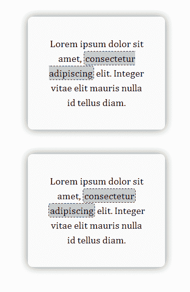

图 3-5 应用于内联元素的默认 `slice` 值（顶部）和 `clone` 值（底部）

有时你可能会发现该属性对内联元素很有用（如前面的示例所示），但更可能的用例是涉及新的 CSS3 多列布局特性（参见第 11 章），这会带来大规模的列断开而非简单的换行，从而呈现出一个大得多的问题。浏览器对 `box-decoration-break` 的支持目前非常有限，只有 Chrome 和 Opera 提供了支持，并使用了 `-webkit-` 前缀。

## 展望未来：image 函数

`image()` 函数是一个非常面向未来的函数，目前还没有浏览器支持，但它展示了当浏览器厂商实现越来越多的 CSS3 模块时，你可以期待的各种功能。

在调用背景图像时，可以使用 `image()` 符号作为 `url()` 函数的替代方案；它比其广泛使用的同品具有多得的功能。这种额外功能的第一个示例是指定使用图像的某些部分，其输出结果与处理雪图图像时通常通过 `background-position` 属性实现的效果类似。

然而，使用 `background-position` 配合雪图允许你移动背景图像，使其只有部分内容在元素的参数范围内可见，而 `image()` 函数采用了一种不受这些缺点影响的方法。它只需指定它想要使用的图像部分就足够了，无论应用的元素尺寸如何。那么，它是如何做到的？

```css
background-image: image('sprite.png'#xywh=0,80,40,40);
```

对图像位置的调用使用媒体片段标识符（media fragment identifier）将图像裁剪到特定部分，并将该部分作为图像本身。如前面的代码行所示，裁剪部分使用四个像素值指定，其运行方式如下：

- `x` 值决定了裁剪图像从左边缘开始开始的距离。
- `y` 值指定了裁剪图像从顶部边缘开始开始的距离。
- `w` 值声明了裁剪图像的宽度。
- 最后，`h` 值规定了裁剪图像的高度。

因此，在上一行代码中，裁剪后的图像将是 40x40 像素，并从左边缘和顶部向下 80px 处开始。结果如图 3-6 所示。


图 3-6 从图像其他部分裁剪出并作为独立图像使用的区域

`image()` 函数的另一个巨大潜力的功能是，如果由于某种原因无法加载首选图像，可以指定备用图像。语法极其简单；图像只需按照应调用的顺序用逗号隔开，如下所示代码行所示：

```css
background-image: image(primary.svg, secondary.png, tertiary.jpg);
```

`image()` 函数相对于 `url()` 的进一步优势是还可以提供备用背景颜色。例如，考虑以下代码：

```css
div {
    background: url(semi-transparent-black.png) #000;
    color: #fff;
}
```

假设使用的背景图像是黑色背景，但透明度为 75%。`background-color` 应该只在图像加载失败时作为备用，它是纯色的。这正是 `image()` 函数的工作方式：

```css
background-image: image(semi-transparent-black.png, #000);
```

在层叠背景图时，需要注意的一个重要点是其顺序的工作方式。如果你和我有类似的思维，你可能期望第一个背景图被应用为最底层，而任何额外的图像调用都会添加在这一原始图像之上。然而，如前面的代码示例所示，事实恰恰相反。第一个指定的背景图实际上是顶层，而最后一个是底层。

## 多个背景的动画

这种多背景动画技术允许你制作出真正推向目前仅用 CSS 能力极限的效果。在这里，我将从最终结果的角度讨论这项技术的动画方面；然而，当我在第 6 章再次拿起这个示例时，我将非常详细介绍动画的技术细节，该章节专门关注 CSS3 过渡属性。

图 3-8 尝试演示动画的效果，但印刷页面显然不是展示动态元素的最佳媒介，因此请前往配套网站查看演示文件 `0306-animating-multiple-backgrounds.html`，以领略该技术的真实风采。


图 3-8 动画的过程，从起始位置（左侧）到结束状态（右侧）

很酷，你觉得呢？实现这种效果需要三个背景图：主图、左侧覆盖层和右侧覆盖层，它们在如下代码中被标记：

HTML

```html
<<div>
    <p>Trees</p>
</div>
```

CSS

```css
div {
    width: 295px;
    height: 295px;
    border-radius: 50%;
    background: url(cover-left.jpg) no-repeat,
               url(cover-right.jpg) right no-repeat,
               url(trees.jpg) 0 0 / cover;
    transition: 1s;
}
```

如果你好奇弹出的文字是如何工作的，你必须耐心等待，我会在第 6 章中讲解！

记住，因为主 `trees.jpg` 图像需要作为底层，因此它在背景图像栈中最后声明。这确保了覆盖图显示在上方，默认隐藏了主图。

关于 `border-radius` 属性（它它设置了圆角），如果元素的 `width` 和 `height` 相等，`50%` 的 `border-radius` 值可确保元素被渲染为完美的圆形。

最后，`transition` 属性（需要所有各种厂商前缀）确保了这些初始值的任何变化都通过动画实现。所以，例如当 `div` 悬停时，其中一个初始属性值被更改，那么两个状态之间的变化是渐进的。如前所述，我在第 6 章中深入讨论了过渡属性。

```css
div:hover {
    background-position: -295px -100px, 295px 100px, 0 0;
}
```

好了，这里发生了什么？基本上，三组 `background-position` 值对在 `div` 悬停时改变了三个背景图的定位。这些值的顺序必须保持与初始 `background` 声明一致，这应该让你很明显看出 `cover-left.png` 图像已经向上并向左移动，而 `cover-right.png` 图像已经向右并向右移动。

记住，这种变化得益于 `transition` 属性是动画化的，导致两个覆盖图向相反方向滑开，揭露出它们背后的主 `trees.jpg` 图像！

这有多简单？！只需要几行基础的 CSS！这就是 CSS3 的力量。

最后，你会高兴地发现，目前各大主流浏览器版本已全方位支持多个背景！Internet Explorer 再次从第 9 版本开始支持该属性。

## 边框的新工具

CSS3 包含了两组新属性来点缀边框。`border-image` 属性允许了一些很棒的技巧来——惊喜吧——在边框中使用图像。`border-corner-shape` 属性让你的边框变为弧形、缺口、斜角或凹槽变得简单。

### 边框图像

`border-image` 属性是你可能听过很多特性之一，但你并不确定它是如何工作的。`border-corner-shape` 属性让你的边框变为弧形、缺口、斜角或凹槽变得简单。

- `border-image-source`：工作就像 `background-image`，使用 `url()` 符号来定位图像。
- `border-image-slice`：接受多四个数字或百分比值，将图像分为九部分 图 3-9。
- `border-image-width`：接受多四个数字或百分比值，指定每个边框的宽度。你也可以使用 `auto` 关键字。
- `border-image-outset`：指定边界图像允许超出元素边框进入外边线的距离。
- `border-image-repeat`：说明图像如何平铺：
  - `stretch`：不平铺图像，只需将其拉伸到足以填充边框的程度。
  - `repeat`：平铺切片直到边框区域充满。
  - `round`：平铺切片的同时确保使用整数倍切片来填充区域。如果无法使用整数倍切片填充，则会放大或缩小切片以确保填充。
  - `space`：同样在平铺切片的同时确保使用整数倍切片来填充区域。然而，与上述规则不同，如果无法使用整数倍切片填充，剩余空间将均匀分布在切片周围，因此切片不会被重新缩放。

显然，你不想在每次想用图像制作边框时都包含所有这些属性。像往常一样，有一个简写属性；你可以在这里几个示例：

```css
/* 语法 ---
source slice / width / outset repeat
*/

border-image: url(border.png) 20 10 40 30 / 15 15 20 20 / 10 5 space;
border-image: url(border.png) 10 20 / auto / 5 15;
border-image: url(border.png) 45 fill / auto round;
```

这一切在实际中是如何运作的？理解 `border-image` 最挑战性的部分可能是实际图像在投入使用之前切分的方式，但一旦你理解了这部分，掌握它就会变得容易得多。

你可以从图 3-9 中看到 `border-image-slice` 值如何将图像切成九部分，然后你可以将这些部分视为独立的图像处理。图 3-10 展示了使用以下代码片段的最终结果（`0307-border-image.html`）：

```css
div {
    border-image: url(border.jpg) 45 fill / auto repeat;
}

/* 这等于… */
div {
    border-image-source: url(border.jpg);
    border-image-slice: 45 fill;
    border-image-width: auto;
    border-image-outset: 0;
    border-image-repeat: repeat;
}
```

在我结束对 `border-image` 的讨论之前，请看图 3-11，它使用一个不同的示例来解释 `border-image-repeat` 的 `round` 和 `repeat` 值之间的区别。虽然之前的示例会显示这两个值之间没有变化，但显然，这种类型的图像很大程度上依赖于你对 `repeat` 值功能的认知。值得注意的是，`border-image-repeat` 的默认值是 `stretch`，这与初始值为 `repeat` 的 `background-repeat` 效果完全不同。所以记住不要掉进陷阱！

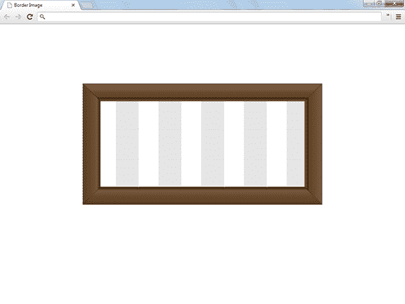

图 3-10 最终结果

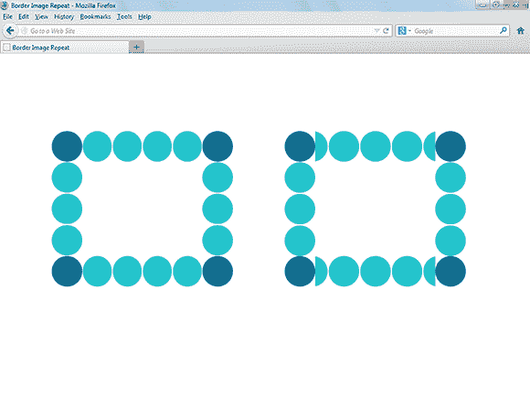

图 3-11 使用 `border-image-repeat` 的 `round` 值（左）和 `repeat` 值（右）的边框图像

主流浏览器已经支持，但支持并不完善。Firefox 最接近，它除了 `border-image-repeat` 的 `space` 值外支持了整个功能，而 Chrome、Safari 和 Opera 都不支持 `space` 和 `round` 值。Internet Explorer 完全不支持（是的——即使是 IE10 也不支持！

## 展望未来：Border Corner Shape

`border-corner-shape` 属性作为 Backgrounds and Borders Level 4 模块的一部分被引入，最近在 CSS 邮件列表中引发了激烈讨论，并传播到了整个网络。Lea Verou 作为该特性的坚实支持者，一直在带头推动。CSS 工作组仅开发被认为切需要的功能；对于 `border-corner-shape`，一些开发者质疑它是否具有合法的用例，并认为大多数此类场景已经可以通过 `border-image` 和其他类似技术来实现。

该属性有助于实现我经常看到由于缺乏适当工具而通过“黑客手段”（hacked）实现的的效果。因此，我非常支持这个特性，并认为它对进一步创作具有巨大潜力。

Lea 为该属性制作了一个非常出色的预览应用程序（[`leaverou.github.io/border-corner-shape/`](http://leaverou.github.io/border-corner-shape/)）以及一篇配套博客文章（[`lea.verou.me/2013/03/preview-border-corner-shape-before-implementations/`](http://lea.verou.me/2013/03/preview-border-corner-shape-before-implementations/)），它们都非常值得阅读。


该特性的概念和语法相对简单；它接受四个关键字，效果强度由`border-radius`值决定。这四个关键字是`curve`、`bevel`、`scoop`和`notch`，其中`curve`是显而易见的初始值，允许基础的圆角。以下代码提供了一个示例，而图 3-12 说明了每个`border-corner-shape`关键字值的效果：

```css
div {
    border-corner-shape: scoop;
    border-radius: 30px;
    width: 300px;
    height: 200px;
    background: blue;
}
```

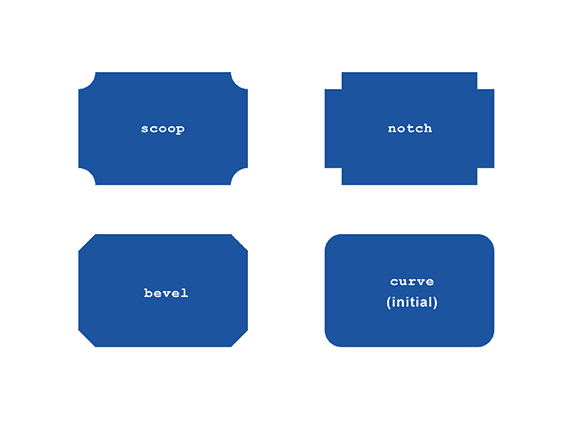

图 3-12 每个`border-corner-shape`关键字值的效果

第一个示例是最基本的，只需在默认方向（从上到下）指定一个黑到白的渐变。第二个示例通过关键字`top left`明确指定了渐变的起始点或角度，也可以用角度表示。最后一个示例展示了在引入额外的颜色和颜色停止点后情况如何变得稍微复杂。将这个示例拆解开其实很简单：第一个颜色（`#000`）一直使用到达到容器的`30%`，那里它开始合并第二种颜色（`#ccc`），后者在`50%`处开始过渡到最终颜色（`#fff`），最后在`70%`处完成合并。你可以在图 3-13 中查看结果。

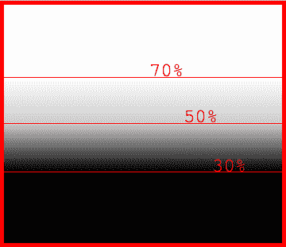

图 3-13 更复杂的第三个线性渐变示例的结果

旧语法和新语法之间的差异微乎其微，但意识到这些是很重要的，以确保你的渐变在所有浏览器中都能正常工作。以下代码展示了如何使用新语法处理之前的示例：

#### 新语法

```css
background-image: linear-gradient(black, white);
```

```css
background-image: linear-gradient("to bottom right", black, white);
```

```css
background-image: linear-gradient("0deg", #000 30%, #ccc 50%, #fff 70%);
```

你能看出区别吗？我告诉过你非常微小。现在你不再需要使用`top`、`left`、`bottom`和`right`等关键字来指定线性渐变的起点，而是必须使用`to bottom`、`to right`、`to top`和`to left`，它们允许你指定渐变的方向。

另一个值得注意的变化是角度的作用方式。在旧语法中，`0deg`的值会将渐变从左到右，而新语法则是从下到上。为了让事情变得更加复杂，旧语法移动角度值的方向似乎与新语法相反！例如，由于起始位置是从左到右，旧语法使用`90deg`的值时会从下到上，而使用相同的值，新语法将引导渐变从左到右。

## 浏览器支持

这些信息需要很多来吸收，但不要太纠结于此。在语法真正稳定下来之前，你只需要通过一些尝试来确保渐变以你想要的方式渲染。或者，你也可以尝试记忆表 3-1 中的浏览器支持信息。

表 3-1: 线性渐变浏览器兼容性

| 浏览器 | 语法 | 厂商前缀 |
| :--- | :--- | :--- |
| Chrome 4+ | 旧 | `-webkit-` |
| Chrome 26+ | 新 | 无 |
| Safari 4+ | 旧 | `-webkit-` |
| Firefox 16+ | 新 | 无 |
| Firefox 3.6+ | 旧 | `-moz-` |
| Opera 12.1+ | 新 | 无 |
| Opera 11.1+ | 旧 | `-o-` |
| IE 10 | 新 | 无 |

请记住，Chrome、Firefox 和 Opera 是向后兼容的，因此新旧语法在各自的版本中都可以工作。所以，为了确保你的渐变在表 3-1 中提到的所有浏览器中都能工作，你需要类似下面的堆栈：

```css
/* 适用于 Safari 和旧 Chrome/Firefox/Opera 的旧语法 */
background-image: -moz-linear-gradient(top, #000, #fff);
background-image: -webkit-linear-gradient(top, #000, #fff);
background-image: -o-linear-gradient(top, #000, #fff);
```

```css
/* 适用于当前 Chrome、Firefox 和 IE 的新语法 */
background-image: linear-gradient(to bottom, #000, #fff);
```

### 渐变的实际

现在你已经掌握了语法，是时候让这些代码派上用场了。回想一下多背景部分，我在那里使用了一个半透明的 PNG 来叠加`trees.jpg`背景，创建了一个更诡异的图像。嗯，现在你可以放弃 PNG 图片，利用 CSS 渐变来完成这项工作！你可以查看`038-linear-gradient.html`中的演示。这是代码此前的样子：

```css
body {
    background: url(gradient-overlay.png) bottom repeat-x fixed,
    background: url(trees.jpg) 0 0 / cover;
}
```

现在去掉`gradient-overlay.png`图像并用 CSS 渐变替换它！

```css
body {
    background: linear-gradient(to top, #000, transparent) bottom fixed,
    background: url(trees.jpg) 0 0 / cover;
}
```

就这样，你已经消除了`gradient-overlay.png`图像。

### 径向渐变

线性渐变是从一点到另点的直线运动，而径向渐变则是从中心向外扩散。

### 径向渐变语法

径向渐变的语法初看可能比线性对应物更令人生畏，但一旦你理解了所有的值，你就能轻松地控制径向渐变的方方面面。正如我刚才提到的，径向渐变语法在某些方面经历了类似的变化。旧语法通过以下示例演示：

#### 旧语法

```css
/*
radial-gradient([position], [shape] [size], [color-stops]);
*/
background-image: radial-gradient(black, white);
background-image: radial-gradient(top left, circle, white);
background-image: radial-gradient(200px 300px, #000 30%, #fff 70%);
```

再次，这种语法最简单的形式简单不过了，但随着需要更多的控制，语法的复杂性会增加。以下列表进行了拆解：

- 第一个值指定渐变的中心，遵循标准的定位规则，接受数值值以及`top left`等关键字。

- 下一个值决定渐变的形状是圆形还是椭圆形，接受`circle`或`ellipse`。

- 渐变的大小然后使用一组预定义的关键字指定，它们具有以下效果：

- `closest-side`将渐变延伸到遇到最近的边缘。注意`contain`关键字也被接受，效果完全相同。此外，如果形状指定为`ellipse`，`closest-side`关键字会将渐变延伸到最近的水平和垂直边缘，从而有效地压缩或拉伸渐变，形成椭圆形。

- `farthest-side`意，与上一个关键字的方式相同，但会将渐变延伸到距离中心最远的边缘。

- `closest-corner`将渐变延伸到遇到最近的角。

- `farthest-corner`将渐变延伸到距离渐变中心最远的角。你也可以使用`cover`关键字来实现相同的效果。

- 径向渐变的最后一个方面是颜色值，它们的作用与与线性渐变一起使用时完全相同。

你都理解了吗？这需要吸收很多信息，但如果你后退一步，你实际上只需要理解线性语法之外的几个特性。那么径向语法有何不同呢？

#### 新语法

```css
/*
radial-gradient([size] [shape] at [position], [color-stops]);
*/
background-image: radial-gradient(black, white);
background-image: radial-gradient(circle at top left, black, white);
background-image: radial-gradient(closest-side circle at 200px 300px, #000 30%, #ccc 50%, #fff 70%);
background-image: radial-gradient(30em at 200px 300px, black, white);
```

### 那么发生了什么变化？让我们再次进行一次解析：

- 位置值现在前面加了单词`at`。因此，你可以先描述渐变的大小和形状，然后说明应该放置在什么位置；例如，`farthest-corner circle at 50% 10%`。

- 用于描述渐变大小的`contain`和`cover`关键字已被弃用，因为它们仅重复了`closest-side`和`farthest-corner`分别实现的功能。

- 除了现有的关键字，渐变的大小现在可以使用实际长度值（如像素和百分比）来声明。这一新功能也使得如果使用了形状值，该值（`circle`或`ellipse`）将变得多余，因为如果你指定了一个单个大小值（例如`50em`），该值将同时应用于渐变的垂直和水平长度，从而确保形成完美的圆。如果你指定了两个大小值（例如`50em 30em`），第一个应用于渐变的宽度，第二个应用于高度，从而形成椭圆形形状。

你可以看到语法变得更加整洁且稍微易于理解了。现在，你如何在现实世界中使用径向渐变呢？

## 径向渐变的实战

我再次回到`trees.jpg`图片，我将使用径向渐变对其应用一种经典的暗角效果（角落变暗）。这实际上非常简单。

```css
body {
    background: radial-gradient(transparent, black 90%) fixed,
                url(trees.jpg);
    background-size: auto, cover;
}
```

但这太简单了，不是吗？如果你一直在查看配套网站上描述的示例，你可能注意到我在 Chrome 中使用了一些 CSS 过滤器（将在下一节中详细讨论），让图像看起来更美观。这些过滤器目前仅由 Webkit 浏览器支持，因此其他浏览器只能无可何。但真的如此吗？

渐变可以在一定程度上模仿这些效果，因此我将使用它们来进一步增强暗角效果（`0309-radial-gradient.html`）：

```css
body {
    background: radial-gradient(rgba(199, 161, 57, 0.2) 20%, black)
                fixed,
                radial-gradient(rgba(250, 250, 250, 0.3),
                             rgba(0, 0, 0, 0.3) 90%) fixed,
                url(trees.jpg);
    background-size: auto, auto, cover;
}
```

记得之前描述的`rgba()`函数吗？我提到过可以使用它来指定颜色而不是传统的十六进制代码，在渐变中这也没有什么区别。这种能力允许你创建半透明渐变，例如，你可以在图像上叠加低不透明度的颜色。你可以在图 3-14 中看到最终结果。

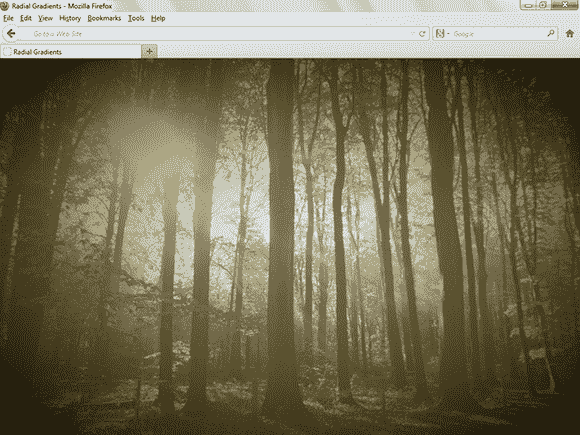

图 3-14 顶部叠加低透明度棕色黑色径向渐变增强的暗角效果

## 浏览器支持

浏览器的支持情况与线性渐变略有不同，因为大多数浏览器在支持径向语法方面稍微有些犹豫。表 3-2 显示了每个浏览器的表现。

表 3-2：径向渐变兼容性

| 浏览器 | 语法 | 厂商缀 |
| :--- | :--- | :--- |
| Chrome 10+ | 旧 | `-webkit-` |
| Chrome 26+ | 新 | 无 |
| Safari 5.1+ | 旧 | `-webkit-` |
| Firefox 16+ | 新 | 无 |
| Firefox 3.6+ | 旧 | `-moz-` |
| Opera 12.1+ | 新 | 无 |
| Opera 11.6+ | 旧 | `-o-` |
| IE 10 | 新 | 无 |

为了确保[表 3-2]中所示的所有浏览器，你的堆栈应该类似于下面的代码：

```css
/* Safari 和旧 Firefox 的语法 */
background-image: -moz-radial-gradient(top left, #000, #fff);
background-image: -webkit-radial-gradient(top left, #000, #fff);
background-image: -o-radial-gradient(top left, #000, #fff);
/* 当前 Chrome 和 IE 的语法 */
background-image: radial-gradient(circle at top left, #000, #fff);
```

## 挑战渐变的极限

这种技术是对渐变极其巧妙且创造性的使用，这一切都要归于天才 Lea Verou，他通过开创这种技术(`http://lea.verou.me/css3/`) 展现了卓越的创新。图 3-15 展示了使用 CSS 创建的一些模式。你知道吗？这可能是可能的？！


图 3-15 Lea Verou 的 CSS 画廊

这里的要素是之前讨论过的`background-size`属性。如果你想创建一个波点模式，例如，可以使用径向渐变创建一个实圆，然后使用`background-size`属性对其进行缩小，以形成重复的小圆！实现此效果的代码在此处，并在图 3-16 中进行了视觉解释（你可以查看`0310-gradient-pattern.html`中的演示）：

```css
body {
    background: radial-gradient(rgba(250, 250, 250, 0.1) 10%,
                transparent 11%);
    background-size: 80px 80px;
}
```

很酷吧？很好，变得更棒了，因为这是多个渐变发挥作用的地方。我添加了与第一个相同的圆层，但将其位置向右 40px、向下 40px，以创建一个真正的波点模式：

```css
body {
    background: radial-gradient(rgba(250, 250, 250, 0.1) 10%,
                transparent 11%),
                radial-gradient(rgba(250, 250, 250, 0.1) 10%,
                transparent 11%);
    background-color: #124a54;
    background-size: 80px 80px;
    background-position: 40px 40px, 0 0;
}
```

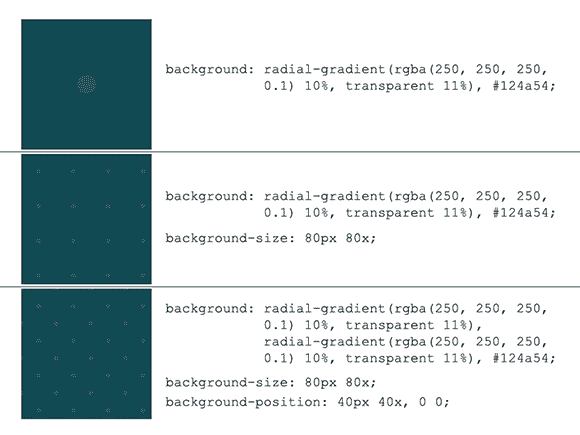

图 3-16 波点模式创建过程解释

通过渐变模式，你可以发挥想象，通过添加任意数量的额外渐变层来形成更抽象的模式并发挥创意。我的第二个示例（参见图 3-17 和`0311-gradient-pattern-advanced.html`）结合了多个线性和径向渐变，创建一个带有细微水平和垂直线的菱形模式。

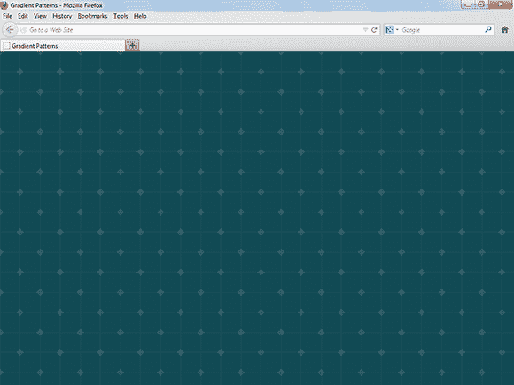

图 3-17 结合多个渐变层创建更高级的模式

首先，使用与之前示例相同的逻辑创建两个相同的菱形层并将其缩小以便重复。注意，我使用了简写方法来定位第一个渐变层，以确保相关值分组：

```css
body {
    background: radial-gradient(rgba(250, 250, 250, 0.1) 10%,
                transparent 11%) 40px 40px,
    background-color: #124a54;
    background-size: 80px 80px;
}
```

接下来，为了创建足够细且细微的线，你为两个菱形层中的每一个都需要一个水平和垂直渐变。你可以仅使用两个线性渐变来实现这种效果，通过仅在缩放后的容器的前 3% 和中间 3%（49% 到 52% 之间）填充低不透明度的白色，并使用`transparent`填充剩余部分：

```css
body {
    background: radial-gradient(rgba(250, 250, 250, 0.07), transparent)
}
```


```css
{
  `3%, transparent 49%, rgba(250, 250, 250, 0.07) 49%,
  transparent 52%),
  linear-gradient(to right, rgba(250, 250, 250, 0.07),
  transparent 3%, transparent 49%,
  rgba(250, 250, 250, 0.07) 49%, transparent 52%),
  #124a54;
  background-size: 80px 80px;
}
```

通过这种方式，你得到了两个重复的菱形层以及两组水平和垂直线，这归功于共四个渐变层！在一个所有浏览器都支持最新渐变语法的理想世界中，这种创建图案的方法将方便、易于维护，并且由于其可扩展性更加灵活。然而，考虑到目前为了让这些代码在所有浏览器中运行需要大量的厂商前缀，代码的体积将大幅增加，其在性能方面的优势反会受到巨大打击。

考虑到这一点，我建议你尽可能实现这种方法，但始终要意识到它所需要的代码量。它真的比简单的背景图片更有利吗？只要你保持适当的谨慎，就没问题。

## 总结

显然，在第 3 背景与边框（Level 3 Backgrounds and Borders）模块中引入了许多新功能，这些功能为你提供了更精细的控制水平，并显著扩展了创意空间。从多背景和背景尺寸等简单方便的功能，到边框图像和渐变等更复杂的功能，你现在有丰富的新玩具可以玩耍了！

就像你在第 2 章中遇到的新工具一样，这些背景和边框属性中的某些正渴望进入主流，并能够在能够处理它们的浏览器中显著增强你的网站；而另一些属性则需要更多的谨慎和考虑，以确保你不会在旧版浏览器中遭受性能和功能方面的负面影响。

重申一下，确保你将这些功能作为渐进式增强工具，这样就没问题。始终关注规范和浏览器支持情况有助于你保持与时同步，并确保你处于领先状态。

## 延伸阅读

- CSS Backgrounds and Borders Module Level 3 [`http://www.w3.org/TR/css3-background/`](http://www.w3.org/TR/css3-background/)
- CSS Image Values and Replaced Content Module Level 3 [`http://www.w3.org/TR/css3-images/`](http://www.w3.org/TR/css3-images/)
- Lea Verou 的 CSS3 Pattern Gallery [`http://lea.verou.me/css3patterns/`](http://lea.verou.me/css3patterns/)
- Ultimate CSS3 Gradient Generator [`http://www.colorzilla.com/gradient-editor/`](http://www.colorzilla.com/gradient-editor/)

# 第 4 章 使用 CSS3 过滤器和混合模式进入浏览器

现在，这就是你一直期待的内容了！你可能已经听过关于仅用 CSS 在浏览器中直接重现类似 Photoshop 效果的讨论。过滤器（Filters）模块像大多数 CSS3 模块一样，远非最终定稿，但它已经进展到足够程度，使得基于 WebKit 的浏览器（Chrome、Safari 和 Opera 15+）显示出足够的信心来实现支持。

另一方面，作为“合成与混合”（Compositing and Blending）规范一部分提出的混合模式（Blending modes），距离任何浏览器的实现还遥远得多。工作草案仍在深度开发中，可能会发生重大的变化。

这两个规范都根源于 SVG，最初作为矢量图形的工具，但 Mozilla 的 Robert O’Callahan 是首批意识到可以使用 CSS 将 SVG 效果应用于 HTML 元素的人之一（[`http://robert.ocallahan.org/2008/06/applying-svg-effects-to-html-content_04.html`](http://robert.ocallahan.org/2008/06/applying-svg-effects-to-html-content_04.html)）。

CSS 工作组和 SVG 工作组随后组成了名字非常酷炫的 FX 任务小组（FX Task Force），该小组专门负责开发用于 CSS 和 SVG 的过滤器和混合模式等功能。

从本章开始，你可以预期对 CSS3 过滤器以及通过使用它们可以实现的各种效果进行彻底的剖析。本章最后简要讨论了年龄更小、变化也更大的混合模式功能。

## CSS3 过滤器

当然，CSS 过滤器（CSS filters）的名称源自摄影滤镜，它们对元素应用各种效果。如果你是一个经常使用 Photoshop 等图形软件的设计师，你可能已经熟悉它们了。

### CSS 过滤器是如何工作的？

CSS 过滤器的美之处在于它们非常易于理解和使用；你不需要苦思冥任何复杂的语法或类似的内容。

它们的应用并不局限于 `img` 等某些元素。你可以为任何元素添加过滤器，该元素内部的所有内容都符合该效果，从而开启了无限可能。`filter` 属性的基本语法所示：

```css
div {
  filter: grayscale(1);
}
```

本节的其余部分将讨论每种 CSS 过滤器函数。我将用 `grayscale()` 作为第一个示例。

你一定注意到本书中的图片是黑白的，而且许多过滤器是基于颜色的，打印效果示例将是多余的，因此我没有为每个过滤器都提供图像。因此，我非常建议在阅读本章时尽可能打开配套网站（...www.wiley.com/go/ptl/css3`](http://www.wiley.com/go/ptl/css3)），因为它包含了所有过滤器函数的绝佳示例。可以从 `0401-filters.html` 开始查看所讨论过滤器的极佳说明。我知道我提到所有的演示都是针对 Chrome 优化的，但在这种情况下特别需要注意，因为过滤器目前仅支持 Chrome 和 Safari。

### grayscale

许多过滤器函数都是言而易懂的，尤其是 `grayscale()` 函数，它如其名地从元素中提取所有颜色，创建黑白输出，就像书中的图片一样！

你可以指定数值或百分比值；数值范围从 0 到 1。注意，数值越高，灰度效果应用越明显。

```css
filter: grayscale(0.56);
/* 或者 */
filter: grayscale(56%);
```

此外，与其声明 `grayscale(1)` 或 `grayscale(100%)`，你可以省略参数来应用完全效果，因此 `grayscale()` 将产生相同的结果。

### 亮度 (Brightness)

`brightness()` 过滤器也接受数值或百分比值，其中 `0%` 是纯黑色，`100%` 是正常值，任何高于此值的都会通过倍增效果来增加亮度，但无法实现纯白色。

以下代码段演示了如何使用数值和百分比值来实现图 4-1 所示的效果：

```css
filter: brightness(50%);
```

```css
/* 或者… */
filter: brightness(.5);
```

请注意，每当需要如 `0.5` 或 `0.34` 这样的小数值时，小数点前的初始 `0` 是不必要的，可以省略。不过，在我的示例中，我将继续使用百分比值，而不是每次都显示两种方法。

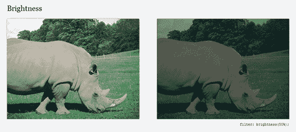

图 4-1 标准图像（左）和变暗的图像（右）

如果应用 `brightness()` 过滤器而不提供值，它将默认为 `0%`，导致元素变成纯黑色。

### Contrast

同样，`contrast()` 也适用于数值和百分比值。`0%` 的值会产生完全灰色的图像，而 `100%` 不产生任何变化，任何高于此值的都会通过倍增效果来增加元素的对比度。图 4-2 显示了低对比度值的效果，其代码如下。请记住，配套网站上还有更多示例，包括增加对比度等基于颜色的效果。

```css
filter: contrast(20%);
```

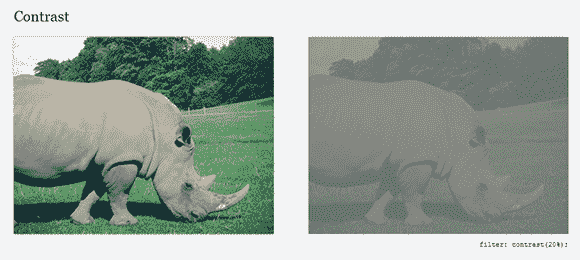

图 4-2 标准图像（左）和低对比度图像（右）

与亮度过滤器一样，`contrast()` 在不提供值时默认值为 `100%`，导致标准元素产生零变化。

### Saturate

`saturate()` 函数采用与对比度过滤器相同的比例类型，`0%` 的值使元素完全去饱和，`100%` 不产生任何变化，任何高于此值的都会不断增加图像的饱和度：

```css
filter: saturate(300%);
```

你可能已经意识到，`0%` 的 `saturate()` 值与 `100%` 的 `grayscale()` 过滤器效果完全相同，因此在这些百分比值之间，过滤器的效果是相同的，只是方向相反！

与之前的过滤器一样，如果省略参数应用 `saturate()` 过滤器，它将默认为 `100%`，不对其目标产生任何变化。

### Sepia

`sepia()` 过滤器是一个有些特殊的效果，因为所有其他过滤器都是基础、传统的图像调整控件，而这个过滤器是一个预定义效果，你可能认为只有通过组合使用其他过滤器函数才能实现它。这是一个非常方便的快捷方式，而且是一种受欢迎且广泛使用的效果。

`sepia` 过滤器的比例与 `grayscale()` 方法相似，`0%` 导致零变化，`100%` 产生完全效果，之间的任何值都指定部分应用效果的强度。然而，超出此范围的任何值都是无效的，不会产生任何效果。再次，在不指定参数的情况下使用此过滤器会导致值默认为 `100%`，在这种情况下，它将应用完全的褐色效果：

```css
filter: sepia(100%);
```

`sepia` 效果应用一种低饱和度的棕色调，因此仅在颜色上明显，这在配套网站的演示中展示了这一点。

### Hue-Rotate

`hue-rotate()` 过滤器函数的工作与其他略有不同，因为它的值的形式是角度而不是数值，并以度为单位指定的。原因是，与其他过滤器不同，你并没有声明特定效果的强度；而是简单地应用不同的色调值来改变元素的颜色。想象一个典型的色轮会有帮助，因为通过在色轮上移动直到到达指定的角度，就可以找到相应的色调值：

```css
filter: hue-rotate(180deg);
```

除了在图像调整方面的显而易见的用途外，由于其旋转性质，`hue_rotate()` 函数在与 CSS 过渡（在第 6 章中深入讨论）等动画技术结合时，可以产生非常酷的效果，因为过滤器在色轮上寻找指定角度的过程将有效地被动画化。

如果在省略参数的情况下应用 `hue_rotate()` 函数，值默认为 `0deg`，导致不发生变化。

### Invert

`invert()` 过滤器完全按照你预期的工作，反转元素的颜色。例如，在黑白图像中，反转时亮部和暗部会交换位置，如图 4-3 所示。

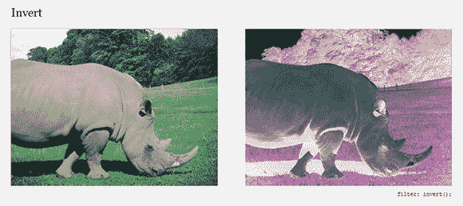

图 4-3 标准图像（左）和反转的图像（右）

然而，正如其他过滤器一样，在不指定参数的情况下使用此过滤器会导致值默认为 100%，在这种情况下，它将应用完全的反转效果：

```css
filter: invert(100%);
```

### Opacity

你可能熟悉 `opacity` 属性，`opacity()` 过滤器也具有硬件加速，它可以比其他过滤器产生变化，这如图 4-4 所示并在配套网站的演示中展示了。

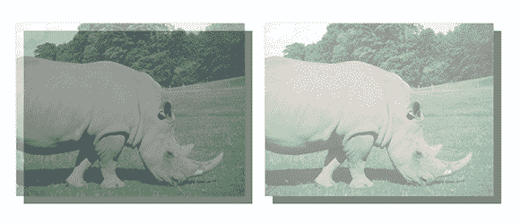

图 4-4 标准图像（左）和变暗的图像（右）

### Drop Shadow

等等——更多功能？是的，`drop-shadow()` 过滤器类似于 `box-shadow` 和 `text-shadow` 属性，但并不完全相同。你实际上可以通过 `drop-shadow()` 过滤器比使用属性实现更多效果，如图 4-5 所示并在配套网站的演示中展示了。

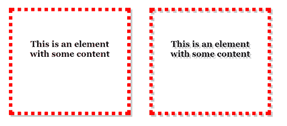

图 4-5 左侧元素使用 `box-shadow`，而右侧元素使用完全相同值的 `drop-shadow()` 过滤器。

`blur()` 过滤器允许你对元素进行模糊处理，除了明显的图像调整用例外，还开启了许多可能性。在不带值应用时，`blur()` 过滤器默认为 `0px`，这会导致目标元素没有任何变化。

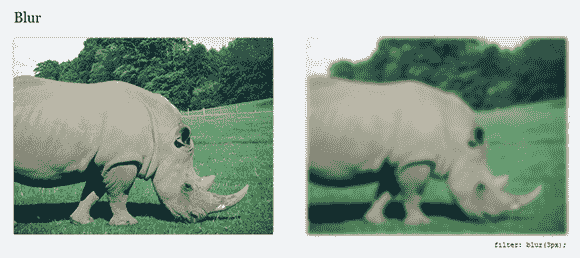

图 4-6 标准图像（左侧）和模糊图像（右侧）

## 组合过滤器

正如我在讨论 `opacity()` 函数时提到的，你可以组合各种过滤器，从而实现许多无尽的、更高级的效果列表。其语法非常简单，只需接受空格分隔的函数，如下例所示：

```css
filter: grayscale() sepia() drop-shadow(8px 8px 0 #333);
```

`grayscale()` 和 `sepia()` 过滤器在没有参数的情况下应用，确保在每情况下都应用了完整效果，并且使用了额外的 `drop-shadow()` 效果。然而，这些过滤器的顺序非常重要，因为它们会显著影响实现的结果。

前述代码段的顺序将图像转换为灰度，然后在应用深灰色阴影之前添加了色褐色效果，导致产生一张低饱和度且带有色褐色棕色调的图像。如果你以反向顺序声明这些过滤器，则会先应用阴影，然后是色褐色效果，最后在最上方应用灰度过滤器，导致产生一张完全黑白的图像。


利用组合过滤器的有效方法是使用它们来增强你的触发事件，例如悬停效果。考虑以下示例，其效果显示在图 4-7 以及演示文件`0404-combining-filters.html`中：

```css
img {
    filter: brightness(50%) opacity(60%) grayscale();
}

img:hover {
    filter: brightness() opacity() grayscale(0);
}
```

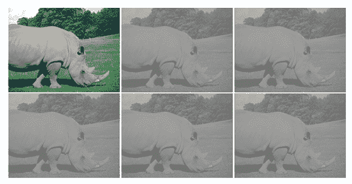

图 4-7 过滤器效果默认应用到图像上，在悬停时被移除。

你可以看到，效果默认应用到图像上，通过使其变暗、更透明并转换为灰度来稍微模糊它们。在悬停状态下，过滤器值会被反转，当用户悬停在图像上时，图像恢复到彩色和自然亮度。注意，当在没有颜色显示时，效果显然没有完全展现。

现在对过滤器给出一个最后的警告。显而易见，此功能虽然相当稳健，但仍可能变化。在`brightness()`过滤器的情况下，浏览器厂商在实现方面有时出错。对于使用大模糊半径的效果，性能也可能是一个问题，但大多数过滤器在这方面的影响微乎其微。

毫无疑问，过滤器将证明是 CSS 工具箱极佳的补充，允许直接在浏览器中进行更快速、更高效的创作。你还可以期待这些过滤器应用到元素的方式具有更大的灵活性，规范中的建议是你应该能够将过滤器应用到元素的某些区域，如背景或边框。

关于浏览器支持的最后一点：正如章节开头提到的，Chrome、Safari 和 Opera 15+ 是目前支持 CSS 过滤器的浏览器，但它们需要`-webkit-`前缀，所以现在不要忘记包含它！

## 混合模式

如果你熟悉 Photoshop，你就完全知道混合模式是什么，并且它们在图像调整工具方面的力量了如指掌。当你发现它们被包含在 W3C 混合与合成规范中时，你可能会感到兴奋！

目前，它们感觉距离任何日常主流用法还很遥远，因为该草案比其他一些元素要年轻得多，目前还没有浏览器厂商在实现这些新功能方面采取尝试。然而，可以应用的效果类型一直以来与 Photoshop 等图形编辑软件相关，因此将它们添加到 CSS 对许多人来说是一项大举，这意味着浏览器厂商可能很快就会采用这一能力——至少是因为需求导致的。

### 什么是混合模式？

如果你不是设计师，你可能不知道什么是混合模式。即使你知道，你可能也没有意识到所有各种模式及其各自的效果。

简单来说，元素的颜色（源色）以不同的方式混合到背景的颜色（背景色）中，从而产生结果颜色。图 4-8 显示了对象在使用`overlay`混合模式混合到渐变背景时外观如何。


图 4-8 由于源色和背景色的混合，渐变色透过对象变得可见。

规范包含了大量的拟议混合模式，列在此处，其效果在很大程度上基于颜色：

- `normal`
- `multiply`
- `screen`
- `overlay`
- `darken`
- `lighten`
- `color-dodge`
- `color-burn`
- `hard-light`
- `soft-light`
- `difference`
- `exclusion`
- `hue`
- `saturation`
- `color`
- `luminosity`

### 混合模式语法

你使用`blend-mode`属性将混合模式应用于元素，它接受上述列表中的所有值。语法非常简单，如下所示：

```css
blend-mode: overlay;
```

简单明了，我确定你会同意的！这个新功能不仅仅是对元素应用混合模式，还有更多功能。请记住，以下附加属性比标准的`blend-mode`属性要不稳定得多，并且可能会更改：

- `background-blend-mode`仅为背景设置混合模式。
- `box-shadow-blend-mode`为任何`box-shadow`值设置混合模式。
- `text-shadow-blend-mode`为任何`text-shadow`值设置混合模式。
- `foreground-blend-mode`将元素的内容应用于背景。

混合模式功能显然非常多样化，有望成为 CSS 一个极其有用且广泛使用的方面。正如前面提到的，由于规范仍处于早期阶段，目前浏览器支持有限，但这绝对值得关注。

## 总结

过滤器和混合模式代表了曾有缺陷的样式语言的真实进步，为 CSS 提供了一个可能改变用户感知的使用维度。

尽管我认为图形编辑软件在辅助 Web 方面一直有一席之地，但许多人认为我们对它的依赖程度已经到了无法生存的地步。随着 CSS 引入了许多与图形编辑器相关的功能，Web 再次变得依赖它，从而提高了效率。

当然，现在还是早期阶段，但请关注规范和浏览器支持情况，并尽可能地进行实验以充分利用这些功能。

## 阅读

- Filter Effects 1.0：`http://www.w3.org/TR/filter-effects/`
- Mozilla Developer Network on Filters：`https://developer.mozilla.org/en-US/docs/CSS/filter`
- Using CSS3 Filters to Enhance Your Image Transitions：`http://www.tangledindesign.com/blog/using-css3-filters-to-enhance-your-transitions/`
- HTML5 Rocks—理解 CSS 过滤器效果：`http://www.html5rocks.com/en/tutorials/filters/understanding-css/`
- CSS 过滤器效果演示场：`http://html5-demos.appspot.com/static/css/filters/index.html`
- 合成与混合 1.0：`http://www.w3.org/TR/compositing/`
- 引入 CSS 混合：`http://www.adobe.com/devnet/html5/articles/css-blending.html`

# 第二部分

## 变换、过渡与动画

- 第 5 章 介绍 CSS3 2D 变换
- 第 6 章 通过过渡让 2D 变换活起来
- 第 7 章 使用 3D 变换开启新维度
- 第 8 章 上手动画

# 第 5 章

## 介绍 CSS3 2D 变换

变换（Transforms）是 CSS3 中一个极其强大的补充，构成了你过去几年在网络上可能遇到的许多令人惊叹的 CSS 实验的基础。变换的真正潜力只有在与 CSS 过渡（在第 6 章）结合使用，或者挖掘其 3D 能力时（第 7 章）才能完全实现。

不过，首先，你需要理解它们是如何工作的，从它们最基础的形式——2D 变换开始。本章将为你深入介绍 2D 变换，这将在你利用其 3D 能力并将其与过渡结合时大有裨益。

单看 2D 变换允许你从位置、尺寸、方向和透视方面对元素从其原始预定状态进行操作。而且你只需要一行 CSS 就可以完成所有这些，而你以前可能需要依赖图像替换技术或 JavaScript 来实现此类调整。

CSS3 的这一特定领域自出现以来就受到了大量关注，并且无疑是 CSS3 规范中最时尚的特性之一。变换的力量、能力以及其易用性极大激发了前端开发者的想象力，并引发了围绕它们的兴奋感和关注。正因如此，变换模块被浏览器厂商迅速采纳，并随后在 CSS3 规范中的其他特性之前就进入了主流应用。

在本章中，我将介绍一系列变换函数，这些函数使你能够在 2D 语境下调整元素外观，而这些方式在以前只能通过使用图像或 JavaScript 实现。我将带你遍历每一个函数，向你展示如何使用它们将元素从原始状态重新定位、倾斜、旋转和缩放，演示如何结合这些技术来进一步利用此功能。

### 变换属性（Transform Property）

如果你不熟悉 CSS3 变换，考虑到你用它们可以实现的惊人效果，预期有一系列复杂的属性也是可以被理解的。但在 2D 变换方面，只有一个属性在起作用，它的名字恰恰地命名为`transform`。

`transform`属性接受多个函数，但在 2D 术语中它有四个主要成员：

- `translate()`
- `skew()`
- `rotate()`
- `scale()`

每个函数（`rotate()`除外）都接受两个参数：每个维度一个。2D 环境中的维度无疑是水平 x 轴和垂直 y 轴，我在讨论`translate()`函数时会提到它们。

除了四个主要的变换函数外，你还有`matrix()`函数。对于每一个变换，都有一个相应的矩阵，它要复杂得多且更难以理解。这就是为什么存在之前列出的、更符合人类习惯的函数。

然而，如果你对数学感兴趣，并喜欢深入研究`matrix()`函数的方法以及掌握变换背后的机制，我建议看看 Opera 开发网站上的这篇文章：`http://dev.opera.com/articles/view/understanding-css-matrix/`。

#### 平移（Translate）

`translate()`是做什么的？尽管名字叫翻译，但我保证它与外国语言无关！简而言之，这个函数实际上允许你通过沿 x 轴和 y 轴移动元素，将其从原始位置重新定位到页面的其他地方。这种垂直和水平重新定位可以单独进行，也可以合并为一个函数，如下所示：

```css
div {
  width: 300px;
  height: 300px;
  background: blue;
  transform: translateX(100px) translateY(50px);
}
```

或者：

```css
div {
  width: 300px;
  height: 300px;
  background: blue;
  transform: translate(100px, 50px);
}
```


CSS3 的这一特定领域自出现以来就受到了大量关注，并且无疑是 CSS3 规范中最时尚的特性之一。变换的力量、能力以及其易用性极大地激发了前端开发者的想象力，并引发了围绕它们的兴奋感和关注。正因如此，变换模块被浏览器厂商迅速采纳，并随后在 CSS3 规范中的其他特性之前就进入了主流应用。

在本章中，我将介绍一系列变换函数，这些函数使你能够在 2D 语境下调整元素外观，而这些方式在以前只能通过使用图像或 JavaScript 实现。我将带你遍历每一个函数，向你展示如何使用它们将元素从原始状态重新定位、倾斜、旋转和缩放，演示如何结合这些技术来进一步利用此功能。

### 变换属性（Transform Property）

如果你不熟悉 CSS3 变换，考虑到你用它们可以实现的惊效果，预期有一系列复杂的属性也是可以被理解的。但在 2D 变换方面，只有一个属性在起作用，它的名字恰恰地命名为`transform`。

`transform`属性接受多个函数，但在 2D 术语中它有四个主要成员：

- `translate()`
- `skew()`
- `rotate()`
- `scale()`

每个函数（`rotate()`除外）都接受两个参数：每个维度一个。2D 环境中的维度无疑是水平 x 轴和垂直 y 轴，我在讨论`translate()`函数时会提到它们。

除了四个主要的变换函数外，你还有`matrix()`函数。对于每一个变换，都有一个相应的矩阵，它要复杂得多且更难以理解。这就是为什么存在之前列出的、更符合人类习惯的函数。然而，如果你对数学感兴趣，并喜欢深入研究`matrix()`函数的方法以及掌握变换背后的机制，我建议看看 Opera 开发网站上的这篇文章：[`http://dev.opera.com/articles/view/understanding-css-matrix/`](http://dev.opera.com/articles/view/understanding-css-matrix/)。

#### 平移（Translate）

`translate()`是做什么的？尽管名字叫翻译，但我保证它与外国语言无关！简而言之，这个函数实际上允许你通过沿 x 轴和 y 轴移动元素，将其从原始位置重新定位到页面的其他地方。

这种垂直和水平重新定位可以单独进行，也可以合并为一个函数，如下所示：

```css
div {
  width: 300px;
  height: 300px;
  background: blue;
  transform: translateX(100px) translateY(50px);
}
```

```css
/* 或者... */
div {
  width: 300px;
  height: 300px;
  background: blue;
  transform: translate(100px, 50px);
}
```

第二个示例的行为截然不同，`translate()`函数将框 2 从原始位置向右移动了`40px`，向下移动了`25px`。然而，它原始位置占据的空间仍然保留，而可见的平移元素在布局中不再占据任何空间。

由于这种截然相反的行为，你选择的方法显然取决于具体情况，因为它们的用例各不相同。我发现`position: absolute;`往往更适用于布局方案，而`translate()`在处理触发事件（例如`hover`和`active`状态）时非常有用。不过，这只是一个通用规则，你必须确保考虑了你特定的用例。

Chrome 开发者、前端大师 Paul Irish 编写了一篇深度文章（配有视频演示），解释了为什么从性能和输出的角度来看，使用`translate()`移动元素比使用`position: absolute;`以及`top`/`left`更好。以下引自 Paul 的话提到一个使用两种不同方法的动画：

```
The top/left 每一帧的重绘耗时非常长，导致过渡效果更加断续。[…] 之下，translate 版本将元素提升到 GPU 上的独立层（称为 RenderLayer）。由于它位于自己的层上，任何 2D 变换 […] 都可以完全在 GPU 上进行，这将保持极快的速度并仍然为我们提供快速的帧率。
```

全文绝对值得一读（[`http://paulirish.com/2012/why-moving-elements-with-translate-is-better-than-posabs-topleft/`](http://paulirish.com/2012/why-moving-elements-with-translate-is-better-than-posabs-topleft/)）。

## 倾斜（Skew）

在各种变换函数中，`skew()`函数受到的关注最少，这是因为它的用途相对有限。或者人们通常是这样认为的——也许我们只是不够创意！这个函数确实有它的用处，而且在动画中可以产生一些令人印象深刻的效果。

请注意，虽然目前的实现为了兼容旧版内容仍然支持它，但`skew()`函数本身已经被废弃，因此应该避免使用它。相反，你必须使用单独`skewX()`和`skewY()`函数来指定相应的 x 和 y 倾斜值，因为当它们合并到`skew()`函数中时，会产生不同且意料之外的结果。

那么，倾斜变换究竟做了什么？简而言之，它基本上通过绕一个轴旋转来使元素倾斜。理解其工作原理最好的方法是查看配套网站上的示例（`0502-skew-animated.html`），该示例将元素从原始起始位置动画到`skewX()`值为`360deg`，让你看到元素是如何受到整个圆周的影响的。

这个示例有助于对元素可以倾斜的可能方式提供思路，所以现在去看看吧……我等。

如你所见，因为元素是绕轴旋转的，所以该函数接受度值作为参数，尽管你很少需要指定`-90deg`到`90deg`范围之外的值。元素的倾斜程度不断增加，直到在上述的直角值处达到完全平坦，此时元素实际上消失了。

再次强调，这种行为在配套网站的动画示例中得到了演示。如果你现在无法访问该网站，图 5-3 可以在某种程度上说明倾斜函数如何影响元素。相应的演示可以在演示文件`0503-skew.html`中看到。

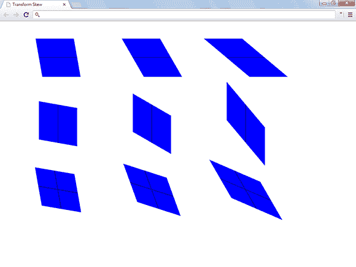

图 5-3 第一行关于 x 轴倾斜且程度逐渐增加；中间行关于 y 轴倾斜且程度逐渐增加；底行则关于两个轴都倾斜且程度逐渐增加。

以下代码显示了如何实现图 5-3 中的每个示例：

```css
/* Top Row */
div:first-child  { transform: skewX(10deg); }
div:nth-child(2) { transform: skewX(30deg); }
div:nth-child(3) { transform: skewX(50deg); }

/* Middle Row */
div:nth-child(4) { transform: skewY(10deg); }
div:nth-child(5) { transform: skewY(30deg); }
div:nth-child(6) { transform: skewY(50deg); }

/* Bottom Row */
div:nth-child(7) { transform: skewX(10deg) skewY(10deg); }
div:nth-child(8) { transform: skewX(20deg) skewY(20deg); }
div:last-child   { transform: skewX(30deg) skewY(30deg); }
```

倾斜变换类型在改变元素透视和创建更抽象的形状方面（无需求助于图像）有其独特的用途，但与大多数其他变换函数一样，它在第 6 章中才大放异彩。

## 旋转（Rotate）

`rotate()`函数变得流行是因为它允许你绕轴旋转元素。与`skew()`函数不同，`rotate()`没有被废弃，并广泛应用于动画和布局。

`rotate()`函数的一个基础用例是用于更抽象的设计，正如图 5-4 和演示文件`0504-rotate.html`所示所示。

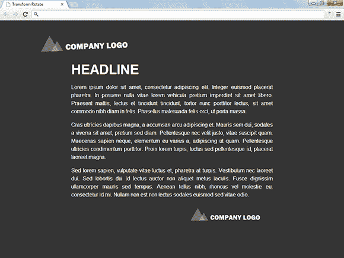

图 5-4 主 Logo 旋转以获得视觉效果，而页脚使用了相同的图像并保持标准方向。

你可以看到头部 Logo 和页脚 Logo 在方向上有所不同；主 Logo 稍微旋转。这通常需要你保存两个图像：一个用于头部，一个用于页脚。使用`rotate()`函数，额外的图像被消除了，并被极小的代码取代：

```css
header .logo {
  transform: rotate(-3deg);
}
```

`rotate()`函数的另一个频繁用例是更改文本的方向，如图 5-5 所示。

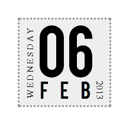

图 5-5 月份文本逆时针旋转了 90 度；年份文本顺时针旋转了 90 度。

在图 5-5 中，`rotate()`函数在保持设计的同时确保交付的是真实的文本而非图像。它也非常灵活且易于编辑；以下代码显示了如何操作：

```html
<time datetime=”2013-02-06”</time>
```

```html
<time>
  <span>周三</span>
  <span>06</span>
  <span>二月</span>
  <span>2013</span>
</time>
```

### CSS

```css
span:first-child {
  transform: rotate(-90deg);
}

span:last-child {
  transform: rotate(90deg);
}
```

这种设计显然比前面的代码中显示的需要更多的样式，但我在这里只关注`transform`属性。访问配套网站深入探索是如何实现此示例的（`0505-rotate-text.html`）。再次强调，为了保持代码尽可能简单，我编写的演示仅供 Chrome 查看。

最后，`rotate()`函数一如既往，在动画时要强大得多，但我希望通过这一节看出它本身具有巨大的价值。

### 缩放（Scale）

最后是`scale()`函数，它允许你通过原始尺寸乘以某个系数来调整元素的大小。例如，`scaleX()`值为`2`会将宽为`200px`的元素转换为`400px`宽。下面的代码进一步解释了这一点：

```css
div {
  width: 200px;
  height: 100px;
  transform: scaleX(2) scaleY(2);
}
```

这段代码有效地让`div`元素具有`400px`的`width`和`200px`的`height`，因为 x 和 y 维度都放大了 2 倍。然而，你可以将`scaleX()`和`scaleY()`函数合并为一个`scale()`函数，其中 x 和 y 参数用逗号分隔：

```css
transform: scale(2, 2);
```

这个特定的示例可以进一步缩短，因为如果你使用带有单个参数的`scale()`函数，它会将此值应用于 x 和 y 维度，而不是对省略的参数应用值`0`：

```css
transform: scale(2);
/* 单个参数应用于 x 和 y 维度 */
```

正如你现在可能已经发现的，缩放系统的原理是`scale()`值为`1`时保持元素的原始尺寸，任何大于该值都会放大，任何小于该值的值都会缩小。

你可能会想，既然可以使用现成的`width`和`height`属性来指定元素的尺寸，为什么需要使用这个功能呢？我让你回到`translate()`部分，我在那里提到了变换元素对周围环境完全没有影响。请查看图 5-6 或演示文件`0506-scale.html`。

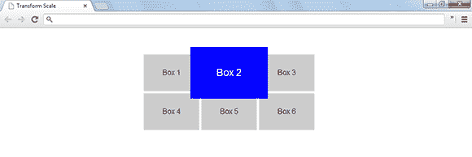

图 5-6 第二个框被放大到原始尺寸的两倍，但对其他框的流布局没有影响。

你可以看到框 2 的尺寸增加了，而其余框的位置或大小没有发生变化，仿佛没有进行任何调整一样。现在考虑将此效果应用于框的`:hover`状态。

`scale()`变换函数产生的结果与使用标准的`width`和`height`属性在悬停时放大框所获得的结果将截然不同。看到这种鲜明对比的最佳方法是在配套网站（`0507-scale-hover.html`），但图 5-7 在某种程度上说明了这种差异。

你可以看到，当使用`width`和`height`属性放大框时，布局遭到了严重影响，将其他框推到了下一行。相反，`scale()`函数简单地从其中心放大悬停的框，创造出一种框正向用户弹出的幻觉，同时确保周围的布局不受任何影响。

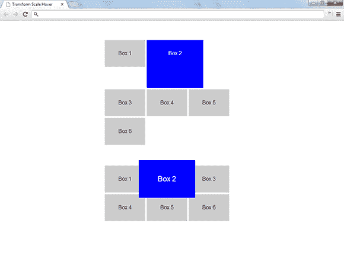

图 5-7 上方的框组显示了框 2 在使用`width`和`height`属性放大时的反应；下方的框组使用`scale()`变换函数调整框 2 的大小。

请记住，如果你在图像缩略图库上使用这种技术在悬停时放大缩略图，将图像放大到其初始尺寸以上会导致图像像素化。要解决这个问题，你需要以最大的形式保存图像；即放大后的缩略图。然后，你可以默认将图像缩小，然后在悬停时将它们放大回原始尺寸。

```css
.gallery img {
  transform: scale(0.6);
}

.gallery img:hover {
  transform: scale(1);
}
```

### 变换中心（Transform Origin）

`transform-origin`属性允许你指定变换发生的点。默认情况下，这是元素的中心，但你可以使用像素、百分比或关键字来更改它。

```css
.boxes1 div:nth-child(2) {
  transform: scale(1.4);
  transform-origin: 50% 50%;
}

.boxes2 div:nth-child(2) {
  transform: scale(1.4);
  transform-origin: 20% 20%;
}

.boxes3 div:nth-child(2) {
  transform: rotate(45deg);
  transform-origin: top left;
}
```

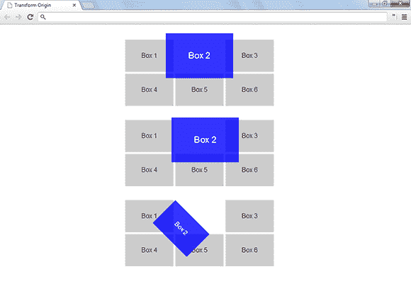

图 5-8 三个示例显示了将图像放大到其初始尺寸以上会导致图像像素化。要解决这个问题，你需要以最大的形式保存图像；即放大后的缩略图。然后，你可以默认将图像缩小，然后在悬停时将它们放大回原始尺寸。

### 组合变换（Combining Transforms）

就像在前节中讨论的过滤器一样，变换函数也可以组合，形成更广泛的可实现效果。再次，就像过滤器一样，变换之间简单地用空格分隔，如下代码所示：

```html
<article>
  <div>Box1</div>
  <div>Box2</div>
  <!-- 等等 -->
</article>
```

```css
article div:nth-child(3) {
  transform: translate(260px, -85px) scale(3.13);
  transform-origin: 0 0;
}
```

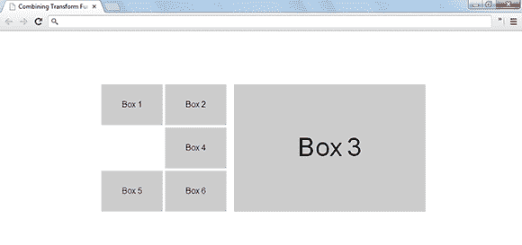

图 5-9 框 3 被平移并放大，以显示它是当前选中的框。

那个结果看起来非常棒，它完美展示了如何组合多种变换类型来产生强大的效果，但只需稍加努力，你就可以仅使用 CSS 让这个示例变为现实。

如果你记忆力特别好，可能已经对需要做什么有了了绪，因为答案需要你将记忆追溯到第 1 章中讨论的高级选择器。

我讨论的其中几个选择器允许你在点击时触发事件，包括`:checked`伪类。好了，是时候重返舞台了！

考虑到这一点，这六个按钮（每个框选择一个）采用`radio`单选框框的形式，以确保在任何时候只有一个框被选中。现在的 HTML 标记看起来如下：

```html
<input id=”one” name=”transforms” type=”radio” value=”1”>
<label for=”one”>Box 1</label>
<input id=”two” name=”transforms” type=”radio” value=”2”>
<label for=”two”>Box 2</label>
<!-- etc. -->
<article>
  <div>Box1</div>
  <div>Box2</div>
  <!-- etc. -->
</article>
```


记得它是如何工作的吗？下面的代码展示了你如何使用这种标记结构来定位每一个框：

```css
input[value="1"]:checked ~ article div:first-child {
    transform: translate(260px, 0) scale(3.13);
}

input[value="2"]:checked ~ article div:nth-child(2) {
    transform: translate(135px, 0) scale(3.13);
}
/* etc. */
```

现在让我们使用上一个代码片段中的第一个规则集来分析它的工作原理：

- 当用户点击一个 `value` 属性为`1`的单选按钮时，通过`:checked`伪类定位这个特定的单选按钮。
- 选择器的下部分通过通用兄弟选择器（`~`）定位位于该已选中单选按钮之后的任何`article`元素。
- 选择器的最后部分定位到该`article`元素内部的第一个`div`。
- 该元素随后变成活动框，允许你应用变换函数！

查看辅助网站（`0509-combining-transforms.html`）以查看具有完整功能的最终示例。

## 浏览器支持

是时候讨论那个令人头疼的话题了——浏览器兼容性。我意识到你可能开始认为我是这方面的坏消息播使者了，但在 2D 变换方面并非如此，你无疑会高兴地得知！

由于这些新功能如此受欢迎，浏览器厂商很快就实现了了对 2D 变换的支持，他们不想被抛下或被认为过时。

请注意，我目前指的是仅 2D 语境下的变换支持。3D 变换带有更多的包袱，且浏览器支持差异巨大，正如你将在第 7 章（`12_9781118652633-ch07.html`）中发现的那样。

当然，IE8 及以下版本是一个不可避免的绊脚石，但除此之外，所有浏览器都支持 2D 变换，考虑到该模块提供的高级功能，这是非常了不起的。Chrome、Safari、Opera 和 IE9 通过它们各自的供应商前缀（`-webkit-`和`-ms-`）提供支持，而 Firefox 和 Internet Explorer 10 甚至提供了不带前缀的`transform`属性的支持。

## 总结

在本章中，你学习了仅需单行代码而不需要图像，就可以在尺寸、方向、位置和透视方面对元素从原始状态进行操作。希望这让你对它们作为 CSS3 最强大功能之一的巨大潜力有了一些了解；我将在接下来的几章中挖掘这种潜力。

CSS3 变换模块代表了 CSS 作为一种样式语言所提供的力量方面的一项不可置信的进步。该模块让网络浏览器又获得了一个高分，从根本上减少了对图像和图形编辑软件来创建美学上理想的设计元素的感知依赖。

浏览器支持无疑状况良好，并且只会不断改进，所以请尽管发挥你的创意脑筋，尽情尽意地尝试变换吧。然而，尽管浏览器支持令人印象深刻，一些重要的浏览器（你好，IE8）仍然缺乏支持，因此务必确保在这些浏览器中实现优雅降级！我怎么强调这一点都不为过。请务必负责任。

## 延伸阅读

- CSS 变换规范 [`http://www.w3.org/TR/css3-transforms`](http://www.w3.org/TR/css3-transforms)
- Mozilla Developer Network 变换教程 [`https://developer.mozilla.org/en-US/docs/CSS/transform`](https://developer.mozilla.org/en-US/docs/CSS/transform)

## 第 6 章：通过过渡让 2D 变换焕活

你无疑已经厌倦了我在上一章中不断的提醒：CSS 变换的真正力量和多功能性只有在它们被动画化后才能实现。好吧，意料之中，本章概述了如何做到这一点。但不是使用 JavaScript……而是使用纯 CSS！准确地说，是 CSS3 过渡（Transitions）。

本章从详细讨论过渡开始，展示了你如何利用它们的全部力量来产生令人惊叹的效果。

### 介绍 CSS 过渡

与变换一样，过渡是 CSS 的强大补充，并以动画的形式增加了一个全新的维度。

本章首先详细讨论过渡，展示了你如何利用它们的全部力量来产生令人惊叹的效果。

什么是过渡，以及它们与动画有何区别？简单来说，过渡确保当元素从一个状态变为另一个状态（例如悬停效果）时，这种变化在设定的持续时间内进行动画处理或过渡。

延续前几章中提出的主题，此工具允许你将许多 JavaScript 代码转换为单行纯 CSS。下面的代码展示了你可能如何使用流行的 jQuery 库让元素在悬停时在 0.5 秒内淡入到半透明，并在释放悬停时恢复。

```javascript
$('a').hover(function(){
    $(this).stop().animate({opacity:'.5'}, 500);
}, function() {
    $(this).stop().animate({opacity:'1'}, 500);
});
```

好吧，也许这个例子并不复杂，但它确实很冗长，特别是对于如此简单的效果。当为了可读性进行格式化时，你有 125 个字符和 5 行代码，更不用说该代码依赖于 jQuery 库的引入，而该库本身又依赖于用户启用了 JavaScript 的浏览器。

CSS 过渡以更加优雅、高效和简洁的方式处理这种特定的用例。使用 jQuery 方法就像站起来走到电视机前换频道；而使用 CSS 过渡则像是坐在沙发上用遥控器操作。它们都实现了完全的结果，但后者需要的精力和精力要少得多。看看下面的代码 CSS 是如何工作的：

```css
a {
    transition: .5s;
}

a:hover {
    opacity: .5;
}
```

多么巨大的不同！CSS 方法在 jQuery 方法的基础上减少了总共 87 个字符，形成了这段极其简单且令人悦读的代码块。简单代码对应简单效果——这才对！

这个示例使用了最精简的简写语法，以强调其与 jQuery 相比的简单性；然而，共有四个属性可以对实际的过渡进行控制。让我们让我们拆解一下，看看在这里发挥神奇作用的各个属性。

## 控制你的过渡

这些控制属性中的第一个是`transition-property`，它允许你指定想要应用过渡效果的属性。例如，你可能希望`background-color`（背景颜色）在`:hover`时从原始的黄色渐变到蓝色，但你希望文本的`color`（颜色）立即从黑色变为白色；换句话说，你想要过渡`background-color`的变化，而不是文本`color`的变化。

```css
a {
    background-color: yellow;
    color: black;
    transition-property: background-color;
    /* 其他过渡属性 */
}

a:hover {
    background-color: blue;
    color: white;
}
```

这段代码确保了在`:hover`时只有`background-color`的变化会产生动画效果。你也可以为此属性指定`all`值，当然，这将过渡效果应用于所有属性的变化；然而，这是默认值，所以如果这是所需的结果，可以省略它。

需要注意的是，前面的示例在当前状态下无法工作，因为它缺少了一个必需的过渡控制属性——`transition-duration`（过渡持续时间）。正如你预期的那样，该属性允许你指定过渡播放的时间，接受毫秒（`ms`）或秒（`s`）值：

```css
transition-property: background-color;
transition-duration: 1s; /* 这相当于 1000ms */
```

这段代码会导致从黄色到蓝色的`background-color`过渡持续一秒钟。

随着我引入`transition-timing-function`（过渡计时函数）属性，情况开始变得复杂了一些。我将在章稍后的部分详细解释过渡的这一方面，但简单来说，它允许你指定过渡在指定的持续时间内是如何加速和减速的。

```css
transition-property: background-color;
transition-duration: 1s; /* 这相当于 1000ms */
transition-timing-function: linear;
```

`transition-timing-function`属性接受一组预定义的关键字列表，这些关键字在大多数情况下都能满足你的需求，但对于自定义效果，你也可以使用`cubic-bezier()`函数，这将在本章稍后介绍。

这种特定的计时函数（`linear`）确保过渡在整个动画持续期间保持恒定的速度。默认值（`ease`）会快速让过渡加速到全速，然后再稍微平缓地减速结束过渡。其他预定义的关键字（它们实际上全都是`cubic-bezier()`函数的简写）将在接下来的关于理解计时函数的节中介绍。

拼图的最后一块碎片是`transition-delay`（过渡延迟）属性，它允许你声明从过渡事件触发到动画实际开始的一段时间。例如，`0.5s`的值将确保当元素被悬停时，动画在半秒钟后才会开始：

```css
transition-property: background-color;
transition-duration: 1s; /* 这相当于 1000ms */
transition-timing-function: linear;
transition-delay: .5s; /* 这相当于 500ms */
```

这一切都非常简单。但正如你从初始示例中所知，当使用`transition`属性将属性组合成简写语法时，它变得简单得多。

## 理解简写语法

如前所述，唯一必需的`transition`值是持续时间参数（`duration`），因为它的初始值为`0s`，这显然会导致即时变化，因此没有过渡效果！

你必须遵守的另一个规则是关于两个基于时间的属性`transition-duration`和`transition-delay`的顺序。你必须始终先指定持续时间；除此之外，你可以随心所欲地放置各种值。

以下示例都是有效的，并且实现了相同的效果：

```css
transition: opacity .5s linear 2s;
transition: linear .5s opacity 2s;
transition: linear opacity .5s 2s;
transition: .5s 2s opacity linear;
```

当然，有时你会对对过渡所能行使的控制力表示感谢，但根据我自己的经验，我发现需要使用简写语法以外的其他东西，在大多数情况下，默认值也足够了（当然，除了`duration`参数外）。这导致我的许多过渡规则看起来非常像本节开头使用的初始示例：

```css
transition: .4s;
```

极度简单。

## 理解 transition 属性

你可能注意到，我一直将`transition`属性添加到元素的默认样式中，而不是`:hover`规则集中，如下例所示：

**正确**

```css
a {
    background: blue;
    transition: background .5s ease-out;
}

a:hover {
    background: red;
}
```

**错误**

```css
a {
    background: blue;
}

a:hover {
    background: red;
    transition: background .5s ease-out;
}
```

后者（错误示例）是许多网页设计师持有的常见误解的结果；即，如果你想让过渡影响`:hover`状态，逻辑上认为必须将`transition`属性放在`:hover`中。

这种放置在某种程度上是有效的，因为当悬停时，从普通状态到`:hover`状态的变化是有过渡的；然而，当释放悬停时，元素会弹回到默认样式，而不是逐渐回退。这可能是想要的效果，但通常你希望`:hover`效果淡入淡出。

为了确保你不掉入这个陷阱，你需要改变思维。虽然对`transition`属性的这种用法可以理解，但它很大程度上限制了该属性的功能。与其尝试确保`:hover`状态动画，你必须意识到当正确应用时，`transition`属性允许所有变化产生动画。

既然我发出了这个警告，可能会出现需要在鼠标指针进入元素和离开元素时不同过渡效果的情况。这就是之前的技术有效使用而非误用的地方。

例如，假设你想在悬停时将元素的`background-color`从蓝色变为红色。然而，你希望初始悬停过渡是相当快速，但当释放悬停时，你希望颜色更缓慢地回到原始状态。以下代码展示了如何实现。

```css
div {
    background: blue;
    transition: 5s;
}

div:hover {
    background: red;
    transition: .4s;
}
```

你可以看到添加了一个二级`transition`属性，但为什么呢？元素悬停时的初始过渡已被移动到`:hover`规则集中，并被另一个`transition`属性所取代，该属性将负责从悬停状态回到原始状态的变化动画。

最终的结果是：当鼠标悬停在元素上时，`background-color`会在 0.4 秒内从蓝色变为红色；当释放悬停时，红色背景会在 5 秒的较长持续时间内变回蓝色。

这一切看起来很简单，但也可以变得更复杂。请考虑以下代码示例：

```css
div {
    background: blue;
    transition: .4s;
}

div:hover {
    background: red;
    transform: rotate(360deg);
    transition: background 1s;
}
```

与之前的代码相比变化并不大，但这个示例产生了完全不同的效果，这在很大程度上归于`rotate()`变换函数的回归——这个函数你在第 5 章中已经熟悉并喜爱了！

初始的`:hover`过渡通过引入`transition-property`参数受到了限制，确保它只对`background`属性执行动画，使其在 1 秒的持续时间内从蓝色变为红色。这确保了没有动画被应用于`rotate()`函数，由于其值为`360deg`（这与它的初始值`0deg`相同），它对初始的`:hover`动作没有任何影响。

相比之下，影响从悬停状态回到原始状态的默认规则集上的`transition`属性仍然仅有一个`duration`参数，确保当鼠标指针离开元素时，所有属性都将过渡回原始值。由于元素在`:hover`时被旋转了 360 度（尽管你并不知道，因为旋转没有动画效果），当鼠标指针离开时，元素会从`360deg`旋转一整圈回到其原始值`0deg`。由于这次旋转是有动画的，元素在物理上执行了这一旋转，旋转了一整圈！请查看配套网站上的`0602-on-off-transitions-complex.html`进行演示。

以下是最终整体结果的简要说明：

- 用户悬停在元素上，导致`background-color`在 1 秒内从蓝色变为红色。
- 当鼠标指针离开元素时，`background-color`从红色变回蓝色，元素在 0.4 秒的持续时间内逆时针旋转 360 度。

## 理解计时函数 (Timing Function)

CSS 动画中的计时函数部分可能很枯燥，但理解它的作用以及实际是如何运作的是非常重要的。

正如之前提到的，`transition-timing-function`属性描述了动画变化的加速变化；它指示了动画在指定的过渡持续时间内何时加速、何时减速。

`cubic-bezier()`函数允许你创建自定义的加速模式，但`transition-timing-function`属性接受的五个预定义关键字实际上是特定`cubic-bezier()`值的缩写：

- `ease`
- `linear`
- `ease-in`
- `ease-out`
- `ease-in-out`

接下来的章节将带你详细介绍这些选项的细节。

## 贝塞尔曲线 (The Bézier Curve)

`cubic-bezier()`函数由四个小数值（通常在 0–1 的刻度上）组成，这些值有助于形成贝塞尔曲线，决定了过渡何时加速和减速。以下代码显示了一个典型的`cubic-bezier()`函数；这个特定示例等于`ease-in-out`关键字：

```css
/* cubic-bezier(x, y, x, y); */
transition-timing-function: cubic-bezier(.42, 0, .58, 1);
```

一如既往，理解这段代码如何形成贝塞尔曲线的最佳方法是查看视觉表示，这在图 6-1 中进行了演示。

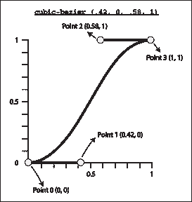

图 6-1 显示了如何绘制坐标以形成贝塞尔曲线。

我预计你现在可能很困惑——如果不是比喻，也是如此。首先要理解的是是，图上总共绘制了四个点来形成曲线（点 0, 1, 2 和 3），但点 0 和 3 分别始终是 `0, 0`（左下）和 `1, 1`（右上）。留下的点 1 和 2 使用`cubic-bezier()`函数进行绘制，其中第一组数字指定点 1 的 x 和 y 坐标，第二组数字确定点 2 的 x 和 y 坐标。

因此，使用前面的示例并如图 6-1 所示，点 1 位于 x 轴的 `.42` 处和 y 轴的 `0` 处，而点 2 位于 x 轴的 `.58` 处和 y 轴的 `1` 处。

```css
/* The equivalent cubic-bezier() function... */
transition-timing-function: cubic-bezier(.25, .1, .25, 1);
```


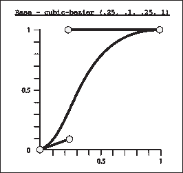

图 6-3 `ease` 关键字的贝塞尔曲线

## Linear

我已经提到过几次 `linear` 关键字，正如其名所示，它确保动画在整个持续期间保持恒定速度，因此不会加速或减速。以下代码显示了等效的 `cubic-bezier()` 函数，结果所示图 6-4：

```css
transition-timing-function: linear;
/* The equivalent cubic-bezier() function... */
transition-timing-function: cubic-bezier(0, 0, 1, 1);
```

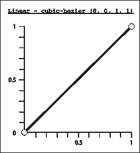

图 6-4 `linear` 关键字的贝塞尔曲线（在此情况下为直线）

## Ease-In

`ease-in` 关键字的作用正如你预期的那样：它让动画逐渐加速到全速，然后在过渡结束前保持恒定速度。再次，使用以下代码，贝塞尔曲线显示在图 6-5：

```css
transition-timing-function: ease-in;
/* The equivalent cubic-bezier() function... */
transition-timing-function: cubic-bezier(.42, 0, 1, 1);
```

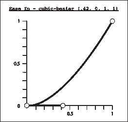

图 6-5 `ease-in` 关键字的贝塞尔曲线

## Ease-Out

意料之中，`ease-out` 关键字的作用与它的 `ease-in` 对应相反，它一开始就达到全速，然后在结束时减速。同样正如你所预期的，贝塞尔曲线显示与上一个示例完全相反，仿佛旋转了 180 度，如图 6-6 所示：

```css
transition-timing-function: ease-out;
/* The equivalent cubic-bezier() function... */
transition-timing-function: cubic-bezier(0, 0, .58, 1);
```

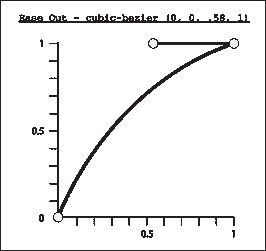

图 6-6 `ease-out` 关键字的贝塞尔曲线

## Ease-In-Out

最后一个 `cubic-bezier()` 写法关键字是 `ease-in-out`，它基本上是前两个示例的结合。它与默认的 `ease` 值相似，尽管这个值以相同的速率进行淡入和淡出，而 `ease` 值在开始时的加速度要大得多。图 6-7 说明了等效的贝塞尔曲线。

```css
transition-timing-function: ease-in-out;
/* The equivalent cubic-bezier() function... */
transition-timing-function: cubic-bezier(.42, 0, .58, 1);
```

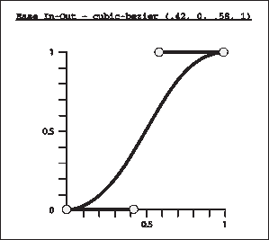

图 6-7 `ease-in-out` 关键字的贝塞尔曲线

## Stepping Functions

你以为你已经看到了 CSS 计时函数的最后一个了吗？你该很幸运！除了贝塞尔曲线之外，计时函数还可以被表示为阶梯函数（stepping function）。`steps()` 函数不是平滑过渡，而是指定了动画应该被分为若干个，呃，步长。

该函数接受两个参数。第一个是正整数（此处无效值无效的），用于指定步长的数量。第二个是 `start` 或 `end` 之一的值，决定状态变化应该发生在步长的开始还是结束处（此参数是可选的，默认值为 `end`）。例如，如果每个步长间隔为三秒，那么 `start` 值将在三秒的开始时触发状态变化，而 `end` 值则将在三秒的间隔后触发状态变化。

为了保持计算简单，请考虑以下示例：

```css
div {
    width: 300px;
    height: 300px;
    transition: 5s steps(5, start);
}
```

*(注：原文后续部分存在大量重复的 CSS 代码块，已根据要求进行去重处理)*

总而言之，过渡效果（transitions）的状态非常完美，你可以立即开始使用它们了！你可能记得上一章提到，变换（transforms）在浏览器兼容性方面也达到了类似的水平，这非常方便，因为当这两种技术结合时，结果将是令人震撼的。

## 过渡效果实战

好了，理论部分结束了——让我们进入精彩的内容吧！我已经向你简单介绍了过渡效果可以实现的一些功能，但它们的潜力远不止于此。

首先，请回想一下第 3 章以及关于多重背景动画提供了动画实现效果的提示，但你可以在演示文件 `0606-animating-multiple-backgrounds.html` 中查看完整效果。

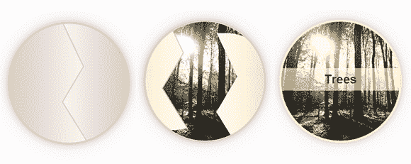

图 6-10 动画从起始位置（左）到结束状态（右）的过程

请记住，在代码示例中，我只包含了与动画相关的关键部分，省略了其他所有内容。如既往一样，如果你在本节期间一直打开实时演示，将会大益。

首先，标记部分简单不过了，而且样式没有使用任何之前未涵盖的内容，如下代码块所示：

**HTML**

```html
<div>
    <p>Trees</p>
</div>
```

**CSS**

```css
div {
    background: url(cover-left.png) 0 -1px no-repeat,
               url(cover-right.png) right no-repeat,
               url(trees.jpg) 0 0 / cover;
}
p {
    font: bold 0em Arial;
}
div:hover {
    background-position: -295px -100px, 295px 100px, 0 0;
    filter: sepia(0.8); /* 不要忘记厂商前缀！ */
}
div:hover p {
    font-size: 3em;
    background: rgba(250, 250, 250, 0.5);
}
```

下一步是分析当悬停在 `div` 上时，两个元素发生了什么。你可以看到 `div` 使用 `background-position` 属性将两个覆盖背景图移出视野（从而露出 `trees.jpg` 背景图），并应用了深褐色（sepia）滤。`p` 元素由于 `font-size` 值为 `0em` 默认隐藏；但当悬停在 `div` 上时，它增加到 `3em`，并通过 `rgba()` 函数添加了半透明背景。

因此，上述内容描述了原始状态和最终悬停状态，但这些值的变化需要通过过渡来创建动画。这种效果是如何实现的？首先，你显然需要对 `div` 元素应用过渡效果，如下代码所示：

```css
div {
    background: url(cover-left.png) 0 -1px no-repeat,
               url(cover-right.png) right no-repeat,
               url(trees.jpg) 0 0 / cover;
    transition: 1s;
}
```

这段代码仅仅确保了对 `div` 元素的任何更改都会产生动画，所以工作完成了一半！然而，`transition` 属性是不级联的，这意味着子元素 `p` 不会继承它，导致 `p` 元素的任何变化都会瞬间生效，而不是渐变变化，这显然不是想要的效果。你可以通过在 `p` 元素和 `div` 上都添加 `transition` 来轻松解决这种局面：

```css
div {
    background: url(cover-left.png) 0 -1px no-repeat,
               url(cover-right.png) right no-repeat,
               url(trees.jpg) 0 0 / cover;
    transition: 1s;
}
```

（注：由于输入文本包含大量重复的碎片代码块，已根据指令将其整理为标准的逻辑结构。）

我在前一章中提到过 `rotate()` 的用法，但在这里我将向你展示它在动画效果下是如何工作的。想象一个画廊，墙上挂着一幅画框画；不幸的是，画滑落了，最终只挂在一个角上，如图 6-11 所示。场景已经就绪。现在，我将为你演示如何使用变换（transforms）和过渡（transitions）在浏览器中实现这段简直灾灾性的场景！

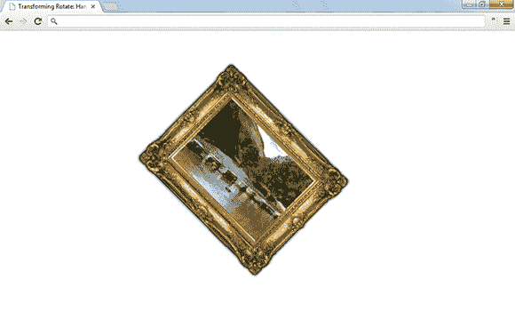

图 6-11 画滑了，现在仅挂在左上角！

`transform-origin` 属性在这里派上了用场，对于 `rotate()`来说，它允许你控制旋转中心点在元素中的位置。例如，考虑以下代码：

```css
div {
    background: url(painting.jpg);
    transform-origin: 0 0;
    transition: 1.4s;
}
div:hover {
    transform: rotate(45deg);
}
```

显然，`transition` 属性确保了当悬停 `div` 时，从 `0deg` 到 `45deg` 的过程是有动画的。此外，这个 `transform-origin` 值确保旋转围绕元素的左上角进行，从而产生你想要实现的“悬挂”效果。

当然，你需要查看运行演示（`0607-transforming-rotate.html`）来欣赏它的完整效果，但我希望你能从这段描述中掌握要领。到目前为止的结果是，当悬停 `div` 时，它会绕其左上角顺时针旋转 45 度。然而，结果动画在 45 度处就突然停止了，对于一幅从一个角掉落的画来说，这并不是一种自然的运动。

这就是我们的老朋友 `cubic-bezier()` 再次大显身场的地方。通过调整 0–1 标准范围之外参数，你可以创建包含倒退运动的效果，这非常适合为悬挂画的示例添加点睛之笔。

为了创建更真实的运动，你理想情况下会让画摆过“最终”的 45 度标记，然后在停下之前稍微摆回，最后落在最终的 45 度位置。正如之前提到的，得益于以下 `cubic-bezier()` 函数，这种效果是可能的：

```css
div {
    background: url(painting.jpg);
    transform-origin: 0 0;
    transition: 1.4s cubic-bezier(.55, 2.3, .52, .52);
}
div:hover {
    transform: rotate(45deg);
}
```

你可以从图 6-12 中的实际贝塞尔曲线中看到，这个计时函数导致动画在回到预定终点之前运行超出范围，然后折回，最后带有轻微的向前运动结束，最终落在预定位置。

我告诉过你这些计时函数看起来可能很枯燥，但老天，它们真是多么厉害的小工具！

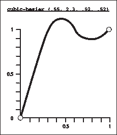

图 6-12 创建摆动运动的贝塞尔曲线

为了给这个示例最后的最后的润色，我为释放悬停时的状态应用了不同的过渡，这会导致画以更慢的速度滑回位置，因为原始的摆动运动反向进行并不自然。以下片段显示了最终代码的样式：

```css
div {
    background: url(painting.jpg);
    transform-origin: 0 0;
    transition: 1.4s; /* 悬停结束 */
}
div:hover {
    transform: rotate(45deg);
    transition: 1.4s cubic-bezier(.55, 2.3, .52, .52); /* 悬停开始 */
}
```

### Translate

`translate()` 变换函数在 2D 环境中可能没有 `rotate()` 那么令人深刻，因为它本质上是一个定位工具，而这当然不是什么极其创新的功能。然而，正如我在前一章中深入描述的那样，这个函数确实有它的优势——即它是相对于原始位置位移的，而且位移后的元素变得与其周围独立。

为了说明这个函数，我描述了如何创建一个滚动的球，这无疑是简单的（`0608-transitioning-translate.html`）。你当然可以使用图片，但我了一些已经讨论过的 CSS3 特性来创建这个球：

```css
div {
    background: url(painting.jpg);
    transform-origin: 0 0;
    transition: 1.4s;
}
```

请注意，这些变换的顺序在这里非常重要，因为如果交换了顺序，你将得到完全不同的结果。当一个元素被旋转时，该元素的所有部分都会之旋转，包括它的坐标系。例如，如果一个元素顺时针旋转 90 度，那么 `margin-top` 值将影响右侧边距，`margin-right` 值将影响底部边距，以此此类推。因为在这个示例中，我们先指定了 `translate()` 函数，所以它是根据元素的原始朝向进行移动的。

结果就是这样：一个滚动的球动画，其中形状、阴影和实际动画都是仅使用 CSS 实现的！

我的下一个魔术是，我要玩玩气球和氦气！不，我是认真的。我并不会给你们做任何花哨的动物之类的，但我会向你们展示如何向气球加入“氦气”，让它飘向天空。

首先，你需要创建一个气球，我同样只使用了 CSS 创建了它：

```css
div {
    border-radius: 60% 60% 55% 55%;
    width: 150px;
    height: 210px;
    background: radial-gradient(40% 20%, #acd9fc 10%, #0090ff 50%,
                               #002f53 90%);
}
```

我使用了与上一个相同的技巧来创建气球的阴影，并使用伪元素（我将在第 13 章中深入讨论）来创建一个小三角形。

这个概念是，用户必须悬停在气球上“加入氦气”并让气球浮起来。由于动画是物体向上移动物体，因此默认平移元素然后在悬停时让它回到真实位置会更容易，如下所示代码块所示：

```css
div {
    border-radius: 60% 60% 55% 55%;
    width: 150px;
    height: 210px;
    background: radial-gradient(40% 20%, #acd9fc 10%, #0090ff 50%,
                               #002f53 90%);
    transform: translate(0, 300px) rotate(-50deg);
    transition: 2s cubic-bezier(.65, 2, .03, .32);
}

div:hover {
    transform: translate(0) rotate(0deg);
}
```

你可以看到，默认情况下气球向下移动了 300 像素并轻微旋转。然后，当悬停在元素上时，它会返回（或浮回）它的真实位置。这种浮动的幻象完全取决于找到正确的 `transition` 参数；例如，我再次利用 `cubic-bezier()` 函数在气球撞击天花板时创建一个平滑的反弹效果，增加了真实感。图 6-14 显示了过渡的起点和终点，但一一如既往，如果你想查看完整效果并分析完整代码，真的应该去伙伴网站（`0609-transforming-translate-balloon.html`）。

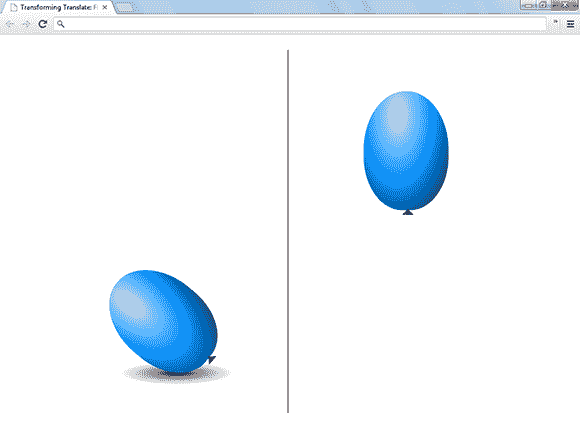

图 6-14 气球开始在地板上（左）；然后当悬停时，它浮到了天花板（右）。

## 缩放过渡

`scale()` 函数为元素应用细微增强提供了一种理想方式，特别是对于缩略图库。即使是 Google 图片也会在悬停时放大其图片结果，以便在点击进入完整图像之前提供那种额外的、令人满意的预告。

一如既往，这种效果的实现也极其简单。只需记住，你应该确保你的图片是按你希望在网站上显示的最大尺寸保存的：

```css
.gallery img {
    transition: .4s;
}

.gallery img:hover {
    transform: scale(2);
}
```

这段代码导致图像在悬停时从图像中心平滑放大，而不会影响它的任何兄弟元素或周围布局。图 6-15 显示了缩略图库，其中一张图片在悬停时放大，而工作示例可以在 demo `0610-transitioning-scale.html` 查看。


图 6-15 悬停时使用 `scale()` 变换放大的第二图像

当然，你可以对 `scale()` 函数发挥更多创意，但这是一个很好的用例。尝试像之前的示例那样将其与 `rotate()` 函数结合，进一步增强悬停效果。此添加会导致图像在悬停时也旋转整圈：

```css
.gallery img {
    transition: .4s;
}

.gallery img:hover {
    transform: scale(2) rotate(360deg);
}
```

## 倾斜


`scale()` 函数提供了为元素应用细微增强的理想方式，特别是缩略图库。即使是 Google 图片也会在悬停时放大其图片结果，以便在点击进入完整图像之前提供那种额外的、令人满意的预告。

一如既往，这种效果的实现也极其简单。只需记住，你应该确保你的图片是按你希望在网站上显示的最大尺寸保存的：

```css
.gallery img {
    transition: .4s;
}

.gallery img:hover {
    transform: scale(2);
}
```

这段代码导致图像在悬停时从图像中心平滑放大，而不会影响它的任何兄弟元素或周围布局。图 6-15 显示了缩略图库，其中一张图片在悬停时放大，而工作示例可以在 demo `0610-transitioning-scale.html` 查看。

## 倾斜

`skew()` 函数可能是所有变换类型中限制最多的，根据图 6-16 所示，`div` 默认是倾斜的。这种 2D 变换可以让元素产生扭曲效果。

不要忘记，`x` 和 `y` 参数不能合并到一个 `skew()` 函数。相反，它们必须分别指定：

```css
div {
    transform: skew(20deg, 10deg);
}
```

这种倾斜效果可以用于创建有趣的视觉效果，例如，倾斜一个卡片使其看起来更具动感。

## 构建图片库

为了帮大家回忆对第 1 章的记忆，我使用了 `nth-child()` 选择器移除了每三个列表项的 `margin-right` 值，并使用负数 n 来选择最后三个列表项并移除它们的底部外边距。

在考虑到内边距（`padding`）和外边距（`margins`）后，容器中剩余 600 像素用于 `li` 元素，每行三个；600 除以 3 等于 200，因此得到了 `width` 的值。

随后，给实际的 `img` 元素赋予 `100%` 的 `max-width` 值，确保它们缩小以适应宽度为 200px 的列表项容器。

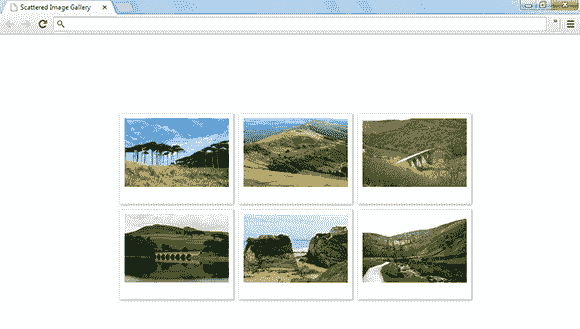

图 6-17 图库被组织成了一个整齐、间距均匀的网格。

注意图 6-17，我还通过简单应用一些边框为图片添加了宝丽胶效果。我还使用了值为 `border-box` 的 `box-sizing` 属性，确保边框宽度包含在总宽度内，这样网格就不会被破坏。

```css
.gal img {
    border: 8px solid #fff;
    border-bottom-width: 30px;
    box-sizing: border-box;
    box-shadow: 1px 1px 5px rgba(0, 0, 0, 0.5);
}
```

为了确保边框可见，我还添加了细微的投影。

好了，现在你拥有了一个结构良好的图库。是时候应用一些渐进式增强并开始散布这些图片了！

这一相当枯燥的部分确保了这种技术适用于图片数量较少的小图库。我单独选择了图片，对每个图片应用自定义变换，并让散布效果看起来尽可能随机：

```css
.gal li:nth-child(1) img {
    transform: translate(-10px, 20px) rotate(-10deg);
}

.gal li:nth-child(2) img {
    transform: translate(-20px, 70px) rotate(10deg);
}

/* 等等 */
```

将该逻辑应用到其他四张图片后，你将拥有六张随机散布的图片，它们看起来应该像图 6-18 所示。

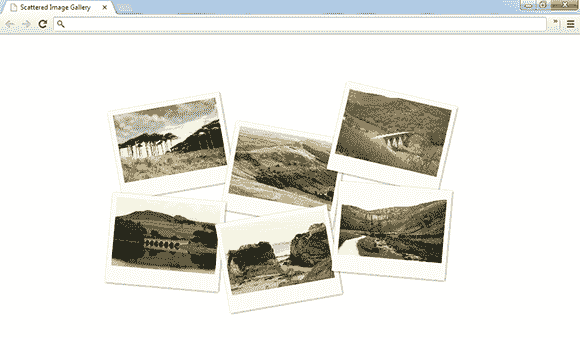

图 6-18 图片经过单独变换以呈现出散布状态。

快完成了！现在你希望图片在悬停时放大，这时 `scale()` 变换函数派上用场了。记住，由于图片已经缩小以适应 200px 宽的 `li` 元素，只要不超过图片的原始尺寸，你就可以安全地放大图片：

```css
.gal img:hover {
    transform: scale(2);
}
```

这段代码还会将 `rotate()` 和 `translate()` 值恢复到原始参数，创建一个你在图 6-19 中看到的悬停效果。最后需要处理的问题是，图片在悬停放大时不会自动显示在顶层，导致一些丑陋的重叠；然而，你可以使用老的 `z-index` 方法轻松解决这个问题：

```css
.gal img {
    position: relative; /* z-index 生效需要此设置 */
}

.gal img:hover {
    z-index: 1;
}
```

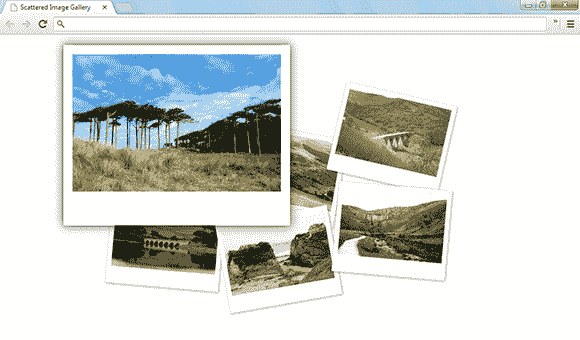

图 6-19 最终的散布图库，第一张图片在悬停时放大

这就是全部了！除了对每张图片进行枯燥的定位，代码非常简单，却创造了酷酷的输出。这种方法的优之处在于，只要你正确编写了网格，它在不支持变换的浏览器中降级得非常优雅，因为图片只会回退到网格中的原始位置。参考图 6-17 查看此图库在 IE9 中的显示效果。

## 总结

本章将 2D 变换提升了一个新高度，向你展示了它们在与过渡结合时是多么有用。产生的效果微妙而令人满意。

所以，按照逻辑推导，相应的变换函数只需要一个额外的 z 轴参数来访问这个 3D 环境（当然，`rotate()` 除外）。如果你觉得这个描述听起来有点太简单，甚至好得有些不可真实，那么你是对的；这就是为什么 3D 变换带有额外的属性，这些属性允许你构建出完全符合 3D 空间。

## 关键在于透视

与 2D 变换相比，三维变换需要更充分的准备以及来自其他属性的协助。为了说明这一点，我需要引入 3D 旋转的概念。

在下面的示例中，你绕着 x 轴旋转元素，而 x 轴当然是水平的。这意味着该元素实际上绕着水平轴发生了垂直翻转。如果你只是单独对元素应用 `rotateX()` 函数，你的结果看起来可能类似于图 7-2。

```css
div {
    width: 300px;
    height: 300px;
    transform: rotateX(45deg);
}
```

显然，单单应用 3D 变换是不够的。元素绕着其 x 轴旋转，但这种变换仍然发生在 2D 上下文中，因为 3D 环境尚未形成。那么，你如何创建这个 3D 环境呢？

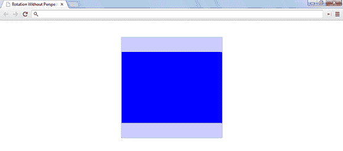

图 7-2 元素看起来变窄了，但没有任何迹象表明它受到了 3D 变换。

## perspective 属性

要创建 3D 上下文，你需要指定一个观察视角（`perspective`），这添加了必要的深度。你使用命名直观的 `perspective` 属性来实现这种效果，它基本上通过声明观察者的假设位置来设置 3D 环境的透视。它接受基于像素的长度值，表示观察者沿 z 轴距离画布的距离。

```css
.container {
    perspective: 500px;
}

.container div {
    width: 300px;
    height: 300px;
    transform: rotateX(45deg);
}
```

前面的代码设置了 3D 环境的透视，基于观察者距离屏幕 `500px`（或沿 z 轴距离 `500px`）。

如果你在透视的概念上感到困惑，它基本上意味着通过让本该更远的东西变小，让本该更近的东西变大来暗示距离。图 7-3 展示了这种逻辑的应用，并且它是上述代码块的结果。如需更详细查看，请查看配套网站 [`www.wiley.com/go/ptl/css3`](http://www.wiley.com/go/ptl/css3) 演示文件 `0701-perspective.html`。

注意，`perspective` 属性实际上是应用于变换元素的父元素的，以确保其所有子元素以相同的透视关系在相同的 3D 空间中运行。然而，如果你只想对单个元素应用 3D 变换，你可以这样做，但透视值必须以不同的方式应用，如下所示代码所示：

```css
.container div {
    width: 300px;
    height: 300px;
    transform: perspective(500px) rotateX(45deg);
}
```

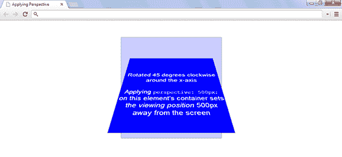

图 7-3 场景现在已添加透视，确保尺寸已经发生了改变以暗示不同的距离。

如你所见，`perspective` 值是以函数表示法应用于实际元素上的。但是，你必须理解，这绝不是应用透视的简写解决方案，因为它产生的结果与在容器上使用 `perspective` 属性的结果截然不同，特别是当变换的元素拥有同样受到 3D 变换的兄弟元素时。图 7-4 说明了对单个元素应用 `perspective()` 函数与对容器应用 `perspective` 属性之间的区别。你也可以仔细查看演示文件 `0702-perspective().html` 中的代码。


图 7-4 应用于容器的 `perspective` 属性（左）和应用于单个元素的 `perspective()` 函数（右）

涉及到旋转时，记住元素的整个坐标系都被旋转了，这意味着前面图中元素的 z 轴实际上是向 45 度角远离屏幕的，而不是直接指向你。记住这一点，看看 `perspective` 属性是如何与 3D 平移起作用的：

```css
.container div {
    width: 300px;
    height: 300px;
    transform: translateZ(100px);
}
```

如果你尝试在 z 轴上移动元素 `100px` 而没有指定 `perspective` 值，元素上完全没有任何可见的变化。正如之前的旋转示例一样，变换执行了，元素沿 z 轴移动了 `100px`，但由于没有透视来衡量，这种移动是不显眼的。图 7-5 展示了这一点。


图 7-5 由于缺乏透视，元素看起来没有任何变化。

正如你现在所知，你必须在容器上添加 `perspective` 值以创建一个所有子元素共享的 3D 空间：

```css
.container {
    perspective: 500px;
}

.container div {
    width: 300px;
    height: 300px;
    transform: translateZ(100px);
}
```

这个示例元素沿 z 轴向观察者位置移动了 `100px`（由 `perspective` 设置），它实际上变大了。后续是演示 `0703-translatez.html`。

记住 `translateZ()` 函数和 `perspective` 属性沿同一个轴操作，后者指定了观察者的位置。当你考虑前面的示例时，这意味着观察者距离屏幕 `500px`。因此，如果元素沿 z 轴平移 `500px` 或更多，它会突然变得不可见，因为元素实际上被移动到了观察者的位置之后，正如图 7-7 所示。


图 7-6 元素沿 z 轴向观察者位置移动时看起来变大了，该位置是由透视属性指定的（在图中由 d 定义）。

## 视点起点 (Perspective Origin)

`perspective` 工具有一个姐妹属性，让你对 3D 环境有更多的控制：`perspective-origin` 属性。

这个功能基本上允许你通过设置 3D 空间的消失点来指定透视角度。元素的消失点使用标准的定位值进行指定，接受像素和百分比单位，以及位置关键词（`top`、`right`、`bottom`、`left`、`center`）。

该属性的工作与 `transform-origin` 属性类似，并具有相同的默认值 `50% 50%`，这等同于 `center`。

以下代码块展示了在 `perspective` 值为 `500px` 的情况下，不同的 `perspective-origin` 值如何影响视角角度。结果如图 7-8 所示，你可以在演示文件 `0704-perspective-origin.html` 中更深入地探索这些代码。

### HTML

```html
<div class="container">
    <div></div>
</div>
<!-- 上述标记重复了两次 -->
```

### CSS

```css
.container {
    perspective: 500px;
}
.container div {
    transform: rotateX(45deg);
}
.container:first-child {
    perspective-origin: 0 0; /* 左上角 */
}
.container:nth-child(2) {
    perspective-origin: 50% 0; /* 顶部中央 */
}
.container:last-child {
    perspective-origin: 100% 0; /* 右上角 */
}
```

同样，就像 `perspective` 属性一样，`perspective-origin` 属性被放置在父容器上而不是实际变换的元素上，正如图 7-8 所示；然而，`perspective-origin` 属性只能应用于父元素。


图 7-8 展示了 `perspective-origin` 属性如何影响视角角度的三个示例

## 保持透视

现在是处理一个需要稍微复杂的标记的示例，因为变换后的元素现在有了子元素。考虑以下代码：

### HTML

```html
<div class="container">
    <div class="child">
        <div class="grandchild"></div>
    </div>
</div>
```

### CSS

```css
.container {
    perspective: 300px;
}
.child {
    transform: rotateX(45deg);
}
.grandchild {
    transform: rotate(20deg); /* 2D 旋转 */
}
```

如果你应用已经讨论过的逻辑，主 `.container` 元素使用 `perspective` 属性形成 3D 空间，允许 `.child` 元素在该 3D 空间中进行变换。

现在 `.child` 被旋转了，该元素的一切（包括它的子元素）也受到相同旋转的影响，并相对于 `.child` 旋转后的画布和坐标系进行操作。因此，在该 `.child` 元素内发生的一切都是以 45 度的角度（在 x 轴上）发生的，如图 7-9 所示。


图 7-9 即使 `.grandchild` 元素仅受到 2D 旋转的影响，由于其父元素的旋转，它仍然处于 45 度的角度（在 x 轴上）。

那么问题在哪里？当你想要在与父元素相同的 3D 空间中对 `.grandchild` 元素应用 3D 变换时，问题出现了。因此，你可以修改上述代码示例的最后部分，将 `.grandchild` 元素的变换从简单的 2D 旋转改为绕 x 轴的 3D 旋转（参见演示文件 `0705-preserve-3d.html`）。图 7-10 显示了此更改的结果。

```css
.grandchild {
    transform: rotateX(20deg); /* 3D 旋转 */
}
```


图 7-10 `.grandchild` 元素绕 x 轴旋转，但由于缺乏透视，没有产生 3D 效果。

啊。你以前见过这个对吧？`.grandchild` 元素的 3D 旋转是在 2D 上下文中渲染的，但为什么呢？

需要注意的是 `perspective` 属性不会被继承，所以尽管 `.grandchild` 元素在 x 轴上处于 45 度的角度，但这个位置完全是由其父元素的变换引起的。这意味着它没有自己独立于 `.child` 元素 3D 渲染上下文的 `perspective` 值。

那么，如何让 `.grandchild` 元素成为其父元素 3D 渲染上下文的一部分呢？引入 `transform-style` 属性。这个实用的工具允许你指定元素应该在 2D 还是 3D 上下文中操作。它的默认值为 `flat`，这解释了为什么图 7-10 中缺少 3D 上下文。


那么，如何让`.grandchild`元素成为其父元素 3D 渲染上下文的一部分呢？引入`transform-style`属性。这个实手的工具允许你指定元素应该在 2D 还是 3D 上下文中操作。它的默认值为`flat`，这解释了为什么图 7-10 中缺少 3D 上下文。

需要注意的是`perspective`属性不会被继承，所以尽管`.grandchild`元素在 x 轴上处于 45 度的角度，但这个位置完全是由其父元素的变换引起的。这意味着它没有自己独立于`.child`元素 3D 渲染上下文的`perspective`值。

以下代码块展示了在`perspective`值为`500px`的情况下，不同的`perspective-origin`值如何影响视角角度。结果如图 7-8 所示，你可以在演示文件`0704-perspective-origin.html`中更深入地探索这些代码。

### HTML

```html
<div class="container">
    <div></div>
</div>
<!-- 上述标记重复了两次 -->
```

### CSS

```css
.container {
    perspective: 500px;
}
.container div {
    transform: rotateX(45deg);
}
.container:first-child {
    perspective-origin: 0 0; /* 左上角 */
}
.container:nth-child(2) {
    perspective-origin: 50% 0; /* 顶部中央 */
}
.container:last-child {
    perspective-origin: 100% 0; /* 右上角 */
}
```

同样，就像`perspective`属性一样，`perspective-origin`属性被放置在父容器上而不是实际变换的元素上，正如图 7-8 所示；然而，`perspective-origin`属性只能应用于父元素。


图 7-8 展示了 perspective-origin 属性如何影响视角角度的三个示例

## 保持透视

现在是处理一个需要稍微复杂的标记的示例，因为变换后的元素现在有了子元素。考虑以下代码：

### HTML

```html
<div class="container">
    <div class="child">
        <div class="grandchild"></div>
    </div>
</div>
```

### CSS

```css
.container {
    perspective: 300px;
}
.child {
    transform: rotateX(45deg);
}
.grandchild {
    transform: rotate(20deg); /* 2D 旋转 */
}
```

如果你应用已经讨论过的逻辑，主`.container`元素使用`perspective`属性形成 3D 空间，允许`.child`元素在该 3D 空间中进行变换。

现在`.child`被旋转了，该元素的一切（包括它的子元素）也受到相同旋转的影响，并相对于`.child`旋转后的画布和坐标系进行操作。因此，在该`.child`元素内发生的一切都是以 45 度的角度（在 x 轴上）发生的，如图 7-9 所示。


图 7-9 即使 .grandchild 元素仅受到 2D 旋转的影响，由于其父元素的旋转，它仍然处于 45 度的角度（在 x 轴上）。

那么问题所在哪里？当你想要在与其元素相同的 3D 空间中对`.grandchild`元素应用 3D 变换时，问题出现了。因此，你可以修改上述代码示例的最后部分，将`.grandchild`元素的变换从简单的 2D 旋转改为绕 x 轴的 3D 旋转（参见演示文件`0705-preserve-3d.html`）。图 7-10 显示了此更改的结果。

```css
.grandchild {
    transform: rotateX(20deg); /* 3D 旋转 */
}
```


图 7-10 .grandchild 元素绕 x 轴旋转，但由于缺乏透视，没有产生 3D 效果。

啊。你以前见过这个，对吧？`.grandchild`元素的 3D 旋转是在 2D 上下文中渲染的，但为什么呢？

需要注意的是`perspective`属性不会被继承，所以尽管`.grandchild`元素在 x 轴上处于 45 度的角度，但这个位置完全是由其父元素的变换引起的。这意味着它没有自己独立于`.child`元素 3D 渲染上下文的`perspective`值。

那么，如何让`.grandchild`元素成为其父元素 3D 渲染上下文的一部分呢？引入`transform-style`属性。这个实手的工具允许你指定元素应该在 2D 还是 3D 上下文中操作。它的默认值为`flat`，这解释了为什么图 7-10 中缺少 3D 上下文。

## 背面可见 (Backface Visibility)

预测性地，`backface-visibility`属性允许你指定当元素面对观察者时其背面是否可见。它的默认值是`visible`，正如前图所示。为了这种这种行为并确保元素在机会出现时背面可见，你只需使用`hidden`值：

```css
div {
    transform: rotateX(180deg);
    backface-visibility: hidden;
}
```

对于该属性的一个更实用的用例，让我们运行规范中简单提到的扑克牌示例（`0706-playing-card.html`）。首先，你需要考虑标记标记：

```html
<div class="container">
    <figure class="card">
        
        
    </figure>
</div>
```

让我们拆解一下：

* 你需要一个`.container`元素来设置`perspective`值，以便形成子元素可以操作的 3D 环境。

* `.card`元素受到 3D 变换，并且包含正面和反面的牌面图像。

* 这两个图像（扑克牌的正反面）被定位和变换，使它们重叠但朝相反，从而有效地确保它们组合成一张扑克牌。

考虑到这一切，让我们来看一看 CSS 是如何处理这些标记的，它仅应用了在本章之前章节中学到的逻辑：

```css
.container {
    perspective: 700px;
}

.card {
    transition: 2s;
    transform-style: preserve-3d;
}

.card img {
    position: absolute;
}

.card .front {
    transform: rotateY(-180deg);
}
```

好了，是时候进行另一次拆解了：

- `perspective`被应用于`.container`，以创建一个 3D 渲染上下文。

- 因为你有需要进行三维变换的嵌套元素，因此必须使用`transform-style`的`preserve-3d`值将 3D 渲染上下文扩展到`.card`元素。

- 两张图片被设置为`position: absolute;`，这样它们就会叠在一起。

- 随后，`.front`图像（扑克牌正面）会绕 y 轴翻转，使其背对观众，这意味着图片的背面显示给观众看。

此时，你开始发现你的扑克牌遇到一些问题了。因为`.front` `img`元素在标记中是最后指定的，它显示在`.back` `img`元素之上，这并不是我们想要的效果，因为牌默认应该是朝下的，这样你就无法看到它是哪张牌。

然而，由于`.front`元素被翻转了，你看到的是图片的背面，就像这张图片是用玻璃制成的一样，让你能看到它的背面，如图 7-13 所示。


图 7-13 使用目前的代码，翻转后的 .front 图像位于顶部。

你一定能猜到接下来用什么来解救！因为翻转后的`.front`图像的背面面向观众，你可以简单地使用`backface-visibility`属性来确保图像在翻转时不再可见：

```css
.card img {
    position: absolute;
    backface-visibility: hidden;
}

.card:hover {
    transform: rotateY(180deg);
}
```

现在，扑克牌的背面如预期所示默认对观众可见，而牌的正面位于下方并翻转了 180 度。最终，整张扑克牌就形成了。

现在你需要翻转这张扑克牌，即包含牌的两个正面的`.card`元素。如前面的代码所示，你只需要在鼠标悬停时将`.card`元素绕 y 轴旋转 180 度。因为`.front`图像已经经过了相同的变换，这将其旋转回了真实位置。图 7-14 显示了`:hover`动画的过程（当然，这是由之前在`.card`元素上添加的`transition`属性导致的）。


图 7-14 扑克牌在 :hover 时翻转以显示其面值的动画过程（从左到右）

继续学习更多变换属性

在讨论讨论本节涵盖的各种 3D 变换类型之前，这里简单总结一下到目前为止在控制 3D 环境和变换的各种属性和值方面涵盖的内容：

- `perspective`属性允许你通过将其放置在变换元素的容器上，来设置一个 3D 渲染上下文。

- `transform-style`属性允许你使用`preserve-3d`值将此 3D 渲染上下文扩展到嵌套的变换元素。

- `perspective-origin`属性允许你设置 3D 环境的消失点——即如果透视足够强烈，所有元素都会消失在远方的那个点（地平线上的某个点）。

- `backface-visibility`属性允许你指定元素在 3D 空间中旋转时，其背面是否可见。

当然，这个列表中缺失的一个首要要素是实际的`transform`属性，它接受各种基于 3D 的变换函数，所有这些函数都显示在以下列表中，并在接下来的章节中介绍：

- `rotateX()`

- `rotateY()`

- `rotate3d()`

- `translateZ()`

- `translate3d()`

- `scaleZ()`

- `scale3d()`

### 在 3D 环境中旋转

你已经见过很多 3D 旋转，但其中内容比我们所涵盖的要得多。如果你回想第 5 章，你可能会记得`rotate()`函数使用的是 z 轴。

到目前，你已经知道 z 轴向观众凸出。图 7-15 应该更清楚地说明这一点。


图 7-15 rotate() 函数绕 z 轴旋转

如你所见，x 轴横跨屏幕，而 y 轴垂直运行。图 7-16 显示了你可以组合这些旋转，如下代码所示：

```css
.card {
    transform: rotateX(180deg) rotateY(180deg);
}
```

你可以看到元素旋转了两次——先绕 x 轴，然后绕 y 轴。然而，这种方法并不灵活，特别是在配合过渡效果时，因为动画会让事实变得明显（参见演示文件`0708-rotate3d.html`）。


图 7-16 绕 x 轴旋转 180 度，然后绕 y 轴旋转 180 度

另一种更灵活的替代方案，并且具有硬件加速的额外优势，是`rotate3d()`函数。与你最初可能想的不同，这个函数并不是指定三个轴独立旋转的简写选项；它实际上允许你在 3D 空间中指定一个自定义轴，并绕其旋转元素。`rotate3d()`函数遵循以下格式：

`/* 格式 */`

解释一下，x, y, z 参数是向量坐标（接受数值），组合指定方向向量，即旋转轴。在使用前三个值形成轴后，最后一个参数规定了绕该轴旋转的角度。

为了进一步演示这一概念，请看以下代码段：

```css
rotate3d(1, 0, 0, 180deg); /* 这等同于... */
rotateX(180deg);

rotate3d(0, 1, 0, 180deg); /* 这等同于... */
rotateY(180deg);

rotate3d(0, 0, 1, 180deg); /* 这等同于... */
rotateZ(180deg);
```

考虑到前面的代码示例，你可能认为为了实现初始示例中组合`rotateX(180deg)`和`rotateY(180deg)`的效果，你需要执行以下操作：

```css
rotate3d(1, 1, 0, 180deg);
```

然而，这正是你意识到`rotate3d()`函数强大之处的时候，因为它实际上产生了图 7-17 所示的结果。你可以在演示文件`0709-rotate3d-2.html`中查看完整的动画示例。


图 7-17 该效果与结合`rotateX()`和`rotateY()`函数实现的效果非常不同。

最终变换后的元素之所以如此不同，是因为`rotate3d()`函数将这些`x`和`y`参数合并成单一的旋转轴，而`rotateX()`和`rotateY()`函数是分开顺序执行的。

这种方法具有令人惊叹的多功能性，让你能够创建有趣的的自定义轴并围绕其进行旋转，如下代码段所示：

```
rotate3d(3, 10, 6, 180deg);
```

记住，当变换带有动画时，旋转轴会变得明显得多，因此请访问配套网站对比演示`0707-rotate-x-rotate-y.html`和`0708-rotate3d.html`，以真正理解其中的区别。演示`0709-rotate3d-2.html`显示了用于另一种效果的额外选项。

## 3D 环境中的缩放

你应该庆幸 3D 平移比 3D 旋转要简单得多！`x`轴和`y`轴用于在 2D 上文中水平或垂直移动元素，而`z`轴则用于将元素移动“靠近”观众。

尽管 3D 变换非常强大，但它们的威力显然还没有延伸到允许元素物理上冲出屏幕并沿着`z`轴向你靠近！因此，沿`z`轴的平移是通过`perspective`值创建的幻象实现的，该值会在元素越发靠近观察位置时有效地将其放大。

这个概念显然非常简单，尤其是与 3D 旋转相比时——这一主题将在`translate3d()`函数中继续。在这种情况下，`translate3d()`函数是组合`translateX()`、`translateY()`和`translateZ()`函数的简写方法。考虑以下代码示例：

```
transform: translateX(100px) translateY(50px) translateZ(200px);

/* 这等于... */

transform: translate3d(100px, 50px, 200px);
```

如你所见，格式非常简单，该函数需要三个基于长度的参数，分别对应`x`、`y`和`z`平移值。这里唯一需要注意的异常之处是是`z`参数不能为百分比值。如果你仔细考虑，理由是显而易见的：`x`和`y`参数的百分比值将指定容器总宽度和高度的一部分，而`z`参数没有总深度值来作为百分比值的基准。

上一个代码示例的结果如图 7-18 所示，你可以在演示文件`0710-translate3d.html`中看到运行的动画示例。


图 7-18 点击 translate 按钮时，原始元素（左侧）向右移动 100px，向下移动 50px，并靠近观众 200px，有效地让它看起来更大（右侧）。

这个特定的示例基于`500px`的`perspective`值，基本上意味着观众距离屏幕`500px`。这个值直接影响沿`z`轴平移的效果，因为如果观察位置设置为距离屏幕`1000px`，即使平移值没有变化，200px 的`z`轴平移产生的变换效果也会弱得多。


同样，`translate3d()` 函数比指定每个单独的变换函数高效，因为它受益于硬件加速从而提高了性能。

## 3D 环境中的缩放

正当你认为事情变得轻松一点时，3D 缩放的出现再次增加了复杂度因子！当然，基于 2D 的`scaleX()`和`scaleY()`属性远非难以理解，因为它们分别调整元素宽度和高度的大小。然而，开启第三度的`scaleZ()`函数需要更多的理解，因为元素显然没有深度值可以被放大或缩小。

因此，`scaleZ()`函数只有在你处理 3D 空间而非 3D 元素时才会起作用。所以，尽管你通常会对特定元素应用变换，但你必须将`scaleZ()`函数应用于该元素的容器，以便变换实际的 3D 空间。例如，如果你正在使用 3D 变换排列一组元素来形成一个 3D 形状，请查看以下代码如何应用`scaleZ()`：

```html
<div class="container">
  <div class="child">
    <div class="grandchild"></div>
  </div>
</div>
```

```css
.container {
  perspective: 500px;
}

.child {
  transform-style: preserve-3d;
  transform: scaleZ(2);
}

.grandchild {
  transform: rotate3d(2, 3, 180deg);
}
```

在这个示例中，`rotate3d()`函数被用于旋转`.grandchild`；将`scaleZ()`函数应用于其容器，以使 3D 空间靠近观众，如图 7-19 所示。演示`0711-scalez.html`可能会让这更清晰。


图 7-19 左侧元素已旋转，而右侧的示例还应用了`scaleZ()`函数。

如果你查看了`0712-3d-cube.html`的现场演示，感到有些畏惧和无所适从是可以理解的，因为这些展示的效果通常需要复杂的 JavaScript 或 Flash 能力。然而，如果你应用了在本章之前章节中吸收的逻辑，CSS 方法就远没有那么。

第一个任务是对`.container`元素添加一些透视（`perspective`），由于`perspective`属性只于直接子元素，你还需要在`.cube`元素上使用`preserve-3d`工具，以确保立方体的面在相同的 3D 渲染环境中进行变换：

```css
.container {
    width: 300px;
    height: 300px;
    perspective: 1100px;
}

.cube {
    width: 300px;
    height: 300px;
    position: relative;
    transform-style: preserve-3d;
}
```

你不希望立方体变形得太厉害，因此将视角位置（`perspective`）设置得离屏幕远得多（准确地说为`1100px`），以减轻 3D 效果的强度。

现在你可以开始为面设置样式，并操纵它们的位置和方向，使它们处于正确的位置形成立方体：

```css
.cube div {
    width: 300px;
    height: 300px;
    background: rgba(0, 0, 0, .8);
    position: absolute;
}
```

在继续之前，你需要意识到前面的样式（特别是`position: absolute;`规则）被应用于每个立方体面，确保它们都堆叠在一起，并且都可以从同一个起始点进行定位。现在是趣味的部分了！

```css
.front   { transform: translateZ(150px); }
.left     { transform: rotateY(-90deg) translateZ(150px); }
.right   { transform: rotateY(90deg) translateZ(150px); }
.top     { transform: rotateX(90deg) translateZ(150px); }
.bottom  { transform: rotateX(-90deg) translateZ(150px); }
.back    { transform: rotateY(180deg) translateZ(150px); }
```

就是这些了！这段代码很容易理解，但我将对其进行拆解以作进一步说明。每个面都经过了旋转，以面向正确的方向；例如，立方体的左面绕垂直的 y 轴逆时针旋转 90 度，使其面向左侧。变换的下一部分现在可能会让你感到困惑，因为尽管每个面最终的位置非常不同，但每个面都具有完全相同的`translateZ()`值。

此时，`transform`函数的顺序变得至关重要。我之前提到过，当一个元素被旋转时，它的整个坐标系也会随之旋转；例如，当左侧被逆时针旋转 90 度以面向左侧时，z 轴（通常向外指向你）现在也指向了左侧。这意味着当沿 z 轴平移时，该元素现在向左方向移动。同样的规则适用于所有其他立方体面，因此当右侧旋转以面向右侧时，该元素的 z 轴也指向右侧！

现在你应该有了一个类似于图 7-20 的图像。这是一个真实的 3D 模型，但由于视角的原因，深度有些欠缺。


图 7-20 一个真实的 3D 立方体，尽管是一个非常扁的 3D 立方体！

为了解决深度不足的问题，你需要调整立方体的视角，以消除扁平感。我希望你记得所需的工具是`perspective-origin`属性：

```css
.container {
    width: 300px;
    height: 300px;
    perspective: 1100px;
    perspective-origin: -50% -50%;
}
```

此规则只是设置了立方体上方和左侧 3D 空间的消失点，在一定程度上增强了 3D 效果，正如图 7-21 所示。


图 7-21 得益于 `perspective-origin`，立方体获得了一些深度。

### 使用过渡动画制作立方体

当添加过渡`0712-3d-cube.html`时，引入了“惊艳”的效果。在我继续之前，我需要处理`.cube`元素。你可以使用`transition`属性来确保`.cube`的任何变化都有过渡效果。

```css
.cube {
    transition: 1s;
}
```

这段代码确保了`.cube`元素的任何变化都将产生过渡。你可以使用之前的章节中使用几次的复选框技术将每个面带到前面。所以先从导航开始：

```html
<input type="radio" id="front" name="transforms" value="front">
<label for="front">Front</label>
<input type="radio" id="left" name="transforms" value="left">
<label for="left">Left</label>
<!-- 等等 -->
```

为六个面中的每个面提供一个按钮，现在你可以在点击相应按钮后定位每个面并应用相应的变换：

```css
input[value="front"]:checked ~ .container .cube {
    transform: translateZ(-150px) rotateY(0);
}

input[value="left"]:checked ~ .container .cube {
    transform: translateZ(-150px) rotateY(90deg);
}

input[value="right"]:checked ~ .container .cube {
    transform: translateZ(-150px) rotateY(-90deg);
}

input[value="top"]:checked ~ .container .cube {
    transform: translateZ(-150px) rotateX(-90deg);
}

input[value="bottom"]:checked ~ .container .cube {
    transform: translateZ(-150px) rotateX(90deg);
}

input[value="back"]:checked ~ .container .cube {
    transform: translateZ(-150px) rotateY(180deg);
}
```

为了帮助你记忆，之前的选择器工作原理是：首先选择具有特定`value`属性并被用户选中的`input`元素。接着，通用兄弟选择器 (`~`) 会选择位于该已选中`input`元素之后的任何类名为`.container`的元素，最后选择该容器内的`.cube`元素。

因此，当点击“左侧”按钮时，你可以应用相应的旋转将立方体的左面移到正面；在这种情况下，立方体仅绕垂直 y 轴顺时针旋转 90 度，确保左面现在位于立方体的前部。但请记住，如果你只应用了`rotateY(90deg)`函数，这将覆盖`.cube`元素默认状态下的`translateZ(-150px)`，因此你必须重新声明它！

就是这些！我希望你对实现这些效果所需的简单转换感到意外惊喜，尤其是考虑到最终呈现出的惊人视觉效果。

## 检查浏览器对 3D 变换的支持情况

如果你认为如果浏览器支持 2D 变换，那么它也一定支持 3D 变换，这完全是可以理解的；毕竟它们还是同一个`transform`属性——甚至，它只是在函数末尾多了一个 X、Y 或 Z！但是，如果你想创建一个真正的 3D 环境，还需要对相关的属性的支持，最显著的就是`perspective`属性。

遗憾的是，这些额外的函数和属性使得 CSS 变换的 3D 部分在兼容性表格上与 2D 版本截然不同。然而，情况并非完全一片黯淡，因为我们最近取得了巨大的进展，3D 变换终于从困扰了长期之久的“Safari 专有”标签中解脱出来。

尽管加入 3D 领域的时间较晚，但 Firefox 迈出了大胆的一步，移除了所有`transform`属性的厂商前缀，使其成为目前唯一对 2D 和 3D 变换都提供完整、无前缀支持的浏览器。

由于变换是 Webkit 的创新，Safari 是第一个提供完整支持的，尽管它尚未舍弃前缀。Chrome 也支持全套功能有一段时间了，但同样，它仍然需要`–webkit-`前缀。

Opera 最近放弃了它的 Presto 渲染引擎转而采用 WebKit，现在也提供了带有`-webkit-`前缀的 3D 变换支持。你可能已经注意到 IE10 在浏览器支持方面的表现一直不错，在 3D 变换方面也是如此，它提供了无前缀的支持！但是（IE 总是有代价），IE10 目前缺乏对`transform-style`属性的`preserve-3d`的支持，这阻止了嵌套 3D 变换的可能性，从而严重限制了它们能力。表 7-1 显示了浏览器对 3D 变换支持的全景。

### 表 7-1：3D 变换浏览器兼容性

| 浏览器 | 带前缀支持 | 无前缀支持 |
| :--- | :--- | :--- |
| Chrome | 12+ | 不支持 |
| Firefox | 10+ | 16+ |
| Opera | 15+ (`-webkit-`) | 不支持 |
| Safari | 4+ | 不支持 |
| IE | 不支持 | 10 (不支持`preserve-3d`) |

## 总结

这一章从字意义上为 CSS 增加了一个新维度，演示了如何在 3D 环境中使用每个变换函数，以及如何通过添加透视来建立 3D 上下文。扑克牌示例说明了如何进行简单的翻转，并引入了元素具有“反面”的概念！然而，立方体示例真正展示了 3D 维度的真正威力，而动画版本则增加了“惊艳”因素。

对我而言，3D 变换是 CSS3 引入的所有新功能中潜力最大的。它们所拥有的力量和开启的大门是无限的，正如网络上各处（字面意义上的！）涌出的无数令人惊叹的实验所示的那样。实验是很棒的；如果你问我的话，这是最好的学习方式，但请记住 CSS 不是 Flash 或 JavaScript，它也试图成为者。它可能实现某些相同的效果，这非常酷，但如果你想创建一个真实的、全面的 3D 环境，请使用专门为此设计的工具。CSS 是用于 HTML 内容的样式化的，而 3D 变换在这种背景下也扮演着重要角色。

## 延伸阅读

- CSS3 变换规范 [`http://www.w3.org/TR/css3-transforms`](http://www.w3.org/TR/css3-transforms)
- Mozilla Developer Network 关于 Transform 函数介绍 [`https://developer.mozilla.org/en-US/docs/CSS/transform-function`](https://developer.mozilla.org/en-US/docs/CSS/transform-function)
- 理解 CSS3 变换 [`http://www.eleqtriq.com/2010/05/understanding-css-3d-transforms/`](http://www.eleqtriq.com/2010/05/understanding-css-3d-transforms/)
- 关于`scaleZ()`函数的深度 Stack Overflow 贴子 [`http://stackoverflow.com/questions/7819802/what-does-the-scalez-css-transform-function-do`](http://stackoverflow.com/questions/7819802/what-does-the-scalez-css-transform-function-do)

`@keyframes`规则使用百分比来指定每一帧在线性比例上的位置，从而允许这些帧应用于不同的持续时间。例如，同一组关键帧可以用于两个元素，其中一个在 10 秒内进行动画处理，另一个在 20 秒内进行动画处理；这意味着位于`50%`的帧在第一个元素上第 5 秒处生效，在第二个元素上在第 10 秒处生效。

你可能想知道`@keyframes`规则在 CSS 中是如何构造的。以下代码片段如下：

```css
@keyframes my-first-animation {
    0% {
        /* Styles */
    }
    25% {
        /* Styles */
    }
    50% {
        /* Styles */
    }
    75% {
        /* Styles */
    }
    100% {
        /* Styles */
    }
}
```

非常简单的内容！前面的示例包含了五个关键帧，在其中你可以像将样式应用于标准元素选择器一样指定样式。另一个需要注意的是，`0%`和`100%`关键帧也可以分别使用关键字`from`和`to`来指定，如下所示：

```css
@keyframes my-first-animation {
    from {
        /* Styles */
    }
    to {
        /* Styles */
    }
}
```

然而，如果你的`from`和`to`样式与元素的默认样式相同（通常非常如此），你可以完全省略它们，因为这些关键帧是根据元素的原始状态自动构建的。这使得仅通过单个关键帧就可以定义简单的动画：

```css
@keyframes my-first-animation {
    50% {
        /* Styles */
    }
}
```

紧随`@keyframes`规则的文本定义了动画的名称，你之后可以使用它来引用这些关键帧并实际上将其应用于元素。

### 应用动画

现在你拥有一组完整的关键帧，它们共同构成了你的动画。那么你如何使用这个动画呢？此时，动画属性数组派上了用场，允许你调用关键帧并将其应用到元素。

应用动画时只需要两个属性：`animation-name`和`animation-duration`。前者必须与你在`@keyframes`规则集中指定的名称完全匹配，后者的工作方式就像`transition-duration`属性一样，接受秒和毫秒的值：

```css
div {
    animation-name: my-first-animation;
    animation-duration: 5s;
}
```

通常情况下，你可以将所有的动画属性（其余的稍后介绍）合并为一个简写动画属性，如下：

```css
div {
    animation: my-first-animation 5s;
}
```

其实就是这样！你定义了关键帧，然后将这些关键帧应用于元素，并可以使用各种动画属性来控制动画。

### 进一步控制

如所述，几个额外的属性（共八个）为你提供了对动画的进一步控制。我从你已经比较熟悉的属性开始，这得益于第 6 章中讨论的基于过渡的等效属性。

第一个要讨论的额外控制属性是计时函数的回归。`animation-timing-function`属性允许你定义动画在指定的持续时间内何时加速和减速。如果第 6 章中深入讨论计时函数的章节没有让你睡着，你应该记住允许的值如下：

- `ease`
- `linear`
- `ease-in`
- `ease-out`


`ease-in-out`、`cubic-bezier()`、`steps()` 都是缓动函数。默认值为`ease`，所以：

```css
div {
    animation-name: my-first-animation;
    animation-duration: 5s;
    animation-timing-function: ease;
}
```

`forwards`确保你的元素在动画结束后保持最后一次遇到的关键帧中指定的样式。这最后一个关键帧通常是`100%`，但当`animation-direction`值为`reverse`时，最后一个关键帧将是`0%`，因此在这种情况下这些样式将被保留。

`backwards`如果你指定了`animation-delay`值，则应用此属性，因为它确保第一个关键帧的样式会立即应用，即使在动画开始之前也是如此。

`both`应用于前两个值的规则。

再次，`animation-fill-mode`工具是一个有点小众的控制，但在元素需要保持动画结束时的样式的情况下，它可能是至关重要的：

```css
animation-name: my-first-animation;
animation-duration: 10s;
animation-timing-function: ease-in;
animation-delay: 2s;
animation-iteration-count: 2;
animation-direction: alternate;
animation-fill-mode: both;
```

到此，你已经拥有了一整套动画控制属性（不包括通常在触发状态下应用的`animation-play-state`）。不过，这占据了大量的字节，与 CSS 动画应该是主要卖点之一的说法相矛盾。然而，重申我之前的观点，你可以将它们全部合并成一个简写动画属性，如下面的代码段所示：

```css
animation: my-first-animation 10s ease-in 2s 2 alternate both;
```

与简写`transition`属性一样，`animation`属性在顺序上是非常宽松的，除了基于时间的值除外。再次，当同时指定持续时间和延迟值时，第一个总是持续时间，第二个表示延迟。

## 实际应用中的 CSS3 动画

当然，真正吸收所有信息的最佳方法是将其应用于运行示例。本节从一个基础演示开始（`0801-moving-box.html`，可在配套网站 [`www.wiley.com/go/ptl/css3`](http://www.wiley.com/go/ptl/css3) 获取），它让一个框在容器内移动，从左上角到左下角，然后到右下角，再到右上角，最后回到原始左上角位置——在此过程中还会改变颜色！

你从定义框的原始状态的标记和样式开始：

### HTML

```html
<div class="container">
    <div class="box"></div>
</div>
```

### CSS

```css
.container {
    width: 700px;
    height: 400px;
    border: 2px dashed #ccc;
    position: relative;
}
.box {
    width: 100px;
    height: 100px;
    background: blue;
    position: absolute;
}
```

目前代码非常基础，只需将一个蓝色正方形放置在容器的左上角，结果如图 8-1 所示。


图 8-1 蓝色框位于容器的左上角，容器有一个虚线灰色边框。

现在你有了一个蓝色框，你需要按照之前描述的方式对其进行动画处理，让其在容器内从一个角移动到另一个角。听起来你需要一些关键帧！

```css
@keyframes corners {
    25% {
        top: 300px;
        left: 0;
        background: red;
    }
    50% {
        top: 300px;
        left: 600px;
        background: green;
    }
    75% {
        top: 0;
        left: 600px;
        background: yellow;
    }
}
```

你可以看到，这段代码定义了三个关键帧，每个关键帧都会改变框的颜色并将其放置在容器的不同角落。这些关键帧之间的变化会被动画化！这段代码实际上有五个帧，但请记住，当`0%`和`100%`关键帧的样式与元素的默认样式相同时，你可以省略这些帧。再次，我敦促你打开运行演示以充分理解由这些帧形成的动画，图 8-2 在某种程度上解释了框的路径。


图 8-2 框在容器周围移动并颜色从蓝色变为红色，再变为黄色，最后回到原始颜色路径

现在你已经有了动画的关键帧，可以将其应用到框上：

```css
.box {
    width: 100px;
    height: 100px;
    background: blue;
    position: absolute;
    animation-name: corners;
    animation-duration: 10s;
    animation-iteration-count: infinite;
}
/* 或者使用简写属性... */
animation: corners 10s infinite;
```

正如简写`transition`属性一样，`animation`属性在顺序上是宽容的，但基于时间的值除外。再次，当同时指定持续时间和延迟值时，第一个总是持续时间，第二个表示延迟。

*(注：此处根据上下文逻辑对原文中缺失的示例代码块进行了补全对齐，以保持逻辑连贯)*


图 8-3 圆圈首先反向播放动画，速度是方框的两倍。

我希望你现在已经熟悉了 CSS 动画的概念，包括`@keyframes`规则集以及使用`animation`属性应用这些帧。现在是时候看一些在当今实际生产网站中常见的实用示例了！

## 使用微妙动画添加渐进式增强

CSS 动画显然是多样且强大的，但更实用的用法涉及对元素应用小规模、不显眼的效果进行细微增强。这一概念的完美示例是由快速崛起的 Web 之星 Dan Eden 开发的一个非常棒的插件提供的。

Dan 的系列精美且内敛的入场和退出动画（[`http://daneden.me/animate/`](http://daneden.me/animate/)）允许你为你的设计增添最后的细节，同时确保在不兼容的浏览器中完全没有产生副作用的风险。

该插件本身`animate.css`包含了大量酷炫效果的关键帧，并将其中每一个效果应用到一个类上，例如`.fadeIn`。然后你可以将该类添加到 HTML 标记的元素中，在示例中，这会导致元素在页面加载时淡入。当然，它们并不是所有都是微妙且内敛的——有些效果非常显眼，拼命吸引用户的注意力，而这往往正是你所需要的。

提个醒：在设计中使用这些吸引眼球的效果时要格外加小心。在长期依赖 Flash 和 JavaScript 的 Web 设计领域，这种简单性和易于应用的特性是一种奢侈，这可能会让你很容易丧失判断力并用力过头。

过度使用这些效果，你将危险地接近那些极其廉价俗气的 PowerPoint 演示文稿，那些文稿中文字和图像从各个可用角度飞入！但如果你在正确的地方使用正确的效果，你将处于区分"完美增强"与"尴尬过度"之间那条极细界线的正确侧。

我将这些效果的使用比作涂化妆：用得当，你的美丽就会得到提升；用多了，人们就会开始怀疑你的品味。你需要找到平衡点。

总之，理论够了！是时候深入研究`animate.css`文件并看看它们在底层是如何运行的。前往 Animate.css 网站查看这些效果的实际效果。

## 淡入效果

让我们从一个简单的示例开始热身。它非常基础，因为只需要一个属性更改和一个关键帧就能工作，尽管 Dan 为了清晰起见包含了两个关键帧：

```css
@keyframes fadeIn {
    0% {
        opacity: 0;
    }
    100% {
        opacity: 1;
    }
}
```

因为元素的原始状态已经具有完全不透明度，所以你不需要在`100%`关键帧中再次声明它，因此你可以省略该部分而不影响结果，留下的代码如下：

```css
@keyframes fadeIn {
    0% {
        opacity: 0;
    }
}
```

然后你将这些关键帧应用到类选择器`.fadeIn`，允许该类在整个 HTML 中多次重复：

```css
.fadeIn {
    animation: fadeIn 1s;
}
```

这个效果再内敛不过了，但它的有效性并没有反映它的谦逊，因为它为元素的初始加载提供了完美的增强。

为了进一步增强此动画并实现`animate.css`中的`fadeInDown`效果，你可以使用`translate()`变换函数在`0%`关键帧处向上移动元素，然后在`100%`关键帧处将其回到原始位置：

```css
@keyframes fadeInDown {
    0% {
        opacity: 0;
        transform: translateY(-20px);
    }
}

.fadeInDown {
    animation: fadeInDown 1s;
}
```

再次强调一下，你可以省略`100%`关键帧，因为它与默认样式相同。

有了这些基础，当你将各种变换函数混合在一起时，你应该开始意识到可以实现的可能。例如，考虑以下代码，它演示了如何创建 Dan 标记为光速（Lightspeed）的效果：

```css
@keyframes lightSpeedIn {
    0% {
        opacity: 0;
        transform: translateX(100%) skewX(-30deg);
    }
    60% {
        opacity: 1;
        transform: translateX(-20%) skewX(30deg);
    }
    80% {
        transform: translateX(0) skewX(-15deg);
    }
}
```

在这个光速效果中，元素从右侧快速进入，然后看起来像是在滑行停止，最后停在它的真实位置。`translateX()`函数用于将元素移动到右侧以开始动画。然后它向原始位置移动，此时使用`skewX()`函数。

```css
.lightSpeedIn {
    animation: lightSpeedIn 1s;
}
```

## 注意力吸引者

Dan 合理地为`animate.css`中的一些吸引你注意的效果标记了标签。现在看看如何实现这种抖动效果，避免重复代码产生不必要的字节，具体来说：

```css
@keyframes shake {
    10%, 30%, 50%, 70%, 90% {
        transform: translateX(-10px);
    }
    20%, 40%, 60%, 80% {
        transform: translateX(10px);
    }
}

.shake {
    animation: shake 1s;
}
```

如你所见，这里的几个关键帧共享同一行代码。与其通过重复来添加不必要的字节，你只需像处理标准选择器一样将关键帧百分比组合在一起。在实际效果方面，正如我之前提到的，这里没什么新奇的，因为`translateX()`函数用于让元素在左右之间移动。

## 摇晃

`animate.css`库中的另一个趣味效果是摇晃（wobble）效果（参见演示文件`0803-wobble.html`）。它是之前抖动效果的进一步增强版本。然而，增强来自于加入了`rotate()`函数：

```css
@keyframes wobble {
    15% {
        transform: translateX(-25%) rotate(-5deg);
    }
    30% {
        transform: translateX(20%) rotate(3deg);
    }
    45% {
        transform: translateX(-15%) rotate(-3deg);
    }
    60% {
        transform: translateX(10%) rotate(2deg);
    }
    75% {
        transform: translateX(-5%) rotate(-1deg);
    }
}
```

```css
. {
    animation: wobble 1s;
}
```

如前面的代码所示，元素会向左右移动并摇动几次，强度逐渐减弱，直到元素完全摇动完毕！图 8-4 显示了元素在七个关键帧中每一个帧中的位置（包括代码中省略的`0%`和`100%`帧）。

这些细微的增强充分利用了 CSS3 动画，在今天可以使用它们，而无需担心在旧版浏览器中丢失任何核心功能。显然，目标是所有浏览器都能对基于 CSS 的动画提供完全支持，这将使其最终实现全部潜力，在此期间，你可以在支持它的浏览器中实验并推向 CSS 动画的极限。


图 8-4 元素在每个关键帧上的位置，考虑到从一个关键帧到另一个关键帧的变化显然是动画化的

## 组合动画

在下面的示例中，你将看到如何组合动画来为你的网站创建一个有趣的、吸引注意的跑步者。要获得所需的结果，请查看演示（`0804-combining-animations.html`），但图 8-5 让你对将形成的动画有一个概念。

在这个示例中，你首先创建一个包含四张图片的幻灯片，然后添加一个简短的摇动动画作为开头。一旦跑步者摇动到位，你将让其内容淡入视野，并发出行动号召以吸引注意力。


图 8-5 要创建的动画过程

## 构建结构

第一步是为跑步者构建结构，不幸的是，这需要额外的容器`div`来为跑步者的 3D 运动提供透视：

### HTML

```html
<div class="container">
    <section class="runner">
        <!-- 跑步者内容 -->
    </section>
</div>
```

### CSS

```css
.container {
    width: 960px;
    height: 300px;
    perspective: 1100px;
}
.runner {
    width: 100%;
    height: 100%;
    background: url(01.jpg);
}
```

你可以看到，跑步者的容器元素设置了`width`和`height`并应用了一些`perspective`，确保其子元素将在 3D 空间运行。实际的`.runner`元素填充容器的空间并应用背景图像，如图 8-6 所示。


图 8-6 应用上述代码后跑步者的当前状态

## 创建动画幻灯片

下一步是调整背景图像使其成为一个淡入的幻灯片，这当然需要一些关键帧：

```css
@keyframes slideshow {
    20% { background: url(01.jpg); }
    25%, 45% { background: url(02.jpg); }
    50%, 70% { background: url(03.jpg); }
    75%, 95% { background: url(04.jpg); }
}
```

关键帧基于一个由四张图片组成的淡入幻灯片，每张图片在淡入下一张之前都会显示四秒钟。从一张图片淡入到另一张图片所需的时间为一秒；据此，你应该计算出幻灯片动画的总长度。

四张图片每张显示四秒，总共 16 秒。然后四个额外的淡入过渡每个持续一秒，所以如果你将这些添加到原始总和中，动画总长度将为 20 秒。

考虑到这一点，每秒是总时长 20 秒的 5%，因此每个 1 秒的淡入过渡是总时长的 5%，每个 4 秒的显示是总时长的 20%。如果你仍在苦战，可参考图 8-7。


图 8-7 动画的时间线

`0%`关键帧与默认相同。但是，你不希望第一张图片立即淡出，所以你必须修改它。（由于源文本存在重复/乱码部分，此处提取核心技术内容：）

```css
@keyframes swing {
    0% { transform: rotateX(-90deg); }
    30% { transform: rotateX(50deg); }
    50% { transform: rotateX(-40deg); }
    70% { transform: rotateX(20deg); }
    90% { transform: rotateX(-10deg); }
}
```


如前面的代码所示，摇动动画持续三秒钟。我将计时函数从默认值`ease`进行了调整，以确保每个帧都有淡入淡出（ease in and out），从而尽可能地模拟现实中的摆动动作。

## 使用细微动画引入内容

最后一步是向`.runner`中添加一些内容，这些内容也会带有一些轻微的动画：

```html
<div class="container">
    <section class="runner">
        <div>
            <p>This is a Headline</p>
            <p>This is some text [etc.]</p>
            <a class="cta" href="#">Read More</a>
        </div>
    </section>
</div>
```

通过一些在这里与此处并不太相关的样式处理，`runner`现在看起来有点像图 8-9。


图 8-9 在`runner`中添加一些内容后的最终结果

然而，你会发现当容器来回摇动时，文字会忽焦忽散，这看起来并不理想。为了解决这种情况，你可以在初始摇动动画结束后让文字淡入：

```css
@keyframes fadeInDown {
    0% {
        opacity: 0;
        transform: translateY(-20px);
    }
}

.runner div {
    /* Other styles */
    animation: fadeInDown 1s 2.5s backwards;
}
```

我之前讨论过`fadeInDown`效果，尽管这次我应用帧的方式略有不同。首先，会有 2.5 秒的延迟，为之前的动画留出时间，我希望你还记得`backwards`值与什么有关。当然，它是`animation-fill-mode`属性，这是必要的，因为该动画有一个与默认样式不同的`0%`关键帧，并且带有一个轻微的延迟。

如果不存在这个`backwards`参数，`div`在 2.5 秒的延迟期间将是可见，只有当动画开始并在`0%`关键帧时，`opacity: 0;`属性才会生效，这显然不是想要的效果。`animation-fill-mode`的`backwards`值确保了`0%`关键帧立即生效，甚至在整个动画延迟期间也是如此。

提醒一下，`animation-fill-mode`的`forwards`值会确保`100%`关键帧在动画结束后保持生效，而`both`值则同时应用`backwards`和`forwards`值的行为。

这些关键帧及其应用方式的结果是：内容`div`将等待初始摇动动画几乎完成，然后淡入视野。

## 使用显眼动画吸引注意力

好了，快成功了！现在你可以再添加一个动画——这次针对内容`div`内部的行动用语（call to action）。记得`animate.css`中那些吸引注意的动画效果吗？如果你让页面上的任何东西都能抓住用户的注意力，那就是行动用语！另一个动画意味着——你猜得没错——更多的关键帧！

```css
@keyframes wobble {
    15% { transform: translateX(-10%) rotate(-5deg); }
    30% { transform: translateX(5%) rotate(3deg); }
    45% { transform: translateX(-5%) rotate(-3deg); }
    60% { transform: translateX(3%) rotate(2deg); }
    75% { transform: translateX(-2%) rotate(-1deg); }
}

.runner div .cta {
    animation: wobble .75s 3.5s;
}
```

这段代码创建了 Dan 的插件中的摇动效果，尽管经过了稍微修改，使效果更加微妙。它的速度也快一点，并且显然有一个延迟，以便在尝试抓住用户的注意力之前让其他动画完成。

这就是最终成品！回到配套网站，查看演示文件`0804-combining-animations.html`中的代码和最终结果。

多列布局（Multi-column Layout）模块提供了一种在样式表中定义列的方法，允许你的内容动态地流向这些列，而无需触碰你的标记结构。我将描述如何使用目前提供的各种新属性来创建多列布局，这些属性提供了对列的大小和数量的控制，以及对跨越元素和用于分隔列的装饰性规则。

# 布局工具的演变

CSS 众所周知的是它一直缺乏一种真正的布局机制，网页设计师不得不不断创新，寻找新方法来利用现有工具来创建复杂且易于维护的布局。

我创建的第一个网站（称其为网站其实已经很慷慨了）使用了框架（frames）来构建布局：一个侧边栏框架、一个页眉框架和一个内容框架。虽然实现起来很简单，但框架存在许多致命缺陷，最引人注目的一点是每个框架都是独立运行的，就像每个框架都是一个不同的窗口，导致点击链接时，地址栏中显示的 URL 保持不变。这反过来阻止了用户收藏他们正在查看的内容，并让用户感到无所适从；基本上，框架是一场可用性的噩梦。

没过多久，开发者就意识到布局不仅仅是框架，而且使用 HTML 表格可以做的事情远比单纯填充数据要多得多。显然，你现在遵循的是“表格仅应用于表格数据”的原则（这是理所应当的），但在那时，使用表格进行布局是一种非常有创新的做法，尽管是极不符合语义的，但它利用现有工具创建了远先进得多的布局。

嵌套表格和占位符 GIF（spacer GIFs）允许前端开发者“拼凑”出一个网格，在网格中他们可以放置网页的各种元素，只要有一点远见，他们就能创建出各种抽象布局。虽然表格在一段时间内发挥了作用，但由于其僵化的本质、缺乏活性以及效率低下，它们永远无法作为一种布局工具成功，更不用说它们根本不是、也从未被设计用作布局的解决方案了。

基于表格的布局处于焦点中心的时间比它拥有的要长，但当基于 CSS 的布局技术最终进入主流时，对于各地的网页开发者来说，如同一股清风。布局和内容终于可以真正分离，确保了标记的语义化和内容的可访问性不受损害。现在的浮动布局（floated layouts）通常辅以少量的`position`属性，比它们的先驱领先了一百万倍，并继续证明是布局网页的有效解决方案。然而，目前的选项也面临着许多缺陷和局限性。

布局的基本方面，如垂直居中；灵活且等高的元素；列；以及为了演示目的而对内容进行重新排序，目前要么不可能，要么必须通过“黑客手段”来实现。基本上，在基于 CSS 的布局技术方面，还有很多漏洞需要填补，很多工具需要磨砺。你可以庆幸 CSS3 引入了一全系列新的布局模块，旨在解决这些问题。

# 布局解决方案有什么新？

好了，你已经知道以前和现在的布局解决方案几乎无法胜任，而且在 CSS3 中已经提出了许多额外的解决方案，但这些所谓的解决你所有布局烦恼的“新奇”布局机制究竟是什么呢？

实际上有五个成熟和稳定程度各不相同的新布局模块，其中一些仍处于幼年阶段并可能会发生变化：

- **多列布局（Multi-column Layout）**——作为新布局模块中最老、最稳定的，多列布局终于获得了一些浏览器厂商的支持，使你能够将内容排列成相互流动的列，且完全独立于文档的标记！我将在本章中详细介绍这个模块。

- **弹性盒布局（Flexible Box Layout）**——这是较为全面的布局模块之一，具有真正彻底改变你使用 CSS 构建网页结构的潜力。第 10 章深入讨论了 Flexbox，详细说明了如何使用它所提出的每种新属性来创建高度灵活的页面布局。

- **网格布局（Grid Layout）**——由微软提出，网格布局模块允许你在将设计元素放入网格已形成的各种行和列之前，先形成一个网格。该概念在行和列组合创建单元格的方式上与 HTML 表格有某些相似之处，但显然这完全是在 CSS 中独立完成的，确保了标记结构不受损害。第 11 章进一步解释了该模块。

- **区域（Regions）**——这是由 Adobe 提出的另一种令人兴奋的新布局技术，区域模块允许实现真正复杂的、像杂志一样的布局，使文本可以在页面任何地方的多个元素之间流动。

- **排除（Exclusions）**——同样是 Adobe 的创新，排除模块允许你以以前所未有的方式控制文本绕对象折行和流动的方式，允许你创建自定义形状，文本必须绕这些形状流动。我将在第 11 章中更深入地讨论令人深刻的区域和排除模块。

如你所见，尽管有几种新的基于布局的模块，但它们解决的是不同的问题，在大多数情况下，它们可以协同工作，而不是作为同一个问题的替代方案。

如前所述，多列布局模块是上述列表中最成熟的，除了复杂性最低外，它还拥有最广泛的浏览器支持，因此似乎是探索新布局机制的好起点。

# 介绍多列布局

在多列中进行文本布局显然根源于印刷业，特别是报纸，报纸一直使用这种技术以紧凑且易读的格式呈现大量的文本信息。这种技术在印刷领域的兴起在以前就已经应用得如此广泛，以至于在网页上获得这种技术的支持简直令人难以置信。

尽管印刷和网页在本质上不同，但这种基础布局形式应该是开发者易于获取的选项——而现在（至少很快），它确实是！

## 新的多列属性

新模块的出现意味着有一套全新的属性和值需要理解。听起来很困难，但多列属性其实非常友好且简单。

首先，我将讨论允许定义列的新属性，然后介绍多列布局模块提供的更小众的控制属性。

### 定义你的列

首先介绍的是`column-width`属性，它可以接受任何标准的基于长度的值。它被应用于容器元素，然后就成了！该元素的内容将按照指定的宽度排列成列。查看下面的代码示例，其结果如图 9-1 所示：

```html
<article class="container">
    <p>Lorem ipsum...</p>
    <p>Donec tincidunt...</p>
    <p>Etiam eu elit...</p>
    <!-- 更多段落 -->
</article>
```

```css
.container {
    width: 600px;
  column-width: 180px;
}
```

只需一个单一属性就搞定了工作！没有比这更简单的了，不是吗？

# 图 9-1 容器的内容现在排列为三列，文本在各列之间流动。

然而，尽管从表面上看这个属性非常简单易懂，但其中还有些门道。尽管将`column-width`设置为`180px`，前一个示例渲染出的列宽实际上比这稍微宽一点。原因是`column-width`属性实际上设置的是列的最佳宽度，而不是应用显式的宽度，它允许列在存在可用空间时增长以填充该空间。

在前面的示例中，有一少许的剩余空间，因此列扩展到了`189px`的宽度，这是在确保填充所有可用空间的情况下，它们最接近最佳宽度的数值。

你可能会奇怪，为什么当容器元素的宽度为`600px`时，这三列没有扩展到`200px`的宽度。它们只增加到`189px`的原因是考虑了列间距（column gap），你可以显式地设置它，但用户代理（user-agent）也会设置一个默认值（规范建议此默认 UA 值应为`1em`）。稍后会详细介绍。

另一种替代基于长度的`column-width`值的方法是`column-count`属性，它接受整数值。该属性不是设置最佳宽度，而是设置最佳列数，实际计算出的列宽取决于可用空间。请考虑以下示例：

```css
.container {
    width: 600px;
    column-count: 4;
}
```

这段代码确保容器被分为四个等宽的列，这些列的宽度取决于容器的宽度。为了进一步解释，一个`600px`宽的容器除以四列是多少？答案当然是`150px`；但考虑到列间距，在这一特定示例中，每列实际计算出的最大宽度为`138px`，如图图 9-2 所示。


图 9-2 容器被分为四列，其宽度取决于可用空间。

如果增加容器的宽度，列也会随之扩展，以确保四个等宽列仍然填充可用空间，正如图 9-3 所示：

```css
.container {
    width: 900px;
    column-count: 4;
}
```

除了之前描述的两个属性外，简写属性`columns`允许你同时设置`column-width`和`column-count`值。然而，正如规范建议的那样，你很少需要同时指定宽度和计数值；通常情况下指定其中任何一个就足够了。


图 9-3 容器宽度已增加到 900px，这反过来导致列扩展，以在保持列数的同时填充可用空间。

不过，你可以省略`columns`属性中的任何一个参数，这让你基本上可以将其作为指定`column-width`或`column-count`值的简写方法，如下代码所示。记住，整数值指定的是最佳`column-count`，而基于长度的值设置的是最佳`column-width`。

```css
/* 有效但但无意义的用法... */
columns: 3 180px;

/* 你可以省略任何参数，这要有意义得多... */
columns: 3; /* 等同于 column-count: 3; */
columns: 180px; /* 等同于 column-width: 180px; */
```

接下来是`column-gap`属性，我已经提到过它。正如我之前说的，如果遵循规范中的建议，初始值由浏览器设置并为`1em`。这种默认间距通常足够了，但如果你对列间隙（column gutters）有更多控制，可以简单地使用基于长度的`column-gap`属性。

然而，就像`padding`一样，你在初始示例中看到的，这个值会占用你的列宽，因此在确定列宽值时必须考虑间距。另一个需要注意的点是，列间距只位于有内容的列之间，因此三列布局将有两个列间隙，如图图 9-4 所示。


图 9-4 三列布局有两个列间隙。

考虑这些间隙如何影响你的基于列的布局。如果你的容器宽度为 600px 且你指定`column-width`值为`180px`，那么你有三列，总宽为 540px，留下了 60px 间距（如果`column-gap`设置为`30px`，则两个间隙正好是 60px）。这种间距通常是足够的，但如果你想对列间隙有更多控制，可以简单地使用基于长度的`column-gap`属性。

由于，你从初始示例中所看到的的，这个值会占用你的列宽，因此在确定列宽值时必须考虑间距。另一个需要注意的点是，列间隙只位于有内容的列之间，因此三列布局将有两个列间隙，如图图 9-4 所示。

（注：由于提供的待翻译文本存在部分重复和逻辑混乱，上述翻译已根据上下文逻辑进行了平滑处理以确保中文流畅性。）

# 图 9-1 容器的内容现在排列为三列，文本在各列之间流动。

然而，尽管从表面上看这个属性非常简单易懂，但其中还有些门道。尽管将`column-width`设置为`180px`，前一个示例渲染出的列宽实际上比这稍微宽一点。原因是`column-width`属性实际上设置的是列的最佳宽度，而不是应用显式的宽度，它允许列在存在可用空间时增长以填充该空间。

在前面的示例中，有一少许的剩余空间，因此列扩展到了`189px`的宽度，这是在确保填充所有可用空间的情况下，它们最接近最佳宽度的数值。

你可能会奇怪，为什么当容器元素的宽度为`600px`时，这三列没有扩展到`200px`的宽度。它们只增加到`189px`的原因是考虑了列间距（column gap），你可以显式地设置它，但用户代理（user-agent）也会设置一个默认值（规范建议此默认 UA 值应为`1em`）。稍后会详细介绍。

另一种替代基于长度的`column-width`值的方法是`column-count`属性，它接受整数值。该属性不是设置最佳宽度，而是设置最佳列数，实际计算出的列宽取决于可用空间。请考虑以下示例：

```css
.container {
    width: 600px;
    column-count: 4;
}
```

这段代码确保容器被分为四个等宽的列，这些列的宽度取决于容器的宽度。为了进一步解释，一个`600px`宽的容器除以四列是多少？答案当然是`150px`；但考虑到列间距，在这一特定示例中，每列实际计算出的最大宽度为`138px`，如图图 9-2 所示。


图 9-2 容器被分为四列，其宽度取决于可用空间。

如果增加容器的宽度，列也会随之扩展，以确保四个等宽列仍然填充可用空间，正如图 9-3 所示：

```css
.container {
    width: 900px;
    column-count: 4;
}
```

除了之前描述的两个属性外，简写属性`columns`允许你同时设置`column-width`和`column-count`值。然而，正如规范建议的那样，你很少需要同时指定宽度和计数值；通常情况下指定其中任何一个就足够了。


图 9-3 容器宽度已增加到 900px，这反过来导致列扩展，以在保持列数的同时填充可用空间。


不过，你可以省略`columns`属性中的任何一个参数，这让你基本上可以将其作为指定`column-width`或`column-count`值的简写方法，如下代码所示。记住，整数值指定的是最佳`column-count`，而基于长度的值设置的是最佳`column-width`。

```
/* 有效但但无意义的用法... */
columns: 3 180px;

/* 你可以省略任何参数，这要有意义得多... */
columns: 3; /* 等同于 column-count: 3; */
columns: 180px; /* 等同于 column-width: 180px; */
```

接下来是`column-gap`属性，我已经提到过它。正如我之前说的，如果遵循规范中的建议，初始值由浏览器设置并为`1em`。这种默认间距通常足够了，但如果你对列间隙（column gutters）有更多控制，可以简单地使用基于长度的`column-gap`属性。

然而，就像`padding`一样，你在初始示例中所看到的的，这个值会占用你的列宽，因此在确定列宽值时必须考虑间距。另一个需要注意的点是，列间距只位于有内容的列之间，因此三列布局将有两个列间隙，如图图 9-4 所示。


图 9-4 三列布局有两个列间隙。

考虑这些间隙如何影响你的基于列的布局。如果你的容器宽度为 600px 且你指定`column-width`值为`180px`，那么你有三列，总宽为 540px，留下了 60px 间距（如果`column-gap`设置为`30px`，则两个间隙正好是 60px）。这种间距通常是足够的，但如果你想对列间隙有更多控制，可以简单地使用基于长度的`column-gap`属性。

（注：由于提供的待翻译文本存在部分重复和逻辑混乱，上述翻译已根据上下文逻辑进行了平滑处理以确保中文流畅性。）

为你提供更进一步控制的是`column-span`属性，它允许你针对某些元素——通常是标题、引用和其他类似的元素——让它们横跨所有列。插图 9-8 展示了标准标题与跨越标题之间的区别；请注意，跨越元素会在内容中产生断开，确保在该示例中，文本在填充第二个跨越标题下方的列之前，会重新流向并填充上方的列。此外请注意，目前该属性的值仅限于`all`或`none`（默认值）。

```
h1, h2 {
    column-span: all;
}
```

我们要处理的下一个属性是`column-fill`属性。默认值是`balance`，它将内容尽可能均匀地分布在各个列中，以避免最后一列部分填充且较短的情况。另一个可用值（`auto`）按顺序填充各个列，这可能导致最后一列的内容远少于其他列。然而，`auto`值仅在容器高度受到限制时才生效；否则，列始终是平衡的。


图 9-8 标题通过横跨所有列来断开内容。

插图 9-9 显示了具有限制高度的多列在使用`column-fill`默认值`balance`时的渲染效果。

```
.container {
    width: 600px;
    height: 500px;
    columns: 4;
}
```


图 9-9 内容大致均匀地分布在四列中。由于容器应用了`height`值，你可以在这里利用`column-fill`的`auto`值。插图 9-10 显示了该规则如何确保内容按顺序流过整个四列。

```
.container {
    width: 600px;
    height: 500px;
    columns: 4;
    column-fill: auto;
}
```


图 9-10 第四列现在只有部分填充，因为内容按顺序从一列流向到下一列。

当你考虑到只需要一个属性就能将正文转换为列布局时，可能会对学习这些能提供更进一步控制的额外属性而感到有些惊讶。而且还有更多内容在后文！

# 处理列断开

最后讨论的几个属性允许你控制布局中列断开和分页发生的位置，或者应该应该避免发生的位置。

`break-before`和`break-after`属性应用于多列布局中的元素，决定了在该元素之前和之后是否应该发生断开，以及应该发生或不应该发生的断开类型。这两个属性接受相同的值，详细如如下列表所示：

• `auto`是默认值，在目标元素之前或之后既不应用断开，也不避免断开的发生。

• `always`确保在目标元素之前或之后强制进行分页。

• `avoid`确保在目标元素之前或之后避免任何类型的断开。

• `left`强制在目标元素之前或之后进行一次或两次分页，以确保下一页格式化为左页。

• `right`强制在目标元素之前或之后进行一次或两次分页，以确保下一页格式化为右页。

• `page`确保在目标元素之前或之后强制分页。

• `column`确保在目标元素之前或之后强制列断开。

• `avoid-page`确保在目标元素之前或之后始终避免分页。

• `avoid-column`确保在目标元素之前或之后始终避免列断开。

看看其中几个值如何用于影响你的列布局。考虑一种场景：你希望在所有`h2`元素之前放置列断开，以便它们始终开始新一列。`break-before`属性使得这一实现变得极其简单：

```
h2 {
    break-before: column;
}
```

告诉过你很容易吧！现在，你的多列布局中的每个`h2`元素之前都会发生列断开，如插图 9-11 所示。


图 9-11 通过使用break-before属性让h2元素开始新一列。

现在想象你在多列布局中添加了一个`blockquote`元素，它尴尬地位于列的底部。你决定总是包裹引用，因此你希望避免在`blockquote`元素之前和之后发生列断开。再次，实现这一点轻而易举，但这次你必须使用`break-after`属性：

```
blockquote {
    break-before: avoid-column;
    break-after: avoid-column;
}
```

正如所愿，所有的`blockquote`元素现在都位于文本块之间（参见插图 9-12）。

## 限制

模块引入的最后一个属性是`break-inside`属性。正如你所想象的，它与这两个属性相似，但接受的值范围较小。它们是`auto`、`avoid`、`avoid-page`和`avoid-column`。

`break-inside`属性允许你控制元素内部的列断开。一个典型的示例涉及避免段落中的列断开。我相信你现在已经掌握了这个概念，但下面的代码配合插图 9-13 所示的结果会更加清晰：

```
p {
    break-inside: avoid-column;
}
```


图 9-12 在引用元素之前和之后避免了列断开。


图 9-13 默认情况下，段落内部可能会发生列断开（左），但break-inside属性有助于防止这种情况发生（右）。

首先，图 9-14 显示了本次练习的最终结果：这是一个多列布局，它利用了上一节讨论的几个控制属性，形成了一个在美学上理想、紧凑且易读的文本集合，这种布局通常与印刷媒体相关。

我在 Opera 12.1 中构建了该演示（`0901-multi-column-layout.html`），因为它（同`IE10`一样）是唯一不需要前缀即可支持整个多列布局模块的浏览器。然而，由于 Opera 切换到 WebKit 渲染引擎，它现在需要`-webkit-`前缀（从版本 15 开始），并且缺乏对分栏断开（column-break）属性的支持。不过值得注意的是，所有最新的浏览器版本都能通过各自的厂商前缀来处理这个示例。在本例中，我只应用了`-webkit-`前缀，因此该演示可以在 Chrome、Safari 或 Opera 中运行。

从标记语言开始。请记住，你不需要更改 HTML 即可将内容重新排列成列，因此这部分代码从这里起几乎完全保持不变。


图 9-14 完整示例的最终结果

用填充这些列的虚拟文本来占据接几页是毫无意义的，因此对以下代码进行了精简处理。它包含了感兴趣的要点，并用单个`p`元素表示了正文部分。你可以在在线演示中查看完整的源代码。

```
<article class="container">
    <h1>This is the Main Headline</h1>
    <p>Paragraphs</p>
    <h2>This is a sub heading</h2>
    <p>Paragraphs</p>
    <blockquote>This is a quote by...</blockquote>
    <p>Paragraphs</p>
    <figure>
        
        <figcaption>This little guy likes his beer!</figcaption>
    </figure>
    <p>Paragraphs</p>
    <blockquote>This is a quote of particular interest</blockquote>
    <p>Paragraphs</p>
    <figure>
        
        <figcaption>Hi, I’m Sharon! How do ewe do?</figcaption>
    </figure>
    <p>Paragraphs</p>
    <h2>Another sub heading</h2>
    <p>Paragraphs</p>
</article>
```

在进行了一些在本章中不需要过多关注的基础样式处理后，内容开始变得美观了（参见图 9-15）。然而，内容的线性显示加上离谱的行长度并不能不能吸引读者或确保他们参与内容。

是时候引入列了！正如你所知，初始实现再简单不过了：

```
.container {
    /* Other styles */
    columns: 3; /* column-count: 3; 的简写 */
    column-gap: 1.8em;
    column-rule: 2px dotted #ccc;
}
```


图 9-15 重构为多列之前的内容

就这样，所有内容都被排列成了三列，并用微妙的分隔线进行了巧妙地分隔，如[图 9-16](#15_9781118652633-ch09.html_z16）所示。

布局的美学效果已经显著提高，但某些区域仍需要注意，以建立更清晰的结构并改善用户体验。例如，在大多数显示器上，当前的内容组织将强制用户向下滚动到一列的底部，然后再向上滚动继续阅读下一列的顶部。这显然不是一个理想的情况。

正如我所说，它的支持程度还不完善。然而，最重要的属性已经得到了全方位支持，而分栏属性（break properties）仅提供了你并不总是需要的额外控制。此外，由于列布局的降级通常非常优雅，因为不兼容的浏览器会简单忽略这些属性，并像往常线性地渲染内容。

考虑到这些信息，你应该会发现现在开始使用多列布局是相当安全的。只需记住，目前除了不带前缀的版本外，你还需要对每个属性分别使用`–moz-`和`–webkit-`前缀。

## 总结

多列布局（Multi-column Layout）机制的实现简单得令人愉悦，完全不需要触动你的标记语言。它在范围内也得到了良好的支持，当它失效时，只会简单地回退到标准的单列布局。作为一个曾经通过各种各种手段拼凑出不灵活文本块的人，我觉得这个模块宛如一股清风，而且是得之久矣。

然而，重要的是，网页设计在过去 20 年里的大部分时间里都在试图摆脱印刷媒体设定的束缚，以拥抱网络平台提供的自由和灵活性。因此，请明智地使用列，不要再次陷入模仿印刷效果的圈中！

## 延伸阅读

- CSS 多列布局规范 [`http://www.w3.org/TR/css3-multicol/`](http://www.w3.org/TR/css3-multicol/)

- CSS3 多列生成器 [`http://www.aaronlumsden.com/multicol/`](http://www.aaronlumsden.com/multicol/)

- 介绍 CSS3 多列模块 [`http://alistapart.com/article/css3multicolumn`](http://alistapart.com/article/css3multicolumn)

# 第 10 章：弹性盒子布局 (Flexible Box Layout)

到这一步，事情变得非常有趣了。弹性盒子布局模块，或`Flexbox`，与网格布局（Grid Layout）一起，是新布局模块中最全面的，它提供了一种全新的布局模式，旨在组装更复杂的网页和应用程序。

尽管如此，CSS 目前正在挣扎的大多数布局概念远并不复杂；它们实际上是极其基础的需求，例如垂直居中，这些需求在传统上依赖于大量但脆弱的黑科技（hacks）来实现。

但是，终于，Flexbox 提供了简单易行的解决方案，这反映了这些概念的本质属性，同时也处理了布局中如灵活性空间分布等更具挑战性的方面。

对我来说，这是 CSS3 提供的所有模块中最兴奋的模块之一。即将推出的 Regions 和 Exclusions 模块可能会赢得“惊艳因子（wow factor）奖”，但 Flexbox 解决了许多日常问题，并真正具有从上改变你布局网页方式的潜力。

在行业正在适应固定宽度布局的转变，并意识到网络是无边界的此时，Flexbox 的引入是一项及时的补充，对于网页的发展方向来说，再合适再不过了。

我不会对你进行粉饰：这个模块初看之下可能令人生畏，且看起来相当复杂，但我向你保证，一旦你理解了这一概念，一切都会迎刃而解，你会爱上这些新工具的。被认为复杂的主要原因是它的陌生感，因为它引入了构建布局的全新想法和方法，要求用一种新的方式来思考网页设计的这一基本方面。

本章将在详细介绍 Flexbox 到底是什么以及它能做什么之前，先介绍这一庞大模块中提出的每一个新属性和值。然后我将通过将这一新工具集应用于真实示例来结束章节。

### 什么是 Flexbox？

好了，那么这种弹性盒子布局到底是什么，它又好在哪里呢？

这种布局机制的基本模型涉及一个`flex container`（弹性容器），其内容被称为`flex items`（弹性项目）。与非弹性元素相比，这些弹性项目遵循的规则非常与，截然不同，并被赋予了更多的功能。

`flex item`的基本功能是它能够“伸缩（flex）”其尺寸——即根据可用空间调整宽度或高度。弹性项目还可以根据你所指定的可用空间比例来伸缩其尺寸；我将在本章后面深入讨论这个话题。

弹性项目拥有的另一个令人印象深刻的能力涉及视觉顺序和方向。简单来说，弹性布局模型允许你以任何想要的顺序或方向显示弹性项目，且完全独立于实际源代码，从而不会损害可访问性。

最后，Flexbox 模型为你提供了一直梦寐以求的对齐控制！等宽和等间距、等高列、垂直对齐，以及许多你过去无疑被迫通过各种黑科技拼凑出来的功能！

好了，理论说够了；让我们进入干货！

## 新 Flexbox 属性

Flexbox 模块非常充实，有许多新属性和值需要检查。一旦你对这些新想法开放思想，你就会乐意依赖 Flexbox 来解决你的许多布局挑战。

### 建立弹性格式上下文

尽管该模块提出了许多新属性，但一些新功能已经在现有属性中找到了位置，特别是`display`属性。Flexbox 模块为`display`提出了两个新值，允许你将元素在块级或内联级别转换为弹性容器：

- `display: flex;` 指定一个块级弹性容器。

- `display: inline-flex;` 指定一个内联弹性容器。

当应用于元素上时，这些显示值会为其内容建立一个新的弹性格式上下文，这些内容现在变成了弹性项目。考虑以下代码示例：

HTML


```html
<section class="container">
    <div class="bucket">
        <h2>标题一</h2>
        
        <p>四行文本</p>
    </div>
    <div class="bucket">
        <h2>标题二</h2>
        
        <p>三行文本</p>
    </div>
    <div class="bucket">
        <h2>标题三</h2>
        
        <p>两行文本</p>
    </div>
</section>
```

## CSS

```css
.container {
    width: 960px;
    margin: 50px auto;
    background: #eee;
    display: flex;
}

.bucket {
    background: #ccc;
    padding: 20px;
    border: 1px solid #666;
    width: 250px;
}
```

在这个示例中，你有三个桶，每个桶都有一个标题、一张图片和不同数量的描述文本。

容器有一些基础样式，以及将其转换为弹性容器的`display: flex;`规则。这段代码建立了弹性格式上下文，确保弹性容器的内容（`.bucket`元素）成为弹性项目。

为了获得漂亮的等宽桶，你通常需要对桶进行浮动，给它们一个极其不灵活且显式的`height`值，并清除浮动以防止容器塌陷。多么混乱！但是，正如你从前面的代码示例所示，这里只需要在容器上设置`display`值为`flex`即可实现上述等宽桶——更不用说开启了如此多的 Flexbox 功能（我稍后会向你展示如何实现这些功能）。

此示例代码产生的输出如图 10-1 所示（`#16_9781118652633-ch10.html_z1`）。


图 10-1 前述代码块的结果，在容器上使用了`display: flex;`。

你可以看到，这些桶（buckets）看起来就像浮在左侧一样，容器并没有收缩，而且尽管包含的内容量不同，所有桶的高度都是相等的。没错——灵活的等高列现在已经实现了！而且它们的实现方法显然简单得惊人。

这已经是相当丰富的功能了，而我所做的只是使用了令人熟悉的`display`属性的一个新值。到为止，非常、非常、非常简单。

## 检查方向、流向和视觉顺序

在描述`Flexbox`如何解决图 10-1 所示布局的审美问题之前，我将先解释`flex`格式上下文中的`direction`（方向）和`flow`（流向）的概念。

上一个示例之所以能够轻松地以行形式显示桶，就像它们浮动一样，这涉及到`flex-direction`属性。它允许你控制 flex 项目的方向性流向，取决于它们应该向右、向左、向下还是向上显示！

`flex-direction`属性的默认值为`row`，假设在西方书写模式下，它按照你在上一个示例中所示从左到右渲染 flex 项目，从而模拟了浮动布局的行为。`flex-direction`的其他值让你直观感受到使用`Flexbox`多么容易改变内容的视觉流向和顺序。以下解释均假设西方书写模式（从左到右，从上到下）：

- `row`如前所述，是初始值并引导流向从左到右。
- `row-reverse`引导流向从右到左。
- `column`引导项目从上到下的垂直流向。
- `column-reverse`引导项目从下到上的垂直流向。

该属性如下面的代码所示应用于 flex 容器，结果显示在图 10-2 中：

```css
.container {
    width: 960px;
    margin: 0 auto;
    background: #eee;
    display: flex;
    flex-direction: row-reverse;
}
```

下一个要讨论的新工具是`flex-wrap`属性，正如预期的，它允许你控制 flex 项目如何换行到多行。默认行为实际上是`nowrap`值，它防止 flex 项目换行到多行。相反，flex 项目会调整其宽度以确保它们都适应在单行内。图 10-3 展示了当再添加几个桶时，这一行桶是如何反应的。

注意，我为图像添加了`100%`的`width`值，以确保它们是流式的而不是固定的，否则桶将无法缩小到比图像宽度更小。为了简单起见，我目前确保了所有桶的内容量相同。


图 10-2 桶的方向现在从右向左流。


图 10-3 桶收缩其宽度以确保单行可以容纳所有六个。

注意的是，flex 项目只能缩小到一定程度，达到该程度后，它们就会溢出容器，除非你指定允许它们换行到多行。它们可以收缩的程度取决于自动赋予 flex 项目的一个全新的`min-width`值。这个新值（`auto`）允许元素将其宽度缩小到其最小内容尺寸（最长单词或固定大小元素的长度，在本例中为单词`Heading`）。图 10-4 演示了桶最大可以缩小到什么种程度。

除了默认的`nowrap`值外，你还可以使用另外两个`flex-wrap`值，如下：

- `wrap`允许允许 flex 项目在 flex 容器内流向到多行。
- `wrap-reverse`也允许 flex 项目流向到多行，但方向相反；例如，`wrap`将 flex 项目推到下方的新的一行，而`wrap-reverse`将项目推到上方的新的一行。


图 10-4 这张图片显示了桶在确保仍能容纳内容的情况下可以缩小到多种程度；额外的桶溢出了容器。

`flex-wrap`属性应用于 flex 容器，如下代码所示，并见图 10-5：

```css
.container {
    width: 960px;
    margin: 0 auto;
    background: #eee;
    display: flex;
    flex-wrap: wrap;
}
```


图 10-5 桶换行了。

现在似乎是介绍`flex-flow`属性的好时机，它实际上是`direction`和`wrap`的简写。如果我在图 10-6 中添加`column`：

```css
.container {
    width: 960px;
    margin: 0 auto;
    background: #eee;
    display: flex;
    flex-direction: column;
```


图 10-6 桶垂直流向。

正如前面的解释所示，这些工具让你对 flex 项目的顺序和方向有了令人印象深刻的控制，但另一个属性在视觉顺序上提供了更高级别的控制。命名恰当的`order`属性允许你明确指定 flex 项目的渲染顺序。该属性的工作方式与`z-index`的概念相似，因为它接受整数值，但它不是定义层叠上下文，而是决定你的 flex 项目在方向流中的位置。所有 flex 项目的初始`order`值为`0`，当 flex 项目共享相同的`order`值时，它们仅按源码渲染，这当然是默认行为。

为了更好地理解它是如何工作的，考虑一个定义 flex 项目顺序的数字刻度。默认情况下，所有 flex 项目都位于刻度的 0 位置，因此按源码渲染。然后你可以在刻度上移动你的项目，以确定它们在视觉顺序中的位置。查看下面的代码，看看它是如何定义你的元素的视觉顺序的图 10-7：

```css
.item1 {
    order: 1;
}

.item2 {
    order: -2;
}

/* .item3 没有变化 */

.item4 {
    order: 2;
}

.item5 {
    order: -1;
}
```


图 10-7 原始顺序（顶部）已根据 flex 项目的单独`order`值进行了修改，创建了新的视觉顺序（底部）。

这种排序方法的奇妙之处在于它完全独立于实际内容运行，确保了你的标记仍然以尽可能适当的方式结构，而不会损害可访问性。让我们回顾桶的示例来演示这种用法。

每个桶（bucket）的标记在逻辑上是结构化的：首先是标题，紧接着是图像和链接。也许你的设计会认为先出现图像，然后是标题和链接更为合适；通常情况下，你会做出折中，简单地在标记中交换这些元素的位置，但从内容结构来看，这样做意义不大。而且当你开始为了满足视觉需求而干扰内容结构时，你网站的可访问性不可避免会受到损害，导致使用屏幕阅读器或其他辅助技术的用户遭受损失。

通过 Flexbox，这个问题被消除了，因为它对视觉顺序提供了卓越的控制水平，而无需对源输出进行任何修改。非常棒的。

## 控制对齐

下一个要解决的大问题是对齐——这是布局中一个非常基础的方面，但 CSS 开发者长期以来为此苦恼。然而，Flexbox 提供了几种新方法来水平以及——终于——在垂直方向上对齐你的元素！

将讨论的第一个对齐工具是`justify-content`属性，它处理水平对齐（除非你使用的是垂直书写模式，或者你的`flex-direction`值为`column`）。该属性的可接受值在下列表中详细列出，并在图 10-8 中展示了每个值的视觉表示。

注意，我对`justify-content`值的解释假设了西方书写模式且默认`flex-direction`值为`row`，这确保了 flex 项目的方向性流是从左到右、从上到下的。我稍后会解释为什么这很重要。

- `flex-start`是默认值，将 flex 项目对齐到容器的左侧。
- `flex-end`将项目对齐到容器的右侧。
- `center`将项目对齐到容器的中间。
- `space-between`将第一个项目对齐到左边缘，最后一个项目对齐到右边缘，然后在其他项目之间均匀分配剩余空间。
- `space-around`产生与上述规则相同的行为，但第一个和最后一个项目不会被推到各自的边缘；空间也会分布在它们周围。

这些值之所以命名为`flex-start`和`flex-end`而不是`flex-left`和`flex-right`，是因为其效果完全取决于项目方向性流的定义。例如，如果应用了`flex-direction`值为`column-reverse`，文档的方向性流将从下到上，因此`flex-start`实际上会将内容对齐到容器的底部。


图 10-8 每个`justify-content`值的效果视觉示例

接下来是`align-items`属性，它允许你控制 flex 项目彼此之间的对齐方式。例如，回想一下桶示例的第一次迭代，只需在容器上应用`display: flex;`即可确保所有 flex 项目具有等等的高度并完美地对齐在一起。这种行为归功于`align-items`属性的初始值（`stretch`），它确保单行中的所有项目都调整高度，以与包含内容最多的项目对齐（正如你在图 10-1 中看到的那样）。

`align-items`的其他值在下方详细列出，并在图 10-9 中展示了每个值的视觉化表示。再次，这些解释假设了西方书写模式和从左到右、从上到下的方向性流：

- `stretch`是默认值，如前所述，它拉伸所有 flex 项目直到它们相互对齐。
- `flex-start`产生了一种更熟悉的效果，每个项目的高度由其包含的内容量决定。
- `flex-end`的效果与前一个规则相同，但将项目推向容器的底部。
- `center`将每个项目上方和下方的任何剩余空间均匀分布，从而在垂直方向上居中每个项目！
- `baseline`根据项目各自的基线（由其内容确定）对齐所有项目，这些基线可能位于每个项目内的不同位置。


图 10-9 每个值如何决定一行 flex 项目的对齐

让我们花一分钟沉浸在如此轻松地实现垂直居中的满足感中！感觉很好，不是吗？接下来的代码展示了如何应用它，图 10-10 展示了它在桶示例中的效果。

```css
.container {
    width: 960px;
    margin: 0 auto;
    background: #eee;
    display: flex;
    justify-content: space-between;
    align-items: center;
}
```

如你所见，`align-items`属性应用于容器以对齐 flex 项目；然而另一个工具是`align-self`属性，它的工作方式与`align-items`相同，但应用于单个 flex 项目。


图 10-10 桶下方的空间现在是垂直居中的！

例如，假设你想让其中一个项目有不同的行为。这种效果的实现非常简单，图 10-11 展示了以下代码的渲染结果：

```css
.bucket:last-child {
    align-self: flex-end;
}
```


图 10-11 前两个桶采用默认对齐，而最后一个桶垂直对齐到容器。

你对 Flexbox 全面的对齐功能感到印象深刻吗？嗯，还有更多内容！

最后一个对齐属性`align-content`允许你控制多行 flex 容器的对齐——即允许换行到多行的 flex 项目。它的工作方式与`justify-content`非常相似，只不过是在相反的轴上。

它的初始值为`stretch`，这确保项目填充容器空间（再次假设为西方书写模式且默认`flex-direction`值为`row`）。下方详细介绍了`align-content`的所有可接受值，并在图 10-12 中展示了这些值如何影响多行 Flexbox 布局：

- `stretch`是初始值，它拉伸项目的高度填充容器的高度。
- `flex-start`将多行对齐到容器的顶部，在这些行下方留下所有可用空间。
- `flex-end`将多行对齐到容器的底部，在这些行上方留下所有可用空间。
- `center`在多行上方和下方均匀分布可用空间，从而在垂直方向上使其居中。
- `space-between`将第一行对齐到容器顶部，最后一行对齐到底部，然后在其他行之间均匀分配任何可用空间。
- `space-around`的行为与前一个规则相同，尽管部分可用空间分布在第一行之前和最后一行之后，确保它们不会与容器的顶部和底部边缘对齐。


图 10-12 每个`align-content`值如何影响具有多行的 Flexbox 布局

为了演示此工具的实际用法，你可以将其与`justify-content`属性一起，创建一个基础的间距均匀的框网格（假设有一个指定宽度和高度的弹性容器）：

```css
.container {
    width: 960px;
    height: 600px;
    display: flex;
    flex-wrap: wrap;
    justify-content: space-around;
    align-content: space-around;
}

.container .item {
    width: 240px;
    height: 120px;
}
```

通过这少量的代码，你可以创建出类似于图 10-13 的效果。`justify-content`和`align-content`的`space-around`值确保了剩余空间在水平和垂直方向上均匀分布在每个元素周围。


图 10-13 可用空间已经在两个方向上均匀分布在项目周围。

## 定义弹性因子（Flex Factors）

正如我在本章开头提到的，Flexbox 布局模式的基本功能是弹性项目能够根据可用空间“伸缩”其宽度或高度。很好，你会高兴地知道，一如既往，Flexbox 模块对项目应如何伸缩尺寸提供了极大的控制水平。

我希望到目前为止，各种 Flexbox 属性及其相应功能的简单程度让你感到惊喜，但从现在开始，事情开始变得稍微复杂一些。

第一个需要面对的问题是，当项目伸缩其宽度或高度时，它是基于弹性容器中的可用空间来做的。而这些可用空间在每个项目之间的分布由三个因子决定：初始基础宽度、增长因子（grow factor）和收缩因子（shrink factor）。每一个因子都有一个专门的属性：


- `flex-basis` 属性接受一个宽度值，并在根据增长和/或收缩因子分配自由空间之前，设置项目的初始尺寸。
- `flex-grow` 属性接受一个正整数值，它控制将可用空间的多少比例分配给目标弹性项目，从而决定了该项目相对于弹性容器中的其他项目增长多少。
- `flex-shrink` 属性同样接受一个正整数值，它决定了在分配负空间时，弹性项目相对于弹性容器中的其他项目收缩多少。

要理解`flex-basis`值如何影响增长和收缩因子，请查看规范中的图 10-14。当你使用的`flex-basis`值为`0`时，容器中的所有空间都会按照弹性项目的比例进行分配；而当你使用的`flex-basis`值为`auto`时，容器中的所有空间减去内容占据的空间，剩余部分将按比例分配给弹性项目。


图片由 W3C 提供。

图 10-14 在上方示例中，容器中的所有空间根据弹性项目分别为 1、1 和 2 的`flex-grow`因子分布在弹性项目之间。在下方示例中，只有剩余空间根据弹性项目的增长因子分布在弹性项目之间。

尽管你可以通过前述属性来控制每个弹性因子，但规范建议你通常使用`flex`简写属性，因为当简写中省略值时，它们将从原始初始值被重置，以适应最常见的用例。表 10-1 描述了规范中列概述的这些常见用例。

表 10-1: `flex`属性的常见用例及其处理方式

| 常用值 | 长写等效 `flex: <grow> <shrink> <basis>;` | 行为 |
| :--- | :--- | :--- |
| `flex: initial;` | `flex: 0 1 auto;` | 项目由`width`/`height`属性确定尺寸。它不能增长可用空间，但允许收缩。 |
| `flex: auto;` | `flex: 1 1 auto;` | 项目由`width`/`height`属性确定尺寸。它能够增长可用空间，并允许收缩。 |
| `flex: none;` | `flex: 0 0 auto;` | 项目由`width`/`height`属性确定尺寸。它不能增长可用空间，也不允许收缩。 |
| `flex: <grow> <shrink> <basis>;` | `flex: <grow> <shrink> <basis>;` | 项目由`basis`确定尺寸。它根据因子进行增长和收缩。 |

首先，请查看图 10-16，它展示了接下来几页中示例的基本布局。你可以在配套网站 [`www.wiley.com/go/ptl/css3`](http://www.wiley.com/go/ptl/css3) 上找到运行演示 (`1001-flexible-box-layout.html`)。请注意，你必须在 Firefox 22+ 中查看，因为这是目前唯一对整个模块提供完整且无前缀支持的浏览器。


图 10-16 一个典型的页面布局，但得益于 Flexbox 增加了灵活性

让我们从标记开始，为了简单起见，我对其大幅简化：

```html
<div class="container">
    <header>
        <nav>
            <ul><!-- Links --></ul>
        </nav>
    </header>
    <section class="runner">
    </section>
    <section class="buckets">
        <!-- Buckets -->
    </section>
    <section class="main">
        <article class="content">
            <!-- Main body content -->
        </article>
        <aside class="sidebar-left">
        </aside>
        <aside class="sidebar-right">
        </aside>
    </section>
    <footer>
    </footer>
</div>
```

这是一个相当熟悉的结构，所以让我们开始设置样式。第一步是建立 flex 格式化上下文并定义文档的方向性流：

```css
.container {
    width: 960px;
    margin: 0 auto;
    display: flex;
    flex-direction: column;
}
```

`display` 的新值`flex`确保容器的所有直接子元素现在都将遵循 Flexbox 规则！此外，`flex-direction`属性规定 flex 项目将以垂直列的形式堆叠。

现在，由于容器的所有直接子元素本身就是内容容器，我直接对所有这些子元素应用了`display: flex;`规则，确保它们的内容也成为 flex 项目：

```css
.container > * {
    display: flex;
}
```

你可能觉得这很难相信，但大部分结构工作已经完成了——就这么简单！不需要浮动（`float`）或为每个元素指定宽度；各种`flex`属性的初始值已经处理了这些。图 10-17 显示了目前的布局，几乎没有应用任何样式！记住，我给`header`、`.runner`和`footer`元素添加了一些`height`值和`background-color`，这仅仅是为了让它们可见。


图 10-17 仅通过几行 CSS 后的布局

接下来，导航链接显然需要一些处理。第一步是通过对它们的父级`ul`容器应用`display: flex;`规则，为导航列表项目建立 flex 格式化上下文。这同样为你完成了大部分工作，但在对`li`元素添加一些内边距（`padding`）后，某些链接被强制换成两行，出现了单行和多行导航项目垂直对齐的老问题。正如后续代码和图 10-18 所示，在处理 Flexbox 时解决这个问题简直轻而易举！

```css
nav ul {
    display: flex;
    align-items: center;
}
```

接下来，桶（buckets）只需要稍微调整一下，因为它们现在挤在左侧，你只需使用`justify-content`来分配空间：

```css
.buckets {
    justify-content: space-between;
}
```

最后，主区块显然有点凌乱，但你可以使用`display: flex`来修复它：

```css
.main {
    display: flex;
}
```


图 10-18 垂直问题（顶部）

就是这样！这有多么不可置信地简单？当你看到它是如何轻松解决一些最古老且最著名的陷阱时，我希望你会对弹性布局感到兴奋。

## 检查 Flexbox 的浏览器支持

Flexbox 规范在属性名称、语法甚至功能方面已经经历了几次重大修订，这导致前端开发者和浏览器厂商对该模块产生了警备心理。然而，开发者们似乎仍然渴望尝试它，而浏览器似乎也开始同样渴望为它提供支持，有些浏览器甚至选择去除了厂商前缀！

大多数浏览器在 Flexbox 使用旧语法时就提供了支持，因此在提供对更新模块的支持方面，它们仍处于过渡期。

在写作期间，Firefox 是唯一对整个更新 Flexbox 模块提供完整无前缀支持的浏览器，尽管 Opera 在切换到 WebKit 之前也提供过这种支持。Chrome 和 Opera 15 目前支持新语法但带有`-webkit-`前缀，而遗憾的是 IE10 和 Safari 仍然使用旧语法。表 10-2 显示了完整情况。

表 10-2：CSS 弹性盒布局浏览器兼容性

| 浏览器 | 旧语法 | 新语法 |
| :--- | :--- | :--- |
| Chrome | 4+ (前缀) | 21+ (前缀) |
| Firefox | 2+ (前缀) | 22+ |
| Opera | 不支持 | 15+ (`-webkit-`前缀) |
| Safari | 3.1+ (前缀) | 不支持 |
| IE | 10 (前缀) | 不支持 |

## 总结

Flexbox 是新的、令人兴奋的且创新的，但比其他任何东西重要的是，它正是现在 CSS 所需要的，用以应对响应式浪潮，并最终成为网页布局的全面工具。

正如我在前一节中提到的，`Flexbox`在开始获得浏览器支持时，且在使用旧语法时就已经已经在博客和教程圈中流传了。因此，当它经历如此重大的重构时，许多前端开发者认为它是不稳定的，直到另行通知。这种想法是可以理解的，但现在的情况要稳健得多了，几家浏览器厂商选择移除这些属性的前缀也强调了这一点，我希望这一举动能让你有信心去尽管开始尝试`Flexbox`。

显然，网页要让`Flexbox`成为布局的事实标准还有很长的路要走，但我个人希望在其他浏览器开始提供支持并弃用前缀后，行业能够克服对该模块最初的恐惧和戒备，将其直接推向主流。这确实需要一点时间，但在完成几个项目后，你组合布局时的那种易用和快速会让`floats`和`clearfixes`变成遥远的记忆！

## 延伸阅读

- CSS 弹性盒布局规范 [`http://www.w3.org/TR/css3-flexbox/`](http://www.w3.org/TR/css3-flexbox/)
- 旧版 Flexbox 与新版 Flexbox：如何区分 [`http://css-tricks.com/old-flexbox-and-new-flexbox`](http://css-tricks.com/old-flexbox-and-new-flexbox)
- 使用 CSS 弹性盒 [`https://developer.mozilla.org/en-US/docs/CSS/Tutorials/Using_CSS_flexible_boxes`](https://developer.mozilla.org/en-US/docs/CSS/Tutorials/Using_CSS_flexible_boxes)

## 第 11 章：网格布局、区域与排除

在前两个章节中讨论的布局模块——`Multi-column Layout`（多列布局）和`Flexbox`，都相当完善，并且正处于进入主流的边缘。相比之下，剩余待处理的`CSS3`布局模块要新得多且前沿得多，在它们接近主流使用之前，各自的规范极有可能发生重大变化——当然，如果它们能走到那一步的话。

在许多开发者接受它们作为合法的布局机制之前，还需要解决一些缺陷和问题（特别是`Regions`和`Exclusions`模块），但考虑到像`vertical alignment`（垂直对齐）这样的问题才刚刚被解决，它们提出的工具以及可以实现的结果简直令人叹为观止！

本章将探讨三个非常令人兴奋布局模块背后的概念，并从提供的工具及其各自的语法方面介绍每个模块的技术层面；然而，我避免了对每一个属性进行深度分析，因为在这些模块可用之前，它们可能会发生微妙甚至巨大的变化，所以本章的重点仍然留在概念上。

`CSS Grid Layout`（CSS 网格布局）允许你直接在样式表中定义行和列，形成一个网格，你可以在其中任意放置内容，无论其在源码中的位置如何。`CSS Regions`（CSS 区域）了一种以你想要的方式布局内容的解决方案，允许你在页面内指定多个元素（或区域），让内容在其中流动。最后一个模块`CSS Exclusions`（CSS 排除）和`Shapes`（形状）让你对内容如何环绕以及它应该适应的形状进行完全控制，从而创建出视觉丰富、像杂志一样的布局。

我们将讨论的第一个模块是`CSS Grid Layout`模块。

## 介绍 CSS Grid Layout

虽然 Regions 和 Exclusions 可能会产生最兴奋和期待，但`Grid Layout`模块无疑是一个无名英雄，它为布局自适应 Web 页面提供了一种强大又极其灵活且包容的解决方案。

网格在许多年前实际上是网页布局的主流，但那些网格是僵化的、不妥协的且令人恼火地缺乏灵活性的。最糟糕的是，它们必须在标记中定义，我确定你已经非常熟悉表现性标记（`presentational markup`）的坏处了。你们中的老派可能已经猜到我在说的是`HTML tables`（HTML 表格）！没错；`tables`实际上被用作网格，你在其中放置设计的各种元素，而这正是`CSS Grid Layout`的核心概念。

显然，这两种方法是同一种思想的产物，但相似性到此为止了，因为`CSS Grid Layout`带来了海量的额外（且必要的）功能。

### 什么是网格布局？

`CSS Grid Layout`允许你使用行和列定义一个网格，你可以在其中定位布局元素，而这一切完全独立于内容！

在我继续介绍之前，我需要尽早澄清浏览器支持的情况。该模块由`Microsoft`提出，目前只有`Microsoft 的 Internet Explorer 10`浏览器提供了极少的支持。然而，`IE10`的实现现在已经稍微过时了，因为规范从那以后进行了更新，尽管这些大多是属性名的微调和其他此类细微差别。因此，在本书时，当前版本的规范没有任何主流浏览器的支持，所以我在这一节中重点放在图片而非现场演示上，以避免混淆。

同样重要的是，在我写这些内容时该模块仍处于开发中，可能会有进一步的变化，所以你应该对语法持保留态度，更多地关注概念本身。

要创建一个`CSS grid layout`，你必须先创建一个网格元素，其内容随后将成为网格项目。这与`Flexbox`模型类似，但不是`flex container`（弹性容器）和`flex item`（弹性项目），你拥有的是`grid element`（网格元素）和`grid item`（网格项目）。

然后你可以将这些网格项目任意放置在网格的任何槽中，无论元素在源码中的位置如何，这为长期以来超出 CSS 范围的功能开启了大门——对视觉顺序的完全自由。当然，`Flexbox`通过`order`属性接触了这一能力，但它限于弹性容器内部元素的排序。然而，将元素放置到网格中允许你将源码中在第一的元素放置在页面右下角的网格槽中，例如。这对于需要自适应的布局非常理想！

### 创建网格元素

创建网格元素不能更简单直接了，因为这个过程仅仅利用了`display`属性的另一个新值。这个`grid`值被应用于元素并将其转换为块级网格元素。

```css
/* 块级网格元素 */
.container {
  display: grid;
}

/* 内行级网格元素 */
.container {
  display: inline-grid;
}
```

### 定义网格

现在你有了一个功能性的网格元素，可以开始定义组成网格的行和列了。对于这一点，你可以使用`grid-definition-columns`和`grid-definition-rows`属性。

在规范之前的版本（因此在`IE10`的实现中），这些属性被称为`grid-columns`和`grid-rows`。

在最简单的形式中，这些属性可以接受一系列由空格分隔的长度值，决定每列的宽度（或每行的高度），如下所示代码片段所示：

```css
.container {
  display: grid;
  grid-definition-columns: 20px 600px 20px 300px 20px;
  grid-definition-rows: 100px 1fr;
}
```

这个示例输出了你在图 11-1 中看到的网格，它显示了五列和两行。

网格有两个主列：一个宽度为`600px`的主内容区域和一个宽度为`300px`的侧边栏，周围由`20px`的间距组成。行方面，第一行的高度正好是`100px`，你可能在想第二行参数`1fr`是什么意思。它意味着 1 个比例单位（`fraction unit`），确保该行占据剩余的所有可用空间。

要真正理解`fr`单位，请思考`flex`属性以及在前一章节中它是如何用于按比例分配可用空间的。例如，如果你在等式中添加第三行，值为`2fr`，那么第三行将获得剩余空间的三分之二，而原始的第二行仅获得可用空间的三分之一。图 11-2 从视觉上解释了这种安排。

```css
.container {
    display: grid;
    grid-definition-columns: 20px 600px 20px 300px 20px;
    grid-definition-rows: 100px 1fr 2fr;
}
```


图 11-2 额外的第三行占据的可用空间是第二行的两倍。

另一个可以进行的合理修改涉及第一行，它目前的高度为`100px`。设置固定高度的元素通常不是一个好主意，因为它们通常应该允许根据其包含的内容来调整高度。你可以通过将`100px`值替换为`auto`来轻松解决这种情况，从而确保第一行的高度等于内容的高度：

```css
.container {
    display: grid;
    grid-definition-columns: 20px 600px 20px 300px 20px;
    grid-definition-rows: auto 1fr 2fr;
}
```

## 将元素定位到网格中


接下来，你需要将内容定位到由列和行形成的网格区域中。同样，这只需通过`grid-column`和`grid-row`属性来实现。考虑以下示例：

```css
header {
    grid-column: 1;
    grid-row: 1;
}
```

上述代码会将你的`header`元素放在第一列和第一行；然而，你需要理解，这些数字实际上指的是网格线（`grid lines`），而不是实际的列或行区域。例如，`grid-column: 2/5;`规则将项目置在网格线 2 和 5 之间，这意味着该项目将跨越三列。图 11-3 进一步说明了这一点。


图 11-3 网格项目定位在网格线 2 和网格线 5 之间

如果你想更明确一些，可以使用长写法（`longhand method`）。`grid-row`和`grid-column`属性实际上是指定`grid-row-start`和`grid-row-end`值以及`grid-column-start`和`grid-column-end`值的简写方案。下面的示例进一步解释了这一点。

```css
.content {
    grid-column: 2/5;
    grid-row: 1/auto;
}

/* 长写法... */
.content {
    grid-column-start: 2;
    grid-column-end: 5;
    grid-row-start: 1;
    grid-row-end: auto;
}
```

请记住，我为了清晰起见仅包含了`auto`值，它可以被省略，因为它是初始值。它只是确保元素不会跨越超过单个单元格。

到目前为止一切都很简单。但是，随着命名网格线、尺寸范围和重复列系统的引入，网格定义属性的语法可能会变得复杂得多。正如我之前提到的，我不想深入探讨语法，但我觉得在现阶段对这些方面有基本的理解是很重要的，以确保你在实验中尽可能高效，并充分利用此模块的功能。本着这种精神，下一节将向你介绍这些概念。

## 让你的网格灵活且自适应

使用固定长度值定义网格既方便又易于理解，但它没有提供太多的灵活性。本着这种精神，下一节将向你介绍这些概念。

因此，所有这些值类型为整个网格提供了丰富的流动性和灵活性，这正是该模块在一个不断进行重构和适应的平台上运行所必需的。

在结束对`CSS Grid Layout`的介绍之前，我想简要介绍一下`grid-area`简写属性，它提供了一种非常实方法，可以将你所有的定位值压缩到单个规则中。

`grid-area`属性是指定网格项目列位置和行位置的简写方法。它接受四个参数，分别代表`grid-row-start`、`grid-column-start`、`grid-row-end`和`grid-column-end`属性。下面的示例将有助于澄清这一点。

```css
.content {
    grid-area: 1/1/3/3;
}

/* Equivalent to... */
.content {
    grid-row-start: 1;
    grid-column-start: 1;
    grid-row-end: 3;
    grid-column-end: 3;
}
```

这段代码将网格项目放置在第一列和第一行，并确保它跨越两列和两行。

关于网格布局，我仅仅触及了该模块能力的冰山一角，但我希望这些描述能让你对它等待实现的巨大潜力有一个大致的了解。它是一个极其强大的机制，拥有的似乎为最复杂布局提供完美解决方案的工具——更不用说极大的灵活性，使布局能够按照应当的方式进行适应，且完全独立于源顺序。

现在，随着讨论转向`CSS Regions`，让我们进入更前沿的内容！

## 介绍 CSS Regions

`CSS Regions`模块最初由 Adobe 开发，具有极大的野心，为要求极高且令人印象深刻的布局提供了解决方案。这些布局让人联想起以设计为导向且审美丰富的杂志跨页，在这些布局中文字可以随心所欲地流动游梭。

重申我之前的警告，该模块仍处于开发的早期阶段，并且有几个需要解决的问题，因此在技术功能方面，我只提供了一个基本大纲，没有对本章中的各种语法进行深入检查。

## 什么是 CSS Regions？

到目前为止，我已经给出了几个关于该模块的预告，但现在是时候深入解释`CSS Regions`模块的真实概念和目的了。

区域（`Regions`）让你以前所未有的方式控制内容的流动，使其能够在页面任何位置的多个元素（或区域）之间无缝传输。该概念简单来说涉及形成一个区域链（`region chain`），你的内容将从中从第一个流动到最后一个，或者直到内容结束。例如，你的内容将开始填充第一个指定的区域直到它填满，然后移动填充第二个区域，然后第三个，依此类推，而无论这些区域出现在页面的什么位置。图 11-5 释了这一概念。


图 11-5 内容按指定顺序通过区域链，从区域一开始，在区域四结束。

很酷，对吧？该模块的设计旨在与任何其他布局机制（如`Flexbox`或`Grid Layout`）协同工作，因为它本身并没有定义新的布局模式。

## 区域是如何工作的？

首先，你需要一些内容；一个填充了段落、图像和其他内容的`article`元素就足够了。这些是你希望在布局周围的各个区域之间流动的内容。

你需要在样式表中指定这些内容将流过你的区域链（该链很快就会创建）。下面的代码引入了`flow-into`属性，它要求你命名这种内容流：

```css
/* flow-into: your_flow_name; */
article {
    flow-into: my-first-flow;
}
```

这样，`article`元素就位放置在所谓的“命名流（`named flow`）”中。你可以使用指定的名称将其他元素添加到你的命名流中。例如，如果你有另一个`article`元素，也希望它成为通过相同区域链流动的的内容组的一部分，你只需为这个额外的元素重复上述代码段中的规则（确保使用相同的名称）：

```css
article.one, article.two {
    flow-into: my-first-flow;
}
```

这两个`article`元素现在是同一个命名流的一部分，并将流过它们关联的区域链。下一个阶段是创建实际的区域并与命名流建立这种关联。

遗憾的是，这个创建过程并不如你想象的那样优雅，因为它仅仅涉及重新访问标记并添加空的`div`元素来作为区域。我说“遗憾的是”是因为在标记中添加空元素很少是合理的，特别是当它们的唯一目的是辅助内容的视觉外观时。

为它们辩护的话，这些`div`元素确实具有正当的用途，并且对于布局的运行至关重要，而不仅仅是作为目标。

```html
<div class="region1 region"></div>
<div class="region2 region"></div>
<div class="region3 region"></div>
<div class="region4 region"></div>
```

任何块级元素都可以成为区域，但`div`和任何元素一样好。

你可以像平常一样对这些`div`元素设置样式，以为将进入其中的内容做好准备。因此，下一个逻辑步骤是将它们转换为区域链，通过简单将它们与命名流关联来实现。这引入了`flow-from`属性，它必须与你之前指定的`flow-into`值匹配：

```css
.region {
    flow-from: my-first-flow;
}
```

这段代码确保了命名流现在将按照它们指定的顺序逐个填充区域链。


图 11-6 文字环绕排除框排列，该框被任意放置在内容的中间。

这个相对基础的概念似乎本该早就出现了；然而，当该模块的完整标题`CSS 排除与形状（CSS Exclusions and Shapes）`显示时，惊喜感便随之而来。该模块的形状部分允许你为排除框指定形状和自定义多边形，让你对内容的流向拥有极大的控制力。稍后会详细介绍。

## 排除框是如何工作的？

首先，你需要一些内容和一个排除框，这两者都需要用到一些标记语言：

```html
<div class="container">
    <article>
        <p>Lorem ipsum dolor sit amet...</p>
        <p>Consectetur adipiscing elit...</p>
        <!-- etc. -->
    </article>
    <blockquote class="exclusion">
        ”哇，我被行内内容包围了！”
    </blockquote>
</div>
```

正如相关的`class`属性所暗示，在这个示例中，`blockquote`元素被用作排除区域。与区域（`regions`）一样，排除必须是一个块级元素。

同样与区域一样，排除框并不定义新的布局模式，因此你可以将其与其他布局模式结合使用，并集成到这些模式中。在接下来的示例中，你使用`CSS Grid 布局`来创建基本结构并定位排除框，因为你在本章前面的部分应该对此记忆犹新。

你可以简单地使用旧的绝对定位将`blockquote`放置在文章中间，但这显然是一种非常显式的方法，而且现在有更灵活的元素定位手段，所以为什么不利用一下呢？！

首先，你需要定义网格并定位网格项目：

```css
.container {
    display: grid;
    grid-definition-columns: repeat(3, minmax(min-content, 1fr));
    grid-definition-rows: repeat(3, minmax(min-content, 1fr));
}
article {
    grid-area: 1/1/4/4;
}
.exclusion {
    grid-area: 2/2;
}
```

除非你的记忆像海绵一样好，否则上述代码块中`grid-area`简写属性的值可能会让你有些头疼。以下是它们写完整形式后的含义：

```css
grid-area: 1/1/4/4;
/* 等同于... */
grid-row-start: 1;
grid-column-start: 1;
grid-row-end: 4;
grid-column-end: 4;

grid-area: 2/2;
/* 等同于... */
grid-row-start: 2;
grid-column-start: 2;
grid-row-end: auto;
grid-column-end: auto;
```

如你所见，学习简写属性`grid-area`非常值得的，因为可以节省几行不必要的代码。

现在，你有了一个三列三行的网格，实际的文章内容占据了所有可用空间，而`blockquote`排除区域被放置在第二列和第二行。图 11-7 展示了当前的布局状况。


图 11-7 内容跨越了所有三列和三行，而`blockquote`元素目前堆叠在上方。

如你从图 11-7 所示，`blockquote`元素只是被放置在文本上方，对周围环境没有任何影响。显然，周围的文本应该环绕`blockquote`元素排列，因此你需要将其转换为排除框，这就引入了`wrap-flow`属性：

```css
.exclusion {
    /* 其他样式 */
    wrap-flow: both;
}
```

`wrap-flow`属性使元素变成排除框，而`both`值确保文本环绕该排除区域的所有侧面，正如图 11-8 所示。


图 11-8 `wrap-flow: both`规则将`blockquote`转换为排除框。

我在本书中经常使用这个短语，但`Exclusions and Shapes`模块提供了极其强大的新工具，开启了许多新的可能性。然而，正如俗所说，“能力越大责任越大”，开发者需要确保这个模块不会阻碍 Web 正在迈向的灵活且适应性强的方向。

与`Regions`一起，这些工具似乎追求像素级完美杂志排版的丰富质量，而这种方法似乎与拥抱 Web 这种灵活媒介的理念相悖。如果这些规范被主流浏览器采纳（何时），它们的采用应该伴随着一个明确的信息，强调这些功能需要具有适应性而不是固定的。

## 总结

我知道我听起来像在个复读机，但请记住，本章讨论的模块处于起步阶段，其功能基础仍在完善中。请尽可能地进行实验，但如果声称支持这些模块的浏览器只实现了部分功能，请不要感到意外。此外，预计你可能会遇到 Bug 和意外的行为。

尽管这个建议听起来可能有点令人生畏，但在现阶段进行实验（如果可行）至关重要，因为正是你的反馈会影响规范制定者做出适当的修改。只需确保不要将这些工具用于生产环境网站，除非你能绝对保证实现优雅降级。

## 延伸阅读

- CSS Grid Layout 规范 [`http://www.w3.org/TR/css3-grid-layout/`](http://www.w3.org/TR/css3-grid-layout/)

- 使用 CSS3 Grid Layout 赋予内容优先级 [`http://24ways.org/2012/css3-grid-layout/`](http://24ways.org/2012/css3-grid-layout/)

- CSS Regions 规范 [`http://dev.w3.org/csswg/css3-regions/`](http://dev.w3.org/csswg/css3-regions/)

- 使用 HTML 和 CSS3 实现丰富的页面布局 [`http://www.adobe.com/devnet/html5/articles/css3-regions.html`](http://www.adobe.com/devnet/html5/articles/css3-regions.html)

- Adobe 用于 CSS Regions 的首页 [`http://html.adobe.com/webstandards/cssregions/`](http://html.adobe.com/webstandards/cssregions/)

- CSS Exclusions and Shapes 规范 [`http://dev.w3.org/csswg/css3-exclusions/`](http://dev.w3.org/csswg/css3-exclusions/)

- Adobe 关于 CSS Exclusions 的概述 [`http://adobe.github.com/web-platform/samples/css-exclusions/`](http://adobe.github.com/web-platform/samples/css-exclusions/)

- Bruce Lawson 论 Regions 和 Exclusions [`http://www.brucelawson.co.uk/2011/css-regions-css-exclusions/`](http://www.brucelawson.co.uk/2011/css-regions-css-exclusions/)

# 第 12 章

## 使用 CSS3 查询实现响应式设计

过去十年里，手持设备在技术和普及率方面都取得了惊人的进展。十年前，我用手机的唯一用途就是打偶尔电话，并尝试打破我的“吃蛇”游戏最高分。现在，我的口袋里有一台实际上意义上的微型计算机，配备了摄像头、无数应用，最重要的是可以方便地访问互联网。

这种进展的飞速性让开发者及其工具落后了几步，因为突然每个人都拥有了智能手机并用它浏览网页。这本不该发生；Web 上的所有内容都是设计为在大屏幕桌面显示器或笔记本电脑上查看的，绝对不是可以放在手心的东西！随后，数十亿智能手机用户试图在微小设备上导航那些为桌面端优化的网站，迫使他们通过缩放、平移和滑动查看这些固定宽度的设计，导致了精疲力竭且令人极忍沮丧的用户体验。

因此，设计师需要一种解决方案来针对小屏幕优化他们的网站。当响应式 Web 设计（`RWD`）概念被引入时，它似乎满足了所有要求。CSS3 的新功能（例如更广泛的媒体查询范围）在`RWD`过程中起着基础性作用。放眼未来，CSS3 提出的新布局机制是为了这种响应式运动而设计的，旨在拥抱 Web 这类平台提供的流动性和自由。我利用这一章来探索这些新机制如何帮助你的网站增强适应能力，以及它们实现这一点的易易程度。为了实现这一点，我取了第 9 章中的多列布局和第 10 章创建的 flexbox 布局，并进行了必要的调整以改进小屏幕上的体验，证明了这些布局机制让响应式过程变得简单多少。在进入这些示例之前，我将准确分析`RWD`到底是什么，并希望此消除你对它可能产生的任何错误恐惧或畏惧。我还深入讨论了 CSS3 媒体查询，解释了它们的作用、工作原理以及应该如何使用它们。

### 什么是响应式 Web 设计？

`RWD`并不是某种能神奇让你的网站适应各种不同屏幕尺寸的可怕算法或技术；它仅仅是一个概念，定义了一系列技术和想法，允许你的网站对其所处环境的任何情况做出合理的响应。

这个术语本身由 Ethan Marcotte 在其开创性的著作《Responsive Web Design》（响应式 Web 设计）中首次提出，在书中他确定了构建响应式网站的三个核心方面：

- 流动布局为你完成了大部分工作，确保你的布局在需要时可以按一定程度增长或缩小。流动布局涉及基于百分比的值而不是固定的像素宽度，使元素根据可用空间调整其宽度。


流动布局在开始出现问题之前只能缩小或增长有限。这些问题可以通过媒体查询（下一节将介绍）来解决，媒体查询可以为不同的屏幕宽度应用单独 `CSS` 规则。

最后，你需要灵活的图像；你 600 像素宽的图像在 300 像素宽的屏幕上看起来并不好，因此它能够缩小以适应屏幕宽度。你只需在所有图像上放置 `max-width: 100%;` 即可实现灵活图像；此设置确保了图像宽度永远不会大于其容器，永远不会超出其真实尺寸。

在继续之前，我想强调这样一点：让网站具有响应性的目的是为了让它能够适应任何屏幕尺寸。不仅仅是你的 `iPhone`、`iPad` 和 `laptop`，还包括它们之间的任何设备。这就是为什么流动布局至关重要；它允许你的网站响应任何屏幕尺寸，而不是预定义的流行设备列表。

如果没有流动布局，它就不是响应式的。

在 `HTML` 链接样式表时，可以使用`media`属性使用媒体查询，你也可以直接在 `CSS` 样式表中使用`@media`规则。以下示例演示了最基本的媒体查询——第一个使用`media`属性，第二个使用`@media`规则：

### HTML `media` 属性

```html
<link rel="stylesheet" media="print" href="print.css">
```

```css
/* 或者... */
```

### CSS `@media` 规则

```css
@media print {
    div {
        property: value;
    }
}
```

当你想要链接一个专门用于打印的独立样式表时，第一方法是合适的；而第二方法可以简单地添加到主样式表的底部，以便它在指定的条件（`print`）下覆盖之前的样式。

大多数情况下，最好将所有内容保持在单个 `CSS` 文件中，这样你就不需要管理多个样式表，也不会强制你的网站去请求多个文件。此外，在响应式网页设计中，你可能会有几个只需要微小修复的断点，你并不想创建只包含四五行代码的独立 `CSS` 文件！

好了，让我们来看一些稍微高级一点且实用的：

```css
@media screen and (min-width: 500px) and (max-width: 700px)
```

我将`print`替换为`screen`，并添加了两个需要测试的条件，这些条件都通过`and`操作符连接。这条语句基本上翻译为：“如果媒介是屏幕且浏览器宽度当前在 `500px` 到 `700px` 之间，则应用以下样式。”

### 理解媒体类型和媒体特征

在之前的示例中，`print`和`screen`是媒体类型的示例，而宽度和高度条件是媒体特征。

接受的媒体类型完整列表包括`screen`、`print`、`aural`、`braille`、`handheld`、`projection`、`tty`、`tv`、`embossed`和`speech`，以及关键字`all`。`not`媒体类型是显式声明的；查询默认应用于`all`关键字。

接受的媒体特征完整列表包括`width`、`height`、`device-width`、`device-height`、`orientation`、`aspect-ratio`、`device-aspect-ratio`、`color`、`color-index`、`monochrome`、`resolution`、`scan`和`grid`。

此外，如前所述，可以使用`and`操作符测试多个条件，并且可以使用逗号作为“或”操作符（例如，你想对两个不同的尺寸范围应用相同的样式）。最后，你可以在查询开头使用`not`关键字来测试指定条件是否为非真。看看下面的代码示例：

```css
@media screen and (min-width: 350px) and (orientation: portrait), print
```

这个媒体查询基本上翻译为：“如果媒介使用屏幕查看网站、当前视口宽度至少为 `350px` 且设备方向为竖屏模式，则应用这些样式。”逗号的使用确保了这些样式也用于打印，但并不要求查询的初始部分为真。

现在你知道如何创建媒体查询以及它们是如何工作的了。下一步是掌握“移动优先”（`mobile first`）的理论。

### 应用移动优先方法

当响应式网页设计（`RWD`）开始兴起时，设计师们像往常一样创建针对桌面优化的设计，然后将其削减并硬塞进手持设备的限制尺寸中。我并不是说这种方法在分类上是错误的，但我认为它让整个过程变得更加疲惫、枯燥且生硬。此外，如果你从设计中移除某些元素并认为它们对移动端网站不重要，那么你需要问问它们最初为什么出现在桌面站点上。相反，我通常倾向于移动优先的方法。

如果你从最受限制的尺寸开始并逐步扩展，你就被迫去真正思考内容的重要性以及哪些是真正需要呈现并关注的。这样，移动端拥有了它需要的一切，而桌面端则去除了它不需要的元素——即杂乱和干扰。

请记住，空间少并不意味着内容少。根据我的经验，最令人沮丧的，当你在移动网站上寻找某项信息却发现几乎没有可用信息，必须访问桌面版本才能获取任何有价值的内容。移动优先方法确保你所需的一切（且仅是你需要的）都适用于网站的每种形式。

这一概念由 `Luke Wroblewski` 发头，并得到了惊人的研究和统计信息的支持，如下列表所示：

- 在 2008 年到 2010 年间，由于移动端的使用，`PC` 的家庭使用量下降了 20%。
- 2010 年移动网站的流量增长了 600%。
- 平均智能手机用户每天访问高达 24 个网站。
- 2010 年第三季度，`Google` 移动搜索增长了 130%。
- 2012 年 3 月，`Pandora` 的移动流量占了其总流量的 70%，而 2011 年 10 月为 52%，6 月为 40%。

为了让你了解在确定断点时需要关注的内容，请参考图 12-1。流式布局会缩小元素以适应较小的视口，但现在这不再合适，因为图像现在变得太小，而且所有内容都需要一定的留白。


图 12-1 这种流式布局已无法发挥作用。它需要媒体查询来帮助调整布局。

### 使用视口 `Meta` 标签

为了让你的响应式设计正常工作，另一个微小的元素至关重要。事实上，如果没有它，你的媒体查询在大多数移动设备上将完全不起作用，因为大多数移动设备的默认行为是缩小网站，以便全屏显示网站。如果设备不这样做，你将只能看到桌面优化版网站的左上部分。

为了应对这种行为，你需要添加一个视口`meta`标签，它可以防止移动设备缩小：

```html
<meta name="viewport" content="width=device-width">
```

此标签基本上是告诉浏览器，你的设计宽度适用于设备的宽度，因此它不需要缩小。这个标签通常就足够了，但某些浏览器可能会忘记你之前告诉它们的话，并在设备在竖屏和横屏之间切换时应用缩放。幸运的是，你可以通过使用`initial-scale`参数轻松地解决这种情况，它允许你为页面设置初始缩放值，其中值为`1`的设置可以防止任何默认缩放行为：

```html
<meta name="viewport" content="width=device-width, initial-scale=1">
```

如果你将上述代码行添加到响应式网站的`<head>`中，就大功告成了。

在继续之前，我想简要提到一下`maximum-scale`参数，它允许你设置用户可以放大你网站的程度。在某些网站中，你会看到该参数被设置为值`1`，这基本上禁用了用户放大你网站的能力。这是一种非常糟糕的做法。无论你的网站优化得如何，总有人需要再多放大一点点才能舒适地阅读你的文本。不要忘记他们！

### 使多列布局具有响应式

在第 9 章中，你学习了使用多列布局模块将文本划分为相互流动的列，而无需对标记进行任何修改。在本章，你将从不同的角度观察该模块，并发现它在响应式语境下的用处。

正如我之前提到的，新的布局模型面向响应式运动，这在多列布局的情况下无疑是准确的。记住，构建任何响应式网站基础的基础性要素是流式结构，而多列布局的妙之处在于它默认就是极佳的流式。

你可能记得这种流式性的原因是，当你指定列的宽度时（无论是使用显式宽度还是声明列数），指定的值都只是一个最优宽度，由浏览器来决定计算宽度，而该宽度仅基于你的值。

让我们重新回顾第 9 章末尾的示例，并将其转换为在任何尺寸的设备上看起来都体面的响应式设计。由于我的示例已经针对桌面屏幕进行了优化，我必须违背上一节的建议，对设计进行逆向工程以适应较小的设备。

如果你正准备面对长长的教程，那么可以停止准备了。真的，你会惊讶于让这种布局如此轻松地适应环境有多简单。开始之前，查看图 12-2，它提醒你了我处理的内容，你可以在配套网站 [`www.wiley.com/go/ptl/css3`](http://www.wiley.com/go/ptl/css3) 上查看在线演示 `1201-responsive-multi-column.html`。


图 12-2 来自第 9 章的多列布局，我将将其变为响应式

这是我在代码方面的留留：

```css
.container {
    width: 920px;
    padding: 20px;
    columns: 3; /* column-count: 3; 的简写 */
    column-gap: 1.8em;
    column-rule: 2px dotted #ccc;
}
```

需要进行的第一个修改应该是显而易见的：它涉及到固定宽度，必须被替换。你将`920px`固定宽度替换为百分比，以确保容器适应较小的屏幕。然而，如果你想防止布局在大屏幕上变得太宽，可以使用`max-width`属性。

```css
.container {
    width: 100%;
    padding: 2.5%;
    box-sizing: border-box;
    columns: 3; /* column-count: 3; 的简写 */
    column-gap: 1.8em;
    column-rule: 2px dotted #ccc;
    max-width: 920px;
}
```

`box-sizing: border-box`值确保容器的总宽度（包括内边距）为 100%。图 12-3 展示了基于百分比布局的行为。


图 12-3 布局现在适应查看它的屏幕尺寸。

这种宽度在这种尺寸下良好，但如果你开始缩小（或增加）屏幕尺寸，三列布局就会变得不再适用，如图 12-4 所示。


图 12-4 三列布局在较小的视口上不起作用。

幸运的是，修复很容易。你在这里只需要指定一个最优的`column-width`值而不是`column-count`值。具有显式宽度的列在有可用空间时总是扩展填充，因此你通常需要费力才能实现的自适应行为已经内置在默认功能中了！图 12-5 显示了这如何影响基于列的布局。

```css
.container {
    width: 100%;
    padding: 2.5%;
    box-sizing: border-box;
    columns: 250px; /* column-width: 250px; 的简写 */
    column-gap: 1.8em;
    column-rule: 2px dotted #ccc;
    max-width: 920px;
}
```

现在你有了一个适当的响应式设计，这是你仅使用流式布局实现的，甚至一个媒体查询都没有看到！然而，虽然你不需要进行重大的布局更改，但在较窄的宽度下总是需要进行微调，这个例子也不例外。


图 12-5 列现在会自动适应所有宽度下的可用空间。

当视口缩小到某个特定宽度时，设计中的几个元素（特别是主标题和主引言）对于如此小的可视区域显得略微大且过于抢目。几个简单的媒体查询很快就能解决这些小问题；你只需要缩小视口，直到你觉得需要更改为止，然后使用媒体查询将这些更改应用于此宽度及以下宽度：

```css
@media screen and (max-width: 805px) {
    h1 {
        font-size: 2.4em;
        margin-bottom: .5em;
    }
}
@media screen and (max-width: 600px) {
    h1 {
        font-size: 2em;
        margin-bottom: .4em;
    }
    blockquote.important {
        margin: 0 0 .5em;
        font-size: 1.8em;
    }
}
```

当视口宽度为 `805` 像素或更宽时，第一个媒体查询就会生效，并对主标题进行简单的美化修复，稍微减小了尺寸以及它的下边距。第二个媒体查询在视口宽度为 `600` 像素或更宽时生效，并让主标题再次变小。这第二组样式在布局调整为单列时，还修正了边距并减小了重要的`blockquote`元素的字体大小。图 12-6 显示了最终结果。


图 12-6 响应式重结构的最终结果，包含了基于媒体查询的微调。

## 让 Flexbox 布局具有响应式

再次，弹性盒布局（`Flexible Box Layout`）模块旨在让编写可维护的响应式网站时让你的生活变得更轻松。RWD（响应式网页设计）的核心假设是流动性和活性，所以我想，如果一个名为弹性盒布局的模块在这里让你失望，那将是一个令人意外的遗憾！

按比例宽度和元素“伸缩”其尺寸的能力使 Flexbox 默认就是流式的。再加上如梦般的对齐和排序功能，你就拥有了一个专为自适应布局而准备的工具，这使其与其他替代方案相比具有了巨大的领先优势。

对于这一节，我建议你回到第 10 章，我在那里创建了一个基础的 Flexbox 布局（请看图 12-7 以备提醒）。再次，我将演示如何轻松地将其转换为响应式布局，然后使用媒体查询纠正在较小屏幕宽度下的各种缺陷。再次，你可以在配套网站上找到工作演示（`1202-responsive-flexbox.html`）。以下片段显示了代码当前的状态：

```css
.container {
    width: 960px;
    padding: 0 10px;
    box-sizing: border-box;
    margin: 0 auto;
    display: flex;
    flex-direction: column;
}
```


图 12-7 我将要转换为响应式设计的 Flexbox 布局（在 80% 缩放下拍摄以显示更多底部布局部分）

几处让我想起了上一节，因为固定宽度的、基于像素的值需要替换为流式的百分比值。幸运的是，由于 Flexbox 会自动处理宽度，这些值在该布局中寥寥无几。以下片段显示了代码当前的状态：

```css
.container {
    width: 960px;
    padding: 0 10px;
    box-sizing: border-box;
    margin: 0 auto;
    display: flex;
    flex-direction: column;
}
```

几处让我想起了上一节，因为固定宽度的、基于像素的值需要替换为流式的百分比值。幸运的是，由于 Flexbox 会自动处理宽度，这些值在该布局中寥寥无几。以下片段显示了代码当前的状态：

```css
.container {
    width: 960px;
    padding: 0 10px;
    box-sizing: border-box;
    margin: 0 auto;
    display: flex;
    flex-direction: column;
}
```

几处让我想起了上一节，因为固定宽度的、基于像素的值需要替换为流式的百分比值。幸运的是，由于 Flexbox 会自动处理宽度，这些值在该布局中寥寥无几。以下片段显示了代码当前的状态：

```css
.container {
    width: 960px;
    padding: 0 10px;
    box-sizing: border-box;
    margin: 0 auto;
    display: flex;
    flex-direction: column;
}
```

现在你有了一个适当的响应式设计，这是你仅使用流式布局实现的，甚至一个媒体查询都没有看到！然而，虽然你不需要进行重大的布局更改，但在较窄的宽度下总是需要进行微调，这个例子也不例外。


图 12-5 列现在会自动适应所有宽度下的可用空间。

当视口缩小到某个特定宽度时，设计中的几个元素（特别是主标题和主引言）对于如此小的可视区域显得略微大且过于抢目。几个简单的媒体查询很快就能解决这些小问题；你只需要缩小视口，直到你觉得需要更改为止，然后使用媒体查询将这些更改应用于此宽度及以下宽度。


```css
@media screen and (max-width: 805px) {
    h1 {
        font-size: 2.4em;
        margin-bottom: .5em;
    }
}
@media screen and (max-width: 600px) {
    h1 {
        font-size: 2em;
        margin-bottom: .4em;
    }
    blockquote.important {
        margin: 0 0 .5em;
        font-size: 1.8em;
    }
}
```

当视口宽度为 805 像素或更宽时，第一个媒体查询就会生效，并对主标题进行简单的美化修复，稍微减小了尺寸以及它的下边距。第二个媒体查询在视口宽度为 600 像素或更宽时生效，并让主标题再次变小。这第二组样式在布局调整为单列时，还修正了边距并减小了重要的`blockquote`元素的字体大小。图 12-6 显示了最终结果。


图 12-6 响应式重结构的最终结果，包含了基于媒体查询的微调。

## 让 Flexbox 布局具有响应式

再次，弹性盒布局模块旨在让编写可维护的响应式网站时让你的生活变得更轻松。RWD 的核心假设是流动性和活性，所以我想，如果一个名为弹性盒布局的模块在这里让你失望，那将是一个令人意外的遗憾！

按比例宽度和元素“伸缩”其尺寸的能力使 Flexbox 默认就是流式的。再加上如梦般的对齐和排序功能，你就拥有了一个专为自适应布局而准备的工具，这使其与其他替代方案相比具有了巨大的领先优势。

对于这一节，我建议你回到第 10 章，我在那里创建了一个基础的 Flexbox 布局（请看图 12-7 以备提醒）。再次，我将演示如何轻松地将其转换为响应式布局，然后使用媒体查询纠正在较小屏幕宽度下的各种缺陷。再次，你可以在配套网站上找到工作演示（`1202-responsive-flexbox.html`）。

第一步让我想起了上一节，因为固定宽度的、基于像素的值需要替换为流式的百分比值。幸运的是，由于 Flexbox 会自动处理宽度，这些值在该布局中寥寥无几。以下片段显示了代码当前的状态：

```css
.container {
    width: 960px;
    padding: 0 10px;
    box-sizing: border-box;
    margin: 0 auto;
    display: flex;
    flex-direction: column;
}
```


图 12-7 我将要转换为响应式设计的 Flexbox 布局（在 80% 缩放下拍摄以显示更多底部布局部分）

如你所见，当查看网站的设备具有屏幕且视口宽度为 720 像素或更小时，媒体查询就会应用其样式。这个示例也提醒你，对于只需要一两行代码即可修正的微小问题，使用媒体查询是可以的（尽管我建议在这些情况下重新检查默认样式，看看是否从一开始就能解决问题）。

继续下去，由于导航菜单需要掉到新行，你必须覆盖 flex 容器的默认换行行为，允许其 flex 项目换到新行。在这种情况下，`header`元素是 flex 容器，必须指定`flex-wrap`的`wrap`值，以便包含的 flex 项目（导航）在空间不足时掉到新行。图 12-10 显示了此修改后的结果。


图 12-10 当视口宽度缩小到 720 像素或更小时，导航会换行到新行。

这种技术为空间的减少提供了一个很好的临时过渡方案，但它只是推迟了问题，因为尽管现在可以独占整行空间，但可用空间将再次不足以容纳导航栏！

解决导航烦恼的最终方案需要更多的思考和努力，但考虑到 Flexbox 到目前为止对一切的处理方式，是时候让你付出点努力了！我将使用一种在响应式设计中日益流行的策略，即隐藏实际的导航链接，并用一个按钮替换它们，允许用户切换导航的显示与隐藏。图 12-11 展示了预期的效果。


图 12-11 导航已重新设置样式以适应缩小的屏幕宽度，并可以切换显示或隐藏。

在标记中添加按钮后，它必须默认隐藏的，直到在合适的宽度下变得可见——该宽度与导航隐藏的宽度相同：

```css
@media screen and (max-width: 463px) {
    /* 显示菜单按钮 */
    .nav-btn {
        display: block;
    }
    /* 隐藏导航链接 */
    nav {
        display: none;
    }
}
```

我使用了一点 jQuery 来实现点击菜单按钮时的显示/隐藏功能：

```javascript
$(document).ready(function(){
    $(".nav-btn").click(function() {
        $("nav").toggleClass('vert-nav');
    });
});
```

这段代码确保了当点击`.nav-btn`元素时，类`.vert-nav`会应用到`nav`元素。然后你可以使用这个新类来显示导航，并针对大幅缩小的宽度进行更适当的样式化：

```css
@media screen and (max-width: 463px) {
    .nav-btn {
        display: block;
    }
    nav {
        display: none;
    }
    .vert-nav {
        display: block; /* 点击按钮时显示导航 */
        width: 100%;
    }
    nav ul {
        flex-direction: column;
        align-items: stretch;
    }
    /* ...无关的导航样式 */
}
```

下一个要解决的重大问题是主内容区域，因为随着视口宽度的缩小，当前的三列布局很快就会变得无法容纳。再次，得益于 Flexbox 的工作方式，这个问题修复起来非常容易。需要的首要根本性变化是将主内容区域的方向流从默认的`row`值改为`column`显示。此更改将三个元素在列中纵向堆叠，而不是在行中并排排列。

此外，这三个元素的原始顺序经过了修改，使得左侧边栏尽管在源码中出现在内容之后，也可以位于内容区域的左侧。对于列显示，只需将此顺序恢复为正常，以确保内容位于上方：

```css
@media screen and (max-width: 622px) {
    .main {
        flex-direction: column;
    }
    .sidebar-left {
        order: 0; /* 恢复到初始值，确保它现在按源码顺序渲染 */
    }
}
```

最后，我觉得随着视口宽度变得越来越小，将页面的实际内容尽可能推向顶部变得越来越重要，以避免为了找到内容而需要过度滚动。因此，我再次使用了非常有用的`order`属性，将各个区块（buckets）移动到主内容区域下方，同时修改了它们的宽度并允许它们换行到第二行，使其更易读。

幸运的是，这些更改很好地契合了现有的`@media`规则集：

```css
@media screen and (max-width: 463px) {
    /* ...现有的垂直导航样式... */
    .buckets {
        flex-wrap: wrap;
        order: 1;
    }
    .buckets div {
        width: 48%;
    }
    footer {
        order: 2;
    }
}
```

总结来说，通过修改一个值实现了完全流式的布局，仅需要三个媒体查询，得益于 Flexbox 提供的功能，这些必要的修改变得毫不轻松。图 12-12 提供了完成且完全响应式产品的概述。


图 12-12 无论宽度如何，布局都能相应适应。

### 关于 CSS Grid 布局

除了 Multicolumn 和 Flexbox 模块，CSS Grid Layout 也旨在简化响应式过程，允许在不修改源码的情况下对内容进行轻松洗牌和重新排序。目前对该模块最新版本的浏览器支持为零，IE10 是唯一提供某种兼容性的浏览器，尽管使用的是较旧的语法。然而，据报道 WebKit 浏览器和 Firefox 也将支持，因此请密切关注情况（以及规范的变化），并尽早尝试。

### RWD 的现状与未来

响应式网页设计（RWD）的爆发如此强劲，提供了无尽的响应式资源来协助处理有限的布局机制，从网格、框架到脚本和插件。

Bootstrap 和 Skeleton 等框架正变得越来越受欢迎，因为它们提供了加速响应过程的捷径。特别是 Bootstrap，是一套非常棒的工具，包含了你需要的一切，但记住，你并不总是需要的！我不建议盲目使用这些全面的框架而不了解它们的功能以及是否对你的网站都是必不可少的。丰富的 Web 开发者 Rachel Andrews 写了一篇直击要害的文章，恳请行业内“停止制造你还没有的问题”。

这些工具可能非常有用，而且往往正是你所需要的，但同样，它们也可能为你的网站增加许多不必要的臃肿。你需要探索并理解这些框架，以确保它们得到恰当的实现，并有效地展示它们巨大的威力和能力。

## 总结

尽管某些领域存在某种程度的分歧，但通常共识是：RWD（响应式网页设计）及其“单一 Web”理念是 Web 进步和解决日益变化的屏幕宽度问题的最合适方式。

响应式设计的核心是流式布局，得益于网格系统、框架，当然还有新的 CSS3 布局模块，实现这一点已变得越来越轻松。其他关键要素是弹性图像和媒体查询，后者允许你在流式布局在某些屏幕宽度以下（或以上）不再适用时，对页面进行修改（无论是微小的还是大的）以解决缺陷。

实现功能性响应式设计的最后一个关键元素是视口`meta`标签，它确保了移动设备能够遵守媒体查询。

## 延伸阅读

- Ethan Marcotte 的响应式网页设计文章 [`http://alistapart.com/article/responsive-web-design`](http://alistapart.com/article/responsive-web-design)

- Luke Wrobleski 的“移动优先”演示 (PDF) [`http://static.lukew.com/MobileFirst_LukeW.pdf`](http://static.lukew.com/MobileFirst_LukeW.pdf)

- Ethan Marcotte 的响应式网页设计书籍 [`http://www.abookapart.com/products/responsive-web-design`](http://www.abookapart.com/products/responsive-web-design)

- Luke Wrobleski 的“移动优先”书籍 [`http://www.abookapart.com/products/mobile-first`](http://www.abookapart.com/products/mobile-first)

- 七大移动迷 (PDF) [`http://globalmoxie.com/jhc/prez/mobile-myths.pdf`](http://globalmoxie.com/jhc/prez/mobile-myths.pdf)

- CSS 媒体查询规范 [`http://www.w3.org/TR/css3-mediaqueries/`](http://www.w3.org/TR/css3-mediaqueries/)

- 决定使用哪些响应式断点 [`http://www.tangledindesign.com/blog/deciding-what-responsive-breakpoints-to-use/`](http://www.tangledindesign.com/blog/deciding-what-responsive-breakpoints-to-use/)

- Rachel Andrews 的“不要解决你还没有的问题” [`http://www.rachelandrew.co.uk/archives/2012/03/21/stop-solving-problems-you-dont-yet-have/`](http://www.rachelandrew.co.uk/archives/2012/03/21/stop-solving-problems-you-dont-yet-have/)

- Brad Frost 广泛的响应式资源集 [`http://bradfrost.github.com/this-is-responsive/resources.html`](http://bradfrost.github.com/this-is-responsive/resources.html)

# 第四部分

## 挑战极限

- 第 13 章 伪元素的创意运用

- 第 14 章 使用预处理器将 CSS3 推向极限

- 第 15 章 仅使用 CSS3 创建实用解决方案

- 第 16 章 CSS 的未来

# 第 13 章

### 伪元素的创意运用


如果你还能回想起第 1 章，你就会记得我们对高级 CSS 选择器的深入讨论。没错，现在已经过了 12 章，你终于可以享受到这部续作了！伪元素与选择器属于同一大类，因为它们针对的是你用于样式的标记语言部分；然而，尽管它们有本质的相似之处，但伪元素具有更大的潜力，并为创意网页设计师开启了一个可以全身投入的新可能领域。

伪元素最早的形式实际上最早出现在第一个 CSS 规范中，并在 CSS 2.1 中又增加了几个。它们的语法在 CSS3 中被略微修改，以强调它们与伪类的区别（尽管这一举并没有如计划那样顺利）。

那么，伪元素在关于 CSS3 的书里是做什么的呢？嗯，它们可能已经存在很久，但要为它们找到一个合理的用途一直是相当困难。然而，当 CSS3 带着它所有新花样的功能出现时，它有效地为伪元素注入了一剂巨大的潜力，突然使其成为一个令人兴奋的前景，充满了可能性。

在这些其他 CSS3 功能的帮助下，我将演示如何利用伪元素来真正推向 CSS 能力的极限。本章首先建立伪元素和伪类之间的区别，然后演示你如何使用前者来增强你的排版、生成内容，并执行其他不会损害标记语义价值的精巧技巧！

### 区分伪元素和伪类

你可能记得在第 1 章中读到过许多伪类，并想知道它们与伪元素有何不同。它们之间存在显著差异，而且这种差异是非常重要的，如下所示。

#### 什么是伪类

伪类是一种针对特定元素（或元素的状态）的方法，而无需使用类（`class`）。如第 1 章所述，你可以使用它们，例如选择第四个列表项、每个奇数列表项、`div` 元素或悬停状态。以下代码演示了这些样式：

```css
/* 选择第四个列表项 */
li:nth-child(4)

/* 选择所有奇数列表项 */
li:nth-child(2n+1) /* 或者... */ li:nth-child(odd)

/* 选择空的 div 元素 */
div:empty

/* 选择元素的悬停状态 */
a:hover
```

#### 什么是伪元素

伪元素针对元素的特定区域，并将其视为元素进行处理，就像它们作为独立的实体存在一样。例如，你可以使用伪元素选择段落的第一行或第一个字母，或者元素之前或之后的区域。以下代码显示了它们应该的样子：

```css
/* 目标段落的第一行 */
p:first-line

/* 目标段落的首字母 */
p:first-letter

/* 目标元素之前或之后的区域 */
div:before
div:after
```

在考虑了这些示例后，你可以看到伪类仅在目标元素方面提供了更多控制，而伪元素则允许对不存在的“幽灵”元素进行定位和样式化，这完全是不同的游戏。

#### 语法差异

我希望上面的解释能消除一些疑惑，但你很容易理解为什么有些开发者会混淆两者并交替使用这些术语。规范制定者预到了这种情况，并试图通过强调差异来消除困惑，选择对这两种选择器类型描述略有不同的语法，建议伪类使用单冒号，伪元素使用双冒号。以下代码展示了这种理想方案的运行：

```css
/* 规范中伪类的语法 */
p:first-child

/* 规范中伪元素的语法 */
div::after
```

正如我所说，这似乎是防止混淆并帮助开发者理解两者之间区别的理想解决方案，但我们并不在一个理想的世界里！

在主流浏览器的当前版本中，单冒号语法和正确的双冒号语法都得到了支持，但 IE7 和 IE8 仅通过单冒号支持伪元素。

逻辑推导要求作者只需要包含单冒号方法，以确保伪元素在所有支持它们的浏览器中正常工作。添加双冒号语法的唯一目的是为了符合规范，在此过程中会占用不必要的字节。

尽管官方立场仍然建议对伪元素使用双冒号方法，但旧的单冒号语法的普遍支持和广泛使用表明，该问题已经根深蒂固，无法再回去了。我读过的关于这个主题的几乎所有读物都使用了后一种选项，出于这些原因，在本章中我也一贯地使用了单冒号语法。

## 探索伪元素的当前范围

你现在已经知道伪元素与伪类的区别了，但伪元素的“武器库”由哪些部分组成呢？以下列表描述了你可以使用的少量伪元素集合：

- `:first-line` 目标是元素中的第一行文本（CSS 1 引入）。

- `:first-letter` 目标是元素中的第一个字母（CSS 1 引入）。

- `:before` 允许你定位元素之前的区域并插入生成的内容（CSS 2.1 引入）。

- `:after` 允许你定位元素之后的区域并插入生成的内容（CSS 2.1 引入）。

最初，CSS3 引入了 `selection` 伪元素，用于定位并设置选取区域的背景和文本颜色。由于这是 CSS3 的新特性，它需要双冒号语法才能支持它的浏览器中生效；然而，尽管保持了不错的浏览器支持率，这个新的伪元素后来被弃用了，不再是新选择器规范的一部分。

## 使用伪元素增强你的排版效果

自 CSS 诞生以来，一直潜伏在背景中、试图进入主流但未果的两个初始伪元素是 `:first-line` 和 `:first-letter`，它们显然是基于排版的。

遗憾的是，没有任何伪元素可以定位文本块的第一个单词，尽管从其在打印中的用途来看，它的功能似乎与现有的基于类型的伪元素一样有用。

在本节中，我将向你展示如何使用这些伪元素来增强正文内容，然后演示你如何更有创意地使用它们，以创建粗体且精美的排版。

## 将用户带入你的文案

在报纸和杂志等印刷品中，一种极其常见的策略是对大段文本的第一段、第一行或首字母应用风格截然不同的样式，使其脱颖而出。这种设计的目的是为了一眼抓住读者的注意力，并将他们引入到可能看起来望人生畏且缺乏吸引力的正文中。

这些吸引读者进入文案的初始样式化技术在报纸中应用得得体且有效，而杂志在使用这些技术时则更加华丽和富有格调。

通过一个基础示例，我想演示这些在印刷品中常用的技术如何应用到网页上。图 13-1 显示我将解释如何使用 `:first-line` 和 `:first-letter` 伪元素实现的基础布局和样式，同时也借助了一点伪类的帮助。你也可以在配套网站 [`www.wiley.com/go/ptl/css3`](http://www.wiley.com/go/ptl/css3) 上找到对应的演示文件 `1301-body-copy.html`。


图 13-1 第一段使用了不同的颜色，第一行更大且加粗，首字母经过了装饰性处理，这一切都是为了吸引读者的注意力并将他们引入文案。

在你构建好基础布局并实现设计后，就可以准备进行最后的点睛之笔，旨在增强内容的可读性：

### HTML

```html
<article class=”container”>
    <h1>This is the main headline</h1>
    <p>...</p>
    <p>...</p>
    <p>...</p>
</article>
```

### CSS

```css
.container {
    background: #333;
    font-family: Arial, Helvetica, sans-serif;
    color: #feffb2;
    text-align: justify;
    columns: 2;
}
```

第一阶段是改变第一段的颜色，目标是让读者更平滑地进入内容。这种变化需要一个简单的伪类来定位文章中的第一个 `p` 元素进行样式处理：

```css
.container p:first-of-type {
    color: #fff;
}
```

这里使用的伪类必须是 `:first-of-type` 以定位第一段；`:first-child` 选择器将不起作用，因为 `h1` 实际上是容器的第一个元素，而不是第一个段落。

现在该转向伪元素了。接下来，你需要定位文案的第一行，使其略微变大并加粗；然而，在这种情况下，简单的 `p:first-line` 选择器是不够的，因为它会定位每一个段落的第一行！

相反，你必须将伪元素与之前的伪类结合，以仅定位第一段的行。以下代码片段展示了如何实现：

```css
.container p:first-of-type:first-line {
    font-weight: bold;
    font-size: 1.3em;
}
```

最后，你需要使用相同的技术来定位并设置正文的首字母，如下代码所示：

```css
.container p:first-of-type:first-letter {
    float: left;
    padding: .2em;
    margin-right: .1em;
    border: 2px dotted #ccc;
    border-radius: 10px;
    font-size: 3em;
}
```

这些非常简单，而且最好的是这两个基于类型的伪元素在所有范围内都支持，包括 IE7 及更高版本！尽管有如此浏览器支持且自 CSS 1 以来就存在，这些工具被严重使用，潜力很大没有被开发。然而，我计划在下一个示例中说明如何挑战这些伪元素的极限，创建出比简单的正文介绍更具创意的结果。

## 对基于类型的元素发挥创意

前面的示例演示了 `:first-line` 和 `:first-letter` 伪元素标准用法，但如果你释放想象力，你可以对这些工具更有创意，创建出真正引人注目且定制的排版，你的直觉会告诉你这是不可能的。

第一步是像平常一样标记文本，而不必考虑它在最终渲染中将以如此用心的方式呈现。要查看最终目标，请预先查看图 13-6。

```html
<article class=”container”>
    <blockquote>
        <strong>Imagination</strong> is <em>more important</em> than <strong>knowledge</strong>
    </blockquote>
    <b>Einstein, A.</b>
</article>
```

如果你对 HTML5 规范仅有浅显了解，那么你可能对前一个代码块中引文作者的标记方式感到皱眉。我深有同感，但这个看似完美的 `<cite>` 元素在 HTML5 中被轻微重新定义了，规范规定它仅用于引用作品（书籍/论文/电视节目），而不是人物。更糟糕的是，目前引用人物的建议是使用同样重新定义的 `<b>` 元素或在语义上没有意义的 `<span>` 元素。在我看来，这直直是一个荒谬的解决方案，但由于目前这是官方的定论，所以我暂时也随之行之。我建议你阅读一下 Jeremy Keith 写的这篇文章，并做出你自己的决定：[`http://24ways.org/2009/incite-a-riot/`](http://24ways.org/2009/incite-a-riot/)（诚承认这篇文章很老了，但其相关性与编写时无异）。

好了——回到 CSS！图 13-2 显示了对 `blockquote` 容器进行一些基础样式处理后的状态。

这个结果很不错，但也非常安全且不具冒险精神；伪元素（pseudo-elements）的使用可以把这段文字推得更远。第一阶段是针对第一行，并根据图 13-6 所示的最终设计调整其字体和大小。

```css
blockquote:first-line {
    font: 1.85em “Sketch Block”;
    color: #fff79e; /* 浅黄色 */
}
```

只需要几行代码，效果就已经明显变得令人印象深刻了，如图 13-3](#20_9781118652633-ch13.html_z3)所示。


图 13-2 进行一些基础样式处理后的 blockquote


图 13-3 第一行已经过样式处理，采用了与其余文本不同的字体和大小。

正如最终设计所示，下一步是处理引文的首字母，从设计的角度来看，它是视觉焦点。首先，我简单地增大了字体大小，并将其转换为小写，如图 13-4](#20_9781118652633-ch13.html_z4)所示：

```css
blockquote:first-letter {
    font-size: 2.9em;
    text-transform: lowercase;
}
```


图 13-4 现在的首字母现在已经像它应该的那样脱颖而出了，但当前状态距离最终设计还有差距。

如你所见，这个首字母需要进一步关注以确保它符合预期的结果。为了达到这个结果，你需要使用一些特殊的定位规则将其“黑””到位：

```css
blockquote:first-letter {
    font-size: 2.9em;
    text-transform: lowercase;
    float: left;
    line-height: .52em;
    margin-right: -18px;
}
```

首字母现在浮动在左侧，以便其余文本环绕它流动。我还应用了 `line-height` 值来在垂直方向上正确定位该字母，并使用了负的 `margin-right` 值来确保它覆盖了单词 `is` 中的 `i`（图 13-5 所示）。请注意，这种用法显然仅适用于特定情况，而不适用于通用的 `blockquote` 元素设置样式！

遗憾的是，`line-height` 属性在 Firefox 中对浮动字母无效，因此需要一个负的 `margin-top` 值来完成工作。

谜题的最后一个主要部分是 `knowledge` 这个单词，可以通过它的内联 `<strong>` 容器和伪类进行定位。你只需要在将其转换为大写之前将其调整到合适的大小和字体：

```css
blockquote strong:last-child {
    font: 2em “Museo 700”;
    text-transform: uppercase;
}
```


图 13-5 首字母已被调整到位，现在覆盖了单词 `is` 中的 `i`，它可以作为它的替代品。

为了最后的润色，我给强调的文本应用了微妙的下划线，使用 2D 变换稍微旋转了整个 `blockquote`，图 13-6 显示了这种最终效果：

```css
blockquote {
    text-decoration: underline;
    transform: rotate(-3deg);
}

blockquote em {
    /* 这里的样式 */
}

blockquote strong:last-child {
    /* 这里的样式 */
}
```

为了实现这种最终效果，你可以查看这篇文章：[`http://24ways.org/2009/incite-a-riot/`](http://24ways.org/2009/incite-a-riot/)（承认这篇文章很老了，但其相关性与编写时无异）。

```css
{
    content: ““;
    font-size: 13em;
    position: absolute;
    left: -100px;
    color: #666;
}

.container:after {
    content: ““;
    font-size: 13em;
    position: absolute;
    right: -100px;
    top: 150px;
    color: #666;
}
```

`:before` 和 `:after` 伪元素被附加在引用内容的 `.container` 元素上，因为否则第一个引号会被视为 `blockquote` 的第一个字母，而不是预想中的字母 `i`。


图 13-8 使用适当的伪元素在块级引用前后添加了引号。

这里是另一种通过伪元素生成内容的方法，在某些情况下可能特别有用。你不需要为 `content` 属性指定具体的字符串值，而是可以使用 `attr()` 函数，它允许你指定元素的属性，并将该值输出到伪元素中。

例如，在打印样式表中，你可能希望在所有 `a` 元素之后输出 `href` 属性的值，这样在打印页面时链接依然清晰可见。以下代码展示了 `attr()` 函数的作用：

```css
@media print {
    a:after {
        content: attr(href);
    }
}
```

此外，为了格式更友善，你可以将此函数与字符串值结合使用，如下所示图 13-9 展示了这在打印样式表中的渲染效果：

```css
@media print {
    a:after {
        content: “ (“attr(href)”)”;
    }
}
```


图 13-9 链接在屏幕上显示正常（顶部），但在打印时，`href` 值生成在 `a` 元素之后（底部）。

## 将伪元素推向极致

虽然 `:before` 和 `:after` 伪元素的渲染需要 `content` 属性，但它并不一定包含具体值。相反，你只需要用空引号指定该属性，并像对待空元素一样对这个幽灵元素设置样式，但没有在标记语言中添加实际空元素的缺点。

为了理解这一点，请看以下代码以及图 13-10 中的输出，它在很大程度上勾勒出了这些工具创造的各种可能性：

HTML

```html
<div></div>
```

CSS


```css
div {
    width: 200px;
    height: 200px;
    background: blue;
    position: relative;
    margin: 0 auto;
}

div:before {
    content: "";
    width: 300px;
    height: 300px;
    background: red;
    position: absolute;
    left: -350px;
}

div:after {
    content: "";
    width: 300px;
    height: 300px;
    background: green;
    position: absolute;
    left: 250px;
}
```


图 13-10 页面似乎包含三个元素，尽管标记语言中只有一个孤立的`div`。

如你所见，标记只包含一个`div`元素；然而，`:before`和`:after`伪元素将这个孤立的`div`转换为三个独立的元素，每个都可以独立设置样式。这种能力为更大的创意开启了大门，而无需添加额外的表现标记。

## 现代清除浮动（Clearfix）

为了满足表现需求而添加额外标记最令人厌恶且最常见的情况之一就是臭名昭著的`clearfix`，它通常由一个带有样式类的空`div`组成，如下：

### HTML

```html
<div class="clearfix"></div>
```

### CSS

```css
.clearfix {
    clear: both;
}
```

这种清除浮动的方法一旦离开样式表进入标记语言，就会破坏内容与样式分离的核心原则。幸运的是，`:after`伪元素为你的`clearfix`提供了完美的解决方案，因为它只是在需要清除的元素之后生成一个伪元素，而不是诉诸添加物理元素。以下代码解释了更多内容，结果见图 13-11：

### HTML

```html
<div class="container">
    <div>floated element</div>
</div>
```

### CSS

```css
.container {
    float: left;
}

.clearfix:after {
    content: "";
    display: block;
    clear: both;
}
```


图 13-11 容器（左侧）使用伪元素来清除浮动。

## 创建可缩放图标与形状

`:before`和`:after`伪元素的另一种创新用法是在不增加额外标记的情况下创建复杂的形状。图 13-12 展示了使用单个元素可以创建这些形状和图标。


图 13-12 使用单个 HTML 元素创建各种形状和图标。

### 创建对话气泡

第一步是形成主形状，这只需要`border-radius`属性：

#### HTML

```html
<blockquote class="speech-bubble">这是一段引用</blockquote>
```

#### CSS

```css
.speech-bubble {
    background: #eee;
    padding: 20px;
    display: inline-block;
    position: relative;
}
```

现在是具有挑战性的部分，你需要创建气泡的“尾巴”并对其进行定位。当然，这只需要引入伪元素：

```css
.speech-bubble:before {
    content: "";
    width: 50px;
    height: 50px;
    position: absolute;
    bottom: -15px;
    left: -20px;
    border-radius: 50%;
    border-left: 40px solid transparent;
    border-right: 40px solid #fff;
}
```

为了理解前面代码块发生了什么，请看图 13-13，它展示了如果`border-left`和`border-right`颜色都是灰色，该伪元素将如何渲染。


图 13-13 伪元素使用灰色左右边框创建气泡的尾巴，以说明其工作原理。

这个示例应该让尾巴的形成方式更加明显。从图 13-13，左边框和背景颜色变为透明，而右边框颜色（形成尾巴）被指定为白色以匹配主气泡的颜色。

### 创建 OK 图标

在表面之下，OK 图标实际上非常简单且易于实现。首先，看以下代码，它展示了单个伪元素即可创建勾号形状：

#### HTML

```html
<a class="ok">OK</a>
```

#### CSS

```css
.ok {
    padding-left: 30px;
    position: relative;
    color: #fff;
}

.ok:before {
    content: "";
    position: absolute;
    left: 3px;
    width: 15px;
    height: 7px;
    border-left: 4px solid #fff;
    border-bottom: 4px solid #fff;
    transform: rotate(-45deg);
}
```

当这个尾巴被绝对定位到合适的位置时，工作就完成了！

正如这段代码所示，该伪元素是一个透明的 15×7 像素矩形，左侧和底部带有白色边框。然后将该形状逆时针旋转 45 度，营造出勾选标记的外观。图 13-14 展示了进一步的内容。


图 13-14 一个带有白色边框的透明矩形（左），在移除顶部和右侧边框（右）之前进行旋转（中）。

## 创建打印图标

再次强调，打印图标看起来非常简单，尽管这个图标确实需要同时使用`:before`和`:after`伪元素来创建该形状的各个部分：

### HTML

```html
<a class="print">Print</a>
```

### CSS

```css
.print {
    padding-left: 30px;
    position: relative;
}

.print:before {
    content: "";
    position: absolute;
    left: 7px;
    top: -2px;
    width: 9px;
    height: 24px;
    background: #fff;
}

.print:after {
    content: "";
    position: absolute;
    left: 0;
    top: 5px;
    width: 19px;
    height: 12px;
    border-left: 2px solid #ddd;
    border-right: 2px solid #ddd;
    background: #777;
}
```

该图标的第一个部分由`:before`伪元素形成，仅仅是一个窄的白色竖柱；而由`:after`伪元素创建的第二个部分仅仅是一个灰色的水平矩形，左右边框颜色稍浅。图 13-15 详细拆解了这一点，并展示了该图标是如何组合成的。


图 13-15 首先创建一个白色的垂直矩形（左），然后在中间放置一个灰色的水平矩形（右），以创建一个基础的打印机形状（下）。

## 创建保存图标

最后，我将带你介绍创建保存图标，这可能是这系列图标中看起来最复杂的。再次，让我们从代码开始，在进行拆解之前看看图标是如何组合的：

### HTML

```html
<a class="save">Save</a>
```

### CSS

```css
.save {
    padding-left: 30px;
    position: relative;
}

.save:before {
    content: "";
    position: absolute;
    left: 0;
    width: 12px;
    height: 7px;
    background: #fff;
    border-bottom-left-radius: 4px;
    border: 4px solid #125ea5; /* Blue */
    border-top: 1px solid #125ea5; /* Blue */
    border-bottom: 11px solid #125ea5; /* Blue */
}

.save:after {
    content: "";
    position: absolute;
    left: 5px;
    bottom: 2px;
    width: 3px;
    height: 4px;
    border-left: 2px solid #ccc;
    border-top: 1px solid #ccc;
    border-right: 5px solid #ccc;
}
```

与许多其他示例一样，这个图标展示了对边框的创意使用，这使得形状在初看起来不仅仅是由伪元素组成的。`:before`伪元素创建一个小的白色矩形并应用蓝色边框以形成图标的主体；随后，`:after`伪元素创建一个小的透明矩形，它使用灰色边框并位于图标的底部。图 13-16 展示了这种效果。


图 13-16 第一个伪元素是带有蓝色边框的白色矩形（左），第二个伪元素是带有灰色边框的透明矩形（右）。

这些形状和图标使用了各种 CSS3 技术将伪元素推向极限，这是一种非常有创意且创新的工具用法。然而，这种用法目前具有高度的实验性，并且依赖于各种 CSS3 功能（如`transform`属性）的支持，因此不应投入生产环境。此外，不要仅仅为了避免使用图片而费尽心机；如果这是最简单且能保证浏览器支持的方法，尽管去做吧。

## 进一步推向极限并知止

你可以对这里描述的技术进行进一步的推和扩展，以创建令人惊叹的结果。图 13-17 展示了同样使用 CSS3 和伪元素创建的著名标志，尽管它们不能声称仅利用语义化标记。你可以在以下链接中分析并分解这些示例：[`http://www.tangledindesign.com/blog/tag/famous-logos-in-css3/`](http://www.tangledindesign.com/blog/tag/famous-logos-in-css3/)。


图 13-17 使用 CSS3 和伪元素重新创建的著名标志。

我非常鼓励你利用 CSS3 的功能进行类似的实验和练习，因为我从自己的实践中学到了非常多，但请确保你只将它们作为学习工具，不要误于将它们投入实际项目。

除了变量之外，CSS 预处理器还解决了标准 CSS 施加的诸多限制和约束，并提供了一种方法，以你梦寐以求的灵活性和功能编写样式表（以及远超想象的功能）！这一切都是在将代码处理成浏览器可以识别并像往常一样处理的标准 CSS 样式表之前完成的。

本章将介绍究竟什么是预处理器，以及它们为什么存在，并在从能力和语法方面探索一些更流行的预处理器之前先进行阐述。随后，我将演示你如何使用它们将 CSS3 推向极限，并让你的生活变得简单。

从通过变量进行轻而易举的全局更改，到通过`mixins`重用整个代码块，CSS 预处理器包含了许多对前端开发者极有用的功能。

# 什么是 CSS 预处理器？

CSS 预处理器是一种编写样式表的替代方法，它使用自己关联的编码语法（而不是 CSS）来提供大量的额外功能，在处理之前将这些代码转换成浏览器可以使用的标准`.css`文件。

其显而易见的优势是，这些预处理语言最终可以提供它们喜欢的任何语法和功能，只要它们之后可以被处理成标准的`.css`样式表；因此，这允许它们提供在使用标准 CSS 时无法实现的功能。

# CSS 预处理器能为你做什么？

少数开发者仍然质疑预处理器的必要性，但它们的存在以及如此庞大的用户群事实表明，它们在当今的 CSS 开发中绝对有一席之地。少数反抗者无疑对“预处理器”一词感到恐惧和威慑，但其他人则提出了合理的疑虑，例如博主 Miller Medeiros，他在自己的网站上生动地讨论了潜在的陷阱（[`http://blog.millermedeiros.com/the-problem-with-css-pre-processors/`](http://blog.millermedeiros.com/the-problem-with-css-pre-processors/)）。

然而，CSS 预处理器受到了压倒性的支持，这说明了在一个如此警惕变化的世界中非常有用，特别是当涉及到编写 CSS 这样基础的事情时。

那么为什么需要预处理器呢？过去几年，人们对模块化、可扩展和 DRY（不要重复自己）CSS 概念越来越重视，鼓励将可重用的样式抽象成根据需要调用的代码块。通过变量以及更重要的是`mixins`，CSS 预处理器与这种理念完美契合，确保了模块化 CSS 开发变得轻而易举。

网页经历细微转变的另一种方式是转向比例布局，这种布局依赖基准值来计算宽度、字体大小和行高，而这些值都是相互关联的。再次，预处理器使得这种比例过程比使用标准 CSS 实现要简单得多。例如，你可以完全可行地设置样式表，根据一个指定的基准值自动计算各种值。

现在你知道预处理器旨在实现什么，也知道它们为什么在这里了。接下来，你有哪些预处理选项供你选择？

# 选择适合你的预处理器

目前有很多 CSS 预处理选项可用，但两个主要玩家是`LESS`和`Sass`，`Stylus`紧随其后位列遥遥第三（参见图 14-1）。在本节中我将讨论`LESS`和`Sass`，然后在章节的其余部分继续讨论后者。

这两个领先者在功能或语法上没有太大区别，这反过来使得选择哪一个变得越来越具有挑战性。随后，使用统计数据也平分秋色，`LESS`和`Sass`都来自各方的支持。我通过对该主题的俯视图获得的一个非常普遍的是：`LESS`对于初学者来说可能更有吸引力，入门门槛稍低，而`Sass`整体上可能更强大一点。然而，最终的选择仅仅取决于个人偏好。研究这些差异并做出明智的决定。

`LESS`有时被认为是更简单选择的主要原因之一，是因为它使用了与标准 CSS 完全相同的语法；它仅仅是基础语言的扩展，添加了许多功能和可能性。

另一方面，`Sass`的起点略有不同，它提供了一种更精简的语法，去掉了标准 CSS 中那些多余的特征，如括号和分号；这被称为“缩进语法”，并使用`.sass`文件类型。这种更简洁的方法对我来说完全合乎逻辑，而且与 CSS 语法相比几乎没有剧烈差异，但这种方法与标准 CSS 之间的感知差距足以让人们青睐`LESS`。结果，`Sass`发布了一种新的附加语法，重新引入了括号和分号，以更接近标准 CSS，并将入门门槛稍微降低。这种较新的语法使用`.scss`文件类型，代表 Sassy CSS，并已成为两种 Sass 语法中更流行的一种（参见图 14-2）。


图 14-1 `LESS`和`Sass`领先，`Stylus`位居不太流行的替代方案的首位（统计数据来自 css-tricks.com）。


图 14-2 在两种 Sass 语法中，`.scss`语法比`.sass`语法更流行（css-tricks.com）。

## 使用函数和简单数学

预处理器让你通过变量实现更多功能，而不仅仅是轻松地进行全局更改。通过使用大量的函数和基础数学运算，你可以在样式表中计算出相对于基准值的数值。查看以下示例了解`LESS`和`Sass`如何处理这些操作。

为了简单起见，我不会对每个示例都描述两种 Sass 语法，而是一直使用较新的`.scss`语法。

## 声明变量

预处理器提供的最基本且最需要的功能之一是声明变量的能力。变量是 PHP 和 JavaScript 等脚本语言的关键部分，长期以来一直被认为是 CSS 的非常合适的补充。它们确实正在走向原生 CSS（更多详情请参见第 16 章），但目前它们仍然是预处理器的最大吸引力之一。

变量的实现非常简单，如下代码所示了之前讨论的每种预处理器语法如何处理它们，以及这些代码是如何编译成真实的 CSS 的。

### LESS

```css
@baseColor: #0367a0;

header {
    background: @baseColor;
}
```

### Sass（.sass 和 .scss）


### Sass 与 SCSS 语法对比

```sass
/* .sass */
$baseColor: #0367a0
header
  background: $baseColor

/* .scss */
$baseColor: #0367a0;
header {
  background: $baseColor;
}
```

### CSS 输出

```css
header {
  background: #0367a0;
}
```

### LESS

```less
@baseColor: #0367a0;
@padding: 20px;
.main-content {
  background: lighten(@baseColor, 50%);
  padding-right: (@padding / 2);
}
```

### Sass

```scss
$baseColor: #0367a0;
$padding: 20px;
.main-content {
  background: lighten($baseColor, 50%);
  padding-right: $padding / 2;
}
```

### CSS 输出

```css
.main-content {
    background: #a5ddfd;
    padding-right: 10px;
}
```

前面的代码展示了你如何轻松地基于单一主色开发出复杂且多样的色板。在这个特定的示例中，`lighten()` 函数接收 `$baseColor` 变量并将其调亮 `50%`。还有大量的其他颜色函数，如 `darken()`、`saturate()` 和 `hue()`，允许你进一步开发你的调色板。从这两种语法来看，它们处理函数的方式相同，尽管它们各自有自己的支持的函数列表。

前面示例中发生的数学运算使用了初始 `$padding` 变量并将其除以二以获得适当的结果。这是一个基础示例，但你已经理解了其含义；你也可以使用 `+`、`-` 和 `*` 运算符，分别允许进行加、减、乘运算。

在数学运算和函数的语法方面，两者唯一的区别是 LESS 将数学运算封装在括号中。

## 使用 Mixins

CSS 预处理器最强大的功能之一——也是它们最大的吸引力之一——就是`mixins`。这个功能类似于高级变量，因为它允许你留出整组规则集，只需通过引用 `mixin` 的名称即可任何合适的地方反复重用。这些 `mixins` 还可以接收参数，允许你在每次调用该 `mixin` 时从默认值修改 `mixin` 内部的值。LESS 和 Sass 处理这一功能的方式非常不同，如下所示代码所示：

### LESS

```less
.block-item(@bg: #fff) {
    width: 100%;
    float: left;
    background: @bg;
}
.main-content {
    .block-item(#eee);
}
```

### Sass

```scss
@mixin block-item($bg: #fff) {
    width: 100%;
    float: left;
    background: $bg;
}
.main-content {
    @include block-item(#eee);
}
```

### CSS 输出

```css
.main-content {
    width: 100%;
    float: left;
    background: #eeeeee;
}
```

你可以看到，这些重用的样式被抽象到一个 `mixin` 中，可以在需要这些样式时随时引用。其中还包含一个可选参数，在这个示例中，它允许你为默认 `background` 值设置一个变量，当 `mixin` 被调用到另一个特定的规则集时可以进行调整。在这个示例中，默认的 `background` 值设置为 `#fff`，当在 `.main-content` 规则集内调用 `mixin` 时，它被改为 `#eeeeee`。

使用 LESS，你只需通过使用类选择器来定义 `mixin`，可以在其中添加样式，就像编写标准 CSS 一样。该类选择器会被包含在其他规则集中，就像它是一个属性一样，以包含它包含的所有规则。

Sass 的做法稍有不同，因为它使用 `@mixin` 规则来显式地将规则集定义为 `mixin`，然后再命名并指定可选参数。这部分代码随后在其他规则集中通过 `@include` 规则并引用 `mixin` 的特定名称进行调用。

Sass 的 `@mixin` 规则比 LESS 的简单类选择器方法更强大一点，因为就像 CSS 中的其他 `@` 规则一样，你可以在其中添加多个选择器和规则集，而不仅仅是一组属性和值。

这个基础示例目的是帮助你理解 `mixins` 是什么以及它们能做什么。我将在本章稍后的部分展示更多它们的能力。

## 选择器继承（Selector Inheritance）

选择器继承功能是 Sass 特有的，但它的实现方式与 LESS 的 `mixins` 的工作方式相似。这个特定功能允许你在其他规则集中重用现有的规则集；然而，Sass 并不是简单地复制样式，而是在编译为标准 CSS 时实际上重写你的选择器，以避免不必要的重复和不可避免的膨胀。以下代码进一步说明了这一点：

### Sass

```scss
.quote {
    font: italic 1.3em Georgia;
    color: fff;
    background: #333;
}
.quote-important {
    @extend .quote;
    border-top: 1px dotted #ccc;
    border-bottom: 1px dotted #ccc;
}
```

### CSS 输出

```css
.quote, .quote-important {
    font: italic 1.3em Georgia;
    color: #fff;
    background: #333;
}
.quote-important {
    border-top: 1px dotted #ccc;
    border-bottom: 1px dotted #ccc;
}
```

显而易见，来自 `.quote` 规则集的样式通过 `@extend` 关键字被包含了 `.quote-important` 规则集中；然而，选择器并没有简单的复制，而是组合在一起，因此你只需要指定一次样式。过程非常轻松，而且输出非常高效！

## 嵌套选择器（Nested Selectors）

在样式表中，当你深入目标源码时，经常会看到重复的选择器。以下代码展示了这种常见的标准例子：

```css
nav { }
nav ul { }
nav ul li { }
nav ul li a:hover }
```

这段代码有大量的重复，例如每个选择器中都有 `nav`。CSS 预处理器消除了标准 CSS 的这种低效要求，因为它们允许嵌套选择器，如下代码所示。LESS 和 Sass 处理嵌套选择器的方式相同。

```scss
nav {
    ul {
        li {
            a {
                &:hover {}
            }
        }
    }
}
```

这个示例提供了一种更符合逻辑且重复更少的编写 CSS 选择器的方法，同时确保输出的 CSS 仍然符合要求。注意注意 `&` 符号，它在选择器中使用时会指向其父元素；这种用法非常适合在嵌套规则集中使用伪类。在这个特定的示例中，直接父元素是 `a` 选择器，因此 `:hover` 伪类被应用于该选择器。

在这里，之前讨论的 `.sass` 语法相对于 `.scss` 版本（以及 LESS）具有巨大的优势，因为虽然括号有助于保持清晰结构，但随着不断深入，跟踪它们会变得越来越困难。以下代码演示了 `.sass` 语法如何处理之前的示例：

```sass
nav
  ul
    li
      a
        &:hover
          /* styles */
```

如果你更喜欢 LESS 的外观，可以在 [`http://lesscss.org/`](http://lesscss.org/) 找到安装和使用它所需的一切。

# 深入了解预处理器的黑暗面

当一个网页设计师最终下定决心，决定加入预处理器的热潮时，在道路上最大的障碍之一就是安装过程，对于大多数网页设计师来说，这个过程完全陌生且令人生畏的。

`Sass` 是用 `Ruby` 编程语言构建的，可以通过命令提示符（CMD）或 Mac 上的终端（Terminal）运行。

一提到 `Ruby` 和 `CMD`/`Terminal`，你可能会由于恐惧而目呆，因为这些东西与普通网页设计师的技能树相去甚远！而现在你竟然被要求使用它们来编写一个简单的 CSS 样式表？我一定是在开玩笑，对吧？

我必须承认，当我第一次读到关于预处理器并意识到使用它们需要经历什么时时，我感到很虚畏，因此我忽略了它们一段时间，希望它们很快就会平息。但它们并没有——也没有显示出任何消失的迹象。

我很快克服了那些可怕的词汇，决定是时候大干一场了。果不其然，我必须安装 `Ruby` 并打开命令提示符，通过它安装并运行了 `Sass`。这个过程之简单令我惊喜。一如既常，当你花时间去理解它时，其实没什么大不了。

在接下来的章节中，我将快速为你介绍 Windows 和 Mac 机器的设置过程。

## 第一步：安装 Ruby

第一步是安装 `Ruby`。Mac 默认安装了它，所以如果你属于这一类，请尽管休息一下，在几段文字后回到战斗中。

Windows 用户可以直接访问 Ruby 安装程序网站 [`http://rubyinstaller.org/`](http://rubyinstaller.org/)，可以在那里下载最新版本。只需运行安装过程，点击开始菜单按钮，并选择“Start Command Prompt with Ruby”，如图 14-3 所示。

现在你应该看到那个令人畏惧的命令提示符窗口 (`CMD`) 了。Mac 用户也该重新开始关注了；你需要打开 `Terminal`。


图 14-3 `Ruby` 安装后，点击“Start Command Prompt with Ruby”。

## 第二步：安装 Sass

下一阶段是通过 `CMD`/`Terminal` 安装 `Sass` gem。要做到这一点，只需在窗口中输入以下行代码并按回车：

Windows (CMD)

```bash
gem install sass
```

Mac (Terminal)

```bash
sudo gem install sass
```

留出大约 10 秒钟让命令执行，然后即可确认你成功安装了 `Sass`，如图 14-4 所示。

## 第三步：创建你的第一个 Sass 文件

现在你需要创建一个 `Sass` 文件。我使用了 `.scss` 语法，所以我的文件名为 `style.scss`。记住，这个文件会被处理成标准的 `.css` 样式表，因此它像常一样被引用在 HTML 的 `<head>` 中。

HTML

```html
<link rel=”stylesheet” type=”text/css” href=”style.css”>
```

SCSS

```scss
$color: blue;
p {
    color: $color;
}
```


图 14-4 Sass 已成功安装！

将此文件保存到你喜欢的任何地方，但你需要确保确切知道它的位置，以便完成下一步。

现在一切设置完成后，你需要告诉 `CMD`/`Terminal` 你的 `.scss` 文件在哪里，并指定一个自动生成的包含编译 CSS 的标准 `.css` 文件。你不需要自己创建标准的 `.css` 文件；这在下一步中会自动为你创建。

## 第四步：编译你的 Sass 代码

为了方便起见，你可以使用 `cd`（更改目录）命令来定位包含你的 `.scss` 文件的目录，如图 14-5 所示。为了保持简单，我将 HTML 文件和 .scss 文件都保到了桌面上。


图 14-5 我现在正在 `CMD` 中操作桌面文件夹，那儿就是我的 .scss 文件所在的位置。

如果你跳过了可选的 `cd` 命令步骤，那么在下部分引用 `.scss` 和 `.css` 文件时，你需要包含完整的文件路径。

现在你需要告诉 `Sass` 监控 `style.scss` 文件，这样只要对文件进行任何更改，它们就会自动编译成名为 `style.css` 的标准 CSS 文件。以下代码显示了图 14-6 的工作原理：

```bash
sass --watch style.scss
```

一旦对此文件进行任何更改，它们就会自动编译成名为 `style.css` 的标准 CSS 文件。

正如你可能从前面的章节中所了解到的，目前需要厂商前缀才能让大多数实验性 CSS3 特性在所有主要浏览器中运行。这个过程很快就会变得极其繁琐，并确保你的代码比本应的更加重复和臃肿，这通常会让你怀疑某个 CSS3 特性是否真的值得增加额外的字节。

例如，考虑下面的代码块，它包含了让 CSS 过在所有主要浏览器（包括旧版本）中运行所需的每个前缀：

```css
a {
    -webkit-transition: color 1s ease-in-out .5s;
    -moz-transition: color 1s ease-in-out .5s;
    -o-transition: color 1s ease-in-out .5s;
    transition: color 1s ease-in-out .5s;
}
```

为了提醒你 `transition` 属性的简写语法，上述示例中的参数分别代表 `transition-property`、`transition-duration`、`transition-timing-function` 和 `transition-delay` 值（按此顺序）。

同一行代码重复了至少四次，这使得跨浏览器过渡的实现和维护简直是一场噩梦。许多 CSS3 特性还需要需 `–ms-` 前缀，因此这种情况可能会更加糟糕。

幸运的是，CSS 预处理器通过 `mixins`（混合器）的帮助消除了这个问题，因为它们允许你指定一次所有带前缀的过渡属性，然后就可以根据需要简单地 `@include` 它们。现在看看下面的代码，感受使用 Sass 应用实验性 CSS3 特性的便利性：

```scss
@mixin transition($property, $duration, $timing, $delay) {
    -webkit-transition: $property $duration $timing $delay;
    -moz-transition: $property $duration $timing $delay;
    -o-transition: $property $duration $timing $delay;
    transition: $property $duration $timing $delay;
}

a {
    @include transition(color, 1s, ease-in-out, .5s);
}
```

带前缀的过渡属性被移动到一个命名恰当的 `transition` 的 `mixin` 中，其参数被替换为变量。该 `mixin` 还包含了允许你在之后包含 `mixin` 时定义变量值的参数。例如，`mixin` 被包含在 `a` 选择器中，此时可以在括号内指定变量值，顺序与它们在 `mixin` 中出现的顺序一致。

这种方法意味着大部分工作可以一气完成，每当你想要为另一个元素添加过渡效果时，只需简单地 `@include` `transition` `mixin`，而无需再繁琐地添加另一段满是前缀的代码块！

这种方法已经是实现需要多个厂商前缀才能跨浏览器运行的 CSS3 特性的整洁得多、更轻松的方法了，但你可以进一步改进这种方法，以真正最大化你样式表的效率。

例如，目前这种方法的缺陷是，每当包含 `mixin` 时，你必须为四个变量中的每一个都声明值。你可能记得唯一要求的过渡参数是持续时间（duration），因此在很多情况下，你可能不需要也不想要其他三个参数的值。按照像前一个示例那样编写 `mixin` 参数，你必须为所有变量指定值，这显然是不理想的。

为了纠正这种局面，你可以为 `mixin` 参数提供默认值，这样在包含 `mixin` 时，只有当你想要更改它们脱离默认值时，才需要指定变量值。下面的代码将进行进一步说明。

### Sass

```scss
@mixin transition($property: null, $duration: .4s, $timing: null,
                  $delay: null) {
    -webkit-transition: $property $duration $timing $delay;
    -moz-transition: $property $duration $timing $delay;
    -o-transition: $property $duration $timing $delay;
    transition: $property $duration $timing $delay;
}

a { @include transition; }
.cta { @include transition($duration: 2s, $timing: linear); }
```

### CSS 输出

```css
.a {
    /* 带前缀的版本 */
    transition: .4s;
}

.cta {
    /* 带前缀的版本 */
    transition: 2s linear;
}
```


现在`mixin`的参数有了默认值，这些非必需参数被定义为`null`。定义这些默认值确保了在之后包含`mixin`时，除非另有指定，否则这些参数将默认保持它们的初始值。例如，在`.cta`规则集中，包含了过渡`mixin`，并且持续时间（`duration`）和计时函数（`timing-function`）变量从它们的默认值被更改了。

显而易见，这样做要简单得多，痛苦得多。

## 使用简单数学计算创建比例布局

你可能记得我在之前的章节中讨论过比例布局，但使用预处理器后变得简单得多。下面的示例向你展示了如何实现：

### Sass

```scss
$siteWidth: 100%;
$baseMargin: 2%;
$bucketItems: 4;

.buckets {
    width: $siteWidth;
}

.buckets div {
    width: $siteWidth / $bucketItems;
    margin: 0 $baseMargin / 2;
}
```

#### CSS 输出

```css
.buckets {
    width: 100%;
}

.buckets div {
    width: 23%;
    margin: 0 1%;
}
```

在这种情况下，四个桶的每个可用空间将是`25%`。

## 使用函数形成动态色板

我想要带你过的最后一个示例涉及变量和颜色函数。再次，下面的示例向你展示了指定基础值并基于该值进行相对操作如何让你的生活变得轻松一点。

网站设计通常有一个主色调，并由此形成其余色板，无论它们是不同的深浅、色调，还是补色。预处理器拥有大量的颜色函数，允许你以任何需要的方式处理主色调，而无需背记无尽的十六进制代码列表。下面的代码块为如何使用这些颜色函数提供了灵感：

### Sass

```scss
$baseColor: #0367a0;

body {
    background: linear-gradient(lighten($baseColor, 60%), $baseColor);
}

nav {
    background: $baseColor;
    border: 5px solid complement($baseColor);
}

nav a { color: invert($baseColor); }

.bucket { background: desaturate($baseColor, 75%); }
.bucket:hover { background: $baseColor; }
```

#### CSS 输出

```css
body {
    background: linear-gradient(#d7f0fe, #0367a0);
}

nav {
    background: #0367a0;
    border: 5px solid #a93657;
}

nav a { color: #ffffff; }

.bucket { background: #f0f7ff; }
.bucket:hover { background: #0367a0; }
```

```css
border: 5px solid #a03c03;
}

nav a { color: #fc985f; }

.bucket { background: #405663; }

.bucket:hover { background: #0367a0; }
```

这些只是几个示例，展示了如何仅通过单一基础色就能创建整个调色板是多么容易，而无需去记忆那些容易忘记的十六进制代码。在理论上，这种技术还允许你通过仅修改一个变量值来调整整个设计的配色方案！

## 关于预处理器的警示

网页行业绝非统一地接受预处理器，许多开发者无疑会继续保持抵触态度。我描述了预处理器为你提供的某些非常有用的功能和解决方案，但尽管如此，它们不太可能完全取代标准 CSS。

为了确保明智地使用预处理器，你需要对 CSS 有深入的理解基础；在正确使用预处理器之前，你必须对纯原生 CSS（`plain old CSS`）拥有高水平的技能和理解。如果没有这些基础知识，预处理器很容易被误用，这可能导致最终输出粗糙，远不如手工编写代码的效果。

那些警惕预处理器的人经常提出的另一个问题是团队协作。当多个开发者在一个项目上工作，并各自向 CSS 添加部分内容时，团队中的每个人都需要使用相同的预处理器，并能够有效地使用它；否则，它更有可能损害团队的效率，而不是提供帮助。

## 总结

预处理器提供了你可能梦到过的所有额外功能，允许你编写动态、高效且易于维护的样式表，并让整体更改变得轻而易举。

你有两个主要的预处理选项可以选择：`LESS`和`Sass`，两者之间的区别很小，这导致了它们市场份额非常均衡。我的观点是`Sass`的功能稍微直观一些，尽管这最终取决于个人偏好。

大量的新功能可以帮助你将 CSS 提升到高度，从变量、函数到混合宏（`mixins`）和嵌套选择器。大多数人遇到的第一个障碍是安装过程，这涉及到安装 Ruby 并使用`Command Prompt/Terminal`运行预处理器；然而，我在本章中展示了，这个过程并没有初次看起来那么可怕。

考虑到所有因素，预处理器可以非常强大，并轻松让你充分利用 CSS3 提供的特性，但始终要警惕还有谁会参与你的项目，以及那些用户是否也能处理处理过的代码。

## 延伸阅读

- `Sass`文档 [`http://sass-lang.com/docs/yardoc/file.SASS_REFERENCE.html`](http://sass-lang.com/docs/yardoc/file.SASS_REFERENCE.html)

- `LESS`文档 [`http://lesscss.org/#docs`](http://lesscss.org/#docs)

- 关于 CSS 预处理的思考 [`http://css-tricks.com/musings-on-preprocessing/`](http://css-tricks.com/musings-on-preprocessing/)

- CSS 预处理器的普及 [`http://css-tricks.com/poll-results-popularity-of-css-preprocessors/`](http://css-tricks.com/poll-results-popularity-of-css-preprocessors/)

- CSS 预处理器的问题 [`http://blog.millermedeiros.com/the-problem-with-css-pre-processors/`](http://blog.millermedeiros.com/the-problem-with-css-pre-processors/)

# 第 15 章

## 仅使用 CSS3 创建实用解决方案

在整本书中，我介绍了广泛的新 CSS3 特性——其中一些处于最前沿且具有高度实验性，另一些则更成熟并已经在现实世界找到了一席之地。我解释了它们的功能以及如何独立工作，但现在是时候将它们全部整合在一起，展示它们巨大的力量和能力，并真正最大化地发挥潜力。

在本章中，我将向你展示如何创建实用的、美观且交互式的功能，这些功能通常只有通过使用`JavaScript`（以及大量的 JavaScript）才能实现。当然，这些纯 CSS 示例展示了在浏览器完全支持的理想世界中你可以做什么，但在现实世界中，由于需要对某些旧版的不兼容浏览器保持某种支持，实现此类功能尚不可行。然而，当世界等待浏览器支持的乌托邦来临时，这些实验可以作为范例，展示了 CSS 已经走了多远，以及 CSS 开发的未来将如何。

所以，正如我之前提到的，你现在应该已经精通理论了，但本章完全关于实操，因为它将引导你仅使用`HTML`和`CSS3`创建三个通常在`JavaScript`上运行的常见交互元素。这些示例中的第一个相对简单，我将描述如何创建标签页式的内容。第二个更具分量，我将引导你创建一个纯 CSS 的灯箱效果（`lightbox`）功能。最后，我将通过提升“惊叹因子”来解释创建一个动画化的、3D 图片轮播图的过程！

如果你熟悉`lightbox`（灯箱效果）这个术语，它简单是指一种在聚焦的模态窗口中显示特定内容的常用技术，该窗口“下方”的所有内容通常会被模糊处理，以强调对模态内容的关注。在这种情况下，`lightbox`指的是画廊，允许你在不离开当前页的情况下循环全尺寸图像。

## 仅使用 CSS3 创建标签页内容

我从一个相当基础的示例开始，使用我在第一章介绍并在之后反复提到的概念。这个示例涉及在点击时触发的操作和样式更改，是通过 HTML 单选按钮和`:checked`伪类实现的。我将向你展示如何使用这种技术创建只有通过`JavaScript`才能实现的标签页内容。总体流程在以下列表中概述，本节将解释每个细节。你可以在配套网站`www.wiley.com/go/ptl/css3`查看工作示例（`1501-tabbed-content.html`）。

### 流程：

1. 第一阶段使用语义化的`HTML`标记内容以及标签按钮。

2. 对内容面板进行样式处理，使其叠在一起并准备好显示或隐藏。

3. 使用`CSS`对单选按钮进行样式，使其看起来像标签而不是复选框。

4. 下一个阶段是魔法发生的地方，使用`:checked`伪类在相应的标签被点击时显示对应的内容。

5. 最后，你可以通过其他`CSS3`特性（如过渡和不透明度）应用最后的修饰。


*图 15-1 标签页内容的最终外观，仅使用 CSS3 实现*

### 标记

理所当然地，你需要从一些内容开始，这当然涉及到一些`HTML`。内容被分为四个面板，并以语义为考虑进行了合理的标记，导致标记量相对较少，准备好通过创意的 CSS3 赋予生命。以下代码块显示了你需要处理的标记：

```html
<article class="tabs">
  <div class="panels">
    <div class="panel">
      <h2>这是面板一</h2>
      <p>...</p>
      <p>...</p>
    </div>
    <!-- .panel x4 -->
  </div>
</article>
```

不要被使用`article`元素来包含此功能所困扰。HTML5 规范允许你将此元素用于任何脱离周围环境仍具有意义的独立内容，而这里的情况确实如此。规范还明确指出，`article`元素可以用于交互式小组件功能。

添加了面板（`panels`）之后，此功能只缺少一些标签（`tabs`）——这是创建选项卡内容的关键要素！到这时，当然事情变得稍微不那么语义化，更具创意，因为标签是通过使用单选按钮`input`元素形成的，这些元素可以被选中或未选中，这为创意型开发者打开了许多大门。

困难在于，单靠`input`元素不足以让这种技术在视觉上令人满意，因为单选按钮在样式方面非常死板。幸运的是，HTML 以`label`元素提供了一种方便的解决方案。该元素在样式方面具有完全的自由，最重要的是，它可以与`input`元素结合，从而代表单选按钮被点击。以下代码将进一步说明这一点：

```html
<article class="tabs">
    <div class="panels">
        <input id="one" name="tabs" type="radio">
        <label for="one">Tab One</label>
        <input id="two" name="tabs" type="radio">
        <label for="two">Tab Two</label>
        <input id="three" name="tabs" type="radio">
        <label for="three">Tab Three</label>
        <input id="four" name="tabs" type="radio">
        <label for="four">Tab Four</label>
        <!-- .panel elements -->
    </div>
</article>
```

首先，每个`input`元素都被赋予了`type`值为`radio`以及匹配的`name`值`tabs`，以确保它们都属于同一个单选按钮组，这意味着在任何时候这些按钮中只有一个可以被“选中”。

现在你需要理解`input`和`label`对是如何耦合在一起的。你可以看到`input`的`id`值始终与`label`元素的`for`值匹配，这确保了这些对是关联的，允许`label`元素代表其关联的`input`元素被选中。

你的选项卡内容现在可以进行样式化了！图 15-2 显示了标记阶段完成后目前的状况；你显然还有很长的路要走，才能将内容塑造成类似于交互式标签的东西！


图 15-2 标记阶段完成后的骨架内容

### 为面板应用基础样式

源代码中已经放置了面板和标签控制控件，它们需要一些修饰和准备才能变得功能化。

要解决的主要问题是面板的定位，因为它们目前是线性流动的，一个接一个，这对于选项卡内容显然是不恰当的。你需要定位面板，让它们全部堆叠在一起，你可以通过绝对定位轻松实现这一点。在添加了一些基础装饰性样式后，面板开始成形，正如图 15-3 所示，以下代码演示了如何实现这种效果：

```css
.panel {
    width: 100%;
    position: absolute;
    background: #fff;
    border-radius: 0 10px 10px 10px;
    padding: 4%;
    box-sizing: border-box;
}
```


图 15-3 面板现在相互重叠并已样式化，类似于选项卡内容。

这里没什么特别寻常的。面板只是被绝对定位以确保它们相互重叠；请记住`top`和`left`属性不需要显式定义，因为它们默认设置为`0`。

### 为标签设置样式

所以，选择器的这部分针对的是`.tabs`容器内的第二个`input`元素，前提是它被用户选中时。现在你已经选择了处于`:checked`状态的第二个`input`元素，你需要让对应的第二个面板可见；这得益于通用兄弟元素选择器，如下代码所示：

```css
.tabs input:nth-of-type(2):checked ~ .panels .panel:nth-child(2)
```

请记住，通用兄弟元素选择器针对的是源码中出现在最初被选中元素（被选中的单选按钮输入框）之后的兄弟元素；在这种情况下，你可以目标定`.panels` `div`，因为它是`input`元素的兄弟元素，并且在源码中紧随其后。现在既然你已经进展到了这一步，你可以使用`:nth-child()`伪类轻松地选择相应的面板并将其显示出来。

整个选择器基本上翻译为“当第二个单选输入框被选中时，将第二个内容面板的透明度设为 1。” 非常简单！

现在的大问题是，所有面板默认都是隐藏的，导致只显示一排标签，直到点击其中一个来显示内容面板。幸运的是，修复这个问题极其简单，因为你可以简单地将一个单选`input`元素设置为默认选中，这样初始状态就会显示其中一个面板：

```html
<input checked id="one" name="tabs" type="radio">
```

就是这样——只需在`input`标签内加入简单的`checked`关键字即可。简单！现在快完成了；完成剩下的工作只需要一点细心（TLC）！

### 应用最后的润色

创建标签页内容的一个不可或缺的部分是为标签应用激活状态（`active states`），以便用户知道当前正在查看哪个标签的内容，这使得步骤对于可用性至关重要。

但请记住，标签是通过`label`元素进行样化的，而不是实际的`input`元素，因此你不能简单地通过`input:checked`来应用激活状态。幸运的是，CSS 还有另一个“手锏”，即相邻兄弟元素选择器，它针对紧跟在某个元素之后的兄弟元素。你可能记得，标记的结构使得`input`和`label`元素按这种顺序耦合在一起，因此你可以轻松地定位紧跟在选中的`input`元素之后的`label`元素。下面的代码进一步解释了这一点，结果如图 15-5 所示：

```css
input:checked + label {
    background: #fff;
    color: #333;
}
```


图 15-5 标签现在有了激活状态，清晰地指示用户当前正在查看哪个面板。

在外观和功能方面，这个示例实际上不需要进一步了，但我喜欢对此功能的交互方面应用一些细微的增强，只需让使用体验更加顺畅。这以一个简单过渡（`transition`）的形式呈现。

为了避免文本淡入淡出（这看起来完全不合适），在此例中你可以将`transition`属性应用于`:checked`状态而不是`.panel`本身。这意味着文本会淡入而不是淡出，允许内容之间进行更平滑的切换。


### 使用纯 CSS 实现标签页和灯箱画廊

```css
.tabs input:nth-of-type(1):checked ~ .panels .panel:nth-child(1),
.tabs input:nth-of-type(2):checked ~ .panels .panel:nth-child(2),
.tabs input:nth-of-type(3):checked ~ .panels .panel:nth-child(3),
.tabs input:nth-of-type(4):checked ~ .panels .panel:nth-child(4) {
    opacity: 1;
    transition: .3s;
}
```

搞定！一个功能完备的标签页内容，只需要极少的 `HTML` 和几行极易维护的 `CSS`。如果你想深入研究代码，别忘记查看现场演示；你可以参考图 15-1。

现在基础结构已经就绪，你可以对图像列表进行格式化，使其像一个真实的缩略图库！在对页面和 `ul` 容器应用基本样式后，你使用 `li` 元素形成画廊结构，并将图像限制为缩略比例：

```css
.gallery {
    max-width: 600px;
    padding: 10px;
    margin: 0 auto;
    border: 1px dashed #ccc;
    background: #666;
    border-radius: 10px;
    box-shadow: 0 0 20px rgba(0, 0, 0, .5);
}
/* 清除 ul 容器浮动 */
.gallery:after {
    content: "";
    display: block;
    clear: both;
}
.gallery li {
    float: left;
    width: 18%;
    margin: 1%;
}
.gallery li > a img {
    max-width: 100%;
}
```

如你所见，`li` 元素已经过样式处理，使其占据容器总 620 像素宽度（包括内边距）的 20%（包括外边距），从而每行可以容五个。`a` 标签内的 `img` 元素被赋予了 `100%` 的 `max-width` 值，以确保它们缩放以适应可用空间——就这样，你就有了一个缩略图画廊！图 15-9 显示了目前的情况。

在像这样没有颜色的出版物，你可能无法真正看出，但缩略图画廊目前看起来有些平淡且毫无无味，这正是玩转 `CSS3` 的绝佳理由！


图 15-9 图像现在尺寸合适，并以类似画廊的结构布局。

为了让界面更美化，你可以对图像的默认状态应用一些过滤器，然后在鼠标悬停在缩略图上时移除这些过滤器以强调焦点。你还可以应用 2D 变换，在悬停时稍微增加缩略图的大小，在用户点击图像启动全尺寸灯箱画廊之前提供增强更佳的预览效果。正如你预期的，额外包含 `transition`（过渡）确保了这些效果既自然又滑。以下代码演示了如何实现这些效果：

```css
.gallery li > a {
    float: left;
    filter: grayscale(.5) sepia(.8);
    transition: .5s;
    position: relative;
}
.gallery li > a img {
    max-width: 100%;
    box-shadow: 0 0 5px rgba(0, 0, 0, .3);
    transition: .5s;
}
.gallery li > a:hover {
    filter: grayscale(0) sepia(0);
    z-index: 1;
}
.gallery li > a:hover img {
    transform: scale(1.4);
    box-shadow: 0 0 15px rgba(0, 0, 0, .8);
}
```

我应该解释一下为什么指示你将效果同时应用于 `a` 和 `img` 元素，而不仅仅是后者。原因涉及 WebKit 对过滤函数的处理，因为它们似乎并不与 2D 缩放兼容。例如，如果你直接将灰度和褐色的滤效果应用在 `img` 元素上，那么在悬停时执行的 `scale()` 变换会导致图像出现严重的像素化。

幸运的是，这种方法允许过滤效果和缩放都能正常工作，因为它们被应用于不同的元素上。为了进一步解释这一结果，当悬停在缩略图图像上时，灰度和褐色的效果会被移除，以显示缩略图的完整颜色，同时它会被稍微放大，以强调焦点并为用户提供增强的预览。这在默认缩略图和全尺寸灯箱视图之间提供了一个完美的平衡点。图 15-10 提供了一些视觉上的说明。


图 15-10 缩略图默认具有部分灰度和褐色效果，悬停时会被移除且尺寸略微增大。`a` 元素的 `position: relative;` 规则和 `:hover` 状态下的 `z-index: 1;` 规则确保了当缩略图放大时，它会出现在任何重叠的图像之上。

### 添加灯箱标记

现在缩略图画廊已经就绪，你可以在 `HTML` 中添加灯箱结构。为了保持整洁，将全尺寸图像与其无序列表中的对应项分组，如下所示：

```html
<ul class="gallery">
  <li>
    <a href="#img1">
      <article id="img1">
        <figure>
          
          <figcaption>atauri Bay</figcaption>
        </figure>
      </article>
    </a>
  </li>
  <!-- 等 -->
</ul>
```

全尺寸图像和随附的说明自然地分组在 `figure` 元素中，该元素包含在 `article` 元素中并放置在缩略图下方。这个容器 `article` 元素有效地充当了灯箱窗口的角色。`article` 元素默认是隐藏的，只有在点击缩略图图像时才会显示。注意缩略图图像链接到 `article` 元素的 `id` 值，这就是触发灯箱显示的方式。不过，为了实现这种效果，你需要引入一些 `CSS`，即 `:target` 伪类。

### 使灯箱功能化

灯箱标记到位后，下一步是隐藏 `article` 元素，直到它们被缩略图图像触发。记住，简单的 `display: none;` 规则意味着元素无法进行过渡，因此那种方法会有些局限性。隐藏元素的 `opacity: 0;` 方法（你之前用过几次）在这种情况下也不适用，因为不可见的 `article` 元素仍然会覆盖下方的缩略图画廊。

相反，你可以对 `article` 元素应用 `0` 的 `width` 和 `height`，以及 `hidden` 的 `overflow` 值，这可以从视图隐藏整个元素：

```css
.gallery article {
    width: 0;
    height: 0;
    overflow: hidden;
    position: absolute;
    top: 0;
    left: 0;
}
```

此外，由于该元素位于列表项目内部，你必须显式地将其位于页面左上角，使其不再位于每个单独列表项目的左上角，最终填充整个视图。

现在灯箱窗口（`article` 元素）已经隐藏，你可以引入一些功能，在点击相应的缩略图图像时让相应的灯箱窗口可见。

为了理解这个过程，假设第一个缩略图被点击了。记得缩略链接的 `href` 值为 `#img1`，与其对应的 `article` 元素的 `id` 值匹配。当点击此链接时，`#img1` 值添加到用户地址栏的 URL 末尾，被称为标识符。当该标识符就绪后，可以通过 `:target` 伪类选择 `id` 为 `#img1` 的元素：

```css
.gallery article:target {
    width: 100%;
    height: 100%;
    text-align: center;
    background: rgba(0, 0, 0, .8);
    z-index: 1;
}
```

上述代码示例中的选择器确保样式应用于任何 `id` 值当前为 URL 末尾标识符的 `article` 元素上。以下代码可以进一步说明：

```css
/* URL */
http://webaddress.com/gallery.html#img1

article:target {
    /* 样式应用于 id 为 #img1 的 article 元素 */
}
```

因此，当 `article` 元素的 `id` 是 URL 中的当前片段标识符时，该元素的 `width` 和 `height` 被设置为 `100%` 以填充整个页面。该元素还被赋予了一个略透明的黑色背景，以遮挡背景，从而突出灯箱（lightbox）的焦点。图 15-11 显示了当前第一个灯箱窗口的外。


图 15-11 点击第一个缩略图后第一个灯箱窗口当前的显示

基础的灯箱功能已经就绪，但你还有路要走才能让这个功能可用。例如，在点击缩略图并激活灯箱后，你现在被困在里面，没有办法退出灯箱窗口！显然，它在导航方面还需要几个控件来满足基本的可用性要求。是时候添加更多的标记了：

```html
<ul class="gallery">
    <li>
        <a href="#img1"></a></a>
        <article>
            <figure id="img1">
                <a href="#img2"></a></a>
                <figcaption>Matauri Bay</figcaption>
            </figure>
            <nav>
                <a class="close" href="#close">Close</a>
                <a class="arrow prev" href="#img15">Previous</a>
                <a class="arrow next" href="#img2">Next</a>
            </nav>
        </article>
    </li>
    <!-- etc. -->
</ul>
```

总结一下新增加的内容：在前面的代码中，你为灯箱标记添加了一个新的 `nav` 元素，包含导航控件，这些控件允许你关闭灯箱窗口并在不退出灯箱的情况下循环全尺寸图片。

允许你关闭灯箱窗口的链接 `href` 值为 `#close`，尽管从理论上讲，这个值可以是任何值，只要它不匹配页面中任何 `article` 元素的 `id` 值即可。该值仅确保不会通过 URL 中的片段标识符定位任何 `article` 元素，因此 `article:target` 样式不会被应用。

“下一个”和“上一个”链接只需链接到相应的 `article` 元素，允许用户在无需退出灯箱窗口的情况下浏览全尺寸图片。例如，前面的代码块演示了第一张全尺寸图片（`#img1`）的标记，因此“Next”链接指向 `#img2`，而“Previous”链接指向最后一张全尺寸图片，在此情况下是 `#img15`。

这段代码还将实际的全尺寸图片封装在 `a` 标签中，链接到下一张全尺寸图片，以使导航尽可能无缝且省力。这些添加的结果如图 15-12 所示，该图也清晰地强调了对更多样式的迫切需求！


图 15-12 导航控件目前是基础文本链接，位置和样式并不直观。

## 对最终设计进行润色

我知道你在想什么：为每张图片手动添加和维护所有这些链接看起来极其繁琐。你是对的。考虑到这些基础的标记，从零开始编写这些代码没有意义。然而，这种 `HTML` 的重复性质使得此示例可以使用 `PHP` 这样的编程语言变得相当动态，因此具有无限的可维护性，使其成为简单灯箱画库需求的未来可行解决方案。


图 15-12 导航控件目前是基础文本链接，位置和样式并不直观。

如如图 15-12 所示，灯箱窗口内的各种元素在视觉上都迫切需要调整，无论是在提升审美价值还是改进可用性方面。

首先，让我们实际的全尺寸图片，你可以对其进行一些细微的增强，如下所示：

```css
.gallery img {
    max-height: 100%;
    max-width: 100%;
    box-sizing: border-box;
    border: 10px solid #fff;
    box-shadow: 0 0 20px rgba(0, 0, 0, .5);
    opacity: 0;
    transition: .7s;
}
.gallery:target img {
    opacity: 1;
}
```

第一个要解决的问题是微小的审美增强，如白色边框和微妙的阴影。其次，添加 `100%` 的 `max-width` 和 `max-height` 值确保了如果视口太小无法全尺寸显示图片，则全尺寸图片将按比例缩放。最后，注意代码将图片的 `opacity` 设置为零，并应用 `transition` 以确保任何变化都是平滑且渐变的。正如你预期的，这种变化涉及将图片的 `opacity` 值调整到最大 `1`，这会在其 `figure` 容器通过 URL 中的片段标识符被定位时发生。

图 15-13 显示了对 `figcaption` 元素应用一些基础样式后灯箱的更新外观。


图 15-13 使用 CSS 对全尺寸图片和标题进行了细微增强。

设计中最需要关注的方面是导航控件。让我们从关闭（`Close`）链接开始：

```css
article .close {
    position: absolute;
    top: 40px;
    left: 50%;
    margin-left: -50px;
    width: 100px;
    padding: 6px 25px;
    box-sizing: border-box;
    border-radius: 15px;
    transition: .5s;
}
article .close:before {
    content: "X";
    position: absolute;
    top: 3px;
    left: 5px;
    padding-top: 3px;
    width: 24px;
    height: 21px;
    border-radius: 50%;
}
```

这段代码使用一种传统方法通过应用显式的宽度（`100px`）将 `.close` 链接居中在页面顶部，左侧设置 `50%` 的 `margin-left`。简单！从那里开始，添加了一些基础样式来创建一个明显的、白色的圆角矩形以包含文本。

然而，关闭按钮通常伴有辅助符号，通常是交叉号。对于设计的这个方面，你可以诉诸标记中添加一个额外的元素，或者使用背景图片；相反，我建议利用 `CSS` 的功能使用 `:before` 伪元素。这允许你创建一个包含 `X` 字符的伪元素，然后对其进行样式处理以符合关闭符号的外观。图 15-14 展示了结果。


图 15-14 关闭按钮位于屏幕上显著且易于访问的位置，并辅以辅助交叉符号以便快速识别。

最后但同样重要的是“下一个”和“上一个”导航控件。同样，它们需要相当显著，并受益于较大的用户点击区域，因此你可以将它们塑成大箭头，在灯箱语境下清晰地传达用途。

由于这两个链接因视觉相似性共享许多相同样式，除了各自的 `.prev` 和 `.next` 类外，它们还共享了 `.arrow` 类：

```css
article .arrow {
    position: absolute;
    top: 250px;
    width: 0;
    height: 0;
    border-top: 40px solid transparent;
    border-bottom: 40px solid transparent;
    text-indent: -9999px;
    transition: .4s;
}
article .prev {
    left: 50%;
    margin-left: -450px;
    border-right: 60px solid rgba(250, 250, 250, .1);
}
article .next {
    right: 50%;
    margin-right: -450px;
    border-left: 60px solid rgba(250, 250, 250, .1);
}
```

要计算每张图片沿其 z 轴移动的距离，你可以使用一些三角函数，我相信你你在处理这类情况时每天都在练习这些！


别担心——我并不会真的让你去做三角函数计算。事实上，最简单且高效的方法是使用那个老掉牙的方法：试错法（trial and error）。在这个特定的示例中，图像的位置使得它们之间出现了一小段空间，因此在这里不需要计算一个精确的值来确保图像边缘对齐。

经过几次估算，我发现产生最满意结果的值是`680px`。因此，你可以使用`translateZ()` 3D变换将每张图片从其当前的中心位置移动`680px`，如下：

```css
.carousel li:nth-child(1) img {
  transform: translateZ(680px);
}
.carousel li:nth-child(2) img {
  transform: rotateY(45deg) translateZ(680px);
}
.carousel li:nth-child(3) img {
  transform: rotateY(90deg) translateZ(680px);
}
.carousel li:nth-child(4) img {
  transform: rotateY(135deg) translateZ(680px);
}
/* 等. */
```

在每张图片沿其 z 轴平移`680px`之后，轮播图开始成型。然而，如果你还记得第 7 章中的立方体教程，你可能记得当一个元素向用户方向移动（如第一张图片所示）时，它实际上会使元素变大，从而导致像素化。为了抵消这种效果，你需要将整个轮播向后推相同的`680px`值，以确保没有任何图像的缩放超过了真实尺寸：

```css
.container .carousel {
  transform-style: preserve-3d;
  transform: translateZ(-680px);
}
```

图 15-18 显示了在应用上述更改后，轮播图目前的状态。


图 15-18 现在图像已经从它们的中心位置平移，轮播图的形状看起来就像最初期望的真实的 3D 图像环。

它确实正在接近目标，但对我来说，它仍然无法一眼识别为 3D 轮播图，而且缺乏最初的震撼感。为了解决这个问题并增强 3D 幻象，你可以应用一个简单的更改。`perspective-origin`允许你从初始中心值更改 3D 上下的消失点，因此你只需将其向上推，让之前不可见的图像逐渐进入视野，并强化你正在查看一个 3D 图像环的事实。以下代码显示了如何实现这一修改，而图 15-19 展示了视觉效果：

```css
.container {
  perspective: 1000px;
  perspective-origin-y: -25%;
}
```


图 15-19 现在所有的图像都部分可见，使得 3D 轮播图结构变得明显，从而增强了 3D 幻象。

### 使轮播图功能化

为了保持仅使用 CSS3 功能的主题，你可以再次选择复选框方法来触发点击操作和样式更改。我不会深入讨论单选`input`元素，因为章节前面的关于标签页内容的部分已经详细讨论过它们。

简而言之，你总共有八个单选按钮，对应轮播图中的每张图像。例如，当点击第五个按钮时，轮播图将旋转所需的角度，将第五张图片带到最前面。

这里需要注意的是，当点击按钮时，图像本身不受影响；旋转的是真正的`.carousel`容器，允许其所有的子元素随之旋转。以下代码显示了单选`input`按钮如何触发`.carousel`容器所需的旋转，以便将每张图像带到前面：

```css
input[value=”2”]:checked ~ .container .carousel {
  transform: translateZ(-680px) rotateY(-45deg);
}
input[value=”3”]:checked ~ .container .carousel {
  transform: translateZ(-680px) rotateY(-90deg);
}
input[value=”4”]:checked ~ .container .carousel {
  transform: translateZ(-680px) rotateY(-135deg);
}
```


图 15-21 图像默认缩小了比例并降低了不透明度，而轮播图前面的图像则保持全尺寸和全透明，以强调其焦点。

当然，你真的需要通过伴随网站查看实时演示才能充分体会这一功能，特别是在动画方面，但我希望这些图表和随附描述已经让你留下了深刻的印象。

这个例子有力地展示了`CSS3`的巨大力量，以及你利用其提供的新功能可以实现何种效果，而不需要任何辅助性的`JavaScript`。

## 总结

本章描述的教程展示了海量且多样化的`CSS3`新功能如何提供方法，不仅可以产生惊叹的美学，还能创建功能完备且具有交互性的元素。

标签页内容是一个非常简单的概念，只需要少量的`HTML`和`CSS`就能反映其基础功能。你仅凭几行极具可读性的`CSS`而而非行复杂的`JavaScript`就能制作出这样的功能性、交互性特性，这在未来几年中被证明是无价的。

灯箱（lightbox）示例要实质性得多，表面看起来非常繁琐且难以维护，但在`PHP`的帮助下，它可以轻松变成一个几秒钟即可修改的动态脚本。尽管有这些缺点，该例子的`CSS`部分再次受益于其可读性、健壮性和易于维护性。

最后的 3D 轮播图教程是“王中之王”，因为它将 3D 环境与简单动画相结合，产了真正令人叹为观止的结果。这个例子真正展示了`CSS3`的力量，并为网页设计师开启了新的大门，以前如果仅用`CSS`作为钥匙，这些大门是紧锁的。

尽管有这些`CSS3`的壮举，我必须再次以一句严厉的警告结束。在本章的多次场合中，我曾建议这些示例在未来浏览器支持的乌托邦世界中在现实场景中是可行的。但在那之前，它们仅仅是实验，应该被视为实验对待。

## 延伸阅读

更高级的`CSS3`教程 [`http://dzineblog.com/2011/11/23-must-read-tutorials-for-advanced-html5css3-coders.html`](http://dzineblog.com/2011/11/23-must-read-tutorials-for-advanced-html5css3-coders.html)

# 第 16 章

### CSS 的未来

我希望这本书在某种程度上向你展示了`CSS`作为一种语言的发展是多么，既能解决老问题，又能为你那些甚至不知道自己拥有的问题提供解决方案。然而，关于这一点，重要的是，`CSS`工作组是一个极其理性且明智的群体，他们只会开发旨在解决现实问题的特性，而不仅仅是看起来酷炫兴奋的功能。

就未来而言，`CSS3`实际上是`CSS`的最后一个数字编号版本，这可以理解为导致你认为该语言的发展正在接近实际完成的阶段。当然，事实完全并非如此，因为`CSS`的发展比任何时候都更加强大且充满活力。那么`CSS3`作为最后一个版本是怎么回事呢？

事实是，`CSS`的开发方式已经改变，以允许更快速、更流的流程，确保新功能能够更快地达到被认为足够稳定供浏览器实施的阶段。

不存在所谓的`CSS4`。没错——尽管你可能在网络上看到过向你提供“CSS4 抢先体验”的内容的内容。

`CSS1`和`2.1`是大型的集合规范，但其内部所有内容从那时起已经模块化了，你可能在整本书中都注意到了这一点，因为我引用了各个独立的模块。例如，`CSS3`由范围极广（且不断增加）的不同模块（如`Backgrounds`、`Borders`和`Text Decoration`）组成，这些模块是独立升级的。这些独立模块中的大多数从`Level 3`开始，因为它们只是在更早的`CSS`版本的基础上开发其功能；然而，其他模块，如`Flexbox`和`Grid Layout`是全新的，因此处于`Level 1`。

结果困惑也随之增加，因为其中一些模块开始进一步进展，例如，`Selectors`模块现在已达到`level 4`，导致一些人相信或假设这意味着它是“CSS4”的一部分。你现在知道事实并非如此；新的开发格式只是允许该模块的进展比其他模块稍快，确保了棘手的功能没有拖它的后腿。图 16-1 说明了这一点。


图 16-1 CSS 在版本 1 和 2.1 期间是一个大规范，直到在 CSS3 中实现了模块化。

那么，在破除了这个神话之后，`CSS`的未来是什么？本章旨在让你对这个问题产生洞察，提供了一些极其新的模块片段，例如那些已经进展到`Level 4`的模块（`Selectors`、`Backgrounds`和`Borders`），以及发展较少的`Level 3`模块。通过`Regions`、`Grid Layout`、`Flexbox`等，我已经讨论了旨在构成未来的`CSS`边缘功能；但本章将更深层次地触及 CSS 可能的角落。只需记住，这些功能的语法可能尚未实现。

## CSS 变量

正如你在第 14 章中学到的，预处理器充满了功能，并激发了让编写 CSS 变得更容易的好想法。开发者觉得需要使用预处理器的事实表明 CSS 本身没有提供足够的功能，因此，`CSS`工作组开始考虑在原生 CSS 中特别有用的预处理器方面。

在整个样式表中使用变量的能力无疑是原生 CSS 中非常渴望的功能之一，无需依赖预处理器。

```css
header, footer {
  background: linear-gradient(#012274, #000);
}

h1 {
  color: #012274;
}

.sidebar div {
  border: 1px solid #012274;
}
/* 等 */
```

变量是使用自定义属性定义的，你随后可以在整个样式表中作为值引用它们。例如，考虑一个变量概念通常会被证明非常有用的场景，例如一个多次使用的基础颜色。以下代码演示了你现在如何实现这种功能：

```css
/* 如上所述示例 */
```

我确定你已经看到（并且无疑经历过）这种重复很快就会变得非常乏味，并且可能非常难以维护。通过使用自定义属性名称声明此颜色值，你随后可以在整个样式表中引用这个自定义属性名称，而不是一个非常容易忘记的十六进制代码。以下代码展示了 CSS 根据当前模块草案如何解决这个问题。

```css
:root {
  --var-base-color: #012274;
}

header, footer {
  background: linear-gradient(var(--base-color), #000);
}

h1 {
```

```css
color: var(base-color);
}

.sidebar div {
  border: 1px solid var(base-color);
}
```

变量在`:root`伪类上通过使用由`var-`前缀定义的自定义属性来声明。你的变量现在已经创建，并准备好在整个样式表中引用。如前面的代码块所示，变量是通过`var()`语法进行引用的，并在括号内指明自定义属性名称。

全新的模块在初读时往往让人感到望而却畏且难以理解，但这个模块在这方面无疑打破了这一趋势。得益于 Sass/LESS、JavaScript、PHP 以及其他编程语言，变量对大多数来说是一个熟悉的概念，而这个模块仅仅是使用非常友好的语法将这一概念扩展到 CSS。新颖、令人兴奋且前沿——但也极其简单。

Tab Atkins, Jr. 是 CSS 工作组的前沿人物，也是许多模块的编辑，他曾建议其他预处理器功能也可以成为 CSS 有益的补充。他在 2013 年初的一篇博客中概述了他对 CSS 的计划（文章地址为：[`www.xanthir.com/b4N80`](http://www.xanthir.com/b4N80)），在文中特别提到了混入（mixins）和 Sass 的`@extend`功能。此外，Tab 最近在 CSS 邮件列表中主持了一项讨论，非常积极地考虑了将 Sass 和 LESS 中的颜色函数引入原生 CSS 的可能性。这些建议目前显然只是痴人说梦，但请保持关注，你可能在不久后就会发现它们以某种形式被草拟出来。

接下来，变量模块与大多数模块相比显然非常小巧，因此是时候让讨论向前推进，对付其中一个更大的“巨兽”了：即 Level 4 选择器。

## CSS 选择器：Level 4

我花了整个第 1 章来讨论高级的 Level 3 选择器，其中许多尚未进入主流，但现在你已经可以发现更先进、更具前沿性的选择器了，尽管大部分仍然与浏览器的实现还相去甚远。

选择器模块是目前已进展到 Level 4 的模块中开发最完善的，因此在 Web 上的覆盖范围最广。其中一些功能已经开始在现代浏览器中获得支持！

该模块包含了一个详尽的新选择器列表，主要由一系列亮眼的新伪类组成，还包括二三个基于组合的新选择器。我将通过以下列表向你展示其中的大部分内容，然后通过更具体的示例对其中几个进行详细说明：

*   `:not(div, a)`——你们中敏锐的人可能注意到，这个否定伪类是在第 1 章中随 Level 3 选择器引入的；然而，Level 4 版本允许在括号内使用逗号分隔的选择器。

*   `.main :matches(ul, ol) li`——这个伪类允许你将多个规则集或冗长的选择器压缩成更紧凑、更简洁的形式；这个示例等同于选择器`.main ul li, .main ol li {}`。

*   `:any-link`——这个超链接伪类允许你定位文档中的每一个链接，包括访问过的链接和指向外部地址的链接。

*   `:local-link`——这个伪类选择所有指向当前文档内目标的链接。

*   `:valid-drop`——这个拖放伪类针对能够接收被拖拽元素的元素。

*   `:invalid-drop`——意不而然，这个伪类允许你定位无法接收被拖拽元素的元素。

*   `:placeholder-shown`——这个伪类允许你为表单输入字段中的占位符文本设置样式。

*   `:indeterminate`——`:checked`伪类允许你定位选选按钮和复选框，而这个伪类针对那些既未被选中也未取消状态的状态。

*   `:required`——这个伪类允许你为需要输入的 UI 元素设置样式。

*   `:optional`——这个伪类允许你定位不需要输入的 UI 元素。

*   `:blank`——这个伪类针对为空的元素，尽管与`:empty`不同，该伪类包含了包含空白的元素。

*   `:nth-column(n)`——这个伪类允许你在网格/基于列的布局中选择特定的列。

*   `:nth-last-column(n)`——这个伪类的作用与前面的规则相同，但从最后一列开始计数。

*   `a /attr/ b`——引用组合符非常酷，它允许当元素 b 的`id`值匹配元素 a 的指定属性时选择元素 b。

*   `a! span`——这个选择器实际上针对所有包含`span`的`a`元素！这可能非常有用，尽管目前对于感叹号在选择器中应该放置在何处仍有许多疑问。

这是一份真正详尽的新选择器列表，但请信或不信，它并不是一份穷举尽的列表。关于 Level 4 选择器的完整介绍，请参阅当前的编辑器草案（[`dev.w3.org/csswg/selectors4`](http://dev.w3.org/csswg/selectors4)）。

我想对上述列表中几个更有趣的选择器进行扩展，我觉得如果它们在今天可用，将会立即派上用场。第一个是`:not()`伪类，它最初在 Level 3 规范中发布。

Level 4 草案允许使用逗号分隔的值和链式选择器提供更大的灵活性。考虑以下示例：

```css
ul:nth-child(odd):not(li:nth-child(3n)), li:first-child) {
    font-weight: bold;
}
```

前面的选择器将针对无序列表中的奇数列表项，除了第一个项目和 3 的倍数项。图 16-2 更清晰地展示了这一点，显示了结果列表。


图 16-2 感谢否定伪类，所有的奇数列表项都加粗了。

`:matches()`伪类是另一个似乎是 CSS 自然补充的工具。以下代码片段提供了一个简单的示例，说明如何让生活更轻松：

```css
/* 目前的方法 */
ul li a:hover span,
ul li a:focus span,
ul li a:active span {
    background: #000;
}

/* 使用 :matches 的未来方法 */
ul li a:matches(:hover, :focus, :active) span {
    background: #000;
}
```

通过这一个简单的伪类，你可以将三个选择器压缩为一个，从而大大提高了样式表的效率。图 16-3 展示了上述示例的结果。


图 16-3 当 a 元素被悬停时，span 元素的背景变为黑色。

最后，让我们来讨论一种备受期待的方法：当父元素包含特定元素时对其进行目标定位。这并不是一个普通的选择器，因为它违背了 CSS 选择器的基本原则，即选择器的最后部分应该是被选中的元素。这一功能彻底颠转了这一逻辑，如下例所示：

```css
figure! figcaption {
    border: 1px dashed #000;
    padding: 20px;
}
```


图 16-4 当 `label` 元素被悬停时，`id` 值与 `label` 元素 `for` 属性值匹配的 `input` 元素将被赋予黑色边框。

父元素 `figure` 被赋予了虚线边框和一些内边距，但仅当它包含 `figcaption` 元素时才如此。如果 `figure` 元素缺少 `figcaption` 子元素，则不会获得额外的样式，如图 16-5 所示。这一切都归功于一个额外的感叹号！

请记住，正如我之前提到的，目前规范中有一条注释建议，感叹号在选择器中的位置尚未最终决定。


图 16-5 包含 `figcaption` 的 `figure` 元素被赋予了边框（左），而不包含的元素则没有（右）。

我很想讨论列表中的许多其他选择器，但任何试图深入处理整个列表的尝试都值得单独写一本书。有关更多细节，请阅读规范或直接去 Google 搜索，因为就 CSS Level 4 模块而言，它们是热门的话题！

不过，未来不仅仅是 Level 4 及更高版本；某些 Level 3 模块距离主流使用也同样遥远。然而，L3 模块中有一个稍微接近浏览器实现且某种程度上被忽视的模块：条件规则（Conditional Rules）模块。

### 使用 CSS 条件规则的浏览器支持

浏览器支持问题是每个 Web 设计师关注的焦点，不断有新的、令人兴奋的功能进入主流视野，并伴随着不同的浏览器支持情况。传统上，这些特性的支持通过使用基于 JavaScript 的解决方案进行测试，然后根据测试结果提供替代代码。但现在，CSS 为这个老问题提出了一个原生解决方案。

语法相对基础，因为它引入了 `@supports` 规则，在其中你可以根据是否支持某项功能来指定规则集。下面的代码示例说明了这一点：

```css
.modal {
    border: 1px solid #999;
}
@supports ( box-shadow: 0 0 10px rgba(0, 0, 0, .5) ) {
    .modal {
        box-shadow: 0 0 10px rgba(0, 0, 0, .5);
    }
}
```

如你所示，`@supports` 规则必须测试的 CSS 规则指定在括号内，并且必须由属性值对组成，而不是简单的属性类型。前面的示例为模态框设置了浅灰色边框，除非支持具有基于 `rgba()` 值的 `box-shadow` 属性；如果支持，则应用 `box-shadow` 而不是边框，如图 16-6 所示。


图 16-6 模态窗口被赋予了浅灰色边框（左），除非支持 `box-shadow` 属性/值对（右）。

感谢一些简单的操作符，该功能的功能可以稍微扩展，如下列表所示：

- `not` 操作符允许否定，让你能够在不支持属性/值对时应用样式：

```css
@supports not ( box-shadow: 0 0 10px rgba(0, 0, 0, .5) ) {
    .modal {
        border: 1px solid #999;
    }
}
```

- `or` 操作符允许在系列属性/值对支持其中任何一个时应用样式；它对于多个前缀属性非常理想：

```css
@supports ( -webkit-border-radius: 3px ) or
( -moz-border-radius: 3px ) {
    .modal {
        -webkit-border-radius: 3px;
        -moz-border-radius: 3px;
    }
}
```

- 最后，`and` 操作符允许在支持多个属性/值对时应用样式：

```css
@supports ( display: flex ) and ( box-shadow: 0 0 10px rgba(0, 0, 0, .5) ) {
    .modal {
        display: flex;
        box-shadow: 0 0 10px rgba(0, 0, 0, .5);
    }
}
```

其他令人兴奋的功能还包括 `@supports` 规则和多级伪元素。然而，在不断更新的一系列模块中，还有无数新功能，包括本书早些时候讨论过的内容，如 `Filters`、`Flexbox`、`Regions` 等。跟踪 CSS 开发所有动态的最佳方法是订阅 CSS 邮件列表，但请注意，邮件量非常大。

遗憾的是，本章的范围远不足以涵盖 CSS 未来发展路线图中的所有内容；正如我之前提到的，那些正在开发中或仅仅尚未进入主流的内容，本身就值得单独出版一本书了！不过，我希望我所包含的内容已经足够让你一尝浅，调起你的胃口，并对 CSS 看起来非常光明的未来感到兴奋。

## 延伸阅读

- [CSS Custom Properties for Cascading Variables Module Level 1](http://dev.w3.org/csswg/css-variables/)
- [CSS Selectors Level 4](http://dev.w3.org/csswg/selectors4/)
- [CSS Conditional Rules Module Level 3](http://www.w3.org/TR/css3-conditional/)
- [CSS Pseudo-elements Module Level 4 (Unofficial Draft)](http://dev.w3.org/csswg/css-pseudo/)
- [CSS Backgrounds and Borders Module Level 4](http://dev.w3.org/csswg/css-backgrounds-4/)
