# CSS3：视觉快速启动指南，第5版

让您快速上手！


提供数十种可供下载的代码示例！

# 献献

给 Jocelyn 和 Dashiel，生命中最重要的力量。

# 特谢：

Tara，我的灵魂伴侣和最佳批评者。

爸爸，感谢你的坚定支持。

Pat 和 Red，我最大的粉丝。

Nancy P. 让一切变得合理。

Bob 和 Anne Marie，确保每一行代码都有意义。

Danielle 和 Cory，耐心将书稿合在一起并让它变得美观。

Thomas，在我需要帮助时你总是在那里。

Charles Dodgson（即 Carroll），感谢《爱丽丝梦游记》。

John Tenniel，感谢《爱丽丝梦游记》的插画。

Douglas Adams, Philip K. Dick 以及 Carl Sagan，每天带给我灵感。

BBC G, The Craig Funk, Rasputina, Stricken City, Groove Armada, Electrocute, Twisted Tongue, Lashes, Cake, Jonathan Coulter, Cracker, Nine Inch Nails, KMFDM, Nizlopi, the Pogues, Ramones, New Model Army, Cocteau Twins, the Sisters of Mercy, Mojo, Bauhaus, Lady Tron, David Bowie, Falco, Rex, Bad Religion, The National, Dr., Garrison Keillor，让我在写书时不至于疯狂。

32 CSS 最佳实践 . . . . . . . . . . . . . . . . . . . . . . . 385

## 附录 B HTML 与字符编码. . . . . . . . . . . . . 407

# 引言

如今，每个人都是网页设计师。无论你是在 Facebook 页面添加评论，还是创建自己的博客，或是构建一个财富 50 的网站，你都参与了网页设计。

## 本本书是关于什么的？

如今，每个人都是网页设计师。无论你是在 Facebook 页面添加评论，还是创建自己的博客，或是构建一个财富 50 的网站。

# 数值与单位

## 本书中

在本书中，你需要输入各种数值来定义属性。这些值有多种形式，取决于属性的需求。有些值是直观的——一个数字，但另一些值关联有特殊的单位。

尖括号（<）中的值代表一类型的值（表 i.1），你需要从中进行选择，例如 `<length>`（一个像 `12px` 这样的长度值）或 `<color>`（一个颜色值）。代码中出现的单词是字面量值，应该按照显示的内容精确输入，例如普通*斜体*或**粗体**。

## 长度值

值有两种类型：

- 相对值，根据所使用的计算机而变化（表 i.2）。
- 绝对值，无论使用何种硬件和软件，它们都保持不变（表 i.3）。

我通常建议使用 `em` 来描述字体大小，以便在不同的操作系统和浏览器之间获得最大的稳定性。

表格 I.1 数值类型

| 数值类型 | 含义 | 示例 |
|---|---|---|
| `<number>` | | 1, 2, 3 |
| `<length>` | 距离或大小的测量 | lin |
| `<color>` | 色彩表达 | red |
| `<percentage>` | 比例 | 35% |
| `<URL>` | 互联网上文件的绝对或相对路径 | http://www.mysite.net/images/01.jpg |

表格 I.2 相对长度值

| 单位 | 名称 | 含义 | 示例 |
|---|---|---|---|
| `em` | Em | 相对于当前字体大小（百分比） | 3em |
| `ex` | x-height | 相对于小写字母的高度 | 5ex |
| `px` | Pixel | 相对于显示器的分辨率 | 12px |

表格 I.3 绝对长度值

| 单位 | 名称 | 含义 | 示例 |
|---|---|---|---|
| `pt` | Point | 磅 | 72pt |
| `pc` | Picas | 派 | 12pc |
| `mm` | Millimeters | 毫米 | 24mm |
| `cm` | Centimeters | 厘米 | 25cm |
| `in` | inches | 英寸 | 1in |

## 颜色值

颜色有多种表示方式，可以描述屏幕上的颜色。

## 浏览器安全颜色

某些颜色在任何显示器上都能正常显示。在十六进制值中，你可以使用组合；在数值值中，你可以使用红、绿、蓝。

## 百分比

许多属性使用百分比作为值。百分比的属性取决于该属性。

## URL

统一资源定位符（URL）是互联网上某个内容的唯一地址。URL 可以是本地的（相对于当前文档），也可以是全局的（在互联网上）。

## 阅读本书

大部分情况下，书中的文字、图表、代码和示例都是自明的。但你需要提前了解一些事情。

表格 I.4 浏览器缩写

| 缩写 | 浏览器 |
|---|---|
| `IE` | Internet Explorer |
| `FF*` | Mozilla Firefox |
| `O` | Opera |
| `S` | Safari |
| `C` | Google Chrome |

## CSS 值表格

每个解释属性的章节都包含一个该值的快速参考表。兼容性列显示了支持该值的浏览器版本。请注意，如果该值在某个浏览器版本中可用，可能并不适用于所有的操作系统。

> * 包括其他基于 Mozilla 的浏览器

光标值

| 值 | 兼容性 |
|---|---|
| `<cursor name>` | IE4, N6, CSS2 |
| `<URL>` | CSS2 |
| `auto` | IE4, N6, CSS2 引入该值的 CSS 版本 |

本书第一部分的属性表向你展示了属性值、支持该值的最早浏览器版本，以及哪个 CSS 版本引入了该值。

## 什么是层叠样式表？

层叠样式表（Cascading Style Sheets）为 Web 带来了大多数文字处理器中类似的样式设置便利性。你可以在一个中心位置设置 CSS，影响单个 Web 页面上特定 HTML 标签或整个网站的外观。

尽管 CSS 与 HTML 配合，但它并不是 HTML。相反，CSS 是一种样式语言，它通过允许你重新定义现有标签显示内容的方式来增强 HTML（一种标记语言）的能力。

例如，`h1` 标题标签容器 `<h1>...</h1>` 允许你对某个部分应用样式并将其转换为标题。但标题的确切显示方式是由用户的浏览器决定的，而不是 HTML 代码。

使用 CSS，你可以更改标题标签的属性，使其以你想要的方式显示——例如：**粗体**、Times 字体、*斜体*以及 14 磅。就像文字处理器一样，你可以选择更改 `<h1>` 标签的样式（例如，将字体大小更改为 `18pt`），这将自动更改受影响 Web 页面上所有 h1 元素的字体大小。

- 应用于 HTML 标签的样式。

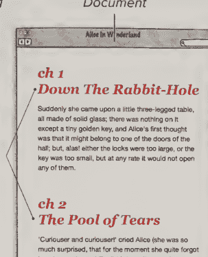

表 1.1 显示了你可以使用 CSS 进行的一些操作，以及在书中哪里可以更多信息。

## CSS 是如何工作的？

当访问者通过输入地址或点击链接加载你的某个 Web 页面时，服务器（存储 Web 页面的计算机）会将 HTML 文件发送给访问者的计算机，以及该 HTML 文件链接或嵌入的任何文件。无论 CSS 代码位于何处，访问者的浏览器都会解释并将其应用于 HTML，使用该浏览器的渲染引擎来渲染 Web 页面，然后显示在浏览器窗口中。

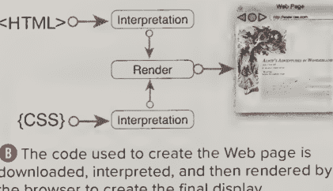

## 表 1.1 CSS 属性

| 属性 | 你控制的内容 | 更多信息请参阅： |
|---|---|---|
| 背景 (Background) | 页面背后或页面上单个元素后的颜色或图像 | 第 7 章 |
| 盒 (Box) | 外边距、内边距、轮廓、边框、宽度、高度 | 第 10 章 |
| 颜色 (Color) | 文本颜色 | 第 7 章 |
| 字体 (Font) | 字母形状、大小、粗体、斜体 | 第 5 章 |
| 生成内容 (Generated Content) | 计数和引用 | 第 9 章 |
| 列表 (Lists) | 项目符号和编号 | 第 8 章 |
| 表 (Table) | 表边框、外边距、标题 | 第 8 章 |
| 文本 (Text) | 字间距、对齐、大小写 | 第 6 章 |
| 变换 (Transformations) | 移动、旋转、倾斜 | 第 12 章 |
| 过渡 (Transitions) | 随时间改变样式 | 第 12 章 |
| 界面 (UI) | 光标 | 第 9 章 |
| 视觉效果 (Visual effect) | 可见性、可见区域、透明度 | 第 11 章 |
| 视觉格式 (Visual formatting) | 位置和放置 | 第 11 章 |

# 爱丽丝在仙境游游记

刘易·卡罗尔 (Lewis Carroll)

## 第一章

### 掉进兔子洞

爱丽丝开始厌倦地坐在岸边姐姐姐姐旁，无事可做，只能看着姐姐正在读的书，那书上既没有图片也没有对话，“太无聊了，”爱丽丝大声说道。

她心想，一本没有图片或对话的书能用来做什么呢，或者这样一本书有什么用呢——

因为她偶尔会偷看一眼那本书，但她已经变得非常困了，只想闭上眼睛一小会儿，睡过去。

浏览器渲染引擎的解释正是你头疼的开始。W3C 付了巨大努力创建了规范，浏览器开发者应据此渲染 Web 代码。尽管如此，漏洞、遗漏和误读仍然会出现，这意味着没有两个浏览器会以完全相同的方式渲染 Web 页面。对于大多数用户来说，这些差异是不被察觉的，但偶尔这些差异会非常明显且清晰，以至于你必须做一些额外工作才能让页面在最广泛的浏览器中看起来正常。

- 一个使用 CSS 为背景添加图像的 HTML 页面。将内容向下并向右移动，并对文本进行格式化。

# 爱丽丝在仙境游游记

刘易·卡罗尔 (Lewis Carroll)

## 第一章

### 掉进兔子洞

爱丽丝开始厌倦地坐在岸边姐姐姐姐旁，无事可做，只能看着姐姐正在读的书，那书上既没有图片也没有对话，“太无聊了，”爱丽丝大声说道。

所以她在心里考虑（她可以这样做，因为一天让她感到非常疲惫），一本没有图片或对话的书能用来做什么呢，或者这样一本书有什么用呢——

因为她偶尔会偷看一眼那本书，但她已经变得非常困了，只想闭上眼睛一小会儿，睡过去。

正当她要这么做时，她看到一只白兔子朝她跑来，它的背心口袋里揣着一只表，她惊讶得没有站起来追它；但当一只粉粉色眼睛的白兔子紧从她身边跑过时。

在没有 CSS 帮助的情况下显示相同的代码。页面仍然显示，但没有了格式化。

> 你总是面临着页面在没有 CSS 的情况下渲染的可能性。


## CSS 的演变

多年来，CSS 在 W3C 的指导下演变成了现在的形态，但这一过程往往是不稳定的。这导致了实现上的均衡，某些浏览器领先。

浏览器渲染引擎的解释正是你头疼的开始。W3C 付了巨大努力创建了规范，浏览器开发者应据此渲染 Web 代码。尽管如此，漏洞、遗漏和误读仍然会出现，这意味着没有两个浏览器会以完全相同的方式渲染 Web 页面。对于大多数用户来说，这些差异是不被察觉的，但偶尔这些差异会非常明显且清晰，以至于你必须做一些额外工作才能让页面在最广泛的浏览器中看起来正常。

- 一个使用 CSS 为背景添加图像的 HTML 页面。将内容向下并向右移动，并对文本进行格式化。


## CSS 1 级 (CSS1)

W3C 在 1996 年发布了 CSS 的第一个版本。这个早期版本包含了与 CSS 相关的核心功能，例如格式化文本、设置字体和设置边距。Netscape 4 和 Internet Explorer 3 和 4 支持 Level 1。

## CSS 2 级 (CSS2)

CSS2 规范于 1998 年发布，被浏览器制造商最广泛采用。Level 2 包含了前两个版本的所有属性，并增加了对国际可访问性的重视以及指定媒体特定 CSS 的能力。


2006 年，W3C 发布了一个更新版本：`CSS Level 2.1`，它纠正了某些错误，澄清了一些问题，并包含了某些浏览器中已经实现的功能规范。`CSS2.1` 已经有效地取代了 `CSS2`。

# CSS 3 级 (CSS3)

与 `CSS1` 和 `CSS2` 不同，不存在一个单一、全面的 `CSS3`。相反，与其一次性发布整个规范，`CSS` 工作组已将规范拆分为系列模块；每个模块都有自己的开发时间表。

> 提示：虽然了解 `CSS` 版本之间的差异可能很有趣，但对于在 Web 上使用样式并不是必须的。你真正需要的是为你设计的浏览器支持哪些样式。虽然现代浏览器支持大部分 `CSS Level 2` 规范，但旧浏览器支持旧 `CSS` 版本的组合。附录 A 详细介绍了每个浏览器支持的 `CSS` 属性。

## CSS 和 HTML

当 `HTML` 最初创建时

以 `<strong>` 标签为例。在 `HTML` 中，这个常用标签只做且仅做一件事：它让文本变得“更”，通常是通过将其加粗来实现的。然而，使用 `CSS`，你可以“重新定义” `<strong>` 标签，使其不仅能让文本加粗，还能以全大写显示并使用特定字体，以增加强调程度。你甚至可以让 `<strong>` 标签不让文本加粗。

尽管 `HTML` 和 `CSS` 在多年来都在不断演进，但它们很少同步演进。相反，每个标准都基本上遵循着自己的路径。然而，`CSS3` 和 `HTML5` 将在未来几年内成为主流，为现代网站创建新的基础和框架。

`CSS` 的力量源于它能够混合并匹配来自不同来源的规则，以根据你的精确需求定制 Web 页面布局。在某些方面，它类似于计算机编程——这并不令人意外，因为其中很多内容是由程序员而不是设计师创建的。但一旦你掌握了它，“说”`CSS` 将将变得像组合句子一样自然。

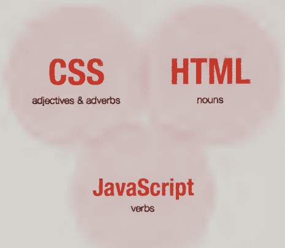

- 三大核心 Web 技术（`HTML`、`CSS` 和 `JavaScript`）的工作方式类似于词性。`HTML` 提供名词，`CSS` 提供形容词和副词，而 `JavaScript` 添加动词。

## CSS 规则的类型

层叠样式表最棒的一点是它们设置起来异常简单。它们不需要插件或复杂的软件——只需要包含规则的文本文件。`CSS` 规则定义了 `HTML` 应该看起来什么样以及在浏览器窗口中如何表现。

`CSS` 规则分为三种，每种都有特定的用途：

- *HTML 选择器*。`HTML` 标签的文本部分被称为选择器。例如，`h1` 是 `<h1>` 标签的选择器。`HTML` 选择器用于 `CSS` 规则中用于重新定义标签的显示方式（参见第 3 章的“(重新)定义 `HTML` 标签”）。例如：

```css
h1 { color: red; }
```

将样式化：

```html
<h1>...</h1>
```

- *类名（Class）*。`class` 是一种“自由代理”规则，可以根据你的意愿应用于任何 `HTML` 标签。你可以为类命名任何你喜欢的名称。由于类可以应用于多个 `HTML` 标签，因此是最通用的选择器类型（参见第 3 章的“定义复用类”）。例如：

```css
.myClass { font: bold 1.25em; }
```

将样式化：

```html
<h1 class="myClass">...</h1>
```

- *ID*。与类选择器类似，`ID` 规则可以应用于任何 `HTML` 标签。`ID` 选择器应该仅应用于特定页面上的某个特定 `HTML` 标签，以创建一个供 `JavaScript` 函数使用的对象。例如：

```css
#myObject1 { position: absolute;
  top: '10px'; }
```

将样式化：

```html
<h1 id="myObject1"></h1>
```

## 什么是万维网联盟？

万维网联盟（`w.w3.org`）是一个组织，它制定了许多浏览器开发者最终用于创建其产品的标准，包括 `HTML` 和 `CSS`，但 `JavaScript` 例除外。

`W3C` 由全球 400 多个成员组织组成。这些组织包括技术产品和服务的供应商、内容提供者、企业用户、研究实验室、标准机构和政府。

根据其网站，`W3C` 有四个目标：

- *人人享有 Web（Web for Everyone）*。通过促进考虑到我们各大大陆用户在文化、教育、能力、物质资源和身体限制巨大差异的技术，让所有人都能访问 Web。

- *无处不在 Web（Web on Everything）*。允许所有设备轻松访问 Web。虽然大多数访问仍然通过桌面或笔记本电脑进行，但越来越多的设备可以访问 Web。

- *知识库（Knowledge Base）*。开发一个允许每个用户充分利用 Web 上可用资源的环境。

- *信任与信心（Trust and Confidence）*。通过仔细考虑该技术提出的新型法律、商业和社会问题引导 Web 的发展。

## CSS 规则的组成部分

```css
selector { property: value; }
```

所有规则，无论其位置或类型，都具有以下结构元素：

- 选择器（Selectors）是标识规则的字母数字字符。选择器可以是 `HTML` 标签选择器、类选择器、`ID` 选择器、通用选择器（第 3 章中描述）或这些基本选择器的组合，以创建基于上下文的样式（第 4 章中讨论）。

- 属性（Properties）标识正在定义的内容。有几十个属性可用；每个属性负责页面内容行为和外观的一个方面。

- 值（Values）被分配给属性以定义其性质。值可以是诸如 `"red"` 之类的关键字、数字或百分比。使用的值类型完全取决于它被赋值的属性。

在选择器之后是属性及其值，它们合称为一个声明（declaration）。单条 `CSS` 规则可以有多个由分号（`;`）隔开的声明。

### 浏览器 CSS 扩展

除了 `W3C` 指定指定的 `CSS` 属性外，浏览器开发者偶尔会引入浏览器特定的属性。这通常是出于两个原因之一：

- 规范仍在开发中，但浏览器想要开始使用它。

- 浏览器开发者想尝试新点子，但不想等待。

`CSS` 规则的基本语法从选择器（`HTML`、类或 `ID`）开始。然后添加属性、一个值和一个分号，它们合称为一个声明。只要它们用分号隔开，你可以添加任意数量的定义。

有时官方规范的确切语法与为特定浏览器创建的“沙盒”版本略有不同。

为了避免混淆并确保 `CSS` 代码的向前兼容性，每个渲染引擎都采用了自己的前缀来使用该浏览器特有的 `CSS` 属性。每个浏览器的前缀如表 1.2。

当不同的浏览器推广自己的解决方案时，这些 `CSS` 扩展有时会冲突和冲突。好消息是，由于 `CSS` 的特性，你可以包含每个浏览器的属性版本，这样浏览器就会使用适合它的版本。

在整书中，我在适当的情况下包含了浏览器扩展，你可以确保你的样式具有最广泛的互操作性。

```css
selector { -moz-property: value;
-webkit-property: value;
-o-property: value;
-ms-property: value;
property: value; }
```

- 所有的浏览器 `CSS` 扩展都可以作为可用项包含，以确保如果特定浏览器支持，则样式会被应用。

> 虽然你不需要在列表的最后一个定义中包含分号，但经验表明添加这个分号可以防止未来的麻烦问题。例如，如果你以后决定向规则中添加新定义，但忘记在添加之前加上需要的分号，你可能会导致规则完全失败。更糟糕的是，不仅该定义将失败，而且规则中的所有定义都无法被使用。

> 大多数浏览器制造商在采用官方版本后的两个版本内会放弃样式的扩展。这种做法允许设计师在他们的样式表停止工作之前赶上。

> 不要将 `HTML` 标签的选择器与它的属性混淆。在下面的标签中，例如 `img` 是选择器，`src` 是属性：

```html

```

| 扩展 | 渲染引擎 | 浏览器 | 示例 |
|---|---|---|---|
| -moz- | Mozilla | Firefox, Camino | -moz-border-radius |
| -ms- | Trident | Internet Explorer | -ms-layout-grid |
| -o- | Presto | Opera | -o-border-radius |
| -webkit- | Webkit | Chrome, Safari | -webkit-border-radius |

## CSS3 新特性

“`CSS3` 新特性”标记。

对于 Web 设计师来说，这是一个特别令人兴奋的时代，我们将获得一套完全全新的工具箱。`CSS3` 中的许多新功能已经准备就绪（或很快就会发布），它们将激发你的创造力。

这本简明的著作涵盖了 `CSS3` 的各个领域，其中大部分内容与 `CSS2/2.1` 相比保持不变。如果你是 `CSS` 的老手，请寻找“`CSS3` 新特性”标记，它将帮助你快速找到相关内容。

以下是新内容的简要回顾：

- 边界（Borders）——单侧多个边框颜色、边界图像和圆角。

- 背景（Backgrounds）——单个元素可以添加多个背景，背景的定位可以更精确，背景可以扩展并裁剪到框的内部或外部，并且背景可以调整大小。

- 颜色（Color）——颜色透明度设置、背景渐变和 `HSL` 颜色值。

- 文本（Text）——文本阴影、文本溢出和换行。

- 变换（Transformations）——在 2D 或 3D 空间中缩放、倾斜、移动和旋转元素。

- 过渡（Transitions）——简单的动态样式过渡。

- 盒子（Box）——添加投影投影、放置用户可调整大小的框、分别在水平和垂直方向上设置溢出、使用轮廓偏移（outline offset）设置轮廓与边界之间的空间、应用盒模型规范来设置宽度和高度如何应用于框。

- 内容样式（Content-Styles）——可以为元素添加内容。

- 透明度（Opacity）——元素可以是透明的。

- 媒体样式（Media-Style）——根据视口大小、颜色、宽高比、分辨率和其他重要的设计考虑设置页面。

- Web 字体（Web fonts）——更新并扩展了链接字体供设计使用的能力。

不过，`CSS3` 规范中的所有内容并不已准备好使用（参见“`CSS3` 与 Internet Explorer 9 的承诺”）。如果现在开始使用新功能为时过早，我在某些章节的末尾添加了一个名为“即将到来!”（Coming Soon！）的章节，快速概述了未来的预期内容。

### CSS3 与 Internet Explorer 9 的承诺

目前，Internet Explorer 占浏览器使用率的 70% 左右。大部分是 `IE8` 用户；稍少的是 `IE7` 用户；还有一小部分但不可忽视的 `IE6` 用户。

这些浏览器都不支持 `CSS3`。

你可以使用一些通通方案。偶尔，针对 `IE` 的代码会执行与 `CSS3` 代码类似的功能，在少数（罕见）情况下，某个存在一段时间的 `CSS3` 属性已经进入了 `IE8`。但在大多数情况下，如果你使用 `CSS3`，那些使用 Internet Explorer 的观众群体将被冷在门外。

但等一下，地平线上出现的是什么？是 `IE9`，微软已双重保密地誓言，它将完全、彻底地支持 `CSS3` 规范中的每一个细节，或者至少是重要的部分。这是一个极好的消息，但到撰写时，`IE9` 仍处于 Beta 阶段，还没有明确的发布日期。而且在它发布后，在 `IE6`、`7` 和 `8` 消失之前，还需要一段时间的时间。

目前，我建议你仅将 `CSS3` 作为一种设计增强，除非你确定受众不会使用 Internet Explorer——例如，如果你正在开发 `iPhone` 应用程序。关于设计增强这一概念将在第 12 章中进行详细解释。

`HTML5` 是前端 Web 开发的下一个大事。尽管它仍在开发中，且尚未在某些浏览器（最显著的是 Internet Explorer）中实现，但你可以使用一些通通方案，而且 `HTML5` 已经极大努力保持向后兼容性。只需少量技巧，你今天就可以实现 `HTML5` 的同时确保它在旧版浏览器上正常工作。

让我们看看标记语言是什么，以及 `HTML5` 如何融入新世界秩序。

## 什么是 HTML？

超文本标记语言（HyperText Markup Language）简单来说是一套定义页面元素的标签系统，这些元素创建用于 Web 的文档结构。例如，你取一段文本并添加 `HTML` 标签，如下：

```
<h1>爱丽丝梦游仙境</h1>
```

在这里，你使用了 `<h1>` 标签来创建页面最重要的标题：1 级标题。不同的标签用于标记不同类型的元素，且标签可以放置在其他标签内部。例如：

```
<p>我想知道我是否会直接掉进<em><em>穿过地球</em></p>
```

这些标签告诉浏览器文本是一个段落，而“through（通过）”一词应该以强调的方式呈现，可能是通过以斜体显示。

我想知道我是否会直接掉进地心去！

- A 没有任何任何标记的纯文本。

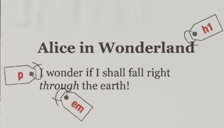

- B 应用了 `HTML` 标签的相同文本内容。

## 什么是标记语言？

`HTML` 用于标记 Web 页面的结构，但其他标记语言也被用于 Web 及其以外的计算机。

标准通用标记语言（`SGML`）是用于打印和互联网的大多数标记语言的祖先。`SGML` 是用于定义文档结构和外观的国际标准。为了各种文档类型和各种专业领域（如物理、会计和化学），创建了多个 `SGML`。`HTML` 和 `XHTML` 是 Web 版本的 `SGML` 主要版本。

## 基础 HTML 文档结构

所有 `HTML` 文档都有相似的基础结构，包括以下元素：

- `<!DOCTYPE>` 设置文档正在使用的标记语言类型（表 2.4）。包含此内容是重要的，以便浏览器能够快速准确地解释 `HTML` 代码。

- `<head>` 包含关于页面的信息，如标题和元标记（meta tags）。你还应该在此区域放置指向外部 `CSS` 和 `JavaScript` 文件的链接。`head` 不应与页眉（header）混淆。页面 `head` 中的没有任何内容会被直接显示。

- `<body>` 包含你在浏览器窗口中实际看到的元素，导航、页眉、段落。

## HTML 属性

可以通过在标签内放置属性来修改 `HTML` 元素。某些属性是可选的，有些提高元素的性能，而有些是元素正常工作所必需的。例如，锚点标签 `<a>` 使用 `href` 属性来定义链接的指向位置：

```
<a href="http://www.example.com">链接</a>
```

属性还用于通过 `style`、`class` 或 `id` 属性将 `HTML` 元素连接到样式：

```
<p style="color: red;">文本</p>
<p class="highlight">文本</p>
<p id="name01">文本</p>
```

每个标签都有一个或多个可以应用的属性。当我们根据属性值使用 `CSS` 时（如第 4 章所述），这些属性变得尤为重要。

## HTML 和 CSS

大多数 `HTML` 标签都有与其相关的浏览器继承样式。这些默认样式实际上是由 开发者定义的。由于浏览器开发者添加了它们，你需要记住它们会影响你的设计。例如，`<em>` 标签在大多数浏览器中会变为斜体。好消息是你可以使用 `CSS` 来覆盖浏览器样式。

在大多数情况下，默认样式在浏览器之间是一致的，尽管存在一些明显的差异，特别是在边距和字体大小方面。许多设计师将通过重置许多默认值来“从零开始”，参见第 14 章。

## 什么是 SVG？

可缩矢量图形（`SVG`）格式是一种在 Web 上创建图形的方法（参见 `w3.org/Graphics/SVG/`）。像 Flash 一样，`SVG` 数据不是绘制图中的每个点，而是描述它们两个点之间的直线或曲线。

尽管它在浏览器普及率方面仍然落后于 Flash，但 `SVG` 在 Firefox、Safari 和 Chrome 中原生支持。阻碍的是微软的 Internet Explorer，它直到版本 9 才支持 `SVG`。（Adobe 在 `www.adobe.com/svg` 提供了 `IE` 插件）。

与使用编辑器创建文件并隐藏大部分图形代码的 Flash 不同，`SVG` 是一种可以自由读取的标记语言。

## HTML 元素的类型

`HTML` 包含大量的元素，每个元素都有其特定的标签，用于构建文档结构。元素可以分为两类：

- 内联元素（Inline elements）与元素没有关联换行符。

表 2.1 列出了 `CSS` 可以使用的内联标签选择器。

| 选择器 | HTML 用途 | 选择器 | HTML 用途 |
|---|---|---|---|
| a | 锚点链接 | label | 表单元素的标签 |
| abbr | 缩写词 | legend | 字段组中的标题 |
| address | 物理地址 | link | 资源引用 |
| area | 图像地图中的区域 | mark* | 标记的文本 |
| audio* | 音频内容 | meter* | 测量范围 |
| b* | 粗体文本 | nav* | 导航链接 |
| cite | 短篇引用 | optgroup | 选项组 |
| code | 代码文本 | option | 下拉列表中的选项 |
| del | 已删除的文本 | q | 短引用 |
| details* | 元素的详情 | small | 小字字体 |
| dfn | 定义术 | select | 可选择列表 |
| command* | 命令按钮 | source | 媒体资源 |
| datalist* | 下拉列表 | span | 本地样式格式化 |
| em | 强调 | strong | 强强调 |
| font | 字体外观 | sub | |
| i | 斜体 | summary* | 详情头部 |
| iframe | 内联子窗口 | sup | 上标 |
| img | 图像嵌入 | tbody | 表格主体 |
| input | 输入字段 | td | 表格数据 |
| ins | 插入的文本 | time* | 日期/时间 |
| keygen* | 表单中生成的密钥 | var | 变量 |
| kbd | 键盘文本 | | |

* `HTML5` 中新增的

### 表 2.2 块级元素的 HTML 选择器

| 选择器 | HTML 用途 | 选择器 | HTML 用途 |


| :--- | :--- | :--- | :--- |

| article* | 文章内容 | header* | 章节或页面的页眉 |

| aside* | 侧边栏内容 | hgroup* | 分组头部信息 |

| blockquote | 长引用 | hr | 水平线 |

| body | 页面主体 | li | 列表项 |

| br | 换行 | map | 图像地图 |

| button | 按钮 | object | 对象嵌入 |

| canvas* | 绘图区域 | ol | 有序列表 |

| caption | 表格标题 | output* | 表单输出 |

| col | 表格列 | p | 段落 |

| colgroup | 表格列组 | pre | 预格式文本 |

| dd | 定义描述 | progress* | 显示任务消耗的进度 |

| div | 分区 | section* | Web 页面中的章节 |

| dl | 定义列表 | table | 表格 |

| dt | 定义术 | tbody | 表格主体 |

| embed | 外部内容 | textarea | 表单文本输入区域 |

| fieldset | 字段组标签 | tfoot | 表格页脚 |

| figcaption* | 图注 | th | 表格头部 |

| figure* | 分组媒体内容和标题 | thead | 表格头部 |

| footer* | 章节或页面页脚 | tr | 表格行 |

| form | 输入表单 | ul | 无序列表 |

| h1–6 | 标题级别 1–6 | video* | 视频播放器 |

| head | 页面信息 | | |

* HTML5 中新增的

并不是所有的 CSS 定义都能应用到所有的 HTML 元素。特定的 CSS 属性是否可以应用，取决于元素的性质。在大多数情况下，一个属性是否可以应用是显而易见的。

例如，你不会期望缩进段落首行的 `text-indent` 属性应用到如 `<b>` 这样的内联标签；事实上，它是无法应用的。当你在这方面需要帮助时，请查看附录 A 以确定适用于特定 HTML 元素的 CSS 属性。

# HTML5 的演变

HTML5 是 Web 标记的下一步并将取代 XHTML。虽然 XHTML2 开发了近八年，但它在 2009 年被搁置，取而代之的是 HTML5。

为了理解这是如何发生的，让我们回到上世纪末 Web 的黄金时代——确切地说是 1997 年。那还是 Web 1.0 的世界，尽管我们当时还不知道称呼它。互联网泡沫开始膨胀，每个人都在使用 Netscape Navigator 冲浪，直到世界维网联盟（W3C）引入了 HTML 4.0 (HTML4)。

HTML4 是一次巨大的改进，因为它第一次是由标准机构创建的，该机构让每个人都有参与机会，并相信 Web 页面在所有浏览器中的显示应该是相同的。

## 接着是 XHTML

XHTML1（发布于 2001 年）是使用 XML 对 HTML 4.0 的重写，旨在将 XML 的功能引入 Web 开发。XHTML 使用 XML 文档类型。XHTML 采用了与 HTML 相同的所有标签，但代码仍然可以在不支持 XML 的浏览器中运行。

但等等，人们很快发现即使是 XHTML1 也不足以让 Web 演进到二十世纪，开启语义化页面的黄金时代。XHTML2 主要是作为一种过渡技术，将 Web 从其相对静态的“页面”本质演变为一个真正的交互且通用的环境。从一开始开始，事情就出了问题。

## 接着是 HTML5

2003 年 6 月，HTML5 作为 Web 超文本应用小组（WHATWG）诞生了生命，这是一个与 W3C 无关的组织。相反，这个独立的小组对 XHTML 缓慢的速度和方向感到沮丧，开始开发一种新的标准，这种标准将向下兼容，并解决许多实际问题。

在几年里，两种语言并行开发。由于看到 HTML5 的进展比 XHTML 更快，W3C 在 2007 年采纳了它作为新的标准，发布了“发布草案”。

### 2.3 HTML5 与 XHTML5

| | XHTML5 | HTML5 |
|---|---|---|
| 标签大小写 | 小写 | 大写或小写 |
| 闭合标签 | 强制 | 可选 |
| 自闭标签 | 强制 | 可选 |
| MIME 类型 | application/xml 或 application/xhtml+xml | text/html |
| 错误 | 致命 | 不致命 |

## 它是 HTML5 还是 XHTML？

尽管 XHTML 消失了，但统一 XML 和 HTML 的需求并没有消失。因此，如果你了解 XML，学习 HTML5 会与 XHTML 相似。它们处理标签的主要差异见表 2.3。

使用 HTML5 还是 XHTML5 取决你的决定。但诚实说，我喜欢 HTML5 的包容性，这也是我在本书中使用它的原因。

## HTML5 中缺少什么？

HTML5 包含了多项变化。但如果你想开始使用，也需要知道哪些是不可用的。框架标签——`frameset`、`frame`、`noframes`——已被删除，但 `iframe` 仍然可用。大多数演示标签已被删除——如 `basefont`、`big`、`center`、`font`、`s`、`strike`、`tt`、`u`——尽管 `b`（粗体）和 `i`（斜体）仍然保留，关于这一决定存在争议。

此外，与 XHTML 不同，`` 和 `<br>` 等独立标签不需要自闭合。所以，与其使用 `<br />`，回归到了 `<br>`。真的，这难道不简单吗？

## HTML 有什么新？

HTML5 对 Web 页面进行了重要的结构性改变。例如，你可以指定头部、页脚和侧边栏等常见元素。此外，HTML5 原生（即浏览器内置）引入了以前需要插件或脚本的功能，以新元素和 API 的形式出现：

- 元素 元素允许可脚本的位图编辑。

- 文档编辑允许用户直接在 Web 页面上编辑内容。

- Web 表单自校验并包含更多输入类型。

- 拖放允许在无脚本的情况下操作元素。

- 音频和视频播放无需插件即可原生控制媒体文件。

- 新的结构元素消除了使用 `<div>` 标签配合类和 ID 来创建头部和页脚等常见元素的负担。

HTML5 是 Web 设计和开发的舞台。许多浏览器已经开始支持它的部分功能，尽管它还不是一个完整的标准。尽管如此，一个显著（且频繁）的支持反对主义者是 Internet Explorer。然而，微软承诺在 IE 9 中引入 HTML5 支持。

## HTML5 结构是如何工作的？

我告诉你一个小秘密：你今天起就可以使用 HTML5 语法来构建你的 Web 页面，并将其与 CSS3（或旧版本的 CSS）配合。为了理解它是如何工作的，让我们来看看 HTML5 的原理。

HTML5 最显著的变化之一是增加了结构化元素，这将极大地增强 Web 标记背后的语义化哲学。大多数新的结构标签都是自言自足的，但少数需要详细说明：

- `<header>` 可用于页面页头、节头部、文章头部或侧边栏头部。

- `<nav>` 可以独立包含，也可以作为页头和/或页脚的一部分。

- `<section>` 定义页面的主要部分，通常是包含文章（article）的部分。

- `<article>` 是独立的博客文章或博客文章摘要。

- `<figure>` 用于包含嵌入页面中的图像、音频和视频。

- `<dialog>` 代替 `<dl>` 元素来包含对话记录。

- `<aside>` 用于页面上的辅助性内容，如相关链接、次级导航，当然还有广告。

- `<footer>` 与 `<header>` 类似，可以放在其他元素的底部。

遗憾的是，并不是所有的浏览器在没有额外帮助的情况下都能理解 HTML5。

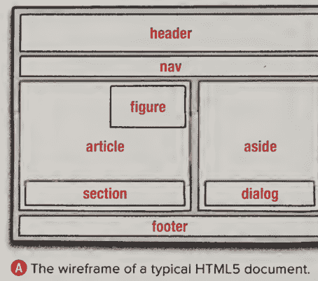

## 2.1 HTML5page.html——展示了一个典型的 HTML5 页面，该页面使用页头、导航、文章和页脚构建布局网格。

## 现在使用 HTML5 结构

```html
<!DOCTYPE html>
<html lang="en-US">
<head>
<meta charset="UTF-8">
<title>HTML5</title>
</head>
<body>
<header>
<nav></nav>
</header>
<section>
<article>
<header></header>
<figure>
<footer></</footer>
</article>
<dialog></dialog>
</section>
<aside></aside>
<footer</footer></footer>
</body>
</html>
```

HTML5 在大多数当前的浏览器中尚未完全实现（可能还需要一段时间时间才能完全普及），但你现在就可以按照一些步骤为未来做准备。

尽管 CSS 可以应用于今天使用的任何 HTML 版本——包括 XHTML 1 和 HTML 4.01——但我将在本书中贯穿使用 HTML5。本书绝不是 HTML 5 的详尽资源。然而，我想向你展示如何设置我将在后续章节中引用的 Web 文档。

## 设置基础 HTML5 文档：

1. 添加 HTML5 文档类型（表 2.4）。注意，新的 `!DOCTYPE HTML` 比今天使用的复杂且难以解析的 HTML 和 XHTML 文档类型（代码 2.1）要简单得多。它仅仅是告诉浏览器使用 HTML。

```html
<!DOCTYPE html>
```

| 标记语言 | Doctype 代码 |
|---|---|
| HTML 4.01 Loose | <!DOCTYPE HTML PUBLIC "-//W3C/DTD HTML 4.01 Transitional//EN" "http://www.w3.org/TR/html4/loose.dtd" |
| HTML 4.01 Strict | <!DOCTYPE HTML PUBLIC "-//W3C/DTD HTML 4.01//EN" "http://www.w3.org/TR/html4/strict.dtd" |
| HTML 4.01 Frameset | <!DOCTYPE HTML PUBLIC "-//W3C/DTD HTML 4.01 Frameset//EN" "http://www.w3.org/TR/html4/frameset.dtd" |
| XHTML1 Transitional | <!DOCTYPE HTML PUBLIC "-//W3C/DTD HTML 1.0 Transitional//EN" "http://www.w3.org/TR/xhtml1/xhtml1-transitional.dtd" |
| XHTML1 Strict | <!DOCTYPE HTML PUBLIC "-//W3C/DTD HTML 1.0 Strict//EN" "http://www.w3.org/TR/xhtml1/xhtml1-strict.dtd" |
| XHTML1 Frameset | <!DOCTYPE HTML PUBLIC "-//W3C/DTD HTML 1.0 Frameset//EN" "http://www.w3.org/TR/xhtml1/xhtml1-frameset.dtd" |
| HTML5/XHTML5 | <!DOCTYPE html> |

2. 添加 `<html>` 标签，包括预期的语言和语言方向（通常从左到右的文本使用 `ltr`）。

`<html dir="ltr" lang="en-US">...`

`</html>`

3. 在文档中添加 `<head>`，你可以在这里指定关于此文档的信息，包括标题和文本使用的字符集。我建议使用 UTF-8 以获得最佳效果。

`<head>...</head>`

4. 在文档中添加 `<body>`。这是添加所有要显示内容的地方。我建议为你网站中的每个 `body` 元素至少提供一个唯一的类名，以及其他用于标识其在站点中位置的属性。这样做，你可以针对每个页面和每个部分添加样式，而无需包含多个 CSS 文件。

`<body class="section Name page">...`

5. 为你的页面添加 `<header>` 标签。这是你将放置页面页头的地方。

`<header>...</header>`

6. 为你的网站添加 `<nav>` 标签。

`<nav>...</nav>`

## HTML5 何时能就绪？

需要注意的是，广泛采用直到 2012 年尚未完成（当时它还是一个工作草案）。许多浏览器目前支持部分 HTML5 功能。那么，你该怎么办？

虽然 Internet Explorer 不认识 HTML5 标签，但有一个使用 JavaScript 创建元素的局部修复方案（或权宜之计）：

```javascript
document.createElement('header');
```

7. 为你的 Web 页面添加一个或 `<article>` 标签。

`<article>...</article>`

8. 添加 `<aside>` 标签，有时被称为侧边栏。

`<aside>...</aside>`

9. 最后，在页面底部添加 `<footer>` 标签。

`<footer>...</footer>`

## 在 Internet Explorer 中实现 HTML5

为了方便添加这些新标签，请创建一个外部 JavaScript 文件（代码 2.2），并使用 IE 条件（代码 2.3）从你的 HTML 文档中引用它，你将在第 13 节详细探讨。

```javascript
*** CSS Chapter 2 - HTML5forIE.js ***
document.createElement('abbr');
document.createElement('article');
document.createElement('aside');
document.createElement('audio');
document.createElement('bb');
document.createElement('canvas');
document.createElement('center');
document.createElement('datalist');
document.createElement('details');
document.createElement('dialog');
document.createElement('eventsource');
document.createElement('figure');
document.createElement('footer');
document.createElement('header');
document.createElement('group');
document.createElement('mark');
document.createElement('menu');
document.createElement('meter');
document.createElement('nav');
document.createElement('output');
document.createElement('progress');
document.createElement('section');
document.createElement('time');
document.createElement('video');
```

## 为什么要使用 Doctype？

如果不使用 doctype，现代浏览器将被强制进入怪异模式（Quirks Mode）。对于创建新的 Web 页面来说，这是一个糟糕的情况，因为把代码的解释权完全交给了浏览裁量，这会导致大量的显示不一致。

如果不在 Web 页面中包含 doctype，新的浏览器可能无法识别你的所有代码。

## 2.3 HTML5page.html—包含指向代码 2.2 中 JavaScript 的链接

```html
<!DOCTYPE html>
<html lang="ltr" dir="en-US">
<head>
  <meta charset="utf-8">
  <title>HTML5</title>
  <!--if IE -->
  <script src="HTML5forIE.js"
       type="text/javascript"></script>
  <![endif]-->
</head>
<body class="pageName">
  <header></header>
  <nav></nav>
  <article>
    <figure>
      <section></section>
    </figure>
  </article>
  <aside>
    <dialog></dialog>
  </aside>
  <footer></footer>
</body>
</html>
```

> 提示：如果你想把它弄得更花哨一点，可以将代码 2.2 替换为代码 2.4 中的 JavaScript 循环。效果相同，但更加复杂。

> 提示：示例中的文档结构是为了满足你的需求而设计的，但你不需要严格遵守标签放置和嵌套的硬性规定。你可以将导航放在头部、页脚、文章或侧边栏中。同样，图形可以放在侧边栏或头部。之前的示例只是一个基础的 Web 页面结构。

## 2.4 HTML5forIE.js—这与代码 2.2 的相同，但使用了 JavaScript 循环，使得代码更加紧凑。


```javascript
*** CSS VOQ - Chapter 2 - HTML5forIE.js ***
(function(){
if(!*cc_on@/))return;var e =
+ abbr,article,aside,audio,bb,canvas,
+ datagrid,datalist,details,dialog,
+ eventsource,footer,header,header,
+ mark,menu,meter,nav,output,progress,
+ section,time,video".split(',');
+ for (var i=0;i<e.length;i++)
+ {document.createElement(e[i])}
})()
```

## 2.5 汇总

- 1. 创建一个新的 HTML 文件。我建议使用 Mac 上的 `TextEdit` 或 Windows 上的 `SimpleText`。我不推荐 `Microsoft Word`，因为它可能会添加产生问题的隐藏代码。
- 2. 添加 `doctype`。对于我们的目的，使用 HTML5 `doctype` 是正确的。
- 3. 添加 `<html>...</html>` 标签。可选情况下，你还可以添加语言和方向属性。
- 4. 添加 `<head>...</head>` 标签。头部是存放所有关于页面信息的地方。
- 5. 添加 `<title>...</title>` 标签。这是你放置 Web 页面标题的地方，标题将显示在 Windows 标题栏中。
- 6. 将所需的任何 `<meta>` 标签放入头部。`Meta` 标签提供了关于页的信息，例如作者、语言和版权。
- 7. 添加一个指向 IE JavaScript HTML shiv 的链接。你需要将其创建一个外部文件并在此到此处。如果你需要该代码，可以从 `www.speaking-in-styles.com/ie5shiv` 获取。
- 8. 添加 `<body>...</body>` 标签。主体是 Web 页面上显示的所有内容所在。在随后的章节中，你还将学习为此标签添加类和/或 ID，以帮助它与网站上的其他页面区分来。
- 9. 将其保存为 `index.html`。你现在有了一个空的 HTML5 Web 文档，准备好使用你的 CSS3。

# 3

## CSS 基础

CSS 让你控制文档外观的所有元素——字体、文本、颜色、背景、尺寸、边框、间距、定位、视觉效果、表格和列表。然而，使用 CSS 进行样式的真正威力在于，你只需要更改几行 CSS 代码就可以更改网站上每个页面的外观。

通过巧妙使用 CSS，你可以从简单的文本页面开始，通过添加视觉设计和交互，将其转化为网络环境。

## 本章内容

- 基础 CSS 选择器 34
- 内联：为 HTML 标签添加样式 35
- 嵌入：为 Web 页面添加样式 38
- 外部：为网站添加样式 41
- （重）定义 HTML 标签 48
- 定义可重用类名 51
- 定义唯一 ID 55
- 定义通用样式 59
- 分组：使用相同样式定义元素 62
- 在 CSS 中添加注释 66
- 汇总 68

## 基础 CSS 选择器

CSS 的工作原理是使用 CSS 规则定义 Web 页面元素的样式。规则通过选择器应用，选择器有三种基本类型：HTML 选择器用于引用特定标签；类选择器单独应用于元素；或者 ID 选择器应用于页面上的单个元素（见表 3.1）。你将不断使用这三个基础选择器，它们是最好的开始的切入点。在第 4 章中，你将学习使用其他选择器来创建更具选择性的样式。

表格 3.1 基础选择器

| 格式 | 选择器名称 | 样式化哪些元素 | 兼容性 |
| --- | --- | --- | --- |
| a | HTML | 所有指定的 HTML 标签 | IE4, FF1, S1, C1, O3.5, CSS1 |
| .myClass | Class | 单独应用于元素 | IE4, FF1, S1, C1, O3.5, CSS1 |
| a.myClass | Class | 单独应用于元素 | IE4, FF1, S1, C1, O3.5, CSS1 |
| #myID | ID | 应用于单个元素 | IE4, FF1, S1, C1, O3.5, CSS1 |
| * | Universal | 所有元素 | IE4, FF1, S1, C1, O3.5, CSS1 |

## 内联：为 HTML 标签添加样式

```html
<h1 style="font:italic small-caps 3em Constantia, Georgia, 'Times Roman', Serif; color:red;">爱丽丝的仙游记</h1>
```

虽然使用内联样式意味着你不需要在头部中设置样式，因为内联样式具有最高优先级，但你应该仅将其作为最后手段。要内联设置属性：

- 1. 为标签添加 `style` 属性。
- 2. 添加由分号分隔的属性和值。
- 3. 关闭标签以完成。

```html
<!DOCTYPE html>
<html lang="en">
<head>
  <meta charset="utf-8">
  <title>爱丽丝的仙游记</title>
</head>
<body>
  <h1 style="font:italic small-caps 3em Constantia, Georgia, 'Times Roman', Serif; color:red;">爱丽丝的仙游记</h1>
  <p class="byline">路易斯·卡罗尔</p>
  <article>
    <header>
      <h2>第一章 掉进兔子洞</h2>
    </header>
    <p>爱丽丝开始觉得坐在岸边非常无聊...</p>
  </article>
</body>
</html>
```

# 爱丽丝的仙游记

路易斯·卡罗尔

## 第一章 掉进兔子洞

爱丽丝开始觉得坐在岸边非常无聊，无事可做：她偶尔看了看她姐姐正在读的书，但书里没有图片或对话，“没有图片或对话的书有什么用呢？”爱丽丝想道。

正当她思考（炎热的天气让她感到昏昏欲睡）采摘雏花环是否值得花力起身去时，一只粉色眼睛的白兔子从她身边跑过。

这没什么特别的，爱丽丝觉得兔子对自己说“噢天哪！噢天哪！”也不奇怪（等以后回想起来，她觉得自己应该觉得奇怪的，当时看起来很自然）；但当兔子实际上从背心口袋里掏出一块表看了看，并匆忙赶路时，爱丽丝开始觉得她从未见过兔子有背心口袋，或者有表可以掏出来的表。由于好奇，她穿过草地追赶兔子，幸运地及时看到它钻进了灌树丛下的一个大兔子洞。

> 提示：你永远不要在最终的网站中使用内联样式。请参阅侧边栏，“为什么你永远不应该在最终的网站中使用内联样式”。

> 提示：为了不混淆浏览器，最好在声明列表周围使用双引号（""），在声明列表的值（如带有空格的字体名称）周围使用单引号（'\''）。

> 提示：当与样式一起使用时，由两个及以上单词组成的字体名称应置于单引号（'Font Name'）中。

> 提示：当你从 `Microsoft Word` 等应用程序复制并粘贴代码到 `Adobe Dreamweaver` 等网页编辑应用程序时，请确保将所有“智能引号”（""）转换为直引号（""）。

## 为什么你永远不应该在最终的网站中使用内联样式

因为内联样式是样式设置的最后防线，你无法通过嵌入式或外部样式表来覆盖它们。结果是，你永久地使用这种样式，或者必须手动更改它，而这并不总是可行的。如果你正在开发大型网站，HTML 代码通常是独立于样式设置的，设计师可能无法访问它或无法轻易更改它。

我曾花费三天时间尝试为一家大型互联网公司重写一个组件，结果却发现链接样式不会改变，因为开发者使用了内联样式。由于我无法编辑 HTML 代码，我进手无策。

内联样式对于快速测试样式很有用。但为了保持最大的灵活性，我建议将最终的样式存放在外部样式表中，正如本章稍后将讨论的那样。

尽管如此，你很可能会遇到开发者为了确保设计控制而添加内联样式的情况。这在 `WordPress` 或 `Drupal` 等内容管理系统（CMS）中尤为常见。

## 嵌入：为网页添加样式

要添加适用于单个网页的样式——而不是仅仅是单个元素（内联）或整个网站（外部）——你可以使用 `<style>` 标签将样式规则嵌入网页中，该标签反过来将包含你所有的规则。

以这种方式添加样式看起来与直接在 HTML 标签上添加样式（见前一节）完全相同。然而，当你将样式放置在公共位置（最好是在文档的 `<head>` 中）时，你可以轻松地更改文档中的所有样式。例如，与其指定单个 `<h1>` 标签的样式，你可以指定整个页面上所有 `<h1>` 标签的样式，然后只需更改一处的规则即可更改该页面上所有一级标题的外观。

要为 HTML 文档中的标签设置样式：

- 1. 在文档的 head 部分输入起始的 style 标签（代码 3.2）。将 `type` 属性定义为 "text/css"，这定义随后的样式为 CSS，而不仅仅是任何样式。此外，使用值 `all` 定义 `media` 类型，这将无论使用何种类型的机器输出该页面，都将将样式表应用于页面。然后关闭 `style` 标签。

`<style type="text/css" media="all">...</style>`

- 2. 添加你的 CSS 规则。在步骤 1 的样式容器内，通过输入你想要添加样式的选择器来开始一个新规则，后面跟上大和小括号（{}）。

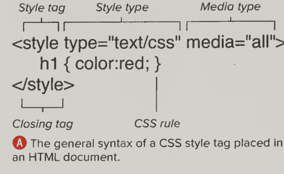

（基础选择器——HTML、类、ID、通用选择器——在本章前面已解释，上下文选择器将在第 4 章中解释。）

```
h1 {...}
```

在规则的括号内，分配给此规则的声明——格式为 `属性: 值`——使用分号（;）并隔开列表中的各个声明。

- 3. 添加所有想要定义的 CSS 规则。规则遵循详细的级联顺序（在第 5 章中详细解释）。但通常情况下，你可以通过重写列表下方的样式来覆盖样式。

```
h2 {...}
```

> 为了让规则更易于阅读，你还可以在声明后添加一个或多个换行符、空格或制表符，而不会影响代码。

> 尽管你可以将嵌入样式放置在 HTML 文档的任何地方，但我强烈建议将它们放在文档顶部的 <head> 中；否则，页面将首先不带样式地显示，然后在页面带样式重新显示时发生闪烁。

> 然而，我不建议在最终的网页中完全使用嵌入样式。虽然它们不像内联样式那样难以覆盖，但当你尝试重新设计页面时，嵌入样式可能会让你以后感到困惑。最好的方法始终是将所有样式都放在外部样式表中（下一节将解释），在那里很容易进行全站范围更改。

代码 3.2 样式规则在 `<style>` 标签内添加。为一级标题添加了一个规则来设置其颜色，但它没有效果 1，因为 `<h1>` 中的内联样式覆盖了它。这就是为什么你永远不应该在最终代码中使用内联样式。

```
<!-- HTML -->
<!DOCTYPE html>
<html lang="en">
<head>
  <meta http-equiv="Content-Type" content="text/html; charset=UTF-8">
  <title>Alice's Adventures in Wonderland</title>
  <style type="text/css" media="all">
  h1 {
    color: gray;
  }
  h2 {
    font-size: normal lighter small-caps 2em;
    color: darkred;
  }
  </style>
</head>
<body>
<h1 style="font:italic bold small-caps 3em/9 Constantia, Georgia;">Alice's Adventures in Wonderland</h1>
<p class="byline">Alice</p>
<article>
  <header>
    <h2>Chapter I. Down the Rabbit-Hole</h2>
  </header>
  <p>Alice was sitting by her sister on the bank, and was very tired of reading the book her sister was reading, which had no pictures or conversations in; suddenly a White Rabbit with pink eyes ran past her.</p>
</article>
</body>
</html>
```

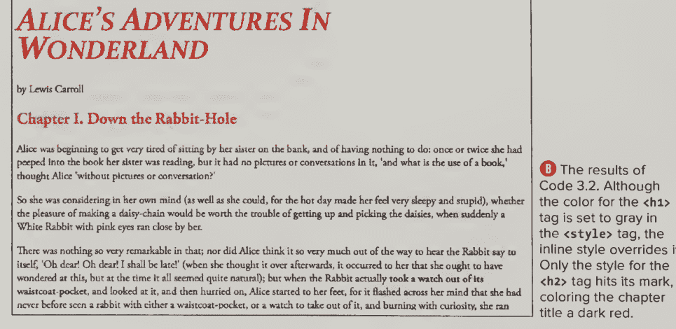

# ALICE'S ADVENTURES IN WONDERLAND

By Lewis Carroll

## Chapter I. Down the Rabbit-Hole

Alice was sitting by her sister on the bank, and was very tired of reading the book her sister was reading, which had no pictures or conversations in; suddenly a White Rabbit with pink eyes ran past her.

> `<h1>` 标签的颜色结果在 `<style>` 标签中被设置为灰色，内联样式覆盖了它。`<h2>` 标签命中了目标，将章节设为深红色。

Chapter 3 Alice in

## External：为网站添加样式

CSS 的一个主要优点是你可以创建一个样式表并将其应用于单个网页或整个网站。为了做到这一点，你需要创建一个与 HTML 文档分离的外部 CSS 文件，其中只包含 CSS 代码——没有 HTML、JavaScript 或其他代码。

建立外部 CSS 文件是一个两步过程。首先，在文本文件中设置 CSS 规则。其次，使用 `<link>` 标签或 `@import` 规则将此文件链接或导入 HTML 文档。

## 创建外部样式表

在网站范围内使用外部样式表的第一步是创建一个包含所有 CSS 代码的外部文件。然而，与嵌入样式不同，你不在外部 CSS 文件中使用 `<style>` 标签。事实上，这样做会导致外部样式表失效。

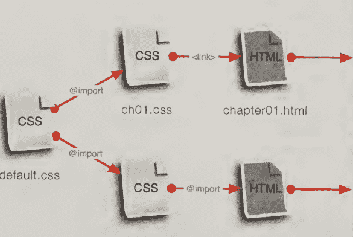

> 外部 CSS 文件可以通过链接或导入直接为 HTML 页面设置样式。外部 CSS 文件还可以相互导入以合并样式，然后引入 HTML 文档。

在这个示例中，我设置了三个 CSS 文件：

`default.css`、`ch01.css` 和 `ch02.css`。

## 如何设置外部 CSS 文件：

- 1. 创建一个新的文本文件。你可以使用文本编辑器或 Web 编辑软件。使用 `.css` 扩展名保存文件。例如，`default.css`。使用 `Notepad` 或 `SimpleText` 即可，但你可能想使用专门的代码编辑程序，如 `Coda` 或 `BBEdit`。不要使用 `Microsoft Word`，它会添加自己的标记代码，从而干扰你的 CSS 代码。
- 2. 导入 CSS 文件。这是可选的，但你可以根据需要创建任意数量的外部样式表，并将样式表相互导入以合并它们的样式（代码 3.4 和代码 3.5）。但是，如果外部样式表中包含  规则，则它必须放置在所有其他 CSS 代码之前。更多信息请参阅本章的“导入样式表”。

  `@import{default.css}`
- 3. 将你的 CSS 规则添加到文本文件中（代码 3.3）。不要包含任何其他类型的代码——不要有 HTML 或 JavaScript。通过输入你想要添加样式的选择器，后跟一对大括号（{}）来开始新规则。基础选择器——HTML、类、ID 和通用选择器在本章中进行了解释，上下文选择器将在第 4 章中解释。

```css
body { padding: 200px 0 0 175px; }
```

在规则的括号中，输入要分配给此规则的声明——格式为 `属性: 值`——并使用分号（;) 分隔列表中的单独声明。（你也可以像本章稍后解释的那样添加注释。）

你可以使用可以使用方法之一将此文件连接到你的 Web 页面：

- 链接（Link）。使用 `<link>` 标签将外部 CSS 文件连接到 HTML 文件。
- 导入（Import）。使用 `@import` 将外部 CSS 文件连接到 HTML 文件。

> 虽然外部 CSS 文件可以有任何名称，但使用一个能提醒你样式用途的名称是一个好主意。例如，“navigation.css”可能比“657nm87gp.css”更有帮助。

> CSS 文件不应包含任何 HTML 标签（特别是不是 `<style>` 标签）或其他内容，CSS 注释和导入的样式除外。

## 代码 3.3 default.css—网站的所有基础样式都包含在 default 外部表中。

```css
body {
  padding: 200px 0 175px;
}
h1 {
  color: black;
}
h2 {
  color: gray;
}
p {
  font: normal 100%/1.5 Corbel, Helvetica, Arial, Sans-serif;
  color: red;
}
```

## 代码 3.4 ch01.css—导入 default.css 中的默认样式，然后为第 1 章添加特定样式。

```css
@import url('default.css');
body {
  background: white url('../images/AAIW-illos/alice23a.gif') no-repeat 0 0;
```

## 代码 3.5 ch02.css—导入 default.css 中的默认样式，然后为第 2 章添加特定样式。


```css
@import url('default.css');
body {
  background: white url('../images/AAIW-illos/alice40b.gif') no-repeat 0 0;
```

## 链接到样式表

外部样式表文件可以使用 `<link>` 标签应用于任何 HTML 文件。链接 CSS 文件对文档的影响与将样式直接嵌入到文档的 `<head>` 中相同；但通过将其放置在单独文件中，代码可以在多个 Web 页面中复用，对中心文件进行的更改将影响所有页面。

### 如何链接外部 CSS 文件：

- 1. 在你的 HTML 文档中添加一个标签。在 HTML 文档的 `<head>`...</head> 之间（代码 3.6），打开你的 `<link>` 标签并输入空格。

  ```html
<link rel="stylesheet" href="filename.css" type="text/css" media="all">
  ```

- 2. 指定链接相对于文档的关系为样式表（stylesheet）。这很重要，因为 `<link>` 标签可以用于添加其他类型的文件。遗漏此项会导致许多浏览器无法加载代码。

  `rel="stylesheet"`

- 3. 指定要使用的 CSS 文件的位置，全局或本地。例如，`ch01.css`。这是外部 CSS 文档的完整路径和名称（包括扩展名）。在第 15 章，你将探索相对于 HTML 文档定位外部样式表的表策略。

  `href="ch01.css"`

- 4. 指定正在链接的类型类型。在本示例中，它是包含 CSS 的文本文件。

  `type="text/css"`

- 5. 指定应应用此样式表的媒体。更多细节，请参阅第 4 章的“查询媒体（Quarrying the Media）”。

  `media="all">`

> 提示 你可以使用 `<link>` 标签为页面添加任意数量的样式表。

> 提示 请记住，链接的样式表越多，你的 Web 页面进行的服务器调用就越多，加载也越慢。根据需要进行链接，但尽量通过合并文件来减少链接。

### 代码 3.6 chapter01.html—链接到外部 CSS

```html
<!DOCTYPE html>
<html lang="en">
<head>
  <meta charset="UTF-8">
  <title>Alice's Wonderland</title>
  <link rel="stylesheet" href="ch01.css" type="text/css" media="all">
  <style>
    h1 {
      color: black;
    }
    h2 {
      color: gray;
    }
  </style>
</head>
<body>
  <h1>Alice's Wonderland</h1>
  <p>by Lewis Carroll</p>
  <article>
    <h2>Chapter I.</h2>
    <p>Alice was beginning to...</p>
  </article>
</body>
</html>
```

## 导入样式表

将外部 CSS 引入文档的另一种方法是使用 `@import` 规则。

```css
@import url('filename.css');
```

要导入外部 CSS 文件：

在文档的 `<head>` 中，添加尽可能多数量的 `<link>` 标签（代码 3.7）。

> 提示 你也可以将 `@import` 直接放在另一个外部表中。这会将 CSS 从一个样式表导入到另一个样式表，这样当第二个样式表链接或导入到 HTML 文件时，第一个样式表的样式就会包含在内。

### 代码 3.7 chapter02.html—链接到外部 CSS

```html
<!DOCTYPE html>
<html lang="en">
<head>
  <meta charset="UTF-8">
  <title>Alice's Wonderland</title>
  @import url('default.css');
  <style>
    h1 {
      color: gray;
    }
    h2 {
      color: red;
    }
  </style>
</head>
<body>
  <h1>Alice's Wonderland</h1>
  <p>by Lewis Carroll</p>
  <article>
    <h2>Chapter II.</h2>
    <p>Curious and curiouser! cried Alice,</p>
  </article>
</body>
</html>
```

# (重新)定义 HTML 标签

几乎所有的 HTML 标签都有与其关联的默认浏览器样式。以 `<strong>` 标签为例：它固有的样式声明等同于 **font-weight: bold.**。

通过向 `strong` HTML 选择器添加 CSS 声明，你可以将任何标记为 **strong** 的元素更改为你想要的任何外观。例如，你可以让所有斜体文本加粗，甚至设置 **font-weight: normal**（常规粗细），这会防止文本加粗。

| HTML 选择器 | 属性 | 值 |
| --- | --- | --- |
| p { font-size : 1em; } | 声明 | |

> 用于定义 HTML 标签样式的通用语法。

### 如何定义 HTML 选择器：

- 1. 从你想要定义其属性的 HTML 选择器开始。添加一个大括号 `{}` 来开启你的规则（代码 3.8）。确保你用大括号 `{}` 结束你的声明列表。如果你忘记了这一点，它会毁掉你的一天！**strong {...}**

  CSS 规则可以定义在文档的 `<head>` 部分的 `<style>` 标签内，也可以定义在导入或链接到 HTML 文档的外部 CSS 文件中。（“嵌入：为网站添加样式”）。

# 代码 3.8 Chapter01.html-- 为 <strong> 标签添加新样式使其变为灰色、稍小且不加粗。它也被样式化块元素，因此它之后出现的任何内容都会从新行开始。

```html
<!-- HTML -->
<!DOCTYPE html>
<html lang="en">
<head>
<meta http-equiv="Content-Type" content="text/html; charset=UTF-8">
<title>Alice's Adventures in Wonderland</title>
<style type="text/css" media="all">
@import url('ch01.css');

h1 {
  color: gray;
}
h2 {
  font-size: normal lighter small-caps 2em;
  color: darkred;
}
strong {
  color: gray;
  font-size: .7sem;
  font-weight: normal;
  display: block;
}
</style>
</head>
<body>
<h1 style="font:italic bold small-caps 3em/9 Constantia, Georgia, Times, 'New Roman', Serif;">
<p class="byline">by <span class="author">Lewis Carroll</span>&#8217;Adventures in Wonderland</p>
<article>
<header>
<h2><strong>Chapter I.</strong> Down the Rabbit-Hole</h2>
</header>
<p>Alice was beginning to get very tired of sitting by her sister on the bank,...</p>
</article>
</body>
</html>
```

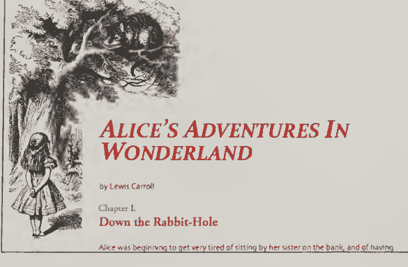

> 代码 3.8 的结果。现在，该章节的样式已与章节标题的其他部分分开设置。

CSS 基础 49

- 2. 添加样式的声明。在声明括号内，输入要分配给此 HTML 标签的样式声明——格式为 **属性**: 值——使用分号 (;) 隔开列表中的单独声明。你也可以在声明后添加一个或多个换行符、空格或制表符，而不会影响代码，使其更具可读性。

`color: gray;`

  可以添加任意数量的声明，但要确保属性与所讨论 HTML 标签兼容。例如，你不能使用 **text-indent** 属性（仅对块元素有效）来定义 `body` 标签（它是内联元素）。查看附录 A 以验证可以分配给特定选择器的属性。

> 提示：重新定义标签不会隐式覆盖该标签预先的属性。因此，<strong> 标签仍然会加粗文本，除非你显式通过 `font-weight: normal` 告诉它。

> 提示：<body> 标签也可以重新定义，它的行为类似于块级标签。任何继承的属性都会影响页面上的所有内容。你实际上可以使用这一点来设置默认样式，正如第 4 章“继承属性”所述。

# 定义复用类

| 类选择器 | 声明 |
|---|---|
| .author { font-size: 1em; } | |

类选择器允许你设置应用到任何 HTML 标签的独立样式。与针对特定标签的 HTML 选择器不同，类选择器赋予了一个唯一的名称，然后使用 HTML 标签中的 `class` 属性进行指定。然而，你也可以将样式应用到特定的 HTML 标签，使其成为依赖类。

| 类选择器 | 声明 |
|---|---|
| p.author { font-size: 1em; } | |

- 类选择器的通用语法。

- 依赖类选择器的通用语法。

### 如何定义类：

- 1. 给你的类命名。输入一个点 (.) 和类名；然后用大括号 ({}) 开启声明（代码 3.9）。

```css
.author {...
```

CSS 类可以定义在文档的 `<head>` 部分的 `<style>` 标签内，也可以在导入或链接到 HTML 文档的外部 CSS 文件中。类名可以是任意字符，但有：- 仅使用字母和数字。你可以使用连字符和下划线，但不能放在开头。- 第一个字符不能是数字、下划线或连字符。- 不要使用空格。

`author` 是一个独立类，因此你可以将其用于任何你使用的 HTML 标签。

- 2. 向规则添加声明。在括号内，输入分配给此类的声明——格式为 **属性: 值**——使用分号 (;) 隔开列表中的单独声明。你也可以在声明后添加一个或多个换行符、空格或制表符，而不会影响代码使其更具可读性。

`font-size: 1.25em;`

- 3. 向你的 CSS 添加依赖类。通过在类前面放置 HTML 选择器将类的声明绑定到特定的 HTML 标签。

```css
p.byline {...
```

  `byline` 是依赖类，仅应用于 `<p>` 标签。在同一个文档中，你可以创建不同版本的 byline 并拥有独立类，如步骤 1 所示。

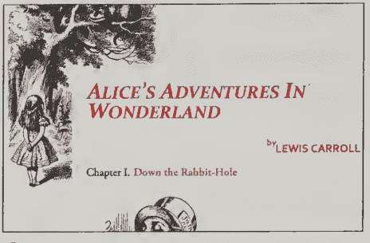

  代码 3.9 的结果。注意 "by" 是应用到 <p> 的。

# 3.9 chapter01.html-- 为 byline 和作者名添加类

```html
<!-- HTML -->
<!DOCTYPE html>
<html lang="en">
<head>
<meta http-equiv="Content-Type" content="text/html; charset=UTF-8">
<title>Alice's Adventures in Wonderland</title>
<style type="text/css" media="all">
@import url('ch01.css');

h1 {
  color: gray;
}
h2 {
  font-size: normal lighter small-caps 2em;
  color: darkred;
}
strong {
  color: gray;
  font-size: .7sem;
  font-weight: normal;
  display: block;
}
.byline {
  font-size: 1.25em;
  font-style: normal;
  font-weight: bold;
  color: rgba(255, 0, 0);
  text-align: right;
  text-transform: uppercase;
}
.author {
  font-size: 1em;
}
</style>
</head>
<body>
<h1 style="font:italic bold small-caps 3em/9 Constantia, Georgia, Times, 'New Roman', Serif;">
<span class="byline">Alice&rsquo;Adventures in Wonderland</span>
</h1>
<p class="byline">by <span class="author">Lewis Carroll</span></p>
<article>
<header>
<h2><strong>Chapter I.</strong> Down the Rabbit-Hole</h2>
</header>
<figure id="gallery">

<figcaption>
"Twinkle, twinkle, little bat!<br>
How I wonder what you're at!"
</figcaption>
</figure>
<p>
Alice was beginning to get very tired of sitting by her sister on the bank,...</p>
</article>
</body>
</html>
```

- 4. 向你想应用类的 HTML 标签上添加 `class` 属性。

```html
<p class="byline"><span class="author">...</span></p>
```

  你可以通过在空格分隔的列表中添加额外的类名，为单个 HTML 标签应用多个类：`class="name1 name2 name3"`

  注意当你在 CSS 中定义类时，它是以点 (.) 开头的。但在 HTML 标签中引用类名时，不需要使用点。在此处使用点会导致类失效。

> 提示：你可以在 HTML 标签中混合使用类、ID 和或内联规则（参见本章的“内联：为 HTML 标签添加样式”和“定义唯一 ID”）。

# 定义唯一 ID

与类（class）类似，ID 选择器可用于创建独立于特定 HTML 标签的唯一样式。因此，它可以分配给任何 HTML 标签。ID 在 HTML 中用于建立页面布局的结构，识别代码中的唯一元素，并将其标记出来以便特殊处理（无论是使用 CSS 还是 JavaScript 进行）。

### 定义 ID 选择器：

- 1. 在你的 CSS 中添加 ID 选择器。ID 规则始终以数字 (#) 开头，后紧跟 ID 的名称（代码 3.10）。

该名称可以是单词或你选择的任何字母或数字组合，但需要注意以下限制：

- 只使用字母和数字。你可以使用连字符和下划线，但要谨慎使用。某些早期的浏览器会拒绝它们。

- 第一个字符不能是数字、连字符或下划线。

- 不要空格。

CSS 规则可以定义在文档头部的 `<style>` 标签内，也可以在导入或链接到 HTML 文档的外部 CSS 文件中。

- 2. 为你的 ID 添加声明。在括号内，输入要分配给此 ID 的声明——格式为 `属性: 值`——使用分号 (;) 分隔列表中的各个声明。你也可以在声明后添加一个或多个换行符、空格或制表符，这不会影响代码且提高可读性。

`position:relative;`

- 3. 在选择的 HTML 标签中添加 `id` 属性，并将 ID 名称作为其值。

```
<figure id="gallery">...</figure>
```

注意，虽然符号 (#) 用于定义 ID 选择器，但在 HTML 标签中引用 ID 时不需要包含它。如果你添加了，规则将失效。

> 提示 你还可以创建依赖性 ID，它们仅在应用于特定的 HTML 标签时才使用该 ID 的声明。不过，我永远用不上这些，因为 ID 的重点每个页面只使用一次。

> 提示 尽管你可以对类和 ID 使用相同的名称，但你应该尽量避免这样做，因为这不可避免会导致混淆。

> 提示 你可以在 HTML 标签内混合使用 ID、类和/或内联规则。

> 提示 ID 可以每个屏幕元素提供唯一的名称和标识。这就是为什么 ID 在文档中仅供一个元素使用一次，使其成为一个可以使用 JavaScript 操作的对象。

# 3.10 chapter01.html—添加画库是为了允许包含图像的区块进行特殊定位包含


```html
<!-- HTML -->
<!DOCTYPE html>
<html lang="en">
<head>
  <meta http-equiv="Content-Type" content="text/html; charset=UTF-8">
  <title>Alice's Adventures in Wonderland</title>
  <style type="text/css" media="all">
  @import url('ch01.css');
  h1 {
  color: gray;
}
  h2 {
  font-size: normal lighter small-caps 2em;
  color: darkred;
}
  strong {
  font-weight: normal;
  color: black;
}
  p.byline {
  font-size: 1.25em;
  font-style: normal;
  font-weight: bold;
  word-spacing: -.3em;
  text-align: right;
  color: rgba(255, 0, 0, .75);
}
  .author {
  font-size: 1.25em;
  font-style: normal;
  font-weight: bold;
  color: rgba(255, 0, 0, 1);
  word-spacing: 0em;
  text-transform: uppercase;
  vertical-align: -.6em;
}
  #gallery {
  position: relative;
  bottom: 10px;
  right: 10px;
  display: block;
  font-style: italic;
  width: 300px;
  float: left;
  margin: 0 20px 20px 0;
  border: 6px double rgba(142, 137, 129, .5);
}
  </style>
</head>
<body>
<h1 style="font:italic bold small-caps 3em/9">Constantia, Georgia, Times, 'Times New Roman', Serif;</h1>
<span style="color:red">Alice&#8217;s Adventures in Wonderland</span>
<p class="byline">by <span class="author">Lewis Carroll</span></span></p></p>
```

## 代码 3.10 继续

```html
<article>
<header>
<h2><strong>第一章。</strong> 掉进兔子洞</h2>
</header>
<figure id="gallery">

<figcaption>
>"闪烁，闪烁，小蝙蝠！<br>
我多么好奇你到底是什么样的！
</figcaption>
</figure>
<p>
Alice was beginning to get very tired of sitting by her sister on the
bank,...</p>
</article>
</body>
</html>
```


## 代码 3.11 继续

```html
<h1 style="font:italic bold small-caps 3em/9 Constantia, Georgia, Times, 'Times New Roman', Serif;
  color:red>爱丽丝仙境游游</</h1>
<p class="byline">作者：<span class="author">刘易·卡罗尔</span></p>
<article>
  <header>
    <h2><strong>第一章. </strong>掉兔子洞</h2>
  </header>
  <figure id="gallery">
    
    <figcaption>
      “闪烁，闪烁，小蝙蝠！<br>
      我真奇你在做什么”
    </figcaption>
  </figure>
  <p>爱丽丝开始觉得坐在岸边姐姐旁非常无聊了……</p>
</article>
</body>
</html>
```

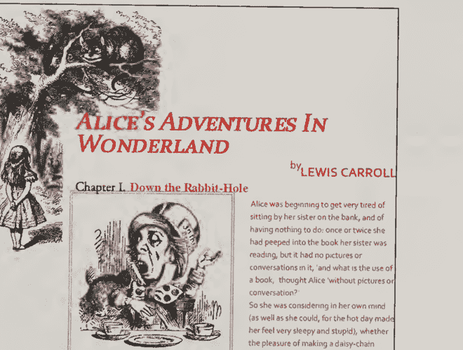

# 爱丽丝仙境游游

作者：刘易·卡罗尔

第一章. 掉兔子洞

爱丽丝开始觉得坐在岸边姐姐旁非常无聊了。由于无事可做，她一或几次偷看了看姐姐正在读的书；书里既没有插画也没有对话。爱丽丝想：“如果没有插画或对话，书还有什么用呢？”

于是她在心里考虑着（因为她很困，炎热的天气让她感到昏昏欲睡），去散散步的快乐或许值得她起身走在雏菊丛中。这时，一只白兔兔子飞快地从她身边跑过。

没有什么比这更特别的了，爱丽丝事后回想起来也没有那么在意。她觉得自己并没有太预料到这一点，但当兔子真的从背甲外套里掏出一块表，揣进兜里，然后匆匆离开时，这一切似乎又很自然。爱丽丝跳了起来，因为她觉得看到兔子从外套里掏表或把表放进兜里太新奇了。本着强烈的好奇，她跑过田野，幸运的是，她及时钻进了灌篱丛下一个巨大的兔子洞。

代码 3.11 的结果。所有外边距（margins）均为 0，为你的设计提供了一个整洁的画布。

CSS 基础 61

# 分组：使用相同样式定义元素

如果你让两个或多个选择器（selectors）具有相同的声明（declarations），可以将这些选择器用逗号分隔并组合在一个列表中 A。根据需要，你可以在声明块（declaration block）中定义公共属性，并单独为每个选择器添加规则以进行精细调整。

## 如何分组选择器：

- 1. 添加一组用逗号分隔的选择器。输入用逗号分隔的选择器列表（HTML、类或 ID）。你可以在逗号后添加一个或多个换行符、空格或制表符，这不会影响代码，但使其更具可读性。

```css
h1, h2, .byline, #gallery {...}
```

这些选择器都接收相同的声明。CSS 规则可以定义在文档 head 部分的 style 标签中，也可以定义在导入或链接到 HTML 文档的外部 CSS 文件。

- 2. 为选择器组添加公共声明。在大括号内，输入分配给所有列出选择器的样式声明——格式为 `属性: 值`——使用分号（;）并分隔列表中的单独声明。你也可以在声明后添加一个或多个换行符、空格或制表符，这不会影响代码，使其更具可读性。

```css
font-family: Constantia, Georgia, Times, "Times New Roman", Serif;
```

- 3. 根据需要添加精细调整。你可以单独为每个选择器添加或更改声明以适应你的需求。如果你覆盖了组规则中设置的声明，请确保该规则在 CSS 中位于组规则之后。（参见第 4 章“层叠顺序”）。

```css
h1 {...}
```

> 提示：像这样分组选择器可以节省大量时间和减少重复工作。但要注意，当你更改组合声明中任何属性的值时，你会更改列表中每个选择器的该值。

> 提示：分组选择器不会直接影响它们的层叠顺序（在第 4 章解释）；相反，分组处理方式就像每个选择器按照它们列出的顺序被分配了该规则一样。

# 注释：定义 1 级和 2 级标题、作者行以及 gallery ID 的公共样式

```html
<!-- HTML -->
<!DOCTYPE html>
<html lang="en">
<head>
  <meta http-equiv="Content-Type" content="text/html; charset=UTF-8">
  <title>爱丽丝仙境游游</title>
  <style type="text/css" media="all">
  @import url('ch01.css');
  * {
    margin: 0;
    padding: 0;
  }
  h1, h2, .byline, #gallery {
    font-family: Constantia, Georgia, Times, "Times New Roman", Serif;
  }
  h1 {
    color: gray;
  }
  h2 {
    font-size: normal small-caps 2em;
    color: darkred;
  }
  strong {
    font-weight: normal;
    color: black;
  }
  p.byline {
    font-size: 1.25em;
    font-style: normal;
    font-weight: bold;
    word-spacing: -3em;
    text-align: right;
    color: rgba(255, 0, 0.75);
  }
  .author {
    font-size: 1.25em;
    font-style: normal;
    font-weight: bold;
    color: rgba(255, 0, 0,1);
    word-spacing: 0em;
    text-transform: uppercase;
    vertical-align: -.6em;
  }
  #gallery {
    position: relative;
    bottom: 10px;
    right: 10px;
    display: block;
```

# 代码 3.12 继续

```css
<style>
  font-style: italic;
  width: 300px;
  float: left;
  margin: 20px 20px 0 0;
  border: 1px double rgba(255, 0, 0,.5);
</style>
</head>
<body>
<h1 style="font:italic bold small-caps 3em/9 Constantia, Georgia, Times, 'Times New Roman', Serif;
  color:red>爱丽丝仙境游游</</h1>
<p class="byline">作者：<span class="author">刘易·卡罗尔</span></p>
<article>
  <header>
    <h2><strong>第一章. </strong>掉兔子洞</h2>
  </header>
  <figure id="gallery">
    
    <figcaption>
      “闪烁，闪烁，小蝙蝠！<br>
      我真奇你在做什么”
    </figcaption>
  </figure>
  <p>爱丽丝开始觉得坐在岸边姐姐旁非常无聊了……</p>
</article>
</body>
</html>
```

# 整合在一起

- 1. 将内容添加到你的 HTML 文件中。使用你在第 2 步的 HTML 文件，添加文本和图像内容。我倾向于使用《爱丽丝仙境游》，但任何内容都可以。文本的好来源是古书计划（www.gutenberg.org）。

- 2. 标记你的内容。所有样式都需要网页中的标记才能应用。请确保标记标题和段落。

- 3. 在你的标记中添加类（class）和 ID。类可以提供为特定元素应用特定样式的“钩子”。但不要过度，仅在有助于区分元素类型时添加类，在区分特定元素时添加 ID。

- 4. 将你的 HTML、类和 ID 声明添加到文档 head 中的 `<style>` 标签中。你可以根据第 5-12 章所示的样式对它们进行任何设置。

- 5. 为你的 CSS 代码添加注释。注释可以包含关于代码的信息，或者关于创作者（你）以及如何就问题联系他们。

- 6. 将第 4 步中的内联样式移动到外部文件中。创建一个文本文件，然后仅复制并粘贴 CSS 代码（`<style>` 标签标签内的所有内容）到文件中。确保保存文件以 `.css` 结尾。

- 7. 从外部样式表添加 `<link>`。当你在浏览器中测试网页时，它看起来应该和第 4 步一样，但现在 CSS 可以供你所有的网页访问。

# 选择性样式

为 Web 页面元素设置样式是不够的。CSS 的艺术——因此说 Web 设计的艺术——在于根据上下文对元素设置样式的能力。你必须考虑元素在文档中的位置；围绕它的哪些元素；它的属性、上下文和动态状态；甚至是显示元素的平台（屏幕、手持设备、电视等）。

选择性样式是 CSS 最接近传统计算机编程的部分，它允许你在元素*满足*特定标准时对其设置样式。这种级别的样式可能会变得越来越复杂，因此至少在本章中，从尽可能简单开始并建立稳固的理解基础是非常重要的。

## 本章内容

| | |

| :--- | :--- |

| 元素家族树 | 70 |

| 根据上下文定义样式 | 71 |

| 伪类的使用 | 80 |

| 伪元素的使用 | 92 |

| 根据标签属性定义样式 | 96 |

| CSS3 新特性：媒体查询 ★ | 100 |

| 从父继承属性 | 109 |

| 使声明变为 !Important | 111 |

| 确定级联顺序 | 113 |

| 汇总总结 | 116 |

# 元素家族树

当一个标签被另一个标签包裹时（一个在另一个内部），这些标签就是**嵌套**的。

## 第 2 章：泪池

在嵌套集中，示例中的外部元素（`child`）是*父元素*，内部元素（`<strong>`）是*子元素*。子标签以及该子元素的任何元素都是父元素的*后代*。同一个父元素的两个标签是兄弟元素，紧相邻的两个标签是**相邻兄弟**。

- **父元素**包含其他元素（子元素）。子元素通常会继承父元素的样式。

- **后代元素**是另一个元素内的任何元素。

- **子元素**是相对于父元素的第一代后代元素。第二代及以上的元素有时被称为孙级元素。

- **相邻或前兄弟**是 HTML 代码中紧密相邻的同一代子元素。

在第 3 章中，你学习了无无论元素位于 HTML 代码的什么位置都指定单个元素样式的方法。然而，CSS 也允许你根据元素的上下文来指定元素的样式。使用*上下文选择器*，你可以根据标签与页面上其他标签、类或 ID 的关系来指定样式。

```html
<article class="copy">
  <p>
    <em>爱丽丝漫游仙记</em>
    <strong>仙仙境</strong>
  </p>
</article>
```

父元素 后代 子 前兄弟 相邻兄弟。`article` 元素是 `p`、`strong` 和 `em` 标签创建的元素的父元素，它们是它的后代。`p` 标签是直接子元素。`em` 和 `strong` 标签创建的元素是 `p` 标签的元素，也是彼此的兄弟元素。

# 根据上下文定义样式

上下文样式允许你根据父元素和兄弟元素指定特定元素的显示方式。例如，你可能希望 `em` 标签在页面主标题中显示为一种方式，而在副标题中以另一种方式显示。你可能还希望它在文本段中有第三种外观。这些组合选择器（表 4.1）是 CSS 中常用且实用的工具之一。

空格分隔的选择器列表 声明列表

```css
.copy h1 em { color: red; }
```

后代选择器的通用语法。

空格分隔的选择器列表 声明列表

```css
.copy * em { color: red; }
```

通用选择器

使用通用选择器的后代选择器通用语法。

# 为后元素设置样式

你可以根据父选择器或空格分隔列表选择器对单个元素设置样式。当且仅当最后一个选择器是前几个选择器的后代时，它才会接收样式。

当你想要表示在任何层级精确选择器并不重要时，可以使用第 3 章描述的通配符 (*)。

表 4.1 组合选择器

| 格式 | 选择器名称 | 满足什么条件设置样式 | 兼容性 |

| :--- | :--- | :--- | :--- |

| a b c | 后代 | b 是 a 的后代，c 是 b 的后代 | IE4, FF1, O3, S1, C1, CSS1 |

| a * b | 通用 | b 在 a 内，无论 b 的父元素是什么 | IE7, FF1, O4, S1, C1, CSS2 |

| a > b | 直接子元素 | b 是 a 的直接子元素 | IE7, FF1, O3.5, S1, C1, CSS2 |

| a + b | 相邻兄弟 | b 是紧跟在 a 之后的兄弟 | IE7, FF1, O5, S1, C1, CSS2 |

| a ~ b | 通用兄弟 | b 是 a 之后的任何地方的兄弟 | IE8, FF1, O5, S1, C1, CSS2 |

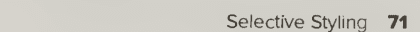

# 为后代元素设置样式：

- 1. 建立后代选择器列表。输入父标签的 HTML 选择器，后跟空格，然后是最后的子元素或另一个父元素（代码 4.1）。

```css
article.copy h1 { ... }
```

`article.copy h1` { 可以为父标签输入任意数量的选择器，但最后的选择器接收样式。}

- 2. 如果模式匹配则将使用样式。

```css
article.copy h1 { ... }
```

`article.copy h1` { 匹配的唯一元素是该类。}

（注：提供的最后部分文本在 OCR 中包含严重的碎片化和重复；我已根据可用碎片重建了结构。）

## 仅对子元素设置样式


如果你只想设置父元素的子元素（而不是孙元素后代），必须指定父选择器和子元素选择器，它们之间用闭角括号 (`>`) 隔开。

```
copy > em { color: red; }
```

大于号

直接子元素选择器的通用语法。

## 定义子元素选择器：

- 1. 建立直接子元素选择器列表。输入父元素的选择器（HTML、类或 ID），后跟一个右角括号 (`>`），然后是子元素选择器（HTML、类或 ID）。

`article.copy > p > em {...}`

你可以根据需要重复此操作，最终的选择器是你要应用样式的目标（见代码 4.3）。在选择器和大于号之间可以有一个空格，也可以不留空格。

- 2. 如果匹配模式，则将使用样式。

`<article class="copy"><p>...<em>...</em></p></article>`

当且仅当最终选择器是嵌套在前一个元素直接子元素时，步骤 1 中的样式才会生效。将标签放在任何其他 HTML 标签内都会破坏该模式。

- 3. 只有当 `<em>` 标签是 `<p>` 的子元素，且 `<p>` 又是使用 `copy` 类的 `<article>` 的子元素时，样式才会应用于该 `<em>` 标签。

```html
<!-- HTML -->
<!DOCTYPE html>
<html lang="en">
<head>
  <meta http-equiv="Content-Type" content="text/html; charset=UTF-8" />
  <title>爱丽丝仙游游</title>
  <style type="text/css" media="all">
  article.copy p > em {
    color: red;
    font-weight: bold;
  }
</style>
</head>
<body class="copy">
  <h1>爱丽丝在<em>仙游境</em>中的奇游</h1>
  <h2>第二章 泪之池</h2>
  <p>'真奇怪，太奇怪了！’<em>爱丽丝喊道</em>……</p>
  <p>她继续<em>计划</em>……</p>
  <p>可怜的<em>爱丽丝</em>！</p>
  <blockquote>
    <p><em>爱丽丝的右脚，</em> <em>女士</em></p>
    <p>“噢天呐，我都在些什么<em>胡话</em>啊！’……</p>
  </blockquote>
</article>
</body>
</html>
```

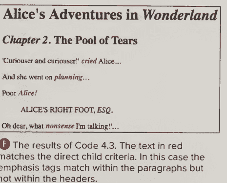

## 第二章 泪之池

“真奇怪，太奇怪了！”爱丽丝喊道……

她继续计划……

可怜的爱丽丝！

爱丽丝的右脚，女士

“噢天呐，我都在些什么胡话啊！”……

> 代码 4.3 的结果。红色文本符合直接子元素标准。在这种情况下，`<em>` 标签在段落内匹配，但在标题内不匹配。

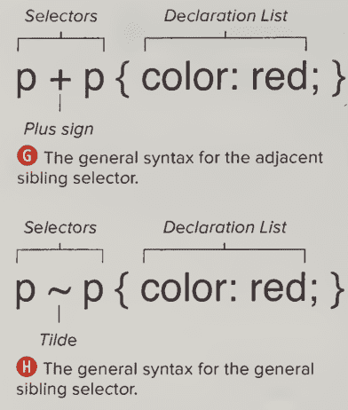

## 4.4 只有当 `<em>` 标签位于紧跟另一个段落的段落中时，样式才会应用于该标签

```html
<!-- HTML -->
<!DOCTYPE html>
<html lang="en">
<head>
  <meta http-equiv="Content-Type" content="text/html; charset=UTF-8" />
  <title>爱丽丝仙游游</title>
  <style type="text/css" media="all">
p + p {
  color: red;
  font-weight: bold;
}
</style>
</head>
<body>
  <article class="copy">
    <h1>爱丽丝在<em>仙游境</em>中的奇游</h1>
    <h2>第二章 <em>泪之池</em></h2>
    <p><em>真奇怪，太奇怪了！</em> <em>爱丽丝喊道</em>……</p>
    <p>她继续<em>计划</em>……</p>
    <p>可怜的<em>爱丽丝</em></p>
    <blockquote>
      爱丽丝的右脚，<em>女士</em>
      <p>“噢天呐，我都在些什么<em>胡话</em>啊！……”</p>
    </blockquote>
  </article>
</body>
</html>
```

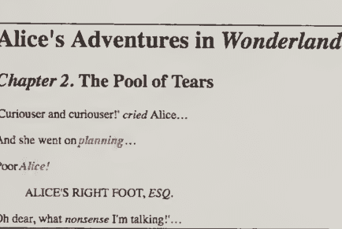

## 选择性样式设置

### 定义兄弟元素选择器：

- 1. 建立一个通用兄弟元素选择器列表。输入第一个兄弟元素的选择器（HTML、类或 ID）、一个波浪号 (`~`)，然后是另一个选择器（HTML、类或 ID）（见代码 4.5）。

```css
p ~ p { color: red; }
```

- 2. 如果匹配模式，则将使用样式。

```css
<p>...</p><p>...</p><blockquote><p>...</p></</blockquote>>
```

| 表格 4.2 通用选择器 | 格式 | 满足以下条件应用样式 |

| :--- | :--- | :--- |

| a * | b | 无论 b 的父元素如何，均在 a 内部 |

| a ~ b | b | b 是紧跟在 a 之后的任何元素的兄弟元素 |

| *:hover | 任何元素 | 鼠标指针悬停在元素上 |

| *:disabled | 任何元素 | 禁用状态 |

| *:first-child | 任何元素的第一个子元素 |

| *:lang() | 任何元素 | 使用指定的语言 |

| *:not(s) | 任何元素 | 未使用指定的选择器 |

| *:first-letter | 任何元素的第一个字母 |

> 样式将应用于出现在第一个选择器之后的所有兄弟元素，而不仅仅是第一个，而是直到遇到另一种类型的元素为止的任何同类型兄弟元素。IE 不支持子兄弟选择器，因此您需要单独为这些元素设置样式。更多信息请参见第 1 章。

> 虽然本节所示的通用选择器与组合选择器一起使用，但它也可以与任何选择器配合。

## 4.5 只有当 `<em>` 标签位于带有任何前置兄弟元素的段落中时，样式才会应用于该标签

```html
<!-- HTML -->
<!DOCTYPE html>
<html lang="en">
<head>
  <meta http-equiv="Content-Type" content="text/html; charset=UTF-8" />
  <title>爱丽丝仙游游</title>
  <style type="text/css" media="all">
p + p {
    color: red;
    font-weight: bold;
  }
</style>
</head>
<body class="copy">
  <h1>爱丽丝在<em>仙游境</em>中的奇游</h1>
  <h2>第二章 泪之池</h2>
  <p>'真奇怪，太奇怪了！’<em>爱丽丝喊道</em>……</p>
  <p>她继续<em>计划</em>……</p>
  <p>可怜的<em>爱丽丝</em>！</p>
  <blockquote>
    <p><em>爱丽丝的右脚，</em> <em>女士</em></p>
    <p>“噢天呐，我都在些什么<em>胡话</em>啊！”……</p>
  </blockquote>
</article>
</body>
</html>
```

# 链接样式设置

尽管链接是一个标签，但它的各个状态并不是。要为这些状态设置属性，你必须使用与链接可能拥有的每个状态相关的伪类（按此顺序）：

- `:link` 允许你声明尚未被选择的超文本链接的外观。

- `:visited` 允许你设置访问者之前选择过的链接的外观——即标签中 `href` 属性的 URL 是浏览器历史记录的一部分。

- `:hover` 允许你设置当访问者的指针悬停在元素上时元素的外观。

- `:active` 设置元素在被访问者点击或选中时的样式。

关于用于链接的样式的建议，请参见侧边栏的“选择链接样式”。

### 设置对比明显的链接外观：

1. 样式化锚点标签（anchor tag）。

```
{{...}
```

虽然不是强制性的，但最好先定义通用的锚点样式（代码 4.6）。这与设置 `:link` 伪类的不同之处在于，这些样式应用于所有的链接伪类。因此，你想要声明任何保持不变或仅在一种状态下更改的样式。

# 第 1 章 掉进兔子洞

# 第 2 章 泪水池 — 链接

# 第 3 章 召开会赛与长故事

# 第 4 章 兔子送来 — 小比尔中的悬停

# 第 5 章 来自毛虫的建议 — 激活

# 第 6 章 猪与胡椒

# 第 7 章 疯狂茶茶会

# 第 8 章 皇后的地鼠球场

# 第 9 章 呆甲龟的故事

# 第 10 章 龙虾舞曲

# 第 11 章 谁偷了饼干？

# 第 12 章 爱丽丝的证词

> 代码 4.6 的结果显示了为每个状态设置的样式，帮助用户理解正在发生什么。

## 代码 4.6 为默认状态以及所有四个链接状态设置了样式，创建了颜色区分 B。请注意，我通过 `text-decoration` 关闭了下划线，但使用 `border-bottom` 添加了下划线效果。

```html
<!-- HTML5 -->
<!DOCTYPE html>
<html lang="en">
<head>
<meta http-equiv="Content-Type" content="text/html; charset=UTF-8" />
<title>爱丽丝在仙仙游</title>
<style type="text/css" media="all">
 a {
  display: block;
  text-decoration: none;
  padding: 5px;
  width: 200px; }
a:link {
  color: rgb(255,102,102);
  border-bottom: 1px dotted rgb(255,51,51);
}
a:visited {
  color: rgb(255,153,153);
  border-bottom: 1px dotted rgb(255,235,235);
}
a:hover {
  color: rgb(255,0,0);
  border-bottom: 1px solid rgb(255,0,0);
}
a:active {
  color: rgb(0,0,255);
  border-bottom: 1px dotted rgb(102,102,102); }
</style>
</head>
<body>
<navigation>
<a href=""><<strong>第 1 章. </strong>掉进兔子洞</a>
<a href=""><<strong>第 2 章. </strong>泪水池</a>
<a href=""><<strong>第 3 章. </strong>召开会赛与长故事</a>
<a href=""><<strong>第 4 章. </strong>兔子送来的小比尔中</a>
<a href=""><<strong>第 5 章. </strong>来自毛虫的建议</a>
<a href=""><<strong>第 6 章. </strong>猪与胡椒</a>
<a href=""><<strong>第 7 章. </strong>疯狂茶茶会</a>
<a href=""><<strong>第 8 章. </strong>皇后的地鼠球场</a>
<a href=""><<strong>第 9 章. </strong>呆甲龟的故事</a>
<a href=""><<strong>第 10 章. </strong>龙虾舞曲</a>
<a href=""><<strong>第 11 章. </strong>谁偷了饼干？</a>
<a href=""><<strong>第 12 章. </strong>爱丽丝的证词</a>
</navigation>
</body>
</html>
```

2. 样式化默认链接状态。输入你想要元素的元素选择器（锚点标签、类或 ID），后跟一个冒号 (`:`），然后是 `link`。

```
a:link {......}
```

你可以覆盖为锚点标签设置的样式，但此规则应位于 `:visited` 伪类之前。

3. 样式化访问过的链接状态。输入你想要元素的元素选择器（锚点标签、类或 ID），后跟一个冒号 (`:`），然后是 `visited`。

```
a:visited {...}
```

4. 样式化悬停链接状态。输入你想要元素的元素选择器（锚、类或 ID），后跟一个冒号 (`:`），然后是 `hover`。

```
a:hover {...}
```

5. 样式化激活链接状态。输入你想要元素的元素选择器（锚、类或 ID），后跟一个冒号 (`:`），然后是 `active`。

```
a:active {...}
```

6. 样式化元素状态。使用 `text-decoration`。

### 用于链接的样式。

大多数浏览器默认设置链接的颜色。

### 链接的交互。

链接可以设置不同的样式。


# 3. 样式元素的聚焦状态（focus state）。

输入选择器（HTML、类或 ID），

冒号（:），然后输入 focus。

```
input: {...}
```

一旦元素获得焦点

（被点击或轻触），样式就会发生变化，并在元素

失去焦点（称为 blur/模糊）时，样式会恢复到

悬停（hover）或默认样式。

C: 代码 4.7 的结果。这展示了处于四种动态状态下的简单表单。提供这种视觉反馈可以帮助用户知道哪个表单字段已准备就绪，或者他们已经点击了按钮。

# 4. 样式元素的激活状态（active state）。

输入选择器（HTML、类或 ID），

冒号（:），然后输入 active。

```
input:active {...}
```

当用户在元素框内点击时（在第 10 章中解释）

# 5. 样式会根据用户的反应，在必要时应用于元素的

状态。

```
<input type="button"
value="Search">
```

所有使用特定选择器的标签都对其状态进行了样式设置。

> 提示：定义链接和伪类的顺序是有区别的。例如，将 :hover 伪类放在 :visited 伪类之前，会导致链接在被访问后 :hover 无法工作。为了获得最佳效果，请按此顺序定义样式：link（链接）、visited（已访问）、focus（聚焦）和 active（激活）。

> 提示：在更改 :hover 的 s 属性时要谨慎。更改类型、字体大小、字重和其他属性会导致文本比其在布局中保留的空间变大或变小，并强制整个页面重新填充内容，这会非常困扰访问者。

> 提示：在这个示例中，使用 `input` 来显示动态状态。`input` 有一个样式缺点，即所有 input 类型都……在本章的稍后部分，你将看到如何使用标签属性设置样式，这将允许你为文本字段和按钮设置不同的样式。

> 提示：记住伪元素顺序的一种方法是 me LoVe HaTe：Link（链接）、Visited（已访问）、Hover（悬停）、Active（激活）。

> 提示：如果你设置了 :hover，你总是想要设置 :focus。为什么？Hover 仅适用于与元素的非键盘（鼠标）交互。对于仅使用键盘的 Web 用户，:focus 将生效。

# 新 CSS3：使用伪类为特定子元素设置样式 ★

设计师通常希望对另一个元素内部第一个出现的元素应用样式，例如父元素的第一个孩子。

`first-child` 伪元素自 CSS2.22 起已可用；但 CSS3 提供了一系列新的结构伪元素，用于精确设置元素子元素的样式（表 4.4）：

- first-child——如果选择器类型是其父元素的第一个子元素，则设置该第一个实例的外观。

- first-of-type——当元素的选择器类型在父元素中第一次出现时设置其外观。

- nth-child(#)——设置指定子元素的样式。例如，段落的第三个孩子是 `p:nth-child(3)`。

- nth-of-type(#)——设置选择器类型在父元素中特定位置的样式，第七个段落是 `p:nth-of-type(7)`。

- last-of-type(#)——设置选择器类型在父元素中特定位置的样式，但从底部开始。例如，倒数第三个段落是 `p:last-of-type(3)`。

- last-child——如果指示的选择器是父元素的最后一个子元素，则设置其外观。

- last-of-type——设置其父元素中特定选择器类型的最后一个实例的外观。

## 文本装饰：

要不要加下划线

下划线是 Web 上指示超链接的标准方式。然而，许多带有下划线的链接会让页面变成密不透风的线条堆，文本变得难以阅读。此外，如果访问者关闭了下划线，他们就看不到链接，特别是当链接颜色和文本颜色相同时。

CSS 允许你关闭链接下划线，覆盖访问者的偏好。我建议这种做法，并依靠清晰的颜色选择来突出超链接，或者依靠 `border-bottom`（下边框）这种替代下划线方法，这可以让你更好地控制下划线的样式。更多信息请参见第 14 章。

## 为元素的子元素设置样式：

- 1. 根据它们在父元素中的位置对元素设置样式。输入你想设置样式的元素的选择器（HTML、类或 ID）、冒号（:）；以及表 4.4 中的其中一个结构伪元素（代码 4.8）。

```
li:first-child {...}
li:first-of-type {...}
li:nth-of-type(3) {...}
li:nth-last-of-type(2) {...}
li:last-child {...}
li:last-of-type {...}
```


- 2. 如果元素匹配模式，则将对其设置样式。

```
<li...></li>
```

在设置 HTML 时，请记住第 1 步中的选择器。

## 为特定语言设置样式

万维网就是那样，它遍布全球，这意味着任何地方的任何人都可以看到你的页面。这也意味着 Web 页面是用许多语言创建的。

`:lang()` 伪类允许你指定取决于指定语言的样式。

### 4.8 列表根据位置设置样式。

```html
<!-- HTML5 -->
<!DOCTYPE html>
<html lang="en">
<head>
  <meta http-equiv="Content-Type"
    content="text/html; charset=UTF-8" />
  <title>爱丽丝仙游游</title>
  <style type="text/css" media="all">
    li:first-child { font-size:.85em; }
    li:first-of-type { color: red; }
    li:nth-of-type(3) { font-size:1.5em; }
    li:nth-last-of-type(2) { font-size:2em; }
    li:last-of-type { color: red; }
    li:last-child { font-size:2.5em; }
  </style>
</head>
<body>
  li:Alice</li>
  li:White Rabbit</li>
  li:Mad Hatter</li>
  li:Queen of Hearts</li>
  li:Door Mouse</li>
</body>
</html>
```

## 为特定语言设置样式：

- 1. 根据语言对元素设置样式。输入你想设置样式的元素的选择器（HTML、类或 ID）、冒号（:）、`.lang`，并在括号内输入你定义的语言代码（代码 4.9）。

```
p:lang(fr)
```

- 2. 如果元素具有匹配的语言，则对其设置样式。根据需要设置标签的语言属性。

```html
<p lang="fr">...</p>
```

代码 4.9 显示法语段落渲染为红色（向法语使用者表示歉意）。

### 4.10 如果元素是一个没有使用 dialog 类的段落，它将以红色和斜体显示

## CSS3 新特性：不对元素设置样式

到目前为止，你已经了解了当标签满足某些条件时如何对它设置样式。否定选择器 `:not()` 允许你针对特定的选择器不对某些元素设置样式。

```html
<!-- HTML5 -->
<!DOCTYPE html>
<html lang="en">
<head>
  <meta http-equiv="Content-Type"
    content="text/html; charset=UTF-8" />
  <title>爱丽丝漫游仙境</title>
  <style type="text/css" media="all">
    p:not(:dialog) {
      color: red;
      font-style: italic;
    }
  </style>
</head>
<body>
  <p class="dialog">“为什么？”毛毛
 虫说道。</p>
  <p>这是另一个奇怪的问题...</p>
  <p class="dialog">“回来！”毛毛
- 虫...</p>
</body>
</html>
```

## 若要不为特定元素设置样式：

- 1. 设置元素样式以排除某些选择器。输入你想要样化的元素选择器（HTML、类或 ID）、一个冒号 (:)、`:not()`，然后在括号中输入你想要从该规则中排除的选择器（见代码 4.10）。

```css
p:not(.dialog) {...}
```

- 2. 如果元素包含指定的选择器，则该元素不会被设置样式。

`<p class='dialog'>...</p>`

`<p>...</p>`

样式将应用于匹配初始选择器但不匹配括号内选择器的元素上。

> “为什么？”毛毛虫说道。

> 这是另一个奇怪的问题；由于爱丽丝想不出任何合理的理由，而且毛毛虫似乎正处于一种*非常*不悦的心绪中，她转身离开了。

“回来！”毛毛虫在她身后喊道，“我有重要的话要说！”

代码 4.10 的结果显示，使用 `dialog` 类的段落没有获得该样式。

## 使用伪元素

伪元素是元素中一个特定且独特的部分——例如段落的首字母或第一行——它可以独立于元素的其余部分进行样式设置。（其他伪元素的列表，请参见表 4.5。）

## 处理首字母和首行

你可以直接使用 `:first-letter` 伪元素访问任何文本块的首字母。可以使用 `:first-line` 伪元素将任何文本块的第一行孤离开来进行样式处理。

## 若要高亮显示文章的开头：

- 1. 设置元素的默认版本。

```css
article p {...}
```

虽然不是强制的，但通常情况下，为你将设置 `:first-letter` 伪元素的选择器设置默认样式是一个好主意（见代码 4.11）。

表 4.5 伪元素
| 格式 | 名称 | 满足什么条件时设置样式 | 兼容性 |
| :--- | :--- | :--- | :--- |
| first-letter, ::first-letter | 首字母 | 文本中的第一个字母 | IE5.5, FF1, O3.5, S1, CSS1 |
| first-line, ::first-line | 文本的第一行 | 它们是文本的第一行 | IE5.5, FF1, O3.5, S1, CSS1 |
| ::after, ::after | 之后 | 元素紧前的空间 | IE8, FF1, O5, S1, CSS2 |
| ::before, ::before | 之前 | 元素紧后的空间 | IE8, FF1, O5, S1, CSS2 |

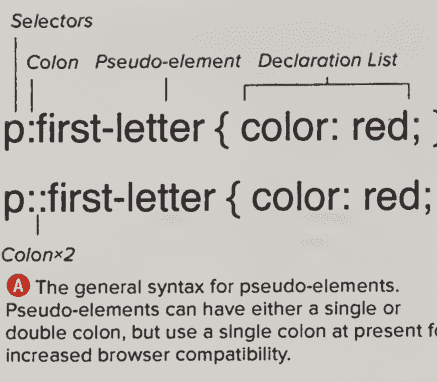

### 4.11 文章中段落的首字母和首行设置了样式 Ⓑ

- 2. 如果元素的首字母是同类型中的第一个，则对其首字母设置样式。输入你想要设置首字母的选择器（`article p`）、一个冒号 (:)，然后是 `:first-letter`。

```html
<!-- HTML -->
<!DOCTYPE html>
<html lang="en">
<head>
  <meta http-equiv="Content-Type"
  content="text/html; charset=UTF-8" />
  <title>标题</title>
  <style type="text/css" media="all">
  article p {
    font-size: 16px;
    line-height: 24px;
    color: rgb(102,102,102);
  }
  article p:first-of-type:first-letter {
    color: red;
    font-size: 3em;
    float: left;
  }
  article p:first-of-type:first-line {
    font-size: 1.2em;
    font-weight: bold;
    color: rgb(0,0,0);
  }
</style>
</head>
<body>
<article>
<p>爱丽丝漫游仙境</p>
<p>这是另一个奇怪的问题...</p>
</article>
</body>
</html>
```

> 提示：CSS3 中的伪元素语法与 CSS2 语法相比发生了细微变化（很少见）。现在伪元素使用双冒号 `::` 以区分于伪类。现有的伪元素可以使用单冒号或双冒号。新的及未来的伪元素应该使用双冒号，但使用单冒号也能运行。

- `bullet-01.png` 和 `bullet-02.png` 将用作标题周围的装饰。
- 《爱丽丝梦游仙境

> 提示：由于 IE8 不支持 CSS2 伪元素的双冒号语法，在所有浏览器采用该语法之前，目前使用冒号语法是一个好主意。

消逝的爱丽丝出现了，她被大家请求逮捕女王，他们证明了他们的论点，他们确实那样做了，但女王很高兴地执行了她所说的一切。

执行官的理由是，他们无法砍掉头，因为没有办法砍掉；他最好之前不要做这种事，而且他不打算在 103 点钟开始。

> 提示：在使用 `before` 和 `after` 向页面添加内容时要小心。这些内容不会出现在搜索引擎或屏幕阅读器中，因此不要将其依赖于任何重要之处。

国王的论点是，任何有头的东西都可以被处理，而且你必须合乎逻辑。

头部现在通过 CSS 在前后添加了一点装饰。这些图像占据的空间就像它们在 `` 标签中一样，但在 HTML 代码中不会显示。

## 即将到来！
选择项样式

虽然还没有在足够（或任何）浏览器中实现到值得考虑的程度，但 CSS3 将引入一个强大的新伪元素 `::selection`，它将为用户选择的元素设置样式。

## 根据标签属性定义样式

尽管通过 CSS，许多 HTML 标签仍然具有定义其行为的属性。例如，图像标签 `` 始终包含 `src` 属性，用于定义加载的图像文件的源。

样式也可以根据属性或属性值分配给 HTML 元素，允许你在属性已设置、不为特定值或包含特定值时设置样式（表 4.6）。

要根据元素的属性来设置样式：

- 1. 如果元素具有特定属性，则设置样式。要根据属性的存在设置样式，输入你想要样化的选择器（HTML、类或 ID）、左括号 (`[`）、你想要检查的属性名称和右括号 (`]`)（代码 4.13）`a[title] {...}`

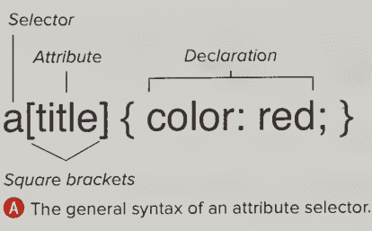

| 表 4.6 属性选择器 | 格式 | 名称 | 元素满足以下时应用样式 | 兼容性 |
| :--- | :--- | :--- | :--- | :--- |
| `[attr]` | 属性 | 具有指定的属性 | IE7, FF1.5, O5, S2, CSS2 |
| `[attr="value"]` | 精确值 | 指定的属性等于精确值 | IE7, FF1.5, O5, S2, CSS2 |
| `[attr*=value]` | 列表 | 在空格分隔的列表中，指定的属性包含精确值 | |
| `[attr~value]` | 连字符列表 | 在连字符分隔的列表中，指定的属性等于精确值 | IE7, FF1.5, O5, S2, CSS2 |
| `[attr^="value"]` | 开头 | 指定的属性开头等于精确值 | CSS3 |
| `[attr$="value"]` | 结尾 | 指定的属性结尾等于精确值 | CSS3 |
| `[attr*="value"]` | 包含 | 指定的属性在任何位置都包含精确值 | CSS3 |

### 4.13 HTML 标签可以有不同的属性，你可以为元素添加样式

这只有当标签分配了此属性时（无论值为何），它才会分配你声明的样式。

```html
<!-- HTML5 -->
<!DOCTYPE html>
<html lang="en">
<head>
  <meta http-equiv="Content-Type" content="text/html; charset=UTF-8">
  <title>爱丽丝梦游仙境/</title>
  <style type="text/css" css="display: block; color:rgb(0,0,0);
    font-size: 8em;
    a[title="home"] { color: rgb(51,0,0);
      font-size: 1em;
    a[title="email"] { color: rgb(102,0,0);
      font-size: 1.2em;
    a[title="resume"] { color: rgb(153,0,0);
      font-size: 1.4em;
    a[href="#info"] { color: rgb(240,0,0);
      font-size: 1.6em;
    a[href="#next"] { color: rgb(235,0,0);
      font-size: 1.8em;
    a[href="#speakinginstyles"] {
      font-size: 2em;}
  </style>
</head>
<body>
  <navigation>
    <h2>关于作者</h2>
    <a href="index.html" title="Portfolio">作品集</a>
    <a href="index.html" title="Portfolio">作品集</a>
    <a href="index.html" title="Portfolio">作品集</a>
    <a href="index.html" title="Portfolio">作品集</a>
    <a href="index.html" title="Portfolio">作品集</a>
    <a href="index.html" title="Portfolio">作品集</a>
    <a href="index.html" title="Portfolio">作品集</a>
    <a href="index.html" title="Portfolio">作品集</a>
    <a href="index.html" title="Portfolio">作品集</a>
    <a href="index.html" title="Portfolio">作品集</a>
    <a href="index.html" title="Portfolio">作品集</a>
    <a href="index.html" title="Portfolio">作品集</a>
    <a href="index.html" title="Portfolio">作品集</a>
    <a href="index.html" title="Portfolio">作品集</a>
    <a href="index.html" title="Portfolio">作品集</a>
    <a href="index.html" title="Portfolio">作品集</a>
    <a href="index.html" title="Portfolio">作品集</a>
    <a href="index.html" title="Portfolio">作品集</a>
    <a href="index.html" title="Portfolio">作品集</a>
    <a href="index.html" title="Portfolio">作品集</a>
    <a href="index.html" title="Portfolio">作品集</a>
    <a href="index.html" title="Portfolio">作品集</a>
    <a href="index.html" title="Portfolio">作品集</a>
    <a href="index.html" title="Portfolio">作品集</a>
    <a href="index.html" title="Portfolio">作品集</a>
    <a href="index.html" title="Portfolio">作品集</a>
    <a href="index.html" title="Portfolio">作品集</a>
    <a href="index.html" title="Portfolio">作品集</a>
    <a href="index.html" title="Portfolio">作品集</a>
    <a href="index.html" title="Portfolio">作品集</a>
    <a href="index.html" title="Portfolio">作品集</a>
    <a href="index.html" title="Portfolio">作品集</a>
    <a href="index.html" title="Portfolio">作品集</a>
    <a href="index.html" title="Portfolio">作品集</a>
    <a href="index.html" title="Portfolio">作品集</a>
    <a href="index.html" title="Portfolio">作品集</a>
    <a href="index.html" title="Portfolio">作品集</a>
    <a href="index.html" title="Portfolio">作品集</a>
    <a href="index.html" title="Portfolio">作品集</a>
    <a href="index.html" title="Portfolio">作品集</a>
    <a href="index.html" title="Portfolio">作品集</a>
    <a href="index.html" title="Portfolio">作品集</a>
    <a href="index.html" title="Portfolio">作品集</a>
    <a href="index.html" title="Portfolio">作品集</a>


```
<a href="index.html" title="Portfolio">作品集</a>
```


<a href="index.html" title="Portfolio">作品集</a>
<a href="index.html" title="Portfolio">作品集</a>
<a href="index.html" title="Portfolio">作品集</a>
<a href="index.html" title="Portfolio">作品集</a>
<a href="index.html" title="Portfolio">作品集</a>
<a href="index.html" title="Portfolio">作品集</a>
<a href="index.html" title="Portfolio">作品集</a>
<a href="index.html" title="Portfolio">作品集</a>
<a href="index.html" title="Portfolio">作品集</a>
<a href="index.html" title="Portfolio">作品集</a>
<a href="index.html" title="Portfolio">作品集</a>
<a href="index.html" title="Portfolio">作品集</a>
<a href="index.html" title="Portfolio">作品集</a>
<a href="index.html" title="Portfolio">作品集</a>
<a href="index.html" title="Portfolio">作品集</a>
<a href="index.html" title="Portfolio">作品集</a>
<a href="index.html" title="Portfolio">作品集</a>
<a href="index.html" title="Portfolio">作品集</a>
<a href="index.html" title="Portfolio">作品集</a>
<a href="index.html" title="Portfolio">作品集</a>
<a href="index.html" title="Portfolio">作品集</a>
<a href="index.html" title="Portfolio">作品集</a>
<a href="index.html" title="Portfolio">作品集</a>
<a href="index.html" title="Portfolio">作品集</a>
<a href="index.html" title="Portfolio">作品集</a>
<a href="index.html" title="Portfolio">作品集</a>
<a href="index.html" title="Portfolio">作品集</a>
<a href="index.html" title="Portfolio">作品集</a>
<a href="index.html" title="Portfolio">作品集</a>
<a href="index.html" title="Portfolio">作品集</a>
<a href="index.html" title="Portfolio">作品集</a>
<a href="index.html" title="Portfolio">作品集</a>
<a href="index.html" title="Portfolio">作品集</a>
<a href="index.html" title="Portfolio">作品集</a>
<a href="index.html" title="Portfolio">作品集</a>
<a href="index.html" title="Portfolio">作品集</a>
<a href="index.html" title="Portfolio">作品集</a>
<a href="index.html" title="Portfolio">作品集</a>
<a href="index.html" title="Portfolio">作品集</a>
<a href="index.html" title="Portfolio">作品集</a>
<a href="index.html" title="Portfolio">作品集</a>
<a href="index.html" title="Portfolio">作品集</a>
<a href="index.html" title="Portfolio">作品集</a>
<a href="index.html" title="Portfolio">作品集</a>
<a href="index.html" title="Portfolio">作品集</a>
<a href="index.html" title="Portfolio">作品集</a>
<a href="index.html" title="Portfolio">作品集</a>
<a href="index.html" title="Portfolio">作品集</a>
<a href="index.html" title="Portfolio">作品集</a>
<a href="index.html" title="Portfolio">作品集</a>
<a href="index.html" title="Portfolio">作品集</a>
<a href="index.html" title="Portfolio">作品集</a>
<a href="index.html" title="Portfolio">作品集</a>
<a href="index.html" title="Portfolio">作品集</a>
<a href="index.html" title="Portfolio">作品集</a>
<a href="index.html" title="Portfolio">作品集</a>
<a href="index.html" title="Portfolio">作品集</a>
<a href="index.html" title="Portfolio">作品集</a>
<a href="index.html" title="Portfolio">作品集</a>
<a href="index.html" title="Portfolio">作品集</a>
<a href="index.html" title="Portfolio">作品集</a>
<a href="index.html" title="Portfolio">作品集</a>
<a href="index.html" title="Portfolio">作品集</a>
<a href="index.html" title="Portfolio">作品集</a>
<a href="index.html" title="Portfolio">作品集</a>
<a href="index.html" title="Portfolio">作品集</a>
<a href="index.html" title="Portfolio">作品集</a>
<a href="index.html" title="Portfolio">作品集</a>
<a href="index.html" title="Portfolio">作品集</a>
<a href="index.html" title="Portfolio">作品集</a>
<a href="index.html" title="Portfolio">作品集</a>
<a href="index.html" title="Portfolio">作品集</a>
<a href="index.html" title="Portfolio">作品集</a>
<a href="index.html" title="Portfolio">作品集</a>
<a href="index.html" title="Portfolio">作品集</a>

```
a[title="home"] { color: rgb(51,0,0);
      font-size: 1em;
    a[title="email"] { color: rgb(102,0,0);
      font-size: 1.2em;
    a[title="resume"] { color: rgb(153,0,0);
      font-size: 1.4em;
    a[href="#info"] { color: rgb(240,0,0);
      font-size: 1.6em;
    a[href="#next"] { color: rgb(235,0,0);
      font-size: 1.8em;
    a[href="#speakinginstyles"] {
      font-size: 2em;}
  </style>
```

</head>

<body>

<navigation>

## 关于作者

<a href="index.html" title="Portfolio">作品集</a>
<a href="index.html" title="Portfolio">作品集</a>
<a href="index.html" title="Portfolio">作品集</a>
<a href="index.html" title="Portfolio">作品集</a>
<a href="index.html" title="Portfolio">作品集</a>
<a href="index.html" title="Portfolio">作品集</a>
<a href="index.html" title="Portfolio">作品集</a>
<a href="index.html" title="Portfolio">作品集</a>
<a href="index.html" title="Portfolio">作品集</a>
<a href="index.html" title="Portfolio">作品集</a>
<a href="index.html" title="Portfolio">作品集</a>
<a href="index.html" title="Portfolio">作品集</a>
<a href="index.html" title="Portfolio">作品集</a>
<a href="index.html" title="Portfolio">作品集</a>
<a href="index.html" title="Portfolio">作品集</a>
<a href="index.html" title="Portfolio">作品集</a>
<a href="index.html" title="Portfolio">作品集</a>
<a href="index.html" title="Portfolio">作品集</a>
<a href="index.html" title="Portfolio">作品集</a>
<a href="index.html" title="Portfolio">作品集</a>
<a href="index.html" title="Portfolio">作品集</a>
<a href="index.html" title="Portfolio">作品集</a>
<a href="index.html" title="Portfolio">作品集</a>
<a href="index.html" title="Portfolio">作品集</a>
<a href="index.html" title="Portfolio">作品集</a>
<a href="index.html" title="Portfolio">作品集</a>
<a href="index.html" title="Portfolio">作品集</a>
<a href="index.html" title="Portfolio">作品集</a>
<a href="index.html" title="Portfolio">作品集</a>
<a href="index.html" title="Portfolio">作品集</a>
<a href="index.html" title="Portfolio">作品集</a>
<a href="index.html" title="Portfolio">作品集</a>
<a href="index.html" title="Portfolio">作品集</a>
<a href="index.html" title="Portfolio">作品集</a>
<a href="index.html" title="Portfolio">作品集</a>
<a href="index.html" title="Portfolio">作品集</a>
<a href="index.html" title="Portfolio">作品集</a>
<a href="index.html" title="Portfolio">作品集</a>
<a href="index.html" title="Portfolio">作品集</a>
<a href="index.html" title="Portfolio">作品集</a>
<a href="index.html" title="Portfolio">作品集</a>
<a href="index.html" title="Portfolio">作品集</a>
<a href="index.html" title="Portfolio">作品集</a>
<a href="index.html" title="Portfolio">作品集</a>
<a href="index.html" title="Portfolio">作品集</a>
<a href="index.html" title="Portfolio">作品集</a>
<a href="index.html" title="Portfolio">作品集</a>
<a href="index.html" title="Portfolio">作品集</a>
<a href="index.html" title="Portfolio">作品集</a>
<a href="index.html" title="Portfolio">作品集</a>
<a href="index.html" title="Portfolio">作品集</a>
<a href="index.html" title="Portfolio">作品集</a>
<a href="index.html" title="Portfolio">作品集</a>
<a href="index.html" title="Portfolio">作品集</a>
<a href="index.html" title="Portfolio">作品集</a>
<a href="index.html" title="Portfolio">作品集</a>
<a href="index.html" title="Portfolio">作品集</a>
<a href="index.html" title="Portfolio">作品集</a>
<a href="index.html" title="Portfolio">作品集</a>
<a href="index.html" title="Portfolio">作品集</a>
<a href="index.html" title="Portfolio">作品集</a>
<a href="index.html" title="Portfolio">作品集</a>
<a href="index.html" title="Portfolio">作品集</a>
<a href="index.html" title="Portfolio">作品集</a>
<a href="index.html" title="Portfolio">作品集</a>
<a href="index.html" title="Portfolio">作品集</a>
<a href="index.html" title="Portfolio">作品集</a>
<a href="index.html" title="Portfolio">作品集</a>
<a href="index.html" title="Portfolio">作品集</a>
<a href="index.html" title="Portfolio">作品集</a>
<a href="index.html" title="Portfolio">作品集</a>
<a href="index.html" title="Portfolio">作品集</a>
<a href="index.html" title="Portfolio">作品集</a>
<a href="index.html" title="Portfolio">作品集</a>
<a href="index.html" title="Portfolio">作品集</a>
<a href="index.html" title="Portfolio">作品集</a>
<a href="index.html" title="Portfolio">作品集</a>


<a href="`index.html`" title="Portfolio">作品集</a> <a href="`index.html`" title="Portfolio">作品集</a> <a href="`index.html`" title="Portfolio">作品集</a> <a href="`index.html`" title="Portfolio">作品集</a> <a href="`index.html`" title="Portfolio">作品集</a> <a href="`index.html`" title="Portfolio">作品集</a> <a href="`index.html`" title="Portfolio">作品集</a> <a href="`index.html`" title="Portfolio">作品集</a> <a href="`index.html`" title="Portfolio">作品集</a> <a href="`index.html`" title="Portfolio">作品集</a> <a href="`index.html`" title="Portfolio">作品集</a> <a href="`index.html`" title="Portfolio">作品集</a> <a href="`index.html`" title="Portfolio">作品集</a> <a href="`index.html`" title="Portfolio">作品集</a> <a href="`index.html`" title="Portfolio">作品集</a> <a href="`index.html`" title="Portfolio">作品集</a> <a href="`index.html`" title="Portfolio">作品集</a> <a href="`index.html`" title="Portfolio">作品集</a> <a href="`index.html`" title="Portfolio">作品集</a> <a href="`index.html`" title="Portfolio">作品集</a> <a href="`index.html`" title="Portfolio">作品集</a> <a href="`index.html`" title="Portfolio">作品集</a> <a href="`index.html`" title="Portfolio">作品集</a> <a href="`index.html`" title="Portfolio">作品集</a> <a href="`index.html`" title="Portfolio">作品集</a> <a href="`index.html`" title="Portfolio">作品集</a> <a href="`index.html`" title="Portfolio">作品集</a> <a href="`index.html`" title="Portfolio">作品集</a> <a href="`index.html`" title="Portfolio">作品集</a> <a href="`index.html`" title="Portfolio">作品集</a> <a href="`index.html`" title="Portfolio">作品集</a> <a href="`index.html`" title="Portfolio">作品集</a> <a href="`index.html`" title="Portfolio">作品集</a> <a href="`index.html`" title="Portfolio">作品集</a> <a href="`index.html`" title="Portfolio">作品集</a> <a href="`index.html`" title="Portfolio">作品集</a> <a href="`index.html`" title="Portfolio">作品集</a> <a href="`index.html`" title="Portfolio">作品集</a> <a href="`index.html`" title="Portfolio">作品集</a> <a href="`index.html`" title="Portfolio">作品集</a> <a href="`index.html`" title="Portfolio">作品集</a> <a href="`index.html`" title="Portfolio">作品集</a> <a href="`index.html`" title="Portfolio">作品集</a> <a href="`index.html`" title="Portfolio">作品集</a> <a href="`index.html`" title="Portfolio">作品集</a> <a href="`index.html`" title="Portfolio">作品集</a> <a href="`index.html`" title="Portfolio">作品集</a> <a href="`index.html`" title="Portfolio">作品集</a> <a href="`index.html`" title="Portfolio">作品集</a> <a href="`index.html`" title="Portfolio">作品集</a> <a href="`index.html`" title="Portfolio">作品集</a> <a href="`index.html`" title="Portfolio">作品集</a> <a href="`index.html`" title="Portfolio">作品集</a> <a href="`index.html`" title="Portfolio">作品集</a> <a href="`index.html`" title="Portfolio">作品集</a> <a href="`index.html`" title="Portfolio">作品集</a> <a href="`index.html`" title="Portfolio">作品集</a> <a href="`index.html`" title="Portfolio">作品集</a> <a href="`index.html`" title="Portfolio">作品集</a> <a href="`index.html`" title="Portfolio">作品集</a> <a href="`index.html`" title="Portfolio">作品集</a> <a href="`index.html`" title="Portfolio">作品集</a> <a href="`index.html`" title="Portfolio">作品集</a> <a href="`index.html`" title="Portfolio">作品集</a> <a href="`index.html`" title="Portfolio">作品集</a> <a href="`index.html`" title="Portfolio">作品集</a> <a href="`index.html`" title="Portfolio">作品集</a> <a href="`index.html`" title="Portfolio">作品集</a> <a href="`index.html`" title="Portfolio">作品集</a> <a href="`index.html`" title="Portfolio">作品集</a> <a href="`index.html`" title="Portfolio">作品集</a> <a href="`index.html`" title="Portfolio">作品集</a> <a href="`index.html`" title="Portfolio">作品集</a> <a href="`index.html`" title="Portfolio">作品集</a> <a href="`index.html`" title="Portfolio">作品集</a> <a href="`index.html`" title="Portfolio">作品集</a> <a href="`index.html`" title="Portfolio">作品集</a> <a href="`index.html`" title="Portfolio">作品集</a> <a href="`index.html`" title="Portfolio">作品集</a> <a href="`index.html`" title="Portfolio">作品集</a> <a href="`index.html`" title="Portfolio">作品集</a> <a href="`index.html`" title="Portfolio">作品集</a> <a href="`index.html`" title="Portfolio">作品集</a> <a href="`index.html`" title="Portfolio">作品集</a> <a href="`index.html`" title="Portfolio">作品集</a> <a href="`index.html`" title="Portfolio">作品集</a> <a href="`index.html`" title="Portfolio">作品集</a> <a href="`index.html`" title="Portfolio">作品集</a> <a href="`index.html`" title="Portfolio">作品集</a> <a href="`index.html`" title="Portfolio">作品集</a> <a href="`index.html`" title="Portfolio">作品集</a> <a href="`index.html`" title="Portfolio">作品集</a> <a href="`index.html`" title="Portfolio">作品集</a> <a href="`index.html`" title="Portfolio">作品集</a> <a href="`index.html`" title="Portfolio">作品集</a> <a href="`index.html`" title="Portfolio">作品集</a> <a href="`index.html`" title="Portfolio">作品集</a> <a href="`index.html`" title="Portfolio">作品集</a> <a href="`index.html`" title="Portfolio">作品集</a> <a href="`index.html`" title="Portfolio">作品集</a> <a href="`index.html`" title="Portfolio">作品集</a> <a href="`index.html`" title="Portfolio">作品集</a> <a href="`index.html`" title="Portfolio">作品集</a> <a href="`index.html`" title="Portfolio">作品集</a> <a href="`index.html`" title="Portfolio">作品集</a> <a href="`index.html`" title="Portfolio">作品集</a> <a href="`index.html`" title="Portfolio">作品集</a> <a href="`index.html`" title="Portfolio">作品集</a> <a href="`index.html`" title="Portfolio">作品集</a> <a href="`index.html`" title="Portfolio">作品集</a> <a href="`index.html`" title="Portfolio">作品集</a> <a href="`index.html`" title="Portfolio">作品集</a> <a href="`index.html`" title="Portfolio">作品集</a> <a href="`index.html`" title="Portfolio">作品集</a> <a href="`index.html`" title="Portfolio">作品集</a> <a href="`index.html`" title="Portfolio">作品集</a> <a href="`index.html`" title="Portfolio">作品集</a> <a href="`index.html`" title="Portfolio">作品集</a> <a href="`index.html`" title="Portfolio">作品集</a> <a href="`index.html`" title="Portfolio">作品集</a> <a href="`index.html`" title="Portfolio">作品集</a> <a href="`index.html`" title="Portfolio">作品集</a> <a href="`index.html`" title="Portfolio">作品集</a> <a href="`index.html`" title="Portfolio">作品集</a> <a href="`index.html`" title="Portfolio">作品集</a> <a href="`index.html`" title="Portfolio">作品集</a> <a href="`index.html`" title="Portfolio">作品集</a> <a href="`index.html`" title="Portfolio">作品集</a> <a href="`index.html`" title="Portfolio">作品集</a> <a href="`index.html`" title="Portfolio">作品集</a> <a href="`index.html`" title="Portfolio">作品集</a> <a href="`index.html`" title="Portfolio">作品集</a> <a href="`index.html`" title="Portfolio">作品集</a> <a href="`index.html`" title="Portfolio">作品集</a> <a href="`index.html`" title="Portfolio">作品集</a> <a href="`index.html`" title="Portfolio">作品集</a> <a href="`index.html`" title="Portfolio">作品集</a> <a href="`index.html`" title="Portfolio">作品集</a> <a href="`index.html`" title="Portfolio">作品集</a> <a href="`index.html`" title="Portfolio">作品集</a> <a href="`index.html`" title="Portfolio">作品集</a> <a href="`index.html`" title="Portfolio">作品集</a> <a href="`index.html`" title="Portfolio">作品集</a> <a href="`index.html`" title="Portfolio">作品集</a> <a href="`index.html`" title="Portfolio">作品集</a> <a href="`index.html`" title="Portfolio">作品集</a> <a href="`index.html`" title="Portfolio">作品集</a> <a href="`index.html`" title="Portfolio">作品集</a> <a href="`index.html`" title="Portfolio">作品集</a> <a href="`index.html`" title="Portfolio">作品集</a> <a href="`index.html`" title="Portfolio">作品集</a> <a href="`index.html`" title="Portfolio">作品集</a> <a href="`index.html`" title="Portfolio">作品集</a> <a href="`index.html`" title="Portfolio">作品集</a> <a href="`index.html`" title="Portfolio">作品集</a> <a href="`index.html`" title="Portfolio">作品集</a> <a href="`index.html`" title="Portfolio">作品集</a> <a href="`index.html`" title="Portfolio">作品集</a> <a href="`index.html`" title="Portfolio">作品集</a> <a href="`index.html`" title="Portfolio">作品集</a> <a href="`index.html`" title="Portfolio">作品集</a> <a href="`index.html`" title="Portfolio">作品集</a>


## 关于作者

`<a href="index.html" title="Portfolio">作品集</a>`
`<a href="index.html" title="Portfolio">作品集</a>`
`<a href="index.html" title="Portfolio">作品集</a>`
`<a href="index.html" title="Portfolio">作品集</a>`
`<a href="index.html" title="Portfolio">作品集</a>`
`<a href="index.html" title="Portfolio">作品集</a>`
`<a href="index.html" title="Portfolio">作品集</a>`
`<a href="index.html" title="Portfolio">作品集</a>`
`<a href="index.html" title="Portfolio">作品集</a>`
`<a href="index.html" title="Portfolio">作品集</a>`

```
a[title="home"] { color: rgb(51,0,0);
  font-size: 1em;
a[title="email"] { color: rgb(102,0,0);
  font-size: 1.2em;
a[title="resume"] { color: rgb(153,0,0);
  font-size: 1.4em;
a[href="#info"] { color: rgb(240,0,0);
  font-size: 1.6em;
a[href="#next"] { color: rgb(235,0,0);
  font-size: 1.8em;
a[href="#speakinginstyles"] {
  font-size: 2em;}
```

`<navigation>`
`</head>`
`<body>`


<a href="index.html" title="Portfolio">作品集</a>
<a href="index.html" title="Portfolio">作品集</a>
<a href="index.html" title="Portfolio">作品集</a>
<a href="index.html" title="Portfolio">作品集</a>
<a href="index.html" title="Portfolio">作品集</a>
<a href="index.html" title="Portfolio">作品集</a>
<a href="index.html" title="Portfolio">作品集</a>
<a href="index.html" title="Portfolio">作品集</a>
<a href="index.html" title="Portfolio">作品集</a>
<a href="index.html" title="Portfolio">作品集</a>
<a href="index.html" title="Portfolio">作品集</a>
<a href="index.html" title="Portfolio">作品集</a>
<a href="index.html" title="Portfolio">作品集</a>
<a href="index.html" title="Portfolio">作品集</a>
<a href="index.html" title="Portfolio">作品集</a>
<a href="index.html" title="Portfolio">作品集</a>
<a href="index.html" title="Portfolio">作品集</a>
<a href="index.html" title="Portfolio">作品集</a>
<a href="index.html" title="Portfolio">作品集</a>
<a href="index.html" title="Portfolio">作品集</a>
<a href="index.html" title="Portfolio">作品集</a>
<a href="index.html" title="Portfolio">作品集</a>
<a href="index.html" title="Portfolio">作品集</a>
<a href="index.html" title="Portfolio">作品集</a>
<a href="index.html" title="Portfolio">作品集</a>
<a href="index.html" title="Portfolio">作品集</a>
<a href="index.html" title="Portfolio">作品集</a>
<a href="index.html" title="Portfolio">作品集</a>
<a href="index.html" title="Portfolio">作品集</a>
<a href="index.html" title="Portfolio">作品集</a>
<a href="index.html" title="Portfolio">作品集</a>
<a href="index.html" title="Portfolio">作品集</a>
<a href="index.html" title="Portfolio">作品集</a>
<a href="index.html" title="Portfolio">作品集</a>
<a href="index.html" title="Portfolio">作品集</a>
<a href="index.html" title="Portfolio">作品集</a>
<a href="index.html" title="Portfolio">作品集</a>
<a href="index.html" title="Portfolio">作品集</a>
<a href="index.html" title="Portfolio">作品集</a>
<a href="index.html" title="Portfolio">作品集</a>
<a href="index.html" title="Portfolio">作品集</a>
<a href="index.html" title="Portfolio">作品集</a>
<a href="index.html" title="Portfolio">作品集</a>
<a href="index.html" title="Portfolio">作品集</a>
<a href="index.html" title="Portfolio">作品集</a>
<a href="index.html" title="Portfolio">作品集</a>
<a href="index.html" title="Portfolio">作品集</a>
<a href="index.html" title="Portfolio">作品集</a>
<a href="index.html" title="Portfolio">作品集</a>
<a href="index.html" title="Portfolio">作品集</a>
<a href="index.html" title="Portfolio">作品集</a>
<a href="index.html" title="Portfolio">作品集</a>
<a href="index.html" title="Portfolio">作品集</a>
<a href="index.html" title="Portfolio">作品集</a>
<a href="index.html" title="Portfolio">作品集</a>
<a href="index.html" title="Portfolio">作品集</a>
<a href="index.html" title="Portfolio">作品集</a>
<a href="index.html" title="Portfolio">作品集</a>
<a href="index.html" title="Portfolio">作品集</a>
<a href="index.html" title="Portfolio">作品集</a>
<a href="index.html" title="Portfolio">作品集</a>
<a href="index.html" title="Portfolio">作品集</a>
<a href="index.html" title="Portfolio">作品集</a>
<a href="index.html" title="Portfolio">作品集</a>
<a href="index.html" title="Portfolio">作品集</a>
<a href="index.html" title="Portfolio">作品集</a>
<a href="index.html" title="Portfolio">作品集</a>
<a href="index.html" title="Portfolio">作品集</a>
<a href="index.html" title="Portfolio">作品集</a>
<a href="index.html" title="Portfolio">作品集</a>
<a href="index.html" title="Portfolio">作品集</a>
<a href="index.html" title="Portfolio">作品集</a>
<a href="index.html" title="Portfolio">作品集</a>
<a href="index.html" title="Portfolio">作品集</a>
<a href="index.html" title="Portfolio">作品集</a>
<a href="index.html" title="Portfolio">作品集</a>
<a href="index.html" title="Portfolio">作品集</a>
<a href="index.html" title="Portfolio">作品集</a>
<a href="index.html" title="Portfolio">作品集</a>
<a href="index.html" title="Portfolio">作品集</a>
<a href="index.html" title="Portfolio">作品集</a>
<a href="index.html" title="Portfolio">作品集</a>
<a href="index.html" title="Portfolio">作品集</a>
<a href="index.html" title="Portfolio">作品集</a>
<a href="index.html" title="Portfolio">作品集</a>
<a href="index.html" title="Portfolio">作品集</a>
<a href="index.html" title="Portfolio">作品集</a>
<a href="index.html" title="Portfolio">作品集</a>
<a href="index.html" title="Portfolio">作品集</a>
<a href="index.html" title="Portfolio">作品集</a>
<a href="index.html" title="Portfolio">作品集</a>
<a href="index.html" title="Portfolio">作品集</a>
<a href="index.html" title="Portfolio">作品集</a>
<a href="index.html" title="Portfolio">作品集</a>
<a href="index.html" title="Portfolio">作品集</a>
<a href="index.html" title="Portfolio">作品集</a>
<a href="index.html" title="Portfolio">作品集</a>
<a href="index.html" title="Portfolio">作品集</a>
<a href="index.html" title="Portfolio">作品集</a>
<a href="index.html" title="Portfolio">作品集</a>
<a href="index.html" title="Portfolio">作品集</a>
<a href="index.html" title="Portfolio">作品集</a>
<a href="index.html" title="Portfolio">作品集</a>
<a href="index.html" title="Portfolio">作品集</a>
<a href="index.html" title="Portfolio">作品集</a>
<a href="index.html" title="Portfolio">作品集</a>
<a href="index.html" title="Portfolio">作品集</a>
<a href="index.html" title="Portfolio">作品集</a>
<a href="index.html" title="Portfolio">作品集</a>
<a href="index.html" title="Portfolio">作品集</a>
<a href="index.html" title="Portfolio">作品集</a>
<a href="index.html" title="Portfolio">作品集</a>
<a href="index.html" title="Portfolio">作品集</a>
<a href="index.html" title="Portfolio">作品集</a>
<a href="index.html" title="Portfolio">作品集</a>
<a href="index.html" title="Portfolio">作品集</a>
<a href="index.html" title="Portfolio">作品集</a>
<a href="index.html" title="Portfolio">作品集</a>
<a href="index.html" title="Portfolio">作品集</a>
<a href="index.html" title="Portfolio">作品集</a>
<a href="index.html" title="Portfolio">作品集</a>
<a href="index.html" title="Portfolio">作品集</a>
<a href="index.html" title="Portfolio">作品集</a>
<a href="index.html" title="Portfolio">作品集</a>
<a href="index.html" title="Portfolio">作品集</a>
<a href="index.html" title="Portfolio">作品集</a>
<a href="index.html" title="Portfolio">作品集</a>
<a href="index.html" title="Portfolio">作品集</a>
<a href="index.html" title="Portfolio">作品集</a>
<a href="index.html" title="Portfolio">作品集</a>
<a href="index.html" title="Portfolio">作品集</a>
<a href="index.html" title="Portfolio">作品集</a>
<a href="index.html" title="Portfolio">作品集</a>
<a href="index.html" title="Portfolio">作品集</a>
<a href="index.html" title="Portfolio">作品集</a>
<a href="index.html" title="Portfolio">作品集</a>
<a href="index.html" title="Portfolio">作品集</a>
<a href="index.html" title="Portfolio">作品集</a>
<a href="index.html" title="Portfolio">作品集</a>
<a href="index.html" title="Portfolio">作品集</a>
<a href="index.html" title="Portfolio">作品集</a>
<a href="index.html" title="Portfolio">作品集</a>
<a href="index.html" title="Portfolio">作品集</a>
<a href="index.html" title="Portfolio">作品集</a>
<a href="index.html" title="Portfolio">作品集</a>
<a href="index.html" title="Portfolio">作品集</a>
<a href="index.html" title="Portfolio">作品集</a>
<a href="index.html" title="Portfolio">作品集</a>
<a href="index.html" title="Portfolio">作品集</a>
<a href="index.html" title="Portfolio">作品集</a>
<a href="index.html" title="Portfolio">作品集</a>
<a href="index.html" title="Portfolio">作品集</a>
<a href="index.html" title="Portfolio">作品集</a>
<a href="index.html" title="Portfolio">作品集</a>
<a href="index.html" title="Portfolio">作品集</a>
<a href="index.html" title="Portfolio">作品集</a>
<a href="index.html" title="Portfolio">作品集</a>
<a href="index.html" title="Portfolio">作品集</a>
<a href="index.html" title="Portfolio">作品集</a>
<a href="index.html" title="Portfolio">作品集</a>
<a href="index.html" title="Portfolio">作品集</a>
<a href="index.html" title="Portfolio">作品集</a>
<a href="index.html" title="Portfolio">作品集</a>

```
a[title="home"] { color: rgb(51,0,0);
  font-size: 1em;
}
a[title="email"] { color: rgb(102,0,0);
  font-size: 1.2em;
}
a[title="resume"] { color: rgb(153,0,0);
  font-size: 1.4em;
}
a[href="#info"] { color: rgb(240,0,0);
  font-size: 1.6em;
}
a[href="#next"] { color: rgb(235,0,0);
  font-size: 1.8em;
}
```


```html
<style>
a[href="#speakinginstyles"] {
  font-size: 2em;
}
</style>
```

## 关于作者

`<navigation>`

- [`作品集`](`index.html`) `title="Portfolio"`
- [`作品集`](`index.html`) `title="Portfolio"`
- [`作品集`](`index.html`) `title="Portfolio"`
- [`作品集`](`index.html`) `title="Portfolio"`
- [`作品集`](`index.html`) `title="Portfolio"`

*...后续重复的 `index.html` 链接省略，保留相同结构*


<a href="index.html" title="Portfolio">作品集</a>
<a href="index.html" title="Portfolio">作品集</a>
<a href="index.html" title="Portfolio">作品集</a>
<a href="index.html" title="Portfolio">作品集</a>
<a href="index.html" title="Portfolio">作品集</a>
<a href="index.html" title="Portfolio">作品集</a>
<a href="index.html" title="Portfolio">作品集</a>
<a href="index.html" title="Portfolio">作品集</a>
<a href="index.html" title="Portfolio">作品集</a>
<a href="index.html" title="Portfolio">作品集</a>
<a href="index.html" title="Portfolio">作品集</a>
<a href="index.html" title="Portfolio">作品集</a>
<a href="index.html" title="Portfolio">作品集</a>
<a href="index.html" title="Portfolio">作品集</a>
<a href="index.html" title="Portfolio">作品集</a>
<a href="index.html" title="Portfolio">作品集</a>
<a href="index.html" title="Portfolio">作品集</a>
<a href="index.html" title="Portfolio">作品集</a>
<a href="index.html" title="Portfolio">作品集</a>
<a href="index.html" title="Portfolio">作品集</a>
<a href="index.html" title="Portfolio">作品集</a>
<a href="index.html" title="Portfolio">作品集</a>
<a href="index.html" title="Portfolio">作品集</a>
<a href="index.html" title="Portfolio">作品集</a>
<a href="index.html" title="Portfolio">作品集</a>
<a href="index.html" title="Portfolio">作品集</a>
<a href="index.html" title="Portfolio">作品集</a>
<a href="index.html" title="Portfolio">作品集</a>
<a href="index.html" title="Portfolio">作品集</a>
<a href="index.html" title="Portfolio">作品集</a>
<a href="index.html" title="Portfolio">作品集</a>
<a href="index.html" title="Portfolio">作品集</a>
<a href="index.html" title="Portfolio">作品集</a>
<a href="index.html" title="Portfolio">作品集</a>
<a href="index.html" title="Portfolio">作品集</a>
<a href="index.html" title="Portfolio">作品集</a>
<a href="index.html" title="Portfolio">作品集</a>
<a href="index.html" title="Portfolio">作品集</a>
<a href="index.html" title="Portfolio">作品集</a>
<a href="index.html" title="Portfolio">作品集</a>
<a href="index.html" title="Portfolio">作品集</a>
<a href="index.html" title="Portfolio">作品集</a>
<a href="index.html" title="Portfolio">作品集</a>
<a href="index.html" title="Portfolio">作品集</a>
<a href="index.html" title="Portfolio">作品集</a>
<a href="index.html" title="Portfolio">作品集</a>
<a href="index.html" title="Portfolio">作品集</a>
<a href="index.html" title="Portfolio">作品集</a>
<a href="index.html" title="Portfolio">作品集</a>
<a href="index.html" title="Portfolio">作品集</a>
<a href="index.html" title="Portfolio">作品集</a>
<a href="index.html" title="Portfolio">作品集</a>
<a href="index.html" title="Portfolio">作品集</a>
<a href="index.html" title="Portfolio">作品集</a>
<a href="index.html" title="Portfolio">作品集</a>
<a href="index.html" title="Portfolio">作品集</a>
<a href="index.html" title="Portfolio">作品集</a>
<a href="index.html" title="Portfolio">作品集</a>
<a href="index.html" title="Portfolio">作品集</a>
<a href="index.html" title="Portfolio">作品集</a>
<a href="index.html" title="Portfolio">作品集</a>
<a href="index.html" title="Portfolio">作品集</a>
<a href="index.html" title="Portfolio">作品集</a>
<a href="index.html" title="Portfolio">作品集</a>
<a href="index.html" title="Portfolio">作品集</a>
<a href="index.html" title="Portfolio">作品集</a>
<a href="index.html" title="Portfolio">作品集</a>
<a href="index.html" title="Portfolio">作品集</a>
<a href="index.html" title="Portfolio">作品集</a>
<a href="index.html" title="Portfolio">作品集</a>
<a href="index.html" title="Portfolio">作品集</a>
<a href="index.html" title="Portfolio">作品集</a>
<a href="index.html" title="Portfolio">作品集</a>
<a href="index.html" title="Portfolio">作品集</a>
<a href="index.html" title="Portfolio">作品集</a>
<a href="index.html" title="Portfolio">作品集</a>
<a href="index.html" title="Portfolio">作品集</a>
<a href="index.html" title="Portfolio">作品集</a>
<a href="index.html" title="Portfolio">作品集</a>
<a href="index.html" title="Portfolio">作品集</a>
<a href="index.html" title="Portfolio">作品集</a>
<a href="index.html" title="Portfolio">作品集</a>
<a href="index.html" title="Portfolio">作品集</a>
<a href="index.html" title="Portfolio">作品集</a>
<a href="index.html" title="Portfolio">作品集</a>
<a href="index.html" title="Portfolio">作品集</a>
<a href="index.html" title="Portfolio">作品集</a>
<a href="index.html" title="Portfolio">作品集</a>
<a href="index.html" title="Portfolio">作品集</a>
<a href="index.html" title="Portfolio">作品集</a>
<a href="index.html" title="Portfolio">作品集</a>
<a href="index.html" title="Portfolio">作品集</a>
<a href="index.html" title="Portfolio">作品集</a>
<a href="index.html" title="Portfolio">作品集</a>
<a href="index.html" title="Portfolio">作品集</a>
<a href="index.html" title="Portfolio">作品集</a>
<a href="index.html" title="Portfolio">作品集</a>
<a href="index.html" title="Portfolio">作品集</a>
<a href="index.html" title="Portfolio">作品集</a>
<a href="index.html" title="Portfolio">作品集</a>
<a href="index.html" title="Portfolio">作品集</a>
<a href="index.html" title="Portfolio">作品集</a>
<a href="index.html" title="Portfolio">作品集</a>
<a href="index.html" title="Portfolio">作品集</a>
<a href="index.html" title="Portfolio">作品集</a>
<a href="index.html" title="Portfolio">作品集</a>
<a href="index.html" title="Portfolio">作品集</a>
<a href="index.html" title="Portfolio">作品集</a>
<a href="index.html" title="Portfolio">作品集</a>
<a href="index.html" title="Portfolio">作品集</a>
<a href="index.html" title="Portfolio">作品集</a>
<a href="index.html" title="Portfolio">作品集</a>
<a href="index.html" title="Portfolio">作品集</a>
<a href="index.html" title="Portfolio">作品集</a>
<a href="index.html" title="Portfolio">作品集</a>
<a href="index.html" title="Portfolio">作品集</a>
<a href="index.html" title="Portfolio">作品集</a>
<a href="index.html" title="Portfolio">作品集</a>
<a href="index.html" title="Portfolio">作品集</a>
<a href="index.html" title="Portfolio">作品集</a>
<a href="index.html" title="Portfolio">作品集</a>
<a href="index.html" title="Portfolio">作品集</a>
<a href="index.html" title="Portfolio">作品集</a>
<a href="index.html" title="Portfolio">作品集</a>
<a href="index.html" title="Portfolio">作品集</a>
<a href="index.html" title="Portfolio">作品集</a>
<a href="index.html" title="Portfolio">作品集</a>
<a href="index.html" title="Portfolio">作品集</a>
<a href="index.html" title="Portfolio">作品集</a>
<a href="index.html" title="Portfolio">作品集</a>
<a href="index.html" title="Portfolio">作品集</a>
<a href="index.html" title="Portfolio">作品集</a>
<a href="index.html" title="Portfolio">作品集</a>
<a href="index.html" title="Portfolio">作品集</a>
<a href="index.html" title="Portfolio">作品集</a>
<a href="index.html" title="Portfolio">作品集</a>
<a href="index.html" title="Portfolio">作品集</a>
<a href="index.html" title="Portfolio">作品集</a>
<a href="index.html" title="Portfolio">作品集</a>
<a href="index.html" title="Portfolio">作品集</a>
<a href="index.html" title="Portfolio">作品集</a>
<a href="index.html" title="Portfolio">作品集</a>
<a href="index.html" title="Portfolio">作品集</a>
<a href="index.html" title="Portfolio">作品集</a>
<a href="index.html" title="Portfolio">作品集</a>
<a href="index.html" title="Portfolio">作品集</a>
<a href="index.html" title="Portfolio">作品集</a>
<a href="index.html" title="Portfolio">作品集</a>
... (省略)
Styles can also be assigned to an HTML element based on an attribute or an attribute value, allowing你在属性已设置、不为特定值、或包含特定值时设置样式（表 4.6）。

To set styles based on an element's attributes:

- 1. Set styles if the element has a specific property. To set styles based on the existence of an attribute, type the selector you want to style (HTML, class, or ID), a left bracket (`[`), the name of the attribute you want to check for, and a right bracket (`]`) (Code 4.13) `a[title] {...}`


| 表 4.6 属性选择器 | 格式 | 名称 | 元素满足以下时应用样式 | 兼容性 |
| :--- | :--- | :--- | :--- | :--- |
| `[attr]` | 属性 | 具有指定的属性 | IE7, FF1.5, O5, S2, CSS2 |
| `[attr="value"]` | 精确值 | 指定的属性等于精确值 | IE7, FF1.5, O5, S2, CSS2 |
| `[attr*=value]` | 列表 | 在空格分隔的列表中，指定的属性包含精确值 | | |
| `[attr~value]` | 连字符列表 | 在连字符分隔的列表中，指定的属性等于精确值 | IE7, FF1.5, O5, S2, CSS2 |
| `[attr^="value"]` | 开头 | 指定的属性开头等于精确值 | CSS3 |
| `[attr$="value"]` | 结尾 | 指定的属性结尾等于精确值 | CSS3 |
| `[attr*="value"]` | 包含 | 指定的属性在任何位置都包含精确值 | CSS3 |

## 4.13 HTML 标签可以有不同的属性，你可以为元素添加样式


这只有当标签分配了此属性时（无论值为何），它才会分配你声明的样式。

```html
<!-- HTML5 -->
<!DOCTYPE html>
<html lang="en">
<head>
  <meta http-equiv="Content-Type" content="text/html; charset=UTF-8">
  <title>爱丽丝梦游仙境/</title>
  <style type="text/css" css="display: block; color:rgb(0,0,0);
    font-size: 8em;
    a[title="home"] { color: rgb(51,0,0);
      font-size: 1em;
    a[title="email"] { color: rgb(102,0,0);
      font-size: 1.2em;
    a[title="resume"] { color: rgb(153,0,0);
      font-size: 1.4em;
    a[href="#info"] { color: rgb(240,0,0);
      font-size: 1.6em;
    a[href="#next"] { color: rgb(235,0,0);
      font-size: 1.8em;
    a[href="#speakinginstyles"] {
      font-size: 2em;}
  </style>
</head>
<body>
  <navigation>
    <h2>关于作者</h2>
    <a href="index.html" title="Portfolio">作品集</a>
    ... (省略)
```

# CSS3 新特性：

媒体查询 ★

| 表 4.7 媒体值 |

| 值 |  intended |

| --- | --- |

| screen | 计算机显示器 |

| tty | 电传打机、计算机终端和旧式便携设备 |

| tv | 电视显示器 |

| projection | 投影仪 |

| handheld | 便携手机和 PDA |

| print | 打印 |

| braille | 盲文触觉阅读器 |

| speech | 语音合成器 |

| all | 所有设备 |

在第 3 章中，你学习了如何为特定的媒体类型指定样式表，这允许你根据 HTML 输出到屏幕、打印、电视或手持或其他设备来设置样式（见表 4.7）。CSS 增加了一项重要的新功能，允许你根据常见的界面属性（如宽度、高度、宽高横比和可用颜色数量）来设置样式。

媒体查询和 `@media` 规则可用于定制你的页面，不仅可以针对通用的设备类型，还可以针对访问者正在使用的特定设备。这包括针对打印、移动设备进行尺寸调整，或为了最适合打开的浏览器窗口的大小。

```
@media screen
and (min-width: 600px)
and (max-width: 980px)
```

## 媒体查询

如果你想知道浏览器窗口的当前大小，为什么不直接问浏览器呢？JavaScript 赋予了你此能力，但对于获取关于你的设计尝试适应的 Web 环境的一些基本事实，这是一种繁琐的方法。

媒体查询为你提供了几个常用的媒体属性，你可以对它们进行测试，然后交付最适合你环境的样式表。

虽然媒体查询有很多属性属性（见表 4.8），但它们分为五种基本类型：

- Aspect-ratio（宽高比）查找以比例表示的设备相对尺寸：例如 16:9。
- Width（宽度）和 height（高度）查找显示区域的尺寸。这些尺寸也可以被表示为最大值。

> 媒体查询的通用语法。

## 表 4.8 媒体查询属性

| 属性 | 值 | 兼容性 |

| --- | --- | --- |

| aspect-ratio | <ratio> | FF3.5, S1, O9.5, CSS3 |

| max-aspect-ratio | <ratio> | FF3.5, S1, O9.5, CSS3 |

| min-aspect-ratio | <ratio> | FF3.5, S1, O9.5, CSS3 |

| device-aspect-ratio | <ratio> | FF3.5, S1, O9.5, CSS3 |

| max-device-aspect-ratio | <ratio> | FF3.5, S1, O9.5, CSS3 |

| min-device-aspect-ratio | <ratio> | FF3.5, S1, O9.5, CSS3 |

| color | <integer> | FF3.5, S1, O10, CSS3 |

| max-color | <integer> | FF3.5, S1, O10, CSS3 |

| min-color | <integer> | FF3.5, S1, O10, CSS3 |

| color-index | <integer> | FF3.5, S1, O10, CSS3 |

| max-color-index | <integer> | FF3.5, S1, O10, CSS3 |

| min-color-index | <integer> | FF3.5, S1, O10, CSS3 |

| device-height | <length> | FF3.5, S1, O9.5, CSS3 |

| max-device-height | <length> | FF3.5, S1, O9.5, CSS3 |

| min-device-height | <length> | FF3.5, S1, O9.5, CSS3 |

| device-width | <length> | FF3.5, S1, O9.5, CSS3 |

| max-device-width | <length> | FF3.5, S1, O9.5, CSS3 |

| min-device-width | <length> | FF3.5, S1, O9.5, CSS3 |

| height | <length> | FF3.5, S1, O9.5, CSS3 |

| max-height | <length> | FF3.5, S1, O9.5, CSS3 |

| min-height | <length> | FF3.5, S1, O9.5, CSS3 |

| monochrome | <integer> | FF3.5, S1, O10, CSS3 |

| max-monochrome | <integer> | FF3.5, S1, O10, CSS3 |

| min-monochrome | <integer> | FF3.5, S1, O10, CSS3 |

| orientation | portrait, landscape | FF3.5, S1, C1, CSS3 |

| resolution | <resolution> | FF3.5, S1, O10, CSS3 |

| max-resolution | <resolution> | FF3.5, S1, O10, CSS3 |

| min-resolution | <resolution> | FF3.5, S1, O10, CSS3 |

| scan | progressive, interlaced | FF3.5, S1, O10, CSS3 |

| width | <length> | FF3.5, S1, O9.5, CSS3 |

| max-width | <length> | FF3.5, S1, O9.5, CSS3 |

| min-width | <length> | FF3.5, S1, O9.5, CSS3 |

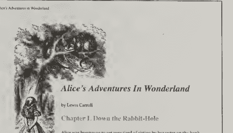

## 3. 链接到你的默认样式表。在 HTML 文档的 `<head>` 中，输入一个 `<link>` 标签引用默认版本的 CSS，并将 media 定义为 all。

```html
<link rel="stylesheet" href="default.css">
```

## 4. 链接到你的打印样式表。在 `<link>` 标签之后，紧添加另一个 `<link>` 标签，引用打印版本的 CSS，并将 media 定义为 print。

```html
<link rel="stylesheet" href="print.css">
```

## 5. 使用媒体查询链接到样式表。在上一个 `<link>` 标签之后，添加另一个 `<link>` 标签来引用特定媒体类型的样式表，并在括号中添加媒体查询（表 4.8），使用 and 连接多个查询。

```html
<link rel="stylesheet" media="screen and (max-device-width: 320px)" and href="iphone.css">
```

## 爱丽丝仙游记

作者：路易斯·卡罗尔

## 第一章 掉进兔子洞

爱丽丝坐在岸边感到非常无聊，开始昏昏睡觉，如果她能进她正盯着的那个兔子洞就好了；那里既没有图片也没有对话，一本没有图片或对话的书又有什么用呢？

她也好奇如何做到（尽她所能的力，因为炎热让她非常困倦），以及许一个奇异愿望的快乐是否值得费力去追求，尤其是当一只有着粉红色眼睛的白兔子直接从她身边跑过时。

她没有时间感谢或溜走，也没有多少时间追上兔子说再见；但她就这样掉下去、掉下去、掉下去、掉了下去，想着多久才能到达井的底。

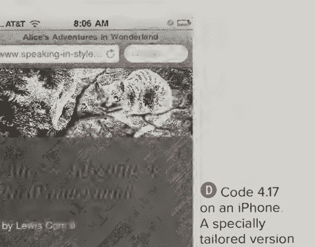

## iPhone 上的代码 4.17

一个为了适应 iPhone 宽度的特别定制版本使用了奇幻猫的自定义页眉。

> 提示 在媒体查询引入之前，Web 开发人员使用 JavaScript 来检测浏览器尺寸和颜色。媒体查询让这些技术变得过时，至少在样式设置方面。

> 提示 在此示例中，媒体查询被应用于 `<link>` 标签的 media 属性值上，但你可以同样轻松将它们应用 `<style>` 标签的 media 属性上。

选择性样式化 105

## 使用 @media 规则

媒体查询允许你在 `<link>` 和 `<style>` 标签的 media 属性中指定样式，但 `@media` 规则允许你直接将媒体查询嵌入到样式中。

### 使用 @media 指定样式：

- 1. 创建你的样式表。创建一个外部样式表，或在文档的 body 中嵌入样式表（代码 4.18）。
- 2. 使用 `@media` 规则通过媒体查询指定样式。在 HTML 文档的 `<head>` 中，输入 `@media` 和 media。然后为样式指定媒体类型（表 4.7）和任何媒体查询（表 4.8）。

```css
@media screen (max-device-width: 480px) and (min-device-width: 320px) {...}
```

例如，你可能指定这些样式在宽度于 320px 到 480px 之间是正确的。以花括号结束。在花括号之间添加任何媒体特定的样式。

- 3. 根据需要添加其他样式。{...}

```css
h2 string {...}
```

你可以添加 `@media` 规则或其他非媒体特定的规则。然而，所有不在 `@media`、`@font-face` 和 import 等的 CSS 规则必须放在这些规则之后。

- 4. 从你的 HTML 文档链接到样式表。放置一个 link 标签来添加外部 CSS 文件（代码 19）。 记住 `@media` 规则可以放在外部或嵌入的样式表中。

```css
/* @media 的通用语法 */
@media screen and (width=480px) {
  h1 { color: red; }
}
/* CSS 规则 */
/* 4.18 的 iPhone 代码与更通用的 CSS 结合。 */

*** 屏幕样式 ***
@media screen and (max-device-width: 480px) and (min-device-width: 320px) {
  body {
    -webkit-text-size-adjust:none;
    background: rgb(102,102,102) url('../images/alpha.gif') no-repeat center;
    padding: 20px 20px 20px;
  }
  h1 {
    color: rgb(153,125,125);
    text-shadow: 0 0 1px rgba(0,0,0);
    font: normal 1em/1.25em "helvetica", Arial, Sans-serif;
  }
  h2 {
    display: block;
    color: red;
    font-size: .75em;
    font-style: italic;
  }
}

/* iPhone 样式 ***
@media screen and (max-device-width: 480px) and (min-device-width: 320px) {
  body {
    color: rgb(255,255,255);
  }
}
```

## 4.19 HTML 代码链接到不同媒体类型的各种样式表。与之前的不同区别是 iPhone 特定的代码现在嵌入在 screen 中，而不是包含媒体查询。

```html
<!-- HTML -->
<!DOCTYPE html>
<html lang="en">
<head>
  <meta http-equiv="Content-Type" content="text/html; charset=UTF-8">
  <meta name="viewport" content="width=device-width, initial-scale=1.0">
  <title>爱丽丝仙游记</title>
  <link rel="stylesheet" media="all" href="default.css">
  <link rel="stylesheet" media="print" href="print.css">
  <link rel="stylesheet" media="screen" href="screen.css">
</head>
<body>
  <h1>爱丽丝仙游记</h1>
  <p class="byline">作者 <span class="author">路易斯·卡罗尔</span></p>
  <article>
    <header>
      <h2><strong>第一章。</strong>掉进兔子洞</h2>
    </header>
    <p>爱丽丝坐在岸边感到非常无聊...</p>
  </article>
</body>
</html>
```

爱丽丝坐在岸边感到非常无聊...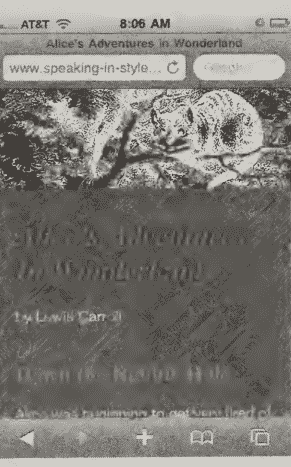 iPhone 上的代码 4.18。看起来一样，但代码现在位于 `@media` 规则中。

## 打印样式

随着激光打印机和喷墨打印机的出现，我们似乎被埋在了一堆打印纸中。即使 Web 似乎增加了我们的用纸量。如果 Web 上的文章超过两个滚动条，很多人就会打印它。

但 Web 的创建是为了在屏幕上显示信息，而不是在纸上。Web 图片在打印时会有颗粒，而且 HTML 缺乏许多布局控制。尽管如此，你仍然改进打印 Web 页的外观。在打印和 Web 上都好看可能需要额外的努力，但从远来看，你的观众会感谢你的。

以下是提高打印 Web 外观的六个简单方法：

- 在页眉之前分页，以便它们与文本在一起。
- 将内容与导航分离。将主要内容（观众感兴趣阅读的部分）在设计上与站点导航分开的独立区域。你可以使用 CSS 在打印版本中隐藏导航：

```css
nav { display: none }
```

包含在打印样式表中。

- 避免在图像中使用透明颜色。如果图像位于白色以外的背景颜色，这一点尤为真实。GIF 图片的透明区域无论窗口背景是什么颜色，通常打印为白色。如果图像原本就在白色背景上，这种情况不是问题，但如果图像应该在深色背景上，结果就会很乱。
- 避免在图像中使用文本。打印 Web 内容的讽刺在于，图像中的文本在窗口中看起来平滑，但在打印时可能有颗粒；但普通的 HTML 文本在某些 PC 屏幕上看起来可能有颗粒，但在任何良好的打印机上都可以打印得流畅。尽量坚持 HTML 文本。
- 避免深色背景和浅色文本。通常你希望打印页的背景保持白色，文本保持黑色或深灰色。
- 打印时不要依赖颜色传递信息。虽然现在彩色打印机非常常见，但很多人仍使用黑白打印机，或在彩色打印机上以黑白打印以节省费用。

## 从父元素继承属性

不，这本书并没有突然变成《房地产视觉快速上手》。子和后代 HTML 标签通常会其父元素的样式——继承它们，无论样式是使用 CSS 还是继承自浏览器样式。这被称为样式继承。

例如，如果你使用一个 ID copy 并给它 font-family 值为 Times，那么它所有的后代元素都会继承 Times 字体样式。如果你用 CSS 将**粗体**标签设置为红色，它所有的后代元素都将继承应用的加粗样式。

## CSS

```css
b { color : red; }
.copy { font-family: times; }
```

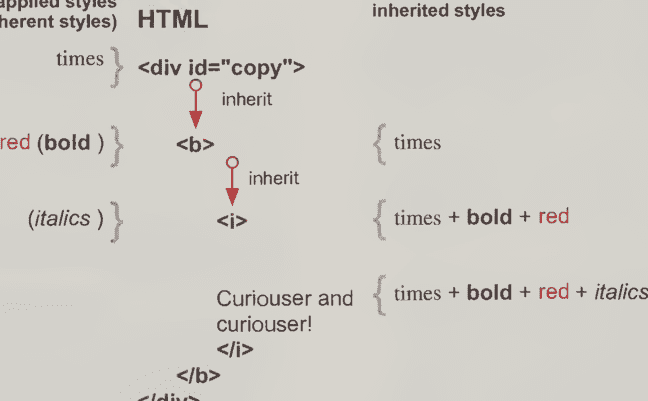

## 结果

真奇怪！

应用和继承的样式的最终结果是 Times 字体的加粗、红色和斜体文本。


在某些情况下，样式属性不会从其父元素的显性属性继承，例如外边距（`margins`）、宽度（`width`）和边框（`borders`）。你可能并不清楚哪些属性是继承的，哪些不是。例如，如果你为段落标签设置了四像素的内边距（`padding`），你不会期望段落内的加粗标签也添加四像素的内边距。如果你有任何疑问，请参阅附录 A，其中列出了所有的 CSS 属性以及它们的继承方式。

如果你确实想让元素继承其父元素的属性，许多 CSS 属性包含 `inherit` 值。因此，在上一个示例中，为了强制段落中的所有加粗标签采用 4px 内边距，你可以将它们的内边距值设置为 `inherit`。

## 管理现有或继承的属性值

在为选择器定义样式时，除非你显式地覆盖这些样式，否则你不会使其丢失任何继承或固有属性。除非你更改构成其外观的特定现有属性，否则所有属性都会显示。

除了用另一个值覆盖相关属性外，许多 CSS 属性具有允许你覆盖继承行为的值：

- `inherit`：强制继承通常不会继承的属性，或覆盖其他已应用的样式值并继承父元素的值。
- `none`：隐藏边框、图像或其他视觉元素。
- `normal`：允许不应用任何样式。
- `auto`：允许浏览器根据上下文决定元素如何显示。

## 制作声明

`!important`

```css
h1 { color: red !important; }
```

你可以将 `!important` 声明添加到属性-值声明中，以便在确定层叠顺序时赋予其最大权重。这样做可以确保无论生效的其他规则如何，该声明都会生效（参见本章的“确定层叠顺序”）：

`!important` 的通用语法。

代码 20。在第一个 `h1` 的颜色属性中添加了 `!important` 值，但在第二个中没有添加。通常情况下，第二个 `h1` 会覆盖第一个，但在这种情况下并不会。

```html
<!-- HTML -->
<!DOCTYPE html>
<html lang="en">
<head>
  <meta http-equiv="charset" charset="UTF-8" />
  <title>爱丽丝漫仙仙游</title>
  <style type="text/css" media="all">
h1 {
  color: red !important;
  font-size: 3em;
}
h1 {
  color: black;
  font-size: 2em;
}
</style>
</head>
<body>
<article>
  <h1>Alice's Adventures in
  <em>Wonderland</em></h1>
</article>
</body>
</html>
```

## 强制使用声明

1. 添加你的 CSS 规则（代码 4.20）。

   `h1 {...}`

   你可以使用 HTML、类（`class`）或 ID 选择器。CSS 规则可以定义文档 `<head>` 中的 `<style>` 标签内（参见第 3 章的“嵌入：为网页添加样式”），也可以在导入或链接到 HTML 文档的外部 CSS 文件中（参见第 3 章的“外部：为网站添加样式”）。

2. 使其重要。使用样式声明、一个空格、`!important` 和分号（`;`）来结束声明。

   `color: red !important;`

3. 添加其他样式。

   `font-size: 1em;`

   添加你希望此规则的任何其他声明，根据你的意愿将它们设置为 `!important` 或否。

`!important` 是一个强大的工具，在样式层叠中仅次于内联样式。`!important` 对于调试 CSS 非常有用；但因为它可能会干扰随后的更改，因此永远不应在最终网站中使用。

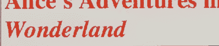

代码 4.20 的结果。第一个 `h1` 的颜色属性中添加了 `!important` 值，但第二个没有。最重要的样式会胜出，因此文本是红色的而不是黑色的。

提示：将简写属性设置为 `!important`（例如 `background`）与将每个子属性（例如 `background-color`）设置为 `!important` 是相同的。

提示：常见的错误是将 `!important` 放在声明分号之后。这会导致浏览器忽略该声明，可能是整个规则。

提示：如果你正在调试样式表且无法让某个样式生效，请尝试向它添加 `!important`。如果仍然不起，问题很可能是拼写错误而不是另一个覆盖样式。

提示：许多浏览器允许用户定义供浏览器使用的样式表。大多数浏览器遵循 CSS 4.1 规范，用户定义的样式表覆盖作者定义的样式表。

## 确定层叠顺序

在单个 页面中，样式表可以是链接、导入或嵌入的。样式也可以在 HTML 中声明。

此外，许多浏览器允许访问者拥有自己的样式表以覆盖你的样式。当然，来自两个或多个源的并行样式表会有冲突的声明。谁最优先？

层叠顺序是指样式从页面顶部开始的方式，随着它们向下移动并在继承时相互收集和替换。通常的规则是最后定义的样式是使用的样式。

然而，有时层叠顺序更为复杂。优先级顺序如下：

| 用户 | 内联 | 媒体 | 标记 | 优先级 | 顺序 | 父元素 | 继承 | 低 |

| :--- | :--- | :--- | :--- | :--- | :--- | :--- | :--- | :--- |

# 字体属性

排版是你呈现条化、整洁外观文档的最强有力工具之一。它也是呈现混乱、粗糙感文档的最佳工具。

你所使用的字体对于以你想要的方式传达信息至关重要——无论这种信息是古典的、摇滚的，还是介于两者之间的任何风格。我常说，字体之于字体就像声音之于说话。字体、字重、斜体和其他排版效果不仅有助于设计师引导访问者的视线在页面上移动，还增添了一层含义。

CSS 让你能够控制 Web 页面中字体（也称为*字形*）的外观。你可以使用 HTML 标签设置字体族、粗体和斜体属性。CSS3 改进了从你的服务器下载由 HTML 字体文件（称为**Webfonts**，网络字体）提供的可用字体大小并将其应用于你的 Web 页面的能力，这让你有能力在设计中使用几乎任何你想要的字体。

## 本章内容

- 理解 Web 排版 119
- 设置字体族栈 (Font-Stack) 124
- 寻找字体 126
- 设置字体大小 133
- CSS3 新特性：为衬线斜体调整字体大小 ★ 136
- 使文本变为斜体 139
- 设置粗体、加粗、最粗 142
- 创建小型大写字母 144
- 设置多个字体值 146
- 汇总应用 150

代码 5.1 本章的 HTML 代码仅包含几个标题和几段文本，导入了 `font-properties.css` 样式表。在整个章节中，你将向此外部表中添加 CSS，以构建最终的 CSS 文件 1

```html
-- HTML -->
<!DOCTYPE html>
<html lang="en">
<head>
  <meta charset="utf-8">
  <title>Alice's Adventure in Wonderland | Chapter I</title>
  <link href="../css/font-properties.css" type="text/css" rel="stylesheet">
</head>
<body id="chapter1" class="book aiapter">
  <h1>Alice&#8217;s Adventures in Wonderland</h1>
  <p class="by">by <span class="author">Lewis Carroll</span></p>
  <article>-- Article --
    <header>
      <h2>Chapter I. Down the Rabbit-Hole</h2>
    </header>
    <p>Alice was beginning to get very tired of sitting by her sister on the bank, and of having nothing to do: once or twice she had peeped into the book her sister was reading, 'and what is the use of a book,' thought Alice 'without pictures or conversation?'</p>
  </article>
</body>
</html>
```

# 爱丽丝漫游仙仙记

作者：刘易斯·卡罗尔

## 第一章 兔子洞

爱丽丝开始非常厌倦坐在岸边的姐姐身边，也厌倦无事可做：她曾一两次偷看姐姐正在读的书，但书里没有插图也没有对话，爱丽丝想：“如果没有插图或对话，书又有什么用呢？”

于是，她在脑子里尽力地思考，因为天气炎热，她感到非常困倦和愚钝，觉得编织雏菊花环的快乐值得她起床去采雏菊，这时，一只长着粉红色眼睛的白兔子从她身边跑过。

这没什么特别奇的，所以爱丽丝觉得兔子对她说的话非常不合常；但事后她回想起来，觉得自己本应该对此感到惊讶，但在当时看起来很自然；当兔子实际上从背心口袋里掏出一块表，看了看，然后匆忙赶路，爱丽丝开始跟上去，因为她脑海中闪过一个念头：她从未见过有背心口袋或可以拿出手表的兔子。在好奇心的驱使下，她穿过田野去，幸运的是她及时钻进了灌篱丛下一个巨大的兔子洞。

> 这就是 Web 页面（代码 5.1）在应用 CSS 之前的样子。在本章中，你将添加字体样式。

118 第 5 章

# 理解 Web 排版

**字体族**（在 Web 设计中通常称为 **font family**，字体族）是一类具有相似特征的字体类别。字体中的每个字符被称为*字形*（glyph）。HTML 文本与 Flash 或图形文本相比的优势在于：如果需要更改，很容易编辑，并且可以适应查看它的屏幕宽度。此外，内容通常存储在数据库中，然后输出为 HTML 文本。

然而，HTML 文本有一些严重的局限性。很大程度上，大多数文本控制留给了访问者的浏览器，你目前无法实现某些操作，例如让文本垂直排列而不是水平排列，除非使用 CSS 过渡（第 12 章），而这些功能尚未实现跨浏览器兼容。

令人感到局限的是，你受限于访问机器上的可用字体。然而，最近浏览器的发展正在快速改变这种观念。随着 CSS3 越来越流行，随着 WebFonts 的出现，更丰富的字体可能性也随之增加。

## 指定字符集

在上章中，你发现创建 HTML5 文档时，需要指定页面使用的字符集。字符集仅仅是具有唯一代码或名称的字符列表或*索引*（repertoire），浏览器将识别这些字符以显示文本。

你在 HTML 页面的 `head` 部分使用 meta 标签来指定字符集。最流行的国际字符集是 UTF-8（8 位 Unicode 转换格式）字符集：

```html
<meta charset="utf-8">
```

或者，如果你用英文写作，另一种常见的字符集是 ISO 8859-1 字符集：

```html
<meta http-equiv="Content-Type" content="text/html;charset=ISO-8859-1" />
```

UTF-8 和 ISO 8859-1 对英文的效果基本相同，但 UTF-8 支持其他字母。强烈建议使用 UTF-8。

另一个重要点是：如果你在 HTML 中指定了一个字符集中不存在的字符，浏览器通常会显示一个错误标记 Ⓐ。

## 通用字体族

CSS 定义了大多数字体可以分类的通用字体族（表 5.1）。

- 衬线体 (Serif)：衬线是字母末端的小装饰线条，使其具有独特的品质。衬线是石刻和笔画时代的遗留。衬线通常通过让单个字母脱颖而出来提高可读性。衬线字体通常适用于屏幕显示较大的文本（14px 或更大）或打印文本。它们对于屏幕上的较小文本效果并不好，因为衬线往往会遮挡字母。衬线字体通常给人一种保守的感觉。

![9cd61ac1d4015ed5688d0c4113a660_143_0 这个字形或类似的字形将出现在浏览器不识别的任何字符处。

## 表 5.1 通用字体族

| 名称 | 示例 |
| :--- | :--- |
| 衬线体 (Serif) | Times New Roman |
| 无衬线体 (Sans-serif) | Helvetica 和 Arial |
| 等宽字体 (Monospace) | Courier New |
| 草体 (Cursive) | Brush Script MT |
| 幻想字体 (Fantasy) | Papyrus |

- 无衬线体 (Sans-serif)：正如你猜的，无衬线字体是指没有衬线的字体。虽然字符不那么独特，但无衬线字体更适合屏幕上的小文本。无衬线字体通常给人一种现代和随意的感觉。

- 等宽字体 (Monospace)：尽管等宽字体可以有衬线，但它们的显著特征是每个字母占据相同的空间。例如，小写字母 *i* 比大写字母 *M* 薄得多。在非等宽字体中，该字母占据的空间比 *M* 小，但等宽字体会在 *i* 周围增加额外的空间，使其占据的空间与 *M* 相同。

等宽字体最适用于必须精确（但不一定需要快速）阅读的文本，例如编程代码，在代码中拼写错误可能会导致灾难。虽然更容易扫描，等宽字体在阅读大量文本时会变得单调。等宽字体赋予文本一种技术性或打字机的感觉。

- 装饰字体（Fantasy）——不符合上述任何一类别的字体被称为装饰字体（fantasy fonts）。这些字体通常极具装饰性，但并不是字母、插图或图标。

像手写字体（cursive fonts）一样，装饰字体主要用于装饰。你应该节制使用装饰字体并仔细选择，以增强网站的外观和感受，因为每种装饰字体都有独特的个性

-字体示例。这些源自符号字体（dingbats）。

## 符号字体 (Dingbats)

尽管没有官方的 CSS 指定，但另一类重要的字体需要考虑。符号字体（也称为符号或图片字体）它们不代表数字或字母，而是与键盘上的每个字母对应的图标或象形。这种字体最常见的例子是符号字体（Webdings），大多数计算机上都安装了。符号字体是符号集合。虽然可以使用这些符号代替图形，但无法保证字体已安装。然而，如果你使用本文后文描述的符号字体，你可以比较确定会得到你想要的结果，替换了一些图形图标。

## HTML 实体 (HTML entities)

符号字体的更可靠的替代方案是 HTML 实体。这些是特殊字符的集合，它们不是由字母表示，而是由与号（&）开头并以分号（;）结尾的代码。例如，与号在代码中表示为：

```
&amp;
```

对于许多字符，这是跨浏览器和操作系统一致地显示它们的唯一方法。

# 什么是网络字体 (What Are Webfonts?)

网络字体是 Web 设计的一项最新进展，允许你通过链接服务器上的字体文件将字体包含在设计中。尽管这看起来很简单（确实如此），这种能力早已出现并将彻底改变字体。

## 设置字体栈 (Setting a Font Stack)

`font-family` 属性允许你通过选择显示文本的字体决定信息的视觉效果。你用于显示文本的字体会对读者感知信息产生巨大影响。无论你使用衬线（serif）、无衬线（sans-serif）、等宽（monospace）还是装饰（fantasy）字体，在读者阅读第一行文本之前就能说明很多。不同字体示例。我们如何为元素定义字体族：

- 1. 在你的 CSS 规则中添加 `font-family` 属性。输入 `font-family`，后跟冒号。在示例中，`font-family` 应用于 `body` 标签，这将设置整个页字体（代码 5.2）。
- 2. 定义你想使用的主字体，后跟逗号。此名称是不区分大小写的。名称中包含空格的字体必须用引号括起来（"Times Roman"）。
- 3. 定义替代字体列表，称为回退字体（fallback fonts），用逗号分隔。你可以包含尽可能多的字体。如果列表中的字体字体在访问者的计算机上不可用，将按照指定的顺序使用这些字体。更多细节请参见本文的“为什么要包含回退字体”。
- 4. 定义通用字体族。在最后一个回退字体之后，输入你正在使用的特定样式的通用字体族名称。表 5.2 列出了字体族的通用值。虽然包含此值是可选的，但这样做是一个好主意。

`font-family: Helvetica, Arial,`

## 表 5.2 Font-Family 值

| 值 | 兼容性 |
| --- | --- |
| <family-name> | IE3, IE7, CSS1+ |
| serif | IE3, IE7, CSS1+ |
| sans-serif | IE4/5/6, IE7, CSS1+ |
| cursive | IE4, IE7, CSS1+ |
| fantasy | IE4, IE7, CSS1+ |
| monospace | IE4, IE7, CSS1+ |

# 爱丽丝仙游游记

作者：刘易·卡罗尔 (Lewis Carroll)

第一章 掉进洞 爱丽丝坐在岸边感到非常无聊，由于无所事事，她想知道正在读的这本书是否值得读——一本没有图片或对话的书有什么用呢？——当爱丽丝开始……这世界上没有什么是奇特到让爱丽丝以前没见过两次的，比如一只穿着背心、口袋里揣着怀表的白兔子。但她对此并不不在意；她非常好奇那只兔子带着这样的怀表要去哪里，当它急匆匆地钻进洞时，爱丽丝毫不犹豫，茫然地跟了上去——并恰好看到那个兔子洞到底有多深。

> 正文内容使用 Helvetica、Arial 显示，取决于访问者计算机上可用哪一个。然而，标题使用 Georgia、Times 或 Times Roman 显示，取决于可用性。

代码 5.2 `font-properties.css`——两个字体应用于页面；第一个影响页面上所有文本的外观；第二个只影响其他和 `.baseline` 类。


```
*** CSS - 第5章 - font-properties.css ***

body {
  font-family: Helvetica, Arial, sans-serif;
}

font-family: Georgia, Times, "Times New Roman", serif;
```

# 字体还是字体族？ (Font or Font Family?)

记住字体（font）和字体族（font family）之间的区别。字体族是一系列外观相似的字体——例如 Times，字体指的是特定的版本——例如 Times 正常、Times 粗体、Times 斜体等。

# 为什么要包含回退字体和通用字体族？ (Why Include Fallback Fonts and Generic Font Families?)

当你提供字体列表时，浏览器尝试使用列表中的第一个字体。如果它不可用，浏览器将继续遍历列表，直到找到访问者计算机上安装的字体。如果没有找到匹配项，浏览器将使用访问者的默认字体显示文本。使用通用字体的优势在于，即使特定字体不可用，浏览器也会尝试显示文本。

## 网络安全字体 p3

你可以在我的网站 `www.fluidwebtype.info/websafonts` 上找到网络安全字体列表。该列表列出了这些字体，并包含了它们的外观示例，以及可以作为替代方案的相似字体 A A。

| 浏览器 | OTF/TTF | EOT | SVG | WOFF |
|---|---|---|---|---|
| Internet Explorer | | IE4 | | 将推出 |
| Firefox | FF3.5 | | FF3.6 | |
| Safari | S3.1* | S3.1 | | |
| Chrome | C4.0 | | C4.0 | 将推出 |
| Opera | O10 | | O10 | 将推出 |

- `www.fluidwebtype.info` 上的网络安全字体列表包含了每种字体的视觉示例。你可以按照名称、可用的字重和样式、操作系统可用性以及排名对列表进行排序。

## 可下载的网络字体

多年来，在技术上已经可以像平常一样下载字体并在你的设计中使用它了。然而，浏览器开发者最近才添加了这一功能。好消息是，现在大多数用户都可以下载字体（称为网络字体）。坏消息是，不同的浏览器使用不同的文件格式（表 5.3）。

以下是文件格式列表：

- TTF/OTF。TrueType 和 OpenType 字体是你计算机上可能拥有的类型。它们现在被广泛使用，代表了大部分售卖字体。尽管如此，它们没有内置的安全机制来防止未经授权的使用。

- EOT。Embedded OpenType 是微软在 20 世纪后期开发的一种格式，用于为 Web 提供安全的下载下载字体。然而，由于该技术在多年里都是专利所有，且 EOT 字体难以创建，该格式并没有流行。因为它是 IE 支持的唯一格式，并且从 IE4 开始一直受到支持，它在为 IE 实现网络字体方面获得了新的生机。

* Safari Mobile 不可用。可以使用 SVG。

- SVG。作为独立于 CSS 的 W3 标准，可缩矢量图形可以包含字体信息。某些浏览器（如 Safari Mobile）仅支持这种格式。

- WOFF。Web Open Font Format 可能是新成员，开发于 2009 年中期，但它已经成为默认网络字体格式的主流。该格式对字体包含了一些保护（例如许可），但远没有 EOT 那么繁琐。

Code 5.3 `font-properties.css` - 我分别将网络安全字体 Corbel 和 Constantia 添加到正文和标题文本中，然后下载了网络字体 "Little Trouble" 用于 h2 页面。

要在你的设计中部署网络字体，技巧是包含指向多个字体文件的链接；浏览器将使用适合它的格式。好消息是，通过一些巧妙的代码，可以通过“设置更好的字体栈”轻松实现这一点。接下来的内容在本章中学习如何下载或将字体转换为这些多种字体格式（使用“Font Squirrel 转换字体文件”）。

```css
/* CSS 5 - font-properties.css */
@font-face {
  font-family: 'Title Font';
  src: url('../fonts/little-Trouble-Girl/little-trouble-girl.woff');
  src: local('../fonts/little-Trouble-Girl/little-trouble-girl.woff'),
  format('woff'), url('../fonts/little-Trouble-Girl/little-trouble-girl.ttf') format('truetype'),
  url('../fonts/little-Trouble-Girl.svg#webfont') format('svg');
  font-weight: normal;
  font-style: normal;
  font-variant: normal;
}
```

## 设置更好的字体栈

让我们再次查看字体栈，以及如何利用网络安全字体和网络字体来创建一个设计，使其超越我们在 Web 上常见的视觉单调性。

```css
body {
  font-family: Corbel, Helvetica, Arial, Sans-serif;
}
```

```css
h1, h2, h3, h4, h5, h6, .byline {
  font-family: Constantia, Georgia, Times, "Times New Roman", Serif;
}
```

```css
h3 {
  font-family: Constantia, Georgia, Times, "Times New Roman", Serif;
}
```

要在你的设计中部署网络字体，技巧是包含指向多个字体文件的链接；浏览器将使用适合它的格式。好消息是，通过一些巧妙的代码，可以通过“设置更好的字体栈”轻松实现这一点。

# 使用 Font Squirrel 转换字体文件

尽管你现在可以自由地在设计中下载网络字体（Webfonts），你仍然面临着两个主要障碍：

- 1. 法律问题。虽然你可能认为可以将购买的字体作为网络字体使用，但通常并非如此。大多数字体在它们的《最终用户许可协议》（EULA）中都列出了使用限制。如果 EULA 未明确规定你可以将字体用于 `@font-face` 链接，那么在法律上你是不允许这么做的。在继续之前，请向字体供应商确认。

- 2. 技术问题。你如何获取所有那些不同的字体格式？目前，即使获得了授权，大多数字体字体字厂或转销商也不提供这些格式。

该怎么办？

我经常使用的一个非常好的资源是 Font Squirrel 网站（`www.fontsquirrel.com`），它提供了一个包含 500 多种免费许可、可下载的网络字体索引。每种字体都包含了所有的字体格式以及 CSS 代码。

如果这还不够，该网站还提供了一个极其实用的工具——@font-face Kit 生成器——它可以将任何 OTF 或 TTF 文件转换为 EOT、SVG 和 WOFF 格式（`www.fontsquirrel.com/fontgenerator/`）。它非常易于使用，在使用前确保你的 EULA 符合规定即可。

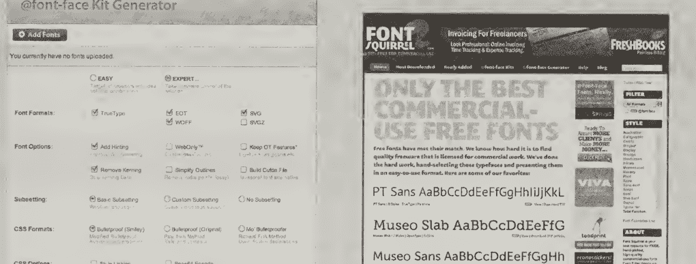

Font Squirrel (`www.fontsquirrel.com`) 提供了 500 多种免费字体，供你的网站直接使用。

- 使用 @font-face Kit 生成器 (`www.fontsquirrel.com/fontface/generator`) 将任何授权字体转换为用于网页的格式。

# 网络字体服务机构

在网页设计中添加特定字体的另一种选择是网络字体服务机构，它们提供授权的字体供你使用（通常需要付费），但将实际文件保留在自己的服务器上，同时允许你在代码中引用它们。有些机构通过简单的 CSS 链接实现这一点；另一些则使用自己的专利方法，通常结合 JavaScript。

使用网络字体服务机构的优势包括：

- 字体是授权的，因此你不必担心违反 EULA 并被起诉。

- 字体托管在机构的服务器上，这意味着你占用自己服务器的带宽较少。

- 浏览器支持由机构处理，潜在的更新和升级也由其负责。

然而，它们也有缺点：

- 由于字体在第三方服务器上，你取决于他人的系统始终保持快速和可靠。

- 如果你自己的电脑上没有字体的副本，你将无法创建视觉稿图给客户展示。

- 价格范围因服务而异。有些收取一次性费用；另一些需要按年订阅。如果你忘记付费，你的字体就会消失。

网络字体服务机构不断涌现，但目前顶尖的包括：

- Typekit (`www.typekit.com`)

- Kernest (`www.kernest.com`)

- Typotheque (`www.typotheque.com`)

- Ascender (`www.ascender.com`)

- Fontdeck (`www.fontdeck.com`)

- Google Font API (`code.google.com/apis/webfonts/`)

# 设置字体大小

通过 CSS，你可以使用几种符号或方法来指定屏幕上文字的大小，包括传统的打印点数（point-size）、百分比、绝对大小，甚至是相对于周围文本的相对大小（表 5.4）。

字体可以设置为绝对大小（根据标准长度测量定义字体大小）或相对大小（相对于浏览器设置的默认值）。

表 5.4 字体大小值

| 值 | 兼容性 |
| --- | --- |
| <length> | IE3, FF1, S1, C1, O5.5, CSS1 |
| <percentage> | IE3, FF1, S1, C1, O5.5, CSS1 |
| smaller | IE4, FF1, S1, C1, O5.5, CSS1 |
| larger | IE4, FF1, S1, C1, O5.5, CSS1 |
| x-small | IE3, FF1, S1, C1, O5.5, CSS1 |
| small | IE3, FF1, S1, C1, O5.5, CSS1 |
| medium | IE3, FF1, S1, C1, O5.5, CSS1 |
| large | IE3, FF1, S1, C1, O5.5, CSS1 |
| x-large | IE3, FF1, S1, C1, O5.5, CSS1 |

要为元素定义字体大小：

- 在你的 CSS 中添加字体大小属性。输入属性名 `font-size`，后跟一个冒号。

- 定义字体大小，它可以是以下任何一种：

    - 相对或绝对长度单位（通常是像素 pixels 或 em）。详情请参见此书中的“值与单位”。

    - 相对于默认大小的绝对大小关键字：*xx-small, small, medium, large, and xx-large*。

    - 相对大小关键字 *smaller* 或 *larger*，用于描述字体相对于其父元素的大小。我将页面上文字的默认大小定义为 100%（用户设置的默认大小），然后设置页面上相对于该大小的字体大小。

```css
@font-face {
  src: url('font.woff') format('woff'),
       url('font.eot') format('opentype'),
       url('font.svg') format('svg'),
       url('font.ttf') format('truetype');
  font-weight: normal;
  font-style: normal;
}

-body {
  font-size: 100%; /* 默认大小 */
  font-family: Arial, "Times New Roman", Times, serif;
}

h1 { font-size: 3em; }
h2 { font-size: 2em; }
h3 { font-size: 1.5em; }
h4 { font-size: 1.2em; }
h5 { font-size: 1em; }
h6 { font-size: 0.8em; }

p { font-size: 1em; }

strong { font-size: 1.2em; }

em { font-size: 0.8em; }
```

# 新 CSS3：为学习字体调整字体大小 ★

字体大小是根据大写字母的高度来衡量的，但不同字体之间差异最大的往往是小写字母。如果你依赖某些学习字体，即使设置了相同的物理尺寸，你的字体看起来也可能大不相同。为了缓解这个问题，CSS3 引入了 `font-size-adjust` 属性，允许你相对于小写字母而非大写字母来设置字体大小。

要做到这一点，你需要指定一个数值，使小写字体的大小为字体的倍数（见表 5.5）。例如，如果字体大小为 18 像素且你设置 `font-size-adjust` 为 0.5，则小写字母的大小将为 9 像素。结果是，所有字体将具有相同的视觉大小，即使它们的 x 高（x-height）差异很大。

要调整元素的字体大小：

- 1. 在你的 CSS 中添加 `font-size-adjust` 属性。输入属性名 `font-size-adjust`，后跟冒号（代码 5.5）。

  `font-size-adjust:`

- 2. 定义一个大小值。

  `.5;`

  输入一个值来调整字体大小：

  - 大于或等于 0 的数值，作为当前字体大小的倍数，根据 x 高调整文本大小，

  - `none`，保持字体大小不调整。

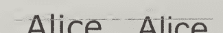

`font-size: 18px Verdana Arial`


`font-size: 18px; font-size-adjust: .46 Verdana Arial`

> Verdana 的 x 高比 Arial（上方）高，但使用 `font-size-adjust`，你可以让小写字母使用相同的高度，无论浏览器使用哪种字体，一致性都更高。

# 表 5.5 Font-Size-Adjust 值

| 值 | 兼容性 |
| :--- | :--- |
| <number> | FF3*, CSS3 |
| none | FF3*, CSS3 |

*FF1 用于 Windows

> 提示：你可以通过将设置的字体大小除以字体的 x 高来计算这些值，或者你可以直接肉眼观察，直到 `font-size-adjust` 看起来对主字体的大小没有影响为止。

> 提示：`font-size-adjust` 会调整你所有字符的大小（包括大写和小写字母），但它是相对于小写字母而非大写字母进行的。

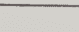

5.5 font-properties.css——字体大小已调整，使得小写字母的大小是大写字母的一半。标题字体是一个例外，字体大小设置为 .46。

```css
*** CSS V3 - Chapter 5 - font-properties.css ***
@font-face {
  font-family: 'Title Font';
  src: local('../fonts/Little-Trouble-Girl/littleretroublegirl-webfont.wot');
  src: local('\02'), url('../fonts/Little-Trouble-Girl/littleretroublegirl-webfont.woff') format('woff');
  url('../fonts/Little-Trouble-Girl/littleretroublegirl-webfont.ttf') format('truetype');
  url('../fonts/Little-Trouble-Girl/littleretroublegirl-webfont.svg#webfont') format('svg');
  font-weight: normal;
  font-style: italic;
  font-variant: normal;
}

body {
  font-family: Helvetica, Arial, Sans-serif;
  font-size: 100%;
  font-size-adjust: .5; 
}

h1, h2, h3, h4, h5, h6, .byline {
  font-family: Georgia, Times, "Times Roman", Serif;
  font-size-adjust: .46;
}

h1 {
  font-family: Georgia, Times, "Times Roman", Serif;
  font-size: 3em;
}

h2 {
  font-size: 2em;
}

h2 strong {
  font-size: .5em;
}

p {
  font-size: .875em;
}

strong {
  font-size: 1.25em;
}

byline {
  font-size: 1.1em;
}
```

## 使文本变为斜体

是斜体（italic）还是倾斜体（oblique）？要真正区分它们，请仔细这两个单词中的字母 "I"。

经常混淆的两种样式文本是斜体和倾斜体。斜体字体是特定字体的特殊版本，设计具有更明显的衬线，并且通常向右轻微倾斜。另一方面，倾斜体仅仅是向右倾斜的字体，在其他方面与普通版本完全相同。

使用 `font-style`（表 5.6），你可以将字体定义为斜体、倾斜体或正体。当字体被设置为斜体但没有显式的斜体版本时，字体将默认为：

## 表 5.6 Font-Style 值

| 值 | 兼容性 |


| :--- | :--- |

| normal | IE3, F1, S1, C1, O5.5, CSS1 |

| italic | IE3, F1, S1, C1, O5.5, CSS1 |

| oblique | IE4, F1, S1, C1, CSS1 |

## 即将推出：Font-stretch

虽然目前还没有浏览器实现它，但 CSS3 包含了新属性 `font-stretch`。`font-stretch` 命令允许你引用特定的字体宽度，例如扩展和压缩。某些字体与加粗不同，加粗只是让字体形状变得多。大多数字体不具有这些属性，但对于具有的字体，使用 `font-stretch` 是访问它们的最佳方式。

## 为元素设置 font-style：

- 在你的 CSS 中添加 `font-style` 属性。输入属性名 `font-style`（代码 5.6），后跟冒号（:）。

  `font-style:`

- 定义一个样式值。输入一个 `font-style` 的值。你的选项有：

  - `italic`，以字体的斜体版本显示类型
  - `oblique`，将文本向右倾斜
  - `normal`，覆盖任何其他样式设置

- `h2 strong { font-style: normal; }`

  根据需要添加样式覆盖。你可以通过将子元素的字体样式设置为 `normal` 来覆盖斜体或倾斜体。

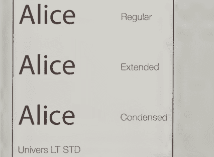

Univers LT Std 的标准、扩展和压缩版本，当 `font-stretch` 属性可用时，可以引用它们。

Code 5.6 font-properties.css—h1 和 h2 标签都设置了*斜体*，这被 h2 中的 **加粗** 标签覆盖了。我们还需要在 `@font-face` 规则中更改 `font-style`。这实际上不会让下载的字体变为斜体，而是告诉浏览器使用此版本代替斜体版本。

```css
*** VQS - Chapter 5 - font-properties.css ***
@font-face {
  font-family: 'Title Font';
  src: url('./fonts/little-Trouble-Girl/littletoublegirl-webfont.eot');
  src: local('Open Sans'), url('./fonts/little-Trouble-Girl/littletoublegirl-webfont.woff') format('woff'),
  url: url('./fonts/little-Trouble-Girl/littletoublegirl-webfont.ttf') format('truetype');
  url: url('./fonts/little-Trouble-Girl/littletoublegirl-webfont.svg#svg') format('svg');
  font-weight: normal;
  font-style: italic;
  font-variant: normal;
}

body {
  font-family: Corbel, Helvetica, Arial, Sans-serif;
  font-size: 100%;
  font-size-adjust: .5;
}

h1, h2, h3, h4, h5, h6, .byeline {
  font-family: Constantia, Georgia, Times, "Times New Roman", Serif;
  font-size-adjust: .46;
}

h1 {
  font-family: 'Title Font', Constantia, Georgia, Times, "Times New Roman", Serif;
  font-size: 3em;
  font-style: italic;
}

h2 {
  font-size: 2em;
  font-style: normal;
}

h2 strong {
  font-size: .5em;
  font-style: italic;
}

p {
  font-size: .85em;
}

strong {
  font-size: 1.25em;
}

.byeline {
  font-size: 1.25em;
  font-style: italic;
}

.byeline .author {
  font-style: normal;
}
```

提示：许多浏览器并不区分斜体（italic）和倾斜体（oblique）；它们会直接使用字体的斜体版本（如果可用），即使它们被设置为倾斜体。

提示：如果字体不存在斜体或倾斜体版本，许多浏览器将尝试通过将普通字体版本向右倾斜来合成一个。这种效果通常并不好看，应该尽量避免。

提示：许多网页设计师给单词加下划线以引起视觉注意。我建议改用斜体或倾斜体文本。下划线往往会让页面看起来很杂乱。更重要的是，带下划线的文本可能会与超链接混淆。

提示：斜体文本通常比非斜体文本（在传统排版术语中称为罗马）更紧凑，可以用于节省屏幕空间。但要小心——在小字号下，斜体在屏幕上可能难以阅读。

## 爱丽丝漫游仙记

易斯·卡罗尔

## 第一章 掉进兔子洞

爱丽丝开始觉得坐在岸边姐姐旁边非常无聊，而且无事可做：她曾一或两次偷看姐姐正在读的书，但书里既没有插图也没有对话，“没有插图或对话的书有什么用呢？”爱丽丝想。

于是她在心里思考（尽力而为，因为炎热的天气让她感到昏昏欲睡），编织雏菊花环的乐趣是否值得费起身去采雏菊的麻烦。这时，一只粉粉色眼睛的白兔子从她身边跑过。

这并没有什么特别的；爱丽丝也不觉得兔子自言自语说“哎呀！哎呀！我要迟到了！”有什么奇怪的（事后她想起来，她自己本应该对此感到奇怪，但在当时这似乎很自然）；但当兔子实际上从马心甲里掏出一块表看了看，然后匆忙离开时，爱丽丝跳了起来，因为她脑海中闪过一个念头：斜体通常用于突出文本，例如“by”这个词，或者用于增加强调，例如章节标题。

# 设置加粗、更粗、最粗

## 普通加粗

## 创建小型大写 (Small Caps)

小型大写（有时被称为微大写）用于强调标题（见表 5.8）。使用小型大写，小写字母会被转换为大写，但尺寸比普通大写字母 A 略小。

## 普通小型大写

使用小型大写时，所有字母均为大写，但第一个字母比其他字母大。

| 表 5.8 字体变体值 | |

| 值 | 兼容性 |

| --- | --- |

| normal | IE4, FF1, S1, C1, O3, CSS1 |

| small-caps | IE4, FF1, S1, C1, O3, CSS1 |

## 为元素设置小型大写：

- 1. 在您的 CSS 中添加 `font-variant` 属性。输入属性名 `font-variant`（代码 5.8），后加冒号 (:)。

- 2. 为变体定义值。

  `small-caps;`

输入 `font-variant` 属性的值，使用以下之一：

- `small-caps`，将小写字母设置为真实大写字母的较小版本
- `normal`，覆盖可能继承的其他字体变体值

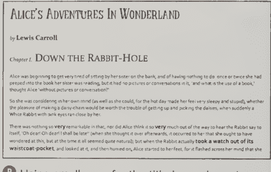

标题使用小型大写是将其与正文区分开的一种优雅方式。

> 小型大写最好留给标题或特殊文本；它们在较小的字体下可能难以阅读。

## 5.8 font-properties.css—小型大写应用于 header 1 和 header 2，但在 h2 内部的 `strong` 元素中禁用。注意，`@font-face` 中的声明已更改为 `small-caps` 规则，因此下载的字体将在 h1 中显示 ⓘ

```css
*** CSS VDS - Chapter 5 - fontproperties.css ***

@font-face {
  font-family: 'Title Font';
  src: url('../fonts/Little-Trouble-Girl/litttroublegirl-webfont.woff');
  src: local('Little Trouble Girl'), url('../fonts/Little-Trouble-Girl/litttroublegirl-webfont.woff') format('woff');
  url('../fonts/Little-Trouble-Girl/litttroublegirl-webfont.ttf') format('truetype');
  url('../fonts/Little-Trouble-Girl/litttroublegirl-webfont.svg#webfont') format('svg');
  font-weight: bold;
  font-style: italic;
  font-variant: small-caps;
}
```

```css
body {
  font-family: Corbel, Helvetica, Arial, Sans-serif;
  font-size: 100%;
  font-size-adjust: .5; }
```

```css
h1, h2, h3, h4, h5, h6, .byline {
  font-family: Constancia, Georgia, Times, "Times New Roman", Serif;
  font-size-adjust: .46; }
```

```css
h1 {
  font-family: 'Title Font', Constancia, Georgia, Times, "Times New Roman", Serif;
  font-size: 3em;
  font-style: italic;
  font-weight: bold;
  font-variant: small-caps; }
```

```css
h2 {
  font-size: 2em;
  font-style: normal;
  font-weight: lighter;
  font-variant: small-caps; }
```

```css
h2 strong {
  font-size: .5em;
  font-style: italic;
  font-variant: normal; }
```

```css
p {
  font-size: .875em; }
```

```css
strong {
  font-size: 1.25em; }
```

```css
.byline {
  font-size: 1em;
  font-style: italic; }
```

```css
.byline .author {
  font-size: 1.25em;
  font-style: normal;
  font-weight: bold; }
```

## 设置多个字体值

虽然你可以独立设置字体属性，但将所有字体元素放在单个声明中（见表 5.9）通常更有用，更不用说更简洁了。要实现这一点，你可以使用简写属性 `font`。

| 表 5.9 字体值 | |

| 值 | 兼容性 |

| <font-style> | IE3, FF1, S1, C1, O3.5, CSS1 |

| <font-variant> | IE3, FF1, S1, C1, O3.5, CSS1 |

| <font-weight> | IE3, FF1, S1, C1, O3.5, CSS1 |

| <font-size> | IE3, FF1, S1, C1, O3.5, CSS1 |

| <line-height> | IE3, FF1, S1, C1, O3.5, CSS1 |

| <font-family> | IE4, FF1, S2, C1, CSS2 |

要在规则中同时定义多个字体属性：

- 1. 在你的 CSS 中添加 `font` 属性。输入属性名 `font`（代码 5.9），后加冒号 (::)。按照按照练习中剩余步骤的顺序输入值。

- 2. 可选，定义样式值。输入 `font-style` 值，后加空格。（参见“设置斜体”章节）。

- 3. 可选，定义权重值。输入 `font-weight` 值，后加空格。（参见“设置加粗”章节）。

- 4. 可选，定义变体值。输入 `font-variant` 值，后加空格。（参见“创建小型大写”章节）。

- 5. 定义大小值。输入 `font-size` 值。（参见“设置字体”章节）。

- 6. 可选，定义行高值。输入 `line-height` 值，后加分号 (;）。参见“调整间距”章节）。

- 7. 定义字体族值。输入 `font-family` 值。（参见“设置字体族”章节）。

> 提示 `font` 简写属性是一个节省时间的利器，我尽可能经常使用它。它输入和编辑的时间更短，并且可以加快加载速度。

> 提示 编辑软件（如 Dreamweaver）倾向于使用单独属性而不是简写。

> 提示 如果不想在列表中设置特定的样式或权重值，只需跳过即可。浏览器将使用其默认值。

> 提示 然而你必须至少包含一个值，即使是 `normal`。

> 提示 如果你需要覆盖由 `font` 简写设置的值，通常最好使用完整属性（如 `font-style`、`font-variant`、`font-weight` 和 `font-family`）。

5.9 font-properties.css——只要可能，字体属性已合并到简写属性中。这需要大小、字体族以及至少一个其他字体属性定义

```css
*** CSS V - Chapter 5 - font-properties.css ***
@font-face {
  font-family: 'Title Font';
  src: url('../fonts/Little-Trouble-Girl/litttroublegirl-webfont.woff');
  src: local('Arial'), url('../fonts/Little-Trouble-Girl/litttroublegirl-webfont.woff') format('woff');
  url('../fonts/Little-Trouble-Girl/litttroublegirl-webfont.ttf') format('truetype');
  url('../fonts/Little-Trouble-Girl/litttroublegirl-webfont.svg') format('svg');
  font-weight: bold;
  font-style: italic;
  font-variant: small-caps;
}

body {
  font: normal 100% Corbel, Helvetica, Arial, Sans-serif;
  font-size-adjust: .5;
}

h1, h2, h3, h4, h5, h6, .byline {
  font-family: Constancia, Georgia, Times, "Times New Roman", Serif;
  font-size-adjust: .6;
}

h1 {
  font: italic bold small-caps 3em 'Title Font', Constancia, Georgia, Times, "Times New Roman", Serif;
}

h2 {
  font-size: 2em;
  font-style: normal;
  font-weight: lighter;
  font-variant: small-caps;
}

h2 strong {
  font-size: .5em;
  font-style: italic;
  font-variant: normal;
}

p {
  font-size: .875em;
}

byline {
  font-size: 1em;
  font-style: italic;
}

byline .author {
  font-size: 1.25em;
  font-style: normal;
  font-weight: bold;
}
```

## 爱丽丝漫游仙境记

路易斯·卡罗尔 著

## 第一章 兔子洞

爱丽丝开始觉得坐在河岸的姐姐身边很无聊，而且无事可做：她曾一两次偷看一眼她姐姐正在读的那本书，发现里面既没有图片也没有对话。爱丽丝想，“一本没有图片或对话的书能有什么用呢？”

于是她在心里考虑（尽管尽所能地考虑，因为天气炎热，她感到非常困倦和愚钝），制作一个雏菊花环的快乐是否值得费去起床采雏菊的麻烦。这时，一只粉粉色眼睛的白兔子从她身边经过。

这没有什么特别不起的，爱丽丝也不觉得听到兔子自言自语说“噢天哪噢天哪，我要迟了！”是很奇怪的事（当她以后回想起来时，她认为自己应该感到惊讶，但在当时这一切看起来都是很自然的）；但当兔子实际上从它身上掏出一块表时，这个版本看起来与前一个章节相似，只是行间距不同。

## 模仿访问者的样式

如果可以匹配访问者的系统字体样式，那不是很好吗？你只需将字体样式声明为以下关键字之一即可（例如，`font: icon;`）：

- `caption`：用于按钮等控件的字体样式
- `icon`：用于标记图标的字体样式
- `menu`：用于下拉菜单和菜单列表的字体样式
- `message-box`：用于对话框的字体样式
- `small-caption`：用于标记小型控件的字体样式
- `status-bar`：用于窗口顶部状态栏的字体样式

# 综合运用

- 1. 为 `body` 元素添加 CSS 规则，定义字体族栈（font stack）。使用第 4 章的 HTML，并在 `<style>` 标签中添加 `body{...}` 规则以及 `font-family`（字体族栈）的声明。尝试不同的字体，看看它们在你的系统中的效果。


## 2. 在标题中使用网络字体（Webfonts）
在 CSS 代码的顶部添加 `@font-face{...}` 规则，指向一个网络字体文件（它可以位于你的本地系统中），并为页面标题（`h1`, `h2`, `h3` 等）添加规则，使用字体族栈列表中列出的第一个网络字体。

## 3. 指定 `body` 中字体的大小
在你的 `body` 规则中添加 `font-size` 声明。尝试不同的值和单位，看看它们如何影响你的页面。

## 4. 指定字体调整参数
在 `body` 规则中添加 `font-adjustment`，然后更改你的字体族栈，看看这如何影响不同字体的大小。

## 5. 为标题指定字重
浏览器默认样式通常会让标题加粗，因此尝试一下它们在普通（正体）样式下的外观。

## 6. 使用小型大写字母（small-caps）样式标题
在标题规则中添加 `font-variant`。

## 7. 使用字体简写（font shorthand）组合样式规则
使用 `font` 属性将尽可能多的独立字体属性合并到一个声明中。

## 文本属性

文本无处不在，它被用于一切，从早餐谷物中的成分到一首古希腊瓮瓶的颂歌。它是人类发明的记录复杂思想的最佳系统。许多人认为文本仅仅是记录单词的方式，但字体排版（typography）为单词的含义赋予了声音。字体排版通过控制所用字母的形状和大小（字体），以及控制字母、单词、行和段落之间的空间来影响文本的呈现。

遗憾的是，网页排版的许多挑战是由于需要规避媒介局限性而产生的。网页排版是为了提高屏幕阅读性，并引导观众的注意力关注重要内容。这是一个艰难的平衡动作，但本章将为你提供正确的工具。

## 本章内容

| 调整文本间距 | 153 |
| :--- | :--- |
| 设置文本大小写 | 158 |
| CSS3 新特性：添加阴影 | 160 |
| 文本水平对齐 | 162 |
| 文本垂直对齐 | 164 |
| 段落缩进 | 167 |
| 控制空白区域 | 169 |
| 装饰文本 | 172 |
| 即将推出！ | 175 |
| 综合运用 | 177 |

Code 6.1 本章示例使用的 HTML5 代码。此代码链接了第 5 章的最终 CSS 代码，并链接了我们将在本章中构建的 `file-properties.css` 文件。

```
<!-- HTML5 -->
<!DOCTYPE html>
<html lang="en">
<head>
  <meta charset="utf-8">
  <title>爱丽丝仙仙游 | 第二章</title>
  <link href="../font-properties.css" type="text/css" rel="stylesheet">
  <link href="../font-properties.css" type="text/css" rel="stylesheet">
  <!--[if IE -->
  <style>import url(/ie.css);</style>
  <script src="HTML5ForIE.js" type="javascript"></script>
  <!--[endif]-->
</head>
<body id="chapter2" class="book aii">
  <header>
    <h1>爱丽丝仙仙游</h1>
    <p class="byline">作者：<span class="author">刘易·卡罗尔</span></p>
  </header>
  <header>
    <h1>爱丽丝仙仙游</h1>
    <p class="byline">作者：<span class="author">刘易·卡罗尔</span></p>
  </header>
  <article>
    <h2>第二章 泪之池</h2>
    <p>爱丽丝正坐在姐姐的岸边，由于姐姐一直在看一本既没有插图对话的书，爱丽丝也觉得很无聊。这时，一只穿背心的白兔子跑了过去。爱丽丝从未见过这样奇怪的兔子，这只兔子不仅看了看表，还担心迟到了。她跟上那只兔子，进了一个兔子洞。她掉了下去，掉得又深又深，她甚至可以观察到路边的书架、柜子和地图。最后，她降落了一个满是叶子的地面上。</p>
    <p>“我不知道我掉到了哪里，”爱丽丝自言自语道，“也许我掉到了地心？也许我掉到了月球上？如果我掉到了地心，我就会撞到树根上，或者掉进那片无边无的海洋里。啊，”Alice 哭道，“我简直要把自己淹死了。”</p>
    <p>爱丽丝开始哭起来。眼泪流得非常多，形成了一个大湖。她哭了很久，哭了很久。</p>
    <div class="asis">
      “也许，”爱丽丝想，
      “我可以在我的眼泪里游泳，”
      （在这个流满的眼泪湖里）。
    </div>
    <p>过了一会儿，她停止了哭。她发现眼泪已经到了她的脖子。这时，Alice 真的在眼泪湖里游起来了。</p>
  </article>
```

Code 6.1 The HTML5 code used for the examples in this chapter. This code links to the final CSS code from Chapter 5 and also links a file-properties.css-that we will be building in this chapter.

## 文本属性

文本无处不在，它被用于一切，从早餐谷物中的成分到一首古希腊瓮瓶的颂歌。它是人类发明的记录复杂思想的最佳系统。许多人认为文本仅仅是记录单词的方式，但字体排版（typography）为单词的含义赋予了声音。字体排版通过控制所用字母的形状和大小（字体），以及控制字母、单词、行和段落之间的空间来影响文本的呈现。

遗憾的是，网页排版的许多挑战是由于需要规避媒介局限性而产生的。网页排版是为了提高屏幕阅读性，并引导观众的注意力关注重要内容。这是一个艰难的平衡动作，但本章将为你提供正确的工具。

## 本章内容

| 调整文本间距 | 153 |
| :--- | :--- |
| 设置文本大小写 | 158 |
| CSS3 新特性：添加阴影 | 160 |
| 文本水平对齐 | 162 |
| 文本垂直对齐 | 164 |
| 段落缩进 | 167 |
| 控制空白区域 | 169 |
| 装饰文本 | 172 |
| 即将推出！ | 175 |
| 综合运用 | 177 |

Code 6.1 本章示例使用的 HTML5 代码。此代码链接了第 5 章的最终 CSS 代码，并链接了我们将在本章中构建的 `file-properties.css` 文件。


```
<!-- HTML5 -->
<!DOCTYPE html>
<html lang="en">
<head>
  <meta charset="utf-8">
  <title>爱丽丝仙仙游 | 第二章</title>
  <link href="../font-properties.css" type="text/css" rel="stylesheet">
  <link href="../font-properties.css" type="text/css" rel="stylesheet">
  <!--[if IE -->
  <style>import url(/ie.css);</style>
  <script src="HTML5ForIE.js" type="javascript"></script>
  <!--[endif]-->
</head>
<body id="chapter2" class="book aii">
  <header>
    <h1>爱丽丝仙仙游</h1>
    <p class="byline">作者：<span class="author">刘易·卡罗尔</span></p>
  </header>
  <article>
    <h2>第二章 泪之池</h2>
    <p>爱丽丝正坐在姐姐的岸边，由于姐姐一直在看一本既没有插图对话的书，爱丽丝也觉得很无聊。这时，一只穿背子的白兔子跑了过去。爱丽丝从未见过这样奇怪的兔子，这只兔子不仅看了看表，还担心迟到了。她跟上那只兔子，进了一个兔子洞。她掉了下去，掉得又深又深，她甚至可以观察到路边的书架、柜子和地图。</p>
    <p>“我不知道我掉到了哪里，”爱丽丝自言自语道，“也许我掉到了地心？也许我掉到了月球上？如果我掉到了地心，我就会撞到树根上，或者掉进那片无边无的海洋里。啊，”Alice 哭道，“我简直要把我自己淹死了。”</p>
    <p>爱丽丝开始哭起来。眼泪流得非常多，形成了一个大湖。她哭了很久，哭了很久。</p>
    <div class="asis">
      “也许，”爱丽丝想，
      “我可以在我的眼泪里游泳，”
      （在这个流满的眼泪湖里）。
    </div>
    <p>过了一会儿，她停止了哭。她发现眼泪已经到了她的脖子。这时，Alice 真的在眼泪湖里游起来了。</p>
    <p>“哦，”Alice 发现，“我得小心一点。如果我继续这样哭下去，我就会变得那么大，然后淹死在湖里了。”</p>
    <p>她试着擦干眼泪，但没用。眼泪还是流了出来，而且眼泪湖变得越来越大了。</p>
    <p>“好吧，”Alice 发现，“我得等等水干了。”</p>
    <p>就在这时，Alice 发现自己又变小了，小到只有几英寸高。现在她正漂浮在眼泪湖上。”p>
    <p>“哦，不，”Alice 发现，“我真的变得太小了，我会被淹死在自己的眼泪里的。”</p>
    <p>她又开始哭了起来。眼泪流得非常快，眼泪湖再次变大了。Alice 哭得比时候更厉害。</p>
    <p>过了一会儿，Alice 发现自己又变小了。这一次，她可以完全在眼泪湖里游泳了，而不会淹死了。”</p>
    （注：原文 HTML 部分存在大量重复文本，此处已根据逻辑进行翻译并去重）
</article>
</body>
</html>
```

# 综合运用

- 1. 为 `body` 元素添加一个 CSS 规则，定义字体族栈（font stack）。使用第 4 章的 HTML，并在 `<style>` 标签中添加 `body{...}` 规则以及 `font-family` 的声明。尝试不同的字体，看看它们在你的系统中的效果。
- 2. 在标题中使用网络字体（Webfonts）。在你的 CSS 代码的顶部添加一个 `@font-face{...}` 规则，指向一个网络字体文件（它可以位于你的本地系统中），并为页面标题（`h1`, `h2`, `h3` 等）添加规则，使用字体族栈列表中列出的第一个网络字体。
- 3. 指定 `body` 中字体的大小。在你的 `body` 规则中添加 `font-size` 声明。尝试不同的值和单位，看看这如何影响你的页面。
- 4. 指定一个字体调整。在 `body` 规则中添加 `font-adjustment`，然后更改你的字体族栈，看看这如何影响不同字体的大小。
- 5. 为标题指定字重。浏览器的默认样式通常会让标题加粗，因此尝试一下它们在普通（正体）样式下的外观。
- 6. 使用小型大写字母（small-caps）样式化标题。在标题规则中添加 `font-variant`。
- 7. 使用字体简写（font shorthand）组合样式规则。使用 `font` 属性将尽可能多的独立字体属性合并到一个声明中。

## 文本属性

文本无处不在，它被用于一切，从早餐谷物中的成分到一首古希腊瓮瓶的颂歌。它是人类发明的记录复杂思想的最佳系统。许多人认为文本仅仅是记录单词的方式，但字体排版（typography）为单词的含义赋予了声音。字体排版通过控制所用字母的形状和大小（字体），以及控制字母、单词、行和段落之间的空间来影响文本的呈现。

遗憾的是，网页排版的许多挑战是由于需要规避媒介局限性而产生的。网页排版是为了提高屏幕阅读性，并引导观众的注意力关注重要内容。这是一个艰难的平衡动作，但本章将为你提供正确的工具。

## 本章内容

| 调整文本间距 | 153 |
| :--- | :--- |
| 设置文本大小写 | 158 |
| CSS3 新特性：添加阴影 | 160 |
| 文本水平对齐 | 162 |
| 文本垂直对齐 | 164 |
| 段落缩进 | 167 |
| 控制空白区域 | 169 |
| 装饰文本 | 172 |
| 即将推出！ | 175 |
| 综合运用 | 177 |

Code 6.1 本章示例使用的 HTML5 代码。此代码链接了第 5 章的最终 CSS 代码，并链接了我们将在本章中构建的 `file-properties.css` 文件。

```
<!-- HTML5 -->
<!DOCTYPE html>
<html lang="en">
<head>
  <meta charset="utf-8">
  <title>爱丽丝仙仙游 | 第二章</title>
  <link href="../font-properties.css" type="text/css" rel="stylesheet">
  <link href="../font-properties.css" type="text/css" rel="stylesheet">
  <!--[if IE -->
  <style>import url(/ie.css);</style>
  <script src="HTML5ForIE.js" type="javascript"></script>
  <!--[endif]-->
</head>
<body id="chapter2" class="book aii">
  <header>
    <h1>爱丽丝仙仙游</h1>
    <p class="byline">作者：<span class="author">刘易·卡罗尔</span></p>
  </header>
  <article>
    <h2>第二章 泪之池</h2>
    <p>爱丽丝正坐在姐姐的岸边，由于姐姐一直在看一本既没有插图对话的书，爱丽丝也觉得很无聊。这时，一只穿背子的白兔子跑了过去。爱丽丝从未见过这样奇怪的兔子，这只兔子不仅看了看表，还担心迟到了。她跟上那只兔子，进了一个兔子洞。她掉了下去，掉得又深又深，她甚至可以观察到路边的书架、柜子和地图。</p>
    <p>“我不知道我掉到了哪里，”爱丽丝自言自语道，“也许我掉到了地心？也许我掉到了月球上？如果我掉到了地心，我就会撞到树根上，或者掉进那片无边无的海洋里。啊，”Alice 哭道，“我简直要把我自己淹死了。”</p>
    <p>爱丽丝开始哭起来。眼泪流得非常多，形成了一个大湖。她哭了很久，哭了很久。</p>
    <div class="asis">
      “也许，”爱丽丝想，
      “我可以在我的眼泪里游泳，”
      （在这个流满的眼泪湖里）。
    </div>
    <p>过了一会儿，她停止了哭。她发现眼泪已经到了她的脖子。这时，Alice 真的在眼泪湖里游起来了。</p>
    <p>“哦，”Alice 发现，“我得小心一点。如果我继续这样哭下去，我就会变得那么大，然后淹死在湖里了。”</p>
    <p>她试着擦干眼泪，但没用。眼泪还是流了出来，而且眼泪湖变得越来越大了。</p>
    <p>“好吧，”Alice 发现，“我得等等水干了。”</p>
    <p>就在这时，Alice 发现自己又变小了，小到只有几英寸高。现在她正漂浮在眼泪湖上。”</p>
    <p>“哦，不，”Alice 发现，“我真的变得太小了，我会被淹死在自己的眼泪里的。”</p>
    <p>她又开始哭了起来。眼泪流得非常快，眼泪湖再次变大了。Alice 哭得比时候更厉害。</p>
    <p>过了一会儿，Alice 发现自己又变小了。这一次，她可以完全在眼泪湖里游泳了，而不会淹死了。”</p>
    （注：原文 HTML 部分存在大量重复文本，此处已根据逻辑进行翻译并去重）
</article>
</body>
</html>
```

# 调整单词间距

就像字间距和词间距调整既有助于也会阻碍阅读性一样，使用 `word-spacing` 属性（表 6.2）在屏幕上的单词之间增加一点空间可以使你的文本更易阅读。但过大的空间会中断读者视线跨越屏幕移动的路径，并干扰阅读。

text-properties.css—当应用于 6.1 时。一级标题中的单词几乎重叠在一起，但这之所以有效是因为单词在视觉上通过大写字母分隔开。章节标题类中的单词被拉开了。正文（主体文本）被略微拉开，其整体效果是通过创建更多留白使页面看起来更轻松。

```css
*** CSS3 V5 | Chapter 6 | text-properties. ***
h1 {
letter-spacing: -.05em;
word-spacing: -1em;
}
h2 {
letter-spacing: 2px;
word-spacing: 3px;
}
h2 strong {
letter-spacing: 0; 
}
p {
word-spacing: .075em;
}
header p:first-letter {
letter-spacing: -.05em;
}
.byline {
word-spacing: -.3em;
}
.byline .author {
word-spacing: 0;
}
```

## 定义单词间距：

- 1. 在你的声明列表中添加 `word-spacing` 属性。在 CSS 声明列表中输入 `word-spacing`，后跟冒号（:）（代码 6.3）。
`word-spacing:`
- 2. 指定单词之间的空间大小。
`.1em`
使用以下值之一设置 `word-spacing` 的值：
- 正或负的长度值，表示单词之间的空间大小（例如 `-1em`）。更多信息请参阅引言中的“书中的值和单位”。
- `normal`，覆盖继承的值。

> 极节制地使用 `word-spacing`。通常情况下，自然的单词间距已经为了可读性进行了优化。改变这种空间往往弊大于利。

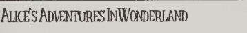

刘易斯·卡罗尔
第二章 泪之池

爱丽丝坐下来又哭了起来，因为她太累了，这路路她已经走了这么久，却没有获得任何乐趣。“我这辈子没走过这么远的路！”她对自己说，“如果我再往前走，我要么会掉脑袋，要么会掉子，要么就是走得太远而没路走，或者我每个圣诞都得买双新鞋。”
她心里暗自想那将是多么奇怪。“这一定很奇特，”她想，多滑稽啊

⑧ 代码 6.3 应用于代码 6.1：标题的空间已更改，并略微增加以使正文显得更轻盈。

# 表 6.2 单词间距值

| 值 | 兼容性 |
| --- | --- |
| normal | IE6, FF1, S1, C1, O3.5, CSS1 |
| <length> | IE6, FF1, S1, C1, O3.5, CSS1 |

# 调整文本行间距（行高）

任何写过学术论文的人都知道，它们通常是双倍行距的，以便于阅读并为注释留出空间。行间距也可以通过在文本之间创建负空间来增加以产生戏剧效果。`line-height` 属性（表 6.3）在文本基线（大多数字母的底部）之间添加空间。

# 表 6.3 行高值

| 值 | 兼容性 |
|---||---|
| normal | IE3, FF1, C1, O3, CSS1 |
| <number> | IE4, FF1, S1, C1, O3, CSS1 |
| <length> | IE3, FF1, S1, C1, O3, CSS1 |
| <percentage> | IE3, FF1, S1, C1, O3, CSS1 |

# 定义行高：

- 1. 向你的规则中添加 `line-height`。在声明列表中输入 `line-height`，后跟冒号（:）（代码 6.4）。
- 2. 指定文本之间的空间。
`.9;`
使用以下选项之一为 `line-height` 取值：
- 一个乘以字体大小的数字的间距值（例如 `2.0` 表示双倍行距）。尽管 `2` 的值有效，但始终包含小数。

代码 6.4 text-properties.css—`body` 的默认 `line-height` 被设置为 `1.5`，但段落被设置为 `24px`。假设字体大小为 `12px`，这将使文本变为双倍行距。标题间距被收紧，直到：

```css
*** CSS VQ | Chapter 6 | text-properties. ***
body {
line-height: 1.5; }
h1 {
letter-spacing: -.05em;
word-spacing: -.1em;
line-height: .9; }
h2 {
letter-spacing: 2px;
word-spacing: 3px; }
h2 strong {
letter-spacing: 0; }
p {
word-spacing: .075em;
line-height: 24px; }
header + p:first-letter {
letter-spacing: -.05em;
line-height: 24px; }
byline {
word-spacing: -.3em; }
.byline .author {
word-spacing: 0; }
```

在文本之间增加空间——尤其是对于大量文本时。通常，行高为字体大小的 1.5 到 2 倍是合适的。要双倍行距，将 `line-height` 值设置为 `2` 或 `200%`。同样，`3` 或 `300%` 是三倍行距。你可以使用小于 100% 的百分比值或小于字体大小的长度值来压缩行。尽管这种效果看起来很整洁，但如果读者无法实际阅读文本就没有意义。行高也可以同时定义字体大定义（见第 5 章的“设置字体值”）：
- 一个长度值，例如 `24px`。无论指定的字体大小如何，每行文本的空间设置为此大小。如果字体大小设置为 `12px` 而行高设置为 `24px`，文本将变为双倍。参见“书中的值和单位”。
- 百分比，使行高与字体大小成比例。
- `normal`，覆盖继承的值。

# 爱丽丝漫游仙境记

刘易斯·卡罗尔
## 第二章 泪之池

> “真奇怪又奇怪啊！”爱丽丝大叫道（她太惊讶了，以至于她忘记了怎么说话）；“我现在像世界上最大的望远镜一样张开了！”（她向下看她的脚，它们似乎几乎看不见了，去得很远）。“噢，我可怜的小脚，现在谁来给你们穿鞋和袜子呢，亲爱的？我我不行的！自己照顾太麻烦了：你们必须尽力自己——但我必须对你们好，”爱丽丝想，“否则也许你们不会听我的话！看着吧；我每个圣诞都给你们一双新靴。”

她继续在心里规划如何照顾它们。“它们必须由快递员送，”她想，“给自己的脚送礼物看起来会有多滑稽啊！方向看起来也会多奇怪！”

```
代码 6.4 应用于 6.1：段落中的行高已放宽，使其更容易阅读和扫描。
```

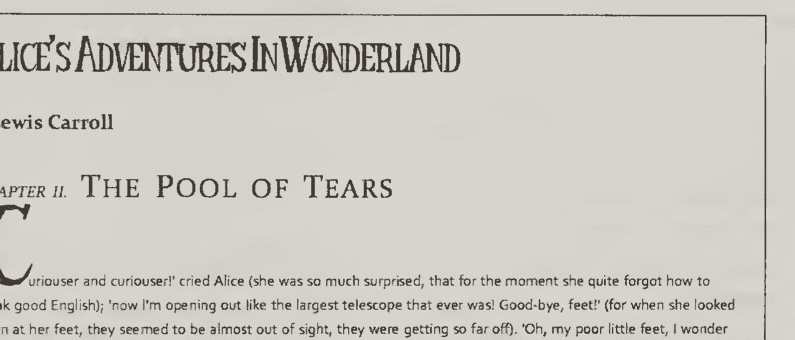

## 设置文本大小

当你处理动态生成的输出时（例如来自数据库的输出），你永远无法确定文本是以大写、小写还是两者的结合出现。通过 `text-transform` 属性（表 6.4），无论文本如何进入，你都可以控制文本的大小。

表 6.4 Transform 值
| 值 | 兼容性 |
| --- | --- |
| capitalize | IE4, FF1, S1, C1, O3, CSS1 |
| uppercase | IE4, FF1, S1, C1, O3, CSS1 |
| lowercase | IE4, FF1, S1, C1, O3, CSS1 |
| none | IE4, FF1, S1, C1, O3, CSS1 |

定义文本大小：
- 1. 在你的 CSS 中添加 `text-transform` 属性。在 CSS 声明列表中输入 `text-transform`，后跟冒号（:）（代码 6.4）。
- 2. 指定文本大小。
`uppercase:`
输入以下 `text-transform` 值之一来指定你想要的文本样式：
**capitalize** 将每个单词的首字母设为大写。
**uppercase** 强制所有字母为大写。
**lowercase** 强制所有字母为小写。
**none** 覆盖继承的文本值并保持文本不变。

**代码 6.5** text-properties.css—`text-transform` 属性允许你控制文本的大小。作者被强制设置为大写，使用了 `.asis` 类。

```css
.asis {
  text-transform: uppercase;
}
```


TIP `text-transform` 属性最好用于动态生成文本的格式化。例如，如果数据库中的名称全大写，你可以使用 `text-transform` 让它们更具可读性。

TIP 请注意，`capitalize` 会大写文本中的所有字母，即使是像 "of" 和 "the" 这样应该保持小写的单词也是如此。在实际上，`capitalize` 主要用于人名。

TIP **不要用全大写字母输入文本**。当 HTML 文本为全大写时，在 CSS 中控制它会困难得多。此外，任何使用辅助设备阅读的人都会将其听为大叫。最好使用普通文本配合 `text-transform` 来将文本样式化为大写。

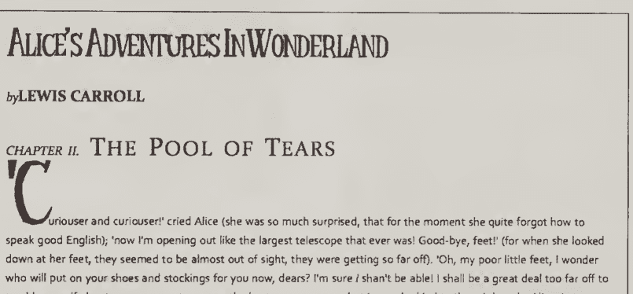

将代码 6.5 应用于代码 6.1：书名下的刘易斯·卡罗尔（Lewis Carroll）的名字全大写了（与第 5 章解释的小大写字母相反）。

## 新 CSS3：添加文本阴影 ★

投影影是为二维设计增加深度和纹理的一种悠久方法。大多数浏览器都支持 CSS 中的 `text-shadow` 属性（表 6.5），它允许你为任何文本阴影定义颜色、偏移（x 和 y）、扩散和模糊。虽然该属性目前在其他浏览器中不起作用，但在旧版本中也同样不起作用。

| 表 6.5 Text-Shadow 值 |
| 值 | 兼容性 |
| --- | --- |
| <color> | FF1.9, S1, C2, O03 |
| <x-offset> | FF1.9, S1, C2, O03 |
| <y-offset> | FF1.9, S1, C2, O03 |
| <blur> | FF1.9, S1, C2, O03 |
| none | FF1.9, S1, C2, O03 |

定义文本阴影：

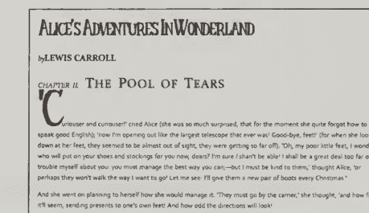

- 1. 在你的 CSS 规则中添加 `text-shadow` 属性。在 CSS 列表中输入 `text-shadow`，后跟一个冒号（: 代码 6.5）。

```
text-shadow:
```

- 2. 指定 x、y 偏移。输入一个空格，然后是两个由空格分隔的正或负长度值。

```
2px 2px
```

第一个值是偏移阴影的垂直距离（正为向下，负为向上）。第二个值是水平偏移（正为向右；负为向左）。

- 3. 指定模糊量。输入一个空格，然后是应用到阴影上的模糊长度值。所有负值都将被视为 0。

```
2px
```

> 代码 6.6 应用于代码 6.1：虽然你可能需要将修改后的标题与之前的屏幕截图对比才能注意到区别，但标题现在看起来在页面上略微凹陷，就像浮雕一样。而章节标题现在真的跃出了页面。

160 第 6 章

## 6.6 text-properties.css — 投影阴影

属性允许 x/y 偏移和模糊半径。书名具有双阴影，营造出微妙的浮雕效果，而章节标题有一个强烈的阴影，略微向左偏离页面。

## 4. 指定颜色。输入一个空格，然后是阴影的颜色值。

`rgba(0,0,0,.5);`

关于关于颜色值的更多信息，请参阅第 7 章中的“选择颜色值”。

- 5. 你可以为任何文本块添加多个阴影（随你需要添加多少个都可以）。要做到这一点，你可以在规则中添加另一个 `text-shadow` 声明，或者在逗号后添加另一个定义。

```
*** CSS VS | 第 6 章 | text-properties. css
```

```css
body {
  line-height: 1.5;
}
h1 {
  letter-spacing: -.05em;
  word-spacing: -1em;
  text-shadow: rgba(51,51,51,.9) -1px -1px 3px, rgba(203,203,203,.9) 1px 3px;
}
```

```css
text-shadow: rgba(51,51,51,.9)
  -1px -1px 3px, rgba(203,203,203,.9) 1px 1px 3px;
```

```css
h2 {
  letter-spacing: 2px;
  word-spacing: 3px;
  line-height: 1em;
  text-shadow: rgba(0,0,0,.5) 2px 2px 2px;
}
```

> TIP 你可以将值设置为 none 以覆盖之前在 CSS 中设置的阴影。

> TIP 使用 RGBA 处理阴影效果最好。真实的显示。

```css
h2 {
  letter-spacing: 0;
  text-shadow: none;
}
```

> TIP 虽然这是一个“阴影”，但你可以对其使用任何颜色。因此，如果你的文本在深色背景上，请使用浅色来创建“发光”。

```css
p {
  word-spacing: .07em;
  line-height: 24px;
}
```

> TIP 在第 11 章，你将学习如何设置类似于应用到元素盒框的 `box-shadow` 属性。

```css
p {
  text-transform: uppercase;
}
header + p:first-letter {
  letter-spacing: -.05em;
  line-height: 24px;
  text-shadow: rgba(51,51,51,.9) -1px -1px 3px, rgba(203,203,203,.9) 1px 1px 3px;
}
```

> TIP 阴影不会影响它们所在文本的位置。

```css
.byline {
  word-spacing: -3em;
}
byline .author {
  word-spacing: 0;
  text-transform: uppercase;
}
.asis {
  text-transform: uppercase;
}
```

> TIP 当配合 `:hover` 伪类使用时，文本阴影可以使链接脱颖而出。

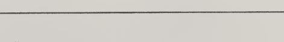

## 水平对齐文本

传统上，文本在左边缘对齐（左对齐）或完全对齐（即在左、右边缘都对齐，通常称为报纸风格）。此外，为了强调或特殊效果，文本可以在屏幕上居中或右对齐。`text-align` 属性（表 6.6）让你控制文本的对齐和对齐方式。

表 6.6 Text-Align 值
| 值 | 兼容性 |
|---|---|
| left | IE3, FF1, S1, C1, O3.5, CSS1 |
| right | IE3, FF1, S1, C1, O3.5, CSS1 |
| center | IE3, FF1, S1, C1, O3.5, CSS1 |
| justify | IE4, FF1, S1, C1 |
| inherit | IE4, FF1, S1, O3.5, CSS1 |
| auto | IE4, FF1, S1, O3.5, CSS1 |

## 定义文本对齐：

- 1. 在你的 CSS 中添加 `text-align` 属性。在 CSS 列表中输入 `text-align`，后跟一个冒号（: **代码 6.6**）。

```
text-align:
```

- 2. 指定水平对齐方式。

`center:` 

设置以下对齐样式之一：

- left 让文本在左边缘对齐。
- right 让文本在右边缘对齐。
- center 让文本在其区域内居中。
- justify 让文本在左、右边缘都对齐。
- inherit 让文本继承父元素的对齐方式。
- auto 使用默认对齐方式，通常是左对齐。

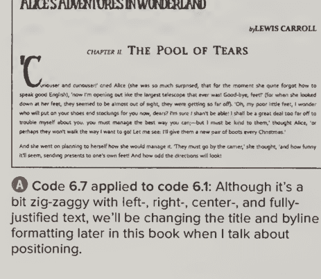

> 代码 6.7 应用于代码 6.t：如果由于左、右、居中和完全对齐导致看起来有点参差不齐，我们将在本书后面讨论定位时更改标题和行格式。

## 6.7 text-properties.css—.byline 类已右对齐，而二级标题中的章节标题已居中对齐，正文已完全对齐。

文本默认为左对齐。

完全对齐文本可能会在屏幕上产生一些奇怪的结果，因为必须添加单词来使每行相同。此外，对于完全对齐是有帮助还是阻碍可读性，意见存在分歧。

```
*** CSS3 VOS | 第 6 章 | text-properties.
body {
  line-height: 1.5;
}
h1 {
  letter-spacing: -.05em;
  word-spacing: -1.em;
  text-shadow: rgba(51,51,51,.9) -1px -1px 3px, rgba(203,203,203,.9) 1px 3px;
}
```

## 6.8 text-properties.css—根据所需的结果使用相对或绝对值的 vertical-alignment ①

```css
*** CSS3 V8 | Chapter 6 | text-properties.css ***
body {
  line-height: 1.5;
}
h1 {
  letter-spacing: -.05em;
  word-spacing: -.1em;
  line-height: .9em;
  text-shadow: rgba(51,51,51,.9) -1px -1px 3px, rgba(203,203,203,.9) 1px 1px 3px;
}
h2 {
  letter-spacing: 2px;
  word-spacing: 3px;
  line-height: 1em;
  text-shadow: rgba(0,0,0,.5) 2px 2px;
  text-align: center;
}
h2 strong {
  letter-spacing: 0;
  text-shadow: none;
  vertical-align: super;
}
p {
  word-spacing: .075em;
  line-height: 24px;
  text-align: justify;
}
p strong {
  text-transform: uppercase;
}
header + p:first-letter {
  letter-spacing: -.05em;
  line-height: 24px;
  text-shadow: rgba(51,51,51,.9) -1px -1px 3px, rgba(203,203,203,.9) 1px 1px 3px;
}
byline {
  text-align: right;
  word-spacing: -.3em;
}
byline .author {
  word-spacing: 0;
  text-transform: uppercase;
  vertical-align: -.6em;
}
aside {
  text-transform: uppercase;
}
```

### 2. 指定垂直对齐方式。

使用以下选项之一为垂直对齐指定一个值：

- superscripts 将文本置于基线之上（上标）。
- subscripts 将文本置于基线之下（下标）。
- baseline 将文本置于基线（其默认值）。
- 来自表 6.8 的相对值，用于设置元素相对于其父元素的对齐方式。要让文本的顶部与父元素的文本顶部对齐，应使用 `text-top`。
- 百分比值，它会根据父元素的字体大小按比例升高或降低元素（例如， 25%）。

#### 表 6.8 设置元素相对于父元素的位置

| 类型 | 对齐元素的方式 |
| --- | --- |
| top | 行中最高的元素 |
| middle | 父元素的中间 |
| bottom | 行中最低的元素 |
| text-top | 与父元素的顶部对齐 |
| text-bottom | 与父元素的文本底部对齐 |

## 数学与科学

上标和下标用于科学计数法。例如，为了表示毕股哥定理，你会使用上标：

```
a² + b² = c²
```

水分子可以用下标表示：

H₂O

然而，请记住，下标或上标都不会减小字体大小，因此你可能还想在定义中包含 `font-size` 以实现真正的科学计数法。（参见第 5 章中的“设置字体大小”）。

> 提示 上标非常适合脚注，脚注可以链接到当前页面底部的注释或另一个页面。

> 提示 `sup` 和 `sub` 标签也可以作为上标和下标使用，但不应将它们用于设计（如本例所示）的脚注或数学符号。

> 提示 如果你正在创建一个列布局，可能会遇到垂直对齐在不该出现的地方出现的问题。在这些情况下，良好的回退方案是使用第 10 章中解释的相对定位。

### 段落缩进

在段落行首缩进几个空格（传统上）是引入新段落的方法。

在 Web 上，这种方法不起作用，因为浏览器会将多个空格压缩为一个空格。相反，段落通过额外的换行分隔。使用 `text-indent` 属性（表 6.9），可以在文本行的开头指定水平空间并恢复传统样式。

#### 表 6.9 Text-Indent 值

| 值 | 兼容性 |
| --- | --- |
| <length> | IE3, FF1, S1, C1, O3 |
| <percentage> | IE3, FF1, S1, O3, CSS1 |
| inherit | IE3, FF1, S1, CSS1 |

### 定义缩进

1. 在 CSS 声明列表中添加 `indent` 属性，后跟一个冒号（代码 6.9）。

```css
text-indent:
```

2. 指定缩进量。

使用以下选项之一为 indent 指定一个值：

- 如 `em` 这样的长度值创建一个清晰的缩进（参见本书的“使用的单位”）。
- 百分比值根据父元素的宽度（例如 10%）缩进文本。

> 提示 如果你使用 indent 来表示段落，应该将段落的 `margin` 和 `padding` 设置为 0，以覆盖 `<p>` 标签在段落间添加空格的倾向。你将在第 8 章学习关于 `margin` 和 `padding` 的知识。

> 提示 因为缩进在打印领域比在线更常见，你可能希望只对页面的打印版本使用缩进。

虽然你可以对任何文本块进行缩进，但我将所有段落设置为 2em。然而，章节中的第一个段落通常没有缩进；我将 header 后的第一个段落缩进设置为 0。为了这个示例，我设置了 `margin` 和 `padding`，这将在第 8 章进行探索。

```css
*** CSS3 V8 | Chapter 6 | text-properties.css ***
body {
  line-height: 1.5;
}
h1 {
  letter-spacing: -.05em;
  word-spacing: -.1em;
  line-height: .9em;
  text-shadow: rgba(51,51,51,.9) -1px -1px 3px, rgba(203,203,203,.9) 1px 1px 3px;
}
h2 {
  letter-spacing: 2px;
  word-spacing: 3px;
  line-height: 1em;
  text-shadow: rgba(0,0,0,.5) 2px 2px;
  text-align: center;
}
h2 strong {
  letter-spacing: 0;
  text-shadow: none;
  vertical-align: super;
}
p {
  word-spacing: .075em;
  line-height: 24px;
  text-align: justify;
  text-indent: 2em;
  margin: 0;
  padding: 0;
}
p strong {
  text-transform: uppercase;
}
header + p:first-letter {
  letter-spacing: -.05em;
  line-height: 24px;
  text-shadow: rgba(51,51,51,.9) -1px -1px 3px, rgba(203,203,203,.9) 1px 1px 3px;
}
byline {
  text-align: right;
  word-spacing: -.3em;
}
byline .author {
  word-spacing: 0;
  text-transform: uppercase;
  vertical-align: -.6em;
}
aside {
  text-transform: uppercase;
}
```


#### 表 6.0 White-Space 值

| 值 | 兼容性 |
| --- | --- |
| normal | IE5, FF1, S1, C1, O4 |
| pre | IE5, FF1, S1, C4, CSS1 |
| nowrap | IE5, FF1, S1, C4, CSS1 |

## 控制空白

正如你所学的，除非使用 `<pre>` 标签，否则浏览器上会将多个空格压缩成单个空格。CSS 允许使用 **`white-space`** 属性（表 6.10）来允许或取消空格压缩，并指定文本是否在空格处换行（类似于 `<wbr>`）。

一个很好的例子是《爱丽丝梦游》第三章中的鼠尾诗。这首诗的形状像一条弯曲的鼠尾。如果 **`white-space` 属性值给诗赋值为 `pre`**，所有的空格都会压缩。然而，如果它被赋值为 **`nowrap`**，空格和换行将被忽略，文本会向右延伸到页面需要为止。


> A `pre` 值保留了所有空格，使诗保持其独特的鼠尾形状而不发生压缩。


> B 如果没有 `pre` 值，空格会随鼠尾一起压缩。


> C 使用 `nowrap` 值，诗会在垂直方向上跨窗口，强制水平滚动以适应其宽度。

## 定义空白：

1. 在你的 CSS 规则中添加 `white-space` 属性。在 CSS 声明列表中输入 `white-space`，后跟一个冒号（代码 6.10）。

```css
white-space:
```

2. 指定你希望如何处理空白。

使用以下选项之一：

- `pre` 保留多个空格。
- `nowrap` 在不使用 `<br>` 标签的情况下防止换行。
- `normal` 允许浏览器决定如何处理空格。这种设置通常强制将空格压缩成单个空格。


代码 6.10 应用于代码 6.1：该注释通过添加空格被设置在对角线上。如果没有应用 `pre` 值，这些空格将会压缩。

> 提示 不要混淆 `<br>` 和 `<pre>` 标签与 `white-space` 属性的 `nowrap` 和 `pre`。虽然它们的作用基本上相同，但换行标签正在被废弃（弃用），不应再使用。

## 6.10 text-properties.css

`.asis` 类通过设置 `white-space` 为 `pre` 来保留代码中出现的 HTML 文本格式。这对于 Alice 按照其预期的格式发送给页脚的文本非常有用。

```css
*** CSS3 VQS | Chapter 6 | text-properties.css ***

body {
  line-height: 1.5; }
h1 {
  letter-spacing: -.05;
  word-spacing: -.1em;
  line-height: .9em;
  text-shadow: rgba(51,51,51,.9) -1px -1px 3px, rgba(203,203,203,.9) 1px 1px 3px;
}
h2 {
  letter-spacing: 2px;
  word-spacing: 3px;
  line-height: 1em;
  text-shadow: rgba(0,0,0,.5) 2px 2px;
  text-align: center;
}
h2 strong {
  letter-spacing: 0;
  text-shadow: none;
  vertical-align: super;
}
p {
  line-height: 24px;
  text-align: justify;
  text-indent: 1em;
  margin: 0;
  padding: 0;
}
header + p {
  text-indent: 0;
}
header + p:first-letter {
  letter-spacing: -.05em;
  line-height: 24px;
  text-shadow: rgba(51,51,51,.9) -1px -1px 3px, rgba(203,203,203,.9) 1px 1px 3px;
}
p strong {
  text-transform: uppercase;
  vertical-align: middle;
}
byline {
  word-spacing: -.3em;
  text-align: right;
}
byline .author {
  word-spacing: 0;
  text-transform: uppercase;
  vertical-align: -.6em;
}
.asis {
  text-transform: uppercase;
  white-space: pre;
}
```

## 装饰文本

使用 **`text-decoration` 属性**（表 6.11），你可以通过三种方式之一装饰文本：下划线、上划线或删除线。装饰用于强调，可以将读者的注意力吸引到 Web 页面上的重要区域或段落。

要装饰（或取消装饰）文本：

- 1. 添加文本装饰属性。
  **在 CSS 声明列表中输入 `type-decoration`**，后跟一个冒号（:（**代码 6.11**）。
  **`text-decoration:`**
- 2. 指定你想要的（或不想要的）文本装饰。

为 **`text-decoration` 属性** 输入一个值。选择以下内容之一：

- **`underline`** 在文本下方放置一条线。
- **`overline`** 在文本上方放置一条线。
- **`line-through`** 在文本中间放置一条线（也称为删除线）。
- **`none`** 覆盖在其他地方设置的装饰。

表 6.11 Text-Decoration Values

| 值 | 兼容性 |
|---|---|
| none | IE3, FF1, S1, C3, CSS5 |
| underline | IE3, FF1, S1, C3, CSS1 |
| overline | IE4, FF1, S1, C1, O3, CSS5 |
| line-through | IE3, FF1, S1, C3, CSS5 |

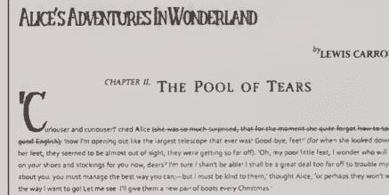

> 第二章 - 泪之池
> 刘易斯·卡罗尔
> Alice 的想象力再次发生了奇妙的变化。她觉得自己非常过时——老鼠是这么说的，她也是这么说的。天气太热了，她希望自己能躺在长长的岸边，观察小溪流；但无论身后还是面前没有任何阴凉，她现在清醒地想起了她大多数去的地方以及再也不去的地方所遭受的麻烦。她走累了，开始伸伸双脚，心自己自己走了多少英里、流了多久汗或有多热，以及自己是否来到了世界的源井，或者世界的尽头。

```
代码 6.11 应用于代码 6.11: 一行被划掉了。
```

老鼠说了，Alice 为了机智地转转话题说：“你太过时了——”老鼠是这么说的，她也是这么说的。天气太热了，她希望自己能躺在长长的岸边……她开始想自己是否已经来到了世界的源井，或者世界的尽头。

- 关于作者
- 爱丽丝仙游游记
- 爱丽丝穿镜镜奇游
- 关于海洋

```
代码 6.11 应用于代码 6.11: 页脚中的链接不再有下划线。
```

## 6.11 text-properties.css—我使用文本装饰来设置一个名为 `.strike` 的类，可以

（注：此点之后的文本在原始 OCR 来源中似乎包含显著的重复或损坏，但我已根据提供的文本清理了结构元素。）

## 6.11 text-properties.css—我使用文本装饰来设置一个名为 `.strike` 的类，可以

（注：提供的第 196-198 页的 OCR 文本包含高度重复且乱码的句子。我已对可读部分和结构标记进行了处理，并按要求保留了内容，尽管源材料似乎损坏或为占位符文本。）

字间调整（Kerning）——记住，字母间距并不等于字间调整。新的 `punctuation-trim` 属性将提供基础的字间调整功能。

悬挂标点（Hanging Punctuation）——排版中的一个常见问题是，当区块开头没有字母数字时（例如引号）该怎么办。`hanging-punctuation` 属性允许你定义如何处理这些字符，是将它们放置在文本块内还是放置在区块边缘之外。

文本行装饰（Text Line Decoration）——正如我在 `text-decoration` 属性解释中所提到的，有几个新的关联属性正在开发用于样式文本装饰，包括 `text-line-color`、`text-line-style`、`text-line-skip` 和 `text-underline-position`。

要跟踪这些样式的进展，请访问 www.w3.org/TR/css3-text 中的 CSS3 文本模块。

# 综合运用

- 1. 为你的标题添加字母、单词和行间距。尝试不同的效果，将文字推紧或拉开。
- 2. 为正文添加行间距。在段落元素中指定行高。观察增加或减少间距如何提高或降低可读性。行高增加到什么程度会降低可读性？
- 3. 将你的标题文本大小设置为大写。你也可以调整字体大小来让标题脱而出。
- 4. 为你的标题添加文本阴影。尽量保持其微妙，不要分散注意力。
- 5. 让你的正文完全两端对齐。在 `p` 标签上使用 `justify` 对齐。这看起来是比左对齐产生的参差边缘更好还是更差？
- 6. 缩进你的文本段落。尝试不同的缩进量，看看你更喜欢哪种。

# 颜色和背景属性

颜色是所有设计的基石，即使只有黑白色。明亮、鲜艳、如宝石般的色彩与大地色调具有截然不同的风格。即使你只选择黑白色，你的设计也会展现出状态。除了装饰影响外，颜色还可以引导观众的眼睛在页面上移动，帮助突出重要区域同时淡化其他区域。在本章中，你将学习用于添加和控制颜色的主要方法。但请记住，你可以使用多个属性来指定。在学习如何编写代码之前，先探索如何选择它们。

## 本章内容

- 选择颜色值
- CSS3 新特性：背景中的渐变
- 选择你的调色板
- 设置文本颜色
- 设置背景图像
- 使用简写
- 综合运用

本章示例使用的 HTML5 代码导入了第 5 章和第 6 章的最终代码，以及一个名为 `color-properties.css` 的新文件，通过它，我们将对《爱丽在仙仙游》的第三章进行样式化，包括底部的导航页脚。

```html
<!DOCTYPE html>
<html lang="utf-8">
<head>
<meta charset="utf-8">
<title>Alice's Adventure in Wonderland</title>
<link href="../font-properties.css" type="text/css" rel="stylesheet">
<link href="../css/text-properties.css" type="text/css" rel="stylesheet">
<link href="../css/color-background-properties.css" type="text/css" rel="stylesheet">
<!--[if IE]-->
<style>@import url(css/ie.css);</style
<script src="HTML5.js" type="javascript"></script>
<!--[endif]-->
</head>
<body id="chapter3" class="body">
<header class="page">
<h1>Alice's Adventures In Wonderland</h1>
<p class="byline">by Alice Carroll</p>
</header>
<article>
<header>
<h2><strong>CHAPTER III.</strong> A Caucus-Race and a Long Tale</h2>
</header>
<p>他们聚集在岸边时确实是一群看起来奇特的伙伴——那些羽毛拖曳的鸟，以及那些紧随其后的动物，都湿漉漉的，显得很不安。</p>
</article>
<footer>
<ul>
<li><a href="#">Table of Contents</a></li>
<li><a href="#">About the Author</a></li>
<li><a href="#">About the Books</a></li>
<li><a href="#">About the Site</a></li>
</ul>
</footer>
</body>
</html>
```


# 选择颜色值

俗话说，“剥猫皮的方法不止一种”，这句话听起来很奇怪，但它也适用于大多数创意决策，例如 Web 设计中的颜色值。你可以使用几种传统方法来定义相同的 Web 页面颜色，CSS3 甚至引入了一些方法。

# 颜色关键字

虽然大多数设计师很少使用预定义颜色，但你可以访问从 HTML4 和 SVG 规范定义的许多预定义颜色。表 7.1 显示了关键字列表以及相应的十六进制和进制值。粗体字体表示包含自 HTML

| TABLE 7.1 颜色值 | 名称 | 格式 | 兼容性 |
| :--- | :--- | :--- | :--- |
| 关键字 | <keyword> | coral | IE4, FF1, S1, C1, O3.5, CSS1 |
| 透明 | transparent | - | IE4, FF1, S1, C1, O3.5, CSS1 |
| 当前颜色 | currentColor | - | FF3.6, S2, C2, O10, CSS3 |
| RGB 十六进制 | #rrr,ggg,bbb | #ff71f5, #f190 | IE4, FF1, S1, C1, O3.5, CSS1 |
| RGB 进制 | rgb(rrr,ggg,bbb) | 255,127,80 | IE4, FF1, S1, C1, O3.5, CSS1 |
| RGB 百分比 | rgb(rrr%%,ggg%%,bbb%%) | rgb(100%,50%,31%) | IE4, FF1, S1, C1, O3.5, CSS1 |
| HSL | hsla(hhh,sss,lll%) | hsla(16,65,100%) | IE4, FF1, S1, C1, O3.5, CSS1 |
| RGBA | rgba(rrr,ggg,bbb,a) | rgba(255,127,80,1) | IE4, FF1, S1, C1, O3.5, CSS1 |

你可以为 RGB 十进制或 HSL 颜色值设置 alpha 通道。目前，你无法为 RGB 十进制值添加 alpha 值。该通道值将仅应用于所使用的颜色。

## 添加颜色的其他方法

虽然本章介绍了设计中设置颜色的主要方法，但其他几个 CSS 属性也包含颜色值：

- `border`—元素的边框可以设置为任何边框属性或直接在 `border-color` 属性中设置（参见第 10 章）。
- `outline`—类似于 `border` 属性，`outline` 允许你在元素边缘定义一种颜色（参见第 10 章）。

提示 如果你指定渐变作为背景，请也指定背景颜色，以确保文本在不支持渐变的浏览器中是可见的。

提示 十六进制值是目前定义颜色值最流行的方式，但我发现使用进制值比十六进制值更容易想象颜色。

提示 除了设置颜色透明度外，CSS 还包含了设置整个对象透明度的功能。更多信息参见第 11 章。

提示 虽然 HSL 初时很难掌握，但在设置补色时，只需加上 180° 即可变得简单。

## 十六进制还是十进制？

最近，人们一直认为颜色应该用 RGB 十进制表示。事实上，许多设计师和开发者完全不知道它们有替代方案。

我发现使用十进制数字比十六进制值更容易读颜色（我已经用了一辈子），而且如果你需要透明度，十进制会更好。十六进制值的唯一优点是它们更紧凑（即使在大型网站上，可能只能节省几个字节的加载时间）。

## 7.2 颜色关键字

| 关键字 | 十六进制 | 十进制 | 关键字 | 十六进制 | 十进制 |
|---|---|---|---|---|---|
| aliceblue | #F0FFB2 | 240,248,255 | darkseagreen | #8FBC88 | 143,188,143 |
| antiquewhite | #FAEBD7 | 250,235,215 | darkslate | #483D8B | 72,61,139 |
| aqua | #00FFFF | 0,255,255 | darkslategray | #22F4F4 | 47,79,244 |
| aquamarine | #7FFFD4 | 127,255,212 | darkturquoise | #00CED1 | 0,26,209 |
| azure | #F0FFFF | 240,255,255 | darkviolet | #9400D3 | 148,0,211 |
| beige | #F5F5DC | 245,245,220 | deepeink | #FF1493 | 255,20,147 |
| bisque | #FFE4C4 | 255,228,196 | deepskyblue | #00BFF | 0,191,255 |
| black | #000000 | 0,0 | dimgray | #696699 | 105,105,105 |
| blanchedmond | #FFEBCD | 255,235,205 | deereen | #696699 | 105,105,105 |
| blue | #0000FF | 0,255 | dodgerblue | #1EE0FF | 190,34,255 |
| blueviolet | #A82BE2 | 138,43,226 | firebrick | #B22222 | 178,34,231 |
| brown | #A52A2A | 165,42,42 | floralwhite | #FFAFA0 | 255,250,240 |
| burlywood | #DEBB87 | 228,214,135 | forestgreen | #228B22 | 34,139,34 |
| cadetblue | #5F9EA0 | 95,158,160 | fuchsia | #FF00FF | 255,0,255 |
| chartreuse | #7FF700 | 255,227,0 | gainsboro | #DCDCDC | 220,220,220 |
| chocolate | #D2691E | 210,105,30 | ghostwhite | #F8F8F8 | 248,248,255 |
| coral | #FF7F50 | 255,127,80 | gold | #FFD700 | 255,215,0 |
| cornflowerellow | #6495ED | 100,149,237 | goldenrod | #A5DAE2 | 255,218,183 |
| cornsilk | #FFF8DC | 255,248,220 | gray | #808080 | 128,128,128 |
| crimson | #DC143C | 220,20,60 | green | #008000 | 0,128,0 |
| cyan | #00FFFF | 0,255,255 | greenyellow | #ADFF2F | 173,255,247 |
| darkblue | #00008B | 0,0,139 | gray | #808080 | 128,128,128 |
| darkcyan | #008B8B | 0,139,139 | honeydew | #F0F0FF | 240,250,255 |
| darkgoldenrod | #B8860B | 184,134,111 | hotpink | #FF69B4 | 255,105,180 |
| darkgray | #A9A9A9 | 169,169,169 | indian | #CD5C5 | 205,92,192 |
| darkgreen | #006400 | 0,100,0 | indigo | #4B0082 | 75,0,130 |
| darkkhaki | #BDB78B | 189,183,107 | ivory | #F0F0FF | 255,255,240 |
| darkmagenta | #8B008B | 138,0,135 | khaki | #F0E68C | 240,230,140 |
| darkolivegreen | #556B2F | 85,107,47 | lavender | #E6E6FA | 230,230,250 |
| darkorange | #FF8C00 | 255,140,0 | lavenderblush | #FFF0F5 | 255,240,245 |
| darkorchid | #9932CC | 153,50,204 | lawgreen | #7CFC00 | 124,252,0 |
| darkred | #8B0000 | 139,0,0 | lemonchill | #FFFAF0 | 255,250,205 |
| darksalmon | #E9967A | 233,150,122 | lightblue | #ADD8E6 | 173,216,230 |
| darkcoral | #F08080 | 240,128,128 | | | |

## 7.2 颜色关键字续

| 关键字 | 十六进制 | 十进制 | 关键字 | 十六进制 | 十进制 |
|---|---|---|---|---|---|
| lightcyan | #EFFFF | 224,255,255 | olive | #808000 | 128,128,0 |
| lightgoldenrodyellow | #FFADAD | 250,250,210 | oliver | #B68E23 | 182,142,35 |
| lightgray | #D3D3D3 | 211,211,211 | orange | #FFA500 | 255,165,0 |
| lightgreen | #90EE90 | 144,238,144 | orangered | #FF4500 | 255,69,0 |
| lightgrey | #D3D3D3 | 211,211,211 | orchid | #DA70D6 | 218,112,151 |
| lightpink | #FFB6C1 | 255,182,193 | palegondred | #EEEA84 | 238,232,170 |
| lightseagreen | #FFA0A7 | 255,160,152 | palegreen | #FF9B98 | 152,251,152 |
| lightskyblue | #87CEEB | 135,206,235 | paleturquoise | #AFEEEE | 175,238,238 |
| lightslategray | #708090 | 112,128,144 | paleviolet | #DB7093 | 219,112,147 |
| lightslategrey | #778999 | 119,137,153 | papahydew | #FFADE9 | 255,239,213 |
| lightsteelblue | #BC8F8 | 188,143,133 | peachpuff | #FFDAB | 255,218,183 |
| lightyellow | #FFFFE0 | 255,255,224 | pink | #FFC0CB | 255,192,203 |
| lime | #00FF00 | 0,255,0 | plum | #DDA0D0 | 221,160,221 |
| mediumseagreen | #32CD32 | 50,205,50 | powderblue | #B0E0FF | 176,240,250 |
| lime | #FAE066 | 250,250,20 | | | | |000 | | 222222000 | | | | | |000000005555 | | | | | | | |0000000 | | | | | |000000000000 | | | | |000 | |0 |00,,, | | | | | |000000 |  0,,,,, | | | | | #008F8 | 205,188,143 |

## Mozilla 渐变

在 Firefox 或使用 `-moz` 扩展的浏览器中，你可以使用 `-moz-linear-gradient` 或 `-moz-repeating-linear-gradient` 属性创建线性渐变，或者使用 `-moz-radial-gradient` 或 `-moz-repeating-radial-gradient` 创建圆形渐变。重复渐变将根据其大小进行平铺。

`-moz` 渐变扩展使用以下值：

- * Point-一个或两个用空格分隔的关键字值，定义渐变开始的侧边或角。值可以包括 top、right、bottom 和（或或）left。如果使用两个值（用空格分隔），则指定一个角，例如 `top left`。
- * Position-背景位置，与本章稍后显示的背景图像设置（表 7.10）相同，用于径向渐变的中心点，例如 `center`。
- * Angle-渐变以度 (deg)、梯度度 (grad) 或弧度 (rad) 为单位的角度，例如 `45deg`。
- * Shape-径向渐变的形状，圆形 (circle) 或椭圆 (ellipse)。

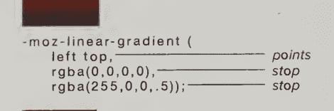

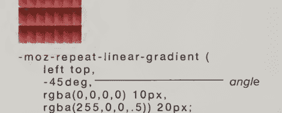

Mozilla 增加了多个选项，允许创建简单和复杂的渐变。

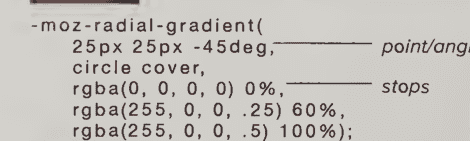

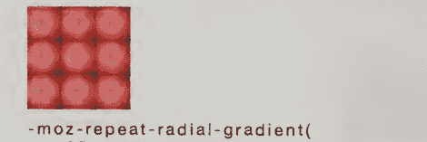

Mozilla 径向渐变允许你设置大小、角度和形状。

## 表 7.3 -moz-gradient 大值

| Value | 描述 |
| --- | --- |
| closest-side | 渐变形状为遇到与其中心最近的侧边 |
| closest-corner | 渐变形状为遇到与其中心最近的角 |
| farthest-side | 渐变形状为遇到与其中心最远的侧边 |
| farthest-corner | 渐变形状为遇到与其中心最远的角 |
| contain | 与 farthest-side 相同 |

- - Size—作为关键字形式的径向渐变大小（表 7.3）。
- Stop—渐变沿线特定点的颜色。这必须包含一个颜色值（表 7.1）以及可选的百分比或长度值，用于设置颜色在渐变轴上的位置，例如 `orange 60%`。

## Webkit 渐变

Safari、Chrome 以及任何使用 `-webkit-gradient` 扩展的浏览器使用 `-webkit-gradient-property` 属性来添加渐变。该属性有多个选项，取决于你想创建线性渐变还是径向渐变：

- - Type—线性 (linear) 或径向 (radial)
- Start—一个或两个用空格分隔的长度或关键字值，定义线性渐变开始的位置、侧边或角。值可以包括 top、right、bottom 和（或）left。如果使用两个值（用空格分隔），则指定一个角，例如 `top`。
- End—一个或两个用空格分隔的长度或关键字值，定义线性渐变结束的位置、侧边或角。值可以包括 top、right、bottom 和（或）left。如果使用两个值（用空格分隔），则指定一个角，例如 `top`。
- Angle—渐变以度 (deg)、梯度度 (grad) 或弧度 (rad) 为单位的角度，例如 `45deg`。
- Shape—径向渐变的形状，圆形 (circle) 或椭圆 (ellipse)。
- Size—作为关键字形式的径向渐变大小（表 7.3）。

-   内容背景——通常，你会在页面内容直接周围使用不同的背景颜色，允许主体背景颜色吸收浏览器窗口中额外的水平空间。
-   边框/分割线——你可能想在内容区域、标题、导航块、列表和表格周围使用对比色，或者使用不同的内容块。请选择一种与线条旨在隔开的区域形成对比的颜色。
-   标题——你可能选择不更改章节标题的背景颜色，但务必确保文本与你选择的背景颜色之间有清晰的对比。
-   文案——你的文案（通常是句子或段落）应该与背景具有最高的对比度，以最大限地提高可读性。
-   链接/导航——你可以为网站导航和文案中的链接选择不同的颜色，但这些颜色应该与其他文本易于区分，同时仍与背景形成对比。
-   列表/表格——你可以在列表和表格后面选择不同的背景颜色，甚至使用交替行（称为斑马纹填充）来提高可读性。
-   表单——你可以指定许多表单元素的边框、前景颜色和背景颜色，使它们在默认外观之外为你的网站更具独特感。然而，要小心不要过度自定义，以至于访问者不知道它们是什么。

# 色轮基础知识

色轮是一个显示颜色值光谱的圆盘或圆圈，为你快速概述从红、橙、黄到绿、蓝、靛蓝、紫，再回到红色的所有可能性。某些色轮还允许你查看亮度（从暗到亮）和饱和度（从全色调到灰色）水平。

你可能对色轮很熟悉，但如果你愿意，可以查看：colorschemedesigner.com 中的示例。

归结起来，颜色取决于个人喜好。我认为放在一起非常棒的颜色可能会让我妻子感到反胃（通常会导致我换掉衣服）。为了保险起见，你可以依靠单一颜色（单色调）或以下颜色组合方案之一作为（多或少）万无一失的选择：

-   单色——使用单一颜色的不同亮度或饱和度形成对比。
-   互补色——色轮相反侧的两种颜色（180度），提供最高的对比度。
-   三三色——三色颜色及其色调，包含一种主色和两种辅助色，它们在色轮中处于相等角度，距离主色为120度到180度。
-   四角色——四种颜色，包括一种主色、一种辅助色（与主色直接对比），以及两种与主色或辅助色角度相同的颜色，角度在0到90度之间。
-   类比色——三种颜色及其色调，包含一种主色和辅助色，辅助色与主色的角度相同，范围从0度到60度。

所有这些配色方案都允许你选择基础色，然后使用颜色的亮度/或饱和度为你的调色板添加额外的色调。

# 颜色与无障碍

除了吸引人且引目的设计外，颜色的另一个关键考虑因素是视觉障碍人士的无障碍性。最重要的考虑是在前景和背景颜色之间提供足够的对比度，以确保信息可读，并确保颜色不是理解信息的关键。例如，如果你使用颜色来标记链接，请同时使用其他格式（如下划线或加粗）来区分这些链接。

有关颜色和无障碍的更多细节，请参见 W3C 白皮书《Web 内容无障碍指南 CSS 技术》的第 9 节，网址为 w3.org/TR/WCAG10-CSS-TECHS/#style-colors。

# 在线配色工具

不确定如何开始规划你的配色方案？这里有一些你可以使用的优秀在线工具：

-   构建调色板——Adobe 的 Kuler (kuler adobe.com) 提供了一个极佳的工具，可以在交互环境中并排比较颜色。
-   色轮选择器——使用 Color-Jack 的工具 (colorjack.com/sphere) 探索所有的色轮方案。
-   从照片或其他图像获取配色方案——如果你在使用带有特定配色方案的图形或摄影，Degrave.com 调色板生成器 (degraeve.com/color-palette) 将分析图像并根据图像中的颜色生成配色板。

# 设置文本颜色

`color` 属性用于设置元素的文本颜色（有时称为前景颜色）（表 7.5）。此颜色将由所有元素子元素继承（见第 4 章），你只需要在 `<body>` 元素中设置它，然后根据需要提供覆盖。例如，如果你在 `<body>` 中将 `color` 设置为灰色，则页面上的所有文本将是灰色的。如果你随后将 `<p>` 元素设置为红色，则所有段落文本及其其中的任何元素将变为红色，从而覆盖灰色。

要定义文本颜色：

1. 在你的 CSS 声明中添加 `color` 属性。在 CSS 规则中输入 `color`，后跟冒号（:`）（表 7.2）。

```
```


color:(102,0,0);

```
2. 指定颜色值。根据表 7.5 中的颜色值输入颜色值。这包括 RGB、HSL、transparent 或当前颜色。
3. 根据需要添加带有通道道的颜色。如果你想让颜色部分透明，可以在颜色值下方再次添加 RGBA 或 HSVA 值。对于不支持 alpha 值的浏览器，第一个颜色
```

*** CSS ***

```
body {

  color: (102,0,0);

}

h1 {

  color: (102,0,0);

}

h2 {

  color: (102,0,0);

}

article p {

  color: (102,0,0);

}

a {

  color: (102,0,0);

}

a:visited {

  color: (102,0,0);

}

a:hover {

  color: (102,0,0);

}

a:active {

  color: (102,0,0);

}

byline {

  color: (102,0,0);

}

byline .author {

  color: (102,0,0);

}
```

### 表 7.5 颜色值

| 值 | 兼容性 |
|---|---|
| `<color>` | IE3, FF1, O3 |
| `<inherit>` | IE3, FF1, O3 |

> TIP 为 `body` 标签设置默认颜色是一个好习惯，以确保跨页面颜色的一致性。

> TIP 在选择前景颜色时要小心——前景和背景亮度差异越小，读者的眼睛就越累。


> TIP 颜色变化是显示超链接状态的一种重要方式，但绝不是链接的唯一样式。第 14 章将向你展示链接、导航和控件的最佳实践。

## 设置背景颜色

在 HTML 页面上设置背景色的功能几乎从第一代 Web 浏览器出现起就有了。然而，通过 CSS，你不仅可以为整个页面定义背景，还可以使用 `background-color` 属性为单个元素定义背景（表 7.6）。不过，与 `color` 属性不同，背景颜色仅应用于元素本身，而不会被其子元素直接继承。尽管如此，由于它们位于父元素内部这一事实，它们将显示在那个背景之上。

代码示例 7.3 color-background-properties。
- css—背景颜色可以设置为实色、透明色或使用渐变。

```css
*** CSS3 V8 | Chapter 7 |
- color-background-properties.css ***
{
  padding: 0;
  margin: 0;
  border: none;
}
body {
  color: rgb(51,51,51);
  background-color: rgb(85,85,85);
}
```

```css
header.page {
  display: block;
  background-color: rgb(102,0,0);
}
```

## 定义元素的背景颜色：

```css
h1 {
  color: rgb(255,225,225);
  background-color: rgba(255,225,225,65);
}
```

- 1. 添加 `background-color` 属性。通过在声明中设置颜色，可以设置背景（代码 7.3）。

```css
div {
  background-color: rgb(85,85,85);
}
```

- 2. 指定颜色值。颜色可以使用名称、RGB、RGBA 或十六进制值。

```css
div {
  background-color: transparent;
}
```

- 3. 根据需要添加背景渐变。针对不同的浏览器（Internet Explorer、Webkit、Mozilla）使用不同的声明。

```css
div {
  background: linear-gradient(to bottom, #555, #333);
}
/* Webkit 浏览器 */
div {
  background: -webkit-linear-gradient(to bottom, #555, #333);
}
/* Mozilla 浏览器 */
div {
  background: -moz-linear-gradient(to bottom, #555, #333);
}
```

```css
background-image: url(../images/alice02b.png);
background-repeat: no-repeat;
background-position: center center;
-o-background-size: contain;
-moz-background-size: contain;
webkit-background-size: contain;
background-size: contain;
-o-background-clip: padding-box;
-moz-background-clip: padding;
webkit-background-clip: padding-box;
background-size: padding-box;
-o-background-origin: padding-box;
-moz-background-origin: padding;
webkit-background-origin: padding-box;
background-origin: padding-box; }
footer {
display: block;
background: rgb(153,153,153);
filter: progid:ImageTransform.Microsoft.gradient(startColor="#ffffff",endColor="#000000");
background: -webkit-background-gradient(linear, left top, left bottom, from(rgba(0,0,0,0)), to(rgba(0,0,0,.5)));
background: -moz-linear-gradient(top, rgba(0,0,0,0), rgba(0,0,0,.5)); }
a:link {
color: rgb(204,0,0) }
a:visited {
color: rgb(153,0,0) }
a:hover {
color: rgb(255,0,0) }
a:active {
color: rgb(153,153,153) }
.byline {
color: rgba(255,255,255,.5); }
.byline .author {
color: rgba(255,255,255,.75) }
```

## 表 7.8 背景重复值 (Background-Repeat Values)

| 值 (Value) | 兼容性 (Compatibility) |
|--- |--- |
| repeat | IE4, FF1, S1, C1, O3, CSS1 |
| repeat-x | IE4, FF1, S1, C1, O3, CSS1 |
| repeat-y | IE4, FF1, S1, C1, O3, CSS1 |
| no-repeat | IE4, FF1, S1, C1, O3, CSS1 |
| space | FF3.6, CSS3 |
| round | FF3.6, CSS3 |

2. 添加背景重复属性，并指定背景应如何平铺（或不进行平铺）。输入 `background-repeat`，后跟一个冒号 (:)：

```css
background-repeat: repeat;
```

然后，通过输入以下选项之一（表 7.8）来定义你希望背景如何重复：

-   *repeat* 指令浏览器在水平方向和垂直方向上在整个背景中平铺该图形。如果省略该属性，则为默认值。
-   *repeat-x* 指令浏览器仅在水平方向上平铺背景图形，使图形在元素顶部沿一条平直的水平线重复。
-   *repeat-y* 指令浏览器仅在垂直方向上平铺背景图形，使图形在元素左侧沿一条平直的垂直线重复。
-   *no-repeat* 使背景图形仅出现一次（不进行平铺）。

3. 添加背景附加属性（background-attachment），并指定背景应如何随元素滚动。输入 `background-attachment`，后跟一个冒号 (:)：

```css
background-attachment: fixed;
```

然后，通过输入以下选项之一（表 7.9）来定义你希望在页面滚动时如何处理背景：

-   *scroll* 指令背景图形随元素一起滚动。如果省略该属性，则为默认值。
-   *fixed* 指令浏览器不要随元素的其余部分滚动背景内容。然而，它会随父元素滚动。
-   *local* 与 *fixed* 类似，但背景固定在元素的内容上，而不是元素本身。

4. 添加背景位置属性（background-position），并指定背景的位置。输入 `background-position`，后跟一个冒号 (:)：

```css
background-position: -10px;
```

然后，输入一个值或两个用空格分隔的值，以指示你希望背景相对于元素左上角出现的位置。如果输入一个值，则用于 x 轴，而 y 轴将居中。使用以下之一（表 7.10）：

## 表 7.9 背景附加值 (Background-Attachment Values)

| 值 (Value) | 兼容性 (Compatibility) |
|--- |--- |
| scroll | IE4, FF1, S1, C1, O3, CSS1 |
| fixed | IE4, FF1, S1, C1, O3, CSS1 |
| local | S2, C1, O3.5, CSS3 |

## 表 7.10 背景位置值 (Background-Position Values)

| 值 (Value) | 兼容性 (Compatibility) |
|--- |--- |
| <length> | IE4, FF1, S1, C1, O3, CSS1 |
| <percentage> | IE4, FF1, S1, C1, O3, CSS1 |
| top | IE4, FF1, S1, C1, O3, CSS1 |
| bottom | IE4, FF1, S1, C1, O3, CSS1 |
| left | IE4, FF1, S1, C1, O3, CSS1 |
| right | IE4, FF1, S1, C1, O3, CSS1 |
| center | |

## 表 7.11 背景尺寸值 (Background-Size Values)

| 值 (Value) | 兼容性 (Compatibility) |
|--- |--- |
| <length> | IE4, FF1, S1, C1, O3, CSS1 |
| <percentage> | IE4, FF1, S1, C1, O3, CSS1 |
| cover | FF3.6, CSS3 |
| contain | FF3.6, CSS3 |

Safari 5 支持背景-size size -webkit-size
Firefox 支持 -moz-size
Safari 4 和 Chrome 3 支持 -webkit-size

-   长度值，例如 10px。
-   百分比值，例如 25%。第一个百分比指示元素宽度，第二个百分比指示元素的高度。
-   *cover* 按比例缩放背景以覆盖整个区域。
-   *contain* 按比例缩放背景以适应区域并保持完整显示。

5. 添加背景尺寸属性（background-size），并指定精确尺寸、百分比或方法。输入 `background-size`，后跟一个冒号 (:)：

```css
background-size: contain;
-moz-background-size: contain;
-webkit-background-size: contain;
```

然后，输入表 7.11 中的值。可以包含两个值以定义不同的 x 和 y 尺寸：

-   百分比值，例如 25%。第一个百分比指示元素宽度，第二个百分比指示元素的高度。
-   英语关键字，如：`top`、`bottom`、`left`、`right` 或 `center`。

6. 添加背景裁剪属性（background-clip），并指定裁剪方法。输入 `background-clip`，后跟一个冒号 (:)：

```css
-o-background-clip: padding-box;
-moz-background-clip: padding;
-webkit-background-clip: padding-box;
background-clip: padding-box;
```

然后，输入表 7.12 中的值。可以包含两个值以定义不同的 x 和 y 尺寸。Mozilla 和 Webkit 的语法与标准略有不同：

-   *border/border-box* 将图像裁剪到边框边缘。
-   *padding/padding-box* 将图像裁剪到内边框边缘。
-   *content/content-box* 将图像裁剪到内容边缘。

## 表 7.12 背景裁剪值 (Background-Clip Values)

| 值 (Value) | 兼容性 (Compatibility) |
|--- |--- |
| padding | IE4, FF1, S1, C1, O3, CSS1 |
| border | IE4, FF1, S1, C1, O3, CSS1 |
| content | S3, C3 |
| padding-box | S3/S5, C3, O10.5 |
| border-box | S3/S5, C3, O10.5 |

Firefox -moz-clip
Safari 4 和 Chrome 3 支持 -webkit-clip
Safari 5 支持背景-clip

## 表 7.13 背景起始值 (Background-Origin Values)

| 值 (Value) | 兼容性 (Compatibility) |
|--- |--- |
| padding | IE4, FF1, S1, C1, O3, CSS1 |
| border | IE4, FF1, S1, C1, O3, CSS1 |
| content | IE4, FF1, S1, C1, O3, CSS1 |
| padding-box | S3/S5, C3, O10.5 |
| border-box | S3/S5, C3, O10.5 |
| content-box | S3/S5, C3, O10.5 |

7. 添加背景起始属性（background-origin），并指定起始方法。输入 `background-origin`，后跟一个冒号 (:)：

```css
-o-background-origin: padding-box;
-moz-background-origin: padding;
-webkit-background-origin: padding-box;
background-origin: padding-box;
```

Firefox -moz-background-origin
Safari 4 和 Chrome 3 支持 -webkit-background-origin
Safari 5 支持背景-origin

然后输入表 7.13 中的值。可以包含两个值以定义不同的 x 和 y 尺寸。

8. 最后，指定应用上述属性的背景图像。要分层背景图像，请在逗号分隔的列表中添加每个值。列表中的图像将放在之前图像下方，所有图像下方都有背景颜色。请确保根据需要为所有属性添加所有值。

```css
background-image: url(../images/embellish-01.png), url(../images/paper-01.jpg);
```

# 使用背景简写属性

背景简写属性（表 7.14）允许你为整个页面或单个元素定义背景图像和颜色，将许多背景属性合并为一个单一、快速且压缩的声明。从编码的角度来看，这种方法更优，因为它占用的空间更少，但它要求你记住列表中每个值的用途。

```css
Code 7.5 color-background-properties.css
尽管结果与代码 7.4 相同，但这个版本更加紧凑，更容易扫描，并减小了文件大小。如果你想查看页面的外观，请查看前面的节。
```

```css
*** 第 7 章 | color-background-properties.css ***
body {
  color: rgb(51,51,51);
  background: rgb(85,85,85) url(../images/dark-victorian.jpg) repeat fixed;
}
```

定义背景：
- 向你的 CSS 规则声明中添加 `background` 属性。通过输入 `background` 开始声明，后跟一个冒号（:)：然后定义一个背景值（代码 7.5）。

```css
header {
  display: block;
  background: url(../images/bg-spine.png) no-repeat center top,
  rgb(102,0,0) url(../images/bg-spine.jpg) repeat-x 0;
}
```

```css
h1 {
  color: rgb(255,225,215);


`background: rgba(255,225,225,.65);`
}

```css
article {
  display: block;
  background: url(../images/emb-01.png) no-repeat right top,
  rgb(242,237,217) url(../images/paper-01.jpg) repeat 0;
}
```

```css
h2 {
  color: rgb(135,127,107);
}
```

```css
article p:first-of-type {
  color: rgb(153,0,0);
  background: transparent url(../images/alice-0b.jpg) no-repeat center;
}
```

表 7.14 背景值

| 属性 | 值 | 兼容性 |
| :--- | :--- | :--- |
| `<background-color>` | IE3, FF1, S3.5, CSS1 |
| `<background-image>` | IE3, FF1, S3.5, CSS1 |
| `<background-position>` | IE3, FF1, S3.5, CSS1 |
| `<background-size>` | CSS3 |
| `<background-repeat>` | IE3, FF1, S3.5, CSS1 |
| `<background-attachment>` | IE4, FF1, S3.5, CSS1 |
| `<background-origin>` | CSS3 |

```css
-o-background-size: contain;
-moz-background-size: contain;
-webkit-background-size: contain;
background-size: contain;
```

```css
-o-background-clip: padding-box;
-moz-background-clip: padding;
-webkit-background-clip: padding-box;
background-clip: padding-box;
```

```css
footer {
  display: block;
  background: rgb(153,153,153);
  filter: gradient(Colorstr="#000000" endcolorstr="#000000"); -webkit-gradient(linear, left top, bottom, from(rgba(0,0,0)), to(rgba(0,0,5))); -moz-linear-gradient(top, rgba(0,0), rgba(0,0));
}
```

*(注：由于提供的原文后半部分存在大量重复且断裂的占位符，翻译已根据上下文逻辑对 CSS 属性说明进行了对齐和修复)*

# 列表与表格属性

本书中讨论的大多数 CSS 属性都可以应用于表格和列表。然而，CSS 还包含了一些专门针对表格和列表的独特属性。表格属性和列表属性的规范从 CSS2 到 CSS3 并没有发生变化，尽管 Internet Explorer 在 IE8 中改进了其对标准的实现。

虽然表格永远不应该像过去那样用于页面布局，但它们仍然被用于布局表格化数据。另一方面，列表不仅用于创建列表（这是显而易见的），而且已成为构建网站导航的标准方式。

## 本章内容

- 设置项目样式 | 216
- 创建你自己的项目 | 217
- 设置项目位置 | 218
- 设置多个列表样式 | 219
- 设置表格布局 | 220
- 设置表格单元格间距 | 222
- 合并单元格间的边框 | 223
- 处理空表格单元格 | 225
- 设置表格标题的位置 | 226
- 综合运用 | 227

代码 8.1 本章使用的 HTML5 代码。它导入了第 5、6、7 章的 CSS，以及一个新文件 `list-table-properties.css`，你将在本章中构建它。它包含了与之前章节相同的头部和页脚，但显示了《爱丽丝漫游仙境》中的角色列表以及茶会参与者表格。起初，页面将具有标准的项目符号和一个未格式化的表格。你将通过 A 来改变它们的所有内容。

```html
<!DOCTYPE html>
<!DOCTYPE html>
<html lang="en">
<head>
<meta charset="utf-8">
<title>Alice's Adventures in Wonderland | Characters</title>
<link href="../css/font-properties.css" type="text/css" rel="stylesheet">
<link href="../css/text-properties.css" type="text/css" rel="stylesheet">
<link href="../css/color-background-properties.css" type="text/css" rel="stylesheet">
<link href="../css/list-table-properties.css" type="text/css" rel="stylesheet">
<!--if IE -->
<style>@import url("https://ie.com/css");</style>
<script src="script/htmlIE.js" type="javascript"></script>
<!--[endif]-->
</head>
<body class="characters" class="book aiw section">
<header>
<h1>Alice's Adventures in Wonderland</h1>
<p class="byline">by <span class="author">Lewis Carroll</span></span></p>
<nav class="global">
<ul>
<<li><a href="#" target="self">Cover</a></li>
<<li><a href="#" target="self">About the Author</a></li>
<<li><a href="#" target="self">About the Books</a></li>
<<li><a href="#" target="self">About the Site</a></li>
</ul>
</nav>
</header>
<article>
<!-- Article -->
<h2>Characters</h2>
<ul>
<li><strong>Alice:</strong> 据说这个角色是基于于德德森（Dodgson）的朋友爱丽丝·利德尔（Alice Liddell）。德德森多次提到，他的“小英雄”并不是基于任何真实的孩子，而是完全虚构的。</li>
<li><strong>The White Rabbit:</strong> 卡罗尔在他的文章《舞台上的爱丽丝》中写道：“而那个白兔子呢？他是根据《爱丽丝》的台词构思的，还是为了形成对比？”</li>
</ul>
<table>
<caption>The Tea Party caption</caption>
<thead>
<tr>
<th scope="col">Name</th>
<th scope="col">Description</th>
</tr>
</thead>
```

# 代码 8.1 续接

```html
<th scope="col">Mad?</th>
</tr>
</head>
<footer>
</tfoot>
<tbody>
<tr>
<td>The Hatter</td>
<td></td>
<td>&times;</td>
</tr>
<tr>
<td>The March Hare</td>
<td title="As a March hare-are was a common phrase in Carroll's time."></td>
<td>&times;</td>
</tr>
<tr>
<td>The Dormouse</td>
<td title="The Dormouse is always asleep during the scene, waking up so often."></td>
<td>&times;</td>
</tr>
</tbody>
</table>
```

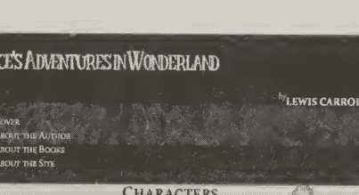

## 爱丽丝漫游仙境

刘易·卡罗尔 著

爱丽丝
在冒险中
以及书中

# 角色

- 爱丽丝: 据说这个角色基于德德森的朋友爱丽丝·利德尔，但据说它并非基于任何孩子，而是完全虚构的。
- 白兔子: 卡罗尔写道他出现在爱丽丝“舞台上”，而爱丽丝在早期就看到的白兔子。
- 老鼠: 当爱丽丝听到老鼠说“快点，浪费时间”时，她正盯着它的尾巴。于是她想象。
- 杜鸭: 杜鸭是一个想象出来的产物。一种流行的观点是杜鸭。
- 睡鼠: 睡鼠在场景中一直都在睡觉，经常醒来。
- 爱丽丝: 爱丽丝在茶会上听到老鼠说“快点，浪费时间”时。
- 公爵夫人: 公爵夫人出现在爱丽丝的任何时候，由于她的出现方式是难以遗忘的。
- 疯顶帽: 疯顶帽出现在爱丽丝的任何时候，这让她感到惊讶。
- 疯顶帽: 疯顶帽和三月兔在茶会上，这让她们难以遗忘。
- 睡鼠: 睡鼠在场景中一直都在睡觉，经常醒来。

# 设置项目符号位置

通常，列表项的文本长度超过一行。使用 `list-style-position` 属性（表 8.4），你可以指定换行文本相对于项目符号的位置。缩进到第一行文本之前的换行文本被称为悬挂缩进。

要定义列表项目中换行文本的行位置：

- 1. 在你的声明中添加 `list-style-property` 属性。输入 `list-style-position`，后跟冒号（:）以及第 2 步描述的数值之一（代码 8.4）。
  `list-style-position:`
- 2. 指定位置类型。使用以下值之一设置文本缩进：
  * `inside` 将项目符号的左边缘与后续文本的左边缘对齐。
  * `outside` 将文本的第一行与后续文本对齐，并将项目符号作为悬挂缩进。

## 表 8.4 List-Style-Position 值
| 值 | 兼容性 |
|---|---|
| inside | IE4, FF1, S1, O3.5, CSS1 |
| outside | IE4, FF1, S1, O3.5, CSS1 |
| inherit | IE7, FF1, S1, O4, CSS1 |

> Outside...Magnus es, domine, et laudabilis vitae: magna virtua tua, sapientae non est error. et tenere de tuo homo.
> Inside...Magnus es, domine, et laudabilis vitae: magna virtua tua, sapientae non est error. et tenere de tuo homo.

Outside 通常是项目列表的呈现方式。你可能希望通过 `inside` 来覆盖它。

代码 8.4 list-style-properties：`list-style-position` 属性允许你指定文本行在项目符号下的流向。

```css
### CSS3 V8 | Chapter 8 |
*** list-table-properties.css ***
{
  list-style-type: cycle;
  list-style-image: url(../images/bullet-01.png);
  list-style-position: inside;
}
av.global {
  list-style-type: none;
  list-style-position: outside;
}
```

# 角色

> Alice：这个角色基于一个传说，自舞台上出现的荷马的奥德赛以来。虽然她不是基于任何真实人物，但她非常神秘。
> 白兔：在《爱丽丝在仙仙游》中，他变成了“白和兔子”。在 Alice 的相遇中，作为角色……
> 奇奇猫：Alice 喜欢猫的微笑和长尾巴；在看着它时，她想象出了那个脸的形状。
> 渡渡鸟：这是作者的一个生物，一个可能并非无意但有趣的角色，他意外地介绍自己为“Do-Dodo”。
> 毛毛虫：当他们遇到他时，这是一个明智的角色，因为他立刻和她说话，说话时通常是简短、粗鲁的句子或提出很难的问题。

代码 8.4 应用于代码 8.1：项目符号推入文本中，使其左边缘与后续文本行的左边缘对齐。

> 提示：通常情况下，具有悬挂缩进（outside 位置）的项目符号列表比没有悬挂缩进（inside 位置）的列表要突出得多。

# 表 8.5 List-Style 值

| | `<list-style-type>` | `<list-style-position>` | `<list-style-image>` |
|---|---|---|---|
| | IE4, FF1, S1, O3.5, CSS1 | IE4, FF1, S1, O3.5, CSS1 | IE4, FF1, S1, O3.5, CSS1 |

# 设置多个列表样式

你可以使用 `list-style` 简写来设置前三个节描述的所有列表属性，该简写设置了 `list-style-type`、`list-style-position` 和 `list-style-image` 属性。

代码 8.5 list-table：`list-style` 属性允许你在所有定义中设置类型、图像和位置。

要定义多个列表样式属性：

- 1. 在你的 CSS 规则中添加 `list-style` 属性。输入 `list-style`，后跟冒号：（代码 8.5）。

```css
*** CSS3 VQS | Chapter 8 | 
*** list-style-properties.css ***
ul {
  list-style: circle url(../images/bullet-01.png);
}
nav.global ul {
  list-style: none;
}
```

- `list-style:`
- 2. 指定你的项目符号图像的位置（可选）。接下来是 `list-style-image`。
  ```
  url(arrow_02.png)
  ```

要包含你自己的项目符号，你必须创建符号图形，并使用完整的 Web 地址或图像的相对路径告诉浏览器图像的位置。（更多信息请参见本章的“创建你的项目符号”）。

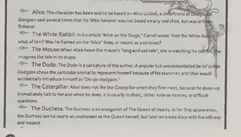

- 3. 指定类型。使用来自表 8.3 的 `list-style-type` 值，后跟一个空格，或者如果你不想出现标记，则输入 `none`。

> 代码 8.5 应用于代码 8.1：此版本与之前的版本相同，仅代码不同。

你不需要包含所有值来确保此简写选择器工作。省略的值将设置为默认值。以下示例可以正常工作：

```css
list-style: circle
```

- 4. 指定位置。输入来自表 8.4 的 `list-style-position` 值。

如果访问者在浏览器中关闭了图形，或者由于某些原因符号没有加载，浏览器将使用你在“列表和表格属性”步骤中定义的 `list-type`。

# 设置表格布局

不同的浏览器使用不同的方法来计算特定表格应如何显示。主要的表格布局（表 8.6）方法受青睐：

- 固定方法（Fixed method）基于表格宽度和第一行的列进行布局。这种方法通常比自动方法快。
- 自动方法（Automatic）根据数据单元格的内容量使用表格列宽。这种方法渲染通常比固定方法慢，但对整个表格的宽度提供了更准确的结果。

## 表 8.6 Table-Layout 值
| 值 | 兼容性 |
|---|---|
| fixed | IE5.5, O5, S1, CSS2 |
| auto | O5, S1, CSS2 |
| inherit | IE5.5, O5, S1, CSS2 |

# 设置表格单元之间的间距

虽然表格数据单元格和表头单元格使用了许多我们在第 10 章探索的框属性，但它们不能使用 `margin` 属性。相反，CSS 有 `border-spacing`（表 8.7）属性，它在数据单元的上、下、左、右侧之间设置相同的间距。

| 值 | 兼容性 |
| --- | --- |
| `<length>` | IE5.5, FF1, S1.3, C1, CSS2 |
| inherit | IE5.5, FF1, S1.3, C1, CSS2 |

要折叠表格中的框间距：

- 1. 在表格元素的 CSS 规则中添加 `border-spacing` 属性。输入 `border-spacing`，后跟冒号（:）（代码 8.7）。

代码 8.7 list-table-properties：`border-spacing` 属性类似于数据单元 A 周围的边距。
  `border-spacing:`
- 2. 指定表格单元之间的间距。
  `8px;`

输入一个长度值（如 `8px`）来指定单元之间的距离。（参见引言中的“本书使用的值和单位”）。或者，使用 `inherit` 使用与单元父元素相同的间距。

```css
*** CSS3 VQS | Chapter 8 | 
*** list-table-properties.css ***
ul {


`list-style: circle url(../images/bullet-01.png); inside);`

}

`nav.global ul` {

  `list-style: none`;

}

`table` {

  `table-layout: auto`;

  `width: 75%`;

  `margin: 40px auto`;

}

```
*(注：由于提供的原始文本包含大量重复和 OCR 错误，以上译文已根据要求清理并合并了核心内容)*
```

## 表 8.8 border-collapse 值

| 值 | 兼容性 |
| --- | --- |
| collapse | IE5.5, FF1, O5, S1, C3, CSS2 |
| separate | IE5.5, FF1, O5, S1, C3, CSS2 |
| inherit | IE5.5, O5, S1, C3, CSS2 |

## 合并表格单元之间的边框

由 `<<td>>` 标签定义的每个表格单元都有四个边框：上、右、下、左。**`border-collapse`** 属性（表 8.8）允许你设置表格，使每个单元单元与相邻单元共享边框，而不是为每个单元创建一个独立的边框。

代码 8.8 `list-table-properties.css`——`border-collapse` 属性允许你移除表格单元之间的任何空间，使每个单元拥有单个边框（见下页），但框间距（border-spacing）会被忽略。使用 **`separate`** 可以让 **`border-spacing`** 生效（见下页）：

## 要合并表格中的边框：

```css
*** CSS3 | Chapter 8 |
list-table-properties.css ***
ul {
  list-style: url(../images/bullet01.png) inside;
}
nav.global {
  list-style: none;
}
table {
  table-layout: auto;
  border-spacing: 8px;
  border-collapse: separate;
  width: 75%;
  margin: 40px auto;
}
caption, table caption {
  font: italic 1.25em Georgia, 'Times New Roman', Serif;
}
t {
  font-size: 1.25em;
}
td {
  vertical-align: top;
  padding: .5em;
  background-color: rgba(200, 200, 180, .25);
  border: 1px solid rgb(200, 200, 180);
}
```

- 1. 在表格元素中添加 `border-collapse` 属性。输入 `border-collapse`，后跟一个冒号（:（代码 8.8）。
- 2. 指定边框如何合并。根据你想要显示边框的方式输入以下内容之一：
  - `collapse` 将使相邻的表格单元共享共同边框；然而，如果边框已合并，将无法设置 border-spacing。
  - `separate` 将保持每个数据单元的边框。除非你设置了边框厚度，否则不同浏览器显示结果可能不同。如果边框厚度相同但样式不同，将使用左侧数据单元的边框样式。通过使用 `collapse`，数据单元之间的边框减少为单条细线。

| 名字 | 茶茶会 | 疯了吗？ |
|---|---|---|
| 疯帽子 | | |
| 呆语兔 | “像野兔一样疯狂”是卡罗尔时代的常用用语。 | | |
| 睡鼠 | 睡鼠在整个场景中一直都在睡觉，经常醒来。 | | |
| 爱丽丝 | 人说这个角色是基于德格森的孩子 Alice Liddell 的 | |

代码 8.8 应用于代码：设置 `separate` 后，你可以设置 `border-spacing`。

## 表 8.8 empty-cells 值

| 值 | 兼容性 |
| --- | --- |
| show | FF1, O5, S1, CSS2 |
| hide | FF1, O5, S1, CSS2 |
| inherit | FF1, O5, S1, CSS2 |

## 处理空单元格

代码 8.9 `list-table-properties.css`——`empty-cells` 属性允许你显示（默认）或隐藏表格单元格。如果表格单元格没有数据（即使没有换行空格），它将以列和行的默认宽度和高度显示为空。**`empty-cells` 属性（表 8.9）**允许你指定空单元格（最重要的是它的边框）的呈现方式。

```css
*** CSS3 | Chapter 8 |
list-table-properties.css ***
ul {
  list-style: url(../images/bullet01.png) inside;
}
nav.global ul {
  list-style: none;
}
table {
  table-layout: auto;
  border-spacing: 8px;
  border-collapse: separate;
  empty-cells: hide;
  width: 75%;
  margin: 40px auto;
}
```

### 要隐藏空表格单元格：

- 1. 在表格元素规则中添加 `empty-cells` 属性。输入 `empty-cells`，后跟一个冒号（:（代码 8.9）。
- 2. 指定如何处理空表格单元格。输入以下内容之一来指定处理单元格的方式：
  - **`show`** 将强制空数据单元显示其背景和边框。
  - **`hide`** 将在数据单元格的位置留出视觉间隙。

```css
table caption, table head {
  font: 1.25em Georgia, *Times New Roman*, Serif;
}
td {
  font-size: 1.25em;
  vertical-align: top;
  padding: .5em;
  background-color: rgba(200, 200, 180, 25);
  border: 1px solid rgb(200, 200, 180);
}
```

| 名字 | 描述 |  |
| --- | --- | --- |
| 疯帽子 | | |
| 呆语兔 | “像三月兔一样是卡罗罗故事中的常用短语。” | | |
| 睡鼠 | 睡鼠在整个场景中一直都在睡觉，偶尔醒来 | | |
| 爱丽丝 | 人说这个角色是基于德格森的孩子 Alice Liddell 的。 | |

**代码 8.9 应用于代码 8.1：** 空表格数据单元已隐藏，因此边框和背景颜色不显示，在表格中留下了空间隙。

## 设置表格标题的位置

`<caption>` 标签允许在表格中嵌入标识性文本。你可以在标签中设置 `align` 属性来定义标题相对于表格的位置，但该属性正在被弃用，取而代之的是 CSS `caption-side` 属性（表 8.10），后者的功能相同。

要设置标题相对于其表格的位置：

- 1. 在你的 CSS 中添加 `caption-side` 属性。输入 `caption-side`，后跟一个冒号（代码 8.10）。
- 2. 输入以下内容之一来指定标题出现的位置：top 或 bottom。

## 用户界面与生成内容的属性

在大多数情况下，用户界面无法通过 CSS 控制。它取决于所使用的特定操作系统和浏览器。像滚动条之类的对象是您无法控制的。然而，CSS 对鼠标指针的外观和引用的样式提供了一定程度的控制。

此外，CSS 还包含几个属性，允许你为特定实例指定要在此页面上放置的内容（生成内容）。例如，你可能希望所有的章节标题在前面都包含“**Chapter**（章节）”一词。虽然你通常希望将所有页面内容直接放入 HTML 代码中，但在某些情况下，你会发现让系统为你生成一些冗余内容，或针对特定语言进行定制是非常用的。

## 本章内容
- 更改鼠标指针的外观
- 使用 CSS 添加内容
- 教会浏览器计数
- 指定引用的样式
- 将它们整合在一起

### 9.1 示例中使用的 HTML 代码

本章使用的 HTML5 代码将第 5、6、7 和 8 章中的最终 CSS 导入并作为一个新文件中。我为此 HTML 文档设置了与之前章节相同的头部和页脚，但修改了目录，将其变为之前的章节列表和未来的章节列表。

```html
<!DOCTYPE html>
<html lang="en">
<head>
<meta charset="UTF-8">
<title>Alice's Adventures in Wonderland | Chapter 4</title>
<link href="../css/font-properties.css" type="stylesheet">
<link href="../css/background-properties.css" type="stylesheet">
<link href="../css/list-properties.css" type="stylesheet">
<link href="../css/ui-generated-properties.css" type="stylesheet">
<!--if IE >
<style>@import url(css/ie.css);</style>
<script src="../script/ie.js" type="text/javascript"></script>
<!endif]-->
</head>
<body id="chapter4" class="book">
<header>
  <h1>Alice's Adventures in Wonderland</h1>
  <p class="byline">by <span class="author">Lewis Carroll</span></p>
  <nav class="global">
    <ul>
      <li><a href="#target">Cover</a></li>
      <li><a href="#target">About the Author</a></li>
      <li><a href="#target">About the Books</a></li>
      <li><a href="#target">About the Site</a></li>
    </ul>
  </nav>
</header>
<article>
  <div class="toc">
    <h2>Down the Rabbit-Hole</h2>
    <h2>The Pool of Tears</h2>
    <h2>Race and a Long Tale</h2>
    <h2>CHAPTER 4. The Rabbit Sends in a Bill</h2>
    <p>那是白兔，它又在慢慢地走着，一边走一边焦虑地看着，好像丢失了什么东西；她看到它自言自语地念着：“夫人！夫人！我亲爱的爪子！噢，我的毛发和胡须！她肯定会让我被处刑的！我真不知道我把它们掉在哪儿了？”爱丽丝立刻猜到它在找扇子和那双白色羊皮手套，但没有人开始寻找它们，而且自从她游泳之后，它们在地方都没有变化，而大厅——连同玻璃桌子和小门——已经完全消失了。</p>
    <div class="toc">
      <h2>Advice to a Caterpillar</h2>
      <h2>Pig and Pepper</h2>
      <h2>A Mad Tea-Party</h2>
      <h2>The Queen's Croquet-Ground</h2>
      <h2>The Mock Turtle's Story</h2>
      <h2>The Lobster Quadrille</h2>
      <h2>Who Stole the Tarts?</h2>
    </div>
  </div>
</article>
<footer>
  <nav class="global">
    <ul>
      <li><a href="#self">Cover</a></li>
      <li><a href="#self">About the Author</a></li>
      <li><a href="#self">About the Books</a></li>
      <li><a href="#self">About the Site</a></li>
    </ul>
  </nav>
</footer>
</body>
</html>
```

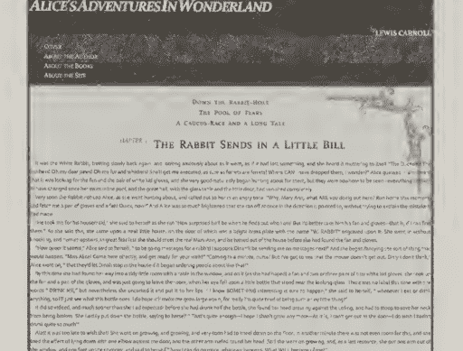

添加任何生成内容的本章页面。

## 更改鼠标指针的外观

### 表 9.1 光标值

通常，浏览器会根据指针下方当前的内容来决定鼠标指针的外观。例如，如果指针位于文本上，指针将变成文本选择器。或者，如果浏览器正在运行且访问者无法进行任何操作，指针将变成计时器，表示访问者需要等待。

| 值 | 兼容性 |
| --- | --- |
| <cursor type name> | IE4, FF1, S1, S0, C1, CSS2 |
| <URL> | IE6, FF1.5, S3, C3, CSS2 |
| auto | IE4, FF1, S0, CSS2 |
| none | IE4, FF1, S0, CSS2 |

通常，浏览器会根据指针下方当前的内容来决定鼠标指针的外观。例如，如果指针位于文本上，指针将变成文本选择器。或者，如果浏览器正在运行且访问者无法进行任何操作，指针将变成计时器，表示访问者需要等待。

```css
.toc {
  cursor: help;
  width: 90%;
  text-align: center;
}
```

为了设置鼠标指针：

1. 使用 CSS 属性指定指针的外观。
2. 使用 `cursor` 属性并跟上表 9.1 中的值。

在情况下，`IE4, FF1, S0` 允许你使用 `cursor` 属性来覆盖浏览器的默认设置。

```css
a {
  cursor: help;
}
```


为了设置鼠标指针：

1. 使用 CSS 属性指定指针的外观。
2. 使用 `cursor` 属性并跟上表 9.1 中的值。

在情况下，`IE4, FF1, S0` 允许你使用 `cursor` 属性来覆盖浏览器的默认设置。

在情况下，`IE4, FF1, S0` 允许你使用 `cursor` 属性来覆盖浏览器的默认设置。

在情况下，`IE4, FF1, S0` 允许你使用 `cursor` 属性来覆盖浏览器的默认设置。

使用 `cursor` 属性在 Firefox, Safari 和 Chrome 中是可以的。

### 表 9.2 光标类型

| 名字 | 外观（取决于操作系统） |
| --- | --- |
| crosshair | + |
| e-resize | → |
| help | ❓ |
| move | ╋ |
| n-resize | ↑ |
| nw-resize | ↘ |
| pointer | 👆 |
| progress | ⌛ |
| se-resize | ↘ |
| s-resize | ↓ |
| sw-resize | ↙ |
| text | ⌛ |
| wait | ⌛ |
| w-resize | ← |

## 使用 CSS 添加内容

为了搜索引擎优化和无障碍访问，最好将所有内容保留在 `<body>` 元素中。如果它是动态生成的，那么爬虫和许多屏幕阅读器将无法看到。然而，有时你可能需要有助于（甚至阻碍）页面索引的内容。

要添加内容，你可以使用 `content` 属性（表 9.3），它允许你指定文本字符串、图像文件 URL、引用甚至是显示在页面上的属性值。

### 表 9.3 兼容性

| 值 | 兼容性 |
| --- | --- |
| normal | IE8, FF1, S1, O4, CSS2 |
| none | IE8, FF1, S1, O4, CSS2 |
| <string> | IE8, FF1, S1, O4, CSS2 |
| <url> | IE8, FF1, S1, O7, CSS2 |
| <counter> | IE8, FF1, S1, O4, CSS2 |
| attr(<selector>) | IE8, FF1, S1, O4, CSS2 |
| open-quote | IE8, FF1, S1, O4, CSS2 |
| close-quote | IE8, FF1, S1, O4, CSS2 |
| no-quote | IE8, FF1, S1, O4, CSS2 |
| inherit | |

为了定义生成的内容：

1. 指定内容应该位于元素之前还是。使用带有 `:before` 或 `:after` 伪类（参见第 4 章*设置元素之前之后的内容*）的选择器来定义内容相对于选择器的位置。
2. 在你的 CSS 中添加 `content` 属性。在声明块中，输入 `content` 属性名，后跟步骤 3 中列出的值之一。

```css
.toc h2:before {
  content: url('../images/bullet-01.png');
  'Chapter ' counter(counterNumber) . '.';
}
toc h2:after {
  content: url('../images/bullet-02.png');
}
```

## 第 8 章：茶的冲力
## 第 9 章：双蛇神杖之赛与漫长的故事

## 兔子派来了一点

当兔子注意到爱丽丝时，它转身逃跑了，并用愤怒的语气对她喊道：“兔子先生，回来！”爱丽丝跑得快得多，气喘吁吁地径了过去，试图跟随它，直到它转了一个弯，然后她看到它消失在一个洞里了。

```
将代码 9.3 应用于 9.1：章节标题获得了更多的空间。注意，所有的章节编号都是 0。你必须教浏览器如何计数。
```

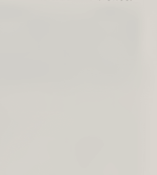

## 3. 指定要添加的内容。

```css
url('../images/bullet-01.png')
'章节计数器(chapterNum)'
```

要定义要添加的内容，请输入以下一个或多个值，每个值用空格隔开：

- 字符串值，例如 Chapter，用单引号或双引号括起来。引号内的任何内容将按照你输入的样式显示，包括 HTML 代码，尽管空格会被合并（也就是说，在显示时，两个以上的空格会被合并为一个空格）。
- `url()`，括号内包含一个绝对或相对 URL，指向外部文件，例如图像或声音文件。例如，`url(bg_flourish.png)` 将加载一张图像。
- `counter()`，括号内包含一个计数器名称。例如，`counter(chapterNum)` 会为 chapterNum 添加计数器数字。（计数器将在下一节中解释。）
- `open-quote`（开启引号）或 `close-quote`（结束引号），用于使用当前的引号样式添加引号。（参见本章稍后文的“指定引号样式”）。
- `no-open-quote`（无开启引号）或 `no-close-quote`（无结束引号），将引用层级增加一级。
- `attr()`，用于显示所引属性的值。例如，`attr(alt)` 将显示被样式元素的 alt 属性的值。
- `inherit`（继承），将使用为父元素定义的内容。
- `normal` 或 `none`，将不会添加任何内容或不应用任何其他值。

> 因为 `content` 属性直到 Internet Explorer 8 才被支持，所以最好不要依赖此属性来显示关键信息。

> 使用 `content` 属性渲染的内容将无法被搜索引擎搜索，永远不要使用它来插入定义你页面的信息。

> 这种方式添加的内容对屏幕阅读器也是不可见的，因此不要包含任何它们会读取的内容。

> 一种想法是使用 `content` 来添加从 `img` 标签中提取的图说明。由于这对屏幕阅读器和搜索引擎是可见的，因此它是重复内容的一种好方法。

## 教浏览器计数

浏览器可以自动创建顺序列表，从 1 开始并按 1 递增。你将在本章的稍后部分探索这一点。然而，如果你需要从 6 而不是 1 开始编号呢！或者，如果你需要创建两个嵌套在内部的顺序列表？CSS 允许你使用 `content` 属性（上一节）设置多个计数器列表。`counter-reset` 属性（表 9.4）用于设置计数的初始值，`counter-increment` 属性（表 9.5）用于按特定值增加计数器。

| 表 9.4 计数器重置值 | 值 | 兼容性 |
| :--- | :--- | :--- |
| <counterName> | IE8, FF, CSS2 |
| <num> | IE8, FF, CSS2 |
| none | IE8, FF, CSS2 |
| inherit | IE8, FF, CSS2 |

| 表 9.5 计数器递增值 | 值 | 兼容性 |
| :--- | :--- | :--- |
| <counterName> | IE8, FF, CSS2 |
| <num> | IE8, FF, CSS2 |
| none | IE8, FF, CSS2 |
| inherit | IE8, FF, CSS2 |

要使用计数器：

1. 设置父元素。为将作为你的编号列表父元素的选择器设置一条 CSS 规则（代码 9.4）。
2. 在你的声明块中添加 `counter-reset` 属性。`counter-reset: counterName: 0;`
3. 输入 `counter-increment: (:`，然后输入你定义的计数器名称（可以是任何名称）。然后插入一个空格和你想让列表开始计数的数字。

```css
/* 代码 9.4 ui-generated-properties.css */
/* 目录显示章节在之前和之后，所以列表需要跳过 0。 */
.toc {
  margin: 0 auto;
  width: 90%;
  text-align: center;
  font-size: 5em;
}
.toc h2:before {
  content: url(../images/bullet01.png) counter(counterName);
  counter-increment: counterName 1;
}
.toc h2:after {
  content: url(../images/bullet02.png);
}
```

## 第 1 章：兔子洞
## 第 2 章：泪池
## 第 3 章：双蛇神杖之赛与漫长的故事

## 兔子派来了一场战斗

她是白色的，颤抖着来来走去，看起来像往常一样焦虑，好像她丢失了某种需要找回的东西！兔子喊道：“噢天哪！噢天哪！太晚了！”并开始为她的表担心。爱丽丝跑得快得多，气喘吁吁地径了过去，试图跟随它，直到它转了一个弯，然后她看到它消失在一个洞里了。

```
将代码 9.3 应用于 9.1：章节标题获得了更多的空间。注意，所有的章节编号都是 0。你必须教浏览器如何计数。
```


## 第 1 章：兔子洞
## 第 2 章：泪池
## 第 3 章：双蛇神杖之赛与漫长的故事

## 兔子派来了一战斗

她是白色的，颤抖着来来走去，看起来像往常一样焦虑，好像她丢失了某种需要找回的东西！兔子喊道：“噢天哪！噢天哪！太晚了！”并开始为她的表担心。爱丽丝跑得快得多，气喘吁吁地径了过去，试图跟随它，直到它转了一个弯，然后她看到它消失在一个洞里了。

```
将代码 9.3 应用于 9.1：章节标题获得了更多的空间。注意，所有的章节编号都是 0。你必须教浏览器如何计数。
```


## 第 1 章：兔子洞
## 第 2 章：泪池
## 第 3 章：双蛇神杖之赛与漫长的故事

## 兔子派来了一战斗

她是白色的，颤抖着来来走去，看起来像往常一样焦虑，好像她丢失了某种需要找回的东西！兔子喊道：“噢天哪！噢天哪！太晚了！”并开始为她的表担心。爱丽丝跑得快得多，气喘吁吁地径了过去，试图跟随它，直到它转了一个弯，然后她看到它消失在一个洞里了。

```
将代码 9.3 应用于 9.1：章节标题获得了更多的空间。注意，所有的章节编号都是 0。你必须教浏览器如何计数。
```


# 指定引用样式

尽管大多数写作者会使用键盘为文本添加引号，但 HTML 包含了引用标签：`<q>...</q>`。该标签在指定的文本周围提供浏览器默认的引号。通过 CSS，你可以使用 `quotes` 属性来找到要用作引号的精确字符（见表 9.6）。虽然英语使用单单引号（'...'）或双引号（"..."），但这绝不是所有语言的通用标准。

| 表 9.6 Quotes 属性值 |
| 值 | 兼容性 |
| :--- | :--- |
| '<string>' | IE8, FF1, S1, C1, O4, CSS2 |
| none | IE8, FF1, S1, C1, O4, CSS2 |
| inherit | IE8, FF1, S1, C1, O4, CSS2 |

要定义列表样式：

- 1. 在你的声明块中添加 `quotes` 属性。输入 `quotes`，后跟冒号（:）以及表 9.6 中列出的值或值对之一（代码 9.5）。

`quotes:` 

你可以将此添加到任何特定元素中，也可以像“特定语言的样式”（第 4 章）解释的那样针对特定语言设置。

## 代码 9.5 ui-generatedcontent-properties.css

在示例 A 中，引号被设置为使用 «»,，这是许多欧洲语言（包括法语）的标准。

# 2. 在标准的英语单引号或双引号（' 或 ")）内设置起始和结束引号的值。

```css
*** CSS3 VQS | Chapter 9 |
*** ui-generatedcontent-properties.css ***
{
  quotes: '‘' '”';
}
.toc { margin: 0; width: 90%;
  text-align: center; font-size: .5em;
}
na {
  cursor: help;
}
```

```css
“‘ ' ’”
```

# 3. 在空格之后，你可以为第二级引用添加另一组引用样式（嵌套在引用中的引用）。

```css
‘‘ '’’ 
```

# 4. 为了让引用样式生效，你实际上需要使用 `<q>` 标签在你的 HTML 文档中指示引用。

```css
h1 {
  cursor: url(../images/cursor-02.png);
  20 20, crossorigin;
}
```

```css
.top {
  counter-reset: chapterNum 0;
}
.toc h2:before {
  content: url(../images/bullet-01.png');
  ' ' counter(counterNum) ' ';
  counter-increment: counterNum;
}
.toc h2:after {
  content: url(../images/bullet-02.png');
}
#chapter4_continued {
  counter-reset: chapterNum 4;
}
```

```html
<q>...</q>
```


> 该属性对于英语很有用。英国和美国使用相同的引号，但顺序相反。美国使用双引号作为主引用，使用单引号作为次级引用，而英国则反过来。

她没有敲门，也没有引起骚动，非常担心会遇到真正的玛丽·安，在找到扇子和手套之前就被赶出房子。

“这听起来真奇怪，”爱丽丝自言自语道，“又要传达消息了！”她开始想象他们可能会来这里，并为可能发生的事情做准备——“爱丽丝小姐！过来，准备好工作。但他们肯定是去抓老鼠了？只是没没想到！”爱丽丝继续道，“当她开始想象那样的人时，他们竟然在房子里开店。”

此时，她已经进了一个带有一个桌子的小房间，意识到自己手里有扇子和两三双小小的童装手套；她拿起扇子和一只手套，正准备离开时，眼睛落在了镜子旁边的一个小瓶子上。那里

# 代码 9.5 应用于代码 9.1：现在引用使用的是引号，这是许多欧洲语言的标准。我放大了图像，以便你看得更清楚。


# 综合运用

- 1. 创建一个透明的 PNG 图像，并将其作为页面上的指针。你可以通过在 `<body>` 元素中设置图片的 `pointer` 属性来实现。
- 2. 在文本块的开头和结尾动态添加图形。你可以使用步骤 1 中的相同图像。
- 3. 设置一个从 7 开始的列表。如果你觉得非常高级，可以让它按 2 递增。
- 4. 将页面上的引用样式更改为法语引号。确保你在引用周围使用了 `quote` 标签。

# 盒属性

在物理世界中，原子是所有较大对象的构建区块。每种原子（或元素）都有独特的属性，但当与其他原子键合时，它们会形成分子——属性与部分不同的更大结构。

同样，HTML 标签是你的 Web 页面的构建区块。每个标签（或元素）都有自己的能力。标签可以组合起来创建一个大于部分之和的 Web 页面。无论标签是本身还是嵌套在其他标签中，都可以被视为页面上的一个独立元素。

本章使用“盒”的概念来展示你可以对元素进行的操作——包括外边距、边框、内边距、宽度和高度——这些都可以受到 CSS 的影响。

- 理解元素
- 显示元素
- 设置元素的宽度和高度
- 控制元素的溢出
- 设置元素的外边距
- 设置元素的轮廓
- 设置元素的圆角
- 设置元素的边框
- 设置元素的内边距
- 即将推出！

# 爱丽丝的仙游奇游记

刘易斯·卡罗尔

封面
爱丽丝的仙游奇游
关于作者

## 第一章：掉进兔子洞

## 第二章：泪池

## 第三章：会议赛与长茶

## 第四章：兔子派来了小比尔

## 第五章：毛虫的建议

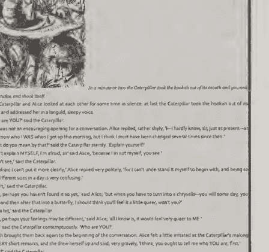

爱丽丝累了，闭上眼睛；一两分钟后，毛虫从嘴里吐出烟并打了个哈欠。

毛虫盯着她看了一会儿；爱丽丝也看着毛虫。爱丽丝想聊聊天，于是打了一个哈欠，一个长长的、困睡的哈欠。

“你是谁？”爱丽丝问。

现在他们开始对话了。爱丽丝回答道：“不太清楚，就像我现在的样子吧——至少至少我今天早上起床时认为自己是这样的，我想从那时起我已经变了好几次了。”

“我真不敢相信自己，”爱丽丝说。

“我自己也不太确定，”爱丽丝说。

“那么你到底是谁？”毛虫问。

“我是……爱丽丝，”爱丽丝说，“但我不知道当我说这句话时，我变成了什么。”

“这是正确的答案，”毛虫说。

“你为什么这么困？”爱丽丝问。

毛虫正吐着一个环状的烟圈。

爱丽丝思考了一会儿该对毛虫说什么，但她没想出任何好的回答。

“你非常无礼，”爱丽丝说。

“我不无礼，”毛虫说。

“你就是无礼！”爱丽丝说。

“嚼吧？”毛虫说道。

“我没说‘嚼吧’！”爱丽丝说。

“你在想你的想法，”毛虫说。

“我没有！”爱丽丝说。

“你确实了，”毛虫说。

“好吧，我很庆幸不是你！”爱丽丝说。

毛虫又开始抽烟了。

“你是做什么的？”爱丽丝问。

“变一些变化，”毛虫说。

“我不明白变什么，”爱丽丝说。

“那你就变一些吧！”毛虫说。

“我不能！”爱丽丝说。

“为什么不能？”毛虫问。

“因为我不知道该变什么！”爱丽丝说。

“没错，”毛虫说。

“但我指的是变什么？”爱丽丝问。

“变一切！”毛虫说。

“你说话毫无逻辑，”爱丽丝说。

Code 10:1 在添加任何盒属性之前，该章节的网页。它现在是乱的，但它将将布局网格、添加外边距并添加内边距，为设计留出呼吸空间。

# 理解元素的盒

正如你在第 2 章中学到的，元素是 HTML 文档的一部分，由 HTML 容器标签隔开。以下是一个 HTML 元素：

```
<p>Alice</p>
```

这是另一个 HTML 元素：

```
<article><p><em>Alice </em></p></article>
```

第一个示例是由单个标签组成的元素。第二个示例是嵌套标签的集合，每一个嵌套标签都是一个独立的元素。记住，嵌套标签被称为它们所嵌套标签的*子元素*，而后者被称为*父元素*（参见第 4 章中的“从父元素继承属性”）。

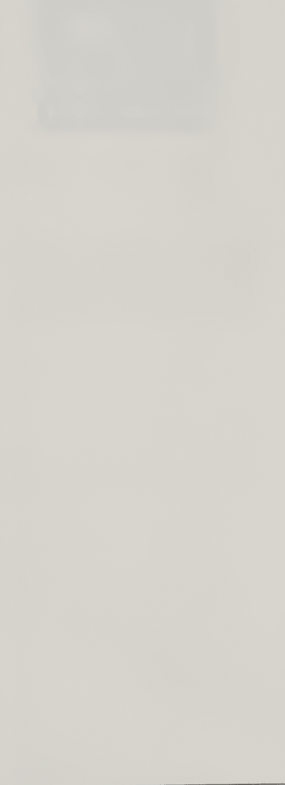

# 盒的组成

所有的 HTML 元素都有四边：上、右、下、左。这四边形成了元素的盒，可以在上面应用 CSS 属性。盒的每个边都有以下属性：

- 内容（Content）——位于盒的中心，是页面主体。内容包括你使用的所有文本（副本）、列表、表单和图像。
- 子元素（Child Elements）——包含父元素内的元素由它们自己的 HTML 标签隔开。子元素通常有自己的盒，可以独立于父元素进行控制。
- 宽度和高度（Width and Height）——内容区域的尺寸。如果你未定义宽度高度，这些尺寸由浏览器决定（参见本章的“设置元素的宽度和高度”）。
- 内边距（Padding）——元素边框和内容之间的空间（参见本章的“设置元素的内边距”）。背景颜色和图像也会填充这个空间。如果未设置，内边距的大小通常为 0。
- 背景（Background）——元素内容和内边距后面的空间。可以是实色、一个或多个背景图像，或背景渐变。（关于背景的更多信息请参见第 7 章。）
- 边框（Border）——环绕元素的规则（线），可以单独设置任何一边。除非你设置了它的颜色、宽度和样式——实线、点线、虚线等——否则边框是不可见的。你还可以设置背景图像。如果未设置，边框的尺寸通常为 0。

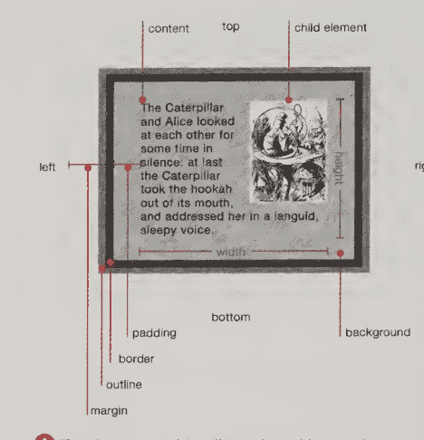

- 外边距（Margin）——元素边框周围的空间。可以单独设置任何一边。外边距是透明的，没有背景颜色或图像。（参见本章的“设置外边距”）。
- 轮廓（Outline）——环绕元素的规则（线），但不占据空间。像边框一样，可以设置颜色、宽度和样式。与边框不同，轮廓不影响页面的布局。
- 索引（Z-index）——确定沿 z 轴堆叠顺序的属性。z-index 较高的元素显示在 z-index 较低元素前面。


# 显示元素

在第 1 章中你学到所有元素都可以根据显示方式进行分类：行内（inline）或块级（block）。默认情况下，每个标签都有定义其如何与其他元素处的显示样式。你可以使用 `display` 属性来定义元素是换行的（block）、与其他元素包含的（inline）、作为列表（list），还是完全不显示（none）。

表 10.1 显示了 `display` 属性可用值。

| 值 | 兼容性 |
|---|---|
| list-item | IE6 |
| block | IE4 |
| inline | IE4 |
| inline-block | IE4 |
| run-in | IE8 |
| table | IE8 |
| table-cell | IE8 |
| table-footer-group | IE8 |
| table-header-group | IE8 |
| table-row | IE8 |
| table-row-group | IE8 |
| inline-table | IE4 |

# 设置元素的显示类型：

1. 在 CSS 声明块中输入 `display` 属性名称开始声明，后跟一个冒号（:）。
2. 输入表 10.1 中的一种显示类型。

`display:`

`block:`

根据所需结果选择一种类型：

- `inline`（行内）使元素及其同级元素从左到右流动，直到遇到父元素的边缘，此时应用软换行将内容换到下一行。元素之前和之后的硬换行会被抑制。

| 元素 | 元素 | 元素 |
| 元素 | | |
| 元素 | |

行内元素水平流动。

- `block`在盒上方和下方放置一个硬换行，使元素垂直流动。将盒的宽度设置为父元素的宽度。

块级元素垂直流动。

| element | element | element |
| --- | --- | --- |
| element | element | element |

行内块元素（Inline-block elements）可以在框内垂直堆叠，但框是行内流动的。

代码 10.2 `ul-block-properties.css`——当应用于代码 101 时，`display` 属性允许你重新定义不同元素在文档中的流方式。我们将 `figure`、`figcaption` 和 `aside` 定义为块元素，以确保你可以控制它们的宽度、高度和浮动。

- `inline-block` 将此元素定义为行内，其内部内容被视为一个块 ④

- `run-in` 是上下文相关的，除非其下一个兄弟元素也是块元素，否则它表现为块元素；在这种情况下，它将对其兄弟元素表现为行内元素。为了此项工作，兄弟元素不能应用浮动。

- `table` 以及表 10.1 所示的其他表格值中的任意一个，允许你将任何标签转换为数据表格的一部分。

- `list-item` 在文本的第一行放置列表项目标记，并在项目上方和下方添加换行符，用作列表元素的一部分。如果你没有专门使用列表元素，请使用列表元素。使用 `list-item` 创建非列表元素的列表将在第 8 章中进行讨论。

```css
*** CSS3 VQRS | Chapter 10 |
→ box-properties.css ***/
nav.global
  display: block; 
nav.global li
  display: inline; 
figure {
  display: block; 
}
figcaption {
  display:block; 
aside {
  display: block; }
```

- `inherit` 使用为元素的父元素设置或隐式的 `display` 值。

- `none` 导致此元素在 CSS 浏览器中不显示。它看起来就像页面上不存在内容一样。

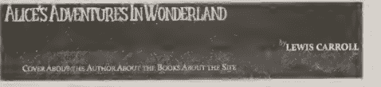

**代码 10.2 应用于代码 10.1：** 注意，导航中原本是块级列表元素（封面、关于作者、关于书籍等）现在是行内的，水平流动而不是垂直流动。

盒属性 (Box Properties) 249

提示：尽管你可以将任何元素转换为列表项目或表格，但不要这样做。从语义和可访问性的角度来看，这是糟糕的代码。请坚持使用 HTML 标签创建列表和表格。

提示：`compact` 属性在 CSS2.1 中被删除，但可能会在 CSS3 中回归。目前，CSS3 工作组盒模型文档中仅存在一个占位符。

提示：任何分配 `display:none` 的元素都会被浏览器忽略。然而，在使用 `none` 时要小心。尽管它不是一个继承属性，但 `none` 会关闭元素本身以及任何后子元素的显示。

提示：`display:none` 对于创建动态元素（例如下拉菜单）非常有用，这些元素随用户与页面交互显示和隐藏。但是，请记住这也会从屏幕阅读器中隐藏元素，这对可用性可能不利。

提示：`none` 的另一个伟大用途是创建一个打印特定的样式表，隐藏打印页面不需要的元素，例如导航和表单字段。谁需要打印件中的导航链接、搜索表单和低分辨率图形呢？

提示：不应将 `display` 属性与 `visibility` 属性混淆（参见第 11 章“设置元素的可见性”）。与为元素留空间的 `visibility` 属性不同，`display:none` 会完全将元素从页面中移除，尽管浏览器仍加载其内容。

# 10.3 ui-properties.css——当应用于代码 10.1 时，`width` 和 `height` 用于控制元素的尺寸。可以使用 `max` 和 `min` 值允许设计根据用户需要伸伸或收缩。

# 设置元素的宽度和高度

默认情况下，浏览器自动将元素的宽度和高度设置为可用宽度的 100%，以及显示所有内容所需的任何高度。你可以使用 CSS 来覆盖块元素的宽度和高度。通常，你设置元素宽度的频率会高于高度，除非你知道块内容的确切大小，或者愿意允许滚动。

```css
### CSS Q5 | Chapter 10 | box-properties.css ***/
nav.global {
  display: block;
}
nav.global li {
  display: inline;
}
article {
  max-width: 980px;
  min-width: 660px;
}
figure {
  display: block;
  width: 300px;
}
figcaption {
  display:block;
}
aside {
  display: block;
  width: 200px;
  height: 400px;
}
footer {
  width: 100%;
}
```

除了设置特定的宽度和高度外，你还可以通过为元素设置最小和最大宽度及高度来指定范围。这对于创建灵活的设计非常有用，这些设计在较大的屏幕上可能会拉伸到不合理的的比例。

# 定义元素的宽度：

- 1. 在 CSS 声明块中输入宽度属性名称，后跟冒号（）（代码 10.3）。

`width:`

继续见下一页


**代码 10.2 应用于代码 10.1：** 注意，导航中原本是块级列表元素（封面、关于作者、关于书籍等）现在是行内的，水平流动而不是垂直流动。

# 2. 定义元素的宽度：

- 1. 在 CSS 声明块中输入宽度属性名称，后跟冒号（）（代码 10.3）。

`width:`

# 控制溢出内容

当元素被裁剪，或者父元素的宽度和高度小于显示所有内容所需的区域时，部分内容将无法显示。`overflow` 属性允许你指定如何处理这些内容。

CSS3 新特性 ★ 使用 `overflow-x` 和/或 `overflow-y` 可以独立地控制宽度或高度的溢出。

# 定义溢出控制：

+   1. 输入 `overflow`、`overflow-x` 或 `overflow-y` 属性名，后跟一个冒号（:）（见代码 10.4）。

`overflow:`

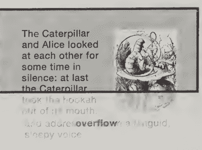

该元素在给定区域内无法显示的溢出区域（水平方向或垂直方向）。

代码 10.4 `ui-properties.css`——当应用于 101 ，，`overflow` 属性会自动添加滚动条，但仅在需要时添加，以确保内容始终可访问。

```css
```


*** CSS3 V5 | Chapter 10 |

box-properties.css ***

```css
nav.global {

  display: block;

}

nav.global li {

  display: inline;

}

article {

  max-width: 980px;

  min-width: 660px;

}

figure {

  display: block;

  width: 300px;

}

figcaption {

  display: block;

}

aside {

  display: block;

  width: 200px;

  height: 400px;

  overflow: auto;

}

footer {

  width: 100%;

}
```

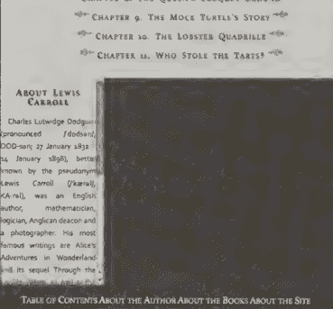

代码 10.4 应用于代码 101：区域的高度被限制为 400px，但内容超过了该区域的范围，因此会自动了垂直滚动条。

# 表 10.4 溢出值

| 值 | 兼容性 |
| --- | --- |
| visible | IE4, FF1, S1, C1, O4, CSS51 |
| hidden | IE4, FF1, S1, C1, O4, CSS51 |
| scroll | IE4, FF1, S1, C1, O4, CSS51 |
| auto | IE4, FF1, S1, C1, O4, CSS51 |

# 表 10.5 Overflow-x 和 Overflow-y 值

| 值 | 兼容性 |
| --- | --- |
| visible | IE5, FF1.5, S3, C2, O9.5, CSS33 |
| hidden | IE5, FF1.5, S3, C2, O9.5, CSS33 |
| scroll | IE5, FF1.5, S3, C2, O9.5, CSS33 |
| auto | IE5, FF1.5, S3, C2, O9.5, CSS33 |

+   2. 添加一个关键字来告诉浏览器如何处理裁剪部分的溢出。
`auto;`

使用以下关键字之一（见表 10.4 和表 10.5）：
* `visible` 强制显示元素的裁剪部分，本质上是指令浏览器忽略裁剪，使内容流到盒子之外。
* `hidden` 隐藏溢出部分并防止滚动条出现。

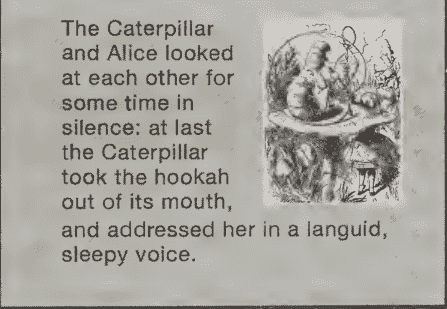

> 毛毛虫和爱丽丝沉默地对视了一会儿：最后毛毛虫从嘴里拿出烟斗，用一种懒散、睡睡的声音对她说道。

`Visible` 会覆盖元素的高度，强制显示所有内容。

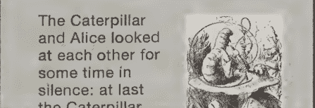

> 毛毛虫和爱丽丝沉默地对视了一会儿：最后毛毛虫

`Hidden` 会裁剪元素，但没有提供访问元素其余内容的方法。

+   `scroll` 在可见区域周围设置滚动条，允许访问者滚动元素的内容。当你设置此值时，即使不需要，也会为滚动条预留空间。

+   `auto` 允许浏览器决定是否需要显示滚动条。

通常情况下，`auto` 是溢出的首选，因为它只在需要时显示滚动条，并在没有内容可滚动时隐藏滚动条控件。

`overflow` 属性也用于定义如何处理溢出的裁剪。


+   `scroll` 同时放置水平和垂直滚动条以访问元素中的额外内容。然而，即使不需要，也会添加占位滚动条。


+   `Auto` 通常认为是最佳选项，因为它只在需要时显示滚动条。

# 即将推出：文本溢出

虽然可以设置溢出，但它是非常有用的。最常见的方法是使用省略号（...）来处理溢出的文本。CSS3 允许你精确地控制溢出文本。

# 浮动元素

虽然能够设置浮动是有用的，但有时你可能会发现需要覆盖浮动属性以防止包裹。类似于 HTML 标签的 `clear` 属性，CSS `clear` 属性允许你指定清除元素的左侧、右侧还是两侧（见表 10.7）。

浮动元素可能会产生奇怪的后果。解决这些问题将在第 13 章“修复浮动”中讨论。

> TIP 在第 13 章，你将学习如何使用浮动属性来替换表格布局。

# 清除浮动元素

有时，你可能会发现需要覆盖浮动属性以防止包裹。类似于 HTML 标签的 `clear` 属性，CSS `clear` 属性允许你指定清除元素的左侧、右侧还是两侧（见表 10.7）。

10.6 `ui-properties.css`——当应用于 101，，footer 被告诉不要浮动

# 防止元素浮动：

```css
*** CSS3 V5 | Chapter 10 |

box-properties.css ***

nav.global {

  display: block;

}

nav.global li {

  display: inline;

}

article {

  max-width: 980px;

  min-width: 660px;

  float: left;

}

figure {

  display: block;

  width: 300px;

  float: left;

}

figcaption {

  display: block;

}

aside {

  display: block;

  width: 200px;

  height: 400px;

  overflow: auto;

  float: right;

}

footer {

  width: 100%;

  clear: both;

}
```

# 设置元素外边距

元素的外边距（表 10.8）允许你通过指定一个到四个值来设置元素与窗口或其他元素之间的空间。这些值可以同时响应四个边、以顶部/底部和左/右为对，或者独立设置四个边。

### 表 10.8 外边距值

| 值 | 兼容性 |
| --- | --- |
| <length> | IE3, FF1, S1, C1, O3, CSS1 |
| <percentage> | IE3, FF1, S1, C1, O3, CSS1 |
| auto | IE6, FF1, S1, C1, O3, CSS1 |

要定义元素的外边距：

+ 1. 在声明块中输入 `margin` 简写属性名开始声明，后跟一个冒号（:）（代码 10.7）。

`margin:`

### 代码 10.7 ui-box-properties.css—应用于代码 10.1，body 中的外边距被设置为 0，并添加了外边距以帮助屏幕上的其他元素留出空间

```
*** CSS3 Qs | Chapter 10 |
  - box-properties.css ***

body, header.page, footer.page {

  margin: 0;

}

nav.global {

  display: block;

  margin-left: 10px;

}

nav.global li {

  display: inline;

  margin-right: 10px;

}

article {

  max-width: 980px;

  min-width: 660px;

  float: left;

  margin: 0 10px;

}

figure {

  display: block;

  width: 300px;

  float: left;

  margin: 0 10px 10px 0;

}

figcaption {

  display:block;

}

aside {

  display: block;

  width: 200px;

  height: 400px;

  overflow: auto;
```

### 设置负外边距

虽然你可以使用负外边距（例如 `margin:-5em`）为重叠文本创建有趣的效果，但这种方法是不被推荐的，因为不同的浏览器表现不同。

文本重叠最好通过使用 CSS 定位来实现（见第 1 章）。在超链接周围设置负外边距要小心。如果一个元素的外边距导致它覆盖了链接，则链接将无法按预期工作。

### 代码 10.7 续

```
float: right;

  margin: 0 10px;

footer {

  width: 100%;

  clear: both;

}
```

### 2. 为外边距输入一个值。

使用以下值之一：

- - 长度值
- 百分比，它创建一个与父元素宽度成比例的外边距
- `auto`，它将外边距的控制权交还给浏览器自行决定

你可以输入一到四个由空格分隔的值，来定义外边距如下：

- 一个值设置四个方向都相等的外边距。
- 两个值设置顶部/底部外边距（相同）和左/右外边距。
- 三个值设置顶部外边距、左/右外边距（相同）和底部外边距。
- 四个值从顶部开始顺时针设置每个外边距：右、下、左。


你也可以独立地只为框的一个侧设置外边距，而不设置其他外边距。

`margin-right: 10px;`

代码 10.7 应用于代码 10.1：头部紧贴窗口顶部并延伸到整个宽度，而图形周围留有更多空间。

这在用内联样式时很有用。要实现这一点，请指定你想定义的外边距（`margin-top`、`margin-bottom`、`margin-left` 或 `margin-right`）并输入来自表 10.8 的合法值。你也可以为 `<body>` 标签设置外边距；在这种情况下，外边距定义了嵌套在 body 中的元素距离窗口顶部和左边的距离。在父元素内居中元素的最佳方法是将左、右外边距设置为 `auto`。这就是大多数窗口中内容居中的页面创建方式。

在设置比例外边距时，请注意根据窗口的大小可能会得到非常不同的结果。在 800 x 600 分辨率下看起来很好的，在更大的屏幕上可能是混乱。浏览器有一个默认的外边距，内容不会立即从屏幕边缘开始。然而，在页面上定位元素时会出现问题（见第 11 章）。使用第 13 章解释的 CSS 重置在 body 中设置外边距是一个好主意。

# 外边距塌叠

当两个元素垂直堆叠时，它们之间的垂直外边距不是底部和顶部外边距相加，而是使用较大的外边距，较小的会塌叠。这允许你在一组元素的顶部和底部保持一致的外边距。

### 表 10.9 轮廓值

| 值 | 兼容性 |
| --- | --- |
| <border-width> | IE8, FF1, S1, C1, CSS1 |
| <border-style> | IE8, FF1, S1, C1, CSS1 |
| <border-color> | IE8, FF1, S1, C1, CSS1 |

# 设置元素的轮廓

轮廓（表 10.9）环绕边框并使用与边框相同的值；与边框不同，它不会增加框的显示尺寸（宽度或高度），也不会占据屏幕上的任何空间。相反，它出现在任何外边距之内或之外。轮廓对于链接悬停非常有用，允许你在不干扰周围元素的情况下突出它们。

代码 10.8 ui-box-properties.css—应用于代码 10.1，轮廓样式可用于突出被悬停的链接。

```
*** CSS3 | Chapter 10 |
  - box-properties.css ***

body, header.page, footer.page {

  margin: 0;

}

nav.global {

  display: block;

  margin-left: 10px;

}

nav.global li {

  display: inline;

  margin-right: 10px;

}

nav.global li a:hover {

  outline: rgba(135,127,107,.65) 10px double;

}

article {

  max-width: 980px;

  min-width: 660px;

  float: left;

  margin: 0 10px;

}

figure {

  display: block;

  width: 300px;

  float: left;

  margin: 0 10px 10px 0;

}

figcaption {

  display:block;

}

aside {

  display: block;

}
```

### 设置框的轮廓：

+ 1. `outline` 属性看起来与 `border` 属性相同，但行为不同。首先输入宽度，然后是样式，最后是颜色，用空格分隔（代码 10.8）。

`outline: rgba(135,127,107,.65) 10px double;`


+ 2. 或者，你可以定义每个轮廓值，当你需要覆盖一个元素而不更改其他元素时非常有用。

`outline-width: 10px;`
`outline-style: double;`
`outline-color: rgba(135,127,107,.65);`

> 与边框不同，轮廓不能为各个边独立设置。

> 我倾向于只在调试页面上的元素定位时使用轮廓，我想确切地看到每个块占据了多少空间以及它们延伸到哪里。

> 轮廓的另一个好用是使用属性选择器（第 4 章）来突出特定元素，而不干扰它们的定位。

# 轮廓偏移

添加 `outline-offset` 属性可以在轮廓与边框或内容边缘之间增加一些距离（表 10.10）。将其视为用于轮廓的内边距：

`outline-offset: 2px;`

### 表 10.10 轮廓偏移值

| 值 | 兼容性 |
| --- | --- |
| <length> | FF1.5, S2, C1, O7, CSS3 |
| inherit | FF1.5, S2, C1, O7, CSS3 |

### 表 10.11 边框值

| 值 | 兼容性 |
| --- | --- |
| <border-width> | IE4, FF1, S3.5, CSS1 |
| <border-style> | IE4, FF1, S3.5, CSS1 |
| <border-color> | IE4, FF1, S3.5, CSS1 |

# 设置元素的边框

`border` 属性允许你在框的四个方向上设置线条（有时设计师称为规则），使用特定的样式、颜色和粗细（表 10.11）。此外，使用额外的边框属性，你可以独立地设置任何侧的边框，提供了极佳的设计灵活性。

### 表 10.12 框宽值

| 值 | 兼容性 |
| --- | --- |
| <length> | IE4, FF1, S3.5, CSS1 |
| thin | IE4, FF1, S3.5, CSS1 |
| medium | IE4, FF1, S3.5, CSS1 |
| thick | IE4, FF1, S3.5, CSS1 |
| inherit | IE4, FF1, S3.5, CSS1 |

要设置边框：

+ 1. 要设置四个方向的边框，在 CSS 声明块中输入 `border` 属性名，后跟一个冒号（:）（代码 10.9）。

`border:`

代码 10.9 ui-box-properties.css—应用于代码 10.1，`border` 属性在框的任何侧设置一条具有特定样式、颜色和粗细的线条

```
*** CSS3 | Chapter 10 |
  - box-properties.css ***

body, header.page, footer.page {

  margin: 0;

}

nav.global {

  display: block;

}

nav.global li {

  display: inline;

  margin-right: 10px;

}

nav.global li a:hover {

  outline: rgba(135,127,107,.65) 10px double;

}

article {

  max-width: 980px;

}
```

+ 2. 输入一个边框宽度值，后跟一个空格。

此值可以是以下之一（表 10.11）：

- 长度值；长度为 `o` 防止即使设置了样式和颜色边框也不会出现。
- 相对大小关键字，如 `thin`、`medium` 或 `thick`（表 10.12）。
- `inherit` 将导致元素使用与其父元素相同的边框样式。

框属性 265

3. 输入你想分配给边框的样式名称。

`double`

表 10.13 显示了可用边框样式的完整列表。

或者，你可以输入 `none`，这可以防止边框出现。

4. 输入颜色值，即你在表 10.14 中定义的你想要边框呈现的颜色。

`rgb(142, 137, 129);`

这可以是颜色名称，也可以是 RGB 值。

5. 你并不局限于在四个边都使用相同的边框。你可以设置每个侧边（`border-top`、`border-bottom`、`border-left` 和/或 `border-right`）。

`border-top: 2px solid rgb(142, 137, 129);`

如果这些选项还不够，请参见侧边栏“设置边框的其他方法。”。

> 提示 你你不必在定义列表中包含所有的单个边框属性，但如果你包含了，则将使用默认值。


代码 10.9 应用于代码 10.1：图形现在被一个双线边框包围，标题在顶部添加了边框以与上方的图像隔开来。章节标题也接收了边框，作为事实上的侧边栏头部。

# 代码 10.9 延续

```
min-width: 660px;

float: left;

margin: 0 10px;
```


```css
figure {
display: block;
width: 300px;
float: left;
margin: 0 10px 10px 0;
border: 6px double rgb(142, 137, 129);
}
```
```css
figcaption {
display: block;
padding: 10px;
border-top: 2px solid rgb(142, 137, 129);
}
```
```css
aside {
display: block;
width: 200px;
height: 400px;
overflow: auto;
float: right;
margin: 0 10px;
}
```
```css
footer {
width: 100%;
clear: both;
}
```
```css
h1 {
margin: 0 20px 10px 10px;
}
```
```css
article h2 {
border-top: 2px solid rgb(142, 137, 129);
}
```
```css
article h2 {
border-top: none;
}
```
```css
aside h3 {
border: 1em double rgb(142, 137, 129);
}
```
```css
.baseline {
margin: 0 10% 20px 20%;
}
```

| 表 10.13 边框样式值 |
| 值 | 外观 | 兼容性 |
| --- | --- | --- |
| dotted | . . . . . | IE5, F1, S1, O3.5, CSS1 |
| dashed | ------ | IE5, F1, S1, O3.5, CSS1 |
| solid | ______ | IE4, F1, S1, O3.5, CSS1 |
| double | ____ | IE4, F1, S1, O3.5, CSS1 |
| groove | ______ | IE4, F1, S1, O3.5, CSS1 |
| ridge | ______ | IE4, F1, S1, O3.5, CSS1 |
| inset | ______ | IE4, F1, S1, O3.5, CSS1 |
| outset | ______ | IE4, F1, S1, O3.5, CSS1 |
| none | ______ | IE4, F1, S1, O3.5, CSS1 |
| inherit | ______ | IE4, F1, S1, O3.5, CSS1 |

# 设置边框的其他方法

CSS 让你自由地逐侧定义边框外观的各个方面，如下所示：

`border-style: solid dashed double ring`
`border-width: 1px 2px 4px 8px ;`
`border-color: red green purple;`

这些值在表 10.4 到 10.6 中显示。

与外边距一样，你可以为这些属性中的每个包含一个到四个值，以独立设置每个边框侧，如下所示：

- 一个值设置四个侧的属性。
- 两个值设置顶部/底部和左/右侧的属性。
- 三个值设置顶部属性、左/右属性（相同）以及底部属性。
- 四个值按此顺序设置每个侧的属性：顶部、右、底部和左侧。

| 表 10.14 边框颜色值 |
| 值 | 兼容性 |
| --- | --- |
| `<color>` | IE4, F1, S1, O3.5, CSS1 |
| transparent | IE4, F1, S1, O3.5, CSS1 |
| inherit | IE4, F1, S1, O3.5, CSS1 |

这种方法用于覆盖由单一边框属性`border`）设置的值。
你为单侧设置边框的最后一个选项（如果你真的需要另一个选项！）是为特定侧（顶部、底部、左侧、右侧）设置单个属性：

`border-top-width: 3px;`
`border-top-style: solid;`
`border-top-color: #f00;`

# 新 CSS3：圆角

圆角有助于软化原本锐利的设计，但使用图像很难实现。CSS3 包含了一种简单的方法，可以对元素框的一个或所有角进行圆角处理：`border-radius`。

Mozilla 和 Webkit 已经在 W3C 宣布之前实现了它们各自版本的 `border-radius`，你需要考虑这些浏览器扩展以获得最广泛的互操作性（表 10.15）。

设置圆角：

1. 添加 Webkit、Mozilla 和标准的 CSS3 属性（表 10.10）。虽然顺序不重要，但通常 preferred将 CSS3 版本放在最后，因为它应该被使用。

`-webkit-border-radius:`
`-moz-border-radius:`
`border-radius:`

| 表 10.15 Border-Radius 值 |
| 值 | 兼容性 |
| --- | --- |
| `<length>` | IE1, S3.5, CSS3 |
| `<percentage>` | IE1, O3.5, CSS3 |

表 10.10 box-properties.css——当应用于代码 10.1 时，`border-radius` 属性用于圆化角。

2. 输入 `border-radius` 值，后跟分号；在所有实例中使用相同的值。

```css
border-top: 2px solid rgb(142, 137, 129);
aside {
  display: block;
width: 200px;
height: 400px;
overflow: auto;
float: right;
margin: 0 10px;
-webkit-border-radius: 20px;
-webkit-border-radius: 20px;
-moz-border-radius: 20px 0 20px;
border-radius: 20px 0 0 20px;
}
```

5. 该值取决于浏览器兼容性（表 10.15）：

- 长度值，设置角处虚拟圆的半径，用于圆化边缘。
- 百比值（0% 到 50%），使用元素的大小来设置角半径。较高的值会产生圆角，50% 将角连接成半圆。百分比在 Webkit 中不支持。

```css
footer {
  width: 100%;
clear: both;
}
h1 {
margin: 0 20px 10px 10px;
}
h3 {
border: 1em double rgb(142, 137, 129);
}
article h2 {
border-top: none;
}
.baseline {
margin: 0 10% 20px 20%;
}
```

# 设置椭圆角

最后一个选项是通过定义两个点来创建椭圆而非圆形角。对于 Webkit，值用空格分隔，而 Mozilla 和 CSS 使用斜杠（/）：

`-webkit-border-radius: 20px 10px;`
`-moz-border-radius: 20px/10px;`
`border-radius: 20px/10px;`

我发现当使用椭圆角时，某些浏览器中的抗锯齿失真变得更加夸张，因此我避免这种用法。


代码 10.10 应用于代码 10.1：主文章和侧边栏都被圆角化，使其看起来像笔记本。图形区域也有轻微的圆角，但仅在线性边框的外层。

## 表 10.17 边框图像值

## CSS3 新特性：设置边框图像 ★

| 值 | 兼容性 |
|---|---|
| `<url>` | FF3.5, S3, C2, O10.5, CSS3 |
| `<offsetnumber>` | FF3.5, S3, C2, O10.5, CSS3 |
| round | FF3.5, S3, C2, O10.5, CSS3 |
| repeat | FF3.5, S3, C2, O10.5, CSS3 |
| stretch | FF3.5, S3, C2, O10.5, CSS3 |

CSS3 的一个新功能是可以使用矩形图像将其应用于框的边框上，从而覆盖线条样式。Mozilla 和 Webkit 已经实现了几乎完全相同的系统，而 CSS3（幸运地）遵循了它们的做法。尽管存在一些差异，但在三个系统中设置基本的图像边框背景是完全相同的。


背景图像系统（border-image 接收一个矩形图像并将其分为九部分。边缘的八部分用作侧边和角图像，中心部分被隐藏，以便元素内部的内容显示出来。角部分根据你设置的大小应用到偏移设置的角上。然后，图像侧边的中间部分将被拉伸或平铺以填充宽度和高度。

border-02.png—边框图像用于填充边框的角和侧边。我使用网格构建了这，每个正方形边长为 27px。

设置边框背景图像：

- 1. 创建你的背景图像并保存，最好保存为透明 PNG，尽管任何格式都可以用。在本示例中，我将图像分为 27px 的正方形网格，将我的背景的角和边缘适应到这些每个网格中。这将使计算变得更容易。

- 2. 添加 Webkit、Mozilla 和标准 CSS3 的 border-image 属性：

```css
-webkit-border-image:
```
```css
-moz-border-image:
```

虽然顺序不重要，但通常倾向于将 CSS3 版本放在最后，因为它是应该使用的版本（代码 10.11）。

- 3. 添加指示你在第 1 步中创建的图像路径的 URL。

```css
url(../images/border-02.png)
```

- 4. 你可以包含四个值来指定图像偏移——基本上是图像背景应该延伸多远（即边框切片的宽度有多大），值之间用空格分隔。

如果你将图像设置为网格，这将是你的网格中正方形的大小：

- 一个值设置所有四边。
- 两个值分别设置顶部/底部和左/右边的偏移。
- 三个值分别设置顶部、左/右和底部的偏移。
- 四个值按顺序设置每个边的偏移：顶部、右、底部和左侧。

代码 10.11 ui-border-properties.css—当应用到代码 10.1 时，侧边栏列中的标题使用 file-02.png 作为添加边框的源

```css
/* CSS3 V5 | 第 10 章 |
 * box-border-properties.css */
body, header.page, footer.page {
  margin: 0;
}
nav.global {
  display: block;
}
nav.global li {
  display: inline;
  margin-right: 10px;
}
article {
  max-width: 980px;
  min-width: 660px;
  float: left;
  margin: 10px;
  -webkit-border-top-right-radius: 20px;
  -moz-border-radius-top: 20px;
  border-top-right-radius: 20px;
}
figure {
  display: block;
  width: 300px;
  float: left;
  margin: 0 10px 0;
  border: 6px double rgb(142, 137, 129);
  -webkit-border-radius: 5px;
  -moz-border-radius: 5px;
  border-radius: 5px;
}
fig {
  display: block;
  padding: 10px;
  width: 200px;
  height: 400px;
  overflow: auto;
```
float: right;
margin: 0 10px;
-webkit-border-top-left-radius: 20px;
-webkit-border-top-left-radius: 20px;
-moz-border-radius- : 20px;
-border-radius-0: 20px;
```
```
```css
footer {
width: 100%;
}
```
```css
h1 {
margin: 0 20px 10px;
}
```
```css
aside h3 {
border: 1px double rgb(142, 137, 129);
-webkit-border-image: url(../images/
border-02.png) 27 round;
-moz-border-image: url(../images/border-02.png) 27 round;
border-image: url(../images/border-02.png) 27 round;
}
```
```css
article nav h2 {
border-top: none;
}
```
```css
.byline {
margin: 0 10px 10px 20%;
}
```

代码 10.12 应用到代码 10.1：添加了内边距后，整个设计终于变得开阔，打开了页面并使其更容易扫描和导航。

## 即将推出！

请关注 CSS 未来计划推出的许多新属性和特性。这些包括：

- **`文本溢出`Text overflow）属性（本章）定义了当元素空间不足以显示所有内容时，如何处理内容（文本或其他内容）。`text-overflow` 将将允许你控制无法放入给定区域的文本的处理方式，允许你使用省略号来指示后续文本。

- **`盒模型`(Box Sizing)**。盒子占据的实际空间是根据宽度/高度加上内边距（padding）加上边框（border）计算的。`box-sizing` 可以改变盒子尺寸的计算方式，使其从边框到边框进行计算。

- **`调整大小`(Resize)**。允许设置用户可调整的盒子。这对于有很多话要说的文本字段特别有用。

- **`多列布局`(Multi-column Layout)**。最令人兴奋的预览特性之一，多列布局将取代浮动（float）方法，最终让设计师能够创建更灵活的布局网格。

- **`动画`(Animation)**。除了过渡和变换外，能够与 Adobe Flash  rival的真正动画很快就会出现在你附近的浏览器中。Safari、Firefox 和 Opera 已经实现。

## 综合运用

1. 创建三个块级元素。使用 `<div>` 标签并给每个元素一个唯一的 ID，但使用相同的类（class）。

2. 为每个块设置 300px 的宽度和高度。不过，这些块是不可见的，因为它们没有任何内容、边框或背景。

3. 为每个元素添加边框。使用类来定义边框样式和宽度，然后使用 ID 为每个盒子添加不同的颜色。

4. 为盒子添加外边距（margin）。盒子应该稍微分开，但请注意外边距不是累加的；相反，它会塌叠为较大的那个外边距（顶部或底部）。

5. 为所有三个盒子添加浮动（floating）。只要你的浏览器窗口足够宽，它们就不会垂直排列。

6. 在三个盒子中都添加文本。注意，如果你添加了太多内容，它会发生溢出。

7. 为每个盒子指定如何处理溢出。尝试为每个盒子使用不同的方法。

8. 为盒子添加内边距（padding）。注意，盒子会为了适应内边距而增大，但文本的宽度和高度保持不变。

## 视觉格式属性

无论你的设计是像素级完美还是流式的，元素重定位都是任何优秀设计的关键。你已经学习了如何使用 CSS 控制布局中的外边距和内边距（第 10 章）。通过 CSS，你还可以在窗口中定位元素，可以是精确的（绝对或固定定位），也可以相对于文档中的其他元素（相对定位）。你还可以设置窗口中任何元素的可见性，使其可见、隐藏、透明，甚至在侧边被裁剪。

本章将向你介绍使用 CSS 对 HTML 元素进行定位的方法，包括如何让元素堆叠在一起以及如何让元素并排浮动。

本章内容

- 理解窗口与文档 283

- 设置定位类型 285

- 设置元素的位置 290

- 在 3D空间中堆叠对象 292

- 设置元素的可见性 294

- 裁剪元素的可见区域 296

- CSS3 新特性：设置元素的透明度 298

- CSS3 新特性：设置元素的阴影 300

- 综合运用 302

### 代码 11.1 第 11 章的 HTML5 代码与上一章相似，但在文章底部包含了一个新的“画廊”（gallery）元素。它导入了第 5、6、7、8、9 和 10 章的 CSS，以及你在本章中构建的新文件 visual-properties.css。


```html
<!DOCTYPE html>
<html lang="en">
<head>
  <meta charset="utf-8">
  <title>爱丽丝仙仙游 | 第 4 章</title>
  <link rel="stylesheet" href="../css/font-properties.css">
  <link rel="stylesheet" href="../css/text-properties.css">
  <link rel="stylesheet" href="../css/background-properties.css">
  <link rel="stylesheet" href="../css/list-properties.css">
  <link rel="stylesheet" href="../css/content-properties.css">
  <link rel="stylesheet" href="../css/box-properties.css">
  <link rel="stylesheet" href="../css/visual-properties.css">
  <script src="../css/html5.js"></script>
</head>
<body id="chapter6" class="page">
  <header>
    <h1>爱丽丝仙仙游</h1>
    <p class="byline">作者：刘易·卡罗尔</p>
    <nav>
      <ul>
        <li><a href="#">封底</a></li>
        <li><a href="#">关于作者</a></li>
        <li><a href="#">关于书籍</a></li>
        <li><a href="#">关于本网站</a></li>
      </ul>
    </nav>
  </header>
  <article>
    <nav>
      <ol>
        <li><a href="#">掉兔子洞</a></li>
        <li><a href="#">泪水池</a></li>
        <li><a href="#">聚会赛和长长的故事</a></li>
        <li><a href="#">兔子派出的小信使</a></li>
        <li><a href="#">毛毛虫的建议</a></li>
      </ol>
    </nav>
</body>
</html>
```

# 理解窗口与文档

Web页面（也称为文档）显示在浏览器视口（`viewport`）中。你呈现给观众的所有内容都显示在该区域内，尽管如果文档大于视口，则需要进行滚动。

你可以打开多个窗口（每个窗口在自己的视口中显示自己的文档），在屏幕上调整窗口的大小和位置，或者插入名为 `iframes` 的较小视口。然而，你呈现的所有内容都作为文档的一部分显示在浏览器窗口内。

与其中包含的元素一样（参见第 10 章“理解元素框”），窗口具有宽度和高度，以及上、下、左、右。事实上，你可以将浏览器窗口视为 Web 设计中的终极元素——所有其他元素的父元素。浏览器窗口及其包含的文档有几个不同的部分：

显示文档的浏览器窗口，需要一些垂直滚动以显示其余内容。

- 浏览器宽度和高度指的是整个窗口的尺寸，包括任何浏览器控件和其他界面项。
- 视口是显示区域的区域。所有固定定位元素将相对于视口边缘进行放置。


- 视口宽度和高度指的是浏览器窗口视口的实际显示区域。显然，实际尺寸始终小于完整窗口的尺寸。通常情况下，当我提到“窗口”时，我指的是视口。
- 文档宽度和高度（有时被称为渲染宽度和高度）指的是 Web 页面标签的整体尺寸。如果文档的宽度和/或高度大于视口的宽度和高度，你将看到滚动条，允许你查看文档的其他部分。
- 元素边缘是边框内元素的边缘。如果父元素也设置了定位，则元素相对于其父元素的边缘进行定位。否则，元素相对于文档边缘进行定位。
- 元素的宽度和高度不应内容的宽度和高度（在第 10 章中定义）混淆；这是在内容宽度和高度的基础上加上边框（`border`）和内边距（`padding`）后占据的总空间。

> 提示 文档宽度通常与视口宽度相同，因为通常不喜欢水平滚动。

> 提示 正常流（`Normal flow`）是指如果没有对元素应用任何定位，它将在 Web 页面上出现的位置。

# 设置定位类型

CSS 定位允许你设置与 HTML 元素位置相关的多个属性，不仅在 2D 方面，而且在 3D、裁剪和可见性方面。但首先，你必须声明如何处理元素的定位。

元素可以具有四种位置值之一——静态（`static`）、相对（`relative`）、绝对（`absolute`）或固定（`fixed`）（**表 11.1**）。位置值告诉浏览器在将元素放入文档时如何处理该元素。

除了设置元素的位置外，其他依赖定位的属性还包括：

- **堆叠顺序（Stacking order）**适用于绝对和固定定位元素，允许你在 3D 空间中移动元素。
- **可见性（Visibility）**隐藏元素的内容但不隐藏元素本身，有效地将其不透明度设置为 0。
- **裁剪（Clipping）**用于隐藏内容的部分，即“裁剪”其侧边。

## 静态定位

默认情况下，元素在文档中以静态方式定位，除非你将它们定义为绝对、相对或固定定位。静态元素（如下一节解释的相对定位元素）一个接一个地流在文档中。然而，静态定位的区别在于，静态元素不能被显式定位或重新定位，不能被裁剪，且不能更改其可见性。

### 表 11.1 位置值

| 值 | 兼容性 |
| --- | --- |
| `static` | IE4, FF1, S1, C1, O4, CSS2 |
| `relative` | IE4, FF1, S1, C1, O4, CSS2 |
| `absolute` | IE4, FF1, S1, C1, O4, CSS2 |
| `fixed` | IE7, FF1, S1, C1, O4, CSS2 |
| `inherit` | IE7, FF1, S1, C1, O5, CSS2 |

> 静态定位的元素留在原处。

## 相对定位

相对定位元素在它不受处理时本应处于的位置上下文进行定位。相对定位的元素将根据其在文档正常流中的位置进行偏移。然而，它占据的空间将保留，但看起来是空的。

## 绝对定位

绝对定位将元素从文档的正常流中取出，不留任何空间。以这种方式定义的元素通过 x 和 y 坐标，相对于其最近定位的元素的边缘（如果没有任何父元素被定位，则相对于 `body`）放置在窗口的精确点上。


相对定位的元素相对于指定的侧（上、右、下和/或左）移动，该侧是它未受影响时出现的位置。负值将元素向相反方向移动，但仍然相对于同一侧。


绝对定位的元素从正常流中移除，并从已定位的父元素的侧边（如果没有定位的父元素则从文档侧边）进行定位。

## 固定定位

在窗口中固定元素的位置与绝对定位类似，不同之处是它是相对于视口边缘的锁定位置（而不是相对于其父元素）。当文档在视口中滚动时，固定元素保持在初始位置，不会随文档的其他部分滚动。这允许你在屏幕上建立恒定的元素，这些元素不会随其他内容一起滚动。


- 固定定位的元素始终相对于视口边缘。

### 要设置元素的定位类型：

1. 在规则块中或 HTML 标签的 `style` 属性中添加 `position`。其后跟一个冒号（代码 11.2）。

代码 11.2 `formatting-properties.css`
--- 当应用于 11.1 时，此 CSS 为 `aside` 添加了绝对定位，为 `gallery` 添加了相对定位，为 `footer` 添加了固定定位，我为 `strong` 标签设置了相对定位以修复一个间距问题。

`position:`

```css
/* formatting-properties.css */

aside
position: absolute;

strong
position: relative;

footer
position: fixed;

ul
position: relative;

div.gallery
position: relative;

div.gallery figure
position: absolute;
```

*** CSS V05 | Chapter 11 | formatting-properties.css ***

`aside`
`position: absolute;`

`strong`
`position: relative;`

`footer`
`position: fixed;`

`ul`
`position: relative;`

`div.gallery`
`position: relative;`

`div.gallery figure`
`position: absolute;`


代码 11.2 应用于代码 11.1。定位类型已经设置，但——由于没有实际设置——元素看起来一团糟。固定的 `footer` 现在位于页面的顶部！此外，注意用 `strong` 标签标记的文本。这是由于增加了相对于周围文本的字体大小造成的。你将在下一节修复它。

2. 指定定位。

`relative;`
输入一个定位类型值，可以是以下值之一：

- `static` 正常流通过内容，然而，无法为此元素设置任何定位属性。
- `relative` 也是正常流通过元素，但允许使用 `top`、`left`、`right` 和 `bottom` 属性上设置的值相对于其正常位置设置定位。
- `absolute` 将元素相对于其最近定位元素的边缘进行放置。该元素将是文档的 `body`，或者如果其嵌套的元素设置了定位，则为该元素。
- `fixed` 将元素相对于视口边缘进行放置，独立于页面上的任何其他内容，并忽略其父元素。与绝对定位元素不同，当窗口滚动时，固定元素保持在视口中的原有位置，而其他内容在移动。
- `inherit` 使用元素直接父元素的定位类型。如果没有设置位置，此将默认为 `static`（请见侧边栏“继承定位类型”）。

## 继承定位类型

`inherit` 是另一种定位值。它告诉元素使用与其父元素相同的定位类型，从而覆盖默认的 `static`（静态）值。尽管如此，这种用法可能很复杂，因为将子元素的定位类型与其父元素绑定，如果更改父元素的定位类型可能会从根本上改变布局。

> TIP 绝对定位和固定定位的元素在父元素内不占用任何空间。因此，如果你有一个绝对定位的元素（例如图像），它的宽度和高度**不会**被包含在父元素内容的宽度和高度之中。

> TIP 你可以在其他定位元素内对元素进行定位。例如，你可以为绝对定位父元素内的子元素设置相对位置，或者在绝对定位父元素内为元素设置绝对位置。

> TIP 请记住，浏览器会为你的 Web 页面 `body` 添加默认外边距（`margin`），但默认值在所有浏览器中并不一致。为了纠正这一点，你应该始终在 `body` 标签中设置自己的外边距，这样你就可以一致地定位元素。有关使用浏览器重置的详情，请参第 12 章。

> TIP 由于舍入误差，定位在不同浏览器之间也可能存在差异。通常情况下，最好使用舍入到最近整数的“干净”数字。

> TIP 当元素的定位类型被设置为 `static` 以外的任何值时，你可以使用 JavaScript 或脚本语言来移动元素、更改裁剪、更改堆叠顺序、隐藏它或显示它。

视觉格式属性 **289**

# 设置元素的位置

所有定位的元素都可以具有 `top`、`right`、`bottom` 和 `left` 值，用于从这四个侧面定位元素（表 11.2 和 11.3）。相对（`relative`）元素相对于其自身的边缘偏移。绝对（`absolute`）元素相对于其父元素的边缘偏移。固定（`fixed`）元素相对于视口的边缘偏移。

## 要定义一个元素的位置：

- 1. 指定一种定位类型。详情请参阅本章节前面的“设置定位类型”。
- 2. 在你的 CSS 声明列表中添加定位侧边属性。在 CSS 规则中输入 `left, right, top,` 或 `bottom`，后跟冒号（:）（**代码 11.3**）

```css
top:
120px;
```

为元素的偏移输入一个值。你可以输入以下任何值：

- 长度值，例如 `120px, 2.3em 或 1.25cm。`
- 百分比值，例如 `1%`，它会创建一个流式偏移。
- `auto`，如果位置设置为绝对定位，则允许浏览器计算该值；否则，默认值为 0。

> **TIP** 你不必非包含 `top`、`right`、`bottom` 和 `left` 声明，但如果不包含，它们将被处理为 `auto`。

### 表 11.2 Top 和 Left 值

| 值 | 兼容性 |
|---|---|
| `<length>` | IE4, F1, S1, C1, O4, CSS2 |
| `<percentage>` | IE4, F1, S1, C1, O5, CSS2 |
| `auto` | IE4, F1, S1, C1, O5, CSS2 |

### 表 11.3 Bottom 和 Right 值

| 值 | 兼容性 |
|---|---|
| `<length>` | IE5, F1, S1, C1, O4, CSS2 |
| `<percentage>` | IE5, F1, S1, C1, O4, CSS2 |
| `auto` | IE5, F1, S1, C1, O4, CSS2 |
| `inherit` | IE4, F1, S1, C1, O5, CSS2 |

# 11.3 visual-formatting-properties.css

应用于代码 11.1 时，这段 CSS 将 `footer` 定位在视口的底部（保持在那里）；在屏幕右上角的方便位置定位；并略微偏移了我们的图库图像。它提升了粗体文本，使其基线与周围文本匹配。看起来好多了 A。

```css
*** CSS | 第11 章 |
  visual-formatting-properties.css

aside {
  position: absolute;
  left: 1%;
  top: 120px;
}

strong {
  position: relative;
  top: -15em;
}

footer {
  position: fixed;
  bottom: 0;
  left: 0;
}

ul {
  position: relative;
  top: 10px;
}

div.gallery {
  position: relative;
}

div.gallery figure {
  position: absolute;
}

div.gallery figure.f1 {
  left: 0;
  top: 0;
}

div.gallery figure.f2 {
  left: 150px;
  top: 50px;
}

div.gallery figure.f3 {
  left: 300px;
  top: 100px;
}
```


> TIP 你可以使用负值将内容向上向左移动，而不是向下向右。

> TIP 绝对定位的子元素与其父元素对齐。

> TIP 如果你对同一个元素设置了 `top`/`left` 和 `bottom`/`right` 位置会怎样？取决于浏览器。Internet Explorer 始终是 `top` 和 `left` 位置。但大多数其他浏览器会扩展没有固定宽度或高度的元素以适应设置的值。


> A 将 11.3 应用于代码 11.1。页面开始紧凑。注意粗体文本现在与段落的其他部分对齐。


> B 即使滚动时，`footer` 仍然留在屏幕底部。

视觉格式属性 291

# 在 3D 中堆叠对象

尽管屏幕是一个二维区域，但定位元素可以被赋予第三个维度：`z-index`。定位的元素按数字排列，从 0, 1, 2 等开始——取决于它们在 HTML 中出现的顺序。数字较大的元素显示在数字较小的元素。。系统被称为 `z-index`。

`z-index` 相对于其父元素。当元素重叠时，`z-index` 较高的元素将显示在上方。要定义元素的 `z-index`：

- 1. 指定一种定位类型。详情请参阅本章节前面的“设置定位类型”。
- 2. 在你的 CSS 声明列表中添加定位侧边属性。在 CSS 规则中输入 `z-index`，后跟冒号（:）`（代码 11.4）`

`z-index:` 

为元素的偏移输入一个值。你可以输入以下任何值：

- 正数，例如 **10, 100 或更高。**
- 负数，例如 **-1 或 -10。**
- `auto`，如果位置设置为绝对定位，则允许浏览器计算该值；否则，默认值为 `auto`。

> TIP 你不必非包含 `top`、`right`、`bottom` 和 `left` 声明，但如果不包含，它们将被处理为 `auto`。

表 11.4 Z-index 值
| 值 | 兼容性 |
|---|---|
| <positive number> | IE4, F1, S1, C1, O4, CSS2 |
| <negative number> | IE4, F1, S1, C1, O4, CSS2 |
| auto | IE4, F1, S1, C1, O5, CSS2 |
| inherit | IE4, F1, S1, C1, O5, CSS2 |

# 11.4 visual-formatting-properties.css

应用于代码 11.1 时，这段 CSS 将 `footer` 定位在视口的底部（保持在那里）；在屏幕右上角的方便位置定位；并略微偏移了我们的图库图像。它提升了粗体文本，使其基线与周围文本匹配。看起来好多了 A。

```css
*** CSS | 第11 章 |
  visual-formatting-properties.css

aside {
  position: absolute;
  left: 1%;
  top: 120px;
}

strong {
  position: relative;
  top: -15em;
}

footer {
  position: fixed;
  bottom: 0;
  left: 0;
}

ul {
  position: relative;
  top: 10px;
}

div.gallery {
  position: relative;
}

div.gallery figure {
  position: absolute;
}

div.gallery figure.f1 {
  left: 0;
  top: 0;
}

div.gallery figure.f2 {
  left: 150px;
  top: 50px;
}

div.gallery figure.f3 {
  left: 300px;
  top: 100px;
}
```

## 11.5 visualformatting-properties.css

当应用于 11.3 时，此 CSS 隐藏了页头中的导航，因为导航现在已出现在我们的固定页脚中了。别担心，顶部导航将在书的后部分返回。

```css
*** CSS3 VQ5 | Chapter 11 |
visualformatting-properties.css ***
```

```css
header navigation {
visibility: hidden; }
```

```css
aside {
position: absolute;
right: 1px;
top: 120px; }
```

```css
strong {
position: relative;
top: -15em; }
```

```css
footer {
position: fixed;
bottom: 0;
left: 0;
z-index: 99; }
```

```css
footer ul {
position: relative;
top: 10px; }
```

```css
div.gallery {
position: relative; }
```

```css
div.gallery figure {
position: absolute; }
```

```css
div.gallery figure.f1 {
left: 0;
top: 0;
z-index: 3; }
```

```css
div.gallery figure.f2 {
left: 150px;
top: 50px;
z-index: 2; }
```

```css
div.gallery figure.f3 {
left: 300px;
top: 100px;
z-index: 1; }
```

> TIP 尽管这些属性看起来相似，但 `visibility` 与 `display` 不同（第 10 章）。当 `display` 设置为 `none` 时，元素会从文档中移除，不留任何空间。`visibility` 则像包着绷带的隐形人一样预留并显示空区域。

> TIP 通常，`display:none` 用于 JavaScript 效果，例如下拉菜单和弹出文本，在这些元素会交替隐藏和显示。由于此属性会移除元素，它可以防止元素在不需要时干扰页面的布局。

> TIP 我建议在创建打印样式时，使用 `display` 来隐藏元素（如导航）。

> TIP 隐藏元素的一个缺点是 Web 搜索引擎无法看到它们，视障人士使用的屏幕阅读器也无法看到。如果你隐藏了内容，请确保它不是对 SEO 至关重要的内容。


B 11.5 应用于 11.1。页头导航消失了，但并未被遗忘。

## 裁剪元素的可见区域

与设置元素的宽度和高度（这控制元素的尺寸，第 10 章）不同，裁剪一个绝对固定定位的元素指定了该元素内容中有多少部分是可见的（**表 11.6**）。未被指定为可见的部分仍然存在，但观众无法看到它，浏览器将将其视为空区域。

**要定义元素的裁剪区域：**

- 1. 指定位置类型。详情请参阅本章前面的章节“设置定位类型”。
- 2. 在你的声明列表中添加 `clip` 属性。输入 `clip` 属性名，后跟冒号（:），如**代码 11.6** 所示。

```css
clip:
```
- 3. 指定矩形裁剪区域。输入 `rect` 将裁剪形状定义为矩形，打开左括号 `(`、四个用空格分隔的数值、右括号 `)` 和分号（;）。

`rect(50px 250px 250px 50px);` 这些数字分别定义了裁剪区域的顶、右、底和左长度。所有这些值都是距离元素原点（左上角）的距离，而不是距离指定侧边的距离。

每个值可以是长度值或 `auto`，允许浏览器确定裁剪大小（通常为 100 百比）。

| 表 11.6 裁剪值 |
| 值 | 兼容性 |
| :--- | :--- |
| rect <top> <right> <bottom> <left> | IE5,5, FF1, S1, C7, CSS2 |
| auto | IE5,5, FF1, S1, C7, CSS2 |
| inherit | IE5,5, FF1, S1, C7, CSS2 |


> A 中心根据提供给 `clip` 属性的顶、右、底、左值进行裁剪。透明区域将不可见。

## 11.6 visualformatting-properties.css— 当应用于代码 11.1 时，此 CSS 隐藏了画图中图片的边缘，创建了尺寸一致的缩略图 9

```css
*** CSS3 Flex | chapter 11 |
* visualformatting-properties.css* ***

header navigation {
  visibility: hidden;
}

aside {
  position: absolute;
  right: 1%;
  top: 120px;
}

strong {
  position: relative;
  top: -15em;
}

footer {
  position: fixed;
  bottom: 0;
  left: 0;
  z-index: 99;
}

ul {
  position: relative;
  top: 10px;
}

div.gallery {
  position: relative;
}

div.gallery figure {
  position: absolute;
  clip: rect(50px 250px 250px 50px);
}

div.gallery figure.f1 {
  left: 0;
  top: 0;
  z-index: 3;
}

div.gallery figure.f2 {
  left: 150px;
  top: 50px;
  z-index: 2;
}

div.gallery figure.f3 {
  left: 300px;
  top: 100px;
  z-index: 1;
}
```

> TIP 元素的边框和内边距被裁剪了，但外边距没有。

> TIP Auto 应该恢复元素的原始状态。然而，Safari 和 Chrome 只会恢复边缘，同时去除轮廓或阴影。


代码 11.6 应用于格式属性。你的画图现在由尺寸一致的缩略图组成。稍后在书中将学习如何让它们完全显示。

## 新 CSS3：设置元素的透明度

最早广泛实现的 CSS3 特性之一是设置 `opacity`，它允许元素从不透明变为透明。然而，不同的浏览器以不同的方式实现。例如，遵循 W3C 语法的浏览器，Internet Explorer 是在其现有的 `filter` 函数基础上构建的。由于 Internet Explorer 代码，你可以将两个声明放在规则中控制其透明度。


> 修改 `opacity` 让你看到下方的元素。

### 表 11.7 透明度值

| 值 | 兼容性 |
| :--- | :--- |
| alpha value | FF1, S1.3, C1, CSS2 |
| inherit | FF1, S1.3, C1, CSS2 |

### 要设置元素的透明度：

- 1. 在你的声明列表中添加 `filter` 属性。为了在 Windows 的 Internet Explorer 中控制透明度，在声明块中输入 filter 名称，后跟冒号（:）（代码 11.7）。

```css
filter:
```
- 2. 为 Internet Explorer 指定透明度。`alpha(opacity=75);` 添加 `alpha()` 代码来定义使用的 filter 值。你不需要更改此代码，除了 alpha 值，范围从 0（完全透明）到 100（完全不透明）。用分号（;）结束声明。
- 3. 在你的 CSS 中添加 `opacity` 属性。要控制元素的透明度，输入 `opacity` 后跟冒号（:）。

```css
opacity:
```

## 11.7 visualformatting-properties.css

当应用于 11.3 时，此 CSS 允许重叠的缩略图显示下层的内容

```css
*** CSS3 V0 | Chapter 11 |
visualformatting-properties.css ***

header navigation {
visibility: hidden; }
```

```css
aside {
position: absolute;
right: 1%;
top: 120px; }
```

```css
strong {
position: relative;
top: -15em; }
```

```css
footer {
position: fixed;
bottom: 0;
left: 0;
z-index: 99; }
```

```css
ul {
position: relative;
top: 10px; }
```

```css
div.gallery {
position: relative; }
```

```css
div.gallery figure {
position: absolute;
clip: rect(50px 250px 250px 50px);
filter: alpha(opacity=0.75);
opacity: .5; }
```

```css
div.gallery figure.f1 {
left: 0;
top: 0;
z-index: 3; }
```

```css
div.gallery figure.f2 {
left: 150px;
top: 50px;
z-index: 2; }
```

```css
div.gallery figure.f3 {
left: 300px;
top: 100px;
z-index: 1; }
```

- 4. 指定透明度。为元素的透明度输入一个 alpha 值，范围从 0.0（完全透明）到 1.0（完全不透明）。

你也可以使用 `inherit` 将元素的透明度设置为与其父元素相同的值。因此，如果父元素的透明度为 0.75，`inherit` 将导致子元素在父元素已设置的 75% 透明度的基础上进一步降低自身的透明度。

> 透明度应用于整个元素及其所有子元素，没有方法在子元素中覆盖。

> 透明度是累积的，因此如果一个透明度为 .5 的元素位于一个透明度为 .5 的元素内部，那么它的累积透明度将为 .25。


代码 11.7 应用于 11.1。缩略图是半透明的。这可以是一个非常有用的效果，特别是当结合悬停时将元素恢复为不透明以指示用户交互。

# CSS3 新特性：设置元素的投影 ★

就像文本投影（第 6 章）一样，你可以为屏幕上任何元素（无论是否定位）的框添加一个外投影或内投影。不过，“投影”一词有点误导性，因为你可以将颜色设置为任何喜欢的颜色——包括浅色——来创建发光效果。

## 如何设置元素投影：

1. 在你的 CSS 规则中添加 `box-shadow` 属性。输入 `box-shadow` 属性名称（包括 Mozilla 和 Webkit 浏览器扩展），加上冒号（;）（代码 11.8）。
```css
-webkit-box-shadow:
-moz-box-shadow:
box-shadow:
```
2. 指定投影偏移、模糊、收缩（choke）和内嵌（inset）。

```
1px 1px 5px 1px rgba(0,0,0,.25)
. inset
```

输入以下关键字或值（表 11.8）来指定如何处理该元素的投影（从右到左）：

- x 和 y 偏移值设置投影相对于元素框的位置。正值使投影向右下方偏移，而负值则使投影向上向左侧移动。这些是必填的。

- 模糊长度是一个正值，会增加投影的模糊度并将其扩散。值越高，投影越大、越稀。。这是可选的，如果未设置，默认值为 0。


> 投影提供了深度感和纹理感。

| 表 11.8 Box-Shadow 值 |
| 值 | 兼容性 |
| :--- | :--- |
| inset | FF3.5, S3, C10.5, CSS3 |
| <x-offset> | FF3.5, S3, C10.5, CSS3 |
| <y-offset> | FF3.5, S3, C10.5, CSS3 |
| <blur> | FF3.5, S3, C10.5, CSS3 |
| <spread> | FF3.5, S3, C10.5, CSS3 |
| <color> | FF3.5, S3, C10.5, CSS3 |

```css
Code 11.8 formatting-properties.css —
当应用到 Code 11.1 时，此 CSS 为文章添加了投影，并在侧边添加了外内外投影。它还为图库图像添加了投影，但由于它们被裁剪了，所以没有显示 ①
```

```css
*** CSS3 W5 | Chapter 11 |
```


# formatting-properties.css

```css
header nav {
  visibility: hidden;
}

article {
  -webkit-box-shadow: rgba(0,0,0,.7) 5px 15px;
  -moz-box-shadow: 5px 5px 10px rgba(0,0,0,.7);
  box-shadow: 5px 5px 10px rgba(0,0,0,.7);
}

aside {
  position: absolute;
  right: 1%;
  top: 20px;
}
```

## 代码 11.8 继续

```css
-webkit-box-shadow: 1px 1px 5px 1px rgba(0,0,0,.25) inset, 3px 3px 15px rgba(0,0,0,.5);
-moz-box-shadow: 1px 1px 5px 1px rgba(0,0,0,.25) inset, 3px 3px 15px rgba(0,0,0,.5);
box-shadow: 1px 1px 5px 1px rgba(0,0,0,.25) inset, 3px 3px 15px rgba(0,0,0,.5);

string {
  position: relative;
  top: -15em;
}

footer {
  position: fixed;
  bottom: 0;
  left: 0;
  z-index: 99;
}

ul {
  position: relative;
  top: 10px;
}

figure {
  -webkit-box-shadow: rgba(0,0,0,.7) 5px 5px 10px;
  -moz-box-shadow: 5px 5px 10px rgba(0,0,0,.7);
  box-shadow: 5px 5px 10px rgba(0,0,0,.7);
}

div.gallery {
  position: relative;
}

div.gallery figure {
  position: absolute;
  clip: rect(50px 250px 250px 50px);
  filter: alpha(0.7);
  opacity: .5;
}

div.gallery figure.f1 {
  left: 0;
  top: 0;
  z-index: 3;
}

div.gallery figure.f2 {
  left: 0;
  top: 150px;
  z-index: 2;
}

div.gallery figure.f3 {
  left: 0;
  top: 300px;
  z-index: 1;
}
```

- 扩散长度——又称为 `choke`——是一个正值，用于指定投影的断点。它的效果是在投影开始淡出之前增加投影的颜色区域。这是可选的，如果未设置，默认值为 0。
- 颜色是第 7 章中的任何颜色。这是可选的，如果未设置，默认值为透明。
- `inset` 使投影出现在元素边缘内部，创建一个内投影。这是可选的。

## 3. 根据需要添加更多投影

- `3px 5px 15px rgba(0,0,0,.5);` 可以重复多次以在元素内创建多个投影，每个值之间用逗号分隔，并始终记住你的 CSS 规则用分号（`;`）结尾。

> 如果在 x/y 偏移之后只有一个长度，它将被假设为蓝色，而不是扩散。


> 代码 11.8 应用于代码 11.1。投影赋予了页面重量感和特征。

# 整合在一起

1. 使用第 10 章构建的三个框，设置位置类型。将第一个设置为 `absolute`，第二个设置为 `relative`，第三个设置为 `fixed`。
2. 设置每个框的位置。注意不同的位置类型如何影响值的使用。
3. 设置 `z-index`。让框重叠，然后设置 `z-index` 来决定哪个框在顶部。
4. 设置每个框的透明度。观察颜色是如何组合的。
5. 为每个框添加投影。尝试多个投影和内投影。你可以创建发光效果吗？

## 变换与过渡

尽管 `transform` 和 `transition` 属性的使用仍有争议，但对于 Web 设计师和开发者来说是一个福音。将这些视为不仅改变元素外观（像其他样式一样），而且随时间改变元素外观的样式。本章介绍的样式非常新，至少按 Web 标准来说。尽管 Webkit 以某种形式拥有了它们，但 Firefox 和 Opera 才在一年内开始让它们成为 CSS3 标准的一部分。谨慎使用这些属性，它们在旧版浏览器中会优雅地降级，你可以你可以如何使用它们。

## 本章内容

* CSS3 新特性：转换元素 307
* CSS3 新特性：元素状态间的过渡 316
* 整合在一起 321

第 12 章的 HTML 代码与上一章类似。它导入了第 5、6、7、8、9、10 和 11 章的 CSS，以及我们在本章中将构建的名为 `transformation-properties.css` 的新文件。

```html
<!DOCTYPE html>
<html lang="en">
<head>
  <meta charset="utf-8">
  <title>Alice's Adventure in Wonderland | Chapter 7</title>
  <link href="../css/font-properties.css" type="text/css" rel="stylesheet">
  <link href="../css/text-properties.css" type="text/css" rel="stylesheet">
  <link href="../css/color-background-properties.css" type="text/css" rel="stylesheet">
  <link href="../css/list-properties.css" type="text/css" rel="stylesheet">
  <link href="../css/ui-generated-content-properties.css" type="text/css" rel="stylesheet">
  <link href="../css/box-properties.css" type="text/css" rel="stylesheet">
  <link href="../css/visualformatting-properties.css" type="text/css" rel="stylesheet">
  <link href="../css/transformation-transition-properties.css" type="text/css" rel="stylesheet">
<!--[if IE]
<script src="script/html5ie.js" type="javascript"></script>
<!--[endif]-->
</head>
<body id="chapter7" class="white section">
<header class="page">
  <h1>Alice's Adventures in Wonderland</h1>
  <p class="byline"><span class="author">Lewis Carroll</span></p>
  <nav class="global">
  <ul>
    <li><a href="#chapter">首页</a></li>
        <li><a href="#author">关于作者</a></li>
    <li><a href="#books">关于书籍</a></li>
    <li><a href="#site">关于网站</a></li>
  </ul>
  </nav>
</header>
<article>
<!-- Article -->
<nav>
<div class="top">
  <h2><a href="#hole">爱丽兔洞</a></h2>
  <h2><a href="#pool">泪之池</a></h2>
  <h2><a href="#race">卡库斯赛跑与长故事</a></h2>
  <h2><a href="#bill">兔子派出了一个小比尔</a></h2>
  <h2><a href="#advice">毛毛虫的建议</a></h2>
  <h2><a href="#pig">猪肉与胡椒</a></h2>
</div>
</nav>
</article>
```

# 代码 12.1 继续

```
"我真想奇你在忙什么呢！"
<figcaption>
<figure>
房子前的树下摆着一张桌子，三月兔和帽匠正坐在那里喝茶：一只睡睡鼠坐在他们之间，已经熟睡着了，另外两个人正把它当作垫子，肘肘支在上面，越过它的头顶聊天。“对睡睡鼠来说真不舒服，”爱丽丝想道；不过，既然它睡着，我想它并不在意。”
</figure>
<div class="gallery">
<figure id="f1">

</figure>
<figure id="f2">

</figure>
<figure id="f3">

</figure>
</div>
<nav>
<ol class="toc continued">
<h2><a href="%self">皇后的板球球场</a></h2>
<h2><a href="%self">假龟的故事</a></h2>
<h2><a href="%self">龙虾狂舞曲</a></h2>
<h2><a href="%self">是谁偷了派？</a></h2>
</ol>
</nav>
<article>
<aside>
<h3>关于刘易斯·卡罗尔</h3>
<h4>来自 <cite>维基百科</cite></h4>
<p>查尔斯·卢特维·多德森（Charles Lutwig Dodgson）...</p>
</aside>
<footer class="page">
<nav class="global">
<ul>
<li><a href="%self">封面</a></li>
<li><a href="%self">关于作者</a></li>
<li><a href="%self">关于书籍</a></li>
<li><a href="%self">关于网站</a></li>
</ul>
</nav>
</footer>
</body>
</html>
```

# 《爱丽丝梦游仙仙记》

作者：刘易斯·卡罗尔

来自维基百科
查尔斯·卢特维奇·多德森（1832–1898），1832年1月27日出生，广为人知的刘易斯·卡罗尔（笔名），英国作家、数学家、逻辑学家、圣公会执事，著名著作是《爱丽丝梦游仙仙记》。

## 疯狂的茶会

房子前的树下摆着一张桌子，三月兔和帽匠正坐在那里喝茶；睡睡鼠坐在他们之间，每个人互相撑着肘，把肘支在桌子上，越过它聊天。对睡睡鼠来说真不舒服，


在美丽的花园里，在鲜艳的花叶和凉爽的喷泉间。

在应用 CSS 文件 `transformation-transition-properties.css` 之前的页面外观。注意，图片库的外观仍然非常网格化。

# 表格 12.1 2D 变换值

| 值 | 兼容性 |
| --- | --- |
| rotate(<angle>) | FF3.5, S3, C5, O10.5, CSS3 |
| rotateX(<angle>) | FF3.5, S3, C5, O10.5, CSS3 |
| rotateY(<angle>) | FF3.5, S3, C5, O10.5, CSS3 |
| scale(<num*2>) | FF3.5, S3, C5, O10.5, CSS3 |
| scaleX(<number>) | FF3.5, S3, C5, O10.5, CSS3 |
| scaleY(<number>) | FF3.5, S3, C5, O10.5, CSS3 |
| skew(<angle*2>) | FF3.5, S3, C5, O10.5, CSS3 |
| skewX(<angle>) | FF3.5, S3, C5, O10.5, CSS3 |
| skewY(<angle>) | FF3.5, S3, C5, O10.5, CSS3 |
| translate(<length*2>) | FF3.5, S3, C5, O10.5, CSS3 |
| translateX(<length>) | FF3.5, S3, C5, O10.5, CSS3 |
| translate(<length>) | FF3.5, S3, C5, O10.5, CSS3 |
| matrix(<various*6>) | FF3.5, S3, C5, O10.5, CSS3 |

# CSS3 新特性：元素变换 ★

变换有点像是一种“作弊”。是的，它们让你能够创建出不可思议的设计，最终打破矩形布局网格的限制，允许你旋转、缩放、倾斜和移动元素。然而，表 12.1（2D）和表 12.2（3-D）中显示的每个“值”本身本都是一个属性，并带有它们自己的括号值。但实际上，它们都与 `transform` 属性相关联，我们必须接受这一点。

变换值反过来有一些可能会用到的基础类型：

- 角度（Angle）可以用度（90deg）、梯度（100deg）或弧度（1.683rad）定义。允许负值和大于360deg的值，但会被转换为正值。
- 数值（Number）可以是任何整数或小数，正负均可。数字通常用作倍数。
- 长度（Length）是本书引言中定义的值。这包括相对值（em, %）或绝对值（in, cm）。

# 表格 12.2 变换源 (Transform-Origin)

| 值 | 兼容性 |
| --- | --- |
| <percentage> | FF3.5, S3, C5, O10.5 |
| <length> | FF3.5, S3, C5, O10.5 |
| <keyword> | FF3.5, S3, C5, O10.5 |

许多变换值可以接受多个括号内的值，并用逗号分隔：

```
scale(2,1.65)
```


通常，两个或三个值代表 X、Y、Z 轴。如果只包含一个值，则假设应用于所有轴。

# 2D 变换

许多浏览器（包括 Mozilla、Webkit 和 Opera）实现了变换。

目前最稳定且广泛支持的变换是二维的，但这是一个很好的起点。


原始


# 表 12.3 变换源关键字 (Transform-Origin)

| Value |
| --- |
| left (左) |
| right (右) |
| top (上) |
| bottom (下) |
| center (中) |

+ 3. 根据需要添加更多变换。
`transform: scale(.75) rotate(3deg);`
你可以包含由空格分隔的多个变换值。
4. 如果不是不是元素的中心，则指定变换源。
`-webkit-transform-origin: 0, 25%;`
`-moz-transform-origin: 0, 25%;`
`-o-transform-origin: 0, 25%`
`transform-origin: 0, 25%;`

# 浏览器扩展会消失吗？

是的，浏览器扩展最终会消失。在浏览器实现了属性的标准 W3C 语法后，通常会在后续两个版本中支持该扩展，尽管这绝不是一条硬性规定。这就是为什么——如果已经定义了标准的 CSS 语法，最好将其放在浏览器扩展属性列表的底部，以确保在支持的情况下使用的是该版本。

默认情况下，所有变换都使用元素的中心作为原点。因此，旋转变换将围绕元素的中间旋转。
要更改此设置，请添加 `transform()` 属性，并以百分比或关键字指定原点 X 和 Y 位置的值（表 12.2）。如果你只指定一个值，则该值将同时用于 X 和 Y。正值将原点向元素的左上方移动，而负值则将原点向中心点的右下方移动。

# 3D 变换

在本书期间，3D 过渡仅在 Safari 和 Chrome 中支持，尽管随着 Firefox 新版本的发布，这种情况可能会发生快速变化。因此，我不建议使用 3D 过渡，除非你确定使用的浏览器是支持这些属性的——例如，在 iOS 应用程序或为 iPhone、iPod touch 或 iPad 创建的页面中。尽管如此，由于这是 W3C 正在开发的标准，你也应该包含标准的 CSS3 语法以确保未来的兼容性。

变换与过渡属性 311

# 在三维空间中变换元素

+ 1. 在你的 CSS 声明中添加 `transform-style` 属性并指定样式。
`-webkit-transform-style: flat;`
`transform-style: flat;`
为被变换的元素添加 `transform-style`（代码 12.3），这允许你指定哪些子元素应该相对于父元素平铺（flat），或者在各自的 3D 空间中单独变换（表 12.4）。

+ 2. 在你的 CSS 声明中添加 `perspective` 属性并指定透视值。
`-webkit-perspective: 500;`
`perspective: 500;`
透视的工作原理与本章描述的 `transform()` 值类似，但它用于为子元素应用透视（表 12.5）。

代码 12.3 transform-properties.css——当应用于代码 12.1 时，它用仅限 Webkit 的 3D 变换替换了代码 12.2 中的变换样式。其他浏览器看起来仍然如下所示：

```css
*** CSS VS | 第 12 章 | transform-properties.css ***

aside;

-webkit-transform: rotate(-2deg);

-moz-transform: rotate(-2deg);

-o-transform: rotate(-2deg);

transform: rotate(-2deg);

div.gallery figure {

width:;

-webkit-transform-origin: left 25%;

-moz-transform-origin: left 25%;

-o-transform-origin: left 25%;

transform-origin: left 25%;

-webkit-transform-style: flat;

transform-style: flat;

-webkit-perspective: 5000;

perspective: 5000;

-webkit-perspective-origin: 25% 25%;

perspective-origin: 25% 25%;

-webkit-backface-visibility: visible;

backface-visibility: visible;

}
```

```css
#f1
-webkit-transform: perspective(250) scale3d(75,5,1) rotate3d(5,4,2,-10);
-moz-transform: scale(.75) rotate(10deg);
-o-transform: scale(.75) rotate(10deg);
transform: scale(.75) rotate(10deg);
```

```css
#f2
-webkit-transform: perspective(250) scale3d(5,7,1.5) rotate3d(3,-10,8,-18);
-moz-transform: scale(.75) rotate(-8deg);
```

| Value | Compatibility |
| --- | --- |
| flat | S3.1, C5, CSS3 |
| preserve-3d | S3.1, C5, CSS3 |

| Value | Compatibility |
| --- | --- |
| <number> | S3.1, C5, CSS3 |
| none | S3.1, C5, CSS3 |

# 代码 12.3 继续

```css
-o-transform: scale(.75) rotate(-8deg);
transform: scale(.75) rotate(-8deg);
```

```css
#f3 {
  -webkit-transform: perspective(250) scale3d(1,5,7) rotate3d(3,6,10,20deg);
  -moz-transform: scale(.75) rotate(3deg);
  -o-transform: scale(.75) rotate(3deg);
  transform: scale(.75) rotate(3deg);
}
```

```css
#f1:hover, #f2:hover, #f3:hover {
  opacity: 1;
  -webkit-transform: rotate(0);
  -moz-transform: rotate(0);
  -o-transform: rotate(0);
  transform: rotate(0);
  cursor: pointer;
  clip: auto;
  z-index: 9999;
}
```

3. 在你的 CSS 声明中添加 `perspective-origin` 属性或两个值。

`-webkit-perspective-origin: 25%;`
`perspective-origin: 25%;`

添加一个或两个值的透视源。

4. 在你的 CSS 声明中添加 `backface-visibility` 属性。
`-webkit-backface-visibility: visible;`
`backface-visibility: visible;`

添加一个或两个值的透视源来定义原点（表 12.6）。

| Value | Compatibility |
| --- | --- |
| <number> | S3.1, C5, CSS3 |
| none | S3.1, C5, CSS3 |

| Value | Compatibility |
| --- | --- |
| visible | S3.1, C5, CSS3 |
| hidden | S3.1, C5, CSS3 |

# CSS3 新特性：在元素状态之间添加过渡 ★

尽管人们期望屏幕上会有变化和移动，但 CSS 和 HTML 很少有允许你设计交互的控制手段，而现有的手段到为止都是二元化的：

- 链接要么是一种颜色，要么是另一种颜色。
- 文本框要么是某种尺寸，要么是另一种。
- 照片要么是透明的，要么是不透明的。

过去，从一个状态到另一个状态没有任何中间过程。没有过渡效果。
这导致大多数网页在视觉上非常突兀，元素的移动和变化方式非常不优雅。

我们需要一种快速简便的方法来为页面添加简单的过渡效果，这正是 CSS 过渡（CSS transitions）大显身场的地方。

## 什么可以过渡？

几乎任何具有颜色、长度或位置组件的 CSS 属性——包括许多新的 CSS3 属性——都可以设置过渡，使其随时间推移从一种样式变为另一种样式。

表 12.9 显示了可用的 CSS 属性列表以及可以过渡的值。唯一的例外是盒投影（box-shadows）。

要发生过渡，元素必须发生状态变化，即使用第 3 章讨论的链接伪类或动态伪类。过渡的实现原理是在一段时间内改变不同元素状态之间的样式。例如，元素默认状态的颜色值在显示为悬停（hover）状态的颜色值之前，会经过光谱中的中间色值。


> 过渡就像电影中的几帧，随着时间逐渐变化，而不是瞬间完成。

# 表 12.9 带有过渡效果的 CSS 属性

| CSS 属性 | 可过渡类型 | CSS 属性 | 可过渡类型 |
| :--- | :--- | :--- | :--- |
| background-color | 颜色 | margin-right | 长度 |
| background-image | 仅渐变 | margin-top | 长度 |
| background-position | 百比、长度 | max-height | 长度、百分比 |
| border-bottom-color | 颜色 | max-width | 长度、百分比 |
| border-bottom-width | 长度 | min-height | 长度、百分比 |
| border-color | 颜色 | min-width | 长度、百分比 |
| border-left-color | 颜色 | opacity | 数字 |
| border-left-width | 长度 | outline-color | 颜色 |
| border-right-color | 颜色 | outline-offset | 整数 |
| border-right-width | 长度 | outline-width | 长度 |
| border-spacing | 长度 | padding-bottom | 长度 |
| border-top-color | 颜色 | padding-left | 长度 |
| border-top-width | 长度 | padding-right | 长度 |
| border-width | 长度 | padding-top | 长度 |
| bottom | 长度、百分比 | right | 长度、百分比 |
| color | 颜色 | text-indent | 长度、百分比 |
| crop | 矩形 | text-shadow | 投影 |
| font-size | 长度、百分比 | top | 长度、百分比 |
| font-weight | 数字 | transform | 数字、角度、宽度 |
| grid-* | 各种 | vertical-align | 关键字、长度、百分比 |
| height | 长度、百分比 | visibility | 可性 |
| left | 长度、百分比 | width | 长度、百分比 |
| letter-spacing | 长度 | word-spacing | 长度、百分比 |
| line-height | 数字、百分比 | z-index | 整数 |
| margin-bottom | 长度 | zoom | 数字 |
| margin-left | 长度 | | |

*表 12.9

# 代码 12.4 续

```css
-o-transform: scale(.75) rotate(10deg);
transform: scale(.75) rotate(10deg);
#f2 {
  -webkit-transform: perspective(250)
  scale3d(5,75,1.5) rotate3d(-3,10,-8,18deg);
  -moz-transform: scale(.75) rotate(-8deg);
  -o-transform: scale(.75) rotate(-8deg);
  transform: scale(.75) rotate(-8deg);
}
#f3 {
  -webkit-transform: perspective(250)
  scale3d(1,5,5) rotate3d(3,6,10,20deg);
  -moz-transform: scale(.75) rotate(3deg);
  -o-transform: scale(.75) rotate(3deg);
  transform: scale(.75) rotate(3deg);
}
#f1:hover, #f2:hover, #f3:hover {
  opacity: 1;
  -webkit-transform: rotate(0);
  -moz-transform: rotate(0);
  -o-transform: rotate(0);
transform: rotate(0);
  cursor: pointer;
  clip: auto;
  z-index: 9999;
}
```


- `Duration`（时长）设置了过渡从开始到结束所需的时间，通常以秒为单位（表 12.12）。这是可选的，默认值为 0。
- `Timing Function`（计时函数）定义了过渡速度随进度变化的行为（表 12.13）。该值不是必须的，未设置时默认为线性（`linear`）。
- `Delay`（延迟）指定在开始之前应暂停多长时间（表 12.14）。这是可选的，未设置时默认为 0。

见下一页

| Value | 兼容性 |
| --- | --- |
| `<time>` | FF4, S3.1, C10.5, CSS3 |

# 表 12.12 过渡时长值


| Value | 工作原理 |
| --- | --- |
| `cubic-bezier(<number>x)` | X 和 Y 值在 0 到 1 之间变化，以定义计时函数的贝塞尔曲线形状。 |
| `linear` | 恒速 |
| `ease` | 逐渐减速 |
| `ease-in` | 加速 |
| `ease-out` | 减速 |
| `ease-in-out` | 加速后减速 |

# 表 12.13 过渡计时函数值

当用户将指针悬停在图像上时，它会随时间过渡，并从缩略图位置动画到全屏展示。这包含了旋转、颜色和透明度的变化。

| Value | 兼容性 |
| --- | --- |
| `<time>` | FF4, S3.1, C10.5, CSS3 |

# 表 12.14 过渡延迟值

当用户将指针悬停在图像上时，它会随时间过渡，并从缩略图位置动画到全屏展示。这包含了旋转、颜色和透明度的变化。

# 通用选择器

# 带有过渡效果的属性

> 示例使用了通用选择器，但你可以根据需要添加。

# CSS3 新特性：在元素状态之间添加过渡 ★

尽管人们期望屏幕上会有变化和移动，但 CSS 和 HTML 很少有允许你设计交互的控制手段，而现有的手段到为止都是二元化的：

- 链接要么是一种颜色，要么是另一种颜色。
- 文本框要么是某种尺寸，要么是另一种。
- 照片要么是透明的，要么是不透明的。

过去，从一个状态到另一个状态没有任何中间过程。没有过渡效果。
这导致大多数网页在视觉上非常突兀，元素的移动和变化方式非常不优雅。

我们需要一种快速简便的方法来为页面添加简单的过渡效果，这正是 CSS 过渡（CSS transitions）大显身场的地方。

## 什么可以过渡？

几乎任何具有颜色、长度或位置组件的 CSS 属性——包括许多新的 CSS3 属性——都可以设置过渡，使其随时间推移从一种样式变为另一种样式。

表 12.9 显示了可用的 CSS 属性列表以及可以过渡的值。唯一的例外是盒投影（`box-shadows`）。

要发生过渡，元素必须发生状态变化，即使用第 3 章讨论的链接伪类或动态伪类。过渡的实现原理是在一段时间内改变不同元素状态之间的样式。例如，元素默认状态的颜色值在显示为悬停（`hover`）状态的颜色值之前，会经过光谱中的中间色值。


> 过渡就像电影中的几帧，随着时间逐渐变化，而不是瞬间完成。

# 表 12.9 带有过渡效果的 CSS 属性

| CSS 属性 | 可过渡类型 | CSS 属性 | 可过渡类型 |
| :--- | :--- | :--- | :--- |
| `background-color` | 颜色 | `margin-right` | 长度 |
| `background-image` | 仅渐变 | `margin-top` | 长度 |
| `background-position` | 百比、长度 | `max-height` | 长度、百分比 |
| `border-bottom-color` | 颜色 | `max-width` | 长度、百分比 |
| `border-bottom-width` | 长度 | `min-height` | 长度、百分比 |
| `border-color` | 颜色 | `min-width` | 长度、百分比 |
| `border-left-color` | 颜色 | `opacity` | 数字 |
| `border-left-width` | 长度 | `outline-color` | 颜色 |
| `border-right-color` | 颜色 | `outline-offset` | 整数 |
| `border-right-width` | 长度 | `outline-width` | 长度 |
| `border-spacing` | 长度 | `padding-bottom` | 长度 |
| `border-top-color` | 颜色 | `padding-left` | 长度 |
| `border-top-width` | 长度 | `padding-right` | 长度 |
| `border-width` | 长度 | `padding-top` | 长度 |
| `bottom` | 长度、百分比 | `right` | 长度、百分比 |
| `color` | 颜色 | `text-indent` | 长度、百分比 |
| `crop` | 矩形 | `text-shadow` | 投影 |
| `font-size` | 长度、百分比 | `top` | 长度、百分比 |
| `font-weight` | 数字 | `transform` | 数字、角度、宽度 |
| `grid-*` | 各种 | `vertical-align` | 关键字、长度、百分比 |
| `height` | 长度、百分比 | `visibility` | 可性 |
| `left` | 长度、百分比 | `width` | 长度、百分比 |
| `letter-spacing` | 长度 | `word-spacing` | 长度、百分比 |
| `line-height` | 数字、百分比 | `z-index` | 整数 |
| `margin-bottom` | 长度 | `zoom` | 数字 |
| `margin-left` | 长度 | | |

*表 12.9

# 代码 12.4 续

```
-o-transform: scale(.75) rotate(10deg);

transform: scale(.75) rotate(10deg);

#f2 {

  -webkit-transform: perspective(250)

  scale3d(5,75,1.5) rotate3d(-3,10,-8,18deg);

  -moz-transform: scale(.75) rotate(-8deg);

  -o-transform: scale(.75) rotate(-8deg);

  transform: scale(.75) rotate(-8deg);

}

#f3 {

  -webkit-transform: perspective(250)

  scale3d(1,5,5) rotate3d(3,6,10,20deg);

  -moz-transform: scale(.75) rotate(3deg);

  -o-transform: scale(.75) rotate(3deg);

  transform: scale(.75) rotate(3deg);

}

#f1:hover, #f2:hover, #f3:hover {

  opacity: 1;

  -webkit-transform: rotate(0);

  -moz-transform: rotate(0);

  -o-transform: rotate(0);

transform: rotate(0);

  cursor: pointer;

  clip: auto;

  z-index: 9999;

}
```

- `Duration`（时长）设置了过渡从开始到结束所需的时间，通常以秒为单位（表 12.12）。这是可选的，默认值为 0。
- `Timing Function`（计时函数）定义了过渡速度随进度变化的行为（表 12.13）。该值不是必须的，未设置时默认为线性（`linear`）。
- `Delay`（延迟）指定在开始之前应暂停多长时间（表 12.14）。这是可选的，未设置时默认为 0。

见下一页

| Value | 兼容性 |
| --- | --- |
| `<time>` | FF4, S3.1, C10.5, CSS3 |

# 表 12.12 过渡时长值


| Value | 工作原理 |
| --- | --- |
| `cubic-bezier(<number>x)` | X 和 Y 值在 0 到 1 之间变化，以定义计时函数的贝塞尔曲线形状。 |
| `linear` | 恒速 |
| `ease` | 逐渐减速 |
| `ease-in` | 加速 |
| `ease-out` | 减速 |
| `ease-in-out` | 加速后减速 |

# 表 12.13 过渡计时函数值

当用户将指针悬停在图像上时，它会随时间过渡，并从缩略图位置动画到全屏展示。这包含了旋转、颜色和透明度的变化。

| Value | 兼容性 |
| --- | --- |
| `<time>` | FF4, S3.1, C10.5, CSS3 |

# 表 12.14 过渡延迟值

当用户将指针悬停在图像上时，它会随时间过渡，并从缩略图位置动画到全屏展示。这包含了旋转、颜色和透明度的变化。

# 通用选择器

> 示例使用了通用选择器，但你可以根据需要添加。

# 下划线技巧 (The underscore hack)

所谓的 hack 是指那些本不应该起作用但在某些情况下确实有效，并且可以被利用来解决特定问题的代码。虽然有几种 hack 允许我们包含仅在 Internet Explorer 中生效的 CSS，但我认为最易用且最可靠的 hack 是下划线技巧。

# 使用渐进增强进行设计

显而易见，并非所有浏览器都是平等的，那么我们为什么要期望所有网站都那样对待它们呢？多年来，Web 设计师一直尝试按照最低标准（IE）进行设计，忽略了可用的新功能，因为他们认为必须在所有浏览器中创建完全相同的体验。只要网站运行良好并且尽可能地完美，为什么不利用新功能呢？这是一个 Web 设计师多年来一直反复争论的问题。使用渐进增强最好的理由可以归结为客户的期望：

- 1. 开发更快——与其花时间拼凑大量图像来实现圆角、阴影和其他效果，只需几行代码就能搞定。
- 2. 维护成本更低——修改代码比重新制作、重新裁剪和重新部署图像有效得多。
- 3. 视觉效果更好——由于样式是浏览器原生的，它们的显示会比硬塞进去图像更精确。

如果这些论点不能说服你的客户，就向他们展示使用渐进增强的对比。通常这足以说服即使是最固执的客户。下划线技巧是为 Internet Explorer 浏览器包含 CSS 的简单方法，它利用了 CSS 声明开头处理方式上的一个错误。根据标准，任何以下划线开头的声明都应该被忽略，就像被注释掉一样。然而，微软创建早期版本的 Internet Explorer 时显然没有收到通知，任何处于兼容模式下的 Internet Explorer 版本都会关注此声明。我们可以利用这一点来修复。

# 下划线

下划线技巧的通用语法。位于 Internet Explorer 之外的浏览器会忽略同一行的 CSS。符合标准的浏览器将根据浏览器使用 640px 到 980px 之间的范围，而 IE 将始终使用 800px，因为它不支持 max/min-width。这可以应用于任何需要不同属性或取值的场景。

# 如何使用 IE 下划线技巧：

- 1. 在 CSS 规则中添加符合标准的声明。
- 2. 添加带有前下划线 (`_`) 的 IE 特有声明。该值将覆盖任何浏览器中该属性之前的值。

```html
<!DOCTYPE html>
<html lang="en">
<head>
  <meta charset="utf-8">
  <title>爱丽丝在仙境游</title>
  <style type="css">
    {
      padding: 10px;
      margin: 10px auto;
      max-width: 980px;
      min-width: 640px;
      width: 100%;
      _width: 800px;
      outline: 1px solid red;
      border: 1px solid red;
    }
  </style>
</head>
<body>
  <p>她突然来到,...</p>
  <p>爱丽丝打开门,...</p>
  <p>那里似乎有...</p>
</body>
</html>
```

她突然看到一张三条腿的桌子，全由实心玻璃制成；上面除了一把金钥匙外，什么也没有，爱丽丝的第一反应是这钥匙属于大厅里的某扇门之一；但遗憾的是，要么锁太大，要么钥匙太小，无论如何都打不开其中任何一扇。然而，在第二轮寻找中，她发现了一道之前没有注意到的帘子，后面是一扇约十五英寸高的小门；她尝试将金钥匙插入锁中，让她非常高兴的是，钥匙契合了！

爱丽丝打开门，发现它通向一条狭窄的走廊，没鼠洞大不了；她蹲下身，顺着走廊望去，那里有一个她见过最美丽的花园。她多想离开那个阴暗的大厅，在那些花朵和凉爽的喷泉间漫步，但她的头无法穿过门框；爱丽丝想，即使她能过去，没有肩膀也大派不上用。噢，我多希望我能像折叠远镜一样收起来啊，我希望我能，只要我不知道从何开始。因为，你知道，最近发生了这么多奇怪的事情，爱丽丝已经开始认为没有什么是不可能的。

看来对那扇小门许愿没用，她回到桌子旁，半希望能在上面找到另一把钥匙，或者至少找到一本能像折叠远镜一样把人收起来的规则书，这次她在桌上发现一个小瓶子（这让爱丽丝非常惊讶），瓶颈上贴着纸标签，上面漂亮地印着大号的“喝掉我”字样。

Firefox 中的代码 13.1。使用 `width` 将扩展和收缩宽度。

她突然看到一张三条腿的桌子，全由实心玻璃制成；上面除了一把金钥匙外，什么也没有，爱丽丝的第一反应是这钥匙属于大厅里的某扇门之一；但，遗憾的是，要么锁太大，要么钥匙太小，无论如何都打不开其中任何一扇。然而，在第二轮寻找中，她发现了一道之前没有注意到的帘子，后面是一扇约十五英寸高的小门；她尝试将金钥匙插入锁中，让她非常高兴的是，钥匙契合了！

爱丽丝打开门，发现它通向一条狭窄的走廊，没鼠洞大不了；她蹲下身，顺着走廊望去，那里有一个她见过最美丽的花园。她多想离开那个阴暗的大厅，在那些花朵和凉爽的喷泉间漫步，但她的头无法穿过门框；爱丽丝想，即使她能过去，没有肩膀也大派不上用。噢，我多希望我能像折叠远镜一样收起来啊，我希望我能，只要我不知道从何开始。因为，你知道，最近发生了这么多奇怪的事情，爱丽丝已经开始认为没有什么是不可能的。

# IE 条件 CSS

Internet Explorer（仅限 Internet Explorer）具有解释条件语句（如果这个……那么那个）的能力，而其他浏览器会忽略这些语句。这允许你插入样式表链接，为任何版本定制你的 CSS。要为 Internet Explorer 设置条件样式：

- 1. 添加你符合标准的 CSS。这可以嵌入文档头部的 `<style>` 标签中，或者使用 `<link>` 标签或 `@import` 规则导入（代码 13.2）：
- 2. 添加条件注释，指定你想针对 IE 版本。

```html
<!-- IE 版本 -->
<!--[if IE]>
<link href="ie.css" rel="stylesheet">
<!--[endif]-->
```

表 13.1 IE 条件

| IE | 任何版本的 IE |
|---|---|
| IE `<version>` | 小于版本的 IE |
| lte IE `<version>` | 小于等于版本的 IE |
| IE `<version>` | 特定版本 |
| gte IE `<version>` | 大于等于版本的 IE |
| gt IE `<version>` | 大于版本的 IE |

仅使用 IE 将适用于任何版本的 Internet Explorer。在空格后加一个数字将指定版本号。例如，IE 6 无论文档类型如何，都允许在 Internet Explorer 6 中使用 CSS。

328 第 13 章

3. 按照浏览器版本（或多个版本）添加 IE 特有的 CSS。此值将覆盖标准 CSS 中该属性的先前值。可以使用 `<style>` 标签将其嵌入文档的头部中，或者使用 `<link>` 标签或 `@import url(ie-fix.css);` 进行导入。

提示：由于 IE9 对 HTML5 和 CSS3 具有很好的兼容性，我建议将您的 IE 条件设置为“直到 IE 8”，这将使覆盖设置仅适用于小于或等于 8 的 Internet Explorer 版本。

提示：虽然你可以为不同版本的 Internet Explorer 添加特定代码，但请尝试尽量将链接和导入的数量减少到最低。引入的额外文件越多，您的网页加载时间就越长。

4. 关闭条件注释。使用带括号的 `endif` 关闭您的条件注释：`[endif]-->`

代码 13.2 来源于第 12 章的最终 HTML 现在包含一个指向为 Internet Explorer 定制的特殊 CSS 文件的链接 (12.3) 只有当浏览器版本为 IE8 或更低时才会添加。`library.css` 文件（未显示）将第 5-12 章的所有 CSS 合并到了一个文件中。

```html
<!-- HTML -->
<!DOCTYPE html>
<html lang="en">
<head>
  <meta http="Content-Type" content="text/html; charset=UTF-8">
  <title>爱丽丝梦仙游</title>
  <link href="../library.css" type="text/css" rel="stylesheet">
  <!--[if IE 8]-->
  <script src="../script/HTML5.js" type="text/javascript"></script>
```


# 爱丽丝梦仙游

作者：刘易斯·卡罗尔

## 掉进兔子洞

## 泪水池

## 赛马跑和一个长长的故事

## 兔子派来了小比尔

## 毛虫的建议

## 猪肉和胡椒

## 疯狂的茶会

"闪烁，闪烁，小蝙蝠，br/>我多好奇你在做什么！"

房子前的一棵树下摆了一张桌子，三月兔和疯帽匠正在那里喝茶：一只睡鼠睡在他们之间，另外两个人正把它当成枕头，手肘靠在上面，越过它的头顶谈着话。“对睡鼠来说很不舒服，”爱丽丝心道，“不过，既然它睡着了，我想它应该不在意吧。”

## 女王的板球球场

## 假龟的故事

## 龙虾舞曲

## 谁是偷了馅饼？

### 关于刘易斯·卡罗尔

#### 来自 *维基百科*

查尔斯·卢特维·多德森...


在 Firefox 中显示的代码 13.2。


在未添加 IE 修复的情况下，在 Internet Explorer 7 中显示的代码 13.2。


在 Internet Explorer 中显示的代码 13.2。只有当浏览器版本为 IE8 或更低时，才会添加为 Internet Explorer 定制的特殊 CSS 文件 `12.3`。`library.css` 文件（未显示）将第 5-12 章的所有 CSS 合并到了一个文件中。

# 重置 CSS

在第 2 章中，你学习了浏览器的默认样式。回想一下浏览器开发者设置了应用于 HTML 标签的默认样式。有太多的网站是按照默认设置进行设计的。设计师和开发者允许浏览器厂商对内容的显示方式拥有最终决定权。此外，并非所有浏览器的默认样式在不同浏览器之间都是完全相同的。开发 CSS 重置（CSS resets）是为了提供公平的起始环境，并帮助防止“原生”设计的出现。

你选择的精确 CSS 重置将取决于你的设计需求。我倾向于保持重置的简单，只对那些在大多数浏览器中表现不一致或（在我看来）设置得不佳的特定标签添加样式。

重新定义重要的 CSS 属性（通常将其重置为 `none` 或 `0`）有几点好处：

- 减少不良样式。撤销浏览器厂商添加的令人质疑甚至粗糙的样式，并消除那些根本不起作用的样式。例如，使用轮廓（outline）来高亮显示聚焦的项目，如表单字段。虽然高亮对于键盘导航有用，但应该由你自己来设计。
- 消除默认设计。为设计的开始设定一个公平的起点。而不是让浏览器厂商决定你的页面外观，由你掌握控制权。
- 使浏览器样式保持一致。确保所有浏览器类型和版本的值都是相同的。由于不同浏览器的默认样式值略有不同，一个良好的重置将使你的设计无论访问者如何查看，都能呈现出更高的一致性。

要使用 CSS 重置，只需在你的 CSS 代码顶端添加所需的代码即可。就这样。代码会完成剩下的工作。

# 简单的 CSS 重置

重置样式最简单的方法是使用通用选择器（universal selector），并设置你想应用于所有标签的默认样式，如代码 13.4 所示。记住，你要保持 CSS 重置的紧凑。代码 13.5 实现了相同的功能，但删除了空格和换行。

代码 13.4 `cssreset-simple.css`——此版本的 CSS 使用通用选择器重置了几个关键属性的浏览器默认值，包括 margin、padding、border、outline、height、vertical-align 和 text-decoration。

```css
* {margin: 0;
padding: 0;
border: 0;
outline: 0;
line-height: 1.4em;
vertical-align: baseline;
text-decoration: none; }
```

代码 13.5 `cssreset-simple.css`——与 13.4 相同的代码，但通过删除所有换行符和空格进行了压缩。

> *** CSS3 VOS | 第 13 章 |
*** cssreset-simple.css ***

```css
*{margin:0;padding:0;border:0;
line-height:1.4em;
baseline;text-decoration:none;}
```

这是重置最重要样式的快捷方法，但它有一个缺点：IE6 不识别通用选择器。如果你担心支持 IE6，你将可能需要在选择器列表中包含所有的 HTML 标签。使用通用选择器的优势除了紧凑之外，还在于它会在新的 HTML 标签出现时始终将自己应用于新标签。

# YUI2: 重置 CSS

Yahoo! 开发了 YUI2: Reset CSS，旨在消除和中和 HTML 元素默认样式中的不一致性，在跨浏览器之间创建一个公平的起点，并根据他们的文档，提供一个坚实的基础，让你可以在其基础上显式地声明你的意图。

此 CSS 重置（代码 13.6）处理了许多特定 HTML 标签的样式，将它们归零，并解决了字体大小、权重以及引号使用的一些问题。
developyahoo.com/yui/reset/

代码 13.6 `cssreset-YUI2.css`——由 Yahoo 开发，YUI2 重置执行了更彻底的工作来覆盖特定的浏览器样式。

```css
*** CSS3 V6 | 第 13 章 | cssreset-YUI2.css ***
body,div,d1,dt,dt,dd,ul,ol,li,h1,h2,h3,h4,h5,h6,pre,form,fieldset,input,textarea,blockquote,th,td {
margin:0;
padding:0;
}
table {
border-collapse:collapse;
border-spacing:0;
}
fieldset,img {
border:0;
}
address,caption,cite,code,dfn,strong,th,var {
font-style:normal;
font-weight:normal;
}
ul {
list-style:none;
}
caption,th {
text-align:left;
}
h1,h2,h3,h4,h5,h6 {
font-size:100%;
font-weight:normal;
}
q:before,q:after {
content:"";
}
abbr,acronym {
border:0;
}
```

# Eric Meyer 重置

Eric Meyer 为了部分对 Yahoo! 的回应，开发了自己的 CSS 重置脚本。根据他的博客，他觉得 Yahoo! 的代码在某些方面做得过头，而在另一些方面又不够。脚本（代码 13.7）对于重置排版样式非常有用。
meyer.com/eric/tools/css/

代码 13.7 `cssreset-ericmeyer.css`——由 Eric Meyer 开发，此重置比 Yahoo Reset 更简单。

*** CSS3 VQ5 | 第 13 章 |
* cssreset-ericmeyer.css ***

对每个标签全局应用样式会给浏览器的渲染引擎带来负担。这主要是反对使用通用选择器（*）的理由，因为它会将样式应用于每个标签。然而，我没有看到过任何数据能显示这种延迟到底有多大，在我的测试中（即使在复杂的页面上）也没有发现任何明显的性能下降。

```css
/* v.1/ 2008012 */
/ html, body, div, span, applet, object, iframe,
h1, h2, h3, h4, h5, h6, p, blockquote, pre,
a, abbr, acronym, address, big, cite, code,
def, df, em, font, ins, kbd, q, s, samp,
small, stroke, sup, tt, var,
b, u, i, center,
li, dt, ol, ul, li,
fieldset, form, label, legend,
table, caption, tfoot, tread, tr, th {
margin: 0;
padding: 0;
border: 0;
outline: 0;
font-size: 100%;
vertical-align: baseline;
background: transparent;
body {
line-height: 1;
ol, ul {
list-style: none;
}
blockquote, q {
quotes: none;
}
blockquote:before, blockquote:after,
q:before, q:after {
content: '';
}
/* remember to focus styles! */
focus {
outline: 0;
}
/* remember to highlight inserts! */
ins {
text-decoration: none;
}
del {
text-decoration: line-through;
}
/* tables still need 'cellspacing="0" in the
table {
border-collapse: collapse;
border-spacing:0;
}
```

# 你应该重置什么？

作为设计师，我建议重置许多排版和框样式，除了不让浏览器设置方向，重置样式的另一个良好理由是不同浏览器的值非常不同。

- 内边距、边框和外边距——这些是设计师喜欢重置的主要样式，尤其是它们差异巨大。
- 文本下划线——永远使用 `text-decoration` 属性来实现下划线。相反，应用 `border-bottom` 可以获得类似的效果，并且你可以控制粗细、颜色和线条样式。
- 行高——行高的默认值为 `1 em`，这意味着文本几乎没有呼吸空间。所有文本都可以通过增加到至少 `1.4 em` 来受益。
- 轮廓——某些浏览器应用轮廓来高亮元素（如表单字段），当它们聚焦时。虽然这是一个好主意，但高亮的性质应该由你决定，而不是浏览器。
- 垂直对齐——垂直对齐很难处理，而且很少按照你预期的方式工作。最佳做法是将垂直对齐设置为 `baseline`，然后使用相对定位来移动元素。
- 其他——这些是基础，但大多数 CSS 重置将超出此范围，解决其他问题，特别是特定标签实现的问题。

# 修复浮动（Float）

CSS 有一个糟糕的 bug，但这似乎是一个功能：当你在块级元素内部浮动块级元素时，子元素不会在父元素中占据任何空间。尽管，子元素仍然位于 Web 页面上你预期的位置，但如果你给它们的父元素添加背景或边框，该框将收缩到就像它们不存在一样！如果你在尝试设置列布局，这可能非常令人恼。

为了应对这个小“功能”并强制父元素承认其所有的子元素，我发现两种解决方案是最可靠的。第一个是 HTML 结构上的解决方案；另一个是纯正简单的 CSS。

# 换行标签清除（clear all）

浮动元素的问题在于它们脱离了文档的正常流，因此，实际上没有东西可以锚定元素的底部并确定底部在哪里。要修复这个问题，你必须在元素的底部（在所有浮动子元素之后）清除浮动，这样它才会打开到其自然高度。

代码 13.8 break 标签清除（clear tag）涉及在父元素的底部添加一个新的结构化元素（break 标签），以清除浮动并让父元素恢复展开状态。

# 添加 clearfix（清除浮动）：

```html
<!DOCTYPE html>
<html dir="ltr" lang="en-US">
<head>
  <meta charset="utf-8">
  <title>爱丽丝漫游仙境/</title>
  <style type="text/css">
  article {
    padding: 10px;
    background-color: rgb(204,204,204);
    border: 1px solid rgb(153,153,153);
    display: block;
    width: 150px;
  }
  .object {
    float: left;
    display: block;
    text-align: center;
    line-height: 50px;
    color: rgb(255,255,255);
    background-color: rgb(255,255,0);
    border: 1px solid rgb(153,153,0);
    margin: 10px;
    height: 50px;
  }
  .clearfix {
    clear: both;
  }
  </style>
<!--[if it IE 8 ]>
  <script src="./HTML5forIE.js" type="text/javascript"></script>
  <![endif]-->
</head>
<body>
  <article>
    <div class="object">1</div>
    <div class="object">2</div>
    <div class="object">3</div>
    <div class="object">4</div>
    <div class="object">5</div>
    <div class="object">6</div>
    <br class="clearfix">
  </article>
</body>
</html>
```


- 1. 在你的 CSS 中创建一个名为 `clearfix` 的类。该类将包含一个用于清除所有浮动的单一声明（代码 13.8）：
- 2. 在包含浮动元素的父元素底部，向 break 标签添加 `clearfix` 类。该类将清除浮动，元素将恢复到其自然高度：
  `<br class="clearfix">`

> 提示：我在这里使用 clearfix 是为了修复浮动盒子问题的特定目的，该类可以应用于任何你想清除浮动的地方。

> 提示：存在一种更复杂的 clearfix 类通宜方案，但它已被下面的更好方法所取代。

# 溢出修复（Overflow fix）

防止元素塌陷的第二种方法简单到如果它不是那么重要，几乎不值一提：要恢复元素的高度，只需设置其 `overflow`。仅。如此。你甚至可以将 `overflow` 设置为默认的 `auto`，显然提醒元素包含其子元素。

代码 13.9 溢出修复要求你在父样式中添加 `overflow` 属性，一切将如预期所示。

## 添加溢出修复：

- 1. 对于任何塌陷的元素，添加 `overflow` 属性。你可以将其设置为任何值，包括默认值 `auto`，以恢复父元素的正确高度（代码 13.9）：
- 2.设置带有浮动元素的父元素。只要父元素包含了 `overflow` 声明，你就是安全的。

```html
<!DOCTYPE html>
<html lang="en-US">
<head>
<meta charset="utf-8">
<title>仙境漫游/</title>
<style type="text/css">
article {
padding: 10px;
  background-color: rgb(204,204,204);
border: 1px solid rgb(153,153,153);
width: 150px;
display: block;
overflow: auto;
}
.object {
float: left;
text-align: center;
line-height: 50px;
color: rgb(255,255,255);
background-color: rgb(255,255,0);
border: 1px solid rgb(153,0,0);
margin: 10px;
width: 50px;
height: 50px;
}
</style>
<!--[if it IE 8]>
<script src="../script/HTML5for.js" type="text/javascript"></script>
<!--[endif]-->
<body>
<article>
<div class="object">1</div>
<div class="object">2</div>
<div class="object">3</div>
<div class="object">4</div>
<div class="object">5</div>
<div class="object">6</div>
</article>
</body>
</html>
```

> **提示**：你可能会注意到我使用的一个小技巧，用于让数字块水平居中（简单）同时也垂直居中。水平居中通过添加 `text-align` 实现。垂直居中则通过设置 `line-height` 与盒子的高度相同来实现。由于只有一行文本，它将保持在元素中垂直居中。

# 核心 CSS 技术

每位设计师都需要掌握几个关键配方，才能开始发挥他们的 CSS 技能。这些应用已经变得非常标准，构成了你将看到的绝大多数 Web 设计的核心。让我们来看看这些核心应用，用于创建列、样式化菜单和下拉菜单；并使用 CSS 精灵图（sprites）。

## 本章内容

- 使用浮动创建多列布局 346
- 链接样式与导航样式对比 350
- 使用 CSS 精灵图 354
- 创建 CSS 下拉菜单 357

## 代码 14.1 你在本章中将使用的 HTML5 代码与第 5-12 章使用的代码略有不同，因此你可以更好地处理列和菜单。

```html
<!DOCTYPE html>
<html dir="ltr" lang="en-US">
<head>
  <meta charset="utf-8">
  <title>爱丽丝漫游仙境</title>
</head>
  <link href="code04_02.css" rel="stylesheet" media="all">
  <link href="code04_03.css" rel="stylesheet" media="screen">
  <link href="code04_04.css" rel="stylesheet" media="screen">
  <link href="code04_05.css" rel="stylesheet" media="screen">
<body id="root" class="site">
    <header>
    <h1>爱丽丝漫游仙境</h1>
    <p class="byline">by <span class="author">刘易·卡罗尔</span></p>
    </header>
    <section>
      <nav class="toc">
        <ul class="menu">
          <li>目录</li>
          <ul class="drop">
            <li><a href="code04_01.html">掉进兔子洞</a></li>
            <li><a href="code04_02.html">泪水池</a></li>
            <li><a href="code04_03.html">赛跑会与长故事</a></li>
            <li><a href="code04_04.html">兔子坐的小书</a></li>
            <li><a href="code04_05.html">来自毛毛虫的建议</a></li>
            <li><a href="code04_06.html">猪与胡椒</a></li>
            <li><a href="code04_07.html">茶话会</a></li>
            <li><a href="code04_08.html">皇后的地球地</a></li>
            <li><a href="code04_09.html">呆龙龟的故事</a></li>
            <li><a href="code04_10.html">龙虾舞会</a></li>
            <li><a href="code04_11.html">谁偷了派子？</a></li>
            <li><a href="code04_12.html">爱丽丝的证词</a></li>
          </ul>
        </ul>
      </nav>
      <article>
        <header class="page"><h2>第一章 <strong>掉进兔子洞；</strong></h2></header>
        <p>
        爱丽丝开始觉得很厌倦坐在姐姐身岸边，无事可做：她曾一两次偷看姐姐正在看的书，
        <ul>
          <li>书里没有插或对话，</li>
          <li>爱丽丝想，“一本没有插或对话的书，有什么用呢？”</li>
        </ul>
        </p>
      </article>
    </section>
</body>
</html>
```

代码继续见下一页

344 第14 章

## 代码 14.1 继续

### 爱丽丝漫游仙境

```html
对话'
</p>
<article>
<aside>
<h3>刘易·卡罗尔</h3>
<h4>来自 <cite>维基百科</cite></h4>
<p>查尔斯·卢特森……/p>
</aside>
<section>
<footer class="site">
MILLNUM FULCRUM EDITION 3.0
</footer>
</section>
</body>
</html>
```

## 使用浮动创建多列布局

布局页面的最常用方法是建立网格，网格通常由两个或多个列组成。这允许设计师在同一水平平面上展示多个信息源和功能，从而更好地利用屏幕空间并减少滚动需求。

虽然浮动（float）属性的设计初衷并非为了执行这项任务（在第 10 章中讨论），但现在它是大多数现代 Web 设计中创建列网格结构的标准方法。这是通过将通常会垂直堆叠和水平排列的块级元素“浮动”在彼此旁边来实现的。

这是你页面的基础线框，显示了周围元素内的三列。

| 页眉 |
| :--- |
|  |
| 导航 文章 | 侧边 |
| 页脚 | |

### 使用 CSS 设置多列布局：

- 1. 创建一个名为 `layout.css` 的外部 CSS 文件（代码 14.2）。

```
layout.css
```

该文件包含创建网格所需的 CSS，并在代码 14.1 中链接到你的 HTML 中。

- 2. 添加规则来定义内容的宽度。这通常涉及为网站的页眉和页脚定义宽度，以及你将添加文章的区域宽度。宽度取决于你的设计需求，但 980 像素是许多 Web 页面的典型宽度：

| 文章 | 侧边 | 导航 | 侧边 |
| :--- | :--- | :--- | :--- |
| 无浮动 | 浮动 | | |

```css
header.site, section,
footer.site {...}
```

当应用浮动时，列会水平相邻。代码 14.2 layout——当应用到 14.1 时会创建列。除了一个简单的 CSS 重置外，该布局代码还设置了页面的总宽度，以及每列的宽度和内边距（对于固定宽的水平页面，这必须等于页面的总宽度），然后浮动这三列，使它们相邻而不是堆叠。现在所有列都水平对齐，我们可以看到所有三列。

```css
*** CSS33 | 第14 章 | layout.css ***
```

```css
/* CSS 简单重置
------------------------------------------------------
*/
*{margin:0;padding:0;border:outline:0;line-height:1.4em;vertical-align:baseline;text-decoration:none;}
```

```css
/* 布局 */
header, nav, section, article, aside, footer {
display: block; /* 将 HTML5 元素设置为 */
overflow: hidden; /* 解决子浮动问题 */ }
```

```css
body {
  background-color: rgb(153,153,153);
  font: normal 1em/1.4em Perpetua, Constantia, times, "times new roman", serif;
}
```

```css
header.site, section, footer.site {
  width: 980px;
  clear: both;
  margin: 0 auto;
}
```

```css
section {
  background: rgb(204,204,204);
}
```

```css
nav, article, aside {
  float: left;
}
```

```css
nav {
  width: 235px;
  _width: 205px;
}
```

```css
article {
  padding: 0px;
  background: rgb(255,255,255);
  width: 470px;
  width: 430px;
}
```

```css
aside {
  padding: 0px;
  width: 135px;
  width: 95px;
}
```

```css
ul {
  list-style: none;
  margin: 1em;
}
```

- 3. 为你的列设置浮动属性。大多数列使用 `float:left`，但根据需求，`float:right` 或其组合也有效。

```css
nav, article, aside {...}
```

- 4. 设置列的宽度。在设置这些宽度之前，列将延伸父元素（section）的整个宽度，而不会实际上水平相邻。此外，你可能希望设置外边距和任何内边距。当然，如果你使用内边距，将会遇到 Internet Explorer 中的盒盒模型问题（见第 12 章）。因此，你还希望使用下划线技巧（如我在这里所做的）或更优的、第 12 章解释的条件样式设置单独的宽度：

```css
nav {...}, article {...}, aside {...}
```

> 提示 我的经验法是在浮动元素之间留出 5 像素或 1 到 2%（对于流体列）作为“修正因子”。浮动的列与彼此堆叠的行之间的区别可能真的取决于一个像素。然而，你需要在多个窗口尺寸上测试你的设计，以找到适用于你设计的修正因子。

> 提示 尽管我在这里使用了三列，但你可以添加任意数量的列。只需添加更多带有浮动属性的 `<aside>` 或 `<div>` 元素并调整你的列即可。

## 爱丽丝仙仙游

- 目录
- 掉进兔子洞
- 泪池
- 聚会和长故事
- 兔子寄来账单
- 毛毛虫的建议
- 猪肉与胡椒
- 疯的茶会
- 穿过爱丽丝之地
- 假龟的故事
- 龙虾四人舞
- 谁偷了饼干？

# 第 1 章 掉进兔子洞

爱丽丝开始厌倦坐在岸边她的姐姐旁边，并且感到无事可做；她一两次看了看她姐姐正在读的书，但里面既没有插图也没有对话，“没有插图的书还有什么用呢？”爱丽丝想。

于是她正独自思考（尽管尽力所能，因为炎热的天气让她感到非常困倦），想着把书做成链，通过烧掉书页并跳舞，突然一只粉红色眼睛的白兔子从她面前跑过；

这并没有什么特别的，以至于爱丽丝不觉得奇怪地跑出岸边拦住它对说：“哦天哪！哦天哪！我该怎么办？”（因为她从未见过不穿背心的兔子，而在当时这看起来很自然），但兔子从它的背心口袋里掏出表，看了看，并惊讶于她从未见过带背心的兔子，或者带有一个可以拿出来的表；而由于好奇心作作，她跑过田野，幸运的是，她及时钻进了树篱下一个巨大的兔子洞。

过了一会儿，她就跟在它后面，完全没有考虑自己该如何出来。

掉落的过程像隧道一样持续了一段时间，然后突然向下坠落，让爱丽丝还没来得及思考停止，就掉进了一口非常深的井。

要么是井非常深，要么是她掉得非常慢，因为她有充足的时间适应，并思考接下来会发生什么。首先，她试图向下看，清自己要去哪里，但太暗了，什么也看不见；她看向井壁，发现那里摆满了柜子和书架；在那里看到了挂着的地图和图片。她从其中一个架子上取下一个罐子，上面贴着“橙子果酱”，但让她非常失望的是它是空的。

## 关于刘易斯

来自维基百科

Charles Lutgson (1832–1998)
1832年1月27日出生，以笔名 Lewis Carroll 出名。
英国作家、数学家、逻辑学家、圣公会牧，著名的作品是《爱丽丝仙仙游》和《爱丽丝镜中奇游》，以及诗歌《猎斯纳克》和《金金德兽》。

## 14.3 .css-Styles 代码 14.1 中的链接，其中对所有链接 `<a>` 元素应用了默认样式，并对段落中的链接和用于导航链接应用了特殊样式

```css
*** CSS3 | 第14章 | links.css ***
/* 默认链接样式 */
a {
  text-decoration: none;
  a:link {
    color: rgb(204,0,0);
    a:visited {
      color: rgb(153,0,0);
      a:hover {
        color: rgb(255,0,0);
        a:active {
          color: rgb(0,255,255);
        }
      }
    }
  }
}
/* 上下文链接样式 */
p {
  font-style: italic;
  font-size: 1.2em;
}
p a:link, p:visited {
  border-bottom: 1px dotted rgb(255,153,153);
}
p a:hover, p:active {
  background-color: rgb(255,235,235);
  border-bottom: 1px solid rgb(255,102,102);
}
/* 导航链接样式 */
nav.toc .menu a {
  display: block;
  text-decoration: none;
  padding: 10px;
  width: 100%;
  height:100%;
}
nav.toc .menu a:link, nav.toc .menu a:visited {
  color: rgb(153,0,0);
}
nav.toc .menu a:hover {
  -webkit-transition: color .25s ease;
  -moz-transition: color .25s ease;
```

3. 为特定的超文本链接样式，如段落、列表和表格。段落中的链接需要额外的关注，因为它们被其他文本包围。

```css
p {...}
```


进入`/path/to/xxx`目录，找到`xxx.json`。

在表达式`cvar = avar + bvar`中，加法运算符（`+`）将`avar`与`bvar`相加，得到它们的和`cvar`

在`List.of(arg0, arg1, arg2)`中，`List`接口的工厂方法`of()`接受一系列的元素，返回包含它们的只读列表。

之后我们这样调用`cmd`命令：`cmd arg0 arg1 arg2`。

```
if (condVar > someVal) {console.log("xxx")}
```

```css
p:link {...}
```

```css
p:visited {...}
```

```css
p:hover {...}
```

```css
p:active {...}
```

除了颜色之外，区分超文本和文本的选项还包括：

- 使用 `border-bottom` 下划线来控制划线的样式、粗度和颜色。
- 使用*斜体*或**粗体**为链接文本提供额外的样式或权重。
- 使用背景颜色或图像创建高亮效果。参见（本章中使用 CSS Sprites.）
- 稍微增大尺寸。

4. 导航链接。导航链接通常设置为列表，以便在存在 CSS 的情况下链接也能以列表形式出现。（还记得第13章中的渐进增强吗？）

```css
nav {...}
```

这些是应用到导航链接的基本样式，但你还没有完成菜单的样式设计。请在接下来的两个部分继续学习。

# 代码 14.3 续

| |
| :--- |
| transition: .25s ease; transition: color .25s ease; } |

```css
nav.toc .menu a:active {
  color: rgb(153,0,0); }
```

```css
nav.toc ul {
  list-style: none;
  margin: 0;
  padding: 0; }
```

```css
nav.toc .menu {
  display: block;
  position: relative;
  height: auto;
  width: 230px;
  background-color: rgb(235,235,235);
  cursor: pointer; }
```

```css
nav.toc :menu:hover {
  background: rgb(0,0,0);
  color: rgb(255,255,255);
}
```

```css
nav.toc .menu li {
  font-weight: bold;
  padding: 5px;
  margin: 5px 0; }
```

```css
nav.toc .drop {
  display: block;
  background-color: rgb(235,235,235);
  position: relative; }
```

# 仙游奇游

# 第1章 兔子洞

# 关于路易斯·卡罗尔

目录

# 兔子洞

爱丽丝坐在河岸边，觉得很无聊，因为她姐姐正在读的那本书上既没有插图也没有对话，这样的书有什么用呢？爱丽丝一边打哈欠一边想（她快要睡着了），炎热的天气让她感到非常困倦，采摘雏菊链似乎值得花点精力，这时突然一只长着粉红色眼睛的兔子从她身边跑过，“噢天哪！”她对自己说，“我没时间追——”

她出于好奇追上兔子；但当她发现自己从一个洞滑下来时，兔子看了她一眼，匆匆离开了。爱丽丝脸红了，因为她从未见过背着背心、拿着表的兔子！

她掉出来后，好奇地穿过田野追上兔子，及时发现了树丛下方的巨大的兔子洞。

# 毛虫的建议

# 仙游奇游

# 兔子派出的疯狂军队

# 泪池

# 疯狂茶茶会

# 奇幻文学体裁

# 女王的王球比赛

# 乌龟的故事

# 寻找星辰之旅

# 龙虾四士舞

# 谁偷了派饼？

# 爱丽丝的证言

他 维基百科

查尔斯·路易斯·道德森（Charles Lewis Dodgson，1832年1月27日－1898年1月14日）是一位英国作家、数学家、逻辑学家和牧师，以路易斯·卡罗尔笔名。他以创作《仙游奇游》和《爱丽丝奇游》等奇幻文学作品而闻名。

必备 CSS 技术 355

# 5. 根据状态将背景图向上或向下移动。为所有链接状态（`:link`, `:visited`, `:hover`, `:active` 和 `:focus`）添加规则，设置 `background-position` 属性并赋予正确的垂直偏移量值，以显示相关的悬停状态。

```
nav.toc .menu .drop li:hover {
nav.toc .menu .drop li:active
{...}
}
```

例如，访问状态将使用：`background-position: right -100px;`

这样就只显示访问过的按钮状态 C。当然，你可以包含任何想要的样式更改。在这个示例中，我还更改了背景颜色。


> CSS 精灵图（CSS sprites）的理念（以及名称的最后部分）源于视频游戏的早期，当时内存和速度都是极其珍贵的资源。为了克服速度限制，视频游戏制作人员会将创建游戏所需的数千个微小图形排列成网格，然后根据需要显示每个精灵图，遮住大图像中除所需部分以外的所有部分。

> 设置元素的高度后，只会显示背景图的一部分，而隐藏其余部分。通过更改元素内的背景位置，看起来就像图像发生了变化。

这里的示例非常简单，但在单个精灵图上放置几十个、数百个或更多图像是可能的，以此减少服务器请求并加快你的网站速度。

# 创建 CSS 下拉菜单

下拉菜单是减少导航噪声的标准方法，允许你在很小的空间内展示许多链接。虽然下拉菜单通常被认为是 JavaScript 的领域，但也可以仅使用少量的 CSS 来实现。

要制作一个纯 CSS 下拉菜单：

- 1. 创建一个名为 `menu.css` 的外部 CSS 文件（见代码代码 14.5），这会折叠菜单，只留下代码 14.1 中用于样式化菜单的 CSS。

继续位于第 359 页

**代码 14.5** `menu.css`——当应用到你的 Web 页面（代码 14.1）时，它会折叠菜单，只留下一个标签 ❶，当指针悬停在它上方时，菜单将展开到全高 ❷。

```
*** CSS53 VQS | Chapter 14 | dropmenu.css ***/
```

```css
/* Drop Menu
```

```css
nav.toc .menu .drop {
overflow: hidden;
height: 0;
opacity: 0; }
nav.toc .menu:hover>.drop {
height: auto;
opacity: 1;
-webkit-transition: opacity .25s linear;
-moz-transition: opacity .25s linear;
-o-transition: opacity .25s linear;
transition: opacity .25s linear; }
```

# 爱丽丝仙游游记

刘易斯·卡罗尔（Lewis Carroll）

| 目录 |
| 掉进兔子洞 |
| 泪池 |
| 召开会赛与长故事 |
| 小洞里的兔子 |
| 老鼠的建议 |
| 猪与胡椒 |
| 疯茶茶会 |
| 女王的越地球场 |
| 假龟的故事 |
| 龙虾四重舞 |
| 当乌龟跑时 |
| 爱丽丝的证词 |

### 第1章 掉进兔子洞

爱丽丝开始对坐在岸边感到非常无聊，无事可做也无处可见，直到看到兔子从它的马心甲口袋里掏出一只表，然后出来。“真奇怪！我没有表，”爱丽丝没有停顿地说道；

她完全沉浸在自己的世界里（尽她所能地，因为这是她一整天来做得最好的），以至于仅仅是织雏菊环的想法就值得站起来去采雏菊了，同时她还在想那只兔子的眼睛是否能跑起来。

接着，在一个非凡的时刻，她真的向非常偏远的地方去看兔子洞。“噢，天哪！我要变成什么样！”（当她看过去时，她突然想到她不必惊讶了，兔子并没有离开，而是兔子实际上从他的马心甲口袋里掏出了一块表，看了看，然后转过身。爱丽丝开始跟随他，因为好奇心已经紧紧地抓住了她，她跑出房子，穿过花园，跨过田野，恰好及时看到他钻进了篱笆下一个巨大的兔子洞。）

在另一个时刻，爱丽丝正在坠落，甚至没有考虑她正在进入的世界是多么奇怪。
兔子洞向下是一条很长的隧道，然后突然坠落，以至于爱丽丝在跌入一个非常深的井之前，甚至没有花一秒钟考虑过自己。

要么这口井非常深，要么是她掉得非常远，因为她有充足的时间看到自己身处何地，并思考将落在身上的事情。首先，她试图向下看一看自己要去哪里，但那里太黑暗了，什么也看不见；然后，当她经过井壁时，她看到墙上摆满了柜子和架子，上面挂着纸页地图。她从其中一个架子上取下一个罐子并检查它，上面写着“橘子果酱”，但让她很格

### 刘易斯·卡罗尔

源自 维基百科
查尔斯·卢特维奇·道德森（Charles Lutwidge Dodgson，1832年1月27日 – 1898年），英国作家、数学家和摄影师

# 爱丽丝仙游游记

| 目录 |
| 掉进兔子洞 |
| 泪池 |
| 召开会赛与长故事 |
| 小洞里的兔子 |
| 老鼠的建议 |
| 猪与胡椒 |
| 疯茶茶会 |
| 女王的越地球场 |
| 假龟的故事 |
| 龙虾四重舞 |
| 当乌龟跑时 |
| 爱丽丝的证词 |

### 第1章 掉进兔子洞

爱丽丝开始对坐在岸边感到非常无聊，无事可做也无处可见，直到看到兔子从它的马心甲口袋里掏出一只表，然后出来。“真奇怪！我没有表，”爱丽丝没有停顿地说道；

她完全沉浸在自己的世界里（尽她所能地，因为这是她一整天来做得最好的），以至于仅仅是织雏菊环的想法就值得站起来去采雏菊了，同时她还在想那兔子的眼睛是否能跑起来。

接着，在一个非凡的时刻，她真的向非常偏远的地方去看兔子洞。“噢，天哪！我要变成什么样！”（当她看过去时，她突然想到她不必惊讶了，兔子并没有离开，而是兔子实际上从他的马心甲口袋里掏出了一块表，看了看，然后转过身。爱丽丝开始跟随他，因为好奇心已经紧紧地抓住了她，她跑出房子，穿过花园，跨过田野，恰好及时看到他钻进了篱笆下一个巨大的兔子洞。）

在另一个时刻，爱丽丝正在坠落，甚至没有考虑她正在进入的世界是多么奇怪。
兔子洞向下是一条很长的隧道，然后突然坠落，以至于爱丽丝在跌入一个非常深的井之前，甚至没有花一秒钟考虑过自己。

要么这口井非常深，要么是她掉得非常远，因为她有充足的时间看到自己身处何地，并思考将落在身上的事情。首先，她试图向下看一看自己要去哪里，但那里太黑暗了，什么也看不见；然后，当她经过井壁时，她看到墙上摆满了柜子和架子，上面挂着纸页地图。她从其中一个架子上取下一个罐子并检查它，上面写着“橘子果酱”，但让她很格

# 管理样式表

仅仅编写让你的页面看起来漂亮的 CSS 是够的。要创建出色的 Web 页面，你还必须编写整洁、易读、易维护且加载快速的代码。

为了管理你的样式表，你需要了解如何创建组织良好的代码、与 CSS 库和框架协作、优化样式表的链接、验证你的 CSS，以及通过最小化（minifying）来压缩代码。

本章将帮助你实现所有目标，并以回顾我在全书中介绍的最佳实践作为结束。

## 本章内容

| 主题 | 页码 |
| :--- | :--- |
| 创建可读的样式表 | 362 |
| CSS 库与框架 | 367 |
| 样式表策略 | 368 |
| 排除 CSS 代码故障 | 372 |
| 在 Firefox 和 Web 器中调试 CSS | 376 |
| 验证你的 CSS 代码 | 381 |
| 最小化你的 CSS | 382 |
| 32 CSS 最佳实践 | 385 |

# 创建可读的样式表

虽然计算机通过解释 CSS 代码来渲染 Web 页面，但你和其他人类必须负责创建和编辑它。在开发过程中，你的代码可能会变得非常混乱，这使得很难追踪规则之间的交互、确定级联顺序（cascade order），甚至找到需要更改的规则。

在工作时保持代码的组织性实际上可以为你节省时间。遵循这些简单的建议，在开发期间尽可能保持代码的可读性，然后在部署之前双重检查并清理你的代码。

# 包含引言和目录

在你的 CSS 顶部放置一个引言，包含基本信息，如标题、网站名称、版本、日期、用例和其他注释（代码 15.1）。此外，一些开发者喜欢插入一个粗略的目录，勾勒样式表的组织结构。

# 定义颜色、字体和其他常量

有时，很难跟踪你在设计中使用的所有值。CSS 几乎永远不会包含常量，因此在文档中某处易于查阅的地方保留笔记将会有帮助。创建颜色和类型的词汇表可以带来更具一致性且吸引力的设计（代码 15.2）。

# 代码 15.1 外部 CSS 文件引言和目录示例。注意目录的层次结构是基于页面结构的。

```css
/*...
# 默认样式表
Filename: default.css
Site: speakinginstyles.com
Version: 1.1
Last change: 09/11/10 [添加画廊视图, jct]
Author: Jason Cranford Teague (jct)
Description: 应用于网站所有页面的默认样式
# TOC
** HTML 选择器 (默认值)
** 标题
** 正文
** 列表
** 表单
** 表格
** 导航
** 菜单
** 路径屑
** 页脚
** 内容
** 侧边栏
*** 右侧
*** 左侧
** 文章
*** 引用
*** 段落
*** 列表
*** 表格
** 注释
** 页脚----------*/
```

# 代码 15.2 颜色和字体栈等常量值定义在页面顶部作为方便的参考。

```css
/*...
## 颜色词汇表
深灰: rgb(51, 51, 85)
红色: rgb(255, 15, 34)
白色: rgb(235,235,255)
蓝色: rgb(0, 0, 102)
## 字体词汇表
头部: davids, "gill sans", helvetica, arial, sans-serif
正文: "baskerville, georgia, times, "times new roman", serif
侧边栏: "gill sans", helvetica, arial, sans-serif----------*/
```

# 使用章节标题和分割线

虽然章节标题和分割线仅仅是 CSS 注释，但它们有助于组织你的 CSS，并允许你快速扫描代码以定位特定的 CSS 规则组。如果你已经建立了目录，我建议在这里反映这种组织结构。在示例（代码 15.3）中，我使用星号来表示章节层级。

# @ 规则位于顶部

所有以 @ 开头的 CSS 规则（`@media`, `@font-face`, `@import`）都需要放置在外部样式表的任何其他 CSS 之上。除了让这些规则更容易查找外，它们中的许多如果不是放置在顶部将无法不起作用。

代码 15.3 用于组织 CSS 文件的分割线。注意它们模仿了目录。

```css
/* HTML 选择器 */
/** HTML 选择器 | 标题 */
/* 内容 */
/** 内容 | 侧边栏 */
*** 内容 | 侧边栏 | 右侧 */
*** 内容 | 侧边栏 | 左侧 */
/** 内容 | 文章 */
```

# 选择组织方案

你应该选择一种一致的组织模式并坚持下去。我不会告诉如何组织你的样式表——这取决于什么对你有效——但这里有一些可以考虑的想法：

- 按选择器类型组织：从 HTML 选择器开始，然后是 ID，最后是类（class）。
- 基于页面结构组织：这种方法效果很好。当相同的规则需要应用于页面的不同位置时，缺点就出现了。你不希望有冗余代码，因此最好是将这些规则分离到它们单独的章节中。
- 基于目的组织：根据规则应用于哪个元素来分组规则。样式不是根据元素在页面中的位置进行分组，而是根据其内容、功能或其他用途（如标题、排版、文章、侧边栏、布局网格等）进行分组。
- 按字母顺序组织：字从字面上按字母顺序排列选择器。不，真的。我从没用过这种方法，但我听过几个开发者对此深信不疑。对我来说，维护这种组织方案似乎是一项大量的工作。此外，如果你在级联中需要覆盖某种样式怎么办？

你可以使用这些方法之一、这些方法的组合，或者自己发明一种。关键是要保持一致。

# 使用特性（Specificity）建立层级结构

无论你选择哪种组织方案，特性（在第 4 章中解释）都为 CSS 规则提供了自然的层次结构（代码 15.4）。仅需使用选择器特性来组织你的 CSS 规则，就可以查找和追踪问题变得容易得多。

代码 15.4 按特性排序的 CSS 规则。这使得它们更容易遵循。

```css
article {...}
article .intro {...}
article .figure {...}
article .intro figcaption {...}
article .intro p {...}
```


# CSS 库与框架

CSS 库简单来说就是你在整个网站中使用的常用样式集合。该库可以包括你的 CSS 重置（`reset`）、通用排版或任何其他需要一致性的样式。CSS 框架允许你快速部署经过测试的精细代码。CSS 框架通常全是由志愿者维护的社区工作。

对于简单的网站，框架可能是大材小用，增加了许多永远用不到的代码。然而，对于中等规模的网站，框架可以节省大量时间。

一些流行的 CSS 框架包括：

- `Blueprint`：提供了稳固的布局网格、排版样式以及用于打印的样式表。
- `Ematic`：使用 em 创建弹性布局。
- `Typography`：使用 12 列和 16 列网格以及排版规则创建视觉节奏。
- `YUI Grids`：Yahoo 的框架提供了固定和流式布局。

访问 `blueprintcss.org`。
访问 `code.google.com/p/ematic`。
访问 `csswizardry.com/typography`。
访问 `developer.yahoo.com/yui/grids`。

# 样式表策略

一旦建议你将所有的样式放置在一个或多个外部样式表中，然后使用 `<link>` 或 `@import` 将它们应用于 Web 文档。

在此阶段，你有两个竞争性的优先级：

- **保持文件大小尽可能小。** 文件越大，下载时间就越长。
- **保持链接和导入的数量尽可能少。** 你对外部 CSS 文件的链接和导入越多，服务器调用就越多，页面加载速度就越慢。

你可以通过将样式表拆分为多个外部文件并仅链接所需的那些来缩小文件大小，但这意味着更多的链接。你可以有一个单一的、包含所有的 CSS 文件，但这样的文件可能会变得很大。你的工作是平衡这两个问题。以下是处理这些问题的一些方法。

## 全包含法

全包含法将你所有的样式都包含在一个主样式表中。使用这种方法时，创建组织良好且可读的带目录的样式表至关重要的，因为你可能需要翻阅数百甚至数千行代码。

缺点——这种方法可能会导致文件体积过，从而减慢页面加载速度并增加渲染时间。此外，这些文件更难管理和编辑。

### 分治法

分治法根据需要为每个页面使用多个指向多个样式表的链接。从一个链接到所有页面都使用的全局样式文件开始，然后添加仅供该页面使用的样式链接。例如，如果你在主页上使用了一个特殊的轮播图模块，它不会被放入全局文件，而是作为主页的独立 CSS 文件存在，或者作为通用组件 CSS 文件的一部分 1。

- 1 分治法将 CSS 拆分为多个文件，然后只有在这些文件与页面相关时才会应用它们。

优点——通过混合组合库中的样式表，仅加载所需的样式，并减少文件体积膨胀。此外，只要你保持文件组织整齐，这些文件通常更容易编辑。

缺点——多个文件意味着多次服务器调用，这会降低下载速度。此外，多个文件可能难以维护，且它们的层叠顺序可能会以不可预测的方式发生冲突。

### 聚合法

聚合法使用 `@import` 来收集库中所有相关的 CSS 文件。HTML 文档此时只需要链接到单个外部文件。

优点——与分治法类似，但由于只使用单个链接，更容易根据需要添加或删除样式，因为它们位于单个 CSS 文件中，而不是分散在多个 HTML 文件中。

聚合法使用 `@import` 规则将样式表打包到一个链接到 HTML 文档的单个文件中。

缺点——与分治法类似，但更糟。这曾是一种非常流行的 CSS 策略，直到有人发现使用 `@import` 往往会阻止外部样式表同时加载。相反，它们必须一个接一个加载，从而减慢速度。此外，由于链接的父样式表必须在浏览器看到导入的样式表之前加载，这种方法可能会导致页面在加载样式可用时重新渲染。

### 动态法

动态法取决于你作为 CSS 编码者的技能，同时也取决于你的服务器端代码技能。可以编写服务器脚本，获取包含大量 `@import` 的聚合 CSS 文件，并在服务器上将它们合并为一个单独的文件进行部署 D。

优点——结合了聚合法的易用性和精简的文件体积，以及“全都要法”的速度。

缺点——需要服务器端编码，这超出了本书的范围。请咨询你的服务器管理员或开发人员获取详情。

- D 动态法依赖服务器动态将 HTML 文档相关的 CSS 打包成单个 CSS 文件。

## 故障排除 CSS 代码

经常，你仔细地设置了样式表规则，打开浏览器，发现……无所获。或者页面显示为一团杂乱的内容。别担心；这种情况发生在每个人身上。在恐慌并把笔记本昂贵的笔记本电脑扔出窗外之前，请仔细阅读这些建议。

### 问这些问题

许多因素可能阻止样式表规则正常工作；但大多数问题都很容易发现。以下列出你可能遇到的一些常见问题：

这是正确的 URL 吗？链接 关系未定义

```html
<html>
<head>
  <link src="myStyles.css" media="all">
  <style type="text/css" media="screen">
body { font-size: 16px; }
mystyle {
  cursor: pointer; /* 缺少逗号
  font-family: times new roman; /* 多单词字体名
  font-size: bold; } /* 需要引号 */
  /* 这应该是 "font" */
  /* 这是 ID 还是类(class)？ */
  /* 加粗不是字体大小 */
  /* 此样式应应用于段落文本 */ 缺少 */
.copy { font-size: 12px; } /* 缺少 */
缺少 / <style>
</head>
<body>
  <p id="copy">
    Howday Tara!
    Copy 是一个类，不是 ID
</p>
</body>
```

错误是不可避免的，但不要让它们毁了你一天的心。此图显示了一些最常见的 CSS 问题。

- 你是否漏掉了分号？声明末尾缺少分号会导致整个规则失效。
- 你记得设置链接关系（`rel`）了吗？如果你漏掉了 `rel` 属性，许多浏览器将不会加载外部样式表。
- 你是否用大括号打开并关闭了声明块？如果没有，无法知道会发生什么。
- 你记得关闭所有多行注释标签了吗？如果没有，剩下的 CSS 将被视为注释。
- 是否混淆了 ID 和类（`class`）？
- 你是否在类和 ID 之间用反了？在使用使用选择属性时，它们可能会以不可预测的方式产生冲突。
- 属性是否拼写错误？使用错误的值会导致规则失效。
- 属性是否在浏览器中生效？某些浏览器不支持某些属性。
- 你的规则是否在链接或导入的样式表中？拼写错误会导致属性失效。
- 看看你是否正确使用了 `<style>` 标签。参见“在网页上添加样式”第 3 章。
- 你的媒体是否存在冲突？参见“在网页上添加样式”第 3 章。
- 你的是否存在多个冲突的层叠规则？参见“确定层叠顺序”第 4 章。

### 如果所有方法都无效，尝试这些主意

如果你已经检查了之前的错误仍然无法让代码运行，这里是更多可以尝试的方法：

- 为声明标记重要（`important`）。通常，你的声明之间会冲突，很难找到冲突点。参见“标记声明为重要”第 4 章以确保其生效。
- 删除规则并重新输入。当你看不出哪里错了时，从头重写有时可以解决问题。
- 在另一个浏览器和/或操作系统测试相同的代码。可能是某个属性有 Bug，在你的浏览器中无法正常工作。甚至可能是浏览器不支持该属性。
- 放弃并走开。开玩笑的——但在再次查看问题之前，你可能需要休息 15 分钟。

## 调试 CSS

这些工具允许对你查看的 Web 页面进行实时 CSS 和 HTML 编辑，而不会影响在线版本。虽然每个工具都有许多独特的功能，但在处理 CSS 方面共享几个核心功能：

- 高亮元素。当你将鼠标悬停在屏幕元素上时，HTML 代码中的对应部分会被亮。
- 查看应用于元素的所有规则。当选中元素时，会显示应用的 CSS 代码，被覆盖的声明将显示删除线。
- 开启或关闭声明。你可以选择性地启用和禁用声明，以查看它们对设计的影响。
- 编辑声明属性和值。除了切换声明外，你还可以直接在规则中编辑或添加。
- 查看错误。显示遇到的任何 HTML 或 CSS 错误。

### Firefox 的 Firebug

Firefox 的 Firebug 插件工具已成为全球 Web 设计师的事实标准。你可以从 Firefox 附加组件网站或直接从 Firebug 网站 `getfirebug.com`（Win/Mac）获取它。

#### 开始使用 Firebug

- 1. 打开 Firebug 面板。导航到你想要查看的网页，然后点击浏览器窗口右下角的 Firebug 图标，或选择 Firebug。
- 2. 查看 CSS。你可以点击 CSS 标签页单独查看 CSS，也可以通过点击 HTML 标签页与 HTML 并排查看。我通常在并排模式下工作。
- 3. 检查元素。点击“检查”（Inspect）按钮，然后点击屏幕上你想要检查的元素。当你悬停在某个元素上时，它的框框将用带有颜色标记的外边距（`margins`）和内边距（`padding`）勾勒出来。Firebug 会在 HTML 代码中突出该元素，并显示所有应用的 CSS。如果声明被其他声明覆盖且未应用，则声明会被划掉。点击选择一个元素进行编辑。
- 4. 关闭一个声明。悬停在声明中属性名的左侧，会出现一个*否*（not）符号 🚫。点击它关闭该属性，再次点击它开启该属性。在视口中，你应该能立即看到属性属性开启和关闭的效果。
- 5. 编辑声明。双击属性名或值，即可输入新值。随着你的输入，任何更改的效果都几乎会立即可见。
- 6. 添加新声明。双击你想在你新声明之前的某个声明右侧的空白处，输入属性名，按下 Tab 键，然后输入属性值。不要输入结束分号（`;`）。更改应该会在你输入时立即出现。

### Safari 和 Chrome 中的 Web Inspector

Safari 和 Chrome 都拥有这种 Web 开发者工具，它允许你快速分析和编辑你的 CSS 和 HTML。Safari 和 Chrome 均适用于 Windows 和 Mac OS X：
`www.apple.com/safari` (Win/Mac)
`www.google.com/chrome` (Win/Mac)。

#### 开始使用 Web Inspector

- 1. 在 Safari 中开启开发者菜单。打开浏览器的偏好设置（Safari>偏好...），选择高级标签卡，并勾选“菜单栏中的开发菜单”。
任何书都可以解释如何编写 CSS 代码，但你并不是用抽象代码交流。你谈论的是颜色、形状以及：

```html
<html href="http://www.example.org/html">
<head href="http://www.example.org/head">
</head>
<div id="container">
  
  <div class="flags">
  <div class="flags">
  <div class="flags"></div>
  <script src="http://www.google-analytics.com/analytics.js" type="javascript/javascript"></script>
  <div class="flags">
  <div id="footer" style="display:none;"></div
  <div id="sidebar" style="display:none;"></div
</div
</html>
```

- 2. 打开 Web Inspector 面板。导航到你想要查看的网页，在 Safari 中选择开发>Web Inspector，或在 Chrome 中选择查看>开发者>开发者工具。
- 3. 查看 CSS。你可以点击 Elements 标签页与 HTML 并排查看 CSS。
- 4. 检查元素。点击检查图标（放大镜），然后点击屏幕上你想要检查的元素。当你悬停在某个元素上时，它的框框将被勾勒出来，并带有颜色标记的外边距和内边距。Firebug 会在 HTML 代码中突出该元素，并显示所有应用的 CSS。声明被划掉以表示它们已被其他声明覆盖且未应用。点击选择一个元素进行编辑。
- 5. 关闭一个声明。悬停在 CSS 中的声明上，每个声明右侧都会出现一个复选框。取消勾选复选框以关闭声明。勾选复选框以开启。在视口中，你应该立即看到声明开启和关闭的效果。
- 6. 编辑声明。双击你想更改声明并根据需要进行编辑。随着你的输入，任何更改的效果都几乎会立即可见。
- 7. 添加新声明。双击你想在你新声明之前的某个声明右侧的空白处，输入属性名，然后输入属性值。不要输入结束分号（`;`）。按下回键使更改生效。

> 请记住，如果在任何时候重新加载页面，你所做的任何更改都会丢失。

## 验证你的 CSS

W3C 提供了一个工具来检查你的 CSS 是否符合标准：

- 1. 转到 W3C 验证器 (`www.w3.org/validator/`)。
- 2. 输入页面 URL 或粘贴你的 CSS 代码。
- 3. 报告将显示代码中的任何错误或警告。
- 4. 利用这些信息修复问题并确保你的 CSS 是有效的。

使用这些工具可以帮助你编写更整洁的代码，并确保你的网站在不同的浏览器中正常工作。

### 处理 CSS

- 4. 处理 CSS。点击代码字段下方的“Process CSS”按钮。几秒钟后，将出现一个消息列表，显示发现的无效属性。在下方你可以下载或复制你的代码（代码 15.6）。

如果你正在使用 CSS，可能会看到几个无效属性，因为压缩器（Minifier）并不包含这些属性。

- 5. 测试，测试！根据你修改代码的程度，它可能会发生细微变化，也可能变化巨大。无论如何，它已经不同了，行为也可能不同。如果你在使用新的 CSS 代码遇到问题，请尝试使用不同的设置重新压缩。

代码 15.6 修改后的相同 CSS 代码。

```css
/* CSS3 1.3: Wed, 11 Aug 2010
-0500 %/line(margin:0 10px 10px 20px);
article{moz-border-radius:20px;
webkit-border-top-radius:20px;\webkit-
border-radius:transparent-solid;border-top:10px
transparent-solid;border-top-right
radius:20px;float:left;max-height:90px;
width:580px;webkit-height:60px;padding:80px
width:65%;{h2:border-top:2px solid
rgba(142,137,129,5),s} article
avigation2{border-top:none;padding:0}
aside{moz-border-radius-bottom-left:20px 0 20px;
webkit-border-top-left:20px;border-radius:20px
0 20px;margin:10px;overflow:auto;padding
imageurl(../images/border-02.png)
rounded;webkit-border-image:url(../images/
border-02.png) 27 round;border:item double
#8e981;round body,header,page,.footer.
page(margin:0;padding:0)figcaption{display:block
top:2px solid rgba(142,137,129,5)};figure{display:block
padding:10px){moz-border-radius:5px;
webkit-border-radius:5px;border:6px double
rgba(142,137,129,5);border-radius:5px;display
play:block;float:left;margin:0 10px
0;width:300px}footer(clear:both)h1{margin:0
20px 10px 10px%;padding-top:10px}navigation.
global(display:block)navigation.global
l(display:inline;margin-right:10px;padding-
right:10px)
```


## 32 CSS 最佳实践

在本书的后续中，我提供了大量的技巧、建议和提示。我尝试在展示的所有代码中遵循我自己的建议，但创建实用示例的必要性与编码最佳实践的需求必须取得平衡。因此，为了消除任何疑惑，这里是 CSS 的 32 个最重要的最佳实践，并附有交叉引用，显示你可以在哪里找到更多信息。

- 1. 除非值为 0，否则始终为值指定单位。这是一个简单的等：`0px = 0in = 0em = 0cm = 0% = 0mm = 0`。零永远是零，你不需要定义它是哪种 0。参见引言中的“本书中使用的单位”。
- 2. 结构优先，演示在后。有些设计者希望在没有先放置 HTML 结构的情况下就开始设计页面，但这就像试图在一个尚未搭建框架的房子上安装外墙板。参见第 2 章。
- 3. 指定文档类型声明（doctype）。在如今，使用 doctype 是不言而明的，但没有 doctype 的 HTML 文档就像没有封面的书。你不仅不知道里面有什么，整个结构也往往会崩溃。参见第 2 章。
- 4. 所有样式都应该是外部的。为了让网站易于修改，最终样式应*始终*位于外部文件中，而*永远*嵌入或内联。在开发期间，嵌入或内联样式是可以接受的，但在部署之前应全部移动到外部样式表中。参见第 3 章“添加样式”。
- 5. 尽量减少外部样式表的数量。这似乎与之前的陈述矛盾，但每个外部样式表都是对 Web 服务器的调用，每次调用都会减慢页面加载。无论你是使用 `<link>` 还是 `@import` 都是如此。参见第 3 章“添加样式”。
- 6. 将样式链接放在 `<head>` 中，永远放在 `<body>` 中。放置在 `<body>` 文档中的样式会在 Web 页面显示*之后*应用，导致整个文档在应用样式重新渲染时短暂闪烁。这既令人人烦又不美观。参见第 3 章“添加样式”。

20. 优先使用简写属性。简写属性（如 `font`）允许你通过单个属性设置多个值。这不仅减少了代码量，还将相似的属性值组合在一起，使编辑更加容易。

参见第 5 章的“设置多个字体值”。

21. 使用 RGB 颜色。你看到的十六进制颜色值可能比 RGB 多，但从代码的角度来看，并没有什么真正的理由选择其中一个而不是另一个。因为 RGB 值对普通人来说更容易理解，而且你现在可以使用 RGBA 设置透明颜色，因此我建议始终使用 RGB。

参见第 7 章的“选择颜色值”。

22. 使用背景图像或其他样式处理界面框架（interface chrome）。`` 标签应用于内容性图像：如照片、图表或插图。界面框架由界面的视觉元素组成，如背景、按钮和其他控件。

不要使用 `` 标签来添加这些内容，而应该使用背景图像添加界面框架。这使得在不触碰 HTML 代码的情况下，更容易更改或完全重新设计设计。

参见第 7 章的“设置背景图像”。

23. 使用 CSS 精灵图（CSS sprites）。CSS 精灵图可以使用单个文件为不同的动态状态添加图像，通过改变位置来显示每种状态。CSS 精灵图的加载速度比多个图片更快，并且在状态变化时不会闪烁。

参见第 14 章的“使用 CSS 精灵图”。

24. 使用 CSS 实现简单的背景渐变。大多数浏览器现在都支持简单的渐变，并可以用于背景。与其使用图像来减慢速度，不如使用 CSS 渐变。

参见第 7 章的“背景中的颜色渐变”。

25. 从纯洁的起点开始。CSS 重置（CSS resets）允许你建立一个公平的起点，使得跨浏览器的设计变得更加容易。

参见第 13 章的“使用 CSS 重置”。

26. 优先使用 margin（外边距）而非 padding（内边距）。由于 Internet Explorer 和盒模型的问题，`padding` 可能会导致具有宽度或高度的元素出现问题。如果有选择，请使用 `margin`。

参见第 13 章的“为 Internet Explorer 调整 CSS”。

27. 在构建过程中在 Firefox、Chrome 和/或 Safari 中测试你的代码，然后针对 Internet Explorer 进行修复。尽管 IE 仍然占据浏览器市场的大份额，但按照 Web 标准构建网站，然后适应 IE 的特殊之处，要比反过来做要容易得多。

参见第 13 章的“为 Internet Explorer 调整 CSS”。

28. 为所有链接状态设置样式。许多设计师只会为默认链接状态可能可能是悬停（hover）状态设置样式。然而，你也可以为访问（visited）和激活（active）状态设置样式，这在用户点击链接时为他们提供了视觉反馈。

参见第 14 章的“链接样式与导航对比”。

29. 使用注释来记录笔记和组织代码，特别是对于常量值。注释对于记录设计笔记非常有帮助，特别是那些将在整个设计中一致使用的颜色或字体值。注释还可以用于在代码中创建章节分隔符，帮助组织并更易地扫描特定部分。

参见本章前面的部分“创建可读的样式表”。

30. 使用优先级（specificity）来组织你的代码。
优先级不仅是设置样式的好主意；你还可以用它为代码创建大纲格式，使其更容易扫描和找到相关元素。

参见本章前面的部分“创建可读的样式表”。

31. 优先使用 `<link>` 而非 `@import`。虽然两者都可以向 Web 文档引入样式表，但测试表明，大多数浏览器链接样式表比导入的样式表快。即使 `@import` 位于外部样式表中，也是如此，因为在考虑子样式表之前必须先加载父外部样式表。

参见本章前面的部分“样式表策略”。

32. 在发布前压缩你的 CSS。
精简且高效的代码会带来更快的下载速度，这总能带来更好的用户体验。在你开发网站时，你的代码应该尽可能易读。但当你发布网站时，可以移除代码中所有的空格、换行符和注释。

参见本章前面的部分“压缩 CSS”。

# CSS 快速参考

在书中，每当引入新属性时，我都会包含显示属性及其首次出现的浏览器版本的表格。但为了快速参考，请使用下表。这些表格显示属性或选择器是否在 Internet Explorer、Firefox 和 Chrome 中支持。勾选表示支持。

## 附录

| 类型 | IE | FF | C | O |
| :--- | :--- | :--- | :--- | :--- |
| 基础选择器 | | | | |
| 类型 | | | | |
| .class | | | | |
| #id | | | | |
| 上下文 | | | | |
| * | | | | |
| 子元素 | | | | |
| 相邻兄弟 | | | | |
| 通用兄弟 | | | | |
| [属性] | | | | |

| 伪类 | IE | FF | C | O |
| :--- | :--- | :--- | :--- | :--- |
| :active | | | | |
| :hover | | | | |
| :focus | | | | |
| :link | | | | |
| :target | | | | |
| :visited | | | | |
| :root | | | | |
| :empty | | | | |
| :only-child | | | | |
| :only-of-type | | | | |
| :first-child | | | | |
| :nth-child(n) | | | | |
| :nth-of-type(n) | | | | |
| :nth-last-of-type(n) | | | | |
| :last-child | | | | |
| :first-of-type | | | | |
| :lang() | | | | |
| :not(s) | | | | |

| 伪元素 | IE | FF | C | O |
| :--- | :--- | :--- | :--- | :--- |
| ::first-letter | | | | |
| ::first-line | | | | |
| ::after | | | | |
| ::before | | | | |

| 属性 | 值 | 适用范围 | 可继承 | IE | FF | S | C | O |
|---|---|---|---|---|---|---|---|---|
| letter-spacing | normal <br><length> | 所有 | 是 | ■ | ■ | ■ | ■ | ■ |
| line-height | normal <br><length><percentage> | 块级 | 是 | ■ | ■ | ■ | ■ | ■ |
| text-align | auto left right center justify inherit | 块级 | 是 | ■ | ■ | ■ | ■ | ■ |
| text-decoration | none underline overline line-through | 所有 | 是 | ■ | ■ | ■ | ■ | ■ |
| text-indent | <length><percentage> | 块级 | 是 | ■ | ■ | ■ | ■ | ■ |
| text-shadow | none <color> <x-offset> <y-offset> <blur> | 所有 | 是 | ○ | ○ | ○ | ○ ◆ |
| text-transform | none capitalize uppercase lowercase | 所有 | 是 | ■ | ■ | ■ | ■ | ■ |
| vertical-align | baseline super sub <relative><length><percentage> | 行内 | 否 | ■ | ■ | ■ | ■ | ◆ |
| white-space | normal pre nowrap | 所有 | 是 | ■ | ■ | ■ | ■ | ■ |
| word-spacing | normal <length> | 所有 | 是 | ■ | ■ | ■ | ■ | ■ |

| 表格 A.4 字体属性 |
| 属性 | 值 | 适用范围 | 可继承 | IE | FF | S | C | O |
|---|---|---|---|---|---|---|---|---|
| font | <font-style> | | 是 | | | | | | |
| | <font-variant> | | | | | | | | | |
| | <font-weight> | | | | | | | | | |
| | <font-size> | | | | | | | | | |
| | <font-height> | | | | | | | | | |
| | <font-family> | | | | | | | | | |
| | <visitor styles> | | | | | | | | | |
| font-family | <family-name> | 所有 | 是 | | | | | | | |
| | serif | | | | | | | | | |
| | sans-serif | | | | | | | | | |
| | cursive | | | | | | | | | |
| | fantasy | | | | | | | | | |
| | monospace | | | | | | | | | |
| font-size | <length> | 所有 | 是 | | | | | | | |
| | <percentage> | | | | | | | | | | |
| | smaller | | | | | | | | | | |
| | larger | | | | | | | | | | |
| | xx-small | | | | | | | | | | |
| | x-small | | | | | | | | | | |
| | small | | | | | | | | | | |
| | medium | | | | | | | | | | |
| | large | | | | | | | | | | |
| | x-large | | | | | | | | | | |
| | xx-large | | | | | | | | | | |
| font-size-adjust | none | 所有 | 否 | | | | | | | |
| | <number> | | | | | | | | | | |
| font-style | normal | 所有 | 是 | | | | | | | |
| | italic | | | | | | | | | | |
| | oblique | | | | | | | | | | |
| font-variant | normal | 所有 | 是 | | | | | | | |
| | small-caps | | | | | | | | | | |
| font-weight | normal | 所有 | 是 | | | | | | | |
| | bold | | | | | | | | | | |
| | lighter | | | | | | | | | | |
| | bolder | | | | | | | | | | |
| | 100-900 | | | | | | | | | | |

| 表格 A.6 颜色与背景属性 |

| 属性 | 值 | 适用范围 | 可继承 | IE | FF | S | C | O |
|---|---|---|---|---|---|---|---|---|
| background-attachment | scroll | 块级 | 否 | | | | | | |
| | fixed | | | | | | | | |
| | local | | | | | | | | | |
| background-color | inherit | 所有 | 否 | | | | | | |
| | <color> | | | | | | | | | |
| background-image | none | 所有 | 否 | | | | | | |
| | <url> | | | | | | | | | |
| background-position | top | | | 否 | | | | | | |
| | left | | | | | | | | | |
| | bottom | | | | | | | | | |
| | Right | | | | | | | | | |
| | <length> | | | | | | | | | |
| | <percentage> | | | | | | | | | |
| background-repeat | repeat | 所有 | 否 | | | | | | | |
| | repeat-x | | | | | | | | | | |
| | repeat-y | | | | | | | | | | |
| | no-repeat | | | | | | | | | | |
| | space | | | | | | | | | | |
| | round | | | | | | | | | | |
| background-size | auto | 所有 | 否 | | | | | | | |
| | -moz-background-size | <length> | | | | | | | | | |
| | -webkit-background-size | <percentage> | | | | | | | | | |
| | cover | | | | | | | | | | |
| | contain | | | | | | | | | | |
| background-clip | box | 所有 | 否 | | | | | | | |
| | -moz-background-clip | padding | | | | | | | | | |
| | -webkit-background-clip | padding | | | | | | | | | |
| | border | | | | | | | | | | |
| | content | | | | | | | | | | |
| background-origin | box | 所有 | 否 | | | | | | | |
| | -moz-background-origin | padding | | | | | | | | | |
| | -webkit-background-origin | content | | | | | | | | | |
| | padding | | | | | | | | | | |
| | border | | | | | | | | | | |
| color | inherit | 所有 | 是 | | | | | | | |
| | <color> | | | | | | | | | | |

| 表格 A.7 列表属性 |

| 属性 | 值 | 适用范围 | 可继承 | IE | FF | S | C | O |
|---|---|---|---|---|---|---|---|---|
| list-style | <list-style-type><list-style-position> | 列表 | 否 | ■ ■ ■ ■ |
| | list-style-image | none inherit-url | 列表 | 是 | ■ ■ ■ ■ |
| | list-style-position | inside outside inherit | 列表 | 是 | ■ ■ ■ ■ |
| | list-style-type | none inherit-name | 列表 | 是 | ■ ■ ■ ■ |

| 表格 A.8 表格属性 |

| 属性 | 值 | 适用范围 | 可继承 | IE | FF | S | C | O |
|---|---|---|---|---|---|---|---|---|
| border-spacing | <length>inherit | 表格 | 是 | ■ ■ ■ ■ |
| border-collapse | separate collapse | 表格 | 是 | ■ ■ ■ ■ |
| caption-side | top bottom inherit | 表格 | 是 | ■ ■ ■ ■ |
| empty-cells | show hide inherit | 表格 | 是 | ○ ■ ■ ■ |
| table-layout | auto fixed inherit | 表格 | 否 | ■ ■ ■ ■ |

| 表格 A.9 用户界面与内容属性 |

| 属性 | 值 | 适用范围 | 可继承 | IE | FF | S | C | O |
|---|---|---|---|---|---|---|---|---|
| content | normal | 所有 | 否 | ◆ ■ ■ ■ |
| | none | | | | ◆ ■ ■ ■ |
| | <string> | | | | ◆ ■ ■ ■ |
| | <url> | | | | ◆ ■ ■ ■ |
| | <counter> | | | | ◆ ■ ■ ■ |
| | attr(selector) | | | | ◆ ■ ■ ■ |
| | open-quote | | | | ◆ ■ ■ ■ |
| | close-quote | | | | ◆ ■ ■ ■ |
| | no-open-quote | | | | ◆ ■ ■ ■ |
| | no-close-quote | | | | ◆ ■ ■ ■ |
| | inherit | | | | ◆ ■ ■ ■ |
| counter-increment | none | 所有 | 否 | ◆ ■ ■ ■ |
| | <counter-name> | | | | | | ■ ■ |
| | <num> | | | | | | ■ ■ |
| | inherit | | | | | | ■ ■ |
| counter-reset | none | 所有 | 否 | | | | ■ ■ |
| | <counter-name> | | | | | | ■ ■ |
| | <num> | | | | | | ■ ■ |
| | inherit | | | | | | ■ ■ |
| cursor | auto | 所有 | 是 | | | | ■ ■ |
| | <url> | | | | | | ■ ■ |
| | <cursor-type> | | | | | | ■ ■ |
| | none | | | | | | ■ ■ |
| quotes | none | 所有 | | | | | | ■ ■ |
| | <string> | | | | | | ■ ■ |

| 表格 A.10 盒属性 |

| 属性 | 值 | 适用范围 | 可继承 | IE | FF | S | C | O |
|---|---|---|---|---|---|---|---|---|
| border | <border-width><border-style><border-color> | 所有 | 否 | ■ ■ ■ |
| border-color | transparent | 所有 | 否 | ■ ■ ■ |
| border-image | none -moz-border-image | 所有 | 否 | ■ ■ ■ |
| border-radius | <length> | 所有 | 否 | ○ ■ ■ |
| -moz-border-radius | <length> | 所有 | 否 | ■ ■ ■ |
| -webkit-border-radius | <percentage> | 所有 | 否 | ■ ■ ■ |
| border-style | dotted dashed double ridge inset solid | 所有 | | | | | | |
| border-width | <length>medium thick | 所有 | | | | | | |
| display | block inline inline-block inline-flex table table-row table-cell table-caption table-column table-group | 所有 | 否 | | | | | | |
| float | left right none | 所有 | 否 | | | | | | |
| height | auto <length><percentage> | 块级 | 否 | | | | | | |
| margin | <length>auto percentage | 所有 | 否 | | | | | | |
| max-height | none <length><percentage> | 块级 | 否 | | | | | | |
| max-width | none <length><percentage> | 块级 | 否 | | | | | | |
| outline | <outline-width><outline-style><outline-color> | 所有 | 否 | ■ ■ ■ |
| outline-offset | none | 所有 | 否 | | | | | | |
| column-direction | row reverse | 所有 | 否 | | | | | | |
| column-gap | <length> | 所有 | 否 | | | | | | |
| column-count | number | 所有 | 否 | | | | | | |
| column-fill | auto balance | 所有 | 否 | | | | | | |
| column-rule | none | 所有 | 否 | | | | | | |
| column-width | <length> <percentage> | 所有 | 否 | | | | | | |
| overflow | visible clip auto | 所有 | 否 | | | | | | |
| overflow-x | visible clip auto | 所有 | 否 | | | | | | |
| overflow-y | visible clip auto | 所有 | 否 | | | | | | |
| resize | none horizontal vertical both | 所有 | 否 | | | | | | |
| transform | none | 所有 | 否 | | | | | |
| visibility | visible hidden | 所有 | 否 | | | | | |
| width | auto <length><percentage> | 块级 | 否 | | | | | |

表格延续下一页

| 属性 | 值 | 适用范围 | 可继承 | IE | FF | S | C | O |
|---|---|---|---|---|---|---|---|---|
| display | block inline inline-block inline-flex table table-row table-cell table-caption table-column table-group | 所有 | 否 | | | | | | |
| float | left right none | 所有 | 否 | | | | | | |
| height | auto <length><percentage> | 块级 | 否 | | | | | | |
| margin | <length>auto percentage | 所有 | 否 | | | | | | |
| max-height | none <length><percentage> | 块级 | 否 | | | | | | |
| max-width | none <length><percentage> | 块级 | 否 | | | | | | |
| overflow | visible clip auto | 所有 | 否 | | | | | | |
| overflow-x | visible clip auto | 所有 | 否 | | | | | | |
| overflow-y | visible clip auto | 所有 | 否 | | | | | | |
| resize | none horizontal vertical both | 所有 | 否 | | | | | | |
| transform | none | 所有 | 否 | | | | | | |
| visibility | visible hidden | 所有 | 否 | | | | | | |
| width | auto <length><percentage> | 块级 | 否 | | | | | | |
| outline | <outline-width><outline-style><outline-color> | 所有 | 否 | ■ ■ ■ ■ |
| outline-offset | none | 所有 | 否 | | | | | | |
| column-direction | row reverse | 所有 | 否 | | | | | | |
| column-gap | <length> | 所有 | 否 | | | | | | |
| column-count | number | 所有 | 否 | | | | | | |
| column-fill | auto balance | 所有 | 否 | | | | | | |
| column-rule | none | 所有 | 否 | | | | | | |
| column-width | <length> <percentage> | 所有 | 否 | | | | | | |

# 表 A.10 框属性续续

| 名称 | 值 | 适用范围 | 继承 | IE | FF | S | C | O |
|---|---|---|---|---|---|---|---|---|
| outline-offset | <length> | 所有 | 否 | ○ | ■ | ■ | ■ | |
| | inherit | | | ◆ | ■ | ■ | ■ | |
| outline-style | none | 所有 | 否 | ◆ | ■ | ■ | ■ | |
| | dotted | | | ◆ | ■ | ■ | ■ | |
| | dashed | | | ◆ | ■ | ■ | ■ | |
| | solid | | | ◆ | ■ | ■ | ■ | |
| | double | | | ◆ | ■ | ■ | ■ | |
| | groove | | | ◆ | ■ | ■ | ■ | |
| | ridge | | | ◆ | ■ | ■ | ■ | |
| | inset | | | ◆ | ■ | ■ | ■ | |
| | outset | | | ◆ | ■ | ■ | ■ | |
| outline-width | <length> | 所有 | 否 | ◆ | ■ | ■ | ■ | |
| | thin | | | ◆ | ■ | ■ | ■ | |
| | medium | | | ◆ | ■ | ■ | ■ | |
| | thick | | | ◆ | ■ | ■ | ■ | |
| | inherit | | | ◆ | ■ | ■ | ■ | |
| overflow | visible | Block | 否 | ■ | ■ | ■ | ■ | |
| | hidden | | | ■ | ■ | ■ | ■ | |
| | scroll | | | ■ | ■ | ■ | ■ | |
| | auto | | | ■ | ■ | ■ | ■ | |
| overflow-x/y | visible | Block | 否 | ■ | ■ | ■ | ■ | |
| | hidden | | | ■ | ■ | ■ | ■ | |
| | scroll | | | ■ | ■ | ■ | ■ | |
| | auto | | | ■ | ■ | ■ | ■ | |
| padding | <length> | 所有 | 否 | ■ | ■ | ■ | ■ | |
| | <percentage> | | | ■ | ■ | ■ | ■ | |
| width | auto | Block | 否 | ■ | ■ | ■ | ■ | |
| | <length> | | | ■ | ■ | ■ | ■ | |
| | <percentage> | | | ■ | ■ | ■ | ■ | |
| | inherit | | | ■ | ■ | ■ | ■ | |

| 表 A.11 视觉格式属性 |
| 名称 | 值 | 适用范围 | 继承 | IE | FF | S | C | O |
|---|---|---|---|---|---|---|---|---|
| bottom | auto | 所有 | 否 | | | | | | |
| | <percentage> | | | | | | | | | |
| | <length> | | | | | | | | | |
| | inherit | | | | | | | | | |
| box-shadow | none | 所有 | 否 | | | | | | |
| -moz-box-shadow | inset | | | | | | | | | |
| -webkit-box-shadow | <x-offset> | | | | | | | | | |
| | <y-offset> | | | | | | | | | |
| | <blur> | | | | | | | | | |
| | <spread> | | | | | | | | | |
| | <color> | | | | | | | | | |
| clip | auto | Positioned | 否 | | | | | | | | |
| | rect(<top> <right>) | | | | | | | | | | |
| | <bottom> <left>) | | | | | | | | | | |
| | inherit | | | | | | | | | | |
| left | auto | Positioned | 否 | | | | | | | | |
| | <percentage> | | | | | | | | | | |
| | <length> | | | | | | | | | | |
| | inherit | | | | | | | | | | |
| opacity | <alphavalue> | 所有 | 否 | | | | | | | | |
| | inherit | | | | | | | | | | |
| position | static | Positioned | 否 | | | | | | | | |
| | relative | | | | | | | | | | |
| | absolute | | | | | | | | | | |
| | fixed | | | | | | | | | | |
| | inherit | | | | | | | | | | |
| right | auto | Positioned | 否 | | | | | | | | |
| | <percentage> | | | | | | | | | | |
| | <length> | | | | | | | | | | |
| | inherit | | | | | | | | | | |
| top | auto | Positioned | 否 | | | | | | | | |
| | <percentage> | | | | | | | | | | |
| | <length> | | | | | | | | | | |
| | inherit | | | | | | | | | | |
| visibility | visible | Positioned | 是 | | | | | | | | |
| | hidden | | | | | | | | | | |
| | collapse | | | | | | | | | | |
| z-index | auto | Positioned | 否 | | | | | | | | |
| | <number> | | | | | | | | | | |
| | inherit | | | | | | | | | | |

# 表 A.12 变换属性 (-webkit-, -moz-, -o-)

| 名称 | 值 | 适用范围 | 继承 | IE | FF | S | C | O |
|---|---|---|---|---|---|---|---|---|
| backface-visibility | visible | 所有 | 否 | | | | | |
| | hidden | | | | | | | | |
| perspective | none | 所有 | 否 | | | | | |
| | <number> | | | | | | | | |
| perspective-origin | <percentage> | 所有 | 否 | | | | | |
| | <length> | | | | | | | | |
| | <keyword> | | | | | | | | |
| transform | matrix(<angle>) | 所有 | 否 | | | | | |
| | matrix3d(<number16>) | | | | | | | | |
| | perspective(<number>) | | | | | | | | |
| | rotate(<angle>) | | | | | | | | |
| | rotateX(<angle>) | | | | | | | | |
| | rotateY(<angle>) | | | | | | | | |
| | rotateZ(<angle>) | | | | | | | | |
| | rotate3d(<number3>) | | | | | | | | |
| | scale(<number2>) | | | | | | | | |
| | scaleX(<number>) | | | | | | | | |
| | scaleY(<number>) | | | | | | | | |
| | scaleZ(<length>) | | | | | | | | |
| | scale3d(<number3>) | | | | | | | | |
| | skew(<angle2>) | | | | | | | | |
| | skewX(<angle>) | | | | | | | | |
| | skewY(<angle>) | | | | | | | | |
| | translate(<length2>) | | | | | | | | |
| | translateX(<angle>) | | | | | | | | |
| | translateY(<angle>) | | | | | | | | |
| | translateZ(<angle>) | | | | | | | | |
| | translate3d(<number3>) | | | | | | | | |
| transform-origin | <percentage> | 所有 | 否 | | | | | |
| | <length> | | | | | | | | |
| | <keyword> | | | | | | | | |
| transform-style | flat | 所有 | 否 | | | | | |
| | preserve-3d | | | | | | | |

# 表 A.13 过渡属性 (-webkit-, -moz-, -o-)

| 名称 | 值 | 适用范围 | 继承 | IE | FF | S | C | O |
|---|---|---|---|---|---|---|---|---|
| transition | <transition-property> | 所有 | 否 | ○ | ◆ | ◆ | ◆ |
| | <transition-duration> | | | ○ | ◆ | ◆ | ◆ |
| | <transition-delay> | | | ○ | ◆ | ◆ | ◆ |
| transition-delay | <time> | 所有 | 否 | ○ | ◆ | ◆ | ◆ |
| transition-duration | <time> | 所有 | 否 | ○ | ◆ | ◆ | ◆ |
| transition-property | none | 所有 | 否 | ○ | ◆ | ◆ | ◆ |
| | <CSS-property> | | | ○ | ◆ | ◆ | ◆ |
| | all | | | ○ | ◆ | ◆ | ◆ |
| transition-timing-function | linear | 所有 | 否 | ○ | ◆ | ◆ | ◆ |
| | ease | | | ○ | ◆ | ◆ | ◆ |
| | ease-in | | | ○ | ◆ | ◆ | ◆ |
| | ease-out | | | ○ | ◆ | ◆ | ◆ |
| | ease-in-out | | | ○ | ◆ | ◆ | ◆ |
| | cubic-bezier(<numberx4>,) | | | ○ | ◆ | ◆ | ◆ |

# HTML 和 UTF 字符编码

在第 5 章中，你探索了特殊的 HTML 和 UTF 编码字符。这些字符在键盘上很难找到，或者没有包含在你的文件中。为了确保它们在附录中正确表示。

# HTML 和 UTF 编码

| HTML | Unicode | 字符形 |
|---|---|---|
| &ls; | 38 | 左引号 |
| &rsquo; | 39 | 右引号 |
| &apos; | 39 | 单引号-9 |
| &ldquo; | 34 | 双引号 |
| &rdquo; | 34 | 双引号-9 |
| &dagger; | 160 | 剑号 |
| &cent; | 172 | 双剑号 |
| &lt; | 60 | 左尖角 |
| &gt; | 62 | 右尖角 |
| &spades; | 966 | 黑桃花 |
| &clubs; | 965 | 黑梅花 |
| &hearts; | 964 | 红心形 |
| &diams; | 963 | 黑菱形 |
| &leftarrow; | 8592 | 左箭头 |
| &uparrow; | 8593 | 上箭头 |
| &rarr; | 8594 | 右箭头 |
| &downarrow; | 8595 | 下箭头 |
| &trade; | 8732 | 商标符号 |
| &copy; | 169 | 版权符号 |
| &reg; | 174 | 注册符号 |
| &amp; | 38 | 和 符号 |
| &apos; | 39 | 单引号 |
| &quot; | 34 | 引号标记 |
| &nbsp; | 160 | 不换行空格 |
| &iex; | 161 | 反感叹号 |
| &cent; | 162 | 分/符号 |
| &pound; | 163 | 英镑符号 |
| &curren; | 164 | 通用货币符号 |

# 表 A.1 HTML 和 UTF 编码续续

| HTML | Unicode | 字符形 |
|---|---|---|
| * | 42 | 星号 |
| + | 43 | 加号 |
| , | 44 | 逗号 |
| - | 45 | 连字符 |
| . | 46 | 句号 |
| / | 47 | 斜杠 |
| 0-9 | 48-57 | 数字 0-9 |
| : | 58 | 冒号 |
| < | 60 | 小于符号 |
| = | 61 | 等号 |
| > | 62 | 大于符号 |
| ? | 63 | 问号 |
| @ | 64 | @ 符号 |
| A-Z | 65-90 | 大写字母 A-Z |
| [ | 91 | 左中括号 |
| \ | 92 | 反斜杠 |
| ] | 93 | 右中括号 |
| ^ | 94 | 标记 |
| _ | 95 | 下划线 |
| ` | 96 | 反反引号 |
| a-z | 97-122 | 小写字母 a-z |
| { | 123 | 左大括号 |
| | | 124 | 竖线 |
| } | 125 | 右大括号 |
| ~ | 126 | 波浪号 |
| – | 150 | 破折号 |
| — | 151 | 破折号 |
| | 160 | 不换行空格 |
| ! | 161 | 反感叹号 |
| ( | 40 | 左括号 |
| ) | 41 | 右括号 |

# 表 A.1 HTML 和 UTF 字符编码（续）

| HTML | Unicode | 字符形 | 说明 |
|---|---|---|---|
| &yen; | &#165; | | 日元符号 |
| &brkbar; | &#166; | | 断开竖线 |
| &sect; | &#167; | § | 节符号 |
| &uml; | &#168; | | 分变 |
| &copy; | &#169; | © | 版版权 |
| &ordf; | &#170; | a | 阴性序数 |
| &laquo; | &#171; | « | 左角引号 |
| &not; | &#172; | | 非符号 |
| &shy; | &#173; | | 软连字符 |
| &reg; | &#174; | ® | 注册商标 |
| &macr; | &#175; | | 长音符号 |
| &deg; | &#176; | ° | 度符号 |
| &plusmn; | &#177; | ± | 加减号 |
| &sup2; | &#178; | 2 | 上标二 |
| &sup3; | &#179; | 3 | 上标三 |
| &acute; | &#180; | | 重音符号 |
| &micro; | &#181; | μ | 微符号 |
| &para; | &#182; | ¶ | 段落符号 |
| &middot; | &#183; | | 中点 |
| &cedil; | &#184; | | 变音音符号 |
| &sup1; | &#185; | 1 | 上标一 |
| &ordm; | &#186; | o | 阳性序数 |
| &rsquo; | &#187; | » | 右角引号 |
| &frac14; | &#188; | ¼ | 四分之一 |
| &frac12; | &#189; | ½ | 二分之一 |
| &frac34; | &#190; | ¾ | 三分之四 |
| &iquest; | &#191; | ¿ | 反倒问号 |
| &Agrave; | &#192; | Ä | 大写 A，重音符号 |
| &Aacute; | &#193; | Á | 大写 A，重音符号 |
| &Acirc; | &#194; | Â | 大写 A，抑扬符号 |
| &Atilde; | &#195; | Ã | 大写 A，波浪号 |
| &Auml; | &#196; | Ä | 大写 A，变音 |
| &Aring; | &#197; | ̊ | 大写 A，环形 |

表格接下一页

# 表 A.1 HTML 和 UTF 字符编码（续）

| HTML | Unicode | 字符形 | 说明 |
|---|---|---|---|
| --- | --- | --- | --- |
| &AEleg; | &#198; | Æ | 大写 AE |
| &Ccedill; | &#199; | Ç | 大写 C，变音音符号 |
| &Egrave; | &#200; | È | 大写 E，重音符号 |
| &Eacute; | &#201; | É | 大写 E，重音符号 |
| &Eirc; | &#202; | Ê | 大写 E，抑扬符号 |
| &Euml; | &#203; | Ä | 大写 E，变音 |
| &Igrave; | &#204; | | | 大写 I，重音符号 |
| &Iacute; | &#205; | Í | 大写 I，重音符号 |
| &Lirc; | &#206; | Î | 大写 I，抑扬符号 |
| &Luml; | &#207; | | | 大写 I，变音 |
| &ETH; | &#208; | Ð | 大写 Eth，冰兰语 |
| &Ntilde; | &#209; | Ñ | 大写 N，波浪号 |
| &Ograve; | &#210; | | | 大写 O，重音符号 |
| &Oacute; | &#211; | Ó | 大写 O，重音符号 |
| &Oirc; | &#212; | Ò | 大写 O，抑扬符号 |
| &Otilde; | &#213; | Õ | 大写 O，波浪号 |
| &Ouml; | &#214; | Ö | 大写 O，变音 |
| &times; | &#215; | × | 乘法符号 |
| &Oslash; | &#216; | Ø | 大写 O，斜杠 |
| &Ugrave; | &#217; | Ù | 大写 U，重音符号 |
| &Uacute; | &#218; | Ú | 大写 U，重音符号 |
| &Ucirc; | &#219; | Û | 大写 U，抑扬符号 |
| &Uuml; | &#220; | Ü | 大写 U，变音 |
| &Yacute; | &#221; | Ý | 大写 Y，重音符号 |
| &THORN; | &#222; | Þ | 大写 THORN，冰兰语 |
| &szlig; | &#223; | ß | 小写 s，德语 |
| &agrave; | &#224; | à | 小写 a，重音符号 |
| &aacute; | &#225; | á | 小写 a，重音符号 |
| &acirc; | &#226; | ân | 小写 a，抑扬符号 |
| &atilde; | &#227; | ã | 小写 a，波浪号 |
| &auml; | &#228; | ä | 小写 a，变音 |
| &aring; | &#229; | ã | 小写 a，环形 |
| &aelig; | &#230; | æ | 小写 ae |

# 表 A.1 HTML 和 UTF 字符编码（续）

| HTML | Unicode | 字符形 | 说明 |
|---|---|---|---|
| &ccedil; | &#231; | ç | 小写 c，变音音符号 |
| &egrave; | &#232; | è | 小写 e，重音符号 |
| &acute; | &#233; | é | 小写 e，重音符号 |
| &ecirc; | &#234; | ê | 小写 e，抑扬符号 |
| &uml; | &#235; | | | 小写 e，变音 |
| &agrave; | &#236; | | | 小写 i，重音符号 |
| &acute; | &#237; | í | 小写 i，重音符号 |
| &icirc; | &#238; | î | 小写 i，抑扬符号 |
| &uml; | &#239; | | | 小写 i，变音 |
| &eth; | &#240; | ð | 小写 eth，冰兰语 |
| &tilde; | &#241; | ñ | 小写 n，波浪号 |
| &agrave; | &#242; | ò | 小写 o，重音符号 |
| &acute; | &#243; | ó | 小写 o，重音符号 |
| &ocirc; | &#244; | ô | 小写 o，抑扬符号 |
| &otilde; | &#245; | õ | 小写 o，波浪号 |
| &uml; | &#246; | ö | 小写 o，变音 |
| &divide; | &#247; | ÷ | 除法符号 |
| &slash; | &#248; | ø | 小写 o，斜杠 |
| &grave; | &#249; | ù | 小写 u，重音符号 |
| &acute; | &#250; | ú | 小写 u，重音符号 |
| &ucirc; | &#251; | û | 小写 u，抑扬符号 |
| &uml; | &#252; | ü | 小写 u，变音 |
| &Y; | &#253; | ý | 小写 y，重音符号 |
| &thorn; | &#254; | þ | 小写 thorn，冰兰语 |
| &uml; | &#255; | ÿ | 小写 y，变音 |

# 索引

## 符号
- : (冒号) CSS 技巧，37，伪元素类，95
- . (句号) 定义类，51，54
- ; (分号) 字符实体及，123，调试 CSS 调试，373
- ' (单引号) CSS 技巧，37，指定样式，238–239
- / (斜杠) 在 CSS 中添加注释，66–62
- , (逗号) 用于分组选择器，62
- " (双引号) 添加生成内容，235，CSS 技巧，238–240
- :: (双冒号) 伪元素语法，95
- = (等号) CSS 技巧，37
- # (井号) 定义选择器，55
- & (和符号) 作为字符实体，123
- * (星号) 在 CSS 中添加注释，66–67，定义通用选择器，59，样式化后代元素，71
- [] (方括号) 在属性选择器中，96
- () (圆括号) 在声明中，48，调试 CSS 调试，373
- ~ (波浪号) 选择器，78
- > (大于号) 样式化元素，74

## 数字
- 2D 变换，308–311
- 3D 变换，292–293

## A
- 绝对尺寸，135
- 绝对定位，286
- 访问性，350，颜色及，195
- accesskey 属性，350
- :active 定义，82，改变外观，87
- 相邻兄弟元素，70
- :after 定义，94，生成内容，234
- 聚合方法，370–71
- alpha 值，183–184
- 字母顺序组织，365
- & (和符号)，作为字符实体，123
- 模拟颜色，195
- 锚点标签，样式化带伪类，123
- 角度渐变，188，变换值，307
- 动画，276

# 边框

- 添加颜色, 184
- 盒属性, 246
- 元素裁剪, 297
- 单元格之间的合并, 223–244
- 色调板, 用于, 193
- CSS 重置用于, 339
- CSS3 新特性, 13
- 圆角处理, 268–270
- 设置 background-clip, 206
- 设置 background-origin, 207
- 设置元素, 265–267
- 设置图像, 271–283
- 设置表格单元格之间的, 222

- 级联顺序, 115
- 颜色渐变, 187–190
- 色值兼容性, 181
- 组合选择器兼容性, 71
- CSS 扩展, 11–12
- 用于创建一致浏览器样式的 CSS 重置, 336
- CSS 支持, 234
- 与 CSS3, 144
- 自定义指针支持, 233
- 默认边距, 262
- 为增强型特性设计, 325
- 可下载的 Webfonts 和格式, 127–128
- CSS 的演变与, 6–7
- 屏幕与对比的字体大小, 135
- font-family 值, 127
- HTML5 在 IE 中工作, 30–31
- 继承样式, 18
- 内联样式, 37
- 链接样式设置, 85
- 媒体查询, 100–102
- 定位与, 289
- 伪类兼容性, 81
- 伪元素兼容性, 92
- 伪元素语法支持, 95
- 使用媒体查询指定样式, 103–105
- 教学数数, 236–237
- 过渡, 318
- 代码故障排查, 375
- 理解窗口和文档, 283–284

border-spacing, 222

- 底, 设置元素, 290–291

## 盒属性
- 即将到来, 276
- 控制溢出, 254–256
- 显示元素, 248–250
- 窗口中的浮动元素, 257–259
- 概述, 241–244
- 整合在一起, 277
- 边界角处理, 268–270
- 设置边框图像, 271–273
- 设置元素, 265–267
- 设置元素高度和宽度, 251–253
- 设置元素边距, 260–262
- 设置元素轮廓, 263–264
- 设置元素内边距, 274–275
- 理解元素, 245–247

## 盒
- IE6 盒模型的 CSS 修复, 333–334
- CSS3 新特性, 13
- box-shadow, 300–316
- box-sizing, 276
- 用于浮动元素的清除 标签, 340–341

## 浏览器
- 2D 变换, 308–311
- 3D 变换, 314
- 属性选择器兼容性, 96
- 背景颜色设置, 198–199
- 背景简写支持, 211

## 项目符号
- 创建, 217
- 定位, 218
- 设置样式, 216
- 按钮, 动态样式用于, 388

# C

- Camino, CSS 扩展, 12
- Canvas 元素, HTML5 新特性, 25
- 大写化
  -小型大写, 144–145
  - 文本属性, 158–159
- 标题, 模拟访问者样式, 149
- 标题, 在表格中的定位, 226
- caption-side, 226

## 级联
- 确定级联顺序, 113–115
- 使声明变为 !important, 111–112
- 情况, 设置文本, 158–159
- 元素之间的边框合并, 223–224
- 处理空值, 225
- 设置间距, 222
- 元素居中, 262
- 字符实体, 123
- 指定字符集, 119–120

- 子元素
  - 盒属性, 245–246
  - 浮动, 258
  - 从父元素继承属性, 111–112
  - 透明度, 299
  - 定位, 291
  - 基于上下文的样式化, 74–75
  - 使用伪类进行样式化, 88–90
  - 文本装饰属性, 174
- 阻塞, 301

## Chrome
- 3D 变换, 311
- CSS 扩展, 12
- 在...中测试代码, 391
- 分析/编辑代码的工具, 376
- Web Inspector, 379–380
- Webkit 渐变, 189–190

## 类选择器
- 基础, 34
- 定义, 51–54
- 概述, 9
- 使用伪类样式化, 85
- 代码故障排查, 373

## 类
- 定义复用的, 51–54
- 混合与匹配, 338
- 使用通用名称, 387

- 清除, 258–259
- 用于浮动元素的清除, 340–341
- 裁剪, 设置背景图像, 200, 206
- 裁剪
  - 元素的可见区域, 296–297
  - 定位类型和, 285
- 右闭角 (>), 样式化元素, 74
- 代码
  - 创建 版本的 CSS, 382–284
  - 使用 Firebug 调试, 376–378
  - 使用 Web Inspector 调试, 379–380
  - 代码故障排查, 372–375
  - 验证 CSS 代码, 381
- 单元格之间的边框合并, 223–224
- 边距合并, 262
- 冒号 (:),
- CSS 技巧, 37
  - 伪元素语法, 95
- 颜色
  - 颜色, 102, 196–197
  - 颜色 alpha 值, 183–184
  - 色调板, 195
  - 色轮, 194–195
  - 颜色选择器, 195
  - 颜色索引, 102
  - 背景, 198–199, 209
  - 边框, 266–267
  - 投影和, 161
  - 元素投影, 301
  - 背景中的渐变, 187–190
  - 关键字, 185–187
  - 链接样式和, 85
  - CSS3 新特性, 13
  - 概述, 178–190
  - 色调板的, 190–195
  - 整合在一起, 212
  - RGB 颜色值, 390
  - 打印样式化, 196–197
  - 值, 181–184
- 列
  - 多列布局, 346–349
  - 组合选择器
  - 基于定义样式, 72–79
  - 概述, 71
- 逗号 (,)
  - 分组选择器, 62
  - 防止溢出的裁剪, 254–256
  - 添加到 CSS, 66–67
- CSS (级联样式表)
  - 最佳实践, 385–392
  - 注释, 66–67
  - 定义的, 3–5
  - 嵌入式样式, 38–40
  - 演变, 6–7
  - 外部样式, 41–47
  - 分组, 62
  - 元素的 HTML 选择器, 19–21
  - 内联样式, 35–37
  - 视图, 33
  - 带过渡的属性, 317
  - 整合在一起, 68
  - 最佳实践, 392
  - 代码故障排查, 373
- 紧凑, 251
- Quirks 模式与标准, 342
- 重定义 HTML 标签, 48–50
- 复用类, 51–54
- 选择器, 34
- 唯一 ID, 55–58
- 通用样式, 59–61
- 兼容性
  - 属性选择器, 96
  - IE 中的子选择器, 78
- 颜色值, 181
- 组合选择器, 71
- 自定义指针, 233
- 字体族, 124
- font-size-adjust 值, 136
- 媒体查询, 101
- 伪类, 81
- 伪元素, 92
- 互补色, 194
- 条件样式, 为 IE 设置, 328–332

## 内容
  - 使用 CSS 添加, 223–235
  - 盒属性, 246
  - 基于...选择色调板, 193
  - 控制溢出, 254–256
  - CSS 新特性, 14
  - 设置 background-origin, 207
  - 伪元素(before) 和伪元素(after) 样式化, 94
  - 打印样式化, 108
  - 基于...样式化链接, 350

## 上下文选择器
  - 基于...定义样式, 71–79
  - 概述, 70
- 颜色和, 195
- 链接和, 82–85

## 复制
  - 从色调板, 193
  - 转换引号期间的, 37
- 角, 圆角处理, 268–270
- 计数器增加, 236–237

## CSS (级联样式表) 修复
  - 浮动问题的清除修复, 340–341
  - 在 IE 中修正盒模型, 333–334
  - 浮动元素和, 340
  - IE6 和 324
  - 浮动问题的溢出, 342
  - 在 IE 中设置样式, 328–332
  - 用于 IE 的下划线技巧, 325–327

## CSS (级联样式表) 重置
  - Eric Meyer 的重置, 338
  - 概述, 335–336
  - 简单示例, 336–337
  - 清洁状态, 391
  - 你应该重置, 339
  - Yahoo YUI2 重置, 337

## CSS (级联样式表), 技术
  - 下拉菜单, 356–359
  - 添加到  Pages, 354–356
  - 多列布局, 346–349
  - 概述, 343–345
  - 喷图技术, 354
  - 样式化导航和链接, 350–353

- 计数器重置, 236–237
- 计数器, 235
- 计数, 236–337

## currentcolor
  - 定义的, 182
  - 设置背景颜色, 198
- 草体字体, 121
- 游标, 232

## D
  - 代码故障排查, 373
  - 使用 Firebug 调试, 376–378
  - 使用 Web Inspector 调试, 379–380
  - 装饰属性, 172–174
  - 默认背景, 211
  - 默认内联, 335
  - 默认字体值, 147
  - 默认边距, 262

## 声明
  - 确定级联顺序, 113–115
  - 使声明变为 !important, 111–112
  - 情况, 设置文本, 158–159
  - 单元格之间的边框合并, 223–224
  - 处理空值, 225
  - 设置间距, 222
  - 元素居中, 262
  - 字符实体, 123
  - 指定字符集, 119–120

- 子元素
  - 盒属性, 245–246
  - 浮动, 258
  - 从父元素继承属性, 111–112
  - 透明度, 299
  - 定位, 291
  - 基于上下文的样式化, 74–75
  - 使用伪类进行样式化, 88–90
  - 文本装饰属性, 174
- 阻塞, 301

# HTML5 结构， 27–31

- 理解，283–284
- 双冒号 (:)，伪元素语法，95
- 双引号 ("")，CSS 技巧，37
- 双引号 (""), 用于指定样式，238–239
- 文本双倍间距（double-spacing text），157
- 拖放（drag-and-drop），HTML5 新功能，25
- 样式化的首字母大写（drop cap styled letters），93
- 为文本添加阴影，160–161
- 设置元素（setting element），300–301
- 下拉菜单，过渡，319
- 动态方法，样式策略，371
- 动态伪类
    - 概述，80–81
    - 与...设置对比外观，82–85
    - 交互样式，86–87
- 动态样式，用于表单元素、按钮和界面元素，388

# E

- 边缘（edge），284
- 编辑（editing），HTML5 新功能，25
- 过渡（transition），316–320
- 元素（elements）
    - 对齐方式，166
    - 背景颜色设置，198–199
    - 盒模型属性。见盒模型属性
    - 层叠顺序，113–115
    - HTML 元素的默认样式，387
    - 已定义，16
    - 使用相同样式定义，62–65
    - 动态样式和，388
    - 边缘，284
    - 树，70
    - Web 字体定义，128–130
    - 字体族定义，124–125
    - 字体大小调整，136–138
    - 字体大小设置，133–135
    - 字体样式定义，139–141
    - 使用 Firebug 检查，378
    - 使用 Web Inspector 检查，380
    - 未设置样式，91
    - 伪（pseudo），92–95
    - 小型大写字母设置，144–145
    - 基于属性的样式，96–99
    - 基于上下文的样式，71–79
    - 之前和之后的样式，94
    - ...的子元素（drop child of），89
    - 悬停时高亮的工具，376
    - 变换（transformation），307–315
    - 元素状态之间的过渡，316–320
    - HTML 中的类型，19–21
    - HTML5 中的类型，225
    - 视觉格式化属性。见视觉格式化属性
    - 圆角，269
- Emastic, CSS 框架，367
- 嵌入式 OpenType (EOT)，127, 129
- 嵌入样式，添加到网页，38–40
- 情感（emotions），与颜色关联，191
- 空单元格，处理我们的端点。Webkit 渐变值，189
- 终端用户许可协议 (EULA)，用于字体，131
- 实体，字符，123
- 元素（嵌入 OpenType），127, 129
- 等号 (=)，CSS 技巧，37
- 错误（errors）
    - CSS 代码排排除，372–375
    - 查看，376
- EULA (终端用户许可协议)，用于字体，131
- 演进（evolution）
    - CSS 的演进，6–7
    - HTML5 的演进，22–24
- 扩展（extensions）
    - 2D 变换，308–311
    - 3D 变换，314
    - CSS 浏览器，11–12
    - Mozilla 渐变，188
    - 过渡，31 18
    - Webkit 渐变，189–190
- 网站的外部 CSS，41–47
- 溢出修复（overflow fix），342
- 概述，257–259
- :focus，交互样式，86–88
- 字体族（font families）
    - 始终在外部文件中查找最终样式，386
    - 将外部样式表数量降至最低，386
    - 为 Web 定义字体，129
    - 定义多个字体值，147
    - 通用（generic），120–122
    - 概述，119
    - 设置字体栈，124–125
- 字体属性（font properties）
    - 为研究字体调整大小，136–138
    - 加粗，142–143
    - 寻找字体，126–130
    - Font Squirrel，131
    - 斜体化，139–141
    - 多重值，146–169
    - 概述，117–118
    - 汇总，150
    - 设置字体栈，124–125
    - 设置大小，133–135
    - 小型大写字母，144–145
    - Web 字体学，129–123
    - Webfont，132
    - Font Squirrel，131
    - @font-face,128, 364
- 字体（fonts）
    - 奇幻字体，122
    - 图 (figure)，26
    - 可下载字体格式，127–128
    - 文件大小，样式表策略，368
    - 创建外部 CSS，41–47
- 过滤器（filter）
    - 透明度，298
    - 径向渐变，187
- Firebug
    - 在 Firefox 中调试 CSS 代码，377–378
    - 分析代码工具，376
- Firefox
    - 颜色渐变，188
    - CSS 扩展，12
    - CSS 支持，324
    - 元素大小，253
    - 在其中测试代码，391
    - 使用 Firefox 插件，377
    - W3C 标准，334
    - :first-child，88–89
    - :first-letter，92–93
    - :first-line，92–93
    - :first-of-type，88–89
    - 固定布局，220–221
    - 固定背景，211
    - 固定定位，287
    - 设置，288
    - 提示，289
- 浮动元素（floating elements）
    - 盒模型属性，257–259
    - 清除（clear），340–341
    - 创建多列布局，346–349
    - 创建字体词表，362–363
    - CSS 新功能，14
    - 引用名称，37
    - 相对大小，389
- 字体大小（font-size）
    - 定义多个字体值，148
    - 科学计数法，166
    - 设置，133–135
    - 字体大小调整，136–138
    - 字体拉伸，139–141
    - 字体变体，139–141, 146
    - 字体权重，142–143
- 页脚 (footer)
    - 概述，26
    - 使用 HTML5 结构，299
    - 自定义指针，233
    - 行高调整，156–157
    - 字体困难，131
    - 字体文件，127–128
    - 伪类，81
    - 设置元素，251–253
- 窗口和文档，283–284
- 十六进制颜色值（hex color values）
    - 动态样式，388
    - HTML5 中的帧，25
    - CSS 框架，367
    - 元素，250–251, 294–295
- 空表格单元格，225
- 溢出（overflow），255

# G

- 生成内容层级，基于 CSS 规则，366
- 用于 CSS，234–235
- 汇总，204
- 通用概述，82
- 与...设置对比外观，84–87
- 设置字体栈，125
- HSL 值，183–184
- HTML (超文本语言)
    - 背景中的盒模型属性，187–190, 391
    - 添加到字符实体，54
    - 添加到类属性，54
    - 定义，16–18
    - 添加到 id，56
    - 添加到内联样式，35–99
    - 重新定义标签，48–50
- 文本控制，119
- 图形 CSS，8
- 符号，217
- 网格，多列布局，346
- 使用相同样式的元素分组，62–65

# H

- 基础知识，34
- 鹰（hawks），325
- 悬挂标点符号（hanging-punctuation），299
- 概述，9
- Head <head> HTML5
    - 概述，17
    - 应用结构，27–31
    - 基础 HTML 定义，16–98
    - 元素，19–21
    - 演进，22–24
    - 选择调色板，193
    - 定义，17
    - 溢出，15
    - 汇总，32
    - 使用 HTML5 结构，28
    - 结构，26
- 头部 <header>
- 色相（hue），183
- 元素显示，250
- 元素透明度，299
- 元素可见性，294

# I

- 生成内容和，235
- 图标::模仿访问样式，149
- 位置类型，288–289
- ID 选择器
    - 属性来源，109–110
    - 基础知识，34
    - 定义，55–56
- 内联元素（inline elements）
    - 概述，10
    - 显示，248
    - 使用伪类样式，85
- HTML 选择器，用于19–20
- CSS 代码排排除，373
- 内联样式（inline styles）
    - ID
    - 添加到 HTML 标签，35–37
    - 定义唯一的，55–58
- 内联块（inline-block），250
- 嵌入元素阴影，301
- 图像（images）
    - 自定义指针，233
    - 用于，390
- Internet Explorer (IE)
    - CSS 修复
- 导入（importing）
    - 修复 IE 6，333–334
    - CSS 文件，42
    - 概述，324
    - 外部 CSS，46
    - 在 IE 中设置条件样式，228–332
    - 外部 CSS 到网页，43
    - 下划线钩子，325–327
    - 样式表策略，368
    - 引入部分，添加到 CSS 顶部，362
    - 缩进，段落，167–168
    - 针对 iPhone 定制的样式，103–105
- 继承（inheritance）
    - ISO 8859-1 字符集，120
    - 锚链接样式，85
- 斜体（italics）
    - 字体，139–141
    - 层叠顺序和，115
    - 链接样式和，352

# J
JavaScript
- 行高，CSS 及其, 8
- 调整, 156–157
- 让 HTML5 在 IE 中运行, 30–31
- CSS 重置, 339
- 字体值, 147
- 线性渐变, 187, 189
- 文本对齐, 175
- 行
- 先样式化, 92–93
- 文本装饰, 176
- 字间距调整 (kerning)
- 删除线线, 172
- 即将推出的文本属性, 176
- :link 与 字母间距 (tracking), 154
- 概述, 82
- 关键字，颜色, 181–182, 185–187, 与设置对比外观, 84–85
- 权宜方案 (kludges), 153
- Kuler, 195

# L
- 链接 <link> 为 HTML 文档添加样式, 386
- :lang(), 89–90
- 调色板选项, 193
- 语言
- 外部 CSS 到 HTML 文件, 44–45
- 指定字符集, 119–120
- 外部 CSS 到 Web 页面, 43
- 样式, 89–90
- 优先使用 link 而非 @import, 392
- :last-child, 88–89
- 媒体查询及, 105
- :last-of-type, 88–89
- 伪类, 80
- 布局
- 样式表策略, 368
- 项目符号, 217
- 多列盒, 276
- 表格, 220–221
- 样式化, 350–353
- 行高 (leading)
- 调整, 156–157
- 概述, 153
- 左侧，设置元素位置, 290–291
- 浮动元素的左对齐, 258–259
- 列表属性
- 法律问题，字体及, 131
- 项目符号样式, 216, 218
- 长度
- 一起创建, 227
- 背景位置的, 204
- 整合, 227
- 元素阴的, 300–301
- list-item, 元素显示, 250
- 缩进, 167
- 字形, 117
- 间距, 153–154
- 字母间距 (letter-spacing), 153–154
- 本地源诱饵 (local source decoys), 129
- 字体授权, 131
- 小写文本, 158
- 亮度，作为颜色值, 183
- 列表
- 调色板, 193
- 链接, 352
- 列表样式 (list-style), 219
- 列表样式图像 (list-style-image), 217
- 列表样式位置 (list-style-position), 218
- 列表样式类型 (list-style-type), 216
- 库，CSS 库, 367

# M
- 多列布局盒, 276
- 概述, 346–349
- 多行注释标签, 373
- 外边距 (margins)
- 盒属性, 247
- 元素裁剪, 297
- CSS 重置, 339
- 优于内边距 (over padding), 391
- 定位及, 289
- 设置元素, 260–262
- 标记语言, 17
- matrix()
- 命名
- 类, 52, 56
- ID 选择器, 55
- ID, 56
- 导航 <nav>
- 调色板, 193
- 定义, 26
- 显示, 295
- 防止导航噪音, 359
- 样式化, 350–353
- 打印样式, 108
- 使用 HTML5 结构, 28
- 导航链接, 352
- 否定选择器, 91
- 负外边距, 260
- 负值，设置元素位置, 291
- 2D 变换, 310
- 3D 变换, 315
- 最大高度, 253
- 最大宽度, 253
- 媒体 (media)
- -@media
- 确定级联顺序, 114
- CSS3 新, 14
- 将 @ 规则置于 CSS 顶部, 364
- 为设备定制 Web 页面, 388
- 媒体查询
- 概述, 100–107
- 为设备定制 Web 页面, 388
- menu:: 模仿访客的样式, 149
- 菜单，下拉式, 356–359
- message-box:: 模仿访客的样式, 149
- Meyer, Eric, 338
- 最小高度, 253
-小型大写字母 (mini-caps), 144–145
- CSS 压缩 (Minify CSS)
- 发布前应用, 392
- CSS 压缩器与最小化器, 382
- 使用...压缩 CSS 代码, 383–384
- 最小宽度, 253
- 单色, 102, 194
- 等宽字体, 121
- 鼠标指针，外观, 222–233
- Mozilla 盒属性, 245
- 概述, 70
- 报纸风格, 162
- 正常流, 284
- 正常空白, 169–170
- :not, 91
- :nth-child(#), 88–89
- :nth-last-of-type(#), 88–89
- :nth-of-type(#), 88–89
- 对象，3D 堆叠中的, 292–293
- 字体的, 139–141
- 轮廓线偏移, 264
- One For 方法，样式表策略,
- 透明度, 184
- 调色板，颜色, 190–195
- 元素设置, 298–299
- CSS3 新, 14
- OpenType 字体 (OTF), 127, 130
- Opera
- 缩进, 167–168
- CSS 扩展, 12
- CSS 支持, 324
- W3C 盒, 334
- 段落 (paragraphs)
- 基于上下文的样式, 71–79
- 顺序，级联, 113
- CSS 模式, 365
- 浮动, 258
- 继承自, 109–110
- 位置，设置背景图像, 200
- 概述, 70
- 粘贴时, 377
- 百分值
- 背景位置设置, 205
- 使用...设置颜色, 183–184
- 盒属性, 247
- CSS 重置, 339
- 3D 变换的, 312
- 3D 变换的起点, 313
- 设置元素, 263–264
- Mozilla 渐变, 188
- 概述, 135
- 位置, 218
- 伪类, 82–85
- 调试 CSS 代码, 373–374
- 下划线, 174
- 溢出 (overflow)
- 控制元素, 254–256
- 修复浮动元素, 342
- 整合, 200
- 重叠文本, 226

# R
- 径向渐变
- 分组选择器, 63
- 概述, 187
- HTML, 17–18
- HTML 选择器, 48–50
- Webkit 渐变值, 189
- 继承, 109–110
- 可读性，创建可读的样式表, 362–366
- 矩形裁剪, 296–297
- 相对字体大小, 135, 389
- 相对定位, 286, 288
- 渲染引擎, 4
- 使声明变得重要, 111–112
- 重复 (repeat)
- 背景图像, 200, 203
- 简写, 390
- 边界图像, 273
- 样式, 2, 96–99
- 字符集, 19
- 样式化之前生成的内容, 94
- 重复，避免不必要的, 859
- 圆, 70
- 表格属性
- 列表属性
- CSS 重置
- 文本属性
- Eric Meyerer, 338
- 变换属性
- 概述, 335–336
- 过渡属性
- 简单示例, 337
- 调试 CSS 代码, 373
- 你应该

# SGML（标准通用标记语言），17
- 方括号 (`[\]`)，在属性选择器语法中，96
- 阴影堆叠，124–125 添加文本到，160–161
- 在 3D 中堆叠对象，292–293
- 可视化格式属性，300–301
- 堆叠顺序，设置定位类型，285
- 形状，Mozilla 渐变值，188
- 标准通用标记语言 (SGML)，17
- 简写标准，CSS 的演变和，6–7
- 背景，208–211 CSS 支持的模式和，324
- 属性，390 起点。Webkit 渐变值，189
- 设置多个列表样式，219 状态
- 兄弟元素伪类，80
- 定义的，70 元素之间的过渡，316–320
- 透明度，的 299 状态-bar::; 模拟 victor样式，149 停止
- 基于上下文的样式，76–79
- 单引号 (`'’’`) Mozilla 渐变值，189
- CSS 技巧，37 Web 渐变值，190
- 指定类型，238–239 策略，样式表
- 尺寸聚合方法，370–371
- Mozilla 渐变值，189 分而治之方法，369–370
- 动态方法，371
- 尺寸调整 One For All 方法，368–369 概览，368
- 设置背景图像，200, 205
- 调整备用字体，136–138
- 背景图像，200, 205
- 盒子，276 伸缩元素，139
- 选择相似大小的字体，125
- 定义多值字体，147–148
- 设置元素，252–253
- 设置字体，133–135
- `skew()`，2D 变换，310
- 斜杠 (`/`)，为 CSS 添加注释，66–67
- `small-caption::;` 模拟访问者样式，149
- 间距385
- 单元格之间，222
- 文本，153–127
- `<span>` 标签，创建 HTML 标签，54
- 优先级聚合方法，370–371
- 最佳实践，388–389
- 确定大小顺序，115
- 代码组织和，392
- `spread`，设置元素阴影，301
- 雪碧技术创建可读的，362–367
- 最佳实践，390
- CSS 库和框架以及，367
- 概览，354
- 使用 Firebug 调试，376–378
- 使用 Web Inspector 调试，379–380
- 分而治之方法，369–370
- 动态方法，371
- 尽可能减少外部样式表数量，386
- One For All 方法，368–369
- 概览，361
- 策略，368
- 故障排除 CSS 代码，372–375
- 验证 CSS 代码，381
- 样式 `<style>`
- 3D 变换，312
- 项目符号，216
- 嵌入，38–40
- 字体，139–141
- 用于界面代码，390
- 链接状态，391
- 用于指定的媒体查询，105
- 多个字体值，146
- 多个列表，219
- 导航和链接，305–353
- 概览，2
- 将样式置于 `<head>` 区域中，386
- 重置 CSS 以减少不良样式，335
- 选择性。响应式样式
- 故障排除 CSS 代码，374
- 通用，59–61
- 下标，166
- 上标，166
- SVG. 可缩矢量图形 (SVG) 语法
- 属性选择器，96
- 子选择器，74
- 后代选择器，27
- HTML5，26
- `!important`，111
- `@media`，106
- 媒体查询，100
- 伪类，80
- 伪元素，92
- 兄弟选择器，76
- 目录 (TOC)，362–363
- 表属性
- 项目符号位置，218
- 项目符号样式，216
- 标题定位，226
- 单元格边框合并，223–224
- 创建项目符号，217
- 处理空单元格，225
- 布局，220–221
- 概览，213–215
- 整合在一起，227
- 单元格之间的空间，222
- `table-layout` 属性，220–221
- 表
- 色色板，193
- 元素显示，250
- 链接，352
- 分隔单元格间的边框，223–224
- 显示/隐藏空单元格，225
- 标签
- 在 HTML 中添加内联样式，35–37
- 应用 HTML5 结构，27–31
- 基于属性定义样式，96–99
- 嵌入样式，38–40
- HTML，16–18
- HTML5，26
- 语言，90
- 定义 HTML，48–50
- 使用伪类样式化锚，82
- `sub` 和 `sup`，166
- 四色调，194
- `text-overflow`，276
- 文本
- 项目符号。
- 用于的色板，193
- 颜色设置，196
- 下划线的 CSS 重置，339
- 外部 CSS 和，42
- 负外边距，260
- CSS 新特性，13
- 溢出，256
- 文本（续）
- 2D 变换，310
- 3D 变换，315
- 文本属性
- 大写，158–159
- 投影投影，160–161
- 即将推出的功能，175–176
- 水平对齐，162–163
- 缩进，167
- `text-align`，162–163
- `text-justify`，175
- `text-decoration`，172–174
- `text-indent`，167–168
- `text-outline`，175
- `text-shadow`，160–161
- `text-transform`，158–159
- `text-wrap`，175
- 字体
- 过渡值，319–320
- 变换，307
- 过渡，318–319
- `vertical-align`，164
- 可见性，294
- `white-space`，169–171
- 字间距，155
- `z-index`，292
索引 431

- 变体 (variants)
- Web
- 定义多个字体值, 146
- 字体定义, 128–130
- 设置小型大写 (small caps), 144–155
- 安全字体, 126–127
- CSS 版本, 7
- 排版 (typography on), 119–123
- 垂直对齐 (vertical alignment)
- Web 字体, CSS3 新特性, 4
- CSS 重置 (resets), 339
- Web 表单, HTML5 新特性, 25
- 文本, 164–166
- Web 超文本应用技术工作组 (WHATWG), 23
- # vertical-align,
- Web 检查器 (Web Inspector)
- 视口 (viewports)
- 调试 CSS 代码, 379–380
- 媒体查询 (media queries), 102, 104
- 用于分析/编辑代码的工具, 376
- 理解, 283–284
- Web 开放字体格式 (WOFF), 128, 130
- 可见性 (visibility)
- Web 页面
- 添加背面可见性 (backface-visibility), 313
- CSS 中的 CSS, 3–5
- 溢出 (overflow), 255
- 内嵌样式 (embedded styles on), 38–40
- 设置元素, 294–297
- 图片悬停效果 (rollovers), 354–356
- 设置定位类型, 285
- 理解窗口和文档, 283–284
- # vs. display, 251
- # :visited
- Web 网站
- 概述, 82
- 添加样式, 41–47
- 设置对比外观, 84–85
- 内联样式的危险性, 37
- 访问者，模拟样式, 149
- # Webfonts
- 视觉格式化属性
- 定义的, 123
- 裁剪元素值, 296–297
- 为元素定义, 128–130
- 元素透明度, 298–299
- 可下载的, 127–128
- 元素位置, 290–291
- 概述, 117
- 元素阴影, 300–301
- 打印局, 132
- 元素可见性, 294–295
- # WebKit
- 概述, 272–285
- CSS 扩展, 12
- 定位类型, 285–289
- 圆角边, 270
- 综合运用, 302
- 权重, 字体值, 142–143
- 在 3D 中堆叠对象, 292–293
- 西方色彩关联, 191
- 理解窗口和文档, 283–284
- WHATWG (Web 超文本应用技术工作组), 23
- # W
- W3C (万维网联盟)
- 空格，控制文本, 169–171
- 盒子模型, 333–334
- 宽度 (width)
- 边框, 265–267
- CSS 的演变, 6–7
- 盒子属性, 246
- HTML5 的演进, 22–24
- 列 (column), 349
- 元素, 251–253
- 概述, 10
- 宽度属性, 100
- 窗口和文档, 283–284
- 432 索引
# window
- + 在浮动元素中, 257–259
- 理解, 283–284
- WOFF (Web 开放字体格式), 128, 130
- **word-spacing**, 155
- 文本换行, 175
# Y
- + Yahoo!
- YUI 网格, 367
- YUI2 重置, 337
- YUI 网格, CSS 框架, 367
- YUI2 重置, 337
# X
- + XHTML, 22
- XHTML2, 23
- XHTML5, 24
# Z
- + 斑马纹, 193
- z-index, 292–293


# 阅读 阅读阅读 创建

# 结识 Creative Edge。

这是一个来自世界顶尖专家、为创意人士提供的无限书籍、视频和教程的新资源。

Creative Edge 是你获取灵感、解答技术问题以及保持领先水平的一站式平台，让你能够专注于你最擅长的领域——创意。

每月仅 $24.99 即可访问——随你需要，随时随。

# creative edge

peachpit.com/creativeedge

# 学习 CSS3——快速又简单的方法！

- 简单的可视化方法通过图片引导你了解 CSS3 的新特性，并一步步教你如何操作。
- 简洁的步骤和解释让你快速上手。
- 必备参考指南让你流连忘返。
- 无论你是 CSS 新手还是资深老兵，这本书都将教你所需要的所有知识——从 CSS3 最火热的新特性到排版、颜色、图像和布局的最佳实践——以及更多内容！
- 访问配套网站 www.speaking-in-styles.com/css3vqs 下载代码示例，以便与作者一起进行练习。

Jason Cranford Teague 是一位设计师、作家和演讲者，帮助人们以创意的方式应用技术。他拥有超过15 年的在线设计经验，曾为 Virgin、Web MD、西门子、可口可乐、万豪和美国银行提供服务。他的著作包括《排版》和《样式设计：网页设计基础》。他是 Forum One (www.forumone.com) 的用户体验设计总监，并拥有个人博客 JasonSpeaking.com。你可以在 Twitter 上关注他 @jasonspeaking。

| Peachpit Press | www.peachpit.com |
| --- | --- |
| 9780321719638 | 22 |


```
