# CSS3 视觉快速启动指南 第六版


# 献词

献给 Jocelyn 和 Dashiel，我生命中两个最具活力的力量。

# 特别感谢：

Tara，我的灵魂伴侣兼最佳批评者。

Dad 和 Nancy，塑造了今天的我。

Johnny 舅舅，感谢他始终不渝的支持。

Pat 和 Red，我两位最大的粉丝。

Nancy P.，让项目得以推进。

Bob、Darren 和 Liz，他们帮我打点细节，确保一切合情合理。

Thomas，在我需要帮助时总是在那里。

Heather，在我最需要机会时给了我机会。

Judy、Boyd、G 博士以及所有关心学生的老师们。继续保持良好工作。

Charles Dodgson（又名 Lewis Carroll），感谢他撰写《爱丽丝梦游仙境》。

John Tenniel 和 Arthur Rackham，感谢他们为《爱丽丝梦游仙境》绘制的精彩插图。

Douglas Adams、H.P. Lovecraft、Neil Gaiman、Philip K. Dick 和 Carl Sagan，他们的教导和著作每天都激励着我。

BBC 6 Music、《Craig Charles Funk and Soul Show》、Rasputina、Electric Six、Cake、Client、Jonathan Coulton、Cracker、Nine Inch Nails、Bitter:Sweet、Metric、Captain Sensible、HIDE、Origa、Richard Hawley、the Pogues、New Model Army、Cocteau Twins、Dead Can Dance、the Sisters of Mercy、the Smiths、Mojo Nixon、Bauhaus、Lady Tron、David Bowie、Bad Religion、The Black Belles、T. Rex、Bad Religion、Dr. Rubberfunk、Smoove and Turrell、Dury、The Kinks、This Mortal Coil、Rancid、Monty Python、the Dead Milkmen、New Order、Regina Spektor、The Sex Pistols、Beethoven、Bach、Brahms、Handel、Mozart、Liszt、Vivaldi、Holst、Synergy 以及 Garrison Keillor（《作家年鉴》），他们的噪音在我写作本书期间帮助我保持理智。

# 引言

如今，人人都是网页设计师。无论你是在 Facebook 页面上添加评论、创建自己的博客，还是构建财富 500 强网站，你都在从事网页设计。

随着 Web 的扩展，从家长教师协会主席到跨国公司总裁，每个人都在使用这种媒介向世界传递信息，因为 Web 是向你周围和全世界的人传达信息最有效的方式。

了解如何为 Web 设计并不总是关于设计完整的网站。许多人正在为拍卖网站、自己的相册或博客创建简单的网页。因此，无论你是计划重新设计公司网站，还是将孩子的毕业照片放在网上，学习层叠样式表（CSS）都是你进入更广阔的网页设计世界的下一步。

### 这本书讲什么？

HTML 是网页的结构方式。CSS 是网页的设计方式。本书主要讲解如何使用 CSS 为网页的 HTML 结构添加可视化层。

CSS 是一种样式表语言；也就是说，它不是一种编程语言。相反，它是一种代码，告诉设备（通常是网页浏览器）文件中的内容应如何显示。CSS 的初衷是让任何人都能轻松理解，而不仅仅是“计算机人员”。其语法简单直接，基本上由告诉屏幕上的元素应如何显示的规则组成。

本书还包含 CSS 语言的最新新增内容，通常称为 CSS3（或 CSS 第 3 级）。CSS3 在之前版本的 CSS 基础上构建并进行了扩展。目前，了解 CSS3 中的新内容很重要，因为某些浏览器（尤其是 Internet Explorer）对这些新功能支持不完整或不支持。


CSS3 可视化快速入门指南包含三个部分：

- CSS 简介与语法（第 1–4 章）——本部分奠定你理解如何组装基本样式表并将其应用到网页所需的基础。它还会为你提供 HTML5 速成课程。
- CSS 属性（第 5–12 章）——本部分包含可应用于构成你网页的元素的所有样式和值。
- 使用 CSS（第 13–15 章）——本部分提供关于使用 CSS 创建网页和网站的建议，并解释最佳实践。

### 这本书适合谁？

要理解本书，你需要熟悉 HTML（超文本标记语言）。你不必是专家，但应该知道 <p> 元素和 <b> 标签之间的区别。话虽如此，你对 HTML 越了解，从本书中获得的收获就越多。

第 2 章简要介绍了 HTML5，让你了解最新的变化。如果你已经熟悉 HTML，本章包含你入门所需的一切。

### 这本书需要什么工具？

CSS 的好处在于，像 HTML 一样，它不需要任何特殊或昂贵的软件。它的代码只是文本，你可以使用 TextEdit（Mac OS）或 Notepad（Windows）等简单的程序来编辑它。

### 为什么标准（仍然）重要

在因特网上以标准方式进行通信的理念，是万维网诞生的原则。你应该能够将信息传输到世界上任何一台计算机，并以作者预期的方式显示它。最初，只存在一种形式的 HTML，Web 上的每个人都在使用它。这种情况并没有带来真正的问题，因为几乎所有人都使用 Mosaic，即第一个流行的基于图形的浏览器，而 Mosaic 是标准。正如人们所说，那是过去式了。

接着 Netscape Navigator 出现，第一批 HTML 扩展诞生了。然而，这些扩展仅在 Netscape 中有效，任何不使用该浏览器的人都只好自认倒霉。尽管 Netscape 扩展违背了万维网联盟（W3C）的标准，但其中大部分——或者至少某些版本——最终都成为了那些标准本身的一部分。据有些人说，自那以后 Web 一直在走下坡路。

Web 是一种非常公开的话语形式，自从人们住在村庄里、每晚围坐在篝火旁讲故事以来，从未有过这样的形式。问题是，如果没有标准，全球村庄里的不是每个人都能来到 Web 篝火旁。你可以随心所欲地使用尽可能多的前沿技术。你可以包含 Flash、JavaScript、QuickTime 视频、Ajax、HTML5 或 CSS3，但如果只有少数浏览器能看到你的作品，你就会让许多村友在寒风中等候。

在为本书编写代码时，我花了 35% 到 45% 的时间来尽可能让代码在 Internet Explorer、Firefox（及相关 Mozilla 浏览器）、Opera、Safari 和 Chrome 上流畅运行。这个时间范围适用于我大多数 Web 项目；大部分编码时间都花在解决跨浏览器不一致性上。如果浏览器遵循标准，这个时间将减少到几乎为零。因此，作为设计师，你最稳妥的做法是了解 Web 标准，尽可能多地使用它们，并要求浏览器制造商也使用它们。

### 本书中使用的值和单位

在本书中，你需要输入各种值来定义属性。这些值的形式各不相同，具体取决于属性的需求。有些值很简单——一个数字就是一个数字——但其他值带有特殊的单位。

尖括号（< >）中的值代表一种你需要选择的值类型（表 I.1），例如 <length>（长度值，如 12px）或 <color>（颜色值）。以代码字体出现的单词是字面值，应完全按所示输入，例如 normal、italic 或 bold。

### 长度值

长度值分为两种：

- 相对值，取决于所使用的计算机（表 I.2）。
- 绝对值，无论使用何种硬件和软件都保持不变（表 I.3）。

我通常建议使用 em 来描述字体大小，以在操作系统和浏览器之间获得最大的稳定性。

| 值类型 | 它是什么 | 示例 |
| :--- | :--- | :--- |
| <number> | 一个数字 | 1, 2, 3 |
| <length> | 距离或大小的度量 | 1in |
| <color> | 色彩表达式 | red |
| <percentage> | 一个比例 | 35% |
| <URL> | Internet 上文件的绝对路径或相对路径 | http://www.mySite.net/images/01.jpg |

| 单位 | 名称 | 它是什么 | 示例 |
| :--- | :--- | :--- | :--- |
| em | Em | 相对于当前字体大小（类似于百分比） | 3em |
| ex | x-height | 相对于字体中小写字母的高度 | 5ex |
| px | 像素 | 相对于显示器分辨率 | 125px |

| 单位 | 名称 | 它是什么 | 示例 |
| :--- | :--- | :--- | :--- |
| pt | 磅 | 72pt = 1 英寸 | 12pt |
| pc | 派卡 | 1pc = 12pt | 3pc |
| mm | 毫米 | 1mm = 24pc | 25mm |
| cm | 厘米 | 1cm = 10mm | 5.1cm |
| in | 英寸 | 1in = 2.54cm | 8.25in |

### 颜色值

你可以用多种方式描述屏幕上的颜色，但大多数描述只是告诉计算机特定颜色中包含多少红色、绿色和蓝色的不同方式。

第 7 章详细解释了颜色值。

### 百分比

本书中许多属性的值为百分比。每个百分比值的行为取决于正在使用的属性。

### URL

统一资源定位符（URL）是 Web 上某物的唯一地址。该资源可以是 HTML 文档、图形、CSS 文件、JavaScript 文件、声音或视频文件、CGI 脚本，或各种其他文件类型。URL 可以是本地的——描述资源相对于当前文档的位置——也可以是全局的——描述资源在 Web 上的绝对位置并以 http:// 开头。

## 阅读本书

大部分情况下，文本、表格、图表、代码和示例应该不言自明。但你需要提前了解一些事情才能理解本书。

### CSS 值表

每个解释 CSS 属性的部分都包含该属性可用值的快速参考表，以及与这些值兼容的浏览器 ①。表 I.4 列出了本书中使用的浏览器图标和缩写。

| 图标 | 缩写 | 浏览器 |
| :--- | :--- | :--- |
| IE | IE | Microsoft Internet Explorer |
| FF | FF | Mozilla Firefox |
| Op | Op | Opera |
| Sa | Sa | Apple Safari |
| Ch | Ch | Google Chrome |

### 文本溢出值

| 值 | 浏览器支持 |
| :--- | :--- |
| clip | ◇ 9 ● ● ● ● ◇ |
| ellipsis | ◇ ● ● ● ● ◇ |
| inherit | ◇ ● ● ● ◇ |

菱形表示带有浏览器扩展（-moz-、-webkit-、-o- 或 -e-）的支持。

圆圈表示浏览器支持。

空白条目表示不支持。

如果添加了数字，表示自该版本起最近支持。

① 属性表显示了属性可用的值、该值可用的最早浏览器版本，以及引入该值的 CSS 版本。

## 代码

为了清晰和精确，本书使用多种排版技术，帮助你区分书籍文本和代码。

代码如下所示：

```
<style type="text/css">
p { font-size: 12pt; }
</style>
```

本书中的所有代码均采用小写。此外，代码中的引号始终为直引号（" 或 '），而非弯引号（“ 或 ”）。做此区分有充分的理由。弯引号（也称为智能引号）会导致代码失败。

当你输入一行代码时，计算机可以按需运行该行；但在这本书中，代码行必须换行以适应页面。发生这种情况时，你会看到一个灰色箭头 ↵，表示代码行从上一行继续，如下所示：

```
.title { font: bold 28pt/26pt times,
  serif; color: #FFF; background
  color: #000; background-image:
  url(bg_title.gif); }
```

带编号的步骤通常包含来自主代码块的一行红色代码：

```
p { color: red; }
```

这是一个参考，帮助你定位该步骤在伴随任务的较大代码块中的位置。此代码将在代码清单中以红色突出显示，以帮助你更轻松地识别它。


## 关于本书的网站

我希望你能在自己的网页中大量使用本书中的代码，你可以自由使用本书中的任何代码，无需征得我的许可（当然，提及本书总是受到赞赏的）。不过要小心——重新输入信息可能会导致错误。有些书籍附带一张包含本书所有代码的CD-ROM，你可以从该光盘上复制代码。但猜猜谁为那张CD付费？是你。而且CD并不便宜。

但如果你购买了这本书，你就已经拥有了有史以来最大的知识资源：Web。而你也正是在那里可以找到本书中的代码。

这本Visual QuickStart Guide的支持网站位于 www.jasonspeaking.com/css3vqs。

该网站包含本书中所示的所有代码，以及快速参考图表。你可以从此网站下载代码以及任何重要的更新和更正。

# 理解CSS3

层叠样式表（CSS，Cascading Style Sheets）是一种用于指定网页视觉外观的语言，与之形成对比的是HTML（超文本标记语言，HyperText Markup Language），后者是一种定义文档结构以便在Web上分发的标记语言。HTML告诉Web浏览器页面上的内容如何组织，而CSS告诉浏览器内容应呈现什么样的外观。

CSS3（CSS Level 3的缩写）是这种样式语言的下一代，增加了多项新功能。CSS3已与HTML5并肩，成为所有前沿Web设计的先锋。

## 本章内容

| 主题 | 页码 |
| --- | --- |
| 什么是样式？ | 2 |
| 什么是层叠样式表？ | 3 |
| CSS的演进 | 6 |
| CSS与HTML | 8 |
| CSS规则的类型 | 9 |
| CSS规则的组成部分 | 11 |
| CSS浏览器扩展 | 12 |
| CSS3中的新增内容 | 14 |

## 什么是样式？

文字处理器允许作者逐字或逐段更改文本外观，也可以通过样式更改整个文档的外观。

样式将多个属性（如粗细、字体系列、斜体、颜色和大小）组合在一起，这些属性是你想要应用于相似文本类型（标题、页眉、标题说明等）的，并且它们将这些属性归类在一个通用名称下。

例如，假设你想将文档中所有章节标题格式化为粗体、Georgia字体、斜体、橙色和16磅。你可以将所有这些属性分配给名为“章节标题A”的样式。

每当你输入章节标题时，只需使用“章节标题”样式，所有这些属性就会一次性应用到文本上。更妙的是，如果你后来决定希望所有这些标题都使用18磅而不是16磅，你只需更改“章节标题”的定义即可。文字处理器会自动更改文档中所有标记了该样式的文本的外观。

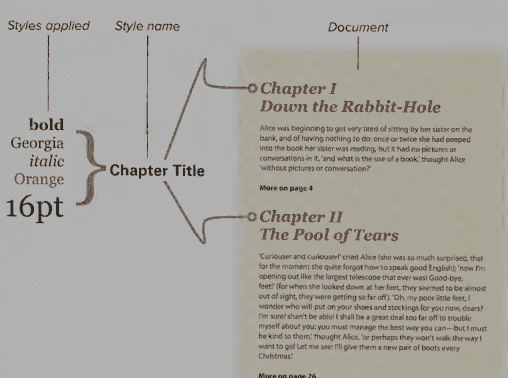

文字处理页面中应用于章节标题的样式。

## 什么是层叠样式表？

层叠样式表将大多数文字处理器中具有的样式设置便利性带到了Web上。你可以在一个中心位置设置CSS，以影响特定HTML标签的外观，无论是单个网页还是整个网站。

虽然CSS与HTML协同工作，但它本身不是HTML。相反，CSS是一种独立的样式表语言，它通过允许你重新定义现有标签显示内容的方式，来增强HTML（一种标记语言）的功能。

例如，一级标题标签容器，<h1>...</h1>，允许你将样式应用于一段HTML文本并将其转换为标题。但是，标题的确切显示由查看者的浏览器决定，而不是由HTML代码决定。

使用CSS，你可以更改标题标签的性质，使其按你想要的方式显示——例如，粗体、Times字体、斜体、橙色和36像素（px）。与使用文字处理器样式时一样，你可以选择更改<h1>标签的样式（例如，将文本大小更改为18 px），并自动更改受影响网页上所有h1元素的文本大小。

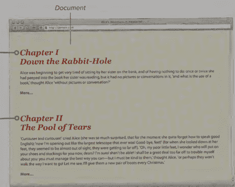

A 应用于HTML标签的样式。

## CSS如何工作？

表1.1展示了你可以使用CSS完成的一些操作，以及在本书中可以找到更多信息的位置。

当访问者加载网页时，无论是输入URL地址还是点击链接，服务器（存储网页的计算机）都会将HTML文件连同HTML文件中链接或嵌入的任何文件一起发送到访问者的计算机。无论CSS代码位于何处，访问者的浏览器都会对其进行解释，并将其应用于HTML，使用该浏览器特定的渲染引擎渲染网页。然后，结果会在浏览器窗口6中显示。

```
<HTML> + {CSS} =
```

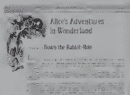

6 用于创建网页的代码由浏览器下载、解释和渲染，以生成最终显示效果。

### 表1.1 CSS属性

| 属性 | 你控制的内容 | 更多信息，请参见： |
|---|---|---|
| 背景 | 页面或页面上单个元素背后的颜色或图像 | 第7章 |
| 盒子 | 外边距、内边距、轮廓、边框、宽度、高度 | 第10章 |
| 颜色 | 文本颜色 | 第7章 |
| 字体 | 字形、大小、粗体、斜体 | 第5章 |
| 生成内容 | 计数和引号 | 第9章 |
| 列表 | 项目符号和编号 | 第8章 |
| 表格 | 表格边框、外边距、标题 | 第8章 |
| 文本 | 字距调整、行距、对齐方式、大小写 | 第6章 |
| 变换 | 移动、旋转、倾斜 | 第12章 |
| 过渡 | 随时间变化的样式 | 第12章 |
| UI | 光标 | 第9章 |
| 视觉效果 | 可见性、可见区域、不透明度 | 第11章 |
| 视觉格式化 | 位置和放置 | 第11章 |

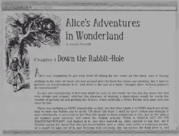

C 使用CSS在背景中添加图像的HTML页面。将内容向下和向右定位，并格式化文本。

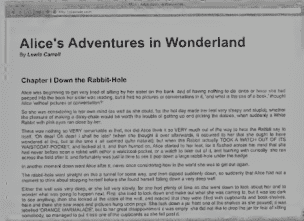

D 未使用CSS显示的相同代码。页面仍然显示，但没有C中所示的格式。

浏览器渲染引擎的解释正是你头痛的开始。万维网联盟（W3C）不遗余力地制定规范，以指导浏览器开发者渲染Web代码。尽管如此，错误、遗漏和误解仍然会混入其中。因此，没有两个浏览器以完全相同的方式渲染网页。在大多数情况下，这些差异大多数用户都察觉不到，但偶尔差异非常明显，需要你做一些额外工作，以确保页面在最广泛的浏览器范围内都能正确显示。

你始终面临这样的可能性：由于错误或所使用的软件（例如许多移动设备浏览器）不支持CSS，你的页面可能会在没有CSS的情况下渲染。你应始终考虑没有CSS样式时页面的外观，并确保页面在结构上仍然有意义，如C和D所示。

## CSS的演进

多年来，在W3C的指导下，CSS演变成了目前的形式，但这一过程往往很缓慢。虽然CSS是一个标准（由W3C的CSS工作组创建），但每个浏览器都负责解释和实现该标准。这导致了实现不一致，有些浏览器比其他浏览器更符合标准。

更麻烦的是，尽管标准力求尽可能清晰和具体，但不同的浏览器在实现规范时会有略有不同的特性。

所有现代浏览器（Internet Explorer、Firefox、Safari、Opera）都支持CSS3的重要功能；但是，即使经过多年开发，CSS3仍然是一个正在进行中的工作。许多功能（如过渡、变换和动画）在某些浏览器中仍未实现或发展不足。

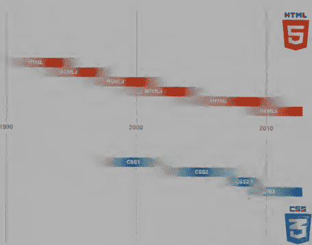

A 多年来，HTML和CSS的演进路径并不特别平稳或稳定。此时间表并非旨在作为精确的历史图表，但确实大致回顾了每个标准版本鼎盛时期的时间。


### CSS 第 1 级 (CSS1)

W3C 于 1996 年发布了第一个官方版本的 CSS。这个早期版本包含了与 CSS 相关的核心功能，例如格式化文本、设置字体和设置边距的能力。Netscape 4 和 Internet Explorer 3 及 4 支持第 1 级。

Web 设计师需要一种在屏幕上精确定位元素的方法。CSS1 已经发布，而 CSS 第 2 级还在未来，因此 W3C 发布了一个权宜之计：CSS-Positioning。该标准提议，相关各方可以在 CSS-P 标准正式成为标准之前先讨论细节一段时间。然而，Netscape 和 Microsoft 迅速采纳了这些提案，并在其浏览器第 4 版中包含了这些初步想法。

### CSS 第 2 级 (CSS2)

CSS2 规范于 1998 年发布，是浏览器开发商采用最广泛的版本。第 2 级包含前两个版本的所有属性，并更加强调国际化无障碍以及指定媒体特定 CSS 的能力。

2006 年，W3C 发布了一个更新版本：CSS 第 2.1 级，该版本修正了一些错误，澄清了一些问题，并包含了一些浏览器中已实现功能的规范。CSS2.1 实际上取代了 CSS2。

### CSS 第 3 级 (CSS3)

与 CSS1 和 2 不同，不存在单一的、全面的 CSS3。相反，CSS 工作组没有试图一次性发布整个规范，而是将规范拆分为一系列模块，每个模块都有自己的开发时间表。要了解正在进行的工作的更多信息，请查看 www.w3.org/Style/CSS/current-work。

> 提示 虽然了解 CSS 各版本之间的差异可能很有趣，但在 Web 上使用样式时并非必需。但是，你需要知道你正在为其设计的浏览器支持哪些样式。虽然所有现代浏览器都支持大部分 CSS 第 2 级规范，但旧版浏览器支持旧版 CSS 的组合。有关每个浏览器支持哪些 CSS 属性的详细信息，请参见附录 A。

### CSS 和 HTML

创建 HTML 时，样式属性直接在代码中定义。然而，W3C 引入了层叠样式表，而不是仅仅向 HTML 添加越来越多的标记和属性，以填充纯 HTML 中的设计空白，使 Web 在结构上变得语义化。（参见边栏“什么是万维网联盟？”）

以 `<strong>` 标记为例。在 HTML 中，这个常见标记只做一件事：它使文本“更粗”，通常通过以更粗的字体显示来实现。但是，使用 CSS，你可以“重新定义” `<strong>` 标记，使其不仅使文本更粗，还通过以全大写和特定字体显示文本来增加更多强调。你甚至可以将 `<strong>` 标记设置为不使文本加粗 A。

虽然 HTML 和 CSS 多年来都在不断发展，但它们很少同步发展。相反，每个标准基本上都遵循了自己的道路。CSS3 和 HTML5 同时进入主流是一个幸运的巧合，为现代网站创造了新的基础和框架。

CSS 的力量来自于其能够从多个来源混合搭配规则，以将网页布局定制为您的精确需求。在某些方面，它类似于计算机编程——这并不奇怪，因为很多这些东西是由程序员而不是 Web 设计师创建的。但一旦你掌握了诀窍，“使用” CSS 就变得像造句一样自然 B。

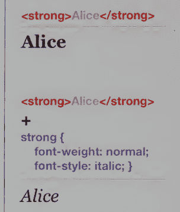

A HTML `<strong>` 标记用于使文本突出；但是使用 CSS，您可以随心所欲地为该文本设置样式。

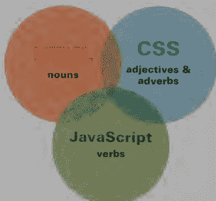

B 三种核心 Web 技术——HTML、CSS 和 JavaScript——的工作方式类似于词性。HTML 提供名词，CSS 提供形容词和副词，JavaScript 添加动词。

## CSS 规则的类型

层叠样式表最好的一点是它们设置起来非常简单。它们不需要插件或花哨的软件——只需包含规则的文本文件。CSS 规则定义了 HTML 应该是什么样子以及它在浏览器窗口中应该如何表现。

CSS 规则有四种类型，每种都有特定用途：

- HTML 选择器：HTML 标记的文本部分称为选择器。例如，h1 是 `<h1>` 标记的选择器。HTML 选择器在 CSS 规则中用于重新定义标记的显示方式。（参见第 3 章中的“(重新)定义 HTML 标记”。）例如：

    h1 { color: red; }

  将对以下内容应用样式：

    <h1>...</h1>

- 类选择器：类是一种“独立规则”，可以酌情应用于任何 HTML 标记。您可以为类命名几乎任何您想要的名称。因为类可以应用于多个 HTML 标记，所以它是最通用的选择器类型。（参见第 3 章中的“定义可重用的类”。）例如，类：

    .myClass { font: bold 1.25em .times; }

  将对以下标记应用样式：

    <h1 class="myClass">...</h1>

- ID 选择器：与类选择器类似，ID 规则可以应用于任何 HTML 标记。但是，ID 选择器只应在给定页面上的特定 HTML 标记中应用一次，以创建用于 JavaScript 函数的对象。例如，ID：

    #myObject1 { position: absolute; top: 10px; }

  将对以下标记应用样式：

    <h1 id="myObject1">...</h1>

- 通用选择器：通用选择器是由星号 (*) 表示的替代选择器，当您想要应用样式而不考虑正在使用的确切选择器时使用它。当您使用上下文样式且不知道确切上下文时，这尤其有帮助。例如，通用选择器：

    article * strong { position: absolute; top: 10px; }

  将对以下内容中的 strong 标记应用样式：

    <article><p><strong>...</strong></p></article>

  以及在以下内容中：

    <article><blockquote><strong>...</strong></blockquote></article>

## 什么是万维网联盟？

万维网联盟 (www.w3.org) 是一个组织，制定了浏览器开发商用于创建其产品的许多标准，包括 HTML 和 CSS（JavaScript 是显著的例外）。
W3C 成立于 1994 年，其使命是“通过制定协议和指南，确保 Web 的长期增长，引导 Web 发挥其全部潜力”。
W3C 由全球 350 多个成员组织组成。这些组织包括技术产品和服务供应商、内容提供商、企业用户、研究实验室、标准组织和政府。
根据其网站，W3C 有四个目标：

- 面向所有人的 Web——通过推广考虑到所有大陆用户在文化、教育、能力、物质资源和身体限制方面巨大差异的技术，使 Web 对所有人都可访问。
- 面向万物的 Web——允许所有设备轻松访问 Web。虽然大部分访问仍然通过台式机或笔记本电脑进行，但越来越多的设备可以访问 Web。
- 知识库——开发一个环境，允许每个用户充分利用 Web 上可用的资源。
- 信任与信心——在仔细考虑这项技术引起的新颖法律、商业和社会问题的前提下，指导 Web 的发展。

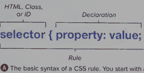

(A) CSS 规则的基本语法。您从选择器（HTML、类或 ID）开始。然后添加属性、该属性的值以及分号，它们合称为声明。只要用分号分隔，您可以添加所需的任意数量的定义。

## CSS 规则的组成部分

CSS 规则由属性及其值组成，它们合称为声明。单个 CSS 规则可以有多个声明，每个声明之间用分号 (;) 分隔。所有规则，无论位置或类型如何，都具有以下结构元素：

- 选择器是标识规则的字母数字字符。选择器可以是 HTML 标记选择器、类选择器、ID 选择器、通用选择器（在第 3 章中讨论），也可以是这些基本选择器的组合，用于创建基于上下文的样式（在第 4 章中讨论）。

- 属性标识正在定义的内容。有几十个属性可用。每个属性都负责页面内容行为和外观的一个方面。

- 值被分配给属性以定义其性质。值可以是关键字，例如“red”，也可以是数字或百分比。使用的值类型完全取决于它被分配给的属性。

> 提示 不要将 HTML 标记的选择器与其属性混淆。例如，在以下标记中：
> 
> img 是选择器，src 是属性。

> 提示 虽然列表中最后一个定义不需要包含分号，但经验表明，添加此分号可以防止未来的麻烦。例如，如果您忘记在添加之前放入所需的分号，然后决定向规则添加新定义，可能会导致规则完全失效。更糟糕的是，不仅该定义会失败，规则中的所有定义都不会被应用。


## CSS 浏览器扩展

除了支持 W3C 指定的 CSS 属性之外，浏览器开发者偶尔会引入浏览器特定的属性。这样做通常出于以下两个原因之一：

- W3C 仍在制定规范，但浏览器开发者希望立即开始使用该样式。
- 浏览器开发者想尝试一个新想法，但不想等待 W3C 接受并着手开发，这可能需要数年时间。

有时，官方 CSS 规范的确切语法会与为特定浏览器创建的“沙箱”版本略有不同。

为了避免混淆并确保 CSS 代码的前向兼容性，每个渲染引擎都为其独有的 CSS 扩展属性采用了自己的前缀。各浏览器的前缀如表 1.2 所示。

| 扩展 | 渲染引擎 | 浏览器 | 示例 |
| :--- | :--- | :--- | :--- |
| -webkit- | Webkit | Safari, Chrome | -webkit-transition |
| -moz- | Mozilla | Firefox | -moz-transition |
| -o- | Presto | Opera | -o-transition |
| -ms- | Trident | Internet Explorer | -ms-transition |
| TimeToText (time) | 所提供时间的文本等效形式，用于涉及文本或面向文本的函数的公式 | | |

```
selector {
-moz-property: value;
-webkit-property: value;
-o-property: value;
-ms-property: value;
property: value;
}
```

可以全部包含浏览器 CSS 扩展，以确保在特定浏览器可用时应用样式。

当不同浏览器推广各自的解决方案时，这些 CSS 扩展有时会重叠和冲突。好消息是，由于 CSS 的特性，你可以为各个浏览器包含每个属性的不同版本，这样浏览器就会使用适合它的那个版本。

在整本书中，在适当的时候我会包含浏览器 CSS 扩展，以便你确保样式具有最广泛的互操作性。

大多数浏览器制造商会在采用官方版本后的两个版本内弃用样式的扩展版本。这种做法让设计师在样式表停止工作之前有时间跟上进度。

### 统治一切的 Webkit？不，只是别懒了。

Web 设计中一个令人担忧的趋势是开发者仅仅依赖 Webkit 浏览器扩展，而忽略其他浏览器。毫无疑问，Webkit 在许多新创新方面一直处于领先地位。因此，想要使用前沿技术的设计师并未使用渐进增强来确保跨浏览器功能，即使该功能在其他使用其自身浏览器扩展的浏览器中也是可用的。

例如，与其为所有浏览器包含过渡代码，一些开发者只为 Webkit 包含，而让其他浏览器被冷落。这是一个巨大的错误，因为忽略 Internet Explorer、Firefox，甚至 Opera 会疏远你相当一部分受众。

更糟糕的是，Microsoft、Firefox 和 Opera 公开表示，他们将开始支持 -webkit- 扩展，这违背了最初拥有这些扩展的目的。

然而，问题不在于浏览器开发者——他们只是想确保人们使用自己的浏览器——而在于那些不想添加几行额外代码来解决跨浏览器兼容性的懒惰 Web 开发者。不过，你绝不会那样做，对吧？

## CSS3 中的新功能

做 Web 设计师是一个特别令人兴奋的时刻，因为我们即将获得一套全新的工具。许多新的 CSS3 功能已经可以投入使用，它们将激发你的创造力。

这本精简的书涵盖了 CSS3 的广度，其中大部分自 CSS2/2.1 以来保持不变。如果你是 CSS 的老手，请查找“CSS3 中的新功能”标记 A，以快速找到那些优秀的新功能。

以下是新功能的简要概览：

- 动画——无需使用 JavaScript 即可移动对象。
- 边框——可以在边框上应用多种边框颜色、边框图像和圆角。
- 背景——可以向单个元素添加多个背景，背景可以更精确地定位，背景可以扩展并裁剪到边框内部或外部，并且背景可以调整大小。
- 颜色——可用颜色不透明度设置、背景渐变和 HSL 颜色值。
- 文本——可用文本阴影、文本溢出和单词换行。
- 转换——在 2D 或 3D 空间中缩放、倾斜、移动和旋转元素。
- 过渡——使用简单的动态样式过渡。


A “CSS3 中的新功能”标记。

### CSS4？

信不信由你，CSS 工作组已经开始着手开发下一代 CSS，恰如其分地命名为 CSS4。虽然它不太可能在未来几年内准备好影响你的工作，但了解进展正在取得是件好事。

该组正专注于添加各种新选择器，以更好地细化样式。我特别高兴看到的一个新选择器是 :local-link 伪类。我为类似的东西游说长达 15 年。:local-link 伪类将最终赋予我们根据在网站中的位置（当前页面或特定部分）来设置链接样式的能力，并区分本地链接和外部链接。

有关更多详细信息，请查看工作草案：www.w3.org/TR/2011/WD-selectors4-20110929/。

- 框——添加阴影，放置可由用户调整大小的框，并分别在水平和垂直方向设置溢出。使用外框偏移设置外框与边框之间的空间，并应用框模型规范来设置宽度和高度如何应用于框。
- 内容——样式可以向元素添加内容。
- 不透明度——元素可以是透明的。
- 媒体查询——样式页面可以基于视口大小、颜色、宽高比、分辨率和其他重要设计考虑因素。
- Web 字体——这些更新并扩展了为设计链接字体的能力。

不过，CSS3 规范中的并非所有内容都可以立即使用。当现在使用新功能会“为时过早”时，我在一些章节末尾添加了名为“即将推出！”的部分，其中包含对未来预期内容的快速概述。

# HTML5 入门

HTML 是用于标记页面内容类型并使用标签添加结构的编码语言。在过去 20 年左右，该语言发生了变化——一些标签被添加，一些被删除，一些保持不变。HTML5 是最新版本，添加了标签以改善语义化页面结构的能力、插入音频和视频片段，以及创建更有意义的表单。虽然大多数主要 Web 浏览器都支持 HTML5，但仍有许多旧浏览器根本不支持 HTML5。幸运的是，你可以对此采取一些措施。首先，让我们看看什么是标记语言，以及 HTML5 如何融入新的世界秩序。

## 本章内容

- 什么是 HTML？ 18
- HTML 元素类型 21
- HTML5 的演进 24
- HTML5 中的新功能 27
- HTML5 结构如何工作？ 28
- 现在使用 HTML5 结构 29

## 什么是 HTML？

超文本标记语言是一组代码标签的系统，用于定义页面上的元素，这些元素为用于 Web 的文档创建结构。例如，你获取一段文本并添加 HTML 标签，如下所示：

```
`<h1>Alice's Adventures in Wonderland</h1>`
```

在这里，你使用了 <h1> 标签来创建一个标题元素，它是页面上最重要的标题：1 级标题。不同的标签用于标记不同类型的内容，标签可以嵌套在其他标签内。例如：

```
`<p>I wonder if I shall fall right <em>through</em> the earth!</p>`
```

这些标签告诉浏览器该文本是一个段落，单词 "through" 应该以强调方式呈现，可能是通过将其显示为斜体。

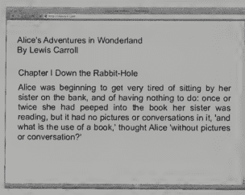

[A] 没有任何标记的纯文本。

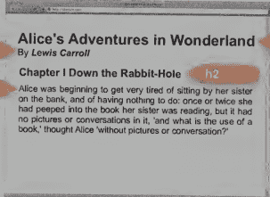

[B] 应用了 HTML 标记的相同文本内容。


## 什么是标记语言？

HTML 用于标记网页的结构，但网络及其他领域的计算机也使用其他标记语言。

标准通用标记语言（SGML）是用于印刷和互联网的大多数标记语言的“祖父”。SGML 是用于定义文档结构和外观的国际标准。已为各种文档类型和各种专业（如物理、会计和化学）创建了多种 SGML。HTML 和 XHTML 是 Web 上 SGML 的主要版本。

## 基本 HTML 文档结构

所有 HTML 文档都有相似的基本结构，包括以下元素：

- Doctype（<!DOCTYPE>）设置文档使用的标记语言类型（表 2.4）。包含此项很重要，以便浏览器能够快速准确地解析 HTML 代码。

- Head（<head>）包含有关页面的信息，例如标题和元标签。还应在此区域放置指向外部 CSS 和 JavaScript 文件的链接。head 不应与页面标题混淆。页面 head 中的任何内容都不会直接在网页上显示。

- Body（<body>）包含你在 Web 浏览器页面上实际看到的元素，例如导航、标题、段落、列表、表格、图片等更多内容。

## HTML 属性

HTML 元素可以通过在标签内放置 HTML 属性来修改。有些属性是可选的，有些会影响元素的性能，有些则是元素正常工作所必需的。例如，锚标签（<a>）使用 href 属性来定义链接指向的位置：

```
`<a href="http://www.jasonspeaking.com">Jason</a>`
```

属性还用于使用 style、class 或 id 属性将 HTML 元素连接到样式：
`<p style="color: red;">Alice</p>`
`<p class="hilight char names">Alice </p>`
`<p id="name01">Alice</p>`

每个标签都有一个或多个可应用的属性。当我们开始根据属性值使用 CSS 为标签设置样式时（如第 4 章所述），这些属性变得尤为重要。

### 浏览器继承的样式

大多数 HTML 标签都有与之关联的浏览器继承样式。这些默认样式实际上是由 Web 浏览器开发者定义的。由于浏览器开发者添加了这些样式，你需要记住它们的存在，并且它们会影响你的设计。例如，<em> 标签会在大多数浏览器上将文本斜体化。没有宇宙常数规定强调文本必须是斜体；只是编写浏览器软件的那些人决定这样做。好消息是，你可以使用 CSS 覆盖默认的浏览器样式。

总的来说，默认样式在不同浏览器之间是一致的，尽管存在一些明显的差异，尤其是边距和字体大小方面。许多设计师会使用 CSS 重置（见第 14 章）尽可能重置默认值，从而“从头开始”。

### 什么是 SVG？

可缩放矢量图形（SVG）格式是在 Web 上创建矢量图形的一种方法（参见 www.w3.org/graphics/svg/）。与 Flash 类似，SVG 数据不是绘制图形中的每个点，而是描述两个点，然后将它们之间的路径绘制为直线或曲线。

尽管在接受程度上仍落后于 Flash，但 SVG 从第 9 版起已在 Firefox、Safari、Chrome 和 Internet Explorer 中原生支持。（Adobe 确实在 www.adobe.com/svg/ 提供了一个 IE 插件）

与使用编辑器创建文件并隐藏大部分图形代码的 Flash 不同，SVG 是一种可以自由读取的标记语言。

## HTML 元素类型

内联元素水平流动，在到达父元素边缘时使用软换行。

HTML 包含大量元素，每个元素都有其特定的标签和用于构建文档的用途。元素通常可分为两类或两种显示类型：

- 内联元素与元素无关联的换行。表 2.1 列出了 CSS 可使用的内联标签选择器。

### 表 2.1 内联元素的 HTML 选择器

| 选择器 | HTML 用途 | 选择器 | HTML 用途 |
| :--- | :--- | :--- | :--- |
| a | 锚链接 | label | 表单元素标签 |
| abbr | 缩写 | legend | fieldset 中的标题 |
| address | 物理地址 | link | 资源引用 |
| area | 图像映射区域 | mark* | 标记文本 |
| audio* | 声音内容 | meter* | 测量范围 |
| b | 粗体文本 | nav* | 导航链接 |
| cite | 简短引用 | optgroup | 表单选项组 |
| code | 代码文本 | option | 下拉列表中的一个选项 |
| del | 删除文本 | q | 简短引用 |
| details* | 元素详细信息 | select | 可选择列表 |
| dfn | 定义术语 | small | 小号字体 |
| command* | 命令按钮 | source* | 媒体资源 |
| datalist* | 下拉列表 | span | 本地化样式格式 |
| em | 强调 | strong | 强烈强调 |
| font | 字体外观 | sub | 下标 |
| i | 斜体 | summary* | 详细信息标题 |
| iframe | 内联子窗口 | sup | 上标 |
| img | 图像嵌入 | tbody | 表格主体 |
| input | 输入字段 | td | 表格数据 |
| ins | 插入文本 | time* | 日期/时间 |
| keygen* | 表单中生成的密钥 | var | 变量 |
| kbd | 键盘文本 | | |

* HTML5 中的新增

块级元素在元素前后放置换行。表 2.2 列出了 CSS 可使用的块级元素选择器。

块级元素彼此垂直堆叠。

### 表 2.2 块级元素的 HTML 选择器

| 选择器 | HTML 用途 | 选择器 | HTML 用途 |
| :--- | :--- | :--- | :--- |
| article* | 文章内容 | header* | 节或页面标题 |
| aside* | 侧边栏内容 | hgroup* | 分组标题信息 |
| blockquote | 长引用 | hr | 水平线 |
| body | 页面主体 | li | 列表项 |
| br | 换行 | map | 图像映射 |
| button | 推送按钮 | object | 对象嵌入 |
| canvas* | 绘图区域 | ol | 有序列表 |
| caption | 表格标题 | output* | 表单输出 |
| col | 表格列 | p | 段落 |
| colgroup | 表格列组 | pre | 预格式化文本 |
| dd | 定义描述 | progress* | 显示耗时任务的进度 |
| div | 分区 | section* | Web 页面中的节 |
| dl | 定义列表 | table | 表格 |
| dt | 定义术语 | tbody | 表格主体 |
| embed | 外部内容 | textarea | 表单文本输入区 |
| fieldset | 字段集标签 | tfoot | 表格页脚 |
| figcaption* | 图片标题 | th | 表格标题 |
| figure* | 分组媒体内容和标题 | thead | 表格头部 |
| footer* | 节或页面页脚 | tr | 表格行 |
| form | 输入表单 | ul | 无序列表 |
| h1-6 | 标题级别 1-6 | video* | 视频播放器 |
| head | 关于页面的信息 | | |

* HTML5 中的新增

并非所有 CSS 定义都可以应用于所有 HTML 元素。某个 CSS 属性是否可以应用取决于元素的性质。大多数情况下，何时可以应用属性是很明显的。

例如，你不会期望 text-indent 属性（用于缩进段落第一行）应用于 <strong> 这样的内联标签。事实上，除非使用 CSS 更改显示类型，否则无法应用。

如果在此方面需要帮助，请参阅附录 A，以确定可以应用于特定 HTML 元素的 CSS 属性。

## HTML5 的演变

HTML5 是 Web 标记的下一步，将取代 XHTML。尽管 XHTML2 开发了近八年，但于 2009 年被搁置，以支持 HTML5。

要了解这是如何发生的，让我们回到二十世纪末 Web 的美好时光——确切地说是 1997 年。那时仍是 Web 1.0 世界，尽管我们还不知道要这样称呼它。dotcom 泡沫刚刚开始膨胀，每个人都在使用 Netscape Navigator 浏览 Web。正是在这个背景下，万维网联盟（W3C）引入了 HTML 4.0（HTML4）。

HTML4 是一项巨大的改进，因为这是第一次由标准组织创建，该组织让每个人都有发言权，并相信网页应在所有可用浏览器上显示相同。

## 然后 XHTML 出现了

XHTML1（2001 年发布）是使用 XML 重写的 HTML 4.01 标准，旨在将 XML 的强大功能带到 Web 页面开发中。XHTML 使用 XML Doctype。XHTML 使用与 HTML 相同的所有标签，但代码仍可与不理解 XML 的浏览器一起工作。

尽管 XHTML2 主要旨在作为通向勇敢新 Web 技术的过渡技术，但从一开始，事情就严重出错了。


## XHTML2 的问题

人们很快意识到，即使是 XHTML1 也不足以让 Web 从其相对静态的“页面”性质演变为真正交互式且通用的应用环境。XHTML2 本应改变这一切。从 2002 年 8 月开始，XHTML 标准的作者们开始打造一种新语言，他们希望这种语言能完全重塑二十一世纪的 Web 标记，带来语义化 Web 页面、交互性、国际化、设备独立性以及人人皆可享用西米布丁的黄金时代！但他们忘了一件事：XHTML2 并未设计为与旧版 Web 标记语言向后兼容。现有浏览器将无法运行这个花哨的全新标记语言。Web 开发者将不得不为旧版浏览器开发一个网站版本，并为 XHTML2 标准开发另一个版本。

## 然后 HTML5 出现了

2003 年 6 月，HTML5 作为 Web Applications 1.0 诞生，由 Web HyperText Application Technology Working Group（WHATWG，Web 超文本应用技术工作组）创建，该组织与 W3C 无关。相反，这个独立小组对 XHTML2 进展缓慢和方向偏差感到沮丧，开始着手制定一个替代标准，该标准将向后兼容，更适合编写应用程序 *和* 页面，并且还将解决 Web 开发者面临的许多实际问题。

几年间，两种语言同时开发。但到了 2007 年，W3C 看到 Web Applications 1.0 的进度已超过 XHTML2，便将其作为新 HTML5 标准的起点，并于 2008 年 1 月 22 日发布了规范的“首份公开工作草案”。为将注意力集中在 HTML5 上，W3C 未续期 XHTML 工作组的章程，XHTML2 也随之消亡。

## 是 HTML5 还是 XHTML5？

尽管 XHTML2 已消失，但统一 XML 和 HTML 的需求依然存在。因此，存在一项并行计划来创建 XHTML5。要明确的是，这 *并非* 一种新的或不同的标记语言；它只是使用 XML 规则编写的 HTML5，与 XHTML 类似。

如果你了解 XHTML，那么学习 XHTML5 应该不难。它们主要在标签处理方式上有所不同。一些最重要的差异列于表 2.3 中。

无论你选择使用 HTML5 还是 XHTML5，由你决定，但两者在现代浏览器中都能正常工作。就我而言，我更喜欢 HTML5 更宽容的特性，并且本书中的代码也都使用它。

| | XHTML5 | HTML5 |
|---|---|---|
| 标签大小写 | 小写 | 大写或小写 |
| 闭合标签 | 必需 | 可选 |
| 自闭合标签 | 必需 | 可选 |
| MIME 类型 | application/xml 或 application/xhtml+xml | text/html |
| 格式正确性错误 | 致命 | 非致命 |

## HTML5 中不再包含的内容

HTML5 包含多项更改。但如果你想立即开始使用它，还需要知道哪些内容 *不再可用*。框架标签——`<frameset>`、`frame`、`noframes`——已被删除，但 `iframe` 仍可用。大多数表现标签已被删除——例如 *basefont*、*big*、*center*、*font*、*s*、*strike*、*tt*、*u*——虽然 *b*（粗体）和 *i*（斜体）仍然保留，但关于该决定仍有争议。

## HTML5 中的新增内容

HTML5 对 Web 页面进行了重要的结构更改。例如，你可以指定页眉、页脚、文章和侧边栏等常见元素。此外，HTML5 原生引入了许多功能（即内置于浏览器的功能），这些功能以前需要以新元素和 API 的形式使用插件和/或脚本：

- Canvas 元素允许脚本化位图编辑。
- 文档编辑允许用户直接在 Web 页面中编辑内容。
- Web 表单支持自动验证并包含更多输入类型。
- 拖放允许在无需脚本的情况下操作元素。
- 音频和视频定时媒体播放可在无需插件的情况下原生控制媒体文件。
- 新的结构元素消除了使用带有类和 ID 的 `<div>` 标签来创建页眉和页脚等常见元素的负担。

## HTML5 结构如何工作？

HTML5 最重要的变化之一是添加了结构元素，这将大大增强 Web 标记背后的语义理念。大多数新结构标签不言自明；但少数几个需要进一步说明：

- `<header>` 可用于页面标题、章节标题、文章标题或侧边栏标题。
- `<hgroup>` 用于对相关的标题元素（h1、h2、h3 等）进行分组，通常作为标题和副标题。
- `<nav>` 可以独立包含，也可以作为页眉和/或页脚的一部分。
- `<section>` 定义页面的主要部分，通常是包含文章的部分。
- `<article>` 是单个博客条目或博客条目摘要。
- `<figure>` 用于包含嵌入页面中的图像、音频和视频。
- `<figcaption>` 包含其所在 figure 标签的标题。
- `<dialog>` 替换 `<dl>` 元素以包含对话记录。
- `<aside>` 用于页面上的支持内容，例如相关链接、次要导航，当然还有广告。
- `<footer>` 与页眉类似，可以放置在其他元素的底部。

不幸的是，并非所有浏览器都能在无需少许帮助的情况下理解 HTML5。

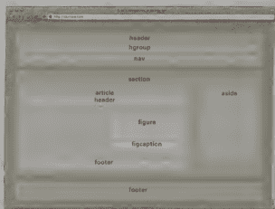

A 典型 HTML5 文档的线框图。

## 立即使用 HTML5 结构

我来告诉你一个小秘密：你可以使用 HTML5 语法来构建 Web 页面，并将其与 CSS3（或旧版 CSS）结合使用。HTML5 已在大多数当前浏览器（包括 Internet Explorer）上实现，你应该立即开始使用它。

尽管 CSS 可以应用于当前使用的任何 HTML 版本——包括 XHTML1 和 HTML 4.01——但我将在本书中始终使用 HTML5。本书绝非 HTML5 的详尽资源。不过，我想向你展示如何设置我将在后续章节中引用的基本 Web 文档。

代码 2.1 HTML5page.html——这展示了一个典型的 HTML5 页面，其结构使用了页眉、导航、文章、侧边栏和页脚，用于布局图形。

```
<!DOCTYPE html>
<html dir="ltr" lang="en-US">
<head>
<meta charset="utf-8">
<title>HTML5</title>
</head>
<body>
<header>
<hgroup>
<nav></nav>
</header>
<section>
<article>
</article>
<figure>
<figcaption></figcaption>
</figure>
<footer></footer>
<article>
<dialog></dialog>
</section>
<aside></aside>
<footer></footer>
</body>
</html>
```

## 表 2.4 文档类型

| 标记语言 | Doctype 代码 |
|---|---|
| HTML 4.01 宽松型 | <!DOCTYPE HTML PUBLIC "-//W3C//DTD HTML 4.01 Transitional//EN" "http://www.w3.org/TR/html4/loose.dtd"> |
| HTML 4.01 严格型 | <!DOCTYPE HTML PUBLIC "-//W3C//DTD HTML 4.0//EN" "http://www.w3.org/TR/html4/strict.dtd"> |
| HTML 4.01 框架集 | <!DOCTYPE HTML PUBLIC "-//W3C//DTD HTML 4.01 Frameset//EN" "http://www.w3.org/TR/html4/frameset.dtd"> |
| XHTML1 过渡型 | <!DOCTYPE html PUBLIC "-//W3C//DTD XHTML 1.0 Transitional//EN" "http://www.w3.org/TR/xhtml1/DTD/xhtml1-transitional.dtd"> |
| XHTML1 严格型 | <!DOCTYPE html PUBLIC "-//W3C//DTD XHTML 1.0 Strict//EN" "http://www.w3.org/TR/xhtml1/DTD/xhtml1-strict.dtd"> |
| XHTML1 框架集 | <!DOCTYPE html PUBLIC "-//W3C//DTD XHTML 1.0 Frameset//EN" "http://www.w3.org/TR/xhtml1/DTD/xhtml1-frameset.dtd"> |
| HTML5/XHTML5 | <!DOCTYPE html> |

## 设置基本 HTML5 文档：

- 1. 添加 HTML5 文档类型（表 2.4）。请注意，HTML5 的新 !DOCTYPE 比当前使用的复杂且难以解读的 HTML 和 XHTML 文档类型（代码 2.1）简单得多。它只是告诉浏览器使用 HTML。
  <!DOCTYPE html>

- 2. 添加 HTML 标签，包括预期语言和语言方向（通常 ltr 表示从左到右的文本）。
  <html dir="ltr" lang="en-US">...
  </html>

- 3. 向文档添加 head，这是你指定有关此文档的信息的地方，包括标题和文本使用的字符集。我建议使用 UTF-8 以获得最佳效果。
  <head>...</head>

- 4. 向文档添加 body。这是添加所有要显示的内容的地方。我建议为网站中的每个 body 元素至少提供一个唯一的类名和其他用于标识其在网站中位置的类名。这样做，你可以按页面和按章节添加样式，而无需包含多个 CSS 文件。
  <body class="section Name - pageName">...</body>


## HTML5 何时可用？

需要注意的是，许多人担心 HTML5 仍然是“工作草案”。最终的“建议标准”要到 2022 年才会完成。（是的，那是十年后的事。）怀疑论者举手投降，认为 HTML5 要过一段时间才会相关。但这个日期非常具有误导性。

目前所有新浏览器都支持重要的 HTML5 属性。2022 年的日期遥遥无期，但那是 *所有* 浏览器都将适配 *所有* HTML5 属性的时候。

从实际角度来看，HTML5 已经到来，并在未来几年内使用量将不断增长，直到成为该领域的主流。

如果你准备好使用它，HTML5 已经准备好迎接黄金时段。

- 5. 为你的页面添加 header 标签。这与步骤 3 中的 head 标签 *不* 相同。这是你放置所有在网页标题中显示的内容的地方。你也可以在此处包含导航，或单独包含，具体取决于你的设计需求。

  <header>...</header>

- 6. 添加导航标签，并包含指向网站顶级页面的链接。

  <nav>...</nav>

- 7. 添加一个或多个 article 标签，它们将包含页面上的重要内容。许多网络浏览器和 RSS 新闻阅读器现在允许用户专注于文章，以获取页面的主要内容。图片和章节非常适合放在这里。

  <article>...</article>

- 8. 添加 aside 标签，这是放置文章补充内容的地方。这有时也被称为侧边栏或导轨，具体取决于你与谁交谈。它可以包含你想要的任何内容，但我喜欢在此处放置评论和对话。

  <aside>...</aside>

- 9. 最后，在页面底部添加 footer 标签。这通常包括冗余的顶级导航、版权和其他小字条款。

  <footer>...</footer>

就是这样。你已经准备好开始使用 HTML5 标签了。大胆去做吧。哦，等等，没错：它在除 Internet Explorer 之外的所有东西上都能工作，*但* Internet Explorer 恰好占据了当今使用的浏览器的大多数。那么，你该怎么办？

## 让 HTML5 在旧版 Internet Explorer 中工作

虽然 Internet Explorer 不认识 HTML5 标签，但有一个部分修复（或凑合的补丁）涉及使用 JavaScript 来创建 HTML5 元素：

```
document.createElement('header');
```

被称为“HTML5 Shiv”，这将“教会” Internet Explorer 6（及更高版本）这些元素存在，并且应该被视为 HTML 标签。你可以为需要的每个 HTML5 元素添加一行这样的 JavaScript。

为了简化添加这些新标签，创建一个外部 JavaScript 文件（Code 2.2），并使用 IE 条件注释（Code 2.3）从你的 HTML 文档链接到它，你将在第 13 章中详细探讨这一点。

### Code 2.2 HTML5forIE.js—这为 Internet Explorer 缺少的每个 HTML5 标签添加一个空白 HTML 标签。

```
/*** CSS VQS - Chapter 2 - HTML5forIE.js ***/
document.createElement('abbr');
document.createElement('article');
document.createElement('aside');
document.createElement('audio');
document.createElement('bb');
document.createElement('canvas');
document.createElement('datagrid');
document.createElement('datalist');
document.createElement('details');
document.createElement('dialog');
document.createElement('eventsource');
document.createElement('figure');
document.createElement('footer');
document.createElement('header');
document.createElement('hgroup');
document.createElement('mark');
document.createElement('menu');
document.createElement('meter');
document.createElement('nav');
document.createElement('output');
document.createElement('progress');
document.createElement('section');
document.createElement('time');
document.createElement('video');
```

### 为何要使用文档类型？

如果不使用文档类型，现代浏览器将被迫进入怪异模式。如果你正在创建新网页，这是一种糟糕的情况，因为它将代码的解释完全留给浏览器自行决定，这可能导致大量显示不一致。

如果你在网页中不包含文档类型，较新的浏览器可能无法识别你的所有代码。

### Code 2.3 HTML5page.html—这包含指向 Code 2.2 中 JavaScript 的链接。

```
<!DOCTYPE html>
<html dir="ltr" lang="en-US">
<head>
<meta charset="utf-8">
<title>HTML5</title>
<![if IE ]>
<script src="script/HTML5forIE.js"
type="text/javascript"></script>
<![endif]>
</head>
<body class="pageName">
<header></header>
<nav></nav>
<article>
<figure></figure>
<section></section>
</article>
<aside>
<dialog></dialog>
</aside>
<footer></footer>
</body>
</html>
```

如果你想要花哨一点，用 Code 2.4 中显示的 JavaScript 循环替换 Code 2.2。这有相同的效果，但代码更紧凑。

> **提示** 本示例中的文档已按我的需求构建，但你无需为标签位置和嵌套遵循死板的规则。你可以将导航放在 header、footer、article 或 aside 中。同样，图片可以放在 aside 或 head 中。前面的示例只是一个基本的常见网页结构。

### Code 2.4 HTML5forIE.js—这与 Code 2.2 完成相同的工作，但使用 JavaScript 循环，使代码更紧凑。

```
/*** CSS VQS - Chapter 2 - HTML5forIE.js ***/
/*@cc_on
if(!@_@) return;
var e = "abbr,article,aside,audio,bb,canvas,
datagrid,datalist,details,dialog,
eventsource,figure,footer,header,hgroup,
mark,menu,meter,nav,output,progress,
section,time,video".split(',');
for(var i=0;i<e.length;i++)
  document.createElement(e[i]);
*/
```

# CSS 基础

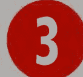

CSS 让你控制文档外观的所有元素——字体、文本、颜色、背景、大小、边框、间距、定位、视觉效果、表格和列表。它甚至允许你使用过渡和变换来控制元素的空间和时间样式。然而，使用 CSS 进行样式设置的真正威力在于，你可以通过仅更改几行 CSS 代码来改变网站上每个页面的外观。

通过娴熟运用 CSS，你可以从一个简单的网页开始，添加视觉设计和交互，并将其转变为网状环境。

## 本章内容

- 基本 CSS 选择器 36
- 内联：为 HTML 标签添加样式 37
- 嵌入：为网页添加样式 40
- 外部：为网站添加样式 43
- (重)定义 HTML 标签 50
- 定义可重用类 53
- 定义唯一 ID 57
- 定义通用样式 61
- 分组：定义使用相同样式的元素 64
- 向 CSS 添加注释 67

## 基本 CSS 选择器

CSS 通过使用 CSS _规则_ 来定义网页上元素的样式。规则通过 _选择器_ 应用，选择器有四种基本类型：HTML 选择器用于引用特定标签；类选择器单独应用于元素；ID 选择器应用于页面上的单个元素；通用选择器应用于页面上的所有元素（表 3.1）。你将不断使用这四种基本选择器，它们是最佳的起点。在第 4 章中，你将学习使用其他选择器来创建更具选择性的样式。

| Format | Selector Name | What Elements Are Styled |
| :--- | :--- | :--- |
| a | HTML | All specified HTML tags |
| .myClass | Class | Any HTML tag where class is applied |
| a.myClass | Dependent class | Specified HTML tag where class is applied |
| #myID | ID | Any HTML tag where ID is applied |
| a#myID | Dependent ID | Specified HTML tag where ID is applied |
| * | Universal | All HTML tags |

```
<h1 style="color: red;">...</h1>
```

直接在 HTML 标签中定义样式的一般语法。

## 内联：为 HTML 标签添加样式

虽然使用 CSS 意味着你不必单独设置每个标签的外观，但你仍然有自由在单个标签内使用内联样式 A 来设置样式。

当你在 head 或外部样式表中为页面设置了样式，并且需要逐个案例地覆盖这些样式时，这很有用。但是，你应该只将其作为最后的手段。因为内联样式在层叠顺序中具有最高优先级，几乎不可能被覆盖。（参见“为何你绝对、绝对不应该在最终网站中使用内联样式……大部分情况”。）


### 为单个 HTML 标签设置样式属性：

- 1. 将 style 属性添加到 HTML 标签。在要应用样式的 HTML 标签中键入 style=（代码 3.1）<h1 style=

- 2. 以逗号分隔的列表添加 CSS 声明。在引号中，以 property: value 的格式键入样式声明，使用分号 (;) 分隔各个声明。确保用引号闭合声明列表。"color:red;"

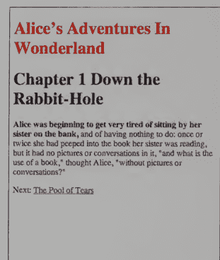

B 代码 3.1 的结果。标题级别 1 已设置为红色，而不是默认的黑色。

代码 3.1 将内联样式应用于 h1 标签以定义颜色 B。

```html
<!-- HTML5 -->
<!DOCTYPE html>
<html lang="en">
<head>
    <meta charset="UTF-8">
    <title>Alice&#8217;s Adventures in Wonderland</title>
</head>
<body>
    <h1 style="color:red;">Alice&#8217;s Adventures In Wonderland</h1>
    <h1 id="ch01">Chapter 1 <span class="chaptertitle">Down the Rabbit-Hole</h1>
    <p><strong>Alice was beginning to get very tired of sitting by her sister on the bank,</strong> <br>and of having nothing to do: once or twice she had peeped into the book her sister was reading, <br>but it had no pictures or conversations in it, "and what is the use of a book," thought Alice, <br>"without pictures or conversations?"</p>
    </article>
    <footer><nav> Next:
    <a class="chaptertitle" href="AAML-ch02.html">The Pool of Tears</a></nav></footer>
</body>
</html>
```

### 为什么你绝对、绝对不应该在最终网站中使用内联样式……大部分情况

因为内联样式是样式的最后一道防线，你无法使用嵌入式或外部样式表来覆盖它们。因此，你要么永远被这种样式束缚，要么必须手动更改它，而这并不总是可行的。如果你正在开发大型网站，HTML 代码通常与样式独立设置，设计师可能无法访问该代码或轻松更改它。

我曾花了三天时间为一家大型互联网公司重新设计一个小部件，结果发现链接样式无法更改，因为开发者使用了内联样式。因为我无法编辑 HTML 代码，所以我陷入了僵局。所以，不要使用它们。绝对不要！

好吧，有几个例外：

- 接口：通常，在设计界面时，某些样式如果更改或删除，会导致界面无法正常工作或显示不正确。我通常会在这种情况下使用内联特定样式。

- 测试：内联样式可用于快速测试样式。但为了保持最大灵活性，我建议始终将最终样式放入外部样式表中，如本章后面所述。

- 不得已时：做这件事有一段时间后，请自行判断。

- 3. 完成 HTML 标签并添加内容。关闭标签后，添加要设置样式的内容。然后使用相应的结束标签关闭标签对。

```
Alice&#8217;s Adventures In Wonderland</h1>
```

如果同一元素上应用了冲突的样式，层叠顺序将决定应用哪个样式，如第 5 章“确定层叠顺序”中详细说明。

> 提示：你绝不应该在最终网站中使用内联样式。请参阅本章中的侧边栏“为什么你绝对、绝对不应该在最终网站中使用内联样式……大部分情况”。

> 提示：为了避免混淆浏览器，最好在声明列表周围使用双引号 ("")，在声明列表中的任何值周围使用单引号 ('')，例如带有空格的字体名称。

> 提示：由两个以上单词组成的字体名称在与样式一起使用时应放在单引号 ("Font Name") 中。

> 提示：当从 Microsoft Word 等应用程序将代码复制并粘贴到 Adobe Dreamweaver 等 Web 编辑应用程序时，请确保将所有智能引号 ("") 转换为直引号 ("")。

> 提示：常见的错误是将等号 (=) 与冒号 (:) 混淆。虽然标签中的 style 属性使用等号，但请记住 CSS 声明始终使用冒号。

## 嵌入式：向网页添加样式

要添加适用于单个网页（而非仅单个元素（内联）或整个网站（外部））的样式，请使用 `<style>` 标签将样式规则嵌入网页，该标签将保存所有样式规则。

以这种方式添加样式看起来可以与直接将样式添加到 HTML 标签（如前一节所示）完全相同。但是，当你将样式放在一个公共位置（最好是 `<head>` 中）时。

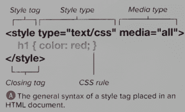

代码 3.2 样式规则已添加到 `<style>` 标签中。为一级标题添加了一条规则以设置其颜色，但它没有效果，因为 `inline` 样式会覆盖它。这就是为什么你绝不应该在最终代码中使用内联样式。

```html
<!-- HTML 5 -->
<!DOCTYPE html>
<html lang="en">
<head>
<meta charset="UTF-8">
<title>Alice&#8217;s Adventures in Wonderland</title>
<style type="text/css" media="all">
h1 {
color: orange;
font-size: 3em;
font-weight: normal; }
h1 .chaptertitle {
color: yellow;
font-size: .5em; }
</style>
</head>
<body>
<h1 style="color:red;">Alice&#8217;s Adventures In Wonderland</h1>
<h1 id="ch01">Chapter 1 <span class="chaptertitle">Down the Rabbit-Hole</span></h1>
<p><strong>Alice was beginning to get very tired of sitting by her sister on the bank,...</p>
...
</body>
</html>
```

## 《爱丽丝梦游仙境》

### 第 1 章 兔子洞

爱丽丝坐在河岸边陪伴姐姐，开始感到非常无聊，而且无事可做：她曾一两次偷看姐姐正在读的书，但那本书里既没有图片也没有对话，“一本书没有图片或对话有什么用呢，”爱丽丝想，“没有图片或对话？”

下一章 泪水之池

**B** 代码 3.2 的结果。请注意，虽然 `<style>` 标签中的 h1 选择器指定颜色为橙色，但它不会覆盖第一个 h1 标签的内联样式，该标签仍然顽固地保持红色。

文档——你可以轻松更改文档中的所有样式。例如，与其指定单个 `<h1 id="ch01">` 标签的样式，不如指定整个页面上所有 `<h1 id="ch01">` 标签的样式，然后在一个位置更改规则，以更改该页面上所有一级标题的外观。

### 为 HTML 文档中的标签设置样式：

- 1. 在文档的 head 中键入开始 style 标签（代码 3.2）。将 type 属性定义为 "text/css"，这将随后的样式定义为 CSS，而非任意样式。此外，使用值 all 定义媒体类型，这将无论使用何种类型的机器输出，都将样式表应用于页面（参见第 4 章“查询媒体”）。然后关闭 style 标签。

```
<style type="text/css"
media="all">...</style>
```

- 2. 添加 CSS 规则。在步骤 1 的 style 容器中，通过键入要添加样式的选择器，后跟开闭花括号 ({}) 来启动新规则。（基本选择器——HTML、类、ID 和通用选择器——在本章前面有所解释，上下文选择器在第 4 章中有所解释。）

```
h1 {...}
```

在规则的括号内，键入要分配给此规则的声明——格式为 property: value——使用分号 (;) 分隔列表中的各个声明。

- 3. 添加要定义的所有 CSS 规则。规则遵循层叠顺序（如第 5 章“确定层叠顺序”中详细说明）。但通常，你可以通过在列表中更低位置重写样式来覆盖样式。

> 提示：为了使规则更易读，你可以在声明后添加一个或多个换行符、空格或制表符，而不会干扰代码。

> 提示：虽然你可以将嵌入式样式放在 HTML 文档的任何位置，但我强烈建议将它们放在文档顶部的 <head> 中；否则，页面最初将不带样式显示，然后在页面重新显示带样式时闪烁。

> 提示：但是，我根本不建议在最终网页中放置嵌入式样式。虽然它们不像内联样式那样难以覆盖，但嵌入式样式在以后尝试重新设计页面时可能会让你困惑。将所有样式放在外部样式表中（如下一节所述）始终是最好的，这样可以轻松进行全站更改。


## 外部：为网站添加样式

CSS的一大好处是，你可以创建一次样式表，然后在单个网页或整个网站中使用。为此，你需要创建一个与HTML文档分开的外部CSS文件，该文件仅包含CSS代码——不含HTML、JavaScript或任何其他代码。

建立外部CSS文件是一个两步过程。首先，在文本文件中设置CSS规则。其次，使用<link>标签或@import规则将此文件链接或导入到HTML文档中。

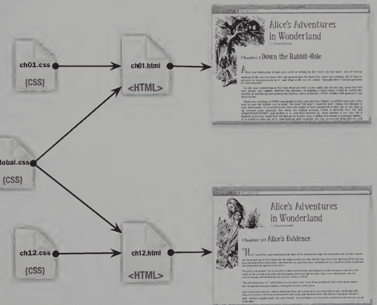

A 外部CSS文件可以通过链接或导入直接用于为HTML页面设置样式。

## 创建外部样式表

在网站上全局使用外部样式表的第一步是创建包含所有CSS代码的外部文件。但是，与添加嵌入样式不同，你在外部CSS文件中不使用<style>标签。事实上，这样做会导致外部样式表失效。

在此示例中，我设置了三个CSS文件：global.css、ch01.css和ch12.css。

### 设置外部CSS文件：

- 1. 创建一个新文本文件。你可以使用文本编辑器或Web编辑软件。使用.css扩展名保存文件。例如，global.css。

记事本或SimpleText即可，但你可能希望使用专门的代码编辑软件，例如Coda或BBEdit。

不要使用Microsoft Word。它会添加自己的标记代码，这会干扰你的CSS代码。

- 2. 导入CSS文件。这是可选的，但你可以创建任意数量的外部样式表，并将样式表相互导入以组合它们的样式（代码3.4和代码3.5）。但是，如果外部样式表中包含导入规则，则必须将其放在所有其他CSS代码之前。有关更多信息，请参见本章中的“导入样式表”。

```
@import(global.css)
```

### 代码3.3 global.css—默认外部样式表中包含了网站的所有基本样式。

```
body {
  padding: 220px 0 0 180px; }
h1 {
  color: green;
  font-size: 3em;
  font-weight: bold; }
h1 .chaptertitle {
  color: blue;
  font-size: 5em;
  font-weight: normal; }
p {
  color: violet;
  font-size: 1.5em;
  line-height: 2; }
```

### 代码3.4 ch01.css—为第1章添加特殊背景图像。

```
body { background: white url('alice23a.gif') no-repeat 0 0; }
```

### 代码3.5 ch12.css—为第12章添加特定图像。

```
body { background: white url('alice40b.gif') no-repeat 0 0; }
```

- 3. 将CSS规则添加到文本文件中（代码3.3）。不要包含任何其他代码类型——不含HTML或JavaScript。

通过键入要添加样式的选择器，后跟左花括号和右花括号（{}）来启动新规则。（基本选择器——HTML、类、ID和通用选择器——在本章中解释，上下文选择器在第4章中解释。）

```
h1 { color: green;
    font-size: 3em; font-weight: bold; }
```

在规则的括号中，键入要分配给此规则的声明——格式为属性:值——使用分号（;）并分隔列表中的各个声明。（你还可以添加注释，如本章后面所述。）

你现在可以使用以下两种方法之一将此文件连接到你的网页：

- 链接。使用<link>标签将外部CSS文件连接到HTML文件。
- 导入。使用@import将外部CSS文件连接到HTML文件。

> 提示 虽然外部CSS文件可以有任何名称，但最好使用一个能提醒你这些样式用途的名称。例如，“navigation.css”可能比“657nm87gp.css”更有用。

> 提示 CSS文件不应包含任何HTML标签（尤其是<style>标签）或其他内容，CSS注释和导入的样式除外。

## 链接到样式表

外部样式表文件可以使用<link>标签应用于任何HTML文件。链接CSS文件对文档的影响与将样式直接嵌入文档头部相同；但是，通过将其放在单独的文件中，代码可以在多个网页中重复使用，对单个中央文件所做的更改将影响所有这些页面。

### 链接到外部CSS文件：

- 1. 向HTML文档添加链接标签。在HTML文档的<head>...</head>中（代码3.6），打开<link>标签并键入一个空格。<link

- 2. 指定链接与文档的关系为样式表。这一点很重要，因为link标签可用于添加其他文件类型。省略此项会导致许多浏览器不加载代码。rel="stylesheet"

- 3. 指定要使用的CSS文件的位置，可以是全局或本地。例如，ch01.css。这是外部CSS文档的完整路径和名称（包括扩展名）。在第15章中，你将探讨与HTML文档相关的外部样式表定位策略。href="global.css"

- 4. 指定正在链接的信息类型。在此示例中，它是包含CSS的文本文件。type="text/css"

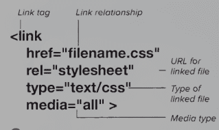

link标签的一般语法。

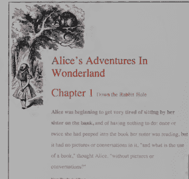

代码3.6的结果。应用了所有默认样式和第1章特定样式的页面

- 5. 指定应用此样式表的媒体类型。有关更多详细信息，请参见第4章中的“媒体查询”。media="all">

> 提示 你可以使用<link>标签向页面添加任意数量的样式表。

> 提示 请记住，你链接的样式表越多，网页发出的服务器请求就越多，加载速度就越慢。按需链接，但尽量通过合并文件来尽量减少链接。

### 代码3.6 ch01.html—导入外部样式表ch01.css（代码3.4）和global.css（代码3.3）。

```
<!-- HTML5 -->
<!DOCTYPE HTML>
<html lang="en">
<head>
<meta charset="UTF-8">
<title>Alice&#8217;s Adventures in Wonderland</title>
<link href="global.css" rel="stylesheet" type="text/css" media="all">
<link href="ch01.css" rel="stylesheet" type="text/css" media="all">
<style type="text/css" media="all">
h1 {
color: orange;
font-size: 3em;
font-weight: normal;
}
h1 .chaptertitle {
color: yellow;
font-size: .5em;
}
</style>
</head>
<body>
<h1 style="color:red;">Alice&#8217;s Adventures In Wonderland</h1>
<h1 id="ch01">Chapter 1 <span class="chaptertitle">Down the Rabbit-Hole</span></h1>
<p><strong>Alice was beginning to get very tired of sitting by her sister on the bank,
<strong>and of having nothing to do: once or twice she had peeped into the book her
sister was reading, but it had no pictures or conversations in it, “and what is the use
of a book,” thought Alice, “without pictures or conversations?”</p>
</article>
<footer><nav> Next:
<a class="chaptertitle" href="AHTML-ch02.html">The Pool of Tears</a>
</nav></footer>
</body>
</html>
```

## 导入样式表

将外部样式表引入文档的另一种方法是使用@import规则。

D 导入的优势在于，它不仅可以将外部CSS文件放入HTML文档文件中，还可以将一个外部CSS文件导入到另一个外部CSS文件中。

### 导入外部CSS文件：

- 1. 在HTML文档的head中，添加一个style元素（代码3.7）。这与本章前面讨论的相同。

```
<style type="text/css"
 media="all">...</style>
```

- 2. 添加你的@import规则。在<style>标签中，在任何其他你想要包含的CSS代码之前，键入@import()，并在括号中包含要导入的CSS文档的URL。URL可以是全局的，在这种情况下它将以http://开头，也可以是指向同一域中另一个文件的本地路径。

```
@import url(global.css);
```

你可以包含任意数量的导入，但它们都必须放在该<style>标签中的任何嵌入CSS代码之前。

你还可以将@import直接放入另一个外部样式表中。这将把一个样式表的CSS代码导入到另一个样式表中，以便当第二个样式表被链接或导入到HTML文件时，第一个样式表的样式也被包含在内。

```
@import url(filename.css);
```

P @import规则的一般语法。

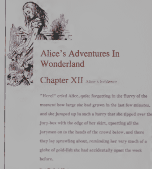

E 代码3.7的结果。应用了所有默认样式和第12章特定样式的页面。


- 3. 添加其余的嵌入式 CSS。如有需要，可以在此处包含其他嵌入式 CSS 规则。（参见本章中的“嵌入式：为网页添加样式”。）

提示 在外部样式表中使用 @import 现已被广泛不推荐，因为浏览器处理它们的方式。为了正常工作，浏览器必须停止渲染其他样式表，直到处理完 @import 样式表，这会减慢网站速度并阻止其他重要样式出现。

## Code 3.7 ch12.html—导入外部样式表 ch12.css（Code 3.5）和 global.css（Code 3.3）

```
<!-- HTML5 -->
<!DOCTYPE html>
<html lang="en">
<head>
<meta charset="UTF-8">
<title>Alice&#8217;s Adventures in Wonderland</title>
<style type="text/css" media="all">
@import url("global.css");
@import url("ch12.css");
h1 {
 color: orange;
 font-size: 3em;
 font-weight: normal; }
h1 .chaptertitle {
 color: yellow;
 font-size: .5em; }
</style>
</head>
<body>
<h1 style="color:red;">Alice&#8217;s Adventures In Wonderland</h1>
<h1 id="ch01">Chapter 1 <span class="chaptertitle">Down the Rabbit-Hole</span></h1>
<p><strong>Alice was beginning to get very tired of sitting by her sister on the bank,
</strong>and of having nothing to do: once or twice she had peeped into the book her
sister was reading, but it had no pictures or conversations in it, "and what is the use
of a book," thought Alice, "without pictures or conversations?"</p>
<article>
<footer><nav> Next:
<a class="chaptertitle" href="AAiWL-ch02.html">The Pool of Tears</a>
</nav></footer>
</body>
</html>
```

## (重新)定义 HTML 标签

几乎所有 HTML 标签都有与之关联的默认浏览器样式。以 <strong> 标签为例：其固有样式声明相当于 font-weight: bold。

通过向 strong HTML 选择器添加新的 CSS 声明，您可以将任何标记为 strong 的元素更改为您想要的任何外观 A。例如，您可以将所有斜体文本设置为粗体，甚至设置 font-weight: normal，这将防止文本加粗。

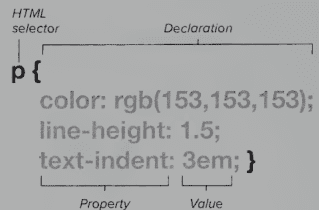

A 定义 HTML 标签样式所使用的一般语法。

### 定义 HTML 选择器：

- 1. 从要定义其属性的 HTML 选择器开始。添加左花括号 ({) 以打开规则（Code 3.8）。确保始终使用右花括号 (}) 关闭声明列表。如果忘记此操作，将会给您带来麻烦！

```
h1 {...}
```

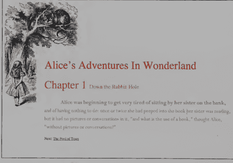

B Code 3.8 的结果。段落被缩进，不再是亮紫色。

```
<!-- HTML5 -->
<!DOCTYPE html>
<html lang="en">
<head>
<meta charset="UTF-8">
<title>Alice&#8217;s Adventures in Wonderland</title>
<link href="global.css" type="text/css" rel="stylesheet" media="all">
<link href="ch01.css" rel="stylesheet" type="text/css" media="all">
<style type="text/css" media="all">
h1 {
    color: orange;
    font-size: 3em;
    font-weight: normal;
}
h1.chaptertitle {
    color: yellow;
    font-size: 5em;
}
p {
    color: rgb(153,153,153);
    font-family: perpetua, georgia, serif;
    line-height: 1.5;
    text-indent: 3em;
}
</style>
</head>
<body>
<h1 style="color:red;">Alice&#8217;s Adventures In Wonderland</h1>
<h1 id="ch01">Chapter 1 <span class="chaptertitle">Down the Rabbit-Hole</span></h1>
<p><strong>Alice was beginning to get very tired of sitting by her sister on the bank,
</strong> and of having nothing to do: once or twice she had peeped into the book her
sister was reading, but it had no pictures or conversations in it, "and what is the use
of a book," thought Alice, "without pictures or conversations?"</p>
<article>
<footer><nav> Next:
<a class="chaptertitle" href="AAiWL-ch02.html">The Pool of Tears</a>
</nav>
</footer>
</article>
</body>
</html>
```

CSS 规则可以在文档的 <style> 标签内定义，也可以在导入或链接到 HTML 文档的外部 CSS 文件中定义。（参见本章中的“嵌入式：为网页添加样式”。）

- 2. 添加样式声明。在括号内，键入要分配给此 HTML 标签的样式声明——格式为 property: value——使用分号 (;) 分隔列表中的各个声明。在声明后还可以添加一个或多个换行符、空格或制表符，而不会干扰代码，以使其更易读。

```
color: red;
```

添加所需数量的声明，用分号分隔：

```
font-size: 3em; font-weight: normal;
```

提示 确保属性会与所涉及的 HTML 标签配合使用。例如，您不能使用 text-indent 属性（仅适用于块级元素）来定义粗体标签（它是内联元素）。请参阅附录 A，以验证可以分配给特定选择器的属性。

提示 重新定义标签不会隐式覆盖该标签的现有属性。因此，<strong> 标签仍然会使文本加粗，除非您使用 font-weight: normal 明确指示它不要这样做。

提示 虽然 body 标签也可以重新定义，但它表现得像块级标签。（参见第 2 章中的“HTML 元素类型”。）任何继承的属性都会影响页面上的所有内容。您可以利用这一点来设置默认页面样式，如第 4 章“从父级继承属性”中所述。

```
.chaptertitle {
    font-family: perpetua, georgia, serif;
    letter-spacing: -.1em; }
<h1 class="chaptertitle">...</h1>
```

使用类选择器的 CSS 规则的一般语法，然后可以使用类值将其应用于任何标签。

```
a.chaptertitle {
    font-style: italic;
    letter-spacing: auto; }
<a class="chaptertitle">...</a>
```

使用依赖类选择器规则的一般语法，然后只能将其应用于使用该 HTML 选择器的标签。

## 定义可重用类

类选择器允许您设置一个可应用于任何 HTML 标签的独立样式 A。与会自动定位特定标签的 HTML 选择器不同，类选择器被赋予一个唯一名称，然后使用 HTML 标签中的 style 属性或任何您想要使用它的标签来指定该名称。但是，您也可以指定将类应用于特定 HTML 标签的样式，使其成为依赖类 B。

### 定义类选择器：

- 1. 为您的类命名。键入句点 (.) 和您为其指定的类名；然后使用花括号 ({}) 打开和关闭声明块（Code 3.9）。

```
.chaptertitle {...}
```

CSS 类可以在文档的 style 标签内定义，也可以在导入或链接到 HTML 文档的外部 CSS 文件中定义。

类名可以是您选择的任何名称，但有以下注意事项：

- 仅使用字母和数字。可以使用连字符和下划线，但不能用于名称开头。
- 第一个字符不能是数字、下划线或连字符。
- 不要使用空格。

author 是一个独立类，因此您可以将其与任何想要的 HTML 标签一起使用，但有一个前提：为类设置的属性必须与您使用它的标签类型兼容。

- 2. 向规则添加声明。在括号内，键入要分配给此类的声明——格式为 property: value——使用分号 (;) 分隔列表中的各个声明。在声明后还可以添加一个或多个换行符、空格或制表符，而不会干扰代码，以使其更易读。
- font-family: perpetua, georgia, serif;
- letter-spacing: .1em;

- 3. 向 CSS 添加依赖类。您可以创建依赖类，通过在类前面放置 HTML 选择器，将类的声明绑定到特定的 HTML 标签。

```
a.chaptertitle {...}
```

- 在同一文档中，您可以为不同标签创建依赖类的不同版本（使用相同的名称），并拥有一个独立类（应用于带有该类的所有标签），如步骤 1 所示。

续第 56 页

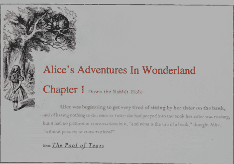

Code 3.9 的结果。章节标题在超文本链接中以不同方式设置样式。


## Code 3.9 chapter01.html-- chaptertitle 类用于对出现的章节标题进行样式设置

```html
<!-- HTML5 -->
<!DOCTYPE html>
<html lang="en">
<head>
<meta charset="UTF-8">
<title>Alice&#8217;s Adventures in Wonderland</title>
<link href="global.css" type="text/css" rel="stylesheet" media="all">
<link href="ch01.css" rel="stylesheet" type="text/css" media="all">
<style type="text/css" media="all">
h1 {
    color: orange;
    font-size: 3em;
    font-weight: normal; }
h1 .chaptertitle {
    color: yellow;
    font-size: .5em; }
p {
    color: rgb(153,153,153);
    font-family: perpetua, georgia, serif;
    line-height: 1.5;
    text-indent: 3em; }
.chaptertitle {
    font-family: perpetua, georgia, serif;
    letter-spacing: .1em;
}
a.chaptertitle {
    font-size: 2em;
    font-style: italic;
    letter-spacing: auto;
}
</style>
</head>
<body>
<h1 style="color:red;">Alice&#8217;s Adventures in Wonderland</h1>
<h1 id="ch01">Chapter 1 <span class="chaptertitle">Down the Rabbit-Hole</span></h1>
<p><strong>Alice was beginning to get very tired of sitting by her sister on the bank, and of having nothing to do: once or twice she had peeped into the book her sister was reading, but it had no pictures or conversations in it, "and what is the use of a book," thought Alice, "without pictures or conversations?"</strong></p>
<footer><nav> Next: <a class="chaptertitle" href="AAIWL-ch02.html">The Pool of Tears</a>
</nav></footer>
</body>
</html>
```

- 4. 将 class 属性添加到要应用它的 HTML 标签。

```html
<span class="chaptertitle">Down the Rabbit-Hole</span>
```

```html
<a class="chaptertitle" href="AAIWL-ch02.html">The Pool of Tears</a>
```

您可以通过在空格分隔的列表中添加其他类名，将多个类应用到单个 HTML 标签：class="name1 name2 names"

请注意，在 CSS 中定义类时，它以句点 (.) 开头。但是，在 HTML 标签中引用类名时不使用句点。在此处使用句点会导致类失效。

提示 您可以在 HTML 标签中将类与 ID 和/或内联规则混合使用。（参见本章中的“内联：为 HTML 标签添加样式”和“定义唯一 ID”。）

提示 由于 <div> 和 <span> 标签没有预定义的属性，您可以通过添加类来使用它们有效地创建自己的 HTML 标签。但是，请谨慎使用，因为一旦关联，您将被限制在特定位置使用这些特定类。

```css
#ch01 {
 color: red;
 font-size: 3em;
 font-weight: normal;
 }

<h1 id="ch01">...</h1>
```

ID 选择器规则的一般语法。

## 定义唯一 ID

与类选择器类似，ID 选择器可用于创建独立于任何特定 HTML 标签的唯一样式。因此，它们可以分配给任何 HTML 标签。ID 在 HTML 中用于帮助建立页面布局的结构，在代码中标识唯一元素，并将其单独列出以进行特殊处理，无论是用于 CSS 或 JavaScript 的定位。

### 定义 ID 选择器：

- 1. 将 ID 选择器添加到您的 CSS 中。ID 规则始终以井号 (#) 开头，后跟 ID 的名称（Code 3.10）。

```css
#ch01 {...}
```

名称可以是单词或您选择的任何字母或数字组合，但有以下注意事项：

- 仅使用字母和数字。您可以使用连字符和下划线，但请谨慎使用。一些早期浏览器会拒绝它们。
- 第一个字符不能是数字、连字符或下划线。
- 不要使用空格。

CSS 规则可以在文档头部的 <style> 标签内定义，也可以定义在导入或链接到 HTML 文档的外部 CSS 文件中。

- 2. 为您的 ID 添加声明。在花括号内，键入要分配给此 ID 的样式声明——格式为 property: value——使用分号 (;) 分隔列表中的各个声明。在声明后还可以添加一个或多个换行符、空格或制表符，而不会干扰代码，以使其更易读。

```css
font-family: perpetua, georgia, serif;
```

```css
text-shadow: 4px 4px 6px rgba(0,0,0,.5);
```

- 3. 将 id 属性添加到您选择的 HTML 标签，并将 ID 的名称作为其值。

```html
<h1 id="ch01">...</h1>
```

请注意，虽然井号 (#) 用于定义 ID 选择器，但在 HTML 标签中引用 ID 时不包含它。如果添加它，规则将失效。

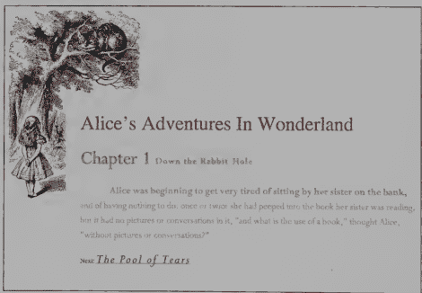

Code 3.10 的结果。章节标题使用了带阴影的 perpetua 字体。

```html
<!-- HTML5 -->
<!DOCTYPE html>
<html lang="en">
<head>
<meta charset="UTF-8">
<title>Alice's Adventures in Wonderland</title>
<link href="Alice&#8217;s.css" type="text/css" rel="stylesheet" media="all">
<link href="ch01.css" rel="stylesheet" type="text/css" media="all">
<style type="text/css" media="all">
h1 {
color: orange;
font-size: 3em;
font-weight: normal; }
h1 .chaptertitle {
color: yellow;
font-size: .5em; }
p {
color: rgb(153,153,153);
font-family: perpetua, georgia, serif;
line-height: 1.5;
text-indent: 3em; }
.chaptertitle {
font-family: perpetua, georgia, serif;
letter-spacing: .1em; }
a.chaptertitle {
font-size: 2em;
font-style: italic;
letter-spacing: auto; }
#ch01 {
font-family: perpetua, georgia, serif;
text-shadow: 0 4px rgba(0,0,0,.75); }
</style>
</head>
<body>
<h1 style="color:red;">Alice&#8217;s Adventures in Wonderland</h1>
<h1 id="ch01">Chapter 1 <span class="chaptertitle">Down the Rabbit-Hole</span></h1>
<p><strong>Alice was beginning to get very tired of sitting by her sister on the bank, and of having nothing to do: once or twice she had peeped into the book her sister was reading, but it had no pictures or conversations in it, "and what is the use of a book," thought Alice, without pictures or conversations?</strong></p>
<footer><nav> Next: <a class="chaptertitle" href="AAIWL-ch02.html">The Pool of Tears</a>
</nav></footer>
</body>
</html>
```

提示 您还可以创建依赖 ID，它们仅在应用于特定 HTML 标签时才使用 ID 的声明。但是，我从未用过这些，因为 ID 的要点是每页仅使用一次。

提示 虽然您可以为类和 ID 使用相同的名称，但应尽量避免这样做，因为这不可避免地会导致混淆。

提示 您可以在 HTML 标签中将 ID 与类和/或内联规则混合使用。

提示 ID 可以为每个屏幕元素提供唯一的名称和标识。这就是为什么 ID 在文档中仅用于一个元素，以使其成为可以通过 JavaScript 操作的对象。

```
HTML selector
ID selector Declaration
h1#ch01 {
color: red;
font-size: 3em;
font-weight: normal; }
<h1 id="ch01">...</h1>
ID attribute
```

依赖 ID 选择器规则的一般语法。

```css
* {
  color: red;
  font-size: 3em;
  font-weight: normal; }
```

通用选择器规则的一般语法。

## 定义通用样式

通用选择器是一个通配符字符，用作占位符，以表示上下文列表中可以出现在该位置的任何 HTML 类型选择器 (A)。

但是，请记住，通用选择器可以用于任何配置中的任何 HTML 选择器，而不仅仅是本节所示的独立选择器。当您在下一章中使用上下文样式时，其有用性将变得明显。

### 使用通用选择器：

- 1. 添加通用选择器。键入星号 (*) 然后是左花括号 (Code 3.11)。此选择器随后成为通配符，可以是任何 HTML 标签。

```css
* {...}
```

- 2. 为您的通用选择器规则添加声明。在花括号内，键入要分配给此 ID 的样式声明——格式为 property: value——使用分号 (;) 分隔列表中的各个声明。在声明后还可以添加一个或多个换行符、空格或制表符，而不会干扰代码，以使其更易读。

```css
margin: 0; padding: 0;
```

在此格式中，样式将应用于页面上的每个元素。


## Code 3.11 chapter01.html—通用选择器用于将所有元素的边距和内边距重置为 0，覆盖任何浏览器默认样式

```html
<!-- HTML5 -->
<!DOCTYPE html>
<html lang="en">
<head>
<meta charset="UTF-8">
<link href="global.css" type="text/css" rel="stylesheet" media="all">
<link href="ch01.css" rel="stylesheet" type="text/css" media="all">
<title>Alice&#8217;s Adventures in Wonderland</title>
<style type="text/css" media="all">
* {
    margin: 0;
    padding: 0;
}
h1 {
    color: orange;
    font-size: 3em;
    font-weight: normal;
}
h1 .chaptertitle {
    color: yellow;
    font-size: .5em;
}
p {
    color: rgb(153,153,153);
    font-family: perpetua, georgia, serif;
    line-height: 1.5;
    text-indent: 3em;
}
.chaptertitle {
    font-family: perpetua, georgia, serif;
    letter-spacing: .1em;
}
a.chaptertitle {
    font-size: 2em;
    font-style: italic;
    letter-spacing: auto;
}
#ch01 {
    font-family: perpetua, georgia, serif;
    text-shadow: 0 0 4px rgba(0,0,0,.75);
}
</style>
</head>
<body>
<h1 style="color:red;">Alice&#8217;s Adventures In Wonderland</h1>
<h1 id="ch01">Chapter 1 <span class="chaptertitle">Down the Rabbit-Hole</span></h1>
<p><strong>Alice was beginning to get very tired of sitting by her sister on the bank,</strong> and of having nothing to do: once or twice she had peeped into the book her sister was reading, but it had no pictures or conversations in it, "and what is the use of a book," thought Alice, "without pictures or conversations?"</p>
<footer><nav> Next: <a class="chaptertitle" href="AAiWL-ch02.html">The Pool of Tears</a></nav></footer>
</body>
</html>
```

**提示** 虽然你也可以将样式应用于 html 或 body 元素以使其向下级联到子元素，但并非所有样式都会被子元素继承。使用通用选择器会将样式直接应用于每个元素。

**提示** 通用选择器提供了一种简单的方法来创建 CSS 重置，如第 13 章所述。

**提示** 通用选择器在 IE6 中不适用。

## 《爱丽丝梦游仙境》

### 第 1 章 兔子洞

Alice was beginning to get very tired of sitting by her sister on the bank, and of having nothing to do: once or twice she had peeped into the book her sister was reading, but it had no pictures or conversations in it, 'and what is the use of a book,' thought Alice, 'without pictures or conversations?'

*眼泪池*

**B** 这是 Code 3.11 的结果。所有内容的边距和内边距都设置为 0，为你的设计提供了一个干净的起点。

## 分组：定义使用相同样式的元素

如果你希望两个或多个选择器拥有相同的声明，请将选择器分组在由逗号分隔的列表中。你可以在声明块中定义通用属性，然后（如果需要）为每个选择器单独添加规则以对其进行细化。

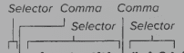

```css
p, .chaptertitle, #ch01 {
    color: red;
    font-size: 3em;
    font-weight: normal;
}
```

所有接收相同声明块的选择器列表的一般语法。

### 对选择器进行分组：

- 添加一组由逗号分隔的选择器。输入由逗号分隔的选择器列表（HTML、类或 ID）（Code 3.12）。你也可以在逗号后添加一个或多个换行符、空格或制表符，而不会干扰代码，以使其更易读。

```css
p, .chaptertitle, #ch01 {
```

这些选择器都接收相同的声明。CSS 规则可以定义在文档 head 的 style 标签内，也可以定义在导入或链接到 HTML 文档的外部 CSS 文件中。

- 为选择器分组添加通用声明。在花括号内，输入要分配给所有列出的选择器的样式声明——格式为 property: value——使用分号 (;) 分隔列表中的各个声明。你也可以在声明后添加一个或多个换行符、空格或制表符，而不会干扰代码，以使其更易读。

```css
font-family: perpetua, georgia, serif;
```

Code 3.12 chapter01.html—为一级标题、.chaptertitle 类和 ch01 ID 定义了常用样式。不过，实际上，此代码与 Code 3.11 看起来没有区别，因为我们没有添加任何新样式，只是将一个样式移至共享位置。

```html
<!-- HTML5 -->
<!DOCTYPE HTML>
<html lang="en">
<head>
<meta charset="UTF-8">
<title>Alice's Adventures in Wonderland</title>
<link rel="stylesheet" type="text/css" media="all">
<link rel="stylesheet" type="text/css" media="all">
<style type="text/css" media="all">
* {
    margin: 0;
    padding: 0;
}
p, .chaptertitle, #ch01 {
    font-family: perpetua, georgia, serif;
}
h1 {
    color: orange;
    font-size: 3em;
    font-weight: normal;
}
h1 .chaptertitle {
    color: yellow;
    font-size: .5em;
}
p {
    color: rgb(153,153,153);
    line-height: 1.5;
    text-indent: 3em;
}
.chaptertitle {
    letter-spacing: .1em;
}
a.chaptertitle {
    font-size: 2em;
    font-style: italic;
    letter-spacing: auto;
}
#ch01 {
    font-family: perpetua, georgia, serif;
    text-shadow: 0 0 4px rgba(0,0,0,.75);
}
</style>
</head>
<body>
<h1 style="color:red;">Alice's Adventures in Wonderland</h1>
<h1 id="ch01"><span class="chaptertitle">Down the Rabbit-Hole</span></h1>
<p>Alice was beginning to get very tired of sitting by her sister on the bank,
and of having nothing to do: once or twice she had peeped into the book her sister was reading,
but it had no pictures or conversations in it, "and what is the use of a book," thought Alice,
"without pictures or conversations?"</p>
<footer><nav>Next: <a class="chaptertitle" href="AAiWL-ch02.html">The Pool of Tears</a></nav></footer>
</body>
</html>
```

- 根据需要添加细化内容。然后，你可以单独为每个选择器添加或更改声明，以满足你的需求。如果你正在覆盖组规则中设置的声明，请确保此规则在 CSS 中位于组规则之后。（参见第 4 章中的“确定级联顺序”。）

**提示** 这样对选择器进行分组可以节省大量时间和重复工作。但要小心。通过更改组合声明中任何属性的值，你会更改列表中每个选择器的该值。

**提示** 对选择器进行分组不会直接影响其级联顺序（如第 4 章所述）；相反，分组被视为每个选择器都按列表中选择器的顺序分配了此规则。

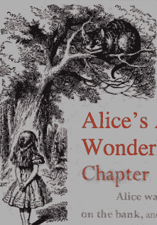

### 《爱丽丝梦游仙境》第 1 章

Alice was beginning to get very tired of sitting by her sister on the bank, and of having nothing to do: once or twice she had peeped into the book her sister was reading, but it had no pictures or conversations in it, “and what is the use of a book,” thought Alice, “without pictures or conversations?”

下一章 《眼泪池》。

**6** 这是 Code 3.12 的结果。字体系列 perpetua 应用于所有常用元素。

```text
Slash || Asterisk
/*
Styles for Alice's Adventure in Wonderland —
Uses neutral color palette and
Tenniel illustrations in the
background. */
Asterisk || Slash
```

CSS 注释的一般语法。

## 向 CSS 添加注释

注释允许你向代码中添加重要说明，以提醒你自己或他人。注释不会影响代码；注释仅向查看代码的人添加说明或提供指导。你可以在 <style> 标签或外部 CSS 文件中包含注释。

### 在样式表中包含注释：

- 添加注释开始标记。要在样式表中打开注释区域（Code 3.13），请输入斜杠 (/) 和星号 (*)。

```
/*
```

- 输入你的注释。你可以使用任何字母、数字、符号，甚至通过按 Return 或 Enter 键来使用换行符。

```
Styles for Alice's Adventure in Wonderland
```

- 添加注释结束标记。通过输入星号 (*) 和斜杠 (/) 来关闭注释。

```
*/
```

> **提示** 在斜杠星号内，你可以添加任何想要的文本。

> **提示** 不能嵌套注释。

> **提示** 注释是组织代码的好方法，允许你添加“标题”来分隔代码的不同部分。

> **提示** 我建议将常量值（如颜色值）放在 CSS 代码顶部的注释中，以便快速参考。


## 代码 3.13 CSS 代码中的注释对最终产品没有影响。它们只是用来添加注释。

```html
<!-- HTML5 -->
<!DOCTYPE html>
<html lang="en">
<head>
    <meta charset="UTF-8">
    <title>Alice's Adventures in Wonderland</title>
    <link href="global.css" type="text/css" rel="stylesheet" media="all">
    <link href="ch01.css" rel="stylesheet" type="text/css" media="all">
    <style type="text/css" media="all">
/* Styles for Alice's Adventure in Wonderland – Uses neutral color palette and Tenniel
- Illustrations in the background. */
* {
    margin: 0;
    padding: 0; }
p, .chaptertitle, #ch01 {
    font-family: perpetua, georgia, serif; }
h1 {
    color: orange;
    font-size: 3em;
    font-weight: normal; }
h1 .chaptertitle {
    color: yellow;
    font-size: .5em; }
p {
    color: rgb(153,153,153);
    line-height: 1.5;
    text-indent: 3em; }
.chaptertitle {
    letter-spacing: 1em; }
a.chaptertitle {
    font-style: italic;
    letter-spacing: auto; }
#ch01 {
    font-family: perpetua, georgia, serif;
    text-shadow: 0 0 4px rgba(0,0,0,.75); }
</style>
</head>
<body>
    <h1 style="color:red;">Alice's Adventures In Wonderland</h1>
    <h1 id="ch01"><span class="chaptertitle">Down the Rabbit-Hole</span></h1>
    <p><strong>Alice</strong> was beginning to get very tired of sitting by her sister on the bank,<strong>
and of having nothing to do: once or twice she had peeped into the book her sister was reading,
but it had no pictures or conversations in it, "and what is the use of a book," thought Alice,
"without pictures or conversations?"</p>
    <footer><nav> Next: <a class="chaptertitle" href="#ch02.html">The Pool of Tears</a>
    </nav></footer>
</article>
</body>
</html>
```

# 选择性样式

仅为网页元素设置样式是不够的。CSS 的艺术——因此也是 Web 设计的艺术——在于根据元素的上下文对其进行样式设置。您必须考虑元素在文档中的位置；周围是哪些元素；其属性、内容和动态状态；甚至显示元素的平台（屏幕、手持设备、电视等）。

选择性样式是 CSS 最接近传统计算机编程的地方，它允许您在元素满足特定条件时对其进行样式设置。这种样式设置可能会变得越来越复杂，因此，至少在本章中，尽可能简单地开始并建立牢固的理解基础非常重要。

## 本章内容

- 元素家族树 70
- 基于上下文定义样式 71
- ★ 使用伪类 82
- 使用伪元素 96
- 基于标签属性定义样式 100
- ★ 查询媒体 104
- 从父元素继承属性 115
- 使声明重要 117
- 确定层叠顺序 119

## 元素家族树

当一个标签被另一个标签包围时——一个在另一个内部——这些标签是嵌套的。
<h2><strong>第 2 章</strong> 泪之池</h2>

在嵌套集中，此示例中的外部元素（<h2>）称为父元素，内部元素（<strong>）是子元素。子标签及其任何子标签是父元素的后代元素。同一父元素下的两个标签称为兄弟元素，在 HTML 代码中紧挨着的两个标签称为相邻兄弟元素。

- 父元素包含其他元素（子元素）。子元素通常会从父元素继承样式。
- 后代元素是另一个元素内的任何元素。
- 子元素是相对于父元素的第一代后代元素。第二代及更高级别的元素有时被称为孙元素。
- 相邻或前序兄弟元素是同一代的子元素，在 HTML 代码中紧挨着彼此。

在第 3 章中，您学习了无论元素在 HTML 代码中的位置如何，都可以指定单个元素样式的方法。但是，CSS 还允许您根据元素的内容来指定其样式。使用上下文选择器，您可以根据标签与页面上其他标签、类或 ID 的关系来指定样式。

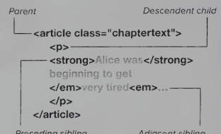

A article 元素是由段落、strong 和 强调标签创建的元素的父元素，这些元素是其后代元素。只有段落标签是直接子元素。由 强调 和 strong 标签创建的元素是段落标签的子元素，也是彼此的兄弟元素。

## 基于上下文定义样式

上下文样式允许您根据元素的父元素和兄弟元素来指定特定元素的显示方式。例如，您可能希望 强调标签在页面的主标题中以一种方式显示，在子标题中以另一种方式显示。您可能还希望在文本段落中有又一种外观。这些组合选择器（表 4.1）是 CSS 中最常用、最有用的选择器之一。

## 设置后代元素样式

您可以根据父选择器或空格分隔的选择器列表，为单个后代元素设置样式。仅当最后一个选择器是前面选择器的后代时，才会为其应用样式 4。

当您想要指示给定级别的精确选择器无关紧要时，可以使用第 3 章中描述的通用选择器 (*) 5。

```
Space-separated list of selectors
p strong em {
    color: red;
}
Declaration list
```

A 后代选择器的一般语法。

```
Universal selector
p * em {
    color: red;
}
Space-separated
list of selectors
Declaration list
```

B 使用通用选择器的后代选择器的一般语法。

### 表 4.1 组合选择器

| 格式 | 选择器名称 | 元素在以下情况下会被设置样式 |
| :--- | :--- | :--- |
| a b c | 后代 | c 是 b 的后代，而 b 是 a 的后代 |
| a * b | 通用 | b 在 a 内部，无论 b 的父元素是谁 |
| a > b | 直接子元素 | b 是 a 的直接子元素 |
| a + b | 相邻兄弟 | 兄弟 b 紧跟在 a 之后 |
| a ~ b | 一般兄弟 | 兄弟 b 在 a 之后的任何位置 |

### 设置后代元素样式：

1. 设置后代选择器列表。

输入父标签的 HTML 选择器，后跟一个空格，然后是最终子元素或另一个父元素（代码 4.1）。

```
article.chaptertext p strong em {...}
```

您可以为嵌套标签拥有的任意多个父元素输入任意多个 HTML 选择器，但列表中的最后一个选择器是接收规则中所有样式的选择器。

2. 仅当模式匹配时，才会使用样式。

```
<article class="chaptertext"><p> <strong><em>...</em></strong> </p></article>
```

仅当最终选择器作为前面选择器内的后代嵌套出现时，才会应用样式。因此，在此示例中，仅当 强调标签 (em) 在 strong 标签中，而 strong 标签在段落标签 (p) 中，且该段落标签在使用 chaptertext 类的 article 标签 (article.chaptertext) 中时，才会对其设置样式。

在以下情况下，强调标签不会由步骤 1 中的代码设置样式，因为它不在 strong 标签中：

```
<article class="chaptertext"><p> <em>...</em></p></article>
```

在以下情况下，强调标签也不会由步骤 1 中的代码设置样式，因为 article 标签没有 chaptertext 类：

```
<article><p><strong><em>...</em></strong> </p></article>
```

需要注意的是，尽管在这些最后两种情况下选择器不会对 强调标签设置样式，但这并不意味着其他声明中的样式不会这样做。

## 代码 4.1 如果 强调标签的父元素是 h1 标签和使用 copy 类的 article 标签，则为其设置样式

```html
<!DOCTYPE html>
<html lang="en">
<head>
<meta charset="UTF-8">
<title>Alice's Adventures in Wonderland</title>
<style type="text/css" media="all">
article.chaptertext p strong em {
    color: red;
    font-weight: normal;
    font-size: 2em;
    font-style: normal; }
</style>
</head>
<body>
<article class="chaptertext">
<p><strong>Alice was beginning to get <em>very tired</em> of sitting by her sister on the bank,
</strong> and of having nothing to do: <strong>once or twice</strong> she had peeped into the
book her sister was reading, but it <em>had no pictures or conversations in it</em>, <q>and
<em>what</em> is the use of a book,</q> <strong>thought Alice</strong>, <q>without pictures or
conversations?</q></p>
</article>
</body>
</html>
```

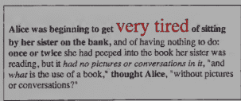

代码 4.1 的结果。满足选择性条件的唯一文本是红色的，在此示例中，仅是 h1 中的 强调标签。


## 普遍设置后代元素样式：

- 1. 建立包含通配符的后代选择器列表。输入父标签的 HTML 选择器，后跟一个空格，然后是星号 (*) 或其他选择器（代码 4.2）。

```
article chaptertext p * em {...}
```

- 2. 只有在匹配模式时才会使用样式。通常，通配符用于选择器列表的末尾，以便样式明确应用于父元素的所有直接后代（子元素）。但是，样式不会直接应用于这些子元素的后代。

在此示例中，样式应用于段落中*任何*父标签（例如 `<strong>`）内的强调标签，例如：

```
<article class="chaptertext"><p>
<strong><em>...</em></em></strong>
</p></article>
```

或者：

```
<article class="chaptertext"><p>
<q><em>...</em></q></p></article>
```

但是，段落中*不在*其他标签内的强调标签不会被设置样式。

```
<article class="chaptertext"><p>
<em>...</em></p></article>
```

> 提示 与分组选择器一样，上下文选择器可以在列表中包含类选择器（依赖或独立）、ID 选择器和 HTML 选择器。

代码 4.2 为仅在使用 copy 类的 article 标签中具有父元素的强调标签设置样式
```
<!DOCTYPE html>
<html lang="en">
<head>
<meta charset="UTF-8">
<title>Alice&8217;s Adventures in Wonderland</title>
<style type="text/css" media="all">
article.chaptertext p * em {
    border: 1px double red;
    font-size: 2em;
    font-weight: normal; }
</style>
</head>
<body>
<article class="chaptertext">
<p><strong>Alice was beginning to get <em>very tired</em> of sitting by her sister on the bank,
</strong>and of having nothing to do: <strong>once or twice</strong> she had peeped into the
book her sister was reading, but it <em>had no pictures or conversations in it</em>, <q>and
<em>what</em> use</em> is the use of a book,<q> <strong>thought Alice</strong>, <q>without pictures or
conversations?</q></p>
</article>
</body>
</html>
```

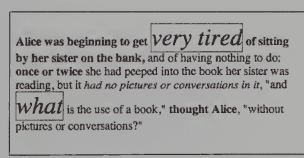

代码 4.2 的结果。红色文本与通配符的选择性条件匹配。在此示例中，所有强调标签均匹配。

## 仅设置子元素样式

如果您只想设置父元素的子元素样式（而不是孙元素），则必须指定父选择器和子选择器，并用右尖括号 (>) 分隔 ⑤。

### 定义子选择器：

- 1. 建立直接子选择器列表。

输入父元素的选择器（HTML、类或 ID），后跟右尖括号 (>) 和子选择器（HTML、类或 ID）。

```
article.chaptertext > p > em {...}
```

您可以重复任意次，最终选择器为应用样式的目标（代码 4.3）。选择器与大于号之间可以有一个空格，也可以没有空格。

- 2. 只有在匹配模式时才会使用样式。

```
<article class="chaptertext"><p><em>...</em></p></article>
```

步骤 1 的样式仅在最终选择器是前一元素的直接子元素嵌套时才应用。将标签放在任何其他 HTML 标签中都会破坏模式。在此示例中，仅当强调标签 (em) 在 article 标签内的段落 (p) 中时才会设置样式。

但是，任何位于其他标签内的强调标签都不会设置样式：

```
<article class="chaptertext"><p><q><em>...</em></q></p></article>
```

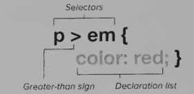

⑤ 直接子选择器的一般语法。

代码 4.3 仅当强调标签是段落的子元素，而该段落又是具有 copy 类的 article 标签的子元素时，才应用样式。
```
<!DOCTYPE html>
<html lang="en">
<head>
<meta charset="UTF-8">
<title>Alice&8217;s Adventures in Wonderland</title>
<style type="text/css" media="all">
article.chaptertext > p > em {
    color: silver;
    background: red;
    font-size: 2em;
    font-weight: normal; }
</style>
</head>
<body>
<article class="chaptertext">
<p><strong>Alice</strong> was beginning to get <em>very tired</em> of sitting by her sister on the bank,
<strong>and</strong> of having nothing to do: <strong>once</strong> or twice</strong> she had peeped into the
book her sister was reading, but it <em>had no pictures or conversations</em> in it, <q>and
<em>what</em> is the use of a book,</q> <p><strong>thought Alice</strong>, <q>without pictures or
conversations?</q></p>
</article>
</body>
</html>
```

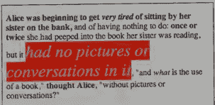

4 代码 4.3 的结果。红色文本与直接子条件匹配。在此示例中，强调标签在段落中匹配，但在标题中不匹配。

## 设置兄弟元素样式

兄弟元素是指具有相同父元素的元素。您可以设置紧邻另一个元素的兄弟元素 ⑥ 或出现在该兄弟元素之后任意位置的元素 ⑦ 的样式。

### 定义相邻兄弟选择器：

- 1. 建立相邻兄弟选择器列表。输入第一个元素的选择器（HTML、类或 ID），一个加号 (+)，然后是要应用样式的相邻元素的选择器（HTML、类或 ID）（代码 4.4）。

```
strong + em {...}
```

- 2. 只有在匹配模式时才会使用样式。

```
<strong>...</strong><em>...</em>
```

样式将应用于紧跟在前一个选择器之后且中间没有其他选择器的任何兄弟元素。在它们之间放置任何元素（即使是换行标签）都会破坏模式。以下模式将不起作用：

```
<strong>...</strong>...<q>...</q>... <em>...</em>
```

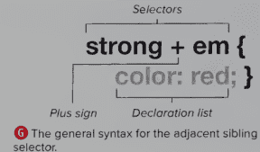

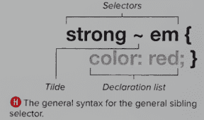

代码 4.4 仅当强调标签位于紧跟在另一个段落之后的段落中时才应用样式 1
```
<!DOCTYPE html>
<html lang="en">
<head>
<meta charset="UTF-8">
<title>Alice&8217;s Adventures in Wonderland</title>
<style type="text/css" media="all">
strong + em {
color: red;
background: silver;
font-size: 2em; }
</style>
</head>
<body>
<article class="chaptertext">
<p>...Alice was beginning...</p>
</article>
</body>
</html>
```

> Alice 开始觉得在岸边和姐姐坐在一起很无聊，而且无事可做：她曾经一两次偷看姐姐正在读的书，但那本书里既没有图片也没有对话。“一本书有什么用，”Alice 想道，“没有图片或对话？”

代码 4.4 的结果。红色文本与相邻兄弟条件匹配——在此示例中，第二和第三段落中的强调标签匹配，但第四段落不匹配，因为中间有一个块引用。

### 定义一般兄弟选择器：

- 1. 建立一般兄弟选择器列表。输入第一个兄弟元素的选择器（HTML、类或 ID），一个波浪号 (~)，然后是另一个选择器（HTML、类或 ID）（代码 4.5）。

```
strong ~ em {...}
```

您可以根据需要重复任意次，但列表中的最后一个选择器是您要设置样式的目标。

- 2. 只有在匹配模式时才会使用样式。

```
<strong>...</strong><em>...</em>...<q>...</q>...<em>...</em>
```

样式将应用于第一个兄弟选择器之后的任何兄弟元素，而不仅仅是第一个。与相邻兄弟不同，即使中间有其他类型的标签，此规则也适用。在上述情况中，这包括第二和第三个 strong 标签

> 提示 虽然本节所示的通配符用于组合选择器，但它可以与任何选择器类型一起使用。表 4.2 显示了如何应用它。

| 格式 | 设置元素样式的条件 |
| :--- | :--- |
| a * b | a 内部的 b，无论 b 的父元素是什么 |
| a > * > b | b 是 a 的直接子元素的直接子元素 |
| a + * + b | 兄弟元素 b 紧跟在紧跟在 a 之后的任何元素之后 |
| *:hover | 鼠标指针悬停在任何元素上 |
| *:disabled | 任何已禁用的元素 |
| *:first-child | 任何元素的第一个子元素 |
| *:lang(j) | 任何使用指定语言代码的元素 |
| *:not(s) | 任何未使用指示选择器的元素 |
| *:first-letter | 任何元素的第一个字母 |


## 代码 4.5 如果强调标签位于段落中且其前有任何段落类型的同级元素，则将样式应用于该强调标签 ①。

```html
<!DOCTYPE html>
<html lang="en">
<head>
<meta charset="UTF-8">
<title>Alice&#8217;s Adventures in Wonderland</title>
<style type="text/css" media="all">
strong + em {
color: red;
background: gray;
font-size: 2em; }
</style>
</head>
<body>
<article class="chaptertext">
<p><strong>Alice was beginning to get <em>very</em> tired of sitting by her sister on the bank,</strong> and of having nothing to do: <strong>once or twice</strong> she had peeped into the book her sister was reading, but it <em>had no pictures or conversations in it</em>, 'and <em>what?</em> is the use of a book,' <strong>thought Alice</strong>, 'without pictures or conversations?'</p>
</article>
</body>
</html>
```

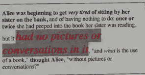

① 代码 4.5 的结果。红色文本符合一般同级条件——在此例中为第二、第三和第四段落中的强调标签。

## 使用伪类

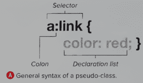

许多 HTML 元素都有与其相关的特殊状态或用途，可以独立进行样式设置。一个典型示例是链接标签 <a>，它具有 link（其正常状态）、visited（访问过的状态，即访问者已访问过链接所代表的页面）、hover（访问者将鼠标悬停在链接上方）和 active（访问者单击链接）状态。所有这四种状态都可以单独设置样式。

伪类是元素的预定义状态或用途，可以独立于元素的默认状态进行样式设置 [A]。

- 链接（表 4.3）—伪类不仅用于设置锚标签的初始外观，还用于设置其被访问后、访问者将鼠标悬停在其上方以及访问者单击它时的外观。
- 动态（表 4.3）—伪类可以应用于任何元素，以定义当用户悬停在其上方、单击它或选择它时的样式。
- 结构（表 4.4）—伪类与同级组合选择器类似，但允许您根据精确或计算出的数值位置专门设置元素样式。
- 其他（表 4.4）—伪类可用于根据语言或元素不是什么标签来设置元素样式。

## 表 4.3 链接和动态伪类

| 格式 | 选择器名称 | 元素样式设置条件 |
| :--- | :--- | :--- |
| :link | 链接 | href 的值不在历史记录中 |
| :visited | 已访问链接 | href 的值在历史记录中 |
| :target | 目标链接 | 是目标锚链接 |
| :active | 激活 | 元素被单击 |
| :hover | 悬停 | 指针位于元素上方 |
| :focus | 焦点 | 元素具有屏幕焦点 |

## 表 4.4 结构/其他伪类

| 格式 | 选择器名称 | 元素样式设置条件 |
| :--- | :--- | :--- |
| :root | 根 | 是文档中的顶级元素 |
| :empty | 空 | 没有子元素 |
| :only-child | 唯一子元素 | 没有同级元素 |
| :only-of-type | 唯一类型 | 在其同级元素中具有唯一的选择器 |
| :first-child | 第一个子元素 | 是另一个元素的第一个子元素 |
| :nth-of-type(n) | 第 n 个类型 | 是带有该选择器的第 n 个元素 |
| :nth-last-of-type(n) | 从最后开始第 n 个类型 | 是从带有该选择器的最后一个元素开始计算的第 n 个带有该选择器的元素 |
| :last-child | 最后一个子元素 | 是父元素中的最后一个子元素 |
| :first-of-type | 第一个类型 | 是父元素中其选择器类型的第一个元素 |
| :last-of-type | 最后一个类型 | 是父元素中其选择器类型的最后一个元素 |
| :lang() | 语言 | 有指定的语言代码定义 |
| :not(s) | 否定 | 未使用特定选择器 |

## 设置链接样式

虽然链接是一个标签，但其各个状态不是。要为这些状态设置属性，必须使用链接可能具有的每个状态关联的伪类（按以下顺序）：

- :link 允许您声明尚未被选中的超文本链接的外观。
- :visited 允许您设置访问者先前选择过的链接的外观——即标签中 `href` 属性的 URL 属于浏览器历史记录。
- :hover 允许您设置访问者的指针位于元素上方时的元素外观。
- :active 在元素被访问者单击或选择时设置元素的样式。

有关链接应使用哪些样式的建议，请参阅侧边栏“选择链接样式”。

## 设置对比鲜明的链接外观：

- 1. 设置锚标签样式。
  a {...}

  虽然不是必需的，但最好先定义通用的锚标签样式（代码 4.6）。这与设置 :link 伪类不同，因为这些样式会应用于所有链接伪类。因此，您需要声明任何将保持不变或仅在某一状态中更改的样式。

- TOC:
  - 兔子洞
  - 泪水湖
  - 鸦雀赛跑与长篇故事
  - 白兔派来小比尔
  - 毛毛虫的忠告
  - 猪与胡椒
  - 疯狂茶会
  - 王后的槌球场
  - 假海龟的故事
  - 龙虾四人舞
  - 谁偷了馅饼？
  - 艾丽丝的证词

代码 4.6 的结果显示了每种状态下的链接样式，以帮助用户了解正在发生的事情。

## 代码 4.6 链接样式首先针对默认状态设置，然后针对所有四种链接状态设置，从而创建颜色区别。另请注意，我已使用 text-decoration 关闭下划线，但使用 border-bottom 添加了下划线效果。

```html
<!DOCTYPE html>
<html lang="en">
<head>
<meta charset="UTF-8">
<title>Alice&#8217;s Adventures in Wonderland</title>
<style type="text/css" media="all">
a {
text-decoration: none;
font-size: 2em; }
a:link {
color: darkened;
border-bottom: 1px solid red; }
a:visited {
color: darkened;
border-bottom: 1px dashed red; }
a:hover {
color: red;
border-bottom: 1px solid pink; }
a:active {
color: pink;
border-bottom: 1px solid pink; }
</style>
</head>
<body>
<nav>
<h2>TOC:</h2>
<ol>
<li><a href="AAIWL-ch01.html">Down the Rabbit-hole</a></li>
<li><a href="AAIWL-ch02.html">The Pool of Tears</a></li>
<li><a href="AAIWL-ch03.html">A Caucus-race and a Long Tale</a></li>
<li><a href="AAIWL-ch04.html">The Rabbit sends in a Little Bill</a></li>
<li><a href="AAIWL-ch05.html">Advice from a Caterpillar</a></li>
<li><a href="AAIWL-ch06.html">Pig and Pepper</a></li>
<li><a href="AAIWL-ch07.html">A Mad Tea-party</a></li>
<li><a href="AAIWL-ch08.html">The Queen’s Croquet-ground</a></li>
<li><a href="AAIWL-ch09.html">The Mock Turtle’s Story</a></li>
<li><a href="AAIWL-ch10.html">The Lobster Quadrille</a></li>
<li><a href="AAIWL-ch11.html">Who Stole the Tarts?</a></li>
<li><a href="AAIWL-ch12.html">Alice&#8217;s Evidence</a></li>
</ol>
</nav>
</body>
</html>
```

- 2. 设置默认链接状态。键入要设置样式的元素的选择器（锚、类或 ID），后跟冒号 (:)，然后是 link。
  a:link {...}

  您可以覆盖为锚标签设置的样式，但此规则应始终位于 :visited 伪类之前。

- 3. 设置已访问链接状态。键入要设置样式的元素的选择器（锚、类或 ID），后跟冒号 (:)，然后是 visited。
  a:visited {...}

- 4. 设置悬停链接状态。键入要设置样式的元素的选择器（锚、类或 ID），后跟冒号 (:)，然后是 hover。
  a:hover {...}

- 5. 设置激活链接状态。键入要设置样式的元素的选择器（锚、类或 ID），后跟冒号 (:)，然后是 active。
  a:active {...}

- 6. 根据需要将样式应用于链接状态。
  <a href="AAIWL-ch01.html">...</a>

页面上的所有链接在设置各种链接状态时都将遵守您在此处制定的规则。您可以——并且应该——使用选择性样式来区分链接类型。

在此示例中，伪类直接应用于锚标签，但也可以使用任何类或 ID，只要随后将其应用于锚标签即可。

## 选择链接样式

大多数浏览器默认将未访问的链接设置为蓝色，将已访问的链接设置为红色或紫色。为已访问和未访问链接使用两种不同颜色的问题在于，访问者可能不记得哪种颜色适用于哪种类型的链接。您选择的颜色必须将链接与屏幕上的其他文本区分开来，并区分各种状态（link、visited、hover 和 active），而不会主导屏幕并变得令人分心。

我建议为未访问的链接使用一种与页面背景颜色和文本颜色都形成对比的颜色。然后，对于已访问的链接，使用同一种颜色的更深或更浅版本，该版本与背景形成对比，但比未访问链接颜色更暗。这样，更亮的未访问链接将从较暗的已访问链接中显著突出。

例如，在背景为白色、文本为黑色的页面上，我可能会为链接使用亮红色 (rgb(255,0,0))，为已访问链接使用淡红色 (rgb(255,153,153))。较亮的版本非常突出；较淡的版本不那么显眼，但仍然明显是一个链接。


提示 你可以将动态伪类 :hover、:active 和 :focus 应用于任何元素，而不仅仅是链接。

提示 常规锚链接样式会被不同状态及其之间的状态继承。例如，你为 :link 外观设置的字体，将被 :active、:visited 和 :hover 状态继承。

提示 Web 是一种超文本媒介，因此使用户能够区分文本、链接和已访问链接非常重要。因为用户并不总是开启“下划线链接”选项，所以为每个文档设置链接外观是个好主意。

提示 如果使用过多颜色，访问者可能无法分辨哪些词是链接，哪些不是。

提示 本示例中，链接样式是为整个页面设置的，但链接可用于多种用途。例如，链接可用于全局导航、文章标题列表，甚至作为动态控件。因此，根据链接的用途设置样式是个好主意：

```
nav a {...}
nav a:link {...}
nav a:visited {...}
```

提示 前面的样式仅应用于导航元素中的链接。

## 交互样式

加载后，网页远非静态。用户会立即开始与页面交互，在屏幕上移动指针并随处点击。动态伪类允许你在用户与元素交互时对其进行样式设置，从而提供视觉反馈：

- :hover—与链接相同，但设置指针悬停在元素上时的外观。
- :focus—应用于可接收焦点的元素，例如表单文本字段。
- :active—与链接相同，但设置元素被单击或选中时的样式。

## 定义动态伪类：

- 1. 设置默认元素的样式。
  `input {...}`
  虽然可选，但通常为接收动态样式的元素设置默认非动态样式是个好主意（代码 4.7）。

- 2. 设置元素悬停状态的样式。
  输入选择器（HTML、类或 ID）、冒号 (:)，然后是 hover。
  `input:hover {...}`
  只要指针进入元素的框（关于盒模型的详细信息见第 10 章），样式更改就会发生。

```html
<!DOCTYPE html>
<html lang="en">
<head>
  <meta charset="UTF-8">
  <title>Alice&rsquo;s Adventures in Wonderland</title>
  <style type="text/css" media="all">
  input {
    border: 3px solid gray;
    background-color: silver;
    color: gray;
    padding: 0 5px;
    font-size: 1.5em; }
  input[type="button"] {
    border-radius: 1em;
    color: silver;
    background-color: gray; }
  input:hover {
    background-color: white;
    border-color: pink;
    color: silver; }
  input:focus {
    border-color: red;
    background-color: white;
    color: black;
    outline: none; }
  input:active {
    color: red;
    border-color: pink;
    background-color: silver; }
  </style>
</head>
<body>
  <footer>
    <label>Mailing list:</label>
    <input type="text" value="email"
      placeholder="enter your email">
    <input type="button" class="active"
      value="submit">
  </footer>
</body>
</html>
```

## 默认

Mailing List: email submit

## 悬停

Mailing List: email submit

## 激活

Mailing List: email submit

## 焦点

Mailing List: email submit

代码 4.7 的结果。这展示了简单表单字段的四种动态状态。提供这种视觉反馈可以帮助用户知道哪个表单字段可供使用，或者他们是否单击了按钮。

> 提示 更改 :hover 的某些属性时建议谨慎。更改字体系列、字体大小、粗细等属性可能会导致文本大小超出布局中为其预留的空间，并迫使整个页面重新排列内容，这会真正惹恼访问者。

> 提示 本示例使用 input 来展示动态状态。input 的一个样式缺点是所有输入类型都使用相同的标签。本章后面你将看到如何使用标签属性来设置样式，这将允许你为文本字段和按钮设置不同的样式。

- 3. 设置元素焦点状态的样式。输入选择器（HTML、类或 ID）、冒号 (:)，然后是 focus。
  `input:focus {...}`
  只要元素获得焦点（被单击或通过 Tab 键定位到），样式更改就会发生，然后在元素失去焦点（称为 blur）时恢复为悬停或默认样式。

- 4. 设置元素激活状态的样式。输入选择器（HTML、类或 ID）、冒号 (:)，然后是 active。
  `input:active {...}`
  只要用户在元素框内单击（在第 10 章中解释），样式更改就会发生，然后在释放时恢复为悬停或默认样式。

- 5. 样式会根据用户的反应必要地应用于元素的状态。
  `<input type="button" value="Submit">`
  使用特定选择器的所有标签都将对其状态进行样式设置。

> 提示 定义链接和动态伪类的顺序很重要。例如，将 :hover 伪类放在 :visited 伪类之前，会导致链接被访问后 :hover 不再工作。为获得最佳效果，请按以下顺序定义样式：link、visited、hover、focus、active。

> 提示 记住伪元素顺序的一种方法是使用助记符 LoVe HAte：Link Visited Hover Active。

> 提示 如果你设置了 :hover，则应始终设置 :focus。为什么？悬停仅应用于元素的非键盘（鼠标）交互。对于仅使用键盘的 Web 用户，:focus 将适用。

## ★使用伪类设置特定子元素的样式

设计师通常希望将样式应用于在另一个元素中首先出现的元素，例如父元素的第一个子元素。

first-child 伪元素自 CSS2 起即可用；然而，CSS3 提供了一系列新的结构伪元素，用于精确设置元素子元素的样式（表 4.4）：

- :first-child—如果选择器类型是父元素的第一个子元素，则设置其首次出现时的外观。
- :first-of-type—设置选择器类型在父元素中首次出现时的元素外观。
- :nth-child(#)—设置指定子元素特定出现次数的外观。例如，段落的第三个子元素将是 p:nth-child(3)。
- :nth-of-type(#)—设置选择器类型在父元素中特定出现次数的外观。例如，第七个段落将是 p:nth-of-type(7)。
- :nth-last-of-type(#)—设置选择器类型在父元素中特定出现次数的外观，但从底部开始计算。例如，从底部算起的第三个段落将是 p:nth-last-of-type(3)。
- :last-child—如果指定选择器类型的元素是父元素的最后一个子元素，则设置其外观。
- :last-of-type—设置特定选择器类型在其父元素中最后一次出现时的外观。

## 文本装饰：下划线还是不加下划线

下划线是 Web 上指示超文本链接的标准方式。然而，过多带下划线的链接会使页面变成一团难以穿透的线条，文本变得难以阅读。此外，如果访问者关闭了下划线，他们将无法看到链接，尤其是当链接和文本颜色相同时。

CSS 允许你关闭链接的下划线，从而覆盖访问者的偏好。我推荐这种做法，并倾向于依靠清晰的颜色选择来突出超文本链接，或依靠 border-bottom 这种替代下划线方法，它能让你更好地控制下划线的样式。有关更多信息，请参见第 14 章。


## 代码 4.8 列表根据其在列表中的位置设置样式

```html
<!DOCTYPE html>
<html lang="en">
<head>
<meta charset="UTF-8">
<title>Alice&#8217;s Adventures in Wonderland</title>
<style type="text/css" media="all">
li {
font-size: 1.5em;
margin: .25em;
}
li:first-child { color: red; }
li:first-of-type { border-bottom: 1px solid orange; }
li:nth-child(2) { color: yellow; }
li:nth-of-type(6) { color: green; }
li:nth-last-of-type(2) { color: blue; }
li:last-of-type { border-bottom: 1px solid indigo; }
li:last-child { color: violet; }
</style>
</head>
<body>
<nav>
<ol>
<li>Down the Rabbit-hole</li>
<li>The Pool of Tears</li>
<li>A Caucus-race and a Long Tale</li>
<li>The Rabbit sends in a Little Bill</li>
<li>Advice from a Caterpillar</li>
<li>Pig and Pepper</li>
<li>The Queen's Croquet-ground</li>
<li>The Mock Turtle's Story</li>
<li>The Lobster Quadrille</li>
<li>Who Stole the Tarts?</li>
<li>Alice's Evidence</li>
</ol>
</nav>
</body>
</html>
```

## 为元素的子元素设置样式：

- 1. 根据子元素在父元素中的位置设置样式。输入要设置样式的元素的选择器（HTML、类或 ID），冒号 (:)，以及表 4.4（代码 4.8）中的一个结构伪元素。

- `li:first-child {...}`
- `li:first-of-type {...}`
- `li:nth-of-type(3) {...}`
- `li:nth-last-of-type(2) {...}`
- `li:last-child {...}`
- `li:last-of-type {...}`

- 2. 如果元素匹配该模式，则会设置样式。

```html
<li>...</li>
```

- 请牢记步骤 1 中的选择器来设置 HTML。

- 1. 兔子洞
- 2. 泪水池
- 3. 核斯竞赛与长篇故事
- 4. 兔子派出小比尔
- 5. 毛毛虫的忠告
- 6. 猪与胡椒
- 7. 女王的槌球场
- 8. 假海龟的故事
- 9. 龙虾四对舞
- 10. 谁偷了馅饼？
- 11. 爱丽丝的证词

D 代码 4.8 的结果显示列表中的项目分别设置了样式。在此示例中，第一个子元素和第一个同类型元素与最后一个元素和最后一个同类型元素是同一个元素。

## 为特定语言设置样式

万维网正如其名称所示——遍布全球——这意味着任何人、任何地方都可以查看您的页面。这也意味着网页是用多种语言创建的。

:lang() 伪类允许您指定取决于语言属性所指定语言的样式。

## 为特定语言设置样式：

- 1. 根据元素的语言代码设置样式。输入要设置样式的元素的选择器（HTML、类或 ID），冒号 (:)，:lang，并在括号内输入要定义的语言的字母代码（代码 4.9）。`p:lang(fr) {...}`

- 2. 如果元素具有匹配的语言代码，则会对其设置样式。根据需要在 HTML 中设置带有语言属性的标签。`<p lang="fr">...</p>` 如果指定选择器的语言属性等于步骤 1 中在括号内指定的相同值，则应用该样式。您可以使用任何字符串作为语言字母代码，只要它与 HTML 中的值匹配即可。但是，W3C 建议使用 RFC 3066 或其后续版本中的代码。有关语言标记的更多信息，请访问 www.w3.org/International/articles/language-tags。

> 提示 语言样式可以远远超出简单的颜色和字体。许多语言都有用于引号和标点符号的特定符号，CSS 可以添加这些符号。在第 9 章中，您将找到有关如何为特定语言设置引号样式的信息。

## 代码 4.9 如果段落是法语 (fr)，则将其设置为红色

```html
<!DOCTYPE html>
<html lang="en">
<head>
<meta charset="UTF-8">
<title>Alice&#8217;s Adventures in Wonderland</title>
<style type="text/css" media="all">
q:lang(fr) {
quotes: "«" "»";
color: red;
}
</style>
</head>
<body>
<p class="chaptertext">
«Alice was beginning to get very tired of sitting by her sister on the bank, and of having
nothing to do: once or twice she had peeped into the book her sister was reading, but it had no
pictures or conversations in it, «and what is the use of a book,» thought Alice, «without
pictures or conversations?»</p>
<p class="translation" lang="fr">Alice commençait à être très fatigué d’être assis par sa sœur sur
la rive, et de n’avoir rien à faire: une fois ou deux, elle avait regardé dans le livre de sa sœur
lisait, mais il n’avait pas d’images ni dialogues en elle, «et ce qui est l’utilisation d’un
livre,» pensait Alice, «sans images ni dialogues?»</p>
</body>
</html>
```

爱丽丝开始觉得和姐姐一起坐在河岸上，无事可做，非常无聊：她曾经一两次偷看姐姐正在读的书，但那本书里既没有图片也没有对话，“一本书有什么用，”爱丽丝想，“如果没有图片或对话的话？”

Alice commençait à être très fatigué d’être assis par sa sœur sur la rive, et de n’avoir rien à faire: une fois ou deux, elle avait regardé dans le livre de sa sœur lisait, mais il n’avait pas d’images ni dialogues en elle, «et ce qui est l’utilisation d’un livre,» pensait Alice, «sans images ni dialogues?»

代码 4.9 的结果显示法语段落呈现为红色（向法语使用者致歉）。

## ★ 不为元素设置样式

迄今为止，您已经了解了在标签满足某个条件时为其设置样式的方法。否定选择器 :not 允许您为特定选择器排除某些内容的样式。

## 不为特定元素设置样式：

- 1. 设置元素样式以排除某些选择器。输入要设置样式的元素的选择器（HTML、类或 ID），冒号 (:)，not，并在括号内输入要从此规则中排除的选择器（代码 4.10）。

- `p:not(.dialog) {...}`

- 2. 如果元素包含指定的选择器，则不会对其设置样式。

- `<p class="dialog">...</p>`
- `<p>...</p>`

样式应用于匹配初始选择器但不匹配括号内选择器的元素。

## 代码 4.10 当元素是不使用 dialog 类的段落时，将以红色和斜体显示

```html
<!DOCTYPE html>
<html lang="en">
<head>
<meta charset="UTF-8">
<title>Alice&#8217;s Adventures in Wonderland</title>
<style type="text/css" media="all">
q:lang(fr) {
quotes: " «" " » ";
}
p:not(.translation) {
color: red;
}
</style>
</head>
<body>
<article class="chaptertext">
<p>Alice was beginning to get very tired of sitting by her sister on the bank, and of
having nothing to do: once or twice she had peeped into the book her sister was reading,
but it had no pictures or conversations in it, «and what is the use of a book,»
thought Alice, «without pictures or conversations?»</p>
<p class="translation" lang="fr">Alice commençait à être très fatiguée d’être assise par sa sœur
sur la rive, et de n’avoir rien à faire: une fois ou deux, elle avait regardé dans le livre de sa
sœur lisait, mais il n’avait pas d’images ni dialogues en elle, «et ce qui est l’utilisation d’un
livre,» pensait Alice, «sans images ni dialogues?»</p>
</article>
</body>
</html>
```

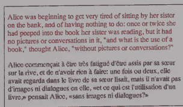

代码 4.10 的结果。这显示使用 dialog 类的段落不会接收该样式。

## 使用伪元素

伪元素是元素的特定、独特部分——例如段落的第一个字母或第一行——可以独立于元素的其余部分进行样式设置。（有关其他伪元素的列表，请参见表 4.5。）

### 使用首字母和首行

您可以直接使用 :first-letter 伪元素访问任何文本块的第一个字母。任何文本块的第一行都可以使用 :first-line 伪元素隔离以进行样式处理 A

### 突出文章开头：

- 1. 设置元素的默认版本样式。

```css
article p {...}
```

虽然不是必须的，但通常设置您将为其设置 :first-letter 伪元素样式的选择器的默认样式是个好主意（代码 4.11）。

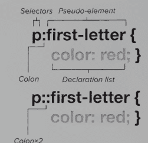

A 伪元素的一般语法。伪元素可以使用单冒号或双冒号，但目前为提高浏览器兼容性，请使用单冒号。

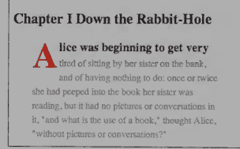

B 代码 4.11 的结果。一种常见的排版技巧是使用首字下沉并将文本的第一行设置为粗体，以吸引读者注意段落开头，如所示。

| 格式 | 选择器名称 | 如果...则设置元素样式 |
| :--- | :--- | :--- |
| :first-letter, ::first-letter | 第一个字母 | 文本中的第一个字母 |
| :first-line, ::first-line | 文本的第一行 | 它们是文本的第一行 |
| :after, ::after | 之后 | 元素前的空格 |
| :before, ::before | 之前 | 元素后的空格 |


## Code 4.11 文章第一段首字母和首行设置了样式。

```html
<!DOCTYPE html>
<html lang="en">
<head>
<meta charset="UTF-8">
<title>Alice&#8212; Adventures in Wonderland</title>
<style type="text/css" media="all">
article p {
color: gray;
font-size: 1em;
line-height: 1.5;
margin: .875em 2em;
}
article p:first-of-type:first-letter {
color: red;
font-size: 3em;
float: left;
margin: -.25em .05em 0 0;
}
article p:first-of-type:first-line {
color: black;
font-size: 1.25em;
font-weight: bold;
}
</style>
</head>
<body>
<article class="chaptertext">
<h2>Chapter I <span class="chaptertitle">Down the Rabbit-Hole</span></h2>
<p>Alice was beginning to get very tired of sitting by her sister on the bank, and of having nothing to do: once or twice she had peeped into the book her sister was reading, but it had no pictures or conversations in it, and what is the use of a book, <q>thought Alice, <q>without pictures or conversations?</q></q></p>
</article>
</body>
</html>
```

- 2. 如果元素是其类型的第一个，则设置其首字母样式。输入要设置首字母样式的选择器 [article p]，一个冒号 (:)，然后是 first-letter。

```css
article p:first-of-type::first-letter {...}
```

要仅影响文章中的第一个段落，可以添加 :first-of-type 伪类，如本示例所示。

- 3. 如果元素文本是其类型的第一个，则设置其首行样式。输入要设置首行样式的选择器 [article p]，一个冒号 (:)，然后是 first-line。

```css
article p:first-of-type::first-line {...}
```

在本示例中，添加了 first-of-type 伪类，以便仅对文章中的第一个段落应用样式。

- 4. 如果元素在父元素中是其类型的第一个，则设置其首字母和首行文本样式。向相关HTML标签添加 class 属性。

```html
<p>...</p>
```

虽然不必使用 class，但通常你会希望有选择地设置元素首字母的样式，而不是对所有元素统一应用样式。

> TIP 首字下沉样式的字母是开始新章节或新部分的一种传统方式，即将段落首字母设置得比后续字母更大，并移动几行文本以容纳较大的字母。中世纪僧侣在精装抄本中使用首字下沉。现在你可以在Web上使用它们。

## 设置元素前后的内容

The :before 和 :after 伪元素可用于生成出现在选择器上方或下方的内容。通常，这些伪元素与 content 属性一起使用。（参见第9章“使用CSS添加内容”。）伪元素允许你以一致的方式向页面添加和样式化重复内容。

### 设置元素前后的内容：

- 1. 设置元素样式。

虽然不是必须的，但通常为将要设置 :before 和 :after 伪元素样式的选择器设置默认样式是个好主意。（参见 Code 4.12。）

- 2. 在元素前添加内容。输入要在其前添加内容的选择器（HTML、class 或 ID），一个冒号 (:)，然后是关键字 before。

接下来，声明 content 属性，定义在元素前插入的生成内容及其样式。

### Code 4.12 使用前后伪元素向页面标题添加内容——在此示例中为图片 C 和 D。

```html
<!DOCTYPE html>
<html lang="en">
<head>
<meta charset="UTF-8">
<title>Alice&#8217;s Adventures in Wonderland</title>
<style type="text/css" media="all">
h2 {
font-size: 2em;
color: red; }
h2:before {
content: url("bullet-01.png"); }
h2:after {
content: url("bullet-02.png"); }
</style>
</head>
<body>
<article class="chaptertext">
<h2>Chapter I <span class="chaptertitle">Down the Rabbit-Hole</span></h2>
<p>Alice was beginning to get very tired of sitting by her sister on the bank, and of having nothing to do: once or twice she had peeped into the book her sister was reading, but it had no pictures or conversations in it, <q>and what is the use of a book,</q> <q>thought Alice, <q>without pictures or conversations?</q></q></p>
</article>
</body>
</html>
```

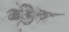

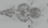

bullet-01.png 和 bullet-02.png 将用作标题周围的装饰图案。

## Chapter I 下兔子洞

爱丽丝开始在岸边和姐姐一起坐着感到非常无聊，而且无事可做：她曾经一两次偷看姐姐正在读的书，但那本书里既没有图片也没有对话，“一本书没有图片和对话有什么用呢，”爱丽丝想道。

于是她在心里琢磨（尽她所能地琢磨，因为炎热的天气让她感到非常困倦和昏昏欲睡），编织雏菊链的乐趣是否值得费心起身去摘雏菊，这时，突然一只粉红眼睛的白兔从她身边跑过。

这本身并没有什么特别引人注目的地方；爱丽丝也没觉得兔子自言自语说“哦天哪！哦天哪！我要迟到了！”有什么太反常的。（事后她想来想去，觉得自己当时应该对此感到惊讶，但当时一切都显得很自然）；但是当兔子真的从它的马甲口袋里掏出一块表，看了看，然后匆匆跑开时，爱丽丝跳了起来，因为她脑海中闪过一个念头：她有

CSS现在在标题前后添加了一些装饰图案。这些图片占据空间，仿佛它们在图片标签中，但不会出现在HTML代码中。

- 3. 在元素后添加内容。输入要在其后添加内容的选择器（HTML、class 或 ID），一个冒号 (:)，然后是关键字 after。

接下来，声明 **content** 属性，定义在元素后插入的生成内容及其样式。

CSS3中的伪元素语法与CSS2语法（这种情况很少见）相比发生了轻微变化。伪元素现在使用双冒号，以便与伪类区分。现有的伪元素可以使用单冒号或双冒号。新的和未来的伪元素应使用双冒号，但单冒号也有效。

**TIP** 由于IE8不支持CSS2伪元素的双冒号语法，因此在所有浏览器都采用该语法之前，为旧版伪元素使用单冒号语法是个好主意。无论如何，双冒号在IE8中都无效。

**TIP** 使用 *before* 和 *after* 向页面添加内容时要小心。此内容不会出现在搜索引擎或屏幕阅读器中，因此不要依赖它来实现任何重要功能。

## 基于标签属性定义样式

虽然样式属性都应由CSS处理，但许多HTML标签仍然具有定义其行为的属性。例如，图片标签 `img` 始终包含 `src` 属性，用于定义要加载的图片文件的来源。

可以根据属性或属性值为HTML元素分配样式，从而允许你在属性已设置、不是特定值或包含特定值时设置样式（表4.6）。

### 根据元素属性设置样式：

- 1. 如果元素具有特定属性，则设置样式。要根据属性的存在来设置样式，请输入要设置样式的选择器（HTML、class 或 ID）、左方括号 ([)、要检查的属性名称和右方括号 (])（Code 4.13）A `a[title] {...}`

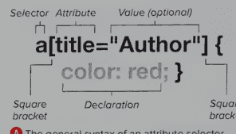

属性选择器的一般语法。

### 关于本书：

- 《爱丽丝梦游仙境》
- Lewis Carroll
- John Tenniel
- Arthur Rackham
- 下载示例
- 更多信息
- 订购本书

Code 4.13的结果。这展示了如何根据元素的属性应用样式。

| 格式 | 名称 | 元素在以下情况下会被设置样式： |
|---|---|---|
| [attr] | 属性 | 具有指定属性 |
| [attr="value"] | 精确值 | 具有等于精确值的指定属性 |
| [attr~="value"] | 空格列表 | 具有在空格分隔列表中等于精确值的指定属性 |
| [attr|="value"] | 连字符列表 | 具有在连字符分隔列表中等于精确值的指定属性 |
| [attr^="value"] | 开头为 | 具有在开头处等于精确值的指定属性 |
| [attr$="value"] | 结尾为 | 具有在结尾处等于精确值的指定属性 |
| [attr*="value"] | 包含 | 具有在任何位置等于精确值的指定属性 |


## Code 4.13 HTML 标签可以具有不同的属性，您可以根据元素的属性为其添加样式。

```html
<!DOCTYPE html>
<html lang="en">
<head>
<meta charset="UTF-8">
<title>Alice's Adventures in Wonderland</title>
<style type="text/css" media="all">
a { display: block; font-size: 2em;}
a[title] { color: red; }
a[title="Author"] {color: orange; }
a[title="white"] { color: yellow; }
a[title="illustrations"] { color: green; }
a[href~="http://"] {color: blue; }
a[href*="order"] { color: indigo; }
a[href$="css3-vqs"] {color: violet; }
</style>
</head>
<body class="chaptertext">
<article>About the Book:</article>
<ul>
<li><a href="index.html" title="Alice's Adventures in Wonderland">Alice's Adventures in Wonderland</a></li>
<li><a href="index.html">Wonderland</a></li>
<li><a href="index.html">Alice</a></li>
<li><a href="index.html" title="Illustrations black white">John Tenniel</a></li>
<li><a href="index.html" title="Illustrations full-color">Arthur Rackham</a></li>
<li><a href="http://www.jasonspeaking.com">Download Examples</a></li>
<li><a href="http://www.jasonspeaking.com/css3-vqs/order">More Info</a></li>
<li><a href="http://www.jasonspeaking.com/css3-vqs">Order The Book</a></li>
</ul>
</body>
</html>
```

只有当标签被赋予此属性时，无论其值如何，都会分配您声明的样式。

### 2. 如果字符串与属性的值完全匹配，则设置样式。

要根据属性的精确值设置样式，请键入要设置样式的选择器（HTML、类或 ID）、左方括号 ([)、要检查的属性名称、等号 (=)、引号中的要测试的值 ('...')，以及右方括号 (])。值区分大小写。

```
a[title='home'] {...}
```

只有当标签被赋予此属性且具有精确的指定值时，才会分配您声明的样式。

### 3. 如果字符串在空格分隔的值列表中，则设置样式。

要根据属性的值（该值位于空格分隔的值列表中，例如句子中的某个特定单词）设置样式，请键入要设置样式的选择器（HTML、类或 ID）、左方括号 ([)、要检查的属性名称、波浪号 (~)、等号 (=)、引号中的要测试的值 ('...')，以及右方括号 (])。

```
a[title~="email"] {...}
```

只有当标签被赋予此属性且其值作为空格分隔列表的一部分包含该字符串时，才会分配您声明的样式。通常，这意味着它是句子中的一个单词。部分单词不计入。因此，在此示例中，测试 'mail' 将不起作用。

### 4. 如果字符串在分配给属性的连字符分隔值列表中，则设置样式。要根据属性的值作为连字符分隔列表中的第一个值来设置样式，请键入要设置样式的选择器（HTML、类或 ID）、左方括号 ([)、要检查的属性名称、竖线 (|)、等号 (=)、引号中的要测试的值 ('...')，以及右方括号 (])。

```
a[title|="resume"]
```

只有当标签被赋予此属性且其值在连字符分隔列表的开头包含该字符串时，才会分配您声明的样式。通常，这用于为语言设置样式，作为使用语言伪类的替代方案。

### 5. ★如果字符串是值的前缀，则设置样式。要根据属性开头的值设置样式，请键入要设置样式的选择器（HTML、类或 ID）、左方括号 ([)、要检查的属性名称、插入符号 (^)、等号 (=)、引号中的要测试的值 ('...')，以及右方括号 (])。

```
a[href^="http://"]
```

只有当值字符串在引号中完全按原样出现在属性值的开头时，才会分配您声明的样式。

### 6. ★如果字符串是属性值的后缀，则设置样式。要根据属性的值作为连字符分隔列表中的第一个值来设置样式，请键入要设置样式的选择器（HTML、类或 ID）、左方括号 ([)、要检查的属性名称、美元符号 ($)、等号 (=)、引号中的要测试的值 ('...')，以及右方括号 (])。

```
a[href$=".info"]
```

只有当值出现在属性值的末尾时，才会分配您声明的样式。

### 7. 如果字符串在属性值的任何位置，则设置样式。要根据属性的值作为连字符分隔列表中的第一个值来设置样式，请键入要设置样式的选择器（HTML、类或 ID）、左方括号 ([)、要检查的属性名称、星号 (*)、等号 (=)、引号中的要测试的值 ('...')，以及右方括号 (])。

```
a[href*="speakinginstyles"]
```

如果值出现在属性值的任何位置，则会分配您声明的样式。

值区分大小写。换句话说，'Alice' 和 'alice' 是两个不同的值。

## ★查询媒体

在第 3 章中，您学习了如何为特定媒体类型指定样式表，从而可以根据 HTML 是输出到屏幕、打印、电视、手持设备或其他设备来设置样式（表 4.7）。CSS3 添加了一项重要的新功能，允许您根据常见界面属性（如宽度、高度、宽高比和可用颜色数量）设置样式。

媒体查询和 @media 规则可用于定制您的页面，不仅针对一般设备类型，还针对网站访问者使用的特定设备。这包括针对打印、移动设备的大小调整，或以最佳适应打开的浏览器窗口的大小。

### 媒体查询

如果您想知道浏览器窗口的当前大小，为什么不直接询问浏览器呢？JavaScript 赋予您这种能力，但这是一种获取设计试图适应的 Web 环境基本事实的笨拙方式。

媒体查询为您提供了几个可测试的常见媒体属性（4），然后交付最适合环境的样式表。

尽管媒体查询具有许多属性（表 4.8），但它们有五种基本类型：

- 宽高比查找以比率表示的设备相对尺寸，例如 16:9。

- 宽度和高度查找显示区域的尺寸。这些也可以表示为最大值和最小值。

| 值 | 用途 |
|---|---|
| screen | 计算机显示器 |
| tty | 电传打字机、计算机终端和旧式便携设备 |
| tv | 电视显示器 |
| projection | 投影仪 |
| handheld | 便携式电话和 PDA |
| print | 纸张 |
| braille | 盲文触觉阅读器 |
| speech | 语音合成器 |
| all | 所有设备 |

```
media="
screen
and (min-width: 740px)
and (max-width: 980px)"
```

媒体查询的一般语法。

### 表 4.8 媒体查询属性

| 属性 | 值 |
|---|---|
| aspect-ratio | <ratio> |
| max-aspect-ratio | <ratio> |
| min-aspect-ratio | <ratio> |
| device-aspect-ratio | <ratio> |
| max-device-aspect-ratio | <ratio> |
| min-device-aspect-ratio | <ratio> |
| color | <integer> |
| max-color | <integer> |
| min-color | <integer> |
| color-index | <integer> |
| max-color-index | <integer> |
| min-color-index | <integer> |
| device-height | <length> |
| max-device-height | <length> |
| min-device-height | <length> |
| device-width | <length> |
| max-device-width | <length> |
| min-device-width | <length> |
| height | <length> |
| max-height | <length> |
| min-height | <length> |
| monochrome | <integer> |
| max-monochrome | <integer> |
| min-monochrome | <integer> |
| orientation | portrait, landscape |
| resolution | <resolution> |
| max-resolution | <resolution> |
| min-resolution | <resolution> |
| scan | progressive, interlaced |
| width | <length> |
| max-width | <length> |
| min-width | <length> |

- 方向查找 *横向*（高度大于宽度）或 *纵向*（宽度大于高度）布局。这允许您为可以翻转的设备定制设计。

- 颜色、颜色索引和单色查找颜色数量或每种颜色的位数。这些允许您为黑白移动设备定制设计。

- 分辨率查看输出中的像素密度。当您想要利用分辨率高于 72 dpi 的显示设备时，这尤其有用。

默认情况下，媒体查询针对视口（有关视口的详细信息，请参见第 11 章），但指定 *设备* 的查询除外，在这种情况下，它们针对整个屏幕或输出区域。例如，width 是屏幕内可见浏览器视口的宽度，而 device-width 是整个屏幕的宽度。


代码 4.14 default.css—这些样式无论屏幕尺寸如何都会被应用；但我们正在为小型设备定制样式，最可能是智能手机等移动设备。我们先从小尺寸开始，然后在接下来的两个 CSS 文件中针对更大的尺寸进行定制。

```css
/* Default Screen Styles */
body {
 color: charcoal;
 font: normal 1.5em/1 helvetica, arial, sans-serif;
 background: silver url('alice23c.gif') no-repeat center 0;
 padding: 120px 20px; }
h1 { color: purple; font-size: 1.5em; }
h2 { color: black; font-size: 1.25em; }
p { line-height: 2; font-size: 1em; }
```

代码 4.15 medium.css—中型屏幕的自定义视图。通常，这些样式将由平板设备使用。

```css
/* Medium Device Styles */
body {
 color: dimgray;
 background-color: gray;
 font-size: 1.25em;
 padding: 200px 2em; }
h1 { color: gold; }
h2 { color: silver; }
```

代码 4.16 large.css—最终样式表将用于提供针对更大计算机屏幕定制的页面。

```css
/* Large Device Styles */
body {
 color: silver;
 font: normal 1.1em/2 georgia,times,serif;
 background: black url('alice23b.gif') no-repeat 0 0;
 padding: 200px 175px; }
h1 {
 color: red;
 font-style: italic; }
h2 { color: gray; }
```

## 使用媒体查询指定样式：

- 1. 创建你的样式表。创建一个默认媒体样式表，捕获设计的所有通用样式并保存。我喜欢将我的命名为 default.css（代码 4.14）。

为你将要设计的各种媒体或特定设备创建样式表。打印通常值得包含（代码 4.17）。你可以将表命名为 print.css，但你可能还希望专门为平板电脑（代码 4.15）和台式计算机（代码 4.16）创建样式表。

代码 4.17 print.css—这些样式针对打印页面进行了定制，将背景更改为白色（假设白纸）、衬线字体、黑色文本和不同的背景图像。

```css
/* For Print */
body {
 color: rgb(0,0,0);
 background: white url('alice23a.gif') no-repeat 0 0;
 padding: 200px 0 0 175px; }
h1 { color: gray; }
p { font: normal 12pt/2 Constatia, palatino, times, "times new roman", serif; }
```

- 2. 添加视口 meta 标签。

在 HTML 文档的 head 中（代码 4.18），添加一个 name 等于 viewport 且带有 content 的 meta 标签，如所示。

```html
<meta name="viewport"
content="width=device-width,
initial-scale=1, maximum-scale=1, minimum-scale=1,
user-scalable=no" />
```

这将防止屏幕较小的设备（尤其是 iPhone）调整页面大小，覆盖在第 5 步中设置的样式。

- 3. 链接到你的默认样式表。

在 HTML 文档的 head 中（代码 4.18），键入一个引用默认版本 CSS 并将 media 定义为 all 的 <link> 标签。

```html
<link rel="stylesheet" media="all"
href="default.css" >
```

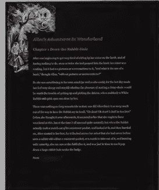

B 代码 4.18 在计算机屏幕上的输出。此版本使用深色背景和《爱丽丝梦游仙境》插图的反色版本。在 LCD 屏幕上，浅色文本看起来会很好。

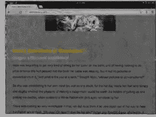

C 代码 4.18 在平板设备上，在此例中为 iPad。

代码 4.18 HTML 代码链接到所有三个样式表，这些样式表分别在默认、平板 C、智能手机 D 和打印 E 中显示。iPhone 样式表使用媒体查询来设置设备的宽度范围，以符合 iPhone 的要求。请注意，我为媒体类型使用了 screen，因为 iPhone 将自身标识为屏幕，而非手持设备。

```html
<!DOCTYPE html>
<html lang="en">
<head>
<meta charset="UTF-8">
<meta name="viewport" content="width=device-width, initial-scale=1, maximum-scale=1,
minimum-scale=1, user-scalable=no" />
<title>Alice&#8212;s Adventures in Wonderland</title>
<link rel="stylesheet" media="screen" href="14.css">
<link rel="stylesheet" media="screen and (min-width: 740px) and (min-device-width: 740px),
(max-device-width: 800px) and (min-width: 740px) and (orientation:landscape)"
href="15.css">
<link rel="stylesheet" media="screen and (min-width: 980px) and (min-device-width: 980px)"
href="16.css">
<link rel="stylesheet" media="print" href="17.css">
</head>
<body>
<hgroup>
<h1>Alice&#8212;s Adventures In Wonderland</h1>
<h2 id="ch01">Chapter 1 <span class="chaptertitle">Down the Rabbit-Hole</span></h2>
</hgroup>
<article>
<p>Alice was beginning to get very tired of sitting by her sister on the bank, and of having
nothing to do: once or twice she had peeped into the book her sister was reading, but it had no
pictures or conversations in it, “and what is the use of a book,” thought Alice, “without
pictures or conversations?”</p>
</article>
<footer><nav>Next:
<a class="chaptertitle" href="AAiWL-ch02.html">The Pool of Tears</a>
</nav></footer>
</body>
</html>
```

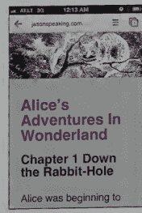

代码 4.18 在移动设备上，在此例中为 iPhone。一个专门为适应较小设备宽度而定制的版本使用了柴郡猫的自定义标题。

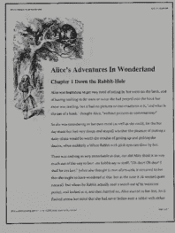

代码 4.18 输出到打印机。背景是白色的，图像不再反色。这在打印时效果更好。

- 4. 使用媒体查询链接到样式表。在前一个 `<link>` 标签之后立即添加更多引用特定媒体类型样式表的 `<link>` 标签，然后在括号中添加媒体查询（表 4.8），使用 and 连接多个查询。

```html
<style type="text/css" media=
"screen and (min-width: 740px)
and (min-device-width: 740px),
(max-device-width: 800px)
and (min-width: 740px) and
(orientation:landscape)">@import
url("css/medium.css");</style>
```

```html
<style type="text/css" media=
"screen and (min-width: 980px)
and (min-device-width: 980px)">
@import url("css/medium.css");
@import url("css/large.css");
</style>
```

- 5. 链接到你的 *打印* 样式表。在 `<link>` 标签之后立即添加另一个引用 CSS 打印版本的 `<link>` 标签，并将 media 定义为 print。

```html
<link rel="stylesheet" media="print" href="print.css">
```

> **提示** 在引入媒体查询之前，Web 开发者使用 JavaScript 来检测浏览器尺寸和颜色。媒体查询使这些技术过时，至少在样式方面是这样。

> **提示** 在此示例中，媒体查询应用于 `<link>` 标签的 media 属性值，但你也可以同样轻松地将它们应用于 `<style>` 标签的 media 属性。

## 使用 @media 规则

媒体查询允许你在 <link> 和 <style> 标签的 media 属性中指定样式，但 @media 规则允许你将媒体查询直接嵌入到样式表中。

## 使用 @media 指定样式：

- 1. 创建你的样式表。创建一个外部样式表或将样式表嵌入到文档的 body 中（代码 4.19）。

- 2. 使用 @media 规则通过媒体查询指定样式。在 HTML 文档的 head 中，键入 @ 和 media。然后为样式指定媒体类型（表 4.7）和任何媒体查询（表 4.8）。

```css
@media screen and (max-device-width: 480px) (...)
```

例如，你可以指定这些样式适用于宽度不超过 480px 的屏幕。用花括号结束。在花括号之间添加任何特定于媒体的样式。

- 3. 根据需要添加其他样式。

```css
body {...}
```

你可以添加更多 @media 规则或其他非媒体特定规则。但是，所有不在 @规则（@media、@font-face、@import 等）中的 CSS 规则都必须位于 @规则之后。

> 提示 请记住，@media 规则可以放在外部或嵌入式样式表中。

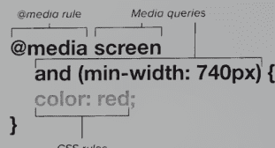

F @media 规则的一般语法。

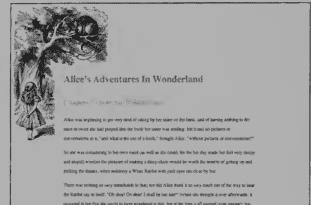

G 代码 4.19 在计算机屏幕上。

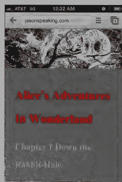

H 代码 4.19 在移动设备屏幕上。样式和背景已根据设备宽度进行了修改。


```html
<!DOCTYPE html>
<html lang="en">
<head>
<meta charset="UTF-8">
<meta name="viewport" content="width=device-width, initial-scale=1, maximum-scale=1, minimum-scale=1, user-scalable="no" />
<title>Alice&#8217;s Adventures in Wonderland</title>
<style type="text/css">
body {
font: normal 12pt/2 times, "times new roman", serif;
background: white url("alice23a.gif") no-repeat 0 0;
padding: 200px 175px; }
h1 { color: gray; }
h2 { color: silver; }
p { color: black; }
@media screen and (max-width: 480px) {
/** Small screen Styles **/
body {
-webkit-text-size-adjust:none;
color: red;
background: gray url("alice23c.gif") no-repeat center 0;
padding: 120px 20px 20px 20px; }
h1 {
color: red;
text-shadow: 0 5px black; }
h2 { color: silver; }
p {
font-size: 1.5em;
color: white; }
}
</style>
</head>
<body>
<hgroup>
<h1>Alice&#8217;s Adventures In Wonderland</h1>
<h2 id="ch01">Chapter 1 <span class="chaptertitle">Down the Rabbit-Hole</span></h2>
</hgroup>
<article>
<p>Alice was beginning to get very tired of sitting by her sister on the bank, and of having
nothing to do: once or twice she had peeped into the book her sister was reading, but it had no
pictures or conversations in it, "and what is the use of a book," thought Alice, "without
pictures or conversations?"</p>
</article>
<footer><nav> Next:
<a class="chaptertitle" href="AAiWL-ch02.html">The Pool of Tears</a>
</nav></footer>
</body>
</html>
```

## 打印样式

随着激光打印机和喷墨打印机的出现，我们似乎被堆积如山的完美打印文件所淹没。即使是 Web，似乎也增加了我们使用的纸张数量。如果 Web 上的文章超过几屏，许多人会将其打印出来。

但 Web 的初衷是在屏幕上显示信息，而不是在纸上。Web 图形在打印时看起来很粗糙，而纯 HTML 缺乏布局控制。话虽如此，你可以采取一些措施来改善打印网页的外观。在打印和 Web 上都看起来好可能需要多花一点精力，但从长远来看，你的受众会感谢你。

以下是你可以在打印 Web 页面时改善其外观的六件简单事情：

- 在页面标题前使用分页符，使其与文本保持在一起。
- 将内容与导航分开。尽量将主要内容（即受众感兴趣阅读的部分）与网站导航分别放在设计的不同区域。然后，你可以使用 CSS 在打印版本中隐藏导航，只需在打印样式表中包含 `nav { display: none }`。
- 避免在图形中使用透明颜色。如果图形位于非白色背景色或其他图形上，这一点尤其正确。GIF 图像的透明区域通常会打印为白色，无论窗口中其后面是什么颜色。如果图形本身就在白色背景上，则这不是问题；但如果图形应该位于深色背景上，结果就会很混乱。
- 避免在图形中使用文本。从 Web 打印内容的讽刺之处在于，图形中的文本在窗口中可能看起来平滑，但在打印时可能看起来粗糙；而普通 HTML 文本在某些 PC 屏幕上可能看起来粗糙，但在任何像样的打印机上都能平滑打印。尽可能使用 HTML 文本。
- 避免使用深色背景和浅色文本。通常，你希望打印页面的大部分保持白色背景，文本使用黑色或深灰色。
- 打印时不要依赖颜色来传达信息。虽然如今彩色打印机很常见，但许多人仍在使用黑白打印机，或在彩色打印机上以黑白模式打印以节省成本。

## 从父级继承属性

不，本书并没有突然变成《房地产可视化快速入门指南》。子级和后代 HTML 标签通常会继承其父级的样式——无论样式是使用 CSS 设置的，还是从浏览器样式继承而来。这称为样式继承。

例如，如果你设置一个名为 copy 的 ID 并将其 font-family 值设为 Times，那么它的所有后代都将继承 Times 字体样式。如果你使用 CSS 将粗体标签设为红色，那么它的所有后代都将继承应用的红色和固有的粗体样式。

在某些情况下，样式属性不会从其父级继承——例如边距、宽度和边框等明显属性。你可能不难弄清楚

```css
strong { color: red; }
.chaptertext { font-family: georgia; }
```

```html
<div class="chaptertext">
<strong>
<em>
Curiouser and curiouser!
</em>
</strong>
</div>
```

### 结果

越来越奇怪了！

应用和继承的样式的最终结果是 Times 字体的粗体、红色、斜体文本。括号中的样式是浏览器为特定 HTML 标签应用的固有样式。

哪些属性会被继承，哪些不会。例如，如果你为段落标签设置四像素的内边距，你不会期望段落内的粗体标签也添加四像素的内边距。如果你有任何疑问，请参阅附录 A，其中列出了所有 CSS 属性及其继承方式。

如果你确实想强制元素继承其父级的属性，许多 CSS 属性都包含 inherit 值。因此，在前面的示例中，要强制段落中所有粗体标签采用 4px 内边距，你可以将其内边距值设置为 inherit。

## 管理现有或继承的属性值

在为选择器定义样式时，除非你专门覆盖这些样式，否则不会导致其丢失任何继承属性。除非你更改构成其外观的特定现有属性，否则所有这些属性都会显示。

除了用另一个值覆盖相关属性外，许多 CSS 属性具有允许你覆盖继承的值：

- **inherit**—强制继承原本不会被继承的属性，或覆盖其他应用的样式值并继承父级的值。
- **none**—隐藏边框、图像或其他可视元素。
- **normal**—强制应用默认样式。
- **auto**—允许浏览器根据上下文确定元素应如何显示。

```
h1 {
  color: red; !important
}
```

代码 4.20 将 !important 值添加到了第一个 h2 的 color 属性中，但没有添加到第二个 h2。通常，第二个 h2 会覆盖第一个，但此例中不会。

```html
<!DOCTYPE html>
<html lang="en">
<head>
<meta charset="UTF-8">
<title>Alice&#8217;s Adventures in Wonderland</title>
<style type="text/css" media="all">
h2 {
  color: green !important;
  font-size: 3em;
 }
h2 {
  color: red;
  font-size: 2em;
 }
</style>
</head>
<body class="chaptertext">
<article>
<h2> Chapter I </h2>
<span class="chaptertitle">Down the Rabbit-Hole</span>
</article>
<p>Alice was beginning to get very tired of sitting by her sister on the bank, and of having nothing to do: once or twice she had peeped into the book her sister was reading, but it had no pictures or conversations in it, "and what is the use of a book,"<q>thought Alice, "pictures or conversations?"</q></p>
</article>
</body>
</html>
```

## 使声明 !important

你可以将 !important 声明添加到属性-值声明中，以在确定层叠顺序时赋予其最大权重。这样做可确保无论其他规则如何，都会应用该声明。（参见本章中的“确定层叠顺序”。）

### 强制使用声明：

- 1. 添加您的 CSS 规则（代码 4.20）。
  - h2 { ... }

你可以使用 HTML、类或 ID 选择器。CSS 规则可以在文档头部的 <style> 标签内定义（参见第 3 章中的“嵌入式：将样式添加到网页”），也可以在外部 CSS 文件中定义，然后将其导入或链接到 HTML 文档（参见第 3 章中的“外部：将样式添加到网站”）。

- 2. 设置为重要。键入样式声明、一个空格、!important 和一个分号 (;) 来关闭声明。
  - color: green !important;

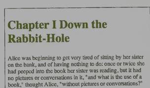

代码 4.20 的结果。最重要的是的样式胜出，因此文本是绿色而非红色，尽管红色声明在层叠中出现得更晚。


## 3. Add other styles.

```
font-size: 3em;
```

Add any other declarations you wish for this rule, making them !important or not, as you desire.

!important is a powerful tool, second only to inline styles for determining style cascade. !important is great for debugging your CSS; but, because it can interfere with making changes later, it should never be used in the final Web site code.

Setting a shorthand property to !important (background, for example) is the same as setting each sub-property (such as background-color) to be !important.

TIP A common mistake is to locate !important after the semicolon in the declaration. This causes the browser to ignore the declaration and, possibly, the entire rule.

TIP If you are debugging your style sheet and can't get a particular style to work, try adding !important to it. If it still doesn't work, the problem is most likely a typo rather than another overriding style.

TIP Many browsers allow users to define their own style sheets for use by the browser. Most browsers follow the CSS 2.1 specification in which a user-defined style sheet overrides an author-defined style sheet.

## Determining the Cascade Order

Within a single Web page, style sheets may be linked, imported, or embedded. Styles may also be declared inline in the HTML.

In addition, many browsers allow visitors to have their own style sheets that can override yours. It's guaranteed, of course, that simultaneous style sheets from two or more sources will have conflicting declarations. Who comes out on top?

The cascade order refers to the way styles begin at the top of the page and, as they cascade down, collect and replace each other as they are inherited. The general rule of thumb is that the last style defined is the one that is used.

However, at times, two or more styles will conflict. Use the following procedure to determine which style will come out on top and be applied to a given element.

### To determine the cascade-order value for an element:

Collect all styles that will be applied to the element. Find all the inherent, applied, and inherited styles that will be applied to the element, and then use the following criteria to determine which styles are applied in the cascade order, with the criteria at the top being most important.

- 1. User styles
  Most Web browsers allow users to specify their own default style sheets. In principle, these always have precedence over other styles.

- 2. Inline styles
  If the style is inline (see Chapter 3), it is always applied regardless of all other factors. That's why you should never use them in your final HTML code.

- 3. Media type
  Obviously, if the media type is set for a style and element that is not being displayed in that media type, the style will not be used.

- 4. Importance
  Including !important with a declaration gives it top billing when displayed. (See “Making a Declaration Important” in this chapter.)
  
  Many browsers let users define their own style sheets for use by the browser. If both the page author and the visitor have included !important in their declarations, the user's declaration wins.
  
  In theory, an author's style sheets override a visitor's style sheets unless the visitor uses the !important value. In practice, however, most browsers favor a user's style sheet when determining which declarations are used for a tag.

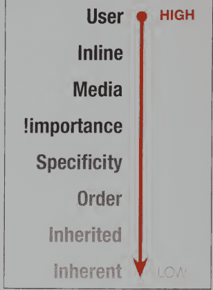

A The cascade order from most important to least important.

### 5. Specificity

The more contextually specific a rule is, the higher its cascade priority. So the more HTML, class, and ID selectors a particular rule has, the more important it is. In determining this priority, ID selectors count as 100, classes count as 10, and HTML selectors are worth only 1. Thus,

```
#copy p b { color: red; }
```

is worth 102, whereas

```
b { color : lime; }
```

is worth only 1. So, the first rule would have higher specificity and the color would be red.

This priority setting may seem a bit silly at first, but it allows context-sensitive and ID rules to carry more weight, ensuring that they will be used.

### 6. Order

If the conflicting declarations applied to an element are equal at this point, CSS gives priority to the last rule listed, in order. Remember that inline styles always win.

### 7. Inherited

These styles are inherited from the parent.

### 8. Inherent

These styles are applied by the browser to HTML tags and are the least important.

# Font Properties

Typography is one of your most powerful tools for presenting organized, clean-looking documents. It’s also the best tool for presenting chaotic, grungy-looking documents.

The fonts you use go a long way toward getting your message across in just the way you want—whether that message is classical, grunge, or anything in between. I often say that fonts are to type what voice is to speech. Typeface, font weight, italic, and other typographic effects not only help designers to guide a visitor’s eye around the page, but they also add a layer of meaning.

CSS gives you the ability to control the appearance of fonts, also known as *letterforms*, in your Web pages. You can set the font family, boldface, and italic attributes, and the limited font sizes available with HTML tags. CSS3 refines the ability to download font files (called *Web fonts*) from your server and apply them to the text in your Web page, giving you the power to use virtually any font you want in your designs.

## In This Chapter

- Getting Started 124
- Understanding Typography on the Web 125
- Setting a Font-Stack 130
- Using Web Fonts 133
- Setting the Font Size 144
- Adjusting Font Size for Understudy Fonts 146
- Making Text Italic 147
- Setting Bold, Bolder, Boldest 149
- Using Condensed and Expanded Fonts 150
- Creating Small Caps 151
- Setting Multiple Font Values at the Same Time 152
- Putting It All Together 155

## Getting Started

In this chapter, we'll be styling the first chapter of Lewis Carroll's Alice's Adventures in Wonderland. Code 5.1 shows an expurgated version of the HTML, with all but the first paragraph stripped out. We'll start adding to the CSS file font-properties.css starting with Code 5.2, add to it in each section, and present it in full in Code 5.11.

```
Code 5.1 The HTML code for this chapter is taken from Chapter 1 of Alice's Adventures in Wonderland. You'll be adding CSS code to this external style sheet throughout the chapter to build the final CSS file font-properties.css shown at the end of the chapter in "Putting it All Together."

<!DOCTYPE html>
<html lang="en">
<head>
<meta charset="utf-8">
<title>
Alice&#8217;s Adventures In Wonderland | Chapter I
</title>
<link href="../css/font-properties.css" type="text/css" rel="stylesheet" media="all">
</head>
<body id="chapter1" class="book aaiw chapter">
<hgroup>
<h1>Alice&#8217;s Adventures in Wonderland</h1>
<h2>By Lewis Carroll</h2>
</hgroup>
<article>
<h2>Chapter I</h2>
<span class="chaptertitle">Down the Rabbit-Hole</span>
</h2>
<p>Alice was beginning to get very tired of sitting by her sister on the bank, and of having nothing to do: once or twice she had peeped into the book her sister was reading, but it had no pictures or conversations in it, "and what is the use of a book," thought Alice, "without pictures or conversations?"</p>
</article>
<footer>
<nav>
<a href="toc.html">Table of Contents</a>
<a href="AAIWL-ch02.html" class="next">The Pool of Tears</a>
</nav>
</footer>
</body>
</html>
```

## Alice's Adventures in Wonderland
By Lewis Carroll
Chapter I: Down the Rabbit-Hole

Alice was beginning to get very tired of sitting by her sister on the bank, and of having nothing to do: once or twice she had peeped into the book her sister was reading, but it had no pictures or conversations in it, 'and what is the use of a book,' thought Alice, 'without pictures or conversation?'

So she was considering in her own mind (as well as she could, for the hot day made her feel very sleepy and stupid), whether the pleasure of making a daisy-chain would be worth the trouble of getting up and picking the daisies, when suddenly a White Rabbit with pink eyes ran close by her.

There was nothing so VERY remarkable in that; nor did Alice think it so VERY much out of the way to hear the Rabbit say to itself, 'Oh dear! Oh dear! I shall be late!' (when she thought it over afterwards, it occurred to her that she ought to have wondered at this, but at the time it all seemed quite natural); but when the Rabbit actually TOOK A WATCH OUT OF ITS WAISTCOAT-

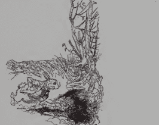

Down, down, down. Would the fall never come to an end? 'I wonder how many miles I've fallen by this time?' she said aloud. 'For I must be getting somewhere near the centre of the earth. Let me see: that would be four thousand miles down, I think--' (for, you see, Alice had learnt several things of this sort in her lessons in the schoolroom, and though this was not a VERY good opportunity for showing off her knowledge, as there was no one to listen to her, still it was good practice to say it over) '--yes, that's about the right distance--but then I wonder what Latitude or Longitude I've got to?' (Alice had no idea what Latitude was, or Longitude either, but thought they were nice grand words to say.)

Presently she began again. 'I wonder if I shall fall right through the earth! How funny it'll seem to come out among the people that walk with their heads downward! The Antipathies, I think--' (she was rather glad there WAS no one listening, this time, as it didn't sound at all the right word) '--but I shall have to ask them what the name of the country is, you know. Ma'am, is this New Zealand or Australia?' (and she tried to curtsey as she spoke--fancy CURTSEYING as you fall through the air! Do you think you could manage it?) 'And what an ignorant little girl she'll think me for asking! No, it'll never do to ask: perhaps I shall see it written up somewhere.'

Down, down, down. There was nothing else to do, so Alice soon began talking again. 'Dinah'll miss me very much to-night, I should think!' (Dinah was the cat.) 'I hope they'll remember her saucer of milk at tea-time. Dinah my dear! I wish you were down here with me! There are no mice in the air, I'm afraid, but you might catch a bat, and that's very like a mouse, you know. But do cats eat bats, I wonder?' And here Alice began to get rather sleepy, and went on saying to herself, in a dreamy sort of way, 'Do cats eat bats? Do cats eat bats?' and sometimes, 'Do bats eat cats?' for, you see, as she couldn't answer either question, it didn't much matter which way she put it. She felt that she was dozing off, and had just begun to dream that she was walking hand in hand with Dinah, and saying to her very earnestly, 'Now, Dinah, tell me the truth: did you ever eat a bat?' when suddenly, thump! thump! down she came upon a heap of sticks and dry leaves, and the fall was over.

Alice was not a bit hurt, and she jumped up on to her feet in a moment: she looked up, but it was all dark overhead; before her was another long passage, and the White Rabbit was still in sight, hurrying down it. There was not a moment to be lost: away went Alice like the wind, and was just in time to hear it say, as it turned a corner, 'Oh my ears and whiskers, how late it's getting!' She was close behind it when she turned the corner, but the Rabbit was no longer to be seen: she found herself in a long, low hall, which was lit up by a row of lamps hanging from the roof.

There were doors all round the hall, but they were all locked; and when Alice had been all the way down one side and up the other, trying every door, she walked sadly down the middle, wondering how she was ever to get out again.

Suddenly she came upon a little three-legged table, all made of solid glass; there was nothing on it except a tiny golden key, and Alice's first thought was that it might belong to one of the doors of the hall; but, alas! either the locks were too large, or the key was too small, but at any rate it would not open any of them. However, on the second time round, she came upon a low curtain she had not noticed before, and behind it was a little door about fifteen inches high: she tried the little golden key in the lock, and to her great delight it fitted!

Alice opened the door and found that it led into a small passage, not much larger than a rat-hole: she knelt down and looked along the passage into the loveliest garden you ever saw. How she longed to get out of that dark hall, and wander about among those beds of bright flowers and those cool fountains, but she could not even get her head through the doorway; 'and even if my head would go through,' thought poor Alice, 'it would be of very little use without my shoulders. Oh, how I wish I could shut up like a telescope! I think I could, if I only knew how to begin.' For, you see, so many out-of-the-way things had happened lately, that Alice had begun to think that very few things indeed were really impossible.

There seemed to be no use in waiting by the little door, so she went back to the table, half hoping she might find another key on it, or at any rate a book of rules for shutting people up like telescopes: this time she found a little bottle on it, ('which certainly was not here before,' said Alice,) and round the neck of the bottle was a paper label, with the words 'DRINK ME' beautifully printed on it in large letters.

It was all very well to say 'Drink me,' but the wise little Alice was not going to do THAT in a hurry. 'No, I'll look first,' she said, 'and see whether it's marked "poison" or not'; for she had read several nice little histories about children who had got burnt, and eaten up by wild beasts and other unpleasant things, all because they WOULD not remember the simple rules their friends had taught them: such as, that a red-hot poker will burn you if you hold it too long; and that if you cut your finger VERY deeply with a knife, it usually bleeds; and she had never forgotten that, if you drink much from a bottle marked 'poison,' it is almost certain to disagree with you, sooner or later.

However, this bottle was NOT marked 'poison,' so Alice ventured to taste it, and finding it very nice, (it had, in fact, a sort of mixed flavour of cherry-tart, custard, pine-apple, roast turkey, toffy, and hot buttered toast,) she very soon finished it off.

* * * * * * *

What a curious feeling!" said Alice; "I must be shutting up like a telescope."

And so it was indeed: she was now only ten inches high, and her face brightened up at the thought that she was now the right size for going through the little door into that lovely garden. First, however, she waited for a few minutes to see if she was going to shrink any further: she felt a little nervous about this; 'for it might end, you know,' said Alice to herself, 'in my going out altogether, like a candle. I wonder what I should be like then.' And she tried to fancy what the flame of a candle is like after the candle is blown out, for she could not remember ever having seen such a thing.

After a while, finding that nothing more happened, she decided on going into the garden at once; but, alas for poor Alice! when she got to the door, she found she had forgotten the little golden key, and when she went back to the table for it, she found she could not possibly reach it: she could see it quite plainly through the glass, and she tried her best to climb up one of the legs of the table, but it was too slippery; and when she had tired herself out with trying, the poor little thing sat down and cried.

'Come, there's no use in crying like that!' said Alice to herself, rather sharply; 'I advise you to leave off this minute!' She generally gave herself very good advice, (though she very seldom followed it), and sometimes she scolded herself so severely as to bring tears into her eyes; and once she remembered trying to box her own ears for having cheated herself in a game of croquet she was playing against herself, for this curious child was very fond of pretending to be two people. 'But it's no use now,' thought poor Alice, 'to pretend to be two people! Why, there's hardly enough of me left to make ONE respectable person!'

Soon her eye fell on a little glass box that was lying under the table: she opened it, and found in it a very small cake, on which the words 'EAT ME' were beautifully marked in currants. 'Well, I'll eat it,' said Alice, 'and if it makes me grow larger, I can reach the key; and if it makes me grow smaller, I can creep under the door; so either way I'll get into the garden, and I don't care which happens!'

She ate a little bit, and said anxiously to herself, 'Which way? Which way?', holding her hand on the top of her head to feel which way it was growing, and she was quite surprised to find that she remained the same size: so she went on eating, and very soon finished off the cake.

* * * * * * *

Curiouser and curiouser!" cried Alice (she was so much surprised, that for the moment she quite forgot how to speak good English). "Now I'm opening out like the largest telescope that ever was! Good-bye, feet! (for when she looked down at her feet, they seemed to be almost out of sight, they were getting so far off). Oh, my poor little feet, I wonder who will put on your shoes and stockings for you now, dears? I'm sure I shan't be able! I shall be a great deal too far off to trouble myself about you: you must manage the best way you can; --but I must be kind to them," thought Alice, "or perhaps they won't walk the way I want to go! Let me see: I'll give them a new pair of boots every Christmas."

And she went on planning to herself how she would manage it. 'They must go by the carrier,' she thought; 'and how funny it'll seem, sending presents to one's own feet! And how odd the addresses will look!'
Alice's Right Foot, Esq.
Hearthrug,
near the Fender,
(with Alice's love).
Oh dear, what nonsense I'm talking!"

Just then her head struck against the roof of the hall: in fact she was now more than nine feet high, and she at once took up the little golden key and hurried off to the garden door.

Poor Alice! It was as much as she could do, lying down on one side, to look through into the garden with one eye; but to get through was more hopeless than ever: she sat down and began to cry again.

She went on crying till she had quite a large pool of tears all round her, and half an inch deep. 'I wish I hadn't cried so much!' said Alice, as she swam about, trying to find her way out. 'I suppose I shall be punished for it now, by being drowned in my own tears! That WILL be a queer thing, to be sure! However, everything is queer to-day.'

Just then she heard something splashing about in the pool a little way off, and she swam nearer to make out what it was: at first she thought it must be a walrus or hippopotamus, but then she remembered how small she was now, and she soon made out that it was only a mouse that had slipped in like herself.

'Would it be of any use, now,' thought Alice, 'to speak to this mouse? Everything is so out-of-the-way down here, that I should think very likely it can talk: at any rate, there's no harm in trying.' So she began: 'O Mouse, do you know the way out of this pool? I am very tired of swimming about here, O Mouse!' (Alice thought this must be the right way of speaking to a mouse: she had never done such a thing before, but she remembered having seen in her brother's Latin Grammar, 'A mouse--of a mouse--to a mouse--a mouse--O mouse!' The Mouse looked at her rather inquisitively, and seemed to her to wink with one of its little eyes, but it said nothing.

'Perhaps it doesn't understand English,' thought Alice; 'I daresay it's a French mouse, come over with William the Conqueror.' (For, with all her knowledge of history, Alice had no very clear notion how long ago anything had happened.) So she began again: 'Ou est ma chatte?' which was the first sentence in her French lesson-book. The Mouse gave a sudden leap out of the water, and seemed to quiver all over with fright. 'Oh, I beg your pardon!' cried Alice hastily, afraid that she had hurt the poor creature's feelings. 'I quite forgot you didn't like cats.'

'Not like cats!' cried the Mouse in a shrill, passionate voice. 'Would YOU like cats if you were me?'

'Well, perhaps not,' said Alice in a soothing tone: 'don't be angry about it. And yet I wish I could show you our cat Dinah: I think you'd take a fancy to cats if you could only see her. She is such a dear quiet thing,' Alice went on, half to herself, as she swam lazily about in the pool, 'and she sits purring so nicely by the fire, licking her paws and washing her face--and she is such a nice soft thing to nurse--and she's such a capital one for catching mice--oh, I beg your pardon!' cried Alice again, for this time the Mouse was bristling all over, and she felt certain it must be really offended. 'We won't talk about her any more if you'd rather not.'

'We indeed!' cried the Mouse, who was trembling down to the end of his tail. 'As if I would talk on such a subject! Our family always HATED cats: nasty, low, vulgar things! Don't let me hear the name again!'

'I won't indeed!' said Alice, in a great hurry to change the subject of conversation. 'Are you--are you fond--of--of dogs?' The Mouse did not answer, so Alice went on eagerly: 'There is such a nice little dog near our house I should like to show you! A little bright-eyed terrier, you know, with oh, such long curly brown hair! And it'll fetch things when you throw them, and it'll sit up and beg for its dinner, and all sorts of things--I can't remember half of them--and it belongs to a farmer, you know, and he says it's so useful, it's worth a hundred pounds! He says it kills all the rats and--oh dear!' cried Alice in a sorrowful tone. 'I'm afraid I've offended it again!' For the Mouse was swimming away from her as hard as it could go, and making quite a commotion in the pool as it went.

So she called softly after it, 'Mouse dear! Do come back again, and we won't talk about cats or dogs either, if you don't like them!' When the Mouse heard this, it turned round and swam slowly back to her: its face was quite pale (with passion, Alice thought), and it said in a low trembling voice, 'Let us get to the shore, and then I'll tell you my history, and you'll understand why it is I hate cats and dogs.'

It was high time to go, for the pool was getting quite crowded with the birds and animals that had slipped into it: there was a Duck and a Dodo, a Lory and an Eaglet, and several other curious creatures. Alice led the way, and the whole party swam to the shore.

This is what your Web page (Code 5.1) looks like before any CSS is applied to it. In this chapter you will be adding font styling.

## Understanding Typography on the Web

A type family (commonly referred to in Web design as a font family) is a category of typefaces that have similar characteristics. Each character within a font is referred to as a glyph. The advantages of HTML text compared to text in Flash or in graphics are that it is easy to edit if changes are required, and it can adjust to the width of the screen on which it is viewed. In addition, content is often stored within databases and then output as HTML text.

However, HTML text has some severe design limitations. By and large, most of the textual control is left up to the visitor's browser, and you cannot currently do some things, such as run text vertically rather than horizontally, without using CSS transformations (Chapter 12), which are not cross-browser yet.

What seems more stifling is that until recently you were limited to the fonts available on the visitor's machine. But this is no longer true. You now have tens of thousands of fonts to choose from using Web fonts.


## 指定字符集

在上一章中，您了解到在创建 HTML5 文档时，需要指定页面使用的字符集。字符集只是一组字符列表或字符集，每个字符都有一个浏览器用于显示文本的唯一代码或名称。这些代码已被商定为国际标准。您无需关心它们，除非您为自己的网页选择要使用的字符集。

您使用 meta 标签在 HTML 页面的 head 中指定字符集。最流行的国际字符集是 UTF-8（8 位 Unicode 转换格式）字符集：

```
<meta charset="utf-8">
```

或者，如果您只用英语编写，另一种常见的字符集是 ISO 8859-1 字符集：

```
<meta http-equiv="Content-Type"
content="text/html; charset=
ISO-8859-1" />
```

UTF-8 和 ISO 8859-1 对英语的效果大致相同，但 UTF-8 支持其他字母表。我强烈建议坚持使用 UTF-8。网站（甚至您当地的报纸）通常会即时翻译成不同的语言。

另一个重要点：如果您在 HTML 中指定了不存在于指定字符集中的字符，浏览器通常会在字符位置显示一个错误标记。如果发生这种情况，您通常可以自行对字符进行编码，如即将介绍的章节“编码 HTML 字符实体”中所述。


此字形或类似字形将出现在浏览器不识别为字符集一部分的任何字符位置。

## 通用字体系列

CSS 定义了五种大多数字体可归类的通用字体系列（表 5.1）。

| 名称 | 示例 |
| :--- | :--- |
| Serif | Times New Roman |
| Sans-serif | Helvetica 和 Arial |
| Monospace | Courier New |
| Cursive | Brush Script MT |
| Fantasy | Papyrus |

- *衬线体*—衬线是字母末端的小装饰，赋予其辨识度。衬线是石刻和笔触时代的遗留。衬线通常通过使单个字母从邻近字母中脱颖而出，从而提高可读性。

  衬线字体通常最适合屏幕上较大文本（14px 或更大）或较小印刷文本的显示。它们不太适合屏幕上的较小文本，因为衬线常常会遮挡字母。衬线字体通常呈现出更保守的感觉。

- *无衬线体*—正如您可能猜到的，无衬线字体是指没有衬线的字体。

  尽管字符不那么独特，但无衬线字体更适合屏幕上的较小文本。无衬线字体通常呈现出更现代且常常更随意的感觉。

- *等宽字体*—尽管等宽字体可以有衬线或没有衬线，但其显著特征是每个字母占据相同的空间。例如，小写字母 l 比大写字母 M 细得多。在非等宽字体中，字母 l 占据的空间比 M 少，但等宽字体会在 l 周围添加额外空间，使其占据与 M 相同的空间。

  等宽字体最适合需要精确（但不一定快速）阅读的文本，例如编程代码，其中拼写错误可能导致灾难。虽然更易于扫描，但等宽字体阅读大量文本时可能会变得单调。等宽字体通常给文本带来技术性或打字机般的感觉。

- *手写体*—手写字体试图模仿草书或书法手写体，通常以高度风格化的方式呈现，字母通常部分或完全连接。

  手写字体最适合用于装饰和大标题；在大段文本中可读性不高。手写字体给文本带来充满活力和表现力的感觉。

- *奇幻体*—不属于上述任何类别的装饰字体称为奇幻字体。这些字体通常极其华丽，但仍然是字母，因此不包括 Dingbats 或图片字体、插图或图标。

  与手写字体一样，奇幻字体最适合用于装饰。您应谨慎使用奇幻字体并仔细选择，以强化网站的外观和感觉，因为每种奇幻字体都有其鲜明的个性。


Dingbats 示例。这些来自 Dingbats 字体 Webdings。

```
& © ® TM
1/2 1/4 3/4
« » ± * ÷
∞ ≈ ≤ ≥
+ ← ↑ → ↔
```

一些常见字符实体的示例。这些可以编码到 HTML 中，以确保它们在最终输出中准确表示。

## Dingbats

尽管它没有官方的 CSS 指定，但还有另一类重要的字体需要考虑。Dingbats，也称为符号或图片字体，不代表数字或字母，而是一组图标或图形符号，每个都对应键盘上的一个字母。这种字体类型最常见的示例是 Webdings，它安装在大多数计算机上。Webdings 是一组常见的国际符号。虽然其他 Dingbats 字体通常不安装在大多数计算机上，但如果您如本章后面所述将 Dingbats 用作 Web 字体，您可以相对确定会得到想要的效果，用 Dingbats 图标替换一些图形图标。

### 编码 HTML 字符实体

Dingbats 字体的替代方案是 HTML 字符实体。这些是一组专用字形，它们不是由单个字母表示，而是由以 & 开头并以 ; 结尾的代码表示。例如，& 在代码中表示为：

&amp;

对于许多字符（例如 &，这是在浏览器和操作系统之间一致显示它们的唯一方式。有关 HTML 和 Unicode 字符值的完整列表，请参见附录 B。

## 设置字体栈

font-family 属性允许您通过选择显示文本的字体来确定消息的视觉效果（表 5.2）。您用于显示文本的字体类型会对读者如何感知您的消息产生强大影响。无论您使用衬线、无衬线、等宽、手写还是奇幻字体类型，在访客阅读第一行文字之前，它都能传递大量信息。

| 值 |
| --- |
| <family-name> |
| serif |
| sans-serif |
| cursive |
| fantasy |
| monospace |

### 为元素定义字体系列：

- 1. 将 font-family 属性添加到您的 CSS 规则中。键入属性名 font-family，后跟冒号。在此示例中，font-family 应用于 body 标签，这将设置整个页面的字体（代码 5.2）。
  font-family:

- 2. 定义要使用的主要字体名称，后跟逗号。该名称不区分大小写。名称中包含空格的字体必须用引号括起来，可以是单引号或双引号（“Times New Roman”或‘times new roman’均可）。
  Constantia,


不同字体的示例。您听到什么声音？

### 字体还是字体系列？

请记住字体和字体系列之间的区别。字体系列是一组外观相似的字体，例如 Times。字体是指特定版本——Times 正常、Times 粗体、Times 斜体、Times 粗斜体，等等。

```
Code 5.2 Styles added to font-properties.css—Two separate typefaces are applied to the page
/** font-properties.css **/
body { font-family: Constantia, Georgia, "Times New Roman", serif; }
h1, h2, h3, h4, h5, h6, .byline {
font-family: Corbel, Helvetica, Arial, sans-serif; }
h2 .chaptertitle {
font-family: Corbel, Helvetica, Arial, sans-serif; }
```

## 《爱丽丝梦游仙境》

### 路易斯·卡罗尔 著

### 第一章 兔子洞

爱丽丝坐在岸边姐姐身边，开始感到非常无聊，而且无事可做：她曾经一两次偷看姐姐正在读的书，但书里既没有图片也没有对话，“一本书，”爱丽丝想，“没有图片和对话有什么用呢？”

于是她在心里思索（尽她所能，因为炎热的天气让她感到非常困倦和昏昏欲睡），编雏菊链的乐趣是否值得费心站起来去摘雏菊，这时，突然一只粉红眼睛的白兔从她身边跑过。

正文以 Constantia、Georgia 或 Times New Roman 显示，具体取决于访客计算机上可用的字体。但是，标题以 Corbel、Helvetica 或 Arial 显示，同样取决于可用性。

- 3. 定义一个由逗号分隔的备用字体列表，称为替补字体。您可以包含任意数量。如果列表中的前一种字体在访客计算机上不可用，将使用这些字体（按指定顺序）。有关更多详细信息，请参见本章中的“为什么要包含替补字体和通用字体系列”。
  Georgia, “Times New Roman”,

- 4. 定义通用字体系列。在最后一种替补字体之后，键入您使用的特定字体样式的通用字体系列名称。表 5.1 列出了字体系列的通用值。虽然包含此值是可选的，但这样做是个好主意。
  serif;

## 为什么要包含替补字体和通用字体系列？

当您提供字体列表时，浏览器会尝试使用列表中的第一种字体。如果不可用，浏览器会继续遍历列表，直到找到访客计算机上安装的字体。如果未找到匹配项，浏览器将使用访客的默认字体显示文本。指定通用字体的优势在于，即使列表中的特定字体不可用，浏览器也会尝试以相同的字体样式显示文本。

作为最后的手段，您可以包含通用字体系列，以便浏览器可以对最接近的匹配字体做出明智的决定。

使用替补字体和通用字体系列的优势在于，即使所需字体不可用，您仍然可以控制使用哪种字体替代，或者至少获得一个接近的匹配。


## 5. 添加字体覆盖。

设置页面正文的字体后，该字体将用于整个 Web 页面中的所有文本，表单中的文本除外。只有在需要更改特定元素的字体时，才需要向 CSS 添加另一个 font-family 声明。这是因为属性会级联到其子元素，如第 4 章所述。

级联规则的例外是表单元素，例如 input、textarea、button 等，这些元素需要在表单元素中设置字体，以便向下级联。

```
font-family: Corbel, Helvetica, Arial, serif;
```

如果您将使用粗体、斜体/倾斜体和/或粗体斜体/倾斜体版本的字体，请确保字体系列支持所有这些字体样式。如果不支持，文本将无法正确显示，或者更糟的是，浏览器会尝试合成这些版本。无论哪种情况，结果都不会看起来专业。

TIP 尝试选择大小相似的字体。即使设置为相同的字体大小，不同字体的相对大小也会不同。

TIP 某些字体在屏幕上最易读；另一些在打印时效果更好。选择字体时，始终要考虑目标介质。

## 使用 Web 字体

环顾 Web，你看到了什么？你通常会看到五种字体：Arial、Georgia、Verdana、Trebuchet MS 和 Times New Roman。这种情况之所以出现，原因很简单：Arial、Georgia、Verdana、Trebuchet MS 和 Times New Roman 几乎预装在每台 Mac 和 PC 上。我已经对它们厌倦了。

请不要误会——这些都是很棒的字体，在多种尺寸下都易于阅读。但正如我之前所说，排版为文本增添了一种远超文字本身的语言。

基于 Web 的排版一直陷入在衬线字体中使用 Times、在无衬线字体中使用 Helvetica/Arial 的窠臼。这种安排削弱了排版的力量，所有网页都开始看起来一样。

## Web 安全字体

“致命五种”字体的替代品是什么？这取决于访问您网站的人使用的计算机。Apple OS X 和 Windows 计算机上有某些应始终安装的标准字体。此外，Internet Explorer（当今大多数 Windows 计算机上都已安装）会安装几种额外字体。

当然，不能保证这些字体一定已安装，但因为它们随操作系统一起提供，所以与 Times、Helvetica 或 Arial 一样，很可能可用。

您可以在我的网站 www.webtypographynow.com/websafe-fonts 上找到 Web 安全字体列表。它列出了这些字体，并包含它们应该是什么样子的示例，以及哪些外观相似的字体可以用作替代。

Web 安全字体仍然值得了解，以便用作替补字体，但随着 Web 字体的普及，这越来越成为一个无关紧要的问题。Web 字体提供了更大的选择，并且更可靠地可用。


www.webtypographynow.com/websafefonts 上的 Web 安全字体列表包含每种字体的视觉示例。您可以按名称、可用粗细和样式、操作系统可用性以及排名对列表进行排序。

但新的希望来了。有两个因素正在改变设计师思考字体的方式。第一是，几十种字体通常预装在 Mac 和 PC 上。第二，也是最深刻的变化是，所有主要浏览器现在都支持使用可下载的 Web 字体。

Web 字体是 Web 设计的一项近期发展，它允许您通过链接到服务器上的字体文件，将字体包含在 Web 设计中。虽然这看起来很简单（确实如此），但这项功能的到来已久迟迟，并将彻底改变 Web 排版。

## Web 字体格式

多年来，从技术上讲，下载字体就像下载图像一样可行，并可在设计中使用。但是，浏览器开发者直到最近才添加此功能。好消息是，您现在可以将 Web 字体下载给绝大多数 Web 用户。坏消息是，不同浏览器使用不同的文件格式（表 5.3）。

以下是文件格式列表：

| 格式 | |
| :--- | :--- |
| EOT | |
| TTF/OTF | |
| SVG | |
| WOFF | |

- TTF/OTF。TrueType 和 OpenType 字体是您计算机上最可能拥有的字体类型。它们当前被广泛使用，并代表了所售字体的大部分。话虽如此，它们没有内置安全性来防止未经授权的使用。

- EOT。嵌入式 OpenType 是微软在 20 世纪 90 年代末开发的一种格式，旨在允许 Web 上安全下载字体。但是，由于该技术多年来是专有的，且 EOT 字体难以创建，该格式并未流行起来。因为它是 IE 唯一支持的格式，并且自 IE4 起就受支持，所以它在为 IE 实现 Web 字体方面获得了新生。

- SVG。SVG 是独立于 CSS 的单独 W3C 标准，可缩放矢量图形可以包含字体信息。某些浏览器（例如 Safari 移动版）仅支持此格式。

- WOFF。Web 开放字体格式可能是这个领域的新成员，开发于 2009 年中期，但它已经成为默认 Web 字体文件格式的领跑者，并得到所有主要 Web 浏览器的支持。该格式包含一些字体保护（例如许可），但远不如 EOT 那么繁琐。

## 使用 Web 字体设置更好的字体栈

在设计中部署 Web 字体时，关键是包含指向多个字体文件的链接；浏览器随后将使用适用于它的格式。好消息是，通过一些巧妙的编码，这可以轻松实现。要了解如何下载或将字体转换为这些多种字体文件格式，请参阅本章中的“使用 Font Squirrel 转换字体文件”。

让我们再看看字体栈，以及如何利用 Web 安全字体和 Web 字体来创建一种超越您在 Web 上通常看到的视觉单调性的设计。

## Code 5.3 添加到 font-properties.css——我已为正文（Déjà vu Serif）和标题（Little Trouble Girl）添加了 Web 字体

```
/*** font-properties.css ***/
@font-face {
    font-family: 'BodyCopy';
    src: url('.../fonts/DVS/DejaVuSerif.eot');
    src: url('.../fonts/DVS/DejaVuSerif.eot?#iefix') format('embedded-opentype'),
    url('.../fonts/DVS/DejaVuSerif.woff') format('woff'),
    url('.../fonts/DVS/DejaVuSerif.ttf') format('truetype');
    font-weight: normal;
    font-style: normal;
    font-stretch: normal;
}
@font-face {
    font-family: 'BodyCopy';
    src: url('.../fonts/DVS/DejaVuSerif-Bold.eot');
    src: url('.../fonts/DVS/DejaVuSerif-Bold.eot?#iefix') format('embedded-opentype'),
    url('.../fonts/DVS/DejaVuSerif-Bold.woff') format('woff'),
    url('.../fonts/DVS/DejaVuSerif-Bold.ttf') format('truetype');
    font-weight: bold;
    font-style: normal;
    font-stretch: normal;
}
@font-face {
    font-family: 'BodyCopy';
    src: url('.../fonts/DVS/DejaVuSerif-Italic.eot');
    src: url('.../fonts/DVS/DejaVuSerif-Italic.eot?#iefix') format('embedded-opentype'),
    url('.../fonts/DVS/DejaVuSerif-Italic.woff') format('woff'),
    url('.../fonts/DVS/DejaVuSerif-Italic.ttf') format('truetype');
    font-weight: normal;
    font-style: italic;
    font-stretch: normal;
}
@font-face {
    font-family: 'BodyCopy';
    src: url('.../fonts/DVS/DejaVuSerif-BoldItalic.eot');
    src: url('.../fonts/DVS/DejaVuSerif-BoldItalic.eot?#iefix') format('embedded-opentype'),
    url('.../fonts/DVS/DejaVuSerif-BoldItalic.woff') format('woff'),
    url('.../fonts/DVS/DejaVuSerif-BoldItalic.ttf') format('truetype');
    font-weight: bold;
    font-style: italic;
    font-stretch: normal;
}
@font-face {
    font-family: 'TitleCopy';
    src: url('.../fonts/LTG/littletroublegirl.eot');
    src: url('.../fonts/LTG/littletroublegirl.eot?#iefix') format('embedded-opentype'),
    url('.../fonts/LTG/littletroublegirl.woff') format('woff'),
    url('.../fonts/LTG/littletroublegirl.ttf') format('truetype');
}
body { font-family: 'BodyCopy', Constantia, Georgia, 'Times New Roman', serif; }
h1 { font-family: 'TitleCopy', Corbel, Helvetica, Arial, sans-serif; }
h2.chaptertitle { font-family: 'TitleCopy', Corbel, Helvetica, Arial, sans-serif; }
```


## 《爱丽丝梦游仙境》

By 刘易斯·卡罗尔

## 第一章 兔子洞

爱丽丝坐在河岸边陪伴姐姐，开始感到非常无聊，而且无事可做：她曾经一两次偷看姐姐正在读的书，但那本书里既没有图片也没有对话，“一本书，”爱丽丝想，“没有图片和对话有什么用呢？”于是她在心里琢磨（她竭力思考，因为炎热的天气让她感到非常困倦和昏昏欲睡），编一串雏菊花链的乐趣是否值得起身去摘雏菊的麻烦，这时突然一只粉红眼睛的白兔从她身边跑过。这本身并没有什么非常引人注目的地方；爱丽丝也没觉得兔子自言自语说“哦 dear！哦 dear！我要迟到了！”有什么非常奇怪（事后她想来想去，觉得自己当时应该对此感到惊讶，但当时一切都显得很自然）；但当兔子实际上从它的马甲口袋里掏出一块手表，看了看，然后匆匆离去时，爱丽丝猛地站起来，因为她脑海中闪过一个念头：她以前从未见过一只兔子既有马甲口袋，又有可以掏出来的手表，她好奇心燃烧，跑过田野追了上去，幸运的是，她正好赶上看见它跳进树篱下的一个大兔子洞。转眼间，爱丽丝也跟着跳了下去，完全没有考虑自己怎么才能再出来。兔子洞像隧道一样笔直地延伸了一段距离，然后突然向下倾斜，如此突然，以至于爱丽丝来不及想如何停住自己，就发现自己正掉进一口非常深的井里。

The page is now looking a bit more distinctive typographically by including fonts that are not often seen on the Web.

## 将 Web 字体添加到您的字体栈中：

- 1. 将 @font-face 规则添加到您的 CSS 中。

首先键入 @font-face 规则，在其中定义您希望在设计中使用的字体文件的名称和位置（代码 5.3）。

```
@font-face {
```

- 2. 定义您的字体系列名称。

键入您要导入的字体系列名称。这实际上可以是您选择的任何名称，只要您在字体栈中始终如一地引用它即可。

```
font-family: 'BodyCopy';
```

许多开发者选择只使用字体的名称，但我建议创建一个指示字体在设计中如何使用的名称。然后，如果字体更改，您不必在每个引用它的地方都更改字体名称。

> 请记住：如果您想使用由两个或多个单词组成且中间用空格分隔的字体名称，请将整个名称放在引号中。

- 3. 为旧版 Internet Explorer 定义字体文件的 EOT 格式源。添加您的字体文件源。始终以用于 Internet Explorer 的 EOT 文件开头，但不要添加 format 属性。

```
src: url('../fonts/DVS/DejaVuSerif.eot');
```

- 4. 为较新版本的 Internet Explorer 定义源。由于早于 IE9 的 Internet Explorer 版本存在一个 bug，您需要再次定义 EOT 文件的源，并在路径后面包含一个小代码技巧：?#iefix。这可以防止旧版 IE 在加载正确格式时出现问题。

  `src: url('.../fonts/DVS/DejaVuSerif.eot?#iefix') format('embedded-opentype'),`

- 5. 定义字体文件的 WOFF、TrueType 或 OpenType 以及 SVG 格式源。现在添加您的 WOFF 和 TTF/OTF 字体文件的位置。每个浏览器都将使用最适合它的格式。

  `url('.../fonts/DVS/DejaVuSerif.woff') format('woff'),`
  `url('.../fonts/DVS/DejaVuSerif.ttf') format('truetype');`

- 6. 可选：添加与此字体关联的粗细、样式和展开度。这意味着只有在也应用了特定值的情况下，才会使用该字体。有关确切值，请参见本章中各自的相关章节。

  `font-weight: normal;`
  `font-style: normal;`
  `font-stretch: normal }`

- 7. 将 Web 字体名称添加到您的字体栈中。为了利用下载的 Web 字体并触发其下载，请将您为其命名的名称作为字体栈的第一个值。

`font-family: "BodyCopy", Constantia, Georgia, "Times New Roman", serif;`

- 8. 为不同的粗细、样式和展开度添加 @font-face。特别是如果您将使用斜体或粗体文本，则必须为每种样式以及常规/标准样式定义字体文件。

- 9. 为不同的字体添加 @font-face。您可以使用多种字体；在此示例中，我为标题包含了一种。

虽然 SVG 格式可以用作 Web 字体，但我倾向于不包含它，因为已知它会在某些旧版 Web 浏览器中引起问题。

在这个示例中，我加载了许多不同的字体文件。虽然它们并不庞大——我使用的文件为 20–35 KB，并可以通过对字体进行子集化来减小体积。但是，文件大小可能会迅速累积，因此请注意不要使页面体积过大。

不过，一旦加载，字体文件就会被缓存，因此后续使用它们的页面不会再次下载。

有关 Mac 字体的更多信息，请参见 developer.apple.com/textfonts/。

有关 Windows 字体的更多信息，请参见 www.microsoft.com/typography/fonts/。如需更详细地了解 Web 字体和 Web 排版，请查看我的书《流体 Web 排版》（www.webtypographynow.info）。

字体 Little Trouble Girl 由 Jess Latham 创建（bfonts.com）。

## 使用 Font Squirrel 转换字体文件

尽管您现在可以自由下载 Web 字体用于设计，但您仍然面临两个主要障碍：

- 1. 法律问题。虽然您可能认为可以将购买的字体用作 Web 字体，但情况很少如此。大多数字体在其最终用户许可协议（EULA）中规定了使用限制。如果 EULA 没有明确说明您可以将字体用于 @font-face 链接，那么您就不能合法地这样做。为确保万无一失，请在继续之前先与字体供应商确认。

- 2. 技术问题。如何获得所有这些不同的字体格式？目前，即使获得了许可，大多数字体铸造厂或经销商也不提供这些格式。

## 该怎么办？

我经常使用的一个绝佳资源是 Font Squirrel 网站（www.fontsquirrel.com），它提供了一个包含 500 多种免费许可、可下载 Web 字体的索引。每种字体都附带字体格式以及示例 CSS 代码

该网站还提供一个非常有用的工具——@font-face 套件生成器——它可以将任何 OTF 或 TTF 文件转换为 EOT、SVG 和 WOFF 格式（www.fontsquirrel.com/fontface/generator）。该工具易于使用且速度快。只要在使用前确保您的 EULA 没问题即可。


Font Squirrel（www.fontsquirrel.com）提供了 500 多种可直接用于您网站的免费字体。

使用 @font-face 套件生成器（www.fontsquirrel.com/fontface/generator）转换任何获许可的字体以用于 Web。

## Web 字体服务机构

为 Web 设计添加特定字体的另一种选择是 Web 字体服务机构（WFSB）。它们提供可供您使用的授权字体（通常需付费），但将实际文件保留在其自身服务器上，同时允许您在代码中引用它们。有些通过简单的 CSS 链接实现此功能；其他则使用其专有方法，通常包含 JavaScript。

- 使用 WFSB 的优势包括：
  - 字体已获授权，因此您无需担心违反 EULA 而被起诉。
  - 字体托管在服务机构的服务器上，这意味着您占用的自身服务器带宽更少。
  - 浏览器支持由服务机构处理，潜在的更新和升级也是如此。

- 然而，也存在劣势：
  - 由于字体位于第三方服务器上，您依赖于他人的系统始终快速可靠。
  - 如果您在自己的计算机上没有字体副本，则无法创建图形合稿以向客户展示。
  - 定价标准因服务而异。有些收取一次性费用；其他则需要年度订阅。如果您忘记付款，您的字体就作废了。


Web 字体服务机构正在增长和变化，新的机构也在不断上线。毫无疑问，最受欢迎且增长最快的是 Google Web Fonts，它提供数百种免费字体。但是，不要忽视付费服务，它们通常以合理的价格提供更高质量的字体。

表 5.4 和 5.5 列出了一些最佳的 Web 字体服务机构，以及选择时需要考虑的一些因素：

- 使用的技术：虽然我已描述如何使用 @font-face (@ff) 来使用 Web 字体，但大多数 WFSB 会提供指向其服务器上外部 CSS 文件 (<link>) 的链接，或提供起类似作用的 JavaScript 代码 (.js)。问题是，除非你使用 @font-face，否则无法控制字体名称，并被迫使用 WFSB 的命名。此外，JavaScript 可能会导致加载问题。我倾向于使用 @font-face 的 WFSB。

| | FontSquirrel | FontSpring | FontShop | MyFonts |
|---|---|---|---|---|
| 技术 | @ff | @ff | @ff | @ff |
| 本地 | ● | ● | ● | ● |
| 子集 | ● | ● | ● | |
| 价格 | 免费 | $80–160/WS | 免费–$100/WS | $10–60/WS |
| URL | fontsquirrel.com | fontspring.com | fontshop.com | myfonts.com |

| | Typekit | FontDeck | Fonts.com | Google | Webink |
|---|---|---|---|---|---|
| 技术 | js | <link> | js 或 @ff | <link> | @ff |
| 本地 | | | ● | ● | ● |
| 子集 | ● | | ● | | ● |
| 计费 | $25/年* | $2.50–20/年/字体* | $10–100/年* | 免费 | $20–120/年* |
| URL | typekit.com | fontdeck.com | fonts.com | google.com/webfonts | webink.com |

* 提供免费试用版或免费测试

- 本地版本：许多 WFSB 不提供用于离线设计和开发的本地版本。如果你正在 Photoshop 或 Fireworks 中创建合成图，这尤其成问题。

- 子集化：一些 WFSB 允许你通过从字体中删除不会使用的字符来减小字体文件大小（从而加快加载时间）。

- 价格和计费：不同 WFSB 之间的计费系统不一致。大多数会收取固定费用，或根据使用的字体数量、下载次数或使用的带宽量来收取费用。在选择机构之前，请考虑这些因素可能如何影响你的最终成本。

> 提示 有关 Web 字体和 Web 字体服务机构的更多详细信息，请访问 www.webtypographynow.com


Web Typography NOW!（www.webtypographynow.com）为 Web 设计师提供最新的技术、资源和灵感。

## 设置字体大小

使用 CSS，你可以使用多种表示法或方法（A）来指定屏幕上文本的大小，包括基于传统印刷的磅尺寸表示法、百分比、绝对尺寸，甚至相对于周围文本的尺寸（表 5.6）。

字体可以设置为绝对尺寸（基于标准长度度量定义大小），或相对尺寸（相对于浏览器设置的默认值）。

### 为元素定义字体大小：

- 1. 将 font-size 属性添加到你的 CSS 中。键入属性名 `font-size`，后跟一个冒号（代码 5.4）。
  `font-size:`

- 2. 定义字体大小。
  `100%;`

为字体大小键入一个值，可以是以下任一选项：

- 相对或绝对长度单位（通常为像素或 em 中的字体大小）。有关更多详细信息，请参阅简介中的“本书中使用的值和单位”。
- 相对于默认页面大小的绝对尺寸关键字：xx-small、x-small、small、medium、large、x-large 和 xx-large。
- 相对尺寸关键字 smaller 或 larger，用于描述相对于其父元素的字体大小。
- 一个百分比，表示文本相对于其父元素大小的大小（超过 100% 的值）或小（小于 100% 的值）程度。


字体的高度（尺寸）从下伸长度测量到上伸长度（通常是大写字母高度）。x-高度是小写字母的高度。

| 值 | | | | | | |
|---|---|---|---|---|---|---|
| <length> | ● | ● | ● | ● | ● | ● |
| <percentage> | ● | ● | ● | ● | ● | ● |
| smaller | ● | ● | ● | ● | ● | ● |
| larger | ● | ● | ● | ● | ● | ● |
| xx-small | ● | ● | ● | ● | ● | ● |
| x-small | ● | ● | ● | ● | ● | ● |
| small | ● | ● | ● | ● | ● | ● |
| medium | ● | ● | ● | ● | ● | ● |
| large | ● | ● | ● | ● | ● | ● |
| x-large | ● | ● | ● | ● | ● | ● |
| xx-large | ● | ● | ● | ● | ● | ● |
| inherit | ● | ● | ● | ● | ● | ● |

代码 5.4 font-properties.css—我已将页面上的默认文本大小定义为 100%（用户设置的默认大小），然后将页面上的其他字体大小相对于该字体大小进行设置。

```
/* font-properties.css */
body { font-size: 100%; }
h1 { font-size: 3em; }
h2 { font-size: 1em; }
h2 cite { font-size: 1.5em; }
h2 .chaptertitle { font-size: 3em; }
em { font-size: 1.1em; }
figcaption { font-size: .875em; }
article p:first-of-type:first-letter 
  { font-size: 5em; }
footer a { font-size: 1em; }
```


B 字体大小有助于确定页面上的可读性。标题通常比正文大，但某些文本（例如 `<strong>` 和 `<em>` 标签）可能需要多加注意。

## 为屏幕或打印选择字体大小值类型

虽然它们能提供更精确的控制，但绝对值类型（例如磅）在屏幕上不可靠，并可能限制访问者的浏览器显示你的作品的方式。

磅（缩写为 pt）是指字体绝对尺寸的一种方式。12 磅字体是印刷用的平均尺寸，大多数读者阅读起来很舒适。然而，屏幕上磅的大小在不同操作系统之间略有不同，因此在 Windows 计算机上显示的 12 磅字体比在 Mac 上显示的同一字体看起来更大。虽然在 CSS 中用于打印媒体时使用磅尺寸是可接受的选择（参见第 4 章中的“查询媒体”），但对于屏幕显示来说是不好的选择。

我建议屏幕使用相对值类型（尤其是 em），打印使用绝对值类型。

你使用的值将取决于你的需求；不过，通常建议设置相对字体大小，以便访问者最终控制其显示大小。

- 3. 根据需要添加字体大小覆盖。

```
h1 { font-size: 3em; }
```

你需要重置 font-size 的唯一原因是需要将其与 body 中设置的大小相比进行增大或减小。如果你使用 em 来设置大小（我推荐这样做），请记住这是相对于父元素大小的。因此，2em 的大小是父元素的两倍，而 .5em 的大小是父元素的一半。

避免使用磅或其他绝对字体大小来定义屏幕媒体的字体大小，因为这些在不同平台上的呈现往往不一致。不过，它们可以用于打印样式表。

> 提示 设置字体大小时，最佳策略是为 `<body>` 标签设置相对长度大小（例如 100%），然后使用绝对字体大小（例如 `small`）或相对字体大小（例如 `larger`）来调整大小。这样可以确保无论使用何种实际媒体（计算机屏幕、打印页面、手持设备等），都能获得最一致且通用的页面查看体验。

## 为替代字体调整字体大小

字体大小是基于大写字母的高度来衡量的，但小写字母通常是字体之间差异最大的部分。如果你依赖替代字体，即使设置了相同的物理大小，字体大小也可能看起来非常不同 [A]。为了帮助缓解这一问题，CSS3 引入了 font-size-adjust 属性，它允许你相对于小写字母而非大写字母来设置字体大小。


Verdana 的 x-高度比 Arial（顶部）高得多，但使用 font-size-adjust，你可以设置小写字母使用相同的高度，确保无论浏览器使用哪种字体，都能获得更大的一致性。

| 值 | |
| --- | --- |
| <number> | |
| inherit | |

代码 5.5 添加到 font-properties.css 的样式— 字体大小已调整，使小写字母的大小是大写字母的一半。

```
body { font-size-adjust: .5; }
```

### 为元素调整字体大小：

- 1. 将字体大小调整属性添加到你的 CSS 中。键入属性名 font-size-adjust，后跟一个冒号（代码 5.5）。font-size-adjust:

- 2. 定义一个大小值。.5;

键入一个值来调整字体大小：一个大于或等于 0 的数值，作为当前 font-size 的乘数，以基于 x-高度调整文本大小。None，表示保持 font-size 不变。

> 提示 你可以通过将设置的 font-size 除以字体的 x-高度来计算这些值，也可以直接“目测”，直到 font-size-adjust 的值似乎对主字体的字体大小没有影响为止。

> 提示 font-size-adjust 会调整所有字形（包括大写和小写）的大小，但它是相对于小写字母而非大写字母来进行调整的。


## normal italic oblique

A 斜体还是倾斜体？要真正分辨两者的区别，请仔细查看两个单词中字母“T”的写法。

### 表 5.8 字体样式值

| 值 | |
|---|---|
| normal | |
| italic | |
| oblique | |

代码 5.6 添加到 font-properties.css 中的样式——h1 和 h2 标签均设置了 italic，但此设置在 h2 内的 strong 标签中被覆盖 ➋。我们还需要更改 @font-face 规则中的 font-style。这并不会实际将下载的字体斜体化，只是告诉浏览器使用此样式来代替斜体版本。

```
h1 { font-style: italic; }
h2 { font-style: normal; }
h2 cite { font-style: italic; }
figcaption { font-style: italic; }
```


B 斜体常用于突出文本或添加强调，如章节标题所示。

## 将文本设为斜体

经常被混淆的两种样式文本是斜体和倾斜体。斜体字体是特定字体的特殊版本，重新设计了更明显的衬线，并通常带有轻微的右倾。相比之下，倾斜体字体只是向右倾斜，其余部分与常规版本完全相同的字体。

使用 font-style 属性（表 5.8），您可以将字体定义为 italic、oblique 或 normal。当字体设置为 italic 但没有显式的斜体版本时，字体将默认为 oblique A

## 为元素设置 font-style：

- 1. 向 CSS 中添加 font-style 属性。输入属性名 font-style（代码 5.6），后跟冒号 (:)。
  font-style: italic;

- 2. 定义样式值。为 font-style 输入一个值。您的选项包括：
  - italic，以字体的斜体版本显示文本
  - oblique，将文本向右倾斜
  - normal，覆盖任何其他已设置的样式

```
h2 strong { font-style: normal; }
```

- 3. 根据需要添加样式覆盖。您可以通过将子元素的字体样式设置为 normal 来覆盖斜体或倾斜体。

许多浏览器不区分斜体和倾斜体，而只是使用字体的斜体版本（如果可用），即使它们被设置为 oblique。

> TIP 如果字体不存在斜体或倾斜体版本，许多浏览器会尝试通过将常规字体向右倾斜来合成一个。这种效果很少看起来不错，应避免使用。

> TIP 许多网页设计师会给单词加下划线以吸引视觉注意。我建议改用斜体或倾斜体文本。下划线常会导致页面显得杂乱。更重要的是，带下划线的文本可能会与超文本链接混淆。

> TIP 斜体文本通常比非斜体文本（在传统排版术语中称为 roman）占用更紧凑的空间，可用于节省屏幕空间。但需注意——在小字号下，斜体在屏幕上可能难以阅读。

## normal bold

A 常规文本与粗体文本之间的差异在此很明显。

| 值 | |
|---|---|
| normal | ● ● ● ● ● ● |
| bold | ● ● ● ● ● ● |
| lighter | ● ● ● ● ● ● |
| bolder | ● ● ● ● ● ● |
| 100-900* | ● ● ● ● ● ● |

* 取决于可用的字重

代码 5.7 font-properties.css——作者姓名设置为粗体以使其突出 B。

```
.byline .author {
  font-weight: bold;
}
```


B 作者姓名设置为粗体以突出显示。

## 字重数值

大多数字体并不拥有九种字重，因此如果指定的字重不可用，将使用另一种字重：

- 100 到 300：更细或更粗。
- 400 和 500：normal。
- 600 到 900：使用下一个更深的字重（如果可用），或下一个更浅的字重。

## 设置粗体、更粗、最粗

CSS 提供了多种选项，允许您为文本设置不同级别的粗细。许多字体都有关联的各种字重；这些字重会使文本看起来更粗或更细（表 5.9）。CSS 可以利用此特性 A。

## 在 CSS 规则中定义粗体文本：

- 1. 向 CSS 中添加 font-weight 属性。输入属性名 font-weight（代码 5.7），后跟冒号 (:)。
  font-weight:

- 2. 定义字重。
  bold;
  为 font-weight 属性输入值，使用以下选项之一：
  - bold，将字体设置为粗体
  - bolder 或 lighter，将字体的字重设置为相对于其父元素字重的更粗或更细
  - 100 到 900 之间的值，以 100 为增量，基于可用的字体替代版本增加字重
  - normal，覆盖其他字重规范

> TIP 使用 font-weight 为文本添加强调，但要谨慎使用。如果一切都是粗体，那么就没有什么能突出显示。

> TIP 实际上，大多数字体仅支持 normal 和 bold，因此相对值具有绝对效果

## 使用压缩和扩展字体

虽然字体的粗体和斜体版本最为常见，但许多字体都有压缩（更窄）或扩展（更宽）的版本 ➊。font-stretch 属性允许您引用特定的字体宽度（表 5.10）。某些字体包含拉伸或压缩字体的字体宽度，这与粗体不同，粗体只是使字形始终变粗。大多数字体不会具有这些属性，但对于具有这些属性的字体，使用 font-stretch 是访问它们的最佳方式。

## 在 CSS 规则中定义压缩或扩展字体：

- 1. 向 CSS 中添加 font-stretch 属性。输入属性名 font-stretch（代码 5.8），后跟冒号 (:)。
  font-stretch:

- 2. 定义字重。
  condensed;
  为 font-stretch 属性输入值，使用以下选项之一：
  - 表 5.10 中的值。
  - normal，覆盖其他字重规范

## normal condensed expanded


| 值 | |
|---|---|
| ultra-condensed | ➊➋ |
| extra-condensed | ➊➋ |
| condensed | ➊➋ |
| semi-condensed | ➊➋ |
| semi-expanded | ➊➋ |
| expanded | ➊➋ |
| extra-expanded | ➊➋ |
| ultra-expanded | ➊➋ |
| normal | ➊➋ |
| inherit | ➊➋ |

代码 5.8 添加到 font-properties.css——作者姓名设置为压缩文本 ➋

```
h2 cite { font-stretch: condensed; }
```


作者姓名为压缩文本。➋

## Normal SMALLCAPS

使用小型大写字母时，所有字母均为大写，但第一个字母比其他字母大。

| 值 | |
|---|---|
| normal | |
| small-caps | |

代码 5.9. 添加到 font-properties.css 中的样式——小型大写字母应用于标题 1 和标题 2，但在 h2 内的 strong 元素中被禁用。请注意，@font-face 中的 font-variant 声明已更改为 small-caps 规则，以便下载的字体会在 h1 中显示。

```
h1 { font-variant: small-caps; }
h2 { font-variant: small-caps; }
```


为标题使用小型大写字母是将其与其余文本区分开来的优雅方式。

## 创建小型大写字母

小型大写字母（有时称为 mini-caps）可用于强调标题（表 5.11）。使用小型大写字母时，小写字母会转换为大写，但大小略小于常规大写字母

## 为元素设置小型大写字母：

- 1. 向 CSS 中添加 font-variant 属性。输入属性名 font-variant（代码 5.9），后跟冒号 (:)。font-variant:

- 2. 为变体定义一个值。small-caps；为 font-variant 属性输入值，使用以下选项之一：
  - small-caps，将小写字母设置为真实大写字母的较小版本
  - normal，覆盖可能继承的其他 font-variant 值

> TIP 小型大写字母最好保留用于标题或其他特殊文本；在较小的尺寸下可能难以阅读。


## 同时设置多个字体值

虽然你可以独立设置字体属性，但将所有字体元素放在一个声明中（表 5.12）通常很有用，更不用说更简洁了。要做到这一点，请使用缩写字体属性。

### 在规则中同时定义多个字体属性：

- 1. 将 font 属性添加到你的 CSS 中。键入属性名 font（代码 5.10），后跟冒号 (:)。然后按照本练习其余步骤中相同的顺序键入值。
- font:
- 2. 可选 定义样式值。键入 font-style 值，后跟一个空格。（参见本章中的“使文本斜体”。）italic

| 值 | | | | | | |
|---|---|---|---|---|---|---|
| <font-style> | ● | ● | ● | ● | ● | ● |
| <font-variant> | ● | ● | ● | ● | ● | ● |
| <font-weight> | ● | ● | ● | ● | ● | ● |
| <font-size> | ● | ● | ● | ● | ● | ● |
| <line-height> | ● | ● | ● | ● | ● | ● |
| <font-family> | ● | ● | ● | ● | ● | ● |
| 访问者样式 | ● | ● | ● | ● | ● | ● |

代码 5.10 对 font.properties.css 的更改——在可能的情况下，字体属性已合并为缩写字体属性。这要求定义大小、字体系列以及至少一个其他字体属性。

```css
/* font-properties.css */
body { font: normal 100%/1.5 "BodyCopy",
Constantia, Georgia, "Times New Roman",
serif; }
h1 { font: italic bold small-caps 5em/9
"TitleCopy", Corbel, Helvetica, Arial,
sans-serif; }
```

### 模仿访问者的样式

要是能让你的访问者的系统字体样式匹配就好了，对吧？你只需将字体样式声明为以下关键字之一即可做到这一点（例如，font: icon;）：

- caption: 控件（例如按钮）使用的字体样式
- icon: 用于标记图标的字体样式
- menu: 下拉菜单和菜单列表中使用的字体样式
- message-box: 对话框中使用的字体样式
- small-caption: 用于标记小控件的字体样式
- status-bar: 窗口顶部状态栏中使用的字体样式

## 《爱丽丝梦游仙境》

刘易斯·卡罗尔 著

### 第一章 掉进兔子洞

爱丽丝在岸边和姐姐坐在一起，开始感到非常无聊，而且无事可做：她曾经一两次偷看姐姐正在读的书，但书里既没有图片也没有对话，“一本书，”爱丽丝想，“没有图片和对话，有什么用呢？”于是她在心里琢磨（尽她所能，因为炎热的天气让她感到非常困倦和昏昏欲睡），编织雏菊链的乐趣是否值得费心站起来去摘雏菊，这时，突然一只粉红色眼睛的白兔从她身边跑过。这本身并没有什么非常引人注目的地方；爱丽丝也没觉得兔子自言自语说“哦天哪！哦天哪！我要迟到了！”有什么非常奇怪的（事后她想起来时，意识到自己本该对此感到惊讶，但当时一切都显得很自然）；但当兔子实际上从它的马甲口袋里掏出一块手表，看了看，然后匆匆离开时，爱丽丝猛地站起来，因为她脑子里闪过一个念头：她以前从未见过兔子有马甲口袋，或者有可以掏出来的手表，她好奇心燃烧，跑过田野追它，幸运的是，她正好赶上看见它钻进树篱下的一个大兔子洞。过了一会儿，爱丽丝也跟着跳了下去，完全没考虑怎么再出来。兔子洞像隧道一样笔直地延伸了一段距离，然后突然向下倾斜，如此突然，以至于爱丽丝来不及想着怎么停住自己，就发现自己正掉进一口非常深的井里。要么井非常深，要么她掉得很慢，因为下落过程中她有充足的时间四处张望，想知道接下来会发生什么。首先，她试图向下看，看看自己要掉到哪里，但太暗了，什么也看不见；然后她看了看井壁，发现上面摆满了碗柜和书架；这里那里，她看到地图和图片挂在钉子上。她经过时从一个书架上取下一个罐子；上面贴着“ORANGE MARMALADE”的标签，但令她非常失望的是，罐子是空的：她不想把罐子掉下去，生怕砸到人，所以在掉落经过时设法把它放进了一个碗柜里。“啧！”爱丽丝心想，“经历了这样的摔落，以后摔楼梯算什么！回家大家都会觉得我很勇敢！哎呀，就算我从房顶摔下来，我也不会提一嘴的！”（这很可能是真的。）


下落，下落，下落。别无他事，爱丽丝很快又开始说话了。“今晚黛娜会非常想我的，我想！”（黛娜是猫。）“我希望他们茶点时间记得给她倒碗牛奶。我亲爱的黛娜！真希望你和我一起在这儿！恐怕空气里没有老鼠，但你可能会抓一只蝙蝠，那跟老鼠很像，你知道。不过，猫会吃蝙蝠吗，我真想知道？”说到这里，爱丽丝开始感到相当困倦，她梦呓般地对自己说：“猫会吃蝙蝠吗？猫会吃蝙蝠吗？”有时又说：“蝙蝠会吃猫吗？”你看，因为她两个问题都回答不上来，所以问法也没什么区别。她觉得自己快要打盹了，刚开始梦见自己和黛娜手拉手走着，非常认真地对她说：“好了，黛娜，告诉我真相：你吃过蝙蝠吗？”突然，砰！砰！她掉在了一堆树枝和干叶子上，掉落结束了。爱丽丝一点也没受伤，立刻跳了起来：她抬头看，头顶一片漆黑；面前是另一条长通道，白兔还在视线里，正匆匆沿着通道跑去。一刻也不能耽误：爱丽丝像风一样跑去，正好听见它拐过弯时说：“哦，我的耳朵和胡须，时间越来越晚了！”她转过弯时紧跟在它身后，但兔子已经不见了：她发现自己身处一个长长的低矮大厅，大厅里挂着一排吊灯，灯火通明。大厅四周都是门，但都锁着；爱丽丝沿着一边走到头，又沿另一边走回来，试了每扇门，然后沿中间悲伤地走着，想着怎么才能再次出去。突然，她发现了一张三条腿的小桌子，完全是实心玻璃做的；桌上只有一把小小的金钥匙，爱丽丝首先想到这可能是大厅某扇门的钥匙；可是，唉！要么锁太大，要么钥匙太小，反正它打不开任何一扇门。不过，第二次绕圈时，她发现了一个之前没注意到的低矮帘子，帘子后面有一扇大约十五英寸高的小门：她把小金钥匙插进锁里，令她非常高兴的是，钥匙合适！爱丽丝打开门，发现门通向一条小通道，差不多只有老鼠洞那么大：她跪下来，沿着通道望去，看到了你所见过的最可爱的花园。她多么渴望走出那个黑暗的大厅，在那些鲜花花坛和凉爽喷泉之间漫步，但她甚至连头都伸不过门口；“就算我的头能伸过去，”可怜的爱丽丝想，“没有肩膀也没什么用。哦，我真希望自己能像望远镜一样缩起来！我想我能做到，只要我知道怎么开始。”你看，最近发生了这么多离奇的事情，爱丽丝开始认为几乎没有什么事是真的不可能的。在小门旁等待似乎没什么用，所以她回到桌子那里，半是希望能在桌上找到另一把钥匙，或者至少是一本关于如何把人像望远镜一样缩起来的规则书：这次她在桌上发现了一个小瓶子（“这瓶子肯定之前不在这里，”爱丽丝说），瓶颈上系着一个纸标签，上面用大字精美地印着“DRINK ME”。说“DRINK ME”倒是容易，但聪明的小爱丽丝可不会这么快就这么做。“不，我先看看，”她说，“看看上面有没有标‘poison’”；因为她读过几本不错的小故事，讲的是孩子们被烧伤、被野兽吃掉，以及其他不愉快的事情，全都是因为他们不肯记住朋友教他们的简单规则：比如，烧红的拨火棍拿太久会烫伤你；还有，如果你用刀把手指切得非常深，通常会流血；她从未忘记，如果你从标有‘poison’的瓶子里喝很多，迟早肯定会让你不舒服。不过，这个瓶子并没有标‘poison’，所以爱丽丝鼓起勇气尝了一口，发现很好喝，（事实上，它有一种混合味道，像樱桃挞、蛋奶冻、菠萝、烤火鸡、太妃糖和热黄油吐司的混合味），她很快就喝光了。* * * * * * * “多么奇妙的感觉！”爱丽丝说，“我肯定是在像望远镜一样缩小。果然如此：她现在只有十英寸高，一想到现在正好可以从小门进到那个可爱的花园里，她的脸就亮了起来。不过，首先她等了几分钟，看看自己是否会继续缩小：她对此有点紧张；“因为，你知道，”爱丽丝对自己说，“这可能会以我完全消失、像蜡烛一样熄灭而告终。到时候我会变成什么样呢？”她试图想象蜡烛吹灭后火焰是什么样子，因为她记不得自己见过这样的事情。过了一会儿，发现没什么别的事情发生，她决定立刻进花园；可是，可怜的爱丽丝啊！当她走到门口时，发现忘了带小金钥匙，当她回到桌子那里去拿时，发现无论如何都够不着：她透过玻璃能清晰地看到钥匙，她尽力爬上桌腿，但太滑了；当她尝试累了之后，可怜的小东西坐下来哭了起来。“得了，这么哭没用！”爱丽丝相当尖刻地对自己说，“我劝你立刻停下来！”她通常给自己很好的建议，（虽然她很少遵循），有时她责备自己得那么厉害，以至于眼里含泪；有一次她记得自己试图打自己的耳光，因为在一个她和自己对弈的游戏中作弊了自己，因为她非常喜欢假装是两个人。“但是现在假装是两个人也没用了，”可怜的爱丽丝想，“哎呀，我剩下的都不够凑成一个体面的人了！”很快，她的目光落在桌子下面一个小玻璃盒子上：她打开它，里面发现了一块很小的蛋糕，上面用葡萄干精美地标着“EAT ME”。“好吧，我要吃掉它，”爱丽丝说，“如果它让我长大，我就能拿到钥匙；如果它让我变小，我就能从门下爬过去；所以无论如何我都能进花园，我才不在乎发生哪种情况呢！”她吃了一小块，焦急地对自己说：“哪个方向？哪个方向？”，一只手放在头顶上感觉往哪个方向长；她很惊讶地发现自己大小没变：当然，吃蛋糕通常会这样，但爱丽丝已经习惯了只期待离奇的事情发生，所以生活按寻常方式进行显得相当乏味和愚蠢。于是她开始动手，很快就把蛋糕吃完了。* * * * * * * “越来越奇怪了！”爱丽丝叫道（她非常惊讶，以至于一时间完全忘了怎么说好英语）。“现在我像有史以来最大的望远镜一样展开！再见，脚丫子！（因为当她低头看自己的脚时，脚似乎几乎看不见了，它们离得那么远）。哦，我可怜的小脚丫子，我不知道现在谁会给你们穿鞋袜，亲爱的？我肯定做不到！我会离得太远，没法管你们：你们得自己设法应付；——但我得对它们好一点，”爱丽丝想，“否则它们可能不按我想去的方向走！让我想想：我每个圣诞节给它们买一双新靴子。她继续盘算着怎么安排。“得靠快递寄过去，”她想，“给自己的脚寄礼物，多有趣啊！地址写起来会多奇怪！”爱丽丝的右脚先生，炉边地毯，挡火板附近，（爱丽丝敬上）。哦天哪，我都在说些什么胡话！就在这时，她的头撞到了大厅的顶棚：事实上，她现在已经超过九英尺高了，她立刻拿起小金钥匙，匆匆跑向花园门。可怜的爱丽丝！她侧身躺下，费了好大劲才用一只眼睛往花园里看；但要想穿过去比以往任何时候都更无望：她坐下来，又开始哭了。她哭啊哭啊，直到把整个大厅都泪水淹没……

这个版本应该与前一部分看起来相似，只是文本行之间的间距不同。

- 3. 可选 定义粗细值。键入 font-weight 值，后跟一个空格。（参见本章中的“设置粗体、更粗、最粗”。）
- bold

- 4. 可选 定义变体值。键入 font-variant 值，后跟一个空格。（参见本章中的“创建小型大写字母”。）
- small-caps

- 5. 定义大小值。键入 font-size 值。（参见本章中的“设置字体大小”。）
- 100%

- 6. 可选 定义行高值。键入正斜杠 (/)、行高值和一个空格。（参见第 6 章中的“调整文本间距”。）
- /.9


7. 定义字体系列值。键入字体系列值和结束分号。（参见本章中的“设置字体栈”。）

```
'TitleCopy', Corbel, Helvetica,
Arial, sans-serif;
```

**提示** 字体简写属性是一个真正的节省时间的工具，我尽可能经常使用它。它不仅输入和编辑所需时间更少，还可以减小代码大小并加快加载时间。

**提示** 代码编辑软件，例如 Coda 和 Dreamweaver，倾向于默认使用单个属性而非简写属性。

**提示** 如果不想在列表中设置特定的样式、变体或粗细值，可以直接省略。浏览器将改用其默认值。但是，你必须至少包含一个值，即使只是 normal。

**提示** 如果需要覆盖字体简写属性设置的值，通常最好使用完整属性（例如 font-style、font-variant、font-weight 和 font-family）。

### 将所有内容整合在一起

Code 5.11 展示了 font-properties.css 的最终结果。它将顶部的 Web 字体汇集在一起（它们必须始终放在 CSS 文件或 <style> 标签的顶部），然后列出样式和粗细。在可能的情况下，字体值已合并到字体简写属性中。

### Code 5.11 最终的 font-properties.css

```css
/** fontproperties.css **/
@font-face {
    font-family: "BodyCopy";
    src: url("../fonts/DVS/DejaVuSerif.eot");
    src: local("☺"), url("../fonts/DVS/DejaVuSerif.eot?#iefix") format("embedded-opentype"),
    url("../fonts/DVS/DejaVuSerif.woff") format("woff"),
    url("../fonts/DVS/DejaVuSerif.ttf") format("truetype");
    font-weight: normal;
    font-style: normal;
}
@font-face {
    font-family: "BodyCopy";
    src: url("../fonts/DVS/DejaVuSerif-Bold.eot");
    src: local("☺"), url("../fonts/DVS/DejaVuSerif-Bold.eot?#iefix") format("embedded-opentype"),
    url("../fonts/DVS/DejaVuSerif-Bold.woff") format("woff"),
    url("../fonts/DVS/DejaVuSerif-Bold.ttf") format("truetype");
    font-weight: bold;
    font-style: normal;
}
@font-face {
    font-family: "BodyCopy";
    src: url("../fonts/DVS/DejaVuSerif-Italic.eot");
    src: local("☺"), url("../fonts/DVS/DejaVuSerif-Italic.eot?#iefix") format("embedded-opentype"),
    url("../fonts/DVS/DejaVuSerif-Italic.woff") format("woff"),
    url("../fonts/DVS/DejaVuSerif-Italic.ttf") format("truetype");
    font-weight: normal;
    font-style: italic;
}
@font-face {
    font-family: "BodyCopy";
    src: url("../fonts/DVS/DejaVuSerif-BoldItalic.eot");
    src: local("☺"), url("../fonts/DVS/DejaVuSerif-BoldItalic.eot?#iefix") format("embedded-opentype"),
    url("../fonts/DVS/DejaVuSerif-BoldItalic.woff") format("woff"),
    url("../fonts/DVS/DejaVuSerif-BoldItalic.ttf") format("truetype");
    font-weight: bold;
    font-style: italic;
}
```

代码在下一页继续

### Code 5.11 续

```css
@font-face {
    font-family: 'BodyCopy';
    src: url('../fonts/DVS/DejaVuSerifCondensed-BoldItalic.eot');
    src: url('../fonts/DVS/DejaVuSerifCondensed-BoldItalic.eot?#iefix') format('embedded-opentype'),
    url('../fonts/DVS/DejaVuSerifCondensed-BoldItalic.woff') format('woff'),
    url('../fonts/DVS/DejaVuSerifCondensed-BoldItalic.ttf') format('truetype');
    font-weight: bold;
    font-style: italic;
    font-stretch: condensed; }
@font-face {
    font-family: 'TitleCopy';
    src: url('../fonts/LTG/littletroublegirl.eot');
    src: url('../fonts/LTG/littletroublegirl.eot?#iefix') format('embedded-opentype'),
    url('../fonts/LTG/littletroublegirl.woff') format('woff'),
    url('../fonts/LTG/littletroublegirl.ttf') format('truetype'); }
body {
    font: normal 100%/1.5 'BodyCopy', Constantia, Georgia, "Times New Roman", serif;
    font-size-adjust: .5; }
h1 {
    font: italic bold small-caps 5em/.9 'TitleCopy', Corbel, Helvetica, Arial, sans-serif; }
h2 {
    font-size: 1em;
    font-style: normal;
    font-variant: small-caps; }
h2 cite{
    font-size: 1.5em;
    font-variant: normal;
    font-weight: bold;
    font-style: italic;
    font-stretch: condensed;
}
h2 .chaptertitle {
    font: normal 3em 'TitleCopy', Corbel, Helvetica, Arial, sans-serif; }
em {
    font-size: 1.1em; }
figcaption {
    font-size: .875em;
    font-style: italic;
    font-stretch: condensed;
    font-weight: bold;
}
```

# 文本属性

文本无处不在，用途从早餐麦片的成分到对希腊瓮的颂歌不等。它是人类迄今为止为记录复杂思想所设计的最佳系统。许多人认为文本仅仅是记录单词的一种方式，但排版为单词的意义增添了声音。排版不仅通过控制所用字母的形状和大小（字体）来影响文本的外观，还控制字母、单词、行和段落之间的间距。

不幸的是，Web 排版面临的许多挑战都是由于需要规避媒介的局限性而产生的。Web 排版的挑战在于提高屏幕文本的可读性，并引导观众的注意力关注重要内容。这是一项艰难的平衡工作，但本章将为你提供合适的工具。

## 本章内容

- 入门 158
- 调整文本间距 159
- 设置文本大小写 164
- ★ 添加文本阴影 166
- ★ 水平对齐文本 171
- 垂直对齐文本 174
- 缩进段落 176
- 控制空白区 177
- 修饰文本 179
- ★ 即将推出！181
- 将所有内容整合在一起 182

## 入门

本章的示例代码将摘自《爱丽丝梦游仙境》第 II 章。精简版显示在 **代码 6.1** 中。我包含了章节中的地址标签，以便我们可以尝试文本间距。

此代码链接到第 5 章的最终 CSS 代码，还链接了一个新文件--text-properties.css--我们将在本章中构建该文件，并在本章末尾完整呈现。

**代码 6.1** 本章示例中使用的 HTML5 代码。

```html
<!DOCTYPE html>
<html lang="en">
<head>
	<meta charset="utf-8">
	<title>Alice&#8217;s Adventures In Wonderland | Chapter II</title>
	<link href="../css/font-properties.css" type="text/css" rel="stylesheet" media="all">
	<link href="../css/text-properties.css" type="text/css" rel="stylesheet" media="all">
</head>
<body id="chapter2" class="book aaIw chapter">
	<section>
		<header class="pageheader">
		<hgroup>
			<h1>Alice&#8217;s Adventures in Wonderland</h1>
			<h2>By <cite>Lewis Carroll</cite></h2>
		</hgroup>
		</header>
	<article>
		<h2>Chapter II</h2>
		<span class="chaptertitle">Pool of Tears</span>
		</h2>
		<p>"Curiouser and curiouser!" cried Alice (she was so much surprised, that for a moment she quite forgot how to speak good English)...</p>
		<p>And she went on planning to herself how she would manage it...</p>
		<address>
		Alice&#8217;s Right Foot, Esq.<br />
		Hearthrug,<br />
		near the Fender,<br />
		(with Alice&#8217;s love).<br />
		</address>
	</article>
	<footer>
		<a href="AAIW-ch03.html">Chapter I: Down the Rabbit Hold</a>
		<a href="TOC.html">Table of Contents</a>
		<a href="AAIW-ch03.html">Chapter III - A Caucus-race and a Long Tale</a>
	</footer>
</body>
</html>
```

### 表 6.1 字母间距值

| 值 |
| --- |
| normal |
| <length> |

代码 6.2 已添加到 text-properties.css 中——一级标题（书名）的间距已被压缩，以产生挤压效果 A。章节名称已加宽间距；但是，章节编号（“Chapter II”）中的间距被覆盖了，因此显示正常。我还收紧了第一段第一个字母后的间距，该字母设置为首字下沉大写字母。

```css
/*** text-properties.css ***/
h1 {
  letter-spacing: -.05em;
}
h2 {
  letter-spacing: 2px;
}
h2 .chaptertitle {
  letter-spacing: 0;
}
h2 + p:first-letter {
  letter-spacing: -.05em;
}
```


A 代码 6.2 应用于代码 6.1：通过更改间距，书名呈现出略带独特的徽标般外观，而加宽章节标题间距则使其略显突出。

## 调整文本间距

CSS 让你能够轻松调整文本间距，包括单个字母（_字距_）、单词以及段落中文本行之间的间距（_行距_）。当然，你可以在纯 HTML 中应用非断行空格和换行标签以获得类似效果，但这些“笨拙的方法”难以实现、控制和更改。使用 CSS，你可以对这些元素进行精确控制。

### 调整字母之间的间距（字距）

字距是单词中字母之间的间距量，在 CSS 中通过 letter-spacing 属性控制（表 6.1）。字母之间的间距较大通常能提高文本可读性。另一方面，间距过大会妨碍阅读，使单个单词看起来不够清晰。

### 定义字距：

- 1. 将 letter-spacing 属性添加到 CSS 规则中。在 CSS 声明列表中键入 `letter-spacing`，后跟冒号 (:)（代码 6.2）。
- 2. 指定字母之间的间距量。
  - .05em;

为 `letter-spacing` 属性键入一个值，可使用以下任一值：

- 正或负长度值，例如 -.05em，用于设置字母之间的距离。有关更多信息，请参阅简介中的“本书使用的值和单位”。
- `normal`，用于覆盖继承的间距属性。


> 提示 字距调整不应与字距调节混淆。虽然两者都可以通过在字母之间添加空间来提高可读性，但它们的工作方式不同。请参阅侧边栏“字距调整还是字距调节？”

> 提示 通常，使用 em 单位设置字母间距更可取，因为它基于字体大小对字母进行间距设置。当文本大小更改时，字母间距会自动随之调整。

> 提示 letter-spacing 的正值会在字母之间添加空间；负值会缩小空间。值为 0 不会添加或减去空间，但会阻止文本两端对齐。（参见本章中的“水平对齐文本”。）

## 字距调整还是字距调节？

而字距调整是指单词中字母之间的间距，字距调节是指比例字体中单个字母对之间的间距。这是在吹毛求疵吗？实际上是有区别的。

字距调整应用于单词，以使所有字母间距相等；字距调节应用于每个字母之间，使每个间距具有相同的视觉效果。但是，使用字距调整可能会导致某些字母之间的间距比其他字母更远，如果这能提高可读性的话。虽然你可以使用 CSS 字母间距手动设置每个字母之间的空间，但我不建议这样做。真正的文本字距调节通常使用专业排版软件完成，因为仅通过“目测”来完成是非常困难的。

虽然尚未可用，但 W3C 已经开始着手开发 CSS3 的字距调节属性。

| 值 | 图标 |
|---|---|
| normal | ● ● ● ● ● ● |
| <length> | ● ● ● ● ● ● |

代码 6.3 添加到 text-properties.css—当应用于代码 6.1 时，一级标题中的单词间距几乎紧挨在一起，但这有效，因为单词由大写字母在视觉上分隔开。章节标题类中的单词间距被拉开。正文文本略微拉开间距，其整体效果是通过创建更多空白来减轻页面。

```css
/*** text-properties.css ***/
h1 {
 word-spacing: -.1em;
}
h2 {
 word-spacing: 3px;
}
p {
 word-spacing: .075em;
}
.pageheader h2 {
 word-spacing: -.3em;
}
.pageheader h2 .cite {
 word-spacing: 0;
}
```


> 将代码 6.3 应用于代码 6.1：标题中的单词间距已更改以产生效果，正文间距略有增加，以减轻页面。

## 调整单词之间的间距

正如字距调整和单词间距调整都既能帮助也可能妨碍可读性一样，使用 word-spacing 属性（表 6.2）在屏幕上在单词之间添加一点空间可以使您的文本更易于阅读。但过多的空间会打断读者视线在屏幕上的路径并干扰阅读。

### 如何定义单词间距：

- 1. 将 word-spacing 属性添加到您的声明列表中。在 CSS 声明列表中键入 word-spacing，后跟冒号 (:)（代码 6.3）。

- 2. 指定单词之间的空间大小。

为 word-spacing 设置值，使用以下值之一：

- 正或负长度值，表示单词之间的空间大小（例如 -.1em）。有关更多信息，请参阅简介中的“本书中使用的值和单位”。

- normal，它会覆盖继承的值。

> 提示 与字母间距一样，应非常谨慎地使用单词间距。通常，自然的单词间距已针对可读性进行了优化。更改该间距往往弊大于利。

## 调整文本行之间的间距（行距）

任何撰写过学期论文的人都知道，它们通常采用双倍行距，以便于阅读并留出批注空间。行间距也可以通过在文本之间创建负空间来增加，以产生戏剧性效果。line-height 属性（表 6.3）在文本基线（大多数字母的底部）之间添加空间。

### 如何定义行距：

- 1. 将 line-height 属性添加到您的规则中。在 CSS 声明列表中键入 line-height，后跟冒号 (:)（代码 6.4）。

line-height:

- 2. 指定文本行之间的空间。

1.5;

为 line-height 键入一个值，使用以下选项之一：

- 一个数字，乘以字体大小以获得间距值（例如，2.0 表示双倍行距）。虽然值 2 可用，但无法正确验证，因此请始终包含小数点。

- 长度值，例如 24px。无论指定的字体大小如何，每行文本的空间都设置为此大小。因此，如果字体大小设置为 12px 且行高设置为 24px，则文本将采用双倍行距。请参阅简介中的“本书中使用的值和单位”。

- 百分比，它根据文本使用的字体大小按比例设置行高。

- normal，它会覆盖继承的间距值。

| 值 | | | | | |
|---|---|---|---|---|---|
| normal | ● | ● | ● | ● | ● |
| <number> | ● | ● | ● | ● | ● |
| <length> | ● | ● | ● | ● | ● |
| <percentage> | ● | ● | ● | ● | ● |

代码 6.4 添加到 text-properties.css—正文中的默认行高已设置为 1.5，但段落文本已设置为 2em。这将使文本采用双倍行距。

```css
/*** text-properties.css ***/
body { line-height: 1.5; }
p { line-height: 2em; }
h2 + p:first-letter {
line-height: 24px; }
```

> 提示 在文本行之间添加空间可以提高可读性——尤其是在文本量较大时。通常，行高为字体大小的 1.5 到 2 倍比较合适。

> 提示 要使文本采用双倍行距，请将 line-height 值设置为 2 或 200%。同样，值为 3 或 300% 会使文本采用三倍行距。

> 提示 您可以使用低于 100% 的百分比值或小于字体大小的长度值来将行挤在一起。虽然这种效果适度使用可能看起来很整洁，但如果读者实际上无法阅读文本，这不会让他们喜欢上您。

> 提示 行高还可以使用 font 简写属性与字体大小同时定义。（参见第 5 章中的“同时设置多个字体值”。）

## 《爱丽丝梦游仙境》

刘易斯·卡罗尔 著

## 第二章 泪水池

“越来越奇怪了！越来越奇怪了！”爱丽丝喊道（她非常惊讶，以至于一时间完全忘记了如何说好英语）。“我现在正像有史以来最大的望远镜一样不断展开！再见，脚丫子！”（因为当她低头看自己的脚时，它们似乎几乎看不见了，离得太远了）。“哦，我可怜的小脚丫子，我现在想知道谁会替你们穿上鞋子和袜子，亲爱的们？我肯定我做不到！我会离你们太远，无法费心照顾你们：你们必须尽力自己应付；——但我得对它们好一点，”爱丽丝想，“否则它们也许不会朝我想去的方向走！让我想想：我会每年圣诞节送它们一双新靴子。”她继续独自盘算着如何安排。“它们必须通过承运人运送，”她想，“把礼物送给自己的脚，这听起来多有趣啊！地址写起来会多奇怪！爱丽丝的右脚先生，炉边地毯，挡火板附近，（附上爱丽丝的爱）。哦天哪，我在说些胡话！”过了一会儿，她听到远处有轻微的脚步声，便赶紧擦干眼睛去看来了什么。是白兔回来了，衣着华丽，一只手拿着一副白色山羊皮手套，另一只手拿着一把大扇子。他匆匆小跑过来，边走边自言自语：“哦！公爵夫人，公爵夫人！哦！如果我让她久等了，她不会发火吧！”爱丽丝感到非常绝望，随时准备向任何人求助；于是，当兔子靠近她时，她用低沉而胆怯的声音开口说道：“如果您方便的话，先生——”兔子猛地一惊，掉了

将代码 6.4 应用于代码 6.1：段落中的行高已放宽，以便于阅读和浏览。

## 设置文本大小写

当您处理动态生成的输出（例如来自数据库的输出）时，永远无法确定文本将以大写、小写还是两者的组合出现。使用 text-transform 属性（表 6.4），您可以无论文本以何种方式开始，都控制其最终的大小写。

### 如何定义文本大小写：

- 1. 将 text-transform 属性添加到您的 CSS 中。在 CSS 声明列表中键入 text-transform，后跟冒号 (:)（代码 6.5）。

text-transform:

- 2. 指定文本大小写。

uppercase;

键入以下 text-transform 值之一，以指定您希望如何处理文本：

- capitalize 将每个单词的首字母设置为大写。

- uppercase 强制所有字母大写。

- lowercase 强制所有字母小写。

- none 会覆盖继承的文本大小写值，并保持文本不变。

| 值 | | | | | | |
|---|---|---|---|---|---|---|
| capitalize | ● | ● | ● | ● | ● | ● |
| uppercase | ● | ● | ● | ● | ● | ● |
| lowercase | ● | ● | ● | ● | ● | ➊ |

代码 6.5 添加到 text-properties.css—text-transform 属性让您可以控制文本大小写 ➊

```css
/*** text-properties.css ***/
address {
text-transform: uppercase; }
.pageheader h2 cite {
text-transform: uppercase; }
```


提示 text-transform 属性最好仅用于格式化动态生成的文本。例如，如果数据库中的名称全是大写，您可以使用 text-transform 使其更易读。

提示 请记住，大写形式会将文本中的所有字母大写，甚至包括“of”和“the”等应保持小写的单词。实际上，大写形式主要适用于人名。

提示 不要将文本全部大写输入。当 HTML 文本全为大写时，在 CSS 中控制起来会困难得多。此外，任何使用辅助阅读设备的人都会将其听作 shouting。最好使用普通文本加上 text-transform 来将文本样式设置为大写。

## 《爱丽丝梦游仙境》

由刘易斯·卡罗尔著

### 第一章 泪水池

“越来越奇怪了！越来越奇怪了！”爱丽丝喊道（她非常惊讶，以至于一时间完全忘记了如何说一口好英语）：“我现在正在变大，就像有史以来最大的望远镜一样！再见，脚丫们！（因为当她低头看自己的脚时，它们似乎几乎看不见了，离得那么远）。哦，我可怜的小脚丫，我现在想知道谁会给你们穿上鞋子和袜子，亲爱的们？我肯定我做不到！我会离得太远，没法管你们：你们只能尽量自己设法了；——但我得对它们好一点，”爱丽丝想道，“否则它们也许就不会朝我想去的方向走！让我想想：我每个圣诞节给它们买一双新靴子。”

她继续盘算着自己该如何安排。“它们必须托运，”她想，“寄礼物给自己的脚，这听起来多有趣啊！地址写起来会多奇怪啊！

爱丽丝的右脚，先生。炉边地毯，炉栏附近。（附爱丽丝的爱。）

哦，天哪，我说的都是些胡话！”

过了一会儿，她听到远处传来一阵轻微的脚步声，便赶紧擦干眼睛去看来的是什么。原来是白兔回来了，穿着华丽，一只手拿着一副白色小山羊皮手套，另一只手拿着一把大扇子：他匆匆小跑过来，边走边喃喃自语：“哦！公爵夫人，公爵夫人！哦！如果我让她久等了，她不会发火吗！”爱丽丝感到十分绝望，随时准备向任何人求助；于是当兔子走近她时，她低声、怯生生地开口：“如果您方便，先生——”兔子猛地一惊，掉下了

代码 6.5 应用于代码 6.1：书名下方的刘易斯·卡罗尔的名字全部大写（与小型大写字母相对，如第 5 章所述）。

## 添加文本阴影

投影是为二维设计增添深度和质感的经典方法。大多数浏览器支持 `text-shadow` 属性，它是 CSS3 的一部分（表 6.5），允许您为任何文本投影定义颜色、偏移量（x 和 y）、扩散和模糊。虽然此属性目前在其他浏览器中无法工作，但也不会干扰它们。

### 定义文本阴影：

- 1. 将 text-shadow 属性添加到您的 CSS 规则中。在 CSS 声明列表中输入 text-shadow，后跟冒号 (:)（代码 6.6）。
  - `text-shadow:`
- 2. 指定 x、y 偏移量。输入一个空格，后跟两个由空格分隔的正或负长度值。
  - `2px 3px`
  - 第一个值是阴影的垂直偏移距离（正值向下；负值向上）。第二个值是水平偏移量（正值向右；负值向左）。
- 3. 指定模糊量。输入一个空格，然后输入一个正长度值作为要应用于阴影的模糊量。所有负值都将被视为 0。
  - `5px`

### 表 6.5 text-shadow 值

| 值 | | | | | |
|---|---|---|---|---|---|
| `<color>` | ● | ● | ● | ● | ● |
| `<x-offset>` | ● | ● | ● | ● | ● |
| `<y-offset>` | ● | ● | ● | ● | ● |
| `<blur>` | ● | ● | ● | ● | ● |
| `none` | ● | ● | ● | ● | ● |

代码 6.6. 添加到 text-properties.css 中——`text-shadow` 属性允许您设置 x、y 偏移量和模糊半径。

```
/*** text-properties.css ***/
h1 {
 text-shadow: 2px 3px 5px rgba(0,0,0,.75); }
article h2 {
 text-shadow: 0px 1px 1px rgba(255,255,255,.6), 0px -1px 1px rgba(0,0,0,.6); }
h2 + p:first-letter {
 text-shadow: -3px -3px 6px rgba(153,0,0,.9), 2px 3px 5px rgba(0,0,0,.5); }
```

使用 RGBA 对阴影效果最佳。阴影下方的任何内容都会逼真地显示出来。

虽然这是一个“阴影”，但您可以为其使用任何颜色。因此，如果您的文本位于深色背景上，可以使用浅色来创建投射的“光晕”。

在第 11 章中，您将学习如何设置 box-shadow，它的工作方式与 text-shadow 属性非常相似，但应用于元素的框。

阴影不会影响其后方文本的位置。

当与 :hover 伪类一起使用时，文本阴影会使链接从页面上“跳”出来。

- 4. 指定颜色。输入一个空格，然后输入阴影的颜色值。
  - `rgba(0,0,0,.75);`
  - 有关颜色值的更多信息，请参见第 7 章中的“选择颜色值”。

- 5. 添加更多阴影。您可以向任何文本块添加多个阴影（数量不限）。为此，您可以向规则中添加另一个 text-shadow 声明，或添加一个逗号后跟另一个定义。
  - `text-shadow: -3px -3px 6px rgba(153,0,0,.9),`
  - `2px 3px 5px rgba(0,0,0,.5);`
  - 您可以将值设置为 none 以覆盖 CSS 中之前设置的阴影。

## 《爱丽丝梦游仙境》

由刘易斯·卡罗尔著

### 第二章 泪水池

“越来越奇怪了！越来越奇怪了！”爱丽丝喊道（她非常惊讶，以至于一时间完全忘记了如何说一口好英语）。“我现在正在变大，就像有史以来最大的望远镜一样！再见，脚丫们！”（因为当她低头看自己的脚时，它们似乎几乎看不见了，离得那么远）。“哦，我可怜的小脚丫，我现在想知道谁会给你们穿上鞋子和袜子，亲爱的们？我肯定我做不到！我会离得太远，没法管你们：你们只能尽量自己设法了；——但我得对它们好一点，”爱丽丝想道，“否则它们也许就不会朝我想去的方向走！让我想想：我每个圣诞节给它们买一双新靴子。

她继续盘算着自己该如何安排。“它们必须托运，”她想，“寄礼物给自己的脚，这听起来多有趣啊！地址写起来会多奇怪啊！

爱丽丝的右脚，先生。炉边地毯，炉栏附近。附爱丽丝的爱。

哦，天哪，我说的都是些胡话！

就在这时，她的头撞到了大厅的天花板：事实上，她现在身高已超过九英尺，她立刻拿起小金钥匙，匆匆跑向花园门。

可怜的爱丽丝！她侧身躺下，费了好大劲才用一只眼睛往花园里看；但要想穿过去比以往任何时候都更加无望：她坐下来，又开始哭了起来。

“你真该为自己感到羞耻，”爱丽丝说，“像你这么大的姑娘，”（她这么说也完全合理），“还这样哭个不停！我叫你立刻停下来！”但她照样哭个不停，流下了成加仑的眼泪，直到她周围形成了一大片水洞，大约四英寸深，延伸到大厅的一半。

过了一会儿，她听到远处传来一阵轻微的脚步声，便赶紧擦干眼睛去看来的是什么。原来是白兔回来了，穿着华丽，一只手拿着一副白色小山羊皮手套，另一只手拿着一把大扇子：他匆匆小跑过来，边走边喃喃自语：“哦！公爵夫人，公爵夫人！哦！如果我让她久等了，她会不会发疯！”爱丽丝感到十分绝望，随时准备向任何人求助；于是当兔子走近她时，她低声、怯生生地开口：“如果您方便，先生——”兔子猛地一惊，掉下了……

代码 6.6 应用于代码 6.1：阴影为页面营造出深度的错觉。

## 文本阴影效果

虽然这看起来像是一个简单的效果，但文本阴影为设计师提供了远超产生简单三维阴影的强大功能。由于阴影可以是任何颜色，并且您可以将多个阴影相互叠加，因此可以使用它们创造出各种各样的出色特效。

以下是我为其创建了类的几个示例：


### 模糊

模糊会营造出文本失焦的错觉。将与文本颜色相同但模糊程度递增的阴影叠加，可以使文本看起来模糊不清。

```
.blur {
	background-color: #ccc;
	color: rgba(0,0,0,1);
	text-shadow: 0px 0px 2px rgba(0,0,0,1),
		0px 0px 4px rgba(0,0,0,1),
		0px 0px 8px rgba(0,0,0,1);
}
```


### 印刷体效果

印刷体文本看起来就像使用了老式印刷机的字母。要创建此效果，请在文本和背景颜色之间使用低对比度或无对比度，然后添加一个向下偏移 1px、白色且不透明度为 30% 的投影。如果您使用深色，请使用向上偏移、黑色且不透明度为 30% 的投影。

```
.letterpress {
	background-color: #333;
	color: #222;
	text-shadow: 0px 1px 1px rgba(255,255,255,.3),
		0px -1px 1px rgba(0,0,0,.3);
}
```


## 压印

压印效果与凸版印刷效果相反，营造出文字从页面上凸起的错觉。

```css
.emboss {
  background-color: #ccc;
  color: #ccc;
  text-shadow: -1px -1px 1px rgba(255, 255, 255, 0.75),
    1px 1px 1px rgba(0, 0, 0, 0.75);
}
```

## 霓虹光晕

霓虹光晕效果为文本增添柔和多彩的光晕，仿佛文字由霓虹灯管制成。要创建此效果，请使用白色文本，然后添加模糊度逐渐增加的投影阴影，从白色开始，过渡到所需的霓虹颜色。

```css
.neon {
  background-color: #000;
  color: #fff;
  text-shadow: 0 0 5px #fff,
    0 0 10px #fff,
    0 0 15px #fff,
    0 0 20px #ff2d95,
    0 0 30px #ff2d95,
    0 0 40px #ff2d95,
    0 0 50px #ff2d95,
    0 0 75px #ff2d95;
  letter-spacing: 5px;
}
```


## 火焰

火焰效果营造出字母散发热量的错觉。要创建此效果，请从白色文本开始，然后叠加阴影，颜色从白色过渡到黄色、橙色再到红色，同时逐层增加 y 偏移量和模糊度。

```css
.fire {
  background-color: #333;
  color: #fff;
  text-shadow: 0px -1px 4px white,
    0px -2px 10px yellow,
    0px -10px 20px orange,
    0px -18px 40px red;
}
```


## 3D 文本块

3D 文本块效果营造出字母具有深度和质感的错觉，如同复古科幻电影中的字体。要创建此效果，请从白色文本开始，然后叠加逐渐变暗的阴影，每层递增 1px，叠加层数即可达到所需的深度。偏移量取决于您希望文本倾斜的方向。

```css
.d3 {
  background-color: #ccc;
  color: #fff;
  text-shadow: 0px 1px 0px #999,
    0px 2px 0px #888,
    0px 3px 0px #777,
    0px 4px 0px #666,
    0px 5px 0px #555,
    0px 6px 0px #444,
    0px 7px 0px #333,
    0px 8px 7px #001135;
}
```

| 值 | 图标 |
| --- | --- |
| left | ● ● ● ● ● |
| right | ● ● ● ● ● |
| center | ● ● ● ● ● |
| justify | ● ● ● ● ● |
| inherit | ● ● ● ● ● |
| auto | ● ● ● ● ● |

代码 6.7 添加到 text-properties.css 中——标题中的 h2 为右对齐，而段落为两端对齐。

```css
/*** text-properties.css ***/
body { text-align: left; }
h2 { text-align: center; }
header h2 {
  text-align: right; }
p { text-align: justify;
  text-align-last: left;
  text-justify: distribute; }
```


代码 6.7 应用于代码 6.1：虽然左对齐、右对齐、居中和两端对齐的文本看起来有点参差不齐，但我们将在本书后面讨论定位时更改标题和署名的格式。

## 水平对齐文本

传统上，文本按左边距对齐（左对齐）或两端对齐，两端对齐会使文本同时与左边距和右边距对齐（通常称为报纸样式）。此外，为了强调或特殊效果，文本可以在屏幕上居中，甚至右对齐。text-align 属性（表 6.6）让您控制文本的对齐方式和两端对齐。

虽然 text-align 属性未在 CSS3 中更新，但添加了两个可直接影响它的新属性。text-align-last 属性允许您将文本块最后一行的两端对齐方式与其余部分分别处理（表 6.7）。这对于实现有趣的设计效果特别有用，例如通过允许最后一行文本完全两端对齐来创建方形文本块。

此外，在两端对齐文本时，您现在可以指定使用的两端对齐方法，这对于非西方语言的文本尤其有用（表 6.8）。

### 定义文本对齐和间距，并两端对齐文本最后一行：

- 1. 将 text-align 属性添加到您的 CSS 中。在 CSS 声明列表中键入 text-align，后跟冒号 (:)（代码 6.7），然后指定水平对齐方式。

```css
text-align: center
```

- 使用以下任一对齐样式：
  - left 将文本对齐到左边距。
  - right 将文本对齐到右边距。
  - center 在其区域内居中文本。
  - justify 将文本同时对齐到左边距和右边距。
  - inherit 使文本继承其父元素的对齐方式。
  - auto 使用默认对齐方式（通常为左对齐）。

- 2. 如果您希望段落的最后一行与其余文本处理方式不同，请添加 text-align-last 属性。在 CSS 声明列表中键入 text-align-last:，后跟冒号 (:)（代码 6.7），并指定如何处理文本块最后一行中的文本：

```css
text-align-last: center;
```

- 使用以下任一对齐样式：
  - left 将最后一行中的文本对齐到左边距。
  - right 将最后一行中的文本对齐到右边距。
  - center 在文本区域宽度内居中文本。
  - justify 将文本同时对齐到左边距和右边距，在单词和字母之间添加额外空间。
  - inherit 使文本继承其父元素的对齐方式。
  - auto 使用默认对齐方式（通常为左对齐）。

为了完全兼容，还应包含 -moz 扩展版本。

```css
-moz-text-align-last: center;
```

| 值 | | | | | |
| --- | --- | --- | --- | --- | --- |
| left | ● | ◇ | | | |
| right | ● | ◇ | | | |
| center | ● | ◇ | | | |
| justify | ● | ◇ | | | |
| inherit | ● | ◇ | | | |
| auto | ● | ◇ | | | |

### 表 6.8 text-justify 值

| 值 | | | | | |
| :--- | :---: | :---: | :---: | :---: | :---: |
| kashida | ● | ● | ● | ● | ● |
| distribute | ● | ● | ● | ● | ● |
| inter-cluster | ● | ● | ● | ● | ● |
| inter-ideograph | ● | ● | ● | ● | ● |
| inter-word | ● | ● | ● | ● | ● |
| none | ● | ● | ● | ● | ● |
| auto | ● | ● | ● | ● | ● |

- 3. 如果您使用两端对齐文本（text-align: justify），请添加 text-justify 属性。在 CSS 声明列表中键入 text-justify，后跟冒号 (:)（代码 6.7），并指定如何处理两端对齐文本：

```css
text-justify: distribute;
```

- 使用以下任一两端对齐样式：
  - kashida 通过拉伸连笔字的连接来两端对齐文本。
  - distribute 在单词和字母之间添加空间。
  - inter-cluster 在没有单词间距的内容中添加空间，例如许多亚洲语言。
  - inter-ideograph 在单词或块脚本之间添加空间，如某些亚洲脚本。
  - inter-word 仅在单词之间添加空间。
  - none 禁用两端对齐。
  - auto 使用默认对齐方式（通常为左对齐）。

**提示** 文本默认左对齐。

**提示** 完全两端对齐文本在屏幕上可能会产生一些奇怪的结果，因为必须在单词之间添加空格以使每行长度相同。此外，关于完全两端对齐是有助于还是妨碍可读性，意见不一。

## 垂直对齐文本

使用 **vertical-align** 属性，您可以指定一个内联元素相对于其上方或下方元素的垂直位置 ➊。这意味着 **vertical-align** 属性（表 6.9）仅可用于内联标签和表格标签——即前后没有换行的标签，例如锚点 (<a>)、图片（）、强调文本 (<em>)、强文本 (<strong>) 和表格数据 (<td>) 标签。

### 定义垂直对齐方式：

- 1. 将 vertical-align 属性添加到您的规则中。在声明列表中键入 **vertical-align**，后跟冒号 (:)（代码 6.8）。

```css
vertical-align:
```


ⓐ 不同的对齐类型。这些线仅作为指南显示。

| 值 |
| --- |
| super |
| sub |
| baseline |
| <relative> |
| <length> |
| <percentage> |

代码 6.8 添加到 text-properties.css 中——根据您想要的结果，将 vertical-align 与相对值或绝对值一起使用 ➋。

```css
/* text-properties.css ***/
h2 .chaptertitle {
  vertical-align: super; }
.pageheader h2 cite {
  vertical-align: -.6em; }
```


## 《爱丽丝梦游仙境》

**刘易斯·卡罗尔**

### 第2章 泪池

这个好奇的孩子非常喜欢假装成两个人。“但现在这样没用了，”可怜的爱丽丝想，“假装成两个人！哎呀，我剩下的都不足以凑成一个体面的人了！”

...（小段文字继续）...

**B** 代码6.8应用于代码6.1：章节号和署名中的“by”相对于其所指的文本已上移。

| 类型 | 对齐元素 |
| :--- | :--- |
| top | 与行中最高元素顶部对齐 |
| middle | 与父元素中部对齐 |
| bottom | 与行中最低元素底部对齐 |
| text-top | 与父元素文本顶部对齐 |
| text-bottom | 与父元素文本底部对齐 |

## 数学与科学

上标和下标用于科学计数法。例如，要表达勾股定理，你会使用上标：
a² + b² = c²

水分子可以用下标表示如下：
H₂O

但是请记住，下标和上标都不会减小文本大小，因此你可能还希望在定义中包含font-size，以实现真正的科学计数法样式。（参见第5章中的“设置字体大小”。）

### 2. 指定垂直对齐方式。

super;

使用以下选项之一键入垂直文本对齐的值：

> super 将文本上标至基线之上。

> sub 将文本下标至基线之下。

> baseline 将文本置于基线上（其默认状态）。

> 来自表6.10的相对值，用于设置元素相对于其父元素对齐方式的对齐。例如，要将文本顶部与父元素文本顶部对齐，你会使用text-top。

> 百分比值，按父元素字体大小的比例升高或降低元素的基线（例如25%）。

> 上标非常适合脚注，这些脚注可以超链接到当前页面底部的注释或另一个网页。

> sup和sub标签也可用于上标和下标，但不应用于设计（如本例所示），而应用于脚注或数学符号。

> 如果你正在创建多列布局，可能会遇到垂直对齐问题，当它没有出现在应该出现的位置时。在这些情况下，一个好的备选方案是使用相对定位，如第10章所述。

## 缩进段落

缩进段落的第一个单词几个空格（传统上为五个空格）是引入新段落的经典方法。

然而，在Web上，缩进段落行不通，因为大多数浏览器会将多个空格压缩为一个空格。相反，段落通过额外的换行符分隔。

使用`text-indent`属性（表6.11），你可以指定段落第一行文本开头的额外水平空间，并恢复传统的段落样式。

### 定义文本缩进：

- 将文本缩进属性添加到你的CSS中。在CSS声明列表中键入`text-indent`，后跟冒号(:)（代码6.9）。
  - `text-indent:`

- 指定缩进量。
  - `3em;`

为缩进键入一个值，使用以下选项之一：

- 诸如`3em`之类的长度值会创建一个漂亮、清晰的缩进。（参见简介中的“本书使用的值和单位”。）

- 百分比值按父元素（段落）宽度的比例缩进文本（例如10%）。

> > **提示** 如果你使用缩进来指示段落，则应将段落的margin和padding设置为0，以覆盖`<p>`标签在段落之间添加空间的自然倾向。你将在第8章中了解更多关于margin和padding的内容。

| 值 | 图标 |
| --- | --- |
| `<length>` | ● ● ● ● ● |
| `<percentage>` | ● ● ● ● ● |
| `inherit` | ● ● ● ● ● |

代码6.9 添加到`text-properties.css`——虽然你可以缩进任何文本块，但缩进通常与段落相关联，我已将所有段落设置为缩进3em（6）。然而，章节中的第一段通常不缩进；因此，我已将标题后的第一段设置为始终缩进0。

```
/* text-properties.css */
p { text-indent: 3em; }
header + p {
text-indent: 0;
}
```


代码6.9应用于代码6.1：除第一段外的所有段落都缩进相当于两个字母的空间。缩进空间将随字体大小调整。

> > **提示** 因为缩进在印刷世界比在线世界更常见，你可能希望仅为页面的打印友好版本使用缩进。

| 值 | |
| --- | --- |
| normal | |
| pre | |
| nowrap | |

## 控制空白字符

如你所学，浏览器传统上会将多个空格压缩为一个空格，除非使用了`<pre>`标签。CSS允许你允许或禁止这种空格压缩，并使用`white-space`属性（表6.12）指定文本是否可以在空格处换行（类似于`<nobr>`标签）。

一个绝佳的例子是*《爱丽丝梦游仙境》*第3章中的老鼠尾巴诗。这首诗的形状像一条弯曲的老鼠尾巴 **A**。如果为`poem`类分配的`white-space`属性值为`pre`，所有这些空格都会压缩 **B**。但是，如果分配的值为`nowrap`，则会忽略空格和换行符，文本会向页面右侧尽可能延伸 **C**。


**A** `pre`值保留所有空格，因此诗歌保留其独特的老鼠尾巴形状，而不是被压缩。


**B** 没有`pre`值，空格会随着老鼠尾巴一起压缩。


**C** 使用`nowrap`值，诗歌会在窗口中垂直延伸，迫使水平滚动以容纳其宽度。

### 定义空白字符：

- 将空白字符属性添加到你的CSS规则中。在CSS声明列表中键入white-space，后跟冒号(:)（代码6.10）。
  - `white-space:`

- 指定你希望如何处理空白字符。
  - `pre;`

键入以下选项之一：

- > pre 保留多个空格。

- > nowrap 在没有<br>标签的情况下防止换行。

- > normal 允许浏览器确定如何处理空格。此设置通常会将多个空格强制压缩为一个空格。

**提示** 不要将`<nobr>`和`<pre>`标签与white-space属性值nowrap和pre混淆。虽然它们基本上做同样的事情，但不换行标签正在被淘汰（弃用），不应使用。

**提示** 接收nowrap值的任何标签的文本内容都会根据需要水平运行，无论浏览器窗口宽度如何。用户可能被迫水平滚动以阅读所有文本，因此通常会避免此设置。

**提示** nowrap非常适合防止表格数据单元格中的内容换行。

代码6.10 添加到text-properties.css——通过将white-space设置为pre，address标签被设置为保留代码中出现的HTML文本。这对于以作者意图的格式格式化爱丽丝发给她脚的便条很有用。

```
/* text-properties.css */
address {
 white-space: pre;
}
```


代码6.10应用于代码6.1：通过添加空格，便条沿对角线排列。如果没有应用pre值，这些空格就会压缩。

| 值 |
| --- |
| none |
| underline |
| overline |
| line-through |

## 装饰文本

使用`text-decoration`属性（表6.13），你可以通过三种方式之一装饰文本：下划线、上划线或删除线。这些装饰用于添加强调，吸引读者的注意力到网页上的重要区域或段落。

代码6.11 添加到`text-properties.css`——我使用文本装饰来设置一个名为`.strike`的类，可用于添加删除线到不需要的文本 A 以及关闭超文本链接上不需要的下划线 B。不过，别担心。我们将在第10章中使用border-bottom属性重新添加带有更多控制的超链接。

```
/* text-properties.css */
a { text-decoration: none; }
.strike {
  text-decoration: line-through;
}
```


A 代码6.11应用于代码6.1：地址已被划掉。


B 代码6.11应用于代码6.1：页面页脚中的链接不再带有下划线。

### 装饰（或取消装饰）文本：

- 添加文本装饰属性。在CSS声明列表中键入`text-decoration`，后跟冒号(:)（代码6.11）。
  - `text-decoration:`

- 指定你想要的文本装饰（或不需要）。
  - `none;`

为`text-decoration`属性键入一个值。选择以下选项之一：

- > `underline` 在文本下方放置一条线。

- > `overline` 在文本上方放置一条线。

- > `line-through` 在文本中间放置一条线（也称为删除线）。

- > `none` 覆盖在其他地方设置的装饰。


**提示** 你也可以输入一个空格并添加另一个文本修饰值（表 6.13）。只要第一个值不是 none，就可以通过在空格分隔的列表中添加更多值来使用多个文本修饰，如下所示：overline underline line-through

**提示** 叮咚，blink 已死。在 CSS3 中，blink 值已作为文本修饰选项被正式移除，<blink> HTML 标签也早已消失。现在如果你想用闪烁文本来惹恼访客，就不得不使用 Adobe Flash 了。

**提示** 文本修饰是应用于整个文本块元素，而不是逐个字母应用。这意味着子元素无法覆盖其父元素设置的文本修饰。

**提示** 虽然子元素无法覆盖其父元素的文本修饰，但子元素可以添加额外的文本修饰。在示例中，请注意强调标签使用了删除线，它是添加在段落标签已提供的下划线之上的。

**提示** 删除线适用于你想显示为已删除的文本。例如，我在包含售价的在线目录中使用了删除线。我用删除线显示原价，并在旁边显示售价。话虽如此，使用 <del> 标签是更好的选择，因为它能传达删除的含义。

**提示** 坦白说，我使用文本修饰的唯一时候就是关闭超文本链接的下划线。下划线过于随意，它在文本下方放置一条与文本同色的硬线。目前正在进行一些工作，以提供更多下划线控制，用于设置下划线的间距、颜色和样式。

### 链接下划线？

在 <a> 标签中设置 text-decoration: none; 会覆盖超文本链接的下划线，即使访客的浏览器设置了下划线链接。根据我的经验，许多访客会寻找下划线来识别链接。虽然我不喜欢链接使用下划线——它会让页面显得杂乱，而 CSS 提供了许多更好的替代方案——但当我关闭下划线时，我会收到访客的愤怒邮件。

text-decoration 属性的一个替代方案是将 border-bottom 属性与链接标签一起使用，以提供伪下划线。这能让你对下划线外观有更好的控制，甚至允许你使用不同的颜色。

### 即将推出！

多个文本属性仍在 W3C 开发中，尚未在浏览器中大量实现。你很快可能会看到它们，但就撰写本文时，我无法提供跨浏览器实现它们的具体方法：

**文本描边**——在文本周围添加描边（也称为 *文本描边*）是使文本独特的另一种方式，最常用于标题。Webkit 已经为此包含了一个基本属性，但语法可能会在最终的 W3C 版本中更改。

**字距调整**——请记住，字母间距不是字距调整。新的 *font-kerning* 属性将提供一些基本的字距调整功能。

**悬挂标点**——排版中一个常见的问题是：当文本块开头没有字母数字字符（例如引号）时该如何处理。*hanging-punctuation* 属性将允许你定义如何处理这些字符，要么将它们放在文本块边缘，要么放在外部。

**文本行修饰**——正如我在解释 *text-decoration* 属性时提到的，正在开发几个新的相关属性来设置文本修饰样式，包括 *text-line-color*、*text-line-style*、*text-line-skip* 和 *text-underline-position*。

要关注这些样式的发展，请访问 www.w3.org/TR/css3-text 上的 CSS3 文本模块。

### 全部整合

代码 6.12 显示了本章构建的文件 text-properties.css 的最终结果。

代码 6.12 text-properties.css 的完整内容。

```
/*** text-properties.css ***/
body {
    line-height: 1.5; }
h1 {
    letter-spacing: -.05em;
    word-spacing: -1em;
    line-height: .9em;
    text-shadow: 2px 3px 5px rgba(0,0,0,.75); }
h2 {
    letter-spacing: 2px;
    word-spacing: 3px;
    line-height: 1em;
    text-align: center; }
header h2 {
    text-align: right; }
article h2 {
    text-shadow: 0px 1px 1px rgba(255,255,255,.6), 0px -1px 1px rgba(0,0,0,.6); }
h2 .chaptertitle {
    letter-spacing: 0;
    vertical-align: middle; }
p {
    line-height: 2em;
    text-align: justify;
    text-indent: 3em; }
h2 + p {
    text-indent: 0; }
h2 + p:first-letter {
    letter-spacing: -.05em;
    line-height: 24px;
    text-shadow: -3px -3px 3px rgba(153,0,0,.9), 2px 3px 5px rgba(0,0,0,.5); }
address, blockquote {
    text-transform: uppercase;
    white-space: pre; }
a {
    text-decoration: none; }
.delete {
    text-decoration: line-through; }
.pageheader h2 {
    word-spacing: -3em;
    text-align: right; }
.pageheader h2 cite {
    word-spacing: 0;
    text-transform: uppercase;
    vertical-align: -.6em; }
```

# 颜色和背景属性

颜色是所有设计的基石，即使只有黑白也是如此。它们创造了网站的第一印象。明亮、鲜艳、宝石般的颜色与大地色系表达出截然不同的声明。即使你选择只使用黑白，你的设计也会表达出一种声明。除了装饰效果外，颜色还可以引导观众的视线在页面上移动，帮助突出某些重要区域，同时弱化其他区域。在本章中，你将学习使用 CSS 添加和控制颜色的主要方法。不过请记住，可以使用多个 CSS 属性来指定颜色。（请参见侧边栏“添加颜色的其他方法”。）但在学习如何编写颜色之前，让我们快速探讨如何选择颜色。

## 本章内容

- 入门 184
- 选择颜色值 185
- 创建颜色渐变 191
- 选择配色方案 196
- 设置文本颜色 202
- 设置背景颜色 204
- 设置背景图像 205
- 使用背景简写属性添加多个背景图像和渐变 212
- 全部整合 217

## 入门

本章的示例代码将摘自《爱丽丝梦游仙境》第 3 章。代码 71 显示了一个删节版，底部包含一个导航页脚。它导入了第 5 章和第 6 章的最终 CSS 代码，并导入了一个名为 color-background-properties.css 的新文件，该文件将包含本章的 CSS 代码。

### 代码 7.1 本章示例中使用的 HTML5 代码。

```html
<!DOCTYPE html>
<html lang="en">
<head>
<meta charset="utf-8">
<title>Alice&amp;#8217;s Adventures In Wonderland | Chapter III</title>
<link href="..."css/font-properties.css" type="text/css" rel="stylesheet" media="all">
<link href="..."css/text-properties.css" type="text/css" rel="stylesheet" media="all">
<link href="..."css/color-background-properties.css" type="text/css" rel="stylesheet" media="all">
<link href="..."css/color-background-properties.css" type="text/css" rel="stylesheet" media="all">
</head>
<body id="chapter3" class="book aaw chapter">
<header class="page">
<hgroup>
<h1>Alice&amp;#8217;s Adventures in Wonderland</h1>
<h2>By <cite>Lewis Carroll</cite></h2>
</hgroup>
</header>
<article>
<h2>Chapter III</h2>
<span class="chaptertitle">A Caucus-race and a Long Tale</span>
<p>
They were indeed a queer-looking party that assembled on the bank&amp;mdash;the birds with draggled feathers,the animals with their fur clinging close to them, and all dripping wet, cross, and uncomfortable.</p>
<footer>
<a href="AAML-ch02">Chapter II - The Pool of Tears</a>
<a href=".../index.html">Table of Contents</a>
<a href="AAML-ch04">Chapter IV - The Rabbit sends in a Little Bill</a> &raquo;
</footer>
</body>
</html>
```

## 选择颜色值

在 CSS 中，你可以用多种方式定义颜色。有些方法仅表示如何混合原色——红色、绿色和蓝色——但这绝不是 CSS 中定义颜色的唯一方式（表 7.1）。

### 颜色关键字

你可以使用许多预定义的颜色值，这些值源自 HTML4 和 SVG 规范中定义的列表。表 7.2 列出了关键字列表，以及等效的十六进制和十进制值。

表 7.1 颜色值

| 名称 | 形式 | 示例 |
|---|---|---|
| 关键字 | <关键字> | coral |
| 透明 | transparent | transparent |
| 当前颜色 | currentcolor | currentcolor |
| RGB 十六进制 | #rrggbb, #rgb | #ff7f50, #f90 |
| RGB 十进制 | rgb(rrr,ggg,bbb) | rgb(255,127,80) |
| RGB 百分比 | rgb(rrr%,ggg%,bbb%) | rgb(100%, 50%,31%) |
| RGBA | rgba(rrr,ggg,bbb,d) | rgba(255,127,80,.86) |
| HSL | hsl(hhh,sss%,lll%) | hsl(16,65%,100%) |
| HSLA | hsla(hhh,sss%,lll%,d) | hsla(16,65%,100%, 23) |


## 表 7.2 颜色关键字

| 关键字 | 十六进制 | 十进制 |
|---|---|---|
| aliceblue | #F0F8FF | 240,248,255 |
| antiquewhite | #FAEBD7 | 250,235,215 |
| aqua | #00FFFF | 0,255,255 |
| aquamarine | #7FFFD4 | 127,255,212 |
| azure | #F0FFFF | 240,255,255 |
| beige | #F5F5DC | 245,245,220 |
| bisque | #FFE4C4 | 255,228,196 |
| black | #000000 | 0,0,0 |
| blanchedalmond | #FFEBCD | 255,235,205 |
| blue | #0000FF | 0,0,255 |
| blueviolet | #8A2BE2 | 138,43,226 |
| brown | #A52A2A | 165,42,42 |
| burlywood | #DEB887 | 222,184,135 |
| cadetblue | #5F9EA0 | 95,158,160 |
| chartreuse | #7FFF00 | 127,255,0 |
| chocolate | #D2691E | 210,105,30 |
| coral | #FF7F50 | 255,127,80 |
| cornflowerblue | #6495ED | 100,149,237 |
| cornsilk | #FFF8DC | 255,248,220 |
| crimson | #DC143C | 220,20,60 |
| cyan | #00FFFF | 0,255,255 |
| darkblue | #00008B | 0,0,139 |
| darkcyan | #008B8B | 0,139,139 |
| darkgoldenrod | #B8860B | 184,134,11 |
| darkgray | #A9A9A9 | 169,169,169 |
| darkgreen | #006400 | 0,100,0 |
| darkgrey | #A9A9A9 | 169,169,169 |
| darkkhaki | #BDB76B | 189,183,107 |
| darkmagenta | #8B008B | 139,0,139 |
| darkolivegreen | #556B2F | 85,107,47 |
| darkorange | #FF8C00 | 255,140,0 |
| darkorchid | #9932CC | 153,50,204 |
| darkred | #8B0000 | 139,0,0 |
| darksalmon | #E9967A | 233,150,122 |
| darkseagreen | #8FBC8F | 143,188,143 |
| darkslateblue | #483D8B | 72,61,139 |
| darkslategray | #2F4F4F | 47,79,79 |
| darkturquoise | #00CED1 | 0,206,209 |
| darkviolet | #9400D3 | 148,0,211 |
| deeppink | #FF1493 | 255,20,147 |
| deepskyblue | #00BFFF | 0,191,255 |
| dimgray | #696969 | 105,105,105 |
| dodgerblue | #1E90FF | 30,144,255 |
| firebrick | #B22222 | 178,34,34 |
| floralwhite | #FFFAF0 | 255,250,240 |
| forestgreen | #228B22 | 34,139,34 |
| fuchsia | #FF00FF | 255,0,255 |
| gainsboro | #DCDCDC | 220,220,220 |
| ghostwhite | #F8F8FF | 248,248,255 |
| gold | #FFD700 | 255,215,0 |
| goldenrod | #DAA520 | 218,165,32 |
| gray | #808080 | 128,128,128 |
| green | #008000 | 0,128,0 |
| greenyellow | #ADFF2F | 173,255,47 |
| grey | #808080 | 128,128,128 |
| honeydew | #F0FFF0 | 240,255,240 |
| hotpink | #FF69B4 | 255,105,180 |
| indianred | #CD5C5C | 205,92,92 |
| indigo | #4B0082 | 75,0,130 |
| ivory | #FFFFF0 | 255,255,240 |
| khaki | #F0E68C | 240,230,140 |
| lavender | #E6E6FA | 230,230,250 |
| lavenderblush | #FFF0F5 | 255,240,245 |
| lawngreen | #7CFC00 | 124,252,0 |
| lemonchiffon | #FFFACD | 255,250,205 |
| lightblue | #ADD8E6 | 173,216,230 |
| lightcoral | #F08080 | 240,128,128 |
| lightcyan | #E0FFFF | 224,255,255 |
| lightgoldenrodyellow | #FAFAD2 | 250,250,210 |
| lightgray | #D3D3D3 | 211,211,211 |
| lightgreen | #90EE90 | 144,238,144 |
| lightpink | #FFB6C1 | 255,182,193 |
| lightsalmon | #FFA07A | 255,160,122 |
| lightseagreen | #20B2AA | 32,178,170 |
| lightskyblue | #87CEFA | 135,206,250 |
| lightslategray | #778899 | 119,136,153 |
| lightsteelblue | #B0C4DE | 176,196,222 |
| lightyellow | #FFFFE0 | 255,255,224 |
| lime | #00FF00 | 0,255,0 |
| limegreen | #32CD32 | 50,205,50 |
| linen | #FAF0E6 | 250,240,230 |
| magenta | #FF00FF | 255,0,255 |
| maroon | #800000 | 128,0,0 |
| mediumaquamarine | #66CDAA | 102,205,170 |
| mediumblue | #0000CD | 0,0,205 |
| mediumorchid | #BA55D3 | 186,85,211 |
| mediumpurple | #9370DB | 147,112,219 |
| mediumseagreen | #3CB371 | 60,179,113 |
| mediumslateblue | #7B68EE | 123,104,238 |
| mediumspringgreen | #00FA9A | 0,250,154 |
| mediumturquoise | #48D1CC | 72,209,204 |
| mediumvioletred | #C71585 | 199,21,133 |
| midnightblue | #191970 | 25,25,112 |
| mintcream | #F5FFFA | 245,255,250 |
| mistyrose | #FFE4E1 | 255,228,225 |
| moccasin | #FFE4B5 | 255,228,181 |
| navajowhite | #FFDEAD | 255,222,173 |
| navy | #000080 | 0,0,128 |
| oldlace | #FDF5E6 | 253,245,230 |
| olive | #808000 | 128,128,0 |
| olivedrab | #6B8E23 | 107,142,35 |
| orange | #FFA500 | 255,165,0 |
| orangered | #FF4500 | 255,69,0 |
| orchid | #DA70D6 | 218,112,214 |
| palegoldenrod | #EEE8AA | 238,232,170 |
| palegreen | #98FB98 | 152,251,152 |
| paleturquoise | #AFEEEE | 175,238,238 |
| palevioletred | #DB7093 | 219,112,147 |
| papayawhip | #FFEFD5 | 255,239,213 |
| peachpuff | #FFDAB9 | 255,218,185 |
| peru | #CD853F | 205,133,63 |
| pink | #FFC0CB | 255,192,203 |
| plum | #DDA0DD | 221,160,221 |
| powderblue | #B0E0E6 | 176,224,230 |
| purple | #800080 | 128,0,128 |
| red | #FF0000 | 255,0,0 |
| rosybrown | #BC8F8F | 188,143,143 |
| royalblue | #4169E1 | 65,105,225 |
| saddlebrown | #8B4513 | 139,69,19 |
| salmon | #FA8072 | 250,128,114 |
| sandybrown | #F4A460 | 244,164,96 |
| seagreen | #2E8B57 | 46,139,87 |
| seashell | #FFF5EE | 255,245,238 |
| sienna | #A0522D | 160,82,45 |
| silver | #C0C0C0 | 192,192,192 |
| skyblue | #87CEEB | 135,206,235 |
| slateblue | #6A5ACD | 106,90,205 |
| slategray | #708090 | 112,128,144 |
| snow | #FFFAFA | 255,250,250 |
| springgreen | #00FF7F | 0,255,127 |
| steelblue | #4682B4 | 70,130,180 |
| tan | #D2B48C | 210,180,140 |
| teal | #008080 | 0,128,128 |
| thistle | #D8BFD8 | 216,191,216 |
| tomato | #FF6347 | 255,99,71 |
| turquoise | #40E0D0 | 64,224,208 |
| violet | #EE82EE | 238,130,238 |
| wheat | #F5DEB3 | 245,222,179 |
| white | #FFFFFF | 255,255,255 |
| whitesmoke | #F5F5F5 | 245,245,245 |
| yellow | #FFFF00 | 255,255,0 |
| yellowgreen | #9ACD32 | 154,205,50 |

## currentcolor 关键字

除了颜色关键字列表，您还可以使用 currentcolor 关键字。使用 currentcolor 设置任何颜色值都将使用元素的当前颜色值。例如，要创建 aqua 边框颜色，请使用：

```
color: aqua;
border-color: currentcolor;
```

如果将 currentcolor 专门分配给 color 属性，它将像使用 color: inherit 一样继承其父元素的颜色值。

## transparent 关键字

另一个重要的关键字是 transparent，它相当于 0 个 alpha 值。也就是说，它是完全透明的。这个关键字允许该元素后面的任何内容显示出来。

## RGB 十六进制值

十六进制值范围为 0–9 和 a–f。这些值包括三对十六进制值，按顺序表示所需颜色中红色、绿色和蓝色的级别。颜色值对的范围从 00（无颜色）到 FF（全颜色）。但是，如果这些对包含相同的十六进制值，则只需要三个值来定义颜色。例如，这两组值表示相同的纯蓝色：

```
#0000ff
#00f
```


RGB 十六进制颜色值由三对值表示，或由三个单个值表示，范围为 0–9 或 A–F，指示组合创建颜色的红色、绿色和蓝色级别。


RGB 十进制颜色值范围为 0–255，指示组合创建颜色的红色、绿色和蓝色级别。


RGB 百分比颜色值范围为 0–100，指示组合创建颜色的红色、绿色和蓝色的量。


HSL 颜色值将色相表示为标准色轮上的角度（0–360），将饱和度表示为百分比，将亮度表示为百分比。

## 十六进制还是十进制？

直到最近，人们一直认为颜色应始终以 RGB 十六进制表示法声明。事实上，我仍然会遇到完全不知道他们有其他选择的设计师和开发人员。RGB 十进制已经存在相当一段时间了，并且可以在您想要使用的任何浏览器中工作。

但是哪种“更好”？

我个人发现，用十进制数字（我一生都在使用）来想象颜色比使用十六进制值要容易得多。我可以查看值 135, 127, 107 并知道它是红褐色的米色，其速度远快于看到 877f6b。此外，由于十六进制没有 alpha 版本，如果您想要透明颜色，则必须使用十进制值（表 7.2）。

支持十六进制颜色值的唯一论点是它们比十进制值更紧凑（文件大小更小）。但是，即使在大型网站上，您可能也只能节省几个字节（加载时间中的百万分之一秒）。

## RGB 十进制值

通常简称为 _RGB 值_，RGB 使用从 0（无颜色）到 255（全颜色）的十进制值来表示所需颜色中存在的红色、绿色和蓝色（按此顺序）的级别。

## 百分比值

RGB 值也可以表示为从 0%（无颜色）到 100%（全颜色）的整数百分比，以表示所需颜色中存在的红色、绿色和蓝色（按此顺序）的级别。

## ★HSL 值

尽管它们的表示法不同，但十六进制、十进制和百分比值只是定义颜色中红色、绿色和蓝色级别的不同方式。CSS3 添加了一种完全不同的方法，通过色相、饱和度和亮度 (HSL) 来定义颜色。

- 色相—0 到 360 之间的度数值，尽管不包含度数符号。色相基于颜色在标准色轮上的位置，其中红色位于 0°，黄色位于 60°，绿色位于 120°，青色位于 180°，蓝色位于 240°，品红位于 300°。

- 饱和度—从 0%（无颜色）到 100%（全颜色）的百分比。

- 亮度—从 0%（黑色）到 100%（白色）的百分比。

**提示** 十六进制值目前是定义颜色值最流行的方法，但绝不是添加颜色的最佳方法。我发现使用十进制值来想象颜色比使用十六进制值要容易得多。

**提示** 虽然 HSL 最初有点难以掌握，但在设置互补颜色时可能更易于使用。只需将 180° 添加到色相即可。


## 设置颜色透明度的 Alpha 值

虽然 opacity 属性允许你使元素透明，但这会应用于整个元素。CSS3 现在允许你使特定颜色透明。Alpha 值通常是颜色的第四个值，但它不代表颜色，而是设置颜色的不透明度——值范围从 0（透明）到 1（不透明）。因此，Alpha 为 .5 相当于 50% 的不透明度。

- **提示** 你可以为 RGB 十进制或 HSL 颜色值设置 Alpha 通道，但目前无法将 Alpha 值添加到 RGB 十六进制值中。

- **提示** 除了设置颜色不透明度外，CSS 还包括设置整个对象及其任何内容不透明度的功能。有关更多信息，请参见第 11 章中的“设置元素不透明度”。

Alpha（不透明度：0–1）

```
`rgba(255, 255, 255, 1.0)`
```

```
`hsla(360, 100%, 100%, 1.0)`
```

Alpha（不透明度：0–1）

RGBA 和 HSLA 将 Alpha 值作为小数（0–1）添加，以表示颜色的不透明度，0 表示完全透明，1 表示完全不透明。

## 其他添加颜色的方法

虽然本章介绍了在设计中设置颜色的主要方法，但几个其他 CSS 属性也包含颜色值：

- text-shadow & box-shadow——虽然通常被认为是黑色或灰色，但你可以将 text-shadow 设置为任何颜色。我经常使用较亮的颜色配合它来创建发光效果（参见第 6 章）。

- border——元素的边框颜色可以作为任何边框属性的一部分设置，也可以直接在 border-color 属性中设置（参见第 10 章）。

- outline——与 border 属性类似，outline 允许你在元素边缘定义颜色（参见第 10 章）。


## 创建颜色渐变

虽然这尚未成为 CSS3 标准的完成部分，但使用渐变填充元素背景的功能已作为扩展引入 Opera、Internet Explorer、Webkit 和 Mozilla——这意味着你可以添加与 Opera、Internet Explorer、Safari、Chrome 和 Firefox 兼容的线性渐变和径向渐变。

> 线性渐变和径向渐变在所有现代浏览器中均可用，包括 IE9+。


为确保最大兼容性，你需要将渐变属性的 CSS3 标准版本与浏览器扩展版本一起包含：-o-、-ms-、-webkit 和 -moz。不用担心，它们都采用相同的值。如果你需要支持非常旧的浏览器（Safari 3 及更早版本或 Internet Explorer 8 及更早版本），你可能还需要为它们包含值。有关更多详细信息，请参见侧边栏“旧渐变语法”。

```
linear-gradient(
 45deg, -------- Angle
 purple 25%, -------- Color stop 1
 rgb(23, 136, 12), -------- Color stop 2
 #c00) -------- Color stop 3
```

> 线性渐变有一个可选的角度值，后跟用逗号分隔的两个或多个颜色停止点。角度可以是度数，也可以是一个或两个关键字，用于指示起始边或角。颜色停止点是一个颜色值，以及一个可选的长度或百分比值，用于设置停止点的位置——即沿渐变线处于全色的位置。

## 线性渐变

线性渐变有两种不同的值类型：渐变的角度和构成渐变的颜色。

- 角度（度数）——渐变的角度，表示为数值，使用度数（deg）：例如 45deg。

- 角度（关键字）——你可以使用一个或两个关键字（用空格分隔）来代替角度数值，定义渐变应开始和停止的边或角，并前置单词 to。值可以包括 top、right、bottom 和/或 left。如果使用两个值（用空格分隔），它们指定一个角，例如 to top left 或 to bottom right。

- **颜色停止点**——沿渐变特定点处两个或多个颜色的值，值之间用空格分隔。你应至少包含两个值（否则你会得到纯色），但可以后跟任意多个值。这些可以包括表 7.1 中显示的任何颜色值类型，包括使用 RGBA 或 HSLA 的透明颜色，以及一个可选的百分比或长度值，用于设置颜色沿渐变轴的位置，例如 **green 67%**：**rgba(221,160,221)**。


创建相同渐变的方法不止一种。

在最简单的情况下，线性渐变可以是两个颜色值，默认角度为 270°，起始停止点为 0%，结束停止点为 100%：

```
linear-gradient(navy, gold);
```

这与以下相同：

```
linear-gradient(270deg, rgb(0,0,128),
rgb(255,215,0));
```

```
linear-gradient(to bottom, navy,
gold);
```

```
linear-gradient(to top, gold, navy);
```

```
linear-gradient(#008 0%, #ffd700
100%);
```

```
linear-gradient(180deg, gold 0%,
navy 100%);
```

所有这些值都会产生相同的渐变。


```
radial-gradient(
    center center, ------------ Origin position
    circle farthest-corner, - Shape/size
    purple 25%, --------------- Color stop 1
    rgb(23, 136, 12), --------- Color stop 2
    #c00) --------------------- Color stop 3
```

径向渐变有渐变原点、形状和大小以及两个或多个颜色停止点的可选值。位置可以是水平和垂直位置的两个值。形状可以是 circle 或 elliptical，大小可以是关键字或两个值。颜色停止点有一个颜色值，以及一个可选的长度或百分比值，用于设置停止点的位置——即沿渐变处于全色的位置。

| 值 | 描述 |
|---|---|
| closest-side | 渐变形状从其中心延伸至最近的边 |
| closest-corner | 渐变形状从其中心延伸至最近的角 |
| farthest-side | 渐变形状从其中心延伸至最远的边 |
| farthest-corner | 渐变形状从其中心延伸至最远的角 |

## 径向渐变

径向渐变比线性渐变稍微复杂一些，因为它们有四种可能的值类型：

- 位置——渐变中心在其框内的位置（参见第 10 章）。值可以是数值距离值（例如 5em）、百分比（例如 23%）或关键字（例如 center），用于设置径向渐变的中心（这与稍后在表 7.10 中显示的设置背景图像位置相同）。你可以使用两个值来独立定义水平和垂直位置（例如 at 2em 5em、at 23% 46% 或 at left center）。你可以混合值类型（例如 at 2em center）。位置是可选的，如果省略则默认为 center。

- 大小（关键字）——大小使用关键字设置径向渐变的终点（表 7.3）。目前，该属性的 webkit 版本使用一组不同且更有限的关键字，但它们在新标准中都有对应项。

- 大小（长度）——如果未明确说明形状，大小可以设置为一个或两个长度值（例如 20px）或百分比值（例如 89% 42%）。如果使用两个值，第一个是水平长度，第二个是垂直长度。不允许负值。

- 形状——径向渐变的形状，可以是 circle 或 ellipse。形状值是可选的；但如果省略，值默认为 circle。否则，大小是单个长度，以及 ellipse。

- 颜色停止点——沿渐变特定点处两个或多个颜色的值，值之间用空格分隔。你应至少包含两个值（否则你会得到纯色），但可以后跟任意多个值。这些可以包括表 7.1 中显示的任何颜色值类型——包括使用 RGBA 或 HSLA 的透明颜色——以及一个可选的百分比或长度值，用于设置颜色沿渐变轴的位置，例如 green 67%、rgba(221,160,221,0.5)。

在最简单的情况下，径向渐变可以是两个颜色值，默认位置在中心，形状为椭圆，大小由 farthest-corner 设置，起始停止点为 0%，结束停止点为 100%：

```
radial-gradient(navy,gold);
```

这与以下相同：

```
radial-gradient(ellipse rgb(0,0,128),
rgb(255,215,0));
radial-gradient(center, navy, gold);
radial-gradient(farthest-corner, #008
0%, #ffd700 100%);
radial-gradient(center center,
ellipse farthest-corner, navy 0%,
gold 100%);
```

所有这些值都会产生相同的渐变。


创建此椭圆渐变的方法有多种。


## 重复渐变

线性渐变和径向渐变都可以重复，而不仅仅是用结束颜色填充区域。要重复渐变，只需使用：

```
-repeating-linear-gradient()
-repeating-radial-gradient()
```

提示 如果将渐变指定为背景，还应指定背景颜色，以确保在不支持渐变的浏览器中文本也能清晰可读。

提示 目前，渐变仅适用于元素的背景。

提示 使用 background-image 属性在元素背景中设置渐变。你也可以使用 background 属性，但 background-image 在多个浏览器中表现更一致。

## 旧版渐变语法？

官方 W3C CSS 渐变标准（作为新图像模块的一部分）的工作正在稳步推进（http://dev.w3.org/csswg/css3-images），但坏消息是 Safari、Chrome、Firefox 和 Internet Explorer 都曾尝试创建各自版本的标准。好消息是，大部分情况下，这些旧语法已不再相关。可能的例外是旧版 webkit 语法，一些开发者仍会包含它。鉴于可能使用这种样式的浏览器数量在减少，我建议将其省略。

如果你确实需要支持旧语法，获取代码的最佳方法是使用 CSS3 Gradient Generator 工具（http://gradients.glrzad.com）。


一个用于绘制渐变的绝佳工具可在 http://gradients.glrzad.com 找到。

## 选择配色方案

平面设计师有一句名言：“没有颜色也比糟糕的颜色好。”如果不小心，颜色可能会适得其反，掩盖你的信息并让访客感到困惑。在设计中有效地使用颜色需要大量练习才能掌握，设计师们已经练习了几个世纪才做到这一点。

颜色具有强大的情感含义，并非总能预测，尤其是在不同组合中使用时。表 7.4 列出了西方文化中一些最常见的颜色联想。当你将两种颜色放在一起时，含义就开始相互关联，就像句子中的单词一样。

你要确保不要只是随意地在页面上涂抹颜色。如果这样做，它们很可能会冲突。为了避免这种情况，你能做的最重要的事情就是花时间规划你的颜色选择。首先选择你将使用的特定颜色及其精确的 RGB 或 HSL 值。然后在整个项目中一致地应用这些颜色。

你需要考虑将应用于网页基本部分的颜色（包括背景图像中的颜色）。你不必为每个部分选择不同的色调，但应该定义每个组件将应用什么颜色：

- Body 背景—覆盖浏览器窗口的整个可见区域，背景通常应与前景文本颜色提供最大对比度。
- 内容背景—通常，你会为页面内容周围的背景使用不同的颜色，让 Body 背景颜色吸收浏览器窗口中的额外水平空间。
- **浏览器/分隔线**—你可能希望在内容区域、标题、导航块、列表和表格的边框周围使用对比色，或使用分隔线来分隔不同的内容块。选择与线条要分隔的区域形成对比的颜色。
- **标题**—你可以选择不更改部分标题的背景颜色，但始终要确保文本颜色与你选择的背景颜色形成清晰对比。
- **正文**—你的正文（通常是句子或段落文本）应与背景具有最高对比度，以最大限度地提高可读性。
- **链接/导航**—你可以为网站导航和正文中的链接选择不同的颜色，但这些链接颜色应与其他文本易于区分，同时仍与背景形成对比。
- **列表/表格**—你可以在列表和表格后面选择不同的背景颜色，甚至交替行颜色（称为斑马条纹），以提高可读性。
- **表单**—你可以指定许多表单元素的边框、前景和背景颜色，以使它们在你的网站上具有更独特的外观，区别于默认外观。但是，要小心不要过度自定义，以至于访客不知道它们是什么。


十八世纪的色轮。虽然现代色轮有更多颜色，但基本概念保持不变。

### 表 7.4 西方颜色联想

| 颜色 | 情感联想 |
| :--- | :--- |
| Red | 坚定、强大、强烈 |
| Blue | 安慰、忠诚、防御 |
| Yellow | 关注、重生、清晰 |
| Green | 财富、健康、食物、自然 |
| Brown | 自然、成熟、智慧 |
| Orange | 款待、兴奋、活力 |
| Pink | 充满活力、天真、女性 |
| Purple | 皇室、优雅、平静 |
| Black | 严峻、时尚、阴郁 |
| Gray | 办事干练、冷静、超然 |
| White | 清洁、纯洁、直截了当 |


考虑你将为网页的每个组件使用哪些颜色。（网站：SEIA.org）

## 色轮基础

色轮是一个圆盘或圆形，显示颜色值的光谱，让你快速了解从红色、橙色和黄色到绿色、蓝色、靛色和紫色，再回到红色的所有可能性。有些色轮还允许你查看亮度（从深到浅）和饱和度（从全色调到灰色）级别。

不过，说到底，颜色是个人偏好的问题。我认为看起来很搭的颜色可能会让我妻子感到反胃（通常会导致我换衣服）。为了保险起见，你可以依赖单色（单色调）或以下一种颜色组合方案，它们（或多或少）是万无一失的：


色轮。如果你想使用 HSL 颜色值，这一点尤其重要。色轮从 0° 到 90° 到 180° 到 270° 再回到 0°。


类似色——三种或更多颜色及其色调，带有一种主色和两种次色，这两种次色与主色的角度相同，从 0 度到 60 度。


单色——一种颜色，具有不同的亮度或饱和度值以形成对比。


三色组——三种颜色及其色调，带有一种主色和两种次色，这两种次色在色轮上与主色呈等角，从主色起 120 度到 180 度。


互补色——色轮两侧相对的两种颜色（180 度），提供最高对比度。


复合色——四种颜色，包括一种主色、一种次色（与主色直接对比）以及两种颜色，这两种颜色与主色或次色呈相同角度，从 0 度到 90 度。

所有这些配色方案都允许你选择基本色调，然后使用各种亮度和/或饱和度值为颜色添加更多色调到你的调色板中。

## 在线配色方案工具

不确定从哪里开始规划你的配色方案？以下是一些你可以使用的优秀在线工具：

- 构建调色板—Adobe's Kuler (http://kuler.adobe.com) 提供一个出色的工具，可在交互式环境中并排比较颜色 D。
- ColRD: 调色板创建者—在 ColRD (http://colrd.com/create/palette) 上探索颜色调色板和渐变 E。
- DeGraeve's 调色板生成器—当你使用带有特定配色方案的图形或摄影作品时，Degrave.com 调色板生成器 (degraeve.com/color-palette) 会分析图像，然后根据图像中的颜色生成一个调色板 F。
- 配色方案设计器—如果你需要高级色轮工具，我推荐 配色方案设计器 (colorschemedesigner.com) G。


D Adobe's Kuler (http://kuler.adobe.com)


E ColRD: 调色板创建者 (http://colrd.com/create/palette)


F DeGraeve's 调色板生成器 (degraeve.com/color-palette)


G 配色方案设计器 (colorschemedesigner.com)


## 颜色与无障碍

除了吸引人且引人入胜的设计之外，颜色的另一个关键考虑因素是为视力障碍人士提供无障碍访问。最重要的考虑因素是在前景色和背景色之间提供足够的对比度，以便信息可读，并确保颜色对于理解信息并非至关重要。例如，如果您使用颜色来表示链接，还应使用其他格式（如下划线或 **粗体**）来突出显示这些链接。

有关颜色和无障碍的更多详细信息，请参阅 W3C 白皮书“CSS Techniques for Web Content Accessibility Guidelines”第 9 节，网址为 w3.org/TR/WCAG10-CSS-TECH5/#style-colors。

我还建议您在 http://snook.ca/technical/colour_contrast/colour.html 检查前景色和背景色的无障碍性。


- (i) 检查您的颜色对比度，以确保其无障碍（http://snook.ca/technical/colour_contrast/colour.html）。

### 设置文本颜色

color 属性用于设置元素的文本颜色（有时称为前景色）（表 7.5）。此颜色将被元素的所有子元素继承（参见第 4 章），因此您只需在 body 元素中设置一次，然后根据需要提供覆盖设置。例如，如果在 <body> 中将颜色设置为灰色，则页面上的所有文本都将是灰色。如果随后将 <p> 元素设置为红色，则所有段落文本及其中的任何元素都将是红色，从而覆盖灰色。

### 定义文本颜色：

- 1. 将文本颜色属性添加到您的 CSS 声明中。在 CSS 规则中键入 color，后跟冒号 (:)（代码 7.2）。
- 2. 指定颜色值。根据表 7.1 中的颜色值为颜色键入一个值。这包括 RGB、HSL、transparent 或 current color。

```
rgb(51, 51, 51);
```

最好为 body、table 和 input 标签独立设置默认页面颜色——即使只是黑色——以确保页面上的颜色保持一致。

| 值 | |
| :--- | :--- |
| <color> | |
| inherit | |

代码 7.2 添加到 color-background-properties.css 中——标题文本呈现出各种红色阴影，文本为深灰色，表单按钮和输入到表单字段中的文本为红色。较亮的红色文本比较浅的红色和灰色文本更加突出。

```
/*** color-background-properties.css ***/

body { color: rgb(51,51,51); }
header h1 {
    color: hsla(7,62%,40%,.8);
}
header h2 {
    color: rgba(242,237,217,.25);
}
header h2 cite {
    color: rgba(242,237,217,.5);
}
article h2 .chapter-title {
    color: rgba(135,127,107,.5);
}
article p:first-of-type:first-letter {
    color: rgb(153,0,0);
}
footer {
    color: white;
}
a:link {
    color: rgb(204,0,0);
}
a:visited {
    color: rgb(153,0,0);
}
a:hover {
    color: rgb(255,0,0);
}
a:active {
    color: rgb(153,153,153);
}
```

## 第 7 章 一场鸟雀赛和一个长长的故事

它们只不过是一副扑克牌，之后她掉了很远……

最后，老鼠……

“呃！”老鼠说……

“我的故事又长又悲伤！”老鼠说……


“我的故事又长又悲伤！”老鼠说……

老鼠的长尾巴

“你没有在听！”老鼠说……

“我将坐在这里，”他说……

“我会告诉你我的经历，”爱丽丝说……

爱丽丝一点也没有受伤……

老鼠突然跳了起来……

这番话引起了轰动……

将代码 7.2 应用于代码 7.1 时：页面文本的对比度已通过将其设为深灰色，并将标题和首字下沉字渲染成各种红色阴影来降低。页脚中的链接颜色为红色。

- 3. 根据需要添加带有 Alpha 通道的颜色。如果您希望颜色部分透明，则可以在颜色值下使用 RGBA 或 HSVA 值再次添加相同的值。对于不支持 Alpha 颜色值的浏览器，将使用第一个颜色值并忽略第二个：

```
color: hsla(7, 62%, 40%, 0.8);
```

- 提示 在选择前景文本颜色时，请务必使用与背景颜色或图像形成对比的颜色。对比度越低（即前景色和背景色亮度差异越小），读者阅读时就越费眼睛。如果您不确定，可以使用颜色对比度检查工具（http://snook.ca/technical/colour_contrast/colour.html）。

- 提示 请注意，我在此页面的标题中打破了颜色对比度规则。我在深红色背景上使用了深红色标题。要合规，我应该浅化红色颜色。

- 提示 颜色变化是显示超文本链接不同状态的重要方式之一，但绝非您可以更改的唯一样式。第 14 章将向您展示使用锚标签设置链接、导航和控件样式的最佳实践。

### 设置背景颜色

在 HTML 页面上设置背景颜色的功能几乎自第一款 Web 浏览器就已存在。但是，使用 CSS，您不仅可以为整个页面定义背景颜色，还可以使用 background-color 属性为单个元素定义背景颜色（表 7.6）。不过，与 color 属性不同，背景颜色仅应用于元素本身，不会直接被其子元素继承。话虽说，由于子元素位于父元素内部，它们会以该背景为背景进行显示。

### 定义元素的背景颜色：

- 1. 将背景颜色属性添加到您的声明列表中。键入 background-color 开始您的声明（代码 7.3），后跟冒号 (:)。
- 2. 指定颜色值。为背景颜色键入一个值。该值可以是颜色名称或 RGB 值。

```
rgb(102,0,0);
```

或者，您可以键入 transparent，这样将允许父元素的背景颜色显示出来，或者键入 currentcolor 以使用 color 属性的值。

> > 提示 元素背景颜色的默认状态为 transparent，因此除非为特定子元素设置了背景颜色或图像，否则父元素的背景将显示出来。

| 值 | |
| :--- | :--- |
| <color> | |
| inherit | |

代码 7.3 添加到 color-background-properties.css 中——背景颜色可以设置为纯色或透明 A。

> > 提示 您还可以使用 background 属性设置背景颜色，如本章后面所述的“使用背景简写属性添加多个背景图像和渐变”。

> > 提示 有些旧版浏览器对 HTML5 的支持不完整，因此您可能会看到代码显示效果的差异。例如，Safari 4 不支持 HTML5 特定标签（如 <header>）中的背景，除非设置了 display: block（参见第 10 章）：

### 设置背景图像

除了能够将图像设置为元素背景之外，CSS 还包含多个属性，可为您提供在图像精确位置方面的极大灵活性：

- **重复**—设置图像平铺是仅出现一次，还是仅水平或垂直重复。
- **附件**—设置图像是随页面其余部分滚动，还是保持在一个位置。
- **位置**—从父元素的左上角将图像向左和向下移动（正值）或向右和向上移动（负值）。
- **大小**—将图像在元素背景中的宽度和高度设置为绝对长度、百分比，或关键字 `cover`、`contain` 或 `auto`（后者保持宽高比）。
- **裁剪**—设置背景是适应边框，还是仅适应内容区域。
- **原点**—设置背景相对于边框、内边距或内容的位置。这对于设置可能跨多行换行的内联元素的背景特别有用。
- **多个背景图像**—虽然这不是一个特定属性，但 CSS 现在允许您使用逗号分隔的列表来分层多个背景图像。

老鼠突然跳了起来，发现自己身处一汪泪水之中……老鼠突然跳了起来……盘旋周围……


“我的故事又长又悲伤！”老鼠说……故事？

将代码 7.3 应用于代码 7.1 时：颜色开始定义页面的不同区域，包括页面标题、文章和页脚。


你也可以使用 background-image 属性在元素的背景中设置渐变。你可以使用 background 属性，但 background-image 在不同浏览器中表现更加一致。

## 定义背景图像：

- 1. 将背景图像属性及图像文件源添加到 CSS 代码中。输入 background-image，后跟冒号 (:)、url() 以及括号中要用作背景的图像文件（GIF、JPEG 或 PNG）的 URL。它可以是完整的 Web 地址，也可以是相对路径（代码 7.4）。

```
background-image: url(../images/chrome/dark-victorian.jpg);
```

或者，你可以输入 none 来代替 url() 及路径，以指示浏览器不使用背景图像（表 7.7）。

表 7.7 Background-Image 值

| 值 |
|-------|
| <url> |
| none |

表 7.8 Background-Repeat 值

| 值 |
|-------|
| repeat |
| repeat-x |
| repeat-y |
| no-repeat |
| space |
| round |

## 代码 7.4 添加到 color-background-properties.css.—背景图像添加在背景颜色之上（A）。

```
/*** color-background-properties.css ***/
body {
background: url(../images/chrome/dark-victorian.jpg);
background-repeat: repeat;
background-attachment: fixed;
background-position: 0 0; }
header, page {
background-image: url(../images/chrome/bg-book-spine.jpg);
background-repeat: repeat-x;
background-position: 0 0; }
article {
background-image: url(../images/chrome/paper-01.jpg);
background-repeat: repeat;
background-position: 0 0; }
article p:first-of-type:first-letter {
background-image: url(../images/chrome/alice02b.png);
background-repeat: no-repeat;
background-position: center center;
-webkit-background-size: contain;
-moz-background-size: contain;
-ie-background-size: contain;
-o-background-size: contain;
background-size: contain;
-webkit-background-clip: padding-box;
-moz-background-clip: padding-box;
-ie-background-clip: padding-box;
-o-background-clip: padding-box;
background-size: padding-box;
-webkit-background-origin: padding-box;
-moz-background-origin: padding-box;
-ie-background-origin: padding-box;
-o-background-origin: padding-box;
background-origin: padding-box; }
figure {
background-image: url(../images/chrome/paper-01.jpg);
background-repeat: repeat;
background-position: 0 0; }
```

## 第 7 章：一场杂种赛跑和一个长故事

老鼠突然一跃，掉进了她九英尺高时洒下的泪水池中。“我真不该哭那么多！”爱丽丝说着，在水中游来游去，试图找到出路。“我现在准会受罚，我想，会被自己的眼泪淹死！那肯定是件怪事，当然是这样！不过，今天什么都怪。”

就在这时，她听到池子不远处有什么东西在扑腾，便游近去看是什么：起初她以为一定是海象或河马，但随即想起自己现在多么渺小，很快就看出那只是一只像她一样滑进去的老鼠。

“现在跟这只老鼠说话有用吗？”爱丽丝想，“这里面的一切都这么离奇，我很可能它会说话：不管怎样，试试也没坏处。”于是她开口说：“哦，老鼠，你知道怎么离开这个池子吗？我在这儿游来游去已经很累了，哦，老鼠！”（爱丽丝觉得这样跟老鼠说话才是对的：她以前从没这样做过，但她记得在哥哥的拉丁语语法书里见过，‘一只老鼠——一只老鼠的——对一只老鼠——一只老鼠——哦，老鼠！’）老鼠相当好奇地看着她，似乎用一只小眼睛朝她眨了眨，但什么也没说。

“也许它不懂英语，”爱丽丝想，“我敢说它是一只随征服者威廉来的法国老鼠。”（尽管爱丽丝对历史了如指掌，但对任何事情发生在多久以前都没有非常清晰的概念。）于是她又开口说：“Où est ma chatte？”这是她法语课本上的第一句话。老鼠突然从水中一跃而起，似乎吓得浑身发抖。“哦，对不起！”爱丽丝赶忙喊道，生怕伤害了这可怜动物的感情。“我完全忘了你不喜欢猫。”

“不喜欢猫！”老鼠用尖锐而激动的声音喊道，“如果你是我，你会喜欢猫吗？”

“嗯，也许不会，”爱丽丝用安抚的语气说：“别生气。不过我真希望能让你见见我们的猫迪娜：我想你要是能看见她，就会喜欢上猫的。她是一只如此安静可爱的东西，”爱丽丝一边懒洋洋地在池子里游着，一边自言自语般地继续说，“她坐在炉火旁咕噜咕噜地叫，舔着爪子洗着脸——她是一只如此柔软适合抱着的东西——而且她是抓老鼠的高手——哦，对不起！”爱丽丝又喊道，因为这时老鼠浑身炸起了毛，她确信它一定是真的生气了。“如果你不愿意，我们就不再提她了。”

“我们才不会呢！”老鼠喊道，它从头到尾都在发抖。“仿佛我会谈论这样的话题！我们家一向恨猫：肮脏、低俗、粗鄙的东西！别让我再听到这个名字！”

“我当然不会！”爱丽丝说，急于换个话题。“你——你喜欢——喜欢——狗吗？”老鼠没有回答，爱丽丝便急切地继续说：“我们家附近有一只很好的小狗，我真想让你看看！一只眼睛明亮的梗犬，你知道，哦，长着一头如此卷曲的棕色毛发！你扔东西它会去捡回来，它会坐起来乞讨晚餐，还会各种各样的事情——我一半都想不起来了——而且它属于一个农夫，你知道，他说它非常有用，值一百英镑！他说它能杀死所有老鼠，还有——哦，天哪！”爱丽丝用悲伤的语气喊道，“恐怕我又得罪它了！”因为老鼠正拼命地从她身边游走，在池子里弄得一片混乱。

于是她轻声在它身后喊道：“亲爱的老鼠！请再回来，我们也不谈猫或狗了，如果你不喜欢它们的话！”老鼠听到这话，转过身慢慢地游回她身边：它的脸色苍白（爱丽丝想，是气的），用低沉颤抖的声音说：“我们上岸吧，然后我就告诉你我的经历，你就会明白我为什么恨猫和狗了。”

是时候离开了，因为池子里掉进来的鸟和动物越来越多：有一只鸭和一只渡渡鸟，一只鹦鹉和一只小鹰，还有几种其他奇怪的生物。爱丽丝带路，整个队伍游向了岸边。


“我的故事又长又悲伤！”老鼠转向爱丽丝，叹了口气说。“当然是一条长尾巴，”爱丽丝说，惊奇地低头看着老鼠的尾巴，“但你为什么说它悲伤？”老鼠说话时，她一直在琢磨这件事，因此她对这个故事的想法大致是这样：—

狂怒对一只老鼠说，他在屋里遇见它：“我们俩都去打官司：我要控告你。——得了，我不接受拒绝；我们必须审判：因为今天早上我实在没事可做。”老鼠对那只野狗说：“亲爱的先生，这样的审判，没有陪审团或法官，只会白费口舌。”“我来当法官，我来当陪审员，”狡猾的老狂怒说：“我来审理整个案件，并判你死刑。”

注意这匹马，和……

“你没在听！”老鼠严厉地对爱丽丝说，“你在想什么？”

“对不起，”爱丽丝非常谦卑地说，“你讲到第五个弯了，对吧？”

“我没有！”老鼠尖锐而非常生气地喊道。

“一个结！”爱丽丝说，她总是乐于助人，焦急地四处张望，“哦，让我来帮你解开它吧！”

“我才不会那样做，”老鼠说，站起身走开。“你在说这种胡话，是在侮辱我！”

“我不是那个意思！”可怜的爱丽丝恳求道，“但你太容易生气了，你知道！”

老鼠只是咕哝了一声作为回答。

“请回来把故事讲完！”爱丽丝在它身后喊道；其他人也都齐声附和：“是的，请讲吧！”但老鼠只是不耐烦地摇了摇头，走得快了一点。

“真可惜它不肯待着！”鹦鹉一看它完全不见了踪影，就叹了口气；一只老螃蟹趁机对她女儿说：“啊，我亲爱的！让这件事给你上一课，永远不要发你的脾气！”“闭嘴，妈！”年轻的螃蟹有点急躁地说，“你足以考验牡蛎的耐心了！”

“我真希望我们的迪娜在这儿，你知道！”爱丽丝对着无特定对象说，“它很快就能把它叼回来！”

“那么迪娜是谁，如果我可以冒昧问一句？”鹦鹉说。

爱丽丝急切地回答，因为她总是乐于谈论她的宠物：“迪娜是我们的猫。而且她抓老鼠是一把好手，你简直无法想象！哦，我真希望你能看见她抓鸟的样子！哎呀，她看见小鸟就会吃掉它！”

这番话在众人中引起了不小的轰动：一些鸟立刻飞走了：一只老喜鹊开始非常小心地裹紧自己，说道：“我真的得回家了；夜晚的空气不适合我的喉咙！”一只金丝雀用颤抖的声音对它的孩子们喊道：“快走，我亲爱的孩子们！你们都该上床睡觉了！”他们找各种借口都离开了，爱丽丝很快就独自一人了。

“我真不该提迪娜！”她忧伤地自言自语，“这里似乎没有人喜欢她，但我确信她是世界上最好的猫！哦，我亲爱的迪娜！我不知道还能不能再见到你！”于是她又哭了起来。

“你应该为自己感到羞耻，”爱丽丝说，“像你这么大的姑娘，”（她完全可以说这话），“还这样哭个不停！我叫你立刻停止！”但她照样哭个不停，洒下了成吨的眼泪，直到她周围形成了一大片水洞，大约四英寸深，一直延伸到大厅的一半。

过了一会儿，她听到远处有细碎的脚步声，便赶紧擦干眼睛去看是什么来了。是白兔回来了，穿着华丽，一只手拿着一副白色山羊皮手套，另一只手拿着一把大扇子：他匆匆忙忙地小跑着，边走边喃喃自语：“哦！公爵夫人，公爵夫人！哦！如果我让她久等了，她该有多凶啊！”爱丽丝感到十分绝望，准备向任何人求助；于是当兔子靠近她时，她用低沉而胆怯的声音开口说：“先生，请——”兔子猛地一惊，丢下白色手套和扇子，拼命地跑进了黑暗中。

代码 7.4 应用于代码 7.1 时：添加背景图像开始为页面增添质感。

- 2. 添加背景重复属性并指定背景应如何平铺（或不平铺）。输入 background-repeat，后跟冒号 (:)

```
background-repeat: repeat;
```

然后通过输入以下选项之一来定义你希望背景如何重复（表 7.8）：

- repeat 指示浏览器在元素背景的水平和垂直方向上平铺图形。如果省略该属性，这是默认值。
- repeat-x 指示浏览器仅在水平方向上平铺背景图形，使图形沿元素顶部的一条直线水平重复。
- repeat-y 指示浏览器仅在垂直方向上平铺背景图形，使图形沿元素左侧的一条直线垂直重复。
- no-repeat 导致背景图形只出现一次（不平铺）。
- round 调整图像大小，使其在不裁剪的情况下重复。
- space 间隔图像以填充区域，使其不被裁剪。


- 3. 添加背景附着属性并指定背景应如何随元素滚动。键入 background-attachment，后跟冒号 (:)。

```
background-attachment: fixed;
```

然后通过键入以下选项之一来定义页面滚动时背景的处理方式（表 7.9）：

- scroll 指示背景图形随元素滚动。如果省略该属性，这是默认值。
- fixed 指示浏览器不要随元素的其余部分滚动背景内容。但是，它将随父元素滚动。
- local 与 fixed 类似，但背景固定到元素的内容，而不是元素本身。

| Value |
|---|
| scroll |
| fixed |
| local |

- 4. 添加背景位置属性并指定背景的定位。键入 background-position，后跟冒号 (:)。

```
background-position: 0 0;
```

然后键入一个值或由空格分隔的两个值，以指示背景应相对于元素左上角出现的位置。如果输入一个值，则用于 x，y 居中。使用以下值之一（表 7.10）：

- 长度值，例如 -10px。值可以是正数或负数。第一个数字告诉浏览器元素应距其父元素左边缘的距离；第二个值指定距父元素顶边的位置。

| Value |
|---|
| <length> |
| <percentage> |
| top |
| bottom |
| left |
| right |
| center |

## 表 7.11 背景大小值

| Value |
|---|
| `<length>` |
| `<percentage>` |
| cover |
| contain |
| auto |

有关更多信息，请参阅简介中的“本书使用的值和单位”。

- > 百分比值，例如 25%。第一个百分比指示相对于父元素大小的水平位置；第二个值指示相对于父元素大小的垂直位置。
- > 普通英文关键字：top、bottom、left、right 或 center。

- 5. 添加背景大小属性并指定确切大小、百分比或调整大小方法。键入 background-size，后跟冒号 (: )。

```
-webkit-background-size: contain;
-moz-background-size: contain;
-ie-background-size: contain;
-o-background-size: contain;
background-size: contain;
```

然后键入表 7.11 中的一个值。可以包含两个值来定义单独的 x 和 y 大小：

- > 长度值，例如 10px。
- > 百分比值，例如 25%。第一个百分比指示相对于父元素宽度的宽度比例；第二个值指示相对于父元素高度的高度比例。
- > cover 在保持宽高比的同时，将图像调整为适合包含元素的宽度或高度。
- > contain 在保持宽高比的同时，将图像缩放为最小尺寸以使整个图像适合所需区域。

- 6. 添加背景裁剪属性并指定裁剪方法。键入 background-clip，后跟冒号 (:)。

```
-webkit-background-clip:
padding-box;
-moz-background-clip: padding;
-ie-background-clip: padding-box;
-o-background-clip: padding-box;
background-clip: padding-box;
```

然后键入表 7.12 中的一个值。可以包含两个值来定义单独的 x 和 y 大小。

Mozilla 和 Webkit 都使用与 CSS3 标准中最终实现略有不同的语法。

- > border/border-box 将图像裁剪到边框的外边缘。
- > padding/padding-box 将图像裁剪到内边距的外边缘。
- > content/content-box 将图像裁剪到内容的外边缘。

| Value |
|---|
| content-box |
| border-box |
| padding-box |

| Value |
|---|
| padding-box |
| border-box |
| content-box |

- 7. 添加背景原点属性并指定原点方法。键入 background-origin 后跟冒号 (:)。

```
-webkit-background-origin:
  padding-box;
-moz-background-origin: padding;
-ie-background-origin:
  padding-box;
-o-background-origin: padding-box;
background-origin: padding-box;
```

然后键入表 7.13 中的一个值。可以包含两个值来定义单独的 x 和 y 大小。

- > border/border-box 将图像相对于外边框边缘定位，将其放置在边框后面。
- > padding/padding-box 将图像相对于内边距的内边缘定位。
- > content/content-box 将图像相对于内容的外边缘定位。

- 8. 最后，指定应用上述属性的背景图像。要分层背景图像，请在逗号分隔的列表中添加每个值。列表中的图像将放置在之前图像的下方，背景颜色位于它们的后面。根据需要，确保为所有属性添加值。

```
background: url(../images/chrome/
  alice02b.png);
background: no-repeat;
background-position: center
  center;
```

**提示** 您可以在同一背景位置和大小声明中混合百分比和长度值，但不能将长度或百分比与普通英文关键字混合。

**提示** 本示例中使用的几张背景图像是透明 PNG，它们允许背景显示出来。

**提示** 背景中没有背景图形的任何空间都将用背景颜色填充，因此我始终建议在使用背景图像时指定背景颜色。

**提示** 背景图像用于创建 CSS Sprites（将在第 14 章讨论），这是动态 Web 设计工具箱中最有用的工具之一。

## 使用背景简写属性添加多个背景图像和渐变

| Value | | | | | | |
|---|---|---|---|---|---|---|
| <background-color> | ● | ● | ● | ● | ● | ● |
| <background-image> | ● | ● | ● | ● | ● | ● |
| <background-position> | ● | ● | ● | ● | ● | ● |
| <background-size> | ● | ● | ● | ● | ● | ● |
| <background-repeat> | ● | ● | ● | ● | ● | ● |
| <background-attachment> | ● | ● | ● | ● | ● | ● |
| Multiple backgrounds | ● | ● | ● | ● | ● | ● |
| SVG backgrounds | ● | ● | ● | ● | ● | ● |

背景简写属性（表 7.14）允许您为整个页面或单个元素定义背景图像和颜色，将许多背景属性合并为单个快速且压缩的声明。从编码角度来看，这种方法更可取，因为它占用空间更少，但要求您记住列表中每个值的用途。

```
/*** color-background-properties.css ***/
body {
background: rgb(76,76,76) url(../images/chrome/dark-victorian.jpg) repeat 0 0;
}
header.page {
background: url(../images/book/book-spine-title.png) no-repeat right top,
rgb(102,0,0) url(../images/chrome/bg-book-book-spine.jpg) repeat-x 0 0; }
article {
background: url(../images/chrome/embelish-01.png) no-repeat right top,
rgb(242, 237, 217) url(../images/chrome/paper-01.jpg) repeat 0 0;
}
footer {
display: block;
padding: 1.5em;
background: rgb(153,153,153);
background: -webkit-linear-gradient(top, rgba(0,0,0,0), rgba(0,0,0,1));
background: -moz-linear-gradient(top, rgba(0,0,0,0), rgba(0,0,0,1));
background: -ms-linear-gradient(top, rgba(0,0,0,0), rgba(0,0,0,1));
background: -o-linear-gradient(top, rgba(0,0,0,0), rgba(0,0,0,1));
background: linear-gradient(to top, rgba(0,0,0,0), rgba(0,0,0,1)); }
figure {
background: rgb(242, 237, 217) url(../images/chrome/paper-01.jpg) repeat 0 0; }
```

陪审团都在他们的石板上写下……“住嘴！”王后说……“爱丽丝……”[文本继续以小字印刷，出自《爱丽丝梦游仙境》的故事摘录]


**代码 7.5** 应用于代码 7.1 时：添加背景图像使设计栩栩如生，赋予其质感和结构。

## 定义背景：

- 1. 将 background 属性添加到 CSS 规则声明列表中。键入 background 后跟冒号 (:) 来开始声明。然后定义背景值（代码 7.5）。

```
background:
```

- 2. 指定颜色值。键入背景颜色的值，后跟一个空格。该值可以是颜色名称或 RGB、HSL 或关键字值（表 7.1）。如果不希望出现背景颜色，请使用 transparent。

```
rgb(76, 76, 76)
```

续下页


- 3. 指定背景图像的 URL。键入 `url()`，并在括号中添加背景图像的绝对路径或相对路径（表 7.7），后跟一个空格。此位置是你想要用作背景的图像文件（GIF、JPEG 或 PNG 文件），可以是完整的 Web 地址或本地文件名。

```
url(../images/chrome/dark-victorian.jpg)
```

或者，你可以键入 none 代替 URL，这将指示浏览器不使用背景图像。

- 4. 如果你包含了背景图像，请指定其平铺方式。键入你希望背景重复的方式的值，后跟一个空格。

```
repeat
```

使用以下选项之一（表 7.8）：

- **repeat** 指示浏览器在元素的背景中水平和垂直方向平铺图形。
- **repeat-x** 指示浏览器仅水平平铺背景图形。换句话说，图形沿元素顶部重复为一条直线水平行。
- **repeat-y** 指示浏览器仅垂直平铺背景图形。换句话说，图形沿元素左侧重复为一条直线垂直行。
- **no-repeat** 导致背景图形仅出现一次。


所有用于制作此设计的图像。

- 5. 如果你使用背景图像，请指定其滚动方式。

```
fixed
```

键入一个关键字来指定背景的附着方式——页面滚动时应如何处理——后跟一个空格。使用以下选项之一（表 7.9）：

- scroll 指示背景图形随元素一起滚动。
- fixed 指示浏览器不要随元素的其余部分滚动背景内容。
- local 与 fixed 类似，但背景固定到元素的内容，而不是元素本身。

- 6. 如果你使用背景图像，请指定其定位方式。

```
0 0;
```

键入两个值，用空格分隔，以指定背景相对于元素左上角的位置。可以使用以下任何单位；如果需要，两个值可以混合使用（表 7.10）：

- 长度值，例如 -10px。值可以是正数或负数。第一个数字告诉浏览器元素应距离其父元素左边缘的距离；第二个值指定距离父元素顶部边缘的位置。
- 百分比值，例如 25%。第一个百分比表示相对于父元素大小的水平位置；第二个值表示相对于父元素大小的垂直位置。
- 位置关键字，例如 top、bottom、left、right 或 center。

- 7. 以逗号分隔的列表向图像添加多个背景。

```
background: url(../images/chrome/bg-book-spine-title.png) no-repeat right top, rgb(102,0,0) url(../images/chrome/bg-book-spine.jpg) repeat-x 0 0;
```

与独立的背景属性一样，你可以在单个对象中放置多个背景。只需以逗号分隔的列表添加值即可。将背景颜色值放在最后一组值中；否则，它将覆盖其下的所有内容。

虽然可以在简写属性中包含背景图像大小和裁剪，但浏览器对此的支持最好也只是零星。我建议将这些保留为单独的声明。

- 8. 向背景添加渐变。

```
background: rgb(153,153,153);
background: -webkit-linear-gradient(top, rgba(0,0,0,0), rgba(0,0,0,1));
background: -moz-linear-gradient(top, rgba(0,0,0,0), rgba(0,0,0,1));
background: -ms-linear-gradient(top, rgba(0,0,0,0), rgba(0,0,0,1));
background: -o-linear-gradient(top, rgba(0,0,0,0), rgba(0,0,0,1));
background: linear-gradient(to top, rgba(0,0,0,0), rgba(0,0,0,1));
```

添加默认背景色，这将被不理解渐变的浏览器使用，然后为所有浏览器添加渐变属性。最后在底部添加官方 CSS3 版本。浏览器将使用适用于它们的任何版本。

> TIP 将图形放置在屏幕上任何元素后面的功能是网页非常强大的设计工具，尤其是在使用 CSS Sprite 技术时，单个背景图像可用于不同的动态状态。有关更多信息，请参见第 14 章。

> TIP 元素背景的默认状态为 none，因此除非为该子元素设置了背景颜色或背景图像，否则父元素的背景图像和/或颜色将显示出来。

> TIP 如果你在布局中使用图形背景来帮助定义布局网格，固定背景可能特别有效。

## 将所有内容整合在一起

代码 7.6 显示了文件 color-background-properties.css 的最终结果，我们在本章中一直在构建该文件。

代码 7.6 最终的 color-background-properties.css——本章的完整代码，尽可能使用背景简写属性。

```
/*** color-background-properties.css ***/
body {
  color: rgb(51,51,51);
  background: rgb(76,76,76) url(../images/chrome/dark-victorian.jpg) repeat 0 0;
}
header.page {
  background: url(../images/chrome/bg-book-spine-title.png) no-repeat right top,
              rgb(102,0,0) url(../images/chrome/bg-book-spine.jpg) repeat-x 0 0;
}
h1 {
  color: hsla(7.62%,40%,8%);
}
header h2 {
  color: rgba(242,237,217,.25);
}
header h2 cite {
  color: rgba(242,237,217,.5);
}
article {
  background: url(../images/chrome/embellish-01.png) no-repeat right top,
              rgb(242, 237, 217) url(../images/chrome/paper-01.jpg) repeat 0 0;
}
article h2 .chaptertitle {
  color: rgba(153,127,107,.5);
}
article p:first-of-type:first-letter {
  color: rgb(153,0,0);
  background: transparent url(../images/chrome/alice02b.png) no-repeat center center;
}
-webkit-background-size: contain;
-moz-background-size: contain;
-ms-background-size: contain;
-o-background-size: contain;
background-size: contain;
-webkit-background-clip: padding-box;
-moz-background-clip: padding-box;
-ms-background-clip: padding-box;
-o-background-clip: padding-box;
background-clip: padding-box;
-webkit-background-origin: padding-box;
-moz-background-origin: padding-box;
-ms-background-origin: padding-box;
-o-background-origin: padding-box;
background-origin: padding-box;
}
```

### 代码 7.6 续

```
footer {
    color: white;
    display: block;
    padding: 1.5em;
    background: rgb(153,153,153);
    background: -webkit-linear-gradient(top,  rgba(0,0,0,0),  rgba(0,0,0,0.1));
    background:    -moz-linear-gradient(top,  rgba(0,0,0,0),  rgba(0,0,0,0.1));
    background:     -ms-linear-gradient(top,  rgba(0,0,0,0),  rgba(0,0,0,0.1));
    background:      -o-linear-gradient(top,  rgba(0,0,0,0),  rgba(0,0,0,0.1));
    background:         linear-gradient(to top,  rgba(0,0,0,0),  rgba(0,0,0,0.1)); }
a:link   { color: rgb(204,0,0); }
a:visited { color: rgb(153,0,0); }
a:hover   { color: rgb(255,0,0); }
a:active  { color: rgb(153,153,153); }
figure {
    background: rgb(242, 237, 217) url(../images/chrome/paper-01.jpg) repeat 0 0; }
/* putting it all together */
nav.global a:link, nav.global a:visited {
    color: rgb(248, 240, 227); }
aside {
    background: rgb(242, 237, 217) url(../images/chrome/paper-01.jpg) repeat 0 0; }
td {
    background-color: rgba(200, 200, 180,.25);
    border: 1px solid rgb(200, 200, 180); }
```

# 列表和表格属性

本书中讨论的大多数 CSS 属性都可以应用于表格和列表。但是，CSS 还包含一些专门用于表格和列表的独特属性。表格和列表属性的规范从 CSS2 到 CSS3 没有变化，尽管 Internet Explorer 在最新版本中改进了其实现。

虽然表格不应再像过去那样用于页面布局，但它们仍然用于布局表格数据。另一方面，列表不仅用于创建列表（显而易见），而且也已成为构建网站导航的标准方式。

## 本章内容

- 入门 220
- 设置项目符号样式 223
- 创建自定义项目符号 224
- 设置项目符号位置 225
- 设置多个列表样式 226
- 设置表格布局 228
- 设置表格单元格之间的间距 229
- 折叠表格单元格之间的边框 230
- 处理空表格单元格 232
- 设置表格标题的位置 233
- 将所有内容整合在一起 234


## 开始使用

本章我将对 Code 8.1 进行样式设计。它导入了第 5、6、7 章的最终 CSS，以及本章你将构建的一个新文件 list-table-properties.css。它包含《爱丽丝梦游仙境》的目录以及用于 colophon 和 credits 的列表。最初，页面将带有标准项目符号和一个未格式化的表格。我们将添加一些样式来控制表格宽度、内边距、外边距、边框、垂直对齐以及字体和文本样式（Code 8.1B）。否则，表格看起来就不会那么美观了。

### Code 8.1 本章示例中使用的 HTML5 代码。

```html
<!DOCTYPE html>
<html lang="en">
<head>
<meta charset="utf-8">
<title>Alice&#8217;s Adventures In Wonderland | Chapter IV</title>
<link href=".../css/font-properties.css" type="text/css" rel="stylesheet" media="all">
<link href=".../css/text-properties.css" type="text/css" rel="stylesheet" media="all">
<link href=".../css/color-background-properties.css" type="text/css" rel="stylesheet" media="all">
<link href=".../css/ch08/10.css" type="text/css" rel="stylesheet" media="all">
</head>
<body id="chapter" class="book aaiw chapter">
<header class="page">
<hgroup>
<h1>Alice&#8217;s Adventures in Wonderland</h1>
<h2><cite>Lewis Carroll</cite></h2>
</hgroup>
</header>
<article id="toc">
<table>
<caption>Table of Contents</caption>
<thead>
<tr><th>Chapter</th><td>Title</td><th>Rating</th></tr>
</thead>
<tfoot></tfoot>
<tbody>
<tr><td>I.&nbsp;</td><td><a href="AAIWL-ch01.html">Down the Rabbit-hole</a></td><td>&hearts;</td></tr>
<tr><td>II.&nbsp;</td><td><a href="AAIWL-ch02.html">The Pool of Tears</a></td><td>&hearts;&hearts;</td></tr>
<tr><td>III.&nbsp;</td><td><a href="AAIWL-ch03.html">A Caucus-race and a Long Tale</a></td></tr>
<tr><td>IV.&nbsp;</td><td><a href="AAIWL-ch04.html">The Rabbit sends in a Little Bill</a></td><td>&hearts;&hearts;</td></tr>
<tr><td>V.&nbsp;</td><td><a href="AAIWL-ch05.html">Advice from a Caterpillar</a></td><td>&hearts;</td></tr>
<tr><td>VI.&nbsp;</td><td><a href="AAIWL-ch06.html">Pig and Pepper</a></td><td>&hearts;&hearts;</td></tr>
<tr><td>VII.&nbsp;</td><td><a href="AAIWL-ch07.html">A Mad Tea-party</a></td><td>&hearts;&hearts;&hearts;</td></tr>
<tr><td>VIII.&nbsp;</td><td><a href="AAIWL-ch08.html">The Queen's Croquet-ground</a></td><td>&hearts;&hearts;&hearts;&hearts;</td></tr>
<tr><td>IX.&nbsp;</td><td><a href="AAIWL-ch09.html">The Mock Turtle's Story</a></td><td>&hearts;&hearts;&hearts;&hearts;&hearts;</td></tr>
<tr><td>X.&nbsp;</td><td><a href="AAIWL-ch10.html">The Lobster Quadrille</a></td><td>&hearts;&hearts;&hearts;&hearts;&hearts;&hearts;</td></tr>
<tr><td>XI.&nbsp;</td><td><a href="AAIWL-ch11.html">Who Stole the Tarts?</a></td><td>&hearts;&hearts;&hearts;&hearts;&hearts;&hearts;&hearts;</td></tr>
<tr><td>XII.&nbsp;</td><td><a href="AAIWL-ch012.html">Alice's Evidence</a></td><td>&hearts;&hearts;&hearts;&hearts;&hearts;&hearts;&hearts;&hearts;</td></tr>
</tbody>
</table>
</article>
<article id="colophon">
<h2>Colophon</h2>
<h3>Typography</h3>
<ol class="list">
<li>DejaVu Serif</li>
<li>Little Trouble Girl BK</li>
<li>Helvetica Neue</li>
<li>Socialico</li>
<li>Architects Daughter</li>
</ol>
<h3>Credits</h3>
<ul>
<li>Text by Lewis Carroll</li>
<li>Art &amp; Illustrations by Arthur Rackham</li>
<li>Additional Illustrations by John Tenniel</li>
<li>Design by Jason Cranford Teague</li>
<li>Thanks to Tara, Dashiel, &amp; Jocelyn</li>
</ul>
</article>
</body>
</html>
```

### Code 8.1B 添加到 list-table-properties.css 中的初始代码，用于为我们创建一个更具吸引力的表格以供实验。

```css
table {
  width: 75%;
  margin: 40px auto;
}
tr {
  font-size: 1.25em;
}
td {
  vertical-align: top;
  padding: .5em;
  background-color: rgba(200, 200, 180,.25);
  border: 1px solid rgb(200, 200, 180);
}
table thead {
  font-size: 1em;
  font-style: normal;
  font-variant: small-caps;
  text-shadow: 0px 1px 1px
  rgba(255,255,255,.6), 0px -1px 1px
  rgba(0,0,0,.6);
}
table caption {
  width: 75%;
  margin: 40px auto;
}
table caption {
  font: normal 3em 'TitleCopy', Corbel,
  Helvetica, Arial, sans-serif;
}
article {
  padding: 100px 20px;
}
```

## 目录

| 章节 | 标题 | 评级 |
|---|---|---|
| I. | 兔子洞 | ★ |
| II. | 泪水潭 | ★★ |
| III. | 团体赛和长故事 | |
| IV. | 兔子派小比尔来 | ★★ |
| V. | 毛毛虫的建议 | ★★★ |
| VI. | 猪和胡椒 | ★ |
| VII. | 疯狂茶会 | ★★★★ |
| VIII. | 王后的槌球场 | ★★ |
| IX. | 假海龟的故事 | |
| X. | 龙虾四人舞 | ★ |
| XI. | 谁偷了馅饼？ | ★★★ |
| XII. | 爱丽丝的证词 | ★★ |

## 字体排版

- 正文：Iowan Old Style
- 小标题：Gut BV
- 标题：Iowan Old Style
- 首字下沉：Iowan Old Style
- Architects Daughter

## 致谢

- 文本由 Lewis Carroll 撰写
- 封面插图由 Arthur Rackham 绘制
- 章节插图由 John Tenniel 绘制
- 附加插图由 John Tenniel 绘制
- 感谢 Tara、Dashiel 和 Jocelyn

本章网页在添加任何列表或表格样式之前的样子。因此，应用了浏览器默认样式，并添加了一些样式来设计表格。

| 值 | ● | ● | ● | ● | ● |
|---|---|---|---|---|---|
| <bullet name> | ● | ● | ● | ● | ● |
| none | ● | ● | ● | ● | ● |
| inherit | ● | ● | ● | ● | ● |

* 参见表 8.2

### Code 8.2 添加到 list-table-properties.css 中——list-style-type 属性用于为您的列表选择不同的项目符号和编号样式。

```css
/*** list-table-properties.css ***/
ul {
  list-style-type: circle; }
ol.list {
  list-style-type: none; }
```

| 名称 | 外观（因系统而异） |
|---|---|
| disc | • |
| circle | ° |
| square | ■ |
| decimal | 1, 2, 3 |
| decimal-leading-zero | 01, 02, 03 |
| upper-roman | I, II, III |
| lower-roman | i, ii, iii |
| upper-alpha | A, B, C |
| lower-alpha | a, b, c |
| lower-greek | α, β, γ |

## 设置项目符号样式

list-style-type 属性（表 8.1）控制列表项使用的项目符号类型——不仅限于圆圈、实心圆和方块，还包括字母、数字、点以及我们自己的自定义图像项目符号。

### 定义项目符号样式：

1. 将列表样式类型属性添加到您的声明列表中。键入 list-style-type，后跟冒号 (:)（Code 8.2）。list-style-type:
2. 指定项目符号类型。键入表 8.2 中列出的项目符号名称之一，如果不希望显示标记，则键入 none。circle;

虽然本示例中使用了列表项标签 <li>，但您可以通过添加 CSS 列表属性以及 display: list-item 定义，将任何元素转换为列表项。有关更多信息，请参见第 10 章。

> 提示 您可以使用 :hover、:visited 和 :active 等伪类更改项目符号类型或图像。


将 Code 8.2 应用到 Code 8.1：项目符号从实心圆（默认）更改为圆圈，并且数字已删除。

## 创建您自己的项目符号

您不局限于浏览器内置的预设项目符号样式。您还可以通过应用 list-style-image 属性（表 8.3），使用 GIF、JPEG 和 PNG 文件中的自定义图形作为项目符号。

### 定义您自己的图形项目符号：

1. 将 list-style-image 属性添加到您的 CSS 规则中。键入 list-style-image，后跟冒号 (:)（Code 8.3）。list-style-image:
2. 指定图像项目符号的位置。要包含您自己的项目符号，您必须告诉浏览器项目符号图形文件的位置。url(bullet-01.png);

键入图像的完整 Web 地址或相对路径。在本示例中，bullet-01.png 是本地文件。

或者，键入 none 以指示浏览器覆盖任何继承的项目符号图像。

默认情况下，项目符号位于布局框之外，因此如果它们特别长，通常会超出布局框。

> 请记住，被加项目符号的文本需要为您使用的图形腾出空间。更高的图形会迫使加项目符号的项目之间留出更多空间，而更宽的图形会迫使加项目符号的项目向右移动更远。

> 老实说，很少有开发者使用 list-style-image 属性在其设计中添加图像项目符号。相反，大多数开发者将使用 background 属性配合内边距来获得更精确的样式。想知道如何做到这一点？请查看第 17 章，“导航、按钮和控件”。

| 值 | |
|---|---|
| <url> | |
| none | |
| inherit | |

### Code 8.3 添加到 list-table-properties.css 中——我创建了一个小箭头图形，使用 list-style-image 将其插入为项目符号。

```css
/** list-table-properties.css **/
ol.list {
	list-style-image:
		url(../images/chrome/bullet-01.png);
}
```


将 Code 8.3 应用到 Code 8.1：使用花哨的项目符号图像代替数字。


## 表 8.4 列表样式位置值

| 值 | | | | | |
|---|---|---|---|---|---|
| inside | ● | ● | ● | ● | ● |
| outside | ● | ● | ● | ● | ● |
| inherit | ● | ● | ● | ● | ● |

- 外部...Magnus es, domine, et laudabilis valde: magna virtus tua, et sapientiae tuae non est numerus. et laudare te vult homo.

- 内部...Magnus es, domine, et laudabilis valde: magna virtus tua, et sapientiae tuae non est numerus. et laudare te vult homo.

外部通常是项目符号列表的呈现方式。您可以通过使用 inside 来覆盖该设置。

代码 8.4 添加到 list-table-properties：list-style-position 属性允许您指定文本行如何在项目符号下方流动。

```
/*** list-table-properties.css ***/
ul {
 list-style-position: outside;
}
nl.list {
 list-style-position: inside;
}
```


将代码 8.4 应用于代码 8.1：outside 会将图像项目符号推开，而 inside 会将圆点项目符号拉回。

## 设置项目符号位置

通常，项目符号列表项的文本超过一行。使用 list-style-position 属性（表 8.4），您可以指定换行文本相对于项目符号的位置。缩进以从第一行文本的第一个字母下方开始的换行文本称为悬挂缩进。

### 在列表项中定义换行文本的行位置：

- 1. 将 list-style-position 属性添加到您的声明中。键入 list-style-position，后跟冒号 (:)（代码 8.4）。
- list-style-position:

- 2. 指定位置类型。
- inside;
- 键入以下值之一以设置文本缩进：
- > inside 将项目符号的左边缘与后续文本的左边缘对齐。
- > outside 将第一行文本与后续文本左对齐，并将项目符号作为悬挂缩进放置。

> **提示** 通常，带有悬挂缩进（外部位置）的项目符号列表比没有悬挂缩进（内部位置）的列表更突出。

## 设置多个列表样式

您可以使用一行代码通过 list-style 简写属性（表 8.5）设置前三节中描述的所有列表属性，该属性设置 list-style-type、list-style-position 和 list-style-image 属性。

### 定义多个 list-style 属性：

- 1. 将 list-style 属性添加到您的 CSS 规则中。键入 list-style，后跟冒号 (:)（代码 8.5）。list-style:
- 2. 指定项目符号图像的位置（可选）。接下来，键入 list-style-image 值。url(arrow_02.png)

要包含您自己的项目符号，您必须创建项目符号图形，然后使用完整的 Web 地址或图像的相对路径告诉浏览器图形的位置。（有关更多信息，请参见本章中的“创建您自己的项目符号”。）

## 表 8.5 列表样式值

| 值 | | | | | | |
|---|---|---|---|---|---|---|
| <list-style-type> | ● | ● | ● | ● | ● | ● |
| <list-style-position> | ● | ● | ● | ● | ● | ● |
| <list-style-image> | ● | ● | ● | ● | ● | ● |

代码 8.5 添加到 list-table-properties：list-style 属性允许您在一个定义中设置类型、图像和位置。

```
/*** list-table-properties.css ***/
ul {
  list-style: circle outside; }
ol.list {
  list-style: none url(.../.../images/chrome/bullet-01.png) inside; }
```

将代码 8.5 应用于代码 8.1：此版本与前一版本相同；仅代码不同。

## 字体

- DejaVu Serif
- Lite Trouble Girl BV
- Lite Trouble New
- Society
- Architects Daughter

## 致谢

- 文本：Lewis Carroll
- 艺术与插图：Arthur Rackham
- 封面插图：John Tenniel
- 设计：Jason Cranford Teague
- 特别感谢：Tarr、Dashell、& Jocelyn

- 3. 指定项目符号类型。键入来自表 8.3 的 list-style-type 值，后跟一个空格；如果不希望显示标记，则使用 none。

- circle

- 4. 指定位置类型。键入来自表 8.4 的 list-style-position 值。

- outside;

您不需要包含所有值来确保此简写选择器正常工作。省略的值将设置为默认值。以下示例运行良好：

```
list-style: inside;
```

> 如果访问者在浏览器中关闭了图形，或者出于某种原因图形项目符号未加载，浏览器将使用您在第 3 步中定义的 list-style-type。

## 设置表格布局

不同的浏览器使用不同的方法来计算特定表格的显示方式。两种主要的表格布局（表 8.6）方法备受青睐：

- 固定方法基于表格宽度和第一行中列的宽度来布局。此方法通常比自动方法更快。

- 自动方法使用表格列宽以及表格数据单元格中的内容量来计算表格数据单元格宽度。这通常比固定方法渲染速度更慢，但也能为表格中各处的宽度提供更准确的结果。

### 设置表格布局方法：

- 1. 将表格布局属性添加到表格元素的 CSS 规则中。在表格元素上键入 table-layout，后跟冒号 (:)（代码 8.6）：table-layout:

- 2. 指定布局方法。auto;

键入以下值之一以指定显示表格时要使用的方法：

- > fixed 将使用第一行来计算表格中该列的表格数据单元格的总宽度。

- > auto 将允许浏览器根据内容和表格的总宽度计算表格数据单元格的宽度。

> **提示** 虽然 fixed 对较长的表格渲染速度更快，但 auto 通常能提供更好的结果，除非数据行大小一致。

| 值 |
|---|
| fixed |
| auto |
| inherit |

代码 8.6 添加到 list-table-properties：table-layout 属性允许您强制浏览器使用 fixed 或 auto 方法来渲染表格。

```
/* list-table-properties.css */
table {
	table-layout: fixed;
}
```


> 将代码 8.6 与固定布局应用于代码 8.1：当内容比后续行长得多时，使用 fixed 时表格看起来很拥挤。

> **提示** 我推荐 auto，因为短表格渲染不会花费太长时间，而长表格需要更高的准确性。无论如何，auto 都是首选。

| 值 | | | | | | |
|---|---|---|---|---|---|---|
| <length> | ○ | ○ | ○ | ○ | ○ | ○ |
| inherit | ○ | ○ | ○ | ○ | ○ | ○ |

代码 8.7 添加到 list-table-properties：border-spacing 属性的作用类似于表格数据单元格周围的外边距。

```
table {
 border-spacing: 8px;
}
```


将代码 8.7 应用于代码 8.1：间隔数据单元格可以使用户更容易扫描。

## 设置表格单元格之间的间距

虽然表格数据单元格和表格标题单元格可以使用我们将在第 10 章中探讨的许多框属性，但它们不能使用 margin 属性。相反，CSS 提供了 border-spacing 属性（表 8.7），用于在数据单元格的顶部、底部、左侧和右侧之间设置相等的间距。

### 折叠表格中的边框：

- 1. 将边框间距属性添加到表格元素的 CSS 规则中。键入 border-spacing，后跟冒号 (:)（代码 8.7）。border-spacing:

- 2. 指定表格数据单元格之间的间距。8px;

键入长度值（例如 8px）以指定单元格之间的距离。（有关更多信息，请参见简介中的“本书中使用的值和单元”。）或者，使用 inherit 以使用与单元格父元素相同的边框间距。

## 折叠表格单元格之间的边框

由 <td> 标签定义的每个表格数据单元格都有四个边框：顶部、右侧、底部和左侧。border-collapse 属性（表 8.8）允许您设置表格，使每个表格数据单元格与相邻的表格数据单元格共享边框，而不是为每个单元格创建单独的边框。

### 折叠表格中的边框：

- 1. 将边框折叠属性添加到表格元素。键入 border-collapse，后跟冒号 (:)（代码 8.8）。border-collapse:

- 2. 指定边框应如何折叠。separate;

键入以下值之一以确定您希望如何在表格中显示边框：

- > collapse 将使相邻的表格数据单元格共享一个公共边框；但是，如果边框已折叠，则无法设置 border-spacing。

- > separate 将为每个表格数据单元格保持单独的边框。

| 值 | |
|---|---|
| collapse | |
| separate | |
| inherit | |

代码 8.8 添加到 list-table-properties.css：border-collapse 属性允许您删除表格数据单元格之间的所有间距，使每个边都有一个单独的边框 (A)，但边框间距将被忽略。使用 separate 以允许 border-spacing 工作。(B)

```
table {
 border-collapse: separate; }
```


A 通过使用 collapse，数据单元格之间的边框已减少为一条细线。


| 章节 | 标题 | 评级 |
|---|---|---|
| I. | 掉进兔子洞 | ♥ |
| II. | 泪水池 | ♥♥ |
| III. | 核心竞选赛与长故事 | |
| IV. | 兔子派出小比尔 | ♥♥ |
| V. | 毛毛虫的忠告 | ♥♥♥ |
| VI. | 猪与胡椒 | ♥ |
| VII. | 疯狂茶会 | ♥♥♥♥ |
| VIII. | 女王的槌球场 | ♥♥ |
| IX. | 假海龟的故事 | |
| X. | 龙虾四对舞 | ♥ |
| XI. | 谁偷了馅饼？ | ♥♥♥ |
| XII. | 爱丽丝的证词 | ♥♥ |

代码 8.8 应用于代码 8.1：使用分离设置，您可以设置边框间距。

> 显示的结果在不同浏览器之间可能会有所不同，除非您使用 CSS 设置边框样式。
> 如果合并的边框不共享相同的边框厚度，则会显示较厚的边框并使用其样式。
> 如果边框厚度相同但样式不同，则使用左侧数据单元格的边框样式。

## 处理空表格单元格

如果表格数据单元格没有数据（甚至没有空格或非断行空格），它将简单地以列和行的默认宽度和高度显示为一个空白框。

empty-cells 属性（表 8.9）允许您指定该空数据单元格（最重要的是，其边框）的呈现方式。

### 隐藏空表格数据单元格：

- 1. 将 empty-cells 属性添加到表格元素的 CSS 规则中。键入 empty-cells，后跟冒号 (:)（代码 8.9）。
- 2. 指定应如何处理空表格单元格。
- hide;

键入以下之一以指定单元格的处理方式：

- 显示将强制空数据单元格显示其背景和边框。
- 隐藏将在数据单元格的位置留出一个视觉间隙。

| 值 | |
|---|---|
| 显示 | |
| 隐藏 | |
| 继承 | |

代码 8.9. 添加到 list-table-properties.css——empty-cells 属性允许您显示（默认）或隐藏空表格数据单元格

```css
/*** list-table-properties.css ***/
table {
  empty-cells: hide;
}
```


代码 8.9 应用于代码 8.1：空表格数据单元格已被隐藏，因此其边框和背景颜色不显示，在表格中留出一个空白间隙。

| 值 |
|---|
| 顶部 |
| 底部 |
| 继承 |

代码 8.10 添加到 list-table-properties.css —— caption-side 属性允许您指定标题应出现在表格上方（top）还是下方（bottom）。

```css
/* *** list-table-properties.css ***/
table {
  caption-side: bottom;
}
```


标题被强制放置在表格底部，而不是其自然位置顶部。

## 设置表格标题的位置

<caption> 标签允许您在表格中嵌入标识文本。您可以在标签中设置 align 属性以定义标题相对于表格的位置，但此方法正在被弃用，转而使用 CSS caption-side 属性（表 8.10），它起到相同的作用。

### 设置标题相对于其表格的位置：

- 1. 将 caption-side 属性添加到您的 CSS 中。键入 caption-side，后跟冒号 (:)（代码 8.10）。caption-side:
- 2. 键入一个关键字，指示您希望标题出现在表格的哪一侧：top 或 bottom。bottom;

## 综合运用

代码 8.11 显示了 list-table-properties.css 的最终版本，在可能的地方使用了列表简写属性。caption-side 属性允许您指定标题应出现在表格上方（top）还是下方（bottom） A。

## 代码 8.11 最终的 list-table-properties.css

```css
/*** list-table-properties.css ***/

ul {
    list-style: circle inside; }
ol.list {
    list-style: none url(../Images/chrome/
        bullet-01.png) inside; }

table {
    table-layout: auto;
    border-spacing: 8px;
    border-collapse: separate;
    empty-cells: hide;
    caption-side: top;
    width: 75%;
    margin: 40px auto; }

tr {
    font-size: 1.25em; }

td {
    vertical-align: top;
    padding: .5em;
    background-color: rgba(200, 200, 180,.25);
    border: 1px solid rgb(200, 200, 180); }

table caption {
    font: normal 3em "TitleCopy", Corbel,
        "Helvetica", Arial, sans-serif; }

table thead {
    font-size: 1em;
    font-style: normal;
    font-variant: small-caps;
    text-shadow: 0px 1px 1px
        rgba(255,255,255,.6), 0px -1px 1px
        rgba(0,0,0,.6); }

article {
    padding: 100px 20px; }
```


目录的最终外观。

# 用户界面和生成内容属性

用户界面在大部分情况下无法由 CSS 控制。它取决于正在使用的特定操作系统和浏览器。滚动条等对象不在您的控制范围内。但是，CSS 确实提供了一些对鼠标指针外观和引用样式的控制。

此外，CSS 包含几个属性，允许您为特定实例指定要放置在页面上的内容（生成的内容）。例如，您可能希望所有章节标题前都包含“Chapter”一词。虽然您通常希望将所有网页内容直接放入 HTML 代码中，但偶尔您会发现让某些冗余内容为您生成或将其定制为特定语言很有用。

| 本章内容 | |
|---|---|
| 入门 | 236 |
| 更改鼠标指针外观 | 238 |
| 使用 CSS 添加内容 | 240 |
| 教会浏览器计数 | 242 |
| 指定引用样式 | 244 |
| 综合运用 | 246 |

## 入门

对于本章，我们将使用《爱丽丝梦游仙境》中的第 5 章内容（代码 9.1）。HTML 导入了第 5、6、7 和 8 章的最终 CSS，以及您将在本章中构建的新文件 ui-generatedcontent-properties.css。我还将段落内的所有引号标记转换为使用 «q» 标签，允许我们为不同语言指定引用样式。从技术上讲，这是除块引用外的所有引用都应该加标签的方式，但很少看到它们被使用。


本章网页在添加任何生成内容之前的样子。

### 代码 9.1 本章示例中使用的 HTML5 代码

```html
<!DOCTYPE html>
<html lang="en">
<head>
<meta charset="utf-8">
<title>Alice&#8217;s Adventures In Wonderland | Chapter V</title>
<link href="../css/font-properties.css" type="text/css" rel="stylesheet" media="all">
<link href="../css/text-properties.css" type="text/css" rel="stylesheet" media="all">
<link href="../css/color-background-properties.css" type="text/css" rel="stylesheet" media="all">
<link href="../css/list-table-properties.css" type="text/css" rel="stylesheet" media="all">
<link href="../css/ch09/01a.css" type="text/css" rel="stylesheet" media="all">
</head>
<body id="chapter5" class="book aaiw chapter">
<header class="page">
<hgroup>
<h1>Alice&#8217;s Adventures in Wonderland</h1>
<h2>By <cite>Lewis Carroll</cite></h2>
</hgroup>
</header>
<article>
<h2>CHAPTER V</h2>
<span class="chaptertitle">Advice from a Caterpillar</span>
<p>
The Caterpillar and Alice looked at each other for some time in silence: at last the Caterpillar
took the hookah out of its mouth, and addressed her in a languid, sleepy voice.</p>
<p><q>Who are you?</q> said the Caterpillar.</p>
<p>This was not an encouraging opening for
a conversation. Alice replied, rather shyly, <q>I hardly know, sir, just at present&mdash;at least
I know who I <em>was</em> when I got up this morning, but I think I must have been changed
several times since then.</q></p>
<p>What do you mean by that?</p>
<p>said the Caterpillar sternly. <q>Explain yourself!</q></p>
</article>
<footer>
<a href="...AIWL-ch04.html" class="prev">The Rabbit sends in a little Bill</a>
<a href="...toc.html">Table of Contents</a>
<a href="...AIWL-ch06.html" class="next">Pig and Pepper</a>
</footer>
</body>
</html>


## 更改鼠标指针外观

通常，浏览器根据当前指针下方的内容来确定鼠标指针的外观。例如，如果指针位于文本上方，指针将变为文本选择器。或者，如果浏览器正在工作且访问者无法执行任何操作，指针将变为计时器，指示访问者需要等待。

有时，使用 cursor 属性（表 9.1）覆盖浏览器的行为并自行设置指针的外观很有用。这可以应用于屏幕上的任何元素，而不仅仅是链接。此外，您无需将其与动态 hover 状态关联即可生效；直接将其应用于元素的 CSS 规则即可。

### 设置鼠标指针的外观：

+ 1. 将 cursor 属性添加到您的 CSS 声明中。在 CSS 声明块中键入 cursor，后跟冒号 (:)（代码 9.2）。

```
cursor:
```

+ 2. 指定鼠标指针。键入表 9.2 中列出的鼠标指针名称之一，以指定指针的外观。

+ crosshair;

或者，为 cursor 键入以下值之一：

+ auto 让浏览器选择使用哪个鼠标指针。

+ none 完全隐藏指针。

| 值 |
| :--- |
| <光标类型名称> |
| <URL> |
| auto |
| none |

代码 9.2 添加到 ui-generatedcontent-properties.css -- 根据指针悬停的对象或链接类型设置不同的指针类型。

```
/*** ui-generatedcontent-properties.css ***/
h1 {
    cursor: crosshair;
}
footer a {
    cursor: url('.../images/chrome/cursor-02.png') 20 20, help;
}
```


代码 9.2 应用于代码 9.1：当指针位于书名上方时，指针会变成柴郡猫的头。

| 名称 | 外观（因操作系统而异） |
| :--- | :--- |
| crosshair | + |
| e-resize | → |
| help | ? |
| move | ⇅ |
| ne-resize | ↗ |
| n-resize | ↑ |
| nw-resize | ↖ |
| pointer | ☞ |
| progress | ⌛ |
| se-resize | ↘ |
| s-resize | ↓ |
| sw-resize | ↙ |
| text | I |
| wait | ⌛ |
| w-resize | ← |

+ 3. 添加图形鼠标指针。您还可以通过添加图像文件（通常为 PNG 格式）的 URL 引用来创建自定义指针，以用作自定义光标。您可以指定图像的完整 Web 地址或本地文件名。

```
cursor: url(../images/chrome/cursor-02.png) 20 20, crosshair;
```

热点：CSS3 增加了定义指针热点（即从图像左上角计算的活动点击发生点）的功能。始终包含备用指针类型。

Firefox、Safari、Opera 和 Chrome 允许您通过指定图像文件的 URL 来使用 CUR、ANI、GIF、PNG 或 JPEG 图像作为自定义指针。不幸的是，Internet Explorer 仅支持 CUR 和 ANI 文件格式作为自定义指针。

> 提示 CUR 和 ANI 不是标准图像格式，只能使用专用软件创建。

> 提示 请记住，指针的确切外观取决于所使用的操作系统和 Web 浏览器。

> 提示 虽然更换鼠标指针很有趣，但我在自己的网站上测试了此功能，并收到几封要求我取消此功能的电子邮件。大多数 Web 用户已经学会识别特定指针的常见功能以及它们应该出现的时机。打破这些惯例往往会让用户感到困惑。

## 使用 CSS 添加内容

出于搜索引擎优化和无障碍访问的目的，通常最好将所有内容保留在网页的 `<body>` 元素中。如果内容是动态生成的，那么 Web 爬虫和许多屏幕阅读器将无法看到它。但是，有时您可能会有重复内容，这不仅无助于（甚至可能阻碍）您在搜索索引中的排名。

要添加内容，可以使用 `content` 属性（表 9.3），它允许您指定应在页面上显示的文本字符串、图像或声音文件 URL、计数器、引号，甚至属性值。

### 定义生成的内容：

+ 1. 指定内容应放在元素之前还是之后。键入带有 `:before` 或 `:after` 伪类的选择器（参见第 4 章中的“在元素之前和之后设置内容”），以定义内容相对于选择器的位置（代码 9.3）。

   footer a.prev:before {...}

+ 2. 将 `content` 属性添加到您的 CSS 中。在声明块中，键入 `content` 属性名称，后跟冒号 (:) 和步骤 3 中列出的值之一。

   content:

| 值 |
|---|
| normal |
| none |
| <字符串> |
| <URL> |
| <计数器> |
| attr(<选择器>) |
| open-quote |
| close-quote |
| no-open-quote |
| no-close-quote |
| inherit |

代码 9.3. 添加到 ui-generatedcontent-properties.css—左箭头图像（bullet-02）连同单词“Chapter”插入到上一章标题之前。接下来，单词“Chapter”插入到下一章标题之前，后跟右指箭头（bullet-01）。

```
/** ui-generatedcontent-properties.css **/

footer a.prev:before {
 content: url(../images/chrome/bullet-02.png) ' Chapter '
 counter(chapterNum) ' : ';
}

footer a.next:before {
 content: 'Chapter ' counter(chapterNum) ' : ';
}

footer a.next:after {
 content: '' url(../images/chrome/bullet-01.png);
}
```


代码 9.3 应用于代码 9.1：上一章和下一章现在都有前后箭头。

提示 由于 content 属性直到 Internet Explorer 8 才得到支持，因此最好不要依赖此属性来提供关键信息。

提示 使用 content 属性呈现的信息无法被搜索引擎蜘蛛搜索，因此切勿使用它来插入定义页面的信息。

提示 以这种方式添加的内容对屏幕阅读器也不可见，因此请不要包含它们会遗漏的任何内容。

提示 一个想法是使用 content 从图像的 alt 标签中提取图片说明。由于这对屏幕阅读器和搜索引擎可见，这是减少重复内容的好方法。

+ 3. 指定要添加的内容。

```
url('../images/chrome/bullet-01.png') 'Chapter '
  'counter(chapterNum) ':' ;
```

要定义要添加的内容，请键入以下一个或多个值，并用空格分隔每个值：

+ 键入一个字符串值，例如 Chapter，并用单引号或双引号括起来。引号内的任何内容都将按您输入的方式显示，包括 HTML 代码，尽管空格会被折叠（即，显示时多个空格会折叠为一个空格）。

+ url()，括号内为指向外部文件（例如图像或声音文件）的绝对 URL 或相对 URL。例如，url(bg_flourish.png) 将加载图像。

+ counter()，括号内为计数器名称。例如，counter(chapterNum) 会添加 chapterNum 计数器的计数器编号。（计数器将在下一节中介绍。）

+ open-quote 或 close-quote 使用当前引号样式添加引号。（参见本章后面的“指定引号样式”。）

+ no-open-quote 或 no-close-quote 将引用级别提高一级。

+ attr() 显示指示属性的值。例如，attr(alt) 将显示正在设置样式的元素的 alt 属性值。

+ inherit，将使用为父元素定义的内容。

+ normal 或 none，不会添加任何内容或应用任何其他值。

## 教浏览器计数

浏览器可以自动创建按顺序编号的列表，从 1 开始并按 1 递增。您将在本章后面探讨此功能。但是，如果您需要从 6 而不是 1 开始编号怎么办？或者，如果您需要创建两个相互嵌套的顺序列表怎么办？

CSS 允许您设置多个计数器列表，以与 content 属性的 counter 值一起使用（参见上一节）。counter-reset 属性（表 9.4）用于设置计数的初始值，counter-increment 属性（表 9.5）用于按特定值增加计数器（代码 9.4）。

### 使用计数器：

+ 1. 将 counter-reset 属性添加到您的声明块中。

```
counter-reset: chapterNum 4;
```

键入 counter-reset、冒号 (:)，然后是您要定义的计数器标识符的名称（可以是您想要的任何名称）。然后插入一个空格和您希望列表从中开始的数字。

| 值 | |
|---|---|
| `<计数器名称>` | |
| `<数字>` | |
| `none` | |
| `inherit` | |

| 值 | |
|---|---|
| `<计数器名称>` | |
| `<数字>` | |
| `none` | |
| `inherit` | |


代码 9.4 已添加到 ui-generated-content-properties.css 中——页脚中的编号在第 5 章重置为 4（上一章），然后递增 2 以显示下一章。

```css
/* ui-generatedcontent-properties.css */
footer a:prev:before {
    content: "Chapter " counter(chapterNum) " ";
    counter-increment: chapterNum 2;
}
#chapter5 footer {
    counter-reset: chapterNum 4;
}
```

将代码 9.4 应用于代码 9.1：章节编号正确。

- 2. 将 counter-increment 属性添加到声明块中，并包含计数器标识符的名称。

```
counter-increment: chapterNum 2;
```

插入一个空格，然后输入一个值，以指示每个实例要增加的计数量。默认值为 1，但您可以按任何所需值增加计数。

再次强调，使用 counter-reset 时要非常小心，因为它可能会妨碍可访问性。事实上，我在此处使用的示例从普遍可访问性的角度来看并不算很好。真是惭愧！

## 指定引用样式

虽然大多数作者会使用键盘向文本添加引号，但 HTML 包含引用标签：`<q>...</q>`。该标签会在指定文本周围放置浏览器默认的引号。使用 CSS，您可以使用 quotes 属性（表 9.6）定义要用作引号的确切字符。虽然英语使用单引号 (...) 或双引号 (...) ，但这绝不是所有语言的通用规范。

### 要定义项目符号样式：

- 1. 将 quotes 属性添加到您的声明块中。键入 quotes，后跟冒号 (:)。quotes:

  您可以将其添加到任何特定元素，也可以按照“为特定语言设置样式”（第 4 章）中所述，以特定语言为依据来设置。

| 值 |
|---|
| "<string>" |
| none |
| inherit |

代码 9.5 已添加到 ui-generatedcontent-properties.css 中——在此示例 4 中，引号设置为使用 « »，这是许多欧洲语言（包括法语）的标准。

```css
/* ui-generatedcontent-properties.css */
* { quotes: '«' '»' '‹' '›'; }
```

将代码 9.5 应用于代码 9.1：引号现在使用尖括号引号设置，这是许多欧洲语言的标准。我放大了图像，以便您可以更清楚地查看。

- 2. 在标准单引号或双引号英文引号内设置表 9.6 中列出的值或值对之一（代码 9.5）。

  '«' '»'

- 3. 在空格之后，您可以添加另一组用于第二级引号（出现在引号内的引号）的引号样式。

  '«' '»';

- 4. 为了使引号样式生效，您实际上需要在 HTML 文档中使用引用标签 (<q>) 来指示引号。

  <q>...</q>

  即使对于英语，此属性也很有用。英国英语和美国英语使用相同的引号，但顺序相反。美国英语对主引用使用双引号，对第二级引用使用单引号，而在英国英语中，这种顺序是相反的。

## 综合运用

代码 9.6 显示了本章中创建的 ui-generatedcontent-properties.css 的最终代码。请注意，我不得不为书中的每个章节添加单独的情况，以便它们在页脚中都编号正确。

## 代码 9.6 最终的 ui-generatedcontent-properties.css

```css
/* *** ui-generatedcontent-properties.css ***/
* {
    quotes: '«' '»' '‹' '›';
}
h1 {
    cursor: crosshair;
}
footer a {
    cursor: url('../images/chrome/cursor-02.png') 20 20, help;
}
footer a:prev:before {
    content: url('../images/chrome/bullet-02.png') ' Chapter ' counter(chapterNum) ' ';
}
footer a:next:before {
    content: 'Chapter ' counter(chapterNum) ' ';
    counter-increment: chapterNum 2;
}
footer a:next:after {
    content: ' ' url('../images/chrome/bullet-01.png');
}
#chapter1 footer {
    counter-reset: chapterNum 0;
}
#chapter2 footer {
    counter-reset: chapterNum 1;
}
#chapter3 footer {
    counter-reset: chapterNum 2;
}
#chapter4 footer {
    counter-reset: chapterNum 3;
}
#chapter5 footer {
    counter-reset: chapterNum 4;
}
#chapter6 footer {
    counter-reset: chapterNum 5;
}
#chapter7 footer {
    counter-reset: chapterNum 6;
}
#chapter8 footer {
    counter-reset: chapterNum 7;
}
#chapter9 footer {
    counter-reset: chapterNum 8;
}
#chapter10 footer {
    counter-reset: chapterNum 9;
}
#chapter11 footer {
    counter-reset: chapterNum 10;
}
#chapter12 footer {
    counter-reset: chapterNum 11;
}
```

# 框属性

在物理世界中，原子是所有较大物体的构建块。每种原子或元素都有独特的属性，但当与其他原子结合时，它们会创建分子——具有不同于各部分属性的较大结构。

同样，HTML 标签是网页的构建块。每个标签或元素都有自己的功能。标签可以组合起来创建一个大于部分之和的网页。无论标签是独立存在还是深度嵌套在其他标签中，它都可以被视为屏幕上的离散元素并由 CSS 控制。

Web 设计师使用框的概念作为隐喻，来描述您可以对 HTML 元素（无论是单个标签还是多个嵌套标签）执行的各种操作。框可以具有多个属性——包括外边距、边框、内边距、宽度和高度——这些属性可以受 CSS 影响。

本章将向您展示如何控制框及其属性（代码 10.1）。

## 本章内容

- 了解元素的框 250
- 显示元素 252
- 设置元素的宽度和高度 255
- 控制溢出内容 259
- 窗口中的浮动元素 262
- 设置元素的外边距 265
- 设置元素的轮廓 268
- 设置元素的边框 269
- 圆角边框 272
- 设置边框图像 274
- 设置元素的内边距 276
- 创建多列文本布局 278
- 即将推出！280
- 综合运用 281

代码 10.1 是本章示例中使用的 HTML5 代码。它导入了第 5、6、7、8 和 9 章的最终 CSS，以及本章将构建的名为 box-properties.css 的新文件。在本节中，我向文章 1 添加了两个图形（带标题的彩色图和黑白图）以及一个侧边栏。

```html
<!DOCTYPE html>
<html lang="en">
<head>
<meta charset="utf-8">
<title>Alice’s Adventures In Wonderland | Chapter VI</title>
<link href="../css/font-properties.css" type="text/css" rel="stylesheet" media="all">
<link href="../css/text-properties.css" type="text/css" rel="stylesheet" media="all">
<link href="../css/color-background-properties.css" type="text/css" rel="stylesheet" media="all">
<link href="../css/list-table-properties.css" type="text/css" rel="stylesheet" media="all">
<link href="../css/ui-generatedcontent-properties.css" type="text/css" rel="stylesheet" media="all">
<link href="../css/box-properties.css" type="text/css" rel="stylesheet" media="all">
</head>
<body id="chapter6" class="book aaiw chapter">
<header class="page">
<hgroup>
<h1>Alice’s Adventures in Wonderland</h1>
<h2>By <cite>Lewis Carroll</cite></h2>
</hgroup>
</header>
<article>
<h2>Chapter VI
<span class="chaptertitle">Pig and Pepper</span>
</h2>
<p>For a minute or two she stood looking at the house, and wondering what to do next, when suddenly a footman in livery came running out of the wood—(she considered him to be a footman because he was in livery: otherwise, judging by his face only, she would have called him a fish)—and rapped loudly at the door with his knuckles. It was opened by another footman in livery, with a round face and large eyes like a frog; and both footmen, Alice noticed, had powdered hair that curled all over their heads. She felt very curious to know what it was all about, and crept a little way out of the wood to listen.</p>
<figure class="illo cl-illo floatright" style="width: 384px;">

<figcaption>An unusually large saucepan flew close by it, and very nearly carried it off</figcaption>
</figure>
<figure class="illo bw-illo floatcenter" style="width: 400px;">

</figure>
```


她又走了不远，就看到了三月兔的房子：她觉得这肯定是那所房子，因为烟囱是耳朵形状的，屋顶是用毛皮铺盖的。这房子太大了，她不愿靠近，直到又嚼了些蘑菇左边那块，把自己长到大约两英尺高：即便如此，她还是相当胆怯地朝它走去，对自己说：“万一它毕竟是疯疯癫癫的怎么办！我真希望当初去见见疯帽匠了！”

## 关于作者

查尔斯·卢特维奇·道奇生 1832 年 1 月 7 日 – 1898 年 1 月 14 日，更广为人知的笔名是刘易斯·卡罗尔，他是一位英国作家、数学家、逻辑学家、英国国教执事和摄影师。他最著名的作品是《爱丽丝梦游仙境》及其续作《镜中奇遇》，还有诗歌《斯纳克猎手》和《贾伯沃基》，均属于文学荒诞体裁。他以擅长文字游戏、逻辑和幻想而闻名，世界上许多地方（包括英国、日本、美国和新西兰）都有致力于欣赏和推广其作品以及研究其生平的社团。

毛毛虫的建议
目录
疯狂的茶会

## 第六章 猪和胡椒

她坐在那里看了一会儿房子，琢磨着下一步该怎么办，突然一个穿制服的仆从从树林里跑出来——（她认为他是仆从，因为他穿着制服：否则，光看他的脸，她会叫他一条鱼）——用指关节大声敲门。门被另一个穿制服的仆从打开了，他长着圆脸，大眼睛像青蛙；爱丽丝觉得，两个仆从都很像一条鱼。她走到门前，敲了敲。

“敲门完全没用，”仆从说，“原因有两个。第一，因为我和你在门的同一侧；第二，因为里面闹得天翻地覆，没人可能听见你。”

里面确实传来极其古怪的噪音——不停的嚎叫和打喷嚏，不时传来巨大的碰撞声，仿佛有盘子或水壶被摔成了碎片。

“那我怎么进去？”爱丽丝说。

“你敲门或许还有点道理，”仆从继续说道，根本没理会她的问题，“如果我们之间有扇门的话。比如说，如果你在里面，你可以敲门，我就能让你出去，你说。”

他说话时一直抬头望着天空，爱丽丝觉得这非常无礼。“但也许他没办法，”她对自己说；“他的眼睛几乎就在脑袋最上面。但无论如何，他也该回答问题。——我怎么进去？”她大声重复道。

“我就坐在这儿，”他说，“直到明天——”

就在这时，房门打开，一个大盘子飞了出来，直朝仆从的头飞去：它擦过他的鼻子，在他身后的一棵树上摔成了碎片。

“——或者也许是后天，”仆从用同样的语气继续说道，仿佛什么事都没发生一样。

“我怎么进去？”爱丽丝又问了一遍，语气更大了。

“你到底要不要进去？”仆从说。“这是第一个问题，你说。”

毫无疑问是这样：只是爱丽丝不喜欢别人这样告诉她。

“真是太可怕了，”她咕哝道，“所有这些生物争论的方式。足以把人逼疯！”

仆从似乎觉得这是个重复他话语的好机会，只是换了种说法。“我就坐在这儿，”他说，“断断续续，坐上好几天。”

“可我该怎么办？”爱丽丝说。

“随你便，”仆从说，然后开始吹口哨。

“哦，跟他说话没用，”爱丽丝绝望地说：“他完全是个白痴！”

她打开门走了进去。


爱丽丝被这一切弄得太困惑了，一句话也说不出来；但她耐心地等着，直到猫的头再次出现，然后她说：“请问，您能告诉我从这里该往哪边走吗？”

“那很大程度上取决于你想去哪里，”猫说。

“我不太在意去哪里——”爱丽丝说。

“那你走哪条路都无所谓，”猫说。

“——只要我能到某个地方，”爱丽丝补充道作为解释。

“哦，你肯定能做到，”猫说，“只要你走得足够久。”

爱丽丝觉得这点无法否认，于是她又问了一个问题。“这附近住着什么样的人？”

“在那个方向，”猫说着，挥动右爪，“住着疯帽匠；在那个方向，”挥动另一只爪，“住着三月兔。随你去拜访哪一个：他们都疯了。”

“可我不想去疯人那里，”爱丽丝说。

“哦，你没办法，”猫说：“我们这里都疯了。我疯了。你也疯了。”

“你怎么知道我疯了？”爱丽丝说。

“你一定疯了，”猫说，“否则你不会来这里。”

爱丽丝觉得这根本不能证明什么；不过她继续问道。“那你怎么知道你自己疯了？”

“首先，”猫说，“狗不是疯的。你承认吧？”

“我想是吧，”爱丽丝说。

“那么，”猫继续说，“你看，狗生气时会咆哮，开心时会摇尾巴。而我开心时会咆哮，生气时会摇尾巴。所以我疯了。”

“我管那叫咕噜叫，不叫咆哮，”爱丽丝说。

“随你怎么叫，”猫说。“你今天跟王后打槌球吗？”

“我很想去，”爱丽丝说，“但我还没收到邀请。”

“你会在那里见到我，”猫说，然后消失了。

爱丽丝对此并不太惊讶，她已经习惯了各种奇怪的事情发生。当她看着它刚才出现的地方时，它突然又出现了。

“顺便问一句，那个婴儿后来怎么样了？”猫说。“我差点忘了问。”

“它变成了一头猪，”爱丽丝平静地回答，仿佛什么事都没发生一样。

“我就知道会这样，”猫说，又消失了。

爱丽丝等了一会儿，半期待着再次见到它，但它没有出现，过了一两分钟后，她朝据说三月兔居住的方向走去。她以前见过帽匠：有一天她和姐姐散步时见过一只三月兔，她觉得在这里很可能找到一个。

4 在添加任何盒属性之前，本章的网页。现在它一团糟，但你将铺设设计网格，添加外边距，并添加内边距，以给设计一些呼吸空间。

## 理解元素的盒子

如您在第 2 章中所学，元素是 HTML 文档中由 HTML 容器标签分隔开的部分。以下是一个 HTML 元素：

```
<p>Alice</p>
```

这是另一个 HTML 元素：

```
<article><p><em>Alice</em>
· 
· 
```

第一个示例是由单个标签组成的元素。第二个示例是一组嵌套标签，每个嵌套标签都是一个单独的元素。请记住，嵌套标签被称为它们所嵌套的标签的子元素，而那些标签被称为父元素（参见第 4 章中的“从父元素继承属性”）。

### 盒子的各个部分

所有 HTML 元素都有四个边：上、右、下、左。这四个边构成了元素盒子，可以向其应用 CSS 盒属性。盒子的每个边都有以下属性：

- 内容——位于盒子中心，这是页面的实质内容。内容包括您使用的所有文本（称为正文）、列表、表单和图像。
- 子元素——包含在父元素内、由其自身 HTML 标签分隔开的元素。子元素通常有自己的盒子，可以独立于父元素进行控制。
- 宽度和高度——内容区域的尺寸。如果宽度和高度未定义，这些尺寸由浏览器确定（参见本章中的“设置元素的宽度和高度”）。


盒模型的全部风貌。请注意，轮廓是外边距的一部分。如果没有外边距，轮廓将出现在相邻元素下方。另外，如果两个元素相互堆叠，它们之间的外边距不会相加，而是会折叠为两者中较大的那个。


- **内边距**—元素边框与内容之间的空间（见本章“设置元素内边距”）。背景颜色和图像也会填充此空间。如果未设置，内边距的大小通常为 0。

- **背景**—元素内容和内边距后面的空间。这可以是纯色、一个或多个背景图像，或背景渐变。（有关背景的更多信息，请参见第 7 章。）

- **边框**—围绕元素的规则（线），可以分别在任何一侧设置。除非设置其颜色、宽度和样式（实线、点线、虚线等），否则边框不可见。您也可以设置背景图像。如果未设置，边框大小通常为 0。

- **轮廓**—与边框类似，但不占用任何空间。它出现在外边距和任何周围同级元素的背景下方。

- **外边距**—元素边框与窗口中其他元素之间的空间（见本章“设置元素外边距”）。如果未设置，浏览器会定义外边距。

默认情况下，设置内容宽度和内容高度并不会设置元素在页面上占据的空间的宽度和高度。总宽度包括一侧的任何内边距和边框：

element width = content width + left padding + left border width + right padding + right border width

高度略有不同。如果设置了内容高度，但未设置 overflow，则高度将拉伸以容纳内容加上任何内边距和边框：

element height = height needed to display content + top padding + top border width + bottom padding + bottom border width

如果 overflow 设置为 hidden、scroll 或 auto，则高度计算如下：

element height = content height + top padding + top border width + bottom padding + bottom border width

不适合元素内的任何内容将被隐藏或可滚动。

但是，CSS3 引入了新的 box-resize 属性，它只需将内边距和边框包括在内来调整框的宽度和高度。

> **提示** 元素本质上是矩形的，即使其内容不是矩形形状。例如，即使元素中的图像是圆形，它也被矩形框所限制。

> **提示** 每个元素都有内容区域以及上、右、下、左。每个元素还可以具有背景、内边距、边框、轮廓和 box-shadow 值。

## 显示元素

在第 1 章中，您了解到所有元素都可以根据其显示方式分类——内联或块级（参见第 2 章中的“HTML 元素类型”）。默认情况下，每个标签都有一个显示样式，用于定义它如何与周围标签配合。

您可以使用 display 属性来定义元素是否在上下包含换行符（块级）、与其他元素一起包含且没有硬换行符（内联）、被视为列表的一部分（列表项），或者是否根本不显示（none）。表 10.1 显示了 display 属性可用的值。

### 设置元素的显示类型：

- 1. 在 CSS 声明块中输入 display 属性名称来开始您的声明，后跟冒号 (:)（代码 10.2）。display:

- 2. 输入表 10.1 中的一种显示类型。block;

根据所需结果选择一种类型：

- **内联** 将元素及其同级元素从左到右水平流动，直到遇到父元素边缘，此时会添加软换行符将内容换行到下一行。框前后的硬换行符始终被抑制 A。

- **块级** 在框上下放置硬换行符，使元素垂直流动。设置此项会自动强制框的宽度等于父元素框的宽度 B。

| Value | | | | | | |
|---|---|---|---|---|---|---|
| 列表项 | ● | ● | ● | ● | ● | ● |
| 块级 | ● | ● | ● | ● | ● | ● |
| 内联 | ● | ● | ● | ● | ● | ● |
| 内联块 | ● | ● | ● | ● | ● | ● |
| 表格 | ● | ● | ● | ● | ● | ● |
| 表格单元格 | ● | ● | ● | ● | ● | ● |
| 表格页脚组 | ● | ● | ● | ● | ● | ● |
| 表格标题组 | ● | ● | ● | ● | ● | ● |
| 表格行 | ● | ● | ● | ● | ● | ● |
| 表格行组 | ● | ● | ● | ● | ● | ● |
| 内联表格 | ● | ● | ● | ● | ● | ● |
| 无 | ● | ● | ● | ● | ● | ● |
| 继承 | ● | ● | ● | ● | ● | ● |


A 内联级元素水平流动。


B 块级元素垂直流动。

| | ELEMENT | |
|---|---|---|
| | ELEMENT | |
| ELEMENT | ELEMENT | ELEMENT |

内联块元素可以在框中垂直堆叠，但框是内联流动的。

代码 10.2 添加到 box-properties.css—当应用于代码 10.1 时，添加 display 属性允许您重新定义不同元素在文档中的流动方式。将文章中的 figure、figcaption 和第一段的第一个字母定义为块级元素，将确保您可以控制它们的宽度、高度和浮动。

```css
/*** box-properties.css ***/
header, section, nav, article, aside, figure,
figcaption, footer, hgroup {
    display: block;
}
article h2 + p:first-letter {
    display: block;
}
```


代码 10.2 应用于代码 10.1：图片说明现在是块级元素，因此它将出现在图像下方，而不是旁边。

- **内联块** 将此元素定义为内联，但其中的内容被视为块。
- **运行内** 是上下文相关的，除非其下一个同级元素也是块级元素，否则充当块级元素，在这种情况下，它将对其同级元素充当内联元素。要使其工作，同级元素不能是运行内或应用了浮动。
- **表格** 或表 10.1 中显示的任何其他表格值，允许您将任何标签转换为数据表的一部分。
- **列表项** 在文本第一行放置列表项标记，以及文本上下的换行符。此代码允许该项用作列表的一部分，即使您没有专门使用列表元素。使用列表项从非列表元素创建列表在第 8 章中讨论。
- **继承** 使用为元素父元素设置或隐式的 display 值。
- **无** 导致此元素在 CSS 浏览器中不显示。它将显示为内容不存在于页面上。

> **提示** HTML5 结构标签（header、section、article、footer 等）需要为其设置 display: block。

> **提示** 虽然您可以将任何元素转换为列表项或表格，但请不要这样做。从语义和可访问性的角度来看，这是不良编码。请坚持使用 HTML 标签来创建列表和表格。

> **提示** compact 属性在 CSS2.1 中被删除，但可能在 CSS3 中复苏。目前，CSS 工作组的 CSS3 框模型文档中仅存在一个占位符。

> **提示** 任何被赋予 display:none 的元素都将被浏览器忽略。但是，使用 none 时要小心。虽然它不是继承属性，但 none 会关闭元素的显示以及任何子元素的显示。

> **提示** display:none 对于创建动态元素（例如下拉菜单）非常有用，这些元素会随着用户与页面的交互而显示和隐藏。但是，请记住，这也会将元素从屏幕阅读器中隐藏，这可能会妨碍可用性。

> **提示** none 的另一个绝佳用途是使用它来创建特定于打印的样式表，以隐藏打印页面时不需要的元素，例如导航和表单字段。谁需要打印件中的导航链接、搜索表单和低分辨率图形呢？

> **提示** 不应将 display 属性与 visibility 属性混淆（参见第 11 章中的“设置元素的可见性”）。与为元素保留空间的 visibility 属性不同，display:none 会将元素从页面中完全删除，尽管浏览器仍会加载其内容。


代码 10.3 box-properties.css—当应用于代码 10.1 时，width 和 height 用于控制元素尺寸。最大值和最小值可用于允许设计流畅地增长或收缩以满足用户需求。

```
/*** box-properties.css ***/
header, footer {
    width: 100%;
}
header {
    height: 135px;
}
footer {
    height: 60px;
    box-sizing: border-box;
}
h1 {
    width: 95%;
    max-width: 980px;
    min-width: 660px;
}
article h2 {
    width: 95%;
}
article {
    max-width: 980px;
    min-width: 660px;
}
aside {
    width: 300px;
    height: 400px;
}
```


代码 10.3 应用于代码 10.1：显示窗口宽度为 1280px 时的示例。


代码 10.3 应用于代码 10.1：显示窗口宽度为 640px 时的示例。

## 设置元素的宽度和高度

默认情况下，浏览器会自动将元素的宽度和高度设置为可用宽度的 100% 以及显示所有内容所需的高度。您可以使用 CSS 覆盖块元素的宽度和高度。通常，您会比设置高度更频繁地设置元素的宽度，除非您知道块内容的确切大小，或愿意允许滚动。

除了设置特定的宽度和高度外，您还可以通过为元素设置最小和最大宽度和高度来指定宽度和高度范围。这对于创建灵活的设计（第 14 章中描述的响应式设计）必不可少，这些设计永远不会拉伸到显示它们的屏幕的不合理比例。

### 定义元素的宽度：

- 1. 在 CSS 声明块中键入 width 属性名，后跟冒号 (:) (代码 10.3)。width:

- 2. 键入元素宽度的值。

```
80%;
```

使用以下值之一（表 10.2）：

- > 长度值，通常以像素为单位
- > 百分比，将宽度设置为与父元素宽度成比例
- > auto，使用浏览器为元素计算的宽度——通常是元素在碰到窗口边缘或父元素边缘之前可以向右拉伸的最大距离

| 值 | | | | | |
|---|---|---|---|---|---|
| <length> | ● | ● | ● | ● | ● |
| <percentage> | ● | ● | ● | ● | ● |
| auto | ● | ● | ● | ● | ● |
| inherit | ● | ● | ● | ● | ● |

### 定义元素的高度：

- 1. 在 CSS 声明块中键入 height 属性名，后跟冒号 (:)。

```
height:
```

- 2. 键入元素高度的值。

```
135px;
```

使用以下值之一（表 10.2）：

- > 长度值
- > 百分比，将高度设置为与父元素高度成比例
- > auto，使用浏览器确定的计算高度——元素显示所有内容所需的任何空间

### 表 10.3 最大/最小宽度和最大/最小高度值

| 值 | | | | | |
|---|---|---|---|---|---|
| `<length>` | • | • | • | • | • |
| `<percentage>` | • | • | • | • | • |
| `inherit` | • | • | • | • | • |
| `none*` | • | • | • | • | • |
| `"height only"` | | | | | |

### 设置最大和最小宽度：

- 1. 键入 min-width 和/或 max-width 属性名、一个冒号 (;) 以及来自表 10.3 的适当值。

  max-width: 980px;
  min-width: 660px;

  无论浏览器窗口宽度如何，元素永远不会比这些值更宽或更窄。

- 2. 键入 min-height 和/或 max-height 属性名、一个冒号 (;) 以及来自表 10.3 的适当值。

  max-height: 300px;
  min-height: 100px;

  max/min-height 属性的工作方式与 max/min-width 非常相似，但取决于显示的内容，而不是浏览器窗口的尺寸。

提示 当定义区域中有太多内容无法显示时，使用 overflow 属性（参见本章中的“控制溢出内容”）以允许查看者滚动额外材料。

提示 您可以使用 width 和 height 属性调整图像（GIF、PNG 或 JPEG）的大小，并覆盖其固有宽度和高度。

提示 使用 width 和 height 使表单字段和按钮保持一致的大小。

提示 如果您正在设置元素的高度并强制显示滚动条，请小心不要让该元素过于接近浏览器窗口的滚动条，因为这可能会导致混淆并给查看者带来不愉快的体验。

提示 您不必同时包含最小值和最大值。

提示 如果您将 body 标记的宽度设置为小于元素的 max-width，则会忽略 max-width 属性，因为 body 永远不会足够宽。

提示 通常，max-height 会像 height 属性一样起作用，而 min-height 会被忽略，因为与 min-width 不同，元素不会随浏览器窗口调整大小。

### 设置框的大小计算方式

如本章开头所述，框实际占用的空间基于宽度/高度，加上内边距，再加上边框。然而，以这种方式计算空间可能会有问题，因为它假设您始终知道边框和内边距值。box-sizing 属性允许您更改框大小的计算方式，以便从边框到边框计算大小。

| 值 | 图标 |
|---|---|
| content-box | ● ● ● ● ● |
| border-box | ● ● ● ● ● |

要指定用于计算元素宽度和高度的模型，请将 box-sizing 属性与以下值之一一起使用（表 10.4）：

- content-box 仅调整内容区域的大小。内边距和边框宽度会单独添加到显示元素所需的空间中。这是默认值。
- border-box 将从边框的外边缘到相对边框设置元素的大小。

Internet Explorer 过去曾使用边框盒方法计算宽度和高度。这对更多人来说更合理，但因为 IE 是唯一使用此方法的浏览器，它给 Web 设计师带来了很多问题。

Firefox 正在尝试 padding-box，它将从内边距的外边缘调整元素大小，并忽略边框宽度。目前没有其他浏览器支持此值。

### 控制溢出内容

当元素被裁剪，或者父元素的宽度和高度小于显示所有内容所需的区域时，某些内容不会显示 (A)。overflow 属性允许您指定如何处理此裁剪内容。

可以使用 overflow-x 和/或 overflow-y 独立控制宽度或高度的溢出。

### 定义溢出控制：

- 1. 键入 overflow、overflow-x 或 overflow-y 属性名，后跟冒号 (:) (代码 10.4)。

overflow:

- 2. 添加一个关键字，告诉浏览器如何处理裁剪的溢出。

auto;

使用以下关键字之一（表 10.5 和表 10.6）：

- > visible 强制显示元素的裁剪部分，本质上指示浏览器忽略裁剪，将内容推到框外 C。
- > hidden 隐藏溢出并防止滚动条出现 D。
- > scroll 在可见区域周围设置滚动条，以允许访问者滚动元素的内容。设置此值时，即使不需要滚动条，也会为其保留空间 E。
- > auto 允许浏览器决定是否需要显示滚动条 F。

### 表 10.5 溢出值

| 值 | Chrome | Firefox | Safari | Edge | Opera | IE |
| :--- | :---: | :---: | :---: | :---: | :---: | :---: |
| visible | ● | ● | ● | ● | ● | ● |
| hidden | ● | ● | ● | ● | ● | ● |
| scroll | ● | ● | ● | ● | ● | ● |
| auto | ● | ● | ● | ● | ● | ● |

### 表 10.6 overflow-x 和 overflow-y 值

| 值 | Chrome | Firefox | Safari | Edge | Opera | IE |
| :--- | :---: | :---: | :---: | :---: | :---: | :---: |
| visible | ● | ● | ● | ● | ● | ● |
| hidden | ● | ● | ● | ● | ● | ● |
| scroll | ● | ● | ● | ● | ● | ● |
| auto | ● | ● | ● | ● | ● | ● |


A 溢出是指元素在给定区域内无法显示的任何区域（水平或垂直）。

代码 10.4 添加到 box-properties.css—当应用于代码 10.1 时，aside 中的内容现在有滚动条 B

```
/* *** box-properties.css *** */
aside {
    overflow: auto;
}
```


B 代码 10.4 应用于代码 10.1：aside 区域的高度限制为 400px，但存在的内容多于该区域可容纳的内容，因此会自动添加垂直滚动条。


## 设置文本溢出方式

虽然能够设置框溢出很有用，但溢出的文本常常在单词甚至字母中间被粗暴地截断。

但在排版中，不完整的文本通常用省略号（...）表示。

text-overflow 属性控制在可用空间无法显示所有内容时文本的显示方式，通常是因为设置了 overflow: hidden 的宽度和高度。

在这种情况下，使用以下值之一（表 10.7）：

- clip 会在显示区域空间不足时截断文本。这可能意味着文本会在单词中间甚至字母部分被截断。
- ellipsis 会将省略号作为最后一个字符添加，缩短文本以便完整显示。这可能出现在单词末尾或单词内部，但不会截断字母。

Opera 和 Internet Explorer 目前使用浏览器扩展。Safari 直到 5.1 版本之前都使用浏览器扩展。


6 使用 clip 或 ellipsis 来控制溢出模式下文本的处理方式。

| 值 | 图标 |
|---|---|
| clip | ... |
| ellipsis | ... |
| inherit | ... |

> **提示** 通常，overflow 首选 auto，因为它只在需要时显示滚动条，并在无需滚动时隐藏滚动条装饰。

> **提示** overflow 属性也用于定义如何处理截断的溢出。

> **提示** 虽然不常用，但我建议为所有文本实现 ellipsis 属性。这样可以确保即使出于某种原因被截断，至少看起来也不难看。

## 窗口中的浮动元素

除了在文档中精确定位元素外，CSS 还允许通过浮动元素来设置元素与其他元素的交互方式。

使用 CSS float 属性，你可以让文本环绕内容流动，或将块元素并排浮动以创建列。

### 如何浮动元素：

- 1. 首先输入 float 属性名，后跟冒号 (:) 来开始定义（代码 10.5）。

```
float:
```

代码 10.5 添加到 box-properties.css—当应用于代码 10.1 时，float 属性会导致文本环绕图形 ④。此外，此代码会使文章第一段的首字母变成真正的首字下沉大写 ⑤。

```css
/* box-properties.css ***/
article {
  float: left;
}
article h2 + p:first-letter {
  float: left;
}
.floatleft {
  float: left;
}
.floatright {
  float: right;
}
```


A 将代码 10.5 应用于代码 10.1：图形现在随周围文本一起浮动。


B 将代码 10.5 应用于代码 10.1：首字下沉大写。

## 表 10.8 Float 值

| 值 | 图标 |
| :--- | :--- |
| left | ● ● ● ● ● |
| right | ● ● ● ● ● |
| none | ● ● ● ● ● |

- 2. 输入关键字告诉浏览器元素应在屏幕的哪一侧浮动。

`right;`

从以下关键字中选择一个（表 10.8）：

- > right 将此元素对齐到其他元素的右侧，导致后续元素水平环绕到此元素的左侧。
- > left 将此元素对齐到其他元素的左侧，导致后续元素水平环绕到此元素的右侧。
- > none 覆盖此元素的浮动。

> **提示** 要使浮动生效，被浮动的元素必须有特定宽度，因此未设置宽度或设置 width: auto 的元素不会显示为浮动。

> **提示** 在其他元素内部浮动元素，如果子元素和父元素都是块元素，往往会产生奇怪的后果。子元素倾向于忽略父元素的高度，这可能导致不良后果。子元素看起来会从父元素开始，但随后会超出父元素底部。对此的修复方法在第 13 章“修复浮动”部分讨论。

> **提示** 在第 13 章，你将学习如何使用 float 属性设置独立列，以替代传统的基于表格的布局。

## 清除浮动元素

有时，你可能需要覆盖 `float` 属性，以防止出现在浮动元素后面的元素进行环绕。类似于 HTML `break` 标签的 `clear` 属性，CSS `clear` 属性允许你指定是否要禁止在元素的左侧、右侧或两侧周围浮动（表 10.9）。

### 如何防止元素浮动：

- 1. 在 CSS 规则中输入 `clear` 属性名，后跟冒号 (:) 以开始声明（代码 10.6）。

`clear:`

- 2. 输入你想要防止浮动的那一侧的关键字。

`right;`

从以下关键字中选择一个：

- `left` 防止在元素左侧环绕
- `right` 防止在元素右侧环绕
- `both` 防止在元素两侧环绕
- `none` 覆盖之前设置的 `clear` 属性

> **提示** 我喜欢设置浮动类：`.floatleft` 和 `.floatright`。这些在创建多功能 Web 设计时非常有用。

> **提示** 通常将标题和标题设置为 `clear:both` 是个好主意，这样它们就不会环绕其他对象。

## 表 10.9 Clear 值

| 值 | |
|---|---|
| left | ● ● ● ● ● ● |
| right | ● ● ● ● ● ● |
| both | ● ● ● ● ● ● |
| none | ● ● ● ● ● ● |

代码 10.6 添加到 `box.properties.css`—当应用于代码 10.1 时，图形被阻止彼此相邻浮动，这可能会创建不美观的设计

```css
/*** box-properties.css ***/
figure {
  clear: both;
}
```

## 表 10.10 Margin 值

| 值 | | | | | |
|---|---|---|---|---|---|
| <length> | | | | | |
| <percentage> | | | | | |
| auto | | | | | |

代码 10.7 添加到 box-properties.css—当应用于代码 10.1 时，body 中的 margin 设置为 0，并添加边距以帮助在屏幕上间距其他元素（A）。

```css
/*** box-properties.css ***/
body {
	margin: 0;
}
h1 {
	margin: 0 20px 10px 5%;
}
hgroup h2 {
	margin: 30px;
}
article h2 {
	margin-bottom: 60px;
}
article p {
	margin: 0;
}
article h2 + p {
	margin-bottom: 1em;
}
article h2 + p:first-letter {
	margin-bottom: -35em .2em -.2em 0;
}
article a {
	margin: 0 1em;
}
figure img {
	margin: 0;
}
.floatleft {
	margin: 1em 2em 1em 0;
}
.floatright {
	margin: 1em 0 1em 2em;
}
.floatcenter {
	margin: 1em auto;
}
```

## 设置元素的边距

元素的 margin（表 10.10）允许你通过指定一到四个值来设置该元素与窗口中其他元素之间的空间，这些值分别对应四边一起、上/下和左/右两侧成对，或四边独立。

### 如何定义元素的边距：

- 1. 在声明块中输入 margin 简写属性名，后跟冒号 (:) 来开始声明（代码 10.7）。

`margin:`


将代码 10.7 应用于代码 10.1：在间距开启的其他内容中，所有段落现在之间没有空间，取而代之的是，第 6 章的 text-indent 现在在视觉上定义新段落。

- 2. 输入 margin 的值。

```
.35em .2em .2em 0;
```

使用以下值之一：

- 长度值
- 百分比，创建与父元素宽度成比例的边距
- auto，将边距控制权交还给浏览器自行决定

你可以输入一到四个值，用空格分隔，来定义边距，如下：

- 一个值为四边设置相等的边距。
- 两个值分别设置上/下边距和左/右边距。
- 三个值设置上边距、左/右边距（相同）和下边距。
- 四个值按顺时针方向设置每个边距，从上开始：上、右、下、左。

- 3. 你还可以独立设置框的某一边的边距，而不设置其他三边。

```
margin-bottom: 60px;
```

这与内联样式一起使用以覆盖其他地方设置的边距时很有用。为此，指定你想要定义的边距边（margin-top、margin-bottom、margin-left 或 margin-right），并输入表 10.10 中的合法边距值。

你也可以为 <body> 标签设置边距；在这种情况下，边距定义了 body 中嵌套的元素应出现在浏览器窗口顶部和左侧的距离。

## 设置负边距

虽然你可以使用负边距（例如，margin:-5em;）来创建重叠文本片段的有趣效果，但这种方法不被推荐，因为各种浏览器呈现的结果不同。

重叠文本最好使用 CSS 定位来实现（参见第 11 章）。

在超链接周围设置负边距时要小心。如果一个元素的边距导致其覆盖链接，链接将无法按预期工作。


## 外边距合并

当两个垂直堆叠的元素确定它们之间的垂直外边距时，而不是将底部和顶部外边距相加，将使用较大的外边距，而较小的外边距会折叠为 0。这使您可以在一组堆叠元素的顶部和底部保持一致的外边距。

除了 .floatleft 和 .floatright 类之外，我还添加了一个 .floatcenter，为左右使用自动外边距。这不是真正的浮动，即文本围绕对象环绕，因为在 CSS 中这是不可能的。它所做的只是简单地居中一个元素。

我还为 .floatleft 和 .floatright 添加了外边距，以确保这些浮动元素有一些呼吸空间。

在父元素内居中元素的最佳方法是将左右外边距设置为 auto。大多数在浏览器窗口中居中内容的网页都是这样创建的。

设置比例外边距时，请注意，根据用户窗口的大小，您可能会得到非常不同的结果。在 800 x 600 分辨率下看起来不错的东西，在更大的屏幕尺寸下可能会一团糟。

浏览器有一个默认外边距，它会添加到页面的 body 中，以便内容不会立即从屏幕边缘开始。但是，不同浏览器的默认值不相同，在页面上定位元素时这可能会成为问题（参见第 11 章）。最好在 body 标签中设置外边距，以便使用 CSS 重置保持一致，如第 13 章所述。

## 设置元素的轮廓

轮廓（表 10.11）环绕在边框周围，甚至使用与边框相同的值；与边框不同，它不会增加框的表面尺寸（宽度或高度），也不会实际占用屏幕上的任何空间。相反，它出现在任何外边距下方，并延伸到页面中周围内容的下方。

轮廓对于链接悬停效果非常有用，可以让您在不移动周围内容的情况下突出显示它们。

### 设置框的轮廓：

- 1. outline 属性看起来与 border 属性相同，但其行为不同。输入由空格分隔的宽度、样式和颜色（代码 10.8）。outline: rgba(135,127,107,.65) 10px double;
- 2. 或者，您可以分别定义每个轮廓值，当您需要覆盖一个元素值而不更改其他值时这很有用。outline-color: rgba(135,127,107,.65); outline-width: 10px; outline-style: double;

与 border 不同，outline 不能为各侧独立设置。

> 提示 我通常只在调试页面上的元素定位时使用 outline，并且想要准确查看每个块占用了多少空间以及它们延伸到哪里。

> 提示 outline 的另一个好用途是使用属性选择器（第 4 章）来突出显示特定元素，而不会干扰其定位。

| 值 |
|---|
| <border-width> |
| <border-style> |
| <border-color> |

代码 10.8 添加到 box-properties.css—当应用于代码 10.1 时，轮廓样式可用于突出显示鼠标悬停的链接，而不会干扰周围元素

```css
/* ** box-properties.css ** */
footer a:hover {
    outline: rgba(135,127,107,.65) 10px
    double;
}
```

代码 10.8 应用于代码 10.1：页脚导航中的链接“目录”使用轮廓进行了突出显示。

### 轮廓偏移

添加 outline-offset 属性以在轮廓和边框或内容边缘之间添加一些距离（表 10.12）。将此视为轮廓的内边距：outline-offset: 2px;

| 值 |
|---|
| <length> |
| inherit |

代码 10.9。添加到 box-properties.css—当应用于代码 10.1 时，border 属性会在元素框的任意一侧设置一条线（设计师有时称之为规则），具有特定的样式、颜色和粗细。

```css
/** box-properties.css **/
figure {
 border: 6px double rgb(142, 137, 129);
 figcaption {
 border-top: 2px solid
 rgb(142, 137, 129); }
 article {
 border-top: 10px transparent solid;
 border-right: 10px transparent solid;
 }
```

代码 10.9 应用于代码 10.1：figure 现在被双线边框包围，figcaption 在顶部添加了一个边框以将其与上方的图像区分开。章节标题也获得了一个边框，aside 标题也是如此。

| 值 |
|---|
| <border-width> |
| <border-style> |
| <border-color> |

## 设置元素的边框

border 属性允许您使用各种线条样式（表 10.13）以任何颜色和粗细在框的四周设置一条规则（线）。此外，使用其他边框属性，您可以独立设置四个侧面中的任何一侧的边框，为您提供出色的设计多功能性。

### 设置边框：

- 1. 要设置四个侧面的边框，请在 CSS 声明块中键入 border 属性名，后跟冒号 (:)（代码 10.9）。border:
- 2. 键入 border-width 值，后跟一个空格。

6px

此值可以是以下之一（表 10.14）：

- 长度值；值为 0 会阻止边框出现，即使设置了样式和颜色。
- 相对大小关键字，例如 thin、medium 或 thick（表 10.14）。
- inherit 会导致元素使用与其父元素相同的边框样式。

3. 键入要分配给边框的样式名称。

double

表 10.15 显示了可用边框样式的完整列表。

或者，您可以键入 none，这会阻止边框出现。

4. 键入颜色值，即您希望边框的颜色，如表 10.16 所定义。

rgb(142, 137, 129);

这可以是颜色名称或 RGB 值。

| 值 | 外观 |
|---|---|
| <length> | |
| thin | |
| medium | |
| thick | |
| inherit | |

| 值 | 外观 |
|---|---|
| dotted | ......... |
| dashed | ......... |
| solid | _______ |
| double | ======= |
| groove | ~~~~~~~ |
| ridge | !!!!!!! |
| inset | ------- |
| outset | +++++++ |
| none | |

| 值 |
|---|
| <color> |
| transparent |
| inherit |

- 5. 您不必在四个侧面都使用相同的边框。您可以设置每个侧面（border-top、border-bottom、border-left 和/或 border-right）。

```
border-top: 2px solid
rgb(142, 137, 129);
```

如果这些选项不够，请参阅侧边栏“设置边框的其他方法”。

您不必在定义列表中包含所有单独的边框属性，但如果不包含，将使用默认值。

> 提示 我还在 article 周围添加了一个小的不可见边框，其效果是将背景图像装饰从边缘推开。

### 设置边框的其他方法

CSS 为您提供了逐个侧面定义边框外观方面的自由，如下所示：

```
border-style: solid dashed double ridge;
```

```
border-width: 1px 2px 4px 8px;
```

```
border-color: red green blue purple;
```

这些值在表 10.4 到 10.6 中显示。

与外边距一样，您可以为每个属性包含一到四个值，以独立设置每个边框侧面，如下所示：

- 一个值为四个侧面设置该属性。
- 两个值为顶部/底部和左侧/右侧设置该属性。
- 三个值为顶部属性、左侧/右侧属性（相同）和底部属性设置值。
- 四个值按以下顺序为每个侧面设置该属性：顶部、右侧、底部、左侧。

此方法对于覆盖单个 border 属性设置的值很有用。

为单个侧面设置边框的最后一种选择（仿佛您真的需要另一种选择一样！）是为特定侧面（顶部、底部、左侧、右侧）设置单独的属性：

```
border-top-width: 3px;
border-top-style: solid;
border-top-color: #f00;
```


## 圆角边框

圆角可以帮助柔化原本尖锐的设计，但使用图片实现圆角一直比较困难。CSS3 包含一种简单方法，用于圆化元素框的一个或所有角：border-radius。

Mozilla 和 Webkit 在最终 W3C 规范出台之前各自实现了自己的 border-radius 版本，为了获得最广泛的互操作性，你需要考虑这些浏览器扩展（表 10.17）。

### 设置圆角：

- 1. 添加 Webkit、Mozilla 和标准 CSS3 的 border-radius 属性（代码 10.10）。

```
border-radius:
```

虽然顺序无关紧要，但通常建议将 CSS3 版本放在最后，因为它是应该使用的版本。

- 2. 输入 border-radius 值，后跟分号，三个实例使用相同的值。

```
5px;
```

此值可根据浏览器兼容性（表 10.17）采用以下值之一：

- 长度值，用于设置角处虚拟圆的半径，该半径用于圆化边缘。值越大，边缘越圆润。

- 百分比（0% 到 50%），使用元素大小来设置角半径。值越高，角越圆润，50% 会将角连接成半圆。Webkit 不支持百分比。

| 值 | |
|---|---|
| <length> | |
| <percentage> | |

代码 10.10 添加到 box.properties.css——应用到代码 10.1 时，border-radius 属性用于圆化不同元素的角

```
/* box-properties.css */
article {
    border-top-right-radius: 20px;
}
figure {
    border-radius: 5px;
}
aside {
    border-radius: 20px/40px;
}
```


猫只去过一次，当一只猫……爱丽丝……“那么你走哪条路都无所谓，”猫说。

代码 10.10 应用到代码 10.1：figure 区域边框也有轻微圆角，但仅在双线边框的外线上。

## 设置椭圆角

最后一个选项是通过定义两个半径点来创建椭圆角而非圆角。包含两个值，用斜杠分隔：

```
border-radius: 20px/40px;
```

Safari 和 Chrome 在 border-radius 中仅支持四个角的单个值，因此设置椭圆角会出现问题。如果需要设置单独的椭圆角，请改为为每个角使用长形式。

此外，我发现当使用椭圆角时，某些浏览器中的抗锯齿失真会更加夸张，因此我避免使用它们。


代码 10.10 应用到代码 10.1：主文章已圆角化，使其看起来像笔记本。

- 3. 可以独立设置每个角的边框半径，无需指定其他角的半径。

```
border-top-right-radius: 20px;
```

- 4. 可以包含最多四个值。

```
border-radius: 20px 0 40 20px;
```

用空格分隔每个值，作为设置边框半径的快捷方式：

- 一个值将所有四个角的半径设置为相同。

- 两个值分别设置左上/右下和左下/右上角的半径。

- 三个值分别设置左上角、左下/右下角（相同）和右下角的半径。

- 四个值按以下顺序设置每个角的半径：左上、右上、右下、左下。

在 Webkit 中，必须分别设置角，因为它将第二个值视为半径中的第二个点，以创建椭圆（而非圆）角。

> 提示 虽然 border-radius 会对曲线进行抗锯齿处理使其看起来平滑，但效果参差不齐。我建议保持线条与背景之间的对比度较低，以改善曲线外观。

> 提示 曲线边框不会裁剪框中的内容。因此，原本可能位于框角的图像仍会在那里，伸入曲线中。

## 设置边框图像

CSS3 的一项新功能是能够使用矩形图像应用于框的边框，覆盖线条样式。Mozilla 和 Webkit 已实现了几乎相同的系统，CSS3 也很幸运地遵循了它们的引导。虽然存在一些差异，但在三个系统中设置基本图像边框背景是相同的。

| 值 | | | | | |
|---|---|---|---|---|---|
| <url> | ◊ | ◊ | ◊ | ◊ | ◊ |
| <offsetnumber> | ◊ | ◊ | ◊ | ◊ | ◊ |
| round | ◊ | ◊ | ◊ | ◊ | ◊ |
| repeat | ◊ | ◊ | ◊ | ◊ | ◊ |
| stretch | ◊ | ◊ | ◊ | ◊ | ◊ |

border-image（表 10.18）获取一张矩形图像并将其切成九部分。边缘周围的八部分用作边和角图像，中心被隐藏以允许元素内的内容显示出来。角根据你设置的偏移量应用于元素框的角。然后图像边的中间部分被拉伸或平铺以填充宽度和高度。

### 设置边框背景图像：

- 1. 创建背景图像并保存，最好作为透明 PNG，尽管任何格式都可以。在此示例中，我将图像分成 27px 的方形网格，将背景的角和边缘放入每个方格中。这将使计算更容易。

- 2. 添加 WebKit、Mozilla 和标准 CSS3 的 border-image 属性。
  - -webkit-border-image:
  - -moz-border-image:
  - -o-border-image:
  - border-image:

代码 10.11 添加到 box.properties.css——应用到代码 10.1 时，aside 列中的标题使用文件 border-02.png 作为添加边框的来源（A）

```
/*** box-properties.css ***/
figure.bw-illo {
  border: 1em double rgb(142, 137, 129);
  -webkit-border-image: url(../images/
    chrome/border-02.png) 27 round;
  -moz-border-image: url(../images/
    chrome/border-02.png) 27 round;
  -o-border-image: url(../images/
    chrome/border-02.png) 27 round;
  border-image: url(../images/chrome/
    border-02.png) 27 round;
}
```


代码 10.11 应用到代码 10.1：边框在边上根据需要平铺以环绕元素。

> 提示 CSS3 规范中有更多设置边框图像的属性和值，但大多数浏览器尚不支持。

> 提示 Opera 10.5 支持 border-image 属性的 CSS3 版本。

虽然顺序无关紧要，但通常建议将 CSS3 版本放在最后，因为它是应该使用的版本（代码 10.11）。

- 3. 添加指示步骤 1 中创建的图像文件路径的 URL。url(../_images/border-02.png)

- 4. 可以包含最多四个值来指定边框图像偏移量——基本上是背景应延伸到图像多远（边框切片应有多宽）——用空格分隔。

- 27 如果你将图像设置为网格，这将是网格中方形的大小：
  > 一个值设置所有四个边。
  > 两个值分别设置上/下和左/右的偏移量。
  > 三个值分别设置上、左/右和下的偏移量。
  > 四个值按以下顺序设置每个边的偏移量：上、右、下、左。

- 5. 设置一个或两个值，以决定边中间的图像应如何平铺或拉伸。

round;

从以下值中选择：

- stretch（默认值）将图像缩放以适应框的宽度或高度。

- repeat 将图像平铺到元素的宽度和高度。

- round 与 repeat 类似。它平铺图像，但会缩放它们以使其精确适应宽度或高度。

## 设置元素的内边距

乍一看，内边距（表 10.19）似乎与外边距效果相同：它在元素内容周围添加空间。区别在于，内边距设置的是元素边框与其内容之间的空间，而不是元素与窗口中其他元素之间的空间。当使用边框和背景颜色且不希望内容紧贴边缘时，内边距很有用。

### 设置内边距：

- 1. 首先输入 padding 属性名，后跟冒号 (:)（代码 10.12）。
  padding:
- 2. 输入元素的内边距值。
  10px;
- 使用以下值之一：
  > 长度值，创建你指定的精确大小的内边距
  > 百分比，创建与父元素宽度成比例的内边距
  > inherit 使用父元素的内边距值

| 值 | | | | | | |
|---|---|---|---|---|---|---|
| <length> | ● | ● | ● | ● | ● | ● |
| <percentage> | ● | ● | ● | ● | ● | ● |
| inherit | ● | ● | ● | ● | ● | ● |

代码 10.12 添加到 box.properties.css——应用到代码 10.1 时，padding 属性允许你在元素边框与其内容之间添加空间 A。

```
/*** box-properties.css ***/
body {
    padding: 0;
}
h1 {
    padding-top: 10px; }
footer {
    padding: 30px 0 10px 0; }
article {
    padding: 20px; }
article h2 + p {
    padding-bottom: 1em; }
article h2 + p:first-letter {
    padding: 0; }
figcaption {
    padding: 10px; }


将 Code 10.12 应用于 Code 10.1：添加内边距后，侧边栏不再显得拥挤。

要分别设置每个边的内边距值，可以输入一到四个值。

- 一个值设置所有四个边的内边距。
- 两个值分别设置上/下和左/右两侧的内边距。
- 三个值分别设置上内边距、左/右两侧的内边距（相同）以及下内边距。
- 四个值按以下顺序设置每个边的内边距：上、右、下、左。

- 3. 与外边距类似，内边距也可以分别在盒子的四个边上独立设置（上、右、下、左）。

```
padding-right: 10px;
```

> **提示** 如果元素周围没有边框或背后没有背景颜色，设置外边距将产生与内边距相同的视觉效果，且不会遇到与盒子模型测量相关的问题。（参见第 13 章的侧边栏，“为旧版 Internet Explorer 修复盒子模型”。）

## 创建多列文本布局

虽然您将在第 13 章学习如何创建列网格布局，但可以使用新的列属性来创建平衡的文本列，类似于报纸风格。虽然对于极长的文本列不太有用，但文本列可以是为简介摘要添加样式的好方法。

### 设置多列文本：

- 1. 首先输入列数属性名 column-count，后跟冒号 (:) 以及您想要的列数（表 10.20 和 10.23），作为整数（代码 10.13）。

```
-webkit-column-count: 2;
-moz-column-count: 2;
column-count: 2;
```

- 2. 添加列间距属性名 column-gap，后跟冒号 (:) 以及您希望列之间的分隔宽度（称为槽宽）（表 10.22）。这可以是任何标准长度值。

```
-webkit-column-gap: 4em;
-moz-column-gap: 4em;
column-gap: 4em;
```

```
Code 10.13 Added to box-properties.css—When applied to Code 10.1, the first paragraph splits into two columns with a line between them.
/*** box-properties.css ***/
article h2 + p {
  -webkit-column-count: 2;
  -moz-column-count: 2;
  column-count: 2;
  -webkit-column-gap: 50px;
  -moz-column-gap: 5%;
  column-gap: 5%;
  -webkit-column-rule: 2px groove rgba(0,0,0,.5);
  -moz-column-rule: 2px groove rgba(0,0,0,.5);
  column-rule: 2px groove rgba(0,0,0,.5);
}
```

| 值 | 浏览器支持 |
|---|---|
| <integer> | ●10 ◇ ◇ ◇ ● |
| auto | ●10 ◇ ◇ ◇ ● |

| 值 | 浏览器支持 |
|---|---|
| <border-width> | ●10 ◇ ◇ ◇ ● |
| <border-style> | ●10 ◇ ◇ ◇ ● |
| <color> | ●10 ◇ ◇ ◇ ● |


将 Code 10.13 应用于 Code 10.1：第一个段落将分成两列平衡的列。

- 3. 首先输入列线属性名 column-rule，后跟冒号 (:) 以及您希望用于分隔列线的宽度、样式（表 10.21）和颜色。您也可以使用 column-rule-width、column-rule-style 和 column-rule-color 分别设置这些值。

```
-webkit-column-rule: 2px groove rgba(0,0,0,.5);
-moz-column-rule: 2px groove rgba(0,0,0,.5);
column-rule: 2px groove rgba(0,0,0,.5);
```

| 值 | 浏览器支持 |
|---|---|
| <length> | ●10 ◇ ◇ ◇ ● |
| auto | ●10 ◇ ◇ ◇ ● |

| 值 | 浏览器支持 |
|---|---|
| <column-count> | ●10 ◇ ◇ ◇ ● |
| <column-width> | ●10 ◇ ◇ ◇ ● |

## 即将推出！

请留意未来 CSS 中计划的多种新属性和功能。这些包括：

- **调整大小。** 允许您将框设置为用户可调整大小。这在文本字段中特别有用，当有人可能有很多话要说时。

- **新的宽度和高度值。** 宽度的一个问题是，您通常希望内容占据足够的空间来显示，但不要多余。几个实验值将允许您根据内容调整框的大小。

## 综合运用

代码 10.14 显示了本章创建的最终外部 CSS 文件。框属性包含了布局网格的大部分。

### 代码 10.14 最终 ui-box-properties.css

```
/*** box-properties.css ***/
body {
    margin: 0;
    padding: 0; }
header, section, nav, article, aside, figure, figcaption, footer, hgroup {
    display: block; }
header, footer {
    clear: both;
    width: 100%; }
header {
    height: 135px; }
footer {
    height: 40px;
    padding: 30px 0 10px 0;
    text-align: center; }
h1 {
    width: 95%;
    max-width: 980px;
    min-width: 660px;
    margin: 0 20px 10px 5%;
    padding-top: 10px; }
hgroup h2 {
    margin: 30px; }
article h2 {
    width: 95%;
    margin-bottom: 60px;
}
article {
    width: 80%;
    max-width: 980px;
    min-width: 660px;
    margin: 150px 0 10px 0;
    border-top-right-radius: 20px;
    border-top: 10px transparent solid;
    border-right: 10px transparent solid;
    padding: 80px; }
article p {
    margin: 0; }
article h2 + p {
    margin-bottom: 1em;
    padding-bottom: 1em;
    -webkit-column-count: 2;
    -moz-column-count: 2;
    column-count: 2;
}
```

### 代码 10.14 续

```
-webkit-column-gap: 4em;
-moz-column-gap: 4em;
column-gap: 4em;
-webkit-column-rule: 2px groove rgba(0,0,0,.5);
-moz-column-rule: 2px groove rgba(0,0,0,.5);
column-rule: 2px groove rgba(0,0,0,.5);
article h2 + p:first-letter {
    float: left;
    display: block;
    margin: .35em .2em .2em 0;
    padding: 0; }
aside {
    width: 200px;
    height: 400px;
    overflow: auto;
    border-radius: 20px/40px;
    padding: 20px; }
footer nav a {
    margin: 0 1em; }
footer nav a:hover {
    outline: rgba(135,127,107,.65) 10px double; }
figure {
    border: 6px double rgba(142, 137, 129,.5);
    clear: both; }
figure img {
    margin: 0; }
figure.cl-illo {
    border-radius: 10px; }
figure.bw-illo {
    border: 1em double rgba(142, 137, 129,.5);
    -webkit-border-image: url("../images/chrome/border-02.png") 27 round;
    -moz-border-image: url("../images/chrome/border-02.png") 27 round;
    -o-border-image: url("../images/chrome/border-02.png") 27 round;
    border-image: url("../images/chrome/border-02.png") 27 round; }
figcaption {
    border-top: 2px solid rgba(142, 137, 129,.5);
    padding: 10px; }
.floatleft {
    float: left;
    margin: 1em 2em 1em 0; }
.floatright {
    float: right;
    margin: 1em 0 1em 2em; }
.floatcenter {
    margin: 1em auto;
}
```

# 可视化格式属性

无论您的设计旨在像素完美还是流体布局，元素定位都是任何优秀设计的关键。您已经学习了如何使用 CSS 在布局中控制外边距和内边距（第 10 章）。使用 CSS，您还可以在窗口中定位元素，可以是绝对定位（绝对或固定），也可以相对于文档中的其他元素（相对定位）。您还可以设置窗口中任何元素的可见性，使其可见、隐藏、透明，甚至在其两侧裁剪。

本章将向您介绍使用 CSS 定位 HTML 元素的方法，包括如何将元素堆叠在一起以及如何将元素彼此相邻浮动。

## 本章内容

- 入门 284
- 理解窗口和文档 286
- 设置定位类型 288
- 设置元素位置 292
- 3D 中堆叠对象 294
- 设置元素可见性 296
- 裁剪元素可见区域 298
- 设置元素不透明度 300
- 设置元素阴影 302
- 综合运用 305

## 入门

本章示例将使用《爱丽丝梦游仙境》第 7 章的文本和图片（代码 11.1A）。这还包括本章将对其进行样式设置的侧边栏“关于作者”。我们将构建 CSS 文件 visualformatting-properties.css（代码 11.1B）。请参见本章末尾“综合运用”部分中的此文件最终版本。

### 代码 11.1A 第 11 章的 HTML5 代码与上一章类似，但在文章底部包含一个新的“画廊”元素。它导入了第 5、6、7、8、9 和 10 章的最终 CSS，以及本章将构建的新类型文件 visualformatting-properties.css。

```
<!DOCTYPE html>
<html lang="en">
<head>
<meta charset="utf-8">
<title>Alice&#8217;s Adventures In Wonderland | Chapter VII</title>
<link href=".../css/font-properties.css" type="text/css" rel="stylesheet" media="all">
<link href=".../css/text-properties.css" type="text/css" rel="stylesheet" media="all">
<link href=".../css/color-background-properties.css" type="text/css" rel="stylesheet" media="all">
<link href=".../css/list-table-properties.css" type="text/css" rel="stylesheet" media="all">
<link href=".../css/ui-generatedcontent-properties.css" type="text/css" rel="stylesheet" media="all">
<link href=".../css/box-properties.css" type="text/css" rel="stylesheet" media="all">
<link href=".../css/visualformatting-properties.css" type="text/css" rel="stylesheet" media="all">
</head>
<body id="chapter7" class="baa aiw chapter">
<header class="page">
<hgroup>
<h1>Alice&#8217;s Adventures in Wonderland</h1>
<h2>By <cite>Lewis Carroll</cite></h2>
</hgroup>
</header>
<article>
<h2>Chapter VII</h2>
<span class="chaptertitle">A Mad Tea-party</span>
</article>
<p>There was a table set out under a tree in front of the house, and the March Hare and the Hatter were having tea at it: a Dormouse was sitting between them, fast asleep, and the other two were using it as a cushion resting their elbows on it, and talking over its head. "Very uncomfortable for the Dormouse," thought Alice; "only as it's asleep, suppose it doesn't mind."</p>
```


## Code 11.1A 继续

```
...
</article>
<aside>
<h2>About the Author</h2>
<p>&gt;&gt;Charles Lutwidge Dodgson&lt;/b&gt; (7
January 1832 – 14 January 1898), better
known by the pseudonym Lewis Carroll
was an English author, mathematician,
logician, Anglican deacon and
photographer. His most famous writings
are Alice's Adventures in Wonderland
and its sequel Through the Looking-
Glass, as well as the poems "The
Hunting of the Snark" and "Jabberwocky",
all examples of the genre of literary
nonsense. He is noted for his facility
at word play, logic, and fantasy, and
there are societies in many parts of
the world (including the United Kingdom,
Japan, the United States, and New
Zealand) dedicated to the enjoyment
and promotion of his works and the
investigation of his life.</p>
</aside>
<footer>
<nav>
<a href="AAIWL-ch06.html" class="prev">Advice
from a Caterpillar</a>
<a href="toc.html">Table of Contents</a>
<a href="AAIWL-ch08.html" class="next">A Mad
Tea-party</a>
</nav>
</footer>
</body>
</html>
```

## Code 11.1B 启动 visualformatting-properties.css。此文件初始为空，尽管我喜欢在文件顶部添加带有文件名的注释。

```
/*** visualformatting-properties.css ***/
```


在应用 CSS 文件 visualformatting-properties.css 之前，页面的外观如下。

## 了解窗口和文档

网页（也称为 *document*）显示在浏览器窗口的 *viewport* 中。您可以向查看者呈现的所有内容都显示在该区域内，尽管如果文档大于视口，则需要滚动。

您可以打开多个窗口（每个窗口在其自身的视口中显示其自身的文档），调整屏幕上窗口的大小和位置，或插入称为 *iframes* 的较小视口。但是，您呈现的所有内容都作为文档的一部分显示在浏览器窗口中。

与其中包含的元素一样（参见第 10 章中的“了解元素的盒模型”），窗口具有宽度和高度，以及顶部、底部、左侧和右侧。事实上，您可以将浏览器窗口视为 Web 设计中的终极元素——所有其他元素的父元素。浏览器窗口及其包含的文档有几个不同的部分：

- 浏览器宽度和高度是指整个窗口的尺寸，包括任何浏览器控件和其他界面项目。
- 视口是显示区域的区域。所有固定定位的元素都相对于视口边缘放置。


浏览器窗口显示一个文档，需要进行一些垂直滚动才能显示其余内容。

- 视口宽度和高度是指浏览器窗口视口的实时显示区域。显然，实时尺寸始终小于完整窗口尺寸。通常，当我提到“窗口”时，我指的是视口。
- 文档宽度和高度，有时称为呈现宽度和高度，是指 body 标签中包含的网页的总体尺寸。如果文档的宽度和/或高度大于视口宽度和/或高度，您将看到滚动条，允许您查看文档的其余部分。
- 元素边缘是指元素在边框内的边缘。如果父元素也已定位，则元素相对于其父元素的边缘定位。否则，元素相对于文档边缘定位。
- 元素宽度和高度不应与内容宽度和高度（在第 10 章中定义）混淆。这是在内容宽度和高度上添加边框和填充后占据的总空间。

> TIP 文档宽度通常与视口宽度相同，因为通常不偏好水平滚动。

> TIP 正常流是指如果未对元素应用任何定位，元素将出现在网页中的位置。

## 设置定位类型

CSS 定位允许您设置与 HTML 元素位置相关的多个属性，不仅限于 2D，还包括 3D、裁剪和可见性。但首先，您必须声明元素的定位应如何处理。

元素可以具有四个 position 值之一——static、relative、absolute 或 fixed（表 11.1）。position 值告诉浏览器在将元素放入文档时如何处理该元素。

除了设置元素的位置外，其他与位置相关的属性包括：

- **堆叠顺序**，适用于绝对定位和固定定位元素，允许您在 3D 中移动元素。
- **可见性**，隐藏元素的内容但不隐藏元素本身，实际上将其不透明度设置为 0。
- **裁剪**，隐藏内容的部分，“裁剪”其边缘。

### 静态定位

默认情况下，元素在文档中定位为 static，除非您将其定义为绝对定位、相对定位或固定定位。静态元素（如下一节中解释的相对定位元素）一个接一个地流入文档。然而，静态定位的不同之处在于，静态元素不能显式定位或重新定位，不能被裁剪，也不能更改其可见性。

| 值 | | | | | |
| :--- | :---: | :---: | :---: | :---: | :---: |
| static | ● | ● | ● | ● | ● |
| relative | ● | ● | ● | ● | ● |
| absolute | ● | ● | ● | ● | ● |
| fixed | ● | ● | ● | ● | ● |
| inherit | ● | ● | ● | ● | ● |


## 相对定位

相对元素相对于其在文档中的自然位置进行定位。相对定位的元素基于其在文档正常流中的位置进行偏移。它占据的空间将保持原位，但看起来是空的。

## 绝对定位

绝对定位将元素从文档的正常流中移除，而不留下任何空间。以这种方式定义的元素通过 x 和 y 坐标放置在窗口的精确点，相对于其最近定位的父元素的边缘，或者如果其父元素均未定位，则相对于 body。

① 相对定位的元素相对于指定的边（顶部、右侧、底部和/或左侧）进行移动，即如果未触碰它原本会出现的位置。负值会将元素向相反方向移动，但仍相对于同一侧。


② 绝对定位的元素从正常流中移除，并相对于定位的父元素的边缘进行定位（如果没有定位的父元素，则相对于文档边缘）。

## 固定定位

在窗口中固定元素的位置与绝对定位类似，不同之处在于它始终相对于视口边缘（而不是其父元素）处于锁定位置。当文档在视口中滚动时，固定元素保持在其初始位置，不会随文档的其余部分滚动。这允许您在屏幕上建立不会随其余内容滚动的恒定元素。

### 设置元素的定位类型：

1. 将 position 属性添加到您的声明列表中。在规则的声明块中或 HTML 标签的 style 属性中键入 position，后跟冒号 (:)（代码 11.2）。
   position:

2. 指定定位。
   relative;

键入一个定位类型值，可以是以下值之一：

> static 按正常流显示内容；但是，此元素无法设置任何 position 属性。

> relative 也按正常流显示元素，但允许使用 top、left、right 和 bottom 属性设置的值，将位置相对于其正常位置进行设置。

> absolute 将元素相对于其最近定位的父元素的边缘进行定位。该元素将是文档的 body，或者如果该元素的定位已设置，则是其嵌套的元素。

> fixed 将元素相对于视口的边缘进行定位，独立于页面上的任何其他内容，并忽略其父元素


固定定位的元素始终相对于视口的边缘进行定位。

## Code 11.2 添加到 visualformatting-properties.css — 为多个元素设置定位类型。请记住，在开始设置 top、right、bottom 或 left 位置之前，您不会看到任何差异。

```
/*** visualformatting-properties.css ***/
header, footer {
  position: fixed;
}
footer nav {
  position: relative;
}
hgroup h2 {
  position: relative;
}
aside {
  position: absolute;
}
strong {
  position: relative;
}
div.gallery {
  position: relative;
}
div.gallery figure {
  position: absolute;
}
```


代码 11.2 应用于代码 11.1。已设置定位类型，但——未实际设置位置——元素看起来一团混乱。固定的页脚现在位于页面顶部！另外，请注意 strong 标签的文本有多低。这是因为相对于周围文本增大了其字体大小。您将在下一节中修复该问题。

## 继承定位类型

inherit 是定位的另一个值。它告诉元素使用与其父元素相同的定位类型，覆盖默认的 static 值。不过，使用它可能比较棘手，因为将子元素的定位类型绑定到其父元素上，如果更改父元素的定位类型，可能会彻底改变布局。

元素。与绝对定位的元素不同，当窗口滚动时，固定元素在视口中保持原位，而其余内容会移动。

inherit 使用元素直接父元素的定位类型。如果未设置定位，则默认为 static（请参阅侧边栏“继承定位类型”）。

绝对定位和固定定位的元素在父元素中不占用空间。因此，如果您有一个绝对定位的元素（例如图像），其宽度和高度不会计入父内容的宽度和高度。

您可以在其他定位元素中定位元素。例如，您可以设置绝对定位父元素内子元素的相对位置，或设置绝对定位父元素内元素的绝对位置。

请记住，浏览器会为网页的 body 添加默认外边距，但默认值在不同浏览器中不一致。为纠正此问题，您应始终在 body 标签中设置自己的外边距，这样可以一致地定位元素。有关使用浏览器重置的详细信息，请参见第 12 章。

定位也可能因舍入错误而在不同浏览器之间有所不同。通常最好使用“整洁”的数字，四舍五入到最近的偶数。

当元素的定位类型设置为 static 以外的任何值时，您可以使用 JavaScript 或其他脚本语言来移动元素、更改裁剪、更改堆叠顺序、隐藏它或显示它。

不理解 fixed 定位类型的浏览器会将定位类型默认为 static。

## 设置元素的位置

所有定位元素都可以具有 top 值、right 值、bottom 值和 left 值，以从四个边定位元素（表 11.2 和 11.3）。相对元素将相对于其自身边缘偏移。绝对元素将相对于其父元素边缘偏移。固定元素将相对于视口边缘偏移。

### 定义元素的位置：

- 1. 指定定位类型。有关详细信息，请参见本章前面的“设置定位类型”。
- 2. 将定位边属性添加到 CSS 声明列表中。在 CSS 规则中键入 left、right、top 或 bottom，后跟冒号 (:)（代码 11.3）。
- top:
- 3. 指定位置。
- 0;
- 键入元素偏移的值。可以输入以下任意值：
- > 长度值，例如 120px、2.3em 或 1.25cm。
- > 百分比值，例如 1%，这会创建流体偏移。
- > auto，如果位置设置为 absolute，则允许浏览器计算该值；否则，默认值将为 0。

| 值 | | | | | | |
|---|---|---|---|---|---|---|
| <length> | ● | ● | ● | ● | ● | ● |
| <percentage> | ● | ● | ● | ● | ● | ● |
| auto | ● | ● | ● | ● | ● | ● |
| inherit | ● | ● | ● | ● | ● | ● |

| 值 | | | | | | |
|---|---|---|---|---|---|---|
| <length> | ● | ● | ● | ● | ● | ● |
| <percentage> | ● | ● | ● | ● | ● | ● |
| auto | ● | ● | ● | ● | ● | ● |
| inherit | ● | ● | ● | ● | ● | ● |

代码 11.3 添加到 visualformatting-properties.css 中——应用于代码 11.1 时，此 CSS 将页脚定位在视口底部（并保持在那里）；将 aside 定位在屏幕右上角的便捷位置；并略微偏移画廊图像。它还将 strong 文本向上拉，使其基线与周围文本匹配。效果好多了。

```css
/*** visualformatting-properties.css ***/

header {
    top: 0;
    left: 0;
}

footer {
    bottom: 0;
    left: 0;
}

footer nav {
    top: 10px;
}

aside {
    right: 4%;
    top: 150px;
}

hgroup h2 {
    top: 15px;
    right: 25px;
}

strong {
    top: -15em;
}

#f1 {
    left: -10%;
}

#f2 {
    left: 25%;
}

#f3 {
    right: -10%;
}
```

提示：不必包含 top、right、bottom 和 left 声明，但如果未包含，则将其视为 auto。

提示：可以使用负值将内容向上和向左移动，而不是向下和向右。

提示：未绝对定位的子元素始终会随其父元素一起移动。

提示：如果为同一元素设置 top/left 和 bottom/right 位置，会发生什么情况？答案取决于浏览器。Internet Explorer 始终默认使用 Top 和 left 位置。但大多数其他浏览器会拉伸没有确定宽度或高度的元素，以容纳设置的值。


代码 11.3 应用于代码 11.1。页面开始变得协调一致。请注意，strong 文本现在与段落的其余部分对齐了。

即使在滚动时，页脚仍停留在屏幕底部。但请注意，aside 正在滚动覆盖 header。我们将在几页后修复此问题。

## 在 3D 中堆叠对象

虽然屏幕是二维区域，但可以为定位元素赋予第三维度：相对堆叠顺序。

定位元素会自动分配堆叠编号，从 0 开始，按元素在 HTML 中出现的顺序以及相对于其父元素和同级元素的顺序递增——1、2、3，依此类推。编号较高的元素显示在编号较低的元素之上。此系统称为 z-index（表 11.4）。元素的 z-index 编号确立了其与父元素中其他元素的 3D 关系。


三个元素的自然 z 顺序。

表 11.4 Z-Index 值

| 值 | |
| --- | --- |
| <number> | |
| auto | |
| inherit | |


已使用 z-index 属性覆盖了自然 z 顺序。

当元素内容重叠时，z-index 编号较高的元素将显示在编号较低的元素之上。z-index 始终相对于元素的同级元素，而非其父元素。

您可以通过为 z-index 属性设置值来覆盖 z-index 的自然顺序。


z-index 顺序相对于元素的同级元素。

代码 11.4 添加到 visualformatting-properties.css 中——应用于代码 11.1 时，此 CSS 将把 header 和 footer 提升至所有元素之上。我们还为第 12 章中将要处理的图片画廊设置了 z-index，这样图片在悬停时会置于顶部。

```css
/*** visualformatting-properties.css ***/
header, footer {
	z-index: 99;
}
div.gallery figure {
	z-index: 0;
}
div.gallery figure:hover {
	z-index: 99;
}
```


代码 11.4 应用于代码 11.1。将 aside 与前一节中显示的进行比较。它现在位于 header 下方。

### 定义元素的 z-index：

- 1. 指定定位类型。有关详细信息，请参见本章前面的“设置定位类型”（代码 11.4）。
- 2. 将 z-index 属性添加到 CSS 规则中。在同一声明块中键入 z-index，后跟冒号 (:)。z-index:
- 3. 指定位置编号。键入正数或负数（不允许小数），或 0。99;

此步骤设置元素相对于其同级元素的 z-index，其中 0 表示同一级别。

或者，您可以使用 auto 让浏览器确定元素的 z-index 顺序。

为 z-index 使用负数会导致元素在其父元素下方堆叠相应的层级。


## 设置元素的可见性

visibility 属性用于指定元素在窗口中是否可见。如果 visibility 设置为 hidden（表 11.5），元素不可见但仍占据文档中的空间，并且在元素位置会出现一个空矩形 A。

### 设置元素的可见性：

- 1. 指定定位类型。有关详细信息，请参见本章前面的“设置定位类型”。
- 2. 将 visibility 属性添加到 CSS 中。在元素的 CSS 声明块中键入 visibility，后跟冒号 (:)。visibility:
- 3. 指定元素可见性的处理方式。hidden;

键入以下关键字之一，以指定希望如何处理此元素：

- > hidden 使元素在文档首次在屏幕上呈现时不可见。
- > visible 使元素可见。
- > inherit 导致元素继承其父元素的可见性。

| Value |
| :--- |
| hidden |
| visible |
| inherit |


> 虽然隐藏的元素不再显示，但其位置在本图中显示为虚线指示的空白区域（不，实际上不会有虚线）。

> 提示 虽然这些属性看似相似，但 visibility 与 display（第 10 章）有着根本的区别。当 display 设置为 none 时，元素会从文档中移除，且不为其保留空间。Visibility 会保留并显示空白空间，就像裹着绷带的隐形人一样。

> 提示 通常，display:none 用于 JavaScript 效果，例如下拉菜单和弹出文本，其中元素会交替隐藏和显示。由于此属性会移除元素，因此在不需要时可防止元素干扰页面布局。

> 提示 创建打印样式表时，我建议使用 display:none 来隐藏元素，例如导航。

> 提示 隐藏元素的一个缺点是，Web 搜索引擎和视障人士使用的屏幕阅读器都无法看到它们。如果确实隐藏了内容，请确保它不是对 SEO 至关重要的内容。

## 裁剪元素的可见区域

与设置元素的宽度和高度（控制元素尺寸，参见第 10 章）不同，对绝对定位或固定定位元素进行裁剪会指定该元素内容中可见的部分（表 11.6）。未指定为可见的部分仍然存在，但查看者无法看到它，浏览器会将其视为空白空间 A。

表 11.6 裁剪值

| Value |
| :--- |
| rect (<top> <right> <bottom> <left>) |
| auto |
| inherit |


A 根据提供给 clip 属性的 top、right、bottom 和 left 值裁剪中心区域。透明区域将不可见。

代码 11.5 添加到 visualformatting-properties.css 中——应用于代码 11.1 时，此 CSS 将 aside 剪裁为仅显示标题 3

```
/*** visualformatting-properties.css ***/
aside {
  clip: rect(30px, 230px, 60px, 10px); }
aside:hover {
  clip: auto; }
```


B 将代码 11.5 应用于代码 11.1。“关于作者” aside 现在仅是一个标题，直到读者将鼠标指针放在其上，此时它会扩展到全尺寸。

### 定义元素的裁剪区域：

- 1. 指定定位类型。有关详细信息，请参见本章前面的“设置定位类型”。
- 2. 将 clip 属性添加到声明列表中。键入 clip 属性名，后跟冒号 (:)，如代码 11.5 所示。
- 3. 指定矩形裁剪区域。键入 rect 以将裁剪形状定义为矩形，后跟左括号 (、四个由空格分隔的值、右括号 ) 和分号 ;。

```
clip: rect(30px, 230px, 60px, 10px);
```

这些数字分别定义裁剪区域的 top、right、bottom 和 left 长度。所有这些值都是相对于元素的原点（左上角）的距离，而不是相对于指定边的距离。

每个值可以是长度值或 auto，后者允许浏览器确定裁剪大小（通常为 100%）。

元素的边框和内边距（但不包括外边距）会随元素内容一起被裁剪。

> 提示 目前，裁剪只能是矩形。

> 提示 Auto 应将元素恢复到未裁剪的原始状态。但是，Safari 和 Chrome 只会将裁剪恢复到边框的外边缘，同时仍会跳过轮廓或阴影。

## ★设置元素的不透明度

最早且最广泛实现的 CSS3 功能之一是设置元素不透明度的功能，它允许你将元素从不透明转换为透明以及中间的任何半透明状态 A。但是，不同浏览器以不同方式实现不透明度。

例如，Internet Explorer 并未实现 W3C CSS 语法，而是在其现有的 filter 功能基础上构建，而其他符合 W3C 标准的浏览器则只是添加 opacity 属性（表 11.7）。由于 Internet Explorer 忽略其他浏览器的代码，你可以将两个声明都放在元素的规则列表中以控制其不透明度。


更改不透明度可以让你看到下方的元素。

| Value |
| :--- |
| `<alphavalue>` |
| `inherit` |

代码 11.6 添加到 visual-formatting-properties.css 中——应用于代码 11.1 时，此 CSS 会使 aside 透明，直到鼠标指针悬停在其上。此时它会变为完全不透明 3

```
/*** visual-formatting-properties.css ***/
aside {
  opacity: 0.5; }
aside:hover {
  opacity: 1.0; }
```


3 将代码 11.6 应用于代码 11.1。aside 现在有一个很酷的效果：它被裁剪并变为透明，直到用户将鼠标悬停在其上，此时它会弹开。

### 设置元素的不透明度：

- 1. 将 opacity 属性添加到 CSS 中。要控制元素的不透明度，请键入 opacity 后跟冒号 (:)（代码 11.6）。

```
opacity:
```

- 2. 指定不透明度。输入元素不透明度的 alpha 值，范围可在 0.0（完全透明）和 1.0（完全不透明）之间。

```
0.5;
```

你也可以使用 inherit，它会将元素的不透明度设置为与父元素相同的值。因此，如果父元素的不透明度为 0.75，inherit 会导致子元素在父元素已设置的 75% 基础上再降低 75% 的不透明度。

不透明度应用于整个元素及其所有子元素，且无法在子元素中覆盖。但是，你可以独立设置两个兄弟元素的不透明度，然后将一个定位在另一个之上。

> 提示 不透明度是累积的，因此如果一个不透明度为 0.5 的元素位于另一个不透明度为 0.5 的元素内，则其累积不透明度为 0.25。

## 设置元素的阴影

与文本阴影（第 6 章）一样，你可以为屏幕上任何元素的框添加一个或多个投影阴影——无论是否定位。但是，“阴影”一词有些误导，因为你可以将颜色设置为任何你喜欢的颜色——包括浅色——以创建发光效果。

### 设置元素阴影：

- 1. 将 box-shadow 属性添加到 CSS 规则中。键入 box-shadow 属性名，后跟冒号 (:)（代码 11.7）。

```
box-shadow:
```

- 2. 指定阴影偏移、模糊、收缩、颜色和内阴影。

```
1px 1px 5px 1px rgba(0,0,0,.25) inset
```

键入以下关键字或值（表 11.8）以指定希望如何处理此元素的阴影（从右到左）：

- > x 和 y 偏移长度值设置阴影相对于框的位置。正值将阴影向下和向右偏移，而负值将阴影向上和向左移动。这些值是必需的。


阴影提供深度和纹理感。

| Value | Chrome | Firefox | Safari | Opera | IE |
| :--- | :---: | :---: | :---: | :---: | :---: |
| inset | 9 | 4 | 5 | 10.5 | 9 |
| <x-offset> | 9 | 4 | 5 | 10.5 | 9 |
| <y-offset> | 9 | 4 | 5 | 10.5 | 9 |
| <blur> | 9 | 4 | 5 | 10.5 | 9 |
| <spread> | 9 | 4 | 5 | 10.5 | 9 |
| <color> | 9 | 4 | 5 | 10.5 | 9 |


代码 11.7 已添加到 visual-formatting-properties.css—当应用于代码 11.1 时，此 CSS 为 article 添加投影，为 aside 添加投影和内阴影。它还为画廊图像添加阴影，但由于它们被裁剪，因此不显示。

```
/*** visualformatting-properties.css ***/
header {
 box-shadow: 0 10px 10px
 rgba(0,0,0,.5);
}
article {
 box-shadow: 5px 5px 10px
 rgba(0,0,0,.7); }
aside {
 box-shadow: 1px 1px 5px 1px
 rgba(0,0,0,.25) inset,
 3px 3px 15px
 rgba(0,0,0,.5); }
figure {
 box-shadow: 5px 5px 10px
 rgba(0,0,0,.7); }
```


将代码 11.7 应用于代码 11.1。阴影增加了书页的错觉，赋予它们重量感和厚度感。

- 模糊长度值是正值，用于增加阴影的模糊度并使其扩散。值越高，阴影越大越淡。此值为可选，但未设置时默认为 0。

- 扩展长度值——有时称为收缩——是正值，用于指定阴影渐变的断点。它的效果是在阴影开始渐变之前增加其较暗区域。此值为可选，但未设置时默认为 0。

- 颜色值是第 7 章中概述的任何标准颜色值。此值为可选，但未设置时默认为 transparent，使阴影不可见。

- inset 导致阴影出现在元素边缘内部，创建内阴影。这是可选的。

- 按需要添加更多阴影。3px 3px 15px rgba(0,0,0,.5); 你可以根据需要重复阴影代码任意次，以在元素下方或内部创建多个阴影，每个值列表之间用逗号 (, ) 分隔，并始终记得用分号 (;) 结束 CSS 规则。如果在 x/y 偏移长度值后只包含一个长度值，则将其视为模糊值，而非扩展值。

## 方框“阴影”效果

方框阴影可以实现一些很棒的效果，几乎可以取代 border 和 outline 属性。以下是我创建类的几个示例：

### 框架

框架效果使用扩展设置为 0 的投影来在方框周围创建框架。与 border 相比，它的优势在于可以有多个边框，并且与 outline 属性一样，它不会占用设计中的任何空间。

```
.frame {
    box-shadow: 0 0 0 5px
    hsl(0,100%,0%),
    0 0 0 10px hsl(90,100%,20%),
    0 0 0 15px hsl(180,100%,40%),
    0 0 0 20px hsl(270,100%,80%),
    0 0 0 25px hsl(0,100%,80%),
    0 0 0 30px hsl(90,100%,100%); }
```

### 内嵌框架

与框架效果类似，只是边框位于元素内部。你无法使用 border 属性实现此效果。

```
.insetframe {
background: rgb(53,53,53);
box-shadow: 0 0 0 15px
hsla(0,0%,100%,.5) inset,
0 0 0 10px hsla(0,0%,100%,.5)
inset; }
```


使用多个 Box-shadow 创建多边框效果。


使用 Box-shadow 在图像内部创建透明边框。

## 代码 11.8 最终的 visualformatting-properties.css

```
/*** visualformatting-properties.css ***/

header, footer {
    position: fixed;
    z-index: 999;
}
header {
    top: 0;
    left: 0;
    box-shadow: 0 10px 10px rgba(0,0,0,.5);
}
footer {
    bottom: 0;
    left: 0;
}
hgroup h2 {
    position: relative;
    top: 15px;
    right: 25px;
}
article {
    box-shadow: 5px 5px 10px rgba(0,0,0,.7);
}
aside {
    position: absolute;
    right: 4%;
    top: 150px;
    opacity: .5;
    clip: rect(30px 230px 60px 10px);
    box-shadow: 1px 1px 5px 1px rgba(0,0,0,.25)
    inset, 3px 3px 15px rgba(0,0,0,.5);
}
aside:hover {
    clip: auto;
    opacity: 1.0;
}
figure {
    box-shadow: 5px 5px 10px rgba(0,0,0,.7);
}
footer nav {
    position: relative;
    top: 20px;
}
strong {
    position: relative;
    top: -.15em;
}
```

## 综合起来

visualformatting-properties.css 的完成代码应类似于代码 11.8。

# 转换和过渡属性

虽然使用 transform 和 transition 属性仍颇具争议，但无需使用 JavaScript 即可将这些更改应用于元素的能力，将对 Web 设计师和开发人员大有裨益。将这些视为时间样式：它们不仅像其他样式一样改变元素的外观，还会随时间和空间改变该元素的外观。

本章介绍的样式极其新颖，至少按 Web 标准来看是这样。虽然 Webkit 已以某种形式拥有它们一段时间，Firefox 和 Opera 也已开始采用它们，但直到最近，许多属性才被添加到 Internet Explorer，并且工作已着手将它们纳入标准 CSS3 规范。我会谨慎对待这些属性，同时确保它们在旧浏览器中能优雅降级，但我迫不及待想看看你如何使用它们。

- 本章内容
- 入门 308
- 转换元素 311
- 元素状态之间的过渡 320
- 综合起来 325

## 入门

本章示例中，我将使用《爱丽丝梦游仙境》第 8 章的文本和图像（代码 12.1A），其中包含我收集到“画廊”中的几幅黑白图形，以便我们可以尝试对其应用转换和过渡。我们将在本章中构建 CSS 文件 transformation-transition-properties.css（代码 12.1B）。首先，添加一些样式来定位我们图形中的图像（ID 为 f1、f2 和 f3）。请参阅本章末尾“综合起来”部分中此 CSS 文件的完成版本。

### 代码 12.1A 第 12 章的 HTML5 代码与上一章类似。它链接到第 5、6、7、8、9、10 和 11 章的最终 CSS，以及本章将构建的名为 transformation-transition-properties.css 的新文件。

```
<!DOCTYPE html>
<html lang="en">
<head>
<meta charset="utf-8">
<title>Alice&#8217;s Adventures In Wonderland | Chapter VIII</title>
<link href=".../css/font-properties.css" type="text/css" rel="stylesheet" media="all">
<link href=".../css/text-properties.css" type="text/css" rel="stylesheet" media="all">
<link href=".../css/color-background-properties.css" type="text/css" rel="stylesheet" media="all">
<link href=".../css/list-table-properties.css" type="text/css" rel="stylesheet" media="all">
<link href=".../css/ui-generatedcontent-properties.css" type="text/css" rel="stylesheet" media="all">
<link href=".../css/box-properties.css" type="text/css" rel="stylesheet" media="all">
<link href=".../css/visualformatting-properties.css" type="text/css" rel="stylesheet" media="all">
<link href=".../css/transformation-transition-properties.css" type="text/css" rel="stylesheet" media="all">
</head>
<body id="chapter8" class="book aaaiw chapter">
<header class="page">
<hgroup>
<h1>Alice&#8217;s Adventures in Wonderland</h1>
<h2>by <cite>Lewis Carroll</cite></h2>
</hgroup>
</header>
<article>
<h2>Chapter VIII</h2>
<span class="chaptertitle">The Queen's Croquet-Ground</span>
</article>

<p>A large rose-tree stood near the entrance of the garden: the roses growing on it were white,
but there were three gardeners at it, busily painting them red. Alice thought this a very curious
thing, and she went nearer to watch them, and just as she came up to them she heard one of them
say <q>look out now, five! Don't go splashing paint over me like that!</q></p>

...

<p>The Cat's head began fading away the moment he was gone, and by the time he had come back with
the Duchess, it had entirely disappeared; so the King and the executioner ran wildly up and down
looking for it, while the rest of the party went back to the game.</p>
<div class="gallery">
<figure id="f1" class="illo bw-illo" style="width: 300px;">

</figure>
<figure id="f2" class="illo bw-illo" style="width: 380px;">

</figure>
<figure id="f3" class="illo bw-illo" style="width: 286px;">

</figure>
</div>
</article>
<aside>
<h2>About the Author</h2>
<p><b>Charles Lutwidge Dodgson</b> (7 January 1832 – 14 January 1898), better known by the
pseudonym Lewis Carroll was an English author, mathematician, logician, Anglican deacon and
photographer. His most famous writings are Alice's Adventures in Wonderland and its sequel
Through the Looking-Glass, as well as the poems "The Hunting of the Snark" and "Jabberwocky",
all examples of the genre of literary nonsense. He is noted for his facility at word play,
logic, and fantasy, and there are societies in many parts of the world (including the United
Kingdom, Japan, the United States, and New Zealand) dedicated to the enjoyment and promotion
of his works and the investigation of his life.</p>
</aside>
<footer>
<nav>
<a href=".../AIWL-ch07.html" class="prev">The Mock Turtle's Story</a>
<a href="...toc.html">Table of Contents</a>
<a href=".../AIWL-ch09.html" class="next">Who Stole the Tarts?</a>
</nav>
</footer>
</body>
</html>


## 代码 12.1B 启动 transition.properties.css— 我们正在为图片画廊中的图形添加一些定位（第 11 章）和宽度（第 10 章）样式 A

```css
/*** transition-properties.css ***/
div.gallery {
 position: relative;
 width: 100%;
 height: 500px;
 padding: 20px; }
div.gallery figure {
 width: auto;
 position: absolute;
 opacity: .5;
 z-index: 0; }
div.gallery figure:hover {
 opacity: 1;
 z-index: 999; }
div.gallery figure#f1 {
 left: -10%; }
div.gallery figure#f2 {
 left: 25%; }
div.gallery figure#f3 {
 right: -10%; }
```


本章开始时页面的外观。请注意，图片画廊的外观仍然非常像网格。

## 表 12.1 2D 转换值

| 值 | | | | | |
|---|---|---|---|---|---|
| rotate(<angle>) | 10 | 16 | — | — | — |
| rotateX(<angle>) | 10 | 16 | — | — | — |
| rotateY(<angle>) | 10 | 16 | — | — | — |
| rotate(<angle>) | 10 | 16 | — | — | — |
| scale(<number>) | 10 | 16 | — | — | — |
| scaleX(<number>) | 10 | 16 | — | — | 12.5 |
| scaleY(<number>) | 10 | 16 | — | — | 12.5 |
| skew(<angle>) | 10 | 16 | — | — | 12.5 |
| skewX(<angle>) | 10 | 16 | — | — | 12.5 |
| skewY(<angle>) | 10 | 16 | — | — | 12.5 |
| translate(<length>) | 10 | 16 | — | — | 12.5 |
| translateX(<length>) | 10 | 16 | — | — | 12.5 |
| translateY(<length>) | 10 | 16 | — | — | 12.5 |
| matrix(<various>) | 10 | 16 | — | — | 12.5 |

## 表 12.2 转换原点值

| 值 | | | | | |
|---|---|---|---|---|---|
| <percentage> | 10 | 16 | — | — | 12.5 |
| <length> | 10 | 16 | — | — | 12.5 |
| <keyword> | 10 | 16 | — | — | 12.5 |

## 转换元素

转换允许您操作超出基本位置属性的元素，使您终于可以使用旋转、缩放、倾斜和移动元素的值来突破矩形布局网格。

转换值有三种您可能使用的基本值类型：

- **角度**可以定义为度数 (90deg)、梯度 (100grad) 或弧度 (1.638rad)。允许负值和大于 360deg 的值，但它们会被转换为正值。

- **数字**可以是任何整数或小数值，正或负。数字通常用作乘数。

- **长度**是长度值，如本书简介中定义。这可以包括相对值 (em, px, %) 或绝对值 (in, mm, cm)。

许多转换值可以接受多个括号内的值，用逗号分隔：scale(2, 1.65)

通常，两个或三个值将代表 X、Y 和 Z 轴。如果只包含一个值，则假设它应应用于所有三个轴。

与许多高级 CSS3 属性一样，转换目前是使用浏览器扩展实现的。

不过，转换有点像作弊。是的，它们使您能够创建非常酷的设计。但是，表 12.1（2D）和表 12.2（3D）中显示的每个转换“值”实际上本身可以是一个属性，因为每个都有自己的括号内的值。但相反，它们都与 transform 属性相关联，我们只能接受这一事实。

## 2D 转换

目前，最稳定且最广泛可用的转换是二维的，但这是一个很好的起点 A。


A 二维转换。它听起来像 70 年代放克乐队的名字。

## 代码 12.2 添加到 transition.properties.css— 当应用于代码 12.1 时，多个转换会让侧边栏呈现倾斜角度并打乱包含图像的网格 B。请注意，为了最大限度的跨浏览器兼容性，需要四行代码。

```css
/*** transition-properties.css ***/
aside {
	-webkit-transform: rotate(-2deg);
	-moz-transform: rotate(-2deg);
	-ms-transform: rotate(-2deg);
	-o-transform: rotate(-2deg);
	transform: rotate(-2deg);
}
div.gallery figure {
	-webkit-transform-origin: left 25%;
	-moz-transform-origin: left 25%;
	-o-transform-origin: left 25%;
	transform-origin: left 25%;
}
div.gallery figure#f1 {
	-webkit-transform: scale(.75)
		rotate(10deg);
	-moz-transform: scale(.75)
		rotate(10deg);
	-o-transform: scale(.75) rotate(10deg);
	transform: scale(.75) rotate(10deg); }
div.gallery figure#f3 {
	-webkit-transform: scale(.75)
		rotate(3deg);
	-moz-transform: scale(.75) rotate(3deg);
	-o-transform: scale(.75) rotate(3deg);
	transform: scale(.75) rotate(3deg); }
```


B 在页面顶部，侧边栏标题呈轻微角度。

## 向元素添加 2D 转换：

- 1. 添加 transform 属性：
  - -webkit-transform:
  - -moz-transform:
  - -ms-transform:
  - -o-transform:
  - transform:

顺序并不重要，尽管标准 CSS 应始终放在最后（代码 12.2）。


C 展开时，角度更加明显。

## 2. 指定转换类型和值。

```
rotate(-2deg);
```

对于每个属性，添加相同的转换值（表 12.1）及其相关的括号内的值：

- rotate() 带角度值以旋转元素。正值使元素顺时针旋转，而负值使元素逆时针旋转。

- rotateX() 或 rotateY() 带角度值以围绕 X 或 Y 轴旋转元素。正值使元素顺时针旋转，而负值使元素逆时针旋转。

- scale()、scaleX() 或 scaleY() 带数值，这些数值作为元素宽度 (X) 和/或高度 (Y) 的乘数。正数会增加元素大小。负值仍然会增加大小，但也会沿其轴反射元素。小数会减小缩放比例。

- skew()、skewX() 或 skewY() 带角度值，这些值会沿元素的 X 和/或 Y 轴倾斜元素。正值向上和向左倾斜，而负值向下和向右倾斜。

- translate()、translateX() 或 translateY() 带长度值，这些值会沿元素的 X 轴和/或 Y 轴偏移元素。正值向下和向右偏移，而负值向上和向左偏移。

- matrix() 是一个 3x3 值矩阵，可用作简写来表示上述任何转换，单独或组合使用。

## 关于设计增强的简要说明

让我强调这一点：如果样式不具备浏览器互操作性（即在所有常见浏览器中都可用），则绝不要依赖样式来实现网站功能。

对于那些没听清的人，再说一遍：如果样式不具备浏览器互操作性，则绝不要依赖样式来实现网站功能。

也就是说，您可以而且应该使用样式（例如过渡）作为设计增强，以改善用户体验，而不会牺牲那些无法看到它们的人的可用性。只要您可以没有过渡效果并且用户仍然可以完成他们的任务，这是可以接受的。

| 值 |
| --- |
| left |
| right |
| top |
| bottom |
| center |

- 3. 根据需要添加更多转换。

```
transform: scale(.75) rotate(3deg);
```

您可以包含用空格分隔的多个转换值。

- 4. 指定转换原点，如果它不是元素的中心。

```
-webkit-transform-origin: 0, 25%;
-moz-transform-origin: 0, 25%;
-o-transform-origin: 0, 25%;
transform-origin: 0, 25%;
```

默认情况下，所有转换都使用元素中心作为原点。因此，旋转转换将围绕元素中间旋转。

要更改此设置，请添加 transform() 属性，并为原点的 X 和 Y 位置（表 12.2）指定一个或两个值，可以是百分比、长度或关键字（表 12.3）。如果只指定一个值，则它同时用于 X 和 Y 值。正值会将原点移至元素的左上方，而负值会将原点移至元素中心的右下方。


## 3D 转换

就本文撰写时而言，3D 过渡目前仅在 Safari 和 Chrome 中受支持，尽管随着 Firefox 新版本的发布，这一情况可能会迅速改变。因此，除非你知道所使用的唯一浏览器支持这些属性（例如，在 iOS 应用程序或为 iPhone、iPod touch 或 iPad 显示创建的页面中），否则我不主张使用 3D 过渡。话虽如此，由于这是 W3C 正在开发的标准，你还应包含标准 CSS3 语法以确保未来兼容性。

### 在三维空间中转换元素

- 1. 将 transform 样式属性添加到你的 CSS 声明中并指定样式。

```
-webkit-transform-style: flat;
-moz-transform-style: flat;
transform-style: flat;
```

将 transform-style 添加到正在转换的元素中（代码 12.3），这允许你指定子元素是应平铺在父元素上，还是在其自身的 3D 空间中单独处理（表 12.4）。虽然 transform-style 在 Internet Explorer 中确实有效，但它使用的是 CSS3 语法，而非其自身的浏览器扩展。

| 值 |
|-------|
| flat |
| preserve-3d |

代码 12.3 添加到 transition.properties.css 中——当应用于代码 12.1 时，此代码会使画廊中的中间图像产生轻微的 3D 旋转，效果如图所示。

```
/*** transition.properties.css ***/
div.gallery figure {
 -webkit-transform-style: flat;
 -moz-transform-style: flat;
 transform-style: flat;
 -webkit-perspective: 5000;
 -moz-perspective: 5000;
 perspective: 5000;
 -webkit-perspective-origin: 25% 25%;
 -moz-perspective-origin: 25% 25%;
 perspective-origin: 25% 25%;
 -webkit-backface-visibility: visible;
 -moz-backface-visibility: visible;
 backface-visibility: visible;
}
div.gallery figure#f2 {
 -webkit-transform: perspective(250px)
 scale3d(.5,.75,.5)
 rotate3d(3,-3,-8,18deg);
 -moz-transform: perspective(250px)
 scale3d(.5,.75,.5)
 rotate3d(3,-3,-8,18deg);
 -o-transform: perspective(250px)
 scale3d(.5,.75,.5)
 rotate3d(3,-3,-8,18deg);
 transform: perspective(250px)
 scale3d(.5,.75,.5)
 rotate3d(3,-3,-8,18deg);
}
```


D 在页面底部，我们的照片画廊现在看起来有点杂乱。


E 在 Webkit 浏览器中，中间图像现在似乎在 3D 空间中旋转。

### 表 12.5 透视值

| 值 |
|-------|
| <number> |
| none |

### 表 12.6 透视原点值

| 值 |
|-------|
| <percentage> |
| <length> |
| <keyword> |

- 2. 将 perspective 样式属性添加到你的 CSS 声明中并指定透视值 D。

```
-webkit-perspective: 500;
-moz-perspective: 500;
perspective: 500;
```

透视的工作方式类似于本章后面描述的 transform perspective() 值，但它将透视应用于元素的定位子元素，而非元素本身（表 12.5）。

- 3. 将 transform 样式属性添加到你的 CSS 声明中并添加一个或两个值 E。

```
-webkit-perspective-origin: 25% 25%;
-moz-perspective-origin: 25% 25%;
perspective-origin: 25% 25%;
```

使用一个或两个值添加 perspective-origin，这些值指定 perspective 属性（而非 transform 值）的原点，定义了查看者似乎正在查看元素子元素的 X 和 Y 位置（表 12.6）。perspective-origin 关键字与 transform-origin 关键字相同（表 12.3）。

- 4. 将背面可见性属性添加到你的 CSS 声明中并添加一个值。

```
-webkit-backface-visibility:
  visible;
-moz-backface-visibility: visible;
backface-visibility: visible;
```

在两个元素背靠背放置（如扑克牌）并需要一起翻转的特殊情况下，添加 backface-visibility。此属性将使用 rotateZ 或 rotate3D 隐藏翻转元素的背面（表 12.7）。

- 5. 将 transform 属性添加到你的 CSS 声明中，以适用于不同的浏览器扩展，包括 Opera。

```
-webkit-transform:
-moz-transform:
-o-transform:
transform:
```

3D 转换使用与 2D 转换相同的属性；只有值不同。

- 6. 建立透视。

```
perspective(250px)
```

要创建三维转换，应在元素中建立三维透视属性以定义深度。值从 0 开始，较低的值会产生比较高的值更明显的透视效果，从而创建三维缩短效果。

### 表 12.7 背面可见性值

| 值 |
|-------|
| visible |
| hidden |

### 浏览器扩展会消失吗？

是的，浏览器扩展最终会消失。在浏览器实现属性的标准 W3C 语法后，浏览器通常会在接下来的两个版本中支持该扩展，但这绝非铁律。这就是为什么——当标准 CSS 语法已定义时——最好将其包含在浏览器扩展属性列表的底部，以确保在受支持时使用该版本。

### 表 12.8 3D 转换样式值

| 值 |
|-------|
| perspective(<number>) |
| rotate3d(<number>,<number>,<number>) |
| rotateZ(<angle>) |
| translate3d(<length>,<length>) |
| scale3d(<number>,<number>) |
| scaleZ(<length>) |
| matrix3d(<number>,<number>) |

- 7. 添加 transform 值。

```
scale3d(.5,.75,1.5)
.rotate3d(-3,-3,-8,18deg);
```

对于每个特定于浏览器的属性，添加相同的 transform 值（表 12.8）及其相关的括号内值：

- > rotate3d() 需要三个数字来定义 X、Y、Z 轴，以及一个角度值来围绕这些轴旋转元素。正值使元素顺时针旋转，而负值使元素逆时针旋转。

- > rotateZ() 使用角度值围绕 Z 轴旋转元素。正值使元素顺时针旋转，而负值使元素逆时针旋转。

- > scale3d() 需要三个数值，它们作为乘数作用于元素的宽度（X）和/或高度（Y）以及深度（Z）。正数会增加元素大小。负值会增加大小并沿该轴反射元素。小数会减小缩放比例。

- > scaleZ() 添加一个数值，作为乘数作用于元素的深度（Z）。正数会增加元素大小。负值会增加大小并沿该轴反射元素。小数会减小缩放比例。

- > translate3d() 需要三个长度值，沿元素的 X、Y 和/或 Z 轴偏移元素。正值向下、向右和向前（更大）偏移，而负值向上、向左和向后（更小）偏移。

- > translateZ() 添加一个长度值，沿元素的 Z 轴偏移元素。正值向前偏移，而负值向后偏移。与 X 和 Y 值不同，Z 不允许使用百分比。

- > matrix3d() 是一个 4x4 矩阵，包含 16 个值，可用作简写来表示上述任何单独或组合的转换。

**提示** 请注意，3D 转换在 Internet Explorer 10 版本中有效，但不需要浏览器扩展。相反，它们使用标准 CSS3 语法。

**提示** 我觉得 3D 转换在弄清楚各自功能时有点令人困惑。如果一开始不直观，请不要担心。实验是消除困惑的最佳方法。

## 在元素状态之间添加过渡

尽管用户期望在屏幕上看到变化和运动，但 CSS 和 HTML 很少提供允许你设计交互性的控件，而且现有的控件到目前为止都是二元的：

- - 链接是一种颜色或另一种颜色。
- - 文本字段是一种大小或另一种大小。
- - 照片是透明或不透明。

过去在状态之间不存在中间状态，也没有过渡。这导致大多数网页感觉突兀，元素转移和变化不够优雅。

我们需要一种快速简便的方法为页面添加简单的过渡，而 CSS 过渡正是为此而生。

### 可以过渡什么？

几乎任何具有颜色、长度或位置组件的 CSS 属性——包括许多新的 CSS3 属性——都可以添加过渡，随时间从一种样式变为另一种样式。

表 12.9 列出了可用的 CSS 属性及其可过渡的值。（一个例外是 box-shadow。）

要发生过渡，元素必须使用第 4 章讨论的链接或动态伪类之一进行状态更改。过渡通过在一段时间内在不同元素状态之间更改样式来工作。例如，元素默认状态的颜色值会在光谱中经过中间颜色，然后才显示为悬停状态的颜色值。


① 过渡就像电影中的几帧，是随时间逐渐变化，而非瞬间完成。对于不透明度，过渡是从透明到不透明。


② 对于颜色，过渡是在色轮上从一种颜色变为另一种颜色。


| CSS 属性 | 过渡内容 | CSS 属性 | 过渡内容 |
| :--- | :--- | :--- | :--- |
| background-color | 颜色 | margin-left | 长度 |
| background-image | 仅渐变 | margin-right | 长度 |
| background-position | 百分比, 长度 | margin-top | 长度 |
| border-bottom-color | 颜色 | max-height | 长度, 百分比 |
| border-bottom-width | 长度 | max-width | 长度, 百分比 |
| border-color | 颜色 | min-height | 长度, 百分比 |
| border-left-color | 颜色 | min-width | 长度, 百分比 |
| border-left-width | 长度 | opacity | Alpha值 |
| border-right-color | 颜色 | outline-color | 颜色 |
| border-right-width | 长度 | outline-offset | 整数 |
| border-spacing | 长度 | outline-width | 长度 |
| border-top-color | 颜色 | padding-bottom | 长度 |
| border-top-width | 长度 | padding-left | 长度 |
| border-width | 长度 | padding-right | 长度 |
| bottom | 长度, 百分比 | padding-top | 长度 |
| color | 颜色 | right | 长度, 百分比 |
| clip | 矩形 | text-indent | 长度, 百分比 |
| font-size | 长度, 百分比 | text-shadow | 阴影 |
| font-weight | 数值 | top | 长度, 百分比 |
| grid | 各种 | vertical-align | 关键字, 长度, 百分比 |
| height | 长度, 百分比 | visibility | 可见性 |
| left | 长度, 百分比 | width | 长度, 百分比 |
| letter-spacing | 长度 | word-spacing | 长度, 百分比 |
| line-height | 数值, 长度, 百分比 | z-index | 整数 |
| margin-bottom | 长度 | zoom | 数值 |

## 在状态之间添加过渡效果：

- 1. 添加过渡属性。
- -webkit-transition:
- -moz-transition:
- -o-transition:
- transition:

包括Webkit、Mozilla、Opera浏览器扩展以及标准CSS3的版本，列表底部包含标准属性（代码12.4）。

代码12.4 添加到 transition-properties.css 中——当应用于代码12.1时，过渡现在应用于颜色、不透明度和变换，从而实现渐变而非即时变化。请注意，我还为图形添加了悬停状态。没有样式变化就不可能有过渡，添加变化的最简单方法是使用 :hover 伪类。

```css
/** transition-properties.css ***/
aside, figure, a {
-webkit-transition: color .25s ease-in,
opacity .5s ease, -webkit-transform
.25s ease-in-out 0;
-moz-transition: color .25s ease-in,
opacity .5s ease, -moz-transform .25s
ease-in-out 0;
-o-transition: color .25s ease-in,
opacity .5s ease, -o-transform .25s
ease-in-out 0;
transition: color .25s ease-in,
opacity .5s ease, transform .25s
ease-in-out 0; }
div.gallery figure#f1:hover, div.gallery
figure#f2:hover, div.gallery figure#f3:hover {
-webkit-transform: rotate(0);
-moz-transform: rotate(0);
-o-transform: rotate(0);
transform: rotate(0);
cursor: pointer; }
```


使用缩放变换时，过渡是通过尺寸进行的。

## 表12.10 过渡值

| Value | |
|---|---|
| <transition-property> | ●10 ◇16 ◇ ◇ ◇ |
| <transition-duration> | ●10 ◇16 ◇ ◇ ◇ |
| <transition-timing-function> | ●10 ◇16 ◇ ◇ ◇ |
| <transition-delay> | ●10 ◇16 ◇ ◇ ◇ |

## 表12.11 过渡属性值

| Value | |
|---|---|
| <CSSPropertyTransition>* | ●10 ◇16 ◇ ◇ ◇ |
| none | ●10 ◇16 ◇ ◇ ◇ |
| all | ●10 ◇16 ◇ ◇ ◇ |

*参见表12.9*

## 表12.12 过渡持续时间值

| Value | |
|---|---|
| <time> | ●10 ◇16 ◇ ◇ ◇12.5 |

## 表12.13 过渡计时函数值

| Value | 工作原理 |
|---|---|
| cubic-bezier (<number>...) | X和Y值在0到1之间，用于定义计时函数所用的贝塞尔曲线形状。 |
| linear | 恒定速度 |
| ease | 逐渐减速 |
| ease-in | 加速 |
| ease-out | 减速 |
| ease-in-out | 先加速后减速 |

## 2. 为每个过渡添加值。

```
color .25s ease-in
```

从以下值中选择（表12.10）：

- > 来自表12.11的过渡属性指示受影响的特定CSS属性。
- > transition-duration 设置过渡从开始到结束应花费的时间，通常以秒为单位（表12.12）。这是可选的，默认值为0。
- > transition-timing-function 定义过渡进行时的速度行为（表12.13）。此值不是必需的，未设置时默认为 linear。
- > transition-delay 指定持续时间在开始前应暂停多久（表12.14）。这是可选的，未设置时默认为0。

## 表12.14 过渡延迟值

| Value | |
|---|---|
| <time> | ●10 ◇16 ◇ ◇ ◇12.5 |

## 3. 根据需要添加更多过渡。

```
, opacity .5s ease, transform .25s ease-in-out 0;
```

你可以添加任意数量的过渡，用逗号分隔。如果你为 transform 值设置过渡，请务必使用带有正确过渡浏览器扩展的浏览器扩展版本，如所示。

本节所示示例使用了过渡简写，但每个属性都可以单独设置，使用 transition-property、transition-duration、transition-timing-function 和 transition-delay 属性。当然，你需要为所有三个浏览器扩展以及标准CSS版本独立设置所有这些属性，这可能会导致大量代码。不过，使用这些属性可以用于覆盖特定值。

## 通用过渡

我向通用选择器添加了默认过渡，将这些样式应用到屏幕上的每个元素。这确保了设计中一致的过渡，并减少了所需代码量，因为我只应用一次。然后可根据需要覆盖过渡。

## 综合起来

transition-properties.css 的完成代码应类似于代码12.5。

代码12.5 最终的 transition-properties.css

```css
/*** transition-properties.css ***/

aside, figure, a {
    -webkit-transition: color .25s ease-out, opacity .5s ease .1s, -webkit-transform .25s ease-in-out;
    -moz-transition: color .25s ease-out, opacity .5s ease .1s, -moz-transform .25s ease-in-out;
    -o-transition: color .25s ease-out, opacity .5s ease .1s, -o-transform .25s ease-in-out;
    transition: color .25s ease-out, opacity .5s ease .1s, transform .25s ease-in-out;
}
aside {
    -webkit-transform: rotate(-2deg);
    -moz-transform: rotate(-2deg);
    -o-transform: rotate(-2deg);
    transform: rotate(-2deg);
}
div.gallery {
    position: relative;
    width: 100%;
    display: block;
    overflow: visible;
    height: 300px;
}
div.gallery figure:hover {
    opacity: 1;
    z-index: 999;
}
div.gallery figure {
    position: absolute;
    opacity: .5;
    z-index: 0;
    width: auto;
    -webkit-transform-origin: left 25%;
    -moz-transform-origin: left 25%;
    transform-origin: left 25%;
    -webkit-transform-style: flat;
    -moz-transform-style: flat;
    transform-style: flat;
    -webkit-perspective: 5000;
    -moz-perspective: 5000;
    perspective: 5000;
    -webkit-perspective-origin: 25% 25%;
    -moz-perspective-origin: 25% 25%;
    perspective-origin: 25% 25%;
    -webkit-backface-visibility: visible;
    -moz-backface-visibility: visible;
    backface-visibility: visible;
}
div.gallery figure#f1 {
    top: -60px;
    left: -5%;
    -webkit-transform: scale(.5) rotate(10deg);
    -moz-transform: scale(.5) rotate(10deg);
    -o-transform: scale(.5) rotate(10deg);
    transform: scale(.5) rotate(10deg); }
div.gallery figure#f2 {
    top: 60px;
    left: 25%;
    -webkit-transform: perspective(250px) scale3d(.5,.75,1.5) rotate3d(-3,-3,-8,18deg);
    -moz-transform: perspective(250px) scale3d(.5,.75,1.5) rotate3d(-3,-3,-8,18deg);
    -o-transform: perspective(250px) scale3d(.5,.75,1.5) rotate3d(-3,-3,-8,18deg);
    transform: perspective(250px) scale3d(.5,.75,1.5) rotate3d(-3,-3,-8,18deg); }
div.gallery figure#f3 {
    right: -10%;
    -webkit-transform: scale(.75)rotate(3deg);
    -moz-transform: scale(.75)rotate(3deg);
    -o-transform: scale(.75) rotate(3deg);}
    transform: scale(.75) rotate(3deg); }
div.gallery figure#f1:hover, div.gallery figure#f2:hover, div.gallery figure#f3:hover {
    -webkit-transform: rotate(0);
    -moz-transform: rotate(0);
    -o-transform: rotate(0);
    transform: rotate(0);
    cursor: pointer;}
aside, figure, a {
    -webkit-transition: color .25s ease-in, opacity .5s ease, -webkit-transform .25s ease-in-out 0;
    -moz-transition: color .25s ease-in, opacity .5s ease, -moz-transform .25s ease-in-out 0;
    -o-transition: color .25s ease-in, opacity .5s ease, -o-transform .25s ease-in-out 0;
    transition: color .25s ease-in, opacity .5s ease, transform .25s ease-in-out 0; }
div.gallery figure#f1:hover, div.gallery figure#f2:hover, div.gallery figure#f3:hover {
    -webkit-transform: rotate(0);
    -moz-transform: rotate(0);
    -o-transform: rotate(0);
    transform: rotate(0);
    cursor: pointer; }
```

## 为什么要添加所有浏览器扩展？

请注意，代码12.5相当详尽，主要是因为我们不得不添加多个浏览器扩展。许多开发者认为，“没有人使用Opera或 Firefox，所以何必费心？我只使用Webkit。”事实是，Opera和 Firefox 都有受众，忽略它们很不礼貌。然而，浏览器忽视已成为一个足够大的问题，以至于 Mozilla、Opera 甚至 Microsoft 都在为 Webkit 扩展添加支持。从他们的角度来看可以理解，但对开发者来说是坏消息，他们现在不知道自己的代码是否在正确的浏览器中使用。

添加完全兼容的代码只需几秒钟。不要偷懒。总有一天，所有这些代码都将在没有浏览器扩展的情况下可用。在此之前，请使用它们！


# 基本设计与界面技巧

每位Web设计师都需要掌握一些关键技巧，才能开始运用CSS技能。这些CSS应用已成为标准，构成了你所见绝大多数Web设计的核心。

让我们来看看这些核心CSS应用：创建列、设置菜单和下拉菜单样式，以及使用CSS精灵图。

## 本章内容

- 入门 328
- 使用浮动创建多列布局 330
- 修复浮动 334
- 链接与导航样式 339
- 使用CSS精灵图 342
- 创建CSS下拉菜单 345
- 综合运用 347

## 入门

本章使用《爱丽丝梦游仙境》第9章，并添加了第5–12章中的样式。它还在nav标签中包含了一个目录，并使用aside来设置布局的列。

代码13.1 本章将使用的HTML5代码

```
<!DOCTYPE html>
<html lang="en">
<head>
<meta charset="utf-8">
<title>Alice&amp;#8217;s Adventures In Wonderland | Chapter 9</title>
<link href=".../css/font-properties.css" type="text/css" rel="stylesheet" media="all">
<link href=".../css/text-properties.css" type="text/css" rel="stylesheet" media="all">
<link href=".../css/color-background-properties.css" type="text/css" rel="stylesheet" media="all">
<link href=".../css/list-table-properties.css" type="text/css" rel="stylesheet" media="all">
<link href=".../css/user-generated-content-properties.css" type="text/css" rel="stylesheet" media="all">
<link href=".../css/box-properties.css" type="text/css" rel="stylesheet" media="all">
<link href=".../css/visualformatting-properties.css" type="text/css" rel="stylesheet" media="all">
<link href=".../css/transformation-transition-properties.css" type="text/css" rel="stylesheet">
<link href=".../css/design-interface.css" type="text/css" rel="stylesheet" media="all">
</head>
<body id="chapter9" class="book aaiw chapter">
<header class="page">
<hgroup>
<h1>Alice&amp;#8217;s Adventures in Wonderland</h1>
<h2>By <cite>Lewis Carroll</cite></h2>
</hgroup>
</header>
<section>
<nav class="toc">
<ul class="menu">
<li><h2>Table of Contents</h2></li>
<ol class="drop">
<li><a href="AiWL-ch01.html">Down the Rabbit-hole</a></li>
<li><a href="AiWL-ch02.html">The Pool of Tears</a></li>
<li><a href="AiWL-ch03.html">A Caucus-race and a Long Tale</a></li>
<li><a href="AiWL-ch04.html">The Rabbit sends in a little Bill</a></li>
<li><a href="AiWL-ch05.html">Advice from a Caterpillar</a></li>
<li><a href="AiWL-ch06.html">Pig and Pepper</a></li>
<li><a href="AiWL-ch07.html">A Mad Tea-party</a></li>
<li><a href="AiWL-ch08.html">The Queen's Croquet-ground</a></li>
<li><a href="AiWL-ch09.html">The Mock Turtle's Story</a></li>
<li><a href="AiWL-ch10.html">The Lobster Quadrille</a></li>
<li><a href="AiWL-ch11.html">Who Stole the Tarts</a></li>
</ol>
</ul>
</nav>
<article>
<h2>Chapter IX</h2>
<span class="chaptertitle">The Mock Turtle's Story</span>
<p>"You can't think how glad I am to see you again, you dear old thing!" said the Duchess; "and she tucked her head affectionately into Alice's shoulder. And they walked off together."</p>
<p>Alice was so much pleased to find her in such a pleasant temper, and thought to herself that perhaps it was only the pepper that had made her so savage when they met in the kitchen.</p>
...
<p>"That's enough about lessons," the Gryphon interrupted in a very decided tone: "tell her something about the games now."</p>
<article>
<h2>About the Author</h2>
<p><a href="#">Charles Lutwidge Dodgson</a> / <b>January 1832 - 14 January 1898</b>, better known by the pseudonym Lewis Carroll...</p>
</article>
</section>
<footer>
Illustrator: Arthur Rackham
</footer>
</body>
</html>
```

## 第九章 假海龟的故事

"You can't think how glad I am to see you again, you dear old thing!" said the Duchess; "and she tucked her head affectionately into Alice's shoulder. And they walked off together."

Alice was so much pleased to find her in such a pleasant temper, and thought to herself that perhaps it was only the pepper that had made her so savage when they met in the kitchen.

...That's enough about lessons," the Gryphon interrupted in a very decided tone: "tell her something about the games now."

The Gryphon sat up and rubbed its eyes: "It's all over now, my dear," said the Mock Turtle in a tone of great relief. "Now at last we can begin."

"Begin what?" said Alice.

"Why, the games, of course," said the Gryphon.

"But we haven't had any lessons yet," said Alice.

"Lessons! Lessons!" cried the Gryphon in a tone of great disgust. "Who wants lessons? We want games!"


未应用任何样式的网页（代码13.1）。内容全部垂直堆叠。

## 使用浮动创建多列布局

布置页面最常见的方式是建立网格，通常由两列或更多列组成。这使设计师能够在同一水平面上呈现多个信息源和功能，更好地利用屏幕并减少滚动需求。

虽然浮动属性（float，在第10章中讨论）并非明确用于执行此任务，但它现在是大多数现代Web设计中创建列网格结构的标准方法。这是通过获取块级元素（通常会垂直流动的元素）并将它们“浮动”在彼此旁边，使它们水平流动来实现的。


A 页面的基本线框图，显示周围section元素中的三列。


B 应用浮动后，列水平相邻排列。

代码13.2 添加到design-interface.css中——应用于代码13.1时创建列。除了简单的CSS重置外，布局代码设置了整个页面的宽度，以及每列的宽度和内边距（对于固定宽度页面，这必须等于页面的总宽度），然后将三列浮动，使它们水平相邻流动，而不是堆叠。

```
*** design-interface.css ***

/* Column Layout ------------------------------------------------------ */

header.page, section, footer.page {
    clear: both;
    margin: 0 auto;
    min-width: 980px;
    width: 100%;
}

section {
    width: 1280px;
}

nav.toc, article, aside {
    position: relative;
    float: left;
}

nav.toc:hover, aside:hover {
    z-index: 99;
}

nav.toc {
    background: rgb(242, 237, 217) url(../images/chrome/paper-01.jpg) repeat 0 0;
    box-shadow: 1px 1px 5px 1px rgba(0,0,0,.25) inset, 3px 3px 15px rgba(0,0,0,.5);
    padding: 0;
    top: 150px;
    width: 270px;
    z-index: 1;
    -webkit-transform: rotate(2deg);
    -moz-transform: rotate(2deg);
    -o-transform: rotate(2deg);
    transform: rotate(2deg);
}

nav.toc ol, nav.toc ul, nav.toc li {
    background: none;
    list-style: none;
    list-style-position: outside;
    margin: 0;
    margin-left: 1em;
    padding: 1em 0;
    width: 100%;
}

nav.toc li, nav.toc li li {
    background: none;
    margin: 0;
    padding: 1em 0;
    width: 95%;
}

article {
    margin-left: -5%;
    min-width: 480px;
    max-width: 580px;
    z-index: 1;
}

aside {
    opacity: 1;
    right: 40px;
    width: 200px;
    z-index: 0;
}
```

## 使用CSS设置多列布局：

- 1. 添加规则以定义内容区域的宽度。这是围绕列的容器，无论浏览器窗口宽度如何，都能帮助将它们保持在一起。我喜欢使用section标签来定义它（代码13.2）。通常，这涉及为网站的页眉和页脚，以及你将添加文章的section定义宽度。

宽度将取决于多个因素：

- > 流式设计：如果你使用流式网格，将使用相对单位（很可能是百分比）来设置宽度。

采用流式设计时，需要设置最小宽度（使用像素等绝对单位），内容在需要垂直滚动前可以被压缩到的宽度。你还可能希望设置内容可以拉伸的最大宽度；否则文本列会变得太宽，难以阅读。

- > 固定设计：当你想要固定宽度设计时，使用绝对单位（英寸、厘米、像素等）。如果你有定义好的布局网格（强烈推荐），则应考虑网格的宽度及其包含的列数。

无论你使用流式设计还是固定设计，都需要根据目标设备调整列宽，如第14章所述。

```
header.site, section,
footer.site {...}
```


将代码13.2应用于代码13.1。列现在水平排列，我们可以一次看到所有三列。


2. 为你的列设置 float 属性。大多数列使用 `float:left`，但 `float:right` 或组合也可行，具体取决于你的需求。

`nav, article, aside {...}`

如果发现盒子背景和边框出现奇怪情况，请记得使用本章中概述的某个 float 修复方法。

3. 设置列宽。在设置这些宽度之前，列将延伸至父元素（`section`）的整个宽度，而不会真正相互浮动。此外，你还需要设置外边距和任何内边距。因此，你需要如第 12 章中所述，使用条件样式设置单独的宽度：

`nav {...}; article {...}, aside {...}`

TIP 我的经验法则是，在浮动元素之间留出 1 到 5 像素或 1% 到 2%（用于流体列）作为“调整因子”。浮动列与相互堆叠的行之间的差异，实际上可能只差一个像素。但是，你需要在多个浏览器和多个窗口大小下测试你的设计，以找到适合你设计的精确调整因子。

TIP 当你使用内边距时，将会遇到侧边栏“修复旧版 Internet Explorer 的盒子模型”中解释的 Internet Explorer 盒子模型问题。

TIP 虽然我这里使用了三列，但你可以添加任意数量的列。只需添加更多带有 float 属性的 `<aside>` 或 `<div>` 元素，并调整你的列即可。

## 修复浮动

CSS 有一个讨厌的小 bug，表面上看似是有意为之的功能：当你在块级元素内浮动块级元素时（更多信息请参见第 10 章），子元素不会在其父元素中占用任何空间 A。请不要误会，子元素仍然在你预期的网页位置上；但是，如果你为父元素添加背景或边框，父元素的框看起来会坍塌，仿佛没有任何内容！信不信由你，这是浏览器开发人员作为对 CSS 规范的响应而故意如此设计的，但当你试图设置列时，这可能会非常令人恼火。

问题在于，浮动元素被移出了文档的正常流，因此实际上没有任何东西锚定元素的底部并标识底部位置。本章后面我将向你展示如何将两个元素并排浮动以创建列式布局。但要使它们有效工作，你首先需要学习以下技术。

为了对抗这个小“功能”并强制父元素承认其所有“浪子”子元素 B，已经开发出了几种解决方案。但我认为有两种解决方案最可靠。第一种是在 HTML 中进行结构性处理；另一种是纯粹简单的 CSS。


A 没有修复，父元素（article）会像廉价报纸一样卷起，让其子元素悬空。


B 有了修复，父元素就在那里保护其子元素。

### 代码 13.3 换行标签 clearfix 涉及在父元素底部添加一个新的结构元素（换行标签）以清除浮动并撑开父元素。overflow 修复要求你将 overflow 属性添加到父元素的选择器中，在这里是 section 标签，以便按应有方式显示一切。

```css
/*** design-interface.css ***/
/* Float Fixes
------------------------------------------ */
.clearfix { clear: both; }
section { overflow: auto; }
```

### 使用换行标签“clearall”修复

当一个元素浮动且该元素内的最后一个子元素也浮动时，就会出现浮动问题。结果是，父元素无法看到其底部。修复浮动问题最常见的方法是在元素底部（在其中所有浮动元素之后）清除浮动，这样父元素就会展开到其自然高度。

为此，我们创建一个特殊的“clearfix”类，可以与任何元素一起使用——最常见的是换行标签——以强制结束浮动。

### 添加 clearfix：

- 1. 在你的 CSS 中创建一个名为 clearfix 的类。该类将包含清除所有浮动的单个声明（代码 13.3）：.clearfix { clear: both; }

- 2. 将 clearfix 类添加到包含浮动元素的每个父元素底部的 HTML 标签中。你也可以直接在每个浮动元素底部添加一个带有该类的换行标签。该类将清除浮动，元素将恢复到其自然高度：<br class="clearfix">

> TIP 虽然我在这里使用 clearfix 是为了修复浮动框问题这一特定目的，但你可以在任何需要清除浮动的地方应用此类。

> TIP 虽然此技巧非常流行，但它往往会让页面布满大量带有 clearfix 类的换行标签。

### 使用 overflow 修复

防止父元素坍塌的第二种方法简单到，如果不是如此重要，几乎不值得一提：要恢复元素的高度，只需设置父元素的 overflow。就是这样。你甚至可以将元素的 overflow 设置为 auto。显然，设置 overflow 会提醒元素容纳其子元素。

### 添加 overflow 修复：

- 1. 对于任何正在坍塌的元素，添加 overflow 属性。你可以将值设置为任何内容，包括默认值 auto，以将父元素恢复到其正确高度（代码 13.3）：

  overflow: auto;

- 2. 设置带有浮动子元素的父元素。只要父元素包含 overflow 声明，你就安全了。

  <section>...</section>

> TIP 虽然你可以使用通用选择器设置 overflow 属性，但我发现这可能会导致一些问题，因为某些浏览器会到处添加滚动条，即使没有任何溢出。

> TIP 你可能会注意到我用来在块中水平（简单）和垂直居中数字的一个小技巧。水平居中通过添加 text-align: center 实现。垂直居中通过将 line-weight 设置为与框高度相同的值来实现。只要只有一行文本，它就会在元素中保持垂直居中。

## 修复旧版 Internet Explorer 的盒子模型

所有元素都是带有外边距、边框、内边距以及具有宽度和高度的内容的矩形“框”。但请记住，这是 Web 设计——它不可能那么简单，对吧？

没错。长期以来，Internet Explorer 计算框大小的规则与其他浏览器不同。

CSS 创建的框的 W3C 定义规定，宽度和高度仅定义显示图像和其他对象的内容区域的宽度和高度。但是，元素占据的总面积包括内容区域加上内边距和边框大小。因此，表面宽度将按以下方式计算：

width(content) + left padding + right padding + left border + right border = width (total)

不幸的是，Internet Explorer 5.5 及更早版本将宽度和高度值定义为包含内边距和边框的表面宽度和高度。这实际上是通过减去内边距和边框大小来确定内容宽度和高度：

width(total) – left padding – right padding – left border – right border = width (content)

因此，给定以下 CSS 代码：

```css
#object1 {
    border: 5px solid #000;
    padding: 10px;
    width: 100px;
}
```

使用 W3C 标准的浏览器（Firefox、Safari、Opera）会将内容区域设置为 100 像素宽，但总宽度为 130 像素：

100 + 5 + 5 + 10 + 10 = 130

另一方面，Internet Explorer 5.5 及更早版本会将元素的总宽度（从边框到边框）设置为 100 像素，将内容宽度缩小到 70 像素：

100 – 5 – 5 – 10 – 10 = 70

Internet Explorer 6 及更高版本通过遵循 W3C 标准修复了这个问题。所以你可能在想，我为什么还要提这个。在 IE 的后续版本中可能会出现一个问题。当你为页面使用过渡性文档类型定义（DTD）时（这仍然很常见）——或者使用浏览器不识别的 DTD，例如 HTML5——IE6 和 IE7 会回退到盒子模型的“怪异”版本。不幸的是，更常见的是，你的网站很可能会触发 IE 的“怪异”模式。


## 修复旧版 Internet Explorer 的盒子模型（续）

那么，一名优秀的 Web 设计师该怎么办？你有几种选择：

- 不要为设置了尺寸的任何元素使用边框和/或内边距。如果使用了，就不要指望像素级精确的布局。通常，这个方案不太实用，但对于简单页面可能行得通。
- 针对严格 DTD 进行编码，以便浏览器使用符合标准的盒子模型。通常，这种方法不太实用，因为哪怕是微小的错误都可能导致浏览器回到怪异模式并破坏整个设计。
- 使用条件 CSS（第 14 章有说明）为旧版 Internet Explorer 编写单独的“等效”宽度和/或高度。

因为 IE7 及更早版本目前在全球使用的浏览器中所占比例已不足百分之五，这个问题越来越成为无关紧要的问题，但你仍可能不时遇到它。有趣的是，正在讨论的一种新 CSS3 属性 box-sizing（第 10 章有说明）将允许你选择要使用的盒子模型。这让你可以控制使用哪种方法。

## 超越链接：使用访问键改善无障碍访问

虽然大多数访问你网站的人会使用鼠标，但许多访客可能无法有效地或根本无法使用鼠标。为了适应使用键盘或语音识别系统浏览 Web 的访客，你可以为重要链接添加 accesskey 属性：

```
<a href="index.html"
accesskey="h">Home (h)</a>
```

每当访客按下 H 键时，此链接将获得焦点，这样用户就可以按下（或说出）Return 来访问该页面。

## 链接样式与导航

没有链接，Web 就毫无意义。许多设计师满足于依赖浏览器应用于其链接的默认样式；但这不仅乏味，还会让页面上的所有链接看起来完全一样，无论它们是全局导航还是内容链接。

使用伪类为链接设置样式在第 4 章中已介绍，但要让你的导航生动起来，你需要根据上下文为链接设置样式。

### 为导航和链接设置样式：

1. 设置默认链接样式。在 design-interface.css 文件中，为锚标签及其 :link、:visited、:hover 和 :active 状态添加规则（代码 13.4）。

```
a {...}
a:link {...}
a:visited {...}
a:hover {...}
a:active {...}
```

我建议将文本装饰设置为 "none" 以消除难看的下划线。然后，你可以根据需要使用 border-bottom 属性添加链接下划线。

2. 为段落、列表和表格等特定超文本链接设置样式。段落中的链接需要多加注意，因为它们被其他文本包围。

```
p a {...}
p a:link {...}
p a:visited {...}
p a:hover {...}
p a:active {...}
```

除了颜色之外，区分超文本和文本的一些选项包括：

- 使用 border-bottom 添加下划线，以控制下划线的样式、粗细和颜色。
- 斜体或粗体，为链接文本增添额外的样式或粗细。
- 背景颜色或图像，以创建高亮效果。参见本章中的“使用 CSS 精灵图”。
- 稍微增大尺寸。

3. 设置导航链接样式。导航链接通常设置为列表，以便即使存在 CSS，链接也能以列表形式显示（参见第 14 章中的“使用渐进式增强进行设计”。）

```
nav.toc .menu a {...}
```

这些是应用于导航链接的基本样式，但你还没有完全完成菜单本身的样式设置。你将在接下来的两个部分中完成。


添加 design-interface.css（代码 13.4）样式后，显示网页（代码 13.1）。段落中的超文本链接和菜单中的导航链接之间的区别现在很明显了。

### 代码 13.4 添加到 design-interface.css—为代码 13.1 中的链接设置样式，对所有链接（a）元素应用默认链接样式，并为段落中的链接和用于导航的链接应用特殊样式 A。

```
/** design-interface.css ***/

/* Default Link Styles
------------------------------------------------------ */
a {
    text-decoration: none;
}
a:link {
    color: rgb(204,0,0);
}
a:visited {
    color: rgb(153,0,0);
}
a:hover {
    color: rgb(255,0,0);
}
a:active {
    color: rgb(0,255,255);
}

/* Contextual Link Styles
--------------------------------------------------- */
p a {
    font-style: italic;
    font-size: 1.2em;
}
p a:link, p a:visited {
    border-bottom: 1px dotted rgb(255,153,153);
}
p a:hover, p a:active {
    background-color: rgb(255,235,235);
    border-bottom: 1px solid rgb(255,102,102);
}

/* Menu Link Styles
-------------------------------------------------------- */
nav.toc .menu a {
    display: block;
    padding: 10px;
    width: 100%;
    height:100%;
}
nav.toc .menu a:link, nav.toc .menu a:visited {
    color: rgb(153,0,0);
}
nav.toc .menu a:hover {
    color: rgb(255,255,255);
}
nav.toc .menu a:active {
    color: rgb(153,0,0);
}
nav.toc .menu {
    display: block;
    position: relative;
    height: auto;
    width: 230px;
    cursor: pointer;
}
nav.toc .menu .drop {
    display: block;
    position: relative;
    width: auto;
}
```

## 使用 CSS 精灵图

CSS 精灵图技术允许你创建一张包含按钮、菜单或界面控件所用不同状态的单个图像，这些状态使用动态伪类定义。在该文件中，你放置构成按钮的所有单独精灵图，并留出足够的空间，使它们互不重叠。然后，你将此图像作为元素的背景调用，并设置背景位置属性（使用负值将背景向上和/或向左移动）来定位正确的精灵图。因为只需加载一张图像，浏览器只需发出一次服务器请求，从而加快网站速度。

例如，在上一节的菜单中，在选项右侧放置一个指针图标以显示将加载新页面可能很好。精灵图包含所有三个动态状态的图标的三个版本。

### 为网页添加 CSS 图像翻转效果：

1. 创建一张包含图标不同动态状态的图像。你将为每个需要的动态状态（本示例中为默认、悬停和激活）在同一图像文件中创建图标，并留出少量空间，将其命名为 sprite-pointer.png。通常，你会希望定期间隔状态的位置，使其易于记忆。例如，我将每个图形的顶部以 100 像素的间隔设置。


sprite-pointer.png—用于创建箭头多个状态的图像。它们以固定间隔排列，以帮助你更快速、更准确地切换。

2. 将精灵图添加到你用作控件的元素中（代码 13.5）。

   `nav.toc .menu .drop li {...}`

3. 将背景图像设置为不重复。你需要将水平位置设置为左或右，然后根据外观需要将垂直位置向上（负值）或向下（正值）调整。

   `background: transparent url('../images/sprite-pointer.png') no-repeat right 10px;`

虽然这是一个链接，但你使用列表元素来添加精灵图，因为这能更好地控制定位。不过，精灵图在链接、列表或任何其他元素上效果同样好。
续下页


包含 design-interface.css（代码 13.5）样式时，显示你的网页（代码 13.1）。

代码 13.5 添加到 design-interface.css—当应用于你的网页（代码 13.1）时，此代码为菜单添加一个图形箭头，在访客使用菜单时提供视觉交互，并进一步区分该链接样式

```
/*** design-interface.css ***/

/* CSS Sprites
--------------------------------------------- */

nav.toc .menu .drop li {
	font-size: .875em;
	border-top: 1px solid rgb(204,204,204);
	background: transparent url('../images/chrome/sprite-pointer.png') no-repeat right 10px;
	margin: 0;
	padding: 0;
	padding-right: 20px; }
nav.toc .menu .drop li:hover {
	background-color: rgb(10,20,0);
	background-position: right -90px; }
nav.toc .menu .drop li:active {
	background-color: rgb(255,255,255);
	background-position: right -190px; }


- 4. 根据状态上下移动背景图像。为所有链接状态（:link、:visited、:hover、:active 和 :focus）添加规则，使用正确的垂直偏移值设置 background-position 属性，以显示相关的鼠标悬停状态。

```
nav.toc .menu .drop li:hover {...},
.nav.toc .menu .drop li:active
{...}
```

例如，访问过的状态将使用：

```
background-position: right -100px;
```

因此只显示访问过的按钮状态 C。

提示 当然，你可以包含任何想要的其他样式更改。在此示例中，我还在更改背景颜色。

提示 CSS 精灵（及其名称的最后一部分）的概念起源于电子游戏早期，当时内存和速度非常宝贵。为了克服系统限制，电子游戏制作商会将用于创建游戏的成千上万个小图形排列成网格，然后根据需要显示每个精灵，遮盖掉较大图像中不需要的部分。

提示 此处的示例很简单，但可以在单个精灵上放置数十个、数百个或更多图像，以减少服务器请求并加速你的网站。


C 设置元素高度后，只会显示背景图像的一部分，其余部分被隐藏。通过更改元素内的背景位置，图像看起来仿佛已更改。

## 创建 CSS 下拉菜单

下拉菜单是减少导航噪音的标准方法，可让你在小空间内展示大量链接。虽然通常被认为是 JavaScript 的领域，但下拉菜单也可以仅使用少量 CSS 实现。

### 制作纯 CSS 下拉菜单：

- 1. 隐藏下拉菜单。要显示菜单——“下拉”它——你首先需要隐藏它（代码 13.6）。通过将其高度设置为 0、overflow 设置为 hidden、opacity 设置为完全透明，给它来个“三重打击”。

```
nav.toc .menu .drop {...}
```

续下页


```
Code 13.6 Added to design-interface.css--When applied to your Web page (Code 13.1), this collapses the menu, leaving only a menu label A, which when the pointer hovers over it, expands the menu to full height B.

/*** design-interface.css ***/
/* Drop Menu
----------------------------------------------------- */

nav.toc .menu .drop {
    overflow: hidden;
    height: 0;
    opacity: 0; }

nav.toc .menu:hover .drop {
    height: auto;
    opacity: 1; }
```

- 2. 设置下拉菜单在用户指针悬停其上时出现。当指针悬停在菜单的任何部分（包括顶部标题）时，将高度设置为 auto，将 opacity 设置为不透明。你还可以将其与 transition 结合，以创建更微妙的打开效果。

```
nav.toc .menu:hover .drop {...}
```

提示 如果菜单可以使用 transition 从 0 展开到菜单的完整高度，那将很酷。如果你知道菜单的确切高度，可以这样做，但这种情况很少见，尤其是在动态网站中。

提示 由于此技巧依赖于子选择器，因此在 IE6 中无法工作，因此你需要要么显示菜单（使用条件 CSS 设置 display 和 opacity），要么做出其他导航安排。

## 防止导航噪音

我对大多数网站的主要抱怨之一是缺乏组织的链接过多。你可能见过带有长长链接列表且超出窗口的网站。这些链接会给设计增加视觉噪音，浪费宝贵的屏幕空间，却无助于导航。

网上冲浪者很少花时间阅读整个网页。相反，他们会扫描相关信息。但人类一次只能处理有限的信息量。如果网页杂乱无章，访问者必须在数十个或数百个链接中筛选，才能找到通往所需信息的那条路径。

设计师可以做任何有助于访问者扫描页面的事情，例如将链接组织在列表中，并在需要之前隐藏子链接，这将提高网站的可用性。下拉菜单、滑动菜单和可折叠菜单是组织页面和防止导航噪音的好方法。

## 综合运用

代码 13.7 显示了 design-interface.css 的最终版本。

代码 13.7 添加到 design-interface.css—当应用于你的网页（代码 13.1）时，最终结果是三列 A。


```
/** design-interface.css ***/

/* Column Layout ------------------------------------------------------ */
header.page, section, footer.page {
    clear: both;
    margin: 0 auto;
    min-width: 980px;
    width: 100%;
}
section {
    width: 1280px;
}
nav.toc, article, aside {
    position: relative;
    float: left;
}
nav.toc:hover, aside:hover {
    z-index: 99;
}
nav.toc {
    background: rgb(242, 237, 217) url(../images/chrome/paper-01.jpg) repeat 0 0;
    box-shadow: 1px 1px 5px 1px rgba(0,0,0,.25) inset, 3px 3px 15px rgba(0,0,0,.3);
    padding: 0;
    top: 150px;
    left: 20px;
    width: 270px;
    z-index: 0;
    -webkit-transform: rotate(2deg);
    -moz-transform: rotate(2deg);
    -o-transform: rotate(2deg);
    transform: rotate(2deg);
}
nav.toc ol, nav.toc ul, nav.toc li {
    background: none;
    list-style: none;
    list-style-position: outside;
    margin: 0;
    margin-left: 1em;
    padding: 1em 0;
    width: 100%;
}
nav.toc li, nav.toc li li {
    background: none;
    margin: 0;
}
code continues on next page
```

A 代码 13.7 应用于代码 13.1。

```
padding: 1em 0;
width: 92%;
article {
 margin-left: -5%;
 min-width: 480px;
 max-width: 580px;
 z-index: 1;
}
aside {
 opacity: 1;
 right: 40px;
 width: 200px;
 z-index: 0;
}
```

```
/* Float Fixes ---------------------------------------------------------- */
.clearfix { clear: both; }
section { overflow: auto; }
```

```
/* Default Link Styles ------------------------------------------------- */
a {
 text-decoration: none;
}
a:link {
 color: rgb(204,0,0);
}
a:visited {
 color: rgb(153,0,0);
}
a:hover {
 color: rgb(255,0,0);
}
a:active {
 color: rgb(0,255,255);
}
```

```
/* Contextual link Styles --------------------------------------------- */
p a {
 font-style: italic;
 font-size: 1.2em;
}
p a:link, p a:visited {
 border-bottom: 1px dotted rgb(255,153,153);
}
p a:hover, p a:active {
 background-color: rgb(255,255,235);
 border-bottom: 1px solid rgb(255,102,102);
}
```

```
/* Menu Link Styles --------------------------------------------------- */
nav.toc .menu a {
 display: block;
 padding: 10px;
 width: 100%;
 height: 100%;
}
nav.toc .menu a:link, nav.toc .menu a:visited {
 color: rgb(153,0,0);
}
nav.toc .menu a:hover {
 color: rgb(255,255,255);
}
nav.toc .menu a:active {
 color: rgb(153,0,0);
}
nav.toc .menu {
 display: block;
 position: relative;
 height: auto;
 width: 230px;
 cursor: pointer;
}
nav.toc .menu .drop {
 display: block;
 position: relative;
 width: auto;
}
```

```
/* CSS Sprites -------------------------------------------------------- */
nav.toc .menu .drop li {
 font-size: .875em;
 border-top: 1px solid rgb(204,204,204);
 background: transparent url('../images/chrome/sprite-pointer.png') no-repeat right 10px;
 margin: 0;
 padding: 0;
 padding-right: 20px;
}
nav.toc .menu li:hover {
 background-color: rgb(102,0,0);
 background-position: right -90px;
}
nav.toc .menu li.active {
 background-color: rgb(255,255,255);
 background-position: right -190px;
}
```

```
/* Drop Menu ---------------------------------------------------------- */
nav.toc .menu .drop {
 overflow: hidden;
 height: 0;
 opacity: 0;
}
nav.toc .menu:hover>.drop {
 height: auto;
 opacity: 1;
}
```

# 响应式网页设计

网页设计正处于十字路口。在本书的大部分内容中，我展示了在计算机浏览器中呈现的设计和示例。然而，越来越多的网页内容正在被传送到基于智能手机和平板电脑的浏览器。你可能会惊讶地发现，通过这些移动设备上网很快可能会超过并超越计算机。对于网页设计师来说，问题是一种尺寸不适合所有情况。

你可以使用多种策略来应对各种策略——忽略它们不是可行的策略——但这些解决方案中最好的就是简单地使用相同的 HTML 代码，并使用 CSS 和媒体查询调整布局和内容。

在本章中，你将学习响应式设计的基本技术，包括重置样式、为 Internet Explorer 调整 CSS，以及如何轻松调整页面设计以适应交付的设备。

## 本章内容

- 入门 ... 350
- 什么是响应式设计？ ... 352
- 使用渐进增强进行设计 ... 354
- 重置浏览器默认样式 ... 358
- 为 Internet Explorer 调整 CSS ... 363
- 适应环境 ... 366


## 开始使用

本章使用《爱丽丝梦游仙境》第10章，并添加了第5–13章中的样式。它包括目录以及你在第13章中放在列中的侧边栏。现在我们需要弄清楚当屏幕尺寸变小时它们会如何处理。


应用响应式设计之前的网页（代码14.1）。

当页面宽度减小时，设计会简单地水平滚出页面。

代码14.1 本章将使用的HTML5代码

```html
<!DOCTYPE html>
<html lang="en">
<head>
<meta charset="utf-8">
<title>Alice&#8217;s Adventures In Wonderland | Chapter X</title>
</head>
<body id="chapter10" class="book aiw chapter">
<header class="page">
<hgroup>
<h1>Alice&#8217;s Adventures in Wonderland</h1>
<h2>by Lewis Carroll</h2>
</hgroup>
</header>
<section>
<nav class="toc">
<ul class="menu">
<li><h2>Table of Contents</h2></li>
<ol class="drop">
<li><a href="AAIW-ch01.html">Down the Rabbit-hole</a></li>
<li><a href="AAIW-ch02.html">The Pool of Tears</a></li>
<li><a href="AAIW-ch03.html">A Caucus-race and a Long Tale</a></li>
<li><a href="AAiWL-ch04.html">The Rabbit sends in a little Bill</a></li>
<li><a href="AAiWL-ch05.html">Advice from a Caterpillar</a></li>
<li><a href="AAiWL-ch06.html">Pig and Pepper</a></li>
<li><a href="AAiWL-ch07.html">A Mad Tea-party</a></li>
<li><a href="AAiWL-ch08.html">The Queen's Croquet-ground</a></li>
<li><a href="AAiWL-ch09.html">The Mock Turtle's Story</a></li>
<li><a href="AAiWL-ch10.html">The Lobster Quadrille</a></li>
<li><a href="AAiWL-ch011.html">Who Stole the Tarts?</a></li>
<li><a href="AAiWL-ch012.html">Alice's Evidence</a></li>
</ol>
</ul>
</nav>
<article>
<h2>Chapter X
<span class="chaptertitle">The Lobster Quadrille</span>
</h2>
<p>The Mock Turtle sighed deeply, and drew the back of one flapper across his eyes. He looked at Alice, and tried to speak, but, for a minute or two, sobs choked his voice. "Same as if he had a bone in his throat," said the Gryphon: and it set to work shaking him and punching him in the back. At last the Mock Turtle recovered his voice, and, with tears running down his cheeks, went on again:</p>
...
</article>
<aside>
<h2>About the Author</h2>
<p><a href="...">Charles Lutwidge Dodgson</a> (7 January 1832 - 14 January 1898), better known by the pseudonym Lewis Carroll was an English author, mathematician, logician, Anglican deacon and photographer. His most famous writings are Alice's Adventures in Wonderland and its sequel Through the Looking-Glass, as well as the poems "The Hunting of the Snark" and "Jabberwocky", all examples of the genre of literary nonsense. He is noted for his facility at word play, logic, and fantasy, and there are societies in many parts of the world (including the United Kingdom, Japan, the United States, and New Zealand) dedicated to the enjoyment and promotion of his works and the investigation of his life.</p>
</aside>
</section>
</footer>
Illustrator: Arthur Rackham
</footer>
</body>
</html>
```

### 什么是响应式设计？

显然，一劳永逸的策略行不通。在一个设备上有效的布局在另一个设备上可能会变得拥挤且无法使用。相反，我们的设计必须是响应式的，根据用户上下文（通常由她使用的设备及其可用屏幕分辨率决定）按需进行更改。大多数响应式设计随后会使用断点，在不同的上下文中需要进行根本性更改的地方，并针对特定设备进行较小的调整。

为此，我们将使用媒体查询来“询问”设备自身情况，然后相应地提供样式。服务器将包含一系列样式表，然后将它们组装起来以匹配设备的功能。

通常被称为“响应式设计”的方法，实际上是一组用于创建网页的技术组合，这些网页可以根据最终用户的环境自行优化，无论其浏览器、版本或设备如何。

响应式设计包括：

- **渐进式增强**：这不是要部署的特定代码，而是一种你需要应用于开发决策的一般设计理念。它基于这样的理念：设计应根据显示环境进行缩放。


一套方案不能适用于所有情况。在电脑屏幕上看起来不错的样式表，在平板电脑或智能手机上可能效果不佳。


响应式设计在界面需要发生根本性变化时使用断点，并使用自适应设计为不同设备进行微小调整。


小、中还是大？让设备告诉你。

- 重置样式：为了确保默认浏览器样式对最终设计的干扰尽可能小，我们将手动重置边距、填充和其他默认样式值。每个站点只需执行一次，但可以确保所有浏览器和设备之间更好的一致性。

- 针对Internet Explorer的条件样式：尽管Internet Explorer的最新版本在采用CSS标准方面已取得长足进步，但您可能需要为旧版IE调整设计。

- 自适应样式：自适应样式用更流畅的相对尺寸取代像素级完美，允许布局在屏幕尺寸范围内拉伸和收缩。例如，您需要在iPhone和iPad之间进行界面更改，因为它们的上下文有显著差异。但是，iPhone和Android智能手机共享相似的上下文，因此您可以保持相似的设计；但它们的精确尺寸可能会有所不同，需要进行一些设计调整。

- 断点：自适应样式只能帮助你走到这里。响应式设计使用特定的断点，在这些断点处设计会进行更根本的调整，通常在小型设备（如智能手机）、中型设备（平板电脑）、大型设备（计算机显示器）和超大型设备（高清电视）之间。

### 使用渐进式增强进行设计

很明显，并非所有浏览器都平等创建，那么为什么我们期望所有网站都这样对待它们呢？多年来，网页设计师一直试图针对最低共同标准（如Internet Explorer）进行设计，并忽略新功能，因为他们认为必须在所有浏览器中创建相同的、像素级完美的体验。

像素级完美是一种用户体验理念，规定网页设计必须在每个浏览器的每个版本上看起来完全相同。

相比之下，渐进式增强是一种设计理念，建议使用较新的技术（如CSS3），即使设计在每个浏览器上看起来不完全相同。更重要的是，在每个目标设备上，设计最终都能以尽可能少的额外设计和编码工作看起来尽可能好。

### 它是如何工作的？

在跨多个浏览器和多个设备进行设计时，使用渐进式增强至关重要，因为在为智能手机和平板电脑设计时，创建像素级完美设计的愿望实际上可能适得其反。响应式设计依赖于这样一个事实：设计将自动适应设备。


Forum One使用渐进式增强来为其页面设置样式，使用CSS为按钮添加圆角、渐变和阴影。这是forumone.com在Chrome中的样子。


B 这是Internet Explorer 7中的同一页面。请注意，按钮不再圆角，作品集图片底部的渐变也缺失了。这些小细节为设计增添了质感，但对网站的内容或功能并非必不可少。

但是，以这种方式设计需要一些特别的考虑。我建议您遵循这些简单的准则：

- 基本内容对所有浏览器都可访问：设计在不同浏览器和设备之间可能看起来不同，但所有相同的内容都可用，无论其呈现方式如何。但是，要小心不要添加会阻止内容显示的样式。例如，您可能认为在白色背景上放置白色文本并添加文本阴影使其突出看起来很酷。但是，当浏览器不支持文本阴影时会发生什么？文本消失了。

- 基本功能对所有浏览器都可访问：交互在所有上下文中可能不会完全相同，但用户可以执行具有相同结果的功能。例如，您可以使用CSS过渡、下拉菜单和其他花哨效果来增强菜单；只需确保每个用户仍然可以使用相同的导航。

- 增强布局由外部链接的CSS提供：内容应与用于设置样式的代码分开。换句话说，始终将所有样式放在外部样式表中（参见第3章）。

- 应尊重最终用户的样式：许多网上冲浪者为其浏览器设置了自定义样式——通常是因为视力障碍——这使他们能够最有效地使用网络。您不应该妨碍这些样式。


## 优雅降级

这意味着你可以使用 border-radius、box-shadow、text-shadow 等样式，这些样式在旧版浏览器中可能不起作用，但只要它们不出现时不会阻止用户使用网站及其所有功能即可。设计在所有情况下可能看起来不同样精致，但网站仍然能执行所有必要任务。

优雅降级可能要求你为旧版 Internet Explorer 使用条件样式，但通常，它所需的额外工作远不如追求像素级完那么多。

## 为什么我应该使用渐进增强？

像素级完美在 Web 设计中有着良好的记录，可能需要一段时间才能说服客户和其他团队成员，渐进增强是更好的方法。不过，我通常发现以下论点很有说服力：

- **开发更快**——与其花时间拼凑一堆用于圆角、阴影和其他效果的图片，不如几行代码就能搞定一切。
- **维护成本更低**——修改代码比重新制作、重新切割和重新部署图片要划算得多。
- **效果更好**——由于样式是浏览器原生的，它们显示得比强行嵌入的图片更精确。

如果这些论点无法说服你的客户，那么可以将采用渐进增强进行设计的预算与像素级完美预算进行对比。通常，相对成本会说服即使是最固执的客户批准渐进增强。

## 多屏幕策略？

Web 设计的世界正变得越来越复杂。正如计算机屏幕越来越大、浏览器越来越一致、连接速度越来越快，格局正在经历剧烈转变，以适应移动设备更小的屏幕和更慢的速度。不同屏幕尺寸和分辨率的数量在不断增长。我甚至懒得在这本书中列出最常见的移动设备，因为它们可能会在本书出版前发生变化。

那么设计师该怎么办呢？你需要制定多屏幕策略，确保受众无论使用什么设备都能获得最佳体验。你可以部署多种策略，但其中一种是明确的领先者：

- 移动应用：你可以为各种设备构建单独的应用程序。不幸的是，由于每个设备都需要单独的设计和开发，这可能会很昂贵，或者要求你忽略潜在用户。
- 移动网站：你可以构建一个带有单独 URL 的、针对移动设备定制的网站。通常，这些网站与普通网站分开构建，需要更多的设计和开发时间，并且通常是为最低级别的浏览器设计的。
- 响应式设计网站：你可以构建一个使用媒体查询来适应其环境的网站。可能需要一些额外工作来将设计适应不同的“断点”，但这些网站可能会在最广泛的设备上高效运行。


太阳能工业协会采用响应式设计多屏幕策略，使同一网页能在广泛的屏幕尺寸和用户环境下以最佳状态显示。

在这三种策略中，响应式设计最具前景。它对所有浏览器使用相同的 HTML 文件，然后应用渐进增强来为每个设备微调设计。

响应式设计的工作原理很简单：使用 CSS 媒体查询询问设备的具体属性，然后提供样式来定制正在显示的 HTML，以最好地适应其呈现的环境。

## 重置浏览器默认样式

在第 2 章中，你了解了浏览器默认样式。请记住，浏览器开发者设置了 HTML 标签应用的默认样式。在深入响应式设计细节之前，先从重置这些默认样式开始，以确保它们无论你针对哪种浏览器进行设计都保持一致。

太多网站是按默认设计的。设计师和开发者允许浏览器对内容的显示方式有最终决定权。此外，所有浏览器的默认样式都不相同。CSS 重置被开发出来是为了创造公平的起点，帮助防止“平庸”的设计。

你选择的确切 CSS 重置将取决于你的设计需求。我喜欢保持重置简单，仅在需要时才向特定标签添加样式。但是，大多数浏览器中有几种样式不一致或（依我看来）设置不佳。

重新定义重要的 CSS 属性（通常设为 none 或 0）有几个好处：

- 减少不良样式。撤销浏览器添加的一些可疑且令人烦恼的样式，并消除那些根本不起作用的样式。一个示例是使用轮廓来突出显示处于焦点的项目，例如表单字段。虽然突出显示对键盘导航很有用，但你应该自己设计此功能。


未应用 CSS 的页面。


应用了简单重置后的同一页面。

- **消除默认设计。** 从一个公平的起点开始设计。与其让浏览器决定页面外观，不如你自己掌控。
- **使浏览器样式保持一致。** 确保所有浏览器类型和版本中的值都相同。由于浏览器的默认样式值略有不同，良好的重置将使你的设计无论访问者如何查看都能更加一致地呈现。

要使用 CSS 重置，只需将所需代码添加到 CSS 代码的最顶部。就这样。代码会处理其余部分。

### 应该重置什么？

作为设计师，我建议重置许多排版和盒子样式，然后设置你自己的默认值。除了不允许浏览器设置方向之外，重置样式的另一个好理由是不同浏览器的值略有不同。

- **内边距、边框和外边距**——这些是设计师喜欢重置的主要样式，很大程度上是因为它们在不同浏览器之间差异很大。
- **文本下划线**——永远不要使用 `text-decoration` 属性来给文本加下划线。我从未见过一种设计，下划线除了增加视觉噪音之外还有其他作用，即使是链接也是如此。与其使用 `underline`，不如应用 `border-bottom` 来实现类似效果，并能更精确地控制下划线的粗细、颜色和线型。
- **行高**——文本的默认行高为 1em，这意味着文本几乎没有呼吸空间。所有文本都可以通过将其提高到至少 1.4em 来受益。
- **轮廓**——一些浏览器会在元素（例如表单字段）获得焦点时应用轮廓以突出显示。虽然出于无障碍考虑这是个好主意，但此突出显示的性质应由你决定，而非浏览器。
- **垂直对齐**——垂直对齐很难处理，很少能按预期工作。最佳做法是将垂直对齐设置为基线，然后使用相对定位手动上下移动元素。
- **其他**——这些是基础，但大多数 CSS 重置会超出此范围，清理其他感知到的问题，通常涉及特定标签的实现。

### 简单的 CSS 重置

重置样式的最简单方法是使用通用选择器，并设置你希望应用于所有标签的默认样式，如代码 14.2 所示。请记住，你希望保持 CSS 重置紧凑。代码 14.3 做了同样的事情，但删除了所有空格和换行。

这是一种快速重置最重要样式的方法，但有一个缺点：IE6 不识别通用选择器。如果你担心支持 IE6，则希望在选择器列表中包含所有 HTML 标签。使用通用选择器的优点（除了紧凑之外）是，它将始终应用于新出现的 HTML 标签。

代码 14.2 cssreset-simple.css——此版本的 CSS 使用通用选择器来重置几个关键属性的浏览器默认值，包括 margin、padding、border、outline、line-height、vertical-align 和 text-decoration。

```css
/*** cssreset-simple.css ***/
* { margin: 0;
   padding: 0;
   border: 0;
   outline: 0;
   font-size: 100%;
   font-style: normal;
   font-weight: normal;
   line-height: 1;
   vertical-align: baseline;
   text-decoration: none; }
```

代码 14.3 cssreset-simple.css——与代码 14.2 相同的代码，但通过删除所有换行符和空格进行了压缩。

```css
/*** cssreset-simple.css ***/
*{margin:0;padding:0;outline:0;font-size:100%;font-style:normal;font-weight:normal;line-height:1;vertical-align:baseline;text-decoration:none;}
```


## YUI2: 重置 CSS

### 代码 14.4 cssreset-YUI2.css—由 Yahoo 开发，YUI2 重置在覆盖特定浏览器默认样式方面做得更彻底。

```
/*** cssreset-YUI2.css ***/
body,div,dl,dt,dd,ul,ol,li,h1,h2,h3,h4,h5,h6,
 pre,form,fieldset,input,textarea,p,
 blockquote,th,td {
 margin:0;
 padding:0;
 }
table {
 border-collapse:collapse;
 border-spacing:0;
 }
fieldset,img {
 border:0;
 }
address,caption,cite,code,dfn,em,strong,th,var {
 font-style:normal;
 font-weight:normal;
 }
ol,ul {
 list-style:none;
 }
caption,th {
 text-align:left;
 }
h1,h2,h3,h4,h5,h6 {
 font-size:100%;
 font-weight:normal;
 }
q:before,q:after {
 content:'';
 }
abbr,acronym {
 border:0;
 }
```

Yahoo 开发了 YUI2: 重置 CSS，以消除和中和 HTML 元素默认样式中的不一致性，在各浏览器之间创造公平竞争的环境，并且——根据其文档——提供一个坚实的基础，你可以在其上明确声明你的意图（developer.yahoo.com/yui/reset/）。

此 CSS 重置（代码 14.4）通过将许多特定 HTML 标签的样式归零来处理它们的样式，同时还解决了与字体大小、字重和引号使用相关的一些问题。

## Eric Meyer 的重置

部分是对 Yahoo 的回应，著名 Web 评论家 Eric Meyer 开发了他自己的 CSS 重置脚本。根据他的博客，他觉得 Yahoo 的代码在某些方面走得太远，而在其他方面又不够远。此脚本（代码 14.5）对于重置排版样式很有用（meyerweb.com/eric/tools/css/reset/）。

> 提示 将样式全局应用于每个标签会给浏览器的渲染引擎带来负担。这主要是反对使用通用选择器（*）的论点，该选择器将样式应用于每个标签。然而，我没有看到任何数据确切显示这种滞后会发生，我也在自己的测试中（即使在复杂页面上）未检测到任何明显的性能下降。

### 代码 14.5 cssreset-ericmeyer.css—由 Eric Meyer 开发；此重置比 Yahoo 重置更简单。

```
/*** cssreset-ericmeyer.css ***/
/* v1.0 | 20080212 */
html, body, div, span, applet, object, iframe,
h1, h2, h3, h4, h5, h6, p, blockquote, pre,
a, abbr, acronym, address, big, cite, code,
del, dfn, em, font, img, ins, kbd, q, s, samp,
small, strike, strong, sub, sup, tt, var,
b, u, i, center,
dl, dt, dd, ol, ul, li,
fieldset, form, label, legend,
table, caption, tbody, tfoot, thead, tr,
th, td {
 margin: 0;
 padding: 0;
 border: 0;
 outline: 0;
 font-size: 100%;
 vertical-align: baseline;
 background: transparent;
}
body {
 line-height: 1;
}
ol, ul {
 list-style: none;
}
blockquote, q {
 quotes: none;
}
blockquote:before, blockquote:after,
q:before, q:after {
 content: "";
 content: none;
}
/* remember to define focus styles! */
:focus {
 outline: 0;
}
/* remember to highlight inserts somehow! */
ins {
 text-decoration: none;
}
del {
 text-decoration: line-through;
}
/* tables still need 'cellspacing="0"' in the
markup */
table {
 border-collapse: collapse;
 border-spacing: 0;
}
```

```
Open comment
Version of IE      Open if statement
<!--[if IE]>
    <link href="ie.css" rel="stylesheet">
<![endif]>
            IE-specific CSS
            Close comment
End if statement
```

条件语句的一般语法。注释之间放置的任何内容都将仅由指定版本的 Internet Explorer 使用。

## 什么是怪异模式？

Internet Explorer 早期版本的 CSS 实现充满了错误、非标准行为以及对 W3C 标准的彻底误解。Internet Explorer 6 及更高版本纠正了其中的大多数“怪癖”，但如果 Web 浏览器立即切换到标准兼容模式，旧网站将开始到处出错。

作者使用了文档类型切换（参见第 2 章），这允许设计师指定是支持旧的怪癖、标准，还是两者的混合体。

理论上，要设置模式，你只需设置文档类型：

- 怪异模式——如果浏览器检测到页面不符合标准或使用了传统的文档类型，则由浏览器使用。这基本上会将页面渲染得就像是 IE6 一样。
- 严格模式——使用特定浏览器定义的标准，并使用严格的文档类型。
- 准标准模式——Firefox、Safari 和 Opera（7.5 及更高版本）有一种第三种模式，它使用所有 CSS2 标准，除了表格单元格垂直大小调整。

## 为 Internet Explorer 调整 CSS

虽然 Internet Explorer 不再拥有曾经在 Web 上占据的主导地位，但它仍然是一个重要参与者，不可忽视。但是，如果你需要在怪异模式下支持 IE6、IE7 和 IE8，你将面临问题（请参阅侧边栏“什么是怪异模式？”）。

IE9 和 10 通过添加完全的 CSS3 和 HTML5 兼容性改变了这一状况，并正在迅速取代该浏览器的旧版本。然而，现实是，你可能仍需要在一段时间内包含代码，以将你的设计调整为适配 Internet Explorer。

幸运的是，Internet Explorer 允许我们添加条件样式，这些样式将仅应用于 Internet Explorer，甚至仅应用于 Internet Explorer 的特定版本。Internet Explorer（仅 Internet Explorer）具有解释条件语句（如果这样……则做那个）的能力，其他浏览器会忽略这些语句。这允许你插入指向样式表的链接，这些样式表可以为任何版本的 Internet Explorer 定制你的 CSS，并创建响应这些特殊条件的设计。

## 为 Internet Explorer 设置条件样式：

- 1. 添加条件注释，指定要定位的 IE 版本。在 HTML 注释中，使用方括号内的 if 语句，并指定 CSS 覆盖应与哪个版本的 Internet Explorer 一起使用（代码 14.6）：

```
<!--[if IE]>
```

表 14.1 显示了你可以包含的可能逻辑运算符，用于定位特定浏览器或一系列浏览器版本。

仅使用 IE 会导致 CSS 在任何版本的 Internet Explorer 中使用。添加空格后跟数字将指定版本号。例如，IE 6 允许 CSS 仅在 Internet Explorer 6 中使用，无论文档类型如何。

- 2. 为浏览器版本添加 IE 特定的 CSS。此值将覆盖标准 CSS 中该属性的先前值。这可以使用 `<style>` 标签嵌入到文档的 head 中，或使用 `<link>` 标签或 `@import` 规则导入：

```
<style type="text/css" media="all">
@import url("../css/ie-fix.css");
</style>
```

### 表 14.1 IE 条件

| 条件 | 任何版本的 IE |
|---|---|
| lt IE <version> | 低于指定版本的版本 |
| lte IE <version> | 小于或等于指定版本的版本 |
| IE <version> | 特定版本 |
| gte IE <version> | 大于或等于指定版本的版本 |
| gt IE <version> | 大于指定版本的版本 |
| IEMobile | Internet Explorer 的移动版本 |
| ! | 非——可以添加到任何其他条件 |

代码 14.6 将此代码添加到代码 14.1 的 head 中。它加载一个专用样式表（代码 14.7），用于修复 Internet Explorer 中标题的颜色问题，并将这些新的 HTML5 标签全部设为块级，以便它们能正确响应样式。它还加载你在第 2 章中创建的 JavaScript 文件（代码 2.3），该文件“教导”旧版 Internet Explorer 识别新的 HTML5 标签 [B]

```
<!--[if IE]>
<style type="text/css" media="all">
@import url("../css/ie-fix.css");
</style>
<![endif]-->
```

```
<!--[if lte IE 8]>
<script type="text/javascript"
src="./script/HTML5forIE.js"></script>
<![endif]-->
```

代码 14.7 ie-fix.css—样式用于覆盖之前 CSS 文件中的样式，以便在 Internet Explorer 中尽可能好地显示页面。

```
/*** ie-fix.css ***/
/*** color & background properties ***/
header h1 {
color: rgb(255,153,153);
}
/*** box properties ***/
article,aside,canvas,details,dialog,
eventsource,figure,footer,header,hgroup,
mark,menu,meter,nav,output,progress,
section,time,video { display: block; }
```


大多数现代浏览器中的标题。标题是深红色，配以纹理背景以形成对比，但 Internet Explorer 不支持文本阴影。

- 3. 关闭条件注释。使用方括号中的 endif 关闭条件注释：

```
<!--[endif]-->
```

> 提示 由于 IE9 承诺支持 HTML5 和 CSS3 兼容性，我建议将 IE 条件设置为“lte IE 8”，这将仅将覆盖应用于小于或等于 8 版本的 Internet Explorer。

> 提示 虽然你可以为不同版本的 Internet Explorer 添加特定代码，但请尽量将链接和导入的数量保持在最低限度。你引入的外部文件越多，网页加载时间就越长。

> 提示 在任何条件前添加感叹号，它就变成了“非”（例如，!lt IE 9 = 不小于版本 9）。


Internet Explorer 中的标题。虽然看起来差不多，但标题现在是更亮的红色，因为文本阴影属性不可用。


## 适应环境

断点最容易被视为小、中、大屏幕尺寸。起初，你可能希望为每个断点创建完全不同的样式表并分别应用。然而，事实是大多数样式在不同样式表之间是相同的，因此最简单的做法是将通用样式放在 small 中，然后使用 medium 和 large 样式表来覆盖那些需要调整设计规模的样式。

然而，在这些断点之间，不同设备的尺寸各不相同，因此你的样式应使用相对长度，以确保它们能够拉伸以适应 A。这被称为自适应设计。

- small.css (Code 14.8): 应用于所有设备。包含应用于设计的所有通用样式，并带有小型设备的布局 B。

- medium.css (Code 14.9): 应用于平板电脑和计算机屏幕。包含用于为中等屏幕尺寸调整设计规模的覆盖样式 C。

A 0–739 像素是小范围。740–979 像素是中范围。980 及以上是大范围。


B 小。Code 14.8 应用于 Code 14.12。


C 中。Code 14.9 应用于 Code 14.12。


Code 14.8 small.css 包含网站中使用的所有默认样式，以及用于较小屏幕的布局样式。为节省空间，我使用 @import 添加了第 5–10 章的样式，将其他文件引入此文件中，但通常不推荐此技术（有关详细信息，请参见第 3 章）。

```css
/*** small.css - Default Styles ***/

@import url("../css/font-properties.css");
@import url("../css/text-properties.css");
@import url("../css/color-background-properties.css");
@import url("../css/list-table-properties.css");
@import url("../css/ui-generatedcontent-properties.css");

h1 {
    font-size: 3em; }

p {
    width: 94%; }

nav.toc {
    color: rgba(255,255,255,.75);
    margin: 0;
    padding: 0;
    width: 93%; }

nav.toc ol, nav.toc ul, nav.toc li {
    background: rgba(0,0,.5);
    border-bottom: 1px solid rgb(153,153,153);
    list-style: none;
    margin: 0 0 -4%;
    padding: .5em 5%;
    width: 100%; }

aside {
    padding: 5%;
    width: 91%; }
```

Code 14.9 medium.css 为中型设备提供自适应样式，在此情况下意味着更改标题大小。

```css
/*** Medium Device Styles ***/

h1 { font-size: 4em; }
```

- large.css (Code 14.10): 应用于计算机屏幕。包含用于为较大屏幕尺寸调整设计规模的覆盖样式 D。

- print.css (Code 14.11): 应用于打印设计 E。


D 大。Code 14.10 应用于 Code 14.12。


E 打印。Code 14.11 应用于 Code 14.12。

Code 14.10 large.css 为较大设备包含自适应样式。由于第 11–13 章是在考虑大屏幕的情况下构建的，我将这些样式导入 large。

```css
/* *** Large Device Styles ***/
@import url(".../css/box-properties.css");
@import url(".../css/visual-formatting-properties.css");
@import url(".../css/transformation-transition-properties.css");
@import url(".../css/design-interface.css");

h1 {
    font-size: 5em;
}
nav.toc {
    color: rgba(0,0,0,.75);
}
```

Code 14.11 print.css 包含一些简单样式，以使页面更适合打印，如第 3 章所示。

```css
/* *** For Print ***/

body {
    padding: 1em;
    color: rgb(0,0,0);
    background: white url(../chapters/alice23a.gif) no-repeat 0 0;
    padding: 200px 0 0 175px;
}

header.page, article {
    margin: 1em 0;
    background: none;
}

h1, h2, h3 { color: black; }
h2.chaptertitle { color: red; }
h2 cite { color: black; }

p { font: normal 12pt/2 Constantia, palatino, times, "times new roman", serif;
    text-indent: 3em; }

nav { display: none; }
```

## 使用 CSS 媒体查询设置简单的响应式设计：

- 1. 添加视口元标签 (Code 14.12):

```html
<meta name="viewport"
    content="width=device-width,
    initial-scale=1,
    maximum-scale=1,
    minimum-scale=1,
    user-scalable=no">
```

这为响应式设置了文件，确保设计适当地缩放到用户的设备，并防止用户放大，因为设计已经为最佳适配进行了缩放，放大可能会引起问题和烦恼。如果您担心一些用户会想要放大，可以改为将 user-scalable 设置为 yes。

- 2. 添加指向 small.css 的链接

```html
<link type="text/css"
    rel="stylesheet" media="all"
    href="css/small.css" />
```

此文件包含应应用于任何环境的基础级和默认样式，以及使设计最佳适配较小移动设备（如智能手机）的样式。

- 3. 添加一个条件链接，以涵盖较旧版本的 IE（不包括移动版本，移动版本获取 CSS 的小版本），加载 large.css:

```html
<!--[if (lt IE 9)&(IEMobile)]>
    ...<![endif]-->
```

由于旧版 Internet Explorer 无法使用媒体查询，我们希望确保它们的样式是为计算机屏幕设计的。

## Code 14.12 显示页面所有结构的最终 HTML

```html
<!DOCTYPE html>
<html lang="en">
<head>
<meta charset="utf-8">
<meta name="viewport" content="width=device-width, initial-scale=1, maximum-scale=1, minimum-scale=1,
user-scalable=no">
<title>Alice's Adventures In Wonderland | Chapter X</title>
<link type="text/css" rel="stylesheet" media="all" href="../css/cssreset.css" />
<!--[if lte IE 8]>
<script type="text/javascript" src="../script/HTML5forIE.js"></script>
<![endif]-->
<!--[if IE ]>
<style type="text/css" media="all">
@import url("../css/ie-fix.css");
</style>
<![endif]-->
<link type="text/css" rel="stylesheet" media="all" href="../css/small.css" />
<!--[if (lt IE 9)&(IEMobile)]>
<style type="text/css" media="all">
@import url("../css/medium.css");
@import url("../css/large.css");
</style>
<![endif]-->
<!--[if gte IE 9]><!-->
<style type="text/css" media="screen and (min-width: 740px) and (min-device-width: 740px),
(max-device-width: 800px) and (min-width: 740px) and (orientation:landscape)">
@import url("../css/medium.css");
</style>
<!--<![endif]-->
<!--[if gte IE 9]><!-->
<style type="text/css" media="screen and (min-width: 980px) and (min-device-width: 980px)">
@import url("../css/medium.css");
@import url("../css/large.css");
</style>
<!--<![endif]-->
<link type="text/css" rel="stylesheet" media="print" href="../css/print.css" />
</head>
<body id="chapter0" class="book aaiw chapter">
<header class="page">
<hgroup>
<h1>Alice's Adventures in Wonderland</h1>
<h2>By <cite>Lewis Carroll</cite></h2>
</hgroup>
</header>
<section>
<nav class="toc">
<ul class="menu">
<li><h2>Table of Contents</h2></li>
<ol class="drop">
<li><a href="drop">Down the Rabbit-hole</a></li>
<li><a href="AAA1M1-c02.html">The Pool of Tears</a></li>
<li><a href="AAA1M1-c03.html">A Caucus-race and a Long Tale</a></li>
<li><a href="AAA1M1-c04.html">The Rabbit sends in a Little Bill</a></li>
<li><a href="AAA1M1-c05.html">Advice from a Caterpillar</a></li>
<li><a href="AAA1M1-c06.html">Pig and Pepper</a></li>
<li><a href="AAA1M1-c07.html">A Mad Tea-party</a></li>
<li><a href="AAA1M1-c08.html">The Queen's Croquet-ground</a></li>
<li><a href="AAA1M1-c09.html">The Mock Turtle's Story</a></li>
<li><a href="AAA1M1-c010.html">The Lobster Quadrille</a></li>
<li><a href="AAA1M1-c011.html">Who Stole the Tarts?</a></li>
<li><a href="AAA1M1-c012.html">Alice's Evidence</a></li>
</ol>
</nav>
</article>
<h2>Chapter X</h2>
<span class="chaptertitle">The Lobster Quadrille</span>
</h2>
<p>The Mock Turtle sighed deeply, and drew the back of one flipper across his eyes. He looked at Alice, and tried to speak, but, for a minute or two, sobs choked his voice. "Same as if he had a bone in his throat," said the Gryphon: and it set to work shaking him and punching him in the back. At last the Mock Turtle recovered his voice, and, with tears running down his cheeks, went on again:</p>
...
<aside>
<h2>About the Author</h2>
<p><a href="">Charles Lutwidge Dodgson</a> (7 January 1832 - 14 January 1898), better known by the pseudonym Lewis Carroll was an English author, mathematician, logician, Anglican deacon and photographer. His most famous writings are Alice's Adventures in Wonderland and its sequel Through the Looking-Glass, as well as the poems "The Hunting of the Snark" and "Jabberwocky," all examples of the genre of literary nonsense. He is noted for his facility at word play, logic, and fantasy, and there are societies in many parts of the world (including the United Kingdom, Japan, the United States, and New Zealand) dedicated to the enjoyment and promotion of his works and the investigation of his life.</p>
</aside>
</footer>
<footer>
Illustrator: Arthur Rackham
</footer>
</body>
</html>
```


- 4. 为计算机显示器添加带有媒体查询的 style 标签，断点为最小宽度 740 像素，或为平板电脑添加最大宽度 800 像素和横向方向。

```
<style type="text/css" media="all
and (min-width: 740px) and
(min-device-width: 740px),
(max-device-width: 800px)
and (min-width: 740px) and
(orientation:landscape)">...
</style>
```

这意味着小型和中型样式表都应用于设计，使其适合横向方向的平板电脑尺寸设备。

- 5. 为屏幕超过 980 像素的设备添加 style 标签，并导入中型和大型样式文件：

```
<style type="text/css" media="all
and (min-width: 980px) and
(min-device-width: 980px)">...
</style>
```

这意味着加载了所有三个样式表，大型样式将覆盖之前的样式。

- 6. 最后，添加指向 print.css 的链接：

```
<link type="text/css"
rel="stylesheet" media="print"
href="css/print.css" />
```

此文件用于格式化网页以供打印，如第 4 章所述。

# CSS 最佳实践

编写能让网页看起来漂亮的 CSS 还不够：要创建最佳网页，你还必须编写易于阅读、易于维护且加载速度快的整洁代码。

要管理你的样式表，你需要知道如何创建组织良好的代码、使用 CSS 库和框架、优化样式表链接、验证 CSS，并通过压缩来压缩代码。

本章将帮助你实现所有这些目标，并以对本书中介绍的最佳实践的回顾结束。

## 本章内容

- 创建可读的样式表 376
- 制定样式表策略 381
- 排查 CSS 代码问题 386
- 在 Firebug 或 Web Inspector 中查看 CSS 390
- 验证 CSS 代码 395
- 压缩 CSS 396
- 33 条 CSS 最佳实践 399

## 创建可读的样式表

虽然计算机会解释 CSS 代码来渲染网页，但你和其他人类需要创建和编辑它。在开发过程中，你的代码可能会变得相当混乱，这使得追踪规则交互、确定层叠顺序，甚至定位需要更改的规则变得困难。

在工作过程中保持代码有条理实际上可以节省时间。在开发过程中遵循这些简单的建议，使你的代码尽可能易读，然后在部署前再次检查并清理你的代码。

## 包含介绍和目录

在 CSS 顶部放置一个介绍，其中包括标题、站点名称、版本、更改日期、用途和其他注释等基本信息（代码 15.1）。此外，一些开发者喜欢插入一个粗略的目录，概述样式表的组织结构。

## CSS 库和框架

CSS 库只是你在一个网站中，甚至可能在多个网站中使用的常用样式集合。该库可以包含你的 CSS 重置、通用排版、通用过渡样式，或任何其他需要保持一致性的样式。

CSS 框架是现成的 CSS 库，允许你将经过良好测试和精心制作的 CSS 代码快速部署到自己的网站上。通常，CSS 框架是由感兴趣的志愿者维护的免费、基于社区的项目。

对于简单的网站，框架可能过于繁琐，会添加大量永远不会使用的代码。但是，即使对于中型网站，框架也可以真正节省时间。

一些更流行的 CSS 框架包括：

- Blueprint—提供坚实的布局网格、排版样式和打印页面的样式表。访问 www.blueprintcss.org。
- Emastic—使用 em 创建弹性布局。访问 code.google.com/p/emastic。
- Intuit CSS—使用 960px 宽的 12 列和 16 列网格以及排版样式规则来创建强烈的垂直节奏。访问 csswizardry.com/inuitcss。
- YUI Grids—Yahoo 的 CSS 网格框架提供固定和流体布局。访问 yuilibrary.com/yui/docs/cssgrids。


Blueprint 的主页，是较流行的 CSS 框架之一。

## 代码 15.1 外部 CSS 文件的介绍和目录示例。请注意，目录中显示的文件层次结构基于页面结构。

```
/**
## Default Stylesheet
Filename:           default.css
Site:               speakinginstyiles.com
Version:            1.1
Last change:        09/11/12 [added gallery view, jct]
Author:             Jason Cranford Teague (jct)
Description:        Default styles to be applied to all pages in the site
## TOC
## HTML Selectors (Defaults)
* ** Headers
    ** Body
    ** Lists
    ** Forms
    ** Tables
* Navigation
    ** Menu
    ** Breadcrumb
    ** Footer
* Content
    ** Aside
        *** Right
        *** Left
    ** Article
        *** Blockquotes
        *** Paragraphs
        *** Lists
        *** Tables
    ** Comments
* Footer
....................................................................*/
```

## 定义颜色、字体和其他常量

有时很难跟踪设计中使用的所有值。CSS 不太可能包含常量，因此在文档中易于查阅的位置保存注释会有所帮助。创建颜色和类型术语表可以带来更一致、更吸引人的设计（代码 15.2）。

## 使用节标题

虽然节标题和分隔符实际上只是 CSS 注释，但它们确实有助于组织你的 CSS，并允许你快速扫描代码以定位特定的 CSS 规则组。如果你已经建立了目录，我建议在此处反映该组织结构。在此示例（代码 15.3）中，我使用星号来表示节级别。

## @ 规则放在顶部

所有以 @ 开头的 CSS 规则（@media、@font-face、@import）必须放在外部样式表或嵌入式样式表中的任何其他 CSS 之上。除了使这些规则更容易找到之外，除非放在顶部，否则其中许多规则无法工作。

## 选择组织方案

你应该选择一致的组织模式并坚持使用。我不会告诉你如何组织你的样式表——这取决于什么对你有效——但以下是一些值得考虑的想法：

- 按选择器类型组织。先从 HTML 选择器开始，然后是 ID，然后是类。

- 基于页面结构组织。根据父标签对规则进行分组。这在 HTML5 中效果更好，因为页面结构更强。缺点是当相同的规则需要在页面的不同位置应用时。你不想要冗余代码，因此最好将这些规则分离到它们自己的部分中。

- 基于目的组织。根据你正在为其应用样式的元素对规则进行分组。样式不是根据元素在页面中的位置分组，而是根据其内容、模块、功能或其他特定用途（如标题、排版、广告、文章、边栏、布局网格等）进行分组。

- 按字母顺序组织。字面上按字母顺序列出选择器。不，真的。我从未使用过这种方法，但我听过几位开发者坚信它。在我看来，维护这种组织方案需要大量工作。此外，如果你需要在层叠中稍后覆盖一个样式，但它不符合字母顺序怎么办？

你可以使用其中一种方法、这些方法的组合，或你自己制定的方法。关键是保持一致。

## 代码 15.2 颜色和字体堆栈等常量值可以定义在页面顶部作为方便的参考。

```
/*
## Color Glossary
dark gray:   rgb(51, 51, 85)
red:         rgb(255, 15, 34)
white:       rgb(235,235,255)
blue:        rgb(0, 0, 102)

## Font Glossary
header:      diavlo, "gill sans", helvetica, arial, sans-serif
body:        baskerville, georgia, times, "times new roman", serif
aside:       "gill sans", helvetica, arial, sans-serif
-----------------------------------------------------------*/
```

## 代码 15.3 用于组织 CSS 文件的节分隔符。请注意，它们模仿了目录。

```
/* HTML Selectors
-----------------------------------------------------------*/
/** HTML Selectors | Headers
-----------------------------------------------------------*/
/* Content
-----------------------------------------------------------*/
/** Content | Aside
-----------------------------------------------------------*/
/*** Content | Aside | Right
-----------------------------------------------------------*/
/*** Content | Aside | Left
-----------------------------------------------------------*/
/** Content | Article
-----------------------------------------------------------*/


## 使用特异性构建层级

无论您选择哪种总体组织方案，特异性（在第 4 章中解释）都为 CSS 规则提供了自然的组织层级（代码 15.4）。仅使用选择器特异性来组织 CSS 规则，就能让查找规则和追踪问题变得容易得多。

### 代码 15.4 按特异性层级排序的 CSS 规则。这样可以使它们更易于遵循。

```
article {...}
article .intro {...}
article .intro figure {...}
article .intro figure figcaption {...}
article .intro p {...}
article .intro p em {...}
article .intro p:first-line {...}
```

## 制定样式表策略

当您的库、框架和全站 CSS 准备好上线时，您需要选择最佳的部署策略。始终建议将所有样式放在一个或多个外部样式表中，然后使用 `<link>` 或 `@import` 代码将其应用到 Web 文档。

此时，您有两个相互竞争的优先事项：

- 尽可能保持文件大小尽可能小。
  文件越大，下载所需时间越长。当然，因为是文本文件，文件必须相当大才会成为问题，但这种情况确实会发生。

- 尽可能保持链接和导入的数量尽可能少。
  您对外部 CSS 文件的链接和导入越多，发出的服务器调用就越多，页面加载速度就越慢。

您可以通过将样式表拆分为多个外部文件，然后仅链接到需要的文件来减小文件大小，但这意味着更多的链接。您可以拥有一个包含所有内容的单一 CSS 文件，但这样的文件可能会变得非常大。您的工作就是在这两个问题之间取得平衡。以下是几种做到这一点的方法。

## 全包式方法

全包式方法将所有样式包含在单个主样式表中。使用此方法，创建带有目录的组织良好且易读的样式表至关重要，因为您可能需要浏览数百甚至数千行代码。

**优点**——一次下载比多次下载更快，文件随后会被缓存以供其他页面使用。此外，所有代码都在一个地方，您不必担心页面是否能访问到正确的样式。

**缺点**——此方法可能导致文件过大，从而减慢页面加载时间并延长渲染时间。此外，这些文件更难管理和编辑。


全包式方法仅使用一个链接到 HTML 文档的巨型 CSS 文件。

## 分而治之方法

分而治之方法根据每个页面的需要，使用多个链接到多个样式表。首先链接到包含所有页面都使用的全局样式的文件，然后添加仅用于该页面的样式链接。例如，如果您仅在主页上使用特殊的轮播模块，它不会放入全局文件，而是作为主页的单独 CSS 文件，或作为通用组件 CSS 文件的一部分存在。

**优点**——从库中混合搭配样式表，仅加载所需的样式并减少臃肿的文件大小。此外，只要保持文件组织良好，这些通常更容易编辑。

**缺点**——多个文件意味着多次服务器调用，这会减慢下载速度。此外，多个文件可能难以跟踪，且其层叠顺序可能以不可预测的方式发生冲突。


分而治之方法将 CSS 拆分为多个文件，这些文件仅在与页面相关时才应用。

## 聚合方法

聚合方法使用 @import 从库中收集所有相关的 CSS 文件。然后 HTML 文档只需链接到单个外部文件 ⑤。

**优点**——与分而治之方法类似，但由于只使用一个链接，因此根据需要添加或删除样式更容易，因为它们位于单个 CSS 文件中，而不是分散在多个 HTML 文件中。

**缺点**——与分而治之方法类似，但更糟。这曾是一种非常流行的 CSS 策略，直到有人发现使用 @import 通常会阻止外部样式表同时加载。相反，它们必须一个接一个地加载，这会减慢速度。此外，由于链接的父样式表必须先加载，浏览器才能看到导入的样式表，因此此方法可能导致页面在新样式可用时重新渲染。


⑤ 聚合方法使用 @import 规则将样式表捆绑到单个文件中，该文件链接到 HTML 文档。

## 动态方法

动态方法不依赖于您作为 CSS 编码者的技能，而依赖于您编写服务器端代码的技能。可以编写服务器脚本，获取充满 @import 的聚合 CSS 文件，并在服务器上将其合并为单个文件以进行部署 D。

**优点**——结合了聚合方法的易用性和精简文件大小，以及全包式方法的速度。

**缺点**——需要超出本书范围的服务器端编码知识。如需更多详情，请咨询您的服务器管理员或开发人员。


D 动态方法依赖服务器将 HTML 文档的相关 CSS 动态捆绑到单个 CSS 文件中。

## 排查 CSS 代码问题

您常常会精心设置样式表规则，打开浏览器，却看到……什么都没有。或者页面显示为内容混乱的糟糕拼凑物。别担心；每个人都会遇到这种情况。在您惊慌失措、把昂贵的笔记本电脑扔出窗户之前，请先阅读这些建议。

### 问自己这些问题

许多因素可能导致您的样式表规则无法正常工作；其中大多数都很容易发现。A 指出了您可能遇到的一些常见问题：

- 是否缺少分号？声明末尾缺少分号会导致整个规则失效。

- 是否记得设置链接关系？如果省略 rel 属性，许多浏览器不会加载外部样式表。

- 是否使用花括号打开和关闭了声明块？如果没有，后果不堪设想。

- 是否记得关闭所有多行注释标记？如果没有，其余的 CSS 将被视为注释。（参见第 3 章中的“向 CSS 添加注释”。）

- 您的选择器是否包含拼写错误？如果忘记类和 ID 的开头句点或井号（#），它们将不起作用。

- 您是否把类和 ID 搞混了？我常常以为自己将选择器设置为 ID，但实际上它是一个类。

- 属性是否包含拼写错误？一个属性中的拼写错误可能导致整个规则失效。

- 您使用的值是否允许用于该属性？使用不当的值可能导致定义失败或行为不可预测。

- 此属性是否适用于您正在测试的浏览器？如果您使用的是新的 CSS3 属性，这尤其成问题。请参阅附录 A，以确保属性适用于您使用的浏览器。

- 如果您的规则在 head 中，是否正确使用了 `<style>` 标签？`<style>` 标签中的拼写错误意味着不会使用任何定义。此外，如果您设置了媒体类型，样式将仅影响输出到该媒介的内容。因此，将媒体类型设置为 print 将阻止这些样式影响屏幕上显示的内容。（参见第 3 章中的“向 Web 页面添加嵌入式样式”。）

- 如果您正在链接或导入样式表，是否检索了正确的文件？检查文件的确切路径。此外，请记住，不应在外部 CSS 文件中包含 `<style>` 标签或任何其他非 CSS 代码。（参见第 3 章中的“外部：向网站添加样式”。）

- 您是否为同一标签设置了多个冲突的规则？检查您的层叠顺序。（参见第 4 章中的“确定层叠顺序”。）


```
<html>
<head>
<link src="myStyles.css" media="print">
<style type="text/css media="screen">

body { fant-size: 16px; }

mystyle {
cursor: pointer
font-family: times new roman;
font-size: bold; }

/* This style should be used
with paragraphs

.copy { font-size: 12pz;
</style>
</head>
<body>
<p id="copy">
Go Ask Alice...
</p>
</body>
</head>
```

Errors are inevitable, but don't let them ruin your day. How many can you find? Flip the page to see the answers

```
Is this the correct URL?
Link relation not defined
<html>
<head>
<link src="MyStyles.css" media="print">
<style type="text/css media="screen">
These styles will only appear when printed
Missing "
This should be "font"
body { font-size: 16px; }
Is this an ID or a class?
mystyle {
cursor: pointer
font-family: times new roman;
font-size: bold; }
Multi word font names need quotes
"bold" is not a font size
/* This style should be used with paragraphs */
Missing */
.copy { font-size: 12pz;
Missing }
"pz" is not a unit
Missing /
<style>
</head>
<body>
<p id="copy">
Copy is a class, not an ID
Go Ask Alice...
</p>
</body>
</head>
```

I think I caught all the errors in this code.

## If all else fails, try these ideas

If you've looked for the preceding errors and still can't get your code to work, here are a few more things to try:

- **Make the declaration !important.** Often, your declarations will conflict with each other, and it may be hard to track down where the conflict is. Adding !important to the declaration (see “Making a Declaration !important” in Chapter 4) will ensure that if it is working, it is applied to the page.
- **Delete the rules and retype them.** When you can’t see what’s wrong, retyping code from scratch sometimes fixes the problem.
- **Test the same code on another browser and/or operating system.** It’s possible that a property is buggy and doesn’t work correctly in your browser. It’s even possible that the browser doesn’t allow that property to work with that tag.
- **Give up and walk away.** Just joking—although you might want to take a 15-minute break before looking at the problem again.
- **If nothing else works...** Try a different solution for your design.

## View CSS in Firebug or Web Inspector

Most Web designers work in Firefox, Safari, or Chrome while they are developing because all three have excellent add-ons and built-in tools for analyzing and editing code. For Firefox, this functionality is provided by the Firebug add-on, while both Safari and Chrome use the Web Inspector provided with Webkit.

Both tools allow on-the-fly editing of the CSS and HTML of the Web page you are viewing, which allows you to modify and debug your code on your local computer without affecting the live version. Although each tool has many unique features, both share several key capabilities for working with CSS:

- Highlight elements. As you roll over elements in the screen, they are highlighted in the HTML code or vice-versa.
- View all rules applied to an element. As elements are selected, the applied CSS code is displayed, showing declarations that have been overridden or crossed out.
- Turn declarations on and off. You can selectively enable and disable declarations to see how they affect the design.
- Edit declaration properties and values. In addition to switching declarations on and off, you can directly edit or add them to a rule.
- View errors. Display any HTML or CSS errors encountered.

## Firebug for Firefox (Win/Mac)

The Firebug plug-in tool for Firefox has become the de facto standard for Web designers everywhere A. You can get it from the Firefox add-ons Web site or directly from the Firebug Web site, getfirebug.com.

### Getting started with Firebug

1. Open the Firebug panel. Navigate to the Web page you want to look at and then click the Firebug icon in the lower right of the browser window or choose View > Firebug.


A Firebug in Firefox.

2. View the CSS. You can view the CSS by itself by clicking the CSS tab, or view it side by side with the HTML by clicking the HTML tab. I generally work in side-by-side mode.

3. Inspect an element. Click the Inspect button and then click the element in the screen you want to inspect. As you hover over an element, its box will be outlined with color-coded margins and padding. Firebug also highlights the element in the HTML code and displays all of the CSS being applied. Declarations are crossed out if they have been overridden by other declarations and are not being applied. Click to select an element for editing.

4. Turn off a declaration. Hover to the left of the property name in the declaration, and a not symbol (Ø) appears. Click it to turn off the property, and click it again to turn on the property. In the viewport, you immediately see the effect of turning the property on and off.

5. Edit a declaration. Double-click the property name or value and you can type a new one. The effects of any changes will be visible almost immediately as you type.

6. Add a new declaration. Double-click the empty space to the right of the declaration you want to precede your new declaration, type the property name, press Tab, and then type the property value. Do not type the closing semi-colon (;). Changes appear instantly as you type.

## Web Inspector in Safari (Win/Mac) and Chrome (Win/Mac)

Both Safari and Chrome have this built-in Web developer tool, which allows you to quickly analyze and edit your CSS and HTML B. Both Safari and Chrome are available for Windows and Mac OS X: www.apple.com/safari www.google.com/chrome.

### Getting Started with Web Inspector

1. Turn on the Developer menu in Safari. Open the Preferences panel for the browser, click the Advanced tab, and select “Developer menu in menu bar.”


B The Web Inspector in Safari. It looks pretty much the same in Chrome.

2. Open the Web Inspector panel. Navigate to the Web page you want to look at and in Safari choose Develop > Show Web Inspector, or in Chrome choose View > Developer > Developer Tools.

3. View the CSS. You can view the CSS side by side with the HTML by clicking the Elements tab.

4. Inspect an element. Click the Inspect icon (magnifying glass) and then click the element in the screen you want to inspect. As you hover over an element, its box will be outlined, along with color-coded margins and padding. Firebug also highlights the element in the HTML code and displays all of the CSS being applied. Declarations are crossed out to indicate that they have been overridden by other declarations and are not being applied. Click to select an element for editing.

5. Turn off a declaration. Hover over the declarations in the CSS, and a check box will appear next to each on the right side. Deselect the check box to turn off the declaration. Select the check box to turn it on. In the viewport, you immediately see the effect of turning the declaration on and off.

6. Edit a declaration. Double-click the declaration you want to change and edit it as necessary. The effects of any changes will be visible almost immediately as you type.

7. Add a new declaration. Double-click the empty space to the right of the declaration you want to precede your new declaration, type the property name, and then type the property value. Do not type the closing semicolon (;). Press Return to make the changes appear.

> TIP There is a “lite” version of Firebug available for Chrome and Safari. It’s not as powerful, though, and I would recommend sticking with Web Inspector on those browsers.

> TIP Keep in mind that if you reload the page at any point, any changes you have made will be lost.

## Validate Your CSS Code

The W3C provides a Web site called the CSS Validator that lets you check your CSS code to confirm that it meets the requirements set in the W3C standards.

### To use the W3C's CSS Validator:

1. To go to the W3C validator Web site, point your Web browser to jigsaw.w3.org/css-validator.

2. Choose the method to validate your CSS. You can enter a URL (by URI), enter the CSS code directly in a form (with a text area), or upload your files (by file upload). In this example, you'll submit a URL.

3. Enter the URL of your Web site or style sheet. I recommend entering the exact URL of the style sheet.

4. Wait. The validation takes only a few seconds. You're given a report of errors and other possible problems with your CSS.

> > TIP Although you don't need valid CSS for a browser to display your code, the validation process often helps locate code errors.


A The W3C's Validator.


## 压缩您的 CSS

虽然创建可读的 CSS 对于编辑和维护代码非常有帮助，但所有那些注释、空格和换行最终都会给文件大小增加大量开销。此外，虽然我相信您是一名优秀的程序员，但对选择器进行排序和合并以进行优化总是有改进空间。

如果您想减小文件大小，在将网站部署到 Web 之前，请创建 CSS 代码的压缩版本。根据 CSS 文件的大小，这可以大大减小文件大小。

不要删除可读版本。您需要保留该版本以便进行更改。

压缩自己的代码是可能的，但可能会导致许多错误。幸运的是，有几种在线工具可供您使用。我最喜欢的是 Minify CSS 的 CSS Compressor & Minifier A。


Minify CSS Compressor 页面位于 www.minifycss.com/css-compressor。

### 代码 15.5 压缩前的我的 CSS 代码。

```
/* *** box-properties.css *** */
body {
 margin: 0;
 padding: 0;
}
header, section, nav, article, aside, figure,
 figcaption, footer, hgroup {
 display: block; }
header, footer {
 clear: both;
 width: 100%; }
header {
 height: 135px; }
footer {
 height: 40px;
 padding: 30px 0 10px 0;
 text-align: center; }
h1 {
 width: 95%;
 max-width: 980px;
 min-width: 660px;
 margin: 0 20px 10px 5%;
 padding-top: 10px; }
hgroup h2 {
 margin: 30px;
 width: 95%; }
article h2 {
 width: 95%;
 margin-bottom: 60px; }
article {
 width: 80%;
 max-width: 980px;
 min-width: 660px;
 margin: 150px 0 10px 0;
 border-top-right-radius: 20px;
 border-top: 10px transparent solid;
 border-right: 10px transparent solid;
 padding: 80px; }
article p {
 margin: 0; }
article h2 + p {
 margin-bottom: 1em;
 padding-bottom: 1em;
 -webkit-column-count: 2;
 -moz-column-count: 2;
 column-count: 2;
 -webkit-column-gap: 4em;
 -moz-column-gap: 4em;
 column-gap: 4em;
 -webkit-column-rule: 2px groove
 rgba(0,0,0,.5);
 -moz-column-rule: 2px groove rgba(0,0,0,.5);
 column-rule: 2px groove rgba(0,0,0,.5); }
article h2 + p:first-letter {
 float: left;
 display: block;
 margin: -3.5em .2em .2em 0;
 padding: 0; }
aside {
 width: 200px;
 height: 400px;
 overflow: auto;
 border-radius: 20px/40px;
 padding: 20px; }
footer nav a {
 margin: 0 1em; }
footer nav a:hover {
 outline: rgba(135,127,107,.65) 10px double; }
figure {
 border: 6px double rgba(142, 137, 129,.5);
 clear: both; }
figure img {
 margin: 0; }
figure.c-illo {
 border-radius: 10px; }
figure.bw-illo {
 border: 1em double rgba(142, 137, 129,.5);
 -webkit-border-image: url(../images/chrome/
 border-02.png) 27 round;
 -moz-border-image: url(../images/chrome/
 border-02.png) 27 round;
 -o-border-image: url(../images/chrome/
 border-02.png) 27 round;
 border-image: url(../images/chrome/
 border-02.png) 27 round; }
figcaption {
 border-top: 2px solid rgba(142, 137, 129,.5);
 padding: 10px; }
.floatleft {
 float: left;
 margin: 1em 2em 1em 0; }
.floatright {
 float: right;
 margin: 1em 0 1em 2em; }
.floatcenter {
 margin: 1em auto; }
```

## 要压缩您的 CSS：

- 1. 访问 Minify CSS。完成 CSS 代码并准备上线后，将浏览器指向 www.minifycss.com/css-compressor。

- 2. 加载您的 CSS 代码。您可以直接将其粘贴到表单字段中，或输入一个用于获取 CSS 的 URL（代码 15.5）。我从第 10 章获取了此代码。

- 3. 选择您的选项。尝试以获得所需效果，但请记住，您的目标是尽可能减小代码文件大小。您还可以选择是输出 CSS 代码以供复制，还是作为单独的 CSS 文件。

```
-moz-column-rule: 2px groove rgba(0,0,0,.5);
column-rule: 2px groove rgba(0,0,0,.5); }
article h2 + p:first-letter {
float: left;
display: block;
margin: -3.5em .2em .2em 0;
padding: 0; }
aside {
width: 200px;
height: 400px;
overflow: auto;
border-radius: 20px/40px;
padding: 20px; }
footer nav a {
margin: 0 1em; }
footer nav a:hover {
outline: rgba(135,127,107,.65) 10px double; }
figure {
border: 6px double rgba(142, 137, 129,.5);
clear: both; }
figure img {
margin: 0; }
figure.c-illo {
border-radius: 10px; }
figure.bw-illo {
border: 1em double rgba(142, 137, 129,.5);
-webkit-border-image: url(../images/chrome/
border-02.png) 27 round;
-moz-border-image: url(../images/chrome/
border-02.png) 27 round;
-o-border-image: url(../images/chrome/
border-02.png) 27 round;
border-image: url(../images/chrome/
border-02.png) 27 round; }
figcaption {
border-top: 2px solid rgba(142, 137, 129,.5);
padding: 10px; }
.floatleft {
float: left;
margin: 1em 2em 1em 0; }
.floatright {
float: right;
margin: 1em 0 1em 2em; }
.floatcenter {
margin: 1em auto; }
```

- 4. 处理 CSS。单击添加代码的字段下方的“Process CSS”按钮。几秒钟后，将出现一条消息列表，显示发现的无效属性。其下方是您可以下载或复制的代码（代码 15.6）。

- 5. 测试，测试，再测试！根据代码压缩的程度，它可能发生了很小或很大的变化。无论如何，它都不同，行为可能也不同。如果您在新 CSS 代码中遇到问题，请尝试使用不同的设置再次压缩它。

### 代码 15.6 压缩后的相同 CSS 代码。

```
body{margin:0;padding:0;}header,section,nav,article,aside,figure,figcaption,footer,hgroup{display:block;}header,footer{clear:both;width:100%;}header{height:135px;}footer{height:40px;padding:30px 0 10px;text-align:center;}h1{margin:0 20px 10px 5%;max-width:980px;min-width:660px;padding-top:10px;width:95%;}hgroup{margin:0;}article h2{margin-bottom:60px;width:95%;}article{border-right:10px transparent solid;border-top:10px transparent solid;border-top-right-radius:20px;margin:150px 0 10px;max-width:980px;min-width:660px;padding:80px;width:80%;}article h2 + p{-moz-column-count:2;-moz-column-gap:4em;-moz-column-rule:2px groove rgba(0,0,0,.5);-webkit-column-count:2;-webkit-column-gap:4em;-webkit-column-rule:2px groove rgba(0,0,0,.5);column-count:2;column-gap:4em;column-rule:2px groove rgba(0,0,0,.5);margin-bottom:1em;padding-bottom:1em;}article h2 + p:first-letter{display:block;float:left;margin:-3.5em .2em .2em 0;padding:0;}aside{border-radius:20px/40px;height:400px;overflow:auto;padding:20px;width:200px;}footer nav a{margin:0 1em;}footer nav a:hover{outline:rgba(135,127,107,.65) 10px double;}figure{border:6px double rgba(142,137,129,.5);clear:both;}figure img{margin:0;}figure.c-illo{border-radius:10px;}figure.bw-illo{border:1em double rgba(142,137,129,.5);-webkit-border-image:url(../images/chrome/border-02.png) 27 round;-moz-border-image:url(../images/chrome/border-02.png) 27 round;-o-border-image:url(../images/chrome/border-02.png) 27 round;border-image:url(../images/chrome/border-02.png) 27 round;}figcaption{border-top:2px solid rgba(142,137,129,.5);padding:10px;}.floatleft{float:left;margin:1em 2em 1em 0;}.floatright{float:right;margin:1em 0 1em 2em;}.floatcenter{margin:1em auto;}article p,figure img{margin:0;}
```

## 33 条 CSS 最佳实践

在本书的各个页面中，我提供了众多技巧、建议和推荐。我试图在所呈现的所有代码中遵循自己的建议，但创建有用示例的必要性必须与编码最佳实践的需求相平衡。因此，为了消除任何混淆，以下是 CSS 的 33 条最重要的最佳实践，以及交叉引用，指示您可以在哪里找到更多信息。

- 1. 除非值为 0，否则始终为值指定单位。这是一个简单的等式：

```
0px = 0in = 0em = 0cm = 0% = 0mm = 0
```

零始终是零，您不需要定义这是什么类型的 0。

参见简介中的“本书使用的值和单位”。

- 2. 先结构，后呈现。一些设计师想在先放置 HTML 结构之前就开始设计页面，但这就像试图在房子还没有搭好框架时就安装外墙板。

参见第 2 章中的“HTML5 结构如何工作？”。

- 3. 指定文档类型。如今，使用 DTD 应该不言而喻，但没有 doctype 的 HTML 文档就像没有封面的书。您不仅不知道里面有什么，而且整个东西往往会散架。

参见第 2 章中的“HTML5 结构如何工作？”。

- **4. 所有样式都应为外部样式。** 为了使网站尽可能易于更改，最终样式应始终位于外部文件中，而绝不应嵌入 head 或内联。开发期间可以使用嵌入或内联样式，但在部署前应全部移至外部样式表。

参见第 3 章中的“外部：将样式添加到网站”。

- **5. 将外部样式表的数量保持在最低限度。** 这似乎与前面的陈述相矛盾，但每个外部样式表都是对 Web 服务器的一次调用，每次调用都会减慢网页加载速度。无论您使用 <link> 还是 @import，情况都是如此。

参见第 3 章中的“外部：将样式添加到网站”。

- **6. 将样式链接放在 <head> 中，绝不放在 <body> 中。** 放在 HTML 文档 <body> 中的样式将在网页显示后才应用到页面上，导致整个文档在重新渲染带有样式的页面时短暂闪烁。这既烦人又不美观。

参见第 3 章中的“外部：将样式添加到网站”。

- **7. 使用 link 将样式添加到 HTML 文档，使用 @import 将样式添加到其他样式表。** 较旧版本的 Internet Explorer 会将 <head> 中的样式加载为如果它们在 <body> 中一样，导致页面重新渲染时出现烦人的闪烁。


- **8. 为 HTML 元素包含默认样式。** 不要默认设计。使用 CSS 覆盖来重置一些值，但始终为你在设计中将要使用的尽可能多的 HTML 元素定义默认样式。

  参见第 3 章中的“(重)定义 HTML 标签”。

- **9. 使用通用类名。** 类在整个页面中被重复使用，通常与不同的元素结合，并且可能会更改。如果名称基于某个值，更改该值可能会使类名令人困惑。

  参见第 3 章中的“定义可重用类”。

- **10. 使用特定的 ID 名称。** ID 在每个 HTML 文档中应仅使用一次，因此名称需要指明它是什么或它的用途。

  参见第 3 章中的“定义唯一 ID”。

- **11. 为每个页面的 body 标签添加唯一的类名或 ID。** 这为每个页面提供了独特的标识，你可以利用它将页面与其他页面分开进行样式设置。

  你还可以为页面的部分或其他在网站中将其区分开来的标识添加类。这可以帮助你减少外部样式表的数量，因为它允许你在同一个外部文件中为特定页面添加样式。

  参见第 3 章中的“定义可重用类”和“定义唯一 ID”。

- **12. 混合使用类。** 你可以通过将类名放在标签的同一个 class 属性中并用空格分隔，简单地将多个类应用到单个元素上。这允许你组合类，而不是创建新类来满足特定需求。

  参见第 3 章中的“定义可重用类”。

- **13. 将规则合并到选择器列表中。** 具有相同 CSS 属性和值的元素可以合并到单个 CSS 规则中。

  参见第 3 章中的“分组：定义使用相同样式的元素”。

- **14. 为表单元素、按钮和其他界面元素使用动态样式。** 许多元素，例如表单字段和表单按钮，可以具有多个动态状态，这些状态可以在悬停时以及按钮被点击或表单字段被选中时提供视觉反馈。不要忘记也要为这些设置样式。

  参见第 4 章中的“使用伪类”。

- **15. 使用 @media 规则和媒体查询来根据设备定制页面。** 虽然并非所有浏览器都可用，但媒体查询允许你区分许多移动浏览器，例如 iPhone，从而提供定制体验。

  参见第 4 章中的“媒体查询”。

- **16. 优先使用特异性而非类和 ID，但只需在必要时尽可能具体。** 特异性允许你在不显式使用类或 ID 标识元素的情况下，有选择地为其设置样式。虽然类和 ID 可能很有用，但它们通常会限制页面结构的通用性。在向元素添加新类或 ID 之前，看看是否可以使用上下文样式。

  另一方面，不要使样式过于具体，以至于它们仅适用于非常特定的情况，而实际上可能需要更广泛地应用。

  参见第 4 章中的“基于上下文定义样式”。

- **17. 避免使用 !important。** !important 值是一把钝器。它会开启样式并覆盖层叠顺序。这也意味着它很难被覆盖。如果在开发期间使用了 !important，请尝试在网站上线前将其移除。

  参见第 4 章中的“将声明设为 !important”。

- **18. 避免不必要的重复。** 样式表可能会迅速被冗余属性和值所杂乱，这些值实际上并未改变已设置的内容。请记住，一旦属性值被设置，它就会层叠到子元素。

  例如，如果你为 body 设置了字体大小，除非特定元素使用不同的大小，否则你永远不需要再次设置它。我经常看到一个接一个的元素都设置了相同的字体大小。在设置样式之前，请记住检查父元素是否已经设置了该样式。

  参见第 4 章中的“确定层叠顺序”。

- **19. 对字体大小使用相对单位。**

  虽然使用像素等单位有时更容易，但使用 ems 等相对单位可以让你统一缩放页面上的文本大小，并保持更好的排版节奏。

  参见第 5 章中的“设置字体大小”。

- **20. 优先使用简写属性。**

  简写属性（如 font）允许你使用单个属性设置多个值。这不仅减少了代码量，还将相似的属性值放在一起，使编辑更容易。

  参见第 5 章中的“同时设置多个字体值”。

- **21. 对颜色使用 RGB。**

  你可能比 RGB 更常看到十六进制颜色值，但从代码角度来看，使用其中一种而非另一种并没有真正充分的理由。因为 RGB 值对普通人来说更容易理解，并且你现在可以使用 RGBA 设置透明颜色，所以我建议始终使用 RGB。

  参见第 7 章中的“选择颜色值”。

- **22. 对界面装饰使用背景图片或其他样式。**

  `img` 标签应用于作为内容的图片：照片、图表或插图。装饰构成了界面的视觉元素，例如背景、按钮和其他控件。

  不要使用 `img` 标签来添加这些内容，而应使用背景图片来添加界面装饰。这样可以更轻松地进行更改或完全重新设计，而无需触及 HTML 代码。

  参见第 7 章中的“设置背景图片”。

- **23. 使用 CSS 精灵图。** 使用精灵图可以通过仅一个文件来为不同的动态状态添加图片，该文件通过改变位置来显示每个状态。CSS 精灵图的加载速度比多个图片更快，并且在状态切换时不会闪烁。参见第 13 章中的“使用 CSS 精灵图”。

- **24. 对简单的背景渐变使用 CSS。** 简单的渐变现在大多数浏览器都支持，可以用于背景。不要使用图片来拖慢速度，而应使用 CSS 渐变。参见第 7 章中的“创建颜色渐变”。

- **25. 从干净的状态开始。** CSS 重置允许你设定公平的竞争环境，使跨多个浏览器进行设计更容易。参见第 14 章中的“重置浏览器默认样式”。

- **26. 优先使用外边距而非内边距。** 由于 Internet Explorer 和盒模型的问题，内边距可能会导致具有定义宽度或高度的元素出现问题。如果有选择，请使用外边距。参见第 14 章中的“为 Internet Explorer 调整 CSS”。

- **27. 在构建时在 Firefox、Chrome 和/或 Safari 中测试你的代码，然后再针对 Internet Explorer 进行修复。** 虽然 IE 仍然占据浏览器市场的大部分份额，但最简单的方法是按照 Web 标准构建网站，然后再适应 IE 的特性，而不是反过来。参见第 14 章中的“为 Internet Explorer 调整 CSS”。

- **28. 为所有链接状态设置样式。** 许多设计师只会为默认链接状态和可能的悬停状态设置样式。但是，你也可以为访问过和激活状态设置样式，这些状态在用户点击链接时提供视觉反馈。参见第 13 章中的“链接样式与导航”。

- **29. 使用注释来记录笔记和组织代码，尤其是针对常量值。** 笔记有助于记录关于设计的信息，尤其是你将在整个设计中始终使用的颜色或字体值。笔记还可以用于在代码中创建部分分隔符，以帮助组织并使扫描特定部分更容易。参见本章前面的“创建可读的样式表”。

- **30. 使用特异性来组织代码。** 特异性不仅是设置样式的好主意；你还可以使用它为代码创建类似大纲的格式，使扫描和查找相关元素更容易。参见本章前面的“创建可读的样式表”。

- **31. 优先使用 `<link>` 而非 `@import`。** 虽然两者都可以用于将样式表引入 Web 文档，但测试表明大多数浏览器下载链接的样式表比导入的样式表更快。即使 `@import` 在外部样式表中也是如此，因为父外部样式表必须先加载，然后才会考虑其子样式表。参见本章前面的“制定样式表策略”。


- 32. 在发布前压缩你的 CSS。

精简高效的代码能带来更快的下载速度，而这总能带来更好的用户体验。在开发网站时，你的代码应尽可能易读。但在发布网站时，你可以从代码中删除所有空格、换行符和注释。

参见本章前面的“压缩你的 CSS”。

- 33. 使用字体显示图标。如今 Web 字体已成为现实，我们可以依赖它们实现多种用途，而这些用途几年前还难以想象——最显著的是用它们代替图片来显示图标。图片受其尺寸和样式限制，而字体可以随意调整大小和样式。这对于响应式设计尤其重要，因为尺寸需要根据所使用的显示设备进行更改。

参见第 5 章“使用 Web 字体”。

# CSS 快速参考

在本书中，每当介绍新属性时，我都附上了一个表格，显示该属性的值以及首次支持该属性的特定浏览器版本。但为了快速参考，你真正关心的是“它现在能用吗？”或者至少“它在主要市场份额的浏览器中能用吗？”你还需要知道默认值、该属性适用的元素类型，以及其子元素是否会继承其值。那么，无需再找了。

| 章节 | 页码 |
| :--- | ---: |
| 本附录中 | |
| 基本选择器 | 410 |
| 伪类 | 411 |
| 伪元素 | 411 |
| 字体属性 | 412 |
| 文本属性 | 413 |
| 颜色和背景属性 | 414 |
| 列表属性 | 415 |
| 表格属性 | 415 |
| 用户界面和生成内容属性 | 416 |
| 盒子属性 | 417 |
| 可视化格式属性 | 420 |
| 转换属性 | 421 |
| 过渡属性 | 422 |

以下表格包含本书中包含的所有 CSS 属性。但是，为了更容易扫描出那些可用的属性，符号指示某个值是否可供特定浏览器使用（或不可用）：

- 可用——在该浏览器常用的所有版本中均受支持。
- 最近可用——受支持，但仅在浏览器的最近版本中受支持。该浏览器的某些版本可能仍在常用中，但不支持此值。
- 不可用——目前在该浏览器的任何版本中均不受支持。

## 浏览器图例

- IE Internet Explorer
- FF Firefox
- S Safari
- C Chrome
- O Opera

## 表格值图例

适用于所有——属性可应用于任何 HTML 标签。
适用于块级——属性仅可应用于块级标签。
适用于内联——属性仅可应用于内联标签。
适用于列表——仅当元素本质上是列表元素或已应用列表显示值时，属性才可应用。
适用于定位——仅当元素指定了定位值时，属性才可应用。
适用于表格——仅当元素本质上是表格元素或已应用表格显示值时，属性才可应用。
继承：是——样式也会应用于后代元素。
继承：否——样式不会应用于后代元素。
默认值:value——粗体值为该属性的默认值。

| 类型 | 名称 | IE | FF | S | C | O |
| :--- | :--- | :--- | :--- | :--- | :--- | :--- |
| a | HTML | ■ | ■ | ■ | ■ | ■ |
| .class | 类 | ■ | ■ | ■ | ■ | ■ |
| #id | ID | ■ | ■ | ■ | ■ | ■ |
| a b | 上下文选择器 | ■ | ■ | ■ | ■ | ■ |
| a * b | 通用选择器 | ◆ | ■ | ■ | ■ | ■ |
| a > b | 子选择器 | ◆ | ■ | ■ | ■ | ■ |
| a + b | 相邻兄弟选择器 | ◆ | ■ | ■ | ■ | ■ |
| a ~ b | 一般兄弟选择器 | ◆ | ■ | ■ | ■ | ■ |
| [ATTR] | 属性选择器 | ◆ | ■ | ■ | ■ | ■ |

| 名称 | IE | FF | S | C | O |
|---|---|---|---|---|---|
| :active | ◆ | ■ | ■ | ■ | ■ |
| :hover | ■ | ■ | ■ | ■ | ■ |
| :focus | ◆ | ■ | ■ | ■ | ■ |
| :link | ■ | ■ | ■ | ■ | ■ |
| :target | ◆ | ■ | ■ | ■ | ■ |
| :visited | ■ | ■ | ■ | ■ | ■ |
| :root | ◆ | ■ | ■ | ■ | ■ |
| :empty | ◆ | ■ | ■ | ■ | ■ |
| :only-child | ◆ | ■ | ■ | ■ | ■ |
| :only-of-type | ◆ | ■ | ■ | ■ | ■ |
| :first-child | ◆ | ■ | ■ | ■ | ■ |
| :nth-child(n) | ◆ | ■ | ■ | ■ | ■ |
| :nth-of-type(n) | ◆ | ■ | ■ | ■ | ■ |
| :nth-last-of-type(n) | ◆ | ■ | ■ | ■ | ■ |
| :last-child | ◆ | ■ | ■ | ■ | ■ |
| :first-of-type | ◆ | ■ | ■ | ■ | ■ |
| :last-of-type | ◆ | ■ | ■ | ■ | ■ |
| :lang() | ◆ | ■ | ■ | ■ | ■ |
| :not(s) | ◆ | ■ | ■ | ■ | ■ |

| 名称 | IE | FF | S | C | O |
|---|---|---|---|---|---|
| ::first-letter, :first-letter | ■ | ■ | ■ | ■ | ■ |
| ::first-line, :first-line | ■ | ■ | ■ | ■ | ■ |
| ::after, :after | ◆ | ■ | ■ | ■ | ■ |
| ::before, :before | ◆ | ■ | ■ | ■ | ■ |

## 表格 A.4 字体属性

| 名称 | 值 | 适用于 | 继承 | IE | FF | S | C | O |
| :--- | :--- | :--- | :--- | :--- | :--- | :--- | :--- | :--- |
| font | <font-style><br><font-variant><br><font-weight><br><font-size><br>line-height<br><font-family> | 所有 | 是 | ■ | ■ | ■ | ■ | ■ |
| font-family | <family-name><br>serif<br>sans-serif<br>cursive<br>fantasy<br>monospace | 所有 | 是 | ■ | ■ | ■ | ■ | ■ |
| font-size | <length><br><percentage><br>smaller<br>larger<br>xx-small<br>x-small<br>small<br>medium<br>large<br>x-large<br>xx-large | 所有 | 是 | ■ | ■ | ■ | ■ | ■ |
| font-size-adjust | none<br><number> | 所有 | 否 | ○ | ■ | ○ | ○ | ○ |
| font-style | normal<br>italic<br>oblique | 所有 | 是 | ■ | ■ | ■ | ■ | ■ |
| font-variant | normal<br>small-caps | 所有 | 是 | ■ | ■ | ■ | ■ | ■ |
| font-weight | normal<br>bold<br>lighter<br>bolder<br>100-900 | 所有 | 是 | ■ | ■ | ■ | ■ | ■ |

## 表格 A.5 文本属性

| 名称 | 值 | 适用于 | 继承 | IE | FF | S | C | O |
| :--- | :--- | :--- | :--- | :--- | :--- | :--- | :--- | :--- |
| letter-spacing | normal <length> | 所有 | 是 | ■ | ■ | ■ | ■ | ■ |
| line-height | normal <length> <percentage> <number> | 块级 | 是 | ■ | ■ | ■ | ■ | ■ |
| text-align | auto left right center justify inherit | 块级 | 是 | ■ | ■ | ■ | ■ | ■ |
| text-decoration | none underline overline line-through | 所有 | 是 | ■ | ■ | ■ | ■ | ■ |
| text-indent | <length> <percentage> | 块级 | 是 | ■ | ■ | ■ | ■ | ■ |
| text-shadow | none <color> <<x-offset>> <<y-offset>> <blur> | 所有 | 是 | ◆ | ■ | ■ | ■ | ◆ |
| text-transform | none capitalize uppercase lowercase | 所有 | 是 | ■ | ■ | ■ | ■ | ■ |
| vertical-align | baseline super sub relative <length> <percentage> | 内联 | 否 | ■ | ■ | ■ | ■ | ◆ |
| white-space | normal pre nowrap | 所有 | 是 | ■ | ■ | ■ | ■ | ■ |
| word-spacing | normal <length> | 所有 | 是 | ■ | ■ | ■ | ■ | ■ |

| 名称 | 值 | 适用于 | 继承 | IE | FF | S | C | O |
| :--- | :--- | :--- | :--- | :--- | :--- | :--- | :--- | :--- |
| background-attachment | scroll | 块级 | 否 | ■ | ■ | ■ | ■ | ■ |
| | fixed | | | ■ | ■ | ■ | ■ | ■ |
| | local | | | ◇ | ○ | ■ | ■ | ◇ |
| background-color | inherit | 所有 | 否 | ■ | ■ | ■ | ■ | ■ |
| | <color> | | | ■ | ■ | ■ | ■ | ■ |
| background-image | none | 所有 | 否 | ■ | ■ | ■ | ■ | ■ |
| | <url> | | | ■ | ■ | ■ | ■ | ■ |
| background-position | top | 所有 | 否 | ■ | ■ | ■ | ■ | ■ |
| | left | | | ■ | ■ | ■ | ■ | ■ |
| | bottom | | | ■ | ■ | ■ | ■ | ■ |
| | right | | | ■ | ■ | ■ | ■ | ■ |
| | <length> | | | ■ | ■ | ■ | ■ | ■ |
| | <percentage> | | | ■ | ■ | ■ | ■ | ■ |
| background-repeat | repeat | 所有 | 否 | ■ | ■ | ■ | ■ | ■ |
| | repeat-x | | | ■ | ■ | ■ | ■ | ■ |
| | repeat-y | | | ■ | ■ | ■ | ■ | ■ |
| | no-repeat | | | ■ | ■ | ■ | ■ | ■ |
| | space | | | ◇ | ○ | ○ | ○ | ◇ |
| | round | | | ◇ | ○ | ○ | ○ | ◇ |
| background-size | auto | 所有 | 否 | ◇ | ■ | ■ | ■ | ■ |
| -moz- | <length> | | | ◇ | ■ | ■ | ■ | ■ |
| -webkit- | <percentage> | | | ◇ | ■ | ■ | ◇ | ◇ |
| -o- | cover | | | ◇ | ■ | ■ | ◇ | ◇ |
| | contain | | | ◇ | ■ | ■ | ◇ | ◇ |
| background-clip | border-box | 所有 | 否 | ◇ | ■ | ■ | ■ | ■ |
| -moz- | padding-box | | | ◇ | ■ | ■ | ■ | ■ |
| -webkit- | padding | | | ◇ | ■ | ■ | ■ | ■ |
| | border | | | ◇ | ■ | ■ | ■ | ■ |
| | content | | | ◇ | ■ | ■ | ■ | ■ |
| background-origin | border-box | 所有 | 否 | ◇ | ■ | ■ | ■ | ■ |
| -moz- | padding-box | | | ◇ | ■ | ■ | ■ | ■ |
| -webkit- | content-box | | | ◇ | ■ | ■ | ■ | ■ |
| | padding | | | ◇ | ■ | ■ | ■ | ■ |
| | border | | | ◇ | ■ | ■ | ■ | ■ |
| | content | | | ◇ | ■ | ■ | ■ | ■ |
| color | inherit | 所有 | 是 | ■ | ■ | ■ | ■ | ■ |
| | <color> | | | ■ | ■ | ■ | ■ | ■ |


## 表 A.7 列表属性

| 名称 | 值 | 适用于 | 是否继承 | IE | FF | S | C | O |
|---|---|---|---|---|---|---|---|---|
| list-style | <list-style-type> <list-style-position> <list-style-image> | 列表 | 否 | ■ | ■ | ■ | ■ | ■ |
| list-style-image | none inherit <url> | 列表 | 是 | ■ | ■ | ■ | ■ | ■ |
| list-style-position | inside outside inherit | 列表 | 是 | ■ | ■ | ■ | ■ | ■ |
| list-style-type | none inherit <bullet-name> | 列表 | 是 | ■ | ■ | ■ | ■ | ■ |

## 表 A.8 表格属性

| 名称 | 值 | 适用于 | 是否继承 | IE | FF | S | C | O |
|---|---|---|---|---|---|---|---|---|
| border-spacing | <length> inherit | 表格 | 是 | ■ | ■ | ■ | ■ | ■ |
| border-collapse | separate collapse inherit | 表格 | 是 | ■ | ■ | ■ | ■ | ■ |
| caption-side | top bottom inherit | 表格 | 是 | ■ | ■ | ■ | ■ | ■ |
| empty-cells | show hide inherit | 表格 | 是 | ■ | ■ | ■ | ■ | ■ |
| table-layout | auto fixed inherit | 表格 | 否 | ■ | ■ | ■ | ■ | ■ |

## 表 A.9 用户界面和生成内容属性

| 名称 | 值 | 适用于 | 是否继承 | IE | FF | S | C | O |
|---|---|---|---|---|---|---|---|---|
| content | normal | 所有 | 否 | ■ | ■ | ■ | ■ | ■ |
| | none | | | ■ | ■ | ■ | ■ | ■ |
| | <string> | | | ■ | ■ | ■ | ■ | ■ |
| | <url> | | | ■ | ■ | ■ | ■ | ■ |
| | <counter> | | | ■ | ■ | ■ | ■ | ■ |
| | attr(<selector>) | | | ■ | ■ | ■ | ■ | ■ |
| | open-quote | | | ■ | ■ | ■ | ■ | ■ |
| | close-quote | | | ■ | ■ | ■ | ■ | ■ |
| | no-open-quote | | | ■ | ■ | ■ | ■ | ■ |
| | no-close-quote | | | ■ | ■ | ■ | ■ | ■ |
| | inherit | | | ■ | ■ | ■ | ■ | ■ |
| counter-increment | none | 所有 | 否 | ■ | ■ | ■ | ■ | ■ |
| | <counter-name> | | | ■ | ■ | ■ | ■ | ■ |
| | <num> | | | ■ | ■ | ■ | ■ | ■ |
| | inherit | | | ■ | ■ | ■ | ■ | ■ |
| counter-reset | none | 所有 | 否 | ■ | ■ | ■ | ■ | ■ |
| | <counter-name> | | | ■ | ■ | ■ | ■ | ■ |
| | <num> | | | ■ | ■ | ■ | ■ | ■ |
| | inherit | | | ■ | ■ | ■ | ■ | ■ |
| cursor | auto | 所有 | 是 | ■ | ■ | ■ | ■ | ■ |
| | <url> | | | ■ | ■ | ■ | ■ | ■ |
| | <cursor-type-name> | | | ■ | ■ | ■ | ■ | ■ |
| | none | | | ■ | ■ | ■ | ■ | ■ |
| quotes | none | 所有 | 是 | ■ | ■ | ■ | ■ | ■ |
| | <string> | | | ■ | ■ | ■ | ■ | ■ |
| | inherit | | | ■ | ■ | ■ | ■ | ■ |

## 表 A.10 框属性

| 名称 | 值 | 适用于 | 是否继承 | IE | FF | S | C | O |
|---|---|---|---|---|---|---|---|---|
| border | <border-width> <border-style> <border-color> | 所有 | 否 | ■ | ■ | ■ | ■ | ■ |
| border-color | transparent <color> inherit | 所有 | 否 | ■ | ■ | ■ | ■ | ■ |
| border-image | none <url> <offsetnumber> round repeat stretch | 所有 | 否 | ○ | ■ | ■ | ■ | ■ |
| border-radius | <length> <percentage> | 所有 | 否 | ◆ | ■ | ■ | ■ | ■ |
| border-style | none dotted dashed solid double groove ridge inset outset inherit | 所有 | 否 | ■ | ■ | ■ | ■ | ■ |
| border-width | <length> thin medium thick inherit | 所有 | 否 | ■ | ■ | ■ | ■ | ■ |
| clear | none left right both | 所有 | 否 | ■ | ■ | ■ | ■ | ■ |
| display | normal | 所有 | 否 | ■ | ■ | ■ | ■ | ■ |
| | block | | | ■ | ■ | ■ | ■ | ■ |
| | inline | | | ■ | ■ | ■ | ■ | ■ |
| | inline-block | | | ■ | ■ | ■ | ■ | ■ |
| | run-in | | | ■ | ■ | ■ | ■ | ■ |
| | table | | | ■ | ■ | ■ | ■ | ■ |
| | table-cell | | | ■ | ■ | ■ | ■ | ■ |
| | table-footer-group | | | ■ | ■ | ■ | ■ | ■ |
| | table-header-group | | | ■ | ■ | ■ | ■ | ■ |
| | table-row | | | ■ | ■ | ■ | ■ | ■ |
| | table-row-group | | | ■ | ■ | ■ | ■ | ■ |
| | inline-table | | | ■ | ■ | ■ | ■ | ■ |
| | none | | | ■ | ■ | ■ | ■ | ■ |
| | inherit | | | ■ | ■ | ■ | ■ | ■ |
| float | none | 所有 | 否 | ■ | ■ | ■ | ■ | ■ |
| | left | | | ■ | ■ | ■ | ■ | ■ |
| | right | | | ■ | ■ | ■ | ■ | ■ |
| height | auto | 块级 | 否 | ■ | ■ | ■ | ■ | ■ |
| | <length> | | | ■ | ■ | ■ | ■ | ■ |
| | <percentage> | | | ■ | ■ | ■ | ■ | ■ |
| | inherit | | | ■ | ■ | ■ | ■ | ■ |
| margin | <length> | 所有 | 否 | ■ | ■ | ■ | ■ | ■ |
| | auto | | | ■ | ■ | ■ | ■ | ■ |
| | <percentage> | | | ■ | ■ | ■ | ■ | ■ |
| max/min-height | none | 块级 | 否 | ■ | ■ | ■ | ■ | ■ |
| | <length> | | | ■ | ■ | ■ | ■ | ■ |
| | <percentage> | | | ■ | ■ | ■ | ■ | ■ |
| | inherit | | | ■ | ■ | ■ | ■ | ■ |
| max/min-width | none | 块级 | 否 | ■ | ■ | ■ | ■ | ■ |
| | <length> | | | ■ | ■ | ■ | ■ | ■ |
| | <percentage> | | | ■ | ■ | ■ | ■ | ■ |
| | inherit | | | ■ | ■ | ■ | ■ | ■ |
| outline | <outline-width> | 所有 | 否 | ■ | ■ | ■ | ■ | ■ |
| | <outline-style> | | | ■ | ■ | ■ | ■ | ■ |
| | <outline-color> | | | ■ | ■ | ■ | ■ | ■ |
| outline-color | transparent <color> inherit | 所有 | 否 | ◆ | ■ | ■ | ■ | ■ |
| outline-offset | <length> inherit | 所有 | 否 | ○ | ■ | ■ | ■ | ■ |
| outline-style | none dotted dashed solid double groove ridge inset outset inherit | 所有 | 否 | ◆ | ■ | ■ | ■ | ■ |
| outline-width | <length> thin medium thick inherit | 所有 | 否 | ◆ | ■ | ■ | ■ | ■ |
| overflow | visible hidden scroll auto | 块级 | 否 | ■ | ■ | ■ | ■ | ■ |
| overflow-x/y | visible hidden scroll auto | 块级 | 否 | ■ | ■ | ■ | ■ | ■ |
| padding | <length> <percentage> | 所有 | 否 | ■ | ■ | ■ | ■ | ■ |
| width | auto <length> <percentage> inherit | 块级 | 否 | ■ | ■ | ■ | ■ | ■ |

## 表 A.11 可视化格式属性

| 名称 | 值 | 适用于 | 是否继承 | IE | FF | S | C | O |
|---|---|---|---|---|---|---|---|---|
| bottom | auto | 所有 | 否 | ■ | ■ | ■ | ■ | ■ |
| | <percentage> | | | ■ | ■ | ■ | ■ | ■ |
| | <length> | | | ■ | ■ | ■ | ■ | ■ |
| | inherit | | | ◆ | ■ | ■ | ■ | ■ |
| box-shadow | none | 所有 | 否 | ◆ | ■ | ■ | ■ | ■ |
| -moz- | inset | | | ■ | ■ | ■ | ■ | ■ |
| -webkit- | <x-offset> | | | ◆ | ■ | ■ | ■ | ■ |
| | <y-offset> | | | ◆ | ■ | ■ | ■ | ■ |
| | <blur> | | | ◆ | ■ | ■ | ■ | ■ |
| | <spread> | | | ◆ | ■ | ■ | ■ | ■ |
| | <color> | | | ◆ | ■ | ■ | ■ | ■ |
| clip | auto | 定位 | 否 | ■ | ■ | ■ | ■ | ■ |
| | rect(<top> <right> <bottom> <left>) | | | ■ | ■ | ■ | ■ | ■ |
| | inherit | | | ■ | ■ | ■ | ■ | ■ |
| left | auto | 定位 | 否 | ■ | ■ | ■ | ■ | ■ |
| | <percentage> | | | ■ | ■ | ■ | ■ | ■ |
| | <length> | | | ■ | ■ | ■ | ■ | ■ |
| | inherit | | | ◆ | ■ | ■ | ■ | ■ |
| opacity | <alphavalue> | 所有 | 否 | ◆ | ■ | ■ | ■ | ■ |
| | inherit | | | ◆ | ■ | ■ | ■ | ■ |
| position | static | 定位 | 否 | ■ | ■ | ■ | ■ | ■ |
| | relative | | | ■ | ■ | ■ | ■ | ■ |
| | absolute | | | ■ | ■ | ■ | ■ | ■ |
| | fixed | | | ◆ | ■ | ■ | ■ | ■ |
| | inherit | | | ◆ | ■ | ■ | ■ | ■ |
| right | auto | 定位 | 否 | ■ | ■ | ■ | ■ | ■ |
| | <percentage> | | | ■ | ■ | ■ | ■ | ■ |
| | <length> | | | ■ | ■ | ■ | ■ | ■ |
| | inherit | | | ◆ | ■ | ■ | ■ | ■ |
| top | auto | 定位 | 否 | ■ | ■ | ■ | ■ | ■ |
| | <percentage> | | | ■ | ■ | ■ | ■ | ■ |
| | <length> | | | ■ | ■ | ■ | ■ | ■ |
| | inherit | | | ◆ | ■ | ■ | ■ | ■ |
| visibility | visible | 定位 | 是 | ■ | ■ | ■ | ■ | ■ |
| | hidden | | | ■ | ■ | ■ | ■ | ■ |
| | collapse | | | ◆ | ■ | ■ | ■ | ■ |
| z-index | auto | 定位 | 否 | ■ | ■ | ■ | ■ | ■ |
| | <num> | | | ■ | ■ | ■ | ■ | ■ |
| | inherit | | | ■ | ■ | ■ | ■ | ■ |

## 表 A.12 转换属性

| 名称 | 值 | 适用于 | 是否继承 | IE | FF | S | C | O |
|---|---|---|---|---|---|---|---|---|
| backface-visibility | visible hidden | 所有 | 否 | ♦ | ♦ | ♦ | ■ | ○ |
| perspective | none <number> | 所有 | 否 | ♦ | ♦ | ♦ | ■ | ○ |
| perspective-origin | <percentage> <length> <keyword> | 所有 | 否 | ♦ | ♦ | ♦ | ■ | ○ |
| transform | matrix(<angle>)<br>matrix3d(<variations×16>)<br>perspective(<number>)<br>rotate(<angle>)<br>rotateX(<angle>)<br>rotateY(<angle>)<br>rotateZ(<angle>)<br>rotate3d(<num×3>)<br>scale(<num×2>)<br>scaleX(<num>)<br>scaleY(<num>)<br>scaleZ(<length>)<br>scale3d(<num×3>)<br>skew(<angle×2>)<br>skewX(<angle>)<br>skewY(<angle>)<br>skew(<length×2>)<br>translate(<angle>)<br>translateX(<angle>)<br>translateY(<angle>)<br>translateZ(<angle>)<br>translate3d(<num×3>) | 所有 | 否 | ♦ | ♦ | ♦ | ♦ | ♦ |
| transform-origin | <percentage> <length> <keyword> | 所有 | 否 | ♦ | ♦ | ♦ | ♦ | ♦ |
| transform-style | flat preserve-3d | 所有 | 否 | ♦ | ♦ | ♦ | ♦ | ♦ |


## 表 A.13 过渡属性

| 名称 | 值 | 适用于 | 继承 | IE | FF | S | C | O |
| :--- | :--- | :--- | :--- | :--- | :--- | :--- | :--- | :--- |
| transition | <transition-property> | 所有 | 否 | ♦ | ♦ | ♦ | ♦ | ♦ |
| -moz- -webkit- -o- | <transition-duration> | | | ♦ | ♦ | ♦ | ♦ | ♦ |
| -o- | <transition-delay> | | | ♦ | ♦ | ♦ | ♦ | ♦ |
| transition-delay | <time> | 所有 | 否 | ♦ | ♦ | ♦ | ♦ | ♦ |
| -moz- -webkit- -o- | | | | ♦ | ♦ | ♦ | ♦ | ♦ |
| transition-duration | <time> | 所有 | 否 | ♦ | ♦ | ♦ | ♦ | ♦ |
| -moz- -webkit- -o- | | | | ♦ | ♦ | ♦ | ♦ | ♦ |
| transition-property | none <CSSProperty> all | 所有 | 否 | ♦ | ♦ | ♦ | ♦ | ♦ |
| transition-timing-function | linear ease ease-in ease-out ease-in-out cubic-bezier(<number><number>) | 所有 | 否 | ♦ | ♦ | ♦ | ♦ | ♦ |

# HTML 和 UTF 字符编码

在第 5 章中，您使用了特殊的 HTML 和 UTF 编码字符。这些字符通常在键盘上较难找到，或者可能未包含在您使用的特定字体中。为确保它们能够正确显示，向 Web 文档添加字符时，应使用本附录中提供的代码。

## 本附录内容

## 表 A.1 HTML 和 UTF 字符编码

| HTML | Unicode | 字形 | 描述 |
| :--- | :--- | :--- | :--- |
| &lsquo; | | ' | 左单引号 |
| &rsquo; | | ' | 右单引号 |
| &sbquo; | | ‚ | 单低9引号 |
| &ldquo; | | “ | 左双引号 |
| &rdquo; | | ” | 右双引号 |
| &bdquo; | | „ | 双低9引号 |
| &dagger; | | † | 短剑符 |
| &Dagger; | | ‡ | 双短剑符 |
| &permil; | | ‰ | 千分号 |
| &lsaquo; | | ‹ | 单左指尖角引号 |
| &rsaquo; | | › | 单右指尖角引号 |
| &spades; | | ♠ | 黑桃花纹 |
| &clubs; | | ♣ | 黑梅花花纹 |
| &hearts; | | ♥ | 黑心形花纹 |
| &diams; | | ♦ | 黑方块花纹 |
| &oline; | | ‾ | 上划线 |
| &larr; | | ← | 左箭头 |
| &uarr; | | ↑ | 上箭头 |
| &rarr; | | → | 右箭头 |
| &darr; | | ↓ | 下箭头 |
| &trade; | | ™ | 商标符号 |
| | &#09; | | 水平制表符 |
| | &#10; | | 换行符 |
| | &#32; | | 空格 |
| | &#33; | ! | 感叹号 |
| &quot; | &#34; | " | 双引号 |
| | &#35; | # | 井号 |
| | &#36; | $ | 美元符号 |
| | &#37; | % | 百分号 |
| &amp; | &#38; | & | 和号 |
| | &#39; | ' | 撇号 |
| | &#40; | ( | 左圆括号 |
| | &#41; | ) | 右圆括号 |
| | &#42; | * | 星号 |
| | &#43; | + | 加号 |
| | &#44; | , | 逗号 |
| | &#45; | - | 连字符 |
| | &#46; | . | 句号 |
| &frasl; | &#47; | / | 斜杠 |
| | &#48;–&#57; | 0–9 | 数字 0–9 |
| | &#58; | : | 冒号 |
| | &#59; | ; | 分号 |
| &lt; | &#60; | < | 小于号 |
| | &#61; | = | 等号 |
| &gt; | &#62; | > | 大于号 |
| | &#63; | ? | 问号 |
| | &#64; | @ | @ 符号 |
| | &#65;–&#90; | A–Z | 大写字母 A–Z |
| | &#91; | [ | 左方括号 |
| | &#92; | \ | 反斜杠 |
| | &#93; | ] | 右方括号 |
| | &#94; | ^ | 插入符号 |
| | &#95; | _ | 下划线 |
| | &#96; | ` | 重音符号 |
| | &#97;–&#122; | a–z | 小写字母 a–z |
| | &#123; | { | 左花括号 |
| | &#124; | \| | 垂直线 |
| | &#125; | } | 右花括号 |
| | &#126; | ~ | 波浪号 |
| &ndash; | &#150; | – | 短划线 |
| &mdash; | &#151; | — | 长破折号 |
| &nbsp; | &#160; | | 不间断空格 |
| &iexcl; | &#161; | ¡ | 倒置感叹号 |
| &cent; | &#162; | ¢ | 分币符号 |
| &pound; | &#163; | £ | 英镑符号 |
| &curren; | &#164; | ¤ | 通用货币符号 |
| &yen; | &#165; | ¥ | 日元符号 |
| &brvbar; | &#166; | | 中断垂直线 |
| &sect; | &#167; | § | 节符号 |
| &uml; | &#168; | ¨ | 分音符号 |
| &copy; | &#169; | © | 版权 |
| &ordf; | &#170; | ª | 女性序数词 |
| &laquo; | &#171; | « | 左尖括号引号 |
| &not; | &#172; | ¬ | 非符号 |
| &shy; | &#173; | | 软连字符 |
| &reg; | &#174; | ® | 注册商标 |
| &macr; | &#175; | ¯ | 长音符号 |
| &deg; | &#176; | ° | 度数符号 |
| &plusmn; | &#177; | ± | 正负号 |
| &sup2; | &#178; | ² | 上标二 |
| &sup3; | &#179; | ³ | 上标三 |
| &acute; | &#180; | ´ | 尖音符号 |
| &micro; | &#181; | µ | 微符号 |
| &para; | &#182; | ¶ | 段落符号 |
| &middot; | &#183; | · | 中间点 |
| &cedil; | &#184; | ¸ | 塞迪利亚符号 |
| &sup1; | &#185; | ¹ | 上标一 |
| &ordm; | &#186; | º | 男性序数词 |
| &raquo; | &#187; | » | 右尖括号引号 |
| &frac14; | &#188; | ¼ | 四分之一 |
| &frac12; | &#189; | ½ | 二分之一 |
| &frac34; | &#190; | ¾ | 四分之三 |
| &iquest; | &#191; | ¿ | 倒置问号 |
| &Agrave; | &#192; | À | 带重音符号的大写字母 A |
| &Aacute; | &#193; | Á | 带尖音符号的大写字母 A |
| &Acirc; | &#194; | Â | 带抑扬符号的大写字母 A |
| &Atilde; | &#195; | Ã | 带波浪号的大写字母 A |
| &Auml; | &#196; | Ä | 带分音符号的大写字母 A |
| &Aring; | &#197; | Å | 带圆圈的大写字母 A |
| &AElig; | &#198; | Æ | 大写字母 Æ |
| &Ccedil; | &#199; | Ç | 带塞迪利亚符号的大写字母 C |
| &Egrave; | &#200; | È | 带重音符号的大写字母 E |
| &Eacute; | &#201; | É | 带尖音符号的大写字母 E |
| &Ecirc; | &#202; | Ê | 带抑扬符号的大写字母 E |
| &Euml; | &#203; | Ë | 带分音符号的大写字母 E |
| &Igrave; | &#204; | Ì | 带重音符号的大写字母 I |
| &Iacute; | &#205; | Í | 带尖音符号的大写字母 I |
| &Icirc; | &#206; | Î | 带抑扬符号的大写字母 I |
| &Iuml; | &#207; | Ï | 带分音符号的大写字母 I |
| &ETH; | &#208; | Ð | 大写字母 Eth, 冰岛语 |
| &Ntilde; | &#209; | Ñ | 带波浪号的大写字母 N |
| &Ograve; | &#210; | Ò | 带重音符号的大写字母 O |
| &Oacute; | &#211; | Ó | 带尖音符号的大写字母 O |
| &Ocirc; | &#212; | Ô | 带抑扬符号的大写字母 O |
| &Otilde; | &#213; | Õ | 带波浪号的大写字母 O |
| &Ouml; | &#214; | Ö | 带分音符号的大写字母 O |
| &times; | &#215; | × | 乘号 |
| &Oslash; | &#216; | Ø | 带斜杠的大写字母 O |
| &Ugrave; | &#217; | Ù | 带重音符号的大写字母 U |
| &Uacute; | &#218; | Ú | 带尖音符号的大写字母 U |
| &Ucirc; | &#219; | Û | 带抑扬符号的大写字母 U |
| &Uuml; | &#220; | Ü | 带分音符号的大写字母 U |
| &Yacute; | &#221; | Ý | 带尖音符号的大写字母 Y |
| &THORN; | &#222; | Þ | 大写字母 THORN, 冰岛语 |
| &szlig; | &#223; | ß | 小写字母 ß, 德语 |
| &agrave; | &#224; | à | 带重音符号的小写字母 a |
| &aacute; | &#225; | á | 带尖音符号的小写字母 a |
| &acirc; | &#226; | â | 带抑扬符号的小写字母 a |
| &atilde; | &#227; | ã | 带波浪号的小写字母 a |
| &auml; | &#228; | ä | 带分音符号的小写字母 a |
| &aring; | &#229; | å | 带圆圈的小写字母 a |
| &aelig; | &#230; | æ | 小写字母 æ |
| &ccedil; | &#231; | ç | 带塞迪利亚符号的小写字母 c |
| &egrave; | &#232; | è | 带重音符号的小写字母 e |
| &eacute; | &#233; | é | 带尖音符号的小写字母 e |
| &ecirc; | &#234; | ê | 带抑扬符号的小写字母 e |
| &euml; | &#235; | ë | 带分音符号的小写字母 e |
| &igrave; | &#236; | ì | 带重音符号的小写字母 i |
| &iacute; | &#237; | í | 带尖音符号的小写字母 i |
| &icirc; | &#238; | î | 带抑扬符号的小写字母 i |
| &iuml; | &#239; | ï | 带分音符号的小写字母 i |
| &eth; | &#240; | ð | 小写字母 eth, 冰岛语 |
| &ntilde; | &#241; | ñ | 带波浪号的小写字母 n |
| &ograve; | &#242; | ò | 带重音符号的小写字母 o |
| &oacute; | &#243; | ó | 带尖音符号的小写字母 o |
| &ocirc; | &#244; | ô | 带抑扬符号的小写字母 o |
| &otilde; | &#245; | õ | 带波浪号的小写字母 o |
| &ouml; | &#246; | ö | 带分音符号的小写字母 o |
| &divide; | &#247; | ÷ | 除号 |
| &oslash; | &#248; | ø | 带斜杠的小写字母 o |
| &ugrave; | &#249; | ù | 带重音符号的小写字母 u |
| &uacute; | &#250; | ú | 带尖音符号的小写字母 u |
| &ucirc; | &#251; | û | 带抑扬符号的小写字母 u |
| &uuml; | &#252; | ü | 带分音符号的小写字母 u |
| &yacute; | &#253; | ý | 带尖音符号的小写字母 y |
| &thorn; | &#254; | þ | 小写字母 thorn, 冰岛语 |
| &yuml; | &#255; | ÿ | 带分音符号的小写字母 y |


# Index

## 符号
- "..."（双引号），声明列表，39
- '...'（单引号），39
- /（斜杠），注释，67
- &（与符号），字符实体，129, 424
- *（星号），通用选择器，61–63
- { } 花括号。另请参阅花括号 { }，CSS 规则

## 数字
- 2D 转换，312–315
- 3D
  - 在其中堆叠对象，294–295
  - 文本阴影效果，168
  - 转换，316–319
- 8 位 Unicode 转换格式 (UTF-8)
  - 字符集，126, 423–428

## A
- 绝对定位，289–291
- 绝对值
  - 字体大小，143–144
  - 转换长度值，311
  - 垂直文本对齐，174–175
- 可访问性
  - 访问键，339
  - 颜色与，201
  - <body> 中的内容，240
  - CSS2 对可访问性的强调，7
- accesskey 属性，339
- :active 伪类，84–89
- 增量设计
  - large.css，368–369
  - 结合媒体查询，370–373
  - medium.css，366–368
  - print.css，368–369
  - 响应式 Web 设计，353
  - small.css，366–367
- 相邻兄弟选择器，78–79
- 相邻兄弟，家谱树，70
- Adobe 的 Kuler 工具，在线配色方案，200
- :after 伪元素，96, 98–99
- 聚合方法，样式表，384
- alpha 值
  - 颜色透明度，190
  - 元素不透明度，301
  - 文本颜色，203
- 字母顺序，选择器，378
- 与符号 (&)，字符实体，129, 424
- 类似色组合方案，198
- 角引号，244
- 角度值
  - 2D 转换，314
  - 3D 转换，318–319
  - 线性渐变，191–192
  - 转换，311
- ANI 图像，239
- 动画，在 CSS3 中，14
- 应用，移动端，87
- <article> 标签，28–29, 31
- <aside> 标签，28–29, 31, 332
- 宽高比媒体查询，104–105
- *（星号），通用选择器，61–63
- attachment 属性，背景图像，205–206, 208
- 属性，分配给样式，2, 100–103
- 音频和视频定时媒体播放，27
- 作者样式，118
- auto 值
  - background-image，205
  - background-size，209
  - clip，298–299
  - column-count，278–279
  - cursor，238
  - margin，265–267
  - overflow，260–261, 336
  - 覆盖继承，116
  - position，292–293
  - table-layout，228
  - text-align，171–172
  - text-align-last，172
  - text-justify，173
  - 宽度和高度，256
  - z-index，294–295
- 自动方法，table-layout，228
- 可用符号，浏览器，410

## B
- backface-visibility 属性，3D 转换，318
- background-color，将渐变指定为，195
- 背景颜色
  - 选择，196–197
  - 区分超文本与文本，340
  - 设置，204–205
  - 使用背景图像指定，211
  - 打印样式，114
  - 文本与，203
  - 使用 CSS 精灵图，344
- 背景图像
  - 最佳实践，404
  - 边框，274–275
  - 区分超文本与文本，340
  - 渐变（参见多个），212–216
  - 在 CSS3 中重复，14
  - 设置，205–211
  - 使用 CSS 精灵图，343–344
- background 属性
  - 添加多个图像和渐变，212–216
  - 入门，184
  - 概述，183
  - 综合运用，217–218
  - 快速参考，414
  - 设置背景颜色，204
  - 设置背景图像，205–211
  - 设置文本颜色，202–203
- background 属性，204, 251
- background 简写属性，212–216
- background-color 属性
  - 设置背景颜色，204
  - 文本阴影效果，168–170
  - 过渡，321
  - 值，212
- background-image 属性
  - 设置背景图像，206
  - 在背景中设置渐变，195
  - 过渡，321
  - 值，212
- 向后兼容性，XHTML2 与，25
- :before 伪元素，96, 98–99
- 最佳实践
  - CSS 库和框架，376
  - 压缩 CSS，396–398
  - 概述，375
  - 可读的样式表，376–380
  - 样式表策略，381–385
  - 总结，399–407
  - 排查 CSS 代码，386–389
  - 验证 CSS 代码，395
  - 在 Firebug 中查看 CSS，390–392
  - 使用 Web Inspector 查看 CSS，390, 393–394
- 计费系统，Web 字体服务机构，143
- blink 值，文本已弃用，180
- 块级元素，22, 330
- block 值，display 属性，252, 254
- Blueprint CSS 框架，376
- 模糊
  - 设置元素阴影，302–303
  - 文本投影，166
  - 文本阴影效果，168
- <body> 标签
  - 为每个添加唯一名称或 ID，401
  - 为 body 选择背景颜色，196
  - HTML 文档设置，30
  - HTML 文档结构，19
  - 将内容保持在其中，240
  - 边距设置，266, 291
  - 使用 @media 指定样式，112
- 粗体、更粗、最粗，用于文本，149
- border 属性，190, 251, 269–270
- border-bottom 属性，340, 359
- border-collapse 属性，230–231
- border-image 属性，274–275
- border-radius 属性，272–273
- 边框
  - 背景图像，208, 211, 274–275
  - 表格单元格之间折叠，230–231
  - 颜色，197
  - CSS 重置，359
  - 元素边缘在内，287
  - 元素框的，251
  - 修复旧版 IE 的盒模型，338
  - 多个，304
  - CSS3 中的新增内容，14
  - 圆角，272–273
  - 设置，269–271
  - 设置盒子大小，258
  - 设置图像，274–275
  - 设置内边距，276–277
- border-spacing 属性，229
- border-style 值，270–271
- border-width 值，270–271
- both 关键字，clear，264
- 盒属性
  - 背景图像，274–275
  - 即将推出，280
  - 控制溢出内容，259–261
  - 显示元素，252–254
  - 元素边框，269–271
  - 元素外边距，265–267
  - 元素轮廓，268
  - 元素内边距，276–277
  - 元素宽度和高度，255–258
  - 窗口中的浮动元素，262–264
  - 多列文本布局，278–279
  - 概述，247–249
  - 综合运用，281–282
  - 快速参考，417–419
  - 圆角边框，272–273
  - 设置盒子大小，258
  - 理解元素框，250–251
- 盒阴影，302–304
- 盒子
  - 修复旧版 IE，333, 337–338
  - CSS3 中的新功能，15
  - 理解，250–251
- box-resize 属性，251
- box-shadow 属性，190, 302–303
- box-sizing 属性，258, 338
- 断点，352–353, 366–367
- 换行标签 clearfix，修复浮动问题，335
- 亮度，使用色轮选择，198
- 浏览器扩展，CSS3，12–13
- 浏览器
  - 默认外边距问题，267
  - 默认样式，20, 358–362
  - 定义样式表，118
  - 显示文档，286
  - CSS 的演进，6–7
  - CSS 工作原理，4–5
  - 继承样式，20
  - 鼠标指针外观与，238
  - 响应式 Web 设计
    - 指示可供使用的值的符号。
    - 另请参阅快速参考
  - 教会计数，242–243
  - 使用 HTML5，29
  - Web 字体格式，134–135
  - Web 字体支持，134
  - z-index 顺序由其决定，295
- 项目符号，223–227

## C
- 缓存，字体文件，139
- Canvas 元素，HTML5 中的新增内容，27
- capitalize 值，text-transform，164–165
- caption 关键字，模仿访问者字体样式，152
- caption-side 属性，表格，233–234
- 层叠顺序
  - !important 声明与，117–118
  - 最佳实践，403
  - 默认样式，119–121
  - 分组选择器与，66
  - 排查 CSS 代码，386
  - 字体覆盖与，132
- 大小写，设置文本，164–165
- 字符
  - 编码 HTML，129
  - 编码 HTML 和 UTF，423–428
  - 指定字符集，126
- 子元素
  - 盒模型，250
  - 元素框的，250
  - 家谱树，70
  - 窗口中的浮动元素，263
  - 在嵌套标签中，250
  - 用于样式设置的伪类，90–91
  - 设置位置，293
- 子选择器，76–77, 346
- 选择阴影，302
- 和弦，193
- 圆形形状值，径向渐变，193
- 类选择器
  - CSS 规则，9
  - 定义，53–56
  - 由其样式设置的元素，36
  - 排查 CSS 代码，386
- 类
  - 定义可重用的，53–56
  - 通用名称，401
  - 混合搭配，402
  - 设置浮动，264
- clear 属性，264
- clearfix 类，335
- clip 属性
  - 设置背景图像，205–206, 210
  - text-overflow，261
  - 可见区域，298–299
- 裁剪，定义，288
- color (#)，CSS 声明，39
- 颜色
  - 最佳实践，404–405
  - 颜色的情感联想，196
  - 渐变。另请参阅渐变，颜色链接，86–87
  - CSS3 中的新增内容，14
  - 用于可读样式表，378–379
  - 阴影，302
  - 文本投影，166–167
  - 过渡 CSS 属性，320–324
- 调色板，196, 200
- 颜色属性
  - 视障人士的可访问性，201
  - 选择调色板，196–201
  - 选择颜色值，185–190
  - 创建颜色渐变，191–195
  - 入门，184
  - 添加颜色的其他方式，190
  - 概述，183
  - 综合运用，217–218
  - 快速参考，414
- color 属性，106, 202
- 配色方案设计器工具，200
- 颜色停止点，192, 194
- 颜色值
  - 用于透明度的 alpha 值，190
  - 背景，204
  - 边框，270–271
  - 用于颜色关键字，185–187
  - 色轮，198
  - HSL，189
  - 多个背景图像，213
  - 概述，185
  - RGB，188–189
  - 阴影，303
  - 文本，202
- 色轮
  - 基础，198–200
  - 高级在线工具，200
- color-index 属性，媒体查询，106
- 颜色对比度检查工具，203
- ColrD：调色板创建器工具，200
- column-count 属性，278
- column-gap 属性，279
- column-rule 属性，279
- 列。另请参阅多列布局


### 组合选择器，71

### 注释
- 添加到 CSS，67–68
- 最佳实践，406
- 使用注释对选择器进行分组，64–66
- 作为节标题，378–379
- 为 IE 设置条件样式，364–365

### compact 属性，254

### 互补色组合方案，199

### 复合色彩组合方案，199

### 压缩，CSS 代码，396–398

### 紧缩字体，150

### 条件注释
- 针对 Internet Explorer
  - 修复旧版本的盒模型，338
- 概述，363–365
- 响应式 Web 设计，353, 370–373

### 内容。另请参阅 生成的内容属性
- 使用 CSS 添加，240–241
- 背景颜色，196–197
- 控制溢出，259–260
- 定义背景图像，208, 211
- 元素的盒子，250
- CSS3 中的新功能，15
- 渐进增强与，355
- 设置盒子大小的方式，258
- 针对打印的样式，114

### content 属性，240, 242–243, 250–251

### content-box 值，box-sizing，258

### 上下文选择器，70
- 上下文样式，71–75
- 唯一子元素，76–77
- 概述，71
- 兄弟元素，78–81

### 转换授权字体，140

### 文案，颜色，197

### 计数器列表，多个，242–243

### 成对值，RGB 十六进制，188

### CSS（层叠样式表），概述
- 浏览器扩展，12–13
- 定义，1
- 演变，6–7
- 与 HTML，8
- 库和框架，376
- 规则部分，11
- 样式，2
- 类型，9–10
- 理解，3–5
- CSS3 中的新增内容，14–15
- 与文字处理器样式的比较，3

### CSS 基础
- 基本选择器，36
- 注释，67–68
- 嵌入式样式，40–42
- 外部样式，43–49
- 分组，64–66
- HTML 标签，50–52
- 内联样式，37–39
- 概述，35
- 可重用类，53–56
- 唯一 ID，57–60
- 通用样式，61–63

### CSS 重置
- Eric Meyer 的，362
- 使用重置覆盖浏览器默认样式，358–359
- 与通用选择器一起使用，63
- 使用通用选择器进行简单重置，360
- 应重置的内容，359
- Yahoo 的 Reset CSS，361

### CSS 精灵图
- 向网页添加 CSS 图像切换效果，342–344
- 使用 RGB 的最佳实践，405
- 使用背景图像创建，211
- 起源，344
- 概述，342

### CSS 验证器，395

### CSS1（CSS 第 1 级），7

### CSS2（CSS 第 2 级），7

### CSS2.1（CSS 第 2.1 级），118

### CSS3（CSS 第 3 级），7, 14–15, 29

### CSS3 渐变生成器，195

### CSS4（CSS 第 4 级），工作草案，15

### CUR 图像，239

### 花括号 { }，CSS 规则
- 类选择器，53
- 嵌入式样式，41
- 外部 CSS 文件，45
- HTML 标签，50–52
- 内联样式，37–38

### HTML5 Boilerplate CSS 代码，386

### currentColor 关键字，188, 204

### 手写字体，129

### 光标，鼠标指针外观，238–239

## E

### 调试 CSS，118

### 十进制值，颜色，185–187, 189

### 小数，设置项目符号样式，223

### 声明
- 冒号在其中，39
- CSS 规则与，11
- 分组选择器接收相同声明，64–66
- HTML 标签与，38–39, 52
- 设置 !important，117–118
- 引号在其中，39
- 可重用类与，54
- 排查 CSS 代码，386, 389
- 唯一 ID 与，58
- 通用样式与，61
- 编写 CSS，392, 394

### 默认样式，浏览器，20, 358–362

### deGraduate 工具，调色板生成器工具，200

### <del> 标签，与文本删除线的比较，180

### 依赖类选择器，36, 54

### 依赖文本选择器，36, 54

### 依赖 ID 选择器，36, 60

### 后代元素，70–71, 115–116

## F

### 设计和界面技术
- 创建 CSS 下拉菜单，345–346
- 使用 float 创建多列布局，330–333
- 修复旧版 IE 的盒模型，337–338
- 修复 float 问题，334–336
- 入门，328–330
- 整合在一起，347–348
- 链接样式与导航样式的比较，339–341
- 使用 CSS 精灵图，342–344

### 符号字体，129

### 显示区域，浏览器，287

### display 属性，252–254, 297

### <div> 标签，27, 56, 332

### 分而治之方法，样式表策略，383

### 文档类型声明 (<!DOCTYPE>)
- 设置的浏览器模式，363
- HTML 文档结构，19, 30–31, 399
- 用于标记语言，29
- 包含的理由，32–33

### 文档类型定义 (DTD)，337–338

### 文档类型声明
- 基本 HTML，30–31
- 浏览器窗口显示，286
- 在 HTML5 中编辑，27
- 组成部分，286–287
- HTML 结构，20

### 双引号（“...”），声明列表，39

### 拖放，27

### 投影，166–168, 302–303

### 下拉菜单，CSS，345–346

### DTD（文档类型定义），337–338

### 动态方法，样式表策略，385

### 动态伪类，82–83, 88–89, 320–324

### 动态样式，402

## G

### 编辑声明，392, 394

### 元素边缘，287

### 元素家族树，70

### 元素
- HTML
  - 将 CSS 属性应用于特定元素，23
  - 块级元素，22
  - 折叠溢出，259–261
  - 显示，252–254
  - 在窗口中浮动，262–264
  - 包含默认样式，401
  - 检查，392–394
  - 不为特定元素设置样式，94–95
  - 设置边框，269–270
  - 设置外边距，265–267
  - 设置轮廓，268
  - 设置内边距，276–277
  - 设置位置，290–291
  - 设置宽度和高度，255–258, 287
  - 类型，21–23
- 了解元素的盒子，250–251
- 可视格式化属性。另请参阅 可视格式化属性

### 省略号 text-overflow 属性，261

### 椭圆角，边框，273

### 椭圆形状值，径向渐变，193

### <em> 标签，20, 72–81, 144–145, 160, 174

### Ematic CSS 框架，376

### 嵌入式 OpenType (EOT) Web 字体格式，134–135, 137–138, 140

### 嵌入式样式表
- 添加，40–42
- 使声明重要，117–118
- 不放置在最终代码中，42
- 使用 @media 规则指定样式，112

### 凸起文本，文本阴影，168

### 情感联想，颜色，196

### empty-cells 属性，232

### 编码
- HTML 和 UTF 字符，423–428
- HTML 字符实体，129

### 最终用户许可协议 (EULA)，Web 字体，140

### EOT（嵌入式 OpenType）Web 字体格式，134–135, 137–138, 140

### EULA（最终用户许可协议），Web 字体，140

### 演变，CSS，6–7

### 扩展字体，150

### 扩展，CSS 浏览器
- 创建颜色渐变，191
- 定义，12
- 使用扩展编码的重要性，326

### 外部 CSS 文件
- 向网站添加样式，43–49
- 在其中定义 CSS 规则，52, 57

### 外部样式表
- 最佳实践，100
- 使声明重要，117–118
- 将所有样式放置在其中，381
- 渐进增强与，355
- 使用 @media 规则指定样式，112

## H

### 幻想字体，128

### <figcaption> 标签，HTML5，28

### <figure> 标签，HTML5，28

### 火焰效果文本，文本阴影，168

### Firebug，390–392, 394

### :first-child 伪类，90–91

### :first-letter 伪元素，96–99

### :first-line 伪元素，96–99

### :first-of-type 伪类，90–91

### 固定设计，多列布局，332–333

### 固定方法，表格布局，228

### 固定定位，290–291

### Flash，20

### float 属性，262–264, 330–336

### :focus 伪类，88–89

## G

### 字体系列
- 定义，125
- 与字体的比较，130
- 通用，127–128
- 命名，137
- 设置字体栈，130–132

### 字体属性
- 紧缩和扩展字体，150
- 符号字体，129
- 编码 HTML 字符实体，129
- 通用字体系列，127–128
- 入门，124
- 使文本斜体，147–148
- 概述，123
- 整合在一起，155–156
- 快速参考，412
- 设置粗体、更粗、最粗，149
- 设置字体栈。另请参阅 字体栈
- 同时设置多个字体值，152–154
- 设置大小，144–145
- 调整易读字体大小，146
- 小型大写字母，150
- 指定字符集，126
- 了解 Web 排版，125
- 使用 Web 字体，133

### font 属性，152–154

### Font Squirrel 网站，140

### @font-face 套件生成器，Font Squirrel，140

### @font-face 规则
- 斜体文本，147
- 放置在 CSS 代码顶部，378
- 小型大写字母，151
- Web 字体服务浏览器使用，142–143
- Web 字体使用，136–140

### font-family 属性，154

### 字体。另请参阅 Web 字体
- 应用于样式，2
- CSS3 中的新功能，15
- 用于可读样式表，378
- 与文字处理器样式的比较，3–4

### font-size 属性，143–145, 153, 175

### font-size-adjust 属性，146

### 字体栈
- 可读样式表，378–379
- 设置，130–132
- 使用 Web 字体设置，135–139

### font-stretch 属性，138–139, 150

### font-style 属性
- 将 Web 字体定义到字体栈，138–139
- 使文本斜体，147–148
- 模仿访问者的字体样式，152
- 设置多个字体值，152, 404

### font-variant 属性，151, 153

### font-weight 属性，138–139, 149, 153

### <footer> 标签，HTML5，28–29, 31

### 脚注，超链接，175

### 前景色，201–203

### 格式
- 可视。另请参阅 可视格式化属性
- Web 字体，134–135

### 表单，背景颜色，197

### 框架效果，盒阴影，304

### 框架标签，HTML5 中已删除，27

### 框架，CSS 库和，376

### 函数
- 按函数组织样式表，378
- 渐进增强指南，355

## H

### 一般兄弟选择器，78, 80–81

### 生成的内容属性
- 使用 CSS 添加内容，240–241
- 入门，236–237
- 概述，235
- 整合在一起，246
- 快速参考，416
- 指定引用样式，244–245
- 教导浏览器计数，242–243

### 通用类名，401

### 通用字体系列，127–128, 131

### 字形
- 编码 HTML 和 UTF 字符，423–428
- 编码 HTML 字符，129
- 概述，125–126

### 优雅降级，356
- 添加，背景，206, 216
- 最佳实践，405
- 创建，191–195

### 图形
- 作为项目符号，223
- CSS 精灵图。另请参阅 CSS 精灵图

### 网格，使用列的页面布局，330–333

### 分组选择器，64–66, 402

### 悬挂缩进，项目符号列表，225

### 悬挂标点，181

### <head>
- 在其中定义类选择器，53
- 在其中定义 CSS 规则，52, 57
- 嵌入式样式，40–42
- HTML 文档结构，19, 30
- 链接到外部 CSS 文件，46
- 在其中指定字符集，126
- 使用 @media 规则指定样式，112
- 使用链接添加样式，400

### <header> 标签
- 背景颜色，197
- 针对 IE 的条件样式，365
- 定义，28–29
- HTML 文档结构，31

### 高度
- 浏览器，286
- 行的 CSS 重置，359


- 文档. 287
- 元素. 287
  - 元素的盒子, 250
- 修复旧版IE的盒模型, 337–338
- 视口, 287
- height属性, 106, 250–251, 255–257
- 十六进制值, 185–189
- <hgroup>标签, HTML5, 28
- hidden关键字, 260, 296
- 水平对齐, 块中居中数字, 336
- 水平文本对齐, 171–173
- 热点, 鼠标指针, 239
- :hover伪类, 84–89, 167
- HSL（色相、饱和度和亮度）值, 189–190, 198
- HSVA值, 添加文本颜色, 203
- HTML（超文本标记语言）
  - 基本文档结构, 19
  - 浏览器固有样式与, 20
  - CSS与, 3–5, 8
  - CSS与, 17
  - 元素, 17
  - 属性, 19–20
  - 选择器与属性, 11
  - 元素类型, 21–23
  - 理解, 18
  - UTF字符编码与, 423–428
- HTML选择器
  - 与CSS浏览器扩展协同工作, 13
  - CSS规则, 9–11
  - 通过特异性确定层叠顺序, 121
  - 重新定义HTML标签, 50–52
  - 样式化HTML元素, 21–23, 36
- HTML4, 24
- HTML5
  - 元素, 21–23
  - 演变, 24–26
  - 新特性, 27
  - 概述, 17
  - 结构, 28–33
  - 理解, 18–20
- HTML5 Shiv, 32–33
- 色相, HSL值, 189–190, 198
- 超链接
  - 设置负外边距, 266
  - 关闭下划线, 180
  - 使用颜色变化显示状态, 203
  - 与脚注一起使用, 174
- icon:关键字, 152
- 图标
  - CSS精灵图, 342–344
  - 装饰字符, 129
  - Web字体. 参见Web字体
- id属性, 唯一ID, 58
- ID选择器
  - 添加到页面body标签, 401
  - CSS规则, 10
  - 定义唯一ID, 57–60
  - 确定层叠顺序, 121
  - 由其样式化的元素, 36
  - CSS代码故障排除, 386
  - 使用特定ID名称, 401
- IE条件注释, 32–33
- iframes, 286
- 图片切换, 342–344
- 图像
  - 使用width和height属性调整大小, 257
  - 设置背景, 205–211
  - 设置边框, 274–275
  - 使用设置项目符号样式, 223
  - 用作自定义光标, 239
- 标签, 174, 404
- @import规则
  - 使用添加样式, 400
  - 最佳实践, 381
  - 由于浏览器问题而不推荐, 49
  - 优于<link>, 406
  - 导入外部CSS文件, 48–49
  - 导入样式表, 48
  - 放置在CSS代码顶部, 378
  - 使用的样式表方法, 384–385
- !important声明
  - 避免, 403
  - 层叠顺序与, 117–118, 120
  - CSS代码故障排除, 389
- 导入外部样式, 到站点, 43–44, 48–49
- 缩进段落, 176
- 缩进文本, 项目符号列表, 225
- 固有样式, 115–116, 120–121
- inherit关键字, 291, 296
- inherit值
  - clip, 298
  - display, 253
  - 样式继承, 116
  - opacity, 301
- 样式继承, 115–116, 119–121
- 内联元素, 21
- 内联样式, 37–40, 120
- inline值, display, 252
- inline-block值, display, 253
- inset, 阴影, 302–304
- 交互, 网页样式, 88
- Internet Explorer
  - 调整CSS, 363–365
  - 最佳实践, 405
  - 转换OTF/TTF文件, 140
  - 定义Web字体到字体栈, 135–139
  - 修复旧版的盒模型, 337
  - 修复其中的代码, 405
  - 旧版的HTML5, 32–33
  - 怪异模式, 363
  - 重置浏览器默认样式, 360
- Intuit CSS框架, 376
- iPhone, 107–110
- ISO 8859-1字符集, 126
- 斜体文本, 147–148, 340

## J
- JavaScript, 8, 32–33
- 两端对齐文本, 173

## K
- 字距调整, 160, 181
- 关键字
  - 颜色, 185–187
  - 线性渐变, 191
  - 溢出内容, 260
  - 径向渐变, 193
  - 阴影, 302–303
  - 转换原点, 315

## L
- :lang()伪类, 92–93
- 语言, 特定语言样式, 92–93
- large.css, 368–369
- :last-child伪类, 90–91
- :last-of-type伪类, 90–91
- 布局
  - 多列, 278–279, 330–333
  - Web设计. 参见响应式Web设计
- 行距, 调整, 162–163
- left关键字, 263–264
- 法律问题, Web字体, 140
- 可读性, 与字体大小, 144
- 长度值
  - 背景行距, 162–163
  - 背景图像, 208–209
  - 边框, 270, 272
  - 裁剪可见区域, 299
  - 定义, 311
  - 元素宽度或高度, 256
  - 缩进段落, 176
  - 字母间距, 159
  - 外边距, 266
  - 多列文本布局, 278
  - 多个背景图像, 215
  - 内边距, 276
  - 定位元素, 292
  - 阴影, 302–303
  - 表格单元格间距, 229
  - 文本投影, 166
  - 转换, 311
  - 过渡, 320–324
  - 单词间距, 161
- letterpress. 参见字体
- letterpress文本, 文本阴影, 168
- 字母
  - 调整之间的间距, 159–160
  - 项目符号样式, 223
  - letter-spacing属性, 159–160
- CSS库和框架
- 授权字体, 140–143
- 亮度, HSL值, 189–190, 198
- 行高. CSS重置, 359
- 线性渐变, 191–192, 195
- line-height属性, 153, 162–163
- 删除线, 文本, 179
- 链接伪类
  - 在状态之间添加过渡, 320–324
  - 顺序的重要性, 89
  - 概述, 82–83
  - 样式化链接, 84–87
- 链接状态
  - 向网页添加CSS图片切换, 344
  - 链接外观对比, 86
  - 样式化所有, 406
- <link>标签
  - 最佳实践, 381, 400
  - IE的条件样式, 364
  - 连接外部CSS和HTML文件, 43, 45
  - 优于@import, 406
  - 使用链接到样式表, 46–47
  - 媒体查询, 108–111
  - 使用@media规则指定样式, 112
  - 使用WFSs, 142
- 链接
  - 颜色, 197
  - 外观对比, 84–87
  - 到外部CSS文件, 43, 46–47
  - 最小化, 47
  - 导航与样式, 406
  - 状态, 82
  - 到样式表, 46
  - 样式化, 84–87
  - 样式化<head>中的文档, 400
  - 样式化导航, 339–341
  - 文本阴影, 167
  - CSS代码故障排除, 386
- 列表属性
  - 项目符号, 223–225
  - 入门, 220–222
  - 多个列表样式, 226–227
  - 快速参考, 415
- list-item值, display, 253
- 列表
  - 背景颜色, 197
  - 顺序编号, 242–243
  - list-style简写属性, 226–227
  - list-style-image属性, 224, 226
  - list-style-position属性, 225, 227
  - list-style-type属性, 223, 227
- Little Trouble Girl字体, 139
- 本地违规. Web字体服务局, 143
- 逻辑运算符, IE的条件样式, 364
- LoVe HAte助记符, 伪元素顺序, 89
- 小写文本, 164

## M
- Mac字体, 在线资源, 139
- margin属性, 251, 265–267
- 外边距
  - 折叠, 267
  - CSS重置, 359
  - 元素盒子的, 251
  - 优先使用内边距而非, 405
  - 缩进段落与, 176
  - 设置元素的, 265–267
  - 在body标签中设置, 291
  - 表格单元格不使用, 229
- max-height属性, 249
- matrix()值, 3D转换, 314
- matrix3d()值, 3D转换, 319
- max-width属性, 257
- 媒体查询
  - 最佳实践, 402
  - 嵌入样式表, 112–113
  - 多屏幕, 357
  - CSS3中的新特性, 15
  - 概述, 104–106
  - 在响应式Web设计中, 352, 370–373
  - 指定样式, 107–111
- @media规则
  - 最佳实践, 402
  - 放置在CSS代码顶部, 378
  - 使用指定样式, 112–113
- 媒体类型
  - 确定层叠顺序值, 120
  - 为特定媒体类型指定样式表, 47
  - 值, 104
- medium.css, 366–368
- menu:关键字, 152
- message-box:关键字, 152
- Meyer的CSS重置, 362
- mid-width属性, 257
- Minify CSS压缩器, 396–398
- 压缩CSS代码, 396–398, 407
- 移动设备
  - 适应环境, 366–373
  - 许多浏览器不支持CSS, 5
  - 媒体查询指定样式, 107–110, 370–373
  - 多屏幕策略, 357
  - 多设备渐进增强, 354–356
- 单色配色方案, 198
- 单色属性, 媒体查询, 106
- 等宽字体, 127–128
- 鼠标指针, 改变外观, 238–239
- -moz-扩展, CSS, 12–13
- -ms-扩展, CSS, 12–13
- 多列布局
  - 使用float, 330–333
  - 用于文本, 278–279
- 多个背景
  - 使用background简写添加, 212–216
  - 图像分层, 205
  - 多屏幕, 357

## N
- 命名约定
  - 类和ID选择器, 60
  - 定义Web字体到字体栈, 137
  - 外部CSS文件样式化HTML页面, 45
  - 通用类名, 401
  - 伪类, 53–56
  - 唯一ID, 57
- <nav>标签, 28–29, 31
- 导航
  - 为链接选择颜色, 197
  - 防止噪音, 345–346
  - 打印样式, 114
  - 样式化链接, 339–341
- 负外边距, 266
- 霓虹发光文本效果, 168
- 嵌套注释, 不允许, 67
- 嵌套标签, 70, 250
- “CSS3新特性”标记, 在本书中, 14
- 报纸样式, 水平文本对齐, 171
- 噪音, 减少导航, 345–346
- none
  - clear属性, 264
  - display属性, 254–255, 297
  - float属性, 263
  - 样式继承, 116
- 正常流, 287
- 普通文本, 147–148
- normal值, 样式继承, 116
- 现已提供符号, 浏览器, 410
- nowrap值, 控制空白, 177–178
- :nth-child(#)伪类, 90–91
- :nth-last-of-type(#)伪类, 90–91
- :nth-of-type(#)伪类, 90–91
- 井号(#), ID规则, 57–58
- 数字
  - 调整字体大小以适应字体, 146
  - 项目符号样式, 223
  - 块中水平居中, 336
  - font-weight, 149
  - 多个计数器列表, 242–243
  - 浏览器中的定位, 291
  - 3D中堆叠元素, 294–295
  - 转换, 311

## O
- -o-扩展, CSS, 12–13
- 倾斜文本, 147–148
- 偏移, 阴影, 166, 302
- 一种适用于所有的方法, 样式表策略, 382
- 在线参考
  - 颜色与无障碍, 201
  - 颜色对比检查工具, 203


## P

- 在线参考（续）
- CSS 框架，376
- CSS3 开发，7
- CSS3 渐变生成器，195
- CSS4 工作草案，15
- 新文本属性的开发，181
- Erik Meyer 的 CSS 重置，362
- Firebug，391
- Font Squirrel 网站，140
- Mac 和 Windows 字体，139
- 网页配色方案，200
- 可缩放矢量图形，20
- Web 字体服务机构，142
- Web 字体商店，142
- Web 检查器，393
- Web 排版 NOW，143
- Web 安全字体，133
- 万维网联盟，10
- Yahoo 的 Reset CSS，361
- 不透明度
  - 颜色透明度的 alpha 值，190
  - CSS3 中的新功能，15
  - 设置元素的，300–301
  - CSS 属性过渡，320–324
  - 不透明度属性，190, 300–301
- OpenType (OTF) Web 字体格式，134, 138, 140
- 优化，创建 CSS 代码的压缩版本，396–399
- 组织方案，可读样式表，378–379
- orientation 属性，媒体查询，106
- origin 属性，背景图像，205–206, 211
- OTF (OpenType) Web 字体格式，134, 138, 140
- outline 属性，268
- 轮廓
  - CSS 重置，359
  - 使用轮廓定义颜色，190
  - 元素框的，251, 268
  - 文本，181
- overflow 属性
  - 控制内容，257, 259–260
  - 使用修复浮动问题，335
  - 文本设置，261
- 重叠文本，266
- 覆盖，179–180
- float 属性，263
- 字体大小，144
- 字体栈，132
- 鼠标指针，238

## P

- 内边距
  - 背景图像，208, 211
  - CSS 重置，359
  - 元素框的，251
  - 优先使用外边距而非内边距，405
  - 修复旧版 Internet Explorer，338
  - 段落缩进和，176
  - 多列布局和，333
- padding 属性，276–277
- 分页符，打印样式，114
- 页面结构，按样式表，378
- 段落
  - 缩进，176
  - 两端对齐文本最后一行，172
- 父元素
  - 内容，267
  - 家族树，70
  - 窗口中的浮动元素，263
  - 在嵌套标签中，250
  - 定位，293
  - 样式化后代元素，71
- 父选择器，71, 76–77
- 父值，RGB，189
- 百分比属性，3D 转换，317
- perspective-origin 属性，3D 转换，317
- 图片字体，129
- 像素完美，354
- position 属性，背景图像，205–206, 208–209, 215
- 定位元素，291–295
- 定位
  - 项目符号，225
  - 浮动渐变，193
  - 表格标题，233
  - CSS 属性过渡，320–324
  - 类型，288–291
- pre 值，空白符，177–178
- 前一个同级元素，家族树，70
- 表现标签，HTML5 中已删除，27
- 主字体，130
- 打印
  - 段落缩进，176
  - 使用媒体查询指定样式，107, 109–111
  - 打印样式，114
- print.css，响应式 Web 设计，368–369, 373
- 渐进增强，352, 354–356
- 属性
  - CSS 规则和，11
  - CSS 过渡到，320–321
  - 样式更改，115–116
  - 媒体查询，104–105
  - CSS 概述，4
  - 重新定义 HTML 标签，50–52
  - 基于 HTML 标签的样式，20, 23, 38–39, 100–103
  - CSS 代码拼写错误排查，386
- 伪类
  - 定义动态，88–89
  - 不使用伪类样式化元素，94–95
  - 概述，82–83
  - 快速参考，411
  - 设置项目符号类型，223
  - 样式化子元素，90–91
  - 样式化对比链接，84–87
  - 交互样式，88
  - 语言样式，92–93
  - 链接样式，84
- 伪元素，84
- 伪类，96
  - 已定义，96
  - 突出文章开头，96–97
  - 快速参考，411
  - 在元素前后设置内容，98–99
  - 处理首字母和首行，96
- pt（磅）大小，打印媒体，144

## Q

- <q> 标签（引用），236–237, 244–245
- 快速参考
  - 基本选择器，410
  - 框属性，417–419
  - 颜色和背景属性，414
  - 字体属性，412
  - 列表属性，415
  - 伪类，411
  - 伪元素，411
  - 文本属性，413
  - 转换属性，421
  - 过渡属性，422
  - 用户界面和生成内容属性，416
  - 可视化格式属性，420
- 怪异模式，Internet Explorer
  - 已定义，363
  - 修复旧版 Internet Explorer 的盒模型，337
- 引用（<q> 标签），236–237, 244–245
- 引号
  - 使用 <q> 标签指定引用样式，236–237, 244–245
  - 使用技巧，39
- quotes 属性，244–245

## R

- 径向渐变
  - 所有浏览器均可用，191
  - 概述，193–194
  - 重复，195
- 可读样式表，最佳实践
  - CSS 代码顶部的规则，378
  - 颜色、字体和其他常量，378
  - 简介和目录，376–377
  - 组织样式表，378–379
  - 概述，376
  - 节标题，378
  - 特异性，380
- 最近可用符号，浏览器，410
- rect 值，裁剪，298–299
- 参考
  - 在线。另见在线参考
  - 本书主题。另见快速参考
- rel 属性，CSS 代码排查，386
- 关系，链接，46, 386
- 相对定位，175, 289–291
- 相对值
  - 垂直对齐文本，174–175
  - 字体大小，143–144
  - 转换图像长度值，311
- 重复渐变，4–5, 12–13
- 重复背景图像，205–207, 214
- 重复渐变，195
- 重复，避免不必要的代码，403
- Reset CSS，Yahoo，361
- 重置样式，响应式 Web 设计，352
- resolution 属性，媒体查询，106
- 响应式 Web 设计
  - 适应环境，366–373
  - 为 Internet Explorer 调整 CSS，363–365
  - 制定多屏策略，357
  - 入门，350–351
  - 概述，349
  - 与渐进增强，354–356
  - 重置浏览器默认样式，358–362
  - 使用浏览器前缀，352–353
- 可重用类，53–56, 401
- RGB（红、绿、蓝）
  - 最佳实践，404
  - 十进制值，189
  - 十六进制值，188
  - 百分比值，189
  - 为十进制值设置 alpha 通道，190
- RGBA 值，添加文本颜色，203
- right 关键字，263–264
- rotate()、rotateX() 或 rotateY() 值，2D 转换，314–315
- rotate3d() 值，3D 转换，319
- rotateZ() 值，3D 转换，319
- 圆角，边框，272–273
- CSS 规则
  - 向网页添加嵌入样式，41–42
  - 使用 CSS 选择器应用，36
  - 类选择器，9
  - 合并到选择器列表，402
  - 定义 Web 字体到字体栈，137
  - 外部 CSS 文件，45
  - HTML 选择器，9
  - ID 选择器，10
  - 多列布局，332–333
  - 组成部分，11
  - 将规则放在 CSS 代码顶部，378
  - 分隔内容块，197
  - 语法，11
  - 技巧，42
  - CSS 代码排查，389
  - 类型，9–10
  - 通用选择器，10
  - 使用特异性构建层次，380
  - CSS 代码顶部的规则，378
- run-in 值，显示，253

## S

- Safari，393
- 无衬线字体，127
- 饱和度，HSL 值，189–190, 198
- 可缩放矢量图形 (SVG) Web 字体，20, 135, 139
- scale()、scale(X) 或 scale(Y) 值，2D 转换，314–315
- scale3d() 值，3D 转换，319
- scale() 值，3D 转换，319
- 科学计数法，175
- 滚动，205, 208, 215
- scroll 关键字，overflow，260
- 搜索引擎，content 属性和，241
- 搜索可读样式表，378–379
- section 标签，286–289, 386
- 选择性样式
  - !important 声明，117–118
  - @media 规则，112–113
  - 基于上下文，另见上下文样式
  - 基于标签属性，100–103
  - 级联顺序，119–121
  - 元素家族树，70
  - 样式继承，115–116
  - 媒体查询，104–111
  - 概述，69
  - 打印，114
  - 与伪类。另见伪类
  - 与伪元素，96–99
- 选择器
  - 属性，100
  - 基本 CSS，36
  - 组合，71
  - 分组，64–66
  - HTML。另见 HTML 选择器
  - 按类型组织样式表，378
  - 伪类，83
  - 伪元素，96
  - 快速参考，410
  - 排除特定元素的样式，94–95
  - CSS 代码排查，386
- 分号 (;)
  - 以分号开头的字符实体，129
  - 在 HTML 标签中直接定义样式，38
  - 在 !important 声明中定位，118
  - 分隔多个声明，11
  - CSS 代码排查，386
- separate 值，border-collapse，230–231
- 衬线字体，127
- SGML（标准通用标记语言），19
- 阴影
  - 添加文本投影，166–170
  - 设置元素的，302–303
- shape 值，径向渐变，193
- 简写属性
  - !important，404
  - background，212–216
  - 使用最佳实践，404
  - font，152–154, 163
  - list-style，226–227
  - matrix()，314
  - matrix3d()，319
  - 由简写属性设置的原始值，154
  - transform-origin 属性，322–324
- 同级选择器，78–79
- 同级元素，家族树，70
- 单引号 (...)
- 文件大小
  - 最佳实践，381
  - 单一主样式表的缺点，382
  - 减小，381
  - 设置字体栈和，132
- size 属性，背景图像，205–206, 209
- skew()、skewX() 或 skewY() 值，2D 转换，314
- 斜杠 (/)，注释，67
- 小型大写字母，151
- small-caption 关键字，152
- small.css，366–367, 370–372
- 智能引号，39
- 间距
  - 水平文本对齐，171–173
  - 表格单元格之间，229
  - colspan 标签，56
- 特异性
  - 最佳实践，402–403, 406
  - 级联顺序由其决定，121
  - CSS 规则层次，380
  - 堆叠顺序，288, 294–295
- 标准通用标记语言 (SGML)，19
- 状态
  - 元素之间添加过渡，320–324
  - 链接，82, 84
  - 导航和链接样式，339–341
  - 使用 CSS 精灵图，342–344
- 静态定位，288, 290–291
- status-bar 关键字，152
- 拉伸图像，边框，275
- 严格文档类型浏览器，363
- 删除线文本，180
- strong 标签
  - 垂直对齐文本，174
  - 定义字体大小，145
  - 作为嵌套标签，70
  - 在 CSS 中重新定义，8, 50–52
  - 样式化后代元素，72–75
  - 样式化同级元素，78–81
- 结构元素
  - CSS 规则，11
  - HTML5 中的新功能，27–28
  - 设计前放置，399
  - 使用，29
- 结构伪类，82–83


### 样式表策略
- 聚合方法，384
- 最佳实践，381
- 分治方法，383
- 动态方法，385
- 一劳永逸方法，382

### <style> 标签
- 添加嵌入式样式，40–42
- 应用媒体查询，111
- 使用媒体查询的响应式设计，373
- CSS 代码故障排除，386

### 样式
- 浏览器默认，20
- 浏览器文本对齐，171–172
- 合并文本斜体，147–148
- 尊重用户的渐进增强，355
- 重置浏览器默认，358–362
- 文本两端对齐，173
- 文字处理器，2
- 文字处理器与 CSS，3–4

## T

### 目录 (TOC)，模拟节标题，378–379

### 表格属性
- 表格单元格之间折叠边框，230–231
- 入门，220–222
- 设置表格单元格之间的间距，229
- 设置表格标题位置，233
- 设置表格布局，228
- 显示/隐藏空表格单元格，232

### table 值，display 属性，253

### table-layout 属性，228

### 选项卡，背景颜色，197

### 标签，HTML
- 向...添加内联样式，36
- 与浏览器继承样式关联，20
- CSS 文件不应包含，45
- 基于...的属性定义样式，100–103
- HTML 文档设置，30–31
- HTML 属性和，19–20
- 旧版 IE 中的 HTML5，32–33
- HTML5 结构和，28
- 重新定义，50–52
- 理解，18

### <td> 标签，174

### 技术，Web 字体服务机构，142–143

### 测试
- 最佳实践，405
- CSS 代码的压缩版本，398
- CSS 代码故障排除，389
- 使用内联样式，39

### 文本。另请参见字体属性
- 向...添加 HTML 标签，18
- 控制溢出，261
- 下划线的 CSS 重置，359
- 装饰，179–181
- ...的设计限制，125
- 图形或 Flash 中的文本与...相比，125
- 多列布局，278–279
- CSS3 中的新功能，14
- 定位重叠，266
- 为打印设计样式，避免在图形中使用，114
- 孤立项目符号的样式设计，225

### 文本属性
- 水平对齐，171–173
- 垂直对齐，174–175
- 即将推出，181
- 装饰，179–180
- 阴影，166–170
- 入门，158
- 段落缩进，176
- ...概述，157
- 综合运用，182
- 快速参考，413
- 设置大小写，164–165
- 间距，159–163
- 空白控制，177–178

### text-align 属性，171–173

### text-anchor 属性，171–173

### text-decoration 属性，179–181

### text-indent 属性，176

### text-justify 属性，173

### text-overflow 属性，261

### text-shadow 属性，166–170, 190

### text-transform 属性，164–165

### 平铺图像，边框，275

### 标题，小型大写字母，151

### TOC (目录)，模拟节标题，378–379

### 字距，159–160

### transform 属性
- 2D 变换，312–315
- 3D 变换，316–319
- 入门，308–310
- CSS3 中的新功能，14
- ...概述，307
- 综合运用，325–326
- 快速参考，421
- 转换元素，311

### transform 属性，311, 313–315

### transform 值，324

### transform-origin 关键字，315

### transform-style 属性，316–319

### transition 属性
- 3D 变换，316-319
- 在元素状态之间添加过渡，320-324
- 入门，308-310
- CSS3 中的新功能，14
- ...概述，307
- 综合运用，325-326
- 快速参考，422

### transition 属性，322-324

### transition-delay 值，323-324

### transition-duration 值，323-324

### transition-property 值，323-324

### transition-timing-function 值，323-324

### translate()、translateX() 或 translateY() 值，2D 转换，314

### translate3d() 值，3D 转换，319

### translateZ() 值，3D 转换，319

### 透明度
- 与透明度的颜色顺序，304
- 为颜色设置 alpha 值，190
- 通过避免颜色进行打印样式设计，114
- transparent 关键字，204, 213

### 三色配色方案，199

### CSS 代码故障排除，386-389

### TrueType (TTF) Web 字体，134, 138, 140

### TTF (TrueType) Web 字体，134, 138, 140

### 字体系列。另请参见字体系列

### 字体覆盖，132

### 排版
- 影响文本显示方式，157
- Web 上的理解，125
- 使用 Web 字体。另请参见 Web 字体

## U

### 下划线文本，179-180

### 下划线
- 区分超文本与文本，340
- 文本装饰，179-180
- 为文本使用 border-bottom，359
- 使用学习字体，131, 133, 146

### 通用选择器
- 向...添加默认过渡，324
- 使用...的 CSS 重置，360, 362
- CSS 规则，10
- 定义通用样式，61-63
- 由...样式化的元素，36
- 普遍样式化后代元素，74-75

### 未访问链接，设置外观，86-87

### 概述，设置文本大小写，164-165

### URL
- 添加多个背景图像，214
- 更改鼠标指针外观，239
- 定义背景图像，206
- 定义自定义图形项目符号，224
- 设置边框图像，275

### 用户界面
- 设计。另请参见设计和界面
- 技术
  - 内联样式，39
- 用户界面属性
  - 入门，236-237
  - 鼠标指针外观，238-239
  - ...概述，235
  - 综合运用，246
  - 快速参考，416

### UTF-8 (8 位 Unicode 转换格式)
- 字符集，126, 423-428

## V

### 验证，CSS 代码，395

### 值
- 2D 变换，311, 313-315
- 3D 变换，318-319
- clip，298-299
- 颜色，185-190
- content，241
- 使用 CSS 浏览器扩展，13
- cursor:，298-299
- 基于标签属性定义样式，100-103
- HTML 标签中的显示样式，38
- 显示类型，252-254
- font-stretch，150
- 分组选择器更改，66
- 段落缩进，176
- letter-spacing，159-160
- 线性渐变，191
- line-height，162-163
- 媒体类型，104
- 多字体，152-154
- 在 CSS 代码注释中置顶，67-68
- position，292-293
- 径向渐变，192
- 为...指定单位，399
- CSS 规则的结构元素，11
- 文本装饰，179-180
- 文本转换，164-165
- 变换，311, 316
- 过渡，323-324
- CSS 代码故障排除，386
- 垂直文本对齐，174-175
- word-spacing，161

### 垂直对齐
- 在块中居中数字，336
- 文本的 CSS 重置，359
- 文本，174-175
- vertical-align 属性，174-175

### 视口
- 浏览器，286
- 使用媒体查询的响应式设计，370-372

### 可见性
- 裁剪元素的区域，298–299
- 设置元素的，296–297

### visibility 属性，254, 288

### visible 关键字，overflow，260

### 已访问链接，设置其外观，86–87

### :visited 伪类，84–87

### 访问者样式，确定层叠顺序，120

### 可视化格式化属性
- 裁剪可见性区域，298–299
- 入门，284–285
- opacity，300–301
- ...概述，283
- position，292–293
- 定位类型，288–291
- 进一步定位，305
- 快速参考，420
- 阴影，302–304
- 在 3D 中堆叠对象，294–295
- 可见性，296–297
- 宽度和文档，286–287

## W

### W3C (万维网联盟)
- 呈现 Web 代码的浏览器规范，5
- CSS 代码的 CSS 验证，395
- 在...下 CSS 的演变，6–7
- 在...下 HTML5 的演变，24–25
- 理解，10

### Web 设计。另请参见响应式 Web 设计

### Web 字体
- 转换为 Font Squirrel，140
- 定义为字体堆栈，137–139
- 格式，134–135
- ...概述，133–134
- 将 @font-face 与...一起使用，135–136
- 将 @font-face 用作...，129
- 用于图标，408
- Web 安全图标，133

### Web 表单，27

### Web Inspector，使用...查看 CSS，390, 393–394

### Web 开放字体格式 (WOFF)，135, 138, 140

### Web 页面
- 向...添加嵌入式样式，40–42
- 作为文档。另请参见文档

### Web 网站
- 向...添加外部 CSS 文件，43–49
- 用于多屏策略，357

### Webdings，129

### Webkit 浏览器扩展，13

### CSS 中的 -webkit 扩展，12–13

### 粗细，设置 bold/bolder/bolder，149

### WEBS (Web 字体服务机构)，141–143

### WHATWG (Web 超文本应用技术工作组)，HTML5，25–26

### white-space 属性，文本，177–178

### 宽度
- 浏览器窗口和文档，286–287
- 定义元素，255–257
- 元素框的宽度，250
- 修复旧版 IE，337–338
- 窗口中的浮动元素，263
- 媒体查询和，104–105
- 多列布局和，332–333
- 视口，287

### width 属性，255–257

### 窗口，浏览器，286–287

### Windows 字体，在线资源，139

### WOFF (Web 开放字体格式)，135, 138, 140

### 文字处理器样式，2–4

### word-spacing 属性，161

### 万维网联盟。另请参见 W3C (万维网联盟)

### 换行文本，项目符号位置，225

## X

### XHTML，24, 29

### XHTML 2，24–26

### XHTML5，26, 29

### XML，24–26

## Y

### Yahoo's Reset CSS，361

### Yahoo's YUI Grids 框架，376

## Z

### z-index 属性，294–295


## 观看 阅读 创作

无限在线访问所有 Peachpit、Adobe Press、Apple Training 和 New Riders 的视频和图书，以及包括 O'Reilly Media、Focal Press、Sams、Que、Total Training、John Wiley & Sons、Course Technology PTR、Class on Demand、VTC 等在内的其他领先出版商的内容。

无需时间承诺或合同！注册一个月或一年。每月仅需 19.99 美元

## 立即注册

peachpit.com/creativeedge

## 轻松快速学习 CSS3！

- 三种学习方式！现在你可以舒舒服服地拿起书本学习，在你选择的移动设备上学习，或者观看专家带你了解 CSS3 的新功能。此书包含电子书版本和 CSS3 视频快速入门，价格相同！
- 简洁的步骤和解释让你快速上手。
- 必备参考指南，让你反复查阅。
- 无论你是 CSS 新手还是经验丰富的老手，本书都将教你所需的一切——从 Web 设计的基础知识到使用 CSS3 和响应式设计的最新进展，让你能够创建适用于电脑屏幕、平板电脑和其他移动设备的网站。
- 访问配套网站 www.jasonspeaking.com/css3vqs 下载代码示例，以便跟随作者一起操作。


Jason Cranford Teague 作为设计师、作家和教师，在 Web 设计领域已处于领先地位超过 18 年。他目前担任 Forum One (forumone.com) 的用户体验总监，该互动机构的客户包括太阳能产业协会、阿斯彭研究所和“半边天”基金会。他撰写了十余本书籍、数百篇文章，目前为 Wired 的 GeekDad (geekdad.com) 撰写博客。可在 jasonspeaking.com 查看 Jason 的设计作品。在 Twitter (@jasonspeaking) 和 Facebook (www.facebook.com/jasonspeaking) 上关注他。

Peachpit Press www.peachpit.com 类别：Web 设计与开发 / CSS3 图书级别：初级 / 中级 作者照片：Jamie Kowol 封面制作：Micael Bican / shutterstock


US $34.99 CAN $36.99 ISBN-13: 978-0-321-88893-8 ISBN-10: 0-321-88893-6 5 3499 > 9 780321 888938

