# CUDA 应用设计与开发指南


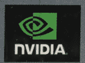


## Morgan Kaufmann 的相关著作

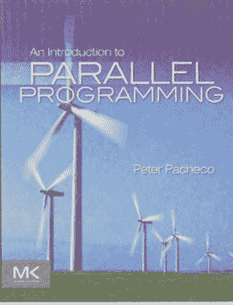

- 并行编程导论

Peter Pacheco

9780123742605

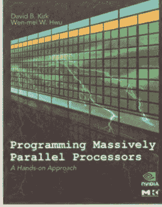

- 大规模并行处理器编程：实践方法

David B. Kirk 和 Wen-mei W. Hwu

9780123814722

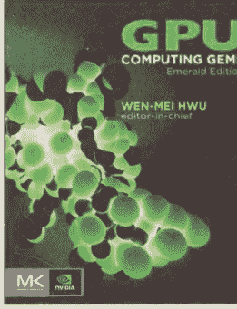

- GPU 计算宝石，翡母绿版

Wen-mei W. Hwu 编

9780123849885

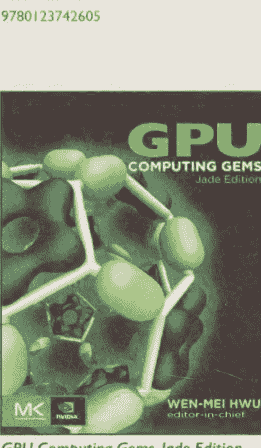

- GPU 计算宝石，翡石版

Wen-mei W. Hwu 编

9780123859631

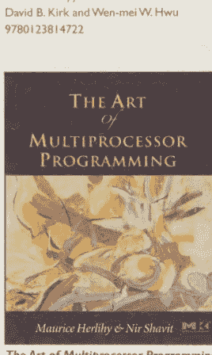

- 多处理器编程的艺术

Maurice Herlihy 和 Nir Shavit

9780123705914

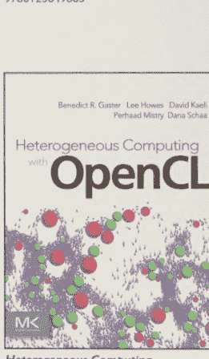

- 使用 OpenCL 进行异构计算

Benedict Gaster 等

9780123877666

## CUDA 应用设计与开发


`https://archive.org/details/cudaapplication0000farb`

## CUDA 应用设计与开发

Rob Farber

阿姆斯特丹 • 波士顿 • 海德堡 • 伦敦

纽约 • 牛津 • 巴黎 • 圣迭戈

旧金山 • 新加坡 • 悉尼 • 东

Morgan Kaufmann 是 Elsevier 出版的一个品牌

策划编辑：Todd Green

开发编辑：Robyn Day

项目经理：Danielle S. Miller

设计师：Dennis Schaeffer

Morgan Kaufmann 是 Elsevier 出版的一个品牌

225 Wyman Street, Waltham, MA 02451, USA

© 2011 NVIDIA Corporation 及 Rob Faber. 由 Elsevier Inc. 出版保留所有权利。

未经出版者书面许可，本书不得以任何形式或任何手段（电子或机械，包括复印、录制或任何信息存储和检索系统）复制或再印。有关寻求许可的详情、有关出版者政策的更多信息，以及我们与许可中心（Clearance Center）和版权许可机构（Copyright Licensing Agency）等机构的安排，请参阅我们的网站：www.elsevier.com/permissions。

本书及其包含的个人贡献受出版者版权保护（另有说明的除外）。

# 注意事项

该领域的知识和最佳实践在不断变化。随着新研究和经验拓宽了我们的理解，研究方法或专业实践的改变可能变得必要。从业人员和研究人员在评估和使用本文中描述的任何信息或方法时，必须始终依靠自己的经验和知识。在使用此类信息或方法时，应注意自己及他人的安全，包括他们负有专业责任的方。

在法律允许范围内，出版者以及作者、贡献者或编辑对于由于使用材料中包含的任何方法、过程、指令或思想而导致的人或财产的任何伤害/损害（无论是出于产品责任、疏忽或其他），不承担任何责任。

# 美国国会图书馆编出版数据

申请已提交。

# 英国图书馆书编出版数据

英国图书馆可提供本书的目录记录。

ISBN: 978-0-12-388426-8

欲了解有关所有 MK 出版物的信息请访问网站

www.diacrip.com

由 diacTech 排版，地点印度 金纳伊

印于美国

12 13 14 15 10 9 8

## 献辞

本书献给我的妻子 Mary，在我写作时，她没能深度参与其中。特别献给我的儿子 Ryan，他带我远离了童年。特别献给儿子 Ryan，他是完成手稿的老模型。最后，感谢 NVIDIA 的同事，让这一切成为可能。

# 目录

前言 . . . . . . . . . . . . . . . . . . . . . . . . . . . . . xi

序言 . . . . . . . . . . . . . . . . . . . . . . . . . . . . xiii

第 1 章

第一个程序与如何思考 CUDA . . . . . . . 1

源码与简单示例 . . . . . . . . . . . . . . . 2

区分 CUDA 与传统编程 . . . . . . . . . . . . . . . . . . . . . . . 5

选择 CUDA API . . . . . . . . . . . . . . . . . . . . . . . 8

基础概念 . . . . . . . . . . . . . . . . . . . . . . . . . 9

理解内核 (Kernel) . . . . . . . . . . . . . . . 10

GPGPU 编程的三规则 . . . . . . . . . . . . . . . . . . . . 13

大-O 考虑因素与数据传输 . . . . . . . . . . . . . . 15

CUDA 与阿姆达尔定律 (Amdahl's Law) . . . . . . . . . . . . . . . . . . . . 17

数据与并行性 . . . . . . . . . . . . . . . . . . . . . 18

执行：使用 CPU 和 GPU 资源 . . . . . . . . . . . . . . . . . . . . 19

回归测试与准确性 . . . . . . . . . . . . . . . . . . . . . . . 21

错误 . . . . . . . . . . . . . . . . . . . . . . . . . . . . . . 22

调试导论 . . . . . . . . . . . . . . . . . . . . . 23

UNIX 调试 . . . . . . . . . . . . . . . . . . . . . . . . . . . 24

使用 Parallel Nsight 进行 Windows 调试 . . . . . . 29

本章总结 . . . . . . . . . . . . . . . . . . . . . . . . . . . . . 30

第 2 章

CUDA 用于机器学习与优化 . . . . . . 33

建模与仿真 . . . . . . . . . . . . . . . . . . . . . . . . . 34

机器学习与神经网络 . . . . . . . . . . . . . . . . . . . . . . . . 38

XOR：一个非线性机器学习问题 . . . . . 39

XOR 的性能结果 . . . . . . . . . . . . . . . . . . . . . . . 53

性能讨论 . . . . . . . . . . . . . . . . . . . . . . . 53

本章总结 . . . . . . . . . . . . . . . . . . . . . . . . . . . . . . . 56

C++ Nelder-Mead 模板 . . . . . . . . . . . . . . . . 57

第 3 章

CUDA 工具套：PCA/NLPCA 性能分析 . . . . .

Functor . . . . . . . . . . . . . . . . . . . . . . . . . . . . 63

PCA 与 NLPCA . . . . . . . . . . . . . . . . . . . . . . . . . . . . 64

获取基础性能分析信息 . . . . . . . . . . . . . . . . . . . . . . . . 71

Gprof：一种常用的 UNIX 性能分析工具 . . . . . . . . . . . . . . . . . . . . 73

NVIDIA 可视化性能分析工具：Computeprof . . . . . . . . . . . . . . . . . 74

用于 Microsoft Visual Studio 的 Parallel Nsight . . . . . . . . . . . . . . . 77

调优与分析工具 (TAU) . . . . . . . . . . . . . . . . . 82

本章总结 . . . . . . . . . . . . . . . . . . . . . . . . . . . . . . . . . 83

第 4 章

CUDA 执行模型. . . . . . . . . . . . . . . . 85

GPU 架构概览. . . . . . . . . . . . . . . . . . . . . . . 86

线程束调度 (Warp Scheduling) 与 TLP . . . . . . . . . . . . . . . . . . . . . 92

指令级并行性 (ILP)：较低占用率下的更高性能 . . . . . . . 94

利特法则 (Little's Law) . . . . . . . . . . . . . . . . . . . . . . 102

识别限制因素的 CUDA 工具 . . . . . . . . . . . . . 108

本章总结 . . . . . . . . . . . . . . . . . . . . . . . . . . . . . . . 109

第 5 章

CUDA 内存 . . . . . . . . . . . . . . . . . . . . 109

CUDA 内存层次结构 . . . . . . . . . . . . . . . . . . . . . . . 109

GPU 内存 . . . . . . . . . . . . . . . . . . . . . . . . 111

L2 缓存 . . . . . . . . . . . . . . . . . . . . . . . 112

L1 缓存 . . . . . . . . . . . . . . . . . . . . . . . 114

CUDA 内存类型 . . . . . . . . . . . . . . 116

全局内存 . . . . . . . . . . . . . . . . . . . . 124

本章总结 . . . . . . . . . . . . . . . . . . . . . . . . . . . . 131

第 6 章

高效使用 GPU 内存 . . . . 133

归约 (Reduction) . . . . . . . . . . . . . . . . . . . . . . . . . . . . 134

利用不规则数据结构 . . . . . . . 146

稀疏矩阵与 CUSP 库 . . . 149

图算法 . . . . . . . . . . . . . . . . . . . . 151

SoA、AoS 及其他结构 . . . . . . . 154

分块 (Tiles) 与模板 (Stencils). . . . . . . . . . . . . . 154

本章总结 . . . . . . . . . . . . . . . . . . . . . 155

第 7 章

增加并行性的技术. . . . . 157

CUDA 上下文扩展并行性 . . . . 158

流 (Streams) 与上下文 . . . . . . . . . . . . . . . . . . . . . 159

多流乱序执行 166

将数据与计算绑定 ................................................................................................................................................. . . . . 172

总结 ................................................................................................................................................. . . . . . . . . . . . . . . . . 176

**第 8 章** 适用于所有 GPU 和 CPU 的 CUDA . . . . . . . . . . . . . . 179

从 CUDA 到多硬件后端的路径 . . . . . . . . . . . . . . . . . . . . . . 180

从其他语言访问 CUDA . . . . . . . . . . . . . . . . . . . . . . 188

库 . . . . . . . . . . . . . . . . . . . . . . . . . . . . . . . . . . . . . . . . . . . 191

CUBLAS . . . . . . . . . . . . . . . . . . . . . . . . . . . . . . . . . . . . . . . . . 191

CUFFT . . . . . . . . . . . . . . . . . . . . . . . . . . . . . . . . . . . . . . . . 191

总结 . . . . . . . . . . . . . . . . . . . . . . . . . . . . . . . . . . . . . . . . . . . . . . . . . . . . . . . . . 205

**第 9 章** CUDA 与渲染的混合 . . . . . . . . . . . . . . . . . . . 207

OpenGL ................................................................................................................................. . . . . . . . . . . . . 208

GLUT ................................................................................................................................. . . . . . . . . . . . . . . . . . . 208

框架中文件的介绍 . . . . . . . . . . . . . . . . . . . . . . . . . 213

总结 . . . . . . . . . . . . . . . . . . . . . . . . . . . . . . . . . . . . . . . . . . . . . . . . . . 238

**第 10 章** 云端与集群环境中的 CUDA . . . . . . . . . . . . . . . . . . 241

消息传递接口 (MPI) . . . . . . . . . . . . . . . 242

MPI 如何通信 .................................................................................................................................................... 246

带宽 ................................................................................................................................................................................... 248

平衡比例 ................................................................................................................................................................................................... 249

大型 MPI 运行的考虑因素 ................................................................................................................................. . . . . . . . . 252


云计算 ..................................................................................................................................................................................... 255

代码示例 ...................................................................................................................................................................................................... 256

总结 ................................................................................................................................................. . . . . . . . . . . . . . . . . . . . . . . . . . . . . . . . . . . . . . . . . 264

# 第 11 章 解决现实问题的 CUDA ................................................................................................................................... 265

处理高维数据 ................................................................................................................................................................................................................................. 266

PCA/NLPCA ................................................................................................................................................................................................................................................... 267

力导向图 ................................................................................................................................................................................................................................... 271

蒙特卡洛方法 ................................................................................................................................................................................................................................................................... 272

分子建模 ................................................................................................................................................................................................................................................................................... 273

量子化学 ................................................................................................................................................................................................................................................................................... 273

交互式工作流 ................................................................................................................................................................................................................................................................... 274

丰富的项目 ................................................................................................................................................................................................................................................................................................. 275

总结 ................................................................................................................................................. . . . . . . . . . . . .

# 第 12 章 专注于视频流媒体的应用 ................................................................................................................... 277

机器视觉主题. . . . . . . .......................................................................................................................................................................................................................................................... 278

FFmpeg ................................................................................................................................................................................................................................................................................................................................................. 281

TCP 服务器 ................................................................................................................................................................................................................................................................................................................................. 283

# 目录

- 直流应用............................................................................... 287

`simpleVBO.cpp` 文件............................................................................... 291

`callbacksVBO.cpp` 文件....................................................................................... 291

编译与运行代码...................................................................................... 295

未来 ................................................................................................ 295

总结.................................................................................... 297

`simpleVBO.cpp` 代码列表............................................................................... 297

- 引用文献 ...................................................................................... 303

- 索引 ................................................................................. 311

## 前言

GPU 近期作为一种创新技术进入科学计算领域，为许多科学应用展示了卓越的性能和能量效率。这些最初的应用通常由早期采用者开创，他们付出了巨大的努力来利用 GPU。这项技术面临的关键问题是，它是否能够渗透到科学计算中多种多样化的算法中，并对广泛的用户（而不仅仅是早期采用者）有用。

这一挑战的一部分将由专家们通过书籍、教程和协作与其他用户分享他们的知识和方法来解决。《CUDA 应用设计与开发》就是其中一本书。在书中，作者详细解释了重要算法的实现，例如量子化学中的应用、机器学习方法。书中不仅描述了支撑编程的方法论，还描述了如何重构算法以最大化 GPU 架构的优势。此外，书中提供了许多案例研究，用于解释和强化重要概念，如 CUDA 线程、GPU 内存层次结构以及跨多个 GPU 的扩展性（其中展示了一个扩展到 500 个 GPU 的 `MPI` 示例）。

最后，没有任何编程语言是孤立存在的。可以说，任何语言若要成功，都必须由强大的编译器、性能和正确性工具以及优化库构成的生态系统所环绕。软件开发的这些务实方面通常是快速开发应用程序最重要的因素。《CUDA 应用设计与开发》

在这一方面它没有让人失望，因为它投入了多个章节来描述如何使用 CUDA 编译器、调试器、性能剖析器、库以及与其他语言的互操作性。

我非常享受从这本书书中学习，我确定你也会如此。

Jeffrey S. Vetter

2011年9月20日

橡树岭奇国家实验室 杰出研究职员；

佐治亚理工学院 教授。

## 前言

时机在技术领域中至关重要，在我们的学术和职业生涯中也是如此。我们是极其幸运的一代程序员，拥有了最初的、利用廉价、通用且大规模并行的计算硬件的机遇。`GPGPU`（通用型图形处理器）技术的影响涵盖了计算的所有各个面，从最小的手机手机到世界上最大的超级计算机。我们正在改变商业应用的格局；科学计算、云计算、计算机可视化、游戏和机器人学甚至在重新定义计算机编程的教学方式。`TensorFlow` 每秒浮点运算计算现在已成为世界上大多数人的触触及。青少年、学生、家长、教师、专业人士、小型研究机构和大型公司都能轻松负担得 `GPGPU` 硬件，而且软件开发包（`SDKs`）是免费的。`NVIDIA` 估计已销售了超过33亿台 GPU 设备。

这些使用 `CUDA`（计算统一设备架构）编写的数亿台 GPU 为商业应用提供了巨大的市场机会，并且它们提供了一个硬件基础，用此重新定义科学计算的可能。最重要的是，`CUDA` 和大规模并行 `GPGPU` 硬件正在改变我们思考计算的方式。`CUDA` 程序不再局限于一次执行一个或几个操作，`CUDA` 程序可以同时执行数万次操作！

本书将教你如何用 `CUDA` 的思维思考，并利用那些成千上万的执行线程为你的应用程序（无论是商业的、学术的还是性的）实现数量级的性能提升。此外，本书将解释如何在单个应用程序中使用一个或多个 `GPGPU`，无论是在单台机器上还是跨机器集群。

此外，本书将向你展示如何使用 `CUDA` 开发可以在多核处理器上运行的应用程序，使 `CUDA` 成为所有开发的可行选择。不需要 GPU！

本书的内容不仅关注语法和 API，还涵盖了 `CUDA` 设计背后的思想，以及 `GPGPU` 硬件能够表现如此卓越的架构原因。书中将涵盖各种准则和注意事项，以便你编写简洁、易读且易于维护的代码。重点是最新的 `CUDA 4.x` 版本。

书中提供了可以编译和修改的运行代码；尝试和调整代码是学习过程中不可不可缺的一部分。示例演示了如何从 `GPGPU` 的 `Fermi` 架构（`NVIDIA 20`系列）获取高性能，因为其意图不仅是让代码运行，还要展示如何编写高效代码。拥有旧版 GPU 的用户将从书中受益，因为示例代码将在所有支持 `CUDA` 的 `GPGPU` 上编译和运行。在适当的情况下，本书将引用我的《`Doctor Dobb's Journal`》中的 `CUDA` 教程文本，以突出与之前的 `CUDA` 版本相比的改进，并提供关于如何跨代 `GPGPU` 架构实现良好性能的见解。

教学材料、额外的示例和读者评论可在 `http://gpucomputing.net` wiki 获取。访问以下 URL 均可进入 wiki：

- 我的名字：`http://gpucomputing.net/RobFarber.`
- 本书标题的一个单词形式：`http://gpucomputing.net/CUDAapplicationdesignanddevelopment.`
- 我的系列丛名称：`http://gpucomputing.net/supercomputingforthemass.`

购买了本书的人可以在 `http://booksite.mkp/9780123884268` 下载示例的源代码。

为了实现这些目标，本书的结构如下：

第 1 章。包含基础 `CUDA` 概念以及构建和调试 `CUDA` 程序的工具。提供了简单的示例来演示 `thrust` `C++` 和 `C API`。引入了高性能 GPU 编程的三条简单规则。

第 2 章。仅使用第 1 章介绍的技术，本章提供了一个清晰的、通用机器学习和优化框架，该框架运行速度比传统处理器单核快 341 倍。还涵盖了机器学习和数值优化的概念，这些对于那些渴望获得领域知识以及具备编程 GPU 能力的人将感兴趣。

第 3 章。剖析（Profiling）是本章的重点，因为它是高性能编程中的一项基本技能。介绍了 `CUDA` 剖析工具并将其应用于第 2 章的真实世界示例。揭示了 `Thrust API` 中一些令人意料的瓶颈。讨论了介绍数据挖掘技术，并提供了用于主成分分析（`PCA`）和非线性主成分分析的数据挖掘函数（functors），因此本章对用户和程序员都会感兴趣。

第 4 章。`CUDA` 执行模型是本章的主题。任何想从 GPU 获取巅峰性能的人都必须理解本章涵盖的概念。提供了示例和剖析输出，以帮助理解 GPU 正在做什么以及如何使用现有工具查看发生了什么。

第 5 章。`CUDA` 在 GPU 上提供了几种类型的内存。讨论了每种内存及其优缺点。

第 6 章。由于最快和最慢 GPU 内存之间存在三个数量级的性能差异，高效使用 GPU 内存是实现高性能的唯一途径。本章讨论了技术并提供了剖析输出，帮助你理解和监控应用程序使用内存的效率。提供了一个通用的函数示例，教你如何编写类似于 `Thrust API` 的自己的通用方法。

第 7 章。GPU 提供了多种形式的并行，包括多个 GPU、异步内核执行和统一内存（Unified Memory）。本章讨论了技术并提供了剖析输出，帮助你理解和监控应用程序使用内存的效率。

第 8 章。`CUDA` 已成为所有开发的可行平台。本章讨论了将 `Python`、`Java` 和 `R` 等高级语言与 `CUDA`。


第 9 章。提供了一个基于本章框架的实时视频流识别示例。它是为教学设计的，因此很容易修改用于平视显示器（HUD）的数据融合。

第 10 章。为了教授可扩展性和性能，第 3 章的示例被扩展为使用 MPI（消息传递接口）。

第 11 章。没有任何书能涵盖 CUDA 的所有方面。这是一个综述章节，指向其他为各种技术提供运行源代码的项目，包括支持向量机（SVM）、多维缩放（MDS）、互信息和力导向布局。

第 12 章。本章聚焦于实时视频流识别。提供了一个运行示例，只需要一个廉价的摄像头或视频文件，即可进行实时视觉处理。

# 前100个 NVIDIA CUDA应用展示加速比

(最小 100，最大 2600，中位数 1350)

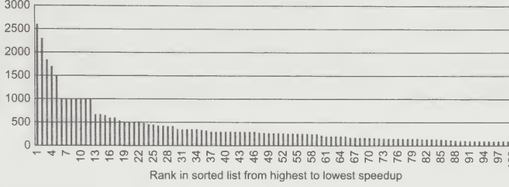

**图 1**

前 100 个 NVIDIA 应用的加速比。

通过提高时钟频率来实现加速。传统处理器制造商诱导客户升级新电脑的唯一方法，是通过双核和四核处理器的并行性提供两到四倍的加速。多核并行是具有颠覆性的，因为它要求重写现有软件以利用这些额外的内核。当计算机和研究行业重新调整工具以利用并行硬件时，请加入软件应用开发和研究的最前沿！学习 CUDA，并加入这一绝佳机会。

## 第一个程序以及如何在 CUDA 中进行思考

本章的目的是向读者介绍 CUDA（由 NVIDIA 开发的并行计算架构），并将 CUDA 与编程传统的单核和多核处理器区分开来。示例程序和指令将向读者展示如何编译和运行程序，以及如何将其调整以适应自己的需求。我们将使用并讨论 CUDA Thrust 和运行时 API（应用程序编程接口）。我们将引入三个 GPU 编程规则，并类似于阿姆达法则，区分数据并行编程和任务并行编程。我们将介绍一些基本的 GPU 调试工具，但在大多数情况下，NVIDIA 使调试代码与调试任何其他 C 或 C++ 完全相同。在适当的情况下，将提供介绍性材料以帮助帮助读者。在本章结束，读者将能够编写和调试同步并行程序，在单个应用程序中同时利用 GPU 和主机处理器处理海量的执行线程。

在本章结束，读者将对以下内容有基本的理解：

- 如何创建、构建和运行 CUDA 应用。
- 决定使用哪种 CUDA API 的标准。
- 阿姆达法则以及它与 GPU 计算的关系。
- 高性能 GPU 计算的三条规则。
- 大 O 表示法和数据传输的影响。
- 任务并行与数据并行编程之间的区别。
- Linux、Mac 和 Windows CUDA 调试器的某些 GPU 特定功能。
- CUDA 内存检查器以及如何发现越界和未对齐的内存错误。

# 第 1 章：第一个程序以及如何在 CUDA 中进行思考

### 源代码与维基

书书中所有示例的源代码可以从 `http://booksite.mkp.com/9780123884268` 下载。提供了一个维基（一个由用户社区协作开发的网站）用于共享信息、评论和查找教学材料；可以通过以下任何一个别名访问：`gpucomputing.net`:

- 我的名字：`http://gpucomputing.net/RobFarber`
- 本书标题的单词形式：`http://gpucomputing.net/CUDAapplicationdesignanddevelopment`
- 我系列丛的名字：`http://gpucomputing.net/supercomputingforthemmasses`

### 通过简单示例区分 CUDA 与传统编程

为顺序处理器编写程序需要编写一个程序，指定计算某些结果所需的每项任务。参见示例 1.1，“`seqSerial.cpp`，一个顺序执行的 C++ 程序”：

#### 示例 1.1

```cpp
//seqSerial.cpp
#include <iostream>
#include <vector>
using namespace std;
int main() {
    const int N=50000;
    // 任务1: 创建数组
    vector<int> a(N);
    // 任务2: 填充数组
    for(int i=0; i < N; i++) a[i]=i;
    // 任务3: 计算数组之和
    int sumA=0;
    for(int i=0; i < N; i++) sumA += a[i];
    // 任务4: 计算 0 .. N-1 之和
    int sumCheck=0;
    for(int i=0; i < N; i++) sumCheck += i;
    // 任务5: 检查结果是否一致
    if(sumA == sumCheck) cout << "Test Succeeded!" << endl;
}
```

### 通过简单示例区分 CUDA 与传统编程

```cpp
else cerr << "Test FAILED" << endl; return(1);
return(0);
```

示例 1.1 执行了五项任务：

1. 它创建了一个整数数组。
2. 一个 `for` 循环用从 0 到 `N-1` 的整数填充数组。
3. 计算数组中整数之和。
4. 另一个独立的 `for` 循环通过另一种方法计算整数之和。
5. 比较检查顺序执行和并行的结果是否相同，并报告测试结果。

注意，处理器一个接一个连续地运行每个任务。在任务 2-4 内部，处理器从第一个索引开始迭代循环。一旦所有任务完成，程序就会退出。这是一个单线程执行的示例，如图 1.1 中的任务 2 所示，一个单线程填充了数组 `a` 的前三个元素。

该程序可以使用以下命令编译和执行：

- Linux 和 Cygwin 用户（示例 1.2，“使用 `g++` 编译”）

示例 1.2

```bash
g++ seqSerial.cpp -o seqSerial
./seqSerial
```

Microsoft Visual Studio 用户利用命令行界面（示例 1.3，“使用 Visual Studio 命令行接口编译”）

示例 1.3

```bash
c1.exe seqSerial.cpp -o seqSerial.exe
seqSerial.exe
```


图 1.1

单线程执行。

# 第 1 章：第一个程序以及如何在 CUDA 中进行思考

当然，所有的 CUDA 用户（Linux, Windows, MacOS, Cygwin）都可以使用 NVIDIA 编译器（示例 1.4，“使用 `nvcc` 编译”）

#### 示例 1.4

```bash
nvcc seqSerial.cpp -o seqSerial
./seqSerial
```

在所有情况下，程序都会打印“Test succeeded!”

为了对比，让我们创建并运行第一个 CUDA 程序 `seqCuda.cu`。（注意：以下示例使用了 CUDA Thrust API（前缀为 `thrust:`），CUDA 代码与顺序 C++ 代码几乎相同。参见示例 1.5，“使用 Thrust API 的大规模并行代码”）

#### 示例 1.5

```cpp
//seqCuda.cu
#include <iostream>
using namespace std;

#include <thrust/reduce.h>
#include <thrust/sequence.h>
#include <thrust/host_vector.h>
#include <thrust/device_vector.h>

int main() {
    const int N=50000;
    // 任务1: 创建数组
    thrust::device_vector<int> a(N);
    // 任务2: 填充数组
    thrust::sequence(a.begin(), a.end(), 0);
    // 任务3: 计算数组之和
    int sumA = thrust::reduce(a.begin(),a.end(), 0);
    // 任务4: 计算 0..N-1 之和
    int sumCheck=0;
    for(int i=0; i<N; i++) sumCheck += i;
    // 任务5: 检查结果是否一致
    if(sumA == sumCheck) cout << "Test Succeeded!" << endl;
    else cerr << "Test FAILED!" << endl; return(1);
    return(0);
}
```

### 选择 CUDA API

时间 0

数组 a | 0 | 1 | 2 | 3 | 4

#### 1.2 并行线程

的执行。

与图 1.1 中的单线程执行不同，示例 1.5 中的代码利用许多线程来执行大量的并发操作，如图 1.2 中任务 2 填充数组 `a` 所示。

无论应用程序中使用何种 API 或 API 的组合，CUDA 都可以从其他高级语言（如 Python、Java、FORTRAN 等）调用。调用约定和所需的细节随每种语言而不同。

### 选择 CUDA API

CUDA 为编程提供了多个 API 供使用。从高层到低层如下：

1. 数据并行 `Thrust` API
2. 运行时 API，可以在 C 或 C++ 中使用
3. 驱动程序 API，可以在 C 或 C++ 中使用

### 第一章：第一个程序与 CUDA 思维

使用哪种 API 取决于开发者对 GPU 的控制程度。像 C++ `Thrust` API 这样高层的 API 是方便的，因为它们能为程序员完成许多工作，但它们也会代表程序员做出决策。通常情况下，`Thrust` 被证明可以提供更高的计算性能、通用性和便利性。它还能加速代码开发，并生成更易于读的代码，许多人会认为这种代码更具维护性。在不进行任何修改的情况下，用 `Thrust` 编写的程序大部分能够保持或提高性能。像规约（reduction）这样的 `Thrust` 方法执行了大量工作，这使得 `Thrust` API 开发者有充分的自由整合最新硬件中的特性来提高性能。`Thrust` 是一个设计良好的 API 示例，它既简单又通用，并且能够随着技术演进适应性能需求。

`Thrust` 这种高层 API 的缺点是它会将开发者与硬件隔离，并且仅暴露能力的子集。在某些情况下，C++ 接口可能会变得繁琐或冗长。特别是科学程序员可能会发现简单循环的清晰性在 C 语言语法中丢失。

首先使用高层接口，当你认为额外的编程工作将带来更大的性能提升，或者为了更好地支持你的应用而需要某些低层能力时，选择切换到低层 API。CUDA 运行时（runtime）特别设计用于通过对 C 语言进行一些简单、优雅且强大的语法增强，让开发者能够访问 GPGPU 的所有可特性。因此，CUDA 运行时代码有时可能是最简洁、最易读的 API；它可以运行得极其高效。最低级驱动接口的一个重要方面是，它可以对队列队列和数据传输提供非常精确的控制。

当使用低层接口时，预计代码量会增加，因为开发者必须进行更多的 API 调用和/或为每次调用指定更多参数。此外，开发者需要检查运行时错误和版本不兼容性。在许多使用低层 API 的情况下，应用程序代码中许多行关注 API 接口的细节而非任务的实际工作并不罕见。

幸运的是，现代 CUDA 开发者不再限制在应用程序中使用单一的 API，这在 2010 年 CUDA 3.2 发布之前是不可能的。现代版本的 CUDA 允许开发者根据需要随时在应用程序中使用三种 API 中的任何一种。因此，初始代码可以用 `Thrust` 等高层 API 编写，然后重构以使用运行时或驱动程序 API 的某些特殊特性。

### 选择 CUDA API

让我们利用这种混合不同层次 API调用的能力，来突出并更显式地展示之前示例中顺序填充任务（任务 2）的并行性质。示例 1.7 “使用 CUDA 运行时用顺序整数填充数组”也为我们提供了介绍 CUDA 运行时 API 的机会：

### 示例 1.7

```cpp
//seqRuntime.cu
#include <iostream>
using namespace std;
#include <thrust/reduce.h>
#include <thrust/sequence.h>
#include <thrust/host_vector.h>
#include <thrust/device_vector.h>

__global void fillKernel(int* a, int n) {
    int tid = blockIdx.x*blockDim.x + threadIdx.x;
    if (tid < n) a[tid] = -tid;
}

void fill(int* d, int n) {
    int nThreadsPerBlock = 512;
    int nBlocks = n/nThreadsPerBlock + (n%nThreadsPerBlock)?1:0;
    fillKernel<<<nBlocks, nThreadsPerBlock>>>(d_a, n);
}

int main() {
    const int N=50000;
    // task 1: 创建数组
    thrust::device_vector<int> a(N);
    // task 2: 使用运行时填充数组
    fill(thrust::raw_pointer_cast<int>(&a[0]), N);
    // task 3: 计算数组之和
    int sumA=thrust::reduce(a.begin(),a.end(), 0);
    // task 4: 计算 0 .. N-1 之和
    int sumCheck=0;
    for(int i=0; i<N; i++) sumCheck += i;
    // task 5: 检查结果一致
    if(sumA == sumCheck) cout << "Test Successful!" << endl;
    else cerr << "Test FAILED!" << endl; return(1);
    return(0);
}
```

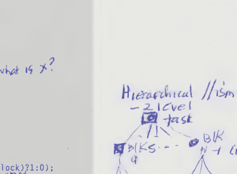

### 第一章：第一个程序与 CUDA 思维

代码中修改过的部分已加粗显示。为了尽量减少对 `main()` 结构的更改，对 `thrust::sequence()` 的调用替换为对 `fill()` 的调用，该函数是使用运行时 API 编写的。因为数组分配了 `thrust::device_vector`，所以需要使用 `thrust::raw_pointer_cast` 来获取 GPU 上的数据。CUDA 运行时代码有时是最简洁、最易读的 API；它可以运行得极其高效。良好的 C++ 实践将是传递 `int**；通过 `a.size()` 安全地确定 vector 中的元素数量；以及其他原因。

### 基础 CUDA 概念

在讨论运行时 `fill()` 子程序之前，理解一些 CUDA 概念很重要：

- 支持 CUDA 的 GPU 安装在主机上。在大多数情况下，GPGPU 通过 PCIe（外围部件连接）总线连接到主机系统。
- 二到四个 GPGPU 可以添加到工作站或集群节点中。数量取决于主机系统的能力，如 PCIe 插槽、电源和散热。每个 GPGPU 都是与主机异步运行的设备，这意味着主机和所有 GPGPU 可以同时忙于计算。PCIe 总线用于在设备之间传输数据和命令。CUDA 提供了各种传输机制，包括：
- 使用 `memcpy` 进行显式数据传输（最常用的运行时数据传输方法）。使用 Thrust 的可以通过赋值在向量之间移动数据（参见示例 1.8 “如何使用 Thrust 移动数据”）

示例 1.8

```cpp
//使用 thrust 将数据从主机移动到设备
d_a = h_a;

//从设备到主机
h_a = d_a;
```

### 基础 CUDA 概念

使用映射内存（mapped memory）进行隐式传输。这种接口保持主机内存区域与 GPU 内存区域的同步，且不需要程序员干预。例如，应用程序可以在主机上加载数据集，将其映射到 GPU，然后像已显式初始化过一样使用 GPU 上的数据。使用映射内存可以提高程序的效率，因为传输是异步的。某些低功耗 GPGPU 利用主机内存来节省成本和功率。这些设备上，使用映射内存会导致零拷贝操作，因为 GPU 将在没有任何任何拷贝操作的情况下访问数据。

在底层，主机和 GPGPU 硬件通过称为设备驱动程序的软件组件进行交互。驱动程序管理硬件接口，以便 GPU 和主机系统能够通信、计算和显示信息。它还支持许多操作，包括映射内存、缓冲、队列和同步。CUDA 软件栈的组件如图 1.3 所示。

GPGPU 运行在独立主机处理器的内存空间中。除了少数低端设备外，所有 GPGPU 都有自己的物理内存（例如 RAM），这些内存旨在提供远高于传统主机内存的带宽。许多当前的

图 1.3

软件栈的组件。

# 10 第1章：第一个程序与 CUDA 思维

GPGPU 内存系统的传输速度约为 160-200 GB/s（每秒十亿或字节），而传统的主机内存系统仅提供 8-20 GB/s。尽管 CUDA 4.0 提供了统一虚拟地址（UVA），将主机内存和 GPGPU 内存合并到单一的统一地址空间中，但不要忘记，访问另一个设备需要通过总线（即 GPGPU 之间）进行一些传输。然而，UVA 非常重要，因为它让运行在任何设备上的软件能够仅通过指针就访问另一个设备上的数据。

- CUDA 程序利用内核函数（kernels），这些是从主机端调用的、在 CUDA 设备上执行的子程序。需要注意的是，内核函数不是函数，它们不能返回值。大多数在 GPGPU 上运行良好的应用程序，其大部分时间都花在一个或几个计算例程中。将这些例程转换为 CUDA 内核函数是加速应用程序和利用 GPGPU 力的极佳方法。内核函数使用全局声明说明符定义，它告诉编译器该内核可以被主机处理器调用。


内核函数调用是异步的，这意味着主机仅将内核放入 GPGPU 的执行队列中，而不需要等待其完成，而是继续执行其他工作。稍后的某个时候，内核实际上会在 GPU 上运行。由于这种异步调用机制，CUDA 内核无法返回函数值。为了提高效率，可以通过队列若干线程来创建流水线，使 GPGPU 尽可能保持忙碌。此外，需要某种形式的同步，以便主机知道内核或流水线何时完成。两种常用的同步机制是：

- 显式调用 `cudaSynchronize()` 充当屏障，导致主机停止并等待所有队列中的内核完成。使用 `cudaMemcpy()` 和 `cudaSynchronize()` 执行阻塞数据传输是在 `cudaMemcpy()` 内部调用的。

- GPU 的基本单位是线程 `thread`。从软件的角度来看，重要的一点是每个线程都与其他线程是相互独立的。每个线程的行为都像它有自己的处理器，拥有独立的寄存器和标识，例如在计算网格中的位置，恰好运行在共享内存环境中。硬件定义了能够并发运行的线程数量。内置 GPU 硬件线程调度器决定一组线程何时可以运行，并能够快速地在线程之间切换，以至于从软件角度来看，线程切换和调度是免费的。C 语言中一些简单优雅的扩展允许线程通过 CUDA 共享内存空间和原子内存操作进行通信。

### 理解我们的第一个运行时内核

内核函数应该利用许多线程来执行内核源码中定义的工作。这种利用被称为线程级并行，它与指令级并行不同，后者的并行发生在处理器指令上。1.2 展示了在并行填充中使用许多线程的情况，这与示例 1.1 所示的单线程填充操作形成对比。

执行配置 `execution configuration` 定义了运行内核的线程数，以及它们在 1D、2D 或 3D 计算网格中的排列。执行配置将配置信息封装在三角括号 `<<< >>>` 之间，这些括号跟在内核名称和括号括起来的参数列表之后。除了执行配置外，内核内核看起来与子程序调用非常相似。示例 1.7 通过调用 `fillKernel()` 演示了这种语法。

- GPU 上最大的内存区域称为全局内存 `global memory`。以 GB RAM 为单位衡量，大多数应用程序数据存储在全局内存中。全局合并规则 `Global coalescing rules` 将多次内存事务合并为单一的大型操作，从而可以获得最高的内存传输速率。通常情况下，当内存访问可以合并为 128 字节的连续数据块时，性能最佳。

其他内置 GPU 可访问的内存形式还包括常量内存、缓存、共享内存、本地内存、纹理内存和寄存器内存，如第 5 章所述。

访问全局内存的延迟可能很高，比访问寄存器变量慢 600 倍。CUDA 程序员应该注意，尽管全局内存的带宽看起来很高，约 160–200 GB/s，但与 GPU 提供的 Tflops 性能相比，它仍然很慢。因此，GPU 内部的数据复用对于实现高性能至关重要。

### 理解我们的第一个运行时内核

你现在已经了理解我们的第一个内核所需的基础概念。

从程序员的角度来看，执行始于示例 1.7 中主机处理器的 `main()` 函数中。常量整数 `N` 被初始化，并使用 `Thrust device_vector<int>` 在 GPGPU 设备上分配 `N` 个整数。执行随后顺序进行到 `fill()` 子程序。

通过一个简单的计算，根据 `nThreadsPerBlock` 定义的每块 512 个线程来确定块的数量 `nBlocks`。其核心思想是以 `nThreadsPerBlock` 的粒度提供足够的线程，将每个线程分配给整数数组 `d` 中的每个位置。按照惯例，设备变量通常在变量名前加 `d_`，主机变量则在变量名前加 `h_`。

CUDA 内核函数 `fillKernel()` 使用 `nBlocks` 和 `nThreadsPerBlock` 执行配置在 GPGPU 上被入队执行。`d_a` 和 `n` 均作为参数传递给内核。执行随后顺序进行到 `fill()` 子程序。

## 第1章：第一个程序与 CUDA 思维

### 第一章：第一个程序与 CUDA 思维

| 带宽 GB/s | 相比 PCIe 总线的加速比 |
|---|---|
| PCIe x16 v2.0 总线 单向 | 8 | 1x |
| GPU 全局内存 | 160 到 200 | 20x 到 26x |

### 规则 2：给 GPGPU 留足够的任务

“凡你所求，因为你可能真的得到”这句谚言适用于 GPGPU 性能。由于支持 CUDA 的 GPU 可以提供 teraflop 万亿次级性能，它们快到完成小问题的速度比主机处理器启动内核 `kernel` 还要快。对这些数字有一个直观感受，假设对于一个执行浮点运算需要 4 个周期的 1 teraflop GPU，这种开销为 4µsec。为了维持这一点，每个内核必须执行大约 100 万次浮点运算，以避免在内核启动延迟期间浪费周期。如果内核完成仅需 2µsec，那么 50% 的 GPU 周期将被浪费。一个需要注意的是，Fermi GPU 可以在单个 GPU 上同时运行多个小内核。

### 规则 3：专注于 GPGPU 内部的数据复用，以避免内存带宽限制

高性能 CUDA 应用利用 GPU 内部资源，如寄存器、共享内存等，将在第 5 章讨论，来绕过全局内存瓶颈。例如，在全局内存中将向量乘以缩放因子并将结果赋值给全局内存中的第二个向量，速度将很慢，如示例 1 “一个向量示例”所示。

```
Example 1.10
for(i=0; i<N; i++) c[i] = a*b[i];
```

假设向量每个元素需要 4 字节来存储单精度 32 位浮点值，那么具有 teraflop 能力的计算机内存子系统每秒至少需要提供 8 TB 的带宽才能达到峰值性能——假设常数缩放因子进入了 GPGPU 缓存。粗略来说，这种带宽是当前 GPGPU 内存子系统能力的 40 到 50 倍，大约是 20 GB/s 通用处理器带宽的 400 倍。双精度向量每个元素需要 8 字节存储，这将使带宽需求翻倍。这个例子清楚地说明，CUDA 程序员必须尽可能地复用数据以实现高性能。请注意，数据复用对于在传统处理器上获得高性能也同样重要。

### 大-O 考虑与数据传输

大-O 表示法是一种方便的方法，用于描述问题规模如何作为输入的函数影响某些资源，如处理器时间或内存的消耗。通过这种方式，计算机科学家可以将最坏情况或在指定时的平均情况行为描述为一个函数，以便忽略架构或时钟频率比较算法。一些常见的增长率：

- `O(1)`：这些是常数时间算法，无论输入集大小如何，始终消耗相同的资源。在 Thrust 主机向量中对单个元素索引的时间不随数据集的大小而变化，并表现出 `O(1)` 的运行时间增长。

- `O(N)`：这些算法的资源消耗随输入大小线性增长。这是循环遍历数据集的算法的常见运行时间。然而，循环内部的工作必须在常数时间内完成。

- `O(N²)`：性能与数据集大小的平方成正比。在输入数据上使用嵌套循环的算法表现出 `O(N²)` 的运行时间。更深层的嵌套迭代显示出更大的运行时间，例如，三层嵌套导致 `O(N³)`，四层嵌套导致 `O(N⁴)`，依此类推。

这里有许多关于算法分析的优秀著作对大-O 表示法提供了更精确、更全面的描述。一本流行的教材是《算法导论》作者：Cormen, Leiserson, Rivest, and Stein：麻省出版社，2009年。互联网上也有大量资源讨论并教授大-O 表示法以及算法分析。

大多数面向计算的科学家和程序员都熟悉 BLAS 基础线性代数子程序库。BLAS 为基础线性代数提供了事实上的编程接口。NVIDIA 通过其 CUBLAS 提供了 GPU 版本的 BLAS。事实上，GPGPU 计算正在引发人们对新型高性能数学库的兴趣复兴，例如田纳西州大学创新计算实验室的 MAGMA 项目 `http://icl.utk.edu/magma/`。MAGMA 同时利用主机和 GPU 设备在矩阵运算上实现高性能。它可以免费下载。

BLAS 根据三个不同的级别构建，对数据和运行时间的要求逐级增加：

- 第一级 Level-1：向量-向量操作，需要 `O(N)` 数据和 `O(N)` 工作。示例包括两个向量的内积或用常数倍数缩放向量。

- 第二级 Level-2：矩阵-向量操作，需要 `O(N²)` 工作。示例包括矩阵-向量乘法或单次右三角求解。

- 第三级 Level-3：矩阵-矩阵操作，需要 `O(N²)` 和 `O(N³)` 工作。示例包括稠密矩阵乘法。

1.2 描述了假设主机到 GPU 传输了 N 个浮点值，每个 BLAS 层级执行的工作量。它没有考虑数据传回 GPU 的时间。

| BLAS 级别 | 数据 | 工作 | 每个数据的工作 |
|---|---|---|---|
| 1 | `O(N)` | `O(N)` | `O(1)` |
| 2 | `O(N²)` | `O(N²)` | `O(1)` |
| 3 | `O(N²)` | `O(N³)` | `O(N)` |

### CUDA 阿达尔定律

这适用于所有程序，而不是第一级。获得良好的性能需要尽可能将数据留在 GPU。之后，可以通过将低密度操作合并到单个函数或内核来提高性能——有时是巨大的。

阿达尔定律以计算机架构师阿达尔 Amdahl 命名。它不是真正的定律，而是一种近似，模拟了串行程序修改为并行运行时可能实现的理想加速。为了使这种近似有效，必须在并行化时问题规模保持不变。换句话说，假设串行程序被修改为并行运行。此外，假设并行版本代码执行的工作量没有显著变化，这并非总是如此。显然，应用程序中无法并行化的部分取决于硬件能力无法运行得更快。因此，使用 n 个处理器时并行代码相对于串行代码的预期加速取决于程序可以并行化的比例 P 以及无法并行化的部分 1 – P。这种关系如公式1.1所示，“阿达尔定律”。

```
S(n) = 1 / ((1-P) + P/n)      (1.1)
```

阿达尔定律告诉我们，程序员在并行化应用程序时有两个关注点：

- 表达并行部分代码使其运行尽可能快。理想情况下，它们在使用 N 个处理器时应该运行快 N 倍。

- 利用他们的任何技术或创新来最小化 1 – P 串行时间。

异步数据传输可以提高性能，因为 PCIe 总线是全双工的，这意味着数据可以同时向和从主机传输。最多，全双工异步 PCIe 传输可以将性能翻倍到两个 Gflop。

### 第一章：第一个程序与 CUDA 编程

CUDA 的魅力之处之一在于它能够以自然的方式将程序的并行性封装在计算内核 `kernels` 内部。在 GPGPU 硬件上运行良好的应用程序通常会有几个计算密集型代码部分，例如热点，这些部分消耗了大部分运行时间。根据阿姆达尔定律 Amdahl's law，这些具有可以提供良好并行加速的内核 P/(1-P)

观察还表明，将应用程序重构为 CUDA 往往也能提高在中等并行硬件，如多核处理器上的性能，因为 CUDA 允许开发者更好地看到并行性，从而重构代码以减少在串行 1-P 部分花费的时间。当然，这假设了与 GPGPU 之间传输数据的开销不会显著影响应用程序的运行时间。

### 数据并行与任务并行

本章的示例已经演示了数据并行或循环级并行，即循环内部的并行操作。任务并行是另一种并行形式，通过让多个任务并发执行来减少 1-P 串行时间。CUDA 通过在主机和 GPU 上运行并发任务来支持任务并行。CUDA 还提供了在 GPU 内部或多个 GPU 之间利用任务并行的方法。

即使是简单的 GPU 示例，如示例 1.5 和 1.7，也可以修改以演示任务并行。这些示例执行了以下任务：

- 1. 创建数组。
- 2. 填充数组。
- 3. 计算数组之和。
- 4. 计算 0 .. N-1 之和。
- 5. 检查主机和设备的结果是否一致。

图 1.4 中的代表性时间线显示，当任务 2 队列到在 GPU 上运行时，之前的示例并没有利用异步内核执行。

图 1.4 顺序时间线。

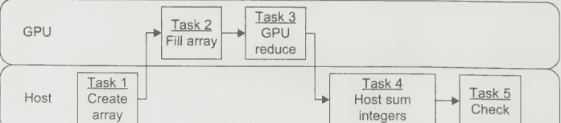

然而，没有理由在任务 2 将内核队列到 GPU 上运行之后不启动任务 4。换句话说，任务 4 运行在任何其他任务之后并没有依赖关系，除非它必须在任务 5 的正确性检查之前运行。换句话说，任务 5 依赖于任务 4 的结果。同样，任务 2 必须在任务 1 之后的某个时间运行，任务 1 在 GPU 上分配数组。

交换任务 3 和 4 允许主机和 GPU 并运行，如图 1.5 所示，这证明了即使在这个简单的示例中也可以利用 CUDA 异步内核执行来利用任务数据并行。这样做的好处是进一步缩短应用程序的运行时间。

### 混合执行：同时使用 CPU 和 GPU 资源

| GPU | 任务 2 填充数组 | 任务 3 GPU 归约 |
|---|---|---|
| 主任务 1 创建数组 | 任务 4 主求整数 | 任务 5 检查 |

图 1.5 异步时间线。

接下来的示例演示了一个在 CPU 和 GPU 上同时运行的混合应用程序。现代多核处理器也是支持数据并行和任务并行执行的并行硬件。OpenMP 开放多线程处理是在主机处理器上利用多线程执行的一种简单方法。NVIDIA 编译器支持 OpenMP。虽然本书不是关于 OpenMP API 的，但 CUDA 程序员需要知道他们可以利用这种处理器并行性，也可以利用 GPGPU 的海量并行性。毕竟，目标是提供最快的应用程序性能。在对 CPU 和 GPU 进行基准测试比较时，保持公平也很重要，通过优化应用程序以便在两个系统上获得最高性能，从而使比较尽可能公平。

示例 1.11，“异步 CPU/GPU 源代码”是切换任务 3 和 4 之间执行顺序的源代码。任务 4 中使用了领先 OpenMP `parallel for loop` 析指令来利用主机处理器上的数据并行性。

```
Example 1.11
//seqAsync.cu
#include <iostream>
using namespace std;
```

```
#include <thrust/reduce.h>
#include <thrust/sequence.h>
#include <thrust/host_vector.h>
#include <thrust/device_vector.h>

int main() {
    const int N=50000;
    // task 1: create the array
    thrust::device_vector<int> a(N);

    // task 2: fill the array
    thrust::sequence(a.begin(), a.end(), 0);

    // task 4: calculate the sum of 0 .. N-1
    int sumCheck=0;
    #pragma omp parallel for reduction(+:sumCheck)
    for (int i=0; i<N; i++) sumCheck += i;

    // task 3: calculate the sum of the array
    int sumA=thrust::reduce(a.begin(), a.end(), 0);

    // task 5: check the results agree
    if (sumA == sumCheck) cout << "Test Successful!" << endl;
    else cerr << "Test FAILED!" << endl; return(1);

    return(0);
}
```

要用 OpenMP 编译，在 nvcc 命令行参数中添加 `-X-compiler -fopenmp`，如示例 1.12 所示，以编译示例 1.11。由于我们对结果进行计时，因此使用了 `-O3` 优化标记。

示例 1.12

```
nvcc -O3 -X-compiler -fopenmp seqAsync.cu
```

seqAsync 的输出 示例 1.13，“显示测试成功的结果” 显示总和计算正确，因为它通过了金标准测试：

示例 1.13

```
$ ./seqAsync

Test Successful!
```

## 回归测试与准确性

正如编程中的任何时候一样，最重要的指标是应用程序产生正确的输出。回归测试是这一评估过程中至关重要的部分，遗憾在大多数计算机科学书中都被遗漏了。回归测试作为健全检查，允许程序检测代码是否引入了某些错误。计算机是公正的，不会疲劳。由于这些原因，应该编写并测试小量代码以确保其处于工作状态。可以添加回归测试，这极大地简化了调试工作，因为错误发生在较小的代码中。另一种方法是编写大量的代码并希望它能工作。如果出现错误，追踪大量代码来寻找一个或多个问题是挑战性的。有时你对后方法会有运气。如果你尝试，记录你的时间，看看使用回归测试和增量开发是否节省了时间。

利用了一种形式的健全检查 sanity checking 来证明我们的模型和软件的效能。如果没有这种现实检查，公司可能无法获得资金。

### 静默错误

回归测试的一个挑战是，某些错误可能会静默地通过测试套件并进入最终用户看到的应用程序。例如，IHEC 爱尔兰高端计算中心 的 Andy Regan 指出，增加本章示例中 N 的值会导致总和变得非常大到无法在整数中容纳。某些系统可能会捕获错误，而某些系统会漏掉错误。

鉴于 GPU 每秒可以执行万亿次算术操作，CUDA 程序员理解数值误差如何快速累积或计算值如何溢出其容量是非常关重要的。关于这一主题的快速介绍是科学计算文章《数值精度：多少才足够？》 Farber, 2009，该文章可以在网上免费获取。


Thrust 提供了执行归约（reduction）的能力，可以将较小的数据类型转换为较大的类型，`seqBig` 展示了如何使用 64 位无符号整数求和向量中所有的 32 位整数。实际值将在测试结束时打印。参见示例 1.14，“执行双精度归约的 Thrust 程序”：

### 示例 1.14

```cpp
//seqBig.cu
#include <iostream>
using namespace std;

#include <thrust/reduce.h>
#include <thrust/sequence.h>
#include <thrust/host_vector.h>
#include <thrust/device_vector.h>

int main() {
    const int N=1000000;

    // task 1: 创建数组
    thrust::device_vector<int> a(N);

    // task 2: 填充数组
    thrust::sequence(a.begin(), a.end(), 0);

    // task 3: 计算数组总和
    unsigned long sum=thrust::reduce(a.begin(),a.end(),
    (unsigned long long)0, thrust::plus<unsigned long long>()());
```

```cpp
// task 4: 计算 0..N-1 的总和
unsigned long long sumCheck=0;
for(int i=0; i < N; i++) sumCheck += 1;
cerr << "host " << sumCheck << endl;
cerr << "device " << sumA << endl;

// task 5: 检查结果是否一致
if(sumA == sumCheck) cout << "Test Succeeded!" << endl;
else cerr << "Test FAILED!" << endl; return(1);

return(0);
```

`nvcc` 编译器可以通过单次命令行调用编译并运行应用程序。示例 1.15，“显示测试成功的结果”展示了 `nvcc` 命令行和 `seqBig.cu` 程序的成功运行：

### 示例 1.15

```bash
$ nvcc seqBig.cu -run
host 499999500000
device 499999500000
Test Succeeded!
```

你能在这这些示例中找到任何随 `N` 大小增大而可能发生的其他静默错误吗？（提示：`tid` 在运行时环境中有什么局限制？）

## 调试简介

调试程序是生活的一部分——特别是在学习新语言时。通过一些简单的扩展，CUDA 实现了 GPGPU 计算，但其表达式的简单性并不排除编程错误。对于为任何计算机开发应用程序来说，寻找 bug 可能是复杂的。

遵循用于适配 C 和 C++ 的相同简洁变更方法，NVIDIA 扩展了几个流行的调试工具以支持 GPU 计算。这些工具是大多数 Windows 和 UNIX 用户已经熟练并习惯使用的工具，如 `gdb`、`ddd` 和 `Visual Studio`。熟悉在 Windows、Mac 和 UNIX 下软件构建、调试和性能分析的人，应该发现过渡到 CUDA 是非常简单的。在大多数情况下，NVIDIA 使 CUDA 代码与调试任何其他 C 或 C++ 应用程序完全相同。所有 CUDA 工具都可以在 NVIDIA 网站免费获取，包括适用于 Microsoft 的 Parallel Nsight 专业版。

### UNIX 调试

#### NVIDIA 的 cuda-gdb 调试器

要使用 CUDA 调试器 `cuda-gdb`，必须使用 `-g` 标志编译源代码。`-g` 标志指定主机端代码为调试进行编译。`-G` 标志指定 GPU 端代码为调试进行编译（参见示例 1.16：为 `cuda-gdb` 编译的 `nvcc` 命令）：

```bash
Example 1.16
nvcc -G seqRuntime.cu -o seqRuntime
```

以下是一些常用命令的列表，包括单字母缩写和简要描述：

- `breakpoint` (`b`): 设置断点以在代码中的选定位置停止程序执行。参数可以是方法名或数字。
- `run` (`r`): 在调试器中运行应用程序。
- `continue` (`c`): 移动到下一行代码。继续到下一个断点或直到程序完成。
- `backtrack` (`bt`): 显示栈的内容，包括调用方法。
- `thread`: 列出当前的 CPU 线程。
- `cuda thread`: 列出当前活跃 GPU 线程（如果有）。
- `cuda kernel`: 列出当前活跃的 GPU kernel 并允许切换“焦点”到指定的 GPU 线程。

使用 `cuda-gdb` 启动调试器，如示例 1.17，“`cuda-gdb` Startup”所示：

```text
Example 1.17
cuda-gdb seqRuntime
NVIDIA (R) CUDA Debugger
4.0 release
Portions Copyright (C) 2007-2011 NVIDIA Corporation
GNU gdb 6.6
Copyright (C) 2006 Free Software Foundation, Inc.
GDB 是免费软件，受 GNU 公共许可证保护，欢迎在特定条件下更改和/或分发其副本。
Type "show copying" 查看条件。
GDB 没有任何绝对保证。Type "show warranty" 查看详情。
此 GDB 被配置为 "x86_64-unknown-linux-gnu...
Using host threaddb.so library "/lib/threaddb.so."
```

使用“`l`”命令显示 `fill` 的源码，如示例 1.18，“`cuda-gdb` 列出源代码”所示：

#### 示例 1.18

```cpp
l fill
11    int tid=blockIdx.x*blockDim.x+threadIdx.x;
12    if (tid<n) a[tid] = tid;
13  }
```

执行配置中的位置。参见示例 1.23，“修改内核以导致越界错误”：

#### 示例 1.23

```
__global__ void fillKernel(int *a, int n)
{
    int tid = blockIdx.x*blockDim.x + threadIdx.x;
    // if(tid<n) // 移除此比较将引入越界错误
    a[tid] = tid;
}
```

CUDA 工具套提供了一个独立的内存检查工具 `cuda-memcheck`。如示例 1.24 “显示越界错误运行程序的示例”所示，程序似乎运行正常：

#### 示例 1.24

```
$ cuda-memcheck badRuntime
Test Succeeded!
```

然而，`cuda-memcheck` 正确地标记了存在越界错误，如示例 1.25 “`cuda-memcheck` 报告的越界错误”所示：

#### 示例 1.25

```
$ cuda-memcheck badRuntime
CUDA-MEMCHECK
Test Succeeded!
Invalid __global__ write of size 4
    at 0x00000e0 in runtime.cu:14:fillKernel
    by thread (336,0,0) in block (97,0,0)
    Address 0x20013d40 is out of bounds

ERROR SUMMARY: 1 error
```

请注意，使用 `cuda-memcheck` 不需要特殊的编译标志。

### 使用 UNIX dd 接口使用 cuda-gdb

GNU `ddd`（数据显示调试器）为 `cuda-gdb`（或 `gdb`）提供了可视化界面。许多人更倾向于使用可视化调试器而不是纯文本界面。要使用 `cuda-gdb`，必须使用 `ddd` 并配合 `-debugger` 命令行标志来使用不同的调试器，如示例 1.26 “使用 `cuda-gdb` 启动 `ddd` 的命令”所示：

| 1.26 |
| :--- |
| ddd-debugger cuda-gdb badRuntime |

可以可视化地查看断点，但所有的 `cuda-gdb` 命令都需要手动输入。以下截图显示了如何通过先指定 `set cuda memcheck` 来查找越界错误。正如第 1 章将演示的那样，`ddd` 还提供了实用的机器指令来检查并逐条执行 GPU 正在执行的指令。参见示例 1.27 “在 DDD 使用 `cuda-gdb` 查找越界错误”：

```
main
int tid = blockIdx.x*blockDim.x + threadIdx.x;
if (tid < n)
  a[tid] = tid;

void fill(int* d, int s, int n) {
  int threadsPerBlock = 512;
  int nblocks = n/threadsPerBlock + ((n%threadsPerBlock)!=0?0:1);
  kernel<<<nblocks, threadsPerBlock>>>(d, s, n);
}

int main() {
  const int n = 50000;
  // task 1: 创建数组
  std::vector<float> a(n);
  // task 2: 使用运行时填充数组
  fill(raw_cast<float*>(a.data()), 0, n);
  // task 3: 计算数组之和
  int sum=reduce(a.begin(), a.end(), 0);
  // task 4: 计算 0 到 N 的之和
  for (int i=0; i<n; i++)sumCheck += i;
  // task 5: 检查结果
}
```

```
set cuda memcheck on
New process 12345
Debugging using libthread.so loaded
New thread 119854/62656 (tid 213855)
New Context of device 0x72b530 on Device 0
(Launch of CUDA Kernel 0)
cluster_thread:device_ptr<cuda::launch_closure_by_value:device::cuda::each_for_n
block_thread:device_ptr<unsigned long long, anonymous_unsigned>
grid_thread:device_ptr<unsigned long long, anonymous_unsigned>
>>(((28,1,1),(1,1,1)>>> on Device 0
(Launch of CUDA Kernel 1) kernel<<<1,512,(1,1,1)>>> on Device 0
Program exited with exit code 1. Illegal address.
Switching focus to CUDA kernel 1, grid 2, block (7,0,0), thread (480,0,0), sem 5, warp 31.
0x000000007f510 in kernel(a=0x20000000, n=50000) at runtime.cuda:1

Disassembling Location 0x72b530 to 0x72b539...
```

## 使用 PARALLEL NSIGHT 进行 WINDOWS 调试

Parallel Nsight 同样提供了让 Microsoft Visual Studio 用户熟悉的调试体验，但包含了线程级调试和 CUDA 内存检查器等强大功能。它作为插件安装在 Microsoft Visual Studio 2008 SP1 或 Visual Studio 2010 中。Parallel Nsight 还提供了许多功能：

- CUDA C/++ 调试。
- DirectX 着色器调试。
- DirectX 帧调试。
- DirectX 帧性能分析（profiling）。
- CUDA 内核跟踪/性能分析。
- CUDA 跟踪。
- 错误。
- 性能分析。
- CUDA 错误总结。
- 错误。

| 1.3 硬件配置 | 单 GPU 系统 | 双 GPU 系统 | 带有 GPU 的系统 | 双 GPU 系统 |
| :--- | :--- | :--- | :--- | :--- |
| CUDA C/++ 调试 |  |  |  |  |
| DirectX 着色器调试 |  |  |  |  |
| DirectX 帧调试 |  |  |  |  |
| DirectX 帧性能分析（profiling） |  |  |  |  |
| CUDA 内核跟踪/性能分析 |  |  |  |  |
| CUDA 跟踪 |  |  |  |  |
| 错误 |  |  |  |  |
| 性能分析 |  |  |  |  |
| CUDA 错误总结 |  |  |  |  |


Parallel Nsight 同样提供了让 Microsoft Visual Studio 用户熟悉的调试体验，但包含了线程级调试和 CUDA 内存检查器等强大功能。它作为插件安装在 Microsoft Visual Studio 2008 SP1 或 Visual Studio 2010 中。Parallel Nsight 还提供了许多功能：

- CUDA C/++ 调试。
- DirectX 着色器调试。
- DirectX 帧调试。
- DirectX 帧性能分析（profiling）。
- CUDA 内核跟踪/性能分析。
- CUDA 跟踪。
- 错误。
- 性能分析。
- CUDA 错误总结。
- 错误。

# 第 1 章：程序与如何思考 CUDA

```cpp
#include <iostream>
using namespace std;

#include <thrust/reduce.h>
#include <thrust/sequence.h>
#include <thrust/vector.h>
#include <thrust/device_vector.h>

void fillKernel(int *a, int n) {
    int tid = blockIdx.x*blockDim.x + threadIdx.x;
    if (tid < n) a[tid] = tid;
}

void fill(int * d, int s, int n) {
    int threadsPerBlock = 512;
    int nblocks = n/threadsPerBlock + ((n%threadsPerBlock)!=0?0:1);
    kernel<<<nblocks, threadsPerBlock>>>(d, s, n);
}

fillKernel<<<blocks, threadsPerBlock>>>(d);

int main() {
    const int n = 50000;
}
```

图 1.6 Nsight 的能力。

总结

本章涵盖了许多重要主题，例如如何编写、编译和运行 CUDA 应用。通过本章讨论的工具和语法，大胆的读者甚至可以尝试编写真实的应用程序，这是成为熟练 CUDA 程序员的径。记住 GPGPU 编程的三个基本规则：

1. 将数据放入 GPGPU 并保持在那里。
2. 给 GPGPU 足够的工作。
3. 关注 GPGPU 内部的数据复用以避免内存带宽限制。

理解基础计算机概念对于实现高性能也至关重要。记住 Amdahl 法律以减少序列化瓶颈，同时利用任务和数据并行。始终尝试理解你所用算法的渐进复杂度，并寻找具有更好扩展性的替代算法。始终尝试组合操作以在 GPU 上实现最高的计算密度。

## 用于机器学习和优化的 CUDA

GGPU 是强大的工具，非常适合解决复杂的现实问题。仅使用第 1 章介绍的简单 CUDA 能力，本章演示了如何使用无导数的 Nelder-Mead 和 Leardt 优化算法极大加速非线性优化问题。单精度和双精度应用性能将在 Intel Xeon e5630 处理器和 NVIDIA C2070 GPU（旧款 10 系列 NVIDIA GTX 280 游戏 GPU）之间进行测量和比较。提供了工作示例代码，可以在 Linux 下比现代四核 Intel Xeon 处理器快 85 倍（比单核性能快 341 倍），在 Windows 7 下具有相当性能。

在章节结束时，读者将对以下内容有基本的理解：

- 两种流行的优化技术，包括 Levenberg-Marardt 算法的 GPU 扩展性限制。
- 熟悉 CUDA 的程序员如何对建模和数据挖掘工作做出重大贡献。
- 机器学习以及为什么 XOR 问题对于计算通用设备很重要。
- C++ 函数子以及如何编写一个支持 `_host_` 和 `_device_` 的单一 Thrust 函数子，该函数子可以在主机和 GPGPU 设备上运行。
- 一些示例程序，展示了在机器学习、信号处理、统计和许多其他领域的算法上，比传统处理器实现了数量级的性能提升。

## 第二2章：用于机器学习与优化的 CUDA

### 建模与仿真

数学建模和数值模拟是应用数学中两个重要、独立且紧密相关的方面。数学模型是现实世界的抽象，可用于分析和预测。数值模拟则是基于将数学模型映射到计算机上的应用。建模与仿真的结合，是推进人类对复杂现象理解的强大技术。

本书并不试图在已出版关于建模与仿真的海量著作中进行重复或提供新见解。根据你感兴趣的特定领域，有很多优秀的教材可供选择，它们提供了精确且详细的介绍。我们的重点是提供利用 CUDA 挖掘大规模并行硬件的工具，以便读者能够在他们选择的领域做出自己的贡献。

创建模型通常使用以下两种通用方法：

- 1. 基于第一性原理分析和其他技术的人类推导模型

  在可用的情况下，这些模型可以对所研究的现象提供深刻的洞察。熟练的 CUDA 程序员可以通过高效地将计算映射到并行硬件上，以实现最高性能，并扩展到尽可能数量的处理元素。文献表明，一个设计良好且编写良好的 CUDA 程序可以提供两个数量级的性能提升（Hwu,2011; Stone et al., 2010）。这种性能是颠覆性的，因为以前需要一年的仿真现在可以在几天内完成。由于可以使用更精确、更详细的近似值，还可以获得更高的仿真精度。非线性问题特别受益于 NVIDIA 特殊函数单元（SFU），它计算超越函数（如 `log()`, `exp()`, `sin()`, `cos()` 等）的近似速度比传统处理器快 25 倍。

- 2. 通过数据拟合推得的参数化模型（经验模型）

  与人类推导模型相比，从数据中计算得出的模型构建相对简单。存在许多技术可以创建出泛化良好的准确模型。神经网络就是其中的例子（Lapedes & Farber, 1987b）。通常，将模型拟合到数据的过程是一个计算密集型过程，运行时间随 O(N^2) 或更高增长，其中 N 是数据项的数量。并行化通过减少某些接近处理元素数量的倍数来缩短运行时间，使得这些方法变得可行甚至具有交互性。（在单个 GPU 中）包含数百个处理元素的单个 GPU 具有减少运行时间两个或更多数量级的潜力。在多个 GPU 之间对问题进行巧妙划分，可以根据 GPU 的数量扩展可用处理元素的数量。

在建模表现出非线性行为的系统时会出现特殊的挑战。非线性系统并不总是对输入刺激成比例响应，这意味着它们的行为不能仅基于输入或系统刺激的某些线性组合进行建模。尽管具有挑战性，但非线性系统产生了许多有趣的现象，包括自组织系统、混沌行为和生命。

### 拟合参数化模型

```
Error = \sum_{N} (Known - Predicted)^2 (2.1)
```

由于差异平方和总是正的，完美拟合将导致零误差。遗憾的是，这种情况很少发生，因为数值技术受到局部极值的影响，这意味着数值技术一旦进入代价函数中的低点，就无法跳出来。因此，无法保证已找到全局最小值或最佳整体。

有许多流行的库和工具可以用于寻找多个变量上的函数最小值。《Numerical Recipes》是一个极信息来源（Press et al., 2007），它还提供了可运行的源代码。^1。许多免费和许可的数值工具包可用，包括 SLATEC、NAG（数值算法组）、MINPACK、Mathematica、MATLAB、Octave、scipy、gnuplot、SAS、Maple、STATLIB 以及其他许多。

> 1 《Numerical Recipes》源代码受版权保护，不会使用，因为我们倾向于提供完整的运行示例。

### Nelder-Mead 方法

Nelder-Mead 是一种常用的直接搜索非线性优化技术（Nelder & Mead, 1965）。该算法使用单纯形（N 维中的广义三角形）进行搜索。该方法在单纯形的每个顶点处评估用户函数，并在找到更好的点时迭代收缩单纯形。当达到所需的边界或其他终止条件时，方法终止。

尽管存在局限性（McKinnon & McKinnon, 1999; Kolda, Lewis, & Torczon, 2007），Nelder-Mead 方法已被证明是有效的。

### Levenberg-Marquardt 方法

Levenberg-Marquardt 算法是解决非线性二乘问题的一种方法。它在高斯-牛顿算法和梯度下降法之间插值。该算法广泛用于曲线拟合。

### 算法加速

对于本书而言，将仅讨论目标函数的评估。读者应该注意，数值近似梯度可能会带来求解时间上的惩罚。

# 第2章：用于机器学习与优化的 CUDA

GiNaC（GiNaC 的意思是 GiNaC 不是一个 CAS，其中 CAS 代表计算机代数系统）。GiNaC 是一个免费下载的 C++ 库，程序员可以使用它将符号数学集成到自己的应用程序中。与其他符号数学软件包不同，GiNaC 以 C++ 作为输入。程序员可以使用该库的代数能力执行诸如符号求导等任务。GiNaC 网站（http://www.gniac.de/）声称，它的设计旨在作为流行的 Maple CAS 符号引擎的直接替代品。其他软件包包括 Maple 和 Mathematica。

## 机器学习与神经网络

神经网络（ANN）是一种机器学习技术，它根据观测数据推断出函数（参数化模型的一种形式）。当教师将每个训练示例与反映预期值或结果的已知值相关联时，就发生了监督学习。当提供优劣度或拟合度指标时，就发生了无监督学习。

神经网络推断出的结果具有预测能力，可以正确预测时间序列中的未来值，响应并适应不可预见的刺激；并执行分类任务。一个著名的例子是 netlett，它训练了一个神经网络来读取外部的英语文本（Sejnowski & Rosenberg, 1987）。该网络数据仍可以下载。

训练人工网络可以表示为一个优化问题，旨在确定网络参数（例如内部网络权重和偏置），以使初始数据集上的误差最小化。训练过程的拟合在计算上是昂贵的，因为需要调用目标函数，并对参数集在训练数据中的每个示例上进行评估。对于每次目标评估，其运行时间为 $O(N_{param} \times N_{data})$。在大多数情况下，参数的数量相对于训练数据的大小很小，这意味着整体运行时间由数据的大小决定。

在训练过程中，神经网络试图对训练数据拟合一个多维曲面（Lapedes & Faber, 1987）。不幸的是，维度灾咒告诉我们，必须搜索、采样和建模的空间体积随数据维度的增加呈指数级增长。例如，以 0.01 的步长均匀采样 0 到 1 之间的 1D 单位需要 100 个样本，而一个 10 维超立方体将需要 $(100)^{10}$ 或 $10^{20}$ 个样本。即使使用稀疏采样，平滑的高维曲面也需要许多数据点。许多有趣的现象需要拟合复杂的、凹凸不平的高维曲面，这会大幅增加拟合能够以可接受精度近似多维曲面的模型所需的所需的训练数据量。

在使用 Nelder-Mead、Levenberg-Marquardt、Powell 方法、共轭梯度法等流行的优化技术时，昂贵的目标函数往往会主导运行时间。在这种情况下，最好的方法是集中于减少目标函数的运行时间。将问题高效地映射到具有数百个并行线程的 GPU 集群，潜在上可以将运行时间比单线程系统减少两个数量级，如公式 2.2 “基于 ANN 的目标函数的并行运行时间”所示。相反，四核处理器每次迭代最坏的情况下只能将运行时间减少 4 倍。

```
$O(\frac{N_{data} * N_{param}}{N_{processors}}) (2.2)
```

本章的示例表明，考虑到所有的 GPU 通信开销，CUDA 可以将运行时间比在传统多核处理器上运行的实现短 50 到 100 倍。尽管对于一般的并行系统来说这是一个已知结果（Farber, 1992: Thearing, 1995），但即使使用游戏 GPU 也能达到这种水平的性能，仍然令人惊讶。

### XOR：一个重要的非线性机器学习问题

Andreas 在《神经计算理论导论》（Introduction to the Theory of Neural Computation）中提到：

为了对比不具泛化能力的“学习”与具有泛化能力的学习，让我们考虑一个广为人知且广庆祝的事实：神经网络可以学习实现异或门（XOR）。但这是什么样的学习呢？当四个情况中的四个都被指定时，就不存在泛化！学习一个表格无非是死记硬背：学习 XOR 就像背诵电话簿一样有趣。更有趣且更现实的是——现实世界的问题，例如金融数据的预测。在预测中，没有人关心模型对训练数据的拟合得有多好——只有未来预测的质量才重要，即在新数据上的性能或泛化能力。学习是从训练示例中提取规律，并将这些规律转移到新的示例中**（Hertz, Krogh, & Palmer, 1991, p. 5）

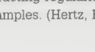

### 图 2.1

感知器的示例。

1969 年，一本名为《感知器》（Perceptrons, Minsky & Papert, 1969）的著名著作表明，单层神经网络（当时被称为感知器，见图 2.1）无法表示基础的 XOR 逻辑函数。这一影响是毁灭性的，因为对新生神经网络领域的资金和兴趣随之消散了。


过了十多年，神经网络研究才突然经历了兴趣的复苏。20 世纪 80 年代中期，一篇论文了神经模型可以解决旅行商问题（`Hopfield & Tank, 1985`）。不久后反向传播算法被创建（`Rumelhart, Hinton, & Williams, 1986; The PDP Group, 1987`）。一个关键演示表明，可以训练多级 `ANN` 来复制 `XOR` 真值表。在随后的几年里，神经网络研究领域和其他机器学习领域爆发了。

能够模拟 `XOR` 真值表的重要性在于理解计算通用设备的概念。通用图灵机是计算通用设备的一个示例（`Hopcroft & Ullman, 2006`），因为理论上它们可以用于模拟任何其他设备。

区分 `ANN` 与感知器时，`Andreas` 观察到：

当输入和输出之间插入非线性单元层时，计算能力会剧增。`XOR` 的例子很好地强调了隐藏单元的重要性：它们重新表示了输入，使得问题变得线性可分。没有隐藏单元的网络无法学习 `XOR`，而具有隐藏单元的网络可以实现任何布尔函数。（`Hertz, Krogh, & Palmer, 1991, p. 6`）

换句话说，模拟 `XOR` 的能力对于证明多层 `ANN` 是通用计算设备而没有隐藏神经元的设备是受限计算设备至关重要。正是额外的非线性层让 `ANN` 能够模拟

### XOR：一个重要的非线性机器学习问题


FIGURE 2.2

`XOR` 网络。

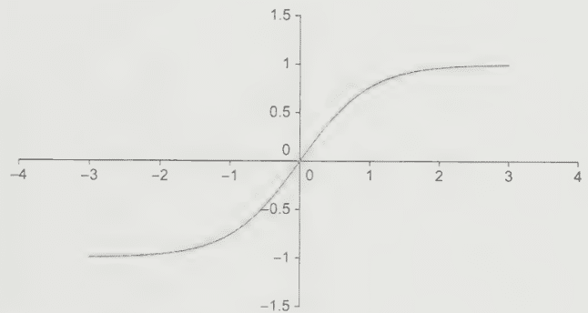

FIGURE 2.3

一个示例 `Sigmoid` `G` 函数：`tanh(x)`。

其他计算设备。事实上，只需要两层就可以作为符号学习很好地执行建模和预测任务（`Lapedes & Farber, 1987a`）。然而，巧妙的人辅助设计可以创建参数更少的少量网络，尽管隐藏层多于两层（`Farber et al., 1993`）。

### 示例目标函数

`transform_reduce` 模板使得目标函数的实现变得既直接又简单。例如，`ANN` 最小二乘目标函数需要定义一个变换算子，该算子计算网络在训练数据中每个示例上产生的误差的平方。然后通过归约操作计算误差平方和。

# 第 2 章：用于机器学习与优化的 CUDA

`Thrust` 利用函数对象（`functors`）来执行变换（`transform`）、归约（`reduction`）操作以及通用方法。在 `C++` 中，函数对象重载了函数调用运算符“`()`”，使得对象可以代替普通函数。这有几个重要意义：

- 1. 函数对象可以像 `C` 语言程序员利用函数指针一样，被传递给 `thrust::transform_reduce` 等通用算法。
- 2. 传递和使用函数对象是非常高效的，因为 `C++` 可以对函数代码进行内联（`inline`）。这消除了函数调用的开销，并允许编译器进行更广泛的优化。
- 3. `C++` 函数对象可以维持持久的内部状态。正如你将看到的，在处理不同的设备、GPU 和线程内存状态时，这种方法会非常有用。

函数对象的内联对性能至关重要，因为像 `thrust::plus` 这样的常用函数只执行极少量的计算。如果无法内联函数，那么像 `thrust::transform_reduce` 这样的通用方法将无法实现，因为函数调用的开销将消耗与函数对象本身相等（甚至更多）的时间。

`Thrust` 文档提到了内核融合（`kernel fusion`），它将多个函数对象合并到一个内核中。我们 `GPGPU` 编程的第二个规则是内核融合增加了每次内核调用的 `GPGPU` 利用率，可以避免内核启动延迟。同样重要的是，许多如 `thrust::transform_reduce` 模板等通用方法避免了将中间值存储到内存中的行为，因为函数对象的计算是实时进行的。后一点符合我们 `GPGPU` 编程第三条规则的要求：关注 `GPGPU` 内部的数据复用，以避免内存带宽限制。`Thrust` 快速上手指南中的 `XPY` 示例清晰地演示了内核融合的性能优势。

### 用于多 GPU 设备和主机处理器的完整函数对象

以下是示例 2.2，“用于 `CalcError.h` 的 `XOR` 函数对象”，是一个完整的 `XOR` 函数对象。**粗体部分**展示了计算图 2.2 所示的 `XOR` 神经网络以及训练集中每个示例的误差所需的代码是多么简单。

```cpp
Example 2.2
// 用于 XOR 的 CalcError 函数对象
static const int ninput = 2;
static const int nH1 = 1;
```

## XOR：一个重要的非线性机器学习问题 43

```cpp
static const int nOutput = 1;
static const int nParam =
  (nOutput+nH1) // 神经元偏移
+ (nInput+nH1) // 从 I 到 H1 的连接
+ (nH1*nOutput) // 从 H1 到 0 的连接
+ (nInput*nOutput); // 从 I 到 0 的连接
static const int exlen = nInput + nOutput;
```

```cpp
struct CalcError {
  const Real* examples;
  const Real* p;
  const int nInput;
  const int exlen;
```

```cpp
CalcError(const Real* _examples, const Real* _p,
  const int _nInput, const int _exlen)
  : examples(_examples), _p(_p), nInput(_nInput), exlen(_exlen) {};
```

```cpp
__device__ __host_
Real operator()(unsigned int tid) {
  const Real* in = &examples[tid*exlen];
  register int index=0;
  register Real h1 = p[index++];
  register Real o = p[index++];

h1 += in[0]*p[index++];
h1 += in[1]*p[index++];
h1 -= G(h1);

o += in[0]*p[index++];
o += in[1]*p[index++];
o -= h1*p[index++];

  // 计算差异的平方
  o -= o*in[nInput];
  return o*o;
};
```

上一个示例中的非线性传递函数 `G` 使用双曲正切（`tanh`）来定义 `sigmoid` 激活，如图 2.3 所示。其他流行的 `sigmoid` 函数包括逻辑函数、分段函数等许多种。可以很容易更改 `G` 的定义以对这些函数进行实验。

注意的是，在之前的代码段高亮显示的两个 `CUDA` 函数限定符 `__device__` 和 `__host__` 指定了该函数对象可以同时在主机处理器和一个或多个 `GPU` 设备上运行。

# 第 2 章：用于机器学习与优化的 CUDA

函数对象的双重用途使得创建混合 `CPU/GPU` 应用程序变得方便，这些程序可以在系统中所有可用计算资源上运行。它也让基于 `GPU` 和基于主机的实现性能对比变得更容易。

该函数对象利用持久性来封装设备上的数据，这使得数据与计算绑定，并允许其分布在多个设备和类型的设备上。当然，函数对象使用的向量指针也应该驻留在运行的设备上，否则将需要进行非预期的内存传输。`CUDA 4.0` 提供了一个统一的虚拟地址空间，允许运行时仅从内存指针识别包含特定内存区域的数据。数据可以在设备之间直接传输。虽然直接传输是高效的，但它受到了 `PCIe` 带宽的限制。

### 完整 Nelder-Mead 优化代码简要讨论

接下来的讨论将介绍一个完整的 `Nelder-Mead` `API` 示例，该示例证明了单精度和双精度对象的实例化、数据生成、`Nelder-Mead` 方法的运行时配置，以及一个验证网络是否训练正确的测试函数。如果需要，可以将本节中的代码段组合以创建一个完整的 `xNM.cu` 源文件。或者，也可以从书籍网站下载该示例的完整版本。

目标函数计算能量。在示例中，能量是平方的和。

```cpp
energy = objfunc(p1, p2, ...);
```

目标函数计算能量。在本示例中，能量是平方的和。

```cpp
energy = objfunc(p1, p2, ...);
```

目标函数计算能量。在本示例中，能量是平方的和。

```cpp
energy = objfunc(p1, p2, ...);
```

优化方法

### XOR：一个重要的非线性机器学习问题

| 步骤 1 | 步骤 2 | 步骤 3 |
| :--- | :--- | :--- |
| 广播 | 计算 | 求和 |
| 参数 | 部分和 | 获取 |
| GPU 1 | GPU 2 | GPU 3 | GPU 4 |
| :--- | :--- | :--- | :--- |
| --- | --- | --- | --- |
| P0, P1, P2 | P3, P4 | P5 | P6 |
| 示例 | 示例 | 示例 | |
| 0, N-1 | N-1 | 2N-1 | 3N-1 |
| | | | |

# 第 2 章：用于机器学习与优化的 CUDA

- `USE_HOST`：选择在主机处理器上运行目标函数的代码。默认在 `GPU` 上运行。
- `USE_DBL`：指定编译的可执行文件使用双精度变量和运算。默认使用单精度变量和算术。

### 示例 2.3

使用 `C++` 多态来调用相应的单精度和双精度 `tanh()`。请参见示例 2.4，“`xNM.cu` 的第二部分”：

### 示例 2.4

```cpp
// 定义 sigmoid 函数
__device__ __host_
inline float G(float x) {return(tanh(x));}
__device__ __host_
inline double G(double x) {return(tanh(x));}
```

为了方便，定义了一个简单的类 `ObjFunc` 来结合函数对象和简单的数据管理方法。示例代码使用了 `C++` 模板，因此评估了使用单精度或双精度浮点的性能。之前定义的 `CalcError` 函数包含在内，但不建议在生产应用中使用 `C` 预处理器包含。为了训练目的，函数对象特意被隔离，以便读者修改。

注意此处代码，当使用 `USE_HOST` 包在主机处理器运行时，`CalcError` 直接位于 `OpenMP` 归约循环中。

> `C++` 对象将数据和操作数据的方法封装成单一方便的

### XOR（异或门）：一个重要的非线性机器学习问题

已定义，这展示了 `Thrust` 生成基于 `GPU` 和主机的函数（`functors`）代码的能力。参见示例 2.5，“`xorNM.cu` 的第 3 部分”：

```cpp
//这是一个方便类，用于存储所有示例和
// 架构信息。大部分是样板代码。CalcError
// 是所有工作发生的地方。
template<typename Real>
class ObjFunc {
private:
    double objFuncCallTime;
    unsigned int objFuncCallCount;
protected:
    int nExamples;
#ifdef USE_HOST
    thrust::host_vector<Real> h_data;
#else
    thrust::device_vector<Real> d_data;
#endif
    thrust::device_vector<Real> d_param;
public:
    // CalcError 泛放在在这里
#include "CalcError.h"

// 样板构造函数和辅助类
    ObjFunc(int nExamples = 0, objFuncCallCount = 0, objFuncCallTime = 0);
    void addObjFuncWallTime(return(objFuncCallTime/objFuncCallCount));
    double totalObjFuncWallTime() return(objFuncCallTime);
    int get_nExamples() return(nExamples);
};

void setExamples(thrust::host_vector<Real>& _h_data) {
#ifdef USE_HOST
    h_data = _h_data;
#else
    d_data = &h_data;
#endif
    nExamples = h_data.size()/nLen;
    d_param = thrust::device_vector<Real>(nParam);
}

Real objFunc(Real *p) {
    if(nExamples == 0) cerr << "data not set" << endl; exit(1);
    double startTime=omp_get_wtime();
```

# 第 2 章：用于机器学习与优化的 CUDA

```cpp
Real sum = 0;
CalcError getError(&h_data[0], p, nInput, exLen);

#pragma omp parallel for reduction(+ : sum)
for(int i=0; i < nExamples; ++i) {
    Real d=getError(i);
    sum += d;
}

objFuncCallTime += (omp_get_wtime() - startTime);
objFuncCallCount++;
return(sum);
}
#else
    Real objFunc(Real *p) {
    if(nExamples == 0) (cerr << "data not set" << endl; exit(1));
    double startTime=omp_get_wtime();
    thrust::copy(p, p+nParam, d_param.begin());
    CalcError getError(thrust::raw_pointer_cast(&d_data[0]),
                        thrust::raw_pointer_cast(&d_param[0]),
                        nInput, exLen);
    Real sum = thrust::transform_reduce(
        thrust::counting_iterator<unsigned int>(0),
        thrust::counting_iterator<unsigned int>(nExamples),
        getError(),
        (Real) 0,
        thrust::plus<Real>());
    objFuncCallTime += (omp_get_wtime() - startTime);
    objFuncCallCount++;
    return(sum);
}
#endif
```

对目标函数的调用必须封装以返回适当的类型（例如 `float` 或 `double`），如示例 2.6，“`xorNM.cu` 的第 4 部分”所示。`C++` 多态根据传递给包装器的参数类型选择适当的方法。

### 示例 2.6

```cpp
// 包装器，以便目标函数可以作为// 函数指针供 C 风格库调用。
// 注意：多态允许方便地使用
```

### XOR（异或门）：一个重要的非线性机器学习问题

```cpp
// 或者 float 或 double 类型。
void* objFunc_object=NULL;
float func(float* param)
{
    if(objFunc_object)
        return ((ObjFunc<float>*)objFunc_object)->objFunc(param);
    return(0.0);
}

double func(double* param)
{
    if(objFunc_object)
        return ((ObjFunc<double>*)objFunc_object)->objFunc(param);
    return(0.0);
}

// 获取 -1 到 1 之间的均匀随机数
inline float f_rand() {
    return 2.*rand()/((float)RAND_MAX))-1.;
}
```

定义了一个测试来根据一组输入值计算函数的输出。参见示例 2.7，“`xorNM.cu` 的第 5 部分”

```cpp
Example 2.7
template <typename Real, int nInput>
void testNN(const Real *p, const Real *out)
{
    int index=0;
    Real h1 = p[index++];
    Real o = p[index++];

    h1 += in[0] * p[index++];
    h1 += in[1] * p[index++];
    h1 = G(h1);

    o += in[0] * p[index++];
    o += in[1] * p[index++];
    o += h1 * p[index++];

    out[0]=o;
```

为了简单起见，复制了 `XOR` 真值表以验证代码是否在大数据集上正常工作，并为 `GPGPU` 和主机处理器之间合理的性能比较提供基础。如示例 2.8 所示，在每个训练中添加了方差为 0.01 的均匀分布噪声。

## CUDA 用于机器学习与优化


通过简单定义交替泛型和数据，该框架将在第 3 章中解决其他问题。参见示例 2.8，“`xorNM.cu` 的第 6 部分”：

```cpp
Example 2.8
template <typename Real>
void getData(thrust::host_vector<Real>& h_data, int nVec, Real xVar) {
// 通过 dat 初始化数据
Real dat[]={0.1, 0.9, 0.9, 0.1, 0.9, 0.1, 0.1, 0.9};
for(int i=0; i<nVec; i++) h_data.push_back(dat[i%8] + xVar);
}
```

测试函数调用了目标函数进行包装以返回适当类型。参见示例 2.9，“`xorNM.cu` 的第 7 部分”：

```cpp
Example 2.9
template <typename Real>
void testTraining() {
    thrust::host_vector<Real> h_data
    // 均匀分布数据
    int nVec=1000;
    int nParam=4;
    Real xVar=0.01;
    getData(h_data, nVec, xVar);
    ObjFunc<Real> objFunc(h_data.size(), 0, 0);
    // 调用目标函数
    Real sum = objFunc.objFunc(NULL); 
}
```

示例 2.10，“`xorNM.cu` 的第 8 部分”：

```cpp
Example 2.10
int main() {
#ifdef USE_DBL
    testTraining<double>();
#else
    testTraining<float>();
#endif
    return 0;
}
```

# 第2章：用于机器学习和优化的 CUDA

表 2.1 训练 XOR 神经网络时的观测计时

| 操作系统 | 机器 | 优化方法 | 精度 | 平均目标函数耗时 | 函数耗时占比 | 相比四核的加速 | 相比单核加速 |
| --- | --- | --- | --- | --- | --- | --- | --- |
| Linux | NVIDIA C2070 | Nelder-Mead | 32 | 0.00532 | 100.0 | 85 | 341 |
| Win7 | NVIDIA C2070 | Nelder-Mead | 32 | 0.00566 | 100.0 | 81 | 323 |
| Linux | NVIDIA GTX2880 | Nelder-Mead | 32 | 0.01109 | 99.2 | 41 | 163 |
| Linux | NVIDIA C2070 | Nelder-Mead | 64 | 0.01364 | 100.0 | 40 | 158 |
| Win7 | NVIDIA C2070 | Nelder-Mead | 64 | 0.01612 | 100.0 | 22 | 87 |
| Linux | NVIDIA C2070 | Levenberg-Marquardt | 32 | 0.04313 | 2.7 | 10 | 38 |
| Linux | NVIDIA C2070 | Levenberg-Marquardt | 64 | 0.08480 | 4.4 | 6 | 23 |
| Linux | Intel e5630 | Levenberg-Marquardt | 32 | 0.41512 | 21.1 | | | |
| Linux | Intel e5630 | Levenberg-Marquardt | 64 | 0.49745 | 20.8 | | | |
| Linux | Intel e5630 | Nelder-Mead | 32 | 0.45312 | 100.0 | | | |
| Linux | Intel e5630 | Nelder-Mead | 64 | 0.53872 | 100.0 | | | |

计时的准确性¹。第3章将讨论更多的 CUDA 性能分析工具，例如适用于 Linux 的 NVIDIA profiler 和适用于 Windows 的 Parallel Nsight。

所有测试均在空闲系统上运行以获得最准确的结果。报告的加速比基于计算目标函数期间消耗的平均挂钟时间，包括目标函数所需的所有主机和 GPU 数据传输。使用 OpenMP 对仅限机的测试进行了多层处理，以利用 Xeon 处理器的所有四个核心。

如 2.1 所示，当在 NVIDIA C2070 GPU 上运行单精度测试时，获得了最佳性能。20 系列 Fermi 架构的改进引入了双精度性能，其达到单精度性能的 2 倍以内，这显著优于之前的 NVIDIA GPGPU 代。尽管如此，其他 GPU 仍然非常强大，例如 NVIDIA 10 系列 GeForce GTX280 游戏 GPU 的单精度性能是四核 Xeon 处理器所有核心的 41 倍。

> ¹ 值得注意的是，其他进程启动和停止产生的微小延迟也可能在大规模运行的程序中引入显著的性能下降，正如论文《The Case of the Missing Supercomputing Performance》(`Petrini, Kerbyson, & Pak, 2003`)中所述。基于云的计算环境——特别是使用虚拟机的环境——对抖动敏感。

### 性能讨论

这种中端游戏 GPU 也提供了约 C2070 一半的单精度性能。

Levenberg-Marquardt 的结果很有，因为与 Nelder-Mead 结果相比的数量级性能下降凸显了将测量向量从 GPU 传输到机的成本，以及 Levenberg-Marquardt 所需的主机计算的性能。

这种特定的 Levenberg-Marquardt 优化问题划分需要大量数据传输。传输的大小随数据的大小缩放，从而引入了扩展性障碍，可能对于较大的问题和多 GPU 数据集来说成本过高。尽管如此，Levenberg-Marquardt 仍然是 GPU 计算的一种有效技术，因为它在能够找到最小值的同时，当其他技术失效时也能运行得更快。它可能只需几次函数调用就能找到最小值。

相比之下，Nelder-Mead 不施加扩展性限制，因为它只需要 GPU 返回单个浮点值。其他优化技术（如 Powell 方法和共轭梯度法）也具有这种理想的特性。

使用替代优化方法（如 Powell 方法和共轭梯度法），该示例代码的变体已能够在 TACC Longhorn GPGPU 集群上扩展到 500 多个 GPGPU，并在 TACC Ranger 和 Thinking Machines 超级计算机上扩展到数万处理器（`Farber, 1992`; `Thearing, 1995`）。图 2.5 显示了在 500 个 GPU 上运行时最小和最大加速比。认为连接 Longhorn 集群上分布式节点的网络是其原因。

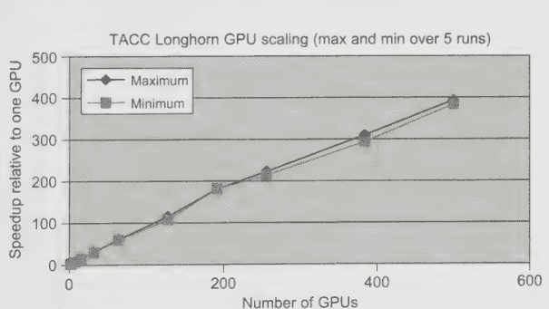

图 2.5 扩展到 500 个 GPU。

```cpp
vector<Real> p(n*(n-1));
vector<Real> pstar(n);
vector<Real> p2star(n);
vector<Real> pbar(n);
vector<Real> y(n+1);
```

```cpp
*icount = 0;
*numres = 0;

count = convge;
dn = (Real) (n);
n = n+1;
dn = (Real) (nn);
cel = 1.0;
rq = regmin * dn;
// 初始化或重启循环。
for (;; ):
  for (int i = 0; i < n; i++) { p[i+n*n] = start[i]; }
  y[n] = (*fn)(start);
  *icount = *icount + 1;
  for (int j = 0; j < n; j++) {
    start[j] = start[j] + step[j] * del;
    for (int i = 0; i < n; i++) { p[i+j*n] = start[i]; }
    y[j] = (*fn)(start);
    *icount = *icount + 1;
    start[j] = x;
```

```cpp
// 单纯形构建完成。
// 寻找最高和最低 Y 值。YNEWLO=Y(IHI)
// 需要替换的单纯形顶点。
ylo = y[0];
flo = 0;

for (int i = 1; i < nn; i++) {
  if (y[i] < ylo) { ylo = y[i]; flo = i; }
}
// 内循环。
for (k <= *icount) { break; }
*newlo = y[0];
hi = 0;

for (int i = 1; i < nn; i++) {
  if (*newlo < y[i]) { *newlo = y[i]; hi = i; }
}
// 计算 PBAR，单纯形顶点的质心
```

```cpp
// 排除具有 YNEWLO 值的顶点。
for (int i = 0; i < n; i++) {
  z = 0;
  for (int j = 0; j < nn; j++) { z = z + p[i+j*n]; }
  z = z - p[i+hi*n];
  pbar[i] = z / d;
}
// 跨质心的反射。
for (int i = 0; i < n; i++) {
  pstar[i] = pbar[i] + coeff * ( pbar[i] - p[i+hi*n]);
}
ystar = (*fn) (*pstar[0]);
*icount = *icount + 1;
// 反射成功，因此进行扩展。
if (ystar < ylo) {
  for (int i = 0; i < n; i++) {
    p2star[i] = pbar[i] + coeff * ( pstar[i] - pbar[i]);
  }
  y2star = (*fn) (*p2star[0]);
  *icount = *icount + 1;
  // 检查扩展。
  if (ystar < y2star) {
    for (int i = 0; i < n; i++) { p[i+hi*n] = pstar[i]; }
    y[hi] = ystar;
  } else // 保留扩展或收缩。
    for (int i = 0; i < n; i++) { p[i+hi*n] = p2star[i]; }
    y[hi] = y2star;
  }
} else // 无扩展。
  hi = 0;
  for (int i = 0; i < nn; i++) {
    if (ystar < y[i]) hi++;
  }

  if (hi < 1) {
    for (int i = 0; i < n; i++) { p[i+hi*n] = pstar[i]; }
    y[hi] = ystar;
  }
  // 在质心侧侧进行收缩。
  else if (hi == 0) {
    for (int i = 0; i < n; i++) {
      p2star[i] = pbar[i] + coeff * (pstar[i] - pbar[i]);
    }
    y2star = (*fn)(p2star[0]);
    *icount = *icount + 1;
    // 收缩整个单纯形。
    if (y[hi] < y2star) {

```cpp

  for (int j = 0; j < nn; j++) {

    for (int i = 0; i < n; i++) {

      p[i+j*n] = (p[i+j*n] + p[i+lo*n]) * 0.5;

      xmin[i] = p[i+j*n];

    }

    y[j] = (*fn)(xmin);

    *icount = *icount + 1;

  }

  nylo = y[0];

  ilo = 0;

  for (int i = 1; i < nn; i++) {

    if (y[i] < ylo) { ylo = y[i]; ilo = i; }

  }

  // （逻辑在 OCR 中破碎，继续处理可用块）

  if (y[i] < ylo) { ylo = y[i]; ilo = i; }

  continue;

  // 保留收缩。

  else {

    for (int i = 0; i < n; i++) {

      p[i+hi*n] = p2star[i];

    }

    y[hi] = y2star;

  }

  // 在质心侧进行收缩。

  else if (li == -1) {

    for (int i = 0; i < n; i++) {

      p2star[i] = pbar[i] + coeff * (pstar[i] - pbar[i]);

    }

    y2star = (*fn)(p2star[0]);

    *icount = *icount + 1;

  }

  // 保留反射。

  if (y2star < ystar) {

    for (int i = 0; i < n; i++) {

      p[i+ini*n] = p2star[i];

    }

    y[ini] = y2star;

  } else {

    for (int i = 0; i < n; i++) {

      p[i+ini*n] = pstar[i];

    }

    y[ini] = ystar;

  }

  // 检查是否改进。

  if (y[hi] < ylo) { ylo = y[hi]; ilo = hi; }

  jcount = jcount - 1;

```

```cpp

  if (0 < jcount) { continue; }

  // 检查是否达到极值。

  if (*icount < kcount) {

    jcount = convge;

  }

  z = 0.0;

  for (int i = 0; i < nn; i++) { z = z+y[i]; }

  x = z / nn;

  z = 0.0;

  for (int i = 0; i < nn; i++) {

    z = z+pow(y[i]-x, 2);

  }

  if (z < rq) { break; }

  // 阶乘测试检查 YLO 是否为局部极值。

  for (int i = 0; i < n; i++) { xmin[i]=p[i+1]*xmin[i]; }

  ynewlo = *y[i];

  if (kcount < *icount) { ifault = 2; break; }

  ifault = 0;

  for (int i = 0; i < n; i++) {

    del = step[i] * eps;

    xmin[i]=xmin[i]+del;

    z = (*fn)(x);

    icount = *icount + 1;

    if (z < ynewlo) { ifault = 2; break; }

    xmin[i]=xmin[i]-del;

    z = (*fn)(x);

    icount = *icount + 1;

    if (z < ynewlo) { ifault = 2; break; }

    xmin[i]=xmin[i]+del;

  }

  if (ifault == 0) { break; }

  // 重启程序。

  for (int i = 0; i < n; i++) { start[i]=xmin[i]; }

  deps = eps;

  *numres = *numres + 1;

}

return;

}

endif
```


# CUDA 工具套件：PCA/NLPCActor 分析

CUDA 仅需对 C 语言进行少量简单扩展即可实现高效的 GPU 计算。然而，表达式的简单性并不等于程序执行的简单性。在开发任何计算机应用程序时，识别瓶颈可能是复杂的。为了适应 C 和 C++，NVIDIA 扩展了许多流行的性能分析工具，大多数 Windows 和 UNIX 开发者已经熟练使用 `gprof` 和 `Visual Studio`。现在还增加了如硬件级 GPU 分析和可视化分析器等工具。熟悉 Windows 和 UNIX 的开发者会发现过渡到 CUDA 非常简单。所有 CUDA 工具均可在 NVIDIA 网站免费获取，包括 `Visual Studio` 的专业版。在本章中，将使用 Microsoft 和 UNIX 的 CUDA 工具来分析 Nelder-Mead 算法在优化 PCA 和 NLPCA 时的性能。

在本章结束时，读者将对以下内容有基本的理解：

- PCA 和 NLPCA 分析，包括该技术在数据挖掘、降维、特征提取和其他数据分析问题中的应用。
- 如何使用 CUDA 分析工具识别瓶颈和扩展性问题。
- 扩展性问题以及简单的内存分配如何对性能产生巨大影响。

## PCA 和 NLPCA

主成分分析（PCA）广泛应用于数据挖掘和数据分析，用于 (1) 降低数据集的维度 (2) 从数据提取特征。特征提取是指识别数据的显著方面或属性，以便于后续任务（如回归或分类）（Duda & Hart, 1973）。显然，提取数据集的主要特征有助于解释、分析和理解。

PCA 分析通过一组直线来解释数据中的最大方差，每条直线都由观测变量的加权线性组合定义。第一条直线（或主成分）解释了最大的方差；随后的每个成分解释了相应的方差。

### 自动编码器

1982 年，Erkki Oja 提出在神经网络中使用限制数量线性隐藏神经元（或瓶颈神经元）来执行 PCA 分析（Oja, 1982）。图 3.3 展示了一个具有两个输入和一个隐藏神经元的简单网络。

此类网络后来被泛化以执行 NLPCA。图 3.1 展示了 Kramer (1991) 推荐的架构，该架构具有多个带有 sigmoid 非线性算子的隐藏层。瓶颈神经元可以是线性的也可以是非线性的。Hsieh 通过在瓶颈处使用圆形节点将该架构扩展到闭曲线（2001）。

# 第 3 章：CUDA 工具套：PCA/NLPCA 泛子的分析（Profiling）

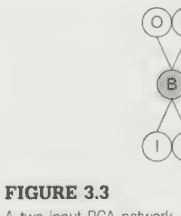

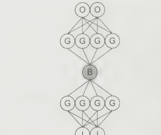

网络可以在输出神经元处正确重构原始的高维输入向量。通常使用最小二乘误差来确定所有向量的误差。这类网络有时被称为自动编码器（autoencoders）。完美的编码会导致训练集上的误差为零，因为每个向量在输出神经元处都会精确重构。在分析过程中，网络的下半部分用于计算低维编码。自动编码器在文献中已被广泛研究（Hinton & Salakhutdin, 2006; Kramer, 1991），并包含 MATLAB 在内的许多常用工具中。一个例子是 `nlpca.org` 上的 `nlpca` 工具包。

### 用于 PCA 分析的示例泛子

示例 3.1，“实现图 3.3 中网络的 PCA 泛子”，展示了图 3.3 中描述的泛子的简单性。该函数设计用于替换第 2 章中的 Nelder-Mead 优化源码，该源码包含了 `Real` 的 `typename` 以及在此计算中使用的变量。

#### 示例 3.1

```cpp
static const int nInput = 2;

static const int nH = 1;

static const int nOutput = nInput;

static const int nParam = -
(nOutput+nH1) // 神经元偏移 (Neuron Offsets)
+(nH1*nInput) // 从 1 到 H1 的连接
+(nH1*nOutput) // 从 H1 到 0 的连接
static const int extLen = nInput;
struct CalcError {
const Real* examples;
const Real* p;
const int nInput;
const int xLen;
CalcError(const Real* _examples, const Real *_p,
const int _nInput, const int _xLen)
: _examples(_examples), p(_p), nInput(_nInput), xLen(_xLen) {
__device_host
Real operator()(unsigned int tid) {
const register Real* in = &examples[tid*xLen];
register int index=0;
register Real h0 = p[index];
for(int i=0; i < nInput; i++) {
  register Real input=in[i];
 h0 += input * p[index];
}
register Real sum = 0;
for(int i=0; i < nInput; i++) {
  register Real o = p[index];
  o += h0 * p[index];
  o -= in[i];
  sum += o;
}
return sum;
}
}
```

示例 3.2，“线性数据生成器”定义了子程序 `genData()`，它根据公式 3.1 所示两个变量 `$z1$` 和 `$z2$` 之间的线性关系创建一个二维数据集。噪声根据两个均值为零均匀分布序列 `$e1$` 和 `$e2$` 叠加在 `t` 上。使用 0.1 的方差来生成训练数据并用于图 3.1。

#### 示例 3.2

```cpp
template <typename Real>
void genData(thrust::host_vector<Real> &data, int nVec, Real xVar)
{
Real xMax=1.1; Real xMin=-xMax;
Real xRange=(xMax-xMin);
for(int i=0; i < nVec; i++) {
  Real t = xRange * f_rand();
  Real z1 = t +   xVar * f_rand();
  Real z2 = t +   xVar = f_rand();
  h_data.push_back(z1);
  h_data.push_back(z2);
}
}
```

```cpp
z1=t+e1, e1=N(0,0,1)
z2=t+e2, e2=N(0,0,1)
```

图 3.5 显示了 PCA 网络如何使用零方差（`xVar` 等零）的 `genData` 重构 100 个随机生成的数据点。

该示例的完整源码可以从书的网站下载。那些想要适配第 2 章中 `xorNM` 示例的人可以使用示例 3.1 中的函数和示例 3.2 中的数据生成器。此外，正确性测试需要修改。为了获得高精度，此示例要求 `count` 设置为 50000。

### 用于 NLPCA 分析的示例泛子

示例 3.3 中的 NLPCA 泛子实现了图 3.4 所示的网络。该泛子设计用于替换第 2 章中的 Nelder-Mead 优化源码，该源码包含了在此计算中使用的 `Real` `typename` 定义和变量。

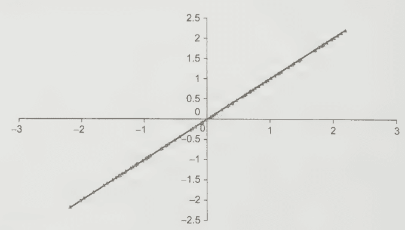

图 3.5：Nelder-Mead 训练的 PCA 网络重构 100 个随机点。

#### 示例 3.3

```cpp
static const int nInput = 2;
static const int nh1 = 4;
static const int nh2 = 1;
static const int nh3 = 4;
static const int nOutput = ninput;
static const int nparam =
(nOutput-nh1+nh2+nh3); // 从 I 到 H1 的连接
+ (nInput+nh1)
+ (nInput+nh2) // 从 H1 到 H2 的连接
+ (nh2+nh3) // 从 H2 到 H3 的连接
+ (nh3+nOutput); // 从 H3 到 0 的连接
static const int exLen = ninput;
struct CalcError {
const Real* examples;
const Real* p;
const int nInput;
const int exLen;
CalcError(const Real* _examples, const Real* _p,
const int _nInput, const int _exLen)
: _examples(_examples), p(_p), nInput(_nInput), exLen(_exLen) {
__device_host
Real operator()(unsigned int tid) {
const register Real* in = &examples[tid*xLen];
register int index=0;
register Real h0 = p[index];
for(int i=0; i < nInput; i++) {
  register Real input=in[i];
 h0 += input * p[index];
}
register Real sum = 0;
for(int i=0; i < nInput; i++) {
  register Real o = p[index];
  o += h0 * p[index];
  o -= in[i];
  sum += o;
}
return sum;
}
}
```

## 第3章：CUDA 工具套：对 PCA/NLPCA 函子进行性能分析

仅看前几行，就可以发现应用程序启动后从主机（host）发生了多次数据传输，我们可以推断出这是训练集、参数及其他信息移动到 GPU 的过程。示例 3.5“单精度 Nelder-Mead NLPCA 优化的 CUDA GPU 分析”中显示了一个报告的占用率（occupancy）值，它是 GPU 线程级并行化（TLP）的衡量标准。高占用率通常是好事，但具有较低指令级并行化（ILP）的程序也可以实现很高的应用性能。要理解占用率，你需要了解下一节将讨论的 GPU 硬件和执行模型的一些基础知识。

### 示例 3.5

```
### CUDA_PROFILE_LOG_VERSION 2.0
### CUDA_DEVICE 0 Tesla C2070
### TIMESTAMPFOR fffff6faa0f36f
method,gputime,cputime, occupancy
method=[memcpyHtoD] gputime=[175.224] cputime=[187.003]
method=[memcpyHtoD] gputime=[179.296] cputime=[20.000]
method=[ZN26thrust6detail11device6cuda6daetail123launch_closure_by_valueINS2_1b8_for_each_n_closureINS10_device_ptreeEJNS16_generate_functionINS0_12f11_functorEEEEEEVT_] gputime=[5.056] cputime=[7.000] occupancy=[0.500]
method=[ZN26thrust6detail11device6cuda6daetail123launch_closure_by_valueINS2_1b8_for_each_n_closureINS10_device_ptreeEJNS16_generate_functionINS0_12f11_functorEEEEEEEEVT_] gputime=[2.144] cputime=[5.000] occupancy=[0.500]
method=[memcpyHtoD] gputime=[2.048] cputime=[5.000]
method=[memcpyHtoD] gputime=[1.120] cputime=[5.000]
method=[memcpyHtoD] gputime=[1.088] cputime=[3.000]
method=[ZN26thrust6detail11device6cuda6daetail123launch_closure_by_valueINS2_231_reduce_n_mem_closureINS18_transform_iteratorINS70b_Funyc9C6daalERRs_7counting_iteratorINS11_use_defaultSB_EE_EEINS_4plusEEEEEEVT_] gputime=[850.414] cputime=[5.000] occupancy=[0.625]
method=[ZN26thrust6detail11device6cuda6daetail123launch_closure_by_valueINS2_231_reduce_n_mem_closureINS10_15normal_iteratorINS_10_device_ptreeEEEEEEVT_4_plusEEEEEEEEEEVT_] gputime=[5.952] cputime=[4.000] occupancy=[0.500]
method=[memcpyHtoD] gputime=[1.952] cputime=[856.000]
method=[memcpyHtoD] gputime=[1.120] cputime=[4.000]
method=[memcpyHtoD] gputime=[1.088] cputime=[4.000]
```

### GPROF：一种常用的 UNIX 性能分析工具

为了深入了解主机端的性能，编译 CUDA 应用程序时可以使用 `-profile` 命令行选项，如示例 3.6 中的 `nvcc` 命令所示：

#### 示例 3.6

```
nvcc -profile -arch=sm_20-03 -Xcompiler -fopenmp -lpcnAM.cu
```


### 示例 3.7

扁平化分析（Flat profile）：

每个样本计为 0.01 秒。

| 累计自时间 自时间 总时间 秒 秒 调用次数 s/调用 s/调用 名称 |
| :--- | :--- | :--- | :--- | :--- | :--- | :--- | :--- |
| 10.79 | 0.22 | 0.22 | 1 | 0.22 | 1.08 | void melmin |
| <float>(float*)((float*), int, float*, float*, float*, float*, float*, int, int, int*, int*) | | | | | | | | |
| 9.80 | 0.42 | 0.20 | 10508880 | 0.00 | 0.00 | unsigned |
| long thrust:detail::util::divide_ri<unsigned long>(unsigned long) (unsigned long, unsigned long) | | | | | | | | |
| 8.33 | 0.59 | 0.17 | 3502960 | 0.00 | 0.00 | thrust: |
| detail::device::cuda::arch::active_blocks_per_multiprocessor (cudaDeviceProp const&, cudaAttributes const&, unsigned long unsigned long) | | | | | | | | |
| 4.41 | 0.68 | 0.09 | 12001144 | 0.00 | 0.00 | void |
| thrust:advance<thrust::detail::normal_iterator<float*>, long>(thrust::detail::normal_iterator<float*>&, unsigned long) | | | | | | | | |
| 3.92 | 0.76 | 0.08 | 69730562 | 0.00 | 0.00 | thrust: |
| vector<float, std::allocator<float>>operator[](unsigned long) | | | | | | | | |

累计自时间和总时间的输出显示，`gprof` 占据了运行时间的大部分，但低占用率程序也可以实现高应用性能。要理解占用率，你需要了解下一节中讨论的 GPU 硬件和执行模型的一些基础知识。

NVIDIA 性能分析工具：NVVP

为了深入了解主机端的性能，CUDA 应用程序可以使用 `-profile` 选项。NVIDIA 性能分析工具（NVIDIA Visual Profiler，简称 NVVP）提供了比 `gprof` 更详尽的信息。

# 76 第3章：CUDA 工具套件：对 PCA/NLPCA 类的性能分析

| 最小 GPU 时间(us): | 794.37 |
| 最大 GPU 时间(us): | 951.78 |
| 平均 GPU 时间(us): | 860.68 |
| GPU 占比 (%): | 83.86 |
| 网格大小: | [14 1 1] |
| 线程块大小: | [960 1 1] |

### 限制因素
实际每字节指令数: 45.92 (平衡每字节指令数: 3.58)
实际占有率: 0.63 (理论占有率: 0.62)
IPC: 1.77 (最大 IPC: 2)
实际全局内存吞吐量: 10.71 (峰值全局内存吞吐量(GB/s): 143.42)

### 提示
该内核的实际每字节指令数数大于设备的平衡每字节指令数。因此，该内核可能是计算密集型的。有关详细信息，请点击“指令吞吐量分析”。

点击“指令吞吐量分析”按钮显示该内核确实实现了非常高的吞吐量。内核中存在一些分支，最可能发生在 `tanh()` 函数内部，这表明可以使用另一个 sigmoid 函数来提高性能。参见示例 3.9，“可视化性能分析器指令分析”：

**示例 3.9**
IPC: 1.77
最大 IPC: 2
分歧分支(%): 13.47
控制流分歧(%): 12.62
重放指令(%): 1.08
全局内存重放(%): 0.55
本地内存冲突重放(%): 0.00
共享内存银行冲突重放(%): 0.00
每条共享内存指令的共享内存银行冲突(%): 0.00

NVIDIA 可视化性能分析器 (`nvvp`) 收集并提供了此处未讨论的额外信息和分析。可视化性能分析器是一个极的信息来源，启动脚本中的帮助选项卡也是如此。在 GUI 中输入 `nvvp` 并点击帮助。后续章节将引用 `nvvp` 性能分析器的测量实现，以帮助理解和解释 GPU 性能。由于可视化性能分析器适用于所有支持 CUDA 的操作系统（Windows、UNIX 和 Mac OS X），这些讨论将使所有读者受益。

### 针对 Microsoft Visual Studio 的 Parallel Nsight

Parallel Nsight 是 NVIDIA 为 Microsoft 开发人员提供的调试和分析工具；它以插件的形式安装在 Microsoft Visual Studio 中。Parallel Nsight 允许在本地机器以及位于客户现场的远程上进行调试和分析。请注意，Parallel Nsight 的功能随硬件配置而异，如表 3.2 所示。

| 表 3.2 根据机器配置的 Parallel Nsight 功能 |
| 硬件配置 | 单 GPU 系统 | 双 GPU 系统 | 两个带有 GPU 的系统 | 双 GPU 系统 SLI 多操作系统 |
| :--- | :--- | :--- | :--- | :--- |
| CUDA/C++ 并行调试器 | | | | |
| Direct3D 着色器调试器 | | | | |
| Direct3D 图形检查器 | | | | |
| 分析器 (Analyzer) | | | | |

接下来的讨论仅作为我们对 `nlpcaNM.cu` 分析的一部分，突出 Parallel Nsight 的少数功能。Parallel Nsight 是一个不断增长和成熟的扩展包——包括视频和用户论坛——可以在 Parallel Nsight 门户网站 (`http://www.nvidia.com/Nsight`) 以及 Visual Studio 的帮助部分找到。

### Nsight 时间轴分析

如图 3.7 所示的跟踪时间轴所示，Parallel Nsight 提供了大量的信息，可以通过鼠标悬停、缩放操作以及各种过滤操作轻松访问。鉴于这些跟踪中可用信息量巨大，必须知道，可以通过在屏幕上所需的时间起始点点击鼠标来选择时间轴的区域。


图 3.7：Nsight 时间轴。

然后按 Shift 键并移动鼠标（按住按钮）到感兴趣的结束区域。此操作将产生一个灰色覆盖层，如图 3.7 所示。一个非常实用的功能是计算并显示该区域的时间间隔。

时间轴可用于判断应用程序是 CPU 密集型、内存密集型还是内核密集型：

- CPU 密集型：将出现显示内核正在运行的大区域。
- PCIe 传输限制：内核执行在等待与设备之间的内存传输时被阻塞，这可以通过查看“内存 (Memory)”行看到。如果花费大量时间等待内存拷贝，请考虑使用 Streams API 对应用程序进行流水化。该 API 允许数据传输和内核执行重叠。在修改代码之前，比较传输和内核的持续时间，以确保性能提升。
- 内核密集型：如果应用程序大部分时间用于等待内核完成，请切换到“Profile CUDA”活动。

# 第3章：CUDA 工具套件：对 PCA/NLPCA 类的性能分析

### 针对 Microsoft Visual Studio 的 Parallel Nsight
缩放时间轴的某个区域允许 Parallel Nsight 提供更多细节，这确实有助于跟踪轨迹的可读性。

### NVTX 跟踪库
NVTX 库提供了一种标记代码部分的强大方法。最简单的 NVTX 方法有：

- `nvtxRangePush(char*)`：该方法将字符串推入栈。
- `nvtxRangePop()`：从栈中弹出顶部标签。

源文件中包含了 `nvToolExt` 头文件。此外，32 位或 64 位的 nvTools 必须与执行文件链接。NVTX 库用于标注时间轴。

### 示例 3.10
```cpp
nvtxRangePush("Transform Reduce");

Real sum = thrust::transform_reduce(
    thrust::counting_iterator<unsigned int>(0),
    n,
    getError,
    thrust::plus<Real>());

nvtxRangePop();
```


```
图 3.7 显示了时间轴上的细节。顶部跟踪显示 GPU 活动和 API 调用；底部跟踪显示系统和多处理器核心的活动。Parallel Nsight 地利用颜色来帮助解释，这在灰度图中未显示。建议使用大显示器

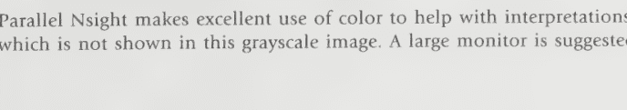

### 针对 Microsoft Visual Studio 的 Parallel Nsight
缩放时间轴的某个区域允许 Parallel Nsight 提供更多细节，这确实有助于跟踪轨迹的可读性。

### CUDA API 的扩展行为
观察 NLPCA 示例的时间轴（图 3.8），我们看到类占据了大部分 GPU 运行时间。对于三次运行——使用完整大小、缩小 10 倍和 100 倍的数据集——时间轴显示，为归约的小内存内存区域进行的重复分配和释放占了越来越大的运行时间。这种消耗代表了当前 CUDA 4.0 实现中的扩展性挑战。`NVTX` 库用于标注时间轴。

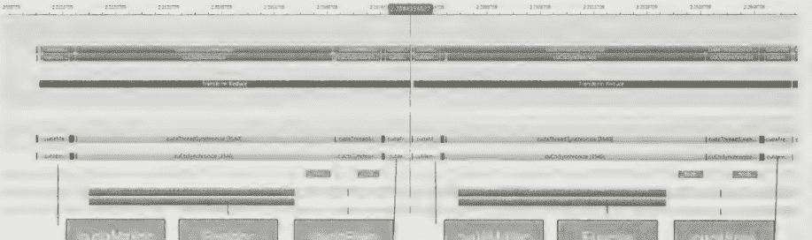
图 3.8：`nlpcaNM.cu` 全数据大小。

将数据缩小 10 倍（图 3.9）显示 `cudaMalloc()` 占据了更多 `transform_reduce` 的运行时间。

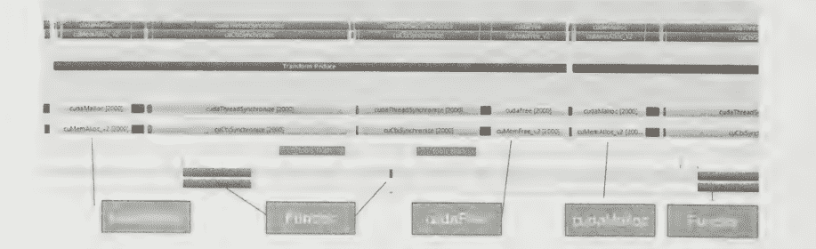
图 3.9：`nlpcaNM.cu` 1/10 数据大小。

当规模缩小 100 倍时，在使用 10,000 个示例的情况下（图 3.10），`transform_reduce` 分配和释放临时空间的时间消耗了大量的运行时。

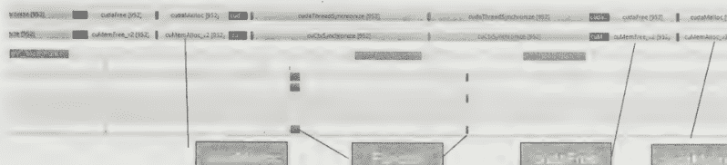

图 3.10
`nipcaNM.cu` 的 10k 个示例。

即使分配效率低下，Parallel Nsight 仍以图形化方式显示 NLPCA Fun子实现了极高的效率，因为它在 C2050 的所有多处理器上，每个时钟周期几乎执行了两次操作（图 3.11）。

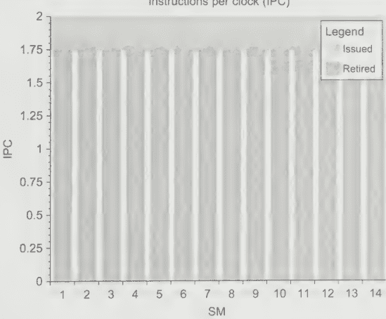

图 3.11
Parallel Nsight 中 `nipcaNM.cu` 每时钟指令数。

Parallel Nsight 还报告报告 GPU 上的所有多处理器都得到了充分利用（图 3.12），这完善了分析结论，即 CalcError Fun子是对 GPU 能力的良好利用。

## 第 3 章：CUDA 工具套：PCA/NLPCA Fun子分析

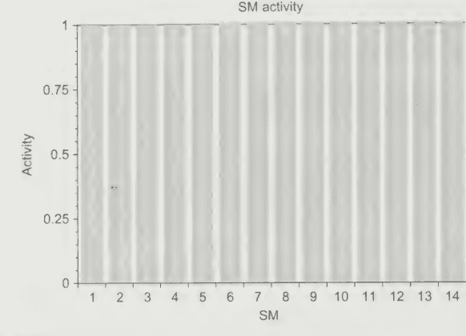

图 3.12
`nlpcaNM.cu` 在 GPU 上的多处理器活动。

### 调节与分析工具 (TAU)

NVIDIA 并不是 CUDA 分析和调试工具的唯一提供者。`TAU` 是为能源部（DOE）科学办公室开发的一个程序和分析工具框架，能够通过对函数、方法、基本块和语句进行插桩收集性能信息。它支持所有 C++ 特性，包括模板和命名空间。`TAU` 的性能分析可视化工具 `paraf` 可以以聚合以及单个节点/上下文/线程的形式图形化显示所有性能结果。用户可以使用 GUI 快速识别应用程序中的性能瓶颈源。此外，`TAU` 可以生成的事件跟踪文件可以使用 `Vampir`、`Paraver` 或 `Jumpshot` 跟踪工具进行显示。

论文《基于 GPU 的异构并行系统的并行性能测量》是关于 CUDA 实现的最新发表（Malony et al., 2011; Maloney, Biersdorf, Spear, & Maylangama, 2010）。该软件可以从性能实验室 (PRL) 免费下载。

> http://www.cs.oregon.edu/research/tau.

### 总结

凭借这种易获取的计算能力，许多过去的超级计算技术现在已供所有人使用——即使在笔记本电脑上也是。在 2006 年的论文《使用神经网络减少数据维度》中，Hinton 和 Salakhutdininov 指出：

> 自20 世纪80 年代以来显而易见，深层自动编码器的反向传播对于非线性降维将非常有效，前提是计算机足够快、数据集足够大且初始权重足够接近一个优解。这三个条件都满足了。（Hinton & Salakhutdinov, 2006, p. 506）

本章讨论的技术（包括自动编码器）可以应用于许多数据拟合、数据分析、降维、视觉和分类问题。方便的是，它们能够从笔记本电脑扩展到世界上最大的超级计算机。

正如本章所示，在 Fun子内部实现高性能并不保证在所有问题规模上都有良好性能。有时限制性能的瓶颈非常微妙，例如临时空间的动态内存分配，正如 `thrust::transform_reduce` 方法中所识别的那样。

如果无法看到 GPU 正在做什么，性能监控就变成了猜测。拥有正确的性能分析工具是发现性能限制的关键。出于这个原因，CUDA 工具套包含许多已适应 GPU 计算的常用性能分析和调试工具。这些工具是 Windows、UNIX 和 Max 开发者已经熟悉的工具。虽然每个工具都有优缺点，但它们提供了观察 GPU 性能的视用视角，且只需要极少的学习投入。通过这种方式，CUDA 为向大规模并行 GPU 编程提供了平滑过渡。

# 第 4 章

## CUDA 执行模型

CUDA 性能和可扩展性的核心在于执行模型以及在执行配置中将计算划分为固定大小的线程块。这些线程块提供了应用程序并行性与 GPGPU 硬件海量复制之间的映射。CUDA 的创建是为了将应用程序内的并行性自然地映射到 GPGPU 硬件的海量并行性。从内核的高级语言表达式到最底层硬件单元的复制，在保持板 GPU 可扩展性的同时，避免了大量的常见并行编程陷阱。结果是在跨 GPGPU 硬件世代实现了海量的线程扩展性和高应用程序性能。同时，CUDA 工具包为程序员提供了在处理核心内部的线程级和指令级利用并行性所需的工具。即使是第 1 章介绍的第一个 CUDA 程序，也有潜力在未来的某代 GPU 上运行百万个并发硬件线程。同时，第 2 章中的 Fun子展示了跨多种类型和代际 GPU 的高性能。

在本章结束时，读者将基本理解：

- CUDA 如何表达大规模并行性而不施加扩展限制。
- `warp`（线程束）和 `half-warp`（半束）的意义和重要性。
- 调度、`warp` 分散（`warp divergence`）以及为什么 GPU 被认为是 SIMT 架构。
- 如何在 CUDA 程序中同时使用 TLP 和 ILP。
- TLP 和 ILP 对于算术和内存事务的优缺点。
- `Warp` 分散的影响以及如何避免这种散的通用规则。
- 利特法则（Little's law）在流式多处理器中的应用。
- `nvcc` 编译器、`SM` 相关的命令行选项以及 `cuda-dump`。
- 与占用率（`occupancy`）、TLP、ILP 和 SM 相关的性能分析测量值。

### GPU 架构概述

CUDA 性能和可扩展性的核心在于在执行配置中将计算划分为固定大小的线程块。这些线程块提供了应用程序并行性与 GPGPU 硬件海量复制之间的映射。

海量的 GPU 并行性通过复制一种称为流式多处理器（`SM`）的通用架构组件实现的；通过改变 SM 的数量，GPU 设计师可以创建满足市场各种价格和性能点需求的产品。图 4.1 中的框图说明了 GF100 (Fermi) GPGPU 上多处理器的海量复制。

线程块的软件抽象翻译为内核到 GPGPU 上任意数量 SM 的自然映射。线程块充当线程协作的容器，因为只有线程块内的线程共享数据。因此，线程块变成了应用程序并行性以及将并行性划分为多个相互独立运行的容器的自然表达式。

线程块抽象的转换是直观的；每个 SM 可以被调度运行一个或多个线程块。在仅受设备限制的情况下，这：

- 透明地扩展到任意数量的 SM。
- 对 SM 的位置没有限制（可能允许 CUDA 应用程序在未来透明地跨设备扩展）。
- 让硬件能够广播内核可执行代码和用户参数。并行广播是移动数据到大量处理元素的可扩展性最好且通常快的通信机制。

由于线程块中的所有线程都在 SM 上执行，GPGPU 设计师能够在 SM 内部提供一种名为共享内存的高速内存用于数据共享。这种优雅的解决方案避免了多核处理器中维护一致性缓存的扩展问题。一致性缓存保证反映缓存中所有变量的最新状态，无论有多少处理元素在读取或更新该变量。

> 对于某些问题且在理由充分的情况下，开发者可能会使用原子操作在不同线程块之间进行通信。这种方法打破了线程块之间的独立性假设，并可能引入编程错误、扩展性和性能问题。

此外，线程块（`thread block`）的抽象和 SM 硬件的复制协同工作，透明为线程提供了无限且高效的可扩展性。CUDA 程序员面临的挑战是以这种方式表达其应用内核，以利用这种并行性和可扩展性。

### 线程调度：通过执行配置编排性能与并行性

将工作分配到流式多处理器（SM）是 `GigaThread` 全局调度器的任务（如图 4.1 所示）。该调度器根据内核执行配置中的块数量和每个块的线程数量，为每个 SM 分配一个或多个块。每个 SM 分配多少个块取决于该 SM 能支持多少个驻留线程和线程块。

NVIDIA 根据计算能力（`compute capability`）对其支持 CUDA 的设备进行分类。计算能力中的一项重要规范是每个处理器的最大驻留线程数。例如，旧的 G80 计算能力 1.0 的设备具有每个多处理器管理 768 个驻留线程的能力。这些设备的有效块组合包括：三个 256 线程的块、六个 128 线程的块，以及其他不超过每个 SM 768 个线程的组合。较新的 GF100 或计算能力 2.0 的 GPU 可以支持 1536 个驻留线程，是 1.0 多处理器的两倍。

`GigaThread` 全局调度器在计算 2.0 设备中得到了增强，以支持并发内核。因此，当计算 2.0 设备面对小内核混合或随着时间推移停止使用 SM 的负载不平衡内核时，可以更好地利用 GPU 硬件。换句话说，只要内核发射到不同的流（`streams`），多个内核就可以在单个 GPU 上同时运行。内核按照发射的顺序执行，并且只有在先前的内核的所有线程块调度完毕后仍有可用 SM 资源时才会执行。

每个 SM 独立负责调度其内部资源、核心和其他执行单元，以执行其分配线程块中线程的工作。这种解耦的交互具有高度的可扩展性，因为 `GigaThread` 调度器只需要知道 SM 何时忙。

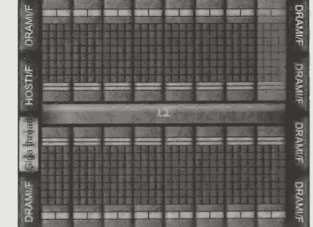

# 第 4 章：CUDA 执行模型

在每个时钟周期上，SM `warp` 调度器决定下一个执行哪个 `warp`，从那些未等待以下内容的 `warp` 中选择：

- 等待设备内存的数据。
- 等待早期实例的完成。

如图 4.2 所示，每个 GF100 SM 均有 32 个 SIMD（单指令多数据流）核心。使用 SIMD 执行模型意味着 SM 上的调度器规定所有核心将运行相同的指令。然而，每个核心可能使用不同的数据。将流式多处理器的设计基于 SIMD 执行模型，是处理器设计中“恰好足够，不多不少”的绝佳示例，因为 SIMD 核心比非 SIMD 设计需要的空间更少，功耗更低。这些优势通过 GPU 内部 SM 的复制而倍倍增加。

GPU 硬件架构师能够通过投入功率和空间来增加 ALU（算术逻辑单元）、浮点单元和用于计算超越函数的特殊单元，从而利用 SIMD 节省的。因此，如表 4.1 所示，与传统处理器相比，GPGPU 设备具有较高的每瓦翻转率（flip per watt ratio）（Vuduc, 2010）。

到目前为止，我们已经正确地讨论了从单个线程的角度编写 GPU。从性能角度来看，有必要从 `warp` 内部的 SIMD 线程或具有双调度器的 GF100 SM 上的半 `warp`（`half-warp`）的角度开始思考。`warp` 是大多数 GPU 上由 32 个 SIMD 线程组成的块。就像 `GigaThread` 调度器的线程块一样，`warp` 是 SM 内部进行调度的基本单元。

根据定义，每个 `warp` 都是一个 SIMD 线程块，调度器不需要检查指令流内部的依赖。图 4.2 显示每个 GF100 SM 拥有两个 `warp` 和两个指令分发单元，这允许两个 `warp` 同时发射并执行。使用这种双发射模型，GF100

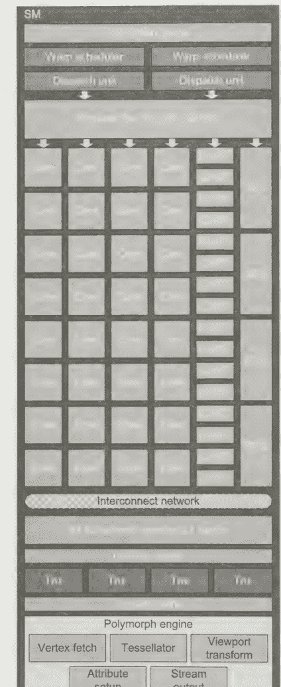

图 4.2
GF100 SM 框图。

### GPU 架构概述

| 架构 | Intel Nehalem x5550 | NVIDIA T10P C1060 | NVIDIA GT20 GTX 285 | NVIDIA Fermi C2050 |
| --- | --- | --- | --- | --- |
| GHz | 2.66 | 1.44 | 1.47 | 1.15 |
| 插槽 (Sockets) | 2 | 1 | 1 | 1 |
| 每个插槽核心 (SM/GPU) | 4 | (30) | (30) | (14) |
| 峰值 Gflop (单精度) | 170.6 | 933 | 1060 | 1030 |
| 峰值 Gflop (双精度) | 85.3 | 78 | 88 | 515 |
| 峰值 GB/s | 512 | 159 | 144 |
| 仅插槽 | 200 | 200 | 204 | 247 |
| 64 位每瓦翻转 | 0.4265 | 0.39 | 0.43137 | 0.5002 |
| 32 位每瓦翻转 | 0.85 | 4.66 | 5.19 | 2.085 |

到此为止，我们已经从单个线程的角度正确讨论了 GPU 编程。从性能角度来看，有必要从 `warp` 内部的 SIMD 线程或具有双调度器的 GF100 SM 上的半 `warp` 角度思考。`warp` 是大多数 GPU 上由 32 个 SIMD 线程组成的块。就像 `GigaThread` 调度器的线程块一样，`warp` 是 SM 内部调度的基本单元。

根据定义，每个 `warp` 都是一个 SIMD 线程块，调度器不需要检查指令流内部的依赖。图 4.2 显示每个 GF100 SM 拥有两个 `warp` 和两个指令分发单元，这允许两个 `warp` 同时发射并执行。

### 相关 warp 的 computeprof 值

| 活跃 warp/周期 | 每个多处理器每周期活跃的 warp 平均数量，计算方法为： |

### Warp 散度 (Warp Divergence)

SIMD 执行有缺点，但它只影响在 SM 内部运行的代码。GPGPU 并非真正的 SIMD 机器，因为它们由许多 SM 组成，SM 可能运行一个或多个不同的指令。因此，GPPU 设备被分类为 SIMT（单指令多线程）设备。

程序员必须注意条件（`if`语句）会极大降低 SM 内部的性能，因为每个条件的分支都必须评估。条件中的长路径会导致 $N$ 个嵌套循环出现 $2^N$ 倍的变慢。当 `warp` 中的每个线程执行单独条件时，可能会发生 32 倍的变慢。

Fermi 架构利用谓词（`predication`）来高效运行短条件段。谓词通过并行执行分支的 *if* 和 *else* 部分消除了代码中的分支，从而避免了预测分支和 `warp` 散度的问题。

《CUDA 实践指南》第 6.2 节提到：

- 使用分支谓词时，依赖于控制条件的指令不会被跳过。相反，每条指令都与每个线程的条件码或谓词关联，并根据控制情况设置为真或假。尽管这些指令都经过调度进行执行，但谓词为真的指令会被实际执行。谓词为假的指令不会写入结果，也不会评估地址或读取操作数。（NVIDIA, CUDA C Best Practices Guide, 2011年5月, p. 56）

示例 4.1，“包含条件的短代码片段”中的代码包含一个所有线程都会计算逻辑谓词的条件，产生两条谓词指令，如示例 4.2 所示：

### 示例 4.1

```
if (x<0.0) z = x-2.0;

else z = sqrt(x);
```


当 `x < 0` 时，`sqrt` 具有一个假谓词，因此在尝试对零进行平方根时不会发生错误。

示例 4.2
`p=(x<0.0);` // 逻辑谓词
`np: z = x-2.0;` // 真谓词指令
`if(!): z = sqrt(x);` // 假谓词指令

在《CUDA 最佳实践指南》第 6.2 节中，谓词指令的长度非常重要：

编译器仅当由分支条件控制的指令数量小于或等于某个阈值时，才会将分支指令替换为谓词指令：如果编译器确定条件可能会产生许多发散的束（divergent warps），则该阈值为 7；否则为 4（NVIDIA, CUDA C Best Practices Guide, 2011年5月, 第56页）。

如果分支中的代码太长，`nvcc`编译器会插入代码来执行线程束投票（warp voting），以检查一个束中的所有线程是否执行相同的分支。如果一个束中的所有线程都采取相同的路径，则没有性能下降。

在某些情况下，编译器可以在编译时确定束中的所有线程将采取相同的路径。在示例 4.3，“不需要投票的示例”中，即使 `case` 是一个非数变量，也不需要投票。

示例 4.3
// 变量 `case` 在所有线程中具有相同的值
`if (case==1)`
`z = x*x;`
`else`
`z = x+2.3;`

### 线程束发散（Warp Divergence）指南

有时，线程束发散是不可避免的。常见的应用示例包括带有边界条件的偏微分方程（PDE）、图、树以及其他不规则数据结构。在最坏情况下，当出现以下情况时，可能会发生32倍的缓慢：

- 一个线程需要执行昂贵的计算任务。
- 每个线程执行单独的任务。

# 第 4 章：CUDA 执行模型

避免线程束发散是一个挑战。尽管有很多可能的解决方案，但没有一种方案可以适用于所有情况。以下是一些指南：

- 尝试重新构建问题以使用不同的算法，该算法要么不会引起线程束发散，要么通过表达问题让编译器减少或消除线程束发散。
- 考虑将昂贵操作与廉价操作分开列表，并在单独的内核中使用每个列表。希望大部分工作在廉价内核中进行。某些昂贵的工作可以在 CPU 上执行。
- 调整计算（或计算列表）的顺序，将计算分组为半线程束（half-warp）倍数的计算块。
  - 如果可能，使用异步内核执行来利用 GPU 的 SIMT 执行模型。
  - 利用主机处理器执行部分会导致 GPU 产生负载不均衡的工作。

《CUDA CUDA Gems》(Hwu, 2011) 一书是一本单源参考，用于查看应用程序如何处理具有不规则数据结构和线程束发散的问题。每个章节都包含对问题、解决方案和报告的加速的详细描述。示例包括：

- 在 GPGPU 上加速不规则树形数据结构的传统和新颖方法。
- 在字符串相似性算法中避免限制并行性的条件操作。
- 使用 GPU 加速动态积分网格，并在网格点在计算过程中移动时避免线程束发散。
- 处理不规则网格的方法，涉及条件操作以及计算正则化的方法。

### 用于线程束发散的相关 computeprof 值

| 发散分支 (%) | 在内核中所有分支中，导致束内发散的分支百分比。发散会导致执行串行化。其计算方法为：100* ((发散分支)/(发散分支 + 分)) |
| 控制流发散 (%) | 控制流发散是指未被束中所有线程执行的指令百分比，从而导致发散。此值越低越好。其计算方法为：100* ((32* 已执行指令)/(32* 已执行指令)) |

### 线程束调度与 TLP（线程级并行）

在每个 SM 上运行多个线程束是 GPU 隐藏 ALU 和内存延迟以保持执行单元忙碌的唯一方法。

# 线程束调度与 TLP

从软件角度来看，硬件 SM 调度器足够快，基本上没有开销。在 SM 内部，硬件可以检测那些下一条指令已就绪运行的束，因为所有资源和数据依赖都已解决。SM 调度器根据内部的优先级调度选择其中一个。它将该束的指令发射到 SIMD 核心。如果所有线程束都停顿了（意味着它们都有某些未解决的依赖关系），则无法发射任何指令，导致硬件闲置和性能下降。

TLP 背后的思想是给调度器尽可能多的线程供其选择，以减少潜在的性能损失。占用率（Occupancy）是 TLP 的衡量标准，定义为多处理器上可以驻留在 SM 上的最大束数。高占用率意味着 SM 上的调度器有许多束可以选择，并隐藏 ALU 和数据延迟。可能至少有一个束已准备就绪运行，因为所有依赖都已解决。

占用率在概念上很简单，但在实践中很复杂，因为它可能受到片上 SM 内存资源（如寄存器和共享内存）的限制。NVIDIA 提供了 CUDA Occupancy 工具，以查看应用程序如何处理不规则数据结构和线程束发散的问题（注：此处原文似乎有重复，已按逻辑翻译）。

### ILP：低占用率下的高性能

横向读取各列。表 4.2 总结了对于不同的计算代，随着占用率的降低，每个线程的寄存器数量如何增加。

| 表 4.2 随着占用率降低，每个线程寄存器数量增加 |
| 最大占用率 | 最大寄存器 | 增加 |
| --- | --- | --- |
| GF100 | 100% 占用率下 20 个 | 33% 占用率下 63 个 | 每个线程寄存器数量增加 3 倍 |
| GF200 | 100% 占用率下 16 个 | 12.5% 占用率下 ~128 个 | 每个线程寄存器数量增加 8 倍 |

### ILP 隐藏算术延迟

与 TLP 类似，多个线程提供了所需的并行性。例如，图 4.3 中的阴影行突出了跨越三个线程并行执行的四个独立操作。

| 表 4.3 一组 TLP 算术操作 |
| 线程 1 | 线程 2 | 线程 3 | 线程 4 |
| --- | --- | --- | --- |
| x=x+c | y=y+c | z=z+c | w=w+c |
| x=x+b | y=y+b | z=z+b | w=w+b |
| x=x+a | y=y+a | z=z+a | w=w+a |

由于 warp 调度，并行性也可以发生在线程内部的指令中，只要块内有足够的线程来创建两个或多个线程束（warp）。

| 表 4.4 为 ILP 重排的指令 |
| | | |
| 指令 | w=w+b | 四个独立操作 |
| | z=z+b | |
| | y=y+b | |
| | x=x+b | |
| | w=w+a | 四个独立操作 |
| | z=z+a | |
| | y=y+a | |
| | x=x+a | |

以下示例通过在单个 SM 上运行两个或多个线程束来演示 ILP。如图 4.5，“算术 ILP 基准测试”所示，执行配置仅指定了一个块。随着块内线程数从 32 增加到 1024，SM 上的驻留数量增加，并报告了性能。此示例将在支持每个块 1024 个线程的计算 2.0 设备上运行完成。早期的设备将通过调用 `cudaLastError` 检测到运行时错误，当每个块的最大线程数超过 GPU 可支持的数量时，测试将停止。由于内核启动是异步的，因此使用 `cudaSynchronizeThread` 来 等待内核完成。

# 第 4 章：CUDA 执行模型

### 示例 4.5

```cpp
#include <comp.h>

#include <iostream>

using namespace std;

#include <cmath>

// 在设备内存 gmem 上创建存储

__device_ float d_a[32], d_d[32];

__device_ float d_e[32];

#define NUM_ITERATIONS (1024 * 1024)

#ifdef ILP4

// 测试指令级并行性

#define OP_COUNT 4*2*NUM_ITERATIONS

__global_ void kernel(float a, float b, float c)

{

    register float d=a, e=a, f=a;

    #pragma unroll 16

    for(int i=0; i < NUM_ITERATIONS; i++) {

        a = a*b+c;

        d = d*b+c;

        e = e*b+c;

        f = f*b+c;

    }

}

// 写入 gmem 以免工作被编译器优化

d_a[threadIdx.x] = a; d_d[threadIdx.x] = d;

d_e[threadIdx.x] = e; d_f[threadIdx.x] = f;

}

else

// 测试线程级并行性

#define OP_COUNT 1*2*NUM_ITERATIONS

__global_ void kernel(float a, float b, float c)

{

    #pragma unroll 16

    for(int i=0; i < NUM_ITERATIONS; i++) {

        a = a*b+c;

    }

}

// 写入 gmem 以免工作被编译器优化

d_a[threadIdx.x] = a;

#endif

int main() {

    // 遍历块中的线程数

    for(int nThreads=32; nThreads <= 1024; nThreads += 32) {

        double start=omp_get_wtime();

        kernel<<<1, nThreads>>>(1., 2., 3.); // 异步内核启动

        if(cudaGetError() != cudaSuccess) {

            cerr << "Launch error" << endl;

            return(1);

        }

        cudaThreadSynchronization(); // 需要等待内核完成

        double end=omp_get_wtime();

        cout << "<<warps>>" << n << << threads>>" << (nThreads*(OP_COUNT/1.e9)/(end - start)) << " <<Gflops>>" << endl;

    }

    return(0);

}
```


如图 4.3 所示，`ILP` 仅通过增加每个线程的独立指令数量就能提高性能。在计算 2.0 设备上的最佳性能出现在 `SM` 上驻留 576 个线程时。正如“低占用率下的高性能”中所述，目前的上限似乎是 `ILP` 4。怀疑跟踪内存使用的 `SM` 上的计数器是限制因素。

### 表 4.5 实现 100% 利用率的最小并行性

| 计算代际 | GPU 架构 | 延迟（周期） | 吞吐量（核心/SM） | 并行性（操作/SM） |
|---|---|---|---|---|
| 计算 1.x | G80 | 24 | 8 | 192 |
| 计算 2.0 | GT200 | 18 | 32 | 576 |
| 计算 2.1 | GF104 | 18 | 48 | 864 |

表 4.5 显示了实现100% 利用率的最小并行性。

### ILP 隐藏数据延迟

注意的是，对于许多应用程序，`ILP` 可以隐藏内存延迟。从线程的角度来看，`ILP` 通过在等待内存时发射多条指令来隐藏内存延迟。结果是计算 2.1 设备可以获得更高的吞吐量。

- 为功能单元提供指令。
- 减少线程束依赖内存而阻塞的时间。
- 保持线程束忙碌。

如图 4.3 所示，`ILP` 仅通过增加每个线程的独立指令数量就能提高性能。在计算 2.0 设备上的最佳性能出现在 `SM` 上驻留 576 个线程时。正如“低占用率下的高性能”中所述，目前的上限似乎是 `ILP` 4。怀疑跟踪内存使用的 `SM` 上的计数器是限制因素。

### ILP：低占用率下的高性能

当前的架构鼓励使用较小的块，因为这允许更多的线程束驻留在 `SM` 上。这允许调度器在某个线程束等待内存时进行线程切换。`NVIDIA` 在计算 2.1 设备的调度器中加入了超标量执行，允许它们每个时钟发射多条指令。

### 未来的 ILP

`CPU` 开发者会将 `ILP` 视为超标量执行的一种。这些设备的线程束调度器能够分析线程束中的下一条指令，以确定其是否 `ILP` 安全以及是否有可用的执行单元来处理它。

# 第 4 章：CUDA 执行模型

`ILP` 有益于内存带宽问题：在 `Fermi C2050` 上使总线饱和，需要每个 `SM` 保持 30–50 个 128 字节的在途中事务 (`Micicevic, 2010`)。`Volkov` 建议保持 100 KB 的在途中数据以隐藏内存延迟——如果内核是计算密集型的，则值更小。

### 与指令速率相关的 computeprof 值

| 指令 | 说明 |
| :--- | :--- |
| 指令吞吐量 (Instruction throughput) | 该值是实际实现的指令速率与峰值单发射指令速率的比值。实际实现的指令速率使用 prof 计数器 "instructions" 计算。峰值指令速率根据 GPU 时钟频率计算。在涉及双发射的情况下，该比例将飙升至大于 1。其计算公式为：`(instructions)/(gpu*clock*frequency)` |
| 指令/字节速率 (Instruction/byte rate) | 该值是峰值指令吞吐量与 CUDA 设备峰值吞吐量的比值。这是设备的属性，与内核无关。 |
| 指令/字节 (Instruction/byte) | 该值是内核从全局内存发射的指令总数比值。如果该比值大于理想的指令/字节速率，则内核是计算密集型的；如果较小，则内核是内存密集型的。其计算公式为：`(32*instructions issued)/(SM*(32*requests + L2 write requests + L2 texture requests))` |
| IPC (每周期指令数) | 该值给出了每个周期发射的指令数。它应该与该设备可能的最大值进行比较。所提供的范围适用于单精度浮点指令。其计算公式为：`(instructions issued/active cycles)` |
| 重放指令百分比 (Replayed instructions (%)) | 该值给出了内核执行期间重放指令的百分比。重放指令是硬件实际发射的指令数与内核执行的指令数之间的差。理想情况下，此值应零。其计算公式为：`100*(instructions issued—instruction executed)/instruction issued` |

## 小特法则 (LITTLE'S LAW)

小特法则 (`Little, 1961`) 源于通用信息论，但对于理解内存层次结构的性能具有重要应用。对于多处理器系统，推广后的并发小特法则（公式 4.1）可以表示为：

> 并发 = 带宽 * 延迟 (4.1)

其中并发是系统的总并发数，带宽是总内存带宽。

几乎所有的 CUDA 应用都会受到内存带宽的限制。全局内存的性能特别关注，如“较低占用率获得更好的性能”(`Volkov, 2010`)所示：

- 寄存器内存 (≈8 TB/s)
- 共享内存 (≈1.6 TB/s)
- 全局内存 (177 GB/s)

从 `TLP` 的角度来看，小特法则告诉我们，“在途中”的内存事务数量 `N`（见公式 4.2，“TLP 在途中内存事务”）是到达率 `λ` 和内存延迟 `L` 的乘积。

`N=λL` (4.2)

其中，到达率 `λ` 是 `IPC`（期望的指令速率）和加载指令密度的乘积。

换句话说，随着额外线程的添加并复用在相同的硬件资源上，可以隐藏更大的延迟。正如我们所观察到的，这是一种过于简化的观点，因为复杂的数据依赖会导致停顿，加之硬件限制产生了瓶颈。

从 `ILP` 的角度来看，独立的内存事务可以批处理（公式 4.3，“ILP 批处理途中内存事务”）。

`N=λ-B` (4.3)

其中 `B` 是独立加载的批大小。

在 `Fermi C2050` 上使总线饱和需要每个 `SM` 保持 30–128 字节的在途中事务 (`Mctikeevicius, 2010`)。`Volkov` 建议在 `C2050` 上实现实际性能的最小并行度为每个块 576 个线程，并在内存密集型内核上保持 100 KB 的数据以获得峰值内存性能。表 4.8 总结了这些结果。

### 表 4.8 C2050 峰值数据和算术性能的最小并行度

| 算术 | 延迟 | 吞吐量 | 并行度 |
| :--- | :--- | :--- | :--- |
| 内存 | ≈18 周期 | 32 | ≈576 |
| | <800 周期 | <177 GB/s | <100 KB |

为了增加应用程序的并发性，请考虑以下点：

- 增加占用率 (`occupancy`)。
- 使用 `nvcc` 命令行选项 `-maxregcount` 最大化可用寄存器，为编译器在内核声明中通过 `__launch_bounds__` 指定提供额外帮助。
- 调整线程块维度以充分利用 `SM` warp 调度器。
- 修改代码使用 `ILP` 并每个线程处理多个元素。
- 心指令的“混合”情况：
    - 例如，数学与内存操作的比例。
    - 不要让某个函数成为瓶颈导致其他单元停顿。
    - 不要让内核代码发生“拥堵”：
    - 尝试创建许多小块以产生操作密度的均匀分布（例如整数、浮点、内存和 SFU）。
    - 不要在一个内核的一个部分中聚集相似类型的操作，因为这可能会导致 `SM` 的负载不平衡。

## 用于识别限制因素的 CUDA 工具

`CUDA` 提供了几种工具来处理代码和并发。占用率计算器 (`Occupancy Calculator`) 是规划期间理解跨内核占用率的良好工具。如图 4.4 “占用率计算器”所示，这是一个程序员可以根据寄存器和内存使用情况使用的表格。

| 占用率计算器 | | | | | | |
| :--- | :--- | :--- | :--- | :--- | :--- | :--- |
| 恰好低于线 | 2.8 | | | | | |
| 设备能力 (arch) | | | | | | |
| 输入资源使用情况： | | | | | | |
| 每个线程寄存器 | 32 | | | | | |
| 每个块共享内存（字节） | 48 | | | | | |
| 不高于此项 | | | | | | |
| 每个多处理器活跃线程 | 1024 | | | | | |
| 每个多处理器活跃块 | 16 | | | | | |
| 计算的物理限制 | 64 | | | | | |
| 每个多处理器共享内存 | 16384 | | | | | |
| 每个多处理器线程 | 32768 | | | | | |
| 每条指令延迟 | 20 | | | | | |
| 每次内存访问延迟（周期） | 400 | | | | | |
| 每个块分配 | 2048 | | | | | |
| 计算占用率时的最大值 | 100% | | | | | |
| 计算与延迟 | | | | | | |

### nvcc 编译器

`nvcc` 编译器为 `UNIX`、`Windows` 和 `Mac OS` 操作系统提供通用的编译框架。

# 第 4 章：CUDA 执行模型

- 当外层循环展开且内层循环合并时，存在利用寄存器和内存层次局部性的机会（展开并合并，`unroll-and-jam` 变换）。

循环展开并非万灵药，因为它可能会由于寄存器使用过度以及溢出到本地内存而导致性能下降。

以下 `nvcc` 命令行开关对于优化和代码生成也同样重要：

- `-arch=sm_20` 为计算能力 2.0 的设备生成代码。
- `-maxregcount=N` 在文件级别指定内核（`kernels`）可以使用最大寄存器数量。
- `__launch_bounds__` 修饰符可以插入到内核的声明中（如示例 4.6 所示），以控制每个内核的寄存器数量。
- `-ptxas-options=-v` `-ptxas=v` 列出每个内核、共享内存和常量内存的使用情况。
- `__use_fast_math` 将每个 `functionName()` 调用替换为等效的内置硬件函数调用名称 `__functionName__()`。这种方法以略微降低精度和准确性的代价，使代码运行得更快。

### 启动边界 (Launch Bounds)

控制寄存器使用是实现 `CUDA` 高性能的关键。为了最小化寄存器使用，编译器利用了一组启发式算法。启发式算法是通常根据观察和尝试得出的经验性指南。

开发者可以通过在定义 `__global__` 函数中使用 `__launch_bounds__` 修饰符来辅助编译器，如示例 4.6 “启动边界使用示例”所示：

> 示例 4.6
```cpp
__global__ void 
launch_bounds__(maxThreadsPerBlock, minBlocksPerMultiprocessor) 
kernel(float a, float b, float c)
{
    // ... (省略) ...
}
```

- `maxThreadsPerBlock` 指定应用程序将使用的每个块的最大线程数。
- `minBlocksPerMultiprocessor` 是可选的，指定每个多处理器处理器（`multiprocessor`）上期望的最小驻留块数。它会被编译为 `__minctsm` PTX 指令。

如果指定了边界，编译器有机会增加寄存器使用以隐藏指令延迟。如果执行配置指定的每个块线程数超过启动边界允许的范围，则内核将启动失败。

## 反汇编器 (The Disassembler)

`cuobjdump` 反汇编器是一个检查编译器生成指令的有用工具。它可以用于检查 warp 到 `SM` 的情况，并检查编译器正在做什么。示例 4.7 `cuobjdump without loop unrolling.` 是示例 4.5 在不展开循环的情况下的代码。粗体代码显示仅利用了一个融合加法（`FFMA`）。

### 示例 4.7

```
code for sm_20
Function : _Z26kernel1ff
/*0000*/ /*0x00005de428004404*  MOV R1, c [0x1] [0x00];
/*0008*/ /*0x8001de428004000*  MOV R0, c [0x0] [0x20];
/*0010*/ /*0xfc0c9de42800000*  MOV R2, RZ;
/*0018*/ /*0x04209c34800000*  IADD R2, R2, R0;
/*0020*/ /*0xa9000de42800040*  MOV R3, c [0x0] [0x24];
/*0028*/ /*0x0421dc231ae48000*  ISETP.NE, AND PO, pt2,
                                              c [0x10], [0x0];
/*0030*/ /*0x0301c300300800*  FFMA R0, R3, c [0x0] [0x28];
/*0038*/ /*0x660001e74003ffff*  @PPO BRA 0x18;
/*0040*/ /*0x84009c04c200000*  S2R R2, SR_Tid_X;
/*0048*/ /*0x0000de428007800*  MOV R3, c [0xe] [0x0];
/*0050*/ /*0x10211c032007c00*  IMAD.U32.U32 R4, CC,
                                              R2, O4, R3;
/*0058*/ /*0x10209c43c500000*  IMUL.U32.U32.HI R2, R2, O4,
/*0060*/ /*0x10215c434b80000*  IADD X R5, R2, c [0x4];
/*0068*/ /*0x004001c859400000*  ST.E [R4], R0;
/*0070*/ /*0x00001de78000000*  EXIT;
```

循环展开的影响可以在示例 4.8 `cuobjdump showing looprolling.` 中通过 `FFMA` 指令的复制看到。

### 示例 4.8

```
code for sm_20
Function : _Z26kernel1ff
/*0000*/ /*0x00005de42800440*  MOV R1, c [0x1] [0x00];
/*0008*/ /*0x8001de428004000*  MOV R0, c [0x0] [0x20];
```


| Offset | Hex Data | Instruction |
| :--- | :--- | :--- |
| /*0010*/ /*0xfc0c9de42800000* | MOV R2, RZ |
| /*0018*/ /*0x9000dde48004000* | MOV R3, c [0x0] [0x24] |
| /*0020*/ /*0x40209c03480000* | IADD X R5, R2, c [0x4] |
| /*0028*/ /*0x40301c03003800* | FFMA R0, R3, c [0x0] [0x28] |
| /*0030*/ /*0x0421dc231a8e400* | ISETP.NE, AND PO, pt2, c [0x10], |
| /*0038*/ /*0x40301c03003800* | FFMA R0, R3, c [0x0] [0x28] |
| /*0040*/ /*0x40301c03003800* | FFMA R0, R3, c [0x0] [0x28] |
| /*0048*/ /*0x40301c03003800* | FFMA R0, R3, c [0x0] [0x28] |
| /*0050*/ /*0x40301c03003800* | FFMA R0, R3, c [0x0] [0x28] |
| /*0058*/ /*0x40301c03003800* | FFMA R2, R3, c [0x0] [0x28] |
| /*0060*/ /*0x40301c03003800* | FFMA R0, R3, c [0x0] [0x28] |
| /*0068*/ /*0x40301c03003800* | FFMA R0, R3, c [0x0] [0x28] |
| /*0070*/ /*0x40301c03003800* | FFMA R0, R3, c [0x0] [0x28] |
| /*0078*/ /*0x40301c03003800* | FFMA R0, R3, c [0x0] [0x28] |
| /*0080*/ /*0x40301c03003800* | FFMA R0, R3, c [0x0] [0x28] |
| /*0088*/ /*0x40301c03003800* | FFMA R0, R3, c [0x0] [0x28] |
| /*0090*/ /*0x40301c03003800* | FFMA R0, R3, c [0x0] [0x28] |
| /*0098*/ /*0x40301c03003800* | FFMA R0, R3, c [0x0] [0x28] |
| /*00a0*/ /*0x40301c03003800* | FFMA R0, R3, c [0x0] [0x28] |
| /*00b0*/ /*0x80000e74003ffdff* | @PO BRA 0x18: |
| /*00b8*/ /*0x84a905c42000000* | SZR R2, SR_TID_: |
| /*00c0*/ /*0x0000da4e28007800* | MOV R3, c [0xe]: |
| /*00c8*/ /*0x10211c03202700* | IMAD.U32.U32 R4, CC, R0, R4, R3 |
| /*00d0*/ /*0x102924c3500c000* | IMUL.U32.U32 R1, R2, R4, |
| /*00d8*/ /*0x10211c03c507800* | IADD X R5, R2, c [0x4]: |
| /*00e0*/ /*0x00001de78000000* | EXIT; |

## GPU 模拟器 (GPU Emulators)

使用 `ocelot` 的 GPU 模拟器具有表征 CUDA 运行时行为的独特能力，这在其他工具中是无法实现的。（2011）。特性包括：

- 工作负载表征
- 负载不平衡
- PTX 代码中的“热点”

可以免费下载的工具。

# CUDA 内存

高性能 GPGPU 应用需要从 SM（流式多处理器）内部进行数据复用。这是因为板载全局内存的速度远快快以满足 GPU 上所有流式多处理器的需求。来自宿主机（host）和其他其他 GPGPU 的数据传输进一步加剧了这一问题，因为所有 DMA（直接内存访问）操作都会通过全局内存进行，这会消耗额外的内存带宽。CUDA 暴露了 SM 内部的内存空间，并提供了细粒度配置的缓存，为开发者提供了最大的数据复用机会。对于 CUDA 程序员来说，管理板载内存与片上内存之间巨大的性能差异以满足高性能需求，是至关重要的。

在本章结束时，读者将对以下内容有基本的理解：

- 为什么内存带宽是限制应用性能的关键门限因素。
- 不同的 CUDA 内存类型以及 CUDA 如何在 SM 上暴露内存。
- L1 缓存对于寄存器溢出（register spilling）、全局内存访问、递归以及分治算法的重要性。
- 重要的与内存相关的性能分析器测量值。
- 硬件内存设计的局限性。

# CUDA 内存层次结构

CUDA 编程模型假设所有线程执行在与运行应用程序的宿主机物理分离的设备上。隐含的假设是宿主机和所有设备维护各自独立的内存空间，称为宿主机内存（host memory）和设备内存（device memory），并且某种形式的大批量数据传输是数据传输机制。

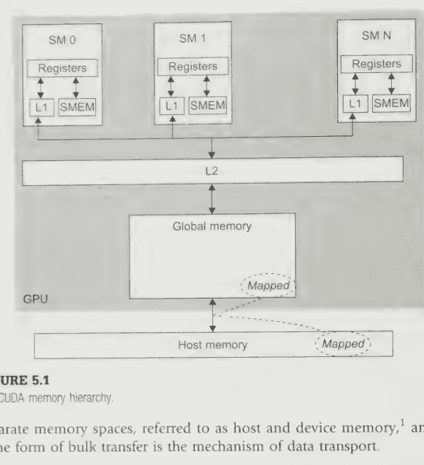
图 5.1
CUDA 内存层次结构。

当宿主机内存映射到 GPU 的地址空间时，宿主机内存与设备内存之间的界限变得模糊。这样，设备或宿主的修改都会反映在映射该内存区域的所有设备的内存中。页在宿主机和 GPU 之间透明地异步传输。经验丰富的程序员知道，映射内存类似于 `mmap()` 系统调用。

统一虚拟寻址（UVA）是 CUDA 4.0 的一项功能，它通过允许运行时确定内存区域位于哪个设备上，简化了多 GPU 编程。在语义上，UVA 使开发者能够使用 `cudaMemcpy()` 执行直接的 GPU 到 GPU 传输。要使用它，只需用 `cudaHostRegister()` 注册内存区域。可以通过调用 `cudaMemcpy()` 在设备之间发生批量数据传输。运行时确保在传输过程中使用适当的源目标设备。`cudaUnregister()` 方法终止该内存区域的 UVA 传输。见图 5.1。¹ 低端设备实际上与宿主机共享相同的内存，但它们并没有改变编程模型。

### GPU 内存

支持 CUDA 的 GPU 同时具有片上内存和板载内存。最快且最稳定的是片上寄存器内存。这些内存限制在千字节（KB）级别。板载全局内存是一个共享内存系统，可由 GPU 上所有的 SM 访问。它以千字节（GB）为单位测量，是目前 GPU 上最大、最常用且最慢的内存。基准测试显示了片上系统和离线系统之间显著的带宽差异（见表 5.1）。只有 SM 内部的寄存器具有保持其完全满载（无停顿）以达到峰值性能所需的带宽。尽管共享内存带宽可以极大加速应用程序，但对于实现峰值性能仍然太慢（Volkov, 2011）。

管理板载内存与片上内存之间巨大的性能差异是 CUDA 程序员的首要考虑。为了直观地理解性能影响，考虑示例 5.1，“一个简单的内存带宽受限计算”中，当数据位于全局内存中时，内存带宽如何限制以下计算的性能：

```
for(i=0; i<N; i++) c[i]=a[i]*b[i];
```

每个浮点数需要两次内存读取和一次写入。假设单精度（32 位）是如此。尽管共享内存带宽可以极大加速应用程序，但对于实现峰值性能仍然太慢。

# 第 5 章：用于 L2 缓存的 CUDA 内存续

| 表 5.2 可视化分析器 | 此值为 L2 缓存读写内存吞吐量。计算方法为 (L2 缓存全局内存读取吞吐 + L2 缓存全局内存写入吞吐) |
| L2 缓存全局内存吞吐量 (GB/s) | 从全局内存读取时在 L2 缓存中命中百分比。计算方法为 100* (L2 缓存全局内存读取吞吐 - 全局读取吞吐/L2 缓存全局内存读取吞吐) |
| L2 缓存命中率 (%) | 向全局内存写入时在 L2 缓存中命中百分比。计算方法为 100* (L2 缓存全局内存写入吞吐 - 全局写入吞吐/L2 缓存全局内存写入吞吐) |
| L2 缓存写入率 (%) | |

### L1 缓存

Compute 2.0 设备拥有 64 KB 的 L1 内存，可以进行划分以优于共享内存或动态读写操作。注意 L1 缓存：

- 是为空间局部性而非时间局部性重用设计的。大多数开发者期望处理器缓存像 LRU（最少未使用）缓存。在 GPU 上，这种错误的假设会导致意料之外的缓存缺失，频繁访问缓存的 L1 内存位置并不保证该内存位置会留在缓存中。
- 不受对全局内存存储的影响，因为存储操作会绕过 L1 缓存。
- 不是一致的。在声明可以被其他块修改的共享内存时，必须使用 `volatile` 关键字，以确保编译器不会将共享内存位置加载到寄存器中。私有数据（寄存器、栈等）可以无忧使用。
- 延迟为 10–20 个周期。

L1 缓存每线程本地数据结构使用每线程栈。栈的引入使得 Compute 2.0 设备支持递归程序（调用自身的例程）。许多问题可以自然地以递归形式表示。例如，分治方法反复地将一个较大的问题拆分为更小的子问题。在某一点，问题变得足够简单到可以直接解决。子问题的解决方案组合在一起，给出初始问题的解决方案。栈可能会消耗高达 1 KB 的 L1 缓存。

CUDA 使用一种称为本地内存（local memory）的抽象内存类型。本地内存并不是独立的内存系统，而是用于存放溢出寄存器（spilled registers）内存位置。当线程块所需的寄存器存储超过 SM 可提供的空间时，就会发生寄存器溢出。Pre-Fermi GPU 将寄存器溢出到全局内存，这导致应用性能急剧下降，因为慢三个数量级的 GB/s 全局内存访问取代了 TB/s 级的寄存器内存访问。

### L1 缓存

Compute 2.0 及后续设备会将寄存器溢出到 L1 缓存中，这最小化了寄存器溢出对性能的影响。

如果需要，可以使用 `nvcc` 的 `-Xptas-dlcm=cg` 命令行参数禁用 Fermi L1 缓存。即使禁用，栈和本地内存仍然驻留在 L1 缓存中。

这种可配置性的优之处在于，重用数据或具有非对齐、不可预测或不规则内存模式的应用可以将 L1 缓存配置为 48 KB 动态缓存（留出 16 KB 给共享内存）；而需要在线程块内部共享更多数据的应用程序可以分配 48 KB 为共享内存（留出 16 KB 给缓存）。通过这种方式，NVIDIA 设计师赋予了应用开发者配置 SM 内部内存的能力以实现最佳性能。

当编译器生成 LDU（加载）指令时，会利用 L1 缓存来缓存需要高效向 SM 内所有线程广播的数据。前几代 GPU 仅能从常量内存在应用程序的所有线程之间高效地广播信息。

Compute 2.0 设备可以在无需程序员显式干预的情况下，从全局内存广播数据，但需满足以下条件：

1. 指针以 `const` 关键字开头。
2. 块中所有线程的内存访问是统一的，如示例 5.2，“统一内存访问示例”所示：

示例 5.2

```
__global__ void kernel (float *g_dst, const float *g_src )
{
    g_dst = g_src[0] + g_src[blockIdx.x] + threadIdx.x];
}
```

# 与 L1 缓存相关的 cudaprof 数值

| 表 5.3 L1 缓存的可视化分析器数值 |
| L1 gd 命中率 (%) | 此值的计算方法为 100*(L1 全局加载命中计数)/(L1 全局加载命中计数 + L1 全局加载缺失计数)) |
| L1 缓存读取吞吐量 (GB/s) | 此值提供了从 L1 缓存访问数据时实现的吞吐量。计算方法为 ((L1 全局加载命中 + L1 本地加载命中) * 120 * #SM + L2加载请求 * 32)/(gpu_time*1000) |
| L1 全局命中率 (%) | 访问全局内存时在 L1 缓存中命中百分比。当禁用 L1 缓存，此统计值为零。计算方法为 (100*L1 全局加载命中)/(L1 全局加载命中 + L1 全局加载缺失) |

# CUDA 内存类型

表 5.4 总结了 Compute 2.0 及后续设备各种 CUDA 内存空间的特性。

| 表 5.4 CUDA 内存类型及特性 |
| 内存 | 位置 | 是否缓存 | 访问 | 范围 |
|---|---|---|---|---|
| 寄存器 (Register) | 片上 | 否 | | 单线程 |
| 本地内存 (Local) | 片上 | 是 | 读/写 | 单线程 |
| 共享内存 (Shared) | 片上 | 否 | | 所有线程 |
| 全局内存 (Global) | 片外（不缓存） | 是 | 读/写 | 所有线程 |
| 常量内存 (Constant) | 片外（不缓存） | 是 | 读 | 所有线程 |
| 纹理内存 (Texture) | 片外（不缓存） | 是 | 读/写 | 所有线程 |

### 寄存器

寄存器是 GPU 上最快的内存。是非常宝贵的资源，因为它们具有足够带宽和低延迟的内存。

每个 SM 支持 32 个 bank。由于空间限制，内核使用的最大寄存器数为 63。随着工作负载（以及资源需求）的增加，可用寄存器从 63 减少到 21。

### 本地内存

本地内存访问仅针对自动变量。自动变量是在设备代码中定义的没有任何 `__shared__` 或 `__constant__` 修饰符。通常情况下，自动变量位于寄存器中，以下情况除外：

- 编译器无法确定是常量的数组。
- 会消耗过多寄存器空间的大结构体或数组。
- 当内核使用的寄存器超过可用数量时编译器决定溢出的本地内存。

使用 `-ptxas-options=v` 选项编译时，`nvcc` 编译器会报告内核的本地内存使用情况 (lmem)。这些报告值可能会受到访问本地内存的数学函数的影响。

# 与本地内存缓存相关的 computeprof 数值

| 表 5.5 本地内存的数值 |
| --- | --- |
| 本地总流量 (%) | 访问本地内存引起的总流量百分比。计算方法为 (2*L1加载缺失*128)/(L2读取请求 + L2写入请求*)32/#SMs) |

### 共享内存

共享内存（也称为 smem）可以是 16 KB 或 48 KB，位于 SM 中。与早期的 NVIDIA 文档相反，共享内存并不像寄存器内存快。

共享内存有三种分配方式：

1. 在内核内静态分配，或在文件中全局分配，如示例 5.3，“静态共享内存声明”中的声明所示：

示例 5.3
`__shared__ int s_data[256];`

2. 在内核内通过驱动 API 函数 `cuFunSetSharedSize` 动态分配
3. 通过执行配置动态分配。

通过执行配置只能分配一个共享内存块。在内核中使用多个动态分配的共享内存变量需要手动为每个变量生成偏移。示例 5.4，“动态分配共享内存块中的多个变量”展示了如何分配和使用两个动态分配的共享内存向量 a 和 b：

```
__global__ void kernel(int aSize)
[
    extern __shared__ float sData[];
    float *a, *b;
    na = sData; // 从动态分配的 smem 块开始
]
```

### 第 5 章：CUDA 内存

```
b ~a[aSize]; // b 紧接在 smem 块中 a 的之后
```

内核调用看起来类似于示例 5.5，“动态分配共享内存的执行配置”：

### 示例 5.5

```
Kernel<<<nBlocks, threadBlock, nBytesSharedMemory>>>(aSize);
```

共享内在 SM 上排列为 32 个 4 字节宽的库（banks）。在理想情况下，32 个线程能够并行访问共享内存而不会产生性能下降。遗憾的是，当不同线程对同一个 bank 发出多个请求时，就会发生库冲突（bank conflicts）。这些请求可能是针对同一个地址，也可能是映射到同一个 bank 的多个地址。当这种情况发生时，硬件会将内存操作串行化。如果一个 warp 内的 n 个线程导致库冲突，则 n 次访问将串行执行，导致该 SM 速度变慢 n 倍。内存请求的大小也可能导致库冲突。计算 2.0 设备中的共享内存已得到改进，支持在共享内存中使用双精度变量而不会引起 warp 串行化。上一代 GPU 需要一种变通方法，将 64 位数据拆分为两个 32 位值并分别存储在共享内存中。请注意，大多数 128 位内存访问（例如 float4）在计算 2.0 设备的共享内存中仍会引起双向库冲突。

对共享内存进行填充以避免库冲突是一项可移植性挑战。示例 5.6，“针对 GT200/Tesla C1060 的填充共享内存”展示了旧代码，该代码：

### 示例 5.6

```
__shared__ t__tile[16][1];
```

对于计算 2.0 设备必须将 tile 大小和填充都更改为 warp 大小，如示例 5.7，“针对计算 2.0 设备的填充共享内存”所示：

### 示例 5.7

```
__shared__ tile[32][33];
```

注意在上一个示例中增加了一列以防止库冲突。在这种情况下，浪费空间比接受性能下降要好。如果没有填充，warp 内部每个连续的列索引访问都会串行化。

共享内存具有多播（multicast）能力，这意味着如果一个 warp 内的 n 个线程同时访问同一个字，则只会读取一次共享内存字。计算 2.0 设备广播整个字，这意味着多个线程可以访问广播字中的不同字节而不影响性能。全字广播（Whole-word broadcast）仅在 1.x 设备中可用。广播字内的子字访问（或同一 bank 访问）会导致串行化。

线程可以通过 `__syncthreads()` 同障通过共享内存进行通信，只要它们属于同一个 warp。参见示例 5.8，“在 warp 内部共享数据时不需要屏障”：

### 示例 5.8

```
if (tid < 32) { ... }
```


如果使用共享内存在线程块中的 warp 之间通信，请确保在共享内存声明前加上 `volatile`。`volatile` 关键字消除了编译器可能静地将之前加载的共享内存值缓存在寄存器中并在下次引用时未能重新加载的可能性。由于架构变化：

- 计算 1.x 设备仅直接作为操作数访问共享内存
- 计算 2.0 设备具有加载/存储架构，可以将数据带入寄存器中。

旧留代码需要添加 `volatile` 关键字以避免在计算 2.0 设备上运行时出现错误。如下例所示，简单的 `_shared_` 声明在 1.x 设备上足够。旧代码需要修改，如示例 5.9，“在使用共享内存跨线程块通信的代码中必须添加 volatile”：

### 示例 5.9

```
__shared__ int cross[32]; 对于 1.x 设备可接受

// 计算 2.0 设备需要 volatile

volatile __shared__ int cross[32];
```

Volkov 指出，并行架构设计的趋势是向反向内存层次结构发展，与缓存和共享内存相比，寄存器的数量正在增加。扩展性和性能是原因，因为寄存器可以随着 `SM`（或多处理器处理器中的核心）一起复制。更多的寄存器意味着更多数据可以留在高速内存中，这意味着更多的指令可以在没有外部依赖的情况下运行，从而提高性能（Volkov, 2010）。他还提到，共享内存与算术吞吐量之间的性能差距随着 Fermi 的出现而增大，引发了人们对 Fermi 架构上当前共享内存硬件是一种退步的担忧（Volkov, 2010）。

表 5.6 显示了共享内存库与线程处理器的比例相对于每个线程寄存器数量的情况。

| 表 5.6 向反向内存层次结构的趋势 |
| 架构 | 带有线程处理器的库 | 库与线程处理器的比例 | 每个线程的寄存器 |
| :--- | :--- | :--- | :--- |
| G80-GT200 | 16 个库，8 个线程处理器 | 2:1 | 128 |
| GF100 | 32 个库，32 个线程处理器 | 1:1 | 21–64 |

出于可移植性、性能和扩展性的考虑，强烈建议使用寄存器代替共享内存。

### 共享内存相关的 computeprof 值

| 表 5.7 sm 的可视化分析工具值 |
| :--- | :--- |
| 每个内存指令的共享内存库冲突 (%) | 此值表示每条共享内存指令引起的库冲突数量。如果数据可访问，此值可能会超过 100% |
| 每个内存指令的共享内存库冲突 (%) | 此值表示每条共享内存指令引起的库冲突数量。如果数据可访问，此值可能会超过 100% |
| 每个内存指令的共享内存库冲突 (%) | 此值表示每条共享内存指令引起的库冲突数量。如果数据可访问，此值可能会超过 100% |

## CUDA 内存类型

共享内存具有多播能力，这意味着如果一个 warp 内的 n 个线程同时访问同一个字，只会读取一次共享内存字。计算 2.0 设备广播整个字，这意味着多个线程可以访问广播字中的不同字节而不影响性能。全字广播仅在 1.x 设备中可用。广播字内的子字访问（或同一 bank 访问）会导致串行化。

只要线程属于同一个 warp，可以通过 `__syncthreads()` 通过共享内存通信。参见示例 5.8，“在 warp 内部共享数据时不需要屏障”：

### 示例 5.8

```
if (tid < 32) { ... }
```

如果使用共享内在线程块中的 warp 之间通信，请确保在共享内存声明前加上 `volatile`。`volatile` 关键字消除了编译器可能静地将之前加载的共享内存值缓存在寄存器中并在下次引用时未能重新加载的可能性。由于架构变化：

- 计算 1.x 设备直接作为操作数访问共享内存
- 计算 2.0 设备具有加载/存储架构，可以将数据带入寄存器中。

旧代码需要添加 `volatile` 关键字以避免在计算 2.0 设备上运行时出现错误。如下例所示，简单的 `_shared_` 声明在 1.x 设备上足够。旧代码需要修改，如示例 5.9，“在使用共享内存跨线程块通信的代码中添加 volatile”：

### 示例 5.9

```
__shared__ int cross[32]; 对于 1.x 设备可接受

// 计算 2.0 设备需要 volatile

volatile __shared__ int cross[32];
```

Volkov 指出并行架构设计的趋势是向反向内存层次结构发展，与缓存和共享内存相比，寄存器的数量正在增加。扩展性和性能是原因，因为寄存器可以随着 `SM`（或多处理器处理器中的核心）一起复制。更多的寄存器意味着更多数据可以留在高速内存中，这意味着更多的指令可以在没有外部依赖的情况下运行，从而提高性能（Volkov, 2010）。他还提到，共享内存与算术吞吐量之间的性能差距随着 Fermi 的出现而增大，引发了人们对 Fermi 架构上当前共享内存是一种退步的担忧（Volkov, 2010）。

表 5.6 显示了共享内存库与线程处理器的比例相对于每个线程寄存器数量的情况。

| 表 5.6 向反向内存层次结构的趋势 |
| 架构 | 带有线程处理器的库 | 库与线程处理器的比例 | 每个线程的寄存器 |
| :--- | :--- | :--- | :--- |
| G80-GT200 | 16 个库，8 个线程处理器 | 2:1 | 128 |
| GF100 | 32 个库，32 个线程处理器 | 1:1 | 21–64 |

出于可移植性、性能和扩展性的考虑，强烈建议尽可能使用寄存器代替共享内存。

### 共享内存相关的 computeprof 值

| 表 5.7 sm 的可视化分析工具值 |
| :--- | :--- |
| 每个内存指令的共享内存库冲突 (%) | 此值表示每条共享内存指令引起的库冲突数量。如果数据可访问，此值可能会超过 100% |
| 每个内存指令的共享内存库冲突 (%) | 此值表示每条共享内存指令引起的库冲突数量。如果数据可访问，此值可能会超过 100% |
| 每个内存指令的共享内存库冲突 (%) | 此值表示每条共享内存指令引起的库冲突数量。如果数据可访问，此值可能会超过 100% |

### 常量内存

共享内存具有多播能力，这意味着如果一个 warp 内的 n 个线程同时访问同一个字，只会读取一次共享内存字。计算 2.0 设备广播整个字，这意味着多个线程可以访问广播字中的不同字节而不影响性能。全字广播仅在 1.x 设备中可用。广播字内的子字访问（或同一 bank 访问）会导致串行化。

只要线程属于同一个 warp，可以通过 `__syncthreads()` 通过共享内存通信。参见示例 5.8，“在 warp 内部共享数据时不需要屏障”：

### 示例 5.8

```
if (tid < 32) { ... }
```

如果使用共享内在线程块中的 warp 之间通信，请确保在共享内存声明前加上 `volatile`。`volatile` 关键字消除了编译器可能静地将之前加载的共享内存值缓存在寄存器中并在下次引用时未能重新加载的可能性。由于架构变化：

- 计算 1.x 设备直接作为操作数访问共享内存
- 计算 2.0 设备具有加载/存储架构，可以将数据带入寄存器中。

旧代码需要添加 `volatile` 关键字以避免在计算 2.0 设备上运行时出现错误。如下例所示，简单的 `_shared_` 声明在 1.x 设备上足够。旧代码需要修改，如示例 5.9，“在使用共享内存跨线程块通信的代码中添加 volatile”：

### 示例 5.9

```
__shared__ int cross[32]; 对于 1.x 设备可接受

// 计算 2.0 设备需要 volatile

volatile __shared__ int cross[32];
```

Volkov 指出并行架构设计的趋势是向反向内存层次结构发展，与缓存和共享内存相比，寄存器的数量正在增加。扩展性和性能是原因，因为寄存器可以随着 `SM`（或多处理器处理器中的核心）一起复制。更多的寄存器意味着更多数据可以留在高速内存中，这意味着更多的指令可以在没有外部依赖的情况下运行，从而提高性能（Volkov, 2010）。他还提到，共享内存与算术吞吐量之间的性能差距随着 Fermi 的出现而增大，引发了人们对 Fermi 架构上当前共享内存是一种退步的担忧（Volkov, 2010）。

表 5.6 显示了共享内存库与线程处理器的比例相对于每个线程寄存器数量的情况。

| 表 5.6 向反向内存层次结构的趋势 |
| 架构 | 带有线程处理器的库 | 库与线程处理器的比例 | 每个线程的寄存器 |
| :--- | :--- | :--- | :--- |
| G80-GT200 | 16 个库，8 个线程处理器 | 2:1 | 128 |
| GF100 | 32 个库，32 个线程处理器 | 1:1 | 21–64 |

出于可移植性、性能和扩展性的考虑，强烈建议尽可能使用寄存器代替共享内存。

### 纹理内存

对于计算 1.x 设备，常量内存是存储和广播的极佳方式。缓存限制为 64 KB。具体而言，纹理单元-线程安全读取某些纹理或表面内存位置仅当该位置是由之前的内核调用或内存拷贝更新的，而不是被同一线程或同一内核调用中的其他线程之前更新过。

对于 CUDA 程序员而言，使用纹理内存最主要的要点是：

- 纹理内存通常用于可视化。
- 纹理单元针对 2D 空间局部性进行了优化。
- 每个 `SM` 包含 8 KB 缓存。

# CUDA 内存类型

`tex1D()`、`tex2D()` 和 `tex3D()` 方法的使用较为复杂，因为纹理坐标的解释、纹理取期间发生的处理以及纹理取交付的返回值都是通过设置纹理引用的可变（运行时）和不可变（编译时）属性来控制的：

- 不变参数（编译时）。
  - 类型：读取时返回的类型
    - 基础整数和浮点类型
    - CUDA 1-、2-、4 元素向量
  - 维度：
    - 目前支持 1D、2D 或 3D
  - 读取模式：
    - `cudaReadModeElementType`
    - `cudaReadModeNormalizedFloat`（适用于 8 位或 16 位整数）。
    - 对于符号数返回 ([-1,1])。

- 可变参数（运行时，仅适用于数组纹理和等间线性内存）。
  - 归一化：
    - 非零 = 范围范围 [0,1]
  - 过滤模式：
    - `cudaFilterModePoint`
    - `cudaFilterModeLinear`
  - 寻址模式：
    - `cudaAddressModeClamp`
    - `cudaAddressModeWrap`

默认情况下，纹理使用 [0,N] 范围内的浮点坐标进行引用，其中 N 是纹理在对应维度上的尺寸。指定归一化纹理坐标意味着所有引用都在 [0,1] 范围内。

Wrap（回绕）模式指定了越界寻址的情况：

- Wrap 越界坐标将被回绕（通过取模运算），如图 5.3 所示。
- Clamp（夹断）越界坐标将被替换为最接近的边界，如图 5.4 所示。

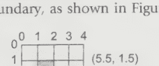

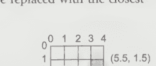

图 5.3
纹理回绕越界坐标的示例。

图 5.4
纹理夹断越界坐标的示例。

### 第 5 章：CUDA MEM

| 表 5.9 纹理内存的可视化分析器值 |
| 纹理命中率 (%) | 该值计算为 100(tex_cache_requests - tex_cache_misses)/(tex_cache_requests) |
| 纹理内存吞吐量 (GB/s) | 此值表示从纹理内存读取数据时实现的内存吞吐量。未使用纹理内存时，该统计值为 0。计算公式为 (#SM * tex cache queries * 32)/(gpu time * 1000) |
| 纹理缓存命中率 (%) | 从纹理内存访问数据时在纹理缓存中命中的百分比。未使用纹理内存时，该统计值为 0。该值计算为 100 * (tex cache requests - tex cache misses)/tex cache requests |

线性纹理过滤仅可以在配置为返回浮点数据的纹理上执行。纹理元素（texel，“texture element”的缩写）是纹理数组的一个元素。因此，线性纹理过滤在相邻纹理元素之间执行低精度（9 位定点，带有 8 位小数值）插值。启用时，会读取纹理取指位置周围的纹理元素，纹理取指硬件根据纹理坐标落在纹理元素之间的位置返回结果。对于一维纹理执行简单的线性插值，如公式 5.1“纹理线性插值”所示。

```
tex(x) = (1 - α) T[i] + αT[i + 1]
```

同样，专用纹理硬件将对高维数据执行双线性三线性过滤。

只要能容忍 9 位的精度，专用纹理单元提供了一个从 GPU 计算中获得性能的创新机会。例子是 GRASSY：利用 GPU 纹理单元进行星震数据分析（Townsend, Sankaralaming, & Sinclair, 2011）。

# 纹理内存相关的 computeprof 值

利用纹理内存的完整示例可以在我的 Doctor Dobb's Journal 教程系列第 13 部分（http://rddobbs.com/cpp/2181009002）。

### 全局内存 (GLOBAL MEMORY)

理解如何高效使用全局内存是成为熟练 CUDA 程序员的基本要求。关注 `SM` 和缓存内部的数据复用可以避免内存带宽限制。这是高性能 GPU 编程中第三个重要的规则，在第 1 章中引入：

- 1. 将数据获取到 GPGPU 并将其保留在那里。
- 2. 给 GPGPU 留足够的工作要做。
- 3. 关注 GPGPU 内部的数据复用以避免内存带宽限制。

在某些情况下，无法避免全局内存，在这种情况下，理解如何有效使用全局内存至关重要。特别是 Fermi 架构在 CUDA 程序员思考和使用全局内存的方式上做了重要改变。

从开发者的角度来看，必须强调的是，所有的全局内存访问都必须是完美合并（coalesced）。合并内存访问意味着硬件可以将线程的内存请求合并或组合为一个单一的宽内存事务。性能发生在以下情况时：

- 内存地址是对齐的。NVIDIA CUDA 最佳实践指南指出，未对齐访问会导致全局带宽降低 8 倍。

# 表 5.11 常见的非缓存全局内存用例

| 启用缓存 | 用例 | Warp 访问所需的字节数 | 从全局内存获取的字节数 | 效率 |
| --- | --- | --- | --- | --- |
| 否 | Warp 访问 32 个对齐且连续的 4 字节 | 128 | 128 | 100% |
| 否 | Warp 访问 32 个对齐且乱序的 4 字节 | 128 | 128 | 100% |
| 否 | Warp 访问 32 个未对齐且连续的 4 字节 | 128 | 128 或 256 | 80-100%，取决于模式 |
| 否 | Warp 访问 N 个分散的 4 字节 (N≤ 32) | 128 | N*32 | 4/N 或 12.5%，最坏情况 |

GPU 上的全局内存设计用于将数据块快速流式传输 `SM` 中。遗憾的是，执行间接索引、利用指针指向内存中不同区域或具有不规则或大跨步步的循环打破了这一假设。如表 5.10 所示，分散读取可能会将全局内存吞吐量降低到硬件能力的 3.125%。关闭缓存可以提供 4 倍的速度提升，这虽然是好的，但仍然会导致 `SM` 数据饥饿，因为它只提供了 12.5% 的潜在全局内存带宽。

# 全局内存的分配

可以通过声明在设备内存中静态分配内存：

```
Example 5.11

__device__ int gmemArray[SIZE];
```


使用运行时 API 时，可以使用 `cudaMalloc()` 动态分配线性或（1D）全局内存区域，并使用 `cudaFree()` 释放。Thrust API 内部使用 `cudaMalloc()`。

- 内存按 256 字节边界对齐。
- 为了使 2D 访问完全合并，线程块的宽度和数组的必须是 warp 大小的倍数（或仅为 warp 大小一半，计算能力为 1.x 的设备）。运行时 `cudaMallocPitch()` 和驱动 API `cuMemAllocPitch()` 方法会为目标设备对数组进行填充。必须使用参考手册中描述的关联内存拷贝函数处理 pitch 线性内存。

### 第 5 章：CUDA 内存

可以在内核中使用标准 C 语言的 `malloc()` 和 `free()` 动态分配内存。它按 16 字节边界对齐。

设备动态全局内存分配仅支持计算能力为 2.x 的设备。由特定 CUDA 线程分配的内存会在 CUDA 上文生命周期内保持分配，直到通过调用 `free()` 显式释放。任何线程可以使用其他 CUDA 线程分配的内存——即使在随后的内核启动中也是。请注意，任何 CUDA 线程都可以释放另一个线程分配的内存，这意味着必须小心确保内存被多次释放。CUDA 内存检查器 `cuda-memcheck` 是一个帮助查找内存错误的有用工具。

在任何内核动态分配内存之前，必须创建设备堆。默认情况下，CUDA 创建 8MB 的堆。与传统处理器上的堆不同，GPU 上的堆不会动态调整大小。此外，一旦加载内核模块，堆的大小就无法更改。为设备堆预留的内存与通过 `cudaMalloc()` 等主机端 API 调用分配的内存一样消耗空间。

以下 API 函数获取并设置堆的大小：

- 驱动 API:
  - `cudaGetLimit(size_t size, CU_LIMIT_MALLOC_HEAP_SIZE)`
  - `cudaSetLimit(CU_LIMIT_MALLOC_HEAP_SIZE, size, size_t)`
- 运行时 API:
  - `cudaDeviceLimit(size_t * size, cudaMallocHeapSize)`
  - `cudaDeviceSetLimit(cudaMallocHeapSize, size, size_t)`

授予的堆大小至少为 `size` 字节。`cudaGetLimit` 和 `cudaDeviceLimit` 返回当前请求的大小。

《CUDA C 编程指南》4.0 版本提供了每线程、每线程块以及跨内核调用的分配持久性的简单示例。

# 全局内存设计中的限制因素

全局内存确实为 GPGPU 架构师带来了扩展性挑战。虽然可以组合多个内存子系统以组合内存系统的总性能交付数据块，但成本、功率、热量、空间和可靠性等限制因素防止内存带宽像计算吞吐量那样快速扩展。

Fermi 内存子系统在 GF100 硬件上提供了六个 GDDR5 内存分区组合带宽。通过这种设计，GPGPU 硬件架构师能够比单分区增加六倍的内存带宽。地址与分区之间不再有线性映射，因此典型的访问模式不太可能全部落在同一个分区中。这种设计避免了分区拥堵（在子集甚至单个控制器上产生瓶颈）。

Fermi 内存系统在高端卡上支持 ECC 内存，但在消费级卡上禁用了此功能。ECC 也用于 SM 内部内存。在数据中心和超级计算机实例中部署大量 GPU 时，使用带有 ECC 的纠错内存，以确保医学成像、金融期权定价和科学模拟等数据敏感应用程序不受内存错误的影响。可以在驱动级别关闭 ECC 以获得额外的 20% 内存带宽和额外的内存容量，这有利于受全局内存带宽限制的应用，并作为非关键应用程序的可接受优化方案。Linux 的 `nvidia-smi` 命令增加了 `-e` 选项来控制 ECC。Windows 中有一个控制面板选项可以启用或禁用 ECC。

增加系统中内存硬件带宽的三种方法：

- 1 增加内存时钟频率。内存更昂贵，消耗更多功率（产生更多热量），且内存更可靠。
- 2 增加总线宽度。这需要内存接口有很多引脚，无论制造工艺如何，每个晶圆能制造的芯片数量有限。在竞争市场中，高成本使得产品失去竞争力。
- 3 每个引脚每个时钟传输更多数据。这是 GDDR5（双数据速率）背后的原理。

# 相关分析器值

| 表 5.12 | 全局内存 |
| --- | --- |
| 读取吞吐量 (GB/s) | 全局内存读取吞吐量。对于容量 < 2.0，计算为 (32*32+64*64+128*128)/1000。对于容量 >= 2.0，为 DRAM_reads/32。 |
| 写入吞吐量 (GB/s) | 全局内存写入吞吐量。对于容量 < 2.0，计算为 (32*32+64*64+128*128)/1000。对于容量 >= 2.0，为 DRAM_writes/32。 |
| 总体吞吐量 (GB/s) | 全局内存吞吐量。计算为全局内存读取吞吐量 + 全局内存写入吞吐量。 |
| 内核请求读取吞吐量 (GB/s) | 内核通过加载请求的字节数除以内核执行时间。这些请求通过全局加载指令完成，字大小可以是 8, 16, 32, 64 或 128 字节。 |
| 内核请求写入吞吐量 (GB/s) | 内核通过存储请求的字节数除以内核执行时间。这些请求通过全局存储指令完成，字大小可以是 8, 16, 32, 64 或 128 字节。 |
| 内核请求全局内存吞吐量 (GB/s) | 内核请求的读取和写入吞吐总量。 |
| 全局内存冗余加载 (%) | 显示在执行全局内存加载事务时获取的数据百分比。当内核全局内存读取吞吐量等于 L2 缓存读取吞吐量时，理想情况下实现 0% 冗余。 |

## 表 5.12 gmem 性能分析器数值（续）

| 全局内存冗余存储 (%) | 此值显示了在执行全局内存存储事务时访问的冗余数据百分比。理想情况下，当内核请求的全局内存吞吐量等于 L2 缓存吞吐量时，将实现 0% 的冗余存储，即内核在存储操作中请求的字节数等于硬件在内核执行期间为服务该内核而实际访问的字节数。如果此统计值较高，则意味着存储的访问模式没有合并（coalesced），并且在内核执行期间访问了许多额外字节。其计算公式为 100 * (100 - 内核请求的全局内存吞吐量/L2 写吞吐量) |
| 峰值全局内存吞吐量 (GB/s) | 这是当前 CUDA 设备上可以达到的内存内存吞吐量或带宽。这是一个设备属性，内核实现的内存吞吐量应尽可能接近此峰值。 |
| 全局内存重放 (%) | 由全局内存访问导致的重放指令百分比。其计算公式为 100 * (L1 加载缺失)/发射指令数。 |

### 总结

CUDA 为程序员提供了各种硬件空间。鉴于各种 CUDA 内存类型之间带宽存在三个数量级的差异（从 8 TB/s 的寄存器带宽到受 PCIe 限制的映射内存的 8 GB/s），CUDA 程序员充分利用这些可用内存空间至关重要。未能这样做可能会导致性能低下。

CUDA 提供了许多优秀的测量和派生分析信息，以追踪内存瓶颈。理解每种内存类型的特性是精通 CUDA 编程的前提。CUDA 性能分析器的自动分析可以引导开发者走向正确的方向。如何读取性能分析器的输出是创建高性能应用程序的核心技能。否则，寻找应用程序瓶颈将变成一种猜测。同样，CUDA 内存检查器可以帮助发现内存使用中的错误。

## 高效使用 GPU 内存

高效使用 GPU 内存的重要性不言而喻。由于最快的片上寄存器内存与必须跨越 PCIe 总线的映射主机内存之间速度存在大约三个数量级的差异，熟的 CUDA 开发者必须理解使用内存最高效的方法。通过 ILP（指令级并行）或 TLP（线程级并行）隐藏延迟对于应用性能至关重要。预取（Prefetching）可以保持更多的内存事务在进行中，将数据移动到快速内存，并加速受带宽限制的归约操作。不规则数据结构对于当前的 GPU 技术来说是一个挑战，但某些技术即使在随机内存访问时也能保持性能。然而，随着支持图和稀疏矩阵等不规则数据结构的新库出现，寻找利用 GPU 内存更好的 ways活跃的研究领域。

在本章结束，读者将对以下内容有基本的理解：

- 使用预取利用全局内存。
- 在基于 ILP 的归约内核中高效使用寄存器、共享内存和全局内存。
- 如何编写利用函数的通用方法。
- 加速具有不规则和随机内存访问问题的技术。
- 针对稀疏矩阵的通用方法和库。
- 图形中心性指标和可以提供 10 到 50 倍加速的代码。
- 使用 SoA（结构体数组）的性能原因。
- 模板（Stencils）和块（Tiles）。

### 归约（REDUCTION）

归约操作执行诸如寻找向量最小值、最大值或和等常见任务。为 GPU 计算编写高性能的归约操作异常地复杂，因为它要求对 CUDA 内存空间和执行模型有深入的理解。

Thrust API 提供了一个简单的接口，隐藏了归约的所有复杂性，使其既灵活又易用。Thrust 使用了 NVIDIA Mark Harris 设计的归约算法。演示各种归约优化的示例和代码包含在 NVIDIA SDK 的 reduction 目录中。建议阅读相关论文和代码。

本章提供了一个归约示例，该示例将前几个章节中的许多讨论内容结合在一起，并扩展了 Mark Harris 的归约。


## 表 5.12 gmem 性能分析器数值（续）

| 全局内存冗余存储 (%) | 此值显示了在执行全局内存存储事务时访问的冗余数据百分比。理想情况下，当内核请求的全局内存吞吐量等于 L2 缓存吞吐量时，将实现 0% 的冗余存储，即内核在存储操作中请求的字节数等于硬件在内核执行期间为服务该内核而实际访问的字节数。如果此统计值较高，则意味着存储的访问模式没有合并（coalesced），并且在内核执行期间访问了许多额外字节。其计算公式为 100 * (100 - 内核请求的全局内存吞吐量/L2 写吞吐量) |
| 峰值全局内存吞吐量 (GB/s) | 这是当前 CUDA 设备上可以达到的内存内存吞吐量或带宽。这是一个设备属性，内核实现的内存吞吐量应尽可能接近此峰值。 |
| 全局内存重放 (%) | 由全局内存访问导致的重放指令百分比。其计算公式为 100 * (L1 加载缺失)/发射指令数。 |

### 总结

CUDA 为程序员提供了各种硬件空间。鉴于各种 CUDA 内存类型之间带宽存在三个数量级的差异（从 8 TB/s 的寄存器带宽到受 PCIe 限制的映射内存的 8 GB/s），CUDA 程序员充分利用这些可用内存空间至关重要。未能这样做可能会导致性能低下。

CUDA 提供了许多优秀的测量和派生分析信息，以追踪内存瓶颈。理解每种内存类型的特性是精通 CUDA 编程的前提。CUDA 性能分析器的自动分析可以引导开发者走向正确的方向。如何读取性能分析器的输出是创建高性能应用程序的核心技能。否则，寻找应用程序瓶颈将变成一种猜测。同样，CUDA 内存检查器可以帮助发现内存使用中的错误。

## 高效使用 GPU 内存

高效使用 GPU 内存的重要性不言而喻。由于最快的片上寄存器内存与必须跨越 PCIe 总线的映射主机内存之间速度存在大约三个数量级的差异，熟的 CUDA 开发者必须理解使用内存最高效的方法。通过 ILP（指令级并行）或 TLP（线程级并行）隐藏延迟对于应用性能至关重要。预取（Prefetching）可以保持更多的内存事务在进行中，将数据移动到快速内存，并加速受带宽限制的归约操作。不规则数据结构对于当前的 GPU 技术来说是一个挑战，但某些技术即使在随机内存访问时也能保持性能。然而，随着支持图和稀疏矩阵等不规则数据结构的新库出现，寻找利用 GPU 内存更好的方法是一个活跃的研究领域。

在本章结束，读者将对以下内容有基本的理解：

- 使用预取利用全局内存。
- 在基于 ILP 的归约内核中高效使用寄存器、共享内存和全局内存。
- 如何编写利用函数的通用方法。
- 加速具有不规则和随机内存访问问题的技术。
- 针对稀疏矩阵的通用方法和库。
- 图形中心性指标和可以提供 10 到 50 倍加速的代码。
- 使用 SoA 的性能原因。
- 模板（Stencils）和块（Tiles）。

### 归约（REDUCTION）

归约操作执行诸如寻找向量最小值、最大值或和等常见任务。为 GPU 计算编写高性能的归约操作异常地复杂，因为它要求对 CUDA 内存空间和执行模型有深入的理解。

`Thrust` API 提供了一个简单的接口，隐藏了归约的所有复杂性，使其既灵活又易用。`Thrust` 使用了 NVIDIA Mark Harris 设计的归约算法。演示各种归约优化的示例和代码包含在 NVIDIA SDK 的 `reduction` 目录中。建议阅读相关论文和代码。

本章提供了一个归约示例，该示例将前几个章节中的许多讨论内容结合在一起，并扩展了 Mark Harris 的归约：

- C++ 模板扩展了归约代码的通用性，可以使用定义的类型作为浮点数、双精度浮点数、整数、长整数等。
- 新功能...

```cpp
myVal = initVal;

// Use fastest memory first.

const int gridSize = blockDim.x*gridDim.x;

for(int i=n-1; i>=0; i-=blockDim.x+threadIdx.x)
  myVal = fcn(fcn(i),
```

通过其他线程。从寄存器到共享内存的传输发生在示例 6.5 所示的第 2 步。这是一个并行传输，将每个线程块中的所有线程传输到每个 SM 的共享内存变量 `smem`。

共享内存是一项宝贵的资源，因此只分配最少量。根据第 4 章对 ILP（指令级并行性）的讨论，仅一个 warp（线程束）的并行性是将每个 SM 上的 `N_THREADS` 个部分值归约为每个 SM 的 `WARP_SIZE` 个部分值。寄存器变量 `myVal` 已经包含了第一个 warp 的正确值。因此，共享寄存器内存只需要包含 `threadIdx.x` 大于或等于 `WARP_SIZE` 的线程中的 `myVal` 寄存器内容。结果是，`smem` 的分配元素可以比 `N_THREADS` 少。

由于从寄存器到共享内存的传输是并行发生的，因此在赋值后必须调用 CUDA `__syncthreads()` 方法以确保 `smem` 的所有元素都已写入。所有这些都发生在示例 6.5 的几行代码中，“functionReduce.h 的第 5 部分”。

### 示例 6.5

```cpp
// 2) 在 warp 中以最快的内存（共享内存）
// 以同步方式进行。
// 为每个线程块的归约创建共享内存。
// 重用第一个 warp 中的寄存器。
volatile __shared__ smem[N_THREADS-WARP_SIZE];

// 将所有寄存器值放入共享内存
if(threadIdx.x > WARP_SIZE) smem[threadIdx.x - WARP_SIZE]=myVal;
__syncthreads(); // 等待所有线程完成。
```

在内核的此点，没有理由使用比一个 warp 线程数更多的线程，因为 SM只能向每个 warp 发射单条指令。由于没有未解决的数据依赖，单个 warp 就足够让 SM 忙于将每个 SM 的共享内存内容从 `(N_THREADS - WARP_SIZE)` 个元素归约为 `WARP_SIZE` 个部分值了。这就是为什么使用条件判断来只保持 `threadIdx.x` 小于 `WARP_SIZE` 的线程处于激活状态。参见示例 6.6，“functionReduce.h 的第 6 部分”。

### 示例 6.6

```cpp
if(threadIdx.x < WARP_SIZE)
// 现在只使用一个 warp。SM 每次只能运行一个 warp
```

> 取决于计算代，SM 可能能够对半 warp（half-warp）发射指令。

## 第 6 章：高效使用 GPU 内存

```cpp
#pragma unroll
for(int i=threadIdx.x; i < (N_THREADS-WARP_SIZE); i += WARP_SIZE)
myVal = fcn(myVal,T(smem[i]));
smem[threadIdx.x]-=myVal; // 将此 warp 中的 myVal 保存到开头
semem;
```

剩余的是将每个 SM 上 warp 中的值归约为单一个值。这等同于 `N_BLOCKS` 个部分值，因为 `N_BLOCKS` 被定义为每个 SM 使用一个块。值得注意的是，此时 warp 内部的并行性对性能没有贡献，因为在示例 6.7 中进行了五次 `fcn(1)` 调用。

另一种实现可以使用在单个线程上运行（例如当 `threadIdx.x == 0` 时）的关于 `WARP_SIZE` 的简单循环来为每个 SM 创建单个部分值。如果 `fcn(1)` 是（加法）函数，这个串行版本将只执行 27 次加法，消耗极少的额外时间——大约 100 纳秒。因此，没有必要利用系统中的所有并行性。并行代码将非常简单，并且可能在未来的计算代中对我们有利，因此我们使用示例 6.7 中的实现，“functionReduce.h 的第 7 部分”

```cpp
示例 6.7
// 归约共享内存。
if (threadIdx.x < 16)
nsmem[threadIdx.x] = fcn(T(smem[threadIdx.x]),T(smem[threadIdx.x+16]));
if (threadIdx.x < 8)
nsmem[threadIdx.x] = fcn(T(smem[threadIdx.x]),T(smem[threadIdx.x+8]));
if (threadIdx.x < 4)
nsmem[threadIdx.x] = fcn(T(smem[threadIdx.x]),T(smem[threadIdx.x+4]));
if (threadIdx.x < 2)
nsmem[threadIdx.x] = fcn(T(smem[threadIdx.x]),T(smem[threadIdx.x+2]));
if (threadIdx.x < 1)
nsmem[threadIdx.x] = fcn(T(smem[threadIdx.x]),T(smem[threadIdx.x+1]));
```

最后的任务是将剩余的 `N_BLOCKS` 个部分值归约为单一个值以完成归约。在此处，代码可以：

- 将 `N_BLOCKS`（此例中为 14）个部分值传输到主机（host），那里将进行最后的归约。
- 利用 NVIDIA CUDA 编程指南 B.5 节描述的原子操作，确保在完成归约之前所有部分值都已写入全局内存。

由于两种实现都需要为 `N_BLOCKS` 个部分值分配临时空间，示例 6.8，“functionReduce.h 的第 8 部分”执行到主机的传输，因为它演示了在主机和设备上同时使用 `fcn1()`：

### 示例 6.8

```cpp
// 3) 作为最后的手段使用全局内存将结果传输到主机
// 将每个块的结果写入全局内存
if (threadIdx.x == 0) g_data[blockIdx.x] = smem[0];
// 如果需要，可以跨 SM 进行最终归约。
```

主机方法 `Reduce()` 在需要时分配部分和，而示例 6.9，“functionReduce.h 的第 8 部分”中的 CUDA 内核：

### 示例 6.9

```cpp
template<typename T, typename UnaryFunction, typename BinaryFunction>
inline void Reduce(int n, T** d_partialVals, T initVal,
UnaryFunction& fcn, BinaryFunction& fcn1)
if(*d_partialVals == NULL)
cudaMalloc(d_partialVals, (N_BLOCKS+1) * sizeof(T));
Reduce<T>(N_BLOCKS, N_THREADS>(d_partialVals, initVal, fcn1);
```

如示例 6.10，“functionReduce.h 的第 9 部分”所示，在完成归约之前，部分值从 GPU 传输到主机，并在那里进行最终归约。在 `functionReduce.h` 中，使用 `ifdef` 来保护归约。参见示例 6.10：

```cpp
template<typename T, typename UnaryFunction, typename BinaryFunction>
inline void Reduce(int n, T** d_partialVals, T initVal,
UnaryFunction& fcn, BinaryFunction& fcn1)
if(*d_partialVals == NULL)
cudaMalloc(d_partialVals, (N_BLOCKS+1) * sizeof(T));
Reduce<T>(N_BLOCKS, N_THREADS>(d_partialVals, initVal, fcn1);
if(*d_partialVals == NULL) {
    cerr << "cudaMalloc failed!" << endl;
    exit(1);
}
T val = initVal;
for(int i=0; i<N_BLOCKS; i++) {
val = fcn1(val,,_
}
}
```

## 第 6 章：高效使用 GPU 内存

```
T1 operator()(T2 i) {
    return data[i];
}
```

此测试利用了基于随机数最低位的 0 和1 随机序列。这些数字是通过代码中的函数对象创建的：

# 示例 6.14：随机数生成器

```
// 一个并行随机数生成器
// http://groups.google.com/group/thrust-users/browse_thread/thread/dca23bf67869a5
struct parallel_random_generator {
    unsigned int _device;
    unsigned int operator()(const unsigned int n) const {
        thrust::default_random_engine rng;
        // 丢弃数字以避免相关性
        rng.discard(n);
        // 返回随机数
        return rng() & 0x01;
    }
}
```

`dTest()` 例程是标准的 C++ 代码。指向临时空间的指针 `d_partialVals` 被设置为 NULL，这意味着第一次调用 `functionReduce()` 将分配所需的空间。设备向量 `d_data` 通过 thrust API 根据传递给此方法的变量 `nData` 的大小进行分配。

变量 `op` 选择将执行的测试。0 指定不使用预取（prefetching）；1 选择预取测试。任何其他值均指定调用 thrust 归约方法。参见示例 6.15，“testPrecu 的第 4 部分”。

# 示例 6.15：测试例程

```cpp
#define NTEST 100
template<typename T>
void doTest(const int nData, int op)
{
T* d_partialVals=NULL;
thrust::device_vector<I> d_data(nData);
// 用随机数（0 或 1）填充 d_data
thrust::counting_iterator<int> index_sequence_begin(0);
thrust::transform(index_sequence_begin,
    index_sequence_begin + nData,
    d_data.begin(), parallel_random_generator());
cudaThreadSynchronize(); // 等待所有队列任务完成
thrust::FCNLT<T> fcn;
double startTime, endTime;
T d_sum;
int initVal = 0;
switch(op) {
    case 0:
        memFetch<T, int> fcn(thrust::raw_pointer_cast(&d_data[0]));
        startTime=omp_get_wtime();
        for(int loops=0; loops < NTEST; loops++)
            d_sum = functionReduce<T>(nData, &d_partialVals, initVal,
                fcn, fcn);
        endTime=omp_get_wtime();
        cout << "NO prefetch ";
        break;
    case 1:
        prefetch<T, int> fcn(thrust::raw_pointer_cast(&d_data[0]));
        startTime=omp_get_wtime();
        for(int loops=0; loops < NTEST; loops++)
            d_sum = functionReduce<T>(nData, &d_partialVals, initVal,
                fcn, fcn);
        endTime=omp_get_wtime();
        cout << "Using prefetch ";
        break;
    default:
        startTime=omp_get_wtime();
        for(int loops=0; loops < NTEST; loops++)


```cpp
d_sum = thrust::reduce(d_data.begin(), d_data.end(), initVal,
    fcn);
endTime=omp_get_wtime();
cout << "Thrust ";
}
out << "Time for transform reduce " << (endTime-startTime)/NTEST
    << endl;
out << ((sizeof(T)*nData/1e9) << " GB " << endl);
cout << d_sum << " = =" << d_sum << endl;
cudaFree(d_partialVals);
}
```

# 第 6 章：高效使用 GPU 内存

```cpp
#ifdef DO_CHECK
testVal = thrust::reduce(d_data.begin(), d_data.end(), initVal,
0);
cout << "*testVal" << testVal << endl;
if(testVal != (d_sum)) cout << "*ERROR " << endl;
#endif
```

`main()` 例程简单地解析命令行并运行测试。

示例 6.16，“`testPre.cu` 的第 5 部分”：

```cpp
int main(int argc, char* argv[]) {
    if(argc < 3) {
    cerr << "Use: nData(K) op:0:no prefetch, 1:prefetch, 2:thrust"
         << endl;
    return(1);
    }
    int nData=atoi(argv[1])*1000000;
    int op=atoi(argv[2]);
    doTest<T>(nData, op);
    return 0;
}
```

### 结果

表 6.1 中的结果是在 NVIDIA Tesla GTX 上生成的。报告了平均 100 次运行的单次归约耗时。对于较小的尺寸，`functionReduce()` 的性能明显优于 thrust 实现，速度提升了 8 倍。正如第 3 章所提到的，这种速度归功于 `functionReduce()` 实现中分配空间的时间只发生一次。在解释计时时必须考虑这一点，因为正如论文《The Case for Parallel Supercomputing》（Petrini, Kennedy, & Kopp, 2003）中所提到的，短时间运行可能会短暂影响性能。

使用预取指令显然对较大的问题更有利。原因是它更好地利用了可用的全局内存带宽。图 6.2 是使用可视化分析器创建的比较，显示预取全局内存读取吞吐量（顶部线条）高于非预取版本的代码。

# 表 6.1 若干尺寸下相对于 Thrust 的加速比

| 元素数量 | 无预取 (sec) | 预取 (sec) | Thrust (sec) | 无预取相对于 Thrust 的加速比 | 预取相对于 Thrust 的加速比 |
|---|---|---|---|---|---|
| 100 M | 0.043434 | 0.033777 | 0.035986 | 0.8 | 1.1 |
| 10 M | 0.004314 | 0.003837 | 0.003758 | 0.9 | 1.1 |
| 10 M | 0.000447 | 0.000360 | 0.000536 | 1.2 | 1.5 |
| 1 M | 0.000063 | 0.000055 | 0.000197 | 3.1 | 3.6 |
| 100 K | 0.000021 | 0.000021 | 0.000160 | 7.8 | 7.7 |
| 10 K | 0.000018 | 0.000018 | 0.000156 | 8.4 | 8.5 |


### 图 6.2
可视化比较显示较大的问题具有更高的全局内存带宽性能，因为预取版本总是比非预取版本快。预取也比 Thrust 实现快，如表 6.1 所示。

计算预取地址对于小向量归约相比非预取版本会有轻微的性能损失。只有当增加的全局内存带宽允许内核运行足够快以抵消额外成本时，预取数据才是有利的。示例预取函数使用简单计算是为了保持计算索引成本。

# 利用不规则数据结构

之前的示例利用从全局内存流数据的规则访问模式。

大量的计算问题（如图和树算法）构成了 GPU 上合并内存访问的最坏情况。大多数此类算法表现出不规则甚至是随机的访问模式。

图算法常见于社交媒体分析（Corley, Farber, & Reynolds, 2011）和生物学（Jones and Pavel, 2004）等许多领域。树算法常用于快速存储和检索。同样，向量聚集（gather）和散射（scatter）操作常用于稀疏矩阵和数值计算。

向量聚集操作从任意向量元素“聚集”数据。参见示例 6.17，“向量聚集操作”：

### 示例 6.17

```cpp
for(int i = 0; i < n; i++) a[i]=b[index[i]];
```

向量散射操作是将数据“散射”到内存中的向量中，如示例 6.18，“向量散射操作”：

### 示例 6.18

```cpp
for(int i = 0; i < n; i++) a[index[i]]=b[i];
```

不规则内存访问是对大规模并行计算的一项挑战，因为增加内存带宽并不一定能提高性能。合并内存访问意味着内存访问可以组合到一个单一内存事务中，等待数量连续字节的信息。

在最坏的情况下，所有的线程束（warps）和 SM 都会发出落在全局内存中单个内存分区的内存事务，这将导致可用内存带宽降低到仅有一个内存子系统的带宽。

计算 2.0 及后续设备中的 L2 缓存为加速执行不规则内存访问的算法提供了最佳单一解决方案。虽然这不是一个通用解决方案，但 L2 缓存将能够透明地加速大多数应用程序，因为它提供了一个高速内存区域，每个 SM 上的线程可以在那里请求小的、不规则的内存访问。

内存访问局部化可以对性能产生巨大影响，因为它允许 L2 缓存能够更有效地代表应用程序线程工作。假设允许对索引进行某些重排序，对索引数组排序是处理随机数据的合理方法。当然，当程序员进行优化时，可以通过利用算法内部的引用局部性获得得多的性能。

以下程序 `testGather.cu` 实现了 CUDA 测试代码中的示例 6.16。使用 thrust API 方便地在主机和设备之间传输数据，并填充和排序索引数组。程序的第一部分——示例 6.19，“`testGather.cu` 的第 1 部分”定义了一个聚合泛函数（gather functor）：

```
Example 6.19
#include <omp.h>
#include <iostream>
using namespace std;
#include <thrust/host_vector.h>
#include <thrust/device_vector.h>
#include <thrust/sort.h>
#include <thrust/sequence.h>
#include <thrust/functional.h>
struct gather_functor {
const int* index;
const int* data;
gather_functor(int* _data, int* _index) : data(_data), index(_index) {
__host__ __device__
int operator()(int i) {
return data[index[i]];
}
};
```

# 第 6 章：高效使用 GPU 内存

示例 6.20，“`testGather.cu` 的第 2 部分”解析命令行参数并执行测试：

```
Example 6.20
int main(int argc, char *argv[]) {
    if(argc < 3) {
        cerr << "Use: size (k) nLoops sequential" << endl;
        return(1);
    }
    int n = atof(argv[1])*1e3;
    int nLoops = atof(argv[2]);
    int op = atof(argv[3]);
    cout << "Using " << (n/1.6) << " Elements and averaging over "
         << nLoops << " tests" << endl;
    thrust::vector<int> d_a(n), d_b(n), d_index(n);
    thrust::sequence(d_a.begin(), d_a.end());
    thrust::fill(d_b.begin(), d_b.end(), -1);
    thrust::host_vector<int> h_index(n);
    switch(op) {
        case 0:
            // 最优情况：顺序索引
            thrust::sequence(d_index.begin(), d_index.end());
            cout << "Sequential data " << data;
            break;
        case 1:
            // 中等性能情况：随机索引
            for(int i=0; i<n; i++) h_index[i]=rand()%(n-1);
            d_index=h_index; // 传输到设备
            thrust::sort(d_index.begin(), d_index.end());
            cout << "Sorted random data " << endl;
            break;
        default:
            // 最坏情况：随机索引
            for(int i=0; i<n; i++) h_index[i]=rand()%(n-1);
            d_index=h_index; // 传输到设备
            cout << "Random data " << endl;
            break;
    }
    double startTime = omp_get_wtime();
    for(int i=0; i<nLoops; i++)
        thrust::transform(thrust::counting_iterator<unsigned int>(0),
        thrust::counting_iterator<unsigned int>(n),
        d_b.begin(),
        gather_function(thrust::raw_pointer_cast(&d_a[0]),
        thrust::raw_pointer_cast(&d_index[0]), *op));
    cudaDeviceSynchronize();
double endTime = omp_get_wtime();
// 检查结果
thrust::host_vector<int> h_b=d_b;
thrust::host_vector<int> h_a=d_a;
h_index = d_index;
for(int i=0; i<n; i++) {
    if(h_b[i]!=h_a[index[i]]) {
        cout << "Error!" << endl; return(1);
    }
}
cout << "Success!" << endl;
cout << "Average time " << (endTime-startTime)/nLoops << endl;
```

该程序要求用户指定：

- 向量的大小（以百万元素为单位）。
- 计算平均运行时间时执行的测试次数。
- 指定 `testGather.cu` 应执行的测试类型的整数值。程序理解以下值：
    - 值 0：用顺序值填充索引向量。所有内存访问都是顺序且合并的。
    - 值 1：指定索引包含排序后的随机值列表。此选项显示了通过索引值规则化以利用任何局部性所能实现的性能。
    - 默认填充随机值。这是 GPU 系统的最坏情况场景。

在 NVIDIA C2070 上运行 `testGather.cu` 表明当内存访问通过排序局部化时，L2 缓存在处理小问题时表现出色。它可以提供数量级的性能提升。当然，最坏情况性能与随机情况不同。此测试假设排序的时间未包含表 6.2 报告的运行时。

# 稀疏矩阵与 CUSP 库

稀疏矩阵结构出现在许多科学和工程应用程序中。对于许多应用程序，稀疏矩阵方法通常是性能瓶颈。特别是稀疏矩阵乘法（SpMV），是许多迭代方法的计算成本。CUSP 库（Generic Parallel Algorithms for Sparse Matrix and Computations）是一个用于在 GPU 上运行稀疏矩阵和图计算的项目。该库源码可以从 Google (`http://code.google.com/p/cusp-library/`) 下载。该库使用了多种常见的稀疏矩阵格式，具有各种优势。文献显示，x. GPU 相比 Intel 四核系统可以提供数量级的性能（Bell & Garland, 2009；Zein & Rendell, 2011；Cao, Yao, Wang, Wang, 2010）。CUSP 为稀疏矩阵操作提供了一个简单的接口，用于确定极大独立集（independent set），这在社交网络分析中是一个重要的指标，用于识别团（（cliques）。

### 示例 6.21

```
#include <cusp/graph/maximal_independent_set.h>
#include <cusp/gallery/poisson.h>
#include <cusp/coo_matrix.h>
// 此示例计算极大独立集 (MIS)
// 对于 10x10 网格。10x10 网格对应于 10x10 Poisson 模式。
// [I] http://en.wikipedia.org/wiki/Maximal_independent_set
int main() {
    size_t N = 10;
    // 初始化 10x10 网格
    cusp::coo_matrix<int,float,cus::device_memory> G;
    cusp::gallery::poisson(G, N, N);
    // 为 MIS 分配存储
    cusp::array1d<int, cusp::device_memory> stencil(G.num_rows);
    // 计算 MIS
    cusp::graph::maximal_independent_set(G, stencil);
    // 打印 2d 网格 MIS
    std::cout << "*maximal independent set (marked with Xs)\n";
    for (size_t i = 0; i < N; i++) {
        std::cout << "*";
        for (size_t j = 0; j < N; j++) {
            std::cout << ((stencil[N*i + j]) ? "X" : "O");
        }
        std::cout << "\n";
    }
    return 0;
}
```


## 表 6.2 `testGather.cu` 在不同大小下的性能

| 大小 | 操作 | 测试 | 相对于顺序的慢速 |
| :--- | :--- | :--- | :--- |
| 0.01 M | 顺序 | 1000 | 3.37E-06 |
| 0.01 M | 排序 | 1000 | 3.44E-06 | 1.0 |
| 0.01 M | 随机 | 1000 | 7.46E-06 | 2.2 |
| 0.1 M | 顺序 | 1000 | 1.39E-05 |
| 0.1 M | 排序 | 1000 | 1.42E-05 | 1.0 |
| 0.1 M | 随机 | 1000 | 6.94E-05 | 5.0 |
| 1 M | 顺序 | 1000 | 0.000107 |
| 1 M | 排序 | 1000 | 0.000106 | 1.0 |
| 1 M | 随机 | 1000 | 0.000972 | 9.1 |
| 10 M | 顺序 | 1000 | 0.001077 |
| 10 M | 排序 | 1000 | 0.00105 | 1.0 |
| 10 M | 随机 | 1000 | 0.011418 | 10.6 |
| 100 M | 顺序 | 1000 | 0.011553 |
| 100 M | 排序 | 1000 | 0.013233 | 1.1 |
| 100 M | 随机 | 1000 | 0.132465 | 11.5 |

# 图算法

高效图算法实现的研究也是 GPU 和通用并行计算中的一个活跃研究领域。与 CUSP 采用的稀疏矩阵方法不同，这些工作实现了一个由节点和边组成的图数据结构。图 6.3 显示了一个包含六顶点顶点边的标记图示例。

## 第 6 章：高效使用 GPU 内存

图 6.3
图的示例。


在图上执行的典型高层操作包括通过深度优先或广度优先寻找两个节点之间的路径，以及寻找两个节点之间的最短路径。图相似性是模式识别中的一个重要问题。例如，化学化合物可以表示为图。在搜索化学去基时，经常需要比较两个图以判断它们是否相等。这导致了有趣的计算问题，例如如何对图进行规范化标记以进行精确搜索。有了规范标记，可以通过字符串搜索找到图结构。另一种，图同构是寻找具有相同或相似结构的图的重要方法。

图中的中心性（Centrality）是衡量图中顶点相对重要性的指标。示例包括：一个人在社交网络中的重要性，以及一条道路在交通网络中的关键性。主要的中心性指标如下（Corley, Farber, & Reynolds, 2011）：

- 度中心性（Degree centrality）：节点连接性的指标。它是连接到节点的边数的简单计数。对于具有 $n$ 个顶点、$e$ 条边和顶点 $v$ 的图 $G$，顶点 $v$ 的度中心性 $C_D(v)$ 为：

$$C_D(v) = \frac{\deg(v)}{n-1}$$

- 紧密中心性（Closeness centrality）：计算节点到所有其他节点平均距离的指标。紧密性在图节点或执行者之间传递信息时可以非常高效。它在公式 6.2 中定义为从节点 $v$ 到所有可达节点（$V/v$ 中的 $t$）的平均最短路径或地线距离：

$$C_C(v) = \frac{\sum_{t \in V/v} d_C(v,t)}{n-1}$$

- 中介中心性（Betweenness centrality）：衡量节点之间的路径必须经过给定定节点频率的指标。中介中心性（公式 6.3）衡量的是中间影响。例如，在社交媒体分析中，如果一个个人或博客位于其地线上的其他个人或博客之间，那么它就是中心性的——该博客“处于”许多博客之间，其中 $g_{jk}$ 是连接博客 $j$ 和博客 $k$ 的地线数量（Wasserman and Faust, 1994）：

```
$C_{B_v} = \sum_{j \neq k} \frac{g_{jk}(n,v,t)}{g_{jk}} (6.3)$
```

- 页面排名（Page rank）：排名（示例 6.4）是特征向量中心性的示例，它通过假设来自更中心节点的链接对其排名的贡献大于较不中心节点的链接来衡量节点重要性（Brin & Page, 1998）。令 $d$ 为阻尼因子（通常为 0.85），$n$ 为节点 $p_n$ 的索引，$M(p_i)$ 为链接 $p_n$ 的节点集合，$L(p_i)$ 为页面 $p_i$ 上的出链；

```
$R_{p_i} = \frac{1-d}{N} + d \sum_{j \in M(p_i)} \frac{PR(p_j)}{L(p_j)} (6.4)$
```

复杂指标（例如特征向量中心性）在面对大量数据时，除非利用适当的机器和算法，否则将难以处理。开发者和用户必须理解精确与近似中心性算法在运行时性能、准确性和问题规模之间的权衡（Ediger et al., 2010）。

GPU 在图中心性指标上可以提供一个数量级甚至倍的性能提升。范德堡大学的 `gpu-fan`（基于 GPU 的网络快速分析）项目提供了一个包含计算四种基于最短的中心性指标方法的软件软件包。该项目报告说，GPU 在真实的蛋白质相互作用网络、基因共表达网络以及模拟的无标度网络上将应用加速了 10 到 50 倍（Shi & Zhang, 2011）。托管在 Google Code 上的新兴 `thrust-graph` 库对于为支持 CUDA 的 GPU 创建通用的图 API 和算法集极具吸引力。

## 第 6 章：高效使用 GPU 内存

CUDA 的特殊之处在于它暴露了底层硬件的特性，从而能够充分发挥硬件的潜力。正如本章中的归约（reduction）示例所示，可以深入到硬件执行模型的最低层级以实现高性能。

另一方面，Thrust 将这种复杂性封装在一个简单的 API 中，该 API 被用于书中的第一个程序。如本章所示，通用编程让 CUDA 程序员能够创建简单、通用的方法，从而充分利用 GPU 的能力。

CUDA 开发的未来很大程度上取决于创建像 `thrust` 和 `CUSP` 这样的通用库和 API。随着这些接口的成熟，CUDA 程序员将能够在更短的时间完成更多工作。概念非常简单：

- 让你的生活变得简单，使用你感到熟悉的最高层 API 编写代码。
- 进行性能调优（Profile）并查看瓶颈出现在哪里。在大多数情况下，全局内存的有效利用将主导应用的性能。
- 回到较低层次的 API 以获取所需的性能。
- 在可能的情况下，编写通用方法，这些方法可能被组合成通用库供他人使用。

# 并行性的技术

CUDA 的设计是为了利用 GPU 内部的海量并行性，以及通过使用并发执行流来利用多个 GPU、异步数据传输以及单设备上的同时内核执行（kernel execution）。默认情况下，CUDA 在一个 GPU 上创建一个单一执行流，这通常是设备 `0`。所有数据传输和内核调用都会在该流中排队，并按照它们入队的顺序顺序处理。通过显式创建和使用多个执行流，CUDA 程序员可以在每个单位时间内执行更多工作，使应用程序运行更快。例如，仅需通过 `cudaDevice` 切换设备即可利用多个 GPU。工作可以在每个设备上排队，这可能会根据系统中 GPU 的数量增加应用性能。CUDA 程序员可以重叠计算和数据传输，以减少应用程序运行时间，并在单 GPU 和多 GPU 系统上实现实时数据处理。在特殊情况下，通过在单个设备上运行多个流来利用并发内核执行，可以获得更高的设备效率。CUDA 4.0 中引入的 UVA 简化了数据管理，便于使用这些技术增加并行性和应用性能。

在本章结束时，读者将对以下内容有基本的理解：

- 如何在系统的多个 GPU 上运行。
- UVA 以及它是如何让多 GPU 应用更简单的。
- 如何使用异步数据传输来加速应用性能。
- 使用映射内存（mapped memory）的作用和性能影响。

> `1` 如后文所述，默认 GPU 设备可以由程序员或系统管理员更改。

# 第 7 章：增加并行性的技术

- 如何使用异步内核执行；此外，它如何有益应用性能并可能降低内核性能。
- 使用性能分析器（profiler）来理解性能并识别多 GPU 系统中的瓶颈。

# CUDA 扩展并行性

如图 7.1 所示，CUDA 通过设备驱动程序与 GPU 硬件交互。

驱动程序通过为运行在系统上的每个基于 GPU 的应用程序创建一个独立的上下文（context）来支持多个并发应用程序。上下文包含了虚拟地址空间所需的所有驱动器状态、流、事件、分配的内存块以及运行基于 GPU 应用程序所需的其他数据。通过切换上下文，设备驱动程序像一个小型操作系统，可以对 GPU 应用进行多任务处理。例如，用户可以同时运行多个计算应用程序。同样，设备驱动程序通过让应用程序访问多个上下文，让 CUDA 应用程序利用多个设备。

一次时间只能有一个上下文处于激活状态，这就是为什么 CUDA 驱动程序整合了一个计时器，用于检测在 GPU 上执行某些操作时挂起的 GPU 应用程序。错误地运行包含无限循环的 CUDA 内核是导致超时的应用程序示例。好消息是，控制权最终会返回给用户，以便无需重启即可纠正问题。

默认情况下，CUDA 在首次调用更改设备状态的函数时创建一个上下文。调用 `cudaMalloc` 就是其中一种调用。许多 CUDA 程序员依赖于这种默认行为来透明地利用单个 GPU。请注意，默认情况下通常会在 GPU 0 上创建上下文，除非程序员在创建上下文之前通过 `cudaDevice()` 选择了另一个 GPU。上下文会通过调用 `cudaDeviceReset()` 或在控制进程退出时被销毁。

从 CUDA 2.2 开始，管理员可以通过 SMI（系统管理界面）选择排他模式（exclusive mode）。在排他模式下，默认不再在 GPU 0 上创建上下文，而是在没有活跃上下文的 GPU 上创建。如果没有活跃的 GPU，或者如果 `cudaDevice()` 指定的 GPU 已经有活跃的上下文，则第一个尝试更改设备状态的 CUDA 调用将失败并返回错误。此功能可用于在系统中未使用的 GPU 上运行内存密集型应用程序。

# 流（STREAMS）与上下文（CONTEXTS）

CUDA 应用程序通过将操作排入流中来管理工作和并发。CUDA 在创建上下文时会隐式创建一个流，以便命令可以在设备上排队等待执行。例如，调用 `cudaMemcpy()` 会在当前流中排队一次数据传输。同样，调用 CUDA 内核会将内核调用排在与当前设备关联的流上。如果需要，程序员可以在执行配置中指定流，如示例 7.1 “包含流的执行配置”所示：

示例 7.1

```
Kernel<<<blocks, nThreadsPerBlock, 0, stream[1]>>(parameters)
```

在流上排队的所有操作都按顺序执行，这意味着每个操作都是按照它们进入队列的顺序从队列中取出的。换句话说，队列充当了 FIFO（先入先出）缓冲区，通过这种方式，操作按其进入队列的顺序在设备上执行。需要多个流用于跨设备并发执行或在单设备上运行多个内核。

### 多 GPU

在单应用程序中使用多个 GPU 的简单方法是为每个设备隐式创建一个流，如下例所示。`cudaDeviceCount()` 方法用于确定系统中的设备数量。调用 `cudaDevice()` 设置设备。在此代码段中，使用 `cudaMalloc()` 导致上下文的创建。如果需要，可以通过传递给 `cudaProperties()` 的变量枚举额外的设备属性。参见示例 7.2 “在多个设备上创建上下文”：

示例 7.2

```
cudaDeviceCount(&nGPU);

int *d_A[nGPU];

for(int i=0; i<nGPU; i++) {

  cudaSetDevice(i);

  cudaMalloc(&d_A[i],sizeof(int));

}
```

工作可以排在与设备关联的默认流上。再次，`cudaDevice()` 用于选择上下文。`cudaDevice()` 之后的所有 GPU 操作隐式地排在关联设备的流上，除非在 API 调用或内核执行中显式指定了流。

### 显式同步

有多种方法可以显式地同步流。

事件是程序员在流中创建占位符的方法。注意：
- CUDA 支持跨上下文共享事件，这使得事件具有协调系统中多个设备任务的能力。
- 流 0 中的事件在所有流中的任务完成后完成。
- 出于性能分析目的，两个事件之间的时间可以通过 `cudaEventTime()` 确定。

以下示例展示了如何创建变量 `stop` 和 `start` 两个事件。start 事件在一个或多个任务排队后放入队列中。然后将 stop 事件推入队列。主机随后在 `cudaSynchronize()` 调用处停止。在 stop 事件被标记为完成之前，主机不会继续执行。

与此同时，驱动程序异步地处理队列。这意味着它处理并标记 start 事件为完成。工作继续处理队列中的剩余任务。最终，驱动程序处理 stop 事件并标记其已完成。这唤醒了主机线程，使其继续执行 `cudaSynchronize()` 调用之后的代码。

如图所示，时间是与事件关联的属性。start 和 stop 事件被标记为完成之间的时间差

通过调用 `cudaElapsedTime()` 获取。因此，示例 7.3 “使用事件对任务计时”演示了如何对一组任务进行计时：

### 示例 7.3

```cpp
// 创建两个事件
cudaEvent_t start, stop;
cudaEventCreate(&start); cudaEventCreate(&stop);

cudaEventRecord(start, 0);
// 队列一些任务
cudaEventRecord(stop, 0);

cudaEventSynchronize(stop);
// 获取经过的时间
float elapsedTime;
cudaElapsedTime(&elapsedTime, start, stop);
// 销毁事件
cudaEventDestroy(start);
cudaEventDestroy(stop)
```

以下是显式同步流和事件的运行时方法：

- `cudaDeviceSynchronization()` 等待所有主机的所有流中之前的所有命令都完成。
- `cudaStreamSynchronization()` 以一个流作为参数，并等待给定流中之前的所有命令完成。它可以用于同步主机与特定流，同时允许其他流在设备上继续执行。
- `cudaStreamWaitEvent()` 以一个流和一个事件作为参数，并使调用 `cudaStreamWaitEvent()` 之后添加到给定流中的所有命令延迟执行，直到给定事件完成。流可以为 0，在这种情况下，调用 `cudaStreamWaitEvent()` 之后添加到任何流中的所有命令都会等待该事件。
- `cudaStreamQuery()` 检查流中之前的命令是否完成。

## 隐式同步

在不同流上队列的任务通常并发运行。某些基于主机的操作会强制所有流暂停，直到主机操作完成。在执行以下主机操作时必须小心，因为它们将停止所有并发操作并对应用程序性能产生负影响：

- 锁页（page-locked）主机内存分配。
- 设备内存分配。

# 第 7 章：增加并行性的技术

- 设备内存set。
- 设备间内存拷贝。
- L1/共享内存配置之间的切换。

## 统一虚拟地址空间 (UVA)

UVA 空间为系统中的所有主机和 GPU 设备提供单一地址空间。UVA 适用于运行在 TCC 模式下的 Windows/7 上的 64 位应用程序、Windows XP 以及 Linux。UVA 不在 32 位系统上工作。

在支持的系统上，从任何分配返回的指针可能通过 `cudaHostAlloc()` 或任何 `cudaMalloc()`（`cudaMalloc()`、`cudaMallocPitch()` 等）唯一地标识该内存所在的区域和设备。如果需要，CUDA 程序员可以使用 `cudaPointerGetAttributes()` 确定内存的所在位置。

由于 UVA 的存在：

- `cudaMemcpy()` 方法不再关注 `cudaMemcpyKind`。为了与非 UVA 环境兼容，仍然可以指定传输方向（从主机到设备或从设备到主机）。如果不关心移植性，可以使用 `cudaMemcpyDefault` 以方便起见。
- 现在只需通过指定指向两个设备上内存的指针，即可实现高性能的 GPU 传输。
- 在 UVA 系统上，`cudaHostAlloc()` 返回的主机内存可以被设备内核直接使用。无需通过 `cudaHostDevicePointer()` 获取设备指针。这包括了通过向 `cudaHostAlloc()` 传递 `cudaHostAllocMapped` 标志或向 `cudaHostRegister()` 传递 `cudaHostRegisterMapped` 创建创建的映射内存。为了与 1.x 设备和 32 位应用程序兼容，仍然可以使用 `cudaHostGetDevicePointer()`。基于 Thrust 的应用程序需要使用 `thrust::device_pointer_cast()` 对指针进行类型转换。

应用程序可以通过检查 `unifiedAddressing` 设备是否设置，来查询特定设备是否使用了统一地址空间。

### 简单示例

以下示例演示了如何并发一个或多个 GPU。它：

- 在每个 GPU 上为 $n$ 个整数分配空间。在本示例中，$n$ 为一百万。
- 并发填充每个 GPU 上的向量，以创建一个连续整数的大型向量。
3. 异步将 GPU 内存传输到主机内存。
4. 检查结果的正确性。

接下来的说明将讨论代码的多 GPU 方面。所有代码段可以合并到一个源文件中进行编译和执行。

CUDA 内核 `fillKernel()` 在设备向量上写入从 `offset+0` 到 `offset+n` 的顺序整数。每个整数被写入全局内存 100 次，以更好地说明该内核在两个 GPU 上的并发执行，如图 7.2 所示。参见示例 7.4：

```cpp
#include <stdio.h>
__global__ void fillKernel(int* a, int n, int offset)
{
```


`int tid = blockIdx.x*blockDim.x + threadIdx.x;`

`if (tid < n)`

`for(int i=0; i < 100; i++)`

`a[tid] = offset+tid;`

```
}
```

`main()` 程序通过调用 `cudaDeviceCount()` 来确定系统中 GPU 的数量。该值保存在变量 `nGPU` 中。参见示例 7.5：

```cpp
int main(int argc, char* argv[])
{
  int nGPU;
  int n = 1000000;
  int size=n*sizeof(int);
  cudaGetDeviceCount(&nGPU);
```

使用 `cudaHostAlloc()` 在主机上分配内存。标志 `cudaHostPortable` 指定主机内存将被锁页。锁页内存允许：

- 与内核执行并发拷贝锁页内存和设备内存。
- 在具有前向总线的系统中，如果主机内存分配为锁页，则主机内存与设备内存之间的带宽更高。

### 示例 7.6

```cpp
int *d_A[nGPU];
for(int i=0; i < nGPU; i++) {
    cudaSetDevice(i);
    cudaMalloc(&d_A[i],size);
}
```

`fill()` 内核随后在每个设备上队列，并调用 `cudaMemcpyAsync()` 将值传回主机。使用 `cudaSynchronize()` 方法确保所有设备上的工作已完成。参见示例 7.7：

### 示例 7.7

```cpp
int *h_A;
cudaMalloc(&h_A, nGPU*sizeof(int), cudaHostPortable);
for(int i=0; i < nGPU; i++) {
    int nThreadsPerBlock=512;
    int nBlocks=nGPU/nThreadsPerBlock + (i%nThreadsPerBlock);
    cudaSetDevice(i);
    fillKernel<<<nBlocks, nThreadsPerBlock>>>(d_A[i], n, i);
    cudaMemcpyAsync(&h_A, d_A[i], size, cudaMemcpyDeviceToHost);
}
cudaSynchronize();
```

主机随后如示例 7.8 所示检查向量的正确性：

```cpp
for(int i=0; i < nGPU; i++) {
    if(h_A[i] != i) {
        printf("Error h_A[%d] = %d\n", i, h_A[i]); exit(1);
    }
}
printf("Success!\n");
```

所有设备资源都已释放，如示例 7.9 所示：

### 示例 7.9

```cpp
cudaFree(h_A);
for(int i=0; i < nGPU; i++) {
    cudaSetDevice(i); // 释放上下文
    cudaFree(d_A[i]);
}
return(0);
```

此源代码可以保存为文件 `multiGPU.cu`。可以使用以下 nvcc 命令编译并执行应用程序。注意使用 `-run` 选项。应用程序报告使用了多个 GPU 成功填充连续整数向量。

### 示例 7.10

```bash
$ nvcc multiGPU.cu -run
Success!
```

## 分析结果

图 7.2 来自 Visual Profiler 的宽度图清楚地显示 `fillKernel(n)` 在设备 0 和 1 上并发运行。此外，异步内存传输也是并发运行。由于每个队列上操作开始的时间不同，其中一次数据传输比另一个稍晚完成。


图 7.2 显示并发设备执行的 Visual Profiler 宽度图。

### 使用多流无序执行

CUDA 开发者还可以使用 `cudaStreamCreate()` 显式创建流。如示例 7.11 “创建多个流的示例”所示，可以调用 `cudaSetDevice()` 设置创建流的设备（和上下文）。

### 示例 7.11

```cpp
for(int i=0; i < nGPU; i++) {
  cudaSetDevice(i);
  if(cudaStreamCreate(&streams[i]) != 0) {
    fprintf(stderr,"Stream create failed!\n"); exit(1);
  }
}
```

如果内核或内存拷贝到未与当前设备关联的流，则会失败，如示例 7.12 “显示必须正确上下文的示例”所示，该示例节自 NVIDIA C 编程指南：

### 示例 7.12

```cpp
cudaDevice(0); // 设置设备 0 为当前
cudaStreamCreate(&s0); // 在设备 0 上创建流 s0
MyKernel<<<100, 64, 0, s0>>>(); // 在 s0 中启动内核
cudaDevice(1); // 设置设备 1 为当前
cudaStreamCreate(&s1);
cudaStreamCreate(&s1); // 在设备 1 上创建流 s1
MyKernel<<<100, 64, 0, s1>>>(); // 在 s1 中启动内核
// 此处内核启动将失败：
MyKernel<<<100, 64, 0, s0>>>(); // 在 s0 中启动内核
```

以下源代码（示例 7.13）修改了 `multiGPU.cu`，以演示在单个 GPU 上进行并发内核执行。代码中的更改已通过高亮显示：

- 增加了 `fillKernel()` 函数中的循环次数，以更好地突出同步内核与并发内核运行时间之间的差异。
- 将 `n` 的值减小为 1024，因此 `fillKernel()` 只利用两个块（blocks）来处理每个向量。
- 创建了五个流（streams），它们会并发运行 `fillKernel()` 实例。
- 为了进行计时比较，当定义 C 处理器变量 `USE_SINGLE_STREAM` 时，所有内核将在 `stream[0]` 上顺序执行。

### 示例 7.13

```cpp
__global_ void fillKernel(int *a, int n, int offset)
{
    int tid=blockIdx.x*blockDim.x+threadIdx.x;
    if (tid<n) {
        register int delay=1000000;
        while(delay > 0) delay--;
        a[tid]=delay+ offset+tid;
    }
}
int main(int argc, char *[])
{
    int nStreams=5;
    int n=1024;
    int size=n*sizeof(int);
    cudaStream_t streams[nStreams];
    int *d_A[nStreams];
    for(int i=0; i<nStreams; i++) {
        cudaMalloc(&d_A[i],size);
        if(cudaStreamCreate(&streams[i]) != 0) {
            fprintf(stderr,"Stream create failed!\n"); exit(1);
        }
    }
    int *h_A;
    cudaHostAlloc(&h_A, nStreams*size,cudaHostAllocPortable);
    int nThreadsPerBlock=512;
    int blocks=n/nThreadsPerBlock+(n%nThreadsPerBlock)?1:0;
    double startTime=omp_get_time();
    for(int i=0; i<nStreams; i++) {
    #ifdef USE_SINGLE_STREAM
    fillKernel<<<blocks, nThreadsPerBlock>>>(d_A[i], n, i*);
```

```cpp
#else
fillKernel<<<nBlocks, nThreadsPerBlock, 0, streams[i]>>>(d_A[i],
 n, i*);
#endif
```

```cpp
cudaDeviceSynchronize();
double endTime=omp_get_wtime();
printf("runtime %f\n",endTime-startTime);
for(int i=0; i<nStreams; i++) {
    cudaMemcpyAsync(&h_A[i], d_A[i], size, cudaMemcpyDefault,
    streams[i]);
}
cudaDeviceSynchronize();
for(int i=0; i<nStreams*n; i++) {
    if(h_A[i] != i) {
        printf("Error h_A[%d]=%d\n",i,h_A[i]); exit(1);
    }
}
printf("Success!\n");
for(int i=0; i<nStreams; i++) {
    cudaFree(d_A[i]);
}
return(0);
```

```

示例 7.13 可以保存为文件 `asyncGPU.cu`。以下命令演示了如何构建和运行代码。顺序执行版本与并行版本的运行时间比较表明，异步内核执行根据并发内核的数量对该应用进行了加速。参见示例 7.14，“asyncGPU.cu 结果”：

### 示例 7.14

```bash
$ nvcc -D USE_SINGLE_STREAM -arch sm_20 -O3 -Xcompiler -fopenmp asyncGPU.cu -run
runtime 4.182832
Success!
```
```bash
$ nvcc -arch sm_20 -O3 -Xcompiler -fopenmp asyncGPU.cu -run
runtime 0.836606
Success!
```

在 CUDA 4.0 中，可视化性能分析器（visual profiler）不进行并发内核执行分析。因此，利用 `omp_get_wtime()` 报告的墙钟时间来检测加速。此示例演示了近乎完美的 5 倍加速，因为运行时间随着 GPU 上运行的并发流数量的增加而减少。

# 第 7 章：增加并行性的技术

## 使用多流进行乱序执行

`asyncGPU.cu` 展现的根据内核数量的线性加速表明，当运行小型计算密集型内核时，并发内核执行可以成为提高性能的重要工具。考虑多个内核如何与全局内存交互至关重要。例如，单个内核将以缓存友好的、高性能的合并方式访问全局内存。运行多个内核可能会改变引用位置，增加 L2 缓存缺失，并减少或消除此缓存的有效性。并发运行不同的内核可能会加剧这个问题，并引入内存库冲突（bank conflicts）和内存分区争用（memory partitioning camping）等问题，正如第 5 章所述。因此，性能将会下降。虽然运行多个内核时的整体加速可能比顺序运行每个内核要好，但线性加速并不总是可以实现的。

以下指南应在支持并发内核执行的设备上提高并发内核执行的潜力：

- 所有的独立操作都应在具有依赖性的操作之前发布。
- 任何形式的同步都应尽可能延迟。

## 用于隐式并发内核的原子操作

CUDA 的设计旨在让每个 SM（多流处理器）相互独立运行。通过这种方式，CUDA 模型对设备数量没有施加任何扩展性限制。内核可扩展性的瓶颈因素是内核中内核的数量。对于并发内核执行，应用程序的扩展性受限于在 GPU 上运行的独立任务数量。

第 6 章的 `functionReduce()` 示例演示了 CUDA 模型为归约引入了某些复杂性。根据定义，归约操作必须在 SM 之间进行某种形式的同步。这种方法在对多个设备或流进行编程时面临挑战，因为主机端操作没有被排到 CUDA 流中：

通过 CUDA 流完成到单个值的归约有两种方案：

1. 在 `functionReduce()` 之后编写一个单独内核。CUDA 保证在下一个内核执行之前所有内存事务已完成。
2. 在内核内使用原子操作。NVIDIA SDK 包含了 `threadReduction`，这是一个使用原子操作来同步所有 SM 的良好示例。示例 7.15，“使用原子操作完成内核”是一个简练且高度抽象的示例，以相同的方式使用了 `atomicInc`：

### 示例 7.15

```cpp
#include <iostream>
using namespace std;
__global__ void gmemadd(int *a, int n, unsigned int *counter, int *result)
{
 bool finishSum;
if(threadIdx.x == 0) {
  // 根据 threadIdx.x 引入一些延迟
  register int delay=blockIdx.x * 1000000;
  while(delay > 0) delay--;
  // 将 blockIdx.x 写入全局内存
  a[blockIdx.x] = blockIdx.x;
__threadfence();
// 使用原子增找到最后一个完成的 SM。
// 计数器必须从零开始！
if(threadIdx.x==0) {
    unsigned int ticket = atomicInc(counter, gridDim.x);
    finishSum = (ticket == gridDim.x-1);
}
if(finishSum) {
    register int sum = a[0];
    #pragma unroll
    for(int i=-1; i<n; i++) sum += a[i];
    result[0] = sum;
    counter=0; // 重置计数器
}
}
}
#define N_BLOCKS 1400
int main(int argc, char *argv[]) {
    int *d_a, *d_result;
    unsigned int *d_counter;
    cudaMalloc(&d_a, sizeof(int)*N_BLOCKS);
    cudaMalloc(&d_result, sizeof(int));
cudaMalloc(&d_counter, sizeof(unsigned int));
int zero=0;
cudaMempy(d_counter, &zero, sizeof(int), cudaMempyHostToDevice);
gmemadd<<<N_BLOCKS, 64>>>(d_a, N_BLOCKS, d_counter, d_result);
}
```


### 将数据与计算绑定

在分布式多 GPU 环境中，将数据与计算绑定对于实现程序的正确性和性能至关重要。CUDA 程序员有以下选项可以使运行在多个 GPU 上的内核（`kernels`）可以使用数据：

- 将内存映射到所有 GPU 的内存空间中。在这种情况下，数据将在主机（`host`）和 GPU 之间透明地传输。
- 手动分配并传输数据。
- 对于运行在分布式 MPI（消息传递接口）环境中的应用程序，可以在每个设备上分配空间，并通过 MPI 发送和接收调用直接将数据传输到 GPU。这将在第 10 章中进一步讨论。

### 手动划分数据

将数据与计算绑定的最灵活、扩展性强且性能最高的方法是在设备之间进行手动划分。通过这种技术，程序员可以控制并优化计算的方方面面。与映射内存不同，程序员需要承担确保在需要数据时所有数据都已位于 GPU 上的责任。`multiGPU.cu` 示例（从示例 7.4 开始）对手动划分的数据提供了一个简单的演示。

在许多设备上有效地进行数据划分是一项难题。如何将数据分布到各个设备上的决策过程对所解决的计算问题提供了非常深入且详细的见。从性能角度来看，最重要的是设计过程强调了异步数据传输和内核执行叠加如何提高速度性能。好消息是，技术和科学文献中包含了许多由才华横溢的人创建的优秀并行方案。在设计过程早期参考这些来源，看看他人是如何处理与要解决的问题类似的并行性问题的。

第 6 章关于分块（`tiles`）、模板（`stencils`）和四叉八叉树（`quad-octrees`）的讨论为研究提供了一些良好的起点。如 `Thrust` 这样的数据并行 API 实现了常见的并行设计模式，这些模式可以用于简化和实现许多高性能应用程序。再次，好消息是，这些通用库正在迅速扩展和改进。

对于所有应用程序，本书中讨论的高性能 GPU 编程三条规则应作为你所有设计工作的基本起点：

1. 将数据获取到 GPGPU 并保持在上面。
2. 给 GPGPU 分留足够的工作来做。
3. 关注 GPGPU 内部的数据复用，以避免内存带宽限制。

### 映射内存

简单性是系统内设备之间进行内存映射的优势：

- 无需划分数据。所有设备都能看到完整的内存映像。
- 不需要向设备内存中分配空间或手动拷贝数据。所有数据传输由内核根据需要隐式完成。
- 无需使用流（`streams`）来将数据传输与内核执行叠加。所有数据传输都源自内核且是异步的。

应用程序性能是这种简单性所付出的代价。使用映射内存意味着程序员放弃了对主机和设备之间数据移动的控制。从论坛和实验来看，使用映射内存时内核性能下降并不稀奇，因为无法保证数据何时或以多大的频率跨越 PCIe 总线进行传输。使用映射内存的其他考虑因素包括：

- 如果修改了映射内存的内容，应用程序必须使用流或事件（`events`）同步内存访问，以避免任何潜在的写后读（read-after-write）、读后写（write-read-after）或写后写（write-after-write）危害。
- 主机内存需要进行页对齐。强制此点的最简单且可移植的方法是在分配映射主机内存时使用 `cudaMallocHost()`。

使用映射内存的简单性通过示例（示例 7.16）所示，该示例使用系统中的一个或多个 GPU 填充映射内存向量。高亮显示的命令 `cudaHostAlloc()` 在使用 `cudaHostAllocMapped` 标志时创建一个映射内存区域。该区域在程序结束时通过 `cudaFree()` 释放。

使用 `Thrust` 使此代码简洁且易读。使用 `device_pointer_cast()` 方法为 `sequence()` 正确转换映射主机内存的类型转换。

高亮显示的 `cudaDeviceSynchronize()` 调用确保映射数据在主机和设备之间同步。

### Example 7.16

```cpp
#include <iostream>
using namespace std;
#include <thrust/device_vector.h>
#include <thrust/sequence.h>
int main(int argc, char* argv[]) {
    int nGPU;
    if (argc < 2) {
        cerr << "Use number of" << endl;
        return(1);
    }
    cudaGetDeviceCount(&nGPU);
    int n = atoi(argv[1]);
    int size = n * sizeof(int);
    cout << "GPU: " << n << endl;
    cudaHostAlloc(&h_A, size, cudaHostMapped);
    for (int i = 0; i < nGPU; i++) {
        cudaSetDevice(i);
        thrust::sequence(device_pointer_cast(h_A));
    }
    cudaDeviceSynchronize();
    for (int i = 0; i < n; i++) {
        if (h_A[i] != i) {
            cout << "Error: " << h_A[i] << endl;
            exit(1);
        }
    }
    cout << "Success" << endl;
    cudaFreeHost(h_A);
    return(0);
}
```

在包含 GPU 的系统上编译并运行此代码显示了 `h_A` 在主机上已正确初始化（映射内存的示例输出）

### Example 7.17

```
$ ./mappedGPUs 2
GPU 2e-05MB
Success!
$ ./mappedGPUs 2000000
GPU 16MB
Success!
```

整数的结果展示了映射内存的一个非常重要的特性：它允许多个设备正确更新相邻的位置！这使得映射内存成为非常有用的工具，因为程序员需要确保代码只写入非重叠地址。当然，对同一位置的并发写入在同步后是可见的。

### 映射内存的工作原理

所有的 CUDA 线程都运行在虚拟地址空间中。这意味着内核生成的的每个地址都会通过 MMU（内存管理单元）转换为物理地址，硬件通过该地址读取数据。虚拟内存为应用程序程序员简化了工作，因为他们可以使用同一个虚拟地址正确访问内核内部或跨设备的数据——即使这些数据位于设备不同的物理地址。

当呈现虚拟地址时，MMU 查询内部缓存（称为 TLB）。如果 MMU 没有找到虚拟地址的页偏移，它将从物理内存中的页表数据结构将正确的偏移加载到 TLB。MMU 访问页表不需要地址翻译。一旦 MMU 在 TLB 中获得正确的偏移，地址翻译即完成，允许应用程序内存事务在物理内存的正确位置进行。

微基准表明，GPU 内存页的大小取决于硬件和 CUDA 驱动程序。通常情况下，4 KB 是接受的 GPU 页大小，但也观察到了 64 KB 的页（Wong, Papadopoulou, Sadoghi-Alvandi, & Moshovsky, 2010）。得到的教训是页大小会随设备驱动程序而异。

# 第 7 章：增加并行性的技术

除了将虚拟地址翻译为物理内存外，MMU 还跟踪页表中的其他信息。例如，页表中的每个页都包含一个位，用于指定该页是否驻留在内存中。当要求 MMU 翻译一个不在内存中的地址时，它会产生页错误（`page fault`），通知设备驱动程序其需要代表 GPU 获取某些数据。只有当页面加载到 GPU 内存后，地址翻译才会继续。

当映射一个内存区域时，没有任何页面被标记为驻留（`resident`）。因此，对映射内存的每个页的首次访问将是缓慢的，GPU 必须等待 GPU 和设备驱动程序交互以传输所需的内存页。随后的访问将非常快，因为该页已经驻留在 GPU 上了。当然，GPU 可以随时决定释放内存以用于其他目的，在这种情况下，随后续的页面访问将再次变慢。

使用示例 7.16 中代码的成功双整数测试用例告诉我们，驱动程序实现了一种机制，即使在多个设备修改位于同一页的地址，也能正确地修改相邻且不重叠的内存区域。对于 CUDA 程序员而言，只要程序员满足以下条件：

- 不在不同的设备上修改同一个内存位置。
- 根据需要进行同步，以使更新对所有设备可见。

### 总结

本章介绍了多 GPU 编程，这是 GPU 计算领域研究和应用开发中最令人兴奋领域之一。目前的技术允许在单台工作站或计算节点中安装高达 16 个 GPU。这样的工作站的潜在计算能力是 2006 年被淘汰的太平洋国家实验室（Pacific National Laboratory）那台价值 3000 万美元超级计算机的三倍。

数据划分和可扩展性是多 GPU 应用开发的关键挑战。理想情况下，CUDA 程序员应该能够根据系统中的设备数量实现线性加速。这正是理解计算问题和创造性思维确实可以对应用性能产生影响的地方。

待讨论的还有用于分布式 GPU 集群的 MPI 编程。通过这项技术，CUDA 程序员可以扩展到字数千个 GPU 设备，以解决大型计算问题。它还为在世界上一些最大的超级计算机上执行“领导级”计算创造了机会。为了加速分布式应用的性能，NVIDIA 引入了 GPUDirect 技术，它允许 GPU 跨越分布式网络直接相互通信。第 10 章将讨论这项技术以及 GPU 用于分布式计算和超级计算机。

# 适用于所有 GPU 和 CPU 应用的 CUDA

软件开发需要时间和金钱。CUDA 已经从一个加速数值计算的坚实平台演变为适用于所有应用开发的平台。这意味着 CUDA 的单一源码树可以支持仅运行在传统 x86 处理器上的应用、仅运行在 GPU 硬件上的应用，或者同时使用系统中所有 CPU 和 GPU 设备以实现最大性能的混合应用。Portland Group, Inc. (PGI) 的原生基于 CUDA 的编译器是这一成熟过程的实现，它使得 CUDA/C++ 成为通用应用开发的可行源码平台，就像 C++ 和 Java Java。与 Java 和其他流行的应用语言不同，CUDA 可以高效地支持数万个并发执行线程。CUDA 还支持跨语言开发的传统方法，即使用语言绑定与现有语言建立接口。与其他语言一样，库简化了应用开发并处理了常用方法，如线性代数、矩阵运算和快速傅里叶变换（FFT）。动态编译也在模糊 CUDA 与其他语言之间的区别，Copperhead 项目（稍后讨论）就是一个例子，它让 Python 程序员完全用 Python 编写代码。Copperhead 运行时随后动态将 Python 方法编译并运行在支持 CUDA 的硬件上。

在本章结束时，读者将对以下有基本的了解：

- 在非 GPU 系统和任何厂商制造的 GPU 上透明地构建和运行 CUDA 应用。
- Copperhead 项目，它动态编译 Python 以供 CUDA 执行。
- 如何将 CUDA 与大多数语言结合，包括 Python、FORTRAN、R、Java 等。
- 重要的数值计算库，如 CUBLAS、CUFFT 和 MAGMA。
- 如何在多个 GPU 上并发使用 CUFFT。
- CURAND 以及使用简单方法生成随机数时的问题。

CUDA 拥有庞大的受过教育的开发者群体；此外，这一开发者群体正在迅速扩大。目前，全球已有超过 450 大学和专学院教授 CUDA。教授 CUDA 的机构数量也在快速增加。

换句话说，对于精通 CUDA 的程序员来说，未来是光光明的！

## PGI CUDA x86 编译器

使用 PGI CUDA-x86 编译器非常简单。目前，PGI 为该编译器提供了免费评估期。只需按照 PGI 网站上的说明进行下载并安装即可。

设置过程非常直观，并在安装指南中有详尽描述。示例 8.2 “为 PGI 编译器设置环境”包含了使用 Linux 设置环境的命令：

```bash
### Example 8.2
PGI=/opt/pgi; export PGI
MANPATH=$MANPATH:$PGI/linux64/11.5/man; export MANPATH
LM_LICENSE_FILE=$PGI/license.dat; export LM_LICENSE_FILE
PATH=$PATH:$PGI/linux64/11.5/bin; export PATH
```

该软件易于使用。例如，将 PGI CUDA 示例复制到方便的位置并对其进行构建，如示例 8.3 “构建 PGI SDK”所示：

```bash
### Example 8.3
cp -r /opt/pgi/linux64/11.5/cuda/cuda86SDK
cd cuda86SDK
make
```

示例 8.4 “在四核上运行 deviceQuery 的输出”显示了在 Intel Xeon e5560 上运行 `deviceQuery` 的输出：

```bash
### Example 8.4
CUDA Device Query (Runtime API version (static linking)
There is 1 device supporting CUDA
```

⁵ http://pgroup.com.

## 第 8 章：适用于所有 GPU 和 CPU 应用的 CUDA

| | | |
| :--- | :--- | :| |
| Device 0: "DEVICE EMULATION MODE" | 99.99 |
| CUDA Driver Version: | 99.99 |
| CUDA Runtime Version: | 9.9 |
| CUDA Capability Major revision number: | 9 |
| CUDA Capability Minor revision number: | 8 |
| Total amount of global memory: | 1280000000 bytes |
| Number of multiprocessors: | 1 |
| Number of cores: | 85992 bytes |
| Total amount of constant memory: | 1856048 bytes |
| Total amount of shared memory per block: | 1859920 bytes |
| Total number of registers available per block: | 32767 x 2 x 0 |
| Warp size: | 32767 x 32 |
| Maximum number of threads per block: | 1856048 |
| Maximum sizes of each dimension of a block: | 4206313 bytes |
| Texture alignment: | 185992 bytes |
| Clock rate: | 0.00 GHz |
| Concurrent copy and execution: | Yes |
| Run limit on kernels: | Yes |
| Integrated: | No |
| Support host-locked memory mapping: | Yes |
| Compute mode: | Unknown |
| Concurrent kernel execution: | Yes |
| Device has ECC support: | Yes |

deviceQuery, CUDA Driver = CUDART, CUDA Driver Version = 9.99, CUDA Runtime Version = 9.9, NumDevs = 1, Device = EMULATION MODE PASSED

Press <Enter> to Quit...

同样，`bandwidthTest` 的输出显示设备传输工作符合预期（示例 8.5），“在四核 CPU 上运行 bandwidthTest 的输出”：

```text
### Example 8.5
Running on...
Device 0: EMULATION MODE
Quick Mode
Host to Device Bandwidth, 1 Device(s), Paged memory
Transfer Size (Bytes) Bandwidth (MB/s)
3355432 4152.5
```

## CUDA 到多个硬件后端的路径

| Device to Host Bandwidth, 1 Device(s), Paged memory | Transfer Size (Bytes) | Bandwidth (MB/s) |
| :--- | :--- | :--- |
| 3355432 | 4257.0 |
| Device to Device Bandwidth, 1 Device(s) | Transfer Size (Bytes) | Bandwidth (MB/s) |
| 3355432 | 8459.2 |

[bandwidthTest] – Test results:
PASSED

Press <Enter> to Quit...

与 NVIDIA 的 `nvcc` 编译器一样，使用 PGI `pgCC` 编译器从 CUDA 源文件构建可执行文件非常简单。例如，Doctor Dobb's 系列中的 `arrayReversal_multiblock_fast.cu` 直接编译并运行。

在 Linux 下编译并运行，输入示例 8.6 “在四核上运行 arrayReversal_multiblock_fast.cu 的输出”：

```bash
### Example 8.6
pgCC arrayReversal_multiblock_fast.cu
./a.out
Correct!
```

### 作为 SM 的 x86 核心

在 CUDA-x86 中，线程块被高效地映射到处理器核心。线程级并行被映射到 SSE 或 AVX SIMD 单元，如图 8.2 所示。

CUDA 程序员应该：


- GPU 的 warp 大与预期的 32 线程 warp 不同。对于 x86 计算，warp 可能是 x86 核心上 SIMD 单元的大小（四或八），或者在未利用 SIMD 执行时每个 warp 一个线程。

- 在许多情况下，当发生同步调用时，PGI CUDA 编译器会移除显式同步。

> ⁶ http://drobs.com/high-performance-computing/207613.

# 第 8 章：适用于所有 GPU 和 CPU 应用的 CUDA


**将 GPU 计算映射到 CPU**。

## NVIDIA NVCC 编译器

NVIDIA `nvcc` 编译器可以生成主机和设备内核。虽然这种方法非常有用，但需要 CUDA 程序员手动设置内存并妥善调用它。`Thrust` 还可以通过向 `nvcc` 传递额外的命令行选项，透明地为 x86 处理器等后端生成代码。

```bash
### Example 8.7
nvcc -o monte_carlo monte_carlo.cu -fopenmp -DTHRUST_DEVICE_BACKEND=OMP -lcudart -lgomp
```

## CUDA 到多个硬件后端的路径

| 表 8.1 使用 OpenMP 运行时的报告时间 | 秒 |

| :--- | :--- |

| GPU | 0.222 |

| 4 OpenMP 线程 | 2.090 |

| 2 OpenMP 线程 | 4.168 |

| 1 OpenMP 线程 | 8.333 |

`Thrust` 网站报告的时间显示是可以接受的（见表 8.1）。注意 `Thrust` 并没有针对产生最佳运行时进行优化。

### Ocelot

`Ocelot` 是一个流行且活跃维护的包。网站指出 `Ocelot` 可以在 NVIDIA GPU、AMD GPU 和 x86 处理器上全速运行 CUDA 二进制文件。它可以免费下载并根据 BSD 许可证授权。Gregory Damos 的论文《`Ocelot` 的 x86、从 PTX 到多核动态二进制翻译器》（2009）是他《GPU Computing Games》（Hwu, 2011）中的章节。

`Ocelot` 的核心能力包括：

- CUDA Runtime API 的实现。

- 结合控制流和数据流分析的 PTX 内核完整内部表示。

- PTX 的功能模拟器。

- 映射到高效执行的多核 x86 CPU 的 PTX 翻译器。

- 通过 CUDA 驱动程序到 NVIDIA GPU 的后端。

- 支持可扩展的跟踪生成框架，可以在指令级粒度观察应用程序行为。

`Ocelot` 有三个后端执行目标：

- PTX 模拟器。

- 从 PTX 到多核指令的翻译器。

- 支持 CUDA 的 GPU。

`Ocelot` 已针对来自 CUDA SDK、UIUC Parboi 基准测试、Virginia Rodinia 基准测试（Che 等，2009）、GPU-VSIPL 图像处理库、`thrust` 库以及多个领域特定应用的 130 应用程序进行了验证。它是分析和分析 CUDA 行为的典型工具，也可以作为 CUDA 可移植性的平台。

> 7 http://code.google.com/p/gpuocelot/

> 8 http://gpu-vspl.tri.gatech.edu/

### Swan

`Swan` 是一个免费的源到源翻译工具，可以将现有的 CUDA 代码转换为 OpenCL 模型。注意，转换过程需要人工干预，不是自动的。

作者报告说，移植到 OpenCL 的 CUDA 应用的运行速度慢约 50%（Harvey & Freitas, 2010）。作者将性能下降归因于 OpenCL 编译器的不成熟。

不清楚 `Swan` 项目是否仍在开发，最后更新是 2010 年 12 月。`Swan` 目前的版本不支持：

- 内核代码中的 CUDA C++ 模板。

- OpenCL /采样器（类似于纹理）——软件纹理插值。

- 单进程中的多设备管理。

- 为 CPU 编译内核。

- CUDA 设备模拟模式。

### SWIG

`SWIG`（简化封装和接口生成器）是一种软件开发工具，用于将用 C 和 C++ 编写的程序（包括 CUDA C/C++ 应用）与多种高级编程语言连接。`SWIG` 得到积极支持并广泛使用。你可以从 `SWIG` 网站免费下载.^9

根据目前的 2.0.4 版本，`SWIG` 为以下语言生成接口：

- AllegroCL

- C# – Mono

- C# – MS.NET

- CFFI

- CHICKEN

- CLISP

- D

- Go 语言

- Guile

- Java

- Lua

- MzScheme/Racket

- Ocaml

- Octave

- Perl

- PHP

- Python

- R

- Tcl/Tk

我在 *Doctor Dobb's Journal* 上的“面向大众的超级计算”教程系列中的第 9 部分^10 提供了一个完整的工作示例，使用 `SWIG` 将 CUDA 矩阵操作与 Python 建立接口。该示例也可以与其他语言建立接口（Farber, 2008）。

### Copperhead

`Copperhead` 是一个早期研究项目，旨在为 Python 语言引入数据并行性。它定义了 Python 的一个小型数据并行子集，该子集被动态编译运行在并行平台上。目前，NVIDIA GPU 是唯一的并行后端。

> ^9 http://swig.org.

^10 http://drdobobs.com/high-performance-computing/211800683.

示例 8.8，“Copperhead Python 代码示例”是 Copperhead 网站上的一个简单示例：

### 示例 8.8

```cpp
from copperhead import *
import numpy as np

@cu
def axpy(a, x, y):
    return [a*xi + yi for xi, yi in zip(x, y)]

x = np.arange(100, dtype=np.float64)
y = np.arange(100, dtype=np.float64)
with places.gpu0:
    gpu = axpy(2.0, x, y)
with places.here:
    cpu = axpy(2.0, x, y)
```

`Copperhead` 数据并行数组组织计算。在这个示例中，`Copperhead` 运行时拦截了对 `axpy()` 的调用，并将函数编译为 CUDA。运行时转换了由运行时管理的并行数组 CuRArrays 的执行。

程序员使用上一个示例所示的结构来指定执行位置。数据在执行位置之间进行懒性拷贝（lazy copy）。`Copperhead` 目前支持 GPU 执行和 Python 解释器执行。使用 Python 解释器用于算法原型设计。

### EXCEL

Microsoft Excel 是一种广泛采用的商业电子表格应用程序，由 Microsoft 为 Windows 和 Mac OS 编写并发布。它具有计算、图表工具以及许多其他工具。可以使用 Visual Basic 进行编程。NVIDIA 在其网站上分发了“Excel 2010 CUDA 集成示例”11，展示了如何在 Excel 中使用 CUDA。该 SDK 示例未包含在标准 SDK 中。

### MATLAB

`MATLAB` 是由 MathWorks 开发的商业应用。`MATLAB` 允许矩阵操作、函数和数据的绘图以及丰富的其他功能。开发者可以实现算法和用户界面，并将 `MATLAB` 集成到其他应用程序中。

> 11 http://developer.nvidia.com/cuda-cc-sdk-code-samples.

`MATLAB` GPU 支持可在并行计算工具箱（Parallel Computing Toolbox）中获得。它支持计算能力 1.3 及以上的 NVIDIA CUDA 启用 GPU。第三方产品（如 Accelereyes 的）提供了 `MATLAB` 对 GPU 计算的访问以及 CUDA 的矩阵库。^{12}

### 库

使用优化库通常是提高应用程序性能的简单方法。在迁移大型遗留项目时，库可能是针对新平台优化的唯一真实方法，因为代码更改需要大量的验证工作。本质上，库既方便又可以加速代码开发以及应用程序性能，但不能盲目地利用。特别是基于 GPU 的库，要求开发者仔细考虑数据放置以及库的使用方式，否则会导致性能低下的和过度的内存消耗。

### CUBLAS

基础线性代数程序（BLAS）包是向量和矩阵乘法等基础线性代数操作的事实接口。NVIDIA 使用其专为 GPU 设计的库 `CUBLAS` 支持此接口。应用程序使用 `CUBLAS` 库的基本模型是在 GPU 内存空间中创建向量和矩阵对象，用数据填充这些对象，调用系列 `CUBLAS` 函数，并将结果返回主机（host）。

`CUBLAS` 提供了辅助函数，用于在 GPU 空间中创建和销毁对象以及利用这些对象。CUDA 程序员应该注意，`CUBLAS` 为了最大程度兼容 FORTRAN，使用了列存储和从 1 开始的索引。C 和 C++ 应用程序需要使用宏或内联函数来方便访问由 `CUBLAS` 创建的对象。

第 1 章讨论了 BLAS 运行时级别以及最小化或消除数据移动的重要性。可以从 NVIDIA 网站下载的 `simpleBLAS` 示例提供了关于如何使用 `CUBLAS` 的基本演示。^{13}

### CUFFT

`CUFFT` 是另一个 NVIDIA 支持的库，提供了基于 GPU 的 FFT（快速傅里叶变换）实现，这是信号处理应用中常用的方法。`CUFFT` 效仿 `FFTW`，`FFTW` 是一种针对通用处理器的高度优化且流行的 FFT 包。

$^{12}$ http://www.accelereyes.com/

$^{13}$ http://www.nvidia.com/object/cuda_sample_linear_algebra.html.

`CUFFT` 利用计划（plan），这是一种简单的配置机制，根据给定的问题规模、数据类型和目标硬件平台，为特定算法指定最佳执行“计划”。这种方法的优势是，一旦创建了计划，它就可以应用程序的剩余生命周期内一直使用。这是库和其他高性能可移植代码中执行运行时配置的常用编程模式。NVIDIA 库使用这种配置模型，是因为不同尺寸和类型的 FFT 需要不同的配置和 GPU 资源。`simpleCUFFT` 示例可以从 NVIDIA 网站下载.^14 它涵盖了使用 `CUFFT` 库的基础知识。

`CUFFT` 还提供了 `cufftPlanMany()` 方法，它可以创建一个运行多个 FFT 操作的计划。这既是福音，也是内存大户。

测试程序演示了在单个或多个 GPU 上使用 `CUFFT`。它执行 3D 复数到复数的正向和反向原地变换，并计算这些变换引入的误差。正确的使用将产生小的误差。

用户可以通过命令行指定以下运行时特性：

- 使用的 GPU 数量。这必须小于或等于 GPU 的总数。

- 每个维度的大小。

- 要执行的 FFT 总数。

- 可选值，指定每次调用执行多少 FFT。

由 GPU 创建。指向设备内存的指针存储在 vector `d_data.data` 中。参见示例 8.11，“fft3D.cu 的第 3 部分”：

### 示例 8.11

```cpp
public:
    DistFFT3D(int nGPU, Real* _h_data, long _h_data_elements,
        int *_dim, int nPerCall, cudaStream_t* _streams) {
        nGPU = _nGPU;
        h_data = _h_data;
        h_data_elements = _h_data_elements;
        dim[0]=_dim[0]; dim[1]=_dim[1]; dim[2]=_dim[2];
        nfft[0]=2*dim[1]*dim[2];
        nfft3d=2*dim[0]*dim[1]*dim[2];
        totalFFT=h_data_elements/nfft3d;

        setPerCall(nPerCall);
        bytesPerGPU = nPerCall*nfft3d*sizeof(Real);
        h_memsize = h_data_elements*sizeof(Real);
        assert((totalFFT/nPerCall*bytesPerGPU) == h_memsize);

        streams = _streams;
        fftPlanMany = vector<cufftHandle>(nGPU);

        initFFTs();

        for(int i=0; i<nGPU; i++) {
            Real tmp;
            cudaSetDevice(i);
            if(cudaMalloc(&tmp,bytesPerGPU)) {
                cerr << "Cannot allocate space on device!" << endl;
                exit(1);
            }
            d_data.push_back(tmp);
        }
    }

    void setPerCall(int n) {
        cerr << "Setting nPerCall *" << n << endl;
        nPerCall = n;
        if((nGPU * nPerCall) > totalFFT) {
            cerr << "Too many nPerCall specified! max " << (totalFFT/nGPU) << endl;
            exit(1);
        }
    }
```

析构函数释放了示例 8.12，“fft3Dtest.cu 的第 4 部分”中在设备上分配的数据：

```cpp
Example 8.12
~DistFFT3D() {
    for(int i=0; i<nGPU; i++){
      cudaSetDevice(i);
      cudaFree(d_data[i]);
    }
}
```

示例 8.13，“fft3Dtest.cu 的第 5 部分”初始化多计划 FFT，并提供了为 float 和 double 变量类型正确调用 CUFF 方法的模板。注意使用 `cuftSetStream()` 设置流：

```cpp
Example 8.13
void inline initFFTs() {
    if((nPerCall*nGPU) > totalFFT) {
      cerr << "nPerCall must be a multiple of totalFFT" << endl;
      exit(1);
    }
    // 创建批处理 3D 计划
    for(int sid=0; sid<nGPU; sid++) {
      cudaSetDevice(sid);
      if(sizeof(Real) == sizeof(float)) {
            cuffPlanFFPlanMany(&fftPlanMany[sid], 3, dim, NULL, 1, 0, NULL, 1, 0,
            CUFFT_C2C,nPerCall);
      } else {
            cuffPlanPlanMany(&fftPlanMany[sid], 3, dim, NULL, 1, 0, NULL, 1, 0,
            CUFFT_Z2Z,nPerCall);
      }
      if(cuftSetStream(fftPlanMany[sid],streams[sid])) {
        cerr << "cuftSetStream failed!" << endl;
      }
    }
    cudaSetDevice(0);
}
```

```cpp
inline void _FFError(int ret) {
    switch(ret) {
    case CUFFT_SETUP_FAILED: cerr << "SETUP_FAILED" << endl; break;
    case CUFFT_INVALID_PLAN: cerr << "INVALID_PLAN" << endl; break;
    case CUFFT_INVALID_VALUE: cerr << "INVALID_VALUE" << endl; break;
    case CUFFT_EXEC_FAILED: cerr << "EXEC_FAILED" << endl; break;
    default: cerr << "UNKNOWN ret code" << ret << endl;
    }
}
```

# 第 8 章：适用于所有 GPU 和 CPU 程序的 CUDA


```cpp
// 处理不同数据类型 (float, double) 的模板特化
inline void inverseFFT(cufftHandle myFFTplan, float* A, float* B ) {
    int ret=cuffExecC2C(myFFTplan, (cufftComplex*)A,
            (cufftComplex*)B, CUFFT_INVERSE);
    if(ret != CUFFT_SUCCESS) {
        cerr << "C2C FFT failed! code " << ret << endl;
    }
}

inline void inverseFFT(cufftHandle myFFTplan, double* A, double* B ) {
    int ret=cuffExecC2C(myFFTplan, (cufftComplex*)A,
            (cufftComplex*)B, CUFFT_INVERSE);
    if(ret != CUFFT_SUCCESS) {
        cerr << "Z2Z FFT failed! code " << ret << endl;
    }
}

inline void forwardFFT(cufftHandle myFFTplan, float* A, float* B ) {
    int ret=cuffExecC2C(myFFTplan, (cufftComplex*)A,
            (cufftComplex*)B, CUFFT_FORWARD);
    if(ret != CUFFT_SUCCESS) {
        cerr << "C2C FFT failed! code " << ret << endl;
    }
}

inline void forwardFFT(cufftHandle myFFTplan, double* A, double* B ) {
    int ret=cuffExecC2C(myFFTplan, (cufftComplex*)A,
            (cufftComplex*)B, CUFFT_FORWARD);
    if(ret != CUFFT_SUCCESS) {
        cerr << "Z2Z FFT failed! code " << ret << endl;
    }
}
```

计算主机上的误差，方法见示例 8.14：

### 示例 8.14

```cpp
double showError(h_data) {
    double error=0;
    for(int i=0; i<h_data_elements; i++) {
        error += abs(h_data[i] - h_data_orig[i]);
    }
    return error;
}
```

示例 8.15，“fft3Dtest.cu 的第 7 部分”执行：

### 示例 8.15

```cpp
void doit(){
    double startTime = gettime();
    double error=0;
    for(int i=0; i<nGPU; i++) {
        cudaSetDevice(i);
        // ... (执行逻辑)
    }
    cudaDeviceSynchronize();
    double endTime = gettime();
    cout << "average FFTs/s: " << totalFFT/(endTime-startTime) << endl;
}
```

### 图 8.4

配备两块 NVIDIA C2050 GPU 的 Dell Precision 7500 宽度图。

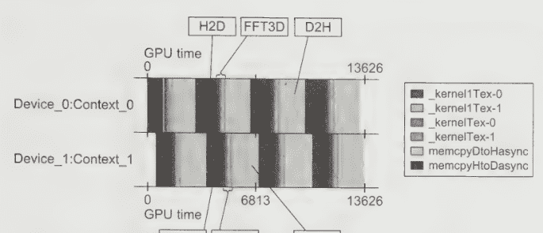

配备两块 NVIDIA C2050 GPU 的 7500。15 原始彩色截图在本书书中已转换为灰度。H2D（从主机到设备）和 D2H（设备到主机）传输没有像实现 3D FFT 的计算内核那样被标记。

- kernel1Tex-0
- kernel1Tex-1
- kernel2Tex-0
- kernel2Tex-1
- memcpyDtoHasync
- memcpyHtoDasync

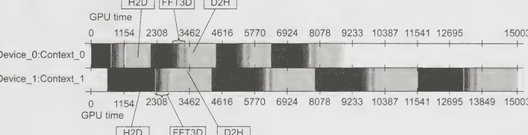

### 图 8.5

配备两块 GPU 的 HP Z800 宽度图。

在 HP Z800 上相同运行结果的结果说明了 PCIe 硬件的重要性。向其中一个 GPU 异步传输数据时的性能缓慢会大幅降低性能。

15 该机器的访问权限由 ICHECC（爱尔兰高端计算中心）N CUDA 研究中心提供。

# 第8 章：适用于所有 GPU 和 CPU 应用的 CUDA

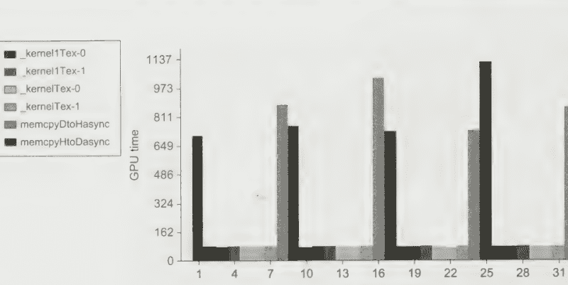

图 8.6

HP Z800 上设备 0 的高度图。

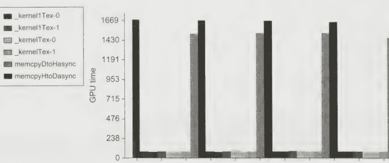

图 8.7

HP Z800 上设备 1 的高度图。

这一观察通过 HP Z800 上每个 GPU 的 computeprof 高度图得到了证实，因为两个 GPU 设备之间存在明显的差异，而且在设备上执行的传输也存在变化。

### MAGMA

MAGMA 项目旨在开发一个类似于 LAPACK 的稠密线性代数库，但针对异构/混合架构。初始重点是提供一个能够同时打开多核处理器和单个 GPU 的包，以交付这种混合环境的组合性能。后续工作将把多个 GPU 与多个核心相结合。

MAGMA 团队得出结论，稠密线性代数（DLA）“更适合新的 GPU 架构，以至于 DLA 在 GPU 上的运行效率甚至高于当前的高端同构多核系统”（Nash, Stanimire, and Dongerra, 2010, p. 1）。根据 Volkov 的说法，目前的 MAGMA BLAS 库实现了高达 836 GF/s 的速度（Volkov, 2010）。

MAGMA 软件可以从田纳西大学创新计算实验室免费下载。\16

### phiGEMM 库

`phiGEMM` 库是一个免费源码库，由 Ivan Girot 和 Filippo Spiga 在 ICHEC 编写。\17 它在包含多个 GPU 和多核处理器的异构系统上执行矩阵乘法（例如 GEMM 操作）。

`phiGEMM` 库扩展了 Fatica (Fatica, 2009) 的映射，以支持单精度、双精度和复矩阵。LINPACK TOP 500 基准测试 HPL 基准测试使用这种异构矩阵映射作为核心之一来评估全球最快的超级计算机。\18 `phiGEMM` 库能够使用单个 GPU 和多核处理器为 LINPACK 基准测试提供并行性能。如图 8.8 所示，使用两个或多个 GPU 可以获得更大的性能。

`phiGEMM` 库透明地管理所有系统（即多个 GPU 和多核处理器）之间的内存和异步数据传输。它通过乘较小的子数组来处理远大于单个 GPU 内存容量的矩阵。再次，该库对用户透明了这一过程。图 8.9 显示了使用最多四块 GPU 处理 15 GB 矩阵的性能。`phiGEMM` 库正在被考虑纳入之前讨论的 MAGMA 库中。

### CURAND

在并行计算机上生成随机数是具有挑战性的。

`phiGEMM` 单 GPU 和多 GPU 执行

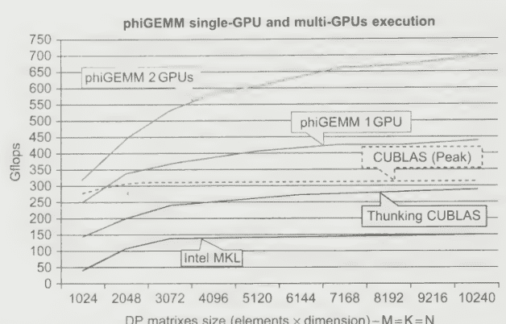

图 8.8

`phiGEMM` 使用一个和两个 GPU 的性能（数据来自两块 Intel Xeon X5680 3.33 GHz 和两块 Tesla NVIDIA C2050 GPU 上）。

大矩阵上的 `phiGEMM` 单 GPU 和多 GPU 执行

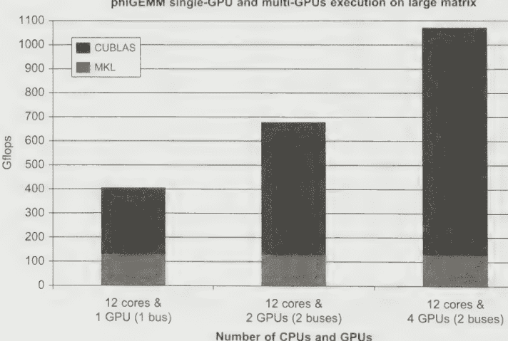

图 8.9

`phiGEMM` 处理 15 GB 矩阵的性能（数据来自两块 Intel Xeon X5680 3.33 GHz 和两块 Tesla NVIDIA C2050 GPU 上）。

在并行计算机上生成随机数是具有挑战性的。简单的方法是让每个线程向公共的提供不同的种子。`CURAND` 库提供了一个简单高效的 API 来生成高质量的随机数。这种方法不能保证具有独立性。

应用领域包括：

- **模拟**：需要随机数来使事物变得真实。
- **采样**：对于许多有趣的问题，检查所有情况是不现实的。
- **计算机编程**：使用随机数测试算法是发现偏差的有效方法。

### 总结

商业和研究项目必须拥有并行应用以竞争研究资金。这种需求转化为对软件开发的压力，以支持一系列快速演变的硬件平台。CUDA 正在快速演进以满足这一需求。与目前的编程语言不同，CUDA 设计用于创建在数百个处理元素上运行的应用，使得 CUDA 成为比 Java 等当前开发语言更有吸引力的选择。强大的库支持使得 CUDA 极具吸引力。SWIG 等通用接口包为许多语言添加并行 CUDA 支持提供了可能。

## 混合 CUDA 与渲染

由于关注于使用 CUDA 加速计算任务，人们很容易忘记 GPU 技术也是一个可视化的卓越平台。与开放图形库（OpenGL）相结合，支持 CUDA 的 GPU 变成了可视化超级计算机。即使是经验丰富的 OpenGL 程序员也会发现本章既新颖又富有启发性，因为示例使用了原始重启（primitive restart）——这是最近添加到 OpenGL 3.1 标准中的功能——在图像需要不规则网格时渲染高性能、高质量的图形。示例内核通过共享缓冲器演示了 CUDA 和 OpenGL 之间的数据共享。性能分析显示，原始重启比优化的 OpenGL多Draw 方法快 60 倍，因为它避免了跨越 PCIe 总线的损性能传输。本章还将讨论原始重启如何比其他方法产生质量更高的图像，并优化纹理渲染。读者注意，本章旨在教授如何在同一个应用程序中混合 CUDA 和 OpenGL，并演示所用方法的速度。提供的软件框架非常通用，仅需更改 CUDA 内核即可进行实验。例如，第 12 章将使用网络摄像头的实时视频流。希望对 OpenGL 有更详细讨论的读者可以参考许多更详细书籍和网络教程。

在本章结束时，读者将初步了解：

- 在同一个应用程序中混合 OpenGL 和 CUDA。
- 如何使用原始重启以及为什么它能比其他方法生成质量更高的图像。
- 原始重启对 CUDA 的影响以及与其他 OpenGL 渲染技术的对比。

\16 http://icl.cs.utk.edu/
\17 http://qe-forge.org/projects/phigemm/
\18 http://www.nvidia.com/content/GTC-2010/pdfs/2057_GTC2010.pdf.

## 第 9 章：混合 CUDA 与渲染

- 本章将介绍如何使用简单的通用 OpenGL 框架编写你自己的内核。
- 使用 Perlin 噪声生成人工地形。
- PBO 和 VBO 之间的区别。

### OPENGL

OpenGL 是从游戏到 HPC（高性能计算）等视觉应用中是最常用的编程接口之一。OpenGL 是基于标准的，它赋予开发者能够创建在任何符合 OpenGL 标准的硬件和操作系统上看起来几乎完全相同的图形和特效的能力，这使得 3D 游戏和程序的开发者能够将他们的软件移植到多个平台。

OpenGL 由架构评审委员会（ARB）控制，该委员会由来自 NVIDIA、Microsoft、AMD、hHP 和内核在内的许多机构的成员组成。该委员会的意图是：

- 保持 API 的稳定。
- 确保标准演进以反映新的硬件能力。
- 通过扩展允许特定于平台的功能。

CUDA 和 OpenGL 之间的分离（但高效的互操作性）具有两个明显的优点：

- 从编程的角度来看：当不映射到 CUDA 内存空间时，OpenGL 专家可以自由利用现有的遗留代码库、他们的专业知识以及他们可以使用的所有工具的全部威力，因为 GLSL（OpenGL 着色语言）和 C。当缓冲区映射到 CUDA 内存空间时，CUDA 程序员可以展示他们的计算实力。
- 从投资的角度来看：映射方法允许高效地利用现有的遗留 OpenGL 软件发明。本质上，只需通过将缓冲区映射到 CUDA 内存空间，就可以将 CUDA 代码逐渐添加到现有的遗留库和应用程序中。此功能允许组织在没有显著风险的情况下测试 CUDA 代码，一旦对这种编程模型所带来的性能和生产力回报充满信心，就可以享受 CUDA 的好处。

### GLUT

OpenGL 工具包（GLUT）是一个用于编写与窗口系统无关 OpenGL 程序的编程接口。利用 GLUT 的应用程序可以在许多平台上编译。NVIDIA 在 CUDA SDK 示例使用了 GLUT。


GLUT 工具包提供了各种功能，但本章将使用一小部分：

- 用于 OpenGL 渲染的窗口。
- 回调驱动的事件处理。
- 鼠标和键盘输入设备。

# 使用 OpenGL 映射 GPU 内存

从 CUDA 程序员的角度来看，OpenGL 在 GPU 上创建并管理称为缓冲区对象（buffer objects）的通用内存区域。当 CUDA 内核将缓冲区映射到 CUDA 内存空间时，发生了 CUDA/OpenGL 互操作。当缓冲区释放或取消映射时，控制权将返回给 OpenGL。映射是一种低开销操作，执行速度快，并且不需要任何内存复制的情况下与 CUDA 实现高速互操作。

与 OpenGL 的互操作要求在进行任何运行时调用之前，通过 `cudaGLSetDevice()` 指定 CUDA 设备。请注意 `cudaSetDevice()` 和 `cudaGLSetDevice()` 是互斥的¹¹。一旦资源注册到 CUDA，就可以使用 `cudaGraphicsMapResources()` 和 `cudaGraphicsUnmapResources()` 根据需要多次进行映射和取消映射。可以调用 `cudaGraphicsResourceSetMapFlags()` 方法提供提示（例如只读、只写），CUDA 驱动可以使用这些提示来优化资源管理。

CUDA 程序员将操作两个主要的 OpenGL 内存对象：

- 像素缓冲区对象 (PBOs)：OpenGL 用于存储像素的内存区域。一个 2D 图像由多个像素、点或颜色簇组成。CUDA 应用程序映射 PBO 以逐像素为单位创建或修改图像，并使用 OpenGL 显示它们。
- 顶点缓冲区对象 (VBOs)：OpenGL 用于存储 3D 顶点的内存区域。CUDA 应用程序映射 VBO 以生成或修改 3D 信息，OpenGL 将其渲染为彩色表面、线框图或一组 3 个点。

以下是与 VBO 使用相关的关键 OpenGL 调用的大纲（摘自 http://spec.org 上的 OpenGL VBO 墙纸）：

- `glBind()`：此函数调用客户端状态函数来使用绑定缓冲区，而不是在客户端侧的绝对内存中工作。缓冲区对象名称是无符号整数。运行时值被保留。将缓冲区名称设置为 0 可以有效取消绑定之前绑定的任何缓冲区对象，恢复该缓冲区对象目标的客户端内存使用。
- `glBufferData()`、`glBufferSubData()` 和 `glGetBufferData()`：这些函数控制缓冲区数据的大小，提供使用提示并允许拷贝到缓冲区。
- `glMapBuffer()` 和 `glUnmapBuffer()`：这些函数锁定和解锁缓冲区，允许将数据加载到其中或将控制权交回服务器。返回一个临时指针作为进入缓冲器的入口，也将缓冲区映射到客户端内存。OpenGL 负责这种到客户端绝对内存的映射发生。由于这种责任，映射必须在短操作中完成，且指针不是持久的，不应存储供以后使用。

¹ 请参见 NVIDIA C 编程指南第 3.2.7.1 节

# 使用基元重启提升 3D 性能

正如本章引言所述，示例利用 OpenGL 扩展的“基元重启”（primitive restart）来最小化跨 PCIe 总线的通信并加速渲染。基元重启赋予了程序员指定一个数据值的能力，该值被 OpenGL 状态机解释为指示当前图形图元完成的标记。后续数据被认为位于另一个相同类型的图形图元的开头。有效的图元包括 `GL_TRIANGLE_STRIP`、`GL_TRIANGLE_FAN`、`GL_LINE_STRIP` 等。

图 9.1 展示了这一过程：首先调用 `glPrimitiveRestartIndexNV()` 来指定 TAG 的值。然后调用 `glEnableClientState()` 告诉 OpenGL 状态机开始使用基元重启。然后使用 `glDrawElements()` 绘制线条。

基元重启方法的优点包括：

- 所有控制标记和显示数据可以在 GPU 上保留并生成。

³ http://drdobbs.com/cpp/222600097.
⁴ http://drdobbs.com/on-source/225200412
⁵ http://www.nvidia.com/content/GTC/documents/1055_GTC09.pdf.

`glPrimitiveRestartIndexNV(TAG);`

`glEnableClientState(GL_PRIMITIVE_RESTART_NV);`

`glDrawElements(GL_TRIANGLE_STRIP, qSize, GL_UNSIGNED_INT, qIndices);`

| A | B | TAG | D | E |
|---|---|---|---|---|
| 第一个基元 | | | | |
| 第二个基元 | | | | |


图 9.2

显示锯齿的三角形带。


图 9.3


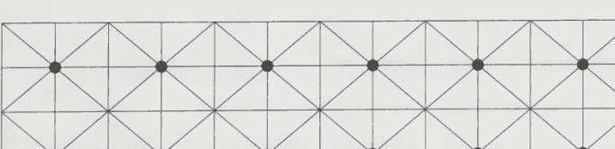

### 框架中的文件介绍

| 计算 | | | | | | | | |

|---|---|---|---|---|---|---|---|

| 1.1%(187... | | | | | | | | |

| 流 | | CUDA Perlin | | | | | | |

| 计数器 | | Kernel | | | | | | |

| 设备 % | 200 | | | | | | | |

| 主机到设备... | 76.29 | | | | | | | |

| 已分配... | 280 | | | | | | | |


图 9.4

并行 Nsight 显示了在使用原始元重启时计算时间与渲染时间的对比。

## 框架中的文件介绍

读者应该注意，软件框架的设计经过了仔细考虑，以便能够适应新的应用程序。例如，同一个框架在第十二章中被用于显示和修改视频流。为了实现操作的分离，框架被拆分为四个独立的文件。仅通过更改 CUDA 核，此示例代码就可以用于渲染一个动画正弦波表面，或者一个用户可以探索并在其周围飞行的的人工地形。这些示例已知可以在 Linux 和 Windows 上编译并运行。

为了清晰和灵活性，示例代码内部使用了独立的 3D 顶点和颜色数组。这有助于加速理解，并使数据可视化（编写新代码或从磁盘加载数据来修改 3D 顶点数组、颜色数组或两者）变得容易。选择创建自己的 CUDA 核的读者应该强烈感受到，通过结合 CUDA/OpenGL 方法，可视化可以是多么简单和灵活。

本章讨论的框架中使用的四个文件之间的关系如图 9.5 所示。下面将详细详细讨论每一个文件。

## Demo 和 Perlin 示例内核

本章提供了两个示例内核：`demo` 和 `Perlin`。每个内核都会同时生成 3D 顶点和颜色。

# 第 9 章：混合 CUDA 与渲染

图 9.5

文件和活动的组织。


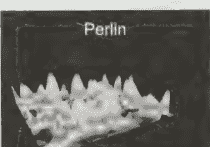


### Demo 内核

`demo` 核创建了一个动画正弦波表面，与 NVIDIA 的 `simpleGL` SDK 示例非常相似。它是确认代码运行正常以及评估 GPU 速度的良好测试用例。

图 9.6 显示了使用 `demo` 核生成的色彩丰富的表面的灰度截图。此外，请注意颜色会随时间而演变。键盘输入还允许在用三角形（如图 9.6 所示）、线（未显示）或点（如图 9.7 所示）渲染该表面之间进行切换。

# 用于生成彩色正弦波表面的 Demo 内核

`demo` 内核通过计算 2D 网格中每个位置的高度值来绘制随时间变化的正弦波表面。高度值随时间变化。请参见示例 9.1，“计算正弦波表面的高度”：

示例 9.1

```
// 计算简单的正弦波模式
float freq = 4.0f;
float w = -sin(v*freq + time) * cos(v*freq + time) * 0.5;
```

### 框架中的文件介绍

图 9.6

用正弦波表面创建的表面灰度示例。

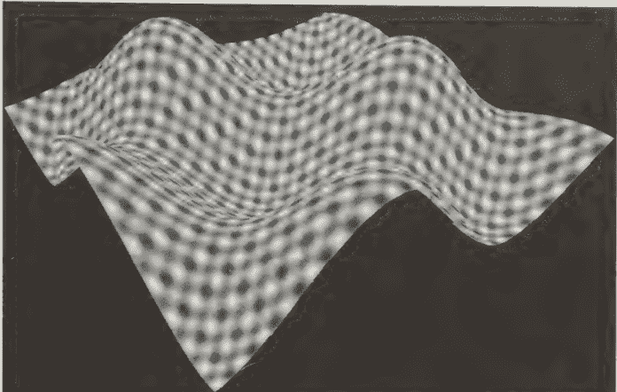

图 9.7

点的灰度（颜色已反转以增加可见性）。位置和高度信息存储在 `float4` 位置数组中，如示例 9.2 所示。

示例 9.2

```
// 输出输出
pos[y*width+x] = make_float4(u, w, v, 1.0f);
```

同样，颜色是根据网格中的位置和动画时间计算的，如示例 9.3，“计算正弦波表面的颜色”所示：

示例 9.3

```
// 写入颜色
colorPos[y*width+x].w = 0;
colorPos[y*width+x].x = 255.f*0.5*(1.f+sin(w));
colorPos[y*width+x].y = 255.f*0.5*(1.f+sin(x)*cos(y));
colorPos[y*width+x].z = 255.f*0.5*(1.f+sin(w/10));
```

VBO 的完整内核见示例 9.4，“`demo` 核的完整源码”：

示例 9.4

```
// 正弦波核
// 修改正弦波模式顶点的简单核
__global void kernel(float4 pos, uchar4 colorPos, unsigned int width, unsigned int height, float time)
{
    unsigned int x = blockIdx.x*blockDim.x + threadIdx.x;
    unsigned int y = blockIdx.y*blockDim.y + threadIdx.y;

    // 计算 uv 坐标
    float u = x / (float) width;
    float v = y / (float) height;
    v = 2.0f - 1.0f;

    // 计算简单的正弦波模式
    float freq = 4.0f;
    float w = sin(u*freq + time) * cos(v*freq + time) * 0.5f;

    // 写入输出
    pos[y*width+x] = make_float4(u, w, v, 1.0);
    colorPos[y*width+x].x = 255.f*0.5*(1.f+sin(w));
    colorPos[y*width+x].y = 255.f*0.5*(1.f+sin(x)*cos(y));
    colorPos[y*width+x].z = 255.f*0.5*(1.f+sin(w/10));
}
```

`launch_kernel()` 方法计算配置并使用适当参数启动 `demo` 核，如示例 9.5，“启动 `demo` 核的逻辑”所示：

示例 9.5

```
// __global 调封装
extern "C" void launch_kernel(float4* pos, uchar4* colorPos, unsigned int mesh_width, unsigned int mesh_height, float time);

// 执行核
dim3 block(8, 8, 1);
dim3 grid(mesh_width / block.x, mesh_height / block.y, 1);
kernel<<<grid, block>>>(pos, colorPos, mesh_width, mesh_height, time);
```

### Perlin 噪声

许多人使用随机数生成器为应用程序添加变化和不可预测性。景观确实表现出变化和看似不可预测性，但并非完全随机。相反，它们在不同的尺度上变化，这意味着它们具有不同级别的细节：

- 大尺度：山脉的轮廓。
- 中尺度：各种山丘、山谷和其他特征。
- 小变化：巨石和岩石是常见的例子。
- 微小变化：在小径上徒步时看到的石头。

Perlin 噪声是用于空间生成连续噪声的函数。连续噪声意味着对于空间中的任意两点，噪声函数的值从一个点移动到另一个点时是平变化的；没有不连续性。自然现象往往表现出相同的尺度模式。Perlin 函数通过简单累加不同尺度的噪声函数来重建这种自然效果。

1997 年，Ken Perlin 因开发 Perlin 噪声生成器获得了奥斯卡奖。Perlin 噪声有许多用途，从创建自然纹理到人工地形甚至世界！许多网站讨论 Perlin 噪声。Ken Perlin 的主页是一个极好的起点。

⁷ http://cs.nyu.edu/~perlin/.

Perlin 噪声核将用于创建图 9.8 到 9.10 所示的虚拟地形高度图。用户可以在这个虚拟世界周围飞行，并通过 `callbacksVBO.cu` 中定义的键盘命令动态地改变它。图 9.8 显示了渲染为三角形的虚拟地形。图 9.9 显示了渲染为线的表面，图 9.10 显示了人工地形的视角。

### 图 9.8

用 Perlin 核创建的表面的灰度示例。

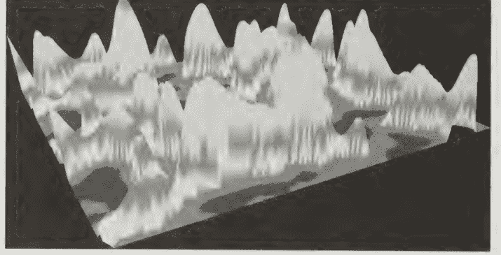

### 图 9.9

线框图的灰度。

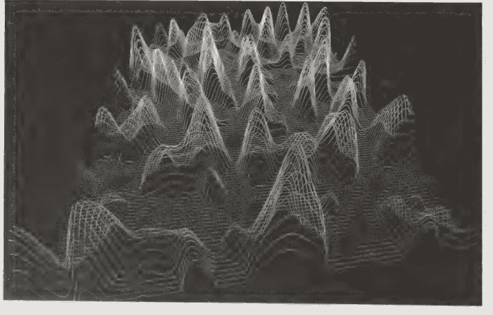

### 图 9.10

视角的灰度版本。

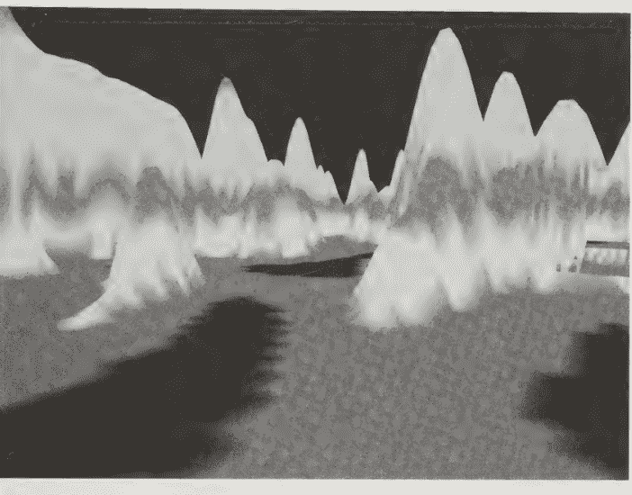

### 使用 Perlin 噪声核生成人工地形

以下示例使用了来自 Doctor Dobb' Journal 网站上“Supercomputing for the Masses”教程系列第 15 部分和第 18 部分的改进型 Perlin 噪声生成器。为了实现简单化，选择了 fBm（分形布朗运动）来生成分形地形，它仅仅是任意基函数（如噪声）多个尺度的加权和。正如马普朗研究所网站上的“分形景观与纹理生成”所示，有更好的方法可以创建更逼真的景观（Max Planck Institute, 2004）。¹⁰

¹¹ http://vlg.cs.nyu.edu/

# 第9 章：混合 CUDA 与渲染

示例 9.6

```cpp
// 每个内核函数 (Rob Farber)
#include <cutil/math.h>
#include <cutil_inline.h>
#include <cutil_gl_inline.h>
#include <cuda_gl_interop.h>

extern float gain, xStart, yStart, z0ffset, octaves, lacunarity;
#define Z_PLANE_50_f
```

__constant__ unsigned char c_perm[256];

__shared__ unsigned char s_perm[256]; // 排列数组的共享内存拷贝

unsigned char *d_perm=NULL; // 排列数组的全局内存拷贝

// 排列数组的主机版本

const static unsigned char h_perm[] = {151,160,137,91,90,15,131,230,95,96,154,233,727,225,140,36,103,69,142,8,99,37,240,21,23,190,618,247,120,234,75,0,26,197,62,94,252,219,203,117,35,132,57,177,133,227,149,56,174,140,15,136,171,168,68,175,74,165,71,134,239,147,146,158,231,831,229,122,620,211,233,220,105,92,41,55,46,24,4,204,102,143,54,65,25,63,111,196,135,130,116,118,59,86,164,100,109,198,89,18,246,54,227,227,224,255,202,308,137,211,126,255,173,186,34,57,26,220,284,135,205,301,111,223,233,82,88,226,202,207,206,227,214,117,172,189,238,196,151,180,170,219,248,257,2,44,163,70,221,153,101,155,167,43,172,929,22,23,253,19,98,108,110,79,131,222,234,218,175,112,104,218,246,297,228,251,34,242,193,238,210,144,121,191,179,162,241,81,51,145,235,249,124,239,107,49,192,214,31,181,199,106,157,184,204,176,115,121,50,45,127,4,15,250,234,138,236,205,93,222,114,67,29,74,227,243,243,141,195,78,66,65,151,160,118};
```

```cpp

__device__ inline int intToInt(int i) { return (s_perm[i&0xff]); }

__device__ inline float float1(float t) { return t*(t*(t*(6.0f-15.0f)+10.0f); }

__device__ inline float lerp(float t, float a, float b) { return a + t*(b-a); }

__device__ inline float grad(int hash, float x, float y, float z) {

    int h = hash&15; // 取哈希值的低 4 位

    float u = h<8?x:y; // 转换为 12 个梯度

    float v = h<4?y:(h==12||h==14)?x:z;

    return ((h&1)?u:-u)+((h&2)?v:-v);

}

__device__ inline float float2(float x, float y, float z) {

    int X = (int)floor(x) & 255; // 找到立方体

    Y = (int)floor(y) & 255; // 包含点。

    Z = (int)floor(z) & 255;

    x -= floor(x);               // 关联 X,Y,Z

    y -= floor(y);               // 立方体点。

    z -= floor(z);

    float u = fade(x);          // 计算曲线

    v = fade(y);                // 对于 X,Y,Z。

    w = fade(z);

    int A =perm(x)+Y, AA =perm(A)+Z, AB =perm(A+1)+Z; // 哈希坐标

    B =perm(x+1)+Y, BA =perm(B)+Z, BB =perm(B+1)+Z; // 立方体顶点

    return lerp(w, lerp(v, lerp(u, grad(perm(AA), x, y),

                               grad(perm(BA), x-1, y)),

                           grad(perm(AA+1), x, y-1),

                           grad(perm(BB+1), x-1, y-1)),

                lerp(v, lerp(u, grad(perm(AA), x, y, z-1),

                               grad(perm(BA), x-1, y, z-1)),

                           grad(perm(AA+1), x, y-1, z-1),

                           grad(perm(BB+1), x-1, y-1, z-1)))); // 原始结构需要检查
```

### 框架文件介绍

### 示例 9.7

`colorElevation` 方法根据地形的高度返回像素颜色。颜色的选择是为了让用户获得地图的感觉。参见示例 9.7，“改进的 Perlin 内核部分 2”：

```cpp
__device__ inline uchar4 colorElevation(float tcpHeader)
{
    uchar4 pos; // 颜色 (r,g,b,a)
    if (texHeight < -1.0f) pos = make_uchar4(0, 0, 0, 128); // 深水
    else if (texHeight < -0.25f) pos = make_uchar4(0, 0, 0, 255); // 浅水
    else if (texHeight < 0.0f) pos = make_uchar4(0, 0, 128, 255); // 岸边
    else if (texHeight < 0.125f) pos = make_uchar4(0, 240, 64, 255); // 沙子
    else if (texHeight < 0.125f) pos = make_uchar4(32, 160, 200, 255); // 草地
    else if (texHeight < 0.375f) pos = make_uchar4(224, 224, 0, 255); // 土壤
    else if (texHeight < 0.75f) pos = make_uchar4(128, 128, 255, 255); // 岩石
    else pos = make_uchar4(255, 255, 255, 255); // 雪
    return(pos);
}
```


`__device__ float fbm(float x, float y, int octaves)`

{
    float total = 0.0;
    float frequency = 1.0;
    float amplitude = 1.0;
    float maxValue = 0.0;
    for (int i = 0; i < octaves; i++) {
        total += noise(x * frequency, y * frequency) * amplitude;
        maxValue += amplitude;
        amplitude *= 0.5;
        frequency *= 2.0;
    }
    return total / maxValue;
}

### 示例 9.8

```cpp
void checkCUDAError(const char *msg) {
    cudaError_t err = cudaGetLastError();
    if (cudaSuccess != err) {
      fprintf(stderr, "CUDA error: %s: %s\n", msg, cudaGetErrorString(err));
      exit(EXIT_FAILURE);
    }
}
```

检查错误的方法见示例 9.8，“改进的 Perlin 内核部分 3”：

### 示例 9.9

`k_perlin()` 内核调用 Perlin 噪声来生成地形图。低于高度的区域设置为零。`cudaSynchronize()` 的调用是重要的，因为它会导致主机等待内核完成。参见示例 9.9，“改进的 Perlin 内核部分 4”：

```cpp
__global__ void k_perlin(float4* pos, uchar4* colorPos,
  unsigned int width, unsigned int height,
  float2 start, float2 delta, float gain, float offset)
{
    unsigned char* d_perm, float octaves, float lacunarity
    int idx=blockIdx.x*blockDim.x+threadIdx.x;
    float xCur=start.x+((float)width)*delta;
    float yCur=start.y+((float)height)*delta;
    if(threadIdx.x < 256) // 优化：共享内存冲突
    syncthreads();
    //  此处代码省略，对应原文未完整
}
```

### 框架中的文件介绍

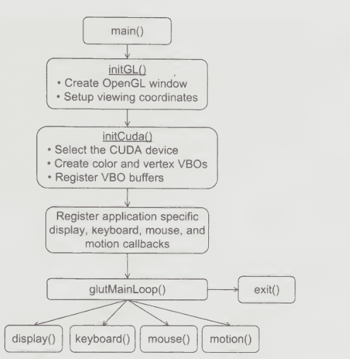

**图 9.11**

GLUT VBO 代码交互示意图。

图 9.11 中的示意图总结了 VBO 示例代码如何与 GLUT 交互.¹¹³

以下是 VBO 版本的 `simpleGLmain.cpp` 的完整源代码。这是一段相当通用的代码，不需要修改。文件开头指定了外部方法所需的包含文件和原型声明。`main()` 规程初始化了一个计时器来计算帧率，调用用户定义的方法初始化 CUDA 内核，注册用户定义的回调函数，以及 GLUT 主循环，如示例 9.10“`simpleGLmain.cpp` 的第 1 部分”所示：

### 示例 9.10

```
// simpleGLmain (Rob Farber)
#include <GL/glew.h>
#include <cutil_inline.h>
#include <cutil_gl_inline.h>
#include <cutil_gl_error.h>
```

¹¹ http://www.opengl.org/documentation/red_book/.

```
#include <cuda_gl_interop.h>
#include <render_check_gl.h>

// GLUT 特有常量
const unsigned int window_width = 512;
const unsigned int window_height = 512;

// 用户必须创建以下规程：
void initCuda(int argc, char** argv);
void initGL(int argc, char** argv);
void fpsDisplay(), display();
void keyboard(unsigned char key, int x, int y);
void mouse(int button, int state, int x, int y);
void motion(int x, int y);

unsigned int timer=0; // 用于 FPS 计算的计时器
int sleepTime=0, sleepinc=100;

// 主程序
int main(int argc, char** argv) {
    // 创建 CUTil 计时器
    cutilCheckError(cutCreateTimer(&timer));
    if (CutFalse(initGL(argc, argv))) { return CutFalse; }

    initCuda(argc, argv);
    CUT_CHECK_ERROR_GL();

    // 注册回调
    glutDisplayFunc(fpsDisplay);
    glutKeyboardFunc(keyboard);
    glutMouseFunc(mouse);
    glutMotionFunc(motion);

    // 启动主循环
    glutMainLoop();

    // 清理
    cudaThreadExit();
    cutilExit(argc, argv);
}
```

示例 9.11，“`simpleGLmain.cpp` 的第 2 部分”计算帧率并在窗口标题中显示。

### 示例 9.11

```cpp
// 在窗口标题中显示每帧数的简单方法
void computeFPS()
{
static int fpsCount=0;
static int fpsLimit=100;

fpsCount++;

if (fpsCount == fpsLimit) {
char fps[256];
float fps=1.f / (getAverageTimerValue(timer) / 1000.f);
if(sleepTime) 
sprintf(fps, "CUDA Interop (Rob Farber): %3.1f fps sleepTime %3.1f ms \n", fps, sleepTime/1000.0);
} else {
sprintf(fps, "CUDA Interop (Rob Farber): %3.1f fps *, %f", fps, fps);
glutSetWindowTitle(fps);
fpsCount=0;
}

cutilCheckError(cutResetTimer(timer));
}

void fpsDisplay() {
cutilCheckError(cutStartTimer(timer));
display();
cutilCheckError(cutStopTimer(timer));
computeFPS();
}
```

GLUT 和 OpenGL 的初始化创建了一个窗口并指定了 3D 空间中的视图位置，如示例 9.12“`simpleGL.main.cpp` 的第 3 部分”所示：

### 示例 9.12

```cpp
float aniTime=0.0; // 运行的时间
// 初始化 OpenGL 窗口
glutBoolean initGL(int argc, char **argv);

glutInit(&argc, argv);
glutDisplayMode(GL_RGBA | GL_DOUBLE);
glutCreateWindowSize(window_width, window_height);
glutCreateWindow("CUDA Interop Demo (adapted from NVIDIA's simpleGL)");
glutDisplayFunc(fpsDisplay);
glutKeyboardFunc(keyboard);
glutMotionFunc(motion);

// 初始化必要的 OpenGL 扩展
glewInit();
if (!glewIsSupported("GL_VERSION_2_0")) {
    fprintf(stderr, "ERROR: Support for necessary OpenGL extensions\nmissing.");
    return CUT_False;
}

// 默认初始化
glClearColor(0.0, 0.0, 0.0, 1.0);
glDisable(GL_DEPTH_TEST);

// 视口
glViewport(0, 0, window_width, window_height);

// 设置视图矩阵
glMatrixMode(GL_MODELVIEW);
glLoadIdentity();

// 投影
glMatrixMode(GL_PROJECTION);
glLoadIdentity();
gluPerspective(60.0, (GLfloat)window_width/(GLfloat)height, 0.1, 10.0);

return CUT_True;
```

### simpleVBO 文件

`simpleVBO.cpp` 包含了创建和映射 PBO 以及 VBO 的逻辑。PBO 和 VBO 的映射由 GPU 执行。

示例 9.13，“`simpleVBO.cpp` 的第 1 部分”：

```cpp
// simpleVBO (Rob Farber)
#include <GL/glew.h>
#include <GL/gl.h>
#include <GL/glu.h>
#include <stdio.h>
#include <cutil_inline.h>
#include <cutil_gl_inline.h>
#include <cutil_error.h>
#include <cuda_gl_interop.h>
#include <render_check_gl.h>

extern float animTime;

typedef struct {
  GLuint vbo;
  GLuint type;
  cudaGraphicsResource *cudaResource;
} mappedBuffer_t;

extern void launch_kernel(float4* pos, uchar4* pos, unsigned int mesh_width, unsigned int mesh_height, float time);

mappedBuffer_t vertexVBO = {NULL, NULL, NULL};
mappedBuffer_t colorVBO = {NULL, NULL, NULL};
GLuint* qIndices=NULL;
const unsigned int mesh_width = 256;
const unsigned int mesh_height = 256;
const unsigned int RestartIndex = 0xffffffff;

unsigned int timer=0; // 用于 FPS 计算的计时器
int sleepTime=0, sleepinc=100;

void initCuda(int argc, char** argv);
void initGL(int argc, char** argv);
void fpsDisplay(), display();
void keyboard(unsigned char key, int x, int y);
void mouse(int button, int state, int x, int y);
void motion(int x, int y);

int main(int argc, char** argv) {
    // 创建 CUTil 计时器
    cutilCheckError(cutCreateTimer(&timer));
    if (CutFalse(initGL(argc, argv))) { return CutFalse; }

    initCuda(argc, argv);
    CUT_CHECK_ERROR_GL();

    // 注册回调
    glutDisplayFunc(fpsDisplay);
    glutKeyboardFunc(keyboard);
    glutMouseFunc(mouse);
    glutMotionFunc(motion);

    // 启动主循环
    glutMainLoop();

    // 清理
    cudaThreadExit();
    cutilExit(argc, argv);
}

void computeFPS()
{
static int fpsCount=0;
static int fpsLimit=100;

fpsCount++;

if (fpsCount == fpsLimit) {
char fps[256];
float fps=1.f / (getAverageTimerValue(timer) / 1000.f);
if(sleepTime) 
sprintf(fps, "CUDA Interop (Rob Farber): %3.1f fps sleepTime %3.1f ms \n", fps, sleepTime/1000.0);
} else {
sprintf(fps, "CUDA Interop (Rob Farber): %3.1f fps *, %f", fps, fps);
glutSetWindowTitle(fps);
fpsCount=0;
}

cutilCheckError(cutResetTimer(timer));
}

void fpsDisplay() {
cutilCheckError(cutStartTimer(timer));
display();
cutilCheckError(cutStopTimer(timer));
computeFPS();
}
```

### 示例 9.14

```cpp
// 创建 VBO
void createVBO(mappedBuffer_t* mbuf) {
  // 创建缓冲区对象
  glGenBuffers(1, &mbuf->vbo);
  glBindBuffer(GL_ARRAY_BUFFER, mbuf->vbo);

  // 初始化缓冲区对象
  unsigned int size = mbuf->mesh_width * mbuf->mesh_height;
  glBufferData(GL_ARRAY_BUFFER, size, 0, GL_DYNAMIC_DRAW);
}
```

## 第 9 章：CUDA 与渲染

```cpp
// 删除 VBO
void deleteVBO(mapped_buffer_t* mbuf) {
    glBindBuffer(GL_ARRAY_BUFFER, 0);
    glDeleteBuffers(1, &(mbuf->vbo));
    cudaGraphicsUnregisterResource(mbuf->cudaResource);
    mbuf->cudaResource = NULL;
    mbuf->vbo = NULL;
}

void cleanupCUDA() {
    if(qIndices) free(qIndices);
    deleteVBO(&vertexVBO);
    deleteVBO(&colorVBO);
}
```

`runCUDA()` 方法执行了映射和获取颜色 PBO 以及 VBO 指针的所有工作。这些地址传递给 `launch_kernel()` 方法供用户定义的内核使用。注意 `launch_kernel()` 在返回之前等待内核完成，这就是为什么之后返回 OpenGL 资源是安全的。参见示例 9.15，“`simpleVBO.cpp` 的第 3 部分”：

### 示例 9.15


```cpp
// 执行计算的 CUDA 部分
void runCUDA() {
    // 从 CUDA 写入 OpenGL 缓冲区对象
    float *dptr;
    uchar *cptr;
    uint *iptr;
    size_t start;
    cudaGraphicsMapResources(1, &vertexVBO.cudaResource, (void **)dptr, &start);
    cudaGraphicsResourceGetMappedPointer(void **)&dptr, &start, 
    vertexVBO.cudaResource);

    cudaGraphicsResources(1, &colorVBO.cudaResource, NULL);
    cudaGraphicsResourceGetMappedPointer(void **)&ptr, &start,
    colorVBO.cudaResource);
    // 执行内核
    launch_kernel(dptr, cptr, mesh_width, mesh_height, animTime);
    // 取消映射缓冲区对象
    cudaGraphicsUnmapResources(1, &vertexVBO.cudaResource, NULL);
    cudaGraphicsUnmapResources(1, &colorVBO.cudaResource, NULL);
}
```

## 第 9 章：混合 CUDA 与渲染

```
// 确保 VBO 在程序退出时被清理
atexit(cleanupCuda);
runCuda();
```

`renderCuda` 方法将缓冲区绑定到适当的类型和大小信息，用于渲染。渲染根据 `drawMode` 的定义执行。

注意在当使用图元重启（primitive restart）渲染三角形时，该调用非常简单。通过 `glPrimitiveRestartIndexNV()` 方法向 OpenGL 状态机告知重启值，随后在 OpenGL 客户端状态机中启用图元重启。调用 `glDrawElements()` 会导致数据被渲染。完成后，OpenGL 状态机中的图元重启将被禁用。参见 9.17，“simpleVBO.cpp 的部分”。

### 示例 9.17

```
void renderCuda(int drawMode)
{
glBindBuffer(GL_ARRAY_BUFFER, vertexVBO.vbo);
glVertexPointer(4, GL_FLOAT, 0, 0);
EnableClientState(GL_VERTEX_ARRAY);

glBindBuffer(GL_ARRAY_BUFFER, colorVBO.vbo);
glColorPointer(4, GL_UNSIGNED_BYTE, 0, 0);
EnableClientState(GL_COLOR_ARRAY);

switch(drawMode) {
  case GL_STRIP:
    for(int i=0; i < mesh_width*mesh_height; i+=mesh_width)
      glDrawArrays(GL_LINE_STRIP, i, mesh_width);
    break;
  case GL_TRIANGLE_FAN:
    glPrimitiveRestartIndexNV(RestartIndex);
    EnableClientState(GL_PRIMITIVE_START_NV);
    glDrawElements(GL_TRIANGLE_FAN, qindexSize, GL_UNSIGNED_INT, indices);
    DisableClientState(GL_PRIMITIVE_START_NV);
    break;
  default:
    glDrawArrays(GL_POINTS, 0, mesh_width * mesh_height);
    break;
}
```

### 框架中的文件介绍

```
glDisableClientState(GL_VERTEX_ARRAY);
glDisableClientState(GL_COLOR_ARRAY);
```

### callbacksVBO.cpp 文件

键盘程序非常简单。基本上，它允许用户通过按下“d”或“D”键在不同的显示模式（点、线、面）之间切换。

鼠标和移动程序协同工作，根据用户的移动和鼠标按钮的状态修改 `rotate_x` 和 `rotate_y` 变量的值。

### 示例 9.18

```
// 设置视图矩阵
MatrixMode(GL_MODELVIEW);
LoadIdentity();
glTranslatef(0.0, 0.0, 0.0, translate_z);
Rotatef(rotate_x, 1.0, 0.0, 0.0);
Rotatef(rotate_y, 0.0, 1.0, 0.0);

// 生成顶点位置的 CUDA 核函数
runCuda();

// 渲染数据
renderCuda(drawMode);
```

随后通过 `runCuda()` 调用 CUDA 核创建数据，并用 `renderCuda()` 进行进行渲染。

交换缓冲区以便使最新版本可见，并通知 GLUT 需要更新显示。动画时间也会增加。参见示例 9.19，“交换 OpenGL 缓冲区并向 OpenGL 发送重绘事件的逻辑”：

### 示例 9.19

```
glutSwapBuffers();
glutPostRedisplay();
animTime += 0.01;
```

## 第 9 章：混合 CUDA 与渲染

表 9.2 列出了键盘命令和相应的核函数。

| 表 9.2 演示和 Perlin 示例的键盘命令 | |

| 键 | 相应的核函数 | 操作 |

| --- | --- | --- |

| + | Perlin | 降低海平面 |

| - | Perlin | 升高海平面 |

| k | Perlin | Vi 类型的命令，将地形向上 |

| J | Perlin | Vi 类型的命令，将地形向下 |

| h | Perlin | Vi 类型的命令，将地形左移 |

| l | Perlin | Vi 类型的命令，将地形右移 |

| d | Perlin/Demo | 切换绘制模式 |

| D | Perlin/Demo | 切换绘制模式 |

| l | Perlin | 增益增加 0.25 |

| i | Perlin | 增益减少 0.25 |

| O | Perlin | 八倍数（fbm 中的频率数量）增加 1 |

| P | Perlin | 八倍数（fbm 中的频率数量）减少 1 |

| p | Perlin | 间隙性（连续频率之间的间隔）增加 0.25 |

| S | Perlin | 间隙性（连续频率之间的间隔）减少 0.25 |

| s | Perlin/Demo | 每帧减慢渲染 100 微秒 |

| s | Perlin/Demo | 每帧加速渲染 100 微秒 |

完整的源代码见示例 9.20，“callbacksVBO.cpp 的第一部分”。该文件的开头定义了包含文件和所需的变量：

```
 // callbacksVBO (Rob Farber)
#include <GL/glew.h>
#include <cutil_inline.h>
#include <cutil_gl_interop.h>
#include <cuda_gl.h>
#include <rendercheck_gl.h>

// 用户必须创建以下程序：
void initCuda(int argc, char** argv);
void runCuda();
void renderCuda(int);

// 回调变量
extern float animTime;
extern float sleepInc;
int drawMode=GL_TRIANGLE_FAN; // 绘制模式
int mouse_old_x, mouse_old_y;
int mouse_buttons = 0;
float rotate_x=0.0, rotate_y=0.0;
float translate_z=-3.0;
```

```
// 对 Perlin 和 demo 核函数进行模块化
// 用于 Perlin 的初始值
float gain=0.75, xStart=2.f, yStart=1.f;
float offset=0.0f, octaves=2.f, lacunarity=2.0f;
```

当需要绘制屏幕时调用 GLUT 回调函数。OpenGL 定义了屏幕……（此处省略原文中重复的描述，已根据逻辑要求处理）

## 第 9 章：混合 CUDA 与渲染

`testDemo` 示例可以通过 9.24 节中“构建 testDemo 的示例脚本”的 bash 脚本变体来构建。**粗体项目**表示这是一个将创建 `testDemo` 可执行文件的演示示例。该脚本假设回调函数（callbacks）和内核函数（kernel）保存在 `demo` 目录中：

# 示例 9.24

```bash
#!/bin/bash
DIR=demo
SDK_PATH=/cuda/4.0
SDK_LIBO=$SDK_PATH/C/libb
SDK_LIBI=$../4.0/CUDIBRARIES/common/lib/linux
echo $SDK_PATH
vcc -O3 -L$SDK_LIBO -L$SDK_LIBI -I $SDK_PATH/C/common/inc
simpleGlmath.cpp simpleV80.cpp $DIR/callbacksV80.cpp $DIR/kernelV80.cpp
cu-glut -lGLEW_x86_64 -lGLU -lcglut_x86_64 -o testDemo
```

`testPerlin` 示例可以通过 9.25 节中“构建 testPerlin 的示例脚本”的 bash 脚本变体来构建。**粗体项目**表示这是一个将创建 `testPerlin` 可执行文件的演示示例。该脚本假设回调函数和内核函数保存在 `perlin` 目录中：

# 示例 9.25

```bash
#!/bin/bash
DIR=perlin
SDK_PATH=/ichec/packages/cuda/4.0
SDK_LIBO=$SDK_PATH/C/libb
SDK_LIBI=$ichec/packages/cuda/4.0/CUDIBRARIES/common/lib/linux
echo $SDK_PATH
vcc -O3 -L$SDK_LIBO -L$SDK_LIBI -I $SDK_PATH/C/common/inc
simpleGlmath.cpp simpleV80.cpp $DIR/callbacksV80.cpp $DIR/kernelV80.cpp
cu-glut -lGLEW_x86_64 -lGLU -lcglut_x86_64 -o testPerlin
```

### 总结

混合 CUDA 与可视化为商业产品、视觉产品以及科学应用开启了巨大的机会。本文中的示例表明，当前代支持 CUDA 的图形能够以每秒数百帧的速度同时渲染和生成复杂数据。

特别地，本文尝试为 CUDA 开发人员提供一种极其简单且灵活的方法，使用符合 OpenGL 标准的原型重启动（primitive restart）功能来生成和渲染 3D 图像，从而只需要极少的主机处理器交互。结果是，可以避免 PCIe 瓶颈和延迟，从而交付高性能/高质量的图形效果，即使在图像需要不规则的网格和/或计算密集型数据生成时也是如此。当然，在高端 GPU 上生成非常逼真的图像时，这个问题值得关注，但不要忘记，这种技术同样可以使产品渗透到中端和低性能市场。

# 云环境和集群环境中的 CUDA

随着 CUDA 使用 MPI（分布式计算的事实标准）扩展到数千节点，分布式 GPU 正在为最快的超级计算机动力。NVIDIA 的 GPUDirect 加速了 MPI 中的关键操作——发送（`MPI_Send`）和接收（`MPI_Recv`），通过网络而非 PCIe 总线进行通信。正如其名所示，GPUDirect 在 GPU 之间移动数据，而不涉及任何主机系统上的处理器。本章重点关注使用 MPI 和 GPUDirect，以便 CUDA 程序员可以将这些 API 引入云计算和计算集群。分布式 GPU 计算的性能优势是真实存在的，但取决于分布式通信基础设施的带宽和延迟特性。例如，中国的“天之声”超级计算机可以提供 2.98 Pflops（或每秒 2980 万亿浮点运算），运行某些构想过的最密集的应用程序。同时，商品级 GPU 集群和云计算为用户和组织提供了开箱即用的资源。要在分布式环境中高效运行，CUDA 开发者必须开发能够在通信网络限制下进行扩展的应用程序和算法。特别是网络带宽和延迟至关重要。

在本章结束，读者将对以下内容有一定的了解：

- 消息传递接口 (`MPI`)。

- NVIDIA 的 `GPUDirect 2.0` 技术。

- 平衡比例如何作为新平台应用性能的指标。

- 延迟和带宽对分布式计算和云计算的重要性。

- 强可扩展性（Strong scaling）。

# 消息传递接口 (MPI)

`MPI` 是一个基于 `MPI` 论坛（http://www.mpi-forum.org/）共识的标准库，该论坛拥有 40 多个参与组织，包括供应商、研究人员、软件库开发人员和用户。论坛的目标是建立一个通用、高效且灵活的标准，该标准将在各种语言中广泛使用。广泛采用使得 `MPI` 尽管不是 IEEE（电气电子工程师学会）或 ISO（国际标准化组织）标准，但也已成为“行业标准”。可以假设，无论供应商或操作系统如何，大多数分布式计算平台都会提供某个版本的 `MPI`。

使用 `MPI` 的原因：

- **标准化**：`MPI` 被认为是一种标准。它支持几乎所有的 HPC 平台。

- **可移植性**：在支持 `MPI` 标准的平台上运行时，`MPI` 调用不需要更改。

- **性能**：供应商实现可以利用硬件特性来优化性能。

- **可用性**：公共领域有多种实现方式。

# MPI 编程模型

`MPI` 是一个最初为分布式计算设计的 API，最初支持 C 和 FORTRAN。它于 1992 年首次实现，标准于 1994 年出现。从那时起大多数语言都创建了绑定，包括 Perl、Python、Ruby 和 Java。C 绑定使用 `MPI_XXX` 格式，其中 `XXX` 指定操作。`MPI_Send()` 和 `MPI_Recv()` 是使用这种绑定的两个示例。

与 CUDA 执行配置一样，`MPI` 定义了拓扑结构来连接进程组。需要注意的是，在 `MPI` 中会话的大小在应用程序生命周期内是固定的。这与 `MapReduce`（在本章中讨论）不同，后者是一种用于云计算的流行框架。`MPI` 的所有并行都是显式的，这意味着程序员负责正确识别并行性并实现并行算法。

# 通信器 (Communicator)

`MPI` 的一个基本概念是通信器，它是支持集合通信和点点通信的分布式对象。正如名称所示，集合通信指的是涉及通信器组内所有处理器的 `MPI` 函数。点点通信由单个 `MPI` 进程相互发送消息。

默认，`MPI` 在调用 `MPI_Init()` 后立即创建 `MPI_COMM_WORLD` 通信器。`MPI_COMM_WORLD` 包含了应用程序所有的 `MPI` 进程。`MPI` 应用程序可以创建多个独立的通信器，用于交换一组任务或进程组与其他的消息。本章仅使用默认通信器。可以通过网络上的许多 `MPI` 书籍和教程获取更多关于通信器组的使用信息。

# MPI Rank (秩)

在通信器内部，每个进程都有一个系统在进程初始化时分配的唯一整数标识符。`Rank` 有时被称为“任务 ID”。`Rank` 是连续的并从 0 开始。它们通常用于条件操作以控制 `MPI` 进程的执行。`MPI` 应用的一个通用范式是使用一个主进程（标记为 `rank 0`）来控制所有 `rank` 大于 0 的从进程。

`MPI` 程序的结构如图 10.1 所示。

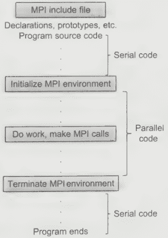

图 10.1

`MPI` 程序的的一般结构。

示例 10.1，“基础 `MPI` 程序”通过让每个 `MPI` 进程打印其秩（`rank`），展示了该框架的 C语言实现：

### 示例 10.1

```c
#include "mpi.h"
#include <stdio.h>
int main(int argc, char *argv[])
{
    int numtasks, rank, ret;

    ret = MPI_Init(&argc,&argv);
    if (ret != MPI_SUCCESS) {
        printf("Error in MPI_Init()!\n");
        MPI_Abort(MPI_COMM_WORLD, ret);
    }

    MPI_Comm_size(MPI_COMM_WORLD,&numtasks);
    MPI_Comm_rank(MPI_COMM_WORLD,&rank);
    printf("Number of tasks=%d My rank=%d\n", numtasks,rank);

    /* 执行一些工作 */

    MPI_Finalize();
}
```

`MPI` 通常由系统管理员安装和配置。请参阅集群文档了解如何编译和运行此应用程序。

例如，NVIDIA 在示例 10.2，“simpleMPI SDK 示例中的 NVIDIA 注释”中针对构建其 `simpleMPI` SDK 提出了建议：

### 示例 10.2

- `simpleMPI.cpp`: 主程序，在 Linux/Mac 平台上使用 `mpicxx` 编译 - 在 Windows 平台上，请下载 Microsoft HPC Pack SDK 2008 *


若要在同一文件中使用 CUDA 和 MPI 构建应用程序，示例 10.3，“用于构建 basicMPI.cu 的 nvcc 命令行”中的 `nvcc` 命令行在 Linux 下可有效。该方法将其与 MPI 库链接：

### 示例 10.3

```
nvcc -I$MPI_INC_PATH basicMPI.cu -L$MPI_LIB_PATH -lmpich -o basicMPI
```

通常使用 `mpiexec` 来启动 MPI 应用程序。某些旧版实现使用 `mpirun`。示例 10.4 显示了在使用两个 MPI 进程运行示例时的命令和输出：

### 示例 10.4

```
$ mpiexec -np 2 ./basicMPI
Number of tasks=2 My rank=1
Number of tasks=2 My rank=0
```

## 主从架构 (Master-Slave)

MPI 程序中一种常见的设计模式是主从架构。通常将秩为 0 的进程定义为主节点（master）。该进程随后指导所有其他进程的活动。示例 10.5，“主从 MPI 代码段”中的代码展示了如何结构化主从 MPI 代码：

### 示例 10.5

```
MPI_Comm_size(MPI_COMM_WORLD,&numtasks);
MPI_Comm_rank(MPI_COMM_WORLD,&rank);
if(rank == 0)
    //在此处放置主节点代码
else{
    // 在此处放置从节点代码
}
```

本章使用了主从编程模式。MPI 还支持许多其他设计模式。更多信息请查阅互联网或 MPI 相关的书籍。一本很好的参考书是《Using MPI》(Gropp, Lusk, & Skjellium, 1999)。

## 点对点基础知识

MPI 点对点通信在两个不同的 MPI 进程之间发送消息。一个进程执行操作，而另一个进程执行匹配的读取操作。MPI 保证每条消息都会无错误地到达。使用 MPI 时必须小心，因为当发送和接收操作不匹配时会发生死锁。死锁意味着发送或接收进程在另一个进程完成操作之前都无法进行，而当发送和接收操作不匹配时，这种完成永远不会发生。CUDA 通过共享内存在线程块的线程之间共享数据来避免死锁。这让 CUDA 程序员无需显式地匹配读和写操作，但仍需要程序员确保数据已得到适当更新。

## 表 10.1 MPI 标准要求的数据类型

| C 数据类型 | | Fortran 数据类型 |
| :--- | :--- | :--- |
| `MPI_CHAR` | signed char | character(1) |
| `MPI_SHORT` | signed short int | |
| `MPI_INT` | signed int | `MPI_INTEGER` integer |
| `MPI_LONG` | signed long int | |
| `MPI_UNSIGNED_CHAR` | unsigned char | |
| `MPI_UNSIGNED_SHORT` | unsigned short int | |
| `MPI_UNSIGNED` | unsigned int | |
| `MPI_UNSIGNED_LONG` | unsigned long int | |
| `MPI_FLOAT` | float | `MPI_REAL` real |
| `MPI_DOUBLE` | double | `MPI_DOUBLE_PRECISION` double precision |
| `MPI_LONG_DOUBLE` | long double | |
| | `MPI_COMPLEX` complex | |
| | `MPI_DOUBLE_COMPLEX` double complex | |
| | `MPI_LOGICAL` logical | |
| `MPI_BYTE` | 8 binary digits | `MPI_BYTE` 8 binary digits |
| `MPI_PACKED` | 用于配合 `MPI_Pack()`/`MPI_Unpack()` 使用 | 用于配合 `MPI_Pack()`/`MPI_Unpack()` 使用 |

`MPI_Send()` 和 `MPI_Recv()` 是用于两个 MPI 进程间通信的常用阻塞方法。这意味着进程将等待直到完整消息被正确发送，而接收进程在等待正确接收完整消息期间将处于阻塞。更复杂的通信方法可以在这两种方法的基础上构建。

消息大小由 MPI 数据类型的计数和数据类型决定。为了可移植性，MPI 定义了基础数据类型。表 10.1 列出了标准要求的数据类型。

## MPI 如何通信

MPI 可以根据网络通信硬件利用优化的数据路径来发送和收接收消息。例如，运行在计算节点内的 MPI 应用程序可以通过快速共享内存进行通信，而不是通过物理网卡 (NIC) 发送数据。

通过与供应商和软件组织的协作，NVIDIA 创建了 GPUDirect 以加速 GPU 计算。这种理念非常简单：获取传递给 `MPI_Send()` 的 GPU 数据并移动到 `MPI_Recv()` 使用的 GPU 内存。这一过程如图 10.2 所示。尽管概念简单，但实现需要供应商、驱动程序、操作系统和硬件的协作。

InfiniBand (IB) 是 HPC 中常用的高速、低延迟链路。它的设计具有扩展性，并应用于许多最大的超级计算机中。Mellanox 是知名的 InfiniBand 产品供应商。

NVIDIA 列出了 Linux 内核、NVIDIA 驱动和 Mellanox 驱动中的更改：

- Linux 内核：支持不同驱动间的共享。Linux 内存管理器 (MM) 允许 NVIDIA 和 Mellanox 共享。
- NVIDIA 驱动：CUDA 库分配的内存由 NVIDIA 驱动管理。我们添加了修改将这些页面标记为共享，以便内核 MM 识别。
- Mellanox 驱动：我们修改了 Mellanox Infiniband 驱动以与 Tesla 驱动共享。此外，Mellanox 驱动注册了特殊回调，允许共享内存的其他驱动在运行时对共享缓冲区进行的任何更改进行通知，以便 Mellanox 驱动相应使用这些内存。

结果是发送和接收缓冲区之间的直接数据路径，使 MPI 性能提升了 30%。10.2 显示注册内存区域可以直接传输到设备驱动的缓冲区中。发送主机的 NIC 和设备驱动都了解此缓冲区，这使得 NIC 无需主机处理器即可通过网络发送数据。同样，接收主机的设备驱动和 NIC 拥有共同缓冲区。当 GPU 驱动通知数据已到达时，数据会被传输到接收 GPU（图 10.2 中的 GPU2）。

CUDA 开发者在此模型中有两种分配内存的方式：

- `cudaHostRegister()`。
- 使用 4.0 版本驱动，只需设置环境变量 `CUDA_NIC_INTEROP=1`。这将允许驱动为 `cudaMallocHost()` 使用兼容 IB 驱动的替代路径。无需使用 `cudaHostRegister()`。

## 带宽

网络带宽是运行分布式计算的挑战。表 10.2 列出的带宽显示，大多数网络互连的传输传输速度远慢于 PCIe 总线。（QDR 代表四倍速率 Infiniband。DDR 和 SDR 分别代表双倍速率和单倍速率。）

> ¹ OpenFabrics Enterprise Distribution.

# 表 10.2 数据可访问性，包括 InfiniBand 消息

| 数据访问 | 内存类型 | 带宽 |
| --- | --- | --- |
| SM 内部 | 寄存器内存 | ≈8,000 GB/s |
| SM 内部 | 共享内存 | ≈1,600 GB/s |
| GPU | 全局内存 | 177 GB/s |
| PCIe | 映射内存 | ≈8 GB/s 单向 |
| MPI | 12x InfiniBand | 12 GB/s |
| | | 6 GB/s |
| | | 3 GB/s |
| MPI | 4x InfiniBand | 4 GB/s |
| | | 2 GB/s |
| | | 1 GB/s |
| MPI | 1x InfiniBand | 1 GB/s |
| | | 0.5 GB/s |
| | | 0.25 GB/s |

旨在部署分布式 MPI 应用。遗憾的是，用户往往倾向于将性能低下归咎于应用程序，而不是硬件。

## 平衡比例 (BALANCE RATIOS)

判断一个应用程序或算法是否能在网络上有效运行是一项挑战。当然，最准确的方法是迁移代码并进行基准测试。但由于缺乏资金和时间，这可能是不可行的，也可能导致许多无用用功。

平衡比例是一种常识性方法，可以对应用程序或算法的性能提供合理的估算，而无需首先迁移应用程序。这些指标也用于在采购过程中评估硬件系统的一部分 (Farber, 2007)。

平衡比例定义了可量化的系统平衡，并且在选择合适的基准测试的情况下，可以确保现有应用程序在新的计算机上运行良好。挑战在于决定需要测量哪些特征，以确定应用程序是否在 GPU 或 GPU 网络上运行良好。

大多数 GPU 应用程序都是计算密集型的，这表明所有基于 GPU 的指标都应该与浮点运算性能挂钩。这样，就可以对具有不同浮点能力的系统和显卡进行比较。带宽限制是衡量数值性能的重要指标，因为众周知全局内存、PCIe 总线和网络连接是大多数应用程序 GPU 性能的瓶颈。


如公式 10.1 所示，浮点性能与保持浮点处理器忙碌所需的可用带宽之间的比例，可以根据供应商和硬件信息计算出来。该比例很容易看出，通过四倍速率 DDR InfiniBand 连接传输数据的硬件配置，与通过 PCIe 总线传输的相同应用程序相比，其性能可能会下降一个数量级。

```
Float vs. bandwidth ratio = \frac{flop/s}{bandwidth/s} \quad (10:1)
```

这些观测结果在高性能计算（HPC）领域并不新鲜。美国科学基金会网络基础设施蓝带咨询小组在 2003 年 1 月发布的报告（即《Atkins 报告》）规定了一些与浮点性能挂钩的理想指标：

- 每个 flop/s 至少有 1 字节内存。
- 内存带宽 (byte/flop/s) ≥ 1。
- 内部网络聚合链路带宽 (bytes/flop/s) ≥ 0.2。
- 内部网络二分带宽 (bytes/flop/s) ≥ 0.1。
- 系统持续生产性磁盘 I/O 带宽 (byte/flop/s) ≥ 0.001。

请记住，《Atkins 报告》中给数值是基于其对“代表性工作负载”的定义的理想比例。您的应用程序可能有截然不同的需求。因此，评估您的应用程序以查看哪些比例目前是有效的，哪些比例需要改进是非常值得的。

使用基准测试来评估系统性能是一个很好的方法。这是用于排名全球最快计算机的 Top 500 列表背后的思想。HPC 挑战 (HPCC) 网站提供了更全面的测试套件。它还会生成一个基维亚图（Kiviat 图类似于 Microsoft Excel 中的雷达图），以根据标准的 HPC 基准测试来比较系统。一个平衡良好的系统在这些图上看起来是对称的，因为它在所有测试中都表现良好。高性能平衡系统在视觉上脱颖而出，因为它们占据了最外层的圈。不平衡系统是扭曲的，如图所示。


## 第 10 章：云环境与集群环境中的 CUDA

- 执行了其他初始化工作。
- 运行优化程序并引导从进程。
- 为了最充分地利用可用资源，主节点会与从进程一起评估目标函数。
- 大多数生产运行使用了 Powell 方法的变体，如《数值算法》（Numerical Recipes, Press, Teukolsky, & Vetterling, 2007a）中所描述的那样，或共轭梯度法（同样在《数值算法》中有所描述）。
- 在每次评估目标函数时：
  - 使用 `MPI_Bcast()` 将参数广播到所有从进程。
  - 每个从进程（同同主节点）计算目标函数的局部和。这不需要任何通信，并且可以优化为在设备上全速运行，如第 2 章和第 3 章所述。
- 执行目标函数自身的本地计算。
  - 调用 `MPI_Reduce()` 以获取所有部分结果的总和。
  - 通常，`MPI_Reduce()` 操作是经过高度优化的，并根据 $O(\log(ntasks))$ 进行扩展，其中 `ntasks` 是由 `MPI_Comm_size()` 报告的数量。
- 将目标函数的结果提供给优化方法，这将导致以下情况之一：
  - 再次评估目标函数。
  - 完成目标过程。

从进程（rank 大于 0 的进程）：

- 启动之前描述的数据加载。
- 保持在无限循环中，直到被主节点通知退出应用程序。在循环内部，每个从进程：
  - 从主节点读取参数。
  - 计算目标函数的局部和。
  - 在被请求时将部分结果发送给主节点。

### 检查扩展性

分布式应用的扩展行为是一项关键的性能指标。表现出强扩展性（strong scaling）的应用程序在固定问题规模上增加处理器数量时，运行速度更快。线性扩展（Linear scaling）是分布式应用的目标，因为应用程序的运行时间随可用计算量的数量线性扩展（例如，两倍大的系统将用一半的时间运行问题，四倍大的系统将用四分之一的时间运行问题，等等）。尴尬并行问题（Embarrassingly parallel problems）表现出线性运行行为，因为每个计算之间是相互独立的。需要通过通信来满足某些依赖关系的应用程序通常最多实现近线性扩展。例如，

$O(\log_2(N))$ 归约操作会导致扩展行为根据处理器数量缓慢偏离线性加速。图 10.5 展示了使用第 3 章讨论的 PCA 目标函数在 60,000 个处理核心上的近线性扩展。

图 10.5 报告的基于 AMD Barcelona 的 TACC Ranger 超计算机的每秒 386 万亿浮点有效率包含了所有通信开销。一个基于 500 个 GPU 的超计算机可以提供近 500 teraflops 的单精度性能。一位同事将这些称为“诚实的浮点（honest flops）”，因为它们反映了真实生产环境将交付的性能。

有效率定义于方程 10.2 中的 PCA 映射，“PCA 并行映射的有效率定义”：

```
Effective rate = \frac{TotalOpCount}{T_{broadcast} + T_{objective} + T_{reduce}} (10.2)
```

其中：

- `TotalOpCount` 是在调用目标函数时执行的浮点运算次数。
- `Broadcast` 是将参数广播到所有从进程所需的时间。
- `Objective` 是跨所有客户端计算部分结果所消耗的时间。这通常是最慢客户端所需的时间。
- `Reduce` 是部分结果归约所需的时间。

## 云计算

云计算是一种基础设施范式，它以 Web 服务的形式将计算转移到互联网。其思想本身非常简单：机构与互联网供应商签订计算资源合同，而不是通过购买和维护计算以及超级计算机硬件来自己提供这些资源。正如预期的，任何用于高性能和科学计算的资源——在性能限制范围内都是如此。有效率定义于方程 10.2 中的 PCA 映射，“PCA 并行映射的有效率定义”：

```
Effective rate = \frac{TotalOpCount}{T_{broadcast} + T_{objective} + T_{reduce}} (10.2)
```

其中：

- `TotalOpCount` 是在调用目标函数时执行的浮点运算次数。
- `Broadcast` 是将参数广播到所有从进程所需的时间。
- `Objective` 是跨所有客户端计算部分结果所消耗的时间。这通常是最慢客户端所需的时间。
- `Reduce` 是部分结果归约所需的时间。

### 数据生成

来自第 3 章的 `nlpca.cu` 示例被修改以使用 MPI 和数据加载技术。该程序只是将数量示例写入文件。文件名和示例数量在命令行中指定。

#### 示例 10.6：genData.cu 源码

```cpp
#include <iostream>
#include <fstream>
#include <cstdlib>
using namespace std;

// 获取 -1 到 1 之间的随机数
inline float f_rand() {
  return 2*(rand()((float)RAND_MAX))-1;
}

template <typename Real>
void genData(ofstream&outFile, int nVec, Real xVar) {
  Real xMax = 1.1; Real xMin = -xMax;
  Real xRange = (xMax - xMin);
  for (int i=0; i<nVec; i++) {
    Real t = xRange * f_rand();
    Real z1 = t+xVar* f_rand();
    Real z2 = t*t+xVar* f_rand();
    outfile.write((char*)&z1, sizeof(Real));
    outfile.write((char*)&z2, sizeof(Real));
  }
}

int main(int argc, char *argv[]) {
  if(argc < 3) {
    fprintf(stderr, "Use: %s nVec\n", argv[0]);
    exit(1);
  }
  ofstream outfile(argv[1], ios::out | ios::binary);
  int nVec = atoi(argv[2]);
#ifdef USE_DBL
  genData<double>(outfile, nVec, 0.1);
#else
  genData<float>(outfile, nVec, 0.1);
#endif
  outfile.close();
  return 0;
}
```

### 编译 genData.cu


程序可以保存到文件中并如示例 10.7 所示进行编译。C 预处理器变量 `USE_DBL` 指定了将以 32 位或 64 位二进制浮点数写入：

```
nvcc -D USE_DBL genData.cu -o bin/genData64
ncc genData.cu -o bin/genData32
```

数据集可以通过命令行写入。例如，示例 10.8“使用 genData.cu 创建 32 位文件”会向文件 `nlpca32.dat` 写入 1000 万 32 位浮点数。

## 示例 10.8

```
bin/genData32 nlpca32.dat 10000000
```

在运行时非常容易指定错误的文件。这个简单的示例没有提供版本大小或任何其他用于完整性检查的信息。Google ProtoBufs 项目建议用于生产质量的文件和流式数据格式。Google 几乎将该项目用于所有的内部 RPC 协议和文件格式。

第 3 章中的 `nlpcaNM.cu` 示例代码经过修改以在 MPI 环境中运行。更改非常少，但分布在整个代码中。后续讨论仅提供代码片段。完整代码可以从书籍网站下载。

变量 `nGPUperNode` 定义在文件的开头。假设每个节点上的 MPI进程数量等于每个节点上 GPU 的数量（意味着每个 GPU 对应一个 MPI 进程）。`nGPUperNode` 的值允许每个 MPI 进程正确调用 `cudaSetDevice()` 以使用不同的设备。其他拓扑结构也是可能的，包括所有 GPU 使用一个节点 MPI 进程。参见示例 10.9，“修改 nlpcaNM.cu 头部以便每个节点使用多个 GPU”

## 示例 10.9

```cpp
#include "mpi.h"
const static int nGPUperNode=2;
```

`nlpcaNM.cu` 的 `main()` 方法已根据图 10.1 所示的 MPI 框架进行了修改，使用了示例 10.1 所示的代码（参见示例 10.10，“为 nlpcaNM.cu 修改的 main() 方法”）：

## 示例 10.10

```c
#include <stdio.h>
int main(int argc, char *argv[])
```

## 代码示例 259

```c
int numtasks, rank, ret;
if (argc < 2) {
    fprintf(stderr,"Use: filename\n");
    exit(1);
}
ret = MPI_Init(&argc,argv);
if (ret != MPI_SUCCESS) {
    printf("Error in MPI_Init()!\n");
    MPI_Abort(MPI_COMM_WORLD, ret);
}
MPI_Comm_size(MPI_COMM_WORLD,&numtasks);
MPI_Comm_rank(MPI_COMM_WORLD,&rank);
printf("Number of tasks=%d My rank=%d\n", numtasks,rank);
/****** do some work ******/
#ifdef USE_DBL
trainTest<double>( argv[1], rank, numtasks);
#else
trainTest<float>( argv[1], rank, numtasks);
#endif

MPI_Finalize();
return 0;
```

`setExamples()` 方法已修改以在不同的 GPU 上分配内存。参见示例 10.11，“为 nlpcaNM.cu 修改的 setExamples 方法”。

## 示例 10.11

```cpp
void setExamples(thrust::host_vector<Real>&_h_data) {
    examples = _h_data.size()/exLen;

    // copy data to the device
    int rank;
    MPI_Comm_rank(MPI_COMM_WORLD,&rank);
    cudaSetDevice(rank&nGPUperNode);

    d_data = thrust::device_vector<Real>(nExamples*exLen);
    thrust::copy(_h_data.begin(), _h_data.end(), d_data.begin());
    d_param = thrust::device_vector<Real>(nParam);
}
```

## 第 10 章：云和集群环境中的 CUDA

示例 10.12，“为 nlpcaNM.cu 修改的 trainTest 方法”展示了数据如何从磁盘加载：

```cpp
Example 10.12
#include <fstream>
template <typename Real>
void trainTest(char* filename, int rank, int numtasks)
{
    ObjFunc<Real> testObj;
    const int nParam = testObj.nParam;
    cout << nParam << endl;

    // read the test data
    if(ifstream(filename, ios::in | ios::binary))
    {
        // position 0 bytes from end
        infile.seekg(0, ios::end);
        // determine the file size in bytes
        ios::pos_type size = infile.tellg();
        // allocate number of Real values for this task
        // (assumes a multiple of numtasks)
        int nExamplesPerGPU = size/(sizeof(Real)*testObj.len)/numtasks;
        thrust::host_vector<Real> h_data(nExamplesPerGPU*testObj.len);
        // seek to the location in the file
        infile.seekg(rank*h_data.size()*sizeof(Real), ios::beg);
        // allocate number of Real values for this task
        infile.seekg(rank*h_data.size()*sizeof(Real));
        // read bytes from the file into h_data
        infile.read((char*)h_data[0], h_data.size()*sizeof(Real));
        // close the file
        infile.close();
    }

    testObj.setExamples(h_data);
}
```

数据是如何从磁盘加载的：

在二进制流中，数据通过 `seekg` 定位并 `read` 读取到 `h_data` 缓冲区。`trainTest` 方法根据 `rank` 和 `nGPUperNode` 将数据分配到特定的 GPU 上。最后，通过 `MPI_Finalize` 结束 MPI 环境。

# 第 10 章：云环境与集群环境中的 CUDA

| 表 10.3 结果表⁷ |

| GPU 数量 | 每个目标函数的耗时 | 相比 GPU 加速 |

| :--- | :--- | :--- |

| 1 | 0.0102073 | |

| 2 | 0.0051694 | 1.98 |

```cpp
objFuncCallTime += (omp_get_wtime()) - startTime;
objFuncCallCount++;

return(sum);
```

当优化方法在主进程中返回后，应用完成。`testTrain()` 中的最后一行向所有从节点广播一个零操作码（opcode），以便它们退出。随后，主进程返回 `main()` 并正常关闭 MPI。

表 10.3 显示，在两个 GPU 上运行 MPI 版本的 `nlcaNM.cu` 可以提供近两倍的性能提升。由于两个 GPU 都在同一个系统内，因此没有使用网络。本章的示例代码在不改变代码的情况下运行，在德克萨斯先进计算中心（TACC）的 Longhorn 超级计算机集群上实现了 500 个 GPU 的近线性可扩展性。非常感谢 TACC 提供对该机器的访问。⁸

### 总结

MPI 和 GPUDirect 让 CUDA 程序员能够运行远超单个 GPU 或单系统内 GPU 集合能力的高性能应用程序。节点内部的可扩展性和性能是评估分布式方案的关键指标。表现出线性或近线性可扩展性的应用程序具有在当前及未来机器上运行的能力。例如，本章讨论的并行映射，加上第 2 章和第 3 章，现在已经有近 30 年的历史了。在设计时，每万亿次（teraflop）的算力对于即使是最大的政府研究机构也是无法企及的。今天，它可以有效地运行在 GPU 设备、集群甚至最新的超级计算机上。看到 30 年后将有多少京亿次（yottaFlops，10²⁴ flops）的算力将是非常有趣的。同时，这种映射为大规模数据挖掘和优化任务提供了一个可扩展的解决方案。

> ⁷ 维基上报告了更多当前且更广泛的结果。
> ⁸ http://computing.net/CUDAApplicationdesignanddevelopment.

# 解决实际问题的 CUDA

CUDA 让开发者能够通过 GPU 加速应用程序，速度比传统处理器快 1 到三个数量级。了解如何在 CUDA 中思考和编程是成长并成熟为熟练 CUDA 程序员过程中的必要第一步。关注互联网和技术文献，寻找提供通用解决方案和设计模式的项目，这些模式可以适用于你的项目。CUDA 是快速的，重造轮子是缓慢的。书中的章节旨在教学并为未来的应用提供一些框架。例如，第 2 章中简单的 C++ 框架实现了一个用于模式识别和优化的通用并行映射，其在 GPU 上的运行速度比高端四核处理器快 85 倍，比单核性能提升了 341 倍。第 10 章将其扩展，提供了 MPI 以运行在包含数百个 GPU 的计算集群上。 500 个 GPU 的 TACC Longhorn 集群就是一个使用这种并行映射可以提供近半千万亿次（petaflop，500,000 gigaflops）单精度浮点性能的系统。这些示例将你的 GPU 变成一个在复杂数据中寻找模式的引擎，其功能比 1996 年之前最大的超级计算机还要强大¹。数据可视化是 GPU 计算能力的自然扩展。如第 9 章所示，将 CUDA 与 OpenGL 互操作性相结合意味着数据甚至不需要离开 GPU。尽管如此，在线信息和技术文献的内容远超这些示例和本书的页数。本章为其他高级用法和编程的项目指明了方向。

不要将本章视为详尽的列表。相反，它对使用某些流行技术和软件包进行了广泛介绍，它们使用了

> ¹ 美国桑迪亚国家实验室建造了第一台能够执行超过万亿次浮点运算的超级计算机。在线信息和技术文献的内容远超这些示例和本书的页数。本章为其他高级用法和编程的项目指明了方向。

将高维数据还原到低维的技术。在本章结束时，读者将接触到：

- 力引导图
- 多维缩放（MDS）。
- 互信息
- 蒙特卡洛方法。
- 分子建模。

# 处理高维数据

我们生活在数据的时代。无论何种，答案都是无意义的。

降低维度会指数级减少搜索区域。这是为什么数据挖掘者喜欢低维空间的原因。

# PCA/NLPCA

正如第 3 章所述，自动编码器、主成分分析（PCA）和非线性主成分分析（NLPCA）是用于在低维空间表示高维数据的一些技术。第 3 章的示例代码本质上通过信息瓶颈（瓶颈神经元）传递高维数据，使得高维数据可以被重构。对于许多问题，可以使用欧式距离来计算距离。测量原始数据与重构高维数据之间的误差提供了一种衡量标准。低误差意味着投影保留了高维数据点之间的距离关系。

第 3 章的示例代码可以通过修改 `genData()` 方法来适应你自己的数据集。同样，第 10 章的数据生成器可以更改为将自己的数据写入文件。无论何种，修改 `CalcError` 将允许你定义自己的 PCA 或 NLPCA 架构。使用一个、两个或三个瓶颈神经元意味着低维数据可以使用大多数 2D 和 3D 图形包进行可视化。

关于自动编码器和其他神经网络方法的更多信息，请参阅 Geoffrey Hinton（Hinton & Salakhutdinov, 2006）以及许多人的工作。http://nlpca.org 网站是学习 NLPCA 的良好起点，特别是对于 MATLAB 用户。

# 多维缩放

多维缩放（MDS）提供了降维的另一种视角。MDS 是另一种经典方法，它将高维数据集映射到低维空间，但这样做是为了保留成对距离。经典方法已经有了许多变体。一本优秀的参考书是《多维缩放》（Cox & Cox, 2008）。

> ³ http://www.cs.toronto.edu/~hinton/-

Glimmer 软件包在 GPU 上实现了 MDS（Ingram, Munzner, & Olano, 2009）。根据数据大小，其加速比范围在传统处理器的 10–15 倍之间。源代码可以从不列颠哥比亚大学网站免费下载。^4 

## K-Means 聚类

K-means 聚类将大量事件划分为 k 个簇，每个事件都属于均值最近的簇。在当今的现实应用中，拥有十亿个点的数据集随处可见。通过 CUDA GPU 加速，惠普公司报告，包含十亿个数据点的数据集可以在几分钟内完成聚类（Wu, Zhang, & Hsu, 2009）。HP 软件声称，与在八核心上运行的高度优化纯 CPU 版本相比，性能提升了一个数量级，并且比单核运行的流行的 MineBench 基准测试（Narayanan et al., 2006）性能提升了约 300 倍。许多其他研究人员（Hong-tao, Li-li, Dan-tong, Shan-shan, & He, 2009; Ma & Agrawal, 2009; Shalom, Dash, & Tue, 2008）也报告了 K-means 上的巨大加速。

由 Serban Girouiu 编写的 K-means 免费版本可以在 GitHub 上下载。^5 据报道，它比顺序版本快 50 倍。

## 期望最大化

K-means 和 MDS 与用于高斯混合的期望最大化（EM）算法相似，相似之处在于它们都试图寻找数据中自然簇的中心，并且这两种算法都采用了迭代精炼方法。EM 算法广泛应用于信号处理和数据挖掘领域。有一种可免费下载的算法版本，报告其与参考 CPU 实现相比提升了 170 倍。^6 NVIDIA 提供了一篇论文，报告了与原生实现（naïve implementation）相比的类似加速（Kumar, Sato, & Bock, 2009）。EM 方法也可以作为此书中提供的优化框架中的函数对象（functor）来实现。本章稍后部分讨论的 CUDA-MEME 软件包是另一个可免费下载的 EM 软件包。

期望最大化算法还用于发现社交网络和生物数据中的基元（motifs）。据报道，GPU-MEME 在单个 GPU 上提供一个数量级的速度，在计算集群上提供两个数量级的速度加速（Chen, Schmidt, Weiguo, & Müller-Willer, 2008）。CUDA-MEME 是一个基于 GPU-MEME 论文的免费下载基元发现软件包⁷。

^4 http://www.cs.ubc.ca/~sfingram/glimmer/
^5 https://github.com/serban/kmeans.
^6 https://andrewharp/gnmcuda.

## 支持向量机

支持向量机（SVM）是一种用于分析数据和识别模式的流行机器学习方法。SVM 通过构建一个 N 维超平面（推广到 N 维的平面）来执行分类，该超平面能够最优地将数据分为两类。它们被用于分类和回归分析等任务。SVM 模型与神经网络密切相关。事实上，一个使用 sigmoid 核函数的 SVM 模型等同于一个双层感知器神经网络。文献中报告了在 GPU 上的加速比可达 150 倍（Catarano, Sundaram, & Keutzer, 2008）。

SVM 也可以作为此书中提供的优化框架中的因子（factor）实现。cuSVM 软件包可以从网上免费下载。该包也可以通过 R 统计语言中的 gputools 包中的 `gpuTrain()` 方法进行访问。作者报告，其加速比在最先进软件的 22 到 172 倍之间（Carpenter, 2011）。来自南京理工大学的 CUDA-SVM 软件包可以在 http://sourceforge.net 获取。另一个 SVM 软件包-all, multivsim 可以从 http://code.google.com 免费下载。

## 贝叶斯网络

贝叶斯网络是一个有向图，节点表示离散或连续的变量，弧表示相关性。贝叶斯网络的一个特点是它们可以用于推理不确定性。当与统计方法结合时：

- 因为贝叶斯模型编码了变量间的依赖关系，它可以处理数据。
- 贝叶斯网络可以用于学习因果关系，因此可以用于预测结果。
- 贝叶斯方法结合统计技术，为避免过拟合提供了一种有效的方法。

> ⁷ http://www.nvidia.com/object/
> ⁶ http://pattern.net/cuSVM.


杜克大学提供了可以通过 `MATLAB` 访问的免费贝叶斯软件。据报告，与传统处理器相比，其加速了 160 倍（Schard et al., 2010）。`BEAGLE`（Broad-platform Evolutionary General Likelihood Evaluator）是一个高性能库，可以在核心执行计算。作者报告，该技术相比 CPU 版本实现了 90 倍的加速。

## 互信息

互信息的概念源于信息论，并广泛应用于许多学科。两两互信息提供了变量之间的信息度量。通常，这种度量是用熵定义的，见公式 11.1，互信息的定义。

```
M(i, j) = \sum P(s_i, s_j) \log P(s_i, s_j)/P(s_i)P(s_j)
```

在医学图像分析中，互信息被用于多态配准。`CUDA` 提供了 50 倍的加速，实现了医学图像的实时配准（Ines & Hirschüller, 2008）。互联网上有许多免费下载的实现。`CUDA-MI` 是其中之一；另一个是澳大利亚国立版本的。

> ⁹ http://www.stat.edu/research/software/

¹⁰ http://beagle-lib.googlecode.com.

¹¹ http://beast.ac.uk.

## 力直向图

许多基于图的问题提供了图中节点之间的信息。当人们互相发送信息、打电话和前往不同地点时，就会产生此类问题。这类可视化具有挑战性。关于图绘制的优秀综述可以在 Di Battista, Eades, Tamassia 和 Tollis (1999) 以及 Brandes (2001) 中找到。

在没有其他信息的情况下，基于弹簧定律的力直向图布局算法被用于创建良好的图布局，如 Eades 的弹簧方程（Eades, 1984）所示，并被 Fruchterman 和 Reingold 改用于模拟物理的退火算法（Fruchterman & Reingold, 1991）。

图放置和布局仍然是一个活跃领域，Frishman 和 Ayellet（Frishman & Ayellet, 2008）使用 GPU 加速增量布局，提供了比 CPU 快 17 倍的速度。Goyal 等人（Goyodial, Heberock, Garland, & Hart, 2009）使用快速多极方法（FMM）的变体来估计力直向布局中的远距离斥力。（FMM 方法是为了加速 N 体问题中的远距离计算而开发的。）多极计算通过基于 GPU 的 k-d （一种用于组织 k 维空间点的空间划分数据结构）得到了有效支持。

+   12 https://sites.google.com/site/liuweiguohome/cuda-mi.

13 https://users.ccs.anu.edu/~ramtin/cuda.htm.

GPU 方法通过 `CUDA` 在几秒钟内绘制具有数十万个顶点的图表。

## 蒙特卡洛方法

蒙特卡洛方法依赖于重复随机采样来计算结果。它们通常被用于模拟物理和数学系统，特别对于模拟具有许多自由度的系统（如流体）进行现象建模，以及对于输入具有显著不确定性的系统（如业务中的风险计算）非常有用。Hubbard 指出，蒙特卡洛对失败、成本超支和进度超支的预测通常优于人类直觉或其他替代的“软”方法（Hubbard, 2009）。

蒙特卡洛方法在数学中被广泛用于评估具有复杂边界条件的多维定积分。例如，梅特罗波算法（Metropolis algorithm）是一种蒙特卡洛方法，用于从难以直接采样的概率分布中获取随机样本序列。该序列可以用于近似分布或计算积分以获得期望值。

我在洛斯阿拉莫斯国家实验室理论部门工作期间，我有幸认识了梅特罗波，这证明了并行计算如何间接地丰富你的生活。他是一个非常出色的人。梅特罗波算法被认为是二十世纪对科学和工程发展与实践影响最大的十大算法之一（Andrieu, de Freitas, Doucet, & Jordan, 2023; Beichel & Sullivan, 2000）。对于某些应用，马尔可夫链蒙特卡洛（MCMC）模拟是已知的在合理时间内提供解决方案的唯一通用方法（Andrieu, de Freitas, Doucet, & Jordan, 2003; Dyer, Frieze, & Kannan, 1991; Jerrum & Sinclair, 1996）。

大量实现蒙特卡洛方法的 `CUDA` 项目证明了 `CUDA` 的强大以及对该技术的兴趣。在多 GPU 实现中，速度提升了 100 倍到 1,000 倍以上。一个很好的入门参考书籍是《统计计算的 GPU 编程：大规模并行大规模混合物研究》（Suchard, Wang, Chang, Frelinger, Cron, & West, 2010）。

有多个蒙特卡洛软件包可以免费下载：

- `MCX`（蒙特卡洛极值版）包声称速度提升了 300 到 400 倍（Eng & Bao, 2009）。代码可以 `http://mcx.sourceforge.net` 免费下载。

## 量子化学

`GPUSS`（用于数据分析的 GPU 随机模拟）由牛津大学免费提供。作者在 NVIDIA Community Showcase 上报告了 500 倍的加速。该软件包可以通过 `PyCUDA` 访问用于统计 GPU 计算。请访问牛津大学网站查看使用该软件包的详细出版列表。

## 分子建模

分子建模在使用 `CUDA` 后也取得了显著的性能益处（Eastman & Pande, 2010; Hampton, Agarwal, Alam, & Crozier, 2010; Roberts, Stone, Sepulveda, Hwu, & Luthey-Schulten, 2009; Rodrigues, Hardy, Stone, Schulten, & Hwu, 2008），包括以下软件包：

- `NAMD/VMD` 分子建模系统（Humphrey, Dalke, & Schulten, 1996; Laxmikant 等, 1999; Stone, Hardy, Ufimsev, & Schulten, 2010）

- `HOOMD-Blue`（Anderson, Lorenz, & Travestet, 2008）专为 GPU 从零开始编写。

- 用于分子动力学的 `OpenMM` 库。作者报告比商用处理器快了 100 倍。

所有这些软件包都可以从互联网免费下载。论文《GPU 加速分子建模的成熟》（Stone, Hardy, Ufimsev, & Schulten, 2010）是对分子建模感兴趣的人所需要的。`CUDA` 和 GPU 计算还刺激了静电新近似方法的发展，这些方法可以提供高达三个数量级的加速（Anandakrishnan 等, 2011）。在过去的几年里，分子建模是 `CUDA` 研究中充满活力且不断发展的领域。

## 量子化学

量子化学应用量子力学来解释和预测化学过程的行为。理解物质的电子结构是材料设计以及创建高效电池、膜、太阳能电池板和许多常用材料的重要问题。许多方法都是对薛定谔方程的近似解。

## 第 11 章：Quantum Espresso

`Quantum ESPRESSO` 是一个基于密度泛函理论、平面波和伪势（包括规范守和超软伪势）的免费套件。作者在 NVIDIA Community Showcase 上报告了 500 倍的加速。该软件包可以通过 `PyCUDA` 访问用于统计 GPU 计算。请访问牛津大学网站查看使用该软件包的详细出版列表。

量子化学应用量子力学来解释和预测化学过程的行为。理解物质的电子结构是材料设计以及创建高效电池、膜、太阳能电池板和许多常用材料的重要问题。许多方法都是对薛定谔方程的近似解。

大量实现蒙特卡洛方法的 `CUDA` 项目证明了 `CUDA` 的强大以及对该技术的兴趣。在多 GPU 实现中，速度提升了 100 倍到 1,000 倍以上。一个很好的入门参考书籍是《统计计算的 GPU 编程：大规模并行大规模混合物研究》（Suchard, Wang, Chang, Frelinger, Cron, & West, 2010）。

有多个蒙特卡洛软件包可以免费下载：

- `MCX`（蒙特卡洛极值版）包声称速度提升了 300 到 400 倍（Eng & Bao, 2009）。代码可以 `http://mcx.sourceforge.net` 免费下载。

## 量子化学

`GPUSS`（用于数据分析的 GPU 随机模拟）由牛津大学免费提供。作者在 NVIDIA Community Showcase 上报告了 500 倍的加速。该软件包可以通过 `PyCUDA` 访问用于统计 GPU 计算。请访问牛津大学网站查看使用该软件包的详细出版列表。

## 分子建模

分子建模在使用 `CUDA` 后也取得了显著的性能益处（Eastman & Pande, 2010; Hampton, Agarwal, Alam, & Crozier, 2010; Roberts, Stone, Sepulveda, Hwu, & Luthey-Schulten, 2009; Rodrigues, Hardy, Stone, Schulten, & Hwu, 2008），包括以下软件包：

- `NAMD/VMD` 分子建模系统（Humphrey, Dalke, & Schulten, 1996; Laxmikant 等, 1999; Stone, Hardy, Ufimsev, & Schulten, 2010）

- `HOOMD-Blue`（Anderson, Lorenz, & Travestet, 2008）专为 GPU 从零开始编写。

- 用于分子动力学的 `OpenMM` 库。作者报告比商用处理器快了 100 倍。

所有这些软件包都可以从互联网免费下载。论文《GPU 加速分子建模的成熟》（Stone, Hardy, Ufimsev, & Schulten, 2010）是对分子建模感兴趣的人所需要的。`CUDA` 和 GPU 计算还刺激了静电新近似方法的发展，这些方法可以提供高达三个数量级的加速（Anandakrishnan 等, 2011）。在过去的几年里，分子建模是 `CUDA` 研究中充满活力且不断发展的领域。

## 量子化学

量子化学应用量子力学来解释和预测化学过程的行为。理解物质的电子结构是材料设计以及创建高效电池、膜、太阳能电池板和许多常用材料的重要问题。许多方法都是对薛定谔方程的近似解。

## 交互式工作

`GPGPU` 为专用用途和交互式工作流提供了额外收益，因为它们被设计为接入仪器。Bianchi 和 Leonardo 报告了 350 倍的加速，使他们将实时生成整合到光学操作中（Bianchi & Leonardo, 2010）。

## 丰富的项目

之前的示例代表了许多从 `GPGPU` 技术中获得显著收益的研究工作。生物信息学（Schmidt, 2010）、系统生物学（Dematte & Prandy, 2011）、多细胞生物建模（Christley, Lee, & Nie, 2010）、化学和蛋白质搜索（Haque, Pande, & Walters, 2010）；Stivala, Stuckey, & Wirth

基于 `CUDA` 的应用程序丰富使得本章并不完整。意图是提供一些（绝对不是全部！）重要概念和项目的链接。大多数引用的项目都有可以下载、构建和使用的软件。学习 `CUDA` 基础可以很快完成。成熟的过程要长得多，并涉及阅读论文、检查源代码以及与同行交流。

正如第 8 章所述，一些用于促进科学计算的通用库，如 NVIDIA 的 `CUBLAS` 和 `CUFF` 库，以及 `MAGMA`（GPU 和多核架构上的矩阵代数）混合 CPU/GPU 库也包含在 SDK 中或免费提供。

### 总结

本章的重点是可以从互联网免费下载的项目。市场上还有许多待售项目。例如，`AMBER` 是一种可以在 GPU 上运行的商业分子动力学应用$^{15}$。商业药物发现软件也运行在 GPU 上，例如 OpenEye 科学软件$^{16}$。除了学习 `CUDA` 之外，此类产品表明了商业 `CUDA/GPU` 开发的工作机会，以及创立自己技术公司的机会。

15 http://ambermd.org/group/

16 http://eyesopen.com.

## 应用关注：流媒体视频

`CUDA` 允许开发者编写可以与用户进行实时交互的应用程序。本章修改了第 9 章的源代码，以处理和显示实时视频流。对于没有网络摄像头的用户，可以通过 TCP 连接从其他机器导入实时视频，或者使用磁盘上的电影文件。除了纯粹的趣味性，使用 `CUDA` 进行实时视频处理还增强现实、游戏、平视显示（HUD）、人脸以及通用视觉识别任务开启了新市场的大门。本章的示例代码介绍了从背景杂色中分离人脸的基础知识、使用 Sobel 滤波器进行边缘检测以及对实时视频流进行三维变形。支持 `CUDA` 的 GPU 的万亿（teraflop）计算能力现在让每个买得起网络摄像头和游戏 GPU 的人都有了编写自己的应用程序与计算机进行视觉交互的能力。这包括全球范围内的青少年、学生、教授和大型研究机构。

通过书中讨论的机器学习技术，读者已经拥有了超越视觉算法“菜谱式”实现所需的工具。人们可以进行宏大的思考，因为书中介绍的机器学习技术可以从单个 GPU 扩展到世界上最大的超级计算机。然而，机器学习的真正价值在于它如何将海量（可能达 TB ）的数据集封装成微小的参数化方法，这些方法可以在最小的手机和平板上运行。

在本章结束，读者将对以下内容有基本的理解：

- 在 Windows 和 UNIX 计算机上使用 `CUDA` 管理实时数据

- 人脸分割

- Sobel 边缘检测

## 第 12 章：应用关注：流媒体视频

- 使用 3D 效果对实时视频图像数据进行变形

- 如何从流媒体数据为机器学习创建数据集

### 机器视觉的主题

机器视觉是一个成熟的领域，拥有大量的出版材料。新颖之处在于 GPU 为交互式视觉计算带来的计算能力。回想，第一台万亿级超级计算机于 1996 年 12 月成为计算机科学精英的标配。即使是昂贵的 NVIDIA 游戏 GPU 也可以通过编程提供更高的性能。

廉价的网络摄像头和可以免费获取的软件彻底改变了人们基于实时视频流进行实验和开发产品的能力。学生不再局限于实验室，可以使用来自网络摄像头的视频流或老师提供的电影文件来完成作业。当然，这可以在使用同一台硬件进行刺激的游戏游戏间隙发生。鉴于 SoC（系统上芯片）技术（如用于手机和平板的 Tegra 多内核芯片组）的快速发展，未来这些作业可能可以在手机上完成。例如，手机已被用于跟踪脸（Tresadern, Ionita, & Cootes, 2011）。¹

本章提供了一个学习框架，并提供了几个示例内核，这些内核可以作为通视觉特效、视觉识别和增强现实的基石，从而将视觉研究的世界带到你的个人电脑或笔记本电脑上。

互联网上有许多资源，包括许多免费的计算机视觉项目，其中包含：

- `OpenVIDIA`：`OpenVIDIA` 软件包提供了使用 `OpenGL`、`C` 和 `CUDA-C`² 编写的、可免费下载的计算机视觉算法。`CUDA` 视觉工作台是 `OpenVIDIA` 的一部分，提供了一个基于 Windows 的应用程序，该程序在一个便于交互实验的框架中包含许多常用的图像处理例程。额外的 `OpenVIDIA` 项目还包括立体视觉、光流和特征跟踪算法。

- `GPUVision`：这是由格拉茨工业大学计算机图形与视觉研究所创立的一个项目。他们提供了公开的基于 `CUDA` 的视觉算法。

¹ 可以在 `http://personalpages.manchester.ac.uk/staff/phil.tresadern/proj_facerec.htm` 查看视频。

² `http://openvidia.sourceforge.org`。

### 机器视觉的主题

- `OpenCV`（开源计算机视觉）是一个用于实时计算机视觉的编程函数库。该软件对学术和商业用途均免费。`OpenCV` 拥有 C++、C、Python 版本，并在 Windows、Linux、Android 和 Mac 上运行。该库拥有超过 500 种算法，涵盖从艺术到机器人的各种领域。

### 3D 效应

使用 `$3\times3$` 卷积掩码对图像进行三维变形。第 9 章的梯度方法在 3D 空间中可以被修改。为了实现 3D 效应，每个像素的红、绿、蓝颜色信息在映射到 3D 表面时会扭曲。图 12.1 显示了映射到 3D 表面的视频流的彩色版本。


图 12.1 变形到 3D 表面的图像。

## 肤色区域分割

从视频数据中实时分离肤色区域在许多视觉应用中起着重要作用，包括视频控制、人脸跟踪、手势分析。皮肤颜色被证明是识别人脸的有效线索，因为在不同的光照条件下，不同族裔的 RGB 值变化很大。相反，视觉研究人员发现，归一化颜色（RGB）在某些假设下，对于哑光表面，相对于光源的变化是不变的。这种表示方法是检测人脸的鲁健的步骤（Kakamunu, Makrogian, 2007; Znevhets, Sazonov, & Andreva, 2003）。Sedleck 承认归一化颜色空间中人脸占据的区域是一个椭圆，本章的示例代码使用了矩形区域以保持示例简单。尽管如此，图像处理流水线中的第一步是有效的，如图 12.2 所示。

### 边缘检测

寻找边缘是图像处理中的基础问题，因为边缘定义了边界并代表了图像中重要的结构属性。边缘检测的方法有很多。Sobel 方法或 Sobel 滤波器是一种基于梯度的方法，它寻找图像阶阶导的强变化。

Sobel 边缘检测器使用一对 `$3\times3$` 卷积掩码，一个估计 x 方向的梯度，另一个估计 y 方向的梯度。这种检测器非常适合映射到 `CUDA`，因为每个线程可以将 `$3\times3$` 卷积掩码应用于其像素及相邻像素上。表 12.1 和表 12.2 包含了每个方向 Sobel 掩码的值。

梯度的近似幅度 G 可以通过公式计算：

```
|G| = |G_x| + |G_y|
```

图 12.3 是使用 Sobel 滤波器创建的彩色反转灰度图像。

# 表 12.1 x方向 Sobel 卷积掩码 ($G_x$)

| | 0 | +1 |

|---|---|---|

| -1 | 0 | | |

| -2 | 0 | +2 |

| -1 | 0 | +1 |

# 表 12.2 y方向 Sobel 卷积掩码 ($G_y$)

| +1 | +2 | +1 |

|---|---|---|

| 0 | 0 | 0 |


| -1 | -2 | -1 |


图 12.3

一个演示使用 Sobel 滤波器进行边缘检测的图像。

### FFmpeg

FFmpeg 是一个免费的开源程序，可以录制、转换和流传输各种格式的数字音频视频。它被描述为多媒体领域的瑞士军刀，因为可以在大多数常用格式之间进行转换。“FFmpeg”的名称源于 MPEG 视频标准加上代表快进（fast forward）的“FF”。源代码可以从 `http://ffmpeg.org` 免费下载，并可以在大多数操作系统、计算平台和微处理器指令集下进行编译。

FFmpeg 命令行驱动的应用 `ffmpeg` 在本章中被使用，因为大多数读者都能下载并使用适用于其系统的可用版本。如图 12.4 所示，`ffmpeg` 用于捕获网络摄像头或其他视频设备的输出，并将其转换为 `rgb24` 格式，该格式使用单独的红、绿、蓝 8 位值表示图像中的每个像素。`testLive` 示例程序从 TCP 套接字读取数据流，并将其写入 GPU 缓冲区以供 CUDA 使用。图 12.4 显示了 `testLive` 的代表性图像，包括视频流的 3D 变形、在 3D 坐标系中显示的平面图像、人脸与背景的分离以及使用 Sobel 滤波器的实时边缘检测。

### 图 12.4

视频数据流。

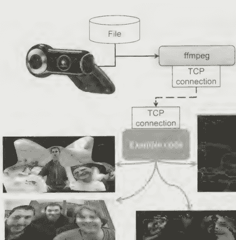

使用 `ffmpeg` 应用的优点是无需编程即可转换可以发送到 GPU 的视频数据。缺点是从压缩格式到 `rgb24` 的转换会极大地增加通过 TCP 套接字发送的数据量。因此，建议将 `rgb24` 的转换在包含 GPU 的系统上进行。更高效的实现方法是使用 FFmpeg 库直接读取压缩视频流，并在示例源码中将其转换为 `rgb24`。这样，就可以避免通过套接字传输大量的 `rgb24` 数据。

那些需要从远程网络摄像头流传输数据的人应该：

- 修改示例以在应用程序内部读取并执行视频转换。
- 使用 TCP 中继程序从远程站点读取压缩视频流，并将其传递给运行在包含 GPU 系统上的 `ffmpeg` 实例。其中一个选项是 `socat`（Socket CAT），它是一个可以免费下载、运行在大多数操作系统上的通用型中继应用程序。

以下 bash 脚本演示了如何向 `localhost` 的 32000 端口写入 640×480 的 `rgb24` 图像流。`localhost` 是需要在同一台计算机上通信的应用程序所使用的环回设备的名称。环回设备相当于以太网接口，不会在 TCP 设备上传输信息。注意，`ffmpeg` 命令行界面随时间不断演进，因此这些脚本在以后可能需要修改。

#### 从 Linux 网络摄像头流传输（示例 12.1，“Linux 摄像头捕获”）

### 示例 12.1

```bash
FFmpeg=ffmpeg
DEVICE="-f videolinux2 -i /dev/video0"
PIX="-f rawvideo -pix_fmt rgb24"
SIZE="-s 640x480"

$FFmpeg -an -r 50 $SIZE $PIX tcp:localhost:32000
```

#### 从 Windows 网络摄像头流传输（示例 12.2，“Windows摄像头捕获”）

### 示例 12.2

```bash
../ffmpeg-git-39de9b-win32-static/bin/ffmpeg.exe -r 25 -f vfwcap -i 0 -f rawvideo -pix_fmt rgb24 -s 640x480 tcp:localhost:32000
```

#### 从文件流传输（示例 12.3，“从文件传输”）

### 示例 12.3

```bash
FFmpeg=ffmpeg
# 可以任何文件名或格式：myfile.avi, myfile.3gp, ...
FILE="myfile.mp4"
PIX="-f rawvideo -pix_fmt rgb24"
SIZE="-s 640x480"

$FFmpeg -i $FILE $SIZE $PIX tcp:localhost:32000
```

从文件传输将以 `ffmpeg` 转换的最快速度运行，这通常比实时快得多。

### 直流应用

直播应用程序通过队列 CUDA 内核来执行图像分析和动画效果。哪些内核被加入队列取决于用户输入。如图 12.5 所示，只有当 `tcpRead()` 返回非零结果时（表示已读取到新帧数据），新数据才会跨越 PCIe 总线传输到 GPU 上的 `liveData` 缓冲区。如前所述，`tcpRead()` 可能会因为超时返回 0，在这种情况下不需要传输新数据。

由于内核流水线会修改 `colorVBO` 的颜色，因此在流水线开始之前，会将原始视频数据从 `liveData` 拷贝到 `colorVBO`。由于数据仅在 GPU 内部移动，该流水线非常快。随后调用 `launch_kernel()` 方法，根据键盘回调函数中用户按键设置的标志来调度各种内核。

`tcpRead()` 的超时意味着在从流中读取新图像之间，`launch_kernel()` 流水线可以被多次调用。跨 `kernelWave()` 产生动画波的动画内核依赖这种异步行为来创建其视觉效果。虽然在本示例中没有用到，但 `animTime` 变量可以控制动画的速度和行为。

### kernelWave(): 一个动画内核

`kernelWave()` 方法实现了第 9 章中讨论的动画正弦 3D 表面。在本示例（示例 12.6）中，图像中的每个像素被视为 3D 网格中顶点的颜色。这些顶点颜色存储在当前帧直播图像的 `colorVBO` 中。通过三角形进行渲染时，无论图像如何调整大小，都能生成颜色平滑的表面。为了演示，还可以根据用户的键盘输入，使用线条或点来渲染表面。

### 示例 12.6

```c
// live stream kernel (Rob Farber)
// 用于按正弦波模式修改顶点位置的简单内核
__global__ void kernelWave(float4* pos, uchar4*colorPos,
    unsigned int width, unsigned int height, float time)
{
    unsigned int x = blockIdx.x*blockDim.x+threadIdx.x;
    unsigned int y = blockIdx.y*blockDim.y+threadIdx.y;

    // calculate coordinates
    float u = x /(float)width;
    float v = y / (float) height;
    u = u*2.0f - 1.0f;
    v = v*2.0f - 1.0f;

    // calculate simple sine pattern
    float freq = 4.0f;
    float w = sinf(u*freq + time) * cosf(v*freq + time) * 0.5f;

    // write output vertex
    pos[y*width+x] = make_float4(u, w, v, 1.0f);
}
```

### kernelFlat(): 在平面表面上渲染图像

`kernelFlat()` 仅指定了一个用于渲染的平面表面。这允许在不受正弦表面干扰的情况下查看其他渲染效果。请参示例 12.7，“Part 2 of kernelVBO.cu”；

### 示例 12.7

```c
__global__ void kernelFlat(float4* pos, uchar4 colorPos,
unsigned int width, unsigned int height)
{
unsigned int x = blockDim.x + threadIdx.x;
unsigned int y = blockDim.y + threadIdx.y;

// calculate uv coordinates
float u = x / (float) width;
float v = y / (float) height;
u = u*2.0f - 1.0f;
v = v*2.0f - 1.0f;

// write output vertex
pos[y*width+x] = make_float4(u, 1.0f, v, 1.0f);
}
```

### kernelSkin(): 仅保留肤色区域

这仅计算图像中每个像素的归一化红色（PureR）和绿色（PureG）值。如果这些值落在肤色矩形范围内，则保留原始 RGB 颜色。否则，将其设置为黑色。请参示例 12.8，“Part 3 of kernelVBO.cu”；

### 示例 12.8

```c
__global__ void kernelSkin(float4* pos, uchar4 colorPos,
unsigned int width, unsigned int height,
lowPureG, int highPureG,
lowPureR, int highPureR);
```


```c
unsigned int x = blockIdx.x*blockDim.x + threadIdx.x;
unsigned int y = blockIdx.y*blockDim.y + threadIdx.y;
int r=colorPos[y*width+x];
int g=colorPos[y*width+x];
int b=colorPos[y*width+x];
int pureR = 255*((float)r/(r+g+b));
int pureG = 255*((float)g/(r+g+b));
if((pureG > lowPureG) && (pureG < highPureG))
&& (pureR > lowPureR) && (pureR < highPureR))
colorPos[y*width+x] = make_uchar4(0,0,0,0);
```

### kernelSobel(): 简单的 Sobel 探测器

示例 12.9，“Part 4 of kernelVBO.cu”中的内核简单应用了本章开头讨论的 Sobel 探测器：

### 示例 12.9

```c
__device__ unsigned char gray(const uchar4 &pix);
// convert to 8-bit grayscale
return 0.3f*pix.x+0.5f*pix.y+0.1f*pix.z;
__global__ void kernelSobel(float4 *pos, uchar4 *colorPos, uchar4 *newPix,
unsigned int width, unsigned int height)
{
unsigned int x = blockIdx.x*blockDim.x + threadIdx.x;
unsigned int y = blockIdx.y*blockDim.y + threadIdx.y;
const int sobelV[3][3] = {{-1,-2,-1},{0,0,0},{1,2,1}};
const int sobelH[3][3] = {{-1,0,1},{-2,0,2},{-1,0,1}};
int sumH=0, sumV=0;
if(x > 0 && x < (width-1) && y > 0 && y < (height-1)) {
for(int i = -1; i < 2; i++) {
for(int k = -1; k < 2; k++) {
int g = gray(colorPos[(y+k)*width+(x+k)]);
sumH += sobelH[i+1][k+1] * g;
sumV += sobelV[i+1][k+1] * g;
}
}
unsigned char p = abs(sumH)/8+abs(sumV)/8;
newPix[y*width+x] = make_uchar4(p,p,p);
} else {
    newPix[y*width+x] = make_uchar4(0,0,0);
}
}
```

### launch_kernel() 方法

如图 12.5 所示，`launch_kernel()` 方法队列内核调用以执行用户请求的转换。该方法是为了清晰性而不是灵活性。使用静态指针 `newPix` 是正确的，但并不理想。它是为了演示读者如何为自己的方法分配临时空间。Sobel 过滤器完成后，临时数据通过设备传输拷贝到 `colorVBO`。请参示例 12.10，“Part 5 of kernelVBO.cu”：

### 示例 12.10

```c
int PureR[2], PureG[2], dowave,doSkin,doSobel;
// 设置内核的 __global__ 调用
extern "C" void launch_kernel(float4* pos, uchar4* colorPos,
    unsigned int mesh_width, unsigned int mesh_height, float time)
// 执行内核
dim block(8, 8, 1);
dim3 grid(mesh_width / block.x, mesh_height / block.y, 1);
if(dowave)
    kernelWave<<<grid, block>>>(pos, colorPos, mesh_width,
        mesh_height, time);
else
    kernelFlat<<<grid, block>>>(pos, colorPos, mesh_width,
        mesh_height);
if(doSkin)
    kernelSkin<<<grid, block>>>(pos, colorPos, mesh_width,
        mesh_height);
if(doSobel) {
    static uchar4 *newPix=NULL;
    if(newPix)
        cudaMalloc(&newPix, sizeof(uchar4)*mesh_width*mesh_height);
    kernelSobel<<<grid, block>>>(pos, colorPos, newPix,
    mesh_width, mesh_height);
    cudaMemcpy(colorPos, newPix, sizeof(uchar4)*mesh_width
    mesh_height);
    cudaMemDeviceToDevice();
}
```

### simpleVBO.cpp 文件

对第 9 章的文件进行了细微修改，但这些更改发生在几个方法中。为了减少困惑，在本章末包含了整个文件并突出显示了更改。这些更改包括：

- 定义 C 预处理变量 `MESH_WIDTH` 和 `MESH_HEIGHT`。这些变量应在编译时使用，以匹配来自 `ffmpeg` 的图像宽度和高度。默认情况下，网格设置为640×480像素，这对应于本章开头 `ffmpeg` 命令行脚本指定的尺寸。
- 在 GPU 上创建一个缓冲区 `liveData` 来包含视频数据帧。按照约定，在从主机加载帧之间，GPU 不会修改这些数据。
- 调用 `tcpRead()` 方法。如本章后部分 `runCUDA()` 方法中的代码所示，当 `tcpRead()` 返回非零值时，它有需要传输到 GPU 的新数据。`runCUDA()` 方法通过将视频数据拷贝到 `color(VBO)` 来初始化图形流水线。

### callbacksVBO.cpp 文件

对第 9 章的 `callbacks.cpp` 文件进行了微调；需要定义几个新变量。大部分更改发生在键盘回调方法 `keyboard()` 中。表 12.3 显示了有效的按键。

如在分割讨论中提到的，`kernelSkin()` 方法中使用矩形区域来识别人类肤色。人类肤色占据的区域在纯色空间中是一个椭圆。使用矩形区域是为了保持 `kernelSkin()` 方法较小，但承认了保真度的损失。使用矩形确实

### 表 12.3 testLive 的键盘命令

| 键 | 动作 |
| --- | --- |
| Q | 退出应用程序 |
| Esc | 退出应用程序 |
| d | 切换绘制模式 |
| S | 每帧渲染减慢 100 微秒 |
| s | 每帧渲染加速 100 微秒 |
| z | 切换 3D 正弦波动画（开启）或使表面平坦（关闭） |
| c | 切换 Sobel 滤波 |
| x | 切换肤色区域分割 |
| R | 增加 PureR 上界 |
| r | 减小 PureR 下界 |
| E | 增加 PureR 上界 |
| e | 减小 PureR 下界 |
| G | 增加 PureG 上界 |
| g | 减小 PureG 上界 |
| F | 增加 PureG 下界 |
| f | 减小 PureG 下界 |

允许用户通过几次键盘击键改变矩形的大小，以探索色彩空间中的滤波效果，并观察不同环境和光照条件的影响。

### 示例 12.11，“callbacksVBO.cpp”是第 9 章 callbacksVBO.cpp 文件的修改版本：

### 示例 12.11

```c
#include <GL/glew.h>
#include <util_inline.h>
#include <util_gl_inline.h>
#include <cuda_gl_interop.h>
#include <rendercheck_gl.h>
// 用户必须创建以下例程：
```


`void initCuda(int argc, char** argv);`

`void runCuda();`

`void renderCuda(int);`

// 回调变量

`extern float animTime;`

`extern int sleepInc;`

`int drawMode=GL_TRIANGLE_FAN;` // 默认绘制模式

`int mouse_old_x, mouse_old_y;`

```
```cpp

int mouse_buttons = 0;

float rotate_x = 0.0, rotate_y = 0.0;

float translate_z = -3.0;

// 面部分割的一些初始值

int PureG[2]={62,89}, PureR[2]={112,149};

int doWave1=1,doSkin=0,doSobel=0;

// GLUT 回调显示、键盘、鼠标

void display() {

glClear(GL_COLOR_BUFFER_BIT | GL_DEPTH_BUFFER_BIT);

    // 设置视图矩阵

glMatrixMode(GL_MODELVIEW);

glLoadIdentity();

glTranslatef(0.0, 0.0, 0.0, translate_z);

Rotatef(rotate_x, 1.0, 0.0, 0.0);

Rotatef(rotate_y, 0.0, 1.0, 0.0);

runCuda(); //  CUDA 内核生成顶点位置

renderCuda(drawMode); // 渲染数据

glutSwapBuffers();

glutRedisplay();

    // 当 GPU 太快时，减慢渲染

if(sleepTime) usleep(sleepTime);

anTime += 0.01;

}

void keyboard(unsigned char key, int x, int y) {

switch(key) {

case('q') : case(27) : // 退出

exit(0);

break;

case 'd' : case 'D' : // 绘制模式

switch(drawMode) {

case GL_POINTS: drawMode=GL_LINE_STRIP; break;

case GL_LINE_STRIP: drawMode=GL_TRIANGLE_FAN; break;

default: drawMode=GL_POINTS;

}

break;

case 'S' : // 减慢仿真

sleepTime += sleepInc;

break;

case 's' : // 加速仿真

sleepTime = (sleepTime > 0)?sleepTime -- sleepInc:0;

break;

}

}

```
# 第 12 章：视频流媒体的应用

```
case 'z': doWave = (doWave > 0)?1:0; break;

case 'x': doSkin = (doSkin > 0)?1:0; break;

case 'c': doSobel = (doSobel > 0)?1:0; break;

case 'R': PureR[1]++; if(PureR[1] > 255) PureR[1]=255;

case 'r': PureR[1]--; if(PureR[1] < 0) PureR[1]++;

case 'E': PureR[0]++; if(PureR[0] > 0) PureR[0]=0;

case 'e': PureR[0]--; if(PureR[0] < 0) PureR[0]=0;

case 'G': PureG[1]++; if(PureG[1] > 255) PureG[1]=255;

case 'g': PureG[1]--; if(PureG[1] < 0) PureG[1]++;

case 'F': PureG[0]++; if(PureG[0] > 1) PureG[0]=0;

case 'f': PureG[0]--; if(PureG[0] <= 0) PureG[0]=0;

printf(stderr,"PureG[0] %d PureR[0] %d PureR[1] %d\n",

PureG[0], PureR[0], PureR[1]);

glutRedisplay();

void mouse(int button, int state, int x, int y)

if (state == GLUT_DOWN) {

mouse_buttons |= button;

} else if (state == GLUT_UP) {

mouse_buttons = 0;

}

mouse_old_x = x;

mouse_old_y = y;

glutRedisplay();

void motion(int x, int y)

{

float dx, dy;

dx = x - mouse_old_x;

dy = y - mouse_old_y;

if (mouse_buttons & 1) {

rotate_x += dy * 0.2;

rotate_y += dx * 0.2;

} else if (mouse_buttons & 4) {

translate_z += dy * 0.01;

}

rotate_x = (rotate_x < -60.0)?-60:(rotate_x > 60.0)?60:rotate_x;

rotate_y = (rotate_y < -60.0)?-60:(rotate_y > 60.0)?60:rotate_y;

mouse_old_x = x;

mouse_old_y = y;

}

```

## 构建并运行代码

`testLive` 应用以与第 9 章相同的方式构建。示例 12.12，“用于构建 `testLive` 的脚本”在 Linux 下：

```bash
#!/bin/bash

DIR=livestream

SDK_PATH=~/cuda/4.0

SDK_LIB0=$SDK_PATH/lib

SDK_LIB1

echo $SDK_PATH

nvcc -arch=sm_20 -O3 -L$SDK_LIB0 -L$SDK_LIB1 -I$SDK_PATH/common/
simpleGL.cpp simpleVBO.cpp $DIR -glutGLEW -o testLive
```

运行 `testLive` 应用非常简单：

1. 在一个窗口中启动 `testLive`。可视化窗口将出现。
2. 在另一个窗口中运行脚本，该脚本将视频数据发送到本地端口 `32000`。

## 未来

本章的三个示例演示了 CUDA 上的实时图像处理。然而，它们是进一步实验和研究的起点。

## 机器学习

图像分割后的挑战是识别。

简单但有用的识别形式可以编码为规则。例如，游戏开发者可以寻找靠近大型肤色块（脸）的两个肤色块（手）。手的高度差可以用于改变模拟飞机的角度使其倾斜和转弯。同样，手之间的距离可以控制放大或缩小图像。

## 连接组

Harvard 连接组（http://cbs.fas.harvard.edu）是一个将 GPU 计算能力与某些机器人技术相结合的项目，旨在创建猫和老鼠等动物模型大脑的 3D 布线图。该项目体现了对 GPU 技术潜力的认可。

# 摘要

CUDA 是一种赋能技术。一如既往，技术的威力源于使用它来解决问题的个人。CUDA 使得能够在本书有限的篇幅内提供示例，以教授一系列技术：从第 1 章中用并行填充顺序整数填充向量的简单程序开始，到用于机器学习的大规模并行映射，最后到本章中执行实时视频处理的示例。希望这些示例能教会你如何利用 CUDA 的简单性和强大性，在可以在大规模并行硬件上运行的软件中连贯且清晰地表达你的想法。结合可扩展性，即使是廉价 GPU 提供的 TFLOPS 级浮点运算能力，精通 CUDA 的程序员也可以利用自己的智慧和 GPU 技术在世界上创造出奇妙的事物。

# simpleVBO.cpp 代码列表

```cpp
//simpleVBO (Rob Faber)

#include <GL/glew.h>

#include <GL/gl.h>

#include <GL/glext.h>

#include <util_inline.h>

#include <util_gl_inline.h>

#include <cuda_gl_interop.h>

#include <rendercheck_gl.h>

extern float animTime;

////////////////////////////////////////////////////////////////////////////////////////////////////

// VBO 特定代码

#include <util_inline.h>

#ifndef MESH_WIDTH

#define MESH_WIDTH 640

#endif

#ifndef MESH_HEIGHT

#define MESH_HEIGHT 480

#endif

// constants

const unsigned int mesh_width = MESH_WIDTH;

const unsigned int mesh_height = MESH_HEIGHT;

const unsigned int RestartIndex = 0xFFffffff;

typedef struct {

GLuint vbo;

GLuint typeSize;

struct cudaGraphicsResource *cudaResource;

} mappedBuffer_t;
```

```cpp
void launch_kernel(float4* pos, uchar4* posColor,

unsigned int mesh_width, unsigned int mesh_height,

float time);

// vbo 变量

mappedBuffer_t vertexVBO = (NULL, sizeof(float4), NULL);

mappedBuffer_t colorVBO = (NULL, sizeof(uchar4), NULL);

Gluint *qindices=NULL; // 用于图形重启的索引值

int qIndices=0;

uchar4 *iveData;

// 创建 VBO

void createVBO(mappedBuffer_t* mbuf);

// 创建缓冲区对象

glGenBuffers(1, &mbuf->vbo);

glBindBuffer(GL_ARRAY_BUFFER, mbuf->vbo);

// 初始化缓冲区对象

unsigned int size = mesh_width * mesh_height * mbuf->typeSize;

glBufferData(GL_ARRAY_BUFFER, size, 0, GL_DYNAMIC_DRAW);

glBindBuffer(GL_ARRAY_BUFFER, 0);

cudaGraphicsGLRegisterBuffer(&mbuf->cudaResource, mbuf->vbo,

cudaGraphicsMapFlagsNone);

// 删除 VBO

void deleteVBO(mappedBuffer_t* mbuf);

glBindBuffer(1, mbuf->vbo);

glDeleteBuffers(1, &mbuf->vbo);

cudaGraphicsUnregisterResource(mbuf->cudaResource);

mbuf->cudaResource = NULL;

mbuf->vbo = NULL;

void cleanupCUDA() {

    if(qIndices) free(qIndices);

    deleteVBO(&vertexVBO);

    deleteVBO(&colorVBO);

    if(liveData) free(liveData);

}
```

///////////////////////////////////////////////////////////////////////

// 添加流媒体所需的 tcp 信息

///////////////////////////////////////////////////////////////////////

#define TCP_PORT 32000

typedef struct {

    unsigned char r;

    unsigned char g;

    unsigned char b;

} rgb24_t;

uchar4* argData;

int argDataSize;

extern int tcpRead(char*, int);

void initTCPServer(int);

///////////////////////////////////////////////////////////////////////

// 执行计算的 CUDA 部分

///////////////////////////////////////////////////////////////////////

void runCuda()

{

    // 映射 CUDA 写入 OpenGL 缓冲区对象

    float4 *dptr;

    uchar4 *cptr;

    uint *iptr;

    size_t start;

    cudaGraphicsMapResources(1, &vertexVBO, vertexVBO.cudaResource, NULL);

    cudaGraphicsResourceGetMappedPointer(void **)&dptr, &start,

    vertexVBO.cudaResource, NULL);

    cudaGraphicsMapResources(1, &colorVBO, colorVBO.cudaResource, NULL);

    cudaGraphicsResourceGetMappedPointer(void **)&cptr, &start,

    colorVBO.cudaResource);

}

rgb24_t data[mesh_width*mesh_height];

if(tcpRead((char*)data,mesh_width*mesh_height*sizeof(rgb24_t)))

{

    // 拥有数据

    #pragma omp parallel for

    for(int i=0; i<mesh_width*mesh_height; i++) {

        argData[i].w=0;

        argData[i].x=data[i].r;

        argData[i].y=data[i].g;

        argData[i].z=data[i].b;

    }

    cudaMemcpy(liveData, argData, argDataSize, cudaMemcpyToDevice);

}

## 第 12 章：关注流媒体的应用


# CUDA 示例代码

```cpp
// 将 GPU 端缓冲区拷贝到颜色
cudaMemcpy(cptr, liveData, argDataSize, cudaMemcpyToDevice);
// 执行内核函数
launch_kernel(dptr, cptr, mesh_width, mesh_height, animTime);
// 取消映射缓冲区
cudaGraphicsUnmapResources(1, &vertexVBO.cudaResource);
cudaGraphicsUnmapResources(1, &colorVBO.cudaResource);

void initCuda(int argc, char** argv) {
    // 初始化 OpenGL 上下文，为了与 CUDA 
    // 互操作达到最佳性能，必须通过命令行
    // 指定数据，否则使用最高 Gflops 的设备。
    if (cudaInit() == 0) {
        cudaSetDevice(0);
    }
    createVBO(&vertexVBO);
    createVBO(&colorVBO);
    
    // 分配并分配三角形索引
    indexSize = (mesh_height-1)*(mesh_width-1);
    qindices = (GLuint*)malloc(indexSize*sizeof(GLuint));
    int index=0;
    for(int i=1; i<mesh_height; i++) {
        for(int j=0; j<mesh_width; j++) {
            qindices[index++] = (i)*mesh_width + j;
            qindices[index++] = (i-1)*mesh_width + j-1;
            qindices[index++] = (i-1)*mesh_width + j-3;
            qindices[index++] = RestartIndex;
        }
    }

    cudaMalloc((void**)&liveData,sizeof(uchar4)*mesh_width*mesh_height);
    // 退出时清理 VBO
    atexit(cleanupCUDA);

    // 设置流媒体 TCP 上下文
    argDataSize = sizeof(uchar4)*mesh_width*mesh_height;
    cudaHostAlloc((void**)argData, argDataSize);
    initTCPServer(TCP_PORT);
    runCuda();
}

void renderCuda(int drawMode)
{
    glBindBuffer(GL_ARRAY_BUFFER, vertexVBO.vbo);
    glVertexPointer(4, GL_FLOAT, 0, 0);
    glEnableClientState(GL_VERTEX_ARRAY);
    glBindBuffer(GL_ARRAY_BUFFER, colorVBO.vbo);
    glColorPointer(4, GL_UNSIGNED_BYTE, 0, 0);
    glEnableClientState(GL_COLOR_ARRAY);
    switch(drawMode) {
        case GL_LINE_STRIP:
            for(int i=0; i<mesh_width*mesh_height; i+=mesh_width)
                glDrawArrays(GL_LINE_STRIP, i, mesh_width);
            break;
        case GL_TRIANGLE_FAN:
            glPrimitiveRestart(RestartIndex);
            glEnableClientState(GL_PRIMITIVE_START);
            glDrawElements(GL_TRIANGLE_FAN, indexSize, GL_UNSIGNED_INT, qindices);
            glDisableClientState(GL_PRIMITIVE_START);
            break;
        default:
            glDrawArrays(GL_POINTS, 0, mesh_width * mesh_height);
            break;
    }

    glDisableClientState(GL_VERTEX_ARRAY);
    glDisableClientState(GL_COLOR_ARRAY);
}
```

# 参考文献

- Anandakrishnan, R., Scagland, T. R., Fenley, A. T., Gordon, J. C., Feng, W.-c., & Onufriev, A. V. (2010). 在图形处理上实现的多尺度近似模拟加速静电势计算。Journal of Molecular Graphics and Modelling, 28(8), 904–910.

- Anantharayanan, R., Esser, S. K., Simon, H. D., & Modha, D. S. (2009). 猫出笼了：拥有 10^9 个神经元和10^13 个突触的皮层模拟。Supercomputing 2009.

- Anderson, J. A., Lorenz, C. D., & Travassetet, A. (2008). 在图形处理器上实现的通用分子动力学模拟。227(10), 5342–5359.

- Andrieu, C., de Freitas, N., A., & Jordan, M. I. (2003). 机器学习 MCMC 简介。In Machine Learning, Volume 50 (pp. 5–43). The Netherlands: Kluwer Academic Publishers.

- Beichel, I., & Sullivan, F. (2000). Metropolis 算法。Computing in Science & Engineering, 65–69.

- Bell, N., & Garland, M. (2009). 在吞吐量导向网络、存储和分析上实现稀疏矩阵-向量乘法。Processing SC'09 Proceedings of the Conference on High Performance Computing. New York: ACM.

- Bianchi, S., & Di Leonardo, R. (2010). 使用 GPU 生成的优化全息图进行实时光学操纵。Computer Physics Communications, 181(8), 1444–1448.

- BigDFT, (n.d.). 检索自 尼奥尔尔纳米科学与低温学研究所（Institut Nanoscience et Cryogenics）: http://ieac.cn.fr/BigDFT

- Botelho, S. S., Schuster, W., de Figueiro, M., Bento, T. M., & Mata, M. M. (2005). 使用非线性主成分进行大型数据集降维。In Gallagher, I., Hogan, F. & Maire, E. (eds.), 智能数据工程与自动学习 - IDEAL 2005 (Vol. 3578, pp. 31–40). Springer Berlin/Heelsberg

- Brands, U. (2001). 绘制图表。In M. Kaufmann, & D. Wagner, 绘制分析图表 (pp. 71–86). Springer-Verlag.

- Carpenter, A. (2011). 检索自 httppaternasonree.net/cuSVM。2011 年 7 月，检索自 http://patternasonree.net/cuSVM.

- Centanzaro, B., Sundaram, N., & Keutzer, K. (2008). 在图形处理器上进行快速支持向量机训练和分类。第 25 次机器学习国际会议论文。New York: ACM.

- Wang, Y., Li, L., Zhang, Y., & Wang, Z. (2010). 基于混合稀疏矩阵格式使用 CUDA 实现稀疏矩阵-向量乘法。计算机应用与系统建模 (ICCASM) (pp. V11-161–V11-165)。Taiyuan: IEEE.

## 304 引用文献

Che, S., Boyer, M., Meng, J., Tarjan, D., Sheaffer, J., Lee, S., et al. (2009). Rodinia: 异构计算的基准测试集。Proceedings of the IEEE International Symposium on Work-load Characterization (ISWC) (pp. 44–54). IEEE.

Che, S., Sheaffer, J., Boyer, M., Safaryn, L., Syafaryn, N., Wang, L., et al. (2010). 与当代技术的对比：Rodinia基准测试集的特性。IEEE International Symposium on Workshop.

Chen, C., Schmidt, B., Weigun, I., & Müller-Writz, W. (2008). GPU-MEME: 使用图形硬件加速DNA序列中的模式发现。In Cty, A. Ng, & S. Ahmed, 生物信息学中的模式识别 (pp. 448–459). Heidelberg: Springer Berlin.

Christley, S., Lee, B., Dai, X., & Nie, Q. (2010). 集成分子生物学建模：使用GPU算法进行3D表皮发育的案例。BMC Systems Biology, 4(1). 107.

Coddington, P. (1997). 用于模式聚类的随机数生成器。The IEEE Review.

Coon, B. W., Miles, P. C., Oberman, S. F., & Si, M. Y. (2008). 专利号 7340332. 美国。

Corley, C. D., Farber, R. M., & Reynolds, W. N. (2001). 社会网络危机期间的思想领袖。Statistical Analysis and Data Mining，待出版。

Cormen, T. H., Leiserson, C. E., & Rivet, R. L. (2001). [算法导论.] (第2版).MIT出版社.

Cormen, T. H., Leung, C. E., & Rivet, R. (2009). 算法导论（第3版）。Cambridge: MIT出版社.

Cover, T. M., & Thomas, J. A. (2006). 信息论基础。John Wiley and Sons.

Cox, M. A., & Cox, T. F. (2008). 多维缩放。Springer计算统计学手册。

Craighead, M. (2009). NV_primitive_start。检索于2011年6月。来自 openpl.org: http://openpl.org/specs/nv/primitive_start.txt.

Dean, J., & Ghe, S. (2010). MapReduce: 一种灵活的数据处理算法。

Dehn, F., & Yogaratnam, K. (2010). 2月。来自 http://arxiv.org/abs/1002.4482。检索于2011年6月。来自康奈尔大学：http://arxiv.org/abs/1002.4482.

Dematte, L., & Prandi, D. (2010). 系统生物学的GPU计算。Brief Bioinformatics, 11(3), 323–333.

Di Battista, G., Gaes, P., Tamassia, R., & Tollis, I. C. (1999). 图形可视化算法。Englewood Cliffs, Prentice Hall.

Dantas, L. K., & Kung, S. Y. (1996). 主成分神经网络。John Wiley and Sons.

Dias, G. (2009). Ocelot从PTX到多核x86动态二进制转换的设计与实现。CERCS技术报告。

Dua, O., & Hart, P. E. (1973). 模式分类与尺度分析。新纽约: Wiley.

Dyer, M., Frie, A., & Kannan, R. (1991). 一种近似值的随机多项式时间算法。Journal of the ACM，1–17.

Eades, P. (1984). 图形绘制启发式算法。Congress on Numerantism, 149–160.

Eastman, P., & Pande, V. S. (2010). 图形处理器上分子动力学的高效非键相互作用。J. Comput. Chem., 31(6), 1268–1272.

Ediger, D., Jiang, K., Riedy, J., Bader, D. A., Corley, C., Farber, R., et al. (2010). 大规模社交网络分析：为了社会公益挖掘Twitter。第39次国际并行处理会议 (pp. 583–593)。IEEE.

El Zain, A. H., & Rendell, A. P. (2011). 为演进中的GPU硬件生成优CUDA稀疏矩阵-向量实现。并发与计算：实践与经验。

Fang, Q., & Boas, D. A. (2009). 图形处理器加速的3D介质光子迁移蒙特卡洛模拟。Optics Express, 2017–20190.

Farber, R. (2007,2月). HPC平衡与常识。Scientific Computing, 12+.

Farber, R. (2008,11月). 使用CUDA扩展高层语言。检索于2011年6月，来自 Doctor Dobb's Journal：http://dddrobb.com/high-performance-computing/211800.

Farber, R. (2009,7月/8月). 数值精度：足够了吗？Scientific Computing, 14+.

Farber, R. (2010). 重新定义可能。Scientific Computing.

Farber, R. M. (1992). 大规模并行计算机上的神经网络。第三次神经网络与模糊逻辑国际会议 (pp. 3–11)。Houston: NASA.

Farber, R. M., Laped, A. S., Rico-Martinez, R., & Kevrekidis, I. G. (1993). 连续动态系统的识别：基于神经网络的算法与实现。工业与应用数学协会(SIAM)科学计算并行处理会议。Norfolk, VA.

Farber, R. M., Laped, A. S., Rico-Martinez, R., & Kevrekidis, I. G. (1993). 连续动态系统的识别：基于神经网络的算法与实现。工业与应用数学协会(SIAM)科学计算并行处理会议。Norfolk, VA. 美国数学学会.

Farber, R. M., Laped, A. S., Rico-Martinez, R., & Kevrekidis, I. G. (1992). 使用神经网络确定真核蛋白编码。J. Mol. Biol.,471–479.

Farooqi, N., Kerr, A., Adams, G., Yamalanchi, S., & Schwan, K. (2011). 动态扩展CUDA的框架。第2次图形处理器通用处理会议。纽约, NY: ACM.

Fatica, M. (2009). 使用GPU加速ip。第四次图形处理器通用处理会议。ACM.

Fishman, Y., & Aylett, T. (2008). 在线动态绘制。IEEE Transactions on Visualization and Computer Graphics,129–164.

Fruchterman, T. M., & Reinold, E. (1991). 力导向图形绘制。Methods of Geophys.,1–25.

Genovese, L., Ospici, M., Deutsch, T., Neelov, A., & Goedecker, S. (2009). 多核混合架构上的密度泛函计算。In G. J. Tollis & M. 快速多级图形绘制 (pp. 90–101)。Berlin: Springer-Verlag.

Grop, W., Luck, E., & Skjellum, A. (1999). 使用 MPI。

Haixiang, S., Schmid, B., Weiguo, L., & Müller-Witz, W. (2010). GPU硬件上的微秒分子动力学。Journal of Computational Biology,17(4),603–615.Redwood City: Addison-Wesley.


Hampton, S., Agrawal, P., Alam, R., & Crozier, P. (2010). 用于纠错的快速SIMD算法。Journal of Information and Modeling,50(4),560.

Harish, P., & Narayanan, P. (2007). 使用CUDA在GPU上加速大型图算法。第14次高性能计算会议。

Harvey, M. J., & De Fabritis, G. (2010). Swan: 用于OpenCL的工具。Computer Physics Communications,1993–1999.

Hertz, J. A., Krogh, A., & Palmer, R. G. (1991). 神经网络理论简介。Redwood City, CA: Addison-Wesley.

Hinton, G. E., & Krizhevsky, A. (2011). Geoffrey E。检索于2011年6月，来自多伦多大学：http://www.cs.toronto.edu/~h

Hinton, G. E., & Sakakhutdin, R. R. (2006). 使用神经网络降低数据维度。SCIENCE,pp.504–507.

Hinton, G. E., Krizhevsky, A., & Want, S. D. (2011). 转换自动编码器。ICANN,pp.44–51.芬兰埃斯波.

Hong-tao, B., Li-li, H., Dan-tong, O., & Zhan-han, S. (2009). 通用GPU上的KMeans。计算机科学信息工程世界会议 (pp. 651–655)。

Hopcroft, J. E., & Ullman, J. D. (2006). 自动机理论、语言与计算简介。Reading: Addison-Wesley.

Hopfield, J. J., & Tan, D. W. (1985). 优化问题的“神经”计算。生物控制论,141–152.

Hsieh, W. W. (2004). 神经网络的非线性主成分分析。Methods of Geophys.,599–615.

Hubbard, D. (2009). 风险管理的失败：如何破坏以及如何修复。Wiley.

Humphrey, W., Dalke, A., & Schulten, K. (1996). VMD - 视觉化分子动力学。14,33–38.

Hwu, W-m. (2001). GPU计算之宝。Morgan Kaufmann.

Hwu, W-m. (Ed.). (2011). GPU计算之宝宝石版。Morgan Kaufmann.

In, E., & Hinschüller, M. (2008). 基于信息的全局立体匹配。In G. E. Bebis, R. Boyle, P. Parvin, D. Corakin, F. Porikili, et al., 计算机视觉进展 (pp. 228–239)。柏林: Springer.

Ingram, S., & Zmutner, M. (2009). Glimmer多级MDS。IEEE Transactions on Visualization and Computer Graphics,249–261.

Jerrum, M., & Sinclair, A. (1996). 马尔可夫链蒙特卡洛方法：一种近似计数的方法 Hochbaum, NP困难问题的近似算法 (pp. 482–519)。PWS Publishing.

Kakumanu, P., Makrogannnis, S., & Bourbakis, N. (2007). 皮肤颜色与检测方法的综述。Pattern Recognition,1066–1122.

Kirk, D., & Hwu, W-m. (2010). 并行处理器：一种实践方法。Morgan Kaufmann.

Kolda, T. G., Lewis, R. M., & Torcov, V. (2007). 直接搜索优化：一些经典和现代方法的新视角。SIAM J. Sci. Comput.,2507–2530.

Korber, B. T., Faber, R, M., Wolpert, H., & Lapedes, A. S. (1993). 免疫病毒病毒型包蛋白V3环突变的协变：信息分析。PNAS,7176–7180.

Kramer, M. A. (1991). 使用自关联神经网络的非线性主成分分析。AIChE journal,233–243.

- Kumar, N., Satoor, S., & Buck, I. (2009). 基于 CUDA 的 GPU 上高斯混合模型快速并行期望最大化。High Performance Computing and Communications, 2009. HPCC '09. 第 11 次 IEEE 国际会议 (pp. 103-109)。首尔: IEEE。

- Laped, A. S., & Farber, R. (1987). 神经网络的工作原理。丹佛神经网络会议论文。丹佛: IEEE。

- Laped, A., & Farber, R. (1987). 使用神经网络的非线性信号处理：预测与系统建模。使用神经网络的非线性信号处理：预测与系统建模圣地哥。

- Laksimant, C., Skeel, R., Bhandarkar, M., Brunner, R., Gusoy, A., Krawetz, N., 等。(1999)。 NAMD2: 并行神经动力学的更强扩展性。151, 283–312。

- Little, J. (1961). 排队论证明 L=w。运营研究, 383–387。

- Ma, W., & Agrawal, G. (2001). (n.d.) 用于在 GPU 上启用数据挖掘应用的翻译。ICS '09 论文集，第 23 次超级计算国际会议。纽约，纽约州：ACM。

- MAGMA. (n.d.). (德克萨斯大学) 获取自创新计算实验室：http://icl.csk.edu.uk/magma。

- Maintz, S., E. B., & Droskowski, R. (2011)。 使用图形处理器进行跨平面波电子结构计算。计算机物理通信, 1421–1427。

- Malony, A. D., Biersdorf, S., Shernde, J., Sage, H., Toms, Jukeland, G., 等。(2011) 使用 GPU 的异构并行系统的并行性能测量。ICCP2011。

- McKinnon, & McKinney, K. I. (1999)。Nelder-Mead 简单法向非平稳点的收敛。SIAM 优化, 14–158。

- Micikeevich, P. (2010)。 使用 CUDA 在 GPU 上进行 3D 有限差分计算。PGPU-2 论文集，第 2 次图形计算通用处理工作会议。纽约，纽约州：ACM。

- Micikeevich, P. (2010)。 分析驱动的优化 (GTC 2010)。2011 年检索，源自 2010 NVidia GTC：http://www.nvidia.com/content/GTC/2010/pdfs/2012_GTC2010.pdf。

- Minty, M., & Peret, S. (1969)。 感感知。计算几何导论。马萨诸塞剑桥：麻出版社。

- Monahan, A. H. (2000)。 神经网络非线性成分分析：理论与 Loser 系统的应用。气候杂志, 821–835。

- Narayanan, R., Oizizilerler, B., Zambrano, J., Jayrakash, P., Memik, G., & Choudhary, A. (2006)。 数据挖掘工作坊基准测试套。负载表征国际研讨会 (ISWC) 论文集 (pp. 182–188)。圣何塞：IEEE。

- Nath, R., Stanislaus, T., & Dongerra, J. (2010年7月)。用于 Fermi 的改进 MAGMA GEMM。2011年4月检索，源自 http://icl.csk.edu.uk：http://icl.csk.edu.uk/projects/files/magma/fermi_gemm.pdf。

- Nelder, J. A., & Mead, R. (1965)。 一种简单的函数极化方法。计算机 3。

- Oja, E. (1982)。 作为主成分分析的简化神经方法。数学生物杂志, 267–273。

- Papakonstantinou, A., Gururaj, K., Stratton, A., Chen, D., Cong, J., & Hwu, W.-m. (2009)。 FCU: 将 CUDA 内核编译到 FPGA 上。特定领域处理器会议论文集。IEEE 研讨会。

- Petrini, F., Kerbyson, D. J., & Pakin, S. (2003)。 丢失的超级计算机性能案例：SC03。ACM。

- Petrini, F., Kerbyson, D. J., & Pakin, S. (2003)。 丢失的超级计算机性能案例：实现。Supercomputing 2003。凤凰城。

- Press, W. H., Teuksky, S. A., & Vetterling, W. T. (2007)。 数值算法第三版：科学计算的艺术。剑桥大学出版社。

- Roberts, E., Jones, J. E., Sepulveda, L., Hwu, W.-M., W.-M., & Luthey-Schullen, Z. (2009)。 使用 GPU 硬件进行流体动力学长时间模拟，(pp. 1–8)。

- Rodriguez, C., I., Hardy, D. J., Stone, E. J., Schulten, K., & Hwu, W.-M. W.-M. (2008)。 用于分子建模应用的截断电势 GPU 加速。(pp. 273–282)。。

- Rummha, D. E., Hinton, G. E., & Williams, R. J. (1986)。 反向传播误差。Nature, 329, 533–536。

- Rummhardt, D. E., McClelland, J. L., & PDP 组。(1987)。 并行处理：MIT 出。

- Simmers, M., & Hip, V. E. (1988)。两种共轭梯度类型方法。SIAM J., 927–940。

- Schmidt, B. (Ed.). (2010)。 生物信息学：高性能分析。Taylor, J., E., M.。

- Schölköopf, B & Klaus-Möller, A. (1998)。 非线性成分分析作为内核。计算机科学讲义, 129–319。

- Scholz, M. (2007)。 分析周期性现象。计算机科学讲义, 44, 38–47。

- Scholz, M. (2011)。 非线性 PCA。检索自 nplca.org。

- Sedleck, M. (2004)。 RGB 人脸评估。欧洲图形研讨会，Tech2004 (pp. 125–131)。

- Sewajski, T. & Rosenberg, C. R. (1987)。 并行网络文本。复杂系统, 145–168。

- Shalom, S. A., Dash, M., & Tue, M. (2008)。 使用加速图进行 k-means 聚类。数据仓库与发现 (pp. 166–175)。海德堡：Springer。

- Shi, Z., & Zhang, B. (2011，6月)。检索自 Vanderbilt.edu: gpu-fan/。

- Stanislaw, M. R., Carbonell, J. G., & Mitchell, T. (1985)。 工方法。Morgan Kaufmann。

- Stevens, R. W. (2005)。 UNIX 环境下的高级编程。阿迪逊-韦斯。

- Stivala, A., Tukey, P., & Worth, A. (2010)。 使用模拟退火和 GPU 进行快速准确的蛋白质结构搜索。BMC, 11(1), 44–

- Stone, J. E., D. J., Ufitimov, I. S., & Schulten, K. (2010)。 GPU 加速的分子建模。分子图形与建模, 29(2), 116–125。

- Stone, J. E., Ufitimov, I. S., Schulten, K., & Hardy, D. J. (2010)。 GPU 加速的分子建模。分子图形与建模, 116–125。

- Stone, J., Kohlmeier, A., Vandikort, K., & Schulten, K. (2010)。 使用商品硬件进行沉浸式分子可视化和交互式建模。见于 Advances in Visual Computing (Vol. 6454, pp. 382–395)。Springer 柏林/柏林

# 引用

- Stratton, A. A., Stone, S., & Hwu, W.-m. (2008)。 MCUDA: 用于多核 CPU 的 CUDA 内核高效实现。第 21 次并行计算语言与编译工作坊 (16–30)。Springer LNCS。

- Stuart, J. A., & Owens, J. D. (2011)。 GPU 集群上的多 GPU MapReduce。第 25 次 IEEE 国际并行与处理研讨会。安克雷奇，阿拉斯加加：IEEE。

- Suchard, M. A., Wang, Q., Frelinger, J., Cron, A., & West, M. (2010，6月)。 用于统计计算的 GPU 编程：并行混合中的单元。Journal Graph Stat., 19(2), 419–438。

- Suchard, M., & Rambau, A. (2009)。 用于统计系统发育学的多核算法。生物信息学, 1370–1376。

- Suchard, M., Wang, Q. C., Frelinger, J., Cron, A., & West, M. (2010)。 用于统计计算的 GPU 编程：计算与图形统计杂志, 419–438。

- The Max Planck Institute. (2004)。 分形景观与纹理生成。2011年6月检索，源自 mpi-inf-mpg.de：http://www.mpi-inf-mpg.de/departments/irg3/ws0405/icgreport/29/x173.html。

- Thearing, K. (1995)。 大并行架构与时间分析。见于 Nadal, D., Stein, M. 复杂系统。

- Townsend, R., Sarakalingam, K. D., & Sinclair, M. (2011)。 利用 GPU 的巨大力量：快速光谱合成。见于 GPU Gempu。Morgan Kaufmann。

- Vuduc, R. (2010，8月2日)。Teragit 会 2011。2011年4月检索，源自分析与转向案例研究：http://hgcampus.org/it-gpu-tutorial/

- Vzhnevets, V., Sazonov, V., Andreeva, A. (2003)。 基于像素的颜色检测技术综述。GRAPHICON03, (pp. 85–92)。科学计算 GPU 工作会议，国际会议。

- Volkov, V. (2010，9月22日)。2011年检索，源自 http://www.cs.berkeley.edu/volkov/volkov-2010-MAAA.pdf。

- Volkov, V. (2010，6月30日)。2011年4月检索，源自 http://ech.berkeley.edu/ http://www.ech.berkeley.edu/volkov/volkov-2010-MAAA.pdf。

# 索引

页码后带有指标 f 和 t 表示表格。

## A

- 算法速度, 37–38

- 自动编码器 (Autoencoders), 95–98

- 阿姆达尔 (Amdahl's law), 17–18

- AoS. 参见结构数组 (Arrays of structures)

- 应用程序接口 (APIs)

  - 驱动程序, 5

  - 运行时, 5

  - 选择, 5–8

  - 线程阻塞. 参见线程编程接口

- 算术延迟, 152

- 结构数组 (Arrays of structures), 154

- 人工神经网络, 38

- 异步数据传输, 17

- 异步叶子节点 (Asynchronous leafs), 284

- 计算内核的原子操作, 169–171

- 自动编码器 (Autocoders), 65–67–71

## B

- 平衡基数 (Balance radix), 249–250

- 带宽 (Bandwidth), 248–249

- 银行冲突 (Bank conflicts), 118

- 基础线性代数子程序 (Basic Linear Algebra Subprograms), 15, 16, 16, 19

- 贝斯网络 (Bayesian networks), 260–270

- BEAGLE, 270

- 基准测试 (Benchmarks), 251

- 中间中心性 (Betweenness centrality), 153

- 大 O 表示法 (Big-O notation), 15–17

- BLAS. 参见基础线性代数子程序

- 引导技术 (Bootstrapping), 270

- 瓶颈神经元 (Bottleneck neurons), 267

## C

- 缓冲区对象 (Buffer objects), 209

- 总线宽度 (Bus width), 129

- C++, 4

- C++ 函数 (functor), 13

- C++ 多态, 37, 48

- 缓存 (Cache)

  - L1, 114–115, 115t

  - L2, 112–114, 113–114t


# 索引

- 用作纹理内存, 122

- `callbacksVBO.cpp`, 233–238, 291–294

- 中心性 (Centrality), 153

- 紧密中心性 (Closeness centrality), 152

- 云计算, 255–256

- 合并 (Coalescing), 115–127

- 相干噪声 (Coherent noise), 217

- 集合通信 (Collective communication), 243

- 计算能力, 87

- 货币 (Currency), 100

- 并发元素

  - 元素的原子操作, 161

  - 执行, 69

- 条件映射 (Conditional mapping), 45

- 常驻内存 (Constant memory), 116–120

- 控制流分歧 (Control flow divergence), 92

- 铜环 (Copperring), 188–190

- 代价函数 (Cost function), 35

- CPU/GPU 源代码, 19, 19–20

  - `createVBO()` 方法, 229

- CUBLAS, 191

## CUDA

- 与传统编程的对比, 2–5

- 与 OpenGL 及其分离, 208

- `cudaDeviceSynchronize()`, 161

- `cuda-gdb` 调试器, 24–28

- `cudaGetDeviceCount()`, 159

- `cudaMalloc()`, 159

- `cudaMemcpy()`, 167

- `cuda-MKL`, 268

- `cudaSetCreate()`, 166

- `cudaStreamWaitEvent()`, 161

- `cudaStreamQuery()`, 161

- `cudaStreamSynchronize()`, 161

- `cudaThreadSynchronize()`, 10

- CURAND, 203–205

- CUBLIP 库, 149–151

## D

- 高维. 参见高维数据 (High-dimensional data)

- 局部性 (locality of), 112

- 分划分 (partitioning of), 172–173, 176

- 能力 (ability of), 252–255

- 数据生成器 (Data generator), 256

- 数据延迟, 98

- 数据并行性, 18–19

- 数据重用, 109, 124

- dff. index, 27–28

- 死锁 (Deadlock), 245

- 调试 (Debugging)

  - 描述, 21, 23

  - 内存检查器 (memory checker), 26–27

  - UNIX, 24–28

  - Windows, 29–30, 29t, 30t

- 度中心性 (Degree centrality), 152

- `deleteV(object)` 方法, 229

- 示例内核 (Demo kernel), 213–224, 279

- 设备驱动程序 (Device driver), 9

- 设备堆 (Device heap), 128

- `dfun()`: 37

- 反汇编器 (Disassembler), 105–106

- 动态编译 (Dynamic compilation), 179

## G

- 图算法 (Graph algorithms), 151–153, 152f

- 第5代图形双倍数据速率 (Graphics Double Data Rate version 5), 129

- GF100, 87–88f, 112f

- GigaThread 全局调度器, 87

- GNAC, 37–38

- `glBindBuffer()`, 209

- `glBufferData()`, 210

- `glBufferSubData()`, 210

- `glGetBufferSubData()`, 210

- Glimmer, 268

- `gllMapBuffer()`, 210

- 全局内存 (Global memory), 124–141

  - 分配, 127–128

  - 缓存加载, 126

  - 合并, 115–127

  - computeprof 值, 130–131

## H

- 启发式算法 (Heuristics), 104

- 高维数据 (High-dimensional data), 266–271

  - 贝斯网络, 269–270

  - 期望极大化, 268–269

  - K均值聚类, 268

  - 多维缩放, 267–268

  - 互信息, 270–271

  - 非线性分析, 267

  - 支持向量机 (support vector machines), 269

- 混合执行, 19–20

- 超平面 (Hyperplane), 269

## E

- 边缘检测 (Edge detection), 280–281, 289–290

- 有效率 (Effective rate), 255

- 错误检查与修正 (Error checking and correcting)

  - 累积, 21

  - 回归, 21–22

- 欧几里得距离 (Euclidean distance), 266

- 事件 (Events), 160

- 理想字节率 (Ideal-byte ratio), 100

- 执行 (Exec), 19

- 执行配置 (Execution configuration), 11

- 显式流同步 (Explicit synchronization of streams), 160–161

- 期望极大化算法 (Expectation-maximization algorithm), 268–269

- 隐式流同步 (Implicit synchronization of streams), 160–162

- 无限带宽 (InfinityBand), 247, 248

- `initCUDA()` 方法, 230

- 指令架构 (Instruction architecture), 106

- 指令吞吐量 (Instruction throughput), 100

  - 程序的带宽, 91

  - 指令级并行 (Instruction-level parallelism), 98–100

  - 算术, 95–98

  - 输出, 100

  - 数据延迟, 99

  - 推理 (reasoning for), 94

  - 每周期指令 (Instructions per cycle), 107

- 交互式工作流 (Interactive workflows), 274

- I/O 模型 (I/O model), 252

## F

- 快速变换器 (Fast transformer), 179

- 快速并行 (Fast multiple), 271

- 特征提取 (Feature extraction), 64

- 视频 (mpeg), 218–253

  - 描述, 213–238

  - 组织, 214

- 有限差分 (Finite differences), 36

- 颜色区域 (Flesh-color regions), 270–280, 288–289

- 浮点数 (Float), 98

- 每瓦FLOPS (Flops per watt), 88, 89

- 力引导图 (Force-directed graphs), 271–272

- FORTRAN, 5

- 函数归约 (functionReduce), 140–145, 169

- 融合乘加法 (Fused multiply addition), 150

- GLUT, 208–210

- 黄金测试 (Golden test), 251

- GPU 回调, 235

- GPUDirect, 247

- GPU-MEME, 268

## J

- 雅可比 (Jacobian), 36

- Java, 5

## K

- 内核 (Kernel), 10

  - 并发执行, 169

  - 定义, 10

  - 示例, 213–224, 279

  - 运行时, 77, 11–13

  - 使用内核的线程, 11

  - 理解, 11–13

- 内核执行 (Kernel execution), 78, 87

- 内核融合 (Kernel fusion), 42

- `kernelHat()`, 288

- `kernelSkin()`, 288–299

- `kernel2()`, 288–299

- `kernelWave()`, 287–288–288

- K均值聚类 (K-means clustering), 268

- 节点连接图 (knivot diagram), 250

- `perlin()`, 222

## M

- MAGMA, 15, 202–203

- 固定映射内存 (Pinned, mapped memory), 9

- 映射内存 (Mapped memory), 173–176

- 带OpenGL的映射GPU显存, 209–210

- MapReduce, 242, 256

- 主从模式 (Master-slave paradigm), 245

- 数学模型 (Mathematical model), 334

- MATLAB, 190–191

- `memfetch()`, 141

- 内存 (Memory), 273

  - 分配, 248

  - 宽度, 111

  - 常数, 160–121

  - GPU, 112–131

  - 图算法, 153–152

  - 层级结构, 109–111, 109

  - 清单, 119, 120

  - 数据数据结构, 146–149

  - 本地, 114, 116–117

  - 映射, 173–176

  - 寄存器, 116, 121, 124–125

  - 共享内存, 149–151

  - 类型, 136, 131

  - 统一, 110

- 内存检查器, 26–27

- 内存速率, 129

- 内存单元, 175

- 内存访问, 125

- GPU的内存, GPGPU

- 消息传递接口 (Message passing interface), 65, 242–246

- 通信, 235–248, 245

- 控制流, 261

- 数据缩放, 252–255

- 死锁, 245

- 开发, 241

- 示例, 256

- 大规模运行, 252

- 程序结构, 243

- 秩 (rank), 243

- 微基准测试 (Microbench), 175

- 建模 (Modeling), 34–38

- 参数化模型 (parameterized models), 35

- 分子动力学 (Molecular dynamics), 273

- 蒙特卡洛方法 (Monte Carlo methods), 272–273

- 多维缩放, 267–268

- 互信息, 270–271

## N

- Nelder-Mead 方法, 36, 44–53, 57–71

- 神经网络, 34, 38–39

- 非编码代码, 126

- 非线性分析 (Nonlinear principle analysis)

  - 描述, 64–71

  - 示例, 68–71

  - Nelder-Mead 曲线, 71

- 数值食谱 (Numerical Recipes), 17, 35–36

- 数值模拟, 34–38

- 编译器, 103–104, 186–187

- NVIDIA 分析器, 74–77

- NVTX 训练库, 79–80

## O

- 目标函数 (Objective function), 35

- 占用计算 (Occupancy Calculator), 102

- Ocelot, 177–188

- 树, 155

- O(N), 15, 34

- OpenCV, 279

- OpenGL 应用, 208

  - 与 CUDA 的选择, 208

  - 描述, 207–213

- GLUT, 206–209

- 映射GPU显存, 209–210

- 原始重启 (primitive restart)

- OpenMP, 19

- NVIDIA, 278

## Profilers

- 正弦波面 (Sinusoidal surface), 214–217, 252–279

- 多流无序执行, 166–171

- 烟雾测试 (Smoke test), 21

- 设备数组结构 (SOA. Structure of device arrays)

- Sobel 边缘检测, 289–290

- NVIDIA, 74–77

- 软件栈, 2, 9

- 伪随机 (Pseudorandom), 205

- 源代码, 2

- PTX 前言, 106–107

- 稀疏矩阵, 149–151

- Python, 5

- 稀疏矩阵向量乘法, 149

## P

- 页面索引, 153

- 两两互信息, 243, 235–248

- 并行线程, 55

- 并行执行, 69

- 并行性, 18–19

- 划分, 172–173, 176

- 能力, 252–255

- 数据生成器, 256

- 数据延迟, 98

- 数据并行性, 18–19

- 数据重用, 109, 124

- dff. index, 27–28

- 死锁, 245

- 调试 (Debugging)

  - 描述, 21, 23

  - 内存检查器, 26–27

  - UNIX, 24–28

  - Windows, 29–30, 29t, 30t

- 度中心性, 152

- `deleteV(object)` 方法, 229

- 示例内核, 213–224, 279

- 设备驱动程序, 9

- 设备堆, 128

- `dfun()`: 37

- 反汇编器, 105–106

- 动态编译, 179

## Q

- 四倍数据速率, 248

## R

- 归约 (Reduction), 134–145

  - `functionreduce`, 140–145

  - 目的, 134

- 模板, 140

- 寄存器, 116, 121, 124–125

- 回归测试, 21–22

- 渲染, 224

## S

- 共享内存 (Shared memory), 117–120

  - 分配, 117

  - 银行冲突, 118

  - 配置, 118

  - 数据重用, 109

  - 定义, 86

  - 多进程处理能力, 119

  - 线程通信, 119

- 静默性错误 (Silent errors), 22

- `simpleGmain.cpp`, 224–228

- `simpleVBO.cpp`, 228–231, 297–301

- 单纯形法 (Simplex), 36

- 模拟, 34–38

- 单指令多核, 88

- 单线程执行, 3, 3

- 误差平方和, 35

- 超标量执行, 99

- 监督学习, 38

- 支持向量机, 269

## T

- TACC 长集群, 265

- 任务并行性, 18

- TCP 服务器, 283–286

- 时间局部性, 112

- `tGather.cu`, 147, 150t

- testLive.应用, 295

- `texDef(1)`, 222

- 纹元素, 124

- 纹理颜色, 123f

- 纹理内存, 116t, 121–124, 124

- 纹理包裹, 123f

- 线程, 10

- 线程调度, 87–89

- 线程级并行 (Thread-level parallelism)

  - 描述, 11

  - Warp 调度与, 92–94

# 索引 315

- 线程线程

  - 并行, 5f

  - 单线程, 3f

- Thrust 编程接口

  - 描述, 5–6

  - 缺点, 6

  - 归约与, 134

- `thrust:transform_reduce`, 41

- Thunking, 16

- 瓦片 (Tiles), 154–155

- 调优与分析工具, 82

- 无监督学习, 38

- `USE_DBL`, 46

- `USE_HOST`, 45

- 用于通信的共享内存, 119

- Warp 分散 (Warp divergence)

  - computeprof 数值, 92

  - 描述, 90–91

  - 指南, 91–92

- Warp 调度, 92–94

- Warp 投票, 91

- 向量聚集操作 (Vector gather operation), 146

- 向量散布操作 (Vector scatter operation), 146

- 顶点缓冲区对象 (Vertex buffer objects), 209, 279

- 可视化性能分析器 (Visual profiler)

  - 全局内存数值, 133–131

  - NVIDIA, 74–77

  - 纹理内存数值, 124

- Wiki, 2

- Windows

  - 调试, 29–30, 30

  - 使用 nvcc, 103f

- Warp 模式, 123

- 一元函数, 135

- 统一虚拟地址空间 (Unified virtual addressing), 9, 162

- 统一虚拟内存 (Unified virtual memory), 110

- UNIX

  - 调试, 24–28

  - gprof 性能分析器, 73–74

  - nvcc, 103f

- Warp 钟, 53

- Warp

  - computeprof 数值, 90

  - 定义, 88

- XOR (异或)

  - 描述, 39–53

  - 性能结果, 53, 54

- XOR 仿函数 (XOR functor), 42


# 需要 GB/s 读写速度到持久内存 (pmem)

Lx2 保护带

4e9 GB/8b/B

5e8 B/acc

1.25e8 xsc/gde 1.25e8

n4B -> (B) 宽持久内存

32-64位宽持久内存

32c=usec,

64x64 充足的余量

128x64-16usec

10kx64 = 128usec

所有 DMA 引擎均为 4b 宽

VLAN 分类器

动作

MDA|SA|plan|pri|mtu

交换

*8 priq/出口

1kx64-te 内存

过度设计

针对 IP / 规则!=f(speed) 的分类器

保证带宽 (BW)

| E/T | SA | DA | TOS | SP | DP | mtu |
|---|---|---|---|---|---|---|
| | pway | | | | | | RED-策略控制 |
| | ACL | XXX | | | | | NAT |
| | XXX | MC | | | | | we |
| | | | | X | | | drop TPL/c |
| | | | | | | | cp Dest |
| | | | | | | | admin |
| | | | | | | | ftp |
| | | | | | | | | Esc |
| | | | | | Snp | | | |
| | | | | | hat | | | |
| | | | | | mmp | | | |
| | | | | | ssh | | | |

$29 / 40B/包

320b/数据包

3e pps 搜索带宽

## BCM ISK 分类器 (过度设计)

2K x 40b

80

320

320

160

80

6e4cam?

2K x 40

ram

6e4ram 主密钥

(相位 id?)

备注

512 x 160 - 4kg

256 x 320

TRsum /heap.


可能需要发送所有（不）

## 利用 GPU 提高应用程序效率的路线图

对于任何想要理解并高效编写 CUDA 的人来说，《CUDA 应用程序设计与开发》——杰克·东拉 (Jack Dongarra)，田纳西大学计算机科学杰出教授。

有了 NVIDIA GPU 设备和 CUDA 工具包，你现在可以编写运行更快的“大规模并行”程序了。无论你的领域是商业应用、科学计算、云计算、计算机可视化、游戏、机器人还是各种行业，这本书都将教你如何以 CUDA 的方式思考，利用无数的执行线程，并将性能提升一个数量级。

从 CUDA 概念概述开始，本书介绍了如何创建、分析和调试 CUDA 应用程序。它解释了如何在现有应用程序代码的范围内使用 CUDA，并结合了多种编译器、语言、软件工具和行业标准库。Rob Farber 在《Dr. Dobb's Journal》系列广受好评的文章中提炼了方法，引导你从基础到实现一步步教学，将语言理论应用于实际编码。

### 特性

- 多个示例涵盖了机器学习、可视化和视觉识别等关键领域，从简单到复杂的应用逐步构建
- 理解 CUDA 和 GPU 架构背后的原理，让你的代码不仅能运行，而且运行高效
- 学习在单机、集群甚至多核 CPU 上使用 CUDA
- 辅助网站包含源代码、用于提问的 Wiki、额外示例、视频以及最新 CUDA 工具包的链接。教学人员还可以找到用于课程和课堂练习的幻灯片

### 关于作者

ROB FARBER 曾担任爱尔兰高性能计算中心、美国洛斯阿拉基、伯克利和太平洋西北国家实验室的科学家，以及圣达学院的外部教师。作为两成功初创公司的联合创始人和财富 100 强企业的顾问，他的文章发表于《Dr. Dobb's Journal》和《科学计算》等杂志。


### 并行计算

| 9780123884826 | $49.95 | ISBN: 978-0-12-368426-8 |
| PRG MK | CUDA 应用程序设计与开发, FARBER, ROB | 90000 |
| 8138081401 ELSEV | 1383 | 9780123884227 |
