# CUDA C 示例：通用 GPU 编程入门指南


本页故意留空


献给我们的家人和朋友，他们给予了我们无尽的支持。
献给我们的读者，他们将带来未来。
以及教会我们的读者阅读的老师。

本页故意留空

# 前言

英伟达等主要芯片制造商的近期活动比以往任何时候都更清楚地表明，未来微处理器和大型 HPC 系统的设计将是混合/异构的。这些异构系统将依赖于按不同比例集成两种主要类型的组件：

- 多核和多核 CPU 技术：由于希望在芯片上集成越来越多的组件，同时避免功耗墙、指令级并行墙和内存墙，核心数量将继续增加。

- 专用硬件和大规模并行加速器：例如，近年来 NVIDIA 的 GPU 在浮点性能上已超越标准 CPU。而且，可以说它们已经变得和多核 CPU 一样容易编程，甚至更容易。

未来设计中这些组件类型之间的相对平衡尚不清楚，并且可能会随时间而变化。似乎毫无疑问，未来几代计算机系统（从笔记本电脑到超级计算机）将由异构组件组成。确实，由这种系统突破了 petaflop [10^15 次浮点运算/秒] 性能障碍。

然而，在混合处理器的新计算环境中，开发人员面临的问题和挑战依然艰巨。软件基础设施的关键部分已经很难跟上变化的步伐。在某些情况下，性能无法随核心数量扩展，因为越来越多的时间花在数据移动而非算术运算上。在其他情况下，针对性能调优的软件在硬件到达多年后才交付，因此交付时已过时。在某些情况下，如某些最近的 GPU 上，软件根本无法运行，因为编程环境变化太大。

# 前言

《CUDA by Example》通过利用近年来编程大规模并行加速器最具创新性和强大的解决方案之一，解决了软件开发挑战的核心问题。

本书通过提供示例和构建及有效使用 NVIDIA GPU 过程的见解，向您介绍 CUDA C 编程。它从简单示例到调试（逻辑和性能）介绍了并行计算的入门概念，并涵盖了与使用和构建许多应用程序相关的高级主题和问题。全书中的编程示例强化了所介绍的概念。

本书是任何使用基于加速器的计算系统的人的必读书籍。它深入探讨了并行计算，并为可能遇到的许多问题提供了解决方法。它对应用程序开发人员、数值库编写者以及并行计算的学生和教师尤其有用。

我从这本书中受益匪浅，并深感您也会如此。

杰克·东加拉
田纳西大学杰出教授，橡树岭国家实验室杰出研究人员

# 前言

本书展示了如何通过利用计算机图形处理单元（GPU）的能力，为广泛的应用编写高性能软件。虽然最初设计用于在显示器上渲染计算机图形（并且仍然用于此目的），但 GPU 越来越多地被用于科学、工程和金融等其他领域中同样要求高的程序。我们统称为解决非图形领域问题的 GPU 程序为通用 GPU 程序。幸运的是，虽然您需要有一些使用 C 或 C++ 的经验才能从本书中受益，但您不需要任何计算机图形学知识。完全不需要！GPU 编程只是为您提供了一个在现有编程技能基础上构建——并大规模构建——的机会。

要编程 NVIDIA GPU 执行通用计算任务，您需要知道什么是 CUDA。NVIDIA GPU 基于所谓的 CUDA 架构构建。您可以将 CUDA 架构视为 NVIDIA 构建能够同时执行传统图形渲染任务和通用任务的 GPU 的方案。要编程 CUDA GPU，我们将使用一种称为 CUDA C 的语言。如您在本书中很快就会看到，CUDA C 本质上是带有一小撮扩展的 C 语言，用于允许编程像 NVIDIA GPU 这样的大规模并行机器。

《CUDA by Example》面向有经验的 C 或 C++ 程序员编写，这些程序员对 C 足够熟悉，能够舒适地阅读和编写 C 代码。本书在您的 C 语言经验基础上构建，旨在作为使用 NVIDIA CUDA C 编程语言的示例驱动型“快速入门”指南。您绝对不需要进行过大规模软件架构、编写过 C 编译器或操作系统内核，或了解 ANSI C 标准的所有细节。然而，我们不会花时间复习 C 语法或常见的 C 库例程，例如 malloc() 或 memcpy()，因此我们假设您已经对这些主题相当熟悉。


# 前言

您将遇到一些可被视为通用并行编程范式的技术，尽管本书并非旨在教授通用并行编程技术。此外，虽然我们将介绍 CUDA API 的几乎每个部分，但本书并非详尽的 API 参考，也不会深入探讨您可用于开发 CUDA C 软件的每个工具的繁琐细节。因此，我们强烈建议将本书与 NVIDIA 免费提供的文档结合使用，特别是 NVIDIA CUDA 编程指南和 NVIDIA CUDA 最佳实践指南。但请不要为收集所有这些文档而烦恼，因为我们会指导您完成所需的一切操作。

废话不多说，使用 CUDA C 编程 NVIDIA GPU 的世界正在等待着您！

# 致谢

据说写一本技术书需要全村人的帮助，《_CUDA 实例_》也不例外。作者们向许多人表示感激，其中一些人我们想在此向他们致谢。

Ian Buck 是 NVIDIA GPU 计算软件高级总监，在本书开发的每个阶段都提供了巨大帮助，从倡导构思到管理众多细节。我们也要感谢我们那位总是面带微笑的审稿人 Tim Murray，本书能具备一定的技术准确性和可读性，很大程度上要归功于他。还要感谢我们的设计师 Darwin Tat，他在极其紧张的日程中创作了精彩的封面插图和图表。最后，我们非常感谢 John Park，他帮助本书顺利通过出版作品所需的微妙法律流程。

没有 Addison-Wesley 工作人员的帮助，本书仍将只是作者们心中一个朦胧的构想。Peter Gordon、Kim Boedigheimer 和 Julie Nahil 都展现出了无限的耐心和专业精神，真正使本书的出版过程变得轻松无痛。此外，Molly Sharp 的制作工作和 Kim Wimpsett 的校对工作彻底改变了这篇文本，使其从一份错误百出的文件堆变成了您今天正在阅读的这本书。

如果没有其他贡献者的帮助，本书中的一些内容无法收录。具体来说，Nadeem Mohammad 在研究我们在第 1 章中介绍的 CUDA 案例研究方面起了关键作用，Nathan Whitehead 慷慨提供了我们融入全书示例中的代码。

如果不感谢那些阅读本文早期草稿并提供有用反馈的其他人，包括 Genevieve Breed 和 Kurt Wall，我们将有失职责。许多 NVIDIA 软件工程师在开发《_CUDA 实例_》内容的过程中提供了宝贵的技术协助，包括 Mark Hairgrove，他仔细审阅了全书，发现了各种不一致之处——技术性的、排版的和语法上的。Steve Hines、Nicholas Wilt 和 Stephen Jones 就 CUDA API 的特定部分提供了咨询，帮助阐明作者们原本可能忽略的细微差别。还要感谢 Randima Fernando 帮助该项目起步，以及 Michael Schildlowsky 在他的书中致谢 Jason。

致谢部分如果没有对父母和兄弟姐妹的衷心感谢，又怎么算完整呢？在此，我们想感谢我们的家人，他们一直陪伴着我们，使这一切成为可能。话虽如此，我们想特别感谢亲爱的父母 Edward 和 Kathleen Kandrot 以及 Stephen 和 Helen Sanders。还要感谢我们的兄弟 Kenneth Kandrot 和 Corey Sanders。感谢大家始终如一的支持。

# 关于作者

Jason Sanders 是 NVIDIA CUDA 平台团队的高级软件工程师。在 NVIDIA 期间，他参与开发了早期版本的 CUDA 系统软件，并为 OpenCL 1.0 规范（一种异构计算行业标准）做出了贡献。Jason 获得加州大学伯克利分校的计算机科学硕士学位，在那里他发表了关于 GPU 计算的研究，并持有普林斯顿大学的电气工程学士学位。在加入 NVIDIA 之前，他曾在 ATI Technologies、Apple 和 Novell 担任过职务。不写书时，Jason 通常在锻炼、踢足球或拍摄照片。

Edward Kandrot 是 NVIDIA CUDA 算法团队的高级软件工程师。他拥有 20 多年的行业经验，专注于优化代码和提升性能，包括针对 Photoshop 和 Mozilla。Kandrot 曾在 Adobe、Microsoft 和 Google 工作，并在包括 Apple 和 Autodesk 在内的许多公司担任过顾问。不写代码时，他可以在玩《魔兽世界》或前往拉斯维加斯品尝美食。

本页故意留空

# 第 1 章

## 为什么选择 CUDA？为什么是现在？

在不太遥远的过去，并行计算曾被视为一种“异域”的追求，通常被归类为计算机科学领域内的一个专业方向。近年来，这种看法已发生深刻变化。计算世界已经转变到这样的地步：并行计算远非一门晦涩的学科，几乎每个有志于成为程序员的人都需要接受并行编程培训，才能在计算机科学领域充分发挥作用。也许您拿起这本书时，对当今计算世界中并行编程的重要性以及它在未来几年将发挥的日益巨大的作用仍心存疑虑。本章将探讨最近在作为程序员的我们所编写软件的“重负载”硬件方面的趋势。通过这样做，我们希望说服您，并行计算革命已经发生，并且通过学习 CUDA C，您将能够很好地为包含中央处理器和图形处理器的异构平台编写高性能应用程序。

## 1.1 章节目标

在本章学习过程中，您将完成以下任务：

- 您将了解并行计算日益重要的作用。
- 您将了解 GPU 计算和 CUDA 的简要历史。
- 您将了解一些使用 CUDA C 的成功应用程序。

## 1.2 并行处理时代

近年来，计算行业向并行计算的广泛转型备受关注。到 2010 年，几乎所有消费级计算机都将配备多核中央处理器。从双核低端上网本到 8 核和 16 核工作站，并行计算不再被局限于异域超级计算机或大型机。此外，移动电话和便携式音乐播放器等电子设备也开始融入并行计算功能，以提供远超其前代产品的功能。

越来越多地，软件开发人员需要应对各种并行计算平台和技术，以便为日益成熟的用户群提供新颖而丰富的体验。命令行提示符已过时；多线程图形界面已流行。只能打电话的手机已过时；可以同时播放音乐、浏览网页并提供 GPS 服务的手机已流行。

### 1.2.1 中央处理器

30 年来，提高消费级计算设备性能的重要方法之一，是提高处理器时钟运行的速度。从 20 世纪 80 年代初的第一台个人电脑开始，消费级中央处理器（CPU）的内部时钟频率约为 1MHz。大约 30 年后，大多数台式机处理器的时钟频率在 1GHz 到 4GHz 之间，几乎比最初个人电脑的时钟快 1000 倍。虽然提高 CPU 时钟频率当然不是提升计算性能的唯一方法，但它一直是提升性能的可靠来源。

然而，近年来，制造商被迫寻找这种传统计算能力来源的替代方案。由于集成电路制造存在各种根本性限制，依赖处理器时钟频率不断攀升来从现有架构中榨取额外性能已不再可行。由于功耗和散热限制以及晶体管尺寸迅速逼近的物理极限，研究人员和制造商开始寻找其他途径。

在消费计算领域之外，超级计算机几十年来一直以类似方式实现巨大的性能提升。超级计算机中使用的处理器性能呈天文数字般攀升，类似于个人电脑 CPU 的改进。然而，除了单个处理器性能的显著提升之外，超级计算机制造商还通过稳步增加处理器数量，实现了性能的巨大飞跃。最快的超级计算机拥有数万甚至数十万个协同工作的处理器核心，这已不足为奇。

在为个人电脑寻找额外处理能力的过程中，超级计算机的改进提出了一个非常好的问题：与其只关注提升单个处理核心的性能，为什么不在个人电脑中放置多个核心呢？这样一来，个人电脑就可以在不需要不断提高处理器时钟频率的情况下，继续提升性能。

2005 年，面对日益激烈的市场竞争和缺乏替代方案，领先的 CPU 制造商开始提供拥有两个计算核心而非一个的处理器。在随后的几年中，他们相继推出了三核、四核、六核和八核中央处理器。这一趋势有时被称为多核革命，标志着消费计算市场演变的巨大转变。

如今，购买一台 CPU 只包含单个计算核心的台式机相对困难。即使是低端、低功耗的中央处理器，每个芯片也配备两个或更多核心。领先的 CPU 制造商已经宣布了 12 核和 16 核 CPU 的计划，这进一步证实并行计算已经到来并将长期存在。


## 1.3 GPU 计算的兴起

与中央处理器传统的数据处理流水线相比，在图形处理单元（GPU）上执行通用计算是一个新概念。事实上，与整个计算领域相比，GPU 本身相对较新。然而，在图形处理器上进行计算的想法并不像你可能认为的那样新。

### 1.3.1 GPU 简史

我们已经了解了中央处理器在时钟频率和核心数量方面是如何演进的。与此同时，图形处理的状态经历了一场戏剧性的革命。在 20 世纪 80 年代末和 90 年代初，像 Microsoft Windows 这样图形驱动的操作系统日益流行，帮助创造了一种新型处理器的市场。在 20 世纪 90 年代初，用户开始为个人电脑购买 2D 显示加速器。这些显示加速器提供硬件辅助的位图操作，以协助图形操作系统的显示和易用性。

与此同时，在专业计算领域，一家名为 Silicon Graphics 的公司在 20 世纪 80 年代致力于在各种市场（包括政府和国防应用、科学与技术可视化，以及创建惊艳的电影特效）中普及三维图形的使用。1992 年，Silicon Graphics 通过发布 OpenGL 库开放了其硬件的编程接口。Silicon Graphics 意图让 OpenGL 成为一种标准化、与平台无关的编写 3D 图形应用程序的方法。与并行处理和 CPU 一样，这些技术进入消费者应用只是时间问题。

到 20 世纪 90 年代中期，采用 3D 图形的消费者应用需求迅速攀升，为两项相当重要的发展奠定了基础。首先，像 Doom、Duke Nukem 3D 和 Quake 这样身临其境的第一人称游戏的发布，点燃了为 PC 游戏创造越来越逼真的 3D 环境的探索。尽管 3D 图形最终会进入几乎所有电脑游戏，但初创的第一人称射击类型的流行程度将显著加速 3D 图形在消费者计算中的采用。与此同时，NVIDIA、ATI Technologies 和 3dfx Interactive 等公司开始发布价格足够低廉、能够吸引广泛关注的图形加速器。这些发展使 3D 图形成为未来多年内将扮演重要角色的技术。

NVIDIA GeForce 256 的发布进一步推动了消费者图形硬件的性能。首次，变换和光照计算可以直接在图形处理器上执行，从而增强了创造更具视觉吸引力的应用的潜力。由于变换和光照已经是 OpenGL 图形流水线的组成部分，GeForce 256 标志着一个自然进程的开始，即图形流水线中越来越多的部分将直接在图形处理器上实现。

从并行计算的角度来看，NVIDIA 于 2001 年发布 GeForce 3 系列，可以说是 GPU 技术中最重要的突破。GeForce 3 系列是计算行业第一个实现微软当时新 DirectX 8.0 标准的芯片。该标准要求符合规范的硬件同时包含可编程顶点和可编程像素着色阶段。首次，开发者对 GPU 上将执行的确切计算拥有一定的控制权。

### 1.3.2 早期 GPU 计算

发布具有可编程流水线的 GPU 吸引了许多研究人员，探索使用图形硬件进行 OpenGL 或 DirectX 渲染之外的用途。早期 GPU 计算的一般方法极其繁琐。由于 OpenGL 和 DirectX 等标准图形 API 仍然是与 GPU 交互的唯一方式，任何在 GPU 上执行任意计算的尝试仍然受限于在图形 API 内进行编程的约束。因此，研究人员通过图形 API 探索通用计算，试图让他们的问题在 GPU 看来像传统的渲染。

本质上，20 世纪初的 GPU 设计用于使用称为 _像素着色器_ 的可编程算术单元，为屏幕上的每个像素生成颜色。一般来说，像素着色器使用其在屏幕上的 $(x, y)$ 位置以及一些附加信息来组合各种输入以计算最终颜色。附加信息可以是输入颜色、纹理坐标或在着色器运行时传递给它的其他属性。由于对输入颜色和纹理进行的算术运算完全由程序员控制，研究人员观察到这些输入“颜色”实际上可以是 _任何_ 数据。

如果输入实际上是表示非颜色含义的数值数据，程序员就可以编程让像素着色器对这些数据执行任意计算。结果将作为最终像素“颜色”返回给 GPU，尽管这些颜色仅仅是程序员指示 GPU 对其输入执行的任何计算的结果。研究人员可以读回这些数据，GPU 也不会察觉。本质上，通过让非渲染任务看起来像标准渲染，GPU 被欺骗去执行非渲染任务。这种欺骗非常巧妙，但也非常繁琐。

由于 GPU 具有高算术吞吐量，这些实验的初步结果预示着 GPU 计算的光明未来。然而，编程模型仍然过于限制，无法形成足够规模的开发者群体。存在严格的资源约束，因为程序只能从少量输入颜色和少量纹理单元接收输入数据。程序员将结果写入内存的方式和位置存在严重限制，因此需要能够写入内存任意位置（[scatter]）的算法无法在 GPU 上运行。此外，几乎无法预测特定的 GPU 将如何处理浮点数据（如果它处理浮点数据的话），因此大多数科学计算无法使用 GPU。最后，当程序不可避免地计算出错误结果、无法终止，或仅仅使机器挂起时，没有合理的方法来调试在 GPU 上执行的任何代码。

仿佛这些限制还不够严格一样，任何仍想使用 GPU 执行通用计算的人都需要学习 OpenGL 或 DirectX，因为这些仍然是与 GPU 交互的唯一方式。这不仅意味着需要将数据存储在图形纹理中，并通过调用 OpenGL 或 DirectX 函数来执行计算，还意味着必须使用称为着色语言的特殊图形专用编程语言来编写计算本身。要求研究人员既要应对严苛的资源和编程限制，又要在尝试利用 GPU 计算能力之前学习计算机图形学和着色语言，这对于广泛接受来说是一个过大的障碍。

## 1.4 CUDA

直到 GeForce 3 系列发布五年后，GPU 计算才准备好大规模应用。2006 年 11 月，NVIDIA 发布了行业首个 DirectX 10 GPU，GeForce 8800 GTX。GeForce 8800 GTX 也是首个采用 NVIDIA CUDA 架构构建的 GPU。该架构包含若干专为 GPU 计算设计的新组件，旨在缓解许多阻碍先前图形处理器合法用于通用计算的限制。

### 1.4.1 什么是 CUDA 架构？

与之前将计算资源划分为顶点着色器和像素着色器的世代不同，CUDA 架构包含一个统一着色器流水线，允许芯片上的每个算术逻辑单元（ALU）都由旨在执行通用计算的程序进行调度。由于 NVIDIA 意图让这一新系列图形处理器用于通用计算，这些 ALU 构建时符合 IEEE 单精度浮点运算要求，并设计为使用针对通用计算（而非专门针对图形）定制的指令集。此外，GPU 上的执行单元被允许对内存进行任意读写访问，以及访问称为共享内存的软件管理缓存。CUDA 架构的所有这些功能都是为了创建一个在传统图形任务中表现出色的同时，也能在计算方面表现卓越的 GPU。

### 1.4.2 使用 CUDA 架构

然而，NVIDIA 为消费者提供兼具计算和图形功能产品的努力，不能止步于生产包含 CUDA 架构的硬件。无论 NVIDIA 在其芯片上添加了多少功能来促进计算，如果不使用 OpenGL 或 DirectX，就无法访问这些功能。这不仅要求用户继续将其计算伪装成图形问题，还要求他们继续使用面向图形的着色语言（如 OpenGL 的 GLSL 或微软的 HLSL）来编写计算。

为了触达尽可能多的开发者，NVIDIA 在行业标准 C 的基础上添加了相对较少的关键字，以利用 CUDA 架构的一些特殊功能。GeForce 8800 GTX 发布几个月后，NVIDIA 公开了该语言的编译器 CUDA C。从此，CUDA C 成为了第一个由 GPU 公司专门设计用于促进 GPU 上通用计算的语言。


除了为GPU编写代码创建一种语言之外，NVIDIA还提供了一种专用硬件驱动程序，以利用CUDA架构的强大计算能力。用户不再需要具备OpenGL或DirectX图形编程接口的任何知识，也不需要将其问题强制表现为计算机图形任务。

## 1.5 CUDA的应用

自2007年初推出以来，各行各业的众多行业和应用程序通过选择使用CUDA C构建应用程序，取得了巨大成功。这些优势通常包括相较于之前最先进的实现方式，性能提升数个数量级。此外，运行在NVIDIA图形处理器上的应用程序，在每美元性能和每瓦性能方面均优于仅基于传统中央处理技术构建的实现方式。以下仅列举了人们将CUDA C和CUDA架构成功应用的几种方式。

### 1.5.1 医学影像

在过去20年中，受乳腺癌这一悲剧影响的人数急剧上升。很大程度上得益于许多人不懈的努力，近年来对这种可怕疾病的预防和治疗的意识与研究也随之提高。最终，每一例乳腺癌都应尽早发现，以防止放射治疗和化疗的严重副作用、手术留下的永久创伤，以及治疗无效病例中致命的后果。因此，研究人员都强烈渴望找到快速、准确且创伤小的方法，以识别乳腺癌的早期迹象。

乳腺X线摄影是目前早期发现乳腺癌的最佳技术之一，但存在几个显著局限性。需要拍摄两张或更多图像，并且胶片需要由经验丰富的医生冲洗并读取，以识别潜在肿瘤。此外，这种X射线程序伴随着反复对患者胸部进行辐射的所有风险。经过仔细研究后，医生通常需要进一步、更具体的影像检查——甚至活检——以尝试排除癌症的可能性。这些假阳性会导致昂贵的后续工作，并在得出最终结论之前给患者带来不必要的压力。

超声成像比X射线成像更安全，因此医生常将其与乳腺X线摄影联合使用，以协助乳腺癌的护理和诊断。但常规乳腺超声也有其局限性。因此，TechniScan Medical Systems应运而生。TechniScan开发了一种有前景的三维超声成像方法，但其解决方案未能投入实践，原因非常简单：计算限制。简单来说，将采集的超声数据转换为三维图像所需的计算量，被认为对于实际应用来说耗时和成本都过高。

基于CUDA架构的NVIDIA首款GPU及其CUDA C编程语言的推出，为TechniScan提供了一个平台，使其创始人的梦想得以实现。正如其名称所示，其Svara超声成像系统利用超声波对患者胸部进行成像。TechniScan Svara系统依赖两个NVIDIA Tesla C1060处理器来处理15分钟扫描生成的35GB数据。得益于Tesla C1060的强大计算能力，医生在20分钟内即可操作女性乳房的高度详细三维图像。TechniScan预计从2010年开始广泛部署其Svara系统。

### 1.5.2 计算流体动力学

多年来，高效转子和叶片的设计一直是一种黑箱艺术。围绕这些设备的空气和流体运动异常复杂，无法通过简单公式有效建模，因此准确的模拟计算成本过高，难以实际应用。只有世界上最大的超级计算机才能提供与开发和验证设计所需的复杂数值模型相当的计算资源。由于很少有人能接触到此类机器，此类机器的设计创新一直停滞不前。

剑桥大学延续了查尔斯·巴贝奇开创的伟大传统，是先进并行计算活跃研究的所在地。“多核组”的格雷厄姆·普兰博士和托比亚斯·布兰德维克博士正确识别了NVIDIA CUDA架构在将计算流体动力学加速到前所未有水平方面的潜力。他们的初步调查表明，由GPU驱动的个人工作站可以提供可接受的性能水平。后来，使用一个小型GPU集群轻松超越了他们昂贵得多的超级计算机，并进一步证实了他们的猜测：NVIDIA GPU的能力与他们想要解决的问题极其契合。

对于剑桥的研究人员来说，CUDA C提供的巨大性能提升不仅仅是对其超级计算资源的简单渐进式提升。大量低成本GPU计算的可用性使剑桥研究人员能够进行快速实验。在几秒钟内获得实验结果，简化了研究人员为取得突破所依赖的反馈过程。因此，使用GPU集群从根本上改变了他们开展研究的方式。近乎交互式的模拟为之前受到压制的研究领域释放了创新和创造力的新机遇。

### 1.5.3 环境科学

全球经济迅速工业化的自然结果是，对环保消费品的需求日益增长。人们对气候变化的日益担忧、燃料价格的飞涨以及空气和水中污染物水平的上升，使得工业产出如此成功的进步所带来的附带损害变得一目了然。洗涤剂和清洁剂长期以来一直是日常使用中最必要却又潜在灾难性的消费品之一。因此，许多科学家开始探索在不降低其功效的前提下，减少此类洗涤剂环境影响的方法。然而，想要不费吹灰之力就获得收益，往往是个棘手的命题：

清洁剂的关键成分被称为_表面活性剂_。表面活性剂分子决定了洗涤剂和洗发水的清洁能力和质地，但它们常常被认为是清洁产品中对环境破坏最严重的成分。这些分子会附着在污垢上，然后与水混合，使表面活性剂能够随污垢一起被冲走。传统上，测量新表面活性剂的清洁价值需要进行大量的实验室测试，涉及待清洁材料和杂质的众多组合。不出所料，这个过程可能非常缓慢且昂贵。

坦普尔大学一直与行业领导者宝洁公司合作，利用分子模拟来研究表面活性剂与污垢、水及其他材料的相互作用。引入计算机模拟不仅旨在加速传统的实验室方法，还将测试范围扩展到众多环境条件的变体，远超以往实际可测试的范围。坦普尔大学的研究人员使用了由能源部艾姆斯实验室编写的GPU加速的高度优化面向对象多分子动力学（HOOMD）模拟软件。通过将模拟分割到两个NVIDIA Tesla GPU上，他们能够达到与Cray XT3的128个CPU核心以及IBM BlueGene/L机器的1024个CPU相当的性能。通过在其解决方案中增加Tesla GPU的数量，他们已经以比以前平台高16倍的性能模拟表面活性剂相互作用。由于NVIDIA的CUDA将完成此类全面模拟的时间从数周缩短到几小时，未来几年应该会出现大量兼具更高效能和更低环境影响的产品。

## 1.6 章节回顾

计算行业正处于并行计算革命的边缘，NVIDIA的CUDA C迄今为止是为并行计算设计的最成功的语言之一。在本书的学习过程中，我们将帮助你学习如何编写自己的CUDA C代码。我们将帮助你学习NVIDIA为GPU计算创建的C语言特殊扩展和应用程序编程接口。你*不*需要了解OpenGL或DirectX，也不需要具备任何计算机图形学背景。

本书不会讲解C语言编程的基础知识，因此我们不推荐完全没有计算机编程经验的人阅读此书。一些并行编程的知识可能会有所帮助，尽管我们并不*期望*你有任何并行编程经验。你需要理解的任何与并行编程相关的术语或概念都将在文中解释。事实上，可能有些时候你会发现，传统并行编程的知识会让你对GPU计算做出不正确的假设。因此，实际上，具备适量的C或C++编程经验是读完本书的唯一先决条件。

在下一章中，我们将帮助你设置机器以进行GPU计算，确保你拥有开始所需的硬件和软件组件。之后，你就可以开始动手使用CUDA C了。如果你已经有一些CUDA C经验，或者确定你的系统已正确设置以进行CUDA C开发，你可以跳到第3章。


本页故意留空

# 第 2 章

# 入门

我们希望第 1 章已经让你迫不及待地开始学习 CUDA C 了。由于本书旨在通过一系列编码示例来教你这门语言，你需要一个正常运行的开发环境。当然，你可以站在场边观看，但我们认为，如果你尽快跳进去，亲手编写一些 CUDA C 代码并积累实践经验，你会玩得更开心，并且保持兴趣更久。本着这个目的，本章将带你了解入门所需的一些硬件和软件组件。好消息是，你可以免费获得所有需要的软件，这样你就有更多的钱去做任何让你开心的事情了。

## 2.1 本章目标

在本章学习过程中，你将完成以下任务：

- 你将下载本书所需的所有软件组件。
- 你将搭建一个可以编译 CUDA C 代码的环境。

## 2.2 开发环境

在踏上这段旅程之前，你需要搭建一个可以使用 CUDA C 进行开发的环境。使用 CUDA C 开发代码的先决条件如下：

- 支持 CUDA 的图形处理器
- NVIDIA 设备驱动程序
- CUDA 开发工具包
- 标准 C 编译器

为了使本章尽可能轻松，我们现在将逐一介绍这些先决条件。

### 2.2.1 支持 CUDA 的图形处理器

幸运的是，你应该很容易找到一款基于 CUDA 架构构建的图形处理器，因为自 2006 年 GeForce 8800 GTX 发布以来，每一款 NVIDIA GPU 都支持 CUDA。由于 NVIDIA 定期发布基于 CUDA 架构的新 GPU，下面的列表无疑只能是支持 CUDA 的 GPU 的部分列表。尽管如此，这些 GPU 都具备 CUDA 功能。

要查看完整列表，你应该查阅 NVIDIA 网站 www.nvidia.com/cuda，尽管可以安全地假设，所有近期 GPU（2007 年及以后的 GPU）且显存超过 256MB 的都可以用于开发和运行使用 CUDA C 编写的代码。

### 表 2.1 支持 CUDA 的 GPU

| GeForce GTX 480 | GeForce 8300 mGPU | Quadro FX 5600 |
| --- | --- | --- |
| GeForce GTX 470 | GeForce 8200 mGPU | Quadro FX 4800 |
| GeForce GTX 295 | GeForce 8100 mGPU | Quadro FX 4800 for Mac |
| GeForce GTX 285 | Tesla S2090 | Quadro FX 4700 X2 |
| GeForce GTX 285 for Mac | Tesla M2090 | Quadro FX 4600 |
| GeForce GTX 280 | Tesla S2070 | Quadro FX 3800 |
| GeForce GTX 275 | Tesla M2070 | Quadro FX 3700 |
| GeForce GTX 260 | Tesla C2070 | Quadro FX 1800 |
| GeForce GTS 250 | Tesla S2050 | Quadro FX 1700 |
| GeForce GT 220 | Tesla M2050 | Quadro FX 580 |
| GeForce G210 | Tesla C2050 | Quadro FX 570 |
| GeForce GTS 150 | Tesla S1070 | Quadro FX 470 |
| GeForce GT 130 | Tesla C1060 | Quadro FX 380 |
| GeForce GT 120 | Tesla S870 | Quadro FX 370 |
| GeForce G100 | Tesla C870 | Quadro FX 370 Low Profile |
| GeForce 9800 GX2 | Tesla D870 | Quadro CX |
| GeForce 9800 GTX+ | QUADRO MOBILE PRODUCTS | Quadro NVS 450 |
| GeForce 9800 GTX | Quadro FX 3700M | Quadro NVS 420 |
| GeForce 9800 GT | Quadro FX 3600M | Quadro NVS 295 |
| GeForce 9600 GSO | Quadro FX 2700M | Quadro NVS 290 |
| GeForce 9600 GT | Quadro FX 1700M | Quadro Plex 2100 D4 |
| GeForce 9500 GT | Quadro FX 1600M | Quadro Plex 2200 D2 |
| GeForce 9400GT | Quadro FX 770M | Quadro Plex 2100 S4 |
| GeForce 8800 Ultra | Quadro FX 570M | Quadro Plex 1000 Model IV |
| GeForce 8800 GTX | Quadro FX 370M | GEFORCE MOBILE PRODUCTS |
| GeForce 8800 GTS | Quadro FX 360M | GeForce GTX 280M |
| GeForce 8800 GT | Quadro NVS 320M | GeForce GTX 260M |
| GeForce 8600 GTS | Quadro NVS 160M | GeForce GTS 260M |
| GeForce 8600 GT | Quadro NVS 150M | GeForce GTS 250M |
| GeForce 8500 GT | Quadro NVS 140M | GeForce GTS 160M |
| GeForce 8400 GS | Quadro NVS 135M | GeForce GT 150M |
| GeForce 9400 mGPU | Quadro NVS 130M | GeForce GT 240M |
| GeForce 9300 mGPU | Quadro NVS 135M | GeForce GT 230M |
| GeForce GT 130M | GeForce 9700M GTS | GeForce 9200M GS |
| GeForce G210M | GeForce 9700M GT | GeForce 9100M G |
| GeForce G110M | GeForce 9650M GS | GeForce 8800M GTS |
| GeForce G105M | GeForce 9600M GT | GeForce 8700M GT |
| GeForce G102M | GeForce 9600M GS | GeForce 8600M GT |
| GeForce 9800M GTX | GeForce 9500M GS | GeForce 8600M GS |
| GeForce 9800M GT | GeForce 9500M G | GeForce 8400M GT |
| GeForce 9800M GTS | GeForce 9300M GS | GeForce 8400M GS |
| GeForce 9800M GS | GeForce 9300M G | |

### 2.2.2 NVIDIA 设备驱动程序

NVIDIA 提供系统软件，允许你的程序与支持 CUDA 的硬件进行通信。如果你已正确安装 NVIDIA GPU，那么你的机器上很可能已经安装了此软件。确保你拥有最新驱动程序绝无坏处，因此我们建议你访问 www.nvidia.com/cuda 并单击“Download Drivers”链接。选择与你计划用于开发的显卡和操作系统相匹配的选项。按照你所选平台的安装说明操作后，你的系统将更新至最新的 NVIDIA 系统软件。

### 2.2.3 CUDA 开发工具包

如果你拥有支持 CUDA 的 GPU 和 NVIDIA 设备驱动程序，那么你就可以运行已编译的 CUDA C 代码了。这意味着你可以下载基于 CUDA 的应用程序，它们将能够在你的图形处理器上成功执行代码。然而，我们假设你想做的不仅仅是运行代码，否则，这本书就没有必要了。如果你想使用 CUDA C 为 NVIDIA GPU 开发代码，你将需要额外的软件。但如前所述，这些软件都不会花费你一分钱。

你将在下一章了解这些细节，但由于你的 CUDA C 应用程序将在两个不同的处理器上进行计算，因此你将需要两个编译器。一个编译器将为你的 GPU 编译代码，另一个将为你的 CPU 编译代码。NVIDIA 为你的 GPU 代码提供编译器。与 NVIDIA 设备驱动程序一样，你可以在 http://developer.nvidia.com/object/gpucomputing.html 下载 CUDA Toolkit。单击 CUDA Toolkit 链接以到达图 2.1 所示的下载页面。

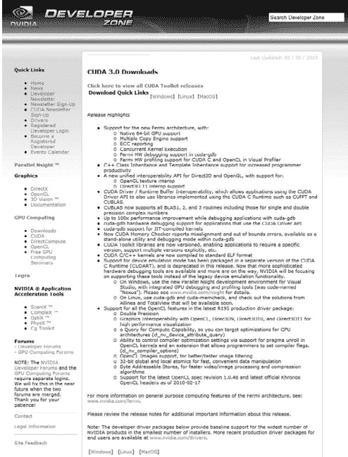

### 图 2.1 CUDA 下载页面

你将再次被要求从 Windows XP、Windows Vista、Windows 7、Linux 和 Mac OS 的 32 位和 64 位版本中选择你的平台。从可用的下载中，你需要下载 CUDA Toolkit 以构建本书中包含的代码示例。此外，我们鼓励你（但不是必须的）下载 GPU Computing SDK 代码示例，其中包含几十个有用的示例程序。GPU Computing SDK 代码示例不会在本书中介绍，但它们很好地补充了我们打算涵盖的材料，与学习任何编程风格一样，示例越多越好。你还应该注意，尽管本书中几乎所有代码都可以在 Linux、Windows 和 Mac OS 平台上运行，但我们将应用程序的目标定为 Linux 和 Windows。如果你使用 Mac OS X，你将冒着风险使用不受支持的代码示例。

### 2.2.4 标准 C 编译器

如前所述，你需要一个用于 GPU 代码的编译器和一个用于 CPU 代码的编译器。如果你按照上一节的建议下载并安装了 CUDA Toolkit，那么你已经拥有了用于 GPU 代码的编译器。用于 CPU 代码的编译器是我们 CUDA 检查清单上仅剩的组件，所以让我们解决这个问题，以便进入有趣的部分。

#### Windows

在 Microsoft Windows 平台上，包括 Windows XP、Windows Vista、Windows Server 2008 和 Windows 7，我们建议使用 Microsoft Visual Studio C 编译器。NVIDIA 目前支持 Visual Studio 2005 和 Visual Studio 2008 产品系列。随着 Microsoft 发布新版本，NVIDIA 可能会为较新版本的 Visual Studio 添加支持，同时放弃对旧版本的支持。许多 C 和 C++ 开发者的机器上已经安装了 Visual Studio 2005 或 Visual Studio 2008，所以如果这适用于你，你可以安全地跳过本小节。

如果你无法获得受支持版本的 Visual Studio 并且不打算购买一份，Microsoft 确实在其网站上提供 Visual Studio 2008 Express 版的免费下载。虽然通常不适合商业软件开发，但 Visual Studio Express 版是开始在 Windows 平台上开发 CUDA C 的绝佳方式，无需投资软件许可证。因此，如果你需要 Visual Studio 2008，请访问 www.microsoft.com/visualstudio！


#### LINUX

大多数 Linux 发行版通常预装了 GNU C 编译器 [gcc] 的一个版本。从 CUDA 3.0 开始，以下 Linux 发行版随附了受支持版本的 gcc：

- Red Hat Enterprise Linux 4.8
- Red Hat Enterprise Linux 5.3
- OpenSUSE 11.1
- SUSE Linux Enterprise Desktop 11
- Ubuntu 9.04
- Fedora 10

如果你是 Linux 的忠实用户，你可能知道许多 Linux 软件包不仅适用于“受支持”的平台。CUDA 工具包也不例外，因此即使你最喜欢的发行版未在此列出，也值得一试。该发行版的内核、gcc 和 glibc 版本在很大程度上将决定该发行版是否兼容。

#### MACINTOSH OS X

如果你想在 Mac OS X 上进行开发，你需要确保你的机器至少安装了 Mac OS X 10.5.7 版本。这包括版本 10.6，即 Mac OS X "Snow Leopard"。此外，你需要通过下载并安装 Apple 的 Xcode 来安装 gcc。该软件免费提供给 Apple Developer Connection (ADC) 成员，可从 http://developer.apple.com/tools/xcode 下载。本书中的代码是在 Linux 和 Windows 平台上开发的，但应该可以在 Mac OS X 系统上无需修改即可运行。

## 2.3 章节回顾

如果你已按照本章中的步骤操作，那么你已准备好开始在 CUDA C 中开发代码。也许你甚至已经摆弄过从 NVIDIA 网站下载的一些 NVIDIA GPU Computing SDK 代码示例。如果是这样，我们为你愿意动手实践而鼓掌！如果不是，别担心。你需要的一切都在这本书里。无论如何，你可能已准备好开始编写你的第一个 CUDA C 程序，那么让我们开始吧。

本页故意留空

# 第 3 章

# CUDA C 简介

如果你读过第 1 章，我们希望已经让你相信图形处理器拥有巨大的计算能力，而你正是能够驾驭它的程序员。如果你继续读完了第 2 章，那么你应该已经搭建好可用于编译和运行你将在 CUDA C 中编写的代码的环境。如果你跳过了前几章，也许你只是在浏览代码示例，也许你是在书店随意翻到这一页，或者你只是迫不及待地想开始；那也没关系（我们不会告诉别人的）。无论如何，你已准备好开始学习第一个代码示例，那么让我们开始吧。

## 3.1 本章目标

在本章学习过程中，你将完成以下任务：

- 你将编写你在 CUDA C 中的第一行代码。
- 你将学习为 _主机_ 编写的代码与为 _设备_ 编写的代码之间的区别。
- 你将学习如何从主机运行设备代码。
- 你将了解设备内存在 CUDA 支持设备上的使用方式。
- 你将学习如何查询系统以获取其 CUDA 支持设备的信息。

## 3.2 第一个程序

既然我们打算通过示例来学习 CUDA C，那么让我们来看看第一个 CUDA C 示例。根据计算机程序书面作品的相关规定，我们先来看看一个“Hello, World！”示例。

### 3.2.1 HELLO, WORLD!

```
#include ".../common/book.h"

int main( void ) {
    printf( "Hello, World!\n" );
    return 0;
}
```

此时此刻，你无疑在怀疑这本书是不是个骗局。这只是 C 语言吗？CUDA C 真的存在吗？这些问题的答案都是肯定的；这本书并非一个精心设计的骗局。这个简单的“Hello, World！”示例旨在说明，在最基本的层面上，CUDA C 与你已经习惯的标准 C 之间没有区别。

这个示例之所以简单，是因为它完全在主机上运行。这将是本书中一个重要的区分；我们将 CPU 和系统内存称为主机，将 GPU 及其内存称为设备。这个示例与你曾经编写的几乎所有代码都很相似，因为它简单地忽略了主机之外的任何计算设备。

为了弥补你投资的不过是一堆昂贵的琐事而产生的那种失落感，我们将逐步在此简单示例的基础上进行构建。让我们看看使用 GPU（即设备）来执行代码的内容。在设备上执行的函数通常称为内核。

### 3.2.2 内核调用

现在我们将在示例基础上添加一些代码，这些代码看起来应该比我们平淡无奇的“Hello, World！”程序更陌生。

```
#include <iostream>

__global__ void kernel( void ) {
}

int main( void ) {
    kernel<<<1,1>>>();
    printf( "Hello, World!\n" );
    return 0;
}
```

这个程序对原始“Hello, World！”示例做了两处显著的补充：

- 一个名为 kernel() 的空函数，带有 __global__ 限定符
- 对该空函数的调用，并使用 <<<1,1>>> 进行修饰

如前一节所示，默认情况下，代码由系统的标准 C 编译器编译。例如，GNU gcc 可能在 Linux 操作系统上编译你的主机代码，而 Microsoft Visual C 在 Windows 系统上编译它。NVIDIA 工具只是将你的代码交给这个主机编译器，一切表现都如同在没有 CUDA 的世界中一样。

现在我们看到，CUDA C 向标准 C 添加了 __global__ 限定符。这种机制会提醒编译器，一个函数应该被编译为在设备上运行，而不是在主机上运行。在这个简单的示例中，nvcc 将函数 kernel() 交给处理设备代码的编译器，并将 main() 交给主机编译器，就像前一个示例中所做的那样。

那么，对 kernel() 的神秘调用是什么，为什么我们要用尖括号和数字元组来“破坏”我们的标准 C 呢？做好准备，因为奇迹就在这里发生。

我们已经看到，CUDA C 需要一种语言方法来将函数标记为设备代码。这并没有什么特别的；这只是将主机代码发送给一个编译器、将设备代码发送给另一个编译器的简写。诀窍实际上在于从主机代码调用设备代码。CUDA C 的一大好处是它提供了这种语言集成，使得设备函数调用看起来非常像主机函数调用。稍后我们将讨论幕后实际发生的情况，但可以肯定的是，CUDA 编译器和运行时会处理从主机调用设备代码这一混乱的工作。

所以，这个看起来神秘的调用会调用设备代码，但为什么要用尖括号和数字呢？尖括号表示我们计划传递给运行时系统的参数。这些不是传递给设备代码的参数，而是将影响运行时启动我们设备代码方式的参数。我们将在下一章中了解这些传递给运行时的参数。传递给设备代码本身的参数则放在括号内，就像任何其他函数调用一样。

### 3.2.3 传递参数

我们承诺过可以向内核传递参数，现在是时候兑现这个承诺了。请考虑对我们的“Hello, World！”应用程序进行如下改进：

```
#include <iostream>
#include "book.h"

__global__ void add( int a, int b, int *c ) {
    *c = a + b;
}

int main( void ) {
    int c;
    int *dev_c;
    HANDLE_ERROR( cudaMalloc( (void**)&dev_c,
                             sizeof(int) ) );

    add<<<1,1>>>( 2, 7, dev_c );

    HANDLE_ERROR( cudaMemcpy( &c,
                             dev_c,
                             sizeof(int),
                             cudaMemcpyDeviceToHost ) );

    printf( "2 + 7 = %d\n", c );
    cudaFree( dev_c );

    return 0;
}
```

你会注意到这里有一些新行，但这些变化只引入了两个概念：

- 我们可以像向任何 C 函数传递参数一样向内核传递参数。
- 我们需要分配内存才能在设备上做任何有用的事情，例如将返回值传回主机。

向内核传递参数并没有什么特别的。尽管有尖括号语法，内核调用看起来和行为都与标准 C 中的任何函数调用完全一样。运行时系统会处理由于这些参数需要从主机传输到设备而引入的任何复杂性。


更有趣的补充是使用 `cudaMalloc()` 分配内存。此调用与标准 C 调用 `malloc()` 行为非常相似，但它告诉 CUDA 运行时在设备上分配内存。第一个参数是指向你希望保存新分配内存地址的指针的指针，第二个参数是你想要分配的大小。除此之外，你分配的内存指针不是函数的返回值，这与 `malloc()` 的行为完全相同，一直到 `void*` 返回类型。围绕这些调用的 `HANDLE_ERROR()` 是我们作为本书支持代码一部分提供的实用宏。它只是检测调用是否返回了错误，打印相关错误消息，并以 `EXIT_FAILURE` 代码退出应用程序。虽然你可以在自己的应用程序中自由使用此代码，但这种错误处理代码在生产代码中很可能不够用。

这引出了一个微妙但重要的观点。CUDA C 的大部分简洁性和强大功能都源于模糊主机代码和设备代码之间界限的能力。然而，程序员有责任不要在主机上执行的代码中解引用 `cudaMalloc()` 返回的指针。主机代码可以传递此指针、对其进行算术运算，甚至将其强制转换为不同类型。但你不能使用它来读取或写入内存。

不幸的是，编译器也无法保护你免受此错误的影响。它会很乐意允许在主机代码中解引用设备指针，因为它看起来就像应用程序中的任何其他指针。我们可以将设备指针的使用限制总结如下：

- 你可以将使用 `cudaMalloc()` 分配的指针传递给在设备上执行的函数。
- 你可以使用 `cudaMalloc()` 分配的指针从在设备上执行的代码中读取或写入内存。
- 你可以将使用 `cudaMalloc()` 分配的指针传递给在主机上执行的函数。
- 你不能使用 `cudaMalloc()` 分配的指针从在主机上执行的代码中读取或写入内存。

如果你一直在仔细阅读，可能已经预料到下一课：我们不能使用标准 C 的 `free()` 函数来释放使用 `cudaMalloc()` 分配的内存。要释放使用 `cudaMalloc()` 分配的内存，我们需要调用 `cudaFree()`，它的行为与 `free()` 完全相同。

我们已经了解了如何使用主机在设备上分配和释放内存，但我们也明确指出你无法从主机修改此内存。示例程序的剩余两行说明了访问设备内存的两种最常见方法——通过在设备代码中使用设备指针，以及通过调用 cudaMemcpy()。

我们在设备代码中使用指针的方式与在主机代码上运行的标准 C 中使用它们的方式完全相同。语句 *c = a + b* 看起来就有多简单，就有多简单。它将参数 a 和 b 相加，并将结果存储在 c 指向的内存中。我们希望这几乎简单到不值得一提。

我们列出了在设备代码和主机代码中可以和不可以使用设备指针的方式。这些注意事项在考虑主机指针时，其含义正如人们所想象的那样。虽然我们可以在设备代码中自由传递主机指针，但当我们尝试从设备代码中使用主机指针访问内存时，就会遇到麻烦。总结一下，主机指针可以从主机代码访问内存，设备指针可以从设备代码访问内存。

如承诺，我们还可以通过从主机代码调用 cudaMemcpy() 来访问设备上的内存。这些调用的行为与标准 C memcpy() 完全相同，只是多了一个参数来指定源指针和目标指针中哪个指向设备内存。在示例中，请注意 cudaMemcpy() 的最后一个参数是 cudaMemcpyDeviceToHost，它指示运行时源指针是设备指针，目标指针是主机指针。

不出所料，cudaMemcpyHostToDevice 会指示相反的情况，即源数据在主机上，目标是设备上的地址。最后，我们甚至可以通过传递 cudaMemcpyDeviceToDevice 来指定两个指针都在设备上。如果源指针和目标指针都在主机上，我们只需使用标准 C 的 memcpy() 例程在它们之间复制即可。

## 3.3 查询设备

由于我们希望在设备上分配内存并执行代码，如果程序能够了解设备有多少内存以及具有哪些类型的功能，那将很有用。此外，每台计算机拥有多个 CUDA 兼容设备的情况也很常见。在这种情况下，我们肯定需要一种方法来确定哪个处理器是哪个。

例如，许多主板出厂时自带集成 NVIDIA 图形处理器。当制造商或用户向这台计算机添加独立图形处理器时，它就拥有了两个 CUDA 兼容处理器。某些 NVIDIA 产品（例如 GeForce GTX 295）在单张卡上自带两个 GPU。包含此类产品的计算机也会显示两个 CUDA 兼容处理器。

在深入编写设备代码之前，我们希望有一种机制来确定存在哪些设备（如果有）以及每个设备支持哪些功能。幸运的是，有一个非常简单的接口来确定这些信息。首先，我们想知道系统中有多少个设备是基于 CUDA 架构构建的。这些设备将能够执行用 CUDA C 编写的内核。要获取 CUDA 设备的数量，我们调用 `cudaGetDeviceCount()`。不用说，我们预计会获得“最具创意函数名称”奖。

```
int count;
HANDLE_ERROR(cudaGetDeviceCount(&count));
```

调用 `cudaGetDeviceCount()` 后，我们可以遍历设备并查询每个设备的相关信息。CUDA 运行时以 `cudaDeviceProp` 类型的结构体形式返回这些属性。我们可以检索哪些属性？截至 CUDA 3.0，`cudaDeviceProp` 结构体包含以下内容：

```
struct cudaDeviceProp {
    char name[256];
    size_t totalGlobalMem;
    size_t sharedMemPerBlock;
    int regsPerBlock;
    int warpSize;
    size_t memPitch;
    int maxThreadsPerBlock;
    int maxThreadsDim[3];
    int maxGridSize[3];
    size_t totalConstMem;
    int major;
    int minor;
    int clockRate;
    size_t textureAlignment;
    int deviceOverlap;
    int multiProcessorCount;
    int kernelExecTimeoutEnabled;
    int integrated;
    int canMapHostMemory;
    int computeMode;
    int maxTexture1D;
    int maxTexture2D[2];
    int maxTexture3D[3];
    int maxTexture2DArray[3];
    int concurrentKernels;
}
```

其中一些不言自明；其他需要进一步描述 [参见表 3.1]。

#### 表 3.1 CUDA 设备属性

| 设备属性 | 描述 |
| :--- | :--- |
| `char name[256];` | 标识设备的 ASCII 字符串（例如，“GeForce GTX 280”） |
| `size_t totalGlobalMem` | 设备上的全局内存大小（字节） |
| `size_t sharedMemPerBlock` | 单个块可使用的最大共享内存大小（字节） |
| `int regsPerBlock` | 每个块可用的 32 位寄存器数量 |
| `int warpSize` | 一个 warp 中的线程数量 |
| `size_t memPitch` | 内存复制允许的最大步距（字节） |
| `int maxThreadsPerBlock` | 一个块可包含的最大线程数量 |
| `int maxThreadsDim[3]` | 块的每个维度允许的最大线程数量 |
| `int maxGridSize[3]` | 网格的每个维度允许的块数量 |
| `size_t totalConstMem` | 可用常量内存的大小 |
| `int major` | 设备计算能力的主版本号 |
| `int minor` | 设备计算能力的次版本号 |
| `size_t textureAlignment` | 设备对纹理对齐的要求 |
| `int deviceOverlap` | 布尔值，表示设备是否可以同时执行 `cudaMemcpy()` 和内核执行 |
| `int multiProcessorCount` | 设备上的多处理器数量 |
| `int kernelExecTimeoutEnabled` | 布尔值，表示在该设备上执行的内核是否有运行时限制 |
| `int integrated` | 布尔值，表示设备是否为集成 GPU [即，芯片组的一部分，而非独立 GPU] |
| `int canMapHostMemory` | 布尔值，表示设备是否可以将主机内存映射到 CUDA 设备地址空间 |
| `int computeMode` | 表示设备计算模式的值：默认、独占或禁止 |
| `int maxTexture1D` | 支持的 1D 纹理的最大大小 |


### 表 3.1 CUDA 设备属性（续）

| 设备属性 | 描述 |
| :--- | :--- |
| `int maxTexture2D[2]` | 支持的 2D 纹理的最大维度 |
| `int maxTexture3D[3]` | 支持的 3D 纹理的最大维度 |
| `int maxTexture2DArray[3]` | 支持的 2D 纹理数组的最大维度 |
| `int concurrentKernels` | 一个布尔值，表示设备是否支持在同一上下文中同时执行多个内核 |

我们不想过快地钻进兔子洞，因此现在不会详细介绍这些属性。事实上，前面的列表缺少一些属性的重要细节，因此你可能需要查阅 NVIDIA CUDA 编程指南以获取更多信息。当你开始编写自己的应用程序时，这些属性将证明非常有用。不过，目前我们将简单展示如何查询每个设备并报告其属性。到目前为止，我们的设备查询大致如下：

```c
#include "../common/book.h"

int main( void ) {
    cudaDeviceProp prop;

    int count;
    HANDLE_ERROR( cudaGetDeviceCount( &count ) );
    for (int i=0; i< count; ++i) {
        HANDLE_ERROR( cudaGetDeviceProperties( &prop, i ) );

    //Do something with our device's properties
    }
}
```

既然我们知道了可用的每个字段，我们可以对雄心勃勃的“执行某些操作...”部分进行扩展，并实现一些稍微不那么平凡的东西：

```c
#include "../common/book.h"

int main( void ) {
    cudaDeviceProp prop;

    int count;
    HANDLE_ERROR( cudaGetDeviceCount( &count ) );
    for ( int i=0; i< count; i++ ) {
        HANDLE_ERROR( cudaGetDeviceProperties( &prop, i ) );
        printf( " --- General Information for device %d ---\n", i );
        printf( "Name:  %s\n", prop.name );
        printf( "Compute capability:  %d.%d\n", prop.major, prop.minor );
        printf( "Clock rate:  %d\n", prop.clockRate );
        printf( "Device copy overlap:  " );
        if ( prop.deviceOverlap )
            printf( "Enabled\n" );
        else
            printf( "Disabled\n" );
        printf( "Kernel execution timeout :  " );
        if ( prop.kernelExecTimeoutEnabled )
            printf( "Enabled\n" );
        else
            printf( "Disabled\n" );

        printf( " --- Memory Information for device %d ---\n", i );
        printf( "Total global mem:  %ld\n", prop.totalGlobalMem );
        printf( "Total constant Mem:  %ld\n", prop.totalConstMem );
        printf( "Max mem pitch:  %ld\n", prop.memPitch );
        printf( "Texture Alignment:  %ld\n", prop.textureAlignment );
        printf( " --- MP Information for device %d ---\n", i );
        printf( "Multiprocessor count: %d\n", prop.multiProcessorCount );
        printf( "Shared mem per mp: %d\n", prop.sharedMemPerBlock );
        printf( "Registers per mp: %d\n", prop.regsPerBlock );
        printf( "Threads in warp: %d\n", prop.warpSize );
        printf( "Max threads per block: %d\n", prop.maxThreadsPerBlock );
        printf( "Max thread dimensions: (%d, %d, %d)\n", prop.maxThreadsDim[0], prop.maxThreadsDim[1], prop.maxThreadsDim[2] );
        printf( "Max grid dimensions: (%d, %d, %d)\n", prop.maxGridSize[0], prop.maxGridSize[1], prop.maxGridSize[2] );
        printf( "\n" );
    }
}
```

## 3.4 使用设备属性

除了编写一个能方便地打印每个 CUDA 兼容显卡每个细节的应用程序之外，我们为什么要关心系统中每个设备的属性呢？作为软件开发人员，我们希望每个人都认为我们的软件运行速度快，因此我们可能会有兴趣选择拥有最多多处理器的 GPU 来运行我们的代码。或者，如果内核需要与 CPU 进行密切交互，我们可能会有兴趣在与 CPU 共享系统内存的集成 GPU 上运行我们的代码。这些都是可以使用 cudaGetDeviceProperties() 查询的属性。

假设我们正在编写一个依赖双精度浮点支持的应用程序。查阅 NVIDIA CUDA 编程指南附录 A 后，我们知道计算能力为 1.3 或更高的显卡支持双精度浮点数学。因此，为了成功运行我们编写的双精度应用程序，我们需要找到至少一个计算能力为 1.3 或更高的设备。

基于我们对 cudaGetDeviceCount() 和 cudaGetDeviceProperties() 的了解，我们可以遍历每个设备，寻找一个主版本大于 1，或者主版本为 1 且次版本大于或等于 3 的设备。但由于这个相对常见的过程也相对麻烦，CUDA 运行时为我们提供了一种自动化的方法。我们首先用设备应具备的属性填充一个 cudaDeviceProp 结构体。

```c
cudaDeviceProp prop;
memset( &prop, 0, sizeof( cudaDeviceProp ) );
prop.major = 1;
prop.minor = 3;
```

填充 cudaDeviceProp 结构体后，我们将其传递给 cudaChooseDevice()，以让 CUDA 运行时找到满足此约束的设备。对 cudaChooseDevice() 的调用将返回一个设备 ID，我们可以将其传递给 cudaSetDevice()。从这一点开始，所有设备操作都将在我们在 cudaChooseDevice() 中找到的设备上进行。

```c
#include "../common/book.h"

int main( void ) {
    cudaDeviceProp prop;
    int dev;

    HANDLE_ERROR( cudaGetDevice( &dev ) );
    printf( "ID of current CUDA device: %d\n", dev );

    memset( &prop, 0, sizeof( cudaDeviceProp ) );
    prop.major = 1;
    prop.minor = 3;
    HANDLE_ERROR( cudaChooseDevice( &dev, &prop ) );
    printf( "ID of CUDA device closest to revision 1.3: %d\n", dev );
    HANDLE_ERROR( cudaSetDevice( dev ) );
}
```

多 GPU 系统变得越来越常见。例如，许多 NVIDIA 主板芯片组包含集成的 CUDA 兼容 GPU。当向这些系统之一添加独立 GPU 时，你突然就拥有了一个多 GPU 平台。此外，NVIDIA 的 SLI 技术允许多个独立 GPU 并排安装。在这两种情况下，你的应用程序可能偏好某个 GPU 而非另一个。如果你的应用程序依赖于 GPU 的某些功能，或依赖于系统中最快的 GPU，你应该熟悉此 API，因为无法保证 CUDA 运行时会为你的应用程序选择最佳或最合适的 GPU。

## 3.5 章节回顾

我们终于开始动手编写 CUDA C 了，理想情况下，这比你想象的要不那么痛苦。从根本上说，CUDA C 是标准 C，并添加了一些修饰，以允许我们指定哪些代码应在设备上运行，哪些应在主机上运行。通过在函数前添加关键字 `__global__`，我们向编译器指示我们打算在 GPU 上运行该函数。要使用 GPU 的专用内存，我们还学习了一套类似于 C 语言 `malloc()`、`memcpy()` 和 `free()` API 的 CUDA API。这些函数的 CUDA 版本，`cudaMalloc()`、`cudaMemcpy()` 和 `cudaFree()`，允许我们分配设备内存、在设备和主机之间复制数据，并在使用完毕后释放设备内存。

随着我们深入本书，我们将看到更多关于如何有效地将设备用作大规模并行协处理器的有趣示例。目前，你应该知道开始使用 CUDA C 是多么容易，在下一章中，我们将看到在 GPU 上执行并行代码是多么容易。

本页故意留空

# 第 4 章

# CUDA C 中的并行编程

在上一章中，我们看到编写在 GPU 上执行的代码可以多么简单。我们甚至学会了如何将两个数字相加，尽管只是数字 2 和 7。诚然，那个示例并不十分令人印象深刻，也不是特别有趣。但我们希望你相信开始使用 CUDA C 很容易，并且你很渴望了解更多。GPU 计算的许多前景在于利用许多问题的大规模并行结构。出于这个目的，我们打算在本章中探讨如何使用 CUDA C 在 GPU 上执行并行代码。


## 4.1 章节目标

在本章学习过程中，你将完成以下任务：

- 你将学习 CUDA 暴露其并行性的基本方式之一。
- 你将使用 CUDA C 编写你的第一个并行代码。

## 4.2 CUDA 并行编程

此前，我们了解到让标准 C 函数在设备上运行是多么容易。通过向函数添加 __global__ 限定符，并使用特殊的尖括号语法调用它，我们在 GPU 上执行了该函数。虽然这极其简单，但也极其低效，因为 NVIDIA 的硬件工程师们已将其图形处理器优化为可并行执行数百次计算。然而，到目前为止，我们只在 GPU 上串行运行过内核。在本章中，我们将看到启动在设备上并行执行计算的内核是多么简单。

### 4.2.1 求和向量

我们将编造一个简单的示例来说明线程以及如何使用它们来编写 CUDA C 代码。假设有两个数字列表，我们想要对每个列表的对应元素求和，并将结果存储在第三个列表中。图 4.1 展示了此过程。如果你有线性代数背景，你会将此操作识别为两个向量相加。

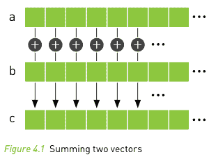

#### CPU 向量求和

首先，我们将看看如何使用传统 C 代码完成此加法：

```c
#include "../common/book.h"

#define N 10

void add( int *a, int *b, int *c ) {
    int tid = 0;    // this is CPU zero, so we start at zero
    while (tid < N) {
        c[tid] = a[tid] + b[tid];
        tid += 1;   // we have one CPU, so we increment by one
    }
}

int main( void ) {
    int a[N], b[N], c[N];

    // fill the arrays 'a' and 'b' on the CPU
    for (int i=0; i<N; i++) {
        a[i] = -i;
        b[i] = i * i;
    }

    add( a, b, c );

    // display the results
    for (int i=0; i<N; i++) {
        printf( "%d + %d = %d\n", a[i], b[i], c[i] );
    }

    return 0;
}
```

此示例的大部分需要几乎不加解释，但我们将简要查看 add() 函数，以解释我们为何将其过度复杂化。

```c
void add( int *a, int *b, int *c ) {
    int tid = 0;    // this is CPU zero, so we start at zero
    while (tid < N) {
        c[tid] = a[tid] + b[tid];
        tid += 1;    // we have one CPU, so we increment by one
    }
}
```

我们在 while 循环中计算求和，索引 tid 从 0 范围到 N-1。我们将 a[] 和 b[] 的对应元素相加，并将结果放入 c[] 的对应元素中。通常，有人会以稍简单的方式编写此代码，如下所示：

```c
void add( int *a, int *b, int *c ) {
    for (i=0; i < N; i++) {
        c[i] = a[i] + b[i];
    }
}
```

我们稍显复杂的方法旨在暗示在具有多个 CPU 或 CPU 核心的系统上并行化代码的一种潜在方式。例如，使用双核处理器时，可以将增量改为 2，让一个核心用 tid = 0 初始化循环，另一个核心用 tid = 1。第一个核心将添加偶数索引的元素，第二个核心将添加奇数索引的元素。这相当于在两个 CPU 核心上各执行以下代码：

```c
void add( int *a, int *b, int *c ) {
    int tid = 0;
    while (tid < N) {
        c[tid] = a[tid] + b[tid];
        tid += 2;
    }
}
```

```c
void add( int *a, int *b, int *c ) {
    int tid = 1;
    while (tid < N) {
        c[tid] = a[tid] + b[tid];
        tid += 2;
    }
}
```

当然，在 CPU 上这样做需要比本示例中包含的多得多的代码。你需要提供合理数量的基础设施来创建执行函数 add() 的工作线程，并假设每个线程都将并行执行，遗憾的是，这种调度假设并不总是成立。

#### GPU 向量求和

我们可以通过将 add() 编写为设备函数，在 GPU 上以非常相似的方式完成相同的加法。这应该与你在上一章中看到的代码相似。但在查看设备代码之前，我们先展示 main()。尽管 main() 的 GPU 实现与相应的 CPU 版本不同，但这里的内容应该看起来并不陌生：

```c
#include "../common/book.h"

#define N 10

int main( void ) {
    int a[N], b[N], c[N];
    int *dev_a, *dev_b, *dev_c;

    // allocate the memory on the GPU
    HANDLE_ERROR( cudaMalloc( (void**)&dev_a, N * sizeof(int) ) );
    HANDLE_ERROR( cudaMalloc( (void**)&dev_b, N * sizeof(int) ) );
    HANDLE_ERROR( cudaMalloc( (void**)&dev_c, N * sizeof(int) ) );

    // fill the arrays 'a' and 'b' on the CPU
    for (int i=0; i<N; i++) {
        a[i] = -i;
        b[i] = i * i;
    }

    // copy the arrays 'a' and 'b' to the GPU
    HANDLE_ERROR ( cudaMalloc( &dev_a, N * sizeof(int) ,
     cudaMemcpyHostToDevice ) );
    HANDLE_ERROR ( cudaMalloc( &dev_b, N * sizeof(int) ,
     cudaMemcpyHostToDevice ) );

    add<<<N,1>>>( dev_a, dev_b, dev_c );

    // copy the array 'c' back from the GPU to the CPU
    HANDLE_ERROR ( cudaMemcpy( c, dev_c, N * sizeof(int) ,
     cudaMemcpyDeviceToHost ) );

    // display the results
    for (int i=0; i<N; i++) {
      printf("%d + %d = %d\n", a[i], b[i], c[i] );
    }

    // free the memory allocated on the GPU
    cudaFree( dev_a );
    cudaFree( dev_b );
    cudaFree( dev_c );

    return 0;
}
```

你会注意到我们再次采用的一些常见模式：

- 我们使用 cudaMalloc() 调用在设备上分配三个数组：两个数组 dev_a 和 dev_b 用于保存输入，一个数组 dev_c 用于保存结果。
- 因为我们是环保意识强的程序员，所以我们使用 cudaFree() 进行清理。
- 使用 cudaMemcpy()，我们使用参数 cudaMemcpyHostToDevice 将输入数据复制到设备，并使用 cudaMemcpyDeviceToHost 将结果数据复制回主机。
- 我们使用三重尖括号语法从 main() 的主机代码执行 add() 中的设备代码。

顺便说一句，你可能会好奇为什么我们在 CPU 上填充输入数组。我们_需要_这样做并没有特别原因。事实上，如果我们在 GPU 上填充数组，此步骤的性能会更快。但我们打算展示如何在图形处理器上实现特定操作，即两个向量相加。因此，我们要求你想象这只是一个更大应用程序中的一个步骤，其中输入数组 a[] 和 b[] 是由其他算法生成的，或由用户从硬盘加载的。总之，假设这些数据凭空出现，现在我们需要对其做些什么即可。

接下来，我们的 add() 例程与其相应的 CPU 实现类似：

```c
__global__ void add(int *a, int *b, int *c) {
    int tid = blockIdx.x;    // handle the data at this index
    if (tid < N)
        c[tid] = a[tid] + b[tid];
}
```

我们再次看到函数 add() 中的常见模式：

- 我们编写了一个名为 add() 的在设备上执行的函数。我们通过获取 C 代码并在函数名中添加 __global__ 限定符来实现这一点。

到目前为止，此示例中没有什么新内容，除了它能做的不仅仅是 2 加 7。然而，此示例中_有_两个值得注意的组成部分：三重尖括号内的参数和内核本身包含的代码都引入了新概念。

到目前为止，我们始终看到内核以以下形式启动：

```c
kernel<<<1,1>>>( param1, param2, ... );
```

但在此示例中，我们使用尖括号中不为 1 的数字进行启动：

```c
add<<<N,1>>>( dev_a, dev_b, dev_c );
```

这是什么意思？

请回顾，我们之前未解释尖括号中的那两个数字；我们模糊地说明它们是描述如何启动内核的运行时参数。嗯，这些参数中的第一个数字表示我们希望设备执行内核的并行块数量。在此示例中，我们为此参数传递值 N。

例如，如果我们使用 kernel<<<2, 1>>> () 启动，你可以认为运行时创建了内核的两个副本并并行运行它们。我们将每个此类并行调用称为一个块。使用 kernel<<<256, 1>>> ()，你将在 GPU 上获得 256 个运行的块。并行编程从未如此简单。

但这引发了一个绝佳的问题：GPU 运行我们内核代码的 N 个副本，但如何从代码内部得知当前正在运行哪个块？这个问题将我们引向示例的第二个新功能：内核代码本身。具体来说，它将我们引向变量 blockIdx.x：

```c
__global__ void add(int *a, int *b, int *c) {
    int tid = blockIdx.x; // handle the data at this index
    if (tid < N)
        c[tid] = a[tid] + b[tid];
}
```

乍一看，这个变量似乎会在编译时导致语法错误，因为我们用它来给 tid 赋值，但我们从未定义过它。然而，无需定义变量 blockIdx；这是 CUDA 运行时为我们定义的内置变量之一。此外，我们使用这个变量正是为了它听起来的意思。它包含当前正在运行设备代码的块的块索引值。

你可能会问，为什么不是 blockIdx？为什么是 blockIdx.x？事实证明，CUDA C 允许你以二维定义一组块。对于具有二维域的问题，例如矩阵数学或图像处理，使用二维索引通常很方便，可以避免从线性索引到矩形索引的烦人转换。如果你不熟悉这些问题类型，请不要担心；只需知道使用二维索引有时比一维索引更方便。但你永远不必使用它。我们不会介意。


当我们启动内核时，指定 N 为并行块的数量。我们将并行块的集合称为网格。这向运行时系统指明我们想要一个包含 N 个块的一维网格（标量值被解释为一维）。这些线程将具有不同的 blockIdx.x 值，第一个取值 0，最后一个取值 N-1。所以，想象四个块，它们都在运行同一份设备代码的副本，但变量 blockIdx.x 的值不同。运行时将相应的块索引替换为 blockIdx.x 后，四个并行块中实际执行的代码如下：

#### 块 1

```
__global__ void
add( int *a, int *b, int *c ) {
    int tid = 0;
    if (tid < N)
        c[tid] = a[tid] + b[tid];
}
```

#### 块 2

```
__global__ void
add( int *a, int *b, int *c ) {
    int tid = 1;
    if (tid < N)
        c[tid] = a[tid] + b[tid];
}
```

#### 块 3

```
__global__ void
add( int *a, int *b, int *c ) {
    int tid = 2;
    if (tid < N)
        c[tid] = a[tid] + b[tid];
}
```

#### 块 4

```
__global__ void
add( int *a, int *b, int *c ) {
    int tid = 3;
    if (tid < N)
        c[tid] = a[tid] + b[tid];
}
```

如果你还记得我们开头使用的基于 CPU 的示例，你会记得我们需要遍历从 0 到 N-1 的索引来求和两个向量。由于运行时系统已经在启动一个内核，其中每个块都会拥有这些索引之一，因此这项工作几乎都已经为我们完成了。因为我们算是有点“懒”，这是件好事。它让我们有更多时间写博客，大概就是写我们有多懒。

最后一个需要回答的问题是，为什么我们要检查 tid 是否小于 N？它理应始终小于 N，因为我们专门启动内核以确保这一假设成立。但我们想要“懒”的愿望也让我们对有人打破代码中所做的假设感到偏执。打破代码假设意味着代码出错。这意味着错误报告、为追踪不良行为而熬夜，以及大量阻碍我们写博客的活动。如果我们不检查 tid 是否小于 N，随后获取了不属于我们的内存，那将是不好的。事实上，这可能会终止你的内核执行，因为 GPU 具有复杂的内存管理单元，会终止看似违反内存规则的进程。

如果你遇到如上所述的问题，代码中到处撒播的 HANDLE_ERROR() 宏之一将检测并提醒你这种情况。与传统的 C 编程一样，这里的教训是函数返回错误代码是有原因的。虽然忽略这些错误代码总是很诱人，但我们希望通过敦促你检查每个可能失败的操作的结果，来为你节省我们曾经历过的数小时痛苦。通常情况下，这些错误的存在不会阻止你继续执行应用程序，但它们肯定会导致下游出现各种不可预测且不愉快的副作用。

此时，你正在 GPU 上并行运行代码。也许你听说过这很棘手，或者你必须理解计算机图形学才能在图形处理器上进行通用编程。我们希望你开始看到 CUDA C 如何使在 GPU 上编写并行代码变得更加容易。我们只使用该示例来求和长度为 10 的向量。如果你想看看生成大规模并行应用有多容易，尝试将行 #define N 10 中的 10 改为 10000 或 50000，以启动数以万计的并行块。不过请注意：启动块的任何维度都不能超过 65,535。这只是一个硬件强加的限制，因此如果你尝试启动超过此数量的块，将开始看到失败。在下一章中，我们将看到如何在此限制内工作。

### 4.2.2 一个有趣的示例

我们无意暗示向量相加不那么有趣，但下面的示例将满足那些寻找一些炫酷的并行 CUDA C 示例的人。

下面的示例将演示绘制朱利亚集切片的代码。对于不了解的人来说，朱利亚集是复数上某类函数的边界。毫无疑问，这听起来比向量加法和矩阵乘法更不有趣。然而，对于函数参数的几乎所有值，这个边界形成一个分形，这是数学中最有趣、最美丽的奇观之一。

生成这样的集合所涉及的计算相当简单。朱利亚集的核心是对复平面上的点评估一个简单的迭代方程。如果对该点迭代方程的过程发散，则该点不在集合中。也就是说，如果迭代方程产生的值序列趋向于无穷大，则该点被认为 *不在* 集合中。相反，如果方程取值保持有界，则该点 *在* 集合中。

从计算角度看，所述的迭代方程非常简单，如方程 4.1 所示。

#### 方程 4.1

$Z_{n+1} = Z_n^2 + C$

因此，计算方程 4.1 的一次迭代将涉及对当前值求平方并加上一个常数，以得到方程的下一个值。

#### CPU 朱利亚集

我们现在将审查一个用于计算和可视化朱利亚集的源代码清单。由于这是一个比我们迄今研究过的更复杂的程序，我们将在此将其分成几个部分。在本章后面，你将看到完整的源代码清单。

```
int main( void ) {
	CPUBitmap bitmap( DIM, DIM );
	unsigned char *ptr = bitmap.get_ptr();
	kernel( ptr );
	bitmap.display_and_exit();
}
```

我们的 main 例程非常简单。它使用提供的实用程序库创建适当大小的位图图像。接下来，它将位图数据的指针传递给内核函数。

```
void kernel ( unsigned char *ptr ) {
    for (int y=0; y<DIM; y++) {
        for (int x=0; x<DIM; x++) {
            int offset = x + y * DIM;

            int juliaValue = julia( x, y );
            ptr[offset*4 + 0] = 255 * juliaValue;
            ptr[offset*4 + 1] = 0;
            ptr[offset*4 + 2] = 0;
            ptr[offset*4 + 3] = 255;
        }
    }
}
```

计算内核只不过是遍历我们想要渲染的所有点，对每个点调用 julia() 以确定其是否属于朱利亚集。如果点在集合中，函数 julia() 将返回 1，否则返回 0。如果 julia() 返回 1，我们将点的颜色设置为红色；如果返回 0，则设置为黑色。这些颜色是任意的，你可以随意选择符合个人审美的配色方案。

```
int julia( int x, int y ) {
    const float scale = 1.5;
    float jx = scale * (float)(DIM/2 - x)/(DIM/2);
    float jy = scale * (float)(DIM/2 - y)/(DIM/2);

    cuComplex c(-0.8, 0.156);
    cuComplex a(jx, jy);

    int i = 0;
    for (i=0; i<200; i++) {
        a = a * a + c;
        if (a.magnitude2() > 1000)
            return 0;
    }

    return 1;
}
```

这个函数是示例的核心。我们首先将像素坐标转换为复空间中的坐标。为了将复平面居中于图像中心，我们偏移 DIM/2。然后，为了确保图像跨越 -1.0 到 1.0 的范围，我们按 DIM/2 缩放图像坐标。因此，给定图像上的一点 (x, y)，我们在复空间中得到的点为 ( (DIM/2 - x) / (DIM/2) , ( (DIM/2 - y) / (DIM/2) )。

然后，为了可能进行放大或缩小，我们引入一个缩放因子。目前，缩放因子被硬编码为 1.5，但你应该调整此参数来放大或缩小。如果你觉得非常有雄心，可以将此设为命令行参数。

在获得复空间中的点后，我们需要确定该点是否在朱利亚集内或外。如同前一节所述，我们通过计算迭代方程 $Z_{n+1} = Z_n^2 + C$ 的值来做到这一点。由于 C 是某个任意复数常数，我们选择了 -0.8 + 0.156i，因为它碰巧能生成一幅有趣的图像。如果你想看看朱利亚集的其他版本，应该尝试这个常数。

在示例中，我们计算该函数的 200 次迭代。每次迭代后，我们检查结果的幅度是否超过某个阈值（就我们的目的而言为 1,000）。如果是，方程正在发散，我们可以返回 0 以指示该点 _不在_ 集合中。另一方面，如果我们完成了所有 200 次迭代且幅度仍低于 1,000，我们假设该点在集合中，并向调用者 kernel() 返回 1。

由于所有计算都在复数上执行，我们定义一个通用结构体来存储复数。

```
struct cuComplex {
    float   r;
    float   i;

    cuComplex( float a, float b ) : r(a), i(b) {}

    float magnitude2( void ) { return r * r + i * i; }

    cuComplex operator*(const cuComplex& a) {
        return cuComplex(r*a.r - i*a.i, i*a.r + r*a.i);
    }

    cuComplex operator+(const cuComplex& a) {
        return cuComplex(r+a.r, i+a.i);
    }
};


该类使用两个数据元素表示复数：一个单精度实部 r 和一个单精度虚部 i。该类定义了加法和乘法运算符，用于按预期组合复数。（如果你对复数完全陌生，可以在网上快速了解相关知识。）最后，我们定义一个返回复数模值的方法。

#### GPU 朱利亚集

设备实现与 CPU 版本非常相似，延续了你可能已经注意到的趋势。

```cpp
int main( void ) {
    CPUBitmap bitmap( DIM, DIM ) ;
    unsigned char *dev_bitmap;
    HANDLE_ERROR( cudaMalloc( (void**)&dev_bitmap,
                              bitmap.image_size() ) );
    dim3 grid(DIM,DIM);
    kernel<<<grid,1>>>( dev_bitmap );
    HANDLE_ERROR( cudaMemcpy( bitmap.get_ptr(),
                              dev_bitmap,
                              bitmap.image_size(),
                              cudaMemcpyDeviceToHost ) );
    bitmap.display_and_exit();
    cudaFree( dev_bitmap );
}
```

这个 main() 版本看起来比 CPU 版本复杂得多，但实际流程是相同的。与 CPU 版本一样，我们使用实用库创建一个 DIM × DIM 位图图像。但由于我们将在 GPU 上进行计算，我们还声明了一个名为 `dev_bitmap` 的指针，用于保存设备上数据的副本。并且为了存储数据，我们需要使用 `cudaMalloc()` 分配内存。

然后我们像 CPU 版本一样运行 `kernel()` 函数，只不过现在它是一个 `__global__` 函数，意味着它将在 GPU 上运行。与 CPU 示例一样，我们将上一行分配的指针传递给 `kernel()` 以存储结果。唯一的区别是，内存现在位于 GPU 上，而不是主机系统上。

最显著的区别在于，我们指定了要执行函数 `kernel()` 的并行块数量。由于每个点都可以独立于其他点进行计算，我们只需为要计算的每个点指定一个函数副本。我们提到，对于某些问题领域，使用二维索引很有帮助。不出所料，在复平面等二维域上计算函数值就是这类问题之一。因此，我们在这一行中指定了一个二维块网格：

```cpp
dim3 grid(DIM,DIM);
```

类型 `dim3` 不是标准 C 类型，请别担心你漏掉了什么关键信息。相反，CUDA 运行时头文件定义了一些便利类型，用于封装多维元组。类型 `dim3` 表示一个三维元组，用于指定我们的启动大小。但是，当我们明明清楚地声明启动是一个 *二维网格* 时，为什么还要使用三维值呢？

坦率地说，我们这样做是因为 CUDA 运行时期望一个三维的 `dim3` 值。虽然目前不支持三维启动网格，但 CUDA 运行时仍然期望一个 `dim3` 变量，其最后一个分量等于 1。当我们只用两个值初始化它时，就像在语句 `dim3 grid(DIM, DIM)` 中所做的那样，CUDA 运行时会自动将第三个维度填充为值 1，因此这里一切都会按预期工作。虽然 NVIDIA 未来可能会支持三维网格，但目前我们将友好地与内核启动 API 打交道，因为当程序员和 API 发生冲突时，API 始终获胜。

然后我们在这一行中将 dim3 变量 grid 传递给 CUDA 运行时：

```cpp
kernel<<<grid,1>>>( dev_bitmap );
```

最后，由于结果位于设备上，执行 kernel() 后，我们必须将结果复制回主机。正如我们在前面章节中学到的，我们通过调用 cudaMemcpy() 来完成此操作，将方向 cudaMemcpyDeviceToHost 指定为最后一个参数。

```cpp
HANDLE_ERROR( cudaMemcpy( bitmap.get_ptr(),
                              dev_bitmap,
                              bitmap.image_size(),
                              cudaMemcpyDeviceToHost ) );
```

实现差异中的最后一个细节之一出现在 kernel() 的实现中。

```cpp
__global__ void kernel( unsigned char *ptr ) {
    // map from threadIdx/BlockIdx to pixel position
    int x = blockIdx.x;
    int y = blockIdx.y;
    int offset = x + y * gridDim.x;

    // now calculate the value at that position
    int juliaValue = julia( x, y );
    ptr[offset*4 + 0] = 255 * juliaValue;
    ptr[offset*4 + 1] = 0;
    ptr[offset*4 + 2] = 0;
    ptr[offset*4 + 3] = 255;
}
```

首先，我们需要将 kernel() 声明为 __global__ 函数，以便它在设备上运行但可以从主机调用。与 CPU 版本不同，我们不再需要嵌套的 for() 循环来生成传递给 julia() 的像素索引。与向量加法示例一样，CUDA 运行时在变量 blockIdx 中为我们生成这些索引。之所以有效，是因为我们声明的块网格与图像具有相同的维度，因此我们在 (0,0) 到 (DIM-1, DIM-1) 之间的每个整数对 (x,y) 都会得到一个块。

接下来，我们需要的唯一额外信息是输出缓冲区 ptr 中的线性偏移量。这是使用另一个内置变量 gridDim 计算的。该变量在所有块中都是常量，仅保存启动的网格维度。在此示例中，它始终是值 (DIM, DIM)。因此，将行索引乘以网格宽度并加上列索引，将给出 ptr 中一个唯一的索引，范围从 0 到 (DIM*DIM-1)。

```cpp
int offset = x + y * gridDim.x;
```

最后，我们来看看决定一个点是否在朱利亚集内或外的实际代码。这段代码应该与 CPU 版本相同，延续了我们在许多示例中看到的趋势。

```cpp
__device__ int julia( int x, int y ) {
    const float scale = 1.5;
    float jx = scale * (float) (DIM/2 - x) / (DIM/2) ;
    float jy = scale * (float) (DIM/2 - y) / (DIM/2) ;

    cuComplex c(-0.8, 0.156);
    cuComplex a(jx, jy);

    int i = 0;
    for (i=0; i<200; i++) {
        a = a * a + c;
        if (a.magnitude2() > 1000)
            return 0;
    }

    return 1;
}
```

再次，我们定义一个 cuComplex 结构体，用于定义存储带有单精度浮点分量的复数的方法。该结构体还定义了加法和乘法运算符，以及一个返回复数值模值的函数。

```cpp
struct cuComplex {
    float r;
    float i;
    cuComplex( float a, float b ) : r(a), i(b) {}
    __device__ float magnitude2( void ) {
        return r * r + i * i;
    }
    __device__ cuComplex operator*(const cuComplex& a) {
        return cuComplex(r*a.r - i*a.i, i*a.r + r*a.i);
    }
    __device__ cuComplex operator+(const cuComplex& a) {
        return cuComplex(r+a.r, i+a.i);
    }
};
```

请注意，我们在 CUDA C 中使用的语言结构与 CPU 版本中使用的相同。唯一的区别是限定符 __device__，它表示这段代码将在 GPU 上运行而不是在主机上。请回顾，由于这些函数被声明为 __device__ 函数，它们只能从其他 __device__ 函数或 __global__ 函数中调用。

由于我们频繁地用注释中断代码，以下是从头到尾的完整源代码清单：

```cpp
#include "../common/book.h"
#include "../common/cpu_bitmap.h"
#define DIM 1000

struct cuComplex {
    float r;
    float i;
    cuComplex( float a, float b ) : r(a), i(b) {}
    __device__ float magnitude2( void ) {
        return r * r + i * i;
    }
    __device__ cuComplex operator*(const cuComplex& a) {
        return cuComplex(r*a.r - i*a.i, i*a.r + r*a.i);
    }
    __device__ cuComplex operator+(const cuComplex& a) {
        return cuComplex(r+a.r, i+a.i);
    }
};

__device__ int julia( int x, int y ) {
    const float scale = 1.5;
    float jx = scale * (float)(DIM/2 - x)/(DIM/2);
    float jy = scale * (float)(DIM/2 - y)/(DIM/2);

    cuComplex c(-0.8, 0.156);
    cuComplex a(jx, jy);

    int i = 0;
    for (i=0; i<200; i++) {
        a = a * a + c;
        if (a.magnitude2() > 1000)
            return 0;
    }
    return 1;
}
```


__global__ void kernel( unsigned char *ptr ) {
    // map from threadIdx/BlockIdx to pixel position
    int x = blockIdx.x;
    int y = blockIdx.y;
    int offset = x + y * gridDim.x;

    // now calculate the value at that position
    int juliaValue = julia( x, y );
    ptr[offset*4 + 0] = 255 * juliaValue;
    ptr[offset*4 + 1] = 0;
    ptr[offset*4 + 2] = 0;
    ptr[offset*4 + 3] = 255;
}

int main( void ) {
    CPUBitmap bitmap( DIM, DIM );
    unsigned char *dev_bitmap;

    HANDLE_ERROR( cudaMalloc( (void**)&dev_bitmap,
                              bitmap.image_size() ) );

    dim3 grid(DIM,DIM);
    kernel<<<grid,1>>>( dev_bitmap );

    HANDLE_ERROR( cudaMemcpy( bitmap.get_ptr(), dev_bitmap,
                              bitmap.image_size(),
                              cudaMemcpyDeviceToHost ) );
    bitmap.display_and_exit();

    HANDLE_ERROR( cudaFree( dev_bitmap ) );
}

当你运行应用程序时，应该会看到朱利亚集（Julia Set）的动画可视化。为了让你相信它配得上“一个有趣的示例”这个标题，图 4.2 展示了从该应用程序中截取的屏幕截图。

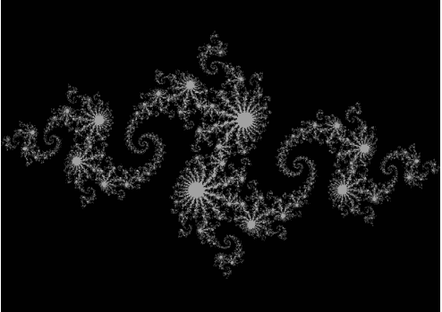

图 4.2 GPU Julia Set 应用程序的屏幕截图

## 4.3 章节回顾

恭喜，你现在可以在图形处理器上编写、编译和运行大规模并行代码了！你应该去向朋友炫耀一番。如果他们仍然误以为 GPU 计算很神秘且难以掌握，他们会非常印象深刻。你完成它的轻松程度将是我们的秘密。如果他们是你可以信任秘密的人，建议他们也买这本书。

到目前为止，我们已经了解了如何指示 CUDA 运行时在我们称为块（blocks）的单元上并行执行程序的多个副本。我们将在 GPU 上启动的块集合称为网格（grid）。正如名称所暗示的，网格可以是一维或二维的块集合。每个内核副本可以使用内置变量 blockIdx 确定它正在执行哪个块。同样，它可以使用内置变量 gridDim 确定网格的大小。这两个内置变量在我们的内核中都很有用，用于计算每个块负责的数据索引。

本页故意留空

# 第 5 章

# 线程协作

我们现在已经使用 CUDA C 编写了第一个程序，并且了解了如何编写在 GPU 上并行执行的代码。这是一个很好的开始！但可以说，并行编程中最重要的组成部分之一，是并行处理元素在解决问题时相互协作的方式。很少有问题，每个处理器都可以计算结果并终止执行，而无需考虑其他处理器在做什么。即使是中等复杂度的算法，我们也需要代码的并行副本进行通信和协作。到目前为止，我们还没有看到任何在并行执行的 CUDA C 代码段之间实现此通信的机制。幸运的是，有一个解决方案，我们将在本章开始探讨。

## 5.1 章节目标

在本章学习过程中，你将完成以下目标：

- 你将了解 CUDA C 所称的线程（threads）。
- 你将了解不同线程之间相互通信的机制。
- 你将了解同步不同线程并行执行的机制。

## 5.2 拆分并行块

在上一章中，我们了解了如何在 GPU 上启动并行代码。我们通过指示 CUDA 运行时系统启动多少个内核的并行副本来实现这一点。我们将这些并行副本称为块（blocks）。

CUDA 运行时允许将这些块拆分为线程。回想一下，当我们启动多个并行块时，我们将尖括号中的第一个参数从 1 更改为要启动的块数量。例如，当我们学习向量加法时，我们为大小为 N 的向量中的每个元素启动了一个块，通过调用以下代码：

```
add<<<N, 1>>>( dev_a, dev_b, dev_c );
```

在尖括号内，第二个参数实际上表示我们希望 CUDA 运行时代表我们创建的每个块的线程数量。到目前为止，我们只启动过每个块一个线程。在前面的示例中，我们启动了以下内容：

```
N blocks x 1 thread/block = N parallel threads
```

实际上，我们本可以启动 N/2 个块，每个块两个线程；N/4 个块，每个块四个线程，依此类推。让我们带着关于 CUDA C 功能的这些新信息，重新审视我们的向量加法示例。

### 5.2.1 向量求和：再探

我们力求完成与上一章相同的任务。也就是说，我们想要获取两个输入向量，并将它们的和存储在第三个输出向量中。不过，这次我们将使用线程而不是块来完成此任务。

你可能会问，使用线程而不是块有什么优势？嗯，目前没有值得讨论的优势。但是，块内的并行线程将具有并行块无法完成的事情的能力。所以目前，请耐心等待，配合我们，让我们一起走一遍上一章中并行块示例的并行线程版本。

#### 使用线程的 GPU 向量求和

我们将从讨论从并行块转向并行线程时的两个显著更改开始。我们的内核调用将从启动 N 个块，每个块一个线程：

```
add<<<N,1>>>( dev_a, dev_b, dev_c );
```

更改为启动 N 个线程，全部在一个块内：

```
add<<<1,N>>>( dev_a, dev_b, dev_c );
```

唯一的其他更改在于我们索引数据的方式。以前，在内核中我们按块索引对输入和输出数据进行索引。

```
int tid = blockIdx.x;
```

这里的结论不应该令人惊讶。现在我们只有一个块，必须按线程索引对数据进行索引。

```
int tid = threadIdx.x;
```

从并行块实现转向并行线程实现只需要这两个更改。为了完整起见，下面是完整的源代码清单，更改的行以粗体显示：

```
#include "../common/book.h"

#define N 10

__global__ void add( int *a, int *b, int *c ) {
    int tid = threadIdx.x;
    if (tid < N)
        c[tid] = a[tid] + b[tid];
}

int main( void ) {
    int a[N], b[N], c[N];
    int *dev_a, *dev_b, *dev_c;

    // allocate the memory on the GPU
    HANDLE_ERROR( cudaMalloc( (void**)&dev_a, N * sizeof(int) ) );
    HANDLE_ERROR( cudaMalloc( (void**)&dev_b, N * sizeof(int) ) );
    HANDLE_ERROR( cudaMalloc( (void**)&dev_c, N * sizeof(int) ) );

    // fill the arrays 'a' and 'b' on the CPU
    for (int i=0; i<N; i++) {
        a[i] = i;
        b[i] = i * i;
    }

    // copy the arrays 'a' and 'b' to the GPU
    HANDLE_ERROR( cudaMemcpy( dev_a,
        a,
        N * sizeof(int),
        cudaMemcpyHostToDevice ) );

    HANDLE_ERROR( cudaMemcpy( dev_b,
        b,
        N * sizeof(int),
        cudaMemcpyHostToDevice ) );

    add<<<1,N>>>( dev_a, dev_b, dev_c );

    // copy the array 'c' back from the GPU to the CPU
    HANDLE_ERROR( cudaMemcpy( c,
        dev_c,
        N * sizeof(int),
        cudaMemcpyDeviceToHost ) );

    // display the results
    for (int i=0; i<N; i++) {
        printf( "%d + %d = %d\n", a[i], b[i], c[i] );
    }

    // free the memory allocated on the GPU
    cudaFree( dev_a );
    cudaFree( dev_b );
    cudaFree( dev_c );

    return 0;
}
```

很简单，对吧？在下一节中，我们将看到这种仅线程方法的一个局限性。当然，稍后我们将看到为什么要费心将块拆分为其他并行组件。

#### 更长向量的 GPU 求和

在上一章中，我们指出，硬件将单次启动中的块数量限制为 65,535。同样，硬件限制了我们可以用来启动内核的每个块的线程数量。具体来说，这个数量不能超过我们在第 3 章中查看的设备属性结构体的 maxThreadsPerBlock 字段所指定的值。对于当前可用的许多图形处理器，此限制是每个块 512 个线程，那么我们如何使用基于线程的方法来添加大小大于 512 的两个向量呢？我们将不得不使用线程和块的组合来完成此任务。

与之前一样，这将需要两个更改：我们需要更改内核中的索引计算，并更改内核启动本身。

现在我们有多个块和线程，索引将开始类似于将二维索引空间转换为线性空间的标准方法。

```
int tid = threadIdx.x + blockIdx.x * blockDim.x;
```

此赋值使用一个新的内置变量 blockDim。该变量对所有块都是常量，并存储块沿每个维度的线程数量。由于我们使用一维块，我们只引用 blockDim.x。如果你记得，gridDim 存储了类似的值，但它存储了整个网格沿每个维度的块数量。此外，gridDim 是二维的，而 blockDim 实际上是三维的。也就是说，CUDA 运行时允许你启动一个二维块网格，其中每个块都是一个三维线程数组。是的，这是很多维度，你不太可能经常需要所提供的五个索引自由度，但如果需要，它们是可用的。


使用之前的分配在线性数组中索引数据实际上非常直观。如果你不同意，尝试从空间上思考你的线程块集合，类似于二维像素数组。我们在图 5.1 中描绘了这种安排。

如果线程代表列，块代表行，我们可以通过将块索引与每个块中的线程数相乘，然后加上块内的线程索引来获得唯一索引。这与我们在 Julia 集示例中用于线性化二维图像索引的方法相同。

```c
int offset = x + y * DIM;
```

这里，DIM 是块维度（以线程数计），y 是块索引，x 是块内的线程索引。因此，我们得到索引：tid = threadIdx.x + blockIdx.x * blockDim.x。

另一个更改是内核启动本身。我们仍然需要启动 N 个并行线程，但我们希望它们跨多个块启动，以免触及强加给我们的 512 线程限制。一个解决方案是将块大小任意设置为固定数量的线程；对于本示例，我们使用每块 128 个线程。然后我们可以启动 N/128 个块来运行总共 N 个线程。

这里的问题是 N/128 是整数除法。这意味着如果 N 为 127，N/128 将为零，如果我们启动

| | 线程 0 | 线程 1 | 线程 2 | 线程 3 |
|---|---|---|---|---|
| 块 0 | 线程 0 | 线程 1 | 线程 2 | 线程 3 |
| 块 1 | 线程 0 | 线程 1 | 线程 2 | 线程 3 |
| 块 2 | 线程 0 | 线程 1 | 线程 2 | 线程 3 |
| 块 3 | 线程 0 | 线程 1 | 线程 2 | 线程 3 |

图 5.1 块和线程集合的二维排列

零个线程。事实上，每当 N 不是 128 的精确倍数时，我们都会启动太少的线程。这很糟糕。我们实际上希望这个除法向上取整。

有一个常见的技巧可以在不调用 ceil() 的情况下在整数除法中实现这一点。我们实际上计算 (N+127) / 128 而不是 N/128。你可以相信我们的话，即这将计算大于或等于 N 的最小 128 倍数，或者你可以花点时间现在让自己相信这个事实。

我们选择每块 128 个线程，因此使用以下内核启动：

```c
add<<< (N+127)/128, 128 >>>( dev_a, dev_b, dev_c );
```

由于我们对除法的更改确保启动足够的线程，当 N 不是 128 的精确倍数时，我们实际上现在会启动太多线程。但这个问题有一个简单的补救方法，我们的内核已经处理了它。我们必须检查线程的偏移量是否实际上在 0 和 N 之间，然后再使用它来访问我们的输入和输出数组：

```c
if (tid < N)
c[tid] = a[tid] + b[tid];
```

因此，当我们的索引超出数组末尾时（当我们启动非 128 倍数时总会发生这种情况），我们会自动避免执行计算。更重要的是，我们避免读写数组末尾以外的内存。

#### 对任意长度向量的 GPU 求和

当我们最初讨论在 GPU 上启动并行块时，我们并没有完全坦诚。除了线程数量的限制之外，块的数量也存在硬件限制（尽管远大于线程限制）。如前所述，块网格的任何维度都不能超过 65,535。

因此，这给我们当前的向量加法实现带来了一个问题。如果我们启动 N/128 个块来添加向量，当向量超过 65,535 * 128 = 8,388,480 个元素时，我们将遇到启动失败。这似乎是一个很大的数字，但考虑到当前 1GB 到 4GB 之间的内存容量，高端图形处理器可以容纳比 800 万个元素的向量多几个数量级的数据。

幸运的是，解决这个问题的方法极其简单。我们首先对内核进行更改。

```c
__global__ void add(int *a, int *b, int *c ) {
    int tid = threadIdx.x + blockIdx.x * blockDim.x;
    while (tid < N) {
        c[tid] = a[tid] + b[tid];
        tid += blockDim.x * gridDim.x;
    }
}
```

这与我们 _原始_ 版本的向量加法非常相似！事实上，将其与前一章中的以下 CPU 实现进行比较：

```c
void add( int *a, int *b, int *c ) {
    int tid = 0; // this is CPU zero, so we start at zero
    while (tid < N) {
        c[tid] = a[tid] + b[tid];
        tid += 1; // we have one CPU, so we increment by one
    }
}
```

这里我们也使用了 while() 循环来遍历数据。回顾我们曾声称，与其将数组索引递增 1，不如多 CPU 或多核版本可以按我们想要使用的处理器数量递增。我们现在将在 GPU 版本中使用相同的原则。

在 GPU 实现中，我们将启动的并行线程数视为处理器数量。尽管实际 GPU 可能比这个数量少（或多）处理单元，但我们将每个线程视为逻辑上并行执行，然后允许硬件调度实际执行。将并行化与实际硬件执行方法解耦是 CUDA C 卸下软件开发人员肩上的重担之一。考虑到当前 NVIDIA 硬件每片芯片可以配备 8 到 480 个算术单元，这应该是一种解脱。

现在我们了解了此实现背后的原理，我们只需要了解如何确定每个并行线程的初始索引值以及如何确定增量。我们希望每个并行线程从不同的数据索引开始，因此我们只需要获取我们的线程和块索引，并像我们在 "GPU Sums of a Longer Vector" 部分中看到的那样将它们线性化。每个线程将从以下给定的索引开始：

```c
int tid = threadIdx.x + blockIdx.x * blockDim.x;
```

每个线程在当前索引完成工作后，我们需要将它们每个都递增网格中运行的线程总数。这只是每块线程数乘以网格中的块数，即 blockDim.x * gridDim.x。因此，增量步骤如下：

```c
tid += blockDim.x * gridDim.x;
```

我们几乎完成了！唯一剩下的部分是修复启动本身。如果你记得，我们之所以绕道而行，是因为当 (N+127) / 128 大于 65,535 时，启动 add<<<(N+127) / 128, 128>>>( dev_a, dev_b, dev_c ) 会失败。为了确保我们永远不会启动太多块，我们将把块数固定为某个相当小的值。既然我们如此喜欢复制和粘贴，我们将使用 128 个块，每个块 128 个线程。

```c
add<<<128,128>>>( dev_a, dev_b, dev_c );
```

你可以随意调整这些值，只要你的值保持在我们讨论的限制范围内。本书后面，我们将讨论这些选择的潜在性能影响，但目前选择每块 128 个线程和 128 个块就足够了。现在我们可以添加任意长度的向量，仅受我们 GPU 上 RAM 数量的限制。以下是完整的源代码清单：

```c
#include "../../common/book.h"

#define N (33 * 1024)

__global__ void add(int *a, int *b, int *c) {
    int tid = threadIdx.x + blockIdx.x * blockDim.x;
    while (tid < N) {
        c[tid] = a[tid] + b[tid];
        tid += blockDim.x * gridDim.x;
    }
}

int main( void ) {
    int a[N], b[N], c[N];
    int *dev_a, *dev_b, *dev_c;

    // allocate the memory on the GPU
    HANDLE_ERROR( cudaMalloc( (void**)&dev_a, N * sizeof(int) ) );
    HANDLE_ERROR( cudaMalloc( (void**)&dev_b, N * sizeof(int) ) );
    HANDLE_ERROR( cudaMalloc( (void**)&dev_c, N * sizeof(int) ) );

    // fill the arrays 'a' and 'b' on the CPU
    for (int i=0; i<N; i++) {
        a[i] = i;
        b[i] = i * i;
    }

    // copy the arrays 'a' and 'b' to the GPU
    HANDLE_ERROR( cudaMemcpy( dev_a,
                              a,
                              N * sizeof(int),
                              cudaMemcpyHostToDevice ) );
    HANDLE_ERROR( cudaMemcpy( dev_b,
                              b,
                              N * sizeof(int),
                              cudaMemcpyHostToDevice ) );

    add<<<128,128>>>( dev_a, dev_b, dev_c );

    // copy the array 'c' back from the GPU to the CPU
    HANDLE_ERROR( cudaMemcpy( c,
                              dev_c,
                              N * sizeof(int),
                              cudaMemcpyDeviceToHost ) );

    // verify that the GPU did the work we requested
    bool success = true;
    for (int i=0; i<N; i++) {
        if ((a[i] + b[i]) != c[i]) {
            printf( "Error: %d + %d != %d\n", a[i], b[i], c[i] );
            success = false;
        }
    }
}
```


```
}
}
if ( success ) printf( "We did it!\n" );

// free the memory allocated on the GPU
cudaFree( dev_a );
cudaFree( dev_b );
cudaFree( dev_c );

return 0;
}
```

### 5.2.2 使用线程的 GPU 涟漪

与上一章一样，我们将用向量加法来奖励你的耐心，展示一个更有趣的示例，演示我们一直在使用的一些技术。我们将再次使用 GPU 计算能力以程序方式生成图片。但为了让事情更有趣，这次我们将对它们进行动画处理。但别担心，我们已将所有不相关的动画代码封装到辅助函数中，因此你不需要掌握任何图形或动画知识。

```
struct DataBlock {
    unsigned char *dev_bitmap;
    CPUAnimBitmap *bitmap;
};

// clean up memory allocated on the GPU
void cleanup( DataBlock *d ) {
    cudaFree( d->dev_bitmap );
}

int main( void ) {
    DataBlock data;
    CPUAnimBitmap bitmap( DIM, DIM, &data );
    data.bitmap = &bitmap;
HANDLE_ERROR( cudaMalloc( (void**)&data.dev_bitmap,
 bitmap.image_size() ) );
 bitmap.anim_and_exit( (void (*)(void*,int))generate_frame,
 (void (*)(void*))cleanup );
}
```

main() 的大部分复杂性都隐藏在辅助类 CPUAnimBitmap 中。你会注意到，我们再次采用了先执行 cudaMalloc()、再运行使用已分配内存的设备代码，最后通过 cudaFree() 进行清理的模式。对你来说，这现在应该是家常便饭了。

在本示例中，我们稍微绕了一下弯子来完成中间步骤，即“执行使用已分配内存的设备代码”。我们将指向 generate_frame() 的函数指针传递给 anim_and_exit() 方法。每当该类想要生成动画的新帧时，都会调用此函数。

```
void generate_frame( DataBlock *d, int ticks ) {
 dim3 blocks(DIM/16,DIM/16);
 dim3 threads(16,16);
 kernel<<<blocks,threads>>>( d->dev_bitmap, ticks );
 HANDLE_ERROR( cudaMemcpy( d->bitmap->get_ptr(),
 d->dev_bitmap,
 d->bitmap->image_size(),
 cudaMemcpyDeviceToHost ) );
}
```

虽然此函数仅包含四行，但它们都涉及重要的 CUDA C 概念。首先，我们声明了两个二维变量，blocks 和 threads。正如我们的命名惯例所痛苦地表明的那样，变量 blocks 表示我们将在网格中启动的并行块数量。变量 threads 表示我们将每个块启动的线程数量。由于我们正在生成图像，因此使用二维索引，这样每个线程都将拥有一个唯一的 (x,y) 索引，我们可以轻松地将其与输出图像中的像素对应起来。我们选择使用由 16 x 16 线程数组组成的块。如果图像有 DIM x DIM 个像素，我们需要启动 DIM/16 x DIM/16 个块，以便每个像素对应一个线程。图 5.2 显示了在一个（可笑地）小的、宽 48 像素、高 32 像素的图像中，这种块和线程配置的样子。

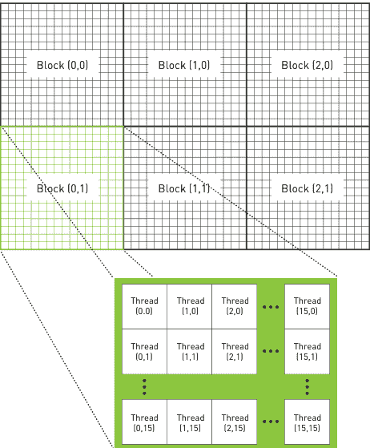

图 5.2 可用于使用每个像素一个线程来处理 48 x 32 像素图像的块和线程的二维层次结构

如果你做过任何多线程 CPU 编程，可能会好奇我们为什么要启动这么多线程。例如，要渲染 1920 x 1080 的全高清动画，此方法将创建超过 200 万个线程。虽然我们在 GPU 上常规地创建和调度这么多线程，但在 CPU 上没人会梦想创建这么多线程。因为 CPU 线程管理和调度必须在软件中完成，它根本无法扩展到 GPU 能够处理的线程数量。因为我们可以为要处理的每个数据元素简单地创建一个线程，因此 GPU 上的并行编程可以比 CPU 上简单得多。

在声明了保存启动维度的变量后，我们只需启动将计算像素值的内核。

```
kernel<<< blocks,threads>>>( d->dev_bitmap, ticks );
```

内核需要我们作为参数传递的两个信息。首先，它需要一个指向保存输出像素的设备内存的指针。这是一个在 `main()` 中分配了内存的全局变量。但该变量仅对主机代码是“全局”的，因此我们需要将其作为参数传递，以确保 CUDA 运行时会将其提供给我们的设备代码。

其次，我们的内核需要知道当前动画时间，以便生成正确的帧。当前时间 `ticks` 从 `CPUAnimBitmap` 中的基础架构代码传递给 `generate_frame()` 函数，因此我们可以简单地将其传递给我们的内核。

现在，以下是内核代码本身：

```
__global__ void kernel( unsigned char *ptr, int ticks ) {
    // map from threadIdx/BlockIdx to pixel position
    int x = threadIdx.x + blockIdx.x * blockDim.x;
    int y = threadIdx.y + blockIdx.y * blockDim.y;
    int offset = x + y * blockDim.x * gridDim.x;

    // now calculate the value at that position
    float fx = x - DIM/2;
    float fy = y - DIM/2;
    float d = sqrtf( fx * fx + fy * fy );
unsigned char grey = (unsigned char) (128.0f + 127.0f *
cos(d/10.0f - ticks/7.0f) /
(d/10.0f + 1.0f));
ptr[offset*4 + 0] = grey;
ptr[offset*4 + 1] = grey;
ptr[offset*4 + 2] = grey;
ptr[offset*4 + 3] = 255;
}
```

前三行是内核中最重要的行。

```
int x = threadIdx.x + blockIdx.x * blockDim.x;
int y = threadIdx.y + blockIdx.y * blockDim.y;
int offset = x + y * blockDim.x * gridDim.x;
```

在这些行中，每个线程获取其在块内的索引以及其块在网格内的索引，并将其转换为图像中的唯一 (x,y) 索引。因此，当块 (12, 8) 中索引为 (3, 5) 的线程开始执行时，它知道它左侧有 12 个完整的块，上方有 8 个完整的块。在其块内，索引为 (3, 5) 的线程左侧有三个线程，上方有五个线程。因为每个块有 16 个线程，这意味着该线程具有以下内容：

3 个线程 + 12 个块 * 16 个线程/块 = 其左侧 195 个线程

5 个线程 + 8 个块 * 16 个线程/块 = 其上方 128 个线程

此计算与前两行中 x 和 y 的计算相同，这是我们将线程和块索引映射到图像坐标的方式。然后我们只需将这些 x 和 y 值线性化，以获取输出缓冲区中的偏移量。同样，这与我们在“GPU 较长向量求和”和“GPU 任意长度向量求和”部分所做的相同。

```
int offset = x + y * blockDim.x * gridDim.x;
```

由于我们知道线程应该计算图像中的哪个 (x,y) 像素，并且知道它需要计算此值的时间，我们可以计算 (x, y, t) 的任何函数，并将此值存储在输出缓冲区中。在此示例中，该函数生成一个随时间变化的正弦“涟漪”。

```
float fx = x - DIM/2;
float fy = y - DIM/2;
float d = sqrtf( fx * fx + fy * fy );
unsigned char grey = (unsigned char)(128.0f + 127.0f *
cos( d/10.0f - ticks/7.0f ) /
(d/10.0f + 1.0f) );
```

我们建议你不要过于纠结于 grey 的计算。它本质上只是一个随时间变化的 2D 函数，在动画时会产生很好的涟漪效果。一帧的屏幕截图应该类似于图 5.3。

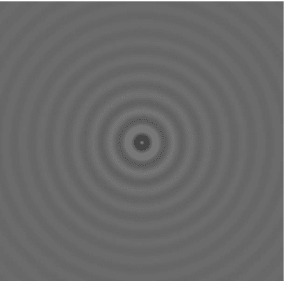

图 5.3 GPU 涟漪示例的屏幕截图

## 5.3 共享内存与同步

到目前为止，将块拆分为线程的动机仅仅是为了绕过我们可以并行执行的块数量的硬件限制。这是一个相当薄弱的动机，因为 CUDA 运行时可以轻松地在幕后完成此操作。幸运的是，人们可能希望将块拆分为线程的其他原因。

CUDA C 提供了一种我们称为 _共享内存_ 的内存区域。这种内存区域随附另一种对 C 语言的扩展，类似于 `__device__` 和 `__global__`。作为程序员，你可以使用 CUDA C 关键字 `__shared__` 修改变量声明，使该变量驻留在共享内存中。但有什么意义呢？

很高兴你问了。CUDA C 编译器对待共享内存中的变量与典型变量不同。它为你在 GPU 上启动的每个块创建该变量的一个副本。该块中的每个线程都共享该内存，但线程无法看到或修改在其他块中可见的该变量副本。这为块内的线程之间通信和协作进行计算提供了绝佳手段。此外，共享内存缓冲区物理上驻留在 GPU 上，而不是驻留在片外 DRAM 中。因此，访问共享内存的延迟通常远低于典型缓冲区，使共享内存作为每个块的软件托管缓存或暂存区非常有效。

线程间通信的前景应该会让你兴奋。它也让我们兴奋。但天下没有免费的午餐，线程间通信也不例外。如果我们希望在线程之间通信，我们也需要一种在线程之间同步的机制。例如，如果线程 A 将值写入共享内存，并且我们希望线程 B 对此值做些什么，我们不能让线程 B 开始工作，直到我们知道线程 A 的写入已完成。如果没有同步，我们就创建了一个竞争条件，其中执行结果的正确性取决于硬件的非确定性细节。

让我们看看一个使用这些功能的示例。


### 5.3.1 点积

恭喜！我们已经学完了向量加法，现在将学习向量点积（有时也称为内积）。我们将快速回顾什么是点积，以防你不熟悉向量数学（或者已经好几年没接触了）。计算包含两个步骤。首先，我们将两个输入向量的对应元素相乘。这与向量加法非常相似，但使用乘法而不是加法。然而，我们不是将这些值存储到第三个输出向量中，而是将它们全部求和，以产生一个单一的标量输出。

例如，如果我们对两个四元素向量求点积，将得到公式 5.1。

#### 公式 5.1

(x1, x2, x3, x4) · (y1, y2, y3, y4) = x1y1 + x2y2 + x3y3 + x4y4

也许我们倾向于使用的算法正在变得明显。我们可以完全按照向量加法的方式执行第一步。每个线程将一对对应的条目相乘，然后每个线程继续处理下一对。由于结果需要是所有这些成对乘积的总和，每个线程都会保存它已添加的对的运行和。就像在加法示例中一样，线程将它们的索引增加线程总数，以确保我们不会遗漏任何元素，也不会将一对相乘两次。以下是点积例程的第一步：

```
#include "../common/book.h"

#define imin(a,b) (a<b?a:b)

const int N = 33 * 1024;
const int threadsPerBlock = 256;

__global__ void dot( float *a, float *b, float *c ) {
    __shared__ float cache[threadsPerBlock];
    int tid = threadIdx.x + blockIdx.x * blockDim.x;
    int cacheIndex = threadIdx.x;
    float temp = 0;
    while (tid < N) {
        temp += a[tid] * b[tid];
        tid += blockDim.x * gridDim.x;
    }
    // set the cache values
    cache[cacheIndex] = temp;
```

如你所见，我们声明了一个名为 cache 的共享内存缓冲区。该缓冲区将用于存储每个线程的运行和。很快我们将看到为什么要这样做，但目前我们将简单地检查我们完成此操作的机制。声明一个驻留在共享内存中的变量非常简单，并且与你在标准 C 中声明变量为 static 或 volatile 的方式相同：

```
__shared__ float cache[threadsPerBlock];
```

我们声明一个大小为 threadsPerBlock 的数组，以便块中的每个线程都有一个位置来存储其临时结果。回想一下，当我们全局分配内存时，我们分配了足够运行内核的每个线程的内存，即 threadsPerBlock 乘以块的总数。但是，由于编译器会为每个块创建共享变量的副本，我们只需要分配足够的内存，使得块中的每个线程都有一个条目。

分配共享内存后，我们像过去一样计算数据索引：

```
int tid = threadIdx.x + blockIdx.x * blockDim.x;
int cacheIndex = threadIdx.x;
```

变量 tid 的计算现在应该很熟悉了；我们只是将块和线程索引组合起来，以获取输入数组中的全局偏移量。共享内存 cache 中的偏移量只是我们的线程索引。同样，我们不需要将块索引纳入此偏移量，因为每个块都有此共享内存的私有副本。

最后，我们清除共享内存缓冲区，以便以后能够盲目地对整个数组求和，而无需担心特定条目是否存储了有效数据：

```
// set the cache values
cache[cacheIndex] = temp;
```

如果输入向量的大小不是每个块线程数的倍数，则可能不是每个条目都会被使用。在这种情况下，最后一个块将有一些不执行任何操作且因此不写入值的线程。

每个线程计算 a 和 b 中对应条目乘积的运行和。到达数组末尾后，每个线程将其临时和存储到共享缓冲区中。

```
float temp = 0;
while (tid < N) {
    temp += a[tid] * b[tid];
    tid += blockDim.x * gridDim.x;
}

// set the cache values
cache[cacheIndex] = temp;
```

在算法的这个阶段，我们需要求和我们放入缓存中的所有临时值。为此，我们需要一些线程读取存储在那里的值。但是，正如我们提到的，这是一个潜在的危险操作。我们需要一种方法来保证对共享数组 cache [] 的所有写入在任何人尝试从该缓冲区读取之前完成。幸运的是，这样的方法存在：

```
// synchronize threads in this block
__syncthreads ();
```

此调用保证块中的每个线程在硬件对任何线程执行下一条指令之前，都已完成 __syncthreads () 之前的指令。这正是我们需要的！我们现在知道，当第一个线程执行我们的 __syncthreads() 之后的第一条指令时，块中的每个其他线程也都已完成执行到 __syncthreads()。

现在我们已经保证临时缓存已填充，可以对其中的值求和了。我们将获取输入数组并执行某些计算以产生较小结果数组的一般过程称为归约（reduction）。归约在并行计算中经常出现，这导致我们希望为它们命名。

实现此归约的天真方法是让一个线程遍历共享内存并计算运行和。这将花费与数组长度成正比的时间。但是，由于我们有数百个线程可用来完成工作，我们可以并行执行此归约，所需时间与数组长度的对数成正比。起初，以下代码可能看起来很复杂；我们稍后将对其进行分解。

一般思路是，每个线程将 cache [] 中的两个值相加，并将结果存回 cache []。由于每个线程将两个条目合并为一个，我们完成此步骤时的条目数是初始数量的一半。在下一步中，我们对剩余的一半执行相同的操作。我们以这种方式继续 log2 (threadsPerBlock) 步，直到获得 cache [] 中每个条目的总和。在我们的示例中，我们每个块使用 256 个线程，因此此过程需要 8 次迭代才能将 cache [] 中的 256 个条目归约为一个总和。

此过程的代码如下：

```c
// for reductions, threadsPerBlock must be a power of 2
// because of the following code
int i = blockDim.x/2;
while (i > 0) {
    if (cacheIndex < i)
        cache[cacheIndex] += cache[cacheIndex + i];
    __syncthreads();
    i /= 2;
}
```

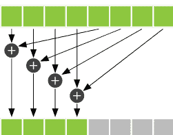

图 5.4 求和归约的一个步骤

对于第一步，我们将 i 设置为 threadsPerBlock 数量的一半。我们只希望索引小于此值的线程执行任何工作，因此如果线程的索引小于 i，我们将有条件地将 cache [] 中的两个条目相加。我们在 if (cacheIndex < i) 块中保护我们的加法。每个线程将获取 cache [] 中其索引处的条目，将其与索引偏移 i 处的条目相加，并将此和存回 cache []。

假设 cache [] 中有八个条目，因此 i 的值为 4。归约的一个步骤将如图 5.4 所示。

完成一步后，我们有与计算完所有成对乘积后相同的限制。在读取我们刚刚存储在 cache [] 中的值之前，我们需要确保每个需要写入 cache [] 的线程都已完成。赋值后的 __syncthreads () 确保满足此条件。

while () 循环终止后，每个块只剩下一个数字。该数字位于 cache [] 的第一个条目中，是该块中线程计算的每个成对乘积的总和。然后我们将此单个值存储到全局内存并结束内核：

```
if (cacheIndex == 0)
    c[blockIdx.x] = cache[0] ;
}
```


我们之所以只为 cacheIndex == 0 的线程执行这个全局存储，是有原因的。毕竟，只有一个数字需要写入全局内存，因此只需一个线程来执行此操作。诚然，每个线程都可以执行此写入，程序仍然可以工作，但这样做会为了写入一个值而产生不必要的大量内存流量。为简单起见，我们选择了索引为 0 的线程，尽管你也可以选择任何 cacheIndex 将 cache[0] 写入全局内存。最后，由于每个块将向全局数组 c[] 写入恰好一个值，我们可以直接通过 blockIdx.x 对其进行索引。

现在我们得到了一个数组 c[]，其中每个条目都包含由某个并行块生成的和。点积的最后一步是对 c[] 的条目求和。尽管点积尚未完全计算，但我们此时退出内核并将控制权返回给主机。但为什么在计算完成前就返回主机呢？

此前，我们将点积之类的操作称为归约。粗略地说，这是因为我们产生的输出数据元素比输入的要少。在点积的情况下，无论输入大小如何，我们始终只产生一个输出。事实证明，像 GPU 这样大规模并行的机器在执行归约的最后几步时往往会浪费资源，因为此时数据集的大小非常小；要利用 480 个算术单元来相加 32 个数字是很困难的！

出于这个原因，我们将控制权返回给主机，并让 CPU 完成加法的最后一步，即对数组 c[] 求和。在更大的应用程序中，GPU 现在可以开始另一个点积或处理另一个大型计算。然而，在本示例中，我们已经使用完 GPU 了。

在解释本示例时，我们打破了传统，直接进入了实际的内核计算。我们希望你能毫不费力地理解 main() 函数体直到内核调用的部分，因为它与我们之前展示的内容非常相似。

```
const int blocksPerGrid =
    imin( 32, (N+threadsPerBlock-1) / threadsPerBlock );

int main( void )
{
    float *a, *b, c, *partial_c;
    float *dev_a, *dev_b, *dev_partial_c;

// allocate memory on the CPU side
a = new float[N];
b = new float[N];
partial_c = new float[blocksPerGrid];

// allocate the memory on the GPU
HANDLE_ERROR( cudaMalloc( (void**)&dev_a,
    N*sizeof(float) ) );
HANDLE_ERROR( cudaMalloc( (void**)&dev_b,
    N*sizeof(float) ) );
HANDLE_ERROR( cudaMalloc( (void**)&dev_partial_c,
    blocksPerGrid*sizeof(float) ) );

// fill in the host memory with data
for (int i=0; i<N; i++) {
    a[i] = i;
    b[i] = i*2;
}

// copy the arrays 'a' and 'b' to the GPU
HANDLE_ERROR( cudaMemcpy( dev_a, a, N*sizeof(float),
    cudaMemcpyHostToDevice ) );
HANDLE_ERROR( cudaMemcpy( dev_b, b, N*sizeof(float),
    cudaMemcpyHostToDevice ) );

dot<<<blocksPerGrid,threadsPerBlock>>>( dev_a,
    dev_b,
    dev_partial_c );
```

为了避免你因无聊而昏厥，我们将快速总结这段代码：

- 1. 为输入和输出数组分配主机和设备内存。
- 2. 填充输入数组 a[] 和 b[]，然后使用 cudaMemcpy() 将它们复制到设备。
- 3. 使用预定义的每块线程数和每网格块数调用我们的点积内核。

尽管其中大部分对你来说现在已是家常便饭，但审视我们启动的块数的计算仍然很有价值。我们讨论过点积是一种归约，并且每个启动的块都会计算一个部分和。这个部分和列表的长度应该对 CPU 来说足够小以便管理，同时又足够大，以便有足够多的块在飞行中来让即使是最快的 GPU 也保持忙碌。我们选择了 32 个块，尽管在这种情况下，其他选择可能会带来更好或更差的性能，尤其是取决于你的 CPU 和 GPU 的相对速度。

但如果给定的列表非常短，而 32 个块（每个块 256 个线程）又太多怎么办？如果我们有 N 个数据元素，只需要 N 个线程就可以计算点积。因此，在这种情况下，我们需要大于或等于 N 的 threadsPerBlock 的最小倍数。在之前加向量时我们见过这种情况。在这种情况下，通过计算 (N + threadsPerBlock-1) / threadsPerBlock 来获得大于或等于 N 的 threadsPerBlock 的最小倍数。如你所料，这实际上是整数数学中一个相当常见的技巧，因此即使你大部分时间在 CUDA C 领域之外工作，也值得消化这一点。

因此，我们启动的块数应该是 32 或 (N+threadsPerBlock-1) / threadsPerBlock 中较小的那个值。

```
const int blocksPerGrid =
    imin( 32, (N+threadsPerBlock-1) / threadsPerBlock );
```

现在应该清楚我们如何得出 main() 中的代码了。内核结束后，我们仍然需要对结果求和。但就像在启动内核之前将输入复制到 GPU 一样，我们需要在继续处理之前将输出复制回 CPU。因此，内核结束后，我们将部分和列表复制回来，并在 CPU 上完成求和。

```
// copy the array 'c' back from the GPU to the CPU
HANDLE_ERROR( cudaMemcpy( partial_c, dev_partial_c,
    blocksPerGrid*sizeof(float),
    cudaMemcpyDeviceToHost ) );
```

```
// finish up on the CPU side
c = 0;
for (int i=0; i<blocksPerGrid; i++) {
    c += partial_c[i];
}
```

最后，我们检查结果并清理在 CPU 和 GPU 上分配的内存。由于我们用可预测的数据填充了输入，因此检查结果变得更加容易。如果你记得，a[] 被填充为 0 到 N-1 的整数，而 b[] 只是 2*a[]。

```
// fill in the host memory with data
for (int i=0; i<N; i++) {
    a[i] = i;
    b[i] = i*2;
}
```

我们的点积应该是 0 到 N-1 的整数平方和的两倍。对于热爱离散数学（有什么不可爱的？！）的读者来说，推导这个求和的闭式解将是一个有趣的消遣。对于耐心或兴趣较少的读者，我们在这里给出了闭式解，以及 main() 函数体的其余部分：

```
#define sum_squares(x) ((x)*(x+1)*(2*x+1)/6)
printf( "Does GPU value %g = %g?\n", c,
        2 * sum_squares( (float) (N - 1) ) );

// free memory on the GPU side
cudaFree( dev_a );
cudaFree( dev_b );
cudaFree( dev_partial_c );

// free memory on the CPU side
delete [] a;
delete [] b;
delete [] partial_c;
}
```

如果你觉得我们所有这些解释性的打断都很烦人，这里是完整的源代码清单，不含注释：

```
#include "./common/book.h"

#define imin(a,b) (a<b?a:b)

const int N = 33 * 1024;
const int threadsPerBlock = 256;
const int blocksPerGrid =
    imin( 32, (N+threadsPerBlock-1) / threadsPerBlock ) ;

__global__ void dot( float *a, float *b, float *c ) {
    __shared__ float cache[threadsPerBlock];
    int tid = threadIdx.x + blockIdx.x * blockDim.x;
    int cacheIndex = threadIdx.x;

    float temp = 0;
    while (tid < N) {
        temp += a[tid] * b[tid];
        tid += blockDim.x * gridDim.x;
    }

    // set the cache values
    cache[cacheIndex] = temp;

    // synchronize threads in this block
    __syncthreads();

    // for reductions, threadsPerBlock must be a power of 2
    // because of the following code
    int i = blockDim.x/2;
    while (i != 0) {
        if (cacheIndex < i) {
            cache[cacheIndex] += cache[cacheIndex + i];
            __syncthreads();
        }
        i /= 2;
    }

    if (cacheIndex == 0)
        c[blockIdx.x] = cache[0];
}

int main( void ) {
    float   *a, *b, c, *partial_c;
    float   *dev_a, *dev_b, *dev_partial_c;

    // allocate memory on the CPU side
    a = (float*)malloc( N*sizeof(float) );
    b = (float*)malloc( N*sizeof(float) );
    partial_c = (float*)malloc( blocksPerGrid*sizeof(float) );

    // allocate the memory on the GPU
    HANDLE_ERROR( cudaMalloc( (void**)&dev_a,
        N*sizeof(float) ) );
    HANDLE_ERROR( cudaMalloc( (void**)&dev_b,
        N*sizeof(float) ) );
    HANDLE_ERROR( cudaMalloc( (void**)&dev_partial_c,
        blocksPerGrid*sizeof(float) ) );

    // fill in the host memory with data
    for (int i=0; i<N; i++) {
        a[i] = i;
        b[i] = i*2;
    }

    // copy the arrays 'a' and 'b' to the GPU
    HANDLE_ERROR( cudaMemcpy( dev_a, a, N*sizeof(float),
        cudaMemcpyHostToDevice ) );
    HANDLE_ERROR( cudaMemcpy( dev_b, b, N*sizeof(float),
        cudaMemcpyHostToDevice ) );
}
```


```cpp
dot<<<blocksPerGrid,threadsPerBlock>>>( dev_a, dev_b,
 dev_partial_c );

// copy the array 'c' back from the GPU to the CPU
HANDLE_ERROR( cudaMemcpy( partial_c, dev_partial_c,
 blocksPerGrid*sizeof( float ),
 cudaMemcpyDeviceToHost ) );

// finish up on the CPU side
c = 0;
for (int i=0; i<blocksPerGrid; i++) {
 c += partial_c[i];
}

#define sum_squares(x) ( (x)*(x+1) * (2*x+1)/6 )
printf( "Does GPU value %.6g = %.6g?\n", c,
 2 * sum_squares( (float) (N - 1) ) );

// free memory on the GPU side
cudaFree( dev_a );
cudaFree( dev_b );
cudaFree( dev_partial_c );

// free memory on the CPU side
free( a );
free( b );
free( partial_c );
}
```

### 5.3.1 点积优化（错误地）

我们在点积示例中快速略过了第二个 `__syncthreads()`。现在我们将更仔细地审视它，并探讨一次改进尝试。如果你记得，我们需要第二个 `__syncthreads()` 是因为我们更新了共享内存变量 `cache[]`，并且需要这些更新在下一次循环迭代中对每个线程可见。

```
int i = blockDim.x/2;
while (i != 0) {
    if (cacheIndex < i)
        cache[cacheIndex] += cache[cacheIndex + i];
    __syncthreads();
    i /= 2;
}
```

请注意，我们仅在 `cacheIndex` 小于 `i` 时才更新共享内存缓冲区 `cache[]`。由于 `cacheIndex` 实际上就是 `threadIdx.x`，这意味着只有部分线程在更新共享内存缓存中的条目。由于我们使用 `__syncthreads()` 仅仅是为了确保这些更新在继续之前已完成，因此合理地推测，只有等待实际正在写入共享内存的线程，才可能看到速度提升。我们通过将同步调用移到 `if ()` 块内部来实现这一点：

```
int i = blockDim.x/2;
while (i != 0) {
    if (cacheIndex < i) {
        cache[cacheIndex] += cache[cacheIndex + i];
        __syncthreads();
    }
    i /= 2;
}
```

尽管这是一次英勇的优化尝试，但它实际上并不起作用。事实上，情况比这更糟。对内核的这一更改实际上会导致 GPU 停止响应，迫使你终止程序。但是，如此看似无害的更改怎么会出这么严重的问题呢？

要回答这个问题，有助于想象块中的每个线程一次一行地执行代码。在程序中的每条指令处，每个线程都执行相同的指令，但每个线程可以操作不同的数据。但是，当每个线程都应该执行的指令位于类似 `if (...)` 的条件块内部时会发生什么呢？显然，不是每个线程都应该执行那条指令，对吧？例如，考虑一个包含以下代码片段的内核，该片段旨在让奇数索引线程更新某个变量的值：

```
int myVar = 0;
if (threadIdx.x % 2 )
    myVar = threadIdx.x;
```

在前面的示例中，当线程到达加粗的那一行时，只有奇数索引的线程会执行它，因为偶数索引的线程不满足条件 `if ( threadIdx.x % 2 )`。偶数线程什么都不做，而奇数线程执行这条指令。当某些线程需要执行指令而其他线程不需要时，这种情况称为线程分歧。在正常情况下，分歧分支仅导致某些线程保持空闲，而其他线程实际执行分支中的指令。

但在 `__syncthreads()` 的情况下，结果有些悲剧。CUDA 架构保证，在块中的每个线程都执行了 `__syncthreads()` 之前，没有任何线程会推进到 `__syncthreads()` 之后的指令。不幸的是，如果 `__syncthreads()` 位于分歧分支中，一些线程将永远无法到达 `__syncthreads()`。因此，由于保证在每个线程都执行 `__syncthreads()` 之前不能执行 `__syncthreads()` 之后的任何指令，硬件只是继续等待这些线程。一直等待。一直等待。永远等待。

当我们将 `__syncthreads()` 调用移到 `if (...)` 块内部时，点积示例中就会出现这种情况。任何 `cacheIndex` 大于或等于 `i` 的线程都永远不会执行 `__syncthreads()`。这实际上会使处理器挂起，因为它导致 GPU 在等待一件永远不会发生的事情。

```
if (cacheIndex < i) {
    cache[cacheIndex] += cache[cacheIndex + i];
    __syncthreads();
}
```

这个故事的寓意是，`__syncthreads()` 是一种强大的机制，用于确保你的大规模并行应用程序仍然能计算出正确的结果。但是，由于这种意外后果的潜在可能性，我们在使用它时仍需小心。

### 5.3.2 共享内存位图

我们已经查看了使用共享内存并使用 `__syncthreads()` 来确保在继续之前数据已就绪的示例。出于速度考虑，你可能会想冒险省略 `__syncthreads()`。我们现在将看一个图形示例，该示例需要 `__syncthreads()` 来保证正确性。我们将向你展示预期输出的截图以及在没有 `__syncthreads()` 的情况下运行时的输出。情况不会好看。

`main()` 的主体与 GPU Julia Set 示例相同，尽管这次我们每个块启动多个线程：

```
#include "cuda.h"
#include "../common/book.h"
#include "../common/cpu_bitmap.h"

#define DIM 1024
#define PI 3.1415926535897932f

int main( void ) {
    CPUBitmap bitmap( DIM, DIM );
    unsigned char *dev_bitmap;

    HANDLE_ERROR( cudaMalloc( (void**)&dev_bitmap,
                              bitmap.image_size() ) );

    dim3    grids(DIM/16,DIM/16);
    dim3    threads(16,16);
    kernel<<<grids,threads>>>( dev_bitmap );
    HANDLE_ERROR( cudaMemcpy( bitmap.get_ptr(), dev_bitmap,
                              bitmap.image_size(),
                              cudaMemcpyDeviceToHost ) );
    bitmap.display_and_exit();
    cudaFree( dev_bitmap );
}
```

与 Julia Set 示例一样，每个线程将为单个输出位置计算像素值。每个线程首先要做的是计算其在输出图像中的 x 和 y 位置。此计算与向量加法示例中的 tid 计算相同，尽管这次我们在二维中计算它：

```
__global__ void kernel( unsigned char *ptr ) {
 // map from threadIdx/blockIdx to pixel position
 int x = threadIdx.x + blockIdx.x * blockDim.x;
 int y = threadIdx.y + blockIdx.y * blockDim.y;
 int offset = x + y * blockDim.x * gridDim.x;
}
```

由于我们将使用共享内存缓冲区来缓存计算结果，我们声明一个这样的缓冲区，使得我们 16 x 16 块中的每个线程都有一个条目。

```
__shared__ float shared[16][16];
```

然后，每个线程计算一个要存储到此缓冲区中的值。

```
// now calculate the value at that position
const float period = 128.0f;
shared[threadIdx.x][threadIdx.y] =
 255 * (sinf(x*2.0f*PI/period) + 1.0f) *
 (sinf(y*2.0f*PI/period) + 1.0f) / 4.0f;
```

最后，我们将这些值存回像素，反转 x 和 y 的顺序：

```
ptr[offset*4 + 0] = 0;
ptr[offset*4 + 1] = shared[15-threadIdx.x][15-threadIdx.y];
ptr[offset*4 + 2] = 0;
ptr[offset*4 + 3] = 255;
}
```

诚然，这些计算有些任意。我们只是想出了一些东西来绘制一个绿色球形斑点网格。因此，在编译并运行此内核后，我们输出一张类似图 5.5 中的图像。

这里发生了什么？正如你可能从我们设置此示例的方式中猜到的那样，我们缺少一个重要的同步点。当一个线程将在 `shared[][]` 中计算的值存储到像素时，负责将该值写入 `shared[][]` 的线程可能尚未完成写入。保证这种情况不发生的唯一方法是使用 `__syncthreads()`。因此，结果是一张损坏的绿色斑点图片。

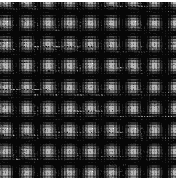

图 5.5 未进行正确同步时渲染的截图


虽然这可能不是世界末日，但您的应用程序可能正在计算更重要的值。

相反，我们需要在写入共享内存和随后从中读取之间添加一个同步点。

```
shared[threadIdx.x][threadIdx.y] =
  255 * (sinf(x*2.0f*PI / period) + 1.0f) *
  (sinf(y*2.0f*PI / period) + 1.0f) / 4.0f;

__syncthreads();

ptr[offset*4 + 0] = 0;
ptr[offset*4 + 1] = shared[15-threadIdx.x][15-threadIdx.y];
ptr[offset*4 + 2] = 0;
ptr[offset*4 + 3] = 255;
}
```

有了这个__syncthreads()，我们就能得到一个更可预测、[且美观]的结果，如图5.6所示。

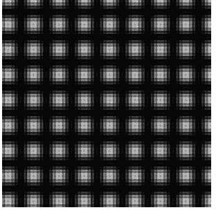

图 5.6 添加正确同步后的截图

## 5.4 章节回顾

我们知道块可以被细分为称为*线程*的更小的并行执行单元。我们重新审视了上一章的向量加法示例，以了解如何对任意长度的向量进行加法运算。我们还展示了一个*归约*示例，以及如何使用共享内存和同步来完成此操作。事实上，这个示例展示了GPU和CPU如何协作计算结果。最后，我们展示了当我们忽视同步需求时，对应用程序可能有多么危险。

您已经学习了CUDA C的大部分基础知识，以及它与标准C相似的一些方式和与标准C不同的许多重要方式。现在是考虑您遇到的一些问题以及哪些问题可能适合使用CUDA C进行并行实现的绝佳时机。随着我们深入，我们将探讨可用于在GPU上完成任务的一些其他功能，以及CUDA提供的一些更高级的API功能。

# 第 6 章

# 常量内存与事件

希望您已经学习了关于在GPU上执行的代码编写的许多知识。您应该知道如何生成并行块来执行内核，并且应该知道如何将这些块进一步拆分为并行线程。您还了解了在线程之间启用通信和同步的方法。但由于本书尚未结束，您可能已经猜到CUDA C还有更多可能对您有用的功能。

本章将向您介绍其中几个更高级的功能。具体来说，存在一些方法，您可以利用GPU上的特殊内存区域来加速您的应用程序。在本章中，我们将讨论其中一种内存区域：常量内存。此外，由于我们正在探讨增强CUDA C应用程序性能的第一种方法，您还将学习如何使用CUDA事件来测量应用程序的性能。通过这些测量，您将能够量化任何改进带来的收益[或损失！]。

## 6.1 章节目标

在本章学习过程中，您将完成以下任务：

- 您将学习如何在CUDA C中使用常量内存。
- 您将了解常量内存的性能特征。
- 您将学习如何使用CUDA事件来测量应用程序性能。

## 6.2 常量内存

此前，我们讨论过现代GPU配备了巨大的算术处理能力。事实上，图形处理器相对于CPU的计算优势有助于激发最初对使用图形处理器进行通用计算的兴趣。由于GPU上有数百个算术单元，瓶颈通常不是芯片的算术吞吐量，而是芯片的内存带宽。图形处理器上有如此多的ALU，以至于有时我们无法以足够快的速度向它们提供输入来维持如此高的计算速率。因此，值得探索减少给定问题所需内存流量的方法。

迄今为止，我们已经看到过同时使用全局内存和共享内存的CUDA C程序。然而，该语言提供了另一种称为*常量内存*的内存。正如名称所暗示的那样，我们使用常量内存来存储在内核执行过程中不会更改的数据。NVIDIA硬件提供64kB的常量内存，其处理方式与标准全局内存不同。在某些情况下，使用常量内存而不是全局内存将减少所需的内存带宽。

### 6.2.1 光线追踪简介

我们将在一个简单的*光线追踪*应用程序环境中探讨利用常量内存的一种方法。首先，我们将向您介绍光线追踪背后的主要概念背景。如果您已经熟悉光线追踪背后的概念，可以跳转到“GPU上的光线追踪”部分。

简单来说，光线追踪是生成由三维对象组成的场景的二维图像的一种方法。但这不正是GPU最初设计的用途吗？这与OpenGL或DirectX在您玩喜欢的游戏时所做的有何不同？嗯，GPU确实解决了这个相同的问题，但它们使用一种称为光栅化的技术。关于光栅化有许多优秀的书籍，因此我们不会在此尝试解释差异。只需说它们是解决相同问题的完全不同的方法即可。

那么，光线追踪如何生成三维场景的图像呢？想法很简单：我们在场景中选择一个位置放置一台虚拟相机。这个简化的数码相机包含一个光传感器，因此为了生成图像，我们需要确定哪些光会击中该传感器。生成图像的每个像素应该与击中该点传感器的光线具有相同的颜色和强度。

由于传感器上任何点的入射光可能来自场景中的任何地方，结果发现逆向思考更容易。也就是说，与其试图弄清楚哪些光线击中了问题像素，不如想象从像素向场景发射一条光线？这样，每个像素的行为就像一只“观察”场景的眼睛。图6.1说明了这些光线从每个像素发射到场景中的过程。

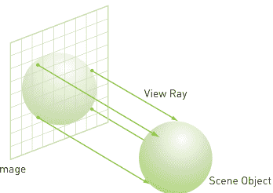

图 6.1 一个简单的光线追踪方案

我们通过从问题像素出发追踪一条穿过场景直到击中我们某个对象的光线，来确定每个像素看到的颜色。然后我们说该像素将“看到”该对象，并可以根据其看到的对象的颜色分配其颜色。光线追踪所需的大部分计算在于计算光线与场景中对象的这些交点。

此外，在更复杂的光线追踪模型中，场景中的光泽物体可以反射光线，半透明物体可以折射光线。这会产生二级光线、三级光线等等。事实上，这是光线追踪的吸引人的特征之一；要让一个基本的光线追踪器运行起来非常简单，但我们可以将更复杂现象的模型构建到光线追踪器中，以产生更逼真的图像。

### 6.2.2 GPU上的光线追踪

由于OpenGL和DirectX等API并非设计用于允许光线追踪渲染，我们将不得不使用CUDA C来实现我们的基本光线追踪器。我们的光线追踪器将非常简单，以便我们可以专注于常量内存的使用，因此如果您期望能够构成完整生产渲染器基础的代码，您将会失望。我们的基本光线追踪器将仅支持球体场景，且相机限制在z轴上，面向原点。此外，我们将不支持场景的任何照明，以避免二级光线带来的复杂性。与其计算照明效果，不如简单地为每个球体分配一种颜色，然后如果它们可见，就用某个预计算函数对其进行着色。

那么，光线追踪器将做什么呢？它将从每个像素发射一条光线，并跟踪哪些光线击中了哪些球体。它还将跟踪每次命中的深度。在光线穿过多个球体的情况下，只有最靠近相机的球体才能被看到。本质上，我们的“光线追踪器”所做的不过是隐藏相机无法看到的表面。

我们将使用一个数据结构来建模我们的球体，该结构存储球体的中心坐标{x, y, z}、半径以及颜色{r, b, g}。


```cpp
#define INF 2e10f

struct Sphere {
    float r,b,g;
    float radius;
    float x,y,z;
    __device__ float hit( float ox, float oy, float *n ) {
        float dx = ox - x;
        float dy = oy - y;
        if (dx*dx + dy*dy < radius*radius) {
            float dz = sqrtf( radius*radius - dx*dx - dy*dy );
            *n = dz / sqrtf( radius * radius );
            return dz + z;
        }
        return -INF;
    }
};
```

你还会注意到该结构体具有一个名为 hit( float ox, float oy, float *n ) 的方法。给定从像素 (ox, oy) 发出的光线，该方法会计算光线是否与球体相交。如果光线确实与球体相交，该方法会计算光线击中球体时距离相机的距离。我们需要此信息是出于之前提到的原因：如果光线击中了多个球体，只有最近的球体才能被看到。

我们的 main() 例程大致遵循与之前图像生成示例相同的序列。

```cpp
#include "cuda.h"
#include "../common/book.h"
#include "../common/cpu_bitmap.h"

#define rnd( x ) (x * rand() / RAND_MAX)
#define SPHERES 20

Sphere *s;

int main( void ) {
    // capture the start time
    cudaEvent_t start, stop;
    HANDLE_ERROR( cudaEventCreate( &start ) );
    HANDLE_ERROR( cudaEventCreate( &stop ) );
    HANDLE_ERROR( cudaEventRecord( start, 0 ) );

    CPUBitmap bitmap( DIM, DIM );
    unsigned char *dev_bitmap;

    // allocate memory on the GPU for the output bitmap
    HANDLE_ERROR( cudaMalloc( (void**)&dev_bitmap,
                              bitmap.image_size() ) );

    // allocate memory for the Sphere dataset
    HANDLE_ERROR( cudaMalloc( (void**)&s,
                              sizeof(Sphere) * SPHERES ) );
}
```

我们为输入数据分配内存，这些数据是构成场景的球体数组。由于我们需要在 GPU 上使用这些数据，但由 CPU 生成，因此必须同时调用 `cudaMalloc()` 和 `malloc()` 在 GPU 和 CPU 上分配内存。我们还会分配一个位图图像，在 GPU 上对球体进行光线追踪时，用输出像素数据填充它。

为输入和输出分配内存后，我们会随机生成球体的中心坐标、颜色和半径：

```cpp
// allocate temp memory, initialize it, copy to
// memory on the GPU, and then free our temp memory
Sphere *temp_s = (Sphere*)malloc( sizeof(Sphere) * SPHERES );
for (int i=0; i<SPHERES; i++) {
    temp_s[i].r = rnd( 1.0f );
    temp_s[i].g = rnd( 1.0f );
    temp_s[i].b = rnd( 1.0f );
    temp_s[i].x = rnd( 1000.0f ) - 500;
    temp_s[i].y = rnd( 1000.0f ) - 500;
    temp_s[i].z = rnd( 1000.0f ) - 500;
    temp_s[i].radius = rnd( 100.0f ) + 20;
}
```

程序目前生成一个包含 20 个球体的随机数组，但该数量是在 `#define` 中指定的，可以根据需要进行调整。

我们使用 `cudaMemcpy()` 将此球体数组复制到 GPU，然后释放临时缓冲区。

```cpp
HANDLE_ERROR( cudaMemcpy( s, temp_s,
    sizeof(Sphere) * SPHERES,
    cudaMemcpyHostToDevice ) );
free( temp_s );
```

既然输入已在 GPU 上且已为输出分配空间，我们就可以启动内核了。

```cpp
// generate a bitmap from our sphere data
dim3 grids( DIM/16, DIM/16 );
dim3 threads( 16, 16 );
kernel<<<grids, threads>>>( dev_bitmap );
```

稍后我们会检查内核本身，但目前你可以相信它会对球体场景进行光线追踪并为输入的球体场景生成像素数据。最后，我们将输出图像从 GPU 复制回来并显示它。不言而喻，我们会释放所有尚未释放的已分配内存。

```cpp
// copy our bitmap back from the GPU for display
HANDLE_ERROR( cudaMemcpy( bitmap.get_ptr(), dev_bitmap,
    bitmap.image_size(),
    cudaMemcpyDeviceToHost ) );
bitmap.display_and_exit();

// free our memory
cudaFree( dev_bitmap );
cudaFree( s );
}
```

到现在，这一切对你来说应该都很熟悉了。那么，我们如何进行实际的光线追踪呢？由于我们采用了非常简单的光线追踪模型，因此内核非常容易理解。每个线程为输出图像生成一个像素，因此我们以常规方式开始，计算线程的 x 和 y 坐标，以及输出缓冲区中的线性偏移量。我们还会将 (x,y) 图像坐标偏移 DIM/2，使 z 轴穿过图像中心。

```cpp
__global__ void kernel( unsigned char *ptr ) {
    // map from threadIdx/blockIdx to pixel position
    int x = threadIdx.x + blockIdx.x * blockDim.x;
    int y = threadIdx.y + blockIdx.y * blockDim.y;
    int offset = x + y * blockDim.x * gridDim.x;
    float ox = (x - DIM/2);
    float oy = (y - DIM/2);
}
```

由于每条光线都需要检查每个球体是否相交，我们现在将遍历球体数组，逐个检查是否命中。

```cpp
float r=0, g=0, b=0;
float maxz = -INF;
for(int i=0; i<SPHERES; i++) {
    float n;
    float t = s[i].hit( ox, oy, &n );
    if (t > maxz) {
        float fscale = n;
        r = s[i].r * fscale;
        g = s[i].g * fscale;
        b = s[i].b * fscale;
    }
}
```

显然，大部分有趣的计算都在 `for()` 循环中。我们遍历每个输入球体并调用其 `hit()` 方法，以确定来自我们像素的光线是否“看见”了该球体。如果光线击中了当前球体，我们会判断此次命中是否比上次击中的球体更靠近相机。如果更近，我们就将此深度存储为新的最近球体。此外，我们还会存储该球体关联的颜色，这样当循环结束时，线程就知道距离相机最近的球体的颜色了。由于这是来自我们像素的光线“看见”的颜色，我们得出结论：这就是像素的颜色，并将此值存储在输出图像缓冲区中。

检查完所有球体的相交情况后，我们可以将当前颜色存储到输出图像中。

```cpp
ptr[offset*4 + 0] = (int) (r * 255) ;
ptr[offset*4 + 1] = (int) (g * 255) ;
ptr[offset*4 + 2] = (int) (b * 255) ;
ptr[offset*4 + 3] = 255;
}
```

请注意，如果没有击中任何球体，我们存储的颜色将是变量 r、b 和 g 的初始值。在此示例中，我们将 r、b 和 g 设置为零，因此背景将是黑色。你可以更改这些值来渲染不同颜色的背景。图 6.2 展示了使用 20 个球体和黑色背景渲染时输出应呈现的示例。

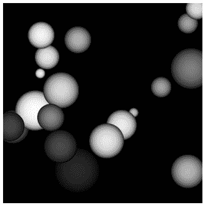

图 6.2 光线追踪示例的截图

由于我们随机生成了球体的位置、颜色和大小，如果你的输出与此图像不完全一致，请不要惊慌。

### 6.2.3 常量内存中的光线追踪

你可能已经注意到，我们在光线追踪示例中从未提及常量内存。现在是时候利用常量内存的优势来改进此示例了。由于我们无法修改常量内存，显然不能将其用于输出图像数据。而且本示例只有一个输入，即球体数组，因此我们将在常量内存中存储什么数据应该显而易见。

声明常量内存的机制与我们用于声明共享内存缓冲区的机制相同。我们不再像这样声明数组：

```cpp
Sphere *s;
```

我们在其前添加修饰符 __constant__：

```cpp
__constant__ Sphere s[SPHERES];
```

请注意，在原始示例中，我们声明了一个指针，然后使用 cudaMalloc() 为其分配 GPU 内存。当我们将其更改为常量内存时，也将声明更改为在常量内存中静态分配空间。我们不再需要为球体数组调用 cudaMalloc() 或 cudaFree()，但需要在编译时确定该数组的大小。对于许多应用程序来说，这是换取常量内存性能优势的可接受权衡。我们稍后将讨论这些优势，但首先我们将看看使用常量内存如何更改我们的 main() 例程：

```cpp
int main( void ) {
CPUBitmap bitmap( DIM, DIM );
unsigned char *dev_bitmap;

// allocate memory on the GPU for the output bitmap
HANDLE_ERROR( cudaMalloc( (void**)&dev_bitmap,
bitmap.image_size() ) );
```


```
// allocate temp memory, initialize it, copy to constant
// memory on the GPU, and then free our temp memory
Sphere *temp_s = (Sphere*)malloc( sizeof(Sphere) * SPHERES );
for (int i=0; i<SPHERES; i++) {
    temp_s[i].r = rnd( 1.0f );
    temp_s[i].g = rnd( 1.0f );
    temp_s[i].b = rnd( 1.0f );
    temp_s[i].x = rnd( 1000.0f ) - 500;
    temp_s[i].y = rnd( 1000.0f ) - 500;
    temp_s[i].z = rnd( 1000.0f ) - 500;
    temp_s[i].radius = rnd( 100.0f ) + 20;
}
HANDLE_ERROR( cudaMemcpyToSymbol( s, temp_s,
                                  sizeof(Sphere) * SPHERES ) );
free( temp_s );

// generate a bitmap from our sphere data
dim3    grids(DIM/16,DIM/16);
dim3    threads(16,16);
kernel<<<grids,threads>>>( dev_bitmap );

// copy our bitmap back from the GPU for display
HANDLE_ERROR( cudaMemcpy( bitmap.get_ptr(), dev_bitmap,
                          bitmap.image_size(),
                          cudaMemcpyDeviceToHost ) );
bitmap.display_and_exit();

// free our memory
cudaFree( dev_bitmap );
}

Largely, this is identical to the previous implementation of main(). As we mentioned previously, we no longer need the call to cudaMalloc() to allocate space for our array of spheres. The other change has been highlighted in the listing:

```
HANDLE_ERROR( cudaMemcpyToSymbol( s, temp_s,
sizeof( Sphere ) * SPHERES ) );
```

We use this special version of cudaMemcpy() when we copy from host memory to constant memory on the GPU. The only differences between cudaMemcpyToSymbol() and cudaMemcpy() using cudaMemcpyHostToDevice are that cudaMemcpyToSymbol() copies to constant memory and cudaMemcpy() copies to global memory.

Outside the __constant__ modifier and the two changes to main(), the versions with and without constant memory are identical.

### 6.2.4 常量内存的性能

Declaring memory as __constant__ constrains our usage to be read-only. In taking on this constraint, we expect to get something in return. As we previously mentioned, reading from constant memory can conserve memory bandwidth when compared to reading the same data from global memory. There are two reasons why reading from the 64KB of constant memory can save bandwidth over standard reads of global memory:

- A single read from constant memory can be broadcast to other “nearby” threads, effectively saving up to 15 reads.
- Constant memory is cached, so consecutive reads of the same address will not incur any additional memory traffic.

What do we mean by the word nearby? To answer this question, we will need to explain the concept of a warp. For those readers who are more familiar with Star Trek than with weaving, a warp in this context has nothing to do with the speed of travel through space. In the world of weaving, a warp refers to the group of threads being woven together into fabric. In the CUDA Architecture, a warp refers to a collection of 32 threads that are “woven together” and get executed in lockstep. At every line in your program, each thread in a warp executes the same instruction on different data.

When it comes to handling constant memory, NVIDIA hardware can broadcast a single memory read to each half-warp. A half-warp—neatly as creatively named as a warp—is a group of 16 threads: half of a 32-thread warp. If every thread in a half-warp requests data from the same address in constant memory, your GPU will generate only a single read request and subsequently broadcast the data to every thread. If you are reading a lot of data from constant memory, you will generate only 1/16 (roughly 6 percent) of the memory traffic as you would when using global memory.

But the savings don't stop at a 94 percent reduction in bandwidth when reading constant memory! Because we have committed to leaving the memory unchanged, the hardware can aggressively cache the constant data on the GPU. So after the first read from an address in constant memory, other half-warps requesting the same address, and therefore hitting the constant cache, will generate no additional memory traffic.

In the case of our ray tracer, every thread in the launch reads the data corresponding to the first sphere so the thread can test its ray for intersection. After we modify our application to store the spheres in constant memory, the hardware needs to make only a single request for this data. After caching the data, every other thread avoids generating memory traffic as a result of one of the two constant memory benefits:

- It retrieves the data in a half-warp broadcast.
- It retrieves the data from the constant memory cache.

Unfortunately, there can potentially be a downside to performance when using constant memory. The half-warp broadcast feature is in actuality a double-edged sword. Although it can dramatically accelerate performance when all 16 threads are reading the same address, it actually slows performance to a crawl when all 16 threads read different addresses.

The trade-off to allowing the broadcast of a single read to 16 threads is that the 16 threads are allowed to place only a single read request at a time. For example, if all 16 threads in a half-warp need different data from constant memory, the 16 different reads get serialized, effectively taking 16 times the amount of time to place the request. If they were reading from conventional global memory, the request could be issued at the same time. In this case, reading from constant memory would probably be slower than using global memory.

## 6.3 使用事件测量性能

Fully aware that there may be either positive or negative implications, you have changed your ray tracer to use constant memory. How do you determine how this has impacted the performance of your program? One of the simplest metrics involves answering this simple question: Which version takes less time to finish? We could use one of the CPU or operating system timers, but this will include latency and variation from any number of sources (operating system thread scheduling, availability of high-precision CPU timers, and so on). Furthermore, while the GPU kernel runs, we may be asynchronously performing computation on the host. The only way to time these host computations is using the CPU or operating system timing mechanism. So to measure the time a GPU spends on a task, we will use the CUDA event API.

An event in CUDA is essentially a GPU time stamp that is recorded at a user-specified point in time. Since the GPU itself is recording the time stamp, it eliminates a lot of the problems we might encounter when trying to time GPU execution with CPU timers. The API is relatively easy to use, since taking a time stamp consists of just two steps: creating an event and subsequently recording an event. For example, at the beginning of some sequence of code, we instruct the CUDA runtime to make a record of the current time. We do so by creating and then recording the event:

```
cudaEvent_t start;
cudaEventCreate(&start);
cudaEventRecord( start, 0 );
```

You will notice that when we instruct the runtime to record the event start, we also pass it a second argument. In the previous example, this argument is 0. The exact nature of this argument is unimportant for our purposes right now, so we intend to leave it mysteriously unexplained rather than open a new can of worms. If your curiosity is killing you, we intend to discuss this when we talk about streams.

To time a block of code, we will want to create both a start event and a stop event. We will have the CUDA runtime record when we start tell it to do some other work on the GPU and then tell it to record when we've stopped:

```
cudaEvent_t start, stop;
cudaEventCreate(&start);
cudaEventCreate(&stop);
cudaEventRecord( start, 0 );

// do some work on the GPU

cudaEventRecord( stop, 0 );
```

Unfortunately, there is still a problem with timing GPU code in this way. The fix will require only one line of code but will require some explanation. The trickiest part of using events arises as a consequence of the fact that some of the calls we make in CUDA C are actually asynchronous. For example, when we launched the kernel in our ray tracer, the GPU begins executing our code, but the CPU continues executing the next line of our program before the GPU finishes. This is excellent from a performance standpoint because it means we can be computing something on the GPU and CPU at the same time, but conceptually it makes timing tricky.

You should imagine calls to cudaEventRecord() as an instruction to record the current time being placed into the GPU's pending queue of work. As a result, our event won't actually be recorded until the GPU finishes everything prior to the call to cudaEventRecord(). In terms of having our stop event measure the correct time, this is precisely what we want. But we cannot safely read the value of the stop event until the GPU has completed its prior work and recorded the stop event. Fortunately, we have a way to instruct the CPU to synchronize on an event, the event API function cudaEventSynchronize():

```
cudaEvent_t start, stop;
cudaEventCreate(&start);
cudaEventCreate(&stop);
cudaEventRecord( start, 0 );

// do some work on the GPU

cudaEventRecord( stop, 0 );
cudaEventSynchronize( stop );
```

Now, we have instructed the runtime to block further instruction until the GPU has reached the stop event. When the call to cudaEventSynchronize()


returns，我们知道在停止事件之前的所有 GPU 工作都已完成，因此读取 stop 中记录的时间戳是安全的。值得注意的是，由于 CUDA 事件直接在 GPU 上实现，它们不适合对设备和主机代码的混合进行计时。也就是说，如果你尝试使用 CUDA 事件来计时超过内核执行和涉及设备的内存拷贝之外的内容，将会得到不可靠的结果。

### 6.3.1 测量光线追踪器性能

要为我们的光线追踪器计时，我们需要创建开始事件和停止事件，就像我们学习事件时所做的那样。以下是一个不使用常量内存的计时版光线追踪器：

```
int main( void ) {
    // capture the start time
    cudaEvent_t     start, stop;
    HANDLE_ERROR( cudaEventCreate( &start ) );
    HANDLE_ERROR( cudaEventCreate( &stop ) );
    HANDLE_ERROR( cudaEventRecord( start, 0 ) );

    CPUBitmap  bitmap( DIM, DIM );
    unsigned char    *dev_bitmap;

    // allocate memory on the GPU for the output bitmap
    HANDLE_ERROR( cudaMalloc( (void**)&dev_bitmap,
                              bitmap.image_size() ) );

    // allocate memory for the Sphere dataset
    HANDLE_ERROR( cudaMalloc( (void**)&s,
                              sizeof(Sphere) * SPHERES ) );

    // allocate temp memory, initialize it, copy to
    // memory on the GPU, and then free our temp memory
    Sphere *temp_s = (Sphere*)malloc( sizeof(Sphere) * SPHERES );
    for (int i = 0; i<SPHERES; i++) {
        temp_s[i].r = rnd( 1.0f );
        temp_s[i].g = rnd( 1.0f );
        temp_s[i].b = rnd( 1.0f );
        temp_s[i].x = rnd( 1000.0f ) - 500;
        temp_s[i].y = rnd( 1000.0f ) - 500;
        temp_s[i].z = rnd( 1000.0f ) - 500;
        temp_s[i].radius = rnd( 100.0f ) + 20;
    }
    HANDLE_ERROR( cudaMemcpy( s, temp_s,
                    sizeof( Sphere ) * SPHERES,
                    cudaMemcpyHostToDevice ) );
    free( temp_s );

    // generate a bitmap from our sphere data
    dim3  grids( DIM/16, DIM/16 );
    dim3  threads( 16, 16 );
    kernel<<<grids, threads>>>( s, dev_bitmap );

    // copy our bitmap back from the GPU for display
    HANDLE_ERROR( cudaMemcpy( bitmap.get_ptr(), dev_bitmap,
                                bitmap.image_size(),
                                cudaMemcpyDeviceToHost ) );

    // get stop time, and display the timing results
    HANDLE_ERROR( cudaEventRecord( stop, 0 ) );
    HANDLE_ERROR( cudaEventSynchronize( stop ) );

    float   elapsedTime;
    HANDLE_ERROR( cudaEventElapsedTime( &elapsedTime,
                                          start, stop ) );
    printf( "Time to generate:  %3.1f ms\n", elapsedTime );

    HANDLE_ERROR( cudaEventDestroy( start ) );
    HANDLE_ERROR( cudaEventDestroy( stop ) );

    // display
    bitmap.display_and_exit();

    // free our memory
    cudaFree( dev_bitmap );
    cudaFree( s );
}
```

请注意，我们又加入了两个额外的函数，即对 `cudaEventElapsedTime()` 和 `cudaEventDestroy()` 的调用。函数 `cudaEventElapsedTime()` 是一个实用工具，用于计算两个先前记录的事件之间的经过时间。两个事件之间经过的时间（以毫秒为单位）通过第一个参数（即浮点变量的地址）返回。

当我们使用完通过 `cudaEventCreate()` 创建的事件后，需要调用 `cudaEventDestroy()`。这与对先前用 `malloc()` 分配的内存调用 `free()` 相同，因此我们无需强调将每个 `cudaEventCreate()` 与 `cudaEventDestroy()` 匹配有多么重要。

我们可以用同样的方式对使用常量内存的光线追踪器进行插桩：

```
int main( void ) {
    // capture the start time
    cudaEvent_t start, stop;
    HANDLE_ERROR( cudaEventCreate( &start ) );
    HANDLE_ERROR( cudaEventCreate( &stop ) );
    HANDLE_ERROR( cudaEventRecord( start, 0 ) );

    CPUBitmap bitmap( DIM, DIM );
    unsigned char *dev_bitmap;

    // allocate memory on the GPU for the output bitmap
    HANDLE_ERROR( cudaMalloc( (void**)&dev_bitmap,
                              bitmap.image_size() ) );

    // allocate temp memory, initialize it, copy to constant
    // memory on the GPU, and then free our temp memory
    Sphere *temp_s = (Sphere*)malloc( sizeof(Sphere) * SPHERES );
    for (int i = 0; i < SPHERES; i++) {
        temp_s[i].r = rnd( 1.0f );
        temp_s[i].g = rnd( 1.0f );
        temp_s[i].b = rnd( 1.0f );
        temp_s[i].x = rnd( 1000.0f ) - 500;
        temp_s[i].y = rnd( 1000.0f ) - 500;
        temp_s[i].z = rnd( 1000.0f ) - 500;
        temp_s[i].radius = rnd( 100.0f ) + 20;
    }
    HANDLE_ERROR( cudaMemcpyToSymbol( s, temp_s,
                  sizeof(Sphere) * SPHERES ) );
    free( temp_s );

    // generate a bitmap from our sphere data
    dim3 grids(DIM/16, DIM/16);
    dim3 threads(16, 16);
    kernel<<<grids, threads>>>( dev_bitmap );

    // copy our bitmap back from the GPU for display
    HANDLE_ERROR( cudaMemcpy( bitmap.get_ptr(), dev_bitmap,
                              bitmap.image_size(),
                              cudaMemcpyDeviceToHost ) );

    // get stop time, and display the timing results
    HANDLE_ERROR( cudaEventRecord( stop, 0 ) );
    HANDLE_ERROR( cudaEventSynchronize( stop ) );
    float elapsedTime;
    HANDLE_ERROR( cudaEventElapsedTime( &elapsedTime,
                                        start, stop ) );
    printf( "Time to generate: %3.1f ms\n", elapsedTime );

    HANDLE_ERROR( cudaEventDestroy( start ) );
    HANDLE_ERROR( cudaEventDestroy( stop ) );

    // display
    bitmap.display_and_exit();

    // free our memory
    cudaFree( dev_bitmap );
}
```

现在当我们运行两个版本的光线追踪器时，可以比较完成 GPU 工作所需的时间。这将从高层面上告诉我们引入常量内存是改善了应用程序的性能还是使其变差。幸运的是，在这种情况下，使用常量内存大幅提升了性能。我们在 GeForce GTX 280 上的实验表明，常量内存光线追踪器比使用全局内存的版本快多达 50%。在不同的 GPU 上，你的实际情况可能会有所不同，尽管使用常量内存的光线追踪器应该始终至少和不使用它的版本一样快。

## 6.4 章节回顾

除了我们在前几章中探讨的全局内存和共享内存之外，NVIDIA 硬件还提供了其他类型的内存供我们使用。与标准全局内存相比，常量内存带有额外的约束，但在某些情况下，接受这些约束可以带来额外的性能。具体来说，当 warp 中的线程需要访问相同的只读数据时，我们可以看到额外的性能。对具有这种访问模式的数据使用常量内存可以节省带宽，原因有二：一是能够将读广播到半个 warp，二是芯片上存在常量内存缓存。内存带宽是一大类算法的瓶颈，因此拥有缓解这种情况的机制可能非常有用。

我们还学习了如何使用 CUDA 事件请求运行时在 GPU 执行过程中的特定点记录时间戳。我们了解了如何将 CPU 与 GPU 在其中一个事件上同步，然后如何计算两个事件之间的经过时间。通过这样做，我们构建了一种比较两种不同光线追踪球体方法运行时间的方法，得出结论：对于手头的应用程序，使用常量内存为我们带来了显著的性能提升。

# 第 7 章

# 纹理内存

当我们研究常量内存时，我们看到在合适的条件下利用特殊内存空间可以显著加速应用程序。我们还学习了如何衡量这些性能提升，以便就性能选择做出明智的决定。在本章中，我们将学习如何分配和使用 *纹理内存*。与常量内存类似，纹理内存是另一种只读内存，当读取具有特定访问模式时，它可以提高性能并减少内存流量。虽然纹理内存最初是为传统图形应用程序设计的，但它在某些 GPU 计算应用程序中也可以非常有效地使用。


## 7.1 章节目标

在本章学习过程中，你将完成以下任务：

- 你将了解纹理内存的性能特征。
- 你将学习如何在 CUDA C 中使用一维纹理内存。
- 你将学习如何在 CUDA C 中使用二维纹理内存。

## 7.2 纹理内存概述

如果你阅读了本章的介绍，这个秘密就已经不秘密了：CUDA C 程序中还可使用另一种只读内存。熟悉图形硬件工作原理的读者不会感到惊讶，但 GPU 先进的纹理内存也可用于通用计算。尽管 NVIDIA 为经典的 OpenGL 和 DirectX 渲染管线设计了纹理单元，但纹理内存具有一些特性，使其在计算中极其有用。

与常量内存类似，纹理内存也在芯片上缓存，因此在某些情况下，通过减少对片外 DRAM 的内存请求，它将提供更高的有效带宽。具体来说，纹理缓存是为图形应用程序设计的，这类应用的内存访问模式表现出很强的空间局部性。在计算应用程序中，这大致意味着一个线程可能会读取与附近线程读取的地址“相近”的地址，如图 7.1 所示。

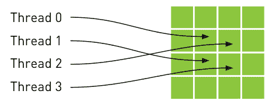

图 7.1 线程映射到内存二维区域

从算术角度看，所示的四个地址不是连续的，因此在典型的 CPU 缓存方案中它们不会被一起缓存。但由于 GPU 纹理缓存旨在加速此类访问模式，因此在这种情况下使用纹理内存而非常规内存时，你会看到性能提升。事实上，这种访问模式在通用计算中并不罕见，正如我们将看到的那样。

## 7.3 模拟热传递

物理模拟可能是求解起来计算量最大的问题之一。从根本上说，精度与计算复杂度之间往往存在权衡。因此，近年来计算机模拟变得越来越重要，这在很大部分要归功于并行计算革命带来的精度提升。由于许多物理模拟可以非常容易地并行化，我们将在本示例中研究一个非常简单的模拟模型。

### 7.3.1 简单加热模型

为了演示如何有效地使用纹理内存，我们将构建一个简单的二维热传递模拟。我们首先假设有一个矩形房间，将其划分为一个网格。在网格内，我们将随机分布若干个具有不同固定温度的“加热器”。图 7.2 展示了这个房间可能的样子。

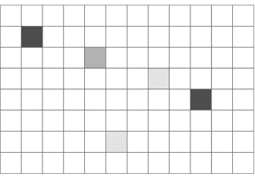

图 7.2 具有不同温度“加热器”的房间

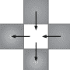

图 7.3 热量从温暖单元散发到寒冷单元

给定一个矩形网格和加热器配置，我们希望模拟随着时间推移，每个网格单元的温度会发生什么变化。为简化起见，包含加热器的单元始终保持恒定温度。在每个时间步，我们假设热量在单元与其邻居之间“流动”。如果单元的邻居比它更温暖，较温暖的邻居倾向于使其变暖。相反，如果单元有一个比它更凉爽的邻居，它会变凉。从定性上讲，图 7.3 表示这种热量流动。

在我们的热传递模型中，我们将把网格单元的新温度计算为其温度与邻居温度之差的总和，或者本质上，如方程 7.1 所示的更新方程。

#### 方程 7.1

```
T_{NEW} = T_{OLD} + \sum_{NEIGHBORS} k \cdot (T_{NEIGHBOR} - T_{OLD})
```

在更新单元温度的方程中，常数 k 仅表示热量在模拟中流动的速率。较大的 k 值会使系统快速达到恒定温度，而较小的值则允许解保持较大的温度梯度更长时间。由于我们只考虑四个邻居（上、下、左、右），并且 k 和 T_{OLD} 在方程中保持不变，因此此更新变得如方程 7.2 所示。

#### 方程 7.2

```
T_{NEW} = T_{OLD} + k \cdot (T_{TOP} + T_{BOTTOM} + T_{LEFT} + T_{RIGHT} - 4 \cdot T_{OLD})
```

与前一章中的光线追踪示例类似，此模型并非旨在接近工业中可能使用的模型（事实上，它甚至不是对物理上准确事物的近似）。我们极大地简化了此模型，以便将注意力集中在手头的技术上。考虑到这一点，让我们来看看如何在 GPU 上计算方程 7.2 给出的更新。

### 7.3.2 计算温度更新

我们将稍后介绍每个步骤的具体细节，但从高层次来看，我们的更新过程如下：

- 1. 给定一些输入温度网格，将带有加热器的单元的温度复制到此网格。这将覆盖这些单元中任何先前计算的温度，从而强制执行我们的限制，即“加热单元”保持恒定温度。此复制由 copy_const_kernel() 执行。
- 2. 给定输入温度网格，根据方程 7.2 中的更新计算输出温度。此更新在 blend_kernel() 中执行。
- 3. 交换输入和输出缓冲区，为下一个时间步做准备。步骤 2 中计算的输出温度网格将在模拟下一个时间步时，成为步骤 1 中我们开始使用的输入温度网格。

在开始模拟之前，我们假设已经生成了一个常数网格。该网格中的大多数条目为零，但一些条目包含表示固定温度加热器的非零温度。这个常数缓冲区在整个模拟过程中不会改变，并在每个时间步读取。

由于我们建模热传递的方式，我们从上一个时间步的输出网格开始。然后，根据步骤 1，我们将带有加热器的单元的温度复制到此输出网格，覆盖任何先前计算的温度。我们这样做是因为我们假设这些加热器单元的温度保持不变。我们使用以下内核将常数网格复制到输入网格：

```
__global__ void copy_const_kernel ( float *iptr,
const float *cptr ) {
// map from threadIdx/BlockIdx to pixel position
int x = threadIdx.x + blockIdx.x * blockDim.x;
int y = threadIdx.y + blockIdx.y * blockDim.y;
int offset = x + y * blockDim.x * gridDim.x;
if (cptr[offset] != 0) iptr[offset] = cptr[offset];
}
```

前三行应该很熟悉。前两行将线程的 threadIdx 和 blockIdx 转换为 x 和 y 坐标。第三行计算我们常数和输入缓冲区中的线性偏移量。高亮行执行将 cptr[] 中的加热器温度复制到 iptr[] 输入网格的操作。请注意，仅当常数网格中的单元非零时才执行复制。我们这样做是为了保留在不包含加热器的单元中上一个时间步计算的任何值。带有加热器的单元在 cptr[] 中将有非零条目，因此由于此复制内核，它们的温度将从步骤 2 保留到步骤 1。

算法的步骤 2 是计算量最大的。为了执行更新，我们可以让每个线程负责模拟中的一个单元。每个线程将读取其单元的温度及其邻居单元的温度，执行之前的更新计算，然后用新值更新其温度。此内核的大部分与你之前使用的技术相似。

```cpp
__global__ void blend_kernel( float *outSrc,
                             const float *inSrc ) {
  // map from threadIdx/BlockIdx to pixel position
  int x = threadIdx.x + blockIdx.x * blockDim.x;
  int y = threadIdx.y + blockIdx.y * blockDim.y;
  int offset = x + y * blockDim.x * gridDim.x;

  int left = offset - 1;
  int right = offset + 1;
  if (x == 0) left++;
  if (x == DIM-1) right--;

  int top = offset - DIM;
  int bottom = offset + DIM;
  if (y == 0) top += DIM;
  if (y == DIM-1) bottom -= DIM;

  outSrc[offset] = inSrc[offset] + SPEED * ( inSrc[top] +
                                             inSrc[bottom] + inSrc[left] + inSrc[right] -
                                             inSrc[offset]*4 );
}
```


请注意，我们的起点与那些输出图像的示例完全相同。不过，线程计算的不是像素的颜色，而是模拟网格单元的温度。尽管如此，它们首先会将自己的 `threadIdx` 和 `blockIdx` 转换为 `x`、`y` 和 `offset`。到现在为止，你可能已经能在睡梦中背诵这些代码行了（虽然为了你好，我们希望你并没有真的在睡梦中背诵它们）。

接下来，我们确定左、右、上、下邻居的偏移量，以便读取这些单元的温度。我们需要这些值来计算当前单元的更新温度。这里唯一的复杂之处在于，我们需要调整边界上的索引，以便边缘周围的单元不会环绕。最后，在高亮显示的行中，我们执行方程 7.2 中的更新，将旧温度与该温度及其邻居单元温度的缩放差值相加。

### 7.3.3 模拟动画

代码的其余部分主要设置网格，然后显示热图的动画输出。我们现在来逐行讲解这段代码：

```cpp
#include "cuda.h"
#include "../common/book.h"
#include "../common/cpu_anim.h"

#define DIM 1024
#define PI 3.1415926535897932f
#define MAX_TEMP 1.0f
#define MIN_TEMP 0.0001f
#define SPEED   0.25f

// globals needed by the update routine
struct DataBlock {
    unsigned char     *output_bitmap;
    float             *dev_inSrc;
    float             *dev_outSrc;
    float             *dev_constSrc;
    CPUAnimBitmap  *bitmap;
    cudaEvent_t      start, stop;
    float            totalTime;
    float            frames;
};

void anim_gpu( DataBlock *d, int ticks ) {
    HANDLE_ERROR( cudaEventRecord( d->start, 0 ) );
    dim3     blocks( DIM/16, DIM/16 );
    dim3     threads( 16, 16 );
    CPUBitmap *bitmap = d->bitmap;

    for ( int i=0; i<90; i++ ) {
        copy_const_kernel<<<blocks,threads>>>( d->dev_inSrc,
                                               d->dev_constSrc );
        blend_kernel<<<blocks,threads>>>( d->dev_outSrc,
                                          d->dev_inSrc );
        swap( d->dev_inSrc, d->dev_outSrc );
    }

    float_to_color<<<blocks,threads>>>( d->output_bitmap,
                                         d->dev_inSrc );

    HANDLE_ERROR( cudaMemcpy( bitmap->get_ptr(),
                              d->output_bitmap,
                              bitmap->image_size(),
                              cudaMemcpyDeviceToHost ) );

    HANDLE_ERROR( cudaEventRecord( d->stop, 0 ) );
    HANDLE_ERROR( cudaEventSynchronize( d->stop ) );
    float   elapsedTime;
    HANDLE_ERROR( cudaEventElapsedTime( &elapsedTime,
                                        d->start, d->stop ) );

    d->totalTime += elapsedTime;
    ++d->frames;

    printf( "Average Time per frame:  %3.1f ms\n",
            d->totalTime/d->frames );
}

void anim_exit( DataBlock *d ) {
    cudaFree( d->dev_inSrc );
    cudaFree( d->dev_outSrc );
    cudaFree( d->dev_constSrc );

    HANDLE_ERROR( cudaEventDestroy( d->start ) );
    HANDLE_ERROR( cudaEventDestroy( d->stop ) );
}
```

我们为代码配备了基于事件的计时，与上一章光线追踪示例中所做的一样。计时代码的作用与之前相同。由于我们将致力于加速初始实现，因此我们建立了一种机制，用于测量性能并让自己确信已取得成功。

动画框架会在每一帧调用函数 `anim_gpu()`。该函数的参数是一个指向 `DataBlock` 的指针以及动画已经过的 tick 数。与动画示例一样，我们使用 256 个线程的块，并将其组织成 16 x 16 的二维网格。`anim_gpu()` 中 `for()` 循环的每次迭代都会计算模拟的一个时间步，如第 7.2.2 节开头所述的三步算法“计算温度更新”中所述。由于 `DataBlock` 包含加热器的常量缓冲区以及上一个时间步的输出，它封装了动画的整个状态，因此 `anim_gpu()` 实际上不需要在任何地方使用 `ticks` 的值。

你会发现，我们选择每帧执行 90 个时间步。这个数字并非神奇，而是通过一定程度的实验确定的，旨在权衡每个时间步都下载位图图像与每帧计算过多时间步（导致动画卡顿）之间的合理折衷。如果你更关心获得每个模拟步骤的输出，而不是实时动画化结果，则可以将其更改为每帧仅计算一个步骤。

计算完自上一帧以来的 90 个时间步后，`anim_gpu()` 准备将当前动画的位图帧复制回 CPU。由于 `for()` 循环会交换输入和输出，我们首先交换输入和输出缓冲区，以便输出实际上包含第 90 个时间步的输出。我们使用内核 `float_to_color()` 将温度转换为颜色，然后使用 `cudaMemcpy()` 将生成的图像复制回 CPU，并指定复制方向为 `cudaMemcpyDeviceToHost`。最后，为准备下一组时间步，我们将输出缓冲区换回输入缓冲区，因为它将作为下一个时间步的输入。

```cpp
int main( void ) {
    DataBlock data;
    CPUAnimBitmap bitmap( DIM, DIM, &data );
    data.bitmap = &bitmap;
    data.total_time = 0;
    data.frames = 0;
    HANDLE_ERROR( cudaEventCreate( &data.start ) );
    HANDLE_ERROR( cudaEventCreate( &data.stop ) );

    HANDLE_ERROR( cudaMalloc( (void**)&data.output_bitmap,
                              bitmap.image_size() ) );

    // assume float == 4 chars in size (i.e., rgba)
    HANDLE_ERROR( cudaMalloc( (void**)&data.dev_inSrc,
                              bitmap.image_size() ) );
    HANDLE_ERROR( cudaMalloc( (void**)&data.dev_outSrc,
                              bitmap.image_size() ) );
    HANDLE_ERROR( cudaMalloc( (void**)&data.dev_constSrc,
                              bitmap.image_size() ) );

    float *temp = (float*)malloc( bitmap.image_size() );
    for (int i=0; i<DIM*DIM; i++) {
        temp[i] = 0;
        int x = i % DIM;
        int y = i / DIM;
        if ((x<300) && (x<600) && (y>310) && (y<601))
            temp[i] = MAX_TEMP;
    }
}
temp[DIM*100+100] = (MAX_TEMP + MIN_TEMP)/2;
temp[DIM*700+100] = MIN_TEMP;
temp[DIM*300+300] = MIN_TEMP;
temp[DIM*200+700] = MIN_TEMP;
for (int y=800; y<900; y++) {
    for (int x=400; x<500; x++) {
    temp[x+y*DIM] = MIN_TEMP;
    }
}
HANDLE_ERROR( cudaMemcpy( data.dev_constSrc, temp,
                        bitmap.image_size(),
                        cudaMemcpyHostToDevice ) );
for (int y=800; y<DIM; y++) {
    for (int x=0; x<200; x++) {
    temp[x+y*DIM] = MAX_TEMP;
    }
}
HANDLE_ERROR( cudaMemcpy( data.dev_inSrc, temp,
                        bitmap.image_size(),
                        cudaMemcpyHostToDevice ) );
free( temp );
bitmap.anim_and_exit( (void (*)(void*,int))anim_gpu,
                    (void (*)(void*))anim_exit );
}
```

图 7.4 展示了输出可能呈现的示例。你会在图像中注意到一些“加热器”，它们看起来像是像素大小的岛屿，破坏了温度分布的连续性。

### 7.3.4 使用纹理内存

执行每个步骤的温度更新所需的内存访问模式具有相当大的空间局部性。如前所述，这正是 GPU 纹理内存旨在加速的那种访问模式。

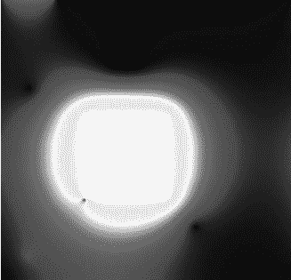

图 7.4 动画热传递模拟的截图

鉴于我们想要使用纹理内存，我们需要了解如何操作。

首先，我们需要将输入声明为纹理引用。由于我们的温度数据是浮点型，因此我们将使用浮点纹理的引用。

```cpp
// these exist on the GPU side
texture<float> texConstSrc;
texture<float> texIn;
texture<float> texOut;
```

下一个主要区别是，在为这三个缓冲区分配 GPU 内存后，我们需要使用 `cudaBindTexture()` 将引用绑定到内存缓冲区。这基本上告诉 CUDA 运行时两件事：

- 我们打算将指定的缓冲区用作纹理。
- 我们打算将指定的纹理引用用作纹理的“名称”。


在我们的热传导模拟中完成三次内存分配后，我们将这三个分配绑定到先前声明的纹理引用（texConstSrc、texIn 和 texOut）上。

```
HANDLE_ERROR( cudaMalloc( (void**)&data_dev_inSrc,
 imageSize ) );
HANDLE_ERROR( cudaMalloc( (void**)&data_dev_outSrc,
 imageSize ) );
HANDLE_ERROR( cudaMalloc( (void**)&data_dev_constSrc,
 imageSize ) );

HANDLE_ERROR( cudaBindTexture( NULL, texConstSrc,
 data_dev_constSrc,
 imageSize ) );
HANDLE_ERROR( cudaBindTexture( NULL, texIn,
 data_dev_inSrc,
 imageSize ) );
HANDLE_ERROR( cudaBindTexture( NULL, texOut,
 data_dev_outSrc,
 imageSize ) );
```

此时，我们的纹理已完全设置好，可以启动内核了。但是，当我们在内核中从纹理读取数据时，需要使用特殊函数来指示 GPU 将请求通过纹理单元路由，而不是通过标准全局内存。因此，我们不能再简单地使用方括号从缓冲区读取数据；我们需要修改 blend_kernel()，在从内存读取时使用 tex1Dfetch()。

此外，使用全局内存和纹理内存之间还有一个差异，需要我们做出另一项更改。虽然 tex1Dfetch() 看起来像一个函数，但它实际上是编译器内置函数。由于纹理引用必须在文件作用域中全局声明，我们不能再将输入和输出缓冲区作为参数传递给 blend_kernel()，因为编译器需要知道在编译时 tex1Dfetch() 应该采样哪些纹理。我们不再像以前那样传递输入和输出缓冲区的指针，而是将一个布尔标志 dstOut 传递给 blend_kernel()，用于指示哪个缓冲区用作输入，哪个用作输出。blend_kernel() 的更改如下所示：

```c
__global__ void blend_kernel( float *dst,
                              bool dstOut ) {

  // map from threadIdx/BlockIdx to pixel position
  int x = threadIdx.x + blockIdx.x * blockDim.x;
  int y = threadIdx.y + blockIdx.y * blockDim.y;
  int offset = x + y * blockDim.x * gridDim.x;

  int left = offset - 1;
  int right = offset + 1;
  if (x == 0) left++;
  if (x == DIM-1) right--;

  int top = offset - DIM;
  int bottom = offset + DIM;
  if (y == 0) top += DIM;
  if (y == DIM-1) bottom -= DIM;

  float t, l, c, r, b;
  if (dstOut) {
    t = tex1Dfetch(texIn, top);
    l = tex1Dfetch(texIn, left);
    c = tex1Dfetch(texIn, offset);
    r = tex1Dfetch(texIn, right);
    b = tex1Dfetch(texIn, bottom);
  } else {
    t = tex1Dfetch(texOut, top);
    l = tex1Dfetch(texOut, left);
    c = tex1Dfetch(texOut, offset);
    r = tex1Dfetch(texOut, right);
    b = tex1Dfetch(texOut, bottom);
  }

  dst[offset] = c + SPEED * (t + b + r + l - 4 * c);
}
```

由于 copy_const_kernel() 内核从存储加热器位置和温度的缓冲区读取数据，我们需要在那里做类似的修改，以便通过纹理内存而不是全局内存进行读取：

```c
__global__ void copy_const_kernel( float *iptr ) {
    // map from threadIdx/blockIdx to pixel position
    int x = threadIdx.x + blockIdx.x * blockDim.x;
    int y = threadIdx.y + blockIdx.y * blockDim.y;
    int offset = x + y * blockDim.x * gridDim.x;

    float c = tex1Dfetch(texConstSrc, offset);
    if (c != 0)
        iptr[offset] = c;
}
```

由于 blend_kernel() 的签名已更改为接受一个用于在输入和输出之间切换缓冲区的标志，我们需要对 anim_gpu() 例程做出相应的更改。我们不再交换缓冲区，而是在每次一系列调用后通过设置 dstOut = !dstOut 来切换标志：

```c
void anim_gpu( DataBlock *d, int ticks ) {
    HANDLE_ERROR( cudaEventRecord( d->start, 0 ) );
    dim3     blocks(DIM/16, DIM/16);
    dim3     threads(16,16);
    CPUAnimBitmap  *bitmap = d->bitmap;

    // since tex is global and bound, we have to use a flag to
    // select which is in/out per iteration
    volatile bool dstOut = true;
    for (int i=0; i<90; i++) {
        float *in, *out;
        if (dstOut) {
            in  = d->dev_inSrc;
            out = d->dev_outSrc;
        } else {
            out = d->dev_inSrc;
            in = d->dev_outSrc;
        }

        copy_const_kernel<<<blocks,threads>>> ( in );
        blend_kernel<<<blocks,threads>>>( out, dstOut );
        dstOut = !dstOut;
    }

    float_to_color<<<blocks,threads>>>( d->output_bitmap,
                                         d->dev_inSrc );

    HANDLE_ERROR( cudaMemcpy( bitmap->get_ptr(),
                              d->output_bitmap,
                              bitmap->image_size(),
                              cudaMemcpyDeviceToHost ) );

    HANDLE_ERROR( cudaEventRecord( d->stop, 0 ) );
    HANDLE_ERROR( cudaEventSynchronize( d->stop ) );
    float   elapsedTime;
    HANDLE_ERROR( cudaEventElapsedTime( &elapsedTime,
                                        d->start, d->stop ) );

    d->totalTime += elapsedTime;
    ++d->frames;
    printf( "Average Time per frame:  %3.1f ms\n",
            d->totalTime/d->frames );
}
```

对我们的热传导例程的最后一项更改涉及在应用程序运行结束时进行清理。我们不仅需要释放全局缓冲区，还需要解绑定纹理：

```
// clean up memory allocated on the GPU
void anim_exit( DataBlock *d ) {
 cudaUnbindTexture( texIn );
 cudaUnbindTexture( texOut );
 cudaUnbindTexture( texConstSrc );
 cudaFree( d->dev_inSrc );
 cudaFree( d->dev_outSrc );
 cudaFree( d->dev_constSrc );

 HANDLE_ERROR( cudaEventDestroy( d->start ) );
 HANDLE_ERROR( cudaEventDestroy( d->stop ) );
}
```

### 7.3.5 使用二维纹理内存

在本书开头，我们提到过有些问题具有二维域，因此有时使用二维块和网格会很方便。纹理内存也是如此。在许多情况下，拥有二维内存区域非常有用，任何熟悉标准 C 中多维数组的人都不应该对此感到惊讶。让我们来看看如何修改我们的热传导应用程序以使用二维纹理。

首先，我们的纹理引用声明发生了变化。如果未指定，纹理引用默认为一维，因此我们添加一个维度参数 2 来声明二维纹理。

```
texture<float,2> texConstSrc;
texture<float,2> texIn;
texture<float,2> texOut;
```

转换为二维纹理所带来的简化体现在 blend_kernel() 方法中。虽然我们需要将 tex1Dfetch() 调用更改为 tex2D() 调用，但我们不再需要使用线性化的偏移量变量来计算 top、left、right 和 bottom 的偏移量集合。当我们切换到二维纹理时，可以直接使用 x 和 y 来寻址纹理。

此外，当我们切换到使用 tex2D() 时，不再需要担心边界溢出问题。如果 x 或 y 中的任意一个小于零，tex2D() 将返回零处的值。同样，如果这些值中的任意一个大于宽度，tex2D() 将返回宽度减 1 处的值。请注意，在我们的应用程序中，这种行为是理想的，但其他应用程序可能希望有不同的行为。

由于这些简化，我们的内核变得非常整洁。

```c
__global__ void blend_kernel( float *dst,
                              bool dstOut ) {
    // map from threadIdx/BlockIdx to pixel position
    int x = threadIdx.x + blockIdx.x * blockDim.x;
    int y = threadIdx.y + blockIdx.y * blockDim.y;
    int offset = x + y * blockDim.x * gridDim.x;

    float t, l, c, r, b;
    if (dstOut) {
        t = tex2D(texIn, x, y-1);
        l = tex2D(texIn, x-1, y);
        c = tex2D(texIn, x, y);
        r = tex2D(texIn, x+1, y);
        b = tex2D(texIn, x, y+1);
    } else {
        t = tex2D(texOut, x, y-1);
        l = tex2D(texOut, x-1, y);
        c = tex2D(texOut, x, y);
        r = tex2D(texOut, x+1, y);
        b = tex2D(texOut, x, y+1);
    }
    dst[offset] = c + SPEED * (t + b + r + l - 4 * c);
}
```


由于我们之前所有对 tex1Dfetch() 的调用都需要改为 tex2D() 调用，我们在 copy_const_kernel() 中做了相应的更改。与内核 blend_kernel() 类似，我们不再需要使用 offset 来寻址纹理；我们只需使用 x 和 y 来寻址常量源：

```cpp
__global__ void copy_const_kernel( float *iptr ) {
    // map from threadIdx/BlockIdx to pixel position
    int x = threadIdx.x + blockIdx.x * blockDim.x;
    int y = threadIdx.y + blockIdx.y * blockDim.y;
    int offset = x + y * blockDim.x * gridDim.x;

    float c = tex2D(texConstSrc,x,y);
    if (c != 0)
        iptr[offset] = c;
}
```

对我们热传递模拟的一维纹理版本的最终更改与我们之前的更改类似。具体来说，在 main() 中，我们需要更改纹理绑定调用，以指示运行时我们计划使用的缓冲区将被视为二维纹理，而不是一维纹理：

```cpp
HANDLE_ERROR( cudaMalloc( (void**)&data_dev_inSrc,
                              imageSize ) );
HANDLE_ERROR( cudaMalloc( (void**)&data_dev_outSrc,
                              imageSize ) );
HANDLE_ERROR( cudaMalloc( (void**)&data_dev_constSrc,
                              imageSize ) );

cudaChannelFormatDesc desc = cudaCreateChannelDesc<float>();
HANDLE_ERROR( cudaBindTexture2D( NULL, texConstSrc,
                                 data_dev_constSrc,
                                 desc, DIM, DIM,
                                 sizeof(float) * DIM ) );

HANDLE_ERROR( cudaBindTexture2D( NULL, texIn,
    data_dev_inSrc,
    desc, DIM, DIM,
    sizeof( float ) * DIM ) );

HANDLE_ERROR( cudaBindTexture2D( NULL, texOut,
    data_dev_outSrc,
    desc, DIM, DIM,
    sizeof( float ) * DIM ) );
```

与非纹理和一维纹理版本一样，我们首先为输入数组分配存储空间。我们偏离一维示例，因为 CUDA 运行时要求我们在绑定二维纹理时提供 cudaChannelFormatDesc。前面的清单包含通道格式描述符的声明。在我们的情况中，可以接受默认参数，只需指定需要浮点描述符即可。然后我们使用 cudaBindTexture2D() 将三个输入缓冲区绑定为二维纹理，纹理尺寸为 [DIM x DIM]，通道格式描述符为 [desc]。main() 的其余部分保持不变。

```cpp
int main( void ) {
    DataBlock data;
    CPUAnimBitmap  bitmap( DIM, DIM, &data );
    data.bitmap = &bitmap;
    data.totalTime = 0;
    data.frames = 0;
    HANDLE_ERROR( cudaEventCreate( &data.start ) );
    HANDLE_ERROR( cudaEventCreate( &data.stop ) );

    int imageSize = bitmap.image_size();

    HANDLE_ERROR( cudaMalloc( (void**)&data.output_bitmap,
        imageSize ) );

// assume float == 4 chars in size (i.e., rgba)
HANDLE_ERROR( cudaMalloc( (void**)&data_dev_inSrc,
 imageSize ) );
HANDLE_ERROR( cudaMalloc( (void**)&data_dev_outSrc,
 imageSize ) );
HANDLE_ERROR( cudaMalloc( (void**)&data_dev_constSrc,
 imageSize ) );
cudaChannelFormatDesc desc = cudaCreateChannelDesc<float>();
HANDLE_ERROR( cudaBindTexture2D( NULL, texConstSrc,
 data_dev_constSrc,
 desc, DIM, DIM,
 sizeof(float) * DIM ) );
HANDLE_ERROR( cudaBindTexture2D( NULL, texIn,
 data_dev_inSrc,
 desc, DIM, DIM,
 sizeof(float) * DIM ) );
HANDLE_ERROR( cudaBindTexture2D( NULL, texOut,
 data_dev_outSrc,
 desc, DIM, DIM,
 sizeof(float) * DIM ) );
// initialize the constant data
float *temp = (float*)malloc( imageSize );
for (int i = 0; i<DIM*DIM; i++) {
    temp[i] = 0;
    int x = i % DIM;
    int y = i / DIM;
    if ((x>300) && (x<600) && (y>310) && (y<601))
        temp[i] = MAX_TEMP;
}
temp[DIM*100+100] = (MAX_TEMP + MIN_TEMP)/2;
temp[DIM*700+100] = MIN_TEMP;
temp[DIM*300+300] = MIN_TEMP;
temp[DIM*200+700] = MIN_TEMP;
for (int y=800; y<900; y++) {
    for (int x=400; x<500; x++) {
        temp[x+y*DIM] = MIN_TEMP;
    }
}
HANDLE_ERROR( cudaMemcpy( data_dev_constSrc, temp,
                           imageSize,
                           cudaMemcpyHostToDevice ) );

// initialize the input data
for (int y=800; y<DIM; y++) {
    for (int x=0; x<200; x++) {
        temp[x+y*DIM] = MAX_TEMP;
    }
}
HANDLE_ERROR( cudaMemcpy( data_dev_inSrc, temp,
                           imageSize,
                           cudaMemcpyHostToDevice ) );

free( temp );

bitmap.anim_and_exit ( (void (*)(void*,int))anim_gpu,
                        (void (*)(void*))anim_exit );
}
```

虽然我们需要不同的函数来指示运行时绑定一维或二维纹理，但我们使用相同的例程来解绑纹理，即 cudaUnbindTexture()。因此，我们的清理例程可以保持不变。

```cpp
// clean up memory allocated on the GPU
void anim_exit( DataBlock *d ) {
    cudaUnbindTexture( texIn );
    cudaUnbindTexture( texOut );
    cudaUnbindTexture( texConstSrc );
    cudaFree( d->dev_inSrc );
    cudaFree( d->dev_outSrc );
    cudaFree( d->dev_constSrc );

    HANDLE_ERROR( cudaEventDestroy( d->start ) );
    HANDLE_ERROR( cudaEventDestroy( d->stop ) );
}
```

使用二维纹理的热传递模拟版本与使用一维纹理的版本具有本质上相同的性能特征。因此，从性能角度来看，一维和二维纹理之间的选择可能无关紧要。对于我们的特定应用程序，使用二维纹理时代码会简单一些，因为我们恰好在模拟一个二维域。但一般来说，由于情况并非总是如此，我们建议您根据具体情况在一维和二维纹理之间做出决定。

## 7.4 章节回顾

如我们在上一章中关于常量内存所见，纹理内存的一些好处来自于片上缓存。这在诸如我们的热传递模拟等应用程序中尤其明显：即数据访问模式具有一定空间局部性的应用程序。我们了解到可以使用一维或二维纹理，两者具有相似的性能特征。与块或网格形状一样，一维和二维纹理之间的选择在很大程度上是出于方便考虑。由于切换到二维纹理后代码变得更加简洁，并且边界会自动处理，我们可能会主张在热传递应用程序中使用 2D 纹理。但正如您所见，两种方式都能正常工作。

如果我们利用纹理采样器可以自动执行的一些转换，纹理内存可以提供额外的加速，例如将打包的数据解包为单独的变量，或将 8 位和 16 位整数转换为归一化浮点数。我们在热传递应用程序中没有探索这两种功能，但它们对您可能很有用！

本页故意留空

# 第 8 章

# 图形互操作性

由于本书主要关注通用计算，在大部分内容中我们都忽略了 GPU 还包含一些特殊用途组件这一事实。GPU 的成功归功于其能够实时执行复杂的渲染任务，从而使系统的其余部分能够专注于其他工作。这引出了一个显而易见的问题：我们能否在同一应用程序中同时使用 GPU 进行渲染和通用计算？如果我们想要渲染的图像依赖于我们计算的结果怎么办？或者，如果我们想要获取已渲染的帧，并对其执行一些图像处理或统计计算怎么办？

幸运的是，通用计算与渲染模式之间的这种交互不仅是可能的，而且基于您已有的知识，实现起来也相当容易。CUDA C 应用程序可以与两种最流行的实时渲染 API（OpenGL 和 DirectX）中的任何一种无缝互操作。本章将介绍启用此功能的机制。

本章中的示例与我们在前几章中设定的惯例有些不同。特别是，本章假设您对其他技术有相当多的背景知识。具体来说，我们在这些示例中包含了大量 OpenGL 和 GLUT 代码，其中几乎没有一部分会进行深入解释。有很多优秀的资源可以学习图形 API，无论是在线还是在书店，但这些主题远远超出了


本书的预期范围。相反，本章旨在聚焦于CUDA C及其提供的将其集成到图形应用程序中的设施。如果您不熟悉OpenGL或DirectX，不太可能从本章中获益良多，可能希望跳到下一章。

## 8.1 章节目标

在本章学习过程中，您将完成以下任务：

- 您将了解什么是*图形互操作性*以及为何可能使用它。
- 您将了解如何为图形互操作性设置CUDA设备。
- 您将了解如何在CUDA C内核和OpenGL渲染之间共享数据。

## 8.2 图形互操作

为了演示图形与CUDA C之间互操作的机制，我们将编写一个分两步执行的应用程序。第一步使用CUDA C内核生成图像数据。第二步，应用程序将此数据传递给OpenGL驱动程序进行渲染。为了实现这一点，我们将使用前几章中看到的大部分CUDA C，以及一些OpenGL和GLUT调用。

要启动我们的应用程序，我们包含相关的GLUT和CUDA头文件，以确保定义了正确的函数和枚举。我们还定义应用程序计划渲染的窗口大小。在512 x 512像素下，我们将进行相对较小的绘图。

```
#define GL_GLEXT_PROTOTYPES
#include "GL/glut.h"
#include "cuda.h"
#include "cuda_gl_interop.h"
#include "../common/book.h"
#include "../common/cpu_bitmap.h"

#define DIM 512
```

此外，我们声明两个全局变量，用于存储我们打算在OpenGL和数据之间共享的数据的句柄。我们稍后将看到如何使用这两个变量，但它们将存储同一缓冲区的不同句柄。我们需要两个独立的变量，因为OpenGL和CUDA都会为缓冲区有不同的“名称”。变量bufferObj将是OpenGL对数据的名称，变量resource将是CUDA C对它的名称。

```
GLuint bufferObj;
cudaGraphicsResource *resource;
```

现在让我们来看看实际的应用程序。我们要做的第一件事是选择一个用于运行应用程序的CUDA设备。在许多系统中，这并不是一个复杂的过程，因为它们通常只包含一个支持CUDA的GPU。然而，越来越多的系统包含多个支持CUDA的GPU，因此我们需要一种方法来选择其中一个。幸运的是，CUDA运行时为我们提供了这样的设施。

```
int main( int argc, char **argv ) {
    cudaDeviceProp prop;
    int dev;
    memset( &prop, 0, sizeof( cudaDeviceProp ) );
    prop.major = 1;
    prop.minor = 0;
    HANDLE_ERROR( cudaChooseDevice( &dev, &prop ) );
}
```

您可能记得我们在第3章中见过cudaChooseDevice()，但由于它是一个次要的点，我们现在将再次回顾它。基本上，这段代码告诉运行时选择任何计算能力为1.0版本或更高的GPU。它通过首先创建并清除一个cudaDeviceProp结构，然后将其主版本设置为1、次版本设置为0来实现这一点。它将此信息传递给cudaChooseDevice()，该函数指示运行时选择系统中满足cudaDeviceProp结构指定约束的GPU。在下一章中，我们将更多地了解GPU的计算能力是什么意思，但目前可以说它大致指示GPU支持的功能。所有支持CUDA的GPU至少具有计算能力1.0，因此此调用的净效果是运行时将选择任何支持CUDA的设备，并在变量dev中返回该设备的标识符。不能保证此设备是最佳或最快的GPU，也不能保证该设备在CUDA运行时的不同版本中将是同一个GPU。

如果设备选择的结果看起来如此令人失望，为什么我们要费尽周折填充cudaDeviceProp结构并调用cudaChooseDevice()来获取有效的设备ID？此外，我们以前从未费心处理这些琐事，为什么现在要处理？这些是很好的问题。事实证明，我们需要知道CUDA设备ID，以便告诉CUDA运行时我们打算将该设备用于CUDA和OpenGL。我们通过调用cudaGLSetGLDevice()来实现这一点，传递从cudaChooseDevice()获得的设备ID dev：

```
HANDLE_ERROR( cudaGLSetGLDevice( dev ) );
```

在CUDA运行时初始化之后，我们可以通过调用我们的GL实用工具包(GLUT)设置函数来初始化OpenGL驱动程序。如果您以前使用过GLUT，这一系列调用应该对您来说相对熟悉：

```
// these GLUT calls need to be made before the other GL calls
glutInit( &argc, argv );
glutInitDisplayMode( GLUT_DOUBLE | GLUT_RGBA );
glutInitWindowSize( DIM, DIM );
glutCreateWindow( "bitmap" );
```

在main()的这个阶段，我们通过调用cudaGLSetGLDevice()已准备好让CUDA运行时与OpenGL驱动程序良好协作。然后我们初始化了GLUT并创建了一个名为"bitmap"的窗口来绘制我们的结果。现在我们可以开始实际的OpenGL互操作了！

共享数据缓冲区是CUDA C内核与OpenGL渲染之间互操作的关键组件。要在OpenGL和CUDA之间传递数据，我们首先需要创建一个可以同时与两个API一起使用的缓冲区。我们通过在OpenGL中创建一个像素缓冲区对象并将句柄存储在我们的全局变量GLuint bufferObj中来开始此过程：

```
glGenBuffers( 1, &bufferObj );
glBindBuffer( GL_PIXEL_UNPACK_BUFFER_ARB, bufferObj );
glBufferData( GL_PIXEL_UNPACK_BUFFER_ARB, DIM * DIM * 4,
NULL, GL_DYNAMIC_DRAW_ARB );
```

如果您以前从未在OpenGL中使用过像素缓冲区对象(PBO)，通常会通过以下三个步骤创建一个：首先，我们使用glGenBuffers()生成一个缓冲区句柄。然后，我们使用glBindBuffer()将句柄绑定到像素缓冲区。最后，我们请求OpenGL驱动程序使用glBufferData()分配一个缓冲区。在此示例中，我们请求一个缓冲区来保存DIM x DIM个32位值，并使用枚举GL_DYNAMIC_DRAW_ARB指示该缓冲区将由应用程序反复修改。由于我们没有数据预加载到缓冲区中，我们将NULL作为glBufferData()的倒数第二个参数传递。

在设置图形互操作性的过程中，剩下的就是通知CUDA运行时我们打算将名为bufferObj的OpenGL缓冲区与CUDA共享。我们通过将bufferObj作为图形资源注册到CUDA运行时来实现这一点。

```
HANDLE_ERROR(
    cudaGraphicsGLRegisterBuffer( &resource,
                                      bufferObj,
                                      cudaGraphicsMapFlagsNone )
);
```

我们通过调用cudaGraphicsGLRegisterBuffer()向CUDA运行时指定我们打算将OpenGL PBO bufferObj同时用于OpenGL和CUDA。CUDA运行时在变量resource中返回一个CUDA友好的缓冲区句柄。此句柄将用于在后续对CUDA运行时的调用中引用bufferObj。

标志cudaGraphicsMapFlagsNone指定我们不想为该缓冲区指定任何特定行为，尽管我们可以选择使用cudaGraphicsMapFlagsReadOnly指定缓冲区将是只读的。我们也可以使用cudaGraphicsMapFlagsWriteDiscard指定之前的内容将被丢弃，使缓冲区本质上是只写的。这些标志允许CUDA和OpenGL驱动程序为具有受限访问模式的缓冲区优化硬件设置，尽管它们不是必须设置的。

实际上，调用glBufferData()请求OpenGL驱动程序分配一个足够大的缓冲区来容纳DIM x DIM个32位值。在后续的OpenGL调用中，我们将使用句柄bufferObj引用此缓冲区，而在CUDA运行时调用中，我们将使用指针resource引用此缓冲区。由于我们希望从CUDA C内核读取和写入此缓冲区，我们将需要不仅仅是对象的句柄。我们将需要设备内存中的一个实际地址，该地址可以


传递给我们的内核。我们通过指示 CUDA 运行时映射共享资源，然后请求映射资源的指针来实现这一点。

```
uchar4 * devPtr;
size_t size;
HANDLE_ERROR( cudaGraphicsMapResources( 1, &resource, NULL ) );
HANDLE_ERROR(
    cudaGraphicsResourceGetMappedPointer( (void**)&devPtr,
    &size,
    resource )
);
```

之后，我们可以像使用任何设备指针一样使用 devPtr，只不过这些数据也可以被 OpenGL 用作像素源。经过所有这些设置花招之后，main() 的其余部分如下进行：首先，我们启动内核，将共享缓冲区的指针传递给它。这个内核（其代码我们尚未见过）生成要渲染的图像数据。接下来，我们取消映射共享资源。在执行渲染任务之前进行此调用非常重要，因为它允许应用程序中 CUDA 部分和图形部分之间的同步。具体来说，这意味着在调用 cudaGraphicsUnmapResources() 之前执行的所有 CUDA 操作都将在随后的图形调用开始之前完成。

最后，我们将键盘和显示回调函数注册到 GLUT（[key_func 和 draw_func]），并通过 glutMainLoop() 将控制权交给 GLUT 渲染循环。

```
dim3 grids(DIM/16,DIM/16);
dim3 threads(16,16);
kernel<<<grids, threads>>>( devPtr );

HANDLE_ERROR( cudaGraphicsUnmapResources( 1, &resource, NULL ) );

// set up GLUT and kick off main loop
glutKeyboardFunc( key_func );
glutDisplayFunc( draw_func );
glutMainLoop();
}
```

应用程序的其余部分由我们刚刚强调的三个函数组成：kernel()、key_func() 和 draw_func()。那么，让我们来看看这些函数。

内核函数接受一个设备指针并生成图像数据。在以下示例中，我们使用的内核灵感来自第 5 章中的 ripple 示例：

```
// based on ripple code, but uses uchar4, which is the
// type of data graphic interop uses
__global__ void kernel( uchar4 *ptr ) {
    // map from threadIdx/blockIdx to pixel position
    int x = threadIdx.x + blockIdx.x * blockDim.x;
    int y = threadIdx.y + blockIdx.y * blockDim.y;
    int offset = x + y * blockDim.x * gridDim.x;

    // now calculate the value at that position
    float fx = x/(float)DIM - 0.5f;
    float fy = y/(float)DIM - 0.5f;
    unsigned char green = 128 + 127 *
                         sin( abs(fx*100) - abs(fy*100) );

    // accessing uchar4 vs. unsigned char*
    ptr[offset].x = 0;
    ptr[offset].y = green;
    ptr[offset].z = 0;
    ptr[offset].w = 255;
}
```

这里运用了许多熟悉的概念。将线程和块索引转换为 x 和 y 坐标以及线性偏移的方法已经被多次探讨过。然后，我们执行一些相当任意的计算来确定该 (x, y) 位置像素的颜色，并将这些值存储到内存中。我们再次使用 CUDA C 在 GPU 上过程式生成图像。需要意识的重要一点是，此图像将直接交给 OpenGL 进行渲染，CPU 完全不参与。另一方面，在第 5 章的 ripple 示例中，我们在 GPU 上生成图像数据的方式与此非常相似，但我们的应用程序随后将缓冲区复制回 CPU 以进行显示。

那么，我们如何使用 OpenGL 绘制 CUDA 生成的缓冲区呢？嗯，如果你还记得我们在 `main()` 中执行的设置，你会记得以下内容：

```
glBindBuffer( GL_PIXEL_UNPACK_BUFFER_ARB, bufferObj );
```

此调用将共享缓冲区绑定为 OpenGL 驱动程序在所有后续 `glDrawPixels()` 调用中使用的像素源。基本上，这意味着调用 `glDrawPixels()` 就是我们渲染 CUDA C 内核生成的图像数据所需的全部内容。因此，我们的 `draw_func()` 只需执行以下操作：

```
static void draw_func( void ) {
    glDrawPixels( DIM, DIM, GL_RGBA, GL_UNSIGNED_BYTE, 0 );
    glutSwapBuffers( );
}
```

你可能见过将缓冲区指针作为最后一个参数的 `glDrawPixels()`。如果没有缓冲区绑定为 `GL_PIXEL_UNPACK_BUFFER_ARB` 源，OpenGL 驱动程序将从此缓冲区复制数据。但是，由于我们的数据已经在 GPU 上，并且我们已将共享缓冲区绑定为 `GL_PIXEL_UNPACK_BUFFER_ARB` 源，因此此最后一个参数变为绑定缓冲区中的偏移量。因为我们想要渲染整个缓冲区，因此对于我们的应用程序，此偏移量为零。

此示例的最后一个组件似乎有些平淡无奇，但我们决定为用户提供一种退出应用程序的方法。就此而言，我们的 `key_func()` 回调仅响应 Esc 键，并将其用作清理并退出的信号：

```
static void key_func( unsigned char key, int x, int y ) {
    switch ( key ) {
        case 27:
            // clean up OpenGL and CUDA
            HANDLE_ERROR( cudaGraphicsUnregisterResource( resource ) );
            glBindBuffer( GL_PIXEL_UNPACK_BUFFER_ARB, 0 );
            glDeleteBuffers( 1, &bufferObj );
            exit( 0 );
    }
}
```

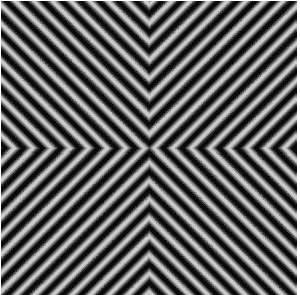

图 8.1 催眠图形互操作示例的屏幕截图

运行时，此示例会绘制一幅“NVIDIA 绿”和黑色的迷人图片，如图 8.1 所示。试着用它来催眠你的朋友（或敌人）。

## 8.3 带图形互操作性的 GPU 波纹

在“第 8.1 节：图形互操作”中，我们多次提到了第 5 章的 GPU 波纹示例。如果你记得，那个应用程序创建了一个 CPUAnimBitmap，并将其作为函数传递，以便在需要生成帧时调用。

```
int main( void ) {
    DataBlock data;
    CPUAnimBitmap  bitmap( DIM, DIM, &data );
    data.bitmap = &bitmap;

    HANDLE_ERROR( cudaMalloc( (void**)&data.dev_bitmap,
                              bitmap.image_size() ) );
    bitmap.anim_and_exit( (void (*)(void*,int))generate_frame,
                          (void (*)(void*))cleanup );
}
```

使用我们在上一节中学到的技术，我们打算创建一个 GPUAnimBitmap 结构。该结构将与 CPUAnimBitmap 起到相同的作用，但在这个改进版本中，CUDA 和 OpenGL 组件将在没有 CPU 干预的情况下进行协作。完成后，应用程序将使用 GPUAnimBitmap，因此 main() 将变得简单如下：

```
int main( void ) {
    GPUAnimBitmap  bitmap( DIM, DIM, NULL );

    bitmap.anim_and_exit(
        (void (*)(uchar4*,void*,int))generate_frame, NULL );
}
```

GPUAnimBitmap 结构使用我们刚刚在“第 8.1 节：图形互操作”中检查过的相同调用。但是，现在这些调用将被抽象化到 GPUAnimBitmap 结构中，以便未来的示例（以及可能你自己的应用程序）更加整洁。

### 8.3.1 GPUANIMBITMAP 结构

我们的 GPUAnimBitmap 的几个数据成员你会从“第 8.1 节：图形互操作”中觉得熟悉。

```
struct GPUAnimBitmap {
    GLuint  bufferObj;
    cudaGraphicsResource *resource;
    int     width, height;
    void    *dataBlock;
    void    (*fAnim)( uchar4*,void*,int );
    void    (*animExit)( void* );
    void    (*clickDrag)( void*,int,int,int,int );
    int     dragStartX, dragStartY;
};
```

我们知道 OpenGL 和 CUDA 运行时会为我们的 GPU 缓冲区使用不同的名称，并且我们知道，取决于我们是进行 OpenGL 调用还是 CUDA C 调用，都需要引用这两个名称。因此，我们的结构将同时存储 OpenGL 的 bufferObj 名称和 CUDA 运行时的 resource 名称。由于我们正在处理打算显示的位图图像，我们知道该图像将具有宽度和高度。

为了允许我们的 GPUAnimBitmap 用户注册某些回调事件，我们还将在 dataBlock 中存储一个指向任意用户数据的 void* 指针。我们的类永远不会查看这些数据，而只是将其传回给任何注册的回调函数。用户可以注册的回调存储在 fAnim、animExit 和 clickDrag 中。函数 fAnim() 在每次调用 glutIdleFunc() 时都会被调用，该函数负责生成将在动画中渲染的图像数据。函数 animExit() 将在动画退出时只调用一次。用户应该在此处实现动画结束时需要执行的清理代码。最后，clickDrag() 是一个可选函数，实现用户对鼠标单击/拖动事件的响应。如果用户注册了此函数，它将在每次鼠标按钮按下、拖动和释放事件序列之后被调用。此序列中初始鼠标单击的位置存储在 (dragStartX, dragStartY) 中，以便在释放鼠标按钮时可以将单击/拖动事件的起点和终点传递给用户。这可以用于实现会让你朋友印象深刻的交互式动画。

初始化 GPUAnimBitmap 遵循我们在前一个示例中看到的相同代码序列。在将参数存储到相应的结构成员之后，我们首先查询 CUDA 运行时以获取合适的 CUDA 设备：

```
GPUAnimBitmap( int w, int h, void *d ) {
    width = w;
    height = h;
    dataBlock = d;
    clickDrag = NULL;
}
```


```
// first, find a CUDA device and set it to graphic interop
cudaDeviceProp prop;
int dev;
memset( &prop, 0, sizeof( cudaDeviceProp ) );
prop.major = 1;
prop.minor = 0;
HANDLE_ERROR( cudaChooseDevice( &dev, &prop ) );
```

找到兼容的CUDA设备后，我们向CUDA运行时发出重要的
cudaGLSetGLDevice() 调用，以通知它我们打算将 dev 用作与OpenGL进行互操作的设备：

```
cudaGLSetGLDevice( dev );
```

由于我们的框架使用GLUT来创建窗口渲染环境，我们需要初始化GLUT。不幸的是，这有点尴尬，因为glutInit()需要命令行参数来传递给窗口系统。由于我们没有想要传递的参数，我们希望简单地指定零个命令行参数。不幸的是，某些版本的GLUT存在一个bug，当给定零个参数时会导致应用程序崩溃。因此，我们诱使GLUT认为我们正在传递一个参数，结果一切顺利。

```
int     c=1;
char   *foo = "name";
glutInit( &c, &foo );
```

我们继续像之前示例中一样初始化GLUT。我们创建一个用于渲染的窗口，并使用字符串"bitmap"指定标题。如果您想给窗口起一个更有趣的名字，尽管来吧。

```
glutInitDisplayMode( GLUT_DOUBLE | GLUT_RGBA );
glutInitWindowSize( width, height );
glutCreateWindow( "bitmap" );
```

接下来，我们请求OpenGL驱动程序分配一个缓冲区句柄，并立即将其绑定到 `GL_PIXEL_UNPACK_BUFFER_ARB` 目标，以确保未来对 `glDrawPixels()` 的调用将绘制到我们的互操作缓冲区：

```
glGenBuffers( 1, &bufferObj );
glBindBuffer( GL_PIXEL_UNPACK_BUFFER_ARB, bufferObj );
```

最后，但绝非不重要的是，我们请求OpenGL驱动程序为我们分配一块GPU内存区域。完成此操作后，我们将此缓冲区告知CUDA运行时，并通过使用cudaGraphicsGLRegisterBuffer()注册bufferObj来为此缓冲区请求一个CUDA名称：

```
glBufferData( GL_PIXEL_UNPACK_BUFFER_ARB, width * height * 4,
NULL, GL_DYNAMIC_DRAW_ARB );

HANDLE_ERROR(
cudaGraphicsGLRegisterBuffer( &resource,
bufferObj,
cudaGraphicsMapFlagsNone ) );
}
```

设置好GPUAnimBitmap后，唯一剩下的问题是我们究竟如何执行渲染。渲染的核心将在我们的 `glutIdleFunction()` 中完成。这个函数本质上包含三件事。首先，它映射我们的共享缓冲区并检索该缓冲区的GPU指针：

```
// static method used for GLUT callbacks
static void idle_func( void ) {
static int ticks = 1;
GPUAnimBitmap* bitmap = *(get_bitmap_ptr());
uchar4* devPtr;
size_t size;

HANDLE_ERROR(
cudaGraphicsMapResources( 1, &(bitmap->resource), NULL )
);
HANDLE_ERROR(
cudaGraphicsResourceGetMappedPointer( (void**)&devPtr,
&size,
bitmap->resource )
);
```

其次，它调用用户指定的函数 fAnim()，该函数预计将启动一个CUDA C内核，在 devPtr 处的缓冲区中填充图像数据。

```
bitmap->fAnim( devPtr, bitmap->dataBlock, ticks++ );
```

最后，它取消映射GPU指针，从而释放缓冲区以供OpenGL驱动程序用于渲染。此渲染将通过调用 glutPostRedisplay() 触发。

```
HANDLE_ERROR(
cudaGraphicsUnmapResources( 1,
&(bitmap->resource),
NULL ) );
glutPostRedisplay();
}
```

GPUAnimBitmap结构的其余部分包含重要但有些偏离主题的基础架构代码。如果您对它感兴趣，应该务必检查它。但我们认为，即使您没有时间或兴趣消化GPUAnimBitmap中其余代码，也能够成功继续。

### 8.3.2 GPU涟漪再探

既然我们有了CPUAnimBitmap的GPU版本，就可以继续修改我们的GPU涟漪应用程序，使其完全在GPU上执行动画。首先，我们将包含 gpu_Anim.h，这是我们GPUAnimBitmap实现的所在地。

GPUAnimBitmap。我们还包含了与第5章中检查的几乎相同的内核。

```
#include "../../common/book.h"
#include "../../common/gpu_anim.h"

#define DIM 1024

__global__ void kernel( uchar4 *ptr, int ticks ) {
    // map from threadIdx/BlockIdx to pixel position
    int x = threadIdx.x + blockIdx.x * blockDim.x;
    int y = threadIdx.y + blockIdx.y * blockDim.y;
    int offset = x + y * blockDim.x * gridDim.x;

    // now calculate the value at that position
    float fx = x - DIM/2;
    float fy = y - DIM/2;
    float d = sqrtf( fx * fx + fy * fy );
    unsigned char grey = (unsigned char)(128.0f + 127.0f *
                                         cos(d/10.0f - 
                                         ticks/7.0f) /
                                         (d/10.0f + 1.0f));
    ptr[offset].x = grey;
    ptr[offset].y = grey;
    ptr[offset].z = grey;
    ptr[offset].w = 255;
}
```

我们所做的唯一更改已被突出显示。做出此更改的原因是，OpenGL互操作要求我们的共享表面必须是“图形友好”的。由于实时渲染通常使用四分量红/绿/蓝/Alpha数据元素的数组，我们的目标缓冲区不再像以前那样只是一个 unsigned char 数组。现在，它必须是 uchar4 类型的数组。实际上，在第5章中，我们将缓冲区视为四分量缓冲区，因此总是使用 ptr[offset+4+k] 对其进行索引，其中 k 指示从 0 到 3 的分量。但现在，通过切换到 uchar4 类型，数据的四分量特性变得明确。

由于 kernel() 是生成图像数据的CUDA C函数，剩下要做的就是编写一个主机函数，该函数将用作 GPUAnimBitmap 的 idle_func() 成员中的回调函数。对于我们当前的应用程序，此函数所做的只是启动CUDA C内核：

```
void generate_frame( uchar4 *pixels, void*, int ticks ) {
    dim3  grids(DIM/16,DIM/16);
    dim3  threads(16,16);
    kernel<<<grids,threads>>>( pixels, ticks );
}
```

基本上，我们只需要这些，因为所有繁重的工作都在 GPUAnimBitmap 结构中完成了。要启动这个程序，我们只需创建一个 GPUAnimBitmap 并注册我们的动画回调函数 generate_frame()。

```
int main( void ) {
    GPUAnimBitmap  bitmap( DIM, DIM, NULL );

    bitmap.anim_and_exit(
        (void (*)(uchar4*,void*,int))generate_frame, NULL );
}
```

## 8.4 带图形互操作的热传递

那么，做所有这些的意义何在？如果您查看 CPUAnimBitmap 的内部结构，即我们用于之前动画示例的结构，您会发现它的工作方式几乎与第8.1节：图形互操作中的渲染代码完全相同。

几乎。

CPUAnimBitmap 与之前示例之间的关键区别隐藏在 glDrawPixels() 调用中。

```
glDrawPixels( bitmap->x,
bitmap->y,
GL_RGBA,
GL_UNSIGNED_BYTE,
bitmap->pixels );
```

我们在本章的第一个示例中曾提到，您可能以前见过以缓冲区指针作为最后一个参数的 glDrawPixels() 调用。好吧，如果您以前没有见过，现在见过了。CPUMemBitmap 的 Draw() 例程中的此调用会触发将 bitmap->pixels 中的 CPU 缓冲区复制到 GPU 以进行渲染。为此，CPU 需要停止当前工作，并为每一帧启动一次到 GPU 的复制。这需要 CPU 和 GPU 之间的同步，以及通过 PCI Express 总线启动和完成传输所需的额外延迟。由于 glDrawPixels() 调用在最后一个参数中期望一个主机指针，这也意味着，在使用 CUDA C 内核生成一帧图像数据后，我们第5章的涟漪应用程序需要使用 cudaMemcpy() 将帧从 GPU 复制到 CPU。

```
void generate_frame( DataBlock *d, int ticks ) {
	dim3 grids(DIM/16,DIM/16);
	dim3 threads(16,16);
	kernel<<<grids,threads>>>( d->dev_bitmap, ticks );

	HANDLE_ERROR( cudaMemcpy( d->bitmap->get_ptr(),
		d->dev_bitmap,
		d->bitmap->image_size(),
		cudaMemcpyDeviceToHost ) );
}
```

综合这些事实，我们最初的GPU涟漪应用程序确实有点愚蠢。我们使用CUDA C来计算每帧渲染的图像值，但在计算完成后，我们将缓冲区复制到CPU，然后CPU又将缓冲区复制回GPU以进行显示。这意味着我们在主机和


阻碍我们获得最大性能的设备。让我们重新审视一个计算密集型动画应用程序，它可能通过迁移到使用图形互操作进行渲染来提升性能。

如果你还记得上一章的热模拟应用程序，你会记得它也使用 CUDAAnimBitmap 来显示其模拟计算的输出。我们将修改此应用程序以使用我们新实现的 GPUAnimBitmap 结构，并查看由此产生的性能变化。与波纹示例一样，我们的 GPUAnimBitmap 几乎是 CPUAnimBitmap 的完美即插即用替代品，除了 unsigned char 到 uchar4 的更改之外。因此，我们的动画例程的签名会发生变化，以适应这种数据类型的转变。

```cpp
void anim_gpu( uchar4* outputBitmap, DataBlock *d, int ticks ) {
    HANDLE_ERROR( cudaEventRecord( d->start, 0 ) );
    dim3 blocks(DIM/16,DIM/16);
    dim3 threads(16,16);
    // since tex is global and bound, we have to use a flag to
    // select which is in/out per iteration
    volatile bool dstOut = true;
    for (int i=0; i<90; i++) {
        float *in, *out;
        if (dstOut) {
            in = d->dev_inSrc;
            out = d->dev_outSrc;
        } else {
            out = d->dev_inSrc;
            in = d->dev_outSrc;
        }
        copy_const_kernel<<<blocks,threads>>>( in );
        blend_kernel<<<blocks,threads>>>( out, dstOut );
        dstOut = !dstOut;
    }
    float_to_color<<<blocks,threads>>>( outputBitmap,
        d->dev_inSrc );
}
```

```cpp
HANDLE_ERROR( cudaEventRecord( d->stop, 0 ) );
HANDLE_ERROR( cudaEventSynchronize( d->stop ) );
float   elapsedTime;
HANDLE_ERROR( cudaEventElapsedTime( &elapsedTime,
                                        d->start, d->stop ) );
d->totalTime +=  elapsedTime;
++d->frames;
printf( "Average Time per frame:  %3.1f ms\n",
        d->totalTime/d->frames );
}
```

由于 `float_to_color()` 内核是实际使用 outputBitmap 的唯一函数，因此它是我们转向 uchar4 后唯一需要修改的其他函数。在上一章中，这个函数仅被视为实用工具代码，我们将继续将其视为实用工具代码。但是，我们重载了这个函数，并在 book.h 中包含了 `unsigned char` 和 `uchar4` 两个版本。你会注意到，这些函数之间的差异与 GPU ripple 的 CPU 动画和 GPU 动画版本之间 kernel () 的差异相同。为了清晰起见，`float_to_color()` 内核的大部分代码已被省略，但如果你急于查看详细信息，我们鼓励你查阅 book.h。

```cpp
__global__ void float_to_color( unsigned char *optr,
                                    const float  *outSrc ) {
// convert floating-point value to 4-component color
optr[offset*4 + 0] = value( m1, m2, h+120 );
optr[offset*4 + 1] = value( m1, m2, h     );
optr[offset*4 + 2] = value( m1, m2, h -120 );
optr[offset*4 + 3] = 255;
}
```

```cpp
__global__ void float_to_color( uchar4 *optr,
                                 const float *outSrc ) {
  // convert floating-point value to 4-component color

  optr[offset].x = value( m1, m2, h-120 );
  optr[offset].y = value( m1, m2, h );
  optr[offset].z = value( m1, m2, h -120 );
  optr[offset].w = 255;
}
```

除了这些更改之外，唯一的主要区别在于从 CPUAnimBitmap 更改为 GPUAnimBitmap 以执行动画。

```cpp
int main( void ) {
  DataBlock data;

  GPUAnimBitmap  bitmap( DIM, DIM, &data );

  data.totalTime = 0;
  data.frames = 0;

  HANDLE_ERROR( cudaEventCreate( &data.start ) );
  HANDLE_ERROR( cudaEventCreate( &data.stop ) );

  int imageSize = bitmap.image_size();

  // assume float == 4 chars in size (i.e., rgba)
  HANDLE_ERROR( cudaMalloc( (void**)&data.dev_inSrc,
                            imageSize ) );
  HANDLE_ERROR( cudaMalloc( (void**)&data.dev_outSrc,
                            imageSize ) );
  HANDLE_ERROR( cudaMalloc( (void**)&data.dev_constSrc,
                            imageSize ) );

  HANDLE_ERROR( cudaBindTexture( NULL, texConstSrc,
                                 data.dev_constSrc,
                                 imageSize ) );

  HANDLE_ERROR( cudaBindTexture( NULL, texIn,
                                data.dev_inSrc,
                                imageSize ) );

  HANDLE_ERROR( cudaBindTexture( NULL, texOut,
                                data.dev_outSrc,
                                imageSize ) );

  // initialize the constant data
  float *temp = (float*)malloc( imageSize );
  for (int i = 0; i < DIM*DIM; i++) {
      temp[i] = 0;
      int x = i % DIM;
      int y = i / DIM;
      if ((x>300) && (x<600) && (y>310) && (y<601))
          temp[i] = MAX_TEMP;
  }

  temp[DIM*100+100] = (MAX_TEMP + MIN_TEMP)/2;
  temp[DIM*700+100] = MIN_TEMP;
  temp[DIM*300+300] = MIN_TEMP;
  temp[DIM*200+700] = MIN_TEMP;
  for (int y=800; y<900; y++) {
      for (int x=400; x<500; x++) {
          temp[x+y*DIM] = MIN_TEMP;
      }
  }

  HANDLE_ERROR( cudaMemcpy( data.dev_constSrc, temp,
                           imageSize,
                           cudaMemcpyHostToDevice ) );

  // initialize the input data
  for (int y=800; y<DIM; y++) {
      for (int x=0; x<200; x++) {
          temp[x+y*DIM] = MAX_TEMP;
      }
  }

  HANDLE_ERROR( cudaMemcpy( data.dev_inSrc, temp,
                           imageSize,
                           cudaMemcpyHostToDevice ) );

  free( temp );

  bitmap.anim_and_exit( (void (*)(uchar4*,void*,int))anim_gpu,
                        (void (*)(void*))anim_exit );
}
```

虽然浏览这个增强版热模拟应用程序的其余部分可能很有启发性，但它与上一章的版本没有足够大的区别，不值得更多描述。重要的是回答这样一个问题：现在我们已将应用程序完全迁移到 GPU，性能会如何变化？无需将每一帧都复制回主机进行显示，情况应该比以前好得多。

那么，使用图形互操作性进行渲染到底好多少呢？以前，热传递示例在我们基于 GeForce GTX 285 的测试机上每帧消耗约 25.3ms。将应用程序转换为使用图形互操作性后，这下降了 15%，降至每帧 21.6ms。净结果是，我们的渲染循环快了 15%，并且每次想要显示一帧时都不再需要主机干预。一天的工作成果还不错！

## 8.5 DirectX 互操作性

虽然我们只查看了使用与 OpenGL 渲染系统互操作的示例，但 DirectX 互操作几乎是一样的。你仍将使用 cudaGraphicsResource 来引用在 DirectX 和 CUDA 之间共享的缓冲区，并且仍将使用 cudaGraphicsMapResources() 和 cudaGraphicsResourceGetMappedPointer() 调用来检索这些共享资源的 CUDA 友好指针。

在大多数情况下，OpenGL 和 DirectX 互操作性之间不同的调用都有尴尬地简单的 DirectX 翻译。例如，我们不再调用 cudaGLSetGLDevice()，而是调用 cudaD3D9SetDirect3DDevice() 以指定应启用 CUDA 设备以进行 Direct3D 9.0 互操作性。

同样，cudaD3D10SetDirect3DDevice() 启用设备以进行 Direct3D 10 互操作，cudaD3D11SetDirect3DDevice() 用于 Direct3D 11。

如果你已经完成了本章的 OpenGL 示例，DirectX 互操作性的细节可能不会让你感到惊讶。但是，如果你想使用 DirectX 互操作并想要一个小项目来入门，我们建议你将本章的示例迁移到 DirectX。要开始，我们建议查阅 NVIDIA CUDA 编程指南作为 API 参考，并查看 GPU Computing SDK 中关于 DirectX 互操作性的代码示例。

## 8.6 章节回顾

虽然本书大部分内容都致力于使用 GPU 进行并行通用计算，但我们不能忘记 GPU 作为渲染引擎的成功日常工作。许多应用程序需要或将受益于使用标准计算机图形渲染。由于 GPU 是渲染领域的主宰，阻碍我们利用这些资源的唯一东西是缺乏对说服 CUDA 运行时和图形驱动程序合作的机制的理解。现在我们已经知道了如何做到这一点，我们不再需要主机干预来显示我们计算的图形结果。这同时加速了应用程序的渲染循环，并使主机能够同时执行其他计算。否则，如果没有其他计算要执行，它会使我们的系统对其他事件或应用程序更加响应。

还有许多其他使用图形互操作性的方法我们未加探索。我们主要研究了使用 CUDA C 内核写入像素缓冲区对象以在窗口中显示。这些图像数据也可以用作可应用于场景中任何表面的纹理。除了修改像素缓冲区对象之外，你还可以在 CUDA 和图形引擎之间共享顶点缓冲区对象。其中，这允许你编写 CUDA C 内核来执行对象之间的碰撞检测或计算顶点位移图，以用于渲染与用户或其周围环境交互的对象或表面。如果你对计算机图形学感兴趣，CUDA C 的图形互操作性 API 为你的应用程序开启了大量新的可能性！


# 第 9 章

# 原子操作

在本书前半部分，我们见过许多情况：用单线程应用程序很难完成的事情，使用 CUDA C 实现后却变得相当容易。例如，得益于 CUDA 运行时在幕后的工作，我们在动画或热模拟中进行逐像素更新时，不再需要 `for ()` 循环。同样，只需从主机代码调用一个 `__global__` 函数，就能创建成千上万个并行块和线程，并自动使用线程索引和块索引进行枚举。

另一方面，有些情况是：在单线程应用中 incredibly simple 的事情，当我们尝试在大规模并行架构上实现相同算法时，实际上会带来严重问题。在本章中，我们将探讨一些情况，在这些情况下，我们需要使用特殊的原语，以安全地完成那些在传统单线程应用中可能非常 trivial 的事情。

## 9.1 章节目标

在本章学习过程中，你将完成以下目标：

- 你将了解各种 NVIDIA GPU 的 *计算能力*。
- 你将了解什么是原子操作以及为什么可能需要它们。
- 你将学习如何在 CUDA C 内核中使用原子操作进行算术运算。

## 9.2 计算能力

到目前为止我们所涵盖的所有主题都涉及每个支持 CUDA 的 GPU 都具备的功能。例如，每个基于 CUDA 架构构建的 GPU 都可以启动内核、访问全局内存，并从常量内存和纹理内存中读取。但就像不同型号的 CPU 具有不同的功能和指令集（例如 MMX、SSE 或 SSE2）一样，支持 CUDA 的图形处理器也是如此。NVIDIA 将 GPU 支持的功能称为其 *计算能力*。

### 9.2.1 NVIDIA GPU 的计算能力

截至出版时，NVIDIA GPU 可能支持计算能力 1.0、1.1、1.2、1.3 或 2.0。更高版本的功能代表其下位版本的超集，实现了“分层洋葱”或“俄罗斯套娃”层次结构（取决于你的比喻偏好）。例如，计算能力为 1.2 的 GPU 支持计算能力 1.0 和 1.1 的所有功能。*NVIDIA CUDA 编程指南* 包含所有支持 CUDA 的 GPU 及其对应计算能力的最新列表。表 9.1 列出了截至出版时可用的 NVIDIA GPU。每个 GPU 支持的计算能力列在设备名称旁边。

表 9.1 选定的支持 CUDA 的 GPU 及其对应的计算能力

| GPU | 计算能力 |
| :--- | :--- |
| GeForce GTX 480, GTX 470 | 2.0 |
| GeForce GTX 295 | 1.3 |
| GeForce GTX 285, GTX 280 | 1.3 |
| GeForce GTX 260 | 1.3 |
| GeForce 9800 GX2 | 1.1 |
| GeForce GTS 250, GTS 150, 9800 GTX, 9800 GTX+, 8800 GTS 512 | 1.1 |
| GeForce 8800 Ultra, 8800 GTX | 1.0 |
| GeForce 9800 GT, 8800 GT, GTX 280M, 9800M GTX | 1.1 |
| GeForce GT 130, 9600 GSO, 8800 GS, 8800M GTX, GTX 260M, 9800M GT | 1.1 |
| GeForce 8800 GTS | 1.0 |
| GeForce 9600 GT, 8800M GTS, 9800M GTS | 1.1 |
| GeForce 9700M GT | 1.1 |
| GeForce GT 120, 9500 GT, 8400 GS, 8600 GT, 9700M GT, 9650M GS, 9600M GT, 9600M GS, 9500M GS, 8700M GT, 8600M GT, 8600M GS | 1.1 |
| GeForce G100, 8500 GT, 8400 GS, 8400M GT, 9500M G, 9300M G, 8400M GS, 9400m GPU, 9300 mGPU, 8300 mGPU, 8200 mGPU, 8100 mGPU | 1.1 |
| GeForce 9300M GS, 9200M GS, 9100M G, 8400M G | 1.1 |
| Tesla S2070, S2050, C2070, C2050 | 2.0 |
| Tesla S1070, C1060 | 1.3 |

表 9.1 选定的支持 CUDA 的 GPU 及其对应的计算能力（续）

| GPU | 计算能力 |
| :--- | :--- |
| Tesla S870, D870, C870 | 1.0 |
| Quadro Plex 2200 D2 | 1.3 |
| Quadro Plex 2100 D4 | 1.1 |
| Quadro Plex 2100 Model S4 | 1.0 |
| Quadro Plex 1000 Model IV | 1.0 |
| Quadro FX 5800 | 1.3 |
| Quadro FX 4800 | 1.3 |
| Quadro FX 4700 X2 | 1.1 |
| Quadro FX 3700M | 1.1 |
| Quadro FX 5600 | 1.0 |
| Quadro FX 3700 | 1.1 |
| Quadro FX 3600M | 1.1 |
| Quadro FX 4600 | 1.0 |
| Quadro FX 2700M | 1.1 |
| Quadro FX 1700, FX 570, NVS 320M, FX 1700M, FX 1600M, FX 770M, FX 570M | 1.1 |
| Quadro FX 370, NVS 290, NVS 140M, NVS 135M, FX 360M | 1.1 |
| Quadro FX 370M, NVS 130M | 1.1 |

当然，由于 NVIDIA 不断发布新的图形处理器，这张表在本书出版时无疑就会过时。幸运的是，NVIDIA 有一个网站，在这个网站上你会找到 CUDA Zone。其中，CUDA Zone 提供了最新的受支持 CUDA 设备列表。我们建议你在因无法在表 9.1 中找到新 GPU 而采取任何激进措施之前，先查阅此列表。或者，你可以直接运行第 3 章中的示例，该示例会打印系统中每个 CUDA 设备的计算能力。

由于这是关于原子操作的章节，特别相关的是在内存上执行原子操作的硬件能力。在我们探讨什么是原子操作以及为什么你需要关心它们之前，你应该知道，全局内存上的原子操作仅在计算能力为 1.1 或更高的 GPU 上受支持。此外，共享内存上的原子操作需要计算能力为 1.2 或更高的 GPU。由于计算能力版本具有超集特性，因此计算能力为 1.2 的 GPU 同时支持共享内存原子操作和全局内存原子操作。同样，计算能力为 1.3 的 GPU 也同时支持这两者。

如果你的 GPU 计算能力为 1.0 且不支持全局内存上的原子操作，那么也许我们刚好给了你一个升级的完美借口！如果你决定暂时不想为支持原子操作的新图形处理器花大钱，你可以继续阅读关于原子操作以及你可能想要使用它们的情况的内容。但如果你觉得无法运行示例太令人心碎，请随意跳到下一章。

### 9.2.2 针对最低计算能力进行编译

假设我们编写了需要特定最低计算能力的代码。例如，想象你读完本章后去编写一个严重依赖全局内存原子操作的应用程序。经过对本文的广泛学习，你知道全局内存原子操作需要计算能力 1.1。要编译你的代码，你需要告知编译器内核无法在能力低于 1.1 的硬件上运行。此外，在向编译器说明这一点时，你也赋予了它进行其他优化的自由，这些优化可能仅在计算能力为 1.1 或更高的 GPU 上可用。向编译器说明这一点只需在调用 nvcc 时添加一个命令行选项：

```
nvcc -arch=sm_11
```

同样，要构建依赖共享内存原子操作的内核，你需要告知编译器代码需要计算能力 1.2 或更高：

```
nvcc -arch=sm_12
```

## 9.3 原子操作概述

程序员在编写传统单线程应用程序时通常永远不需要使用原子操作。如果你也是这种情况，请不要担心；我们计划解释它们是什么，以及为什么我们可能在多线程应用程序中需要它们。为了澄清原子操作，我们将看一下学习 C 或 C++ 时学到的第一件事之一，即递增运算符：

```
x++;
```

这是标准 C 中的一个单一表达式，执行此表达式后，x 中的值应该比执行递增之前大 1。但这暗示了一系列什么样的操作呢？要给 x 的值加 1，我们首先需要知道 x 中当前的值是什么。读取 x 的值后，我们可以对其进行修改。最后，我们需要将此值写回 x。

因此，此操作中的三个步骤如下：

- 1. 读取 x 中的值。
- 2. 将步骤 1 中读取的值加 1。
- 3. 将结果写回 x。

有时，此过程通常被称为读-修改-写操作，因为步骤 2 可以包含任何更改从 x 读取的值的操作。

现在考虑一种情况，即两个线程需要对 x 中的值执行此递增操作。我们将这些线程称为 A 和 B。为了让 A 和 B 都对 x 中的值进行递增，两个线程都需要执行我们描述的三个操作。假设 x 的初始值为 7。理想情况下，我们希望线程 A 和线程 B 执行表 9.2 中所示的步骤。


### 表 9.2 两个线程递增 x 中的值

| 步骤 | 示例 |
|---|---|
| 1. 线程 A 读取 x 中的值。 | A 从 x 读取 7。 |
| 2. 线程 A 将读取的值加 1。 | A 计算 8。 |
| 3. 线程 A 将结果写回 x。 | x <- 8。 |
| 4. 线程 B 读取 x 中的值。 | B 从 x 读取 8。 |
| 5. 线程 B 将读取的值加 1。 | B 计算 9。 |
| 6. 线程 B 将结果写回 x。 | x <- 9。 |

由于 x 的初始值为 7，并且被两个线程递增，我们预期它们完成后 x 将保持值 9。在之前的操作序列中，这确实是我们获得的结果。不幸的是，这些步骤有许多其他顺序会产生错误的值。例如，考虑表 9.3 中所示的顺序，其中线程 A 和线程 B 的操作相互交错。

### 表 9.3 两个线程在操作交错的情况下递增 x 中的值

| 步骤 | 示例 |
|---|---|
| 线程 A 读取 x 中的值。 | A 从 x 读取 7。 |
| 线程 B 读取 x 中的值。 | B 从 x 读取 7。 |
| 线程 A 将读取的值加 1。 | A 计算 8。 |
| 线程 B 将读取的值加 1。 | B 计算 8。 |
| 线程 A 将结果写回 x。 | x <- 8。 |
| 线程 B 将结果写回 x。 | x <- 8。 |

因此，如果我们的线程被不利地调度，我们最终会计算出错误的结果。这六个操作有许多其他顺序，有些产生正确的结果，有些则不。当从单线程版本转移到此应用程序的多线程版本时，如果多个线程需要读取或写入共享值，我们就会突然面临不可预测结果的潜在风险。

在之前的示例中，我们需要一种方法来执行读-修改-写操作，而不会被另一个线程中断。或者更具体地说，在我们完成操作之前，没有其他线程可以读取或写入 x 的值。由于这些操作的执行不能被其他线程分解为更小的部分，我们称满足此约束的操作为原子操作。CUDA C 支持多种原子操作，允许您安全地操作内存，即使成千上万个线程可能正在竞争访问。

现在我们将看一个示例，该示例需要使用原子操作来计算正确的结果。

## 9.4 计算直方图

通常，算法需要计算某组数据的直方图。如果您过去没有任何直方图经验，那也没关系。本质上，给定由某些元素组成的数据集，直方图表示每个元素的频率计数。例如，如果我们为短语 Programming with CUDA C 中的字母创建直方图，我们将得到图 9.1 所示的结果。

虽然描述和理解简单，但计算数据的直方图在计算机科学中出人意料地经常用到。它被用于图像处理、数据压缩、计算机视觉、机器学习、音频编码等算法中。我们将把直方图计算作为以下代码示例的算法。

| 2 | 2 | 1 | 2 | 1 | 2 | 2 | 1 | 1 | 1 | 2 | 1 | 1 | 1 |
|---|---|---|---|---|---|---|---|---|---|---|---|---|---|
| A | C | D | G | H | I | M | N | O | P | R | T | U | W |

图 9.1 从字符串 Programming with CUDA C 构建的字母频率直方图

### 9.4.1 CPU 直方图计算

由于直方图计算可能并非所有读者都熟悉，我们将从如何在 CPU 上计算直方图的示例开始。此示例还将用于说明在单线程 CPU 应用程序中计算直方图相对简单。该应用程序将获得某个大数据流。在实际应用程序中，数据可能代表从像素颜色到音频样本的任何内容，但在我们的示例应用程序中，它将是一串随机生成的字节。我们可以使用我们提供的名为 big_random_block() 的实用函数来创建此随机字节流。在我们的应用程序中，我们创建 100MB 的随机数据。

```
#include "../common/book.h"

#define SIZE (100*1024*1024)

int main( void ) {
    unsigned char *buffer = (unsigned char*)big_random_block( SIZE );
}
```

由于每个随机 8 位字节可以是 256 个不同值之一（从 0x00 到 0xFF），我们的直方图需要包含 256 个桶，以便跟踪每个值在数据中出现的次数。我们创建一个 256 桶数组，并将所有桶计数初始化为零。

```
unsigned int histo[256];
for (int i = 0; i < 256; i++)
    histo[i] = 0;
```

一旦我们的直方图已创建并且所有桶都初始化为零，我们就需要统计 buffer[] 中包含的数据中每个值出现的频率。其想法是，每当我们在数组 buffer[] 中看到某个值 z 时，我们希望递增直方图中桶 z 的值。这样，我们就正在统计我们看到值 z 出现的次数。

如果 buffer[i] 是我们当前正在查看的值，我们希望递增编号为 buffer[i] 的桶中的计数。由于桶 buffer[i] 位于 histo[buffer[i]]，我们可以用一行代码递增适当的计数器。

```
histo[buffer[i]]++;
```

我们对 buffer[] 中的每个元素使用一个简单的 for() 循环来执行此操作：

```
for (int i=0; i<SIZE; i++)
    histo[buffer[i]]++;
```

此时，我们已完成输入数据的直方图。在完整的应用程序中，此直方图可能是下一步计算的输入。然而，在我们的简单示例中，我们只关心计算这些，因此我们通过验证直方图中所有桶的总和是否等于预期值来结束应用程序。

```
long histoCount = 0;
for (int i=0; i<256; i++) {
    histoCount += histo[i];
}
printf( "Histogram Sum: %ld\n", histoCount );
```

如果您仔细跟随，您会意识到无论输入数组多么随机，此总和始终相同。每个桶计数我们看到相应数据元素的次数，因此所有这些桶的总和应该是我们检查的数据元素总数。在我们的情况中，这将是 SIZE 的值。

不用说（但我们还是会说），我们清理一下并返回。

```
free( buffer );
return 0;
}
```

在我们的基准机器上，一台 Core 2 Duo，这个 100MB 数组的直方图可以在 0.416 秒内构建。这将为我们打算编写的 GPU 版本提供基准性能。

### 9.4.2 GPU 直方图计算

我们希望将直方图计算示例调整为在 GPU 上运行。如果我们的输入数组足够大，让不同的线程检查 buffer 的不同部分可能会节省大量时间。让不同的线程读取输入的不同部分应该足够容易。毕竟，这与我们迄今看到的东西非常相似。从输入数据计算直方图的问题在于，多个线程可能同时想要递增输出直方图中的同一个桶。在这种情况下，我们将需要使用原子递增来避免第 9.2 节：原子操作概述中描述的情况。

我们的 main() 例程与 CPU 版本非常相似，尽管我们需要添加一些 CUDA C 管道以将输入传递给 GPU 并从 GPU 获取结果。然而，我们开始时与在 CPU 上完全一样：

```
int main( void ) {
    unsigned char *buffer = (unsigned char*)big_random_block( SIZE );
}
```

我们将有兴趣衡量我们的代码性能，因此我们像往常一样初始化事件以进行计时。

```
cudaEvent_t   start, stop;

HANDLE_ERROR( cudaEventCreate( &start ) );
HANDLE_ERROR( cudaEventCreate( &stop ) );
HANDLE_ERROR( cudaEventRecord( start, 0 ) );
```

在设置输入数据和事件后，我们查看 GPU 内存。我们需要为随机输入数据和输出直方图分配空间。在分配输入缓冲区后，我们复制我们用


将 big_random_block() 的数据传输到 GPU。同样，在分配直方图后，我们将其初始化为零，就像在 CPU 版本中所做的那样。

```c
// allocate memory on the GPU for the file's data
unsigned char *dev_buffer;
unsigned int *dev_histo;
HANDLE_ERROR( cudaMalloc( (void**)&dev_buffer, SIZE ) );
HANDLE_ERROR( cudaMemcpy( dev_buffer, buffer, SIZE,
                          cudaMemcpyHostToDevice ) );

HANDLE_ERROR( cudaMalloc( (void**)&dev_histo,
                          256 * sizeof( long ) ) );
HANDLE_ERROR( cudaMemset( dev_histo, 0,
                          256 * sizeof( int ) ) );
```

您可能注意到，我们引入了一个新的 CUDA 运行时函数 cudaMemset()。该函数的签名与标准 C 函数 memset() 相似，两者的行为几乎完全相同。这两个函数在签名上的区别在于 cudaMemset() 返回一个错误代码，而 C 库函数 memset() 不返回。此错误代码将告知调用者在尝试设置 GPU 内存时是否发生了任何问题。除了返回错误代码外，唯一的区别是 cudaMemset() 操作 GPU 内存，而 memset() 操作主机内存。

初始化输入和输出缓冲区后，我们就可以计算直方图了。您将很快看到我们如何准备并启动直方图内核。暂时假设我们已在 GPU 上计算出直方图。完成后，我们需要将直方图复制回 CPU，因此分配一个 256 个条目的数组，并执行从设备到主机的复制。

```c
unsigned int histo[256];
HANDLE_ERROR( cudaMemcpy( histo, dev_histo,
                          256 * sizeof( int ),
                          cudaMemcpyDeviceToHost ) );
```

此时，直方图计算已完成，我们可以停止计时器并显示经过的时间。与之前的事件代码一样，这与我们在前几章中使用的计时代码相同。

```c
// get stop time, and display the timing results
HANDLE_ERROR( cudaEventRecord( stop, 0 ) );
HANDLE_ERROR( cudaEventSynchronize( stop ) );
float   elapsedTime;
HANDLE_ERROR( cudaEventElapsedTime( &elapsedTime,
                                    start, stop ) );
printf( "Time to generate:  %3.1f ms\n", elapsedTime );
```

此时，我们可以将直方图作为输入传递给算法的另一个阶段，但由于我们不再将直方图用于其他目的，只需验证计算出的 GPU 直方图是否与 CPU 上的结果一致。首先，我们验证直方图总和是否符合预期。这与此处显示的 CPU 代码相同：

```c
long histoCount = 0;
for (int i=0; i<256; i++) {
    histoCount += histo[i];
}
printf( "Histogram Sum: %ld\n", histoCount );
```

不过，为了完全验证 GPU 直方图，我们将使用 CPU 计算相同的直方图。显而易见的方法是分配一个新的直方图数组，使用第 9.3.1 节“CPU 直方图计算”中的代码从输入计算直方图，最后确保 GPU 和 CPU 版本中的每个 bin 都匹配。但我们不分配新的直方图数组，而是选择从 GPU 直方图开始，以“反向”方式计算 CPU 直方图。

以“反向”方式计算直方图的意思是，我们不是从零开始并在看到数据元素时递增 bin 值，而是从 GPU 直方图开始，并在 CPU 看到数据元素时递减 bin 的值。因此，当且仅当完成时每个 bin 的值都为零时，CPU 才计算出了与 GPU 相同的直方图。在某种意义上，我们正在计算这两个直方图之间的差异。代码将与 CPU 直方图计算非常相似，只是使用递减运算符而不是递增运算符。

```c
// verify that we have the same counts via CPU
for (int i = 0; i < SIZE; i++)
    histo[buffer[i]]--;
for (int i = 0; i < 256; i++) {
    if (histo[i] != 0)
        printf( "Failure at %d!\n", i );
}
```

像往常一样，最后涉及清理我们分配的 CUDA 事件、GPU 内存和主机内存。

```c
HANDLE_ERROR( cudaEventDestroy( start ) );
HANDLE_ERROR( cudaEventDestroy( stop ) );
cudaFree( dev_histo );
cudaFree( dev_buffer );
free( buffer );
return 0;
```

此前，我们假设已启动一个计算直方图的内核，然后继续讨论后续事宜。由于性能考虑，我们的内核启动比通常情况稍微复杂一些。因为直方图包含 256 个 bin，每块使用 256 个线程既方便又能实现高性能。但在启动的块数量方面，我们有很大的灵活性。例如，对于 100MB 的数据，我们有 104,857,600 字节的数据。我们可以启动一个块，让每个线程检查 409,600 个数据元素。同样，我们可以启动 409,600 个块，让每个线程检查一个数据元素。

如您所料，最佳解决方案介于这两个极端之间。通过运行一些性能实验，当我们启动的块数量正好是 GPU 包含的多处理器数量的两倍时，可实现最佳性能。例如，GeForce GTX 280 拥有 30 个多处理器，因此当我们的直方图内核使用 60 个并行块启动时，在 GeForce GTX 280 上运行速度最快。

在第 3 章中，我们讨论了一种查询程序运行所在硬件各种属性的方法。如果我们打算根据当前硬件平台动态调整启动规模，则需要使用这些设备属性之一。为了实现这一点，我们将使用以下代码段。虽然您尚未看到内核实现，但仍应能理解正在发生的事情。

```c
cudaDeviceProp prop;
HANDLE_ERROR( cudaGetDeviceProperties( &prop, 0 ) );
int blocks = prop.multiProcessorCount;
histo_kernel<<<blocks*2,256>>>( dev_buffer, SIZE, dev_histo );
```

由于我们对 main() 的逐步讲解有些零散，以下是从开始到结束的完整例程：

```c
int main( void ) {
    unsigned char *buffer =
        (unsigned char*)big_random_block( SIZE );

    cudaEvent_t   start, stop;
    HANDLE_ERROR( cudaEventCreate( &start ) );
    HANDLE_ERROR( cudaEventCreate( &stop ) );
    HANDLE_ERROR( cudaEventRecord( start, 0 ) );

    // allocate memory on the GPU for the file's data
    unsigned char *dev_buffer;
    unsigned int  *dev_histo;
    HANDLE_ERROR( cudaMalloc( (void**)&dev_buffer, SIZE ) );
    HANDLE_ERROR( cudaMemcpy( dev_buffer, buffer, SIZE,
                              cudaMemcpyHostToDevice ) );

    HANDLE_ERROR( cudaMalloc( (void**)&dev_histo,
                              256 * sizeof( long ) ) );
    HANDLE_ERROR( cudaMemset( dev_histo, 0,
                              256 * sizeof( int ) ) );

    cudaDeviceProp  prop;
    HANDLE_ERROR( cudaGetDeviceProperties( &prop, 0 ) );
    int blocks = prop.multiProcessorCount;
    histo_kernel<<<blocks,256>>>( dev_buffer, SIZE, dev_histo );

    unsigned int  histo[256];
    HANDLE_ERROR( cudaMemcpy( histo, dev_histo,
                            256 * sizeof( int ),
                            cudaMemcpyDeviceToHost ) );

    // get stop time, and display the timing results
    HANDLE_ERROR( cudaEventRecord( stop, 0 ) );
    HANDLE_ERROR( cudaEventSynchronize( stop ) );
    float  elapsedTime;
    HANDLE_ERROR( cudaEventElapsedTime( &elapsedTime,
                                         start, stop ) );
    printf( "Time to generate:  %3.1f ms\n", elapsedTime );

    long histoCount = 0;
    for (int i=0; i<256; i++) {
        histoCount += histo[i];
    }
    printf( "Histogram Sum: %ld\n", histoCount );

    // verify that we have the same counts via CPU
    for (int i=0; i<SIZE; i++)
        histo[buffer[i]]--;
    for (int i=0; i<256; i++) {
        if (histo[i] != 0)
            printf( "Failure at %d!\n", i );
    }

    HANDLE_ERROR( cudaEventDestroy( start ) );
    HANDLE_ERROR( cudaEventDestroy( stop ) );
}
```


cudaFree( dev_histo );
cudaFree( dev_buffer );
free( buffer );
return 0;
}

#### 使用全局内存原子操作的直方图内核

现在进入有趣的部分：计算直方图的 GPU 代码！计算直方图的内核本身需要获取指向输入数据数组的指针、输入数组的长度以及指向输出直方图的指针。我们的内核首先需要计算的是输入数据数组中的线性化偏移量。每个线程将从 0 到线程数减 1 之间的偏移量开始。然后它将按已启动的线程总数进行步进。我们希望你还记得这个技术；当你最初学习线程时，我们使用了相同的逻辑来添加任意长度的向量。

```
#include "../common/book.h"

#define SIZE (100*1024*1024)

__global__ void histo_kernel( unsigned char *buffer,
                              long size,
                              unsigned int *histo ) {
    int i = threadIdx.x + blockIdx.x * blockDim.x;
    int stride = blockDim.x * gridDim.x;
```

一旦每个线程知道其起始偏移量 i 和应使用的步长，代码就会遍历输入数组并递增相应的直方图桶。

```
while ( i < size ) {
    atomicAdd( &(histo[buffer[i]]), 1 );
    i += stride;
}
```

高亮行代表了我们在 CUDA C 中使用原子操作的方式。调用 `atomicAdd( addr, y );` 生成一个原子操作序列，该序列读取地址 `addr` 处的值，将 `y` 加到该值上，并将结果存回内存地址 `addr`。硬件保证在我们执行这些操作时，没有其他线程可以读取或写入地址 `addr` 处的值，从而确保可预测的结果。在我们的示例中，问题的地址是与当前字节对应的直方图桶的位置。如果当前字节是 `buffer[i]`，就像我们在 CPU 版本中看到的那样，相应的直方图桶是 `histo[buffer[i]]`。原子操作需要该桶的地址，因此第一个参数是 `&histo[buffer[i]]`。由于我们只是想将该桶中的值加一，第二个参数是 1。

经过所有这些折腾之后，我们的 GPU 直方图计算与相应的 CPU 版本非常相似。

```
#include "../common/book.h"

#define SIZE    (100*1024*1024)

__global__ void histo_kernel( unsigned char *buffer,
                              long size,
                              unsigned int *histo ) {
    int i = threadIdx.x + blockIdx.x * blockDim.x;
    int stride = blockDim.x * gridDim.x;
    while ( i < size ) {
        atomicAdd( &(histo[buffer[i]]), 1 );
        i += stride;
    }
}
```

不过，我们需要把庆祝留到以后。运行此示例后，我们发现 GeForce GTX 285 可以在 1.752 秒内从 100MB 的输入数据构建直方图。如果你阅读了关于基于 CPU 的直方图的部分，你会意识到这种性能很糟糕。事实上，这比 CPU 版本慢了四倍多！但这就是为什么我们总是测量基准性能的原因。仅仅因为它在 GPU 上运行就接受如此低性能的实现，那将是一件遗憾的事。

由于我们在内核中做的工作很少，全局内存上的原子操作很可能是问题所在。本质上，当成千上万个线程试图访问少数几个内存位置时，我们的 256 个直方图桶可能会发生大量竞争。为了确保递增操作的原子性，硬件需要将对同一内存位置的操作串行化。这可能导致长长的待处理操作队列，我们可能获得的任何性能提升都将消失。我们需要改进算法本身才能恢复这种性能。

#### 使用共享和全局内存原子操作的直方图内核

具有讽刺意味的是，尽管原子操作导致了这种性能下降，但缓解减速实际上涉及使用 *更多* 原子操作，而不是更少。核心问题不在于使用原子操作，而在于成千上万个线程正在竞争访问相对较少的内存地址。为了解决这个问题，我们将把直方图计算分为两个阶段。

在第一阶段，每个并行块将计算其组成线程检查的数据的单独直方图。由于每个块独立执行此操作，我们可以在共享内存中计算这些直方图，从而节省将每次写入发送到芯片外 DRAM 的时间。不过，这并没有使我们免于需要原子操作，因为块内的多个线程仍然可以检查具有相同值的数据元素。然而，现在只有 256 个线程竞争 256 个地址，这一事实将减少与全局版本的竞争，在全局版本中成千上万个线程正在竞争。

第一阶段涉及分配并清零一个共享内存缓冲区，以保存每个块的中间直方图。回顾第 5 章，由于后续步骤将涉及读取和修改此缓冲区，我们需要一个 __syncthreads() 调用，以确保每个线程的写入都已完成后再继续。

```
__global__ void histo_kernel( unsigned char *buffer,
                              long size,
                              unsigned int *histo ) {
    __shared__ unsigned int temp[256];
    temp[threadIdx.x] = 0;
    __syncthreads();
```

清零直方图后，下一步与我们最初的 GPU 直方图非常相似。这里的唯一区别是我们使用共享内存缓冲区 `temp[]` 而不是全局内存缓冲区 `histo[]`，并且我们需要随后调用 __syncthreads() 以确保我们的最后一次写入已被提交。

```
int i = threadIdx.x + blockIdx.x * blockDim.x;
int offset = blockDim.x * gridDim.x;
while (i < size) {
    atomicAdd( &temp[buffer[i]], 1 );
    i += offset;
}
__syncthreads();
```

我们修改后的直方图示例的最后一步要求将每个块的临时直方图合并到全局缓冲区 `histo[]` 中。假设我们将输入分为两半，两个线程分别查看不同的半部分并计算单独的直方图。如果线程 A 在输入中看到字节 0xFC 出现了 20 次，线程 B 看到字节 0xFC 出现了 5 次，那么字节 0xFC 在输入中一定出现了 25 次。同样，最终直方图的每个桶只是线程 A 直方图中相应桶与线程 B 直方图中相应桶的总和。此逻辑扩展到任意数量的线程，因此将每个块的直方图合并到单个最终直方图涉及将块直方图中的每个条目添加到最终直方图中的相应条目。出于我们已经看到的所有原因，这需要以原子方式完成：

```
atomicAdd( &(histo[threadIdx.x]), temp[threadIdx.x] );
}
```

由于我们决定使用 256 个线程并有 256 个直方图桶，每个线程原子地将单个桶添加到最终直方图的总数中。如果这些数字不匹配，此阶段将更复杂。请注意，我们无法保证块将其值添加到最终直方图的顺序，但由于整数加法满足交换律，只要加法以原子方式发生，我们总是会得到相同的答案。

有了这个，我们的两阶段直方图计算内核就完成了。以下是从头到尾的完整代码：

```
__global__ void histo_kernel( unsigned char *buffer,
   long size,
   unsigned int *histo ) {
   __shared__ unsigned int temp[256];
   temp[threadIdx.x] = 0;
   __syncthreads();

   int i = threadIdx.x + blockIdx.x * blockDim.x;
   int offset = blockDim.x * gridDim.x;
   while (i < size) {
      atomicAdd( &temp[buffer[i]], 1);
      i += offset;
   }

   __syncthreads();
   atomicAdd( &(histo[threadIdx.x]), temp[threadIdx.x] );
}
```

我们的直方图示例的这个版本比之前的 GPU 版本有了巨大的改进。添加共享内存组件将我们在 GeForce GTX 285 上的运行时间降低到 0.057 秒。这不仅比仅使用全局内存原子操作的版本好得多，而且比我们最初的 CPU 实现快了一个数量级（从 0.416 秒降至 0.057 秒）。这种改进相对于 CPU 版本代表了超过七倍的速度提升。因此，尽管在将直方图调整为 GPU 实现时早期遇到了挫折，但我们同时使用共享和全局原子操作的版本应被视为成功。

## 9.5 章节回顾

尽管我们经常长篇大论地谈论使用 CUDA C 进行并行编程可以多么容易，但我们在很大程度上忽略了一些


诸如 GPU 这样的大规模并行架构会让我们程序员的生活变得更加困难。试图应对潜在成千上万个线程同时修改相同内存地址的情况，是大规模并行机器显得负担沉重的常见场景。幸运的是，我们有硬件支持的原子操作可用，以帮助缓解这种痛苦。

然而，正如你在直方图计算中所见，有时依赖原子操作会引入性能问题，这些问题只有通过重新思考算法的部分才能解决。在直方图示例中，我们转向了一个两阶段算法，缓解了对全局内存地址的竞争。一般来说，这种减少内存竞争的策略通常效果不错，你在自己的应用程序中使用原子操作时应该牢记这一点。

# 第 10 章
# 流

在本书中，我们一次又一次地看到，GPU 上的大规模数据并行执行引擎可以相比可比的 CPU 代码提供惊人的性能提升。然而，在 NVIDIA 图形处理器上还有另一类可供利用的并行性。这种并行性类似于多线程 CPU 应用程序中发现的任务并行性。与数据并行性中同时在大量数据元素上计算相同函数不同，任务并行性涉及并行执行两个或多个完全不同的任务。

在并行性的上下文中，任务可以是任何东西。例如，一个应用程序可能正在执行两个任务：一个线程重绘其 GUI，而另一个线程通过网络下载更新。这些任务并行进行，尽管它们毫无共同点。尽管 GPU 上的任务并行性目前不如通用处理器灵活，但它仍然为我们程序员提供了从 GPU 实现中榨取更多速度的机会。在本章中，我们将探讨 CUDA 流以及它们的谨慎使用如何使我们能够在 GPU 上同时执行某些操作。

## 10.1 章节目标

在第 10 章学习过程中，你将完成以下任务：

- 你将了解分配页锁定主机内存。
- 你将了解什么是 CUDA 流。
- 你将了解如何使用 CUDA 流来加速你的应用程序。

## 10.2 页锁定主机内存

在前九章的每个示例中，你都看到我们使用 cudaMalloc() 在 GPU 上分配内存。在主机上，我们一直使用普通的 C 库例程 malloc() 分配内存。然而，CUDA 运行时提供了自己的分配主机内存的机制：cudaHostAlloc()。既然 malloc() 自你作为 C 程序员的第一天起就一直很好用，为什么还要费心使用这个函数呢？

事实上，malloc() 分配的内存与 cudaHostAlloc() 分配的内存之间存在显著差异。C 库函数 malloc() 分配标准的可页主机内存，而 cudaHostAlloc() 分配页锁定主机内存缓冲区。页锁定缓冲区有时也称为固定内存，具有一个重要属性：操作系统保证永远不会将此内存分页到磁盘，从而确保其驻留在物理内存中。其推论是，操作系统允许应用程序访问内存的物理地址是安全的，因为缓冲区不会被驱逐或重新定位。

了解缓冲区的物理地址后，GPU 可以使用直接内存访问 [DMA] 将数据复制到主机或从主机复制数据。由于 DMA 复制无需 CPU 干预即可进行，这也意味着 CPU 可能同时将这些缓冲区分页到磁盘，或通过更新操作系统的页表来重新定位它们的物理地址。CPU 移动可页数据的可能性意味着，使用固定内存进行 DMA 复制是必不可少的。事实上，即使你尝试使用可页内存进行内存复制，CUDA 驱动程序仍然使用 DMA 将缓冲区传输到 GPU。因此，你的复制发生了两次：首先从可页系统缓冲区复制到页锁定的“暂存”缓冲区，然后从页锁定的系统缓冲区复制到 GPU。

因此，每当你从可页内存执行内存复制时，你就保证了复制速度将受限于 PCIe 传输速度和系统前端总线速度中较低的那个。在某些系统中，这些总线之间带宽的巨大差异确保了页锁定主机内存在用于 GPU 和主机之间复制数据时，比标准可页内存大约具有两倍的性能优势。但是，即使在 PCI Express 和前端总线速度相同的世界里，可页缓冲区仍然会承受额外 CPU 管理复制的开销。

然而，你应该抵制简单地对 malloc 进行查找替换以将所有调用都转换为使用 cudaHostAlloc() 的诱惑。使用固定内存是一把双刃剑。这样一来，你实际上就放弃了虚拟内存的所有优良特性。具体来说，运行应用程序的计算机需要为每个页锁定缓冲区提供可用的物理内存，因为这些缓冲区永远不能被交换到磁盘。这意味着，与坚持使用标准 malloc() 调用相比，你的系统会更快地耗尽内存。这不仅意味着你的应用程序可能在物理内存较小的机器上开始失败，还意味着你的应用程序可能会影响系统上其他应用程序的性能。

这些警告并非旨在吓阻你使用 cudaHostAlloc()，但你应该始终意识到页锁定缓冲区的影响。我们建议尽量将其使用限制在将作为 cudaMemcpy() 调用中源或目标的内存上，并在不再需要时释放它们，而不是等到应用程序关闭时再释放内存。使用 cudaHostAlloc() 不应该比你迄今为止学习的任何其他内容更困难，但让我们来看一个示例，该示例既说明了如何分配固定内存，又展示了其相对于标准可页内存的性能优势。

我们的应用程序将非常简单，主要用于对可页内存和页锁定内存的 cudaMemcpy() 性能进行基准测试。我们要做的只是分配一个 GPU 缓冲区和一个大小匹配的主机缓冲区，然后在这两个缓冲区之间执行若干次复制。我们将允许此基准测试的用户指定复制方向，即“上”[从主机到设备]或“下”[从设备到主机]。你还会注意到，为了获得准确的计时，我们为复制序列的开始和停止设置了 CUDA 事件。你可能还记得如何从之前的性能测试示例中执行此操作，但以防你忘记了，以下内容将唤起你的记忆：

```
float cuda_malloc_test( int size, bool up ) {
    cudaEvent_t   start, stop;
    int           *a, *dev_a;
    float         elapsedTime;

    HANDLE_ERROR( cudaEventCreate( &start ) );
    HANDLE_ERROR( cudaEventCreate( &stop ) );

    a = (int*)malloc( size * sizeof( *a ) );
    HANDLE_NULL( a );
    HANDLE_ERROR( cudaMalloc( (void**)&dev_a,
                              size * sizeof( *dev_a ) ) );
}
```

无论复制方向如何，我们首先分配一个大小为 size 个整数的主机和 GPU 缓冲区。之后，我们按照参数 up 指定的方向执行 100 次复制，在复制完成后停止计时器。

```
HANDLE_ERROR( cudaEventRecord( start, 0 ) );
for (int i=0; i<100; i++) {
    if (up) {
        HANDLE_ERROR( cudaMemcpy( dev_a, a,
                                  size * sizeof( *dev_a ),
                                  cudaMemcpyHostToDevice ) );
    }
    else {
        HANDLE_ERROR( cudaMemcpy( a, dev_a,
                                  size * sizeof( *dev_a ),
                                  cudaMemcpyDeviceToHost ) );
    }
}
HANDLE_ERROR( cudaEventRecord( stop, 0 ) );
HANDLE_ERROR( cudaEventSynchronize( stop ) );
HANDLE_ERROR( cudaEventElapsedTime( &elapsedTime,
                                    start, stop ) );
```


在执行完 100 次拷贝后，通过释放主机和 GPU 缓冲区以及销毁我们的计时事件来进行清理。

```c
free( a );
HANDLE_ERROR( cudaFree( dev_a ) );
HANDLE_ERROR( cudaEventDestroy( start ) );
HANDLE_ERROR( cudaEventDestroy( stop ) );

    return elapsedTime;
}
```

如果您没有注意到，函数 cudaMalloc_test() 使用标准 C malloc() 例程分配了可页化主机内存。固定内存版本使用 cudaHostAlloc() 分配页锁定缓冲区。

```c
float cuda_host_alloc_test( int size, bool up ) {
    cudaEvent_t    start, stop;
    int            *a, *dev_a;
    float          elapsedTime;

    HANDLE_ERROR( cudaEventCreate( &start ) );
    HANDLE_ERROR( cudaEventCreate( &stop ) );

    HANDLE_ERROR( cudaHostAlloc( (void**)&a,
                                 size * sizeof( *a ),
                                 cudaHostAllocDefault ) );

    HANDLE_ERROR( cudaMalloc( (void**)&dev_a,
                              size * sizeof( *dev_a ) ) );

    HANDLE_ERROR( cudaEventRecord( start, 0 ) );

    for (int i=0; i<100; i++) {
        if (up)
            HANDLE_ERROR( cudaMemcpy( dev_a, a,
                                      size * sizeof( *a ),
                                      cudaMemcpyHostToDevice ) );
        else
            HANDLE_ERROR( cudaMemcpy( a, dev_a,
                                      size * sizeof( *a ),
                                      cudaMemcpyDeviceToHost ) );
    }
    HANDLE_ERROR( cudaEventRecord( stop, 0 ) );
    HANDLE_ERROR( cudaEventSynchronize( stop ) );
    HANDLE_ERROR( cudaEventElapsedTime( &elapsedTime,
                                        start, stop ) );
    HANDLE_ERROR( cudaFreeHost( a ) );
    HANDLE_ERROR( cudaFree( dev_a ) );
    HANDLE_ERROR( cudaEventDestroy( start ) );
    HANDLE_ERROR( cudaEventDestroy( stop ) );
    return elapsedTime;
}
```

如您所见，由 cudaHostAlloc() 分配的缓冲区与由 malloc() 分配的缓冲区使用方式相同。与使用 malloc() 的另一个区别在于最后一个参数，即 cudaHostAllocDefault 的值。此最后一个参数存储了一组标志，我们可以使用这些标志来修改 cudaHostAlloc() 的行为，以分配其他类型的固定主机内存。在下一章中，我们将了解如何使用这些标志的其他可能值，但目前我们满足于使用默认的页锁定内存，因此传递 cudaHostAllocDefault 以获得默认行为。要释放使用 cudaHostAlloc() 分配的缓冲区，必须使用 cudaFreeHost()。也就是说，每个 malloc() 都需要一个 free()，每个 cudaHostAlloc() 都需要一个 cudaFreeHost()。

main() 函数体的执行过程与您预期的差不多。

```c
#include "../common/book.h"

#define SIZE (10*1024*1024)

int main( void ) {
    float    elapsedTime;
    float    MB = (float)100*SIZE*sizeof(int)/1024/1024;

    elapsedTime = cuda_malloc_test( SIZE, true );
    printf( "Time using cudaMalloc: %3.1f ms\n",
            elapsedTime );
    printf( "\tMB/s during copy up: %3.1f\n",
            MB/(elapsedTime/1000) );
```

由于 cuda_malloc_test() 的 up 参数为 true，前一次调用测试的是从主机到设备（即“上传”到设备）的拷贝性能。要对相反方向的调用进行基准测试，我们执行相同的调用，但将第二个参数设为 false。

```c
    elapsedTime = cuda_malloc_test( SIZE, false );
    printf( "Time using cudaMalloc: %3.1f ms\n",
            elapsedTime );
    printf( "\tMB/s during copy down: %3.1f\n",
            MB/(elapsedTime/1000) );
```

我们执行相同的一组步骤来测试 cudaHostAlloc() 的性能。我们调用 cuda_host_alloc_test() 两次，一次将 up 设为 true，一次设为 false。

```c
    elapsedTime = cuda_host_alloc_test( SIZE, true );
    printf( "Time using cudaHostAlloc: %3.1f ms\n",
            elapsedTime );
    printf( "\tMB/s during copy up: %3.1f\n",
            MB/(elapsedTime/1000) );

    elapsedTime = cuda_host_alloc_test( SIZE, false );
    printf( "Time using cudaHostAlloc: %3.1f ms\n",
            elapsedTime );
    printf( "\tMB/s during copy down: %3.1f\n",
            MB/(elapsedTime/1000) );
}
```

在 GeForce GTX 285 上，当我们使用固定内存而不是可页化内存时，观察到从主机到设备的拷贝速度从 2.77GB/s 提升至 5.11GB/s。

从设备到主机的拷贝也有类似的提升，从 2.43GB/s 提升至 5.46GB/s。因此，对于大多数 PCIe 带宽受限的应用程序，使用固定内存而非标准可页化内存时，您会注意到显著的性能提升。但页锁定内存不仅用于性能增强。正如我们在下一节中将看到的，有些情况下我们必须使用页锁定内存。

## 10.3 CUDA 流

在第 6 章中，我们介绍了 CUDA 事件的概念。在这样做时，我们推迟了对 cudaEventRecord() 第二个参数的深入讨论，而是只提到它指定了我们正在插入事件的流。

```c
cudaEvent_t start;
cudaEventCreate(&start);
cudaEventRecord( start, 0 );
```

CUDA 流在加速应用程序方面发挥着重要作用。CUDA 流表示一组按特定顺序执行的 GPU 操作队列。我们可以将内核启动、内存拷贝以及事件启动和停止等操作添加到流中。将操作添加到流中的顺序指定了它们将被执行的顺序。您可以将每个流视为 GPU 上的一个任务，这些任务有机会并行执行。我们将首先了解如何使用流，然后探讨如何使用流来加速您的应用程序。

## 10.4 使用单个 CUDA 流

正如我们稍后将看到的，流的真正威力只有在使用多个流时才会显现，但我们将首先在仅使用单个流的应用程序中说明其使用机制。假设我们有一个 CUDA C 内核，它将接受两个输入数据缓冲区 a 和 b。该内核将根据这些缓冲区中值的组合计算某个结果，以生成输出缓冲区 c。我们的向量加法示例做了类似的事情，但在这个示例中，我们将计算 a 中三个值和 b 中三个值的平均值：

```c
#include "../common/book.h"

#define N    (1024*1024)
#define FULL_DATA_SIZE   (N*20)

__global__ void kernel( int *a, int *b, int *c ) {
    int idx = threadIdx.x + blockIdx.x * blockDim.x;
    if (idx < N) {
        int idx1 = (idx + 1) % 256;
        int idx2 = (idx + 2) % 256;
        float as = (a[idx] + a[idx1] + a[idx2]) / 3.0f;
        float bs = (b[idx] + b[idx1] + b[idx2]) / 3.0f;
        c[idx] = (as + bs) / 2;
    }
}
```

这个内核并不十分重要，所以如果您不确定它到底在计算什么，也不要过于纠结。它某种程度上是一个占位符，因为本示例中与流相关的重要组件位于 main() 中。

```c
int main( void ) {
    cudaDeviceProp  prop;
    int whichDevice;
    HANDLE_ERROR( cudaGetDevice( &whichDevice ) );
    HANDLE_ERROR( cudaGetDeviceProperties( &prop, whichDevice ) );
    if ( !prop.deviceOverlap ) {
        printf( "Device will not handle overlaps, so no "
                "speed up from streams\n" );
        return 0;
    }
}
```

我们首先要做的是选择一个设备，并检查它是否支持一种称为设备重叠的功能。支持设备重叠的 GPU 能够在执行 CUDA C 内核的同时，在设备和主机内存之间进行拷贝。正如我们之前承诺的，我们将使用多个流来实现计算和数据传输的这种重叠，但首先我们将了解如何创建和使用单个流。与所有旨在衡量性能改进（或退步）的示例一样，我们首先创建并启动一个事件计时器：

```cpp
cudaEvent_t    start, stop;
float          elapsedTime;

// start the timers
HANDLE_ERROR( cudaEventCreate( &start ) );
HANDLE_ERROR( cudaEventCreate( &stop ) );
HANDLE_ERROR( cudaEventRecord( start, 0 ) );
```

启动计时器后，我们创建要为此应用程序使用的流：

```cpp
// initialize the stream
cudaStream_t stream;
HANDLE_ERROR( cudaStreamCreate( &stream ) );
```

没错，创建一个流基本上就需要这些。这不值得过多赘述，让我们继续进行数据分配。

```cpp
int *host_a, *host_b, *host_c;
int *dev_a, *dev_b, *dev_c;

// allocate the memory on the GPU
HANDLE_ERROR( cudaMalloc( (void**)&dev_a,
                          N * sizeof(int) ) );
HANDLE_ERROR( cudaMalloc( (void**)&dev_b,
                          N * sizeof(int) ) );
HANDLE_ERROR( cudaMalloc( (void**)&dev_c,
                          N * sizeof(int) ) );
```


```cpp
// allocate page-locked memory, used to stream
HANDLE_ERROR( cudaHostAlloc( (void**)&host_a,
    FULL_DATA_SIZE * sizeof(int),
    cudaHostAllocDefault ) );
HANDLE_ERROR( cudaHostAlloc( (void**)&host_b,
    FULL_DATA_SIZE * sizeof(int),
    cudaHostAllocDefault ) );
HANDLE_ERROR( cudaHostAlloc( (void**)&host_c,
    FULL_DATA_SIZE * sizeof(int),
    cudaHostAllocDefault ) );
for (int i=0; i<FULL_DATA_SIZE; i++) {
    host_a[i] = rand();
    host_b[i] = rand();
}
```

我们已在 GPU 和主机上分配了输入和输出缓冲区。请注意，我们决定通过使用 cudaHostAlloc() 进行分配来在主机上使用固定内存。使用固定内存有非常充分的理由，而这绝非仅仅因为它能让拷贝更快。我们稍后会详细说明，但我们将使用一种新的 cudaMemcpy() 函数，而这个新函数要求主机内存必须是页锁定的。在分配输入缓冲区后，我们使用 C 库函数 rand() 向主机分配区域填充随机整数。

在创建流和定时事件、分配设备和主机缓冲区后，我们已准备好执行一些计算！通常，我们通过将两个输入缓冲区拷贝到 GPU、启动内核，然后将输出缓冲区拷贝回主机来快速完成这一阶段。我们将再次遵循这一模式，但这次会做一些小的改动。

首先，我们将选择不将输入缓冲区完整地拷贝到 GPU。相反，我们将把输入拆分成较小的块，并对每个块执行三步流程。也就是说，我们将取输入缓冲区的一部分，将其拷贝到 GPU，在该部分缓冲区上执行内核，然后将输出缓冲区的相应部分拷贝回主机。想象一下，我们需要这样做是因为 GPU 的内存远小于主机，因此计算需要分块进行，因为整个缓冲区无法一次性放入 GPU。执行这种“分块化”计算序列的代码如下：

```cpp
// now loop over full data, in bite-sized chunks
for (int i=0; i<FULL_DATA_SIZE; i+=N) {
    // copy the locked memory to the device, async
    HANDLE_ERROR( cudaMemcpyAsync( dev_a, host_a+i,
                                   N * sizeof(int),
                                   cudaMemcpyHostToDevice,
                                   stream ) );
    HANDLE_ERROR( cudaMemcpyAsync( dev_b, host_b+i,
                                   N * sizeof(int),
                                   cudaMemcpyHostToDevice,
                                   stream ) );

    kernel<<<N/256, 256, 0, stream>>>( dev_a, dev_b, dev_c );

    // copy the data from device to locked memory
    HANDLE_ERROR( cudaMemcpyAsync( host_c+i, dev_c,
                                   N * sizeof(int),
                                   cudaMemcpyDeviceToHost,
                                   stream ) );
}
```

但在前面的摘录中，你还会注意到另外两个与常规不同的意外变化。首先，我们不再使用熟悉的 cudaMemcpy()，而是使用一个新的例程 cudaMemcpyAsync() 来将数据拷贝到 GPU 和从 GPU 拷贝数据。这两个函数之间的差异微妙但显著。原始的 cudaMemcpy() 表现得像 C 库函数 memcpy()。具体来说，这个函数是同步执行的，这意味着当函数返回时，拷贝已完成，输出缓冲区现在包含了本应拷贝进去的内容。

*同步* 函数的对立面是 *异步* 函数，这启发了 `cudaMemcpyAsync()` 这一名称。对 `cudaMemcpyAsync()` 的调用只是将一个 *请求* 放入由参数 `stream` 指定的流中，以执行内存拷贝。当调用返回时，不能保证拷贝甚至已经开始，更不用说已经完成了。我们拥有的保证是，拷贝肯定会在同一流中放入的下一个操作之前执行。要求传递给 `cudaMemcpyAsync()` 的任何主机内存指针都必须由 `cudaHostAlloc()` 分配。也就是说，你只允许向页锁定内存或从页锁定内存安排异步拷贝。

请注意，带角括号的内核启动也接受一个可选的 stream 参数。这个内核启动是异步的，就像之前的两个向 GPU 拷贝内存的操作以及之后从 GPU 拷贝回的内存操作一样。从技术上讲，我们可以结束循环的一次迭代，而实际上尚未启动任何内存拷贝或内核执行。如前所述，我们能保证的只是，流中放入的第一个拷贝会在第二个拷贝之前执行。此外，第二个拷贝会在内核启动之前完成，内核会在第三个拷贝启动之前完成。所以，正如我们在本章前面提到的，流就像是 GPU 要执行的工作的有序队列。

当 `for` 循环终止时，GPU 可能仍有大量工作排队等待完成。如果我们想保证 GPU 已完成其计算和内存拷贝，就需要将其与主机同步。也就是说，我们基本上希望主机等待，直到 GPU 完成后再继续。我们通过调用 `cudaStreamSynchronize()` 并指定要等待的流来实现这一点：

```cpp
// copy result chunk from locked to full buffer
HANDLE_ERROR( cudaStreamSynchronize( stream ) );
```

在将流与主机同步后，计算和拷贝已完成，我们可以停止计时器、收集性能数据，并释放输入和输出缓冲区。

```cpp
HANDLE_ERROR( cudaEventRecord( stop, 0 ) );

HANDLE_ERROR( cudaEventSynchronize( stop ) );
HANDLE_ERROR( cudaEventElapsedTime( &elapsedTime,
start, stop ) );
printf( "Time taken:  %3.1f ms\n", elapsedTime );

// cleanup the streams and memory
HANDLE_ERROR( cudaFreeHost( host_a ) );
HANDLE_ERROR( cudaFreeHost( host_b ) );
HANDLE_ERROR( cudaFreeHost( host_c ) );
HANDLE_ERROR( cudaFree( dev_a ) );
HANDLE_ERROR( cudaFree( dev_b ) );
HANDLE_ERROR( cudaFree( dev_c ) );
```

最后，在退出应用程序之前，我们销毁用于排队 GPU 操作的流。

```cpp
HANDLE_ERROR( cudaStreamDestroy( stream ) );
return 0;
}
```

老实说，这个例子很少展示流的强大之处。当然，即使使用单个流，如果我们有希望在 GPU 忙于处理流中塞入的工作时在主机上完成一些工作，也能帮助加速应用程序。但假设主机上没什么可做的，我们仍然可以通过使用流来加速应用程序，在下一节中我们将看看如何实现这一点。

## 10.5 使用多个 CUDA 流

让我们改编自第 10.3 节：使用单个 CUDA 流 的单流示例，使其在两个不同的流中执行工作。在前一个示例开始时，我们检查了设备确实支持重叠，并将计算分成了块。这个改进版应用程序背后的想法很简单，依赖于两点：“分块”计算和内存拷贝与内核执行的重叠。我们力求在流 0 执行其内核的同时，让流 1 将其输入缓冲区拷贝到 GPU。然后，在流 0 将其结果拷贝回主机时，流 1 将执行其内核。接着，在流 0 开始在下一块数据上执行其内核时，流 1 将其结果拷贝回主机。假设我们的内存拷贝和内核执行所需时间大致相同，我们的应用程序执行时间线可能如图 10.1 所示。该图假设 GPU 可以同时执行内存拷贝和内核执行，因此空框表示一个流正在等待执行无法与另一个流的操作重叠的操作的时间。还要注意，本章其余图表中对 cudaMemcpyAsync() 的调用被缩写，简单表示为“memcpy”。

| 流 0 | 流 1 |
| :--- | :--- |
| memcpy A 到 GPU | |
| memcpy B 到 GPU | |
| 内核 | memcpy A 到 GPU |
| | memcpy B 到 GPU |
| | 内核 |
| memcpy C 从 GPU | memcpy C 从 GPU |
| | |
| memcpy A 到 GPU | |
| memcpy B 到 GPU | |
| 内核 | memcpy A 到 GPU |
| | memcpy B 到 GPU |
| | 内核 |
| memcpy C 从 GPU | memcpy C 从 GPU |

图 10.1 使用两个独立流的预期应用程序执行时间线


事实上，执行时间线可能比这更有利；一些较新的 NVIDIA GPU 支持同时执行内核和两个内存拷贝，一个拷贝到设备，一个从设备拷贝。但是，在任何支持内存拷贝与内核执行重叠的设备上，当我们使用多个流时，整体应用程序应该会加速。

尽管有这些加速应用程序的宏大计划，计算内核将保持不变。

```c
#include "../common/book.h"

#define N (1024*1024)
#define FULL_DATA_SIZE (N*20)

__global__ void kernel( int *a, int *b, int *c ) {
    int idx = threadIdx.x + blockIdx.x * blockDim.x;
    if (idx < N) {
        int idx1 = (idx + 1) % 256;
        int idx2 = (idx + 2) % 256;
        float as = (a[idx] + a[idx1] + a[idx2]) / 3.0f;
        float bs = (b[idx] + b[idx1] + b[idx2]) / 3.0f;
        c[idx] = (as + bs) / 2;
    }
}
```

与单流版本一样，我们将检查设备是否支持将计算与内存拷贝重叠。如果设备确实支持重叠，我们将像以前一样创建 CUDA 事件来为应用程序计时。

```c
int main( void ) {
    cudaDeviceProp prop;
    int whichDevice;
    HANDLE_ERROR( cudaGetDevice( &whichDevice ) );
    HANDLE_ERROR( cudaGetDeviceProperties( &prop, whichDevice ) );

    if (!prop.deviceOverlap) {
        printf( "Device will not handle overlaps, so no "
                "speed up from streams\n" );
        return 0;
    }

    cudaEvent_t     start, stop;
    float           elapsedTime;

    // start the timers
    HANDLE_ERROR( cudaEventCreate( &start ) );
    HANDLE_ERROR( cudaEventCreate( &stop ) );
    HANDLE_ERROR( cudaEventRecord( start, 0 ) );
```

接下来，我们将像在上一节代码版本中创建单流一样创建两个流。

```c
// initialize the streams
cudaStream_t  stream0, stream1;
HANDLE_ERROR( cudaStreamCreate( &stream0 ) );
HANDLE_ERROR( cudaStreamCreate( &stream1 ) );
```

我们假设主机上仍然有两个输入缓冲区和一个输出缓冲区。输入缓冲区的填充方式与此应用程序单流版本完全相同，即填充随机数据。但是，既然我们打算使用两个流来处理数据，我们就分配两组相同的 GPU 缓冲区，以便每个流可以独立地处理输入的数据块。

```c
int *host_a, *host_b, *host_c;
int *dev_a0, *dev_b0, *dev_c0; // GPU buffers for stream0
int *dev_a1, *dev_b1, *dev_c1; // GPU buffers for stream1

// allocate the memory on the GPU
HANDLE_ERROR( cudaMalloc( (void**)&dev_a0,
                          N * sizeof(int) ) );
HANDLE_ERROR( cudaMalloc( (void**)&dev_b0,
    N * sizeof(int) ) );
HANDLE_ERROR( cudaMalloc( (void**)&dev_c0,
    N * sizeof(int) ) );
HANDLE_ERROR( cudaMalloc( (void**)&dev_a1,
    N * sizeof(int) ) );
HANDLE_ERROR( cudaMalloc( (void**)&dev_b1,
    N * sizeof(int) ) );
HANDLE_ERROR( cudaMalloc( (void**)&dev_c1,
    N * sizeof(int) ) );

// allocate page-locked memory, used to stream
HANDLE_ERROR( cudaHostAlloc( (void**)&host_a,
    FULL_DATA_SIZE * sizeof(int),
    cudaHostAllocDefault ) );
HANDLE_ERROR( cudaHostAlloc( (void**)&host_b,
    FULL_DATA_SIZE * sizeof(int),
    cudaHostAllocDefault ) );
HANDLE_ERROR( cudaHostAlloc( (void**)&host_c,
    FULL_DATA_SIZE * sizeof(int),
    cudaHostAllocDefault ) );

for (int i=0; i<FULL_DATA_SIZE; i++) {
    host_a[i] = rand();
    host_b[i] = rand();
}
```

然后，我们像在首次尝试此应用程序时一样遍历输入的数据块。但是，既然我们现在使用两个流，在 `for ()` 循环的每次迭代中处理的数据量是原来的两倍。在 stream0 中，我们将 a 和 b 的异步拷贝排队到 GPU，排队一个内核执行，然后将数据拷贝回 c 排队：

```cpp
// now loop over full data, in bite-sized chunks
for (int i = 0; i < FULL_DATA_SIZE; i += N*2) {
    // copy the locked memory to the device, async
    HANDLE_ERROR( cudaMemcpyAsync( dev_a0, host_a+i,
        N * sizeof(int),
        cudaMemcpyHostToDevice,
        stream0 ) );
    HANDLE_ERROR( cudaMemcpyAsync( dev_b0, host_b+i,
        N * sizeof(int),
        cudaMemcpyHostToDevice,
        stream0 ) );
    kernel<<<N/256,256,0,stream0>>>( dev_a0, dev_b0, dev_c0 );
    // copy the data from device to locked memory
    HANDLE_ERROR( cudaMemcpyAsync( host_c+i, dev_c0,
        N * sizeof(int),
        cudaMemcpyDeviceToHost,
        stream0 ) );

    // copy the locked memory to the device, async
    HANDLE_ERROR( cudaMemcpyAsync( dev_a1, host_a+i+N,
        N * sizeof(int),
        cudaMemcpyHostToDevice,
        stream1 ) );
    HANDLE_ERROR( cudaMemcpyAsync( dev_b1, host_b+i+N,
        N * sizeof(int),
        cudaMemcpyHostToDevice,
        stream1 ) );

    kernel<<<N/256, 256, 0, stream1>>>( dev_a1, dev_b1, dev_c1 );

    // copy the data from device to locked memory
    HANDLE_ERROR( cudaMemcpyAsync( host_c+i+N, dev_c1,
                             N * sizeof(int),
                             cudaMemcpyDeviceToHost,
                             stream1 ) );
}
```

因此，我们的 `for()` 循环继续进行，交替地将每个数据块排队到不同的流中，直到所有输入数据都已排队等待处理。终止 `for()` 循环后，在停止应用程序计时器之前，我们将 GPU 与 CPU 同步。由于我们使用两个流，需要对两个流都进行同步。

```c
HANDLE_ERROR( cudaStreamSynchronize( stream0 ) );
HANDLE_ERROR( cudaStreamSynchronize( stream1 ) );
```

我们以与单流实现相同的方式结束 `main()`。我们停止计时器，显示经过的时间，并进行清理。当然，我们记得现在需要销毁两个流并释放两倍数量的 GPU 缓冲区，但除此之外，这段代码与我们之前看到的完全相同：

```c
HANDLE_ERROR( cudaEventRecord( stop, 0 ) );

HANDLE_ERROR( cudaEventSynchronize( stop ) );
HANDLE_ERROR( cudaEventElapsedTime( &elapsedTime,
                                      start, stop ) );
printf( "Time taken:  %3.1f ms\n", elapsedTime );

// cleanup the streams and memory
HANDLE_ERROR( cudaFreeHost( host_a ) );
HANDLE_ERROR( cudaFreeHost( host_b ) );
HANDLE_ERROR( cudaFreeHost( host_c ) );
HANDLE_ERROR( cudaFree( dev_a0 ) );
HANDLE_ERROR( cudaFree( dev_b0 ) );
HANDLE_ERROR( cudaFree( dev_c0 ) );
HANDLE_ERROR( cudaFree( dev_a1 ) );
HANDLE_ERROR( cudaFree( dev_b1 ) );
HANDLE_ERROR( cudaFree( dev_c1 ) );
HANDLE_ERROR( cudaStreamDestroy( stream0 ) );
HANDLE_ERROR( cudaStreamDestroy( stream1 ) );

return 0;
}
```

我们在 GeForce GTX 285 上对第 10.3 节“使用单个 CUDA 流”中的原始单流实现和改进后的双流版本进行了基准测试。原始版本运行完成需要 62ms。修改为使用两个流后，需要 61ms。

糟糕。

好吧，好消息是这就是我们费心为应用程序计时的原因。有时，我们最出于好意的性能“增强”只不过是给代码引入不必要的复杂性。

但为什么这个应用程序没有变快呢？我们甚至说过它会变快！不过，还不要失去希望，因为我们实际上可以用第二个流来加速单流版本，但我们需要更多地了解 CUDA 驱动程序如何处理流，才能获得设备重叠的好处。要了解流在幕后的工作原理，我们需要同时查看 CUDA 驱动程序和 CUDA 硬件架构的工作方式。

## 10.6 GPU 工作调度

虽然流在逻辑上是要在 GPU 上执行的独立操作队列，但事实证明，这种抽象并不完全匹配 GPU 的排队机制。作为程序员，我们将流视为由内存拷贝和内核混合而成的有序操作序列。


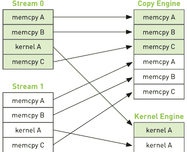

图 10.2 CUDA 流到 GPU 引擎的映射

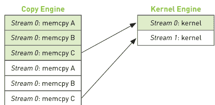

图 10.3 描绘示例中 cudaMemcpyAsync() 调用对内核执行依赖关系的箭头（示例来自第 10.4 节：使用多个 CUDA 流）

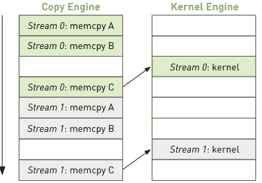

图 10.4 示例的执行时间线（示例来自第 10.4 节：使用多个 CUDA 流）

这个故事的寓意是，作为程序员，我们需要在确保独立流实际并行执行方面提供帮助。牢记硬件具有处理内存拷贝和内核执行的独立引擎，我们需要意识到，我们在流中入队这些操作的顺序会影响 CUDA 驱动程序调度这些操作执行的方式。在下一节中，我们将看到如何帮助硬件实现内存拷贝和内核执行的重叠。

## 10.7 有效使用多个 CUDA 流

如前一节所示，如果我们一次性安排某个特定流的所有操作，很容易无意中阻塞另一个流的拷贝或内核执行。为了缓解这个问题，只需在流之间广度优先而非深度优先地入队我们的操作即可。也就是说，与其在开始在流 1 上调度之前，将 a 的拷贝、b 的拷贝、内核执行和 c 的拷贝都添加到流 0，不如在流之间来回切换分配工作。我们将 a 的拷贝添加到流 0，然后将 a 的拷贝添加到流 1。然后将 b 的拷贝添加到流 0，然后将 b 的拷贝添加到流 1。我们在流 0 中入队内核调用，然后在流 1 中入队一个。最后，我们在流 0 中入队 c 回主机的拷贝，随后是流 1 中的 c 的拷贝。

为了使这一点更具体，让我们来看看代码。我们所做的全部更改是将操作分配给我们两个流的顺序，因此这将纯粹是一个复制粘贴优化。应用程序中的其他所有内容都将保持不变，这意味着我们的改进局限于 For () 循环。对两个流的新广度优先分配如下：

```
for (int i=0; i<FULL_DATA_SIZE; i+=N*2) {
    // enqueue copies of a in stream0 and stream1
    HANDLE_ERROR( cudaMemcpyAsync( dev_a0, host_a+i,
        N * sizeof(int),
        cudaMemcpyHostToDevice,
        stream0 ) );
    HANDLE_ERROR( cudaMemcpyAsync( dev_a1, host_a+i+N,
        N * sizeof(int),
        cudaMemcpyHostToDevice,
        stream1 ) );
    // enqueue copies of b in stream0 and stream1
    HANDLE_ERROR( cudaMemcpyAsync( dev_b0, host_b+i,
        N * sizeof(int),
        cudaMemcpyHostToDevice,
        stream0 ) );
    HANDLE_ERROR( cudaMemcpyAsync( dev_b1, host_b+i+N,
        N * sizeof(int),
        cudaMemcpyHostToDevice,
        stream1 ) );
    // enqueue kernels in stream0 and stream1
    kernel<<<N/256,256,0,stream0>>>( dev_a0, dev_b0, dev_c0 );
    kernel<<<N/256,256,0,stream1>>>( dev_a1, dev_b1, dev_c1 );
}
```

```
// enqueue copies of c from device to locked memory
HANDLE_ERROR( cudaMemcpyAsync( host_c_i, dev_c0,
    N * sizeof(int),
    cudaMemcpyDeviceToHost,
    stream0 ) );
HANDLE_ERROR( cudaMemcpyAsync( host_c_i+N, dev_c1,
    N * sizeof(int),
    cudaMemcpyDeviceToHost,
    stream1 ) );
}
```

如果我们假设内存拷贝和内核执行的执行时间大致可比，我们的新执行时间线将如图 10.5 所示。引擎间依赖关系通过箭头突出显示，以说明在新的调度顺序下它们仍然得到满足。

由于我们已在流之间广度优先地入队操作，流 0 的 c 拷贝不再阻塞流 1 对 a 和 b 的初始内存拷贝。这使 GPU 能够并行执行拷贝和内核，从而让我们的应用程序运行速度快得多。新代码运行时间为 48ms，比我们最初的天真双流实现提高了 21%。对于可以重叠几乎所有计算和内存拷贝的应用程序，您可以接近近乎两倍的性能提升，因为拷贝和内核引擎将始终在运行。

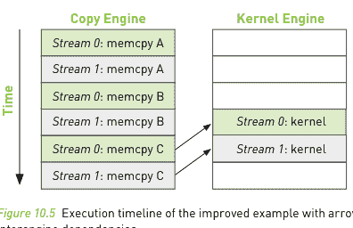

## 10.8 章节回顾

在本章中，我们探讨了一种在 CUDA C 应用程序中实现一种任务级并行性的方法。通过使用两个（或多个）CUDA 流，我们可以允许 GPU 在执行主机与 GPU 之间的拷贝的同时同时执行内核。不过，在努力做到这一点时，我们需要注意两件事。首先，涉及的主机内存需要使用 `cudaHostAlloc()` 分配，因为我们将使用 `cudaMemcpyAsync()` 入队内存拷贝，并且异步拷贝需要使用固定缓冲区执行。其次，我们需要意识到，我们将操作添加到流中的顺序会影响我们实现拷贝和内核执行重叠的能力。一般准则涉及将工作以广度优先或轮询方式分配给您打算使用的流。如果您不了解硬件排队的工作原理，这可能反直觉，因此在编写自己的应用程序时牢记这一点是件好事。

本页故意留空

# 第 11 章

# 多 GPU 上的 CUDA C

有一句老话大致是这样说的：“在 GPU 上计算唯一更好的事情就是在两个 GPU 上计算。”包含多个图形处理器的系统近年来变得越来越常见。当然，在某些方面，多 GPU 系统与多 CPU 系统相似，因为它们仍远非常见的系统配置，但让您的系统中拥有多个 GPU 已经变得相当容易。例如，GeForce GTX 295 等产品在单张卡上包含两个 GPU。NVIDIA 的 Tesla S1070 包含整整四个 CUDA 兼容的图形处理器。围绕最近 NVIDIA 芯片组构建的系统将在主板上集成一个 CUDA 兼容的 GPU。在 PCI Express 插槽中添加一个独立的 NVIDIA GPU 将使该系统成为多 GPU 系统。这两种情况都并不牵强，因此我们最好学会如何利用带有多个 GPU 的系统的资源。

## 11.1 章节目标

在本章过程中，您将完成以下任务：

- 您将学习如何分配和使用零拷贝内存。
- 您将学习如何在同一应用程序中使用多个 GPU。
- 您将学习如何分配和使用可移植的固定内存。

## 11.2 零拷贝主机内存

在第 10 章中，我们研究了固定或页锁定内存，这是一种新型的主机内存，附带保证缓冲区永远不会被交换出物理内存。如果您记得，我们通过调用 cudaHostAlloc() 并传递 cudaHostAllocDefault 来分配这种内存，以获取默认的固定内存。我们承诺在下一章中，您将看到分配固定内存的其他更令人兴奋的方法。假设这是您继续阅读的唯一原因，您会很高兴地知道等待已经结束。可以传递标志 cudaHostAllocMapped 来代替 cudaHostAllocDefault。使用 cudaHostAllocMapped 分配的主机内存以与使用 cudaHostAllocDefault 分配的内存相同的意义被固定，具体来说，它不能被分页出或在物理内存中重新定位。但是，除了从主机使用这种内存进行与 GPU 之间的内存拷贝之外，这种新型主机内存允许我们违反我们在第 3 章中关于主机内存提出的第一条规则之一：我们可以直接从 CUDA C 内核中访问此主机内存。由于此内存不需要与 GPU 之间进行拷贝，我们将其称为零拷贝内存。

### 11.2.1 零拷贝点积

通常，我们的 GPU 仅访问 GPU 内存，而我们的 CPU 仅访问主机内存。但在某些情况下，打破这些规则更好。为了看到 GPU 操作主机内存更好的一个实例，我们将重新审视我们最喜欢的归约：向量点积。如果您读完了整本书，您可能记得我们第一次尝试点积。我们将两个输入向量复制到 GPU，执行计算，将中间结果复制回主机，并在 CPU 上完成计算。


在此版本中，我们将跳过将输入显式复制到 GPU 的步骤，而是使用零拷贝内存直接从 GPU 访问数据。此版本的点积将与我们的固定内存测试完全相同的方式设置。具体来说，我们将编写两个函数；一个将使用标准主机内存执行测试，另一个将使用零拷贝内存来保存输入和输出缓冲区，在 GPU 上完成归约。首先让我们看看点积的标准主机内存版本。我们以常规方式开始，创建计时事件，分配输入和输出缓冲区，并用数据填充我们的输入缓冲区。

```c
float malloc_test( int size ) {
    cudaEvent_t     start, stop;
    float           *a, *b, *partial_c;
    float           *dev_a, *dev_b, *dev_partial_c;
    float           elapsedTime;

    HANDLE_ERROR( cudaEventCreate( &start ) );
    HANDLE_ERROR( cudaEventCreate( &stop ) );

    // allocate memory on the CPU side
    a = (float*)malloc( size*sizeof( float ) );
    b = (float*)malloc( size*sizeof( float ) );
    partial_c = (float*)malloc( blocksPerGrid*sizeof( float ) );

    // allocate the memory on the GPU
    HANDLE_ERROR( cudaMalloc( (void**)&dev_a,
                              size*sizeof( float ) ) );
    HANDLE_ERROR( cudaMalloc( (void**)&dev_b,
                              size*sizeof( float ) ) );
    HANDLE_ERROR( cudaMalloc( (void**)&dev_partial_c,
                              blocksPerGrid*sizeof( float ) ) );

    // fill in the host memory with data
    for (int i=0; i<size; i++) {
        a[i] = i;
        b[i] = i*2;
    }
```

分配内存并创建数据后，我们可以开始计算。我们启动计时器，将输入复制到 GPU，执行点积内核，并将部分结果复制回主机。

```c
HANDLE_ERROR ( cudaEventRecord( start, 0 ) );

// copy the arrays 'a' and 'b' to the GPU
HANDLE_ERROR ( cudaMemcpy( dev_a, a, size*sizeof( float ),
                           cudaMemcpyHostToDevice ) );
HANDLE_ERROR ( cudaMemcpy( dev_b, b, size*sizeof( float ),
                           cudaMemcpyHostToDevice ) );

dot<<<blocksPerGrid,threadsPerBlock>>> ( size, dev_a, dev_b,
                                         dev_partial_c );

// copy the array 'c' back from the GPU to the CPU
HANDLE_ERROR ( cudaMemcpy( partial_c, dev_partial_c,
                           blocksPerGrid*sizeof( float ),
                           cudaMemcpyDeviceToHost ) );
```

现在我们需要像在第 5 章中所做的那样，在 CPU 上完成计算。在这样做之前，我们将停止事件计时器，因为它只测量在 GPU 上执行的工作：

```c
HANDLE_ERROR ( cudaEventRecord( stop, 0 ) );
HANDLE_ERROR ( cudaEventSynchronize( stop ) );
HANDLE_ERROR ( cudaEventElapsedTime( &elapsedTime,
                                     start, stop ) );
```

最后，我们对部分结果求和，并释放我们的输入和输出缓冲区。

```c
// finish up on the CPU side
c = 0;
for (int i=0; i<blocksPerGrid; i++) {
    c += partial_c[i];
}
```

```c
HANDLE_ERROR( cudaFree( dev_a ) );
HANDLE_ERROR( cudaFree( dev_b ) );
HANDLE_ERROR( cudaFree( dev_partial_c ) );

// free memory on the CPU side
free( a );
free( b );
free( partial_c );

// free events
HANDLE_ERROR( cudaEventDestroy( start ) );
HANDLE_ERROR( cudaEventDestroy( stop ) );

printf( "Value calculated: %f\n", c );

return elapsedTime;
}
```

使用零拷贝内存的版本将非常相似，除了内存分配之外。因此，我们首先分配输入和输出，像以前一样用数据填充输入内存：

```c
float cuda_host_alloc_test( int size ) {
    cudaEvent_t     start, stop;
    float           *a, *b, c, *partial_c;
    float           *dev_a, *dev_b, *dev_partial_c;
    float           elapsedTime;

    HANDLE_ERROR( cudaEventCreate( &start ) );
    HANDLE_ERROR( cudaEventCreate( &stop ) );

    // allocate the memory on the CPU
    HANDLE_ERROR( cudaHostAlloc( (void**)&a,
                                 size*sizeof(float),
                                 cudaHostAllocWriteCombined |
                                 cudaHostAllocMapped ) );
```

```c
HANDLE_ERROR( cudaHostAlloc( (void**)&b,
                                      size*sizeof(float),
                                      cudaHostAllocWriteCombined |
                                      cudaHostAllocMapped ) );
HANDLE_ERROR( cudaHostAlloc( (void**)&partial_c,
                                      blocksPerGrid*sizeof(float),
                                      cudaHostAllocMapped ) );

// fill in the host memory with data
for (int i=0; i<size; i++) {
    a[i] = i;
    b[i] = i*2;
}
```

与第 10 章一样，我们再次看到 cudaHostAlloc() 的运作，尽管我们现在使用 flags 参数来指定不仅仅是默认行为。标志 cudaHostAllocMapped 告诉运行时我们打算从 GPU 访问此缓冲区。换句话说，这个标志就是使我们的缓冲区成为零拷贝的原因。对于两个输入缓冲区，我们指定标志 cudaHostAllocWriteCombined。该标志表示运行时将缓冲区分配为相对于 CPU 缓存的写合并模式。该标志不会改变我们应用程序的功能，但对于仅由 GPU 读取的缓冲区来说，它代表了重要的性能增强。然而，在 CPU 也需要从缓冲区执行读取的场景中，写合并内存可能效率极低，因此在做出此决定时，您需要考虑应用程序可能的访问模式。

由于我们使用标志 cudaHostAllocMapped 分配了主机内存，因此缓冲区可以从 GPU 访问。然而，GPU 具有与 CPU 不同的虚拟内存空间，因此缓冲区在 GPU 上访问时与在 CPU 上访问时会有不同的地址。对 cudaHostAlloc() 的调用返回内存的 CPU 指针，因此我们需要调用 cudaHostGetDevicePointer() 来获取内存的有效 GPU 指针。这些指针将传递给内核，然后由 GPU 用于从我们的主机分配中读取和写入：

```c
HANDLE_ERROR( cudaHostGetDevicePointer( &dev_a, a, 0 ) );
HANDLE_ERROR( cudaHostGetDevicePointer( &dev_b, b, 0 ) );
HANDLE_ERROR( cudaHostGetDevicePointer( &dev_partial_c,
                                        partial_c, 0 ) );
```

拿到有效的设备指针后，我们准备好启动计时器并启动内核。

```c
HANDLE_ERROR( cudaEventRecord( start, 0 ) );

dot<<<blocksPerGrid,threadsPerBlock>>>( size, dev_a, dev_b,
                                        dev_partial_c );
HANDLE_ERROR( cudaThreadSynchronize() );
```

尽管指针 dev_a、dev_b 和 dev_partial_c 都位于主机上，但由于我们调用了 cudaHostGetDevicePointer()，它们在我们的内核看来就像是 GPU 内存。由于我们的部分结果已经在主机上，我们不需要费心从设备进行 cudaMemcpy()。然而，您会注意到我们通过调用 cudaThreadSynchronize() 将 CPU 与 GPU 同步。在可能更改其内容的内核执行期间，零拷贝内存的内容是未定义的。同步后，我们确定内核已完成并且我们的零拷贝缓冲区包含结果，因此我们可以停止计时器并像以前一样在 CPU 上完成计算。

```c
HANDLE_ERROR( cudaEventRecord( stop, 0 ) );
HANDLE_ERROR( cudaEventSynchronize( stop ) );
HANDLE_ERROR( cudaEventElapsedTime( &elapsedTime,
                                    start, stop ) );

// finish up on the CPU side
c = 0;
for (int i=0; i<blocksPerGrid; i++) {
    c += partial_c[i];
}
```

点积的 cudaHostAlloc() 版本中剩下的唯一事情是清理。

```c
HANDLE_ERROR( cudaFreeHost( a ) );
HANDLE_ERROR( cudaFreeHost( b ) );
HANDLE_ERROR( cudaFreeHost( partial_c ) );

// free events
HANDLE_ERROR( cudaEventDestroy( start ) );
HANDLE_ERROR( cudaEventDestroy( stop ) );

printf( "Value calculated: %f\n", c );

return elapsedTime;
}
```

您会注意到，无论我们对 cudaHostAlloc() 使用什么标志，内存始终以相同的方式释放。具体来说，调用 cudaFreeHost() 即可解决问题。

这就完成了！剩下要做的就是看看 main() 如何将所有这些连接在一起。我们需要检查的第一件事是我们的设备是否支持映射主机内存。我们以与前一章检查设备重叠相同的方式执行此操作，即调用 cudaGetDeviceProperties()。

```c
int main( void ) {
cudaDeviceProp prop;
int whichDevice;
HANDLE_ERROR( cudaGetDevice( &whichDevice ) );
HANDLE_ERROR( cudaGetDeviceProperties( &prop, whichDevice ) );
if ( prop.canMapHostMemory != 1 ) {
printf( "Device cannot map memory.\n" );
return 0;
}
}
```


假设我们的设备支持零拷贝内存，我们将运行时置于一种状态，使其能够为我们分配零拷贝缓冲区。我们通过调用 cudaSetDeviceFlags() 并传递标志 cudaDeviceMapHost 来实现这一点，以指示我们希望设备被允许映射主机内存：

```
HANDLE_ERROR( cudaSetDeviceFlags( cudaDeviceMapHost ) );
```

main() 里面其实就这些。我们运行两个测试，显示耗时，然后退出应用程序：

```
float elapsedTime = malloc_test( N );
printf( "Time using cudaMalloc: %3.1f ms\n",
        elapsedTime );

elapsedTime = cuda_host_alloc_test( N );
printf( "Time using cudaHostAlloc: %3.1f ms\n",
        elapsedTime );
}
```

核心函数本身与第 5 章中保持不变，但为了完整起见，以下是其完整代码：

```
#define imin(a,b) (a<b?a:b)

const int N = 33 * 1024 * 1024;
const int threadsPerBlock = 256;
const int blocksPerGrid =
    imin( 32, (N+threadsPerBlock-1) / threadsPerBlock );

__global__ void dot( int size, float *a, float *b, float *c ) {
    __shared__ float cache[threadsPerBlock];
    int tid = threadIdx.x + blockIdx.x * blockDim.x;
    int cacheIndex = threadIdx.x;

float temp = 0;
while (tid < size) {
    temp += a[tid] * b[tid];
    tid += blockDim.x * gridDim.x;
}

// set the cache values
cache[cacheIndex] = temp;

// synchronize threads in this block
__syncthreads();

// for reductions, threadsPerBlock must be a power of 2
// because of the following code
int i = blockDim.x/2;
while (i != 0) {
    if (cacheIndex < i)
        cache[cacheIndex] += cache[cacheIndex + i];
    __syncthreads();
    i /= 2;
}

if (cacheIndex == 0)
    c[blockIdx.x] = cache[0];
}
```

### 11.2.2 零拷贝性能

使用零拷贝内存我们能期望获得什么收益？这个问题的答案对于离散 GPU 和集成 GPU 是不同的。离散 GPU 是拥有自己专用 DRAM 的图形处理器，通常位于与 CPU 分开的电路板上。例如，如果你曾经将显卡安装到台式机中，那么这个 GPU 就是离散 GPU。集成 GPU 是内置于系统芯片组中的图形处理器，通常与 CPU 共享常规系统内存。许多使用 NVIDIA 的 nForce 媒体和通信处理器 [MCPs] 构建的最新系统包含支持 CUDA 的集成 GPU。除了 nForce MCP 之外，所有基于 NVIDIA 新 ION 平台的上网本、笔记本和台式机都包含集成的、支持 CUDA 的 GPU。对于集成 GPU，使用零拷贝内存总是能带来性能提升，因为内存无论如何都与主机在物理上共享。将缓冲区声明为零拷贝的唯一效果是防止不必要的数据拷贝。但请记住，没有免费的午餐，零拷贝缓冲区仍然受到与所有固定内存分配相同的限制：每个固定分配都会占用系统可用的物理内存，最终会降低系统性能。

在输入和输出仅被使用一次的情况下，即使在离散 GPU 上使用零拷贝内存，我们也会看到性能提升。由于 GPU 旨在擅长隐藏与内存访问相关的延迟，通过 PCI Express 总线进行读写操作可以在某种程度上通过此机制来缓解，从而获得明显的性能优势。但是，由于零拷贝内存未在 GPU 上缓存，在内存被多次读取的情况下，我们将付出巨大的代价，而这本可以通过先将数据拷贝到 GPU 来避免。

你如何判断 GPU 是集成的还是离散的？嗯，你可以打开电脑查看，但这个方案对你的 CUDA C 应用程序来说相当不可行。你的代码可以通过查看 `cudaGetDeviceProperties()` 返回的结构体来检查 GPU 的这一属性，这并不奇怪。该结构体有一个名为 `integrated` 的字段，如果设备是集成 GPU，则该字段为 `true`，否则为 `false`。

由于我们的点积应用程序满足“读取和/或写入恰好一次”的约束，因此在使用零拷贝内存运行时，它可能会获得性能提升。事实上，它确实获得了轻微的性能提升。在 GeForce GTX 285 上，执行时间提高了 45% 以上，迁移到零拷贝内存后从 98.1ms 降至 52.1ms。GeForce GTX 280 也获得了类似的改进，速度提升了 34%，从 143.9 ms 提高到 94.7ms。当然，不同的 GPU 会表现出不同的性能特征，原因在于计算与带宽的比率各不相同，以及不同芯片组中有效的 PCI Express 带宽存在差异。

## 11.3 使用多个 GPU

在上一节中，我们提到设备要么是集成 GPU，要么是离散 GPU，前者内置于系统的芯片组中，后者通常是 PCI Express 插槽中的扩展卡。越来越多的系统同时包含集成 GPU 和离散 GPU，这意味着它们也拥有多个支持 CUDA 的处理器。NVIDIA 还销售包含多个 GPU 的产品，例如 GeForce GTX 295。GeForce GTX 295 虽然在物理上只占用一个扩展插槽，但对你的 CUDA 应用程序而言，它会显示为两个独立的 GPU。此外，用户还可以将多个 GPU 添加到不同的 PCI Express 插槽中，并使用 NVIDIA 的可扩展链接接口 (SLI) 技术通过桥接器将它们连接起来。由于这些趋势，在拥有多个图形处理器的系统上运行 CUDA 应用程序变得相对常见。由于我们的 CUDA 应用程序本身就具有很高的可并行性，如果能够使用系统中的每个 CUDA 设备来实现最大吞吐量，那将是非常理想的。那么，让我们来看看如何实现这一点。

为了避免学习新示例，让我们将点积转换为使用多个 GPU。为了简化我们的工作，我们将计算点积所需的所有数据汇总到一个结构体中。你马上就会明白这究竟为什么能简化我们的工作。

```c
struct DataStruct {
    int    deviceID;
    int    size;
    float  *a;
    float  *b;
    float  returnValue;
};
```

该结构体包含将在其上计算点积的设备的标识；它包含输入缓冲区的大小以及指向两个输入 a 和 b 的指针。最后，它有一个条目用于存储作为 a 和 b 的点积计算出的值。

要使用 N 个 GPU，我们首先想知道确切的 N 是多少。因此，我们通过调用 cudaGetDeviceCount() 来启动应用程序，以确定系统中安装了多少个支持 CUDA 的处理器。

```
int main( void ) {
  int deviceCount;
  HANDLE_ERROR( cudaGetDeviceCount( &deviceCount ) );
  if (deviceCount < 2) {
    printf( "We need at least two compute 1.0 or greater "
            "devices, but only found %d\n", deviceCount );
    return 0;
  }
}
```

此示例旨在展示多 GPU 用法，因此你会注意到，如果系统只有一个 CUDA 设备，我们会直接退出（当然，这本身并没有什么问题）。出于显而易见的原因，这不被鼓励作为最佳实践。为了尽可能保持简单，我们将为输入分配标准主机内存，并像过去一样用数据填充它们。

```
float *a = (float*)malloc( sizeof(float) * N );
HANDLE_NULL( a );
float *b = (float*)malloc( sizeof(float) * N );
HANDLE_NULL( b );

// fill in the host memory with data
for (int i=0; i<N; i++) {
  a[i] = i;
  b[i] = i*2;
}
```

我们现在准备深入多 GPU 代码。使用 CUDA 运行时 API 使用多个 GPU 的诀窍在于意识到每个 GPU 都需要由不同的 CPU 线程控制。由于我们之前只使用过单个 GPU，因此不需要担心这个问题。我们已经将多线程代码的许多麻烦转移到了辅助代码文件 book.h 中。有了这段代码，我们所需要做的就是用执行所需的数据填充一个结构体。


计算。尽管系统可能有多个 GPU（数量大于一），但为了清晰起见，我们将只使用其中两个：

```
DataStruct data[2];

data[0].deviceID = 0;
data[0].size = N/2;
data[0].a = a;
data[0].b = b;

data[1].deviceID = 1;
data[1].size = N/2;
data[1].a = a + N/2;
data[1].b = b + N/2;
```

要继续，我们将其中一个 DataStruct 变量传递给我们命名为 start_thread() 的实用函数。我们还将一个函数指针传递给 start_thread()，该指针指向由新创建的线程调用的函数；此示例的线程函数称为 routine()。函数 start_thread() 将创建一个新线程，然后调用指定的函数，并将 DataStruct 传递给该函数。routine() 的另一次调用是从默认应用程序线程进行的 [因此我们只创建了一个额外的线程]。

```
CUTThread thread = start_thread( routine, &(data[0]) );
routine( &(data[1]) );
```

在继续之前，我们让主应用程序线程通过调用 end_thread() 等待另一个线程完成。

```
end_thread( thread );
```

由于在 main() 此时两个线程都已完成，因此可以安全地清理并显示结果。

```
free( a );
free( b );

printf( "Value calculated: %f\n",
       data[0].returnValue + data[1].returnValue );

return 0;
}
```

请注意，我们对每个线程计算的结果求和。这是我们点积归约的最后一步。在另一种算法中，多个结果的组合可能涉及其他步骤。事实上，在某些应用程序中，两个 GPU 可能在完全不同的数据集上执行完全不同的代码。为了简单起见，在我们的点积示例中并非如此。

由于点积例程与您见过的其他版本相同，我们将在本节中省略它。但是，`routine()` 的内容可能值得关注。我们将 `routine()` 声明为接受并返回 `void*`，以便您可以将 `start_thread()` 代码与线程函数的任意实现一起重用。虽然我们很想为这个想法争取功劳，但在 C 中，这对回调函数来说是相当标准的做法：

```
void* routine( void *pvoidData ) {
    DataStruct *data = (DataStruct*)pvoidData;
    HANDLE_ERROR( cudaSetDevice( data->deviceID ) );
}
```

每个线程调用 `cudaSetDevice()`，并向该函数传递不同的 ID。因此，我们知道每个线程将操作不同的 GPU。这些 GPU 可能具有相同的性能，例如双 GPU GeForce GTX 295，也可能是不同的 GPU，就像系统同时拥有集成 GPU 和独立 GPU 的情况一样。这些细节对我们的应用程序并不重要，尽管它们可能对您有用。特别是，如果您依赖某个最低计算能力来启动内核，或者希望在系统的 GPU 之间对应用程序进行负载均衡，这些细节将证明很有用。如果 GPU 不同，您需要做一些工作来划分计算，以便每个 GPU 大致占用相同的时间。然而，为了本示例的目的，这些都是我们不必担心的微不足道的细节。

除了调用 cudaSetDevice() 以指定我们打算使用的 CUDA 设备之外，routine() 的此实现与第 11.11.1 节“零拷贝点积”中的普通 malloc_test() 非常相似。我们为输入的 GPU 副本分配缓冲区，并为部分结果分配一个缓冲区，然后通过 cudaMemcpy() 将每个输入数组复制到 GPU。

```
int       size = data->size;
float     *a, *b, c, *partial_c;
float     *dev_a, *dev_b, *dev_partial_c;

// allocate memory on the CPU side
a = data->a;
b = data->b;
partial_c = (float*)malloc( blocksPerGrid*sizeof(float) );

// allocate the memory on the GPU
HANDLE_ERROR( cudaMalloc( (void**)&dev_a,
                          size*sizeof(float) ) );
HANDLE_ERROR( cudaMalloc( (void**)&dev_b,
                          size*sizeof(float) ) );
HANDLE_ERROR( cudaMalloc( (void**)&dev_partial_c,
                          blocksPerGrid*sizeof(float) ) );

// copy the arrays 'a' and 'b' to the GPU
HANDLE_ERROR( cudaMemcpy( dev_a, a, size*sizeof(float),
                          cudaMemcpyHostToDevice ) );
HANDLE_ERROR( cudaMemcpy( dev_b, b, size*sizeof(float),
                          cudaMemcpyHostToDevice ) );
```

然后我们启动点积内核，将结果复制回，并在 CPU 上完成计算。

```
dot<<<blocksPerGrid, threadsPerBlock>>>( size, dev_a, dev_b,
    dev_partial_c );

// copy the array 'c' back from the GPU to the CPU
HANDLE_ERROR( cudaMemcpy( partial_c, dev_partial_c,
    blocksPerGrid*sizeof( float ),
    cudaMemcpyDeviceToHost ) );

// finish up on the CPU side
c = 0;
for (int i=0; i<blocksPerGrid; i++) {
    c += partial_c[i];
}
```

与往常一样，我们清理 GPU 缓冲区，并将计算出的点积返回到 DataStruct 的 returnValue 字段中。

```
HANDLE_ERROR( cudaFree( dev_a ) );
HANDLE_ERROR( cudaFree( dev_b ) );
HANDLE_ERROR( cudaFree( dev_partial_c ) );

// free memory on the CPU side
free( partial_c );

data->returnValue = c;
return 0;
}
```

归根结底，除了主机线程管理问题之外，使用多个 GPU 并不比使用单个 GPU 困难太多。使用我们的辅助代码来创建线程并在该线程上执行函数，这变得容易管理得多。如果您有自己的线程库，应该随时在自己的应用程序中使用它们。您只需要记住，每个 GPU 都有自己的线程，其他一切都是小菜一碟。

## 11.4 可移植锁页内存

使用多个 GPU 的最后一个重要部分涉及使用锁页内存。我们在第 10 章中了解到，锁页内存实际上是将其页面锁定在物理内存中的主机内存，以防止其被分页出去或重新分配。然而，事实证明，页面只能对单个 CPU 线程显示为锁定。也就是说，如果任何线程将其分配为锁页内存，它们将保持页面锁定状态，但只会对分配它们的线程显示为页面锁定。如果此内存的指针在线程之间共享，其他线程会将缓冲区视为标准的可分页数据。

这种行为的副作用是，当未分配锁页缓冲区的线程尝试使用它执行 cudaMemcpy() 时，复制将以标准可分页内存速度进行。如在第 10 章中所见，这种速度大约只能达到最大可实现传输速度的 50%。更糟糕的是，如果该线程尝试将 cudaMemcpyAsync() 调用入队到 CUDA 流中，该操作将失败，因为它需要锁页缓冲区才能继续。由于缓冲区对未分配它的线程来说显示为可分页，该调用将惨遭失败。即使在未来也无法工作！

但有办法解决这个问题。我们可以将锁页内存分配为可移植的，这意味着我们将被允许在主机线程之间迁移它，并允许任何线程将其视为锁页缓冲区。为此，我们使用可靠的 cudaHostAlloc() 来分配内存，但使用新标志调用它：cudaHostAllocPortable。此标志可以与您见过的其他标志一起使用，例如 cudaHostAllocWriteCombined 和 cudaHostAllocMapped。这意味着您可以将主机缓冲区分配为可移植、零拷贝和写组合的任意组合。

为了演示可移植锁页内存，我们将增强我们的多 GPU 点积应用程序。我们将改编我们最初的零拷贝点积版本，因此此版本一开始就是零拷贝和多 GPU 版本的某种混合。与本章一贯的做法一样，我们需要验证至少有两个 CUDA 兼容 GPU，并且两者都能处理零拷贝缓冲区。

```
int main( void ) {
    int deviceCount;
    HANDLE_ERROR( cudaGetDeviceCount( &deviceCount ) );
    if (deviceCount < 2) {
        printf( "We need at least two compute 1.0 or greater "
                "devices, but only found %d\n", deviceCount );
        return 0;
    }

    cudaDeviceProp prop;
    for (int i=0; i<2; i++) {
        HANDLE_ERROR( cudaGetDeviceProperties( &prop, i ) );
        if (prop.canMapHostMemory != 1) {
            printf( "Device %d cannot map memory.\n", i );
            return 0;
        }
    }
}
```

在之前的示例中，我们准备好开始在主机上分配内存以保存输入向量。然而，要分配可移植锁页内存，首先需要设置我们打算运行的 CUDA 设备。由于我们还打算使用该设备进行零拷贝内存，因此我们在 cudaSetDevice() 调用后跟随 cudaSetDeviceFlags() 调用，就像我们在第 11.1.1 节“零拷贝点积”中所做的那样。

```
float *a, *b;
HANDLE_ERROR( cudaSetDevice( 0 ) );
HANDLE_ERROR( cudaSetDeviceFlags( cudaDeviceMapHost ) );
HANDLE_ERROR( cudaHostAlloc( (void**)&a, N*sizeof(float),
                             cudaHostAllocWriteCombined |
                             cudaHostAllocMapped ) );
HANDLE_ERROR( cudaHostAlloc( (void**)&b, N*sizeof(float),
                             cudaHostAllocWriteCombined |
                             cudaHostAllocPortable |
                             cudaHostAllocMapped ) );
```


本章前面，我们调用了 `cudaSetDevice()`，但那时我们已经分配了内存并创建了线程。不过，使用 `cudaHostAlloc()` 分配页锁定内存的要求之一是，我们必须先通过调用 `cudaSetDevice()` 初始化设备。你还会注意到，我们将新学到的标志 `cudaHostAllocPortable` 传递给了两次分配。由于这些内存在调用 `cudaSetDevice(0)` 之后分配，如果我们没有指定它们是可移植分配，那么只有 CUDA 设备零会将这些缓冲区视为固定内存。

我们继续像过去一样开发应用程序，为输入向量生成数据并准备 DataStruct 结构体，就像我们在第 11.2 节“零拷贝性能”的多 GPU 示例中所做的那样。

```
// fill in the host memory with data
for (int i=0; i<N; i++) {
    a[i] = i;
    b[i] = i*2;
}

// prepare for multithread
DataStruct data[2];
data[0].deviceID = 0;
data[0].offset = 0;
data[0].size = N/2;
data[0].a = a;
data[0].b = b;

data[1].deviceID = 1;
data[1].offset = N/2;
data[1].size = N/2;
data[1].a = a;
data[1].b = b;
```

然后我们可以创建辅助线程并调用 `routine()` 在每个设备上开始计算。

```
CUTThread thread = start_thread( routine, &(data[1]) );
routine( &(data[0]) );
end_thread( thread );
```

由于我们的主机内存是由 CUDA 运行时分配的，我们使用 cudaFreeHost() 来释放它。除了不再调用 free() 之外，我们在 main() 中看到的就是全部了。

```
// free memory on the CPU side
HANDLE_ERROR( cudaFreeHost( a ) );
HANDLE_ERROR( cudaFreeHost( b ) );

printf( "Value calculated: %f\n",
        data[0].returnValue + data[1].returnValue );

return 0;
}
```

为了在多 GPU 应用程序中支持可移植固定内存和零拷贝内存，我们需要对 routine() 的代码做两处显著更改。第一处有些微妙，绝不应该显而易见。

```
void* routine( void* pvoidData ) {
    DataStruct *data = (DataStruct*)pvoidData;

    if (data->deviceID != 0) {
        HANDLE_ERROR( cudaSetDevice( data->deviceID ) );
        HANDLE_ERROR( cudaSetDeviceFlags( cudaDeviceMapHost ) );
    }
}
```

你可能记得，在本代码的多 GPU 版本中，我们需要在 routine() 中调用 cudaSetDevice()，以确保每个参与的线程控制不同的 GPU。另一方面，在本示例中，我们已经从主线程调用了 cudaSetDevice()。这样做是为了在 main() 中分配固定内存。因此，我们只希望在尚未进行此调用的设备上调用 cudaSetDevice() 和 cudaSetDeviceFlags()。也就是说，如果 deviceID 不为零，我们就调用这两个函数。虽然在设备零上简单地重复这些调用会产生更简洁的代码，但事实证明这实际上是一个错误。一旦你在特定线程上设置了设备，就不能再次调用 cudaSetDevice()，即使传递相同的设备标识符。高亮显示的 if() 语句帮助我们避免 CUDA 运行时的这个小陷阱，因此我们继续对 routine() 进行下一个重要更改。

除了为主机端内存使用可移植固定内存外，我们还使用零拷贝来直接从 GPU 访问这些缓冲区。因此，我们不再像在原始多 GPU 应用程序中那样使用 cudaMemcpy()，而是使用 cudaHostGetDevicePointer() 为主机内存获取有效的设备指针，就像我们在零拷贝示例中所做的那样。不过，你会注意到，我们为部分结果使用标准 GPU 内存。一如既往，此内存是使用 cudaMalloc() 分配的。

```
int size = data->size;
float *a, *b, c, *partial_c;
float *dev_a, *dev_b, *dev_partial_c;

// allocate memory on the CPU side
a = data->a;
b = data->b;
partial_c = (float*)malloc( blocksPerGrid*sizeof(float) );

HANDLE_ERROR( cudaHostGetDevicePointer( &dev_a, a, 0 ) );
HANDLE_ERROR( cudaHostGetDevicePointer( &dev_b, b, 0 ) );
HANDLE_ERROR( cudaMalloc( (void**)&dev_partial_c,
blocksPerGrid*sizeof(float) ) );

// offset 'a' and 'b' to where this GPU is gets it data
dev_a += data->offset;
dev_b += data->offset;
```

到这一点，我们基本上已经准备就绪，因此我们启动内核并将结果从 GPU 复制回来。

```
dot<<<blocksPerGrid,threadsPerBlock>>>( size, dev_a, dev_b,
    dev_partial_c );
// copy the array 'c' back from the GPU to the CPU
HANDLE_ERROR( cudaMemcpy( partial_c, dev_partial_c,
    blocksPerGrid*sizeof(float),
    cudaMemcpyDeviceToHost) );
```

我们一如既往地在点积示例中结束：在 CPU 上汇总部分结果，释放临时存储，然后返回 main()。

```
// finish up on the CPU side
c = 0;
for ( int i=0; i<blocksPerGrid; i++ ) {
    c += partial_c[i];
}

HANDLE_ERROR( cudaFree( dev_partial_c ) );

// free memory on the CPU side
free( partial_c );

data->returnValue = c;
return 0;
}
```

## 11.5 章节回顾

我们已经了解了一些新的主机内存分配类型，它们都通过单次调用 cudaHostAlloc() 来分配。使用这一入口点和一组参数标志的组合，我们可以将内存分配为零拷贝、可移植和/或写合并的任意组合。我们使用零拷贝缓冲区来避免向 GPU 和从 GPU 进行显式数据复制，这一技巧可能加速广泛的应用程序类别。使用线程支持库，我们从同一应用程序中操纵多个 GPU，使我们的点积计算能够在多个设备上执行。最后，我们了解了多个 GPU 如何通过将固定内存分配为可移植固定内存来共享固定内存分配。我们的最后示例使用了可移植固定内存、多个 GPU 和零拷贝缓冲区，以展示我们在第 5 章开始摆弄的点积的加强版。随着多设备系统越来越流行，这些技术应该能帮助你充分发挥目标平台的计算能力。

# 第 12 章

# 最终倒计时

恭喜！希望你享受学习 CUDA C 并尝试 GPU 计算的过程。这是一段漫长的旅程，让我们花点时间回顾一下我们从哪里开始，以及涵盖了多少内容。从 C 或 C++ 编程背景出发，我们学习了如何使用 CUDA 运行时的尖括号语法，轻松在任意数量的多处理器上启动多个内核副本。我们扩展了这些概念，使用线程 _和_ 块的集合来处理任意大小的输入。这些更复杂的启动利用 GPU 特殊的片上共享内存进行线程间通信，并使用专用的同步原语，以确保在支持（并鼓励）成千上万并行线程的环境中正确运行。

掌握了使用 CUDA C 在 NVIDIA CUDA 架构上进行并行编程的基本概念后，我们探索了 NVIDIA 提供的一些更高级概念和 API。GPU 的专用图形硬件对 GPU 计算很有用，因此我们学习了如何利用纹理内存来加速一些常见的内存访问模式。由于许多用户将 GPU 计算添加到交互式图形应用程序中，我们探索了 CUDA C 内核与 OpenGL 和 DirectX 等行业标准图形 API 的互操作性。全局内存和共享内存上的原子操作允许安全地多线程访问常见内存位置。稳步深入更高级的主题时，流使我们能够让整个系统尽可能忙碌，允许内核与主机和 GPU 之间的内存复制同时执行。最后，我们研究了如何分配和使用零拷贝来加速集成 GPU 上的应用程序。此外，我们学习了如何初始化多个设备并分配可移植固定内存，以编写充分利用日益普遍的多 GPU 环境的 CUDA C。

## 12.1 章节目标

在本章学习过程中，你将完成以下任务：

- 你将了解一些可帮助 CUDA C 开发的工具。
- 你将了解额外的文档和代码资源，以将你的 CUDA C 开发提升到新水平。

## 12.2 CUDA 工具

在本书学习过程中，我们依赖了 CUDA C 软件系统的几个组件。我们编写的应用程序大量使用 CUDA C 编译器，将 CUDA 内核转换为可在 NVIDIA GPU 上执行的代码。我们还使用 CUDA 运行时来执行启动内核和与 GPU 通信背后的大部分设置和繁琐工作。CUDA 运行时反过来使用 CUDA 驱动程序直接与系统中的硬件通信。除了我们已经广泛使用的这些组件之外，NVIDIA 还提供了大量其他软件，以便于 CUDA C 应用程序的开发。本节并不适合作为这些产品的用户手册，而是旨在仅向你介绍这些软件包的存在和实用性。

### 12.2.1 CUDA 工具包

你几乎肯定已经在开发机上安装了 CUDA 工具包软件集。我们之所以如此确定，是因为 CUDA C 编译器工具集是该包的主要组成部分之一。如果


如果你的机器上没有安装 CUDA Toolkit，那么可以肯定你从未尝试过编写或编译任何 CUDA C 代码。我们现在盯上你了，小家伙！其实这没什么大不了的 [但这确实让我们好奇你为什么读完了整本书]。另一方面，如果你 *确实* 一直在跟随本书中的示例进行练习，那么你应该已经拥有我们即将讨论的库。

### 12.2.2 CUFFT

如果你打算在自己的应用程序中进行 GPU 计算，CUDA Toolkit 附带两个非常重要的实用库。首先，NVIDIA 提供了一个经过优化的快速傅里叶变换库，称为 *CUFFT*。从 3.0 版本开始，CUFFT 库支持许多有用的功能，包括以下内容：

- 对实数值和复数值输入数据进行一维、二维和三维变换
- 批量执行，用于并行执行多个一维变换
- 任何维度上大小范围为 2 到 16,384 的二维和三维变换
- 大小多达 800 万个元素的输入的一维变换
- 针对实数值和复数值数据的原地和非原地变换

NVIDIA 免费提供 CUFFT 库，并附带一份许可证，允许在任何应用程序中使用，无论是用于个人、学术还是专业开发。

### 12.2.3 CUBLAS

除了快速傅里叶变换库之外，NVIDIA 还提供一个线性代数例程库，实现了众所周知的基本线性代数子程序包（BLAS）。这个名为 *CUBLAS* 的库也可免费获得，并支持完整 BLAS 包的大部分子集。这包括每个例程的版本，它们接受单精度和双精度输入以及实数值和复数值数据。由于 BLAS 最初是一个用 FORTRAN 实现的线性代数例程库，NVIDIA 致力于最大限度地兼容这些实现的要求和预期。具体来说，CUBLAS 库对数组使用列优先存储布局，而不是 C 和 C++ 原生使用的行优先布局。在实践中，这通常不是问题，但它确实允许现有的 BLAS 用户以最小的努力调整其应用程序，以利用 GPU 加速的 CUBLAS。NVIDIA 还分发 CUBLAS 的 FORTRAN 绑定，以演示如何将现有的 FORTRAN 应用程序链接到 CUDA 库。

### 12.2.4 NVIDIA GPU COMPUTING SDK

可独立于 NVIDIA 驱动程序和 CUDA Toolkit 获取的可选 GPU Computing SDK 下载包含数十个示例 GPU 计算应用程序。我们在本书前面提到过这个 SDK，因为其示例是对前 11 章所涵盖材料的极好补充。但如果你还没有看过，NVIDIA 将这些示例面向不同水平的 CUDA C 熟练度，并将其分布在广泛的主题范围内。这些示例大致分为以下几个部分：

- CUDA 基础主题
- CUDA 高级主题
- CUDA 系统集成
- 数据并行算法
- 图形互操作性
- 纹理
- 性能策略
- 线性代数
- 图像/视频处理
- 计算金融
- 数据压缩
- 基于物理的仿真

这些示例适用于 CUDA C 支持的任何平台，并可以作为你自己应用程序的绝佳起点。对于在某些领域有相当经验的读者，我们警告你不要指望在 NVIDIA GPU Computing SDK 中看到你最喜欢的算法的最先进实现。这些代码示例不应被视为生产级库代码，而应被视为可运行 CUDA C 程序的教育性示例，与本书中的示例类似。

### 12.2.5 NVIDIA PERFORMANCE PRIMITIVES

除了 CUFFT 和 CUBLAS 库中提供的例程之外，NVIDIA 还维护一个用于执行 CUDA 加速数据处理的函数库，称为 NVIDIA 性能原语（NPP）。目前，NPP 的初始功能集专注于图像和视频处理，广泛适用于这些领域的开发人员。NVIDIA 打算让 NPP 随着时间发展，以应对更广泛领域中更多数量的计算任务。如果你对高性能图像或视频应用感兴趣，应该优先了解 NPP，可免费下载于 www.nvidia.com/object/npp.html [或通过你喜欢的网页搜索引擎访问]。

### 12.2.6 DEBUGGING CUDA C

我们从各种渠道听说，在极少数情况下，计算机软件在首次执行时并不完全按预期工作。有些代码计算出错误的值，有些无法终止执行，有些代码甚至会让计算机进入只有拔掉电源开关才能修复的状态。尽管本书作者显然从未亲自编写过这样的代码，但他们认识到一些软件工程师可能需要资源来调试他们的 CUDA C 内核。幸运的是，NVIDIA 提供工具，使这个痛苦的过程变得不那么麻烦。

#### CUDA-GDB

一种名为 CUDA-GDB 的工具是基于 Linux 系统开发代码的 CUDA C 程序员可用的最有用的 CUDA 下载之一。NVIDIA 扩展了开源 GNU 调试器（gdb），以透明地支持实时调试设备代码，同时保持 gdb 熟悉的界面。在 CUDA-GDB 出现之前，除了使用 CPU 模拟设备代码预期运行方式之外，没有好的调试设备代码的方法。这种方法产生了极其缓慢的调试，事实上，它经常是对内核精确 GPU 执行的非常糟糕的近似。NVIDIA 的 CUDA-GDB 使程序员能够直接在 GPU 上调试他们的内核，为他们提供了与 CPU 调试器习惯的所有控制。CUDA-GDB 的一些亮点包括以下内容：

- 查看 CUDA 状态，例如有关已安装 GPU 及其功能的信息
- 在 CUDA C 源代码中设置断点
- 检查 GPU 内存，包括所有全局内存和共享内存
- 检查当前驻留在 GPU 上的块和线程
- 单步执行一个线程束
- 中断当前运行的应用程序，包括挂起或死锁的应用程序

除了调试器之外，NVIDIA 还提供 CUDA 内存检查器，其功能可以通过 CUDA-GDB 或独立工具 cuda-memcheck 访问。由于 CUDA 架构在硬件中直接集成了复杂的内存管理单元，所有非法内存访问都将由硬件检测并阻止。作为内存违规的结果，你的程序将停止按预期运行，因此你肯定希望能够看到这些类型的错误。启用后，CUDA 内存检查器将检测你的内核尝试进行的任何全局内存违规或未对齐的全局内存访问，并以比以前可能的更有帮助、更详细的方式向你报告。

#### NVIDIA PARALLEL NSIGHT

尽管 CUDA-GDB 是一个成熟且出色的工具，可用于在硬件上实时调试 CUDA C 内核，但 NVIDIA 认识到并非每个开发者都对 Linux 情有独钟。因此，除非 Windows 用户通过攒钱开自己的宠物店来降低风险，否则他们也需要一种调试应用程序的方法。2009 年底，NVIDIA 推出了 NVIDIA Parallel Nsight（最初代号 Nexus），这是适用于 Microsoft Visual Studio 的第一个集成 GPU/CPU 调试器。与 CUDA-GDB 类似，Parallel Nsight 支持调试拥有数千个线程的 CUDA 应用程序。用户可以在 CUDA C 源代码的任何位置设置断点，包括在对任意内存位置进行写入时触发的断点。他们可以直接从 Visual Studio 内存窗口检查 GPU 内存并检查越界内存访问。截至发稿时，该工具已通过 beta 计划公开发布，最终版本将很快发布。


### 12.2.7 CUDA 可视化分析器

我们经常将 CUDA 架构宣传为高性能计算应用的绝佳基础。不幸的是，现实是，在清除应用程序中的所有错误后，即使是最出于良好动机的“高性能计算”应用程序，更准确地说也只是“计算”应用程序。我们常常会想：“我的代码为什么运行得这么糟糕？”在这种情况下，在分析工具的严密监视下执行相关内核会很有帮助。NVIDIA 提供了这样一个工具，可在 CUDA Zone 网站上单独下载。图 12.1 显示了使用可视化分析器来比较两个矩阵转置操作实现的情况。在不查看任何一行代码的情况下，就很容易确定 `transpose()` 内核的内存和指令吞吐量都超过了 `transpose_naive()` 内核。（但话说回来，从一个名称中包含 `naive` 的函数中指望太多也是不公平的。）

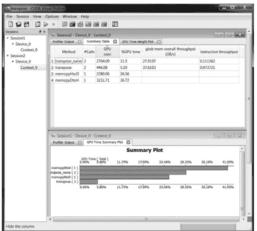

图 12.1 使用 CUDA 可视化分析器对矩阵转置应用程序进行分析

CUDA 可视化分析器将执行您的应用程序，检查 GPU 中内置的特殊性能计数器。执行后，分析器可以根据这些计数器编译数据，并根据其观察结果向您展示报告。它可以验证您的应用程序执行每个内核所花费的时间，以及确定启动的块数量、您的内核的内存访问是否合并、您的代码中 warp 执行的分支分歧数量，等等。如果您有一些需要解决的微妙性能问题，我们鼓励您研究 CUDA 可视化分析器。

## 12.3 书面资源

如果你还没有因为本书中的所有散文而感到厌倦，那么你可能实际上有兴趣继续阅读。我们知道，你们中的一些人更倾向于通过玩代码来继续学习，但对于其余的人，还有额外的书面资源来保持你作为 CUDA C 程序员的成长。

### 12.3.1 编程大规模并行处理器：实践方法

如果你读过第 1 章，我们向你保证，这本书绝对*不是*关于并行架构的教科书。当然，我们提到了*多处理器*和*warp*等术语，但这本书致力于教授使用 CUDA C 及其相关 API 编程的较柔和的一面。我们在 *NVIDIA CUDA 编程指南* 阐述的编程模型中学习了 CUDA C 语言，在很大程度上忽略了 NVIDIA 硬件实际完成我们交给它的任务的方式。

但要想真正成为一名高级、全面的 CUDA C 程序员，您需要更深入地了解 CUDA 架构以及 NVIDIA GPU 在幕后工作的一些细微差别。为了实现这一目标，我们建议您通读《编程大规模并行处理器：实践方法》。该书由 David Kirk（前 NVIDIA 首席科学家）与 Wen-mei W. Hwu（伊利诺伊大学电气与计算机工程系 W. J. Sanders III 席位教授）合作撰写。您会遇到许多熟悉的术语和概念，但您将了解 NVIDIA CUDA 架构的细致细节，包括线程调度和延迟容忍、内存带宽使用和效率、浮点处理的具体细节等更多内容。本书还以比本书更普遍的意义论述了并行编程，因此您将更好地理解如何为大型复杂问题设计并行解决方案。

### 12.3.2 CUDA University

我们中的一些人不幸在 GPU 计算这个令人兴奋的世界出现之前就上了大学。对于那些现在或不久将来有幸上大学的人来说，全世界约有 300 所大学目前开设涉及 CUDA 的课程。但在您开始节食减肥以重新穿上大学装备之前，还有一个选择！在 CUDA Zone 网站上，您会找到一个名为 _CUDA U_ 的链接，它本质上是一个用于 CUDA 教育的在线大学。或者您可以直接通过 URL www.nvidia.com/object/cuda_education 导航到那里。虽然如果您参加 CUDA U 上的一些在线讲座，您将能够了解很多关于 GPU 计算的知识，但截至出版时，仍然没有用于课后聚会的在线兄弟会。

### 大学课程材料

在众多 CUDA 教育资源中，亮点之一包括伊利诺伊大学的一门完整的 CUDA C 编程课程。NVIDIA 和伊利诺伊大学免费提供此内容，采用 M4V 视频格式，供您的 iPod、iPhone 或兼容视频播放器使用。我们知道你在想什么：“终于，在车辆管理局排队时学习 CUDA 的方法来了！”你可能也在想，为什么我们要等到本书的最后才告诉你，基本上这本书有一个电影版本。我们抱歉让你久等了，但电影通常不如书好，对吧？除了伊利诺伊大学和加州大学戴维斯分校的实际课程材料外，您还将找到 CUDA 培训播客的材料以及第三方培训和咨询服务的链接。

### _Dr. Dobb’s_

超过 30 年来，《Dr. Dobb’s》几乎涵盖了计算机技术的每一项重大进展，NVIDIA 的 CUDA 也不例外。作为一个持续系列的一部分，《Dr. Dobb’s》发表了一系列广泛的文章，广泛涉及 CUDA 领域。该系列名为 _CUDA，面向大众的超级计算_，从 GPU 计算简介开始，迅速从第一个内核推进到 CUDA 编程模型的其他部分。Dr. Dobb's 的文章涵盖错误处理、全局内存性能、共享内存、CUDA 可视化分析器、纹理内存、CUDA-GDB 以及 CUDPP 数据并行 CUDA 原语库，以及许多其他主题。这一系列文章是获取本书中我们试图传达的一些材料的更多信息的绝佳场所。此外，您还将找到关于一些我们在本文中只匆匆浏览过的工具的实用信息，例如可用的分析和调试选项。该系列文章从 CUDA Zone 网页链接，但通过搜索 Dr. Dobb's CUDA 也可以轻松访问。

### 12.3.3 NVIDIA 论坛

即使在仔细研究了 NVIDIA 的所有文档后，您可能仍会遇到未解答或特别引人入胜的问题。也许您在想，是否有其他人也遇到了您正在经历的某些奇怪行为。或者，也许您正在举办 CUDA 庆祝派对，想召集一群志同道合的人。对于您有兴趣询问的任何事情，我们强烈推荐 NVIDIA 网站上的论坛。论坛位于 http://forums.nvidia.com，是向其他 CUDA 用户提问的好地方。事实上，读完本书后，如果您愿意，您有可能帮助其他人！NVIDIA 员工也经常在论坛上活跃，因此最棘手的问题将能直接从源头获得权威建议。我们也很乐意收集关于新功能的建议，以及对我们在 NVIDIA 做的好事、坏事和丑事的反馈。

## 12.4 代码资源

虽然 NVIDIA GPU Computing SDK 是操作示例的宝库，但它的设计初衷主要是为了教学，而非更多用途。如果您正在寻找生产级的 CUDA 驱动库或源代码，您需要再深入挖掘一下。幸运的是，有一个庞大的 CUDA 开发者社区，他们已经制作出了顶级解决方案。这里介绍了其中的一些工具和库，但我们鼓励您在 Web 上搜索您需要的任何解决方案。而且，嘿，也许有一天您也会向 CUDA C 社区贡献一些自己的东西！


### 12.4.1 CUDA 数据并行原语库

NVIDIA 在加州大学戴维斯分校研究人员的帮助下，发布了一个名为 CUDA 数据并行原语库（CUDPP）的库。正如其名称所示，CUDPP 是一个数据并行算法原语库。这些原语包括并行前缀和（scan）、并行排序和并行归约。此类原语构成了各种数据并行算法的基础，包括排序、流压缩、构建数据结构以及许多其他算法。如果您打算编写即使是中等复杂度的算法，那么 CUDPP 很可能已经具备您所需的功能，或者能让您显著更接近目标。在 http://code.google.com/p/cudpp 下载它。

### 12.4.2 CULATOOLS

如我们在第 12.1.3 节：CUBLAS 中所述，NVIDIA 提供了与 CUDA 工具包下载一起打包的 BLAS 实现。对于需要更广泛线性代数解决方案的读者，请查看 EM Photonics 的行业标准线性代数包（LAPACK）的 CUDA 实现。其 LAPACK 实现称为 CULAtools，并提供基于 NVIDIA CUBLAS 技术构建的更复杂的线性代数例程。免费提供的 Basic 包提供 LU 分解、QR 分解、线性系统求解器和奇异值分解，以及最小二乘和约束最小二乘求解器。您可以在 www.culatools.com/versions/basic 获取 Basic 下载。您还会注意到，EM Photonics 提供高级版和商业版许可证，其中包含 LAPACK 例程的更大比例，以及允许您分发基于 CULAtools 的商业应用程序的许可条款。

### 12.4.3 语言包装器

本书主要关注 C 和 C++，但显然有数百个项目不使用这些语言。幸运的是，第三方编写了包装器，以允许从 NVIDIA 未正式支持的语言访问 CUDA 技术。NVIDIA 本身为其 CUBLAS 库提供了 FORTRAN 绑定，但您也可以在 www.jcuda.org 上找到多个 CUDA 库的 Java 绑定。同样，PyCUDA 项目在 http://mathema.tician.de/software/pycuda 提供了 Python 包装器，以允许从 Python 应用程序使用 CUDA C 内核。最后，CUDA.NET 项目在 www.hoopoe-cloud.com/Solutions/CUDA.NET 提供了 Microsoft .NET 环境的绑定。

虽然这些项目未得到 NVIDIA 官方支持，但它们已随多个 CUDA 版本存在，全部免费提供，并且各自拥有众多成功客户。这个故事的寓意是，如果您选择的语言（或您老板选择的语言）不是 C 或 C++，那么在首先查看必要的绑定是否可用之前，不应排除 GPU 计算。

## 12.5 章节回顾

就是这样。即使在 11 章 CUDA C 之后，仍有大量资源可供下载、阅读、观看和编译。在异构计算平台时代成熟之际，现在是学习 GPU 计算的一个非常有趣的时期。我们希望您享受了解当今最普遍的并行编程环境之一的过程。此外，我们希望您在结束这段体验时，对开发新的、令人兴奋的与计算机交互方式以及处理软件可用的不断增加的信息量的可能性感到兴奋。正是您的想法和您开发的惊人技术，将把 GPU 计算推向下一个水平。

# 附录

# 高级原子操作

第 9 章介绍了我们可以使用原子操作的几种方式，以使数百个线程能够安全地对共享数据进行并发修改。在本附录中，我们将探讨一种使用原子操作实现锁定数据结构的高级方法。从表面上看，这个主题似乎并没有比我们之前检查过的任何内容复杂多少。实际上，情况确实如此。您在本书中学习了许多复杂主题，锁定数据结构并不比这些更具挑战性。那么，为什么这些材料躲在附录里？我们不想透露任何剧透，所以如果您感兴趣，请继续阅读，我们将在本附录过程中讨论这个问题。

## A.1 重新审视点积

在第 5 章中，我们研究了使用 CUDA C 实现向量点积的方法。该算法属于称为归约的大型算法家族之一。如果您还记得，该算法通过以下方式计算两个输入向量的点积：

- 1. 每个块中的每个线程将输入向量的两个对应元素相乘，并将乘积存储在共享内存中。
- 2. 尽管一个块有多个乘积，但一个线程将其中两个乘积相加，并将结果存回共享内存。每个步骤得到的值数量是初始值的一半（这就是“归约”一词的由来）。
- 3. 当每个块都有最终和时，每个块将其值写入全局内存并退出。
- 4. 如果内核使用 N 个并行块运行，CPU 将对这些剩余的 N 个值求和以生成最终点积。

对点积算法的这种高层次审视旨在作为复习，所以如果已经过了一段时间，或者您喝了几杯霞多丽白葡萄酒，花时间复习第 5 章可能是值得的。如果您对点积代码感到足够熟悉可以继续，请将注意力集中在算法的步骤 4 上。虽然它不涉及将大量数据复制到主机或在 CPU 上执行许多计算，但将计算移回 CPU 以完成确实听起来就很别扭。

但这不仅仅是算法步骤别扭或解决方案不优雅的问题。请考虑一种场景：点积计算只是长序列操作中的一个步骤。如果您希望在 GPU 上执行每个操作，因为您的 CPU 正忙于其他任务或计算，那么您就没办法了。就目前而言，您将被迫停止在 GPU 上的计算，将中间结果复制回主机，使用 CPU 完成计算，最后将该结果重新上传到 GPU 并使用下一个内核恢复计算。

鉴于这是关于原子操作的附录，我们已经费尽口舌解释了我们原始点积算法有多麻烦，您应该能看出我们要去哪里。我们打算使用原子操作修复点积，以便整个计算都可以留在 GPU 上，让您的 CPU 空闲下来执行其他任务。理想情况下，我们不希望在步骤 3 中退出内核并在步骤 4 中返回 CPU，而是希望每个块将其最终结果添加到全局内存中的总计中。如果每个值都以原子方式添加，我们就不必担心潜在的冲突或不确定的结果。由于我们已经在直方图操作中使用了 atomicAdd() 操作，这似乎是一个显而易见的选择。

不幸的是，在计算能力 2.0 之前，atomicAdd() 仅对整数运行。虽然如果您打算计算具有整数分量的向量的点积，这可能没问题，但使用浮点分量要常见得多。然而，大多数 NVIDIA 硬件不支持对浮点数进行原子运算！但这有合理的解释，所以请不要立刻把您的 GPU 扔进垃圾桶。

对内存中值的原子操作仅保证每个线程的读-改-写序列将在过程中不被其他线程读取或写入目标值的情况下完成。没有关于线程执行操作顺序的规定，因此在三个线程执行加法的情况下，有时硬件会执行 (A+B) + C，有时会计算 A+ (B+C)。这对于整数是可以接受的，因为整数数学满足结合律，因此 (A+B) + C = A+ (B+C)。浮点算术不满足结合律，因为中间结果的舍入，因此 (A+B) + C 通常不等于 A+ (B+C)。因此，对浮点值的原子运算效用存疑，因为它会在 GPU 等高度多线程环境中产生非确定性结果。在许多应用程序中，两次运行应用程序得到两个不同的结果是根本无法接受的，因此对浮点原子运算的支持在早期硬件中并非优先事项。

然而，如果我们愿意容忍结果中的一些非确定性，我们仍然可以完全在 GPU 上完成归约。但我们首先需要开发一种绕过缺乏浮点原子运算的方法。该解决方案仍将使用原子操作，但不用于运算本身。

### A.1.1 原子锁

我们用于构建 GPU 直方图的 atomicAdd() 函数执行了读-改-写操作，过程中不受其他线程打断。从低层面来看，您可以想象硬件在操作进行期间锁定目标内存位置，在锁定期间，没有其他线程可以读取或写入该位置的值。如果我们有办法在 CUDA C 内核中模拟这种锁，我们就可以对关联的内存位置执行任意操作。


或数据结构。锁定机制本身的操作将与典型的 CPU 互斥锁完全相同。如果你不熟悉互斥 [mutex]，请不要担心。它并不比你已经学过的东西更复杂。

基本思路是，我们分配一小块内存用作互斥锁。互斥锁将像交通信号灯一样，控制对某些资源的访问。该资源可能是一个数据结构、一个缓冲区，或者仅仅是我们想要原子式修改的内存位置。当线程从互斥锁读取 0 时，它将此值解释为“绿灯”，表示没有其他线程正在使用该内存。因此，该线程可以自由锁定内存并进行所需的任何更改，不受其他线程的干扰。要锁定相关内存位置，线程向互斥锁写入 1。这个 1 将对潜在的竞争线程充当“红灯”。竞争线程必须等待，直到所有者向互斥锁写入 0，然后才能尝试修改被锁定的内存。

实现此锁定过程的简单代码序列可能如下所示：

```
void lock( void ) {
    if( *mutex == 0 ) {
        *mutex = 1; //store a 1 to lock
    }
}
```

不幸的是，这段代码存在一个问题。幸运的是，这是一个熟悉的问题：如果在我们的线程读取值为零后，另一个线程向互斥锁写入 1，会发生什么？也就是说，两个线程都检查互斥锁处的值并发现它是零。然后它们都向该位置写入 1，以向其他线程表明该结构已被锁定且不可修改。这样做后，两个线程都认为自己拥有相关内存或数据结构，并开始进行不安全的修改。灾难随之而来！

我们想要完成的操作相当简单：我们需要将互斥锁处的值与 0 进行比较，并且仅当互斥锁为 0 时，才在该位置存储 1。为了正确完成此操作，整个操作需要以原子方式执行，以便我们知道在我们的线程检查和更新互斥锁处的值时，没有其他线程可以干扰。在 CUDA C 中，可以使用函数 atomicCAS()（一种原子比较并交换操作）来执行此操作。函数 atomicCAS() 接受一个指向内存的指针、一个用于与该位置处的值进行比较的值，以及在比较成功时要存储在该位置的值。使用此操作，我们可以按如下方式实现 GPU 锁定函数：

```
__device__ void lock( void ) {
    while( atomicCAS( mutex, 0, 1 ) != 0 );
}
```

对 atomicCAS() 的调用将返回它在地址 mutex 处找到的值。因此，while() 循环将继续运行，直到 atomicCAS() 在互斥锁处看到 0。当它看到 0 时，比较成功，线程向互斥锁写入 1。基本上，线程将在 while() 循环中自旋，直到成功锁定数据结构。我们将使用此锁定机制来实现我们的 GPU 哈希表。但首先，我们将代码封装在一个结构中，以便在点积应用程序中使用时更加清晰：

```
struct Lock {
    int *mutex;
    Lock( void ) {
        int state = 0;
        HANDLE_ERROR( cudaMalloc( (void**)& mutex,
            sizeof(int) ) );
        HANDLE_ERROR( cudaMemcpy( mutex, &state, sizeof(int),
            cudaMemcpyHostToDevice ) );
    }

    ~Lock( void ) {
        cudaFree( mutex );
    }

    __device__ void lock( void ) {
        while( atomicCAS( mutex, 0, 1 ) != 0 );
    }

    __device__ void unlock( void ) {
        atomicExch( mutex, 1 );
    }
};
```

请注意，我们使用 atomicExch( mutex, 1 ) 恢复互斥锁的值。函数 atomicExch() 读取位于互斥锁处的值，将其与第二个参数（在此情况下为 1）交换，并返回它读取的原始值。为什么要为此使用原子函数，而不是使用更明显的方法来重置互斥锁处的值？

如果你期望这个方法失败有一些微妙、隐藏的原因，我们很抱歉让你失望，但这种方法也同样有效。那么，为什么不使用这种更明显的方法呢？原子事务和通用全局内存操作遵循 GPU 中的不同路径。因此，同时使用原子操作和标准全局内存操作可能导致 `unlock()` 看起来与随后尝试 `lock()` 互斥锁不同步。该行为在功能上仍然是正确的，但为了确保从应用程序角度获得一致且直观的行为，最好对互斥锁的所有访问使用相同的路径。因为我们被要求使用原子操作来锁定资源，所以我们也选择使用原子操作来解锁资源。

### A.1.2 点积重述：原子锁

我们之前点积示例中唯一试图更改的部分是归约的最终基于 CPU 的部分。在上一节中，我们描述了如何在 GPU 上实现互斥锁。实现此互斥锁的 `Lock` 结构位于 `lock.h` 中，并在我们改进的点积示例开头包含：

```
#include "../common/book.h"

#include "lock.h"

#define imin(a,b) (a<b?a:b)

const int N = 33 * 1024 * 1024;
const int threadsPerBlock = 256;
const int blocksPerGrid =
    imin( 32, (N+threadsPerBlock-1) / threadsPerBlock );
```

有两个例外情况，我们的点积内核开头与第 5 章中使用的内核相同。这两个例外都涉及内核的签名：

```
__global__ void dot(Lock lock, float *a, float *b, float *c )
```

在我们更新的点积中，除了输入向量和输出缓冲区外，我们还将一个 Lock 传递给内核。Lock 将在最终累积步骤期间控制对输出缓冲区的访问。另一个更改从签名中不易察觉，但涉及签名。以前，float * 参数是 N 个浮点数的缓冲区，其中每个 N 个块都可以存储其部分结果。该缓冲区被复制回 CPU 以计算最终总和。现在，参数 c 不再指向临时缓冲区，而是指向一个单个浮点值，该值将存储 a 和 b 中向量的点积。但是，即使有这些更改，内核的开头也与第 5 章中完全相同：

```
__global__ void dot (Lock lock, float *a,
    float *b, float *c) {
    __shared__ float cache[threadsPerBlock];
    int tid = threadIdx.x + blockIdx.x * blockDim.x;
    int cacheIndex = threadIdx.x;

    float temp = 0;
    while (tid < N) {
        temp += a[tid] * b[tid];
        tid += blockDim.x * gridDim.x;
    }

    // set the cache values
    cache[cacheIndex] = temp;

    // synchronize threads in this block
    __syncthreads();

    // for reductions, threadsPerBlock must be a power of 2
    // because of the following code
    int i = blockDim.x/2;
    while (i != 0) {
        if (cacheIndex < i)
            cache[cacheIndex] += cache[cacheIndex + i];
        __syncthreads();
        i /= 2;
    }
}
```

在执行到此点时，每个块中的 256 个线程已对其 256 个成对乘积求和，并计算出一个位于缓存 [0] 中的单个值。每个线程块现在需要将其最终值添加到 c 处的值中。为了安全地执行此操作，我们将使用锁来控制对该内存位置的访问，因此每个线程在更新值 *c 之前都需要获取锁。在将块的部分和添加到 c 处的值后，它会解锁互斥锁，以便其他线程可以累积它们的值。在将其值添加到最终结果后，块没有剩余要计算的内容，可以从内核返回。

```
if (cacheIndex == 0) {
    lock.lock();
    *c += cache[0];
    lock.unlock();
}
```

main() 例程与我们的原始实现非常相似，但有一些不同之处。首先，我们不再需要像在第 5 章中那样为部分结果分配缓冲区。我们现在只为单个浮点结果分配空间：

```
int main( void ) {
    float *a, *b, c = 0;
    float *dev_a, *dev_b, *dev_c;

    // allocate memory on the CPU side
    a = (float*)malloc( N*sizeof(float) );
    b = (float*)malloc( N*sizeof(float) );

    // allocate the memory on the GPU
    HANDLE_ERROR( cudaMalloc( (void**)&dev_a,
                              N*sizeof(float) ) );
    HANDLE_ERROR( cudaMalloc( (void**)&dev_b,
                              N*sizeof(float) ) );
    HANDLE_ERROR( cudaMalloc( (void**)&dev_c,
                              sizeof(float) ) );
}
```


与第 5 章一样，我们初始化输入数组并将其复制到 GPU。但你会注意到本示例中有一个额外的复制操作：我们还将零复制到 dev_c，即我们打算用来累积最终点积的位置。由于每个块都想读取此值、添加其部分和，并将结果存回，因此我们需要初始值为零才能得到正确的结果。

```
// fill in the host memory with data
for (int i=0; i<N; i++) {
    a[i] = i;
    b[i] = i*2;
}

// copy the arrays 'a' and 'b' to the GPU
HANDLE_ERROR( cudaMemcpy( dev_a, a, N*sizeof(float),
                          cudaMemcpyHostToDevice ) );
HANDLE_ERROR( cudaMemcpy( dev_b, b, N*sizeof(float),
                          cudaMemcpyHostToDevice ) );
HANDLE_ERROR( cudaMemcpy( dev_c, &c, sizeof(float),
                          cudaMemcpyHostToDevice ) );
```

剩下的就是声明我们的 Lock、调用内核，并将结果复制回 CPU。

```
Lock lock;
dot<<<blocksPerGrid,threadsPerBlock>>>( lock, dev_a,
                                        dev_b, dev_c );

// copy c back from the GPU to the CPU
HANDLE_ERROR( cudaMemcpy( &c, dev_c,
                          sizeof(float),
                          cudaMemcpyDeviceToHost ) );
```

在第 5 章中，这时我们会执行一个最终的 `for` 循环来添加部分和。由于这是在 GPU 上使用原子锁完成的，我们可以直接跳到答案检查和清理代码：

```
#define sum_squares(x) ((x*(x+1)*(2*x+1)/6)
printf( "Does GPU value %.6g = %.6g?\n", c,
 2 * sum_squares( (float)(N - 1) ) );

// free memory on the GPU side
cudaFree( dev_a );
cudaFree( dev_b );
cudaFree( dev_c );

// free memory on the CPU side
free( a );
free( b );
}
```

由于无法精确预测每个块将其部分和添加到最终总数的顺序，因此最终结果的求和顺序与 CPU 上的求和顺序不同的可能性非常大（几乎可以肯定）。由于浮点加法不满足结合律，因此 GPU 和 CPU 之间的最终结果很可能略有不同。除非添加一段非平凡的代码来确保块以与 CPU 上的求和顺序匹配的确定性顺序获取锁，否则对此无能为力。如果你感到异常有动力，可以试试。否则，我们将继续了解这些原子锁如何用于实现多线程数据结构。

## A.2 实现哈希表

哈希表是计算机科学中最重要、最常用的数据结构之一，在各种应用中发挥着重要作用。对于尚不熟悉哈希表的读者，我们将在此提供一个快速入门。数据结构的研究值得比我们打算提供的更深入的研究，但为了取得进展，我们将简要介绍。如果你已经对哈希表背后的概念感到熟悉，应该跳到第 A.2.2 节：CPU 哈希表中的哈希表实现。

### 哈希表概述

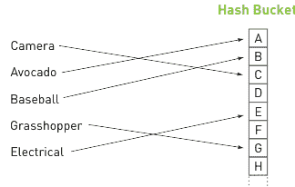

图 A.1 将单词哈希到桶中

基于我们对英语中单词分布的了解，这个哈希函数还有很大的改进空间，因为它无法将单词均匀地映射到 26 个桶中。有些桶将包含很少的键/值对，而有些桶将包含大量的键/值对。因此，查找以常见字母（如 S）开头的单词关联的值所需的时间，将远长于查找以字母 X 开头的单词关联的值所需的时间。由于我们寻找的是能够实现任意值常时检索的哈希函数，因此这种后果相当不理想。大量研究已投入到哈希函数的研究中，但即使是对这些技术的简要调查也超出了本书的范围。

哈希表数据结构的最后一个组件涉及桶。如果我们有一个完美的哈希函数，每个键都将映射到不同的桶。在这种情况下，我们可以简单地将键/值对存储在数组中，数组中的每个条目就是我们一直称之为桶的东西。但是，即使有出色的哈希函数，在大多数情况下我们也必须处理冲突。当多个键映射到同一个桶时就会发生冲突，例如当我们将单词 avocado 和 aardvark 都添加到我们的字典哈希表中时。存储映射到给定桶的所有值的最简单方法就是简单地在桶中维护一个值列表。当我们遇到冲突时，例如将 aardvark 添加到已经包含 avocado 的字典中，我们将与 aardvark 关联的值放在我们在 "A" 桶中维护的列表末尾，如图 A.2 所示。

在图 A.2 中添加单词 avocado 后，第一个桶的列表中只有一个键/值对。在这个虚构的应用程序中，稍后我们添加单词 aardvark，这个单词与 avocado 发生冲突，因为它们都以字母 A 开头。你会在图 A.3 中注意到，它只是被放在第一个桶的列表末尾：

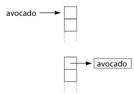

图 A.2 将单词 avocado 插入哈希表

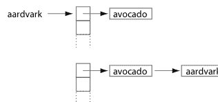

图 A.3 添加单词 aardvark 时解决冲突

掌握了哈希函数和冲突解决概念的一些背景知识后，我们准备好查看如何实现自己的哈希表了。

### A.2.2 CPU 哈希表

如前一节所述，我们的哈希表将由两部分组成：哈希函数和桶的数据结构。我们的桶将与之前完全相同地实现：我们将分配一个长度为 N 的数组，数组中的每个条目都保存一个键/值对列表。在考虑哈希函数之前，我们将先看看涉及的数据结构：

```
#include "../common/book.h"

struct Entry {
    unsigned int    key;
    void*           value;
    Entry           *next;
};

struct Table {
    size_t          count;
    Entry           **entries;
    Entry           *pool;
    Entry           *firstFree;
};
```

如前言部分所述，Entry 结构体同时包含键和值。在我们的应用程序中，我们将使用无符号整数键来存储键/值对。与此键关联的值可以是任何数据，因此我们将 value 声明为 void * 以指示这一点。我们的应用程序主要关注创建哈希表数据结构，因此我们不会实际在 value 字段中存储任何内容。我们将其包含在结构体中以确保完整性，以防你想在自己的应用程序中使用此代码。我们哈希表 Entry 中的最后一块数据是指向下一个 Entry 的指针。发生冲突后，同一个桶中会有多个条目，我们决定将这些条目存储为列表。因此，每个条目都将指向桶中的下一个条目，从而形成一个哈希到表中同一位置的条目列表。最后一个条目将有一个 NULL 的 next 指针。

从本质上讲，Table 结构体本身就是一个“桶”数组。这个桶数组只是一个长度为 count 的数组，entries 中的每个桶只是一个指向 Entry 的指针。为了避免每次想要向表中添加 Entry 时都要分配内存所带来的复杂性和性能损失，表将在 pool 中维护一个可用条目的大型数组。字段 firstFree 指向下一个可用的 Entry，因此当我们需要向表中添加条目时，可以简单地使用 firstFree 指向的 Entry 并递增该指针。请注意，这也将简化我们的清理代码，因为我们可以通过单次 free() 调用释放所有这些条目。如果我们在添加时为每个条目分配内存，我们就必须遍历表并逐个释放每个条目。

在了解涉及的数据结构后，让我们来看看一些其他支持代码：

```
void initialize_table( Table *table, int entries,
                       int elements ) {
  table.count = entries;
  table.entries = (Entry**)calloc( entries, sizeof(Entry*) );
  table.pool = (Entry*)malloc( elements * sizeof( Entry ) );
  table.firstFree = table.pool;
}
```


表初始化主要包括为桶数组条目分配内存和清除内存。我们还为条目池分配存储，并将 firstFree 指针初始化为池数组中的第一个条目。

在应用程序结束时，我们希望释放已分配的内存，因此清理例程会释放桶数组和空闲条目池：

```
void free_table( Table &table ) {
    free( table.entries );
    free( table.pool );
}
```

在介绍中，我们详细讨论了哈希函数。具体来说，我们讨论了一个好的哈希函数如何决定哈希表实现是优秀还是糟糕。在本示例中，我们使用无符号整数作为键，并需要将这些键映射到桶数组的索引。最简单的方法是选择索引等于键的桶。也就是说，我们可以将条目 e 存储在 table.entries[e.key] 中。然而，我们无法保证每个键都小于桶数组的长度。幸运的是，这个问题可以相对轻松地解决：

```
size_t hash( unsigned int key, size_t count ) {
    return key % count;
}
```

如果哈希函数如此重要，我们怎么能用这么简单的函数呢？理想情况下，我们希望键在表中的所有桶上均匀分布，而我们在这里所做的只是对数组长度取模。在现实中，哈希函数通常可能不这么简单，但因为这只是一个示例程序，我们将随机生成键。如果我们假设随机数生成器生成的值大致均匀，这个哈希函数应该将这些键均匀映射到哈希表的所有桶中。在你自己的哈希表实现中，你可能需要一个更复杂的哈希函数。

在了解哈希表结构和哈希函数后，我们准备好查看向表中添加键/值对的过程。该过程涉及三个基本步骤：

- 1. 对输入键计算哈希函数以确定新条目的桶。
- 2. 从池中获取一个预分配的 Entry 并初始化其键和值字段。
- 3. 将条目插入到正确桶的列表前面。

我们以相当直接的方式将这些步骤转换为代码。

```c
void add_to_table( Table &table, unsigned int key, void* value )
{
    //Step 1
    size_t hashValue = hash( key, table.count );

    //Step 2
    Entry *location = table.firstFree++;
    location->key = key;
    location->value = value;

    //Step 3
    location->next = table.entries[hashValue];
    table.entries[hashValue] = location;
}
```

如果你从未见过链表（或者已经很久没见了），步骤 3 起初可能难以理解。现有列表的第一个节点存储在 table.entries[hashValue]。牢记这一点，我们可以分两步在列表头部插入新节点：首先，我们将新条目的 next 指针设置为指向现有列表的第一个节点。然后，我们将新条目存储在桶数组中，使其成为新列表的第一个节点。

了解你编写的代码是否正常工作是个好主意，因此我们实现了一个例程来对哈希表进行健全性检查。检查首先遍历表并检查每个节点。我们对节点的键计算哈希函数，并确认节点存储在正确的桶中。检查每个节点后，我们验证表中实际存在的节点数是否确实等于我们打算添加到表中的元素数量。如果这些数字不一致，那么要么我们意外地将节点添加到了多个桶中，要么我们没有正确插入它。

```
#define SIZE (100*1024*1024)
#define ELEMENTS (SIZE / sizeof(unsigned int))

void verify_table( const Table &table ) {
    int count = 0;
    for (size_t i=0; i<table.count; i++) {
        Entry *current = table.entries[i];
        while (current != NULL) {
            ++count;
            if (hash( current->value, table.count ) != i)
                printf( "%d hashed to %d, but was located "
                        "at %d\n", current->value,
                        hash( current->value, table.count ), i );
            current = current->next;
        }
    }
    if (count != ELEMENTS)
        printf( "%d elements found in hash table. Should be %d\n",
                count, ELEMENTS );
    else
        printf( "All %d elements found in hash table.\n", count );
}
```

在处理完所有基础设施代码后，我们可以查看 main()。与本书的许多示例一样，大部分繁重工作已在辅助函数中完成，因此我们希望 main() 相对容易理解：

```
#define HASH_ENTRIES 1024

int main( void ) {
    unsigned int *buffer =
        (unsigned int*)big_random_block( SIZE );

    clock_t start, stop;
    start = clock();

    Table table;
    initialize_table( table, HASH_ENTRIES, ELEMENTS );

    for (int i=0; i<ELEMENTS; i++) {
        add_to_table( table, buffer[i], (void*)NULL );
    }

    stop = clock();
    float elapsedTime = (float)(stop - start) /
        (float)CLOCKS_PER_SEC * 1000.0f;
    printf( "Time to hash: %.3f ms\n", elapsedTime );

    verify_table( table );

    free_table( table );
    free( buffer );

    return 0;
}
```

如你所见，我们首先分配一大块随机数。这些随机生成的无符号整数将是我们插入哈希表的键。生成数字后，我们读取系统时间以测量实现的性能。我们初始化表，然后使用 for() 循环将每个随机键插入表中。添加所有键后，我们再次读取系统时间以计算初始化和添加键的耗时。最后，我们使用健全性检查例程验证哈希表并释放已分配的缓冲区。

你可能注意到，我们为每个键/值对使用 NULL 作为值。在典型应用程序中，你可能会将一些有用的数据与键一起存储，但因为我们主要关心哈希表实现本身，我们为每个键存储一个无意义的值。

### A.2.3 多线程哈希表

我们的 CPU 哈希表中内置了一些假设，当我们移植到 GPU 时，这些假设将不再有效。首先，我们假设一次只能向表中添加一个节点，以简化节点的添加。如果多个线程同时尝试向表中添加节点，我们可能会遇到与第 9 章示例中的多线程添加问题类似的问题。

例如，让我们重新审视我们的“鳄梨和土猪”示例，并想象线程 A 和 B 正在尝试将这些条目添加到表中。线程 A 对鳄梨计算哈希函数，线程 B 对土猪计算该函数。他们都决定他们的键属于同一个桶。为了将新条目添加到列表中，线程 A 和 B 首先将其新条目的 next 指针设置为现有列表的第一个节点，如图 A.4 所示。

然后，两个线程都尝试用其新条目替换桶数组中的条目。然而，完成得晚的线程是唯一保留其更新的线程，因为它会覆盖前一个线程的工作。因此，考虑这样一种场景：线程 A 用其鳄梨条目替换了 altitude 条目。完成后不久，线程 B 用其土猪条目替换了它认为是 altitude 的条目。不幸的是，它替换的是鳄梨而不是 altitude，导致了图 A.5 所示的情况。

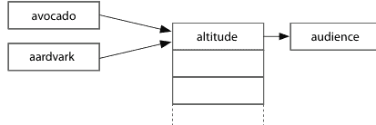

图 A.4 多个线程尝试向同一桶添加节点

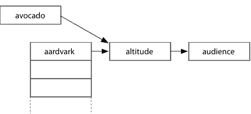

图 A.5 两个线程并发修改失败后的哈希表

线程 A 的条目悲剧性地“漂浮”在哈希表之外。幸运的是，我们的健全性检查例程会捕获这一点并提醒我们存在问题，因为它会计算出比预期更少的节点。但我们仍然需要回答这个问题：我们如何在 GPU 上构建哈希表？！这里的关键观察涉及这样一个事实：一次只能有一个线程安全地对桶进行修改。这类似于我们的点积示例，其中一次只能有一个线程安全地将其值添加到最终结果中。如果每个桶都关联一个原子锁，我们可以确保一次只有一个线程对给定桶进行更改。

### A.2.4 GPU 哈希表

有了确保哈希表安全多线程访问的方法后，我们可以继续实现我们在第 A.2.2 节：CPU 哈希表中编写的哈希表应用程序的 GPU 版本。我们需要包含 `lock.h`，即第 A.1.1 节：原子锁中我们的 GPU `Lock` 结构的实现，并且需要将哈希函数声明为 `__device__` 函数。除此之外，基本数据结构和哈希函数与 CPU 实现相同。


```
#include "../common/book.h"
#include "lock.h"

struct Entry {
    unsigned int key;
    void* value;
    Entry *next;
};

struct Table {
    size_t count;
    Entry **entries;
    Entry *pool;
};

__device__ __host__ size_t hash( unsigned int value,
                                 size_t count ) {
    return value % count;
}
```

初始化和释放哈希表包含与我们在 CPU 上执行的相同步骤，但与之前的示例一样，我们使用 CUDA 运行时函数来完成此操作。我们使用 cudaMalloc() 分配一个桶数组和一个条目池，并使用 cudaMemset() 将桶数组条目设置为零。在应用程序完成时释放内存，我们使用 cudaFree()。

```
void initialize_table( Table *table, int entries,
                       int elements ) {
    table->count = entries;
    HANDLE_ERROR( cudaMalloc( (void**)&table->entries,
                              entries * sizeof( Entry*) ) );
    HANDLE_ERROR( cudaMemset( table->entries, 0,
                              entries * sizeof( Entry*) ) );
    HANDLE_ERROR( cudaMalloc( (void**)&table->pool,
                              elements * sizeof( Entry) ) );
}
```

```
void free_table( Table &table ) {
    cudaFree( table.pool );
    cudaFree( table.entries );
}
```

我们在 CPU 实现中使用了一个例程来检查哈希表的正确性。我们需要一个类似的例程用于 GPU 版本，因此有两种选择。我们可以编写 `verify_table()` 的 GPU 版本，也可以使用与 CPU 版本相同的代码，并添加一个从 GPU 复制哈希表到 CPU 的函数。虽然两种选择都能满足需求，但第二种方案似乎更优，原因有二：首先，它涉及重用我们 CPU 版本的 `verify_table()`。与一般的代码重用一样，这可以节省时间，并确保未来对代码的更改只需在一个地方进行，即同时适用于哈希表的两个版本。其次，实现复制函数将揭示一个有趣的问题，其解决方案未来可能对你非常有用。

如承诺的那样，`verify_table()` 与 CPU 实现相同，并在此重印以供您方便参考。

```
#define SIZE        (100*1024*1024)
#define ELEMENTS    (SIZE / sizeof(unsigned int))
#define HASH_ENTRIES   1024

void verify_table( const Table &dev_table ) {
    Table table;
    copy_table_to_host( dev_table, table );

    int count = 0;
    for (size_t i=0; i<table.count; i++) {
        Entry *current = table.entries[i];
        while (current != NULL) {
            ++count;
            if (hash( current->value, table.count ) != i)
                printf( "%d hashed to %ld, but was located "
                        "at %ld\n", current->value,
                        hash(current->value, table.count), i );
            current = current->next;
        }
    }

    if (count != ELEMENTS)
        printf( "%d elements found in hash table. Should be %ld\n",
                count, ELEMENTS );
    else
        printf( "All %d elements found in hash table.\n", count );

    free( table.pool );
    free( table.entries );
}
```

由于我们选择重用 CPU 实现的 verify_table()，因此需要一个函数将表从 GPU 内存复制到主机内存。此函数包含三个步骤，两个相对明显的步骤和第三个较棘手的步骤。前两个步骤涉及为哈希表数据分配主机内存，并使用 cudaMemcpy() 将 GPU 数据结构复制到此内存中。我们之前多次这样做过，因此这不足为奇。

```
void copy_table_to_host( const Table &table, Table &hostTable ) {
    hostTable.count = table.count;
    hostTable.entries = (Entry**)calloc( table.count,
                                        sizeof( Entry*) );
    hostTable.pool = (Entry*)malloc( ELEMENTS *
                                    sizeof( Entry ) );

    HANDLE_ERROR( cudaMemcpy( hostTable.entries, table.entries,
                              table.count * sizeof( Entry*),
                              cudaMemcpyDeviceToHost ) );
    HANDLE_ERROR( cudaMemcpy( hostTable.pool, table.pool,
                              ELEMENTS * sizeof( Entry ),
                              cudaMemcpyDeviceToHost ) );
}
```

此例程棘手的部分在于，我们复制的某些数据是指针。我们不能简单地将这些指针复制到主机，因为它们是 GPU 上的地址，在主机上将不再是有效指针。但是，指针的相对偏移量仍然有效。每个指向 Entry 的 GPU 指针都指向 `table.pool[]` 数组中的某个位置，但为了使哈希表在主机上可用，我们需要它们指向 `hostTable.pool[]` 数组中的同一个 `Entry`。

因此，给定 GPU 指针 X，我们需要将指针相对于 `table.pool` 的偏移量加到 `hostTable.pool` 上，以获得有效的主机指针。也就是说，新指针应按以下方式计算：

```
(X - table.pool) + hostTable.pool
```

我们对从 GPU 复制的每个 `Entry` 指针执行此更新：即 `hostTable.entries` 中的 `Entry` 指针以及表条目池中每个 `Entry` 的 `next` 指针：

```
for (int i = 0; i < table.count; i++) {
    if (hostTable.entries[i] != NULL)
        hostTable.entries[i] =
            (Entry*) ((size_t) hostTable.entries[i] -
            (size_t) table.pool + (size_t) hostTable.pool);
}
for (int i = 0; i < ELEMENTS; i++) {
    if (hostTable.pool[i].next != NULL)
        hostTable.pool[i].next =
            (Entry*) ((size_t) hostTable.pool[i].next -
            (size_t) table.pool + (size_t) hostTable.pool);
}
```

在了解了数据结构、哈希函数、初始化、清理和验证代码后，剩下的最重要部分是实际涉及 CUDA C 原子操作的部分。作为参数，`add_to_table()` 内核将接受一组要添加到哈希表的键和值数组。其下一个参数是哈希表本身，最后一个参数是一组锁，将用于锁定表的每个桶。由于我们的输入是两个线程需要索引的数组，我们还需要我们再熟悉不过的索引线性化：

```
__global__ void add_to_table( unsigned int *keys, void **values,
                                 Table table, Lock *lock ) {
    int tid = threadIdx.x + blockIdx.x * blockDim.x;
    int stride = blockDim.x * gridDim.x;

    while (tid < ELEMENTS) {
        unsigned int key = keys[tid];
        size_t hashValue = hash( key, table.count );
        for (int i=0; i<=32; i++) {
            if ((tid & 32) == i) {
                Entry *location = &table.pool[tid];
                location->key = key;
                location->value = values[tid];
                lock[hashValue].lock();
                location->next = table.entries[hashValue];
                table.entries[hashValue] = location;
                lock[hashValue].unlock();
            }
        }
        tid += stride;
    }
}
```

我们的线程遍历输入数组的方式与点积示例中完全相同。对于 keys[] 数组中的每个键，线程将计算哈希函数，以确定键/值对属于哪个桶。确定目标桶后，线程锁定桶，添加其键/值对，然后解锁桶。

然而，这段代码有着非常奇特之处。for() 循环和随后的 if() 语句似乎显然是多余的。在第 6 章中，我们介绍了 warp 的概念。如果你忘了，warp 是一组 32 个线程，它们以同步步调一起执行。尽管 GPU 中实现此机制的细节超出了本书的范围，但同一时间只能有一个线程获取锁，如果让 warp 中所有 32 个线程同时竞争锁，我们将会遇到许多麻烦。在这种情况下，我们发现最好在软件中完成一些工作，简单地遍历 warp 中的每个线程，给每个线程一个机会去获取数据结构的锁、执行其工作，随后释放锁。

main() 的流程应与 CPU 实现看起来相同。我们首先为哈希表键分配一大块随机数据。然后我们创建开始和停止 CUDA 事件，并记录开始事件以用于性能


measurements. 我们继续为随机键数组分配 GPU 内存，将数组复制到设备上，并初始化我们的哈希表：

```
int main( void ) {
    unsigned int *buffer =
        (unsigned int*)big_random_block( SIZE );

    cudaEvent_t   start, stop;
    HANDLE_ERROR( cudaEventCreate( &start ) );
    HANDLE_ERROR( cudaEventCreate( &stop ) );
    HANDLE_ERROR( cudaEventRecord( start, 0 ) );

    unsigned int *dev_keys;
    void        **dev_values;
    HANDLE_ERROR( cudaMalloc( (void**)&dev_keys, SIZE ) );
    HANDLE_ERROR( cudaMalloc( (void**)&dev_values, SIZE ) );
    HANDLE_ERROR( cudaMemcpy( dev_keys, buffer, SIZE,
                              cudaMemcpyHostToDevice ) );

    // copy the values to dev_values here
    // filled in by user of this code example

    Table table;
    initialize_table( table, HASH_ENTRIES, ELEMENTS );
}
```

构建哈希表的最后准备步骤涉及为哈希表的桶准备锁。我们为哈希表中的每个桶分配一个锁。可以设想，如果为整个表只使用一个锁，我们可以节省大量内存。但这样做会彻底摧毁性能，因为每当一组线程尝试同时向表中添加条目时，每个线程都必须竞争表锁。因此，我们声明一个锁数组，数组中的每个桶对应一个锁。然后，我们为锁分配一个 GPU 数组并将它们复制到设备上：

```
Lock   lock[HASH_ENTRIES];
Lock   *dev_lock;
HANDLE_ERROR( cudaMalloc( (void**)&dev_lock,
                          HASH_ENTRIES * sizeof( Lock ) ) );
HANDLE_ERROR( cudaMemcpy( dev_lock, lock,
                          HASH_ENTRIES * sizeof( Lock ),
                          cudaMemcpyHostToDevice ) );
```

main() 的其余部分与 CPU 版本类似：我们将所有键添加到哈希表，停止性能计时器，验证哈希表的正确性，并清理资源：

```
add_to_table<<<60,256>>>( dev_keys, dev_values,
                          table, dev_lock );

HANDLE_ERROR( cudaEventRecord( stop, 0 ) );
HANDLE_ERROR( cudaEventSynchronize( stop ) );
float   elapsedTime;
HANDLE_ERROR( cudaEventElapsedTime( &elapsedTime,
                                    start, stop ) );
printf( "Time to hash:  %3.1f ms\n", elapsedTime );

verify_table( table );

HANDLE_ERROR( cudaEventDestroy( start ) );
HANDLE_ERROR( cudaEventDestroy( stop ) );
free_table( table );
cudaFree( dev_lock );
cudaFree( dev_keys );
cudaFree( dev_values );
free( buffer );

return 0;
}
```

### A.2.5 哈希表性能

使用 Intel Core 2 Duo，第 A.2.2 节：CPU 哈希表 中的 CPU 哈希表示例构建来自 100MB 数据的哈希表需要 360ms。代码使用 -O3 选项构建，以确保代码得到最大程度优化。第 A.2.4 节：GPU 哈希表 中的多线程 GPU 哈希表完成相同任务需要 375ms。两者相差不到 5%，执行时间大致可比，这引发了一个绝佳的问题：为什么像 GPU 这样大规模并行的机器会被同一应用程序的单线程 CPU 版本击败？坦率地说，这是因为 GPU 的设计初衷并非擅长对哈希表等复杂数据结构进行多线程访问。出于这个原因，在 GPU 上构建哈希表等数据结构的性能动机非常少。因此，如果您的应用程序只需要构建哈希表或类似数据结构，您可能最好在 CPU 上完成此操作。

另一方面，您有时会遇到这种情况：长计算管道涉及一个或两个阶段，GPU 在此方面并不比可比的 CPU 实现具有性能优势。在这种情况下，您有三个（有些显而易见）选项：

- 在 GPU 上执行管道的每个步骤
- 在 CPU 上执行管道的每个步骤
- 在 GPU 上执行管道的一些步骤，在 CPU 上执行一些步骤

最后一个选项听起来像是两全其美；然而，这意味着您需要在应用程序中任何想要将计算从 GPU 移到 CPU 或反之的地方同步 CPU 和 GPU。这种同步以及随后的主机与 GPU 之间的数据传输，往往会扼杀您最初采用混合方法可能获得的任何性能优势。

在这种情况下，花时间在 GPU 上执行每个计算阶段可能是值得的，即使 GPU 并不理想地适合算法中的某些步骤。在这方面，GPU 哈希表可能可以防止 CPU/GPU 同步点，最大限度地减少主机与 GPU 之间的数据传输，并使 CPU 能够执行其他计算。在这种情况下，GPU 实现的整体性能有可能超过 CPU/GPU 混合方法，尽管 GPU 在某些步骤上并不比 CPU 快，甚至在某些情况下可能被 CPU 远远甩在后面。

## A.3 附录复习

我们了解了如何使用原子比较并交换操作来实现 GPU 互斥量。使用用此互斥量构建的锁，我们了解了如何改进原始点积应用程序以完全在 GPU 上运行。我们进一步推广了这一想法，实现了一个多线程哈希表，该哈希表使用锁数组来防止多个线程进行不安全的同时修改。事实上，我们开发的互斥量可用于任何类型的并行数据结构，并希望您在自己的实验和应用程序开发中发现它很有用。当然，使用 GPU 实现基于互斥量的数据结构的应用程序的性能需要仔细研究。我们的 GPU 哈希表被同一代码的单线程 CPU 版本击败，因此只有在某些情况下才有理由为这类应用程序使用 GPU。没有一条笼统规则可以用来确定 GPU 专用、CPU 专用或混合方法哪种效果最好，但了解如何使用原子操作将使您能够根据具体情况做出该决定。

此页故意留空

- A
- add() 函数，CPU 向量求和，40–44
- add_to_table() 内核，GPU 哈希表，272
- ALUs [算术逻辑单元]
- CUDA 架构，7
- 使用常量内存，96
- anim_and_exit() 方法，GPU 波纹，70
- anim_gpu() 例程，纹理内存，123,129
- 动画
  - GPU Julia 集示例，50–57
  - 使用线程的 GPU 波纹，69–74
  - 热传递模拟，121–125
- animExit()，169
- 异步调用
  - cudaMemcpyAsync()，如，197
  - 与事件一起使用，109
- 原子锁
  - GPU 哈希表，274–275
  - GPU 哈希锁，251–254
- atomicAdd()
  - 原子锁，251–254
  - 使用全局内存的直方图内核，180
  - 不支持浮点数，251
- atomicCAS()，GPU 锁，252–253
- atomicExch()，GPU 锁，253–254
- 原子操作
  - 高级，249–277
  - NVIDIA GPU 的能力，164–167
  - 点积与，248–251
  - 哈希表，参见哈希表
  - 直方图计算，CPU，171–173
  - 直方图计算，GPU，173–179
  - 直方图计算，概述，170
  - 使用全局内存原子操作的直方图内核，179–181
  - 使用共享/全局内存原子操作的直方图内核，181–183
  - 最小计算能力，167–168
  - 锁，251–254
  - 操作，168–170
  - 概述，163–164, 249
  - 摘要复习，183–184, 277
- B
- 带宽，常量内存节省，106–107
- 基本线性代数子程序 [BLAS]，CUBLAS 库，239–240
- 箱计数，CPU 直方图计算，171–173
- BLAS [基本线性代数子程序]，CUBLAS 库，239–240
- blelloch_scan()，240
- 2D 纹理内存，131–133
- 纹理内存，127–129
- blockDim 变量
  - 2D 纹理内存，132–133
  - 点积计算，76–78, 85
  - 点积计算，错误优化，88
  - 带原子锁的点积计算，255–256
  - 零拷贝内存的点积计算，221–222
  - GPU 哈希表实现，272
  - 使用线程的 GPU 波纹，72–73
  - 较长向量的 GPU 求和，63–65
  - 任意长向量的 GPU 求和，66–67
  - 图形互操作性，145
  - 使用全局内存原子操作的直方图内核，179–180
  - 使用共享/全局内存原子操作的直方图内核，182–183
  - 多个 CUDA 流，200
  - GPU 上的光线追踪，102
  - 共享内存 [shmem]，91
  - 温度更新计算，119–120


## blockIdx 变量
- 2D 纹理内存，132-133
- 定义，57
- 点积计算，76-77, 85
- 带原子锁的点积计算，255-256
- 零拷贝内存的点积计算，272-225
- GPU 朱利亚集实现，272
- GPU 朱利亚集，53
- 使用线程的 GPU 波纹，72-73
- 较长向量的 GPU 求和，63-64
- GPU 向量求和，44-45
- 图形互操作性，145
- 使用全局内存原子操作的直方图内核，179-180
- 使用共享/全局内存原子操作的直方图内核，182-183
- 多个 CUDA 流，200
- GPU 上的光线追踪，102
- 共享内存位图，91
- 温度更新计算，119-121

## 块
- 定义，57
- GPU 朱利亚集，51
- GPU 向量求和，44-45
- 硬件施加的限制，46
- 拆分为线程。参见并行块，拆分

## 乳腺癌
- CUDA 应用程序，89

## 桥
- 连接多个 GPU，224

## 桶，哈希表
- 概念，259-260
- GPU 哈希表实现，269-275
- 多线程哈希表和，267-268

## bufferObj 变量
- 创建 GPUAnimBitmap，149
- 向 CUDA 运行时注册，143
- 使用 cudaGraphicsGLRegisterBuffer() 注册，151
- 设置图形互操作性，141, 143-144

## 缓冲区
- 声明共享内存，76-77

## C

### cache[] 共享内存变量
- 声明名为的共享内存缓冲区，76-77
- 点积计算，79-80, 85-86
- 带原子锁的点积计算，255-256
- 错误的点积优化，88

### 缓存
- 错误的点积优化，88
- 纹理，116-117

### 回调
- GPUAnimBitmap 用户注册用于，149

### 剑桥大学
- CUDA 应用程序，9-10

### 相机
- 光线追踪概念，97-98
- GPU 上的光线追踪，99-104

### 中央处理单元
- 并行处理，2
- 参见 CPUs（中央处理单元）

### 清理
- CUDA AnimBitmap 应用程序用于，10-11

### clickDrag()
- 149

### 时钟速度
- 演变，2-3

### 代码
- 打破假设，45-46

### 代码资源
- CUDA，246-248

### 冲突解决
- 哈希表，260-261

### 颜色
- CPU 朱利亚集，48-49
- GPU 计算早期，5-6
- 光线追踪概念，98

### 计算能力
- 针对最小计算能力，167-168
- 标准 C，用于 GPU 代码，18-19

### 复数
- 定义用于存储的泛型类，49-50
- 使用单精度浮点分量存储，54

### 计算流体动力学
- CUDA 应用程序，9-10

### 计算能力
- 兼容性最小值，167-168
- cudaChooseDevice() 和，141
- 定义，164
- NVIDIA GPU 的，164-167
- 概述，141-142

### 电脑游戏
- 3D 图形开发用于，4-5

### 常量内存
- 使用常量内存加速应用程序，95
- 使用事件测量性能，108-110
- 测量光线追踪器性能，110-114
- 概述，95
- 使用常量内存的性能，106-107
- 光线追踪简介，96-98
- GPU 上的光线追踪，98-104
- 使用常量内存的光线追踪，104-106
- 总结回顾，114

### __constant__ 函数
- 将内存声明为，104-106
- 使用常量内存的性能，106-107

### copy_constant_kernel()
- 2D 纹理内存，105
- 计算温度更新，119-121
- 使用纹理内存，129-130

### GPUAnimBitmap 类
- 创建 GPU 波纹，69-70, 147-148

### CPUs（中央处理单元）
- 时钟速度演变，2-3
- 核心数量演变，3
- Frame 类，Free()，C 语言
- 哈希表，261-267
- 上的直方图计算，171-173
- 作为本书中的主机，23
- 线程管理和调度，72
- 向量求和，39-41
- 使用反向 CPU 直方图验证 GPU 直方图，175-176

### CUDABlas 库
- 239-240

### cuComplex 结构
- GPU 朱利亚集，48-49
- GPU 朱利亚集，53-55

### 面向大众的 CUDA 超级计算
- 245-246

### CUDA 架构
- 计算流体动力学应用，9-10
- 定义，7
- 环境科学应用，10-11
- 首个应用，7
- 医学影像应用，8-9
- 理解的原因，244-245
- 使用，7-8

### CUDA C
- 计算流体动力学应用，9-10
- CUDA 开发工具包，16-18
- 支持 CUDA 的图形处理器，14-16
- 调试，241-242
- 开发环境设置。参见开发环境
- 开发设置
- 环境科学应用，10-11
- 入门，13-20
- 医学影像应用，8-9
- NVIDIA 设备驱动程序，16
- 在多个 GPU 上，参见 GPUs（图形处理单元），多系统
- 概述，21-22
- 并行编程，在...中参见并行编程
- 传递参数，CUDA
- 查询设备，27-33
- 标准 C 编译器，18-19
- 总结回顾，19, 35
- 使用设备属性，33-35
- 编写第一个程序，22-24

### CUDA 数据并行原语库 (CUDPP)
- 246

### CUDA 事件 API
- 与性能，108-110

### CUDA 内存检查器
- 242

### CUDA 流
- 使用...的 GPU 工作调度，205-208
- 多个，198-205, 208-210
- 概述，192
- 单个，192-198
- 总结回顾，211

### CUDA 工具包
- 238-240
- 在开发环境中，16-18
- 工具
  - CUBLAS 库，239-240
  - CUDA 工具包，238-239
  - CUFFT 库，239
  - 调试 CUDA C，241-242
  - GPU Computing SDK 下载，240-241
  - NVIDIA 性能原语，241
  - 概述，238
  - 可视化性能分析器，243-244

### CUDA 专区
- 167

### cudaMalloc()
- texture()，页锁内存，189

### cudaMemcpy()
- 纹理内存，126-127

### cudaBindTexture2D()
- 纹理内存，134

### cudaChannelFormatDesc()
- 绑定 2D 纹理，134

### cudaChooseDevice()
- 定义，34
- GPUAnimBitmap 初始化，150
- 用于有效 ID，141-142

### cudaSetDirect3DDevice()
- DirectX 互操作性，160-161

### cudaDeviceProp 结构
- 零拷贝内存点积，221
- cudaChooseDevice() 协同工作，141
- 多个 CUDA 流，200
- 概述，28-31
- 单个 CUDA 流，193-194
- 使用设备属性，34

### 支持 CUDA 的图形处理器
- 14-16

### cudaEventCreate()
- 2D CUDA 流，134, 134
- 2D GPU 哈希表实现，274-275
- GPU 直方图计算，173, 177
- 使用事件测量性能，108-110, 112
- 页锁主机内存应用程序，188-189
- 使用 GPUAnimBitmap 执行动画，158
- GPU 上的光线追踪，100
- 标准主机内存点积，215
- 纹理内存，124
- 零拷贝主机内存，215, 217

### cudaEventDestroy()
- 定义，112
- GPU 哈希表实现，275
- GPU 直方图计算，176, 178
- 热传递模拟，123, 131, 137
- 使用事件测量性能，111-113
- 页锁主机内存，189-190
- 纹理内存，136
- 零拷贝主机内存，217, 220

### cudaEventElapsedTime()
- 2D 纹理内存，130
- CUDA 流，198, 204
- 定义，112
- GPU 哈希表实现，275
- GPU 直方图计算，175, 178
- 热传递模拟动画，122
- 使用图形互操作性的热传递，157
- 页锁主机内存，188, 190
- 标准主机内存点积，216
- 零拷贝内存点积，219

### cudaEventRecord()
- CUDA 流，194, 198, 201
- CUDA 流和，192
- GPU 哈希表实现，274-275
- GPU 直方图计算，173, 175, 177
- 热传递模拟动画，122
- 使用图形互操作性的热传递，156-157
- 使用事件测量性能，108-109
- 测量光线追踪器性能，110-113
- 页锁主机内存，188-190
- GPU 上的光线追踪，100
- 标准主机内存点积，216
- 使用纹理内存，129-130

### cudaEventSynchronize()
- 2D 纹理内存，130
- GPU 哈希表实现，275, 278
- GPU 直方图计算，175, 178
- 热传递模拟动画，122
- 使用图形互操作性的热传递，157
- 使用事件测量性能，109, 111, 113
- 页锁主机内存，188, 190
- 标准主机内存点积，216

### cudaFree()
- 分配固定内存，235
- CUDA 向量求和，42
- CUDA 流，198, 205
- 定义，26-27
- 点积计算，84, 87
- 带原子锁的点积计算，258
- GPU 哈希表实现，269-270, 275
- 使用线程的 GPU 波纹，69
- 任意长度向量的 GPU 求和，69
- 多个 CPU，229
- 页锁主机内存，189-190
- GPU 上的光线追踪，101
- 使用常量内存的光线追踪，105
- 共享内存位图，91
- 标准主机内存点积，217

### cudaFreeHost()
- 分配可移植固定内存，233
- CUDA 流，198, 204
- 定义，190
- 释放使用 cudaHostAlloc() 分配的缓冲区，190
- 零拷贝内存点积，220

### CUDA-GDB 调试工具
- 241-242

### cudaGetDevice()
- CUDA 流，193, 200
- 设备属性，34
- 零拷贝内存点积，220

### cudaGetDeviceCount()
- 定义，34
- 获取 CUDA 设备数量，28
- 多个 CPU，224-225

### cudaGetDeviceProperties()
- 确定 GPU 是集成还是离散，223
- 多个 CUDA 流，200
- 查询设备，33-35
- 零拷贝内存点积，220

### cudaGLSetGLDevice()
- 使用 OpenGL 编程，150
- 准备 CUDA 以使用 OpenGL 驱动程序，142

### cudaGraphicsGLRegisterBuffer()
- 143, 151

### cudaGraphicsMapFlagsNone()
- 143

### cudaGraphicsMapFlagsReadOnly()
- 143

### cudaGraphicsMapFlagsWriteDiscard()
- 143

### cudaGraphicsUnmapResources()
- 144

### cudaHostAlloc()
- CUDA 流，195, 202
- 定义，与...相比，186-187
- 页锁主机内存应用程序，187-192
- 零拷贝内存点积，217-220

### cudaHostAllocDefault()
- CUDA 流，195, 202
- 默认固定内存，214
- 页锁主机内存，189-190

### cudaHostAllocMapped() 标志
- 默认固定内存，214
- 可移植固定内存，231
- 零拷贝内存点积，217-218

### cudaHostAllocPortable()
- 内存，230-235

### cudaHostAllocWriteCombined() 标志
- 可移植固定内存，231
- 零拷贝内存点积，217-218


cudaHostGetDevicePointer()
可移动固定内存, 234
零拷贝内存点积, 218-219
cudaMalloc(), 124
2D纹理内存, 133-135
使用...寻址设备内存, 26
CPU向量求和应用程序, 42
CUDA向量求和, 194-202
点积计算, 82, 86
标准主机内存点积计算, 215
带原子锁的点积计算, 256
GPU哈希表实现, 269, 274-275
GPU朱利亚集, 51
GPU锁函数, 253
GPU涟漪函数线程, 70
任意长度向量的GPU涟漪, 68
测量光线追踪器性能, 110, 112
可移动固定内存, 234
GPU上的光线追踪, 100
常量内存光线追踪, 105
共享内存位图, 90
使用多个CPU, 228
使用纹理内存, 127
cudaMemcpy(), 246
cudaMemcpyAsync()
2D纹理绑定, 136
主机与设备之间复制数据, 27
CPU向量求和应用程序, 42
点积计算, 82-83, 86
带原子锁的点积计算, 257
GPU哈希表实现, 270, 274-275
GPU锁函数计算, 174-175
GPU朱利亚集, 52
GPU锁函数实现, 253
使用线程的GPU涟漪, 70
任意长度向量的GPU求和, 68
热传递模拟动画, 122-125
测量光线追踪器性能, 111
页锁定主机内存和, 187, 189
GPU上的光线追踪, 101
标准主机内存点积, 216
使用多个CPU, 228-229
cudaMemcpyAsync()
GPU工作调度, 206-208
多个CUDA流, 203, 208-210
单个CUDA流, 196
使用多个流的预期执行时间线, 199
cudaMemset()
CPU向量求和应用程序, 42
点积计算, 82, 86-87
GPU哈希表实现, 270
GPU直方图计算, 174-175
GPU朱利亚集, 52
任意长度向量的GPU求和, 68
多个CUDA流, 204
页锁定主机内存, 190
GPU上的光线追踪, 101
共享内存位图, 91
标准主机内存点积, 216
使用多个CPU, 229
cudaMallocHost()
CPU向量计算, 42
点积计算, 86
任意长度向量的GPU求和, 68
实现GPU锁函数, 253
测量光线追踪器性能, 111
多个CPU, 228
多个CUDA流, 203
页锁定主机内存, 189
标准主机内存点积, 216
cudaMemcpySymbol(), 常量内存, 105-106
cudaMemset()
GPU哈希表实现, 269
GPU直方图计算, 174
CUDA.NET项目, 247
cudaSetDevice()
分配可移动固定内存, 231-232, 233-234
使用设备属性, 34
使用多个CPU, 227-228
cudaSetDeviceFlags()
分配可移动固定内存, 231, 234
零拷贝内存点积, 221
cudaStreamCreate(), 194, 201
cudaStreamDestroy(), 198, 205
cudaStreamSynchronize(), 197-198, 204
cudaThreadSynchronize(), 219
cudaTextureObject(), 2D纹理内存, 136-137
CUDPP (CUDA数据并行原语库), 246
CUFFT库, 239
CULAtools, 246
当前动画时间, 使用线程的GPU涟漪, 72-74

## D
调试CUDA C, 241-242
清洁剂, CUDA应用程序, 10-11
dev_bitmap指针, GPU朱利亚集, 51
开发环境设置
    CUDA工具包, 16-18
    支持CUDA的图形处理器, 14-16
    NVIDIA设备驱动程序, 16
    标准C编译器, 18-19
    总结复习, 19

设备驱动程序, 16
设备重叠, GPU, 194, 198-199
_device_function
    GPU哈希表实现, 268-275
    GPU朱利亚集, 54
设备
    获取CUDA数量, 28
    GPU向量求和, 41-46
    传递参数, 25-27
    查询, 27-33
    本书中术语的用法, 23
    使用其属性, 33-35
devPtr, 图形互操作性, 144
dim3变量网格, GPU朱利亚集, 51-52
DIMDIM位图图像, GPU朱利亚集, 49-51, 53
直接内存访问(DMA), 用于页锁定
DirectX, 186
    向其中添加标准C, 7
    GPU技术的突破, 5-6
    GeForce 8800 GTX, 7
    图形互操作性, 160-161
离散GPU, 222-224
2D显示加速器, 4
DMA (直接内存访问), 用于页锁定内存, 186
点积计算
    优化不当, 87-90
    与共享内存, 76-87
    标准主机内存版本, 215-217
    使用原子操作完全保留在GPU上, 250-251, 254-258
多GPU点积计算
    可分配可页化固定内存, 230-235
    时序, 224-229
    零拷贝, 217-222
    零拷贝性能, 223
Dr. Dobb's CUDA, 245-246
DRAM, 具有专用DRAM的离散GPU, 222-223
draw_func, 图形互操作性, 144-146

## E
end_thread(), 多个CPU, 226
环境科学, CUDA应用程序, 10-11
事件计时器, 参见timer, event
事件
    计算记录之间的经过时间, 参见cudaEventElapsedTime()
    创建, 参见cudaEventCreate()
    GPU直方图计算, 173
    使用...测量性能, 95
    测量光线追踪器性能, 110-114
    概述, 108-110
    记录, 参见cudaEventRecord()
    停止和启动, 参见cudaEventDestroy()
    总结复习, 114
EXIT_FAILURE(), 传递参数, 26

## F
fAnim(), 存储注册的回调, 149
NVIDIA快速傅里叶变换库, 239
编写第一个程序, 22-24
标志, 在图形互操作性中, 143
图形互操作性中的float_to_color()内核, 157
浮点比较, 157
不支持...的原子算术, 251
CUDA架构专为...设计, 7
GPU计算早期无法处理..., 6
FORTRAN应用程序
    与...的CUBLAS兼容性, 239-240
    CUDA C的语言包装器, 246
论坛, NVIDIA, 246
分形, 参见Julia Set示例
free(), C语言
    与cudaFree()相比, 26-27
    使用原子锁防止死锁, 258
    GPU哈希表实现, 275
    多个CPU, 227
    标准主机内存点积, 217

## G
GeForce 256, 5
GeForce 8800 GTX, 7
generate_frame(), GPU涟漪, 70, 72-73, 154
泛型类, 使用...存储复数, 49-50
OpenGL互操作中的GL_BLUE_OFFSET_BUFFER_ARB目标, 151
glBindBuffer(), 151
    创建像素缓冲对象, 143
图形互操作性, 146
glBufferData(), 像素缓冲对象, 143
glDrawPixels()
    图形互操作性, 146
    概述, 154-155
glGenBuffers(), 像素缓冲对象, 143
全局内存原子操作
    GPU计算能力要求, 167
    使用...的直方图内核, 179-181
    使用共享和...的直方图内核, 181-183

__global__函数
    加法函数, 43
    内核调用, 23-24
    在GPU朱利亚集应用程序中运行kernel(), 51-52
GLUT (GL实用工具包)
    图形互操作性设置, 144
    初始化, 150
    通过调用...初始化GLUT驱动程序, 142
glutIdleFunc(), 149
glutInit(), 150
glutMainLoop(), 144
GPU计算SDK下载, 18, 240-241
GPU涟漪
    带图形互操作性, 147-154
    使用线程, 69-74
GPU向量求和
    应用程序, 41-46
    对较长向量, 使用线程, 65-69
    对较长向量, 使用线程, 63-65
    使用线程, 61-63
gpu_anim.h, 152-154
GPUAnimBitmap结构
    创建, 148-152
    GPU涟漪执行动画, 152-154
    带图形互操作性的热传递, 154-160
GPU (图形处理器)
    本书中称为“设备”, 23
    使用支持CUDA的...在CUDA C中开发代码, 14-16
    针对...的CUDA开发, 4-8
    离散与集成, 222-223
    ...的早期, 5-6
    释放内存, 参见cudaFree()
    哈希表, 248-275
    ...上的直方图计算, 173-179
    使用全局内存原子操作的直方图内核, 179-181
    使用共享/全局内存原子操作的直方图内核, 181-183
    ...的历史, 4-5
    Julia Set示例, 50-57
    使用事件测量性能, 108-110
    ...上的光线追踪, 98-104
    渲染, 205-208
多GPU (图形处理器), 213-236
    概述, 213-214
    可移动固定内存, 230-235
    总结复习, 235-236
    使用, 224-229
    零拷贝主机内存, 214-222
    零拷贝性能, 222-223
3D图形图形加速器, 4-5
图形互操作性, 139-161
    DirectX, 160-161
    使用内核生成图像数据, 139-142
    带...的GPU涟漪, 147-154
    带...的热传递, 154-160
    概述, 139-140
    将图像数据传递给OpenGL进行渲染, 142-147
    总结复习, 161
图形处理器. 参见GPUs [图形处理器]
grey(), GPU涟漪, 74
网格
    并行块的集合, 45
    如定义, 57
    三维, 51
gridDim变量
    2D纹理内存, 132-133
    已定义, 57
    点积计算, 77-78
    带原子锁的点积计算, 255-258
    GPU涟漪实现, 272
    GPU朱利亚集, 53
    使用线程的GPU涟漪, 72-73
    任意长度向量的GPU求和, 66-67
    图形互操作性设置, 145
    使用全局内存原子操作的直方图内核, 179-180
    使用共享/全局内存原子操作的直方图内核, 182-183
    GPU光线追踪, 102
    位图上的共享内存, 91
    温度更新计算, 119-120
    零拷贝内存点积, 222

## H
半warp, 读取常量内存, 107
HANDLE_ERROR()宏, 132-136
    2D纹理内存, 133-136
    CUDA流, 194-198, 201-204, 209-210
    点积计算, 82-83, 86-87
    带原子锁的点积计算, 256-258
    GPU哈希表实现, 270
    GPU直方图计算完成, 175
    GPU锁函数实现, 253
    使用线程的GPU涟漪, 70
    任意长度向量的GPU求和, 68


## H
### HANDLE_ERROR() 宏，续
### 热传递模拟
- 动画，122-125
- 2D 传递函数，131-137
- 动画制作，121-125
- 计算温度更新，119-121
- 与图形互操作性，154-160
- 简单加热模型，117-118
- 使用纹理内存，125-131
### 测量光线追踪器性能，110-114
### 页锁定主机内存应用程序，188-189
### 传递参数，26
### 注意，46
### 可移动固定内存，231-235
### GPU 上的光线追踪，100-101
### 使用常量内存的光线追踪，104-105
### 共享内存位图，90-91
### 标准主机内存点积，215-217
### 纹理内存，127, 129
### 零拷贝内存点积，217-222
### 硬件
- 将并行化与执行方法解耦，66
- 在内存上执行算术运算，167
### 硬件限制
- GPU 对任意长度向量求和，65-69
- 单次启动中的块数量，46
- 内核启动中每块的线程数量，63
### 哈希函数
- CPU 哈希表实现，261-267
- GPU 哈希表实现，268-275
- 概述，259-261
### 哈希
- 概念，259-261
- CPU，261-267
- GPU，268-275
- 多线程，267-268
- 性能，276-277
- 总结回顾，277
### "Hello, World" 示例
- 内核调用，23-24
- 参数，22-23
- 编写第一个程序，22-23
### 高度优化的面向对象多粒子动力学 (HOOMD)，10-11
### 直方图计算
- 在 CPU 上，171-173
- 在 GPU 上，173-179
- 概述，170
- 使用全局内存原子操作，179-181
- 使用共享/全局内存原子操作，181-183
### hit() 方法，GPU 上的光线追踪，99, 102
### HOOMD [高度优化的面向对象多粒子动力学]，10-11
### 主机
- 向其分配内存，参见 malloc()
- CPU 向量求和，39-41
- CUDA C 模糊设备代码和主机，26
- 页锁定内存，186-192
- 传递参数，25-27
- 本书中术语的用法，23
- 零拷贝主机内存，214-222

## I
### idle_func() 成员，GPUAnimBitmap，154
### IEEE 要求，ALU，7
### 递增运算符 [++]，168-170
### 初始化
- CPU 哈希表实现，263, 266
- CPU 直方图计算，171
- GLUT，142, 150, 173-174
- GPUAnimBitmap，149
### 内积，参见点积计算
### 集成 GPU，222-224
### 交错操作，169-170
### 互操作性，参见图形互操作性

## J
### julia() 函数，48-49, 53
### Julia 集示例
- CPU 应用，47-50
- GPU 应用，50-57
- 概述，46-47

## K
### 内核
- 2D 纹理内存，131-133
- blockIdx.x 变量，44
- 调用，23-24
- 定义，23
- GPU 直方图计算，176-178
- GPU Julia 集，49-52
- GPU 波纹执行动画，154
- GPU 使用线程的波纹，70-72
- GPU 使用较长向量求和，63-65
- 图形互操作性，139-142, 144-146
- "Hello, World" 示例中的调用，23-24
- 使用尖括号中非数字的数字启动，1-454
- 向其传递参数，24-27
- GPU 上的光线追踪，102-104
- 纹理内存，127-131
### key_func，图形互操作性，144-146

## L
### 键
- CPU 哈希表实现，261-267
- GPU 哈希表实现，269-275
- 哈希表内容，259-260
### 语言包装器，246-247
### LAPACK (线性代数包)，246
### 光效，光线追踪概念，97
### Linux，标准 C 编译器，19
### 锁结构，254-258, 268-273
### 锁，原子，261-264

## M
### Macintosh OS X，标准 C 编译器，19
### main() 例程
- 2D 纹理内存，133-136
- CPU 哈希表实现，266-267
- CPU 直方图计算，171
- 点积计算，81-84
- 带原子锁的点积计算，255-256
- GPU 哈希表实现，273-275
- GPU 直方图计算，173
- GPU Julia 集，47, 50-51
- GPU 使用线程的波纹，69-70
- GPU 向量求和，41-42
- 图形互操作性，144
- 页锁定主机内存应用程序，190-192
- GPU 上的光线追踪，97-100
- 光线追踪性能，内存，104-106
- 共享内存位图，90
- 单个 CUDA 流，193-194
- 零拷贝内存点积，220-222
### malloc()
- 与 cudaHostAlloc() 相比，186
- 与 cudaHostAlloc() 相比，190
- 与 cudaMalloc() 相比，26
- GPU 上的光线追踪，100
### 管理医学影像中的 CUDA 应用程序，9
### maxThreadsPerBlock 字段，设备属性，63
### 媒体和通信处理器 (MCPs)，223
### 医学影像，CUDA 应用程序，8-9
### memcpy()，C 语言，27
### 内存
- 设备，参见 cudaMalloc()
- 分配，参见常量内存
- CUDA 架构创建对其的访问，7
- GPU 计算早期，6
- 执行使用已分配内存的设备代码，70
- 释放，参见 cudaFree(); free()，C 语言
- GPU 直方图计算，173-174
- 页锁定主机 (固定)，186-192
- 查询设备，27-33
- 共享，参见共享内存
- 纹理，参见纹理内存
- 本书中术语的用法，23
### CUDA 内存检查器，242
### memset()，C 语言，174
### Microsoft Windows，Visual Studio C 编译器，18-19
### Microsoft.NET，247
### 百万次迭代，CPU 演进，3
### 多线程主机向量，267
### 多线程哈希表，267-268
### 互斥锁，GPU 锁函数，252-254

## N
### nForce 媒体和通信处理器 (MCPs)，222-223
### NVIDIA
- 各种 GPU 的计算能力，164-167
- 为消费者创建 3D 图形，5
- 为 GPU 创建 CUDA C，7
- CUDA 第一个使用 CUDA 架构构建的 GPU，7
- CUBLAS，239-240
- 支持 CUDA 的图形处理器，14-16
- CUDA-GDB 调试工具，241-242
- CUFFT 库，239
- 设备驱动程序，16
- GPU Computing SDK 下载，18, 240-241
- Parallel NSight 调试工具，242
- 性能原语，241
- 包含多个 GPU 的产品，224
- Visual Profiler，243-244
### NVIDIA CUDA 编程指南，31

## O
### 偏移量，2D 纹理内存，133
### 片上缓存，参见常量内存，纹理内存
### 一维块
- GPU 较长向量求和，63
- 与二维块相比，44
### 在线资源，参见资源，在线
### OpenGL
- 创建 GPU 位图，148-152
- 在 GPU 计算早期，5-6
- 使用内核生成图像数据，139-142
- 互操作性，142-147
- 编写 3D 图形，4
### 操作，原子，168-170
### 优化，错误的点积，87-90

## P
### 页锁定主机内存
- 作为可移动固定内存分配，230-235
- 概述，186-187
- 受限使用，187
- 与单个 CUDA 流一起使用，195-197
### 并行块
- GPU Julia 集，51
- GPU 向量求和，45
### 并行块，拆分为线程
- GPU 对任意长度向量求和，65-69
- GPU 较长向量求和，63-65
- GPU 使用线程的向量求和，61-63
- GPU 向量求和，40
- 向量求和，60-61
### Parallel NSight 调试工具，242
### 并行处理
- CPU 演进，2-3
- 过去的看法，1
### CUDA 并行编程
- CPU 向量求和，39-41
- 示例，CPU Julia 集应用程序，47-50
- 示例，GPU Julia 集应用程序，50-57
- 示例，概述，46-47
- GPU Julia 集，41-46
- 概述，38
- 总结回顾，56
- 向量求和，38-41
### 参数传递，24-27, 40, 72
### PC 游戏，3D 图形，4-5
### PCI Express 插槽，添加多个 GPU 至，224
### 性能
- 常量内存与，106-107
- CPU 演进，2-3
- 哈希表，276
- GPU 直方图计算的启动计时器，176-177
- 使用事件测量，108-114
- 页锁定主机内存与，187
- 零拷贝内存与，222-223
### 固定内存
- 作为可移动内存分配，230-235
- cudaHostAllocDefault() 获取默认值，214
- 作为页锁定内存，参见页锁定主机内存
### 像素缓冲对象 (PBO)，OpenGL，142-143
### 像素着色器，GPU 计算早期，5-6
### 像素，每块线程数量，70-74
### 可移动计算设备，2
### 《大规模并行处理器编程：实践方法》(Kirk, Hwu)，244
### 属性
- cudaDeviceProp 结构，参见 cudaDeviceProp 结构
- 设备的 maxThreadsPerBlock 字段，63
- 报告设备，31
- 使用设备，33-35
### PyCUDA 项目，246-247
### CUDA C 的 Python 语言包装器，246

## Q
### 查询，设备，27-33

## R
### 光栅化，97
### 光线追踪
- 背后的概念，94-98
- 使用常量内存，104-106
- 在 GPU 上，98-104
- 内存性能，110-114
### 读-修改-写操作
- 作为原子操作，168-170, 251
- 使用原子锁，251-254
### 只读内存，参见常量内存；纹理内存
### 归约
- 作为点积，83
- 概述，250
- 用于共享内存和同步，79-81
### 引用，纹理内存，126-127, 131-137
### 注册
- bufferObj 与 cudaGraphicsGLRegisterBuffer()，151
- 回调，149
### 渲染，GPU 执行复杂，139
### 资源变量
- 创建 GPUAnimBitmap，148-152
- 图形互操作性，141
### 资源，在线
- CUDA 代码，246-248
- CUDA Toolkit，16
- CUDA University，245
- CUDPP，246
- CULATools，246
- GPU Gems，244
- Dr. Dobb's CUDA，246
- GPU Computing SDK 代码示例，18
- 语言包装器，246-247
- NVIDIA 设备驱动程序，16
- NVIDIA 论坛，246
- Mac OS X 的标准 C 编译器，19
- Visual Studio C 编译器，18


- 资源，编写
- CUDA U, 245-246
- 论坛, 246
- 大规模并行处理器编程, 244-245
- 涟漪, GPU
  - 带有图形互操作性, 147-154
  - 生成, 69-74
- routine()
  - 分配可移植固定内存, 232-234
  - 使用多个 CPU, 226-228
- 俄罗斯套娃层次结构, 164

## S

### 可扩展链接接口 (SLI), 添加多个 GPU
- 带有, 224

### 比例因子, CUDA Julia 集, 49

### 科学计算, 早期, 6

### 屏幕截图
- 动画热传递模拟, 126
- GPU Julia 集示例, 57
- GPU 涟漪示例, 74
- 图形互操作示例, 147
- 光线追踪示例, 103-104
- 正确同步渲染, 93
- 未正确同步渲染, 92

### 着色语言, 6

### 共享数据缓冲区, 内核/OpenGL 渲染
- 互操作, 142

### 共享内存
- 原子操作, 167, 181-183
- 位图, 90-93
- CUDA 架构创建对其的访问, 7
- 点积, 76-87
- 点积优化不当, 87-90
- 点积同步, 75

### 硅图形公司, OpenGL 库, 4

### 模拟
- 模拟动画, 121-125
- 物理模拟的挑战, 117
- 计算温度更新, 119-121
- 简单加热模型, 117-118

### SLI (可扩展链接接口), 添加多个 GPU
- 带有, 224

### 空间局部性
- 利用其为图形设计纹理缓存, 116
- 热传递模拟动画, 125-126

### 分割块, 参见并行块, 分割

### 并行线程

### 标准 C 编译器
- 针对最小计算能力编译, 167-168
- 开发环境, 18-19
- 内核调用, 23-24
- 启动事件, 108-110
- start_thread(), 多个 CPU, 226-227
- 停止事件, 108-110

### 流
- CUDA, 概述, 192
- CUDA, 使用多个, 198-205, 208-210
- CUDA, 使用单个, 192-198
- GPU 工作调度, 和, 205-208
- 概述, 185-186
- 并行查找内存和, 186-192
- 总结回顾, 211

### 超级计算机, 性能提升, 3

### 表面活性剂, 环境破坏, 10

### 同步
- 事件, 参见 cudaEventSynchronize()
- 流, 197-198, 204
- 线程, 219

### 同步, 和共享内存
- 点积, 76-87
- 点积优化不当, 87-90
- 点积, 75
- 共享内存位图, 90-93

### __syncthreads()
- 点积计算, 78-80, 85
- 使用共享内存位图, 90-93
- 意外后果, 87-90

## T

### 任务并行, CPU 与 GPU 应用, 185

### TechniScan 医疗系统, CUDA 应用, 9

### 温度
- 计算温度更新, 119-121
- 热传递模拟, 117-118
- 热传递模拟动画, 121-125

### 天普大学研究, CUDA 应用, 10-11

### tex1Dfetch() 编译器内置函数, 纹理内存, 127-128, 131-132

### tex2D() 编译器内置函数, 纹理内存, 132-133

### 纹理, GPU 计算早期, 5-6

### 纹理内存
- 模拟动画, 121-125
- 定义, 115
- 热传递模拟, 117-118
- 模拟热传递, 117-121
- 总结回顾, 137
- 二维, 131-137
- 使用, 125-131

### threadIdx 变量
- 2D 纹理内存, 132-133
- 点积计算, 76-77, 85
- 带原子锁的点积计算, 255-256
- GPU 哈希表实现, 272
- GPU Julia 集, 52
- 使用线程的 GPU Julia 集, 72-73
- 较长向量的 GPU 求和, 63-64
- 任意长度向量的 GPU 求和, 66-67
- 使用线程的 GPU 向量求和, 61
- 使用全局内存原子操作的直方图内核, 179-180
- 使用共享/全局内存原子操作的直方图内核, 182-183
- 多个 CUDA 设备, 200
- 使用 GPU 的光线追踪, 102
- 设置图形互操作性, 145
- 共享内存位图, 91
- 温度更新计算, 119-121
- 零拷贝内存点积, 221

### 线程
- 编码, 38-41
- 常量内存和, 106-107
- GPU 瓦片大小, 69-74
- 较长向量的 GPU 运行, 63-65
- 任意长度向量的 GPU 求和, 65-69
- 使用线程的 GPU 向量求和, 61-63
- 线程数量的硬件限制, 63
- 使用全局内存原子操作的直方图内核, 179-181
- 错误的点积优化和分歧, 81-82
- 多个 CPU, 225-229
- 概述, 59-60
- GPU 上的光线追踪和, 102-104
- 读-修改-写操作, 168-170
- 共享内存和, 参见共享内存总结回顾, 94
- 同步, 219

### threadPerBlock
- 布隆过滤器, 76-77
- 点积计算, 79-87
- 三维块, 较长向量的 GPU 求和, 63
- 三维图形, GPU 历史, 4-5
- 三维场景, 光线追踪生成的 2-D 图像, 97

### tid 变量
- blockIdx.x 变量分配值, 44
- 检查其是否小于 N, 45-46
- 点积计算, 77-78
- 在多个 CPU 上并行化代码, 40

### 时间, 使用线程的 GPU 涟漪, 72-74

### 计时器, 事件, 参见 cudaEventElapsedTime()

### 工具包, CUDA, 16-18

### 二维块
- 块和线程的排列, 64
- GPU Julia 集, 51
- 使用线程的 GPU 涟漪, 70
- 作为 grid_dim 变量, 63
- 一维索引与之相比, 44

### 二维显示加速器, GPU 发展, 4

### 二维纹理内存
- 定义, 116
- 热传递模拟, 117-118
- 概述, 131-137

## U

### 超快成像, CUDA 应用, 9

### 统一着色器管线, CUDA 架构, 7

### 大学, CUDA, 245

## V

### 值
- CPU 哈希表实现, 261-267
- GPU 哈希表实现, 269-275
- 哈希表概念, 259-260

### 向量点积, 参见点积计算

### verify_table(), GPU, 39-41
- CPU, 41-46
- 任意长度向量的 GPU 求和, 65-69
- 较长向量的 GPU 求和, 63-65
- 使用线程的 GPU 求和, 61-63
- 概述, 38-39, 60-61

### verify_table(), GPU 哈希表, 270

### Visual Profiler, NVIDIA, 243-244

### Visual Studio C 编译器, 18-19

## W

### 线程束, 读取常量内存, 106-107

### while () 循环
- GPU 向量求和, 60
- GPU 锁函数, 253

### 工作调度, GPU, 205-208

## Z

### 零拷贝内存
- 分配/使用, 214-222
- 定义, 214
- 性能, 222-223

