# CUDA C++ 编程指南


## 设计指南


## 从版本 10.0 更改

- 使用 CUDA C++ 而非 CUDA C，以澄清 CUDA C++ 是 C++ 语言扩展而非 C 语言。
- 整本指南的用语已作一般性改进。
- 修复了代码示例中的小拼写错误。
- 已将“从图形处理到通用并行计算”更新。
- 在“即时编译”中添加了对 NVRTX 的引用。
- 在“设备内存”中澄清了线性内存地址空间大小。
- 在“默认流”中澄清了使用 nvcc 编译时 CUDA_API_PER_THREAD_DEFAULT_STREAM 的用法。
- 已将“主机函数（回调）”更新为使用 cudaLaunchHostFunc，而非已弃用的 cudaStreamAddCallback。
- 在“对等内存访问”中澄清，8 个 GPU 对等限制仅适用于未启用 NVSwitch 的系统。
- 添加了 Linux 上的 IOMMU 节。
- 在“版本控制和兼容性”中添加了对 CUDA 兼容性的引用。
- 在“只读数据缓存加载函数”中扩展了 __ldg() 函数支持的类型列表。
- 记录了 atomicCAS() 对 unsigned short int 的支持。
- 添加了地址空间谓词函数节。
- 在“warp 投票函数”中添加了关于计算能力 7.x 或更高版本设备上已弃用 warp 投票函数的移除通知。
- 在“动态全局内存分配和操作”中添加了 __nv_aligned_device_malloc() 的文档。
- 在“CUDA 动态并行配置选项”中添加了 cudaLimitStackSize 的文档。
- 在“CUDA 动态并行同步”中添加了同步性能准则。
- 记录了 roundf()、round() 的性能改进，并更新了数学标准函数的最大 ULP 误差表。
- 已更新计算能力 7.x 设备的多处理器级别性能准则。
- 在“计算能力 7.x 共享内存”中澄清了共享内存划分描述。
- 向驱动程序 API 添加了缺失的 Stream CUstream 映射
- 在“驱动程序 API 上下文”中添加了关于驱动程序和运行时 API 互操作性的备注，重点介绍 cuDevicePrimaryCtxRetain()。
- 更新了 CUDA 环境变量中 CUDA_CACHE_MAXSIZE 的默认值，并移除了不再支持的环境变量。
- 添加了新的统一内存节：系统分配器、硬件一致性、访问计数器
- 添加了外部资源互操作性节。

## 第 1 章

### 1.1. 从图形处理到通用并行计算

受到对实时高清 3D 图形的无止境市场需求的驱动，可编程图形处理器（GPU）已演变为具有强大计算能力和极高内存带宽的高度并行、多线程多核处理器，如图 1 和图 2 所示。

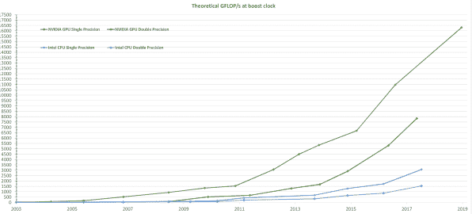

图 1 CPU 和 GPU 的每秒浮点运算次数

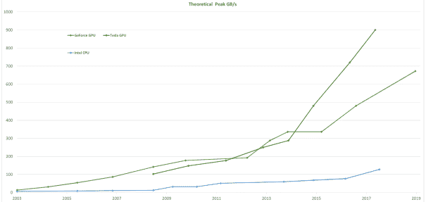

图 2 CPU 和 GPU 的内存带宽

CPU 与 GPU 之间浮点能力差异的原因在于，GPU 专门用于高度并行计算——这正是图形渲染所涉及的内容——因此其设计中更多晶体管用于数据处理，而非数据缓存和流程控制，如图 3 示意图所示。

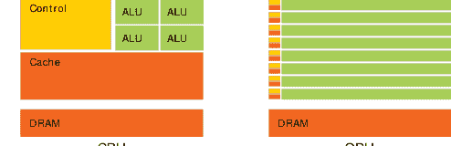

图 3 GPU 将更多晶体管用于数据处理

从概念上讲，这对高度并行计算是有效的，因为 GPU 可以通过计算来隐藏内存访问延迟，而不是通过大型数据缓存和流程控制来避免内存访问延迟。

数据并行处理将数据元素映射到并行处理线程。许多处理大型数据集的应用程序可以使用数据并行编程模型来加速计算。在 3D 渲染中，大量像素和顶点被映射到并行线程。同样，图像和媒体处理应用程序（如渲染图像的后处理、视频编解码、图像缩放、立体视觉和模式识别）可以将图像块和像素映射到并行处理线程。事实上，图像渲染和处理领域之外的许多算法都通过数据并行处理得到加速，从通用信号处理或物理模拟到计算金融或计算生物学。

### 1.2. CUDA®：通用并行计算平台和编程模型

2006 年 11 月，NVIDIA 推出了 CUDA®，这是一个通用并行计算平台和编程模型，它利用 NVIDIA GPU 中的并行计算引擎，以比 CPU 更高效的方式解决许多复杂的计算问题。

CUDA 附带一个软件环境，允许开发者使用 C++ 作为高级编程语言。如图 4 所示，还支持其他语言、应用程序编程接口或基于指令的方法，例如 FORTRAN、DirectCompute、OpenACC。

| GPU 计算应用 | | | | | | |
|:---|:---|:---|:---|:---|:---|:---|
| 库和中间件 | | | | | | |
| cuDNN TensorRT | cuFFT, cuBLAS, cuRAND, cuSPARSE | CULA MAGMA | Thrust NPP | NVPL, SVM, OpenCurrent | PhysX, OptiX, iRay | MATLAB Mathematica |
| 编程语言 | | | | | | |
| C | C++ | Fortran | Java、Python、包装器 | DirectCompute | 指令（例如，OpenACC） | |
| 支持 CUDA 的 NVIDIA GPU | | | | | | |
| Turing 架构（计算能力 7.x） | DRIVE/JETSON AGX Xavier | GeForce 2000 系列 | Quadro RTX 系列 | Tesla T 系列 | | |
| Volta 架构（计算能力 7.x） | DRIVE/JETSON AGX Xavier | | | Tesla V 系列 | | |
| Pascal 架构（计算能力 6.x） | Tegra X2 | GeForce 1000 系列 | Quadro P 系列 | Tesla P 系列 | | |
| Maxwell 架构（计算能力 5.x） | Tegra X1 | GeForce 900 系列 | Quadro M 系列 | Tesla M 系列 | | |
| Kepler 架构（计算能力 3.x） | Tegra K1 | GeForce 700 系列 GeForce 600 系列 | Quadro K 系列 | Tesla K 系列 | | |
| | 嵌入式 | 消费级桌面、笔记本 | 专业工作站 | 数据中心 | | |

图 4 GPU 计算应用 CUDA 旨在支持各种语言和应用程序编程接口。

### 1.3. 可扩展编程模型

多核 CPU 和多核 GPU 的出现意味着主流处理器芯片现在是并行系统。挑战在于开发能够透明地扩展其并行性以利用日益增加的处理器核心数量的应用程序软件，就像 3D 图形应用程序透明地扩展其并行性以适应核心数量差异很大的多核 GPU 一样。

CUDA 并行编程模型旨在克服这一挑战，同时为熟悉 C 等标准编程语言的程序员保持较低的学习曲线。


其核心是三个关键抽象——线程组层次结构、共享内存和屏障同步——这些抽象以最小的一组语言扩展形式简单地暴露给程序员。

这些抽象提供细粒度数据并行和线程并行，嵌套于粗粒度数据并行和任务并行之中。它们指导程序员将问题分解为可由线程块独立并行求解的粗粒度子问题，并将每个子问题进一步分解为可由块内所有线程协作并行求解的更细粒度片段。

这种分解通过允许线程在求解每个子问题时进行协作，保留了语言的表达性，同时实现了自动可扩展性。确实，每个线程块可以以任意顺序、并发或顺序方式调度到 GPU 中任何可用的多处理器上，因此编译后的 CUDA 程序可以在任意数量的多处理器上执行，如图 5 所示，且只有运行时系统需要知道物理多处理器的数量。

这种可扩展的编程模型使 GPU 架构能够通过简单地调整多处理器和内存分区的数量来覆盖广泛的市场范围：从面向高端爱好者的 GeForce GPU 和专业 Quadro 与 Tesla 计算产品，到各种廉价的主流 GeForce GPU（有关所有支持 CUDA 的 GPU 列表，请参阅 CUDA-Enabled GPUs）。

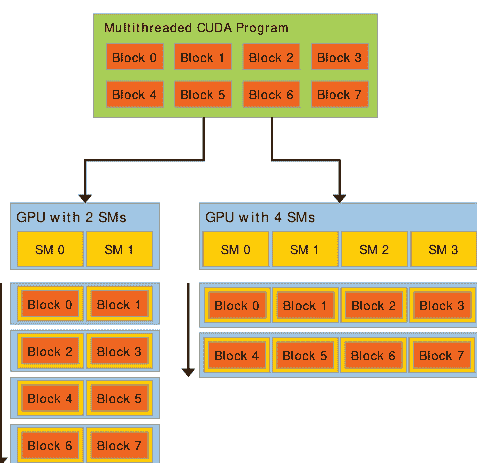

GPU 围绕一组流式多处理器（SM）构建（有关更多详细信息，请参阅硬件实现）。多线程程序被分割为相互独立执行的线程块，因此拥有更多多处理器的 GPU 会自动在更短时间内执行程序，而拥有较少多处理器的 GPU 则需要更长时间。

图 5 自动可扩展性

### 1.4. 文档结构

本文档包含以下章节：

- “简介”章对 CUDA 进行了总体介绍。
- “编程模型”章概述了 CUDA 编程模型。
- “编程接口”章描述了编程接口。
- “硬件实现”章描述了硬件实现。
- “性能指南”章介绍了如何实现最大性能的一些指导。
- “支持 CUDA 的 GPU”附录列出了所有支持 CUDA 的设备。
- “C++ 语言扩展”附录详细描述了 C++ 语言的所有扩展。
- “协作组”附录描述了各种 CUDA 线程组的同步原语。
- “CUDA 动态并行”附录描述了如何从一个内核启动并同步另一个内核。
- “数学函数”附录列出了 CUDA 支持的数学函数。
- “C++ 语言支持”附录列出了设备代码中支持的 C++ 特性。
- “纹理获取”附录提供了关于纹理获取的更多详细信息
- “计算能力”附录给出了各种设备的技术规范，以及更多架构细节。
- “驱动程序 API”附录介绍了低级驱动程序 API。
- “CUDA 环境变量”附录列出了所有 CUDA 环境变量。
- “统一内存编程”附录介绍了统一内存编程模型。

## 第 2 章 编程模型

本章通过概述这些概念在 C++ 中的公开方式，介绍了 CUDA 编程模型背后的主要概念。CUDA C++ 的详细描述见“编程接口”。

本章和下一章中使用的向量加法示例的完整代码可在 vectorAdd CUDA 示例中找到。

### 2.1. 内核

CUDA C++ 通过允许程序员定义称为内核的 C++ 函数来扩展 C++，这些内核在被调用时，由 N 个不同的 CUDA 线程并行执行 N 次，而常规 C++ 函数仅执行一次。

内核使用 __global__ 声明说明符定义，给定内核调用中执行该内核的 CUDA 线程数量通过新的 <<< >>> 执行配置语法指定（参见 C++ 语言扩展）。执行内核的每个线程都会获得一个唯一的线程 ID，可通过内置变量在内核内访问。

作为示例，以下示例代码使用内置变量 threadIdx，将两个大小为 N 的向量 A 和 B 相加，并将结果存储到向量 C 中：

```
// Kernel definition
__global__ void VecAdd(float* A, float* B, float* C)
{
    int i = threadIdx.x;
    C[i] = A[i] + B[i];
}

int main()
{
    ...
    // Kernel invocation with N threads
    VecAdd<<<1, N>>>(A, B, C);
    ...
}
```

在这里，执行 VecAdd() 的每个 N 个线程都执行一对一的加法。

### 2.2. 线程层次结构

为方便起见，**threadIdx** 是一个 3 分量向量，因此线程可以使用一维、二维或三维**线程索引**进行标识，从而形成一维、二维或三维的**线程块**，即**线程块**。这提供了一种在向量、矩阵或体积等域的元素上调用计算的自然方式。

线程的索引及其线程 ID 之间存在简单直接的关系：对于一维块，两者相同；对于大小为 \( (D_x, D_y) \) 的二维块，线程 \( (x, y) \) 的线程 ID 为 \( (x + y \cdot D_x) \)；对于大小为 \( (D_x, D_y, D_z) \) 的三维块，线程 \( (x, y, z) \) 的线程 ID 为 \( (x + y \cdot D_x + z \cdot D_x \cdot D_y) \)。

例如，以下代码将两个大小为 N×N 的矩阵 A 和 B 相加，并将结果存储到矩阵 C 中：

```
// Kernel definition
__global__ void MatAdd(float A[N][N], float B[N][N], float C[N][N])
{
    int i = threadIdx.x;
    int j = threadIdx.y;
    C[i][j] = A[i][j] + B[i][j];
}

int main()
{
    // Kernel invocation with one block of N * N * 1 threads
    int numBlocks = 1;
    dim3 threadsPerBlock(N, N);
    MatAdd<<<numBlocks, threadsPerBlock>>>(A, B, C);
    ...
}
```

每个块的线程数量有限制，因为块中的所有线程都预期驻留在同一处理器核心上，并且必须共享该核心的有限内存资源。在当前 GPU 上，一个线程块最多可包含 1024 个线程。

然而，一个内核可以由多个形状相同的线程块执行，因此线程总数等于每个块的线程数乘以块的数量。

块被组织成一维、二维或三维的线程块**网格**，如图 6 所示。网格中的线程块数量通常由正在处理的数据大小决定，这通常超过系统中的处理器数量。

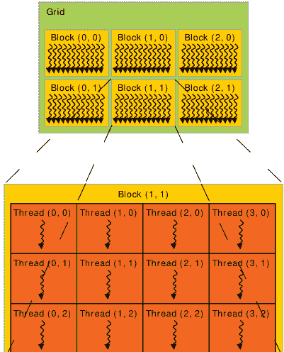

图 6 线程块网格

<<< ... >>> 语法中指定的每个块的线程数和每个网格的块数可以是 int 或 dim3 类型。二维块或网格可以如上例所示指定。

网格中的每个块都可以通过一个一维、二维或三维的唯一索引进行标识，该索引可通过内置变量 blockIdx 在内核中访问。线程块的维度可通过内置变量 blockDim 在内核中访问。

扩展前面的 `MatAdd()` 示例以处理多个块，代码变为如下所示。

```
// Kernel definition
__global__ void MatAdd(float A[N][N], float B[N][N],
                       float C[N][N])
{
    int i = blockIdx.x * blockDim.x + threadIdx.x;
    int j = blockIdx.y * blockDim.y + threadIdx.y;
    if (i < N && j < N)
        C[i][j] = A[i][j] + B[i][j];
}

int main()
{
    ...
    // Kernel invocation
    dim3 threadsPerBlock(16, 16);
    dim3 numBlocks(N / threadsPerBlock.x, N / threadsPerBlock.y);
    MatAdd<<<numBlocks, threadsPerBlock>>>(A, B, C);
    ...
}
```

线程块大小为 16×16（256 个线程），尽管在此示例中是任意选择的，但这是一种常见选择。网格是通过创建足够多的块来构建的，以便每个矩阵元素对应一个线程，与之前一样。为简单起见，此示例假设每个维度上每个网格的线程数可以被该维度上每个块的线程数整除，尽管实际情况未必如此。

线程块要求独立执行：必须可以以任何顺序、并行或串行方式执行它们。这一独立性要求允许线程块以任何顺序跨任意数量的核心进行调度，如图 5 所示，从而使程序员能够编写随核心数量扩展的代码。

块内的线程可以通过共享内存共享数据，并通过同步执行来协调内存访问，从而进行协作。更准确地说，可以通过调用 `__syncthreads()` 内置函数在内核中指定同步点；`__syncthreads()` 充当屏障，块中的所有线程必须在此等待，然后才允许任何线程继续。“共享内存”章节给出了使用共享内存的示例。除了 `__syncthreads()` 之外，协作组 API 还提供了一组丰富的线程同步原语。

为实现高效协作，共享内存预期是靠近每个处理器核心的低延迟内存（类似于 L1 缓存），且 `__syncthreads()` 预期是轻量级的。

### 2.3. 内存层次结构

CUDA 线程在执行期间可以访问多个内存空间中的数据，如图 7 所示。每个线程都有私有局部内存。每个线程块都有共享内存，对块中的所有线程可见，且生命周期与块相同。所有线程都可以访问相同的全局内存。

还有两个由所有线程可访问的只读内存空间：常量内存空间和纹理内存空间。全局、常量和纹理内存空间针对不同的内存使用情况进行了优化（参见设备内存访问）。纹理


内存还为某些特定数据格式提供不同的寻址模式以及数据过滤功能（参见纹理和表面内存）。

全局、常量和纹理内存空间在同一应用程序的多次内核启动之间保持持久。

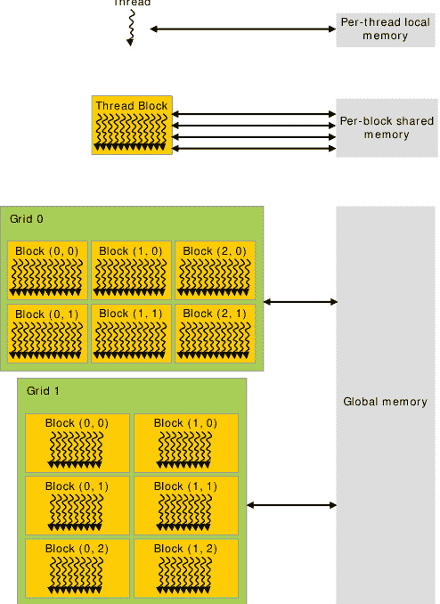

图 7 内存层次结构

### 2.4. 异构编程

如图 8 所示，CUDA 编程模型假设 CUDA 线程在物理上独立的设备上执行，该设备作为运行 C++ 程序的主机的协处理器运行。例如，当内核在 GPU 上执行而 C++ 程序的其余部分在 CPU 上执行时，就是这种情况。

CUDA 编程模型还假设主机和设备各自在 DRAM 中维护独立的内存空间，分别称为主机内存和设备内存。因此，程序通过调用 CUDA 运行时（在编程接口中描述）来管理内核可见的全局、常量和纹理内存空间。这包括设备内存的分配和释放，以及主机内存与设备内存之间的数据传输。

统一内存提供托管内存以连接主机和设备内存空间。托管内存可从系统中的所有 CPU 和 GPU 访问，作为具有共同地址空间的单一连贯内存映像。此功能可实现设备内存超额订阅，并可通过消除在主机和设备上显式镜像数据的需求，大大简化应用程序移植任务。有关统一内存的介绍，请参阅统一内存编程。

C 程序顺序执行

串行代码

并行内核 Kernel0<<< >>>(

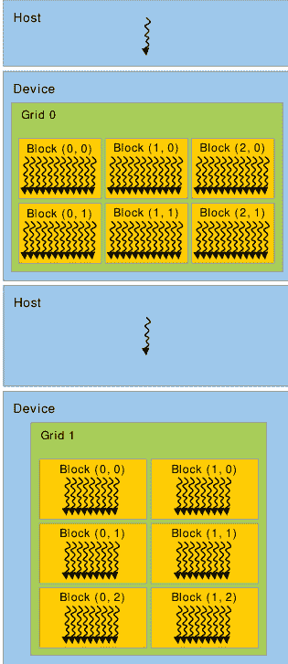

串行代码

并行内核 Kernel1<<< >>>(

串行代码在主机上执行，而并行代码在设备上执行。

图 8 异构编程

### 2.5. 计算能力

设备的计算能力由一个版本号表示，有时也称为其“SM 版本”。该版本号标识 GPU 硬件支持的功能，并由应用程序在运行时用于确定当前 GPU 上可用的硬件功能和/或指令。

计算能力由主修订号 X 和次修订号 Y 组成，表示为 X.Y。

具有相同主修订号的设备属于同一核心架构。基于 Volta 架构的设备的主修订号为 7，基于 Pascal 架构的设备为 6，基于 Maxwell 架构的设备为 5，基于 Kepler 架构的设备为 3，基于 Fermi 架构的设备为 2，基于 Tesla 架构的设备为 1。

次修订号对应核心架构的渐进式改进，可能包括新功能。

Turing 是计算能力 7.5 设备的架构，是基于 Volta 架构的渐进式更新。

CUDA 支持的 GPU 列出了所有支持 CUDA 的设备及其计算能力。计算能力提供了每个计算能力的技术规范。

> 不应将特定 GPU 的计算能力版本与 CUDA 版本（例如，CUDA 7.5、CUDA 8、CUDA 9）混淆，后者是 CUDA 软件平台的版本。应用程序开发者使用 CUDA 平台来创建可在多代 GPU 架构（包括尚未发明的未来 GPU 架构）上运行的应用程序。虽然 CUDA 平台的新版本通常通过支持该架构的计算能力版本来为新 GPU 架构添加原生支持，但 CUDA 平台的新版本通常还包括与硬件代际无关的软件功能。

Tesla 和 Fermi 架构分别从 CUDA 7.0 和 CUDA 9.0 开始不再受支持。

## 第 3 章 编程接口

CUDA C++ 为熟悉 C++ 编程语言的用户提供了一条简单路径，以便轻松编写可由设备执行的程序。

它包括对 C++ 语言的一组最小扩展和一个运行时库。

核心语言扩展已在编程模型中介绍。它们允许程序员将内核定义为 C++ 函数，并在每次调用函数时使用一些新语法来指定网格和块维度。所有扩展的完整描述可见 C++ 语言扩展。包含这些扩展中的任何扩展的任何源文件都必须使用 nvcc 编译，如在使用 NVCC 编译中概述。

运行时在 CUDA 运行时中介绍。它提供在主机上执行的 C 和 C++ 函数，用于分配和释放设备内存、在主机内存和设备内存之间传输数据、管理多设备系统等。运行时的完整描述可见 CUDA 参考手册。

运行时构建在较低级别的 C API（即 CUDA 驱动程序 API）之上，该 API 也可由应用程序访问。驱动程序 API 通过公开较低级别的概念（例如 CUDA 上下文——设备的主机进程类比物，以及 CUDA 模块——设备的动态加载库类比物）来提供额外的控制级别。大多数应用程序不使用驱动程序 API，因为它们不需要这种额外的控制级别，并且在使用运行时时，上下文和模块管理是隐式的，从而产生更简洁的代码。由于运行时与驱动程序 API 互操作，大多数需要某些驱动程序 API 功能的应用程序可以默认使用运行时 API，仅在需要时使用驱动程序 API。驱动程序 API 在驱动程序 API 中介绍，并在参考手册中完整描述。

### 3.1. 使用 NVCC 编译

内核可以使用称为 PTX 的 CUDA 指令集架构编写，PTX 在 PTX 参考手册中有描述。但是，通常使用 C++ 等高级编程语言更有效。在两种情况下，内核都必须由 nvcc 编译为二进制代码才能在设备上执行。

nvcc 是一个编译器驱动程序，简化了编译 C++ 或 PTX 代码的过程：它提供简单且熟悉的命令行选项，并通过调用实现不同编译阶段的工具集合来执行它们。本节概述了 nvcc 工作流和命令选项。完整描述可见 nvcc 用户手册。

##### 3.1.1.1. 编译工作流

###### 3.1.1.1.1. 离线编译

使用 nvcc 编译的源文件可以包含主机代码（即在主机上执行的代码）和设备代码（即在设备上执行的代码）的混合。nvcc 的基本工作流程包括将设备代码与主机代码分离，然后：

- 将设备代码编译为汇编形式（PTX 代码）和/或二进制形式（cubin 对象），
- 并通过将内核中引入的 <<< ... >>> 语法（在执行配置中有更详细的描述）替换为必要的 CUDA 运行时函数调用来修改主机代码，以便从 PTX 代码和/或 cubin 对象加载并启动每个编译的内核。

修改后的主机代码输出为 C++ 代码（留待使用其他工具编译）或直接作为目标代码（通过让 nvcc 在最后一个编译阶段调用主机编译器）。

然后，应用程序可以：
- 链接到编译后的主机代码（这是最常见的情况），
- 或忽略修改后的主机代码（如果有）并使用 CUDA 驱动程序 API（参见驱动程序 API）来加载和执行 PTX 代码或 cubin 对象。

##### 3.1.1.2. 即时编译

应用程序在运行时加载的任何 PTX 代码都会由设备驱动程序进一步编译为二进制代码。这称为即时编译。即时编译会增加应用程序加载时间，但允许应用程序受益于每个新设备驱动程序带来的任何新编译器改进。这也是应用程序在编译时不存在的设备上运行的唯一方法，如应用程序兼容性中详细说明。

当设备驱动程序为某个应用程序即时编译某些 PTX 代码时，它会自动缓存生成的二进制代码的副本，以避免在后续应用程序调用中重复编译。缓存（称为计算缓存）在设备驱动程序升级时会自动失效，以便应用程序可以受益于设备驱动程序内置的新即时编译器中的改进。

可使用环境变量来控制即时编译，如 CUDA 环境变量中所述。


作为使用 **nvcc** 编译 CUDA C++ 设备代码的替代方案，NVRTC 可用于在运行时将 CUDA C++ 设备代码编译为 PTX。NVRTC 是 CUDA C++ 的运行时编译库；更多信息可以在 NVRTC 用户指南中找到。

#### 3.1.2. 二进制兼容性

二进制代码是特定于架构的。使用编译器选项 `-code` 生成 *cubin* 对象，该选项指定目标架构：例如，使用 `-code=sm_35` 编译会生成适用于计算能力 3.5 设备的二进制代码。二进制兼容性在一个次要修订版到下一个次要修订版之间得到保证，但不保证从一个次要修订版到上一个次要修订版或跨主要修订版。换句话说，为计算能力 X.y 生成的 *cubin* 对象只能在计算能力为 X.z（且 z≥y）的设备上执行。

> 二进制兼容性仅支持桌面版。Tegra 不支持。此外，桌面版和 Tegra 之间的二进制兼容性也不受支持。

#### 3.1.3. PTX 兼容性

某些 *PTX* 指令仅在较高计算能力的设备上受支持。例如，Warp Shuffle Functions 仅在计算能力 3.0 及以上的设备上受支持。`-arch` 编译器选项指定在将 C++ 编译为 PTX 代码时假定的计算能力。因此，例如包含 warp shuffle 的代码必须使用 `-arch=compute_30`（或更高版本）进行编译。

为特定计算能力生成的 PTX 代码始终可以编译为更高或相等计算能力的二进制代码。请注意，从较早 PTX 版本编译的二进制文件可能无法使用某些硬件功能。例如，从为计算能力 6.0 (Pascal) 生成的 PTX 编译而成的、面向计算能力 7.0 (Volta) 设备的二进制文件将不会使用 Tensor Core 指令，因为这些指令在 Pascal 上不可用。因此，最终二进制文件的性能可能不如使用最新版本的 PTX 生成的二进制文件那样好。

#### 3.1.4. 应用程序兼容性

要在特定计算能力的设备上执行代码，应用程序必须加载与该计算能力兼容的二进制代码或 PTX 代码，如二进制兼容性和 PTX 兼容性中所述。特别是，为了能够在具有更高计算能力的未来架构（目前尚无法为其生成二进制代码）上执行代码，应用程序必须加载将针对这些设备即时编译的 PTX 代码（参见即时编译）。

嵌入 CUDA C++ 应用程序的 PTX 和二进制代码由 `-arch` 和 `-code` 编译器选项或 `-gencode` 编译器选项控制，详情请参阅 **nvcc** 用户手册。例如，

```
nvcc x.cu \
    -gencode arch=compute_35,code=sm_35 \
    -gencode arch=compute_50,code=sm_50 \
    -gencode arch=compute_60,code='compute_60,sm_60'
```

将与计算能力 3.5 和 5.0 兼容的二进制代码（第一个和第二个 -gencode 选项）以及与计算能力 6.0 兼容的 PTX 和二进制代码（第三个 -gencode 选项）嵌入其中。

将生成主机代码，以在运行时自动选择最合适的代码加载并执行，在上述示例中，这将是：

- 适用于计算能力 3.5 和 3.7 设备的 3.5 二进制代码，
- 适用于计算能力 5.0 和 5.2 设备的 5.0 二进制代码，
- 适用于计算能力 6.0 和 6.1 设备的 6.0 二进制代码，
- 适用于计算能力 7.0 及更高设备的、在运行时编译为二进制代码的 PTX 二进制代码。

x.cu 可以包含使用 warp shuffle 操作的优化代码路径，例如，这些操作仅在计算能力 3.0 及更高版本的设备上受支持。__CUDA_ARCH__ 宏可用于根据计算能力区分各种代码路径。它仅为设备代码定义。例如，使用 -arch=compute_35 编译时，__CUDA_ARCH__ 等于 350。

使用驱动程序 API 的应用程序必须将代码编译到单独的文件中，并在运行时显式加载和执行最合适的文件。

Volta 架构引入了独立线程调度，这改变了 GPU 上线程的调度方式。对于依赖于先前架构中 SIMT 调度特定行为的代码，独立线程调度可能会更改参与线程的集合，从而导致结果不正确。为了在实施独立线程调度中详细的纠正措施的同时帮助迁移，Volta 开发者可以通过编译器选项组合 -arch=compute_60 -code=sm_70 选择使用 Pascal 的线程调度。

nvcc 用户手册列出了 -arch、-code 和 -gencode 编译器选项的各种简写形式。例如，-arch=sm_35 是 -arch=compute_35 -code=compute_35,sm_35 的简写（这与 -gencode arch=compute_35,code='compute_35,sm_35' 相同）。

#### 3.1.5. C++ 兼容性

编译器的前端根据 C++ 语法规则处理 CUDA 源文件。主机代码完全支持 C++。但是，设备代码仅完全支持 C++ 的一个子集，如 C++ 语言支持中所述。

#### 3.1.6. 64 位兼容性

nvcc 的 64 位版本以 64 位模式编译设备代码（即，指针为 64 位）。以 64 位模式编译的设备代码仅支持与以 64 位模式编译的主机代码一起使用。

同样，nvcc 的 32 位版本以 32 位模式编译设备代码，以 32 位模式编译的设备代码仅支持与以 32 位模式编译的主机代码一起使用。

nvcc 的 32 位版本也可以使用 -m64 编译器选项以 64 位模式编译设备代码。

**nvcc** 的 64 位版本也可以使用 **-m32** 编译器选项以 32 位模式编译设备代码。

### 3.2. CUDA 运行时

运行时在 **cudart** 库中实现，该库通过 **cudart.lib** 或 **libcudart.a** 静态链接到应用程序，或通过 **cudart.dll** 或 **libcudart.so** 动态链接到应用程序。需要 **cudart.dll** 和/或 **cudart.so** 进行动态链接的应用程序通常将它们作为应用程序安装包的一部分。仅在链接到同一 CUDA 运行时实例的组件之间传递 CUDA 运行时符号的地址才是安全的。

其所有入口点均以 **cuda** 作为前缀。

如异构编程中所述，CUDA 编程模型假设一个由主机和设备组成的系统，每个都有各自独立的内存。设备内存概述了用于管理设备内存的运行时函数。

共享内存说明了使用线程层次结构中介绍的共享内存以最大化性能。

页锁定主机内存介绍了页锁定主机内存，它用于将内核执行与主机和设备内存之间的数据传输重叠。

异步并发执行描述了用于在系统各级别启用异步并发执行的概念和 API。

多设备系统展示了编程模型如何扩展到连接到同一主机的多个设备的系统。

错误检查描述了如何正确检查运行时生成的错误。

调用堆栈提及了用于管理 CUDA C++ 调用堆栈的运行时函数。

纹理和表面内存介绍了纹理和表面内存空间，它们提供了访问设备内存的另一种方式；它们还公开了 GPU 纹理硬件的一个子集。

图形互操作性介绍了运行时提供的各种函数，用于与两个主要图形 API（OpenGL 和 Direct3D）进行互操作。

#### 3.2.1. 初始化

运行时没有显式初始化函数；它在首次调用运行时函数时初始化（更具体地说，是除参考手册中错误处理和版本管理部分的函数之外的任何函数）。在计时运行时函数调用和解释首次调用运行时时的错误代码时，需要牢记这一点。

在初始化期间，运行时为系统中的每个设备创建一个 CUDA 上下文（有关 CUDA 上下文的更多详细信息，请参见上下文）。此上下文是该设备的 **主上下文**，并由应用程序的所有主机线程共享。作为这一


上下文创建时，如有必要，设备代码会即时编译（参见即时编译）并加载到设备内存中。这一切都透明进行。如有需要，例如用于驱动程序API互操作性，设备的主上下文可以从驱动程序API访问，如运行时与驱动程序API之间的互操作性中所述。

当主机线程调用 cudaDeviceReset() 时，这会销毁主机线程当前正在操作的设备的主上下文（即，设备选择中定义的当前设备）。任何将此设备作为当前设备的主机线程所做的下一个运行时函数调用都将为该设备创建一个新的主上下文。

CUDA接口使用在主机程序启动期间初始化并在主机程序终止期间销毁的全局状态。CUDA运行时和驱动程序无法检测此状态是否无效，因此在main()之后的程序启动或终止期间使用这些接口中的任何一个（隐式或显式）都将导致未定义行为。

#### 3.2.2. 设备内存

如前所述的异构编程，CUDA编程模型假设一个由主机和设备组成的系统，各自拥有独立的内存。内核在设备内存中运行，因此运行时提供分配、释放和复制设备内存的函数，以及在主机内存和设备内存之间传输数据的函数。

设备内存可以作为线性内存或CUDA数组进行分配。

CUDA数组是针对纹理获取优化的不透明内存布局。它们在纹理和表面内存中描述。

线性内存在单个统一地址空间中分配，这意味着分别分配的实体可以通过指针相互引用，例如，在二叉树或链表中。地址空间的大小取决于主机系统（CPU）和所使用GPU的计算能力：

表 1 线性内存地址空间

| | x86_64 (AMD64) | POWER (ppc64le) | ARM64 |
|---|---|---|---|
| 最高计算能力 5.3 (Maxwell) | 40位 | 40位 | 40位 |
| 计算能力 6.0 (Pascal) 或更新 | 最高 47位 | 最高 49位 | 最高 48位 |

对于计算能力 5.3 (Maxwell) 及更早的设备，CUDA驱动程序创建一个未提交的40位虚拟地址预留，以确保内存分配（指针）落入支持的范围。此预留显示为保留的虚拟内存，但在程序实际分配内存之前不占用任何物理内存。

线性内存通常使用 cudaMalloc() 分配，使用 cudaFree() 释放，主机内存和设备内存之间的数据传输通常使用 cudaMemcpy() 进行。在内核的向量加法代码示例中，向量需要从主机内存复制到设备内存：

```
// Device code
__global__ void VecAdd(float* A, float* B, float* C, int N)
{
    int i = blockDim.x * blockIdx.x + threadIdx.x;
    if (i < N)
        C[i] = A[i] + B[i];
}

// Host code
int main()
{
    int N = ...;
    size_t size = N * sizeof(float);

    // Allocate input vectors h_A and h_B in host memory
    float* h_A = (float*)malloc(size);
    float* h_B = (float*)malloc(size);

    // Initialize input vectors
    ...

    // Allocate vectors in device memory
    cudaMalloc(&d_A, size);
    cudaMalloc(&d_B, size);
    cudaMalloc(&d_C, size);

    // Copy vectors from host memory to device memory
    cudaMemcpy(d_A, h_A, size, cudaMemcpyHostToDevice);
    cudaMemcpy(d_B, h_B, size, cudaMemcpyHostToDevice);

    // Invoke kernel
    int threadsPerBlock = 256;
    int blocksPerGrid = (N + threadsPerBlock - 1) / threadsPerBlock;
    VecAdd<<<blocksPerGrid, threadsPerBlock>>>(d_A, d_B, d_C, N);

    // Copy result from device memory to host memory
    // h_C contains the result in host memory
    cudaMemcpy(h_C, d_C, size, cudaMemcpyDeviceToHost);

    // Free device memory
    cudaFree(d_A);
    cudaFree(d_B);
    cudaFree(d_C);

    // Free host memory
    ...
}
```

线性内存也可以通过 cudaMallocPitch() 和 cudaMalloc3D() 分配。这些函数推荐用于分配2D或3D数组，因为它们确保分配适当填充以满足设备内存访问中描述的对齐要求，因此在访问行地址或在2D数组与设备内存其他区域之间执行复制（使用 cudaMemcpy2D() 和 cudaMemcpy3D() 函数）时可确保最佳性能。返回的步距（或跨度）必须用于访问数组元素。以下代码示例分配一个 **宽度 x 高度** 的浮点值2D数组，并展示如何在设备代码中遍历数组元素：

```
// Host code
int width = 64, height = 64;
float* devPtr;
size_t pitch;
cudaMallocPitch(&devPtr, &pitch,
                width * sizeof(float), height);
MyKernel<<<100, 512>>>(devPtr, pitch, width, height);

// Device code
__global__ void MyKernel(float* devPtr,
                         size_t pitch, int width, int height)
{
    for (int r = 0; r < height; ++r) {
        float* row = (float*)((char*)devPtr + r * pitch);
        for (int c = 0; c < width; ++c) {
            float element = row[c];
        }
    }
}
```

以下代码示例分配一个 **宽度 x 高度 x 深度** 的浮点值3D数组，并展示如何在设备代码中遍历数组元素：

```
// Host code
int width = 64, height = 64, depth = 64;
cudaExtent extent = make_cudaExtent(width * sizeof(float),
                                    height, depth);
cudaPitchedPtr devPitchedPtr = cudaMalloc3D(&extent);
MyKernel<<<100, 512>>>(devPitchedPtr, width, height, depth);

// Device code
__global__ void MyKernel(cudaPitchedPtr devPitchedPtr,
                         int width, int height, int depth)
{
    char* devPtr = devPitchedPtr.ptr;
    size_t pitch = devPitchedPtr.pitch;
    size_t slicePitch = devPitchedPtr.slicePitch;
    for (int z = 0; z < depth; ++z) {
        char* slice = devPtr + z * slicePitch;
        for (int y = 0; y < height; ++y) {
            float* row = (float*)(slice + y * pitch);
            for (int x = 0; x < width; ++x) {
                float element = row[x];
            }
        }
    }
}
```

参考手册列出了用于在使用 **cudaMalloc()** 分配的线性内存、使用 **cudaMallocPitch()** 或 **cudaMalloc3D()** 分配的线性内存、CUDA数组以及在全局或常量内存空间中声明的变量所分配的内存之间复制内存的所有各种函数。

以下代码示例说明了通过运行时API访问全局变量的各种方式：

```
__constant__ float constData[256];
float data[256];
cudaMemcpyToSymbol(constData, data, sizeof(data));
cudaMemcpyFromSymbol(data, constData, sizeof(data));

__device__ float devData;
float value = 3.14f;
cudaMemcpyToSymbol(devData, &value, sizeof(float));

__device__ float* devPointer;
float* ptr;
cudaMalloc(&ptr, 256 * sizeof(float));
cudaMemcpyToSymbol(devPointer, &ptr, sizeof(ptr));
cudaMemcpyToSymbol(devPointer, ptr, sizeof(ptr));
```

cudaGetSymbolAddress() 用于检索指向在全局内存空间中声明的变量所分配内存的地址。分配的内存大小通过 cudaGetSymbolSize() 获得。

#### 3.2.3. 共享内存

如前所述的变量内存空间说明符，共享内存使用 __shared__ 内存空间说明符进行分配。

共享内存预计比全局内存快得多，如线程层次结构中所述并在共享内存中详细说明。它可以用作暂存内存（或软件托管缓存），以最大限度地减少CUDA块的全局内存访问，如以下矩阵乘法示例所示。

以下代码示例是矩阵乘法的直接实现，未利用共享内存。每个线程读取A的一行和B的一列，并计算C的相应元素，如图9所示。因此，A从全局内存读取 B.width 次，B读取 A.height 次。

```
// Matrices are stored in row-major order:
#define M(width, col) *(M.elements + row * M.width + col)
typedef struct {
    int width;
    int height;
    float* elements;
} Matrix;

// Thread block size
#define BLOCK_SIZE 16

// Forward declaration of the matrix multiplication kernel
__global__ void MatMulKernel(const Matrix, const Matrix, Matrix);

// Matrix multiplication - Host code
// Matrix dimensions are assumed to be multiples of BLOCK_SIZE
void MatMul(const Matrix A, const Matrix B, Matrix C)
{
    // Load A and B to device memory
    Matrix d_A;
    d_A.width = A.width; d_A.height = A.height;
    size_t size = A.width * A.height * sizeof(float);
    cudaMalloc(&d_A.elements, size);
    cudaMemcpy(d_A.elements, A.elements, size,
               cudaMemcpyHostToDevice);
    Matrix d_B;
    d_B.width = B.width; d_B.height = B.height;
    size = B.width * B.height * sizeof(float);
    cudaMalloc(&d_B.elements, size);
    cudaMemcpy(d_B.elements, B.elements, size,
               cudaMemcpyHostToDevice);

    // Allocate C in device memory
    Matrix d_C;
    d_C.width = C.width; d_C.height = C.height;
    size = C.width * C.height * sizeof(float);
    cudaMalloc(&d_C.elements, size);

    // Invoke kernel
    dim3 dimBlock(BLOCK_SIZE, BLOCK_SIZE);
    dim3 dimGrid(B.width / dimBlock.x, A.height / dimBlock.y);
    MatMulKernel<<<dimGrid, dimBlock>>>(d_A, d_B, d_C);

    // Read C from device memory
    cudaMemcpy(C.elements, d_C.elements, size,
               cudaMemcpyDeviceToHost);

    // Free device memory
    cudaFree(d_A.elements);
    cudaFree(d_B.elements);
    cudaFree(d_C.elements);
}

// Matrix multiplication kernel called by MatMul()
__global__ void MatMulKernel(Matrix A, Matrix B, Matrix C)
{
    // Each thread computes one element of C
    // by accumulating results into Cvalue
    float Cvalue = 0;
    int row = blockIdx.y * blockDim.y + threadIdx.y;
    int col = blockIdx.x * blockDim.x + threadIdx.x;
    for (int e = 0; e < A.width; ++e)
        Cvalue += A.elements[row * A.width + e]
                 * B.elements[e * B.width + col];
    C.elements[row * C.width + col] = Cvalue;
}


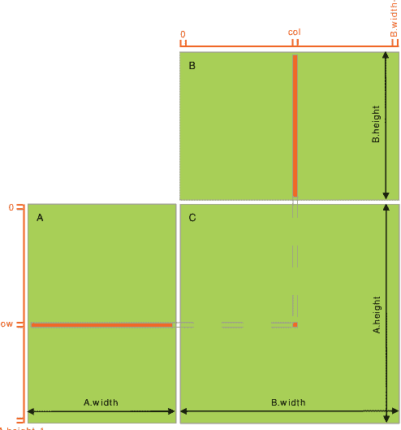

## 图 9 不使用共享内存的矩阵乘法

以下代码示例是一个利用共享内存进行矩阵乘法的实现。在此实现中，每个线程块负责计算 C 的一个方形子矩阵 Csub，块中的每个线程负责计算 Csub 的一个元素。如图 10 所示，Csub 等于两个矩形矩阵的乘积：与 Csub 具有相同行索引的 A 的子矩阵（维度为 (A.width, block-size)），以及与 Csub 具有相同列索引的 B 的子矩阵（维度为 (block-size, A.width)）。为了适应设备资源，这两个矩形矩阵被分成必要数量的 block_size 维度的方形矩阵，Csub 计算为这些方形矩阵乘积之和。这些乘积中的每一个首先通过从全局内存加载两个对应的方形矩阵到共享内存（每个线程加载每个矩阵的一个元素），然后让每个线程计算乘积的一个元素来执行。每个线程将每个乘积的结果累积到寄存器中，完成后将结果写入全局内存。

通过这种方式阻塞计算，我们利用快速共享内存并节省大量全局内存带宽，因为 A 仅从全局内存读取 (B.width / block_size) 次，B 读取 (A.height / block_size) 次。

前一个代码示例中的 Matrix 类型增加了一个 stride 字段，以便可以用相同的类型高效表示子矩阵。__device__ 函数用于获取和设置元素以及从矩阵构建任何子矩阵。

```
// Matrices are stored in row-major order:
// M(row, col) = *(M.elements + row * M.stride + col)
typedef struct {
    int width;
    int height;
    int stride;
    float* elements;
} Matrix;

// Get a matrix element
__device__ float GetElement(const Matrix A, int row, int col)
{
    return A.elements[row * A.stride + col];
}

// Set a matrix element
__device__ void SetElement(Matrix A, int row, int col,
                           float value)
{
    A.elements[row * A.stride + col] = value;
}

// Get the BLOCK_SIZE x BLOCK_SIZE sub-matrix Asub of A that is
// located col sub-matrices to the right of col sub-matrices and
// row sub-matrices down from the upper-left corner of A
__device__ Matrix GetSubMatrix(Matrix A, int row, int col)
{
    Matrix Asub;
    Asub.width    = BLOCK_SIZE;
    Asub.height   = BLOCK_SIZE;
    Asub.stride   = A.stride;
    Asub.elements = &A.elements[A.stride * BLOCK_SIZE * row
                              + BLOCK_SIZE * col];
    return Asub;
}

// Thread block size
#define BLOCK_SIZE 16

// Forward declaration of the matrix multiplication kernel
__global__ void MatMulKernel(const Matrix, const Matrix, Matrix);

// Matrix multiplication - Host code
// Matrix dimensions are assumed to be multiples of BLOCK_SIZE
void MatMul(const Matrix A, const Matrix B, Matrix C)
{
    // Load A and B to device memory
    Matrix d_A;
    d_A.width = A.width; d_A.height = A.height;
    size_t size = A.width * A.height * sizeof(float);
    cudaMalloc(&d_A.elements, size);
    cudaMemcpy(d_A.elements, A.elements, size,
               cudaMemcpyHostToDevice);
    Matrix d_B;
    d_B.width = B.width; d_B.height = B.height;
    size = B.width * B.height * sizeof(float);
    cudaMalloc(&d_B.elements, size);
    cudaMemcpy(d_B.elements, B.elements, size,
               cudaMemcpyHostToDevice);
    // Allocate C in device memory
    Matrix d_C;
    d_C.width = d_C.stride = C.width; d_C.height = C.height;
    size = C.width * C.height * sizeof(float);
    cudaMalloc(&d_C.elements, size);
    // Invoke kernel
    dim3 dimBlock(BLOCK_SIZE, BLOCK_SIZE);
    dim3 dimGrid(B.width / dimBlock.x, A.height / dimBlock.y);
    MatMulKernel<<<dimGrid, dimBlock>>>(d_A, d_B, d_C);
    // Read C from device memory
    cudaMemcpy(C.elements, d_C.elements, size,
               cudaMemcpyDeviceToHost);
    // Free device memory
    cudaFree(d_A.elements);
    cudaFree(d_B.elements);
    cudaFree(d_C.elements);
}

// Matrix multiplication kernel called by MatMul()
__global__ void MatMulKernel(Matrix A, Matrix B, Matrix C)
{
// Block row and column
int blockRow = blockIdx.y;
int blockCol = blockIdx.x;
// Each thread block computes one sub-matrix Csub of C
Matrix Csub = GetSubMatrix(C, blockRow, blockCol);
// Each thread computes one element of Csub
// by accumulating results into Cvalue
float Cvalue = 0;
// Thread row and column within Csub
int row = threadIdx.y;
int col = threadIdx.x;
// Loop over all the sub-matrices of A and B that are
// required to compute Csub
// Multiply each pair of sub-matrices together
// and accumulate the results
for (int m = 0; m < (A.width / BLOCK_SIZE); ++m) {
// Get sub-matrix Asub of A
Matrix Asub = GetSubMatrix(A, blockRow, m);
// Get sub-matrix Bsub of B
Matrix Bsub = GetSubMatrix(B, m, blockCol);
// Shared memory used to store Asub and Bsub respectively
__shared__ float As[BLOCK_SIZE][BLOCK_SIZE];
__shared__ float Bs[BLOCK_SIZE][BLOCK_SIZE];
// Load Asub and Bsub from device memory to shared memory
// Each thread loads one element of each sub-matrix
As[row][col] = GetElement(Asub, row, col);
Bs[row][col] = GetElement(Bsub, row, col);
// Synchronize to make sure the sub-matrices are loaded
// before starting the computation
__syncthreads();

// Multiply Asub and Bsub together
for (int e = 0; e < BLOCK_SIZE; ++e)
    Cvalue += As[row][e] * Bs[e][col];

// Synchronize to make sure that the preceding
// computation is done before loading two new
// sub-matrices of A and B in the next iteration
    __syncthreads();
}
// Write Csub to device memory
// Each thread writes one element
    SetElement(Csub, row, col, Cvalue);
}
```

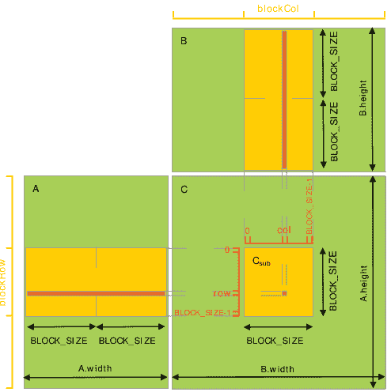

#### 3.2.4. 页锁定主机内存

运行时提供函数以允许使用页锁定（也称为固定）主机内存（与由 malloc() 分配的常规可页主机内存相对）：

- cudaHostAlloc() 和 cudaFreeHost() 分配和释放页锁定主机内存；
- cudaHostRegister() 页锁定由 `malloc()` 分配的一段内存（有关限制，请参阅参考手册）。

使用页锁定主机内存有多种好处：

- 对于某些设备，页锁定主机内存与设备内存之间的拷贝可以与内核执行并发进行，如异步并发执行中所述。
- 在某些设备上，页锁定主机内存可以映射到设备的地址空间，从而无需将其拷贝到或从设备内存拷贝，如映射内存中详细说明。
- 在具有前端总线的系统上，如果主机内存分配为页锁定，则主机内存和设备内存之间的带宽更高；如果还分配为写合并，则带宽更高，如写合并内存中所述。

然而，页锁定主机内存是一种稀缺资源，因此页锁定内存的分配将在可页内存分配失败之前很久就开始失败。此外，通过减少操作系统可用于分页的物理内存量，消耗过多页锁定内存会降低整体系统性能。

> 页锁定主机内存在非 I/O 一致 Tegra 设备上不缓存。此外，cudaHostRegister() 在非 I/O 一致 Tegra 设备上不受支持。

简单的零拷贝 CUDA 示例附带有关页锁定内存 API 的详细文档。

##### 3.2.4.1. 可移植内存

一块页锁定内存可以与系统中的任何设备一起使用（有关多设备系统的更多详细信息，请参阅多设备系统），但默认情况下，上述使用页锁定内存的好处仅在分配块时当前的设备（以及共享同一统一地址空间的所有设备，如果有，如统一虚拟地址空间中所述）可用时才可用。要使这些优势对所有设备可用，该块需要通过将标志 cudaHostAllocPortable 传递给 cudaHostAlloc() 来分配，或通过将标志 cudaHostRegisterPortable 传递给 cudaHostRegister() 来页锁定。

##### 3.2.4.2. 写合并内存

默认情况下，页锁定主机内存分配为可缓存。也可以通过将标志 cudaHostAllocWriteCombined 传递给 cudaHostAlloc() 将其分配为写合并。写合并内存释放主机的 L1 和 L2 缓存资源，为应用程序的其余部分提供更多缓存。此外，写合并内存在跨 PCI Express 总线传输期间不被监听，可将传输性能提高多达 40%。

从主机读取写合并内存的速度极慢，因此写合并内存通常应仅用于主机只写入的内存。


##### 3.2.4.3. 映射内存

可分页锁定的主机内存块也可以通过向 cudaHostAlloc() 传递标志 cudaHostAllocMapped 或向 cudaHostRegister() 传递标志 cudaHostRegisterMapped，将其映射到设备的地址空间中。因此，此类块通常有两个地址：一个在主机内存中，由 cudaHostAlloc() 或 malloc() 返回；另一个在设备内存中，可使用 cudaHostGetDevicePointer() 检索，然后用于从内核中访问该块。唯一的例外是使用 cudaHostAlloc() 分配的指针，并且主机和设备使用统一地址空间的情况（如统一虚拟地址空间中所述）。

从内核中直接访问主机内存无法提供与设备内存相同的带宽，但具有以下一些优势：

- 无需在设备内存中分配块，也无需在此块与主机内存中的块之间复制数据；数据传输由内核根据需要隐式执行；
- 无需使用流（参见并发数据传输）来重叠数据传输与内核执行；内核发起的数据传输会自动与内核执行重叠。

但是，由于映射的可分页锁定内存在主机和设备之间共享，应用程序必须使用流或事件（参见异步并发执行）来同步内存访问，以避免任何潜在的读后写、写后读或写后写危险。

要能够检索任何映射的可分页锁定内存的设备指针，必须在执行任何其他 CUDA 调用之前，通过调用 cudaSetDeviceFlags() 并传递 cudaDeviceMapHost 标志来启用可分页锁定内存映射。否则，cudaHostGetDevicePointer() 将返回错误。

如果设备不支持映射的可分页锁定主机内存，cudaHostGetDevicePointer() 也会返回错误。应用程序可以通过检查 canMapHostMemory 设备属性（参见设备枚举）来查询此功能，该属性对于支持映射的可分页锁定主机内存的设备等于 1。

请注意，在映射的可分页锁定内存上操作的原子函数（参见原子函数）从主机或其他设备的角度来看不是原子的。

还请注意，CUDA 运行时要求，设备发起的对主机内存的 1 字节、2 字节、4 字节和 8 字节自然对齐加载和存储，从主机和其他设备的角度来看应保留为单次访问。在某些平台上，对内存的原子操作可能由硬件加载为单独的加载和存储操作。这些组件加载和存储操作对自然对齐访问的保留有相同的要求。例如，CUDA 运行时不支持一种 PCI Express 总线拓扑，其中 PCI Express 桥将设备和主机之间的 8 字节自然对齐写入拆分为两个 4 字节写入。

#### 3.2.5. 异步并发执行

CUDA 将以下操作公开为可以相互并发运行的独立任务：

- 主机上的计算；
- 设备上的计算；
- 从主机到设备的内存传输；
- 从设备到主机的内存传输；
- 特定设备内存内的内存传输；
- 设备之间的内存传输。

这些操作之间实现的并发级别将取决于下文所述设备的功能集和计算能力。

##### 3.2.5.1. 主机与设备之间的并发执行

通过异步库函数促进主机并发执行，这些函数在设备完成请求的任务之前将控制权返回给主机线程。使用异步调用，许多设备操作可以一起排队，以便在可用适当设备资源时由 CUDA 驱动程序执行。这使主机线程免除了大部分管理设备的责任，从而使其可用于其他任务。以下设备操作相对于主机是异步的：

- 内核启动；
- 单个设备内存内的内存复制；
- 从主机到设备的 64 KB 或更小内存块的内存复制；
- 由以 Async 后缀结尾的函数执行的内存复制；
- 内存设置函数调用。

程序员可以通过将 CUDA_LAUNCH_BLOCKING 环境变量设置为 1，在系统上运行的所有 CUDA 应用程序中全局禁用内核启动的异步性。此功能仅用于调试目的，不应作为使生产软件可靠运行的方法。

如果通过分析器（Nsight、Visual Profiler）收集硬件计数器，则内核启动是同步的，除非启用了并发内核分析。如果异步内存复制涉及非可分页锁定的主机内存，则它们也将是同步的。

##### 3.2.5.2. 并发内核执行

计算能力 2.x 及更高版本的某些设备可以并发执行多个内核。应用程序可以通过检查 concurrentKernels 设备属性（参见设备枚举）来查询此功能，该属性对于支持该功能的设备等于 1。

设备可以并发执行的最大内核启动数取决于其计算能力，并在表 15 中列出。

一个 CUDA 上下文中的内核不能与另一个 CUDA 上下文中的内核并发执行。

使用大量纹理或大量本地内存的内核不太可能与其他内核并发执行。

##### 3.2.5.3. 数据传输与内核执行的重叠

某些设备可以在内核执行的同时，异步地向 GPU 或从 GPU 执行内存复制。应用程序可以通过检查 `asyncEngineCount` 设备属性（参见设备枚举）来查询此功能，该属性对于支持该功能的设备大于零。如果复制涉及主机内存，则它必须是可分页锁定的。

还可以在内核执行的同时（对于支持 `concurrentKernels` 设备属性的设备）和/或与设备之间的复制（对于支持 `asyncEngineCount` 属性的设备）执行设备内复制。设备内复制使用标准内存复制函数发起，目标和源地址位于同一设备上。

##### 3.2.5.4. 并发数据传输

计算能力 2.x 及更高版本的某些设备可以重叠设备之间的复制。应用程序可以通过检查 `asyncEngineCount` 设备属性（参见设备枚举）来查询此功能，该属性对于支持该功能的设备等于 2。为了实现重叠，传输中涉及的任何主机内存都必须是可分页锁定的。

###### 3.2.5.5. 流

应用程序通过*流*来管理上述并发操作。流是一系列命令（可能由不同的主机线程发出），按顺序执行。另一方面，不同的流可能会相互乱序或并发地执行其命令；此行为不保证，因此不应依赖它来保证正确性（例如，内核间通信是未定义的）。流上的命令在满足命令的所有依赖项时可能会执行。依赖项可能是同一流上先前启动的命令，也可能是来自其他流的依赖项。同步调用成功完成保证所有已启动的命令都已完成。

####### 3.2.5.5.1. 创建和销毁

通过创建流对象并将其指定为一系列内核启动和主机 <-> 设备内存复制的流参数来定义流。以下代码示例创建两个流，并在可分页锁定内存中分配一个 `float` 类型的数组 `hostPtr`。

```
cudaStream_t stream[2];
for (int i = 0; i < 2; ++i)
    cudaStreamCreate(&stream[i]);
float* hostPtr;
cudaMallocHost(&hostPtr, 2 * size);
```

这些流中的每一个都由以下代码示例定义为一系列操作：一次从主机到设备的内存复制、一次内核启动和一次从设备到主机的内存复制：

```
for (int i = 0; i < 2; ++i) {
    cudaMemcpyAsync(inputDevPtr + i * size, hostPtr + i * size,
        size, cudaMemcpyHostToDevice, stream[i]);
    MyKernel <<<100, 512, 0, stream[i]>>> (
        outputDevPtr + i * size, inputDevPtr + i * size, size);
    cudaMemcpyAsync(hostPtr + i * size, size,
        size, cudaMemcpyDeviceToHost, stream[i]);
}
```

每个流将输入数组 hostPtr 的其部分复制到设备内存中的数组 inputDevPtr，通过调用 MyKernel() 在设备上处理 inputDevPtr，并将结果 outputDevPtr 复制回 hostPtr 的相同部分。重叠行为描述了流在此示例中如何根据设备能力重叠。请注意，hostPtr 必须指向可分页锁定的主机内存，任何重叠才能发生。

通过调用 cudaStreamDestroy() 释放流。

```
for (int i = 0; i < 2; ++i)
    cudaStreamDestroy(stream[i]);
```

如果在调用 cudaStreamDestroy() 时设备仍在流中执行工作，则该函数将立即返回，并且与流关联的资源将在设备完成流中所有工作后自动释放。

####### 3.2.5.5.2. 默认流

未指定任何流参数（或等效地将流参数设置为零）的内核启动和主机 <-> 设备内存复制会发送到默认流。因此，它们按顺序执行。

对于使用 --default-stream per-thread 编译标志编译的代码（或在包含 CUDA 头文件（cuda.h 和 cuda_runtime.h）之前定义 CUDA_API_PER_THREAD_DEFAULT_STREAM 宏的代码），默认流是一个常规流，每个主机线程都有自己的默认流。

> 当代码由 nvcc 编译时，`#define CUDA_API_PER_THREAD_DEFAULT_STREAM 1` 不能用于启用此行为，因为 nvcc 在翻译单元顶部隐式包含 cuda_runtime.h。在这种情况下，需要使用 --default-stream per-thread 编译标志，或使用 -DCUDA_API_PER_THREAD_DEFAULT_STREAM=1 编译器标志定义 CUDA_API_PER_THREAD_DEFAULT_STREAM 宏。

对于使用 --default-stream legacy 编译标志编译的代码，默认流是一个称为 NULL 流的特殊流，每个设备都有一个用于所有主机线程的单个 NULL 流。NULL 流是特殊的，因为它会导致隐式同步，如隐式同步中所述。

对于未指定 --default-stream 编译标志编译的代码，默认情况下假定 --default-stream legacy。


######## 3.2.5.5.5.3. 显式同步

有多种方法可以显式同步各个流。

**cudaDeviceSynchronize()** 会等待所有主机线程中所有流的所有先前命令完成。

**cudaStreamSynchronize()** 将流作为参数，并等待给定流中的所有先前命令完成。它可用于将主机与特定流同步，从而允许其他流在设备上继续执行。

**cudaStreamWaitEvent()** 将流和事件作为参数（有关事件的描述，请参阅 Events），并使在调用 **cudaStreamWaitEvent()** 后添加到给定流的所有命令推迟执行，直到给定事件完成。

**cudaStreamQuery()** 为应用程序提供了一种方法，用于了解流中的所有先前命令是否已完成。

######## 3.2.5.5.5.4. 隐式同步

如果主机线程在两个来自不同流的命令之间发出以下任何操作，则这两个命令无法并发运行：

- 页锁定主机内存分配，
- 设备内存分配，
- 设备内存设置，
- 同一设备内存中两个地址之间的内存拷贝，
- 向 NULL 流发出的任何 CUDA 命令，
- 在 Compute Capability 3.x 和 Compute Capability 7.x 中描述的 L1/共享内存配置之间的切换。

对于支持并发内核执行且计算能力为 3.0 或更低的设备，任何需要进行依赖检查以查看流式内核启动是否完成的操作：

- 只有当 CUDA 上下文中任何流的所有先前内核启动的所有线程块都已开始执行时，才能开始执行；
- 阻止 CUDA 上下文中任何流的所有后续内核启动，直到正在检查的内核启动完成。

需要进行依赖检查的操作包括正在检查的启动所在流中的任何其他命令，以及对该流的任何 **cudaStreamQuery()** 调用。因此，应用程序应遵循以下准则，以提高并发内核执行的潜力：

- 所有独立操作应在依赖操作之前发出，
- 任何类型的同步都应尽可能延迟。

####### 3.2.5.5.5. 重叠行为

两个流之间的执行重叠量取决于向每个流发出命令的顺序，以及设备是否支持数据传输和内核执行的重叠（请参阅 Overlap of Data Transfer and Kernel Execution）、并发内核执行（请参阅 Concurrent Kernel Execution）和/或并发数据传输（请参阅 Concurrent Data Transfers）。

例如，在不支持并发数据传输的设备上，创建和销毁代码示例中的两个流根本不重叠，因为从主机到设备的内存拷贝是在从设备到主机的内存拷贝发送到 stream[0] 之后才发送到 stream[1] 的，因此它只能在从设备到主机并发送到 stream[0] 的内存拷贝完成后才能开始。如果以以下方式重写代码（并假设设备支持数据传输和内核执行的重叠）

```
for (int i = 0; i < 2; ++i)
cudaMemcpyAsync(inputDevPtr + i * size, hostPtr + i * size,
size, cudaMemcpyHostToDevice, stream[i]);
for (int i = 0; i < 2; ++i)
MyKernel<<<100, 512, 0, stream[i]>>>
(outputDevPtr + i * size, size);
for (int i = 0; i < 2; ++i)
cudaMemcpyAsync(hostPtr + i * size, outputDevPtr + i * size,
size, cudaMemcpyDeviceToHost, stream[i]);
```

那么发送到 stream[1] 的从主机到设备的内存拷贝将与发送到 stream[0] 的内核启动重叠。

在支持并发数据传输的设备上，创建和销毁代码示例中的两个流会重叠：发送到 stream[1] 的从主机到设备的内存拷贝与发送到 stream[0] 的从设备到主机的内存拷贝重叠，甚至与发送到 stream[0] 的内核启动重叠（假设设备支持数据传输和内核执行的重叠）。但是，对于计算能力为 3.0 或更低的设备，内核执行不可能重叠，因为第二个内核启动是在从设备到主机的内存拷贝发送到 stream[0] 之后才发送到 stream[1] 的，因此根据隐式同步，它会被阻塞，直到发送到 stream[0] 的第一个内核启动完成。如果按上述方式重写代码，内核执行会重叠（假设设备支持并发内核执行，因为第二个内核启动是在从设备到主机的内存拷贝发送到 stream[0] 之前发送到 stream[1] 的。但是，在这种情况下，发送到 stream[0] 的从设备到主机的内存拷贝仅与发送到 stream[1] 的内核启动的最后几个线程块重叠，根据隐式同步，这可能仅占内核总执行时间的一小部分。

####### 3.2.5.5.6. 主机函数（回调）

运行时提供了一种通过 cudaLaunchHostFunc() 在流中的任何点插入 CPU 函数调用的方法。在回调之前发送到流的所有命令完成后，提供的函数将在主机上执行。

以下代码示例在向每个流发送主机到设备内存拷贝、内核启动和设备到主机内存拷贝之后，将主机函数 MyCallback 添加到两个流中。在每个设备到主机内存拷贝完成后，该函数将开始在主机上执行。

```
void CUDART_CB MyCallback(cudaStream_t stream, cudaError_t status, void *data) {
    printf("Inside callback %d\n", (size_t)data);
}
...
for (size_t i = 0; i < 2; ++i) {
    cudaMemcpyAsync(devPtrIn[i], hostPtr[i], size, cudaMemcpyHostToDevice,
                    stream[i]);
    MyKernel<<<100, 512, 0, stream[i]>>>(devPtrOut[i], devPtrIn[i], size);
    cudaMemcpyAsync(hostPtrOut[i], devPtrOut[i], size, cudaMemcpyDeviceToHost,
                    stream[i]);
    cudaLaunchHostFunc(stream[i], MyCallback, (void*)i);
}
```

在主机函数之后在流中发出的命令，在函数完成之前不会开始执行。

入队到流中的主机函数不得进行 CUDA API 调用（直接或间接），因为如果进行此类调用，它最终可能会等待自身，从而导致死锁。

####### 3.2.5.5.7. 流优先级

流的相对优先级可以在创建时使用 cudaStreamCreateWithPriority() 指定。可使用 cudaDeviceGetStreamPriorityRange() 函数获取允许的优先级范围，顺序为 [最高优先级，最低优先级]。在运行时，高优先级流中的待处理工作优先于低优先级流中的待处理工作。

以下代码示例获取当前设备允许的优先级范围，并创建具有最高和最低可用优先级的流。

```
// get the range of stream priorities for this device
int priority_high, priority_low;
cudaDeviceGetStreamPriorityRange(&priority_low, &priority_high);
// create streams with highest and lowest available priorities
cudaStream_t st_high, st_low;
cudaStreamCreateWithPriority(&st_high, cudaStreamNonBlocking, priority_high);
cudaStreamCreateWithPriority(&st_low, cudaStreamNonBlocking, priority_low);
```

####### 3.2.5.5.6. 图

图为 CUDA 中的工作提交提供了一种新模型。图是一系列操作（例如内核启动），通过依赖关系连接，并与其执行分开定义。这允许一次定义图，然后重复启动。将图的定义与其执行分开，可以实现许多优化：首先，与流相比，CPU 启动成本降低，因为大部分设置工作都在提前完成；其次，将整个工作流呈现给 CUDA，可以实现使用流的分段式工作提交机制可能无法实现的优化。

要了解图可能带来的优化，请考虑流中发生的情况：当将内核放入流中时，主机驱动程序会执行一系列操作，为在 GPU 上执行内核做准备。这些操作是必需的，用于


设置和启动内核，是为每个发出的内核必须支付的开销成本。对于执行时间短的 GPU 内核，这种开销成本可能占整体端到端执行时间的相当大比例。

使用图进行工作提交分为三个不同的阶段：定义、实例化和执行。

- 在定义阶段，程序会创建图中操作的描述，以及它们之间的依赖关系。
- 实例化会对图模板进行快照，对其进行验证，并执行大部分工作的设置和初始化，目的是尽量减少启动时需要完成的工作。生成的实例称为可执行图。
- 可执行图可以像任何其他 CUDA 工作一样启动到流中。它可以启动任意多次，而无需重复实例化。

###### 3.2.5.6.1. 图结构

操作在图中形成一个节点。操作之间的依赖关系是边缘。这些依赖关系约束操作的执行顺序。

一旦操作所依赖的节点完成，该操作即可随时被调度。调度由 CUDA 系统决定。

####### 3.2.5.6.1.1. 节点类型

图节点可以是以下之一：

- kernel
- CPU 函数调用
- 内存拷贝
- memset
- 空节点
- 子图：用于执行单独的嵌套图。参见图 11。

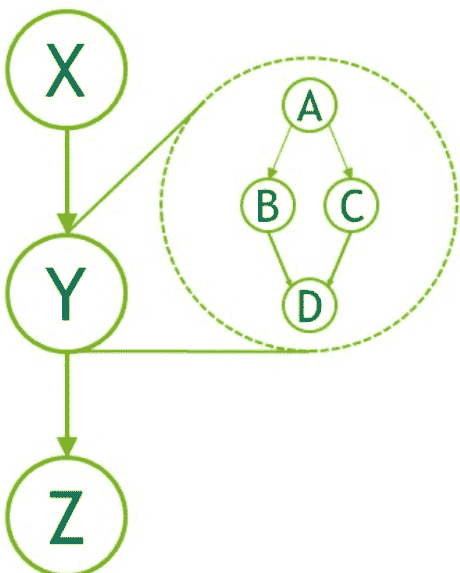

### 图 11 子图示例

###### 3.2.5.6.2. 使用 Graph API 创建图

图可以通过两种机制创建：显式 API 和流捕获。以下是创建和执行下图的示例。

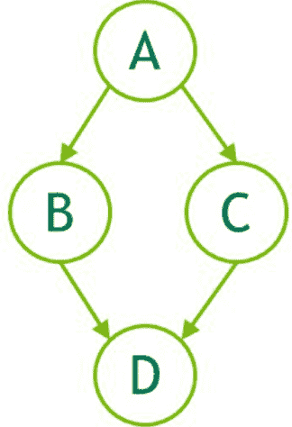

### 图 12 使用 Graph API 创建图示例

```
// Create the graph - it starts out empty
cudaGraphCreate(&graph, 0);

// For the purpose of this example, we'll create
// the nodes separately from the dependencies to
// demonstrate that it can be done in two stages.
// Note that dependencies can also be specified
// at node creation.
cudaGraphAddKernelNode(&a, graph, NULL, 0, &nodeParams);
cudaGraphAddKernelNode(&b, graph, NULL, 0, &nodeParams);
cudaGraphAddKernelNode(&c, graph, NULL, 0, &nodeParams);
cudaGraphAddKernelNode(&d, graph, NULL, 0, &nodeParams);

// Now set up dependencies on each node
cudaGraphAddDependencies(graph, &a, &b, 1); // A->B
cudaGraphAddDependencies(graph, &a, &c, 1); // A->C
cudaGraphAddDependencies(graph, &b, &d, 1); // B->D
cudaGraphAddDependencies(graph, &c, &d, 1); // C->D
```

###### 3.2.5.6.3. 使用流捕获创建图

流捕获提供了一种从现有基于流的 API 创建图的机制。将工作启动到流中的代码段（包括现有代码）可以通过调用 `cudaStreamBeginCapture()` 和 `cudaStreamEndCapture()` 来括起来。参见下文。

```
cudaGraph_t graph;
cudaStreamBeginCapture(stream);
kernelA<<< ..., stream >>>(...);
kernelB<<< ..., stream >>>(...);
libraryCall(stream);
kernelC<<< ..., stream >>>(...);
cudaStreamEndCapture(stream, &graph);
```

调用 `cudaStreamBeginCapture()` 会将流置于捕获模式。当流正在被捕获时，启动到流中的工作不会被排队执行。相反，它会被追加到一个正在逐步构建的内部图中。然后通过调用 `cudaStreamEndCapture()` 返回此图，该调用也会结束流的捕获模式。由流捕获主动构建的图称为 *捕获图*。

流捕获可以用于任何 CUDA 流，除了 `cudaStreamLegacy`（“NULL 流”）。请注意，它 *可以* 用于 `cudaStreamPerThread`。如果程序正在使用旧版流，则可能可以将流 0 重新定义为每线程流，而不会产生功能变化。参见默认流。

可以使用 `cudaStreamIsCapturing()` 查询流是否正在被捕获。

####### 3.2.5.6.3.1. 跨流依赖关系和事件

流捕获可以处理使用 `cudaEventRecord()` 和 `cudaStreamWaitEvent()` 表达的跨流依赖关系，前提是正在等待的事件已记录到同一个捕获图中。

当在处于捕获模式的流中记录事件时，会产生一个 *捕获事件*。捕获事件表示捕获图中的一组节点。

当流等待捕获事件时，如果该流尚未处于捕获模式，则会将其置于捕获模式，并且流中的下一项将对捕获事件中的节点具有额外依赖关系。然后，这两个流都会被捕获到同一个捕获图中。

在流捕获中存在跨流依赖关系时，`cudaStreamEndCapture()` 仍必须在调用 `cudaStreamBeginCapture()` 的同一流中调用；这就是 *源流*。由于基于事件的依赖关系而正在被捕获到同一捕获图中的任何其他流，也必须重新连接回源流。下图对此进行了说明。所有正在被捕获到同一捕获图中的流在调用 cudaStreamEndCapture() 时都会退出捕获模式。未能重新连接到源流会导致整体捕获操作失败。

```
// stream1 is the origin stream
cudaStreamBeginCapture(stream1);

KernelA<<< ..., stream1 >>>(...);

// Fork into stream2
cudaEventRecord(event1, stream1);
cudaStreamWaitEvent(stream2, event1);

KernelB<<< ..., stream1 >>>(...);
KernelC<<< ..., stream2 >>>(...);

// Join stream2 back to origin stream (stream1)
cudaEventRecord(event2, stream2);
cudaStreamWaitEvent(stream1, event2);

KernelD<<< ..., stream1 >>>(...);

// End capture in the origin stream
cudaStreamEndCapture(stream1, &graph);

// stream1 and stream2 no longer in capture mode
```

上述代码返回的图如图 12 所示。


####### 3.2.5.6.3.2. 禁止和未处理的操作

同步或查询正在被捕获的流或捕获事件的执行状态是无效的，因为它们不表示已排期执行的项目。查询或同步涵盖活动流捕获的更广泛句柄（例如，当任何关联流处于捕获模式时的设备或上下文句柄）也是无效的。

当同一上下文中的任何流正在被捕获，且该流不是使用 cudaStreamNonBlocking 创建的时，任何尝试使用旧版流的操作都是无效的。这是因为旧版流句柄始终涵盖这些其他流；向旧版流排队会创建对正在被捕获流的依赖关系，而查询或同步它会查询或同步正在被捕获的流。

因此，在这种情况下调用同步 API 也是无效的。同步 API（例如 cudaMemcpy()）会将工作排队到旧版流，并在返回前对其进行同步。

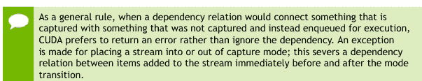

通过等待来自正在被捕获且与事件关联的捕获图不同的流中的捕获事件来合并两个独立的捕获图是无效的。从正在被捕获的流中等待非捕获事件也是无效的。

少数将异步操作排队到流中的 API 目前在图中不受支持，如果在正在被捕获的流中调用，它们会返回错误，例如 cudaStreamAttachMemAsync()。

####### 3.2.5.6.3.3. 失效

在流捕获期间尝试无效操作时，任何关联的捕获图都会失效。当捕获图失效时，进一步使用任何正在被捕获的流或与图关联的捕获事件都是无效的，并会返回错误，直到使用 cudaStreamEndCapture() 结束流捕获。此调用将使关联流退出捕获模式，但也会返回错误值和 NULL 图。

###### 3.2.5.6.4. 使用 Graph API

cudaGraph_t 对象不是线程安全的。用户有责任确保多个线程不会同时访问同一个 cudaGraph_t。

cudaGraphExec_t 不能与自身并发运行。cudaGraphExec_t 的启动将排在同一可执行图的先前启动之后。

图执行在流中进行，以便与其他异步工作进行排序。但是，流仅用于排序；它不约束图的内部并行性，也不影响图节点的执行位置。

参见 Graph API。

##### 3.2.5.7. 事件

运行时还提供了一种方法，允许应用程序在程序的任何点异步记录事件，并查询这些事件何时完成，从而密切监控设备的进度并进行准确计时。当事件之前的所有任务（或者可选地，给定流中的所有命令）都完成时，事件即视为完成。流零中的事件在所有流中所有先前任务和命令完成后完成。

###### 3.2.5.7.1. 创建和销毁

以下代码示例创建两个事件：

```
cudaEvent_t start, stop;
cudaEventCreate(&start);
cudaEventCreate(&stop);
```

销毁方式如下：

```
cudaEventDestroy(start);
cudaEventDestroy(stop);
```


###### 3.2.5.7.2. 已用时间

在 Creation and Destruction 中创建的事件可用于以下方式对 Creation and Destruction 的代码示例进行计时：

```
cudaEventRecord(start, 0);
for (int i = 0; i < 2; i++) {
    cudaMemcpyAsync(inputDev + i * size, inputHost + i * size,
                    size, cudaMemcpyHostToDevice, stream[i]);
    MyKernel<<<100, 512, 0, stream[i]>>>
    (outputDev + i * size, inputDev + i * size, size);
    cudaMemcpyAsync(outputHost + i * size, outputDev + i * size,
                    size, cudaMemcpyDeviceToHost, stream[i]);
}
cudaEventRecord(stop, 0);
cudaEventSynchronize(stop);
float elapsedTime;
cudaEventElapsedTime(&elapsedTime, start, stop);
```

##### 3.2.5.8. 同步调用

调用同步函数时，在设备完成请求的任务之前，控制权不会返回到主机线程。主机线程随后是否会让出、阻塞或自旋，可以在主机线程执行任何其他 CUDA 调用之前，通过调用 cudaSetDeviceFlags() 并传入特定标志来指定（有关详细信息，请参阅参考手册）。

#### 3.2.6. 多设备系统

##### 3.2.6.1. 设备枚举

主机系统可以拥有多个设备。以下代码示例展示了如何枚举这些设备、查询其属性，并确定 CUDA 支持设备的数量。

```
int deviceCount;
cudaGetDeviceCount(&deviceCount);
int device;
for (device = 0; device < deviceCount; ++device) {
    cudaDeviceProp deviceProp;
    cudaGetDeviceProperties(&deviceProp, device);
    printf("Device %d has compute capability %d.%d.\n",
           device, deviceProp.major, deviceProp.minor);
}
```

##### 3.2.6.2. 设备选择

主机线程可以随时通过调用 cudaSetDevice() 设置其操作的设备。设备内存分配和内核启动在当前设置的设备上进行；流和事件与当前设置的设备关联创建。如果未调用 cudaSetDevice()，则当前设备为设备 0。

以下代码示例说明设置当前设备如何影响内存分配和内核执行。

```
size_t size = 1024 * sizeof(float);
cudaSetDevice(0); // Set device 0 as current
float* p0;
cudaMalloc(&p0, size); // Allocate memory on device 0
MyKernel<<<1000, 128>>>(p0); // Launch kernel on device 0
cudaSetDevice(1); // Set device 1 as current
float * p1;
cudaMalloc(&p1, size); // Allocate memory on device 1
MyKernel<<<1000, 128>>>(p1); // Launch kernel on device 1
```

##### 3.2.6.3. 流和事件行为

如果向与当前设备未关联的流发出内核启动，则会失败，如以下代码示例所示。

```
cudaSetDevice(0); // Set device 0 as current
cudaStream_t s0;
cudaStreamCreate(&s0); // Create stream s0 on device 0
MyKernel<<<1000, 64, 0, s0>>>(); // Launch kernel on device 0 in s0
cudaSetDevice(1); // Set device 1 as current
cudaStream_t s1;
cudaStreamCreate(&s1); // Create stream s1 on device 1
MyKernel<<<1000, 64, 0, s1>>>(); // Launch kernel on device 1 in s1
// This kernel launch will fail:
MyKernel<<<1000, 64, 0, s0>>>(); // Launch kernel on device 1 in s0
```

即使向与当前设备未关联的流发出内存拷贝，也会成功。

如果输入事件和输入流关联到不同的设备，**cudaEventRecord()** 将失败。

如果两个输入事件关联到不同的设备，**cudaEventElapsedTime()** 将失败。

即使输入事件关联到与当前设备不同的设备，**cudaEventSynchronize()** 和 **cudaEventQuery()** 也会成功。

即使输入流和输入事件关联到不同的设备，**cudaStreamWaitEvent()** 也会成功。因此，**cudaStreamWaitEvent()** 可用于多个设备之间的同步。

每个设备都有自己的默认流（请参阅默认流），因此发送到设备默认流的命令可能会相对于发送到任何其他设备默认流的命令乱序执行或并发执行。

##### 3.2.6.4. 对等内存访问

取决于系统属性，特别是 PCIe 和/或 NVLINK 拓扑，设备能够相互寻址对方的内存（即，在一个设备上执行的内核可以解引用指向另一设备内存的指针）。如果 **cudaDeviceCanAccessPeer()** 对这两个设备返回 true，则这两个设备之间支持此对等内存访问功能。

对等内存访问仅在 64 位应用程序中受支持，并且必须通过调用 **cudaDeviceEnablePeerAccess()** 在两个设备之间启用，如以下代码示例所示。在未启用 NVSwitch 的系统上，每个设备最多支持系统范围内的八个对等连接。

两个设备使用统一地址空间（请参阅统一虚拟地址空间），因此可以使用相同的指针来寻址两个设备的内存，如以下代码示例所示。

```
cudaSetDevice(0);    // Set device 0 as current
float * p0;
size_t size = 1024 * sizeof(float);
cudaMalloc(&p0, size);    // Allocate memory on device 0
MyKernel<<<1000, 128>>>(p0);    // Launch kernel on device 0
cudaSetDevice(1);    // Set device 1 as current
cudaDeviceEnablePeerAccess(0, 0);    // Enable peer-to-peer access
// with device 0

// Launch kernel on device 1
// This kernel launch can access memory on device 0 at address p0
MyKernel<<<1000, 128>>>(p0);
```

###### 3.2.6.4.1. Linux 上的 IOMMU

仅在 Linux 上，CUDA 和显示驱动程序不支持启用 IOMMU 的裸机 PCIe 对等内存拷贝。但是，CUDA 和显示驱动程序通过 VM 直通支持 IOMMU。因此，在 Linux 上运行原生裸机系统的用户应禁用 IOMMU。应启用 IOMMU，并应将 VFIO 驱动程序用作虚拟机的 PCIe 直通。

在 Windows 上，上述限制不存在。

另请参阅 64 位平台上的 DMA 缓冲区分配。

##### 3.2.6.5. 对等内存拷贝

可以在两个不同设备的内存之间执行内存拷贝。

当两个设备使用统一地址空间时（请参阅统一虚拟地址空间），这是使用设备内存中提到的常规内存拷贝函数完成的。

否则，这是使用 cudaMemcpyPeer()、cudaMemcpyPeerAsync()、cudaMemcpy3DPeer() 或 cudaMemcpy3DPeerAsync() 完成的，如以下代码示例所示。

```
cudaSetDevice(0);    // Set device 0 as current
float * p0;
size_t size = 1024 * sizeof(float);
cudaMalloc(&p0, size);    // Allocate memory on device 0
cudaSetDevice(1);    // Set device 1 as current
float * p1;
cudaMalloc(&p1, size);    // Allocate memory on device 1
cudaSetDevice(0);    // Set device 0 as current
MyKernel<<<1000, 128>>>(p0);    // Launch kernel on device 0
cudaSetDevice(1);    // Set device 1 as current
cudaMemcpyPeer(p1, 1, p0, 0, size);    // Copy p0 to p1
MyKernel<<<1000, 128>>>(p1);    // Launch kernel on device 1
```

在两个不同设备的内存之间进行拷贝（在隐式 NULL 流中）：
- 在向任一设备发出的所有先前命令完成之前不会开始，并且
- 在拷贝之后向任一设备发出的任何命令（请参阅异步并发执行）开始之前运行到完成。

与流的正常行为一致，两个设备内存之间的异步拷贝可能与另一个流中的拷贝或内核重叠。

请注意，如果通过 `cudaDeviceEnablePeerAccess()` 在两个设备之间启用了对等访问（如对等内存访问中所述），则这两个设备之间的对等内存拷贝不再需要通过主机暂存，因此速度更快。

#### 3.2.7. 统一虚拟地址空间

当应用程序作为 64 位进程运行时，主机和所有计算能力 2.0 及更高版本的设备使用单个地址空间。通过 CUDA API 调用进行的所有主机内存分配以及受支持设备上的所有设备内存分配都在此虚拟地址范围内。因此：

- 可以使用 `cudaPointerGetAttributes()` 从指针值确定通过 CUDA 在主机上分配的任何内存，或使用统一地址空间的任何设备上的任何内存的位置。
- 当向使用统一地址空间的任何设备的内存拷贝或从中拷贝时，可以将 `cudaMemcpy*()` 的 `cudaMemcpyKind` 参数设置为 `cudaMemcpyDefault` 以从指针确定位置。这也适用于未通过 CUDA 分配的主机指针，只要当前设备使用统一寻址。
- 通过 `cudaHostAlloc()` 进行的分配在使用统一地址空间的所有设备之间自动可移植（请参阅可移植内存），并且 `cudaHostAlloc()` 返回的指针可以直接从在这些设备上运行的内核中使用（即，无需通过 `cudaHostGetDevicePointer()` 获取设备指针，如映射内存中所述）。

应用程序可以通过检查 `unifiedAddressing` 设备属性（请参阅设备枚举）是否等于 1 来查询特定设备是否使用统一地址空间。

#### 3.2.8. 进程间通信

由主机线程创建的任何设备内存指针或事件句柄都可以由同一进程中的任何其他线程直接引用。但是，它在此进程外无效，因此不能由属于不同进程的线程直接引用。

要跨进程共享设备内存指针和事件，应用程序必须使用进程间通信 API，该 API 在参考手册中有详细说明。IPC API 仅支持 Linux 上的 64 位进程以及计算能力 2.0 及更高版本的设备。请注意，IPC API 不支持 `cudaMallocManaged` 分配。

使用此 API，应用程序可以使用 `cudaIpcGetMemHandle()` 获取给定设备内存指针的 IPC 句柄，并使用


标准 IPC 机制（例如，进程间共享内存或文件），并使用 `cudaIpcOpenMemHandle ()` 从 IPC 句柄中检索设备指针，该句柄是此其他进程中有效的指针。事件句柄可以使用类似的入口点共享。

使用 IPC API 的一个示例是：单个主进程生成一批输入数据，使多个从进程可以使用该数据，而无需重新生成或复制。

使用 CUDA IPC 相互通信的应用程序应使用相同的 CUDA 驱动程序和运行时进行编译、链接和运行。


#### 3.2.9. 错误检查

所有运行时函数都会返回错误代码，但对于异步函数（参见异步并发执行），由于该函数在设备完成任务之前就返回了，因此此错误代码不可能报告设备上可能发生的任何异步错误；该错误代码仅报告在执行任务之前在主机上发生的错误，通常与参数验证相关；如果发生异步错误，将由某个后续不相关的运行时函数调用报告。

因此，在某个异步函数调用后立即检查异步错误的唯一方法是在调用后立即通过调用 `cudaDeviceSynchronize ()`（或使用异步并发执行中描述的任何其他同步机制）进行同步，并检查 `cudaDeviceSynchronize ()` 返回的错误代码。

运行时为每个主机线程维护一个错误变量，该变量初始化为 `cudaSuccess`，并且每次发生错误时（无论是参数验证错误还是异步错误）都会被错误代码覆盖。`cudaPeekAtLastError ()` 返回此变量，而 `cudaGetLastError ()` 返回此变量并将其重置为 `cudaSuccess`。

内核启动不返回任何错误代码，因此必须在内核启动后立即调用 `cudaPeekAtLastError ()` 或 `cudaGetLastError ()` 以检索任何启动前错误。为确保 `cudaPeekAtLastError ()` 或 `cudaGetLastError ()` 返回的任何错误都不源于内核启动之前的调用，必须确保在内核启动前立即将运行时错误变量设置为 `cudaSuccess`，例如，在内核启动前立即调用 `cudaGetLastError ()`。内核启动是异步的，因此要检查异步错误，应用程序必须在内核启动与调用 `cudaPeekAtLastError ()` 或 `cudaGetLastError ()` 之间进行同步。

请注意，`cudaStreamQuery ()` 和 `cudaEventQuery ()` 可能返回的 `cudaErrorNotReady` 不被视为错误，因此不会由 `cudaPeekAtLastError ()` 或 `cudaGetLastError ()` 报告。

#### 3.2.10. 调用栈

对于计算能力为 2.x 及更高版本的设备，可以使用 `cudaDeviceGetLimit()` 查询调用栈的大小，并使用 `cudaDeviceSetLimit()` 设置其大小。

当调用栈溢出时，如果应用程序通过 CUDA 调试器（cuda-gdb, Nsight）运行，内核调用会因栈溢出错误而失败；否则会发生未指定的启动错误。

#### 3.2.11. 纹理和表面内存

CUDA 支持 GPU 用于图形的纹理硬件的一个子集，用于访问纹理和表面内存。与从全局内存读取数据相比，从纹理或表面内存读取数据可以带来若干性能优势，如设备内存访问中所述。

有两种不同的 API 可用于访问纹理和表面内存：

- 所有设备都支持的纹理引用 API，

- 仅计算能力为 3.x 及更高版本的设备支持的纹理对象 API。

纹理引用 API 存在纹理对象 API 不具备的限制。这些限制在纹理引用 API 中有说明。

##### 3.2.11.1. 纹理内存

纹理内存通过纹理函数中描述的设备函数从内核中读取。调用其中一个函数读取纹理的过程称为纹理获取。每次纹理获取都会指定一个参数，即用于纹理对象 API 的纹理对象或用于纹理引用 API 的纹理引用。

纹理对象或纹理引用指定：

- 纹理，即获取的纹理内存片段。纹理对象在运行时创建，纹理在创建纹理对象时指定，如纹理对象 API 中所述。纹理引用在编译时创建，纹理在运行时通过运行时函数将纹理引用绑定到纹理来指定，如纹理引用 API 中所述；多个不同的纹理引用可能绑定到同一纹理或内存中重叠的纹理。纹理可以是线性内存的任何区域或 CUDA 数组（如 CUDA 数组中所述）。

- 其维数，指定纹理是作为使用一个纹理坐标的一维数组、使用两个纹理坐标的二维数组，还是使用三个纹理坐标的三维数组来寻址。数组的元素称为纹素，即纹理元素的缩写。纹理宽度、高度和深度是指数组在每个维度上的大小。表 15 列出了取决于设备计算能力的最大纹理宽度、高度和深度。

- 纹素的类型，限制为基本整数和单精度浮点类型，以及由基本整数和单精度浮点类型派生的内置向量类型中定义的任何 1、2 和 4 分量向量类型。

- 读取模式，等于 cudaReadModeNormalizedFloat 或 cudaReadModeElementType。如果为 cudaReadModeNormalizedFloat 且纹素类型为 16 位或 8 位整数类型，则纹理获取返回的值实际上作为浮点类型返回，整数类型的完整范围映射到无符号整数类型的 [0.0, 1.0] 和有符号整数类型的 [-1.0, 1.0]；例如，值为 0xFF 的无符号 8 位纹理元素读取为 1。如果为 cudaReadModeElementType，则不执行转换。

- 纹理坐标是否归一化。默认情况下，纹理（由纹理函数中的函数引用）使用范围 [0, N-1] 的浮点坐标进行引用，其中 N 是坐标对应维度上的纹理大小。例如，大小为 64x32 的纹理将分别使用范围 [0, 63] 和 [0, 31] 的坐标对 x 和 y 维度进行引用。归一化纹理坐标导致坐标指定在范围 [0.0, 1.0/N] 而不是 [0, N-1] 中，因此相同的 64x32 纹理将由 x 和 y 维度中范围 [0, 1-1/N] 的归一化坐标寻址。如果希望纹理坐标独立于纹理大小，归一化纹理坐标非常适合某些应用程序的要求。

- 寻址模式。使用超出范围的坐标调用第 B.8 节中的设备函数是有效的。寻址模式定义在这种情况下会发生什么。默认寻址模式是将坐标限制在有效范围内：非归一化坐标的 [0, N) 和归一化坐标的 [0.0, 1.0)。如果指定边框模式，则超出范围的纹理坐标的纹理获取将返回零。对于归一化坐标，还可用包裹模式和镜像模式。使用包裹模式时，每个坐标 x 转换为 frac(x)=x-floor(x)，其中 floor(x) 是不大于 x 的最大整数。使用镜像模式时，如果 floor(x) 为偶数，则每个坐标 x 转换为 frac(x)；如果 floor(x) 为奇数，则转换为 1-frac(x)。寻址模式指定为大小为三的数组，其第一、第二和第三个元素分别指定第一、第二和第三个纹理坐标的寻址模式；寻址模式为 cudaAddressModeBorder、cudaAddressModeClamp、cudaAddressModeWrap、cudaAddressModeWrap 和 cudaAddressModeMirror，仅支持归一化纹理坐标。

- 过滤模式，指定基于输入纹理坐标计算获取纹理时返回的值的方式。线性纹理过滤仅可用于配置为返回浮点数据的纹理。它在相邻纹素之间执行低精度插值。启用后，将读取纹理获取位置周围的纹素，并根据纹理坐标在纹素之间的位置对纹理获取的返回值进行插值。一维纹理执行简单线性插值，二维纹理执行双线性插值，三维纹理执行三线性插值。纹理获取提供了有关纹理获取的更多详细信息。过滤模式等于 cudaFilterModePoint 或 cudaFilterModeLinear。如果为 cudaFilterModePoint，则返回的值是其纹理坐标最接近输入纹理坐标的纹素。如果为 cudaFilterModeLinear，则


返回值是与输入纹理坐标最接近的两个（一维纹理）、四个（二维纹理）或八个（三维纹理）纹素的线性插值。cudaFilterModeLinear 仅对浮点类型的返回值有效。

纹理对象 API 介绍纹理对象 API。

纹理引用 API 介绍纹理引用 API。

16 位浮点纹理说明如何处理 16 位浮点纹理。

纹理还可以分层，如分层纹理中所述。

立方体贴图纹理和立方体贴图分层纹理描述了一种特殊的纹理类型，即立方体贴图纹理。

纹理收集描述了一种特殊的纹理获取，即纹理收集。

###### 3.2.11.1.1. 纹理对象 API

纹理对象使用 cudaCreateTextureObject() 从类型为 struct cudaResourceDesc 的资源描述中创建，该描述指定纹理，并从如下定义的纹理描述中创建：

```cpp
struct cudaTextureDesc
{
    enum cudaTextureAddressMode addressMode[3];
    enum cudaTextureFilterMode filterMode;
    enum cudaTextureReadMode readMode;
    int sRGB;
    unsigned int normalizedCoords;
    unsigned int maxAnisotropy;
    enum cudaTextureFilterMode mipmapFilterMode;
    float mipmapLevelBias;
    float minMipmapLevelClamp;
    float maxMipmapLevelClamp;
};
```

- addressMode 指定寻址模式；
- filterMode 指定过滤模式；
- readMode 指定读取模式；
- normalizedCoords 指定纹理坐标是否归一化；
- 有关 sRGB、maxAnisotropy、mipmapFilterMode、mipmapLevelBias、minMipmapLevelClamp 和 maxMipmapLevelClamp，请参阅参考手册。

以下代码示例将简单的变换内核应用于纹理。

```cpp
// Simple transformation kernel
__global__ void transformKernel(float* output,
    cudaTextureObject_t texObj,
    int width, int height,
    float theta)
{
    // Calculate normalized texture coordinates
    unsigned int x = blockIdx.x * blockDim.x + threadIdx.x;
    unsigned int y = blockIdx.y * blockDim.y + threadIdx.y;

    float u = x / (float)width;
    float v = y / (float)height;

    // Transform coordinates
    u -= 0.5f;
    v -= 0.5f;
    float tu = u * cosf(theta) - v * sinf(theta) + 0.5f;
    float tv = v * cosf(theta) + u * sinf(theta) + 0.5f;

    // Read from texture and write to global memory
    output[y * width + x] = tex2D<float>(texObj, tu, tv);
}
```

```cpp
// Host code
int main()
{
    // Allocate CUDA array in device memory
    cudaChannelFormatDesc channelDesc = cudaCreateChannelDesc(32, 0, 0, 0,
                                                              cudaChannelFormatKindFloat);
    cudaArray* cuArray;
    cudaMallocArray(&cuArray, &channelDesc, width, height);

    // Copy to device memory some data located at address h_data
    // in host memory
    cudaMemcpyToArray(cuArray, 0, 0, h_data, size,
                      cudaMemcpyHostToDevice);

    // Specify texture
    struct cudaResourceDesc resDesc;
    memset(&resDesc, 0, sizeof(resDesc));
    resDesc.resType = cudaResourceTypeArray;
    resDesc.res.array.array = cuArray;

    // Specify texture object parameters
    struct cudaTextureDesc texDesc;
    memset(&texDesc, 0, sizeof(texDesc));
    texDesc.addressMode[0] = cudaAddressModeWrap;
    texDesc.addressMode[1] = cudaAddressModeWrap;
    texDesc.filterMode = cudaFilterModeLinear;
    texDesc.readMode = cudaReadModeElementType;
    texDesc.normalizedCoords = 1;

    // Create texture object
    cudaTextureObject_t texObj = 0;
    cudaCreateTextureObject(&texObj, &resDesc, &texDesc, NULL);

    // Allocate result of transformation in device memory
    float *output;
    cudaMalloc(&output, width * height * sizeof(float));

    // Invoke kernel
    dim3 dimBlock(16, 16);
    dim3 dimGrid((width + dimBlock.x - 1) / dimBlock.x,
                 (height + dimBlock.y - 1) / dimBlock.y);
    transformKernel<<<dimGrid, dimBlock>>>(output,
                                           texObj, width, height,
                                           angle);

    // Destroy texture object
    cudaDestroyTextureObject(texObj);

    // Free device memory
    cudaFreeArray(cuArray);
    cudaFree(output);

    return 0;
}
```

###### 3.2.11.1.2. 纹理引用 API

纹理引用的某些属性是不可变的，必须在编译时已知；它们在声明纹理引用时指定。纹理引用在文件作用域中声明为类型为 **纹理** 的变量：

```
Texture<DataType, Type, ReadMode> texRef;
```

其中：

- DataType 指定纹素的类型；
- Type 指定纹理引用的类型，对于一维、二维或三维纹理，分别等于 cudaTextureType1D、cudaTextureType2D 或 cudaTextureType3D，或者对于一维或二维分层纹理，分别等于 cudaTextureType1DLayered 或 cudaTextureType2DLayered；Type 是可选参数，默认值为 cudaTextureType1D；
- ReadMode 指定读取模式；它是可选参数，默认值为 cudaReadModeElementType。

纹理引用只能声明为静态全局变量，不能作为参数传递给函数。

纹理引用的其他属性是可变的，可以通过主机运行时在运行时更改。如参考手册中所述，运行时 API 具有低级 C 风格接口和高级 C++ 风格接口。纹理类型在高级 API 中定义为从低级 API 中定义的 textureReference 类型公共派生的结构，如下所示：

```cpp
struct textureReference {
    int
        normalized;
    enum cudaTextureFilterMode
        filterMode;
    enum cudaTextureAddressMode
        addressMode[3];
    struct cudaChannelFormatDesc
        channelDesc;
    int
        sRGB;
    unsigned int
        maxAnisotropy;
    enum cudaTextureFilterMode
        mipmapFilterMode;
    float
        mipmapLevelBias;
    float
        minMipmapLevelClamp;
    float
        maxMipmapLevelClamp;
};
```

- normalized 指定纹理坐标是否归一化；
- filterMode 指定过滤模式；
- addressMode 指定寻址模式；
- channelDesc 描述纹素的格式；它必须与纹理引用声明的 DataType 参数匹配；channelDesc 的类型如下：

```cpp
struct cudaChannelFormatDesc {
    int x, y, z, w;
    enum cudaChannelFormatKind f;
};
```

其中 x、y、z 和 w 等于返回值每个组件的位数，f 为：

- 如果这些组件是有符号整数类型，则为 cudaChannelFormatKindSigned；
- 如果它们是无符号整数类型，则为 cudaChannelFormatKindUnsigned；
- 如果它们是浮点类型，则为 cudaChannelFormatKindFloat。

- 有关 sRGB、maxAnisotropy、mipmapFilterMode、mipmapLevelBias、minMipmapLevelClamp 和 maxMipmapLevelClamp，请参阅参考手册。

normalized、addressMode 和 filterMode 可直接在主机代码中修改。

在内核可以使用纹理引用从纹理内存读取之前，必须使用 cudaBindTexture() 或 cudaBindTexture2D() 将纹理引用绑定到线性内存上的纹理，或使用 cudaBindTextureToArray() 将其绑定到 CUDA 数组。cudaUnbindTexture() 用于解绑纹理引用。纹理引用解绑后，可以安全地重新绑定到另一个数组，即使使用先前绑定纹理的内核尚未完成。建议使用 cudaMallocPitch() 在线性内存中分配二维纹理，并使用 cudaMallocPitch() 返回的步距作为 cudaBindTexture2D() 的输入参数。

以下代码示例将二维纹理引用绑定到 devPtr 指向的线性内存：

- 使用低级 API：

```cpp
texture<float, cudaTextureType2D,
         cudaReadModeElementType> texRef;
textureReference* texRefPtr;
cudaGetTextureReference(&texRefPtr, &texRef);
cudaChannelFormatDesc channelDesc =
    cudaCreateChannelDesc<float>();
size_t offset;
cudaBindTexture2D(&offset, texRefPtr, devPtr, &channelDesc,
                  width, height, pitch);
```

- 使用高级 API：

```cpp
texture<float, cudaTextureType2D,
         cudaReadModeElementType> texRef;
cudaChannelFormatDesc channelDesc =
    cudaCreateChannelDesc<float>();
size_t offset;
cudaBindTexture2D(&offset, texRef, devPtr, channelDesc,
                  width, height, pitch);
```

以下代码示例将二维纹理引用绑定到 CUDA 数组 cuArray：

- 使用低级 API：

```cpp
texture<float, cudaTextureType2D,
         cudaReadModeElementType> texRef;
textureReference* texRefPtr;
cudaGetTextureReference(&texRefPtr, &texRef);
cudaChannelFormatDesc channelDesc;
cudaGetChannelDesc(&channelDesc, cuArray);
cudaBindTextureToArray(texRef, cuArray, &channelDesc);
```

- 使用高级 API：

```cpp
texture<float, cudaTextureType2D,
         cudaReadModeElementType> texRef;
cudaBindTextureToArray(texRef, cuArray);
```

将纹理绑定到纹理引用时指定的格式必须与声明纹理引用时指定的参数匹配；否则，纹理获取的结果是未定义的。

可以绑定到内核的纹理数量有限制，如表 15 所示。


以下代码示例对纹理应用了一些简单的变换内核。

```cpp
// 2D float texture
texture<float, cudaTextureType2D, cudaReadModeElementType> texRef;

// Simple transformation kernel
__global__ void transformKernel(float* output,
                                int width, int height,
                                int theta)
{
    // Calculate normalized texture coordinates
    unsigned int x = blockIdx.x * blockDim.x + threadIdx.x;
    unsigned int y = blockIdx.y * blockDim.y + threadIdx.y;

    float u = x / (float)width;
    float v = y / (float)height;

    // Transform coordinates
    u -= 0.5f;
    v -= 0.5f;
    float tu = u * cosf(theta) - v * sinf(theta) + 0.5f;
    float tv = v * cosf(theta) + u * sinf(theta) + 0.5f;

    // Read from texture and write to global memory
    output[y * width + x] = tex2D(texRef, tu, tv);
}

// Host code
int main()
{
    // Allocate CUDA array in device memory
    cudaChannelFormatDesc channelDesc =
        cudaCreateChannelDesc(32, 0, 0, 0,
                              cudaChannelFormatKindFloat);
    cudaArray* cuArray;
    cudaMallocArray(&cuArray, &channelDesc, width, height);

    // Copy to device memory some data located at address h_data
    // in host memory
    cudaMemcpyToArray(cuArray, 0, 0, h_data, size,
                      cudaMemcpyHostToDevice);

    // Set texture reference parameters
    texRef.addressMode[0] = cudaAddressModeWrap;
    texRef.addressMode[1] = cudaAddressModeWrap;
    texRef.filterMode = cudaFilterModeLinear;
    texRef.normalized = true;

    // Bind the array to the texture reference
    cudaBindTextureToArray(texRef, cuArray, channelDesc);

    // Allocate result of transformation in device memory
    float* output;
    cudaMalloc(&output, width * height * sizeof(float));

    // Invoke kernel
    dim3 dimBlock(16, 16);
    dim3 dimGrid((width + dimBlock.x - 1) / dimBlock.x,
                 (height + dimBlock.y - 1) / dimBlock.y);
    transformKernel<<<dimGrid, dimBlock>>>(output, width, height,
                                           angle);

    // Free device memory
    cudaFreeArray(cuArray);
    cudaFree(output);

    return 0;
}
```

###### 3.2.11.1.3. 16 位浮点纹理

CUDA 数组支持的 16 位浮点或半精度格式与 IEEE 754-2008 binary16 格式相同。

CUDA C++ 不支持匹配的数据类型，但通过 `unsigned short` 类型提供了用于与 32 位浮点格式相互转换的内置函数：`__float2half_rn(float)` 和 `__half2float(unsigned short)`。这些函数仅在设备代码中受支持。例如，主机代码的等效函数可以在 OpenEXR 库中找到。

在纹理获取期间，16 位浮点分量在执行任何过滤之前会被提升为 32 位浮点数。

可以通过调用 `cudaCreateChannelDescHalf()` 函数之一来创建 16 位浮点格式的通道描述。

###### 3.2.11.1.4. 分层纹理

一维或二维分层纹理（在 Direct3D 中也称为 `texture array`，在 OpenGL 中称为 `array texture`）是由一系列层组成的纹理，所有层都是具有相同维度、大小和数据类型的常规纹理。

一维分层纹理使用整数索引和浮点纹理坐标寻址；索引表示序列中的一个层，坐标寻址该层中的一个纹素。二维分层纹理使用整数索引和两个浮点纹理坐标寻址；索引表示序列中的一个层，坐标寻址该层中的一个纹素。

分层纹理只能通过带有 `cudaArrayLayered` 标志调用 `cudaMalloc3DArray()` 来创建为 CUDA 数组（对于一维分层纹理，高度为零）。

分层纹理使用 tex1DLayered()、tex1DLayered()、tex2DLayered()、tex2DLayered() 中描述的设备函数进行获取。纹理过滤（参见纹理获取）仅在层内进行，不跨层进行。

分层纹理仅在计算能力 2.0 及更高版本的设备上受支持。

###### 3.2.11.1.5. 立方体贴图纹理

`cubemap` 纹理是一种特殊的二维分层纹理，具有代表立方体六个面的六个层：

- 层的宽度等于其高度。
- 立方体贴图使用三个纹理坐标 x、y 和 z 进行寻址，这些坐标被解释为从立方体中心发出并指向立方体一个面以及该面对应层中一个纹素的方向向量。更具体地说，面由幅值 m 最大的坐标选定，相应的层使用坐标 (s/m+1)/2 和 (t/m+1)/2 进行寻址，其中 s 和 t 在表 2 中定义。

### 表 2 立方体贴图获取

| 条件 | 面 | m | s | t |
|---|---|---|---|---|
| \|x\| > \|y\| and \|x\| > \|z\| | x >= 0 | 0 | x | -z |
| | x < 0 | 1 | -x | z |
| \|y\| > \|x\| and \|y\| > \|z\| | y >= 0 | 2 | y | x |
| | y < 0 | 3 | -y | x |
| \|z\| > \|x\| and \|z\| > \|y\| | z >= 0 | 4 | z | x |
| | z < 0 | 5 | -z | -x |

分层纹理只能通过带有 cudaArrayCubemap 标志调用 cudaMalloc3DArray() 来创建为 CUDA 数组。

立方体贴图纹理使用 texCubemap() 和 texCubemap() 中描述的设备函数进行获取。

立方体贴图纹理仅在计算能力 2.0 及更高版本的设备上受支持。

###### 3.2.11.1.6. 立方体贴图分层纹理

立方体贴图分层纹理是其层为相同维度的立方体贴图的分层纹理。

立方体贴图分层纹理使用整数索引和三个浮点纹理坐标寻址；索引表示序列中的一个立方体贴图，坐标寻址该立方体贴图中的一个纹素。

分层纹理只能通过带有 cudaArrayLayered 和 cudaArrayCubemap 标志调用 cudaMalloc3DArray() 来创建为 CUDA 数组。

立方体贴图分层纹理使用 texCubemapLayered() 和 texCubemapLayered() 中描述的设备函数进行获取。纹理过滤（参见纹理获取）仅在层内进行，不跨层进行。

立方体贴图分层纹理仅在计算能力 2.0 及更高版本的设备上受支持。

###### 3.2.11.1.7. 纹理收集

纹理收集是一种仅适用于二维纹理的特殊纹理获取。它由 tex2DGather() 函数执行，该函数与 tex2D() 具有相同的参数，外加一个等于 0、1、2 或 3 的附加 comp 参数（参见 tex2DGather() 和 tex2DGather()）。它返回四个 32 位数字，分别对应常规纹理获取中用于双线性过滤的四个纹素中分量 comp 的值。例如，如果这些纹素的值为 (253, 20, 31, 255)、(250, 25, 29, 254)、(249, 16, 37, 253)、(251, 22, 30, 250)，且 comp 为 2，则 tex2DGather() 返回 (31, 29, 37, 30)。

请注意，纹理坐标仅使用 8 位小数精度计算。因此，tex2DGather() 在 tex2D() 将 1.0 用于其权重之一（α 或 β，参见线性过滤）的情况下可能会返回意外结果。例如，对于 x 纹理坐标 2.49805：x_B=x-0.5=1.99805，但 x_B 的小数部分以 8 位定点格式存储。由于 0.99805 比 255.f/256.f 更接近 256.f/256.f，因此 x_B 的值为 2。在这种情况下，`tex2Dgather()` 将在 x 中返回索引 2 和 3，而不是索引 1 和 2。

纹理收集仅支持使用 `cudaArrayTextureGather` 标志创建的 CUDA 数组，且宽度和高度小于表 15 中为纹理收集指定的最大值（该值小于常规纹理获取的最大值）。

纹理收集仅在计算能力 2.0 及更高版本的设备上受支持。

##### 3.2.11.2. 表面内存

对于计算能力 2.0 及更高版本的设备，使用 `cudaArraySurfaceLoadStore` 标志创建的 CUDA 数组（在立方体贴图表面中描述）可以通过 `surface object` 或 `surface reference` 使用表面函数中描述的函数进行读取和写入。

表 15 列出了取决于设备计算能力的最大表面宽度、高度和深度。

###### 3.2.11.2.1. 表面对象 API

表面对象使用 `cudaCreateSurfaceObject()` 从类型为 `struct cudaResourceDesc` 的资源描述中创建。


以下代码示例将一些简单的变换内核应用于纹理。

```cpp
// Simple copy kernel
__global__ void copyKernel(cudaSurfaceObject_t inputSurfObj,
                           cudaSurfaceObject_t outputSurfObj,
                           int width, int height)
{
    // Calculate surface coordinates
    unsigned int x = blockIdx.x * blockDim.x + threadIdx.x;
    unsigned int y = blockIdx.y * blockDim.y + threadIdx.y;
    if ((x < width) && (y < height)) {
        // Read from input surface
        uchar4 data;
        surf2DRead(&data, inputSurfObj, x * 4, y);
        // Write to output surface
        surf2DWrite(data, outputSurfObj, x * 4, y);
    }
}

// Host code
int main()
{
    // Allocate CUDA arrays in device memory
    cudaChannelFormatDesc channelDesc =
        cudaCreateChannelDesc(8, 8, 8, 8,
                              cudaChannelFormatKindUnsigned);
    cudaArray* cuInputArray;
    cudaMallocArray(&cuInputArray, &channelDesc, width, height,
                    cudaArraySurfaceLoadStore);
    cudaArray* cuOutputArray;
    cudaMallocArray(&cuOutputArray, &channelDesc, width, height,
                    cudaArraySurfaceLoadStore);

    // Copy to device memory some data located at address h_data
    cudaMemcpyToArray(cuInputArray, 0, 0, h_data, size,
                      cudaMemcpyHostToDevice);

    // Specify surface
    struct cudaResourceDesc resDesc;
    memset(&resDesc, 0, sizeof(resDesc));
    resDesc.resType = cudaResourceTypeArray;
    resDesc.res.array.array = cuInputArray;

    // Create the surface objects
    resDesc.res.array.array = cuInputArray;
    cudaSurfaceObject_t inputSurfObj = 0;
    cudaCreateSurfaceObject(&inputSurfObj, &resDesc);
    resDesc.res.array.array = cuOutputArray;
    cudaSurfaceObject_t outputSurfObj = 0;
    cudaCreateSurfaceObject(&outputSurfObj, &resDesc);

    // Invoke kernel
    dim3 dimBlock(16, 16);
    dim3 dimGrid((width + dimBlock.x - 1) / dimBlock.x,
                 (height + dimBlock.y - 1) / dimBlock.y);
    copyKernel<<<dimGrid, dimBlock>>>(inputSurfObj,
                                      outputSurfObj,
                                      width, height);

    // Destroy surface objects
    cudaDestroySurfaceObject(inputSurfObj);
    cudaDestroySurfaceObject(outputSurfObj);

    // Free device memory
    cudaFreeArray(cuInputArray);
    cudaFreeArray(cuOutputArray);

    return 0;
}
```

###### 3.2.11.2.2. 表面引用 API

表面引用在文件作用域中声明为 surface 类型的变量：

```cpp
surface<void, Type> surfRef;
```

其中 `Type` 指定表面引用的类型，等于 `cudaSurfaceType1D`、`cudaSurfaceType2D`、`cudaSurfaceType3D`、`cudaSurfaceTypeCubemap`、`cudaSurfaceType1DLayered`、`cudaSurfaceType2DLayered` 或 `cudaSurfaceTypeCubemapLayered`；`Type` 是可选参数，默认值为 `cudaSurfaceType1D`。表面引用只能声明为静态全局变量，不能作为参数传递给函数。

在内核使用表面引用访问 CUDA 数组之前，必须使用 `cudaBindSurfaceToArray()` 将表面引用绑定到 CUDA 数组。

以下代码示例将表面引用绑定到 CUDA 数组 `cuArray`：

- 使用低级 API：

```cpp
surface<void, cudaSurfaceType2D> surfRef;
surfaceReference* surfRefPtr;
cudaGetSurfaceReference(&surfRefPtr, "surfRef");
cudaChannelFormatDesc channelDesc;
cudaGetChannelDesc(&channelDesc, cuArray);
cudaBindSurfaceToArray(surfRef, cuArray, channelDesc);
```

- 使用高级 API：

```cpp
surface<void, cudaSurfaceType2D> surfRef;
cudaBindSurfaceToArray(surfRef, cuArray);
```

CUDA 数组必须使用与维度和类型匹配的表面函数，并通过与维度匹配的表面引用进行读写；否则，读写 CUDA 数组的结果是未定义的。

与纹理内存不同，表面内存使用字节寻址。这意味着，通过纹理函数访问纹理元素时使用的 x 坐标需要乘以元素的字节大小，才能通过表面函数访问同一元素。例如，对于绑定到纹理引用 `texRef` 和表面引用 `surfRef` 的一维浮点 CUDA 数组，纹理坐标 x 处的元素通过 `texRef` 使用 `tex1D(texRef, x)` 读取，但通过 `surfRef` 使用 `surf1Dread(surfRef, 4*x)` 读取。同样，对于绑定到纹理引用 `texRef` 和表面引用 `surfRef` 的二维浮点 CUDA 数组，纹理坐标 x 和 y 处的元素通过 `texRef` 使用 `tex2D(texRef, x, y)` 访问，但通过 `surfRef` 使用 `surf2Dread(surfRef, 4*x, y)` 访问（y 坐标的字节偏移量在内部从 CUDA 数组的底层行步距计算得出）。

以下代码示例将一些简单的变换内核应用于纹理。

```cpp
// 2D surfaces
surface<void, 2> inputSurfRef;
surface<void, 2> outputSurfRef;

// Simple copy kernel
__global__ void copyKernel(int width, int height)
{
    // Calculate surface coordinates
    unsigned int x = blockIdx.x * blockDim.x + threadIdx.x;
    unsigned int y = blockIdx.y * blockDim.y + threadIdx.y;
    if (x < width && y < height) {
        uchar4 data;
        // Read from input surface
        surf2Dread(&data, inputSurfRef, x * 4, y);
        // Write to output surface
        surf2Dwrite(data, outputSurfRef, x * 4, y);
    }
}

// Host code
int main()
{
    // Allocate CUDA arrays in device memory
    cudaChannelFormatDesc channelDesc =
        cudaCreateChannelDesc(8, 8, 8, 8,
                              cudaChannelFormatKindUnsigned);
    cudaArray* cuInputArray;
    cudaMallocArray(&cuInputArray, &channelDesc, width, height,
                    cudaArraySurfaceLoadStore);
    cudaArray* cuOutputArray;
    cudaMallocArray(&cuOutputArray, &channelDesc, width, height,
                    cudaArraySurfaceLoadStore);

    // Copy to device memory some data located at address h_data
    // In host memory
    cudaMemcpyToArray(cuInputArray, 0, 0, h_data, size,
                      cudaMemcpyHostToDevice);

    // Bind the arrays to the surface references
    cudaBindSurfaceToArray(inputSurfRef, cuInputArray);
    cudaBindSurfaceToArray(outputSurfRef, cuOutputArray);

    // Invoke kernel
    dim3 dimBlock(16, 16);
    dim3 dimGrid((width + dimBlock.x - 1) / dimBlock.x,
                 (height + dimBlock.y - 1) / dimBlock.y);
    copyKernel<<<dimGrid, dimBlock>>>(width, height);

    // Free device memory
    cudaFreeArray(cuInputArray);
    cudaFreeArray(cuOutputArray);

    return 0;
}
```

###### 3.2.11.2.3. 立方体贴图表面

立方体贴图表面使用 surfCubemapread() 和 surfCubemapwrite() 作为二维分层表面进行访问，即使用表示面的整数索引和两个浮点纹理坐标来寻址该面对应层中的纹理元素。面的顺序如表 2 所示。

###### 3.2.11.2.4. 立方体贴图分层表面

立方体贴图分层表面使用 `surfCubemapLayeredread()` 和 `surfCubemapLayeredwrite()` 作为二维分层表面进行访问，即使用表示某个立方体贴图面的整数索引和两个浮点纹理坐标来寻址该面对应层中的纹理元素。面的顺序如表 2 所示，例如，索引 ((2 * 6) + 3) 访问第三个立方体贴图的第四个面。

##### 3.2.11.3. CUDA 数组

CUDA 数组是针对纹理获取优化的不透明内存布局。它们是一维、二维或三维的，由元素组成，每个元素具有 1、2 或 4 个分量，这些分量可以是有符号或无符号的 8 位、16 位或 32 位整数，16 位浮点数，或 32 位浮点数。CUDA 数组仅可通过内核按照纹理内存中描述的纹理获取或按照表面内存中描述的表面读写来访问。

##### 3.2.11.14. 读写一致性

纹理和表面内存是缓存的（参见设备内存访问），在同一内核调用中，缓存不与全局内存写入和表面内存写入保持一致，因此对同一内核调用中通过全局写入或表面写入已写入的地址进行的任何纹理获取或表面读取都将返回未定义的数据。换句话说，只有当某个纹理或表面内存位置是由之前的内核调用或内存复制更新的，而非由同一内核调用中的同一线程或另一线程之前更新时，线程才能安全地读取该位置。

#### 3.2.12. 图形互操作性

OpenGL 和 Direct3D 的某些资源可以映射到 CUDA 的地址空间中，以便让 CUDA 能够读取 OpenGL 或 Direct3D 写入的数据，或者让 CUDA 能够写入供 OpenGL 或 Direct3D 使用的数据。

资源必须先注册到 CUDA，然后才能使用 OpenGL 互操作性和 Direct3D 互操作性中提到的函数进行映射。这些函数返回类型为 `struct cudaGraphicsResource` 的 CUDA 图形资源指针。注册资源可能开销较高，因此通常每个资源只调用一次。CUDA 图形资源使用 `cudaGraphicsUnregisterResource()` 注销。每个打算使用该资源的 CUDA 上下文都需要单独注册它。

资源注册到 CUDA 后，可以使用 `cudaGraphicsMapResources()` 和 `cudaGraphicsUnmapResources()` 按需要多次映射和取消映射。可以调用 `cudaGraphicsResourceSetMapFlags()` 来指定使用提示（仅写入、仅读取），CUDA 驱动程序可使用这些提示来优化资源管理。


映射的资源可以通过内核使用 cudaGraphicsResourceGetMappedPointer() 为缓冲区返回的设备内存地址，以及使用 cudaGraphicsSubResourceGetMappedArray() 为 CUDA 数组返回的地址进行读取或写入。

在资源被映射期间，通过 OpenGL、Direct3D 或另一个 CUDA 上下文访问该资源会产生未定义的结果。OpenGL 互操作性和 Direct3D 互操作性分别针对每个图形 API 提供了具体说明和一些代码示例。SLI 互操作性针对系统处于 SLI 模式时的情况提供了具体说明。

##### 3.2.12.1. OpenGL 互操作性

可以映射到 CUDA 地址空间的 OpenGL 资源包括 OpenGL 缓冲区、纹理和呈现缓冲区对象。

缓冲区对象使用 cudaGraphicsGLRegisterBuffer() 进行注册。在 CUDA 中，它表现为一个设备指针，因此可以由内核读取和写入，或通过 cudaMemcpy() 调用进行读写。

纹理或呈现缓冲区对象使用 cudaGraphicsGLRegisterImage() 进行注册。在 CUDA 中，它表现为一个 CUDA 数组。内核可以通过将其绑定到纹理或表面引用来从数组中读取。如果资源已使用 cudaGraphicsRegisterFlagsSurfaceLoadStore 标志注册，它们也可以通过表面写入函数向其中写入。该数组还可以通过 cudaMemcpy2D() 调用进行读取和写入。cudaGraphicsGLRegisterImage() 支持具有 1、2 或 4 个分量且内部类型为 float（例如 GL_RGBA_FLOAT32）、归一化整数（例如 GL_RGBA8、GL_INTENSITY16）和非归一化整数（例如 GL_RGBA8UI）的所有纹理格式（请注意，由于非归一化整数格式需要 OpenGL 3.0，它们只能由着色器写入，而不能由固定功能管道写入）。

正在共享其资源的 OpenGL 上下文必须是发出任何 OpenGL 互操作性 API 调用的主机线程的当前上下文。

请注意：当 OpenGL 纹理设置为无绑定（例如，通过使用 glGetTextureHandle*/glGetImageHandle* API 请求图像或纹理句柄）时，它无法与 CUDA 注册。应用程序需要在请求图像或纹理句柄之前先将纹理注册为互操作。

```
GLuint positionsVBO;
struct cudaGraphicsResource* positionsVBO_CUDA;
int main()
{
    // Initialize OpenGL and GLUT for device 0
    // and make the OpenGL context current
    ...
    glutDisplayFunc(display);
    ...
    // Explicitly set device 0
    cudaSetDevice(0);
    ...
    // Create buffer object and register it with CUDA
    glGenBuffers(1, &positionsVBO);
    glBindBuffer(GL_ARRAY_BUFFER, positionsVBO);
    glBufferData(GL_ARRAY_BUFFER, width * height * sizeof(float),
                 0, GL_DYNAMIC_DRAW);
    glBindBuffer(GL_ARRAY_BUFFER, 0);
    cudaGraphicsGLRegisterBuffer(&positionsVBO_CUDA,
                                 positionsVBO,
                                 cudaGraphicsMapFlagsWriteDiscard);
    ...
    // Launch rendering loop
    glutMainLoop();
    ...
}
void display()
{
    // Map buffer object for writing from CUDA
    float* positions;
    cudaGraphicsMapResources(1, &positionsVBO_CUDA, 0);
    size_t num_bytes;
    cudaGraphicsResourceGetMappedPointer((void**)&positions,
                                         &num_bytes,
                                         positionsVBO_CUDA);
    ...
    // Execute kernel
    dim3 dimBlock(16, 16, 1);
    dim3 dimGrid(width / dimBlock.x, height / dimBlock.y, 1);
    createVertices<<<dimGrid, dimBlock>>>(positions, time,
                                          width, height);
    ...
    // Unmap buffer object
    cudaGraphicsUnmapResources(1, &positionsVBO_CUDA, 0);
    ...
    // Render from buffer object
    glClear(GL_COLOR_BUFFER_BIT | GL_DEPTH_BUFFER_BIT);
    glBindBuffer(GL_ARRAY_BUFFER, positionsVBO);
    glVertexPointer(4, GL_FLOAT, 0, 0);
    glEnableClientState(GL_VERTEX_ARRAY);
    glDrawArrays(GL_POINTS, 0, width * height);
    glDisableClientState(GL_VERTEX_ARRAY);
    ...
    // Swap buffers
    glutSwapBuffers();
    glutPostRedisplay();
}

void deleteVBO()
{
    cudaGraphicsUnregisterResource(positionsVBO_CUDA);
    glDeleteBuffers(1, &positionsVBO);
}

__global__ void createVertices(float4* positions, float time,
                               unsigned int width, unsigned int height)
{
    unsigned int x = blockIdx.x * blockDim.x + threadIdx.x;
    unsigned int y = blockIdx.y * blockDim.y + threadIdx.y;

    // Calculate uv coordinates
    float u = x / (float)width;
    float v = y / (float)height;
    u = u * 2.0f - 1.0f;
    v = v * 2.0f - 1.0f;

    // calculate simple sine wave pattern
    float freq = 4.0f;
    float w = sinf(u * freq + time)
             * cosf(v * freq + time) * 0.5f;

    // Write positions
    positions[y * width + x] = make_float4(u, w, v, 1.0f);
}
```

在 Windows 和 Quadro GPU 上，可以使用 `cudaWGLGetDevice()` 检索与 `wglEnumGpusNV()` 返回的句柄关联的 CUDA 设备。在多 GPU 配置中，如果 OpenGL 渲染在 Quadro GPU 上执行，而 CUDA 计算在系统中的其他 GPU 上执行，则 Quadro GPU 提供的 OpenGL 互操作性性能高于 GeForce 和 Tesla GPU。

##### 3.2.12.2. Direct3D 互操作性

支持 Direct3D 9Ex、Direct3D 10 和 Direct3D 11 的 Direct3D 互操作性。

CUDA 上下文只能与满足以下条件的 Direct3D 设备进行互操作：Direct3D 9Ex 设备必须使用 `DeviceType` 设置为 `D3DDEVTYPE_HAL` 且 `BehaviorFlags` 具有 `D3DCREATE_HARDWARE_VERTEXPROCESSING` 标志来创建；Direct3D 10 和 Direct3D 11 设备必须使用 `DriverType` 设置为 `D3D_DRIVER_TYPE_HARDWARE` 来创建。

可以映射到 CUDA 地址空间的 Direct3D 资源包括 Direct3D 缓冲区、纹理和表面。这些资源使用 `cudaGraphicsD3D9RegisterResource()`、`cudaGraphicsD3D10RegisterResource()` 和 `cudaGraphicsD3D11RegisterResource()` 进行注册。

以下代码示例使用内核动态修改存储在顶点缓冲区对象中的 2D `width` × `height` 顶点网格。

###### 3.2.12.2.1. Direct3D 9 版本

```
IDirect3D9* D3D;
IDirect3DDevice9* device;
struct CUSTOMVERTEX {
    FLOAT x, y, z;
    DWORD color;
};
IDirect3DVertexBuffer9* positionsVB;
struct cudaGraphicsResource* positionsVB_CUDA;

int main()
{
    // Init dev;
    // Initialize Direct3D
    D3D = Direct3DCreate9Ex(D3D_SDK_VERSION);

    // Get a CUDA-enabled adapter
    unsigned int adapter = 0;
    for (int adapter = 0; adapter < g_pD3D->GetAdapterCount(); adapter++) {
        D3DADAPTER_IDENTIFIER9 adapterId;
        g_pD3D->GetAdapterIdentifier(adapter, 0, &adapterId);
        if (cudaD3D9GetDevice(&dev, adapterId.DeviceName)
            == cudaSuccess)
            break;
    }

    // Create device
    D3D->CreateDeviceEx(adapter, D3DDEVTYPE_HAL, hWnd,
        D3DCREATE_HARDWARE_VERTEXPROCESSING,
        sparams, NULL, &device);

    // Use the same device
    cudaSetDevice(dev);

    // Create vertex buffer and register it with CUDA
    unsigned int size = width * height * sizeof(CUSTOMVERTEX);
    device->CreateVertexBuffer(size, 0, D3DFVF_CUSTOMVERTEX,
        D3DPOOL_DEFAULT, &positionsVB, 0);
    cudaGraphicsD3D9RegisterResource(&positionsVB_CUDA,
        positionsVB,
        cudaGraphicsRegisterFlagsNone);
    cudaGraphicsResourceSetMapFlags(positionsVB_CUDA,
        cudaGraphicsMapFlagsWriteDiscard);

    // Launch rendering loop
    while (...) {
        ...
        Render();
        ...
    }
    ...
}

void Render()
{
    // Map vertex buffer for writing from CUDA
    float4 * positions;
    cudaGraphicsMapResources(1, &positionsVB_CUDA, 0);
    size_t num_bytes;
    cudaGraphicsResourceGetMappedPointer((void **)&positions,
        &num_bytes,
        positionsVB_CUDA);

    // Execute kernel
    dim3 dimBlock(16, 16, 1);
    dim3 dimGrid(width / dimBlock.x, height / dimBlock.y, 1);
    createVertices<<<dimGrid, dimBlock>>>(positions, time,
        width, height);

    // Unmap vertex buffer
    cudaGraphicsUnmapResources(1, &positionsVB_CUDA, 0);

    // Draw and present
    ...
}

void releaseVB()
{
    cudaGraphicsUnregisterResource(positionsVB_CUDA);
    positionsVB->Release();
}

__global__ void createVertices(float4 * positions, float time,
    unsigned int width, unsigned int height)
{
    unsigned int x = blockIdx.x * blockDim.x + threadIdx.x;
    unsigned int y = blockIdx.y * blockDim.y + threadIdx.y;

    // Calculate uv coordinates
    float u = x / (float)width;
    float v = y / (float)height;
    u = u * 2.0f - 1.0f;
    v = v * 2.0f - 1.0f;

    // Calculate simple sine wave pattern
    float freq = 4.0f;
    float w = sinf(u * freq + time)
        * cosf(v * freq + time) * 0.5f;

    // Write positions
    positions[y * width + x] =
        make_float4(u, w, v, __int_as_float(0xff00ff00));
}
```


###### 3.2.12.2.2. Direct3D 10 版本

```cpp
ID3D10Device* device;
struct CUSTOMVERTEX {
    FLOAT x, y, z;
    DWORD color;
};
ID3D10Buffer* positionsVB;
struct cudaGraphicsResource* positionsVB_CUDA;

int main() {
    int dev;
    // Get a CUDA-enabled adapter
    IDXGIFactory* factory;
    CreateDXGIFactory(__uuidof(IDXGIFactory), (void**)&factory);
    IDXGIAdapter* adapter = 0;
    for (unsigned int i = 0; ; ++i) {
        if (FAILED(factory->EnumAdapters(i, &adapter)))
            if (cudaD3D10GetDevice(&dev, adapter) == cudaSuccess)
                break;
        adapter->Release();
    }
    factory->Release();

    // Create swap chain and device
    ...
    D3D10CreateDeviceAndSwapChain(adapter,
    D3D10_DRIVER_TYPE_HARDWARE, 0,
    D3D10_CREATE_DEVICE_DEBUG,
    D3D10_SDK_VERSION,
    &swapChainDesc, &swapChain,
    &device);

    adapter->Release();

    // Use the same device
    cudaSetDevice(dev);

    // Create vertex buffer and register it with CUDA
    unsigned int size = width * height * sizeof(CUSTOMVERTEX);
    D3D10_BUFFER_DESC bufferDesc;
    bufferDesc.Usage = D3D10_USAGE_DEFAULT;
    bufferDesc.ByteWidth = size;
    bufferDesc.BindFlags = D3D10_BIND_VERTEX_BUFFER;
    bufferDesc.CPUAccessFlags = 0;
    bufferDesc.MiscFlags = 0;
    device->CreateBuffer(&bufferDesc, 0, &positionsVB);
    cudaGraphicsD3D10RegisterResource(&positionsVB_CUDA,
    positionsVB,
    cudaGraphicsRegisterFlagsNone);

    cudaGraphicsResourceSetMapFlags(positionsVB_CUDA,
    cudaGraphicsMapFlagsWriteDiscard);

    // Launch rendering loop
    while (...) {
    ...
    Render();
    ...
    }
    ...
}
```

```cpp
void Render()
{
    // Map vertex buffer for writing from CUDA
    float4* positions;
    cudaGraphicsMapResources(1, &positionsVB_CUDA, 0);
    size_t num_bytes;
    cudaGraphicsResourceGetMappedPointer((void**)&positions,
        &num_bytes,
        positionsVB_CUDA);

    // Execute kernel
    dim3 dimBlock(16, 16, 1);
    dim3 dimGrid(width / dimBlock.x, height / dimBlock.y, 1);
    createVertices<<<dimGrid, dimBlock>>>(positions, time,
        width, height);

    // Unmap vertex buffer
    cudaGraphicsUnmapResources(1, &positionsVB_CUDA, 0);

    // Draw and present
    ...
}
```

```cpp
void releaseVB()
{
    cudaGraphicsUnregisterResource(positionsVB_CUDA);
    positionsVB->Release();
}
```

```cpp
__global__ void createVertices(float4* positions, float time,
    unsigned int width, unsigned int height)
{
    unsigned int x = blockIdx.x * blockDim.x + threadIdx.x;
    unsigned int y = blockIdx.y * blockDim.y + threadIdx.y;

    // Calculate uv coordinates
    float u = x / (float)width;
    float v = y / (float)height;
    u = u * 2.0f - 1.0f;
    v = v * 2.0f - 1.0f;

    // Calculate simple sine wave pattern
    float freq = 4.0f;
    float w = sinf(u * freq + time)
        * cosf(v * freq + time) * 0.5f;

    // Write positions
    positions[y * width + x] =
        make_float4(u, w, v, __int_as_float(0xff00ff00));
}
```

###### 3.2.12.2.3. Direct3D 11 版本

```cpp
ID3D11Device* device;
struct CUSTOMVERTEX {
    FLOAT x, y, z;
    DWORD color;
};
ID3D11Buffer* positionsVB;
struct cudaGraphicsResource* positionsVB_CUDA;

int main() {
    int dev;
    // Get a CUDA-enabled adapter
    IDXGIFactory* factory;
    CreateDXGIFactory(__uuidof(IDXGIFactory), (void**)&factory);
    IDXGIAdapter* adapter = 0;
    for (unsigned int i = 0; ; ++i) {
        if (FAILED(factory->EnumAdapters(i, &adapter)))
            if (cudaD3D11GetDevice(&dev, adapter) == cudaSuccess)
            {
                break;
            }
        adapter->Release();
    }
    factory->Release();

    // Create swap chain and device
    ...
    D3D11CreateDeviceAndSwapChain(adapter,
        D3D11_DRIVER_TYPE_HARDWARE,
        0,
        D3D11_CREATE_DEVICE_DEBUG,
        featureLevels, 3,
        D3D11_SDK_VERSION,
        &swapChainDesc, &swapChain,
        &device,
        &featureLevel,
        &deviceContext);

    adapter->Release();

    // Use the same device
    cudaSetDevice(dev);

    // Create vertex buffer and register it with CUDA
    unsigned int size = width * height * sizeof(CUSTOMVERTEX);
    D3D11_BUFFER_DESC bufferDesc;
    bufferDesc.Usage = D3D11_USAGE_DEFAULT;
    bufferDesc.ByteWidth = size;
    bufferDesc.BindFlags = D3D11_BIND_VERTEX_BUFFER;
    bufferDesc.CPUAccessFlags = 0;
    bufferDesc.MiscFlags = 0;
    device->CreateBuffer(&bufferDesc, 0, &positionsVB);
    cudaGraphicsD3D11RegisterResource(&positionsVB_CUDA,
        positionsVB,
        cudaGraphicsRegisterFlagsNone);

    cudaGraphicsResourceSetMapFlags(positionsVB_CUDA,
        cudaGraphicsMapFlagsWriteDiscard);

    // Launch rendering loop
    while (...) {
        ...
        Render();
        ...
    }
    ...
}
```

```cpp
void Render()
{
    // Map vertex buffer for writing from CUDA
    float4* positions;
    cudaGraphicsMapResources(1, &positionsVB_CUDA, 0);
    size_t num_bytes;
    cudaGraphicsResourceGetMappedPointer((void**)&positions,
                                         &num_bytes,
                                         positionsVB_CUDA);

    // Execute kernel
    dim3 dimBlock(16, 16, 1);
    dim3 dimGrid(width / dimBlock.x, height / dimBlock.y, 1);
    createVertices<<<dimGrid, dimBlock>>>(positions, time,
                                          width, height);

    // Unmap vertex buffer
    cudaGraphicsUnmapResources(1, &positionsVB_CUDA, 0);

    // Draw and present
    ...
}

void releaseVB()
{
    cudaGraphicsUnregisterResource(positionsVB_CUDA);
    positionsVB->Release();
}

__global__ void createVertices(float4* positions, float time,
                               unsigned int width, unsigned int height)
{
    unsigned int x = blockIdx.x * blockDim.x + threadIdx.x;
    unsigned int y = blockIdx.y * blockDim.y + threadIdx.y;

    // Calculate uv coordinates
    float u = x / (float)width;
    float v = y / (float)height;
    u = u * 2.0f - 1.0f;
    v = v * 2.0f - 1.0f;

    // Calculate simple sine wave pattern
    float freq = 4.0f;
    float w = sinf(u * freq + time)
             * cosf(v * freq + time) * 0.5f;

    // Write positions
    positions[y * width + x] =
        make_float4(u, w, v, __int_as_float(0xff00ff00));
}
```

##### 3.2.12.3. SLI 互操作性

在多 GPU 系统中，所有支持 CUDA 的 GPU 均可通过 CUDA 驱动程序和运行时作为独立设备访问。但是，当系统处于 SLI 模式时，如下所述存在特殊注意事项。

首先，一个 GPU 上某个 CUDA 设备的分配会占用 Direct3D 或 OpenGL 设备的 SLI 配置中其他 GPU 的内存。因此，分配可能会比预期更早失败。

其次，应用程序应为 SLI 配置中的每个 GPU 创建多个 CUDA 上下文，每个 GPU 一个。虽然这不是严格要求，但可以避免设备之间不必要的数据传输。应用程序可以使用针对 Direct3D 的 cudaD3D[9|10|11]GetDevices() 和针对 OpenGL 的 cudaGLGetDevices() 调用集来识别当前帧和下一帧中正在执行渲染的设备的 CUDA 设备句柄。基于此信息，应用程序通常会选择适当的设备，并将 Direct3D 或 OpenGL 资源映射到 cudaD3D[9|10|11]GetDevices() 返回的 CUDA 设备上（或者当 deviceList 参数设置为 cudaD3D[9|10|11]DeviceListCurrentFrame 或 cudaGLDeviceListCurrentFrame 时，使用 cudaGLGetDevices()）。

请注意，cudaGraphicsD3D[9|10|11]RegisterResource 和 cudaGraphicsGLRegister[Buffer|Image] 返回的资源只能在发生注册的设备上使用。因此，在 SLI 配置中，当不同帧的数据在不同的 CUDA 设备上计算时，有必要为每个设备分别注册资源。

有关 CUDA 运行时如何分别与 Direct3D 和 OpenGL 互操作的详细信息，请参阅 Direct3D 互操作性和 OpenGL 互操作性。

### 3.3. 外部资源互操作性

外部资源互操作性允许 CUDA 导入由其他 API 显式导出的某些资源。这些对象通常由其他 API 使用操作系统原生句柄导出，例如 Linux 上的文件描述符或 Windows 上的 NT 句柄。它们也可以使用其他统一接口导出，例如 NVIDIA 软件通信接口。可导入的资源有两种类型：内存对象和同步对象。

内存对象可以使用 cudaImportExternalMemory() 导入到 CUDA 中。导入的内存对象可以通过 cudaExternalMemoryGetMappedBuffer() 映射到内存对象上的设备指针，或通过 cudaExternalMemoryGetMappedMipmappedArray() 映射的 CUDA mipmapped 数组，在内核中访问。取决于内存对象的类型，可能在单个内存对象上设置多个映射。映射必须与导出 API 中设置的映射匹配。任何不匹配的映射都会导致未定义行为。导入的内存对象必须使用 cudaDestroyExternalMemory() 释放。释放内存对象不会释放到该对象的任何映射。因此，映射到该对象的任何设备指针都必须使用 cudaFree() 显式释放，映射到该对象的任何 CUDA mipmapped 数组都必须使用 cudaFreeMipmappedArray() 显式释放。在对象销毁后访问其映射是非法的。

同步对象可以使用 cudaImportExternalSemaphore() 导入到 CUDA 中。导入的同步对象随后可以使用 cudaSignalExternalSemaphoresAsync() 发出信号，并使用 cudaWaitExternalSemaphoresAsync() 等待。在相应的信号发出之前发出等待是非法的。此外，取决于导入的同步对象的类型，可能会对其信号发出和等待方式施加其他约束，如后续章节所述。导入的信号量对象必须使用 cudaDestroyExternalSemaphore() 释放。在销毁信号量对象之前，所有未完成的信号和等待必须已完成。


#### 3.3.1. Vulkan 互操作性

##### 3.3.1.1. 匹配设备 UUID

导入由 Vulkan 导出的内存和同步对象时，必须在与创建时相同的设备上导入和映射这些对象。可以通过比较 CUDA 设备的 UUID 与 Vulkan 物理设备的 UUID 来确定与创建对象的 Vulkan 物理设备对应的 CUDA 设备，如以下代码示例所示。请注意，Vulkan 物理设备不应属于包含多个 Vulkan 物理设备的设备组。由 `vkEnumeratePhysicalDeviceGroups` 返回且包含给定 Vulkan 物理设备的设备组，其物理设备计数必须为 1。

```
int getCudaDeviceForVulkanPhysicalDevice(VkPhysicalDevice vkPhysicalDevice) {
    vkGetPhysicalDeviceIDPropertiesKHR vkPhysicalDeviceIDProperties = {};
    vkPhysicalDeviceIDProperties.sType =
        VK_STRUCTURE_TYPE_PHYSICAL_DEVICE_ID_PROPERTIES;
    vkPhysicalDeviceIDProperties.pNext = NULL;

    VkPhysicalDeviceProperties2 vkPhysicalDeviceProperties2 = {};
    vkPhysicalDeviceProperties2.sType =
        VK_STRUCTURE_TYPE_PHYSICAL_DEVICE_PROPERTIES_2;
    vkPhysicalDeviceProperties2.pNext = &vkPhysicalDeviceIDProperties;

    vkGetPhysicalDeviceProperties2(vkPhysicalDevice,
                                   &vkPhysicalDeviceProperties2);

    int cudaDeviceCount;
    cudaGetDeviceCount(&cudaDeviceCount);

    for (int cudaDevice = 0; cudaDevice < cudaDeviceCount; cudaDevice++) {
        cudaDeviceProp deviceProp;
        cudaGetDeviceProperties(&deviceProp, cudaDevice);

        if (!memcmp(&deviceProp.uuid, vkPhysicalDeviceIDProperties.deviceUUID,
                    VK_UUID_SIZE)) {
            return cudaDevice;
        }
    }

    return cudaInvalidDeviceId;
}
```

##### 3.3.1.2. 导入内存对象

在 Linux 和 Windows 10 上，Vulkan 导出的专用和非专用内存对象均可导入到 CUDA。在 Windows 7 上，仅可导入专用内存对象。导入 Vulkan 专用内存对象时，必须设置标志 `cudaExternalMemoryDedicated`。

使用 `VK_EXTERNAL_MEMORY_HANDLE_TYPE_OPAQUE_FD_BIT` 导出的 Vulkan 内存对象可以使用与该对象关联的文件描述符导入到 CUDA，如下所示。请注意，CUDA 在导入后会获取文件描述符的所有权。在成功导入后使用文件描述符会导致未定义行为。

```
cudaExternalMemory_t importVulkanMemoryObjectFromFileDescriptor(int fd, unsigned long long size, bool isDedicated) {
    cudaExternalMemory_t extMem = NULL;
    cudaExternalMemoryHandleDesc desc = {};
    memset(&desc, 0, sizeof(desc));
    desc.type = cudaExternalMemoryHandleTypeOpaqueFd;
    desc.handle.fd = fd;
    desc.size = size;
    if (isDedicated) {
        desc.flags |= cudaExternalMemoryDedicated;
    }
    cudaImportExternalMemory(&extMem, &desc);
    // Input parameter 'fd' should not be used beyond this point as CUDA has
    // assumed ownership of it
    return extMem;
}
```

使用 `VK_EXTERNAL_MEMORY_HANDLE_TYPE_OPAQUE_WIN32_BIT` 导出的 Vulkan 内存对象可以使用与该对象关联的 NT 句柄导入到 CUDA，如下所示。请注意，CUDA 不会获取 NT 句柄的所有权，应用程序有责任在不再需要句柄时关闭它。NT 句柄持有对资源的引用，因此必须在底层内存释放之前显式释放它。

```
cudaExternalMemory_t importVulkanMemoryObjectFromNTHandle(HANDLE handle, unsigned long long size, bool isDedicated) {
    cudaExternalMemory_t extMem = NULL;
    cudaExternalMemoryHandleDesc desc = {};
    memset(&desc, 0, sizeof(desc));
    desc.type = cudaExternalMemoryHandleTypeOpaqueWin32;
    desc.handle.win32.handle = handle;
    desc.size = size;
    if (isDedicated) {
        desc.flags |= cudaExternalMemoryDedicated;
    }
    cudaImportExternalMemory(&extMem, &desc);
    // Input parameter 'handle' should be closed if it's not needed anymore
    CloseHandle(handle);
    return extMem;
}
```

使用 `VK_EXTERNAL_MEMORY_HANDLE_TYPE_OPAQUE_WIN32_BIT` 导出的 Vulkan 内存对象还可以使用命名句柄（如果存在）导入，如下所示。

```
cudaExternalMemory_t importVulkanMemoryObjectFromNamedNTHandle(LPCWSTR name,
                                                               unsigned long long size,
                                                               bool isDedicated) {
    cudaExternalMemory_t extMem = NULL;
    cudaExternalMemoryHandleDesc desc = {};
    memset(&desc, 0, sizeof(desc));
    desc.type = cudaExternalMemoryHandleTypeOpaqueWin32;
    desc.handle.win32.name = (void *)name;
    desc.size = size;
    if (isDedicated) {
        desc.flags |= cudaExternalMemoryDedicated;
    }
    cudaImportExternalMemory(&extMem, &desc);
    return extMem;
}
```

使用 `VK_EXTERNAL_MEMORY_HANDLE_TYPE_OPAQUE_WIN32_KMT_BIT` 导出的 Vulkan 内存对象可以使用与该对象关联的全局共享 D3DKMT 句柄导入到 CUDA，如下所示。由于全局共享 D3DKMT 句柄不持有对底层内存的引用，因此当对资源的所有其他引用都被销毁时，它会自动销毁。

```
cudaExternalMemory_t importVulkanMemoryObjectFromKMTHandle(HANDLE handle,
                                                           unsigned long long size,
                                                           bool isDedicated) {
    cudaExternalMemory_t extMem = NULL;
    cudaExternalMemoryHandleDesc desc = {};
    memset(&desc, 0, sizeof(desc));
    desc.type = cudaExternalMemoryHandleTypeOpaqueWin32Kmt;
    desc.handle.win32.handle = (void *)handle;
    desc.size = size;
    if (isDedicated) {
        desc.flags |= cudaExternalMemoryDedicated;
    }
    cudaImportExternalMemory(&extMem, &desc);
    return extMem;
}
```

##### 3.3.1.3. 将缓冲区映射到导入的内存对象

设备指针可以映射到导入的内存对象上，如下所示。映射的偏移量和大小必须与使用相应 Vulkan API 创建映射时指定的偏移量和大小匹配。所有映射的设备指针都必须使用 `cudaFree()` 释放。

```
void *mapBufferOntoExternalMemory(cudaExternalMemory_t extMem, unsigned long long offset, unsigned long long size) {
    void *ptr = NULL;
    cudaExternalMemoryBufferDesc desc = {};
    memset(&desc, 0, sizeof(desc));
    desc.offset = offset;
    desc.size = size;
    cudaExternalMemoryGetMappedBuffer(&ptr, extMem, &desc);
    // Note: 'ptr' must eventually be freed using cudaFree()
    return ptr;
}
```

##### 3.3.1.4. 将多级渐进纹理数组映射到导入的内存对象

CUDA 多级渐进纹理数组可以映射到导入的内存对象上，如下所示。偏移量、维度、格式和 mip 层数必须与使用相应 Vulkan API 创建映射时指定的内容匹配。此外，如果多级渐进纹理数组在 Vulkan 中绑定为颜色目标，则必须设置标志 `cudaArrayColorAttachment`。所有映射的多级渐进纹理数组都必须使用 `cudaFreeMipmappedArray()` 释放。以下代码示例展示了在将多级渐进纹理数组映射到导入的内存对象时，如何将 Vulkan 参数转换为相应的 CUDA 参数。

```
cudaMipmappedArray_t mapMipmappedArrayOntoExternalMemory(cudaExternalMemory_t extMem,
                                                         unsigned long long offset,
                                                         cudaChannelFormatDesc *formatDesc,
                                                         cudaExtent *extent,
                                                         unsigned int flags,
                                                         unsigned int numlevels) {
    cudaMipmappedArray_t mipmap = NULL;
    cudaExternalMemoryMipmappedArrayDesc desc = {};
    memset(&desc, 0, sizeof(desc));
    desc.offset = offset;
    desc.formatDesc = *formatDesc;
    desc.extent = *extent;
    desc.flags = flags;
    desc.numLevels = numlevels;
    // Note: 'mipmap' must eventually be freed using cudaFreeMipmappedArray()
    // cudaExternalMemoryGetMappedMipmappedArray(&mipmap, extMem, &desc);
    return mipmap;
}

cudaChannelFormatDesc getCudaChannelFormatDescForVulkanFormat(VkFormat format) {
    cudaChannelFormatDesc d;
    memset(&d, 0, sizeof(d));
    switch (format) {
    case VK_FORMAT_R8_UNORM:
        d.x = 8; d.y = 0; d.z = 0; d.w = 0;
        d.f = cudaFormatKindUnsigned; break;
    case VK_FORMAT_R8_SINT:
        d.x = 8; d.y = 0; d.z = 0; d.w = 0;
        d.f = cudaFormatKindSigned; break;
    case VK_FORMAT_R8G8_UNORM:
        d.x = 8; d.y = 8; d.z = 0; d.w = 0;
        d.f = cudaFormatKindUnsigned; break;
    case VK_FORMAT_R8G8_SINT:
        d.x = 8; d.y = 8; d.z = 0; d.w = 0;
        d.f = cudaFormatKindSigned; break;
    case VK_FORMAT_R8G8B8A8_UNORM:
        d.x = 8; d.y = 8; d.z = 8; d.w = 8;
        d.f = cudaFormatKindUnsigned; break;
    case VK_FORMAT_R8G8B8A8_SINT:
        d.x = 8; d.y = 8; d.z = 8; d.w = 8;
        d.f = cudaFormatKindSigned; break;
    case VK_FORMAT_R16_UNORM:
        d.x = 16; d.y = 0; d.z = 0; d.w = 0;
        d.f = cudaFormatKindUnsigned; break;
    case VK_FORMAT_R16_SINT:
        d.x = 16; d.y = 0; d.z = 0; d.w = 0;
        d.f = cudaFormatKindSigned; break;
    case VK_FORMAT_R16G16_UNORM:
        d.x = 16; d.y = 16; d.z = 0; d.w = 0;
        d.f = cudaFormatKindUnsigned; break;
    case VK_FORMAT_R16G16_SINT:
        d.x = 16; d.y = 16; d.z = 0; d.w = 0;
        d.f = cudaFormatKindSigned; break;
    case VK_FORMAT_R16G16B16A16_UNORM:
        d.x = 16; d.y = 16; d.z = 16; d.w = 16;
        d.f = cudaFormatKindUnsigned; break;
    case VK_FORMAT_R16G16B16A16_SINT:
        d.x = 16; d.y = 16; d.z = 16; d.w = 16;
        d.f = cudaFormatKindSigned; break;
    case VK_FORMAT_R32_UNORM:
        d.x = 32; d.y = 0; d.z = 0; d.w = 0;
        d.f = cudaFormatKindUnsigned; break;
    case VK_FORMAT_R32_SINT:
        d.x = 32; d.y = 0; d.z = 0; d.w = 0;
        d.f = cudaFormatKindSigned; break;
    case VK_FORMAT_R32_SFLOAT:
        d.x = 32; d.y = 0; d.z = 0; d.w = 0;
        d.f = cudaFormatKindFloat; break;
    case VK_FORMAT_R32G32_UNORM:
        d.x = 32; d.y = 32; d.z = 0; d.w = 0;
        d.f = cudaFormatKindUnsigned; break;
    case VK_FORMAT_R32G32_SINT:
        d.x = 32; d.y = 32; d.z = 0; d.w = 0;
        d.f = cudaFormatKindSigned; break;
    case VK_FORMAT_R32G32_SFLOAT:
        d.x = 32; d.y = 32; d.z = 0; d.w = 0;
        d.f = cudaFormatKindFloat; break;
    case VK_FORMAT_R32G32B32A32_UNORM:
        d.x = 32; d.y = 32; d.z = 32; d.w = 32;
        d.f = cudaFormatKindUnsigned; break;
    case VK_FORMAT_R32G32B32A32_SINT:
        d.x = 32; d.y = 32; d.z = 32; d.w = 32;
        d.f = cudaFormatKindSigned; break;
    case VK_FORMAT_R32G32B32A32_SFLOAT:
        d.x = 32; d.y = 32; d.z = 32; d.w = 32;
        d.f = cudaFormatKindFloat; break;
    default: assert(0);
    }
}
```


return d;
}

cudaExtent getCudaExtentForVulkanExtent(VkExtent3D vkExt, uint32_t arrayLayers,
                                         VkImageViewType vkImageViewType) {
    cudaExtent e = { 0, 0, 0 };

    switch (vkImageViewType) {
    case VK_IMAGE_VIEW_TYPE_1D:
        e.width = vkExt.width; e.height = 0;
    case VK_IMAGE_VIEW_TYPE_2D:
        e.width = vkExt.width; e.height =
            vkExt.height; e.depth = 0; break;
    case VK_IMAGE_VIEW_TYPE_3D:
        e.width = vkExt.width; e.height =
            vkExt.height; e.depth = vkExt.depth; break;
    case VK_IMAGE_VIEW_TYPE_CUBE:
        e.width = vkExt.width; e.height =
            vkExt.height; e.depth = arrayLayers; break;
    case VK_IMAGE_VIEW_TYPE_1D_ARRAY:
        e.width = vkExt.width; e.height = 0;
    case VK_IMAGE_VIEW_TYPE_2D_ARRAY:
        e.width = vkExt.width; e.height =
            vkExt.height; e.depth = arrayLayers; break;
    case VK_IMAGE_VIEW_TYPE_CUBE_ARRAY:
        e.width = vkExt.width; e.height =
            vkExt.height; e.depth = arrayLayers; break;
    default: assert(0);
    }

    return e;
}

unsigned int getCudaMipmappedArrayFlagsForVulkanImage(VkImageViewType
                                                      vkImageViewType,
                                                      VkImageUsageFlags vkImageUsageFlags,
                                                      bool
                                                      allowSurfaceLoadStore) {
    unsigned int flags = 0;

    switch (vkImageViewType) {
    case VK_IMAGE_VIEW_TYPE_CUBE:    flags |= cudaArrayCubemap;
        break;
    case VK_IMAGE_VIEW_TYPE_CUBE_ARRAY: flags |= cudaArrayCubemap |
        cudaArrayLayered;
    case VK_IMAGE_VIEW_TYPE_1D_ARRAY:
        flags |= cudaArrayLayered;
    case VK_IMAGE_VIEW_TYPE_2D_ARRAY:
        flags |= cudaArrayLayered;
        break;
    default: break;
    }

    if (vkImageUsageFlags & VK_IMAGE_USAGE_COLOR_ATTACHMENT_BIT) {
        flags |= cudaArrayColorAttachment;
    }

    if (allowSurfaceLoadStore) {
        flags |= cudaArraySurfaceLoadStore;
    }

    return flags;
}

##### 3.3.1.5. 导入同步对象

使用 **VK_EXTERNAL_SEMAPHORE_HANDLE_TYPE_OPAQUE_FD_BIT** 导出的 Vulkan 信号量对象可以使用与该对象关联的文件描述符导入到 CUDA 中，如下所示。请注意，一旦导入，CUDA 即拥有该文件描述符的所有权。在成功导入后使用该文件描述符会导致未定义行为。

```cpp
cudaExternalSemaphore_t importVulkanSemaphoreObjectFromFileDescriptor(int fd) {
    cudaExternalSemaphore_t extSem = NULL;
    cudaExternalSemaphoreHandleDesc desc = {};
    memset(&desc, 0, sizeof(desc));
    desc.type = cudaExternalSemaphoreHandleTypeOpaqueFd;
    desc.handle.fd = fd;
    cudaImportExternalSemaphore(&extSem, &desc);
    // Input parameter 'fd' should not be used beyond this point as CUDA has
    // assumed ownership of it
    return extSem;
}
```

使用 VK_EXTERNAL_SEMAPHORE_HANDLE_TYPE_OPAQUE_WIN32_BIT 导出的 Vulkan 信号量对象可以使用与该对象关联的 NT 句柄导入到 CUDA 中，如下所示。请注意，CUDA 不会假设 NT 句柄的所有权，应用程序有责任在不再需要该句柄时将其关闭。NT 句柄持有对资源的引用，因此必须在底层信号量释放之前显式释放它。

```cpp
cudaExternalSemaphore_t importVulkanSemaphoreObjectFromNTHandle(HANDLE handle) {
    cudaExternalSemaphore_t extSem = NULL;
    cudaExternalSemaphoreHandleDesc desc = {};
    memset(&desc, 0, sizeof(desc));
    desc.type = cudaExternalSemaphoreHandleTypeOpaqueWin32;
    desc.handle.win32.handle = handle;
    cudaImportExternalSemaphore(&extSem, &desc);
    // Input parameter 'handle' should be closed if it's not needed anymore
    CloseHandle(handle);
    return extSem;
}
```

使用 **VK_EXTERNAL_SEMAPHORE_HANDLE_TYPE_OPAQUE_WIN32_BIT** 导出的 Vulkan 信号量对象还可以使用命名句柄（如果存在）进行导入，如下所示。

```cpp
cudaExternalSemaphore_t importVulkanSemaphoreObjectFromNamedNTHandle(LPCWSTR name) {
    cudaExternalSemaphore_t extSem = NULL;
    cudaExternalSemaphoreHandleDesc desc = {};
    memset(&desc, 0, sizeof(desc));
    desc.type = cudaExternalSemaphoreHandleTypeOpaqueWin32;
    desc.handle.win32.name = (void *)name;
    cudaImportExternalSemaphore(&extSem, &desc);
    return extSem;
}
```

使用 **VK_EXTERNAL_SEMAPHORE_HANDLE_TYPE_OPAQUE_WIN32_KMT_BIT** 导出的 Vulkan 信号量对象可以使用与该对象关联的全局共享 D3DKMT 句柄导入到 CUDA 中，如下所示。由于全局共享 D3DKMT 句柄不持有对底层信号量的引用，因此当对资源的所有其他引用都被销毁时，它会自动销毁。

```cpp
cudaExternalSemaphore_t importVulkanSemaphoreObjectFromKMTHandle(HANDLE handle) {
    cudaExternalSemaphore_t extSem = NULL;
    cudaExternalSemaphoreHandleDesc desc = {};
    memset(&desc, 0, sizeof(desc));
    desc.type = cudaExternalSemaphoreHandleTypeOpaqueWin32Kmt;
    desc.handle.win32.handle = (void *)handle;
    cudaImportExternalSemaphore(&extSem, &desc);
    return extSem;
}
```

##### 3.3.1.6. 对导入的同步对象进行信号/等待

如下所示，可以对导入的 Vulkan 信号量对象发送信号。对这样的信号量对象发送信号会将其设置为信号状态。等待此信号的相应等待操作必须在 Vulkan 中发出。此外，等待此信号的等待操作必须在发出此信号之后发出。

```cpp
void signalExternalSemaphore(cudaExternalSemaphore_t extSem, cudaStream_t stream) {
    cudaExternalSemaphoreSignalParams params = {};
    memset(&params, 0, sizeof(params));
    cudaSignalExternalSemaphoresAsync(&extSem, &params, 1, stream);
}
```

如下所示，可以对导入的 Vulkan 信号量对象进行等待。对这样的信号量对象进行等待会一直等待直到它达到信号状态，然后将其重置回非信号状态。此等待操作所等待的相应信号必须在 Vulkan 中发出。此外，必须在发出此等待操作之前发出该信号。

```cpp
void waitExternalSemaphore(cudaExternalSemaphore_t extSem, cudaStream_t stream)
{
    cudaExternalSemaphoreWaitParams params = {};
    memset(&params, 0, sizeof(params));
    cudaWaitExternalSemaphoresAsync(&extSem, &params, 1, stream);
}
```

#### 3.3.2. OpenGL 互操作性

传统的 OpenGL-CUDA 互操作（如第 3.2.12.1 节所述）通过 CUDA 直接使用在 OpenGL 中创建的句柄来工作。但是，由于 OpenGL 也可以使用在 Vulkan 中创建的内存和同步对象，因此存在一种替代方法来进行 OpenGL-CUDA 互操作。本质上，Vulkan 导出的内存和同步对象可以同时导入到 OpenGL 和 CUDA 中，然后用于协调 OpenGL 和 CUDA 之间的内存访问。有关如何导入由 Vulkan 导出的内存和同步对象的更多详细信息，请参阅以下 OpenGL 扩展：

- GL_EXT_memory_object
- GL_EXT_memory_object_fd
- GL_EXT_memory_object_win32
- GL_EXT_semaphore
- GL_EXT_semaphore_fd
- GL_EXT_semaphore_win32

#### 3.3.3. Direct3D 12 互操作性

##### 3.3.3.1. 匹配设备 LUID

导入由 Direct3D 12 导出的内存和同步对象时，必须在创建它们的同一设备上对其进行导入和映射。可以通过比较 CUDA 设备的 LUID 与 Direct3D 12 设备的 LUID 来确定与创建这些对象的 Direct3D 12 设备对应的 CUDA 设备，如以下代码示例所示。请注意，Direct3D 12 设备不得在链接节点适配器上创建。即，ID3D12Device::GetNodeCount 返回的节点数必须为 1。

```cpp
int getCudaDeviceForD3D12Device(ID3D12Device *d3d12Device) {
    LUID d3d12Luid = d3d12Device->GetAdapterLuid();

    int cudaDeviceCount;
    cudaGetDeviceCount(&cudaDeviceCount);

    for (int cudaDevice = 0; cudaDevice < cudaDeviceCount; cudaDevice++) {
        cudaDeviceProp deviceProp;
        cudaGetDeviceProperties(&deviceProp, cudaDevice);

        char *cudaLuid = deviceProp.luid;

        if ((!memcmp(&d3d12Luid.LowPart, cudaLuid, sizeof(d3d12Luid.LowPart))) &&
            !memcmp(&d3d12Luid.HighPart, cudaLuid + sizeof(d3d12Luid.LowPart),
            sizeof(d3d12Luid.HighPart))) {
            return cudaDevice;
        }
    }
    return cudaInvalidDeviceId;
}
```

##### 3.3.3.2. 导入内存对象

可共享的 Direct3D 12 堆内存对象（通过在调用 ID3D12Device::CreateHeap 时设置标志 D3D12_HEAP_FLAG_SHARED 创建）可以使用与该对象关联的 NT 句柄导入到 CUDA 中，如下所示。请注意，应用程序有责任在不再需要 NT 句柄时将其关闭。NT 句柄持有对资源的引用，因此必须在底层内存释放之前显式释放它。

```cpp
cudaExternalMemory_t importD3D12HeapFromNTHandle(HANDLE handle, unsigned long long size) {
    cudaExternalMemory_t extMem = NULL;
    cudaExternalMemoryHandleDesc desc = {};

    memset(&desc, 0, sizeof(desc));
    desc.type = cudaExternalMemoryHandleTypeD3D12Heap;
    desc.handle.win32.handle = (void *)handle;
    desc.size = size;

    cudaImportExternalMemory(&extMem, &desc);

    // Input parameter 'handle' should be closed if it's not needed anymore
    CloseHandle(handle);

    return extMem;
}
```


如下所示，可共享的 Direct3D 12 堆内存对象也可以使用命名句柄进行导入（如果存在）。

```
cudaExternalMemory_t importD3D12HeapFromNamedNTHandle(LPCWSTR name, unsigned long long size) {
    cudaExternalMemory_t extMem = NULL;
    cudaExternalMemoryHandleDesc desc = {};
    memset(&desc, 0, sizeof(desc));
    desc.type = cudaExternalMemoryHandleTypeD3D12Heap;
    desc.handle.win32.name = (void *)name;
    desc.size = size;
    cudaImportExternalMemory(&extMem, &desc);
    return extMem;
}
```

如下所示，可共享的 Direct3D 12 提交资源（在调用 D3D12Device::CreateCommittedResource 时设置标志 D3D12_HEAP_FLAG_SHARED 创建）可以使用与该对象关联的 NT 句柄导入到 CUDA 中。导入 Direct3D 12 提交资源时，必须设置标志 cudaExternalMemoryDedicated。请注意，应用程序有责任在不再需要 NT 句柄时将其关闭。NT 句柄持有对资源的引用，因此必须在底层内存释放之前显式释放它。

```
cudaExternalMemory_t importD3D12CommittedResourceFromNTHandle(HANDLE handle, unsigned long long size) {
    cudaExternalMemory_t extMem = NULL;
    cudaExternalMemoryHandleDesc desc = {};
    memset(&desc, 0, sizeof(desc));
    desc.type = cudaExternalMemoryHandleTypeD3D12Resource;
    desc.handle.win32.handle = (void *)handle;
    desc.size = size;
    desc.flags |= cudaExternalMemoryDedicated;
    cudaImportExternalMemory(&extMem, &desc);
    // Input parameter 'handle' should be closed if it's not needed anymore
    CloseHandle(handle);
    return extMem;
}
```

如下所示，可共享的 Direct3D 12 提交资源也可以使用命名句柄进行导入（如果存在）。

```
cudaExternalMemory_t importD3D12CommittedResourceFromNamedNTHandle(LPCWSTR name,
unsigned long long size) {
    cudaExternalMemory_t extMem = NULL;
    cudaExternalMemoryHandleDesc desc = {};
    memset(&desc, 0, sizeof(desc));
    desc.type = cudaExternalMemoryHandleTypeD3D12Resource;
    desc.handle.win32.name = (void *)name;
    desc.size = size;
    desc.flags = cudaExternalMemoryDedicated;
    cudaImportExternalMemory(&extMem, &desc);
    return extMem;
}
```

##### 3.3.3.3. 将缓冲区映射到导入的内存对象

如下所示，设备指针可以映射到导入的内存对象上。映射的偏移量和大小必须与使用相应 Direct3D 12 API 创建映射时指定的内容相匹配。所有映射的设备指针都必须使用 cudaFree() 释放。

```
void * mapBufferOntoExternalMemory(cudaExternalMemory_t extMem, unsigned long long offset, unsigned long long size) {
    void *ptr = NULL;
    cudaExternalMemoryBufferDesc desc = {};
    memset(&desc, 0, sizeof(desc));
    desc.offset = offset;
    desc.size = size;
    cudaExternalMemoryGetMappedBuffer(&ptr, extMem, &desc);
    // Note: 'ptr' must eventually be freed using cudaFree()
    return ptr;
}
```

##### 3.3.3.4. 将多级渐进纹理数组映射到导入的内存对象

如下所示，CUDA 多级渐进纹理数组可以映射到导入的内存对象上。偏移量、维度、格式和 mip 层数必须与使用相应 Direct3D 12 API 创建映射时指定的内容相匹配。此外，如果多级渐进纹理数组可以在 Direct3D 12 中绑定为渲染目标，则必须设置标志 cudaArrayColorAttachment。所有映射的多级渐进纹理数组都必须使用 cudaFreeMipmappedArray() 释放。以下代码示例展示了在将多级渐进纹理数组映射到导入的内存对象时，如何将 Vulkan 参数转换为相应的 CUDA 参数。

```
cudaMipmappedArray_t mapMipmappedArrayOntoExternalMemory(cudaExternalMemory_t extMem, unsigned long long offset, cudaChannelFormatDesc *formatDesc, cudaExtent *extent, unsigned int flags, unsigned int numlevels) {
    cudaMipmappedArray_t mipmap = NULL;
    cudaExternalMemoryMipmappedArrayDesc desc = {};
    memset(&desc, 0, sizeof(desc));
    desc.offset = offset;
    desc.formatDesc = *formatDesc;
    desc.extent = *extent;
    desc.flags = flags;
    desc.numLevels = numLevels;
    // Note: 'mipmap' must eventually be freed using cudaFreeMipmappedArray()
    // cudaExternalMemoryGetMipmappedArray(&mipmap, extMem, &desc);
    return mipmap;
}
```

```
cudaChannelFormatDesc getCudaChannelFormatDescForDxgiFormat(DXGI_FORMAT dxgiFormat) {
    cudaChannelFormatDesc d;
    memset(&d, 0, sizeof(d));
    switch (dxgiFormat) {
    case DXGI_FORMAT_R8_UNORM:
        d.f = cudaChannelFormatKindUnsigned; break;
        d.x = 8; d.y = 0; d.z = 0; d.w = 0;
    case DXGI_FORMAT_R8_SINT:
        d.f = cudaChannelFormatKindSigned; break;
        d.x = 8; d.y = 0; d.z = 0; d.w = 0;
    case DXGI_FORMAT_R8G8_UNORM:
        d.f = cudaChannelFormatKindUnsigned; break;
        d.x = 8; d.y = 8; d.z = 0; d.w = 0;
    case DXGI_FORMAT_R8G8_SINT:
        d.f = cudaChannelFormatKindSigned; break;
        d.x = 8; d.y = 8; d.z = 0; d.w = 0;
    case DXGI_FORMAT_R8G8B8A8_UNORM:
        d.f = cudaChannelFormatKindUnsigned; break;
        d.x = 8; d.y = 8; d.z = 8; d.w = 8;
    case DXGI_FORMAT_R8G8B8A8_SINT:
        d.f = cudaChannelFormatKindSigned; break;
        d.x = 8; d.y = 8; d.z = 8; d.w = 8;
    case DXGI_FORMAT_R8G8B8A8_SNORM:
        d.f = cudaChannelFormatKindSigned; break;
        d.x = 8; d.y = 8; d.z = 8; d.w = 8;
    case DXGI_FORMAT_R16_UNORM:
        d.f = cudaChannelFormatKindUnsigned; break;
        d.x = 16; d.y = 0; d.z = 0; d.w = 0;
    case DXGI_FORMAT_R16_SINT:
        d.f = cudaChannelFormatKindSigned; break;
        d.x = 16; d.y = 0; d.z = 0; d.w = 0;
    case DXGI_FORMAT_R16G16_UNORM:
        d.f = cudaChannelFormatKindUnsigned; break;
        d.x = 16; d.y = 16; d.z = 0; d.w = 0;
    case DXGI_FORMAT_R16G16_SINT:
        d.f = cudaChannelFormatKindSigned; break;
        d.x = 16; d.y = 16; d.z = 0; d.w = 0;
    case DXGI_FORMAT_R16G16B16A16_UNORM:
        d.f = cudaChannelFormatKindUnsigned; break;
        d.x = 16; d.y = 16; d.z = 16; d.w = 16;
    case DXGI_FORMAT_R16G16B16A16_SINT:
        d.f = cudaChannelFormatKindSigned; break;
        d.x = 16; d.y = 16; d.z = 16; d.w = 16;
    case DXGI_FORMAT_R32_UNORM:
        d.f = cudaChannelFormatKindUnsigned; break;
        d.x = 32; d.y = 0; d.z = 0; d.w = 0;
    case DXGI_FORMAT_R32_SINT:
        d.f = cudaChannelFormatKindSigned; break;
        d.x = 32; d.y = 0; d.z = 0; d.w = 0;
    case DXGI_FORMAT_R32_FLOAT:
        d.f = cudaChannelFormatKindFloat; break;
        d.x = 32; d.y = 0; d.z = 0; d.w = 0;
    case DXGI_FORMAT_R32G32_UNORM:
        d.f = cudaChannelFormatKindUnsigned; break;
        d.x = 32; d.y = 32; d.z = 0; d.w = 0;
    case DXGI_FORMAT_R32G32_SINT:
        d.f = cudaChannelFormatKindSigned; break;
        d.x = 32; d.y = 32; d.z = 0; d.w = 0;
    case DXGI_FORMAT_R32G32_FLOAT:
        d.f = cudaChannelFormatKindFloat; break;
        d.x = 32; d.y = 32; d.z = 0; d.w = 0;
    case DXGI_FORMAT_R32G32B32A32_UNORM:
        d.f = cudaChannelFormatKindUnsigned; break;
        d.x = 32; d.y = 32; d.z = 32; d.w = 32;
    case DXGI_FORMAT_R32G32B32A32_SINT:
        d.f = cudaChannelFormatKindSigned; break;
        d.x = 32; d.y = 32; d.z = 32; d.w = 32;
    case DXGI_FORMAT_R32G32B32A32_FLOAT:
        d.f = cudaChannelFormatKindFloat; break;
        d.x = 32; d.y = 32; d.z = 32; d.w = 32;
    default: assert(0);
    }
    return d;
}
```

```
cudaExtent getCudaExtentForD3D12Extent(UINT64 width, UINT height, UINT16 depthOrArraySize, D3D12_SRV_DIMENSION d3d12SRVDimension) {
    cudaExtent e = { 0, 0, 0 };

    switch (d3d12SRVDimension) {
    case D3D12_SRV_DIMENSION_TEXTURE1D:
        e.depth = 0; e.width = width; e.height = 0;
        e.depth = 0; break;
    case D3D12_SRV_DIMENSION_TEXTURE2D:
        e.depth = 0; e.width = width; e.height =
            height; e.depth = 0; break;
    case D3D12_SRV_DIMENSION_TEXTURE2DMS:
        e.depth = 0; e.width = width; e.height =
            height; e.depth = 0; break;
    case D3D12_SRV_DIMENSION_TEXTURE2DARRAY:
        e.depth = depthOrArraySize; e.width = width; e.height =
            height; e.depth = depthOrArraySize; break;
    case D3D12_SRV_DIMENSION_TEXTURECUBE:
        e.depth = 0; e.width = width; e.height =
            height; e.depth = 0; break;
    case D3D12_SRV_DIMENSION_TEXTURECUBEARRAY:
        e.depth = depthOrArraySize; e.width = width; e.height =
            height; e.depth = depthOrArraySize; break;
    default: assert(0);
    }

    return e;
}
```

```
unsigned int getCudaMipmappedArrayFlagsForD3D12Resource(D3D12_SRV_DIMENSION d3d12SRVDimension, D3D12_RESOURCE_FLAGS d3d12ResourceFlags, bool allowSurfaceLoadStore) {
    unsigned int flags = 0;

    switch (d3d12SRVDimension) {
    case D3D12_SRV_DIMENSION_TEXTURECUBE:
        break;
    case D3D12_SRV_DIMENSION_TEXTURECUBEARRAY:
        flags |= cudaArrayCubemap |
            cudaArrayLayered;
    case D3D12_SRV_DIMENSION_TEXTURE1DARRAY:
        flags |= cudaArrayLayered;
    case D3D12_SRV_DIMENSION_TEXTURE2DARRAY:
        flags |= cudaArrayLayered;
    case D3D12_SRV_DIMENSION_TEXTURE2D:
        break;
    default: break;
    }

    if (d3d12ResourceFlags & D3D12_RESOURCE_FLAG_ALLOW_RENDER_TARGET) {
        flags |= cudaArrayColorAttachment;
    }
    if (allowSurfaceLoadStore) {
        flags |= cudaArraySurfaceLoadStore;
    }

    return flags;
}
```

##### 3.3.3.5. 导入同步对象

如下所示，可共享的 Direct3D 12 栅栏对象（在调用 ID3D12Device::CreateFence 时设置标志 D3D12_FENCE_FLAG_SHARED 创建）可以使用与该对象关联的 NT 句柄导入到 CUDA 中。请注意，应用程序有责任在不再需要句柄时将其关闭。


不再使用。NT 句柄持有对资源的引用，因此在底层信号量被释放之前，必须显式释放该句柄。

```cpp
cudaExternalSemaphore_t importD3D12FenceFromNTHandle(HANDLE handle) {
 cudaExternalSemaphore_t extSem = NULL;
 cudaExternalSemaphoreHandleDesc desc = {};
 memset(&desc, 0, sizeof(desc));
 desc.type = cudaExternalSemaphoreHandleTypeD3D12Fence;
 desc.handle.win32.handle = handle;
 cudaImportExternalSemaphore(extSem, &desc);
 // Input parameter 'handle' should be closed if it's not needed anymore
 CloseHandle(handle);
 return extSem;
}
```

如果存在命名句柄，也可以如下所示使用命名句柄导入可共享的 Direct3D 12 围栏对象。

```cpp
cudaExternalSemaphore_t importD3D12FenceFromNamedNTHandle(LPCWSTR name) {
 cudaExternalSemaphore_t extSem = NULL;
 cudaExternalSemaphoreHandleDesc desc = {};
 memset(&desc, 0, sizeof(desc));
 desc.type = cudaExternalSemaphoreHandleTypeD3D12Fence;
 desc.handle.win32.name = (void *)name;
 cudaImportExternalSemaphore(extSem, &desc);
 return extSem;
}
```

##### 3.3.3.6. 对导入的同步对象进行信号/等待

如下所示，可以对导入的 Direct3D 12 围栏对象发出信号。对这样的围栏对象发出信号会将其值设置为指定的值。等待此信号的相应等待操作必须在 Direct3D 12 中发出。此外，等待此信号的等待操作必须在发出此信号之后发出。

```cpp
void signalExternalSemaphore(cudaExternalSemaphore_t extSem, unsigned long long value, cudaStream_t stream) {
 cudaExternalSemaphoreSignalParams params = {};
 memset(&params, 0, sizeof(params));
 params.params.fence.value = value;
 cudaSignalExternalSemaphoresAsync(&extSem, &params, 1, stream);
}
```

如下所示，可以等待导入的 Direct3D 12 围栏对象。等待这样的围栏对象会一直等待，直到其值大于或等于指定的值。

此等待所等待的相应信号必须在 Direct3D 12 中发出。此外，必须在发出此等待之前发出该信号。

```cpp
void waitExternalSemaphore(cudaExternalSemaphore_t extSem, unsigned long long value, cudaStream_t stream) {
    cudaExternalSemaphoreWaitParams params = {};
    memset(&params, 0, sizeof(params));
    params.params.fence.value = value;
    cudaWaitExternalSemaphoresAsync(&extSem, &params, 1, stream);
}
```

#### 3.3.4. Direct3D 11 互操作性

##### 3.3.4.1. 匹配设备 LUID

导入由 Direct3D 11 导出的内存和同步对象时，必须在创建它们的同一设备上导入和映射这些对象。可以通过比较 CUDA 设备的 LUID 与 Direct3D 11 设备的 LUID 来确定与创建对象的 Direct3D 11 设备对应的 CUDA 设备，如以下代码示例所示。

```cpp
int getCudaDeviceForD3D11Device(ID3D11Device *d3d11Device) {
    IDXGIDevice *dxgiDevice;
    d3d11Device->QueryInterface(__uuidof(IDXGIDevice), (void **)&dxgiDevice);
    IDXGIAdapter *dxgiAdapter;
    dxgiDevice->GetAdapter(&dxgiAdapter);
    DXGI_ADAPTER_DESC dxgiAdapterDesc;
    dxgiAdapter->GetDesc(&dxgiAdapterDesc);
    LUID d3d11Luid = dxgiAdapterDesc.AdapterLuid;
    int cudaDeviceCount;
    cudaGetDeviceCount(&cudaDeviceCount);
    for (int cudaDevice = 0; cudaDevice < cudaDeviceCount; cudaDevice++) {
        cudaDeviceProp deviceProp;
        cudaGetDeviceProperties(&deviceProp, cudaDevice);
        char *cudaLuid = deviceProp.luid;
        if (!memcmp(&d3d11Luid.LowPart, cudaLuid, sizeof(d3d11Luid.LowPart)) &&
            !memcmp(&d3d11Luid.HighPart, cudaLuid + sizeof(d3d11Luid.LowPart),
                    sizeof(d3d11Luid.HighPart))) {
            return cudaDevice;
        }
    }
    return cudaInvalidDeviceId;
}
```

##### 3.3.4.2. 导入内存对象

可共享的 Direct3D 11 纹理资源（即 ID3D11Texture1D、ID3D11Texture2D 或 ID3D11Texture3D）可以通过在分别调用 ID3D11Device::CreateTexture1D、ID3D11Device::CreateTexture2D 或 ID3D11Device::CreateTexture3D 时设置 D3D11_RESOURCE_MISC_SHARED 或 D3D11_RESOURCE_MISC_SHARED_KEYEDMUTEX（在 Windows 7 上）或 D3D11_RESOURCE_MISC_SHARED_NTHANDLE（在 Windows 10 上）来创建。可共享的 Direct3D 11 缓冲区资源 ID3D11Buffer 可以通过在调用 ID3D11Device::CreateBuffer 时指定上述标志之一来创建。通过指定 D3D11_RESOURCE_MISC_SHARED_NTHANDLE 创建的可共享资源可以如下所示使用与该对象关联的 NT 句柄导入到 CUDA 中。请注意，当不再需要 NT 句柄时，关闭它是应用程序的责任。NT 句柄持有对资源的引用，因此在底层内存被释放之前，必须显式释放该句柄。导入 Direct3D 11 资源时，必须设置标志 cudaExternalMemoryDedicated。

```cpp
cudaExternalMemory_t importD3D11ResourceFromNTHandle(HANDLE handle, unsigned long long size) {
    cudaExternalMemory_t extMem = NULL;
    cudaExternalMemoryHandleDesc desc = {};
    memset(&desc, 0, sizeof(desc));
    desc.type = cudaExternalMemoryHandleTypeD3D11Resource;
    desc.handle.win32.handle = (void * )handle;
    desc.size = size;
    desc.flags = cudaExternalMemoryDedicated;
    cudaImportExternalMemory(&extMem, &desc);
    // Input parameter 'handle' should be closed if it's not needed anymore
    CloseHandle(handle);
    return extMem;
}
```

如果存在命名句柄，也可以如下所示使用命名句柄导入可共享的 Direct3D 11 资源。

```cpp
cudaExternalMemory_t importD3D11ResourceFromNamedNTHandle(LPCWSTR name, unsigned long long size) {
    cudaExternalMemory_t extMem = NULL;
    cudaExternalMemoryHandleDesc desc = {};
    memset(&desc, 0, sizeof(desc));
    desc.type = cudaExternalMemoryHandleTypeD3D11Resource;
    desc.handle.win32.name = (void * )name;
    desc.size = size;
    desc.flags = cudaExternalMemoryDedicated;
    cudaImportExternalMemory(&extMem, &desc);
    return extMem;
}
```

通过指定 D3D11_RESOURCE_MISC_SHARED 或 D3D11_RESOURCE_MISC_SHARED_KEYEDMUTEX 创建的可共享 Direct3D 11 资源，可以如下所示使用与该对象关联的全局共享 D3DKMT 句柄导入到 CUDA 中。由于全局共享 D3DKMT 句柄不持有对底层内存的引用，因此当对资源的所有其他引用都被销毁时，它会自动销毁。

```cpp
cudaExternalMemory_t importD3D11ResourceFromNtKHandle(HANDLE handle, unsigned long long size) {
    cudaExternalMemory_t extMem = NULL;
    cudaExternalMemoryHandleDesc desc = {};
    memset(&desc, 0, sizeof(desc));
    desc.type = cudaExternalMemoryHandleTypeD3D11ResourceKmt;
    desc.handle.win32.handle = (void *)handle;
    desc.size = size;
    desc.flags = cudaExternalMemoryDedicated;
    cudaImportExternalMemory(&extMem, &desc);
    return extMem;
}
```

###### 3.3.4.4.3. 将缓冲区映射到导入的内存对象

如下所示，可以将设备指针映射到导入的内存对象。映射的偏移量和大小必须与使用相应的 Direct3D 11 API 创建映射时指定的偏移量和大小匹配。所有映射的设备指针都必须使用 cudaFree() 释放。

```cpp
void * mapBufferOntoExternalMemory(cudaExternalMemory_t extMem, unsigned long long offset, unsigned long long size) {
    void *ptr = NULL;
    cudaExternalMemoryBufferDesc desc = {};
    memset(&desc, 0, sizeof(desc));
    desc.offset = offset;
    desc.size = size;
    cudaExternalMemoryGetMappedBuffer(&ptr, extMem, &desc);
    // Note: 'ptr' must eventually be freed using cudaFree()
    return ptr;
}
```

###### 3.3.4.4.4. 将多级渐进纹理数组映射到导入的内存对象

如下所示，可以将 CUDA 多级渐进纹理数组映射到导入的内存对象。偏移量、维度、格式和 mip 级数必须与使用相应的 Direct3D 11 API 创建映射时指定的内容匹配。此外，如果多级渐进纹理数组可以在 Direct3D 12 中绑定为渲染目标，则必须设置标志 cudaArrayColorAttachment。所有映射的多级渐进纹理数组都必须使用 cudaFreeMipmappedArray() 释放。以下代码示例显示


## 将 mipmapped 数组映射到导入内存对象时，如何将 Direct3D 11 参数转换为相应的 CUDA 参数

```cpp
cudaMipmappedArray_t mapMipmappedArrayOntoExternalMemory(cudaExternalMemory_t extMem, unsigned long long offset, cudaChannelFormatDesc *formatDesc, cudaExtent *extent, unsigned int flags, unsigned int numlevels) {
    cudaMipmappedArray_t mipmap = NULL;
    cudaExternalMemoryMipmappedArrayDesc desc = {};

    memset(&desc, 0, sizeof(desc));

    desc.offset = offset;
    desc.formatDesc = *formatDesc;
    desc.extent = *extent;
    desc.flags = flags;
    desc.numLevels = numlevels;

    // Note: 'mipmap' must eventually be freed using cudaFreeMipmappedArray()
    // cudaExternalMemoryGetMipmappedArray(&mipmap, extMem, &desc);

    return mipmap;
}
```

```cpp
cudaChannelFormatDesc getCudaChannelFormatDescForDxgiFormat(DXGI_FORMAT dxgiFormat) {
    cudaChannelFormatDesc d;
    memset(&d, 0, sizeof(d));
    switch (dxgiFormat) {
    case DXGI_FORMAT_R8_UNORM:
        d.x = 8; d.y = 0; d.z = 0; d.w = 0;
        d.f = cudaChannelFormatKindUnsigned; break;
    case DXGI_FORMAT_R8_SINT:
        d.x = 8; d.y = 0; d.z = 0; d.w = 0;
        d.f = cudaChannelFormatKindSigned; break;
    case DXGI_FORMAT_R8G8_UNORM:
        d.x = 8; d.y = 8; d.z = 0; d.w = 0;
        d.f = cudaChannelFormatKindUnsigned; break;
    case DXGI_FORMAT_R8G8_SINT:
        d.x = 8; d.y = 8; d.z = 0; d.w = 0;
        d.f = cudaChannelFormatKindSigned; break;
    case DXGI_FORMAT_R8G8B8A8_UNORM:
        d.x = 8; d.y = 8; d.z = 8; d.w = 8;
        d.f = cudaChannelFormatKindUnsigned; break;
    case DXGI_FORMAT_R8G8B8A8_SINT:
        d.x = 8; d.y = 8; d.z = 8; d.w = 8;
        d.f = cudaChannelFormatKindSigned; break;
    case DXGI_FORMAT_R16_UNORM:
        d.x = 16; d.y = 0; d.z = 0; d.w = 0;
        d.f = cudaChannelFormatKindUnsigned; break;
    case DXGI_FORMAT_R16_SINT:
        d.x = 16; d.y = 0; d.z = 0; d.w = 0;
        d.f = cudaChannelFormatKindSigned; break;
    case DXGI_FORMAT_R16G16_UNORM:
        d.x = 16; d.y = 16; d.z = 0; d.w = 0;
        d.f = cudaChannelFormatKindUnsigned; break;
    case DXGI_FORMAT_R16G16_SINT:
        d.x = 16; d.y = 16; d.z = 0; d.w = 0;
        d.f = cudaChannelFormatKindSigned; break;
    case DXGI_FORMAT_R16G16B16A16_UNORM:
        d.x = 16; d.y = 16; d.z = 16; d.w = 16;
        d.f = cudaChannelFormatKindUnsigned; break;
    case DXGI_FORMAT_R16G16B16A16_SINT:
        d.x = 16; d.y = 16; d.z = 16; d.w = 16;
        d.f = cudaChannelFormatKindSigned; break;
    case DXGI_FORMAT_R32_UNORM:
        d.x = 32; d.y = 0; d.z = 0; d.w = 0;
        d.f = cudaChannelFormatKindUnsigned; break;
    case DXGI_FORMAT_R32_SINT:
        d.x = 32; d.y = 0; d.z = 0; d.w = 0;
        d.f = cudaChannelFormatKindSigned; break;
    case DXGI_FORMAT_R32_FLOAT:
        d.x = 32; d.y = 0; d.z = 0; d.w = 0;
        d.f = cudaChannelFormatKindFloat; break;
    case DXGI_FORMAT_R32G32_UNORM:
        d.x = 32; d.y = 32; d.z = 0; d.w = 0;
        d.f = cudaChannelFormatKindUnsigned; break;
    case DXGI_FORMAT_R32G32_SINT:
        d.x = 32; d.y = 32; d.z = 0; d.w = 0;
        d.f = cudaChannelFormatKindSigned; break;
    case DXGI_FORMAT_R32G32_FLOAT:
        d.x = 32; d.y = 32; d.z = 0; d.w = 0;
        d.f = cudaChannelFormatKindFloat; break;
    case DXGI_FORMAT_R32G32B32A32_UNORM:
        d.x = 32; d.y = 32; d.z = 32; d.w = 32;
        d.f = cudaChannelFormatKindUnsigned; break;
    case DXGI_FORMAT_R32G32B32A32_SINT:
        d.x = 32; d.y = 32; d.z = 32; d.w = 32;
        d.f = cudaChannelFormatKindSigned; break;
    case DXGI_FORMAT_R32G32B32A32_FLOAT:
        d.x = 32; d.y = 32; d.z = 32; d.w = 32;
        d.f = cudaChannelFormatKindFloat; break;
    default: assert(0);
    }
    return d;
}
```

```cpp
cudaExtent getCudaExtentForD3D11Extent(UINT64 width, UINT height, UINT16 depthOrArraySize, D3D11_SRV_DIMENSION d3d11SRVDimension) {
    cudaExtent e = { 0, 0, 0 };

    switch (d3d11SRVDimension) {
    case D3D11_SRV_DIMENSION_TEXTURE1D:
        e.width = width; e.height = 0;
        e.depth = 0; break;
    case D3D11_SRV_DIMENSION_TEXTURE2D:
        e.width = width; e.height = height; e.depth = 0; break;
    case D3D11_SRV_DIMENSION_TEXTURE3D:
        e.width = width; e.height = height; e.depth = depthOrArraySize; break;
    case D3D11_SRV_DIMENSION_TEXTURECUBE:
        e.width = width; e.height = height; e.depth = 0; break;
    case D3D11_SRV_DIMENSION_TEXTURECUBEARRAY:
        e.width = width; e.height = height; e.depth = depthOrArraySize; break;
    case D3D11_SRV_DIMENSION_TEXTURE1DARRAY:
        e.width = width; e.height = 0;
        e.depth = depthOrArraySize; break;
    case D3D11_SRV_DIMENSION_TEXTURE2DARRAY:
        e.width = width; e.height = height; e.depth = depthOrArraySize; break;
    case D3D11_SRV_DIMENSION_TEXTURECUBEARRAY:
        e.width = width; e.height = height; e.depth = depthOrArraySize; break;
    default: assert(0);
    }
    return e;
}
```

```cpp
unsigned int getCudaMipmappedArrayFlagsForD3D12Resource(D3D11_SRV_DIMENSION d3d11SRVDimension, D3D11_BIND_FLAG d3d11BindFlags, bool allowSurfaceLoadStore) {
    unsigned int flags = 0;

    switch (d3d11SRVDimension) {
    case D3D11_SRV_DIMENSION_TEXTURECUBE:    flags |= cudaArrayCubemap;
        break;
    case D3D11_SRV_DIMENSION_TEXTURECUBEARRAY: flags |= cudaArrayCubemap | cudaArrayLayered; break;
    case D3D11_SRV_DIMENSION_TEXTURE1DARRAY:   flags |= cudaArrayLayered; break;
    case D3D11_SRV_DIMENSION_TEXTURE2DARRAY:   flags |= cudaArrayLayered; break;
    default: break;
    }

    if (d3d11BindFlags & D3D11_BIND_RENDER_TARGET) {
        flags |= cudaArrayColorAttachment;
    }

    if (allowSurfaceLoadStore) {
        flags |= cudaArraySurfaceLoadStore;
    }

    return flags;
}
```

##### 3.3.4.5. 导入同步对象

可共享的 Direct3D 11 栅栏对象，通过在调用 **ID3D11Device5::CreateFence** 时设置标志 **D3D11_FENCE_FLAG_SHARED** 创建，可以使用与该对象关联的 NT 句柄导入到 CUDA 中，如下所示。请注意，当不再需要该句柄时，由应用程序负责关闭句柄。NT 句柄持有对资源的引用，因此必须在底层信号量被释放之前显式释放该句柄。

```cpp
cudaExternalSemaphore_t importD3D11FenceFromNTHandle(HANDLE handle) {
    cudaExternalSemaphore_t extSem = NULL;
    cudaExternalSemaphoreHandleDesc desc = {};
    memset(&desc, 0, sizeof(desc));
    desc.type = cudaExternalSemaphoreHandleTypeD3D11Fence;
    desc.handle.win32.handle = handle;
    cudaImportExternalSemaphore(extSem, &desc);
    // Input parameter 'handle' should be closed if it's not needed anymore
    CloseHandle(handle);
    return extSem;
}
```

可共享的 Direct3D 11 栅栏对象也可以使用命名句柄导入（如果存在），如下所示。

```cpp
cudaExternalSemaphore_t importD3D11FenceFromNamedNTHandle(LPCWSTR name) {
    cudaExternalSemaphore_t extSem = NULL;
    cudaExternalSemaphoreHandleDesc desc = {};
    memset(&desc, 0, sizeof(desc));
    desc.type = cudaExternalSemaphoreHandleTypeD3D11Fence;
    desc.handle.win32.name = (void *)name;
    cudaImportExternalSemaphore(extSem, &desc);
    return extSem;
}
```

与可共享 Direct3D 11 资源关联的可共享 Direct3D 11 键互斥对象（即 IDXGIKeyedMutex，通过设置标志 D3D11_RESOURCE_MISC_SHARED_KEYEDMUTEX 创建），可以使用与该对象关联的 NT 句柄导入到 CUDA 中，如下所示。请注意，当不再需要该句柄时，由应用程序负责关闭句柄。NT 句柄持有对资源的引用，因此必须在底层信号量被释放之前显式释放该句柄。

```cpp
cudaExternalSemaphore_t importD3D11KeyedMutexFromNTHandle(HANDLE handle) {
    cudaExternalSemaphore_t extSem = NULL;
    cudaExternalSemaphoreHandleDesc desc = {};
    memset(&desc, 0, sizeof(desc));
    desc.type = cudaExternalSemaphoreHandleTypeKeyedMutex;
    desc.handle.win32.handle = handle;
    cudaImportExternalSemaphore(extSem, &desc);
    // Input parameter 'handle' should be closed if it's not needed anymore
    CloseHandle(handle);
    return extSem;
}
```


如下所示，可共享的 Direct3D 11 键互斥对象也可以使用命名句柄（如果存在）进行导入。

```cpp
cudaExternalSemaphore_t importD3D11KeyedMutexFromNamedNTHandle(LPCWSTR name) {
    cudaExternalSemaphore_t extSem = NULL;
    cudaExternalSemaphoreHandleDesc desc = {};
    memset(&desc, 0, sizeof(desc));
    desc.type = cudaExternalSemaphoreHandleTypeKeyedMutex;
    desc.handle.win32.name = (void *)name;
    cudaImportExternalSemaphore(&extSem, &desc);
    return extSem;
}
```

如下所示，可共享的 Direct3D 11 键互斥对象可以使用与该对象关联的全局共享 D3DKMT 句柄导入到 CUDA 中。由于全局共享 D3DKMT 句柄不持有底层内存的引用，因此当对资源的所有其他引用都被销毁时，它会自动销毁。

```cpp
cudaExternalSemaphore_t importD3D11FenceFromKMTHandle(HANDLE handle) {
    cudaExternalSemaphore_t extSem = NULL;
    cudaExternalSemaphoreHandleDesc desc = {};
    memset(&desc, 0, sizeof(desc));
    desc.type = cudaExternalSemaphoreHandleTypeKeyedMutexKmt;
    desc.handle.win32.handle = handle;
    cudaImportExternalSemaphore(&extSem, &desc);
    // Input parameter 'handle' should be closed if it's not needed anymore
    CloseHandle(handle);
    return extSem;
}
```

##### 3.3.4.6. 对导入的同步对象进行信号/等待

如下所示，可以对导入的 Direct3D 11 栅栏对象发信号。对这样的栅栏对象发信号会将其值设置为指定的值。等待此信号的相应等待操作必须在 Direct3D 11 中发出。此外，等待此信号的操作必须在该信号发出后才能发出。

```cpp
void signalExternalSemaphores(cudaExternalSemaphore_t extSem, unsigned long long value, cudaStream_t stream) {
    cudaExternalSemaphoreSignalParams params = {};
    memset(&params, 0, sizeof(params));
    params.params.fence.value = value;
    cudaSignalExternalSemaphoresAsync(&extSem, &params, 1, stream);
}
```

如下所示，可以对导入的 Direct3D 11 栅栏对象进行等待。对这样的栅栏对象进行等待会一直等待，直到其值大于或等于指定的值。此等待所等待的相应信号必须在 Direct3D 11 中发出。此外，该信号必须在该等待操作发出之前发出。

```cpp
void waitExternalSemaphore(cudaExternalSemaphore_t extSem, unsigned long long value, cudaStream_t stream) {
    cudaExternalSemaphoreWaitParams params = {};
    memset(&params, 0, sizeof(params));
    params.params.fence.value = value;
    cudaWaitExternalSemaphoresAsync(&extSem, &params, 1, stream);
}
```

如下所示，可以对导入的 Direct3D 11 键互斥对象发信号。通过指定键值对这样的键互斥对象发信号会释放该值的键互斥。等待此信号的相应等待操作必须在 Direct3D 11 中使用相同的键值发出。此外，Direct3D 11 等待操作必须在该信号发出后才能发出。

```cpp
void signalExternalSemaphore(cudaExternalSemaphore_t extSem, unsigned long long key, cudaStream_t stream) {
    cudaExternalSemaphoreSignalParams params = {};
    memset(&params, 0, sizeof(params));
    params.params.keyedMutex.key = key;
    cudaSignalExternalSemaphoresAsync(&extSem, &params, 1, stream);
}
```

如下所示，可以对导入的 Direct3D 11 键互斥对象进行等待。在对这样的键互斥进行等待时，需要以毫秒为单位的超时值。等待操作会一直等待，直到键互斥值等于指定的键值，或者超时已过期。超时间隔也可以是无限值。如果指定了无限值，则超时永远不会过期。必须使用 Windows INFINITE 宏来指定无限超时。此等待所等待的相应信号必须在 Direct3D 11 中发出。此外，Direct3D 11 信号必须在该等待操作发出之前发出。

```cpp
void waitExternalSemaphore(cudaExternalSemaphore_t extSem, unsigned long long key, unsigned int timeoutMs, cudaStream_t stream) {
    cudaExternalSemaphoreWaitParams params = {};
    memset(&params, 0, sizeof(params));
    params.params.keyedMutex.key = key;
    params.params.keyedMutex.timeoutMs = timeoutMs;
    cudaWaitExternalSemaphoresAsync(&extSem, &params, 1, stream);
}
```

#### 3.3.5. NVIDIA 软件通信接口互操作性 (NVSCI)

NvSciBuf 和 NvSciSync 是为实现以下目的而开发的接口：

- 允许应用程序在内存中分配和交换缓冲区 - NvSciBuf
- 允许应用程序在操作边界处管理同步对象 - NvSciSync

有关这些接口的更多详细信息，请参阅：

- NvSciBuf - https://docs.nvidia.com/drive/active/5.16.0L/nvbib_docs/index.html#page/DRIVE_OS_Linux_SDK_Development_Guide%2FGraphics%2FvNvsci_nvscibuf.html%23
- NvSciSync - https://docs.nvidia.com/drive/active/5.16.0L/nvbib_docs/index.html#page/DRIVE_OS_Linux_SDK_Development_Guide%2FGraphics%2FvNvsci_nvscisync.html%23swpIDDEOPMOHA

##### 3.3.5.1. 导入内存对象

如下所示，为给定 CUDA 设备分配兼容的 NvSciBuf 对象时，必须在 NvSciBuf 属性列表中使用 NvSciBufGeneralAttrKey_GpuId 设置相应的 GPU ID。有关如何分配和维护 NvSciBuf 对象的更多详细信息，请参阅 https://docs.nvidia.com/drive/active/5.16.0L/nvbib_docs/DRIVE_OS_Linux_SDK_Development_Guide/baggage/group__nvscibuf__obj.api.html#fga3a1b8ea80e29c2e4c9e2ed27fa9ea828。

```cpp
NvSciBufObj createNvSciBufObject() {
// Raw Buffer Attributes for CUDA
NvSciBufAttrList bufAttrList = NvSciBufType_RawBuffer;
uint64_t rawsize = SIZE;
uint64_t align = 1;
bool cpuaccess = true;
NvSciBufAttrValAccessPerm perm = NvSciBufAccessPerm_ReadWrite;

uint64_t gpuid[] = {};
cudaDeviceGetUuid(&uuid, dev);
gpuid[0] = uuid.bytes;

// Fill in values
NvSciBufAttrKeyValuePair rawbuffattrls[] = {
{ NvSciBufGeneralAttrKey_Types, &bufType, sizeof(bufType) },
{ NvSciBufRawBufferAttrKey_Size, &rawsize, sizeof(rawsize) },
{ NvSciBufRawBufferAttrKey_Align, &align, sizeof(align) },
{ NvSciBufRawBufferAttrKey_CpuAccess, &cpuaccess, cpuaccess_flag },
{ NvSciBufGeneralAttrKey_Perm, &perm, sizeof(perm) },
{ NvSciBufGeneralAttrKey_RequiredPerm, &perm, sizeof(perm) },
{ NvSciBufGeneralAttrKey_GpuId, &gpuid, sizeof(gpuid) },
};

// Create list by setting attributes
err = NvSciBufAttrListSetAttrs(attrListBuffer, rawbuffattrls,
sizeof(rawbuffattrls)/sizeof(NvSciBufAttrKeyValuePair));

NvSciBufAttrListCreate(NvSciBufModule, &attrListBuffer);

// Reconcile and Allocate
NvSciBufAttrListReconcile(&attrListBuffer, 1, &attrListReconciledBuffer,
&attrListConflictBuffer);
NvSciBufObjAlloc(attrListReconciledBuffer, &bufferObjRaw);
return bufferObjRaw;
}
```

如下所示，已分配的 NvSciBuf 内存对象可以使用 NvSciBufObj 句柄在 CUDA 中导入。应用程序应查询已分配的 NvSciBufObj，以获取填充 CUDA 外部内存描述符所需的属性。请注意，属性列表和 NvSciBuf 对象应由应用程序维护。

如果导入到 CUDA 中的 NvSciBuf 对象也被其他驱动程序映射，则应用程序必须使用 NvSciSync 对象（请参阅 3.2.13.5.4 导入同步对象。）作为适当的屏障，以维护 CUDA 与其他驱动程序之间的一致性。

```cpp
cudaExternalMemory_t importNvSciBufObject (NvSciBufObj bufferObjRaw) {
/********** Query NvSciBuf Object ****************/
NvSciBufAttrKeyValuePair bufallrs[] = {
{NvSciBufRawBufferAttrKey_Size, NULL, 0},
};
NvSciBufAttrListGetAttrs(retList, bufallrs,
sizeof(bufallrs)/sizeof(NvSciBufAttrKeyValuePair));
ret_size = *(static_cast<const uint64_t*>(bufallrs[0]).value);
/**************** NvSciBuf Registration With CUDA ****************/
// Fill up CUDA EXTERNAL_MEMORY_HANDLE_DESC
cudaExternalMemoryHandleDesc memHandleDesc;
memset(&memHandleDesc, 0, sizeof(memHandleDesc));
memHandleDesc.type = cudaExternalMemoryHandleTypeNvSciBuf;
memHandleDesc.handle.nvSciBufObject = bufferObjRaw;
memHandleDesc.size = ret_size;
cudaImportExternalMemory(&extMemBuffer, &memHandleDesc);
return extMemBuffer;
}
```

##### 3.3.5.2. 将缓冲区映射到导入的内存对象

如下所示，可以将设备指针映射到导入的内存对象：映射的偏移量和大小可以根据已分配的 NvSciBufObj 的属性填充。所有映射的设备指针都必须使用 cudaFree() 释放。

```cpp
void * mapBufferOntoExternalMemory(cudaExternalMemory_t extMem, unsigned long long offset, unsigned long size) {
    void *ptr = NULL;
    cudaExternalMemoryBufferDesc desc = {};
    memset(&desc, 0, sizeof(desc));
    desc.offset = offset;
    desc.size = size;
    cudaExternalMemoryGetMappedBuffer(&ptr, extMem, &desc);
    // Note: 'ptr' must eventually be freed using cudaFree()
    return ptr;
}
```

##### 3.3.5.3. 将多级渐进纹理数组映射到导入的内存对象

如下所示，可以将 CUDA 多级渐进纹理数组映射到导入的内存对象。偏移量、维度和格式可以根据已分配的 NvSciBufObj 的属性填充。MIP 层级数必须为 1。所有映射的多级渐进纹理数组都必须使用 cudaFreeMipmappedArray() 释放。以下代码示例


显示如何在将分级数组映射到导入的内存对象时，将 NvSciBuf 属性转换为相应的 CUDA 参数。

```cpp
cudaMipmappedArray_t mapMipmappedArrayOntoExternalMemory(cudaExternalMemory_t extMem, unsigned long long offset, cudaChannelFormatDesc *formatDesc, cudaExtent *extent, unsigned int flags, unsigned int numlevels) {
    cudaMipmappedArray_t mipmap = NULL;
    cudaExternalMemoryMipmappedArrayDesc desc = {};
    memset(&desc, 0, sizeof(desc));
    desc.offset = offset;
    desc.formatDesc = *formatDesc;
    desc.extent = *extent;
    desc.flags = flags;
    desc.numLevels = numlevels;
    // Note: 'mipmap' must eventually be freed using cudaFreeMipmappedArray()
    cudaExternalMemoryGetMipmappedArray(&mipmap, extMem, &desc);
    return mipmap;
}
```

##### 3.3.5.4. 导入同步对象

使用 cudaDeviceGetNvSciSyncAttributes() 可以生成与给定 CUDA 设备兼容的 NvSciSync 属性。返回的属性列表可用于创建保证与给定 CUDA 设备兼容的 NvSciSyncObj。

```cpp
NvSciSyncObj createNvSciSyncObject() {
    NvSciSyncObj nvSciSyncObj;
    int cudaDev0 = 0;
    int cudaDev1 = 1;
    NvSciSyncAttrList signalerAttrList = NULL;
    NvSciSyncAttrList waiterAttrList = NULL;
    NvSciSyncAttrList reconciledList = NULL;
    NvSciSyncAttrList newConflictList = NULL;
    NvSciSyncAttrListCreate(module, &signalerAttrList);
    NvSciSyncAttrListCreate(module, &waiterAttrList);
    NvSciSyncAttrList unreconciledList[2] = {NULL, NULL};
    unreconciledList[0] = signalerAttrList;
    unreconciledList[1] = waiterAttrList;
    cudaDeviceGetNvSciSyncAttributes(signalerAttrList, cudaDev0, CUDA_NVSCISYNC_ATTR_TRIGGER_SIGNAL);
    cudaDeviceGetNvSciSyncAttributes(waiterAttrList, cudaDev1, CUDA_NVSCISYNC_ATTR_TRIGGER_WAIT);
    NvSciSyncAttrListReconcile(unreconciledList, 2, &reconciledList, &newConflictList);
    NvSciSyncObjAlloc(reconciledList, &nvSciSyncObj);
    return nvSciSyncObj;
}
```

如下所示，可以使用 NvSciSyncObj 句柄将上面创建的 NvSciSync 对象导入 CUDA。请注意，即使导入后，NvSciSyncObj 句柄的所有权仍归应用程序所有。

```cpp
cudaExternalSemaphore_t importNvSciSyncObject(void* nvSciSyncObj) {
    cudaExternalSemaphore_t extSem = NULL;
    cudaExternalSemaphoreHandleDesc desc = {};
    memset(&desc, 0, sizeof(desc));
    desc.type = cudaExternalSemaphoreHandleTypeNvSciSync;
    desc.handle.nvSciSyncObj = nvSciSyncObj;
    cudaImportExternalSemaphore(&extSem, &desc);
    // Deleting/Freeing the nvSciSyncObj beyond this point will lead to
    // undefined behavior in CUDA
    return extSem;
}
```

##### 3.3.5.5. 对导入的同步对象进行信号/等待

如下所示，可以对导入的 NvSciSyncObj 对象发出信号。对 NvSciSync 支持的信号量对象发出信号会初始化作为输入传递的 fence 参数。此 fence 参数会被与上述信号对应的等待操作所等待。此外，等待此信号的等待操作必须在发出此信号后才能发出。如果将 flags 设置为 cudaExternalSemaphoreSignalSkipNvSciBufMemSync，则默认情况下作为信号操作一部分执行的内存同步操作（对本进程中所有导入的 NvSciBuf）将被跳过。

```cpp
void signalExternalSemaphore(cudaExternalSemaphore_t extSem, cudaStream_t stream, void *fence) {
    cudaExternalSemaphoreSignalParams signalParams = {};
    memset(&signalParams, 0, sizeof(signalParams));
    signalParams.params.nvSciSync.fence = (void*) fence;
    signalParams.flags = 0; //OR cudaExternalSemaphoreSignalSkipNvSciBufMemSync
    cudaSignalExternalSemaphoresAsync(&extSem, &signalParams, 1, stream);
}
```

如下所示，可以对导入的 NvSciSyncObj 对象进行等待。对 NvSciSync 支持的信号量对象进行等待，直到输入的 fence 参数由相应的信号发送方发出信号。此外，必须先发出信号，才能发出等待。如果将 flags 设置为 cudaExternalSemaphoreWaitSkipNvSciBufMemSync，则默认情况下作为等待操作一部分执行的内存同步操作（对本进程中所有导入的 NvSciBuf）将被跳过。

```cpp
void waitExternalSemaphore(cudaExternalSemaphore_t extSem, cudaStream_t stream, void *fence) {
    cudaExternalSemaphoreWaitParams waitParams = {};
    memset(&waitParams, 0, sizeof(waitParams));
    waitParams.params.nvSciSync.fence = (void*)fence;
    waitParams.flags = 0; //OR cudaExternalSemaphoreWaitSkipNvSciBufMemSync
    cudaWaitExternalSemaphoresAsync(&extSem, &waitParams, 1, stream);
}
```

### 3.4. 版本控制和兼容性

开发 CUDA 应用程序时，开发者应关注两个版本号：描述计算设备通用规格和特性的计算能力（参见计算能力）以及描述驱动程序 API 和运行时支持的特性的 CUDA 驱动程序 API 版本。

驱动程序 API 版本在驱动程序头文件中定义为 CUDA_VERSION。它允许开发者检查其应用程序是否需要比当前安装的更高版本的设备驱动程序。这一点很重要，因为驱动程序 API 向后兼容，这意味着针对特定版本的驱动程序 API 编译的应用程序、插件和库（包括 CUDA 运行时）将继续在后续设备驱动程序版本上工作，如图 13 所示。驱动程序 API 不向前兼容，这意味着针对特定版本的驱动程序 API 编译的应用程序、插件和库（包括 CUDA 运行时）无法在早期版本的设备驱动程序上工作。

需要注意的是，支持的版本混合和匹配存在限制：

- 由于系统上一次只能安装一个版本的 CUDA 驱动程序，因此已安装的驱动程序版本必须与在该系统上运行的任何应用程序、插件或库所构建的最大驱动程序 API 版本相同或更高。
- 应用程序使用的所有插件和库必须使用相同版本的 CUDA 运行时，除非它们静态链接到运行时，在这种情况下，多个版本的运行时可以在同一进程空间中共存。请注意，如果使用 nvcc 链接应用程序，则默认会使用 CUDA 运行时库的静态版本，并且所有 CUDA 工具包库都与 CUDA 运行时静态链接。
- 应用程序使用的所有插件和库必须使用任何使用运行时的库（例如 cuFFT、cuBLAS 等）的相同版本，除非静态链接到这些库。

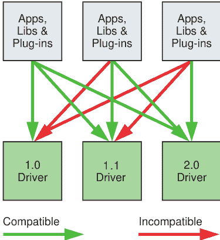

图 13 驱动程序 API 向后兼容但不向前兼容

### 3.5. 计算模式

在运行 Windows Server 2008 及更高版本或 Linux 的 Tesla 解决方案上，可以使用 NVIDIA 系统管理接口 (nvidia-smi)（作为驱动程序的一部分分发的工具）将系统中的任何设备设置为以下三种模式之一：

- 默认计算模式：多个主机线程可以同时使用该设备（使用运行时 API 时，通过在此设备上调用 cudaSetDevice()；使用驱动程序 API 时，通过使与该设备关联的上下文成为当前上下文）。
- 独占进程计算模式：在系统的所有进程中，设备上只能创建一个 CUDA 上下文。该上下文可以在创建该上下文的进程中成为任意多个线程的当前上下文。
- 禁止计算模式：设备上无法创建 CUDA 上下文。

这意味着，特别是，使用运行时 API 但未显式调用 cudaSetDevice() 的主机线程可能会与设备 0 以外的设备关联，如果设备 0 处于禁止模式或独占进程模式并且已被使用


由另一个进程。cudaSetValidDevices() 可用于从设备优先级列表中设置设备。

另请注意，对于采用 Pascal 及更高架构（主修订版本号为 6 及更高的计算能力）的设备，支持 Compute Preemption（计算抢占）。这允许在指令级粒度上抢占计算任务，而非像早期 Maxwell 和 Kepler GPU 架构那样在线程块粒度上抢占，其好处是可防止运行长时间内核的应用程序要么独占系统，要么超时。但是，Compute Preemption 会带来上下文切换开销，并且在支持该功能的设备上会自动启用。可使用带有属性 cudaDevAttrComputePreemptionSupported 的单个属性查询函数 cudaDeviceGetAttribute() 来确定当前使用的设备是否支持 Compute Preemption。希望避免不同进程相关上下文切换开销的用户，可以通过选择独占进程模式来确保 GPU 上只有一个进程处于活动状态。

应用程序可以通过检查 computeMode 设备属性来查询设备的计算模式（参见设备枚举）。

### 3.6. 模式切换

带有显示输出的 GPU 会将部分 DRAM 内存专门用于所谓的主表面，用于刷新用户查看其输出的显示设备。当用户通过更改显示分辨率或位深度（在 Windows 上使用 NVIDIA 控制面板或显示控制面板）来启动显示模式切换时，主表面所需的内存量会发生变化。例如，如果用户将显示分辨率从 1280x1024x32 位更改为 1600x1200x32 位，系统必须为主表面专门分配 7.68 MB，而不是 5.24 MB。（启用抗锯齿的全屏图形应用程序可能需要更多的显示内存用于主表面。）在 Windows 上，其他可能启动显示模式切换的事件包括启动全屏 DirectX 应用程序、按 Alt+Tab 从全屏 DirectX 应用程序切换任务，或按 Ctrl+Alt+Del 锁定计算机。

如果模式切换增加了主表面所需的内存量，系统可能不得不挪用专用于 CUDA 应用程序的内存分配。因此，模式切换会导致对 CUDA 运行时的任何调用失败并返回无效上下文错误。

### 3.7. Windows 上的 Tesla 计算集群模式

使用 NVIDIA 系统管理接口 (nvidia-smi)，可将 Windows 设备驱动程序设置为 TCC（Tesla 计算集群）模式，适用于计算能力 2.0 及更高版本的 Tesla 和 Quadro 系列设备。

此模式具有以下主要优点：

- 使这些 GPU 可以在带有非 NVIDIA 集成图形的集群节点中使用；
- 使这些 GPU 可通过远程桌面使用，包括直接使用以及通过依赖远程桌面的集群管理系统使用；
- 使这些 GPU 可用于作为 Windows 服务运行的应用程序（即，在会话 0 中）。

但是，TCC 模式会移除对任何图形功能的支持。

## 第 4 章 硬件实现

NVIDIA GPU 架构围绕可扩展的多线程流式多处理器 (SM) 阵列构建。当主机 CPU 上的 CUDA 程序调用内核网格时，网格中的块会被枚举并分发给具有可用执行能力的多处理器。线程块的线程在一个多处理器上并发执行，多个线程块可以在一个多处理器上并发执行。随着线程块终止，新块会在空出的多处理器上启动。

多处理器设计用于并发执行数百个线程。为了管理如此大量的线程，它采用了一种称为 SIMT（单指令多线程）的独特架构，该架构在 SIMT 架构中有所描述。指令是流水线的，利用单个线程内的指令级并行性，以及通过同时硬件多线程实现的广泛线程级并行性，如硬件多线程中详细所述。与 CPU 核心不同，它们按顺序发出，没有分支预测或推测执行。

SIMT 架构和硬件多线程描述了所有设备共有的流式多处理器架构特性。计算能力 3.x、计算能力 5.x、计算能力 6.x 和计算能力 7.x 分别为计算能力 3.x、5.x、6.x 和 7.x 的设备提供具体细节。

NVIDIA GPU 架构使用小端序表示。

### 4.1. SIMT 架构

多处理器以称为 warp（线程束）的 32 个并行线程组来创建、管理、调度和执行线程。组成 warp 的各个线程从相同的程序地址一起开始，但它们拥有自己的指令地址计数器和寄存器状态，因此可以自由分支并独立执行。warp 一词源自织造，即第一种并行线程技术。半 warp 是 warp 的前半部分或后半部分。四分之一 warp 是 warp 的第一、第二、第三或第四个四分之一部分。

当多处理器获得一个或多个线程块来执行时，它会将它们划分为 warps，每个 warp 由 warp 调度器调度执行。块划分为 warps 的方式始终相同；每个 warp 包含连续递增的线程 ID 的线程，第一个 warp 包含线程 0。线程层次结构描述了线程 ID 与块中线程索引的关系。

warp 一次执行一条公共指令，因此当 warp 中所有 32 个线程在执行路径上达成一致时，可以实现全效率。如果 warp 中的线程通过数据相关的条件分支而分叉，warp 会执行每条被选中的分支路径，禁用不在该路径上的线程。分支分叉仅发生在 warp 内部；不同的 warps 独立执行，无论它们是执行公共还是不相交的代码路径。

SIMT 架构类似于 SIMD（单指令多数据）向量组织，因为单个指令控制多个处理元素。一个关键区别是，SIMD 向量组织将 SIMD 宽度暴露给软件，而 SIMT 指令指定单个线程的执行和分支行为。与 SIMD 向量机器不同，SIMT 使程序员能够为独立的标量线程编写线程级并行代码，以及为协调线程编写数据并行代码。出于正确性目的，程序员基本上可以忽略 SIMT 行为；但是，通过注意代码很少要求 warp 中的线程分叉，可以实现显著的性能改进。在实践中，这类似于传统代码中缓存行的作用：在设计正确性时可以安全地忽略缓存行大小，但在设计峰值性能时必须在代码结构中考虑它。另一方面，向量架构要求软件将加载合并为向量并手动管理分叉。

在 Volta 架构之前，warps 使用所有 32 个线程共享的单个程序计数器，连同指定 warp 中活动线程的活动掩码。结果，处于分叉区域或不同执行状态的同一 warp 中的线程无法相互发信号或交换数据，而需要由锁或互斥体保护的精细数据共享的算法很容易导致死锁，具体取决于竞争线程来自哪个 warp。

从 Volta 架构开始，独立线程调度允许线程之间无论 warp 如何都能完全并发。使用独立线程调度，GPU 会按线程维护执行状态，包括程序计数器和调用堆栈，并可以按线程粒度让出执行，无论是为了更好地利用执行资源，还是为了允许一个线程等待另一个线程生成的数据。调度优化器确定如何将同一 warp 中的活动线程分组到 SIMT 单元中。这保留了与早期 NVIDIA GPU 中的 SIMT 执行相同的高吞吐量，但具有更大的灵活性：线程现在可以在子 warp 粒度上分叉和重新汇聚。

如果开发者对早期硬件架构的 warp 同步性做出了假设，独立线程调度可能会导致参与执行代码的线程集与预期有很大不同。特别是，任何 warp 同步代码（例如，无同步的 warp 内归约）都应重新审查，以确保与 Volta 及更高版本兼容。有关更多详细信息，请参见计算能力 7.x。

1 warp 同步是指隐式假设同一 warp 中的线程在每条指令处都同步的代码。


## 注释

参与当前指令的 warp 中的线程称为活动线程，而未执行当前指令的线程为非活动线程（已禁用）。线程可能因多种原因而非活动，包括比 warp 中其他线程更早退出、采用了与 warp 当前执行的分支路径不同的分支路径，或者是块中最后几个线程（该块的线程数不是 warp 大小的倍数）。

如果 warp 执行的非原子指令将 warp 中多个线程写入全局或共享内存的同一位置，则发生对该位置的序列化写入的数量取决于设备的计算能力（参见计算能力 3.x、计算能力 5.x、计算能力 6.x 和计算能力 7.x），以及哪个线程执行最终写入是未定义的。

如果 warp 执行的原子指令对全局内存中多个线程的同一位置进行读取、修改和写入，则对该位置的每个读取/修改/写入都会发生并且全部序列化，但它们发生的顺序未定义。

### 4.2. 硬件多线程

多处理器处理的每个 warp 的执行上下文（程序计数器、寄存器等）在整个 warp 生命周期内都保留在片上。因此，从一个执行上下文切换到另一个执行上下文没有开销，并且在每次指令发射时，warp 调度程序会选择一个有线程准备好执行其下一条指令（即 warp 的活动线程）的 warp，并将指令发送给这些线程。

特别是，每个多处理器具有一组 32 位寄存器，这些寄存器在 warps 之间划分，并具有一个在线程块之间划分的并行数据缓存或共享内存。

对于给定内核，可以驻留并在多处理器上一起处理的块数和 warp 数取决于内核使用的寄存器和共享内存的数量以及多处理器上可用的寄存器和共享内存的数量。每个多处理器还有最大驻留块数和最大驻留 warp 数。这些限制以及多处理器上可用的寄存器和共享内存数量是设备计算能力的函数，并在附录 计算能力 中给出。如果每个多处理器可用的寄存器或共享内存不足以处理至少一个块，则内核将无法启动。

块中的 warp 总数如下：

ceil(T/W_size, 1)

- T 是每个块的线程数，
- W_size 是 warp 大小，等于 32，
- ceil(x, y) 等于 x 向上舍入到 y 的最近倍数。

为块分配的寄存器总数和共享内存总量记录在 CUDA Toolkit 提供的 CUDA 占用率计算器中。

## 第 5 章
性能准则

### 5.1. 整体性能优化策略

性能优化围绕三种基本策略展开：

- 最大化并行执行以实现最大利用率；
- 优化内存使用以实现最大内存吞吐量；
- 优化指令使用以实现最大指令吞吐量。

哪些策略对应用程序特定部分产生最佳性能增益取决于该部分的性能限制因素；例如，优化主要受内存访问限制的内核的指令使用不会带来任何显著性能增益。因此，优化工作应始终由测量和监控性能限制因素来驱动，例如使用 CUDA 分析器。此外，将特定内核的浮点运算吞吐量或内存吞吐量（以较合理者为准）与设备相应的峰值理论吞吐量进行比较，可指示该内核有多少改进空间。

### 5.2. 最大化利用率

要最大化利用率，应用程序应以一种方式构建，使其暴露出尽可能多的并行性，并将此并行性高效地映射到系统的各个组件上，以使它们大部分时间保持忙碌。

#### 5.2.1. 应用程序级别

在高层次上，应用程序应通过使用异步函数调用和流（如 异步并发执行 中所述）来最大化主机、设备以及连接主机与设备的总线之间的并行执行。它应将每个处理器最擅长的工作类型分配给它：将串行工作负载分配给主机；将并行工作负载分配给设备。

对于并行工作负载，在算法中某些线程需要同步以相互共享数据从而导致并行性中断的点上，有两种情况：要么这些线程属于同一个块，在这种情况下，它们应在同一内核调用中使用 `__syncthreads()` 通过共享内存共享数据；要么它们属于不同的块，在这种情况下，它们必须使用两个单独的内核调用通过全局内存共享数据，一个用于写入，一个用于从全局内存读取。第二种情况远非最优，因为它增加了额外内核调用和全局内存流量的开销。因此，应通过将算法映射到 CUDA 编程模型来尽量减少其发生，使得需要线程间通信的计算尽可能在单个线程块内执行。

#### 5.2.2. 设备级别

在较低级别上，应用程序应最大化设备中多处理器之间的并行执行。

多个内核可以在设备上并发执行，因此也可以通过使用流来启动足够数量的内核并发执行以实现最大利用率，如 异步并发执行 中所述。

#### 5.2.3. 多处理器级别

在更低级别上，应用程序应最大化多处理器内各功能单元之间的并行执行。

如 硬件多线程 中所述，GPU 多处理器主要依赖线程级并行性来最大化其功能单元的利用率。因此，利用率直接与驻留 warp 的数量相关。在每次指令发射时，warp 调度程序会选择一条准备好执行的指令。该指令可以是同一 warp 的另一条独立指令，利用指令级并行性，或者更常见的是另一个 warp 的指令，利用线程级并行性。如果选定了一条准备好执行的指令，则将其发送给 warp 的活动线程。warp 准备好执行其下一条指令所需的时钟周期数称为延迟，当所有 warp 调度程序在该延迟期间的每个时钟周期内始终有某个 warp 的指令可发射时，即可实现完全利用率，换句话说，即延迟完全“隐藏”。隐藏 L 个时钟周期延迟所需的指令数取决于这些指令各自的吞吐量（有关各种算术指令吞吐量，请参见 算术指令）。如果假设具有最大吞吐量的指令，则等于：

- 对于计算能力 5.x、6.1、6.2 和 7.x 的设备，为 4L，因为对于这些设备，多处理器在一个时钟周期内对四个 warps 各发射一条指令，如 计算能力 中所述。
- 对于计算能力 6.0 的设备，为 2L，因为对于这些设备，每个周期发射的两条指令分别是两个不同 warps 的一条指令。
- 对于计算能力 3.x 的设备，为 8L，因为对于这些设备，每个周期发射的八条指令是四个对，分别针对四个不同的 warps，每对针对同一个 warp。


warp 无法执行其下一条指令的最常见原因是该指令的输入操作数尚未可用。

如果所有输入操作数都是寄存器，延迟是由寄存器依赖引起的，即，某些输入操作数由之前尚未执行完毕的指令写入。在这种情况下，延迟等于前一条指令的执行时间，warp 调度器在此期间必须调度其他 warp 的指令。执行时间取决于指令。在计算能力为 7.x 的设备上，对于大多数算术指令，通常为 4 个时钟周期。这意味着每个多处理器需要 16 个活跃 warp（4 个周期，4 个 warp 调度器）来隐藏算术指令延迟（假设 warp 以最大吞吐量执行指令，否则需要的 warp 更少）。如果单个 warp 表现出指令级并行性，即其指令流中有多条独立指令，则需要的 warp 更少，因为来自单个 warp 的多条独立指令可以连续发出。

如果某些输入操作数位于片外内存中，延迟会高得多：通常为数百个时钟周期。在如此高延迟期间保持 warp 调度器忙碌所需的 warp 数量取决于内核代码及其指令级并行度。一般来说，如果不带片外内存操作数的指令数量（大多数情况下是算术指令）与带片外内存操作数的指令数量之比较低，则需要更多的 warp（这个比率通常称为程序的算术强度）。

warp 无法执行其下一条指令的另一个原因是它正在某个内存栅栏（内存栅栏函数）或同步点（内存栅栏函数）处等待。同步点可能导致多处理器空闲，因为越来越多的 warp 正在等待同一块中的其他 warp 完成同步点之前的指令执行。在这种情况下，每个多处理器驻留多个块有助于减少空闲，因为来自不同块的 warp 在同步点处不需要互相等待。

给定内核调用中每个多处理器上驻留的块和 warp 数量取决于调用的执行配置（执行配置）、多处理器的内存资源以及在 硬件多线程 中描述的内核资源需求。使用 -ptxas-options=-v 选项编译时，编译器会报告寄存器和共享内存使用情况。

块所需的共享内存总量等于静态分配的共享内存量与动态分配的共享内存量之和。

内核使用的寄存器数量对驻留 warp 数量有显著影响。例如，对于计算能力为 6.x 的设备，如果内核使用 64 个寄存器，每个块有 512 个线程且需要的共享内存很少，那么两个块（即 32 个 warp）可以驻留在多处理器上，因为它们需要 2x512x64 个寄存器，这正好与多处理器上可用的寄存器数量匹配。但一旦内核多使用一个寄存器，只能驻留一个块（即 16 个 warp），因为两个块需要 2x512x65 个寄存器，超过了多处理器上可用的寄存器数量。因此，编译器试图在将寄存器溢出（参见 设备内存访问）和指令数量降至最低的同时，尽量减少寄存器使用。寄存器使用可以通过 `maxrregcount` 编译器选项或 启动边界 中描述的启动边界来控制。

寄存器文件组织为 32 位寄存器。因此，存储在寄存器中的每个变量至少需要一个 32 位寄存器，例如，`double` 变量使用两个 32 位寄存器。

执行配置对给定内核调用性能的影响通常取决于内核代码。因此，建议进行实验。应用程序还可以根据寄存器文件大小和共享内存大小参数化执行配置，这取决于设备的计算能力，以及设备的多处理器数量和内存带宽，所有这些都可以使用运行时查询（参见 参考手册）。

每个块的线程数应选择为 warp 大小的倍数，以尽可能避免因 warp 未充满而浪费计算资源。

##### 5.2.3.1. 占用率计算器

存在多个 API 函数，可帮助程序员根据寄存器和共享内存需求选择线程块大小。

- 占用率计算器 API `cudaOccupancyMaxActiveBlocksPerMultiprocessor` 可根据内核的块大小和共享内存使用情况提供占用率预测。该函数以每个多处理器的并发线程块数量来报告占用率。
- 请注意，此值可以转换为其他指标。乘以每个块的 warp 数量可得到每个多处理器的并发 warp 数量；再将并发 warp 数除以每个多处理器的最大 warp 数量，即可得到百分比形式的占用率。
- 基于占用率的启动配置器 API `cudaOccupancyMaxPotentialBlockSize` 和 `cudaOccupancyMaxPotentialBlockSizeVariableSMem` 会启发式地计算出能实现最大多处理器级占用率的执行配置。

以下代码示例计算 MyKernel 的占用率。然后它以并发 warp 与每个多处理器最大 warp 数之比报告占用率水平。

```
// Device code
__global__ void MyKernel(int *d, int *a, int *b)
{
    int idx = threadIdx.x + blockIdx.x * blockDim.x;
    d[idx] = a[idx] * b[idx];
}

// Host code
int main()
{
    int numBlocks;
    int blockSize = 32; // Occupancy in terms of active blocks

    // These variables are used to convert occupancy to warps
    int device;
    cudaDeviceProp prop;
    int activeWarps;
    int maxWarps;

    cudaGetDevice(&device);
    cudaGetDeviceProperties(&prop, device);

    cudaOccupancyMaxActiveBlocksPerMultiprocessor(
        &numBlocks,
        MyKernel,
        blockSize,
        0);

    activeWarps = numBlocks * blockSize / prop.warpSize;
    maxWarps = prop.maxThreadsPerMultiProcessor / prop.warpSize;

    std::cout << "Occupancy: " << (double)activeWarps / maxWarps * 100 << "%" <<
        std::endl;

    return 0;
}
```

以下代码示例根据用户输入配置 MyKernel 的基于占用率的内核启动。

```
// Device code
__global__ void MyKernel(int *array, int arrayCount)
{
    int idx = threadIdx.x + blockIdx.x * blockDim.x;
    if (idx < arrayCount) {
        array[idx] *= array[idx];
    }
}

// Host code
void launchMyKernel(int *array, int arrayCount)
{
    int blockSize;   // The launch configurator returned block size
    int minGridSize; // The minimum grid size needed to achieve the
                     // maximum occupancy for a full device launch
    int gridSize;    // The actual grid size needed, based on input
                     // size

    cudaOccupancyMaxPotentialBlockSize(
        &minGridSize,
        &blockSize,
        (void*)MyKernel,
        0,
        arrayCount);

    // Round up according to array size
    gridSize = (arrayCount + blockSize - 1) / blockSize;

    MyKernel<<<gridSize, blockSize>>>(array, arrayCount);
    cudaDeviceSynchronize();

    // If interested, the occupancy can be calculated with
    // cudaOccupancyMaxActiveBlocksPerMultiprocessor

    return 0;
}
```

CUDA 工具包还在 <CUDA_Toolkit_Path>/include/cuda_occupancy.h 中提供了一个自文档化、独立的占用率计算器和启动配置器实现，适用于任何无法依赖 CUDA 软件堆栈的用例。还提供了占用率计算器的电子表格版本。电子表格版本作为学习工具特别有用，它可视化影响占用率的参数（块大小、每个线程的寄存器数和每个线程的共享内存）变化的影响。

### 5.3. 最大化内存吞吐量

最大化应用程序整体内存吞吐量的第一步是尽量减少低带宽数据传输。

这意味着尽量减少主机与设备之间的数据传输，如在 主机与设备之间的数据传输 中详细说明，因为这些传输的带宽远低于全局内存与设备之间的数据传输。

这也意味着通过最大化片上内存（共享内存和缓存，即 L1 缓存和）的使用来尽量减少全局内存与设备之间的数据传输。


计算能力 2.x 及更高版本的设备上可用的 L2 缓存，所有设备上均可用的纹理缓存和常量缓存)。

共享内存相当于用户托管的缓存：应用程序显式分配和访问它。如 CUDA Runtime 所示，典型的编程模式是将来自设备内存的数据暂存到共享内存中；换句话说，让块中的每个线程：

- 将数据从设备内存加载到共享内存，
- 与块中的所有其他线程同步，以便每个线程可以安全地读取由不同线程填充的共享内存位置，
- 处理共享内存中的数据，
- 如果有必要，再次同步以确保共享内存已用结果更新，
- 将结果写回设备内存。

对于某些应用程序（例如，全局内存访问模式依赖于数据的应用程序），传统的硬件托管缓存更适合利用数据局部性。如在 Compute Capability 3.x 和 Compute Capability 7.x 中所述，对于计算能力为 3.x 和 7.x 的设备，同一片片上内存同时用于 L1 和共享内存，且分配给 L1 与共享内存的比例可针对每个内核调用进行配置。

内核的内存访问吞吐量可能因每种内存类型的访问模式而相差一个数量级。因此，最大化内存吞吐量的下一步是根据 Device Memory Accesses 中描述的最佳内存访问模式，尽可能优化地组织内存访问。这种优化对全局内存访问尤其重要，因为与可用的片上带宽和算术指令吞吐量相比，全局内存带宽较低，因此非最优的全局内存访问通常会对性能产生较大影响。

#### 5.3.1. 主机与设备之间的数据传输

应用程序应努力尽量减少主机与设备之间的数据传输。实现此目标的一种方法是将更多代码从主机移动到设备，即使这意味着运行的内核没有暴露出足够的并行性，无法在设备上以全效率执行。中间数据结构可以在设备内存中创建，由设备进行操作，并在不被主机映射或复制到主机内存的情况下销毁。

此外，由于每次传输都有相关开销，将许多小传输批量合并为一次大传输的性能始终优于分别进行每次传输。

在具有前端总线的系统上，使用 Page-Locked Host Memory 中描述的页锁定主机内存，可以实现主机与设备之间数据传输的更高性能。

此外，使用映射页锁定内存（Mapped Memory）时，无需分配任何设备内存，也不需要显式复制设备与主机内存之间的数据。每次内核访问映射内存时，都会隐式执行数据传输。为了获得最大性能，这些内存访问必须像访问全局内存一样合并（参见 Device Memory Accesses）。假设满足上述条件且映射内存仅被读取或写入一次，那么使用映射页锁定内存而非设备与主机内存之间的显式复制，可能会对性能有所裨益。

在设备内存和主机内存物理相同的集成系统上，主机与设备之间的任何复制都是多余的，应改用映射页锁定内存。应用程序可以通过检查集成设备属性（参见 Device Enumeration）是否等于 1 来查询设备是否为集成设备。

#### 5.3.2. 设备内存访问

访问可寻址内存（即全局、局部、共享、常量或纹理内存）的指令，可能需要根据 warp 内线程之间内存地址的分布多次重新发出。地址分布以这种方式影响指令吞吐量的情况因内存类型而异，并在以下各节中描述。例如，对于全局内存，一般规则是地址越分散，吞吐量越低。

### 全局内存

全局内存位于设备内存中，设备内存通过 32 字节、64 字节或 128 字节的内存事务进行访问。这些内存事务必须自然对齐：只有按其大小对齐的设备内存 32 字节、64 字节或 128 字节段（即其首地址是其大小的倍数的段）才能由内存事务读取或写入。

当 warp 执行访问全局内存的指令时，它会根据每个线程访问的字大小以及线程之间内存地址的分布，将 warp 内线程的内存访问合并为一个或多个此类内存事务。一般来说，所需的事务越多，除了线程访问的字之外，传输的未使用字就越多，从而相应地降低指令吞吐量。例如，如果为每个线程的 4 字节访问生成一个 32 字节内存事务，则吞吐量除以 8。

所需事务的数量以及吞吐量最终受到的影响程度因设备的计算能力而异。Compute Capability 3.x、Compute Capability 5.x、Compute Capability 6.x 和 Compute Capability 7.x 提供了有关各种计算能力下如何处理全局内存访问的更多详细信息。

因此，为了最大化全局内存吞吐量，重要的是通过以下方式最大化合并：

- 根据 Compute Capability 3.x、Compute Capability 5.x、Compute Capability 6.x 和 Compute Capability 7.x 遵循最优访问模式，
- 使用满足以下 Size and Alignment Requirement 章节中详细说明的大小和对齐要求的数据类型，
- 在某些情况下填充数据，例如，在访问下文 Two-Dimensional Arrays 章节中描述的二维数组时。

### 大小和对齐要求

全局内存指令支持读取或写入大小为 1、2、4、8 或 16 字节的字。只有当数据类型的大小为 1、2、4、8 或 16 字节且数据自然对齐（即其地址是该大小的倍数）时，访问全局内存中数据（通过变量或指针）的任何访问才会编译为单个全局内存指令。

如果未满足此大小和对齐要求，访问将编译为具有交错访问模式的多个指令，这些模式阻止指令完全合并。因此，建议对驻留在全局内存中的数据使用满足此要求的类型。

内置矢量类型会自动满足对齐要求。

对于结构体，编译器可以使用对齐说明符 `__align__(8) or __align__(16)` 来强制执行大小和对齐要求，例如

```
struct __align__(8) {
    float x;
    float y;
};
```

或

```
struct __align__(16) {
    float x;
    float y;
    float z;
};
```

驻留在全局内存中的变量的任何地址，或由驱动程序或运行时 API 的内存分配例程返回的地址，始终至少对齐到 256 字节。

读取非自然对齐的 8 字节或 16 字节字会产生错误结果（偏差几个字），因此必须特别注意保持这些类型的任何值或值数组的起始地址的对齐。一个容易被忽略的典型情况是使用某种自定义全局内存分配方案时，即用分配一个大内存块并将其分区为多个数组来替代多个数组的分配（多次调用 cudaMalloc() 或 cuMemAlloc()），在这种情况下，每个数组的起始地址相对于块的起始地址有偏移。

### 二维数组

常见的全局内存访问模式是，索引为 (tx,ty) 的每个线程使用以下地址访问位于地址 BaseAddress 处、类型为 type* 的宽度为 width 的二维数组中的一个元素（其中 type 满足 Maximize Utilization 中描述的要求）：

```
BaseAddress + width * ty + tx
```

要使这些访问完全合并，线程块宽度和数组宽度都必须是 warp 大小的倍数。

特别是，这意味着如果一个数组的宽度不是这个大小的倍数，那么如果实际分配时将其宽度向上舍入到最接近的倍数，并相应填充其行，则可以更高效地访问它。参考手册中描述的 cudaMallocPitch() 和 cuMemAllocPitch() 函数及相关内存复制函数使程序员能够编写非硬件相关的代码来分配符合这些约束的数组。

## 局部内存

局部内存访问仅发生在变量内存空间说明符中提到的一些自动变量上。编译器可能会将以下自动变量放置在局部内存中：

- 无法确定其是否用常量索引的数组，
- 会占用过多寄存器空间的大型结构体或数组，
- 如果内核使用的寄存器超过可用数量，则任何变量（这也称为寄存器溢出）。

通过检查 PTX 汇编代码（使用 -ptx 或 -keep 选项编译获得），可以判断变量在第一阶段编译期间是否已被放置在局部内存中，因为它将使用 .local 助记符声明，并使用 ld.local 和 st.local 助记符访问。即使没有，后续编译阶段仍可能做出不同的决定，如果它们发现它对目标架构来说占用了过多的寄存器空间。使用 cuobjdump 检查 cubin 对象可以判断是否是这种情况。另外，使用 --ptxas-options=-v 选项编译时，编译器会报告每个内核的总局部内存使用量（lmem）。请注意，某些数学函数有可能访问局部内存的实现路径。

局部内存空间位于设备内存中，因此局部内存访问具有与全局内存访问相同的高延迟和低带宽，并受 Device Memory Accesses 中描述的相同内存合并要求的约束。然而，局部内存的组织方式是连续的 32 位字由连续的线程 ID 访问。因此，只要 warp 中的所有线程访问相同的相对地址（例如，数组变量中的相同索引，结构体变量中的相同成员），访问就会完全合并。

在某些计算能力 3.x 的设备上，局部内存访问始终以与全局内存访问相同的方式缓存在 L1 和 L2 中（参见 Compute Capability 3.x）。

在计算能力 5.x 和 6.x 的设备上，局部内存访问始终以与全局内存访问相同的方式缓存在 L2 中（参见 Compute Capability 5.x 和 Compute Capability 6.x）。

## 共享内存

由于位于芯片上，共享内存的带宽远高于局部内存或全局内存，延迟远低于它们。

为了实现高带宽，共享内存被分为大小相等的内存模块，称为银行，可以同时访问。因此，任何由 n 个地址组成且落在 n 个不同内存银行中的内存读写请求都可以同时得到服务，总带宽是单个模块带宽的 n 倍。

但是，如果内存请求中的两个地址落在同一个内存银行中，就会发生银行冲突，访问必须串行化。硬件将带有银行冲突的内存请求拆分为必要数量的独立无冲突请求，吞吐量降低的因子等于独立内存请求的数量。如果独立内存请求的数量是 n，则说初始内存请求导致 n 路银行冲突。

因此，为了获得最大性能，了解内存地址如何映射到内存银行非常重要，以便安排内存请求以尽量减少银行冲突。这分别在计算能力 3.x、5.x、6.x 和 7.x 的设备的 Compute Capability 3.x、Compute Capability 5.x、Compute Capability 6.x 和 Compute Capability 7.x 中有所描述。

## 常量内存

常量内存空间位于设备内存中，并缓存在常量缓存中。

然后，请求被拆分为与初始请求中不同内存地址数量相同的独立请求，吞吐量降低的因子等于独立请求的数量。

然后，生成的请求在缓存命中时以常量缓存的吞吐量得到服务，否则以设备内存的吞吐量得到服务。

## 纹理和表面内存

纹理和表面内存空间位于设备内存中，并缓存在纹理缓存中，因此纹理获取或表面读取仅在缓存未命中时才需要一次来自设备内存的内存读取，否则只需一次来自纹理缓存的读取。纹理缓存针对 2D 空间局部性进行了优化，因此同一 warp 中读取在 2D 中彼此接近的纹理或表面地址的线程将获得最佳性能。此外，它针对具有恒定延迟的流式获取进行了设计；缓存命中会减少 DRAM 带宽需求，但不会减少获取延迟。

通过纹理或表面获取读取设备内存具有某些好处，这可以使其成为从全局或常量内存读取设备内存的有利替代方案：

- 如果内存读取不遵循全局或常量内存读取必须遵循的访问模式以获得良好性能，只要纹理获取或表面读取中存在局部性，就可以实现更高的带宽；
- 寻址计算由专用单元在内核外执行；
- 压缩数据可以在单个操作中广播到单独的变量；
- 8 位和 16 位整数输入数据可以选择转换为范围 [0.0, 1.0] 或 [-1.0, 1.0] 中的 32 位浮点值（参见 Texture Memory）。

### 5.4. 最大化指令吞吐量

要最大化指令吞吐量，应用程序应：

- 尽量减少低吞吐量算术指令的使用；这包括在不影响最终结果时用精度换取速度，例如使用内置函数而不是常规函数（内置函数列于 Intrinsic Functions）、使用单精度而不是双精度，或将非规范化数刷新为零；
- 尽量减少由控制流指令导致的分歧 warp，详情见 Control Flow Instructions
- 减少指令数量，例如，尽可能优化掉同步点（如 Synchronization Instruction 中所述），或使用受限指针（如 __restrict__ 中所述）。

在本节中，吞吐量以每个多处理器每个时钟周期的操作数给出。对于 warp 大小为 32，一条指令对应 32 个操作，因此如果 N 是每个时钟周期的操作数，则指令吞吐量为 N/32 条指令每个时钟周期。

所有吞吐量均针对一个多处理器。必须将它们乘以设备中的多处理器数量才能获得整个设备的吞吐量。

#### 5.4.1. 算术指令

表 3 给出了各种计算能力设备在硬件中原生支持的算术指令的吞吐量。

### 表 3 原生算术指令吞吐量

（每个多处理器每个时钟周期的结果数）

| | 3.0, 3.2 | 3.5, 3.7 | 5.0, 5.2 | 5.3 | 6.0 | 6.1 | 6.2 | 7.x |
| :--- | :---: | :---: | :---: | :---: | :---: | :---: | :---: | :---: |
| 16 位浮点加、乘、乘加 | 不适用 | 不适用 | 不适用 | 256 | 128 | 2 | 256 | 128 |
| 32 位浮点加、乘、乘加 | 192 | 192 | 128 | 128 | 64 | 128 | 128 | 64 |
| 64 位浮点加、乘、乘加 | 8 | 64² | 4 | 4 | 32 | 4 | 4 | 32³ |
| 32 位浮点倒数、倒数平方根、以 2 为底的对数 (__log2f)、以 2 为底的指数 (__exp2f)、正弦 (__sinf)、余弦 (__cosf) | 32 | 32 | 32 | 32 | 16 | 32 | 32 | 16 |
| 32 位整数加、扩展精度加、减、扩展精度减 | 160 | 160 | 128 | 128 | 64 | 128 | 128 | 64 |
| 32 位整数乘、乘加、扩展精度乘加 | 32 | 32 | 多条指令 | 多条指令 | 多条指令 | 多条指令 | 多条指令 | 64⁴ |
| 24 位整数乘 (__umul24) | 多条指令 | 多条指令 | 多条指令 | 多条指令 | 多条指令 | 多条指令 | 多条指令 | 多条指令 |
| 32 位整数移位 | 32 | 64⁵ | 64 | 64 | 32 | 64 | 64 | 64 |
| 比较、最小值、最大值 | 160 | 160 | 64 | 64 | 32 | 64 | 64 | 64 |
| 32 位整数位反转、位字段提取/插入 | 32 | 32 | 64 | 64 | 32 | 64 | 64 | 多条指令 |


| | 3.0, 3.2 | 3.5, 3.7 | 5.0, 5.2 | 5.3 | 6.0 | 6.1 | 6.2 | 7.x |
|---|---|---|---|---|---|---|---|---|
| 32 位按位 AND、OR、XOR | 160 | 160 | 128 | 128 | 64 | 128 | 128 | 64 |
| 前导零计数，最高有效非符号位 | 32 | 32 | 32 | 32 | 16 | 32 | 32 | 16 |
| 人口计数 | 32 | 32 | 32 | 32 | 16 | 32 | 32 | 16 |
| warp 混洗 | 32 | 32 | 32 | 32 | 32 | 32 | 32 | 32⁶ |
| 绝对差之和 | 32 | 32 | 64 | 64 | 32 | 64 | 64 | 64 |
| SIMD 视频指令 vabsdiff2 | 160 | 160 | 多条指令。 | 多条指令。 | 多条指令。 | 多条指令。 | 多条指令。 | 多条指令。 |
| SIMD 视频指令 vabsdiff4 | 160 | 160 | 多条指令。 | 多条指令。 | 多条指令。 | 多条指令。 | 多条指令。 | 64 |
| 其他所有 SIMD 视频指令 | 32 | 32 | 多条指令。 | 多条指令。 | 多条指令。 | 多条指令。 | 多条指令。 | 多条指令。 |
| 从 8 位和 16 位整数到 32 位类型的类型转换 | 128 | 128 | 32 | 32 | 16 | 32 | 32 | 16 |
| 与 64 位类型之间的类型转换 | 8 | 32⁷ | 4 | 4 | 16 | 4 | 4 | 16⁸ |
| 其他所有类型转换 | 32 | 32 | 32 | 32 | 16 | 32 | 32 | 16 |

其他指令和函数是基于本机指令实现的。不同计算能力的设备实现可能不同，编译后的本机指令数量可能随每个编译器版本而波动。对于编译后的函数，可能存在多个代码路径，具体取决于输入。可以使用 cuobjdump 检查 cubin 对象中的特定实现。

某些函数的实现可直接在 CUDA 头文件（math_functions.h, device_functions.h, ...）中找到。

一般来说，使用 -ftz=true（非规范化数被刷新为零）编译的代码性能通常高于使用 -ftz=false 编译的代码。同样，使用 -prec-div=false（精度较低的除法）编译的代码性能通常高于使用 -prec-div=true 编译的代码，使用 -prec-sqrt=false（精度较低的平方根）编译的代码性能通常高于使用 `-prec-sqrt=true` 编译的代码。nvcc 用户手册详细描述了这些编译标志。

### 单精度浮点除法

`__fdividef(x, y)`（参见内置函数）提供的单精度浮点除法速度比除法运算符更快。

### 单精度浮点倒数平方根

为保持 IEEE-754 语义，编译器仅在倒数和平方根均为近似值时（即使用 `-prec-div=false` 和 `-prec-sqrt=false`）才会将 `1.0/sqrtf()` 优化为 `rsqrtf()`。因此，在需要时建议直接调用 `rsqrtf()`。

### 单精度浮点平方根

单精度浮点平方根的实现方式是先计算倒数平方根，再计算倒数，而不是先计算倒数平方根再进行乘法，以便对 0 和无穷大给出正确结果。

### 正弦和余弦

`sinf(x)`、`cosf(x)`、`tanf(x)`、`sincosf(x)` 及相应的双精度指令开销要大得多，尤其是当参数 x 的幅值较大时。

更准确地说，参数约简代码（实现请参见数学函数）包含两条代码路径，分别称为快速路径和慢速路径。

快速路径用于幅值足够小的参数，本质上由少数乘加运算组成。慢速路径用于幅值较大的参数，包含为在整个参数范围内获得正确结果所需的冗长计算。

目前，三角函数的参数约简代码对单精度函数选择幅值小于 105615.0f 的参数的快速路径，对双精度函数选择幅值小于 2147483648.0 的参数的快速路径。

由于慢速路径所需的寄存器比快速路径多，有人尝试通过将一些中间变量存储在本地内存中来降低慢速路径中的寄存器压力，但由于本地内存延迟高且带宽（请参见设备内存访问），这可能会影响性能。目前，单精度函数使用 28 字节本地内存，双精度函数使用 44 字节。不过，确切数量可能会更改。

由于慢速路径中的冗长计算和本地内存使用，当需要慢速路径约简而非快速路径约简时，这些三角函数的吞吐量低一个数量级。

### 整数运算

整数除法和取模操作开销较大，因为它们会编译成多达 20 条指令。在某些情况下，可以用按位运算替换它们：如果 n 是 2 的幂，则 (i/n) 等价于 (i>>log2(n))，(i&n) 等价于 (i&(n-1))；如果 n 是字面量，编译器会执行这些转换。

__brev 和 __popc 映射到一条指令，__brevll 和 __popcll 映射到几条指令。

__[u]mul24 是旧版内置函数，已无任何使用理由。

### 半精度运算

为获得良好的半精度浮点加法、乘法或乘加吞吐量，建议使用 half2 数据类型。然后可以使用矢量内置函数（例如 `__hadd2`、`__hsub2`、`__hmul2`、`__hfma2`）在一条指令中完成两个操作。用 half2 替代两次 half 调用也可能有助于其他内置函数（例如 warp 混洗）的性能。

提供了内置函数 `__halves2half2` 以将两个半精度值转换为 half2 数据类型。

### 类型转换

有时，编译器必须插入转换指令，从而引入额外的执行周期。这种情况包括：

- 对 char 或 short 类型变量进行操作的函数，其操作数通常需要转换为 int，
- 用作单精度浮点计算输入的双精度浮点常量（即未定义任何类型后缀的常量，如 C/C++ 标准所要求），

可以通过使用带 f 后缀的单精度浮点常量（例如 3.141592653589793f、1.0f、0.5f）来避免最后一种情况。

### 5.4.2. 控制流指令

任何流程控制指令（if、switch、do、for、while）都可能通过导致同一 warp 中的线程分叉（即遵循不同的执行路径）而显著影响有效指令吞吐量。如果发生这种情况，不同的执行路径必须串行化，从而增加该 warp 执行的指令总数。

在控制流取决于线程 ID 的情况下，为获得最佳性能，应编写控制条件以尽量减少分叉 warp 的数量。这是可能的，因为如 SIMT 架构中所述，块中 warp 的分布是确定的。一个简单的例子是，当控制条件仅取决于 `(threadIdx / warpSize)` 时（其中 `warpSize` 是 warp 大小）。在这种情况下，不会发生 warp 分叉，因为控制条件与 warp 完全对齐。

有时，编译器可能会展开循环，或者通过使用分支预测来优化掉简短的 `if` 或 `switch` 块，如下文详述。在这些情况下，绝不会发生 warp 分叉。程序员也可以使用 `#pragma unroll` 指令控制循环展开（请参见 #pragma unroll）。

使用分支预测时，执行取决于控制条件的指令都不会被跳过。相反，每条指令都关联一个每线程条件码或谓词，该谓词根据控制条件设置为 true 或 false。尽管每条指令都会被调度执行，但只有谓词为 true 的指令才会实际执行。谓词为 false 的指令不会写入结果，也不会计算地址或读取操作数。

### 5.4.3. 同步指令

对于计算能力 3.x 的设备，`__syncthreads()` 的吞吐量为每个时钟周期 128 次操作；对于计算能力 6.0 的设备，为每个时钟周期 32 次操作；对于计算能力 7.x 的设备，为每个时钟周期 16 次操作；对于计算能力 5.x、6.1 和 6.2 的设备，为每个时钟周期 64 次操作。

请注意，`__syncthreads()` 可能会通过强制多处理器空闲来影响性能，如设备内存访问中详细所述。


## 附录 A.
支持 CUDA 的 GPU

http://developer.nvidia.com/cuda-gpus 列出了所有支持 CUDA 的设备及其计算能力。

可以使用运行时查询计算能力、多处理器数量、时钟频率、设备内存总量及其他属性（请参阅参考手册）。

## 附录 B. C++ 语言扩展

### B.1. 函数执行空间限定符

函数执行空间限定符用于指示函数是在主机上执行还是在设备上执行，以及是否可从主机或设备调用。

#### B.1.1. __global__

__global__ 执行空间限定符将函数声明为内核。此类函数：

- 在设备上执行，
- 可从主机调用，
- 可从设备调用（适用于计算能力 3.2 或更高的设备，有关详细信息请参阅 CUDA 动态并行）。

__global__ 函数必须具有 void 返回类型，且不能是类的成员。

对 __global__ 函数的任何调用都必须指定其执行配置，如执行配置中所述。

对 __global__ 函数的调用是异步的，这意味着它在设备完成执行之前返回。

#### B.1.2. __device__

__device__ 执行空间限定符声明的函数：

- 在设备上执行，
- 仅可从设备调用。

__global__ 和 __device__ 执行空间限定符不能同时使用。

#### B.1.3. __host__

__host__ 执行空间限定符声明的函数：

- 在主机上执行，
- 仅可从主机调用。

仅使用 __host__ 执行空间限定符声明函数，或不使用 __host__、__device__ 或 __global__ 执行空间限定符中的任何一个声明函数，二者等效；无论哪种情况，函数均仅针对主机编译。

__global__ 和 __host__ 执行空间限定符不能同时使用。

__device__ 和 __host__ 执行空间限定符可以同时使用，在这种情况下，函数同时针对主机和设备编译。

在应用程序兼容性中引入的 __CUDA_ARCH__ 宏可用于区分主机和设备之间的代码路径：

```
#ifndef __CUDA_ARCH__
#if CUDA_ARCH >= 700
// Device code path for compute capability 7.x
#elif CUDA_ARCH >= 600
// Device code path for compute capability 6.x
#elif CUDA_ARCH >= 500
// Device code path for compute capability 5.x
#elif CUDA_ARCH >= 300
// Device code path for compute capability 3.x
#elif !defined(__CUDA_ARCH__)
// Host code path
#endif
```

#### B.1.4. __noinline__ 和 __forceinline__

编译器会在认为合适时内联任何 __device__ 函数。

__noinline__ 函数限定符可用作提示，以便在可能的情况下编译器不内联该函数。

__forceinline__ 函数限定符可用于强制编译器内联该函数。

__noinline__ 和 __forceinline__ 函数限定符不能同时使用，且任一函数限定符均不能应用于内联函数。

### B.2. 变量内存空间限定符

变量内存空间限定符用于指示变量在设备上的内存位置。

在设备代码中声明的未使用本节所述的 __device__、__shared__ 和 __constant__ 内存空间限定符中的任何一个的自动变量通常驻留在寄存器中。但是，在某些情况下，编译器可能会选择将其放置在本地内存中，这可能会产生不利的性能后果，如设备内存访问中所述。

#### B.2.1. __device__

__device__ 内存空间限定符声明驻留在设备上的变量。

接下来三个部分中定义的其他内存空间限定符最多可与 __device__ 一起使用，以进一步指示变量所属的内存空间。如果没有使用其中任何一个，则该变量：

- 驻留在全局内存空间中，
- 具有其创建所在 CUDA 上下文的生命周期，
- 每个设备都有一个不同的对象，
- 可从网格中的所有线程以及通过运行时库（cudaGetSymbolAddress() / cudaGetSymbolSize() / cudaMemcpyToSymbol() / cudaMemcpyFromSymbol()）从主机访问。

#### B.2.2. __constant__

__constant__ 内存空间限定符（可选与 __device__ 一起使用）声明的变量：

- 驻留在常量内存空间中，
- 具有其创建所在 CUDA 上下文的生命周期，
- 每个设备都有一个不同的对象，
- 可从网格中的所有线程以及通过运行时库（cudaGetSymbolAddress() / cudaGetSymbolSize() / cudaMemcpyToSymbol() / cudaMemcpyFromSymbol()）从主机访问。

#### B.2.3. __shared__

__shared__ 内存空间限定符（可选与 __device__ 一起使用）声明的变量：

- 驻留在线程块的共享内存空间中，
- 具有块的生命周期，
- 每个块都有一个不同的对象，
- 仅可从块中的所有线程访问，
- 没有固定地址。

当以外部数组形式在共享内存中声明变量时，例如

```
extern __shared__ float shared[];
```

数组的大小在启动时确定（请参阅执行配置）。以这种方式声明的所有变量在内存中都从相同地址开始，因此必须通过偏移量显式管理数组中变量的布局。例如，如果希望获得以下内容的等效形式

```
short array0[128];
float array1[64];
int array2[256];
```

在动态分配的共享内存中，可以按如下方式声明和初始化数组：

```
extern __shared__ float array[];
__device__ void func() //__device__ or __global__ function
{
    short* array0 = (short*)array;
    float* array1 = (float*)array0[128];
    int* array2 = (int*)array1[64];
}
```

请注意，指针需要与其指向的类型对齐，因此例如以下代码无法工作，因为 array1 未按 4 字节对齐。

```
extern __shared__ float array[];
__device__ void func() //__device__ or __global__ function
{
    short* array0 = (short*)array;
    float* array1 = (float*)array0[127];
}
```

内置向量类型的对齐要求列于表 4 中。

#### B.2.4. __managed__

__managed__ 内存空间限定符（可选与 __device__ 一起使用）声明的变量：

- 可从设备代码和主机代码引用，例如，可以获取其地址，或直接从设备函数或主机函数读取或写入。

- 具有应用程序的生命周期。

有关详细信息，请参阅 __managed__ 内存空间限定符。

#### B.2.5. __restrict__

nvcc 通过 __restrict__ 关键字支持受限指针。

受限指针在 C99 中引入，用于缓解 C 类型语言中存在的别名问题，该问题会阻碍从代码重新排序到公共子表达式消除的各种优化。

以下是受别名问题影响的示例，使用受限指针可以帮助编译器减少指令数量：

```
void foo(const float* a,
             const float* b,
             float* c)
{
    c[0] = a[0] * b[0];
    c[1] = a[0] * b[0];
    c[2] = a[0] * b[0] * a[1];
    c[3] = a[0] * a[1];
    c[4] = a[0] * b[0];
    c[5] = b[0];
    ...
}
```

在 C 类型语言中，指针 a、b 和 c 可能存在别名，因此通过 c 的任何写入都可能修改 a 或 b 的元素。这意味着，为了保证功能正确性，编译器不能将 a[0] 和 b[0] 加载到寄存器中，将它们相乘，并将结果同时存储到 c[0] 和 c[1]，因为如果 a[0] 实际上与 c[0] 是同一位置，结果将与抽象执行模型不同。因此，编译器无法利用公共子表达式。同样，编译器不能仅将 c[4] 的计算重新排序到靠近 c[0] 和 c[1] 计算的位置，因为先前对 c[3] 的写入可能会更改 c[4] 计算的输入。

通过将 a、b 和 c 声明为受限指针，程序员向编译器断言这些指针实际上不存在别名，在这种情况下，这意味着通过 c 的写入永远不会覆盖 a 或 b 的元素。这将函数原型更改为如下形式：

```
void foo(const float* __restrict__ a,
             const float* __restrict__ b,
             float* __restrict__ c);
```

请注意，所有指针参数都需要设置为受限，编译器优化器才能获得任何好处。添加 __restrict__ 关键字后，编译器现在可以随意重新排序和执行公共子表达式消除，同时保留与抽象执行模型相同的功能：

```
void foo(const float* __restrict__ a,
             const float* __restrict__ b,
             float* __restrict__ c)
{
    float t0 = a[0];
    float t1 = b[0];
    float t2 = t0 * t2;
    c[2] = t2;
    c[0] = t2;
    c[1] = t2;
    c[3] = t0 * t1;
    c[4] = t2;
    c[2] = t2 * t3;
    c[3] = t2;
    c[5] = t1;
    ...
}
```

这里的效果是减少内存访问次数和减少计算次数。这由由于“缓存”加载和公共子表达式而导致的寄存器压力增加所平衡。


由于寄存器压力是许多 CUDA 代码中的关键问题，使用受限指针可能会对 CUDA 代码产生负面性能影响，原因是占用率降低。

## B.3. 内置向量类型

### B.3.1. char, short, int, long, longlong, float, double

这些是由基本整型和浮点型派生的向量类型。它们是结构体，第 1、2、3、4 个分量分别可通过字段 x、y、z、w 访问。它们都带有形式为 make_<类型名> 的构造函数；例如，

```
int2 make_int2(int x, int y);
```

它创建一个类型为 int2、值为 (x, y) 的向量。

向量类型的对齐要求在表 4 中详细说明。

### 表 4 对齐要求

| 类型 | 对齐 |
|---|---|
| char1, uchar1 | 1 |
| char2, uchar2 | 2 |
| char3, uchar3 | 1 |
| char4, uchar4 | 4 |
| short1, ushort1 | 2 |
| short2, ushort2 | 4 |
| short3, ushort3 | 2 |
| short4, ushort4 | 8 |
| int1, uint1 | 4 |
| int2, uint2 | 8 |
| int3, uint3 | 4 |
| int4, uint4 | 16 |
| long1, ulong1 | 如果 sizeof(long) 等于 sizeof(int)，则为 4，否则为 8 |
| long2, ulong2 | 如果 sizeof(long) 等于 sizeof(int)，则为 8，否则为 16 |
| long3, ulong3 | 如果 sizeof(long) 等于 sizeof(int)，则为 4，否则为 8 |
| long4, ulong4 | 16 |
| longlong1, ulonglong1 | 8 |
| longlong2, ulonglong2 | 16 |
| longlong3, ulonglong3 | 8 |
| longlong4, ulonglong4 | 16 |
| float1 | 4 |
| float2 | 8 |
| float3 | 4 |
| float4 | 16 |
| double1 | 8 |
| double2 | 16 |
| double3 | 8 |
| double4 | 16 |

### B.3.2. dim3

此类型是基于 **uint3** 的整型向量类型，用于指定维度。
定义类型为 **dim3** 的变量时，任何未指定的分量都将初始化为 1。

## B.4. 内置变量

内置变量用于指定网格和块的维度以及块和线程索引。它们仅在在设备上执行的函数中有效。

### B.4.1. gridDim

此变量的类型为 **dim3**（参见 dim3），包含网格的维度。

### B.4.2. blockIdx

此变量的类型为 **uint3**（参见 char, short, int, long, longlong, float, double），包含网格中的块索引。

### B.4.3. blockDim

此变量的类型为 **dim3**（参见 dim3），包含块的维度。

### B.4.4. threadIdx

此变量的类型为 **uint3**（参见 char, short, int, long, longlong, float, double），包含块中的线程索引。

### B.4.5. warpSize

此变量的类型为 **int**，包含以线程为单位的 warp 大小（有关 warp 的定义，请参见 SIMT 架构）。

## B.5. 内存栅栏函数

CUDA 编程模型假设设备具有弱序内存模型，即 CUDA 线程将数据写入共享内存、全局内存、页锁定主机内存或对等设备内存的顺序，不一定是另一个 CUDA 或主机线程观察到数据被写入的顺序。

例如，如果线程 1 执行 `writeXY()`，线程 2 执行 `readXY()`，如以下代码示例中定义：

```
__device__ volatile int X = 1, Y = 2;

__device__ void writeXY()
{
    X = 10;
    Y = 20;
}

__device__ void readXY()
{
    int A = X;
    int B = Y;
}
```

对于线程 2，可能出现 **B** 等于 20 而 **A** 等于 1 的情况。在强序内存模型中，唯一的可能性是：

- A 等于 1 且 B 等于 2，
- A 等于 10 且 B 等于 2，
- A 等于 10 且 B 等于 20，

内存栅栏函数可用于强制执行内存访问的某些顺序。内存栅栏函数在强制执行顺序的范围上有所不同，但它们与所访问的内存空间无关（共享内存、全局内存、页锁定主机内存和对等设备内存）。

```
void __threadfence_block ();
```

确保：

- 调用线程在调用 __threadfence_block() 之前对所有内存进行的所有写入，均被调用线程所在块中的所有线程观察为发生在调用线程在调用 __threadfence_block() 之后对所有内存进行的所有写入之前；
- 调用线程在调用 __threadfence_block() 之前从所有内存进行的所有读取，均排序在调用线程在调用 __threadfence_block() 之后从所有内存进行的所有读取之前。

```
void __threadfence();
```

对调用线程所在块中的所有线程充当 __threadfence_block()，并且还确保调用线程在调用 __threadfence() 之后对所有内存进行的任何写入，不会被设备中的任何线程观察为发生在调用线程在调用 __threadfence() 之前对所有内存进行的任何写入之前。请注意，要使此顺序保证成立，观察线程必须真正观察内存而非其缓存版本；这通过使用 volatile 关键字来确保，如 Volatile Qualifier 中详细说明。

```
void __threadfence_system();
```

对调用线程所在块中的所有线程充当 __threadfence_block()，并且还确保调用线程在调用 __threadfence_system() 之前对所有内存进行的所有写入，均被设备中的所有线程、主机线程和对等设备中的所有线程观察为发生在调用线程在调用 __threadfence_system() 之后对所有内存进行的所有写入之前。

__threadfence_system() 仅受计算能力 2.x 及更高版本的设备支持。

在前面的代码示例中，在 X = 10; 和 Y = 20; 之间以及 int A = X; 和 int B = Y; 之间插入栅栏函数调用，将确保对于线程 2，如果 B 等于 20，则 A 始终等于 10。如果线程 1 和 2 属于同一块，则使用 __threadfence_block() 即可。如果线程 1 和 2 不属于同一块，则如果它们来自同一设备的 CUDA 线程，必须使用 __threadfence()；如果它们来自两个不同设备的 CUDA 线程，必须使用 __threadfence_system()。

常见用例是线程消耗由其他线程生成的数据，如以下代码示例所示，该示例是一个内核，在一次调用中计算 N 个数字数组的和。每个块首先对数组的一个子集求和，并将结果存储在全局内存中。当所有块都完成时，最后完成的块从全局内存中读取这些部分和，并将它们相加以获得最终结果。为了确定哪个块最后完成，每个块会原子地递增一个计数器，以表明它已完成部分和的计算和存储（有关原子函数，请参见 Atomic Functions）。最后一个块是接收到计数器值等于 gridDim.x - 1 的块。如果在存储部分和和递增计数器之间不放置栅栏，则计数器可能在部分和存储之前递增，因此可能达到 gridDim.x - 1，并让最后一个块在部分和实际在内存中更新之前开始读取部分和。

内存栅栏函数仅影响线程的内存操作顺序；它们不确保这些内存操作对其他线程可见（如 __syncthreads() 对块内线程所做的那样，请参见 Synchronization Functions）。在以下代码示例中，result 变量上的内存操作可见性通过将其声明为 volatile 来确保（请参见 Volatile Qualifier）。

```
__device__ unsigned int count = 0;
__shared__ bool isLastBlockDone;
__global__ void sum(const float* array, unsigned int N,
                    volatile float* result)
{
    // Each block sums a subset of the input array.
    float partialSum = calculatePartialSum(array, N);

    if (threadIdx.x == 0) {
        // Thread 0 of each block stores the partial sum
        // to global memory. The compiler will use
        // a store operation that bypasses the L1 cache
        // since the "result" variable is declared as
        // volatile. This ensures that the threads of
        // the last block will read the correct partial
        // sums computed by all other blocks.
        result[blockIdx.x] = partialSum;

        // Thread 0 makes sure that the incrementation
        // of the "count" variable is only performed after
        // the partial sum has been written to global memory.
        __threadfence();

        // Thread 0 signals that it is done.
        unsigned int value = atomicInc(&count, gridDim.x);

        // Thread 0 determines if its block is the last
        // block to be done.
        isLastBlockDone = (value == (gridDim.x - 1));
    }

    // Synchronize to make sure that each thread reads
    // the correct value of isLastBlockDone.
    __syncthreads();

    if (isLastBlockDone) {
        // The last block sums the partial sums
        // stored in result[0 .. gridDim.x - 1]
        float totalSum = calculateTotalSum(result);

        if (threadIdx.x == 0) {
            // Thread 0 of last block stores the total sum
            // to global memory and resets the count
            // variable, so that the next kernel call
            // works properly.
            result[0] = totalSum;
            count = 0;
        }
    }
}


## B.6. 同步函数

```
void __syncthreads();
```

等待线程块中的所有线程都到达此点，并且这些线程在 __syncthreads() 之前进行的所有全局和共享内存访问对块中的所有线程可见。

__syncthreads() 用于协调同一块中线程之间的通信。当块中的某些线程访问共享或全局内存中的相同地址时，这些内存访问中存在潜在的读后写、写后读或写后写危害。可以通过在这些访问之间同步线程来避免这些数据危害。

__syncthreads() 允许在条件代码中使用，但前提是条件在整个线程块中求值相同，否则代码执行可能会挂起或产生意外的副作用。

计算能力为 2.x 及更高版本的设备支持下面描述的三种 __syncthreads() 变体。

```
int __syncthreads_count(int predicate);
```

与 __syncthreads() 相同，但具有额外功能：它对块中的所有线程求 predicate 值，并返回 predicate 求值为非零的线程数量。

```
int __syncthreads_and(int predicate);
```

与 __syncthreads() 相同，但具有额外功能：它对块中的所有线程求 predicate 值，并且仅当所有线程的 predicate 都求值为非零时才返回非零。

```
int __syncthreads_or(int predicate);
```

与 __syncthreads() 相同，但具有额外功能：它对块中的所有线程求 predicate 值，并且仅当其中任何一个线程的 predicate 求值为非零时才返回非零。

```
void __syncwarp(unsigned mask=0xFFFFFFFF);
```

会导致执行线程等待，直到 mask 中命名的所有 warp 路径都执行了 __syncwarp()（使用相同的 mask）后才恢复执行。mask 中命名的所有未执行线程都必须使用相同的 mask 执行相应的 __syncwarp()，否则结果未定义。

执行 __syncwarp() 保证屏障中参与线程之间的内存顺序。因此，希望通过内存进行通信的 warp 内线程可以将数据存储到内存，执行 __syncwarp()，然后安全地读取 warp 中其他线程存储的值。

> 对于 .target sm_6x 或更低版本，mask 中的所有线程必须在汇合处执行相同的 __syncwarp()，并且 mask 中所有值的并集必须等于活动掩码。否则，行为未定义。

## B.7. 数学函数

参考手册列出了设备代码中支持的所有 C/C++ 标准库数学函数以及仅在设备代码中支持的所有内置函数。

数学函数在相关时为其中一些函数提供精度信息。

## B.8. 纹理函数

纹理对象在 Texture Object API 中描述。

纹理引用在 Texture Reference API 中描述。

纹理获取在 Texture Fetching 中描述。

### B.8.1. 纹理对象 API

### B.8.1.1. tex1Dfetch()

```
template<class T>
T tex1Dfetch(cudaTextureObject_t texObj, int x);
```

使用整数纹理坐标 x 从一维纹理对象 texObj 指定的线性内存区域获取数据。tex1Dfetch() 仅适用于非归一化坐标，因此仅支持边界和 clamp 寻址模式。它不执行任何纹理过滤。对于整数类型，它可以选择将整数提升为单精度浮点数。

### B.8.1.2. tex1D()

```
template<class T>
T tex1D(cudaTextureObject_t texObj, float x);
```

使用纹理坐标 x 从一维纹理对象 texObj 指定的 CUDA 数组获取数据。

### B.8.1.3. tex1DLod()

```
template<class T>
T tex1DLod(cudaTextureObject_t texObj, float x, float level);
```

使用纹理坐标 x 在细节层级 level 处从一维纹理对象 texObj 指定的 CUDA 数组获取数据。

### B.8.1.4. tex1DGrad()

```
template<class T>
T tex1DGrad(cudaTextureObject_t texObj, float x, float dx, float dy);
```

使用纹理坐标 x 从一维纹理对象 texObj 指定的 CUDA 数组获取数据。细节层级由 X 梯度 dx 和 Y 梯度 dy 推导得出。

### B.8.1.5. tex2D()

```
template<class T>
T tex2D(cudaTextureObject_t texObj, float x, float y);
```

使用纹理坐标 (x, y) 从二维纹理对象 texObj 指定的 CUDA 数组或线性内存区域获取数据。

### B.8.1.6. tex2DLod()

```
template<class T>
T tex2DLod(cudaTextureObject_t texObj, float x, float y, float level);
```

使用纹理坐标 (x, y) 在细节层级 level 处从二维纹理对象 texObj 指定的 CUDA 数组或线性内存区域获取数据。

### B.8.1.7. tex2DGrad()

```
template<class T>
T tex2DGrad(cudaTextureObject_t texObj, float x, float y, float dx, float dy);
```

使用纹理坐标 (x, y) 从二维纹理对象 texObj 指定的 CUDA 数组获取数据。细节层级由 dx 和 dy 梯度推导得出。

### B.8.1.8. tex3D()

```
template<class T>
T tex3D(cudaTextureObject_t texObj, float x, float y, float z);
```

使用纹理坐标 (x, y, z) 从三维纹理对象 texObj 指定的 CUDA 数组获取数据。

### B.8.1.9. tex3DLod()

```
template<class T>
T tex3DLod(cudaTextureObject_t texObj, float x, float y, float z, float level);
```

使用纹理坐标 (x, y, z) 在细节层级 level 处从三维纹理对象 texObj 指定的 CUDA 数组或线性内存区域获取数据。

### B.8.1.10. tex3DGrad()

```
template<class T>
T tex3DGrad(cudaTextureObject_t texObj, float x, float y, float z,
        float4 dx, float4 dy);
```

使用纹理坐标 (x,y,z) 在由 X 和 Y 梯度 dx 和 dy 推导出的细节层级处，从三维纹理对象 texObj 指定的 CUDA 数组获取数据。

### B.8.1.11. tex1DLayered()

```
template<class T>
T tex1DLayered(cudaTextureObject_t texObj, float x, int layer);
```

使用纹理坐标 x 和索引 layer 从一维纹理对象 texObj 指定的 CUDA 数组获取数据，如分层纹理中所述。

### B.8.1.12. tex1DLayeredLod()

```
template<class T>
T tex1DLayeredLod(cudaTextureObject_t texObj, float x, int layer, float level);
```

使用纹理坐标 x 和细节层级 level，从一维分层纹理在层处指定的 CUDA 数组获取数据。

### B.8.1.13. tex1DLayeredGrad()

```
template<class T>
T tex1DLayeredGrad(cudaTextureObject_t texObj, float x, int layer,
        float dx, float dy);
```

使用纹理坐标 x 和由 dx 和 dy 梯度推导出的细节层级，从一维分层纹理在层处指定的 CUDA 数组获取数据。

### B.8.1.14. tex2DLayered()

```
template<class T>
T tex2DLayered(cudaTextureObject_t texObj,
        float x, float y, int layer);
```

使用纹理坐标 (x,y) 和索引 layer 从二维纹理对象 texObj 指定的 CUDA 数组获取数据，如分层纹理中所述。

### B.8.1.15. tex2DLayeredLod()

```
template<class T>
T tex2DLayeredLod(cudaTextureObject_t texObj, float x, float y, int layer,
        float level);
```

使用纹理坐标 (x,y)，从二维分层纹理在层处指定的 CUDA 数组获取数据。

### B.8.1.16. tex2DLayeredGrad()

```
template<class T>
T tex2DLayeredGrad(cudaTextureObject_t texObj, float x, float y, int layer,
float2 dx, float2 dy);
```

使用纹理坐标 **(x,y)** 和由 **dx** 和 **dy** X 和 Y 梯度推导出的细节层级，从二维分层纹理在 **层** 处指定的 CUDA 数组获取数据。

### B.8.1.17. texCubemap()

```
template<class T>
T texCubemap(cudaTextureObject_t texObj, float x, float y, float z);
```

使用纹理坐标 **(x,y,z)** 从三维纹理对象 **纹理对象** 指定的 CUDA 数组获取数据，如立方体贴图纹理中所述。

### B.8.1.18. texCubemapLod()

```
template<class T>
T texCubemapLod(cudaTextureObject_t texObj, float x, float y, float z,
float level);
```

使用纹理坐标 **(x,y,z)** 从三维纹理对象 **纹理对象** 指定的 CUDA 数组获取数据，如立方体贴图纹理中所述。使用的细节层级由 **层级** 给出。

### B.8.1.19. texCubemapLayered()

```
template<class T>
T texCubemapLayered(cudaTextureObject_t texObj,
float x, float y, float z, int layer);
```

使用纹理坐标 **(x,y,z)** 和索引 **层** 从立方体贴图分层纹理对象 **纹理对象** 指定的 CUDA 数组获取数据，如立方体贴图分层纹理中所述。

### B.8.1.20. texCubemapLayeredLod()

```
template<class T>
T texCubemapLayeredLod(cudaTextureObject_t texObj, float x, float y, float z,
int layer, float level);
```

使用纹理坐标 **(x,y,z)** 和索引 **层** 从立方体贴图分层纹理对象 **纹理对象** 指定的 CUDA 数组获取数据，如立方体贴图分层纹理中所述，在细节层级 **层级** 处。

### B.8.1.21. tex2Dgather()

```
template<class T>
T tex2Dgather(cudaTextureObject_t texObj,
float x, float y, int comp = 0);
```

从由 2D 纹理对象 `texObj` 指定的 CUDA 数组中获取数据，使用纹理坐标 `x` 和 `y` 以及 `comp` 参数，如纹理收集中所述。

## B.8.2. 纹理引用 API

### B.8.2.1. tex1Dfetch()

```
template<class DataType>
Type tex1Dfetch(
    texture<DataType, cudaTextureTypeID,
    cudaReadModeElementType> texRef,
    int x);

float tex1Dfetch(
    texture<unsigned char, cudaTextureTypeID,
    cudaReadModeNormalizedFloat> texRef,
    int x);

float tex1Dfetch(
    texture<signed char, cudaTextureTypeID,
    cudaReadModeNormalizedFloat> texRef,
    int x);

float tex1Dfetch(
    texture<unsigned short, cudaTextureTypeID,
    cudaReadModeNormalizedFloat> texRef,
    int x);

float tex1Dfetch(
    texture<signed short, cudaTextureTypeID,
    cudaReadModeNormalizedFloat> texRef,
    int x);
```

从绑定到一维纹理引用 `texRef` 的线性内存区域中获取数据，使用整数纹理坐标 `x`。`tex1Dfetch()` 仅适用于非归一化坐标，因此仅支持边界和 clamp 寻址模式。它不执行任何纹理过滤。对于整数类型，它可选择将整数提升为单精度浮点数。

除了上述函数外，还支持 2 元组和 4 元组；例如：

```
float4 tex1Dfetch(
    texture<uchar4, cudaTextureTypeID,
    cudaReadModeNormalizedFloat> texRef,
    int x);
```

使用纹理坐标 `x` 从绑定到纹理引用 `texRef` 的线性内存区域中获取数据。

### B.8.2.2. tex1D()

```
template<class DataType, enum cudaTextureReadMode readMode>
Type tex1D(texture<DataType, cudaTextureTypeID, readMode> texRef,
           float x);
```

使用纹理坐标 `x` 从绑定到一维纹理引用 `texRef` 的 CUDA 数组中获取数据。`Type` 等于 `DataType`，除非 `readMode` 等于 `cudaReadModeNormalizedFloat`（参见纹理引用 API），在这种情况下，`Type` 等于匹配的浮点类型。

### B.8.2.3. tex1DLod()

```
template<class DataType, enum
cudaTextureReadMode readMode>
Type tex1DLod(texture<DataType, cudaTextureType1D, readMode> texRef, float x,
float level);
```

使用纹理坐标 `x` 从绑定到一维纹理引用 `texRef` 的 CUDA 数组中获取数据。细节级别由 `level` 给出。`Type` 与 `DataType` 相同，除非 `readMode` 为 `cudaReadModeNormalizedFloat`（参见纹理引用 API），在这种情况下，`Type` 为相应的浮点类型。

### B.8.2.4. tex1DGrad()

```
template<class DataType, enum
cudaTextureReadMode readMode>
Type tex1DGrad(texture<DataType, cudaTextureType1D, readMode> texRef, float x,
float dx, float dy);
```

使用纹理坐标 `x` 从绑定到一维纹理引用 `texRef` 的 CUDA 数组中获取数据。细节级别由 `dx` 和 `dy` 的 X 和 Y 梯度推导得出。`Type` 与 `DataType` 相同，除非 `readMode` 为 `cudaReadModeNormalizedFloat`（参见纹理引用 API），在这种情况下，`Type` 为相应的浮点类型。

### B.8.2.5. tex2D()

```
template<class DataType, enum cudaTextureReadMode readMode>
Type tex2D(texture<DataType, cudaTextureType2D, readMode> texRef,
float x, float y);
```

使用纹理坐标 `x` 和 `y` 从绑定到二维纹理引用 `texRef` 的 CUDA 数组或线性内存区域中获取数据。`Type` 等于 `DataType`，除非 `readMode` 等于 `cudaReadModeNormalizedFloat`（参见纹理引用 API），在这种情况下，`Type` 等于匹配的浮点类型。

### B.8.2.6. tex2DLod()

```
template<class DataType, enum
cudaTextureReadMode readMode>
Type tex2DLod(texture<DataType, cudaTextureType2D, readMode> texRef,
float x, float y, float level);
```

使用纹理坐标 (`x`, `y`) 从绑定到二维纹理引用 `texRef` 的 CUDA 数组中获取数据。细节级别由 `level` 给出。`Type` 与 `DataType` 相同，除非 `readMode` 为 `cudaReadModeNormalizedFloat`（参见纹理引用 API），在这种情况下，`Type` 为相应的浮点类型。

### B.8.2.7. tex2DGrad()

```
template<class DataType, enum
cudaTextureReadMode readMode>
Type tex2DGrad(texture<DataType, cudaTextureType2D, readMode> texRef,
float x, float y, float2 dx, float2 dy);
```

使用纹理坐标 (`x`, `y`) 从绑定到二维纹理引用 `texRef` 的 CUDA 数组中获取数据。细节级别由 `dx` 和 `dy` 的 X 和 Y 梯度推导得出。`Type` 与 `DataType` 相同，除非 `readMode` 为 `cudaReadModeNormalizedFloat`（参见纹理引用 API），在这种情况下，`Type` 为相应的浮点类型。

### B.8.2.8. tex3D()

```
template<class DataType, enum cudaTextureReadMode readMode>
Type tex3D(texture<DataType, cudaTextureType3D, readMode> texRef,
           float x, float y, float z);
```

使用纹理坐标 `x`、`y` 和 `z` 从绑定到三维纹理引用 `texRef` 的 CUDA 数组中获取数据。`Type` 等于 `DataType`，除非 `readMode` 等于 `cudaReadModeNormalizedFloat`（参见纹理引用 API），在这种情况下，`Type` 等于匹配的浮点类型。

### B.8.2.9. tex3DLod()

```
template<class DataType, enum cudaTextureReadMode readMode>
Type tex3DLod(texture<DataType, cudaTextureType3D, readMode> texRef,
              float x, float y, float z, float level);
```

使用纹理坐标 (`x`, `y`, `z`) 从绑定到三维纹理引用 `texRef` 的 CUDA 数组中获取数据。细节级别由 `level` 给出。`Type` 与 `DataType` 相同，除非 `readMode` 为 `cudaReadModeNormalizedFloat`（参见纹理引用 API），在这种情况下，`Type` 为相应的浮点类型。

### B.8.2.10. tex3DGrad()

```
template<class DataType, enum cudaTextureReadMode readMode>
Type tex3DGrad(texture<DataType, cudaTextureType3D, readMode> texRef,
               float x, float y, float z, float4 dx, float4 dy);
```

使用纹理坐标 (`x`, `y`, `z`) 从绑定到三维纹理引用 `texRef` 的 CUDA 数组中获取数据。细节级别由 `dx` 和 `dy` 的 X 和 Y 梯度推导得出。`Type` 与 `DataType` 相同，除非 `readMode` 为 `cudaReadModeNormalizedFloat`（参见纹理引用 API），在这种情况下，`Type` 为相应的浮点类型。

### B.8.2.11. tex1DLayered()

```
template<class DataType, enum cudaTextureReadMode readMode>
Type tex1DLayered(texture<DataType, cudaTextureType1DLayered, readMode> texRef,
                  float x, int layer);
```

使用纹理坐标 `x` 和索引 `layer` 从绑定到一维分层纹理引用 `texRef` 的 CUDA 数组中获取数据，如分层纹理中所述。`Type` 等于 `DataType`，除非 `readMode` 等于 `cudaReadModeNormalizedFloat`（参见纹理引用 API），在这种情况下，`Type` 等于匹配的浮点类型。

### B.8.2.12. tex1DLayeredLod()

```
template<class DataType, enum cudaTextureReadMode readMode>
Type tex1DLayeredLod(texture<DataType, cudaTextureType1DLayered, readMode> texRef,
                     float x, int layer, float level);
```

使用纹理坐标 `x` 和索引 `layer` 从绑定到一维分层纹理引用 `texRef` 的 CUDA 数组中获取数据，如分层纹理中所述。细节级别由 `level` 给出。`Type` 与 `DataType` 相同，除非 `readMode` 为 `cudaReadModeNormalizedFloat`（参见纹理引用 API），在这种情况下，`Type` 为相应的浮点类型。

### B.8.2.13. tex1DLayeredGrad()

```
template<class DataType, enum cudaTextureReadMode readMode>
Type tex1DLayeredGrad(texture<DataType, cudaTextureType1DLayered, readMode> texRef,
                      float x, int layer, float dx, float dy);
```

使用纹理坐标 `x` 和索引 `layer` 从绑定到一维分层纹理引用 `texRef` 的 CUDA 数组中获取数据，如分层纹理中所述。细节级别由 `dx` 和 `dy` 的 X 和 Y 梯度推导得出。`Type` 与 `DataType` 相同，除非 `readMode` 为 `cudaReadModeNormalizedFloat`（参见纹理引用 API），在这种情况下，`Type` 为相应的浮点类型。

### B.8.2.14. tex2DLayered()

```
template<class DataType, enum cudaTextureReadMode readMode>
Type tex2DLayered(
    texture<DataType, cudaTextureType2DLayered, readMode> texRef,
    float x, float y, int layer);
```

使用纹理坐标 `x` 和 `y` 以及索引 `layer` 从绑定到二维分层纹理引用 `texRef` 的 CUDA 数组中获取数据，如纹理内存中所述。`Type` 等于 `DataType`，除非 `readMode` 等于 `cudaReadModeNormalizedFloat`（参见纹理引用 API），在这种情况下，`Type` 等于匹配的浮点类型。

### B.8.2.15. tex2DLayeredLod()

```
template<class DataType, enum cudaTextureReadMode readMode>
Type tex2DLayeredLod(texture<DataType, cudaTextureType2DLayered, readMode> texRef,
                     float x, float y, int layer, float level);
```

使用纹理坐标 (`x`, `y`) 和索引 `layer` 从绑定到二维分层纹理引用 `texRef` 的 CUDA 数组中获取数据，如分层纹理中所述。细节级别由 `level` 给出。`Type` 与 `DataType` 相同，除非 `readMode` 为 `cudaReadModeNormalizedFloat`（参见纹理引用 API），在这种情况下，`Type` 为相应的浮点类型。


### B.8.2.16. tex2DLayeredGrad()

```
template<class DataType, enum cudaTextureReadMode readMode>
Type tex2DLayeredGrad(texture<DataType, cudaTextureType2D, readMode> texRef,
float x, float y, int layer, float2 dx, float2 dy);
```

从绑定到二维纹理引用 texRef 的 CUDA 数组中获取数据，使用纹理坐标 (x, y) 和索引 layer，如“分层纹理”中所述。细节层级由 dx 和 dy 梯度推导得出。Type 与 DataType 相同，除非读取模式为 cudaReadModeNormalizedFloat（参见“纹理参考 API”），在这种情况下 Type 为相应的浮点类型。

### B.8.2.17. texCubemap()

```
template<class DataType, enum cudaTextureReadMode readMode>
Type texCubemap(
texture<DataType, cudaTextureTypeCubemap, readMode> texRef,
float x, float y, float z);
```

从绑定到立方体贴图纹理引用 texRef 的 CUDA 数组中获取数据，使用纹理坐标 x、y 和 z，如“立方体贴图纹理”中所述。Type 等于 DataType，除非读取模式等于 cudaReadModeNormalizedFloat（参见“纹理参考 API”），在这种情况下 Type 等于匹配的浮点类型。

### B.8.2.18. texCubemapLod()

```
template<class DataType, enum cudaTextureReadMode readMode>
Type texCubemapLod(texture<DataType, cudaTextureTypeCubemap, readMode> texRef,
float x, float y, float z, float level);
```

从绑定到二维纹理引用 texRef 的 CUDA 数组中获取数据，使用纹理坐标 (x, y, z)。细节层级由 level 给出。Type 与 DataType 相同，除非读取模式为 cudaReadModeNormalizedFloat（参见“纹理参考 API”），在这种情况下 Type 为相应的浮点类型。

### B.8.2.19. texCubemapLayered()

```
template<class DataType, enum cudaTextureReadMode readMode>
Type texCubemapLayered(
texture<DataType, cudaTextureTypeCubemapLayered, readMode> texRef,
float x, float y, float z, int layer);
```

从绑定到立方体贴图分层纹理引用 texRef 的 CUDA 数组中获取数据，使用纹理坐标 x、y 和 z 以及索引 layer，如“立方体贴图分层纹理”中所述。Type 等于 DataType，除非读取模式等于 cudaReadModeNormalizedFloat（参见“纹理参考 API”），在这种情况下 Type 等于匹配的浮点类型。

### B.8.2.20. texCubemapLayeredLod()

```
template<class DataType, enum cudaTextureReadMode readMode>
Type texCubemapLayeredLod(texture<DataType, cudaTextureTypeCubemapLayered, readMode> texRef,
float x, float y, float z, int layer, float level);
```

从绑定到二维纹理引用 `texRef` 的 CUDA 数组中获取数据，使用纹理坐标 `(x, y, z)` 和索引 `layer`，如“分层纹理”中所述。细节层级由 `level` 给出。`Type` 与 `DataType` 相同，除非 `readMode` 为 `cudaReadModeNormalizedFloat`（参见“纹理参考 API”），在这种情况下 `Type` 为相应的浮点类型。

### B.8.2.21. tex2DGather()

```
template<class DataType, enum cudaTextureReadMode readMode>
Type tex2DGather(
    texture<DataType, cudaTextureType2D, readMode> texRef,
    float x, float y, int comp = 0);
```

从绑定到 2D 纹理引用 `texRef` 的 CUDA 数组中获取数据，使用纹理坐标 `x` 和 `y` 以及 `comp` 参数，如“纹理收集”中所述。`Type` 是一个 4 分量向量类型。它基于 `DataType` 的基础类型，除非 `readMode` 等于 `cudaReadModeNormalizedFloat`（参见“纹理参考 API”），在这种情况下它始终为 `float4`。

## B.9. 表面函数

表面函数仅由计算能力 2.0 及更高版本的设备支持。

表面对象在“表面对象 API”中描述。

表面引用在“表面参考 API”中描述。

在以下各节中，`boundaryMode` 指定边界模式，即如何处理超出范围的表面坐标；它等于 `cudaBoundaryModeClamp`，在这种情况下超出范围的坐标将被限制在有效范围内，或等于 `cudaBoundaryModeZero`，在这种情况下超出范围的读取返回零且超出范围的写入被忽略，或等于 `cudaBoundaryModeTrap`，在这种情况下超出范围的访问会导致内核执行失败。

### B.9.1. 表面对象 API

### B.9.1.1. surf1Dread()

```
template<class T>
T surf1Dread(cudaSurfaceObject_t surfObj, int x,
             boundaryMode = cudaBoundaryModeTrap);
```

使用坐标 `x` 读取由一维表面对象 `surfObj` 指定的 CUDA 数组。

### B.9.1.2. surf1Dwrite()

```
template<class T>
void surf1Dwrite(T data,
                 cudaSurfaceObject_t surfObj,
                 int x,
                 boundaryMode = cudaBoundaryModeTrap);
```

将值 data 写入由一维表面对象 `surfObj` 在坐标 x 处指定的 CUDA 数组。

### B.9.1.3. surf2Dread()

```
template<class T>
T surf2Dread(cudaSurfaceObject_t surfObj,
             int x, int y,
             boundaryMode = cudaBoundaryModeTrap);

template<class T>
void surf2Dread(T* data,
                cudaSurfaceObject_t surfObj,
                int x, int y,
                boundaryMode = cudaBoundaryModeTrap);
```

使用坐标 x 和 y 读取由二维表面对象 `surfObj` 指定的 CUDA 数组。

### B.9.1.4. surf2Dwrite()

```
template<class T>
void surf2Dwrite(T data,
                 cudaSurfaceObject_t surfObj,
                 int x, int y,
                 boundaryMode = cudaBoundaryModeTrap);
```

将值 data 写入由二维表面对象 `surfObj` 在坐标 x 和 y 处指定的 CUDA 数组。

### B.9.1.5. surf3Dread()

```
template<class T>
T surf3Dread(cudaSurfaceObject_t surfObj,
             int x, int y, int z,
             boundaryMode = cudaBoundaryModeTrap);

template<class T>
void surf3Dread(T* data,
                cudaSurfaceObject_t surfObj,
                int x, int y, int z,
                boundaryMode = cudaBoundaryModeTrap);
```

使用坐标 x、y 和 z 读取由三维表面对象 `surfObj` 指定的 CUDA 数组。

### B.9.1.6. surf3Dwrite()

```
template<class T>
void surf3Dwrite(T data,
                 cudaSurfaceObject_t surfObj,
                 int x, int y, int z,
                 boundaryMode = cudaBoundaryModeTrap);
```

将值 data 写入由三维对象 `surfObj` 在坐标 x、y 和 z 处指定的 CUDA 数组。

### B.9.1.7. surf1DLayeredread()

```
template<class T>
T surf1DLayeredread(
    cudaSurfaceObject_t surfObj,
    int x, int layer,
    boundaryMode = cudaBoundaryModeTrap);

template<class T>
void surf1DLayeredread(T* data,
    cudaSurfaceObject_t surfObj,
    int x, int layer,
    boundaryMode = cudaBoundaryModeTrap);
```

使用坐标 x 和索引 `layer` 读取由一维分层表面对象 `surfObj` 指定的 CUDA 数组。

### B.9.1.8. surf1DLayeredwrite()

```
template<class T>
void surf1DLayeredwrite(T data,
    cudaSurfaceObject_t surfObj,
    int x, int layer,
    boundaryMode = cudaBoundaryModeTrap);
```

将值 data 写入由一维分层表面对象 `surfObj` 在坐标 x 和索引 `layer` 处指定的 CUDA 数组。

### B.9.1.9. surf2DLayeredread()

```
template<class T>
T surf2DLayeredread(
    cudaSurfaceObject_t surfObj,
    int x, int y, int layer,
    boundaryMode = cudaBoundaryModeTrap);

template<class T>
void surf2DLayeredread(T* data,
    cudaSurfaceObject_t surfObj,
    int x, int y, int layer,
    boundaryMode = cudaBoundaryModeTrap);
```

使用坐标 x 和 y 以及索引 `layer` 读取由二维分层表面对象 `surfObj` 指定的 CUDA 数组。

### B.9.1.10. surf2DLayeredwrite()

```
template<class T>
void surf2DLayeredwrite(T data,
    cudaSurfaceObject_t surfObj,
    int x, int y, int layer,
    boundaryMode = cudaBoundaryModeTrap);
```

将值 data 写入由二维分层表面对象 `surfObj` 在坐标 x 和 y 以及索引 `layer` 处指定的 CUDA 数组。


### B.9.1.11. surfCubemapread()

```cpp
template<class T>
T surfCubemapread(
    cudaSurfaceObject_t surfObj,
    int x, int y, int face,
    boundaryMode = cudaBoundaryModeTrap);
template<class T>
void surfCubemapread(T data,
    cudaSurfaceObject_t surfObj,
    int x, int y, int face,
    boundaryMode = cudaBoundaryModeTrap);
```

使用坐标 x 和 y 以及面索引 face 读取由立方体贴图表面对象 **surfObj** 指定的 CUDA 数组。

### B.9.1.12. surfCubemapwrite()

```cpp
template<class T>
void surfCubemapwrite(T data,
    cudaSurfaceObject_t surfObj,
    int x, int y, int face,
    boundaryMode = cudaBoundaryModeTrap);
```

将值 data 写入由立方体贴图对象 **surfObj** 在坐标 x 和 y 以及面索引 face 处指定的 CUDA 数组。

### B.9.1.13. surfCubemapLayeredread()

```cpp
template<class T>
T surfCubemapLayeredread(
    cudaSurfaceObject_t surfObj,
    int x, int y, int layerFace,
    boundaryMode = cudaBoundaryModeTrap);
template<class T>
void surfCubemapLayeredread(T data,
    cudaSurfaceObject_t surfObj,
    int x, int y, int layerFace,
    boundaryMode = cudaBoundaryModeTrap);
```

使用坐标 x 和 y 以及索引 **layerFace** 读取由立方体贴图分层表面对象 **surfObj** 指定的 CUDA 数组。

### B.9.1.14. surfCubemapLayeredwrite()

```cpp
template<class T>
void surfCubemapLayeredwrite(T data,
    cudaSurfaceObject_t surfObj,
    int x, int y, int layerFace,
    boundaryMode = cudaBoundaryModeTrap);
```

将值 data 写入由立方体贴图分层对象 **surfObj** 在坐标 x 和 y 以及索引 **layerFace** 处指定的 CUDA 数组。

## B.9.2. 表面引用 API

### B.9.2.1. surf1Dread()

```cpp
template<class Type>
Type surf1Dread(surface<void, cudaSurfaceType1D> surfRef,
                int x,
                boundaryMode = cudaBoundaryModeTrap);

template<class Type>
void surf1Dread(surface<void, cudaSurfaceType1D> surfRef,
                int x,
                boundaryMode = cudaBoundaryModeTrap);
```

使用坐标 **x** 读取绑定到一维表面引用 **surfRef** 的 CUDA 数组。

### B.9.2.2. surf1Dwrite()

```cpp
template<class Type>
void surf1Dwrite(Type data,
                 surface<void, cudaSurfaceType1D> surfRef,
                 int x,
                 boundaryMode = cudaBoundaryModeTrap);
```

将值 **data** 写入绑定到一维表面引用 **surfRef** 在坐标 **x** 处的 CUDA 数组。

### B.9.2.3. surf2Dread()

```cpp
template<class Type>
Type surf2Dread(surface<void, cudaSurfaceType2D> surfRef,
                int x, int y,
                boundaryMode = cudaBoundaryModeTrap);

template<class Type>
void surf2Dread(Type* data,
                surface<void, cudaSurfaceType2D> surfRef,
                int x, int y,
                boundaryMode = cudaBoundaryModeTrap);
```

使用坐标 **x** 和 **y** 读取绑定到二维表面引用 **surfRef** 的 CUDA 数组。

### B.9.2.4. surf2Dwrite()

```cpp
template<class Type>
void surf2Dwrite(Type data,
                 surface<void, cudaSurfaceType2D> surfRef,
                 int x, int y,
                 boundaryMode = cudaBoundaryModeTrap);
```

将值 **data** 写入绑定到二维表面引用 **surfRef** 在坐标 **x** 和 **y** 处的 CUDA 数组。

### B.9.2.5. surf3Dread()

```cpp
template<class Type>
Type surf3Dread(surface<void, cudaSurfaceType3D> surfRef,
                int x, int y, int z,
                boundaryMode = cudaBoundaryModeTrap);

template<class Type>
Type surf3Dread(Type* data,
                surface<void, cudaSurfaceType3D> surfRef,
                int x, int y, int z,
                boundaryMode = cudaBoundaryModeTrap);
```

使用坐标 x、y 和 z 读取绑定到三维表面引用 **surfRef** 的 CUDA 数组。

### B.9.2.6. surf3Dwrite()

```cpp
template<class Type>
void surf3Dwrite(Type* data,
                 surface<void, cudaSurfaceType3D> surfRef,
                 int x, int y, int z,
                 boundaryMode = cudaBoundaryModeTrap);
```

将值 **data** 写入绑定到三维表面引用 **surfRef** 在坐标 x、y 和 z 处的 CUDA 数组。

### B.9.2.7. surf1DLayeredread()

```cpp
template<class Type>
Type surf1DLayeredread(
    surface<void, cudaSurfaceType1DLayered> surfRef,
    int x, int layer,
    boundaryMode = cudaBoundaryModeTrap);

template<class Type>
void surf1DLayeredread(Type* data,
                       surface<void, cudaSurfaceType1DLayered> surfRef,
                       int x, int layer,
                       boundaryMode = cudaBoundaryModeTrap);
```

使用坐标 **x** 和索引 **layer** 读取绑定到一维分层表面引用 **surfRef** 的 CUDA 数组。

### B.9.2.8. surf1DLayeredwrite()

```cpp
template<class Type>
void surf1DLayeredwrite(Type* data,
                        surface<void, cudaSurfaceType1DLayered> surfRef,
                        int x, int layer,
                        boundaryMode = cudaBoundaryModeTrap);
```

将值 **data** 写入绑定到一维分层表面引用 **surfRef** 在坐标 **x** 和索引 **layer** 处的 CUDA 数组。

### B.9.2.9. surf2DLayeredread()

```cpp
template<class Type>
Type surf2DLayeredread(
    surface<void, cudaSurfaceType2DLayered> surfRef,
    int x, int y, int layer,
    boundaryMode = cudaBoundaryModeTrap);

template<class Type>
void surf2DLayeredread(Type data,
    surface<void, cudaSurfaceType2DLayered> surfRef,
    int x, int y, int layer,
    boundaryMode = cudaBoundaryModeTrap);
```

使用坐标 **x** 和 **y** 以及索引 **layer** 读取绑定到二维分层表面引用 **surfRef** 的 CUDA 数组。

### B.9.2.10. surf2DLayeredwrite()

```cpp
template<class Type>
void surf2DLayeredwrite(Type data,
    surface<void, cudaSurfaceType2DLayered> surfRef,
    int x, int y, int layer,
    boundaryMode = cudaBoundaryModeTrap);
```

将值 **data** 写入绑定到二维分层表面引用 **surfRef** 在坐标 **x** 和 **y** 以及索引 **layer** 处的 CUDA 数组。

### B.9.2.11. surfCubemapread()

```cpp
template<class Type>
Type surfCubemapread(
    surface<void, cudaSurfaceTypeCubemap> surfRef,
    int x, int y, int face,
    boundaryMode = cudaBoundaryModeTrap);

template<class Type>
void surfCubemapread(Type data,
    surface<void, cudaSurfaceTypeCubemap> surfRef,
    int x, int y, int face,
    boundaryMode = cudaBoundaryModeTrap);
```

使用坐标 **x** 和 **y** 以及面索引 **face** 读取绑定到立方体贴图表面引用 **surfRef** 的 CUDA 数组。

### B.9.2.12. surfCubemapwrite()

```cpp
template<class Type>
void surfCubemapwrite(Type data,
    surface<void, cudaSurfaceTypeCubemap> surfRef,
    int x, int y, int face,
    boundaryMode = cudaBoundaryModeTrap);
```

将值 **data** 写入绑定到立方体贴图引用 **surfRef** 在坐标 **x** 和 **y** 以及面索引 **face** 处的 CUDA 数组。

### B.9.2.13. surfCubemapLayeredread()

```cpp
template<class Type>
Type surfCubemapLayeredread(
    surface<void, cudaSurfaceTypeCubemapLayered> surfRef,
    int x, int y, int layerFace,
    boundaryMode = cudaBoundaryModeTrap);
template<class Type>
void surfCubemapLayeredread(Type data,
    surface<void, cudaSurfaceTypeCubemapLayered> surfRef,
    int x, int y, int layerFace,
    boundaryMode = cudaBoundaryModeTrap);
```

使用坐标 x 和 y 以及索引 layerFace 读取绑定到立方体贴图分层表面引用 **surfRef** 的 CUDA 数组。

### B.9.2.14. surfCubemapLayeredwrite()

```cpp
template<class Type>
void surfCubemapLayeredwrite(Type data,
    surface<void, cudaSurfaceTypeCubemapLayered> surfRef,
    int x, int y, int layerFace,
    boundaryMode = cudaBoundaryModeTrap);
```

将值 data 写入绑定到立方体贴图分层引用 **surfRef** 在坐标 x 和 y 以及索引 layerFace 处的 CUDA 数组。

## B.10. 只读数据缓存加载函数

只读数据缓存加载函数仅受计算能力 3.5 及更高版本的设备支持。

```cpp
T __ldg(const T* address);
```

返回位于地址 address 处的类型 T 的数据，其中 T 为 char、signed char、short、int、long、long long、unsigned char、unsigned short、unsigned int、unsigned long、unsigned long long、char2、short2、short4、int2、int4、longlong2、ulong2、uchar4、ulong2、ushort4、uint2、uint4、ulonglong2、float、float2、float4、double 或 double2。该操作缓存在只读数据缓存中（参见全局内存）。

## B.11. 时间函数

```cpp
clock_t clock();
long long int clock64();
```

在设备代码中执行时，返回每个多处理器计数器的值，该计数器每个时钟周期递增一次。在内核开始和结束时对该计数器进行采样，取两个采样值的差，并按线程记录结果，可为每个线程提供设备完全执行该线程所需的时钟周期数的度量，但不是设备实际


花费在执行线程指令上的时间。前一个数值大于后一个数值，因为线程是时间片轮转的。

### B.12. 原子函数

原子函数对全局内存或共享内存中驻留的一个32位或64位字执行读-修改-写原子操作。例如，`atomicAdd()`读取全局内存或共享内存中某个地址处的一个字，向其添加一个数字，并将结果写回同一地址。该操作是原子的，意味着它保证在不受其他线程干扰的情况下执行。换句话说，在操作完成之前，没有其他线程可以访问此地址。原子函数不充当内存栅栏，也不对内存操作隐含同步或顺序约束（有关内存栅栏的更多详细信息，请参阅内存栅栏函数）。原子函数只能在设备函数中使用。

在计算能力低于6.x的GPU架构上，从GPU执行的原子操作仅相对于该GPU是原子的。如果GPU尝试对对等GPU的内存执行原子操作，该操作表现为对对等GPU的常规读取后跟写入，并且这两个操作不会作为单个原子操作完成。同样，从GPU到CPU内存的原子操作相对于CPU发起的原子操作也不是原子的。

计算能力6.x引入了一种新的原子类型，允许开发人员扩大或缩小原子操作的范围。例如，`atomicAdd_system`保证该指令相对于系统中的其他CPU和GPU是原子的。`atomicAdd_block`意味着该指令仅相对于同一线程块中其他线程的原子操作是原子的。在以下示例中，CPU和GPU都可以原子地更新地址 `addr` 处的整数值：

```
__global__ void mykernel(int *addr) {
    atomicAdd_system(addr, 10); // only available on devices with compute capability 6.x
}

void foo() {
    int *addr;
    cudaMallocManaged(&addr, 4);
    *addr = 0;

    mykernel<<<..., >>>(addr);
    __sync_fetch_and_add(addr, 10); // CPU atomic operation
}
```

> 系统范围的原子操作不受计算能力低于7.2的Tegra设备支持。

新的作用域版本的原子操作仅适用于计算能力6.x及更高版本下列出的所有原子操作。

请注意，任何原子操作都可以基于 **atomicCAS()**（比较并交换）实现。例如，双精度浮点数的 **atomicAdd()** 在计算能力低于6.0的设备上不可用，但可以按如下方式实现：

```
#if __CUDA_ARCH__ < 600
__device__ double atomicAdd(double* address, double val)
{
    unsigned long long int* address_as_ull =
                              (unsigned long long int*)address;
    unsigned long long int old = *address_as_ull, assumed;
    do {
        assumed = old;
        old = atomicCAS(address_as_ull, assumed,
                        __double_as_longlong(val +
                        __longlong_as_double(assumed)));
    } // Note: uses integer comparison to avoid hang in case of NaN (since NaN != NaN)
    while (assumed != old);
    return __longlong_as_double(old);
}
#endif
```

#### B.12.1. 算术函数

##### B.12.1.1. atomicAdd()

```
int atomicAdd(int* address, int val);
unsigned int atomicAdd(unsigned int* address,
                       unsigned int val);
unsigned long long int atomicAdd(unsigned long long int* address,
                                 unsigned long long int val);
float atomicAdd(float* address, float val);
double atomicAdd(double* address, double val);
__half2 atomicAdd(__half2* address, __half2 val);
__half atomicAdd(__half* address, __half val);
```

读取全局内存或共享内存中地址 **address** 处的16位、32位或64位字 old，计算（*old* + *val*），并将结果存回同一地址的内存中。这三个操作在一个原子事务中执行。该函数返回 old。

**atomicAdd()** 的32位浮点版本仅受计算能力2.x及更高版本设备支持。

**atomicAdd()** 的64位浮点版本仅受计算能力6.x及更高版本设备支持。

**atomicAdd()** 的32位 __half2 浮点版本仅受计算能力6.x及更高版本设备支持。__half2 加法操作的原子性分别针对两个 __half 元素保证；整个 __half2 不保证作为单个32位访问是原子的。

**atomicAdd()** 的16位 __half 浮点版本仅受计算能力7.x及更高版本设备支持。

##### B.12.1.2. atomicSub()

```
int atomicSub(int* address, int val);
unsigned int atomicSub(unsigned int* address,
                       unsigned int val);
```

读取全局内存或共享内存中地址 **address** 处的32位字 **old**，计算（**old** - **val**），并将结果存回同一地址的内存中。这三个操作在一个原子事务中执行。该函数返回 **old**。

##### B.12.1.3. atomicExch()

```
int atomicExch(int* address, int val);
unsigned int atomicExch(unsigned int* address,
                        unsigned int val);
unsigned long long int atomicExch(unsigned long long int* address,
                                  unsigned long long int val);
float atomicExch(float* address, float val);
```

读取全局内存或共享内存中地址 **address** 处的32位或64位字 **old**，并将 **val** 存回同一地址的内存中。这两个操作在一个原子事务中执行。该函数返回 **old**。

##### B.12.1.4. atomicMin()

```
int atomicMin(int* address, int val);
unsigned int atomicMin(unsigned int* address,
                       unsigned int val);
unsigned long long int atomicMin(unsigned long long int* address,
                                 unsigned long long int val);
```

读取全局内存或共享内存中地址 **address** 处的32位或64位字 **old**，计算 **old** 和 **val** 的最小值，并将结果存回同一地址的内存中。这三个操作在一个原子事务中执行。该函数返回 **old**。

**atomicMin()** 的64位版本仅受计算能力3.5及更高版本设备支持。

##### B.12.1.5. atomicMax()

```
int atomicMax(int* address, int val);
unsigned int atomicMax(unsigned int* address,
                       unsigned int val);
unsigned long long int atomicMax(unsigned long long int* address,
                                 unsigned long long int val);
```

读取全局内存或共享内存中地址 **address** 处的32位或64位字 **old**，计算 **old** 和 **val** 的最大值，并将结果存回同一地址的内存中。这三个操作在一个原子事务中执行。该函数返回 **old**。

**atomicMax()** 的64位版本仅受计算能力3.5及更高版本设备支持。

##### B.12.1.6. atomicInc()

```
unsigned int atomicInc(unsigned int* address,
                               unsigned int val);
```

读取全局内存或共享内存中地址 **address** 处的32位字 **old**，计算 ((**old** >= **val**) ? 0 : (**old**+1))，并将结果存回同一地址的内存中。这三个操作在一个原子事务中执行。该函数返回 **old**。

##### B.12.1.7. atomicDec()

```
unsigned int atomicDec(unsigned int* address,
                               unsigned int val);
```

读取全局内存或共享内存中地址 **address** 处的32位字 **old**，计算 (((**old** == 0) || (**old** > **val**)) ? **val** : (**old**-1) )，并将结果存回同一地址的内存中。这三个操作在一个原子事务中执行。该函数返回 **old**。

##### B.12.1.8. atomicCAS()

```
int atomicCAS(int* address, int compare, int val);
unsigned int atomicCAS(unsigned int* address,
                       unsigned int compare,
                       unsigned int val);
unsigned long long int atomicCAS(unsigned long long int* address,
                                 unsigned long long int compare,
                                 unsigned long long int val);
unsigned short int atomicCAS(unsigned short int* address,
                             unsigned short int compare,
                             unsigned short int val);
```

读取全局内存或共享内存中地址 **address** 处的16位、32位或64位字 **old**，计算（**old** == **compare** ? **val** : **old**），并将结果存回同一地址的内存中。这三个操作在一个原子事务中执行。该函数返回 **old**（比较并交换）。

#### B.12.2. 位运算函数

##### B.12.2.1. atomicAnd()

```
int atomicAnd(int* address, int val);
unsigned int atomicAnd(unsigned int* address,
                       unsigned int val);
unsigned long long int atomicAnd(unsigned long long int* address,
                                 unsigned long long int val);
```

读取全局内存或共享内存中地址 **address** 处的32位或64位字 **old**，计算（**old & val**），并将结果存回同一地址的内存中。这三个操作在一个原子事务中执行。该函数返回 **old**。


`atomicAnd()` 的 64 位版本仅受计算能力 3.5 及更高版本的设备支持。

##### B.12.2.2. atomicOr()

```
int atomicOr(int* address, int val);
unsigned int atomicOr(unsigned int* address,
                     unsigned int val);
unsigned long long int atomicOr(unsigned long long int* address,
                                unsigned long long int val);
```

读取位于全局或共享内存地址 `address` 处的 32 位或 64 位字 `old`，计算 `(old | val)`，并将结果存回同一地址的内存中。这三项操作在一个原子事务中执行。该函数返回 `old`。

`atomicOr()` 的 64 位版本仅受计算能力 3.5 及更高版本的设备支持。

##### B.12.2.3. atomicXor()

```
int atomicXor(int* address, int val);
unsigned int atomicXor(unsigned int* address,
                     unsigned int val);
unsigned long long int atomicXor(unsigned long long int* address,
                                 unsigned long long int val);
```

读取位于全局或共享内存地址 `address` 处的 32 位或 64 位字 `old`，计算 `(old ^ val)`，并将结果存回同一地址的内存中。这三项操作在一个原子事务中执行。该函数返回 `old`。

`atomicXor()` 的 64 位版本仅受计算能力 3.5 及更高版本的设备支持。

### B.13. 地址空间谓词函数

#### B.13.1. __isGlobal()

```
unsigned int __isGlobal(const void *ptr);
```

如果 `ptr` 包含全局内存空间中对象的通用地址，则返回 1，否则返回 0。

#### B.13.2. __isShared()

```
unsigned int __isShared(const void *ptr);
```

如果 `ptr` 包含共享内存空间中对象的通用地址，则返回 1，否则返回 0。

#### B.13.3. __isConstant()

```
unsigned int __isConstant(const void *ptr);
```

如果 `ptr` 包含常量内存空间中对象的通用地址，则返回 1，否则返回 0。

#### B.13.4. __isLocal()

```
unsigned int __isLocal(const void *ptr);
```

如果 `ptr` 包含局部内存空间中对象的通用地址，则返回 1，否则返回 0。

### B.14. 线程束投票函数

```
int __all_sync(unsigned mask, int predicate);
int __any_sync(unsigned mask, int predicate);
unsigned __ballot_sync(unsigned mask, int predicate);
unsigned __activemask();
```

弃用通知：__any、__all 和 __ballot 已在 CUDA 9.0 中为所有设备弃用。

移除通知：面向计算能力 7.x 或更高版本设备时，__any、__all 和 __ballot 不再可用，应改用它们的 sync 变体。

线程束投票函数允许给定线程束中的线程执行归约-广播操作。这些函数以线程束中每个线程的整数谓词作为输入，并将这些值与零进行比较。比较结果在线程束的活动线程之间以以下一种方式合并（归约），并将单个返回值广播给每个参与线程：

__all_sync(unsigned mask, predicate):
对掩码 mask 中所有未退出线程求值 predicate，仅当 predicate 对它们全部求值为非零时返回非零。

__any_sync(unsigned mask, predicate):
对掩码 mask 中所有未退出线程求值 predicate，仅当 predicate 对其中任一线程求值为非零时返回非零。

__ballot_sync(unsigned mask, predicate):
对掩码 mask 中所有未退出线程求值 predicate，并返回一个整数，其第 N 位仅当线程束中第 N 个线程的 predicate 求值为非零且该线程处于活动状态时置位。

__activemask():
返回调用线程束中当前所有活动线程的 32 位整数掩码。当调用 __activemask() 时，如果线程束中第 N 个 lane 处于活动状态，则第 N 位置位。返回掩码中，非活动线程由 0 位表示。已退出程序的线程始终标记为非活动。请注意，在 __activemask() 调用时收敛的线程，在后续指令中不一定保持收敛，除非这些指令是同步的线程束内置函数。

### 注意

对于 __all_sync、__any_sync 和 __ballot_sync，必须传递一个指定参与调用的线程的掩码。对于每个参与的线程，必须设置一个表示其 lane ID 的位，以确保在硬件执行该内置函数之前它们已正确收敛。掩码中指定的所有活动线程必须使用相同的掩码执行相同的内置函数，否则结果未定义。

### B.15. 线程束匹配函数

__match_any_sync 和 __match_all_sync 在线程束内部线程之间执行变量的广播-比较操作。

受计算能力 7.x 或更高版本的设备支持。

#### B.15.1. 概要

```
unsigned int __match_any_sync(unsigned mask, T value);
unsigned int __match_all_sync(unsigned mask, T value, int *pred);
```

T 可以是 int、unsigned int、long、unsigned long、long long、unsigned long long、float 或 double。

#### B.15.2. 描述

__match_sync() 内置函数允许在对掩码 mask 中指定的线程进行同步后，对线程束中线程之间的值 value 进行广播-比较。

__match_any_sync
返回掩码 mask 中具有相同 value 值的线程的掩码。

__match_all_sync
如果掩码 mask 中所有线程的 value 相同，则返回掩码；否则返回 0。如果掩码 mask 中所有线程的 value 相同，则谓词 pred 设置为 true；否则将谓词设置为 false。

新的 *_sync 匹配内置函数接受一个指示参与调用的线程的掩码。对于每个参与的线程，必须设置一个表示其 lane ID 的位，以确保在硬件执行该内置函数之前它们已正确收敛。掩码中指定的所有未退出线程必须使用相同的掩码执行相同的内置函数，否则结果未定义。

### B.16. 线程束混洗函数

__shfl_sync、__shfl_up_sync、__shfl_down_sync 和 __shfl_xor_sync 在线程束内部线程之间交换变量。

受计算能力 3.x 或更高版本的设备支持。

弃用通知：__shfl、__shfl_up、__shfl_down 和 __shfl_xor 已在 CUDA 9.0 中为所有设备弃用。

移除通知：面向计算能力 7.x 或更高版本设备时，__shfl、__shfl_up、__shfl_down 和 __shfl_xor 不再可用，应改用它们的 sync 变体。

#### B.16.1. 概要

```
T __shfl_sync(unsigned mask, T var, int srcLane, int width=warpSize);
T __shfl_up_sync(unsigned mask, T var, unsigned int delta, int width=warpSize);
T __shfl_down_sync(unsigned mask, T var, unsigned int delta, int width=warpSize);
T __shfl_xor_sync(unsigned mask, T var, int laneMask, int width=warpSize);
```

T 可以是 int、unsigned int、long、unsigned long、long long、unsigned long long、float 或 double。在包含 cuda_fp16.h 头文件后，T 还可以是 __half 或 __half2。

#### B.16.2. 描述

__shfl_sync() 内置函数允许在不使用共享内存的情况下，在线程束内部线程之间交换变量。交换对线程束中（以及掩码 mask 中指定的）所有活动线程同时进行，每个线程根据类型移动 4 或 8 字节的数据。

线程束内部的线程称为 lane，其索引范围可在 0 到 warpSize-1 之间（包含两端）。支持四种源 lane 寻址模式：

- __shfl_sync()
  从索引 lane 直接复制
- __shfl_up_sync()
  从相对于调用者 ID 较低的 lane 复制
- __shfl_down_sync()
  从相对于调用者 ID 较高的 lane 复制
- __shfl_xor_sync()
  基于自身 lane ID 的按位 XOR 从 lane 复制

线程只能读取积极参与 `__shfl_sync()` 命令的另一个线程的数据。如果目标线程非活动，则检索到的值未定义。

所有 `__shfl_sync()` 内置函数都接受一个可选的 `width` 参数，该参数会改变内置函数的行为。`width` 必须是 2 的幂；如果 `width` 不是 2 的幂，或大于 `warpSize`，则结果未定义。

`__shfl_sync()` 返回 ID 由 srcLane 给出的线程所持有的 var 值。如果 width 小于 warpSize，则线程束的每个子部分都表现为一个起始逻辑 lane ID 为 0 的独立实体。如果 srcLane 超出范围 [0:width-1]，则返回的值对应于 srcLane 对 width 取模（即在同一子部分内）所持有的 var 值。

`__shfl_up_sync()` 通过从调用者的 lane ID 减去 delta 来计算源 lane ID。返回结果 lane ID 所持有的 var 值：实际上，var 沿线程束向上移动了 delta 个 lane。如果 width 小于 warpSize，则线程束的每个子部分都表现为一个起始逻辑 lane ID 为 0 的独立实体。源 lane 索引不会围绕 width 的值回绕，因此实际上较低的 delta 个 lane 将保持不变。

`__shfl_down_sync()` 通过将 delta 加到调用者的 lane ID 上来计算源 lane ID。返回结果 lane ID 所持有的 var 值：这实际上将 var 沿线程束向下移动了 delta 个 lane。如果 width 小于 warpSize，则线程束的每个子部分都表现为一个起始逻辑 lane ID 为 0 的独立实体。与 `__shfl_up_sync()` 类似，源 lane 的 ID 编号不会围绕 width 的值回绕，因此较高的 delta 个 lane 将保持不变。

`__shfl_xor_sync()` 通过将调用者的 lane ID 与 laneMask 执行按位 XOR 来计算源 lane ID：返回结果 lane ID 所持有的 var 值。如果 width 小于 warpSize，则每组 width 个连续线程可以访问较早线程组的元素，但是如果它们尝试访问较后线程组的元素，则会返回自身的 var 值。此模式实现了一种蝴蝶寻址模式，如用于树归约和广播中。

新的 `*_sync` 混洗内置函数接受一个指示参与调用的线程的掩码。对于每个参与的线程，必须设置一个表示其 lane ID 的位，以确保在硬件执行该内置函数之前它们已正确收敛。掩码中指定的所有未退出线程必须使用相同的掩码执行相同的内置函数，否则结果未定义。

#### B.16.3. 注意

线程只能读取积极参与 `__shfl_sync()` 命令的另一个线程的数据。如果目标线程非活动，则检索到的值未定义。


width 必须是 2 的幂（即 2、4、8、16 或 32）。其他值的结果未指定。

### B.16.4. 示例

##### B.16.4.1. 向 warp 广播单个值

```
#include <stdio.h>

__global__ void bead(int arg) {
    int laneId = threadIdx.x & 0x1f;
    int value;
    if (laneId == 0)     // Note unused variable for
        value = arg;     // all threads except lane 0
    value = __shfl_sync(0xffffffff, value, 0); // Synchronize all threads in
    // warp, and get "value" from lane 0
    if (value == arg)
        printf("Thread %d failed.\n", threadIdx.x);
}

int main() {
    bead<<< 1, 32 >>>(1234);
    cudaDeviceSynchronize();
    return 0;
}
```

##### B.16.4.2. 8 线程子分区上的包含性加法扫描

```
#include <stdio.h>

__global__ void scan4() {
    int laneId = threadIdx.x & 0x1f;
    // Seed sample starting value (inverse of lane ID)
    int value = 31 - laneId;

    // Loop to accumulate scan within my partition.
    // Scan requires log2(n) == 3 steps for 8 threads
    // It works by an accumulated sum up the warp
    // by 2^i, i=0..2.
    for (int i=0; i<=2; i++) {
        // We do the __shfl_sync unconditionally so that we
        // can read even from threads which won't do a
        // sum, and then conditionally assign the result.
        int n = __shfl_up_sync(0xffffffff, value, 1, 8);
        if ((laneId & 7) >= 1)
            value += n;
    }

    printf("Thread %d final value = %d\n", threadIdx.x, value);
}

int main() {
    scan4<<< 1, 32 >>>();
    cudaDeviceSynchronize();
    return 0;
}
```

##### B.16.4.3. Warp 上的归约

```
#include <stdio.h>

__global__ void warpReduce() {
  int laneId = threadIdx.x & 0x1f;
  // Seed starting value as Inverse lane ID
  int value = 31 - laneId;

  // Use XOR mode to perform butterfly reduction
  for (int i=16; i>0; i/=2)
    value += __shfl_xor_sync(0xffffffff, value, i, 32);

  // "value" now contains the sum across all threads
  printf("Thread %d final value = %d\n", threadIdx.x, value);
}

int main() {
  warpReduce<<< 1, 32 >>>();
  cudaDeviceSynchronize();
  return 0;
}
```

### B.17. Warp 矩阵函数

C++ warp 矩阵操作利用 Tensor Cores 加速形式为 D=A*B+C 的矩阵问题。这些操作支持计算能力 7.0 或更高的设备上的混合精度浮点数据。这需要 warp 中所有线程的协作。此外，这些操作仅在条件在整个 warp 上求值相同时才允许在条件代码中使用，否则代码执行可能会挂起。

#### B.17.1. 描述

以下所有函数和类型均定义在命名空间 nvcuda::wmma 中。子字节操作被视为预览版，即它们的数据结构和 API 可能会更改，且可能与未来版本不兼容。此额外功能定义在 nvcuda::wmma::experimental 命名空间中。

```
template<typename Use, int m, int n, int k, typename T, typename Layout=void>
class fragment;

void load_matrix_sync(fragment<...>& a, const T* mptr, unsigned ldm);
void load_matrix_sync(fragment<...>& a, const T* mptr, unsigned ldm, layout_t layout);
void store_matrix_sync(T* mptr, const fragment<...>& a, unsigned ldm, layout_t layout);
void fill_fragment(fragment<...>& a, const T& v);
void wmma_sync(fragment<...>& d, const fragment<...>& a, const fragment<...>& b, const fragment<...>& c, bool satf=false);
```

### fragment

一个重载类，包含分布在 warp 中所有线程上的矩阵部分。矩阵元素映射到 `fragment` 内部存储的方式未指定，且在未来架构中可能会更改。

仅允许某些模板参数组合。第一个模板参数指定 fragment 将如何参与矩阵操作。`Use` 的可接受值为：

- `matrix_a` 当 fragment 用作第一个乘数 `A` 时，
- `matrix_b` 当 fragment 用作第二个乘数 `B` 时，或
- `accumulator` 当 fragment 用作源或目标累加器（分别为 `C` 或 `D`）时。

`m`、`n` 和 `k` 大小描述了参与乘累加操作的 warp 级矩阵平铺的形状。每个平铺的尺寸取决于其角色。对于 `matrix_a`，平铺尺寸为 `m x k`；对于 `matrix_b`，尺寸为 `k x n`；而 `accumulator` 平铺为 `m x n`。

数据类型 `T` 对于乘数可以是 `__half`、`char` 或 `unsigned char`，对于累加器可以是 `__half`、`float` 或 `int`。如“元素类型与矩阵尺寸”中所述，支持有限的累加器和乘数类型组合。`matrix_a` 和 `matrix_b` fragment 必须指定布局参数。`row_major` 或 `col_major` 分别表示矩阵行或列中的元素在内存中是连续的。`accumulator` 矩阵的 `Layout` 参数应保留默认值 `void`。仅在如下加载或存储累加器时才指定行或列布局。

### load_matrix_sync

等待 warp 中所有线程到达 `load_matrix_sync`，然后从内存加载矩阵 fragment `a`。`mptr` 必须是 256 位对齐的指针，指向内存中矩阵的第一个元素。`ldm` 描述了连续行（行主序布局）或列（列主序布局）之间以元素为单位的步幅，且必须是 16 字节的倍数（即 8 个 `__half` 元素或 4 个 `float` 元素）。如果 fragment 是 `accumulator`，则 `layout` 参数必须指定为 `mem_row_major` 或 `mem_col_major` 之一。对于 `matrix_a` 和 `matrix_b` fragment，布局从 fragment 的 `layout` 参数推断。`mptr`、`ldm`、`layout` 及 `a` 的所有模板参数的值必须在 warp 中所有线程上相同。此函数必须由 warp 中所有线程调用，否则结果未定义。

### store_matrix_sync

等待 warp 中所有线程到达 `store_matrix_sync`，然后将矩阵 fragment `a` 存储到内存。`mptr` 必须是 256 位对齐的指针，指向内存中矩阵的第一个元素。`ldm` 描述了连续行（行主序布局）或列（列主序布局）之间以元素为单位的步幅，且必须是 16 字节的倍数。输出矩阵的布局必须指定为 `mem_row_major` 或 `mem_col_major` 之一。`mptr`、`ldm`、`layout` 及 `a` 的所有模板参数的值必须在 warp 中所有线程上相同。

### fill_fragment

用常量值 `v` 填充矩阵 fragment。由于矩阵元素到各 fragment 的映射未指定，此函数通常由 warp 中所有线程以 `v` 的相同值调用。

### mma_sync

等待 warp 中所有线程到达 `mma_sync`，然后执行 warp 同步的矩阵乘累加操作 `D=A*B+C`。原地操作 `C=A*B+C` 也受支持。`satf` 的值及每个矩阵 fragment 的模板参数必须在 warp 中所有线程上相同。此外，模板参数 `m`、`n` 和 `k` 必须在 fragment `A`、`B`、`C` 和 `D` 之间匹配。此函数必须由 warp 中所有线程调用，否则结果未定义。

对整数累加器进行饱和处理会将输出限制在最大（或最小）32 位有符号整数值。否则，如果累加会溢出，则值会回绕。

> 对于浮点累加器，`satf`（饱和到有限值）模式参数已弃用。使用它可能导致意外结果。

对于浮点累加器，如果 `satf`（饱和到有限值）模式为 `true`，则目标累加器适用以下额外数值属性：

- 如果元素结果为 +Infinity，则相应的累加器将包含 +MAX_NORM
- 如果元素结果为 -Infinity，则相应的累加器将包含 -MAX_NORM
- 如果元素结果为 NaN，则相应的累加器将包含 +0

由于矩阵元素到每个线程的 `fragment` 的映射未指定，因此在调用 `store_matrix_sync` 后，必须从内存（共享或全局）中访问单个矩阵元素。在特殊情况下，如果 warp 中所有线程将统一地对所有 fragment 元素应用按元素操作，则可以使用以下 `fragment` 类成员实现直接元素访问。

```
enum fragment<Use, m, n, k, T, Layout>::num_elements;
T fragment<Use, m, n, k, T, Layout>::x[num_elements];
```

例如，以下代码将 `accumulator` 矩阵平铺缩小一半。

```
wmma::fragment<wmma::accumulator, 16, 16, 16, float> frag;
float alpha = 0.5f; // Same value for all threads in warp
...
for(int t=0; t<frag.num_elements; t++)
frag.x[t] *= alpha;
```


### B.17.2. 子字节操作

子字节 WMMA 操作提供了一种访问 Tensor Cores 低精度功能的方式。它们被视为预览功能，即其数据结构和 API 可能会更改，且可能与未来版本不兼容。此功能可通过 `nvcuda::wmma::experimental` 命名空间使用：

```
namespace experimental {
namespace precision {
// 4-bit
struct u4; // 4-bit unsigned
struct s4; // 4-bit signed
struct b1; // 1-bit
}
enum bmmaBitOp { bmmaBitOpXOR = 1, };
enum bmmaAccumulateOps { bmmaAccumulateOpPOPC = 1 };
}
```

对于 4 位精度，可用的 API 保持不变，但必须将 `experimental::precision::u4` 或 `experimental::precision::s4` 指定为片段数据类型。由于片段的元素被打包在一起，该片段的 num_storage_elements 将小于 num_elements。这对于单位精度也成立，在这种情况下，`element_type<T>` 到 `storage_element_type<T>` 的映射如下：

```
experimental::precision::u4 -> unsigned (6 elements in 1 storage element)
experimental::precision::s4 -> int (8 elements in 1 storage element)
experimental::precision::b1 -> unsigned (32 elements in 1 storage element)
all other types T -> T
```

子字节片段允许的布局始终是 `matrix_a` 的 `row_major` 和 `matrix_b` 的 `col_major`。

**bma_sync**

等待所有 warp 车道执行 bma_sync，然后执行 warp 同步位矩阵乘累加操作 D = (A op B) + C，其中 op 包含逻辑操作 `bmmaBitOp`，后跟由 `bmmaAccumulateOp` 定义的累加。唯一可用的 op 是 `bmmaBitOpXOR`，即 `matrix_a` 中一行与 `matrix_b` 中 128 位列的 128 位 XOR，后跟 `bmmaAccumulateOpPOPC`，用于计算设置位的数量。

### B.17.3. 限制

Tensor Cores 所需的特殊格式可能因每个主设备架构和次要设备架构而异。这还因线程仅持有整体矩阵的一个片段（不透明的架构特定 ABI 数据结构）而更加复杂，开发者不得假设各个参数如何映射到参与矩阵乘累加的寄存器。

由于片段是架构特定的，如果函数 A 和函数 B 是为不同的链接兼容架构编译并链接到同一设备可执行文件中的，那么将片段从函数 A 传递到函数 B 是不安全的。在这种情况下，片段的大小和布局特定于某一架构，而在另一架构上使用 WMMA API 会导致结果不正确或潜在的损坏。

片段布局不同的两个链接兼容架构的示例是 sm_70 和 sm_75。

```
fragA.cu: void foo() { wmma::fragment<...> mat_a; bar(mat_a); }
fragB.cu: void bar(wmma::fragment<...> *mat_a) { // operates on mat_a }
```

```
// sm_70 fragment layout
$> nvcc -dc -arch=compute_70 -code=sm_70 fragA.cu -o fragA.o
// sm_75 fragment layout
$> nvcc -dc -arch=compute_75 -code=sm_75 fragB.cu -o fragB.o
// Linking the two together
$> nvcc -dlink -arch=sm_75 fragA.o fragB.o -o frag.o
```

这种未定义行为在编译时和运行时的工具中也可能无法检测，因此需要格外小心以确保片段的布局一致。这种链接隐患最可能出现在与遗留库链接时，该库既是为不同的链接兼容架构构建的，又期望接收 WMMA 片段。

请注意，在弱链接的情况下（例如 CUDA C++ 内联函数），链接器可能会选择任何可用的函数定义，这可能导致编译单元之间的隐式传递。

为避免这类问题，矩阵应始终存储到内存中以通过外部接口传输（例如 `wmma::store_matrix_sync(dst, ...)`），然后可以安全地将其作为指针类型传递给 `bar()` [例如 `float *dst`]。

请注意，由于 sm_70 可以在 sm_75 上运行，上述 sm_75 示例代码可以更改为 sm_70 并在 sm_75 上正确运行。但是，建议在应用程序中使用 sm_75 原生代码，以便与其他 sm_75 分别编译的二进制文件链接。

### B.17.4. 元素类型与矩阵大小

Tensor Cores 支持多种元素类型和矩阵大小。下表展示了支持的 `matrix_a`、`matrix_b` 和 `accumulator` 矩阵的各种组合：

| 矩阵 A | 矩阵 B | 累加器 | 矩阵大小 (m-n-k) |
|---|---|---|---|
| __half | __half | float | 16x16x16 |
| __half | __half | float | 32x8x16 |
| __half | __half | float | 8x32x16 |
| __half | __half | __half | 16x16x16 |
| __half | __half | __half | 32x8x16 |
| __half | __half | __half | 8x32x16 |
| unsigned char | unsigned char | int | 16x16x16 |
| unsigned char | unsigned char | int | 32x8x16 |
| unsigned char | unsigned char | int | 8x32x16 |
| signed char | signed char | int | 16x16x16 |
| signed char | signed char | int | 32x8x16 |
| signed char | signed char | int | 8x32x16 |

此外，Tensor Cores 对以下子字节操作具有实验性支持：

| 矩阵 A | 矩阵 B | 累加器 | 矩阵大小 (m-n-k) |
|---|---|---|---|
| precision::u4 | precision::u4 | int | 8x8x32 |
| precision::s4 | precision::s4 | int | 8x8x32 |
| precision::b1 | precision::b1 | int | 8x8x128 |

### B.17.5. 示例

以下代码在单个 warp 中实现 16x16x16 矩阵乘法。

```
#include <mma.h>

using namespace nvcuda;

__global__ void wmma_ker(half *a, half *b, float *c) {
    // Declare the fragments
    wmma::fragment<wmma::matrix_a, 16, 16, 16, half, wmma::col_major> a_frag;
    wmma::fragment<wmma::matrix_b, 16, 16, 16, half, wmma::row_major> b_frag;
    wmma::fragment<wmma::accumulator, 16, 16, 16, float> c_frag;

    // Initialize the output to zero
    wmma::fill_fragment(c_frag, 0.0f);

    // Load the inputs
    wmma::load_matrix_sync(a_frag, a, 16);
    wmma::load_matrix_sync(b_frag, b, 16);

    // Perform the matrix multiplication
    wmma::mma_sync(c_frag, a_frag, b_frag, c_frag);

    // Store the output
    wmma::store_matrix_sync(c, c_frag, 16, wmma::mem_row_major);
}
```

### B.18. 性能分析器计数器函数

每个多处理器都有一组十六个硬件计数器，应用程序可以通过调用 `__prof_trigger()` 函数使用单条指令对其进行递增。

```
void __prof_trigger(int counter);
```

每个 warp 将索引为 counter 的每个多处理器硬件计数器递增 1。计数器 8 到 15 是保留的，不应由应用程序使用。

计数器 0、1、...、7 的值可以通过 nvprof 获取，使用 nvprof --events prof_trigger_0x，其中 x 为 0、1、...、7。所有计数器在每次内核启动前都会重置（请注意，在收集计数器时，内核启动是同步的，如主机与设备之间的并发执行中所述）。

### B.19. 断言

断言仅受计算能力 2.x 及更高版本的设备支持。无论设备如何，MacOS 上都不支持，在 Mac OS 上加载引用 assert 函数的模块将失败。

```
void assert(int expression);
```

如果 expression 等于零，则停止内核执行。如果程序在调试器中运行，这会触发一个断点，调试器可用于检查设备的当前状态。否则，每个 expression 等于零的线程在通过 cudaDeviceSynchronize()、cudaStreamSynchronize() 或 cudaEventSynchronize() 与主机同步后，会向 stderr 打印一条消息。该消息的格式如下：

```
<filename>:<line number>:<function>: block: [blockIdx.x,blockIdx.y,blockIdx.z], thread: [threadIdx.x,threadIdx.y,threadIdx.z] Assertion <expression> failed.
```

对同一设备进行的任何后续主机端同步调用都将返回 cudaErrorAssert。在调用 cudaDeviceReset() 重新初始化设备之前，不能再向此设备发送任何命令。

如果 expression 不等于零，则内核执行不受影响。


例如，源文件 test.cu 中的以下程序

```
#include <assert.h>

__global__ void testAssert(void)
{
    int is_one = 1;
    int should_be_one = 0;
    // This will have no effect
    assert(is_one);
    // This will halt kernel execution
    assert(should_be_one);
}

int main(int argc, char* argv[])
{
    testAssert<<<1,1>>>();
    cudaDeviceSynchronize();
    return 0;
}
```

将输出：

```
test.cu:19: void testAssert(): block: [0,0,0], thread: [0,0,0] Assertion
'should_be_one' failed.
```

断言用于调试目的。它们可能会影响性能，因此建议在生产代码中禁用它们。可以在编译时通过在包含 `assert.h` 之前定义 **NDEBUG** 预处理器宏来禁用它们。请注意，**表达式** 不应是带有副作用的表达式（例如 `++i > 0`），否则禁用断言将影响代码的功能。

### B.20. 格式化输出

格式化输出仅受计算能力 2.x 及更高版本的设备支持。

```
int printf(const char *format, arg, ...);
```

从内核向主机端输出流打印格式化输出。

内核中的 **printf()** 函数的行为与标准 C 库 printf() 函数类似，有关 **printf()** 行为的完整描述，请参阅主机系统的手册页。本质上，作为 `format` 传递的字符串将输出到主机上的流中，并在遇到格式说明符时从参数列表中进行替换。支持的格式说明符如下所示。

**printf()** 命令的执行方式与其他设备端函数相同：按线程，并在调用线程的上下文中执行。对于多线程内核，这意味着对 **printf()** 的直接调用将由每个线程执行，并使用该线程的指定数据。然后，输出字符串的多个版本将出现在主机流中，每个遇到 **printf()** 的线程出现一次。

如果只需要单个输出字符串，则由程序员将输出限制为单个线程（有关示例说明，请参见 Examples）。

与 C 标准 `printf()` 不同，后者返回打印的字符数，CUDA 的 `printf()` 返回解析的参数数量。如果格式字符串后面没有参数，则返回 0。如果格式字符串为 NULL，则返回 -1。如果发生内部错误，则返回 -2。

#### B.20.1. 格式说明符

与标准 `printf()` 类似，格式说明符的形式为：`% [flags] [width] [.precision] [size] type`

支持以下字段（有关所有行为的完整描述，请参阅广泛可用的文档）：

- 标志：'#' ' ' '0' '+' '-' ''
- 宽度：'*' '0'-'9'
- 精度：'0'-'9'
- 大小：'h' 'l' 'll'
- 类型："%diousXxEeFgGaAs"

请注意，CUDA 的 `printf()` 将接受标志、宽度、精度、大小和类型的任何组合，无论它们整体是否构成有效的格式说明符。换句话说，"%hd" 将被接受，并且 printf 将在参数列表的相应位置期望一个双精度变量。

#### B.20.2. 局限性

`printf()` 输出的最终格式化在主机系统上进行。这意味着格式字符串必须由主机系统的编译器和 C 库理解。已尽一切努力确保 CUDA printf 函数支持的格式说明符构成最常见主机编译器的通用子集，但确切行为将取决于主机操作系统。

如格式说明符中所述，`printf()` 将接受有效标志和类型的 *全部* 组合。这是因为它无法确定在最终输出格式化的主机系统上什么有效、什么无效。其影响是，如果程序发出包含无效组合的格式字符串，输出可能是未定义的。

`printf()` 命令除了格式字符串外最多可接受 32 个参数。超过此数量的其他参数将被忽略，格式说明符将原样输出。

由于 64 位 Windows 平台上 `long` 类型的大小不同（64 位 Windows 平台上为四个字节，其他 64 位平台上为八个字节），因此在非 Windows 64 位机器上编译但在 win64 机器上运行的内核，对于包含 "%ld" 的所有格式字符串都会看到损坏的输出。建议编译平台与执行平台匹配以确保安全。

`printf()` 的输出缓冲区在内核启动前设置为固定大小（请参阅关联的主机端 API）。它是循环的，如果在内核执行期间产生的输出超过缓冲区可容纳的大小，则较旧的输出会被覆盖。仅在执行以下操作之一时才会刷新：

- 通过 `<<<>>>` 或 `cuLaunchKernel()` 启动内核（在启动开始时，以及如果 CUDA_LAUNCH_BLOCKING 环境变量设置为 1，则在启动结束时也会刷新），
- 通过 `cudaDeviceSynchronize()`、`cuCtxSynchronize()`、`cudaStreamSynchronize()`、`cuStreamSynchronize()`、`cudaEventSynchronize()` 或 `cuEventSynchronize()` 进行同步，
- 通过任何阻塞版本的 `cudaMemcpy*()` 或 `cuMemcpy*()` 进行内存拷贝，
- 通过 `cuModuleLoad()` 或 `cuModuleUnload()` 进行模块加载/卸载，
- 通过 `cudaDeviceReset()` 或 `cuCtxDestroy()` 进行上下文销毁。
- 在执行由 `cudaStreamAddCallback` 或 `cuStreamAddCallback` 添加的流回调之前。

请注意，程序退出时缓冲区不会自动刷新。用户必须显式调用 `cudaDeviceReset()` 或 `cuCtxDestroy()`，如下面的示例所示。

在内部，`printf()` 使用共享数据结构，因此调用 `printf()` 可能会更改线程的执行顺序。特别是，调用 `printf()` 的线程可能比不调用 `printf()` 的线程走更长的执行路径，而该路径长度取决于 `printf()` 的参数。但是，请注意，CUDA 除了在显式 `__syncthreads()` 屏障处外，不保证线程执行顺序，因此无法判断执行顺序是被 `printf()` 修改还是由硬件中的其他调度行为修改。

#### B.20.3. 关联的主机端 API

以下 API 函数用于获取和设置用于将 `printf()` 参数和内部元数据传输到主机的缓冲区大小（默认值为 1 兆字节）：

- `cudaDeviceGetLimit(size_t* size, cudaLimitPrintfFifoSize)`
- `cudaDeviceSetLimit(cudaLimitPrintfFifoSize, size_t size)`

#### B.20.4. 示例

以下代码示例：

```
#include <stdio.h>

__global__ void helloCUDA(float f)
{
    printf("Hello thread %d, f=%f\n", threadIdx.x, f);
}

int main()
{
    helloCUDA<<<1, 5>>>(1.2345f);
    cudaDeviceSynchronize();
    return 0;
}
```

将输出：

```
Hello thread 2, f=1.2345
Hello thread 1, f=1.2345
Hello thread 4, f=1.2345
Hello thread 0, f=1.2345
Hello thread 3, f=1.2345
```

请注意，每个线程都会遇到 **printf()** 命令，因此输出行数与网格中启动的线程数相同。如预期，全局值（即 **float f**）在所有线程之间是共享的，而局部值（即 **threadIdx.x**）则因线程而异。

以下代码示例：

```
#include <stdio.h>

__global__ void helloCUDA(float f)
{
    if (threadIdx.x == 0)
        printf("Hello thread %d, f=%f\n", threadIdx.x, f);
}

int main()
{
    helloCUDA<<<1, 5>>>(1.2345f);
    cudaDeviceSynchronize();
    return 0;
}
```

将输出：

```
Hello thread 0, f=1.2345
```

显然，**if()** 语句限制了哪些线程会调用 **printf**，因此只能看到一行输出。

### B.21. 动态全局内存分配和操作

动态全局内存分配和操作仅受计算能力 2.x 及更高版本的设备支持。

```
__host__ __device__ void* malloc(size_t size);
__device__ void* __nv_aligned_device_malloc(size_t size, size_t align);
__host__ __device__ void free(void* ptr);
```

从全局内存中的固定大小堆动态分配和释放内存。

```
__host__ __device__ void* memcpy(void* dest, const void* src, size_t size);
```

将从 src 指向的内存位置到 dest 指向的内存位置的 size 字节进行拷贝。

```
__host__ __device__ void* memset(void* ptr, int value, size_t size);
```

将 ptr 指向的内存块的 size 字节设置为 value（解释为无符号字符）。

CUDA 内核中的 malloc() 函数从设备堆分配至少 size 个字节，并返回指向分配内存的指针，如果内存不足以满足请求，则返回 NULL。返回的指针保证按 16 字节边界对齐。

CUDA 内核中的 __nv_aligned_device_malloc() 函数从设备堆分配至少 size 个字节，并返回指向分配内存的指针，如果内存不足以满足请求的大小或对齐，则返回 NULL。分配内存的地址将是 align 的倍数。align 必须是非零的 2 的幂。

CUDA 内核中的 free() 函数释放 ptr 指向的内存，该内存必须之前由 malloc() 或 __nv_aligned_device_malloc() 返回。如果 ptr 为 NULL，则忽略对 free() 的调用。对同一 ptr 重复调用 free() 具有未定义行为。

通过特定 CUDA 线程使用 malloc() 或 __nv_aligned_device_malloc() 分配的内存将保持分配状态，直到 CUDA 上下文生命周期结束，或通过调用 free() 显式释放为止。即使来自后续内核启动，任何其他 CUDA 线程也可以使用它。任何 CUDA 线程都可以释放由另一个线程分配的内存，但应注意确保同一指针不会被释放多次。

#### B.21.1. 堆内存分配

设备内存堆具有固定大小，必须在使用 malloc()、__nv_aligned_device_malloc() 或 free() 的任何程序加载到


上下文。如果程序使用 `malloc()` 或 `__nv_aligned_device_malloc()` 而未显式指定堆大小，则会分配默认的八兆字节堆。

以下 API 函数用于获取和设置堆大小：

- `cudaDeviceGetLimit(size_t* size, cudaLimitMallocHeapSize)`
- `cudaDeviceSetLimit(cudaLimitMallocHeapSize, size_t size)`

授予的堆大小至少为 `size` 字节。`cuCtxGetLimit()` 和 `cudaDeviceGetLimit()` 返回当前请求的堆大小。

堆的实际内存分配发生在模块加载到上下文时，可以通过 CUDA 驱动 API 显式加载（参见 Module），也可以通过 CUDA 运行时 API 隐式加载（参见 CUDA Runtime）。如果内存分配失败，模块加载将生成 `CUDA_ERROR_SHARED_OBJECT_INIT_FAILED` 错误。

一旦发生模块加载，堆大小即无法更改，并且不会根据需求动态调整大小。

为设备堆预留的内存是通过主机侧 CUDA API 调用（例如 `cudaMalloc()`）分配的内存之外的额外内存。

### B.21.2. 与主机内存 API 的互操作性

通过设备 `malloc()` 或 `__nv_aligned_device_malloc()` 分配的内存不能使用运行时释放（即，通过调用设备内存中的任何释放内存函数）。

同样，通过运行时分配的内存（即，通过调用设备内存中的任何内存分配函数）不能通过 `free()` 释放。

此外，在设备代码中通过调用 `malloc()` 或 `__nv_aligned_device_malloc()` 分配的内存不能用于任何运行时或驱动 API 调用（例如 cudaMemcpy、cudaMemset 等）。

### B.21.3. 示例

#### B.21.3.1. 每线程分配

以下代码示例：

```
#include <stdio.h>
#include <stdlib.h>

__global__ void mallocTest()
{
    size_t size = 123;
    char* ptr = (char*)malloc(size);
    memset(ptr, 0, size);
    printf("Thread %d got pointer: %p\n", threadIdx.x, ptr);
    free(ptr);
}

int main()
{
    // Set a heap size of 128 megabytes. Note that this must
    // be done before any kernel is launched.
    cudaDeviceSetLimit(cudaLimitMallocHeapSize, 128*1024*1024);
    mallocTest<<<1, 5>>>();
    cudaDeviceSynchronize();
    return 0;
}
```

将输出：

```
Thread 0 got pointer: 00057920
Thread 1 got pointer: 0005708c
Thread 2 got pointer: 000570f8
Thread 3 got pointer: 00057164
Thread 4 got pointer: 000571d0
```

请注意，每个线程都会遇到 malloc() 和 memset() 命令，因此会接收并初始化其自己的分配。（确切的指针值会有所不同：这些仅为示例。）

#### B.21.3.2. 每线程块分配

```
#include <stdlib.h>

__global__ void mallocTest()
{
    __shared__ int* data;

    // The first thread in the block does the allocation and then
    // shares the pointer with all other threads through shared memory,
    // so that access can easily be coalesced.
    // 64 bytes per thread are allocated.
    if (threadIdx.x == 0) {
        size_t size = blockDim.x * 64;
        data = (int*)malloc(size);
    }
    __syncthreads();

    // Check for failure
    if (data == NULL)
        return;

    // Thread index into the memory, ensuring coalescence
    int* ptr = data;
    for (int i = 0; i < 64; ++i)
        ptr[i * blockDim.x + threadIdx.x] = threadIdx.x;

    // Ensure all threads complete before freeing
    __syncthreads();

    // Only one thread may free the memory!
    if (threadIdx.x == 0)
        free(data);
}

int main()
{
    cudaDeviceSetLimit(cudaLimitMallocHeapSize, 128*1024*1024);
    mallocTest<<<10, 128>>>();
    cudaDeviceSynchronize();
    return 0;
}
```

#### B.21.3.3. 内核启动之间持续的分配

```
#include <stdlib.h>
#include <stdio.h>

#define NUM_BLOCKS 20

__device__ int *dataptr[NUM_BLOCKS]; // Per-block pointer

__global__ void allocmem()
{
    // Only the first thread in the block does the allocation
    // since we want only one allocation per block.
    if (threadIdx.x == 0)
        dataptr[blockIdx.x] = (int*)malloc(blockDim.x * 4);
    __syncthreads();

    // Check for failure
    if (dataptr[blockIdx.x] == NULL)
        return;

    // Zero the data with all threads in parallel
    dataptr[blockIdx.x][threadIdx.x] = 0;
}

// Simple example: store thread ID into each element
__global__ void usemem()
{
    int *ptr = dataptr[blockIdx.x];
    if (ptr != NULL)
        (ptr[threadIdx.x]) += threadIdx.x;
}

// Print the content of the buffer before freeing it
__global__ void freemem()
{
    int* ptr = dataptr[blockIdx.x];
    if (ptr == NULL)
        printf("Block %d, Thread %d: final value = %d\n",
               blockIdx.x, threadIdx.x, ptr[threadIdx.x]);

    // Only free from one thread!
    if (threadIdx.x == 0)
        free(ptr);
}

int main()
{
    cudaDeviceSetLimit(cudaLimitMallocHeapSize, 128*1024*1024);

    // Allocate memory
    allocmem<<< NUM_BLOCKS, 10 >>>();

    usemem<<< NUM_BLOCKS, 10 >>>();
    usemem<<< NUM_BLOCKS, 10 >>>();
    usemem<<< NUM_BLOCKS, 10 >>>();

    // Free memory
    freemem<<< NUM_BLOCKS, 10 >>>();

    cudaDeviceSynchronize();

    return 0;
}
```

### B.22. 执行配置

对 `__global__` 函数的任何调用都必须为该调用指定 _执行配置_。执行配置定义了用于在设备上执行该函数的网格和块的维度，以及关联的流（有关流的描述，请参见 CUDA Runtime）。

执行配置通过在函数名和带括号的参数列表之间插入形式为 `<<< Dg, Db, Ns, S >>>` 的表达式来指定，其中：

- Dg 的类型为 dim3（参见 dim3），指定网格的维度和大小，使得 Dg.x * Dg.y * Dg.z 等于正在启动的块数；

- Db 的类型为 dim3（参见 dim3），指定每个块的维度和大小，使得 Db.x * Db.y * Db.z 等于每个块的线程数；

- Ns 的类型为 size_t，指定此调用每个块动态分配的共享内存字节数（在静态分配的内存之外）；此动态分配的内存由任何声明为外部数组的变量使用（如 `__shared__` 中所述）。Ns 是可选参数，默认值为 0；

- S 的类型为 cudaStream_t，指定关联的流；S 是可选参数，默认值为 0。

例如，声明为的函数

```
__global__ void Func(Float* parameter);
```

必须这样调用：

```
Func<<< Dg, Db, Ns >>>(parameter);
```

执行配置的参数在实际函数参数之前求值。

如果 Dg 或 Db 大于 Compute Capabilities 中指定的设备允许的最大尺寸，或者 Ns 大于设备上可用的共享内存最大量减去静态分配所需的共享内存量，则函数调用将失败。

### B.23. 启动边界

如在多处理器级别中详细讨论，内核使用的寄存器越少，越有可能有更多线程和线程块驻留在多处理器上，这可以提高性能。

因此，编译器使用启发式方法来最小化寄存器使用量，同时将寄存器溢出（参见设备内存访问）和指令数量降至最低。

应用程序可以选择通过在 `__global__` 函数定义中使用 `__launch_bounds__()` 限定符以启动边界的形式向编译器提供额外信息来辅助这些启发式方法：

```
__global__ void __launch_bounds__(maxThreadsPerBlock, minBlocksPerMultiprocessor)
MyKernel(...) {
    ...
}
```

- maxThreadsPerBlock 指定应用程序启动 MyKernel() 时每个块的最大线程数；它编译为 .maxntid PTX 指令；

- minBlocksPerMultiprocessor 是可选的，指定每个多处理器所需的最小驻留块数；它编译为 .minnctapersm PTX 指令。

如果指定了启动边界，编译器首先从中推导出内核应使用的寄存器数量上限 L，以确保 minBlocksPerMultiprocessor 个块（如果未指定 minBlocksPerMultiprocessor，则为单个块）的 maxThreadsPerBlock 个线程可以驻留在多处理器上（有关内核使用的寄存器数量与每个块分配的寄存器数量之间关系的信息，请参见硬件多线程）。然后，编译器以以下方式优化寄存器使用量：

- 如果初始寄存器使用量高于 L，编译器会进一步降低它，直到其小于或等于 L，通常以更多的本地内存使用和/或更多的指令数量为代价；

- 如果初始寄存器使用量低于 L

- 如果指定了 maxThreadsPerBlock 但未指定 minBlocksPerMultiprocessor，编译器使用 maxThreadsPerBlock 来确定 n 和 n+1 个驻留块之间的寄存器使用量阈值（即，当使用一个更少的寄存器为额外驻留块腾出空间时，如多处理器级别中的示例），然后应用与未指定启动边界时类似的启发式方法；

- 如果同时指定了 minBlocksPerMultiprocessor 和 maxThreadsPerBlock，编译器可能会将寄存器使用量提高到 L，以减少指令数量并更好地隐藏单线程指令延迟。

如果内核执行时每个块的线程数超过其启动边界 maxThreadsPerBlock，则内核启动将失败。


给定内核的最佳启动边界通常会因主要架构版本而异。示例代码展示了如何在设备代码中使用在应用程序兼容性中引入的 `__CUDA_ARCH__` 宏来处理此问题。

```cpp
#define THREADS_PER_BLOCK 256
#if CUDA_ARCH >= 200
#define MY_KERNEL_MAX_THREADS (2 * THREADS_PER_BLOCK)
#define MY_KERNEL_MIN_BLOCKS 3
#else
#define MY_KERNEL_MAX_THREADS THREADS_PER_BLOCK
#define MY_KERNEL_MIN_BLOCKS 2
#endif

// Device code
__global__ void
__launch_bounds__(MY_KERNEL_MAX_THREADS, MY_KERNEL_MIN_BLOCKS)
MyKernel(...)
{
    ...
}
```

在常见情况下，当 `MyKernel` 使用每块最大线程数（即 `__launch_bounds__()` 的第一个参数）被调用时，很诱人在执行配置中使用 `MY_KERNEL_MAX_THREADS` 作为每块线程数：

```cpp
// Host code
MyKernel<<<blocksPerGrid, MY_KERNEL_MAX_THREADS>>>(...);
```

然而，这行不通，因为正如在应用程序兼容性中所述，`__CUDA_ARCH__` 在主机代码中未定义，因此即使 `__CUDA_ARCH__` 大于或等于 200，`MyKernel` 也将以每块 256 个线程启动。相反，每块线程数应通过以下方式确定：

- 要么在编译时使用不依赖于 `__CUDA_ARCH__` 的宏，例如

```cpp
// Host code
MyKernel<<<blocksPerGrid, THREADS_PER_BLOCK>>>(...);
```

- 要么在运行时根据计算能力确定

```cpp
// Host code
cudaGetDeviceProperties(&deviceProp, device);
int threadsPerBlock =
    (deviceProp.major >= 2 ? THREADS_PER_BLOCK : THREADS_PER_BLOCK);
MyKernel<<<blocksPerGrid, threadsPerBlock>>>(...);
```

寄存器用量由 **--ptxas options=-v** 编译器选项报告。常驻块数量可根据 CUDA 分析器报告的占用率推导（有关占用率的定义，请参见设备内存访问）。

还可以使用 **maxrregcount** 编译器选项控制文件中所有 `__global__` 函数的寄存器用量。对于带有启动边界的函数，**maxrregcount** 的值将被忽略。

### B.24. #pragma unroll

默认情况下，编译器会展开已知行程计数的小循环。然而，`#pragma unroll` 指令可用于控制任何给定循环的展开。它必须紧跟在循环之前，且仅适用于该循环。其后可选地跟一个积分常量表达式（ICE）。如果没有 ICE，且循环行程计数为常量，则循环将被完全展开。如果 ICE 的值为 1，编译器将不展开循环。如果 ICE 的值为非正整数或大于 `int` 数据类型可表示的最大值的整数，则该 pragma 将被忽略。

### 示例：

```cpp
struct S1 { static const int value = 4; };
template <int X, typename T2>
__device__ void foo(int *p1, int *p2) {
// no argument specified, loop will be completely unrolled
#pragma unroll
for (int i = 0; i < 12; ++i)
p1[i] += p2[i]*2;

// unroll value = 8
#pragma unroll 8
for (int i = 0; i < 12; ++i)
p1[i] += p2[i]*4;

// unroll value = 1, loop unrolling disabled
#pragma unroll 1
for (int i = 0; i < 12; ++i)
p1[i] += p2[i]*8;

// unroll value = 4
#pragma unroll (T2::value)
for (int i = 0; i < 12; ++i)
p1[i] += p2[i]*16;
}

__global__ void bar(int *p1, int *p2) {
Foo<7, SI_T<x>(p1, p2);
}
```

9 有关积分常量表达式的定义，请参见 C++ 标准。

### B.25. SIMD 视频指令

PTX ISA 3.0 版包含 SIMD（单指令流、多数据流）视频指令，这些指令用于对 16 位值的成对和 8 位值的四元组进行操作。这些指令可用于计算能力为 3.0 的设备。

SIMD 视频指令如下：

- vadd2, vadd4
- vsub2, vsub4
- vavrg2, vavrg4
- vabsdiff2, vabsdiff4
- vmin2, vmin4
- vmax2, vmax4
- vset2, vset4

诸如 SIMD 视频指令之类的 PTX 指令，可以通过汇编器 asm() 语句包含在 CUDA 程序中。

asm() 语句的基本语法如下：

```cpp
asm("template-string" : "constraint"(output) : "constraint"(input));
```

使用 vabsdiff4 PTX 指令的示例如下：

```cpp
asm("vabsdiff4.u32.u32.u32.add" %0, %1, %2, %3:: "=r"(result) : "r" (A), "r" (B), "r" (C));
```

这使用 vabsdiff4 指令来计算整数四字节 SIMD 绝对差之和。以 SIMD 方式，对无符号整数 A 和 B 的每个字节计算绝对差值。可选的累加操作（.add）用于对这些差值求和。

有关在代码中使用汇编语句的详细信息，请参阅文档“CUDA 中使用内联 PTX 汇编”。有关您所使用的 PTX 版本的 PTX 指令详细信息，请参阅 PTX ISA 文档（“Parallel Thread Execution ISA Version 3.0” 为例）。

## 附录 C. 协作组

### C.1. 简介

协作组是 CUDA 9 引入的 CUDA 编程模型扩展，用于组织通信线程组。协作组允许开发者表达线程通信的粒度，帮助他们表达更丰富、更高效的并行分解。

从历史上看，CUDA 编程模型为同步协作线程提供了单一而简单的构造：即通过 `__syncthreads()` 内置函数实现的跨线程块所有线程的屏障。然而，程序员希望在其他粒度上定义和同步线程组，以便以“集体”组范围函数接口的形式实现更高的性能、设计灵活性和软件复用性。为了表达更广泛的并行交互模式，许多面向性能的程序员不得不编写自己的临时且不安全的原语，用于在单个 warp 内或在单个 GPU 上运行的一组线程块之间同步线程。尽管所取得的性能改进通常很有价值，但这导致了一个不断增长的脆弱代码集合，这些代码在编写、调优和维护方面成本高昂，并且随时间和 GPU 代际而变化。协作组通过提供安全且面向未来的机制来解决此问题，以实现高性能代码。

协作组编程模型扩展描述了 CUDA 线程块内部和跨线程块的同步模式。它既提供了应用程序定义自身线程组的手段，也提供了同步它们的接口。它还提供了强制执行某些限制的新启动 API，因此可以保证同步生效。这些原语在 CUDA 中实现了新的协作并行模式，包括生产者-消费者并行、机会性并行以及整个 Grid 范围的全局同步。

将组作为一等程序对象执行，改善了软件组合性，因为集体函数可以接收表示参与线程组的显式对象。该对象还使程序员意图明确化，从而消除导致脆弱代码、对编译器优化施加不希望的限制以及与新一代 GPU 兼容性较差的不可靠架构假设。

协作组编程模型包含以下元素：

- 用于表示协作线程组的数据类型；
- 用于获取由 CUDA 启动 API 定义的内置组（例如线程块）的操作；
- 用于将现有组划分为新组的操作；
- 用于同步给定组的屏障操作；
- 以及用于检查组属性和组特定集体操作的操作。

### C.2. 块内组

本节介绍了在线程块内创建可同步和协作的线程组的功能。请注意，使用协作组跨线程块或设备进行同步需要一些额外的注意事项，如后文所述。

协作组需要 CUDA 9.0 或更高版本。要使用协作组，请包含头文件：

```cpp
#include <cooperative_groups.h>
```

并使用协作组命名空间：

```cpp
using namespace cooperative_groups;
```

然后，包含任何块内协作组功能的代码可以使用 nvcc 按正常方式编译。

#### C.2.1. 线程组和线程块

任何 CUDA 程序员都已经熟悉某个线程组：线程块。协作组扩展引入了一种新数据类型 `thread_block`，以在内核中显式表示此概念。该组可以按如下方式初始化：

```cpp
thread_block g = this_thread_block();
```

`thread_block` 数据类型派生自更通用的 `thread_group` 数据类型，后者可用于表示更广泛的组类。`thread_group` 提供以下功能：

```cpp
void sync(); // Synchronize the threads in the group
unsigned size(); // Total number of threads in the group
unsigned thread_rank(); // Rank of the calling thread within [0, size)
bool is_valid(); // Whether the group violated any API constraints
```

而 `thread_block` 提供以下特定于块的其他功能：

```cpp
dim3 group_index(); // 3-dimensional block index within the grid
dim3 thread_index(); // 3-dimensional thread index within the block
```


例如，如果组 g 按如上方式初始化，则

```
g.sync();
```

将同步块中所有线程（即等效于 __syncthreads()）。

请注意，组中所有线程都必须参与集体操作，否则行为未定义。

#### C.2.2. 分块分区

tiled_partition() 函数可用于将线程块分解为多个较小的协作线程组。例如，如果我们先创建一个包含块中所有线程的组：

```
thread_block wholeBlock = this_thread_block();
```

然后我们可以将其分割为较小的组，每组大小为 32 个线程：

```
thread_group tile32 = tiled_partition(wholeBlock, 32);
```

而且，我们还可以将这些组中的每一个进一步分割为更小的组，每组大小为 4 个线程：

```
thread_group tile4 = tiled_partition(tile32, 4);
```

例如，如果我们随后包含以下代码行：

```
if (tile4.thread_rank()==0) printf("Hello from tile4 rank 0\n");
```

则该语句将由块中每第四个线程打印：即每个 tile4 组中 rank 为 0 的线程，这些线程对应 wholeBlock 组中 rank 为 0、4、8、12... 的线程。

请注意，目前仅支持大小为 2 的幂且不大于 32 的分块大小。

#### C.2.3. 线程块分块

tiled_partition 函数还有一个替代的模板版本，其中模板参数用于指定分块大小：在编译时已知此大小，有可能实现更优的执行。与前一节类似，以下代码将分别创建大小为 32 和 4 的两组分块组：

```
thread_block_tile<32> tile32 = tiled_partition<32>(this_thread_block());
thread_block_tile<4> tile4 = tiled_partition<4>(this_thread_block());
```

请注意，此处使用的是 thread_block_tile 模板数据结构，并且组大小是作为模板参数而非参数传递给 tiled_partition 调用的。

线程块分块还公开了以下附加功能：

- .shfl()
- .shfl_down()
- .shfl_up()
- .shfl_xor()
- .any()
- .all()
- .ballot()
- .match_any()
- .match_all()

这些协作同步操作类似于 Warp Shuffle Functions 和 Warp Vote Functions 中描述的操作。但是，在用户定义的协作组上下文中使用它们，提供了增强的灵活性和生产力。此功能将在本附录后面部分进行演示。

如上所述，仅支持大小为 2 的幂且不大于 32 的分块大小。

##### C.2.2.4. 合并组

在 CUDA 的 SIMT 架构中，硬件级别的多处理器以称为 warp 的 32 线程组执行线程。如果应用程序代码中存在数据相关的条件分支，导致 warp 内的线程发生分歧，则 warp 将串行执行每个分支，禁用不在该路径上的线程。路径上保持活跃的线程称为合并线程。协作组具有发现并创建包含所有合并线程的组的功能，如下所示：

```
coalesced_group active = coalesced_threads();
```

例如，考虑一种情况：代码中存在一个分支，其中每个 warp 中只有第 2、4 和 8 个线程是活跃的。将上述调用放置在该分支中，将为每个 warp 创建一个名为 **活跃** 的组，该组包含三个线程（rank 为 0-2，包含两端）。

##### C.2.2.5. 块内协作组的用法

本节通过一些用法示例说明协作组功能。

##### C.2.5.1. 发现模式

通常，开发者需要处理当前活跃的线程集。不对存在的线程做任何假设，而是开发者处理碰巧存在的线程。这体现在以下示例中：“跨 warp 线程的聚合原子递增”（使用正确的 CUDA 9.0 内置函数集编写）：

```
{
    unsigned int writemask = __activemask();
    unsigned int total = __popc(writemask);
    unsigned int prefix = __popc(writemask & __lanemask_lt());
    // Find the lowest-numbered active lane
    int elected_lane = __ffs(writemask) - 1;
    int base_offset = 0;
    if (prefix == 0) {
        base_offset = atomicAdd(p, total);
    }
    base_offset = __shfl_sync(writemask, base_offset, elected_lane);
    int thread_offset = prefix + base_offset;
    return thread_offset;
}
```

可以使用协作组重写如下：

```
{
    cg::coalesced_group g = cg::coalesced_threads();
    int prev;
    if (g.thread_rank() == 0) {
        prev = atomicAdd(p, g.size());
    }
    prev = g.thread_rank() + g.shfl(prev, 0);
    return prev;
}
```

##### C.2.5.2. Warp 同步代码模式

开发者可能之前编写过 warp 同步代码，他们对 warp 大小做了隐含假设，并围绕该数字编写代码。现在需要显式指定此大小。

// If the size is known statically
auto g = tiled_partition<16>(this_thread_block());
// Can use g.shfl and all other warp-synchronous builtins

但是，用户可能希望更好地划分其算法，但又不需要 warp 同步内置函数的优势。

```
auto g = tiled_partition(this_thread_block(), 8);
```

在这种情况下，组 g 仍然可以同步，并且你仍然可以在其之上构建各种并行算法，但 shfl() 等不可访问。

```
__global__ void cooperative_kernel(...) {
    // obtain default "current thread block" group
    thread_group my_block = this_thread_block();
    // subdivide into 32-thread, tiled subgroups
    // Tiled subgroups evenly partition a parent group into
    // adjacent sets of threads - In this case each one warp in size
    thread_group my_tile = tiled_partition(my_block, 32);
    // This operation will be performed by only the
    // first 32-thread tile of each block
    if (my_block.thread_rank() < 32) {
        // ...
        my_tile.sync();
    }
}
```

##### C.2.5.3. 组合

以前，编写某些代码时实现中存在隐藏约束。请看此示例：

```
__device__ int sum(int *x, int n) {
    // ...
    __syncthreads();
    return total;
}
```

```
__global__ void parallel_kernel(float *x) {
    // ...
    // Entire thread block must call sum
    sum(x, n);
}
```

线程块中的所有线程必须到达 __syncthreads() 屏障，但是，对可能想要使用 sum(..) 的开发者来说，此约束是隐藏的。使用协作组，更好的写法如下：

```
__device__ int sum(const thread_group& g, int *x, int n)
{
    // ...
    g.sync();
    return total;
}
```

```
__global__ void parallel_kernel(...)
{
    // ...
    // Entire thread block must call sum
    sum(this_thread_block(), x, n);
    // ...
}
```

### C.3. 网格同步

在引入协作组之前，CUDA 编程模型仅允许在内核完成边界处同步线程块。内核边界伴随着状态的隐式失效，以及潜在的性能影响。

例如，在某些用例中，应用程序有大量小内核，每个内核代表处理流水线中的一个阶段。当前 CUDA 编程模型要求存在这些内核，以确保在处理一个流水线阶段的线程块生产数据之前，处理下一个流水线阶段的线程块已准备好消费。在这种情况下，提供全局线程块间同步的能力将允许将应用程序重构为具有持久线程块，这些线程块可以在给定阶段完成时在设备上同步。

要在内核内部同步整个网格，只需使用以下组：

```
grid_group grid = this_grid();
```

并调用：

```
grid.sync();
```

要启用网格同步，启动内核时需要使用 cudaLaunchCooperativeKernel CUDA 运行时启动 API，而不是 <<<...>>> 执行配置语法：

```
cudaLaunchCooperativeKernel {
const T *Func,
dim3 gridDim,
dim3 blockDim,
void **args,
size_t sharedMem = 0,
cudaStream_t stream = 0
}
```

（或 CUDA 驱动程序等效项）。

为了保证线程块在 GPU 上驻留，需要仔细考虑启动的块数量。例如，可以启动与 SM 数量相同的块，如下所示：

```
cudaDeviceProp deviceProp;
cudaGetDeviceProperties(&deviceProp, dev);
// initialize, then launch
cudaLaunchCooperativeKernel((void*)my_kernel, deviceProp.multiProcessorCount,
numThreads, args);
```

或者，可以通过使用占用率计算器计算每个 SM 可同时容纳多少块，以最大化暴露的并行性，如下所示：

```
cudaOccupancyMaxActiveBlocksPerMultiprocessor(&numBlocksPerSm, my_kernel,
numThreads, 0);
// initialize, then launch
cudaLaunchCooperativeKernel((void*)my_kernel,
deviceProp.multiProcessorCount*numBlocksPerSm, numThreads, args);
```

另请注意，要使用网格同步，设备代码必须进行单独编译（请参阅 CUDA 中的“在 CUDA 中使用单独编译”部分，CUDA


编译器驱动程序 NVCC 文档) 和链接的设备运行时。最简单的示例是：

```
nvcc -arch=sm_61 -rdc=true mytestfile.cu -o mytest
```

还应确保设备支持协作启动属性，可以通过使用 `cuDeviceGetAttribute` CUDA 驱动程序 API 来确定：

```
int pi=0;
cuDevice dev;
cuDeviceGet(&dev, 0); // get handle to device 0
cuDeviceGetAttribute(&pi, CU_DEVICE_ATTRIBUTE_COOPERATIVE_LAUNCH, dev);
```

如果设备 0 支持该属性，这将把 `pi` 设置为 1。仅支持计算能力为 6.0 及更高版本的设备。此外，您需要运行在以下任一平台上：

- 不带 MPS 的 Linux 平台，或
- 带 MPS 的 Linux 平台且设备计算能力为 7.0 或更高，或
- 设备处于 TCC 模式的当前版本 Windows 上

### C.4. 多设备同步

要使用协作组实现跨多设备同步，需要使用 `cuLaunchCooperativeKernelMultiDevice` CUDA API。这是对现有 CUDA API 的重大改变，将允许单个主机线程跨多设备启动内核。除了 `cuLaunchCooperativeKernel` 所做的约束和保证之外，此 API 还具有以下额外语义：

- 此 API 将确保启动是原子的，即如果 API 调用成功，则提供的线程块数量将在所有指定设备上启动。
- 通过此 API 启动的函数必须相同。驱动程序在此方面不会进行显式检查，因为这在很大程度上不可行。由应用程序负责确保这一点。
- 提供的 `launchParamsList` 中不得有两个条目映射到同一设备。
- 此启动所针对的所有设备必须具有相同的计算能力（主版本号和次版本号）。
- 块大小、网格大小和每个网格的共享内存量必须在所有设备上相同。请注意，这意味着每个设备可启动的最大块数将受限于 SM 数量最少的设备。
- 启动 CUfunction 所在模块中存在的任何用户定义的 `__device__`、`__constant__` 或 `__managed__` 设备全局变量都会在每个设备上独立实例化。用户负责适当初始化此类设备全局变量。

```
typedef struct CUDA_LAUNCH_PARAMS_st {
    CUfunction func;
    unsigned int gridDimX;
    unsigned int gridDimY;
    unsigned int gridDimZ;
    unsigned int blockDimX;
    unsigned int blockDimY;
    unsigned int blockDimZ;
    void **args;
    size_t sharedMemBytes;
    CUstream hStream;
    void **kernelParams;
} CUDA_LAUNCH_PARAMS;
```

并传递到启动 API 中：

```
cudaLaunchCooperativeKernelMultiDevice(
    CUDA_LAUNCH_PARAMS *launchParamsList,
    unsigned int numDevices,
    unsigned int flags = 0);
```

与上文所述的网格范围同步类似。同样，与网格范围同步一样，生成的设备代码非常相似：

```
multi_grid_group multi_grid = this_multi_grid();
multi_grid.sync();
```

并且需要进行单独编译。

还应以与前一节中描述的类似方式确保设备支持协作多设备启动属性，但使用 CU_DEVICE_ATTRIBUTE_COOPERATIVE_MULTI_DEVICE_LAUNCH 而不是 CU_DEVICE_ATTRIBUTE_COOPERATIVE_LAUNCH。仅支持计算能力为 6.0 及更高版本的设备。此外，您需要运行在不带 MPS 的 Linux 平台上，或设备处于 TCC 模式的当前版本 Windows 上。

### D.1. 简介

#### D.1.1. 概述

动态并行是 CUDA 编程模型的扩展，使 CUDA 内核能够直接在 GPU 上创建并与新工作同步。在程序需要的任何位置动态创建并行性，提供了令人兴奋的新功能。

能够直接从 GPU 创建工作可以减少在主机和设备之间传输执行控制和数据的需求，因为启动配置决策现在可以由在设备上执行的线程在运行时做出。此外，数据依赖的并行工作可以在内核内在运行时生成，动态利用 GPU 的硬件调度器和负载均衡器，并根据数据驱动的决策或工作负载进行调整。以前需要修改以消除递归、不规则循环结构或其他不适合扁平单级并行性的结构的算法和编程模式，现在可以更透明地表达。

本文档描述了启用动态并行的 CUDA 扩展功能，包括为利用这些功能所需的 CUDA 编程模型修改和添加，以及利用此增加容量的指南和最佳实践。

动态并行仅受计算能力 3.5 及更高版本的设备支持。

#### D.1.2. 术语表

本指南中使用的术语定义。

**网格**

网格是线程的集合。网格中的线程执行内核函数，并被划分为线程块。

**线程块**

线程块是在同一多处理器（SM）上执行的一组线程。线程块内的线程可以访问共享内存，并可以显式同步。

**内核函数**

内核函数是一种隐式并行子例程，在网格中的每个线程上根据 CUDA 执行和内存模型执行。

**主机**

主机是指最初调用 CUDA 的执行环境。通常是运行在系统 CPU 处理器上的线程。

**父**

*父线程*、线程块或网格是指启动了新网格（即*子*网格）的实体。在其启动的所有子网格也完成之前，父不被视为完成。

**子**

子线程、块或网格是指由父网格启动的实体。子网格必须在父线程、线程块或网格被视为完成之前完成。

**线程块作用域**

具有线程块作用域的对象的生命周期为单个线程块。它们仅在由创建该对象的线程块中的线程操作时才具有定义的行为，并在创建它们的线程块完成时销毁。

**设备运行时**

设备运行时是指可用于使内核函数使用动态并行的运行时系统和 API。

### D.2. 执行环境和内存模型

#### D.2.1. 执行环境

CUDA 执行模型基于线程、线程块和网格的原语，内核函数定义了线程块和网格中各个线程执行的程序。当调用内核函数时，网格的属性由执行配置描述，该配置在 CUDA 中具有特殊语法。CUDA 对动态并行的支持将配置、启动和同步新网格的能力扩展到在设备上运行的线程。

##### D.2.1.1. 父网格和子网格

配置并启动新网格的设备线程属于父网格，由该调用创建的网格是子网格。

子网格的调用和完成是正确嵌套的，这意味着在其线程创建的所有子网格完成之前，父网格不被视为完成。即使调用线程没有对启动的子网格进行显式同步，运行时也保证父网格和子网格之间存在隐式同步。

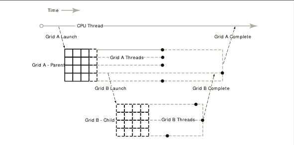

### 图 14 父子启动嵌套

##### D.2.1.2. CUDA 原语的作用域

在主机和设备上，CUDA 运行时都提供用于启动内核、等待已启动工作完成以及通过流和事件跟踪启动之间依赖关系的 API。在主机系统上，启动状态以及引用流和事件的 CUDA 原语由进程内的所有线程共享；但是，进程独立执行，可能不共享 CUDA 对象。

设备上也存在类似的层次结构：已启动的内核和 CUDA 对象对线程块中的所有线程可见，但在线程块之间是独立的。例如，这意味着一个流可以由一个线程创建，并由同一线程块中的任何其他线程使用，但不能与任何其他线程块中的线程共享。

##### D.2.1.3. 同步

来自任何线程的 CUDA 运行时操作（包括内核启动）在线程块中都是可见的。这意味着父网格中的调用线程可以对该线程启动的网格、线程块中其他线程启动的网格，或在同一线程块内创建的流执行同步。在块中的所有线程的所有启动完成之前，线程块的执行不被视为完成。如果块中的所有线程在所有子启动完成之前退出，将自动触发同步操作。

##### D.2.1.4. 流和事件

CUDA 流和事件允许控制网格启动之间的依赖关系：在同一流中启动的网格按顺序执行，事件可用于在流之间创建依赖关系。在设备上创建的流和事件服务于完全相同的目的。


在网格中创建的流和事件存在于线程块作用域内，但在其创建所在的线程块之外使用时具有未定义行为。如上所述，线程块启动的所有工作在块退出时会被隐式同步；启动到流中的工作也包含在此中，所有依赖关系都会得到适当解决。在线程块作用域之外修改的流上的操作行为是未定义的。

在主机上创建的流和事件在任何内核中使用时具有未定义行为，这与父网格创建的流和事件在子网格中使用时具有未定义行为相同。

##### D.2.1.5. 排序与并发

来自设备运行时的内核启动顺序遵循 CUDA 流排序语义。在线程块内，启动到同一流的所有内核按顺序执行。当同一线程块中的多个线程启动到同一流时，流内的顺序取决于块内的线程调度，可以通过 `__syncthreads()` 等同步原语进行控制。

请注意，因为流由线程块内的所有线程共享，隐式 `NULL` 流也被共享。如果线程块中的多个线程启动到隐式流，则这些启动将按顺序执行。如果需要并发，应使用显式命名流。

动态并行性使得在程序中表达并发更加容易；然而，设备运行时在 CUDA 执行模型中不引入任何新的并发保证。设备上任意数量的不同线程块之间不保证并发执行。

缺乏并发保证也适用于父线程块及其子网格。当父线程块启动子网格时，子网格不保证开始执行，直到父线程块达到显式同步点（例如 `cudaDeviceSynchronize()`）。

虽然通常可以轻松实现并发，但它可能因设备配置、应用工作负载和运行时调度而异。因此，依赖不同线程块之间的任何并发是不安全的。

##### D.2.1.6. 设备管理

设备运行时不支持多 GPU；设备运行时只能对其当前正在执行的设备进行操作。但是，允许查询系统中任何 CUDA 兼容设备的属性。

### D.2.2. 内存模型

父网格和子网格共享相同的全局和常量内存存储，但拥有各自独立的局部和共享内存。

###### D.2.2.2.1. 一致性与连贯性

####### D.2.2.2.1.1. 全局内存

父网格和子网格对全局内存具有连贯访问，子网格与父网格之间具有弱一致性保证。在子网格执行过程中，有两个时间点其内存视图与父线程完全一致：当子网格由父网格调用时，以及当子网格完成并由父线程中的同步 API 调用发出信号时。

在子网格调用之前，父线程中的所有全局内存操作对子网格可见。在父网格同步子网格完成后，子网格的所有内存操作对父网格可见。

在以下示例中，执行 child_launch 的子网格只保证能看到子网格启动前对 data 的修改。由于父网格的线程 0 正在执行启动，子网格将与父网格线程 0 看到的内存保持一致。由于第一个 __syncthreads() 调用，子网格将看到 data[0]=0, data[1]=1, ..., data[255]=255（如果没有 __syncthreads() 调用，只有 data[0] 保证能被子网格看到）。当子网格返回时，线程 0 保证能看到其子网格中线程所做的修改。这些修改只有在第二个 __syncthreads() 调用后才会对父网格的其他线程可用：

```
__global__ void child_launch(int *data) {
    data[threadIdx.x] = data[threadIdx.x]+1;
}
__global__ void parent_launch(int *data) {
    data[threadIdx.x] = threadIdx.x;
    __syncthreads();
    if (threadIdx.x == 0) {
        child_launch<<< 1, 256 >>>(data);
        cudaDeviceSynchronize();
    }
    __syncthreads();
}
void host_launch(int *data) {
    parent_launch<<< 1, 256 >>>(data);
}
```

###### D.2.2.1.2. 零拷贝内存

零拷贝系统内存具有与全局内存相同的连贯性和一致性保证，并遵循上述详细语义。内核不能分配或释放零拷贝内存，但可以使用从主机程序传入的零拷贝指针。

####### D.2.2.2.1.3. 常量内存

常量是不可变的，不能从设备修改，即使在父子启动之间也是如此。也就是说，所有 __constant__ 变量的值必须在启动前从主机设置。常量内存会自动从各自的父网格继承到所有子内核。

从内核线程内获取常量内存对象的地址与所有 CUDA 程序的语义相同，并且将该指针从父网格传递到子网格或从子网格传递到父网格是原生支持的。

###### D.2.2.1.4. 共享内存和局部内存

共享内存和局部内存分别对线程块或线程是私有的，在父网格和子网格之间不可见也不连贯。当在这些位置之一中的对象在其所属作用域之外被引用时，行为是未定义的，并可能导致错误。

NVIDIA 编译器会尝试发出警告，如果它能检测到指向局部或共享内存的指针正在作为参数传递给内核启动。在运行时，程序员可以使用 `__isGlobal()` 内置函数来确定指针是否引用全局内存，从而可以安全地传递给子启动。

请注意，对 `cudaMemcpy*Async()`（或 `cudaMemset*Async()`）的调用可能会在设备上调用新的子内核以保持流语义。因此，将共享或局部内存指针传递给这些 API 是非法的，并将返回错误。

####### D.2.2.2.1.5. 局部内存

局部内存是执行线程的私有存储，在该线程之外不可见。在启动子内核时，将指向局部内存的指针作为启动参数是非法的。从子内核解引用此类局部内存指针的结果是未定义的。

例如，以下代码是非法的，如果 `x_array` 被 `child_launch` 访问，则行为未定义：

```
int x_array[10];    // Creates x_array in parent's local memory
child_launch<<< 1, 1 >>>(x_array);
```

程序员有时很难意识到变量何时被编译器放入局部内存。作为一般规则，传递给子内核的所有存储都应显式从全局内存堆分配，可以使用 `cudaMalloc()`、`new()` 或在全局作用域声明 `__device__` 存储。例如：

```
// Correct - "value" is global storage
__device__ int value;
__device__ void x() {
    value = 5;
    child<<< 1, 1 >>>(&value);
}
```

```
// Invalid - "value" is local storage
__device__ void y() {
    int value = 5;
    child<<< 1, 1 >>>(&value);
}
```

####### D.2.2.2.1.6. 纹理内存

对纹理映射的全局内存区域的写入与纹理访问不连贯。纹理内存的连贯性在子网格调用时和子网格完成时强制执行。这意味着，在子内核启动之前对内存的写入会反映在子内核的纹理内存访问中。同样，子内核对内存的写入会反映在父内核的纹理内存访问中，但仅在父内核同步子内核完成后才会发生。父网格和子网格的并发访问可能导致数据不一致。

### D.3. 编程接口

#### D.3.1. CUDA C++ 参考

本节描述了为支持动态并行性而对 CUDA C++ 语言扩展所做的更改和添加。

使用 CUDA C++ 进行动态并行性的 CUDA 内核可用的语言接口和 API（称为设备运行时）与主机上可用的 CUDA 运行时 API 非常相似。在可能的情况下，CUDA 运行时 API 的语法和语义已被保留，以便于那些可能在主机或设备环境中运行的例程进行代码重用。

与 CUDA C++ 中的所有代码一样，此处概述的 API 和代码是每线程代码。这使得每个线程可以就接下来执行哪个内核或操作做出独特的动态决策。在块内线程之间执行任何提供的设备运行时 API 都不需要同步要求，这使得设备运行时 API 函数可以在任意分歧的内核代码中调用而不会发生死锁。

##### D.3.1.1. 设备端内核启动

内核可以从设备使用标准 CUDA <<< >>> 语法启动：

```
kernel_name<<< Dg, Db, Ns, S >>>(kernel arguments);
```

- Dg 是 dim3 类型，指定网格的维度和大小
- Db 是 dim3 类型，指定每个线程块的维度和大小
- Ns 是 size_t 类型，指定此调用每个线程块动态分配的共享内存字节数，以及静态分配的内存之外的内存。Ns 是可选参数，默认值为 0。
- S 是 cudaStream_t 类型，指定与此调用关联的流。该流必须在进行调用的同一线程块中分配。S 是可选参数，默认值为 0。

###### D.3.1.1.1. 启动是异步的

与主机端启动相同，所有设备端内核启动都与启动线程异步。也就是说，<<< 启动命令会立即返回，启动线程将继续执行，直到它遇到显式启动同步点，例如 `cudaDeviceSynchronize()`。网格启动会发布到设备，并将独立于父线程执行。子网格


启动后随时可能开始执行，但不保证在启动线程到达显式启动同步点之前开始执行。

###### D.3.1.1.2. 启动环境配置

所有全局设备配置设置（例如，由 cudaDeviceGetCacheConfig() 返回的共享内存和 L1 缓存大小），以及 cudaDeviceGetLimit() 返回的设备限制将从父级继承。同样，堆栈大小等设备限制将保持已配置状态。

对于主机启动的内核，从主机设置的每个内核配置将优先于全局设置。当从设备启动内核时，也将使用这些配置。无法从设备重新配置内核的环境。

#### D.3.1.2. 流

设备运行时提供命名流和未命名（NULL）流。命名流可由线程块内的任何线程使用，但流句柄不能传递给其他块或子/父内核。换句话说，应将流视为创建它的块私有。流句柄在块之间不保证唯一，因此在未分配该句柄的块中使用流句柄将导致未定义行为。

类似于主机端启动，提交到不同流的工作可能会并发执行，但不保证实际并发性。依赖于子内核之间并发性的程序不受 CUDA 编程模型支持，并将具有未定义行为。

主机端 NULL 流的跨流屏障语义在设备上不受支持（详情见下文）。为了保持与主机运行时的语义兼容性，所有设备流都必须使用 cudaStreamCreateWithFlags() API 创建，并传递 cudaStreamNonBlocking 标志。cudaStreamCreate() 调用仅限主机运行时 API，在设备上编译会失败。

由于设备运行时不支持 cudaStreamSynchronize() 和 cudaStreamQuery()，因此当应用程序需要知道流启动的子内核何时完成时，应改用 cudaDeviceSynchronize()。

##### D.3.1.2.1. 隐式（NULL）流

在主机程序中，未命名（NULL）流与其他流具有额外的屏障同步语义（详情见默认流）。设备运行时提供一个由块中所有线程共享的单个隐式未命名流，但由于所有命名流都必须使用 cudaStreamNonBlocking 标志创建，因此提交到 NULL 流的工作不会对任何其他流（包括其他线程块的 NULL 流）中的挂起工作插入隐式依赖。

#### D.3.1.3. 事件

仅支持 CUDA 事件的跨流同步功能。这意味着支持 cudaStreamWaitEvent()，但不支持 cudaEventSynchronize()、cudaEventElapsedTime() 和 cudaEventQuery()。由于不支持 cudaEventElapsedTime()，必须通过 cudaEventCreateWithFlags() 创建 cudaEvents，并传递 cudaEventDisableTiming 标志。

与所有设备运行时对象一样，事件对象可在创建它们的线程块内的所有线程之间共享，但局限于该块，不能传递给其他内核，也不能在同一内核的块之间传递。事件句柄在块之间不保证唯一，因此在未创建该句柄的块中使用事件句柄将导致未定义行为。

#### D.3.1.4. 同步

cudaDeviceSynchronize() 函数将同步线程块中任何线程启动的所有工作，直到调用 cudaDeviceSynchronize() 的位置。请注意，cudaDeviceSynchronize() 可以在分歧代码中调用（参见块范围同步）。

如果调用线程打算与其他线程调用的子网格同步，则由程序负责执行足够的额外线程间同步，例如通过调用 __syncthreads()。

##### D.3.1.4.1. 块范围同步

cudaDeviceSynchronize() 函数不隐含块内同步。特别是，如果没有通过 __syncthreads() 指令进行显式同步，调用线程不能对除自身以外的任何线程启动了什么工作做出假设。例如，如果块中的多个线程各自启动工作，并且希望一次性同步所有这些工作（可能是因为基于事件的依赖），则由程序负责保证在调用 cudaDeviceSynchronize() 之前，所有线程都已提交此工作。

由于实现允许同步块中任何线程的启动，因此多个线程同时调用 cudaDeviceSynchronize() 很可能会在第一次调用时耗尽所有工作，然后对后续调用没有影响。

#### D.3.1.5. 设备管理

仅可从运行内核的设备控制该设备。这意味着设备运行时不支持 cudaSetDevice() 等设备 API。从 GPU 看到的活动设备（由 cudaGetDevice() 返回）将与从主机系统看到的设备编号相同。cudaDeviceGetAttribute() 调用可以请求关于另一个设备的信息，因为该 API 允许将设备 ID 作为调用参数指定。请注意，设备运行时不提供全面的 cudaGetDeviceProperties() API - 属性必须单独查询。

#### D.3.1.6. 内存声明

##### D.3.1.6.1. 设备内存和常量内存

在文件作用域中使用 `__device__` 或 `__constant__` 内存空间说明符声明的内存，在使用设备运行时时行为相同。所有内核都可以读取或写入设备变量，无论内核最初是由主机还是设备运行时启动。同样，所有内核将对在模块作用域声明的 `__constant__` 具有相同的视图。

##### D.3.1.6.2. 纹理与曲面

CUDA 支持动态创建的纹理和曲面对象¹，其中纹理引用可以在主机上创建，传递给内核，由该内核使用，然后从主机销毁。设备运行时不允许在设备代码中创建或销毁纹理或曲面对象，但从主机创建的纹理和曲面对象可以在设备上自由使用和传递。无论在哪里创建，动态创建的纹理对象始终有效，并可以从父级传递给子内核。

> 设备运行时不支持在从设备启动的内核中使用传统模块作用域（即 Fermi 风格）纹理和曲面。模块作用域（传统）纹理可以从主机创建并在设备代码中像任何内核一样使用，但只能由顶级内核（即从主机启动的内核）使用。

##### D.3.1.6.3. 共享内存变量声明

在 CUDA C++ 中，共享内存可以声明为静态大小的文件作用域或函数作用域变量，也可以声明为 `extern` 变量，其大小由内核调用者通过启动配置参数在运行时确定。这两种声明在设备运行时下均有效。

¹ 动态创建的纹理和曲面对象是 CUDA 5.0 引入的 CUDA 内存模型的补充。详情请参阅 CUDA 编程指南。

```cpp
__global__ void permute(int n, int *data) {
    extern __shared__ int smem[];
    if (n <= 1)
        return;

    smem[threadIdx.x] = data[threadIdx.x];
    __syncthreads();

    permute_data(smem, n);
    __syncthreads();

    // Write back to GMEM since we can't pass SMEM to children.
    data[threadIdx.x] = smem[threadIdx.x];
    __syncthreads();

    if (threadIdx.x == 0) {
        permute<<< 1, 256, n/2*sizeof(int) >>>(n/2, data);
        permute<<< 1, 256, n/2*sizeof(int) >>>(n/2, data+n/2);
    }
}

void host_launch(int *data) {
    permute<<< 1, 256, 256*sizeof(int) >>>(256, data);
}
```

##### D.3.1.6.4. 符号地址

设备端符号（即标记为 `__device__` 的符号）可以从内核中通过 `&` 运算符简单引用，因为所有全局作用域设备变量都在内核的可见地址空间中。这也适用于 `__constant__` 符号，尽管在这种情况下指针将引用只读数据。

鉴于设备端符号可以直接引用，那些引用符号的 CUDA 运行时 API（例如 `cudaMemcpyToSymbol()` 或 `cudaGetSymbolAddress()`）是多余的，因此不受设备运行时支持。请注意，这意味着运行中的内核无法更改常量数据，即使在子内核启动之前也是如此，因为对 `__constant__` 空间的引用是只读的。

#### D.3.1.7. API 错误和启动失败

与 CUDA 运行时一贯一样，任何函数都可能返回错误代码。最后返回的错误代码会被记录，并可通过 `cudaGetLastError()` 调用检索。错误按线程记录，以便每个线程可以识别其生成的最近错误。错误代码的类型为 `cudaError_t`。

类似于主机端启动，设备端启动可能因多种原因失败（无效参数等）。用户必须调用 `cudaGetLastError()` 来确定启动是否生成了错误，但是启动后没有错误并不意味着子内核已成功完成。

对于设备端异常，例如访问无效地址，子网格中的错误将返回到主机，而不是由父级的 `cudaDeviceSynchronize()` 调用返回。


##### D.3.1.7.1. Launch Setup APIs

内核启动是一种系统级机制，通过设备运行时库暴露，因此可以直接从 PTX 通过底层 `cudaGetParameterBuffer()` 和 `cudaLaunchDevice()` API 使用。CUDA 应用程序可以自行调用这些 API，其要求与 PTX 相同。在这两种情况下，用户都有责任根据规范以正确格式正确填充所有必要的数据结构。这些数据结构保证向后兼容性。

与主机端启动类似，设备端操作符 <<< >>> 映射到底层内核启动 API。这样，针对 PTX 的用户就能够执行启动，编译器前端也能将 <<< >>> 翻译为这些调用。

表 5 新的仅限设备的启动实现函数

| 运行时 API 启动函数 | 与主机运行时行为的差异描述（如无描述则行为相同） |
| :--- | :--- |
| cudaGetParameterBuffer | 从 <<< >>> 自动生成。注意与主机端等效 API 不同。 |
| cudaLaunchDevice | 从 <<< >>> 自动生成。注意与主机端等效 API 不同。 |

这些启动函数的 API 与 CUDA 运行时 API 不同，定义如下：

```
extern __device__ cudaError_t cudaGetParameterBuffer(void **params);
extern __device__ cudaError_t cudaLaunchDevice(void *kernel,
void **params, dim3 gridDim,
dim3 blockDim,
unsigned int sharedMemSize = 0,
cudaStream_t stream = 0);
```

#### D.3.1.8. API 参考

此处详细介绍了设备运行时支持的 CUDA 运行时 API 部分。主机和设备运行时 API 语法相同；除另有说明外，语义也相同。下表概述了与主机端可用版本相对应的 API。

表 6 支持的 API 函数

| 运行时 API 函数 | 详细信息 |
| :--- | :--- |
| cudaDeviceSynchronize | 仅同步从线程自身块启动的工作 |
| cudaDeviceGetCacheConfig | |
| cudaDeviceGetLimit | |
| cudaGetLastError | 最后错误为每线程状态，而非每块状态 |
| cudaPeekAtLastError | |
| cudaGetErrorString | |
| cudaGetDeviceCount | |
| cudaDeviceGetAttribute | 将返回任何设备的属性 |
| cudaGetDevice | 始终返回从主机端可见的当前设备 ID |
| cudaStreamCreateWithFlags | 必须传递 cudaStreamNonBlocking 标志 |
| cudaStreamDestroy | |
| cudaStreamWaitEvent | |
| cudaEventCreateWithFlags | 必须传递 cudaEventDisableTiming 标志 |
| cudaEventRecord | |
| cudaEventDestroy | |
| cudaFuncGetAttributes | |
| cudaMemcpyAsync | 关于所有 memcpy/memset 函数的说明：> 仅支持异步 memcpy/set 函数 > 仅允许设备到设备 memcpy > 不得传入本地或共享内存指针 |
| cudaMemcpy2DAsync | |
| cudaMemcpy3DAsync | |
| cudaMemsetAsync | |
| cudaMemset2DAsync | |
| cudaMemset3DAsync | |
| cudaRuntimeGetVersion | |
| cudaMalloc | 不得在设备上对在主机上创建的指针调用 cudaFree，反之亦然 |
| cudaFree | |
| cudaOccupancyMaxActiveBlocksPerMultiprocessor | |
| cudaOccupancyMaxPotentialBlockSize | |
| cudaOccupancyMaxPotentialBlockSizeVariable | |

### D.3.2. 从 PTX 进行设备端启动

本节面向针对并行线程执行（PTX）并计划在其语言中支持动态并行的编程语言和编译器实现者。它提供了在 PTX 级别支持内核启动相关的底层细节。

#### D.3.2.1. 内核启动 API

设备端内核启动可以使用从 PTX 可访问的以下两个 API 实现：`cudaLaunchDevice()` 和 `cudaGetParameterBuffer()`。`cudaLaunchDevice()` 使用通过调用 `cudaGetParameterBuffer()` 获取并填充了要启动内核参数的参数缓冲区来启动指定内核。如果要启动的内核不接受任何参数，则参数缓冲区可以为 NULL，即无需调用 `cudaGetParameterBuffer()`。

##### D.3.2.1.1. cudaLaunchDevice

在 PTX 级别，`cudaLaunchDevice()` 在使用前需以下述两种形式之一进行声明。

```
// PTX-level Declaration of cudaLaunchDevice() when .address_size is 64
extern .func(.param .b32 func_retval0) cudaLaunchDevice
(
    .param .b64 func,
    .param .b64 parameterBuffer,
    .param .align 4 .b8 gridDimension[12],
    .param .align 4 .b8 blockDimension[12],
    .param .b32 sharedMemSize,
    .param .b64 stream
);
```

```
// PTX-level Declaration of cudaLaunchDevice() when .address_size is 32
extern .func(.param .b32 func_retval0) cudaLaunchDevice
(
    .param .b32 func,
    .param .b32 parameterBuffer,
    .param .align 4 .b8 gridDimension[12],
    .param .align 4 .b8 blockDimension[12],
    .param .b32 sharedMemSize,
    .param .b32 stream
);
```

以下 CUDA 级别声明映射到上述 PTX 级别声明之一，位于系统头文件 `cuda_device_runtime_api.h` 中。该函数定义在 `cudadevrt` 系统库中，必须将程序与该库链接才能使用设备端内核启动功能。

```
// CUDA-level declaration of cudaLaunchDevice()
extern "C" __device__
cudaError_t cudaLaunchDevice(void *func, void *parameterBuffer,
                               dim3 gridDimension, dim3 blockDimension,
                               unsigned int sharedMemSize,
                               cudaStream_t stream);
```

第一个参数是要启动的内核的指针，第二个参数是保存要启动内核实际参数的参数缓冲区。参数缓冲区的布局将在下文“参数缓冲区布局”中说明。其他参数指定启动配置，即网格维度、块维度、共享内存大小以及与启动关联的流（有关启动配置的详细描述，请参阅执行配置）。

##### D.3.2.1.2. cudaGetParameterBuffer

`cudaGetParameterBuffer()` 在使用前需要在 PTX 级别进行声明。PTX 级别声明必须根据地址大小采用以下两种形式之一：

```
// PTX-level Declaration of cudaGetParameterBuffer() when .address_size is 64
// When .address_size is 64
extern .func(.param .b64 func_retval0) cudaGetParameterBuffer
(
    .param .b64 alignment,
    .param .b64 size
);
```

```
// PTX-level Declaration of cudaGetParameterBuffer() when .address_size is 32
extern .func(.param .b32 func_retval0) cudaGetParameterBuffer
(
    .param .b32 alignment,
    .param .b32 size
);
```

以下 `cudaGetParameterBuffer()` 的 CUDA 级别声明映射到上述 PTX 级别声明：

```
// CUDA-level Declaration of cudaGetParameterBuffer()
extern "C" __device__
void *cudaGetParameterBuffer(size_t alignment, size_t size);
```

第一个参数指定参数缓冲区的对齐要求，第二个参数指定以字节为单位的大小要求。在当前实现中，`cudaGetParameterBuffer()` 返回的参数缓冲区始终保证 64 字节对齐，且对齐要求参数被忽略。但是，建议将正确的对齐要求值（即要放入参数缓冲区的任何参数的最大对齐）传递给 `cudaGetParameterBuffer()`，以确保未来的可移植性。

#### D.3.2.2. 参数缓冲区布局

禁止在参数缓冲区中重新排序参数，并且放入参数缓冲区的每个单独参数都需要对齐。也就是说，每个参数必须放置在参数缓冲区的第 n 个字节处，其中 n 是大于前一个参数占用的最后一个字节偏移量的参数大小的最小倍数。参数缓冲区的最大大小为 4KB。

有关 CUDA 编译器生成的 PTX 代码的更详细描述，请参阅 PTX-3.5 规范。

### D.3.3. 动态并行的工具包支持

#### D.3.3.1. 在 CUDA 代码中包含设备运行时 API

与主机端运行时 API 类似，CUDA 设备运行时 API 的原型在程序编译期间自动包含。无需显式包含 `cuda_device_runtime_api.h`。


### D.3.3.2. 编译和链接

CUDA 程序在使用 _nvcc_ 编译时会自动与主机运行时库链接，但设备运行时作为静态库提供，希望使用它的程序必须显式地与其链接。

设备运行时以静态库形式提供（Windows 上为 **cudadevrt.lib**，Linux 和 MacOS 上为 **libcudadevrt.a**），使用设备运行时的 GPU 应用程序必须与其链接。设备库的链接可以通过 _nvcc_ 和/或 _nvlink_ 完成。下面给出了两个简单示例。

如果所有必需的源文件都可以从命令行指定，设备运行时程序可以在单个步骤中编译和链接：

```
$ nvcc -arch=sm_35 -rdc=true hello_world.cu -o hello -lcudadevrt
```

也可以先将 CUDA .cu 源文件编译为目标文件，然后在两阶段过程中将它们链接在一起：

```
$ nvcc -arch=sm_35 -dc hello_world.cu -o hello_world.o
$ nvcc -arch=sm_35 -rdc=true hello_world.o -o hello -lcudadevrt
```

有关更多详细信息，请参阅 _CUDA 驱动编译器 NVCC 指南_ 中的“使用单独编译”部分。

### D.4. 编程指南

#### D.4.1. 基础

设备运行时是主机运行时的功能子集。API 级设备管理、内核启动、设备 memcpy、流管理和事件管理均从设备运行时公开。

对于已经有 CUDA 经验的人来说，为设备运行时编程应该很熟悉。设备运行时语法和语义与主机 API 大体相同，任何例外情况在本文档前面已详细说明。

以下示例展示了一个包含动态并行的简单 Hello World 程序：

```
#include <stdio.h>

__global__ void childKernel()
{
    printf("Hello ");
}

__global__ void parentKernel()
{
    // launch child
    childKernel<<<1,1>>>();
    if (cudaSuccess != cudaGetLastError()) {
        return;
    }

    // wait for child to complete
    if (cudaSuccess != cudaDeviceSynchronize()) {
        return;
    }
}

printf("World!\n");

int main(int argc, char *argv[])
{
    // launch parent
    parentKernel<<<1,1>>>();
    if (cudaSuccess != cudaGetLastError()) {
        return 1;
    }

    // wait for parent to complete
    if (cudaSuccess != cudaDeviceSynchronize()) {
        return 2;
    }

    return 0;
}
```

该程序可以按如下方式从命令行单步构建：

```
$ nvcc -arch=sm_35 -rdc=true hello_world.cu -o hello -lcudadevrt
```

#### D.4.2. 性能

##### D.4.2.1. 同步

一个线程的同步可能会影响同一线程块中其他线程的性能，即使这些其他线程本身不调用 cudaDeviceSynchronize()。这种影响取决于底层实现。通常，线程块结束时进行的子内核隐式同步比显式调用 cudaDeviceSynchronize() 更高效。因此，建议仅在线程块结束前需要与子内核同步时才调用 cudaDeviceSynchronize()。

##### D.4.2.2. 启用动态并行的内核开销

在控制动态启动时处于活动状态的系统软件可能会对正在运行的任何内核施加开销，无论它是否调用自己的内核启动。这种开销源于设备运行时的执行跟踪和管理软件，可能导致例如从设备进行库调用时相比从主机进行调用时性能下降。一般来说，链接到设备运行时库的应用程序都会产生这种开销。

#### D.4.3. 实现限制和局限性

动态并行保证本文档中描述的所有语义，但是，某些硬件和软件资源取决于实现，并限制使用设备运行时的程序的规模、性能和其他属性。

##### D.4.3.1. 运行时

###### D.4.3.1.1. 内存占用

设备运行时系统软件为各种管理目的保留内存，特别是一个用于在同步期间保存父网格状态的保留区，以及一个用于跟踪挂起网格启动的第二个保留区。提供配置控件来减少这些保留区的大小，以换取某些启动限制。有关详细信息，请参见下面的“配置选项”。

大部分保留内存作为父内核状态的后备存储分配，用于在子启动上同步时使用。保守地说，此内存必须支持设备上可能的最大活动线程数的状态存储。这意味着，每个可调用 cudaDeviceSynchronize() 的父代代数可能需要高达 860MB 的设备内存，具体取决于设备配置，即使未全部消耗，也不可用于程序使用。

###### D.4.3.1.2. 嵌套和同步深度

使用设备运行时时，一个内核可以启动另一个内核，该内核可以再启动另一个内核，以此类推。每个子启动被视为一个新的嵌套级别，总级别数即为程序的嵌套深度。同步深度定义为程序将显式同步于子启动的最深级别。通常这比程序的嵌套深度少一，但如果程序不需要在所有级别都调用 cudaDeviceSynchronize()，则同步深度可能与嵌套深度有显著不同。

总最大嵌套深度限制为 24，但实际上，实际限制将是系统为每个新级别所需的内存量（参见上述内存占用）。任何会导致内核位于超过最大深度的级别的启动都会失败。请注意，这也可能适用于 cudaMemcpyAsync()，因为它本身可能会生成内核启动。有关详细信息，请参见“配置选项”。

默认情况下，为两个同步级别预留了足够的存储空间。可以通过调用 cudaDeviceSetLimit() 并指定 cudaLimitDevRuntimeSyncDepth 来控制此最大同步深度（以及相应的预留存储）。必须在从主机启动顶级内核之前配置要支持的级别数，以保证嵌套程序成功执行。在指定的最大同步深度之上的深度调用 cudaDeviceSynchronize() 将返回错误。

允许一种优化：当系统检测到无需为父代状态预留空间时（即父内核从不调用 cudaDeviceSynchronize()），可以不预留。在这种情况下，由于从不发生显式的父/子同步，程序所需的内存占用将远低于保守最大值。此类程序可以指定较浅的最大同步深度，以避免过度分配后备存储。

###### D.4.3.1.3. 挂起的内核启动

启动内核时，所有相关的配置和参数数据会被跟踪，直到内核完成。这些数据存储在系统管理的启动池中。

启动池分为固定大小池和性能较低的虚拟化池。设备运行时系统软件会首先尝试在固定大小池中跟踪启动数据。当固定大小池已满时，将使用虚拟化池来跟踪新的启动。

固定大小启动池的大小可以通过从主机调用 cudaDeviceSetLimit() 并指定 cudaLimitDevRuntimePendingLaunchCount 来配置。

###### D.4.3.1.4. 配置选项

设备运行时系统软件的资源分配通过主机程序中的 cudaDeviceSetLimit() API 控制。必须在启动任何内核之前设置限制，并且在 GPU 正在运行程序时不能更改。

可以设置以下命名限制：

| 限制 | 行为 |
|---|---|
| cudaLimitDevRuntimeSyncDepth | 设置可以调用 cudaDeviceSynchronize() 的最大深度。可以执行比此值更深的启动，但超过此限制的显式同步将返回 cudaErrorLaunchMaxDepthExceeded。默认最大同步深度为 2。 |
| cudaLimitDevRuntimePendingLaunchCount | 控制为缓冲尚未开始执行的内核启动而预留的内存量，原因可能是未解决的依赖项或缺乏执行资源。当缓冲区已满时，设备运行时系统软件将尝试在性能较低的虚拟化缓冲区中跟踪新的挂起启动；如果虚拟化缓冲区也已满（即所有可用堆空间都已耗尽），则启动不会发生。 |


| 限制 | 行为 |
|---|---|
| | 线程的最后错误将被设置为 cudaErrorLaunchPendingCountExceeded。默认的挂起启动计数为 2048 次启动。 |
| cudaLimitStackSize | 控制每个 GPU 线程的堆栈大小（以字节为单位）。CUDA 驱动程序会根据需要在每次内核启动时自动增加每个线程的堆栈大小。每次启动后，此大小不会重置回原始值。要将每个线程的堆栈大小设置为不同的值，可以调用 cudaDeviceSetLimit() 来设置此限制。堆栈将立即调整大小，如果有必要，设备将阻塞直到所有先前请求的任务完成。可以调用 cudaDeviceGetLimit() 来获取当前每个线程的堆栈大小。 |

###### D.4.3.1.5. 内存分配与生命周期

cudaMalloc() 和 cudaFree() 在不同环境中具有不同的语义。当从主机调用时，cudaMalloc() 从未使用的设备内存中分配一个新区域。当从设备运行时调用时，这些函数映射到设备端的 malloc() 和 free()。这意味着在设备环境中，可分配的总内存受限于设备 malloc() 堆大小，这可能小于可用的未使用设备内存。另外，从主机程序对由设备上的 cudaMalloc() 分配的指针调用 cudaFree()（或反之）是错误的。

| | 主机上的 cudaMalloc() | 设备上的 cudaMalloc() |
|---|---|---|
| 主机上的 cudaFree() | 支持 | 不支持 |
| 设备上的 cudaFree() | 不支持 | 支持 |
| 分配限制 | 可用设备内存 | cudaLimitMallocHeapSize |

###### D.4.3.1.6. SM ID 和 Warp ID

请注意，在 PTX 中，%smid 和 %warpid 被定义为易变值。设备运行时可能会将线程块重新调度到不同的 SM 上，以更有效地管理资源。因此，依赖 %smid 或 %warpid 在线程或线程块的生命周期内保持不变是不安全的。

###### D.4.3.1.7. ECC 错误

CUDA 内核中的代码无法获取 ECC 错误通知。一旦整个启动树完成，ECC 错误将在主机端报告。在嵌套程序执行期间出现的任何 ECC 错误都会生成异常或继续执行（取决于错误和配置）。

## 附录 E.
数学函数

参考手册列出了在设备代码中支持的所有 C/C++ 标准库数学函数，以及所有仅在设备代码中支持的内置函数，并附带其描述。

本附录在适用时提供其中一些函数的精度信息。

### E.1. 标准函数

本节中的函数可用于主机代码和设备代码。

本节规定了每个函数在设备上执行时的误差界限，以及在主机上执行时的误差界限（在主机未提供该函数的情况下）。

误差界限是基于广泛但非穷尽的测试生成的，因此它们不是保证的界限。

### 单精度浮点函数

加法和乘法符合 IEEE 标准，因此最大误差为 0.5 ulp。

将单精度浮点操作数舍入为整数（结果仍为单精度浮点数）的推荐方法是使用 `rintf()`，而不是 `roundf()`。原因是 `roundf()` 在设备上映射为 4 条指令序列，而 `rintf()` 映射为单条指令。`truncf()`、`ceilf()` 和 `floorf()` 也各自映射为单条指令。

### 表 7 带最大 ULP 误差的单精度数学标准库函数

最大误差表示为正确舍入的单精度结果与 CUDA 库函数返回结果之间的 ulp 差值的绝对值。

| 函数 | 最大 ulp 误差 |
| :--- | :--- |
| x+y | 0 (IEEE-754 最近偶数舍入) |
| x*y | 0 (IEEE-754 最近偶数舍入) |
| x/y | 当计算能力 ≥ 2 且使用 -prec-div=true 编译时为 0<br>否则为 2 (全范围) |
| 1/x | 当计算能力 ≥ 2 且使用 -prec-div=true 编译时为 0<br>否则为 1 (全范围) |
| rsqrtf(x) | 2 (全范围) |
| 1/sqrtf(x) | 仅当编译器将其转换为 rsqrtf(x) 时才适用。 |
| sqrtf(x) | 使用 -prec-sqrt=true 编译时为 0<br>否则，计算能力 ≥ 5.2 时为 1<br>旧架构为 3 |
| cbrtf(x) | 1 (全范围) |
| rcbrtf(x) | 1 (全范围) |
| hypotf(x, y) | 3 (全范围) |
| rhypotf(x, y) | 2 (全范围) |
| norm3df(x, y, z) | 3 (全范围) |
| norm3df(x, y, z) | 2 (全范围) |
| norm4df(x, y, z, t) | 3 (全范围) |
| rnorm4df(x, y, z, t) | 2 (全范围) |
| normf(dim, arr) | 无法提供误差界限，因为使用了快速算法，由于舍入会导致精度损失 |
| rnormf(dim, arr) | 3 (全范围) |
| expf(x) | 2 (全范围) |
| exp2f(x) | 2 (全范围) |
| exp10f(x) | 2 (全范围) |
| expm1f(x) | 1 (全范围) |
| logf(x) | 1 (全范围) |
| log2f(x) | 1 (全范围) |
| log10f(x) | 2 (全范围) |
| log1pf(x) | 1 (全范围) |
| sinf(x) | 2 (全范围) |
| cosf(x) | 2 (全范围) |
| tanf(x) | 4 (全范围) |
| sincosf(x, sptr, cptr) | 2 (全范围) |
| sinpif(x) | 2 (全范围) |
| cospif(x) | 2 (全范围) |
| sincospif(x, sptr, cptr) | 2 (全范围) |
| asinf(x) | 4 (全范围) |
| acosf(x) | 3 (全范围) |
| atanf(x) | 2 (全范围) |
| atan2f(y, x) | 3 (全范围) |
| sinhf(x) | 3 (全范围) |
| coshf(x) | 2 (全范围) |
| tanhf(x) | 2 (全范围) |
| asinhf(x) | 3 (全范围) |
| acoshf(x) | 4 (全范围) |
| atanhf(x) | 3 (全范围) |
| powf(x, y) | 8 (全范围) |
| erff(x) | 2 (全范围) |
| erfcf(x) | 4 (全范围) |
| erfinvf(x) | 2 (全范围) |
| erfcinvf(x) | 2 (全范围) |
| erfcxf(x) | 4 (全范围) |
| normcdff(x) | 5 (全范围) |
| normcdfinvf(x) | 5 (全范围) |
| lgammaf(x) | 6 (区间 -10.001 ... -2.264 之外；区间内更大) |
| tgammaf(x) | 11 (全范围) |
| fmaf(x, y, z) | 0 (全范围) |
| frexpf(x, exp) | 0 (全范围) |
| ldexpf(x, exp) | 0 (全范围) |
| scalbnf(x, n) | 0 (全范围) |
| scalblnf(x, l) | 0 (全范围) |
| logbf(x) | 0 (全范围) |
| ilogbf(x) | 0 (全范围) |
| j0f(x) | 当 \|x\| < 8 时为 9，否则最大绝对误差为 2.2 x 10^6 |
| j1f(x) | 当 \|x\| < 8 时为 9，否则最大绝对误差为 2.2 x 10^6 |
| jnf(x) | 当 n = 128 时，最大绝对误差为 2.2 x 10^6 |
| y0f(x) | 当 \|x\| < 8 时为 9，否则最大绝对误差为 2.2 x 10^6 |
| y1f(x) | 当 \|x\| < 8 时为 9，否则最大绝对误差为 2.2 x 10^6 |
| ynf(x) | 当 \|x\| < n 时为 ceil(2 + 2.5n)，否则最大绝对误差为 2.2 x 10^6 |
| cyl_bessel_i0f(x) | 6 (全范围) |
| cyl_bessel_i1f(x) | 6 (全范围) |
| fmodf(x, y) | 0 (全范围) |
| remainderf(x, y) | 0 (全范围) |
| remquof(x, y, iptr) | 0 (全范围) |
| modff(x, iptr) | 0 (全范围) |
| fdimf(x, y) | 0 (全范围) |
| truncf(x) | 0 (全范围) |
| roundf(x) | 0 (全范围) |
| rintf(x) | 0 (全范围) |
| nearbyintf(x) | 0 (全范围) |
| ceilf(x) | 0 (全范围) |
| floorf(x) | 0 (全范围) |
| lrintf(x) | 0 (全范围) |
| lroundf(x) | 0 (全范围) |
| llrintf(x) | 0 (全范围) |
| llroundf(x) | 0 (全范围) |

### 双精度浮点函数

将双精度浮点操作数舍入为整数（结果仍为双精度浮点数）的推荐方法是使用 rint()，而不是 round()。原因是 round() 在设备上映射为 4 条指令序列，而 rint() 映射为单条指令。trunc()、ceil() 和 floor() 也各自映射为单条指令。

### 表 8 带最大 ULP 误差的双精度数学标准库函数

最大误差表示为正确舍入的双精度结果与 CUDA 库函数返回结果之间的 ulp 差值的绝对值。

| 函数 | 最大 ulp 误差 |
|---|---|
| x+y | 0 (IEEE-754 最近偶数舍入) |
| x*y | 0 (IEEE-754 最近偶数舍入) |
| x/y | 0 (IEEE-754 最近偶数舍入) |
| 1/x | 0 (IEEE-754 最近偶数舍入) |
| sqrt(x) | 0 (IEEE-754 最近偶数舍入) |
| rsqrt(x) | 1 (全范围) |
| cbrt(x) | 1 (全范围) |


| 函数 | 最大 ulp 误差 |
|---|---|
| rcbrt(x) | 1（全范围） |
| hypot(x,y) | 2（全范围） |
| rhypot(x,y) | 1（全范围） |
| norm3d(x,y,z) | 2（全范围） |
| rnorm3d(x,y,z) | 1（全范围） |
| norm4d(x,y,z,t) | 2（全范围） |
| rnorm4d(x,y,z,t) | 1（全范围） |
| norm(dim,arr) | 由于使用了快速算法且因舍入误差导致精度损失，无法提供误差界 |
| rnorm(dim,arr) | 2（全范围） |
| exp(x) | 1（全范围） |
| exp2(x) | 1（全范围） |
| exp10(x) | 1（全范围） |
| expm1(x) | 1（全范围） |
| log(x) | 1（全范围） |
| log2(x) | 1（全范围） |
| log10(x) | 1（全范围） |
| log1p(x) | 1（全范围） |
| sin(x) | 2（全范围） |
| cos(x) | 2（全范围） |
| tan(x) | 2（全范围） |
| sincos(x, sptr, cptr) | 2（全范围） |
| sinpi(x) | 2（全范围） |
| cospi(x) | 2（全范围） |
| sincospi(x, sptr, cptr) | 2（全范围） |
| asin(x) | 2（全范围） |
| acos(x) | 2（全范围） |
| atan(x) | 2（全范围） |
| atan2(y, x) | 2（全范围） |
| sinh(x) | 2（全范围） |
| cosh(x) | 1（全范围） |
| tanh(x) | 2（全范围） |
| asinh(x) | 2（全范围） |
| acosh(x) | 2（全范围） |
| atanh(x) | 2（全范围） |
| pow(x, y) | 2（全范围） |
| erf(x) | 2（全范围） |
| erfc(x) | 5（全范围） |
| erfinv(x) | 5（全范围） |
| erfcinv(x) | 6（全范围） |
| erfcx(x) | 4（全范围） |
| normcdf(x) | 5（全范围） |
| normcdfinv(x) | 8（全范围） |
| lgamma(x) | 4（区间 -11.0001 ... -2.2637 之外；区间内更大） |
| tgamma(x) | 8（全范围） |
| fma(x, y, z) | 0（IEEE-754 舍入至最近偶数） |
| frexp(x, exp) | 0（全范围） |
| ldexp(x, exp) | 0（全范围） |
| scalbn(x, n) | 0（全范围） |
| scalbln(x, l) | 0（全范围） |
| logb(x) | 0（全范围） |
| ilogb(x) | 0（全范围） |
| j0(x) | 当 |x| < 8 时为 7，否则最大绝对误差为 5 x 10^-12 |
| j1(x) | 当 |x| < 8 时为 7，否则最大绝对误差为 5 x 10^-12 |
| jn(x) | 当 n = 128 时，最大绝对误差为 5 x 10^-12 |
| y0(x) | 当 |x| < 8 时为 7，否则最大绝对误差为 5 x 10^-12 |
| y1(x) | 当 |x| < 8 时为 7，否则最大绝对误差为 5 x 10^-12 |
| yn(x) | 当 |x| > 1.5n 时，最大绝对误差为 5 x 10^-12 |
| cyl_bessel_i0(x) | 6（全范围） |
| cyl_bessel_i1(x) | 6（全范围） |
| fmod(x, y) | 0（全范围） |
| remainder(x, y) | 0（全范围） |
| remquo(x, y, iptr) | 0（全范围） |
| modf(x, iptr) | 0（全范围） |
| fdim(x, y) | 0（全范围） |
| trunc(x) | 0（全范围） |
| round(x) | 0（全范围） |
| rint(x) | 0（全范围） |
| nearbyint(x) | 0（全范围） |
| ceil(x) | 0（全范围） |
| floor(x) | 0（全范围） |
| lrint(x) | 0（全范围） |
| lround(x) | 0（全范围） |
| llrint(x) | 0（全范围） |
| llround(x) | 0（全范围） |

### E.2. 内置函数

本节中的函数仅可在设备代码中使用。

这些函数中包括一些标准函数精度较低但速度更快的版本。它们的名称相同，但带有 __ 前缀（例如 __sinf(x)）。它们速度更快，因为它们映射到更少的本机指令。编译器有一个选项（-use_fast_math），强制表 9 中的每个函数编译为其内置对应物。除了降低受影响函数的精度外，它还可能导致特殊情况处理的一些差异。更稳健的方法是仅在性能收益值得以及可以容忍较低精度和不同特殊情况处理等更改属性的地方，有选择地将数学函数调用替换为内置函数调用。

## 表 9 受 -use_fast_math 影响的函数

| 运算符/函数 | 设备函数 |
|---|---|
| x/y | __fdividef(x, y) |
| sinf(x) | __sinf(x) |
| cosf(x) | __cosf(x) |
| tanf(x) | __tanf(x) |
| sincosf(x, sptr, cptr) | __sincosf(x, sptr, cptr) |
| logf(x) | __logf(x) |
| log2f(x) | __log2f(x) |
| log10f(x) | __log10f(x) |
| expf(x) | __expf(x) |
| exp10f(x) | __exp10f(x) |
| powf(x, y) | __powf(x, y) |

### 单精度浮点函数

__fadd_[rn,rz,ru,rd]() 和 __fmul_[rn,rz,ru,rd]() 映射到编译器永远不会合并为 FMAD 的加法和乘法操作。相比之下，由 '*' 和 '+' 运算符生成的加法和乘法通常会合并为 FMAD。

后缀为 _rn 的函数使用舍入至最近偶数舍入模式进行操作。

后缀为 _rz 的函数使用向零舍入模式进行操作。

后缀为 _ru 的函数使用向上舍入（向正无穷）模式进行操作。

后缀为 _rd 的函数使用向下舍入（向负无穷）模式进行操作。

浮点除法的精度取决于代码是使用 -prec-div=false 还是 -prec-div=true 编译。当代码使用 -prec-div=false 编译时，常规除法 / 运算符和 __fdividef(x,y) 具有相同的精度，但对于 2^-126 < y < 2^128，__fdividef(x,y) 返回零，而 / 运算符返回表 10 中所述精度范围内的正确结果。此外，对于 2^-126 < y < 2^128，如果 x 为无穷大，__fdividef(x,y) 返回 NaN（作为将无穷大乘以零的结果），而 / 运算符返回无穷大。另一方面，当代码使用 -prec-div=true 编译或根本未指定 -prec-div 选项（因为其默认值为 true）时，/ 运算符符合 IEEE 标准。

## 表 10 单精度浮点内置函数

(由 CUDA 运行时库支持，附带相应误差界)

| 函数 | 误差界 |
|---|---|
| __fadd_[rn,rz,ru,rd](x,y) | 符合 IEEE 标准。 |
| __fsub_[rn,rz,ru,rd](x,y) | 符合 IEEE 标准。 |
| __fmul_[rn,rz,ru,rd](x,y) | 符合 IEEE 标准。 |
| __fmaf_[rn,rz,ru,rd](x,y,z) | 符合 IEEE 标准。 |
| __frop_[rn,rz,ru,rd](x) | 符合 IEEE 标准。 |
| __fsqrt_[rn,rz,ru,rd](x) | 符合 IEEE 标准。 |
| __frsqrt_rn(x) | 符合 IEEE 标准。 |
| __fdiv_[rn,rz,ru,rd](x,y) | 符合 IEEE 标准。 |
| __fdividef(x,y) | 当 y 在 [2^-126, 2^126] 范围内时，最大 ulp 误差为 2。 |
| __expf(x) | 最大 ulp 误差为 2 + floor(abs(1.16 * x))。 |
| __exp10f(x) | 最大 ulp 误差为 2 + floor(abs(2.95 * x))。 |
| __logf(x) | 当 x 在 [0.5, 2] 范围内时，最大绝对误差为 2^-21.41，否则最大 ulp 误差为 3。 |
| __log2f(x) | 当 x 在 [0.5, 2] 范围内时，最大绝对误差为 2^-24，否则最大 ulp 误差为 2。 |
| __log10f(x) | 当 x 在 [0.5, 2] 范围内时，最大绝对误差为 2^-24，否则最大 ulp 误差为 3。 |
| __sinf(x) | 当 x 在 [-π, π] 范围内时，最大绝对误差为 2^-21.41，否则更大。 |
| __cosf(x) | 当 x 在 [-π, π] 范围内时，最大绝对误差为 2^-21.19，否则更大。 |
| __sincosf(x, sptr, cptr) | 与 __sinf(x) 和 __cosf(x) 相同。 |
| __tanf(x) | 源其实现为 __sinf(x) * (1 / __cosf(x))。 |
| __powf(x, y) | 源其实现为 exp2f(y * __log2f(x))。 |

### 双精度浮点函数

__dadd_rn() 和 __dmul_rn() 映射到编译器永远不会合并为 FMAD 的加法和乘法操作。相比之下，由 `*` 和 `+` 运算符生成的加法和乘法通常会合并为 FMAD。

## 表 11 双精度浮点内置函数

(由 CUDA 运行时库支持，附带相应误差界)

| 函数 | 误差界 |
|---|---|
| __dadd_[rn,rz,ru,rd](x,y) | 符合 IEEE 标准。 |
| __dsub_[rn,rz,ru,rd](x,y) | 符合 IEEE 标准。 |
| __dmul_[rn,rz,ru,rd](x,y) | 符合 IEEE 标准。 |
| __fma_[rn,rz,ru,rd](x,y,z) | 符合 IEEE 标准。 |
| __ddiv_[rn,rz,ru,rd](x,y) | 符合 IEEE 标准。要求计算能力 ≥ 2。 |
| __drop_[rn,rz,ru,rd](x) | 符合 IEEE 标准。要求计算能力 ≥ 2。 |
| __dsqrt_[rn,rz,ru,rd](x) | 符合 IEEE 标准。要求计算能力 ≥ 2。 |


## 附录 F. C++ 语言支持

如在使用 NVCC 进行编译中所述，使用 **nvcc** 编译的 CUDA 源文件可以包含主机代码和设备代码的混合体。CUDA 前端编译器旨在模拟主机编译器对 C++ 代码的行为。输入源代码根据 C++ ISO/IEC 14882:2003、C++ ISO/IEC 14882:2011 或 C++11 ISO/IEC 14882:2014 规范进行处理，CUDA 前端编译器旨在模拟主机编译器与 ISO 规范的任何偏差。此外，支持的语言通过本文档 10 中描述的 CUDA 特定构造进行扩展，并受以下描述的限制约束。

10 例如，用于启动内核的 <<< ... >>> 语法。

C++11 语言特性和 C++14 语言特性分别为 C++11 和 C++14 特性提供支持矩阵。限制列出了语言限制。多态函数包装器和扩展 Lambda 描述了其他特性。代码示例提供了代码示例。

### F.1. C++11 语言特性

下表列出了已被纳入 C++11 标准的新语言特性。“提案”列提供描述该特性的 ISO C++ 委员会提案链接，而“nvcc（设备代码）中可用”列指示包含该特性实现（如果已实现）的 nvcc 首个版本，用于设备代码。

表 12 C++11 语言特性

| 语言特性 | C++11 提案 | nvcc（设备代码）中可用 |
|---|---|---|
| 右值引用 | N2118 | 7.0 |
| 用于 *this 的右值引用 | N2439 | 7.0 |
| 通过右值初始化类对象 | N1610 | 7.0 |
| 非静态数据成员初始化器 | N2756 | 7.0 |
| 可变参数模板 | N2242 | 7.0 |
| 扩展可变参数模板模板参数 | N2555 | 7.0 |
| 初始化器列表 | N2672 | 7.0 |
| 静态断言 | N1720 | 7.0 |
| auto 类型变量 | N1984 | 7.0 |
| 多声明符 auto | N1737 | 7.0 |
| 移除 auto 作为存储类说明符 | N2546 | 7.0 |
| 新函数声明符语法 | N2541 | 7.0 |
| Lambda 表达式 | N2927 | 7.0 |
| 表达式的声明类型 | N2343 | 7.0 |
| 不完整的返回类型 | N3276 | 7.0 |
| 右尖括号 | N1757 | 7.0 |
| 函数模板的默认模板参数 | DR226 | 7.0 |
| 解决表达式的 SFINAE 问题 | DR339 | 7.0 |
| 别名模板 | N2258 | 7.0 |
| 外部模板 | N1987 | 7.0 |
| 空指针常量 | N2431 | 7.0 |
| 强类型枚举 | N2347 | 7.0 |
| 枚举的前置声明 | N2764 DR1206 | 7.0 |
| 标准化属性语法 | N2761 | 7.0 |
| 泛化常量表达式 | N2235 | 7.0 |
| 对齐支持 | N2341 | 7.0 |
| 有条件支持的行为 | N1627 | 7.0 |
| 将未定义行为转换为可诊断错误 | N1727 | 7.0 |
| 委托构造函数 | N1986 | 7.0 |
| 继承构造函数 | N2540 | 7.0 |
| 显式转换运算符 | N2437 | 7.0 |
| 新字符类型 | N2249 | 7.0 |
| Unicode 字符串字面量 | N2442 | 7.0 |
| 原始字符串字面量 | N2442 | 7.0 |
| 字面量中的通用字符名 | N2170 | 7.0 |
| 用户定义字面量 | N2765 | 7.0 |
| 标准布局类型 | N2342 | 7.0 |
| 默认函数 | N2346 | 7.0 |
| 删除函数 | N2346 | 7.0 |
| 扩展友元声明 | N1791 | 7.0 |
| 扩展 sizeof | N2253 DR850 | 7.0 |
| 内联命名空间 | N2535 | 7.0 |
| 无限制联合体 | N2544 | 7.0 |
| 作为模板参数的局部类型和未命名类型 | N2657 | 7.0 |
| 基于范围的 for | N2930 | 7.0 |
| 显式虚函数覆盖 | N2928 N3206 N3272 | 7.0 |
| 垃圾回收和基于可达性的泄漏检测的最小支持 | N2670 | N/A（参见限制） |
| 允许移动构造函数抛出 [noexcept] | N3050 | 7.0 |
| 定义移动特殊成员函数 | N3053 | 7.0 |
| 并发 | | |
| 序列点 | N2239 | |
| 原子操作 | N2427 | |
| 强比较交换 | N2748 | |
| 双向栅栏 | N2752 | |
| 内存模型 | N2429 | |
| 数据依赖排序：原子操作和内存模型 | N2664 | |
| 传播异常 | N2179 | |
| 允许在信号处理程序中使用原子操作 | N2547 | |
| 线程本地存储 | N2659 | |
| 带并发的动态初始化和销毁 | N2660 | |
| C++11 中的 C99 特性 | | |
| __func__ 预定义标识符 | N2340 | 7.0 |
| C99 预处理器 | N1653 | 7.0 |
| long long | N1811 | 7.0 |
| 扩展整型 | N1988 | |

### F.2. C++14 语言特性

下表列出了已被纳入 C++14 标准的新语言特性。

表 13 C++14 语言特性

| 语言特性 | C++14 提案 | nvcc（设备代码）中可用 |
|---|---|---|
| 对某些 C++ 上下文转换的调整 | N3323 | 9.0 |
| 二进制字面量 | N3472 | 9.0 |
| 具有推导返回类型的函数 | N3638 | 9.0 |
| 泛化 Lambda 捕获（初始化捕获） | N3648 | 9.0 |
| 泛型（多态）Lambda 表达式 | N3649 | 9.0 |
| 变量模板 | N3651 | 9.0 |
| 放宽 constexpr 函数的限制 | N3652 | 9.0 |
| 成员初始化器和聚合体 | N3653 | 9.0 |
| 澄清内存分配 | N3664 | |
| 带大小的释放 | N3778 | |
| [[deprecated]] 属性 | N3760 | 9.0 |
| 单引号作为数字分隔符 | N3781 | 9.0 |

### F.3. 限制

#### F.3.1. 主机编译器扩展

设备代码中不支持主机编译器特定的语言扩展。

__int128 和 __Complex 类型仅在主机代码中受支持。

__float128 类型仅在 64 位 x86 Linux 平台的主机代码中受支持。__float128 类型的常量表达式可能由编译器以较低精度的浮点表示形式进行处理。

#### F.3.2. 预处理器符号

##### F.3.2.1. __CUDA_ARCH__

- 1. 以下实体的类型签名不得取决于 __CUDA_ARCH__ 是否定义，也不得取决于 __CUDA_ARCH__ 的特定值：

  - __global__ 函数和函数模板
  - __device__ 和 __constant__ 变量
  - 纹理和曲面

示例：

```
#if !defined(__CUDA_ARCH__)
typedef int mytype;
#else
typedef double mytype;
#endif

device mytype xxx;    // error: xxx's type depends on __CUDA_ARCH__
__global__ void foo(mytype in, // error: foo's type depends on __CUDA_ARCH__
                    mytype *ptr)
{
    *ptr = in;
}
```

- 2. 如果从主机实例化并启动 __global__ 函数模板，则无论是否定义 __CUDA_ARCH__ 以及 __CUDA_ARCH__ 的值如何，函数模板都必须使用相同的模板参数进行实例化。

示例：

```
device int result;
template <typename T>
__global__ void kern(T in)
{
    result = in;
}

__host__ __device__ void foo(void)
{
#if !defined(__CUDA_ARCH__)
    kern<<<1, 1>>>(1);    // error: "kern<int>" instantiation only
#endif                    // when __CUDA_ARCH__ is undefined!
}

int main(void)
{
    foo();
    cudaDeviceSynchronize();
    return 0;
}
```

- 3. 在分离编译模式下，具有外部链接的函数或变量的定义是否存在不得取决于 `__CUDA_ARCH__` 是否定义或 `__CUDA_ARCH__` 的特定值 11。

示例：

```
cpp
#if !defined( __CUDA_ARCH__ )
void foo(void) { }
// error: The definition of foo()
// is only present when __CUDA_ARCH__
// is undefined
#endif
```

在分离编译中，`__CUDA_ARCH__` 不得在头文件中使用，以免不同对象包含不同的行为。或者，必须保证所有对象都针对相同的 compute_arch 进行编译。如果在头文件中定义了弱函数或模板函数，且其行为取决于 `__CUDA_ARCH__`，那么如果对象针对不同的 compute arch 进行编译，则对象中该函数的实例可能会冲突。

例如，如果 a.h 包含：

```
cpp
template<typename T>
__device__ T* getptr(void)
{
#if __CUDA_ARCH__ == 200
return NULL; /* no address */
#else
__shared__ T arr[256];
return arr;
#endif
}
```

然后如果 a.cu 和 b.cu 都包含 a.h 并为相同类型实例化 getptr，且 b.cu 期望非 NULL 地址，并使用以下命令编译：

```
bash
nvcc -arch=compute_20 -dc a.cu
nvcc -arch=compute_30 -dc b.cu
nvcc -arch=sm_30 a.o b.o
```

链接时只使用一个版本的 getptr，因此行为取决于选择哪个版本。为避免这种情况，a.cu 和 b.cu 必须针对相同的 compute arch 进行编译，或者不应在共享头文件函数中使用 `__CUDA_ARCH__`。

编译器不保证会对上述 `__CUDA_ARCH__` 的不受支持用法生成诊断。

11 这不适用于可能在多个翻译单元中定义的实体，例如编译器生成的模板实例化。

#### F.3.3. 限定符

##### F.3.3.1. 设备内存空间说明符

`__device__`、`__shared__`、`__managed__` 和 `__constant__` 内存空间说明符不允许用于：

- 类、结构体和联合体的数据成员，


- 形式参数，
- 在在主机上执行的函数中，非 extern 变量声明。

`__device__`、`__constant__` 和 `__managed__` 内存空间说明符不允许用于在设备上执行的函数中既不是 extern 也不是 static 的变量声明。

`__device__`、`__constant__`、`__managed__` 或 `__shared__` 变量定义不能具有带有非空构造函数或非空析构函数的类类型。在翻译单元中的某一点，如果类类型的构造函数是平凡构造函数，或满足以下所有条件，则该构造函数被视为空：

- 构造函数已定义。
- 构造函数没有参数，初始化列表为空，且函数体为空复合语句。
- 其类没有虚函数和虚基类。
- 其类的所有基类的默认构造函数可以被视为空。
- 对于其类的所有非静态数据成员（若为类类型或其数组），其默认构造函数可以被视为空。

在翻译单元中的某一点，如果类的析构函数是平凡析构函数，或满足以下所有条件，则该析构函数被视为空：

- 析构函数已定义。
- 析构函数体为空复合语句。
- 其类没有虚函数和虚基类。
- 其类的所有基类的析构函数可以被视为空。
- 对于其类的所有非静态数据成员（若为类类型或其数组），其析构函数可以被视为空。

在整程编译模式下编译时（有关此模式的说明请参见 nvcc 用户手册），`__device__`、`__shared__`、`__managed__` 和 `__constant__` 变量不能使用 `extern` 关键字定义为外部变量。唯一例外是动态分配的 `__shared__` 变量，如 `__shared__` 中所述。

在分离编译模式下编译时（有关此模式的说明请参见 nvcc 用户手册），`__device__`、`__shared__`、`__managed__` 和 `__constant__` 变量可以使用 `extern` 关键字定义为外部变量。当 `nvlink` 找不到外部变量的定义时，将生成错误（除非它是动态分配的 `__shared__` 变量）。

#### F.3.3.2. `__managed__` 内存空间说明符

标记为 `__managed__` 内存空间说明符的变量（“托管”变量）有以下限制：

- 托管变量的地址不是常量表达式。
- 托管变量不得具有 const 限定类型。
- 托管变量不得具有引用类型。
- 当 CUDA 运行时可能不处于有效状态时，不得使用托管变量的地址或值，包括以下情况：
  - 在具有静态或线程本地存储持续时间的对象的静态/动态初始化或销毁期间。
  - 在调用 exit() 后执行的代码中（例如，标记有 gcc 的 "__attribute__((destructor))" 的函数）。
  - 在 CUDA 运行时可能未初始化时执行的代码中（例如，标记有 gcc 的 "__attribute__((constructor))" 的函数）。
- 托管变量不能作为 decltype() 表达式的无括号 id-expression 参数使用。
- 托管变量具有与动态分配托管内存所指定相同的连贯性和一致性行为。
- 当包含托管变量的 CUDA 程序在具有多个 GPU 的执行平台上运行时，变量仅分配一次，而不是每个 GPU 分配一次。
- 在在主机上执行的函数中，不允许没有 extern 链接的托管变量声明。
- 在在设备上执行的函数中，不允许没有 extern 或 static 链接的托管变量声明。

以下是托管变量的合法和非法用法示例：

```
__device__ __managed__ int xxx = 10; // OK
int *ptr = &xxx; // error: use of managed variable
// (xxx) in static initialization
struct S1_t {
int field;
S1_t(void) : field(xxx) {};
};
struct S2_t {
S2_t(void) { xxx = 10; }
};
S1_t temp1; // error: use of managed variable
// (xxx) in dynamic initialization
S2_t temp2; // error: use of managed variable
// (xxx) in the destructor of
// object with static storage
// duration
__device__ __managed__ const int yyy = 10; // error: const qualified type
__device__ __managed__ int &zzz = xxx; // error: reference type
template <int *addr> struct S3_t {};
S3_t<&xxx> temp; // error: address of managed
// variable (xxx) not a
// constant expression
__global__ void kern(int *ptr)
{
assert(ptr == &xxx); // OK
xxx = 20; // OK
}
int main(void)
{
int *ptr = &xxx; // OK
kern<<<1,1>>>(ptr);
cudaDeviceSynchronize();
decltype(xxx) qqq; // error: managed variable (xxx) used
// as unparenthesized argument to
// decltype
decltype((xxx)) zzz = yyy; // OK
}
```

#### F.3.3.3. volatile 限定符

编译器可以自由优化对全局或共享内存的读写（例如，将全局读缓存到寄存器或 L1 缓存中），只要它遵循内存栅栏函数（内存栅栏函数）的内存排序语义和同步函数（同步函数）的内存可见性语义。

可以使用 **volatile** 关键字禁用这些优化：如果位于全局或共享内存中的变量被声明为 volatile，编译器假设其值可以随时由另一个线程更改或使用，因此对该变量的任何引用都会编译为实际的内存读取或写入指令。

#### F.3.4. 指针

在主机上执行的代码中解引用指向全局或共享内存的指针，或在设备上执行的代码中解引用指向主机内存的指针，会导致未定义行为，最常见的是段错误和应用程序终止。

通过获取 `__device__`、`__shared__` 或 `__constant__` 变量的地址所获得的地址只能在设备代码中使用。通过 `cudaGetSymbolAddress()` 获得的 `__device__` 或 `__constant__` 变量的地址（如设备内存中所述）只能在主机代码中使用。

#### F.3.5. 运算符

##### F.3.5.1. 赋值运算符

`__constant__` 变量只能通过运行时函数（设备内存）从主机代码进行赋值；不能从设备代码进行赋值。

`__shared__` 变量不能在其声明中包含初始化。

不允许对“内置变量”中定义的任何内置变量赋值。

##### F.3.5.2. 地址运算符

不允许获取“内置变量”中定义的任何内置变量的地址。

#### F.3.6. 运行时类型信息 (RTTI)

以下与 RTTI 相关的功能在主机代码中受支持，但在设备代码中不受支持。

- typeid 运算符
- std::type_info
- dynamic_cast 运算符

#### F.3.7. 异常处理

异常处理仅在主机代码中受支持，但在设备代码中不受支持。

`__global__` 函数不支持异常规范。

#### F.3.8. 标准库

除非另有说明，否则标准库仅在主机代码中受支持，但在设备代码中不受支持。

#### F.3.9. 函数

##### F.3.9.1. 外部链接

在设备代码中调用声明了 extern 限定符的函数，只有在该函数与设备代码定义在同一编译单元内时才被允许，即单个文件或多个文件通过可重定位设备代码和 nvlink 链接在一起。

##### F.3.9.2. 隐式声明和显式默认函数

设 F 为隐式声明或在其首次声明时显式默认的函数。F 的执行空间说明符（`__host__`、`__device__`）是调用它的所有函数的执行空间说明符的并集（请注意，就此分析而言，`__global__` 调用方将被视为 `__device__` 调用方）。例如：

```
class Base {
int x;
public:
__host__ __device__ Base(void) : x(10) {}
};
class Derived : public Base {
int y;
};
class Other: public Base {
int z;
};
__device__ void foo(void)
{
Derived D1;
Other D2;
}
__host__ void bar(void)
{
Other D3;
}
```

在此，隐式声明的构造函数 "Derived::Derived" 将被视为 `__device__` 函数，因为它仅从 `__device__` 函数 "foo" 调用。隐式声明的构造函数 "Other::Other" 将被视为 `__host__ __device__` 函数，因为它既从 `__device__` 函数 "foo" 也从 `__host__` 函数 "bar" 调用。

此外，如果 F 是虚析构函数，那么 F 重写的每个虚析构函数 D 的执行空间将被添加到 F 的执行空间集合中，前提是 F 不是隐式定义的，或是在其首次声明以外的声明中显式默认的。


例如：

```
struct Base1 { virtual __host__ __device__ ~Base1() { }; };
struct Derived1 : Base1 { }; // Implicitly-declared virtual destructor
                             // ~Derived1 has __host__ __device__
                             // execution space specifiers

struct Base2 { virtual __device__ ~Base2() { }; };
__device__ Base2::~Base2() = default;
struct Derived2 : Base2 { }; // Implicitly-declared virtual destructor
                             // ~Derived2 has __device__ execution
                             // space specifiers
```

##### F.3.9.3. 函数参数

__global__ 函数参数通过常量内存传递到设备，且限制为 4 KB。

__global__ 函数不能具有可变数量的参数。

##### F.3.9.4. 函数内的静态变量

在 __device__ 或 __global__ 函数体内，只有 __shared__ 变量或没有任何设备内存空间说明符的变量可以使用静态存储类进行声明。在 __device__ __host__ 函数体内，只有未标注的静态变量（即，没有设备内存空间说明符）可以使用静态存储类进行声明。未标注的函数作用域静态变量与在命名空间作用域中定义的 __device__ 变量具有相同的限制。如果它们是类类型，则不能具有非空构造函数或非空析构函数（参见设备内存空间说明符）。

下面显示了函数作用域静态变量的合法和非法用法示例。

```
struct S1_t {
    int x;
};

struct S2_t {
    int x;
    __device__ S2_t(void) ( x = 10; )
};

struct S3_t {
    int x;
    __device__ S3_t(int p) : x(p) { }
};

__device__ void f1() {
    static int i1;        // OK
    static int i2 = 11;   // OK

    static S1_t i3;       // OK
    static S1_t i4 = {22}; // OK

    static __shared__ int i5; // OK

    int x = 33;
    static int i6 = x;    // error: dynamic initialization is not allowed
    static S1_t i7 = {x}; // error: dynamic initialization is not allowed

    static S2_t i8;       // error: dynamic initialization is not allowed
    static S3_t i9(44);   // error: dynamic initialization is not allowed
}

__host__ __device__ void f2() {
    static int i1;        // OK

    static __shared__ int i12; // error: __shared__ variable inside
                              // a host function
}
```

##### F.3.9.5. 函数指针

在主机代码中获取的 __global__ 函数地址不能在设备代码中使用（例如，用于启动 __global__ 内核）。同样，在设备代码中获取的 __global__ 函数地址 12 不能在主机代码中使用。

不允许在主机代码中获取 __device__ 函数的地址。

##### F.3.9.6. 函数递归

__global__ 函数不支持递归。

##### F.3.9.7. 友元函数

__global__ 函数或函数模板不能在友元声明中定义。

### 示例：

```
struct S1_t {
  friend __global__
  void foo(void); // OK: not a definition
  template<typename T>
  friend class
  void foo2(void); // OK: not a definition
}
friend __global__
void foo3(void); // error: definition in friend declaration
template<typename T>
friend class
void foo4(void) { // error: definition in friend declaration
};
```

##### F.3.9.8. 运算符函数

运算符函数不能是 __global__ 函数。

#### F.3.10. 类

##### F.3.10.1. 数据成员

不支持静态数据成员，除非它们同时也是 const 限定的（参见 const 限定变量）。

##### F.3.10.2. 函数成员

静态成员函数不能是 __global__ 函数。

##### F.3.10.3. 虚函数

当派生类中的函数覆盖基类中的虚函数时，被覆盖函数和覆盖函数上的执行空间说明符（即，__host__、__device__）必须匹配。

不允许将带有虚函数的类的对象作为参数传递给 __global__ 函数。

如果对象在主机代码中创建，则在设备代码中为该对象调用虚函数具有未定义行为。

如果对象在设备代码中创建，则在主机代码中为该对象调用虚函数具有未定义行为。

使用 Microsoft 主机编译器时，有关其他约束请参见 Windows 特定内容。

### 示例：

```
struct S1 { virtual __host__ __device__ void foo() {} };
__managed__ S1 *ptr1, *ptr2;
__managed__ __align__(16) char buf1[128];
__global__ void kern() {
    ptr1->foo(); // error: virtual function call on an object
    // created in host code.
}
ptr2 = new(buf1) S1();
}
int main(void) {
    void *buf;
    cudaMallocManaged(&buf, sizeof(S1), cudaMemAttachGlobal);
    cudaMalloc(&buf, sizeof(S1));
    ptr1 = new(buf) S1();
    cudaDeviceSynchronize();
    ptr2->foo(); // error: virtual function call on an object
    // created in device code.
}
```

##### F.3.10.4. 虚基类

不允许将派生自虚基类的类的对象作为参数传递给 __global__ 函数。

使用 Microsoft 主机编译器时，有关其他约束请参见 Windows 特定内容。

##### F.3.10.5. 匿名联合体

命名空间作用域匿名联合体的成员变量不能在 __global__ 或 __device__ 函数中引用。

##### F.3.10.6. Windows 特定内容

CUDA 编译器遵循用于类布局的 IA64 ABI，而 Microsoft 主机编译器则不遵循。令 T 表示指向成员的类型，或满足以下任一条件的类类型：

- T 具有虚函数。
- T 具有虚基类。
- T 具有多重继承，且有多个直接或间接的空基类。
- T 的所有直接和间接基类 B 都是空的，并且 T 的第一个字段 F 的类型在其定义中使用 B，使得 B 在 F 的定义中布局在偏移量 0 处。

令 C 表示 T 或具有 T 作为字段类型或基类类型的类类型。对于类型 C，CUDA 编译器可能会以不同于 Microsoft 主机编译器的方式计算类布局和大小。

只要类型 C 仅在主机代码或设备代码中使用，程序就应该能正确工作。

在主机代码和设备代码之间传递类型 C 的对象具有未定义行为，例如，作为 __global__ 函数的参数或通过 cudaMemcpy*() 调用。

如果对象在主机代码中创建，则在设备代码中访问类型 C 的对象或任何子对象，或在设备代码中调用成员函数，具有未定义行为。

如果对象在设备代码中创建，则在主机代码中访问类型 C 的对象或任何子对象，或在主机代码中调用成员函数，具有未定义行为 13。

##### F.3.11. 模板

如果满足以下任一条件，则类型或模板不能用于 `__global__` 函数模板实例化或 `__device__`/`__constant__` 变量实例化的类型、非类型或模板模板参数中：

- 该类型或模板定义在 `__host__` 或 `__host__ __device__` 内。
- 该类型或模板是具有 `private` 或 `protected` 访问权限的类成员，且其父类未定义在 `__device__` 或 `__global__` 函数内。
- 该类型是无名的。
- 该类型由上述任一类型组合而成。

```
template <typename T>
__global__ void myKernel(void) {}

class myClass {
private:
    struct inner_t {};
public:
    static void launch(void)
    {
        // error: inner_t is used in template argument
        // but it is private
        myKernel<inner_t><<<1,1>>>( );
    }
};

// C++14 only
template <typename T> __device__ T d1;
template <typename T1, typename T2> __device__ T1 d2;

void fn() {
    struct S1_t {};
    // error (C++14 only): S1_t is local to the function fn
    d1<S1_t> = {};

    auto lam1 = [] {};
    // error (C++14 only): a closure type cannot be used for
    // instantiating a variable template
    d2<int, decltype(lam1)> = 10;
}
```

##### F.3.12. 三字符图和二字符图

任何平台都不支持三字符图。Windows 不支持二字符图。

13 调试类型 C 疑似布局不匹配的一种方法是在主机代码和设备代码中使用 `printf` 输出 `sizeof(C)` 和 `offsetof(C, field)` 的值。


#### F.3.13. 常量限定变量

令 'V' 表示具有 const 限定类型且没有执行空间注解（例如，__device__, __constant__, __shared__）的命名空间作用域变量或类静态成员变量。V 被视为主机代码变量。

V 的值可以直接在设备代码中使用，前提是

- V 在使用点之前已用常量表达式初始化，
- V 的类型不是 volatile 限定的，并且
- 它具有以下类型之一：
  - 内置浮点类型（当 Microsoft 编译器用作主机编译器时除外），
  - 内置整型类型。

设备源代码不能包含对 V 的引用或获取 V 的地址。

### 示例：

```
const int xxx = 10;
struct S1_t { static const int yyy = 20; };

extern const int zzz;
extern float www = 5.0;
__device__ void foo(void) {
    int local1(xxx); // OK
    int local2(S1_t::yyy); // OK

    int val1 = xxx; // OK

    int val2 = S1_t::yyy; // OK

    int val3 = zzz; // error: zzz not initialized with constant
                    // expression at the point of use.

    const int &val3 = xxx; // error: reference to host variable
    const int *val4 = &xxx; // error: address of host variable
    const float val5 = www; // OK except when the Microsoft compiler is used as
                            // the host compiler.
}
const int zzz = 20;
```

#### F.3.14. 长双精度

设备代码中不支持使用 long double 类型。

#### F.3.15. 弃用注解

当使用 gcc、clang、xlc、icc 或 pgcc 主机编译器时，nvcc 支持使用 deprecated 属性；当使用 cl.exe 主机编译器时，支持使用 deprecated declspec。当启用 C++14 方言时，它还支持 [[deprecated]] 标准属性。当定义 CUDA_ARCH 时（即，在设备编译阶段），CUDA 前端编译器将为从 __device__、__global__ 或 __host__ __device__ 函数体内对弃用实体的引用生成弃用诊断。对弃用实体的其他引用将由主机编译器处理，例如，来自 __host__ 函数内部的引用。

CUDA 前端编译器不支持各种主机编译器支持的 `#pragma gcc diagnostic` 或 `#pragma warning` 机制。因此，由 CUDA 前端编译器生成的弃用诊断不受这些 pragma 影响，但由主机编译器生成的诊断将受到影响。可以使用 `-nvcc` 标志 `-Wno-deprecated-declarations` 来抑制所有弃用警告，并可以使用标志 `-Werror=deprecated-declarations` 将弃用警告转换为错误。

#### F.3.16. C++11 特性

主机编译器默认启用的 C++11 特性也受 nvcc 支持，但需遵守本文档中描述的限制。此外，使用 `-std=c++11` 标志调用 nvcc 将启用所有 C++11 特性，并使用相应的 C++11 方言选项 14 调用主机预处理器、编译器和链接器。

##### F.3.16.1. Lambda 表达式

与 Lambda 表达式关联的闭包类的所有成员函数 15 的执行空间说明符由编译器按如下方式推导。如 C++11 标准所述，编译器在包含 Lambda 表达式的最小块作用域、类作用域或命名空间作用域中创建闭包类型。计算封闭闭包类型的最内层函数作用域，并将相应函数的执行空间说明符分配给闭包类成员函数。如果没有封闭函数作用域，则执行空间说明符为 `__host__`。

下面（在注释中）显示了 Lambda 表达式和计算出的执行空间说明符的示例。

```
auto globalVar = [] { return 0; }; // __host__
void f1(void) {
    auto l1 = [] { return 1; }; // __host__
}
__device__ void f2(void) {
    auto l2 = [] { return 2; }; // __device__
}
__host__ __device__ void f3(void) {
    auto l3 = [] { return 3; }; // __host__ __device__
}
__device__ void f4(int (*fp) () = [] { return 4; } /* __host__ */) {
}
__global__ void f5(void) {
    auto l5 = [] { return 5; }; // __device__
}
__device__ void f6(void) {
    struct S1_t {
        static void helper(int (*fp) () = [] { return 6; } /* __device__ */) {
        }
    };
}
```

除非 Lambda 在 __device__ 或 __global__ 函数内定义，否则 Lambda 表达式的闭包类型不能用于 __global__ 函数模板实例化的类型或非类型参数中。

### 示例：

```
template <typename T>
__global__ void foo(T in) ();
template <typename T>
struct S1_t {
};
void bar(void) {
    auto templ = [] {
    };
    foo<<<1,1>>>(templ); // error: lambda closure type used in
    // template type argument
    foo<<<1,1>>>(S1_t<decltype(templ)>()); // error: lambda closure type used in
    // template type argument
}
```

##### F.3.16.2. std::initializer_list

默认情况下，CUDA 编译器会隐式地认为 std::initializer_list 的成员函数具有 __host__ __device__ 执行空间说明符，因此可以直接从设备代码中调用它们。nvcc 标志 --no-host-device-initializer-list 将禁用此行为；std::initializer_list 的成员函数将被视为 __host__ 函数，并且不能直接从设备代码中调用。

### 示例：

```
#include <initializer_list>
__device__ int foo(std::initializer_list<int> in);
__device__ void bar(void)
{
    foo({4,5,6}); // (a) initializer list containing only
    // constant expressions.
    int i = 4;
    foo({i,5,6}); // (b) initializer list with at least one
    // non-constant element.
    // This form may have better performance than (a).
}
```

##### F.3.16.3. 右值引用

默认情况下，CUDA 编译器会隐式地认为 `std::move` 和 `std::forward` 函数模板具有 `__host__ __device__` 执行空间说明符，因此可以直接从设备代码中调用它们。nvcc 标志 `--no-host-device-move-forward` 将禁用此行为；`std::move` 和 `std::forward` 将被视为 `__host__` 函数，并且不能直接从设备代码中调用。

##### F.3.16.4. Constexpr 函数和函数模板

默认情况下，constexpr 函数不能从具有不兼容执行空间 16 的函数中调用。实验性 nvcc 标志 `--expt-relaxed-constexpr` 将删除此限制 17。指定此标志时，主机代码可以调用 `__device__` constexpr 函数，设备代码可以调用 `__host__ constexpr` 函数。当指定了 `--expt-relaxed-constexpr` 时，nvcc 将定义宏 `__CUDACC_RELAXED_CONSTEXPR__`。请注意，即使相应的模板标记有关键字 `constexpr`，函数模板实例化也可能不是 constexpr 函数（C++11 标准第 [dcl.constexpr p6] 节）。

##### F.3.16.5. Constexpr 变量

令 ‘V’ 表示已标记 constexpr 且没有执行空间注解（例如，`__device__`、`__constant__`、`__shared__`）的命名空间作用域变量或类静态成员变量。V 被视为主机代码变量。

如果 V 是标量类型 18（`long double` 除外）且类型不是 volatile 限定的，则 V 的值可以直接在设备代码中使用。此外，如果 V 是非标量类型，则 V 的标量元素可以在 constexpr `__device__` 或 `__host__ __device__` 函数内部使用，前提是对该函数的调用是常量表达式 19。设备源代码不能包含对 V 的引用或获取 V 的地址。

16 限制与非 constexpr 被调函数相同。
17 请注意，实验性标志的行为在未来的编译器版本中可能会更改。
18 C++ 标准第 [basic.types] 节
19 C++ 标准第 [expr.const] 节

### 示例：

```
constexpr int xxx = 10;
constexpr int yyy = xxx + 4;
struct S1_t { static constexpr int qqq = 100; };

constexpr int host_arr[] = { 1, 2, 3 };
constexpr __device__ int get(int idx) { return host_arr[idx]; }

__device__ int foo(int idx) {
  int v1 = xxx + yyy + S1_t::qqq;   // OK
  const int &v2 = xxx;              // error: reference to host constexpr variable
  const int *v3 = &xxx;             // error: address of host constexpr variable
  const int &v4 = S1_t::qqq;        // error: reference to host constexpr variable
  const int *v5 = &S1_t::qqq;       // error: address of host constexpr variable

  v1 += get(2);                     // OK: 'get(2)' is a constant expression
  v1 += get(idx);                   // error: 'get(idx)' is not a constant expression
  v1 += host_arr[2];                // error: 'host_arr' does not have scalar type.

  return v1;
}
```

##### F.3.16.6. 内联命名空间

对于输入的 CUDA 翻译单元，CUDA 编译器可能会调用主机编译器来编译翻译单元中的主机代码。在传递给主机编译器的代码中，如果输入的 CUDA 翻译单元包含以下任一实体的定义，CUDA 编译器将注入额外的编译器生成代码：

- `__global__` 函数或函数模板实例化
- `__device__ __constant__`
- 具有 surface 或 texture 类型的变量

编译器生成的代码包含对定义实体的引用。如果实体定义在内联命名空间中，并且另一个同名且类型签名相同的实体定义在封闭命名空间中，则主机编译器可能会认为该引用存在歧义，主机编译将失败。

可以通过为在内联命名空间中定义的此类实体使用唯一名称来避免此限制。

### 示例：

```
__device__ int Gvar;
inline namespace N1 {
  __device__ int Gvar;
}

// <-- CUDA compiler inserts a reference to "Gvar" at this point in the
// translation unit. This reference will be considered ambiguous by the
// host compiler and compilation will fail.
```


示例：

```cpp
inline namespace N1 {
namespace N2 {
__device__ int Gvar;
}
namespace N2 {
__device__ int Gvar;
}
// <-- CUDA compiler inserts reference to "::N2:Gvar" at this point in
// the translation unit. This reference will be considered ambiguous by
// the host compiler and compilation will fail.
```

###### F.3.16.6.1. 内联未命名命名空间

以下实体不能在内联未命名命名空间的命名空间作用域中声明：

- __managed__, __device__, __shared__ 和 __constant__ 变量
- __global__ 函数和函数模板
- 具有 surface 或 texture 类型的变量

示例：

```cpp
inline namespace {
namespace N2 {
template <typename T>
__global__ void foo(void); // error
__global__ void bar(void) { // error
template <>
__global__ void foo<int>(void) { // error
__device__ int x1b; // error
__constant__ int x2b; // error
__shared__ int x3b; // error
texture<int> q2; // error
surface<int> s2; // error
}
}
```

##### F.3.16.7. thread_local

`thread_local` 存储说明符不允许在设备代码中使用。

##### F.3.16.8. __global__ 函数和函数模板

如果与 lambda 表达式关联的闭包类型用于 `__global__` 函数模板实例化的模板实参中，则该 lambda 表达式必须定义在 `__device__` 或 `__global__` 函数的直接或嵌套块作用域中，或者必须是扩展 lambda。

示例：

```cpp
template <typename T>
__global__ void kernel(T in) {}

__device__ void foo_device(void)
{
    // All kernel instantiations in this function
    // are valid, since the lambdas are defined inside
    // a <device> function.
    kernel<<<1,1>>>([] __device__ () {});
    kernel<<<1,1>>>([] __host__ __device__ () {});
    kernel<<<1,1>>>([] () {});
}

auto lam1 = [] {};
auto lam2 = [] __host__ __device__ {};

void foo_host(void)
{
    // OK: instantiated with closure type of an extended __device__ lambda
    kernel<<<1,1>>>([] __device__ () {});

    // OK: instantiated with closure type of an extended __host__ __device__
    // lambda
    kernel<<<1,1>>>([] __host__ __device__ () {});

    // error: unsupported: instantiated with closure type of a lambda
    // that is not an extended lambda
    kernel<<<1,1>>>([] () {});

    // error: unsupported: instantiated with closure type of a lambda
    // that is not an extended lambda
    kernel<<<1,1>>>(lam1);

    // error: unsupported: instantiated with closure type of a lambda
    // that is not an extended lambda
    kernel<<<1,1>>>(lam2);
}
```

__global__ 函数或函数模板不能声明为 constexpr。

__global__ 函数或函数模板不能具有 std::initializer_list 或 va_list 类型的参数。

__global__ 函数不能具有右值引用类型的参数。

可变参数 __global__ 函数模板有以下限制：

- 只允许一个包参数。
- 包参数必须列在模板参数列表的最后。

示例：

```cpp
// ok

template <typename...> class Wrapper, typename... Pack>
__global__ void foo(Wrapper<Pack...>);

// error: pack parameter is not last in parameter list
template <typename... Pack, template <typename...> class Wrapper>
__global__ void foo2(Wrapper<Pack...>);

// error: multiple parameter packs
template <typename... Pack1, int... Pack2, template<typename...> class Wrapper1,
          template <int...> class Wrapper2>
__global__ void foo3(Wrapper1<Pack1...>, Wrapper2<Pack2...>);
```

##### F.3.16.9. __device__ / __constant__ / __shared__ 变量

__device__, __constant__ 和 __shared__ 变量不能用关键字 constexpr 标记。

##### F.3.16.10. 默认函数

对于在其首次声明时被显式默认的函数，CUDA 编译器会忽略其执行空间说明符。相反，CUDA 编译器将按“隐式声明和显式默认函数”中所述推断执行空间说明符。

如果函数是显式默认的，但不是在其首次声明时，则不会忽略执行空间说明符。

示例：

```cpp
struct S1 {
    // warning: __host__ annotation is ignored on a function that
    //          is explicitly-defaulted on its first declaration
    __host__ S1() = default;
};

__device__ void foo1() {
    // note: __device__ execution space is derived for S1::S1
    //        Based on implicit call from within __device__ function
    //        foo1
    S1 s1;
}

struct S2 {
    __host__ S2();
};

// note: S2::S2 is not defaulted on its first declaration, and
//        its execution space is fixed to __host__ based on its
//        first declaration.
S2::S2() = default;

__device__ void foo2() {
    // error: call to __device__ function 'foo2' to
    //        __host__ function 'S2::S2'
    S2 s2;
}
```

##### F.3.17. C++14 特性

主机编译器默认启用的 C++14 特性也受到 nvcc 的支持。传递 nvcc -std=c++14 标志将启用所有 C++14 特性，并使用相应的 C++14 方言选项调用主机预处理器、编译器和链接器 20。本节描述了受支持 C++14 特性的限制。

###### F.3.17.1. 具有推导返回类型的函数

__global__ 函数不能具有推导的返回类型。

如果 __device__ 函数具有推导的返回类型，CUDA 前端编译器将在调用主机编译器之前更改函数声明以具有 void 返回类型。这可能导致在主机代码中内省 __device__ 函数的推导返回类型时出现问题。因此，CUDA 编译器将对在设备函数体外引用此类推导返回类型发出编译时错误，除非在 __CUDA_ARCH__ 未定义时该引用不存在。

示例：

```cpp
__device__ auto fn1(int x) {
    return x;
}

__device__ decltype(auto) fn2(int x) {
    return x;
}

__device__ void device_fn1() {
    // OK
    int (*pl)(int) = fn1;
}

// error: referenced outside device function bodies
decltype(fn1(10)) g1;

void host_fn1() {
    // error: referenced outside device function bodies
    int (*pl)(int) = fn1;
}

struct S_local_t {
    // error: referenced outside device function bodies
    decltype(fn2(10)) m1;
    S_local_t() : m1(10) { }
};

// error: referenced outside device function bodies
template <typename T = decltype(fn2)>
void host_fn2() { }

template<typename T> struct S1_t { };

// error: referenced outside device function bodies
struct S1_derived_t : S1_t<decltype(fn1)> { };
```

20 目前，-std=c++14 标志仅支持以下主机编译器：gcc 版本 >= 5.1、clang 版本 >= 3.7 和 icc 版本 >= 17

###### F.3.17.2. 变量模板

使用 Microsoft 主机编译器时，__device__ / __constant__ 变量模板不能具有 const 限定类型。

示例：

```cpp
// error: a __device__ variable template cannot
// have a const qualified type on Windows
template <typename T>
__device__ const T d1(2);

int *const x = nullptr;
// error: a __device__ variable template cannot
// have a const qualified type on Windows
template <typename T>
__device__ T const d2(x);

// OK
template <typename T>
__device__ const T *d3();

__device__ void f() {
    int t1 = d1<int>();

    int *const t2 = d2<int>();

    const int *t3 = d3<int>();
}
```

#### F.4. 多态函数包装器

nvfunctional 头文件中提供了多态函数包装器类模板 nvstd::function。此类模板的实例可用于存储、复制和调用任何可调用目标（例如 lambda 表达式）。nvstd::function 可用于主机代码和设备代码。

示例：

```cpp
#include <nvfunctional>

__device__ int foo_d() { return 1; }
__host__ __device__ int foo_hd() { return 2; }
__host__ int foo_h() { return 3; }

__global__ void kernel() {
    nvstd::function<int()> fn1 = foo_d;
    nvstd::function<int()> fn2 = foo_hd;
    nvstd::function<int()> fn3 = []() { return 10; };
    *result = fn1() + fn2() + fn3();
}

__host__ __device__ void hostdevice_func(int *result) {
    nvstd::function<int()> fn1 = foo_hd;
    nvstd::function<int()> fn2 = []() { return 10; };
    *result = fn1() + fn2();
}

__host__ void host_func(int *result) {
    nvstd::function<int()> fn1 = foo_h;
    nvstd::function<int()> fn2 = foo_hd;
    nvstd::function<int()> fn3 = []() { return 10; };
    *result = fn1() + fn2() + fn3();
}
```

主机代码中的 nvstd::function 实例不能用 __device__ 函数的地址或其 operator() 为 __device__ 函数的仿函数进行初始化。设备代码中的 nvstd::function 实例不能用 __host__ 函数的地址或其 operator() 为 __host__ 函数的仿函数进行初始化。

nvstd::function 实例不能在运行时从主机代码传递到设备代码（反之亦然）。如果 __global__ 函数是从主机代码启动的，则 nvstd::function 不能用作 __global__ 函数的参数类型。


## 示例：

```cpp
#include <nvfunctional>

__device__ int foo_d() { return 1; }
__host__ int foo_h() { return 3; }
auto lam_h = [] () { return 0; };

__global__ void k(void) {
    // error: Initialized with address of __host__ function
    nvstd::function<int()> fn1 = foo_h;
    // error: Initialized with address of functor with
    // host operator() function
    nvstd::function<int()> fn2 = lam_h;
}

__global__ void kern(nvstd::function<int()> f1) { }

void foo(void) {
    // error: Initialized with address of __device__ function
    nvstd::function<int()> fn1 = foo_d;
    auto lam_d = [] __device__ () { return 1; };
    // error: Initialized with address of functor with
    // device operator() function
    nvstd::function<int()> fn2 = lam_d;
    // error: passing nvstd::function from host to device
    kern<<<1,1>>>(fn2);
}
```

nvstd::function 在 nvfunctional 头文件中定义如下：

```cpp
namespace nvstd {
template <class _RetType, class ..._ArgTypes>
class function<_RetType(_ArgTypes...)>
{
public:
    // constructors
    __device__ __host__ function() noexcept;
    __device__ __host__ function(nullptr_t) noexcept;
    __device__ __host__ function(const function&);
    __device__ __host__ function(function&&);

    template<class _F>
    __device__ __host__ function(_F);

    // destructor
    __device__ __host__ ~function();

    // assignment operators
    __device__ __host__ function& operator=(const function&);
    __device__ __host__ function& operator=(function&&);
    __device__ __host__ function& operator=(nullptr_t);
    __device__ __host__ function& operator=(_F&&);

    // swap
    __device__ __host__ void swap(function&) noexcept;

    // function capacity
    __device__ __host__ explicit operator bool() const noexcept;

    // function invocation
    __device__ _RetType operator()(_ArgTypes...) const;
};

// null pointer comparisons
template <class _R, class... _ArgTypes>
__device__ __host__
bool operator==(const function<_R(_ArgTypes...)>&, nullptr_t) noexcept;

template <class _R, class... _ArgTypes>
__device__ __host__
bool operator==(nullptr_t, const function<_R(_ArgTypes...)>&) noexcept;

template <class _R, class... _ArgTypes>
__device__ __host__
bool operator!=(const function<_R(_ArgTypes...)>&, nullptr_t) noexcept;

template <class _R, class... _ArgTypes>
__device__ __host__
bool operator!=(nullptr_t, const function<_R(_ArgTypes...)>&) noexcept;

// specialized algorithms
template <class _R, class... _ArgTypes>
__device__ __host__
void swap(function<_R(_ArgTypes...)>&, function<_R(_ArgTypes...)>&);
}
```

#### F.5. 扩展 Lambda

nvcc 标志 '--extended-lambda' 允许在 lambda 表达式中显式指定执行空间标注 21。执行空间标注应出现在 'lambda-introducer' 之后，可选的 'lambda-declarator' 之前。当指定了 '--extended-lambda' 标志时，nvcc 将定义宏 __CUDACC_EXTENDED_LAMBDA__。

一个 '__extended__device__' lambda 是显式标注了 '__device__' 的 lambda 表达式，且定义在 __host__ 或 __host__ __device__ 函数的直接或嵌套块作用域内。

一个 '__extended__host__ __device__' lambda 是同时显式标注了 '__host__' 和 '__device__' 的 lambda 表达式，且定义在 __host__ 或 __host__ __device__ 函数的直接或嵌套块作用域内。

一个 '__extended__lambda' 指扩展 __device__ lambda 或扩展 __host__ __device__ lambda。扩展 lambda 可用于 __global__ 函数模板实例化的类型参数中。

如果未显式指定执行空间标注，则根据 lambda 关联的闭包类所在的作用域进行计算，如 C++11 支持章节所述。执行空间标注应用于 lambda 关联的闭包类的所有方法。

21 使用 icc 主机编译器时，该标志仅支持 icc >= 1800。

### 示例：

```cpp
void foo__host(void)
{
    // not an extended lambda: no explicit execution space annotations
    auto lam1 = [] {};

    // extended __device__ lambda
    auto lam2 = [] __device__ {};

    // extended __host__ __device__ lambda
    auto lam3 = [] __host__ __device__ {};

    // not an extended lambda: explicitly annotated with only '__host__'
    auto lam4 = [] __host__ {};
}

__host__ __device__ void foo__host_device(void)
{
    // not an extended lambda: no explicit execution space annotations
    auto lam1 = [] {};

    // extended __device__ lambda
    auto lam2 = [] __device__ {};

    // extended __host__ __device__ lambda
    auto lam3 = [] __host__ __device__ {};

    // not an extended lambda: explicitly annotated with only '__host__'
    auto lam4 = [] __host__ {};
}

__device__ void foo__device(void)
{
    // none of the lambdas within this function are extended lambdas,
    // because the enclosing function is not a __host__ or __host__ __device__
    // function.
    auto lam1 = [] {};
    auto lam2 = [] __device__ {};
    auto lam3 = [] __host__ __device__ {};
    auto lam4 = [] __host__ {};
}

// lam1 and lam2 are not extended lambdas because they are not defined
// within a __host__ or __host__ __device__ function.
auto lam1 = [] {};
auto lam2 = [] __host__ __device__ {};
```

##### F.5.1. 扩展 Lambda 类型特征

编译器提供类型特征，用于在编译时检测扩展 lambda 的闭包类型：

__nv_is_extended_device_lambda_closure_type(type)：如果 'type' 是为扩展 __device__ lambda 创建的闭包类，则该特征为 true，否则为 false。

__nv_is_extended_host_device_lambda_closure_type(type)：如果 'type' 是为扩展 __host__ __device__ lambda 创建的闭包类，则该特征为 true，否则为 false。

这些特征可在所有编译模式下使用，无论是否启用 lambda 或扩展 lambda 22。

### 示例：

```cpp
#define IS_D_LAMBDA(X) __nv_is_extended_device_lambda_closure_type(X)
#define IS_HD_LAMBDA(X) __nv_is_extended_host_device_lambda_closure_type(X)

auto lam0 = [] __host__ __device__ {};
void foo(void) {
 auto lam1 = [] {} ;
 auto lam2 = [] __device__ {} ;
 auto lam3 = [] __host__ __device__ {} ;
 // lam0 is not an extended lambda (since defined outside function scope)
 static_assert(!IS_D_LAMBDA(decltype(lam1)), "");
 static_assert(!IS_HD_LAMBDA(decltype(lam1)), "");
 // lam1 is not an extended lambda (since no execution space annotations)
 static_assert(!IS_D_LAMBDA(decltype(lam1)), "");
 static_assert(!IS_HD_LAMBDA(decltype(lam1)), "");
 // lam2 is an extended device lambda
 static_assert(IS_D_LAMBDA(decltype(lam2)), "");
 static_assert(!IS_HD_LAMBDA(decltype(lam2)), "");
 // lam3 is an extended __host__ __device__ lambda
 static_assert(IS_D_LAMBDA(decltype(lam3)), "");
 static_assert(IS_HD_LAMBDA(decltype(lam3)), "");
}
```

##### F.5.2. 扩展 Lambda 限制

CUDA 编译器在调用主机编译器之前，将用命名空间作用域中定义的占位符类型的实例替换扩展 lambda 表达式。占位符类型的模板实参需要获取封闭原始扩展 lambda 表达式的函数的地址。这是正确执行任何涉及扩展 lambda 闭包类型的模板实参的 __global__ 函数模板所必需的。封闭模板的计算方式如下。

按定义，扩展 lambda 位于 __host__ 或 __host__ __device__ 函数的直接或嵌套块作用域内。如果该函数不是 lambda 表达式的 operator ()，则它被视为扩展 lambda 的封闭函数。否则，扩展 lambda 定义在一个或多个封闭 lambda 表达式的 operator () 的直接或嵌套块作用域内。如果最外层的此类 lambda 表达式定义在函数 F 的直接或嵌套块作用域内，则 F 为计算得到的封闭函数，否则封闭函数不存在。

22 如果未启用扩展 lambda 模式，这些特征将始终返回 false。


## 示例：

```cpp
void foo(void) {
    // enclosing function for lam1 is "foo"
    auto lam1 = [] __device__ ();

    auto lam2 = [] {
        auto lam3 = [] {
            // enclosing function for lam4 is "foo"
            auto lam4 = [] __host__ __device__ ();
        };
    };
}

auto lam6 = [] {
    // enclosing function for lam7 does not exist
    auto lam7 = [] __host__ __device__ ();
};
```

这里是对扩展 lambda 的限制：

- 1. 扩展 lambda 不能定义在另一个扩展 lambda 表达式内部。

## 示例：

```cpp
void foo(void) {
    auto lam1 = [] __host__ __device__ () {
        // error: extended lambda defined within another extended lambda
        auto lam2 = [] __host__ __device__ () {};
    };
}
```

- 2. 扩展 lambda 不能定义在泛型 lambda 表达式内部。

## 示例：

```cpp
void foo(void) {
    auto lam1 = [] (auto) {
        // error: extended lambda defined within a generic lambda
        auto lam2 = [] __host__ __device__ () {};
    };
}
```

- 3. 如果扩展 lambda 定义在一个或多个嵌套 lambda 表达式的直接或嵌套块作用域内，则最外层的此类 lambda 表达式必须定义在函数的直接或嵌套块作用域内。

## 示例：

```cpp
auto lam1 = [] {
    // error: outer enclosing lambda is not defined within a
    // non-lambda-operator() function.
    auto lam2 = [] __host__ __device__ ();
};
```

- 4. 扩展 lambda 的外围函数必须具有名称，并且可以获取其地址。如果外围函数是类成员，则必须满足以下条件：

  - 包含该成员函数的所有类都必须有名称。
  - 该成员函数在其父类中不得具有私有或受保护的访问权限。
  - 所有外围类在其各自的父类中不得具有私有或受保护的访问权限。

## 示例：

```cpp
void foo(void) {
    // OK
    auto lam1 = [] __device__ () { return 0; };
    // OK
    auto lam2 = [] __device__ () { return 0; };
    // OK
    auto lam3 = [] __device__ __host__ () { return 0; };
}

struct S1_t {
    S1_t(void) {
        // Error: cannot take address of enclosing function
        auto lam4 = [] __device__ () { return 0; };
    };
};

class C0_t {
    void Foo(void) {
        // Error: enclosing function has private access in parent class
        auto temp1 = [] __device__ () { return 10; };
    }
    struct S2_t {
        void foo(void) {
            // Error: enclosing class S2_t has private access in its
            // parent class
            auto temp1 = [] __device__ () { return 10; };
        };
    };
};
```

- 5. 扩展 lambda 不能定义在局部于函数的类中。

## 示例：

```cpp
void foo(void) {
    struct S1_t {
        void bar(void) {
            // Error: Bar is member of a class that is local to a function.
            auto lam4 = [] __host__ __device__ () { return 0; };
        }
    };
}
```

- 6. 扩展 lambda 的外围函数不能具有推导的返回类型。

## 示例：

```cpp
auto foo(void) {
    // Error: the return type of foo is deduced.
    auto lam1 = [] __host__ __device__ () { return 0; };
}
```

- 7. __host__ __device__ 扩展 lambda 不能是泛型 lambda。

## 示例：

```cpp
void foo(void) {
  // Error: __host__ __device__ extended lambdas cannot be
  // generic lambdas.
  auto lam1 = [] __host__ __device__ (auto i) { return i; };
  // Error: __host__ __device__ extended lambdas cannot be
  // generic lambdas.
  auto lam2 = [] __host__ __device__ (auto ...i) {
    return sizeof...(i);
  };
}
```

- 8. 如果外围函数是函数模板或成员函数模板的实例化，且/或者该函数是类模板的成员，则模板必须满足以下约束：

  - 模板最多只能有一个可变参数，并且它必须列在模板参数列表的最后。
  - 模板参数必须有名称。
  - 模板实参类型不能涉及局部于函数的类型（扩展 lambda 的闭包类型除外），或者是私有或受保护的类成员。

## 示例：

```cpp
template <typename T>
__global__ void kern(T in) { in(); }

template <typename... T>
struct foo {};

template < template <typename...> class T, typename... P1,
           typename... P2>
void bar1(const T<P1...>, const T<P2...>)
{
    // Error: enclosing function has multiple parameter packs
    auto lam1 = [] __device__ { return 10; };
}

template < template <typename...> class T, typename... P1,
           typename T2>
void bar2(const T<P1...>, T2)
{
    // Error: for enclosing function, the
    // parameter pack is not last in the template parameter list.
    auto lam1 = [] __device__ { return 10; };
}

template <typename T, T>
void bar3(void)
{
    // Error: for enclosing function, the second template
    // parameter is not named.
    auto lam1 = [] __device__ { return 10; };
}

int main()
{
    foo<char, int, float> f1;
    foo<char, int> f2;
    bar1(f1, f2);
    bar2(f1, 10);
    bar3<int, 10>();
}
```

## 示例：

```cpp
template <typename T>
__global__ void Kern(T in) { in(); }

template <typename T>
void bar4(void)
{
  auto lam1 = [] __device__ { return 10; };
  kern<<<1,1>>>(lam1);
}

struct C1_t { struct S1_t { }; friend int main(void); };
int main()
{
  struct S1_t { };
  // Error: enclosing function for device lambda in bar4
  // is instantiated with a type local to main.
  bar4<S1_t>();

  // Error: enclosing function for device lambda in bar4
  // is instantiated with a type that is a private member
  // of a class.
  bar4<C1_t::S1_t>();
}
```

- 9. 使用 Visual Studio 2013 及更高版本的 Visual Studio 主机编译器时，外围函数必须具有外部链接。存在此限制是因为该主机编译器不支持将非外部链接函数的地址用作模板实参，而 CUDA 编译器转换支持扩展 lambda 需要此功能。

- 10. 扩展 lambda 对捕获变量有以下限制：

  - 在发送到主机编译器的代码中，变量可能会先按值传递给一系列辅助函数，然后再用于直接初始化表示扩展 lambda 闭包类型的类类型的字段²³。
  - 变量只能按值捕获。
  - 如果数组维数大于 7，则不能捕获数组类型的变量。
  - 对于数组类型的变量，在发送到主机编译器的代码中，闭包类型的数组字段首先默认初始化，然后数组字段的每个元素从捕获数组变量的对应元素复制赋值。因此，数组元素类型在主机代码中必须是默认可构造的和可复制赋值的。
  - 作为可变参数包元素的函数参数不能被捕获。
  - 捕获变量的类型不能涉及局部于函数的类型（扩展 lambda 的闭包类型除外），或者是私有或受保护的类成员。
  - 对于 `__host__ __device__` 扩展 lambda，lambda 表达式的 `operator()` 的返回类型或参数类型中使用的类型不能涉及局部于函数的类型（扩展 lambda 的闭包类型除外），或者是私有或受保护的类成员。

²³ 相比之下，C++ 标准规定捕获变量用于直接初始化闭包类型的字段。

  - __host__ __device__ 扩展 lambda 不支持初始化捕获。__device__ 扩展 lambda 支持初始化捕获，但初始化捕获为数组类型或 std::initializer_list 类型时除外。
  - 扩展 lambda 的函数调用运算符不是 constexpr。扩展 lambda 的闭包类型不是字面量类型。constexpr 说明符不能用于扩展 lambda 的声明。

## 示例：

```cpp
void foo(void) {
    // OK: an init-capture is allowed for an
    // extended __device__ lambda.
    auto lam1 = [x = 1] __device__ () { return x; };

    // Error: an init-capture is not allowed for
    // an extended host __device__ lambda.
    auto lam2 = [x = 1] __host__ __device__ () { return x; };

    int a = 1;
    // Error: an extended __device__ lambda cannot capture
    // variables by reference.
    auto lam3 = [&a] __device__ () { return a; };

    // Error: by-reference capture is not allowed
    // for an extended __device__ lambda.
    auto lam4 = [&x = a] __device__ () { return x; };

    struct S1_t { };
    S1_t s1;
    // Error: a type local to a function cannot be used in the type
    // of a captured variable.
    auto lam6 = [s1] __device__ () { };

    // Error: an init-capture cannot be of type std::initializer_list.
    auto lam7 = [x = {11}] __device__ () { };

    std::initializer_list<int> b = {11, 22, 33};
    // Error: an init-capture cannot be of type std::initializer_list.
    auto lam8 = [x = b] __device__ () { };
}
```

- 11. 在解析函数时，CUDA 编译器会为该函数中的每个扩展 lambda 分配一个计数器值。该计数器值用于传递给主机编译器的替换命名类型中。因此，扩展 lambda 是否在函数中定义不应取决于 __CUDA_ARCH__ 的特定值，也不应取决于 __CUDA_ARCH__ 是否未定义。


## Example

```
template <typename T>
__global__ void Kernel(T in) { in(); }

__host__ __device__ void foo(void)
{
    // Error: the number and relative declaration
    // order of extended lambdas depends on
    // __CUDA_ARCH__

#if defined(__CUDA_ARCH__)
    auto lam1 = [] __device__ { return 0; };
    auto lamb = [] __host__ __device__ { return 10; };
#endif
    auto lam2 = [] __device__ { return 4; };
    kernel<<<1,1>>>(lam2);
}
```

- 如上所述，CUDA 编译器会将在主机函数中定义的 `__device__` 扩展 lambda 替换为在命名空间作用域中定义的占位符类型。该占位符类型不定义与原始 lambda 声明等效的 `operator()` 函数。因此，尝试在主机代码中确定 `operator()` 函数的返回类型或参数类型可能会工作不正确，因为主机编译器处理的代码在语义上与 CUDA 编译器处理的输入代码不同。但是，在设备代码中内省 `operator()` 函数的返回类型或参数类型是可以的。请注意，此限制不适用于 `__host__ __device__` 扩展 lambda。

## Example

```
#include <type_traits>

void foo(void)
{
    auto lam1 = [] __device__ { return 10; };
    // Error: attempt to extract the return type
    // of a __device__ lambda in host code
    std::result_of<decltype(lam1)()>::type xx1 = 1;

    auto lam2 = [] __host__ __device__ { return 10; };
    // OK : lam2 represents a __host__ __device__ extended lambda
    std::result_of<decltype(lam2)()>::type xx2 = 1;
}
```

- 如果扩展 lambda 表示的函子对象从主机传递到设备代码（例如，作为 `__global__` 函数的参数），则 lambda 表达式主体中捕获变量的任何表达式都必须保持不变，无论是否定义了 `__CUDA_ARCH__` 宏，以及宏是否具有特定值。此限制产生的原因是，lambda 的闭包类布局取决于编译器处理 lambda 表达式时遇到捕获变量的顺序；如果设备和主机编译中的闭包类布局不同，程序可能会执行不正确。

## Example

```
__device__ int result;
template <typename T>
__global__ void kernel(T in) { result = in(); }
void foo(void) {
    int lam = 1;
    auto lam_d = [=] __host__ __device__ {
        #ifdef __CUDA_ARCH__
        // "x" is only captured when __CUDA_ARCH__ is defined.
        return x[1];
        #else
        return lam + 1;
        #endif
        return 10;
    }
    kernel<<<1,1>>>(lam);
}
```

- 如前所述，CUDA 编译器会将扩展的 `__device__` lambda 表达式替换为发送到主机编译器的代码中占位符类型的实例。该占位符类型在主机代码中不定义指向函数的转换运算符，但在设备代码中提供该转换运算符。请注意，此限制不适用于 `__host__ __device__` 扩展 lambda。

## Example

```
template <typename T>
__global__ void kern(T in)
{
    int (*fp)(double) = in;
    // OK: conversion in device code is supported
    fp(0);
    auto lam1 = [] (double) { return 1; };
    // OK: conversion in device code is supported
    fp(lam1);
}
void foo(void)
{
    auto lam_d = [] __device__ (double) { return 1; };
    auto lam_hd = [] __host__ __device__ (double) { return 1; };
    kern<<<1,1>>>(lam_d);
    kern<<<1,1>>>(lam_hd);
    // OK : conversion for __host__ __device__ lambda is supported
    // in host code
    int (*fp)(double) = lam_hd;
    // Error: conversion for __device__ lambda is not supported in
    // host code.
    int (*fp2)(double) = lam_d;
}
```

CUDA 编译器将对 1-11 中描述的部分情况生成编译器诊断；对于 12-15 中的情况不会生成诊断，但主机编译器可能无法编译生成的代码。

#### F.5.3. 关于 __host__ __device__ lambda 的说明

与 __device__ lambda 不同，__host__ __device__ lambda 可以从主机代码调用。如前所述，CUDA 编译器会将在主机代码中定义的扩展 lambda 表达式替换为命名占位符类型的实例。扩展的 __host__ __device__ lambda 的占位符类型通过间接函数调用 24 调用原始 lambda 的 operator()。

间接函数调用的存在可能导致扩展的 __host__ __device__ lambda 在主机编译器中的优化程度不如隐式或显式仅为 __host__ 的 lambda。在后一种情况下，主机编译器可以轻松地将 lambda 主体内联到调用上下文中。但在扩展的 __host__ __device__ lambda 的情况下，主机编译器会遇到间接函数调用，可能无法轻松内联原始的 __host__ __device__ lambda 主体。

#### F.5.4. *this 按值捕获

当 lambda 定义在非静态类成员函数中，并且 lambda 主体引用类成员变量时，C++11/C++14 规则要求按值捕获类的 this 指针，而不是引用的成员变量。如果 lambda 是在主机函数中定义的扩展 __device__ 或 __host__ __device__ lambda，并且 lambda 在 GPU 上执行，则如果 this 指针指向主机内存，在 GPU 上访问引用的成员变量将导致运行时错误。

24 闭包对象存储在类似于 std::function 的类型擦除容器中。

## Example:

```
#include <cstdio>

template <typename T>
__global__ void foo(T in) { printf("\n value = %d", in()); }

struct S1_t {
    int xxx;
    __host__ __device__ S1_t(void) : xxx(10) {};

    void doit(void) {
        auto lam1 = [=] __device__ {
        // reference to "xxx" causes
        // the "this" pointer (S1_t*) to be captured by value
        return xxx + 1;
        };

        // Kernel launch fails at run time because 'this->xxx'
        // is not accessible from the GPU
        foo<<<1,1>>>(lam1);
        cudaDeviceSynchronize();
    };
};

int main(void) {
    S1_t s1;
    s1.doit();
}
```

C++17 通过添加新的 "this" 捕获模式解决了此问题。在此模式下，编译器会复制由 "this" 表示的对象，而不是按值捕获指针 this。"this" 捕获模式在此处详细描述：http://www.open-std.org/jtc1/sc22/wg21/docs/papers/2016/p0018r3.html 。

当使用 --extended-lambda nvcc 标志时，CUDA 编译器支持在 __device__ 和 __global__ 函数中定义的 lambda 以及在主机代码中定义的扩展 __device__ lambda 的 "this" 捕获模式。

以下是修改为使用 "this" 捕获模式的上述示例：

```
#include <cstdio>

template <typename T>
__global__ void foo(T in) { printf("\n value = %d", in()); }

struct S1_t {
    int xxx;
    __host__ __device__ S1_t(void) : xxx(10) { };

    void doit(void) {
        // note the "*this" capture specification
        auto lam1 = [=, *this] __device__ {
        // reference to "xxx" causes
        // the object denoted by '*this' to be captured by
        // value, and the GPU code will access copy_of_star_this->xxx
        return xxx + 1;
        };

        // Kernel launch succeeds
        foo<<<1,1>>>(lam1);
        cudaDeviceSynchronize();
    }
};

int main(void) {
    S1_t s1;
    s1.doit();
}
```

"this" 捕获模式不允许用于在主机代码中定义的未标注 lambda，或用于扩展的 __host__ __device__ lambda。支持和不支持用法的示例：

```
struct S1_t {
    int xxx;
    __host__ __device__ S1_t(void) : xxx(10) { };
};

void host_func(void) {
    // OK: use in an extended __device__ lambda
    auto lam1 = [=, *this] __device__ { return xxx; };

    // Error: use in an extended __host__ __device__ lambda
    auto lam2 = [=, *this] __host__ __device__ { return xxx; };

    // Error: use in an unannotated lambda in a host function
    auto lam3 = [=, *this] { return xxx; };
}

__device__ void device_func(void) {
    // OK: use in a lambda defined in a __device__ function
    auto lam1 = [=, *this] __device__ { return xxx; };

    // OK: use in a lambda defined in a __device__ function
    auto lam2 = [=, *this] __host__ __device__ { return xxx; };

    // OK: use in a lambda defined in a __device__ function
    auto lam3 = [=, *this] { return xxx; };
}

__host__ __device__ void host_device_func(void) {
    // OK: use in an extended __device__ lambda
    auto lam1 = [=, *this] __device__ { return xxx; };

    // Error: use in an extended __host__ __device__ lambda
    auto lam2 = [=, *this] __host__ __device__ { return xxx; };

    // Error: use in an unannotated lambda in a __host__ __device__ function
    auto lam3 = [=, *this] { return xxx; };
};
```

#### F.5.5. 附加说明

- **ADL 查找：** 如前所述，CUDA 编译器将在调用主机编译器之前，将扩展 lambda 表达式替换为占位符类型的实例。占位符类型的一个模板参数使用封装原始 lambda 表达式的函数的地址。这可能导致任何涉及扩展 lambda 表达式的闭包类型的参数类型的主机函数调用的参数相关查找（ADL）中，额外的命名空间参与其中。这可能导致主机编译器选择错误的函数。


## 示例：

```cpp
namespace N1 {
  struct S1_t {
    template <typename T> void foo(T);
  };
}

namespace N2 {
  template <typename T> int foo(T);

  template <typename T> void doit(T in) { foo(in); }
}

void bar(N1::S1_t in)
{
  /* extended __device__ lambda. In the code sent to the host compiler,
     this is replaced with the placeholder type instantiation expression
     '__nv_dl_wrapper_t< __nv_dl_tag<void (*)(N1::S1_t in), (lbar).1> > ()'
  */

  // As a result, the namespace 'N1' participates in ADL lookup of the
  /* call to "foo" in the body of N2::doit, causing ambiguity.
  */
  auto lam1 = [] __device__ () {};
  N2::doit(lam1);
}
```

在上面的示例中，CUDA 编译器将扩展 lambda 替换为涉及 N1 命名空间的占位符类型。因此，命名空间 N1 参与了 N2::doit 函数体中 foo(in) 的 ADL 查找，主机编译失败，因为找到了多个重载候选项 N1::foo 和 N2::foo。

### F.6. 代码示例

#### F.6.1. 数据聚合类

```cpp
class PixelRGBA {
public:
    __device__ PixelRGBA(): r_(0), g_(0), b_(0), a_(0) { }
    __device__ PixelRGBA(unsigned char r, unsigned char g,
                         unsigned char b, unsigned char a = 255):
        r_(r), g_(g), b_(b), a_(a) { }

private:
    unsigned char r_, g_, b_, a_;

    friend PixelRGBA operator+(const PixelRGBA&, const PixelRGBA&);
};

__device__
PixelRGBA operator+(const PixelRGBA& p1, const PixelRGBA& p2)
{
    return PixelRGBA(p1.r_ + p2.r_, p1.g_ + p2.g_,
                     p1.b_ + p2.b_, p1.a_ + p2.a_);
}

__device__ void func(void)
{
    PixelRGBA p1, p2;
    // ... // Initialization of p1 and p2 here
    PixelRGBA p3 = p1 + p2;
}
```

#### F.6.2. 派生类

```cpp
__device__ void* operator new(size_t bytes, MemoryPool& p);
__device__ void operator delete(void*, MemoryPool& p);

class Shape {
public:
    __device__ Shape(void) { }
    __device__ void putThis(PrintBuffer* p) const;
    __device__ virtual void draw(PrintBuffer* p) const {
        p->put("Shapeless");
    }
    __device__ virtual ~Shape() { }
};

class Point : public Shape {
public:
    __device__ Point() : x(0), y(0) { }
    __device__ Point(int ix, int iy) : x(ix), y(iy) { }
    __device__ void putCoord(PrintBuffer* p) const;
    __device__ void draw(PrintBuffer* p) const;
    __device__ ~Point() { }

private:
    int x, y;
};

__device__ Shape* GetPointObj(MemoryPool& pool)
{
    Shape* shape = new(pool) Point(rand(-20,10), rand(-100,-20));
    return shape;
}
```

#### F.6.3. 类模板

```cpp
template <class T>
class myValues {
    T values[MAX_VALUES];
public:
    __device__ myValues(T clear) { ... }
    __device__ void setValue(int idx, T value) { ... }
    __device__ void putToMemory(T* valueLocation) { ... }
};

template <class T>
__device__ void __global__ useValues(T* memoryBuffer) {
    myValues<T> myLocation(0);
    ...
}

__device__ void* buffer;

int main()
{
    ...
    useValues<int><<<blocks, threads>>>(buffer);
    ...
}
```

#### F.6.4. 函数模板

```cpp
template <typename T>
__device__ bool func(T x)
{
    ...
    return (...);
}

template <>
__device__ bool func<int>(T x) // Specialization
{
    return true;
}

// Explicit argument specification
bool result = func<double>(0.5);

// Implicit argument deduction
int x = 1;
bool result = func(x);
```

#### F.6.5. 函数对象类

```cpp
class Add {
public:
    __device__ float operator() (float a, float b) const
    {
        return a + b;
    }
};

class Sub {
public:
    __device__ float operator() (float a, float b) const
    {
        return a - b;
    }
};

// Device code
template<class Op> __global__
void VectorOperation(const float * A, const float * B, float * C,
                     unsigned int N, Op op)
{
    unsigned int iElement = blockDim.x * blockIdx.x + threadIdx.x;
    if (iElement < N)
        C[iElement] = op(A[iElement], B[iElement]);
}

// Host code
int main()
{
    ...
    VectorOperation<<<blocks, threads>>>(v1, v2, v3, N, Add());
    ...
}
```

## 附录 G. 纹理获取

本附录给出了用于计算纹理函数返回值的公式，该公式取决于纹理引用的各种属性（参见纹理和表面内存）。

绑定到纹理引用的纹理表示为纹元数组 T：
- 一维纹理的 N 个纹元，
- 二维纹理的 N x M 个纹元，
- 三维纹理的 N x M x L 个纹元。

它使用非归一化纹理坐标 x、y 和 z，或归一化纹理坐标 x/N、y/M 和 z/L 进行获取，如纹理内存中所述。在本附录中，假设坐标在有效范围内。纹理内存解释了如何根据寻址模式将超出范围的坐标重新映射到有效范围。

### G.1. 最近点采样

在此过滤模式下，纹理获取返回的值为
- 一维纹理的 tex(x)=T[i]，
- 二维纹理的 tex(x,y)=T[i,j]，
- 三维纹理的 tex(x,y,z)=T[i,j,k]，

其中 i=floor(x)，j=floor(y)，k=floor(z)。

图 15 说明了 N=4 的一维纹理的最近点采样。

对于整数纹理，纹理获取返回的值可以选择重新映射到 [0.0, 1.0]（参见纹理内存）。

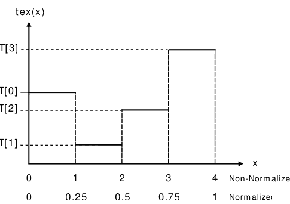

图 15 最近点采样过滤模式
四个纹元的一维纹理的最近点采样。

### G.2. 线性过滤

在此过滤模式下（仅适用于浮点纹理），纹理获取返回的值为
- 一维纹理的 tex(x)=(1-α)T[i]+αT[i+1]，
- 二维纹理的 tex(x,y)=(1-α)(1-β)T[i,j]+(1-α)βT[i+1,j]+(1-α)βT[i,j+1]+αβT[i+1,j+1]，
- 三维纹理的 tex(x,y,z) =
  (1-α)(1-β)(1-γ)T[i,j,k]+α(1-β)(1-γ)T[i+1,j,k]+
  (1-α)β(1-γ)T[i,j+1,k]+αβ(1-γ)T[i+1,j+1,k]+
  (1-α)(1-β)γT[i,j,k+1]+α(1-β)γT[i+1,j,k+1]+
  (1-α)βγT[i,j+1,k+1]+αβγT[i+1,j+1,k+1]

其中：
- i=floor(xp)，α=frac(xp)，xp=x-0.5，
- j=floor(yp)，β=frac(yp)，yp=y-0.5，
- k=floor(zp)，γ=frac(zp)，zp=z-0.5，

α、β 和 γ 存储为 9 位定点格式，带有 8 位小数值（因此 1.0 精确表示）。

图 16 说明了 N=4 的一维纹理的线性过滤。

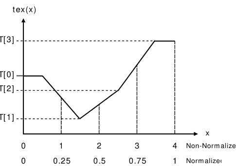

### 图 16 线性过滤模式
在 clamp 寻址模式下，四个纹元的一维纹理的线性过滤。

### G.3. 查找表

可以将 x 跨越区间 [0,R] 的查找表 TL(x) 实现为 TL(x)=tex((N-1)R/x+0.5)，以确保 TL(0)=T[0] 和 TL(R)=T[N-1]。

图 17 说明了如何使用纹理过滤从 N=4 的一维纹理中实现 R=4 或 R=1 的查找表。

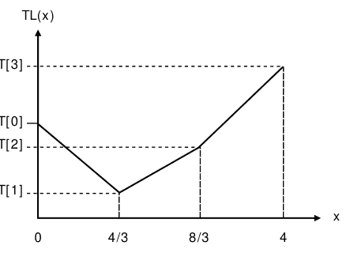

### 图 17 使用线性过滤的一维查找表

## 附录 H. 计算能力

计算设备的一般规格和特性取决于其计算能力（参见计算能力）。

表 14 列出了与每个计算能力相关的特性和技术规格。

浮点标准回顾了与 IEEE 浮点标准的符合性。

章节“计算能力 3.x”、“计算能力 5.x”、“计算能力 6.x”和“计算能力 7.x”分别详细介绍了计算能力为 3.x、5.x、6.x 和 7.x 的设备架构。

### H.1. 特性和技术规格

### 表 14 每个计算能力的特性支持

| 特性支持 | 3.0 | 3.2 | 3.5, 3.7, 5.0, 5.2 | 5.3 | 6.x | 7.x |
|---|---|---|---|---|---|---|
| (未列出的特性支持所有计算能力) | | | | | | |
| 在全局内存中对 32 位整数值操作的原子函数（原子函数） | 是 | | | | | |
| 在全局内存中对 32 位浮点值操作的 atomicExch()（atomicExch()） | 是 | | | | | |
| 在共享内存中对 32 位整数值操作的原子函数（原子函数） | 是 | | | | | |
| 在共享内存中对 32 位浮点值操作的 atomicExch()（atomicExch()） | 是 | | | | | |
| 在全局内存中对 64 位整数值操作的原子函数（原子函数） | 是 | | | | | |
| 在共享内存中对 64 位整数值操作的原子函数（原子函数） | 是 | | | | | |


| 功能支持 | 3.0 | 3.2 | 3.5, 3.7, 5.0, 5.2 | 5.3 | 6.x | 7.x |
| :--- | :---: | :---: | :---: | :---: | :---: | :---: |
| (未列出的功能支持所有计算能力) | | | | | | |
| 对全局内存和共享内存中32位浮点值进行原子加法操作 (atomicAdd()) | 是 | 是 | 是 | 是 | 是 | 是 |
| 对全局内存和共享内存中64位浮点值进行原子加法操作 (atomicAdd()) | 否 | 否 | 否 | 否 | 是 | 是 |
| Warp投票和投票函数 (Warp Vote Functions) | 是 | 是 | 是 | 是 | 是 | 是 |
| __threadfence_system() (内存栅栏函数) | 是 | 是 | 是 | 是 | 是 | 是 |
| __syncthreads_count(), __syncthreads_and(), __syncthreads_or() (同步函数) | 是 | 是 | 是 | 是 | 是 | 是 |
| 表面函数 (Surface Functions) | 是 | 是 | 是 | 是 | 是 | 是 |
| 线程块的3D网格 | 是 | 是 | 是 | 是 | 是 | 是 |
| 统一内存编程 | 是 | 是 | 是 | 是 | 是 | 是 |
| 漏斗移位 (请参阅参考手册) | 否 | 是 | 是 | 是 | 是 | 是 |
| 动态并行 | 否 | 是 | 是 | 是 | 是 | 是 |
| 半精度浮点运算：加法、减法、乘法、比较、Warp混洗函数、转换 | 否 | 否 | 否 | 否 | 是 | 是 |
| Tensor Core | 否 | 否 | 否 | 否 | 否 | 是 |

### 表 15 每个计算能力的技术规格

| 技术规格 | 3.0 | 3.2 | 3.5 | 3.7 | 5.0 | 5.2 | 5.3 | 6.0 | 6.1 | 6.2 | 7.0 | 7.5 |
| :--- | :---: | :---: | :---: | :---: | :---: | :---: | :---: | :---: | :---: | :---: | :---: | :---: |
| 每个设备的常驻网格最大数量 (并发内核执行) | 16 | 4 | 32 | 32 | 32 | 32 | 16 | 128 | 32 | 16 | 128 | 128 |
| 线程块网格的最大维度 | 3 | 3 | 3 | 3 | 3 | 3 | 3 | 3 | 3 | 3 | 3 | 3 |
| 线程块网格的最大x维度 | 2^31-1 | 2^31-1 | 2^31-1 | 2^31-1 | 2^31-1 | 2^31-1 | 2^31-1 | 2^31-1 | 2^31-1 | 2^31-1 | 2^31-1 | 2^31-1 |
| 线程块网格的最大y或z维度 | 65535 | 65535 | 65535 | 65535 | 65535 | 65535 | 65535 | 65535 | 65535 | 65535 | 65535 | 65535 |
| 线程块的最大维度 | 3 | 3 | 3 | 3 | 3 | 3 | 3 | 3 | 3 | 3 | 3 | 3 |
| 块的最大x或y维度 | 1024 | 1024 | 1024 | 1024 | 1024 | 1024 | 1024 | 1024 | 1024 | 1024 | 1024 | 1024 |
| 块的最大z维度 | 64 | 64 | 64 | 64 | 64 | 64 | 64 | 64 | 64 | 64 | 64 | 64 |
| 每个块的最大线程数 | 1024 | 1024 | 1024 | 1024 | 1024 | 1024 | 1024 | 1024 | 1024 | 1024 | 1024 | 1024 |
| Warp大小 | 32 | 32 | 32 | 32 | 32 | 32 | 32 | 32 | 32 | 32 | 32 | 32 |
| 每个多处理器的常驻块最大数量 | 16 | 32 | 32 | 32 | 32 | 32 | 32 | 32 | 32 | 32 | 16 | |
| 每个多处理器的常驻Warp最大数量 | 64 | 64 | 64 | 64 | 64 | 64 | 64 | 64 | 64 | 64 | 32 | |
| 每个多处理器的常驻线程最大数量 | 2048 | 2048 | 2048 | 2048 | 2048 | 2048 | 2048 | 2048 | 2048 | 2048 | 1024 | |
| 每个多处理器的32位寄存器数量 | 64 K | 128 K | 128 K | 64 K | 64 K | 64 K | 64 K | 64 K | 64 K | 64 K | | |
| 每个线程块的最大32位寄存器数量 | 64 K | 32 K | 64 K | 64 K | 64 K | 32 K | 64 K | 32 K | 64 K | | | |
| 每个线程的最大32位寄存器数量 | 63 | 255 | 255 | 255 | 255 | 255 | 255 | 255 | 255 | 255 | 255 | |
| 每个多处理器的最大共享内存量 | 48 KB | 112 KB | 64 KB | 96 KB | 64 KB | 96 KB | 64 KB | 96 KB | 64 KB | | | |
| 每个线程块的最大共享内存量 | 48 KB | 48 KB | 48 KB | 48 KB | 48 KB | 48 KB | 48 KB | 48 KB | 48 KB | 96 KB | 64 KB | |
| 共享内存银行数量 | 32 | 32 | 32 | 32 | 32 | 32 | 32 | 32 | 32 | 32 | 32 | |
| 每个线程的本地内存量 | 512 KB | 512 KB | 512 KB | 512 KB | 512 KB | 512 KB | 512 KB | 512 KB | 512 KB | 512 KB | 512 KB | |
| 常量内存大小 | 64 KB | 64 KB | 64 KB | 64 KB | 64 KB | 64 KB | 64 KB | 64 KB | 64 KB | 64 KB | 64 KB | |
| 每个多处理器用于常量内存的缓存工作集 | 8 KB | 8 KB | 8 KB | 8 KB | 8 KB | 8 KB | 8 KB | 4 KB | 8 KB | 8 KB | 8 KB | |
| 每个多处理器用于纹理内存的缓存工作集 | 介于 12 KB 和 48 KB 之间 | 介于 12 KB 和 48 KB 之间 | 介于 12 KB 和 48 KB 之间 | 介于 12 KB 和 48 KB 之间 | 介于 12 KB 和 48 KB 之间 | 介于 12 KB 和 48 KB 之间 | 介于 12 KB 和 48 KB 之间 | 介于 24 KB 和 48 KB 之间 | 32-128 KB | 32 或 64 KB | | |
| 绑定到CUDA数组的1D纹理引用的最大宽度 | 65536 | 65536 | 65536 | 65536 | 65536 | 65536 | 65536 | 65536 | 65536 | 65536 | 65536 | |
| 绑定到线性内存的1D纹理引用的最大宽度 | 2^27 | | | | | | | | | | | |
| 1D分层纹理引用的最大宽度和层数 | 16384 x 2048 | | | | | | | | | | | |
| 绑定到CUDA数组的2D纹理引用的最大宽度和高度 | 65536 x 65535 | | | | | | | | | | | |
| 绑定到线性内存的2D纹理引用的最大宽度和高度 | 65000 x 65000 | | | | | | | | | | | |
| 支持纹理收集并绑定到CUDA数组的2D纹理引用的最大宽度和高度 | 16384 x 16384 | | | | | | | | | | | |
| 2D分层纹理引用的最大宽度、高度和层数 | 16384 x 16384 x 2048 | | | | | | | | | | | |
| 绑定到CUDA数组的3D纹理引用的最大宽度、高度和深度 | 4096 x 4096 x 4096 | | | | | | | | | | | |
| 立方体贴图纹理引用的最大宽度（和高度） | 16384 | | | | | | | | | | | |
| 立方体贴图分层纹理引用的最大宽度（和高度）及层数 | 16384 x 2046 | | | | | | | | | | | |
| 可绑定到内核的最大纹理数量 | 256 | | | | | | | | | | | |
| 绑定到CUDA数组的1D曲面引用的最大宽度 | 65536 | | | | | | | | | | | |
| 1D分层曲面引用的最大宽度和层数 | 65536 x 2048 | | | | | | | | | | | |
| 绑定到CUDA数组的2D曲面引用的最大宽度和高度 | 65536 x 32768 | | | | | | | | | | | |
| 2D分层曲面引用的最大宽度、高度和层数 | 65536 x 32768 x 2048 | | | | | | | | | | | |
| 绑定到CUDA数组的3D曲面引用的最大宽度、高度和深度 | 65536 x 32768 x 2048 | | | | | | | | | | | |
| 绑定到CUDA数组的立方体贴图曲面引用的最大宽度（和高度） | 32768 | 32768 | 32768 | 32768 | 32768 | 32768 | 32768 | 32768 | 32768 | 32768 | 32768 | 32768 |
| 立方体贴图分层曲面引用的最大宽度（和高度）及层数 | 32768 x 2046 | 32768 x 2046 | 32768 x 2046 | 32768 x 2046 | 32768 x 2046 | 32768 x 2046 | 32768 x 2046 | 32768 x 2046 | 32768 x 2046 | 32768 x 2046 | 32768 x 2046 | 32768 x 2046 |
| 可绑定到内核的最大曲面数量 | 16 | 16 | 16 | 16 | 16 | 16 | 16 | 16 | 16 | 16 | 16 | 16 |
| 每个内核的最大指令数 | 512百万 | 512百万 | 512百万 | 512百万 | 512百万 | 512百万 | 512百万 | 512百万 | 512百万 | 512百万 | 512百万 | 512百万 |

### H.2. 浮点标准

所有计算设备均遵循用于二进制浮点运算的IEEE 754-2008标准，但存在以下偏差：

- 没有动态可配置的舍入模式；但是，大多数操作支持多种IEEE舍入模式，通过设备内置函数公开；
- 没有检测浮点异常是否发生的机制，所有操作的行为都仿佛IEEE-754异常始终被屏蔽，并且如果发生异常事件，则返回IEEE-754定义的屏蔽响应；出于同样的原因，虽然支持SNaN编码，但它们不是信号化的，并且被当作quiet NaN处理；
- 涉及一个或多个输入NaN的单精度浮点运算的结果是位模式为0x7fffffff的quiet NaN；
- 双精度浮点绝对值和取负运算在涉及NaN时不符合IEEE-754标准；这些值将原样传递；

必须使用 `-ftz=false`、`-prec-div=true` 和 `-prec-sqrt=true` 编译代码以确保符合IEEE标准（这是默认设置；有关这些编译标志的说明，请参阅 `nvcc` 用户手册）。

无论编译器标志 `-ftz` 的设置如何，

- 全局内存上的原子单精度浮点加法始终以刷新到零模式运行，即行为等效于 `FADD .F32 .FTZ .RN`，
- 共享内存上的原子单精度浮点加法始终以支持非规范化数的方式运行，即行为等效于 `FADD .F32 .RN`。

根据IEEE-754R标准，如果 `fminf()`、`fmin()`、`fmaxf()` 或 `fmax()` 的一个输入参数是NaN，而另一个不是，则结果为非NaN参数。


IEEE-754未定义浮点值超出整数格式范围时将浮点值转换为整数值的行为。对于计算设备，行为是将其钳制到受支持范围的末端。这与x86架构的行为不同。

IEEE-754未定义整数除以零和整数溢出的行为。对于计算设备，没有检测此类整数操作异常是否发生的机制。整数除以零会产生一个未指定的、特定于机器的值。

http://developer.nvidia.com/content/precision-performance-floating-point-and-ieee-754-compliance-nvidia-gpus 包含有关NVIDIA GPU浮点精度和合规性的更多信息。

### H.3. 计算能力 3.x

#### H.3.1. 架构

多处理器包含：

- 用于算术运算的192个CUDA核心（有关算术运算吞吐量，请参见算术指令），
- 用于单精度浮点超越函数的32个特殊功能单元，
- 4个线程束调度器。

当多处理器获得要执行的线程束时，它首先将它们分配给四个调度器。然后，在每条指令发射时间，每个调度器为其分配的准备执行的线程束（如果有）发射两条独立指令。

多处理器具有一个只读常量缓存，由所有功能单元共享，并加速从常量内存空间（位于设备内存中）的读取。

每个多处理器都有一个L1缓存，所有多处理器共享一个L2缓存。L1缓存用于缓存对本地内存（包括临时寄存器溢出）的访问。L2缓存用于缓存对本地和全局内存的访问。缓存行为（例如，读取是同时缓存在L1和L2中还是仅缓存在L2中）可以部分地在每次访问的基础上使用加载或存储指令的修饰符进行配置。计算能力3.5和计算能力3.7的某些设备允许通过编译器选项选择将全局内存同时缓存在L1和L2中。

同一片上片内存同时用于L1和共享内存：它可以配置为48 KB的共享内存和16 KB的L1缓存，或16 KB的共享内存和48 KB的L1缓存，或32 KB的共享内存和32 KB的L1缓存，使用cudaFuncSetCacheConfig() / cuFuncSetCacheConfig()：

```
// Device code
__global__ void MyKernel()
{
    ...
}

// Host code

// Runtime API
// cudaFuncCachePreferShared: shared memory is 48 KB
// cudaFuncCachePreferEqual: shared memory is 32 KB
// cudaFuncCachePreferL1: shared memory is 16 KB
// cudaFuncCachePreferNone: no preference
cudaFuncSetCacheConfig(MyKernel, cudaFuncCachePreferShared)
```

默认缓存配置为“prefer none”，即“无偏好”。如果内核配置为无偏好，则它将默认使用当前线程/上下文的偏好，该偏好使用cudaDeviceSetCacheConfig() / cuCtxSetCacheConfig()设置（有关详细信息，请参阅参考手册）。如果当前线程/上下文也没有偏好（这也是默认设置），那么最近为任何内核使用的缓存配置将被使用，除非启动内核需要不同的缓存配置（例如，由于共享内存要求）。初始配置为48 KB的共享内存和16 KB的L1缓存。

> 计算能力3.7的设备在上述每种配置中额外添加64 KB的共享内存，分别产生每个多处理器112 KB、96 KB和80 KB的共享内存。但是，每个线程块的最大共享内存仍为48 KB。

应用程序可以通过检查l2CacheSize设备属性来查询L2缓存大小（请参见设备枚举）。最大L2缓存大小为1.5 MB。

每个多处理器都有一个48 KB的只读数据缓存，用于加速从设备内存的读取。它要么直接访问此缓存（适用于计算能力3.5或3.7的设备），要么通过实现纹理和表面内存中提到的各种寻址模式和数据过滤的纹理单元访问。当通过纹理单元访问时，只读数据缓存也称为纹理缓存。

#### H.3.2. 全局内存

计算能力3.x设备的全局内存访问缓存在L2中，而计算能力3.5或3.7的设备还可以缓存在前一节描述的只读数据缓存中；它们通常不缓存在L1中。计算能力3.5和计算能力3.7的某些设备允许通过nvcc的-Xptxas -dlcm=ca选项选择将全局内存访问缓存在L1中。

缓存行大小为128字节，映射到设备内存中128字节对齐的段。同时缓存在L1和L2中的内存访问使用128字节内存事务来服务，而仅缓存在L2中的内存访问使用32字节内存事务来服务。因此，仅在L2中缓存可以减少过度预取，例如，在分散内存访问的情况下。

如果每个线程访问的字大小超过4字节，则线程束的内存请求首先拆分为单独的128字节内存请求，这些请求独立发出：

- 两个内存请求，每个半线程束一个，如果大小为8字节，
- 四个内存请求，每个四分之一线程束一个，如果大小为16字节。

然后，每个内存请求被分解为独立发出的缓存行请求。缓存行请求在缓存命中时以L1或L2缓存的吞吐量来服务，否则以设备内存的吞吐量来服务。

请注意，线程可以按任何顺序访问任何字，包括相同的字。

如果线程束执行的非原子指令向全局内存中的同一位置写入多个线程的数据，则只有一个线程执行写入，哪个线程执行是未定义的。

在内核整个生命周期中为只读的数据也可以通过使用`__ldg()`函数读取来缓存在前一节描述的只读数据缓存中（请参见只读数据缓存加载函数）。当编译器检测到某些数据满足只读条件时，它将使用`__ldg()`读取该数据。编译器可能并不总能检测到某些数据满足只读条件。用`const`和`__restrict__`限定符同时标记用于加载此类数据的指针，会增加编译器检测到只读条件的可能性。

图18显示了全局内存访问和相应内存事务的一些示例。

#### 对齐访问（顺序/非顺序）

地址：96 128 160 192 224 256 288

线程：0 ... 31

| 计算能力：内存事务： | 未缓存 | 已缓存 |
|---|---|---|
| | 1x 32B at 128 | 1x 128B at 128 |
| | 1x 32B at 160 | |
| | 1x 32B at 192 | |
| | 1x 32B at 224 | |

#### 未对齐访问（顺序/非顺序）

地址：96 128 160 192 224 256 288

线程：0 ... 31

| 计算能力：内存事务： | 未缓存 | 已缓存 |
|---|---|---|
| | 1x 32B at 128 | 1x 128B at 128 |
| | 1x 32B at 160 | 1x 128B at 256 |
| | 1x 32B at 192 | |
| | 1x 32B at 224 | |
| | 1x 32B at 256 | |

图18 全局内存访问示例 线程束按每个线程4字节字进行的全局内存访问示例及相关内存事务，适用于计算能力3.x及更高版本

#### H.3.3. 共享内存

共享内存有32个银行，具有下面描述的两种寻址模式。

寻址模式可以使用cudaDeviceGetSharedMemConfig()查询，并使用cudaDeviceSetSharedMemConfig()设置（有关更多详细信息，请参阅参考手册）。每个银行的带宽为每个时钟周期64位。

图19显示了步进访问的一些示例。

图20显示了涉及广播机制的内存读取访问的一些示例。

#### 64位模式

连续的64位字映射到连续的银行。


对一个 warp 的共享内存请求，不会在两个访问同一 64 位字内任意子字的线程之间产生银行冲突（即使这两个子字的地址落在同一个银行中）：在这种情况下，对于读访问，64 位字会广播到请求线程；对于写访问，每个子字仅由其中一个线程写入（哪个线程执行写入是未定义的）。

#### 32 位模式

连续的 32 位字映射到连续的银行。

对一个 warp 的共享内存请求，不会在两个访问同一 32 位字内任意子字，或访问两个索引 i 和 j 位于同一 64 字对齐段（即第一个索引是 64 的倍数的段）内的两个 32 位字（且 j=i+32）的线程之间产生银行冲突（即使这两个子字的地址落在同一个银行中）：在这种情况下，对于读访问，32 位字会广播到请求线程；对于写访问，每个子字仅由其中一个线程写入（哪个线程执行写入是未定义的）。

### H.4. 计算能力 5.x

#### H.4.1. 架构

多处理器由以下部分组成：

- 用于算术运算的 128 个 CUDA 核心（有关算术运算吞吐量，请参见算术指令），
- 用于单精度浮点超越函数的 32 个特殊功能单元，
- 4 个 warp 调度器。

当分配给多处理器要执行的 warps 时，它首先将它们分配给四个调度器。然后，在每条指令发射时间，每个调度器为其分配的、已准备好执行的 warp（如果有）发射一条指令。

多处理器具有：

- 由所有功能单元共享的只读常量缓存，用于加速从位于设备内存中的常量内存空间的读取，
- 用于缓存来自全局内存读取的 24 KB 统一 L1/纹理缓存，
- 计算能力 5.0 设备的 64 KB 共享内存，或计算能力 5.2 设备的 96 KB 共享内存。

统一 L1/纹理缓存也由纹理单元使用，该单元实现了“纹理和表面内存”中提到的各种寻址模式和数据过滤。

还有一个由所有多处理器共享的 L2 缓存，用于缓存对本地或全局内存的访问，包括临时寄存器溢出。应用程序可以通过检查 l2CacheSize 设备属性来查询 L2 缓存大小（参见设备枚举）。

缓存行为（例如，读取是同时缓存在统一 L1/纹理缓存和 L2 中，还是仅缓存在 L2 中）可以部分地在每次访问的基础上通过加载指令的修饰符进行配置。

#### H.4.2. 全局内存

全局内存访问始终缓存在 L2 中，L2 中的缓存行为与计算能力 3.x 设备的行为相同（参见全局内存）。

在内核整个生命周期中为只读的数据，也可以通过使用 __ldg() 函数读取它来缓存在前一节描述的统一 L1/纹理缓存中（参见只读数据缓存加载函数）。当编译器检测到某些数据满足只读条件时，它将使用 __ldg() 读取该数据。编译器可能并不总能检测到某些数据满足只读条件。将用于加载此类数据的指针同时标记为 const 和 __restrict__ 限定符，可增加编译器检测到只读条件的可能性。

在内核整个生命周期中不是只读的数据，不能在计算能力 5.0 设备的统一 L1/纹理缓存中缓存。对于计算能力 5.2 设备，默认情况下，它不缓存在统一 L1/纹理缓存中，但可以使用以下机制启用缓存：

- 按照 PTX 参考手册中描述的，使用带有适当修饰符的内联汇编执行读取；
- 使用 -Xptxas -dlcm=ca 编译标志进行编译，在这种情况下，所有读取都会被缓存，但使用禁用缓存的修饰符的内联汇编执行的读取除外；
- 使用 -Xptxas -fscm=ca 编译标志进行编译，在这种情况下，所有读取都会被缓存，包括使用内联汇编执行的读取，无论使用何种修饰符。

当使用上述三种机制之一启用缓存时，计算能力 5.2 设备将在所有内核启动中将全局内存读取缓存在统一 L1/纹理缓存中，但线程块占用多处理器寄存器文件过多的内核启动除外。这些例外情况由性能分析器报告。

#### H.4.3. 共享内存

共享内存有 32 个银行，其组织方式使得连续的 32 位字映射到连续的银行。每个银行的带宽为每个时钟周期 32 位。

对一个 warp 的共享内存请求，不会在两个访问同一 32 位字内任意地址的线程之间产生银行冲突（即使这两个地址落在同一个银行中）：在这种情况下，对于读访问，该字会广播到请求线程；对于写访问，每个地址仅由其中一个线程写入（哪个线程执行写入是未定义的）。

图 19 显示了一些步进访问示例。

图 20 显示了一些涉及广播机制的内存读取访问示例。

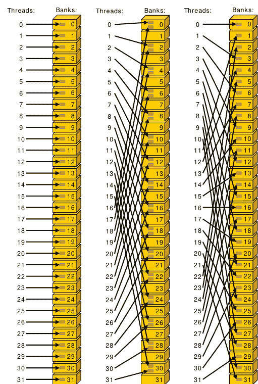

左
步长为一个 32 位字的线性寻址（无银行冲突）。

中间
步长为两个 32 位字的线性寻址（两路银行冲突）。

右
步长为三个 32 位字的线性寻址（无银行冲突）。

### 图 19 步进式共享内存访问

适用于计算能力 3.x（32 位模式）或计算能力 5.x 和 6.x 设备的示例

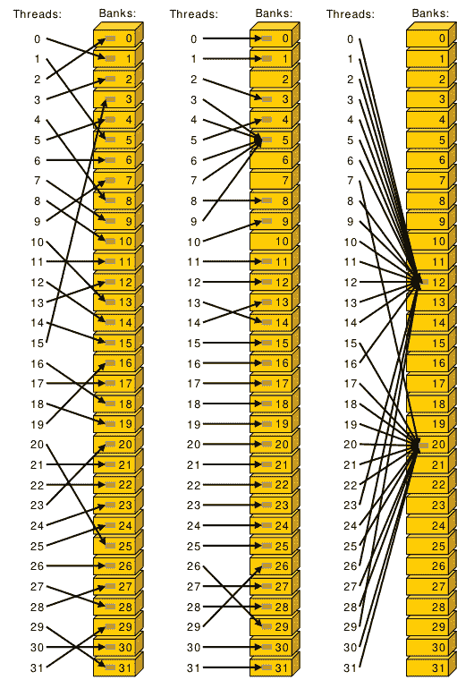

左 通过随机排列实现无冲突访问。

中间 由于线程 3、4、6、7 和 9 访问银行 5 内的同一个字，因此实现无冲突访问。

右 无冲突广播访问（线程访问银行内的同一个字）。

### 图 20 不规则共享内存访问

适用于计算能力 3.x、5.x 或 6.x 设备的示例。

### H.5. 计算能力 6.x

#### H.5.1. 架构

多处理器由以下部分组成：

- 用于算术运算的 64 个（计算能力 6.0）或 128 个（6.1 和 6.2）CUDA 核心，
- 用于单精度浮点超越函数的 16 个（6.0）或 32 个（6.1 和 6.2）特殊功能单元，
- 2 个（6.0）或 4 个（6.1 和 6.2）warp 调度器。

当分配给多处理器要执行的 warps 时，它首先将它们分配给其调度器。然后，在每条指令发射时间，每个调度器为其分配的、已准备好执行的 warp（如果有）发射一条指令。

多处理器具有：

- 由所有功能单元共享的只读常量缓存，用于加速从位于设备内存中的常量内存空间的读取，
- 用于全局内存读取的 24 KB（6.0 和 6.2）或 48 KB（6.1）统一 L1/纹理缓存，
- 64 KB（6.0 和 6.2）或 96 KB（6.1）的共享内存。

统一 L1/纹理缓存也由纹理单元使用，该单元实现了“纹理和表面内存”中提到的各种寻址模式和数据过滤。

还有一个由所有多处理器共享的 L2 缓存，用于缓存对本地或全局内存的访问，包括临时寄存器溢出。应用程序可以通过检查 l2CacheSize 设备属性来查询 L2 缓存大小（参见设备枚举）。

缓存行为（例如，读取是同时缓存在统一 L1/纹理缓存和 L2 中，还是仅缓存在 L2 中）可以部分地在每次访问的基础上通过加载指令的修饰符进行配置。

#### H.5.2. 全局内存

全局内存的行为与计算能力 5.x 设备的行为相同（参见全局内存）。

#### H.5.3. 共享内存

共享内存的行为与计算能力 5.x 设备的行为相同（参见共享内存）。


### H.6. 计算能力 7.x

#### H.6.1. 架构

A multiprocessor consists of:

- 64 FP32 cores for single-precision arithmetic operations,
- 32 FP64 cores for double-precision arithmetic operations,
- 64 INT32 cores for integer math,
- 8 mixed-precision Tensor Cores for deep learning matrix arithmetic
- 16 special function units for single-precision floating-point transcendental functions,
- 4 warp schedulers.

A multiprocessor statically distributes its warps among its schedulers. Then, at every instruction issue time, each scheduler issues one instruction for one of its assigned warps that is ready to execute, if any.

A multiprocessor has:

- a read-only constant cache that is shared by all functional units and speeds up reads from the constant memory space, which resides in device memory,
- a unified data cache and shared memory with a total size of 128 KB (_Volta_) or 96 KB (_Turing_).

Shared memory is partitioned out of unified data cache, and can be configured to various sizes (See Shared Memory.) The remaining data cache serves as an L1 cache and is also used by the texture unit that implements the various addressing and data filtering modes mentioned in Texture and Surface Memory.

#### H.6.2. 独立线程调度

The _Volta_ architecture introduces Independent Thread Scheduling among threads in a warp, enabling intra-warp synchronization patterns previously unavailable and simplifying code changes when porting CPU code. However, this can lead to a rather different set of threads participating in the executed code than intended if the developer made assumptions about warp-synchronicity of previous hardware architectures.

Below are code patterns of concern and suggested corrective actions for Volta-safe code.

- 1. For applications using warp intrinsics (`__shfl*`, `__any`, `__all`, `__ballot`), it is necessary that developers port their code to the new, safe, synchronizing counterpart, with the `*_sync` suffix. The new warp intrinsics take in a mask of threads that explicitly define which lanes (threads of a warp) must participate in the warp intrinsic. See Warp Vote Functions and Warp Shuffle Functions for details.

Since the intrinsics are available with CUDA 9.0+, (if necessary) code can be executed conditionally with the following preprocessor macro:

```
#if defined(CUDART_VERSION) && CUDART_VERSION >= 9000
// * __sync Intrinsics
#endif
```

These intrinsics are available on all architectures, not just Volta or Turing, and in most cases a single code-base will suffice for all architectures. Note, however, that for Pascal and earlier architectures, all threads in mask must execute the same warp intrinsic instruction in convergence, and the union of all values in mask must be equal to the warp's active mask. The following code pattern is valid on Volta, but not on Pascal or earlier architectures.

```
if (tid % warpSize < 16) {
    ...
    float swapped = __shfl_xor_sync(0xffffffff, val, 16);
} else {
    ...
    float swapped = __shfl_xor_sync(0xffffffff, val, 16);
}
```

The replacement for `__ballot(1)` is `__activemask()`. Note that threads within a warp can diverge even within a single code path. As a result, `__activemask()` and `__ballot(1)` may return only a subset of the threads on the current code path. The following invalid code example sets bit `i` of `output` to 1 when `data[i]` is greater than `threshold`. `__activemask()` is used in an attempt to enable cases where `datalen` is not a multiple of 32.

```
// Sets bit in output[] to 1 if the correspond element in data[i]
// is greater than 'threshold', using 32 threads in a warp.
for(int i=warplane; i<datalen; i+=warpSize) {
    unsigned active = __activemask();
    unsigned bitPack = __ballot_sync(active, data[i] > threshold);
    if (warplane == 0)
        output[i/32] = bitPack;
}
```

This code is invalid because CUDA does not guarantee that the warp will diverge ONLY at the loop condition. When divergence happens for other reasons, conflicting results will be computed for the same 32-bit output element by different subsets of threads in the warp. A correct code might use a non-divergent loop condition together with `__ballot_sync()` to safely enumerate the set of threads in the warp participating in the threshold calculation as follows.

```
for(int i=warplane; i<datalen; i+=warpSize) {
    unsigned active = __ballot_sync(0xFFFFFFFF, i < datalen);
    if (i < datalen) {
        unsigned bitPack = __ballot_sync(active, data[i] > threshold);
        if (warplane == 0)
            output[i/32] = bitPack;
    }
}
```

Discovery Pattern demonstrates a valid usecase for `__activemask()`.

- 2. If applications have warp-synchronous codes, they will need to insert the new `__syncwarp()` warp-wide barrier synchronization instruction between any steps where data is exchanged between threads via global or shared memory. Assumptions that code is executed in lockstep or that reads/writes from separate threads are visible across a warp without synchronization are invalid.

```
float s_buf[tid] = val;
__syncthreads();

// Inter-warp reduction
for (int i=BID/2; i>0; i/=2) {
    s_buf[tid] += s_buf[tid+i];
    __syncthreads();
}

// Intra-warp reduction
// Butterfly reduction simplifies syncwarp mask
if (tid < 32) {
    float temp;
    s_buf[tid] += temp; __syncwarp();
    s_buf[tid] += temp; __syncwarp();
    temp = s_buf[tid^8]; __syncwarp();
    s_buf[tid] += temp; __syncwarp();
    temp = s_buf[tid^4]; __syncwarp();
    s_buf[tid] += temp; __syncwarp();
    temp = s_buf[tid^2]; __syncwarp();
    s_buf[tid] += temp; __syncwarp();
}

if (tid == 0) {
    *output = s_buf[0] + s_buf[1];
}
__syncthreads();
```

- 3. Although `__syncthreads()` has been consistently documented as synchronizing all threads in the thread block, Pascal and prior architectures could only enforce synchronization at the warp level. In certain cases, this allowed a barrier to succeed without being executed by every thread as long as at least some thread in every warp reached the barrier. Starting with Volta, the CUDA built-in `__syncthreads()` and PTX instruction `bar.sync` (and their derivatives) are enforced per thread and thus will not succeed until reached by all non-exited threads in the block. Code exploiting the previous behavior will likely deadlock and must be modified to ensure that all non-exited threads reach the barrier.

The racecheck and synccheck tools provided by cuda-memcheck can aid in locating violations of points 2 and 3.

To aid migration while implementing the above-mentioned corrective actions, developers can opt-in to the Pascal scheduling model that does not support independent thread scheduling. See Application Compatibility for details.

#### H.6.3. 全局内存

Global memory behaves the same way as devices of compute capability 5.x (See Global Memory).

#### H.6.4. 共享内存

Similar to the Kepler architecture, the amount of the unified data cache reserved for shared memory is configurable on a per kernel basis. For the Volta architecture (compute capability 7.0), the unified data cache has a size of 128 KB, and the shared memory capacity can be set to 0, 8, 16, 32, 64 or 96 KB. For the Turing architecture (compute capability 7.5), the unified data cache has a size of 96 KB, and the shared memory capacity can be set to either 32 KB or 64 KB. Unlike Kepler, the driver automatically configures the shared memory capacity for each kernel to avoid shared memory occupancy bottlenecks while also allowing concurrent execution with already launched kernels where possible. In most cases, the driver’s default behavior should provide optimal performance.

Because the driver is not always aware of the full workload, it is sometimes useful for applications to provide additional hints regarding the desired shared memory configuration. For example, a kernel with little or no shared memory use may request a larger carvedout in order to encourage concurrent execution with later kernels that require more shared memory. The new cudaFuncSetAttribute() API allows applications to set a preferred shared memory capacity, or carveout, as a percentage of the maximum supported shared memory capacity (96 KB for Volta, and 64 KB for Turing).

cudaFuncSetAttribute() relaxes enforcement of the preferred shared capacity compared to the legacy cudaFuncSetCacheConfig() API introduced with Kepler. The legacy API treated shared memory capacities as hard requirements for kernel launch. As a result, interleaving kernels with different shared memory configurations would needlessly serialize launches behind shared memory reconfigurations. With the new API, the carveout is treated as a hint. The driver may choose a different configuration if required to execute the function or to avoid thrashing.

```
// Device code
__global__ void MyKernel(...)
{
    __shared__ float buffer[BLOCK_DIM];
    ...
}

// Host code
int carveout = 50; // prefer shared memory capacity 50% of maximum
// Named Carveout Values:
// carveout = cudaSharedmemCarveoutDefault; // (-1)
// carveout = cudaSharedmemCarveoutMaxL1; // (0)
// carveout = cudaSharedmemCarveoutMaxShared; // (100)
// cudaFuncSetAttribute(MyKernel, cudaFuncAttributePreferredSharedMemoryCarveout,
carveout);
MyKernel<<<gridDim, BLOCK_DIM>>>(...);
```

In addition to an integer percentage, several convenience enums are provided as listed in the code comments above. Where a chosen integer percentage does not map exactly to a supported capacity (SM 7.0 devices support shared capacities of 0, 8, 16, 32, 64, or 96 KB), the next larger capacity is used. For instance, in the example above, 50% of the 96 KB maximum is 48 KB, which is not a supported shared memory capacity. Thus, the preference is rounded up to 64 KB.


计算能力 7.x 设备允许单个线程块寻址共享内存的全部容量：Volta 上为 96 KB，Turing 上为 64 KB。依赖每块超过 48 KB 共享内存分配的内核是特定于架构的，因此它们必须使用动态共享内存（而非静态大小的数组），并通过 cudaFuncSetAttribute() 显式选择加入，如下所示。

```
// device code
__global__ void MyKernel(...)
{
    ...
}

// Host code
int maxbytes = 98304; // 96 KB
cudaFuncSetAttribute(MyKernel, cudaFuncAttributeMaxDynamicSharedMemorySize,
                     maxbytes);
MyKernel <<<gridDim, blockDim>>>(...);
```

否则，共享内存的行为与计算能力 5.x 设备相同（参见共享内存）。

## 附录 I. 驱动程序 API

本附录假设读者了解 CUDA 运行时中描述的概念。

驱动程序 API 实现在 **cuda** 动态库（**cuda.dll** 或 **cuda.so**）中，该库在安装设备驱动程序时会复制到系统上。其所有入口点均以 cu 开头。

这是一个基于句柄的命令式 API：大多数对象由不透明句柄引用，可将这些句柄传递给函数以操作对象。

驱动程序 API 中可用的对象在表 16 中汇总。

### 表 16 CUDA 驱动程序 API 中可用的对象

| 对象 | 句柄 | 描述 |
| :--- | :--- | :--- |
| 设备 | CUdevice | 支持 CUDA 的设备 |
| 上下文 | CUcontext | 大致相当于 CPU 进程 |
| 模块 | CUmodule | 大致相当于动态库 |
| 函数 | CUfunction | 内核 |
| 堆内存 | CUdeviceptr | 指向设备内存的指针 |
| CUDA 数组 | CUarray | 设备上一维或二维数据的不透明容器，可通过纹理或表面引用读取 |
| 纹理引用 | CUtexref | 描述如何解释纹理内存数据的对象 |
| 表面引用 | CUsurfref | 描述如何读取或写入 CUDA 数组的对象 |
| 流 | CUstream | 描述 CUDA 流的对象 |
| 事件 | CUevent | 描述 CUDA 事件的对象 |

在调用任何驱动程序 API 函数之前，必须使用 **cuInit()** 初始化驱动程序 API。随后必须创建一个 CUDA 上下文，将其附加到特定设备，并使其成为调用主机线程的当前上下文，如上下文中详细所述。

在 CUDA 上下文中，内核由主机代码显式加载为 PTX 或二进制对象，如模块中所述。因此，用 C++ 编写的内核必须单独编译为 PTX 或二进制对象。内核使用 API 入口点启动，如内核执行中所述。

任何希望在未来设备架构上运行的应用程序都必须加载 PTX，而非二进制代码。这是因为二进制代码是特定于架构的，因此与未来架构不兼容，而 PTX 代码会在加载时由设备驱动程序编译为二进制代码。

以下是使用驱动程序 API 编写的内核示例中的主机代码：

```
int main()
{
    int N = ...;
    size_t size = N * sizeof(float);

    // Allocate input vectors h_A and h_B in host memory
    float* h_A = (float*)malloc(size);
    float* h_B = (float*)malloc(size);

    // Initialize input vectors
    ...

    // Initialize
    cuInit(0);

    // Get number of devices supporting CUDA
    int deviceCount = 0;
    cuDeviceGetCount(&deviceCount);
    if (deviceCount == 0) {
        printf("There is no device supporting CUDA.\n");
        exit(0);
    }

    // Get handle for device 0
    CUdevice cuDevice;
    cuDeviceGet(&cuDevice, 0);

    // Create context
    CUcontext cuContext;
    cuCtxCreate(&cuContext, 0, cuDevice);

    // Create module from binary file
    CUmodule cuModule;
    cuModuleLoad(&cuModule, "VecAdd.ptx");

    // Allocate vectors in device memory
    CUdeviceptr d_A;
    cuMemAlloc(&d_A, size);
    CUdeviceptr d_B;
    cuMemAlloc(&d_B, size);
    CUdeviceptr d_C;
    cuMemAlloc(&d_C, size);

    // Copy vectors from host memory to device memory
    cuMemcpyHtoD(d_A, h_A, size);
    cuMemcpyHtoD(d_B, h_B, size);

    // Get function handle from module
    CUfunction vecAdd;
    cuModuleGetFunction(&vecAdd, cuModule, "VecAdd");

    // Invoke kernel
    int threadsPerBlock = 256;
    int blocksPerGrid =
        (N + threadsPerBlock - 1) / threadsPerBlock;
    void* args[] = { &d_A, &d_B, &d_C, &N };
    cuLaunchKernel(vecAdd,
                   blocksPerGrid, 1, 1, threadsPerBlock, 1, 1,
                   0, 0, args, 0);

    ...
}
```

完整代码可在 vectorAddDrv CUDA 示例中找到。

### I.1. 上下文

CUDA 上下文类似于 CPU 进程。在驱动程序 API 中执行的所有资源和操作都封装在 CUDA 上下文中，系统会在销毁上下文时自动清理这些资源。除了模块和纹理或表面引用等对象之外，每个上下文都有其自身独立的地址空间。因此，不同上下文中的 `CUdeviceptr` 值引用不同的内存位置。

主机线程同一时间只能有一个当前设备上下文。使用 `cuCtxCreate()` 创建上下文时，它会成为调用主机线程的当前上下文。在上下文中操作的 CUDA 函数（大多数不涉及设备枚举或上下文管理的函数）如果线程没有当前有效上下文，将返回 `CUDA_ERROR_INVALID_CONTEXT`。

每个主机线程都有一个当前上下文栈。`cuCtxCreate()` 将新上下文压入栈顶。可以调用 `cuCtxPopCurrent()` 将上下文从主机线程分离。此时上下文处于“浮动”状态，并可作为任何主机线程的当前上下文压入栈中。`cuCtxPopCurrent()` 还会恢复之前的当前上下文（如果有）。

每个上下文还维护一个引用计数。`cuCtxCreate()` 创建引用计数为 1 的上下文。`cuCtxAttach()` 增加引用计数，`cuCtxDetach()` 减少引用计数。当调用 `cuCtxDetach()`（或 `cuCtxDestroy()`）时，如果引用计数降至 0，则销毁上下文。

驱动程序 API 与运行时互操作，可以通过 `cuDevicePrimaryCtxRetain()` 从驱动程序 API 访问运行时管理的 `primary context`（参见初始化）。

引用计数有助于在同一上下文中运行的第三方代码之间实现互操作。例如，如果加载了三个库来使用同一上下文，则每个库在使用完上下文时都会调用 `cuCtxAttach()` 增加引用计数，并调用 `cuCtxDetach()` 减少引用计数。对于大多数库，预期应用程序会在加载或初始化库之前创建上下文；这样，应用程序可以使用自己的启发式方法创建上下文，而库只需在传递给它的上下文上操作。希望自行创建上下文（其 API 客户端可能或可能未创建自己的上下文，对此一无所知）的库，将使用 `cuCtxPushCurrent()` 和 `cuCtxPopCurrent()`，如图 21 所示。

### 图 21 库上下文管理

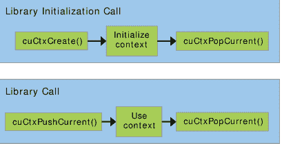

### I.2. 模块

模块是由 nvcc 输出的可动态加载的设备代码和数据包，类似于 Windows 中的 DLL（参见使用 NVCC 进行编译）。所有符号（包括函数、全局变量以及纹理或表面引用）的名称均在模块作用域中维护，以便独立第三方编写的模块可以在同一 CUDA 上下文中互操作。

此代码示例加载模块并获取某个内核的句柄：

```
CUmodule cuModule;
cuModuleLoad(&cuModule, "mymodule.ptx");
cuFunction myKernel;
cuModuleGetFunction(&myKernel, cuModule, "MyKernel");
```

此代码示例从 PTX 代码编译并加载新模块，并解析编译错误：

```
#define BUFFER_SIZE 8192
CUmodule cuModule;
CUjit_option options[3];
void* values[3];
char error_log[BUFFER_SIZE];
char error_name[BUFFER_SIZE];
int err;
options[0] = CU_JIT_ERROR_LOG_BUFFER;
values[0] = (void*)error_log;
options[1] = CU_JIT_ERROR_LOG_BUFFER_SIZE_BYTES;
values[1] = (void*)BUFFER_SIZE;
options[2] = CU_JIT_TARGET_FROM_CUCONTEXT;
values[2] = 0;
err = cuModuleLoadDataEx(&cuModule, PTXCode, 3, options, values);
if (err == CUDA_SUCCESS)
   printf("Link error:\n%s\n", error_log);
```


#define BUFFER_SIZE 8192
CUmodule cuModule;
CUjit_option options[6];
void* values[6];
float walltime;
char error_log[BUFFER_SIZE], info_log[BUFFER_SIZE];
char* PTXCode = "some PTX code";
char* PTXCode1 = "some other PTX code";
CUjit_state linkState;
int err;
void* cubin;
size_t cubinSize;
options[0] = CU_JIT_WALL_TIME;
values[0] = (void*)&walltime;
options[1] = CU_JIT_INFO_LOG_BUFFER;
values[1] = (void*)info_log;
options[2] = CU_JIT_INFO_LOG_BUFFER_SIZE_BYTES;
values[2] = (void*)BUFFER_SIZE;
options[3] = CU_JIT_ERROR_LOG_BUFFER;
values[3] = (void*)error_log;
options[4] = CU_JIT_ERROR_LOG_BUFFER_SIZE_BYTES;
values[4] = (void*)BUFFER_SIZE;
options[5] = CU_JIT_LOG_VERBOSE;
values[5] = (void*)1;
cuLinkCreate(6, options, values, &linkState);
err = cuLinkAddData(linkState, CU_JIT_INPUT_PTX,
                   PTXCode, CUjit_option(PTXCode) + strlen(PTXCode) + 1, 0, 0, 0, 0);
if (err != CUDA_SUCCESS) {
    printf("Link error:\n%s\n", error_log);
    err = cuLinkAddData(linkState, CU_JIT_INPUT_PTX,
                        PTXCode1, CUjit_option(PTXCode1) + strlen(PTXCode1) + 1, 0, 0, 0, 0);
    if (err != CUDA_SUCCESS) {
        printf("Link error:\n%s\n", error_log);
        cuLinkComplete(linkState, &cubin, &cubinSize);
        printf("\nLinkState in %fms, cubin size:%zu\n", walltime, info_log);
        printf("\nLinking cubin in %fms, Linker output:\n%s\n", walltime, info_log);
        cuModuleLoadData(cuModule, cubin);
        cuLinkDestroy(linkState);
    }
}

完整代码可在 `ptxjit` CUDA 示例中找到。

### I.3. 内核执行

cuLaunchKernel() 使用给定的执行配置启动内核。

参数可以作为指针数组传递（cuLaunchKernel() 的倒数第二个参数），其中第 n 个指针对应第 n 个参数，并指向从中复制参数的内存区域；也可以作为额外选项之一传递（cuLaunchKernel() 的最后一个参数）。

当参数作为额外选项传递时（CU_LAUNCH_PARAM_BUFFER_POINTER 选项），它们作为指向单个缓冲区的指针传递，其中假设参数之间通过匹配设备代码中每个参数类型的对齐要求而正确偏移。

设备代码中内置矢量类型的对齐要求列于表 4 中。对于所有其他基本类型，设备代码中的对齐要求与主机代码中的对齐要求匹配，因此可以使用 __alignof() 获得。

唯一的例外是当主机编译器将 double 和 long long（以及 64 位系统上的 long）按一个字边界而非两个字边界对齐时（例如，使用 gcc 的编译标志 -mno-align-double），因为在设备代码中这些类型始终按两个字边界对齐。

CUdeviceptr 是一个整数，但表示一个指针，因此其对齐要求是 __alignof(void*)。

以下代码示例使用一个宏（ALIGN_UP()）来调整每个参数的偏移量以满足其对齐要求，并使用另一个宏（ADD_TO_PARAM_BUFFER()）将每个参数添加到传递给 CU_LAUNCH_PARAM_BUFFER_POINTER 选项的参数缓冲区中。

```
#define ALIGN_UP(offset, alignment) \
    (offset) = ((offset) + (alignment) - 1) & ~((alignment) - 1)
char paramBuffer[1024];
size_t paramBufferSize = 0;
#define ADD_TO_PARAM_BUFFER(value, alignment) \
    do { \
        paramBufferSize = ALIGN_UP(paramBufferSize, alignment); \
        memcpy(paramBuffer + paramBufferSize, \
               &(value), sizeof(value)); \
        paramBufferSize += sizeof(value); \
    } while (0)
int i;
ADD_TO_PARAM_BUFFER(i, __alignof(i));
float4 f4;
ADD_TO_PARAM_BUFFER(f4, 16); // float4's alignment is 16
char c;
ADD_TO_PARAM_BUFFER(c, __alignof(c));
float f;
ADD_TO_PARAM_BUFFER(f, __alignof(f));
CUdeviceptr devPtr;
ADD_TO_PARAM_BUFFER(devPtr, __alignof(devPtr));
float2 f2;
ADD_TO_PARAM_BUFFER(f2, 8); // float2's alignment is 8
void* extra[] = {
    CU_LAUNCH_PARAM_BUFFER_POINTER, paramBuffer,
    CU_LAUNCH_PARAM_BUFFER_SIZE, &paramBufferSize,
    CU_LAUNCH_PARAM_END
};
cuLaunchKernel(cuFunction,
               blockWidth, blockHeight, blockDepth,
               gridWidth, gridHeight, gridDepth,
               0, 0, 0, extra);
```

结构体的对齐要求等于其字段中对齐要求的最大值。因此，包含内置矢量类型、CUdeviceptr 或未对齐的 double 和 long long 的结构体，其对齐要求在设备代码和主机代码之间可能不同。此类结构体的填充方式也可能不同。例如，以下结构体在主机代码中完全不填充，但在设备代码中会在字段 `f` 之后填充 12 个字节，因为字段 `f4` 的对齐要求是 16。

```
typedef struct {
    float f;
    float f4[4];
} myStruct;
```

### 1.4. 运行时 API 与驱动 API 之间的互操作性

应用程序可以混合使用运行时 API 代码和驱动 API 代码。

如果通过驱动 API 创建并设置当前上下文，后续的运行时调用将使用此上下文，而不是创建新上下文。

如果运行时已初始化（隐式，如 CUDA 运行时中所述），可以使用 `cuCtxGetCurrent()` 检索初始化期间创建的上下文。此上下文可供后续驱动 API 调用使用。

运行时隐式创建的上下文称为 *主上下文*（参见初始化）。它可以通过驱动 API 的主上下文管理函数进行管理。

设备内存可以使用任一 API 进行分配和释放。`CUdeviceptr` 可以转换为常规指针，反之亦然：

```
CUdeviceptr devPtr;
float* d_data;
// Allocation using driver API
cuMemAlloc(&devPtr, size);
d_data = (float*)devPtr;
// Allocation using runtime API
cudaMalloc(&d_data, size);
devPtr = (CUdeviceptr)d_data;
```

特别是，这意味着使用驱动 API 编写的应用程序可以调用使用运行时 API 编写的库（例如 cuFFT、cuBLAS 等）。

参考手册中设备和版本管理部分的所有函数都可以互换使用。

## 附录 J. CUDA 环境变量

与多进程服务相关的环境变量在 GPU 部署和管理指南的多进程服务部分中有记载。

### 表 17 CUDA 环境变量

| 类别 | 变量 | 值 | 描述 |
| :--- | :--- | :--- | :--- |
| 设备枚举和属性 | CUDA_VISIBLE_DEVICES | 逗号分隔的 GPU 标识符序列 | GPU 标识符以整数索引或 UUID 字符串形式给出。GPU UUID 字符串应遵循 nvidia-smi 给出的相同格式，例如 GPU-89329737-d72c-4110-c12f-200dbae61676。但是，为了与旧版 CUDA 格式兼容，允许使用候选项；只需从 GPU UUID 的开头指定足够的数字，以在目标系统中唯一标识该 GPU。例如，CUDA_VISIBLE_DEVICES=GPU-89329737 可能是引用上述 GPU UUID 的有效方式，假设系统中没有其他 GPU 共享此前缀。只有序列中存在索引的设备对 CUDA 应用程序可见，并且它们按序列顺序枚举。如果某个索引无效，只有索引在无效索引之前的设备对 CUDA 应用程序可见。例如，将 CUDA_VISIBLE_DEVICES 设置为 2,1 会导致设备 0 不可见，并且设备 2 在设备 1 之前枚举。将 CUDA_VISIBLE_DEVICES 设置为 0,2,1,1 会导致设备 0 和 2 可见，而设备 1 不可见。 |
| | CUDA_MANAGED_FORCE_DEVICE_ALLOC | 0 或 1（默认值为 0） | 强制驱动程序将所有托管分配放置在设备内存中。 |
| | CUDA_DEVICE_ORDER | FASTEST_FIRST, PCI_BUS_ID, ... | FASTEST_FIRST 导致 CUDA 使用简单的方法猜测哪个设备最快 |


| 类别 | 变量 | 值 | 描述 |
| :--- | :--- | :--- | :--- |
| | | (default is FASTEST_FIRST) | 启发式，并将该设备设为设备 0，其余设备的顺序未指定。PCI_BUS_ID 按升序按 PCI 总线 ID 对设备进行排序。 |
| 编译 | CUDA_CACHE_DISABLE | 0 或 1 (default is 0) | 禁用缓存（设置为 1 时）或启用缓存（设置为 0 时）用于即时编译。禁用时，不会向缓存添加或从缓存检索二进制代码。 |
| | CUDA_CACHE_PATH | 文件路径 | 指定即时编译器缓存二进制代码的文件夹；默认值为：<br>Windows 上，%APPDATA%\NVIDIA\ComputeCache，<br>macOS 上，$HOME/Library/Application Support/NVIDIA/ComputeCache，<br>Linux 上，~/.nv/ComputeCache |
| | CUDA_CACHE_MAXSIZE | 整数 (default is 268435456 (256 MiB) and maximum is 4294967296 (4 GiB)) | 指定即时编译器使用的缓存大小（以字节为单位）。大小超过缓存大小的二进制代码不会被缓存。如果需要，较旧的二进制代码将从缓存中逐出，以便为较新的二进制代码腾出空间。 |
| | CUDA_FORCE_PTX_JIT | 0 或 1 (default is 0) | 设置为 1 时，强制设备驱动程序忽略应用程序中嵌入的任何二进制代码（参见应用程序兼容性），而是对嵌入的 PTX 代码进行即时编译。如果内核没有嵌入 PTX 代码，则加载将失败。此环境变量可用于验证 PTX 代码是否嵌入在应用程序中，以及即时编译是否按预期工作，以保证应用程序与未来架构的前向兼容性（参见即时编译）。 |
| 执行 | CUDA_LAUNCH_BLOCKING | 0 或 1 (default is 0) | 禁用（设置为 1 时）或启用（设置为 0 时）异步内核启动。 |
| | CUDA_DEVICE_MAX_CONNECTIONS | 1 到 32 (default is 8) | 设置从主机到计算能力 3.5 及以上的每个设备的计算和复制引擎并发连接数（工作队列）。 |
| | CUDA_AUTO_BOOST | 0 或 1 | 覆盖由 nvidia-smi 的 -auto-boost 默认选项设置的自动加速行为。如果应用程序通过此环境变量请求与 nvidia-smi 不同的行为，则在同一 GPU 上当前没有其他应用程序成功请求不同行为的情况下，其请求将被采纳，否则将被忽略。 |
| | CUDA_ENABLE_CRC_CHECK | 0 或 1 (default is 0) | 设置为 1 时，发送到 GPU 的命令和数据会进行错误检查，以确保它们未损坏。 |
| cuda-gdb (Mac 和 Linux 平台) | CUDA_DEVICE_WAITS_ON_EXCEPTION | 0 或 1 (default is 0) | 设置为 1 时，当发生设备异常时，CUDA 应用程序将停止，允许附加调试器以进行进一步调试。 |

## 附录 K. 统一内存编程

### K.1. 统一内存简介

统一内存是 CUDA 编程模型的一个组件，首次在 CUDA 6.0 中引入，它定义了一个托管内存空间，其中所有处理器都看到一个具有共同地址空间的单个连贯内存映像。

> 处理器是指任何带有专用 MMU 的独立执行单元。这包括任何类型和架构的 CPU 和 GPU。

底层系统在 CUDA 程序中管理数据访问和局部性，而无需显式内存复制调用。这对 GPU 编程有两方面的主要好处：

- 通过在系统中跨所有 GPU 和 CPU 连贯地统一内存空间，并为 CUDA 程序员提供更紧密、更直接的语言集成，简化了 GPU 编程。
- 通过透明地将数据迁移到正在使用它的处理器，最大化了数据访问速度。

简单来说，统一内存消除了通过 cudaMemcpy*() 例程进行显式数据移动的需求，而无需承担将所有数据放入零拷贝内存所带来的性能损失。当然，数据移动仍在发生，因此程序的运行时间通常不会减少；统一内存相反，能够编写更简单、更易于维护的代码。

统一内存提供一种“单指针指向数据”的模型，在概念上类似于 CUDA 的零拷贝内存。两者之间的一个关键区别在于，使用零拷贝分配时，内存的物理位置固定在 CPU 系统内存中，因此程序对其的访问速度可能快或慢，具体取决于从哪里访问它。另一方面，统一内存将内存和执行空间解耦，使得所有数据访问都很快。

统一内存一词描述了一种为广泛程序提供内存管理服务的系统，这些程序从面向运行时 API 的程序一直到使用虚拟 ISA (PTX) 的程序。该系统的一部分定义了加入统一内存服务的托管内存空间。

托管内存与特定于设备的分配（例如使用 `cudaMalloc()` 例程创建的分配）具有互操作性和可互换性。对设备内存有效的所有 CUDA 操作对托管内存也有效；主要区别在于程序的主机部分也能够引用和访问该内存。

> 统一内存不支持连接到 Tegra 的离散 GPU。

#### K.1.1. 系统要求

统一内存有两个基本要求：

- SM 架构 3.0 或更高（Kepler 类或更新）的 GPU
- 64 位主机应用程序和非嵌入式操作系统（Linux、Windows、macOS）

SM 架构 6.x 或更高（Pascal 类或更新）的 GPU 提供额外的统一内存功能，例如按需页面迁移和 GPU 内存超额订阅，这些功能将在本文档中概述。请注意，目前这些功能 _仅_ 在 Linux 操作系统上受支持。在 Windows（无论是 TCC 还是 WDDM 模式）或 macOS 上运行的应用程序，即使在计算能力 6.x 或更高的硬件上运行，也将使用类似于 6.x 之前架构的基本统一内存模型。有关详细信息，请参见数据迁移和连贯性。

#### K.1.2. 简化 GPU 编程

内存空间的统一意味着不再需要在主机和设备之间进行显式内存传输。在托管内存空间中创建的任何分配都会自动迁移到需要的位置。

程序以两种方式之一分配托管内存：通过 `cudaMallocManaged()` 例程（在语义上类似于 `cudaMalloc()`）；或通过定义全局 `__managed__` 变量（在语义上类似于 `__device__` 变量）。这些内容的精确定义将在本文档后面部分介绍。

> 在支持计算能力 6.x 及更高设备的支持平台上，统一内存将使应用程序能够使用默认系统分配器分配和共享数据。这允许 GPU 在不使用特殊分配器的情况下访问整个系统虚拟内存。有关更多详细信息，请参见系统分配器。

以下代码示例说明使用托管内存如何改变主机代码的编写方式。首先，是一个未使用统一内存优势编写的简单程序：

```cpp
__global__ void AplusB(int *ret, int a, int b) {
    ret[threadIdx.x] = a + b + threadIdx.x;
}

int main() {
    int *ret;
    cudaMalloc(&ret, 1000 * sizeof(int));
    AplusB<<< 1, 1000 >>>(ret, 10, 100);
    int *host_ret = (int *)malloc(1000 * sizeof(int));
    cudaMemcpy(host_ret, ret, 1000 * sizeof(int), cudaMemcpyDefault);
    for(int i = 0; i < 1000; i++)
        printf("%d: A+B = %d\n", i, host_ret[i]);
    free(host_ret);
    cudaFree(ret);
    return 0;
}
```

第一个示例在 GPU 上使用每个线程 ID 将两个数字组合在一起，并将值返回到数组中。如果没有托管内存，则需要主机端和设备端的返回值存储（示例中的 host_ret 和 ret），并且还需要使用 cudaMemcpy() 在两者之间进行显式复制。

将此与程序的统一内存版本进行比较，该版本允许从主机直接访问 GPU 数据。请注意 cudaMallocManaged() 例程，它返回一个从主机和设备代码都有效的指针。这允许在没有单独的 host_ret 副本的情况下使用 ret，大大简化并减小了程序的大小。

```cpp
__global__ void AplusB(int *ret, int a, int b) {
    ret[threadIdx.x] = a + b + threadIdx.x;
}

int main() {
    int *ret;
    cudaMallocManaged(&ret, 1000 * sizeof(int));
    AplusB<<< 1, 1000 >>>(ret, 10, 100);
    cudaDeviceSynchronize();
    for(int i = 0; i < 1000; i++)
        printf("%d: A+B = %d\n", i, ret[i]);
    cudaFree(ret);
    return 0;
}
```

最后，语言集成允许直接引用 GPU 声明的 `__managed__` 变量，并在使用全局变量时进一步简化程序。

```cpp
__device__ __managed__ int ret[1000];
__global__ void AplusB(int a, int b) {
    ret[threadIdx.x] = a + b + threadIdx.x;
}

int main() {
    AplusB<<< 1, 1000 >>>(10, 100);
    cudaDeviceSynchronize();
    for(int i = 0; i < 1000; i++)
        printf("%d: A+B = %d\n", i, ret[i]);
    return 0;
}
```

请注意没有显式的 cudaMemcpy() 命令，并且返回数组 ret 在 CPU 和 GPU 上都可见。


值得评论一下主机与设备之间的同步。请注意，在非托管示例中，同步 cudaMemcpy() 例程既用于同步内核（即，等待其运行完成），也用于将数据传输到主机。Unified Memory 示例不调用 cudaMemcpy()，因此在主机程序可以安全使用 GPU 输出之前，需要显式调用 cudaDeviceSynchronize()。

#### K.1.3. 数据迁移与一致性

Unified Memory 尝试通过将数据迁移到正在访问它的设备来优化内存性能（即，如果 CPU 正在访问，则将数据移动到主机内存；如果 GPU 将访问，则移动到设备内存）。数据迁移是 Unified Memory 的基础，但对程序是透明的。系统会尝试将数据放置在可以最有效地访问且不违反一致性的位置。

数据的物理位置对程序不可见，并且可能随时更改，但对数据虚拟地址的访问将从任何处理器保持有效且一致，无论局部性如何。请注意，保持一致性是首要要求，性能次之；在主机操作系统的限制范围内，系统被允许失败访问或移动数据，以便在处理器之间保持全局一致性。

计算能力低于 6.x 的 GPU 架构不支持将托管数据按需以细粒度移动到 GPU。每当启动 GPU 内核时，所有托管内存通常都必须传输到 GPU 内存，以避免内存访问时发生故障。使用计算能力 6.x 时，引入了一种新的 GPU 页面故障机制，提供了更无缝的 Unified Memory 功能。结合系统范围的虚拟地址空间，页面故障提供了多种好处。首先，页面故障意味着 CUDA 系统软件不需要在每次内核启动之前将所有托管内存分配同步到 GPU。如果在 GPU 上运行的内核访问其内核中不驻留的页面，它会发生故障，从而允许页面按需自动迁移到 GPU 内存。或者，页面可以映射到 GPU 地址空间，通过 PCIe 或 NVLink 互连进行访问（按需映射有时比迁移更快）。请注意，Unified Memory 是系统范围的：GPU（和 CPU）可以从 CPU 内存或系统中其他 GPU 的内存对内存页面发生故障并迁移。

#### K.1.4. GPU 内存超额订阅

计算能力低于 6.x 的设备不能分配超过 GPU 物理内存大小的托管内存。

计算能力 6.x 的设备扩展了寻址模式以支持 49 位虚拟寻址。这足以覆盖现代 CPU 的 48 位虚拟地址空间，以及 GPU 自己的内存。大虚拟地址空间和页面故障功能使应用程序可以访问整个系统虚拟内存，不受任何单个处理器物理内存大小的限制。这意味着应用程序可以超额订阅内存系统：换句话说，它们可以分配、访问和共享大于系统总物理容量的数组，从而实现对超大数据集的外核处理。只要有足够的系统内存可用于分配，cudaMallocManaged 就不会耗尽内存。

#### K.1.5. 多 GPU

对于计算能力低于 6.x 的设备，托管内存分配的行为与使用 cudaMalloc() 分配的非托管内存相同：当前活动设备是物理分配的主机，所有其他 GPU 都接收到内存的对等映射。这意味着系统中的其他 GPU 将通过 PCIe 总线以降低的带宽访问内存。请注意，如果系统中 GPU 之间不支持对等映射，则托管内存页面将放置在 CPU 系统内存（“零拷贝”内存）中，所有 GPU 都将经历 PCIe 带宽限制。有关详细信息，请参阅 pre-6.x 架构上的多 GPU 程序托管内存。

在具有计算能力 6.x 设备的系统上，托管分配对所有 GPU 可见，并可以按需迁移到任何处理器。Unified Memory 性能提示（请参阅性能调优）允许开发人员探索自定义使用模式，例如跨 GPU 的数据读取复制以及在不迁移的情况下直接访问对等 GPU 内存。

#### K.1.6. 系统分配器

计算能力 7.0 的设备支持通过 NVLink 进行地址转换服务（ATS）。如果由主机 CPU 和操作系统支持，ATS 允许 GPU 直接访问 CPU 的页表。GPU MMU 中的未命中将导致向 CPU 发出地址转换请求（ATR）。CPU 在其页表中查找该地址的虚拟到物理映射，并将转换结果提供回 GPU。ATS 为 GPU 提供对系统内存的完全访问权限，例如使用 malloc 分配的内存、在堆栈上分配的内存、全局变量和文件支持的内存。应用程序可以通过检查新的 pageableMemoryAccessUsesHostPageTables 属性来查询设备是否支持通过 ATS 连贯地访问可分页内存。

以下是适用于满足 Unified Memory 基本要求的任何系统的示例代码（请参阅系统要求）：

```
int *data;
cudaMallocManaged(&data, sizeof(int) * n);
kernel<<<grid, block>>>(data);
```

具有 pageableMemoryAccess 属性的系统支持这些新的访问模式：

```
int *data = (int*)malloc(sizeof(int) * n);
kernel<<<grid, block>>>(data);
```

```
int data[1024];
kernel<<<grid, block>>>(data);
```

```
extern int *data;
kernel<<<grid, block>>>(data);
```

在上面的示例中，data 可能由第三方 CPU 库初始化，然后由 GPU 内核直接访问。在具有 pageableMemoryAccess 的系统上，用户还可以使用 cudaMemPrefetchAsync 将可分页内存预取到 GPU。这可以通过优化数据局部性来带来性能优势。

通过 NVLink 的 ATS 目前仅在 IBM Power9 系统上受支持。

#### K.1.7. 硬件一致性

第二代 NVLink 允许 CPU 到每个 GPU 内存的直接加载/存储/原子访问。结合新的 CPU 主控功能，NVLink 支持一致性操作，允许从 GPU 内存读取的数据存储在 CPU 的缓存层次结构中。来自 CPU 缓存的较低访问延迟对 CPU 性能至关重要。计算能力 6.x 的设备仅支持对等 GPU 原子操作。计算能力 7.x 的设备可以通过 NVLink 发送 GPU 原子操作，并在目标 CPU 上完成它们，因此第二代 NVLink 增加了对由 GPU 或 CPU 发起的原子操作的支持。

请注意，cudaMalloc 分配的内存不可从 CPU 访问。因此，为了利用硬件一致性，用户必须使用 Unified Memory 分配器，例如 cudaMallocManaged 或带有 ATS 支持的系统分配器（请参阅系统分配器）。新属性 directManagedMemAccessFromHost 指示主机是否可以在不迁移的情况下直接访问设备上的托管内存。默认情况下，对驻留在 GPU 内存中的 cudaMallocManaged 分配的任何 CPU 访问都将触发页面故障和数据迁移。应用程序可以使用 cudaMemAdviseSetAccessedBy 内存访问提示与 cudaCpuDeviceId 来在受支持的系统上启用对 GPU 内存的直接访问。

请参阅以下示例代码：

```
__global__ void write(int *ret, int a, int b) {
    ret[threadIdx.x] = a + b + threadIdx.x;
}
__global__ void append(int *ret, int a, int b) {
    ret[threadIdx.x] += a + b + threadIdx.x;
}
int main() {
    int *ret;
    cudaMallocManaged(&ret, 1000 * sizeof(int));
    cudaMemAdvise(ret, 1000 * sizeof(int), cudaMemAdviseSetAccessedBy,
    cudaCpuDeviceId); // set direct access hint
    write<<< 1, 1000 >>>(ret, 10, 100); // pages populated in GPU memory
    cudaDeviceSynchronize();
    for(int i = 0; i < 1000; i++)
    printf("%d: A=%d =%d\n", i, ret[i]); // directManagedMemAccessFromHost=1: CPU accesses GPU memory directly without migrations
    // directManagedMemAccessFromHost=0: CPU faults and triggers device-to-host migrations
    append<<< 1, 1000 >>>(ret, 10, 100); // directManagedMemAccessFromHost=1: GPU accesses GPU memory without migrations
    cudaDeviceSynchronize(); // directManagedMemAccessFromHost=0: GPU faults and triggers host-to-device migrations
    cudaFree(ret);
    return 0;
}


`write` 内核完成后，`ret` 将在 GPU 内存中创建并初始化。接下来，CPU 将访问 `ret`，随后 `append` 内核将再次使用相同的 `ret` 内存。此代码将根据系统架构和硬件一致性支持显示不同的行为：

- 在 `directManagedMemAccessFromHost=1` 的系统上：CPU 对托管缓冲区的访问不会触发任何迁移；数据将保留在 GPU 内存中，任何后续 GPU 内核都可以继续直接访问它，而不会导致故障或迁移。

- 在 `directManagedMemAccessFromHost=0` 的系统上：CPU 对托管缓冲区的访问将发生页错误并启动数据迁移；任何首次尝试访问相同数据的 GPU 内核都将发生页错误并将页面迁移回 GPU 内存。

#### K.1.8. 访问计数器

计算能力为 7.0 的设备引入了一种新的访问计数器功能，用于跟踪 GPU 访问位于其他处理器上的内存的频率。访问计数器有助于确保内存页面被移动到访问这些页面最频繁的处理器的物理内存中。访问计数器功能可以指导 CPU 和 GPU 之间以及对等 GPU 之间的迁移。

对于 `cudaMallocManaged`，可以通过使用相应设备 ID 的 `cudaMemAdviseSetAccessedBy` 提示来选择加入访问计数器迁移。驱动程序也可以使用访问计数器来实现更高效的抖动缓解或内存超额订阅场景。

> 访问计数器当前仅在 IBM Power9 系统上启用，且仅适用于 `cudaMallocManaged` 分配器。

### K.2. 编程模型

#### K.2.1. 托管内存选入

大多数平台要求程序通过以下方式之一选择加入自动数据管理：使用 `__managed__` 关键字注释 `__device__` 变量（请参阅语言集成部分），或使用新的 `cudaMallocManaged()` 调用来分配数据。

计算能力低于 6.x 的设备必须始终在堆上分配托管内存，可以使用分配器或声明全局存储。既无法将先前分配的内存与统一内存关联，也无法让统一内存系统管理 CPU 或 GPU 栈指针。

从 CUDA 8.0 开始，在支持计算能力为 6.x 设备的支持系统上，使用默认 OS 分配器（例如 `malloc` 或 `new`）分配的内存可以使用相同的指针从 GPU 代码和 CPU 代码访问。在这些系统上，统一内存是默认设置：无需使用特殊分配器或创建特别托管的内存池。

##### K.2.1.1. 使用 cudaMallocManaged() 进行显式分配

统一内存最常通过一个分配函数来创建，该函数在语义和语法上与标准 CUDA 分配器 cudaMalloc() 相似。函数描述如下：

```
cudaError_t cudaMallocManaged(void **devPtr,
 size_t size,
 unsigned int flags=0);
```

cudaMallocManaged() 函数预留 size 字节的托管内存，并在 devPtr 中返回一个指针。请注意不同 GPU 架构之间 cudaMallocManaged() 行为的差异。默认情况下，计算能力低于 6.x 的设备直接在 GPU 上分配托管内存。但是，计算能力为 6.x 及更高版本的设备在调用 cudaMallocManaged() 时不会分配物理内存：在这种情况下，物理内存在首次触碰时填充，并可能驻留在 CPU 或 GPU 上。托管指针在系统中的所有 GPU 和 CPU 上都有效，尽管程序对该指针的访问必须遵守统一内存编程模型的并发规则（请参阅一致性与并发）。以下是一个简单示例，展示 cudaMallocManaged() 的用法：

```
__global__ void printme(char *str) {
    printf("%s");
}

int main() {
    // Allocate 100 bytes of memory, accessible to both Host and Device code
    char *s;
    cudaMallocManaged(&s, 100);
    // Note direct Host-code use of "s"
    strncpy(s, "Hello Unified Memory\n", 99);
    // Here we pass "s" to a kernel without explicitly copying
    printme<<<1, 1>>>(s);
    cudaDeviceSynchronize();
    // Free as for normal CUDA allocations
    cudaFree(s);
    return 0;
}
```

当将 cudaMalloc() 替换为 cudaMallocManaged() 时，程序的行为在功能上保持不变；但是，程序应继续消除显式内存复制并利用自动迁移。此外，可以消除双指针（一个指向主机内存，一个指向设备内存）。

设备代码无法调用 cudaMallocManaged()。所有托管内存必须从主机或全局作用域分配（请参阅下一节）。在内核中使用 malloc() 在设备堆上进行的分配不会在托管内存空间中创建，因此 CPU 代码无法访问。

##### K.2.1.2. 使用 __managed__ 的全局作用域托管变量

文件作用域和全局作用域的 CUDA __device__ 变量也可以通过在声明中添加新的 __managed__ 注释来选择加入统一内存管理。然后可以直接从主机代码或设备代码引用它们，如下所示：

```
__device__ __managed__ int x[2];
__device__ __managed__ int y;
__global__ void kernel() {
    x[1] = x[0] + y;
}
int main() {
    x[0] = 3;
    y = 5;
    kernel<<<1, 1>>>();
    cudaDeviceSynchronize();
    printf("result = %d\n", x[1]);
    return 0;
}
```

原始 __device__ 内存空间的所有语义，以及一些额外的统一内存特定约束，均由托管变量继承（请参阅使用 NVCC 进行编译）。

请注意，标记为 __constant__ 的变量不能同时标记为 __managed__；此注释仅保留给 __device__ 变量。常量内存必须在编译时静态设置，或像往常在 CUDA 中使用 cudaMemcpyToSymbol() 来设置。

#### K.2.2. 一致性与并发

在计算能力低于 6.x 的设备上，不可能同时访问托管内存，因为如果 CPU 在 GPU 内核活动时访问统一内存分配，则无法保证一致性。但是，在支持的操作系统上，计算能力为 6.x 的设备允许 CPU 和 GPU 通过新的页错误机制同时访问统一内存分配。程序可以通过检查新的 concurrentManagedAccess 属性来查询设备是否支持对托管内存的并发访问。请注意，与任何并行应用程序一样，开发人员需要确保正确的同步，以避免处理器之间的数据冒险。

##### K.2.2.1. GPU 对托管内存的独占访问

为了确保 pre-6.x GPU 架构上的一致性，统一内存编程模型在 CPU 和 GPU 并发执行时对数据访问施加了约束。实际上，在任何内核操作执行期间，GPU 对所有托管数据都具有独占访问权，无论特定内核是否正在主动使用该数据。当托管数据与 cudaMemcpy*() 或 cudaMemset*() 一起使用时，系统可能会选择从主机或设备访问源或目标，这将在 cudaMemcpy*() 或 cudaMemset*() 执行期间对该数据的并发 CPU 访问施加约束。有关详细信息，请参阅托管内存的 Memcpy()/Memset() 行为。

对于 concurrentManagedAccess 属性设置为 0 的设备，不允许 CPU 在 GPU 活动时访问任何托管分配或变量。在这些系统上，并发的 CPU/GPU 访问（即使访问不同的托管内存分配）也会导致段错误，因为该页面被认为对 CPU 不可访问。

```
__device__ __managed__ int x, y=2;
__global__ void kernel() {
    x = 10;
}
int main() {
    kernel<<<1, 1>>>();
    y = 20;    // Error on GPUs not supporting concurrent access
    cudaDeviceSynchronize();
    return 0;
}
```

在上面的示例中，当 CPU 触碰 **y** 时，GPU 程序 **内核** 仍处于活动状态。（请注意它发生在 **cudaDeviceSynchronize()** 之前。）由于 GPU 页错误功能消除了对同时访问的所有限制，该代码在计算能力为 6.x 的设备上运行成功。但是，在 pre-6.x 架构上，此类内存访问是无效的，即使 CPU 访问的数据与 GPU 不同。程序必须在访问 **y** 之前显式与 GPU 同步：

```
__device__ __managed__ int x, y=2;
__global__ void kernel() {
    x = 10;
}
int main() {
    kernel<<<1, 1>>>();
    cudaDeviceSynchronize();
    y = 20;    // Success on GPUs not supporting concurrent access
    return 0;
}
```

正如本示例所示，在 pre-6.x GPU 架构的系统上，CPU 线程在执行内核启动和后续同步调用之间不得访问任何托管数据，无论 GPU 内核是否实际触碰相同数据（或任何托管数据）。仅仅存在并发 CPU 和 GPU 访问的潜在可能性就足以引发进程级异常。

请注意，如果在 GPU 活动时使用 **cudaMallocManaged()** 或 **cuMemAllocManaged()** 动态分配内存，则在启动其他工作或同步 GPU 之前，内存的行为是未指定的。在此期间尝试在 CPU 上访问内存可能会导致段错误，也可能不会。这不适用于使用标志 **cudaMemAttachHost** 或 **CU_MEM_ATTACH_HOST** 分配的内存。

##### K.2.2.2. 显式同步与逻辑GPU活动

请注意，即使在上面的示例中 **内核** 运行速度很快并在 CPU 触碰 **y** 之前完成，也需要显式同步。统一内存使用逻辑活动来确定 GPU 是否空闲。这与 CUDA 编程模型一致，后者规定内核可以在启动后的任何时间运行，并且在主机发出同步调用之前不保证已完成。

任何在逻辑上保证 GPU 完成其工作的函数调用都是有效的。这包括 **cudaDeviceSynchronize()**、**cudaStreamSynchronize()** 和 **cudaStreamQuery()**（前提是它返回 **cudaSuccess** 而不是 **cudaErrorNotReady**），其中指定的流是 GPU 上仍在执行的唯一流；


cudaEventSynchronize() 和 cudaEventQuery() 在指定事件后未跟随任何设备工作的情况下；以及与主机完全同步的 cudaMemcpy() 和 cudaMemset() 的用法。

流之间创建的依赖关系将被跟踪，以通过同步流或事件来推断其他流的完成情况。依赖关系可以通过 cudaStreamWaitEvent() 创建，或在使用默认（NULL）流时隐式创建。

CPU 从流回调中访问托管数据是合法的，前提是没有其他可能正在访问托管数据的线程在 GPU 上处于活动状态。此外，未跟随任何设备工作的回调可用于同步：例如，从回调内部发出条件变量信号；否则，CPU 访问仅在回调期间有效。

有几点重要说明：

- GPU 处于活动状态时，CPU 始终可以访问非托管零拷贝数据。

- 当 GPU 正在运行任何内核时，即视为处于活动状态，即使该内核未使用托管数据。如果内核可能使用数据，则访问被禁止，除非设备属性 concurrentManagedAccess 为 1。

- 托管内存的并发跨 GPU 访问没有限制，除了适用于非托管内存的多 GPU 访问限制之外。

- 并发 GPU 内核访问托管数据没有限制。

请注意，最后一点允许 GPU 内核之间出现竞争，这与非托管 GPU 内存的当前情况相同。如前所述，从 GPU 的角度来看，托管内存的功能与非托管内存相同。以下代码示例说明了这些要点：

```
int main() {
cudaStream_t stream1, stream2;
cudaStreamCreate(&stream1);
cudaStreamCreate(&stream2);
int *managed;
cudaMallocManaged(&managed, 4, cudaMemAttachGlobal); // Non-managed, CPU-accessible memory
cudaMallocHost(&managed, 4);
cudaMallocManaged(&managed, 4);
// Point 1: CPU can access non-managed data.
kernel<<< 1, 1, 0, stream1 >>>(managed);
// non-managed data while GPU is busy,
// Point 2: CPU cannot access any managed data while GPU is busy,
// unless concurrentManagedAccess = 1
// Note we have not yet synchronized, so "kernel" is still active.
/* also managed = 2;
// Will issue segmentation fault
// Point 3: Concurrent GPU kernels can access the same data.
kernel<<< 1, 1, 0, stream2 >>>(managed);
// Point 4: Multi-GPU concurrent access is also permitted.
cudaStreamSynchronize();
kernel<<< 1, 1 >>>(managed);
return 0;
}
```

##### K.2.2.3. 使用流管理数据可见性和并发 CPU + GPU 访问

此前假设对于 6.x 之前的 SM 架构：1) 任何活动内核都可以使用任何托管内存，2) 在内核活动时从 CPU 使用托管内存是无效的。这里我们介绍一种用于更精细控制托管内存的系统，旨在适用于所有支持托管内存的设备，包括 concurrentManagedAccess 等于 0 的旧架构。

CUDA 编程模型提供流，作为程序指示内核启动之间依赖性和独立性的机制。在同一流中启动的内核保证按顺序执行，而在不同流中启动的内核允许并发执行。流描述工作项之间的独立性，从而允许通过并发实现潜在的更高效率。

统一内存在流独立性模型的基础上，允许 CUDA 程序显式将托管分配与 CUDA 流关联。这样一来，程序员根据内核是否在指定流中启动来指示内核对数据的使用。这使得基于程序特定数据访问模式的并发机会成为可能。用于控制此行为的函数是：

```
cudaError_t cudaStreamAttachMemAsync(cudaStream_t stream,
 void *ptr,
 size_t length=0,
 unsigned int flags=0);
```

cudaStreamAttachMemAsync() 函数将从 ptr 开始的 length 字节内存分配给指定流。（目前，length 必须始终为 0 以指示应附加整个区域。）由于此关联，统一内存系统允许 CPU 访问此内存区域，只要流中的所有操作都已完成，无论其他流是否处于活动状态。实际上，这将活动 GPU 对托管内存区域的独占所有权限制为每流活动，而不是整个 GPU 活动。

最重要的是，如果分配未与特定流关联，则它对所有运行中的内核可见，无论其流如何。这是 cudaMallocManaged() 分配或 __managed__ 变量的默认可见性；因此，简单情况的规则是，在任何内核运行时 CPU 不得触摸数据。

通过将分配与特定流关联，程序保证只有在该流中启动的内核才会触摸该数据。统一内存系统不执行任何错误检查：程序员有责任确保遵守此保证。

除了允许更高的并发性之外，使用 cudaStreamAttachMemAsync() 可以（并且通常会）在统一内存系统中启用数据传输优化，这可能会影响延迟和其他开销。

##### K.2.2.4. 流关联示例

将数据与流关联允许对 CPU + GPU 并发性进行精细控制，但在使用计算能力低于 6.x 的设备时，必须牢记哪些数据对哪些流可见。查看先前的同步示例：

```
__device__ __managed__ int x, y=2;
__global__ void kernel() {
    x = 10;
}

int main() {
    cudaStream_t stream1;
    cudaStreamCreate(&stream1);
    cudaStreamAttachMemAsync(stream1, &y, 0, cudaMemAttachHost);
    cudaDeviceSynchronize(); // Wait for Host attachment to occur.
    kernel<<< 1, 1, 0, stream1 >>>(); // Note: Launches into stream1.
    y = 20; // Success - kernel is running but "y"
    // has been associated with no stream.
    return 0;
}
```

这里我们显式将 **y** 与主机可访问性关联，从而使 CPU 随时都能访问。（与之前一样，请注意访问前没有 **cudaDeviceSynchronize()**。）GPU 运行 **kernel** 时对 **y** 的访问现在将产生未定义结果。

请注意，将变量与流关联不会更改任何其他变量的关联。例如，将 **x** 与 **stream1** 关联并不能确保仅由在 **stream1** 中启动的内核访问 **x**，因此此代码会导致错误：

```
__device__ __managed__ int x, y=2;
__global__ void kernel() {
    x = 10;
}

int main() {
    cudaStream_t stream1;
    cudaStreamCreate(&stream1);
    cudaStreamAttachMemAsync(stream1, &x); // Associate "x" with stream1.
    cudaDeviceSynchronize(); // Wait for "x" attachment to occur.
    kernel<<< 1, 1, 0, stream1 >>>(); // Note: Launches into stream1.
    y = 20; // ERROR: "y" is still associated globally with all streams by default
    return 0;
}
```

请注意，访问 **y** 会导致错误，因为尽管 **x** 已与流关联，但我们没有告诉系统谁可以看到 **y**。因此，系统保守地假设 **kernel** 可能会访问它，并阻止 CPU 这样做。

##### K.2.2.5. 多线程主机程序中的流附加

**cudaStreamAttachMemAsync()** 的主要用途是使用 CPU 线程启用独立任务并行。通常在这样的程序中，CPU 线程为其生成的所有工作创建自己的流，因为使用 CUDA 的 NULL 流会导致线程之间的依赖关系。

托管数据对任何 GPU 流的默认全局可见性可能使在多线程程序中难以避免 CPU 线程之间的交互。因此，使用函数 **cudaStreamAttachMemAsync()** 将线程的托管分配与该线程自己的流关联，并且在线程生命周期内通常不会更改此关联。


这样的程序只需添加一次对 `cudaStreamAttachMemAsync()` 的调用，即可为其数据访问使用统一内存：

```cpp
// This function performs some task, in its own private stream.
void run_task(int *in, int *out, int length) {
  // Create a stream for us to use.
  cudaStream_t stream;
  cudaStreamCreate(&stream);
  // Allocate some managed data and associate with our stream.
  // Note the use of the host-attach flag to cudaMallocManaged();
  // we then associate the allocation with our stream so that
  // our GPU kernel launches can access it.
  int *data;
  cudaMallocManaged((void **)&data, length, cudaMemAttachHost);
  cudaStreamAttachMemAsync(stream, data);
  cudaStreamSynchronize(stream);
  // Iterate on the data in some way, using both Host & Device.
  for(int i=0; i<N; i++) {
    transform<<<100, 256, 0, stream>>>(in, data, length);
    cudaStreamSynchronize(stream);
    host_access(data, length);
    convert<<<100, 256, 0, stream>>>(out, data, length);
  }
  cudaStreamSynchronize(stream);
  cudaStreamDestroy(stream);
  cudaFree(data);
}
```

在此示例中，分配与流的关联仅建立一次，随后数据由主机和设备反复使用。结果是比在主机与设备之间显式复制数据所产生的代码更简单，尽管结果相同。

##### K.2.2.6. 高级主题：模块化程序与数据访问约束

在前一个示例中，`cudaMallocManaged()` 指定 `cudaMemAttachHost` 标志，该标志创建的分配在设备端执行时最初不可见。（默认分配对所有流上的所有 GPU 内核可见。）这确保了在数据分配与为特定流获取数据之间的间隔内，不会与另一个线程的执行发生意外交互。

如果没有此标志，当另一个线程启动的内核恰好在运行时，新分配将被视为 GPU 上正在使用。这可能会影响线程在能够将其显式附加到私有流之前，从 CPU 访问新分配数据的能力（例如，在基类构造函数中）。因此，为了实现线程之间的安全独立性，分配应指定此标志。

> 另一种方法是在分配附加到流后，在所有线程之间放置一个进程范围的屏障。这将确保在启动任何内核之前，所有线程都完成其数据/流关联，从而避免该隐患。在销毁流之前还需要第二个屏障，因为流销毁会导致分配恢复到其默认可见性。`cudaMemAttachHost` 标志既存在是为了简化此过程，也因为在需要的地方并不总是可以插入全局屏障。

##### K.2.2.7. 带托管内存的 Memcpy()/Memset() 行为

由于托管内存可以从主机或设备访问，`cudaMemcpy*()` 依赖于使用 `cudaMemcpyKind` 指定的传输类型，以确定数据应作为主机指针还是设备指针访问。

如果指定 `cudaMemcpyHostTo*` 且源数据为托管内存，则如果在复制流中从主机连贯可访问（1），它将从主机访问；否则将从设备访问。当指定 `cudaMemcpy*ToHost` 且目标为托管内存时，类似规则适用于目标。

如果指定 `cudaMemcpyDeviceTo*` 且源数据为托管内存，则它将从设备访问。源必须在复制流中从设备连贯可访问（2）；否则，将返回错误。当指定 `cudaMemcpy*ToDevice` 且目标为托管内存时，类似规则适用于目标。

如果指定 `cudaMemcpyDefault`，则托管数据将从主机访问，条件是它在复制流中无法从设备连贯访问（2），或者数据的首选位置为 `cudaCpuDeviceId` 且可以在复制流中从主机连贯访问（1）；否则，它将从设备访问。

在托管内存中使用 `cudaMemset*()` 时，数据始终从设备访问。数据必须在用于 `cudaMemset()` 操作的流中从设备连贯可访问（2）；否则，将返回错误。

当数据通过 `cudaMemcpy*` 或 `cudaMemset*` 从设备访问时，操作流被视为在 GPU 上处于活动状态。在此期间，如果 GPU 对设备属性 `concurrentManagedAccess` 的值为零，则对与该流关联或具有全局可见性的数据的任何 CPU 访问都会导致段错误。程序必须适当同步，以确保在从 CPU 访问任何关联数据之前操作已完成。

(1) 要使托管内存在给定流中从主机连贯可访问，必须满足以下至少一个条件：

- 给定流关联的设备对设备属性 `concurrentManagedAccess` 具有非零值。
- 内存既没有全局可见性，也不与给定流关联。

(2) 要使托管内存在给定流中从设备连贯可访问，必须满足以下至少一个条件：

- 设备对设备属性 `concurrentManagedAccess` 具有非零值。
- 内存要么具有全局可见性，要么与给定流关联。

#### K.2.3. 语言集成

使用 `nvcc` 编译主机代码的 CUDA Runtime API 用户可以访问其他语言集成功能，例如共享符号名称和通过 `<<<...>>>` 运算符进行内联内核启动。统一内存为 CUDA 的语言集成增加了一个额外元素：使用 `__managed__` 关键字注释的变量可以直接从主机代码和设备代码引用。

前面在简化 GPU 编程中见过的以下示例，说明了 `__managed__` 全局声明的简单用法：

```cpp
// Managed variable declaration is an extra annotation with __device__
__device__ __managed__ int x;

__global__ void kernel() {
    // Reference x directly - it's a normal variable on the GPU.
    printf("GPU sees x = %d\n", x);
}

int main() {
    // Set "x" from Host code. Note it's just a normal variable on the CPU.
    x = 1234;

    // Launch a kernel which uses "x" from the GPU.
    kernel<<<1, 1, 1>>>();
    cudaDeviceSynchronize();
    return 0;
}
```

`__managed__` 变量提供的功能是，符号在设备代码和主机代码中均可用，无需解引用指针，并且数据由所有方共享。这使得在主机和设备程序之间交换数据变得特别容易，而无需进行显式分配或复制。

从语义上讲，`__managed__` 变量的行为与通过 `cudaMallocManaged()` 分配的存储的行为相同。有关详细说明，请参阅使用 `cudaMallocManaged()` 进行显式分配。流可见性默认为 `cudaMemAttachGlobal`，但可以使用 `cudaStreamAttachMemAsync()` 进行约束。

有效的 CUDA 上下文是 `__managed__` 变量正确运行所必需的。如果当前设备尚未创建上下文，访问 `__managed__` 变量可能会触发 CUDA 上下文创建。在上述示例中，在内核启动前访问 `x` 会在设备 0 上触发上下文创建。如果没有该访问，内核启动将触发上下文创建。

声明为 `__managed__` 的 C++ 对象受某些特定约束的约束，特别是涉及静态初始化器时。有关这些约束的列表，请参阅 CUDA C++ 编程指南中的 C++ 语言支持。

##### K.2.3.1. 带 `__managed__` 变量的主机程序错误

`__managed__` 变量的使用取决于底层统一内存系统的正常运行。如果 CUDA 安装失败或 CUDA 上下文创建不成功，则可能发生运行不正确的情况。

当 CUDA 特定操作失败时，通常会返回指示故障源的错误。使用 `__managed__` 变量引入了一种新的故障模式，即如果统一内存系统未正常运行，非 CUDA 操作（例如，对应为有效主机内存地址的 CPU 访问）可能会失败。此类无效内存访问不容易归因于底层 CUDA 子系统，尽管像 `cuda-gdb` 这样的调试器会指示托管内存地址是故障源。


#### K.2.4. 查询统一内存支持

##### K.2.4.1. 设备属性

统一内存仅在计算能力为 3.0 或更高的设备上受支持。程序可以通过使用 `cudaGetDeviceProperties()` 并检查新的 `managedMemory` 属性来查询 GPU 设备是否支持托管内存。也可以使用带有属性 `cudaDevAttrManagedMemory` 的单独属性查询函数 `cudaDeviceGetAttribute()` 来确定该功能。

如果在 GPU 和当前操作系统上允许托管内存分配，则任一属性将设置为 1。请注意，即使 GPU 功能足够，32 位应用程序也不支持统一内存（Android 除外）。

在支持的平台上，计算能力为 6.x 的设备可以在不调用 cudaHostRegister 的情况下访问可分页内存。应用程序可以通过检查新的 `pageableMemoryAccess` 属性来查询设备是否支持连贯访问可分页内存。

借助新的页面错误机制，统一内存保证了全局数据一致性。这意味着 CPU 和 GPU 可以同时访问统一内存分配。在计算能力低于 6.x 的设备上，这曾是非法的，因为如果 CPU 在 GPU 内核活动时访问统一内存分配，则无法保证一致性。程序可以通过检查 `concurrentManagedAccess` 属性来查询并发访问支持。有关详细信息，请参阅 一致性和并发。

##### K.2.4.2. 指针属性

要确定给定指针是否指向托管内存，程序可以调用 `cudaPointerGetAttributes()` 并检查 `isManaged` 属性的值。如果指针指向托管内存，则该属性设置为 1；否则设置为 0。

#### K.2.5. 高级主题

##### K.2.5.1. pre-6.x 架构上多 GPU 程序的托管内存

在计算能力低于 6.x 的设备系统中，托管分配会通过 GPU 的对等功能自动对系统中的所有 GPU 可见。

在 Linux 上，只要程序正在使用的所有 GPU 都具有对等支持，托管内存就会分配在 GPU 内存中。如果应用程序开始使用与任何具有托管分配的其他 GPU 都不具有对等支持的 GPU，则驱动程序将把所有托管分配迁移到系统内存中。

在 Windows 上，如果不可用对等映射（例如，不同架构的 GPU 之间），则系统将自动回退到使用零拷贝内存，无论两个 GPU 是否实际上都被程序使用。如果只打算使用一个 GPU，则在启动程序前必须设置 CUDA_VISIBLE_DEVICES 环境变量。这会限制可见的 GPU，并允许在 GPU 内存中分配托管内存。

或者，在 Windows 上，用户还可以将 CUDA_MANAGED_FORCE_DEVICE_ALLOC 设置为非零值，以强制驱动程序始终使用设备内存进行物理存储。当此环境变量设置为非零值时，该进程中支持托管内存的所有使用设备必须彼此对等兼容。如果使用支持托管内存的设备，但它与该进程中先前使用的任何其他支持托管内存的设备都不兼容对等，则将返回错误 ::cudaErrorInvalidDevice，即使已对这些设备调用了 ::cudaDeviceReset。这些环境变量在附录 CUDA 环境变量中有描述。请注意，从 CUDA 8.0 开始，CUDA_MANAGED_FORCE_DEVICE_ALLOC 对 Linux 操作系统无效。

##### K.2.5.2. 将 fork() 与托管内存一起使用

统一内存系统不允许在进程之间共享托管内存指针。它无法正确管理通过 fork() 操作复制的内存句柄。如果子进程或父进程在 fork() 之后访问托管数据，结果将是未定义的。

但是，fork() 一个子进程并立即通过 exec() 调用退出是安全的，因为子进程会释放内存句柄，父进程再次成为唯一所有者。父进程退出并让子进程访问句柄是不安全的。

### K.3. 性能调优

要使用统一内存获得良好性能，必须实现以下目标：

- 应避免错误：虽然可重放错误对于实现更简单的编程模型至关重要，但它们可能会严重影响应用程序性能。错误处理可能需要几十微秒，因为它可能涉及 TLB 无效化、数据迁移和页表更新。在此期间，应用程序某些部分的执行将被暂停，从而可能影响整体性能。

- 数据应位于访问处理器附近：如前所述，当数据放置在访问它的处理器附近时，内存访问延迟和带宽会显著更好。因此，应适当迁移数据，以利用较低延迟和更高带宽。

- 应防止内存抖动：如果多个处理器频繁访问数据，并且为了实现数据局部性而不断迁移数据，则迁移开销可能会超过局部性带来的好处。应尽可能防止内存抖动。如果无法防止，则必须检测并适当解决。

要实现与不使用统一内存时可能达到的相同性能水平，应用程序必须引导统一内存驱动程序子系统避免上述陷阱。值得注意的是，统一内存驱动程序子系统可以检测常见的数据访问模式，并在无需应用程序参与的情况下自动实现其中一些目标。但是，当数据访问模式不明显时，应用程序的显式指导至关重要。CUDA 8.0 引入了有用的 API，用于向运行时提供内存使用提示（`cudaMemAdvise()`）和显式预取（`cudaMemPrefetchAsync()`）。这些工具提供了与显式内存复制和固定 API 相同的功能，而无需回退到显式 GPU 内存分配的限制。

> `cudaMemPrefetchAsync()` 不支持 Tegra 设备。

#### K.3.1. 数据预取

数据预取是指在处理器开始访问数据之前，将数据迁移到处理器的内存中，并将其映射到该处理器的页表中。数据预取的目的是在建立数据局部性的同时避免错误。这对于任何给定时间主要从单个处理器访问数据的应用程序最有价值。随着应用程序生命周期中访问处理器的变化，可以相应地预取数据以跟随应用程序的执行流程。由于 CUDA 中的工作是在流中启动的，因此数据预取也应是流式操作，如以下 API 所示：

```
cudaError_t cudaMemPrefetchAsync(
    const void *devPtr,
    size_t count,
    int dstDevice,
    cudaStream_t stream);
```

其中，由 **devPtr** 指针和 **count** 字节数指定的内存区域（**ptr** 向下舍入到最近的页边界，**count** 向上舍入到最近的页边界），通过在 **stream** 中排队迁移操作来迁移到 **dstDevice**。为 **dstDevice** 传入 **cudaCpuDeviceId** 会导致数据迁移到 CPU 内存。

请参阅下面的简单代码示例：

```
void foo(cudaStream_t s) {
    char *data;
    cudaMallocManaged(&data, N);
    init_data(data, N);
    cudaMemPrefetchAsync(data, N, myGpuId, s); // prefetch to GPU
    mykernel<<<..., s>>>(data, N, 1, compare); // execute on GPU
    cudaMemPrefetchAsync(data, N, cudaCpuDeviceId, s); // prefetch to CPU
    cudaStreamSynchronize(s);
    use_data(data, N);
    cudaFree(data);
}
```

如果没有性能提示，内核 **mykernel** 在首次访问 **data** 时会发生错误，这会产生额外的错误处理开销，并通常会减慢应用程序速度。通过提前预取 **data**，可以避免页面错误并获得更好的性能。


此 API 遵循流排序语义，即迁移不会在流中所有先前操作完成之前开始，且流中任何后续操作也不会在迁移完成之前开始。

#### K.3.2. 数据使用提示

当多个处理器需要同时访问同一数据时，仅靠数据预取是不够的。在这种情况下，应用程序提供关于数据实际使用方式的提示很有用。以下咨询 API 可用于指定数据用途：

```
cudaError_t cudaMemAdvise(const void *devPtr,
 size_t count,
 enum cudaMemoryAdvise advice,
 int device);
```

其中，**advice** 是针对从 **devPtr** 地址开始、长度为 **count** 字节（四舍五入到最近的页面边界）的内存区域中包含的数据而指定的，可取以下值：

- **cudaMemAdviseSetReadMostly:** 这意味着数据大部分情况下是读取，只有偶尔写入。这允许驱动程序在处理器访问该数据时，在该处理器的内存中创建数据的只读副本。同样，如果对该区域调用 **cudaMemPrefetchAsync**，它会在目标处理器上创建数据的只读副本。当处理器写入此数据时，除了写入发生的那一份副本外，对应页面的所有副本都将失效。对于此建议，**device** 参数将被忽略。此建议允许多个处理器以最大带宽同时访问同一数据，如以下代码片段所示：

```
char *dataPtr;
size_t dataSize = 4096;
// Allocate memory using malloc or cudaMallocManaged
data = (char *)malloc(dataSize);
// Set advice on the memory region
cudaMemAdvise(dataPtr, dataSize, cudaMemAdviseSetReadMostly, 0);
int outerLoopIter = 0;
while (outerLoopIter < maxOuterLoopIter) {
 // The data is written to in the outer loop on the CPU
 initializeData(dataPtr, dataSize);
 // Prefetching here makes available to all GPUs by prefetching.
 // Prefetch here causes read duplication of data instead
 // of data migration
 for (int device = 0; device < maxDevices; device++) {
 cudaMemPrefetchAsync(dataPtr, dataSize, device, stream);
 }
 // The kernel only reads this data in the inner loop
 int innerLoopIter = 0;
 while (innerLoopIter < maxInnerLoopIter) {
 kernel<<<32, 32>>>((const char *)dataPtr);
 innerLoopIter++;
 }
 outerLoopIter++;
}
```

- **cudaMemAdviseSetPreferredLocation:** 此建议将数据的首选位置设置为属于 **device** 的内存。为 **device** 传入 **cudaCpuDeviceId** 值将首选位置设置为 CPU 内存。设置首选位置不会立即导致数据迁移到该位置。相反，它在该内存区域发生故障时指导迁移策略。如果数据已在其首选位置，且发生故障的处理器可以在不需要迁移数据的情况下建立映射，则将避免迁移。另一方面，如果数据不在其首选位置，或无法建立直接映射，则它将迁移到访问它的处理器。需要注意的是，设置首选位置不会阻止使用 cudaMemPrefetchAsync 进行的数据预取。

- **cudaMemAdviseSetAccessedBy:** 此建议意味着数据将由 device 访问。这不会导致数据迁移，也不会本身影响数据的位置。相反，它会导致数据始终映射在指定处理器的页表中，只要数据的位置允许建立映射。如果数据因任何原因被迁移，映射将相应更新。在数据局部性不重要但避免故障很重要的场景中，此建议很有用。例如，考虑一个包含多个 GPU 且已启用对等访问的系统，其中位于一个 GPU 上的数据偶尔由其他 GPU 访问。在这种情况下，将数据迁移到其他 GPU 不那么重要，因为访问不频繁且迁移开销可能过高。但防止故障仍可帮助提高性能，因此预先设置映射很有用。需要注意的是，在 CPU 访问此数据时，数据可能会被迁移到 CPU 内存，因为 CPU 无法直接访问 GPU 内存。任何为此数据设置了 cudaMemAdviseSetAccessedBy 标志的 GPU 现在都会将其映射更新为指向 CPU 内存中的页面。

也可以使用以下值之一取消每个建议：cudaMemAdviseUnsetReadMostly、cudaMemAdviseUnsetPreferredLocation 和 cudaMemAdviseUnsetAccessedBy。

#### K.3.3. 查询使用属性

程序可以使用以下 API 查询通过 cudaMemAdvise 或 cudaMemPrefetchAsync 分配的内存范围属性：

```
cudaMemRangeGetAttribute(void *data,
 size_t dataSize,
 enum cudaMemRangeAttribute attribute,
 const void *devPtr,
 size_t count);
```

此函数查询从 devPtr 开始、大小为 count 字节的内存范围的属性。内存范围必须引用通过 cudaMallocManaged 分配或通过 __managed__ 变量声明的托管内存。可以查询以下属性：

- **cudaMemRangeAttributeReadMostly:** 如果给定内存范围中的所有页面都启用了读取复制，则返回的结果将为 1，否则为 0。

- **cudaMemRangeAttributePreferredLocation:** 如果内存范围中的所有页面都将相应处理器作为其首选位置，则返回的结果将是 GPU 设备 ID 或 cudaCpuDeviceId，否则将返回 cudaInvalidDeviceId。应用程序可以使用此查询 API 根据托管指针的首选位置属性来决定通过 CPU 或 GPU 暂存数据。需要注意的是，查询时内存范围中页面的实际位置可能与首选位置不同。

- **cudaMemRangeAttributeAccessedBy:** 将返回为该内存范围设置了该建议的设备列表。

- **cudaMemRangeAttributeLastPrefetchLocation:** 将返回使用 cudaMemPrefetchAsync 显式预取的内存范围中所有页面的最后位置。需要注意的是，这只是返回应用程序请求将内存范围预取到的最后位置。它不指示到该位置的预取操作是否已完成甚至已开始。

此外，可以使用相应的 cudaMemRangeGetAttributes 函数查询多个属性。

## 注意

所有 NVIDIA 设计规范、参考板、文件、图纸、诊断、列表和其他文档（统称及分别称为“材料”）均按“原样”提供。NVIDIA 对材料不作任何明示、暗示、法定或其他方面的保证，并明确否认所有关于非侵权、适销性和特定用途适用性的暗示保证。

提供的信息被认为是准确可靠的。然而，NVIDIA 公司对使用此类信息的后果或因其使用而可能导致的任何专利或第三方其他权利的侵权不承担责任。未明示或默示授予 NVIDIA 公司任何专利权下的许可。本出版物中提到的规格如有更改，恕不另行通知。本出版物取代并替代之前提供的所有其他信息。未经 NVIDIA 公司明确书面批准，NVIDIA 公司产品未获授权作为生命支持设备或系统中的关键组件。

## 商标

NVIDIA 和 NVIDIA 徽标是 NVIDIA 公司在美国和其他国家/地区的商标或注册商标。其他公司和产品名称可能是其各自关联公司的商标。

## 版权

© 2007-2019 NVIDIA Corporation. 保留所有权利。

