# CUDA 编程：GPU 并行计算开发者指南（GPU 计算应用）


本页故意留空


本页故意留空

## 前言

过去五年中，计算领域发生了一场革命，这场革命由一家公司推动，该公司连续多年跻身顶级游戏硬件制造商之列——NVIDIA。随着 CUDA（统一计算设备架构）编程语言的推出，这些功能强大的图形协处理器首次可以被普通 C 程序员使用，将计算密集型工作卸载下来。从嵌入式设备行业，到家庭用户，再到超级计算机，一切都因此发生了改变。

计算机软件行业的重大变化之一是从串行编程转向并行编程。在这方面，CUDA 取得了巨大进步。图形处理单元（GPU）本质上是为高速图形设计的，而高速图形本质上是并行的。CUDA 采用简单的数据并行模型，并将其融入编程模型，而无需图形原语。

事实上，与它的前身不同，CUDA 不需要任何对图形或图形原语的理解或知识。你也不必是游戏程序员。CUDA 语言让 GPU 看起来就像另一个可编程设备。

在本书中，我将假设读者对 CUDA 或并行编程没有任何先验知识。我假设他们只具备 C/C++ 编程语言的现有知识。随着我们深入，你对 CUDA 越来越熟练，我们将涵盖更高级的主题，带你从一个并行编程意识薄弱的程序员成长为能够充分发挥 CUDA 潜力的程序员。

对于已经熟悉并行编程概念和 CUDA 的程序员，我们将详细讨论 GPU 架构以及如何充分利用每个 GPU，包括最新的 Fermi 和 Kepler 硬件。几乎任何会用 C 或 C++ 编程的人，经过少量培训，都可以在几小时内使用 CUDA 编程。从初级 CUDA 程序员（实现数倍加速）到实现 10 倍以上加速，是你读完本书后应该具备的能力。

本书非常注重学习 CUDA，但侧重于性能，前提是首先实现正确性。你对编写高性能代码（尤其是针对 GPU 的代码）的技能和理解水平，将从本书中获益匪浅。

本书是一本由真正的实践者编写的、关于在实际应用中使用 CUDA 的实用指南。同时，我们也涵盖了必要的理论和背景知识，使每个人，无论其背景如何，都能跟上并学习如何使用 CUDA 编程，因此本书非常适合专业人士以及学习 GPU 或并行编程的人。

本书结构如下：

第 1 章：超级计算机简史。本章对流处理器的演变进行了广泛介绍，涵盖了一些使我们今天达到 GPU 处理水平的关键发展。

第 2 章：使用 GPU 理解并行性。本章介绍了并行编程的概念，例如串行程序和并行程序的区别，以及以不同方式解决问题的方法。本章主要面向现有的串行程序员，为本书后面涵盖的概念提供理解基础。


- Chapter 3: CUDA 硬件概览。本章对 CUDA 设备内外的硬件和架构进行了相当详细的解释。要在 CUDA 编程中获得最佳性能，需要合理理解设备内外的硬件。
- Chapter 4: 设置 CUDA。在 Windows、Mac 和 Linux 变体版本下安装和设置 CUDA SDK。我们还将介绍 CUDA 可用的主要调试环境。
- Chapter 5: 网格、块和线程。详细解释 CUDA 线程模型，包括此处的选择如何影响性能的一些示例。
- Chapter 6: CUDA 内存处理。理解不同的内存类型及其在 CUDA 中的使用方式是影响性能的单一最大因素。这里我们通过示例，详细解释各种内存类型的工作原理以及操作不当的陷阱。
- Chapter 7: 实践中使用 CUDA。详细探讨中央处理单元 (CPU) 和 GPU 如何最佳地协作解决多种问题，以及 CPU/GPU 编程中涉及的问题。
- Chapter 8: 多 CPU 和多 GPU 解决方案。我们将探讨如何在应用程序中编程和使用多个 GPU。
- Chapter 9: 优化您的应用程序。详细分析限制 CUDA 性能的主要领域。我们将介绍可用于分析 CUDA 代码的工具和技术。
- Chapter 10: 库和 SDK。介绍一些 CUDA SDK 示例和随 CUDA 提供的库，以及如何在您的应用程序中使用它们。
- Chapter 11: 设计基于 GPU 的系统。本章探讨构建自己的 GPU 服务器或集群所涉及的一些问题。
- Chapter 12: 常见问题、原因和解决方案。介绍大多数程序员在使用 CUDA 开发应用程序时会犯的错误类型，以及如何检测和避免这些错误。

## 超级计算机简史

### 简介

那么，在一本关于 CUDA 的书中，为什么我们要研究超级计算机呢？超级计算机通常处于技术曲线的前沿。我们在这里看到的，5 到 10 年后将在桌面电脑上普及。2010 年，在德国汉堡举行的年度国际超级计算机大会上宣布，根据 TOP500 名单 (http://www.top500.org)，基于 NVIDIA GPU 的机器已被列为世界第二强大的计算机。从理论上讲，其峰值性能超过了强大的 IBM Roadrunner，或当时的领导者 Cray Jaguar，峰值性能接近 3 个 Petaflops。2011 年，基于 NVIDIA CUDA 的 GPU 进一步夺得了世界最快超级计算机的头衔。每个人都突然意识到，GPU 已经以非常重大的方式登陆高性能计算领域，以及普通的桌面 PC。

超级计算是我们在现代处理器中看到的许多技术的驱动力。得益于对更快处理器来处理更大数据集的需求，行业生产出了更快的计算机。正是通过其中一些演进，GPU CUDA 技术才得以诞生。

超级计算机和桌面计算都在向异构计算路线发展——即，它们试图通过混合 CPU（中央处理单元）和 GPU（图形处理单元）技术来实现性能。两个使用 GPU 的最大全球项目是 BOINC 和 Folding@Home，两者都是分布式计算项目。它们允许普通人为特定的科学项目做出真正的贡献。支持 GPU 加速器的项目中，CPU/GPU 主机的贡献远远超过仅 CPU 主机的贡献。截至 2011 年 11 月，约有 550 万台主机贡献了总计约 5.3 个 Petaflops 的性能，大约是 2011 年世界最快超级计算机——日本富士通“K 计算机”性能的一半。

Jaguar 的替代者，目前美国最快的超级计算机，代号 Titan，计划于 2013 年推出。它将使用近 30 万个 CPU 核心和多达 18,000 块 GPU 板，以实现每秒 10 到 20 个 Petaflops 的性能。在全球这样的支持下，GPU 编程即将进入主流，无论是在高性能计算行业还是在桌面电脑上。

现在，您可以组装或购买具有数万亿次浮点运算性能的桌面超级计算机。在 2000 年初，大约 12 年前，这足以让您在 TOP500 名单上排名第一，击败拥有 9632 个奔腾处理器的 IBM ASCI Red。这仅仅说明了十余年计算进步取得了多大的成就，并引发了关于十年后我们将身在何处的问题。您可以相当确定，在未来的一段时间里，GPU 将始终处于这一趋势的前沿。因此，学习如何有效地编程 GPU 是任何优秀开发人员都需要掌握的关键技能。

### 冯·诺依曼架构

几乎所有处理器都基于冯·诺依曼开发的流程工作，他被认为是计算机之父之一。在这种方法中，处理器从内存获取指令，对其进行解码，然后执行该指令。

现代处理器的运行速度通常可高达 4 GHz。现代 DDR-3 内存与标准 Intel i7 设备配对时，运行速度可高达 2 GHz。但是，i7 在一个设备中至少有四个处理器或核心，如果将其超线程能力视为真正的处理器，则数量翻倍。

在 i7 Nehalem 系统上，DDR3 三通道内存配置将产生表 1.1 中所示的理论带宽数值。取决于主板和确切的内存模式，实际带宽可能会低得多。

| QPI 时钟 | 理论带宽 | 每个核心 |
|---|---|---|
| 4.8 GT/s (标准版本) | 19.2 GB/s | 4.8 GB/s |
| 6.4 GT/s (极致版) | 25.6 GB/s | 6.4 GB/s |
| 注：QPI = Quick Path Interconnect。 | | |

当您考虑处理器时钟速度时，就会遇到内存带宽的第一个问题。如果您采用运行速度为 4 GHz 的处理器，则可能需要在每个时钟周期内获取一条指令（操作符）加上一些数据（操作数）。

每条指令通常为 32 位，因此如果在每个核心上仅执行一组线性指令而没有数据，则每秒可获得 4.8 GB/s / 4 = 1.2 GB 的指令。这假设处理器平均每个时钟周期可以发送一条指令*。但是，我们通常还需要获取并写回数据，如果我们说这与指令的比例为 1:1，那么我们实际上将吞吐量减半。

时钟速度与内存的比率是 CPU 和 GPU 吞吐量的重要限制因素，我们稍后将对此进行探讨。当您深入研究时，会发现大多数应用程序（CPU 和 GPU 上都有少数例外）通常受内存限制，而不是受处理器周期或处理器时钟/负载限制。CPU 厂商试图通过使用缓存内存和突发内存访问来解决这个问题。这利用了局部性原理。如果您查看典型的 C 程序，可能会在函数中看到以下类型的操作：

```
void some_function
{
int array[100];
int i = 0;
for (i=0; i<100; i++)
{
    array[i] = i * 10;
}
```

如果您查看处理器通常如何实现此操作，您会看到数组的地址被加载到某个内存访问寄存器中。参数 i 将被加载到另一个寄存器中。循环退出条件 100 被加载到另一个寄存器中，或者可能作为常量值编码到指令流中。计算机将反复执行相同的指令，循环 100 次。对于计算出的每个值，我们都有获取和执行的计算、内存和计算指令。

这显然效率低下，因为计算机在执行相同的指令，但使用不同的数据值。因此，硬件设计师在几乎所有处理器中都实现了一小部分缓存，在更复杂的处理器中，则有多级缓存（图 1.1）。当处理器要从内存获取某内容时，处理器首先查询缓存，如果数据或指令存在于其中，高速缓存将它们提供给处理器。

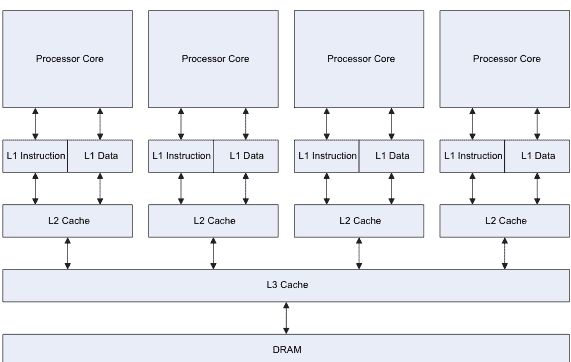

**图 1.1** 典型的现代 CPU 缓存组织。


如果数据不在一级（L1）缓存中，则需要从二级或三级（L2 或 L3）缓存中获取，或者如果没有缓存行已有此数据，则从主内存中获取。一级缓存通常以接近处理器时钟速度的速度运行，因此在执行我们的循环时，我们可能接近全处理器速度，假设我们既写缓存也读缓存。然而，这有代价。L1 缓存的大小通常只有 16 K 或 32 K。L2 缓存稍慢一些，但大得多，通常约为 256 K。L3 缓存大得多，通常为几兆字节，但又比 L2 缓存慢得多。

在实际示例中，循环迭代要大得多，可能有许多兆字节。即使程序可以保留在缓存内存中，数据集通常也不能，因此处理器尽管有所有这些缓存技巧，往往仍受限于内存吞吐量或带宽。

当处理器从缓存而不是主内存中获取指令或数据项时，这被称为缓存命中。使用越来越大的缓存带来的增量收益会迅速下降。这反过来意味着，现代处理器上越来越大的缓存是一种损失，是提高性能不太有用的手段，除非它们能够涵盖问题的*整个*数据集。

Intel i7-920 处理器拥有约 8 MB 的内部 L3 缓存。这种缓存内存不是免费的，如果我们查看 Intel i7 处理器的芯片，我们会看到芯片大约 30% 的大小专门用于 L3 缓存内存（图 1.2）。

随着缓存大小的增长，用于制造处理器的硅的物理尺寸也随之增大。芯片越大，制造成本越高，在制造过程中包含错误并被废弃的可能性也越大。有时这些有缺陷的设备会被廉价出售为三核或双核设备，并禁用有缺陷的核心。然而，更大且越来越低效的缓存的影响最终会导致最终用户成本更高。

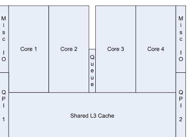

**图 1.2** i7 Nehalem 处理器在处理器芯片上的布局。

## CRAY

我们今天所知的计算革命始于 20 世纪 50 年代第一台微处理器的出现。按今天的标准，这些设备很慢，你很可能在智能手机里就拥有更强大的处理器。然而，这些设备促成了超级计算机的发展，超级计算机通常由政府、大型学术机构或公司拥有。它们比当今通用计算机强大数千倍。制造它们需要数百万美元，占用巨大空间，通常有特殊的冷却要求，并需要一支工程师团队来维护。它们消耗巨大的电力，以至于每年的运行成本往往与建造成本相当。事实上，电力是规划此类安装时的关键考虑因素之一，也是当今超级计算机增长的主要限制因素之一。

现代超级计算机的创始人之一是西摩·克雷，他的 Cray-1 于 1976 年由 Cray Research 生产。它需要成千上万根单独的电缆来连接所有东西——以至于他们过去曾雇佣女性，因为她们的手比大多数男性小，因此可以更容易地接线所有成千上万根单独的电缆。这些机器的正常运行时间（故障之间的实际运行时间）通常以小时计。让它们连续运行一整天会被视为一项巨大的成就。按今天的标准，这似乎相当落后。然而，我们今天拥有的很多东西都要归功于西摩·克雷和那个时代其他人的研究。

克雷后来以各种克雷名称生产了他那个时代一些最具突破性的超级计算机。原始 Cray-1 成本约为 880 万美元，实现了惊人的 160 MFLOPS（每秒百万次浮点运算）。当今的计算速度以 TFLOPS（每秒万亿次浮点运算）衡量，比旧的 MFLOPS 测量大一百万倍（10^12 对 10^6）。当今一张 Fermi GPU 卡的理论峰值性能超过 1 太flop。

Cray-2 是对 Cray-1 的重大改进。它采用共享内存架构，分为多个存储体。这些存储体连接到一、两个或四个处理器。它为当今基于服务器的对称多处理器（SMP）系统的创建铺平了道路，在这些系统中，多个 CPU 共享相同的内存空间。像那个时代的许多机器一样，它是一台矢量机。在矢量机中，相同的操作作用于许多操作数。这些至今仍然存在，部分体现在处理器扩展中，例如 MMX、SSE 和 AVX。GPU 设备本质上是矢量处理器，与旧的超级计算机设计有许多相似之处。

克雷还对散射和收集类型原语提供了硬件支持，我们将在后续章节中看到，这在并行计算中非常重要。

克雷至今仍在超级计算机市场上存在，并且截至 2010 年，其在橡树岭国家实验室的美洲豹超级计算机位居前 500 名（http://www.nccs.gov/computing-resources/jaguar/）。我鼓励你阅读这家伟大公司的历史，你可以在克雷的网站上找到它（http://www.cray.com），因为这能让你了解计算机的发展历程以及我们今天所处的位置。

## CONNECTION MACHINE

1982 年，一家名为 Thinking Machines 的公司提出了一种非常有趣的设计，即连接机。

这是一个相对简单的概念，推动了当今并行计算机的革命。他们反复使用少数几个简单部件。他们创建了一个 16 核 CPU，然后在一台机器中安装了约 4096 个这样的设备。这个概念不同。不是由一个快速处理器处理数据集，而是有 64 K 个处理器执行此任务。

让我们举一个简单的例子：操作 RGB（红、绿、蓝）图像的颜色。每种颜色由一个字节组成，3 个字节表示单个像素的颜色。假设我们想将蓝色级别降至零。

假设内存配置为红、蓝、绿三个存储体，而不是交错的。使用常规处理器，我们会有一个循环遍历蓝色内存，并将每个像素颜色级别减一。对每个数据项的操作相同，但每次循环迭代时，我们都要获取、解码并执行指令流。

连接机使用了一种称为 SIMD（单指令流、多数据流）的技术，该技术今天用于现代处理器，并以 SSE（流式 SIMD 扩展）、MMX（多媒体扩展）和 AVX（高级矢量扩展）等名称而闻名。其概念是定义一个数据范围，然后让处理器将该操作应用于该数据范围。然而，SSE 和 MMX 基于单个处理器核心。连接机拥有 64 K 个处理器核心，每个核心在其数据集上执行 SIMD 指令。

例如 Intel i7 这样的处理器是 64 位处理器，这意味着它们一次最多可以处理 64 位（8 字节）。SSE SIMD 指令集将其扩展到 128 位。在这样的处理器上使用 SIMD 指令时，我们消除了所有冗余的指令内存获取，与一次获取和写入 1 字节相比，产生的内存读写周期只有十六分之一。AVX 将其扩展到 256 位，使其更加有效。

对于 1920 × 1080 分辨率的高清（HD）视频图像，数据大小为 2,073,600 字节，即每个颜色平面约 2 MB。因此，对于使用 SSE/MMX 的单个常规处理器，我们会产生约 260,000 个 SIMD 周期。所谓 SIMD 周期，是指一次读取、计算和写入周期。实际处理器时钟数可能与此相当不同，具体取决于特定的处理器架构。

连接机使用了 64 K 个处理器。因此，2 MB 的帧会导致每个处理器大约 32 个 SIMD 周期。显然，这种方法远优于现代处理器的 SIMD 方法。然而，当然有一个注意事项。当从当今 CPU 的较粗线程方法转向此类机器使用的高度并行方法时，处理器之间的同步和通信成为主要问题。

## CELL PROCESSOR

超级计算机中另一项有趣的发展源于 IBM 对 Cell 处理器的发明（图 1.4）。其工作原理是让常规处理器充当监督

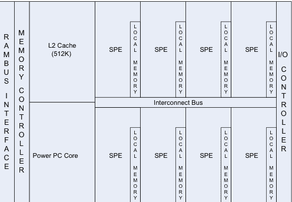

图 1.4 IBM Cell 处理器芯片布局（8 SPE 版本）。


处理器，连接到许多高速流处理器。Cell 中的常规 PowerPC (PPC) 处理器充当流处理器和外部世界的接口。流 SIMD 处理器，即 IBM 称之为 SPE 的处理器，将处理由常规处理器管理的数据集。

Cell 对我们来说是一个特别有趣的处理器，因为它的设计与 NVIDIA 后来在 G80 及后续 GPU 中使用的设计相似。索尼也将其用于其 PS3 游戏机中，游戏行业与 GPU 的主要用途非常相似。

要对 Cell 进行编程，你需要编写一个在 PowerPC 核心处理器上执行的程序。然后它会调用一个程序，使用完全不同的二进制文件，在每个流处理单元 (SPE) 上运行。每个 SPE 本身实际上是一个核心。它可以从自己的本地内存中执行独立的程序，这与旁边的 SPE 不同。此外，SPE 可以通过共享互连相互通信，也可以与 PowerPC 核心通信。然而，这种混合架构不容易编程。程序员必须显式管理八个 SPE，无论是程序还是数据，以及运行在 PowerPC 核心上的串行程序。

能够直接与协调处理器通信，就可以实现一系列简单的步骤。如前面的 RGB 示例所示，PPC 核心获取一块要处理的数据。它将这些数据分配给八个 SPE。由于我们在每个 SPE 中做同样的事情，每个 SPE 获取一个字节，将其减一，并将其位写回其本地内存。当所有 SPE 完成后，PPC 核心从每个 SPE 获取数据。然后它将其数据块（或平铺块）写入正在组装整个图像的内存区域。Cell 处理器设计为成组使用，从而重复了我们之前介绍的连接机的设计。

SPE 还可以被指令执行涉及多个步骤的流操作，因为每个 SPE 都连接到一个高速环（图 1.5）。

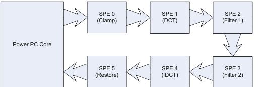

图 1.5
Cell 上流处理器路由示例。

这种流式或流水线方法的问题是它只能以最慢节点的速度运行。它反映了工厂中的生产线。整条生产线只能以最慢点的速度运行。每个 SPE（工人）只有一小组任务要执行，因此就像装配线工人一样，它可以非常快速且高效地完成这项工作。然而，就像任何其他处理器一样，存在将数据传递到下一阶段的带宽限制和开销。因此，虽然你在每个 SPE 上执行一致的程序时获得了效率，但在处理器间通信方面会损失，并最终受到最慢处理步骤的限制。这是任何基于流水线的执行模型的常见问题。

另一种方法是将所有内容放在一个 SPE 上，然后让每个 SPE 处理一小块数据，这通常是一种更高效的方法。这相当于培训所有装配线工人组装完整的小部件。对于简单任务，这很容易，但每个 SPE 对可用程序和数据内存都有限制。PowerPC 核心现在还必须从八个 SPE 传递和收集数据，而不仅仅是两个，因此主机与 SPE 之间的管理开销和通信增加了。

IBM 在其 Roadrunner 超级计算机中使用了高性能版本的 Cell 处理器，截至 2010 年，它是 TOP500 榜单上第三快的计算机。它由 12,960 个 PowerPC 核心加上总共 103,680 个流处理器组成。每个 PowerPC 板由双核 AMD (Advanced Micro Devices) Opteron 处理器监督，总共有 6912 个。Opteron 处理器在节点之间充当协调器。Roadrunner 的理论吞吐量为 1.71  PFLOPS，建造成本为 1.25 亿美元，占地 560 平方米，运行时耗电 2.35 兆瓦！

## 多节点计算

当你增加单台机器所需的资源（CPU、内存、存储空间）时，成本会迅速增加。虽然 2.6 GHz 处理器可能要 250 美元，但同一处理器的 3.4 GHz 版本可能要 1400 美元，而时钟速度仅提高不到 1 GHz。内存的速度和容量以及存储容量也存在类似关系。

不仅成本会随着计算需求的增长而增长，电力需求和相应的散热问题也是如此。只要有足够的电力和冷却供应，处理器可以达到 4–5 GHz。

在计算中，你常常会发现边际效益递减定律。单个机箱能容纳的东西是有限的。你受到成本、空间、电力和散热的限制。解决方案是选择每个方面的合理平衡，并多次复制。

集群计算在 1990 年代随着时钟速度的不断提高而变得流行。这个概念非常简单。购买或使用现成零件组装的若干台普通 PC，并将它们连接到一个现成的 8 端口、16 端口、24 端口或 32 端口以太网交换机，你就可以获得单台机器最高 32 倍的性能。与其为高性能处理器支付 1600 美元，不如支付 250 美元购买六台中等性能处理器。如果你的应用程序需要巨大的内存容量，那么在许多机器上最大化 DIMM 并将它们加在一起通常就足够了。一起使用，许多机器的总性能远远超过你用类似预算可能购买的任何单台机器。

突然间，大学、学校、办公室和计算机部门可以构建比以前强大得多的机器，并且不会因为资金不足而被排除在高速计算市场之外。当时的集群计算就像今天的 GPU 计算一样，是一项改变计算面貌的颠覆性技术。结合不断提高的单核时钟速度，它提供了一种在单核 CPU 中实现并行处理的廉价方式。

PC 集群通常运行 LINUX 的变体，每个节点通常从中央主节点获取其引导指令和操作系统 (OS)。例如，在 CUdeveloper 我们有一个小型集群，由低功耗的基于 Atom 的 PC 和嵌入式 CUDA GPU 组成。购买和设置集群非常便宜。有时它们可以简单地由一些正在被替换的旧 PC 组成，因此硬件实际上是免费的。

然而，集群计算的问题在于它的速度取决于问题所需的节点间通信量。如果你有 32 个节点，问题分解为 32 个不错的块且不需要节点间通信，那么你有一个非常适合集群的应用程序。如果每个数据点都从每个节点获取数据，那么你有一个不适合放入集群的糟糕问题。

现代 CPU 和 GPU 内部可以看到集群。回顾图 1.1。CPU 缓存层次结构。如果我们将每个 CPU 核心视为一个节点，将 L2 缓存视为 DRAM（动态随机存取存储器），将 L3 缓存视为网络交换机，并将 DRAM 视为大容量存储，那么我们就有一个微型集群（图 1.6）。

现代 GPU 内部的架构也并无不同。你有许多流式多处理器 (SM)，它们类似于 CPU 核心。这些 SM 连接到共享内存/L1 缓存。这又连接到充当 SM 间交换机的 L2 缓存。数据可以保存在全局内存存储中，然后由主机提取和使用，或者通过 PCI-E 交换机直接发送到另一个 GPU 的内存中。PCI-E 交换机比任何网络的互连快得多。

节点本身可以多次复制，如图 1.7 所示。这种在受控环境中的复制形成了一个集群。集群设计的一种演进是分布式

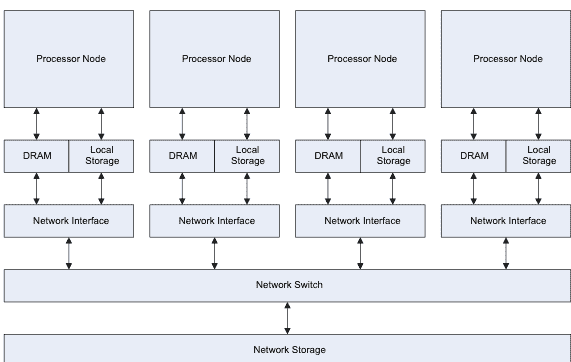

**图 1.6**
典型集群布局。

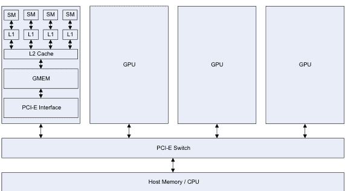

图 1.7 GPU 与集群的比较。

应用程序。分布式应用程序在许多节点上运行，每个节点可能包含许多处理元素，包括 GPU。分布式应用程序可以，但不需要，在受管理集群的受控环境中运行。它们可以将任意机器连接在一起以处理某个共同问题，BOINC 和 Folding@Home 是此类通过 Internet 连接机器的应用程序的两个最大示例。

## GPGPU 编程的早期

图形处理单元 (GPU) 是大多数现代 PC 中存在的设备。它们为 CPU 提供许多基本操作，例如在内存中渲染图像，然后将该图像显示在屏幕上。GPU 通常会处理一组复杂的多边形，即要渲染的场景图。然后它将纹理应用到多边形上，并执行着色和光照计算。NVIDIA 5000 系列显卡首次带来了光照逼真的效果，例如 2003 年的 Dawn Fairy 演示中所示。

查看 http://www.nvidia.com/object/cool_stuff.html#demos 并下载一些较旧的演示，你就会看到 GPU 在过去十年中发生了多大的变化。参见表 1.2。

重要步骤之一是可编程着色器的开发。这些实际上是 GPU 运行以计算不同效果的小程序。渲染不再固定在 GPU 中；通过可下载的着色器，它可以被操纵。这是通用计算的第一次演进-


| 演示 | 显卡 | 年份 |
| :--- | :--- | :--- |
| 黎明 | GeForce FX | 2003 |
| 黄昏 Ultra | GeForce FX | 2003 |
| 纳卢 | GeForce 6 | 2004 |
| 月球 | GeForce 7 | 2005 |
| 蛙蛙 | GeForce 8 | 2006 |
| 人头 | GeForce 8 | 2007 |
| 美杜莎 | GeForce 200 | 2008 |
| 超音速雪橇 | GeForce 400 | 2010 |
| 新曙光 | GeForce 600 | 2012 |

用于图形处理器单元（GPGPU）编程，因为该设计已迈出摆脱固定功能单元的第一步。
然而，这些着色器本质上是处理一组表示多边形映射的 3D 点的操作。着色器以大规模并行的方式将相同的操作应用于许多此类数据集，从而提供了巨大的计算吞吐量。
现在，虽然多边形是三点集，且 RGB 照片等其他一些数据集也可以用三点集表示，但许多数据集并非如此。少数勇敢的研究人员利用 GPU 技术试图加速通用计算。这促成了若干计划（例如，BrookGPU、Cg、CTM 等）的发展，所有这些计划都旨在使 GPU 成为像 CPU 一样真正的可编程设备。不幸的是，每个计划都有其自身的优点和问题。没有哪个特别容易学习或编程，也从未大规模教授给人们。简而言之，在这个难以学习的技术中，从未形成过程序员的临界质量或程序员的浓厚兴趣。它们从未成功进入大众市场，而这是 CUDA 第一次做到的事情，同时也为程序员提供了一种真正的通用 GPU 语言。

## 单核解决方案的终结

当今现代处理器的一个问题是，它们已达到约 4 GHz 的时钟频率极限。
此时，对于当前技术而言，它们产生的热量过大，需要特殊且昂贵的冷却解决方案。这是因为当我们提高时钟频率时，功耗会上升。事实上，如果固定电压，CPU 的功耗大约是其时钟频率的立方。更糟糕的是，当 CPU 产生的热量增加时，对于相同的时钟频率，由于硅的特性，功耗也会增加。将功率转换为热量是能源的完全浪费。这种日益低效的电力使用最终意味着你无法为处理器提供足够的电力或冷却，从而达到设备或其外壳的热极限，即所谓的“功耗墙”。
面对无法提高时钟频率、制造永远更快处理器的困境，处理器制造商不得不想出另一套方案。两大主要 PC 处理器制造商 Intel 和 AMD 不得不采取不同的方法。他们被迫走上在处理器中添加更多核心的道路，而不是不断尝试提高 CPU 时钟频率和/或通过指令级并行提取每个时钟更多指令。我们拥有双核、三核、四核、六核、8 核、12 核，很快甚至会有 16 核和 32 核等等。这是当今所有人（GPU 和 CPU 社区）的计算未来方向。Fermi GPU 在 CPU 术语中实际上已经是一个 16 核设备。

这种方法有一个大问题——它要求程序员从传统的串行、单线程方法转变为同时处理多个执行线程。现在程序员必须考虑两个、四个、六个或八个程序线程，以及它们如何相互交互和通信。当双核 CPU 出现时，这相当容易，因为通常有一些后台任务可以卸载到第二个核心上。当四核 CPU 出现时，并没有多少程序被修改以支持它。它们继续作为单线程应用程序销售。甚至游戏行业也没有很快转向四核编程，而这是你期望会想要从当今技术中榨取最大性能的行业。

在某种程度上，处理器制造商要为此负责，因为单核应用程序在四核设备的四分之一核心上运行良好。有些设备甚至在只有一个核心活跃时会动态提高时钟频率，鼓励程序员偷懒，不利用可用硬件。

还有经济原因。软件开发公司需要尽快将产品推向市场。开发更好的四核解决方案固然很好，但如果市场被抢先一步的竞争对手抢占，那就不太好了。由于制造商仍在继续生产单核和双核设备，市场自然趋向于最低配置，以获得最广泛的销售范围。直到四核 CPU 成为最低生产标准之前，市场力量都会阻碍 CPU 市场向多核四核编程的转变。

## NVIDIA 与 CUDA

如果你看 GPUs 和 CPUs 的相对计算能力，会得到一张有趣的图表（图 1.8）。我们开始看到 CPU 和 GPU 计算能力的分化，直到 2009 年，GPU 终于突破了 1000 吉浮点运算每秒或 1 太浮点运算每秒的障碍。此时，我们正从 G80 硬件过渡到 G200，然后在 2010 年过渡到 Fermi 演进。这是由大规模并行硬件的引入所驱动的。G80 是一个 128 个 CUDA 核心的设备，G200 是一个 256 个 CUDA 核心的设备，而 Fermi 是一个 512 个 CUDA 核心的设备。

我们看到 NVIDIA GPU 从 G200 架构到 Fermi 架构实现了 300 吉浮点运算每秒的飞跃，吞吐量提升了近 30%。相比之下，Intel 从 Core 2 架构到 Nehalem 架构的飞跃仅带来微小的改进。只有当转换到 Sandy Bridge 架构时，我们才能看到 CPU 性能的显著飞跃。这并非说一种比另一种更好，因为传统的 CPU 针对串行代码执行而设计，并且在这方面非常出色。它们包含分支预测单元、多级缓存等特殊硬件，所有这些都针对串行代码执行。GPU 并非为这种串行执行流设计，只有在完全并行利用时才能实现其峰值性能。

2007 年，NVIDIA 看到了一个机会，通过添加易于使用的编程接口将 GPU 带入主流，它将其命名为 CUDA，即 Compute Unified Device Architecture。这
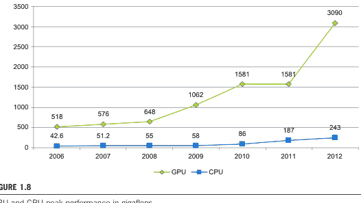
为无需学习复杂着色器语言或仅从图形原语角度思考即可编程 GPU 开辟了可能性。

CUDA 是 C 语言的扩展，允许使用常规 C 编写 GPU 代码。代码要么面向主机处理器（CPU），要么面向设备处理器（GPU）。主机处理器将多线程任务（在 CUDA 中称为内核）生成到 GPU 设备上。GPU 有自己的内部调度程序，然后将内核分配到存在的任何 GPU 硬件上。我们将在后面详细介绍调度。只要任务中有足够的并行性，随着 GPU 中 SM 数量的增加，程序速度也应随之提高。

然而，这里隐藏着一个大问题。你必须问代码中有多少百分比可以并行运行。可能的最大加速比受串行代码数量的限制。如果你拥有无限的处理能力，并且可以在零时间内完成并行任务，你仍然会剩下串行代码部分的时间。因此，我们必须从一开始就考虑是否确实可以并行化大量工作负载。

NVIDIA 致力于为 CUDA 提供支持。大量信息、示例和开发工具可从其网站 http://www.nvidia.com 的 CudaZone 获得。与它的前身不同，CUDA 现在实际上已经开始获得动力，并且第一次看起来会出现一种作为 GPU 编程首选的编程语言。考虑到 CUDA 支持的 GPU 数量现在已达到数百万，外面有一个巨大的市场在等待 CUDA 支持的应用程序。

目前有许多 CUDA 支持的应用程序，列表每月都在增长。NVIDIA 在其社区网站 http://www.nvidia.com/object/cuda_apps_flash_new.html 上展示了其中许多应用程序。

在程序需要进行大量计算工作的领域——例如，从家庭录像制作 DVD（视频转码）——我们看到大多数主流视频软件包现在都支持 CUDA。在此领域，平均加速比为 5 到 10 倍。


随着 CUDA 的推出，Tesla 系列显卡也随之而来。这些卡不是图形卡，事实上它们上没有 DVI 或 VGA 接口。它们是面向科学计算的专用计算卡。在这里，我们看到了科学计算中巨大的加速。这些卡可以安装在普通台式机 PC 中，也可以安装在专用服务器机架中。NVIDIA 在 http://www.nvidia.com/object/preconfigured_clusters.html 提供了这样的系统，声称可提供高达传统集群 30 倍的算力。CUDA 和 GPU 正在重塑高性能计算的世界。

## GPU 硬件

NVIDIA G80 系列处理器及更高版本实现了一种与 Connection Machine 和 IBM 的 Cell 处理器相似的设计。每块图形卡由若干个 SM 组成。每个 SM 连接八个或更多的 SPs（流处理器）。原始的 9800 GTX 卡有八个 SM，总共提供 128 个 SPs。然而，与 Roadrunner 不同，每块 GPU 板卡只需几百美元即可购买，且不需要 2.35 MW 来为其供电。电源考量不容忽视，我们将在后面讨论构建 GPU 服务器时再详细说明。

GPU 卡大体可被视为加速卡或协处理器卡。目前，GPU 卡必须与基于 CPU 的主机协同工作。在这方面，它遵循了与 Cell 处理器非常相似的方法，即常规串行核心和 N 个 SIMD SPE 核心。每个 GPU 设备包含一组 SM，每个 SM 包含一组 SPs 或 CUDA 核心。SPs 以最多 32 个单位的并行集合执行工作。它们消除了 CPU 上为通过指令级并行实现高速串行执行所需的大量复杂电路。它们用程序员指定的显式并行模型取代了这一点，从而允许在相同的硅面积上挤入更多的计算能力。

GPU 的整体吞吐量在很大程度上由现有 SPs 的数量、到全局内存的带宽以及程序员利用其所使用的并行架构的程度决定。有关当前 NVIDIA GPU 卡列表，请参见表 1.3。

为特定应用选择哪块板卡，取决于该应用所需内存和 GPU 处理能力之间的平衡。请注意，9800 GX2、295、590、690 和 K10 卡实际上是双卡，因此要充分利用它们，需要将其编程为两个设备而不是一个。这里需要注意的一点是，引用的数字是针对单精度（32 位）浮点性能，而不是双精度（64 位）精度。另外，要小心 GF100（Fermi）系列，因为 Tesla 变体的双精度单元数量是标准桌面设备的两倍，因此实现了显著更好的双精度吞吐量。尚未发布的 Kepler K20 也将比其已发布的 K10 亲戚具有显著更好的双精度性能。

另请注意，虽然这里未显示，但随着代际演进，每个 SM 的功耗（按时钟频率计算）已下降。然而，整体功耗已大幅增加，这是任何基于多 GPU 的解决方案中的关键考量因素之一。通常，我们看到基于双 GPU 的卡（9800 GX2、295、590、690）的功耗数值略低于等效的两块单卡，这是由于使用了共享电路和/或降低的时钟频率。

NVIDIA 提供各种机架（M 系列计算模块），包含两到四块通过共享 PCI-E 总线连接的 Tesla 卡，用于高密度计算。使用标准 PC 组件构建自己的 GPU 集群或微型超级计算机是完全可行的，我们将在本书后面向您展示如何做到这一点。

| GPU 系列 | 设备 | SP 数量 | 最大内存 | GFlops (FMAD) | 带宽 (GB/s) | 功率 (瓦特) |
| :--- | :--- | :--- | :--- | :--- | :--- | :--- |
| 9800 GT | G92 | 96 | 2GB | 504 | 57 | 125 |
| 9800 GTX | G92 | 128 | 2GB | 648 | 70 | 140 |
| 9800 GX2 | G92 | 256 | 1GB | 1152 | 2 x 64 | 197 |
| 260 | G200 | 216 | 2GB | 804 | 110 | 182 |
| 285 | G200 | 240 | 2GB | 1062 | 159 | 204 |
| 295 | G200 | 480 | 1.8GB | 1788 | 2 x 110 | 289 |
| 470 | GF100 | 448 | 1.2GB | 1088 | 134 | 215 |
| 480 | GF100 | 448 | 1.5GB | 1344 | 177 | 250 |
| 580 | GF110 | 512 | 1.5GB | 1581 | 152 | 244 |
| 590 | GF110 | 1024 | 3GB | 2488 | 2 x 164 | 365 |
| 680 | GK104 | 1536 | 2GB | 3090 | 192 | 195 |
| 690 | GK104 | 3072 | 4GB | 5620 | 2 x 192 | 300 |
| Tesla C870 | G80 | 128 | 1.5GB | 518 | 77 | 171 |
| C1060 | G200 | 240 | 4GB | 933 | 102 | 188 |
| Tesla C2070 | GF100 | 448 | 6GB | 1288 | 144 | 247 |
| Tesla K10 | GK104 | 3072 | 8GB | 5184 | 2 x 160 | 250 |

CUDA 的一大优点是，尽管硬件存在诸多差异，但为原始 CUDA 设备编写的程序可以在当今的 CUDA 设备上运行。CUDA 编译模型采用与 Java 相同的原则——对虚拟指令集进行运行时编译。这使得现代 GPU 可以执行甚至最老一代 GPU 的代码。在许多情况下，它们会从原始程序员为较新 GPU 的特性重新编写程序中获益显著。事实上，针对各种硬件修订版进行调优的空间很大，我们将在书末部分介绍这一点。

## CUDA 的替代方案

### OpenCL

那么其他 GPU 厂商呢，以 ATI（现为 AMD）为例？AMD 的产品系列在原始计算能力方面与 NVIDIA 系列同样令人印象深刻。然而，AMD 将其流计算技术推向市场的时间比 NVIDIA 推出 CUDA 晚了很久。因此，NVIDIA 可用的 CUDA 应用程序远多于 AMD/ATI 为其竞争性流技术提供的应用程序。

OpenCL 和 DirectCompute 不在本书讨论范围内，但作为 CUDA 的替代方案值得一提。CUDA 目前仅在 NVIDIA 硬件上正式可执行。尽管 NVIDIA 占据了 GPU 市场的相当大份额，但其竞争对手也占据了相当大的份额。作为开发者，我们希望为尽可能大的市场开发产品，尤其是在谈论消费市场时。因此，人们应该意识到存在 CUDA 的替代方案，这些方案同时支持 NVIDIA 和其他厂商的硬件。

OpenCL 是一个由 NVIDIA、AMD 和其他厂商支持的开放且免版税的标准。OpenCL 商标由 Apple 拥有。它制定了一项开放标准，允许使用计算设备。计算设备可以是 GPU、CPU 或其他存在 OpenCL 驱动程序的专用设备。截至 2012 年，OpenCL 支持所有主要品牌的 GPU 设备，包括至少支持 SSE3 的 CPU。

任何熟悉 CUDA 的人都可以相对容易地上手 OpenCL，因为基本概念非常相似。然而，OpenCL 的使用比 CUDA 稍微复杂一些，因为 CUDA 运行时 API 为程序员完成的许多工作在 OpenCL 中需要显式执行。您可以在 http://www.khronos.org/opencl/ 上阅读更多关于 OpenCL 的内容。目前也有不少关于 OpenCL 的书籍。我个人建议先学习 CUDA 再学习 OpenCL，因为 CUDA 相对 OpenCL 来说更像是一种更高级的语言扩展。

### DirectCompute

DirectCompute 是 Microsoft 对 CUDA 和 OpenCL 的替代方案。它是一款与 Windows 操作系统（尤其是 DirectX 11 API）相关联的专有产品。对于任何记得在 DirectX 出现之前编程显卡的人来说，DirectX API 是一个巨大的飞跃。这意味着开发者只需学习一个库 API 即可编程所有图形卡，而无需为每个主要显卡制造商编写或授权驱动程序。

DirectX 11 是最新标准，并在 Windows 7 下受支持。有 Microsoft 的名字作为背书，您可能会期望在开发者社区中看到相当快速的采用。这尤其适用于已经熟悉 DirectX API 的开发者。如果您熟悉 CUDA 和 DirectCompute，那么将 CUDA 应用程序移植到 DirectCompute 是一项相当容易的任务。根据 Microsoft 的说法，如果您同时熟悉两个系统，通常可以在一个下午内完成这项工作。然而，由于其以 Windows 为中心，我们将在许多高端系统中排除 DirectCompute，因为这些系统中各种 UNIX 版本占据主导地位。

Microsoft 还即将推出 C++ AMP，这是一组额外的标准模板库（STL），可能更吸引已经熟悉 C++ 风格 STL 的程序员。

### CPU 替代方案

如果您为 Linux 开发，主要的并行处理语言扩展是 MPI、OpenMP 和 pthreads。对于 Windows，则有 Windows 线程模型和 OpenMP。MPI 和 pthreads 作为来自 Unix 世界的各种移植版本受到支持。


MPI（消息传递接口）或许是最广为人知的消息传递接口。它基于进程，通常出现在大型计算实验室中。它需要管理员正确配置安装，最适合受控环境。并行性通过在节点集群上生成数百个进程并显式交换消息来表达，通常通过高速网络通信链路（以太网或 InfiniBand）进行。MPI 广泛使用和教授。它是在受控集群环境中的一个良好解决方案。

**OpenMP**（Open 多处理）是专为节点或计算机系统内并行性设计的系统。它的工作方式完全不同：程序员通过编译器 pragma 指定各种并行指令。然后编译器会尝试根据可用处理器核心的数量，自动将问题拆分为 N 个部分。许多编译器（包括用于 CUDA 的 NVCC 编译器）都内置了对 OpenMP 的支持。由于底层 CPU 架构的原因，OpenMP 在扩展性方面往往会遇到问题。通常，CPU 中的内存带宽不足以支持所有核心持续地向内存或从内存流式传输数据。

**Pthreads** 是一个在 Linux 上广泛用于多线程应用程序的库。与 OpenMP 类似，pthreads 使用线程而不是进程，因为它专为单个节点内的并行性而设计。然而，与 OpenMP 不同，程序员负责线程管理和同步。这为编写良好的程序提供了更大的灵活性，从而获得更好的性能。

**ZeroMQ**（0MQ）也是值得一提的内容。这是一个你可以链接的简单库，我们将在本书后面用它来开发多节点、多 GPU 示例。ZeroMQ 支持基于线程、进程和网络的通信模型，只需一个跨平台 API。它在 Linux 和 Windows 平台上均可用。它专为分布式计算设计，因此连接是动态的，节点故障处理优雅。

**Hadoop** 也是你可以考虑的内容。Hadoop 是 Google MapReduce 框架的开源版本。它主要面向 Linux 平台。其概念是：你取一个巨大的数据集，将其拆分（或映射）为若干块。然而，与将数据发送到节点不同，数据集已使用并行文件系统分布在数百或数千个节点上。因此，程序（即 reduce 步骤）被发送到包含数据的节点，而不是反过来。输出写入本地节点并保留在那里。后续的 MapReduce 程序获取之前的输出，并以某种方式再次对其进行转换。由于数据实际上被镜像到多个节点，这使得系统具有高度容错性和高吞吐量。

## 指令和库

有许多编译器供应商，其中 PGI、CAPS 和 Cray 最为知名，它们支持最近宣布的用于 GPU 的 OpenACC 编译器指令集。本质上，这些指令复制了 OpenMP 的方法，即程序员插入许多编译器指令，将区域标记为“在 GPU 上执行”。然后编译器完成移动数据到或从 GPU、调用内核等繁重工作。

与使用 pthreads 而非 OpenMP 类似，利用 pthreads 提供的较低控制级别，可以获得更高的性能。CUDA 与 OpenACC 之间也是如此。这种额外的控制级别伴随着更高的所需编程知识水平、更高的出错风险，以及可能对开发进度产生的相应时间影响。目前，OpenACC 需要指令来指定代码的哪些区域应在 GPU 上运行，还需要指定数据应存在于哪种类型的内存中。NVIDIA 声称，使用此类指令可以获得 5 倍以上的加速比。这对于需要快速让程序运行起来的程序员来说是一个不错的解决方案。对于那些将编程视为次要考量、只希望在合理时间内得到问题答案的人来说，这也非常棒。

使用库也是另一个关键领域，你可以在此获得显著的生产力提升，以及执行时间加速。像 SDK 这样的库提供了 Thrust，它以非常高效的方式提供常用函数。像 CUBLAS 这样的库是目前最好的线性代数库之一。许多知名应用程序（如 Matlab 和 Mathematica）都有可用的库。Python、Perl、Java 等语言都有语言绑定。CUDA 甚至可以与 Excel 集成。

与现代软件开发的许多方面一样，很可能有人已经完成了你即将开发的内容。在花几周时间开发一个库之前，请先搜索互联网，看看已经有什么可用的库，因为除非你是 CUDA 专家，否则你开发的库不太可能比已有的库更快。

## 结论

也许你在想，为什么要用 CUDA 进行开发？答案是，就支持、调试工具和驱动程序而言，CUDA 目前是开发起来最容易的语言。CUDA 在其他所有方面都占据先机，并在成熟度方面拥有巨大的领先优势。如果你的应用程序需要支持 NVIDIA 以外的硬件，那么目前最佳路径是在 CUDA 下开发，然后将应用程序移植到其他 API 之一。因此，我们将专注于 CUDA，因为如果你精通 CUDA，那么在需要时很容易掌握替代 API。了解 CUDA 的工作原理将使你能够更好地利用并理解任何高级别 API 的局限性。

从单线程 CPU 程序员到 GPU 上的成熟并行程序员，这一旅程希望你会觉得有趣。即使你将来从不编程 GPU，你获得的洞察力也将对你设计多线程程序大有帮助。如果你和我们一样，看到世界正在转向并行编程模型，你就会希望站在这场创新和技术挑战浪潮的最前沿。单线程行业正在缓慢走向淘汰。要成为有价值的人才和受雇佣的个人，你需要拥有反映计算世界发展方向的技能，而不是那些正在逐渐过时的技能。

GPU 正在改变计算的面貌。突然间，十年前超级计算机的计算能力就可以放在你的桌子下面。你不再需要排队提交工作批次，并等待数月让委员会批准你在资源紧张的计算设施中使用有限计算资源的请求。你可以出去花费高达 5000-10,000 美元，就在你的桌面上拥有一台超级计算机，或者一台运行 CUDA 的开发机器，其成本仅为其一小部分。GPU 是一种颠覆性的技术变革，将使超级计算机级别的性能为人人所用。

本页故意留空

## 使用 GPU 理解并行性

### 简介

本章旨在介绍并行编程的概念及其与 GPU 技术的关系。本章主要面向具有串行编程背景但对并行处理概念不熟悉的读者。我们将在 GPU 为主要背景的语境下探讨这些概念。

### 传统串行代码

大量程序员毕业时，串行程序主导了整个领域，而并行编程只吸引了少数爱好者。大多数上大学的人获得与 IT 相关的学位，是因为他们对技术感兴趣。然而，他们也意识到需要一份薪水合理的工作或职业。因此，在选择专业方向时，至少会考虑毕业后职位的可用性。除了研究或学术岗位外，并行编程的商业角色数量一直很少，至多是少数。大多数程序员以简单的串行方式开发应用程序，这大致基于大学教他们的编程方式，而这反过来又是由市场需求驱动的。

并行编程的格局十分分散，有许多技术和语言从未真正进入主流。并行硬件从来没有真正的大规模市场需求，因此也就没有大量的并行程序员。每隔一两年，各种 CPU 厂商就会推出比上一代执行代码更快的新一代处理器，从而延续了串行代码的使用。

相比之下，并行程序通常与硬件紧密相关。其目标是实现更快的性能，而这往往以牺牲可移植性为代价。功能 X 的实现方式不同，或者在下一代并行硬件中不可用。定期会出现革命性的新架构，需要重写所有代码。如果你作为程序员的知识集中在处理器 X 上，那么只有在处理器 X 使用期间，你的知识才有市场价值。因此，学习编程 x86 类型架构比学习某种只会存在几年的奇特并行架构更有商业意义。


然而，在此期间，确实演变出了一些我们至今仍在使用的标准。OpenMP 标准针对单个节点内的并行性，专为包含多核处理器的共享内存机器设计。它没有任何超出单个节点或机箱的概念。因此，在处理能力、内存容量和存储空间方面，你只能处理适合单个机箱的问题。然而，编程相对容易，因为大部分低级线程代码（否则将使用 Windows 线程或 POSIX 线程编写）都由 OpenMP 为你处理。

MPI（消息传递接口）标准针对节点间的并行性，面向明确定义网络中的机器集群。它常用于超级计算机安装中，那里可能有成千上万个独立节点。每个节点保存问题的一小部分。因此，常见资源（CPU、缓存、内存、存储等）会乘以网络中的节点数量。任何网络的阿喀琉斯之踵都是各种互连，即连接网络机器的部分。节点间通信通常是决定任何基于集群的解决方案最大速度的主导因素。

OpenMP 和 MPI 可以一起使用，以利用节点内部以及机器网络之间的并行性。然而，所使用的 API 和方法完全不同，这意味着它们通常不会一起使用。OpenMP 指令允许程序员通过指定并行区域来从高层次视角看待并行性。相比之下，MPI 使用显式的进程间通信模型，迫使程序员做更多工作。

投入时间熟悉一个 API 后，程序员通常不愿学习另一个。因此，适合单台计算机的问题通常使用 OpenMP 解决方案实现，而非常大的问题则使用基于集群的解决方案（如 MPI）实现。

CUDA（我们将在本文中探讨的 GPU 编程语言）可以与 OpenMP 和 MPI 结合使用。还有一个类似 OpenMP 的指令版本的 CUDA（OpenACC），对于熟悉 OpenMP 的人来说可能更容易上手。OpenMP、MPI 和 CUDA 在许多大学计算机课程中越来越多地在本科和研究生阶段教授。

然而，大多数串行程序员首次接触并行编程的经历是多核 CPU 的引入。这些 CPU 与之前的并行环境一样，除了少数爱好者外，大多被忽视了。多核 CPU 的主要用途是基于操作系统的并行性。这是一种基于任务并行性的模型，我们稍后将介绍。

随着技术朝着多核方向发展变得显而易见，越来越多的程序员开始关注多核时代。如今几乎所有台式机都配备双核或四核处理器。因此，程序员开始使用线程，以便利用 CPU 上的多个核心。

线程是程序中独立的执行流，可以根据需要与主执行流分离和汇合。通常，CPU 程序中活跃的线程数量不会超过物理处理器核心数量的两倍。与单核处理器一样，通常每个操作系统任务都会被时间片轮转，依次分配少量时间，以营造运行的任务多于物理 CPU 核心数量的假象。

然而，随着线程数量的增加，这对最终用户来说变得更加明显。在后台，操作系统每次需要在任务之间切换时都必须进行上下文切换（交换一组寄存器）。由于上下文切换是一项昂贵的操作，通常需要数千个周期，与 GPU 相比，CPU 应用程序的线程数量往往相当低。

## 串行/并行问题

线程带来了许多并行编程的问题，例如共享资源。通常，这是通过信号量来完成的，信号量只是一个锁或令牌。持有令牌的人可以使用资源，其他人必须等待令牌持有者释放它。只要只有一个令牌，一切就能正常工作。

当有两个或多个令牌必须由相同的线程共享时，就会出现问题。在这种情况下，线程 0 抢占令牌 0，而线程 1 抢占令牌 1。线程 0 现在试图抢占令牌 1，而线程 1 试图抢占令牌 0。由于令牌不可用，线程 0 和线程 1 都会休眠，直到令牌可用。由于两个线程都不会释放它们已经拥有的那个令牌，所有线程都会永远等待。这被称为死锁，如果没有适当的设计，这种情况可能并且肯定会发生。

相反的情况也会发生——资源被偶然共享。在任何锁定系统中，资源的所有各方都必须正确行为。也就是说，它们必须请求令牌，在必要时等待，并且只有在拥有令牌时才执行操作。这依赖于程序员识别共享资源，并专门建立机制来协调多个线程的更新。然而，任何给定的团队中通常都有几个程序员。如果其中一人不遵循此约定，或者根本不知道这是共享资源，你可能看起来有一个可工作的程序，但那只是偶然。

我为一家大公司参与的一个项目就恰好存在这个问题。所有线程都请求锁、等待并更新共享资源。一切运行正常，特定代码通过了质量保证和所有测试。然而，在实际使用中，偶尔会有用户报告某个字段的值被重置为 0，看似是随机的。随机错误总是很难追踪，因为能够持续重现问题通常是追踪错误的起点。

恰好在该公司工作的一名实习生实际上发现了这个问题。在代码中完全不相关的部分，一个指针在某些条件下未被初始化。由于程序的运行方式，有时，取决于线程执行顺序，指针会指向我们的受保护数据。然后，其他代码会通过向指针写入 0 来初始化“其变量”，从而擦除我们“受保护”的线程共享参数的内容。

这是基于线程操作的不幸领域之一；它们在共享内存空间中运行。这既是优势（无需通过消息正式交换数据），也是劣势（共享数据缺乏保护）。

线程的替代方案是进程。进程在操作系统负载方面稍重一些，因为操作系统必须维护代码和数据上下文。相比之下，线程只需维护代码上下文（程序/指令计数器加上一组寄存器）并共享相同的数据空间。线程和进程在任何时刻都可能执行程序中完全不同的部分。

进程默认在独立内存区域中运行。这通常足以确保一个进程无法影响其他进程的数据。因此，野指针问题应导致越界内存访问异常，或者至少将错误定位到特定进程。因此，数据必须通过正式向进程传递消息或从进程接收消息来传输。

在许多方面，线程模型与 OpenMP 很契合，而进程模型与 MPI 很契合。就 GPU 而言，它们映射到两种方法的混合体。CUDA 使用块网格。这可以被视为进程（块）的队列（或网格），没有进程间通信。在每个块中，有许多线程以称为 warp 的批次协作运行。

我们将在即将到来的章节中进一步探讨这一点。

## 并发性

并发性的第一个方面是思考特定问题，不考虑任何实现，并考虑其哪些方面可以并行运行。

如果可能，尝试思考一个公式，将每个输出点表示为输入数据的某个函数。

对于某些算法（例如，迭代大量步骤的算法），这可能过于繁琐。对于这些算法，请单独考虑每个步骤或迭代。该步骤的数据点能否表示为输入数据集的转换？如果是，那么你只有一组按顺序运行的内核（步骤）。这些可以简单地推入硬件将按顺序调度的队列（或流）中。

大量问题被称为“尴尬地并行”，这个术语有点低估了所取得的成就。如果你能构建一个公式，其中输出数据点可以彼此无关地表示——例如，矩阵乘法——那就非常高兴吧。这类问题可以在 GPU 上极好地实现，并且易于编码。

如果你或算法的多个步骤可以以这种方式表示，但也许有一个阶段不能，也请非常高兴。这个单一阶段可能会成为瓶颈，可能需要一些思考，但问题的其余部分通常在 GPU 上编码起来相当容易。

如果问题要求每个数据点都知道其周围邻居的值，那么加速度最终将受到限制。在这种情况下，向问题投入更多处理器在一定程度上有效。此时，由于处理器（或线程）花费更多时间共享数据而非做有用工作，计算速度会减慢。你遇到这一点的时刻很大程度上取决于通信开销的数量和成本。

CUDA 非常适合尴尬地并行的问题，其中几乎不需要或不需要线程间或块间通信。它支持使用片上资源的显式原语进行线程间通信。然而，块间通信仅通过串行调用多个内核来支持，在运行于片外全局内存上的内核之间进行通信。它也可以通过向全局内存或从全局内存进行原子操作以某种受限的方式执行。

CUDA 将问题分割为块网格，每个块包含多个线程。块可以按任何顺序运行。在任何给定时间，只有部分块会执行。一个块必须从开始执行到完成，并可以在 N 个 SM（对称多处理器）中的一个上运行。块从块网格分配给任何有空闲槽位的 SM。最初，这是以循环方式完成的，因此每个 SM 都能获得均匀的块分布。对于大多数内核，块的数量需要是 GPU 上物理 SM 数量的八倍或更多。

为了用军事类比，我们有一支士兵（线程）的军队（网格）。军队被分成若干个单位（块），每个单位由一名中尉指挥。单位被分成每组 32 名士兵（warp）的小队，每个小队由一名军士指挥（参见图 2.1）。


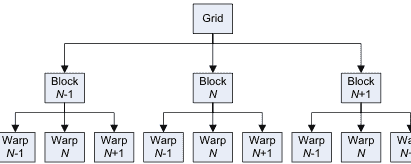

图 2.1 基于 GPU 的线程视图。

要执行某个操作，中央指挥（内核/主机程序）必须提供某个操作加上一些数据。每个士兵（线程）负责处理问题的各自部分。线程可能会不时在军士（warp）或中尉（block）的协调下相互交换数据。但是，与其他单元（block）的任何协调都必须由中央指挥（内核/主机程序）来执行。

因此，在思考 CUDA 程序如何实现并发时，有必要以这种非常层级化的方式来思考编排成千上万个线程。起初这可能听起来相当复杂。但是，对于大多数尴尬并行程序来说，只需考虑一个线程生成一个输出数据点即可。典型的 GPU 大约有 24 K 个活跃线程。在 Fermi GPU 上，您总共可以定义 65,535 x 65,535 x 1536 个线程，其中 24 K 个在任何时候都是活跃的。这通常足以覆盖单个节点中的大多数问题。

## 局部性

在过去十年左右，计算已从受限于处理器计算吞吐量，转变为以数据移动为主要限制因素。在从处理器芯片面积角度设计处理器时，计算单元（或 ALU）——算术逻辑单元——成本低廉。它们可以高速运行，且耗电量和物理磁盘空间占用都很小。但是，没有操作数，ALU 几乎没什么用。将操作数移动到这些功能单元及从中移出，会消耗大量电力和时间。

在现代计算机设计中，这通过使用多级缓存来解决。缓存的工作原理是基于空间（地址空间上接近）或时间（时间上接近）局部性。因此，之前被访问过的数据很可能会再次被访问（时间局部性），而与最近被访问的数据相近的数据未来也很可能会被访问（空间局部性）。

缓存在任务多次重复的情况下效果良好。暂且考虑一个技工，一名拥有可容纳四件工具的工具箱（缓存）的水管工。他将要处理的许多工作类似，因此同样的四种工具会被反复使用（缓存命中）。

但是，大量工作需要额外的工具。如果技工事先不知道工作内容，他就会到达现场并开始工作。在工作进行到一半时，他需要一件额外的工具。由于该工具不在他的工具箱（L1 缓存）中，他会从货车（L2 缓存）中取出该物品。

偶尔他需要一种特殊工具或零件，必须离开工作，开车去当地五金店（全局内存），取回所需物品并返回。技工和客户都不知道此操作实际需要多长时间（延迟）。高速公路上可能会有拥堵，五金店可能会有排队（其他进程争夺主内存访问权）。

显然，这并不是技工时间的非常高效利用。每次需要不同的工具或零件时，都需要技工从货车或五金店取回。在取回新工具期间，技工并没有处理手头的问题。

虽然这听起来可能不太好，但从硬盘或固态硬盘（SSD）获取数据类似于在五金店订购物品。从比较的角度来看，硬盘的数据会通过普通快递在数天后到达。SSD 的数据可能通过隔夜快递到达，但与访问全局内存中的数据相比，它仍然非常慢。

在一些较新的处理器设计中，我们有硬件线程。某些 Intel 处理器支持超线程，每个 CPU 核心有两个硬件线程。为了保持同样的类比，这相当于技工有一名助手并开始两项工作。每次需要新工具/零件时，会派助手去取回新工具/零件，而技工则切换到另一项工作。只要助手能在另一项工作也需要额外工具/零件之前带回所需工具/零件，技工就能继续工作。

虽然这是一种改进，但这并未解决延迟问题——即从五金店（全局内存）获取新工具/零件需要多长时间。访问全局内存的典型延迟在数百个时钟周期的量级。越来越多地，传统处理器设计对此问题的答案是增大缓存的容量。实际上，就是带一辆更大的货车，这样就不需要那么多次去五金店了。

然而，这种方法的成本越来越高，无论是更大货车的资本支出，还是在更大的货车中搜索工具/零件所需的时间。因此，当今大多数设计采用的方法是带一辆货车（L2 缓存）和一辆卡车（L3 缓存）。在服务器处理器的极端情况下，会调入一辆巨大的 18 轮卡车，试图确保技工能多忙一会儿。

所有这些工作都是必要的，原因只有一个。CPU 的设计目标是运行无需程序员关心局部性的软件。无论处理器是否试图向程序员隐藏局部性问题，局部性始终是一个问题。否认这是一个问题，正是导致需要大量硬件来处理内存延迟的原因。

GPU 的设计采用了不同的方法。它让 GPU 程序员负责处理局部性问题，并且不给他或她一辆 18 轮卡车，而是给他或她若干辆小货车和非常多的技工。

因此，首先程序员必须处理局部性问题。他或她需要提前考虑给定工作需要哪些工具/零件（内存位置/数据结构）。然后需要在一次去五金店（全局内存）的行程中收集这些内容，并在一开始就将其放置在给定工作的正确货车（片上内存）中。鉴于这些数据已被收集，需要尽可能多地使用这些数据执行工作，以避免去取再返回，仅仅为了以后再次取回用于其他目的。

因此，不断重复的“工作-等待-从全局内存获取、工作-等待-从全局内存获取”等循环被打破了。我们可以在生产线上看到同样的类比。工人会获得一篮子零件进行处理，而不是每个工人单独从商店经理的桌子上一次取一个零件。否则，这只是对可用工人时间的极其低效利用。

这种简单的提前规划过程允许程序员在需要之前将内存加载调度到片上内存中。这既适用于显式本地内存模型（例如 GPU 的共享内存），也适用于基于 CPU 的缓存。在共享内存的情况下，你告诉内存管理单元请求这些数据，然后去处理另一块数据上的有用工作。在缓存的情况下，你可以使用特殊的缓存指令，允许用程序预期稍后会用到的数据预填充缓存。

缓存方法相对于共享内存方法的缺点是驱逐和脏数据。如果缓存中的数据已被程序写入，则称为脏数据。为了为缓存中的新有用数据腾出空间，脏数据必须在缓存空间再次使用之前写回全局内存。这意味着，我们现在有两次前往全局内存的行程——一次写回旧数据，一次获取新数据——而不是一次未知延迟的全局内存行程。

程序员控制的片上内存的巨大优势在于，程序员控制写入发生的时间。如果你正在对数据进行某些本地转换，可能不需要将中间转换结果写回全局内存。使用缓存时，缓存控制器不知道需要写入什么、可以丢弃什么。因此，它会写入所有内容，可能会产生大量无用的内存流量，进而可能导致内存接口上的不必要拥塞。

虽然许多算法可以，但并非每个算法都适合这种程序员可以针对性优化的“预先已知”内存模式。同时，并非每个程序员都想处理局部性问题，无论是最初还是有时根本不想处理。先开发程序、验证概念，再处理局部性问题，这是一种完全合理的方法。

为了便于这种方法并处理那些没有明确定义的数据/执行模式的算法的问题，后续几代 GPU（计算能力 2.x 及以后）同时配备了 L1 和 L2 缓存。这些缓存可以配置为偏向缓存或共享内存，让程序员有灵活性为给定问题配置硬件。

## 并行类型

### 基于任务的并行

如果观察典型的操作系统，会发现它利用一种称为任务并行的并行类型。进程各异且互不相关。用户可能正在网站上阅读文章，同时在后台从音乐库播放音乐。通过在不同核心上运行每个应用程序，可以利用多个 CPU 核心。

在并行编程方面，可以通过将程序编写为若干部分来利用这一点，这些部分通过消息将信息从一个应用程序“管道”（传输）到另一个应用程序。Linux 管道操作符（“|”符号）通过操作系统正是这样做的。一个程序（例如 grep）的输出是下一个程序（例如 sort）的输入。因此，可以轻松扫描一组输入文件以查找某组字符（grep 程序），然后对该输出集进行排序（sort 程序）。每个程序都可以调度到单独的 CPU 核心。

这种并行模式称为流水线并行。一个程序的输出为下一个程序提供输入。借助一组多样化的组件，例如 Linux 中的各种基于文本的工具，用户可以执行大量有用的功能。由于程序员无法事先了解每个人的需求，通过提供可以协同工作且易于连接的组件，程序员可以面向非常广泛且多样化的用户群。


这种并行性非常侧重于粗粒度并行性。也就是说，有许多强大的处理器，每个处理器都可以执行相当大的一块工作。

就GPU而言，我们只在GPU卡和GPU内核的执行层面看到粗粒度并行性。GPU以两种方式支持流水线并行模式。首先，内核可以被推入单个流，并分别并发执行多个流。其次，多个GPU可以通过主机传递数据或通过PCI-E总线直接相互传递消息来直接协同工作。后一种方法，即点对点（P2P）机制，是在CUDA 4.x SDK中引入的，并需要一定的操作系统/硬件/驱动程序级支持。

基于流水线模式的一个问题是，像任何生产线一样，它只能以最慢组件的速度运行。因此，如果流水线由五个元素组成，每个元素耗时一秒，我们可以每秒产生一个输出。然而，如果其中仅有一个元素耗时两秒，整个流水线的吞吐量将降低到每两秒一个输出。

解决这个问题的方法有两种。让我们暂时考虑一下生产线的类比。Fred的工位耗时两秒，因为他的任务很复杂。如果我们给Fred配备一名助手Tim，并与Tim平分他的任务，我们就回到了每个阶段一秒钟。我们现在有六个阶段而不是五个，但流水线的吞吐量现在又回到了每秒一个工件。

只要在设计上稍加思考和谨慎，就可以将多达四个GPU放入台式机PC中（参见关于设计GPU系统的第11章）。因此，如果我们只有一个GPU，而处理某个特定工作流耗时过长，我们可以简单地再添加一个GPU，从而提高节点的整体处理能力。然而，我们随后需要考虑两个GPU之间的工作分配。可能无法轻松实现50/50的分配。如果我们只能提取出70/30的分配，那么显然最大收益将是现有运行时间的7/10（70%）。如果我们可以引入另一个GPU，然后也许再移动另一个占用约20%时间的任务，我们最终会得到50/30/20的分配。与单个GPU相比，加速比再次为1/2，即原始时间的50%。我们仍然面临最坏情况时间主导整体执行时间的问题。

在使用单个CPU/GPU组合时实现加速也存在同样的问题。如果我们将80%的工作从CPU卸载到GPU，而GPU仅用原始时间的10%来完成此计算，那么加速比是多少？嗯，CPU现在耗时原始时间的20%，GPU耗时原始时间的10%，但两者是并行的。因此，主导因素仍然是CPU。由于GPU并行运行且消耗的时间少于CPU所占的时间比例，我们可以完全忽略这部分时间。因此，最大加速比是1除以程序中执行时间最长的部分所占的比例。

这被称为Amdahl定律，常被引用为任何加速的限制因素。它让你在编写一行代码之前就知道可实现的最大加速比。最终，你会有串行操作。即使将所有内容都移到GPU上，你仍然需要使用CPU从存储设备加载和存储数据。你还需要将数据传入和传出GPU，以便进行输入和输出（I/O）。因此，最大理论加速比由执行计算/算法部分的程序比例加上剩余的串行比例决定。

### 基于数据的并行性

在过去几十年中，计算能力大幅提升。我们现在拥有万亿次浮点运算能力的GPU。然而，没有跟上这种计算能力演进的是数据访问时间。基于数据的并行性的理念是：不再专注于需要执行哪些任务，而是首先关注数据及其需要如何转换。

基于任务的并行性更倾向于与粗粒度并行方法相契合。让我们举个例子：对四个独立、无关且大小相似的数组执行四种不同的转换。我们有四个CPU核心和一个具有四个SM的GPU。在基于任务的问题分解中，我们会将一个数组分配给每个CPU核心或GPU中的每个SM。问题的并行分解是由对任务或转换的思考驱动的，而不是由数据驱动的。

在CPU端，我们可以创建四个线程或进程来实现这一点。在GPU端，我们需要使用四个块，并将每个数组的地址传递给每个块。在较新的Fermi和Kepler设备上，我们还可以创建四个独立的内核，每个内核处理一个数组并并发运行。

基于数据的分解则会将第一个数组分成四个块，并将数组的每个部分分配给一个CPU核心或一个GPU SM。完成后，剩余的三个数组将以类似的方式处理。就GPU实现而言，这将是四个内核，每个内核包含四个或更多块。这里的并行分解是由首先考虑数据、其次考虑转换驱动的。

由于我们的CPU只有四个核心，将数据分解为四个块非常合理。我们可以让线程0处理元素0，线程1处理元素1，线程2处理元素2，线程3处理元素3，以此类推。或者，数组可以分成四个部分，每个线程开始处理其数组部分。

在第一种情况下，线程0获取元素0。由于CPU包含多级缓存，这将数据带入设备。通常，L3缓存由所有核心共享。因此，第一次获取的内存访问会分布到CPU的所有核心。相比之下，在第二种情况下，需要四次独立的内存获取，并利用四条独立的L3缓存行。后一种方法在CPU核心需要将数据写回内存时通常更好。按核心交错数据元素意味着缓存必须协调并合并来自不同核心的写入，这通常是个坏主意。

如果算法允许，我们可以利用一种特定的数据并行性，即SIMD（单指令流、多数据流）模型。这将使用许多基于x86的CPU中存在的特殊SIMD指令，如MMX、SSE、AVX等。因此，线程0实际上可以获取多个相邻元素，并用一条SIMD指令呈现它们。

如果我们在GPU上考虑同样的问题，每个数组都需要执行单独的转换。这自然映射为一种转换等同于一个GPU内核（或程序）。每个SM（与CPU核心不同）都设计为运行多个数据块，每个块再分成多个线程。因此，我们需要进一步的分解层级才能高效使用GPU。我们通常会（至少最初）分配块和线程的组合，使得单个线程处理单个数据元素。与CPU一样，每个线程处理多个元素也有好处。在GPU上这有些受限，因为仅支持显式的load/store/move SIMD原语，但这反过来允许增强的指令级并行性（ILP），我们稍后会看到这实际上非常有益。

使用Fermi和Kepler GPU时，我们有一个共享的L2缓存，它复制了CPU上的L3缓存功能。因此，与CPU一样，一个线程的内存获取可以直接从缓存分发到其他线程。在旧硬件上，没有缓存。然而，在GPU上，相邻的内存位置会由硬件合并（coalesced）在一起，从而产生单次且更高效的内存获取。我们将在关于内存的第6章中详细探讨这一点。

GPU和CPU之间的一个重要区别是缓存一致性。在缓存一致性系统中，对内存位置的写入需要通知所有级别的缓存


在所有核心中。因此，所有处理器核心在任何时间点都看到相同的内存视图。这是限制处理器核心数量的关键因素之一。随着处理器核心数量增加，通信在时间开销上变得越来越昂贵。在缓存一致性系统中，最坏的情况是每个核心都写入相邻的内存位置，因为每次写入都会强制对每个核心的缓存进行全局更新。

相比之下，非缓存一致性系统不会自动更新其他核心的缓存。它依赖程序员将每个处理器核心的输出写入独立的区域/地址。这支持这样一种程序视图：单个核心负责单个或一小组输出。CPU 遵循缓存一致性方法，而 GPU 不遵循，因此每个设备能够扩展到远更多的核心（SM）。

为简化起见，假设我们将一个内核实现为四个块。因此，在 GPU 上我们有四个内核，在 CPU 上有四个进程或线程。CPU 可能支持诸如超线程之类的机制，以便在发生停顿事件（例如缓存未命中）时处理额外的线程/进程。因此，我们可以将此数量增加到八个，并可能看到性能提升。然而，在某个点上，有时甚至在核心数量之前，CPU 就会达到线程过多的临界点。

此时，内存带宽会被淹没，缓存利用率下降，导致性能降低而非提升。

在 GPU 方面，四个块远远不足以满足四个 SM 的需求。每个 SM 实际上可以调度多达八个块（Kepler 架构上为 16 个）。因此，我们需要 8 × 4 = 32 个块来正确加载四个 SM。由于我们有四个独立操作，可以通过流特性在 Fermi 硬件上启动四个同时内核（有关使用多个 GPU 的内容见第 8 章）。因此，我们总共可以启动 16 个块并并行处理四个数组。然而，与 CPU 类似，一次处理一个数组效率更高，因为这可能会带来更好的缓存利用率。因此，在 GPU 上我们需要确保始终有足够的块（通常为 GPU 设备上 SM 数量的 8 到 16 倍最小值）。

## 弗林分类法

我们之前提到了 SIMD 这一术语。这种分类来自弗林分类法，即不同计算机架构的分类。各种类型如下：

- SIMD—单指令流，多数据流
- MIMD—多指令流，多数据流
- SISD—单指令流，单数据流
- MISD—多指令流，单数据流

大多数人熟悉的标准串行编程遵循 SISD 模型。也就是说，在任何时间点，只有一个指令流在处理单个数据项。这相当于单核 CPU 一次只能执行一个任务。当然，通过在任务之间快速切换（即所谓的时间片轮转）来营造能够执行多个任务的假象也是完全可能的。

MIMD 系统是我们今天在双核或四核桌面机器上看到的系统。它们有一个线程/进程工作池，操作系统会将其分配给 N 个 CPU 核心中的一个。每个线程/进程都有独立的指令流，因此硬件包含解码许多独立指令流所需的所有控制逻辑。

SIMD 系统试图简化这种方法，特别是在数据并行模型方面。它们在任何时间点都遵循单个指令流。因此，它们需要设备内部只有一组逻辑来解码和执行指令流，而不是多个指令解码路径。通过从设备中移除这部分硅面积，它们可以比其 MIMD 同类产品更小、更便宜、功耗更低，并以更高的时钟频率运行。

许多算法以某种方式使用少量数据点。数据点通常可以排列为 SIMD 指令。因此，所有数据点可能都会添加某个固定偏移，然后进行乘法运算，例如增益因子。这可以轻松实现为 SIMD 指令。实际上，你是在为“此数据范围，执行此操作”编程，而不是为“此数据点，执行此操作”编程。由于数据操作或转换在范围内的所有元素中都是恒定的，因此只需从程序内存中获取和解码一次。由于范围已定义且连续，数据可以一次性从内存中批量加载，而不是一次加载一个字。

然而，对于一个元素应用转换 A、另一个元素应用转换 B，而其他所有元素应用转换 C 的算法，使用 SIMD 实现比较困难。例外情况是算法被硬编码到硬件中，因为它非常常见。此类示例包括 AES（高级加密标准）和 H.264（一种视频压缩标准）。

GPU 对 SIMD 采取了略有不同的方法。它实现了 NVIDIA 称为 SIMT（单指令，多线程）的模型。在此模型中，SIMD 指令的指令侧不是像 CPU 硬件中那样的固定函数。程序员相反地通过内核定义每个线程将执行什么操作。因此，内核将统一读取数据，内核代码将根据需要执行转换 A、B 或 C。在实践中，实际发生的情况是通过重复指令流并屏蔽不参与的线程，按顺序执行 A、B 和 C。然而，从概念上讲，这比仅支持 SIMD 的模型要容易处理得多。

## 一些常见的并行模式

许多并行问题可以被视为模式。我们在许多软件程序中都能看到模式，尽管并非每个人都意识到它们。以模式思考可以让我们大致解构或抽象一个问题，从而更容易思考如何解决它。

### 基于循环的模式

几乎所有做过编程的人都熟悉循环。它们主要在入口和退出条件（for、do...while、while）以及是否在循环迭代之间创建依赖关系方面有所不同。

基于循环的迭代依赖是指循环的一次迭代依赖于一次或多次之前的迭代。如果可能，我们希望消除这些依赖，因为它们使实现并行算法更加困难。如果实际上无法做到，循环通常会被分解为多个并行执行的块。然后，块 0 的结果会回溯应用到块 1，再到块 2，依此类推。本文后面有一个示例，在处理前缀和算法时我们就采用了这种方法。

基于循环的迭代是最容易并行化的模式之一。在消除循环间依赖后，问题就变成了如何在可用处理器之间拆分或分区工作。这应以尽量减少处理器之间的通信并最大限度地利用片上资源（GPU 上的寄存器和共享内存；CPU 上的 L1/L2/L3 缓存）为目标。通信开销通常扩展性较差，并且往往是设计不良系统中的瓶颈。

宏观分解应基于可用的逻辑处理单元数量。对于 CPU，这仅仅是可用的逻辑硬件线程数量。对于 GPU，这是 SM 数量乘以我们可以分配给每个 SM 的最大负载。根据资源使用情况和 GPU 型号，为 1 到 16 个块。请注意，我们使用的是 _逻辑_ 而不是物理硬件线程。特别是某些 Intel CPU 支持每个物理 CPU 核心多个逻辑线程，即所谓的超线程。GPU 在单个 SM 上运行多个块，因此我们至少需要将 SM 数量乘以每个 SM 可支持的最大块数。

每个物理设备使用多个线程可以最大化此类设备的吞吐量，即在设备可能正在等待内存获取或 I/O 类型操作时，为它们提供可执行的任务。选择此最小数量的某个倍数在 GPU 负载均衡方面也很有用，并且在发布新 GPU 时允许性能改进。当数据分区会产生不均匀的工作负载（某些块比其他块花费的时间长得多）时，情况尤其如此。在这种情况下，以 SM 数量的多倍作为数据分区的基础，可以让空闲的 SM 从可用块池中获取工作。

然而，在 CPU 方面，线程数量过多往往会导致性能不佳。这主要是因为操作系统在软件中执行上下文切换。如果尝试运行过多线程，对缓存和内存带宽的竞争加剧也会显著影响性能。因此，现有的多核 CPU 解决方案，原封不动地用于 GPU 时，通常粒度太大。你几乎总是需要将数据重新分区为许多更小的块，才能在 GPU 上解决相同的问题。

在考虑循环并行性并移植现有串行实现时，要对隐藏依赖保持高度警惕。仔细检查循环，确保一次迭代不会计算出稍后使用的值。要警惕倒计数循环，而不是标准的从零到最大值的结构，后者是最常见的循环类型。原程序员为什么要倒计数？很可能是因为循环中存在某种依赖，在不理解依赖关系的情况下并行化它很可能会导致其崩溃。

我们还必须考虑存在内层循环和一个或多个外层循环的循环。这些循环应如何并行化？在 CPU 上，方法是仅并行化外层循环，因为你只有有限数量的线程。这效果很好，但与之前一样，这取决于不存在循环迭代依赖。

在 GPU 上，内层循环（如果足够小）通常由单个块内的线程实现。由于循环迭代被分组，相邻线程通常访问相邻的内存位置。这通常允许我们利用局部性，这是 CUDA 编程中非常重要的一点。然后，任何外层循环都作为线程块实现。这些概念我们将在第 5 章中详细介绍。

还要考虑，大多数循环可以被展平，从而将内层循环和外层循环减少为单个循环。考虑一个图像处理算法，它在内层循环中沿 X 像素轴迭代，在外层循环中沿 Y 像素轴迭代。可以通过将所有像素视为


一维数组并遍历像素，而不是图像坐标。这在编程方面需要多花一点心思，但如果一个或多个循环包含非常少的迭代次数，这可能很有用。与每次迭代完成的工作相比，这种小循环会带来相当大的循环开销。因此，它们通常效率不高。

## Fork/join 模式

Fork/join 模式是串行编程中的一种常见模式，其中存在同步点，且程序的只有某些部分是并行的。串行代码运行并在某个时刻遇到一段可以将工作以某种方式分配给 P 个处理器的区域。然后它会“fork”或生成 N 个线程/进程来并行执行计算。这些线程随后独立执行，并在所有计算完成后最终汇聚或 join。这通常是 OpenMP 中采用的方法，你在其中使用 pragma 语句定义并行区域。代码随后分裂为 N 个线程，之后再次汇聚为单个线程。

在图 2.2 中，我们看到一个数据项队列。由于有三个处理单元（例如 CPU 核心），这些数据被分成三个数据队列，每个处理单元一个。每个队列独立处理，然后写入目标队列中的相应位置。

Fork/join 模式通常通过数据的静态分区来实现。也就是说，串行代码将启动 N 个线程，并将数据集平均分配给这 N 个线程。如果每个数据包处理所需时间相同，那么这种方式效果很好。然而，由于总执行时间取决于最慢的线程，给某个线程分配过多工作意味着它将成为决定总时间的唯一因素。

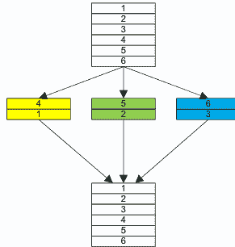

图 2.2
由 N 个线程处理的数据队列。

OpenMP 等系统也具有动态调度分配，这反映了 GPU 采用的方法。这里会创建一个线程池（GPU 则是块池），并且只有在一个任务完成后才会分配更多工作。因此，如果 1 个任务需要 10 倍时间，而 20 个任务每个只需要 1 倍时间，它们只会被分配给空闲核心。对于双核 CPU，核心 1 获得大的 10 倍任务和五个较小的 1 倍任务。核心 2 获得 15 个较小的 1 倍任务，因此 CPU 核心 1 和核心 2 大约在同一时间完成。

在这个特定示例中，我们选择 fork 三个线程，但队列中有六个数据项。为什么不 fork 六个线程？现实是，在大多数问题中实际上可能有数百万个数据项，尝试 fork 一百万个线程会导致几乎所有操作系统以某种方式失败。

通常，操作系统会应用“公平”调度策略。因此，数百万个线程中的每一个都需要由可能只有四个可用处理器核心中的一个依次处理。每个线程还需要自己的内存空间。在 Windows 中，一个线程可能带有 1 MB 的栈分配，这意味着在能够 fork 足够多的线程之前，我们就会迅速耗尽内存。

因此，在 CPU 上，程序员和许多多线程库通常会使用可用的逻辑处理器线程数量作为要 fork 的进程数量。由于创建和销毁 CPU 线程通常也很昂贵，并且为了限制最大利用率，通常会使用一个工作线程池，它们从可能任务的队列中获取工作。

在 GPU 上，我们面临相反的问题，即实际上需要成千上万或数以万计的线程。我们拥有更高级 CPU 调度器中常见的线程池概念，只不过它更像是块池而不是线程池。GPU 对可执行的 *并发* 块数量有上限。每个块包含若干线程。每个块的线程数量和并发运行的块总数都因 GPU 代而异。

当问题中存在未知数量的并发时，通常会使用 fork/join 模式。遍历树结构或路径探索类算法在遇到另一个节点或路径时可能会生成（fork）额外的线程。当路径被完全探索后，这些线程可能会重新 join 回线程池，或者简单地完成以便稍后重新生成。

GPU 不原生支持此模式，因为它在内核启动时使用固定数量的块/线程。内核无法启动额外的块，只有主机程序可以。因此，GPU 侧的此类算法通常实现为一系列 GPU 内核启动，每个内核都需要生成下一个状态。另一种方法是协调或向主机发信号，由其启动额外的并发内核。这两种方案都不太理想，因为 GPU 是为静态并发量设计的。Kepler 引入了动态并行性概念，解决了这个问题。有关此内容的更多信息，请参见第 12 章。

在 GPU 的一个线程块中，有多种方法用于线程间通信，并在内核中协调一定量的问题增长或不同级别的并发。例如，如果你有一个 8 × 8 矩阵，可能有许多地方只有 64 个线程处于活动状态。然而，也可能有其他地方可以使用 256 个线程。你可以启动 256 个线程，并在需要之前让其中大部分处于空闲状态。这些空闲线程占用资源并可能限制整体吞吐量，但在空闲时不会在 GPU 上消耗任何执行时间。这允许使用共享内存，即靠近处理器的快速内存，而不是创建多个需要使用远慢得多的全局内存和多次内核启动来同步的独立步骤。我们将在第 6 章中介绍内存类型。

最后，较新一代的 GPU 支持快速原子操作和同步原语，这些原语不仅用于同步，还用于在线程间传递数据。我们将在文中稍后介绍一些示例。

## Tiling/grids

CUDA 对所有问题采用的方法是要求程序员将问题分解为更小的部分。大多数并行方法都以某种方式使用这一概念。即使在巨大的超级计算机中，气候模型等问题也必须分解为数十万个块，每个块随后分配给机器中成千上万个处理单元之一。这种并行分解具有极大的优势，即可扩展性非常好。

GPU 在许多方面类似于单个处理器上的对称多处理器系统。每个 SM 本身就是一个处理器，能够运行多个线程块，通常每个块 256 或 512 个线程。单个 GPU 上存在多个 SM，它们共享一个公共的全局内存空间。作为一个整体 GPU，它们可以以高达 3 万亿次浮点运算/秒（GTX680）的峰值速度运行。

虽然峰值性能可能令人印象深刻，但如果没有专门制作的程序，就不可能实现类似的性能，因为这种峰值性能不包括内存访问等内容，而内存访问对任何实际程序来说都至关重要。要在任何平台上获得良好的性能，需要对硬件有良好的了解，并理解两个关键概念——并发性和局部性。

许多问题中都存在并发性。只是对于可能来自串行背景的人来说，你可能无法立即看到问题中的并发性。因此，分块模型是一个易于概念化的模型。将问题想象成二维的——数据的平面排列——并简单地在问题空间上覆盖一个网格。对于三维问题，可以将问题想象成魔方——一组映射到问题空间上的块。

CUDA 提供了简单的二维网格数据模型。对于大量问题来说，这完全足够。如果你在单个块内有线性工作分布，那么你就有了理想的 CUDA 块分解。由于我们可以为每个 SM 分配最多十六个块，并且可以拥有最多 16 个 SM（某些 GPU 上为 32 个），任何数量的 256 或更大的块都是可以的。在实践中，我们希望将块内的元素数量限制为 128、256 或 512，因此这本身可能导致典型数据集下出现大量块。

在考虑并发性时，还要考虑是否存在可以利用的 ILP。从概念上讲，将单个线程与单个输出数据项关联起来更容易。然而，如果我们可以按此基础用线程填满 GPU，并且还有更多数据可以处理，我们还能提高吞吐量吗？答案是肯定的，但只有通过使用 ILP 才能实现。

ILP 利用了处理器内部可以对指令流进行流水线处理的事实。因此，将四个加法操作推入队列，等待，然后逐个收集（push-push-push-push-wait），比逐个执行（push-wait-push-wait-push-wait-push-wait）更高效。对于大多数 GPU，你会发现每个线程四个操作的 ILP 级别效果最好。第 9 章中有关于此的一些详细研究和示例。因此，如果可能，我们希望每个线程处理 N 个元素，但不能以减少活动线程总数的程度为代价。

## 分治法

分治模式也是一种将大问题分解为较小部分的模式，每个部分都可以被攻克。这些单独的计算合在一起，使得可以解决更大的问题。

通常你会看到分治算法与递归一起使用。快速排序就是一个经典示例。它递归地将数据分为两组，一组在基准点之上，另一组在基准点之下。当分区最终只包含两个项目时，它们会被比较并交换。


## 结论

我们在此概览了一些并行处理概念，以及这些概念在 GPU 行业中的具体应用。本文的目的并非撰写一部关于并行处理的巨著，因为已有整本书专门致力于此主题。我们希望读者能对并行编程带来的、在串行编程环境中否则不会考虑的问题有所了解。

在后续章节中，我们将通过实际示例详细介绍其中一些概念。

我们还将探讨并行前缀和，这是一种允许多个数据写入者共享一个公共数组而不会相互覆盖数据的算法。此类算法在串行编程中从不需要。

并行性带来了一定的复杂性，程序员需要提前思考和规划，以考虑并发性和局部性这两个关键问题。在为 GPU 设计任何软件时，请始终牢记这两个关键概念。

## CUDA 硬件概览

### PC 架构

让我们先来看看当今许多 PC 中仍然常见的典型 Core 2 架构，以及它如何影响我们对 GPU 加速器的使用（图 3.1）。

请注意，所有 GPU 设备都通过 PCI-E 总线连接到处理器。在此我们假设使用 PCI-E 2.0 规范总线，这是目前可用的最快总线，传输速率为 5 GB/s。在撰写本文时，PCI-E 3.0 已经可用，并应显著提升可用带宽。

然而，要从处理器获取数据，需要通过北桥设备经过缓慢的 FSB（前端总线）。FSB 的时钟频率最高可达 1600 MHz，尽管在许多设计中它要慢得多。这通常仅为快速处理器时钟频率的三分之一。

内存也通过北桥访问，外设则通过北桥和南桥芯片组访问。北桥处理所有高速组件，如内存、CPU、PCI-E 总线连接等。南桥芯片处理较慢的设备，如硬盘、USB、键盘、网络连接等。当然，将硬盘控制器连接到 PCI-E 连接是完全可行的，在实践中，这也是在该类系统上获得 RAID 高速数据访问的唯一真正方式。

PCI-E（外围组件互连快速）是一个有趣的总线，因为与它的前身 PCI（外围组件互连）不同，它基于保证带宽。在旧的 PCI 系统中，每个组件都可以使用总线的全部带宽，但一次只能有一个设备使用。因此，添加的卡越多，每张卡可用的带宽就越少。PCI-E 通过引入 PCI-E 通道解决了这个问题。这些是高速串行链路，可以组合在一起形成 X1、X2、X4、X8 或 X16 链路。大多数 GPU 现在至少使用 PCI-E 2.0、X16 规范，如图 3.1 所示。使用此设置，我们拥有一个 5 GB/s 全双工总线，这意味着我们同时获得相同的上传和下载速度。因此，我们可以同时以 5 GB/s 向卡传输数据，并从卡接收 5 GB/s。然而，这并不意味着如果我们不接收任何数据，就可以以 10 GB/s 向卡传输数据（即，带宽不是累加的）。

在典型的超级计算机环境中，甚至在桌面应用程序中，我们都在处理大型数据集。超级计算机可能处理 PB 级的数据。桌面 PC 可能只处理几 GB 的高清视频。在这两种情况下，都需要从连接的外设获取大量数据。一块 100 MB/s 的硬盘需要一分钟才能加载 6 GB 的数据。以这个速度，读取标准 1 TB 磁盘的全部内容需要超过两个半小时。

RAID 驱动器
SATA (300 MB/s)
南桥
10/100/1000 Bits/S
以太网
FSB
CPU 1 (Athlon, P4, Opteron, Xeon)
- 核心 1
- 核心 2
- 核心 3
- 核心 4
FSB
北桥
FSB
DRAM 内存 (DDR-2/DDR-3) - 2 GHz, 24 MB, 30 GB/s
- DRAM 组 0
- DRAM 组 1
- DRAM 组 2
- DRAM 组 3
- DRAM 组 4
- DRAM 组 5
FSB
PCI-E 总线 (5 GB/s)
- GPU 0
- GPU 1
- GPU 2
- GPU 3
- GPU 4
- GPU 5
- GPU 6
- GPU 7

图 3.1 典型 Core 2 系列布局。

如果使用 MPI（消息传递接口，通常用于集群），当以太网连接连接到南桥而不是 PCI-E 总线时，此配置的延迟可能相当可观。因此，像 InfiniBand 或 10 Gigabit 以太网卡这样的专用高速互连通常用于 PCI-E 总线。这会移除原本可用于 GPU 的插槽。此前，由于没有直接的 GPU MPI 接口，此类系统中的所有通信都通过 PCI-E 总线路由到 CPU 并再返回。CUDA 4.0 SDK 中提供的 GPU-Direct 技术解决了此问题，现在某些 InfiniBand 卡可以直接与 GPU 通信，而无需先经过 CPU。此 SDK 更新还允许 GPU 与 GPU 之间直接通信。

随着 Nehalem 架构的出现，我们看到了许多重大变化。主要变化是用 X58 芯片组取代了北桥和南桥芯片组。Nehalem 架构为我们带来了 QPI（快速路径互连），这实际上是对 FSB（前端总线）方法的巨大进步，并类似于 AMD 的 HyperTransport。QPI 是一种高速互连，可用于与其他设备或 CPU 通信。在典型的 Nehalem 系统中，它将连接内存子系统，并通过 X58 芯片组连接 PCI-E 子系统（图 3.2）。QPI 在 Extreme/Xeon 处理器版本中以 4.8 GT/s 或 6.4 GT/s 运行。

使用 X58 和 1366 处理器插槽时，总共可用 36 条 PCI-E 通道，这意味着最多支持两张 X16 卡，或四张 X8 卡。在 LGA2011 插槽推出之前，这为 GPU 机器提供了迄今为止最佳的带宽解决方案。

X58 设计也提供了较低规格的 P55 芯片组，其中仅提供 16 条通道。这意味着支持一张 X16 GPU 卡，或两张 X8 卡。

从 i7/X58 芯片组设计转向，Intel 推出了如图 3.3 所示的 Sandybridge 设计。最显著的改进之一是支持 SATA-3 标准，该标准支持 600 MB/s 传输速率。结合 SSD，这在加载和保存数据方面提供了相当可观的输入/输出（I/O）性能。

Sandybridge 设计的另一项重大进步是引入了 AVX（高级向量扩展）指令集，该指令集也受到 AMD 处理器的支持。AVX 允许提供最多四个双精度（256 位/32 字节）宽向量操作的向量指令。这是一项非常有趣的进展，可用于显著加速 CPU 上的计算密集型应用程序。

然而，请注意插槽 1155 Sandybridge 设计的重大缺点：它仅支持 16 条 PCI-E 通道，将 PCI-E 带宽限制为 16 GB/s 理论值、10 GB/s 实际带宽。Intel 在其桌面处理器中一直走着将越来越多功能集成到 CPU 的道路上。只有插槽 2011 Sandybridge-E（服务器产品）拥有合理数量的 PCI-E 通道（40 条）。

那么 AMD 与 Intel 设计相比如何呢？与 Intel 不同，Intel 已逐渐在其服务器产品线之外减少大量 PCI-E 通道的使用，而 AMD 在除服务器产品线外的所有产品中都保持了相当稳定。其 FX 芯片组支持两个 X16 设备或四个 X8 PCI-E 设备。AMD3+ 插槽搭配 990FX 芯片组是一个可靠的工作平台，因为它提供 SATA 6 GB/s 端口，并配备最多四个 X16 PCI-E 插槽（通常以 X8 速度运行）。

Intel 与 AMD 之间的一个主要区别在于核心数量的价格点。如果仅计算真实处理器核心而忽略逻辑（超线程）核心，在相同价格点下，AMD 设备通常提供更多核心。然而，Intel 设备上的核心往往性能更好。因此，这很大程度上取决于您需要支持的 GPU 数量以及给定核心的负载水平。


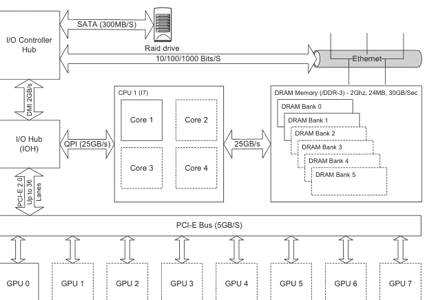

### 图 3.2 Nehalem/X58 系统。

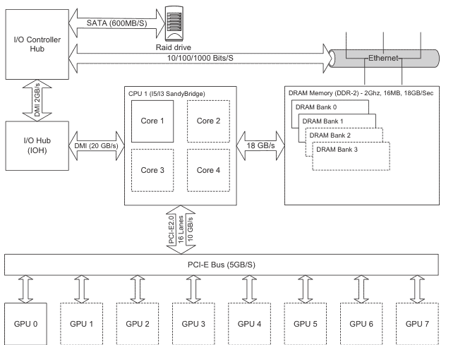

### 图 3.3 Sandybridge 设计。

与 Intel 设计类似，你会看到系统中各处带宽水平相似，主内存带宽除外。Intel 在其高端系统中使用三通道或四通道内存，在低端系统中使用双通道内存。AMD 仅使用双通道内存，导致可用的 CPU 主机内存带宽显著减少（图 3.4）。

AMD 芯片组相对于 Intel 芯片组的一大显著优势是支持多达六个 SATA（串行 ATA）6 GB/s 端口。如果你考虑到任何系统中最慢的组件通常会限制整体吞吐量，那么这一点需要考虑。然而，在使用多个 SSD（固态硬盘）时，SATA3 可能会非常快地使南桥带宽过载。PCI-E 总线解决方案可能是更好的选择，但它显然需要额外成本。

## GPU 硬件

GPU 硬件与 CPU 硬件截然不同。图 3.5 展示了从 PCI-E 总线另一侧看去，多 GPU 系统在概念上的样子。

请注意，GPU 硬件由若干关键模块组成：

- 内存（全局、常量、共享）
- 流式多处理器（SMs）
- 流式处理器（SPs）

这里需要注意的主要一点是，GPU 实际上是一组 SMs 的阵列，每个 SM 拥有 N 个核心（G80 和 GT200 中为 8 个，Fermi 中为 32–48 个，Kepler 中为 8 个以上；参见图 3.6）。这是允许处理器扩展的关键方面。GPU 设备由一个或多个 SMs 组成。向设备添加更多 SMs，就能让 GPU 同时处理更多任务，或者在任务具有足够并行性时更快地处理相同任务。

与 CPU 类似，如果程序员编写的代码将处理器使用量限制为 N 个核心，假设为双核，当 CPU 厂商推出四核设备时，用户将看不到任何收益。这正是从双核到四核 CPU 过渡时发生的情况，随后大量软件不得不重写以利用额外的核心。NVIDIA 硬件将通过增加 SMs 数量和每个 SM 的核心数量的组合来提升性能。在设计软件时，请注意下一代可能会将其中任一数量翻倍。

现在让我们更仔细地看看 SMs 本身。每个 SM 由若干关键组件构成，但出于简洁原因，此处并未全部展示。最重要的是，每个 SM 中都有多个 SPs。此处显示了 8 个 SPs；在 Fermi 中增长到 32–48 个 SPs，在 Kepler 中增长到 192 个。没有理由认为下一代硬件修订版不会继续增加 SPs/SMs 的数量。

每个 SM 都可以访问一种称为寄存器文件的东西，它很像一块与 SP 单元运行速度相同的内存，因此对该内存实际上没有等待时间。该内存的大小随代际而变化。它用于存储在 SP 上运行的线程中使用的寄存器。还有一个仅供单个 SM 访问的共享内存块；它可以用作程序管理的缓存。与 CPU 缓存不同，没有硬件会在你不知情的情况下驱逐缓存数据——它完全由程序员控制。

每个 SM 都有独立的总线进入纹理内存、常量内存和全局内存空间。纹理内存是全局内存的一种特殊视图，对于具有

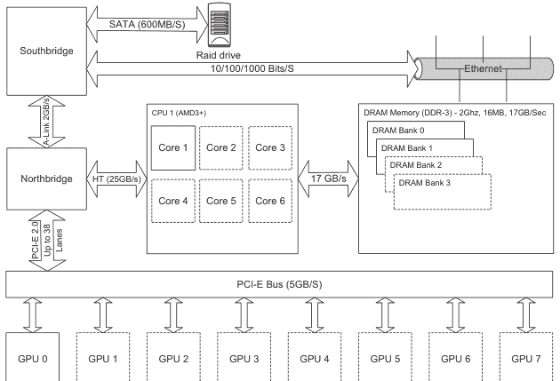

### 图 3.4 AMD。

```
PCI-E 2.0 Interconnect (5 GB/s)
GPU #0
Constant Shared Memory across all MPs (64K)
Optional 64B
Global Memory MMU (448 / 512 Bit) - 120 GB/s - 256K to 4GB
Constant Memory Bus
Global Memory Bus
SM0
Bus
SP0 SP1 SP2 SP3 SP4 SP5 SP6 SP7
SM1 SM2 SM3 Optional SMn
Crossbar
0 1 2 3 4 5 6 7 8 9 A B C D E F
Shared Memory (16x 1K)

GPU #1
GPU #2
GPU #3
```

### 图 3.5 GPU (G80/GT200) 卡的框图。

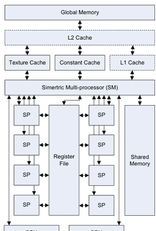

### 图 3.6 SM 内部。

插值的数据，例如 2D 或 3D 查找表。它具有基于硬件的插值特殊功能。常量内存用于只读数据，并在所有硬件修订版中缓存。与纹理内存类似，常量内存只是主全局内存的一个视图。

全局内存通过显卡上的 GDDR（图形双倍数据率）提供。这是 DDR（双倍数据率）内存的高性能版本。内存总线宽度可高达 512 位，提供的带宽比 CPU 上的带宽高出 5 到 10 倍，Fermi 硬件上最高可达 190 GB/s。

每个 SM 还拥有两个或多个专用单元（SPUs），用于执行特殊硬件指令，例如高速 24 位 sin/cos/指数运算。GT200 和 Fermi 硬件上也存在双精度单元。

## CPU 和 GPU

现在你对 GPU 硬件的样子有了一些了解，你可能会说这都很有趣，但这对我们在编程方面意味着什么？

任何参与过大型项目的人都知道，项目通常会被划分为各个部分，并分配给特定的团队。可能会有规格组、设计组、编码组和测试组。让每个团队中的人完全理解开发链中前后人员的工作，带来的好处是巨大的。

以测试为例。如果设计师没有考虑测试，他或她就不会在软件特定的硬件故障中包含任何测试手段。如果测试团队只能通过让硬件故障来测试硬件故障，那么就必须物理修改硬件以引起此类故障。这很困难。软件人员设计一个标志，在软件中反转基于硬件的错误标志，这样就可以轻松测试故障功能，这要容易得多。在测试团队工作，你可能会看到以其他方式做有多难，但如果对自己的学科有片面的看法，你可能会说测试不是你的职责。

你最优秀的一些工程师是那些对前后流程有了解的人。作为软件人员，了解硬件实际如何工作总是件好事。对于串行代码执行，了解事物如何工作可能很有趣，但通常不是必需的。绝大多数开发人员从未修读过计算机体系结构课程或阅读过相关书籍，这非常遗憾。这是当今我们看到如此多低效软件的主要原因之一。我 11 岁时开始学习 BASIC，14 岁时编写 Z80 汇编语言，但直到大学期间，我才真正开始深入理解计算机体系结构。

在嵌入式领域工作，会让你对硬件采取非常动手实践的方法。没有漂亮的 Windows 操作系统为你设置处理器。编程是一件非常底层的事情。在嵌入式应用中，通常会出货数百万个设备。糟糕的代码意味着 CPU 和可用内存使用率低下，这可能转化为需要更快的 CPU 或更多内存。数百万个设备上额外的 50 美分成本就是 50 万美元。这转化为大量的设计和编程工时，因此显然编写更好的代码比购买额外硬件更具成本效益。

并行编程，即使在今天，也与硬件紧密相关。如果你只想编写代码而不关心性能，并行编程实际上相当容易。要真正从硬件中获得性能，你需要了解它的工作原理。大多数人可以安全且缓慢地在一档驾驶汽车，但如果你不知道还有其他档位，或者没有知识去挂入它们，你就永远无法很快从 A 点到达 B 点。了解硬件有点像学习在手动变速箱汽车中换挡——起初有点棘手，但过一段时间后会变得自然而然。按照同样的类比，你也可以购买自动变速箱汽车，这类似于使用由理解硬件底层机制的人已经编写好的库。然而，在不了解其工作原理基础的情况下这样做，通常会导致次优实现。

## 计算级别

CUDA 支持多个计算级别。原始 G80 系列显卡随第一版 CUDA 一起出货。计算能力固化在硬件中。要升级到更新的


使用旧版本的用户不得不升级其硬件。虽然这听起来像是 NVIDIA 试图强迫用户购买更多显卡，但实际上它带来了许多好处。在升级计算级别时，您通常可以从旧平台迁移到新平台，通常以与原始显卡相近的价格使显卡的计算能力翻倍。鉴于 NVIDIA 通常至少每隔几年就会推出新平台，自 CUDA 可用的几年来，我们已经看到了可用计算能力的巨大提升。

每个计算级别之间差异的完整列表可以在 NVIDIA CUDA 编程指南的附录 G 中找到，该附录作为 CUDA SDK 的一部分提供。因此，我们将只介绍每个计算级别中发现的主要差异，即作为开发者您需要知道的内容。

### Compute 1.0

计算级别 1.0 出现在较旧的显卡上，例如，原始的 8800 Ultras 和许多 8000 系列显卡以及 Tesla C/D/S870。计算 1.0 显卡主要缺少的功能是原子操作。原子操作是指我们可以保证在没有任何其他线程中断的情况下完成完整操作的操作。实际上，硬件在原子函数入口处实现一个屏障点，并保证将操作（加、减、最小、最大、逻辑与、或、异或等）作为一个操作完成。计算 1.0 显卡实际上现已过时，因此这一限制在所有实际目的下都可以忽略。

### Compute 1.1

计算级别 1.1 出现在许多后来发布的 9000 系列显卡中，例如 9800 GTX，这些显卡非常受欢迎。这些显卡基于 G92 硬件，而计算 1.0 设备基于 G80 硬件。

计算 1.1 设备带来的一项主要变化是，在许多但并非所有设备上支持重叠数据传输和内核执行。SDK 调用 `cudaGetDeviceProperties()` 返回 `deviceOverlap` 属性，该属性定义了此功能是否可用。这允许一种非常不错且重要的优化，称为双缓冲，其工作原理如图 3.7 所示。

要使用此方法，我们需要比平时多一倍的内存空间，如果目标市场只有 512 MB 显卡，这可能是个问题。然而，对于主要用于科学计算的 Tesla 显卡，您可以拥有高达 6 GB 的 GPU 内存，这使得此类技术非常有用。让我们看看会发生什么：

- **Cycle 0：** 在 GPU 内存空间分配两个内存区域后，CPU 填充第一个缓冲区。

- **Cycle 1：** CPU 随后在 GPU 上调用一个 CUDA 内核（GPU 任务），该调用会立即返回到 CPU（非阻塞调用）。CPU 随后从磁盘、网络或其他位置获取下一个数据包。与此同时，GPU 在后台处理提供的数据包。当 CPU 准备就绪时，它开始填充另一个缓冲区。

- **Cycle 2：** 当 CPU 完成缓冲区填充后，它调用一个内核来处理缓冲区 1。然后它检查来自 Cycle 1（正在处理缓冲区 0）的内核是否已完成。如果未完成，它会等待该内核结束，然后从缓冲区 0 获取数据，并将下一个数据块加载到同一个缓冲区中。在此期间，周期开始时启动的内核正在 GPU 上处理缓冲区 1 中的数据。

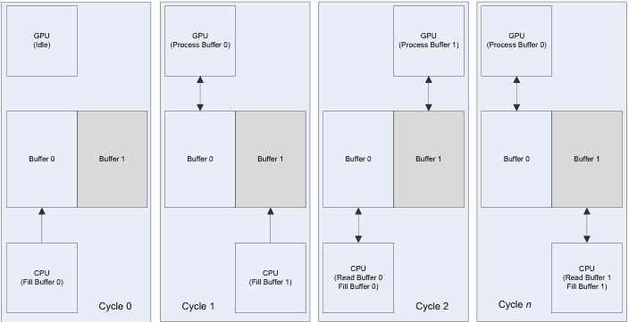

**FIGURE 3.7** 单 GPU 双缓冲。

Cycle N：然后我们重复 Cycle 2，在 CPU 上交替读取和写入的缓冲区，与 GPU 上正在处理的缓冲区进行交替。

GPU-to-CPU 和 CPU-to-GPU 传输通过相对缓慢（5 GB/s）的 PCI-E 总线进行，这种双缓冲方法在很大程度上隐藏了这种延迟，并使 CPU 和 GPU 都保持忙碌。

### Compute 1.2

计算 1.2 设备随低端 GT200 系列硬件出现。这些是最初的 GTX260 和 GTX280 显卡。使用 GT200 系列硬件时，NVIDIA 通过将显卡上存在的多处理器数量翻倍，大约将单张显卡上的 CUDA 核心处理器数量翻倍。我们稍后将介绍 CUDA 核心和多处理器。实际上，与之前的 G80/G92 系列相比，这使得显卡性能翻倍。

在将多处理器数量翻倍的同时，NVIDIA 将多处理器可并发执行的线程束数量从 24 增加到 32。线程束是在多处理器内执行的代码块，每个多处理器可用线程束数量的增加为我们提供了更多获得更好性能的空间，我们稍后将探讨这一点。

计算 1.0 和计算 1.1 设备中存在的全局内存合并访问限制和共享内存银行冲突问题在计算 1.2 中得到了极大缓解。这使得 GT200 系列硬件编程容易得多，并极大地提高了许多之前编写不佳的 CUDA 程序的性能。

### Compute 1.3

计算 1.3 设备随硬件从 GT200 过渡到 GT200 a/b 修订版而引入。这紧随 GT200 系列的初始发布之后。该时代的几乎所有高端显卡都兼容计算 1.3。

计算 1.3 硬件发生的主要变化是引入了对有限双精度计算的支持。GPU 主要面向图形，因此对快速单精度计算有巨大需求，但对双精度计算需求有限。通常，与单精度浮点运算相比，使用双精度会导致性能下降一个数量级，因此应花时间看看是否有办法使用单精度算术来充分发挥此硬件的性能。在许多情况下，可以使用单精度和双精度操作的混合，这非常理想，因为它利用了现有的专用单精度和双精度硬件。

### Compute 2.0

计算 2.0 设备见证了向 Fermi 硬件的转换。针对 Fermi 架构调整应用程序的原始指南可以在 NVIDIA 网站上找到，网址为 http://developer.nvidia.com/cuda/nvidia-gpu-computing-documentation。

计算 2.x 硬件的一些主要更改如下：

- 每个 SP 引入 16 K 到 48 K 的 L1 缓存内存。
- 为所有 SM 引入共享 L2 缓存。
- 基于 Tesla 的设备支持基于 ECC（纠错码）的内存检查和错误纠正。
- 基于 Tesla 的设备支持双复制引擎。
- 共享内存大小从每个 SM 16 K 扩展到每个 SM 48 K。
- 为了实现数据的最佳合并，必须 128 字节对齐。
- 共享内存银行数量从 16 增加到 32。

让我们详细看看这些变化中的一些影响。首先，让我们了解 L1 缓存的引入及其含义。L1（一级）缓存是设备上存在的一种缓存，是可用的最快缓存类型。计算 1.x 硬件没有缓存，除了纹理和常量内存缓存。引入缓存使许多程序员更容易编写在 GPU 硬件上运行良好的程序。它还允许编译时不遵循已知内存模式的应用程序。但是，要利用缓存，应用程序需要具有顺序内存模式，或者至少具有一定的数据重用。

Fermi 上的 L2 缓存大小可达 768 K，并且重要的是，它是一个统一缓存，意味着它是共享的，并为所有 SM 提供一致的视图。这允许通过全局原子操作进行更快的块间通信。与必须访问 GPU 上的全局内存相比，使用共享缓存快一个数量级。

对 ECC 内存的支持对数据中心来说是必须的。ECC 内存提供自动错误检测和纠正。电气设备会发射少量辐射。当靠近其他设备时，这种辐射可以改变其他设备中内存单元的内容。尽管这种情况发生的概率很小，但通过将设备密集地打包到数据中心来增加设备暴露度，出错的概率会上升到不可接受的水平。因此，ECC 检测并纠正您可能在大型数据中心发现的单比特翻转情况。这会减少可用 RAM 的数量并对内存带宽产生负面影响。由于这是显卡上的一个主要缺点，ECC 仅在 Tesla 产品上可用。

双复制引擎允许您将我们之前研究的双缓冲示例扩展到使用多个流。流是我们稍后将详细介绍的一个概念，但基本上，它们允许 N 个独立内核以流水线方式执行，如图 3.8 所示。

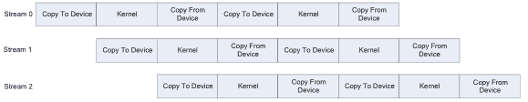

**FIGURE 3.8** 流水线。


注意观察图中内核部分是如何一个接一个运行的。复制操作被另一个流上的内核执行所隐藏。内核和复制引擎并发执行，从而充分利用相关单元。

请注意，双复制引擎在几乎所有高端Fermi GPU上物理可用，例如GTX480或GTX580设备。然而，只有Tesla卡会将两个引擎都显示给CUDA驱动程序。

共享内存也发生了巨大变化，它被转换为组合L1缓存。L1缓存大小为64 K。但是，为了保持向后兼容性，必须至少将16 K分配给共享内存，这意味着L1缓存实际上只有48 K大小。使用开关，可以交换共享内存和L1缓存的使用，从而获得48 K的共享内存和16 K的L1缓存。从16 K的共享内存增加到48 K的共享内存对某些程序来说是巨大的好处。

为了达到最佳使用效果，对齐要求比以前几代更加严格，这是由于引入了L1和L2缓存。两者都使用128字节的缓存行大小。缓存行是内存可以获取的*最小*数据量。因此，如果您的程序获取数据的后续元素，这效果非常好。这正是大多数CUDA程序所做的，即一组线程获取相邻的内存地址。这一变化带来的唯一要求是数据集必须128字节对齐。

但是，如果您的程序每个线程都有稀疏且分布式的内存模式，则需要禁用此功能并切换到缓存操作的32位模式。

最后，我们将提到的最后一个主要变化是共享内存银行从16位增加到32位。与以前几代相比，这是一大好处。它允许当前warp（32个线程）中的每个线程将数据写入共享内存中恰好一个32位银行，而不会导致共享银行冲突。

### Compute 2.1

Compute 2.1出现在专门针对游戏市场的某些设备上，例如GTX460和GTX560。这些设备按以下方式更改设备架构：

- 每个SM 48个CUDA核心，而非通常的每个SM 32个。
- 每个SM八个单精度超越函数专用功能单元，而非通常的四个。
- 双warp调度器，而非通常的单warp调度器。

x60系列显卡在中端游戏市场一直拥有非常高的渗透率，因此如果您的应用面向消费者市场，了解这些变化的影响非常重要。

在Compute 2.1硬件上，一个显著的不同是牺牲双精度硬件以增加CUDA核心数量。对于以单精度和整数计算为主的内核，这是一个良好的权衡。大多数游戏很少使用双精度浮点数据，但大量使用单精度浮点和整数数学。

Warp（我们将在后面详细介绍）是线程组。在Compute 2.0硬件上，单warp调度器需要两个时钟周期来调度整个warp的指令。在Compute 2.1硬件上，我们现在有四个指令调度器，而不是通常的每两个时钟周期两个指令调度器。在硬件中，有三组16个CUDA核心，总共48个CUDA核心，而不是通常的两组16个CUDA核心。如果NVIDIA能再塞进一组16个CUDA核心，那将是一个理想的解决方案。也许我们会在未来的硬件中看到这一点。

Compute 2.1硬件实际上是一种超标量方法，类似于从最初的Pentium CPU开始的CPU中所采用的方法。为了利用所有核心，硬件需要在单个线程中识别指令级并行性（ILP）。这与过去推荐的通用线程级并行性（TLP）方法有显著不同。要存在ILP，需要有一组相互独立的指令。实现这一点的最简单方法之一是通过本书后面将介绍的特殊向量类。

Compute 2.1硬件的性能各不相同。一些知名应用程序，如Folding at Home，在Compute 2.1硬件上表现非常出色。其他应用程序，如视频编码软件包，由于较难提取ILP且内存带宽是关键因素，通常表现要差得多。

在撰写本文时，Kepler和新的Compute 3.0平台的最终细节大多尚未发布。有关已宣布的Kepler功能的讨论可以在第12章“为未来GPU开发”中找到。

## Setting Up CUDA

### 简介

本章面向完全不了解CUDA的读者。我们将介绍如何在各种操作系统上安装CUDA、可以使用哪些工具，以及CUDA如何编译。最后，我们将介绍如何利用API来帮助识别每个人都会犯的编码和API错误。

CUDA支持三种主要操作系统：Windows、Mac和Linux。使用和学习CUDA最简单的平台是您最熟悉用于编程开发的操作系统。对于绝对初学者，Windows操作系统配合Microsoft Visual C++可能是最佳选择。Windows和Mac的安装过程基本上都是点击式的。两者都提供相当标准的集成开发环境，可与CUDA配合使用。

### 在Windows下安装SDK

要在运行Windows的PC上安装CUDA，您需要从NVIDIA开发者门户网站http://developer.nvidia.com/cuda-toolkit-41下载以下组件。请注意，本书付印时，工具包第5版正处于发布候选阶段。请查看NVIDIA网站以获取最新版本。

您需要已安装Microsoft Visual Studio 2005、2008或2010版本。第一步是从上述链接下载并安装适用于您相关操作系统的最新NVIDIA开发驱动程序。然后，您需要CUDA工具包和GPU计算SDK代码示例的32位或64位版本。请确保为您的操作系统选择正确的版本。按以下顺序安装：

- 1. NVIDIA开发驱动程序
- 2. CUDA工具包
- 3. CUDA SDK
- 4. GPU计算SDK
- 5. Parallel Nsight调试器

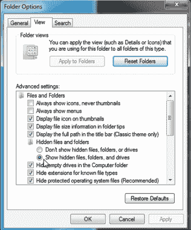

图4.1 “文件夹选项”以显示隐藏文件。

在Windows 7下，SDK将所有文件安装到“ProgramData”中，这是C盘的一个隐藏目录。要查看文件，您需要始终通过桌面上创建的CUDA SDK图标访问，或者在Windows中转到“文件夹选项”并指示其显示隐藏文件（图4.1）。

### Visual Studio

CUDA支持Visual Studio 2005至2010版本，其中大部分包括Express版本。Express版本可从Microsoft免费获取。专业版也可通过DreamSpark计划https://www.dreamspark.com免费提供给注册学生。

要注册，您只需提供大学或学院的详细信息和识别号码，即可下载Visual Studio和许多其他编程工具。该计划不仅限于美国的学术机构，也面向全球学生开放。

总体而言，Visual Studio 2008对CUDA的支持最好，编译速度也比Visual Studio 2010稍快。然而，Visual Studio 2010有一个非常有用的功能，即源代码的自动语法检查。因此，如果您使用未定义的类型，它会将错误用红色下划线标出，就像Microsoft Word标出拼写错误一样。这是一个非常有用的功能，因为它可以为明显的问题节省大量不必要的编译周期。因此，我推荐2010版本，特别是如果您可以从DreamSpark免费下载的话。

### 项目

快速创建项目的一种方法是采用SDK示例之一，删除所有不必要的项目文件，然后插入您自己的源文件。请注意，您的CUDA源代码应具有“.cu”扩展名，以便由NVIDIA编译器而不是Visual C编译。然而，如我们稍后将看到，您也可以使用项目模板向导简单地创建基本项目框架。

### 64位用户

使用Windows 64位版本时，请注意某些项目文件默认设置为运行32位应用程序。因此，在尝试构建它们时，您可能会收到错误消息：Fatal Error LNK1181: cannot open input file 'cutil32D.lib'。

这未被安装，因为您很可能只安装了64位版本的SDK以及64位版本的Windows。要纠正此问题，我们只需将目标从64位设置为32位，使用Visual Studio中的生成菜单，然后如图4.2所示将平台更改为X64。

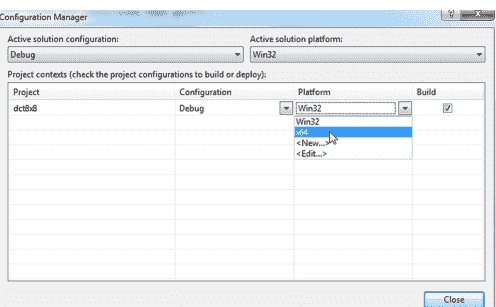

图4.2 Visual C平台选择。


当您启动重建时，可能会提示保存项目。只需在项目名称末尾添加“_X86”并保存。项目将在64位环境下构建，并链接正确的库文件。

您也可能会遇到缺少库的问题，例如“cutil32.lib”。安装SDK时，它会设置一个环境变量$(CUDA_LIB_PATH)。这通常设置为：C:\Program Files\NVIDIA GPU Computing Toolkit\CUDA\v4.0\lib\Win32。

您可能会发现默认项目文件中的路径设置没有将$(CUDA_LIB_PATH)作为条目之一。要添加它，请单击项目，然后选择“项目 -> 属性”。这将打开图4.3所示的对话框。

单击最右侧的“...”按钮将打开一个对话框，您可以在其中添加库路径（图4.4）。只需将“$(CUDA_LIB_PATH)”作为新行添加，项目现在应该可以链接了。

如果您希望同时构建64位CUDA应用程序和32位CUDA应用程序，则需要安装32位和64位CUDA工具包。SDK中的示例也需要安装32位和64位版本的SDK，才能构建32位和64位版本的示例。

您可以通过进入以下目录并构建解决方案文件来构建所需的库：

C:\ProgramData\NVIDIA Corporation\NVIDIA GPU Computing SDK 4.1\Common
C:\ProgramData\NVIDIA Corporation\NVIDIA GPU Computing SDK 4.1\shared

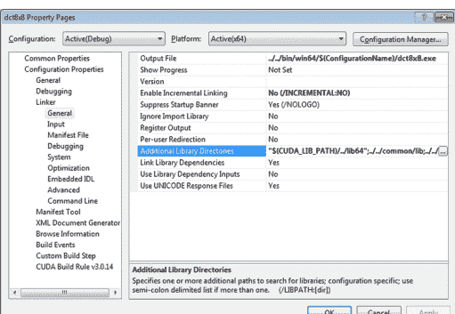

图4.3 其他库路径。

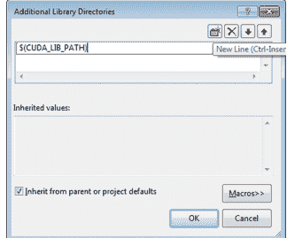

图4.4 添加库目录。

您将在 C:\ProgramData\NVIDIA Corporation\NVIDIA GPU Computing SDK 4.1\C\common\lib\x64 中找到所需的库。

您也可以手动将这些库添加到缺少它们的任何项目中。不幸的是，SDK示例未设置为在需要时自动构建所需的库。库的二进制文件也未提供，这使得实际构建SDK示例有点令人沮丧。

## 创建项目

要创建新的CUDA支持应用程序，只需使用“文件 -> 新建 -> 项目向导”创建CUDA应用程序，如图4.5所示。向导将创建一个包含文件“kernel.cu”的单个项目，该文件包含混合代码，部分代码在CPU上执行，部分代码在GPU上执行。GPU代码包含在函数addKernel中。该函数只需获取指向目标数组c的指针以及指向两个输入数组a和b的几个指针。然后它将a和b数组的内容相加，并将结果存储在目标数组c中。这是执行CUDA程序所需框架的一个非常简单的示例。

还包括将数据复制到设备、调用内核以及将数据从设备复制回主机的基本代码。这是一个非常有用的入门项目，可让您在CUDA下编译一些内容。我们将在后文中介绍使CUDA程序运行所需的标准框架。如果可能，查看代码并尝试理解它很有用。但是，如果此时还不明白，请不要担心，我们将逐步介绍如何为CUDA编写程序。

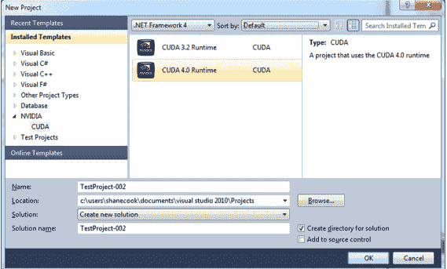

图4.5 CUDA项目向导。

## Linux

CUDA支持以下Linux发行版。支持的版本将取决于您安装的CUDA工具包版本。

- Fedora 14
- Redhat 6.0 和 5.5 / CentOS 6.2（Redhat的免费版本）
- Ubuntu 11.04
- OpenSUSE 11.2

在Linux平台上安装CUDA的第一步是确保您拥有最新的内核软件。请从终端窗口使用以下命令：

```
sudo yum update
```

sudo命令将以管理员身份登录。yum命令是Linux RPM包的标准安装工具。您只是要求它检查所有已安装的包，并查看是否有可用的更新。这确保在安装任何驱动程序之前，您的系统已完全更新。许多基于GUI的安装也具有替代旧命令行更新界面的基于GUI的软件更新版本。

内核更新到最新级别后，请运行以下命令：

```
sudo yum install gcc-c++ kernel-devel
```

这将安装标准的GNU C++环境以及重建内核所需的内核源代码。请注意，包名区分大小写。这将提示您下载大约21 MB，安装需要几分钟。同样，如果您愿意，可以通过特定操作系统的GUI软件安装程序安装该包。

最后，由于您可能需要绘制一些图形输出，您需要一个OpenGL开发环境。请使用以下命令安装：

```
sudo yum install freeglut-devel libXi-devel libXmu-devel
```

现在您已准备好安装CUDA驱动程序。请确保安装至少4.1版本的CUDA工具包。有多种方法可以安装更新的NVIDIA驱动程序。NVIDIA不发布驱动程序的源代码，因此默认情况下大多数Linux发行版安装一个非常基本的图形驱动程序。

## 内核基础驱动程序安装（CentOS，Ubuntu 10.4）

CUDA版本应与特定的一组开发驱动程序配合使用。使用此处列出的方法以外的方法安装驱动程序可能会导致CUDA无法工作。请注意给定CUDA工具包版本支持的操作系统版本。这些可能不是特定Linux发行版的最新版本。使用较新的发行版可能无法工作。因此，第一个安装步骤是使用特定Linux发行版指定的版本替换任何现有驱动程序。请参见图4.6。

下载完成后，您需要以纯文本模式启动Linux。与始终处于图形模式的Windows不同，在Linux下安装驱动程序需要文本模式。您可以在大多数发行版上使用以下命令从终端窗口（通常位于GUI的系统菜单下）使系统以文本模式启动：

```
sudo init 3
```

这将重新启动Linux计算机并以文本模式重新启动。您可以稍后使用sudo init 5恢复图形模式。

如果出现诸如“用户<user_name>不在sudoers文件中”之类的错误，请使用su命令以root身份登录。编辑“/etc/sudoers”文件并追加以下行：

```
your_user_name ALL=(ALL) ALL
```

请务必将your_user_name替换为您的登录名。

某些发行版（例如Ubuntu）坚持启动到GUI，无论init模式如何。一种解决方法如下，从文本窗口开始。编辑grub启动文件：

```
sudo chmod +w /etc/default/grub
sudo nano /etc/default/grub
```

更改以下行：

```
GRUB_CMDLINE_LINUX_DEFAULT="quiet splash"
GRUB_CMDLINE_LINUX_DEFAULT=""
```

改为

```
### GRUB_CMDLINE_LINUX_DEFAULT="quiet splash"
GRUB_CMDLINE_LINUX_DEFAULT="text"
```

## CUDA下载

## CUDA工具包4.2

当前生产版本


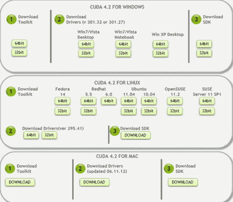

图4.6 截至2012年9月支持的Linux下载和支持的驱动程序版本。

现在使用以下命令更新grub：

```
sudo update-grub
```

最后，重新启动计算机，它应该以纯文本模式启动。安装驱动程序后，使用原始行再次启动到GUI。

现在导航到您从NVIDIA网站下载的“.run”文件所存储的位置。

然后键入

```
sudo sh NVIDIA-Linux-x86_64-285.05.33.run
```

您下载的驱动程序的具体版本当然会有所不同。系统会要求您同意NVIDIA许可证，然后需要等待几分钟，直到所有内容安装完毕。在此过程中，安装程序将尝试用必要的NVIDIA驱动程序替换默认的Nouveau驱动程序。如果询问您是否要执行此操作，请选择“是”。这是一个容易出错的过程，并非每个发行版都开箱即用。如果NVIDIA安装程序无法删除Nouveau驱动程序，则可能需要将该驱动程序列入黑名单，以便NVIDIA安装程序可以安装正确的驱动程序。

当您正确安装NVIDIA驱动程序后，请键入

```
sudo init 5
```

计算机将随后重新启动到常规图形模式。有关Ubuntu，请参见前文。

下一项任务是安装工具包。有多种可用——根据您的发行版选择Fedora、Red Hat、Ubuntu、OpenSUSE或SUSE。与之前一样，只需导航到安装SDK的位置，并通过键入以下命令运行它：

```
sudo sh <sdk_version>.run
```

其中<sdk_version>是您下载的文件。它将安装所有所需的工具并打印一条消息，指示安装成功。然后它提到您需要手动更新PATH和LD_LIBRARY_PATH环境变量。为此，您需要编辑“/etc/profile”启动文件。添加以下行：

```
export PATH=/usr/local/cuda/bin:$PATH
export LD_LIBRARY_PATH=/usr/local/cuda/lib64:$LD_LIBRARY_PATH
```

请注意，该文件必须可写。如果需要，请使用“sudo chmod +w /etc/profile”使其可写。您可以使用喜欢的编辑器编辑此文件，例如使用命令“sudo nano /etc/profile”。

现在注销并重新登录，然后键入

```
env
```

这将列出所有当前的环境变量设置。检查您刚刚修改的两个新条目。CUDA现在已安装到“/usr/local/bin”目录。

接下来我们需要GNU C++编译器。从系统上使用的任何软件安装程序安装“g++”包。

下一步是安装SDK示例代码，以便我们有东西可以构建和测试。从NVIDIA网站下载这些代码，并再次使用`sh sdk_version.run`命令运行它们（将`sdk_version`替换为您实际下载的版本）。不要以root身份运行此安装，否则您将需要以root身份登录才能构建任何示例。

默认情况下，SDK将安装到用户帐户区域的子目录中。它可能会抱怨找不到CUDA安装，并将使用默认目录（即之前安装CUDA的同一目录）。您可以安全地忽略此消息。

安装GPU计算SDK后，您需要进入“Common”子目录并运行`make`来创建一组库。

完成此操作后，SDK示例应该可以构建，从而允许您在Linux上执行第一个CUDA程序，并当然可以查看驱动程序是否正常工作。


## MAC

Macintosh 版本可用，与其他版本一样，可从 http://developer.nvidia.com/cuda-toolkit-41 获取。只需按以下顺序下载并安装软件包：

- 开发驱动程序
- CUDA 工具包
- CUDA 工具 SDK 和代码示例

CUDA 4.1 需要 Mac OS 10.6.8（Snow Leopard）或更高版本。最新版本（10.7.x）或 Lion 版本可从 Apple Store 下载，或通过从 Apple 单独购买获得。

SDK 安装在“Developer”高级目录下的“GPU Computing”目录中。只需浏览“Developer/GPU Computing/C/bin/darwin/release”目录，即可找到预编译的可执行文件。运行 deviceQuery 工具可用于验证驱动程序和运行时环境是否已正确安装。

要编译示例，需要安装 XCode。这是 Mac 上等效于 GCC（GNU C 编译器）的工具。XCode 可从 Apple Store 下载。它不是免费产品，但对 Apple 开发者计划中的任何人免费开放，该计划包括 Macintosh 和 iPhone/iPad 应用程序的开发。它在 Lion OS 发布后不久也作为 Lion OS 所有者的免费下载发布。

安装 XCode 后，只需打开终端窗口。为此，进入 Finder，打开实用工具，然后双击终端窗口。键入以下内容：

```
cd /Developer/GPU\ Computing/C/src/project
make -i
```

将 project 替换为要编译的特定 SDK 应用程序的名称。如果收到编译错误，则要么未下载 XCode 包，要么安装的版本低于所需版本。

## INSTALLING A DEBUGGER

CUDA 在 Windows 平台上提供名为 Parallel Nsight 的调试环境。它支持调试 CPU 和 GPU 代码，并突出显示效率低下的区域。在调试多线程应用程序时，它也非常有帮助。

Nsight 完全免费，是一个非常有用的工具。它只要求您注册为 CUDA 注册开发者，这也是完全免费的。注册后，您将能够从 NVIDIA 网站下载该工具。

注意，您必须安装 Visual Studio 2008 或更高版本（非 Express 版），并且必须安装 Service Pack 1。Nsight 的发行说明中有一个指向您需要安装的 SP1 下载的链接。

Parallel Nsight 分为两部分：一个集成到 Visual Studio 中的应用程序（如图 4.7 所示）和一个单独的监控应用程序。监控应用程序与主应用程序协同工作。监控程序通常驻留在与 Visual Studio 环境同一台机器上，但不一定非要如此。

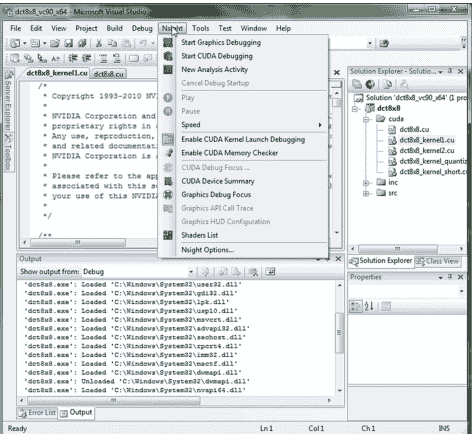

图 4.7 Nsight 集成到 Microsoft Visual Studio 中。

Parallel Nsight 最适合配备两个 CUDA 支持的 GPU 使用：一个专用 GPU 运行代码，另一个用作常规显示。因此，运行目标代码的 GPU 不能用于运行第二个显示器。由于大多数 GPU 卡都有双显示器输出，如果您有双显示器设置，可以直接从显示卡运行两个显示器。请注意，在最新版本 2.2 中，对两个 GPU 的要求已取消。

也可以设置该工具以从远程 GPU 获取数据。但是，在大多数情况下，购买低端 GPU 并将其安装到 PC 或工作站中更简单。在 Windows 上设置 Parallel Nsight 的第一步是禁用 TDR（图 4.8）。TDR（超时检测和恢复）是 Windows 中的一种机制，用于检测驱动程序级代码中的崩溃。如果驱动程序停止响应事件，Windows 会重置驱动程序。由于定义断点时驱动程序会停止，因此需要禁用此功能。

要设置该值，只需运行监控程序，然后单击监控对话框右下角的“Nsight Monitor Options”超链接。这将打开图 4.8 所示的对话框。设置

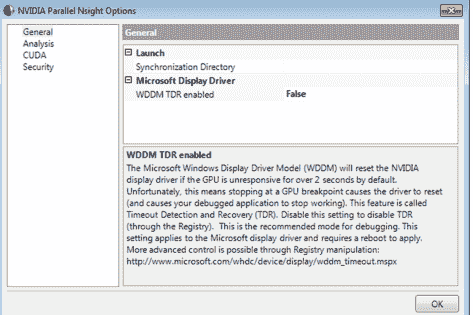

图 4.8 禁用 Windows 内核超时。

“WDDM TDR enabled”将修改注册表以禁用此功能。重新启动 PC 后，Parallel Nsight 不再会警告您 TDR 已启用。

要在远程机器上使用 Parallel Nsight，只需在远程 Windows PC 上安装监控程序包。首次运行监控程序时，它会警告您 Windows 防火墙已阻止对监控程序的“公共网络”（基于 Internet）访问，这正是您想要的。但是，该工具需要访问本地网络，因此请允许此例外，以适用于您在监控机器上设置的任何防火墙规则。与本地节点一样，安装后您需要修复 TDR 问题并重新启动一次。

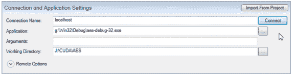

图 4.9 Parallel Nsight 远程连接。


图 4.10 Parallel Nsight 远程连接。

下一步是在主机 PC 上运行 Visual Studio 并选择新的分析活动。您将看到窗口顶部附近有一个类似图 4.9 的部分。请注意，“Connection Name”显示为 localhost，这只是指您的本地机器。打开 Windows 资源管理器并浏览本地网络，查看您想要用于远程调试的 Windows PC 的名称。将 localhost 替换为 Windows 资源管理器中显示的名称。然后按“Connect”按钮。您应该看到两个确认，表明连接已建立，如图 4.10 所示。

首先，“Connect”按钮将变为“Disconnect”。其次，“Connection Status”框应变为绿色，并显示目标机器上的所有可能 GPU（图 4.11）。在此示例中，我们正在连接一台设置了五块 GTX470 GPU 卡的测试 PC。

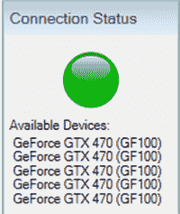

图 4.11 Parallel Nsight 连接状态。

单击“Connection Status”面板旁边的“Application Control”面板上的“Launch”按钮，将在目标机器上远程启动应用程序。但是，在此之前，所有必要文件都需要复制到远程机器。这需要几秒钟，但全是自动的。总的来说，这是一种分析/调试远程应用程序的非常简单的方法。

例如，如果您有笔记本电脑并希望调试或仅远程运行将在 GPU 服务器上运行的应用程序，您可能希望以这种方式设置 Parallel Nsight。这种用途包括当 GPU 服务器或服务器由不同时间使用它的人共享时，例如教学班。您可能还有远程开发人员需要在特别设置的测试服务器上运行代码，也许是因为这些服务器也包含大量数据，将数据传输到本地开发机器不切实际或不可取。这也意味着您不需要在可能拥有的每个远程服务器上安装 Visual C++。

在 Linux 和 Mac 方面，调试环境是 CUDA-GDB。它提供一个扩展的 GNU 调试器包。与 Parallel Nsight 类似，它允许调试主机和 CUDA 代码，包括在 CUDA 代码中设置断点、单步执行、选择调试线程等。安装 SDK 时，CUDA-GDB 和 Visual Profiler 工具默认安装，而不是像 Parallel Nsight 那样作为单独下载。截至 2012 年，Parallel Nsight 也已在 Linux 下的 Eclipse 环境中发布。

Windows 与 Mac/Linux 之间的主要区别在于分析工具支持。在这方面，Parallel Nsight 工具远优于 Visual Profiler。Visual Profiler 也可在 Windows 上使用。它提供相当高级别的概述和关于代码中需要解决什么的建议，因此非常适合刚开始使用 CUDA 的人。相比之下，Parallel Nsight 面向更高级的用户。我们将在后续章节中介绍 Parallel Nsight 和 Visual Profiler 的用法。但是，本文全文的重点是将 Parallel Nsight 作为 GPU 开发的主要调试/分析工具。

对于高级 CUDA 开发，我强烈建议使用 Parallel Nsight 进行调试和分析。对于大多数 CUDA 新手来说，Visual Profiler 和 CUDA-GDB 的组合足以支持开发。

## COMPILATION MODEL

NVIDIA 编译器 NVCC 在后台运行，当需要编译 CUDA 源文件时会被调用。表 4.1 中显示的文件扩展名用于定义文件为 CUDA 源文件或常规源文件。这决定了将调用哪个编译器，NVCC 或主机编译器。

生成的可执行文件，或胖二进制文件，包含针对不同 GPU 世代的一个或多个二进制可执行镜像。它还包含一个 PTX 镜像，允许 CUDA 运行时进行即时（JIT）编译。这与 Java 字节码非常相似，其目标是虚拟架构，并在程序调用时编译为实际目标硬件。PTX JIT

表 4.1 不同的 CUDA 文件类型

| 文件扩展名 | 含义 | 处理者 |
| :--- | :--- | :--- |
| .cu | 混合主机和设备源文件。 | NVCC |
| .cpp | .cu 文件的预处理扩展版本。 | NVCC |
| .c, .cc, .cpp | 主机 C 或 C++ 源文件。 | 主机编译器 |
| .ptx, .gpu | 中间虚拟汇编文件。 | NVCC |
| .cubin | GPU 代码的二进制镜像。 | NVCC |


编译只有在可执行文件不包含与正在使用的GPU相同的二进制镜像时才会发生。因此，所有未来的架构都与基本级虚拟架构向后兼容。即使是未针对该程序进行编译的GPU，也会通过在运行时简单编译嵌入在可执行文件中的PTX代码来执行旧版GPU代码。

与Java一样，支持代码缓存。定义环境变量CUDA_DECODED_CACHE以指向一个目录，将导致运行时保存编译后的二进制文件以供以后使用，从而避免每次调用时为未知GPU变体编译PTX代码所需的启动延迟。

我们将在后面的章节中介绍如何查看实际的目标汇编代码，即PTX到目标翻译的结果。

## 错误处理

CUDA中的错误处理，与C语言普遍情况一样，并不尽如人意。运行时执行的检查很少，如果你做了什么愚蠢的事情，运行时通常会允许它。这会导致GPU程序以奇怪的方式退出。如果你运气好，会得到一条错误消息，就像编译器错误一样，你会随时间学会解读它。

CUDA中几乎所有函数调用都返回错误类型cudaError_t，这只是一个整数值。任何cudaSuccess以外的值都将指示致命错误。这通常是由于程序在使用前未正确设置某些内容，或在对象销毁后使用对象所致。也可能是由Microsoft Windows中存在的GPU内核超时引起的，如果内核运行时间超过几秒，且在安装Parallel Nsight等工具时未禁用此功能（参见前一节）。越界内存访问可能会生成异常，这些异常通常会将各种错误消息打印到stderr（标准错误输出）。

由于每个函数都返回错误代码，因此必须检查每个函数调用并编写一些处理程序。这会导致非常乏味且缩进层级很高的编程。例如，

```
if (cudaMalloc(...) == cudaSuccess)
{
    if (cudaEventCreate(&event) == cudaSuccess)
    {
    ...
    }
    else
    {
    ...
    }
}
```

为了避免这种重复性编程，在本书中我们将使用以下宏定义来调用CUDA API：

```
#define CUDA_CALL(x) { const cudaError_t a = (x); if (a != cudaSuccess) { printf("\nCUDA Error: %s (err_num=%d) \n", cudaGetErrorString(a), a); cudaDeviceReset(); assert(0); } }
```

此宏的作用是允许你将x指定为某个函数调用，例如，

```
CUDA_CALL(cudaEventCreate(&kernel_start));
```

这样会创建一个临时变量a，并将函数的返回值（类型为cudaError_t）赋给它。然后检查它是否不等于cudaSuccess，即调用遇到了某个错误。如果检测到错误，它会将返回的错误加上对错误含义的简短描述打印到屏幕上。它还使用assert宏，该宏标识错误发生的源文件和行，以便你可以轻松追踪错误被检测到的位置。

此技术适用于所有CUDA调用，除了内核调用。内核是你编写以在GPU上运行的程序。这些程序使用<<<和>>>运算符执行，如下所示：

```
my_kernel <<<num_blocks, num_threads>>>(param1, param2...);
```

对于内核的错误检查，我们将使用以下函数：

```c
__host__ void cuda_error_check(const char * prefix, const char * postfix)
{
    if (cudaPeekAtLastError() != cudaSuccess)
    {
        printf("\n%s%s", prefix, cudaGetErrorString(cudaGetLastError()), postfix);
        cudaDeviceReset();
        wait_exit();
        exit(1);
    }
}
```

此函数应在执行内核调用后立即调用。它检查是否有任何即时错误，如果有，则打印错误消息，重置GPU，可选择通过wait_exit函数等待按键，然后退出程序。

请注意，这并非万无一失，因为内核调用与CPU代码是异步的。也就是说，在我们调用cudaPeekAtLastError时，GPU代码正在后台运行。如果此时未检测到任何错误，则不会打印任何错误，函数将继续执行下一行代码。通常，下一行代码将是从GPU内存复制回CPU内存。内核中的错误可能导致后续API调用失败，而这几乎总是内核调用后的下一个API调用。使用CUDA_CALL宏包围所有API调用将在此点标记错误。

你也可以通过在cudaPeekAtLastError调用之前简单插入对cudaDeviceSynchronize的调用，来强制内核在错误检查之前完成。但是，仅在程序的调试版本中或希望CPU在GPU忙碌时空闲时才这样做。如你在本文结束时应当理解的那样，这种同步操作对调试有好处，但会损害性能，因此你应小心，确保这些调用不会保留在生产代码中，如果它们仅为了调试而插入的话。

## 结论

你现在应该已经安装了可正常工作的CUDA SDK，包括GPU计算SDK示例和调试环境。你应该能够构建一个简单的GPU SDK示例，例如deviceQuery项目，并在运行时让它识别系统中的GPU。

## Grids, Blocks, and Threads

5

### 这全都意味着什么

NVIDIA为其调度选择了一个相当有趣的模型，一种它称之为SPMD（单程序多数据）的SIMD变体。在许多方面，这基于底层硬件实现。并行编程的核心思想是线程，即程序中单一的执行流，就像一块棉线流经一件衣服一样。正如棉线被织成布料一样，一起使用的线程构成了一个并行程序。CUDA编程模型将线程分组为它称为warps、blocks和grids的特殊组，我们将逐一介绍。

### 线程

线程是并行程序的基本构建块。大多数C程序员如果做过多核编程，都熟悉这个概念。即使你从未在任何代码中启动过线程，你也会熟悉执行至少一个线程，即任何串行代码片段中的单一执行流。

随着双核、四核、六核乃至更多核心处理器的出现，程序员被明确要求更多地利用此类硬件。过去几十年中编写的大多数程序（也许过去十年除外）都是单线程程序，因为它们运行的主要硬件是单核CPU。当然，你有集群和超级计算机，它们通过复制硬件并拥有数千台商品服务器而不是少数几台功能强大的大型机来寻求利用高度并行性。然而，这些大多局限于大学和大型机构，并不普遍可供大众使用。

从大量线程的角度思考很难。一次思考一个任务要容易得多。像C/C++这样的串行编程语言诞生于串行处理速度每隔几年就翻一番的时代。几乎不需要进行艰难的并行编程。这在近十年前停止了，而现在，无论你喜欢与否，要提高程序速度都需要我们从并行程序设计的角度思考。

### 问题分解

CPU领域的并行性往往源于在单个CPU上运行多个（单线程）程序的愿望。这就是我们之前介绍的任务级并行性。像视频编码这样的数据密集型程序使用数据并行性模型，将任务分为N个部分，其中N是可用CPU核心的数量。例如，你可以让每个CPU核心计算一帧数据，帧之间没有相互依赖。你也可以选择将每帧分为N个段，并将每个段分配给单独的核心。

在GPU领域，当你尝试通过使用多个GPU来加速计算机游戏中3D世界的渲染时，你会看到完全相同的选择。你可以将完整的交替帧发送到每个GPU（图5.1）。或者，你可以要求一个GPU渲染屏幕的不同部分。

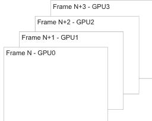

图5.1 交替帧渲染（AFR）与分帧渲染（SFR）。

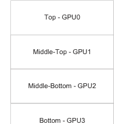

图5.2 粗粒度并行性。

然而，这里存在权衡。如果数据集是自包含的，你可以只向GPU（或CPU）提供计算所需的数据子集，从而使用更少的内存并传输更少的数据。在本文使用的SFR GPU示例中，渲染地板的GPU3可能不需要知道渲染天空的GPU0的数据内容。然而，可能会有飞行物体的阴影，或者地板的光照水平可能需要根据一天中的时间而变化。在这种情况下，由于这种共享数据，采用交替帧渲染方法可能更有益。

我们将SFR类型的分割称为粗粒度并行性。大块数据以某种方式在N个强大设备之间分割，然后在以后作为处理后的数据重建。在为并行环境设计应用程序时，这一层面的选择会严重影响程序的性能。这里的最佳选择与你将使用的实际硬件密切相关，正如你将在本书中开发的各种应用程序中看到的那样。

使用少量强大设备（例如CPU）时，问题通常是如何均匀分配工作负载。这通常更容易推理，因为你通常只讨论少量设备。使用大量较小的设备（如GPU），它们能更好地平滑工作负载高峰，但会面临同步和协调方面的问题。

就像你有宏观（大规模）和微观（小规模）经济学一样，你也有粗粒度和细粒度并行性。然而，你只有在...才真正找到细粒度并行性。


在支持大量线程的设备（例如 GPU）上，从程序员角度来看。相比之下，CPU 也支持线程，但开销较大，因此被认为更适合处理较粗粒度的并行问题。与 GPU 不同，CPU 遵循 MIMD（多指令多数据）模型，因为它们支持多个独立的指令流。这是一种更灵活的方法，但获取多个独立指令流会带来额外开销，而将单个指令流分摊到多个处理器上则没有这种开销。为了更好地理解这一点，让我们考虑一张数字照片，你对其应用图像校正函数以提高亮度。在 GPU 上，你可能会选择为图像中的每个像素分配一个线程。在四核 CPU 上，你可能会将图像的四分之一分配给每个 CPU 核心。

## CPU 和 GPU 的区别

GPU 和 CPU 在架构上是截然不同的设备。CPU 设计用于运行少量潜在的复杂任务。GPU 设计用于运行大量相当简单的任务。CPU 设计面向执行多个离散且不相关任务的系统。GPU 设计面向可以分解成数千个微小片段并单独处理的问题。因此，CPU 非常适合运行操作系统和应用软件，因为计算机在任何给定时间可能正在执行大量各异的任务。CPU 和 GPU 因此以非常不同的方式支持线程。每个 CPU 核心拥有少量寄存器，必须使用这些寄存器来执行任何给定任务。为了实现这一点，它们在任务之间快速上下文切换。CPU 上的上下文切换在时间上代价高昂，因为整个寄存器集必须保存到 RAM，然后从 RAM 恢复下一个。相比之下，GPU 也使用相同的上下文切换概念，但它们不是只有一组寄存器，而是拥有多个寄存器组。因此，上下文切换仅涉及设置一个组选择器来切换当前寄存器组的进出，这比切换到 RAM 快几个数量级。

CPU 和 GPU 都必须处理停顿条件。这些通常由 I/O 操作和内存读取引起。CPU 通过上下文切换来处理这一点。只要有足够的任务且线程的运行时间不太短，这种方式工作得相当不错。如果没有足够的进程让 CPU 保持忙碌，它就会空闲。如果有太多小任务，每个任务在短时间后阻塞，CPU 将花费大部分时间进行上下文切换，而很少时间做有用的工作。CPU 调度策略通常基于时间片，将时间平均分配给线程。随着线程数量增加，花费在上下文切换上的时间百分比会越来越大，效率开始迅速下降。

GPU 设计用于处理停顿条件，并预期这种情况会高频发生。GPU 模型是数据并行模型，因此它需要数千个线程才能高效工作。它使用这个可用工作池来确保它总是有有用的工作可做。因此，当它遇到内存读取操作或必须等待计算结果时，流处理器会简单地切换到另一个指令流，并在稍后返回到停顿的指令流。

CPU 和 GPU 之间的主要区别之一是每个设备上的处理器数量之多。CPU 通常是双核或四核设备。也就是说，它们拥有若干可用于运行程序的执行核心。当前的 Fermi GPU 拥有 16 个 SM，可以很大程度上类比为 CPU 核心。CPU 通常运行单线程程序，意味着它们每个核心、每次迭代只计算一个数据点。GPU 默认并行运行。因此，与其每个 SM 只计算一个数据点，GPU 每个 SM 计算 32 个。这在核心（SM）数量上相对于典型的四核 CPU 有 4 倍的优势，在数据吞吐量上也有 32 倍的优势。当然，CPU 程序也可以使用所有可用核心以及 MMX、SSE 和 AVX 等扩展。问题是有多少 CPU 应用程序实际使用了这些类型的扩展。

GPU 还提供了一种相当独特的功能——SM 旁的高速内存，即所谓的共享内存。在许多方面，这实现了连接机和 Cell 处理器的设计理念，因为它在标准寄存器文件之外为设备提供了本地工作空间。因此，程序员可以将数据留在此内存中，放心地知道硬件不会在未经其同意的情况下将其驱逐。它也是线程之间通信的主要机制。

## 任务执行模型

任务执行模型有两个主要区别。第一是 N 个 SP 的组以锁步方式（图 5.3）执行，运行相同的程序但处理不同的数据。第二是，由于这个巨大的寄存器文件，切换线程实际上没有开销。因此，GPU 可以支持非常大量的线程，并以这种方式设计。

那么，我们所说的锁步到底是什么意思？指令队列中的每条指令都会分发到 SM 中的每个 SP。请记住，每个 SM 可以被视为内嵌了 N 个核心（SP）的单个处理器。

传统的 CPU 会为每个 CPU 核心获取单独的指令流。此处使用的 GPU SPMD 模型允许为 N 个逻辑执行单元获取指令，这意味着你只需要传统处理器 1/N 的指令内存带宽需求。这种方法与许多高端超级计算机中发现的向量或 SIMD 处理器非常相似。

然而，这并非没有代价。如你稍后将看到，如果程序不遵循所有 N 个线程都遵循相同控制路径的整齐执行流，那么对于每个分支，你都需要额外的执行周期。

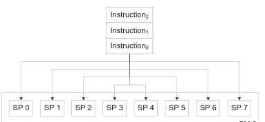

图 5.3 锁步指令分发。

## GPU 上的线程

那么回到线程话题，让我们看一段代码，看看这从编程角度意味着什么。

```c
void some_func(void)
{
    int i;

    for (i=0;i<128;i++)
    {
        a[i] = b[i] * c[i];
    }
}
```

这段代码非常简单。它将给定索引处 b 和 c 值相乘的结果存储在同一索引的结果变量 a 中。for 循环迭代 128 次（索引 0 到 127）。在 CUDA 中，你可以将其转换为 128 个线程，每个线程执行该行

```c
a[i] = b[i] * c[i];
```

之所以可能，是因为循环的一次迭代与下一次迭代之间没有依赖关系。因此，将其转换为并行程序实际上相当容易。这称为循环并行化，是较流行的并行语言扩展 OpenMP 的基础之一。

在四核 CPU 上，你也可以将其转换为四个块，其中 CPU 核心 1 处理索引 0-31，核心 2 处理索引 32-63，核心 3 处理索引 64-95，核心 4 处理索引 96-127。有些编译器会自动转换此类块，或者在程序员标记该循环可并行化时进行转换。Intel 编译器在这方面尤其出色。此类编译器可用于创建嵌入式 SSE 指令以向量化循环，同时还能生成多个线程。这提供了两级并行性，与 GPU 模型并无太大不同。

在 CUDA 中，你通过创建内核函数来转换此循环，内核函数是仅在 GPU 上执行且不能直接在 CPU 上执行的函数。在 CUDA 编程模型中，CPU 处理串行代码执行，这是其擅长的领域。当你遇到计算密集型代码段时，CPU 会将其交给 GPU，以利用其强大的计算能力。你们中有些人可能记得 CPU 曾使用浮点协处理器的时代。使用大量浮点数学的应用程序在配备此类协处理器的机器上运行速度快得多。GPU 的情况完全相同。它们用于加速程序中计算密集型的部分。

从概念上讲，GPU 内核函数与循环体完全相同，只是去除了循环结构。因此，你有如下内容：

```c
__global__ void some_kernel_func(int * const a, const int * const b, const int * const c)
{
    a[i] = b[i] * c[i];
}
```

请注意，你失去了循环和循环控制变量 i。你还在 C 函数上添加了 __global__ 前缀，告诉编译器生成 GPU 代码而不是 CPU 代码。


在编译此函数时的代码，并使该 GPU 代码从 CPU 内全局可见。

CPU 和 GPU 拥有独立的内存空间，这意味着你无法在 GPU 代码中访问 CPU 参数，反之亦然。确实有一些特殊方法可以做到这一点，我们将在本书后面介绍，但目前我们将它们视为独立的内存空间。因此，CPU 层面的全局数组 a、b 和 c 在 GPU 层面不再可见。你需要在 GPU 上声明内存空间，从 CPU 复制数组过去，并将内核函数指针传递到 GPU 内存空间，以便同时读取和写入。完成后，你将该内存复制回 CPU。我们稍后将详细介绍这一点。

接下来的问题是，i 不再被定义；相反，i 的值由你当前运行的线程为你定义。你将启动此函数的 128 个实例，最初这将以 128 个线程的形式出现。CUDA 提供了一个特殊参数，每个线程都不同，用于定义线程 ID 或编号。你可以使用它直接对数组进行索引。这与 MPI 非常相似，在 MPI 中，你会为每个进程获取进程排名。

线程信息以结构体的形式提供。由于它是结构体元素，我们将暂时将其存储在变量 thread_idx 中，以避免每次都要引用结构体。因此，代码变为：

```c
__global__ void some_kernel_func(int * const a, const int * const b, const int * const c)
{
    const unsigned int thread_idx = threadIdx.x;
    a[thread_idx] = b[thread_idx] * c[thread_idx];
}
```

注意，有些人更喜欢使用 idx 或 tid 作为线程索引的名称，因为这些名称输入起来更短。

现在发生的情况是，对于线程 0，thread_idx 计算返回 0。对于线程 1，它返回 1，依此类推，直到线程 127，它使用索引 127。每个线程从内存中恰好进行两次读取、一次乘法和一次存储操作，然后终止。请注意，每个线程执行的代码是相同的，但数据会发生变化。这是 CUDA 和 SPMD 模型的核心。

在 OpenMP 和 MPI 中，你有类似的代码块。它们为给定循环迭代提取分配给该线程的线程 ID 或线程排名。然后用它来对数据集进行索引。

## 硬件一瞥

请记住，每个 SM 上实际上只有 N 个核心，那么如何运行 128 个线程呢？好吧，与 CPU 类似，每个线程组被放置到 SM 中，N 个 SP 开始运行代码。提取线程索引后，你要做的第一件事是从 b 和 c 数组中获取一个参数。不幸的是，这不会立即发生。事实上，内存子系统返回请求数据之前，可能会过去 400–600 个 GPU 时钟周期。在此期间，这组 N 个线程会被挂起。

实际上，线程被分组为 32 个线程组，当所有 32 个线程都在等待某些东西（例如内存访问）时，它们会被挂起。这些线程组的技术术语是 warp（32 个线程）和 half warp（16 个线程），我们稍后将回到这个话题。

因此，128 个线程转化为四组 32 个线程。第一组线程一起运行以提取线程 ID，然后计算数组中的地址并发出内存获取请求（参见图 5.4）。下一条指令是乘法，它要求两个操作数都已提供，因此线程被挂起。当这组 32 个线程中的所有 32 个线程都被挂起时，硬件会切换到另一个 warp。在图 5.5 中，你可以看到，当 warp 0 因等待内存访问完成而被挂起时，warp 1 变为执行中的 warp。GPU 以这种方式继续，直到所有 warp 都移至挂起状态（参见图 5.6）。在发出内存获取之前，连续线程的获取通常会被合并或分组在一起。这减少了总延迟（响应请求的时间，因为硬件中管理每个请求都有相关开销。作为合并的结果，内存获取会返回一整组线程的数据，通常足以使整个 warp 运行。然后这些线程被置于就绪状态，并在 GPU 下次遇到阻塞操作（例如另一组线程的另一次内存获取）时可供切换。执行完所有 warp（32 个线程的组）后，GPU 会变为空闲状态，等待任何一个挂起的内存访问完成。稍后，你会从内存子系统收到一系列内存块。这些内存块很可能，但不保证，会按请求顺序返回。假设地址 0–31 同时返回。Warp 0 移至就绪队列，由于当前没有 warp 在执行，warp 0 自动移至执行状态（参见图 5.7）。逐渐地，所有挂起的内存请求都将完成，导致所有 warp 块移回就绪队列。

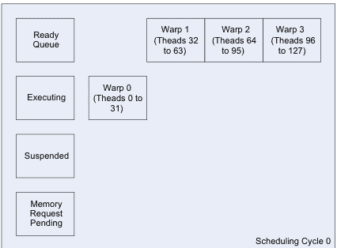

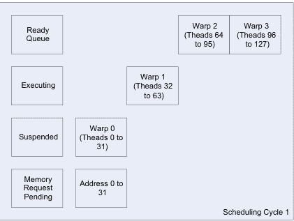

**图 5.5** 周期 1。

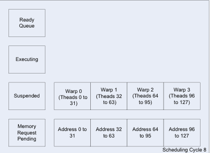

**图 5.6** 周期 8。

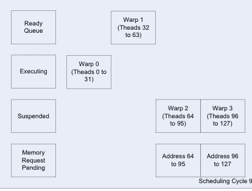

图 5.7 周期 9。

一旦 warp 0 执行完毕，其最后一条指令是向目标数组 a 写入。由于该操作没有依赖指令，warp 0 然后完成并被退役。其他 warp 也经历相同的循环，最终它们都发出了存储请求。每个 warp 然后被退役，内核完成，将控制权返回给 CPU。

## CUDA 内核

现在让我们更详细地看看如何调用内核。CUDA 定义了一种用于调用内核的 C 语言扩展。请记住，内核只是在 GPU 上执行的函数的名称。要调用内核，你使用以下语法：

```
kernel_function<<<num_blocks, num_threads>>>(param1, param2, ...)
```

你可以传递一些其他参数，我们稍后会回到这一点，但目前你需要关注两个重要参数：num_blocks 和 num_threads。它们可以是变量或字面值。我建议使用变量，因为你将在后续调优性能时使用它们。

num_blocks 参数是你尚未涉及的内容，将在下一节中详细介绍。目前你只需要确保至少有一个线程块。

num_threads 参数只是你希望启动到内核中的线程数量。对于这个简单示例，这直接对应于循环的迭代次数。但是，请注意，早期硬件每个块限制为 512 个线程，后期硬件限制为 1024 个线程。在这个示例中这不是问题，但对于任何实际程序来说，这几乎肯定是一个问题。你将在下一节中看到如何克服这一点。

内核调用的下一部分是传递的参数。参数可以通过寄存器或常量内存传递，选择取决于编译器。如果使用寄存器，每传递一个参数，每个线程将使用一个寄存器。因此，对于 128 个线程和三个参数，你使用 3 × 128 = 384 个寄存器。这听起来可能很多，但请记住，每个 SM 中至少有 8192 个寄存器，后期硬件修订版中可能更多。因此，如果在 SM 上只运行一个线程块，使用 128 个线程，你总共有 64 个寄存器（8192 个寄存器 ÷ 128 个线程）可用。

但是，每个 SM 运行一个 128 个线程的块是个非常糟糕的主意，即使你可以每个线程使用 64 个寄存器。一旦你访问内存，SM 实际上就会空闲。只有在利用 64 个寄存器进行高算术强度的非常有限情况下，你才应该考虑这种方法。在实践中，每个 SM 上运行多个块以避免任何空闲状态。

## 块

现在，512 个线程在 GPU 上实际上帮不了你多少。这对许多来自 CPU 领域的程序员来说可能听起来是个巨大的数字，但在 GPU 上，你通常需要成千上万或数以万计的并发线程，才能真正实现设备上的吞吐量。

我们在上一节关于线程的部分中，通过内核调用的 num_blocks 参数触及过这一点。这是 <<< 和 >>> 符号内的第一个参数：

```
kernel_function<<<num_blocks, num_threads>>>(param1, ....)
```

如果将此从一改为二，你要求 GPU 在硬件上调用的线程数量就会翻倍。因此，相同的调用，

```
some_kernel_func<<< 2, 128 >>>(a, b, c);
```

将把名为 some_kernel_func 的 GPU 函数调用 2 × 128 次，每次使用不同的线程。然而，这使得 thread_idx 参数（实际上是数组索引位置）的计算变得复杂。这个之前简单的内核需要稍作修改以考虑这一点。

```c
__global__ void some_kernel_func(int * const a, const int * const b, const int * const c)
{
 const unsigned int thread_id = (blockIdx.x * blockDim.x) + threadIdx.x;
 a[thread_id] = b[thread_id] * c[thread_id];
}
```

要计算 thread_idx 参数，你现在必须考虑块的数量。对于第一个块，blockIdx.x 将包含零，因此 thread_idx 参数实际上等于你之前使用的 threadIdx.x 参数。但是，对于第二个块，blockIdx.x 将保存值 1。参数 blockDim.x 保存值 128，这实际上是你在此示例中每个块请求的线程数量。因此，在添加来自 threadIdx.x 参数的线程偏移量之前，你有 1 × 128 个线程基地址。


你是否注意到在添加另一个块时我们引入的小错误？你现在总共将启动256个线程，并将数组索引从0到255。如果你不同时更改数组的大小，从128个元素改为256个元素，你将访问并写入数组末尾之外的位置。编译器不会捕获这个数组越界错误，代码实际上可能会运行，这取决于目标数组后面存放了什么。在调用内核时要小心，不要访问越界元素。

对于本示例，我们将继续使用128字节的数组大小，并将内核更改为调用两个块，每个块64个线程。

```cpp
some_kernel_func<<< 2, 64 >>>(a, b, c);
```

因此，你将得到图5.8所示的内容。

请注意，尽管现在有两个块，thread_idx参数仍然等于数组索引，与之前完全一样。那么使用块的意义是什么？在这个简单的示例中，完全没有意义。但是，在任何实际问题中，你要处理的元素远多于512个。事实上，如果你查看块数量的限制，你会发现你可以使用65,536个块。

在65,536个块，每个块512个线程的情况下，你总共可以调度33,554,432（约3350万）个线程。在512个线程时，每个SM最多可以有三个块。实际上，这个限制基于每个SM的线程总数，在最新的Fermi硬件中为1536，在原始G80硬件中仅为768。

如果你在Fermi硬件上每个块调度最大1024个线程，65,536个块将转化为约6400万个线程。不幸的是，在1024个线程时，每个SM只能有一个线程块。因此，在单个GPU中，你需要大约65,536个SM，才能无法为每个SM分配至少一个块。目前，任何显卡上发现的SM最大数量是30。因此，在SM数量超过硬件支持的块数量之前，SM数量有一定的增长空间。这是CUDA的优点之一——它可以扩展到数千个执行单元。并行性的限制实际上只是应用程序中可以找到的并行性数量的限制。

有6400万个线程，假设每个数组元素一个线程，你可以处理多达6400万个元素。假设每个元素是单精度浮点数，需要4字节的数据，你需要大约256百万字节，即256 MB的数据存储空间。几乎所有GPU卡都支持至少这么多的内存空间，因此仅使用线程和块，你就可以实现相当大的并行性和数据覆盖。

| 块0 warp 0 (线程 0 到 31) | 块0 warp 1 (线程 32 到 63) | 块1 warp 0 (线程 64 到 95) | 块1 warp 1 (线程 96 到 127) |
| :--- | :--- | :--- | :--- |
| 地址 0 到 31 | 地址 32 到 63 | 地址 64 到 95 | 地址 96 到 127 |

图5.8 块到地址的映射。

对于任何担心大型数据集的人，大型问题可能涉及千兆字节、太兆字节或拍兆字节的数据，都有一个解决方案。为此，你通常要么每个线程处理多个元素，要么使用块的另一个维度，我们将在下一节中介绍。

## 块排列

为了确保我们理解块排列，我们将编写一个短内核程序，将块、线程、warp和线程索引打印到屏幕上。现在，除非你至少拥有3.2版本的SDK，否则`printf`语句在内核中不受支持。因此，我们将数据传回CPU并在控制台窗口中打印。内核程序如下：

```cpp
__global__ void what_is_my_id(unsigned int * const block,
                              unsigned int * const thread,
                              unsigned int * const warp,
                              unsigned int * const calc_thread)
{
    /* Thread id is block index * block size + thread offset into the block */
    const unsigned int threadIdx = (blockIdx.x * blockDim.x) + threadIdx.x;

    block[threadIdx] = blockIdx.x;
    thread[threadIdx] = threadIdx.x;

    /* Calculate warp using built in variable warpSize */
    warp[threadIdx] = threadIdx.x / warpSize;

    calc_thread[threadIdx] = threadIdx;
}
```

现在在CPU上，你需要运行如下的一段代码，为GPU上的数组分配内存，然后将数组从GPU传回并显示在CPU上。

```cpp
#include <stdio.h>
#include <stdlib.h>
#include <conio.h>
__global__ void what_is_my_id(unsigned int * const block,
                              unsigned int * const thread,
                              unsigned int * const warp,
                              unsigned int * const calc_thread)
{
    /* Thread id is block index * block size + thread offset into the block */
    const unsigned int threadIdx = (blockIdx.x * blockDim.x) + threadIdx.x;

    block[threadIdx] = blockIdx.x;
    thread[threadIdx] = threadIdx.x;

    /* Calculate warp using built in variable warpSize */
    warp[threadIdx] = threadIdx.x / warpSize;

    calc_thread[threadIdx] = threadIdx;
}

#define ARRAY_SIZE 128
#define ARRAY_SIZE_IN_BYTES (sizeof(unsigned int) * (ARRAY_SIZE))

/* Declare statically four arrays of ARRAY_SIZE each */

unsigned int cpu_block[ARRAY_SIZE];
unsigned int cpu_thread[ARRAY_SIZE];
unsigned int cpu_warp[ARRAY_SIZE];
unsigned int cpu_calc_thread[ARRAY_SIZE];

int main(void)
{
    /* Total thread count = 2 * 64 = 128 */
    const unsigned int num_blocks = 2;
    const unsigned int num_threads = 64;
    char ch;

    /* Declare pointers for GPU based params */
    unsigned int * gpu_block;
    unsigned int * gpu_thread;
    unsigned int * gpu_warp;
    unsigned int * gpu_calc_thread;

    /* Declare loop counter for use later */
    int i;

    /* Allocate four arrays on the GPU */
    cudaMalloc((void **)&gpu_block, ARRAY_SIZE_IN_BYTES);
    cudaMalloc((void **)&gpu_thread, ARRAY_SIZE_IN_BYTES);
    cudaMalloc((void **)&gpu_warp, ARRAY_SIZE_IN_BYTES);
    cudaMalloc((void **)&gpu_calc_thread, ARRAY_SIZE_IN_BYTES);

    /* Execute our kernel */
    what_is_my_id<<<num_blocks, num_threads>>>(gpu_block, gpu_thread, gpu_warp,
                                               gpu_calc_thread);

    /* Copy back the gpu results to the CPU */
    cudaMemcpy(cpu_block, gpu_block, ARRAY_SIZE_IN_BYTES,
               cudaMemcpyDeviceToHost);
    cudaMemcpy(cpu_thread, gpu_thread, ARRAY_SIZE_IN_BYTES,
               cudaMemcpyDeviceToHost);
    cudaMemcpy(cpu_warp, gpu_warp, ARRAY_SIZE_IN_BYTES,
               cudaMemcpyDeviceToHost);
    cudaMemcpy(cpu_calc_thread, gpu_calc_thread, ARRAY_SIZE_IN_BYTES,
               cudaMemcpyDeviceToHost);

    /* Free the arrays on the GPU as now we're done with them */
    cudaFree(gpu_block);
    cudaFree(gpu_thread);
    cudaFree(gpu_warp);
    cudaFree(gpu_calc_thread);

    /* Iterate through the arrays and print */
    for (i = 0; i < ARRAY_SIZE; i++)
    {
        printf("Calculated Thread: %3u - Block: %2u - Warp %2u - Thread %3u\n",
               cpu_calc_thread[i], cpu_block[i], cpu_warp[i], cpu_thread[i]);
    }

    ch = getch();
}
```

在这个示例中，你会看到每个块都紧跟在前一个块之后。由于数组只有一个维度，以类似的方式布置线程块是概念化问题的一种简单方法。前一个程序的输出如下：

```
Calculated Thread: 0 - Block: 0 - Warp 0 - Thread 0
Calculated Thread: 1 - Block: 0 - Warp 0 - Thread 1
Calculated Thread: 2 - Block: 0 - Warp 0 - Thread 2
Calculated Thread: 3 - Block: 0 - Warp 0 - Thread 3
Calculated Thread: 4 - Block: 0 - Warp 0 - Thread 4
...
Calculated Thread: 30 - Block: 0 - Warp 0 - Thread 30
Calculated Thread: 31 - Block: 0 - Warp 0 - Thread 31
Calculated Thread: 32 - Block: 0 - Warp 1 - Thread 32
Calculated Thread: 33 - Block: 0 - Warp 1 - Thread 33
Calculated Thread: 34 - Block: 0 - Warp 1 - Thread 34
...
Calculated Thread: 62 - Block: 0 - Warp 1 - Thread 62
Calculated Thread: 63 - Block: 0 - Warp 1 - Thread 63
Calculated Thread: 64 - Block: 1 - Warp 0 - Thread 0
Calculated Thread: 65 - Block: 1 - Warp 0 - Thread 1
Calculated Thread: 66 - Block: 1 - Warp 0 - Thread 2
Calculated Thread: 67 - Block: 1 - Warp 0 - Thread 3
...
Calculated Thread: 94 - Block: 1 - Warp 0 - Thread 30
Calculated Thread: 95 - Block: 1 - Warp 0 - Thread 31
Calculated Thread: 96 - Block: 1 - Warp 1 - Thread 32
Calculated Thread: 97 - Block: 1 - Warp 1 - Thread 33
Calculated Thread: 98 - Block: 1 - Warp 1 - Thread 34
Calculated Thread: 99 - Block: 1 - Warp 1 - Thread 35
Calculated Thread: 100 - Block: 1 - Warp 1 - Thread 36
...
Calculated Thread: 126 - Block: 1 - Warp 1 - Thread 62
Calculated Thread: 127 - Block: 1 - Warp 1 - Thread 63
```


正如你所见，计算出的线程（或线程ID）范围是0到127。在此基础上，你分配两个块，每个块包含64个线程。每个块内的线程索引范围是0到63。你还会看到，每个块生成两个warp。

## 网格

网格简单来说是一组块，其中包含X轴和Y轴，实际上是一种2D映射。最终的Y映射为线程索引提供了Y × X × T种可能性。让我们通过一个示例来看看这一点，但开始时将Y轴限制为单行。

如果你观察一张典型的HD图像，其分辨率为1920 × 1080。块中的线程数量_始终_应该是warp大小的倍数，warp大小目前定义为32。由于你只能在硬件上调度完整的warp，如果不这样做，warp的剩余部分将闲置，并且你需要引入一个条件来确保不处理X轴末尾之外的元素。正如你稍后将看到的，这会拖慢一切。

为避免内存合并不佳，你应始终尝试安排内存和线程使用使其匹配。这将在下一章关于内存的内容中详细介绍。不这样做会导致性能大约下降五倍。

为避免使用过小的块（因为它们无法充分利用硬件），我们将选择每块192个线程。在大多数情况下，这是你应考虑使用的_最小_线程数量。这使得图像的每一行正好有10个块，这是一个易于处理的数字（图5.9）。使用X轴和warp大小的倍数作为线程大小会让事情变得容易得多。

沿X轴顶部，你拥有线程索引。行索引构成Y轴。行的高度正好是一个像素。由于你有1080行，每行10个块，总共有1080 × 10 = 10,800个块。由于每个块有192个线程，你正在调度略超过两百万个线程，每个像素对应一个线程。

这种特定的块在你对单个像素或数据点只有一个操作时很有用，_或者_当你对_同一_行中的多个数据点进行某些操作时也很有用。在Fermi硬件上，每个SM有8个块，你总共需要1350个SM（10,800个总块 ÷ 8个调度块）才能在应用程序级别耗尽并行性。在当前可用的Fermi硬件上，你只有16个SM（GTX580），因此每个SM将分配到675个块进行处理。

这一切都很好，但如果你的数据不是基于行的呢？与数组一样，你不局限于单一维度。你可以拥有2D线程块排列。许多图像算法，例如

| | 0 | 192 | 384 | 576 | 768 | 960 | 1152 | 1344 | 1536 | 1728 | 1920 |
|---|---|---|---|---|---|---|---|---|---|---|---|
| 行0 | 块0 | 块1 | 块2 | 块3 | 块4 | 块5 | 块6 | 块7 | 块8 | 块9 | |
| 行1 | 块10 | 块11 | 块12 | 块13 | 块14 | 块15 | 块16 | 块17 | 块18 | 块19 | |
| 行2 | 块20 | 块21 | 块22 | 块23 | 块24 | 块25 | 块26 | 块27 | 块28 | 块29 | |
| 行... | | | | | | | | | | | |
| 行1079 | 块10,790 | 块10,791 | 块10,792 | 块10,793 | 块10,794 | 块10,795 | 块10,796 | 块10,797 | 块10,798 | 块10,799 | |

**图5.9**
按行分配块。

示例，使用8 × 8像素块。我们在此使用像素来展示这种排列，因为大多数人都容易概念化。你的数据不必基于像素。你通常将像素表示为红、绿、蓝分量。你同样可以将x、y、z空间坐标作为单个数据点，或者一个简单的2D或3D矩阵来保存数据点。

### 步进和偏移

与C语言中的数组一样，线程块可以被视为2D结构。然而，对于2D线程块，我们需要引入一些新概念。就像在数组索引中一样，要索引2D数组中的Y元素，你需要知道数组的宽度，即X元素的数量。请参考图5.10中的数组。

数组的宽度被称为内存访问的步进。偏移是正在访问的列值，从左侧开始，始终是元素0。因此，你可以使用索引[1][5]或通过地址计算(row × (sizeof(array_element) × width)) + (sizeof(array_element) × offset))来访问数组元素5。当你在C代码中进行多维数组索引时，编译器实际上使用的就是这种计算（以优化形式）。

| 数组元素0 | 数组元素1 | 数组元素2 | 数组元素3 | 数组元素4 |
|---|---|---|---|---|
| X = 0<br>Y = 0 | X = 1<br>Y = 0 | X = 2<br>Y = 0 | X = 3<br>Y = 0 | X = 4<br>Y = 0 |
| 数组元素5 | 数组元素6 | 数组元素7 | 数组元素8 | 数组元素9 |
| X = 0<br>Y = 1 | X = 1<br>Y = 1 | X = 2<br>Y = 1 | X = 3<br>Y = 1 | X = 4<br>Y = 1 |
| 数组元素10 | 数组元素11 | 数组元素12 | 数组元素13 | 数组元素14 |
| X = 0<br>Y = 2 | X = 1<br>Y = 2 | X = 2<br>Y = 2 | X = 3<br>Y = 2 | X = 4<br>Y = 2 |

图5.10
数组到元素的映射。

现在，这与CUDA中的线程和块有何关联？CUDA的设计旨在允许将数据分解为并行线程和块。它允许你在引用程序的并行结构时定义1D、2D或3D索引（X × Y × Z）。这直接映射到典型内存区域的布局方式，允许你正在处理的数据被分配到单个SM。将数据保持在处理器附近的过程极大地提高了性能，无论是GPU还是CPU。

然而，在布局此类数组时，你必须注意一个注意事项。数组的宽度值_始终_必须是warp大小的倍数。如果不是，请将数组填充到下一个最大的warp大小倍数。填充到下一个warp大小倍数应该只会对数据集大小造成非常适度的增加。但是，请注意，你需要以不同于其余单元的方式处理填充边界（或称光晕单元）。你可以使用执行流中的分支分歧（例如，使用if语句）来实现这一点，或者你可以简单地计算填充单元并丢弃结果。我们将在本书后面介绍分支分歧及其引起的问题。

### X和Y线程索引

以块为单位拥有2D数组意味着你会得到两个线程索引，因为你将以2D方式访问数据：

```
const unsigned int idx = (blockIdx.x * blockDim.x) + threadIdx.x;
const unsigned int idy = (blockIdx.y * blockDim.y) + threadIdx.y;
```

```
some_array[idy][idx] += 1.0;
```

请注意blockIdx.x和blockDim.y的使用，CUDA运行时会为你完成这些，指定X轴和Y轴上的维度。那么，让我们修改现有程序以在32 × 16数组上工作。由于你想调度四个块，你可以将它们作为数组中的条带调度，或作为数组中的方块调度，如图5.11所示。

你也可以将条带版本旋转90度，每个线程块对应一列。绝不要这样做，因为这会导致完全未合并的内存访问，使你的应用程序性能下降一个数量级或更多。在并行化循环时要小心，确保访问模式始终按行顺序通过内存运行，而绝不按列。这同样适用于CPU和GPU代码。

那么，你为什么可能会选择方形布局而不是矩形布局呢？嗯，有两个原因。第一是同一块中的线程可以使用共享内存进行通信，这是一种非常快速的相互协作方式。第二个考虑是，你可以通过单个128字节事务而不是两个64字节事务来获得略微更快的内存访问，这是因为warp内的访问是合并的，而128字节是Fermi硬件中缓存行的大小。在方形布局中，请注意线程0到15映射到一个块，而下一个内存位置属于另一个块。结果是你会得到两个事务而不是一个，就像矩形布局一样。但是，如果数组稍大一些，比如64 × 16，那么你就不会看到这个问题，因为你会有32个线程访问连续内存，从而发出单个128字节的内存读取。

使用以下内容修改程序以使用其中任何一种布局：

```
dim3 threads_rect(32,4);
dim3 blocks_rect(1,4);
```


| 线程 0-15, 块 0 | 线程 16-31, 块 0 |
| --- | --- |
| 线程 32-47, 块 0 | 线程 48-63, 块 0 |
| 线程 64-79, 块 0 | 线程 80-95, 块 0 |
| 线程 96-111, 块 0 | 线程 112-127, 块 0 |
| 线程 0-15, 块 1 | 线程 16-31, 块 1 |
| 线程 32-47, 块 1 | 线程 48-63, 块 1 |
| 线程 64-79, 块 1 | 线程 80-95, 块 1 |
| 线程 96-111, 块 1 | 线程 112-127, 块 1 |
| 线程 0-15, 块 2 | 线程 16-31, 块 2 |
| 线程 32-47, 块 2 | 线程 48-63, 块 2 |
| 线程 64-79, 块 2 | 线程 80-95, 块 3 |
| 线程 96-111, 块 3 | 线程 112-127, 块 3 |
| 线程 0-15, 块 4 | 线程 16-31, 块 4 |
| 线程 32-47, 块 4 | 线程 48-63, 块 4 |
| 线程 64-79, 块 4 | 线程 80-95, 块 4 |
| 线程 96-111, 块 4 | 线程 112-127, 块 4 |

| 线程 0-15, 块 0 | 线程 0-15, 块 1 |
| --- | --- |
| 线程 16-31, 块 0 | 线程 16-31, 块 1 |
| 线程 32-47, 块 0 | 线程 32-47, 块 1 |
| 线程 48-63, 块 0 | 线程 48-63, 块 1 |
| 线程 64-79, 块 0 | 线程 64-79, 块 1 |
| 线程 80-95, 块 0 | 线程 80-95, 块 1 |
| 线程 96-111, 块 0 | 线程 96-111, 块 1 |
| 线程 112-127, 块 0 | 线程 112-127, 块 1 |
| 线程 0-15, 块 2 | 线程 0-15, 块 4 |
| 线程 16-31, 块 2 | 线程 16-31, 块 4 |
| 线程 32-47, 块 2 | 线程 32-47, 块 4 |
| 线程 48-63, 块 3 | 线程 48-63, 块 4 |
| 线程 64-79, 块 3 | 线程 64-79, 块 4 |
| 线程 80-95, 块 3 | 线程 80-95, 块 4 |
| 线程 96-111, 块 3 | 线程 96-111, 块 4 |
| 线程 112-127, 块 3 | 线程 112-127, 块 4 |

图 5.11 替代线程块布局。

```
dim3 threads_square(16,8);
dim3 blocks_square(2,2);
```

无论哪种排列，总线程数相同（32 x 4 = 128，16 x 8 = 128）。仅线程布局不同。

dim3 类型只是一种特殊的 CUDA 类型，用于创建二维线程布局。在矩形示例中，你表示希望在单个块内沿 X 轴有 32 个线程，沿 Y 轴有 4 个线程。然后你表示希望块的布局为宽 1 个块、高 4 个块。你需要使用以下方式调用内核：

```
some_kernel_func<<< blocks_rect, threads_rect >>>(a, b, c);
```

或

```
some_kernel_func<<< blocks_square, threads_square >>>(a, b, c);
```

由于你不再只需要一个线程 ID，而是需要 X 和 Y 位置，因此需要更新内核以反映这一点。然而，你还需要将线程 ID 线性化，因为在某些情况下你可能需要绝对线程索引。为此，我们需要介绍几个新概念，如图 5.12 所示。

你可以看到一些新参数，如下：

- gridDim.x - 网格 X 维度的块大小。
- gridDim.y - 网格 Y 维度的块大小。
- blockDim.x - 单个块 X 维度的线程大小。
- blockDim.y - 单个块 Y 维度的线程大小。

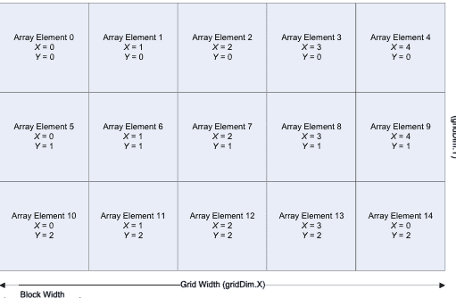

图 5.12 网格、块和线程维度。

- threadIdx.x - 块内 X 线程索引的偏移量。
- threadIdx.y - 块内 Y 线程索引的偏移量。

你可以通过计算 Y 位置并将其乘以每行的线程数来得出绝对线程索引。然后只需加上行起始处的 X 偏移量。因此，线程索引计算如下：

```
threadIdx.x = ((gridDim.x * blockDim.x) * idy) + idx;
```

因此，你需要修改内核，以额外返回 X 和 Y 位置以及一些其他有用信息，如下：

```
__global__ void what_is_my_id_2d_A(
unsigned int * const block_x,
unsigned int * const block_y,
unsigned int * const thread,
unsigned int * const calc_thread,
unsigned int * const x_thread,
unsigned int * const y_thread,
unsigned int * const grid_dimx,
unsigned int * const block_dimx,
unsigned int * const grid_dimy,
unsigned int * const block_dimy,
{
    const unsigned int idx    = (blockIdx.x * blockDim.x) + threadIdx.x;
    const unsigned int idy    = (blockIdx.y * blockDim.y) + threadIdx.y;
    const unsigned int thread_id = ((gridDim.x * blockDim.x) * idy) + idx;

    block_x[thread_id]    = blockIdx.x;
    block_y[thread_id]    = blockIdx.y;
    thread[thread_id]     = threadIdx.x;
    calc_thread[thread_id] = thread_id;
    x_thread[thread_id]   = idy;
    y_thread[thread_id]   = idx;
    grid_dimx[thread_id]  = gridDim.x;
    block_dimx[thread_id] = blockDim.x;
    grid_dimy[thread_id] = gridDim.y;
    block_dimy[thread_id] = blockDim.y;
}
```

我们将调用内核两次，以演示如何安排数组块和线程。由于现在传递了一个额外的数据集进行计算，你需要额外的 cudaMalloc、cudaFree 和 cudaMemcpy 来从设备复制数据。由于使用了两个维度，你还需要修改数组大小以分配和传输正确大小的数据。

```
#define ARRAY_SIZE_X 32
#define ARRAY_SIZE_Y 16

#define ARRAY_SIZE_IN_BYTES ((ARRAY_SIZE_X) * (ARRAY_SIZE_Y) * (sizeof(unsigned int)))

/* Declare statically six arrays of ARRAY_SIZE each */
unsigned int cpu_block_x[ARRAY_SIZE_Y][ARRAY_SIZE_X];
unsigned int cpu_block_y[ARRAY_SIZE_Y][ARRAY_SIZE_X];
unsigned int cpu_thread[ARRAY_SIZE_Y][ARRAY_SIZE_X];
unsigned int cpu_calc_thread[ARRAY_SIZE_Y][ARRAY_SIZE_X];
unsigned int cpu_warp[ARRAY_SIZE_Y][ARRAY_SIZE_X];
unsigned int cpu_grid_dimx[ARRAY_SIZE_Y][ARRAY_SIZE_X];
unsigned int cpu_grid_dimy[ARRAY_SIZE_Y][ARRAY_SIZE_X];
unsigned int cpu_block_dimx[ARRAY_SIZE_Y][ARRAY_SIZE_X];
unsigned int cpu_block_dimy[ARRAY_SIZE_Y][ARRAY_SIZE_X];

int main(void)
{
    /* Total thread count = 32 * 4 = 128 */
    const dim3 threads_rect(32, 4); /* 32 * 4 * 4 */
    const dim3 blocks_rect(1,4);

/* Total thread count = 16 * 8 = 128 */
const dim3 threads_square(16, 8); /* 16 * 8 * 8 */
const dim3 blocks_square(2,2);

/** Needed to wait for a character at exit */
char ch;

/** Declare pointers for GPU based params */
unsigned int * gpu_block_x;
unsigned int * gpu_block_y;
unsigned int * gpu_thread;
unsigned int * gpu_warp;
unsigned int * gpu_calc_thread;
unsigned int * gpu_xthread;
unsigned int * gpu_ythread;
unsigned int * gpu_grid_dimx;
unsigned int * gpu_grid_dimy;
unsigned int * gpu_block_dimx;
unsigned int * gpu_block_dimy;

/** Allocate four arrays on the GPU */
cudaMalloc((void **)&gpu_block_x, ARRAY_SIZE_IN_BYTES);
cudaMalloc((void **)&gpu_block_y, ARRAY_SIZE_IN_BYTES);
cudaMalloc((void **)&gpu_thread, ARRAY_SIZE_IN_BYTES);
cudaMalloc((void **)&gpu_calc_thread, ARRAY_SIZE_IN_BYTES);
cudaMalloc((void **)&gpu_xthread, ARRAY_SIZE_IN_BYTES);
cudaMalloc((void **)&gpu_ythread, ARRAY_SIZE_IN_BYTES);
cudaMalloc((void **)&gpu_grid_dimx, ARRAY_SIZE_IN_BYTES);
cudaMalloc((void **)&gpu_grid_dimy, ARRAY_SIZE_IN_BYTES);
cudaMalloc((void **)&gpu_block_dimx, ARRAY_SIZE_IN_BYTES);
cudaMalloc((void **)&gpu_block_dimy, ARRAY_SIZE_IN_BYTES);

for (int kernel=0; kernel < 2; kernel++)
{
switch (kernel)
{
case 0:
{
/** Execute our kernel */
/* what_is_my_id_2d<<<(blocks_rect, threads_rect)>>>(gpu_block_x, gpu_block_y,
gpu_thread, gpu_calc_thread, gpu_xthread, gpu_ythread, gpu_grid_dimx, gpu_block_dimx,
gpu_grid_dimy, gpu_block_dimy); */
break;
}
case 1:
{
/* Execute our kernel */
what_is_my_id_2d_A<<<(blocks_square, threads_square)>>(gpu_block_x, gpu_block_y,
    gpu_thread, gpu_calc_thread, gpu_xthread, gpu_ythread, gpu_grid_dimx, gpu_block_dimx,
    gpu_grid_dimy, gpu_block_dimy);
    break;

default: exit(1); break;
}

/* Copy back the gpu results to the CPU */
cudaMemcpy(cpu_block_x, gpu_block_x, ARRAY_SIZE_IN_BYTES,
    cudaMemcpyDeviceToHost);
cudaMemcpy(cpu_block_y, gpu_block_y, ARRAY_SIZE_IN_BYTES,
    cudaMemcpyDeviceToHost);
cudaMemcpy(cpu_warp, gpu_warp, ARRAY_SIZE_IN_BYTES,
    cudaMemcpyDeviceToHost);
cudaMemcpy(cpu_thread, gpu_thread, ARRAY_SIZE_IN_BYTES,
    cudaMemcpyDeviceToHost);
cudaMemcpy(cpu_xthread, gpu_xthread, ARRAY_SIZE_IN_BYTES,
    cudaMemcpyDeviceToHost);
cudaMemcpy(cpu_ythread, gpu_ythread, ARRAY_SIZE_IN_BYTES,
    cudaMemcpyDeviceToHost);
cudaMemcpy(cpu_grid_dimx, gpu_grid_dimx, ARRAY_SIZE_IN_BYTES,
    cudaMemcpyDeviceToHost);
cudaMemcpy(cpu_grid_dimy, gpu_grid_dimy, ARRAY_SIZE_IN_BYTES,
    cudaMemcpyDeviceToHost);
cudaMemcpy(cpu_block_dimx, gpu_block_dimx, ARRAY_SIZE_IN_BYTES,
    cudaMemcpyDeviceToHost);
cudaMemcpy(cpu_block_dimy, gpu_block_dimy, ARRAY_SIZE_IN_BYTES,
    cudaMemcpyDeviceToHost);

printf("\nKernel %d\n", kernel);
/* Iterate through the arrays and print */
for (int y=0; y < ARRAY_SIZE_Y; y++)
{
    for (int x=0; x < ARRAY_SIZE_X; x++)
    {
    printf("CT%u: %2u BKX: %lu BKY: %lu ThX: %2u YTID: %2u XTID: %2u GDX: %lu BDX: %lu GDY: %lu BDY: %lu\n", cpu_calc_thread[y][x], cpu_block_x[y][x], cpu_block_y[y][x],
    cpu_thread[y][x], cpu_xthread[y][x], cpu_ythread[y][x], cpu_grid_dimx[y][x],
    cpu_block_dimx[y][x], cpu_grid_dimy[y][x], cpu_block_dimy[y][x]);
    }
}

/* Wait for any key so we can see the console window */
ch = getch();

/* Wait for any key so we can see the console window */
printf("Press any key to continue\n");
}
```


```
ch = getch();
}
/* Free the arrays on the GPU as now we're done with them */
cudaFree(gpu_block_x);
cudaFree(gpu_block_y);
cudaFree(gpu_thread);
cudaFree(gpu_calc_thread);
cudaFree(gpu_ythread);
cudaFree(gpu_wthread);
cudaFree(gpu_grid_dimx);
cudaFree(gpu_block_dimx);
cudaFree(gpu_grid_dimy);
cudaFree(gpu_block_dimy);
 }
```

输出内容太大，无法在此列出。如果你在可下载的源代码部分运行该程序，你会看到程序遍历线程和块，如图 5.12 所示。

## 线程束

在讨论线程时，我们稍微提到了线程束调度。线程束是 GPU 上的基本执行单元。GPU 实际上是一组 SIMD 向量处理器。每组线程（即线程束）一起执行。这意味着，在理想情况下，只需从内存获取一次当前指令，并将该指令广播到线程束中的所有流处理器（SP）。这比 CPU 模型高效得多，CPU 模型会获取独立的执行流以支持任务级并行。在 CPU 模型中，每运行一个独立任务的核心，你都可以在概念上将内存带宽（以及有效指令吞吐量）除以核心数量。在实践中，CPU 上的多级片上缓存掩盖了其中的大部分问题，前提是程序能放入缓存中。

在传统 CPU 上，你可以找到向量类型指令，形式为 SSE、MMX 和 AVX 指令。这些指令在多个数据操作数上执行相同的单一指令。因此，对于 N 个值，你可以说将所有值加一。使用 SSE 时，你拥有 128 位寄存器，因此可以在任意时刻对四个参数进行操作。AVX 将其扩展到 256 位。这非常强大，但直到最近，除非你使用 Intel 编译器，否则对这种优化几乎没有原生支持。当前的 GNU gcc 编译器现在支持 AVX。Microsoft Visual Studio 2010 通过使用“/arch:AVX”编译器开关支持它。鉴于直到最近才缺乏这种支持，向量类型指令的使用并不像可能的那样广泛，尽管现在支持不再仅限于 Intel 编译器，这很可能会发生重大变化。

在 GPU 编程中，你别无选择：它是向量架构，并期望你编写在成千上万个线程上运行的代码。你实际上可以编写一个单线程 GPU 程序，使用一个简单的 `if` 语句检查线程 ID 是否为零，但与 CPU 相比，这会带来糟糕的性能。不过，这对于让最初的串行 CPU 实现运行起来可能很有用。这种方法允许你在将并行性引入应用程序之前，检查一些事项，例如内存复制到/从 GPU 是否正常工作。

GPU 上的线程束目前为 32 个元素，尽管 nVidia 保留将来更改此设置的权利。因此，它们提供了一个内置变量 warpSize，供你用来获取当前硬件上的线程束大小。与任何魔法数字一样，你不应该将假设的线程束大小 32 硬编码。许多针对 SSE 优化的程序都硬编码了假设的 SSE 大小为 128 位。当 AVX 发布时，仅重新编译代码是不够的。不要犯同样的错误，不要将此类细节硬编码到你的程序中。

那么，你为什么应该关心线程束的大小呢？原因有很多，我们将简要地逐一介绍。

## 分支

关心线程束大小的第一个原因是分支。因为线程束是一个单一的执行单元，分支（例如 if、else、for、while、do、switch 等）会导致执行流出现分歧。在 CPU 上，有复杂的硬件来进行分支预测，根据过去的执行情况预测给定代码段将采取哪条路径。然后，指令流会被预取并提前送入 CPU 指令流水线。假设预测正确，CPU 就能避免“停顿事件”。停顿事件非常糟糕，因为 CPU 然后必须撤销任何投机性指令执行，从另一条分支路径获取指令，并重新填充流水线。

GPU 是一个简单得多的设备，没有这些复杂性。它只是先执行分支的一条路径，然后执行另一条路径。采取分支的线程会被执行，而未采取分支的线程被标记为非活动状态。一旦采取的分支被解决，分支的另一侧就会被执行，直到线程再次汇合。请看下面的代码：

```
__global__ void some_func(void)
{
    if ( some_condition)
    {
        action_a();
    }
    else
    {
        action_b();
    }
}
```

一旦你对 some_condition 求值，你就会在至少一个块中出现分歧，否则程序中进行此测试就没有意义了。假设所有偶数线程号走真路径，所有奇数线程走假路径。线程束记分板如图 5.13 所示。

| 0 | 1 | 2 | 3 | 4 | 5 | 6 | 7 | 8 | 9 | 10 | 11 | 12 | 13 | 14 | 15 | 16 |
|---|---|---|---|---|---|---|---|---|---|---|---|---|---|---|---|---|
| + | - | + | - | + | - | + | - | + | - | + | - | + | - | + | - | + |

为简单起见，我只画出了 32 个线程中的 16 个，你马上就会明白原因。所有标记为 + 的线程走真路径或正路径，所有标记为 – 的线程走假路径或负路径。

由于硬件每个线程束只能获取一条指令流，一半的线程会停顿，另一半沿一条路径前进。这真是坏消息，因为你现在只有 50% 的硬件利用率。这有点像拥有一个双核 CPU 却只使用一个核心。许多偷懒的程序员可以这样做，但与可能达到的性能相比，性能糟糕透顶。

事实上，这里有一个技巧可以避免这个问题。就指令执行而言，实际的调度器是基于半线程束的，而不是基于线程束的。这意味着，如果你能将分歧安排在半线程束（16 线程）边界上，你就可以实际执行分支条件的两侧，即示例程序中的 if-else 结构。这样，你可以实现设备的 100% 利用率。

如果你有两种类型的数据处理，在 16 字边界上交错数据可以获得相当好的性能。代码将简单地根据线程 ID 进行分支，如下所示：

```
if ((thread_idx % 32) < 16)
{
    action_a();
}
else
{
    action_b();
}
```

C 语言中的取模运算符（%）返回操作数整数除法的余数。实际上，你从 0 数到 31，然后再循环回到 0。理想情况下，函数 action_a() 的每个 16 个线程访问一个单一的 float 或整数值。这会导致一次 64 字节的内存获取。接下来的半线程束做同样的事情，因此你发出一次 128 字节的内存获取，这正好是缓存行的大小，因此是线程束的最佳内存获取大小。

## GPU 利用率

那么，你为什么还会对线程束感兴趣呢？为了避免 GPU 利用率不足。CUDA 模型使用大量线程来隐藏内存延迟（内存请求返回所需的时间）。通常，访问全局内存（DRAM）的延迟约为 400-600 个周期。在此期间，GPU 忙于执行其他任务，而不是空闲等待内存获取完成。

当你将内核分配给 GPU 时，你可以放在 SM 上的线程最大数量目前为 768 到 2048，具体取决于计算能力。这取决于实现，因此可能会随着未来的硬件修订而更改。请快速查看表 5.1 中不同线程数量的利用率。

计算能力 1.0 和 1.2 的设备是 G80/G92 系列设备。计算能力 1.3 的设备是 GT200 系列。计算能力 2.0/2.1 的设备是 Fermi 系列。计算能力 3.0 是 Kepler。

请注意，在所有硬件级别上获得 100% 利用率的唯一一致值是 256 个线程。因此，为了最大兼容性，你应该以 192 或 256 个线程为目标。不过，数据集应与线程布局匹配以实现某些优化。因此，你还应考虑 192 线程布局，即你拥有三点数据布局的情况。


| 每块线程数/ 计算能力 | 1.0 | 1.1 | 1.2 | 1.3 | 2.0 | 2.1 | 3.0 |
|---|---|---|---|---|---|---|---|
| 64 | 67 | 67 | 50 | 50 | 33 | 33 | 50 |
| 96 | 100 | 100 | 75 | 75 | 50 | 50 | 75 |
| 128 | 100 | 100 | 100 | 100 | 67 | 67 | 100 |
| 192 | 100 | 100 | 94 | 94 | 100 | 100 | 94 |
| 256 | 100 | 100 | 100 | 100 | 100 | 100 | 100 |
| 384 | 100 | 100 | 75 | 75 | 100 | 100 | 94 |
| 512 | 67 | 67 | 100 | 100 | 100 | 100 | 100 |
| 768 | N/A | N/A | N/A | N/A | 100 | 100 | 75 |
| 1024 | N/A | N/A | N/A | N/A | 67 | 67 | 100 |

与其固定线程数量，不如直接从设备查询计算能力级别，并选择能实现最高设备利用率的最小线程数量。

现在你可能还需要考虑可以调度到给定SM中的块数量。这只有在内核中存在同步点时才真正有影响。同步点是指每个线程都必须等待其他所有线程到达同一点的地方，例如，在进行分阶段读取且所有线程都必须执行读取时。由于执行的性质，某些线程束（warp）可能向同步点取得良好进展，而某些线程束进展可能较差。

执行给定块的时间或延迟是未定义的。从负载均衡的角度来看，这不是好事。你希望有大量线程可供运行。使用256个线程，每个线程束32个线程，在计算能力2.x硬件上可得到8个线程束。对于计算能力1.x设备，任何时候最多可向给定SM调度24个线程束（32 × 24 = 768个线程）；对于计算能力2.x设备，则为48个（32 × 48 = 1536个线程）。一个块在完成其 _整个_ 执行之前不能从SM中退役。对于支持每块1024个线程的计算能力2.0.x及更高设备，你可能在等待单个线程束完成，而所有其他线程束都处于空闲状态，这实际上也会使SM空闲。

因此，线程块越大，你等待慢速线程束赶上的潜在可能性就越大，因为GPU必须等到所有线程都通过检查点才能继续。因此，过去你可能会选择较少的线程数，例如128个线程，以减少这种潜在的等待时间。然而，这会损害Fermi级硬件的性能，因为设备利用率会下降到三分之二。如表5.1所示，在计算能力2.0设备（Fermi）上，每块至少需要192个线程才能充分利用SM。

不过，你不应过分关注线程束的数量，因为它们实际上只是SM上存在的线程总数的一种度量。表5.3显示了运行的线程总数，而这个总数才是真正有趣的部分，再加上表5.1中显示的百分比利用率。

请注意，当每块线程数为128或更少时，从计算能力1.3硬件（GT200系列）迁移到计算能力2.x硬件（Fermi），运行的线程总数没有差异。这是因为SM可以调度的块数量存在限制。SM能支持的线程数

## 表5.2 每个SM的块数

| 每块线程数/ 计算能力 | 1.0 | 1.1 | 1.2 | 1.3 | 2.0 | 2.1 | 3.0 |
|---|---|---|---|---|---|---|---|
| 64 | 8 | 8 | 8 | 8 | 8 | 8 | 16 |
| 96 | 8 | 8 | 8 | 8 | 8 | 8 | 12 |
| 128 | 6 | 6 | 8 | 8 | 8 | 8 | 16 |
| 192 | 4 | 4 | 5 | 5 | 8 | 8 | 10 |
| 256 | 3 | 3 | 4 | 4 | 6 | 6 | 8 |
| 384 | 2 | 2 | 2 | 2 | 4 | 4 | 5 |
| 512 | 1 | 1 | 2 | 2 | 3 | 3 | 4 |
| 768 | N/A | N/A | 1 | 1 | 2 | 2 | 2 |
| 1024 | N/A | N/A | 1 | 1 | 1 | 1 | 2 |

## 表5.3 每个SM的总线程数

| 每块线程数/ 计算能力 | 1.0 | 1.1 | 1.2 | 1.3 | 2.0 | 2.1 | 3.0 |
|---|---|---|---|---|---|---|---|
| 64 | 512 | 512 | 512 | 512 | 512 | 512 | 1024 |
| 96 | 768 | 768 | 768 | 768 | 768 | 768 | 1536 |
| 128 | 768 | 768 | 1024 | 1024 | 1024 | 1024 | 2048 |
| 192 | 768 | 768 | 960 | 960 | 1536 | 1536 | 1920 |
| 256 | 768 | 768 | 1024 | 1024 | 1536 | 1536 | 2048 |
| 384 | 768 | 768 | 768 | 768 | 1536 | 1536 | 1920 |
| 512 | 512 | 512 | 1024 | 1024 | 1536 | 1536 | 2048 |
| 768 | N/A | N/A | N/A | N/A | 1536 | 1536 | 1536 |
| 1024 | N/A | N/A | N/A | N/A | 1024 | 1024 | 2048 |

有所增加，但块的数量没有。因此，为了获得更好的扩展性，你需要确保每块至少有192个线程，最好要多得多。

## 块调度

假设你有1024个块需要调度，以及八个SM来调度这些块。使用Fermi硬件时，每个SM最多可接受8个块，但前提是每块的线程数量较少。在合理的线程数量下，你通常会看到每个SM有6到8个块。

现在，1024个块除以六个SM，每个SM有170个完整块，外加4个剩余块。我们稍后会看剩余块，因为这会引起一个有趣的问题。

对于可分配给SM的1024个块，应该如何分配？硬件可以将6个块分配给第一个SM，6个给第二个SM，以此类推。或者，它可以轮流向每个SM分发1个块，即SM 0获得块0，SM 1获得块1，SM 2获得块2，等等。NVIDIA没有指定使用什么方法，但很可能是后者，以便在SM之间实现合理的负载平衡。

如果你有19个块和四个SM，将块分配给一个SM直到它填满不是个好主意。前三个SM每个会得到6个块，而最后一个SM只得到一个块。最后一个SM可能会很快完成，然后空闲等待其他SM。可用硬件的利用率很差。

如果你以轮换方式将块分配给交替的SM，每个SM得到4个块（4个SM × 4个块 = 总共16个），并且三个SM各额外得到一个块。假设每个块执行时间相同，你仅通过在SM之间平衡块，而不是让某些SM过载而其他SM负载不足，就将执行时间减少了17%。

在实际中，典型应用通常需要处理数百个或数万个块。在完成向SM的初始块分配后，块分发器将处于空闲状态，直到任何一个SM上的某个块完成。此时，该块被退役，该块使用的资源变为空闲。由于所有块大小相同，等待块列表中的任何块都可以被调度。块的执行顺序被故意设为未定义，在编程解决问题时，不应有任何隐含假设认为块会按任何顺序执行。

如果正在执行某些结合运算（例如浮点加法，在实际中并不满足结合律），这可能会导致严重问题。在浮点数学中，对数组进行加法的执行顺序会影响结果。这是由于舍入误差以及浮点数学的工作方式造成的。在所有情况下，结果都是正确的。这不是并行执行问题，而是顺序问题。你在单线程CPU代码中也会看到完全相同的问题。如果你在CPU或GPU的浮点数组中，从下到上或从上到下添加一组随机数，你会得到不同的答案。也许更糟糕的是，在GPU上，由于块调度未定义，对同一数据的多次运行可能会产生不同但正确的答案。有处理此问题的方法，我们将在本书后面介绍。所以目前，只需意识到，因为结果与之前不同，并不一定意味着结果不正确。

回到剩余块的问题，每当块数不是SM数的倍数时，你都会遇到这种情况。通常，CUDA设备出厂时带有奇数个SM，因为制造大型复杂处理器很困难。随着制造处理器所使用的硅量增加，某个部分出现故障的可能性会显著增加。NVIDIA像许多处理器制造商一样，只是禁用有故障的SM，并将设备作为较低规格的单元出货。这提高了良率，并为原本有故障的设备提供了一些经济价值。然而，对于程序员来说，这意味着SM的总数不总是2的倍数。Fermi 480系列显卡，以及Tesla S2050/S2070/C2050/C2070系列，拥有16个SM的设备，其中1个SM被禁用，因此变成了15个SM。这个问题在580系列中得到了解决，但随着未来GPU一代的发布，这个问题很可能会重现。

有少量剩余块通常只有在你有非常长的内核并且需要等待每个内核完成时才是个问题。例如，你可能在有限时间步模拟中看到这种情况。如果你有16个块，假设是Fermi 480系列显卡，15个块会被分配给每个SM。剩余的块只有在其他15个块中的一个完成后才会被调度。如果每个内核执行需要10分钟，那么所有块可能会在大约同一时间完成。这


GPU 然后会调度一个额外的块，完整的内核调用将为这个单个块的执行再等待 10 分钟。同时，其余 14 个可用的 SM 将处于空闲状态。解决这个问题的方法是提供更好的粒度，将少量块分解为大量块。

在服务器环境中，你可能不仅仅有 15 个 SM，而是多个节点，每个节点都有多个 GPU。如果它们唯一的任务就是这个内核，那么在内核调用结束时它们很可能会空闲。在这种情况下，以某种方式重新设计内核可能更好，以确保块的数量是每个节点上 SM 数量的精确倍数。

从负载均衡的角度来看，这个问题显然不理想。因此，在较新的 CUDA 运行时中，你可以支持重叠内核并在同一 CUDA 设备上运行多个独立的内核。使用这种方法，如果你有多个作业来源需要调度到 GPU 集群上，就可以保持吞吐量。当 CUDA 设备开始空闲时，它们会从可用内核流中获取另一个内核，而不是空闲等待。

## 实际示例——直方图

直方图在编程问题中很常见。它们通过统计数据在若干个“桶”中的分布来工作。当数据点包含与给定桶关联的值时，该桶中的值会递增。

在最简单的示例中，你有 256 个桶，数据范围从 0 到 255。你遍历一个字节数组。如果数组中元素的值为 0，则递增桶 0。如果元素的值为 10，则递增桶 10，以此类推。

从串行角度来看，该算法非常简单：

```
for (unsigned int i=0; i< max; i++)
{
bin[array[i]]++;
}
```

在这里，你通过索引 i 从数组中提取值。然后使用 ++ 运算符递增相应的桶。

当将串行实现转换为并行问题时，会遇到一个问题。如果使用 256 个线程执行此操作，就会有多个线程同时递增同一个桶中的值。

如果你看看 C 语言是如何转换为汇编语言的，你会发现执行这段代码需要一系列汇编指令。这些指令可以分解为：

- 将数组中的值读入寄存器。
- 计算正确桶元素的基地址和偏移量。
- 获取现有的桶值。
- 将桶值加一。
- 将新的桶值写回内存中的桶。

问题是第三、四、五步不是原子操作。原子操作是指在完成之前不能被中断的操作。如果以 CUDA 线程模型中那样的同步步调执行此伪代码，就会出现问题。两个或多个线程在第三步获取相同的值。它们都对其递增并写回。最后执行写入操作的线程获胜。该值应该被递增 N 次，但实际上只被递增了一次。所有线程读取相同的值来应用递增，因此你丢失了对该值的 N 次递增。

这里的问题是，你在串行执行版本中看不到的数据依赖关系。桶值的每次递增必须在下一个线程读取和递增之前完成。线程之间存在共享资源。

这并非罕见问题，CUDA 为此提供了一种称为

```
atomicAdd(&value);
```

该操作保证加法操作在所有线程中是串行化的。

现在解决了这个问题，你面临真正的选择——如何将需要覆盖的任务结构化为线程、块和网格。有两种方法：任务分解模型或数据分解模型。两者通常都需要考虑。

使用任务分解模型，你只需为输入数组中的每个元素分配一个线程，并让它执行原子加法。这是最简单的编程解决方案，但存在一些主要缺点。你必须记住，这实际上是一个共享资源。如果你有 256 个桶和一个包含 1024 个元素的数组，假设分布均匀，则每个桶有 4 个元素在竞争。对于大型数组（使用 CUDA 处理小型数组没有意义），这个问题成为决定总执行时间的主导因素。

如果假设直方图中的值分布均匀（通常并非如此），争夺任何单个桶的元素数量就是数组元素大小除以桶的数量。对于 512 MB 数组（524,288 个元素），每个桶将有 131,072 个元素在竞争。在最坏的情况下，所有元素都写入同一个桶，因此实际上由于原子内存写入的串行化，你得到了一个串行程序。

在这两种示例中，执行时间都受限于硬件处理这种竞争的能力以及读/写内存带宽。

让我们看看这在现实中是如何工作的。这是用于此目的的 GPU 程序。

```
/* Each thread writes to one block of 256 elements of global memory and contends for write access */
__global__ void myhistogram256Kernel_01(
    const unsigned char const * d_hist_data,
    unsigned int * const d_bin_data)
{
    /* Work out our thread id */
    const unsigned int idx = (blockIdx.x * blockDim.x) + threadIdx.x;
    const unsigned int idy = (blockIdx.y * blockDim.y) + threadIdx.y;
    const unsigned int tid = idx + idy * blockDim.x * gridDim.x;
    /* Fetch the data value */
    const unsigned char value = d_hist_data[tid];

    atomicAdd(&d_bin_data[value],1);
}
```

使用 GTX460 显卡，我们通过这种方法测得了 1025 MB/s。有趣的是，它不会随数组元素数量而扩展。无论数组大小如何，性能始终很差。请注意，用于此测试的 GPU 是 1 GB GTX460，其内存带宽为 115 GB/s，这表明实现朴素解决方案可以达到多么糟糕的性能。

这个数字虽然不好，但只是告诉你受到某个因素的限制，作为程序员，你的工作是找出是哪个因素并将其消除。影响此类程序性能的最可能因素是内存带宽。你正在从输入数组中获取 _N_ 个值，并将它们压缩为对一个小型 1 K（256 个元素 × 每个整数计数器 4 字节）内存区域的 _N_ 次写入。

如果首先查看内存读取，你会发现每个线程读取数组的一个 _字节_ 元素。读取在半 warp 级别（16 个线程）合并在一起（合并）。最小传输大小为 32 字节，因此你大约浪费了 50% 的读取内存带宽，这非常糟糕。半 warp 的最佳内存获取是最大支持大小，即 128 字节。为此，每个线程需要获取 4 字节的内存。你可以通过让每个线程处理四个直方图条目而不是一个来实现这一点。

我们可以通过读取单个整数来发出 4 字节读取，然后如图 5.14 所示提取该整数的组成部分。这应该提供更好的读取合并，从而获得更好的性能。修改后的内核如下：

```
/** Each read is 4 bytes, not one, 32 x 4 = 128 byte reads */
__global__ void myhistogram256Kernel02(
    const unsigned int * const d_hist_data,
    unsigned int * const d_bin_data)
{
    /* Work out our thread id */
    const unsigned int idx = (blockIdx.x * blockDim.x) + threadIdx.x;
    const unsigned int idy = (blockIdx.y * blockDim.y) + threadIdx.y;
    const unsigned int tid = idx + idy * blockDim.x * gridDim.x;
    /* Fetch the data value as 32 bit */
    const unsigned int value_u32 = d_hist_data[tid];
    atomicAdd(&d_bin_data[(value_u32 & 0x000000FF)], 1);
    atomicAdd(&d_bin_data[(value_u32 & 0x0000FF00) >> 8], 1);
    atomicAdd(&d_bin_data[(value_u32 & 0x00FF0000) >> 16], 1);
    atomicAdd(&d_bin_data[(value_u32 & 0xFF000000) >> 24], 1);
}
```

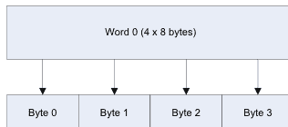

图 5.14 字到字节映射。

运行内核时，你会发现尽管付出了所有努力，却没有实现任何加速。事实上，在尝试优化程序时，这种情况相当常见。这是一个相当强烈的指标，表明你没有理解瓶颈的原因。

这里需要注意的一个问题是，在计算能力 2.x 中，硬件不再受限于只能合并半个 warp 的数据，而是可以进行全 warp 合并。因此，在测试设备（GTX460，计算能力 2.1 硬件）上，单个 warp 发出的 32 次单字节获取被合并为一次 32 字节读取。

明显的嫌疑人是原子写入操作，而不是通常的内存带宽罪魁祸首。为此，你需要查看数据分解模型提供的替代方法。在这里，你从数据流方面来看这个方程，寻找数据重用，并优化数据大小，使其能有效地与共享资源（如缓存或共享内存）协同工作。

你可以看到，对 256 个桶的竞争是一个问题。当多个块从多个 SM 写入内存时，硬件需要在所有处理器的缓存中同步桶数组的值。为此，它需要从内存获取当前值，将其递增，然后写回。这个值有可能永久保留在 L2 缓存中，L2 缓存在 Fermi 硬件世代的 SM 之间共享。对于计算能力 1.x 硬件，你正在读写全局内存，因此这种方法慢一个数量级。

即使你可以在 Fermi 硬件上使用 L2 缓存，你仍然需要离开 SM 与所有其他 SM 同步。除此之外，你生成的写入模式是分散的模式，很大程度上取决于直方图输入数据的性质。这意味着没有或很少的合并，这又严重损害了性能。

一种替代方法是在每个 SM 内构建直方图，然后在最后将直方图写入主内存。无论是 CPU 还是 GPU 编程，这都是你应始终努力实现的方法。你越充分利用靠近处理器（在此例中为 SM）的资源，程序运行就越快。

我们之前提到过，可以使用共享内存，这是一种位于芯片上的特殊内存形式，因此速度非常快。你可以在共享内存中创建一个 256 桶直方图，然后在最后对全局内存执行原子加法。假设你每个块只处理一个直方图，你不


减少全局内存读取或写入的次数，但你确实会将所有写入内存合并。此方法的内核如下：

```
__shared__ unsigned int d_bin_data_shared[256];

/* Each read is 4 bytes, not one, 32 x 4 = 128 byte reads */
__global__ void myhistogram256Kernel_O3(
const unsigned int * d_hist_data,
unsigned int * const d_bin_data,
)
{
/* Work out our thread id */
const unsigned int idx = (blockIdx.x * blockDim.x) + threadIdx.x;
const unsigned int idy = (blockIdx.y * blockDim.y) + threadIdx.y;
const unsigned int tid = idx + idy * blockDim.x * gridDim.x;

/* Clear shared memory */
d_bin_data_shared[threadIdx.x] = 0;

/* Fetch the data value as 32 bit */
const unsigned int value_u32 = d_hist_data[tid];

/* Wait for all threads to update shared memory */
__syncthreads();

atomicAdd(&d_bin_data_shared[ ((value_u32 & 0x000000FF) >> 0) ], 1);
atomicAdd(&d_bin_data_shared[ ((value_u32 & 0x0000FF00) >> 8 ) ], 1);
atomicAdd(&d_bin_data_shared[ ((value_u32 & 0x00FF0000) >> 16 ) ], 1);
atomicAdd(&d_bin_data_shared[ ((value_u32 & 0xFF000000) >> 24 ) ], 1);

/* Wait for all threads to update shared memory */
__syncthreads();

/* The write the accumulated data back to global memory in blocks, not scattered */
atomicAdd(&d_bin_data[threadIdx.x], d_bin_data_shared[threadIdx.x]);
}
```

该内核必须对共享内存执行额外的清除操作，否则会有其他内核留下的随机数据。请注意，你需要等待（__syncthreads()），直到块中所有线程都已清除共享内存中的各自内存单元，然后才允许线程更新任何共享内存单元。在结束时也需要执行相同的同步操作，以确保每个线程都已完成，然后再将结果写回全局内存。

你会发现，仅仅通过按顺序安排写入操作以便它们可以被合并，性能就突然提升了六倍。现在你可以达到6800 MB/s的处理速度。但是请注意，你只能在计算能力1.2或更高的设备上这样做，因为只有这些设备支持共享内存原子操作。

既然顺序已经正确，你需要着手减少全局内存流量。你必须从源数据中读取每个值，并且每个值只读取一次。你已经对读取访问使用了最佳传输大小，因此让我们来看看正在写入的数据。如果你每个块处理N个直方图而不是一个直方图，你将按N的因子减少写入带宽。

表5.4显示了使用Fermi 460卡（包含七个SM）处理不同N值时，512 MB直方图所达到的数值。你可以看到在N值为64时达到7886 MB/s的峰值。内核如下：

```
/* Each read is 4 bytes, not one, 32 x 4 = 128 byte reads */
/* Accumulate into shared memory N times */
__global__ void myhistogram256Kernel_O7(const unsigned int * d_hist_data,
                                        unsigned int * const d_bin_data,
                                        unsigned int N)
{
    /* Work out our thread id */
    const unsigned int idx = (blockIdx.x * (blockDim.x*N) ) + threadIdx.x;
    const unsigned int idy = (blockIdx.y * blockDim.y ) + threadIdx.y;
    const unsigned int tid = idx + idy * (blockDim.x*N) * (gridDim.x);

    /* Clear shared memory */
    d_bin_data_shared[threadIdx.x] = 0;

    /* Wait for all threads to update shared memory */
    __syncthreads();

    for (unsigned int i=0, tid_offset=0; i < N; i++, tid_offset+=256)
    {
        const unsigned int value_u32 = d_hist_data[tid+tid_offset];
        atomicAdd(&d_bin_data_shared[ (value_u32 & 0x000000FF) >> 0 ], 1);
        atomicAdd(&d_bin_data_shared[ (value_u32 & 0x0000FF00) >> 8 ], 1);
        atomicAdd(&d_bin_data_shared[ (value_u32 & 0x00FF0000) >> 16 ], 1);
        atomicAdd(&d_bin_data_shared[ (value_u32 & 0xFF000000) >> 24 ], 1);
    }
    /* Wait for all threads to update shared memory */
    __syncthreads();

    /* The write the accumulated data back to global memory in blocks, not scattered */
    atomicAdd(&d_bin_data[threadIdx.x], d_bin_data_shared[threadIdx.x]);
}
```

让我们稍微研究一下这一点，因为理解你在这里所做的事情很重要。你有一个运行N次迭代的循环i。这是你将256字节的数据处理到共享内存直方图中的次数。内核调用了256个线程，每个bin一个。因此，你唯一需要的循环是遍历要处理的直方图数量的循环。完成一次迭代后，你在内存中向前移动256字节来处理下一个直方图（tid_offset += 256）。

还要注意，由于你在整个过程中都使用原子操作，因此只需在内核的开始和结束处设置同步点。添加不必要的同步点通常会减慢程序速度，但可以导致内存中更统一的访问模式。

## 表5.4 直方图结果

| 因子 | MB/s | 总块数 | 每个SM的完整块数 | 余数块 |
|---|---|---|---|---|
| 1 | 6766 | 524,288 | 74,898 | 3 |
| 2 | 7304 | 262,144 | 37,449 | 1 |
| 4 | 7614 | 131,072 | 18,724 | 6 |
| 8 | 7769 | 65,536 | 9362 | 3 |
| 16 | 7835 | 32,768 | 4681 | 1 |
| 32 | 7870 | 16,384 | 2340 | 6 |
| 64 | 7886 | 8192 | 1170 | 3 |
| 128 | 7884 | 4096 | 585 | 1 |
| 256 | 7868 | 2048 | 292 | 6 |
| 512 | 7809 | 1024 | 146 | 3 |
| 1024 | 7737 | 512 | 73 | 1 |
| 2048 | 7621 | 256 | 36 | 6 |
| 4096 | 7093 | 128 | 18 | 3 |
| 8192 | 6485 | 64 | 9 | 1 |
| 16,384 | 6435 | 32 | 4 | 6 |
| 32,768 | 5152 | 16 | 2 | 3 |
| 65,536 | 2756 | 8 | 1 | 1 |

这里有趣的是，当你开始每个块处理32个或更多直方图时，吞吐量没有实际增加。每次增加_N_的值时，全局内存带宽都会下降一倍。如果全局内存带宽确实是问题所在，那么每增加一个_N_因子，你都应该看到线性加速。那么发生了什么？

主要问题是原子操作。每个线程都必须与其他线程竞争对共享数据区域的访问。数据模式对执行时间有巨大影响，这不是一个好的设计。

我们将在稍后讨论如何编写此类算法而无需使用原子操作时再回到这个问题。

## 结论

本章我们涵盖了大量内容，你现在应该熟悉CUDA如何将任务分解为网格、块和线程。我们介绍了硬件上块和warp的调度，以及确保硬件上始终有足够线程的必要性。

CUDA使用的线程模型是理解如何高效编程GPU的基础。你应该理解CPU和GPU在编程上本质上是完全不同的“野兽”，但同时它们之间也是相互关联的。

你已经看到，线程相对于要处理的数据的排列非常重要，并影响性能。你还看到，特别是对于需要共享数据的应用程序，并行化特定问题并不总是一件容易的事。你应该注意，花时间考虑正确的方法通常比直接采用第一个看似合适的方案要重要一些。

我们还介绍了原子操作的使用以及它们引起的一些序列化问题。我们简要提及了分支可能引起的问题，你应该牢记确保所有线程遵循相同控制路径的必要性。我们将在本书后面更详细地探讨原子操作和分支。

你已经接触过CUDA中使用的扩展C语法，并且应该能够在清楚了解将要发生的情况的前提下编写CUDA程序。

通过阅读本章，你已经获得了大量知识，希望不再觉得CUDA或并行编程有点像“黑魔法”。

## 问题

- 1. 找出本章开发的直方图算法的最佳和最差数据模式。是否存在常见的问题用例？你如何克服这个问题？

- 2. 在不运行算法的情况下，你认为在基于G80设计的旧硬件上运行此代码可能会产生什么影响？

- 3. 在CPU上处理内存中的数组时，按行-列顺序还是列-行顺序遍历最好？当将代码移植到GPU时，这种情况会改变吗？

- 4. 考虑一段使用四个256线程块的代码，以及同一代码使用一个1024线程块的情况。哪个可能先完成，为什么？每个块在代码的各个点上使用四次syncthreads()调用。块不需要互锁协作。

- 5. 与我们在多核CPU中发现的MIMD实现相比，我们在GPU中发现的基于SIMD的实现有哪些优点和缺点？

## 答案

- 1. 最佳情况是数据均匀分布。这是因为这使桶均匀加载，因此你在可用的共享内存银行上获得原子操作的均匀分布。最差情况是相同的数据值。这会导致所有线程不断命中同一个共享内存桶，通过原子操作和共享内存中的银行冲突，使整个程序序列化。不幸的是，一种非常常见的用法是使用排序后的数据。这提供了最差情况用法的变体。在这里，一个接一个的银行会被原子写入连续命中，有效地将问题序列化。一种解决方案是遍历数据集，使每次迭代都写入一个新桶。这需要了解数据分布。例如，考虑使用32个桶对256个数据点建模线性函数的情况。假设数据点0到31落入第一个桶，并且这对每个桶都复制。通过为每个桶处理一个值，你可以将写入分布到桶中并避免竞争。在此示例中，你将读取数据点0、32、64、96、1、33、65、97、2、34、66、98，等等。

- 2. G80设备（计算能力1.0、计算能力1.1）不支持共享内存原子操作，因此代码无法编译。假设你将其修改为使用全局内存原子操作，我们在本章前面提供的示例中看到了七倍的性能下降。


- 3. 行-列顺序是最佳的，因为 CPU 很可能会使用预取技术，确保随后要访问的数据会在缓存中。至少，整个缓存行会从内存中获取。因此，当 CPU 进行基于行的访问的第二次迭代时，a[0] 会将 a[1] 预取到缓存中。

- 4. 在 syncthreads() 操作期间，整个块会停滞，直到每个线程都达到 syncthreads() 检查点。此时，它们都会再次可用于调度。每个块中拥有非常多的线程可能意味着，在等待单个块中的线程达到检查点时，SM 会耗尽其他可用的 warp 来调度。哪个线程何时执行的执行格式是未定义的。这意味着有些线程比其他线程能更快地达到 syncthreads() 检查点。这是硬件层面为了吞吐量而非延迟所做的设计决策的结果。每个块中非常高的线程数通常只有在块中的线程需要相互通信，而无需通过全局内存进行块间通信时才有用。

- 5. SIMD 模型将指令获取时间分摊到许多执行单元上，在这些单元中指令流是相同的。但是，当指令流分叉时，执行必须串行化。MIMD 模型是为分叉执行流设计的，当流分叉时不需要停滞线程。但是，多个获取和解码单元需要更多的硅面积和更高的指令带宽要求，以维持多个独立的执行路径。

SIMD 和 MIMD 的混合通常是处理控制流和大数据集相同操作的最佳方式。你在 CPU 中可以看到这一点，体现在 SSE/MMX/AVX 支持上。你在 GPU 中可以看到这一点，体现在 warps 和 blocks 允许在更高粒度上进行分叉。

本页故意留空

## 使用 CUDA 进行内存处理

### 简介

在传统的 CPU 模型中，我们有所谓的线性或平坦内存模型。这是指任何单个 CPU 核心都可以无限制地访问任何内存位置。在实际的 CPU 硬件中，你通常会看到一级（L1）、二级（L2）和三级（L3）缓存。那些来自高性能计算（HPC）背景并优化过 CPU 代码的人对此都太熟悉了。然而，对于大多数程序员来说，这是他们可以轻松抽象掉的东西。

抽象一直是现代编程语言的趋势，程序员与底层硬件越来越疏远。虽然这可以提高生产力，因为问题可以在非常高的层级上指定，但它在很大程度上依赖于聪明的编译器将这些抽象实现为硬件能理解的层级。虽然理论上很棒，但现实可能不如营销梦想那么美好。我相信在未来的几十年里，我们会看到编译器和语言的巨大改进，使它们能够自动利用并行硬件。然而，在此之前，并且在我们到达那里之前，了解硬件如何工作将是从任何平台中榨取最佳性能的关键。

要在基于 CPU 的系统上获得真正的性能，你需要了解缓存的工作原理。我们将先从 CPU 方面探讨这一点，然后再看看与 GPU 的相似之处。缓存的理念是，大多数程序以串行方式执行，在其执行流中包含各种循环结构。如果程序调用一个函数，那么程序很快可能会再次调用它。如果程序访问某个特定的内存位置，那么大多数程序可能会在短时间内再次访问同一个位置。这就是时间局部性原理，即一旦你使用过/执行过数据和代码，就很有可能会重复使用数据并重新执行相同的代码。

从计算机系统的主内存 DRAM 获取数据非常慢。从历史上看，DRAM 与处理器时钟速度相比一直非常慢。随着处理器时钟速度的提高，DRAM 速度落后得越来越多。

当今处理器中的 DDR-3 DRAM 标准运行速度最高可达 1.6 GHz，尽管使用某些高速模块和合适的处理器可以将其提升到最高 2.6 GHz。但是，每个 CPU 核心通常运行在大约 3 GHz 左右。如果没有缓存来提供对内存区域的快速访问，DRAM 的带宽对 CPU 来说将不足。由于代码和数据都存在于 DRAM 空间中，如果 CPU 无法从 DRAM 足够快地获取程序或数据，那么它实际上就是指令吞吐量受限（即在给定时间内执行多少条指令）。

这就是内存带宽的概念，即在给定时间内我们可以读取或存储到 DRAM 的数据量。但是，还有另一个重要概念，即延迟。延迟是响应获取请求所需的时间。这可能需要数百个处理器周期。如果程序想要从内存中获取四个元素，那么合理的做法是一次性发出所有请求，然后等待它们到达，而不是发出一个请求，等待它到达，再发出下一个请求，等待，以此类推。如果没有缓存，处理器将非常受内存带宽和延迟的限制。

要用日常术语来理解带宽和延迟，可以想象超市结账流程。在给定的商店中，有 N 个结账通道可用，但并非所有通道都有工作人员。如果只有两个结账通道处于活动状态（有工作人员），那么顾客排队等候付款时，后面会形成一条长队。吞吐量或带宽是在给定时间段内（例如，一分钟）处理的顾客数量。顾客在队列中等待的时间是延迟的度量，即顾客加入队列后，等待了多久才能付款并离开。

当队列变大时，店主可能会开设更多结账点，队列会在新旧结账点之间分散。开设两个新结账点后，结账区域的带宽翻倍，因为在相同时间内可以服务两倍的人数。延迟也减半，因为平均而言，队列只有一半长，因此每个人只需等待一半的时间。

然而，这并非没有代价。雇佣更多结账助手需要花钱，而且更多的零售空间必须分配给结账点，而不是产品货架空间。处理器设计中也存在同样的权衡，体现在内存总线宽度和存储器件的时钟频率上。设备上的硅面积有限，外部内存总线的宽度通常受限于处理器上的物理引脚数量。

我们还需要考虑的另一个概念是事务开销。处理每个客户的付款都有一定的开销。有些客户篮子里可能只有两三件商品，而另一些客户则可能推着满满的购物车。店主喜欢推购物车的购物者，因为他们可以被高效处理，也就是说，结账人员的更多时间用于结账杂货，而不是用于处理付款的开销。

在 GPU 中也能看到同样的情况。与处理它们的固定开销相比，有些内存事务比较轻量。相对于开销时间，获取的内存单元数量较低，换句话说，峰值效率百分比较差。另一些事务则很大，处理需要花费不少时间，但可以被高效服务并实现接近峰值的内存传输速率。这些分别对应于光谱一端的基于字节的内存事务和另一端的基于长字的事务。要实现峰值内存效率，我们需要大量的大事务，以及非常少的，如果有的话，小事务。

### 缓存

缓存是一个物理上靠近处理器核心的高速内存库。缓存在硅面积方面很昂贵，这反过来意味着更大的芯片、更低的良率和更昂贵的处理器。因此，许多服务器机器中发现的带有巨大 L3 缓存的 Intel Xeon 芯片，制造成本远高于处理器晶片上缓存较少的桌面版本。

缓存的最大速度与缓存大小成正比。L1 缓存最快，但大小通常限制在大约 16 K、32 K 或 64 K。它通常分配给单个 CPU 核心。L2 缓存较慢，但大得多，通常为 256 K 到 512 K。L3 缓存可能存在也可能不存在，通常为几兆字节大小。L2 和/或 L3 缓存可能在多个核心之间共享


处理器核心或作为直接链接到给定处理器核心的独立缓存维护。通常，在常规 CPU 中，至少 L3 缓存是处理器核心之间的共享缓存。这允许通过设备内的共享内存进行快速的核心间通信。

G80 和 GT200 系列 GPU 没有可比拟的类 CPU 缓存。然而，它们确实有一个硬件管理的缓存，在常量内存和纹理内存方面，其行为很大程度上类似于只读 CPU 缓存。GPU 相反主要依赖于程序员管理的缓存，即共享内存区域。

Fermi GPU 实现是第一个引入非程序员管理数据缓存概念的实现。该架构每个 SM 还有一个既是程序员管理又是硬件管理的 L1 缓存。它还拥有跨所有 SM 的共享 L2 缓存。

那么，缓存是跨处理器核心共享还是跨 SM 共享，这有关系吗？这种安排为什么相关？这对使用相同共享缓存与其他设备通信有一个有趣的影响。它允许处理器间通信，而无需完全访问全局内存。这对于原子操作特别有用，因为 L2 缓存是统一的，所有 SM 都能看到给定内存位置上值的一致版本。处理器不必写入缓慢的全局内存，再读回来，仅仅为了确保处理器

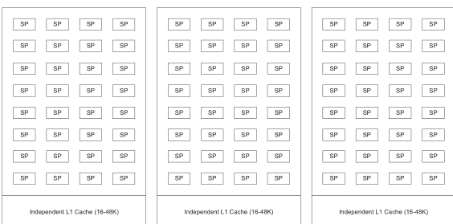

## 图 6.1

SM L1/L2 数据路径。

核心。在 G80/GT200 系列硬件上，由于没有统一缓存，我们正好看到了这种缺陷，因此与 Fermi 和后续硬件相比，原子操作相当缓慢。

缓存对大多数程序都很有用。大量程序员要么不太关心，要么对如何在软件中实现良好性能只有有限的了解。引入缓存意味着大多数程序可以相当正常地工作，程序员不必过多关心硬件的工作原理。这种编程便利性对初始开发很有用，但在大多数情况下，你可以做得更好。

初学者 CUDA 程序员与专家之间的差异可达一个数量级。我希望通过阅读本书，你能从现有代码中获得数倍的加速，并朝着能够常规编写显著优于等效串行代码的 CUDA 代码的方向发展。

## 数据存储类型

在 GPU 上，我们有多个可用于放置数据的区域级别，每个级别由其潜在带宽和延迟定义，如表 6.1 所示。

在最高且最首选的级别是设备内部的寄存器。然后是共享内存，实际上是程序员管理的 L1 缓存，接着是常量内存、纹理内存、常规设备内存，最后是主机内存。注意最慢和最快存储类型之间数量级的变化。我们将依次查看每种类型的用法，以及如何最大限度地利用每种类型带来的收益。

传统上，大多数教材会先从全局内存开始，因为它在性能中通常起着关键作用。如果你搞错了全局内存模式，那么在纠正之前可以忘记其他一切。我们在这里采取不同的方法，即首先看如何在内部高效地使用设备，然后从那里转向全局内存和主机内存。因此，你将了解每个级别的效率，并了解如何提取它。

大多数 CUDA 程序是逐步开发的，至少最初专门使用全局内存。一旦有了初始实现，就会考虑使用其他内存类型，例如零拷贝、共享内存、常量内存，最终是寄存器。对于最优程序，你需要在开发程序时就考虑这些问题。因此，更快的内存类型不是事后才考虑，而是从一开始就考虑，你确切地知道在哪里以及如何改进程序。你应该不断思考不仅如何高效地访问全局内存，而且如何消除那些访问，尤其是对于以某种方式重复使用的数据。

表 6.1 按内存类型划分的访问时间

| 存储类型 | 寄存器 | 共享内存 | 纹理内存 | 常量内存 | 全局内存 |
| :--- | :--- | :--- | :--- | :--- | :--- |
| 带宽 | ~8 TB/s | ~1.5 TB/s | ~200 MB/s | ~200 MB/s | ~200 MB/s |
| 延迟 | 1 个周期 | 1 到 32 个周期 | ~400 到 600 个周期 | ~400 到 600 个周期 | ~400 到 600 个周期 |

## 寄存器用法

GPU 与其 CPU 表亲不同，每个 SM（流式多处理器）拥有数千个寄存器。可以将 SM 视为多线程 CPU 核心。在典型的 CPU 上，我们有两个、四个、六个或八个核心。在 GPU 上，我们有 N 个 SM 核心。在 Fermi GF100 系列中，高端设备上有 16 个 SM。GT200 系列每个设备最多有 32 个 SM。G80 系列每个设备最多有 16 个 SM。Fermi 比其前身拥有更少的 SM，这可能看起来很奇怪。这是因为你会意识到，每个 Fermi SM 包含更多的 SP（流处理器），而正是这些 SP 完成了“苦力”工作。由于每个核心的 SP 数量不同，每个核心的线程数量存在重大差异。典型的 CPU 每个核心支持一到两个硬件线程。相比之下，GPU 每个核心有 8 到 192 个 SP，这意味着每个 SM 任何时候都可以执行这么多数量的并发硬件线程。

在 GPU 上，应用程序线程被流水线化、上下文切换并分发到多个 SM，这意味着 GPU 设备上所有 SM 中的活动线程数量通常在数万级别。

CPU 和 GPU 架构之间我们看到的一个主要区别是 CPU 和 GPU 如何映射寄存器。CPU 通过使用寄存器重命名和堆栈来运行大量线程。要运行新任务，CPU 需要进行上下文切换，这涉及将所有寄存器的状态存储到堆栈（系统内存）中，然后从新线程上次运行时恢复状态。这可能需要几百个 CPU 周期。如果在 CPU 上加载太多线程，它将花费所有时间仅仅在上下文切换时交换寄存器。一旦在 CPU 上加载太多线程，有用工作的有效吞吐量就会迅速下降。

相比之下，GPU 正好相反。它使用线程来隐藏内存获取和指令执行延迟，因此 GPU 上线程太少会导致 GPU 空闲，通常在等待内存事务。GPU 也不使用寄存器重命名，而是为每个线程分配真实寄存器。因此，当需要上下文切换时，其开销几乎为零。上下文切换时发生的所有事情只是将当前寄存器集的选择器（或指针）更新为指向下一个将要执行的 warp 的寄存器集。

请注意，我在这里使用了 warp 的概念，该概念在第 5 章线程中已详细介绍。Warp 只是一组一起调度的线程。在当前硬件中，这是 32 个线程。因此，我们在单个 SM 内交换进或交换出，并调度 32 个线程的组。

每个 SM 可以调度若干个块。SM 级别的块只是独立 warp 的逻辑组。每个内核线程的寄存器数量在编译时计算。所有块大小相同，具有已知数量的线程，每个块的寄存器用量是已知且固定的。因此，GPU 可以为调度到硬件上的每个块分配一组固定的寄存器。

在线程级别，这对程序员是透明的。但是，每个线程请求寄存器过多的内核会限制 GPU 在 SM 上可以调度的块数量，从而限制将要运行的线程总数。线程太少会导致硬件利用率不足，性能开始迅速下降。线程太多可能意味着资源不足，整个线程块被从调度到 SM 中删除。

要小心这种效应，因为它可能导致应用程序中出现突然的性能下降。如果之前应用程序使用四个块，而现在使用更多寄存器，导致只有三个块可以


可用，您可能会看到GPU吞吐量下降四分之一。您可以使用各种可用的分析工具看到此类问题，这些工具在第7章的分析部分中介绍。

取决于您使用的特定硬件，每个SM中所有线程的SM每个有8 K、16 K、32 K或64 K的寄存器空间。您需要记住每个线程需要一个寄存器。因此，C语言中的一个简单局部float变量会导致N个寄存器的使用，其中N是已调度的线程数量。使用Fermi级硬件，您每个SM可获得32 K的寄存器空间。每块256个线程时，您将有（32,768/4字节每个寄存器）/256个线程）= 每个线程32个寄存器可用。要在Fermi上实现最大可用寄存器数量（64个，G80/GT200上为128个），您需要将线程数减半到仅128个线程。您可以每个SM有一个块，该块中包含允许的最大寄存器数量。同样，您可以有八个32线程的块（8 × 32 = 总共256个线程），每个块都使用最大数量的寄存器。

如果您能充分利用最大数量的寄存器，例如，使用它们来处理数组的一部分，那么这种方法可以工作得相当好。之所以有效，是因为这样一组值通常是数据集中的N个元素。如果每个元素都是独立的，您可以在单个线程中创建指令级并行性（ILP）。硬件通过流水线化许多独立指令来利用这一点。您将在后面看到一个实际工作的示例。

然而，对于大多数内核，所需的寄存器数量要低一些。如果您将寄存器需求从128降至64，您可以将另一个块调度到同一个SM中。例如，使用32个寄存器，您可以调度四个块。这样做，您增加了总线程数。在Fermi上，每个SM最多可有1536个线程，并且在一般情况下，您能实现的占用率越高，程序执行速度就越快。您将达到一个点，在那里您有足够的线程级并行性（TLP）来隐藏内存延迟。要继续进一步提高性能，您要么需要转向更大的内存事务，要么引入ILP，即在单个线程中处理数据集中的多个元素。

然而，可调度到SM的warp数量是有限制的。因此，将寄存器数量从32降至16并不能得到八个块。对于这一点，我们受限于192个线程，如表6.2所示。

表6.2指的是Fermi架构。对于Kepler架构，只需将此处显示的寄存器和块数量加倍即可。我们在此处使用了192和256个线程，因为它们能很好地利用硬件。请注意，内核使用16个寄存器与20个寄存器并不会向SM引入任何额外的块。这是由于可分配到SM的warp数量的限制。因此，在这种情况下，您可以轻松增加寄存器使用量，而不会影响在给定SM上运行的总线程数。

表6.2 基于线程使用情况的Fermi寄存器可用性

| 线程数量 | 16 | 20 | 24 | 28 | 32 | 64 |
|---|---|---|---|---|---|---|
| 192 | | | | | | |
| 调度的块数 | 8 | 8 | 7 | 6 | 5 | 2 |
| 256 | | | | | | |
| 调度的块数 | 6 | 6 | 5 | 4 | 4 | 2 |

您希望使用寄存器来避免使用较慢的内存类型，但您必须小心有效地使用它们。例如，假设我们有一个循环，根据某个布尔变量的值逐位设置。实际上，我们将32个布尔值打包和解包到一个字的32位中。我们可以将其写成一个循环，每次通过新的布尔值修改内存位置，将其移位到字中的正确位置，如下所示：

```
for (i=0; i<31; i++)
{
    packed_result |= (pack_array[i] << i);
}
```

在这里，我们正在从元素数组中读取数组元素i，将其打包到整数packed_result中。我们将布尔值左移必要的位数，然后与之前的结果进行按位或运算。

如果参数packed_result存在于内存中，您将进行32次内存读写。我们也可以将参数packed_result放入局部变量中，编译器随后会将其放入寄存器。由于我们将值累积到寄存器而不是主内存中，并且稍后仅将结果写回主内存，因此我们节省了32次内存读写中的31次。

回顾表6.1，您可以看到一次全局内存操作需要几百个周期。假设一次全局内存读或写操作为500个周期。对于每个值，您需要读取、应用或运算，然后将结果写回。因此，您将有32次读取 + 32次写入 = 64 × 500个周期 = 32,000个周期。结果版本将消除31次读取和32次写入操作，用单周期操作替代500周期的操作。因此，您将有

(1次内存读取) + (1次内存写入) + (31次寄存器读取) + (31次寄存器写入) 或

(1 × 500) + (1 × 500) + (31 × 1) + (31 × 1) = 1062个周期，而非32,000个周期

显然，这大大减少了周期数量。在某些问题领域中，执行相对常见的操作时，我们实现了31倍的性能提升。

我们在sum、min、max等常见归约操作中也看到了类似的关系。归约操作是指通过某个函数将数据集减少到更小的集合，通常是单个项目。因此，max (10, 12, 1, 4, 5)将返回单个值12，即给定数据集的最大值。

将值累积到寄存器中可以节省大量的内存写入。在我们的位打包示例中，我们将内存写入减少了31倍。无论您使用CPU还是GPU，这种寄存器优化都将对程序执行速度产生巨大影响。

然而，这给程序员带来了负担，需要思考哪些参数在寄存器中，哪些在内存中，哪些寄存器需要复制回内存等。这看起来可能是一件相当麻烦的事情，对于普通程序员来说，往往确实如此。因此，您会看到大量直接操作内存的代码。在大多数情况下，CPU上的缓存内存显著掩盖了这个问题。累积值通常保存在L1缓存中。如果缓存使用回写策略，即值不需要在稍后之前写回主内存，那么性能还不错。请注意，L1缓存仍然比寄存器慢，因此该解决方案是次优的，可能比理想情况慢几倍。

某些编译器可能会检测到此类低效，并在优化阶段实现加载到寄存器。其他编译器可能不会。依赖优化器来修复糟糕的编程，将使您受制于编译器的好坏。您可能会发现，随着优化级别的提高，错误会悄悄进入程序。这可能不是编译器的错。C语言定义相当复杂。随着优化级别的提高，由于遗漏volatile限定符或类似问题，可能会出现微妙的错误。自动化测试脚本以及与非优化版本进行对比测试是确保正确性的良好解决方案。

您还应该意识到，优化编译器供应商并不总是选择实现最佳方案。如果编译器供应商采用某个优化策略时，仅有1%的程序会失败，那么由于这可能产生的支持问题，该策略不太可能被采用。

GPU的计算速率远超其内存带宽能力。Fermi硬件的内存峰值带宽约为190 GB/s，峰值计算性能超过1万亿次浮点运算。这超过了内存带宽的五倍。在Kepler GTX680/Tesla K10上，计算能力提升到3万亿次浮点运算，但内存带宽与GTX580几乎相同。在位打包示例中，如果没有寄存器优化且系统没有缓存，每次循环迭代需要一次读取和一次写入。每个整数或浮点值长度为4字节。由于需要读写总共8字节，我们在本示例中理论上能达到的最佳性能将是内存带宽的八分之一。使用190 GB/s的数值，这相当于每秒约250亿次操作。

在实际中，您无法接近这个数值，因为除了原始内存带宽外，还需要考虑循环索引和迭代。然而，这种粗略的估算能让您在开始编写任何代码之前，对应用程序的上限有一个概念。

将我们的31倍减少因子应用于内存操作数量，使您能够达到该数值的31倍理论峰值，即每秒约7750亿次迭代。在实际中，我们会在设备内遇到其他限制。然而，您可以看到，通过尽可能将值累积到寄存器或利用寄存器，我们可以轻松实现比简单全局内存版本好得多的性能。

为了获得一些实际数据，我们将编写一个程序，在全局内存和寄存器上分别执行此位打包操作。结果如下：

- ID:0 GeForce GTX 470:寄存器版本快：2.22ms (Reg=0.26ms, GMEM=2.48ms)
- ID:1 GeForce 9800 GT:寄存器版本快：52.87ms (Reg=9.27ms, GMEM=62.14ms)
- ID:2 GeForce GTX 260:寄存器版本快：5.00ms (Reg=0.62ms, GMEM=5.63ms)
- ID:3 GeForce GTX 460:寄存器版本快：1.56ms (Reg=0.34ms, GMEM=1.90ms)

生成这些结果的两个内核如下：

```
__global__ void test_gpu_register(u32 * const data, const u32 num_elements)
{
    const u32 tid = (blockIdx.x * blockDim.x) + threadIdx.x;
    if (tid < num_elements)
    {
        u32 d_tmp = 0;

        for (int i = 0;i<KERNEL_LOOP;i++)
        {
            d_tmp |= (packed_array[i] << i);
        }
}
```


```
data[tid] = d_tmp;
}
}
__device__ static u32 d_tmp = 0;
__global__ void test_gpu_gmem(u32 * const data, const u32 num_elements)
{
    const u32 tid = (blockIdx.x * blockDim.x) + threadIdx.x;
    if (tid < num_elements)
    {
        for (int i = 0; i < KERNEL_LOOP; i++)
        {
            d_tmp |= (packed_array[i] << i);
        }
    }
    data[tid] = d_tmp;
}
```

两个内核的唯一区别在于，一个使用全局变量 d_tmp，而另一个使用本地寄存器。查看结果，你可以在表 6.3 中看到加速比。平均加速比为 7.7 倍。也许最令人惊讶的是，最快的加速来自拥有最多数量 SM 的设备，这指向了一个我希望你可能已经发现的问题。在内核的全局内存版本中，每个块中的每个线程都会读取和写入 d_tmp。无法保证发生此操作的顺序，因此程序的输出是不确定的。内核执行完全正常，未检测到 CUDA 错误，但答案始终是无意义的。这种类型的错误在将串行代码转换为并行代码时是一种非常常见的错误类型。

奇怪的答案应始终指向某些地方出了问题。那么如何纠正这个问题？在寄存器版本中，每个线程写入一个唯一的寄存器。在 GMEM（全局内存）版本中，它也必须这样做。因此，你只需替换 d_tmp 的原始定义：

```
__device__ static u32 d_tmp = 0;
```

替换为

| 显卡 | 寄存器版本 | GMEM（全局内存）版本 | 加速比 |
| :--- | :--- | :--- | :--- |
| GTX470 | 0.26 | 2.48 | 9.5 |
| 9800GT | 9.27 | 62.14 | 6.7 |
| GTX260 | 0.62 | 5.63 | 9.1 |
| GTX460 | 0.34 | 1.9 | 5.6 |
| 平均 | | | 7.7 |

```
__device__ static u32 d_tmp[NUM_ELEM];
```

内核需要按如下方式更新：

```
__global__ void test_gpu_register(u32 * const data, const u32 num_elements)
{
    const u32 tid = (blockIdx.x * blockDim.x) + threadIdx.x;
    if (tid < num_elements)
    {
        u32 d_tmp = 0;

        for (int i=0;i<KERNEL_LOOP;i++)
        {
            d_tmp |= (packed_array[i] << i);
        }

        data[tid] = d_tmp;
    }
}
```

现在，每个线程都可以从全局内存的独立区域进行读写。那么加速比如何？请参见表 6.4。

如表 6.4 所示，平均加速比下降到仅 1.7 倍。如果不是因为 9800GT（一个计算能力 1.1 的设备），你会看到在这个简单的代码片段中平均加速比几乎达到两倍。在可能的情况下，你始终需要通过其他方式避免全局内存写入。如第一个示例那样汇聚到单个内存地址，会迫使硬件将内存操作串行化，导致性能糟糕。

现在，要让这段代码更快非常容易。循环通常效率很低，因为它们会引起分支，这可能导致流水线停顿。更重要的是，它们会消耗不贡献于最终结果的指令。循环代码将包含循环计数器的递增、对结束循环条件的测试，以及每次迭代的分支。相比之下，每次迭代的有用指令将从 packed_array 加载值，将其左移 N 位，并将其与现有的 d_tmp 值进行或运算。仅从操作来看，我们看到大约 50% 的操作都围绕循环进行。你可以直接查看以下 PTX（Parallel Thread eXecution）代码来验证这一点。为了使阅读虚拟汇编代码更容易，执行循环的指令已加粗显示。

| 显卡 | 寄存器版本 | GMEM 版本 | 加速比 |
| :--- | :--- | :--- | :--- |
| GTX470 | 0.26 | 0.51 | 2 |
| 9800GT | 9.27 | 10.31 | 1.1 |
| GTX260 | 0.62 | 1.1 | 1.8 |
| GTX480 | 0.34 | 0.62 | 1.8 |
| 平均 | | | 1.7 |

```
.entry _Z18test_gpu_register1Pjj (
.param .u64 __cudaparm__Z18test_gpu_register1Pjj_data,
.param .u32 __cudaparm__Z18test_gpu_register1Pjj_num_elements)
{
.reg .u32 %r<27>;
.reg .u64 %rd<9>;
.reg .pred %p<5>;
// .cuda_local_var_108903_15_non_const_tid = 0
// .cuda_local_var_108906_13_non_const_d_tmp = 4
// i = 8
.loc 16 36 0
$LDWbegin__Z18test_gpu_register1Pjj:
$LDWbeginblock_180_1:
.loc 16 38 0
mov.u32 %r1, %tid.x;
mov.u32 %r2, %ctaid.x;
mov.u32 %r3, %ntid.x;
mul.u32 %r2, %r4, %r2; %r3;
mov.u32 %r5, %r1; %r4; %r4;
mov.u32 %r5, %r5; %r4;
mov.s32 %r2, %r6, %r5;
.loc 16 39 0
ld.param.u32 %r7, [__cudaparm__Z18test_gpu_register1Pjj_num_elements];
mov.s32 %r8, %r6;
setp.le.u32 %p1, %r7, %r8;
@%p1 bra $L__t_0_3074;
$LDWbeginblock_180_3:
.loc 16 41 0
mov.u32 %r9, 0;
mov.u32 %r10, %r9;
$LDWbeginblock_180_5:
.loc 16 43 0
mov.s32 %r11, 0;
mov.s32 %r12, %r11;
mov.s32 %r13, %r12;
mov.s32 %r14, %r13;
setp.gt.s32 %p2, %r2, %r14;
@%p2 bra $L__t_0_3586;
$L_0_3330:
.loc 16 45 0
mov.s32 %r15, %r12;
cvt.s64.s32 %rd1, %r15;
cvta.global.u64 %rd2, packed_array;
add.u64 %rd3, %rd1, %rd2;
ld.s8 %r16, [%rd3+0];
mov.s32 %r17, %r12;
shl.b32 %r18, %r16, %r17;
mov.s32 %r19, %r10;
or.b32 %r20, %r18, %r19;
mov.s32 %r10, %r20;
.loc 16 43 0
mov.s32 %r21, %r12;
add.s32 %r22, %r21, 1;
mov.s32 %r12, %r22;
$LD16_324:
mov.s32 %r23, %r12;
mov.s32 %r24, 31;
setp.le.s32 %p3, %r23, %r24;
@%p3 bra $L_0_3330;
$L_0_3586:
$LDWendblock_180_5:
.loc 16 48 0
mov.s32 %r25, %r10;
ld.param.u64 %rd4, [_cudaParm__Z18test_gpu_register1Pjj_data];
cvt.u64.u32 %rd5, %rd6;
mul.wide.u32 %rd6, %rd6, 4;
add.u64 %rd7, %rd4, %rd6;
st.global.u32 [%rd7+0], %r25;
$LDWendblock_180_3:
$L_0_3074:
$LDWendblock_180_1:
.loc 16 50 0
exit;
$LDWend__Z18test_gpu_register1Pjj:
}
```

因此，PTX 代码首先测试 for 循环是否会实际进入循环。这是在标记为 $LDWbeginblock_180_5 的块中完成的。位于 $Lt_0_1794 标签的代码随后执行循环操作，跳回标签 $L_0_3330，直到循环完成 32 次迭代。标记为 $L_0_3330 的部分中的其他代码执行以下操作：

```
d_tmp |= (packed_array[i] << i);
```

请注意，除了循环开销之外，因为 packed_array 是通过变量索引的，代码必须在每次循环迭代时计算地址：

```
cvt.s64.s32 %rd1, %r15;
cvta.global.u64 %rd2, packed_array;
add.u64 %rd3, %rd1, %rd2;
```

这相当低效。将其与循环展开版本进行比较，我们会看到一些非常有趣的事情：

```
.entry _Z18test_gpu_register2Pjj (
.param .u64 _cudaParm__Z18test_gpu_register2Pjj_data,
.param .u32 __cudaParm__Z18test_gpu_register2Pjj_num_elements)
{
.reg .u32 %r<104>;
.reg .u64 %rd<6>;
.reg .pred %p3>;
// _cuda_local_var_108919_15_non_const_tid = 0
.loc 16 52 0
$LDWbegin_Z18test_gpu_register2Pjj:
$LDWbeginblock_181_1:
.loc 16 54 0
mov.u32 %r1, %tid.x;
mov.u32 %r2, %ctaid.x;
mov.u32 %r3, %ntid.x;
mul.lo.u32 %r4, %r2, %r3;
mad.lo.u32 %r5, %r1, %r4;
mov.s32 %r6, %r5;
.loc 16 55 0
ld.param.u32 %r7, [_cuda_param_Z18test_gpu_register2Pjj_num_elements];
mov.s32 %r8, %r6;
setp.le.u32 %p1, %r7, %r8;
@%p1 bra $L__1_1282;
.loc 16 57 0
ld.global.s8 %r9, [packed_array+0];
ld.global.s8 %r10, [packed_array+1];
shl.b32 %r11, %r10, 1;
or.b32 %r12, %r9, %r11;
ld.global.s8 %r13, [packed_array+2];
shl.b32 %r14, %r13, 2;
or.b32 %r15, %r12, %r14;
```

[为清晰起见，已删除 packed_array+3 到 packed_array+29 的重复代码]

```
ld.global.s8 %r97, [packed_array+30];
shl.b32 %r98, %r97, 30;
or.b32 %r99, %r96, %r98;
ld.global.s8 %r100, [packed_array+31];
shl.b32 %r101, %r100, 31;
or.b32 %r102, %r99, %r101;
ld.param.u64 %rd1, [_cuda_param_Z18test_gpu_register2Pjj_data];
cvt.u64.u32 %rd2, %r6;
mul.wide.u32 %rd3, %r6, 4;
add.u64 %rd4, %rd1, %rd3;
st.global.u32 [%rd4+0], %r102;
$LDWendblock_181_0:
.loc 16 90 0
exit;
$LDWend_Z18test_gpu_register2Pjj:
}
```

现在几乎所有指令都对结果有贡献。循环开销已消失。packed_array 的地址计算已减少为编译时解析的基址加偏移量类型地址。

一切都变得简单得多，但也长得多，无论是在 C 代码中还是在虚拟 PTX 汇编代码中。

这里的重点不是理解 PTX，而是看看 C 代码中的小变化对生成的虚拟汇编代码有多大的不同。目的是理解像循环展开这样的技术在许多情况下可能非常有益。我们将在第 9 章优化中更详细地探讨 PTX 及其如何转换为实际执行的代码。

那么这对加速比有什么影响？请参见表 6.5。你可以看到，在 9800GT 或 GTX260 上，没有任何影响。然而，在更现代的计算能力 2.x 硬件上，GTX460 和 GTX470 分别实现了 2.4 倍和 3.4 倍的加速比。如果回顾纯 GMEM 实现，在 GTX470 上这是 6.4 倍的加速比。为了让你有个概念，如果原始程序运行需要六个半小时，那么优化后的版本只需一小时。

寄存器优化对代码执行时间可能有巨大影响。花点时间查看程序内部循环生成的 PTX 代码。你能否展开循环，将其扩展为单个或一组表达式？结合你的代码思考这一点，你将看到巨大的性能飞跃。更好的寄存器使用方式，例如消除内存访问或提供额外的 ILP，是加速 GPU 内核的最佳方法之一。

| 显卡 | 寄存器版本 | 展开版本 | 加速比 |
| :--- | :--- | :--- | :--- |
| GTX470 | 0.27 | 0.08 | 3.4 |
| 9800GTX | 9.28 | 9.27 | 1 |
| GTX260 | 0.62 | 0.62 | 1 |
| GTX460 | 0.34 | 0.14 | 2.4 |
| 平均 | | | 2 |

## 共享内存

共享内存实际上是一种用户控制的 L1 缓存。L1 缓存和共享内存共享每个 SM 的 64 K 内存段。在 Kepler 中，可以按 16 K 块配置，以偏向 L1 或共享内存，具体取决于你的应用偏好。在 Fermi 中，选择是偏向 L1 或共享内存的 16 K 或 48K。Pre-Fermi 硬件（计算能力 1.x）具有固定的 16 K 共享内存且没有 L1 缓存。共享内存的带宽约为 1.5 TB/s，延迟极低。显然，这远优于全局内存提供的最高 190 GB/s 带宽，但大约只有寄存器速度的五分之一。

在实践中，低端显卡的全局内存速度可能只有高端显卡的十分之一。然而，共享内存速度由核心时钟速率驱动，在整个 GPU 范围内保持更一致（约 20% 的变化）。这意味着，为了充分利用任何显卡（而不仅仅是高端显卡），除了使用寄存器外，你还必须有效地使用共享内存。

事实上，仅查看带宽数字——共享内存为 1.5 TB/s，最佳全局内存访问为 190 GB/s——你就可以看到 7:1 的比率。换句话说，如果你能有效利用共享内存，就有潜力实现 7 倍的加速比。显然，共享内存是每个关注性能的 CUDA 程序员都需要很好理解的概念。


然而，GPU采用的是加载-存储内存模型，即任何操作数在执行任何操作之前都必须加载到寄存器中。因此，将值加载到共享内存中，而不仅仅是加载到寄存器中，必须由数据重用、全局内存合并或线程间数据共享来证明其合理性。否则，直接将全局内存值加载到寄存器中可以获得更好的性能。

共享内存是一种银行切换架构。在Fermi上它是32个银行宽，而在G200和G80硬件上它是16个银行宽。每个银行的数据大小为4字节，足以容纳一个单精度浮点数据项或一个标准32位整数值。Kepler还引入了一种特殊的64位宽模式，因此较大的双精度值不再跨越两个银行。每个银行每个周期只能服务一个*单个*操作，无论有多少个线程发起此操作。因此，如果warp中的每个线程访问一个单独的银行地址，则每个线程的操作都在该单个周期内处理。请注意，不需要一对一的顺序访问，只需每个线程访问共享内存中的一个单独银行即可。实际上，存在一个交叉开关，将任何单个银行连接到任何单个线程。当您需要交换字时（例如，在排序算法中，我们稍后将看一个示例），这非常有用。

共享内存中还有一种非常有用的情况，即warp中的每个线程读取*相同*的银行地址。与常量内存一样，这会触发warp内所有线程的广播机制。通常，线程零将值写入以与warp中的其他线程通信共同值。参见图6.2。

但是，如果存在任何*其他*模式，我们最终会遇到不同程度的银行冲突。这意味着warp中访问共享内存地址的线程一个接一个地排队，而warp中的其他线程则处于空闲状态，从而导致停顿。一个重要方面是，这*不会*通过切换到另一个warp来隐藏，因此我们实际上确实会停顿SM。因此，如果可能，应尽可能避免银行冲突，因为SM将一直空闲直到所有银行请求都得到满足。

然而，这通常不切实际，例如我们在第5章中查看的直方图示例。在这里，数据是未知的，因此它落入哪个银行完全取决于数据模式。

最坏的情况是每个线程都写入同一个银行，在这种情况下，我们会对同一个银行进行32次串行访问。我们通常会在线程以非32的步长访问银行时看到这种情况。当步长以2的幂递减时（例如，在并行归约中），我们也会看到这种情况，每一轮都会导致越来越多的银行冲突。

## 使用共享内存进行排序

让我们在这里介绍一个使用排序的实际示例。排序算法通过获取随机数据集并生成排序后的数据集来工作。因此，我们需要N个输入数据项和N个输出数据项。排序的关键方面是确保尽量减少对内存的读取和写入次数。许多排序算法实际上是多遍的，意味着我们读取N的每个元素M次，这显然不是好事。

快速排序算法是串行世界中排序的首选算法。作为一种分治算法，它似乎是并行方法的一个好选择。但是，默认情况下它使用递归，而递归仅在CUDA计算2.x设备上受支持。典型的并行实现会为数据的每个分割生成一个新线程。当前的CUDA模型（另请参见第12章中关于Kepler动态并行性的讨论）要求在内核启动时指定线程总数，或每个级别进行一系列内核启动。数据会导致显著的分支

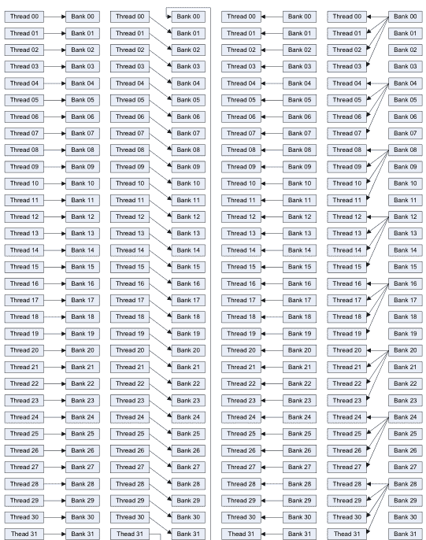

- 1:1 写入 = 理想情况
- 1:1 写入 = 理想情况
- 1:1 读取 = 理想情况
- 1:4 读取 = 4个银行冲突

图6.2 共享内存模式。

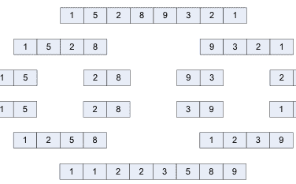

图6.3 简单归并排序示例。

发散，这对GPU来说同样不是好事。有方法可以解决其中一些问题。然而，这些问题使得快速排序不是在pre-Kepler GK110/Tesla K20 GPU上使用的最佳算法。事实上，你通常会发现最佳串行算法并非最佳并行算法，最好是保持开放的心态，看看什么效果最好。

并行世界中常见的一种算法是归并排序（图6.3）。它通过递归地将数据分割成越来越小的数据包来工作，直到最终只剩下两个值需要排序。然后将每个排序列表合并在一起，生成一个完整的排序列表。

在计算2.x之前，CUDA不支持递归，那么如何执行这样的算法呢？任何递归算法在某个时刻都会有一个大小为N的数据集。在GPU上，线程块大小或warp大小是N的理想大小。因此，要实现递归算法，您只需将数据分解为32个或更多元素的块作为N的最小情况即可。

使用归并排序，如果您采用一组元素，例如{1,5,2,8,9,3,2,1}，我们可以在第4个元素处拆分数据，并获得两个数据集，{1,5,2,8}和{9,3,2,1}。现在您可以使用两个线程对这两个数据集应用排序算法。您立即从p = 1变为p = 2，其中p是并行执行路径的数量。

将数据从两个集拆分为四个集，得到{1,5}、{2,8}、{9,3}和{2,1}。现在执行四个线程非常简单，每个线程比较两个数字并在必要时交换它们。因此，您最终得到四个排序后的数据集：{1,5}、{2,8}、{3,9}和{1,2}。排序阶段现已完成。此阶段可表达的最大并行度是N/2个独立线程。因此，对于512 MB的数据集，您有128K个32位元素，我们可以使用最多64K个线程（N = 128K，N/2 = 64K）。由于GTX580 GPU有16个SM，每个SM最多可支持1536个线程，因此每个GPU最多支持24K个线程。然而，通过大约两遍半，您可以使用这种分解来遍历需要排序的64K个数据对。

然而，您现在遇到了归并排序的经典问题，即合并阶段。在这里，通过将每个列表中最小的元素移动到输出列表来合并列表。然后重复此过程，直到输入列表的所有成员都被消耗。以之前的示例为例，排序后的列表为{1,5}、{2,8}、{3,9}和{1,2}。在传统的归并排序中，这些列表将合并为{1,2,5,8}和{1,2,3,9}。这些

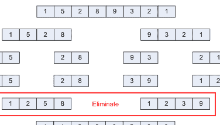

图6.4 同时合并N个列表。

然后以同样的方式进一步合并这两个列表，以生成一个最终排序列表，{1,1,2,2,3,5,8,9}。

因此，随着每个合并阶段的完成，可用并行度减半。作为一种替代方法，当N较小时，您可以简单地扫描N组列表，并立即将值放置在正确的输出列表中，跳过任何中间合并阶段，如图6.4所示。问题是，图6.4中为消除而突出显示的阶段执行的排序通常由两个线程完成。由于低于32线程意味着我们使用的不足一个warp，因此在GPU上这是低效的。

这种方法的缺点是，您需要从每个集中读取排序列表集的第一个元素。对于64 K个集，这是64 K次读取，即256 MB的数据需要从内存中获取。显然，当列表数量非常大时，这不是一个好的解决方案。

因此，我们的方法是尝试通过限制应用于原始问题的递归量，并在warp中的线程数（32）处停止，而不是像传统归并排序那样每个排序集停止在两个元素，从而试图实现合并问题的更好解决方案。这将前一个示例中的集数从64 K个排序集减少到仅4 K个集。它还将可用的最大并行度从N/2提高到N/32。在我们之前研究的128 K元素示例中，这意味着我们需要4 K个处理元素。这将把256个处理元素（warps）分配给GTX980上的每个SM。由于每个Fermi SM最多可以执行48个warps，因此需要遍历多个块，这允许更小的问题规模并在未来硬件上实现加速。参见图6.5。

共享内存是银行切换的。一个warp中有32个线程。但是，如果其中任何线程访问同一个银行，就会发生银行冲突。如果任何线程在执行流中发散，在最坏情况下，您的运行速度可能只有1/32。线程可以使用私有于线程的寄存器。它们只能通过共享内存相互通信。

通过在共享内存中将数据集排列为32个元素的行，并按线程按列访问它，您可以实现对内存的无银行冲突访问（图6.6）。

为了实现对全局内存的合并访问（我们将在下一节中介绍），您需要以32个元素的行从全局内存中获取数据。然后您可以应用任何排序算法


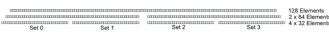

### 图 6.5
基于共享内存的分解。

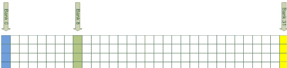

### 图 6.6
共享内存银行访问。

到该列而无需担心共享内存冲突。你唯一需要考虑的是分支分歧。你需要尽量确保每个线程遵循相同的执行流程，即使它们处理的是截然不同的数据元素。

这种策略的一个副作用是我们最终不得不做出权衡。假设每个 SM 只有一个 warp，我们将没有共享内存银行冲突。然而，每个 SM 只有一个 warp 无法隐藏全局内存读写的延迟。至少在内存读取和写回阶段，我们需要大量线程。然而，在排序阶段，多个 warp 可能会相互冲突。单个 warp 不会有任何银行冲突，但这无法隐藏指令执行延迟。因此在实践中，我们在排序的所有阶段都需要多个 warp。

## 基数排序

一种具有固定迭代次数和一致执行流的算法是基数排序。它通过基于最低有效位进行排序，然后逐步向最高有效位推进来工作。对于 32 位整数，使用单个基数位，无论数据集有多大，排序都会有 32 次迭代。让我们考虑以下数据集的示例：

```
[ 122, 10, 2, 1, 2, 22, 12, 9 ]
```

这些数的二进制表示如下：

```
122 = 01111010
10 = 00001010
2 = 00000010
22 = 00010110
12 = 00001100
9 = 00001001
```

在列表的第一趟中，所有最低有效位（右侧）为 0 的元素将形成第一个列表。那些最低有效位为 1 的元素将形成第二个列表。因此，两个列表为

```
0 = { 122, 10, 2, 22, 12 }
1 = { 9 }
```

两个列表按此顺序追加，变为

```
( 122, 10, 2, 22, 12, 9 )
```

然后对位一重复此过程，根据前一轮的顺序生成下一个两个列表：

```
0 = { 12, 9 }
1 = { 122, 10, 2, 22 }
```

合并后的列表为

```
( 12, 9, 122, 10, 2, 22 )
```

按位二扫描列表，我们生成

```
0 = { 9, 122, 10, 2, 22 }
1 = { 12 }
= { 9, 122, 10, 2, 22, 12 }
```

程序就这样继续，直到在 32 趟中处理完列表的所有 32 位。构建列表需要 N + 2N 个内存单元，一个用于源数据，一个用于 0 列表，一个用于 1 列表。我们并不严格需要 2N 个额外单元，例如，可以从内存起始处为 0 列表计数，并从内存末尾为 1 列表倒计数。但为了简单起见，我们将使用两个独立的列表。

基数排序的串行代码如下所示：

```
__host__ void cpu_sort(u32 * const data,
                       const u32 num_elements)
{
    static u32 cpu_tmp[0][NUM_ELEM];
    static u32 cpu_tmp[1][NUM_ELEM];

    for (u32 bit=0;bit<32;bit++)
    {
        u32 base_cnt_0 = 0;
        u32 base_cnt_1 = 0;

        for (u32 i=0; i<num_elements; i++)
        {
            const u32 d = data[i];
            const u32 bit_mask = (1 << bit);

            if ( (d & bit_mask) > 0 )
            {
                cpu_tmp_1[base_cnt_1] = d;
                base_cnt_1++;
            }
            else
            {
                cpu_tmp_0[base_cnt_0] = d;
                base_cnt_0++;
            }
        }

        // Copy data back to source - first the zero list
        for (u32 i=0; i<base_cnt_0; i++)
        {
            data[i] = cpu_tmp_0[i];
        }
        // Copy data back to source - then the one list
        for (u32 i=0; i<base_cnt_1; i++)
        {
            data[base_cnt_0+i] = cpu_tmp_1[i];
        }
    }
}
```

该代码通过接收两个值来工作：一个指向要排序的数据的指针和数据集中的元素数量。它会覆盖未排序的数据，因此返回的集合是已排序的。外层循环遍历 32 位整数字中的所有 32 位，内层循环遍历列表中的所有元素。因此，该算法需要 32N 次迭代，整个数据集将被读取和写入 32 次。

当数据大小小于 32 位时（例如，使用 16 位或 8 位整数值），排序速度会快两倍或四倍，因为分别只需完成一半和四分之一的工作。基数排序的实现已在随 CUDA SDK v4.0 及更高版本提供的 Thrust 库中提供，因此您无需自行实现基数排序（图 6.7）。

在内层循环中，数据根据正在处理的字的哪一位被分成两个列表：0 列表和 1 列表。然后从两个列表重建数据，0 列表始终在 1 列表之前写入。

GPU 版本稍微复杂一些，因为我们需要处理多个线程。

| 数据 | 数据 & 0x01 | 0 列表 | 1 列表 | 合并列表 | 数据 & 0x10 | 0 列表 | 1 列表 | 合并列表（已排序） |
| :--- | :--- | :--- | :--- | :--- | :--- | :--- | :--- | :--- |
| 0xFF000003 | 1 | 0xFF000002 | 0xFF000003 | 0xFF000002 | 1 | 0xFF000000 | 0xFF000002 | 0xFF000000 |
| 0xFF000002 | 0 | 0xFF000000 | 0xFF000001 | 0xFF000000 | 0 | 0xFF000001 | 0xFF000003 | 0xFF000001 |
| 0xFF000001 | 1 | | | 0xFF000003 | 1 | | | 0xFF000002 |
| 0xFF000000 | 0 | | | 0xFF000001 | 0 | | | 0xFF000003 |


```
__device__ void radix_sort(u32 * const sort_tmp,
    const u32 num_lists,
    const u32 num_elements,
    const u32 tid,
    u32 * const sort_tmp_0,
    u32 * const sort_tmp_1)
{
// Sort into num_lists lists
// Apply radix sort on 32 bits of data
for (u32 bit=0;bit<32;bit++)
{
    u32 base_cnt_0 = 0;
    u32 base_cnt_1 = 0;
    for (u32 i=0; i<num_elements; i+=num_lists)
    {
        const u32 elem = sort_tmp[i+tid];
        const u32 bit_mask = (1 << bit);
        if ( (elem & bit_mask) > 0 )
        {
            sort_tmp_1[base_cnt_1+tid] = elem;
            base_cnt_1+=num_lists;
        }
        else
        {
            sort_tmp_0[base_cnt_0+tid] = elem;
            base_cnt_0+=num_lists;
        }
    }
    // Copy data back to source - first the zero list
    for (u32 i=0; i<base_cnt_0; i+=num_lists)
    {
        sort_tmp[i+tid] = sort_tmp_0[i+tid];
    }
    // Copy data back to source - then the one list
    for (u32 i=0; i<base_cnt_1; i+=num_lists)
    {
        sort_tmp[base_cnt_0+i+tid] = sort_tmp_1[i+tid];
    }
}
_syncthreads();
}
```

此处将 GPU 内核编写为设备函数，即只能在 GPU 内核内部调用的函数。这相当于在 C 中将函数声明为 "static" 或在 C++ 中声明为 "private"。

| 设备/线程 | 1 | 2 | 4 | 8 | 16 | 32 | 64 | 128 | 256 |
| :--- | :--- | :--- | :--- | :--- | :--- | :--- | :--- | :--- | :--- |
| GTX470 | 39.4 | 20.8 | 10.9 | 5.74 | 2.91 | 1.55 | 0.83 | 0.48 | 0.3 |
| 9800GT | 67 | 35.5 | 18.6 | 9.53 | 4.88 | 2.66 | 1.44 | 0.82 | 0.56 |
| GTX260 | 82.4 | 43.5 | 22.7 | 11.7 | 5.99 | 3.24 | 1.77 | 1.02 | 0.66 |
| GTX460 | 31.9 | 16.9 | 8.83 | 4.56 | 2.38 | 1.27 | 0.69 | 0.4 | 0.26 |

请注意，内层循环已更改，程序不再按 1 递增，而是按传递给函数的 num_lists 值递增。这是基数排序应生成的独立数据列表的数量。此值应等于用于调用内核块的线程数。避免银行冲突的理想值是 warp 大小，即 32。然而，从隐藏指令和内存延迟的角度来看，这并非理想值。

此 GPU 版本的基数排序将使用 num_lists 个线程生成 num_lists 个独立的已排序列表。由于 GPU 中的 SM 可以以与单个线程相同的速度运行 32 个线程，并且拥有 32 个共享内存银行，您可能会认为 num_lists 的理想值是 32。请参见表 6.6 和图 6.8。

从表格和图中可以看出，基数排序实际上非常高效。您会看到近似线性加速，直到 128 个线程。这并不奇怪，因为线程数量每翻倍一倍，每个线程处理的数据量就减半。值得关注的是这种线性关系在哪里停止，因为这表明我们何时达到了硬件的某些限制。在 256 个线程时，加速比开始下降，仅有三分之二的加速，因此我们知道理想情况是 128 个线程。然而，我们还必须考虑使用 128 个线程可能会如何限制 SM 的使用，特别是在计算 2.x 硬件上。因此，我们可能会选择 256 个线程，具体取决于如何

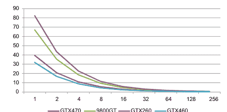

### 图 6.8
并行基数排序图。


多个块相互作用。事实上，共享内存是我们需要考虑的主要因素，用于限制我们可能能够放入每个 SM 中的块的数量。

如果你查看最初的基数排序函数，它效率不高。你会如何优化这个函数？最明显的改变是你不需要单独的 0 列表和 1 列表。0 列表可以通过重用原始列表中的空间来创建。这不仅允许你丢弃 1 列表，还消除了将数据复制回源列表的操作。这节省了大量不必要的工作。

最后，你是否注意到位掩码在位循环的单次迭代中实际上是常量？因此它是 i 循环中的不变量，可以移出到位循环。这是一种称为不变量分析的标准编译器优化。大多数编译器会将其移出 i 循环。编译器优化的文档臭名昭著地糟糕，并且可能因编译器而异，甚至在不同编译器版本之间也会变化。因此，依赖编译器的优化步骤通常是不良的编程实践，最好避免。因此，我们将显式移动计算以确保其在正确位置执行。有关典型编译器优化的内容，请参见第 9 章“优化”。

我们最终得到的略微优化的代码如下：

```
__device__ void radix_sort2(u32 * const sort_tmp,
    const u32 num_lists,
    const u32 num_elements,
    u32 * const sort_tmp_1)
{
    // Sort into num_lists lists
    // Apply radix sort on 32 bits of data
    for (u32 bit=0;bit<32;bit++)
    {
        const u32 bit_mask = (1 << bit);
        u32 base_cnt_0 = 0;
        u32 base_cnt_1 = 0;

        for (u32 i=0; i<num_elements; i+=num_lists)
        {
            const u32 elem = sort_tmp[i+tid];

            if ( (elem & bit_mask) > 0 )
            {
                sort_tmp_1[base_cnt_1+tid] = elem;
                base_cnt_1+=num_lists;
            }
            else
            {
                sort_tmp[base_cnt_0+tid] = elem;
                base_cnt_0+=num_lists;
            }
        }
    }
// Copy data back to source from the 1's list
    for (u32 i=0; i<base_cnt_1; i+=num_lists)
    {
        sort_tmp[base_cnt_0+i+tid] = sort_tmp[i+tid];
    }
    __syncthreads();
}
```

还可以进行进一步的优化，但这里的关键问题是我们现在只使用一个临时存储区域，这反过来允许处理更多元素。这一点很重要，因为，正如我们稍后将看到的，列表的数量是一个重要因素。那么这些变化如何影响基数排序的性能？

如果你查看表 6.7，你会发现最坏情况（使用单线程）已从 82 ms 降至 52 ms。之前运行中的最佳情况 0.26 ms 已降至 0.21 ms，执行速度提升了约 20%。

| 设备/线程数 | 1 | 2 | 4 | 8 | 16 | 32 | 64 | 128 | 256 |
|---|---|---|---|---|---|---|---|---|---|
| GTX470 | 26.51 | 14.35 | 7.65 | 3.96 | 2.05 | 1.09 | 0.61 | 0.36 | 0.24 |
| 9800GT | 42.8 | 23.22 | 12.37 | 6.41 | 3.3 | 1.78 | 0.98 | 0.63 | 0.4 |
| GTX260 | 52.54 | 28.46 | 15.14 | 7.81 | 4.01 | 2.17 | 1.2 | 0.7 | 0.46 |
| GTX460 | 21.62 | 11.81 | 6.34 | 3.24 | 1.69 | 0.91 | 0.51 | 0.31 | 0.21 |

## 合并列表

合并已排序元素的列表是并行编程中常用的另一种算法。不过，让我们先来看一些串行代码，将任意数量的已排序列表合并为一个已排序列表，因为这是最简单的情况。

```
void merge_array(const u32 * const src_array,
                 u32 * const dest_array,
                 const u32 num_lists,
                 const u32 num_elements)
{
    const u32 num_elements_per_list = (num_elements / num_lists);
    u32 list_indexes[MAX_NUM_LISTS];
    for (u32 list=0; list < num_lists; list++)
    {
        list_indexes[list] = 0;
    }
    for (u32 i=0; i<num_elements;i++)
    {
        dest_array[i] = find_min(src_array,
                                 list_indexes,
                                 num_lists,
                                 num_elements_per_list);
    }
}
```

假设有 num_lists 个列表用于收集数据，你需要一种方法来跟踪我们在列表中的位置。程序使用数组 list_indexes 来实现这一点。由于列表数量可能较少，你可以使用栈，因此将数组声明为局部变量。请注意，在 GPU 内核中这样做是个坏主意，因为栈分配可能会被放入慢速全局内存，具体取决于特定的 GPU 变体。共享内存可能是 GPU 上的最佳位置，具体取决于所需的列表数量。

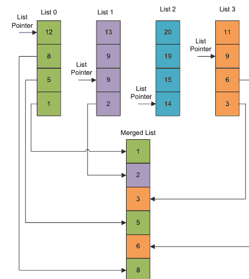

图 6.9 多个列表部分合并。

首先，所有索引值都设置为零。然后程序遍历所有元素，并从函数 find_min 的结果中分配已排序数组中的值。find_min 函数从一组 num_lists 值中识别出最小值。

```
u32 find_min(const u32 * const src_array,
             u32 * const list_indexes,
             const u32 num_lists,
             const u32 num_elements_per_list)
{
    u32 min_val = 0xFFFFFFFF;
    u32 min_idx = 0;

    // Iterate over each of the lists
    for (u32 i = 0; i < num_lists; i++)
    {
        // If the current list has already been emptied
        // then ignore it
        if (list_indexes[i] < num_elements_per_list)
        {
            const u32 src_idx = i + (list_indexes[i] * num_lists);
            const u32 data = src_array[src_idx];

            if (data < min_val)
            {
                min_val = data;
                min_idx = i;
            }
        }
    }

    list_indexes[min_idx]++;
    return min_val;
}
```

该函数通过遍历已排序值的列表并维护每个列表中的位置索引来工作。如果它识别出比 min_val 更小的值，它只需将 min_val 更新为这个新值。当它扫描完所有列表后，它会递增相关的列表索引并返回找到的值。

现在让我们来看这个算法的 GPU 实现。首先是顶层函数：

```
__global__ void gpu_sort_array_array(
    u32 * const data,
    const u32 num_lists,
    const u32 num_elements)
{
    const u32 tid = (blockIdx.x * blockDim.x) + threadIdx.x;

    __shared__ u32 sort_tmp[NUM_ELEM];
    __shared__ u32 sort_tmp_l[NUM_ELEM];

    copy_data_to_shared(data, sort_tmp, num_lists,
        num_elements, tid);

    radix_sort2(sort_tmp, num_lists, num_elements,
        tid, sort_tmp_l);

    merge_array6(sort_tmp, data, num_lists,
        num_elements, tid);
}
```

目前这是一个相当简单的程序。它将由单个块的 N 个线程调用。我们将把它作为使用共享内存的示例来开发。查看第一个函数，我们看到以下内容：

```
__device__ void copy_data_to_shared(const u32 * const data,
    u32 * const sort_tmp,
    const u32 num_lists,
    const u32 num_elements,
    const u32 tid)
{
    // Copy data into temp store
    for (u32 i = 0; i < num_elements; i += num_lists)
    {
        sort_tmp[i + tid] = data[i + tid];
    }
    __syncthreads();
}
```

在这里，程序按行而非列从全局内存读取数据到共享内存中。此步骤之所以重要，有两个原因。首先，程序将反复从该内存中读取和写入。因此，你希望使用尽可能快的存储，所以我们需要使用共享内存而不是全局内存。其次，全局内存按行访问时性能最佳。列访问会产生分散的内存模式，硬件无法将其合并，除非每个线程访问相同的列值且这些地址相邻。因此，在大多数情况下，GPU 必须执行远比必要更多的内存获取操作，程序速度将下降一个数量级。

编译此程序时，如果在 nvcc 编译器选项中设置了 -v 标志，它会打印一条看似无害的消息，称已创建栈帧。例如，

```
1>ptxas info : Function properties for _Z12merge_arrayPKjPjjjj
> 40 bytes stack frame, 40 bytes spill stores, 40 bytes spill loads
```

当函数调用子函数并传递参数时，这些参数必须以某种方式提供给被调用的函数。程序正好进行了这样的调用：

```
dest_array[i] = find_min(src_array.
```


list_indexes, num_lists, num_elements_per_list);

有两种可选方式：通过寄存器传递所需值，或创建称为栈帧的内存区域。大多数现代处理器拥有大量寄存器（32个或更多）。因此，对于单层调用，这通常就足够了。旧架构使用栈帧，并将值压入栈中。被调用的函数随后将值从栈中弹出。由于此操作需要内存，在GPU上这意味着使用“局部”内存，这种内存仅在可访问它的线程范围内是局部的。事实上，“局部”内存可以存储在全局内存中，因此效率极低，尤其是在旧架构（1.x）上，因为它没有缓存。此时，我们需要重写合并例程以避免函数调用。新例程如下：

```cpp
// Uses a single thread for merge
__device__ void merge_array(const u32 * const src_array,
                            u32 * const dest_array,
                            const u32 num_lists,
                            const u32 num_elements,
                            const u32 tid)
{
__shared__ u32 list_indexes[MAX_NUM_LISTS];

// Multiple threads
list_indexes[tid] = 0;
__syncthreads();

// Single threaded
if (tid == 0)
{
    const u32 num_elements_per_list = (num_elements / num_lists);

    for (u32 i=0; i<num_elements; i++)
    {
        u32 min_val = 0xFFFFFFFF;
        u32 min_idx = 0;

        // Iterate over each of the lists
        // (u32 list=0; list<num_lists; list++)
        {
            // If the current list has already been
            // emptied then ignore it
            if (list_indexes[list] < num_elements_per_list)
            {
                const u32 src_idx = list + (list_indexes[list] * num_lists);
                const u32 data = src_array[src_idx];
```

## 表 6.8 单线程归并排序初始结果

| 设备/线程数 | 1 | 2 | 4 | 8 | 16 | 32 | 64 | 128 | 256 |
|---|---|---|---|---|---|---|---|---|---|
| GTX470 | 27.9 | 16.91 | 12.19 | 12.31 | 17.82 | 31.46 | 59.42 | 113.3 | 212.7 |
| 9800GT | 44.83 | 27.21 | 19.55 | 19.53 | 28.07 | 51.08 | 96.32 | 183.08 | 342.16 |
| GTX260 | 55.03 | 33.38 | 24.05 | 24.15 | 34.88 | 62.9 | 118.71 | 225.73 | 422.55 |
| GTX460 | 22.76 | 13.85 | 10.11 | 10.41 | 15.29 | 27.18 | 51.46 | 90.26 | 184.54 |

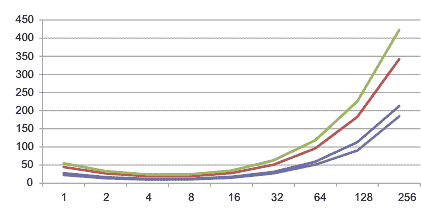

## 图 6.10 单线程归并排序图。

```cpp
if (data <= min_val)
{
    min_val = data;
    min_idx = list;
}
}
list_indexes[min_idx++]++;
dest_array[i] = min_val;
}
}
```

此函数现在合并了原始的 merge_array 函数及其 find_min 函数。重新编译后不再产生额外的栈帧。运行代码，我们得到表 6.8 所示的结果。如果将其绘制成图，会更容易看出（图 6.10）。

| 设备 | 9800GT | GTX260 | GTX460 | GTX470 |
|---|---|---|---|---|
| 核心时钟 | 650 MHz | 625 MHz | 726 MHz | 608 MHz |
| 内存带宽 | 61 GB/s | 123 GB/s | 115 GB/s | 134 GB/s |

从该图中令人惊讶的是，表现最差的竟然是 GTX260，它比上一代 9800GT 还要慢。同样值得注意的是，在这项特定测试中，GTX460 比 GTX470 更快。要理解这一点，需要查看所使用的具体设备，如表 6.9 所示。

可以看出，9800GT 的内部时钟频率高于 GTX260。GTX460 和 GTX470 的情况亦然。由于程序仅使用单个 SM，且内存访问主要由共享内存访问时间主导，因此这完全在预料之中。

然而，从该图中你可能看到的最有趣的特性是，线程数超过某个点后，计算反而会变慢。如果你以前从未见过这种关系，这起初似乎违反直觉。这类结果表明，存在资源冲突，或者问题在增加线程数时并非线性扩展。

问题在于后者。合并步骤是单线程的，且必须为每个元素检查 N 个列表。随着列表数量增加，问题空间会变为 2N、4N、8N 等，与线程数成正比。根据计时，该算法的最佳点实际上在四到八个数据列表之间。这并不理想，因为它在很大程度上限制了潜在的并行量。

## 并行合并

为了获得更好的性能，显然合并阶段需要多于一个线程。然而，这引入了一个问题，即我们正在写入单个列表。为此，线程需要以某种方式进行协作。这使得合并变得稍微复杂一些。

```cpp
// Uses multiple threads for merge
// Deals with multiple identical entries in the data
__device__ void merge_array6(const u32 * const src_array,
u32 * const dest_array,
const u32 num_lists,
const u32 num_elements,
const u32 tid)
{
const u32 num_elements_per_list = (num_elements / num_lists);
__shared__ u32 list_indexes[MAX_NUM_LISTS];
list_indexes[tid] = 0;
// Wait for list_indexes[tid] to be cleared
__syncthreads();

// Iterate over all elements
for (uint32 i=0; i<num_elements;i+=4)
{
    // Create a value shared with the other threads
    __shared__ uint32 min_val;
    __shared__ uint32 min_tid;

    // Use a temp register for work purposes
    uint32 data;

    // If the current list has not already been
    // emptied then read from it, else ignore it
    if (list_indexes[tid] < num_elements_per_list)
    {
        // Work out from the list_index, the index into
        // the linear array
        const uint32 src_idx = tid + (list_indexes[tid] * num_lists);

        // Read the data from the list for the given
        // thread
        data = src_array[src_idx];
    }
    else
    {
        data = 0xFFFFFFFF;
    }

    // Had zero clear the min values
    if (tid == 0)
    {
        // Write a very large value so the first thread wins the min
        min_val = 0xFFFFFFFF;
        min_tid = 0xFFFFFFFF;
    }

    // Wait for all threads
    __syncthreads();

    // Have every thread try to store it's value into
    // min_val. Only the thread with the lowest value
    // will win
    atomicMin(&min_val, data);
    atomicMin(&min_tid, data);

    // Make sure all threads have taken their turn.
    __syncthreads();

// If this thread was the one with the minimum
if (min_val == data)
{
    // Check for equal values
    // Lowest tid wins and does the write
    atomicMin(&min_tid, tid);
}

// Make sure all threads have taken their turn.
__syncthreads();

// If this thread has the lowest tid
if (tid == min_tid)
{
    // Increment the list pointer for this thread
    list_indexes[tid]++;
}

// Store the winning value
dest_array[i] = data;
}
}
```

此版本使用 num_lists 个线程执行合并操作。然而，同一时间只有一个线程向输出数据列表写入，从而确保单个输出列表始终正确。

它使用了 atomicMin 函数。不再由一个线程读取列表中的所有值并计算最小值，而是每个线程使用其列表项的值调用 atomicMin。当所有线程都调用了 atomicMin 函数后，每个线程将其读回，并与其尝试写入的值进行比较。如果值相同，则该线程为获胜线程。然而，还有一个进一步的问题：可能存在多个获胜线程，因为数据项可以在一个或多个列表中重复。因此，只有拥有相同数据的线程才需要进行第二轮消除步骤。大多数情况下，这一第二步并非必要。然而，在对一组相同数字进行排序的最坏情况下，这会导致每个线程都要经历两轮消除步骤。

那么这个版本的性能如何？如表 6.10 和图 6.11 所示，使用更多数量的线程（128 和 256 个线程）我们降低了总执行时间，由

## 表 6.10 atomicMin 并行归并排序结果 (ms)

| 设备/线程数 | 1 | 2 | 4 | 8 | 16 | 32 | 64 | 128 | 256 |
|---|---|---|---|---|---|---|---|---|---|
| GTX470 | 29.15 | 17.38 | 10.96 | 7.77 | 6.74 | 7.43 | 9.15 | 13.55 | 22.99 |
| GTX260 | 55.97 | 32.67 | 19.87 | 13.22 | 10.51 | 10.86 | 13.96 | 19.97 | 36.68 |
| GTX460 | 23.78 | 14.23 | 9.06 | 6.54 | 5.86 | 6.67 | 8.41 | 12.59 | 21.58 |


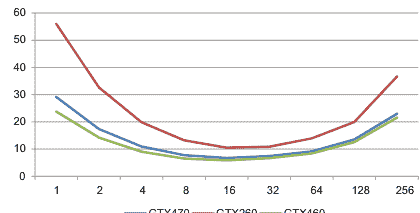

图 6.11 atomicMin 并行归并排序图。

一个 10 倍的因子。然而，单线程计时保持不变。更重要的是，最快时间已从 8 线程版本移至 16 线程版本，且绝对时间减半。

这里我应该提到一点，共享内存上的 atomicMin 需要计算能力 1.2 或更高的设备。9800GT 仅为计算能力 1.1 设备，因此未在此显示，因为它无法运行该内核。

如果我们使用类似 Parallel Nsight 的工具更仔细地查看硬件计数器，可以看到超过 32 个线程后，分支分叉的数量和共享内存访问数量开始非常快速地增长。我们目前有一个不错的解决方案，但还有哪些替代方法，它们是否更快？

## 并行归约

解决此问题的一种常见方法是并行归约。这可以应用于许多问题，最小操作只是其中之一。它的工作原理是使用数据集中元素数量一半的线程数。每个线程计算其自身元素和某个其他元素的最小值。结果元素被转发到下一轮。然后线程数减半，并重复该过程，直到只剩下一个元素，即操作的结果。

使用 CUDA 时必须记住，给定 SM 的执行单元是 warp。因此，任何少于一个 warp 的线程数都在低效利用硬件。此外，虽然分叉线程都必须执行，但分叉 warp 不必执行。

在为给定线程选择“其他元素”进行处理时，可以选择在 warp 内进行归约，从而导致 warp 内显著的分支分叉。这将阻碍性能，因为每个分叉分支都会使 SM 的工作量翻倍。更好的方法是通过从数据集的另一半选择其他元素来丢弃整个 warp。

在图 6.12 中，您可以看到某个元素正与数据集另一半中的一个元素进行比较。阴影单元显示活动线程。

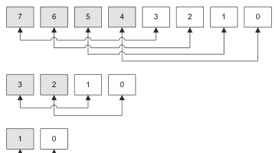

### 图 6.12 GPU 并行归约的最终阶段。

```cpp
// Uses multiple threads for reduction type merge
__device__ void merge_array(const u32 * const src_array,
                            u32 * const dest_array,
                            const u32 num_lists,
                            const u32 num_elements,
                            const u32 tid)
{
    const u32 num_elements_per_list = (num_elements / num_lists);

    __shared__ u32 list_indexes[MAX_NUM_LISTS];
    __shared__ u32 reduction_val[MAX_NUM_LISTS];
    __shared__ u32 reduction_idx[MAX_NUM_LISTS];

    // Clear the working sets
    list_indexes[tid] = 0;
    reduction_val[tid] = 0;
    reduction_idx[tid] = 0;
    __syncthreads();

    for (u32 i = 0; i < num_elements; i++)
    {
        // We need (num_lists / 2) active threads
        u32 tid_max = num_lists >> 1;

        u32 data;

        // If the current list has already been
        // emptied then ignore it
        if (list_indexes[tid] < num_elements_per_list)
        {
            // Work out from the list_index, the index into
            // the linear array
            const u32 src_idx = tid + (list_indexes[tid] * num_lists);

            // Read the data from the list for the given
            // thread
            data = src_array[src_idx];
        }
        else
        {
            data = 0xFFFFFFFF;
        }

        // Store the current data value and index
        reduction_val[tid] = data;
        reduction_idx[tid] = tid;

        // Wait for all threads to copy
        __syncthreads();

        // Reduce from num_lists to one thread zero
        while (tid_max != 0)
        {
            // Gradually reduce tid_max from
            // num_lists to zero
            if (tid < tid_max)
            {
                // Calculate the index of the other half
                const u32 val2_idx = tid + tid_max;

                // Read in the other half
                const u32 val2 = reduction_val[val2_idx];

                // If this half is bigger
                if (reduction_val[tid] > val2)
                {
                    // The store the smaller value
                    reduction_val[tid] = val2;
                    reduction_idx[tid] = reduction_idx[val2_idx];
                }
            }

            // Divide tid_max by two
            tid_max >>= 1;

            __syncthreads();
        }
    }

    if (tid == 0)
    {
        // Incremented the list pointer for this thread
        list_indexes[reduction_idx[0]]++;
        // Store the winning value
        dest_array[i] = reduction_val[0];
    }
    // Wait for tid zero
    __syncthreads();
}
```

这段代码通过在共享内存中创建一个临时数据列表来工作，它用来自每个周期的 num_list 个数据集对其进行填充。在某个列表已被清空的地方，数据集将填充为 0xFFFFFFFF，这将把该值从列表中排除。while 循环逐渐减少活动线程的数量，直到只剩下一个活动线程，即线程零。然后它复制数据并递增列表索引，以确保该值不会被处理两次。请注意循环内部和末尾使用了 __syncthreads 指令。当使用超过 32 个线程（一个 warp）时，程序需要跨 warp 同步。

那么性能如何呢？如表 6.11 和图 6.13 所示，这种方法明显慢于 atomicMin 版本，最快归约为 8.4 ms，而 atomicMin 为 5.86 ms（GTX460，16 个线程）。这比 atomicMin 版本慢近 50%。然而，值得注意的是，使用 256 个线程时，它的速度略快于 atomicMin 的两倍（12.27 ms 对比 21.58 ms）。然而，这仍然比 16 线程版本慢两倍。

尽管此版本较慢，但它的优势在于不需要使用 atomicMin 函数。该函数仅在计算能力 1.2 设备上可用，这通常只有在需要考虑消费者市场或需要支持非常旧的 Tesla 系统时才是问题。然而，主要问题是 atomicMin 只能用于整数值。大量实际问题是基于浮点数的。在这种情况下，我们需要两种算法。

然而，从 atomicMin 和并行归约方法中我们可以得出，使用两个列表的传统归并排序在 GPU 上并非理想情况。随着列表数量的增加，你会从基数排序中获得越来越高的并行度。

| 设备/线程数 | 1 | 2 | 4 | 8 | 16 | 32 | 64 | 128 | 256 |
|---|---|---|---|---|---|---|---|---|---|
| GTX470 | 28.4 | 17.67 | 12.44 | 10.32 | 9.98 | 10.59 | 11.62 | 12.94 | 14.61 |
| 9800GT | 45.66 | 28.35 | 19.82 | 16.25 | 15.61 | 17.03 | 19.03 | 21.45 | 25.33 |
| GTX260 | 56.07 | 34.71 | 24.22 | 19.84 | 19.04 | 20.6 | 23.2 | 26.28 | 31.01 |
| GTX460 | 23.22 | 14.52 | 10.3 | 8.63 | 8.4 | 8.94 | 9.82 | 10.96 | 12.27 |

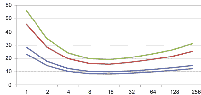

### 图 6.13 并行归约图。

然而，随着并行度的增加并超过 16 个列表，合并阶段的性能会下降。

## 混合方法

这里有潜力通过创建混合方法来利用两种算法的优势。我们可以将归并排序重写如下：

```cpp
#define REDUCTION_SIZE 8
#define REDUCTION_SIZE_BIT_SHIFT 3
#define MAX_ACTIVE_REDUCTIONS ( ( MAX_NUM_LISTS ) / REDUCTION_SIZE )

// Uses multiple threads for merge
// Does reduction into a warp and then into a single value
__device__ void merge_array9( const u32 * const src_array,
                              u32 * const dest_array,
                              const u32 num_lists,
                              const u32 num_elements,
                              const u32 tid)
{
  // Read initial value from the list
  u32 data = src_array[tid];

  // Shared memory index
  const u32 s_idx = tid >> REDUCTION_SIZE_BIT_SHIFT;

  // Calculate number of 1st stage reductions
  const u32 num_reductions = num_lists >> REDUCTION_SIZE_BIT_SHIFT;

  const u32 num_elements_per_list = (num_elements / num_lists);

  // Declare a number of list pointers and
  // set to the start of the list
  __shared__ u32 list_indexes[MAX_NUM_LISTS];
  list_indexes[tid] = 0;

  // Iterate over all elements
  for (u32 i = 0; i < num_elements; i++)
  {
      // Create a value shared with the other threads
      __shared__ u32 min_val[MAX_ACTIVE_REDUCTIONS];
      __shared__ u32 min_tid;

      // Have one thread from warp zero clear the
      // min value
      if (tid < num_lists)
      {
          // Write a very large value so the first
          // thread wins the min
          min_val[s_idx] = 0xFFFFFFFF;
          min_tid = 0xFFFFFFFF;
      }

      // Wait for warp zero to clear min vals
      __syncthreads();

      // Have every thread try to store it's value into
      // min_val for it's own reduction elements. Only
      // the thread with the lowest value will win.
      atomicMin(&min_val[s_idx], data);

      // If we have more than one reduction then
      // do an additional reduction step
      if (num_reductions > 0)
      {
          // Wait for all threads
          __syncthreads();

          // Have each thread in warp zero do an
          // additional min over all the partial
          // mins to date
          if ( (tid < num_reductions) )
          {
              atomicMin(&min_val[0], min_val[tid]);
          }
      }
  }
}
```


```
// Make sure all threads have taken their turn.
__syncthreads();
}

// If this thread was the one with the minimum
if (min_val[0] == data)
{
    // Check for equal values
    // Lowest tid wins and does the write
    atomicMin(&min_tid, tid);
}

// Make sure all threads have taken their turn.
__syncthreads();

// If this thread has the lowest tid
if (tid == min_tid)
{
    // Increment the list pointer for this thread
    list_indexes[tid]++;
}

// Store the winning value
dest_array[i] = data;

// If the current list has not already been
// emptied then read from it, else ignore it
if ((list_indexes[tid] < num_elements_per_list))
    data = src_array[tid + (list_indexes[tid] * num_lists)];
else
    data = 0xFFFFFFFF;
}

// Wait for min_tid thread
__syncthreads();
}
```

简单1对N归约的主要问题之一是，随着N值的增加，速度会越来越慢。从之前的测试可以看出，N的理想值大约是16个元素。该内核通过对N个值进行部分归约，然后再将这N个值归约为单个值来工作。在这方面它类似于归约示例，但跳过了大部分迭代。

请注意，min_val已从单个值扩展为共享值数组。这是必要的，以便每个独立线程可以对其数据集中的值求最小值。每个最小值宽32位，因此存在于单独的共享内存银行中，这意味着只要第一级归约的最大结果为32个或更少元素，就不会出现银行冲突。

REDUCTION_SIZE的值已设置为8，这意味着程序将在对8个值的组进行最小值运算后再进行最终最小值运算。在最多256个元素的情况下，我们正好得到32

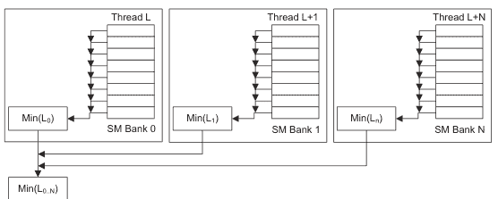

图6.14
混合并行归约。

**表6.12 混合原子和并行归约结果（ms）**

| 设备/线程 | 1 | 2 | 4 | 8 | 16 | 32 | 64 | 128 | 256 |
|---|---|---|---|---|---|---|---|---|---|
| GTX470 | 29.41 | 17.62 | 11.24 | 8.98 | 7.2 | 6.49 | 6.46 | 7.01 | 8.57 |
| GTX260 | 56.85 | 33.54 | 20.83 | 15.29 | 11.87 | 10.5 | 10.36 | 11.34 | 14.65 |
| GTX460 | 24.12 | 14.54 | 9.36 | 7.64 | 6.22 | 5.67 | 5.68 | 6.27 | 7.81 |

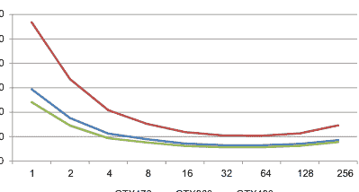

图6.15
混合原子和并行归约图。

正在使用单独的银行进行归约。在256个元素中，我们有一个256:32:1的归约。在128元素列表中，我们有一个128:16:1的归约，以此类推。

另一个重大变化是，现在只有写出获胜元素的线程才会将新值读入data，这是一个基于寄存器的每线程值。以前，所有线程都从各自的列表中重新读取值。由于每轮只有一个线程获胜，因此只有一个列表指针发生变化。因此，随着N的增加，这变得越来越低效。然而，这并不像你最初想象的那样有帮助。

那么这个版本的性能如何？请注意表6.12中，最短时间（来自atomicMin示例的5.86 ms）已降至5.67 ms。这并不惊人，但值得注意的是图表（图6.15）的形状。图不再是那样陡峭的U形。32线程和64线程版本都击败了基于16线程的简单atomicMin。我们开始平滑由合并步骤引入的上升趋势，如表6.12和图6.15所示。

## 不同GPU上的共享内存

并非所有GPU都相同。随着向计算2.x设备的转变，共享内存的数量变得可配置。默认情况下，计算2.x（Fermi）设备配置为提供48K共享内存，而不是计算1.x设备上的16K共享内存。

共享内存的数量可能会因硬件版本而异。为了编写性能能随新GPU版本扩展的程序，你必须编写可移植代码。为此，CUDA允许你使用以下代码查询设备可用的共享内存数量：

```
struct cudaDeviceProp device_prop;
CUDA_CALL(cudaGetDeviceProperties(&device_prop, device_num));
printf("\nShared Memory: %u", device_prop.sharedMemPerBlock);
```

拥有更多可用共享内存可以让我们选择两种策略之一。我们可以将使用的共享内存量从16K扩展到48K，或者简单地将更多块调度到单个SM中。最佳选择将取决于具体应用。在我们的排序示例中，48K共享内存将允许每个SM的列表数量减少三倍。如前所述，要合并的列表数量对总体执行时间有显著影响。

## 共享内存总结

迄今为止，我们只研究了单个SM内（实际上是单个块内）的排序。从单块版本转向多块版本会引入另一组合并操作。每个块将生成一个独立的排序列表。然后必须合并这些列表，但这次是在全局内存中进行。列表大小超出了共享内存所能容纳的范围。使用多个GPU时也是如此——你会生成N个或更多排序列表，其中N等于系统中的GPU数量。

在本节中，我们主要研究了通过共享内存进行的线程间协作。选择合并示例是为了以不太复杂且易于跟随的方式演示这一点。并行排序有大量研究支持。更复杂的算法在内存使用和/或SM利用率方面可能更高效。这里的重点是使用一个易于跟随的实际示例，并处理大量不仅仅归约为单个值的数据。

我们稍后将继续研究排序，并探讨除了线程级通信之外，如何实现互锁通信和协调。

## 关于共享内存的问题

- 1. 观察基数排序算法，如何减少共享内存的使用？这有什么用处？
- 2. 所有同步点都是必要的吗？在每个实例中都使用了同步原语。讨论原因。是否存在不需要它们的条件？
- 3. 使用C++模板对执行时间有什么影响？
- 4. 你将如何进一步优化此排序算法？

## 关于共享内存的答案

- 1. 有多种解决方案。一种是仅使用分配给排序的内存。可以使用MSB基数排序，并将1与列表末尾的元素交换来实现。0列表正向计数，1列表反向计数。当它们相遇时，对下一位进行排序，直到LSB被排序。减少内存使用很有用，因为它允许共享内存中容纳更大的列表，从而减少所需的列表总数，这对执行时间有显著影响。
- 2. 这里需要理解的主要概念是，同步点仅在使用多个warp时才是必要的。在warp内，所有指令都同步执行。分支会导致非分支线程停滞。在分支汇合点，可以保证所有指令都同步，尽管warp随后可以立即再次分叉。请注意，如果希望保证线程间写入的可见性，内存必须声明为volatile，或者在warp内必须有syncthreads点。有关volatile限定符的使用讨论，请参见第12章常见问题。
- 3. 模板将允许将num_lists参数的大部分运行时求值替换为编译时替换。该参数必须始终是2的幂，在实践中将限制为最大256。因此，可以创建许多模板并在运行时调用相应的函数。鉴于编译时而非运行时已知固定的迭代次数，编译器可以高效地展开循环，并用字面量替换变量读取。此外，模板可用于为不同数据类型支持多种实现，例如，对整数数据使用atomicMin版本，而对浮点数据使用并行归约。
- 4. 这是一个相当开放的问题。有许多有效的答案。随着要合并的排序列表数量增加，问题会变得大得多。消除合并步骤将是一个好的解决方案。这可以通过按值将原始列表部分排序为N个子列表来实现。然后可以对每个子列表进行排序并连接列表，而不是合并它们。这种方法是另一种排序（样本排序）的基础，我们将在本章后面介绍该算法。

还要考虑示例中数据集的大小，1024个元素。使用256个线程时，每个列表只有四个元素。对于这个数量的元素，使用单个位的基数排序非常低效。


元素，需要 128 次迭代。基于比较的排序对于如此小的 N 值要快得多。

在此示例中，我们为基数排序使用了单个位。可以使用多个位，这会以更多中间存储为代价减少对数据集的遍历次数。我们目前使用迭代方法将元素排序到顺序列表中。通过计算基数位并使用前缀和计算来确定数据应写入的索引，完全有可能计算出数据将移动到的位置。我们将在本章后面介绍前缀和。

## 常量内存

常量内存是全局内存的一种虚拟寻址形式。没有特殊的保留常量内存块。常量内存有两个您可能感兴趣的特殊属性。首先，它是缓存的；其次，它支持将单个值广播到 warp 内的所有元素。

顾名思义，常量内存用于只读内存。这种内存要么在编译时声明为只读，要么由主机在运行时定义为只读。因此，它仅相对于 GPU 对内存的视图是常量的。常量内存的大小限制为 64 K。

要在编译时将内存区域声明为常量，只需使用 `__constant__` 关键字。例如：

```
__constant__ float my_array[1024] = { 0.0f, 1.0f, 1.34f, ... };
```

要在运行时更改常量内存区域的内容，只需在调用 GPU 内核之前使用 cudaMemcpyToSymbol 函数调用。如果在编译时或主机运行时均未定义常量内存，则内存区域的内容未定义。

### 常量内存缓存

**计算 1.x 设备** 在计算 1.x 设备（Fermi 之前）上，常量内存具有缓存在小型 8K L1 缓存中的属性，因此后续访问可以非常快。前提是应用程序使用的内存模式中存在数据重用的潜力。它还针对广播访问进行了高度优化，使得访问相同内存地址的线程可以在单个周期内得到服务。

使用 64 K 段大小和 8 K 缓存大小，内存大小与缓存的比率为 8:1，这非常好。如果您能将对该常量区域内 8K 块的访问限制或本地化，将获得非常好的程序性能。在某些设备上，您会发现将数据本地化到更小的块将提供更高的性能。

对常量内存的非统一访问会导致缓存未命中，除了从常量缓存获取外，还需要从全局内存进行 N 次获取。因此，表现出局部性差和/或数据重用差的内存模式不应作为常量内存访问。此外，内存获取模式中的每次分歧都会导致序列化，因为必须等待常量内存。因此，向常量缓存进行 32 次独立获取的 warp 所需时间至少是访问单个数据项的 32 倍。如果还包括缓存未命中，这将显著增长。

单周期访问相对于从全局内存获取所需的数百个周期是巨大的改进。然而，如果有足够可供 SM 执行的 warp，对全局内存的数百个周期访问可能会被切换到其他 warp 的任务所隐藏。因此，使用常量内存的缓存属性的好处取决于从全局内存获取数据所需的时间以及算法具有的数据重用量。与共享内存一样，低端设备的全局内存带宽要少得多，因此它们从这些技术中获益的比例高于高端设备。

大多数算法可以将其数据从更大的问题分解为“瓦片”（即较小的数据集）。事实上，一旦您有一个无法在单台机器上物理容纳的问题，就必须对数据进行分块。同样的分块可以在多核 CPU 上进行，每个 N 个核心处理 1/N 的数据。您可以将 GPU 上的每个 SM 视为能够支持数百个线程的 CPU 核心。

想象将网格叠加到您正在处理的数据上，网格中的单元格或块的总数等于您希望将数据拆分为的核心（SM）数量。将这些基于 SM 的块进一步划分为至少八个额外块。现在，您已将数据区域分解为 N 个 SM，每个 SM 分配 M 个块。

在实践中，这种拆分通常过大，不会允许未来 GPU 世代增加 SM 数量或可用块数量并获得任何好处。它在 SM 数量未知的情况下也效果不佳，例如，编写将在消费级硬件上运行的商业程序时。到目前为止，每个设备的最大 SM 数量为 32（GT200 系列）。面向计算的 Kepler 和 Fermi 系列分别最多有 15 和 16 个 SM。主要为游戏设计的系列最多有 8 个 SM。

另一个重要考虑是您需要（如果有）哪些线程间通信。这只能合理地使用线程来完成，线程在 Fermi 和 Kepler 上每个块限制为 1024 个，早期设备上更少。当然，您可以每个线程处理多个数据项，因此这不像最初看起来那样是一个严格的限制。

最后，您需要考虑负载均衡。GPU 家族的许多早期卡发布具有非 2 的幂次数的 SM 数量（GTX460 = 7，GTX260 = 30 等）。因此，使用过少的块会导致粒度太小，从而在计算的最终阶段导致 SM 未被占用。

就常量内存而言，分块意味着将数据拆分为每个不超过 64 K 的块。理想情况下，瓦片应为 8 K 或更小。有时分块涉及处理占据边界的光晕或幽灵单元，因此值必须在瓦片之间传播。当需要光晕时，较大的块大小比较小的单元效果更好，因为块之间需要通信的区域要小得多。

使用分块时，实际上有很多需要考虑的事情。通常最好的解决方案是简单地遍历线程数量、每个线程处理的元素数量、块数量和瓦片宽度的所有组合，并为给定问题搜索最佳解决方案。我们将在第 9 章优化中介绍如何做到这一点。

### 计算 2.x 设备

在 Fermi（计算 2.x）硬件及更高版本中，存在二级（L2）缓存。Fermi 在每个 SM 之间使用共享的 L2 缓存。所有内存访问都由 L2 缓存自动缓存。此外，可以通过牺牲每个 SM 的 32 K 共享内存，将 L1 缓存大小从 16 K 增加到 48 K。由于 Fermi 上的所有内存都被缓存，因此如何使用常量内存需要一些考虑。

与计算 1.x 设备不同，Fermi 允许将任何常量数据区域视为常量内存，即使它没有显式声明为如此。1.x 设备上的常量内存必须使用像 cudaMemcpyToSymbol 这样的专用调用进行显式管理，或在编译时声明。使用 Fermi 时，对声明为常量（仅使用标准 const 关键字）的内存区域的任何非线程访问都会通过常量缓存。非线程访问是指数组索引计算中不包含 threadIdx.x 的访问。

如果您需要按线程访问常量数据，则需要使用编译时（__constant__）或运行时函数（cudaMemcpyToSymbol），如同计算 1.x 设备一样。

但是，请注意 L2 缓存仍然存在，并且比常量缓存大得多。如果您正在实现需要块之间光晕或幽灵单元的分块算法，解决方案通常涉及将光晕单元复制到常量或共享内存中。由于 Fermi 的 L2 缓存，此策略通常比简单地将分块单元复制到共享或常量内存，然后从全局内存访问光晕单元要慢。L2 缓存将从前一个块的内存访问中收集光晕单元。因此，光晕单元可以从 L2 缓存中快速获得，并比在计算 1.x 硬件上更快地进入设备，在计算 1.x 硬件上全局内存获取必须全部访问全局内存。

### 常量内存广播

常量内存有一个非常有用的功能。它可以用于将数据分发或广播到 warp 中的每个线程。此广播仅在单个周期内完成，使此功能非常有用。相比之下，计算 1.x 硬件上对全局内存的合并访问将需要数百个周期延迟的内存获取才能完成。一旦它从内存子系统到达，它将以同样的方式分发到所有线程，但只有在等待内存子系统提供数据后才会发生。不幸的是，这是一个太常见的问题，即内存速度未能跟上处理器时钟速度。

将从全局内存获取数据视为与从磁盘获取数据相同的术语。您永远不会编写一个从磁盘多次获取数据的程序，因为这将太慢。您必须考虑获取哪些数据，一旦获得，如何尽可能多地重用该数据，同时某些后台进程触发下一个数据块从磁盘读入。

通过使用广播机制（也存在于 Fermi 上用于基于 L2 缓存的访问），您可以非常快速地将数据分发到 warp 中的多个线程。当所有线程执行某些共同转换时，这特别有用。每个线程从常量内存读取元素 N，这会触发向 warp 中所有线程的广播。对从常量内存获取的值进行一些处理，可能与对全局内存的读取/写入相结合。然后您再次通过广播从常量内存获取元素 N + 1，以此类推。由于常量内存区域提供接近 L1 缓存的速度，这种类型的算法效果很好。

但是，请注意，如果常量实际上是一个文字值，最好使用 #define 语句将其定义为文字值，因为这会释放常量内存。因此，不要将 PI 等文字放入常量内存，而是将其定义为文字 #define。在实践中，无论选择哪种方法，速度差异很小，仅内存使用量不同。让我们看一个示例程序：


```c
#include "const_common.h"
#include "stdio.h"
#include "conio.h"
#include "assert.h"

#define CUDA_CALL(x) (const cudaError_t a = (x); if (a != cudaSuccess) { printf("\nCUDA Error: %s (err_num=%d)\n", cudaGetErrorString(a), a); cudaDeviceReset(); assert(0); } )
#define KERNEL_LOOP 65536
```

```c
constant static const u32 const_data_01 = 0x55555555;
constant static const u32 const_data_02 = 0x77777777;
constant static const u32 const_data_03 = 0x33333333;
constant static const u32 const_data_04 = 0x11111111;
```

```c
__global__ void const_test_gpu_literal(u32 * const data, const u32 num_elements)
{
    const u32 tid = (blockIdx.x * blockDim.x) + threadIdx.x;
    if (tid < num_elements)
    {
        u32 d = 0x55555555;

        for (int i = 0; i < KERNEL_LOOP; i++)
        {
            d ^= 0x55555555;
            d |= 0x77777777;
            d &= 0x33333333;
            d ^= 0x11111111;
        }

        data[tid] = d;
    }
}
```

```c
__global__ void const_test_gpu_const(u32 * const data, const u32 num_elements)
{
    const u32 tid = (blockIdx.x * blockDim.x) + threadIdx.x;
    if (tid < num_elements)
    {
        u32 d = const_data_01;

        for (int i = 0; i < KERNEL_LOOP; i++)
        {
            d ^= const_data_01;
            d |= const_data_02;
            d &= const_data_03;
            d ^= const_data_04;
        }

        data[tid] = d;
    }
}
```

```c
__host__ void wait_exit(void)
{
    char ch;

    printf("\nPress any key to exit");
    ch = getch();
}
```

```c
__host__ void cuda_error_check(
    const char * prefix,
    const char * postfix)
{
    if (cudaPeekAtLastError() != cudaSuccess)
    {
        printf("\n%s%s%s", prefix, cudaGetErrorString(cudaGetLastError()), postfix);
        cudaDeviceReset();
        wait_exit();
        exit(1);
    }
}
```

```c
__host__ void gpu_kernel(void)
{
    const u32 num_elements = (128*1024);
    const u32 num_threads = 256;
    const u32 num_blocks = (num_elements+(num_threads-1)) / num_threads;
    const u32 num_bytes = num_elements * sizeof(u32);
    int max_device_num;
    const int max_runs = 6;

    CUDA_CALL(cudaGetDeviceCount(&max_device_num));

    for (int device_num=0; device_num < max_device_num; device_num++)
    {
        CUDA_CALL(cudaSetDevice(device_num));

        for (int num_test=0; num_test < max_runs; num_test++)
        {
            u32 * data_gpu;
            cudaEvent_t kernel_start1, kernel_stop1;
            cudaEvent_t kernel_start2, kernel_stop2;
            float delta_time1 = 0.0F, delta_time2=0.0F;
            struct cudaDeviceProp device_prop;
            char device_prefix[256];

            CUDA_CALL(cudaMalloc(&data_gpu, num_bytes));
            CUDA_CALL(cudaEventCreate(&kernel_start1));
            CUDA_CALL(cudaEventCreate(&kernel_stop2));
            CUDA_CALL(cudaEventCreateWithFlags(&kernel_start1, cudaEventBlockingSync));
            CUDA_CALL(cudaEventCreateWithFlags(&kernel_stop2, cudaEventBlockingSync));

            // printf("\nLaunching %u blocks, %u threads, num_blocks, num_threads);
            CUDA_CALL(cudaGetDeviceProperties(&device_prop, device_num));
            snprintf(device_prefix, 256, "ID%d %s", device_num, device_prop.name);

            // Warm up run
            // printf("\nLaunching literal kernel warm-up");
            const_test_gpu_literal <<<num_blocks, num_threads>>>(data_gpu, num_elements);
            cuda_error_check("Error: ", "returned from literal startup kernel");

            // Do the literal kernel
            // printf("\nLaunching literal kernel");
            CUDA_CALL(cudaEventRecord(kernel_start1,0));
            const_test_gpu_literal <<<num_blocks, num_threads>>>(data_gpu, num_elements);
            cuda_error_check("Error: ", "returned from literal runtime kernel");

            CUDA_CALL(cudaEventRecord(kernel_stop1,0));
            CUDA_CALL(cudaEventSynchronize(kernel_stop1));
            CUDA_CALL(cudaEventElapsedTime(&delta_time1, kernel_start1, kernel_stop1));
            // printf("\nLiteral Elapsed time: %.3fms", delta_time1);

            // Warm up run
            // printf("\nLaunching constant kernel warm-up");
            const_test_gpu_const <<<num_blocks, num_threads>>>(data_gpu, num_elements);
            cuda_error_check("Error: ", "returned from constant startup kernel");

            // Do the constant kernel
            // printf("\nLaunching constant kernel");
            CUDA_CALL(cudaEventRecord(kernel_start2,0));
            const_test_gpu_const <<<num_blocks, num_threads>>>(data_gpu, num_elements);
            cuda_error_check("Error: ", "returned from constant runtime kernel");

            CUDA_CALL(cudaEventRecord(kernel_stop2,0));
            CUDA_CALL(cudaEventSynchronize(kernel_stop2));
            CUDA_CALL(cudaEventElapsedTime(&delta_time2, kernel_start2, kernel_stop2));
            // printf("\nConst Elapsed time: %.3fms", delta_time2);

            if (delta_time1 > delta_time2)
                printf("\n%sConstant version is faster by: %.2fms (Const=%.2fms vs. Literal=%.2fms)",
                device_prefix, delta_time1-delta_time2, delta_time1, delta_time2);
            else
                printf("\n%sLiteral version is faster by: %.2fms (Const=%.2fms vs. Literal=%.2fms)",
                device_prefix, delta_time2-delta_time1, delta_time1, delta_time2);

            CUDA_CALL(cudaEventDestroy(kernel_start1));
            CUDA_CALL(cudaEventDestroy(kernel_start2));
            CUDA_CALL(cudaEventDestroy(kernel_stop1));
            CUDA_CALL(cudaEventDestroy(kernel_stop2));
            CUDA_CALL(cudaFree(data_gpu));
        }

        CUDA_CALL(cudaDeviceReset());
        printf("\n");
    }
    wait_exit();
}
```

该程序包含两个 GPU 内核，const_test_gpu_literal 和 const_test_gpu_const。请注意，每个内核都使用 __global__ 前缀进行声明，以表明该函数具有公共作用域。这些内核中的每一个都在 for 循环中将一些数据作为常量数据或字面量数据获取，并使用它来操作局部变量 d。然后，它将操作后的值写入全局内存。这样做仅是为了避免编译器优化掉该代码。

代码的下一部分获取存在的 CUDA 设备数量，并使用 cudaSetDevice 调用遍历这些设备。请注意，这是可能的，因为在循环结束时，主机代码会调用 cudaDeviceReset 来清除当前上下文。

设置设备后，程序分配一些全局内存并创建两个事件，一个启动计时器事件和一个停止计时器事件。这些事件连同内核调用一起被馈送到执行流中。因此，你最终得到的流中包含一个启动事件、一个内核调用和一个停止事件。这些事件通常与 CPU 异步发生，也就是说，它们不会阻塞 CPU 的执行，并且与 CPU 并行执行。在尝试进行计时时，这会造成一些问题，因为 CPU 计时器将看不到任何经过时间。因此，程序调用 cudaEventSynchronize 来等待最后一个事件（即内核停止事件）完成。然后，它计算启动事件和停止事件之间的时间差，从而得知内核的执行时间。

这对常量内核和字面量内核都重复执行，包括执行一个预热调用，以避免填充任何缓存产生的初始影响。结果如下所示：

| ID | 设备 | 更快版本 | 差异 (ms) | 常量 (ms) | 字面量 (ms) |
|----|--------|----------------|-----------------|---------------|--------------|
| 0 | GeForce GTX 470 | 常量 | 0.00 | 345.23 | 345.23 |
| 0 | GeForce GTX 470 | 常量 | 0.01 | 330.95 | 330.94 |
| 0 | GeForce GTX 470 | 字面量 | 0.00 | 336.60 | 336.60 |
| 0 | GeForce GTX 470 | 常量 | 5.67 | 336.60 | 330.93 |
| 0 | GeForce GTX 470 | 常量 | 5.59 | 336.60 | 331.01 |
| 0 | GeForce GTX 470 | 常量 | 14.30 | 345.23 | 330.94 |
| 1 | GeForce 9800 GT | 字面量 | 4.04 | 574.85 | 578.89 |
| 1 | GeForce 9800 GT | 字面量 | 3.55 | 578.18 | 581.73 |
| 1 | GeForce 9800 GT | 字面量 | 4.68 | 575.85 | 580.53 |
| 1 | GeForce 9800 GT | 常量 | 5.25 | 581.06 | 575.81 |
| 1 | GeForce 9800 GT | 字面量 | 4.01 | 572.08 | 576.10 |
| 1 | GeForce 9800 GT | 常量 | 8.47 | 578.40 | 569.93 |
| 2 | GeForce GTX 260 | 字面量 | 0.27 | 348.74 | 349.00 |
| 2 | GeForce GTX 260 | 字面量 | 0.26 | 348.72 | 348.98 |
| 2 | GeForce GTX 260 | 字面量 | 0.26 | 348.74 | 349.00 |
| 2 | GeForce GTX 260 | 字面量 | 0.26 | 348.74 | 349.00 |
| 2 | GeForce GTX 260 | 字面量 | 0.13 | 348.83 | 348.97 |
| 2 | GeForce GTX 260 | 字面量 | 0.27 | 348.73 | 348.99 |
| 3 | GeForce GTX 460 | 字面量 | 0.59 | 541.43 | 542.02 |
| 3 | GeForce GTX 460 | 字面量 | 0.17 | 541.20 | 541.37 |
| 3 | GeForce GTX 460 | 常量 | 0.45 | 542.29 | 541.83 |
| 3 | GeForce GTX 460 | 常量 | 0.27 | 542.17 | 541.89 |
| 3 | GeForce GTX 460 | 常量 | 1.17 | 543.55 | 542.38 |
| 3 | GeForce GTX 460 | 常量 | 0.24 | 542.92 | 542.68 |

值得注意的是，如果将其视为总执行时间的百分比，执行时间几乎没有差异，甚至没有差异。因此，我们看到哪个版本（常量或字面量）更快的分布相当随机。那么，这与使用全局内存相比如何？要测试这一点，我们只需将字面量内核替换为使用全局内存的内核，如下所示：

```c
__device__ static u32 data_01 = 0x55555555;
__device__ static u32 data_02 = 0x77777777;
__device__ static u32 data_03 = 0x33333333;
__device__ static u32 data_04 = 0x11111111;

__global__ void const_test_gpu_mem(u32 * const data, const u32 num_elements)
{
    const u32 tid = (blockIdx.x * blockDim.x) + threadIdx.x;
    if (tid < num_elements)
    {
        u32 d = 0x55555555;

        for (int i = 0; i < KERNEL_LOOP; i++)
        {
            d ^= data_01;
            d |= data_02;
            d &= data_03;
            d |= data_04;
        }

        data[tid] = d;
```


}

注意，要在 GPU 内存空间中声明全局变量，只需用 __device__ 限定符作为前缀即可。我们最终得到了与之前相同的内核，它从内存中读取四个值，重复 N 次。然而，在本示例中，我不得不将 KERNEL_LOOP 从 64 K 降低到 4 K，否则内核执行时间会非常长。因此，在比较耗时时，请记住我们只做了十六分之一的工作。结果很有趣。

```
I0:0 GeForce GTX 470:Constant version is faster by: 16.68ms (G=37.38ms, C=20.70ms)
I0:0 GeForce GTX 470:Constant version is faster by: 16.45ms (G=37.50ms, C=21.06ms)
I0:0 GeForce GTX 470:Constant version is faster by: 15.71ms (G=37.30ms, C=21.59ms)
I0:0 GeForce GTX 470:Constant version is faster by: 16.66ms (G=37.36ms, C=20.70ms)
I0:0 GeForce GTX 470:Constant version is faster by: 15.84ms (G=36.55ms, C=20.71ms)
I0:0 GeForce GTX 470:Constant version is faster by: 16.33ms (G=37.39ms, C=21.06ms)
```

```
I0:1 GeForce 9800 GT:Constant version is faster by: 1427.19ms (G=1463.58ms, C=36.39ms)
I0:1 GeForce 9800 GT:Constant version is faster by: 1425.98ms (G=1462.05ms, C=36.07ms)
I0:1 GeForce 9800 GT:Constant version is faster by: 1426.95ms (G=1463.15ms, C=36.20ms)
I0:1 GeForce 9800 GT:Constant version is faster by: 1426.13ms (G=1462.56ms, C=36.44ms)
I0:1 GeForce 9800 GT:Constant version is faster by: 1427.25ms (G=1463.65ms, C=36.40ms)
I0:1 GeForce 9800 GT:Constant version is faster by: 1427.53ms (G=1463.70ms, C=36.17ms)
```

```
I0:2 GeForce GTX 260:Constant version is faster by: 54.33ms (G=76.13ms, C=21.81ms)
I0:2 GeForce GTX 260:Constant version is faster by: 54.31ms (G=76.11ms, C=21.80ms)
I0:2 GeForce GTX 260:Constant version is faster by: 54.30ms (G=76.10ms, C=21.80ms)
I0:2 GeForce GTX 260:Constant version is faster by: 54.29ms (G=76.12ms, C=21.83ms)
I0:2 GeForce GTX 260:Constant version is faster by: 54.31ms (G=76.12ms, C=21.81ms)
I0:2 GeForce GTX 260:Constant version is faster by: 54.32ms (G=76.13ms, C=21.80ms)
```

```
I0:3 GeForce GTX 460:Constant version is faster by: 20.87ms (G=54.85ms, C=33.98ms)
I0:3 GeForce GTX 460:Constant version is faster by: 19.64ms (G=53.57ms, C=33.93ms)
I0:3 GeForce GTX 460:Constant version is faster by: 20.87ms (G=54.86ms, C=33.99ms)
I0:3 GeForce GTX 460:Constant version is faster by: 20.81ms (G=54.77ms, C=33.95ms)
I0:3 GeForce GTX 460:Constant version is faster by: 20.99ms (G=54.87ms, C=33.89ms)
I0:3 GeForce GTX 460:Constant version is faster by: 21.02ms (G=54.93ms, C=33.91ms)
```

请注意，在每一代硬件上，常量缓存的性能都优于全局内存访问。在计算能力 1.1 硬件（9800GT）上，你获得了 40:1 的加速比。在计算能力 1.3 硬件（GTX260）上，你获得了 3:1 的加速比。在计算能力 2.0 硬件（GTX470）上，你获得了 1.8:1 的加速比。在计算能力 2.1 硬件（GTX460）上，你获得了 1.6:1 的加速比。

也许最有趣的是，Fermi 设备（GTX460 和 GTX470）似乎使用常量缓存而非全局内存访问所用的 L1/L2 缓存，显示出显著的加速。因此，即使是 Fermi，使用常量缓存似乎也能显著提高吞吐量。然而，情况真的是这样吗？

要进一步研究这一点，你需要查看生成的 PTX（虚拟汇编）代码。要做到这一点，你需要为编译器使用 -keep 选项。对于常量内核，此单个函数的 PTX 代码如下所示：

```
.const .u32 const_data_01 = 1431655765;
.const .u32 const_data_02 = 2004318071;
.const .u32 const_data_03 = 858993459;
.const .u32 const_data_04 = 286331153;
.entry ZZ20const_test_gpu_constPjj (
.param .u64 __cudaparm__ZZ20const_test_gpu_constPjj_data,
.param .u32 __cudaparm__ZZ20const_test_gpu_constPjj_num_elements)
.reg .u32 %r<29>;
.reg .u64 %rd<6>;
.reg .pred %p<5>;
// __cuda_local_var_108907_15_non_const_tid = 0
// __cuda_local_var_108910_13_non_const_d = 4
.i = B
.loc 16 40 0
$LDWbegin_ZZ20const_test_gpu_constPjj:
$LDWbeginBlock_181_1:
.loc 16 42 0
mov.u32 %r1, %tid.x;
mov.u32 %r2, %ctaid.x;
mov.u32 %r3, %ntid.x;
mul.lo.u32 %r4, %r2, %r3;
add.u32 %r5, %r1, %r4;
mov.s32 %r6, %r5;
.loc 16 43 0
ld.param.u64 %r7, {__cudaparm__ZZ20const_test_gpu_constPjj_num_elements};
mov.u32 %r8, %r6;
setp.le.u32 %p1, %r7, %r8;
@%p1 bra $L_1_3074;
$LDWbeginBlock_181_3:
.loc 16 45 0
mov.u32 %r9, 1431655765;
mov.s32 %r10, %r9;
$LDWbeginBlock_181_5:
.loc 16 47 0
mov.s32 %r11, 0;
mov.s32 %r12, %r11;
mov.s32 %r13, %r12;
mov.u32 %r14, 4095;
setp.gt.s32 %p2, %r13, %r14;
@%p2 bra $L_1_3586;
$L_1_3330:
.loc 16 49 0
mov.s32 %r15, %r10;
xor.b32 %r16, %r15, 1431655765;
mov.s32 %r10, %r16;
.loc 16 50 0
mov.s32 %r17, %r10;
or.b32 %r18, %r17, 2004318071;
mov.s32 %r10, %r18;
.loc 16 51 0
mov.s32 %r19, %r10;
and.b32 %r20, %r19, 858993459;
mov.s32 %r10, %r20;
.loc 16 52 0
mov.s32 %r21, %r10;
or.b32 %r22, %r21, 286331153;
mov.s32 %r10, %r22;
.loc 16 47 0
mov.s32 %r23, %r12;
add.s32 %r24, %r23, 1;
mov.s32 %r12, %r24;
$lit_1:1794
mov.s32 %r25, %r12;
mov.u32 %r26, 4095;
setp.le.s32 %p3, %r25, %r26;
@%p3 bra $L_3:330;
$L_1:3586
$LDWendblock_181_5:
.loc 16 55 0
mov.s32 %r27, %r10;
ld.param.u64 %rd1, [%cuda_parm_Z20const_test_gpu_constPjj_data];
cvt.u64.u32 %rd2, %r6;
mul.wide.u32 %rd3, %rd3, %r6;
add.u64 %rd4, %rd1, %rd3;
.cv.global.u32 [%rd4+0], %r27;
$LDWendblock_181_5;
$L_1:3074
$LDWendblock_181_1:
.loc 16 57 0
exit;
$LDWend_Z20const_test_gpu_constPjj:
! // _Z20const_test_gpu_constPjj
```

无需理解汇编代码的确切含义。我们完整地展示了该函数，以让你了解一小段 C 代码实际上如何扩展到汇编级别。PTX 代码使用以下格式：

```
<operator> <destination register> <source reg A> <source reg B>
```

因此，

```
xor.b32 %r16, %r15, 1431655765;
```

它获取寄存器 15 中的值，并与字面量 1431655765 进行 32 位按位异或操作。然后将结果存储在寄存器 16 中。请注意前面 PTX 列表中以粗体突出显示的数字。编译器已将内核中使用的常量值替换为字面量。这就是为什么如果结果不符合预期，深入了解发生了什么始终是有价值的。以下是用于比较的 GMEM PTX 代码摘录：

```
ld.global.u32 %r15, [%r16, 01];
xor.b32 %r17, %r15, %r16;
```

程序现在正在从全局内存加载一个值。常量版本实际上根本没有进行任何内存读取。编译器在将 C 代码翻译成 PTX 汇编时，已将常量值替换为字面量。可以通过将常量版本声明为数组，而不是多个标量变量来解决此问题。因此，新函数变为：

```
__constant__ static const u32 const_data[4] = { 0x55555555, 0x77777777, 0x33333333,
0x11111111 };
```

```
__global__ void const_test_gpu_const(u32 * const data, const u32 num_elements)
{
    const u32 tid = (blockIdx.x * blockDim.x) + threadIdx.x;
    if (tid < num_elements)
    {
        u32 d = const_data[0];
        for (int i = 0; i < KERNEL_LOOP; i++)
        {
            d ^= const_data[0];
            d |= const_data[1];
            d &= const_data[2];
            d |= const_data[3];
        }
        data[tid] = d;
    }
}
```

在生成的 PTX 代码中，你现在可以看到

```
ld.const.u32 %r15, [%const_data+0];
mov.s32 %r16, %r10;
xor.b32 %r17, %r15, %r16;
mov.s32 %r10, %r17;
.loc 16 47 0
ld.const.u32 %r18, [%const_data+4];
mov.s32 %r19, %r10;
or.b32 %r20, %r18, %r19;
mov.s32 %r10, %r20;
```

你现在有从常量数组开头开始的索引地址，这正是你所期望看到的。这如何影响结果？

```
I0:0 GeForce GTX 470:Constant version is faster by: 0.34ms (G=36.67ms, C=36.32ms)
I0:0 GeForce GTX 470:Constant version is faster by: 1.11ms (G=37.36ms, C=36.25ms)
I0:0 GeForce GTX 470:GMEM version is faster by: 0.45ms (G=36.62ms, C=37.07ms)
I0:0 GeForce GTX 470:GMEM version is faster by: 1.21ms (G=35.88ms, C=37.08ms)
I0:0 GeForce GTX 470:GMEM version is faster by: 0.63ms (G=36.48ms, C=37.11ms)
I0:0 GeForce GTX 470:Constant version is faster by: 0.28ms (G=37.99ms, C=37.16ms)
```

```
I0:1 GeForce 9800 GT:Constant version is faster by: 1496.41ms (G=1565.96ms, C=69.55ms)
I0:1 GeForce 9800 GT:Constant version is faster by: 1496.72ms (G=1566.42ms, C=69.71ms)
I0:1 GeForce 9800 GT:Constant version is faster by: 1498.14ms (G=1567.78ms, C=69.64ms)
I0:1 GeForce 9800 GT:Constant version is faster by: 1496.12ms (G=1565.81ms, C=69.69ms)
I0:1 GeForce 9800 GT:Constant version is faster by: 1496.91ms (G=1566.61ms, C=69.70ms)
I0:1 GeForce 9800 GT:Constant version is faster by: 1495.76ms (G=1565.49ms, C=69.73ms)
```

```
I0:2 GeForce GTX 260:Constant version is faster by: 34.21ms (G=76.12ms, C=41.91ms)
I0:2 GeForce GTX 260:Constant version is faster by: 34.22ms (G=76.13ms, C=41.91ms)
I0:2 GeForce GTX 260:Constant version is faster by: 34.19ms (G=76.10ms, C=41.91ms)
I0:2 GeForce GTX 260:Constant version is faster by: 34.20ms (G=76.11ms, C=41.91ms)
I0:2 GeForce GTX 260:Constant version is faster by: 34.21ms (G=76.12ms, C=41.91ms)
I0:2 GeForce GTX 260:Constant version is faster by: 34.20ms (G=76.12ms, C=41.92ms)
```

```
I0:3 GeForce GTX 460:GMEM version is faster by: 0.20ms (G=54.18ms, C=54.38ms)
I0:3 GeForce GTX 460:GMEM version is faster by: 0.17ms (G=54.86ms, C=55.03ms)
I0:3 GeForce GTX 460:GMEM version is faster by: 0.25ms (G=54.83ms, C=55.07ms)
I0:3 GeForce GTX 460:GMEM version is faster by: 0.81ms (G=54.24ms, C=55.05ms)
I0:3 GeForce GTX 460:GMEM version is faster by: 1.51ms (G=53.54ms, C=55.05ms)
I0:3 GeForce GTX 460:Constant version is faster by: 1.14ms (G=54.83ms, C=53.69ms)
```

现在我们看到了预期的结果：在 Fermi（计算能力 2.x 硬件）上，位于 L1 缓存中的全局内存访问与常量内存访问速度相同。然而，常量内存在计算能力 1.x 设备上显示出显著优势，因为这些设备上的全局内存未缓存。

## 运行时常量内存更新

GPU 的常量内存并非真正的常量内存，因为没有专门划出的特殊内存区域用于常量内存。64 K 的限制正好是一个 16 位偏移量，允许非常快速的 16 位寻址。这带来了一些机遇和一些问题。首先，常量内存可以一次以最多 64 K 的块或瓦片进行更新。这是通过 cudaMemcpyToSymbol API 调用完成的。对我们的常量程序稍作修改，让我们来看看这是如何工作的。

```
#include "stdio.h"
#include "conio.h"
#include "assert.h"

typedef unsigned short uint16;
typedef unsigned int uint32;

#define CUDA_CALL(x) (const cudaError_t a = (x); if (a != cudaSuccess) { printf("\nCUDA Error: %s (err_num=%d) \n", cudaGetErrorString(a), a); cudaDeviceReset(); assert(0); } )
```


```cpp
#define KERNEL_LOOP 4096

__constant__ static const u32 const_data_gpu[KERNEL_LOOP];
__device__ static u32 gmem_data_gpu[KERNEL_LOOP];
static u32 const_data_host[KERNEL_LOOP];
```

```cpp
__global__ void gmem_test_gpu(const u32 * gmem_data, const u32 num_elements)
{
    const u32 tid = (blockIdx.x * blockDim.x) + threadIdx.x;
    if (tid < num_elements)
    {
        u32 d = gmem_data_gpu[0];

        for (int i = 0; i < KERNEL_LOOP; i++)
        {
            d ^= gmem_data_gpu[i];
            d = gmem_data_gpu[i];
            d &= gmem_data_gpu[i];
            d |= gmem_data_gpu[i];
        }

        gmem_data[tid] = d;
    }
}
```

```cpp
__global__ void const_test_gpu(const u32 * const data, const u32 num_elements)
{
    const u32 tid = (blockIdx.x * blockDim.x) + threadIdx.x;
    if (tid < num_elements)
    {
        u32 d = const_data_gpu[0];

        for (int i = 0; i < KERNEL_LOOP; i++)
        {
            d ^= const_data_gpu[i];
            d = const_data_gpu[i];
            d &= const_data_gpu[i];
            d |= const_data_gpu[i];
        }

        data[tid] = d;
    }
}
```

```cpp
__host__ void wait_exit(void)
{
    char ch;
    printf("\nPress any key to exit");
    ch = getch();
}
```

```c
__host__ void cuda_error_check(const char * prefix, const char * postfix)
{
    if (cudaPeekAtLastError() != cudaSuccess)
    {
        printf("\n%s%s%s", prefix, cudaGetErrorString(cudaGetLastError()), postfix);
        cudaDeviceReset();
        wait_exit();
        exit(1);
    }
}
```

```c
__host__ void generate_rand_data(u32 * host_data_ptr)
{
    for (u32 i = 0; i < KERNEL_LOOP; i++)
    {
        host_data_ptr[i] = (u32) rand();
    }
}
```

```c
__host__ void gpu_kernel(void)
{
    const u32 num_elements = (128*1024);
    const u32 num_threads = 256;
    const u32 num_blocks = (num_elements+(num_threads-1)) / num_threads;
    const u32 num_bytes = num_elements * sizeof(u32);
    int max_device_num;
    const int max_runs = 6;

    CUDA_CALL(cudaGetDeviceCount(&max_device_num));

    for (int device_num=0; device_num < max_device_num; device_num++)
    {
        CUDA_CALL(cudaSetDevice(device_num));
    }

    u32 * data_gpu;
    cudaEvent_t kernel_start1, kernel_stop1;
    cudaEvent_t kernel_start2, kernel_stop2;
    float delta_time1 = 0.0F, delta_time2 = 0.0F;
    struct cudaDeviceProp device_prop;
    char device_prefix[261];

    CUDA_CALL(cudaMalloc(&data_gpu, num_bytes));
    CUDA_CALL(cudaEventCreate(&kernel_start1));
    CUDA_CALL(cudaEventCreate(&kernel_start2));
    CUDA_CALL(cudaEventCreateWithFlags(&kernel_stop1, cudaEventBlockingSync));
    CUDA_CALL(cudaEventCreateWithFlags(&kernel_stop2, cudaEventBlockingSync));

    // printf("\nlaunching %u blocks, %u threads", num_blocks, num_threads);
    CUDA_CALL(cudaGetDeviceProperties(&device_prop, device_num));
    sprintf(device_prefix, "ID:%d %s:", device_num, device_prop.name);

    for (int num_test=0; num_test < max_runs; num_test++)
    {
        // Generate some random data on the host side
        // Replace with function to obtain data block from disk, network or other
        // data source
        generate_rand_data(const_data_host);

        // Copy host memory to constant memory section in GPU
        CUDA_CALL(cudaMemcpyToSymbol(const_data_gpu, const_data_host,
        KERNEL_LOOP * sizeof(u32)));
        // Warm up run
        printf("\nLaunching gmem kernel warm-up");
        gmem_test_gpu <<<num_blocks, num_threads>>>(data_gpu, num_elements);
        cuda_error_check("Error returned from gmem startup kernel");

        // Do the gmem kernel
        // printf("\nLaunching gmem kernel");
        CUDA_CALL(cudaEventRecord(kernel_start1,0));

        gmem_test_gpu <<<num_blocks, num_threads>>>(data_gpu, num_elements);

        cuda_error_check("Error returned from gmem runtime kernel");

        CUDA_CALL(cudaEventRecord(kernel_stop1,0));
        CUDA_CALL(cudaEventSynchronize(kernel_stop1));
        CUDA_CALL(cudaEventElapsedTime(&delta_time1, kernel_start1, kernel_stop1));
        printf("\nGMEM Elapsed time: %.3fms", delta_time1);

        // Copy host memory to global memory section in GPU
        CUDA_CALL(cudaMemcpyToSymbol(gmem_data_gpu, const_data_host,
        KERNEL_LOOP * sizeof(u32)));
        // Warm up run
        printf("\nLaunching constant kernel warm-up");
        const_test_gpu <<<num_blocks, num_threads>>>(data_gpu, num_elements);

        cuda_error_check("Error returned from constant startup kernel");

        // Do the constant kernel
        // printf("\nLaunching constant kernel");
        CUDA_CALL(cudaEventRecord(kernel_start2,0));

        const_test_gpu <<<num_blocks, num_threads>>>(data_gpu, num_elements);
        cuda_error_check("Error returned from constant runtime kernel");
        CUDA_CALL(cudaEventRecord(kernel_stop2,0));
        CUDA_CALL(cudaEventSynchronize(kernel_stop2));
        CUDA_CALL(cudaEventElapsedTime(&delta_time2, kernel_start2, kernel_stop2));
        //printf("Inconst Elapsed time : %3.fms", delta_time2);
        if (delta_time1 > delta_time2)
            printf("****\n%sConstant version is faster by: %.2fms (G=%.2fms, C=%.2fms)",
                   device_prefix, delta_time1-delta_time2, delta_time1, delta_time2);
        else
            printf("****\n%sGMEM version is faster by: %.2fms (G=%.2fms, C=%.2fms)",
                   device_prefix, delta_time2-delta_time1, delta_time1, delta_time2);
    }
    CUDA_CALL(cudaEventDestroy(kernel_start1));
    CUDA_CALL(cudaEventDestroy(kernel_start2));
    CUDA_CALL(cudaEventDestroy(kernel_stop1));
    CUDA_CALL(cudaEventDestroy(kernel_stop2));
    CUDA_CALL(cudaFree(data_gpu));
    CUDA_CALL(cudaDeviceReset());
    printf("\n");
    wait_exit();
}
```

## 第6章 CUDA内存处理

注意 cudaMemcpyToSymbol 调用的工作方式。您可以将数据复制到 GPU 上的任何命名全局符号，无论该符号位于全局内存还是常量内存中。因此，如果将数据分块为 64 K 块，您可以从常量缓存中访问它。如果所有线程都访问同一数据元素，这非常有用，因为您可以从常量内存部分获得广播和缓存效果。

还要注意，内存分配、事件创建、事件销毁和设备内存释放现在都在主循环之外完成。此类 CUDA API 调用在 CPU 时间方面实际上非常昂贵。通过这一简单更改，该程序的 CPU 负载会显著降低。始终尝试在开始时设置好一切，并在结束时销毁或释放它们。永远不要在循环体中执行此操作，否则会大大减慢应用程序速度。

### 常量问题

- 1. 如果您有一个大小为 16 K 的数据结构，每个块的访问模式是随机的，但每个 warp 的访问模式是统一的，那么将其放入寄存器、常量内存还是共享内存最好？为什么？

### 常量答案

- 1. 尽管将大型数组放入寄存器有点棘手，但按线程对寄存器进行分块可以实现最快的访问，无论访问模式如何。但是，每个 SM 的寄存器空间受限于 32 K（compute < 1.2）、64 K（compute 1.2、1.3）、128 K（compute 2.x）或 256 K（compute 3.x）。您必须按每个线程的基础分配其中一部分作为工作寄存器。在 Fermi 上，每个线程最多可有 64 个寄存器，因此如果分配 32 个给数据、32 个作为工作集，您将只有 128 个活动线程，即四个活动 warp。一旦程序访问片外内存（例如全局内存），延迟可能会导致 SM 停滞。因此，内核需要在寄存器块上具有较高的操作比率，这才是一个好的解决方案。

将其放入共享内存可能是最佳情况，尽管取决于实际访问模式，您可能会看到共享内存银行冲突。统一的 warp 访问将允许从共享内存向单个 warp 中的所有线程广播。只有当两个块中的 warp 访问同一银行时，才会发生共享内存冲突。但是，16 K 的共享内存将完全占用 compute 1.x 设备上一个 SM 的共享内存，并在 compute 2.x/3.x 硬件上将您限制为最多三个块。

在 compute 1.x 设备上，常量内存也是一个合理的选择。常量内存的好处是可以向线程广播。但是，16 K 的数据可能会淹没缓存内存。而且，更重要的是，常量缓存针对线性访问进行了优化，也就是说，它在单次访问时会获取缓存行。因此，原始访问附近的访问会被缓存。访问未缓存的缓存行会导致缓存未命中惩罚，其大小大于没有缓存未命中的全局内存获取。

在 compute 2.x/3.x 设备上，全局内存可能更快，因为每个 warp 的统一访问应由编译器转换为统一的 warp 级全局内存访问。这提供了常量内存在 compute 1.x 设备上本应提供的广播访问。

### 全局内存

全局内存可能是内存类型中最有趣的一种，因为它是您绝对必须理解的一种。GPU 全局内存之所以是全局的，是因为它可以从 GPU 和 CPU 两端写入。实际上，它可以从 PCI-E 总线上的任何设备访问。GPU 卡可以直接相互传输数据，而不需要 CPU。这种对等功能是在 CUDA 4.x SDK 中引入的，但尚未在所有平台上支持。目前，Windows 7/Vista 平台仅通过 TCC 驱动程序模型在 Tesla 硬件上受支持。使用 Linux 或 Windows XP 的用户可以在消费级卡和 Tesla 卡上使用此功能。

GPU 的内存可以通过以下三种方式之一供 CPU 主机处理器访问：

- 通过阻塞传输显式访问。
- 通过非阻塞传输显式访问。
- 使用零内存复制隐式访问。

GPU 设备上的内存位于 PCI-E 总线的另一侧。这是一个双向总线，理论上每个方向支持高达 8 GB/s（PCI-E 2.0）的传输。在实践中，PCI-E 带宽通常每个方向为 4–5 GB/s。具体取决于您使用的硬件，


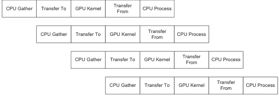

## 图 6.16 重叠的内核和内存传输。

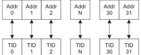

## 图 6.17 线程 ID 访问的地址。

非阻塞和隐式内存传输可能不受支持。我们将在第 9 章中更详细地探讨这些问题。

通常的执行模型涉及 CPU 将一块数据传输到 GPU，GPU 内核对其进行处理，然后 CPU 发起将数据传回主机内存的传输。这种模型的稍高级形式是使用流（稍后介绍）来重叠传输和内核，以确保 GPU 始终保持忙碌，如图 6.16 所示。

一旦数据位于 GPU 中，问题就变成了如何在 GPU 上高效访问它？请记住，GPU 的计算能力可超过 3 万亿次浮点运算每秒（teraflops），但通常主内存带宽在 190 GB/s 左右，低至 25 GB/s。相比之下，典型的 Intel I7 Nehalem 或 AMD Phenom CPU 可达到 25–30 GB/s 左右，具体取决于所使用设备的速度和内存总线宽度。

显卡使用高速 GDDR（图形动态内存），可实现非常高的持续带宽，但像所有内存一样，具有高延迟。延迟是指返回数据访问的第一个字节所需的时间。因此，就像我们可以对内核进行流水线处理（如图 6.16 所示）一样，内存访问也被流水线化。通过创建通常 10:1 的线程与内存访问数量之比，可以隐藏内存延迟，但前提是以合并的模式访问全局内存。

什么是可合并模式？这是指所有线程访问一个连续且对齐的内存块，如图 6.17 所示。这里我们将 `Addr` 显示为相对于基位置的逻辑地址偏移，假设我们访问的是基于字节的数据。TID 表示线程编号。如果我们对内存进行一对一的顺序且对齐的访问，则每个线程的地址访问会被合并在一起，并发出单个内存事务。假设我们访问的是单精度浮点数或整数值，每个线程将访问 4 字节的内存。内存基于 warp 进行合并（旧的 G80 硬件使用半 warp），这意味着我们得到 32 x 4 = 128 字节的内存访问。

支持的合并大小为 32、64 和 128 字节，这意味着如果访问是顺序模式且对齐到 32 字节边界，则 warp 对字节、16 位和 32 位数据的访问将始终合并。对齐是通过使用特殊的 malloc 指令实现的，即用 `cudaMallocPitch` 替换标准 `cudaMalloc`，其语法如下：

```
extern __host__ cudaError_t CUDARTAPI cudaMallocPitch(void **devPtr, size_t *pitch,
size_t width, size_t height);
```

这相当于 `cudaMallocPitch`（设备内存指针的指针、pitch 指针、行所需宽度（字节）、数组高度（字节））。

因此，如果你有一个包含 100 行、每行 60 个 float 元素的数组，使用常规 `cudaMalloc` 将分配 100 x 60 x sizeof(float) 字节，即 100 x 60 x 4 = 24,000 字节。访问数组索引 [1][0]（即第一行，第零个元素）将导致非合并访问。这是因为 60 个元素的单行长度为 240 字节，当然这不是 2 的幂。

每个线程地址系列中的第一个地址将不满足合并的对齐要求。使用 `cudaMallocPitch` 函数，每行的大小将根据给定设备的对齐要求填充必要的量（图 6.18）。在我们的示例中，在大多数情况下，每行将扩展到 64 个元素，即 256 字节。设备实际使用的 pitch 将通过传递给 `cudaMallocPitch` 的 pitch 参数返回。

让我们看看这在实践中是如何工作的。未对齐的访问会导致发出多个内存读取请求。在等待内存读取时，warp 中的所有线程都会停滞，直到 _所有_ 内存读取从硬件返回。因此，为了获得最佳吞吐量，你需要发出少量的大内存读取请求，这是由对齐且顺序的合并访问产生的。


## 图 6.18 使用 cudaMallocPitch 实现的填充。

如果数据以某种方式交错，例如结构体，会发生什么情况？

```
typedef struct
{
    unsigned int a;
    unsigned int b;
    unsigned int c;
    unsigned int d;
} MY_TYPE_T;

MY_TYPE_T some_array[1024]; /* 1024 * 4 bytes = 4K */
```

| 索引 0 元素 A | 索引 0 元素 B | 索引 0 元素 C | 索引 0 元素 D | 索引 1 元素 A | 索引 1 元素 B | 索引 1 元素 C | 索引 1 元素 D | 索引 N 元素 A、B、C、D |
|---|---|---|---|---|---|---|---|---|
| | | | | | | | | |


图 6.19 显示了 C 语言如何在内存中布局此结构。元素在内存中的布局顺序与它们在结构体中定义的顺序相同。此类结构的访问模式如图 6.20 所示。如图所示，结构元素的地址在内存中不是连续的。这意味着你无法获得合并，内存带宽会突然下降一个数量级。根据数据元素的大小，可能可以让每个线程读取一个较大的值，然后在线程内部屏蔽掉不需要的位。例如，如果你有基于字节的数据，可以执行以下操作：


```
const unsigned int value_u32 = some_data[tid];
const unsigned char value_01 = (value_u32 & 0x000000FF);
const unsigned char value_02 = (value_u32 & 0x0000FF00) >> 8;
const unsigned char value_03 = (value_u32 & 0x00FF0000) >> 16;
const unsigned char value_04 = (value_u32 & 0xFF000000) >> 24;
```

也可以通过将结构元素数组视为字数组来简单地保持一个线程对应一个数据元素的映射。然后我们可以为结构的每个元素分配一个线程。然而，如果结构成员之间存在数据流关系，这种解决方案就不合适，例如线程 1 需要结构体的 x、y 和 z 坐标。在这种情况下，最好在 CPU 的加载或传输阶段将数据重新排序为 N 个离散数组。这样，各个数组在内存中并发存放。我们可以直接访问数组 a、b、c 或 d，而不是使用结构体解引用时会使用的 struct->a 表示法。与交错且未合并的模式不同，我们从每个线程获得四个合并访问，访问不同的内存区域，从而保持最佳的全局内存带宽使用。

让我们看一个全局内存读取示例。在此示例中，我们将使用两种方法对结构中所有元素的值求和。首先，我们将对结构数组中的所有值求和，然后对结构体中的数组求和。

```
// Define the number of elements we'll use
#define NUM_ELEMENTS 4096
```

```
// Define an interleaved type
// 16 bytes. 4 bytes per member
typedef struct
{
u32 a;
u32 b;
u32 c;
u32 d;
} INTERLEAVED_T;
// Define an array type based on the interleaved structure
typedef INTERLEAVED_T INTERLEAVED_ARRAY_T[NUM_ELEMENTS];
```

```
// Alternative - structure of arrays
typedef u32 ARRAY_MEMBER_T[NUM_ELEMENTS];
typedef struct
{
ARRAY_MEMBER_T a;
ARRAY_MEMBER_T b;
ARRAY_MEMBER_T c;
ARRAY_MEMBER_T d;
} NON_INTERLEAVED_T;
```

在此代码部分中，我们声明了两种类型；第一种是 INTERLEAVED_T，即成员为 a 到 d 的结构数组。然后我们将 NON_INTERLEAVED_T 声明为包含四个数组（a 到 d）的结构。正如类型名称所示，使用第一种类型时，我们期望数据在内存中是交错的。使用第二种类型时，我们期望有若干个连续的内存区域。

让我们先看看 CPU 代码。

```
__host__ float add_test_non_interleaved_cpu(
    NON_INTERLEAVED_T * const host_dest_ptr,
    const NON_INTERLEAVED_T * const host_src_ptr,
    const u32 iter,
    const u32 num_elements)
{
    float start_time = get_time();

    for (u32 tid = 0; tid < num_elements; tid++)
    {
        for (u32 i=0; i<iter; i++)
        {
            host_dest_ptr->a[tid] += host_src_ptr->a[tid];
            host_dest_ptr->b[tid] += host_src_ptr->b[tid];
            host_dest_ptr->c[tid] += host_src_ptr->c[tid];
            host_dest_ptr->d[tid] += host_src_ptr->d[tid];
        }
    }

    const float delta = get_time() - start_time;

    return delta;
}
```

```
__host__ float add_test_interleaved_cpu(
    INTERLEAVED_T * const host_dest_ptr,
    const INTERLEAVED_T * const host_src_ptr,
    const u32 iter,
    const u32 num_elements)
{
    float start_time = get_time();

    for (u32 tid = 0; tid < num_elements; tid++)
    {
        for (u32 i=0; i<iter; i++)
        {
            host_dest_ptr[tid].a += host_src_ptr[tid].a;
            host_dest_ptr[tid].b += host_src_ptr[tid].b;
            host_dest_ptr[tid].c += host_src_ptr[tid].c;
            host_dest_ptr[tid].d += host_src_ptr[tid].d;
        }
    }

    const float delta = get_time() - start_time;


```
return delta;
}
```

用于添加数据的两个函数大体相似。每个函数遍历列表中所有元素 iter 次，并将源数据结构中的一个值添加到目标数据结构中。每个函数还返回其执行所需的时间。由于这些函数将在 CPU 上运行，我们使用 CPU 的墙钟时间。

GPU 代码大体相似，外层循环 tid 被调用内核时的 N 个线程所取代。

```
__global__ void add_kernel_interleaved(
INTERLEAVED_T * const dest_ptr,
const INTERLEAVED_T * const src_ptr,
const u32 iter,
const u32 num_elements)
{
const u32 tid = (blockIdx.x * blockDim.x) + threadIdx.x;

if (tid < num_elements)
{
for (u32 i=0; i<iter; i++)
{
dest_ptr[tid].a += src_ptr[tid].a;
dest_ptr[tid].b += src_ptr[tid].b;
dest_ptr[tid].c += src_ptr[tid].c;
dest_ptr[tid].d += src_ptr[tid].d;
}
}
}
```

```
__global__ void add_kernel_non_interleaved(
NON_INTERLEAVED_T * const dest_ptr,
const NON_INTERLEAVED_T * const src_ptr,
const u32 iter,
const u32 num_elements)
{
const u32 tid = (blockIdx.x * blockDim.x) + threadIdx.x;

if (tid < num_elements)
{
for (u32 i=0; i<iter; i++)
{
dest_ptr->a[tid] += src_ptr->a[tid];
dest_ptr->b[tid] += src_ptr->b[tid];
dest_ptr->c[tid] += src_ptr->c[tid];
dest_ptr->d[tid] += src_ptr->d[tid];
}
}
}
```

GPU 函数的调用者是一个相当标准的复制到设备并计时的例程。此处仅列出交错版本，因为两个函数大体相同。

```
__host__ float add_test_interleaved(
    INTERLEAVED_T * host_dest_ptr,
    const INTERLEAVED_T * host_src_ptr,
    const u32 iter,
    const u32 num_elements
) {
    // Set launch params
    const u32 num_threads = 256;
    const u32 num_blocks = (num_elements + (num_threads-1)) / num_threads;

    // Allocate memory on the device
    const size_t num_bytes = (sizeof(INTERLEAVED_T) * num_elements);
    INTERLEAVED_T * device_dest_ptr;
    INTERLEAVED_T * device_src_ptr;

    CUDA_CALL(cudaMalloc((void **) &device_src_ptr, num_bytes));
    CUDA_CALL(cudaMalloc((void **) &device_dest_ptr, num_bytes));

    // Create a start and stop event for timing
    cudaEvent_t kernel_start, kernel_stop;
    cudaEventCreate(&kernel_start, 0);
    cudaEventCreate(&kernel_stop, 0);

    // Create a non zero stream
    cudaStream_t test_stream;
    CUDA_CALL(cudaStreamCreate(&test_stream));

    // Copy src data to GPU
    CUDA_CALL(cudaMemcpy(device_src_ptr, host_src_ptr, num_bytes,
                         cudaMemcpyHostToDevice));

    // Push start event ahead of kernel call
    CUDA_CALL(cudaEventRecord(kernel_start, 0));

    // Call the GPU kernel
    add_kernel_interleaved<<<num_blocks, num_threads>>>(device_dest_ptr, device_src_ptr,
                                                        iter, num_elements);

    // Push stop event after kernel call
    CUDA_CALL(cudaEventRecord(kernel_stop, 0));

    // Wait for stop event
    CUDA_CALL(cudaEventSynchronize(kernel_stop));

    // Get delta between start and stop,
    // i.e. the kernel execution time
    float delta = 0.0f;
    CUDA_CALL(cudaEventElapsedTime(&delta, kernel_start, kernel_stop));

    // Clean up
    CUDA_CALL(cudaFree(device_src_ptr));
    CUDA_CALL(cudaFree(device_dest_ptr));
    CUDA_CALL(cudaEventDestroy(kernel_start));
    CUDA_CALL(cudaEventDestroy(kernel_stop));
    CUDA_CALL(cudaStreamDestroy(test_stream));

    return delta;
}
```

运行此代码时，我们得到以下结果：

- 使用 65536 字节（4096 个元素）运行交错 / 非交错内存测试
- ID:0 GeForce GTX 470：交错时间：181.83ms
- ID:0 GeForce GTX 470：非交错时间：45.13ms
- ID:1 GeForce 9800 GT：交错时间：2689.15ms
- ID:1 GeForce 9800 GT：非交错时间：234.98ms
- ID:2 GeForce GTX 260：交错时间：444.16ms
- ID:2 GeForce GTX 260：非交错时间：139.35ms
- ID:3 GeForce GTX 460：交错时间：199.15ms
- ID:3 GeForce GTX 460：非交错时间：63.49ms
- CPU（串行）：交错时间：1216.00ms
- CPU（串行）：非交错时间：13640.00ms

所见颇为有趣，也大体在意料之中。在 compute 2.x 硬件上，交错内存访问模式的执行时间比非交错模式长三到四倍。compute 1.3 GTX260 在使用交错内存模式时表现出 3 倍的减速。然而，compute 1.1 9800GT 表现出 11 倍的减速，原因是这些旧设备对合并访问的要求更严格。

我们可以使用 Parallel Nsight 等工具，更深入地查看慢速交错模式与快得多的非交错模式之间的内存访问模式。我们可以看到，非交错版本使用的内存事务数量（CUDA 内存统计实验）大约是交错版本的四分之一，因此非交错版本与内存交换的数据量大约是交错版本的四分之一。

另一个值得注意的有趣之处是，CPU 显示出完全相反的效果。这可能看起来很奇怪，直到你考虑访问模式和缓存重用。在交错示例中，访问元素 a 的 CPU 会在访问 a 时将结构元素 b、c 和 d 带入缓存，因为它们很可能位于同一缓存行中。然而，非交错版本将在四个独立且物理分散的区域访问内存。内存总线事务的数量将是四倍，CPU 可能使用的任何预读策略都不会那么有效。因此，如果您现有的 CPU 应用程序使用交错的结构元素排列，只需将其复制到 GPU 即可工作，但由于内存合并访问不佳，代价相当高昂。仅重新排序声明和访问机制，如我们在此示例中所做，就可以以很小的努力实现显著的加速。

## 记分板

全局内存的另一个有趣特性是它使用记分板。如果我们从全局内存发起加载（例如，a=some_array[0]），所发生的只是发起内存获取，并将局部变量 a 列为有待处理的内存事务。与传统的 CPU 代码不同，我们不会看到停顿，甚至在变量 a 后来用于表达式之前，也不会切换到另一个 warp。只有此时，我们才真正需要变量 a 的内容。因此，GPU 遵循惰性求值模型。

这有点像叫出租车然后准备出发。准备可能只需五分钟，但出租车可能需要长达 15 分钟才能到达。在我们真正需要它之前叫车，它在我们忙于准备出发的任务时就开始了行程。如果我们等到准备好了才叫出租车，我们就将准备出发的任务与等待出租车串行化了。

内存事务也是如此。相比之下，它们就像慢速出租车，以 GPU 周期计算，需要很长时间才能到达。在我们真正需要内存事务到达之前，GPU 可以忙于计算算法的其他方面。这非常简单地通过将内存获取放在内核开头，并在内核后期才使用它们来实现。实际上，我们将内存获取延迟与有用的 GPU 计算重叠，从而减少了内存延迟对内核的影响。

## 全局内存排序

承接我们之前关于共享内存排序的讨论，您认为相同的算法如何应用于基于全局内存的排序？需要考虑什么？首先，您需要考虑内存合并访问。我们的排序算法专门为与 32 个共享内存银行一起运行而开发，并以列的方式访问共享内存。如果您再看图 6.8，您会发现，如果所有线程同时读取，这也能实现对全局内存的合并访问。

合并访问发生在基数排序期间，因为每个线程遍历自己的列表。每个线程的访问都由硬件合并（combined）在一起。写入是非合并的，因为列表大小可能不同。但是，零既被读取也被写入到相同的地址范围，从而提供合并访问。

在合并阶段，启动条件期间，每个列表中的一个值从全局内存读入共享内存。在合并的每次迭代中，一个值被写出到全局内存，一个值被读入共享内存以替换写出的值。每次内存访问都有相当多的工作要做。因此，尽管合并访问不佳，内存延迟应当大部分被隐藏。让我们看看这在实践中是如何工作的。


| 线程数 | GTX470 | GTX260 | GTX460 |
|---|---|---|---|
| 1 | 33.27 | 66.32 | 27.47 |
| 2 | 19.21 | 37.53 | 15.87 |
| 4 | 11.82 | 22.29 | 9.83 |
| 8 | 9.31 | 16.24 | 7.88 |
| 16 | 7.41 | 12.52 | 6.36 |
| 32 | 6.63 | 10.95 | 5.75 |
| 64 | 6.52 | 10.72 | 5.71 |
| 128 | 7.06 | 11.63 | 6.29 |
| 256 | 8.61 | 14.88 | 7.82 |

从表6.13和图6.21可以看出，32个线程效果相当不错，但在所有测试设备上都被64个线程略微超越。这很可能是因为有另一个warp可供执行，从而掩盖了一小部分延迟，并会略微提高内存带宽利用率。


### 图 6.21 单SM GMEM排序图（1K元素）

超过64个线程会使速度变慢，因此如果我们现在将线程数固定为64并增大数据集大小，会看到什么结果？请参见表6.14和图6.22。事实上，当使用单个SM（如我们目前所做）时，我们看到几乎完美的线性关系。

如表6.14所示，在GTX460上对1024 KB（1 MB）数据进行排序需要1486 ms。这意味着我们可以在大约1.5秒（精确为1521 ms）内对1 MB数据进行排序，每分钟约可处理40 MB，与数据大小无关。

### 表 6.14 按大小分类的GMEM排序

| | 绝对时间 (ms) | | | 每KB时间 (ms) | | |
|---|---|---|---|---|---|---|
| 大小 (Kb) | GTX470 | GTX260 | GTX460 | GTX470 | GTX260 | GTX460 |
| 1 | 1.67 | 2.69 | 1.47 | 1.67 | 2.69 | 1.47 |
| 2 | 3.28 | 5.36 | 2.89 | 1.64 | 2.68 | 1.45 |
| 4 | 6.51 | 10.73 | 5.73 | 1.63 | 2.68 | 1.43 |
| 8 | 12.99 | 21.43 | 11.4 | 1.62 | 2.68 | 1.43 |
| 16 | 25.92 | 42.89 | 22.75 | 1.62 | 2.68 | 1.42 |
| 32 | 51.81 | 85.82 | 45.47 | 1.62 | 2.68 | 1.42 |
| 64 | 103.6 | 171.78 | 90.94 | 1.62 | 2.68 | 1.42 |
| 128 | 207.24 | 343.74 | 181.89 | 1.62 | 2.69 | 1.42 |
| 256 | 414.74 | 688.04 | 364.09 | 1.62 | 2.69 | 1.42 |
| 512 | 838.25 | 1377.23 | 737.85 | 1.64 | 2.69 | 1.44 |
| 1024 | 1692.07 | 2756.87 | 1485.94 | 1.65 | 2.69 | 1.45 |

因此，对1 GB数据集进行排序大约需要25–26分钟，这并不十分令人印象深刻。

那么问题出在哪里呢？目前我们只使用一个块，这反过来将我们限制在单个SM上。测试GPU在GTX470上包含14个SM，在GTX260上包含27个SM，在GTX460上包含7个SM。显然，我们只使用了显卡真实潜力的一小部分。这样做主要是为了简化解决方案，因此让我们现在来看看使用多个块。

一个SM的输出是一个线性排序列表。因此，两个SM的输出是两个线性排序列表，这不是我们想要的。请考虑以下来自两块版本排序的输出转储。原始值按从0x01到0x100的逆序排序。首先显示的是数组索引，后跟该数组索引处的值。


### 图 6.22 按大小排序的GMEM图

```
000:00000041 001:00000042 002:00000043 003:00000044 004:00000045 005:00000046
006:00000047 007:00000048 008:00000049 009:0000004a 010:0000004b 011:0000004c 012:0000004d 013:0000004e
014:0000004f 015:00000050 016:00000051 017:00000052 018:00000053 019:00000054 020:00000055 021:00000056
022:00000057 023:00000058 024:00000059 025:0000005a 026:0000005b 027:0000005c 028:0000005d 029:0000005e
030:0000005f 031:00000060 032:00000061 033:00000062 034:00000063 035:00000064 036:00000065 037:00000066
038:00000067 039:00000068 040:00000069 041:0000006a 042:0000006b 043:0000006c 044:0000006d 045:0000006e
046:0000006f 047:00000070 048:00000071 049:00000072 050:00000073 051:00000074 052:00000075 053:00000076
054:00000077 055:00000078 056:00000079 057:0000007a 058:0000007b 059:0000007c 060:0000007d 061:0000007e
062:0000007f 063:00000080
064:00000001 065:00000002 066:00000003 067:00000004 068:00000005 069:00000006
070:00000007 071:00000008 072:00000009 073:0000000a 074:0000000b 075:0000000c 076:0000000d 077:0000000e
078:0000000f 079:00000010 080:00000011 081:00000012 082:00000013 083:00000014 084:00000015 085:00000016
086:00000017 087:00000018 088:00000019 089:0000001a 090:0000001b 091:0000001c 092:0000001d 093:0000001e
094:0000001f 095:00000020 096:00000021 097:00000022 098:00000023 099:00000024 100:00000025 101:00000026
102:00000027 103:00000028 104:00000029 105:0000002a 106:0000002b 107:0000002c 108:0000002d 109:0000002e
110:0000002f 111:00000030 112:00000031 113:00000032 114:00000033 115:00000034 116:00000035 117:00000036
118:00000037 119:00000038 120:00000039 121:0000003a 122:0000003b 123:0000003c 124:0000003d 125:0000003e
126:0000003f 127:00000040
```

我们可以看到这里有两个排序列表，一个从0x41到0x80，另一个从0x01到0x40。你可能会说这不是什么大问题，我们只需要再次合并列表即可。这就是我们遇到第二个问题的地方；请考虑按线程基准的内存访问。

假设我们只使用两个线程，每个列表一个。线程0访问元素0。线程1访问元素64。硬件无法合并这两次访问，因此硬件必须发出两次独立的内存读取。

即使我们能在零时间内完成合并，假设最多有16个SM并且全部使用它们不会使设备带宽饱和，在最佳情况下我们可以获得16 × 40 MB/分钟 = 640 MB/分钟，即约10.5 MB/s。也许需要一种替代方法。

## 采样排序

采样排序试图绕过归并排序的问题，即必须执行合并步骤。它基于将数据拆分为N个独立数据块的原理，使得每个块部分排序，并且我们可以保证块N中的数字小于块N+1中的数字且大于块N-1中的数字。

我们将首先查看使用三个处理器对24个数据项进行排序的示例。第一阶段从数据集中选择S个等距样本。S被选为N的分数，N是整个数据集中的元素总数。重要的是S要能代表数据集。当数据在数据范围内合理均匀分布时，等距点最佳使用。如果数据包含在样本点方面不太宽的大峰值，可能需要使用更多数量的样本，或者使样本集中在已知峰值周围。我们将选择等距点并假设更常见的点均匀分布。

然后对样本进行排序，使最低值位于列表首位，假设为升序。然后根据可用处理器的数量将样本数据拆分为桶。扫描数据以确定每个桶中有多少个样本。然后将每个桶中的样本数相加，形成前缀和，用于索引数组。

前缀和简单来说就是当前元素之前所有元素的总和。观察示例，我们可以看到有九个元素被分配给桶0。因此，第二个数据集的起始位置是元素9。接下来的列表大小，根据数据集，也是九。九加上之前的和是18，因此我们知道下一个数据集的索引，以此类推。

然后对数据进行洗牌，使所有桶0元素写入前缀和的第一个索引（零），桶1写入下一个，以此类推。这实现了数据的部分排序，使得桶N-1中的所有桶小于桶N中的桶，而桶N又小于桶N+1中的桶。然后将桶分发给P个处理器，它们并行排序列表。如果使用原地排序，则在最后一个数据块排序完成后列表即排序完毕，无需任何合并步骤。图6.24是使用六个处理元素的同一示例。

请注意，当我们基于六个样本使用三个处理器时，桶大小为9、9、6。使用六个处理器时，桶大小为6、3、5、4、1、5。我们实际感兴趣的是最大值，因为在P个处理器上，最大的块将决定总耗时。在此示例中，最大值是


## 图 6.24 使用六个处理器的示例排序

reduced from nine elements to six elements, so a doubling of the number of processors has reduced the maximum number of data points by only one-third.

The actual distribution will depend very much on the dataset. The most common dataset is actually a mostly sorted list or one that is sorted with some new data items that must be added. This tends to give a fairly equal distribution for most datasets. For problem datasets it's possible to adjust the sampling policy accordingly.

With a GPU we don't just have six processors; we have N SMs, each of which we need to run a number of blocks on. Each block would ideally be around 256 threads based simply on ideal memory latency hiding, although we saw that 64 threads worked best with the radix sort we developed earlier in the chapter. With the GTX470 device, we have 14 SMs with a maximum of eight blocks per SM. Therefore, we need at least 112 blocks just to keep every SM busy. We'll find out in practice which is the best in due course. It is likely we will need substantially more blocks to load balance the work.

The first task, however, is to develop a CPU version of the sample sort algorithm and to understand it. We'll look at each operation in turn and how it could be converted to a parallel solution.

To follow the development of the code in the subsequent sections, it's important you understand the sample sort algorithm we just covered. It's one of the more complex sorting algorithms and was chosen both for performance reasons and also because it allows us to look at a real problem involving difficult issues in terms of GPU implementation. If you browsed over the algorithm, please re-read the last few pages until you are sure you understand how the algorithm works before proceeding.

## Selecting samples

The first part of the sample sort is to select N samples from the source data. The CPU version works with a standard loop where the source data loop index is incremented by sample_interval elements. The sample index counter, however, is incremented only by one per iteration.

```
__host__ TIMER_T select_samples_cpu(
u32 * const sample_data,
const u32 sample_interval,
const u32 num_elements,
const u32 * src_data)
{
    const TIMER_T start_time = get_time();
    u32 sample_idx = 0;
    for (u32 src_idx=0; src_idx<num_elements; src_idx+=sample_interval)
    {
        sample_data[sample_idx] = src_data[src_idx];
        sample_idx++;
    }
    const TIMER_T end_time = get_time();
    return end_time - start_time;
}
```

In the GPU version we can use a classic loop elimination method and simply create one thread per sample point, spread across as many blocks as necessary. Thus, the first statement `const u32 tid = (blockIdx.x * blockDim.x) + threadIdx.x;` simply takes the block index and multiplies it by the number of threads per block and then adds in the current thread to our combined thread index.

```
__global__ void select_samples_gpu_kernel(u32 * const sample_data,
    const u32 sample_interval, const u32 * const src_data)
{
    const u32 tid = (blockIdx.x * blockDim.x) + threadIdx.x;
    sample_data[tid] = src_data[tid*sample_interval];
}
```

```
__host__ TIMER_T select_samples_gpu(
    u32 * const sample_data,
    const u32 sample_interval,
    const u32 num_elements,
    const u32 * src_data,
    const u32 num_threads_per_block,
    const char * prefix)
{
    // Invoke one block of N threads per sample
    const u32 num_blocks = num_samples / num_threads_per_block;
    // Check for non equal block size
    assert((num_blocks * num_threads_per_block) == num_samples);
    start_device_timer();
    select_samples_gpu_kernel<<<num_blocks, num_threads_per_block>>>(sample_data,
        sample_interval, src_data);
    cuda_error_check(prefix, "Error invoking select_samples_gpu_kernel");
    const TIMER_T func_time = stop_device_timer();

    return func_time;
}
```

Finally, to work out the index into the source data we simply multiply our sample data index (tid) by the size of the sample interval. For the sake of simplicity we'll only look at the case where the dataset sizes are multiples of one another.

Notice both the CPU and GPU versions return the time taken for the operation, something we'll do in each section of the sort to know the various timings of each operation.

## Sorting the samples

Next we need to sort the samples we've selected. On the CPU we can simply call the qsort (quicksort) routine from the standard C library.

```
__host__ TIMER_T sort_samples_cpu(
u32 * const sample_data,
const u32 num_samples)
{
const TIMER_T start_time = get_time();

qsort(sample_data, num_samples, sizeof(u32),
&compare_func);

const TIMER_T end_time = get_time();
return end_time - start_time;
}
```

On the GPU, however, these standard libraries are not available, so we'll use the radix sort we developed earlier. Note, radix sort is also provided by the Thrust library, so you don't have to write it as we've done here. I won't replicate the code here since we've already looked at it in detail in the shared memory section.

One thing to note, however, is the version we developed before does a radix sort on a single SM in shared memory and then uses a shared memory reduction for the merge operation. This is not an optimal solution, but we'll use it for at least the initial tests.

## Counting the sample bins

Next we need to know how many values exist in each sample bin. The CPU code for this is as follows:

```
__host__ TIMER_T count_bins_cpu(const u32 num_samples,
const u32 num_elements,
const u32 * const src_data,
const u32 * const sample_data,
u32 * const bin_count)
{
const TIMER_T start_time = get_time();
for (u32 src_idx=0; src_idx<num_elements; src_idx++)
{
const u32 data_to_find = src_data[src_idx];
const u32 idx = bin_search3(sample_data,
data_to_find,
num_samples);
bin_count[idx]++;
}
const TIMER_T end_time = get_time();
return end_time - start_time;
}
```

To count the values in each bin we simply iterate over the source dataset and for every element call a search function that determines in which bin a given data value will belong. We then increment the bin counter for that given index.

For the search we have two options: a binary search or a sequential search. A binary search takes advantage of the fact we have a sorted list of samples from the previous step. It works by dividing the list into two halves and asking whether the value it seeks is in the top or bottom half of the dataset. It then divides the last region and again until such time as it finds the value.

The worst case sort time for a binary search is log2(N). We'll hit the worst case in many instances because most of the data is missing from the sample list. Therefore, we'll assume we'll hit the worst case in all cases when comparing the two approaches.

The sequential search worst case is N. That is, we start at the beginning of the list and do not find the item at all, having traversed the list from start to finish. However, with a sorted list and a uniform distribution of data the most likely case is N/2. Thus, for a sample set of 1024 elements, a binary search would take just 10 iterations compared with 512 iterations for the sequential search. Clearly, the binary search is the best approach in terms of the search space covered.

However, we have to consider that a binary search is not very good for a GPU from the perspective of coalesced memory accesses and branch divergence. As soon as one thread diverges in a warp, the hardware needs two control paths. We may well have the situation where the warps diverge such that we have entirely independent control for each thread. In this case we can multiply the time taken by the number of divergent threads. This will always be a maximum of the number of iterations, which is the log2(N). Thus, our sample size needs to be huge before we see anything like the maximum amount of divergence—all threads in a warp.

Each thread is accessing potentially a different area of memory in the sample set, so there is no coalescence and there is a drop of an order of magnitude in terms of global memory bandwidth. In practice, this should be largely hidden by the L1 and L2 cache on compute 2.x devices, depending on the size of the sample space. We could also store the sample space in shared memory, meaning we can discount the coalescing issues.

The standard C library again provides a bsearch function, which returns the value it finds in the array. However, we're not interested in the nearest value, but actually the array index. Therefore, we'll write a basic binary search function and use this on both the GPU and CPU. Notice the use of both __host__ and __device__ specifiers to run the identical source, but not binary, code on both the CPU and GPU.

```
__host__ __device__ u32 bin_search3(
const u32 * const src_data,
const u32 search_value,


```
const u32 num_elements)
{
// Take the middle of the two sections
u32 size = (num_elements >> 1);
u32 start_idx = 0;
bool found = false;
do
{
    const u32 src_idx = (start_idx+size);
    const u32 test_value = src_data[src_idx];
    if (test_value == search_value)
        found = true;
    else
        if (search_value > test_value)
            start_idx = (start_idx+size);
    if (found == false)
        size >>= 1;
} while ( (found == false) && (size != 0) );
return (start_idx + size);
}
```

二分查找例程通过将 size 参数减小到零来工作。它返回搜索值应放置的索引或桶。

```cpp
// Single data point, atomic add to gmem
__global__ void count_bins_gpu_kernel5(
    const u32 num_samples,
    const u32 * const src_data,
    const u32 * const sample_data,
    u32 * const bin_count)
{
    const u32 tid = (blockIdx.x * blockDim.x) + threadIdx.x;
    // Read the sample point
    const u32 data_to_find = src_data[tid];
    // Obtain the index of the element in the search list
    const u32 idx = bin_search(sample_data, data_to_find, num_samples);
    atomicAdd(&bin_count[idx],1);
}
__host__ TIMER_T count_bins_gpu(
    const u32 num_samples,
    const u32 num_elements,
    const u32 * const src_data,
    const u32 * const sample_data,
    u32 * const bin_count,
    const u32 num_threads,
    const char * prefix
{
    const u32 num_blocks = num_elements / num_threads;

    start_device_timer();

    count_bins_gpu_kernel5<<<num_blocks, num_threads>>>(num_samples, src_data,
                        sample_data, bin_count);
    cuda_error_check(prefix, "Error invoking count_bins_gpu_kernel5");

    const TIMER_T func_time = stop_device_timer();
    return func_time;
}
```

与选择样本的函数不同（该函数中最大线程数受样本数量限制），这里我们仅受源数组中元素数量的限制。因此，主机函数启动一个内核，该内核每个元素包含一个线程。

内核计算其元素，并以合并的方式从源数据集中读取它。在这里每块使用更多线程可以增加来自全局内存的读取带宽。

每次使用 warp 都会跳转到二分查找，经过不多的迭代后返回。对于随机元素列表，会出现一些线程分歧。然而，在更常见的大部分已排序列表的情况下，所有线程倾向于遵循相同的路径，因此在实践中造成的线程分歧很小。

当 warp 的所有线程从二分查找返回后，它们通过原子写入递增全局内存中 N 个桶之一的值。对全局内存的原子操作是保证完成且不中断的操作，无论是哪个 SM 上的哪个线程发起的操作。因此，我们可以安全地让许多线程写入同一地址。显然只有一个可以物理写入，因此任何值的冲突都会导致请求的串行化。

不幸的是，对于大部分已排序的列表，我们发现由于块是依次分配的，大多数活动块位于相似的内存区域。虽然这对局部性非常有利，但这也意味着所有线程都在写入时访问相同的内存区域。因此，对于已排序列表，我们会看到这种方法的速度下降，但不会太显著，稍后我们将看到。

## 前缀和

前缀和很有用，因为它可以用来创建一个值表，这些值用于索引具有变长记录的数组。在我们的例子中，每个桶的大小是可变长度，每个桶在内存中依次存储。因此，我们可以计算一个前缀和数组，然后使用数组元素 0 访问桶 0 的开头，使用数组元素 1 访问桶 1 的开头，以此类推。

CPU 上前缀和的代码非常简单：

```cpp
__host__ TIMER_T calc_bin_idx_cpu(const u32 num_samples,
                                  const u32 * const bin_count,
                                  u32 * const dest_bin_idx)
{
    const TIMER_T start_time = get_time();
    u32 prefix_sum = 0;

    for (u32 i = 0; i < num_samples; i++)
    {
        dest_bin_idx[i] = prefix_sum;
        prefix_sum += bin_count[i];
    }

    const TIMER_T end_time = get_time();
    return end_time - start_time;
}
```

这里我们只是遍历数组 `bin_count`，该数组包含每个桶中有多少个元素。前缀和从零开始，我们将迄今循环看到的桶计数之和存储到数组 `prefix_sum` 中。

这段代码和前缀和的主要问题是，乍一看它似乎是一个本质上是串行的问题。没有前一个值，你无法计算最后一个值。遍历所有元素的循环实际上是针对单处理器系统计算此问题的一种非常高效的方法。那么，如何以并行方式计算前缀和，以便我们可以利用不止一个 SM 呢？

事实证明，对于少量元素，这种简单的前缀和实现实际上非常快。但是，当样本元素数量变大（4096 以上）时，需要一种稍快且更复杂的方法。

可以通过将数组分割成若干块并对这些块计算前缀和来并行计算前缀和。每个前缀和块的端点被放入另一个数组中。然后对该数组原地再做一次前缀和。将此前缀和的结果添加到原始前缀和计算中的每个元素。这产生了一个我们可以轻松在 GPU 上使用的并行前缀和（图 6.25）。

对于前缀和块，我们将每块使用一个线程。由于每个线程处理相同数量的元素并只是循环迭代，因此没有线程分歧。但是，读取内存访问合并效果不佳，因为线程 0 将访问从零偏移量开始的地址，而线程 1 将访问从 `(NUM_SAMPLES/NUM_BLOCKS)` 偏移量开始的地址。

我们希望在多个 SM 上运行这段代码，这意味着需要创建多个块。我们需要一个中心同步点来执行前缀和。在所有块完成之前，这无法发生。因此，我们需要启动一个内核来执行初始前缀和，另一个内核来对结果执行前缀和，以及最后一个内核来执行加法步骤。

这实际上非常有益，因为它给了我们更改使用的块数和线程数的机会。虽然我们可能每个前缀和块使用一个线程，但加法内核的并行性仅受样本点数量的限制。因此，我们可以运行 `N` 个块，每个块 `M` 个线程，其中 `N x M` 是样本数量，从而最大限度地利用 GPU。


图 6.25 并行前缀和。

与大多数更复杂的算法一样，存在一个权衡点，在此点更简单的算法更快。对于串行前缀和与分块前缀和，这个点大约在 4096 个样本点。我们可以进一步实现第一阶段中更复杂的前缀和，但除非我们有非常大的数据集，否则前缀和不会成为排序时间的关键因素。

```cpp
__global__ void calc_prefix_sum_kernel(
    const u32 *num_samples_per_thread,
    const u32 *const bin_count,
    u32 *const prefix_idx,
    u32 *const block_sum)
{
    const u32 tid = (blockIdx.x * blockDim.x) + threadIdx.x;
    const u32 tid_offset = tid * num_samples_per_thread;
    u32 prefix_sum;

    if (tid == 0)
        prefix_sum = 0;
    else
        prefix_sum = bin_count[tid_offset-1];

    for (u32 i=0; i<num_samples_per_thread; i++)
    {
        prefix_idx[i+tid_offset] = prefix_sum;
        prefix_sum += bin_count[i+tid_offset];
    }
    // Store the block prefix sum as the value from the last element
    block_sum[tid] = prefix_idx[(num_samples_per_thread-1)*i+tid_offset];
}
```

首先，根据块和线程计算我们的 tid 编号。然后，根据线程将要计算前缀和的样本数量计算 tid_offset。对于第一个块，结果必须为零。对于其他块，我们包含桶计数的第一个元素。然后我们只是实现之前看到的代码，但添加 tid_offset 以读写适当的元素。

```cpp
__global__ void add_prefix_sum_total_kernel(
    u32 * const prefix_idx,
    const u32 * const total_count)
{
    const u32 tid = (blockIdx.x * blockDim.x) + threadIdx.x;
    prefix_idx[tid] += total_count[blockIdx.x];
}
```

加法内核非常简单。程序只是计算线程的单独 tid 并使用它来索引目标数组。要添加的值取自块计数。此实现中隐含的假设是调用者调用 N 个线程，其中 N 是前一个内核中使用的每个线程的样本数量。我们显式地这样做，因为它允许使用 blockIdx.x（块编号）而无需访问线程索引。这使得获取操作落入统一常量缓存，并对线程块内的所有元素造成广播操作。

此外，我们还有一个简单的前缀和内核，用于处理少量元素的情况。并行版本因为需要执行额外的块前缀步骤、另一次加法以及同步，在这种情况下耗时更长。只有在块大小较大、我们可以更好地利用硬件时，才会看到更复杂版本的显著加速。

```cpp
__global__ void calc_prefix_sum_kernel_single(
    const u32 num_samples,
    const u32 * const bin_count,
    u32 * const dest_bin_idx)
{
    u32 prefix_sum = 0;
    for (u32 i=0; i<num_samples; i++)
    {
        dest_bin_idx[i] = prefix_sum;
        prefix_sum += bin_count[i];
    }
}
```

最后是对内核进行编排的主机函数：


```
__host__ TIMER_T calc_bin_idx_gpu(
    const u32 num_elements,
    const u32 * const bin_count,
    u32 * const dest_bin_idx,
    u32 num_threads_per_block,
    u32 num_blocks,
    const char * prefix,
    u32 * const block_sum,
    u32 * const block_sum_prefix)
{
    start_device_timer();

    if (num_elements >= 4096)
    {
        const u32 num_threads_total = num_threads_per_block
            * num_blocks;

        const u32 num_elements_per_thread = num_elements / num_threads_total;

        // Make sure the caller passed arguments which correctly divide the elements to blocks
        // and threads
        assert((num_elements_per_thread *
            num_threads_total) == num_elements);

        // First calculate the prefix sum over a block
        calc_prefix_sum_kernel<<<num_blocks,
            num_threads_per_block>>>(num_elements_per_thread, bin_count, dest_bin_idx, block_sum);
        cuda_error_check(prefix, "Error invoking calc_prefix_sum_kernel*");

        // Calculate prefix for the block sums
        // Single threaded
        calc_prefix_sum_kernel_single<<<1,1>>>(num_threads_total, block_sum,
            block_sum_prefix);
        cuda_error_check(prefix, "Error invoking calc_prefix_sum_kernel_single*");

        // Add the prefix sums totals back into the original prefix blocks
        // Switch to N threads per block
        num_blocks = num_elements /
            num_elements_per_thread;
        add_prefix_sum_total_kernel<<<num_blocks, num_elements_per_thread>>>(dest_bin_idx,
            block_sum_prefix);
        cuda_error_check(prefix, "add_prefix_sum_total_kernel*");
    }
    else
    {
        // Calculate prefix for the block sums
        // Single threaded
        calc_prefix_sum_kernel_single<<<1,1>>>(num_elements, bin_count, dest_bin_idx);
        cuda_error_check(prefix, "Error invoking calc_prefix_sum_kernel_single");
    }
    const TIMER_T func_time = stop_device_timer();
    return func_time;
}
```

在此函数中，我们首先检查是使用简单的前缀和还是更复杂的前缀和计算更合适。对于更复杂的方案，我们计算每个线程最初将处理多少个元素。然后我们按顺序调用三个内核。该函数通过 `num_threads_per_block` 和 `num_blocks` 参数进行参数化，允许我们调整这些参数以进行调优。

在 4K 采样点时，我们可以看到两个函数之间的过渡点，此时简单版本的速度与更复杂版本差不多。当采样点达到 16 K 时，更复杂版本已经快四倍。

## 将数据分桶

为了避免合并操作，样本必须预先排序到 N 个桶中。这至少需要遍历整个数组一次，并将数据重新分配到正确的桶中。此操作的 CPU 代码如下：

```
__host__ TIMER_T sort_to_bins_cpu(
    const u32 num_samples,
    const u32 num_elements,
    const u32 * const src_data,
    const u32 * const sample_data,
    const u32 * const bin_count,
    const u32 * const dest_bin_idx,
    u32 * const dest_data)
{
    const TIMER_T start_time = get_time();
    u32 dest_bin_idx_tmp[NUM_SAMPLES];
    // Copy the dest_bin_idx array to temp storage
    for (u32 bin = 0; bin < NUM_SAMPLES; bin++)
    {
        dest_bin_idx_tmp[bin] = dest_bin_idx[bin];
    }
    // Iterate over all source data points
    for (u32 src_idx = 0; src_idx < num_elements; src_idx++)
    {
        // Read the source data
        const u32 data = src_data[src_idx];
        // Identify the bin in which the source data
        // should reside
        const u32 bin = bin_search3(sample_data, data, num_samples);
        // Fetch the current index for that bin
        const u32 dest_idx = dest_bin_idx_tmp[bin];
        // Write the data using the current index
        // of the correct bin
        dest_data[dest_idx] = data;
        // Increment the bin index
        dest_bin_idx_tmp[bin]++;
    }
    const TIMER_T end_time = get_time();
    return end_time - start_time;
}
```

源数组中的每个数据点都需要放入内存中线性排列的 N 个桶中的一个。每个桶的开始和结束位置已计算为数组中的偏移量。我们需要保留这些数据，同时创建 N 个索引指针来跟踪每个桶中的当前位置。因此，最初必须复制 `dest_bin_idx` 数组（即存储前缀索引的数组）。

然后我们遍历所有源数据点。对于每个源数据点，使用二分查找来确定该数据点应放入哪个桶。然后我们将数据复制到相应的桶中，并递增该桶的索引指针。

在尝试将此算法转换为并行算法时，您会遇到多个线程尝试写入同一数据项的常见问题。在这种情况下有两种选择。第一种是将数据分为 N 个独立的块并分别处理，然后合并最终输出。这是我们之前研究过的前缀和内核所采用的方法。然而，还有一种替代方法，我们将在此处使用。

```
__global__ void sort_to_bins_gpu_kernel(
    const u32 num_samples,
    const u32 * const src_data,
    const u32 * const sample_data,
    u32 * const dest_bin_idx_tmp,
    u32 * const dest_data)
{
    // Calculate the thread we're using
    const u32 tid = (blockIdx.x * blockDim.x) + threadIdx.x;
    // Read the sample point
    const u32 data = src_data[tid];
    // Identify the bin in which the
    // source data should reside
    const u32 bin = bin_search(sample_data, data, num_samples);
    // Increment the current index for that bin
    const u32 dest_idx = atomicAdd(&dest_bin_idx_tmp[bin], 1);
    // Write the data using the
    // current index of the correct bin
    dest_data[dest_idx] = data;
}
```

这是使用原子操作的方法，在大多数情况下可以实现更简单的实现。然而，这通常以性能为代价。当然，我们可以在以后简单地将原子操作替换为先拆分再合并数据的算法。这是一种权衡：一方面是由于复杂度更高而带来的更长开发时间和更多错误的编程工作量，另一方面是有时性能提升非常微小。如果时间充裕，尝试两种方法。至少，这为原子支持有些受限的旧硬件提供了一种解决方案。

`atomic_sort_to_bins_gpu_kernel` 函数只是将 CPU 代码中遍历源元素数量的循环展开为 N 个并行线程。然后将这些线程实现为线程和块的组合，以便为每个数据元素调用一个线程。

线程读取源元素，并在样本数据空间上执行二分查找，以找到该元素的合适桶。然而，我们随后需要单线程访问来递增存储元素应写入索引的计数器。您不能像 CPU 代码中所示那样简单地递增计数器，

```
// Increment the bin index
dest_bin_idx_tmp[bin]++;
```

相反，我们使用原子调用 `atomicAdd`：

```
// Use the current index for that bin
const u32 dest_idx = atomicAdd(&dest_bin_idx_tmp[bin], 1);
```

`atomicAdd` 函数在用于全局内存时，会将第二个形式参数（在此例中为 1）加到第一个参数地址处的值上。如果多个线程调用此函数，我们保证每次加法都会完成。`atomicAdd` 函数返回加法前的值。因此，我们可以使用返回值作为数组中的唯一索引，将新值写入桶中。

但是，请注意，此算法会改变桶内元素的顺序，因为块可以以任何顺序运行。因此，这不是简单的内存复制，因为可能有多个线程同时尝试写入同一个桶。还要注意，对于大部分已排序的列表，大多数线程都会访问同一个原子地址。这会导致执行变慢，正如您所料，与数据均匀分布的情况相比。

## 对桶进行排序

将数据分桶后，我们需要以某种并行方式对每个单独的桶进行排序。在 CPU 端，我们只需对每个桶调用 `qsort`（快速排序）。在 GPU 端，我们使用基数排序。

```
__host__ TIMER_T sort_bins_gpu(
```


```cpp
const u32 num_samples,
const u32 num_elements,
u32 * const data,
const u32 * const sample_data,
const u32 * const bin_count,
const u32 * const dest_bin_idx,
u32 * const sort_tmp,
const u32 num_threads,
const char * prefix
{
start_device_timer();

const u32 num_blocks = num_samples / num_threads;

sort_bins_gpu_kernel3<<<(num_blocks, num_threads)>>>(num_samples, num_elements, data,
sample_data, bin_count, dest_bin_idx, sort_tmp);

cuda_error_check(prefix, "Error invoking sort_bins_gpu_kernel");

const TIMER_T func_time = stop_device_timer();
return func_time;
}
```

我们使用主机函数来调用 num_samples 个线程，这些线程根据每个块请求的线程数被分割成多个块。

```cpp
__global__ void sort_bins_gpu_kernel3(
const u32 num_samples,
const u32 num_elements,
u32 * const data,
const u32 * const sample_data,
const u32 * const bin_count,
const u32 * const dest_bin_idx,
u32 * const sort_tmp,
)
// Calculate the thread we're using
const u32 tid = (blockIdx.x * blockDim.x) + threadIdx.x;

if (tid != (num_samples-1))
radix_sort(data, dest_bin_idx[tid], dest_bin_idx[tid+1], sort_tmp);
else
radix_sort(data, dest_bin_idx[tid], num_elements, sort_tmp);
}
```

该内核是一个两级内核，因为数组 dest_bin_idx 仅保存起始索引。对于最后一个元素，访问 [tid+1] 会导致数组溢出问题，因此最后一个线程需要稍微不同地处理。

对多个块进行排序是使用我们在第 5 章中开发的 radix_sort 内核的修改版本完成的。

```cpp
__device__ void radix_sort(
u32 * const data,
const u32 start_idx,
const u32 end_idx,
u32 * const sort_tmp)
{
// Sort into num_list, lists
// Apply radix sort on 32 bits of data
for (u32 bit=0; bit<32; bit++)
{
// Mask off all but the bit we're interested in
const u32 bit_mask = (1u << bit);
// Set up the zero and one counter
u32 base_cnt_0 = start_idx;
u32 base_cnt_1 = start_idx;
for (u32 i=start_idx; i<end_idx; i++)
{
// Fetch the test data element
const u32 elem = data[i];
// If the element is in the one list
if ((elem & bit_mask) > 0u)
{
// Copy to the one list
sort_tmp[base_cnt_1++] = elem;
}
else
{
// Copy to the zero list (inplace)
data[base_cnt_0++] = elem;
}
}
// Copy data back to source from the one's list
for (u32 i=start_idx; i<base_cnt_1; i++)
{
data[base_cnt_0++] = sort_tmp[i];
}
}
```

基数排序简单地遍历为给定块提供的数据集。对于每个位，它将值放入 0 列表或 1 列表中。调用者定义排序将在其上进行的数组的起始和结束索引。

## 分析结果

在样本大小为 16 K 且源数据集大小为 1 MB 的情况下，我们在大部分已排序的列表上看到以下结果：

```
ID:3 GeForce GTX 460: Test 32 - Selecting 16384 from 1048576 elements using 512 blocks
of 32 threads
Select Sample Time - CPU: 0.19 GPU:0.03
Sort Sample Time - CPU: 2.13 GPU:125.57
Count Bins Time - CPU: 157.59 GPU:17.00
Calc. Bin Idx Time - CPU: 0.03 GPU:0.58
Sort to Bins Time - CPU: 163.81 GPU:16.94
Sort Bins Time - CPU: 72.06 GPU:64.46
Total Time - CPU: 395.81 GPU:224.59
Qsort Time - CPU: 185.41 GPU:N/A
```

```
ID:3 GeForce GTX 460: Test 32 - Selecting 16384 from 1048576 elements using 256 blocks
of 64 threads
Select Sample Time - CPU: 0.53 GPU:0.03
Sort Sample Time - CPU: 2.06 GPU:125.57
Count Bins Time - CPU: 157.75 GPU:19.07
Calc. Bin Idx Time - CPU: 0.13 GPU:0.26
Sort to Bins Time - CPU: 164.09 GPU:19.09
Sort Bins Time - CPU: 72.31 GPU:62.11
Total Time - CPU: 396.88 GPU:226.13
Qsort Time - CPU: 184.50 GPU:N/A
```

```
ID:3 GeForce GTX 460: Test 32 - Selecting 16384 from 1048576 elements using 128 blocks
of 128 threads
Select Sample Time - CPU: 0.28 GPU:0.03
Sort Sample Time - CPU: 2.09 GPU:125.57
Count Bins Time - CPU: 157.91 GPU:13.96
Calc. Bin Idx Time - CPU: 0.09 GPU:0.26
Sort to Bins Time - CPU: 164.22 GPU:14.00
Sort Bins Time - CPU: 71.19 GPU:91.33
Total Time - CPU: 395.78 GPU:245.16
Qsort Time - CPU: 185.19 GPU:N/A
```

```
ID:3 GeForce GTX 460: Test 32 - Selecting 16384 from 1048576 elements using 64 blocks of
256 threads
Select Sample Time - CPU: 0.22 GPU:0.03
Sort Sample Time - CPU: 2.00 GPU:125.57
Count Bins Time - CPU: 158.78 GPU:12.43
Calc. Bin Idx Time - CPU: 0.13 GPU:0.49
Sort to Bins Time - CPU: 164.38 GPU:12.39
Sort Bins Time - CPU: 71.16 GPU:84.89
Total Time - CPU: 396.66 GPU:235.80
Qsort Time - CPU: 186.13 GPU:N/A
```

请注意，整个排序过程（224-245 ms）主要由 GPU 上样本数据集的排序（~125 ms）主导。随着样本数据集变大，此阶段使用的排序-合并方法效果不佳。

解决此问题的一个方案是在样本数据上运行样本排序；当样本数据集较大时，这是一种好的方法。然而，对于 16 K 样本集，运行样本排序大约需要 9 ms，而 CPU 的快速排序时间为 2 ms。

始终明智的做法是使用在给定解决方案中效果最好的设备。对于小样本大小，CPU 通常比 GPU 更快。GPU 需要合理大小的数据集，超过这一点后，它很容易超越 CPU。因此，最佳解决方案简单地是在 CPU 上对样本集运行快速排序，然后将其传输到 GPU 以进行大规模并行的排序“苦力”工作。

当我们使用这种方法时，时间会显著下降。

```
Id:3 GeForce GTX 460: Test 32 - Selecting 16384 from 1048576 elements using 512 blocks
of 32 threads
Select Sample Time - CPU: 0.09 GPU:0.09
Sort Sample Time - CPU: 2.09 GPU:2.09
Count Bins Time - CPU: 157.69 GPU:17.02
Calc. Bin Idx Time - CPU: 0.09 GPU:0.58
Sort Bins Time - CPU: 163.78 GPU:16.94
Sort Bins Time - CPU: 71.97 GPU:64.47
Total Time - CPU: 395.72 GPU:101.19
Qsort Time - CPU: 184.78 GPU:N/A
```

您可以看到，在 16 K 样本大小下，样本排序时间大约是 CPU 上快速排序时间的 55%（GPU 101 ms，CPU 185 ms）。如果我们改变样本大小，我们会增加问题中可用并行度的数量。请参见表 6.15 和图 6.26。

从表 6.15 和图 6.26 中可以看出，随着样本数量的增加，时间会急剧下降。GTX460 在 128K 样本（即待排序数据数量的八分之一）时达到最佳时间。GTX470 拥有大量更多的 SM，从 2048 个样本点开始就开始迅速超越 GTX460。相比之下，GTX260（上一代硬件）需要更多的样本点才能接近 Fermi 的性能。

在 128K 样本点时，样本排序再次变得重要（参见表 6.16），我们在 CPU 上使用快速排序的策略成为瓶颈。如果我们详细查看 GTX470 的结果，我们会发现，在 256K 样本点时，多达 50% 的时间用于排序样本数据。此时，对样本数据进行样本排序成为一个不错的选择（表 6.16）。

| 设备/样本 | 256 | 512 | 1024 | 2048 | 4096 | 8K | 16K | 32K | 64K | 128K | 256K |
|---|---|---|---|---|---|---|---|---|---|---|---|
| 快速排序 | 184 | 184 | 184 | 184 | 184 | 184 | 184 | 184 | 184 | 184 | 184 |
| GTX460 | 506 | 273 | 158 | 151 | 115 | 105 | 101 | 101 | 69 | 64 | 85 |
| GTX470 | 546 | 290 | 161 | 94 | 91 | 72 | 62 | 60 | 43 | 46 | 68 |
| GTX260 | 1082 | 768 | 635 | 485 | 370 | 286 | 215 | 190 | 179 | 111 | 88 |


图 6.26
样本排序结果图。

| 操作/样本 | 256 | 512 | 1024 | 2048 | 4096 | 8K | 16K | 32K | 64K | 128K | 256K |
|---|---|---|---|---|---|---|---|---|---|---|---|
| 选择样本 | 0 | 0.03 | 0 | 0.09 | 0.06 | 0.28 | 0.5 | 0.5 | 0.84 | 0.97 | 1.78 |
| 排序样本 | 0 | 0.06 | 0.6 | 0.28 | 0.38 | 0.97 | 2.03 | 4.34 | 9.38 | 19.72 | 41.72 |
| 计数桶 | 14.6 | 14.2 | 13.62 | 12.38 | 10.66 | 9.34 | 9.26 | 8.38 | 6.03 | 5.35 | 5.38 |
| 前缀和 | 0.13 | 0.27 | 0.53 | 1.05 | 0.19 | 0.33 | 0.62 | 1.2 | 0.57 | 0.87 | 1.46 |
| 排序到桶 | 14.6 | 14.2 | 13.65 | 12.4 | 10.7 | 9.37 | 9.33 | 8.45 | 6.09 | 5.41 | 5.46 |
| 排序桶 | 517 | 261 | 133.5 | 68.29 | 69.86 | 52.5 | 40.9 | 37.2 | 20.2 | 13.94 | 12.15 |
| 总计 | 546 | 290 | 162 | 94 | 92 | 73 | 63 | 60 | 43 | 46 | 68 |

为了将几乎已排序的数据与完全随机的数据进行比较，我们将在随机数据集上运行相同的测试（表 6.17）。各种测试表明，每个块 128 个线程时性能最佳。

如表 6.17 所示，最快的运行是 GTX470，耗时 67 ms。这比 CPU 主机上的串行快速排序快五倍。每个块 128 个线程的 32 K 样本似乎是 1 MB 数据的最佳启动配置。请参见图 6.27。

## 关于全局内存的问题

- 1. 讨论当列表大部分已排序时，样本排序为何更快的原因？
- 2. 您可能如何改进此处介绍的样本排序算法？
- 3. 您预见使用更大数据集大小会有任何问题吗？为了运行更大的数据集，您可能需要更改什么？


| 设备/样本 | 256 | 512 | 1024 | 2048 | 4096 | 8192 | 16K | 32K | 64K | 128K | 256K |
|---|---|---|---|---|---|---|---|---|---|---|---|
| Qsort | 337 | 337 | 337 | 337 | 337 | 337 | 337 | 337 | 337 | 337 | 337 |
| GTX460 | 735 | 470 | 235 | 139 | 92 | 91 | 75 | 73 | 81 | 108 | 178 |
| GTX470 | 831 | 535 | 263 | 156 | 97 | 70 | 77 | 68 | 67 | 90 | 155 |
| GTX260 | 1311 | 919 | 463 | 255 | 170 | 124 | 106 | 100 | 106 | 123 | 160 |


图 6.27 随机数据上的样本排序图表。

## 全局内存的解答

- 1. 当使用大部分已排序的列表时，样本排序速度更快，因为线程分歧显著减少。每个桶几乎包含相同数量的值。只要从数据集中选择足够的样本来生成合理数量的块，我们最终就能为每个 SM 获得近乎最优的工作分配。

- 2. 该算法的一个关键问题是基数排序期间对全局内存的非合并访问。这是因为使用前缀计算和每个块的上下界进行原地排序所致。如果您改为将每个样本集拆分为由线程数交错的形式，如共享内存示例中的基数排序那样，那么排序的大部分将获得合并访问。其缺点是可能会浪费内存，因为有些列表只有几个条目长，而其他列表可能有数百个条目长。

- 3. 随着数据量增大，使用单维时会迅速达到允许的最大块数（计算能力 2.x 或更低平台上为 65,535）。此时，您需要将各种内核调用中的 num_block 计算转换为 dim3 类型，以在块布局中包含 x 和 y 分量，如果数据量非常大，还可能需要多个网格。当然，您还需要修改内核，以根据块维度和网格大小正确计算块索引。

另一个显而易见的解决方案是改进样本的排序。在 128 K 样本时，样本数据的排序占总排序时间的 43%。然而，在实际中，我们绝不会想使用这么多样本，32 K 的结果是一个更现实的用例。此时，排序样本仅贡献 7%（参见表 6.16）。最大的贡献者是排序桶（62%）、排序到桶（14%）和计数桶（14%）。基数排序显然是入手的地方。

## 纹理内存

本文不会详细介绍纹理内存。不过，我们会提及它的一些特殊用途，以防它对您的应用有所帮助。纹理内存主要可用于两个目的：

- 计算能力 1.x 和 3.x 硬件上的缓存。
- 基于硬件的内存读取操作。

### 纹理缓存

由于计算能力 1.x 硬件几乎没有缓存，每个 SM 的 6–8K 纹理内存提供了在该类设备上真正缓存数据的唯一方法。然而，随着 Fermi 的出现及其高达 48 K 的 L1 缓存和高达 768 K 的共享 L2 缓存，使用纹理内存的缓存特性在很大程度上已过时。纹理缓存仍然存在于 Fermi 中，以确保与以前代码的向后兼容性。

纹理缓存针对局部性进行了优化，也就是说，它期望数据提供给相邻线程。

这在很大程度上与 Fermi 上的 L1 缓存采用相同的缓存策略。除非您使用纹理内存的其他方面，否则在 Fermi 上使用纹理内存所需的巨大编程努力带来的好处很少。然而，在 Kepler 上，纹理缓存获得了特殊的计算路径，消除了与编程它相关的复杂性。有关详细信息，请参见第 12 章中的 Kepler。请注意，常量内存缓存是计算能力 1.x 硬件上唯一另一种为广播访问组织的缓存，也就是说，所有线程访问相同的内存地址。

然而，在计算能力 1.x 硬件上，纹理缓存可能非常有用。如果您考虑一个具有某些局部性的内存读取，可以节省大量的内存读取次数。假设我们需要从内存执行收集操作，即将一组非连续的内存地址读取到 N 个线程中。除非线程模式创建对齐且顺序的内存模式，否则合并硬件将发出多次读取。如果我们改为通过纹理内存加载数据，大多数读取将命中纹理缓存，从而带来可观的性能收益。

当然，您也可以同样使用共享内存来实现此目的，以合并的方式从内存读取，然后从共享内存执行读取。由于计算能力 1.x 设备的共享内存限制为 16 K，您可能决定将共享内存分配给特定用途，并在内存模式不那么确定时使用纹理内存。

### 内存读取的硬件操作

基于纹理的内存的第二个，或许更有用的方面是，它允许在访问内存单元时自动应用 GPU 的某些硬件特性。

一个有用的特性是硬件中的低分辨率线性插值。通常，线性插值用于表示输出不易或在数学表达上计算开销较大的函数。因此，传感器的输入可能在其范围的低端或高端对其值应用修正。与其对其进行建模，不如在表中放置一些代表范围内离散值的点。对于落在实际点之间的点，您使用线性插值来计算近似值。

考虑一个插值表：

```
P = 10, 20, 40, 50, 20
X = 0, 2, 4, 6, 8
```

如果我们有一个新值，x 为 5，那么 P 的插值是多少？值 5 正好落在我们定义的两个点 2 和 4 的中间。由于 2 的值为 20，4 的值为 40，我们可以轻松计算出 5 的值为 30。参见图 6.28。

使用纹理内存，您可以将其设置为将 P 定义为从值 0 到 1 或 -1 到 +1 归一化的数组。然后读取将在硬件中自动插值。结合缓存特性，这可以是处理不易表示为纯计算的数据的一种快速方法。双线性和三线性插值在硬件中也分别支持二维和三维数组。

纹理的另一个良好特性是自动处理数组索引的边界条件。您可以配置纹理数组的处理方式，以在数组边界处环绕或钳位。这很有用，因为它允许对所有元素处理正常情况，而无需嵌入特殊的边缘处理代码。特殊情况代码通常会导致线程分歧，并且在具有 Fermi 缓存特性的情况下可能根本不需要（有关优化，请参见第 9 章）。

### 使用纹理的限制

纹理来自 GPU 的图形世界，因此比标准 CUDA 类型灵活性较低。纹理必须声明为固定类型，即各种对齐向量类型之一


图 6.28 插值。

(u8, u16, u32, s8, s16, s32) 在编译时。值的解释方式在运行时指定。纹理内存对 GPU 内核是只读的，必须通过特殊的纹理 API（例如 `tex1Dfetch()` 等）显式访问，并将数组绑定到纹理。

纹理有其用途，尤其是在计算能力 1.x 硬件上。纹理的用途相当特定，并不总是值得花时间去学习另一个 API。因此，我们在本节中没有介绍 API 方面，而只是陈述了一些纹理的典型用途。专注于掌握全局/共享内存和寄存器用法，然后如果适用于您的应用，再研究纹理内存。

有关纹理的更多信息，请参阅 CUDA C 编程指南。

## 结论

我们已经了解了在 GPU 内使用不同内存系统的一些方面。程序性能（无论是 CPU 还是 GPU 领域）通常由内存吞吐量主导。您应该已经理解了局部性原理（即，数据越靠近设备，访问速度越快）以及访问片外资源的代价。

理解三种主要的可用存储类别——寄存器、共享内存和全局内存——应该能让您编写高效且正确地使用每种类型的程序。

使用全局内存时，您需要考虑生成能够实现良好数据合并并减少设备需要向内存子系统发出的事务数量的模式。

当您要将相同的值分发给许多线程，或将相同的值分发给许多线程块时，请考虑使用常量内存。

使用共享内存时，您需要考虑数据重用。如果没有数据重用，则使用寄存器并直接从常量/全局内存读取。在存在重用潜力或您需要更多寄存器空间的地方，使用共享内存。

尽可能始终使用寄存器，也就是说，尽可能将数据声明为局部变量。考虑每次内存读取以及是否会被重用。通过先写入寄存器，稍后再写回内存，避免多次写入内存。寄存器是实现设备接近全吞吐量的唯一方式，但却是一种稀缺且宝贵的资源。请注意，过度使用寄存器可能会导致由于寄存器溢出到“局部”内存而引起减速。

既然您了解了这些内存类型的原理，我们将在后续章节中更多地探讨优化以及这些内存类型在实践中的应用。


## 在实践中使用 CUDA

## 简介

在本章中，我们将探讨 GPU 的一些不常见用途示例，以深入了解如何解决多种不同类型的计算机问题。我们将探讨在使用 GPU 进行此类计算时涉及的问题。

## 串行和并行代码

### CPU 和 GPU 的设计目标

CPU 和 GPU 虽然都执行程序，但在设计目标上截然不同。CPU 采用 MIMD（多指令流、多数据流）方法，而 GPU 使用 SIMT（单指令流、多线程）指令模型。

CPU 的并行方法是执行多个独立的指令流。在这些指令流中，它寻求提取指令级并行性。也就是说，它填充一个非常长的指令流水线，并寻找可以发送到独立执行单元的指令。这些执行单元通常由一个或多个浮点单元、一个或多个整数单元、一个分支预测单元和一个或多个加载/存储单元组成。

分支预测是计算机架构师在过去十年左右广泛研究的课题。分支的问题在于，单个指令流会变成两个流，即分支被选路径和分支未被选路径。while 循环等编程结构通常会向后分支到循环开始处，直到循环完成。因此，在许多情况下，分支可以被静态预测。一些编译器通过在分支指令中设置一个位来帮助实现这一点，以指示分支是否可能被遇到。因此，向后分支的循环可以被预测为被选，而条件语句通常被预测为未被选，从而完全避免分支。这还有一个额外的好处，即接下来的指令通常已经预取到缓存中。

分支预测从简单但相当有效的静态模型演变为使用记录先前分支历史的动态模型。由于错误分支的代价非常高，以及随之而来的长执行流水线重新填充，现代处理器中实际上存在多级复杂的分支预测。

除了分支预测，还使用了一种称为推测执行的技术。鉴于 CPU 很可能正确预测了分支，因此从该分支地址开始执行指令流是合理的。然而，这增加了分支误预测的代价，因为现在已经执行的指令流必须被撤销或丢弃。

分支预测和推测执行的最佳模型简单来说就是执行分支的两条路径，然后在实际分支已知时提交结果。由于分支通常是嵌套的，在实践中这种方法需要多级硬件，因此很少使用。

最后，我们还有另一个主要区别，直到最近才明显，即缓存内存级别的数量和数量。CPU 编程模型基于抽象的良好原则，也就是说，程序员不需要关心内存位于何处，因为硬件会处理它。对于大多数程序，除了那些需要快速运行的程序，这工作得相当不错。过去指令周期很昂贵，但随着芯片密度不断增加，指令周期现在变得便宜。访问内存现在是现代处理器设计的瓶颈，这通过多级缓存来解决。

在引入 Fermi 之前，GPU 对此设计采用了替代方法。Fermi 设计师认为程序员最适合利用可以放置在处理器附近的高速内存，在此例中，即每个 SM 上的共享内存。这与传统处理器上发现的 L1 缓存相同，是一个低延迟、高带宽的小块内存区域。如果你考虑大多数程序，这非常合理。程序员比任何人都更了解程序，因此应该能够识别哪些离片内存访问可以通过使用共享内存来防止。

Fermi 将片上内存空间扩展到 64K，其中 16K 必须分配给 L1 缓存。为了始终存在一些共享内存，他们不允许将整个空间分配给缓存或共享内存。默认情况下，Fermi 将 48K 分配给共享内存，16K 分配给缓存。但是，你可以切换此设置，拥有 48K 缓存和 16K 共享内存。Kepler 还引入了 32K/32K 分割选项。在不使用共享内存的程序中，将此开关设置为优先使用 L1 缓存而不是共享内存，可以显著提高内存受限内核的性能。这是通过调用来完成的

```
cudaFuncSetCacheConfig(cudaFuncCachePreferL1);
```

在本章后面用于研究优化的示例排序程序中，这一简单更改将总执行时间减少了 15%。这是为启用默认禁用的功能带来的巨大收益。

随着 L1 缓存的加入，GPU 和 CPU 在从内存获取数据方面变得更加接近。在之前的 GPU 世代中，内存访问需要合并才能实现任何性能。考虑在基于 G80 和 GT200 的硬件上进行非合并内存读取。如果线程 0 从内存地址 0x1000 读取，线程 1 从 0x2000 读取，线程 2 从 0x3000 读取，等等，这会导致每个线程一次 32 字节的内存读取。不是 32 位，而是 32 字节，即最小内存事务大小。下一次访问（0x1004、0x2004、0x3004 等）做了完全相同的事情。

在 Fermi 中，与 CPU 一样，每次内存访问会获取 128 字节的缓存行。因此，相邻线程的后续访问通常会命中缓存，而不是必须访问设备上的全局内存。这允许一个更灵活的编程模型，并且更类似于大多数程序员熟悉的 CPU 编程模型。

GPU 设计中与 CPU 设计显著不同的一个方面是 SIMT 执行模型。在 MIMD 模型中，每个线程都有独立的硬件，允许完全独立的指令流。在线程处理相同的指令流但使用不同数据的情况下，这种方法非常浪费硬件资源。因此，GPU 提供一组单一硬件来运行 N 个线程，其中 N 目前为 32，即 warp 大小。

这对 GPU 程序设计有重大影响。GPU 中的 SIMT 实现类似于旧的向量架构 SIMD 模型。该模型在 20 世纪 70 年代初基本被放弃，当时串行 CPU 速度不断提高，使得 SIMD 机器的“困难”编程不再有吸引力。SIMT 解决了一个关键问题，即程序员不再被迫编写每个 SIMD 都遵循相同执行路径的代码。线程可以分叉，然后在某个后续点汇聚。这种灵活性的缺点是只有一组硬件来遵循多个分叉的程序路径。因此，每条路径必须依次执行，或者串行化，直到控制流再次汇聚。作为程序员，你必须意识到这一点，并在设计内核时考虑它。

最后，我们将讨论 CPU 和 GPU 之间的另一个显著区别。在 CPU 模型中，存在串行控制流。执行需要多个周期才能完成的指令会导致当前线程停滞。这是 Intel 使用超线程的原因之一。当当前线程停滞时，硬件会在内部切换到另一个线程。GPU 不仅有一个其他线程，而是设计为拥有数千个其他线程，它们可能切换到这些线程。这种停滞既是由指令延迟也是由内存延迟引起的，即处理器正在等待操作完成。线程模型旨在隐藏两者。

然而，GPU 还有一个好处，即它使用惰性求值。也就是说，它不会停滞当前线程，直到访问依赖寄存器。因此，你可以在内核早期将值读入寄存器，线程不会停滞，直到（稍后）寄存器实际被使用。CPU 模型在内存加载或长延迟指令处停滞。考虑以下程序段。

### 程序段 1:

```
int sum=0;
for (int i=0; i< 128; i++)
{
sum += src_array[i];
}
```

如果我们查看第一个程序段，程序必须计算 src_array[i] 的地址，然后加载数据，最后将其添加到 sum 的现有值中。每个操作都依赖于前一个操作。

### 程序段 2:

```
int sum=0;
int sum1=0, sum2=0, sum3=0, sum4=0;
for (int i=0; i< 128; i+=4)
{
sum1 += src_array[i];
sum2 += src_array[i+1];
sum3 += src_array[i+2];
sum4 += src_array[i+3];
}
sum = sum1 + sum2 + sum3 + sum4;
```

如果我们查看第二个程序段，我们以步长为 4 进行迭代。使用了四个独立的 sum 值，允许在硬件中计算四个独立的求和。有多少个操作是


实际能并行运行的数量取决于处理器上可用的执行单元数量。这些执行单元可以是指处理器核心（使用线程），和/或超标量处理器设计中的执行单元。

## 片段 3:

```
int sum1=0;
int sum2=0, sum3=0, sum4=0;
for (int i=0; i < 128; i+=4)
{
    const int a1 = src_array[i];
    const int a2 = src_array[i+1];
    const int a3 = src_array[i+2];
    const int a4 = src_array[i+3];

    sum1 += a1;
    sum2 += a2;
    sum3 += a3;
    sum4 += a4;
}
sum = sum1 + sum2 + sum3 + sum4;
```

最后，观察第三个片段，我们将内存操作中的加载从计算步骤中移出。因此，a1 的加载操作之后还有三个进一步的加载操作，加上一些数组索引计算，然后才在 sum1 计算中使用。

在 CPU 使用的急切求值模型中，我们在首次读取 a1 以及每次后续读取时都会停顿。在 GPU 使用的惰性求值模型中，我们仅在消耗数据时才会停顿，即第三个代码片段中的加法操作，前提是该数据当前不可用。由于大多数 CPU 和 GPU 设计都是使用流水线指令的超标量处理器，两者在单个执行线程中都能从这种方法中受益。

## CPU 与 GPU 上效果最佳的算法

有数百种计算机科学算法，几十年来一直为串行 CPU 开发和优化。并非所有这些算法都能轻松应用于并行问题。然而，绝大多数问题以一种或另一种形式表现出并行性。大量问题可以分解为对数据集的操作。在许多情况下，如果从数据并行性或任务并行性的角度来看，这些操作本质上是并行的。

并行工作中最重要的算法之一称为 scan，也称为前缀和。在串行计算的世界中，这并不存在，因为不需要它。假设某个函数每个输出的元素数量是可变的。我们可以为每个输出分配固定数量的存储，例如数组，但这意味着内存中会有空隙。输出 0 可能生成 10 个条目，输出 1 生成 5 个条目，输出 3 生成 9 个条目。我们需要一个至少包含 10 个条目的数组，这样就会有 6 个空闲槽位。

前缀和在单独的数组中存储每个输出使用的元素数量。然后将实际数据压缩（即，删除所有空白）以形成单个线性数组。我们现在面临的问题是：线程 2 的输出将把值写到哪里？要计算每个输出的输出索引，我们只需将当前输出之前的所有输出相加。因此，输出 2 必须写入数组索引 10，因为输出 1 写入了 10 个元素（0...9）。输出 2 将写入 5 个元素（10...14），因此输出 3 将从元素 15 开始写入，以此类推。

我们在第 6 章内存访问中介绍了一个使用示例排序的示例，它使用前缀和，因此我不会在此重复它们如何并行计算。需要理解的重要一点是，通过使用前缀和，我们可以将许多算法转换为 N 个独立输出。重要的是，我们可以独立写入输出，不受原子操作（即资源竞争）的限制。这些限制，取决于它们的过载程度，可能会严重减慢内核执行。

并非所有并行架构都是平等创建的。许多并行程序和并行语言假设 MIMD 模型，即线程是独立的，不需要像在 GPU 上那样以组（或线程束）的形式执行。因此，甚至并非所有并行程序都可以在 GPU 上不加修改地工作。事实上，这迄今一直是并行程序的一个问题；针对特定架构的优化往往将应用程序绑定到该特定硬件上。

MPI 和 OpenMP 等标准并不真正适合 GPU 模型。OpenMP 或许是最接近的，因为它要求共享内存视图。在 OpenMP 中，编译器负责生成共享公共数据区域的线程。程序员通过各种编译器预处理指令指定哪些循环可以并行化，编译器负责处理所有那些棘手的“并行相关内容”。另一方面，MPI 认为所有进程都是相同的，更适合节点集群而非单节点机器。

你可能会采用每个 MPI 进程分配一个 GPU 线程，或每个 MPI 进程分配一个块的方法。这两种方法在 GPU 上都不太理想，除非你能识别出一组 MPI 进程实际上遵循相同的执行流，并能将它们合并为 GPU 上的线程束。通常，MPI 实现为共享的 CPU/GPU 对，由 CPU 处理网络和磁盘输入/输出（I/O）。使用 GPU Direct 的实现允许通过共享内存主机页将数据传输到某些 InfiniBand 网卡。然而，不使用主机内存、通过 PCI-E 总线进行直接点对点（P2P）传输更可取。RDMA（远程 DMA）是新 Kepler 架构的一项功能，它支持此类功能，从而使 GPU 在此类网络上成为更加独立的对等体。

随着 GPU 越来越多地被纳入数据中心和超级计算机安装中，OpenMP 和 MPI 都将不可避免地演变，以适应旨在加速计算的硬件。在第 10 章中，我们将讨论 OpenACC 的使用，这是一种基于指令的 GPU 计算方法。OpenMP4ACC（面向加速器的 OpenMP）标准很可能会将此类指令纳入主流 OpenMP 标准。

使用 GPU 时，必须考虑到在任何给定问题上能够轻松协同工作的线程数量是有限的。通常，在 Fermi 和 Kepler 上最多可达 1024 个线程，旧硬件上则更少。实际上，任何相当复杂的内核都受限于 256 或 512 个线程，原因是寄存器使用限制。线程间通信的考虑主导了问题的任何分解。线程间通信通过高速共享内存进行，因此同一块中的线程可以快速且低延迟地通信。相比之下，块间通信只能通过单独的内核调用和全局内存来进行，后者慢一个数量级。Kepler 还扩展了此模型，允许在不使用共享内存的情况下进行基于线程束的通信。

GPU 算法的另一个主要考虑因素是设备上可用的内存。目前可用的最大单个 GPU 显存空间是 Tesla M2090 卡上的 6 GB。与主机上通常的 16 到 64 GB 相比，这可能会带来问题。然而，可以通过使用多个 GPU 卡来解决，许多高端主板可容纳多达四张 PCI-E 卡，从而为每个节点提供高达 24 GB 的 GPU 显存。

递归在 GPU 上也存在问题，因为它仅在计算能力 2.x 的 GPU 上受支持，而且仅针对 __device__ 函数，而非 __global__ 函数。Kepler K20 设计中即将推出的动态并行功能将在许多方面有助于递归算法。

许多 CPU 算法使用递归。通常，将问题分解为更小的问题，然后进一步分解，如此反复，直到问题变得微不足道，这很方便。二分查找就是一个经典示例。二分查找将已排序的数字列表分为两半，并简单询问我们要查找的数据是存在于左侧集合还是右侧集合。然后它重复分割，直到找到该项，或者问题只剩下两个项目，从而变得微不足道且易于解决。

然而，任何递归算法也可以表示为迭代算法。刚才提到的二分查找问题在示例排序示例中显示为迭代解决方案（参见第 6 章）。快速排序也是通常以递归方式实现的算法的常见示例。该算法选择一个基准点，然后将所有小于基准点的项目排序到左侧，将所有小于或等于基准点的项目排序到右侧。现在你有 2 个独立的数据集，可以由两个独立线程进行排序。这在下一次迭代中变为 4 个线程，然后是 8 个、16 个，以此类推。

GPU 内核调用需要固定数量的线程。目前它无法利用动态并行，尽管这将随 Kepler K20 发布而改变。动态并行是指问题中的并行量随时间变化。在快速排序问题中，它在每一级都以两倍的因子增长。在路径查找类问题中，发现新节点可能会向问题中引入 30,000 条或更多额外路径。

如何在 GPU 上复制此类算法？有多种方法。最简单的是当并行性以某种已知方式扩展时，如快速排序。然后你可以简单地为每一级或每 N 级算法连续在单个流中调用一个内核。当一级完成时，它将其状态写入全局内存，下一个内核执行会接着处理下一级。由于内核已推入准备执行的流中，无需 CPU 干预即可启动下一个流。参见图 7.1。

当并行性在每次迭代中以不确定的量增长时，你也可以将状态存储在全局内存中。然后你需要向主机通报数量的数量


### 图 7.1 递归算法的内核调用。


下一次迭代将要探索的并行性。你可以在块内对共享内存进行原子写入，然后在块完成前对全局内存进行原子加法。然后使用 memcpy 将数据拷贝回主机，主机可以利用这些数据来调整下一次内核启动。以快速排序的第一层为例，你可以使用一个包含单个线程的数据块。

然后你继续调用单线程块内核，直到达到 GPU 上 SM 数量的某个倍数。当 SM 上的块数达到饱和点（每个 SM 最多 16 个块）时，你开始增加每个块的线程数。当每个块达到 256 个线程时，你再次开始增加块的数量。

这种方法虽然相对容易实现，但也有一些缺点。首先，至少在初期，没有足够的工作量来饱和 GPU。在第一层只有一个线程时，内核开销非常显著。即使到了第四层，我们也只调用了八个块，仅填满了 GTX580 设备上 16 个 SM 中的一半。直到第五层，我们才能实现每个 SM 一个块。有了 16 个 SM、每个 SM 8 个块、每个 SM 256 个线程，我们需要 32K 个点才能让所有 SM 都以全效率工作。这将需要 16 次内核调用。

对于计算能力 2.x 的设备，这不是什么大问题，因为最初的几层可以简单地使用递归调用来计算，直到达到结构中的所需深度，从而值得用更多线程块重新启动内核。另一种方法是在 CPU 上完成部分初始工作，只有当问题中有足够的并行性时才转到 GPU。不要认为所有事情都必须在 GPU 上完成。CPU 可以是一个非常有用的伙伴，尤其是对于这种并行性较低的工作。

解决这类问题的另一个方案是使用一种称为分段扫描（segmented scan）的特殊扫描操作。使用分段扫描时，你在数据集上执行常规扫描操作（min、max、sum 等），并附加一个额外的数组，将源数组分割成可变大小的块。每个区域分配一个线程或多个线程来计算该操作。由于额外的数组也可以在运行时更新，如果分段扫描可以保持在单个块内，这可以减少调用多个内核的需求。否则，你不妨采用更简单的方案，在许多情况下效果同样好，并且允许随着问题并行性的增减灵活更改线程/块的数量。

所有这些方法都试图处理 GPU 并非原生设计用来处理的问题。作为程序员，你应该了解算法在多大程度上适合或不适合硬件的设计模型。在当今的 GPU 上，递归问题通常最好重新表述为迭代问题。选择适合硬件的算法并将数据放在正确的布局中，往往是 GPU 上获得良好性能的关键。

## 处理数据集

在典型的数据采集中，你会得到有趣的数据、无关的数据段以及信号上的噪声。消除噪声的一种简单方法是过滤高于或低于某个阈值的数据。如图 7.2 所示的数据集，我们放置了一条白线来显示阈值电平的设置位置。随着阈值的提高，你会滤除低水平的噪声。在采集数据的最右侧，你可能希望将其完全移除，因为你只关心数据峰值。

如果你预期要过滤的数据集中只有很少的项目，你可以轻松地将其追加到同一个数据列表中，因为追加操作本身的频率非常低。但是，随着


## 图 7.2 示例数据和阈值电平。

过滤数据的频率越高，对单个列表的竞争就越成为瓶颈。虽然这种方法对于少量并行操作（例如四核 CPU 上可能发现的最多四个）可能有效，但对单个列表进行加锁写入的方法无法扩展。

一种更好的方法是拥有多个列表，然后在后续阶段将列表合并在一起。事实上，几乎所有并行数据处理算法都以某种方式使用这种方法，以避免更新公共数据结构所导致的串行瓶颈。这种方法也非常适合 CUDA 用于分解问题的模型，即分块方法。

我们还应该认识到，过滤操作实际上是一种常见的并行模式，即分割操作。分割操作获取给定的数据集，并根据某个主键将其分割为 N 个部分。在我们的过滤示例中，我们使用阈值条件作为主键，并尝试提取高于给定阈值的数据。我们可能有兴趣也可能无兴趣保留低于阈值的数据。分割操作简单地生成两个列表，一个匹配某些条件，另一个用于不匹配的数据。

在并行执行此类操作时，我们有若干需要考虑的问题。第一个问题是，我们不知道有多少数据项会满足匹配条件，因此有多少会位于不匹配列表上。第二个是，我们有许多处理元素需要以某种方式合作来构建输出列表。最后，原始数据集中存在的任何顺序通常都必须保持。

扫描原语非常强大，可以用于多种数据处理场景。例如，假设我们有一个数据库中无特定顺序的学生列表。我们可能希望从学生列表中提取所有在 CS-192 班的学生。然后我们最终得到两个数据集：匹配条件的和不匹配条件的。

假设我们有一个靠近赤道的气象站，在几年内每分钟采集一次温度。我们可能想知道在采样期间，温度超过 40 摄氏度的样本点（或分钟数）有多少。

同样，我们查看的数据可能是财务数据——例如，交易金额。你可能希望筛选数据，以了解是否存在超过某个金额的交易，以及有多少笔。某些高价值交易可能有监管要求进行报告或记录，例如，为了防止洗钱。你的公司政策也可能规定，超过某个金额的交易需要进行一些额外检查。我们希望从海量数据中轻松快速地提取感兴趣的那些数据。

如果数据来自科学仪器，你可能希望筛选数据包中的“有趣”异常。包含异常的数据包会被转发以进行进一步分析，而常规数据包则被发送到其他地方或丢弃。我们如何定义“有趣”因应用而异，但能够扫描和过滤数据的基本需求在许多领域都能找到。

在 CPU 上扫描一百万个数据元素可能非常耗时。这是标准的“for i 等于 0 到数据集大小”问题。使用 GPU，我们可以并行扫描数据集。如果数据集很大，唯一的限制是我们可以分配给问题的 GPU 数量。作为迄今为止最大的 GPU 卡，Tesla M2090 可以容纳 6 GB 数据，但是，在需要使用主机甚至基于磁盘的存储之前，每个节点的问题大小限制为 18–24 GB。

接下来，我们将探讨使用 CUDA 的一些不太知名的功能来处理数据。当然，这适用于任何形式的数据，因为几乎所有问题都涉及以某种形式处理输入数据。

## 使用 ballot 和其他内置操作

从计算能力 2.0 设备开始，NVIDIA 引入了一个非常有用的函数：

```
unsigned int __ballot(int predicate);
```

该函数评估给定线程传递给它的谓词值。在此上下文中，谓词只是一个真或假值。如果谓词值非零，它将返回一个值，其中第 N 位被置位，N 是线程的值（threadIdx.x）。此原子操作可以按以下 C 源代码实现：

```
__device__ unsigned int __ballot_non_atom(int predicate)
{
if (predicate != 0)
return (1 << (threadIdx.x % 32));
else
return 0;
}
```

刚才显示的非原子版本速度与内置版本相似，但适用于所有计算版本。我们稍后将使用它来提供与旧硬件的向后兼容性。

ballot 的用处可能不明显，除非你将其与另一个原子操作 atomicOr 结合使用。其原型如下：

```
int atomicOr(int * address, int val);
```

它读取 address 指向的值，与 val 的内容执行按位或操作（C 中的 | 运算符），并将值写回地址。它还返回旧值。它可以与 __ballot 函数结合使用，如下所示：

```
volatile __shared__ u32 warp_shared_ballot[MAX_WARPS_PER_BLOCK];
// Current warp number - divide by 32
const u32 warp_num = threadIdx.x >> 5;
atomicOr(&warp_shared_ballot[warp_num],
__ballot(data[tid] > threshold));
```


在此调用中，我们使用一个数组，该数组可以位于共享内存或全局内存中，但显然由于速度原因，共享内存更可取。我们根据 warp 编号写入数组索引，这里我们隐式假设其为 32。因此，每个 warp 中的每个线程都为该 warp 的结果贡献 1 位。

对于谓词条件，我们询问 data[tid]（即我们的源数据）中的值是否大于给定阈值。每个线程从此数据集中读取一个元素。每个线程的结果被组合起来形成按位 OR 的结果，其中线程 0 设置（或不设置）位 0，线程 1 设置（或不设置）位 1，以此类推。

然后我们可以利用另一个编译器内置函数，即 __popc 函数。它返回 32 位参数中设置的位数。它可以用于累积块中所有 warp 的基于块的求和，如下所示：

```
atomicAdd(&block_shared_accumulate,
__popc(warp_shared_ballot[warp_num]));
```

因此，我们可以为给定的 CUDA 块累积每个 warp 中满足我们用于谓词的条件的线程数量。在此示例中，条件是数据值大于阈值。基于块的求和在许多算法中很有用，但 CUDA 内核将由许多块组成，通常是数千个。如果你想知道整个数据集中有多少个数据项匹配谓词，你需要将每个块的求和相加。

为此有多种选择。对于少量块，我们可以简单地将结果块计数发送回 CPU，并让 CPU 执行求和。如果 CPU 否则会处于空闲状态，并且有其他 GPU 工作流可以在 GPU 上执行，这可能是一种有用的策略（有关如何执行此操作的讨论，请参见第 8 章）。

另一种策略是将块的所有部分和写入 GPU 上的全局内存。但是，要完成所有单个块和的求和，所有 SM 中的所有块都必须完成谓词的评估。确保这一点的唯一方法是完成当前内核并调用另一个内核。然后，之前写入的所有全局内存值都必须以某种方式重新读取，可能是通过并归约，并计算最终求和。虽然这可能是传统 CPU 并行编程中教授的方法，但从 GPU 性能角度来看，这不是最佳方法。

如果我们查看驻留在 Fermi SM 上的块数量，最多可以驻留八个块，尽管通常看到的最大值是六个。现在让我们假设最大值为八个块。最新的 Fermi 设备中有 16 个 SM。因此，设备上任何一时刻最多可驻留 8 x 16 = 128 个块。因此，我们可以简单地使用 atomicAdd 函数累积到全局内存中的单个值，因为我们每个块只产生一个更新。

从统计学角度看，多个块同时到达 atomic add 指令的概率相当小。鉴于读取源数据的内存事务可能会按顺序到达，这实际上很好地对 SM 内的执行流进行了排序，并因此确保 atomic add 操作不会相互竞争。

使用此技术扫描一百万个元素大约需要 5 毫秒，不包括从 GPU 传输数据的时间。我们排除传输时间，因为数据很可能会完全驻留在 GPU 上。因此，我们每秒可以在数据集上处理大约两亿个此类查询。在实践中，谓词可能要复杂得多，我们将稍后探讨这如何影响性能。

目前，让我们更详细地看看完成此操作的完整函数：

```c
__device__ int predicate_gt(const u32 a, const u32 b)
{
    return (a > b);
}

__global__ void kernel_gt_u32(const u32 * const data,
    u32 * const block_results,
    u32 * const acum,
    const u32 num_elements,
    const u32 threshold)
{
    kernel_ballot_u32_acum(data, block_results, acum,
        num_elements, threshold,
        &predicate_gt);
}
```

我们声明了几个函数：一个计算谓词条件的设备函数和一个提供包装器以调用 ballot 函数的全局函数。我们将要搜索的数据集、用于放置块结果的内存区域、用于放置累积结果的内存区域、要处理的元素数量，最后是用于比较的阈值传递给 ballot 函数。

请注意，使用这种格式，我们可以通过编写新的谓词函数和包装器来轻松实现其他操作，例如小于、等于等，如下所示：

```c
// Pad the SM array by 16 elements to ensure alignment
// on 32 element boundary to avoid bank conflicts
#define SM_PADDING 16

// Max threads is 1024 so therefore max warps
// is 1024 / 32 = 48
#define MAX_WARPS_PER_BLOCK (48 + (SM_PADDING))

#define WARP_SIZE 32

// SM output per warp
volatile __shared__ u32 warp_shared_ballot[MAX_WARPS_PER_BLOCK];

// SM output per block
volatile __shared__ u32 block_shared_accumulate;

// Ballot and accumulate if predicate function is non zero
__device__ void kernel_ballot_u32_acum(
    const u32 * const data,
    u32 * const block_results,
    u32 * const gmem_acum,
    const u32 num_elements,
    const u32 threshold,
    int (*predicate_func)(const u32 a, const u32 b))
{
// Calculate absolute thread number
const u32 tid = (blockIdx.x * blockDim.x) + threadIdx.x;

// Current warp number - divide by 32
const u32 warp_num = threadIdx.x >> 5;

// Total number of warp number - divide by 32
const u32 number_of_warps = blockDim.x >> 5;

// If not off the end of the array then contribute
if (tid < num_elements)
{
// Have the first thread of every warp
// clear the shared memory entry
if ((threadIdx.x % WARP_SIZE) == 0)
{
warp_shared_ballot[warp_num] = 0;
}

// Call __ballot to set the N'th bit in the word
// with a warp if the predicate is true
// OR the bits from all threads in the warp into
// one value per warp held in shared memory
atomicOr( &warp_shared_ballot[warp_num],
__ballot_nonatom( predicate_func(data[tid], threshold)) );
}

// Wait for all warps to complete
__syncthreads();

// From the first warp, activate up to 32 threads
// Actual number of threads needed is the number
// warps in the block
// All other warps drop out at this point
if (threadIdx.x < number_of_warps)
{
// Have thread zero, zero the accumulator
if (threadIdx.x == 0)
{
block_shared_accumulate = 0;
}

// Add to the single accumulator the number
// of bits set from each warp.

// Max threads equals number of warps
// which is typically 8 (256 threads), but
// max 32 (1024 threads)

atomicAdd(&block_shared_accumulate,
    __popc(warp_shared_ballot[threadIdx.x]));

// No sync is required as only warp zero
// accumulates

// Have thread zero write out the result
if (threadIdx.x == 0)
{
    // Read from SMEM the result for the block
    const u32 block_result = block_shared_accumulate;

    // Store the value for the block
    block_results[blockIdx.x] = block_result;
    // Add the value into GMEM total for all blocks
    atomicAdd( gmem_acum, block_result );
}
}
```

函数的第一部分计算绝对线程 ID：

```
// Calculate absolute thread number
const u32 tid = (blockIdx.x * blockDim.x) + threadIdx.x;
```

此函数设计为使用单维线程。对于大型数据集（约 1600 万个元素以上），我们需要使用另一个维度，否则将启动超过 64K 个块。

```
// Current warp number - divide by 32
const u32 warp_num = threadIdx.x >> 5;
```

```
// Total number of warp number - divide by 32
const u32 number_of_warps = blockDim.x >> 5;
```

然后我们通过简单地将当前线程索引除以 32（右移）来计算当前 warp。我们对块维度做同样的操作，以计算当前块中的 warp 数量。

```
// If not off the end of the array then contribute
if (tid < num_elements)
{
```

然后我们必须检查我们的绝对线程 ID（tid）是否在数据集内。在元素数量不是 2 的幂的情况下，最后一个块的 tid 计算将结束于


源数据的末尾。我们既不想读取也不想写出界数组，因此此检查是必要的。

请注意，这也隐含地意味着我们不能在此 if 块中执行 `__syncthreads` 操作，因为所有线程（即使是数组末尾之外的线程）都必须参与此类同步操作。

```
// Have the first thread of every warp
// clear the shared memory entry
if ((threadIdx.x % WARP_SIZE) == 0)
{
    warp_shared_ballot[warp_num] = 0;
}
```

接下来，我们必须清除即将使用的共享内存的值。共享内存可能保留上次内核运行的值，并且不会隐式初始化为零。由于我们只需要一个写入者，每个 warp 中的第一个线程会清除该值。请注意，这里不需要任何同步，因为每个 warp 中的第一个线程执行写入操作。以这种方式在 warp 内分支会导致其他线程在 if 语句结束处隐式等待。

```
// Call __ballot to set the N'th bit in the word
// with a warp if the predicate is true
// OR the bits from all threads in the warp into
// one value per warp held in shared memory
atomicOr( &warp_shared_ballot[warp_num],
_ballot_non_atom( predicate_func(data[tid], threshold)) );
```

现在，我们可以让每个活跃 warp 中的每个线程调用 atomicOr 函数，并传递当前 warp 的共享内存元素地址。我们将 __ballot 调用返回的值传递给 OR 操作。我们将调用的 predicate_func 函数指针的返回值传递给 __ballot，并向其传递要评估的两个数据项。然后它会跳转并执行评估，在此情况下调用之前定义的 predicate_gt 函数。

```
// Wait for all warps to complete
__syncthreads();
```

现在，我们必须等待块内所有 warp 执行完毕，然后才能进行第二部分，即块级累加。

```
// From the first warp, activate up to 32 threads
// Actual number of threads needed is the number
// warps in the block
// All other threads drop out at this point
if (threadIdx.x < number_of_warps)
{
```

由于每个块的最大线程数为 1024，因此每个块的最大 warp 数为 32（1024 / 32 = 32）。因此，我们可以使用单个 warp 来处理累加。我们本可以像之前一样使用每个 warp 中的线程 0，但在这种情况下，我们希望其他 warp 完成，而不是各自只执行一个线程。

```
// Have thread zero, zero the accumulator
if (threadIdx.x == 0)
{
    block_shared_accumulate = 0;
}
```

同样，我们不知道即将用于累加的共享内存元素中的现有值，因此需要将其清零。请注意，由于现在只有一个 warp 在运行，不需要同步。线程 0 将进入条件，而线程 1...31 会跳过它并隐式等待线程 0 与它们一同恢复。

```
// Add to the single accumulator the number
// of bits set from each warp.
// Max threads equals number of warps
// which is typically 8 (256 threads), but
// max 32 (1024 threads)
atomicAdd(&block_shared_accumulate,
__popc(warp_shared_ballot[threadIdx.x]));
```

现在，我们将块中其他 warp 产生的结果中设置的位数添加到基于块的共享内存累加器中。这些位于共享内存的相邻元素中，每个 warp 一个元素。因此，没有读取共享内存银行冲突。但是，线程需要对累加器的写入进行序列化以确保正确性。由于通常每个块有 256 个线程，这会产生八个 warp。这种序列化并不真的需要并行归约。但是，当 warp 数量较多时，并行归约可能会稍快一些。

```
// No sync is required as only warp zero
// accumulates
// Have thread zero write out the result
if (threadIdx.x == 0)
{
```

由于只需要一个写入者，我们选择线程 0 来执行下一个操作。

```
// Read from SMEM the result for the block
const u32 block_result = block_shared_accumulate;
// Store the value for the block
block_results[blockIdx.x] = block_result;
// Add the value into GMEM total for all blocks
atomicAdd( gmem_accum, block_result );
```

最后，我们将块级累加器从共享内存读入寄存器，因为我们将使用它两次。然后我们将块结果写入全局内存，只有在我们对块结果以及整体累加结果感兴趣时才需要这样做。

然后我们调用 atomicAdd 函数将整体结果添加到单个全局累加器中。请注意，我们不能在任何块中清零最终累加器的结果。这必须由主机在调用函数之前完成。原因很简单。块以及块内的 warp 可以按任何顺序执行。因此，我们不能说类似 if (threadIdx.x == 0) && (blockIdx.x == 0) 然后清零累加器的事情。这样做可能会奏效，仅仅是因为碰巧块 0 的 warp 0 先执行了，但这是不良做法。CUDA 的执行模型是块可以且会按无序方式执行。你不能假设任何块执行的隐式顺序。

通过对 GTX 260（一种计算能力 1.3 设备）缺失的 _ballot 函数进行小修改，我们可以在一系列设备上运行此内核。请注意，我们不能使用 9800GT，因为它是计算能力 1.1 设备，因此不支持基于共享内存的原子操作。

处理 48 MB 数据，12M 个元素

| 设备 | 状态 | 时间 |
|---|---|---|
| ID:0 GeForce GTX 470 | GPU 归约通过 | 8.34 ms |
| ID:2 GeForce GTX 260 | GPU 归约通过 | 12.49 ms |
| ID:3 GeForce GTX 460 | GPU 归约通过 | 17.35 ms |

乍一看也许奇怪的是，GTX260 比更新的 GTX460 快 50%。但是，GTX260 的 SM 数量大约是 GTX460 的四倍。每个 SM 都有自己内部的一组共享内存，因此 GTX260 到共享内存的带宽比 GTX460 宽得多。

我们还可以做一个小修改。由于我们使用的是 atomicOr 函数，实际上不需要 __ballot 的额外原子性，因此在所有情况下都可以使用非原子版本。这会略微修改计时。

处理 48 MB 数据，12M 个元素

| 设备 | 状态 | 时间 |
|---|---|---|
| ID:0 GeForce GTX 470 | GPU 归约通过 | 7.35 ms |
| ID:2 GeForce GTX 260 | GPU 归约通过 | 12.53 ms |
| ID:3 GeForce GTX 460 | GPU 归约通过 | 14.11 ms |

结果：8742545

你可以看到，这在 Fermi 设备上显著降低了时间，因为 GTX260 已经在使用非原子版本。GTX470 的时间减少了 15%，GTX460 的时间减少了 21%。这种略微改进的时间使我们能够在单个 GTX470 上每秒扫描约 16.32 亿个元素。但是，如果我们使用更复杂的谓词和/或需要多个块维度的数据集，这将会降低。

为了了解这一点，如果我们将结果更改为在边界内，而不仅仅是大于阈值，时间会发生什么变化？为此，我们需要按如下方式修改谓词条件：

```
__device__ int predicate_within(const u32 a,
        const u32 b,
        const u32 c)
{
    return ( (a > b) && (a < c) );
}
```

因此，我们引入了另一个条件，可能会显著增加整体时间。实际效果如何？

处理 48 MB 数据，12M 个元素

| 设备 | 状态 | 时间 |
|---|---|---|
| ID:0 GeForce GTX 470 | GPU 归约通过 | 7.49 ms |
| ID:2 GeForce GTX 260 | GPU 归约通过 | 12.62 ms |
| ID:3 GeForce GTX 460 | GPU 归约通过 | 14.23 ms |

结果：7679870

你可以看到，添加另一个条件的影响最多是微乎其微的，执行时间仅相差 0.1 ms。这意味着谓词可以变得相当复杂，而不会造成显著的减速。

我们可以使用非常复杂的谓词条件这一事实，允许在 GPU 上高效地编码非常复杂的操作。即使是需要以某种方式收集数据点的代码，也可以使用这样一组原语。在所有这些情况下，我们所需要做的就是调整谓词以接受更多数据。

## 性能分析

我们将采用第 6 章中研究过的示例，样本排序，并用它来了解如何使用分析工具识别给定算法实现中的问题。

样本排序示例已经包含许多计时元素，我们可以用它们来调整各种参数。如果你不熟悉样本排序的工作原理，请重新阅读第 6 章中的样本排序示例。

主要参数是样本数量和线程数量。如果我们要求程序探索可能的搜索空间，每次迭代将样本数量翻倍，并使用 32、64、128 或 256 个线程，我们会发现以下几个有希望的案例。

ID:0 GeForce GTX 470：测试 16 - 从 1048576 个元素中选择 16384 个，使用 64 个块，每个块 256 个线程

线程数：32 64 128 256

| 指标 | CPU | 32 线程 | 64 线程 | 128 线程 | 256 线程 |
|---|---|---|---|---|---|
| 选择样本时间 | 0.56 | 0.56 | 0.19 | 0.06 | 0.56 |
| 排序样本时间 | 5.06 | 5.06 | 5.06 | 5.06 | 5.06 |
| 计数桶时间 | 196.88 | 7.28 | 4.80 | 5.06 | 4.47 |
| 计算桶索引时间 | 0.13 | 1.05 | 0.71 | 0.70 | 0.98 |
| 排序到桶时间 | 227.56 | 7.63 | 4.85 | 4.62 | 4.49 |
| 排序桶时间 | 58.06 | 64.77 | 47.88 | 60.58 | 54.51 |
| 总时间 | 488.25 | 86.34 | 63.49 | 75.61 | 69.88 |
| QSORT 时间 | 340.44 | | | | |

ID:0 GeForce GTX 470：测试 16 - 从 1048576 个元素中选择 32768 个，使用 128 个块，每个块 256 个线程

线程数：32 64 128 256

| 指标 | CPU | 32 线程 | 64 线程 | 128 线程 | 256 线程 |
|---|---|---|---|---|---|
| 选择样本时间 | 0.63 | 0.63 | 0.63 | 0.75 | 0.38 |
| 排序样本时间 | 10.88 | 10.88 | 11.06 | 10.63 | 10.69 |
| 计数桶时间 | 222.19 | 7.85 | 5.51 | 5.39 | 5.22 |
| 计算桶索引时间 | 0.19 | 1.76 | 0.99 | 0.98 | 1.16 |
| 排序到桶时间 | 266.06 | 8.19 | 5.53 | 5.40 | 5.24 |
| 排序桶时间 | 37.38 | 57.57 | 39.40 | 44.81 | 41.66 |


```
Total Time - CPU: 537.31 GPU:86.88 63.13 67.96 64.35
QSORT Time - CPU: 340.44
ID:0 GeForce GTX 470: Test 16 - Selecting 65536 from 1048576 elements using 256 blocks
of 256 threads
Num Threads: 32 64 128 256
Select Sample Time - CPU: 1.00 GPU: 1.00 0.88 0.81 0.94
Sort Sample Time - CPU: 22.69 GPU:22.69 22.50 22.44 23.00
Sort to Bins Time - CPU: 239.75 GPU: 8.32 5.90 5.79 5.62
Calc. Bin Idx Time - CPU: 0.75 GPU: 1.49 1.98 1.60 1.65
Sort to Bins Time - CPU: 300.88 GPU: 8.69 5.97 5.82 5.67
Sort Bins Time - CPU: 24.38 GPU:52.32 33.55 30.85 32.21
Total Time - CPU: 588.94 GPU:94.50 70.78 67.32 69.09
QSORT Time - CPU: 340.44
```

如果将一个示例视为饼图，就可以轻松看出我们花费时间在哪里（图 7.3）。

从图表可以清楚看出，大约四分之三的时间用于排序，四分之一用于设置示例排序。但是，随着使用的样本数量增加，这种情况会发生变化（图 7.4）。

如图 7.4 所示，排序样本的时间突然跳升至总时间的大约三分之一。我们还注意到，根据使用的样本数量和线程数量，存在相当大的差异。我们将专注于优化中间情况，即每块使用 64 个线程的 32 K 样本。

Parallel Nsight 提供了一个非常有用的功能，列在“新建分析活动”下。Parallel Nsight 是一个免费的调试和分析工具，对于识别瓶颈非常有用。

在 Nsight 中首先要确保选择“Profile”活动类型（图 7.5）。默认情况下，这将运行几个实验，“已实现占用率”和“指令统计”。在示例排序示例上运行这些实验会生成一个摘要。摘要页面顶部是


### 图 7.3
示例排序时间分布，16 K 样本。


### 图 7.4
示例排序时间分布，64 K 样本。

一个下拉框，选择“CUDA 启动”会显示一些有用信息，如图 7.6 所示。

第一个视图是“占用率视图”（图 7.6 左下角）。这里需要注意的是，内核的启动参数摘要以及限制占用率的因素以红色显示。在我们的例子中，每个设备的块限制（八个块）限制了设备上活跃 warp 的最大数量。请记住，warp 是调度程序可以选择的线程组。调度程序在 warps 之间切换以隐藏内存和指令延迟。如果驻留的 warps 不足，那么如果 GPU 没有其他 warps 可运行，这可能会限制性能。

我们启动了大约 16 个 warps，而每个设备的最大值是 48，达到了设备最大占用率的三分之一。这表明我们应该通过增加每个设备的 warps 数量来提高占用率，这反过来意味着增加线程数量。但是，测量结果显示这产生了相反的效果，实际上降低了性能。

另一个有趣的屏幕是“指令统计”（图 7.7）。这里（IPC 部分）值得注意的是，有一大块已发出但从未执行的指令。已执行的指令在屏幕上显示为左下角第一个柱状图中粉色区域，其中一条下划线穿过柱状图。蓝色柱状图指示由于串行化而重新发出指令。串行化是指，出于任何原因，线程无法作为完整的 warp（32 个线程的集合）执行。这通常与分支分歧、未合并的内存访问或由于冲突（共享内存或原子操作）而吞吐量受限的操作相关。

还要注意，分配给 SM 的工作负载不均匀（SM 活动模块，图 7.7）。我们启动了 512 个块，每个块 64 个线程。考虑到所使用的 GTX470 设备有 14 个 SM，我们预期每个 SM 略多于 36 个块（72 个 warps）。在实践中，有些 SM 得到了 68 个 warps，而其他 SM 得到了 78 个 warps（已启动 warps 部分，图 7.7）。还要注意，尽管分配了相同数量的 warps，但有些 SM 耗时更长，这意味着并非所有 warps 在执行时间方面都得到了相等的工作量。


### 图 7.5
Parallel Nsight 启动选项。

| 函数名 | 吞吐量 | 已用周期 | ... |
|---|---|---|---|
| sgemm_128x128_ldg... | 4 | 4.141812e+09 | ... |
| sgemm_128x128_ldg... | 4 | 8.033891e+09 | ... |
| ... | ... | ... | ... |

### 内核：sgemm_128x128_ldg...

| 变量 | 已实现 | 吞吐量 |
|---|---|---|
| 每个 SM 的占用率 | | |
| 块限制 SM | 8 | 8 |
| 块限制寄存器 | 128 | 40 |
| 块限制共享内存 | 1024 | 1024 |
| warp 限制 SM | 32 | 32 |
| warp 限制寄存器 | 64 | 64 |
| warp 限制共享内存 | 32 | 32 |
| 线程块限制 | 24 | 24 |
| 每个线程寄存器数 | 34 | 43 |
| 共享内存配置大小 | 1.02 Kbyte | |
| 共享内存 | | |
| 每个块共享内存 | 0 | 4092 |
| 块限制共享内存 | 2 | 8 |


### 图 7.6
Parallel Nsight 分析。

| 函数名 | 网格大小 | 块大小 | 动态 SM | ... |
|---|---|---|---|---|
| 7 __global__ void ... | 4 | 4 | ... | ... |
| 7 __global__ void ... | 4 | 4 | ... | ... |
| ... | ... | ... | ... | ... |

### 图 7.7
Parallel Nsight 分析。

当我们转向每个块 256 个线程时，我们看到的已发出指令与已执行指令之间的差异会增大。由于每个线程使用 34 个寄存器，计划的块数量从八个下降到仅三个。虽然每个块 64 个线程不是问题，但每个块 256 个线程限制了每个 SM 可计划的块总数。尽管如此，计划的 warps 数量从 16 个上升到 24 个，提供了 50% 的占用率。进一步提高占用率有帮助吗？

仅要求编译器最多使用 32 个寄存器（-maxregcount=32 编译器标志）被证明是一种糟糕的优化。编译器随后仅使用 18 个寄存器，允许调度六个块，即允许的最大值。这将理论占用率提高到 100%，但导致执行时间从 63 ms 增加到 86 ms。

这是因为 GPU 不得不将寄存器推入“本地”存储，在 Fermi 上这是 L1 缓存，而在早期 GPU 上则是全局内存。在早期 GPU 上，使用全局内存所花费的时间将超过因占用率更高而带来的任何收益。在 Fermi 上，将更多数据推入 L1 缓存会减少可用于其他目的的缓存空间。

我们也可以走相反的路径，增加寄存器使用量。之前显示的执行排序分箱时间输出的函数的原始 C 代码如下：

```
__device__ void radix_sort(
uint32 * const data,
const uint32 start_idx,
const uint32 end_idx,
uint32 * const sort_tmp1)
{
// Sort into num_list_lists
// Apply radix sort on 32 bits of data
for (uint32 bit=0;bit<32;bit++)
{
// Mask off all but the bit we’re interested in
const uint32 bit_mask = (1u << bit);
// Set up the zero and one counter
uint32 base_cnt_0 = start_idx;
uint32 base_cnt_1 = start_idx;
for (uint32 i=start_idx; i<end_idx; i++)
{
// Fetch the test data element
const uint32 elem = data[i];
// If the element is in the one list
if ((elem & bit_mask) > 0u )
{
// Copy to the one list
sort_tmp1[base_cnt_1++] = elem;
}
else
{
// Copy to the zero list (inplace)
data[base_cnt_0++] = elem;
}

// Copy data back to source from the one's list
for (u32 i=start_idx; i<base_cnt_1; i++)
{
data[base_cnt_0++] = sort_tmp1[i];
}
}
```

如果我们查看为内核生成的 PTX 代码（有关如何执行此操作的详细信息见第 9 章），我们会看到以下代码摘录：

```
mov.s64 %rd5, %rd2;
cvt.u64.u32 %rd6, %rd17;
mul.wide.u32 %rd7, %rd17, 4;
add.u64 %rd8, %rd5, %rd7;
ld.u32 %r20, [%rd8+0];
mov.s32 %r21, %r20;
```

这相当于 C 源代码行

```
// Fetch the test data element
const u32 elem = data[i];
```

这里存在一些问题。首先，数组索引导致使用乘法指令。由于 elem 在下一条 C 指令中立即用于分支，数据加载需要完成，因此线程在此点停顿。乘法和除法指令通常需要许多周期才能完成指令流水线，并且可能只有有限的执行单元可以执行此类复杂指令。

我们可以用指向数组的指针替换所有数组索引，然后在每次使用后递增指针。因此，我们之前查看的代码摘录变为

```
// Fetch the test data element
const u32 elem = (*data_in_ptr);
data_in_ptr++;
```

这意味着编译器现在将其翻译为以下 PTX 代码：

```
: const u32 elem = (*data_in_ptr);
mov.s64 %rd0, %rd14;
ld.u32 %r18, [%rd0+0];
mov.s32 %r19, %r18;

: data_in_ptr++;
mov.s64 %rd21, %rd14;
add.u64 %rd22, %rd21, 4;
mov.s64 %rd14, %rd22;
```


我们仍然总共有六条指令，但现在第一组执行加载，第二组执行指针递增。指针递增现在是一个简单的加法，比乘法简单得多，而且结果直到下一次循环迭代时才需要。

将相同的策略应用到其他数组操作上，使执行时间从 39.4 ms 降至 36.3 ms，下降了 3 ms 或大约 10%。然而，每个 warp 所做工作的这种差异性又如何呢？这来自哪里？

示例排序将数据分成块（或称为桶），我们使用单个 warp 对其进行独立排序。如果我们转储单个 warp 中的值，会看到一些有趣的事情。

```
Bin Usage - Max:331 Min:0 Avg:32.10275
0000:00000022 0001:00000000 0002:0000003e 0003:0000001d 0004:00000028 0005:00000000
0006:00000018 0007:0000003d
0008:00000052 0009:00000000 0010:0000001d 0011:00000000 0012:00000061 0013:00000000
0014:00000000 0015:00000000
0016:00000024 0017:00000009 0018:00000021 0019:00000000 0020:0000002b 0021:00000021
0022:00000000 0023:00000000
0024:00000025 0025:00000000 0026:00000056 0027:00000050 0028:00000019 0029:00000000
0030:00000025 0031:0000001d
```

有大量条目为零的桶。还有其他桶的条目总数非常大。由于每个线程处理一个桶，要遍历整个数据集，我们需要根据给定 warp 中桶的最大值进行迭代。所示的第一个 warp 最大值为 0x9d（十进制 157），最小值为零。当我们进行到第 157 次迭代时，整个 warp 中只有一个线程是活跃的。我们在先前看到的发出指令和执行指令之间的巨大差异中看到了这一点。（每时钟周期指令数，图 7.7）。正是那些指令计数非常大的桶在耗费时间。

当我们将样本数量加倍时，基数排序的执行时间会减少，因为峰值被压低并分散到更多的桶中。然而，对样本进行排序则成为主导问题。问题在于将样本分布到桶中。

大量零桶实际上是由样本数据集中的重复项引起的。源数据数组通过简单调用 rand() 填充数据，该函数返回一个不太随机的数。经过一段时间后，这些数会重复。由于样本是以均匀间隔选择的，样本集包含许多重复项。消除随机数据集中的此错误几乎移除了桶计数中的所有零，但产生了一个意想不到的效果，即执行时间现在又回升到原来的 40 ms。

然而，我们可以对这个问题应用另一种技术，即循环展开和尾部缩减，这两者我们将在第 9 章中介绍。我们替换以下代码段：

```
for (u32 i=start_idx; i<end_idx; i++)
{
    // Fetch the test data element
    const u32 elem = (*data_in_ptr);
    data_in_ptr++;
}
```

替换为

```
// Unroll 4 times
u32 i=start_idx;
if ( (end_idx - start_idx) >= 4)
{
    for ( i < (end_idx - 4); i+=4)
    {
        // Fetch the test first and second data element
        const u32 elem1 = (*data_in_ptr);
        const u32 elem2 = (*(data_in_ptr+1));
        const u32 elem3 = (*(data_in_ptr+2));
        const u32 elem4 = (*(data_in_ptr+3));
        data_in_ptr+=4;
    }
}
```

假设 start_idx 和 end_idx 之间的差值为 32，这是常见情况之一。第一个循环的迭代次数将是 32。然而，通过以四为因子展开循环，我们将操作数量减少四倍，即八次迭代。循环展开还有其他一些重要影响。请注意，在以四为因子的情况下，我们需要三个额外寄存器来存储三个额外的数据点。我们还需要处理循环结束条件，此时可能仍有零到三个元素需要处理。

查看 PTX 代码，我们看到：

```
:const.u32 elem1 = (*data_in_ptr);
mov.s64 %rd20, %rd14;
ld.u32 %r23, [%rd20+0];
:const.u32 elem2 = (*(data_in_ptr+1));
mov.s64 %rd21, %rd14;
ld.u32 %r25, [%rd21+4];
mov.s32 %r26, %r25;
:const.u32 elem3 = (*(data_in_ptr+2));
mov.s64 %rd22, %rd14;
ld.u32 %r27, [%rd22+8];
mov.s32 %r28, %r27;
:const.u32 elem4 = (*(data_in_ptr+3));
mov.s64 %rd23, %rd14;
ld.u32 %r29, [%rd23+12];
mov.s32 %r30, %r29;
:data_in_ptr+=4;
mov.s64 %rd24, %rd14;
add.u64 %rd25, %rd24, 16;
mov.s64 %rd14, %rd25;
```

在这里，我们正在做一件非常重要的事情，即通过每个线程使用独立元素来引入指令级并行。表 7.1 和图 7.8 显示了循环展开的效果。如您从表 7.1 和图 7.8 中所见，引入少量线程级并行显著降低了基数排序的执行时间。然而，还要注意另一点：

| 展开 | 0 | 2 | 4 | 6 | 8 | 10 | 12 | 14 | 16 |
|---|---|---|---|---|---|---|---|---|---|
| 时间 | 40 | 37.02 | 33.98 | 33.17 | 32.78 | 32.64 | 32.25 | 33.17 | 32.51 |
| 寄存器 | 38 | 38 | 40 | 42 | 44 | 44 | 44 | 44 | 44 |


## 图 7.8
展开级别与时间和寄存器用量。

寄存器数量从未超过 44，尽管在 Fermi 中我们可以使用多达 63 个。此时发生的情况是，编译器引入了调用栈，不再增长所使用的寄存器数量。

我们已将几种优化技术应用于源代码，您可能合理地期望编译器会自动应用这些技术。我们不会移除其中任何一种，因此任何性能提升都应来自编译器添加更多优化。让我们通过切换到发布模式（默认启用所有编译器优化）来看看是否如此（表 7.2 和图 7.9）。

从表 7.2 和图 7.9 可以看到与发布或优化版本非常相似的模式，表明我们刚刚应用的优化并非由编译器自动应用。另一个值得注意的点是，我们再次看到相同的模式，即每个线程四个元素帮助很大，但超过这一点后效果就微乎其微了。请注意，即使启用了优化，编译器也不会自动展开循环。因此，我们将坚持手动以四为因子展开，因为额外的速度与额外的寄存器使用相比并不是一个好的权衡。

您可能期望编译器将读取操作提取或提升出来，并将其放在展开循环的开头。在许多情况下它会这样做，但在困难情况下则不会，不幸的是，我们经常遇到这种情况。当存在读取后跟写入，再跟另一个读取时，编译器不容易知道写入操作是否写入了正在读取的同一数据区域。因此，它必须保持读取-写入-读取序列以确保正确性。

| 展开 | 0 | 2 | 4 | 6 | 8 | 10 | 12 | 14 | 16 |
|---|---|---|---|---|---|---|---|---|---|
| 调试 | 40 | 37.02 | 33.98 | 33.17 | 32.78 | 32.64 | 32.25 | 33.17 | 32.51 |
| 发布 | 32.34 | 26.25 | 25.07 | 24.7 | 24.36 | 24.26 | 24.1 | 24.13 | 24.24 |


## 图 7.9
调试与发布计时对比。

作为程序员，您知道读取操作是否受前面写入操作的影响，并可以将读取-写入-读取序列替换为更高效的读取-读取-写入序列。

由于我们现在从根本上改变了某一方面的计时，将其从 40 ms 降至 25 ms，我们应该重新扫描问题空间，以查看这是否现在改变了最佳样本/线程数量。

一个值得注意的点是，QSort 的发布版本实际上快得多，事实上快了两倍多。这使得生成更快的排序变得困难得多。然而，快速排序现在是示例排序的一个大组成部分，因为我们在 CPU 上预设了样本。因此，执行时间的这一减少大有帮助。最佳计时如下：

```
I/O: GeForce GTX 470: Test 16 - Selecting 32768 from 1048576 elements using 128 blocks of 256 threads

Num Threads:
Select Sample Time - CPU: 0.38 GPU: 0.38 0.19 0.50 0.31
Sort Sample Time - CPU: 4.63 GPU: 4.63 4.69 4.31 4.31
Count Bins Time - CPU: 64.50 GPU: 5.71 5.65 5.59 5.31
Calc. Bin Idx Time - CPU: 0.06 GPU: 1.55 0.79 0.86 0.79
Sort to Bins Time - CPU: 80.44 GPU: 6.25 6.08 5.96 5.71
Sort Bins Time - CPU: 62.81 GPU:27.37 25.10 36.28 39.87
```


```
Total Time -     CPU: 212.81 GPU:45.89 42.49 53.50 56.31
QSORT Time -     CPU: 187.69
ID:0 Geforce GTX 470: Test 16 - Selecting 65536 from 1048576 elements using 256 blocks
of 256 threads:
Num Threads:                 32      64      128     256
Select Sample Time - CPU: 0.50  GPU: 0.50  0.50  0.44  0.50
Select Sample Time - CPU: 9.56  GPU: 9.56  9.63  9.56  9.63
Count Bins Time -   CPU: 95.88  GPU: 6.70   6.67  6.60  6.34
Calc. Bin Idx Time - CPU: 0.06  GPU: 1.17   1.22  1.36  1.19
Sort to Bins Time - CPU: 119.88 GPU: 7.27   7.06  6.94  6.73
Sort Bins Time -    CPU: 52.94  GPU:24.23 16.84 25.22 29.95
Total Time -        CPU: 278.81 GPU:49.43 41.91 50.12 54.35
QSORT Time -        CPU: 187.69
```

事实上，16 K 和 32 K 采样版本都持平，两者相差 0.6 ms。相比于基于 CPU 的快速排序，这实现了 4.4 倍的加速。缓存利用率是这里的关键因素。请参见第 9 章中的“线程内存模式”部分，我们将在那里探讨这一点的影响。

总结来说，我们使用 Parallel Nsight 展示了更改所用块的数量和大小的影响，并看到这可能会从根本上影响整体性能。随后，我们深入研究了这些数据，并最终注意到采样数据的设计存在问题。由于每个线程处理的元素数量不同而导致的序列化是造成此问题的原因。尽管存在此问题，我们仍可通过每个线程使用多个元素来利用线程级并行优化实现。启用额外的编译器级优化为 CPU 和 GPU 代码都带来了相当大的额外收益。

## 使用 AES 的示例

AES（高级加密标准）是一种用于在 WinZip、Bitlocker、TrueCrypt 等程序中提供加密的算法。取决于您所在的行业，加密可能是您已经在使用的东西，也可能是看似无关紧要的东西。许多公司犯了一个错误，即认为他们创建的数据不需要在本地机器上安全保存。所有恶意程序和黑客都在公司防火墙之外，因此本地保存的任何数据都不需要安全保护。这种思路是有缺陷的，因为机器、员工或承包商经常会在防火墙中制造漏洞，以便在家中或办公室外工作等。安全需要采用多层方法。

加密的理念是，我们获取一些数据并对其应用一种模糊数据的算法。因此，数据或持有该数据的机器（例如笔记本电脑）可能会被攻破、丢失或被盗，但数据本身无法访问。大量数据泄露是由机器被攻破造成的。将保护转移到数据本身意味着访问它需要一个“密钥”。应用该密钥和给定算法会使数据解密。

加密还可用于在不安全的网络（例如 Internet）上的主机之间建立安全连接。如果您在公共网络上有一个分布式应用程序，如何确保向另一台机器发送的数据包不会被拦截和篡改？浏览器在登录到安全服务器（例如网上银行服务器）时会使用 OpenSSL（开放安全套接字层）等标准，以确保没有人窃听登录数据的交换。

在设计软件时，您需要考虑其安全性方面，以及在任何解决方案中数据如何在各种机器之间传输。IETF（互联网工程任务组）是批准新互联网标准的机构，要求所有标准提案都包含一节关于安全性的内容。针对组织丢失消费者或企业数据而处以的罚款数额巨大。因此，如果您以任何方式联网计算机或存储敏感或个人数据，了解至少一些加密标准是非常有价值的。

许多美国政府组织在存储数据时都强制要求使用 AES。作为一种当前使用的算法，我们将以此为例来探讨如何使用 GPU 进行基于 AES 的加密。然而，在深入实现细节之前，我们首先需要分析算法、理解它，并寻找可以并行计算的元素。AES 算法包含许多复杂性，但同时对于没有密码学背景的人来说也是可以理解的。因此，它是一个值得研究的算法，以了解如何应用迄今讨论过的一些技术。

### 算法

AES 是一种基于块的加密算法。加密算法通常被称为密码。因此，未编码的文本称为明文，编码后的文本称为密文。将明文编码为密文需要一个算法和一个密钥。密钥只是一系列数字，其作用很像机械钥匙，而算法就是锁。

AES 支持多种操作模式，最简单的是 ECB（电子密码本），即我们将在此处介绍的模式。AES 将要编码的数据分割成若干个长度为 128 位（16 字节）的块。在 ECB 模式下，每个块都根据从加密密钥派生的一系列值独立编码。编码过程分为一系列“轮次”，每一轮都使用一个新的派生密钥来进一步加密数据。请参见图 7.10。

128 位密钥会针对每一轮独立调整，与要编码的文本或前一轮加密无关。因此，各轮密钥的提取可以与 AES 算法的编码轮次独立进行。通常，由于密钥对所有块都是恒定的，这将在任何加密开始之前完成。

AES 使用 128 位、192 位或 256 位密钥，尽管块大小（明文的大小）始终为 128 位。使用的轮数根据所选密钥长度而变化，分别为 10、12 和 14 轮。

明文表示为一个 4 x 4 的字节数据矩阵，称为状态空间。

加密轮次本身包含以下内容：

- 替换——4 x 4 矩阵中的字节会与查找表中的其他字节进行交换。
- 行左移——第 1、2 和 3 行分别向左移动一位、两位或三位。第 0 行保持不变。
- 列混合——对每个列应用一个步骤以扩散值。
- 轮密钥——数据与从原始密钥中提取的适当当前轮密钥进行 XOR 运算。


图 7.10 AES 概览。

初始轮次（也称为第零轮）仅包含轮密钥操作。最终轮次省略列混合操作。解密只是加密过程的逆过程，从最后一轮开始向回进行到起始。

因此，要实现该算法，我们需要详细查看五个关键方面，即刚刚展示的内容，加上从原始 128 位密钥中提取轮密钥。

#### 替换

替换步骤会将 4 x 4 数据块（状态空间）中的每个字节与来自名为 Rijndael S-box 的常量查找表中的值进行交换。

```c
unsigned char s_box[256] =
{
0x63, 0x7c, 0x77, 0x7b, 0xf2, 0x6b, 0x6f, 0xc5, 0x30, 0x01, 0x67, 0x2b, 0xfe, 0xd7, 0xab, 0x76,
0xca, 0x82, 0xc9, 0x7d, 0xfa, 0x59, 0x47, 0xf0, 0xad, 0xd4, 0xa2, 0xaf, 0x9c, 0xa4, 0x72, 0xc0,
0xb7, 0xfd, 0x93, 0x26, 0x36, 0x3f, 0xf7, 0xcc, 0x34, 0xa5, 0xe5, 0xf1, 0x71, 0xd8, 0x31, 0x15,
0x04, 0xc7, 0x23, 0xc3, 0x18, 0x96, 0x05, 0x9a, 0x07, 0x12, 0x80, 0xe2, 0xeb, 0x27, 0xb2, 0x75,
0x09, 0x83, 0x2c, 0x1a, 0x1b, 0x6e, 0x5a, 0xa0, 0x52, 0x3b, 0xd6, 0xb3, 0x29, 0xe3, 0x2f, 0x84,
0x53, 0xd1, 0x00, 0xed, 0x20, 0xfc, 0xb1, 0x5b, 0x6a, 0xcb, 0xbe, 0x39, 0x4a, 0x4c, 0x58, 0xcf,
0xd0, 0xef, 0xaa, 0xfb, 0x43, 0x4d, 0x33, 0x85, 0x45, 0xf9, 0x02, 0x7f, 0x50, 0x3c, 0x9f, 0xa8,
0x51, 0xa3, 0x40, 0x8f, 0x92, 0x9d, 0x38, 0xf5, 0xbc, 0xb6, 0xda, 0x21, 0x10, 0xff, 0xf3, 0xd2,
0xcd, 0x0c, 0x13, 0xec, 0x5f, 0x97, 0x44, 0x17, 0xc4, 0xa7, 0x7e, 0x3d, 0x64, 0x5d, 0x19, 0x73,
0x60, 0x81, 0x4f, 0xdc, 0x22, 0x2a, 0x90, 0x88, 0x46, 0xee, 0xb8, 0x14, 0xde, 0x5e, 0x0b, 0xdb,
0xe0, 0x32, 0x3a, 0x0a, 0x49, 0x06, 0x24, 0x5c, 0xc2, 0xd3, 0xac, 0x62, 0x91, 0x95, 0xe4, 0x79,
0xe7, 0xc8, 0x37, 0x6d, 0x8d, 0xd5, 0x4e, 0xa9, 0x6c, 0x56, 0xf4, 0xea, 0x65, 0x7a, 0xae, 0x08,
}
```


```
0x8A, 0x78, 0x25, 0x2E, 0x1C, 0xA6, 0xB4, 0xC6, 0xE8, 0xDD, 0x74, 0x1F, 0x4B, 0xBD, 0x8B, 0x8A, /* C */
0x70, 0x3E, 0xB5, 0x66, 0x48, 0x03, 0xF6, 0x0E, 0x61, 0x35, 0x57, 0xB9, 0x86, 0xC1, 0x1D, 0x9E, /* D */
0xE1, 0xF8, 0x98, 0x11, 0x69, 0xD9, 0x8E, 0x94, 0x9B, 0x1E, 0x87, 0xE9, 0xCE, 0x55, 0x28, 0xDF, /* E */
0x8C, 0xA1, 0x89, 0x0D, 0xBF, 0xE6, 0x42, 0x68, 0x41, 0x99, 0x2D, 0x0F, 0xB0, 0x54, 0xBB, 0x16 /* F */
```

对于状态空间中的每个 16 字节元素，我们都需要提取出一个十六进制数字。第一个数字，即字节的高半字节（0..F），用作行引用。字节的第二个数字，即低半字节，用作列索引。因此，状态空间中值为 0x3E 会导致行值为 3、列值为 E。如果我们在 `s_box` 表中查找此值，则得到 0x82。因此，状态空间中的字节 0x3E 被替换为 0x82。对状态空间中的所有其他字节执行相同操作。

## 行左移

在此步骤中，行 0、1、2 和 3 分别向左旋转一、二或三个位置。行 0 保持不变。向左旋转操作取该行并将所有字节向左移动一位。最左端的字节会环绕并变成最右端的字节。在图 7.11 中，我提取了每一行来展示字节旋转的工作方式。

## 列混合

Rijndael 列混合步骤是一段复杂的代码。它将列 r 与一个 4 × 4 矩阵相乘。该矩阵如图 7.12 所示。

矩阵中的 1 表示保持值不变。2 表示乘以 2。3 表示乘以 2 并与原始值进行异或。在 3 的情况下，如果结果值大于 0xFF，则还需要与 0x1B 进行额外的异或操作。这是伽罗瓦乘法的简化。此处展示了典型的 C 语言实现（Wikipedia，2012 年 1 月 31 日）。


图 7.11 AES 行左移。


图 7.12 列混合矩阵。

```c
void mix_column(unsigned char *r)
{
    unsigned char a[4];
    unsigned char b[4];
    unsigned char c;
    unsigned char h;

    for(c=0;c<4;c++)
    {
        a[c] = r[c];
        h = r[c] & 0x80; /* hi bit */
        b[c] = r[c] << 1;
        if(h == 0x80)
            b[c] ^= 0x1b; /* Rijndael's Galois field */
    }

    r[0] = b[0] ^ a[3] ^ a[2] ^ b[1] ^ a[1];
    r[1] = b[1] ^ a[0] ^ a[3] ^ b[2] ^ a[2];
    r[2] = b[2] ^ a[1] ^ a[0] ^ b[3] ^ a[3];
    r[3] = b[3] ^ a[2] ^ a[1] ^ b[0] ^ a[0];
}
```

这不是最优的，但你可能找到的这个标准算法最典型的示例实现。在前面的代码中，输入参数 r 指向一个 1 x 4 矩阵，即状态空间中的单个列。它被复制到临时数组 a 以供后续使用。生成了一个数组 b，用于保存乘以 2（即 <<）的操作。乘以 3 实际上是先乘以 2，然后执行异或操作。因此，最后一步变成了对 a 中原始数据与 b 中矩阵乘法结果进行一系列异或操作。参见图 7.13。
我们稍后会更详细地探讨此步骤，因为它是较耗时的元素之一。

## 添加轮密钥

轮密钥是从原始密钥中为加密算法的给定轮次或迭代提取的密钥。它以 4 x 4 矩阵的形式存在，并简单地与当前结果进行异或操作。

## 提取轮密钥

AES 算法使用多个轮密钥，每轮一个。密钥生成是一个迭代过程，新密钥依赖于之前的密钥。操作的第一部分是获取现有密钥并将其复制为密钥 0，从而生成一个 4 x 4 矩阵，提供唯一的起始轮密钥。

接下来的 N 个轮密钥必须逐个构建。任何轮密钥的第一列都以前一轮密钥的最后一列作为起点。新密钥中第一列的操作包含超出标准列生成函数的一些附加操作。

仅对于密钥的第一列，我们需要执行基于列的旋转，使值向上移动。列顶部（行 0）的值移动到行 3。一个相同的操作是在密码数据上向左旋转行，但这里不是对行，而是对列进行旋转。然后我们再次使用替换方法和 Rijndael s-box 来替换值，就像我们对密码文本所做的那样。


图 7.13 使用列 0 的列混合（对列 1、2 和 3 重复）。

然后，所有元素的操作都相同。新计算的值必须与索引减 4 处的密钥值进行异或。对于列 1、2 和 3，我们现在已完成。但是，列 0 有一个附加操作。列零的第一个元素随后与 0x01、0x02、0x04、0x08、0x10、0x20、0x40、0x80、0x1b 或 0x36（即 RCON 值，取决于当前轮次，如图 7.14 所示）进行异或。因此，轮密钥 1 的第一列成为下一个提取的列。列 1、2 和 3 的计算更简单（图 7.15）。列旋转和与 RCON 值的异或操作被省略。因此，我们只是与行减 4 处的列进行异或。在列 4 时，模式重复。

由于密钥生成始终使用前一个密钥的值，这意味着密钥需要按顺序生成。如果需要许多密钥，这反过来可能成为任何并行实现的瓶颈。幸运的是，对于大多数用途，只需要一组密钥。因此，此步骤可以在任何编码或解码之前执行，并将密钥简单地存储在数组中。由于对单个密钥来说不耗时，可以在 CPU 或 GPU 上完成。

## AES 的串行实现

AES 是大量研究的主题。它被设计为在 8 位、16 位或 32 位机器上运行，且无显著处理负载。然而，正如我们从算法中所见，它不是一个简单的实现算法。在考虑为 GPU 优化此类算法时，让我们考虑一些设计权衡。

### 访问大小

第一个问题是，它是围绕字节访问设计的，以支持 8 位简单处理器。所有现代处理器至少都是 32 位设计。因此，如果我们仅使用单字节操作，75% 的


图 7.14 AES 轮密钥生成（第一列）。

寄存器中的空间和潜在工作将被闲置。显然，对于 32 位处理器（如 x86 或 Fermi GPU），我们需要设计一种使用 32 位的解决方案。

我们可以自然地将单行合并为一个 32 位字。我们还可以将整个 4 × 4 矩阵合并为一个 16 字节向量（128 位）。Intel AVX (Advanced Vector eXtension) 指令集支持此类向量。GPU 的 uint4 类型也将允许 GPU 在单条指令中从内存获取和存储此数据。但是，与 Intel 的 AVX 不同，GPU 除了从内存存储或读取外，没有每线程宽向量指令。

我们必须考虑，任何大于单字节的状态或密钥矩阵编码，如果需要将操作单独应用于单个字节，都将需要位掩码和移位操作。如果这些操作不显著，那么减少内存读写的好处（尽管以较大事务获取数据）将轻易超过基于寄存器的掩码和移位操作。

### 内存与操作权衡

对于大多数算法，可以用增加内存占用来换取减少执行时间。这在很大程度上取决于内存速度与被交换的算术指令的成本和数量。

存在将替换、左移行和列混合操作扩展为一系列查找的 AES 实现。使用 32 位处理器时，这显然需要一个 4 K 常量表和少量查找及按位操作。只要 4 K 查找表保留在缓存中，使用此方法在大多数处理器上可大幅减少执行时间。然而，我们至少最初会实现完整算法，然后再考虑此类优化。


图 7.15 AES 轮密钥生成（列 1、2 和 3）。

## 硬件加速

Intel AES-NI 扩展指令集适用于大多数 Intel Sandybridge i5 和 i7 处理器，以及基于 Westmere 的 i7 Xeon 处理器及其后续产品。AES-NI 指令集包含以下指令：

- AESENC (cipher data, round key)—完全在硬件中完成的标准编码轮。
- AESENCLAST (cipher data, round key)—完全在硬件中完成的最后一轮编码。
- AESKEYGENASSIST (round key, cipher key, round number)—协助生成轮密钥。
- AESDEC (cipher data, round key)—硬件中的标准解密轮。
- AESDECLAST (cipher data, round key)—硬件中的最后一轮解密。

因此，整个 AES 加密和解密过程可以完全在硬件中完成。使用特殊的 128 位 xmm1 和 xmm2 寄存器来在单个寄存器中包含操作数。我们看到，在实际应用中使用此类 AES-NI 时，与非加速处理器相比，性能提升大约在 2 倍或更多（Tom's Hardware，“[AES-NI 基准测试结果：Bitlocker、Everest 和 WinZip 14](http://www.tomsguide.com/uk/clarkdale-aes-ni-encryption-review-31801-7.html)”）。当然，使用手写汇编和在多个核心上最佳调度条件下，可以获得显著更多的性能提升。然而，这让我们对编写此类解决方案可能带来的好处有了大致了解，因此似乎值得付出努力。

## 初始内核

让我们看看此算法的初始内核。

```c
__host__ __device__ void AES_encrypt_4x4_reg(uint4 * const cipher_block,
KEY_T * const cipher_key,
const u32 num_rounds)
{
```

首先，我们有函数原型。这里我们将密文块指针作为 uint4 向量类型传入。单个 uint4 向量（四个整数）足以容纳一组 16 字节，即 128 位密文数据。接下来是密钥，它是一组 10 个 uint4 密钥。最后，我们有一个轮数说明符，稍后将用固定值替换。请注意 __host__ 和 __device__ 限定符，它们允许函数从 CPU 和 GPU 调用。

```c
const u8 * const s_box_ptr = s_box;
```

```c
// Read 4 x 32 bit values from data block
u32 w0 = cipher_block->w;
u32 w1 = cipher_block->x;
u32 w2 = cipher_block->y;
u32 w3 = cipher_block->z;
```

接下来，我们从 uint4 向量类型中提取四个无符号整数组件部分。

```c
register u8 a0 = EXTRACT_D0(w0);
register u8 a1 = EXTRACT_D1(w0);
register u8 a2 = EXTRACT_D2(w0);
register u8 a3 = EXTRACT_D3(w0);
register u8 a4 = EXTRACT_D1(w0);
register u8 a5 = EXTRACT_D1(w0);
register u8 a6 = EXTRACT_D1(w0);
register u8 a7 = EXTRACT_D1(w0);
register u8 a8 = EXTRACT_D2(w0);
register u8 a9 = EXTRACT_D2(w0);
register u8 a10 = EXTRACT_D2(w0);
register u8 a11 = EXTRACT_D2(w0);
register u8 a12 = EXTRACT_D3(w0);
register u8 a13 = EXTRACT_D3(w0);
register u8 a14 = EXTRACT_D3(w0);
register u8 a15 = EXTRACT_D3(w0);
```

接下来，我们从四个字中提取单个字节到单独的寄存器。请注意使用 u8 类型而不是基础 C 类型，以便轻松重新定义此类型。还要注意 EXTRACT 宏，它用于支持 32 位字中字节的大端和小端表示。

```c
// Initial round - add key only
u32 round_num = 0;
// Fetch cipher key from memory
w0 = (*cipher_key)[round_num].w;
w1 = (*cipher_key)[round_num].x;
w2 = (*cipher_key)[round_num].y;
w3 = (*cipher_key)[round_num].z;
```

然后，我们从密钥中读取一组四个值，再次从 uint4 类型读入四个 32 位值。

```c
a0 ^= EXTRACT_D0(w0);
a4 ^= EXTRACT_D1(w0);
a8 ^= EXTRACT_D2(w0);
a12 ^= EXTRACT_D3(w0);

a1 ^= EXTRACT_D0(w1);
a5 ^= EXTRACT_D1(w1);
a9 ^= EXTRACT_D2(w1);
a13 ^= EXTRACT_D3(w1);

a2 ^= EXTRACT_D0(w2);
a6 ^= EXTRACT_D1(w2);
a10 ^= EXTRACT_D2(w2);
a14 ^= EXTRACT_D3(w2);

a3 ^= EXTRACT_D0(w3);
a7 ^= EXTRACT_D1(w3);
a11 ^= EXTRACT_D2(w3);
a15 ^= EXTRACT_D3(w3);
round_num++;
```

密钥编码的第一轮简单地对列中的值使用 XOR 操作。

```c
while (round_num <= num_rounds)
{
// Fetch cipher key from memory
w0 = (*cipher_key)[round_num].w;
w1 = (*cipher_key)[round_num].x;
w2 = (*cipher_key)[round_num].y;
w3 = (*cipher_key)[round_num].z;

// Substitution step
a0 = s_box_ptr[a0];
a1 = s_box_ptr[a1];
a2 = s_box_ptr[a2];
a3 = s_box_ptr[a3];
a4 = s_box_ptr[a4];
a5 = s_box_ptr[a5];
a6 = s_box_ptr[a6];
a7 = s_box_ptr[a7];
a8 = s_box_ptr[a8];
a9 = s_box_ptr[a9];
a10 = s_box_ptr[a10];
a11 = s_box_ptr[a11];
a12 = s_box_ptr[a12];
a13 = s_box_ptr[a13];
a14 = s_box_ptr[a14];
a15 = s_box_ptr[a15];
```

然后，我们进入内核的主循环。我们运行 num_rounds 次迭代。由于我们稍后需要密钥，且密钥将从内存中获取，我们尽早启动从内存的读取。接下来是替换步骤，它简单地用先前显示的 s_box 数组中的新值替换现有值。

```c
// Rotate Rows
// tmp0, tmp1, tmp2, tmp3;
// a0, a4, a8, a12 remains unchanged

// a1, a5, a9, a13 rotate 1
tmp0 = a1;
a1 = a5;
a5 = a9;
a9 = a13;
a13 = tmp0;

// a2, a6, a10, a14 rotate 2
tmp0 = a14;
a14 = a2;
a2 = a6;
a6 = a10;
a10 = a14;

// a3, a7, a11, a15 rotate 3
tmp0 = a3;
tmp1 = a7;
tmp2 = a11;
tmp3 = a15;

a15 = tmp2;
a11 = tmp1;
a7 = tmp0;
a3 = tmp3;
```

下一步是旋转行 1、2 和 3。由于我们每个寄存器存储一个字节，无法简单地执行 32 位旋转。由于 GPU 指令集不原生支持此类操作，这在实际中意义不大。

```c
if (round_num == 10)
{
// Column Mix
const uint8 b0 = MIX_COL(a0);
const uint8 b1 = MIX_COL(a1);
const uint8 b2 = MIX_COL(a2);
const uint8 b3 = MIX_COL(a3);
const uint8 b4 = MIX_COL(a4);
const uint8 b5 = MIX_COL(a5);
const uint8 b6 = MIX_COL(a6);
const uint8 b7 = MIX_COL(a7);
const uint8 b8 = MIX_COL(a8);
const uint8 b9 = MIX_COL(a9);
const uint8 b10 = MIX_COL(a10);
const uint8 b11 = MIX_COL(a11);
const uint8 b12 = MIX_COL(a12);
const uint8 b13 = MIX_COL(a13);
const uint8 b14 = MIX_COL(a14);
const uint8 b15 = MIX_COL(a15);

tmp0 = XOR_5(b0, a3, a2, b1, a1 );
tmp1 = XOR_5(b1, a0, a3, b2, a2 );
tmp2 = XOR_5(b2, a1, a0, b3, a3 );
tmp3 = XOR_5(b3, a2, a1, b0, a0 );

const uint8 tmp4 = XOR_5(b4, a7, a6, b5, a5 );
const uint8 tmp5 = XOR_5(b5, a4, a7, b6, a6 );
const uint8 tmp6 = XOR_5(b6, a5, a4, b7, a7 );
const uint8 tmp7 = XOR_5(b7, a6, a5, b4, a4 );
const uint8 tmp8 = XOR_5(b8, a11, a10, b9, a9 );
const uint8 tmp9 = XOR_5(b9, a8, a11, b10, a10 );
const uint8 tmp10 = XOR_5(b10, a9, a8, b11, a11 );
const uint8 tmp11 = XOR_5(b11, a10, a9, b8, a8 );
const uint8 tmp12 = XOR_5(b12, a15, a14, b13, a13 );
const uint8 tmp13 = XOR_5(b13, a12, a15, b14, a14 );
const uint8 tmp14 = XOR_5(b14, a13, a12, b15, a15 );
const uint8 tmp15 = XOR_5(b15, a14, a13, b12, a12 );

a0 = tmp0;
a1 = tmp1;
a2 = tmp2;
a3 = tmp3;
a4 = tmp4;
a5 = tmp5;
a6 = tmp6;
a7 = tmp7;
a8 = tmp8;
a9 = tmp9;
a10 = tmp10;
a11 = tmp11;
a12 = tmp12;
a13 = tmp13;
a14 = tmp14;
a15 = tmp15;
}
```

下一步是列混合操作，它在每一轮中执行，最后一轮除外。先前显示的列混合代码已将 c 循环展开以形成 MIX_COL 宏。此外，为了控制 XOR 的顺序，我们实现了 XOR_5，这是一个五输入 XOR 宏。

```c
// Addkey
a0 ^= EXTRACT_D0(w0);
a4 ^= EXTRACT_D1(w0);
a8 ^= EXTRACT_D2(w0);
a12 ^= EXTRACT_D3(w0);
a1 ^= EXTRACT_D0(w1);
a5 ^= EXTRACT_D1(w1);
a9 ^= EXTRACT_D2(w1);
a13 ^= EXTRACT_D3(w1);
a2 ^= EXTRACT_D0(w2);
a6 ^= EXTRACT_D1(w2);
a10 ^= EXTRACT_D2(w2);
a14 ^= EXTRACT_D3(w2);
a3 ^= EXTRACT_D0(w3);
a7 ^= EXTRACT_D1(w3);
a11 ^= EXTRACT_D2(w3);
a15 ^= EXTRACT_D3(w3);
round_num++;
}
```

然后，我们使用循环开始时获取的密钥实现 XOR 操作。

```c
cipher_block->w = (ENCODE_D0(a0) | ENCODE_D1(a4) | ENCODE_D2(a8) | ENCODE_D3(a12));
cipher_block->x = (ENCODE_D0(a1) | ENCODE_D1(a5) | ENCODE_D2(a9) | ENCODE_D3(a13));
cipher_block->y = (ENCODE_D0(a2) | ENCODE_D1(a6) | ENCODE_D2(a10) | ENCODE_D3(a14));
cipher_block->z = (ENCODE_D0(a3) | ENCODE_D1(a7) | ENCODE_D2(a11) | ENCODE_D3(a15));
}
```

最后，生成的密钥被组合成一个 32 位值并写回到 uint4 密文字中。此时，我们已完成所有 10 轮，密文块基于 10 组轮密钥进行编码。

为完整起见，使用的宏定义如下：

```c
#define EXTRACT_D0(x) ( ( (x) >> 24ul ) )
#define EXTRACT_D1(x) ( ( (x) >> 16ul ) & 0xFFuL )
```


```c
#define EXTRACT_D2(x) ( ( (x) >> 8u ) & 0xFFuL )
#define EXTRACT_D3(x) ( ( (x) ) & 0xFFuL )

#define ENCODE_D0(x) ( (x) << 24uL )
#define ENCODE_D1(x) ( (x) << 16uL )
#define ENCODE_D2(x) ( (x) << 8uL )
#define ENCODE_D3(x) ( (x) )
#define MIX_COL(a) ( (a) & 0x80uL ) ? ( ((a) << 1uL) ^ 0xFfuL ^ 0x1Bu : ( (a) << 1uL ) )
#define XOR_5(a,b,c,d,e) ( ((a)^(d)) ^ ((c)^(d)) ^ (e) )
```

## 内核性能

这样的内核性能如何？我们如何衡量、理解和预测性能？最初，查看针对 compute 2.x 目标的反汇编代码时，我们会看到一些出乎意料的东西。将寄存器声明为无符号 8 位会导致代码中出现移位和掩码数据的部分。提取数据宏被故意编写为屏蔽未使用的位，因此这完全是不必要的。事实上，如果使用 u8 类型而不是 u32 类型，我们会生成大约四倍的代码量。

将 u8 定义更改为 u32 定义意味着我们 *可能* 浪费大量寄存器空间，但它消除了大量指令。在实践中，GPU 将 u8 寄存器实现为 u32 寄存器，因此这在寄存器空间方面实际上并没有让我们付出任何代价。

接下来我们来看看使用的寄存器数量。我们的初始内核使用 43 个寄存器，这并不完全令人意外，但有些令人失望。如果加载 SDK “Tools” 目录中的 CUDA 占用率计算器，我们可以看到 43 个寄存器将限制我们每个 SM 只能有一个块，且不超过 320 个线程。这仅为 10 个活跃 warp，远未达到最大值（compute 1.3 设备上为 24，compute 2.x 设备上为 48，compute 3.x 设备上为 64）。我们需要比这更多的块，以便 warp 调度器有更多指令组合可供选择。例如，SM 可以执行的 XOR 操作数量存在限制（参见第 9 章），而 10 个 warp 无法隐藏内存延迟。

因此，为了获得最佳吞吐量，我们不希望一遍又一遍地执行一系列相同的指令。通过每个 SM 拥有多个块，很有可能在一个块执行 XOR 部分时，另一个块正在执行 s_box 替换操作。这涉及许多地址计算和内存查找。我们需要以某种方式减少寄存器数量。

编译器为此提供了一个开关。这样做性能如何？我们将使用 16 个块、每个块 256 个线程来调用该函数。因此，当我们能够每个 SM 调度更多块时，应该能看到性能提升。我们将在基于 NVIDIA ION (compute 1.2) 的笔记本电脑上运行此测试，该笔记本电脑有两个 SM。

```c
// Encodes multiple blocks based on different key sets
__global__ void AES_encrypt_gpu(uint4 * const cipher_blocks,
        KEY_T * const cipher_Keys,
        const u32 num_cipher_blocks,
        const u32 num_cipher_keys,
        const u32 num_rounds)
{
    const int idx = (blockIdx.x * blockDim.x) + threadIdx.x;
    if (idx < num_cipher_blocks)
    {
        AES_encrypt_4x4_reg(&(cipher_blocks[idx]),
                            &(cipher_keys[0]),
                            num_rounds);
    }
}
```

由于我们的加密函数是设备函数，我们需要一个全局函数来调用它。全局函数提取相应的密文数据块，并对所有块使用相同的密钥。这代表了大多数编码算法所做的操作。

我们看到，对于原始情况，同时编码 512 个密钥需要 6.91 ms（每个块 256 个线程，共两个块，每个 SM 一个块）。强制编译器仅使用 32 个寄存器应该会导致每个 SM 有两个块，总共四个块。选择 24 个寄存器将导致每个 SM 有三个块，总共六个块。确实，使用 32 个寄存器时，时间下降到 4.74 ms，这是一个巨大的改进。但是，当我们尝试 24 个寄存器时，时间增加到 5.24 ms。为什么会这样？

要求编译器使用更少的寄存器并不会让它们神奇地消失。编译器有多种可用的策略。首先，它可以从内存重新加载寄存器。这听起来可能有点反直觉，因为我们知道全局内存比寄存器慢得多。然而，额外的块可能会带来另一组 warp，从而隐藏这种内存延迟。在从 256 个线程（1 个块，8 个 warp）移动到 512 个线程（2 个块，16 个 warp）的情况下，我们在指令组合和每个 SM 可调度的潜在 warp 数量方面获得了显著收益。

第二种策略是将寄存器移动到其他内存类型：共享内存、常量内存或本地内存。如果在编译期间使用 -v 选项，编译器会告诉你它正在使用的每种内存类型的数量。共享内存比寄存器慢。常量内存是缓存的，但同样比寄存器慢。本地内存是 Fermi (compute 2.x) 上的 L1 缓存，以及 compute 1.x 设备上的全局内存。

最后，如果编译器能够正确识别某个部分内寄存器的作用域和用途，它可以重用寄存器。当我们迫使编译器使用越来越少的寄存器时，它最终会将寄存器溢出到本地内存。虽然在 Fermi 上还不算太糟，但在我们的 compute 1.2 测试平台上性能却非常糟糕，因为实际上我们此时使用的是全局内存。第三个块带来的额外收益根本不足以克服这个相当巨大的惩罚。因此，我们看到内核变慢而不是加速。

仅通过设置一个编译器开关，我们就实现了 30% 的执行时间缩短，仅花五分钟工作就能取得这样的成果，非常令人印象深刻。但是，通过重写 C 代码，我们能做得更好吗？是什么导致常规编译需要大量的 43 个寄存器？我们可以做些什么来减少这个数量？

利用现有代码，我们可以注释掉某些部分。这可以轻松告诉我们该代码部分需要哪些额外寄存器。因此，我们首先将所有寄存器本地化到各个块中。我们可以通过在代码块周围放置大括号（{ } 符号）来在 C 中创建一个新的作用域级别。这应该允许识别变量或常量的作用域，并将其本地化到某个部分内。

结果发现，代码中最昂贵的部分是混合列部分。看代码这并不太令人意外。我们根据 16 个 a_n 值计算 16 个 b_n 值，再加上另外 16 个 tmp_n 值。然而，这些实际上只是四列参数的集合。编译器在构建依赖树时，应该能够看到这一点并重新排列执行顺序。因此，它只需要 8 个寄存器，而不是 32 个额外寄存器。然而，它并没有进行这种重新排序，也许是因为它根本没有高效地建模如此多的参数。无论原因是什么，它使用的寄存器远多于所需数量。因此，我们可以重写混合列部分：

```c
// Column Mix
const u8 b0 = MIX_COL(a0);
const u8 b1 = MIX_COL(a1);
const u8 b2 = MIX_COL(a2);
const u8 b3 = MIX_COL(a3);
const u8 tmp0 = XOR_5(b0, a3, a2, b1, a1 );
const u8 tmp1 = XOR_5(b1, a0, a3, b2, a2 );
const u8 tmp2 = XOR_5(b2, a1, a0, b3, a3 );
const u8 tmp3 = XOR_5(b3, a2, a1, b0, a0 );
a0 = tmp0;
a1 = tmp1;
a2 = tmp2;
a3 = tmp3;
```

为简单起见，此处仅显示对单列的操作。然而，这将变量的使用移近变量或常量的设置位置。这改善了指令组合，并减少了变量或常量需要存在的作用域。实际上，我们使编译器更容易识别和重用这些寄存器。

我们还更改了读取密钥值的方式。以前，我们会为每次访问计算地址：

```c
w0 = (*cipher_key)[round_num].w;
```

这里正在解引用 cipher_key 指针，然后由 round_num 索引，结构成员 w 的偏移量为零字节。通常会先进行一次此计算，然后再添加偏移部分（w、x、y 或 z）。为了避免对下一条指令产生依赖，编译器实际上会重复此指令四次，每次对应一个 w_n 值。由于指令延迟约为 20 个周期，这种方法可以快速连续产生四个结果。然而，它使用的寄存器比执行一次计算然后添加偏移量更多。由于更多块会带来显著更多的 warp，从而隐藏更多延迟，这是一个良好的权衡。因此，我们用新代码替换了这部分代码：

```c
// Fetch cipher key from memory
const uint4 * const key_ptr = &((*cipher_key)[0]);
w0 = key_ptr->w;
w1 = key_ptr->x;
w2 = key_ptr->y;
w3 = key_ptr->z;
```

这里我们引入了一个新的指针参数，它只执行一次基地址计算。通过指针访问成员 w、x、y 或 z，只需在编译器计算地址偏移量时，将字面量 0、4、8 或 12 简单地加到基地址上即可。

请注意，我们还尝试直接将 uint4 密钥读入 uint4 局部常量。不幸的是，这导致编译器将 uint4 常量放入本地内存（lmem），这正是我们


并非我们所期望，也许以后的编译器版本会解决这个问题。LLVM 编译器（CUDA 4.1）似乎更倾向于将向量类型放入局部内存而非寄存器。

最后，我们将 round_num 的定义从函数开头移动到 while 循环之前，并用显式的零索引替换了其在零轮中的用法。

这些步骤将内核寄存器使用量从 43 个寄存器降低到仅 25 个，并将执行时间降低到仅 4.32 ms，比强制寄存器分配版本稍快。再次将其强制为 24 个会导致代码变慢，因为编译器使用了局部内存。不幸的是，我们确实需要最多 24 个寄存器，而不是 25 个，因为这将增加块数并引入另一组线程束（warp），从而增加整体并行度。

```
Let's replace
while (round_num <= num_rounds)
with
while (round_num <= NUM_ROUNDS)
```

这将消除将形式参数 num_rounds 保存在寄存器中的需求，并允许编译器改用字面量值 10，即 NUM_ROUNDS 的 #define 值。使用字面量值有两个目的。首先，它允许将保存 num_rounds 的寄存器与立即数进行比较，而不是比较两个寄存器。其次，这意味着循环边界是已知的，从而允许编译器根据需要安全地展开整个循环或循环的部分。

这确实允许编译器仅使用 24 个寄存器，这是我们可能需要调度另一个块的神奇边界数字。节省是显著的，尽管每块 256 个线程时我们没有引入任何额外的块。尽管如此，16 个块的时间确实下降了。然而，时间变得不稳定且变化很大，有些运行现在比之前花费更长时间。我们现在开始看到线程束（warp）之间相互竞争。由于样本量如此小（16 个密码块），结果在每次运行之间变化很大。因此，我们将把密码块数量增加到 2048 K 并对结果取平均。

CUDA 在分配寄存器时采用的策略是尽可能使用最少数量的寄存器。从 25 个寄存器过渡到 24 个寄存器，使用每块 256 个线程时，我们仍然只能调度两个块。然而，如果我们将每块线程数减半，就可以再塞入一个 128 线程的块。因此，我们可以在每个 SM 上运行五个块，每块 128 个线程，24 个寄存器（总共 640 个）。这与每块 25 个寄存器的四个块（512 个线程）相比。这会有影响吗？是的，会（参见表 7.3）。

如果我们将 64 线程版本作为基准，我们会达到最大八个块的限制，这反过来将我们限制在总共 512 个线程。128 线程版本限制为五个块，总共 640 个线程。256 线程版本限制为两个块，同样总共 512 个线程。

表 7.3 使用不同线程数量的效果

| 64 个线程 | 128 个线程 | 256 个线程 |
| --- | --- | --- |
| 1150 ms | 1100 ms | 1220 ms |
| 100% | 96% | 111% |

你可能会期望 64 线程版本和 256 线程版本，因为它们都运行总共 512 个线程，所需时间相同。64 线程版本更快，因为它提供了更好的指令组合，不同的块执行算法的不同部分。256 线程版本倾向于让所有线程同时做同一件事。请记住，在这个计算 1.2 设备上没有 L1/L2 缓存，因此这只是指令和内存吞吐量的比较。由于调度单元更小，CUDA 运行时在两个 SM 之间获得更好的负载平衡也容易得多。

通过选择每块少量线程来塞入额外的 64 个线程，为我们节省了 120 ms，比这个计算 1.2 设备上的 256 线程版本提高了 15%。我们之所以能做到这一点，是因为我们在 24 个寄存器的阈值内。

使用基于小型笔记本 ION 的 GPU，我们每秒编码约 180 万个密码块，包括传输时间在内约为 28 MB/s。不包括传输时间，这大约翻了一番。这是下一个需要解决的领域。

## 传输性能

有必要通过 PCI-E 数据总线将数据传输到 GPU。与访问内存相比，该总线非常慢。第 9 章详细探讨了 PCI-E 传输大小以及使用分页内存或固定内存的影响。固定内存是指操作系统虚拟内存管理无法将其分页（交换）到磁盘的内存。实际上，PCI-E 传输只能使用固定内存进行，如果应用程序没有分配固定内存，CUDA 驱动程序会在后台为你完成此操作。不幸的是，这导致了从常规（分页）内存到固定内存或反之的不必要的复制操作。我们当然可以通过自己分配固定内存来消除这一点。

```
uint4 * cipher_data_host = (uint4 *) malloc(size_of_cipher_data_in_bytes);
KEY_T * cipher_key_host = (KEY_T *) malloc(size_of_cipher_key_size_in_bytes);
```

改为

```
uint4 * cipher_data_host;
KEY_T * cipher_key_host;
CUDA_CALL(cudaMallocHost(&cipher_data_host, size_of_cipher_data_in_bytes));
CUDA_CALL(cudaMallocHost(&cipher_key_host, size_of_cipher_key_size_in_bytes));
```

在结束时，当清理主机上的内存分配时，我们将

```
free(cipher_key_host);
free(cipher_data_host);
```

改为

```
CUDA_CALL(cudaFreeHost(cipher_data_host));
CUDA_CALL(cudaFreeHost(cipher_key_host));
```

那么这对性能有何影响呢？它将我们的 1100 ms 时间降低到 1070 ms，下降了约 30 ms，仅执行时间减少了 3%。实际收益很大程度上取决于所使用的处理器和芯片组。通常，使用此方法在传输时间上可获得高达 20% 的性能提升。然而，我们用于此测试的笔记本电脑使用的是 X1 PCI-E 2.0 链路。我们看到微小但一致的改进，这表明消除冗余复制相比于在这个相当慢的链路上的实际复制时间是有意义的。

尽管固定内存在此平台上为我们带来的收益微乎其微，但我们仍需要在传输优化的下一步中使用固定内存。

## 单个流式版本

我们在第 8 章中详细介绍了流，因为在使用多个 GPU 解决问题时它们是必不可少的。我们将在此处在单 GPU 问题中使用它们，因为它们允许我们同时执行内存传输和运行内核。实际上，你必须尝试将内核执行与传输时间重叠。如果我们幸运，传输时间小于或等于计算时间。因此，传输时间实际上被隐藏在不同流的计算时间之后，变得“免费”。

流只是虚拟工作队列，我们将在此处以相对简单的方式使用它们。最初我们将创建一个单流，并从相对于 CPU 的同步操作转移到异步操作。使用此方法，由于异步操作所需的同步减少，我们可能会看到轻微的改进，但我预计这会很小。只有当你引入多个流时，才真正期望看到任何显著的加速。

流 0 是默认流；如果你不指定流，则使用该流。这是一个同步流，在调试应用程序时非常有帮助，但不是 GPU 的最高效用途。因此，我们必须首先创建一个备用流。然后我们需要将内存复制、事件和内核操作推入流中。

我们需要做的第一件事是创建一个备用流。这是通过以下方式完成的

```
cudaStream_t aes_async_stream;
CUDA_CALL(cudaStreamCreate(aes_async_stream));
```

相反，我们需要在主机程序结束时销毁流，一旦我们用完它：

```
CUDA_CALL(cudaStreamDestroy(aes_async_stream));
```

接下来，复制和事件操作需要添加新流。因此，我们将

```
// Copy to GPU and then zero host cipher memory
CUDA_CALL(cudaEventRecord(start_round_timer));
```

```
CUDA_CALL(cudaMemcpyAsync(cipher_data_device, cipher_data_host,
size_of_cipher_data_in_bytes, cudaMemcpyHostToDevice));
```

```
CUDA_CALL(cudaMemcpyAsync(cipher_key_device, cipher_key_host,
size_of_cipher_key_size_in_bytes, cudaMemcpyHostToDevice));
```

改为

```
// Copy to GPU and then zero host cipher memory
CUDA_CALL(cudaEventRecord(start_round_timer, aes_async_stream));
```


```cpp
CUDA_CALL(cudaMemcpyAsync(cipher_data_device, cipher_data_host,
size_of_cipher_data_in_bytes, cudaMemcpyHostToDevice, aes_async_stream));

CUDA_CALL(cudaMemcpyAsync(cipher_key_device, cipher_key_host,
size_of_cipher_key_size_in_bytes, cudaMemcpyHostToDevice, aes_async_stream));
```

请注意，新创建的流被用作每个调用中的最后一个参数。流参数是一个可选参数。然后我们需要将内核启动到正确的流中，我们同样通过指定流来实现。由于流参数实际上是第四个参数，我们需要将零作为第3个参数。第3个参数是内核将使用的动态共享内存的大小。由于我们没有使用动态分配的共享内存，我们将其设置为零。因此，

```cpp
AES_encrypt_gpu<<<num_blocks, num_threads>>> (cipher_data_device, cipher_key_device,
num_cipher_blocks, num_cipher_keys);
```

变为

```cpp
AES_encrypt_gpu<<<num_blocks, num_threads, 0, aes_async_stream>>> (cipher_data_device,
cipher_key_device, num_cipher_blocks, num_cipher_keys);
```

我们对拷贝回主机和停止计时器事件也做同样的处理。由于停止计时器事件位于内核的末尾，我们还需要确保等待此事件。

```cpp
CUDA_CALL(cudaEventSynchronize(stop_round_timer));
```

由于内核、拷贝和事件操作现在完全是异步的，因此至关重要的是，在内核实际完成之前，不得使用从内核返回的数据。在将最终内存拷贝回主机后忘记添加此类同步操作，往往是迁移到异步操作时导致失败的原因。

此更改有何帮助？运行测试程序显示，时间从1070 ms下降到仅940 ms，执行时间下降了12%以上。这确实非常显著，考虑到我们所做的只是移除CUDA驱动程序在使用流0时插入的隐式同步步骤。

## 我们如何与CPU进行比较

Intel为AVX指令集提供了一种名为AES-NI的特殊扩展。它基于对整个AES密钥状态和密钥扩展的128位宽处理。这相当于我们迄今为止用于内存加载/存储的u4类型。AES-NI对编码/解码和扩展密钥操作都提供了硬件支持。因此，让我们看看如何利用这一点。

Intel提供了一个AES-NI示例库，可从 http://software.intel.com/en-us/articles/download-the-intel-aesni-sample-library/ 获取。下载库后，需要对其进行构建，因为没有预编译的二进制库可供链接。这仍然是通过旧的命令行界面完成的。运行Microsoft Visual Studio的人需要运行命令 vcvars32.bat，该命令为命令行版本设置多个命令行环境变量。在实践中，这映射到 vsvars32.bat 文件，该文件实际设置环境变量。

库构建完成后，您需要将库搜索路径添加到Visual Studio项目中，并将包含搜索路径和库添加到其他库中。

Intel版本的AES与我们迄今开发的GPU版本有一个关键区别。AES的原始规范以列格式布局数据，因此A、B、C和D都位于同一列。Intel AES-NI期望将其转置，因此A、B、C和D都在同一行。AES-NI还由于Intel的字节顺序，要求内存中的字节顺序与我们当前的顺序相反。

因此，我们有两种选择：要么重构代码以匹配Intel AES-NI的顺序，要么对数据进行转换以将一种格式转换为另一种格式。为了允许在主机上直接比较内存块，我们将调整当前解决方案以匹配AES-NI格式。由于我们还需要AES-NI支持，我们将把所有未来开发转移到我们的Sandybridge-E（Core i7 3930 K @ 3.2 Ghz）平台，配备GTX470 GPU。因此，任何进一步的计时将不再与我们迄今为此开发所使用的基于Atom的ION系统可比。

此时我们应注意的另一个主要问题是，uint4类型在GPU上编码为x、y、z、w，而不是w、x、y、z。我们的GPU和CPU版本都给出了相同的错误答案，因为它们基于相同的错误代码。一旦我们理解了uint4类型相当奇怪的顺序（这通常是红、绿、蓝、Alpha表示，其中w是Alpha通道），这很容易纠正。显然，我们本应将CPU版本基于现有库，或者更早使用AES-NI库来检测此类问题。AES-NI代码非常简单，如下所示：

```cpp
void aes_encode_block_aes_ni(const u32 num_cipher_blocks,
                                     const u32 num_cipher_keys,
                                     const u8 * initial_keys,
                                     u8 * src_data_blocks,
                                     u8 * dest_data_blocks)
{
  // Encode the data blocks
  TIMER_T encode_key_time = get_time();

  // Encode using one or more blocks and single key
  intel_AES_enc128( (AES_NI_UCHAR *) src_data_blocks,
                    (AES_OUT UCHAR *) dest_data_blocks,
                    (AES_IN UCHAR *) initial_keys,
                    (AES_IN size_t) num_cipher_blocks );

  encode_key_time = (get_time() - encode_key_time);
  if (num_cipher_blocks > 1)
  {
    printf("\n\nEncrypting using AES-NI : %u blocks", num_cipher_blocks);
    printf("\n\nEncrypt Encode : %.3fms", encode_key_time);
  }
}
```

AES代码的接口需要是基于字节的接口。这里我们展示一些示例代码，用于基于单个密钥对单个数据块num_cipher_blocks进行编码。类似的代码集用于解码操作。

```cpp
void aes_decode_block_aes_ni(const u32 num_src_cipher_blocks,
                                     const u32 num_cipher_keys,
                                     const u8 * key,
const u8 * src_data_blocks,
    u8 * const dest_data_blocks)

{
// Decode one or more blocks using a single key
TIMER_T decode_key_time = get_time();
intel_AES_dec128 ( (AES_IN UCHAR *) src_data_blocks,
    (AES_OUT UCHAR *) dest_data_blocks,
    (AES_IN UCHAR *) key,
    (AES_IN size_t) num_src_cipher_blocks );
decode_key_time = (get_time() - decode_key_time);

if (num_src_cipher_blocks > 1) {
printf("\nDecrypting using AES-NI : %u blocks", num_src_cipher_blocks);
printf("\nDecrypt Decode : %.3fms", decode_key_time);
}
}
```

密钥扩展操作在此操作中是隐式的，因为我们传递一个仅16字节的未扩展密钥。但是，它在内部每个加密/解密阶段只执行一次。

我们将开发一个程序，生成一组四百万个随机数据块（约64 MB的数据），并使用单个密钥对其进行编码。然后我们将解码此数据并检查解码后的数据是否与原始数据相同。我们将运行AES-NI、串行和CUDA版本的这些操作，并交叉检查每个结果，以确保所有实现都一致。

一旦GPU和CPU版本与AES-NI库匹配，我们就能看到AES-NI指令集有多快了。在我们的Sandybridge-E系统上，基于软件的串行扩展密钥和解码块操作耗时3880 ms，而启用硬件的AES-NI版本仅耗时20 ms。相比之下，CUDA版本耗时103 ms（不包括与设备之间的任何传输时间）。事实上，向设备和从设备复制操作分别耗时27 ms和26 ms。鉴于我们使用GTX470作为测试设备，而不是Tesla，我们将无法同时重叠传入和传出传输，因为该设备只启用了一个内存传输引擎。因此，我们可能实现的绝对最佳情况是将内核执行时间完全隐藏在这些传输中的一个之后，从而有效地消除它。然而，要做到这一点，我们需要内核执行时间提高5倍。因此，让我们来看看修订后的解码内核，使其与AES-NI输出字节对字节兼容。

```cpp
#define AES_UB_DECODE u32
__host__ __device__ void AES_decrypt_4x_reg(const uint4 * const src_cipher_block,
    uint4 * const dest_cipher_block,
    KEY_T * const cipher_key)
{
// Read 4 x 32 bit values from data block as 128 bit read
uint4 key = *src_cipher_block;

// Store into four 32 bit registers
u32 w0 = key.x;
u32 w1 = key.y;
```


```c
u32 w2 = key.z;
u32 w3 = key.w;
// Allocate room for sixteen 32 bit registers
register AES_UB_DECODE a0, a4, a8, a12;
register AES_UB_DECODE a1, a5, a9, a13;
register AES_UB_DECODE a2, a6, a10, a14;
register AES_UB_DECODE a3, a7, a11, a15;

// Expand the 32 bit words into 16 registers
EXTRACT_WORD(w0, a0, a1, a2, a3);
EXTRACT_WORD(w1, a4, a5, a6, a7);
EXTRACT_WORD(w2, a8, a9, a10, a11);
EXTRACT_WORD(w3, a12, a13, a14, a15);

// Always start at round ten
u32 round_num = NUM_ROUNDS;

// Setup some pointers to the lookup gmul tables
const GMUL_UB * const gmul_14_ptr = gmul_tab14;
const GMUL_UB * const gmul_09_ptr = gmul_tab09;
const GMUL_UB * const gmul_13_ptr = gmul_tab13;
const GMUL_UB * const gmul_11_ptr = gmul_tab11;

// Define either a host or device point for the s_box function
#ifdef _CUDA_ARCH_
const S_BOX_UB * const s_box_ptr = s_box_inv_device;
#else
const S_BOX_UB * const s_box_ptr = s_box_inv_host;
#endif

// Count down from round ten to round one
while (round_num > 0)
{
  // Add Round Key
  {
    // Fetch cipher key from memory as a 128 bit read
    key = ((*cipher_key)[round_num]);

    // Convert to four 32 bit values
    w0 = key.x;
    w1 = key.y;
    w2 = key.z;
    w3 = key.w;

    // Extract the key values. XOR'ing them with
    // the current values
    EXTRACT_WORD_XOR(w0, a0, a1, a2, a3);
    EXTRACT_WORD_XOR(w1, a4, a5, a6, a7);
    EXTRACT_WORD_XOR(w2, a8, a9, a10, a15);
    EXTRACT_WORD_XOR(w3, a12, a13, a14, a15);
  }
  // Invert Column Mix on every round except the first
  // (if round_num == 10)
  {
    AES_UB_DECODE tmp0, tmp1, tmp2, tmp3;
    // Invert mix column operation on each column
    INV_MIX_COLUMN_PTR(a0, a1, a2, a3,
    tmp0, tmp1, tmp2, tmp3,
    gmul_14_ptr, gmul_09_ptr, gmul_13_ptr, gmul_11_ptr);
    INV_MIX_COLUMN_PTR(a4, a5, a6, a7,
    tmp0, tmp1, tmp2, tmp3,
    gmul_14_ptr, gmul_09_ptr, gmul_13_ptr, gmul_11_ptr);
    INV_MIX_COLUMN_PTR(a8, a9, a10, a15,
    tmp0, tmp1, tmp2, tmp3,
    gmul_14_ptr, gmul_09_ptr, gmul_13_ptr, gmul_11_ptr);
    INV_MIX_COLUMN_PTR(a12, a13, a14, a15,
    tmp0, tmp1, tmp2, tmp3,
    gmul_14_ptr, gmul_09_ptr, gmul_13_ptr, gmul_11_ptr);
  }
  // Invert Shift Rows
  // a0, a4, a8, a12 remains unchanged
  // a1, a5, a9, a13 rotate right 1
  AES_UB_DECODE tmp0;
  ROTR_1(a1, a5, a9, a13, tmp0);
  // a2, a6, a10, a14 rotate right 2
  AES_UB_DECODE tmp1;
  ROTR_2(a2, a6, a10, a14, tmp0, tmp1);
  // a3, a7, a11, a15 rotate right 3
  ROTR_3(a3, a7, a11, a15, tmp0);
  }
  // Invert Substitute bytes
  SBOX_SUB(s_box_ptr, a0, a4, a8, a12);
  SBOX_SUB(s_box_ptr, a1, a5, a9, a13);
  SBOX_SUB(s_box_ptr, a2, a6, a10, a14);
  SBOX_SUB(s_box_ptr, a3, a7, a11, a15);
}

// Decrement the round counter
round_num--;

// Execute round zero - only an XOR
// Read ahead of time, round zero of the cipher key
key = ((*cipher_key)[0]);

// Pack the values back into registers
w0 = ENCODE_WORD( a0, a1, a2, a3 );
w1 = ENCODE_WORD( a4, a5, a6, a7 );
w2 = ENCODE_WORD( a8, a9, a10, a11 );
w3 = ENCODE_WORD( a12, a13, a14, a15 );

// XOR the results with the last key
key.x ^= w0;
key.y ^= w1;
key.z ^= w2;
key.w ^= w3;
// Use a 128 bit memory write to store the decoded block
*dest_cipher_block = key;
}
```

该函数首先读取加密数据，然后将其解码为一组16个寄存器。解码函数是编码函数的逆运算。因此，我们将轮数从10倒计到0。

解码端比编码端更复杂，主要是因为使用了伽罗瓦乘法。乘法已预先计算并存入表中。因此，简单的异或操作序列现在需要对四个表中的某一个执行多次数据相关的查找，每个表的大小为1 KB。然而，这会产生糟糕的分散内存访问模式。

然后我们旋转行中的值，最后像以前一样执行s_box替换。与逆列混合操作一样，s_box函数会产生分散的内存读取模式。最后，使用一次128字节的写入将数据写出到全局内存。

该初始实现的另一个重大问题是使用了太多寄存器，总共44个。这是一个复杂的内核。我们成功实现了将计算保留在寄存器中直到最后一刻的目标。通过强制（使用maxregcount=42编译器标志）将其限制为42个寄存器，可以将一个额外的块调度到SM中。这反过来将执行时间降低到97 ms。强制降低寄存器使用量意味着更多溢出到全局内存，在此案例中，我们看到内存带宽要求跳升了25%。这表明通过降低寄存器使用量有改进空间，但需要通过其他方式实现。

我们可以通过减少每个块的线程数来实现允许更多块被调度的预期效果。将每个块的线程数从128降至96，使我们能够像以前一样调度相同数量的warp，但使用八个块而不是六个。这将执行时间降低到96 ms。由于内核不使用同步点，这完全归功于额外块带来的更好的指令组合以及缓存的影响。

如果我们查看Parallel Nsight可运行的一个实验中的图7.16内存视图，我们会看到L1缓存使用率非常高，但尽管如此，仍有281 MB溢出到


## 图7.16 初始内存带宽视图。

到L2。更糟的是，其中205 MB溢出到全局内存。内核读写全局内存，因此会有一些全局内存流量，但我们应该预期多少呢？我们有4,195,328个块，每个块大小为16字节。因此，我们有67,125,248字节，即正好64 MB的数据需要读取。同样，我们写出一个解密块，因此有64 MB的数据需要写出。全局内存的统计数据针对整个设备显示，我们读写总量为205 MB。因此，我们产生了必要全局内存流量的160%，这反过来限制了性能。

目前，L1缓存正在以最高效率运行，但我们有16 KB的共享内存完全未使用。它不像全局内存那样有合并要求，因此对于具有分散内存模式的小数据区域来说，它是一个很好的候选者。然而，与L1缓存不同，共享内存具有每块可见性，这意味着需要为SM上每个驻留块复制数据。

常量内存缓存未在图7.16中显示，但它也足够大，可以容纳伽罗瓦乘法（gmul）和/或s_box表。然而，常量缓存每个时钟周期只有32位元素带宽，并且设计为每个线程访问相同的元素。因此，共享内存是更好的候选者。

然而，让我们先看看两个问题区域：s_box和gmul表。两者都被声明为32位无符号类型，以避免为移位和屏蔽32位字添加大量指令。考虑到我们产生的内存流量，这可能不是一个好选择。将这些更改为u8类型，我们看到片外内存访问从205 MB降至183 MB，执行时间从96 ms降至63 ms。显然，这导致了大量的全局内存过度预取，减少它有很大帮助。

在减少内存占用后，每个`gmul`表现在大小为256字节，因此四个表可以轻松容纳在1 KB中。由于我们每个SM最多可以放置八个块，8 KB的共享内存现在足以容纳`gmul`表。

然而，执行此共享内存优化存在一个问题。确实，我们将18 GB的内存带宽从L1缓存移动到共享内存，主内存带宽下降了7 MB。但是，我们必须在每个块开始时移动1 KB的数据，因为共享内存不是持久的或块之间共享的。然而，L1缓存在块之间共享，并且目前正在很好地处理这种分散内存模式，因为表完全驻留在缓存中。我们8 KB共享内存使用带来的净速度提升几乎为零，因此该优化被移除了，表保留在L1缓存中。请注意，这在compute 1.x设备上相比全局内存访问（没有L1/L2缓存）本会带来相当大的改进。

回头看图7.16，你注意到什么有趣的事情了吗？你注意到我们使用了1.91 GB的本地存储吗？本地存储是编译器将寄存器溢出到内存系统。在compute 2.0设备之前，这实际上会进入全局内存空间。从compute 2.0开始，如果可能，它会被包含在L1缓存中，但仍可能导致大量不需要的全局内存流量。编译时，`-v`选项将显示内核的寄存器使用情况摘要。每当你看到以下消息时，就表示正在使用本地内存：

```
nn bytes stack frame, nn bytes spill stores, nn bytes spill loads
```

这里的主要问题是正在使用的`uint4`类型。结合其他地方的高寄存器使用量，来自全局内存的这个`uint4`加载会立即溢出到本地内存。故意选择128位`uint4`加载是为了最大限度地减少对全局内存的加载事务数量。通过将其溢出到本地内存而不是保留在寄存器中，编译器不必要地污染了缓存并导致写回全局内存。

我们可以通过简单地将其声明为`__shared__`数组并用`threadIdx.x`对其进行索引，显式地将此数据项移动到共享内存而不是本地内存。由于共享内存是一种每块的本地内存形式，我们可以将溢出的寄存器显式移动到共享内存中。移动此参数生成了图7.17中显示的内存视图。

请注意，仅将此数据项移动到共享内存，本地内存使用量就从1.91 GB降至仅256 MB，对全局内存的流量从183 MB降至133 MB。我们的共享内存流量大约是之前到L1的两倍，这主要是由于共享内存银行冲突造成的。这些冲突是由将128位（16字节）值放入32位（4字节）共享内存系统引起的。然而，编译器仍然坚持创建一个栈帧，虽然比之前小得多，但它仍然存在。总体执行时间顽固地停留在63 ms。

要查看确切溢出了哪些参数，必须查看给定内核中生成的PTX代码（汇编代码）。任何诸如`.st.local`或`.ld.local`的PTX指令都在操作本地数据。本地数据也以`local`作为前缀声明。结果发现，剩余的本地数据实际上是`__global__`调用者和`__device__`函数之间使用的参数数据，即，

```c
__global__ void AES_decode_kernel_multi_block_single_key(uint4 * const src_block,
uint4 * const dest_blocks,
KEY_T * const expanded_key,
const u32 num_cipher_blocks)
```

```c
{
const u32 tid = (blockIdx.x * blockDim.x) + threadIdx.x;
```


图 7.17
使用共享内存后的内存传输。

```
if (tid < num_cipher_blocks)
    AES_decrypt_4x4_reg( &src_block[tid], &dest_blocks[tid], &expanded_key[0] );
}
```

```
__host__ __device__ void AES_decrypt_4x4_reg(
    const uint4 * const src_cipher_block,
    uint4 * const dest_cipher_block,
    KEY_T * const cipher_key)
{
    ...
}
```

由于我们向设备函数传递了多个参数，而这反过来又允许它被多个全局函数和主机函数调用，因此编译器会插入一个栈帧。我们很少（如果有的话）希望编译器调用栈，而是希望它将对设备函数的调用内联，从而消除任何使用栈的需求。我们可以在声明函数时使用 `__forceinline__` 指令来实现这一点，如下所示：

```
__host__ __device__ __forceinline__ void AES_decrypt_4x4_reg(
    const uint4 * const src_cipher_block,
    uint4 * const dest_cipher_block,
    KEY_T * const cipher_key)
{
    ...
}
```

重新编译代码后不再产生栈帧消息。由于函数现在成为一个完整的整体，编译器可以更好地将优化技术应用于它。寄存器使用量降至仅 33 个，而之前为了容纳八个块我们被迫使用 42 个寄存器。我们可以通过查看图 7.18 中的内存概览来验证不再使用本地内存。

我们可以在图 7.18 中看到，本地内存流量现在降至零。原本微小的 L2 缓存使用也被消除了。全局内存使用量又减少了 5 MB 至 128 MB，这是我们基于要复制的数据大小所期望的全局内存带宽的“神奇数字”。执行时间略有减少，但仍保持在 63 ms。

内核大量使用 XOR 操作，这是设备中无法以全速执行的指令之一。因此，通过确保在 SM 中保留最大数量的块，我们确保了良好的指令组合，并且一切都不会开始在执行 XOR 操作的单元后面积压。

在每个块 96 个线程且之前使用较高的 42 个寄存器时，我们可以使用 24 个 warp 调度八个块。这大约是 SM 在可运行 warp 数量方面可用容量的 50%。然而，通过查看 Parallel Nsight“发射停顿”实验，我们可以看到实际使用了多少 SM 容量。我们只有 0.01% 的时间处于停顿状态，这意味着 SM 已经接近峰值容量。因此，通过增加可用 warp 列表来提高占用率不太可能带来显著帮助。将线程数量从 60 增加到 128，使我们可用于调度的 warp 数量从 24 增加到 28。这消除了剩余的分数停顿问题，并增加了两个 warp 调度器都有可用 warp 的时间比例，为我们节省了 1.5 ms 的时间。这使总执行时间达到 61.5 ms。


图 7.18 消除栈后的内存使用。

## 在其他 GPU 上运行的注意事项

现在我们已经为单个现代 GPU 开发了一个程序，它在其他 GPU 上运行得如何？通常，尤其是在编写商业应用程序时，您的程序需要在市场上的每个硬件级别上都能良好运行。尽管程序可以在大多数 GPU 世代上运行，但您应该了解为在该硬件上获得良好性能可能需要哪些调整。我们将使用这里开发的 AES 程序来探讨这一点。

我们的第一个目标是 GTX460 卡，一款基于 Fermi 的计算 2.1 卡。主要区别在于计算 2.1 架构（7 个 SM × 48 个 CUDA 核心 vs. 14 个 SM × 32 个 CUDA 核心）、减小的 L2 缓存大小（512 K vs. 640 K）、每个 CUDA 核心减小的 L1 缓存大小（48 KB L1 在 48 个 CUDA 核心之间共享 vs. 48K L1 在 32 个 CUDA 核心之间共享），以及减小的内存带宽（115 GB/s vs. 134 GB/s）。

仅根据 CUDA 核心总数（336 vs. 448），我们预期性能约为 75%。然而，考虑到时钟速度差异后，这使得两个设备之间的性能差异不到 10%。GTX460 的内存带宽低 15%。

对于解密函数，实际测得的时间是 100 ms，而 61.5 ms 相比，这有点令人失望。查看执行概况，我们看到 GTX460 上的 SM 能够处理更多指令，因此数据到达与计算之间的比率发生了变化。我们再次在 SM 中看到少量停顿。使用每个块 128 个线程，我们设法调度了七个块（28 个 warp）。如果能稍微减少寄存器使用量，我们就可以再执行一个块并更好地利用 SM。因此，我们应用了在编码操作中使用的相同技术，将逆列混合操作移近解码操作。因此，

```
// Add Round Key
//
// Fetch cipher key from memory as a 128 bit read
/* key_ptr = ((*cipher_key)[round_num]);
// Extract the key values, XOR'ing them with
// the current values
EXTRACT_WORD_XOR2((key_ptr->x), a0, a1, a2, a3);
EXTRACT_WORD_XOR2((key_ptr->y), a4, a5, a6, a7);
EXTRACT_WORD_XOR2((key_ptr->z), a8, a9, a10, a11);
EXTRACT_WORD_XOR2((key_ptr->w), a12, a13, a14, a15);
}
// Invert Column Mix on every round except the first
if (round_num != 10)
{
INV_MIX_COLUMN_PTR2(a0, a1, a2, a3,
gmul_14_ptr, gmul_09_ptr, gmul_13_ptr, gmul_11_ptr);
INV_MIX_COLUMN_PTR2(a4, a5, a6, a7,
gmul_14_ptr, gmul_09_ptr, gmul_13_ptr, gmul_11_ptr);
INV_MIX_COLUMN_PTR2(a8, a9, a10, a11,
gmul_14_ptr, gmul_09_ptr, gmul_13_ptr, gmul_11_ptr);
INV_MIX_COLUMN_PTR2(a12, a13, a14, a15,
gmul_14_ptr, gmul_09_ptr, gmul_13_ptr, gmul_11_ptr);
}
```

变为

```
// Add Round Key
//
// Fetch cipher key from memory as a 128 bit read
/* key_ptr = ((*cipher_key)[round_num]); */

// Extract the key values, XOR'ing them with
// the current values
EXTRACT_WORD_XOR2((key_ptr->x), a0, a1, a2, a3);
if (round_num == 10)
INV_MIX_COLUMN_PTR2(a0, a1, a2, a3,
gmul_14_ptr, gmul_09_ptr, gmul_13_ptr, gmul_11_ptr);

EXTRACT_WORD_XOR2((key_ptr->y), a4, a5, a6, a7);
if (round_num == 10)
INV_MIX_COLUMN_PTR2(a4, a5, a6, a7,
gmul_14_ptr, gmul_09_ptr, gmul_13_ptr, gmul_11_ptr);

EXTRACT_WORD_XOR2((key_ptr->z), a8, a9, a10, a11);
if (round_num == 10)
INV_MIX_COLUMN_PTR2(a8, a9, a10, a11,
gmul_14_ptr, gmul_09_ptr, gmul_13_ptr, gmul_11_ptr);

EXTRACT_WORD_XOR2((key_ptr->w), a12, a13, a14, a15);
if (round_num == 10)
INV_MIX_COLUMN_PTR2(a12, a13, a14, a15,
gmul_14_ptr, gmul_09_ptr, gmul_13_ptr, gmul_11_ptr);
}
```

这种操作融合使寄存器使用量降至神奇的 31 个寄存器，从而允许我们再调度一个块，使每个 SM 总共拥有 32 个 warp。这补偿了计算 2.1 设备相比计算 2.0 设备具有更高的计算与加载/存储单元比率的问题。我们看到时间从 100 ms 小幅下降到 98 ms。然而，我们的计算 2.0 设备（GTX470）已经将其计算核心用满了。这一变化引入了几个额外的测试，耗时 0.5 ms，使计算 2.0 设备上的时间回升到 62 ms。您有时会发现这种情况，尤其是在计算 2.0/计算 2.1 设备上，因为 SM 内执行单元的平衡不同。

第二个目标是 GTX260，一款计算 1.3 设备。这里的主要区别是完全缺乏 L1 和 L2 缓存。SM 架构不同，有 27 个 SM 对比 14 个 SM，总共 216 个 CUDA 核心对比 448 个 CUDA 核心。内存带宽为 112 GB/s 对比 134 GB/s，少了约 16%，与 GTX460 相当。

解密函数的初始运行时间为 650 ms，比 GTX470 慢了 10 多倍。为什么？一个关键原因是计算 1.x 平台不支持统一寻址模式。因此，需要显式声明预期的内存用途。对于 gmul 表，它们是通过设备上的小型计算内核生成的。因此，这些表存在于全局

内存。在 compute 2.x 平台上，全局内存是缓存的，而在 compute 1.x 平台上，你必须显式地使其可缓存。我们可以通过几种方式来实现这一点。

首先，我们需要指定用于 `gmul` 的内存是常量的，这反过来意味着我们无法从设备向其中写入。由于我们在主机上有一份数据副本，可以通过 `cudaMemcpyToSymbol` 调用将其复制到设备，或者直接在设备上将其声明为常量内存并在那里静态初始化。因此，计算 `gmul` 表的代码被替换为表查找的简单展开定义。这随后驻留在常量缓存中。重新运行代码后，我们看到执行时间从 650 ms 降至 265 ms，执行时间下降了近 60%。然而，GTX260 仍然比 GTX470 慢 4.2 倍，比 GTX460 慢 2.7 倍。

最后，较旧的 GT9800 显卡大约只有 GTX260 一半的 CUDA 核心数量和一半的内存带宽。正如预期，我们看到 265 ms 大约翻倍（1.8 倍）到 478 ms。

GTX260 和 GT9800 都存在的问题是数据的组织方式。使数据与 AES-NI 使用的格式匹配意味着单个键值的数据在内存中是按顺序排列的。为了获得更好的性能，我们需要组织内存，使得来自密钥的每个连续 32 位值在内存中以列而非行的形式出现。对 CPU 理想的典型顺序排列对 GPU 远非理想。

我们的 AES 加密/解密的实际输出如下：

```
Intel AES NI support enabled.
Logical CUDA device 0 mapped to physical device 0. Device ID: GeForce GTX 470 on PCI-E 5
Logical CUDA device 1 mapped to physical device 1. Device ID: GeForce GTX 470 on PCI-E 4
Logical CUDA device 2 mapped to physical device 2. Device ID: GeForce GTX 470 on PCI-E 3
Logical CUDA device 3 mapped to physical device 3. Device ID: GeForce GTX 470 on PCI-E 2
Logical CUDA device 4 mapped to physical device 4. Device ID: GeForce GTX 470 on PCI-E 1

test_single_block_single_key_encode_decode
AES NI Key            : 2b, 7e, 15, 16, 28, ae, d2, a6, ab, f7, 15, 88, 09, cf, 4f, 3c.
AES NI Plaintext      : 6b, c1, be, e2, 2e, 40, 9f, 96, e9, 3d, 7e, 11, 73, 93, 17, 2a.
AES NI Ciphertext     : 3a, d7, 7b, b4, 0d, 7a, 36, 60, 8a, 9e, ca, f3, 24, 66, ef, 97.
Expected Ciphertext   : 3a, d7, 7b, b4, 0d, 7a, 36, 60, 8a, 9e, ca, f3, 24, 66, ef, 97.
Single block single key AES-NI decode Passed
GPU Initial Key       : 1615762b, a6d2ae28, 8815f7ab, 3c4fcf09.
GPU Plaintext         : e2bec16b, 9697402e, 117e3d9e, 2a179373.
GPU Ciphertext        : b47dbd3a, 60367a0d, f3ca9e8a, 97ef6624.
Expected Ciphertext   : b47dbd3a, 60367add, f3ca9eab, 97ef6624.
Single block single key serial decode Passed
Single block single key parallel decode Passed
Single block single key parallel decode and AES-NI match Passed

Encrypting on GPU     : 4194304 blocks (32768 Blocks x 128 Threads)
Encrypt Copy To Device : 28.469ms
Encrypt Expand Key Kernel : 0.025ms
Encrypt Encode Key Kernel : 45.581ms
Encrypt Copy From Device : 25.428ms
Encrypt Total Time : 99.503ms
Encrypting on CPU : 4194304 blocks
Encrypt Encode : 3900.000ms
Encrypting using AES-NI : 4194304 blocks
Encrypt Encode : 20.000ms
CPU and GPU encode result Passed.
CPU and GPU AES-NI encode result Passed.

Decrypting on GPU : 4194304 blocks (32768 Blocks x 128 Threads)
Decrypt Copy To Device : 27.531ms
Decrypt Expand Key Kernel : 0.028ms
Decrypt Decode Key Kernel : 62.027ms
Decrypt Copy From Device : 25.914ms
Decrypt Total Time : 115.500ms

Decrypting on CPU : 4194304 blocks
Decrypt Decode : 2760.000ms

Decrypting using AES-NI : 4194304 blocks
Decrypt Decode : 20.000ms
CPU and GPU decode result Passed.
CPU and AES-NI decode result Passed.
```

请注意，在加密方面，我们已经接近 AES-NI 硬件性能的约 2 倍以内，而在解密方面则接近约 3 倍以内。我们这里使用的是 GTX470，这是常规 Sandybridge CPU 时代的硬件，而非更现代的 Sandybridge-E 设备。常规 Sandybridge 设备的 AES-NI 性能大约是 Sandybridge-E 的一半，这使得我们的耗时相近。基于 Kepler 的 GTX680 将是与 Sandybridge-E CPU 配对的代表性设备。这将带来大约 2 倍的性能提升，使 GPU 的性能与基于硬件的 AES-NI 性能持平。

支持哪些 GPU 是一个棘手的问题。消费市场中有大量旧 GPU，因此如果你有面向消费者的应用程序，它必须在这些 GPU 上运行良好。然而，在大型部署中，仅电费就意味着如果可以用新 GPU 替换旧 GPU，则继续运行旧 GPU 完全没有意义。Kepler 的推出将大大加速旧 Tesla 板卡的退役。

如果你需要支持旧硬件，那么最佳方法是从第一天起就在该硬件上进行开发。这样你将拥有一个基准应用程序，它在后续代卡上也能相当好地工作。你为这些卡所需进行的许多优化，在后续代卡上将显示出显著较少的收益。然而，几乎所有优化都会显示出*一些*收益，这只是你投入的时间能获得多少回报的问题。

## 使用多个流

第 8 章提供了多流和多流/多 GPU 编程的示例。因此，我们不会介绍如何实现此算法的流式版本。然而，我们将讨论你在实现一个流式版本时需要考虑的一些问题，无论是使用此算法还是你自己的问题。

多流很有用，因为它们允许内核执行与 PCI-E 传输有一定程度的重叠。然而，由于消费级显卡上只启用了一个 PCI-E 传输引擎，其有用性受到严重阻碍。只有 Tesla 系列卡启用了两个 PCI-E 传输引擎，从而允许同时进行双向传输。

我们通常希望将数据传输到显卡，处理一些数据，然后将数据从显卡传输出去。当只启用一个 PCI-E 传输引擎时，硬件中所有内存传输只有一个队列。尽管处于不同的流中，内存传输请求在 Fermi 及更早的硬件上都会进入一个单一队列。因此，典型的工作流模式——从主机传输到设备、调用内核，然后再从设备传输到主机——会在工作流中造成停顿。从设备传出的传输会阻止下一个流传入设备的传输。因此，所有流实际上都是串行运行的。

使用多流时需要考虑的下一个问题是资源使用。你需要 N 组主机和设备内存，其中 N 是你希望运行的流的数量。当你拥有多个 GPU 时，这非常合理，因为每个 GPU 对整体结果都有显著贡献。然而，对于单个消费级 GPU，收益较难量化。只有当 GPU 工作负载的输入或输出相互之间较小，且总传输时间小于内核执行时间时，它才能工作良好。

在我们的应用程序中，我们传入一组要在单个密钥集中编码的块。我们传出编码后的块。传入和传出的大小几乎相同。内核执行时间大约是传输时间的两倍。这意味着我们有机会隐藏输入传输，只承受输出传输时间。

单个 GPU 最多可支持 16 个硬件流（Kepler 中为 32 个），因此可以执行 16 个入站传输、16 个内核，然后执行 16 个出站传输，同时仍在设备和主机的内存限制之内。传输会变得更成问题，如你在第 9 章中将看到的，我们将引入多个 GPU 到系统中。由于主机资源争用，PCI-E 总线上并行传输越多，传输时间本身可能就越长。

## AES 总结

- CPU 和 GPU 版本的理想内存模式不同。为 GPU 优化内存模式将带来相当大的收益（通常在 Fermi 上至少 2×），尤其是在早期 GPU 上，这一点更为关键。
- 对于 compute 1.x 设备，只读内存需要显式声明为常量内存，而不是由编译器自动指定。
- 可能需要重新排序或转换内核，以便编译器更容易看到优化机会。
- 高效的寄存器使用和数量对于实现良好性能至关重要。
- 你可以使用 L1 缓存在块之间共享只读数据，而将相同的只读数据保存在共享内存中则需要 N 份副本，其中 N 是驻留块的数量。
- 复杂且存在线程分歧的算法（例如解码时的 gmul 函数）可以替换为缓存或共享内存中的非线程分歧内存查找。缓存专门用于此类数据驱动的分散内存模式。
- 检查变量到寄存器的分配，并在可能的情况下消除栈或本地内存的使用。
- 始终在解决方案早期检查正确性，最好使用独立开发的代码。


始终查看程序的实际计时。你对事物运作方式的心理模型并不总是正确的，而且你常常会忽略某些东西。始终查看数据，了解每个更改产生的效果。

## 结论

我们研究了几个 GPU 技术的应用，特意选择了那些不是许多其他 CUDA 编程示例中常见的简单矩阵乘法的应用。我们研究了使用 GPU 过滤数据，这从搜索数据以发现有趣事实的角度以及纯信号处理的角度都很有用。我们还研究了如何在 GPU 上实现 AES，一种标准加密算法。即使你永远不需要在 CUDA 中实现它，你现在也应该理解并乐于实现或使用此类算法。

你还应该了解针对多个计算级别时的一些权衡和设计要点，以及项目开发早期的设计决策如何影响后来的结果。在编写一行代码之前，应该理解并理清寄存器、共享内存、缓存以及对全局内存的访问模式的使用，这些都是设计的关键方面。

当今程序员面临的最大问题之一是，他们成长在一个与所编程的硬件隔离的世界中。要实现卓越性能而非仅仅是平均性能，有必要彻底理解你正在开发的环境。各种内存层次结构等概念在传统编程语言中并不真正存在。C 语言发明于 20 世纪 70 年代初，直到 C11（即 2011 年）标准，我们才最终看到线程和线程局部存储开始出现。CUDA 及其原生语言 C 遵循信任程序员的原则。它将硬件的某些方面暴露给你，因此你应该将理解这些特性并很好地使用它们视为自己的责任。

在介绍了几个示例之后，我们将继续介绍使用多个 GPU 和优化应用程序，这是一个可以通过将更多卡插入 PCI-E 总线并调整应用程序以支持多 GPU 来在单个节点内提取巨大加速的领域。Kepler Tesla K10 产品是第一个 Tesla 双 GPU 解决方案，可能是未来几年我们将看到的众多产品之一。CUDA 4.0 之后，多 GPU 编程实际上并不难，如你在后续章节中将看到的那样。

## 问题

- 1. 与 GTX460 和 GTX470 卡相比，AES 应用程序在 GTX260 和 GTX9800 卡上运行明显慢得多的主要原因是什么？你将如何解决这个问题？
- 2. 在 AES 应用程序中，为什么将 s_box 和 gmul 表从 u32 改为 u8 可以提高性能？
- 3. 什么是线程级并行？它有帮助吗，如果有，为什么？
- 4. 使用原子操作会带来哪些问题？

## 答案

- 1. GTX260 和 GTX9800 卡分别是计算能力 1.3 和 1.1 卡。因此，它们没有计算能力 2.x 卡上具有的 L1（一级）或 L2（二级）缓存。在所示的内存数据中，我们使用了命中率为 99% 的 L1 缓存。从 L1 到全局内存意味着带宽从 TB 级别降至仅几百 MB 级别。内存合并也发生了根本性变化。计算能力 2.x 硬件以 128 字节缓存行获取内存。如果线程获取单个 128 字节值（例如 uint4），硬件可以处理此请求。在计算能力 1.x 硬件上，合并要求要严格得多。

  当前编译的 uint4 类型正在损害算法。在计算能力 2.x 硬件上，会从内存进行四字矢量加载，然后将四字矢量传输到共享内存。在计算能力 1.x 硬件上，CUDA 4.1 编译器生成代码分别加载每个 32 位字，从而产生四倍于必要的双向流量。加密密码数据需要放置在适合合并的形式中。

  常量缓存很有帮助。但是，从共享内存中移除 uint4 类型，改用寄存器保存的 u32 值，然后将共享内存用于 gmul 和 s_box 表会更有益。你还应该考虑，在旧设备上，纹理缓存可以是值得利用的宝贵额外资源。

- 2. s_box 和 gmul 表按照与数据相关的模式访问。我们总共有四个表，每个表的大小为 256 个条目。使用 u8 类型意味着我们使用 5 K 内存，可以同时适配 L1 缓存和常量缓存。使用 u32 值移除了若干 cvt（类型转换）指令，但会从 L1 或常量缓存移动四倍的数据。额外的计算开销远不及不移动那么多数据所节省的成本。作为 u32 类型，缓存需要存储 20 K 数据，这很容易超过正常的 16 K L1 缓存分配和 8 K 常量缓存工作集。

- 3. 线程级并行利用了大多数硬件是流水线的这一事实，因此可以在连续时钟周期内接受非相关指令而不阻塞。每个线程四个独立项目的值通常是实现线程级并行的良好值，我们将在第 9 章中探讨这一点。

- 4. 需要考虑两个主要问题。首先，如果原子操作过度订阅，会导致串行化。因此，32 个值的 warp 写入同一内存地址（无论是共享内存还是全局内存）都会串行化。至少在 Fermi 上，原子操作是 warp 级操作。因此，让 warp 中的每个线程对独立可寻址位置执行原子操作，将导致 32 个原子操作而不会串行化。

  第二个问题是原子写入的顺序。如果 warp 中的所有值都写入同一地址，操作顺序未定义。你显然可以观察顺序，并且对于给定设备，这很可能保持一致。然而，另一个设备可能工作方式不同。因此，利用此类知识，你将在应用程序中构建一个故障点。

## 参考文献

- Wikipedia, Rijndael Mix Columns。可用网址：http://en.wikipedia.org/wiki/Rijndael_mix_columns，访问日期：2012 年 1 月 31 日
- 美国联邦信息处理标准出版物 197，高级加密标准 (AES)。可用网址：http://csrc.nist.gov/publications/fips/fips197/fips-197.pdf，访问日期：2012 年 2 月 5 日。
- Toms Hardware，AES-NI 基准测试结果：Bitlocker、Everest 和 WinZip 14。可用网址：http://www.tomshardware.co.uk/clarkdale-aes-ni-encryption，review-3181-7.html，访问日期：2012 年 4 月 26 日

## 多 CPU 和多 GPU 解决方案

### 简介

在现代计算系统中，拥有多个设备（包括 CPU 和 GPU）是很常见的。就 CPU 而言，我们将讨论插槽和核心。插槽是主板上放置 CPU 的物理插槽。一个 CPU 可能包含一个或多个核心。每个核心实际上是一个独立的实体。多个 CPU 和 GPU 插槽位于单个节点或计算机系统上。了解核心、插槽和节点的物理布局，可以实现更有效的任务调度或分发。

### 局部性

局部性原理在 GPU 和 CPU 中表现得很明显。靠近设备的内存（GPU 上的共享内存、CPU 上的缓存）访问速度更快。插槽内部（即核心之间）的通信比与不同插槽中的另一个核心通信要快得多。与另一个节点上的核心通信至少比节点内慢一个数量级。

显然，拥有意识到这一点的软件可以对任何系统的整体性能产生巨大影响。这种感知插槽的软件可以沿着硬件布局划分数据，确保一个核心在一致的数据集上工作，而需要协作的核心位于同一插槽或节点中。

### 多 CPU 系统

人们遇到的最常见的多 CPU 系统是单插槽多核台式机。当今购买的几乎任何 PC 都将拥有多核 CPU。即使在笔记本电脑和媒体 PC 中，你也会发现多核 CPU。如果查看 Steam 的常规硬件（消费者/游戏）调查，它显示截至 2012 年中期，约 50% 的用户拥有双核系统，另外 40% 拥有四核或更高系统。

你遇到的第二种多 CPU 系统是在工作站和低端服务器中。这些通常是双插槽机器，通常由多核 Xeon 或 Opteron CPU 驱动。


你会遇到的最后一种多CPU系统是数据中心服务器，通常可配备4、8或16个插槽，每个插槽都带有多核CPU。此类硬件常用于创建一组虚拟机，使公司能够从一台大型服务器上集中支持大量虚拟PC。

任何多处理器系统面临的主要问题之一是内存一致性。CPU和GPU都会为各个设备分配内存。对于GPU，这是每个GPU卡上的全局内存。对于CPU，这是主板上的系统内存。

当你有仅使用单个核心的独立程序时，这种方法可以很好地扩展，因为每个程序都可以定位到给定的核心。程序随后访问其自身数据并充分利用CPU核心的缓存。但是，一旦有两个核心相互协作，你就会遇到问题。

为了加快对内存位置的访问，CPU大量使用缓存。当参数的值被更新时（例如，x++），x实际上会被写入内存。假设两个核心都需要更新x，因为一个核心被分配了借记处理任务，另一个核心被分配了贷记处理任务。两个核心都必须对保存参数x的内存位置有一致的视图。

这就是缓存一致性问题，也是限制单个节点上实际可协作的最大核心数量的原因。在硬件中发生的情况是，当核心1写入x时，它会通知所有其他核心x的值已更改，然后执行缓慢的主内存写入，而不是快速的缓存回写。

在简单的一致性模型中，其他核心随后会将其缓存中x的条目标记为无效。下一次访问x时，x会从缓慢的主内存重新加载。随着后续核心写入x，该过程重复，下一个访问参数x的核心必须再次从内存获取它并将其写回。实际上，参数x变成了非缓存的，这对CPU来说意味着巨大的性能损失。

在更复杂的一致性模型中，无效化x的操作被替换为更新请求，而不是无效化请求。因此，每次写入都必须分发到N个缓存。随着N的增长，同步缓存的时间变得不切实际。这通常限制了你可以放入对称多处理器（SMP）系统中的实际节点数量。

请记住，缓存本应以高速运行。在单个插槽内，这并不难。但是，一旦需要超出插槽范围，就很难保持高时钟频率，因此一切都开始变慢。插槽越多，保持一切同步就越困难。

下一个主要问题是内存访问时间。为了使编程此类机器更容易，内存通常在逻辑上被安排为巨大的线性地址空间。但是，一旦来自插槽1的核心尝试访问来自插槽2的内存地址，就必须由插槽2来服务，因为只有插槽2才能物理寻址该内存。这称为非统一内存访问（NUMA）。虽然从概念上讲，这使程序员的生活更轻松，但在实践中，你需要考虑内存局部性，否则你会编写出运行非常缓慢的程序。

## 多GPU系统

就像CPU世界一样，许多系统现在内部都有多个GPU。从拥有三路或四路SLI系统，或拥有双卡（如9800GX2、GTX295、GTX590和GTX690）的爱好者，到将低功耗ION台式机升级为专用GPU卡的用户，有很多人拥有多GPU系统。作为程序员，你应始终努力在任何可用硬件上提供尽可能好的体验。

如果用户拥有双GPU系统而你只使用一个GPU，那你就像那些懒得学习如何使用多个核心的CPU程序员一样懒惰。有很多程序员会监控GPU负载。技术娴熟的用户或评论者会因为你没有多走一步而严厉批评你的产品。

如果你正在编写科学应用程序或使用已知硬件，而不是消费级应用程序，你也应该研究多GPU解决方案。几乎所有PC都支持至少两个PCI-E插槽，允许将至少两个GPU卡放入几乎任何PC中。CUDA不使用或不需要SLI（可扩展链接接口），因此没有SLI认证的主板并不是在CUDA应用程序中使用多个GPU的障碍。添加一张额外的GPU卡，你通常会看到性能翻倍，当前执行时间减半。很少能如此轻松地获得这种加速。

### 多GPU上的算法

CUDA环境原生不支持协作式多GPU模型。该模型更多基于单核、单GPU关系。这对于相互独立的任务效果很好，但如果你希望编写需要GPU以某种方式协作的任务，则相当麻烦。

例如，像BOINC这样的应用程序在这种模型下工作良好。BOINC是一个允许用户捐赠闲置计算能力来解决世界问题的应用程序。在多GPU系统上，它会生成N个任务，其中N等于系统中的GPU数量。每个任务从中央服务器获取一个独立的数据包或作业。当GPU完成任务时，它只需向中央服务器（任务分发器）请求更多任务。

现在如果你看另一个需要协作的示例，情况就不同了。在最简单的层面上，视频编码通常是对每个单独的帧应用JPEG类型算法，然后查找帧之间的运动向量。因此，我们有一个可以在帧内分发到N个GPU的操作，但随后有一个需要GPU共享数据并依赖于第一个任务（JPEG压缩）完成的操作。

处理这个问题有几种方法。最简单的是使用两个传递，一个内核仅对N个独立帧进行JPEG压缩，第二个内核执行基于运动向量分析的压缩。我们可以这样做，因为基于运动向量的压缩使用有限的帧窗口，因此帧1不会影响帧1000。因此，我们可以将工作分割为N个独立作业。这种方法的缺点，与任何多传递算法一样，是我们读取了多次数据。由于数据集通常相当大且涉及缓慢的大容量存储设备，这通常是一种不好的方法。

单传递方法更高效，但更难编程。如果你将进行运动向量压缩的帧集视为数据集，就可以转换问题。每个帧集是独立的，可以分发到单独的GPU卡。GPU内核首先对其提供的集合中的所有帧进行JPEG压缩。然后，它在相同的帧上计算运动方面。通过使用这种方法，你成功地将数据保留在GPU卡上。这消除了此类问题的主要瓶颈——即在系统中移动数据。

在此示例中，我们成功地重构了算法，使其可以分解为独立的数据块。这并不总是可能的，许多类型的问题至少需要来自其他GPU的少量数据。一旦你需要另一个GPU的数据，你就必须显式共享该数据，并显式排序GPU之间对该数据的访问。在4.0 SDK之前，CUDA环境不支持此功能。如果可能将问题分解为独立块，请采用这种方法。

这种方法有几种替代方案。你可以使用4.0 SDK版本提供的GPU点对点通信模型，也可以使用CPU级原语在CPU级别进行协作。前者在所有操作系统上都不适用，最明显的是消费级硬件上的Windows 7。CPU解决方案需要特定于操作系统的通信原语，除非使用通用的第三方解决方案。

## 哪个GPU？

当系统中有多个GPU时，它们是相同的还是不同的？程序员如何知道？这重要吗？

通常这很重要，但很大程度上取决于应用程序。CUDA二进制文件中通常嵌入了几个二进制镜像，每个GPU代际一个。至少应存在针对最低计算能力GPU的二进制文件。但是，也可能存在针对更高级别计算设备优化的其他二进制文件。CUDA运行时在执行内核时会根据计算设备自动选择最高级别的二进制文件。

某些函数，例如原子操作，仅在特定计算级别设备上可用；在较低计算能力设备上运行此类代码会导致内核无法运行。因此，对于某些程序，我们必须关心使用哪个GPU。其他程序由于缓存效应和应用程序的块大小选择，在较新硬件上运行得好得多或差得多。其他程序可能编写为在G80/G200系列设备上使用大量寄存器，这在Fermi架构上有所减少，然后在Kepler上恢复。

因此，需要一些用户或管理员级别的知识来了解运行给定内核的最佳平台，或者程序员必须调整程序，使其在所有平台上都能良好运行。这可以通过避免特定于计算设备的例程（这通常会使编程变得困难得多），或者提供一些避免计算级别问题的替代内核来实现。然而，后者通常由商业考量驱动。程序员时间成本高昂，你必须评估目标市场细分是否包含足够多的旧硬件用户，以证明额外的开发和测试工作是合理的。就消费市场而言，截至2012年8月，约四分之一的市场仍在使用Fermi之前的硬件。参见图8.1。

程序员如何选择GPU设备？到目前为止，我们已经看到了许多示例，其中使用了四个设备并比较了每个设备的结果。你应该从各种代码示例中看出，你需要通过调用以下函数来设置设备：

```
cudaError_t cudaSetDevice(int device_num);
```

或本文中常用的简化版本，

```
CUDA_CALL(cudaSetDevice(0));
```


图 8.1 2012年8月计算级别的消费者分布。

参数 device_num 是从零（默认设备）到系统中设备数量的一个数字。要查询设备数量，只需使用以下调用：

```
cudaError_t cudaGetDeviceCount(int * device_count);
```

```
CUDA_CALL(cudaGetDeviceCount(&num_devices));
```

请注意，在两个调用中我们都使用了在第 4 章中开发的 CUDA_CALL 宏。它只是获取返回值，检查是否有错误，打印合适的错误消息，并在失败时退出。有关其工作原理的更多信息，请参见第 4 章中关于设置 CUDA 的内容。

现在我们知道有多少设备以及如何选择一个设备，问题是选择哪一个。为此，我们需要知道特定设备的详细信息。我们可以使用以下调用来查询：

```
cudaError_t cudaGetDeviceProperties(struct cudaDeviceProp * properties, int device);
```

```
struct cudaDeviceProp device_0_prop;
```

```
CUDA_CALL(cudaGetDeviceProperties(&device_0_prop, 0));
```

结构 properties 由表 8.1 所示的结构成员组成。其中并非全部都可能感兴趣，但某些成员会很重要。其中最重要的是主计算级别修订版和次计算级别修订版。还要注意此处存在 warpSize，这意味着不同设备的 warp 大小会有所变化，尽管在实践中，迄今发布的所有设备的 warp 大小均保持为 32。

在选择设备时，没有必要逐个检查每一项以确保它是特定用户程序所需的。你可以简单地用你想要的属性填充相同的结构（0 表示不关心），并让 CUDA 运行时为你选择合适的设备。例如：

```
struct cudaDeviceProp device_prop;
int chosen_device;
```

```
memset(&device_prop, 0, sizeof(cudaDeviceProp));
device_prop.major = 2;
device_prop.minor = 0;
```

**表 8.1 设备属性详解**

| 结构成员 | 含义 | 仅限 Tesla | 单位 |
|---|---|---|---|
| char name[256]; | 设备名称，例如 GTX460。 | | 字符串 |
| size_t totalGlobalMem; | 设备上存在的全局内存最大量。 | | 字节 |
| size_t sharedMemPerBlock; | 每个块支持的共享内存最大量。 | | 字节 |
| int regsPerBlock; | 每个块允许的寄存器最大数量。 | | 寄存器 |
| int warpSize; | 设备的 warp 大小。 | | 线程 |
| size_t memPitch; | 使用分步分配内存的 memcpy 操作支持的最大步距。 | | 字节 |
| int maxThreadsPerBlock; | 每个块支持的线程最大数量。 | | 线程 |
| int maxThreadsDim[3]; | 每个维度支持的线程最大数量。 | | 线程 |
| int maxGridSize[3]; | 每个维度的块最大数量。 | | 块 |
| int clockRate; | GPU 的时钟频率，单位为 KHz。 | | KHz |
| size_t totalConstMem; | 设备上可用的常量内存最大量。 | | 字节 |
| int major; | 主计算修订版。 | | 整数 |
| int minor; | 次计算修订版。 | | 整数 |
| size_t textureAlignment; | 纹理所需的最小对齐。 | | 字节 |
| int deviceOverlap; | 如果设备支持重叠内存传输和内核，则设置为 1（已弃用）。 | | 标志 |
| int multiProcessorCount; | 设备上存在的 SM 数量。 | | 整数 |
| int kernelExecTimeoutEnabled; | 如果启用了内核超时功能（默认启用），则设置为 1。 | | 标志 |
| int integrated; | 如果设备是集成设备（即直接共享 CPU 内存的设备），则设置为 1。 | | 标志 |
| int canMapHostMemory; | 如果设备可以将 CPU 主机内存映射到 GPU 虚拟内存空间，则设置为 1。 | | 标志 |
| int computeMode; | 当前计算模式 cudaComputeModeDefault、cudaComputeModeExclusive、cudaComputeModeProhibited。允许共享设备、独占访问设备，或指定是否禁止设备访问。 | x | 枚举 |
| int maxTexture1D; | 支持的最大 1D 纹理大小。 | | 字节 |
| int maxTexture2D[2]; | 支持的最大 2D 纹理大小。 | | 字节 |
| int maxTexture3D[3]; | 支持的最大 3D 纹理大小。 | | 字节 |
| int maxTexture1DLayered[2]; | 最大 1D 分层纹理维度。 | | 字节 |
| int maxTexture2DLayered[3]; | 最大 2D 分层纹理维度。 | | 字节 |
| size_t surfaceAlignment; | 表面的对齐要求。 | | 字节 |
| int concurrentKernels; | 如果支持来自同一上下文的并发内核，则设置为 1。 | | 标志 |
| int ECCEnabled; | 如果启用了 ECC 内存，则设置为 1。 | x | 标志 |
| int pciBusID; | 设备的 PCI 总线 ID。 | | 整数 |
| int pciDeviceID; | 设备的 PCI 设备 ID。 | | 整数 |
| int pciDomainID; | 设备的 PCI 域 ID。 | | 整数 |
| int tccDriver; | 如果启用了 TCC 驱动程序模式，则设置为 1。 | x | 标志 |
| int asyncEngineCount; | 设备上存在的异步复制引擎数量。 | x* | 整数 |
| int unifiedAddressing; | 如果设备和主机共享统一地址空间，则设置为 1。 | x** | 标志 |
| int memoryClockRate; | 支持的内存时钟频率，单位为 kHz。 | | kHz |
| int memoryBusWidth; | 内存总线宽度，单位为位。 | | 位 |
| int l2CacheSize; | 二级（L2）缓存的大小（0 = 不存在）。 | | 字节 |
| int maxThreadsPerMultiProcessor; | 单个 SM 上支持的线程最大数量。 | | 线程 |

* 双复制引擎仅在 Tesla 设备上受支持。消费级设备仅限支持单个复制引擎。
† 统一寻址在 64 位平台上受支持。在 Windows 上，它需要 TCC 驱动程序，而 TCC 驱动程序又需要 Tesla 卡。在 UNIX 平台上则不是这种情况。

```
if (cudaChooseDevice(&chosen_device, device_prop) != cudaErrorInvalidValue)
{
    CUDA_CALL(cudaSetDevice(chosen_device));
}
```

在此代码中，我们创建一个设备属性结构，使用 memset 调用将其清零，然后请求计算 2.0 设备（任何 Fermi 设备）。然后我们要求 CUDA 将上下文设置为指定设备。

## 单节点系统

在 4.0 SDK 之前的 CUDA 版本中，单节点系统是唯一可用的多 GPU 模型，如图 8.2 所示。一个基于 CPU 的任务将与一个单 GPU 上下文关联。此上下文中的任务可以是进程或线程。在幕后，CUDA 运行时将 CPU 进程/线程 ID 绑定到 GPU 上下文。因此，所有后续的 CUDA 调用（例如 cudaMalloc）都将在绑定到此上下文的设备上分配内存。

这种方法有许多缺点，但也有一些优点。从编程角度来看，主机端的进程/线程模型因操作系统类型而碎片化。进程是在 CPU 上作为独立可调度单元运行并拥有自己的数据空间的程序。为了节省内存，同一进程的多个实例通常共享代码空间，操作系统为每个进程维护一组寄存器（或上下文）。

相比之下，线程是 CPU 调度中一个更轻量级的元素。它共享其父进程使用的代码和数据空间。然而，与进程一样，每个线程都需要操作系统维护一个状态（指令指针、堆栈指针、寄存器等）。

线程可以与同一进程中的其他线程通信和协作。进程可以通过进程间通信与其他进程通信和协作。进程间的此类通信可能在 CPU 核心内、CPU 插槽内、CPU 节点内、机架内、计算机系统内，甚至在计算机系统之间进行。

实际 API 取决于通信级别和操作系统。Windows 上使用的 API 与 Linux 上使用的 API 完全不同。POSIX 线程（或 pthreads）是 Linux 上常用的线程模型。Windows 上不原生支持此模型，尽管它可作为


**图 8.2** 多客户端，多服务器。


一个端口。C++ Boost 库支持一个通用的线程包 thread，它为 Linux 和 Windows 都提供支持。

CPU 线程与我们在执行内核时使用的 GPU 线程类似，只不过它们不像 GPU 线程那样以组或 warp 的方式执行。GPU 线程通过共享内存进行通信，并显式同步以确保每个线程都读取/写入了该内存。共享内存局限于某个 SM，这意味着线程理论上只能与同一 SM 内的其他线程通信。由于 block 是调度到 SM 的单位，线程通信实际上被限制在每个 block 的范围内。

CPU 上的进程可以类比为 GPU 上的 block。进程被调度到 N 个 CPU 核心中的一个上运行。block 被调度到 GPU 上的 N 个 SM 中的一个上运行。从这个意义上说，SM 就像 CPU 核心。

CPU 进程可以通过同一插槽上的主机内存相互通信。然而，由于进程使用独立的内存空间，这种通信只有在第三方进程间通信库的协助下才能实现，因为任一进程都无法物理上查看另一进程的地址空间。然而，GPU block 的情况并非如此，因为它们访问 GPU 全局内存上的共同地址空间。

使用共享主机内存的多 CPU 系统也可以通过此共享主机内存相互通信，但同样需要第三方进程间通信库的帮助。多个 GPU 可以在同一主机上相互通信，使用主机内存，或者自 CUDA SDK 4.0 起，直接通过 PCI-E 总线的点对点通信模型进行通信。不过请注意，点对点通信仅支持使用 Fermi 或更高版本显卡的 64 位操作系统。对于 Windows，这仅通过 TCC（Tesla 计算集群）驱动程序支持，这实际上意味着它仅支持 Tesla 显卡。

然而，一旦 CPU 核心/插槽之间无法再使用共享主机内存，你就被迫使用其他网络传输机制（如 TCP/IP、InfiniBand 等）。此类通信的标准已成为 MPI（消息传递接口）。还有诸如 ZeroMQ（0MQ）之类的替代方案，虽然不那么广为人知，但同样有效。

请注意，这两者在单个主机节点内部通信时都使用共享主机内存传输。然而，支持线程的模型（例如 pthreads、ZeroMQ）进行线程间通信的速度远快于基于进程模型（如 MPI）的模型。

我们在此将重点放在只有一个 CPU 插槽、运行单线程 CPU 程序且存在多个 GPU 的情况。这是消费级硬件中最常见的用例，因此也是最值得涵盖的用例。有关多个 GPU 之间点对点传输等更高级主题，请参见第 10 章。

## 流

流是 GPU 上的虚拟工作队列。它们用于异步操作，即当你希望 GPU 独立于 CPU 运行时。某些操作会隐式导致同步点，例如，默认的主机与设备之间的内存拷贝。在大多数情况下，这就是程序想要的，即在将结果从 GPU 拷贝回后，他们会立即在 CPU 上对这些结果进行某些操作。如果结果是部分出现，那么应用程序在调试或单步执行时会工作，但在全速运行时会失败——这是一个调试噩梦。

通过创建流，你可以将工作和事件推入流中，流会按推入的顺序执行工作。流和事件与创建它们的 GPU 上下文相关联。因此，为了展示如何在多个 GPU 上创建几个流和事件，我们将设置一个小程序来演示这一点。

```
void fill_array(u32 * data, const u32 num_elements)
{
    for (u32 i=0; i < num_elements; i++)
    {
        data[i] = i;
    }
}
```

在第一个函数中，我们只是用 0 到 num_elements 的值填充数组。第二个函数只是检查 GPU 结果是否符合我们的预期。显然，在实际中，这两个函数都会被替换为执行更有用操作的真实代码。

```
void check_array(char * device_prefix,
                 u32 * data,
                 const u32 num_elements)
{
    bool error_found = false;

    for (u32 i=0; i < num_elements; i++)
    {
        if (data[i] != (i*2))
        {
            printf("%sError: %u %u\n",
                   device_prefix,
                   i,
                   data[i]);
            error_found = true;
        }
    }

    if (error_found == false)
        printf("%sArray check passed\n", device_prefix);
}
```

```
__global__ void gpu_test_kernel(u32 * data)
{
    const int tid = (blockIdx.x * blockDim.x)
                    + threadIdx.x;
    data[tid] *= 2;
}
```

接下来我们声明内核函数本身。它只不过是将每个数据元素乘以 2。这并不十分有用，但只是我们可以轻松检查的东西，以确保数组的每个元素都已被正确处理。

```
// Define maximum number of supported devices
#define MAX_NUM_DEVICES (4)

// Define the number of elements to use in the array
#define NUM_ELEM (1024*1024*8)

// Define one stream per GPU
cudaStream_t stream[MAX_NUM_DEVICES];

// Define a string to prefix output messages with so
// we know which GPU generated it
char device_prefix[MAX_NUM_DEVICES][300];

// Define one working array per device, on the device
u32 * gpu_data[MAX_NUM_DEVICES];

// Define CPU source and destination arrays, one per GPU
u32 * cpu_src_data[MAX_NUM_DEVICES];
u32 * cpu_dest_data[MAX_NUM_DEVICES];
```

最后，我们来到程序的主体部分。这个函数声明了一系列值，每个值都由 device_num 索引。这使我们能够对每个设备使用相同的代码，只需递增索引即可。

```
// Host program to be called from main
__host__ void gpu_kernel(void)
{
// No dynamic allocation of shared memory required
// const int shared_memory_usage = 0;

// Define the size in bytes of a single GPU's worth
// of data
const size_t single_gpu_chunk_size = (sizeof(u32) *
NUM_ELEM);

// Define the number of threads and blocks to launch
const int num_threads = 256;
const int num_blocks = ((NUM_ELEM + (num_threads-1))
/ num_threads);

// Identify how many devices and clip to the maximum
// defined
int num_devices;
CUDA_CALL(cudaGetDeviceCount(&num_devices));

if (num_devices > MAX_NUM_DEVICES)
    num_devices = MAX_NUM_DEVICES;
}
```

第一项任务是通过 cudaGetDeviceCount 调用识别我们可用的 GPU 数量。为确保数量不超过计划，该数字会被截断到最大支持值，即一个简单的 #define。考虑到四张双 GPU 卡，八会比这里选取的四更好的最大值。

```
// Run one memcpy and kernel on each device
for (int device_num=0;
     device_num < num_devices;
     device_num++)
{
    // Select the correct device
    CUDA_CALL(cudaSetDevice(device_num));
```

每个循环的第一部分将当前设备上下文设置为 device_num 参数，以确保所有后续调用都与该设备一起工作。

```
// Generate a prefix for all screen messages
struct cudaDeviceProp device_prop;
CUDA_CALL(cudaGetDeviceProperties(&device_prop,
                                  device_num));

sprintf(device_prefix[device_num], "\nID:%d %s", device_num, device_prop.name);

// Create a new stream on that device
CUDA_CALL(cudaStreamCreate(&stream[device_num]));

// Allocate memory on the GPU
CUDA_CALL(cudaMalloc((void**)&gpu_data[device_num],
                     single_gpu_chunk_size));

// Allocate page locked memory on the CPU
CUDA_CALL(cudaMallocHost((void **)
                        &cpu_src_data[device_num],
                         single_gpu_chunk_size));

CUDA_CALL(cudaMallocHost((void **)
                        &cpu_dst_data[device_num],
                         single_gpu_chunk_size));

// Fill it with a known pattern
fill_array(cpu_src_data[device_num], NUM_ELEM);

// Copy a chunk of data from the CPU to the GPU
// asynchronous
```


```cpp
CUDA_CALL(cudaMemcpyAsync(gpu_data[device_num],
cpu_src_data[device_num],
single_gpu_chunk_size,
cudaMemcpyHostToDevice,
stream[device_num]));

// Invoke the GPU kernel invoking the newly created
// stream - asynchronous invocation
gpu_test_kernel<<<num_blocks,
num_threads,
shared_memory_usage,
stream[device_num]>>>(gpu_data[device_num]);

cuda_error_check(device_prefix[device_num],
"Failed to invoke gpu_test_kernel");

// Now push memory copies to the host into
// the streams
// Copy a chunk of data from the GPU to the CPU
// asynchronously
CUDA_CALL(cudaMemcpyAsync(cpu_dest_data[device_num],
gpu_data[device_num],
single_gpu_chunk_size,
cudaMemcpyDeviceToHost,
stream[device_num]));
}
```

我们为系统中存在的每个 GPU 创建一个流（或工作队列）。在这个流中，我们放置一个从主机（CPU）内存到 GPU 全局内存的拷贝，接着是一个内核调用，然后是一个拷贝回 CPU 的操作。它们将按此顺序执行，因此内核不会在前一个内存拷贝完成之前开始执行。

请注意主机上使用页锁定内存，使用 cudaMallocHost 而不是常规 C malloc 函数进行分配。页锁定内存是指不能被交换到磁盘的内存。由于内存拷贝操作是通过 PCI-E 总线上的直接内存访问（DMA）进行的，CPU 端的内存必须始终物理上位于内存中。使用 malloc 分配的内存可以被交换到磁盘，如果尝试向其或从其进行 DMA，这将导致失败。由于我们使用 cudaMallocHost 函数分配内存，您也必须使用 cudaFreeHost 函数来释放内存。

```cpp
// Process the data as it comes back from the GPUs
// Overlaps CPU execution with GPU execution
for (int device_num=0;
device_num < num_devices;
device_num++) {
// Select the correct device
CUDA_CALL(cudaSetDevice(device_num));
```

```cpp
// Wait for all commands in the stream to complete
CUDA_CALL(cudaStreamSynchronize(stream[device_num]));
```

最后，一旦内核流已填充，就该等待 GPU 内核完成了。此时 GPU 可能甚至还没有开始，因为我们所做的只是将命令推入流或命令队列。

```cpp
// GPU data and stream are now used, so
// clear them up
CUDA_CALL(cudaStreamDestroy(stream[device_num]));
CUDA_CALL(cudaFree(gpu_data[device_num]));
```

```cpp
// Data has now arrived in
// cpu_dest_data[device_num]
check_array(device_prefix[device_num],
cpu_dest_data[device_num],
NUM_ELEM);
```

```cpp
// Clean up GPU allocations
CUDA_CALL(cudaFreeHost(cpu_src_data[device_num]));
CUDA_CALL(cudaFreeHost(cpu_dest_data[device_num]));
```

```cpp
// Release the device context
CUDA_CALL(cudaDeviceReset());
}
```

CPU 然后依次等待每个设备完成，完成后，它检查内容并释放与每个流关联的 GPU 和 CPU 资源。但是，如果系统中的 GPU 设备不同，并且执行内核所需的时间不同，会发生什么情况呢？首先，我们需要添加一些计时代码，以查看每个内核在实际中需要多长时间。为此，我们必须将事件添加到工作队列中。现在事件的特殊之处在于，无论当前选择哪个 GPU，我们都可以查询事件。为此，我们需要声明开始和停止事件：

```cpp
// Define a start and stop event per stream
cudaEvent_t kernel_start_event[MAX_NUM_DEVICES];
cudaEvent_t memcpy_to_start_event[MAX_NUM_DEVICES];
cudaEvent_t memcpy_from_start_event[MAX_NUM_DEVICES];
cudaEvent_t memcpy_from_stop_event[MAX_NUM_DEVICES];
```

接下来，需要将它们推入流或工作队列中：

```cpp
// Push the start event into the stream
CUDA_CALL(cudaEventRecord(memcpy_to_start_event[device_num], stream[device_num]));
```

我们在设备内存拷贝开始时推入一个开始事件，在内核调用前推入一个，在内存拷贝回主机前推入一个，最后在内存拷贝结束时推入一个。这样我们就可以看到 GPU 操作的每个阶段。

最后，我们需要获取经过时间并将其打印到屏幕上：

```cpp
// Wait for all commands in the stream to complete
CUDA_CALL(cudaStreamSynchronize(stream[device_num]));
```

```cpp
// Get the elapsed time between the copy
// and kernel start
CUDA_CALL(cudaEventElapsedTime(&time_copy_to_ms,
memcpy_to_start_event[device_num],
kernel_start_event[device_num]));
```

```cpp
// Get the elapsed time between the kernel start
// and copy back start
CUDA_CALL(cudaEventElapsedTime(&time_kernel_ms,
kernel_start_event[device_num],
memcpy_from_start_event[device_num]));
```

```cpp
// Get the elapsed time between the copy back start
// and copy back stop
CUDA_CALL(cudaEventElapsedTime(&time_copy_from_ms,
memcpy_from_start_event[device_num],
memcpy_from_stop_event[device_num]));
```

```cpp
// Get the elapsed time between the overall start
// and stop events
CUDA_CALL(cudaEventElapsedTime(&time_exec_ms,
memcpy_to_start_event[device_num],
memcpy_from_stop_event[device_num]));
```

```cpp
// Print the elapsed time
const float gpu_time = (time_copy_to_ms + time_kernel_ms + time_copy_from_ms);
printf("%sCopy To : %.2f ms",
device_prefix[device_num], time_copy_to_ms);

printf("%sKernel : %.2f ms",
device_prefix[device_num], time_kernel_ms);

printf("%sCopy Back : %.2f ms",
device_prefix[device_num], time_copy_from_ms);

printf("%sComponent Time : %.2f ms",
device_prefix[device_num], gpu_time);

printf("%sExecution Time : %.2f ms",
device_prefix[device_num], time_exec_ms);

printf("\n");
```

我们还需要重新定义内核，使其执行大量工作，这样我们就可以在内核上实际看到一些合理的执行时间：

```cpp
__global__ void gpu_test_kernel(u32 * data, const u32 iter)
{
    const int tid = (blockIdx.x * blockDim.x)
            + threadIdx.x;

    for (u32 i=0; i<iter; i++)
    {
        data[tid] *= 2;
        data[tid] /= 2;
    }
}
```

当我们运行程序时，我们会看到以下结果：

| ID | 设备 | 拷贝至 | 内核 | 拷贝回 | 组件时间 | 执行时间 | 数组检查 |
|---|---|---|---|---|---|---|---|
| 0 | GeForce GTX 470 | 20.22 ms | 4883.55 ms | 10.11 ms | 4913.78 ms | 4913.78 ms | 通过 |
| 1 | GeForce 9800 GT | 20.77 ms | 25279.57 ms | 10.02 ms | 25310.37 ms | 25310.37 ms | 通过 |
| 2 | GeForce GTX 260 | 20.88 ms | 14268.92 ms | 10.00 ms | 14299.80 ms | 14299.80 ms | 通过 |
| 3 | GeForce GTX 460 | 20.11 ms | 6652.78 ms | 9.94 ms | 6682.83 ms | 6682.83 ms | 通过 |

从结果可以看出，内存拷贝操作彼此之间在很小的容差范围内。这并不太令人惊讶，因为每个设备都在 x8 PCI-E 2.0 链路上运行。PCI 链路速度比即使是最慢设备的内存速度也要慢得多，因此就此类传输而言，我们实际上受限于 PCI-E 总线速度。

然而，有趣的是，内核执行速度变化非常大，从 5 秒到 25 秒不等。因此，如果我们严格按顺序向每个设备提供数据，这样一个周期大约需要 51 秒（5s + 25s + 14s + 7s）。但是，当程序等待设备 1（9800GT，即最慢的设备）时，设备 2（GTX260）和 3（GTX460）已经完成。在这段时间内，本可以向它们发送更多工作。

我们可以通过查询结束事件来解决这个问题，而不是简单地等待结束事件。也就是说，我们查看内核是否已完成，如果没有，则转到下一个设备，稍后再返回慢设备。这可以使用以下函数来完成：

```cpp
cudaError_t cudaEventQuery(cudaEvent_t event);
```

该函数接受一个指定的事件，如果事件已经发生，则返回 `cudaSuccess`，如果事件尚未发生，则返回 `cudaErrorNotReady`。请注意，这意味着我们不能使用常规的 `CUDA_CALL` 宏，因为 `cudaErrorNotReady` 状态并非真正的错误状态，只是状态信息。

我们还需要通过以下调用来指定 CUDA 如何处理其对待处理 GPU 任务的跟踪：

```cpp
// Give back control to CPU thread
CUDA_CALL(cudaSetDeviceFlags(cudaDeviceScheduleYield));
```

此调用在任何其他 CUDA 调用之前执行，它只是告诉驱动程序，在等待操作时，在所有情况下都应将 CPU 线程让给其他 CUDA 线程。这可能意味着驱动程序必须在 CPU 工作队列中等待其轮次，从而产生一些额外的延迟，但允许其他 CPU 任务进展。替代方案是驱动程序轮询 CPU 线程（轮询设备），当有其他设备可能已准备好时，这当然不是我们想要的。

为了避免我们自己轮询事件队列，从而导致程序与其他 CPU 任务相比表现不佳，程序需要让自己休眠，然后过一段时间醒来再次检查事件队列。在 Linux 和 Windows 上执行此操作的过程略有不同，因此我们将使用一个名为 snooze 的自定义函数，它适用于两个平台。

```cpp
// Give up control of CPU threads for some milliseconds
void snooze(const unsigned int ms)
{
#ifdef _WIN32
    Sleep(ms);
#else
    if ((ms/1000) <= 0)
        sleep(1);
    else
        sleep(ms/1000);
#endif
}
```

最后，我们将重新排序数据处理过程，以删除 `cudaStreamSynchronize` 调用，并将此代码放入一个函数中。我们还将删除清理代码，并将其放在主循环之外。这个特定的操作很重要，因为在循环内执行此操作，取决于函数，可能会


导致驱动程序调用序列化。因此，查询事件队列的修订代码如下：

```
printf("\nWaiting");

u32 results_to_process = num_devices;
u32 sleep_count = 0;
// While there are results still to process
while(results_to_process != 0)
{
    // Process the data as it comes back from the GPUs
    // Overlaps CPU execution with GPU execution
    for (int device_num=0;
        device_num < num_devices;
        device_num++)
    {
        // If results are pending from this device
        if (processed_result[device_num] == false)
        {
            // Try to process the data from the device
            processed_result[device_num] =
                process_result(device_num);
        }

        // If we were able to process the data
        if (processed_result[device_num] == true)
        {
            // Then decrease the number of pending
            // results
            results_to_process--;
        }

        // print the time host waited
        printf("%sHost wait time : %u ms\n",
            device_prefix[device_num],
            sleep_count * 100);

        // If there are still more to process
        // print start of progress indicator
        if (results_to_process != 0)
            printf("\nWaiting");
    }
    fflush(stdout);
}
else
{
    printf(".");
    fflush(stdout);
}
}
// Try again in 100ms
sleep_count++;
snooze(100);
}

for (int device_num=0;
     device_num < num_devices;
     device_num++)
{
    cleanup(device_num);
}
```

while 循环只需运行，直到每个设备都提供结果。我们设置了一个数组 processed_results[num_devices]，初始值为 false。每当某个 GPU 提供结果时，待处理结果数量就会递减，并且数组中已处理的结果会被标记，以表明该 GPU 已经提供了结果。如果任何 GPU 的结果尚未可用，CPU 线程就会休眠 100 ms，然后再次尝试。这将产生以下输出：

```
Waiting.......
ID:0 GeForce GTX 470:Copy To : 20.84 ms
ID:0 GeForce GTX 470:Kernel : 4883.16 ms
ID:0 GeForce GTX 470:Copy Back : 10.24 ms
ID:0 GeForce GTX 470:Component Time : 4914.24 ms
ID:0 GeForce GTX 470:Execution Time : 4914.24 ms
ID:0 GeForce GTX 470:Array check passed
ID:0 GeForce GTX 470:Host wait time : 5200 ms
```

```
Waiting.......
ID:3 GeForce GTX 460:Copy To : 20.58 ms
ID:3 GeForce GTX 460:Kernel : 6937.48 ms
ID:3 GeForce GTX 460:Copy Back : 10.21 ms
ID:3 GeForce GTX 460:Component Time : 6968.27 ms
ID:3 GeForce GTX 460:Execution Time : 6968.27 ms
ID:3 GeForce GTX 460:Array check passed
ID:3 GeForce GTX 460:Host wait time : 7100 ms
```

```
Waiting.......
ID:2 GeForce GTX 260:Copy To : 21.43 ms
ID:2 GeForce GTX 260:Kernel : 14269.09 ms
ID:2 GeForce GTX 260:Copy Back : 10.03 ms
ID:2 GeForce GTX 260:Component Time : 14300.55 ms
ID:2 GeForce GTX 260:Execution Time : 14300.55 ms
ID:2 GeForce GTX 260:Array check passed
ID:2 GeForce GTX 260:Host wait time : 14600 ms
```

```
Waiting.......
ID:1 GeForce 9800 GT:Copy To : 21.19 ms
ID:1 GeForce 9800 GT:Kernel : 25275.88 ms
ID:1 GeForce 9800 GT:Copy Back : 11.01 ms
ID:1 GeForce 9800 GT:Computation Time : 25308.08 ms
ID:1 GeForce 9800 GT:Execution Time : 25308.08 ms
ID:1 GeForce 9800 GT:Array check passed
ID:1 GeForce 9800 GT:Host wait time : 25300 ms
```

请注意，结果的顺序现在如预期一样。最快的设备 GTX470 只需 5 秒，而最慢的设备 9800 GT 需要 25 秒。在此期间，CPU 线程大部分时间处于空闲状态，本可以做一些有用的事情，例如在 GPU 完成任务时向它们分配更多工作。让我们看看这在实践中是如何工作的。

首先，我们需要将将工作推送到流或工作队列的任务抽象化。然后，我们可以使用它来进行初始流填充，以及在工作完成时填充流。

```
__host__ void get_and_push_work(const int num_devices,
                                const size_t single_gpu_chunk_size,
                                const u32 new_work_blocks)
{
    // Work out the total number to process
    // Number already scheduled plus new work
    u32 results_to_process = num_devices +
                             new_work_blocks;

    // Keep track of the number of calculations in flow
    u32 results_being_calculated = num_devices;

    // Keep track of how long the CPU needs to sleep
    u32 sleep_count = 0;

    // While there are results still to process
    while(results_to_process != 0)
    {
        // Process the data as it comes back from the GPUs
        // Overlaps CPU execution with GPU execution
        for (int device_num=0;
             device_num < num_devices;
             device_num++)
        {
            // Assume will process nothing
            bool processed_a_result = false;

            // If results are pending from this device
            if (processed_result[device_num] == false)
            {
                // Try to process the data from the device
                processed_result[device_num] =
                    process_result(device_num);
            }
        }
    }
    // If we were able to process the data
    if (processed_result[device_num] == true)
    {
        // Then decrease the number of pending
        // results
        results_to_process--;

        // Increment the number this device
        // processed
        num_processed[device_num]++;

        // Decrease the number in flow
        results_being_calculated--;

        // Note we processed at least
        // one result
        processed_a_result = true;

        // print the time host waited
        printf("%sHost wait time : %u ms\n",
               device_prefix[device_num],
               sleep_count * 100);

        // If there are still more blocks
        // to process
        if (results_to_process >
            results_being_calculated)
        {
            // Give more work to the
            // finished GPU
            push_work_into_queue(device_num,
                                 single_gpu_chunk_size);
        }

        // Set flag to say GPU has work
        processed_result[device_num] =
            false;

        // Increment the number of
        // active tasks
        results_being_calculated++;

        // Format output
        printf("\n");
        fflush(stdout);
    }
    // If we processed no results then sleep
    if (processed_a_result == false)
    {
        sleep_count++;
        printf(".");
        fflush(stdout);
    }

    // Try waiting in 100ms
        snooze(100);
}
}
}
```

这里，程序只是跟踪活动 GPU 任务的数量，并递减仍需处理的结果数量。当我们分配总共 64 个工作单元时，这会导致如图 8.3 所示的工作块分配给 GPU。

如您从柱状图中所见，GTX470 在相同时间内可以处理 25+ 个工作单元，而 9800 GT 只能处理 5+ 个，比例为 5:1。简单地循环并等待流同步操作会导致完全相等的工作分配，但在许多实际系统中，正如您所发现的，存在混合 GPU 的情况。许多玩家会有一张用于游戏的显卡（GTX670），然后通常还有一张较旧的显卡专门用于 PhysX（GTX260），正好构成这样的场景。事实上，较弱的显卡加在一起贡献了 37 个工作单元，比主显卡单独贡献的 27 个多出 10 个。这反过来使机器上的可用工作吞吐量增加了一倍多。

这一切很好，但我们实际上可以做得更好。我们实际上并没有充分利用系统中每个 GPU。流的设计既是为了提供流 0（默认流）的替代方案，也是为了为 GPU 提供多个工作队列。如果内核太小无法充分利用整个 GPU（这种情况不太可能），或者更常见的情况是 CPU 可能需要一些时间


图 8.3 多个 GPU 的工作单元分布。

一些时间来向 GPU 提供额外工作。在我们这里的示例中，CPU 只是将数组与一组预期值进行比对，但它可能正在执行更慢的操作，例如从磁盘加载下一个工作单元。在这种情况下，我们希望 GPU 在此期间也保持忙碌。为此，我们使用一种称为双缓冲的方案。

双缓冲的工作原理是让 GPU 使用一个缓冲区，而 CPU 使用另一个缓冲区。因此，即使 CPU 正在处理一个数据集，GPU 也在执行有用的工作，而不是等待 CPU。CPU 进程可能只是简单地加载或保存磁盘上的数据。它还可能包括对来自多个 GPU 的数据进行额外处理和/或组合。

为此，我们需要根据 MAX_NUM_DEVICES 为每个数组引入另一个维度。例如：

```
// Define N streams per GPU
cudaStream_t stream[MAX_NUM_DEVICES][MAX_NUM_STREAMS];
```

然后，我们有选择支持每个设备两个或更多流。每个设备使用两个流有一个小问题，即如果我们以相同优先级向 GPU 分配工作单元，它们都会获得相同的工作单元总数。在实践中，这意味着我们最终会到达工作队列的末尾，仍在等待最慢的设备。解决方法是按 GPU 的速度比例分配工作单元。

如果您回顾图 8.3，可以看到 GT9800 是最慢的设备。GTX260 大约快两倍，GTX460 又快两倍，而 GTX470 比 GTX460 快大约 20%。鉴于我们希望至少有两个流来实现双缓冲，如果我们按设备速度比例增加分配的流数量，我们将获得一种工作分配，使所有设备在大约相同的时间内保持忙碌。我们可以使用一个简单的数组来实现这一点：

```
// Define the number of active streams per device
const u32 streams_per_device[MAX_NUM_DEVICES] =
{
10, /* GTX470 */
2, /* 9800 GTX */
4, /* GTX260 */
8, /* 460 GTX */
};
```

因此，最初我们向设备 0（GTX470）分配 10 个工作单元。然而，我们只向 GT9800 分配 2 个工作单元，依此类推。当工作单元分配完毕时，每个设备的队列长度大约为数组中显示的值。由于这大约等于相同的时间，所有设备都会在短时间内相继完成。

这里，各种 GPU 相对速度的列表是静态构建的。如果目标机器始终具有相同的硬件，那么这种方法是可行的。但是，如果您不知道目标硬件是什么，可以进行一些初始计时运行，然后在运行时完成这样的表格。需要记住的重要一点是，列表中的最小值应始终至少为 2 才能实现双缓冲。其他值应为 2 的某个倍数，反映相对于最慢设备的相对时间。


在前面的示例中可以看到的一点是，当我们每个GPU只使用一个流时，GPU负载会有所变化。有时会降至25%或更低。实际上，我们看到GPU工作负载出现了停顿。在无需进一步CPU干预的情况下给GPU提供多个待处理项目，可使GPU负载提升至近乎持续的100%，并且所有设备均如此。这还有一个好处，即降低GPU内核对其他任务CPU负载的敏感度，因为在CPU需要再次为其服务之前，它给每个GPU分配了大量工作。

事实上，如果你运行单流内核与多流内核进行对比，我们会看到执行时间从151秒降至139秒，执行时间减少了8%。任务的CPU部分非常小，因此它能够相对快速地填满单条目队列。然而，对于更复杂的CPU任务，CPU时间和GPU时间的重叠变得更加重要，你会看到这个8%的数值增长相当可观。

与向程序添加任何额外复杂性一样，这需要开发时间，并可能引入额外错误。对于大多数程序，每个设备至少使用两个流，将有助于足够提升整体吞吐量，从而证明额外的编程工作是值得的。

## 多节点系统

一台单独的计算机在网络中构成一个节点。将大量单机连接在一起，就构成了一个机器集群。通常，这样的集群将由一组机架安装节点组成。机架本身还可以与一个或多个额外机架互连。

截至2012年，世界上最大的单GPU系统天河一号，由超过14,000个CPU和超过7,000个Tesla Fermi GPU组成。这些被分割为112个机柜（机架），每个机柜包含64个计算节点。它运行一种定制互连，支持高达160 GB/s的通信带宽。

现在，在实践中，大多数研究人员和商业组织永远无法接触到这种规模的系统。然而，他们通常能够购买的是一些联网节点，连接到单个16至48端口千兆以太网交换机。这通常表现为一个单独的19英寸机架单元，放置在恒温计算机房中。

CPU核心与GPU的理想比例取决于应用程序以及代码中串行部分所占的百分比。如果串行部分很少，那么简单的一个CPU核心对应多个GPU的模式工作得足够好，无需费心进行任何额外编程。然而，如果CPU负载显著，这很可能会限制吞吐量。为克服这一问题，我们需要每个CPU核心分配更少的GPU，根据应用需求转向1:2或1:1的比例。最简单且最具可扩展性的方法是为节点上的每组CPU/GPU分配一个进程。

一旦我们转向这个模型，就可以实现更大规模的扩展，即可以拥有两个节点，每个节点有四个GPU和一个或多个CPU核心。如果问题可以进一步分解为八个块而不是四个，那么我们应该看到性能翻倍。在实践中，如前面所见，由于引入了通信开销，这种情况不会发生。随着节点数量的增加，网络通信对问题的影响也随之增大。因此，你通常会发现，每个节点GPU数量较多的节点网络，其性能将优于将相同数量的GPU分布到更多节点上的网络。本地节点资源（磁盘、内存、CPU）对给定问题的最佳拓扑结构可能有重大影响。

要转向这样的系统，我们需要一种通信机制，它允许我们将工作调度到给定的CPU/GPU集合，而不论它们在网络上的位置。为此，我们将使用ZeroMQ，一个非常轻量且相当用户友好的通信库。现在我们可以使用套接字库，但这会更加底层，并且在大多数情况下更难正确编程。我们也可以使用MPI，它是Linux平台上相当标准的协议定义，但通常需要一些设置，并且更适合非常受控的环境。ZeroMQ错误处理良好，允许节点消失和重新出现，而不会使整个程序以糟糕的方式崩溃。

ZeroMQ（或0MQ）是一个小型轻量级库，你只需链接它即可。没有编译器包装器或类似的东西，只是一个小型库。一旦初始化，ZeroMQ在后台运行，并允许应用程序使用同步或异步通信，而无需担心缓冲区管理。如果你想将10 MB文件发送到另一个节点，直接发送即可，ZeroMQ会在内部处理任何缓冲。它是编写分布式应用程序的良好接口。它可从 http://www.zeromq.org/ 免费获取。

ZeroMQ支持多种传输方式：线程间（INPROC）、进程间（IPC）、广播到多个节点（MULTICAST）以及基于网络的系统（TCP）。我们将使用后者，因为它在将网络（或互联网）上的多个节点连接在一起方面提供了最大的灵活性。

我们需要使用ZeroMQ处理的第一项任务是设置连接点。我们将使用主/工作节点范式，如图8.4所示。这里有一个主节点（服务器），将工作数据包分发给工作节点（客户端）机器。


图 8.4 单服务器，多客户端。

每个客户端机器连接到服务器提供的网络上的特定点，然后等待分配工作。请注意，这里的客户端是一组CPU/GPU，而非物理节点。因此，一个四核CPU并附有四个GPU，且CPU核心与GPU设备为1:1映射，将代表四个客户端。同样，一个四核CPU且CPU核心与GPU设备为1:4映射，将显示为单个客户端。

在ZeroMQ术语中，服务器将绑定到一个端口，即它将创建一个访问点。然后所有客户端都将连接到该已知访问点。此时尚未传输任何应用程序数据。然而，在后台，ZeroMQ已为每个连接到该端口的客户端设置了内部队列。

下一步是决定消息传递模式，最简单的是请求/回复模式。这与MPI类似，我们有发送和接收函数，并且每次发送都必须有响应。具体做法如下：

```
Client:
zmq::context_t context(1);
zmq::socket_t socket(context, ZMQ_REQ);
socket.connect("tcp://localhost:5555");
Server:
zmq::context_t context(1);
zmq::socket_t socket(context, ZMQ_REP);
socket.bind("tcp://*:5555");
```

CPU客户端随后维护一个工作队列，通常至少包含两个项目以允许GPU双重缓冲，再加上至少一个入站和一个出站网络消息。

应用程序中使用的协议是：CPU客户端连接到服务器并请求一批工作。服务器随后响应一个它希望客户端处理的范围。客户端随后在CPU上执行生成该工作数据包所需数据的任何必要工作。例如，这可能是为给定模型值生成所有可能的组合，以针对某些预测进行测试。

```
// Host program to be called from main
__host__ void gpu_kernel_client(const u32 pid)
{
    printf("\nRunning as Client");
}
```

```
// Init Network
zmq::context_t context(1);
zmq::socket_t socket(context, ZMQ_REQ);
socket.connect("tcp://localhost:5555");
```

```
// GPU params
size_t chunk_size;
u32 active_streams;
u32 num_devices;
```

```
// Setup all available devices
setup_devices(&num_devices,
              &active_streams,
              &chunk_size);

u32 results_to_process;
get_work_range_from_server(pid,
                           &results_to_process,
                           &socket);
```

```
// Generate CPU data for input data
generate_cpu_data_range(0, results_to_process);
```

```
// Keep track of pending results
u32 pending_results = results_to_process;
```

```
// While there is still work to be completed
while (pending_results != 0)
{
    // Try to distribute work to each GPU
    u32 work_distributed = distribute_work(num_devices,
                                           chunk_size,
                                           pending_results);
```

```
// Collect work from GPU
u32 work_collected = collect_work(num_devices,
                                  chunk_size);
```

```
// Decrement remaining count
pending_results -= work_collected;
```

```
// Post completed work units to server
if (work_collected > 0)
{
    send_completed_units_to_server(pid,
                                   chunk_size,
                                   &socket);
}
```

```
// If no work was distributed, or collected
// and we've not finished yet then sleep
if ( (work_distributed == 0) &&
     (work_collected == 0) &&
     (pending_results != 0) )
{
    printf(".");
    fflush(stdout);
```


snooze(100);
}

// Print summary of how many each device processed
for (u32 device_num=0u;
     device_num < num_devices;
     device_num++)
{
    printf("%s processed: %u",
           device_prefix[device_num],
           num_processed[device_num]);
}

printf("\nTotal: src:%u dst:%u",
       unprocessed_idx, completed_idx);

cleanup_devices(num_devices);
}

客户端代码在从服务器接收初始工作并生成 GPU 工作队列后，会运行一个循环直到工作完成。该循环将工作分发给可用的 GPU，处理已完成的工作，并将任何已完成的工作发布到服务器。最后，如果无法执行上述任何操作，它将休眠 100 ms 然后重试。程序退出时，我们会打印每个设备处理的工作单元数量摘要。

请注意，调度方式与之前的示例不同。我们现在需要一些额外的缓冲区空间来将已完成的单元发布到服务器，并留出一些时间将数据推入传输队列。因此，我们不再立即将工作重新调度到 GPU，而是稍后安排额外的工作。这允许采用更简单的方法：分发工作，收集任何已完成的工作，如有必要在本地处理，然后将其发布到服务器。

```
__host__ u32 distribute_work(const int num_devices,
                             const size_t chunk_size,
                             u32 pending_results)
{
    u32 work_units_scheduled = 0;

    // Cycle through each device
    for (u32 device_num = 0;
         device_num < num_devices;
         device_num++)
    {
        u32 stream_num = 0;
        bool allocated_work = false;

        while ((allocated_work == false) &&
               (stream_num < streams_per_device[device_num]))
        {
            // If there is more work to schedule
            if (pending_results > 0)
            {
                // If the device is available
                if (processed_result[device_num][stream_num] == true)
                {
                    // Allocate a job to the GPU
                    push_work_into_queue(device_num,
                                         chunk_size,
                                         stream_num);
                    // Set flag to say GPU has work pending
                    processed_result[device_num][stream_num] = false;
                    // Keep track of how many new
                    // units were issued
                    work_units_scheduled++;
                    // Move onto next device
                    allocated_work = true;
                }
                pending_results--;
            }
            stream_num++;
        }
    }
    return work_units_scheduled;
}
```

在这里，我们遍历 processed_results 数组，以查看流中的任何元素在上一个周期中是否已处理，现在是否可以再次使用。然后我们分配待处理的工作，使得每个 GPU 设备将一个工作单元分配到可用的流槽中。

```
__host__ void push_work_into_queue(const u32 device_num,
                                   const size_t chunk_size,
                                   const u32 stream_num)
{
    // No dynamic allocation of shared memory required
    const int shared_memory_usage = 0;
    // Define the number of threads and blocks to launch
    const int num_threads = 256;
    const int num_blocks = ((NUM_ELEM + (num_threads - 1)) / num_threads);
    // Copy in the source data from the host queue
    memcpy(cpu_src_data[device_num][stream_num],
           cpu_unprocessed_data[unprocessed_idx % MAX_IN_QUEUED_PACKETS],
           chunk_size);

    // Processed this packet
    unprocessed_idx++;

    // Select the correct device
    CUDA_CALL(cudaSetDevice(device_num));

    // Push the start event into the stream
    CUDA_CALL(cudaEventRecord(memcpy_to_start_event[device_num][stream_num],
                              stream[device_num][stream_num]));

    // Copy a chunk of data from the CPU to the GPU
    // asynchronous
    CUDA_CALL(cudaMemcpyAsync(gpu_data[device_num][stream_num],
                              cpu_src_data[device_num][stream_num],
                              chunk_size,
                              cudaMemcpyHostToDevice,
                              stream[device_num][stream_num]));

    // Push the start event into the stream
    CUDA_CALL(cudaEventRecord(kernel_start_event[device_num][stream_num],
                              stream[device_num][stream_num]));

    // Invoke the GPU kernel using the newly created
    // stream - asynchronous invocation
    gpu_test_kernel<<<num_blocks,
                      num_threads,
                      shared_memory_usage,
                      stream[device_num][stream_num]>>>
                      (gpu_data[device_num][stream_num],
                       kernel_iter);

    cuda_error_check("Failed to invoke gpu_test_kernel");

    // Push the start event into the stream
    CUDA_CALL(cudaEventRecord(memcpy_from_start_event[device_num][stream_num],
                              stream[device_num][stream_num]));

    // Copy a chunk of data from the GPU to the CPU
    // asynchronous
    CUDA_CALL(cudaMemcpyAsync(cpu_dest_data[device_num][stream_num],
                              gpu_data[device_num][stream_num],
                              single_gpu_chunk_size,
                              cudaMemcpyDeviceToHost,
                              stream[device_num][stream_num]));

    // Push the stop event into the stream
    CUDA_CALL(cudaEventRecord(memcpy_from_stop_event[device_num][stream_num],
                              stream[device_num][stream_num]));
}
```

push_work_into_stream 函数与之前大致相同。不过，它现在接受一个 stream_num 参数，允许我们填充流中的任何可用槽位。它还从 cpu_unprocessed_data（CPU 主机侧常规内存数组）将数据复制到 CPU 内存中。请注意，这不是 GPU 异步内存操作使用的页映射主机内存。CPU 主机需要能够根据需要自由计算/更新此内存，而无需担心与正在进行的 GPU 内核同步。

```
__host__ u32 collect_work(const int num_devices,
                          const size_t chunk_size)
{
    // Keep track of the number of results processed
    u32 results_processed = 0;

    // Cycle through each device
    for (u32 device_num = 0;
         device_num < num_devices;
         device_num++)
    {
        // Then cycle through streams
        for (u32 stream_num = 0;
             stream_num < streams_per_device[device_num];
             stream_num++)
        {
            // If results are pending from this device
            if (processed_result[device_num][stream_num] == false)
            {
                // Try to process the data from the device
                processed_result[device_num][stream_num] = process_result(device_num,
                                                                          stream_num,
                                                                          chunk_size);

                // If we were able to process the data
                if (processed_result[device_num][stream_num] == true)
                {
                    // Increment the number this device
                    // processed
                    num_processed[device_num]++;

                    // Increment this run's count
                    results_processed++;
                }
            }
        }
    }
    return results_processed;
}
```

collect_result 函数只需遍历所有设备及其每个流，并调用 process_result 函数来尝试处理任何可用的结果。

```
__host__ bool process_result(const u32 device_num,
                             const u32 stream_num,
                             const size_t chunk_size)
{
    bool result;
    bool stop_event_hit = (cudaEventQuery(memcpy_from_stop_event[device_num][stream_num])
                           == cudaSuccess);
    // Space is available if network_out_idx is not
    // more than the total queue length behind
    bool output_space_avail = ((completed_idx - network_out_idx) <
                               MAX_OUT_QUEUED_PACKETS);
    // If the stop event has been hit AND
    // we have room in the output queue
    if (stop_event_hit && output_space_avail)
    {
        float time_copy_to_ms = 0.0F;
        float time_copy_from_ms = 0.0F;
        float time_kernel_ms = 0.0F;
        float time_exec_ms = 0.0F;
        // Select the correct device
        CUDA_CALL(cudaSetDevice(device_num));
        // Get the elapsed time between the copy
        // and kernel start
        CUDA_CALL(cudaEventElapsedTime(&time_copy_to_ms,
                                       memcpy_to_start_event[device_num][stream_num],
                                       kernel_start_event[device_num][stream_num]));
        // Get the elapsed time between the kernel start
        // and copy back start
        CUDA_CALL(cudaEventElapsedTime(&time_kernel_ms,
                                       kernel_start_event[device_num][stream_num],
                                       memcpy_from_start_event[device_num][stream_num]));
        // Get the elapsed time between the copy back start
        // and copy back start
        CUDA_CALL(cudaEventElapsedTime(&time_copy_from_ms,
                                       memcpy_from_start_event[device_num][stream_num],
                                       memcpy_from_stop_event[device_num][stream_num]));
        // Get the elapsed time between the overall start
        // and stop events
        CUDA_CALL(cudaEventElapsedTime(&time_exec_ms,
                                       memcpy_to_start_event[device_num][stream_num],
                                       memcpy_from_stop_event[device_num][stream_num]));

        // Print the elapsed time
        const float gpu_time = (time_copy_to_ms +
                                time_kernel_ms +
                                time_copy_from_ms);

        printf("%sCopy To : %.2f ms",
               device_prefix[device_num], time_copy_to_ms);

        printf("%sKernel : %.2f ms",
               device_prefix[device_num], time_kernel_ms);

        printf("%sCopy Back : %.2f ms",
               device_prefix[device_num],
               time_copy_from_ms);

        printf("%sComponent Time : %.2f ms",
               device_prefix[device_num], gpu_time);

        printf("%sExecution Time : %.2f ms",
               device_prefix[device_num], time_exec_ms);
        fflush(stdout);

        // Data has now arrived in
        // cpu_dest_data[device_num]
        check_array(device_prefix[device_num],
                    cpu_dest_data[device_num][stream_num],
                    NUM_ELEM);

        // Copy results into completed work queue
        memcpy(&cpu_completed_data[completed_idx * MAX_OUT_QUEUED_PACKETS],
               cpu_dest_data[device_num][stream_num],
               chunk_size);

        printf("\nProcessed work unit: %u", completed_idx);
        fflush(stdout);

        // Increment the destination idx
        // Single array per CPU
        completed_idx++;
    }
}
```


```
result = true;
}
else
{
result = false;
}
return result;
}
```

在 process_results 函数中，处理流的两个条件是：流已完成，即我们已遇到流上的停止事件；以及用于传输的输出队列当前有空闲槽位。如果这两个条件都不满足，函数直接返回且不执行任何操作。

否则，函数会收集一些计时信息并打印出来。然后它将接收到的数据复制到输出队列，从而释放主机上的页锁定内存，并释放 GPU 上的流槽位以供后续使用。

最后，我们来看看将数据发送到服务器所需的内容。

```
__host__ void send_completed_units_to_server(
const uint32 pid,
const size_t chunk_size,
zmq::socket_t * socket)
{
for (uint32 packet=network_out_idx;
packet < completed_idx;
packet++)
{
// Define a client message
CLIENT_MSG_T client_msg;
client_msg.id.pid = pid;
client_msg.id.ip = 0;
client_msg.id.msg_type = 0;
client_msg.id.msg_num = packet;
memset(client_msg.data, 0, CLIENT_MSG_DATA_SIZE);
SERVER_MSG_T server_msg;
memset(&server_msg, 0, sizeof(SERVER_MSG_T));
// Create object to send to server
zmq::message_t request(sizeof(CLIENT_MSG_T));
zmq::message_t reply;
// Copy in the output data
memcpy(client_msg.data,
cpu_completed_data[packet % MAX_OUT_QUEUED_PACKETS],
chunk_size);
// Copy the total message to ZeroMQ data area
memcpy((void*) request.data(), &client_msg, sizeof(CLIENT_MSG_T) );

// Send to server
printf("\nSending data %u to server", packet);
socket->send(request);

// Free output buffer
network_out_idx++;

// Wait for a reply
socket->recv(&reply);

// Decode the reply
memcpy(&server_msg, (void*) reply.data(), sizeof(SERVER_MSG_T) );
printf("\nReceived acknowledge from server");
}
}
```

使用 ZeroMQ 发送消息时，我们只需使用 zmq::message_t 构造函数创建请求和回复消息。然后，我们将 cpu_completed_data 数组中的相关元素及一些头信息复制到消息的有效载荷区域，以便服务器能够识别发送者是谁。接着，我们将消息发布到服务器，并等待服务器返回的确认。

就调度和工作负载而言，这种方法有一些需要注意的地方。主要问题是网络负载和通信开销。我们在网络上发送的数据量对性能有巨大影响。接收任何入站数据、在 CPU 上对其进行转换，然后再在 CPU 上发送出去的时间，必须小于 GPU 内核运行所需的时间。如果不满足此条件，应用程序将受限于 CPU 或网络。

在示例中，服务器向客户端发送一组数据，前提是客户端知道如何处理这些数据。这可能涉及生成要处理的数据集，或从本地磁盘加载一些数据。如果可能，你需要避免直接将数据本身发送到客户端。应尽可能利用节点上的本地资源，无论是 CPU、主机内存还是本地存储空间。

其次，输出数据会完整地发回服务器。问题可能在于输出数据不是一个巨大的数据块，而仅仅是来自（例如）归约操作的单个值。通常此时输入空间才是庞大的。但是，如果输入空间可以被分区并分布到 N 个本地磁盘上，那么网络流量就会非常小，使用多个 GPU 节点时你才会真正开始看到扩展效果。

## 结论

我们已探讨了在计算机系统中使用多个 GPU 的两个示例。在第一个示例中，一切都包含在单个机箱或节点中。第二个示例允许使用多个节点，每个节点上都有多个 GPU。我们介绍了使用 ZeroMQ 作为传统 MPI 方法的一种更简单、更灵活的替代方案。

我们使用流来实现双缓冲系统，这意味着当 CPU 正在准备下一个数据块并处理前一个数据块时，GPU 始终处于忙碌状态。我们将流的使用从两个流扩展到多个流，以便在单个节点内在速度不同的 GPU 设备之间平衡工作负载。

每个节点使用两个或四个 GPU，有可能使单个受 GPU 限制的应用程序的当前吞吐量翻倍甚至翻四倍。要进一步扩展，你需要使用多个节点，并切实意识到随后在网络上通信的数据量。然而，正如天河一号等系统向我们展示的那样，如果你的问题和预算允许，可以扩展到数千个 GPU。

## 问题

- 1. 给定的示例使用同步网络通信，具体来说是一种基于发送/确认的协议。这种方法的优缺点是什么？还有其他实现方式吗？这样做会带来什么好处或代价？

- 2. 使用多个 GPU 时，使用线程与进程各有哪些优缺点？

- 3. 将第二个示例从 ZeroMQ 转换为 MPI 时，需要考虑哪些问题？

## 答案

- 1. 同步模型是使用和调试起来最简单的一种。然而，正如存在向 GPU 或从 GPU 进行同步和异步内存传输一样，我们也可以在通信中采用同步或异步模型。如果内存被锁定，网络控制器可以使用 DMA 模式访问它，这不会给 CPU 带来任何负担。这有利于释放 CPU 去执行其他任务，但也增加了管理另一个异步设备的程序复杂度。至于发送/确认方法，这可能非常昂贵。在小型局域网中你可能察觉不到，但如果服务器过载且响应时间很长，客户端工作队列可能会停滞。仅仅增加每个设备的流数量会有所帮助，但单个服务器能处理的客户端数量最终是有上限的。此外，还需要等待确认消息的延迟，而这其实并非真正需要。服务器可以简单地重新发送未收到的工作单元。然后我们可以在客户端使用 post 方法。结合异步通信，这让客户端能够继续处理自己的工作，将通信工作卸载到通信协议栈。

- 2. 线程最适合用于线程之间存在共享数据空间的场景，类似于在 SM 内使用共享内存。进程最适合用于通信更正式的场景，例如使用 MPI。当使用多个节点时，进程允许更轻松的扩展。

- 3. MPI 是为封闭系统设计的，因此一个可能断开连接、重新启动并重新出现的客户端可能会带来问题。MPI 实现通常具有固定大小和有限的缓冲区。向消息中发送过多数据通常会导致 MPI 堆栈崩溃。ZeroMQ 是隐式异步的，即你的消息会被复制到本地存储，然后由后台线程推送到网络卡。只有当其内部缓冲区达到高水位线时才会阻塞。MPI 同步通信会立即阻塞，而其异步通信要求应用程序数据在 MPI 处理完之前保持持久。这意味着更少的数据复制，但使 MPI 编程变得有些复杂。

就转换而言，创建 ZeroMQ 上下文被 MPI_Init 调用所取代。在 ZeroMQ 中创建并绑定到套接字相当于 MPI_Comm_size (MPI_COMM_WORLD) 调用。不再使用 PID 来标识消息（在多个节点上你需要 IP 加上 PID），而是有一个简单的 MPI_Comm_rank 调用来获取整个系统中的唯一 ID。ZeroMQ 的 send 和 recv 调用与 MPI_Send 和 MPI_Recv 调用非常相似。在 MPI 实现中，你需要做的唯一额外工作是记住在函数末尾调用 MPI_Finalize，而这在 ZeroMQ 中是不必要的。

对于更进取的用户，ZeroMQ 中固有的缓冲异步通信可以通过 MPI_Bsend 配合应用程序级别的适当缓冲区管理来实现。

请注意，从 SDK 4.0 开始，CUDA 分配的页锁定内存默认对其他设备（例如网卡）可访问。因此，现在可以让网卡和 GPU 使用相同的页锁定内存，从而消除以前在主机内存中所需的不必要复制。

此外，在 Linux 系统或基于 Fermi Tesla 的 Windows 系统上，也可以直接将数据从 GPU 发送到网卡或在 GPU 之间传输，而无需经过主机内存。这可以大大减少对主机有限 PCI 总线容量的使用。我们在此未涉及此内容，因为目前并非所有平台都支持。但是，SDK 中有一个点对点通信示例，我们将在第 10 章中详细探讨，供希望使用此类功能的读者参考。


本页故意留空

## 优化您的应用程序

本章详细分析了限制 CUDA 性能的主要领域。每个章节都包含用于说明问题的小示例。这些章节应按顺序阅读。前面的章节向您介绍了 CUDA 和 GPU 编程。本章各节假设您已阅读前面的章节，并对其中介绍的概念感到熟悉，或者您已经熟悉 CUDA，并特别有兴趣了解提高程序执行速度的技术。

本章分为若干策略：

- 策略 1：理解问题，并将其正确分解为串行和并行工作负载。
- 策略 2：理解并针对内存带宽、延迟和缓存使用进行优化。
- 策略 3：理解需要将数据传输到主机或从主机传输数据的影响。查看选定硬件上固定内存和零拷贝内存以及带宽限制的影响。
- 策略 4：详细理解线程和计算能力，以及它们如何影响性能。
- 策略 5：查找算法实现的位置，并附带一些通用算法优化的示例。
- 策略 6：专注于性能分析，找出应用程序中瓶颈出现的位置及原因。
- 策略 7：了解应用程序如何针对现有的各种硬件实现进行调优。

### 策略 1：并行/串行 GPU/CPU 问题分解

#### 分析问题

这是考虑尝试并行化问题是否真的是正确解决方案的第一步。让我们来看看这里涉及的一些问题。

##### 时间

定义您心中算法执行时间的“可接受”时间段非常重要。现在，可接受并不一定意味着人类可能的最佳时间。在考虑优化时，作为软件专业人士，您必须意识到您的时间成本金钱，如果您在西方世界工作，您的时间并不便宜。程序需要执行得越快，实现这一点所需的努力就越多（图 9.1）。

真正的


图 9.1
程序员时间与所获得的加速比。

在进行任何优化活动时，您通常会发现有一定数量的所谓“易得之果”。所需的更改很容易，并能带来合理的加速。随着这些被移除，寻找优化变得越来越困难，并且这些优化需要更复杂的重构，使其在时间方面以及可能引入的错误潜力方面更加昂贵。

在大多数西方国家，编程工作成本很高。即使您的编程时间是免费的——例如，如果您是正在做项目的学生——花在优化上的时间仍然是可以用于其他活动的时间。作为工程师，我们有时会陷入让事物变得比需要的更好的境地。了解所需内容并设定合适的目标。

在设定合适的加速目标时，您必须意识到，给定一组硬件，什么是合理的。如果您有 20 太字节的数据需要在几秒钟内处理，单 GPU 机器根本无法应对。当您考虑互联网搜索引擎时，您会遇到完全这类问题。它们必须在几秒钟内向用户返回一组搜索结果。然而，与此同时，它们的索引曾经“可接受”地需要几天才能更新——也就是说，它们获取新内容所需的时间。在这个现代世界中，即使这也被认为是缓慢的。因此，今天可接受的东西，明天、下个月或明年可能就不可接受了。

在考虑什么是可接受的时间时，问问自己目前距离这个目标还有多远。如果差距在两倍或以下，通常值得花时间优化 CPU 实现，而不是为问题创建一个全新的并行方法。多线程会引入各种依赖项、死锁、同步、调试等问题。如果您可以接受串行 CPU 版本，这在短期内可能是一个更好的解决方案。

还要考虑过去 30 年左右用于解决问题的简单修复方案。只需购买一些更快的硬件。使用性能分析来识别应用程序花费时间的位置，以确定其瓶颈所在。是否存在输入/输出（I/O）瓶颈、内存瓶颈或处理器瓶颈？为 I/O 问题购买高速 PCI-E RAID 卡并使用 SATA 3/SAS SSD 驱动器。如果内存带宽是问题，请迁移到具有高内存时钟频率的 socket 2011 系统。如果只是原始计算吞吐量，请安装您能购买到的最高时钟频率的 Extreme Edition 或 Black Edition 处理器。购买现成的、液冷的、Sandybridge K 或 X 系列超频处理器方案。这些方案通常花费不到 3,000–6,000 美元，这个预算您很容易就能花在将程序从串行转换为并行的编程时间上。

然而，当您当前状态与目标状态之间的差距较小时，这种方法效果不错，但并不总是一个好的方法。高时钟频率意味着高功耗。处理器制造商已经放弃了这条路线，转而支持多核作为提供更多计算能力的唯一长期解决方案。虽然“购买新硬件”的方法在短期内可能有效，但它不是长期解决方案。有时您拥有的硬件可能不容易更改，因为它是由限制性的 IT 部门提供的，或者因为您没有足够的资金购买新硬件，但有大量“免费”的编程时间。

如果您决定走 GPU 路线，这对于许多问题来说是一个非常好的解决方案，那么您通常应该将设计目标设定为程序执行时间大约提高 10×（十倍）。您实际能达到的程度取决于程序员的知识和可用时间，加上我们将要讨论的下一个问题的巨大贡献，即应用程序中有多少并行性。至少 2× 或 3× 的加速是一个相对容易的目标，即使是 CUDA 新手也是如此。

#### 问题分解

这里的根本问题很简单：您的问题能否分解为可以并行运行的块；也就是说，问题是否存在利用并发性的机会？如果答案是否定的，那么 GPU 不是您的答案。您相反必须查看 CPU 的优化技术，例如缓存优化、内存优化、SIMD 优化等。其中一些我们在前面的章节中已经在 GPU 方面介绍过，其他一些将在本章中介绍。许多这些优化技术在串行 CPU 代码上效果很好。

假设您能够将问题分解为并行块，那么问题就是有多少个？CPU 并行化的主要限制因素之一是，通常没有足够的大粒度（或粗粒度）并行工作可做。GPU 运行成千上万个线程，因此问题需要分解成成千上万个块，而不仅仅是像 CPU 那样少量的并发任务。

问题分解应始终先从数据开始，然后是要执行的任务。您应该尝试用输出数据集来表示问题。您能否构建一个公式，表示数据集中给定输出点的值作为该单点输入数据集的转换？您可能需要不止一个公式，例如，一个用于大多数数据点，另一个用于问题空间边缘周围的数据点。如果您能做到这一点，那么将问题转换为 GPU 空间就相对容易了。

这种方法的一个问题是，为了获得最佳收益，您需要完全理解问题。您不能简单地查看占用 CPU 最高的“资源占用程序”并尝试将其并行化。真正的


这种方法的好处在于，使从输入数据点到输出数据点的链条完全并行。链条中可能有些部分，如果你有相应硬件，可以使用 100,000 个处理器，而有些部分则只能使用几百个处理器。问题很少是真正单线程的。只是作为程序员、科学家和工程师，这是我们多年前在大学可能学到的解决方案。因此，看到问题中的潜在并行性通常是第一道难题。

现在有些问题，这种单输出数据点的观点并不实用——例如 H264 视频编码。在这个特定问题中，定义了若干阶段，每个阶段都定义了一个可变长度的输出数据流。然而，在图像编码/处理中，有些方面——特别是过滤——很容易适用于这种方法。在这里，目标像素是 N 个源像素的函数。这个类比在许多科学问题中都很有效。给定目标原子的受力值可以写成所有对给定目标原子施加力的原子之和。当输入集非常大时，只需应用阈值或截止点，使那些贡献很少的输入数据点从数据集中排除。这会引入少量误差，但在某些问题中，可以从计算中排除数据集的大部分。

优化过去关注的是如何优化对数据执行的操作或函数。然而，随着计算能力相对于内存带宽大幅提升，现在数据成为主要考虑因素。尽管 GPU 的内存带宽大约是 CPU 的 5 到 10 倍，但你必须分解问题，以便能够利用这种带宽。我们将在下一节讨论这一点。

最后还有一点需要考虑，如果你计划使用多个 GPU 或多个 GPU 节点，那就是如何在处理器元素上分解问题和数据集。节点间通信在计算周期方面代价非常高，因此需要尽量减少，并与计算重叠。我们稍后将提及这一点。

## 依赖关系

依赖是指某个计算需要前一个计算的结果，无论该计算是在问题领域中，还是仅仅是一个数组索引计算。无论哪种情况，依赖都会在并行执行方面造成问题。

依赖主要有两种形式：一种是某个元素依赖于周围的一个或多个元素，另一种是对数据集进行多次遍历，且一次遍历到下一次遍历之间存在依赖。

```
extern int a,c,d;
extern const int b;
extern const int e;

void some_func_with_dependencies(void)
{
    a = b * 100;
    c = b * 1000;
    d = (a + c) * e;
}
```

如果你考虑这个例子，可以看到 `a` 和 `c` 都依赖于 `b`。你也可以看到 `d` 同时依赖于 `a` 和 `c`。`a` 和 `c` 的计算可以并行进行，但 `d` 的计算需要 `a` 和 `c` 的计算都完成。

在典型的超标量 CPU 中，有多个独立的流水线。`a` 和 `c` 的独立计算可能会被分发到不同的执行单元来执行乘法。然而，在能够计算 `a` 和 `c` 的加法操作之前，需要这些计算的结果。在最终乘法操作应用之前，这个加法操作的结果也需要可用。

这种代码安排允许的并行性很少，并会在流水线中造成多个停顿，因为一条指令的结果必须馈入下一条指令。在停顿期间，CPU 和 GPU 否则会处于空闲状态。显然这是一种浪费，CPU 和 GPU 都使用多线程来解决这个问题。

在 CPU 方面，来自其他虚拟 CPU 核心的指令流填充了指令流水线中的空白（例如，超线程）。然而，这要求 CPU 知道流水线中的指令属于哪个线程，这使硬件变得复杂。在 GPU 上，也使用多线程，但以时间切换的方式，因此算术操作的延迟几乎或完全没有额外成本地被隐藏。事实上，在 GPU 上，你需要大约 20 个时钟周期来掩盖这种延迟。然而，这种延迟不一定来自另一个线程。考虑以下示例：

```
extern int a,c,d,f,g,h,i,j;
extern const int b;
extern const int e;

void some_func_with_dependencies(void)
{
  a = b * 100;
  c = b * 1000;

  f = b * 100;
  g = b * 1001;

  d = (a + c) * e;
  h = (f + g) * e;

  i = d * 10;
  j = h * 10;
}
```

在这里，代码已被重新排列并引入了一些新术语。请注意，如果在 `a` 和 `c` 的计算与它们在 `d` 中的使用之间插入一些独立指令，你就允许这些计算在获得结果之前有更多时间完成。示例中 `f`、`g` 和 `h` 的计算也与 `d` 的计算重叠。实际上，你是通过重叠非依赖指令来隐藏算术执行延迟。

处理依赖并引入额外非依赖指令的一种方法是通过一种称为循环融合的技术，如下所示。

```
void loop_fusion_example_unfused(void)
{
    unsigned int i,j;

    a = 0;
    for (i=0; i<100; i++) /* 100 iterations */
    {
        a += b * c * i;
    }

    d = 0;
    for (j=0; j<200; j++) /* 200 iterations */
    {
        d += e * f * j;
    }
}
```

```
void loop_fusion_example_fused_01(void)
{
    unsigned int i; /* Notice j is eliminated */

    a = 0;
    d = 0;
    for (i=0; i<100; i++) /* 100 iterations */
    {
        a += b * c * i;
        d += e * f * i;
    }

    for (i=100; i<200; i++) /* 100 iterations */
    {
        d += e * f * i;
    }
}
```

```
void loop_fusion_example_fused_02(void)
{
    unsigned int i; /* Notice j is eliminated */

    a = 0;
    d = 0;
    for (i=0; i<100; i++) /* 100 iterations */
    {
        a += b * c * i;
        d += e * f * i;
        d += e * f * (i*2);
    }
}
```

在这个示例中，我们有针对结果 `a` 和 `d` 的两个独立计算。第二个计算所需的迭代次数多于第一个。然而，两个计算的迭代空间是重叠的。因此，你可以将第二个计算的一部分移入第一个循环体中，如函数 `loop_fusion_example_fused_01` 所示。这引入了额外的非依赖指令，并将总迭代次数在此示例中减少了三分之一。循环迭代并非免费，因为它们需要循环迭代值并引起分支。因此，丢弃其中三分之一，在减少执行指令数量方面为我们带来了显著好处。

在 `loop_fusion_example_fused_02` 中，我们可以通过消除第二个循环并将操作融合到第一个循环中，相应调整循环索引，从而进一步融合这两个循环。

现在在 GPU 中，这些循环很可能会被展开为线程，并且一个单一内核将计算 `a` 和 `d` 的值。有多种解决方案，但最可能的是一个由 100 个线程组成的块计算 `a`，并额外有一个由 200 个线程组成的块计算 `d`。通过合并这两个计算，你消除了为计算 `d` 而需要额外块的需求。

然而，这种方法有一点需要注意。通过执行此类操作，你正在减少可用于线程/块调度的总并行量。如果这已经只有少量，这将损害执行时间。还要注意，融合后的内核通常会消耗更多临时寄存器。这可能会限制你实际能实现的融合程度，因为由于寄存器使用量增加，它会限制在 SM 上调度的块数量。

最后，你应该考虑具有多次遍历的算法。这些算法通常通过一系列顺序内核调用来实现，每次遍历数据对应一个调用。由于每次遍历都读写全局数据，这通常非常低效。许多此类算法可以编写为表示单个或一小组目标数据点的内核。这提供了将数据保存在共享内存或寄存器中的机会，与全局内存访问次数相比，大大增加了给定内核完成的工作量。这将极大地改善大多数内核的执行时间。

## 数据集大小

数据集的大小对问题的处理方式有巨大影响。在典型的 CPU 实现中，这些分为以下几类：

- L1 缓存中的数据集（~16 KB 到 32 KB）
- L2 缓存中的数据集（~256 KB 到 1 MB）
- L3 缓存中的数据集（~512 KB 到 16 MB）
- 单台机器主机内存中的数据集（~1 GB 到 128 GB）
- 主机持久存储中的数据集（~500 GB 到 ~20 TB）
- 分布在多台机器上的数据集（>20 TB）

使用 GPU 时，列表略有不同：

- L1 缓存中的数据集（~16 KB 到 48 KB）<sup>1</sup>
- L2 缓存中的数据集（~512 KB 到 1536 MB）<sup>2</sup>


- GPU内存中的数据集（~512 K 到 6 GB）
- 单机主机内存中的数据集（~1 GB 到 128 GB）
- 主机持久化存储中的数据集（~500 GB 到 ~20 TB）
- 分布在多台机器上的数据集（>20 TB）

对于非常小的问题集，为特定问题添加更多CPU核心可能会导致超标量加速。这就是通过添加更多CPU核心获得超过线性加速的地方。实际上发生的情况是，分配给每个处理器核心的数据集现在变小了。使用16核CPU时，问题空间通常会缩小16倍。如果这使得问题从内存移动到L3缓存，或从L3缓存移动到L2缓存，你会看到非常显著的加速，这不是由于并行性，而是由于相关缓存的内存带宽要高得多。显然，当你从L2缓存过渡到将问题完全保存在L1缓存中时，同样的情况也适用。

GPU的主要问题不在于缓存，而在于单张显卡能容纳多少数据。与主机系统之间传输数据在计算时间方面代价高昂。为了隐藏这一点，你需要将计算与数据传输重叠进行。在更高级的显卡上，你可以同时进行输入传输和输出传输。然而，要使此正常工作，你需要在主机上使用固定内存。由于固定内存不能被虚拟内存管理系统交换出去，它必须是主机上的真实DRAM内存。

在6 GB的Tesla系统上，你可能会将其分配为1 GB输入缓冲区、1 GB输出缓冲区和4 GB计算或工作内存。在普通硬件上，你最多只有2 GB可用，可用空间要少得多，尽管一些普通显卡支持高达4 GB的全局内存。

在主机端，你至少需要与为输入和输出缓冲区固定的内存一样多的内存。在大多数i7 Nehalem平台上，你通常最多有24 GB可用（6个4 GB DIMM），在Sandybridge-EP i7上有32 GB（8个4 GB DIMM），在AMD平台上有16 GB（4个4 GB DIMM）。由于你通常最多只固定2 GB，你很容易有空间支持多个GPU。大多数系统至少支持两张GPU卡。四张物理卡是单机箱顶级系统的实际上限。

当问题规模远大于主机内存大小时，你必须考虑单台主机存储容量的实际限制。多TB磁盘可以使节点存储达到数十TB。大多数主板配备了六个或更多SATA连接器，4 TB以上的磁盘很容易获得。如果数据集需要在某个偏远地区捕获，磁盘很容易运输。次日快递通常是站点之间传输此类数据的最快方式。

最后，当你无法将数据集放在单台机器上时，无论是由于计算、内存、存储还是电源要求，你都必须考虑多节点。这将你带入节点间通信的领域。节点间通信在时间上代价高昂，比任何内部数据通信慢至少一个数量级。你还必须学习另一组API，因此如果问题可以限制在单个节点上，最好避免这一步。

## 分辨率

考虑一下拥有10倍或50倍处理能力可以做什么。以前需要一小时才能解决的现有问题，现在只需一分多钟就能完成。这如何改变了可以针对给定数据集提出的问题？过去不可能实现的事情，现在可以实时或近实时完成？以前的批量提交问题现在变成了交互式问题。

这样的变化允许你从问题中抽身，考虑其他可能的处理方法。过去是否有因为计算成本过高而被放弃的算法？你现在能否处理远更多的数据点，或以更高的分辨率处理数据点，从而产生更准确的结果？如果你以前对几小时或一天的运行时间感到满意，因为这让你可以去处理其他任务，那么提高问题的分辨率是否比加速更有吸引力？更准确的结果在你的问题领域能带来什么收益？

在金融应用中，如果你的事件数学模型领先于主要市场参与者，那么你可以比其他人更快地响应变化，这可以直接转化为交易活动中获得更好的回报。

在医疗应用中，能够在患者穿好衣服离开之前就将测试结果呈现给医生，可以更高效地利用医生和患者的时间，因为这避免了重复预约。

在模拟应用中，不必长时间等待允许在给定时间内探索更大的问题空间。它还允许投机执行。这是指你要求系统在给定数据集中探索n和m之间的所有x值。同样，你可能会探索2D或3D空间中的变量。对于复杂问题或非线性系统，最优解并不总是清晰的，尤其是当更改一个参数会影响许多其他参数时。简单地探索问题空间并观察结果，可能比让专家坐下来计算最优解更快。这种暴力方法非常有效，并且经常会提出“专家”不会考虑的解决方案。

作为学生，你现在可以在个人桌面超级计算机上在两节课之间启动一个问题，而不是将作业提交给大学机器并等待一天运行，只发现它在作业进行到一半时崩溃了。你可以比不懂CUDA的同伴更快地制作原型解决方案并得出答案。想想如果他们的批处理作业需要一天，而你的作业在本地一小时就能完成，你能覆盖多少内容。

## 识别瓶颈

### Amdahl定律

Amdahl定律在并行架构工作中经常被引用。它很重要，因为它告诉我们，只要数据流中仍然存在串行执行元素，它们就会限制我们能实现的任何加速。

考虑一个简单的情况：程序有50%的执行时间花费在可以并行运行的部分上，而50%必须串行完成。如果你拥有一组无限快的并行处理单元，并将程序的并行部分缩短到零时间，你仍然有50%的串行代码需要执行。在这种情况下，最大可能的加速是2×，即程序执行时间缩短为原来的一半。考虑到投入了巨大的并行处理能力，这真的不算很令人印象深刻。

即使在程序有90%可以并行化的情况下，我们仍然有剩余的10%串行代码。因此，最大加速是9×，即比原始完全串行程序快九倍。

无限扩展程序的唯一方法是消除程序执行中的所有串行瓶颈。考虑图9.2中的图表，其中所有方块都代表需要处理的数据项。


**图9.2**
数据流瓶颈。

在这个示例中，有10个线程，每个线程处理数据的一列。中心存在一个依赖项，因此所有线程在继续之前必须将其现有结果贡献给一个单一值。

想象一下，这是一片农田，每一列都是一排作物。每个线程都像一台联合收割机，沿着列移动并在每个方块处收集作物。然而，在田地中央有一堵墙，上面有两个门。

即使只有1台甚至2台联合收割机，这些门也只是小问题，每台收割机都能从一个田地进入另一个田地。但有10台联合收割机，每列一台，让每台都通过门需要时间，并在此过程中拖慢所有人。这就是为什么拥有大而开阔的田地比较小的、有界的田地效率高得多的原因之一。

那么这与软件有什么关系呢？每个门就像代码中的一个串行点。程序运行良好，正在处理工作块，然后突然它遇到一个串行点或同步点，一切都堵塞了。这就像每个人都试图同时通过有限数量的出口离开停车场一样。

解决这类问题的方法是将瓶颈并行化。如果田地里有10个门或停车场有10个出口，就不会有瓶颈，只是一个有序的队列，将在N个周期内完成。


当你考虑直方图等算法时，你会发现所有线程向同一组桶添加数据正好形成这种瓶颈。这通常通过原子操作来完成，原子操作实际上将一组并行线程串行化执行。如果相反，给每个线程一组自己的桶，然后稍后将这些集合相加，就可以消除串行化瓶颈。

仔细考虑代码中存在哪些此类瓶颈以及如何消除它们。它们通常会限制应用程序可获得的最大扩展性。虽然在两个甚至四个 CPU 核心上这可能不是问题，但在 GPU 代码中，你需要考虑成千上万个并行线程。

## Profiling

性能分析是识别当前状态并了解应将时间花在何处的最有用任务之一。人们常常认为自己知道瓶颈在哪里，然后去优化那部分运行时间，却发现这对应用程序的总体执行时间只有 1% 或 2% 的影响。

在现代软件开发中，通常有许多团队在软件包的各个方面工作。可能无法与所有接触过软件的人保持联系，尤其是在大型团队中。你可能认为是瓶颈的东西，往往并不那么重要。

优化应基于硬数据和事实，而不是关于在哪里应用软件工作以进行优化“可能”是最佳位置的猜测。NVIDIA 提供两个优秀工具，CUDA Profiler 和 Parallel Nsight，用于提供性能分析信息。

性能分析器通过查看硬件计数器，揭示代码花费时间的位置，以及 GPU 的占用率。它们提供有用的计数器，例如合并读取或写入的数量、缓存命中/未命中比率、分支偏离、Warp 序列化等。CUDA Memcheck 工具在识别内存带宽使用效率低下方面也非常有用。

使用性能分析器进行初始运行后，你应首先查看代码花费最 _总_ 时间的例程。典型的未优化程序将 80% 的时间花在 20% 的代码中。优化这 20% 是高效利用时间的关键，而性能分析是识别这 20% 代码的关键。

当然，一旦这部分已尽可能优化，在没有彻底重新设计的情况下，要获得进一步的加速将变得越来越耗时。衡量加速比，并知道何时投入的时间不再能带来良好的回报。

在这方面，Parallel Nsight 是一个非常有用的工具，因为它提供了一些默认的“实验”，这些实验揭示了你的内核实际在做什么。你可以从实验中获取的一些更有用的信息如图 9.3 所示。

第一个实验是 CUDA 内存统计，它提供了一个很好的图形视图，展示缓存在设备不同部分的布局以及正在实现的带宽。

这个特定示例（参见图 9.4）取自我们稍后将要介绍的奇偶排序。值得注意的是缓存比率。由于我们在 L1 缓存中获得了 54% 的命中率，因此向全局内存实现了平均 310 GB/s 的吞吐量，大约是全局内存实际可用带宽的两倍。它还列出了事务数量，这一点很重要。如果我们可以通过更好的合并和/或发出更大的读取/写入来降低所需的事务数量，就可以显著提高内存吞吐量。


### FIGURE 9.3
Parallel Nsight 实验。

另一个重要的实验是占用率（参见图 9.5）。在这个实验中，请注意“已实现占用率”列，特别是活跃 Warp 的数量。由于这是一个计算能力 2.0 的设备，我们可以在单个 SM 上驻留多达 48 个 Warp。与理论占用率相比，已实现占用率是实际实现的测量值。这通常会显著低于理论最大值。还要注意，任何限制因素都会以红色突出显示，在这里是每个 SM 的块数为六。“占用率”图表选项卡允许你更详细地了解这一点。它是随 CUDA SDK 提供的占用率计算电子表格的摘录。

造成此限制的原因实际上是线程数量。将其从 256 降至 192 将允许硬件调度八个块。由于此内核具有同步点，拥有更多可用块可能会引入更好的指令混合。此外，由于同步点而无法运行的 Warp 也会减少。

在实践中，做出此更改有相当大的帮助。它将占用率从 98.17% 提高到 98.22%，这最多只是微乎其微。然而，执行时间从 14 ms 降至仅 10 ms。其


### FIGURE 9.4
Parallel Nsight 内存概览。

在于内存使用情况。每个块 192 个线程时，我们访问的地址范围更小，这提高了访问的局部性，从而改善了缓存利用率。每个 SM 所需的内存事务总数下降了大约四分之一。因此，我们看到执行时间成比例地下降。

## Grouping the tasks for CPU and GPU

NVIDIA 的 Dr. M. Fatica 在 GTC2010 上就如何为 GPU 优化 Linpack 发表了一场精彩演讲。Linpack 是一种基于线性代数的基准测试。它用于 Top500 超级计算机基准测试 (www.top500.org) 来对世界各地的各种超级计算机进行基准测试。这次演讲中一个有趣的事实是，当时使用的 GPU（一块 Fermi Tesla C2050 卡）在 DGEMM（双精度矩阵乘法）性能上产生了大约 350 亿次浮点运算。所使用的 CPU 产生了大约 80 亿次浮点运算。80 亿次浮点运算的贡献略小于 GPU 贡献的四分之一，因此不可忽视。多出四分之一左右的性能在缩短执行时间方面大有裨益。

事实上，最好的应用程序往往是那些充分发挥 CPU 和 GPU 优势并相应拆分数据的程序。在任何基于 GPU 的优化中都必须考虑 CPU，因为重要的是总应用程序时间。如果你有一个四核、六核或八核 CPU，而一个核心正忙于处理 GPU 应用程序，为什么不使用其他核心也来处理这个问题呢？你可用的核心越多，将一些工作卸载到 CPU 所能获得的潜在收益就越高。

假设 CPU 处理工作的速率是 GPU 的十分之一，那么仅有三个 CPU 核心，你就能获得 30% 的额外吞吐量。如果你有一个八核设备，潜在的性能提升可达 70%，这几乎相当于有两个 GPU 协同工作。在实践中，


### FIGURE 9.5
Parallel Nsight 占用率数据。

然而，通常其他约束可能会限制整体速度，例如内存、网络或 I/O 带宽。即便如此，只要应用程序在主机端尚未受到这些约束之一的限制，你很可能会看到显著的加速。

在这些约束中，I/O 是一个有趣的约束，因为引入更多 CPU 线程或进程通常可以显著提高整体 I/O 吞吐量。这听起来可能是个奇怪的说法，因为物理上到和来自 I/O 设备的限制当然决定了速度？在内存容量很大的现代机器上，大多数 I/O 实际上是缓存的。因此，I/O 更多的是关于在内存中移动数据，而不是向设备或从设备移动数据。一个不错的 RAID 控制器有自己的处理器来执行 I/O 操作。多个 CPU 核心允许多个独立的内存传输，这通常比单个 CPU 核心提供更高的总体带宽。

独立的 CPU 进程或线程可以创建单独的 GPU 上下文，并将自己的内核启动到 GPU 上。这些额外的内核随后在 GPU 中排队等待执行。当可用资源空闲时，内核将被执行。如果你查看典型的 GPU 使用情况，你会看到如图 9.6 所示。

请注意，GPU 和 CPU 上都有大量空闲时间。GPU 上的空闲时间更昂贵，因为它通常比 CPU 时间有用 10 倍。Parallel Nsight 等工具允许你显示这样的时间线，你会惊讶地发现某些内核会产生多少空闲时间。


## FIGURE 9.6

### CPU and GPU idle time.

通过将多个内核放置到单个 GPU 上，这些内核随后会填入空闲时隙。这会略微增加第一组内核的延迟，但能大幅提升应用程序的整体吞吐量。在很多应用程序中，空闲时间可高达 30%。试想一下典型应用程序会做什么。首先，从某处获取数据，通常是像硬盘这样的慢速 I/O 设备。然后将数据传输到 GPU，并等待直到 GPU 内核完成。完成后，主机将数据从 GPU 传出。接着将其保存到某处，通常是慢速 I/O 存储，获取下一个数据块，如此循环。

当 GPU 正在执行内核时，为什么不从慢速 I/O 设备获取下一个数据块，以便在 GPU 内核完成时它已准备就绪？这实际上就是执行多个进程时所发生的情况。I/O 设备阻塞第二个进程，同时为第一个进程获取数据。当第一个进程正在传输数据并调用内核时，第二个进程正在访问 I/O 硬件。然后它进行一次传输，而进程一正在计算，进程二的内核调用已排队。当进程一传回主机的传输开始时，进程二的内核也开始执行。因此，只需引入少量几个进程，你就能几乎重叠 I/O、CPU、GPU 和传输时间，从而显著提升整体吞吐量。有关详细说明，请参见第 8 章中的 stream 示例。

请注意，使用线程或进程可以达到相同的效果。线程允许应用程序数据共享一个公共数据区域，并提供更快的同步原语。进程允许处理器亲和性，即将进程锁定到给定的 CPU 核心，这通常可以提升性能，因为它允许更好的核心特定缓存复用。选择主要取决于 CPU 任务之间需要多少（如果有的话）同步。

CPU/GPU 决策的另一个方面是知道如何最佳地拆分任务。CPU 擅长处理串行问题，即数据分布稀疏或数据集较小的情况。然而，由于 GPU 与 CPU 的性能比通常为 10:1，你必须小心不要拖慢 GPU。出于这个原因，许多应用程序仅使用 CPU 来加载和存储数据。这有时会完全占用 CPU 的一个单核，具体取决于 GPU 所需的计算时间。

你有时会看到 CPU 被用于归约操作的最终阶段。归约操作通常在每次归约迭代中将自身规模减少一半。如果你从一百万个元素开始，在六次迭代内你就会开始触及 GPU 上可调度线程的最大数量。再经过几次迭代，多个 SM 将处于空闲状态。在 GT200 及之前一代硬件上，内核不会重叠，因此内核必须继续迭代到最终元素，然后才能释放空闲 SM 以执行更多工作。

因此，当达到某个阈值时，一种优化方法是将剩余计算部分转发给 CPU 完成。如果 CPU 本来就处于空闲状态，且待传输的剩余数据量不大，这种策略相比等待 GPU 完成整个归约可以带来显著收益。在 Fermi 架构中，NVIDIA 解决了这个问题，允许这些空闲 SM 开始处理下一个排队的内核。然而，要使 SM 空闲，所有线程块都必须完成。一些非最优内核即使在归约的最终层级也会有一个或多个活跃线程，这会将内核绑定到 SM 上，直到完整的归约完成。对于归约等算法，请确保你每次迭代减少的是活跃 warp 的数量，而不仅仅是活跃线程的数量。

## 章节总结

- 理解问题，并根据你可用的编程时间和技能定义加速目标。
- 识别问题中的并行性，并思考如何最好地将其分配给 CPU 和一个或多个 GPU。
- 考虑什么更重要：更低的执行时间，还是以更高分辨率处理数据。
- 理解任何串行代码段的影响，并思考如何最好地处理它们。
- 对应用程序进行性能分析，以确保你的理解反映实际情况。如果合适，基于你增强的理解重复之前的分析。

## 策略 2：内存注意事项

### 内存带宽

内存带宽和延迟是几乎所有应用程序的关键考虑因素，尤其是 GPU 应用程序。带宽是指可以移动到或从给定目标移动的数据量。在 GPU 情况下，我们主要关注全局内存带宽。延迟是指操作完成所需的时间。

GPU 通过运行其他 warp 中的线程来设计隐藏内存延迟。当一个 warp 访问不可用的内存位置时，硬件会向内存发出读取或写入请求。只要线程访问相邻内存位置且内存区域的起始位置适当对齐，该请求就会自动与同一 warp 中其他线程的请求合并。

Fermi 与旧版本之间的内存事务大小差异显著。在 compute 1.x 设备（G80, GT200）中，合并内存事务的大小最初为每次内存访问 128 字节。如果合并线程访问的总区域足够小且位于同一个 32 字节对齐块内，则该大小会减少到 64 或 32 字节。该内存未缓存，因此如果线程不访问连续内存地址，会导致内存带宽迅速下降。因此，如果线程 0 读取地址 0, 1, 2, 3, 4, ..., 31，而线程 1 读取地址 32, 33, 34, ..., 63，它们将不会被合并。事实上，硬件会为每个线程发出至少 32 字节的读取请求。未使用的字节会从内存中获取后直接丢弃。因此，如果不仔细考虑内存使用方式，你很容易只能获得设备实际可用带宽的一小部分。

从这个角度来看，Fermi 和 Kepler 的情况有了很大改善。Fermi 与 compute 1.x 设备不同，它以 32 字节或 128 字节的事务大小获取内存。不支持 64 字节的获取。默认情况下，每个内存事务都是 128 字节缓存行获取。因此，一个关键区别是，步长不为一但位于 128 字节以内的访问现在会导致缓存访问，而不是另一次内存获取。这使得从 Fermi 开始的 GPU 模型比以前几代要容易编程得多。

需要考虑的关键领域之一是正在进行的内存事务数量。每个内存事务都会进入队列，并由内存子系统单独执行。这会带来一定的开销。线程一次性发出读取四个浮点数或四个整数的请求，比发出四个单独读取请求的开销更小。事实上，如果你查看 NVIDIA 制作的一些图表，你会发现，要在 Fermi 和 Kepler 上接近峰值带宽，需要采用两种方法之一。首先，用 warp 完全加载处理器并实现近 100% 的占用率。其次，通过 float2/int2 或 float4/int4 向量类型使用 64 位/128 位读取，这样你的占用率可以低得多，但仍能接近峰值内存带宽的 100%。实际上，通过使用向量类型，你发出的事务数量更少但每个事务更大，硬件可以更高效地处理。你还通过每个线程处理多个元素引入了一定的指令级并行性。

但是，请注意，向量类型（int2、int4 等）分别引入了 8 字节和 16 字节的隐式对齐。数据必须支持这一点，例如，你不能将数组元素 int[5] 的 int 指针强制转换为 int2* 并期望它正确工作。在这种情况下，最好是执行连续的 32 位读取，或在数据结构中添加一些填充以允许对齐访问。就像我们在优化示例排序时看到的那样，每个线程四个元素通常能在额外寄存器使用、提高内存吞吐量以及处理器利用指令级并行性的机会之间提供最佳平衡。

### 限制来源

内核通常受两个关键因素限制：内存延迟/带宽和指令延迟/带宽。当另一个因素是关键限制因素时，针对其中一个进行优化会付出大量努力但回报甚微。因此，能够理解是哪个关键因素限制了性能，对于知道将努力集中在何处至关重要。

查看代码平衡点所在的最简单方法，就是注释掉所有算术指令，并将其替换为对结果的直接赋值。算术指令包括任何计算、分支、循环等。如果输入值到计算输出是一对一映射，这非常简单，一对一赋值效果良好。如果存在某种归约操作，只需将其替换为求和操作。请务必将从内存读取的所有参数包含在最终输出中，否则编译器会删除看似冗余的内存读取/写入。重新计时内核的执行，你将看到花费在算术或算法部分的时间大约占百分比。如果该百分比很高，则你受算术限制。反之，如果总体时间几乎没有变化，则你受内存限制。


图 9.7 高指令重发率。

即使算术代码仍被注释掉，也要使用 Parallel Nsight 运行内核，启用 Analysis 功能和 Profile 设置。检查指令统计信息（图 9.7）。如果柱状图中包含大量蓝色，则表示内核内存模式显示出合并性差，GPU 必须将指令流串行化以支持分散的内存读取或写入。

如果是这种情况，是否可以重新排列内存模式，使 GPU 能够按线程合并内存访问模式？请记住，要做到这一点，线程 0 必须访问地址 0，线程 1 访问地址 1，线程 2 访问地址 2，以此类推。理想情况下，您的数据模式应按线程生成基于列的访问模式，而不是基于行的访问。如果您无法轻松重新排列数据模式，是否可以重新排列线程模式，以便使用它们将数据加载到共享内存中，然后再访问数据？如果是，那么在从共享内存访问数据时，您就不必担心读取的合并问题了。

是否可以扩展单个线程处理的输出数据集元素数量？这通常对内存受限和算术受限内核都有帮助。如果这样做，请不要在线程中引入循环，而是通过复制代码来实现。如果代码非平凡，也可以将其作为设备函数或宏来实现。请务必将读取操作提升到内核的开头，以便在需要数据之前读取操作已完成数据获取。这会增加寄存器使用量，因此请务必监视被调度的 warp 数量，确保其不会突然下降。对于算术受限内核，请查看源代码并思考这些代码将如何翻译成汇编（PTX）代码。不要害怕查看实际生成的 PTX 代码。数组索引通常可以替换为基于指针的代码，用更快的加法替换缓慢的乘法。使用 2 的幂次的除法或乘法指令可以分别替换为更快的右移和左移操作。循环体内任何不变量（常量）都应移出循环体。如果线程包含循环，展开循环是否能加速（通常可以）？哪个循环展开因子效果最好？我们将在本章稍后详细介绍这些优化策略。

您实际上使用的是单精度还是双精度浮点数，原本打算使用哪种？请注意没有 `F` 后缀的浮点常量，编译器会将其视为双精度。您在所有计算中真的需要 32 位精度吗？尝试 `-use_fast_math` 编译器开关，看看结果是否仍然足够准确以满足您的需求。该开关启用 24 位浮点运算，其速度可能比标准 IEEE 32 位浮点数学逻辑快得多。最后，您是否使用代码的“release”版本来测试速度？正如我们在前面的一些示例中所见，仅此一点就能将性能提高 15% 或更多。

## 内存组织

对 GPU 来说，获得正确的内存模式通常是许多应用程序中的关键考量。CPU 程序通常在内存中按行排列数据。虽然 Fermi 和 Kepler 会容忍非合并读写，如前所述，compute 1.x 设备则不会。您必须尝试安排内存模式，使连续线程对其的访问是按列进行的。这对全局内存和共享内存都适用。这意味着对于给定的 warp（32 个线程），线程 0 应该访问地址偏移量 0，线程 1 访问地址偏移量 1，线程 2 访问地址偏移量 2，以此类推。思考从全局内存获取数据的过程。

但是，假设您有对齐访问，每次将从全局内存读取 128 字节的数据。每个线程一个浮点数或整数时，warp 中的所有 32 个线程都将各获得一个数据元素。

请注意，cudaMalloc 函数将以 128 字节对齐的块分配内存，因此在大多数情况下对齐不是问题。但是，如果使用的结构体会跨越这样的边界，则有两种方法。第一种，您可以显式地在结构体中添加填充字节/字。或者，您可以使用在第 6 章中介绍的 cudaMallocPitch 函数。

请注意，对齐是决定是否需要获取一项或两项内存事务（或缓存行）的关键标准。假设线程 0 访问地址偏移量 2 而不是 0。也许您正在访问一个开头带有标头的数据结构，例如：

```
#define MSG_SIZE 4096
typedef struct {
    u16 header;
    u32 msg_data[MSG_SIZE];
} MY_STRUCT_T;
```

如果内核处理 msg_data，则 warp 中的线程 30 和 31 无法由单次内存获取提供服务。事实上，如图 9.8 所示，它们会产生额外的 128 字节内存事务。任何后续 warp 都会遇到同样的问题。仅仅因为数据结构开头有一个 2 字节的标头，您就将内存带宽减半了。

在 compute 1.x 设备上，这一点表现得最为明显，因为为线程 30/31 生成的额外获取甚至不用于预取缓存，而只是被丢弃。将标头加载到其他地方的单独内存块中，可以实现对数据块的对齐访问。如果您无法做到这一点，请手动在结构体定义中插入填充字节，以确保 msg_data 对齐到 128 字节边界。请注意，只需将结构体元素重新排序，将 'header' 移至 msg_data 之后也可行，前提是该结构体随后不会用于创建结构体数组。突然间，您的线程与内存组织相匹配，处理结构体中 msg_data 部分时的内存吞吐量将翻倍。

还要考虑使用前缀和的情况。前缀和允许多个独立进程或线程读写独立的内存区域而互不干扰。从同一地址进行多次读取实际上非常有益，因为 GPU 只需将值转发给 warp 中需要它的任何其他线程，而无需额外的内存获取。当然，多次写入是个问题，因为它们需要排序。


图 9.8
结构体中的缓存行/内存事务使用情况。

目前假设为整数或浮点数，数据数组中每个条目的大小为 4 字节。如果前缀数组的分布完全相等，那么我们根本不需要前缀数组来访问数据，因为您可以简单地为每个线程使用固定偏移量。因此，如果您使用前缀和来计算数据集中的偏移量，那么每个桶中很可能有可变数量的元素。如果您知道每个桶中元素数量的上限并且有足够的内存可用，那么只需将每个桶填充到对齐边界即可。使用一个额外数组来保存桶中的元素数量，或从前缀和索引计算此值。这样，我们可以以大多数桶末尾未使用的单元为代价，实现对内存的对齐访问。

解决对齐问题的一个非常简单的方法是使用对计算结果没有影响的填充值。例如，如果您正在对每个桶中的值求和，用零填充不会改变最终结果，但会为 warp 中所有元素提供统一的内存模式和执行路径。对于最小值操作，可以使用填充值 0xFFFFFFFF，而对于最大值操作则反之使用 0。通常不难想出一个可被处理但对结果毫无贡献的填充值。

一旦转向固定大小的桶，也相对容易确保数据集按列而非行生成和访问。由于不需要合并，通常希望将共享内存用作暂存缓冲区。然后可以使用它来允许对全局内存进行合并读取/写入。

## 内存访问与计算比率

您经常应该问的一个问题是内存操作与算术操作的比率是多少？理想情况下，您希望比率至少为 10:1。也就是说，内核从全局内存进行每次内存获取，都要执行 10 条或更多其他指令。这些指令可以是数组索引计算、循环计算、分支或条件求值。每条指令都应有助于有用输出。特别是循环，尤其是未展开的循环，通常只是增加指令开销，而不产生任何有用工作。

从架构上看，如果我们观察 SM 内部，会发现 warp 是根据偶数和奇数指令调度器被分发到 CUDA 核心组的。compute 1.x 设备有一个 warp 调度器，而 compute 2.x 设备有两个。在 GF100/GF110 芯片组（Fermi GTX480/GTX580）中，每个 SM 有 32 个 CUDA 核心和四个 SFU（特殊功能单元）（图 9.9）。在基于 GF104/GF114 的设备（GTX460/GTX560）中，每个 SM 有 48 个 CUDA 核心和八个 SFU（图 9.10）。对于 compute 2.0 和 compute 2.1 设备的每个 SM，都有一组 16 个 LSU（加载存储单元），用于从内存（全局、常量、共享、本地和缓存）加载值和向内存存储值。

因此，在一个周期内，warp 调度器总共发出（或分发）两条（compute 2.0）或四条（compute 2.1）指令，每个调度器一组。由于这些指令来自不同的 warp，它们彼此完全独立。然后，这些指令被推入执行单元（CUDA 核心、SFU 和 LSU）的流水线中。

这种设计有几个含义。首先，必须存在的 warp 绝对最小数量为 GF100 系列（compute 2.0）硬件的两个，以及 GF104 系列（compute 2.1）硬件的四个。这反过来意味着每个 SM 分别绝对最少有 64 或 128 个线程。少于这个数量意味着一个或多个指令分发单元将保持空闲，实际上将（GF100）的指令分发速度减半。使用不是 32 的倍数的线程数量将意味着一些 CUDA 核心元素将空闲，同样不可取。


**图 9.9** CUDA warp 调度 (GF100/GF110, 计算能力 2.0).

拥有最少数量的驻留 warp 完全无法隐藏延迟（无论是内存延迟还是指令延迟），因为无法切换到另一个 warp。指令流中的停顿实际上会导致 CUDA 核心停顿，这是非常不希望看到的。在实践中，会将多个块分配给一个 SM，以尽量确保此问题永远不会发生，更重要的是，会生成变化的指令组合。

第二种实现是共享资源限制了连续执行相同操作的能力。CUDA 核心和 LSU 都是流水线化的，但宽度仅为 16 个单元。因此，将整个 warp 调度到任一单元需要两个周期。在计算能力 2.0 硬件上，每个调度器每次只能调度一条指令。因此，要将操作推入 LSU，必须留出一个 CUDA 核心流水线中的空位。调度器有四个可能的接收方（CUDA 核心、SFU 和 LSU），但每个周期只有两个供应方。

在计算能力 2.1 硬件上，情况得到了极大改善：两个调度器各调度两条指令，每个时钟周期总共四条。拥有三组 CUDA 核心时，可以提供三条算术指令加一条加载/存储指令，而不会在流水线中产生空洞。

然而，如果所有 warp 都想向同一执行单元（例如 LSU 或 SFU）发出指令，就会出现问题。每两个时钟周期只能有一个 warp 使用 LSU。由于 SFU 只有八个单元（计算能力 2.0 硬件上为四个），一个 warp 可能需要多达八个周期才能被 SFU 完全处理。


图 9.10 CUDA warp 调度 (GF100/GF114).

因此，计算能力 2.1 设备上与 LSU 交互的可用带宽比拥有相同数量 CUDA 核心的计算能力 2.0 设备少 50%。因此，LSU 或 SFU 可能成为瓶颈。指令流中需要有其他指令，以便在内存和超越函数指令通过 LSU 或 SFU 流水线时，CUDA 核心可以执行一些有用的工作。

Kepler GK104 设备（GTX680/Tesla K10）进一步扩展了 GF104/114（GTX460/560）的设计，将 CUDA 核心数量从 48 增加到 96，然后在一个 SM 中放置两组这样的核心。因此，每个 SM 中有四个 warp 调度器、八个调度单元、两个 LSU 和两个 SFU。

让我们稍微展开一下之前看过的示例。考虑一个典型内核的情况。在内核开始时，所有 warp 中的所有线程都从内存获取一个 32 位值。这些地址使得可以进行合并访问。例如：

```
int tid = (blockIdx.x * blockDim.x) + threadIdx.x;
data[tid] = a[tid] * b[tid];
```

这将分解为一条乘加（MADD）整数指令，用于计算要放入变量 tid 寄存器中的值。变量 data、a 和 b 是全局内存中的某个数组。由于 data、a 和 b 都由 tid 索引，所以写入地址需要通过将 tid 乘以数组元素的大小来计算。假设它们都是整数数组，则每个条目的大小为 4 字节。

在 tid 的计算中，我们很快就会遇到第一个依赖（图 9.11）。warp 将 blockIdx.x 和 blockDim.x 的乘法调度到 CUDA 核心的整数 MADD 单元。在计算 tid 的乘加指令完成之前，我们无法继续，因此 warp 被标记为阻塞并挂起。

此时，会选择下一个 warp，它执行相同的操作，并在 tid 计算处再次被挂起。当所有 warp 都推进到这一点后，经过足够的时钟周期，warp 0 中的 tid 值现已知晓，可以馈送到目标地址计算的乘法中。因此，会向 CUDA 核心调度三条额外的 MADD 指令，以计算地址偏移量。下一条指令将是几条加载指令，但为此我们需要来自乘法指令的 a 和 b 地址。此时，我们再次挂起该 warp，而其他 warp 执行。

一旦 a 的地址计算可用，就可以调度加载指令。由于 b 的地址计算与 a 的地址计算紧随其后发出，因此在 a 的加载指令被调度时，b 的地址计算很可能已经完成。因此，我们立即发出 'b' 的加载指令。指令流中的下一条指令将是 'a' 和 'b' 的乘法，但两者在一段时间内都不可用，因为它们需要从主内存获取到 SM。因此，warp 被挂起，后续 warp 执行到相同点。

由于内存获取需要很长时间，所有 warp 都会将必要的加载指令调度到 LSU 并被挂起。如果来自其他块没有其他工作可做，SM 将在等待内存事务完成期间处于空闲状态。


图 9.11 数据流依赖.

稍后，a 最终作为 128 字节的合并读取（单个缓存行或内存事务）从内存子系统到达。16 个 LSU 将 128 字节中的 64 字节分发到 warp 0 前半 warp 使用的寄存器。在下一个周期，16 个 LSU 将剩余的 64 字节分发到另一半 warp 使用的寄存器。然而，warp 0 仍无法推进，因为它只拥有乘法所需的两个操作数中的一个。因此它不执行，而来自 a 的合并读取中为其他 warp 到达的后续位被分发到这些 warp 的相关寄存器。

当 a 的合并读取的所有数据都已分发到所有其他 warp 的寄存器时，b 的数据很可能已到达 L1 缓存。同样，16 个 LSU 将前 64 字节分发到 warp 0 前半 warp 的寄存器。在随后的周期，它们将第二个 64 字节分发到第二个半 warp。

在这个第二个周期开始时，前半 warp 能够推进 a[tid] * b[tid] 的乘法指令。在第三个周期，LSU 开始向 warp 0 的前半 warp 提供数据。同时，warp 0 的第二个半 warp 开始执行乘法。由于 warp 0 中的下一条指令将是存储操作且依赖于乘法，warp 0 被挂起。

假设有大约 18–22 个驻留 warp，当最后一个 warp 调度完最终乘法时，warp 0 的乘法将已完成。然后它可以将存储指令调度到 16 个 LSU 并完成执行。其他 warp 也执行完全相同的操作，内核即完成。

现在考虑另一种情况（参见图 9.12）。

```
int tid = (blockIdx.x * blockDim.x) + threadIdx.x;
data[tid] = a[tid] * b[tid];
data[tid+1] = a[tid+1] * b[tid+1];
```

通过将块数量减半，我们可以让每个线程处理两个元素。请注意，这为 warp 中的每个线程引入了一个独立的执行流。因此，算术操作开始与加载操作重叠。

然而，按示例 C 代码的编写方式，这并没有帮助。这是因为代码中包含不明显的依赖关系。对 data 第一个元素的写入操作可能会影响 a 或 b 数组中的值。也就是说，data 的地址空间可能与 a 或 b 重叠。在向全局内存的数据流中存在写入操作时，需要将读取操作提前到内核开始处。请改用以下代码：

```
int tid = (blockIdx.x * blockDim.x) + threadIdx.x;
int a_0 = a[tid];
int b_0 = b[tid];
int a_1 = a[tid+1];
int b_1 = b[tid+1];
data[tid] = a_0 * b_0;
data[tid+1] = a_1 * b_1;
```

或

```
int tid = (blockIdx.x * blockDim.x) + threadIdx.x;
int2 a_vect = a[tid];
int2 b_vect = b[tid];
data[tid] = a_vect * b_vect;
```


我们有两种选择，标量方法或向量方法。GPU在硬件中仅支持向量加载和保存，不支持向量操作。因此，乘法实际上在C++中作为重载运算符实现，只是独立地相乘两个整数。然而，向量版本分别执行两个64位加载和一个64位保存，而不是四个独立的32位加载和一个32位保存。因此，40%的内存事务被消除了。内存带宽使用量相同，但更少的内存事务意味着更低的内存延迟，因此等待内存的任何停顿时间都会减少。

要使用向量类型，只需将所有数组声明为int2类型，这是两个整数的内置向量类型。支持的类型有int2、int3、int4、float2、float3和float4。你当然可以创建自己的类型，例如uchar4，并定义自己的运算符。每个向量类型实际上只是一个对齐的结构体，包含N个基础类型的命名成员元素。

因此，我希望你能看出，不同类型的指令之间需要取得平衡。这在计算能力2.1设备（GF104系列）上变得更加关键，因为在SM内有三组CUDA核心共享相同的资源。从计算能力2.0到2.1设备的变化在SM内增加了大量算术能力，但没有提供额外的数据传输能力。计算能力2.0设备在最高384位宽的总线上拥有多达512个CUDA核心，核心与内存带宽的比例为1:3。计算能力2.1设备在最高256位宽的总线上拥有多达384个CUDA核心，核心与内存带宽的比例为1:5。因此，计算能力2.0设备更适合内存受限的应用，而计算能力2.1设备更适合计算受限的应用。

在实践中，计算能力2.0设备通过拥有多达33%更多的CUDA核心来实现这种平衡。然而，计算能力2.1设备通常也以稍高的时钟频率运行，包括内部时钟速度和外部内存总线速度。这有助于重新平衡较小的内存总线宽度，但通常不足以让计算能力2.1设备超越其2.0对应设备。

重要的是要意识到，尤其是在计算能力2.1设备上，指令流需要有足够的算术密度，才能充分利用SM上存在的CUDA核心。一个仅执行加载或存储而几乎不做其他操作的内核，无法实现这些设备可用的峰值性能。扩展此类内核，通过每个线程处理两个、四个或八个元素来包含独立的指令流。尽可能使用向量操作。

## 循环和内核融合

另一个可以显著节省内存带宽的领域是基于循环融合的技术，我们在上一节中探讨过。循环融合是指两个看似独立的循环在相交范围上运行。例如，循环1从0运行到100，循环2从0运行到200。循环2的代码可以与循环1的代码融合，至少在前100次迭代中。这增加了指令级并行度，但也将总迭代次数减少了三分之一。

内核融合是循环融合的一种变体。如果你有一系列按顺序一个接一个运行的内核，这些内核中有些元素可以融合。对于你没有编写或不完全理解的内核，这样做要小心。串行调用两个内核会在它们之间产生隐式同步。这可能是设计时的意图，而且由于它是隐式的，可能只有原始设计者知道。

在开发内核时，将操作分解为多个阶段或遍是非常常见的。例如，在第一遍中，你可能会计算整个数据集的结果。在第二遍中，你可能会根据某些标准过滤数据，并对某些点进行进一步处理。如果第二遍可以定位到一个块，第一遍和第二遍通常可以合并为一个内核。这消除了第一个内核写入主内存和第二个内核随后读取的操作，以及调用额外内核的开销。如果第一个内核能够将结果写入共享内存，并且你只需要这些结果用于第二遍，那么你就完全消除了对全局内存的读写。归约操作通常属于此类，并可从这种优化中获益显著，因为第二阶段的输出通常比第一阶段小得多，因此可以显著节省内存带宽。

内核融合效果如此好的部分原因在于它允许数据重用。从全局内存获取数据很慢，大约需要400–600个时钟周期。将内存访问想象成从磁盘读取东西。如果你曾经做过任何磁盘I/O，你就会知道一次读取一个字符来读取文件非常慢，而使用`fread`读取大块数据比反复调用读取字符函数（如`fgetc`）高效得多。读取数据后，你将其保留在内存中。将同样的方法应用于访问全局内存。每个线程分块获取最多16字节的数据（`float4`、`int4`），而不是单个字节或字。一旦每个线程成功处理单个元素，就切换到`int2`或`float2`并处理两个。转移到四个可能有帮助也可能没有，但从一个到两个通常有帮助。一旦获得数据，将其存储在共享内存中，或保留在寄存器集中并尽可能重用。

## 使用共享内存和缓存

使用共享内存可以比全局内存提高10:1的速度，但大小有限——Fermi/Kepler设备上为48 K，所有先前设备上为16 K。这听起来可能不是很大的空间，尤其是在主机上拥有多千兆字节内存系统的情况下，但这实际上是每个SM的。因此，GTX580或Tesla M2090每个GPU有16个活动SM，每个SM提供48 K的共享内存，总计768 K。这是以L1缓存速度运行的内存。此外，你还有768 K的L2缓存（在16个SM设备上），在所有SM之间共享。这使得全局内存原子操作比上一代GPU快一个数量级。

考虑到GTX580配备1.5 GB内存，768 K意味着在任何给定时间只能在缓存中保留极小一部分内存空间。等效的Tesla卡配备6 GB内存。因此，遍历数据集的内核需要意识到，如果不重用数据，它们可能以无效的方式使用缓存或共享内存。

与其对大数据集进行多次遍历，不如使用内核融合等技术来遍历数据，而不是多次经过它。从输出数据而不是输入数据的角度来考虑问题。构建问题，使线程分配给输出数据项，而不是输入数据项。在数据流方面，创建汇聚而不是扇出。优先使用收集（收集数据）原语，而不是分发（分发数据）原语。GPU会将数据（无论来自全局内存还是L2缓存）直接广播到每个SM。这支持高速收集类型操作。

在Fermi和Kepler上，我们有一个非常有趣的选择，可以将共享内存配置为优先L1缓存（48 K L1缓存，16 K共享）或优先共享（48 K共享，16 K缓存）。默认情况下，设备将优先使用共享内存，因此你将有48 K的共享内存可用。这个决定不是固定的，而是在运行时设置的，因此可以针对每个内核调用进行设置。不使用共享内存的内核，或遵守16 K限制以确保与早期GPU兼容的内核，通常通过启用默认禁用的额外32 K缓存而获益显著（10%到20%的性能提升）。

```
cudaFuncSetCacheConfig(cache_prefer, kernel_name);
```

其中cache_prefer参数是cudaFuncCachePreferShared（用于48 K共享内存和16 K L1缓存）或cudaFuncCachePreferL1（用于48 K缓存内存和16 K共享内存）。注意，Kepler还允许32K/32K划分。

然而，缓存在某些方面会导致Fermi和Kepler比上一代GPU运行得更慢。在计算能力1.x设备上，如果数据项较小，内存事务会逐渐减小到每次访问最少32字节。因此，从内存中广泛分散区域访问单个数据元素的内核，在任何基于缓存的架构（CPU或GPU）上都会表现不佳。原因是单个元素读取会拉入128字节的数据。对于大多数程序，带入缓存的数据将允许下一次循环迭代时命中缓存。这是因为程序通常访问内存中靠近先前访问位置的数据。因此，对于大多数程序，这是一个显著的好处。然而，对于只需要一个数据元素的程序，其他124字节被浪费了。对于此类内核，你必须配置内存子系统，只获取它需要的内存事务，而不仅仅是缓存行大小的事务。你只能在编译时通过`-Xptxas -dlcm=cg`标志来实现这一点。这将所有访问减少到每个事务32字节并禁用L1缓存。对于只读数据，也可以考虑使用纹理或常量内存。

对于G80/GT200计算能力1.x硬件，将共享内存作为内核设计的组成部分至关重要。如果没有对数据的缓存访问，无论是通过共享内存显式地


或通过硬件管理的缓存，内存延迟时间非常大。Fermi架构上GPU缓存的出现，使得编写在GPU上能至少运行良好的程序（或内核）变得容易得多。

让我们来看看使用共享内存的一些障碍。第一是可用大小——计算能力1.x硬件上为16 K，计算能力2.x硬件上可达48 K。它可以通过变量的`__shared__`前缀在编译时静态分配。它也是内核调用中的可选参数之一，即，

```
kernel<<<num_blocks, num_threads, smem_size>>>(a,b,c);
```

使用运行时分配时，你还需要一个指向内存起始位置的指针。例如，

```
extern volatile __shared__ int s_data[];

__global__ my_kernel(const int * a,
                     const int * b,
                     const int num_elem_a,
                     const int num_elem_b)
{
    const int tid = (blockIdx.x * blockDim.x) + threadIdx.x;

    // Copy arrays 'a' and 'b' to shared memory
    s_data[tid] = a[tid];
    s_data[num_elem_a + tid] = b[tid];

    // Wait for all threads
    __syncthreads();

    // Process s_data[0] to s_data[(num_elem_a-1)] - a
    // Process s_data[num_elem_a] to s_data[num_elem_a + (num_elem_b-1)] - array 'b'
}
```

需要注意的是，Fermi上的L2缓存大小并不总是如CUDA C程序员指南中所述的768 K。事实上，L2缓存取决于所使用的设备类型和存在的SM数量。计算能力2.1设备的L2缓存可能少于计算能力2.0设备。即使是未启用所有SM的计算能力2.0设备（GTX470、GTX480、GTX570）的L2缓存也少于768 K。我们用于测试的GTX460设备拥有512 K的L2缓存，而GTX470设备拥有640 K。L2缓存的大小通过调用cudaGetDeviceProperties API作为L2cacheSize成员返回。

## 章节总结

- 仔细考虑你的内核处理的数据以及如何最佳地在内存中安排这些数据。
- 优化内存访问模式以实现合并的128字节访问，与128字节内存读取和L1缓存行大小对齐。
- 考虑单精度/双精度权衡及其对内存使用的影响。
- 在适当的地方将多个内核合并为单个内核。
- 最佳利用共享内存和缓存，确保充分利用后续计算能力级别上的扩展大小。

## 策略3：传输

### 固定内存

要处理一个数据集，你需要将数据从主机传输到设备，处理该数据集，并将结果传回主机。如果以纯串行方式执行，这会导致主机和GPU都处于非活动状态的时期，无论是未使用的传输容量还是计算能力。

我们在多GPU使用章节中详细探讨了如何使用流来确保GPU始终有工作可做。通过简单的双缓冲技术，当GPU正在传回结果并获取新的工作包时，另一个缓冲区正被计算引擎用于处理下一个数据块。

主机处理器支持虚拟内存系统，其中物理内存页可以被标记为已换出。然后可以将其分页到磁盘。当主机处理器访问该页时，处理器会将该页从磁盘重新加载。这允许程序员使用比硬件实际存在的大得多的虚拟地址空间。鉴于程序通常表现出相当好的局部性，这使得总内存空间可以远大于物理限制所允许的范围。但是，如果程序确实需要8 GB而主机只有4 GB，性能通常会很差。

可以说，使用虚拟内存是内存容量非常有限时代的遗留。今天你可以花100多欧元/美元/英镑购买16 GB内存，这意味着对于大多数应用程序，主机使用虚拟内存的需求几乎被消除了。

大多数程序，除了大数据问题，通常都能在主机内存空间内运行。如果不能，那么有特殊的服务器解决方案，每个节点可容纳高达128 GB内存。此类解决方案通常更可取，因为它们允许你将数据保留在一个节点中，而不是增加多节点解决方案的复杂性。当然，分块加载数据集是完全可行的，但你最终受限于I/O硬件的吞吐量。

在拥有合理数量主机内存的系统上，你应始终使用页锁定内存。页锁定内存允许GPU上的DMA（直接内存访问）控制器请求与主机内存之间的传输，而无需CPU主机处理器参与。因此，主机处理器在管理传输或从磁盘重新加载已换出的页面方面不会承担任何负载。

实际上，PCI-E传输只能使用基于DMA的传输来执行。当你不直接使用页锁定内存时，驱动程序会在后台执行此操作。因此，驱动程序必须分配（或malloc）一块页锁定内存，从常规内存到页锁定内存进行主机拷贝，启动传输，等待传输完成，然后释放页锁定内存。所有这些都需要时间，并消耗宝贵的CPU周期，这些周期本可用于更有成效的工作。

GPU上分配的内存默认被分配为页锁定，仅仅是因为GPU不支持将内存交换到磁盘。我们关注的是分配在主机处理器上的内存。要分配页锁定内存，我们需要使用特殊的cudaHostMalloc函数分配它，或者使用常规malloc函数分配它并将其注册为页锁定内存。

注册内存只是设置一些内部标志，以确保内存永远不会被换出，并告知CUDA驱动程序该内存是页锁定内存，以便它能够直接使用，而不是使用暂存缓冲区。

与malloc一样，如果你使用cudaHostAlloc，则需要使用cudaFreeHost函数来释放此内存。不要使用常规C free函数配合从cudaHostAlloc分配的指针，否则你可能会在程序后期遇到崩溃、未定义行为或奇怪的错误。

cudaHostAlloc的原型是

```
cudaError_t cudaHostAlloc ( void ** host_pointer, size_t size, unsigned int flags)
```

标志包括以下内容：

- cudaHostAllocDefault—用于大多数情况。仅指定默认行为。

- cudaHostAllocWriteCombined—用于仅*传输到设备*的内存区域。当主机将从该内存区域读取时，不要使用此标志。这会关闭主机处理器上内存区域的缓存，这意味着在传输期间它会完全忽略该内存区域。在某些硬件配置下，这会加快传输到设备的速度。

- cudaHostAllocPortable—页锁定内存变为页锁定且在所有CUDA上下文中可见。默认情况下，分配属于创建它的上下文。如果你计划在主机处理器上的CUDA上下文或线程之间传递指针，则必须使用此标志。

- cudaHostAllocMapped—我们将稍后介绍这一点。它将主机内存分配到设备内存空间，允许GPU内核直接读写，所有传输均隐式处理。

为了演示分页内存与非分页内存的效果，我们编写了一个简短的程序。它只是执行若干次传输，大小各异，且方向为到设备和从设备，并调用一个虚拟内核以确保传输确实发生。结果如图9.13所示。

在Y轴上，我们有MB/second，即到或从设备的传输速率，X轴沿着传输大小（字节）。从图表中可以看出，使用分页内存和非分页内存之间存在相当大的差异，页锁定（固定）内存读取速度快1.4倍，读取速度快1.8倍。使用页锁定内存向显卡发送512 MB数据耗时194 ms，而使用非分页内存则需278 ms。作为比较，从设备传输数据的耗时为：分页内存295 ms，而固定内存159 ms。

在输入方面，我们看到一个奇怪的问题：使用页锁定内存时，从设备的带宽比到设备的带宽高20%。鉴于PCI-E提供到设备和从设备的全双工同速连接，你预期读取和写入的传输速度相似。正如我们将在后续测试中看到的，这种差异非常依赖硬件。除Intel Nehalem i7系统外，所有测试的系统都以不同程度表现出这种情况。

到四个设备和从四个设备的传输速率几乎相同，这是可以预期的，因为所有显卡上的全局内存带宽至少比PCI-E带宽大一个数量级。

另一个非常明显的一点是，即使使用固定内存，要获得接近峰值带宽，传输大小也需要在2 MB数据量级。事实上，直到传输大小达到16 MB或更大时，我们才能达到绝对峰值。


### 图 9.13 设备间的传输速度（AMD Phenom II X4 905e，PCI-E 2.0 X8 链路）。

为进行比较，我们在测试的多个系统中，也在图 9.14、9.15 和 9.16 中显示了结果。

图 9.14 展示了一款基于英特尔低功耗 Atom 设备的小型上网本，配备了独立的 GT218 NVIDIA ION 显卡。您通常能看到的峰值 PCI-E 带宽可高达


### 图 9.14 设备间的传输速度（Intel Atom D525，PCI-E 2.0 X1 链路）。


### 图 9.15 设备间的传输速度（Intel i3 540，PCI-E X16 链路）。

to 5 GB/s when using a 2.0 X16 link. As this netbook uses an X1 link, we could expect a maximum of 320 MB/s and we see in the order of 200 MB/s.
However, we see a very similar pattern to the AMD system, in that we need around 2 MB plus transfer sizes before we start to achieve anything like the peak transfer rate. The only difference we see is there is a notable difference between transfers to the device and transfers from the device.


### 图 9.16 设备间的传输速度（Intel i7 920，PCI-E X16 链路）。

在消费环境中相当常见的中端系统是英特尔的 i3/i5 系统。此特定系统是搭载 H55 芯片组的 i3 540。由于该设备只有一个 GPU，它以 PCI-E 2.0 的 X16 峰值速度运行（图 9.15）。

我们再次可以看到固定内存传输和非固定内存传输之间非常大的差异，超过 2 倍。不过，请注意绝对速度差异，大约比 AMD 系统提高 2 倍。这主要是因为 AMD 系统使用 X8 PCI-E 链路，而此处的 Intel 系统使用 X16 PCI-E 链路。

英特尔 i3 是典型的消费级处理器。任何编写消费类应用程序的人现在都应该非常清楚，他们需要使用固定内存传输，因为我们可以看到它带来的巨大差异。

最后，我们再看一个系统，这次来自服务器领域，使用英特尔 i7 920 Nehalem 处理器和华硕超级计算机插槽 1366 主板。这是一款常用于非常高端 GPU 的主板，因为它允许最多四个 PCI-E 插槽。此特定系统配备了 3 块 GTX290 GPU，每块均使用 PCI-E 2.0 X16 连接。

从图中看到的再次很有趣。分页内存传输和固定内存传输在传输大小超过 512 KB 之前是相等的，之后固定内存传输比基于分页内存的传输快多达 1.8 倍。与 Nehalem i3 系统不同，请注意 Nehalem i7 系统更加一致，入站和出站传输速度之间没有巨大差异。不过，还要注意峰值传输速度，尽管两台设备都在 X16 PCI-E 2.0 链路上，但仅为 5400 MB/s，而 i3 达到了 6300 MB/s 的峰值（图 9.16）。

总而言之，我们可以说，在当今计算硬件的多种选择中，固定内存传输大约比非固定内存传输快两倍。我们还看到，从和到各种设备的读写速度之间可能存在相当大的性能差异。我们还可以看到，需要使用较大而非较小的块大小，或许可以合并多次传输以提高总线的整体带宽利用率。

## 零拷贝内存

零拷贝内存是一种特殊的内存映射形式，允许您将主机内存直接映射到 GPU 的内存空间中。因此，当您在 GPU 上解引用内存时，如果它是基于 GPU 的，则可以获得高达 180 GB/s 的全局内存带宽。如果 GPU 代码读取主机映射变量，它会发出 PCI-E 读取事务，很长一段时间后主机会通过 PCI-E 总线返回数据。

在查看了上一节中的 PCI-E 总线带宽后，乍一看这似乎不太合理。大传输效率高，小传输效率低。如果我们重新使用之前示例中使用的测试程序，可以看到在我们的示例 AMD Phenom X4 平台上，中位传输时间为 0.06 ms。然而，这些是显式的单独传输，因此零拷贝实现可能更高效。

如果您考虑访问全局内存时会发生什么，在计算能力 2.x 硬件上，整个缓存行会从内存中加载。即使在计算能力 1.x 硬件上，相同的 128 字节（可能减少到 64 或 32）也会从全局内存中获取。

NVIDIA 未公布其使用的 PCI-E 传输大小，或零拷贝实际实现的详细信息。然而，用于全局内存的合并访问方法也可用于 PCI-E 传输。线程束（warp）内存延迟隐藏模型同样可应用于 PCI-E 传输，前提是有足够的算术密度来隐藏 PCI-E 传输的延迟。事实上，这是使其工作的关键。如果您对每次全局内存获取做的工作很少，且您的应用程序已经受内存限制，那么这种方法不太可能帮助您。

然而，如果您的应用程序受算术限制，零拷贝内存可以是一种非常有用的技术。它为您节省了向设备和从设备进行显式传输的时间。实际上，您无需进行显式流管理，就能将计算与数据传输重叠。当然，问题在于您需要高效地使用数据。如果您多次获取或写入同一数据点，这将创建多个 PCI-E 事务。由于每个事务在延迟方面都很昂贵，事务越少越好。

这在主机和 GPU 共享相同内存空间的系统上也非常有效，例如基于低端 NVIDIA ION 的笔记本电脑。在这里，GPU 上的全局内存 malloc 实际上会导致主机上的内存 malloc。显然，从主机的一个内存区域复制到主机的另一个内存区域没有意义。零拷贝内存可以消除此类系统中执行这些复制的需求，而无需承受 PCI-E 总线传输的影响。

零拷贝内存传输还有一个非常有用的用例。即在最初将 CPU 应用程序移植到 GPU 的阶段。在开发阶段，主机上通常会存在尚未移植到 GPU 的代码部分。通过将此类数据引用声明为零拷贝内存区域，可以分段移植代码并使其正常工作。在所有预期部分都出现在 GPU 之前，性能通常会很差。它只是允许以较小的步骤完成此操作，因此不是“全有或全无”的问题。

让我们从现有的 memcpy 程序开始，扩展内核以执行数据读取，而不是依赖显式复制。为此，我们绝对必须合并对内存的访问，读取简单的一维数组时这很容易。因此，我们的内核变为

```
__global__ void kernel_copy(u32 * const gpu_data,
                                const u32 * const host_data,
                                const u32 num_elements)
{
    const u32 idx = (blockIdx.x * blockDim.x) + threadIdx.x;
    const u32 idy = (blockIdx.y * blockDim.y) + threadIdx.y;
    const u32 tid = ((gridDim.x * blockDim.x) * idy) + idx;

    if (tid < num_elements)
        gpu_data[tid] = host_data[tid];
}
```

在内核中，我们只是将 x 和 y 网格维度转换为单个线性数组，并将源数据集中的一个元素分配给目标数据集。接下来，要使用零拷贝或主机映射内存，必须完成三个关键步骤：第一，启用它；第二，使用它分配内存；最后，将常规主机指针转换为设备内存空间。

在创建任何 CUDA 上下文之前，我们需要进行以下调用：

```
// Enable host mapping to device memory
CUDA_CALL(cudaSetDeviceFlags(cudaDeviceMapHost));
```

创建 CUDA 上下文时，驱动程序将知道它还需要支持主机映射内存。如果没有此设置，主机映射（零拷贝）内存将无法工作。如果...，这将无法工作。


在 CUDA 上下文创建完成后执行。需注意，对 cudaHostAlloc 等函数的调用，尽管操作的是主机内存，但仍会创建 GPU 上下文。

虽然大多数设备支持零拷贝内存，但一些早期设备不支持。它不属于计算能力的一部分，因此必须像下面这样显式检查：

```
struct cudaDeviceProp device_prop;
CUDA_CALL(cudaGetDeviceProperties(&device_prop, device_num));
zero_copy_supported = device_prop.canMapHostMemory;
```

下一阶段是在主机上分配内存，使其可以映射到设备内存。这是通过向 cudaHostAlloc 函数传递额外标志 cudaHostAllocMapped 来完成的。

```
// Allocate zero copy pinned memory
CUDA_CALL(cudaHostAlloc((void **) &host_data_to_device, size_in_bytes,
cudaHostAllocWriteCombined | cudaHostAllocMapped));
```

最后，我们需要将主机指针转换为设备指针，这通过 cudaHostGetDevicePointer 函数完成，如下所示：

```
// Convert to a GPU host pointer
CUDA_CALL(cudaHostGetDevicePointer(&dev_host_data_to_device, host_data_to_device, 0));
```

在此次调用中，我们将先前在主机内存空间分配的 host_data_to_device 转换为等效指针，但位于 GPU 内存空间内。不要混淆指针。仅在 GPU 内核中使用转换后的指针，仅在在主机上执行的代码中使用原始指针。因此，例如，稍后释放内存时（这是在主机上执行的操作），现有调用保持不变：

```
// Free pinned memory
CUDA_CALL(cudaFreeHost(host_data_to_device));
```

由于我们使用的内存块大小可达 512 MB，无论每个块分配多少个线程，要让每个线程访问一个元素，块的数量都将超过 64 K。这是任何单维度中块数量的硬性限制。因此，我们必须引入另一个维度。这引入了网格（grid），我们在第 5 章中介绍过。我们可以通过将网格数量固定在某个足够大的值来相对简单地实现这一点，以便在选择每个块的线程数量时有足够的灵活性。

```
const int num_elements = (size_in_bytes / sizeof(u32));
const int num_threads = 256;
const int num_grid = 64;
const int num_blocks = (num_elements + (num_threads-1)) / num_threads;
int num_blocks_per_grid;
```

```
// Split blocks into grid
if (num_blocks > num_grid)
num_blocks_per_grid = num_blocks / num_grid;
else
num_blocks_per_grid = 1;
dim3 blocks(num_grid, num_blocks_per_grid);
```

dim3 操作只是将我们计算的常规标量值赋给一个结构体类型，该结构体包含一个三元组，可作为内核启动的单个参数。它会导致内核启动 64 个网格，每个网格包含 N 个块。这只是确保对于给定的块索引，我们不会超过 64 K 的限制。因此，在内核启动时，我们用 dim3 类型的 blocks 替换标量类型的 num_blocks：

```
// Run the kernel
kernel_copy<<<blocks, num_threads>>>(gpu_data, dev_host_data_to_device, num_elements);
```

对于传输到设备的情况，我们看到的总体数据与使用显式内存复制的传输相同。这有重要的影响。大多数尚未使用流 API 的应用程序只是在开始时将内存复制到 GPU，并在内核完成后复制回主机。我们可以使用页锁定内存复制大幅缩短该时间，但由于这是串行操作，时间仍然是累积的。

实际上，使用零拷贝内存时，我们将传输和内核操作都分解为更小的块，并以流水线方式执行它们（图 9.17）。总体时间大幅减少。


### 图 9.17 串行与重叠传输/内核执行对比。

请注意，我们没有对从设备复制执行相同的优化。原因是消费级 GPU 只启用了一个复制引擎。因此，它们只支持单个内存流。当执行读-内核-写操作时，如果写操作被推入流中并在后续读操作之前执行，它将阻塞读操作，直到挂起的写操作完成。请注意，Tesla 设备并非如此，因为两个复制引擎都已启用，因此 Tesla 卡能够支持独立的双向流。在 Fermi 之前，任何卡上都只有一个复制引擎。

然而，使用零拷贝内存时，传输量实际上相当小。PCI-E 总线在两个方向上的带宽相同。由于基于 PCI-E 的内存读取延迟较高，实际上大多数读取操作应该在任何写入之前被推入读取队列。与显式内存复制版本相比，我们可能能够实现显著的执行时间节省。

请注意，图 9.18 中的图表是简化的，它只列出了一条“页锁定到/来自设备”线，但我们明确显示了各设备的零设备复制时间。页锁定内存时间在所有设备上实际上都相同，因此未按设备显示。


### 图 9.18 不同 GPU 代际的零拷贝时间与显式页锁定复制时间对比。

我们列出了单次内存复制到设备、内核执行和从设备复制内存的总执行时间。因此，与纯粹测量到/来自设备的传输相比，存在一些额外开销。由于我们使用零拷贝，内存事务和内核时间无法分离。但是，由于内核所做的工作很少，总执行时间代表了零拷贝和显式复制版本之间的公平比较。

存在相当大的差异性。然而，我们可以看到，对于小于 512 KB 的小量传输，零拷贝比使用显式复制更快。现在让我们查看表 9.1 和图 9.19 中大于 512 KB 的尺寸。

这里非常有趣的是，执行时间大幅下降。在 Fermi 硬件上，将内核操作与内存复制重叠，将执行时间从 182 ms 降至 104 ms，实现了 1.75 倍的加速比。在早期设备上，结果不那么显著，但仍然代表了显著的加速。

### 表 9.1 零拷贝结果（执行时间，单位：ms）

| 设备 | 1M | 2M | 4M | 8M | 16M | 32M | 64M | 128M | 256M |
| :--- | :--- | :--- | :--- | :--- | :--- | :--- | :--- | :--- | :--- |
| 页锁定到/来自设备 | 0.96 | 1.62 | 3 | 5.85 | 11.52 | 22.97 | 45.68 | 91.14 | 182.04 |
| GTX470/460 零拷贝到/来自设备 | 0.5 | 0.9 | 1.72 | 3.34 | 6.61 | 13.11 | 26.15 | 52.12 | 103.99 |
| 9800 GT 零拷贝到/来自设备 | 0.56 | 1.09 | 2 | 3.94 | 7.92 | 15.63 | 31.6 | 61.89 | 123.81 |
| GTX260 零拷贝到/来自设备 | 0.68 | 1.38 | 2.52 | 4.48 | 8.74 | 18.84 | 38.96 | 74.35 | 160.33 |


### 图 9.19 零拷贝图表（时间（ms）与传输大小对比）。

你当然可以使用流和异步内存复制来实现这一点，如第 8 章所示。零拷贝只是提供了一个替代且相对更简单的接口供你使用。

然而，有一些注意事项。要注意数据从内存中获取的确切次数。从全局内存重新读取数据通常会排除使用零拷贝内存。

如果我们修改程序，使其从主机内存读取两次值而不是一次，那么在 9800 GT 和 GTX260 平台（即计算能力 1.x 设备）上，性能会下降一半。这是因为在这些平台上，每次从全局内存获取数据都不缓存。因此，发出的 PCI-E 事务数量翻倍，因为 GPU 访问零拷贝内存区域的次数翻倍。

在 Fermi 上，情况有些不同。它拥有 L1 和 L2 缓存，内核中较早获取的数据在后续访问命中同一内存地址时，很可能仍留在缓存中。为了确保这一点，你必须显式地将计划重用的数据复制到共享内存中。因此，在 Fermi 上，取决于数据模式，你通常不会看到设备发出多个 PCI-E 事务，因为其中许多命中内部缓存，因此永远不会创建全局内存事务。

因此，零拷贝内存提供了一种相对简单的方法来加速现有的串行代码，而无需显式学习流 API，前提是你注意数据重用，并且对每个数据项有合理的工作量。

然而，请注意，PCI-E 总线的带宽远低于 CPU 上可用的带宽。最新的 Sandy Bridge i7 处理器（Socket 2011）实现了约 37 GB/s 的内存带宽，理论峰值为 51 GB/s。在 PCI-E 2.0 总线上，我们实现了 5–6 GB/s，理论峰值为 8 GB/s。你的应用程序必须有足够的工作量来证明通过 PCI-E 总线移动数据的成本是合理的。请考虑，在每个元素所做的工作很少的情况下，CPU 可能是更好的替代方案。


```c
void memcpy_test_zero_to_from(const int device_num,
                              const size_t size_in_bytes,
                              TIMER_T * const kernel_time,
                              const u32 num_runs,
                              const bool pinned)
{
    char device_prefix[256];
    int major, minor;
    int zero_copy_supported;

    // Init

    // Enable host mapping to device memory
    CUDA_CALL(cudaSetDeviceFlags(cudaDeviceMapHost));

    // Get the device properties
    get_device_props(device_prefix, device_num, &major,
                     &minor, &zero_copy_supported);

    // Exit if zero copy not supported and is requested
    // (zero_copy_supported == 0)
    if (!zero_copy_supported)
    {
        printf("*%s Error Zero Copy not supported", device_prefix);
        wait_exit(1);
    }

    // Select the specified device
    CUDA_CALL(cudaSetDevice(device_num));

    printf("*%s Running Memcpy Test to device using", device_prefix);

    if (pinned)
        printf("* locked memory*");
    else
        printf("* unlocked memory*");

    printf("* %lu K", size_in_bytes / 1024);

    (*kernel_time) = 0;

    init_device_timer();

    // Allocate data space on GPU
    u32 * gpu_data;
    CUDA_CALL(cudaMalloc((void**)&gpu_data,
                         size_in_bytes));

    u32 * dev_host_data_to_device;
    u32 * dev_host_data_from_device;
    // Allocate data space on host
    u32 * host_data_to_device;
    u32 * host_data_from_device;

    if (pinned)
    {
    // Allocate zero copy pinned memory
    CUDA_CALL(cudaHostAlloc((void **) &host_data_to_device, size_in_bytes,
    cudaHostAllocWriteCombined | cudaHostAllocMapped));
    CUDA_CALL(cudaHostAlloc((void **) &host_data_from_device, size_in_bytes,
    cudaHostAllocDefault | cudaHostAllocMapped));
    }
    else
    {
    host_data_to_device = (u32 *) malloc(size_in_bytes);
    host_data_from_device = (u32 *) malloc(size_in_bytes);
    }

    // Convert to a GPU host pointer
    CUDA_CALL(cudaHostGetDevicePointer(&dev_host_data_to_device, host_data_to_device, 0));
    CUDA_CALL(cudaHostGetDevicePointer(&dev_host_data_from_device, host_data_from_device,
    0));

    // If the host allocation did not result in
    // an out of memory error
    if ( (host_data_to_device != NULL) &&
    (host_data_from_device != NULL) )
    {
    const int num_elements = (size_in_bytes / sizeof(u32));
    const int num_threads = 256;
    const int num_grid = 64;
    const int num_blocks = (num_elements + (num_threads-1)) / num_threads;
    int num_blocks_per_grid;
    // Split blocks into grid
    if (num_blocks > num_grid)
    num_blocks_per_grid = num_blocks / num_grid;
    else
    num_blocks_per_grid = 1;
    dim3 blocks(num_grid, num_blocks_per_grid);
    for (u32 test=0; test < num_runs+1; test++)
    {
    // Add in all but first test run
    if (test == 0)
        start_device_timer();

    // Run the kernel
    kernel_copy<<<blocks, num_threads>>>(dev_host_data_to_device,
        dev_host_data_to_device, num_elements);

    // Wait for device to complete all work
    CUDA_CALL(cudaDeviceSynchronize());

    // Check for kernel errors
    cuda_error_check(device_prefix, " calling kernel kernel_copy");

    // Add in all but first test run
    if (test == 0)
        (*kernel_time) += stop_device_timer();
    }

    // Average over number of test runs
    (*kernel_time) /= num_runs;

    if (pinned)
    {
        // Free pinned memory
        CUDA_CALL(cudaFreeHost(host_data_to_device));
        CUDA_CALL(cudaFreeHost(host_data_from_device));
    }
    else
    {
        // Free regular paged memory
        free(host_data_to_device);
        free(host_data_from_device);
    }

    CUDA_CALL(cudaFree(gpu_data));
    destroy_device_timer();

    // Free up the device
    CUDA_CALL(cudaDeviceReset());

    printf(" KERNEL:%2.2f ms ", (*kernel_time));

    const float one_mb = (1024 * 1024);
    const float kernel_time_for_one_mb = (*kernel_time) * (one_mb / size_in_bytes);

    // Adjust for doing a copy to and back
    const float MB_per_sec = ((1000.0F / kernel_time_for_one_mb) * 2.0F);
    printf(" KERNEL:%f MB/s", MB_per_sec );
    }
}
```

## 带宽限制

大量应用程序的最终带宽限制是输入和输出数据必须从中获取并写入的设备的 I/O 速度。这通常是任何应用程序加速的限制。如果您的应用程序在串行 CPU 实现上运行需要 20 分钟，并且能够表达足够的并行性，那么该应用程序在 GPU 上运行的时间完全可能小于从您使用的存储设备加载和保存数据所需的时间。

在带宽方面，我们面临的第一个问题只是将数据读入和写出机器。如果您使用的是网络附加存储，其限制将是网络链路的速度。解决此问题的最佳方案是使用许多高速 SSD 驱动器的高速 SATA3 RAID 控制器。但是，除非您高效地使用驱动器，否则这无法解决您的带宽问题。每个驱动器到主机内存都会有一个峰值传输速率，这实际上是驱动器传输速率、控制器和到主机内存路径的函数。

在驱动器上运行基准测试（例如常用的 ATTO 基准测试）可以向您展示使用不同大小块的效果（参见图 9.20）。该基准测试基于特定大小的读写操作模拟对驱动器的访问。因此，它以 1 K、2 K、4 K 等块大小读写 2 GB 文件，以查看更改块大小的效果。

从结果可以看出，只有当我们以 64 K 或更大的块读取数据时，才能从单个 SSD 驱动器实现峰值带宽。对于 RAID 0 硬盘系统，我们需要至少 1 MB 的块来利用多个磁盘。因此，您需要确保使用 `fread` 函数


**FIGURE 9.20**
单个 SSD 与五个 RAID 0 硬盘的带宽 (MB/s)。

在 C 中从磁盘子系统读取适当大小的数据块。

如果我们以 1 K 块读取数据，从驱动器获得的速率仅为 24 MB/s，不到其峰值读取带宽的 10%。向 RAID 系统添加的驱动器越多，最小块大小就越大。如果您正在处理压缩音乐或图像文件，单个文件的大小可能只有几兆字节。

还需要注意的是，数据是否可压缩对驱动器性能有重大影响。服务器级驱动器（例如 OCZ Vertex 3）在处理不可压缩数据时，既能提供更高的峰值，也能提供持续带宽。因此，如果您的数据集已经是压缩格式（MP3、MP4、WMV、H.264、JPG 等），则需要确保使用服务器驱动器。许多消费级 SSD 驱动器在使用不可压缩数据流时，带宽可能会下降到标称峰值的一半。

这是因为高端服务器 SSD 使用同步 NAND 内存，而消费级 SSD 使用更便宜且性能远低于异步 NAND 内存。即使是非压缩数据，基于同步 NAND 的驱动器仍然优于其异步 NAND 同类产品，尤其是在驱动器开始存储一些数据后。OCZ 还提供基于 PCI-E 的 RevoDrive R4 产品，声称速度可达 2 GB/s 以上，代价是占用一个 PCI-E 插槽。

您接下来遇到的带宽限制是主机内存速度。通常，直到每个节点引入多个 GPU 时，这才成为问题，因为您可以从非常高速的 SSD RAID 系统通过 PCI-E 总线以 6 GB/s 的速度获取数据。然后，我们需要以 6 GB/s 的速度在主机内存和 GPU 之间发送数据。潜在地，您还可以以 6 GB/s 的速度将数据再次写入 RAID 控制器。这意味着纯数据移动可能高达 24 GB/s，而 CPU 除了移动数据外并没有做任何有用的工作。我们已经触及了大多数现代处理器设计的带宽极限，并已超过了旧一代 CPU 的可用带宽。事实上，只有最新的四通道 i7 Sandybridge-E CPU 才具有类似的带宽，如果我们要解决慢 I/O 设备问题，就可以开始移动如此多的数据了。

CUDA 4.0 SDK 引入了 Peer2Peer GPU 通信。CUDA 4.1 SDK 还引入了与非 NVIDIA 硬件的 Peer2Peer 通信。因此，在配备合适硬件的情况下，GPU 可以与任何受支持的设备通信。这主要局限于少量 InfiniBand 和其他高速网卡。但是，原则上，任何 PCI-E 设备都可以与 GPU 通信。因此，RAID 控制器可以直接与 GPU 交换数据。此类设备具有巨大潜力，因为不消耗主机内存带宽、PCI-E 或内存。由于数据不需要流向 CPU 然后再流出，延迟大幅降低。

一旦数据再次移动到 GPU，GeForce 卡到设备全局内存的带宽限制高达 190 GB/s，Tesla 为 177 GB/s。要实现这一点，您需要确保线程的数据读取合并，并确保您的应用程序充分利用从内存移动到 GPU 的 100% 数据。

最后，我们有共享内存。即使您将数据分块、将其移入共享内存，并以无银行冲突的方式访问，带宽限制也约为 1.3 TB/s。作为比较，AMD Phenom II 和 Nehalem i7 CPU 的 64 KB L1 缓存块（与 GPU L1 缓存和共享内存容量相同）的带宽约为 330 GB/s，仅为 GPU 的 25% 左右。

如果我们采用典型的 float 或 integer 参数，其宽度为 4 字节。因此，到全局内存的带宽最大为每秒 47.5 亿个元素（190 GB/s ÷ 4）。假设您只读写一个值，则可以将此数字减半至每秒 23.75 亿个元素。因此，在没有数据复用的情况下，这是您的应用程序的最大上限吞吐量。


Fermi 设备的额定性能超过 1 太浮点运算每秒，即每秒可处理约 1000 吉浮点运算。Kepler 的额定性能超过 3 太浮点运算。实际可用的浮点运算次数取决于你如何衡量浮点运算。最快的衡量方式是 FMADD 指令（浮点乘加指令）。该指令将两个浮点数相乘，再加上另一个数。因此，这被算作两次浮点运算，而非一次。实际指令流中会混合内存加载、整数计算、循环、分支等。因此，在实践中，内核永远无法接近这个峰值数值。

我们可以通过使用之前开发的可视化 PCI-E 带宽的程序，简单地测量可实现的实际速度。仅从全局内存复制到全局内存，就能显示内核能够达到的最大读写速度。

```
GTX 470: 8 bytes x 1 K (1x4x32) 0.060 ms, 489 MB/s
GTX 470: 8 bytes x 2 K (1x8x32) 0.059 ms, 988 MB/s
GTX 470: 8 bytes x 4 K (1x16x32) 0.060 ms, 1969 MB/s
GTX 470: 8 bytes x 8 K (1x32x32) 0.059 ms, 3948 MB/s
GTX 470: 8 bytes x 16 K (1x32x64) 0.059 ms, 7927 MB/s
GTX 470: 8 bytes x 32 K (1x64x64) 0.061 ms, 15444 MB/s
GTX 470: 8 bytes x 64 K (1x64x128) 0.061 ms, 30888 MB/s
GTX 470: 8 bytes x 128 K (1x128x128) 0.065 ms, 28779 MB/s
GTX 470: 8 bytes x 256 K (1x64x256) 0.074 ms, 50468 MB/s
GTX 470: 8 bytes x 512 K (1x128x256) 0.090 ms, 83053 MB/s
GTX 470: 8 bytes x 1 M (1x128x256) 0.153 ms, 98147 MB/s
GTX 470: 8 bytes x 2 M (1x512x256) 0.30 ms, 98508 MB/s
GTX 470: 8 bytes x 4 M (1x1024x256) 0.56 ms, 105950 MB/s
GTX 470: 8 bytes x 8 M (1x2048x256) 1.10 ms, 108888 MB/s
GTX 470: 8 bytes x 16 M (1x4096x256) 2.19 ms, 112215 MB/s
GTX 470: 8 bytes x 32 M (1x8192x256) 4.26 ms, 112655 MB/s
GTX 470: 8 bytes x 64 M (1x16384x256) 8.48 ms, 113085 MB/s
GTX 470: 8 bytes x 128 M (1x32768x256) 16.9 ms, 113001 MB/s
GTX 470: 8 bytes x 256 M (2x32768x256) 33.9 ms, 112978 MB/s
GTX 470: 8 bytes x 256 M (4x32768x256) 67.7 ms, 113279 MB/s
```

注意，括号中的数值表示 网格 x 块 x 线程。上述数据在图 9.21 中绘制。

这些结果是通过将 16 个内核推入异步流中生成的，每次调用都由停止和启动事件包围。每个内核对每个内存位置执行从源到目标的单元素复制。每批中第一个内核的执行时间被忽略。其余内核贡献总时间，然后对内核进行平均。GTX470 的标称带宽为 134 GB/s，因此我们未能达到这一数值，尽管内核很简单，并且在较大的传输大小下显然达到了峰值。

从该图表中我们可以看到，要想接近峰值内存性能，需要有足够的线程。我们最初每个块使用 32 个线程，直到启动总共 64 个块。这样可以确保所有 SM 都分配到工作，而不是让一个 SM 获得大量线程并承担大部分工作。一旦块到 SM 的分配比较合理，我们就会将每个块的线程数增加到 256 个。

将元素类型从 uint1 更改为 uint2、uint3 和 uint4 会产生一些有趣的结果。随着单个元素大小的增加，发送到内存子系统的事务总数会减少。在 GTX470 上，从 4 字节读取（单元素整数或浮点数）切换到 8 字节读取（双元素整数、浮点数或单元素双精度），使到全局内存及从全局内存的测量带宽最高提升了 23%（图 9.22）。平均提升略低，仅为 7%，但这仍然代表了仅通过从 init/float1 切换到 init2/float2 向量类型就能获得的合理执行时间改进。GTX460 呈现出类似但更明显的模式（图 9.23）。


**图 9.21** 跨设备的全局内存带宽。


**图 9.22** GTX470/compute 2.0 的全局内存带宽（事务大小，单位：字节）。


**图 9.23** GTX460/compute 2.1 的全局内存带宽（事务大小，单位：字节）。

为了获得最佳带宽，CUDA 代码专门针对 compute 2.1 设备进行了编译。我们还发现，线程块大小为 48 的倍数时效果最好。这并不奇怪，因为每个 SM 有三组 16 个核心，而非通常的两组。当每个元素从 4 字节增加到 8 或 16 字节时，带宽平均提升了 19%，最佳情况下可达 38%。

每个线程 8 字节的单个 warp 事务会导致总共 256 字节在内存总线上传输。我们使用的 GTX460 具有 256 位宽的全局内存总线。这清楚地表明，无论占用率如何考虑，在这样的设备上，你每个线程应始终处理 8 或 16 字节（两个或四个元素）。这很可能是由于 SM 内 CUDA 核心比例较高，导致对单组 LSUs（加载/存储单元）产生一些竞争。

作为对比，GTX260 是一种 compute 1.3 设备，类似于 Tesla C2050 设备，将每个元素从 4 字节增加到 8 字节，平均提升了 5%。然而，超过此值时，其性能会大幅下降。9800 GT 没有显示任何显著改进，表明该设备在使用每个元素 4 字节时已经达到了峰值。

最后，请注意，基于 Fermi 的 Tesla 设备实现了基于 ECC（错误检查和纠正）的协议。禁用它可以提高约 10% 的传输速度，但会牺牲错误检测和纠正能力。在单机与机房之间，这可能是一个可以接受的权衡。

## GPU 时序

### 单 GPU 时序

GPU 上的时序数据并不特别直观。使用基于 CPU 的计时器不是一个好的解决方案，因为使用 GPU 和 CPU 的最佳方式是异步操作。也就是说，GPU 和 CPU 同时运行。只有在强制 GPU 和 CPU 顺序操作时，CPU 计时才半准确。由于这不是我们在实践中想要的，因此这是一个糟糕的解决方案。

GPU 默认以同步模式运行，即 memcpy 操作会隐式同步。程序员期望将数据复制到设备、运行内核、从设备复制回数据，并将结果保存在内存中以便写入磁盘或进行进一步处理。虽然这个模型易于理解，但也是一个缓慢的模型。它旨在让内核运行，而不是旨在性能。

我们在第 8 章详细探讨了流的使用。流实际上是一个工作队列。当你未向 CUDA API 指定流时，流 0 用作默认工作队列。但是，流 0 有许多操作会与主机隐式同步。你可能期望异步操作，但在实践中，使用流 0 时某些 API 调用会有隐式同步。

要使用异步操作，我们需要先创建一个流，例如

```
// Create a new stream on the device
cudaStream_t stream;
CUDA_CALL(cudaStreamCreate(&stream));
```

对于带宽测试，我们创建了一个事件数组。

```
#define MAX_NUM_TESTS 16
cudaEvent_t kernel_start[MAX_NUM_TESTS];
cudaEvent_t kernel_stop[MAX_NUM_TESTS];
```

GPU 提供了可以由 GPU 硬件加时间戳的事件（图 9.24）。因此，要对 GPU 上的特定操作计时，你需要将启动事件推入队列，然后是要计时的操作，最后是停止事件。流只是 GPU 要执行的操作的 FIFO（先进先出）队列。每个流代表一个独立的操作队列。

创建流后，你需要创建一个或多个事件。

```
for (u32 test=0; test < MAX_NUM_TESTS; test++)
{
    CUDA_CALL(cudaEventCreate(&kernel_start[test]));
    CUDA_CALL(cudaEventCreate(&kernel_stop[test]));
}
```

这里有一个简单的循环来创建 MAX_NUM_TESTS 个事件——一个启动事件和一个停止事件。然后我们需要将事件推入要测量的操作两侧的流中。

```
// Start event
CUDA_CALL(cudaEventRecord(kernel_start[test],stream));
```

```
// Run the kernel
```

| 启动事件 | 要计时的操作 | 停止事件 |
|----------|--------------|----------|
|          |              |          |

时间 -->

**图 9.24** 在 GPU 上计时一个操作。


```
kernel_copy_single<data_T><<<num_blocks, num_threads, dynamic_shared_memory_usage,
                          stream>>>(s_data_in, s_data_out, num_elements);
```

```
// Stop event
CUDA_CALL(cudaEventRecord(kernel_stop[test], stream));
```

要计算时间（无论是单次 CUDA 调用还是总时间），请调用 CUDA 函数 cudaEventElapsedTime 来获取两个带时间戳事件之间的时间差。

```
// Extract the total time
for (u32 test=0; test < MAX_NUM_TESTS; test++)
{
    float delta;

    // Wait for the event to complete
    CUDA_CALL(cudaEventSynchronize(kernel_stop[test]));

    // Get the time difference
    CUDA_CALL(cudaEventElapsedTime(&delta, kernel_start[test], kernel_stop[test]));

    kernel_time += delta;
}
```

你应该意识到，在执行此类计时事件时，流之间事件的顺序没有保证。CUDA 运行时可能会在流 0 中执行你的开始事件，然后切换到流 5 中之前挂起的内核执行，过一段时间再回到流 0，启动内核，跳到另一个流来处理其他一些开始事件，最后再回到流 0 并对停止事件打上时间戳。增量时间是从开始周期到结束周期的时间。

在此示例中，请注意我们只创建了一个单一流。我们有多个事件，但它们都从同一个流执行。只有一个单一流时，运行时只能按顺序执行事件，因此我们保证能够获得正确的计时。

请注意对 cudaEventSynchronize API 的调用。如果在事件未完成时调用此函数，会导致 CPU 线程阻塞。由于我们在 CPU 上没有做任何有用的工作，这对我们的目的来说完全没问题。

在主机程序结束时，我们必须确保释放分配的所有资源。

```
// Free up all events
for (u32 test=0; test < MAX_NUM_TESTS; test++)
{
    CUDA_CALL(cudaEventDestroy(kernel_start[test]));
    CUDA_CALL(cudaEventDestroy(kernel_stop[test]));
}
```

在事件实际使用之前将其销毁，在执行内核时会导致未定义的运行时错误。

最后，你应该意识到事件并非免费。在运行时处理事件需要消耗一些资源。在此示例中，我们特意想要为每个内核计时，以确保没有显著的变异性。在大多数情况下，在工作队列的开始和结束处各设置一个开始事件和停止事件，对于整体计时来说已经完全足够了。

## 多 GPU 计时

多 GPU 计时稍微复杂一些，但基于相同的原理。同样，我们创建多个流并将事件推入流中。

不幸的是，API 中没有提供从事件获取绝对时间戳的函数。你只能获取两个事件之间的增量时间。但是，通过将事件推入流的开头，你可以将其作为增量时间零，从而获得相对于流开始的时间。但是，请求不同 GPU 上事件之间的增量时间会导致 API 返回错误。这使得使用多个 GPU 时创建时间线变得复杂，因为你可能需要根据开始事件实际发生的时间来调整时间。我们可以在图 9.29 中看到一次设备拷贝、一次内核执行、一次从设备拷贝、一次设备拷贝、第二次内核调用，最后一次从设备拷贝。

请注意，对于不同设备，拷贝时间大体相似，但内核时间会有相当大的差异。在 GTX470 设备（CFD 2）的倒数第二次从设备拷贝操作中，我们注意到条形图有些小（258 ms 对比 290 ms）。这是因为 GTX470 首先开始传输，只有在传输接近尾端时，其他设备才开始传输。GTX9800 是一个慢得多的设备，当 GTX470 实际上已经完成其传输时，GTX9800 的内核仍在执行。对于不同设备代际，你会看到这种模式。传输速率大体相似，但内核时间会导致传输启动点的偏移。

图 9.25 是使用计时器生成的，但 Parallel Nsight 和 Visual Profiler 等工具会为你自动绘制时间线，并附带 CPU 时间线，以便你清楚地看到发生了什么以及何时发生。

请注意，可以使用 cudaEventQuery API 简单地查询事件是否已完成，而不会像 cudaEventSynchronize 那样引起阻塞调用。因此，CPU 可以继续执行有用的工作，或者简单地转到下一个流查看是否已完成。


图 9.25 多 GPU 时间线。

```
if ( cudaEventQuery( memcpy_to_stop[device_num][complete_count_in_stop[device_num]] )
    == cudaSuccess )
{
    TIMER_T delta = 0.0F;
    CUDA_CALL( cudaEventElapsedTime( &delta, memcpy_to_start[device_num][0],
        memcpy_to_stop[device_num][complete_count_in_stop[device_num]] ) );
    printf( "%sMemcpy to device test %d completed %.2f ms", device_prefix(device_num),
        complete_count_in_stop[device_num], delta );
    complete_count_in_stop[device_num]++;
    event_completed = true;
}
```

在这个特定的示例中（摘自另一个程序），我们有一个事件数组 memcpy_to_stop，按设备编号和测试编号索引。我们通过调用 cudaEventQuery() 来检查事件是否已完成，如果事件已完成，它将返回 cudaSuccess。如果是，我们获取此事件与来自同一设备的开始事件 memcpy_to_start 之间的增量时间，但对于测试 0，我们获取发送到该 GPU 的整个内核流的开始事件。要获取增量时间，我们只需调用 cudaEventElapsedTime 函数。

请注意，如果事件尚未完成，这会生成一个错误，它由 cudaEventQuery() 的检查所保护。如果我们只想要一个等待事件完成的阻塞调用，也可以同样调用 cudaEventSynchronize。

如果我们特别关心绝对时间，GPU 确实通过一些嵌入式 PTX 代码提供了对低级计时器的访问：

```
// Fetch the lower 32 bits of the clock (pre compute 2.x)
unsigned int clock;
asm("mov.u32 %0, %clock;" : "=r"(clock));

// Fetch the clock (compute 2.x)
unsigned long long int clock64;
asm("mov.u64 %0, %clock64;" : "=r"(clock64));
```

这段代码将原始时钟值加载到 C 变量中，之后可以将其存储在历史缓冲区并传回主机。特殊的 %clock 值只是一个在 max(u32) 处回绕的 32 位计数器。Compute 2.x 硬件提供 64 位时钟，从而允许对更广泛的时间范围内的值进行计时。请注意，CUDA API 提供了通过 clock 和 clock64 函数访问这些寄存器值的功能。

你可以使用此方法来测量内核调用或代码段中设备函数的时间。Visual Profiler 和 Parallel Nsight 都不会显示此类测量，因为它们的计时分辨率仅停留在全局级内核函数上。你也可以使用此方法来存储 warp 到达屏障点的时间。只需在调用 __syncthreads() 等屏障原语之前，按 warp 为基础创建一个存储操作。然后你就可以看到 warp 到同步点的分布情况。

然而，这里有一个非常重要的注意事项：你必须理解，内核中的给定 warp 并非始终在运行。因此，与计时多个流类似，一个 warp 可能会存储开始时间，被挂起，过一段时间后恢复，然后遇到下一个计时器存储事件。增量仅是整体实际时间差，而不是 SM 执行给定 warp 代码所花费的时间。你还应该意识到，以这种方式插桩代码可能会影响其相对于其他 warp 的时序和执行顺序。你将进行全局内存存储，以便稍后将这些数据传回主机进行分析。因此，你的插桩不仅影响执行流，还影响内存访问。可以通过运行一个包含 32 个线程的单个块（即一个 warp）来最小化这种影响。然而，这完全忽略了在 SM 上和 GPU 内多个 SM 之间与其他 warp 同时运行的相当必要的影响。

## 重叠 GPU 传输

有两种策略尝试重叠传输；第一种是将传输时间与计算时间重叠。我们在上一节中详细探讨过这一点，明确使用了流，并隐式使用了零拷贝内存。

流是 GPU 计算中非常有用的功能。通过构建独立的工作队列，我们可以以异步方式驱动 GPU 设备。也就是说，CPU 可以将多个工作元素推入队列，然后去做其他事情，而不必立即再次服务 GPU。

在一定程度上，使用流 0 同步操作 GPU 就像使用单字符缓冲区轮询串行设备。此类设备用于最初的串行端口实现，用于通过 RS232 接口运行的调制解调器等设备。这些设备现已过时，已被 USB1、USB2 和 USB3 接口取代。最初的串行控制器（UART）会向处理器发出中断请求，表示它已接收到足够的位来解码一个字符，且其单字符缓冲区已满。只有在 CPU 服务中断后，通信才能继续。一次一个字符的通信从来都不快，且非常占用 CPU。此类设备很快被带有 16 字符缓冲区的 UART 取代。因此，设备向 CPU 发出中断的频率降低了 16 倍。它可以处理传入的字符并将其累积，以创建传输到 CPU 内存的合理大小数据。

通过为 GPU 工作创建流，我们实际上在做类似的事情。与其让 GPU 与 CPU 同步工作，并让 CPU 不断轮询 GPU 以了解它是否准备好，不如直接给它一块工作让它开始。然后我们只需定期检查它是否已没有工作，如果是，就向流或工作队列中推入更多工作。

通过 CUDA 流接口，我们还可以驱动多个 GPU 设备，前提是你在尝试访问之前记得切换到所需设备。对于异步操作，任何向 GPU 和从 GPU 传输都需要固定或页锁定内存。

在单处理器系统中，所有 GPU 都将连接到单个 PCI-E 交换机。PCI-E 交换机的目的是将各种高速组件连接到 PCI-E 总线。它还充当 PCI-E 卡相互通信的手段，而无需经过主机内存。

虽然我们可能有多个 PCI-E 设备，但在我们的测试机上，四个 GPU 分别位于四个独立的 X8 PCI-E 2.0 链路上，它们仍然连接到单个 PCI-E 控制器。此外，取决于实现，该控制器实际上可能位于 CPU 本身上。因此，如果我们在某一时刻向多个 GPU 执行一组传输，尽管每个设备的单向带宽可能约为 5 GB/s，但如果所有设备都变得活跃，PCI-E 交换机、CPU、内存和其他组件能否以该速度工作？

当系统中存在四个 GPU 时，可以期望怎样的扩展性？在我们的 i7 920 Nehalem 系统上，我们使用 PCI-E 2.0 X16 链路测得向单个卡的带宽约为 5 GB/s。使用 AMD


在该系统中，PCI-E 2.0 X8 链路上的带宽约为 2.5-3 GB/s。由于 PCI-E 通道数量仅为 i7 系统的一半，这些数字大约是你可能期望达到的水平。

我们修改了先前用于测量 PCI-E 带宽的带宽测试程序，以便在引入更多显卡和更多并发传输时测量带宽。一旦开始向不同 GPU 引入并发传输，许多因素都可能影响传输。任何熟悉游戏行业中多 GPU 扩展性的人都会明白，仅仅插入第二块 GPU 并不能保证性能翻倍。许多基准测试显示，大多数商业游戏从两块 GPU 卡中获益显著。添加第三块卡通常会带来一些明显的收益，但远不如第二块卡常见的近两倍扩展。添加第四块卡通常会导致性能下降。

这可能看起来不太直观，增加硬件反而导致速度降低。然而，当 CPU 核心数量过高以至于周围组件无法跟上时，我们在 CPU 上也会遇到同样的问题。典型的高端主板/CPU 方案最多会将 32 条 PCI-E 通道分配给 PCI-E 总线。这意味着只有两块卡可以以全速 X16 PCI-E 2.0 运行。超过这个数量的情况，则通过使用 PCI-E 交换芯片来实现，这些芯片会对 PCI-E 线路进行复用。这在两块卡在 PCI-E 复用器上同时需要进行传输之前工作良好。

本书大部分测试所使用的 AMD 系统不使用复用器，但在存在四块 GPU 时，会将每块连接 GPU 的速度降至 X8 链路。因此，以每设备 2.5-3 GB/s 计算，理论最大值可达 10-12.5 GB/s。此外，作为 AMD 方案，PCI-E 控制器集成在处理器中，处理器也位于 PCI-E 系统和主内存之间。到主内存的带宽约为 12.5 GB/s。因此，你可以看出该系统不太可能发挥四块 GPU 的全部潜力。请参见表 9.2 和 9.3 以及图 9.26 和 9.27。

从表 9.2 和 9.3 可以看出，传输在扩展到三块 GPU 时表现相当不错。我们观察到近似线性扩展。然而，当四块 GPU 争夺可用资源（CPU、内存带宽和 PCI-E 交换带宽）时，整体速率会变慢。

| | 1 个设备 | 2 个设备 | 3 个设备 | 4 个设备 |
|---|---|---|---|---|
| 470 到设备 | 3151 | 3082 | 2495 | 1689 |
| GT9800GT 到设备 | 0 | 3069 | 2490 | 1694 |
| GTX260 到设备 | 0 | 0 | 2930 | 1792 |
| GTX460 到设备 | 0 | 0 | 0 | 1822 |

| | 1 个设备 | 2 个设备 | 3 个设备 | 4 个设备 |
|---|---|---|---|---|
| 470 从设备 | 2615 | 2617 | 2245 | 1599 |
| GT9800 从设备 | 0 | 2616 | 2230 | 1596 |
| GTX260 从设备 | 0 | 0 | 2595 | 1522 |
| GTX460 从设备 | 0 | 0 | 0 | 1493 |


### 图 9.26

AMD 905e Phenom II 的多 GPU PCI-E 到设备带宽。


### 图 9.27

AMD 905e Phenom II 的多 GPU PCI-E 从设备带宽。

我们可用的另一个多 GPU 平台是基于 Nehalem i7 平台和 ASUS 超级计算机主板（P6T7WS）的六 GPU 系统，配备 3 块 GTX295 双 GPU 卡。它使用双 NF200 PCI-E 交换芯片，允许每块 PCI-E 卡以全速 X16 链路工作。虽然这对于 GPU 间通信可能很有用，CUDA 4.x 支持的 P2P（对等对等）模型；但如果两块卡同时使用总线，它并不会扩展到主机可用的带宽。我们使用的是 GTX295 卡，这是一种双 GPU 设备。在内部，每块 GPU 必须共享 X16 PCI-E 2.0 链路。表 9.4 和图 9.28 显示了这种影响。

**表 9.4 i7 到设备带宽**

| | 1 个设备 | 2 个设备 | 3 个设备 | 4 个设备 | 5 个设备 | 6 个设备 |
|---|---|---|---|---|---|---|
| 到设备 0 | 5026 | 3120 | 2846 | 2459 | 2136 | 2248 |
| 到设备 1 | 0 | 3117 | 3328 | 2123 | 1876 | 1660 |
| 到设备 2 | 0 | 0 | 2773 | 2277 | 2065 | 2021 |
| 到设备 3 | 0 | 0 | 0 | 2095 | 1844 | 1588 |
| 到设备 4 | 0 | 0 | 0 | 0 | 1803 | 1607 |
| 到设备 5 | 0 | 0 | 0 | 0 | 0 | 1579 |
| 总计 | 5026 | 6237 | 8947 | 8954 | 9724 | 10,703 |

如表 9.4 所示，到设备的总带宽呈近似线性增长。我们达到的峰值略高于 10 GB/s，比我们的基于 AMD 的系统高出约 20%。我们可以看到，从设备的带宽则是另一回事（表 9.5 和图 9.29）。带宽在两个设备时达到峰值，且并不明显高于我们的 AMD 系统。如果你考虑到大多数 GPU 系统的设计都是围绕游戏构建的，这并不完全出乎意料。在游戏中，大部分数据是发送 *到* GPU 的，几乎没有或没有数据返回到 CPU 主机。因此，我们看到最多三块卡的近似线性扩展，这与高端三路 SLI（可扩展链接接口）游戏平台相吻合。厂商几乎没有动力提供超出此配置的 PCI-E 带宽。由于 GTX295 实际上是一块双 GPU 卡，我们可能也看到内部


### 图 9.28

| | 1 个设备 | 2 个设备 | 3 个设备 | 4 个设备 | 5 个设备 | 6 个设备 |
|---|---|---|---|---|---|---|
| 从设备 0 | 4608 | 3997 | 2065 | 1582 | 1485 | 1546 |
| 从设备 1 | 0 | 3976 | 3677 | 1704 | 1261 | 1024 |
| 从设备 2 | 0 | 0 | 2085 | 1645 | 1498 | 1536 |
| 从设备 3 | 0 | 0 | 0 | 1739 | 1410 | 1051 |
| 从设备 4 | 0 | 0 | 0 | 0 | 1287 | 1035 |
| 从设备 5 | 0 | 0 | 0 | 0 | 0 | 1049 |
| 总计 | 4608 | 7973 | 7827 | 6670 | 6941 | 7241 |

SLI 接口实际上无法发挥卡片的极限。我们明显看到存在资源争用。

## 章节摘要

- 理解并规划你将拥有有限的 PCI-E 带宽能力这一事实。
- 尽可能始终使用固定内存。
- 使用至少 2 MB 的传输大小。
- 理解将零拷贝内存作为流 API 替代方案的用法。
- 考虑如何将传输时间与内核执行时间重叠。
- 使用多个 GPU 时，不要期望带宽呈线性扩展。


### 图 9.29

i7 从设备带宽。

## 策略 4：线程使用、计算和分歧

### 线程内存模式

将应用程序分解为 _适当_ 大小的网格、块和线程，通常是 CUDA 内核性能的关键方面之一。内存几乎是任何计算机设计（包括 GPU）中的瓶颈。线程布局选择不当通常也会导致不良的内存模式，这将显著损害性能。

考虑第一个示例，2 × 32 线程布局（图 9.30）与 32 × 2 线程布局。思考一下，如果它们正在处理浮点值，通常会如何映射到内存。在 2 × 32 示例中，线程 0 无法与线程 1 以外的任何线程合并。在这种情况下，硬件总共发出 16 次内存读取。在至少第一个半 warp 获取所需全部数据之前，warp 无法推进。因此，在 SM 上任何计算活动之前，至少需要完成其中八次非常长的内存事务。由于大多数 warps 都遵循相同的模式，SM 将被发出内存请求所淹没，而 SM 的计算部分几乎处于空闲状态。

从前一节的带宽分析中我们看到，SM 从 warps 推出的内存请求数量是有限的。SM 在两个时钟周期内为任何单个 warp 提供数据请求。在我们的示例中，请求必须分解为 16 × 8 字节的内存事务。

| 线程 0 | 线程 1 |
| :--- | :--- |
| 线程 2 | 线程 3 |
| 线程 4 | 线程 5 |
| 线程 6 | 线程 7 |
| 线程 8 | 线程 9 |
| 线程 10 | 线程 11 |
| 线程 12 | 线程 13 |
| 线程 14 | 线程 15 |
| 线程 16 | 线程 17 |
| 线程 18 | 线程 19 |
| 线程 20 | 线程 21 |
| 线程 22 | 线程 23 |
| 线程 24 | 线程 25 |
| 线程 26 | 线程 27 |
| 线程 28 | 线程 29 |
| 线程 30 | 线程 31 |

### 图 9.30

2 × 32 线程网格布局。


在 Fermi 上，其中第一种情况会导致 L1 缓存读取未命中。L1 缓存会请求尽可能小的数据量，即从 L2 缓存获取 128 字节，这比线程所需的数据多出约 16 倍。因此，当数据从 L2 缓存移动到 L1 缓存时，仅有 3.125% 的移动数据被线程 0 消耗。由于线程 1 也需要相邻地址，我们可以将此比例提高到 6.25%，但这仍然非常糟糕。

首次运行代码时，L2 缓存不太可能包含数据。它会向缓慢的全局内存发出一次 128 字节的读取请求。这个延迟昂贵的操作最终被执行，128 字节到达 L2 缓存。

在 16 SM 设备上，L2 缓存大小为 768 KB。假设我们使用的是 GTX580，则有 16 个 SM。这相当于每个 SM 仅 48 KB，即 L1 缓存的最大容量。使用 128 字节缓存行，每个 SM 的缓存中仅有 384 个条目。如果假设 SM 已完全加载 48 个 warp（Kepler 支持 64 个），则每个 warp 会发出 16 次独立读取，总共 768 次读取。这意味着我们需要 768 条缓存行，而不是现有的 384 条，仅为了缓存每个 warp 能在内存中保持一个块所需的数据。

在本例中，缓存实际上太小，无法用于时间局部性。所谓时间局部性，是指我们期望数据在一次读取到下一次读取之间保留在缓存中。在处理每个 SM 中的 warp 进行一半时，缓存已满，硬件开始用新数据填充它。因此，L2 缓存中完全没有数据重用，但却有获取整个缓存行的显著开销。事实上，唯一的庆幸之处是，Fermi 与之前的代数不同，现在会将其获取的数据转发给我们示例中的另一个线程。

这种缓存模型可能会引起问题，因为它让人们认为硬件会拯救他们免于糟糕的编程。让我们暂时假设我们必须使用这种线程模式，并且我们已经多次处理了从内存中获取的元素。获取数据的线程模式不必与使用数据的线程模式相同。我们可以按照 32 × 2 模式将数据获取到共享内存中，同步线程，然后如果需要，切换到 2 × 32 使用模式。尽管这会导致共享内存银行冲突，但它仍然比执行全局内存获取快一个数量级。我们也可以简单地通过将共享内存声明为 33 × 2 来添加一个填充元素，以确保在访问时消除这些银行冲突。

暂时考虑一下内存系统处理方式的差异。我们发出 1 次合并读取 128 字节，而不是 16 次独立读取。在飞行中的内存事务数量和带宽使用方面，都有 16:1 的改进。数据可以在一次事务中从 L2 移动到 L1 缓存，而不是 16 次。

SM 中的 LSUs 只需发出一次获取事务，而不是 16 次独立获取，仅需 2 个时钟周期而不是 32 个，并为其他 warp 的其他任务释放 LSUs。

每个 warp 消耗一条缓存行，每个 SM 最多 48 条。因此，在 L2 缓存中每个 SM 拥有的 384 条缓存行中，我们仅使用了 100 条，仅占 L2 缓存的 12.5%，而不是 200%。因此，要想获得接近全性能，即使在具有多级缓存的 Fermi 上，也必须跨 warp 以 128 字节的合并块获取数据，这一点至关重要。

现在你可以使用 `-Xptxas -dlcm=cg` 编译器标志将 L2 缓存配置为仅获取 32 字节而不是 128 字节。但是，这也禁用了 L1 缓存中的全局内存存储。这是一个简单的修复，但对于你从全局内存获取的数据块不够大这一事实来说，是一个糟糕的解决方案。

要从给定设备获得最佳性能，你需要了解内部发生的情况，或者使用由了解这些情况的人编写的库。

如果你在 Parallel Nsight 中选择“自定义”实验，然后添加 L1 和 L2 缓存计数器，就可以非常清楚地看到对内存带宽的影响。我们感兴趣的特定计数器如表 9.6 所示。

| Nsight 计数器 | 用途 |
|---|---|
| L1 全局加载命中 | 由 L1 缓存满足的全局内存加载请求数量。 |
| L1 全局加载未命中 | 未由 L1 缓存满足的全局内存加载请求数量。 |
| L2 分区 0 读取区未命中 | L2 未命中数量的一半。 |
| L2 分区 1 读取区未命中 | L2 未命中数量的另一半。 |
| L2 分区 0 读取区查询 | L2 访问尝试数量的一半。 |
| L2 分区 1 读取区查询 | L2 访问尝试数量的另一半。 |

这些可以在 Parallel Nsight 中使用“自定义”实验进行设置，如图 9.31 所示。


图 9.31 设置 Parallel Nsight 以捕获缓存统计信息。

从这些计数器中，我们可以手动计算 L1 和 L2 缓存命中率。命中率是我们缓存的读取（或写入）的百分比。每次缓存访问都能为我们节省数百个周期的全局内存延迟。

| 函数 | 时间 | 占用率 | 活动 Warps | 块 | 线程 | L1 命中 % | L2 命中 % |
|---|---|---|---|---|---|---|---|
| sort_bins_gpu_kernel | 28.8 ms | 0.17 | 8 | 512 | 32 | 87 | 69 |
| sort_bins_gpu_kernel | 33.5 ms | 0.33 | 16 | 256 | 64 | 86 | 60 |
| sort_bins_gpu_kernel | 35 ms | 0.67 | 32 | 128 | 128 | 80 | 36 |
| sort_bins_gpu_kernel | 44 ms | 0.83 | 40 | 64 | 256 | 78 | 32 |
| sort_bins_gpu_kernel | 47 ms | | | | | | |

查看表 9.7 中示例排序算法的结果时，我们可以立即看到，一旦内核超过 64 个线程，L2 缓存命中率就会急剧下降。占用率增加，但性能下降。考虑到 L2 缓存的使用情况，这并不奇怪：前缀和数组会生成。如果每个线程处理一个 bin，随着线程数量增加，被缓存的内存区域大小会增加。一旦超过 L2 缓存大小，命中率就会迅速下降。

解决此问题的方法是，用所有线程一次处理一个 bin 的算法来替换现有的每个 bin 一个线程的算法。这样，我们在每次迭代中都能实现合并内存访问，并获得显著更好的内存访问局部性。另一种解决方案是使用共享内存来处理线程非合并访问与读取或写入全局内存时所需的合并访问之间的过渡。

## 非活动线程

尽管有成千上万个线程，但线程并非免费，即使它们是非活动的。非活动线程的问题有两方面。首先，如果 warp 中只有一个线程处于活动状态，该 warp 将保持活动、被调度并使用资源。在一个调度周期（两个时钟周期）内可以调度的 warp 数量有限。在计算能力 2.0 硬件上是两个，在计算能力 2.1 硬件上是四个，在计算能力 3.x 硬件上是八个。硬件将只有一个线程的 warp 调度到一组 CUDA 核心，而它只使用一个 CUDA 核心，其余 15 个闲置，这没有意义。但是，如果 warp 内部的执行流分歧导致只有一个线程处于活动状态，硬件就不得不这样做。

你有时会看到一种并行归约类型的操作，它是由不太了解硬件的程序员编写的。他们会在每个 warp 内部执行归约操作，从 32 到 16 到 8，到 4，到 2，最后到 1 个活动线程。无论你使用 32 个线程还是 1 个线程，硬件仍然分配 32 个，并简单地屏蔽非活动线程。因为 warp 仍然处于活动状态，即使它们只有一个线程处于活动状态，它们仍然需要被调度到硬件上。

一种更好的方法是让每个块中的所有 32 个线程计算一组部分结果。让我们使用求和操作，因为它易于理解。每个 warp 有 32 个线程，你可以在一个周期内计算 64 次加法。现在让每个线程将其值存储到共享内存中。因此，第一个 warp 存储到元素 0..31，第二个存储到 32..63，依此类推。现在将归约的元素数量 N 除以 2。使用阈值 `if (threadIdx.x < (N/2))` 重复归约，直到 N 等于 2。


- 线程 0..255 读取值 0..511（八个活跃 warp）。
- 线程 0..127 读取值 0..256（四个活跃 warp）。
- 线程 0..63 读取值 0..127（两个活跃 warp）。
- 线程 0..31 读取值 0..63（一个活跃 warp）。
- 线程 0..15 读取值 0..31（半个活跃 warp）。
- 等等。

线程编号大于阈值的 warp 将不再被调度。值小于 N 的 warp 会被充分配置工作，直到 N 等于小于 32 的某个值。此时，我们可以对所有剩余元素直接进行加法，或继续迭代直到最后一次加法。

非活跃 warp 本身也并非没有代价。尽管 SM 内部关心的是 warp 而非块，但外部调度器只能 _将块调度到 SM 中_，而非 warp。因此，如果每个块只包含一个活跃 warp，SM 可供调度选择的 warp 可能只有 6 到 8 个。通常，一个 SM 中最多可有 64 个活跃 warp，具体取决于计算能力版本和资源使用情况。这是一个问题，因为线程级并行（TLP）模型依赖于大量线程来隐藏内存和指令延迟。随着活跃 warp 数量减少，SM 使用 TLP 隐藏延迟的能力也会大幅下降。到某个点时，这将损害性能，尤其是当 warp 仍在进行全局内存访问时。

因此，在此类归约操作的最后几个层级，或任何会有越来越多 warp 退出的操作中，我们需要引入一些指令级并行（ILP）。我们希望尽快终止最后一个 warp，以便整个块可以被退役，并由另一个可能拥有全新活跃 warp 集的块取代。我们将在本章后面详细介绍归约。

## 算术密度

算术密度是一个术语，用于衡量每次内存获取的相对计算次数。因此，一个从内存获取两个值、将它们相乘并将结果存回内存的内核具有非常低的算术密度。

```
C[z] = A[y] * B[x];
```

获取和存储操作可能涉及一些索引计算。实际完成的工作是乘法。然而，每三次内存事务（两次读取和一次写入）只执行一个操作，该内核非常受内存限制。

总执行时间为

```
T = read time(A) + read time(B) + arithmetic time(M) + store time(C)
```

或

```
T = A + B + M + C
```

请注意，这里我们使用 A + B，而不是将 A（单次内存获取时间）乘以 2。单个读取时间不容易预测。事实上，A、B 或 C 均不是常数，因为它们受其他 SM 对内存子系统负载的影响。获取 A 可能还会将 B 带入缓存，因此 B 的访问时间远小于 A。写入 C 可能会从缓存中驱逐 A 或 B。

L2 缓存中常驻行的变化可能是完全不同的 SM 的活动所致。因此，我们可以看到缓存使时序变得非常不可预测。

在考察算术密度时，我们的目标是提高有用工作相对于内存获取和其他开销操作的比率。然而，我们需要考虑如何定义内存获取。显然，从全局内存获取符合此定义，但共享内存或缓存获取呢？由于处理器必须将数据从共享内存物理移动到寄存器才能对其进行操作，我们也必须将其视为内存操作。如果数据来自 L1、L2 或常量缓存，在操作之前也必须将其移动到寄存器中。

然而，在共享内存或 L1 缓存访问的情况下，此类操作的成本相比全局内存访问降低了一个数量级。因此，如果共享内存获取等同于 1x，则全局内存获取应加权为 10x。

那么，如何提高此类指令流的算术密度呢？首先，我们需要了解底层指令集。指令的最大操作数大小为 128 字节，即四元素向量加载/存储操作。这告诉我们，数据的理想分块大小为四个元素（假设使用浮点数或整数；如果是双精度，则为两个元素）。因此，我们的操作最初应如下所示：

```
C[idx_d_C].x = A[idx_d_A].x * B[idx_b_x].x;
C[idx_d_C].y = A[idx_d_A].y * B[idx_b_y].y;
C[idx_d_C].z = A[idx_d_A].z * B[idx_b_z].z;
C[idx_d_C].w = A[idx_d_A].w * B[idx_b_w].w;
```

我以长形式编写此代码，以使操作清晰。如果你自行扩展向量类型类并提供一个执行此展开代码的乘法运算符，则可以简单地写成

```
C[idx_d_C] = A[idx_d_A] * B[idx_b_x];
```

不幸的是，GPU 硬件目前不支持此类向量操作，仅支持标量类型的加载、存储、移动以及打包/解包。

使用此类基于向量的操作时，我们将相关操作（加载 A、加载 B、写入 C、计算 `idx_d_A`、计算 `idx_d_B`、计算 `idx_d_C`）的成本分摊到四次乘法上，而不是一次。加载和存储操作会稍微花费更长时间，因为我们需要引入访问标量参数时不需要的打包和解包操作。我们将循环迭代次数减少四倍，从而相应减少内存请求数量，向内存系统发出数量更少、大小更大的请求。这极大地提高了性能（~20%），正如本书中某些示例所见。

## 超越运算

GPU 硬件旨在加速游戏环境。这些环境通常需要操作数十万个多边形，以某种方式建模现实世界。GPU 硬件中内置了某些加速器。这些是为单一目的设计的专用硬件部分。GPU 具有以下此类加速器：

- 除法
- 平方根
- 倒数平方根
- 正弦
- 余弦
- Log2
- 底数为 2 的指数 Exp2

这些指令执行精度为 24 位的操作，与许多游戏环境中使用的典型 24 位 RGB 设置一致。这些操作默认均未启用。Compute 1.x 设备采用各种捷径，使单精度数学不符合 IEEE 754 标准。这些对许多应用可能无关紧要，但请注意它们的存在。Fermi（计算能力 2.x）硬件默认使浮点运算符合 IEEE 标准。

如果你需要更快但精度较低的操作，必须使用编译开关（`-use_fast_math`）或显式使用内在函数来启用它们。第一步是简单地在编译器中启用该选项，并检查现有应用程序的结果。结果会有所不同，但差异有多大以及有多重要，是关键问题。在游戏行业中，飞行的球体弹丸偏离目标左侧或右侧一个像素并不重要——没有人会注意到。在计算应用中，这可能会产生非常实际的影响。

在 24 位数学中，也可以使用显式编译器内在函数（如 `__logf(x)` 等）有选择地启用单个操作。有关这些操作的完整列表及其使用缺点的说明，请参阅 CUDA C 编程指南附录 C.2。它们可以显著加速你的内核，因此如果这是你特定代码的一个选项，值得调查。

## 近似

近似是探索特定搜索空间问题中的一种有用技术。双精度数学尤其昂贵，速度至少比浮点数学慢一倍。单精度数学使用 24 位表示尾数，8 位表示指数。因此，在计算能力 1.x 设备中，可以使用快速 24 位整数近似来为单精度和双精度数学提供额外的计算路径。请注意，在 Fermi 中，24 位原生整数支持已被 32 位整数支持取代，因此 24 位数学中的整数近似实际上比在 32 位数学中进行相同近似要慢。

在所有原生支持双精度的计算硬件版本（计算能力及以后）中，单精度近似的速度至少是双精度数学的两倍。有时可以实现更高的加速比，因为单精度计算需要更少的寄存器，因此可能可以将更多块加载到硬件中。内存获取大小也减半，使每个元素的有效内存带宽翻倍。面向消费者的 GPU 在硬件中启用的双精度单元也少于其 Tesla 对应产品，使得单精度近似对这类硬件来说是一个更具吸引力的选择。

显然，使用近似是在速度和精度之间进行权衡，并为程序引入额外的复杂性。这通常是一个值得探索的权衡，因为它可以带来显著的加速。

完成近似后，内核可以测试结果，看其是否在某个范围内或满足某些标准，以判断是否值得进行进一步分析。对于数据集的这个子集，将根据需要执行单精度或双精度计算。


初始遍历仅充当数据的过滤器。对于每个落在感兴趣标准之外的数据点，您都节省了昂贵的双精度计算。对于每个落入其中的点，您都增加了额外的24位或32位过滤计算。因此，这种方法的好处取决于额外过滤计算的相对成本与完整计算所需的双精度数学成本之间的比较。如果过滤器移除了90%的双精度计算，您将获得巨大的加速。然而，如果90%的计算需要进一步的双精度计算，那么这种策略就没有用处。

NVIDIA声称，Tesla Fermi的双精度数学性能比之前的compute 1.3实现（GT200系列）快大约8倍。然而，消费级Fermi显卡被人为限制为Tesla显卡双精度性能的四分之一。因此，如果双精度对您的应用程序至关重要，显然Tesla是解决该问题的简便方案。然而，有些人可能更喜欢使用多个消费级GPU的替代方案。两块3 GB 580 GTX很可能以显著更少的钱提供比单块Fermi Tesla更快的解决方案。

如果双精度是次要的，或者您只是希望在常见硬件上原型化一个解决方案，那么24位过滤的单精度可能是解决此问题的一个有吸引力的方案。或者，如果您拥有混合GPU，其中一块较旧的显卡仍适合单精度使用，您可以使用较旧的显卡扫描问题空间中的有趣部分，并使用第二块显卡根据第一块显卡快速评估的可能候选项详细调查问题空间。当然，使用合适的Tesla显卡，您可以只用一块卡执行两遍遍历。

## Lookup tables

查找表是一种常用于复杂算法的优化技术。在计算开销相当大的CPU上，这些方法通常效果相当不错。其原理是在数据空间中计算若干个代表点。然后根据到任一边缘点的比例距离，在点之间应用插值方法。这通常用于现实世界的建模，因为使用足够数量的关键采样点的线性插值方法可以对实际信号提供良好的近似。

这种技术的一种变体用于对密码进行暴力攻击。大多数系统中的密码都存储为哈希值，即一串看似无法理解的数字。哈希值的设计使得通过反向计算从哈希值计算出密码变得困难。否则，基于被攻破的哈希表计算原始密码将是微不足道的。

攻击此类系统的一种方法是让CPU花费相当长的时间，根据常见和/或短密码生成所有可能的排列组合。然后，攻击者只需将预计算的哈希值与目标哈希值进行匹配，直到找到匹配项为止。

在这两种情况下，查找表方法都用内存空间换取计算时间。通过简单地存储结果，您可以即时访问答案。许多人小时候都会在脑中记住乘法表。原理相同；与其繁琐地计算a × b，不如对于最常见的一组值，我们只需记住结果。

这种优化技术在CPU上效果很好，尤其是旧CPU，因为计算时间可能很长。然而，随着计算资源变得越来越快，计算结果可能比从内存中查找结果更便宜。

如果考虑平均算术指令延迟在18到24个周期之间，而平均内存读取在400到600个周期左右，您可以清楚地看到，在内存读取从全局内存返回的时间里，我们可以完成大量计算工作。然而，这假设我们必须去全局内存获取结果，且结果未存储在共享内存或缓存中。它也没有考虑到，与CPU不同，GPU在此期间不会空闲。事实上，GPU很可能已经切换到另一个线程并执行其他操作。当然，这取决于您调度到设备上的可用warp数量。

在许多情况下，查找可能胜过计算，尤其是在实现高GPU利用率时。在利用率低的情况下，计算方法通常更胜一筹，当然这取决于计算的实际复杂程度。让我们假设算术操作的指令延迟为20个周期，内存操作的延迟为600个周期。显然，如果计算少于30个操作，在GPU利用率低时，它将比内存查找快得多。在这种情况下，SM表现得像串行处理器，必须等待内存读取。在合理的利用率下，内存读取实际上变得免费，因为SM只是在执行其他warp。

这通常是一种尝试并查看效果如何的情况。此外，如果您通过其他方式突然提高了GPU利用率，也要准备好将其移除。

注意，在线性插值的情况下，GPU硬件中提供了基于低精度浮点的线性插值。这是纹理内存硬件的一个功能，本文不予介绍。在compute 1.x硬件中，纹理内存因其缓存特性（每个SM 24 KB）很有用，但这种用途在很大程度上已被Fermi引入的L1/L2缓存所取代。然而，硬件中的线性插值对于某些问题可能仍然有用。如果您对此感兴趣，请参阅CUDA编程指南中的“纹理和表面内存”章节。

## Some common compiler optimizations

我们将简要介绍一些编译器优化及其对GPU的影响。我们在这里介绍这些优化，是为了突出优化器可能遇到困难的情况，并让您了解在自动优化失败时，如何在源代码级别应用优化。

某些编译器以在特定目标上生成高效代码而闻名。不出所料，Intel ICC编译器为Intel平台生成极其高效的代码。处理器的新功能会被迅速集成以展示技术。主流编译器通常来自支持多个目标的代码库。这允许更高效的开发，但也意味着编译器可能不太容易针对单个目标进行定制。

从4.1 SDK开始，CUDA从基于Open64的编译器转向了更现代的基于LLVM的编译器。从用户角度来看，最大的好处是编译时间显著缩短。NVIDIA还声称代码速度提高了10%。我们在这次转变中看到了代码生成方面的显著改进。然而，与任何新技术一样，仍有改进空间，我相信这会随着时间的推移而实现。

编译器应用的优化都有详细文档。这里我们对一些常见优化进行了广泛概述。对于大多数程序员，只需设置优化级别就足够了。其他人更喜欢了解具体发生了什么并检查输出。这当然是编程时间与潜在收益及相对成本之间的权衡。

## Strength reduction

访问数组索引时，未优化的编译器代码通常会使用 array_element_address = index * element size

可以用两种技术之一更高效地替换它。首先，我们必须将数组基地址（元素0）加载到基寄存器中。然后，我们可以选择以 base + offset 的方式访问索引。我们也可以在每次循环迭代后，简单地将一个固定偏移量（即数组元素的字节大小）添加到基寄存器中。

在C语言中，这等同于编写

```
{
int i;
int a[4];
for (i=0;i<4;i++)
a[i]=i;
}
```

与

```
{
int i;
int a[4];
int *ptr = a;
for (i=0; i<4; i++)
*ptr++ = i;
}
```

就GPU使用而言，这种优化依赖于这样一个事实：某些指令（乘法、除法）计算开销大，而其他指令（加法）开销较小。它试图用更便宜（或更快）的操作替换昂贵的操作。这种技术在CPU和GPU上都效果很好。这正是compute 2.1设备的情况，其中整数加法的吞吐量是整数乘法的三倍。

还要注意，代码的指针版本在循环迭代之间创建了依赖关系。必须知道ptr的值才能执行赋值。第一个示例更容易并行化，因为它不依赖循环迭代，且a[i]的地址可以轻松地静态计算。事实上，仅添加#pragma unroll指令就会导致编译器展开整个循环，因为在这个简单示例中，边界是字面量。

这是一个典型的基于CPU的优化示例，可能已经应用了该优化，要并行化循环，您需要逆向工程回到原始代码。这里展示它是因为它可以帮助您


understand how C code may have been changed in the past to provide faster execution time for a given target. Like most optimizations at the C source code level, it can lead to the purpose of the source code being obscured.

## Loop invariant analysis

Loop invariant analysis looks for expressions that are constant within the loop body and moves them outside the loop body. Thus, for example,

```
for (int j=0;j<100;j++)
{
for (int i=0; i<100; i++)
{
const int b = j * 200;
q[i] = b;
}
}
```

In this example, the parameter j is constant within the loop body for parameter i. Thus, the compiler can easily detect this and will move the calculation of b outside the inner loop and generate the following code:

```
for (int j=0;j<100;j++)
{
const int b = j * 200;
for (int i=0; i<100; i++)
{
q[i] = b;
}
}
```

This optimized code removes thousands of unnecessary calculations of b, where j, and thus b, are constant in the inner loop. However, consider the case where b is an external to the function, a global variable, instead of a local variable. For example:

```
int b;
void some_func(void)
{
for (int j=0;j<100;j++)
{
for (int i=0; i<100; i++)
b = j * 200;
q[i] = b;
}
}
}
```

The compiler cannot safely make this optimization because the write to q may affect b. That is, the memory space of q and b may intersect. It cannot even safely reuse the result of j * 200 in the assignment to q, but must reload from memory, as the contents of b may have changed since the assignment in the prior line.

If you consider each line individually, then the issue becomes somewhat clearer. Any memory transaction, a read or write, will likely cause a switch to another warp, if that transaction involves accessing anything that is not immediately available. That area of global memory that is accessible to any thread in any warp, on any active block in any SM. From one instruction to the next you get the very real possibility that any writable non register data could have changed.

You might say, well I've split up the application into N tiles and the tiles do not intersect, so this is not necessary. As the programmer you may know this, but it is very difficult for the compiler to figure that out. Consequently, it opts for the safe route and does not perform such optimizations. Many programmers do not understand what the optimization stage of a compiler does, and thus when it does something that breaks the code, they blame the compiler. Consequently, compilers tend to be rather conservative in how they optimize code.

As the programmer, understanding this allows you to make such optimization at the source level. Remember to think of global memory as you might a slow I/O device. Read from it once and reuse the data.

## Loop unrolling

Loop unrolling is a technique that seeks to ensure you do a reasonable number of data operations for the overhead of running through a loop. Take the following code:

```
{
for (i=0;i<100;i++)
q[i] = i;
}
```

In terms of assembly code, this will generate:

- A load of a register with 0 for parameter i.
- A test of the register with 100.
- A branch to either exit or execute the loop.
- An increment of the register holding the loop counter.
- An address calculation of array q indexed by i.
- A store of i to the calculated address.

Only the last of these instructions actually does some real work. The rest of the instructions are overhead.

We can rewrite this C code as

```
{
for (i=0;i<25;i+=4)
q[i] = i;
q[i+1] = i + 1;
q[i+2] = i + 2;
q[i+3] = i + 3;
}
```

Thus, the ratio of useful work to overhead of using the loop is much increased. However, the size of the C source code is somewhat increased and it's now less obvious what exactly it was doing compared to the first loop.

In terms of PTX code, we see each C statement translated into PTX. For every branch test, there are now four memory copy operations. Thus, the GPU is executing more instructions than before, but a higher percentage of the memory copy operations are doing useful work.

In the CPU domain often there are limited registers, so the same registers will be reused in each step. This reduces register overhead, but means q[i+1] cannot start processing until q[i] has completed. We'd see the same overhead on the GPU with this approach. Each instruction has 20 cycles of latency. Therefore, the GPU assigns each address calculation to a separate register, so we have a set of four parallel instructions, rather than four sequential instructions executing. Each set is pushed into the pipelines and thus comes out one after another almost back to back.

With this approach the limit is the number of registers. As the GPU has 64 (compute 2.x, 3.0) and 128 (compute 1.x) maximum, there is considerable scope for unrolling small loop bodies and achieving a good speedup.

The NVCC compiler supports the #pragma unroll directive, which will automatically unroll fully such loops when the iteration count is constant or silently do nothing when it's not. The latter is less than helpful, if the programmer has specified the loop should be unrolled. If the compiler is not able to, it should complain about this until the code is amended or the pragma removed.

You can also specify #pragma unroll 4 where four is replaced by any number the programmer wishes. Typically four or eight will work well, but beyond that too many registers will be used and this will result in register spilling. On compute 1.x hardware, this will cause a huge performance drop as registers are spilled to global memory. From compute 2.x hardware onwards, registers are spilled to the L1 cache and then to global memory if necessary. The best solution is to try it and see which value works best for each loop.

## Loop peeling

Loop peeling is an enhancement to the loop unrolling, when the number of iterations is not an exact multiple of the loop unrolling size. Here the last few iterations are peeled away and done separately, and then the main body of the loop is unrolled.

For example, if we have 101 loop iterations and plan to use four levels of loop unrolling, the first 100 iterations of the loop are unrolled and the final iteration is peeled away to allow a bulk of the code to operate on the unrolled code. The final few iterations are then handled as either a loop or explicitly.

Loop peeling can be equally applied to the start of a loop as to the end. It can be used in such cases to allow a nonaligned structure to be accessed as an aligned structure. For example, copying a byte-aligned memory section to another byte-aligned memory is slow because it has to be done one byte at a time. The first few iterations can be peeled away such that a 32-, 64-, or 128-byte alignment is achieved. Then the loop can switch to much faster word, double-, or quad-word based copies. At the end of the loop the byte-based copies can be used again.

When using the #pragma loop unroll N directive, the compiler will unroll the loop such that the number of iterations does not exceed the loop boundaries and insert the end of loop peeling code automatically.

## Peephole optimization

This optimization simply searches for combinations of instructions that can be replaced by more complex instructions with the same functionality. The classic example of this is multiply followed by an add instruction, as you might see in a gain and offset type calculation. This type of construct can be replaced with the more complex `madd` (multiply and add) instruction, reducing the number of instructions from two to one.

Other types of peephole optimizations include simplification of flow of control, algebraic simplifications, and removal of unreachable code.

## Common subexpressions and folding

Many programmers write code that repeats some operation, for example,

```
const int a = b[base + i] * c[base + i];
```

or

```
const int a = b[NUM_ELEMENTS-1] * c[NUM_ELEMENTS-1];
```

In the first example, arrays b and c are indexed by the base and i parameters. Providing these parameters are within local scope, the compiler can simply calculate the index (base + i), and add this value to the start address of arrays b and c and to the work address for each parameter. However, if either of the index parameters are global variables, then the calculation must be repeated, since either could have changed once multiple threads are used. With a single thread it would be safe to eliminate the second calculation. With multiple threads it may also be safe to do so, but the compiler doesn't know for sure, so will typically perform two calculations.

In the second example, the term NUM_ELEMENTS-1 is repeated. If we assume that NUM_ELEMENTS is a define, then the preprocessor will substitute the actual value, so we get b[1024-1] * c[1024-1]. Clearly, 1024 - 1 can be in both instances replaced by 1023. However, if NUM_ELEMENTS was actually a formal parameter, as it is in many kernel calls, this type of optimization is not available. In this case we have to drop back to common subexpression optimization.

Therefore, be aware that in making such constants parameters of a function, or by having such parameters in global memory, you may be limiting the compiler's ability to optimize the code. You then have to ensure such common subexpressions are not present in the source code. Often eliminating the common subexpressions makes the code simpler to understand and improves the performance.

## Divergence

GPUs execute code in blocks, or warps. A single instruction is decoded once and dispatched to a warp scheduler. There it remains in a queue until the warp dispatcher dispatches it to a set of 32 execution units, which execute that instruction.

This approach amortizes the instruction fetch and decoding time over N execution units. This in itself is very similar to the old vector machines. However, the main difference is that CUDA does not require that every instruction execute in this way. If there is a branch in the code and only some instructions follow this branch, those instructions diverge while the others wait at the point of divergence.


单条获取/解码逻辑随后为分歧线程获取指令流，而其他线程则简单地忽略它。实际上，线程束内的每个线程都有一个掩码，用于启用或禁用其执行。那些不遵循分歧的线程会清除掩码。相反，遵循分支的线程会设置该位。

这种安排称为谓词执行。会创建一个谓词，对于遵循分支的线程束内线程，会设置一位。大多数 PTX 操作码支持可选的谓词，允许选择性线程执行指令。

因此，例如，请考虑以下代码：

```
if (threadIdx.x < 32)
{
    if (threadIdx.x < 16)
    {
        if (threadIdx.x < 8)
            func_a1();
        else
            func_a2();
    }
    else
        func_b();
}
```

在代码的第一行中，程序会消除当前块中除了第一个线程束（即前 32 个线程）之外的所有其他线程束。这不会在线程束内产生任何分歧。块中的其他线程束仅不为此部分代码调度。它们不会停滞，而是直接通过该代码并继续执行后续代码。

第一个线程束随后会遇到 threadIdx.x < 16 的测试，这会将线程束恰好分为两半。这是一种特殊场景，线程束实际上并未发生分歧。尽管线程束大小为 32，但分歧标准实际上是半线程束。如前所述，CUDA 核心按每组 16 个核心（而非 32 个核心）的银行排列。调度器每个周期向两个或多个 16 核心组发送指令。因此，条件的真分支和假分支都会被执行。

在后续步骤中，线程 16 到 31 调用函数 func_b。然而，线程 0..15 遇到了另一个条件判断。这次不是基于半线程束，而是基于四分之一线程束。最小调度数量是 16 个线程。因此，第一组八个线程跳转去调用 func_a1，而第二组八个线程（8..15）则会停滞。

函数 func_b 和 func_a1 将继续独立获取指令并将其分发到两个半线程束。这比单条指令获取效率略低，但仍好于顺序执行。最终 func_a1 将完成，func_a2 将开始，停滞线程 0..7。在此期间 func_b 可能也已完成。我们可以编写一个简短的测试程序来演示这一点。

```
// All threads follow the same path
__global__ void cuda_test_kernel(
u32 * const a,
const u32 * const b,
const u32 * const c,
const u32 num_elements)
{
const u32 tid = (blockIdx.x * blockDim.x) + threadIdx.x;

if (tid < num_elements)
{
    for (u32 iter=0; iter<MAX_ITER; iter++)
    {
        a[tid] += b[tid] * c[tid];
    }
}
}
```

```
// Thread diverge by half warps
__global__ void cuda_test_kernel_branched_half(
u32 * const a,
const u32 * const b,
const u32 * const c,
const u32 num_elements)
{
const u32 tid = (blockIdx.x * blockDim.x) + threadIdx.x;

if (tid < num_elements)
{
    for (u32 iter=0; iter<MAX_ITER; iter++)
    {
    if (threadIdx.x < 16)
    a[tid] += b[tid] * c[tid];
    else
    a[tid] -= b[tid] * c[tid];
    }
}
}
```

```
// Thread diverge into one quarter group
__global__ void cuda_test_kernel_branched_quarter(
u32 * const a,
const u32 * const b,
const u32 * const c,
const u32 num_elements)
{
const u32 tid = (blockIdx.x * blockDim.x) + threadIdx.x;

if (tid < num_elements)
{
    for (u32 iter=0; iter<MAX_ITER; iter++)
    {
    if (threadIdx.x < 16)
    {
        if (threadIdx.x < 8)
        {
            a[tid] += b[tid] * c[tid];
        }
        else
        {
            a[tid] -= b[tid] * c[tid];
        }
    }
    else
    {
        a[tid] += b[tid] * c[tid];
    }
    }
}
}
```

```
// Thread diverge into one eighth group
__global__ void cuda_test_kernel_branched_eighth(
    u32 * const a,
    const u32 * const b,
    const u32 * const c,
    const u32 num_elements)
{
    const u32 tid = (blockIdx.x * blockDim.x) + threadIdx.x;

    if (tid < num_elements)
    {
        for (u32 iter=0; iter<MAX_ITER; iter++)
        {
            if (threadIdx.x < 16)
            {
                if (threadIdx.x < 8)
                {
                    if (threadIdx.x < 4)
                    {
                        a[tid] += b[tid] * c[tid];
                    }
                    else
                    {
                        a[tid] -= b[tid] * c[tid];
                    }
                }
                else
                {
                    if (threadIdx.x >= 8)
                    {
                        a[tid] += b[tid] * c[tid];
                    }
                    else
                    {
                        a[tid] -= b[tid] * c[tid];
                    }
                }
            }
            else
            {
                a[tid] += b[tid] * c[tid];
            }
        }
    }
}
```

此处我们设置了一系列内核，每个内核表现出不同程度的分歧。第一个是没有分歧的最优情况。第二个基于半线程束发生分歧。这些半线程束应并行执行。然后我们将第一个半线程束进一步细分为两组。这些应串行执行。然后我们再次将第一组细分为总共四条串行执行路径。我们看到的结果如下：

运行 32768 个块，每个块 32 个线程，以计算 1048576 个元素

| ID | 设备 | 所有线程 | 半线程束 | 四分之一线程束 | 八分之一线程束 |
|---|---|---|---|---|---|
| 0 | GeForce GTX 470 | 27.05 ms (100%) | 32.59 ms (121%) | 72.14 ms (267%) | 108.06 ms (400%) |
| 1 | GeForce 9800 GT | 240.67 ms (100%) | 241.33 ms (100%) | 252.77 ms (105%) | 285.49 ms (119%) |
| 2 | GeForce GTX 260 | 120.36 ms (100%) | 122.44 ms (102%) | 149.60 ms (124%) | 174.50 ms (145%) |
| 3 | GeForce GTX 460 | 43.16 ms (100%) | 57.49 ms (133%) | 127.68 ms (296%) | 190.85 ms (442%) |

我们可以在图 9.32 的图形格式中更清楚地看到这一点。

请注意，线程分歧在计算能力 1.x 设备（9800 GT 和 GTX260）上并不是一个如此显著的问题。它有影响，但最大时间仅为最优时间的 145%。相比之下，Fermi 计算能力 2.x 显卡（GTX460、GTX470）在线程束内发生显著分歧时会遭受超过 4 倍的减速。GTX460 似乎对线程束分歧特别敏感。请注意，在没有分歧的情况下，GTX470 的绝对速度几乎是 9800 GT 的 10 倍，这对于仅两代显卡来说是巨大的改进。

如果你好奇 32 向分歧的代价是多少，它会导致计算能力 1.x 显卡减速 27 倍，以及计算能力 2.x 显卡巨大的 125 倍至 134 倍减速。请注意，


图 9.32 线程分歧如何影响执行时间。

此测试的代码是基于线程索引的简单 switch 语句，因此与我们在此处使用的代码不可直接比较。然而，显然这种分歧应不惜一切代价避免。

避免线程束内分歧的最简单方法是，简单地屏蔽掉你不希望对结果做出贡献的线程束部分。如何做到这一点？只需对线程束中的每个线程执行相同的计算，但为你希望屏蔽掉的线程选择一个不贡献的值。

例如，对于 32 位整数的 min 操作，为不应贡献的线程选择 0x7FFFFFFF 作为值。反之，对于 max、sum 以及许多其他算术类型操作，只需在你不希望贡献的线程中使用 0。这通常比在线程束内进行分支要快得多。

## 理解底层汇编代码

GPU 将代码编译为名为 PTX（并行线程执行指令集架构）的虚拟汇编系统。这很像 Java 字节码，因为它是一种虚拟汇编语言。它可以在编译时或运行时转换为在设备上执行的实际代码。编译时翻译只是根据你在命令行中指定的架构（–arch 开关）向应用程序插入若干实际二进制文件。

要查看生成的虚拟汇编，只需在编译器命令行中添加 –keep 标志。对于 Visual Studio 用户，默认的 NVIDIA 项目包含保留 PTX 文件（–keep）的选项（图 9.33）。你也可以使用 –keep_dir <directory> 选项指定存储位置，如果你希望它们不弄乱项目目录的话。

然而，PTX 并不是硬件上真正执行的内容，因此其用途仅限于一定程度。你也可以使用 cuobjdump 实用程序查看翻译后的实际二进制文件，如下所示：

```
cuobjdump -sass global_mem_sample_sort_sm_20.cubin > out.txt
```


## 图 9.33 Visual C 选项——如何保留 PTX 文件.

如果我们查看一个小的设备函数，在不同级别看到的内容如下：

```
__global__ void add_prefix_sum_total_kernel(
    u32 * const prefix_idx,
    const u32 * const total_count)
{
    const u32 tid = (blockIdx.x * blockDim.x) + threadIdx.x;
    prefix_idx[tid] += total_count[blockIdx.x];
}
```

在 PTX 中：

```
.entry _Z27add_prefix_sum_total_kernelPjPKj(
    .param .u64 _Z27add_prefix_sum_total_kernelPjPKj_param_0,
    .param .u64 _Z27add_prefix_sum_total_kernelPjPKj_param_1
{
.reg .s32 %r<10>;
.reg .s64 %r19;

ld.param.u64 %r11, [_Z27add_prefix_sum_total_kernelPjPKj_param_0];
ld.param.u64 %r12, [_Z27add_prefix_sum_total_kernelPjPKj_param_1];
cvta.to.global.u64 %r13, %r11;
.loc 2 93 1
mov.u32 %r1, %ntid.x;
mov.u32 %r2, %ctaid.x;
mov.u32 %r3, %tid.x;
mov.u32 %r4, %r1;
mov.lo.s32 %r4, %r1, %r2, %r3;
cvta.to.global.u64 %r14, %r12;
.loc 2 95 1
mul.wide.u32 %r15, %r2, 4;
add.s64 %r16, %r14, %r15;
ldu.global.u32 %r5, [%r16];
.loc 2 95 1
mul.wide.u32 %r17, %r4, 4;
add.s64 %r18, %r13, %r17;
ld.global.u32 %r6, [%r18];
add.s32 %r8, %r6, %r5;
st.global.u32 [%r18], %r8;
.loc 2 96 2
ret;
}
```

而针对 compute 2.0 设备生成的实际代码如下：

```
Function : _Z27add_prefix_sum_total_kernelPjPKj
//0000*/ MOV R1, c [0x1] [0x100];
//0008*/ S2R R0, SR_CTAid.X;
//0010*/ S2R R2, SR_Tid.X;
//0018*/ MOV32I R6, 0x4;
//0020*/ IMAD R2, R0, c [0x0] [0x8], R2;
//0028*/ IMUL.U32.U32.HI R3, R2, 0x4;
//0030*/ IMAD.U32.U32 R4.CC, R2, R6, c [0x0] [0x20];
//0038*/ IADD.X R3, R3, c [0x0] [0x24];
//0040*/ IMAD.U32.U32 R6.CC, R0, R6, c [0x0] [0x28];
//0048*/ IMUL.U32.U32.HI R0, R0, 0x4;
//0050*/ IADD.X R7, R0, c [0x0] [0x2c];
//0058*/ LD.U.E.32.32 R2, R0, [R4], [R4+0x0];
//0060*/ IADD R0, R2, R0;
//0068*/ ST.E [R4], R0;
//0070*/ EXIT;
```

我从最终生成的代码中删除了实际的原始十六进制代码，因为它们不太有用。PTX 和目标汇编代码都使用以下格式：

```
<instruction> <target_reg> <source_reg1> <source_reg2>
```

PTX 代码在 NVIDIA GPU Computing Toolkit 的“doc”目录中的 PTX ISA 文档中有详细说明，该文件为 CUDA 4.1 SDK 发行版中的“ptx_isa_3.0.pdf”。GT200 和 Fermi 的二进制指令集列在同一目录中的“cuobjdump.pdf”文件中。目前，PTX 尚未提供实际指令集的详细说明，但很容易看出哪些指令映射回 PTX ISA。

虽然 NVIDIA 支持硬件修订版之间 PTX ISA 的前向兼容性，即 compute 1.x 的 PTX 可以在 compute 2.x 上运行，但二进制文件不兼容。对旧版 PTX 的这种支持通常涉及 CUDA 驱动程序针对实际目标硬件即时重新编译代码。

你应该阅读 PTX ISA 文档并好好理解它。文档中大量提到了 CTA，即协作线程数组。这就是 CUDA 运行时层中所谓的“块”（线程块）。

C 代码的更改将极大地影响最终生成的汇编代码。查看正在生成的代码并确保它按预期工作始终是良好的做法。如果编译器正在从内存重新加载某些内容或执行你意想不到的操作，通常会有充分的理由。你通常可以在 C 源代码中找出原因并消除问题。在某些情况下，你还可以创建内联 PTX 以获得所需的确切功能，尽管许多非常低级的指令都有可使用的等效编译器内置函数。

查看和理解低级汇编函数的最简单方法之一，是通过 Parallel Nsight 中的“查看反汇编”（View Disassembly）选项来查看交错的源代码和汇编列表。只需在 CUDA 代码中设置一个断点，从 Nsight 菜单（“启动 CUDA 调试”）运行代码，并等待断点被命中。然后在断点附近右键单击，上下文菜单将显示“查看反汇编”。这将打开一个新窗口，显示交错的 C、PTX 和 SASS 代码。例如：

```
// 0., 127 (warps 0..3)
if (threadIdx.x < 128)
0x0002caa0 [3393] mov.u32 %r30, %tid.x;
0x0002caa0 SR2 R0, SR_Tid.X;
0x0002caa8 MOV R0, R0;
0x0002cab0 [3395] setp.lt.u32 %p7, %r30, 128;
0x0002cab0 ISETP.LT.U32.AND P0, pt, R0, 0x80, pt;
0x0002cab8 [3397] not.pred %p8, %p7;
0x0002cab8 PSETP.U.AND.NO P0, pt, pt, pt, !P0;
0x0002cac0 [3399] @p8 bra BB16_13;
0x0002cac0 NOP CC.T;
0x0002cac8 SSY 0x858;
0x0002cad0 @P0 BRA 0x850; # Target=0x0002cb50
{
// Accumulate into a register and then write out
local_result += (*smem_ptr+128);
0x0002cad8 [3403] ld.u64 %r128, [%r17+1024];
0x0002cad8 IADD R8, CC.R2, 0x400;
0x0002cae0 IADD R9, R3, R2;
0x0002cae8 MOV R10, R8;
0x0002caf0 MOV R11, R9;
0x0002caf8 LD.E.64 R8, [R10];
0x0002cb00 [3405] add.s64 %r142, %r142, %r142, %r128;
0x0002cb00 IADD R6.CC, R6, R8;
0x0002cb08 IADD.R.X R7, R7, R9;
```

在这里，你可以轻松看到 C 源代码（对 threadIdx.x < 128 的测试）是如何被翻译成 PTX，以及每条 PTX 指令又是如何被翻译成一条或多条 SASS 指令的。

## 寄存器使用

寄存器是 GPU 上最快的存储机制。它们是实现设备峰值性能的唯一方式。但是，它们的可用性是有限的。

要将块启动到 SM 上，CUDA 运行时会查看块对寄存器和共享内存的使用情况。如果资源充足，块将被启动；否则，块不会被启动。驻留在 SM 上的块数量会有所不同，但通常对于相当复杂的内核可以实现多达六个块，对于简单的内核则可达八个（Kepler 上可达 16 个）。块数量并非真正的主要关注点。关键因素是线程总数占支持的最大线程数的百分比。

我们在第 5 章中列出了一些表格，概述了每个块的寄存器数量如何影响可以调度到 SM 上的块数量，进而影响设备将选择的线程数量。

编译器提供了一个 -v 选项，用于输出当前分配情况的更详细信息。典型内核的示例如下：

```
ptxas info : Compiling entry function '_Z14functionTest' for 'sm_20'
ptxas info : Function properties for _Z14functionTest
40 bytes stack frame, 0 bytes spill stores, 0 byte spill loads
ptxas info : Used 26 registers, 8+0 bytes lmem, 80 bytes cmem[0], 144 bytes cmem[2], 52 bytes cmem[16]
```

该输出很有用，但前提是你理解编译器在告诉你什么。首先要关注的是 for _sm_20_ 消息，它告诉你这里创建的代码是针对 compute 2.x 架构（Fermi）的。如果你专门针对 Fermi 设备进行目标部署，请确保目标设置正确。默认情况下，除非你另有指定，否则将生成 compute 1.0 代码，这将限制可用操作，并生成对于 Fermi 来说不够高效的代码。

下一个有趣的点是 40 字节的栈帧，这通常意味着你正在获取局部变量的地址，或者你声明了一个局部数组。C 语言中的术语“局部”指的是变量的作用域，在 C++ 中被关键字“private”取代，这更准确地反映了所指的含义。

在 CUDA 中，术语“局部”指的是给定线程的变量作用域。因此，CUDA 文档也使用“局部内存”这一术语，指线程私有数据。不幸的是，“局部”暗示近或近处，在内存术语中可能意味着数据存储在靠近处理器的位置。事实上，“局部数据”对于 compute 1.x 设备存储在全局内存中，对于 Fermi 设备存储在 L1 缓存中。因此，只有在 Fermi 上，它才真正对处理器是“局部”的，即使在这种情况下，其大小也是有限的。

栈帧是你通常在 compute 2.x 设备代码中看到的东西，尤其是在使用原子操作时。除非栈帧变得太大，否则它也会存在于 L1 缓存中。在……处


CUDA 编译器可能会简单地将对设备函数的调用内联，从而消除向被调用函数传递形式参数的需求。如果创建堆栈帧仅仅是为了按引用（即指针）向设备函数传递值，那么通常最好移除调用并手动将函数内联到调用者中。这将消除堆栈帧并产生显著的速度提升。

下一节列出了 8+0 字节的 lmem。这里的 "lmem" 指的是编译器所指的本地内存。因此，对于 8 个字节，可能有一两个浮点数或整数被放置到了本地内存中。同样，这通常不是一个好的迹象，尤其是在计算能力 1.x 的设备上，会有从慢速全局内存进行隐式内存读取/写入。这表明你需要考虑如何重写内核，如果可能的话，将这些值放入共享内存或常量内存中。

请注意，此处使用的 a + b 表示法表示这些部分中声明的变量总数（第一个数字），然后是系统使用的数量（第二个数字）。另外，如果内核使用了共享内存，smem（共享内存）用量也会在 lmem 之外列出。

接下来我们看到 80 字节的 cmem[0]。这表示编译器已使用 80 字节的常量内存。常量内存通常用于参数传递，因为大多数形式参数在调用之间不会改变。方括号中的值是使用的常量内存银行，无关紧要。只需将所有 cmem 数值相加即可获得总常量内存用量。

寄存器用量也可以使用编译器中的 -maxregcount n 选项来控制或强制。你可以使用它来指示编译器使用比当前更多或更少的寄存器。你可能希望使用更少的寄存器以便在 SM 上再挤入一个块。你可能已经受到其他标准（如共享内存用量）的限制，因此你可能希望允许编译器使用更多寄存器。通过使用更多寄存器，编译器可能能够在寄存器中重复使用更多值，而不是再次存储/获取它们。相反，请求使用更少寄存器通常会导致更多内存访问。

请求使用更少寄存器以获得额外块是一种权衡操作。较低的寄存器数量和额外的块可能会带来更高的占用率，但这不一定会让代码运行得更快。这是大多数刚开始使用 CUDA 的程序员都苦恼的概念。各种分析器工具试图让你实现更高的占用率。在大多数情况下，这是一件好事，因为它允许硬件调度器有更广泛的 warp 选择来运行。但是，只有当调度器在某个时点实际上用完了 warps，从而导致 SM 停顿时，增加更多可用 warps 才真正有帮助。Fermi 由于其双 warp 调度器和每个 SM 更高数量的 CUDA 核心，比早期型号以更高的频率执行 warps。效果因应用程序而异，但一般来说，请求使用更少寄存器通常会导致代码运行更慢。在你的特定应用程序中尝试一下，看看效果如何。我们将在后面的分析工具部分探讨如何查看 SM 是否停顿。

请求使用更少寄存器的更好方法是了解变量的寄存器用量和分配。为此，你需要使用 -keep 编译器标志查看 PTX 代码。PTX 是 CUDA 使用的虚拟汇编语言，定义了若干状态空间。变量存在于这些状态空间之一中。这些在表 9.8 中显示。因此，你始终可以查看 PTX 代码以了解变量被放置在哪里。

将每个内核的寄存器用量从例如 26 减少到 25 将几乎没有效果。但是，跨越寄存器边界（16、20、24 和 32）通常会允许调度更多块。这将带来更多 warp 选择，并通常会提高性能。这并不

| 名称 | 描述 | 速度 | 内核访问 | 主机访问 | 可见性 |
| :--- | :--- | :--- | :--- | :--- | :--- |
| .reg | 寄存器（最快） | 最快 | 读/写 | 无 | 每个线程 |
| .const | 常量内存 | 统一访问时较快 | 只读 | 读/写 | 每个上下文 |
| .global | 全局内存 | 慢（合并访问）到非常慢（非合并访问） | 读/写 | 读/写 | 每个上下文 |
| .local | 私有内存 | 在计算能力 1.x 设备上较慢；在计算能力 2.x 设备上快得多 | 读/写 | 无 | 每个线程 |
| .param (kernel call) | 从主机调用内核时使用的形式参数 | 同常量内存 | 只读 | 读/写 | 每个网格 |
| .param (device call) | 从全局到设备函数调用中使用的形式参数 | 同寄存器；通常设备函数会被内联 | 读/写 | 无 | 每个线程 |
| .shared | 共享内存 | 无银行冲突访问时较快 | 读/写 | 无 | 每个块 |

并非总是如此。更多块可能意味着对共享资源（共享内存、L1/L2 缓存）的更多竞争。

通常可以通过简单地重新排列 C 源代码来减少寄存器用量。通过将变量的赋值和使用更靠近，你使编译器能够重复使用寄存器。因此，在内核开始时你可能会赋值 a、b 和 c。如果它们实际上只在内核后面使用，你通常会发现通过将创建和赋值移近使用位置来减少寄存器用量。编译器随后可能能够为这三个变量都使用单个寄存器，因为它们存在于内核的不同且不相交的阶段中。

## 章节总结

- 了解线程布局如何影响内存和缓存访问模式。
- 指定内核启动的线程数时，仅使用 32 的倍数。
- 考虑如何增加每次内核获取所执行的工作量。
- 至少要了解编译器在优化代码时的工作原理，并调整源代码以帮助编译器。
- 考虑如何避免 warp 内的分支。
- 查看 PTX 和最终目标代码，确保编译器没有生成低效代码。如果是，了解原因并在源代码级别进行更改以解决问题。
- 意识到并了解数据被放置在哪里以及编译器在告诉你什么。

## 策略 5：算法

在 GPU 上选择高效算法可能具有挑战性。CPU 领域的最佳算法不一定最适合 GPU。GPU 有其自身独特的挑战。要获得最佳性能，你需要了解硬件。因此，在考虑算法时，我们需要思考：

- 如何将问题分解为块或瓦片，然后如何将这些块分解为线程。
- 线程将如何访问数据以及这将生成什么样的内存模式。
- 存在哪些数据重用机会以及如何实现这些机会。
- 算法总共将执行多少工作，以及与串行实现是否存在显著差异。

Morgan Kaufman 出版的一本 800 多页的书名为《GPU Computing Gems》，详细介绍了以下领域中各种算法的实现：

- 科学仿真
- 生命科学
- 统计建模
- 数据密集型应用
- 电子设计与自动化
- 光线追踪与渲染
- 计算机视觉
- 视频和图像处理
- 医学成像

本节的目的不是探讨特定领域的算法，因为它们的普遍兴趣有限。在这里，我们将探讨一些可以实现的常见算法，这些算法反过来可能构成更复杂算法的构建模块。本书不是关于提供可以复制粘贴的示例集，而是提供示例，让你学习构成优秀 CUDA 程序的概念。

## 排序

有许多可用的排序算法，其中一些可以轻松高效地在 GPU 上实现，而许多则不太适合。我们在前面的章节中已经研究过归并排序、基数排序和更奇特的样本排序。我们将在此处再看一种并行排序，它在研究算法如何在 GPU 上实现方面很有用。

## 奇偶排序

奇偶排序通过选择每个偶数数组索引并将其与较高的相邻奇数数组索引进行比较来工作（图 9.34）。如果偶数元素上的数字大于奇数索引上的元素，则交换元素。然后重复该过程，从奇数索引开始


## 图 9.34 奇偶排序。

将它们与较高的相邻偶数索引进行比较。此过程重复进行，直到不再发生交换，此时列表已排序。

奇偶排序是冒泡排序的一种变体。冒泡排序通过选择第一个索引处的数字，并将其与右侧索引进行比较和交换，直到它不再大于右侧的数字为止。奇偶排序只是将此扩展为使用 P 个独立线程来执行此操作，其中 P 是列表中元素数量的一半。

如果将数组中的元素数量定义为 N，那么部署 N/2 个线程的能力可能很有吸引力。该排序也相当容易概念化，但在尝试在 GPU 上实现时会引发一些有趣的问题，因此它是一个值得研究的好示例。

第一个问题是，奇偶排序是为并行系统设计的，其中单个处理器元素可以与其直接邻居交换数据。它只需要与左侧和右侧邻居建立连接。出于我们的目的，连接将通过共享内存实现。

让线程 0 访问数组元素零和一，线程 1 访问元素二和三，会导致合并硬件出现顺序问题。它需要每个线程访问连续模式才能实现合并访问。因此，在计算能力 1.x 硬件上，这种访问模式非常糟糕，导致多次 32 字节读取。然而，在计算能力 2.x 硬件上，访问最多只读取两个缓存行。偶数周期中额外读取的数据很可能在奇数周期中可用，反之亦然。此外，还有大量具有高度局部性的数据复用，表明缓存和/或共享内存将是不错的选择。由于合并效果差，共享内存可能是计算能力 1.x 设备的唯一选择。

如果考虑共享内存，我们需要考虑银行冲突。线程 0 需要读取银行 0 和 1，并写入银行 0。线程 1 需要读取银行 2 和 3，并写入银行 2。在具有 16 个银行的计算能力 1.x 系统中，线程 8 会环绕并开始访问银行 0 和 1。在计算能力 2.0 硬件上，我们会在线程 16 处看到相同的效果。因此，使用共享内存实现时，在计算能力 1.x 硬件上每个线程会有四个银行冲突，在计算能力 2.x 硬件上每个线程会有两个银行冲突。

奇偶排序的 CPU 代码非常简单：

```
void odd_even_sort_cpu(u32 * const data,
         const u32 num_elem)
{
    u32 offset = 0; // Start off with even, then odd
    u32 num_swaps; // Keep track of the number of swaps
    u32 run = 0; // Keep track of the number of iterations
    printf("\nSorting %u elements using odd/even sort on cpu\n", num_elem);
    print_array(run, data, num_elem);
    do
    {
        run++;
        num_swaps = 0; // Reset number of swaps each iteration
        // Iterate over 0..num_elements OR
        // 1..(num_elements-1) in steps of two
        for (u32 i = offset; i<(num_elem-offset); i+=2)
        {
            // Read values into registers
            const u32 d0 = data[i];
            const u32 d1 = data[i+1];
            // Compare registers
            if ( d0 > d1 )
            {
                // Swap values if needed
                data[i] = d1;
                data[i+1] = d0;
                // Keep track that we did a swap
                num_swaps++;
            }
        }
        // Switch from even to odd, or odd to even
        if (offset == 0)
            offset = 1;
        else
            offset = 0;
        // If something swapped then print the array
        if (num_swaps > 0)
        print_array(run, data, num_elem);
        // While elements are still being swapped
    } while (num_swaps != 0);
}
```

该代码遍历数据集，从数组元素 0 到 num_elem-1，然后从元素 1 到 num_elem-2。两个数据元素被读入局部变量并进行比较。如果需要，它们会被交换，并使用计数器 num_swaps 来跟踪已完成的交换次数。当不再需要交换时，列表已排序。

对于基本有序的列表，此类算法效果很好。逆序列表是最坏情况，需要将元素移动遍整个列表直到末尾。这里显示了逆序列表的输出。我们可以在每个阶段看到值在单元格之间如何移动。

| 运行 | 序列 |
| --- | --- |
| 000 | 15 14 13 12 11 10 09 08 07 06 05 04 03 02 01 00 |
| 001 | 14 15 12 13 10 11 08 09 06 07 04 05 02 03 00 01 |
| 002 | 14 12 15 10 13 08 11 06 09 04 07 02 05 00 03 01 |
| 003 | 12 14 10 15 08 13 06 11 04 09 02 07 00 05 01 03 |
| 004 | 12 10 14 08 15 06 13 04 11 02 09 00 07 01 05 03 |
| 005 | 10 12 08 14 06 15 04 13 02 11 00 09 01 07 03 05 |
| 006 | 10 08 12 06 14 04 15 02 13 01 11 00 09 03 07 05 |
| 007 | 08 10 06 12 04 14 02 15 01 13 00 11 03 09 05 07 |
| 008 | 08 06 10 04 12 02 14 00 15 01 13 03 11 05 09 07 |
| 009 | 06 08 04 10 02 12 00 14 01 15 03 13 05 11 07 09 |
| 010 | 06 04 08 02 10 00 12 01 14 03 15 05 13 07 11 09 |
| 011 | 04 06 02 08 00 10 01 12 03 14 05 15 07 13 09 11 |
| 012 | 04 02 06 00 08 01 10 03 12 05 14 07 15 09 13 11 |
| 013 | 02 04 00 06 01 08 03 10 05 12 07 14 09 15 11 13 |
| 014 | 02 00 04 01 06 03 08 05 10 07 12 09 14 11 15 13 |
| 015 | 00 02 01 04 03 06 05 08 07 10 09 12 11 14 13 15 |
| 016 | 00 01 02 03 04 05 06 07 08 09 10 11 12 13 14 15 |

对于 GPU 实现，我们将在计算能力 2.x 设备上使用全局内存。GPU 实现如下：

```
__global__ void odd_even_sort_gpu_kernel_gmem(
u32 * const data,
const u32 num_elem)
{
const u32 tid = (blockIdx.x * blockDim.x) + threadIdx.x;
u32 tid_idx;
u32 offset = 0; // Start off with even, then odd
u32 num_swaps;

// Calculation maximum index for a given block
// Last block it is number of elements minus one
// Other blocks to end of block minus one
const u32 tid_idx_max = min((((blockIdx.x+1) * (blockDim.x*2))-1), (num_elem-1));

do
{
    // Reset number of swaps
    num_swaps = 0;

    // Work out index of data
    tid_idx = (tid * 2) + offset;

    // If no array or block overrun
    if (tid_idx < tid_idx_max)
    {
        // Read values into registers
        const u32 d0 = data[tid_idx];
        const u32 d1 = data[tid_idx+1];

        // Compare registers
        if ( d0 > d1 )
        {
            // Swap values if needed
            data[tid_idx] = d1;
            data[tid_idx+1] = d0;

            // Keep track that we did a swap
            num_swaps++;
        }
    }

    // Switch from even to odd, or odd to even
    if (offset == 0)
        offset = 1;
    else
        offset = 0;

} while ( __syncthreads_count(num_swaps) != 0 );
}
```

与传统的 for 循环结构不同，CPU 代码使用 do..while 结构。算法中明显的并行选择是比较和交换操作，这意味着我们需要 N/2 个线程，其中 N 是数组中的元素数量。鉴于我们在 GPU 上费心排序的大多数列表都会很大，这使我们有可能利用给定设备上的最大线程数（GTX580 上有 24,576 个线程）。

由于每个线程处理两个元素，我们不能简单地将 tid 用作数组索引，因此创建一个新的局部参数 tid_idx，用于对数组进行索引。我们还创建一个参数 tid_idx_max，它设置为数组中的最后一个值，或者在有多个块时设置为当前块中的最后一个值。

```
// Calculation maximum index for a given block
// Last block it is number of elements minus one
// Other blocks to end of block minus one
const u32 tid_idx_max = min ( ((blockIdx.x+1) * (blockDim.x*2))-1, (num_elem-1) );
```

结束条件有些棘手。串行版本中的参数 num_swaps 每次迭代只写入一次。在并行版本中，我们需要知道是否有任何线程执行了交换。因此，我们可以为此使用原子加、递增、AND 或 OR 操作，但这将代表一个串行瓶颈，因为每个执行写入的线程都必须串行化。

我们可以通过使用共享内存原子操作来在一定程度上减轻原子操作的开销。请注意，共享内存原子操作仅在计算能力 1.2 硬件或更高版本（GT200 系列）上受支持。对于较旧的计算能力 1.1 硬件（9000 系列），我们需要使用全局内存原子操作。num_swaps 变量的定义需要相应更改。

对于计算能力 2.x 硬件，有一个我们将在此使用的更快解决方案。由于我们无论如何都要在每轮结束时等待，我们可以利用新提供的原语 __syncthreads_count，向其传递一个谓词。如果任何线程中的谓词非零，那么对所有线程的结果也非零。因此，如果只有一个线程执行交换，所有线程都会再次围绕循环迭代。

```
} while (__syncthreads_count(num_swaps) != 0);
```

为完整起见，这里还显示了调用内核的主机函数。

```
// Host function - copy to / from and invoke kernel
__host__ void odd_even_sort_gpu(u32 * const data_cpu,
const u32 num_elem)
{
const u32 size_in_bytes = (num_elem * sizeof(u32));
u32 * data_gpu;

// Allocate memory on the device
CUDA_CALL(cudaMalloc((void **) &data_gpu,
size_in_bytes));

// Copy data to GPU
CUDA_CALL(cudaMemcpy(data_gpu, data_cpu, size_in_bytes, cudaMemcpyHostToDevice));

// Use blocks of 256 threads
const u32 num_threads = 256;
const u32 num_blocks = (((num_elem/2) + (num_threads-1)) / num_threads);

printf("Invoking Odd Even sort with %d blocks of\n%d threads (%u active)", num_blocks,


```
num_threads, (num_elem / 2));

// Invoke the kernel
odd_even_sort_ptr_kernel_gmem<<<num_blocks, num_threads>>>(data_gpu, num_elem);

cuda_error_check("Error Invoking kernel*",
        "odd_even_sort_gpu_kernel_gmem");

// Copy back to CPU memory space
CUDA_CALL(cudaMemcpy(data_cpu, data_gpu, size_in_bytes, cudaMemcpyDeviceToHost));

// Free memory on the device
CUDA_CALL(cudaFree(data_gpu));

print_array(0, data_cpu, num_elem);
```

关于这段代码，你脑海中应该有一个疑问：块边界会发生什么？让我们来看看使用一个块和两个块、数据集足够小以便在此打印的结果：

```
Invoking Odd Even sort with 1 blocks of 8 threads (8 active)
Run 000: 00 01 02 03 04 05 06 07 08 09 10 11 12 13 14 15
Test passed

and

Invoking Odd Even sort with 2 blocks of 4 threads (8 active)
Run 000: 08 09 10 11 12 13 14 15 00 01 02 03 04 05 06 07
Test failed
```

注意在第二个输出中，排序仅在块内部发生。右侧的值需要传播到左侧，反之亦然。然而，由于块不重叠，它们无法做到这一点。显而易见的解决方案是重叠块，但这并不是一个理想的解决方案。

CUDA 的设计允许块以任何顺序运行，在单个内核运行内没有跨块同步的机制。可以通过发出多个内核来在块之间同步，但这种机制仅在同步步骤较少时效果良好。在这个内核中，我们需要在每次迭代时重叠块。这将失去所有局部性，因为现在两个 SM 需要共享同一数据集。我们还需要一个全局内存原子操作或归约操作来跟踪是否有任何块执行了交换，并且必须继续发出内核，直到没有任何块发生交换——这涉及大量的主机交互。这不是一个好的选择。

因此，我们只剩下大多数分解为块的排序中常见的两种选择。要么预排序输入列表，使列表 N<sub>i-1</sub> 中的值小于 N<sub>0</sub>，而 N<sub>0</sub> 大于 N<sub>1</sub>，这是我们在示例排序中使用的解决方案；要么合并 N 个独立列表，即我们之前也研究过的归并排序问题。

## 归约

归约在并行编程中被广泛使用。我们将探讨执行归约的许多方式之一，以了解哪种方法在各种计算平台上产生最佳结果，并理解原因。

我们将首先计算 _N_ 个 32 位整数的和，约 4800 万个，以提供合理大小的数据集。在有如此多值的情况下，我们需要首先考虑的问题之一是溢出。如果我们将 0xFFFFFFFF 和 0x00000001 相加，那么对于 32 位数字就会出现溢出条件。因此，我们需要累加到 64 位数字。这带来了一些问题。首先，任何基于原子操作的累加都需要原子 64 位整数加法。不幸的是，这仅在共享内存中与计算 2.x 硬件支持，并在全局内存中从计算 1.2 硬件开始支持。

## 全局原子加法

让我们首先看看最简单的归约形式：

```
// Every thread does atomic add to the same
// address in GMEM
__global__ void reduce_gmem(const uint32 * const data,
u64 * const result,
const uint32 num_elements)
{
    const uint32 tid = (blockIdx.x * blockDim.x) + threadIdx.x;
    if (tid < num_elements)
        atomicAdd(result, (u64) data[tid]);
}
```

在这个第一个示例中，每个线程从内存中读取一个元素，并将其添加到全局内存中的单个结果。虽然这非常简单，但可能是归约操作中最糟糕的形式之一。跨块原子操作意味着该值需要在所有 SM 之间共享。

在旧硬件中，这意味着物理写入全局内存。在计算 2.x 硬件中，这意味着维护一个在所有 SM 之间共享的 L2 缓存条目，并最终将其写入全局内存。我们看到的结果如下：

| | ID:0 GeForce GTX 470:GMEM 耗时 | ID:3 GeForce GTX 460:GMEM 耗时 |
|---|---|---|
| 处理 48 MB 数据，12M 个元素 | 197.84 ms | 164.28 ms |

我们这里将查看计算 2.x 设备，因为这些设备支持 64 位整数原子操作。

原子写入（即使写入 L2 缓存）的问题在于它们强制线程串行化。每个 SM 中有六个块，每个块 256 个线程，每个 SM 生成 1536 个线程。在 GTX470 上我们有 14 个 SM，总共 21,504 个活动线程。在 GTX460 上我们有 7 个 SM，总共 10,752 个活动线程。在单个全局内存单元上执行原子操作意味着我们创建了 10K 到 21K 线程的队列或串行化。每个线程都必须排队，每处理一个元素排队一次。这显然是一个糟糕的解决方案，即使它有些简单。

## 线程内的归约

我们可以通过在线程内执行部分归约来改善这种情况。我们可以非常简单地通过更改数据类型并调整内核来确保不越界来实现这一点。

```
// Every thread does atomic add to the same
// address in GMEM
__global__ void reduce_gmem_ILP2(const uint2 * const data,
u64 * const result,
const u32 num_elements)
{
const u32 tid = (blockIdx.x * blockDim.x) + threadIdx.x;

if (tid < (num_elements>>1))
{
uint2 element = data[tid];

const u64 add_value = ((u64)element.x) +
((u64)element.y);

atomicAdd(result, add_value);
}
}
```

```
// Every thread does atomic add to the same
// address in GMEM
__global__ void reduce_gmem_ILP4(const uint4 * const data,
u64 * const result,
const u32 num_elements)
{
const u32 tid = (blockIdx.x * blockDim.x) + threadIdx.x;

if (tid < (num_elements>>2))
{
uint4 element = data[tid];

const u64 add_value = ((u64)element.x) +
((u64)element.y) +
((u64)element.z) +
((u64)element.w);

atomicAdd(result, add_value);
}
}
```

在第一个示例中，我们每个线程处理两个元素，在第二个示例中处理四个元素，使用内置的向量类型 uint2 和 uint4。这产生了以下计时：

- ID:0 GeForce GTX 470:GMEM ILP2 耗时 98.96 ms
- ID:3 GeForce GTX 460:GMEM ILP2 耗时 82.37 ms
- ID:0 GeForce GTX 470:GMEM ILP4 耗时 49.53 ms
- ID:3 GeForce GTX 460:GMEM ILP4 耗时 41.47 ms

虽然这是一个巨大的减少，但我们并没有真正解决问题。我们所做的只是通过执行本地归约，将每个线程需要排队的次数减半或四分之一。这使总时间降至原来的大约一半和四分之一。然而，仍然有 5K 个线程的队列试图写入全局内存。

请注意，在本地执行加法时，我们将全局写入的数量减少了等于 ILP 级别的因子。然而，我们必须小心加法的执行方式。你可以这样写：

```
const u64 add_value = ((u64)element.x) + element.y + element.z + element.w;
```

在 C 中，表达式通常从左到右求值。左操作数的提升会导致右操作数的隐式提升。因此，你可能期望 element.x 被提升为无符号 64 位类型，并且由于 element.y 要添加到它，它也会被提升。由于 element.z 和 element.w 随后将被添加，你可能也期望这些被提升。然而，你是在像串行程序员一样思考。z 和 w 元素可以独立于 x 和 y 计算。PTX 代码正是如此执行的。由于 z 和 w 都没有被提升为 64 位值，加法是作为 32 位加法执行的，这可能导致溢出。

问题在于 C 允许在运算符满足交换律时以任何顺序求值。然而，由于你通常看到从左到右的求值，人们假设所有编译器都是这样工作的。这是 C 编译器之间的可移植性问题之一。当我们转向 GPU 这样的超标量处理器时，它会独立执行两组加法，以充分利用流水线。我们不希望它等待 18–22 个以上周期让第一个加法完成，然后串行地进行后续加法。

因此，编写此类加法的正确方式是：

```
const u64 add_value = ((u64)element.x) + ((u64)element.y) + ((u64)element.z) + ((u64)element.w);
```

在这里，每个值在加法发生之前都被转换为 64 位数字。然后，对于整数值，任何加法顺序都可以。请注意，对于浮点值，仅转换为双精度是不够的。由于浮点数的工作方式，将一个非常小的数字添加到一个非常大的数字会导致小数字被丢弃，因为浮点表示法没有足够的分辨率来保存这样的值。处理此类问题的最佳方法是首先对浮点值进行排序，并从最小的数字到最大的数字进行操作。

我们可以通过使用多个 uint4 元素并相应调整内核，将 ILP 技术进一步推进。

```
// Every thread does atomic add to the same
// address in GMEM
__global__ void reduce_gmem_ILP8(const uint4 * const data,
u64 * const result,
const u32 num_elements)
{
    const u32 tid = (blockIdx.x * blockDim.x) + threadIdx.x;
    if (tid < (num_elements>>3))
    {
        const u32 idx = (tid * 2);
        uint4 element = data[idx];
        u64 value = ((u64)element.x) +
```


((u64)element.y) +
((u64)element.z) +
((u64)element.w);
element = data[idx+1];
value += ((u64)element.x) +
((u64)element.y) +
((u64)element.z) +
((u64)element.w);
atomicAdd(result, value);
}
}

// 每个线程对GMEM中的同一
// 地址执行原子加

```cpp
__global__ void reduce_gmem_ILP16(const uint4 * const data,
                                  u64 * const result,
                                  const u32 num_elements)
{
    const u32 tid = (blockIdx.x * blockDim.x) + threadIdx.x;
    if (tid < (num_elements >> 4))
    {
        const u32 idx = (tid * 4);

        uint4 element = data[idx];
        u64 value = ((u64)element.x) +
                    ((u64)element.y) +
                    ((u64)element.z) +
                    ((u64)element.w);

        element = data[idx + 1];
        value += ((u64)element.x) +
                 ((u64)element.y) +
                 ((u64)element.z) +
                 ((u64)element.w);

        element = data[idx + 2];
        value += ((u64)element.x) +
                 ((u64)element.y) +
                 ((u64)element.z) +
                 ((u64)element.w);

        element = data[idx + 3];
        value += ((u64)element.x) +
                 ((u64)element.y) +
                 ((u64)element.z) +
                 ((u64)element.w);

        atomicAdd(result, value);
    }
}
```

// 每个线程对GMEM中的同一
// 地址执行原子加

```cpp
__global__ void reduce_gmem_ILP32(const uint4 * const data,
                                  u64 * const result,
                                  const u32 num_elements)
{
    const u32 tid = (blockIdx.x * blockDim.x) + threadIdx.x;

    if (tid < (num_elements >> 5))
    {
        const u32 idx = (tid * 8);

        uint4 element = data[idx];
        u64 value = ((u64)element.x) +
                    ((u64)element.y) +
                    ((u64)element.z) +
                    ((u64)element.w);

        element = data[idx + 1];
        value += ((u64)element.x) +
                 ((u64)element.y) +
                 ((u64)element.z) +
                 ((u64)element.w);

        element = data[idx + 2];
        value += ((u64)element.x) +
                 ((u64)element.y) +
                 ((u64)element.z) +
                 ((u64)element.w);

        element = data[idx + 3];
        value += ((u64)element.x) +
                 ((u64)element.y) +
                 ((u64)element.z) +
                 ((u64)element.w);

        element = data[idx + 4];
        value += ((u64)element.x) +
                 ((u64)element.y) +
                 ((u64)element.z) +
                 ((u64)element.w);

        element = data[idx + 5];
        value += ((u64)element.x) +
                 ((u64)element.y) +
                 ((u64)element.z) +
                 ((u64)element.w);

        element = data[idx + 6];
        value += ((u64)element.x) +
                 ((u64)element.y) +
                 ((u64)element.z) +
                 ((u64)element.w);

        element = data[idx + 7];
        value += ((u64)element.x) +
                 ((u64)element.y) +
                 ((u64)element.z) +
                 ((u64)element.w);

        atomicAdd(result, value);
    }
}
```

请注意，我们将数据加载与加法混合在一起。我们可以将所有加载移到函数开头。但是，请考虑每个 uint4 类型需要四个寄存器。因此，ILP32 示例仅为了保存单次读取迭代中的值就需要 32 个寄存器。此外，加法和最终写入还需要一些寄存器。如果使用过多寄存器，可调度的块数量将减少，或者内核会将寄存器溢出到“本地”内存。这种本地内存对 compute 2.x 设备是 L1 缓存，对 compute 1.x 设备是全局内存。这些 ILP 内核的结果如下所示：

```
ID:0 GeForce GTX 470:GMEM ILPB passed Time 24.83 ms
ID:3 GeForce GTX 460:GMEM ILPB passed Time 20.97 ms
ID:0 GeForce GTX 470:GMEM ILP16 passed Time 12.49 ms
ID:3 GeForce GTX 460:GMEM ILP16 passed Time 10.75 ms
ID:0 GeForce GTX 470:GMEM ILP32 passed Time 13.18 ms
ID:3 GeForce GTX 460:GMEM ILP32 passed Time 15.94 ms
```

可以看出，ILP 显著降低了执行时间，前提是不要过度使用。请注意，ILP32 解决方案实际上耗时更长。尽管相对于最简单的版本实现了 20 倍的加速，但我们仍未解决原子写入排队问题，只是减少了元素的总数。仍然有太多的原子写入（10–21 K）都在尝试写入同一个累加器。

## 减少块的数量

目前，我们调用 N 个块，其中 N 是问题大小，即 1200 万个元素（48 MB）除以每个块的线程数乘以每个块处理的元素数。最终我们得到 N 个原子写入，它们全部被串行化并造成瓶颈。

如果我们创建的块数量少得多，并大大增加每个块执行的工作量，就可以减少竞争的数量。但是，我们必须在不增加寄存器使用量的情况下做到这一点，而 ILP32 示例正是如此做的。这反过来又由于本地内存读写而导致了减速。

目前，我们启动 48 K 个块，但可以将其减少到 16、32、64、128 或 256 个块。然后，我们可以让每个线程遍历内存，将结果累积到寄存器中，仅在块完成时才写出结果。根据块的数量，这应该在 SM 之间产生相当好的内存引用局部性，从而充分利用内存带宽和 L2 缓存（如果存在）。

```cpp
// Every thread does atomic add to the same
// address in GMEM after internal accumulation
__global__ void reduce_gmem_loop(const u32 * const data,
                                 u64 * const result,
                                 const u32 num_elements)
{
    // Divide the num. elements by the number of blocks launched
    // ( 4096 elements / 256 threads ) / 16 blocks = 1 iter
    // ( 8192 elements / 256 threads ) / 16 blocks = 2 iter
    // ( 16384 elements / 256 threads ) / 16 blocks = 4 iter
    // ( 32768 elements / 256 threads ) / 16 blocks = 8 iter
    const u32 num_elements_per_block = (num_elements / blockDim.x) / gridDim.x;

    const u32 increment = (blockDim.x * gridDim.x);

    // Work out the initial index
    u32 idx = (blockIdx.x * blockDim.x) + threadIdx.x;

    // Accumulate into this register parameter
    u64 local_result = 0;

    // Loop N times depending on the number of
    // blocks launched
    for (u32 i = 0; i < num_elements_per_block; i++)
    {
        // If still within bounds, add into result
        if (idx < num_elements)
            local_result += (data[idx]);

        // Move to the next element in the list
        idx += increment;
    }

    // Add the final result to the GMEM accumulator
    atomicAdd(result, local_result);
}
```

第一项任务是计算每个线程需要对数据进行多少次迭代。参数 gridDim.x 保存启动的块数量。每个块由 blockDim.x 个线程组成。因此，我们可以计算出每个线程必须累积多少个数据元素。然后我们将这些值累积在 local_result 中，仅在块完成时才对全局内存执行一次写入。

这将竞争从线程级别降低到了块级别。由于我们只启动了几百个块，它们都需要同时写入的概率相当低。显然，随着块数量的增加，潜在的竞争也会增加。一旦我们用允许的最大块数加载了所有 SM，除非是为了工作负载均衡，否则再增加块数量的理由不大。

GTX460 或许是最糟糕的示例，因为只有 7 个 SM，每个 SM 有 6 个块，仅 42 个块就能使设备饱和。GTX470 需要 90 个块。因此，我们尝试从 49,152 个块开始，以 2 的幂递减到 16 个块，更少的块就足以完全填充 SM。这生成了以下结果：

```
ID:0 GeForce GTX 470:GMEM loop1 49152 passed Time 197.82 ms
ID:0 GeForce GTX 470:GMEM loop1 24576 passed Time 98.96 ms
ID:0 GeForce GTX 470:GMEM loop1 12288 passed Time 49.56 ms
ID:0 GeForce GTX 470:GMEM loop1 6144 passed Time 24.83 ms
ID:0 GeForce GTX 470:GMEM loop1 3072 passed Time 12.48 ms
ID:0 GeForce GTX 470:GMEM loop1 1536 passed Time 6.33 ms
ID:0 GeForce GTX 470:GMEM loop1 768 passed Time 3.35 ms
ID:0 GeForce GTX 470:GMEM loop1 384 passed Time 1.62 ms
ID:0 GeForce GTX 470:GMEM loop1 192 passed Time 2.62 ms
ID:0 GeForce GTX 470:GMEM loop1 96 passed Time 1.87 ms
ID:0 GeForce GTX 470:GMEM loop1 64 passed Time 1.48 ms
ID:0 GeForce GTX 470:GMEM loop1 48 passed Time 1.50 ms
ID:0 GeForce GTX 470:GMEM loop1 32 passed Time 1.75 ms
ID:0 GeForce GTX 470:GMEM loop1 16 passed Time 2.98 ms
```

```
ID:3 GeForce GTX 460:GMEM loop1 49152 passed Time 164.25 ms
ID:3 GeForce GTX 460:GMEM loop1 24576 passed Time 82.45 ms
ID:3 GeForce GTX 460:GMEM loop1 12288 passed Time 41.52 ms
ID:3 GeForce GTX 460:GMEM loop1 6144 passed Time 21.01 ms
ID:3 GeForce GTX 460:GMEM loop1 3072 passed Time 10.77 ms
ID:3 GeForce GTX 460:GMEM loop1 1536 passed Time 5.60 ms
ID:3 GeForce GTX 460:GMEM loop1 768 passed Time 3.16 ms
ID:3 GeForce GTX 460:GMEM loop1 384 passed Time 2.51 ms
ID:3 GeForce GTX 460:GMEM loop1 192 passed Time 2.19 ms
ID:3 GeForce GTX 460:GMEM loop1 96 passed Time 2.12 ms
ID:3 GeForce GTX 460:GMEM loop1 64 passed Time 2.05 ms
ID:3 GeForce GTX 460:GMEM loop1 48 passed Time 2.41 ms
ID:3 GeForce GTX 460:GMEM loop1 32 passed Time 1.96 ms
ID:3 GeForce GTX 460:GMEM loop1 16 passed Time 2.70 ms
```

如果我们首先查看非常大的块数量，可以看到对于 GTX470 和 GTX460 显卡，随着每次运行块数量减半，时间呈相当线性的下降。我们正在将块数量减半


图 9.35 时间（ms）与块数量对比（大量块）。

blocks each cycle by increasing the amount of work done per thread, but without increasing the ILP (indicated here with loop1).

请注意，在之前的示例中，GTX460 始终优于 GTX470。这种情况一直持续到块数量减少到非常少的时候（图 9.35）。在 384 个块时，我们可以看到 GTX470 超过了 GTX460。GTX470 拥有更多数量的更小的 SM（每个 SM 32 个 CUDA 核心，而 GTX460 为 48 个 CUDA 核心）以及更大的缓存，开始影响性能。

如果接着查看块数量非常少时的计时情况，可以看到大约 64 个块是 SM 调度/占用率问题开始发挥作用之前所需的最小数量（图 9.36）。在图中，我们将图表分为两部分：一部分是大量块，另一部分是较少块，以便我们可以看到小块数量时的时间。


图 9.36 时间（ms）与块数量对比（少量块）。

到目前为止，我们未使用任何 ILP（指令级并行）。然而，我们知道引入 ILP 可以实现更好的调优。这正是在块数量较少时的情况。最佳计时是针对 64 个块。GTX470 每个 SM 将有略多于 4 个块，32 个 warp。使用 32 位内存读取时，我们需要一个完全加载的 SM，即 48 个 warp，才能从全局内存实现峰值带宽。我们只有在保持此 warp 数量的同时使用 ILP 才能实现这一点。

```
// Every thread does atomic add to the same
// address in GMEM after internal accumulation
__launch_bounds__(256)
__global__ void reduce_gmem_loop_ILP2(
    const uint2 * const data,
    u64 * const result,
    const u32 num_elements)
{
    const u32 num_elements_per_block = ((num_elements / 2) / blockDim.x) / gridDim.x;
    const u32 increment = (blockDim.x * gridDim.x);

    // Work out the initial index
    u32 idx = (blockIdx.x * blockDim.x) + threadIdx.x;

    // Accumulate into this register parameter
    u64 local_result = 0;

    // Loop N times depending on the number
    // of blocks launched
    for (u32 i=0; i<num_elements_per_block; i++)
    {
        // If still within bounds, add into result
        if (idx < (num_elements >> 1))
        {
            const uint2 elem = data[idx];
            local_result += ((u64)elem.x) + ((u64)elem.y);

            // Move to the next element in the list
            idx += increment;
        }
    }

    // Add the final result to the GMEM accumulator
    atomicAdd(result, local_result);
}
```

```
// Every thread does atomic add to the same
// address in GMEM after internal accumulation
__launch_bounds__(256)
__global__ void reduce_gmem_loop_ILP4(
    const uint4 * const data,
    u64 * const result,
    const u32 num_elements)
{
    const u32 num_elements_per_block = ((num_elements / 4) / blockDim.x) / gridDim.x;
    const u32 increment = (blockDim.x * gridDim.x);

    // Work out the initial index
    u32 idx = (blockIdx.x * blockDim.x) + threadIdx.x;

    // Accumulate into this register parameter
    u64 local_result = 0;

    // Loop N times depending on the number
    // of blocks launched
    for (u32 i=0; i<num_elements_per_block; i++)
    {
        // If still within bounds, add into result
        if (idx < (num_elements >> 2))
        {
            const uint4 elem = data[idx];

            local_result += ((u64)elem.x) + ((u64)elem.y);
            local_result += ((u64)elem.z) + ((u64)elem.w);

            // Move to the next element in the list
            idx += increment;
        }
    }

    // Add the final result to the GMEM accumulator
    atomicAdd(result, local_result);
}
```

引入 ILP 的一个额外好处是：执行循环所花费的时间（开销）分摊到了更多有用的指令（内存读取、加法）上。因此，我们看到以下结果：

```
ID:0 GeForce GTX 470:GMEM loop1 64 passed Time 1.48 ms
ID:3 GeForce GTX 470:GMEM loop1 64 passed Time 2.05 ms
ID:0 GeForce GTX 470:GMEM loop2 64 passed Time 1.16 ms
ID:3 GeForce GTX 470:GMEM loop2 64 passed Time 1.49 ms
ID:0 GeForce GTX 460:GMEM loop2 64 passed Time 1.14 ms
ID:0 GeForce GTX 470:GMEM loop4 64 passed Time 1.14 ms
ID:3 GeForce GTX 460:GMEM loop4 64 passed Time 1.38 ms
```

在 loop1 中，我们使用单个 32 位元素；在 loop2 中，我们使用两个元素（uint2）；在 loop4 中，我们使用四个元素（uint4）。在每种情况下，我们都使用 64 个块，这是之前测试中的最佳结果。你可以看到，从每个线程 32 位元素移动到每个线程 64 位元素，我们获得了大约 20-25% 的提升。从 64 位读取移动到 128 位读取，在 GTX470 上几乎没有提升，但在 GTX460 上大约有 8% 的提升。这与我们之前查看的带宽结果完全一致，其中 GTX460（计算能力 2.1）设备在使用 128 位读取而不是 64 位读取时实现了显著更高的带宽。

## 使用共享内存的归约

如果我们查看迄今为止内核的最后一条指令，我们仍然有一个问题：使用 atomic add 来写出结果。每个块 256 个线程，64 个驻留块，我们有 16 K 个线程都在尝试写入这个最终累积值。我们实际上需要的是块内线程之间的归约。这将把写入次数从 16 K 减少到仅 64 个，即块的数量。这应该会显著降低总体计时，因为我们消除了串行化瓶颈。

然而，回到本章的第一部分，要知道何时快就足够快，并意识到榨取最后几个百分点所需的额外努力。请注意，随着速度的提高，内核变得越来越复杂。

共享内存是一组 32 个银行（计算能力 1.x 为 16 个）的银行切换集合。只要每个线程使用唯一的银行索引（0..31），共享内存就可以每个时钟周期、每个线程处理一个元素。这是单个 warp 的峰值性能。当我们引入更多 warp 时，如果它们也想访问共享内存，那么一个 warp 使用共享内存全部带宽的能力就会降低，因为它必须与其他竞争的 warp 共享 LSUs。一旦 LSUs 以 100% 容量运行，我们就受限于 SM 上合并的 64 K L1 缓存/共享内存的带宽。

我们可以简单地将块 64 的负载归约为每个 SM 的单个共享内存值。因此，使用 256 个线程，我们将有 256:1 的归约比。然而，这证明并不特别有效，因为 256 个线程中的每一个都被串行化了。

SM 内的执行单元可以执行半个 warp，即一组 16 个线程。因此，跨半个 warp 进行归约是有意义的。然后，我们可以对 16 个半 warp 的集合进行额外的归约，或者简单地将值集合写入共享内存。结果表明，两种方法的执行时间几乎没有区别。

然而，在共享内存中进行后续块内归约的问题是，将共享内存参数放在哪里以执行归约。如果将其放在占用 64 字节的块内归约参数集之后，会导致下一个 intrawarp 块不是 64 字节对齐的。不同的块相互作用，导致共享内存中的银行冲突。

我们选择直接写入全局内存，因为这是更简单的解决方案，并且性能差异微乎其微，甚至没有差异。因此，我们不是将 16 K 个冲突写入减少到 64 个潜在冲突写入，而是有 512 个潜在冲突写入，这是 32 倍的减少。

```
__global__ void reduce_gmem_loop_block(
    const uint4 * const gmem,
    u64 * const result,
    const u32 num_elements)
{
    const u32 num_elements_per_block = ((num_elements / 4) / blockDim.x) / gridDim.x;
    const u32 increment = (blockDim.x * gridDim.x);
    const u32 num_u4_elements = (num_elements >> 2);
}
```


```cpp
// Work out the initial index
u32 idx = (blockIdx.x * blockDim.x) + threadIdx.x;
// Accumulate into this register parameter
u64 local_result = 0;
// Loop N times depending on the
// number of blocks launched
for (u32 i=0; i<num_elements_per_block; i++)
{
    // If still within bounds, add into result
    if (idx < num_u4_elements)
    {
        const uint4 elem = data[idx];
        local_result += ((u64)elem.x) + ((u64)elem.y);
        local_result += ((u64)elem.z) + ((u64)elem.w);
        // Move to the next element in the list
        idx += increment;
    }
}
```

```cpp
const u32 num_half_warps = blockDim.x >> 4;
const u32 half_warp = threadIdx.x >> 4;
// Have first N threads clear the half warps
if (threadIdx.x < num_half_warps)
    intra_half_warp_reduce[threadIdx.x] = 0;
// Wait for threads to zero SMEM
__syncthreads();
```

```cpp
// Reduce first by half warp into SMEM
// 256 >> 16 (32 banks)
atomicAdd(&intra_half_warp_reduce[half_warp],
          local_result );
// Wait for all threads to complete
__syncthreads();
```

```cpp
// Write up to 16 values out to GMEM
if (threadIdx.x < num_half_warps)
    atomicAdd(result,
              intra_half_warp_reduce[threadIdx.x]);
}
```

This results in the following:

```
ID:0 GeForce GTX 470:GMEM loop64 passed Time 0.93 ms
ID:0 GeForce GTX 470:GMEM loop64 passed Time 0.93 ms
ID:3 GeForce GTX 460:GMEM loop64 passed Time 1.34 ms
ID:3 GeForce GTX 460:GMEM loop64 passed Time 1.33 ms
```

在此示例中，loop64 对全局内存进行了 512 次原子写入。第二个内核 loop64C 在进行 64 次对全局内存的原子写入之前，先执行一次额外的块内归约。如你所见，性能几乎没有差异，这表明额外的归约步骤并未带来任何收益，因此已从最终方案中移除。这并不完全令人意外，因为如果 512 次内存写入的延迟已被大量计算工作负载所掩盖，那么将其减少到仅 64 次写入也不会带来任何好处。

如果我们将上一节中的最佳结果（使用寄存器累加然后写出 16 K 个值）在 GTX470（计算能力 2.0）上的表现进行比较，耗时为 1.14 ms。通过在共享内存中添加此进一步归约步骤，我们将其缩短至仅 0.93 ms，执行时间节省了 19%。由于 GTX470 拥有 14 个 SM，此块内归约步骤显著减少了这些 SM 之间必须协调的最终原子全局内存写入次数。

相比之下，GTX460 设备（计算能力 2.1）从 1.38 ms 降至 1.33 ms，仅提升了 4%。绝对差异当然很明显，即 GTX470 拥有 320 位内存总线，而 GTX460 为 256 位内存总线。有趣的是相对加速比的差异。

如此微小的加速比表明，多个全局内存原子操作实际上并非瓶颈，不像在 GTX470 上那样。这也可能表明，我们可能已经充分利用了 LSUs。与计算能力 2.0 的设备相比，计算能力 2.1 的设备上 LSUs 与 CUDA 核心的比例要低得多。全局内存和共享内存访问都需要 LSUs。

因此，基于半 warp 的共享内存归约相比上一节中纯粹基于原子/全局内存的方案，带来了显著的性能提升。

## 另一种方法

与任何实现一样，你应始终参考以往的工作，并考虑如何利用这些工作来改进现有设计。Mark Harris 在早期 GPU 时代基于 G80 设备撰写了一篇关于并行归约的优秀研究。它不是执行 512:16 的归约，而是将整个值集写入共享内存，然后使用共享内存执行一系列部分归约，始终将结果累加到共享内存中。

结果令人印象深刻。他使用无符号整数元素，在 400 万个元素上实现了 0.268 ms 的总耗时。将此缩放到示例中使用的 1200 万个元素（48 MB 数据），结果为 1.14 ms，与我们在 GTX470 上实现的 0.93 ms 相当。

然而，GTX470 拥有 448 个 CUDA 核心，而 G80 为 128 个 CUDA 核心，算术能力提高了 3.5 倍。内存带宽从 86 GB/s 增加到 134 GB/s，提高了 1.5 倍。然而，Mark 的内核累加到 32 位整数中，而我们累加到 64 位整数中以避免溢出问题。因此，这些内核无法直接比较。

尽管如此，所提方法可能产生良好的结果。寄存器累加显然将快于共享内存累加。由于硬件不支持直接对共享内存进行操作的指令，执行任何操作都需要将数据在共享内存与其他位置之间移动。选择基于寄存器的累加的原因之一就是消除这种开销。然而，这并不意味着我们已经为归约的这部分拥有了最优代码。

自本章最初撰写以来已过去了一段时间，此晚期补充是在从 CUDA 4.0 过渡到 CUDA 4.1 SDK 之后编写的，该过渡使我们从 Open64 编译器转向了基于 LLVM 的编译器。这应该能带来性能提升，确实，我们发现更高效的编译器生成的执行时间为 0.74 ms，而之前为 0.93 ms，仅更换编译器就带来了巨大的改进。

然而，这段时间中，大部分实际上归因于代码末尾的归约？我们可以通过注释掉最终归约来简单验证。这样做后，时间降至 0.58 ms，下降了 0.16 ms，即约 21%。进一步调查发现，实际上除了 0.1 ms 外，这段时间都可归因于原子加法操作。

使用 Parallel Nsight 2.1 版本，我们可以从数据中提取许多有用的事实：

- 在 48 个已调度的 warp 中，平均只有 32 个活跃 warp。
- 工作负载在 SM 之间分布不均。
- 大多数发射依赖属于短类。
- 发散分支非常少。
- 约 8% 的时间 SM 处于停滞状态。这主要是由于指令获取或指令依赖造成的。

这一占用率问题具有一定的误导性，因为它是由分布不均引起的，而非运行时问题。问题在于启动的块数量。拥有 14 个 SM 时，每个 SM 可驻留 6 个块，总共可容纳 84 个块。不幸的是，我们只启动了 64 个，因此实际上有些 SM 未完全加载块。这降低了每个 SM 平均执行的 warp 数量，并意味着有些 SM 在工作负载结束时处于空闲状态。

我们最终使用了 64 这个值，因为早期实验将其确定为理想数量。然而，这些实验基于对全局内存的 16 K 次竞争性原子写入。此后，我们已将其减少到仅 512 次写入，且大部分原子写入发生在 SM 内。一旦消除这个全局瓶颈，总共 64 个块似乎并非理想数量。运行示例可看到：

```
ID:0 GeForce GTX 470:GMEM loopC 6144 passed Time 2.42 ms
ID:0 GeForce GTX 470:GMEM loopC 3072 passed Time 1.54 ms
ID:0 GeForce GTX 470:GMEM loopC 1536 passed Time 1.11 ms
ID:0 GeForce GTX 470:GMEM loopC 768 passed Time 0.89 ms
ID:0 GeForce GTX 470:GMEM loopC 384 passed Time 0.80 ms
ID:0 GeForce GTX 470:GMEM loopC 192 passed Time 0.82 ms
ID:0 GeForce GTX 470:GMEM loopC 96 passed Time 0.83 ms
ID:0 GeForce GTX 470:GMEM loopC 64 passed Time 0.77 ms
ID:0 GeForce GTX 470:GMEM loopC 48 passed Time 0.82 ms
```

```
ID:0 GeForce GTX 470:GMEM loop0 32 passed Time 0.95 ms
ID:0 GeForce GTX 470:GMEM loop0 16 passed Time 1.40 ms
ID:3 GeForce GTX 460:GMEM loop0 6144 passed Time 3.53 ms
ID:3 GeForce GTX 460:GMEM loop0 3072 passed Time 2.04 ms
ID:3 GeForce GTX 460:GMEM loop0 1536 passed Time 1.41 ms
ID:3 GeForce GTX 460:GMEM loop0 768 passed Time 1.11 ms
ID:3 GeForce GTX 460:GMEM loop0 384 passed Time 1.04 ms
ID:3 GeForce GTX 460:GMEM loop0 192 passed Time 0.92 ms
ID:3 GeForce GTX 460:GMEM loop0 96 passed Time 0.91 ms
ID:3 GeForce GTX 460:GMEM loop0 64 passed Time 0.95 ms
ID:3 GeForce GTX 460:GMEM loop0 48 passed Time 1.00 ms
ID:3 GeForce GTX 460:GMEM loop0 32 passed Time 1.02 ms
ID:3 GeForce GTX 460:GMEM loop0 16 passed Time 1.29 ms
```

请注意，GTX470 上的最佳块数为 384，而 GTX460 上为 96。192 这个值在两个设备上都效果良好。然而，显然 64 个块的效果并不好。

然而，关于我们注意到的最后一个问题，即 8% 的时间 SM 处于空闲状态？嗯，当有更多块时，这会改善到 7%，所以这有所帮助。然而，问题的原因是什么？查看内核输出为我们提供了问题的线索：

```
>ptxas info : Used 18 registers, 1032+0 bytes smem, 52 bytes cmem[0]
>ptxas info : Compiling entry function '_Z27reduce_gmem_loop_block_256tPKSuint4Pyj'
for '_sm_20'
>ptxas info : Function properties for _Z27reduce_gmem_loop_block_256tPKSuint4Pyj
1> 16 bytes stack frame, 0 bytes spill stores, 0 bytes spill loads
```

请注意，与 CUDA 4.0 SDK 编译器不同，4.1 编译器将 uint4 类型放入本地内存。在 Fermi 架构上，这种本地内存就是 L1 缓存，所以你应该在意吗？我们可以将 uint4 访问重写为使用 uint4 指针。由于 uint4 类型是 128 位对齐的（4 次 32 位写入），它们保证位于缓存行和内存事务边界上。因此，任何线程对 uint4 第一个元素的访问都会将剩余三个元素拉入 L1 缓存。结果，我们拥有 L1 本地内存访问与 L1 直接缓存访问。理论上应该没有区别。

让我们来看看：

```
ID:0 GeForce GTX 470:GMEM loop0 384 passed Time 0.68 ms
ID:0 GeForce GTX 470:GMEM loop0 192 passed Time 0.72 ms
ID:0 GeForce GTX 470:GMEM loop0 96 passed Time 0.73 ms

ID:3 GeForce GTX 460:GMEM loop0 384 passed Time 0.85 ms
ID:3 GeForce GTX 460:GMEM loop0 192 passed Time 0.81 ms
ID:3 GeForce GTX 460:GMEM loop0 96 passed Time 0.80 ms
```

GTX470 和 GTX460 设备都显示执行时间大幅下降。查看缓存利用率统计数据，我们可以看到，从本地内存版本（loop0 c）切换到指针版本（loop0 d）后，L1 缓存命中率已从 61.1% 跃升至 74.5%。我们还看到 SM 中的停滞百分比下降到 5%。实际上，对于这一统计数据，GTX460 上的差异相当明显，因为它最初为 9%，略高于 GTX470。这可能是因为我们现在可以在线程之间共享 L1 缓存数据，因为数据不再是“线程私有”的。


你可能会好奇，为什么我们不直接使用之前计算出的84个块。问题在于四舍五入。1200万个元素的数据集不能被84整除。因此，有些块需要处理的数据比其他块更多。这意味着逻辑需要更复杂，而且对于执行的_每个_块都需要更复杂。仅运行84个块而不解决这个问题，耗时为0.62 ms，相比384块版本仅提升了0.06 ms。这表明384块版本引入了足够小的块，现有的负载均衡机制能够很好地处理。让代码更复杂所带来的价值远大于收益，只有在我们实际上不知道输入数据集大小时才有必要。

回到共享内存与原子操作哪个更快的问题。我们可以用以下代码替换基于原子操作的归约：

```
// Write initial result to smem - 256 threads
s_mem_data[threadIdx.x] = local_result;
__syncthreads();

// 0 .. 127
if (threadIdx.x < 128)
    s_mem_data[threadIdx.x] += s_mem_data[(threadIdx.x)+128];
__syncthreads();

// 0 .. 63
if (threadIdx.x < 64)
    s_mem_data[threadIdx.x] += s_mem_data[(threadIdx.x)+64];
__syncthreads();

// 0 .. 31 - A single warp
if (threadIdx.x < 32)
{
    s_mem_data[threadIdx.x] += s_mem_data[(threadIdx.x)+32]; // 0 .. 31
    s_mem_data[threadIdx.x] += s_mem_data[(threadIdx.x)+16]; // 0 .. 15
    s_mem_data[threadIdx.x] += s_mem_data[(threadIdx.x)+8]; // 0 .. 7
    s_mem_data[threadIdx.x] += s_mem_data[(threadIdx.x)+4]; // 0 .. 3
    s_mem_data[threadIdx.x] += s_mem_data[(threadIdx.x)+2]; // 0 .. 1
}

// Have thread zero write out the result to GMEM
if (threadIdx.x == 0)
    atomicAdd(result, s_mem_data[0] + s_mem_data[1]);
}
```

注意代码的工作方式。首先，所有256个线程（warps 0..6）将当前的local_result写入共享内存中的256个64位值数组。然后，编号为0到127的线程（warps 0..3）将其结果与warp上半部分的结果相加。由于块内的warp之间相互协作，我们需要确保每个warp运行完成，因此添加必要的__syncthreads();调用。

我们继续此归约，直到达到32个线程，即单个warp的大小。此时warp内的所有线程都是同步的。因此，我们不再需要同步线程，因为线程同步操作实际上是在单个块内的warp同步操作。

我们现在有几种选择。我们可以继续执行if threadIdx.x < threshold操作，或者简单地忽略warp内冗余线程执行无用操作这一事实。额外的测试实际上会产生大量额外指令，因此我们简单地计算了warp内的所有值。请注意，这与运行多个warp不同，就像在128和64测试的情况中一样。在单个warp内，减少线程数量不会带来任何收益。相比之下，之前的测试消除了整个warp。

与原子归约相比，这样做能带来任何收益吗？

```
1D:0 GeForce GTX 470:GMEM loopE 384 passed Time 0.64 ms
1D:3 GeForce GTX 460:GMEM loopE 192 passed Time 0.79 ms
```

与上一个版本相比，GTX470上的时间从0.68 ms降至0.64 ms，GTX460上从0.8 ms降至0.79 ms。这不是显著的提升，但确实是执行速度的提升。在继续之前，我们可以对此代码进行最后一次优化。

编译器通常会为数组索引生成非最优代码，当数组索引的值不是常量时。CUDA编译器也不例外。我们可以用指针代码替换数组代码，指针代码运行速度稍快一些。我们还可以减少对共享内存区域的读写次数。然而，与大多数优化方案一样，代码变得更难理解，也更难维护和调试。

```
// Create a pointer to the smem data area
u64 * const smem_ptr = &smem_data[threadIdx.x];

// Store results - 128..255 (warps 4..7)
if (threadIdx.x >= 128)
{
*(smem_ptr) = local_result;
}
__syncthreads();

// 0..127 (warps 0..3)
if (threadIdx.x < 128)
{
// Accumulate into a register and then write out
local_result += *(smem_ptr+128);

if (threadIdx.x >= 64) // Warps 2 and 3
{
*smem_ptr = local_result;
}
__syncthreads();

// 0..63 (warps 0 and 1)
if (threadIdx.x < 64)
{
// Accumulate into a register and then write out
local_result += *(smem_ptr+64);
*smem_ptr = local_result;
if (threadIdx.x >= 32) // Warp 1
*smem_ptr = local_result;
}
__syncthreads();
// 0 .. 31 - A single warp
if (threadIdx.x < 32)
{
local_result += *(smem_ptr+32);
*(smem_ptr) = local_result;
local_result += *(smem_ptr+16);
*(smem_ptr) = local_result;
local_result += *(smem_ptr+8);
*(smem_ptr) = local_result;
local_result += *(smem_ptr+4);
*(smem_ptr) = local_result;
local_result += *(smem_ptr+2);
*(smem_ptr) = local_result;
local_result += *(smem_ptr+1);
// Have thread zero write out the result to GMEM
if (threadIdx.x == 0)
atomicAdd(result, local_result);
}
```

此处采用的方法是，由于当前线程的结果已经存储在local_result中，将其累积到共享内存中意义不大。唯一需要的共享内存存储是上半部分线程将数据发送到下半部分的那些存储。因此，在每个归约步骤中，只有上半部分线程写入共享内存。一旦达到单个warp，此测试的代码耗时比它从共享内存节省的读写还要长，因此我们放弃测试并无论如何都写入。另外，为了避免除简单指针加法以外的任何地址计算，共享内存区域的地址在代码段开始时作为指针获取。修订后的计时如下：

```
1D:0 GeForce GTX 470:GMEM loopE 384 passed Time 0.62 ms
1D:3 GeForce GTX 460:GMEM loopE 192 passed Time 0.77 ms
```

因此，GTX470和GTX460都提升了0.02 ms。我们还在很大程度上消除了基于共享内存的原子归约操作，从而允许在旧硬件上实现。要移除最终归约到全局内存，你需要写入一个按blockIdx.x索引的数组，然后运行另一个内核来累加各个结果。

## 另一个CPU版本

为了参考，提供了CPU串行和并行实现，以便我们可以看到CPU端的相同归约。

```
u64 reduce_cpu_serial(const u32 * data,
    const u32 num_elements)
{
u64 result = 0;
for (u32 i=0; i < num_elements; i++)
    result += data[i];
return result;
}
```

```
u64 reduce_cpu_parallel(const u32 * data,
    const int num_elements)
{
u64 result = 0;
int i=0;
#pragma omp parallel for reduction(+:result)
for (i=0; i < num_elements; i++)
    result += data[i];
return result;
}
```

在运行于2.5 MHz的AMD Phenom II X4处理器（四核）上，串行版本耗时10.65 ms，并行版本耗时5.25 ms。并行版本使用OpenMP和“reduction”原语创建。要在NVCC编译器中启用这些非常有用的pragma，只需使用-Xcompiler -openmp标志，即可使用任何OpenMP指令进行CPU级线程并行。


图9.37
四核上的OpenMP缩放。

此代码生成N个线程，N为核心数量。然后线程可以在任何可用核心上运行。工作被分成N个块，最后结果被合并。

在CPU并行编程中，随着核心数量增加，我们经常会看到次线性缩放。我们可以看到，从一个核心到两个核心缩放效果良好，使用两个核心时时间下降35%，使用三个核心时下降50%。然而，添加第四个核心只使执行时间再下降2%，因此实际上没有贡献（图9.37）。随着核心数量进一步增加，通常会看到U型曲线。

原因在于，虽然引入更多核心可以扩展计算性能，但到插槽的内存带宽在所有核心之间共享。以我们的测试系统为例，AMD 905e处理器的典型内存带宽为12.5 MB/s。仅从内存读取48 MB数据而不进行任何计算操作，就需要3.8秒，这占了5.25 ms执行时间的相当大一部分。因此，这里的问题不是OpenMP与CUDA的对比，而是CPU上*每个核心*可用的内存带宽与GPU相比的问题。

## 并行归约总结

最初非常简单的GPU实现分别耗时197 ms和164 ms（GTX470和GTX460）。与CPU四核并行结果5.25 ms相比，这真的很糟糕，是一个明显快速设备因编程不佳而性能大打折扣的例子。

最终GPU版本在SM外尽可能少地使用原子操作。在纯计算方面，它比四核CPU实现了6.8×（GTX460）或8.4×（GTX470）的加速比。然而，0.62 ms的计算时间非常短，无法掩盖任何传输时间。以5 GB/s的速率传输到设备，PCI-E 2.0带宽大约是测试平台主内存带宽（12 GB/s）的40%。每秒5 GB的传输速率大约相当于每毫秒5 MB。因此，传输48 MB数据的时间单独计算就需要9.6 ms。我们能够重叠的计算时间不足10%，这将整体执行限制在不超过PCI-E 2.0传输速度。

这实际上是GPU普遍存在的问题。它们需要一个足够复杂的问题，才能发挥其巨大计算能力的优势。在这种情况下，它们可以大幅超越CPU。像求和、求最小值、求最大值或其他简单任务这样的简单问题，并不能提供足够的理由来证明PCI-E传输时间的合理性，除非我们可以通过确保数据已经驻留在设备上并保持在那里来抵消传输时间。这是6 GB Tesla比最大容量仅为4 GB的便宜消费级卡更具吸引力的原因之一。

要增加GPU内存空间中保存的数据总量，可以简单地在系统中安装多张卡，通常每个节点最多四张，或者如果使用特殊散热方法则更多。因此，在单个节点上，四张Tesla级卡总共可以保存高达24 GB的数据。如果可用，主机内存空间可以使用UVA（通用虚拟寻址）功能直接与GPU内存空间增大（需要计算能力2.x及以上设备、64位操作系统、Linux或Windows下的TCC驱动程序、CUDA 4.x运行时）。GPU间通信（点对点，P2P）也可以在不将数据通过CPU路由的情况下进行，从而大幅节省PCI-E带宽。

随着从PCI-E 2.0（5 GB/s）过渡到PCI-E 3.0，每个PCI-E插槽的带宽应该实际翻倍，这将显著缓解支持新PCI-E 3.0标准的GPU设备的这一问题。截至2012年初，我们看到主板开始支持PCI-E 3.0标准，配备


Ivybridge/Ivybridge-E 处理器。PCI-E 图形卡将从 2012 年开始陆续出现，并持续至今。除了 PCI-E 带宽增加之外，主机内存带宽也随之增加。

这也凸显了本书中一贯强调的另一个观点。CPU 可以作为 GPU 的有用伙伴，共同处理所有简单问题。例如，当数据块需要通信时，它可以处理需要共享数据的边界情况，而 GPU 则处理大部分数据。此类情况通常涉及大量分支，在 GPU 上效率不高，因此更适合采用协作方式。

## Section summary

- 现在已有详细记录的来源，针对特定领域详述算法。许多算法以插件库的形式提供。
- 请注意，并非所有并行算法在 GPU 上都有明显的实现。在考虑如何实现此类算法时，应考虑合并和通信等因素。
- 随着 API 的发展，可能引入了诸如 __syncthreads_count 之类的新函数来解决某些类型的问题。请仔细研究 API 的各种新增内容，并了解可能的用法。
- 尽可能每个线程使用多个元素。但是，每个线程使用过多元素可能会对性能产生不利影响。
- 如我们的归约示例所示，最简单的内核通常也是最慢的。要获得绝对最佳性能，通常需要花费大量编程时间并深入理解底层硬件。
- 多核 CPU 不仅是计算工作负载的有能力的伙伴，但通常会受到内存带宽限制，进而可能限制您充分利用所有核心的能力。
- OpenMP 可以为 CPU 端的线程提供易于使用的多线程接口，并作为标准 CUDA 编译器 SDK 的一部分包含在内。

## STRATEGY 6: RESOURCE CONTENTIONS

### Identifying bottlenecks

对程序员来说，程序到底出了什么问题（如果有的话）往往并不明确。大多数 GPU 程序，只要包含合理数量的 GPU 工作负载，相较于其 CPU 对应版本都能显著提升性能。问题是，多少才算显著？这个问题引发的问题是，GPU 在某些任务上表现出色，在其他任务上勉强可用，而在某些任务上则糟糕透顶。任何包含大量算术工作且可以拆分为许多独立问题的任务都适合在 GPU 上运行。

具有大量分支或主要是串行的算法不适合在 GPU 上运行，或者说也不适合大多数并行架构。在采用并行路线时，您几乎总能看到单线程性能与多线程性能之间的权衡。GPU 的典型主频最高可达 1000 MHz，仅为典型 CPU 的三分之一或更低。它们不包含大型流水线所需的花哨分支预测逻辑。

CPU 已经发展了几十年，在单线程性能显著提升方面基本已接近终点。因此，与 CPU 相比，大部分串行代码在 GPU 上运行效果极差。未来的混合架构可能会改变这一现状，尤其是如果它们包含像 NVIDIA's "Project Denver" 所提议的那样的专用 CPU。该项目旨在将基于 ARM 的 CPU 核心嵌入 GPU 结构中。我们已经看到 GPU 元素被集成到常见的 CPU 平台上，因此可以肯定，CPU 和 GPU 世界的未来很可能是混合的，各取其长。

不过，如果将我们限制在当前 GPU 上运行良好的数据并行问题上，您的内核的良好基准是什么？应该将其与什么进行比较？现实的目标是什么？

现在有许多领域使用 CUDA 来加速问题。提供您能实现什么的想法，并查看是否已有现成解决方案可供购买的最佳资源之一是 http://www.nvidia.com/object/cuda_app_tesla.html。这里列出了以下类型的应用程序：

- 政府与国防
- 分子动力学，计算化学
- 生命科学，生物信息学
- 电动力学和电磁学
- 医学影像，CR，MRI
- 石油和天然气
- 金融计算和期权定价
- Matlab, Labview, Mathematica
- 电子设计自动化
- 天气和海洋建模
- 视频、成像和视觉应用

因此，如果您的领域是期权定价，可以前往相关部分，浏览几个网站，并看到根据特定供应商的分析，蒙特卡洛定价模型相较于单核 CPU 的加速比在 30× 到 50× 之间。当然，您需要询问使用了什么 CPU、主频是多少、使用了多少个核心等，才能进行合理的比较。您还必须记住，任何供应商提供的数据都是为了推销其产品。因此，任何数据都将是最佳情况，并且可能会忽略问题的某些困难方面，以提供比竞争对手产品更具说服力的购买理由。然而，几个小时的研究可以告诉您在特定领域什么是合理的目标数字。您还将了解其他人做了什么，更重要的是，还需要开发什么。

不过，不要因为初始 GPU 结果与许多这些应用程序相比而失望。这些通常源于多年的努力，这可能是巨大的优势，但也可能意味着它们必须承载大量遗留代码。对问题的新方法，或向量机时代早已被遗忘的方法，可能是当今的最佳方法。

还要记住，许多这些项目来自初创公司，尽管随着 CUDA 变得更加主流，现在越来越多的企业提供解决方案。初创公司通常源于有才华的博士生，他们希望将其研究领域或论文延伸到商业世界。因此，它们通常包含少数几个对特定问题领域有深入了解，但可能不来自计算背景的人。因此，作为对 CUDA 和应用领域都有详细了解的人，您可能能够远远超过现有的商业或研究产品。

## Analysis tools

### Visual profiler

至少对于现有代码，开始的第一个地方是 SDK 提供的分析工具。其中第一个是 NVIDIA 可视化分析器工具。这是一个跨平台工具。它有一个非常有用的功能，即指出它认为您的内核存在的问题，至少能指引您需要做什么。

使用此工具，只需编译 CUDA 内核，然后选择 File -> New Session，选择刚刚创建的可执行文件。如果适用，也可以输入任何工作目录和命令行参数。最后，必须告诉分析器应用程序运行多长时间，以便它知道内核何时已崩溃，而不会无限期等待开始处理结果。注意，在 Windows 上，需要禁用默认的 Aero 桌面并选择标准桌面主题。

您可能无法看到图 9.38 时间轴上的细节，但应该能辨认出主要部分。时间轴上最引人注目的一点是执行的计算量非常少（图中间的绿色条）。这是一系列内核，在多个 GPU 上按顺序使用默认流。我们看到，使用默认流会导致隐式同步，并对总体计时产生巨大影响。

现在切换到流示例，我们会得到不同的视图。这里可以看到一个内核被推入流，其周围有向设备的 memcpy 和从设备的 memcpy。虽然我们可以看到这次两个 GPU 一起使用，但工具警告我们，内核内存传输重叠很少。这完全正确。这是因为典型的内核会有一些输入数据和一些输出数据。尽管在所有 Fermi 设备中，物理硬件中有两个 memcpy 引擎，但在此处使用的 GTX470 和 GTX460 等消费级设备中，只启用了一个。因此，所有传输都必须进入同一个 memcpy 流并按顺序执行。由于内核在第一个流上执行“复制到”然后是“复制从”，后续流的“复制到”会被阻塞。

因此，在同时具备两个复制引擎的 Tesla 设备上，我们看不到此类问题。对于消费级硬件，我们需要采用不同的方法。我们只需在所有 memcpy 到和内核调用都已发出之前，不向流中发出任何复制回传输。此时，我们将一组“复制回”命令推入流中并执行传输。最后一个内核与传输回之间可能存在一些内核重叠，但这将是微乎其微的。

分析呈现的另一个问题是，到设备和从设备的带宽利用率不足（“Low Memcpy/Compute Overlap”消息）。在此示例中，我们使用 32 MB 的数据块。如果您回顾本章前面的部分，会发现这足以实现 PCI-E 总线的峰值带宽。然而，这里的问题是计算部分占用了大部分时间。即使我们重叠传输和内核执行，收益也将微乎其微。因此，理解工具确切告诉您的内容的含义，以及相关努力是否真的值得节省的执行时间，非常重要。

总体而言，这是一个非常有用的工具，设置和使用也相当容易。它能快速产生合理的结果，并支持多个平台（图 9.39）。


### 图 9.38 Visual Profiler 时间轴。

### 图 9.39 Visual Profiler，多 GPU。

## Parallel Nsight

遗憾的是，Visual Profiler 只能提供有限的信息。使用 Parallel Nsight 工具可以获得更详尽的细节，该工具是一个仅限 Windows 的可视化分析器和调试器。即使 Windows 不是你的主要开发环境，仅凭其分析功能，也值得为此专门准备一台备用电脑。

Parallel Nsight 比 Visual Profiler 深入得多。它会提供关于内核及其运行情况的更多信息。然而，与任何更复杂的工具一样，学习如何熟练使用它需要一些时间。Visual Profiler 工具设置和使用起来简单得多。它是初学者的工具，而 Parallel Nsight 则更多是面向中级到高级用户的工具。Parallel Nsight 最适合在单台 PC 上配置，使用一张或多张 compute 2.x（Fermi）显卡。Parallel Nsight 也可以使用两台 PC 远程运行，每台 PC 都配备 NVIDIA 显卡。然而，你会发现使用一台 PC 要容易得多，而不是等待数据从远程机器复制过来或复制回去。Parallel Nsight 提供了多种调试和性能分析选项。两个主要选项是“应用程序跟踪”和“性能分析”。“应用程序跟踪”功能允许你生成时间轴，如同 Visual Profiler 一样。这对于查看 CPU 如何与 GPU 交互特别有用，并显示主机/设备交互所花费的时间。你还应该使用时间轴来验证流和重叠内核/内存复制操作的正确运行。

还支持多个并发 GPU 时间轴。例如，图 9.40 中的时间轴显示我们未能提供足够的工作来让所有 GPU 保持忙碌。仅显示计算部分。Fermi GPU 作为第一个和最后一个上下文显示为红色，而较旧的 GPU 作为中间两个条显示为绿色。每个红色方块表示在给定流上执行一次内核调用。你可以看到第一组内核在下一组运行之前结束。我们有一个很长的时间段，第一个 GPU 处于空闲状态。只有使用 Parallel Nsight 之类的工具，你才能看到此类问题。仅使用主机/GPU 计时器很难看到这一点。

下一个有用的功能是“活动类型”菜单下的“性能分析”选项（图 9.41）。这允许我们对 CUDA 内核进行性能分析。然而，由于许多实验需要多次运行内核，选择此选项时无法生成时间轴。

从下拉框中将要运行的实验选择为“全部”是最简单的选项。如图 9.42 中的实验列表所示，这些实验非常广泛。要开始获取数据，只需在应用程序控制面板（图 9.43）中按下“启动”按钮。注意绿色的连接状态圆圈。这告诉你 Parallel Nsight 监视器已成功连接到目标设备。在任何其他选项工作之前，这都需要是绿色的。有关设置监视器的详细信息，请参阅帮助选项。

按下“启动”按钮后，你的应用程序将运行直到退出。随后，你会在屏幕顶部的下拉框中看到若干选项，最后一个是“GPU 设备”（图 9.44）。选择它，你将看到系统中 GPU 设备的概览。

如果你不确定系统中特定设备的确切属性，这是一个有用的对话框。接下来，将下拉菜单从“GPU 设备”更改为“CUDA 启动”。然后你将看到已执行的内核列表和各种统计信息。你还会在可展开列表下方的面板中找到“实验结果”。

### 图 9.40 Parallel Nsight，多 GPU 时间轴。

### 图 9.41 Parallel Nsight 活动类型选择。

在这个特定示例中，我们有六个内核。从结果中可以看到许多问题。首先，没有任何内核实现超过 33% 的理论占用率（图 9.45）。对于第一个内核，这是因为在达到设备上可驻留的最大 48 个 warp 之前，就已经触发了块限制（8）。还要注意，第一个内核未设置缓存配置，CUDA 运行时使用 PREFER_SHARED 选项，将 48 K 分配给共享内存而不是缓存。由于内核不使用共享内存，这毫无意义。我们在主机代码中缺少一个调用，以在第一个内核调用之前将缓存配置设置为 PREFER_L1。

### 图 9.42 Parallel Nsight 实验。

### 图 9.43 Parallel Nsight 应用程序启动控制。

### 图 9.44 Parallel Nsight，存在的 GPU 设备。

| 设备名称 | 函数名称 | 开始时间 | 持续时间 | 占用率 | 每线程寄存器 | 网格大小 | 块大小 | 线程数 | 缓存配置 | 共享内存配置 |
| :--- | :--- | :--- | :--- | :--- | :--- | :--- | :--- | :--- | :--- | :--- |
| GeForce GTX 470 | count_gmem_768_kernel | 4,801,264 | 4,340.76 | 0.24 | 10 | (634, 1, 1) | (64, 1, 1) | 1048576 | PREFER_L1 | PREFER_L1_NONE |
| GeForce GTX 470 | count_gmem_768_kernel | 8,213,646 | 1323.28 | 0.17 | 14 | (4, 1, 1) | (64, 1, 1) | 256 | PREFER_L1 | PREFER_L1_L1 |
| GeForce GTX 470 | count_gmem_768_kernel | 1,056,920 | 4796 | 0.02 | 8 | (16, 1, 1) | (64, 1, 1) | 1024 | PREFER_L1 | PREFER_L1_L1 |
| GeForce GTX 470 | count_gmem_768_kernel | 1,056,920 | 3117.204 | 0.23 | 11 | (256, 1, 1) | (64, 1, 1) | 16384 | PREFER_L1 | PREFER_L1_L1 |
| GeForce GTX 470 | count_gmem_768_kernel | 10,068,726 | 3117.204 | 0.23 | 11 | (1034, 1, 1) | (64, 1, 1) | 14080 | PREFER_L1 | PREFER_L1_L1 |
| GeForce GTX 470 | count_gmem_768_kernel | 70,840,965 | 4264.0246 | 0.22 | 22 | (256, 1, 1) | (64, 1, 1) | 16384 | PREFER_L1 | PREFER_L1_L1 |

### 图 9.45 Parallel Nsight 占用率。

接下来要查看的实验是“指令统计”（图 9.46）。在这里我们看到了一些问题。有大量指令被发出但未执行。这表明 SM 不得不串行化并因此重新发出相同的指令。我们还看到 SM 2 上有巨大的活动峰值。这实际上非常糟糕，因为这意味着分配给该 SM 的块之一相比其他块执行了大量额外工作。这表明块在每个块的工作量方面分配不均，这是我们需要在算法层面解决的问题。需要对每个块的工作量进行一些平衡。

下一个实验是“分支统计”，它告诉我们 warp 内执行分叉的程度（图 9.47）。理想情况下，我们希望分支分叉值非常小，最好为零。在这里我们看到 16% 的分支发生分叉，这导致了我们在“指令统计”实验中看到的指令重新发出。这也源于算法，因为每个线程的工作量各不相同。它指出需要在工作块之间平衡工作负载。

下一个实验考察 SM 发出和执行指令的能力。我们希望在“每周期活跃 warp 数”图表中看到大致相等的分布。它显示，尽管 SM 2 执行时间非常长，但实际分配给它执行的 warp 数量很少。这证实了分配给它的块之一很可能比其他块包含更多工作。我们还具有非常低的“每活跃周期合格 warp 数”，这反过来可能表明 SM 在某个时刻出现停顿（图 9.48）。

查看下一个选项卡时，我们看到指令依赖的分布（图 9.49）。指令依赖是由一个操作的输出馈入下一个操作的输入引起的。由于 GPU 使用惰性求值模型，GPU 在具有长指令依赖时运行最佳。图 9.49 中的图表显示存在太多直接依赖。解决此问题的最简单方法是在线程级引入一些 ILP。由于我们实际上只有很少的块，因此有大量未使用的寄存器可用于引入 ILP。我们可以通过向量类型或通过展开循环以每次迭代处理 N 个元素来实现这一点。我们还可以使用一个或多个寄存器来预取下一次迭代的值。

下一个选项卡证实了我们在“合格 warp”选项卡中看到的情况，即 SM 实际上正在遇到停顿条件。图 9.50 中的第一个饼图显示，在 69% 的时间里，SM 没有合格的 warp 可执行，这意味着它将停顿或空闲，这当然不好。图 9.50 中的第二个饼图显示了停顿的原因，我们可以看到 85% 的时间与执行依赖有关。

### 图 9.46 Parallel Nsight “指令统计”。

### 图 9.47 Parallel Nsight “分支统计”。


## FIGURE 9.48 并行 Nsight 发行效率，合格 warp。


## FIGURE 9.49 并行 Nsight 发行效率，指令依赖。


## FIGURE 9.50 并行 Nsight 发行效率，发行停顿。


## FIGURE 9.51

内存统计，内存概览（256 个块 x 64 个线程）。

这问题有两种解决方法。目前，每个块只有 64 个线程，这意味着驻留的 warp 太少（可能的 48 个中只有 16 个）。增加每个块的线程数会增加驻留 warp 的数量。仅从这个角度来看，我们需要将每个块的线程数从 64 增加到 192。这本身可能就能解决问题。然而，此问题对总体计时的影响远小于与内存相关的问题。增加驻留块的数量会影响缓存使用，这可能对总体计时产生更大的影响。

我们可以通过创建两个版本来查看从全局内存获取的数据总量，从而在实践中验证这一点：一个版本每个块使用 128 个线程，另一个版本每个块使用 64 个线程。由于我们有闲置的寄存器，64 寄存器版本还将获取 16 个元素，128 寄存器版本将获取 12 个元素。这在最大化寄存器使用量的同时，仍保持每个 SM 八个块。

果然，“Warp 发行效率”有所提升，“无合格” warp 从 75% 降至仅 25%。每个 SM 的理论 warp 数量也从 16 增加到 32（实际值分别为 13.25 和 26.96）。占用率从 27% 提高到 56%。这些都是改进，但属于次要影响。该内核正在执行排序，因此与几乎所有排序一样，可能受内存限制。

事实上，当我们使用“CUDA 内存统计”实验比较两个内核时，会发现存在差异。每个 SM 中块数量的增加意味着每个块的 L1 缓存比例降低。这反过来导致未在 L1 或 L2 缓存中缓存的全局内存获取操作数量翻了一番。

在第一个内核中，每个块使用 64 个线程，我们实现了 93.7% 的缓存命中率，这非常好（图 9.51）。在 L1 缓存未命中的 6.3% 事务中，L2 缓存捕获了 30%，即大约三分之一。因此，很少有读取事务实际到达全局内存，我们大部分时间都在芯片上。

当将此扩展到每个块 128 个线程时，块总数减半，总共为 128 个块（图 9.52）。然而，这不是问题，因为设备上有 14 个 SM，最多八个驻留块，因此任何时候最多只能容纳 112 个块。因此，我们可以增加驻留 warp 的数量，而不会导致任何 SM 块不足。


## FIGURE 9.52 内存统计，内存概览（128 个块 × 128 个线程）。

注意缓存命中率的问题。L1 和 L2 缓存的命中率均低于之前。从全局内存获取的内存量大约从 272 MB 增加到 449 MB。尽管 SM 利用率似乎有所提高，但执行时间从 35 ms 增加到 46 ms。请注意，由于为每个示例块分配一个线程，这些内存获取均未合并，因此实际上非常昂贵。

请注意，一种让线程块中的线程协作对单个示例块进行排序的设计，对这种影响的敏感度会低得多。此分析向我们展示了这种依赖关系。通过在排序阶段使用不同的线程到工作的映射，或通过平衡或调整桶边界，我们很可能能够显著提高吞吐量。

## 解决瓶颈

了解正在运行的代码在做什么固然很好，但理解并修复问题往往是另一回事。你通常会看到的三种瓶颈，按重要性排序如下：

- PCI-E 传输瓶颈
- 内存带宽瓶颈
- 计算瓶颈

## PCI-E 传输瓶颈

PCI-E 传输瓶颈通常是一个关键考量。如前几节所示，PCI-E 总线带宽是有限的，在 PCI-E 2.0 上，取决于主机硬件，你预计可以达到大约 5 GB/s 的峰值。然而，要达到这个峰值，你需要使用固定内存和适当大小的传输。向节点添加更多 GPU 通常会降低总体带宽，但允许增加 GPU 的总量。如果你能将所有内容都保留在 GPU 内存空间中，无论是单个 Tesla GPU 还是多个 GPU，那么传输成本就可以从等式中消除。添加更多卡片导致的带宽降低程度很大程度上取决于主机硬件。因此，你需要了解正在传输多少数据及其用途。

压缩技术是提高这一看似硬性限制的 PCI-E 传输速率的一种方法。你真的需要传输所有发送的数据吗？例如，图像数据通常包含用于透明度的 alpha 通道。如果你在 GPU 上不使用它，则可以丢弃它，仅从主机传输 RGB（红、绿、蓝）分量，从而消除 25% 待传输的数据。虽然这可能意味着每像素 24 位，但传输时间节省可能远远超过这可能导致的非对齐访问模式。

另一个问题是，你能否从其他数据推断出某些数据？这很大程度上取决于具体问题，但你可能能够使用简单的算法（如行程长度编码）来压缩数据。一长串相同的数字可以被替换为一个值-计数对，并在 GPU 端很快重建。你可能来自传感器的活动很多，然后相当长一段时间内没有“有趣”的活动。显然，你可以完整传输“有趣”的数据，并在主机端丢弃“不有趣”的数据，或以某种压缩形式传输它。

使用流或零拷贝内存将传输与计算交错进行是我们已经介绍过的另一种基本技术。在 PCI-E 传输时间超过内核时间的情况下，你实际上可以免费获得计算时间。如果不重叠，两个时间必须相加，最终会出现大量不进行计算的空白。有关使用流的更多信息，请参见第 8 章。

PCI-E 不是你需要考虑的唯一传输瓶颈。主机对内存带宽的数量会有限制。例如，使用 Intel Sandybridge-E 处理器的主机采用四通道内存，这意味着它们可以实现比其他方案高得多的主机内存带宽。如果你的问题允许，也可以通过使用 P2P（对等）传输来节省主机内存带宽。不幸的是，在撰写本文时，要使用 P2P 传输，你需要使用除 Windows 7 以外的操作系统。除了使用 Tesla 卡及其 TCC（Tesla Compute Cluster）驱动程序的情况外，Windows 7 是目前唯一不支持此功能的主要操作系统。

节点加载和保存数据到存储设备（无论是本地设备还是网络设备）的速度也将是一个限制因素。以 RAID 0 模式连接的高速 SSD 驱动器对此有帮助。这些都是选择主机硬件时需要考虑的因素。我们将在第 11 章详细介绍其中的若干因素。

## 内存瓶颈

假设你能将数据传入和传出 GPU，下一个问题是与全局内存的内存带宽。移动数据在时间和功耗方面都很昂贵。因此，能够高效地获取/存储和重用数据是选择合适算法的基本标准。GPU 拥有大量计算资源，因此，一个内存模式对 GPU 有利（合并、分块、高局部性）的低效算法，可能会胜过一个计算密集度更高但内存模式对 GPU 不太友好的算法。

在考虑内存时，也要考虑线程协作，并认识到协作最好局限于单个线程块。假设任何线程都可以与任何其他线程通信的通用算法，不如那些重视线程之间局部性的算法有用。算法


为旧式向量机设计的方案通常比那些围绕将工作分发到 N 个独立处理节点而设计的方案要高效得多，后者在当今的集群机器中很常见。

在现代 GPU 上，L1 和 L2 缓存有时会以相当不可预测的方式显著影响内核的执行时间。

当存在数据复用、需要更可预测的结果，或正在为 compute 1.x 硬件开发时，应使用共享内存。

即使将完整的 48 K 分配给 L1 缓存，每个 SM 上仍可用 16 K 的本地共享内存存储。

配置齐全的 Fermi GPU 拥有 16 个 SM，因此除了 768 K 的 L1 缓存外，总计还有 256 K 的高速内存。

这可以互换，从而提供 768 K 的程序员托管共享内存和 256 K 的 L1 缓存。

通过任一或两种机制进行数据复用对于实现高吞吐量至关重要。

这通常通过确保计算的局部性来实现。

与其对大型数据集进行多次遍历，不如将数据分解为微小的瓦片，对单个瓦片进行多次遍历，然后对其他瓦片重复此过程。

这样可以使数据在芯片上保留整个转换过程，而无需与全局内存进行多次读写。

内存合并是实现高内存吞吐量的关键，尽管还需要足够数量的内存事务。

在 Fermi 和 Kepler 设备上，当每个线程使用 32 位值（即浮点数或整数）时，要实现接近全带宽，需要 GPU 几乎完全填充线程（每个 SM 驻留 48 到 64 个 warp，即 1536 到 2048 个线程）。

通过使用各种向量类型增加传输大小有助于改善 LLP 和内存带宽。

让每个线程处理四个值而不是一个，对许多应用程序来说效果都不错。

## 计算瓶颈

### 复杂度

令人惊讶的是，尽管 GPU 具有巨大的计算吞吐量，但仍存在计算受限的问题。

这类问题通常涉及数据量非常大，例如各种形式的医学图像扫描或来自产生大量样本数据的设备的数据处理。

这类问题之前是在集群上处理的。

然而，现在由于多 GPU 计算机提供的巨大处理能力，许多问题可以在单台独立 PC 上处理。

与 CPU 版本相比，包含大量计算的算法在 GPU 上表现非常出色。

然而，同时包含大量控制复杂性的算法则不然。

以典型分块算法中的边界单元为例。

如果单元从其直接邻居收集数据，那么瓦片角落的单元需要从其他三个瓦片的角点收集数据。

在图 9.53 中，您可以看到中心有一大块没有边界条件的绿色单元。

它们可以安全地从当前块内的周围单元计算出某个值。

不幸的是，有些程序员编写的程序优先处理问题情况。

因此，他们的内核大致如下

```
if (top left corner cell)
else if (top right corner cell)
else if (bottom right corner cell)
else if (bottom left corner cell)
else if (top row)
else if (right row)
else if (bottom row)
else if (left row)
else (must be centre element)
```


### **图 9.53** 需要光晕单元。

特别是，控制复杂的算法不太适合 GPU。

如果每个线程运行相同的内核，中心元素在线程对其进行任何工作之前需要测试九个条件。

反转测试顺序，使中心元素首先被测试，这意味着我们需要四个边界测试。

这将是一种改进，但仍远非最佳。

解决方案是为每种特殊情况编写定制内核，或让 CPU 处理这些复杂的条件语句。

这里的问题类型是模板问题，其中距离中心 N 层的单元以某种方式对结果做出贡献。

在这个简单示例中，N 为 1，因为使用了直接邻居。

随着 N 的增加，通常会应用某个因子，因为远离中心的值通常对结果的贡献较小。

由于每个单元都需要来自周围单元的值，因此每个单元值将被读取多次。

因此，处理此类问题的常见方法是使用许多线程将一块数据读入共享内存。

这允许在读取数据和写回数据时，对全局内存进行高性能的合并访问。

然而，块之间不可见共享内存，也没有机制在块之间直接传递共享数据。

这是由于 CUDA 的设计，在任何给定时间只执行总块数的一个子集。

因此，随着旧块的退役和新块的调度，共享内存被重复使用。

因此，要加载光晕单元（即我们特定瓦片边界之外的单元），可以从全局内存读取它们，也可以将这些单元加载到共享内存中。

从全局内存读取行会产生良好的合并内存模式。

然而，列会产生多个独立的内存事务，每个加载的单元对应一个事务。

由于这些单元可能被多次读取，读取列可能是一项内存密集型操作，从而限制性能。

因此，通常至少将列放入共享内存中。

因此，编写多个内核通常是消除控制流复杂性问题的一个好方法。

我们可以有一个处理角元素的内核，另一个用于行，另一个用于列，还有一个用于中心元素。

如果合适，这些内核中的每一个都可以调用一个公共例程，将数据作为一系列值进行处理，现在数据来源的复杂性已被消除。

请注意，对于 compute 1.x 和 compute 2.x，适用不同的解决方案。

由于 compute 1.x 硬件没有全局内存缓存，每个内存事务都会产生相当大的延迟。

因此，对于这些设备，手动将周围瓦片的必要数据缓存到共享内存中，或将计算交给 CPU，可能是有意义的。

然而，compute 2.x 设备同时拥有 L1 和 L2 缓存。

由于每个瓦片都需要处理其自身元素，因此上方、左侧和右侧的瓦片很可能已经由其他块的先前活动加载到缓存中。

除非对相当小的数据集进行多次遍历，否则左侧、右侧、底部和顶部的瓦片通常不会存在。

从全局内存访问这些瓦片会将它们加载到缓存中，以供后续块使用。

您也可以使用 prefetch PTX 指令显式请求将缓存行加载到缓存中（参见 PTX ISA）。

作为缓存的结果，我们可以通过简单选择 48 K L1 缓存且根本不使用共享内存，来消除管理共享内存所需的大量控制复杂性。

消除复杂性通常有助于加速计算受限的内核。

## 指令吞吐量

与许多处理器一样，并非所有指令在每个设备上的执行时间都相同。

为给定处理器选择正确的指令混合是编译器应该能够很好地完成的事情，但这也是程序员需要意识到的事情。

首先，您需要确保针对硬件目标正确的二进制文件。

理想情况下，您应该为每个目标硬件平台具有一个计算级别规范。

在 Visual Studio 中，这是在项目选项中完成的，我们已经介绍过这一点。

对于使用命令行的人来说，是 -arch 标志指定了这一点。

就单精度浮点运算而言，所有计算级别都实现了每个时钟周期每个线程一条指令的吞吐量。

但是请记住，这是每个线程的。

从绝对值来看，我们需要考虑这是 warp 宽度乘以每个 SM 的同时 warp 数量乘以 GPU 上的 SM 数量。

因此，在 Kepler GTX680 上，我们有 32 宽 warp x 8 个 warp 调度 x 8 个 SM = 每个时钟周期 2048 条指令。

现在，吞吐量不等于指令延迟。

结果可能需要大约 20 个时钟周期才能可用以供后续操作使用。

因此，馈送到指令流水线的一系列浮点运算将表现为 20 个周期


随后，每个周期处理一个。吞吐量将是每个线程每个周期一条指令，但延迟将是 20 个周期。

然而，双精度浮点硬件无法实现这一点。对于计算 2.0 硬件，其速度仅为单精度的一半。对于计算 2.1 硬件，其速度实际上只有单精度的三分之一。计算 2.1 硬件（GTX460/560）和计算 3.0 硬件（GTX680）更多面向游戏市场，因此缺乏同等水平的双精度浮点性能。

32 位整数值也存在类似问题。加法和逻辑指令仅以全速运行。所有其他整数指令（乘法、乘加、移位、比较等）在计算 2.0 硬件上以半速运行，在计算 2.1 硬件上以三分之一速度运行。一如既往，除法和取模操作是例外。这些操作在所有计算级别上都很昂贵，在计算 1.x 硬件上需要“几十条指令”，在计算 2.x 硬件上需要“少于 20 条指令”[NVIDIA CUDA C 编程指南，v4.1，第 5 章]。

类型转换指令在计算 2.0 设备上以半速运行，在计算 2.1 设备上以三分之一速度运行。当使用 8 位或 16 位整数类型时，这些转换是必要的，因为硬件仅支持原生整数类型（计算 2.x 上为 32 位，计算 1.x 上为 24 位）。因此，两个字节值相加会导致这些值提升为两个整数值。随后的结果又需要降级回字节值。同样，单精度/双精度浮点值之间的转换会导致插入额外的类型转换指令。

在 C 语言中，所有整数默认均为有符号整数。所有包含小数位的数字都被视为双精度浮点值，除非在数字后立即放置 F 后缀。因此，

```
#define PI (3.14)
```

创建双精度定义，而

```
#define PI (3.14F)
```

创建单精度定义。

在浮点表达式中使用未加后缀的常量会导致计算过程中隐式转换为双精度。当结果赋值给单精度变量时，也会执行隐式转换为单精度。因此，忘记使用 F 后缀是产生不必要转换指令的常见原因。

## 同步与原子操作

同步点在许多算法中往往是必要的。线程块内的同步代价不高，但可能会影响性能。CUDA 调度器会尝试每个 SM 调度多达十六个块，而无需你启动更多数量的线程（参见第 5 章）。随着线程数量增加，可调度的块数量会减少。这本身并不算太糟，但当与同步点结合时，可能导致 SM 停顿。

当块执行同步时，可用 warp 集合中的若干个 warp（计算 1.x 上为 24 个，计算 2.x 上为 48 个，计算 3.x 上为 64 个）实际上会退出调度可用性，除了最后一个 warp 之外，所有 warp 都会遇到同步点。在每块 1024 个线程（每个 SM 两个块）的极端情况下，多达一半的常驻 warp 会处于同步屏障。如果没有 ILP，SM 通过运行多个线程来隐藏内存延迟的能力就变得不足。SM 不再以最高效率运行。显然，我们希望尽可能长时间地从所有 SM 中获得最大吞吐量。

解决同步问题的办法不是使用大型线程块。你应尽可能充分填充 SM，因此 192 个线程是理想数量，这会导致计算 2.x 硬件上每个 SM 有八个块，而 256 个线程对计算 3.x 硬件更好。

不幸的是，如果我们使用线程间同步，很可能还需要互锁同步。在线程之间同步数据比在块之间同步更高效。对于基于块的同步，我们需要使用全局内存，而线程间同步可以使用共享内存来执行。因此，这是两种场景之间的权衡，最好的解决办法是简单地运行两者并看哪个更快。

原子操作与同步点非常相似，因为 warp 中的所有线程都必须一个接一个地排队来执行该操作。块中的所有线程需要以 32 个为一组排队才能通过原子操作，这需要时间。然而，与同步点不同，之后它们可以自由地以全速继续。这有助于增加可运行 warp 的可用性，但并不缩短块的整体执行时间。在所有线程完成之前，块不能从 SM 中退役。因此，单个原子操作实际上会将给定块中的 warp 按执行时间串行化并分散开来。直到所有落后者完成，块才能结束。

可以使用 Parallel Nsight 中的“CUDA 发射效率”实验来查看同步和原子操作对内核的影响。

## 控制流

如前所述，分支分叉会对执行时间产生严重影响，因为两条路径都必须分别执行。编译器意识到这一点，因此使用一种称为谓词化的技术。

大多数 PTX 指令可以使用 PTX ISA 的 .p 表示法进行谓词化。例如，

```
setp.eq.s32 %p16, %r295, 1;
@%p16 bra BB9_1;
```

在这里，我们在每个线程中设置一个谓词寄存器，测试虚拟寄存器 295 的值是否为 1，并相应地设置谓词寄存器 16。在下一条指令中，谓词寄存器 16 用于谓词化 bra（跳转到）指令。因此，只有满足先前 setp.eq.s32 指令测试条件的线程才会遵循分支。我们可以用 mov 或类似指令替换分支。通常，你会看到编译器为小型 if-else 构造生成这种代码。例如，

```
if (local_idx >= 12)
    local_idx = 0;
```

将被翻译为

```
setp.ge.u32 %p18, %r136, 11;
selp.b32 %r295, 0, %r136, %p18;
```

这在避免分支方面效果很好，因为实际上 warp 中的所有线程都执行谓词指令，但没有设置谓词位的线程只是忽略它。编译器强烈偏好谓词化，即使其他方法可能更好。标准仅基于 if 语句体的大小。考虑以下示例：

```
switch(local_idx)
{
    case 0: elem = local_elem00; break;
    case 1: elem = local_elem01; break;
    case 2: elem = local_elem02; break;
    case 3: elem = local_elem03; break;

    case 4: elem = local_elem04; break;
    case 5: elem = local_elem05; break;
    case 6: elem = local_elem06; break;
    case 7: elem = local_elem07; break;

    case 8: elem = local_elem08; break;
    case 9: elem = local_elem09; break;
    case 10: elem = local_elem10; break;
    case 11: elem = local_elem11; break;

    case 12: elem = local_elem12; break;
    case 13: elem = local_elem13; break;
    case 14: elem = local_elem14; break;
    case 15: elem = local_elem15; break;
}
```

这段代码仅根据索引从 N 个局部变量（寄存器）中选择一个。局部变量是单独命名的，因为创建数组会导致编译器将其放入局部内存。不幸的是，编译器实现了一系列 if-else-if 类型语句，这意味着在元素 16 处我们需要执行 15 次先前的测试。我原本期望它实现一个跳转表，在每个跳转的目标处创建一个赋值。这将是两条指令：将 local_idx 加载到寄存器中，然后进行间接跳转到某个基地址加上寄存器中的值。跳转表本身在编译时设置。

因此，你需要确保你期望的控制流就是编译器生成的控制流。如果你仍不确定，可以通过检查 PTX 代码和/或实际目标代码来相对轻松地做到这一点。谓词化在许多但并非所有情况下都效果良好。

## 章节总结

- 使用分析工具来真正了解正在发生的事情，而不是你认为正在发生的事情。
- 通过生成一般情况和异常情况内核，或使用缓存功能来完全消除复杂内核，以避免过于复杂的内核。
- 了解控制流中谓词化的工作原理。
- 不要假设编译器会提供与更成熟编译器相同范围的优化。CUDA 仍然相当新，事情需要时间。


## 策略 7：自动调优应用程序

GPU优化不同于CPU优化。许多技术相互重叠，而另一些技术则会产生不良影响。我在前面的章节中尝试涵盖了优化的主要领域。然而，优化从来都不是一门精确的科学，至少对于人类程序员来说不是。在为GPU设计代码时，需要考虑许多因素。获得最优解并不容易，需要花费相当多的时间来熟悉哪些方法有效，尝试不同的解决方案，并理解为什么一种方法有效而另一种方法无效。

考虑一些主要因素：

- 与主机之间的数据传输。
- 内存合并。
- 启动配置。
- 理论占用率和实际占用率。
- 缓存利用率。
- 共享内存使用/冲突。
- 分支分歧。
- 指令级并行性。
- 设备计算能力。

对于刚开始使用CUDA的人来说，需要考虑的事情很多，并且需要时间才能精通这些领域中的每一个。然而，最具挑战性的方面在于，在一个设备上有效的方法在另一个设备上可能无效。在本书中，我们使用了全系列可用设备以及在必要时使用了多种不同的主机平台，以突出差异。

就像不同的CPU提供不同级别的性能和功能一样，GPU也是如此。CPU世界在很大程度上被困在x86架构中，这反映了为运行串行程序而设计的系统的设计目标。已经有许多扩展来提供额外功能，例如MMX、SSE、AVX等。如今，x86指令集在硬件内被翻译为微指令，这些微指令可以适用于任何目标硬件。Sandy Bridge或许是这方面的最佳示例，其中微指令本身实际上被缓存，而不是x86汇编代码指令。

GPU硬件也不是固定不变的，自第一批支持CUDA的设备在GTX 8800时代发布以来，已经发生了显著变化。CUDA编译为PTX，一种面向类似并行处理器架构的虚拟汇编代码。PTX本身可以编译为许多目标，包括CPU，因为合作线程数组概念本身适合在大多数并行硬件上实现。然而，就我们而言，它被编译为各种NVIDIA GPU的指定计算能力。因此，你需要熟悉给定计算能力提供的功能，也就是说你需要了解你正在为其编写代码的硬件。这一直是良好优化的基础。向抽象、分层和隐藏架构的趋势都是为了提高程序员生产力，但往往以牺牲性能为代价。

并非每个程序员都对硬件的复杂工作原理感兴趣。即使有前面列出的需要考虑的问题，如果没有相当多的思考和大量的试错，你也不太可能第一次、第二次或第N次就获得最优解。因此，解决这个问题的一个有效方法是简单地要求程序为给定问题计算出硬件的最佳使用方式。这可以在问题的一个小集合上或实际问题本身上完成。

### 识别硬件

任何优化过程的第一步是了解有哪些硬件可用以及它们是什么。要了解我们有多少个GPU，只需调用

```
cudaError_t cudaGetDeviceCount(int * count);
```

这会将你作为count传递的任何参数设置为可用设备的数量。如果没有可用的CUDA硬件，该函数将返回cudaErrorNoDevice。

然后，对于找到的每个设备，我们需要知道它的功能是什么。为此，我们调用

```
cudaError_t cudaGetDeviceProperties (struct cudaDeviceProp * prop, int device);
```

我们在第8章中详细介绍了设备的属性，因此这里不再重复。然而，你至少应该对以下内容感兴趣：

- major和minor成员，两者结合提供设备的计算能力。
- integrated标志，尤其是与canMapHostMemory标志结合时。这允许你使用零拷贝内存（在策略3中介绍），并避免将内存复制到设备和从设备复制内存，适用于GPU内存实际上位于主机上的设备。
- totalGlobalMem值，以便你可以最大限度地利用GPU内存，并确保不会尝试在GPU上分配过多内存空间。
- sharedMemPerBlock值，以便你知道每个SM可用的共享内存有多少。
- multiProcessorCount，即设备中存在的SM数量。将此数字乘以你能在SM上运行的块数量。占用率计算器、Visual Profiler和Parallel Nsight都会告诉你给定内核可以运行的块数量。通常最多为8个，但在Kepler上可多达16个。这是你需要调度到该GPU的最小块数量。

这些信息为我们提供了一些边界，以便我们可以定义问题空间。然后我们有两种选择：要么离线分析最佳解决方案，要么尝试在运行时计算出来。离线方法通常能取得更好的结果，并能大大增加你对所涉问题的理解，并可能导致你重新设计程序的某些方面。运行时方法对于最佳性能是必要的，即使在进行大量分析之后也是如此。

因此，优化的第一部分在开发阶段离线进行。如果你针对多个计算能力，你需要一张合适的卡来测试你的应用程序。就消费级显卡而言，最受欢迎的NVIDIA显卡一直是9800（计算能力1.1）、8800（计算能力1.0）、GTX 260（计算能力1.3）和GTX 460（计算能力2.1）。对于更现代的DirectX 11显卡，460/560系列占据主导地位，少数高级用户会选择更昂贵的470/570系列。本书选择的硬件基本上反映了市场趋势，以使所呈现的数据对开发大众市场应用程序的人尽可能有用。

自8800系列显卡发布CUDA以来，我们一直在使用CUDA，手头有多张消费级显卡。显然，其中许多不再出售，但可以在eBay或其他地方轻松购买。你只需要一块带有四个双间距PCI-E连接器的主板，在完全填充时所有连接器都以相同速度运行。本书开发中使用的主板是(AMD) MSI 790FX-GD70，尽管现在已被MSI 990FX-GX70取代。请注意，该系列中最新的990FX主板不再提供四个双间距连接器。

### 设备利用率

在识别了我们拥有的硬件后，我们需要利用它。如果系统中有多个GPU（这通常是情况），请务必使用它们。多GPU编程，从CUDA 4.x SDK开始，现在比以前容易得多，所以请确保你没有因为只使用单个GPU而放弃100%的性能提升。有关更多信息，请参见第8章。

所有应用程序都不同，因此相同的主要性能因素可能并不总是相同。然而，许多因素是相同的。其中首要的是启动配置。这部分的第一步是确保在构建过程中设置了多个目标，每个计划支持的计算能力对应一个目标。目标代码将根据你运行内核的GPU自动选择。另外，在运行任何性能测试之前，请确保将“Release”版本选为构建目标，这一点本身就可以提供高达2×的性能提升。你不会发布调试版本，因此不要将其选为构建目标，除非用于测试。

接下来，我们需要某种检查来确保正确性。我建议你将GPU代码与CPU代码连续运行，然后对两个相同测试的输出进行内存比较（memcmp）。这将检测任何错误，即使错误不显著。这在浮点运算中尤其如此，因为操作组合的顺序会导致微小的舍入/精度错误。在这种情况下，你的检查需要遍历两个结果，并查看答案是否因你为特定问题选择的显著差异（0.01、0.001、0.0001等）而不同。

就启动配置而言，我们试图优化以下内容：

- 每个块的线程数。
- 块的总数。
- 每个线程执行的工作量（ILP）。

每个计算能力的每个答案都会有所不同。只需要一个简单的for循环来遍历所有可能的组合并记录每个组合的计时。然后只需打印结果摘要即可。

就每个块的线程数而言，从1开始，以2的幂次增加，直到达到16。然后以16步的间隔增加线程数，直到每个块达到512个线程。取决于内核资源使用情况（寄存器、共享内存），你可能无法在早期计算设备上达到512个线程，因此仅针对这些设备根据需要进行缩减。

请注意，我们在这里选择16作为增量值，而不是32，即warp大小。这是因为warp分歧基于半warp。某些设备（如GTX 460）实际上基于三组16个CUDA核心，而不是其他计算能力中常见的两组。因此，48的倍数的线程数在这样的设备上可能效果更好。

一般来说，编写良好的内核在每个块使用128、192或256个线程时效果最好。你应该从每个块一个线程开始，持续缩放，直到达到性能平台期然后下降的峰值点。通常在达到每个SM最大常驻warp数量时会达到平台期，从而指令和内存延迟隐藏达到最佳状态。

使用略少的线程数（例如，192而不是256）通常是可取的，如果这增加了每个SM的常驻块数量。这通常能提供更好的指令组合，


随着块数量增加，它们不太可能同时都遇到相同的资源竞争。

如果在 16、32 或 64 个线程时达到最大性能，这通常表明存在竞争问题，或者你的内核高度倾向于 ILP，并且每个线程使用了大量寄存器。

一旦你有了每个块理想线程数的基准值，尝试使用各种向量类型（例如 int2、int4、float2、float4 等）将每个线程处理的工作量增加到两个或四个元素。通常你会发现这能进一步提升性能。最简单的方法是创建同名的附加函数，并简单地重载内核函数。CUDA 将根据运行时传递给它的类型调用相应的内核。

使用向量类型会增加寄存器使用量，进而可能减少每个 SM 的常驻块数量。这反过来可能改善缓存利用率。由于内存事务总数减少，内存吞吐量也可能提高。然而，带有同步点的内核可能会受到影响，因为常驻块数量减少，SM 可选择执行的 warp 更少。

与许多优化一样，结果很难确定地预测，因为有些因素对你有利，而有些则不然。最好的解决方案是尝试并查看结果。然后倒推，了解哪些因素是主要的，哪些是次要的。除非主要因素已经得到解决，否则不要浪费时间担心次要因素。

## 采样性能

自调优应用程序的最后部分是采样。虽然你可以围绕计算能力和 SM 数量构建良好的性能模型，但还有许多其他因素。同一款显卡型号可能使用 GDDR3 和 GDDR5 内存生产，后者具有显著更高的全局内存带宽。同一张卡内部可能以 600 MHz 时钟运行，但也可能作为 900 MHz 型号出现。对拥有 16 个 SM 的显卡效果良好的优化策略，在 SM 数量减半的显卡上可能效果不佳，反之亦然。笔记本电脑中的移动处理器可能连接在 PCIe x1 链路上，并可能与主机拥有专用或共享内存。

不可能收集每张显卡并解决产品可能需要面对的每种变体。即使你能做到，下周 NVIDIA 也会发布另一张显卡。这当然主要是编写消费者应用程序的人的问题，而不是相对多样性较低的 Tesla 显卡群体的问题。尽管如此，当新显卡发布时，人们首先期望其现有应用程序能在其上运行，其次，如果他们升级了，希望看到合适的性能提升。

采样是解决此问题的答案。每张显卡在启动配置方面都会有一个最适合其特定设置的峰值。正如我们在本书中运行的一些测试中所见，不同的显卡偏好不同的设置。Fermi 显卡在每块 192 或 256 个线程时效果良好，而早期的 GPU 在每块 128 和 192 个线程时效果良好。计算能力 2.1 的显卡在使用 64 字节或 128 字节内存读取（混合 ILP）时表现最佳，而不是 32 字节内存读取和每个线程一个元素。早期的显卡在合并时对线程/内存顺序非常敏感。这些显卡上的全局内存带宽仅为较新型号的一小部分，但如果共享内存使用得当，它们在某些问题上可以达到类似的性能水平。Fermi 中的缓存可以发挥很大作用，以至于如果数据完全包含在缓存中，非常低的线程数（32 或 64）可以胜过更高的占用率。

当程序安装时，作为安装程序的一部分运行一个简短的测试套件。遍历所有可行的线程数进行循环。尝试每个线程 1 到 4 个元素的 ILP 值。启用和禁用共享内存使用。运行多个实验，每个重复多次，并取平均值。将理想值及其对应的 GPU 存储在数据文件或程序配置文件中。如果用户后来升级了 CPU 或 GPU，则重新运行实验并更新配置。只要你不在每次启动时都这样做，用户就会很高兴你正在调优应用程序，以充分利用他们的硬件。

## 章节总结

- 没有实际尝试，就有太多因素，无法确定地说明更改的效果。
- 开发过程中通常需要进行一些实验才能获得最佳解决方案。
- 最佳解决方案在不同的硬件平台上会有所不同。
- 编写应用程序时，要了解外部存在的不同硬件以及每个平台上什么效果最好，无论是静态还是动态。

## 结论

本章通过各种示例详细探讨了多种提升内核吞吐量的策略。你应该了解影响性能的因素及其相对重要性（主要因素是传输、内存/数据模式，最后是 SM 利用率）。正确性是优化代码的关键问题。没有自动回归测试，你就无法可靠地优化代码。这不必非常复杂。针对已知可用版本，使用几个已知数据集进行前后运行就完全足够了。你应该力求在任何程序离开你的办公桌之前发现 95% 以上的错误。测试不是某个测试团队的工作，而是你作为专业人士产生可靠且可工作代码的责任。优化常常会破坏代码，并且会多次破坏。一分钟内得到错误答案而不是一小时内得到正确答案，对任何人都没有用处。每次更改后务必测试正确性，这样你就会在错误引入时立即发现它们。你还应该意识到，优化是一个耗时且迭代的过程，会增进你对代码及其硬件运作方式的理解。这反过来会引导你从一开始就设计和编写更好的代码，随着你越来越熟悉什么在 GPU 上效果好、什么效果不好。

## 优化问题

- 1. 获取一个带有一个或多个 GPU 内核的现有程序。运行 Visual Profiler 和 Parallel Nsight 来分析内核。你需要关注哪些关键指标？你将如何优化这个程序？
- 2. 一位同事带来一份 GPU 内核的打印件，并征求你关于如何使其运行得更快的建议。你会给出什么建议？
- 3. 另一位同事提议使用 CUDA 实现一个 Web 服务器。你认为这是个好主意吗？对于这样的程序，你预期会有什么问题（如果有的话）？
- 4. 实现一个奇偶排序的共享内存版本，它生成一个单一的排序列表。你预期会遇到什么问题需要处理？

## 答案

- 1. 首先应查看每个内核的执行时间。如果一个或多个内核主导了耗时，那么在优化这些内核之前，尝试优化其他内核是浪费时间。其次，应查看时间线，具体关注传输。它们是否与内核操作重叠，是否使用了锁页内存？GPU 是一直忙碌，还是仅由主机周期性地分配工作？在两个执行时间最长的内核中，是什么导致它们花费这么多时间？总体上是否有足够数量的线程？是否有足够的块来填充所有 SM？某个 SM 上是否有峰值，如果有，为什么？线程到内存的模式是什么，硬件能否将其合并？是否有任何序列化点，例如，共享内存银行冲突、原子操作、同步点？

- 2. 首先，在查看具体细节之前，你需要理解问题。“查看代码”的优化策略可能奏效也可能无效。当然，你可能能以某种方式优化纸上的代码，但你需要更多信息才能对对方真正想问的问题给出好答案。可能最好的答案是告诉你的同事对应用程序进行性能分析，包括主机时间线，然后带着结果回来。这样做他们可能会看到问题所在，而这些问题可能甚至与原始内核打印件无关。

- 3. 高度数据并行的应用程序非常适合在 GPU 上运行。高度任务并行且存在大量分歧线程的应用程序则不适合。CPU 上 Web 服务器的典型实现是为每 N 个连接生成一个线程，并动态地在服务器集群上分配连接，以防止任何单个节点过载。

GPU 以 32 个线程的 warp 组执行代码，实际上是一种向量处理器，在必要时能够遵循单线程控制流，但性能损失很大。实时构建动态网页在控制流方面非常昂贵，其中很大一部分会按用户基础发生分歧。PCIe 传输量将很小且效率不高。

GPU 不是一个好选择，CPU 主机是一个更好的选择。但是，GPU 可能可以用于服务器的后端操作，执行一些分析工作，处理用户生成的数据以理解其含义，等等。

- 4. 这是一个有用的练习，用于思考如何解决一些开放式问题。首先，问题没有指定如何合并 N 个块的输出。

对于最大的数据集，最快的解决方案应该是样本排序方法，因为它完全消除了归并排序步骤。样本排序的框架在文本中提供，但仍然是一种相当复杂的排序。然而，它存在每个桶中元素数量可变的问题。将桶填充到 128 字节边界的前缀和将有很大帮助。归并排序实现起来容易得多，允许固定块大小，并且是大多数实现可能会选择的方法。

就奇偶排序而言，全局内存的合并问题在很大程度上被 Fermi 的缓存所掩盖，因为局部性极高。计算能力 1.x 的实现需要使用共享内存/寄存器进行排序。它需要以合并的方式访问全局内存，以进行加载和写回。


## 库和 SDK

## 简介

直接使用 CUDA 编写程序并非希望利用 GPU 加速工作的人们的唯一选择。开发 CUDA 应用程序主要有三种方式：

- 使用库
- 基于指令的编程
- 直接编写 CUDA 内核

我们将逐一介绍这些方式以及何时应用它们。

## 库

库是有用的组件，可为您节省数周甚至数月的开发工作量。在可能的情况下使用库非常合理，因为它们通常由各自领域的专家开发，因此既可靠又高效。一些更常见且免费的库如下：

- Thrust—C++ STL（标准模板接口）的实现。
- NVPP—NVIDIA 性能原语（类似于 Intel 的 MKL）。
- CuBLAS—BLAS（基本线性代数）库的 GPU 版本。
- cuFFT—GPU 加速的快速傅里叶变换库。
- cuSparse—用于稀疏矩阵数据的线性代数和矩阵操作。
- Magma—LAPACK 和 BLAS 库。
- GPU AI—基于 GPU 的路径规划和碰撞避免。
- CUDA Math Lib—C99 标准数学支持和优化函数。

此外还有许多商业产品，包括以下几种，其中许多提供功能受限的免费版或试用版：

- Jacket—一种用于 M 代码的基于 GPU 的替代 Matlab 引擎。
- ArrayFire—类似于 IPP、MKL 和 Eigen 的矩阵、信号和图像处理。
- CULA 工具—线性代数。
- IMSL—Fortran IMSL 数值库的实现。

当然，这里还有许多未列出的其他库。我们在 www.cudalibs.com 上维护了一个 CUDA 库列表，其中包括一些我们自己的库，这些库可免费用于个人或学术用途，或针对商业用途进行授权和支持。

## 库的一般约定

作为一般原则，NVIDIA 提供的库不会为调用者执行内存管理。相反，它们期望调用者提供指向 *设备上* 已分配内存区域的指针。这样可以在设备上连续运行多个函数，而无需在调用之间进行不必要的设备/主机传输操作。

由于它们不执行内存操作，调用者有责任在使用后分配和释放内存。这甚至包括为库调用使用的任何暂存空间或缓冲区提供内存。

虽然这看起来给程序员增加了额外负担，但实际上这是一个非常好的设计原则，在设计库时也应遵循。内存分配是一项代价高昂的操作。资源是有限的。让库在后台不断分配和释放内存，远不如你在启动时执行一次、程序退出时再执行一次这些操作来得高效。

## NPP（NVIDIA 性能原语）

NPP 库提供了一组用于图像和一般信号处理的函数。它支持所有 CUDA 平台。要将 NPP 包含到您的项目中，只需包含相关头文件并链接到预编译库即可。

对于信号处理函数，库期望一个或多个源指针（pSrc1、pSrc2 等）、一个或多个目标指针（pDst1、pDst2 等），或一个或多个用于原地操作的混合指针（pSrcDst1、pSrcDst2 等）。库根据处理的数据类型命名函数。不支持 C++ 函数名重载——即为通用函数使用单一名称。

信号处理支持的数据类型为 Npp8u、Npp8s、Npp16u、Npp16s、Npp32u、Npp32s、Npp64u、Npp64s、Npp32f 和 Npp64f。这些分别对应 8、16、32 和 64 类型的无符号和有符号版本，以及 32 位和 64 位单精度和双精度浮点类型。

库的图像部分遵循类似的命名约定，即函数名称反映预期用途和数据类型。图像数据可以以多种方式组织，因此有几个关键字母可让您从名称中看到功能和数据类型。这些字母为：

- A—用于图像包含不应处理的 Alpha 通道的情况。
- Cn—用于数据以 n 个通道的打包或交错格式排列的情况，例如 [R, G, B]、[R, G, B]、[R, G, B] 等将为 C3。
- Pn—用于颜色数据拆分为平面的情况，例如一种颜色的所有数据是连续的，因此 [R, R, R]、[G, G, G]、[B, B, B] 等将为 P3。

除了数据的组织方式外，命名还告诉您函数将如何操作数据。

- I—用于对图像数据进行原地操作的情况。即，源图像数据将被对其执行的操作覆盖。
- M—指示将使用非零掩码来确定哪些像素符合条件。仅处理这些像素。例如，在将一张图像叠加到另一张图像上时很有用。
- R—指示函数通过调用者指定 ROI（感兴趣区域）来对图像的子区域进行操作。
- Sfs—指示函数作为操作的一部分对输出数据执行固定缩放和饱和。

使用这种简短的函数命名后缀会导致函数名称对普通读者来说可能有些晦涩。但是，一旦您记住函数名称中每个属性的含义并使用 NPP 一段时间，您就会很快识别出给定函数正在执行什么操作。

图像数据函数还接受一个额外参数 pSrcStep 或 pDstStep，它们是指向给定图像行/列大小（以字节为单位）的指针，包括为确保对齐而添加到行宽的任何填充字节。许多图像处理函数会在行尾添加填充字节，以确保后续行从合适的边界开始。因此，宽度为 460 像素的图像可能会被填充为每行 512 字节。行宽值为 128 的倍数是一个不错的选择，因为这将允许从内存子系统加载整个缓存行。

让我们来看看信号处理库中的一个简单示例。我们将取两组随机数据并将它们进行 XOR 操作。我们将在主机和设备上都这样做，然后比较结果。

```cpp
#include <stdlib.h>
#include <stdio.h>
#include <iostream>

#include "cuda.h"
#include "cuda_helper.h"
#include "common_types.h"
#include "timer.h"

// NPP Library
#include "npp.h"
#include "nppcore.h"
#include "nppdefs.h"
#include "ippi.h"
#include "npps.h"
#include "nppversion.h"

#define NPP_CALL(x) (const NppStatus a = (x); if (a != NPP_SUCCESS) { printf("\nNPP Error: (err_num=%d) \n", a); cudaDeviceReset(); ASSERT(0);} )

int main(int argc, char *argv[])
{
    const int num_bytes = (1024u * 255u) * sizeof(Npp8u);

    // Declare and allocate memory on the host
    Npp8u * host_src_ptr1 = (u8 *) malloc(num_bytes);
    Npp8u * host_src_ptr2 = (u8 *) malloc(num_bytes);
    Npp8u * host_dst_ptr1 = (u8 *) malloc(num_bytes);
    Npp8u * host_dst_ptr2 = (u8 *) malloc(num_bytes);

    // Check memory allocation worked
    if ( (host_src_ptr1 == NULL) || (host_src_ptr2 == NULL) ||
         (host_dst_ptr1 == NULL) || (host_dst_ptr2 == NULL) )
    {
        printf("\nError Allocating host memory");
        exit(0);
    }

    // Declare and allocate memory on the device
    Npp8u * device_src_ptr1;
    Npp8u * device_src_ptr2;
    Npp8u * device_dst_ptr1;
    Npp8u * device_dst_ptr2;
    CUDA_CALL(cudaMalloc((void **) &device_src_ptr1, num_bytes));
    CUDA_CALL(cudaMalloc((void **) &device_src_ptr2, num_bytes));
    CUDA_CALL(cudaMalloc((void **) &device_dst_ptr1, num_bytes));
    CUDA_CALL(cudaMalloc((void **) &device_dst_ptr2, num_bytes));

    // Fill host src memory with random data
    for (u32 i = 0; i < num_bytes; ++i)
    {
        host_src_ptr1[i] = (rand() % 255);
        host_src_ptr2[i] = (rand() % 255);
    }

    // Copy the random data to the device
    CUDA_CALL(cudaMemcpy(device_src_ptr1, host_src_ptr1, num_bytes,
                         cudaMemcpyHostToDevice));
    CUDA_CALL(cudaMemcpy(device_src_ptr2, host_src_ptr2, num_bytes,
                         cudaMemcpyHostToDevice));

    // Call NPP library to perform the XOR operation on the device
    TIMER_T start_time_device = get_time();
    NPP_CALL(nppsXor_8u(device_src_ptr1, device_src_ptr2, device_dst_ptr1, num_bytes));
    NPP_CALL(nppsAnd_8u(device_src_ptr1, device_dst_ptr1, device_dst_ptr2, num_bytes));
    TIMER_T delta_time_device = get_time() - start_time_device;

    // Copy the XOR'd data on the device back to the host
    CUDA_CALL(cudaMemcpy(host_dst_ptr1, device_dst_ptr2, num_bytes,
                         cudaMemcpyDeviceToHost));
}
```


```cpp
// Perform the same XOR followed by AND on the host
TIMER_T start_time_cpu = get_time();
for (uint32 i = 0; i < num_bytes; i++)
{
    host_dst_ptr2[i] = host_src_ptr1[i] ^ host_src_ptr2[i];
    host_dst_ptr2[i] &= host_src_ptr3[i];
}
TIMER_T delta_time_cpu = get_time() - start_time_cpu;
```

```cpp
// Compare the device data with the host calculated version
printf("\n\nComparison between CPU and GPU processing: ");
if (memcmp(host_dst_ptr1, host_dst_ptr2, num_bytes) == 0)
{
    printf("Passed");
}
else
{
    printf("**** FAILED ****");
}
printf("\nCPU Time: %f, GPU Time: %f", delta_time_cpu, delta_time_device);
```

```cpp
// Free host and device memory
CUDA_CALL(cudaFree(device_src_ptr1));
CUDA_CALL(cudaFree(device_src_ptr2));
CUDA_CALL(cudaFree(device_src_ptr3));
CUDA_CALL(cudaFree(device_dst_ptr1));
CUDA_CALL(cudaFree(device_dst_ptr2));
free(host_src_ptr1);
free(host_src_ptr2);
free(host_dst_ptr1);
free(host_dst_ptr2);
```

```cpp
// Reset the device so it's clear for next time
CUDA_CALL(cudaDeviceReset());
```

请注意，在代码中我们在对 NPP 库的调用周围使用了 NPP_CALL 宏。这与我们在全文中使用的 CUDA_CALL 宏类似。它检查调用者的返回值是否始终等于 NPP_SUCCESS（零），否则打印与返回值关联的错误代码。负值与错误相关，正值与警告相关。不幸的是，没有函数可以将错误代码转换为错误消息，因此您需要在 NPP 文档中查找错误值（第 7.2 节“NPP 类型定义和常量”，库 v4.1 版）。

```cpp
NPP_CALL(nppsXor_8u(device_src_ptr1, device_src_ptr2, device_dst_ptr1, num_bytes));
NPP_CALL(nppsAnd_8u(device_src_ptr1, device_dst_ptr1, device_dst_ptr2, num_bytes));
```

每个 NPP 调用都在设备上调用一个内核。默认情况下，NPP 使用默认流 0 以同步模式运行。但是，您通常希望按顺序执行多个操作。之后您可能希望在 CPU 上做一些其他工作，然后稍后再回来检查 GPU 任务的进度。

要指定 NPP 使用给定的已定义流，请使用以下 API 调用：

```cpp
void nppSetStream (cudaStream_t hStream);
```

如本文其他示例所示，如果您有一系列连续的内核调用，可以将它们推入非默认流，从而获得更好的整体性能。这主要是因为这允许异步内存传输，从而实现计算和传输工作的重叠。但是，为了实现这一点，我们需要对程序做一些更改，如下所示。

```cpp
// Max for compute 2.x devices is 16
#define NUM_STREAMS 4
```

```cpp
int main(int argc, char *argv[])
{
// 64MB
const int num_bytes = (1024u * 255u * 256) * sizeof(Npp8u);
// Select the GTX470 in our test setup
CUDA_CALL(cudaSetDevice(0));
printf("\nXOR'ing with %d MB", (num_bytes / 1024) / 1024);
// Declare and allocate pinned memory on the host
Npp8u * host_src_ptr1;
Npp8u * host_src_ptr2;
Npp8u * host_dst_ptr1[NUM_STREAMS];
Npp8u * host_dst_ptr2;
CUDA_CALL(cudaMallocHost((void **) &host_src_ptr1, num_bytes));
CUDA_CALL(cudaMallocHost((void **) &host_src_ptr2, num_bytes));
CUDA_CALL(cudaMallocHost((void **) &host_dst_ptr2, num_bytes));
for (uint32 i = 0; i < NUM_STREAMS; ++i)
{
    CUDA_CALL(cudaMallocHost((void **) &host_dst_ptr1[i], num_bytes));
}
// Declare and allocate memory on the device
Npp8u * device_src_ptr1[NUM_STREAMS];
Npp8u * device_src_ptr2[NUM_STREAMS];
Npp8u * device_dst_ptr1[NUM_STREAMS];
Npp8u * device_dst_ptr2[NUM_STREAMS];
for (uint32 i = 0; i < NUM_STREAMS; ++i)
{
    CUDA_CALL(cudaMalloc((void **) &device_src_ptr1[i], num_bytes));
    CUDA_CALL(cudaMalloc((void **) &device_src_ptr2[i], num_bytes));
    CUDA_CALL(cudaMalloc((void **) &device_dst_ptr1[i], num_bytes));
    CUDA_CALL(cudaMalloc((void **) &device_dst_ptr2[i], num_bytes));
}

// Fill host src memory with random data
for (uint32 i = 0; i < num_bytes; i++)
{
    host_src_ptr1[i] = (rand() % 255);
    host_src_ptr2[i] = (rand() % 255);
}

TIMER_T start_time_device = get_time();
printf("\nRunning Device Synchronous version");

for (uint32 i = 0; i < NUM_STREAMS; i++)
{
    // Copy the random data to the device
    CUDA_CALL(cudaMemcpy(device_src_ptr1[i], host_src_ptr1,
                         num_bytes, cudaMemcpyHostToDevice));
    CUDA_CALL(cudaMemcpy(device_src_ptr2[i], host_src_ptr2,
                         num_bytes, cudaMemcpyHostToDevice));

    // Call NPP library to perform the XOR operation on the device
    NPP_CALL(nppsXor_8u(device_src_ptr1[i], device_src_ptr2[i],
                        device_dst_ptr1[i], num_bytes));

    // Copy the XOR'd data on the device back to the host
    CUDA_CALL(cudaMemcpy(host_dst_ptr1[i], device_dst_ptr1[i],
                         num_bytes, cudaMemcpyDeviceToHost));
}

// Grab the end time
// Last memcpy is synchronous, so CPU time is fine
TIMER_T delta_time_device = get_time() - start_time_device;
printf("\nRunning Host version");

// Perform the same XOR on the host
TIMER_T start_time_cpu = get_time();
for (uint32 i = 0; i < NUM_STREAMS; i++)
{
    for (uint32 i = 0; i < num_bytes; i++)
    {
        host_dst_ptr2[i] = host_src_ptr1[i] ^ host_src_ptr2[i];
    }
}

TIMER_T delta_time_cpu = get_time() - start_time_cpu;

// Compare the device data with the host calculated version
for (uint32 i = 0; i < NUM_STREAMS; i++)
{
    compare_results(host_dst_ptr1[i], host_dst_ptr2, num_bytes,
                    "Single Stream Comparison between CPU and GPU processing: ");
}

printf("\nRunning Device Asynchronous version");

// Now run and alternate streamed version
// Create a stream to work in
cudaStream_t async_stream[NUM_STREAMS];
for (uint32 i = 0; i < NUM_STREAMS; i++)
{
    CUDA_CALL(cudaStreamCreate(&async_stream[i]));
}

// Grab the cpu time again
start_time_device = get_time();

for (uint32 i = 0; i < NUM_STREAMS; i++)
{
    // Tell NPP to use the correct stream
    NPP_CALL(nppSetStream(async_stream[i]));

    // Copy the random data to the device using async transfers
    CUDA_CALL(cudaMemcpyAsync(device_src_ptr1[i], host_src_ptr1, num_bytes,
                              cudaMemcpyHostToDevice, async_stream[i]));
    CUDA_CALL(cudaMemcpyAsync(device_src_ptr2[i], host_src_ptr2, num_bytes,
                              cudaMemcpyHostToDevice, async_stream[i]));

    // Call NPP library to perform the XOR operation on the device
    NPP_CALL(nppsXor_8u(device_src_ptr1[i], device_src_ptr2[i],
                        device_dst_ptr1[i], num_bytes));
}

for (uint32 i = 0; i < NUM_STREAMS; i++)
{
    // Tell NPP to use the correct stream
    NPP_CALL(nppSetStream(async_stream[i]));

    // Copy the XOR'd data on the device back to the host using async mode
    CUDA_CALL(cudaMemcpyAsync(host_dst_ptr1[i], device_dst_ptr1[i], num_bytes,
                              cudaMemcpyDeviceToHost, async_stream[i]));
}

// Wait for everything to complete
for (uint32 i = 0; i < NUM_STREAMS; i++)
{
    CUDA_CALL(cudaStreamSynchronize(async_stream[i]));
}

// Grab the end time
TIMER_T delta_time_device_async = get_time() - start_time_device;

// Compare the device data with the host calculated version
for (uint32 i = 0; i < NUM_STREAMS; i++)
{
    compare_results(host_dst_ptr1[i], host_dst_ptr2, num_bytes, "\nMulti Stream Comparison between CPU and GPU processing:");
}

printf("\nCPU Time: %.1f, GPU Sync Time: %.1f, GPU Async Time: %.1f", delta_time_cpu,
      delta_time_device, delta_time_device_async);

// Free host and device memory
for (uint32 i = 0; i < NUM_STREAMS; i++)
{
    CUDA_CALL(cudaFree(device_src_ptr1[i]));
    CUDA_CALL(cudaFree(device_src_ptr2[i]));
    CUDA_CALL(cudaFree(device_dst_ptr1[i]));
    CUDA_CALL(cudaFree(device_dst_ptr2[i]));
    CUDA_CALL(cudaFreeHost(host_dst_ptr1[i]));
    CUDA_CALL(cudaStreamDestroy(async_stream[i]));
}

CUDA_CALL(cudaFreeHost(host_src_ptr1));
CUDA_CALL(cudaFreeHost(host_src_ptr2));
CUDA_CALL(cudaFreeHost(host_dst_ptr2));

// Reset the device so it's clear for next time
CUDA_CALL(cudaDeviceReset());
}
```

使用流式版本时我们看到的主要区别是，现在需要在主机上拥有多个输出数据块，同时在设备上拥有多个副本。因此，所有设备数组现在都由 [NUM_STREAMS] 索引，允许流完全独立地分别运行。要使用异步模型，我们需要将主机内存分配为固定内存，因此必须使用 cudaHostMalloc 而不是 malloc，并配合 cudaFreeHost 而不是 free 使用。我们还需要在处理其数据之前等待流完成。在本示例中，我们等待所有四个流，但在实际中，当一个流完成时，它会被分配更多工作。有关此工作原理，请参见分别讨论多 GPU 编程和优化的第 8 章和第 9 章。


如果我们查看 Parallel Nsight 中的图表，就可以看到我们新的流式代码版本中实际上正在发生这种情况（图 10.1）。请注意输出中有两次大型传输到设备，随后是一小系列内核操作。还要注意，流 3 中的传输在流 2 中的内核仍在运行时就已开始（内存和计算行）。最后，请注意所有返回主机的传输都是一个接一个进行的。

在此示例中，传输（如常见情况）主导了整体时间范围。这很大程度上取决于你在 GPU 上进行的处理量，以及是否确实需要不断传输数据。将数据保留在 GPU 上是一个很好的解决方案，尤其是如果你稍后打算对其进行可视化，或者根本不需要主机副本。

在这个特定示例中，由于内核系列相对于传输来说很小，同步时间为 300 ms，而异步时间为 280 ms。我们只有很小的内核/传输重叠，因此仅从整体时间范围中节省了这部分时间。要从并行独立工作负载中获益显著，我们实际上需要多个 GPU，以便传输和内核可以在 N 个 GPU 上并行运行。

根据事件、内存拷贝和内核的组合，使用异步模式可以获得显著改进。这是因为 CUDA 设备可以直接处理工作集，而不是在 CPU 为其组织更多工作时空闲。通过为独立工作单元使用多个流，你可以在常规数据级并行之外定义任务级并行。在一定程度上，这在 Fermi 类 GPU（计算 2.x）上是可利用的，即通过背对背和并发内核来填充 GPU。随着 GPU 内部 SM 设备变得更大（如 Kepler 所示），这变得越来越重要。

请注意，此处的设置是针对单个 DMA 传输引擎，如消费级显卡上所见。Tesla 设备启用了两个 DMA 引擎，允许向设备和从设备的传输也可以


图 10.1 NPP 流式调用。

重叠。在之前的时间线中，经过一些程序更改，这会导致将数据拷贝回主机的传输在将数据拷贝到设备的传输进行时发生。实际上，我们将消除将数据拷贝回主机的传输时间，这是一项显著的节省。由于 Tesla 设备启用了两个 DMA 引擎，启用流可以为该平台带来显著的好处。

还要注意，此测试中我们使用的是 PCI-E 2.0 X8 链路。使用 PCI-E 3.0 X16 链路可将传输时间降低到此处所示的四分之一左右，使传输问题不那么突出。

一旦你的内核正常工作，并且只有在它正常工作后，才切换到异步操作模式。然而，异步操作会使调试变得有些复杂，因此最好在一切都能正确运行后再进行此操作。

SDK 示例：Grabcut、直方图均衡化、BoxFilter、图像分割、与 FreeImage 库的互操作性。

## Thrust

熟悉 C++ 的人可能使用过 C++ STL，特别是 BOOST 库。对于不熟悉模板的人来说，模板实际上是 C++ 的一个非常有用的特性。在传统的 C 中，如果你有一个简单的函数希望执行某个操作（例如求和），则必须显式指定操作数类型。因此，你可能会有类似下面的内容：

```
int sum(const int x, const int y)
{
    return x+y;
}
```

如果我想调用该函数并传递一个 float，则需要一个新函数。由于 C 不允许两个函数使用相同的名称，我需要类似 sum_32f、sum_u8、sum_u32、sum_f32 等的名称。提供和使用特定于类型的库有些繁琐。

C++ 尝试通过函数重载来解决这个问题。这允许多个函数使用相同的名称。根据传递的参数类型，会调用相应的函数。然而，库提供者仍然需要为 int8、int16、f32 等编写一个函数体，即使他或她现在可以为函数使用一个通用名称。

C++ 模板系统解决了这个问题。我们有一个泛型函数，它仅在参数类型方面有所不同。因此，程序员为什么要为了支持他或她可能想象的所有可能排列而十几次地复制粘贴代码呢？顾名思义，模板意味着以与类型无关的方式提供你想要执行操作的模板。编译器随后在编译时生成函数的一个版本，仅在实际调用时才生成。

因此，STL 应运而生，它是 C++ 中一些非常常见函数的与类型无关的定义。如果你碰巧使用 int32 版本但不使用 f32 版本，则只有 int32 版本会在你的应用程序中生成实际代码。与库相比，模板的缺点是它们在每次编译运行期间都会被编译，因此可能会增加编译时间。

NVCC 编译器实际上是一个 C++ 前端，而不是 C 前端。Windows 上的标准开发包 Microsoft Visual Studio 也支持 C++ 语言，主要的 Linux 和 Mac 开发环境也是如此。

Thrust 库支持许多在大规模并行处理器上有意义的 STL 容器。最简单的结构通常是最好的，因此数组（STL 称之为向量）在 Thrust 中得到了良好支持。并非所有容器都有意义，例如列表具有未知的访问时间且长度可变。

在介绍 Thrust 之前，我们还需要介绍另一个 C++ 概念，即 C++ 命名空间。在 C 中，如果你声明两个同名函数，如果在编译期间未检测到，则会在链接阶段出错。在 C++ 中，只要两个函数属于不同的命名空间，这是完全有效的。命名空间有点像指定库前缀，以区分编译器应该搜索哪个库中的函数。C++ 命名空间实际上是一个类选择器。从很高的层面来看，C++ 中的类只是将相关函数和数据组合在一个定义中的一种方式。因此，只要使用的命名空间不同，我们就可以对同一个函数进行两次调用。例如：

```
ClassNameA::my_func();
ClassNameB::my_func();
```

由于命名空间前缀，编译器可以识别要调用哪个函数。::（双冒号）相当于 -> 运算符，如果你将类定义视为包含若干函数指针和数据的结构体定义。

最后，要使用 Thrust 库，我们还需要一个 C++ 概念，即仿函数。仿函数可以被视为一个函数指针，它还可以存储状态或数据。它实际上是指向基于给定类定义的对象实例的指针。

如果你曾经使用过标准 C 库中的 qsort（快速排序）等函数，你就会熟悉用户提供函数的概念。在 qsort 的情况下，你提供比较函数，以说明一个不透明数据对象是大于还是小于另一个不透明数据对象。你可能有特定或多个标准来对记录进行排序。qsort 库的提供者无法希望覆盖大量这些可能性，因此他们提供一个形式参数，你必须在其中提供自己的比较函数。

Thrust 库为你提供了两个向量容器。STL 中的向量只是可调整大小的数组，可以容纳任何类型的元素。Thrust 提供主机和设备向量类，它们分别驻留在主机和设备的全局内存中。

可以使用数组下标表示法（[ 和 ] 符号）读取或修改向量。但是，请注意，如果向量在设备上，Thrust 在后台会对每次此类访问通过 PCI-E 总线执行单独的传输。因此，将此类结构放在循环中是一个非常糟糕的主意。

使用 Thrust 的第一个方面只是如何将所需数据放入和取出 Thrust 向量。因此，我们首先需要包含必要的头文件。Thrust 提供以下广泛的函数类型：

- 转换
- 归约
- 前缀和
- 重新排序
- 排序

Thrust 并非传统意义上的库，因为其所有内容都包含在你包含到源代码中的头文件中。因此，你应避免简单地包含所有内容，而应仅包含所需的头文件。


Thrust 提供两个向量对象，host_vector 和 device_vector，它们使用 C++ 术语来创建这些对象的实例。例如，

```
thrust::host_vector <float> my_host_float_vector(200);
thrust::device_vector <int> my_device_int_vector(500);
```

在这段代码中，我们声明了两个对象，一个物理上驻留在主机上，另一个将物理上驻留在设备上。

thrust:: 部分指定一个类命名空间，你可以大致将其视为 C 中的库说明符。host_vector 和 device_vector 是对象提供的函数（构造函数）。<int> 和 <float> 说明符被传递给对象的构造函数（初始化函数）。然后构造函数使用它们以及传递给函数的值，分别分配 200 个 sizeof(float) 元素和 500 个 sizeof(int) 元素。内部可能有其他数据结构，但从高层来看，使用此类 C++ 构造函数时，你实际上就是在做这件事。

C++ 中的对象也有析构函数，当对象超出作用域时会调用该函数。该函数负责释放构造函数或对象运行期间分配的任何资源。因此，与 C 不同，对于 Thrust 向量，无需调用 free 或 cudaFree。

定义向量后，你现在需要将数据读入和写出向量。从概念上讲，Thrust 向量只是一个可调整大小的数组。因此，向量对象提供一个 size() 函数，用于返回向量中的元素数量。这允许你使用标准循环结构，例如，

```
for (int i=0; i < my_device_int_vector.size(); i++)
{
    int x = my_device_int_vector[i];
    ...
}
```

在这个示例中，数组 [] 运算符由类定义提供。因此，在每次迭代中，都会调用一个函数将 i 转换为一段物理数据。由于这个原因，如果数据恰好位于设备上，Thrust 会在后台生成从设备到主机的传输，这对程序员完全是透明的。size() 函数意味着迭代次数仅在运行时才知晓。由于这可能在循环体内发生变化，因此必须在每次循环迭代时调用它。这反过来又阻止编译器静态展开循环。

取决于你如何看待这些事物，你要么喜欢它，要么讨厌它。喜欢它的派别喜欢抽象，因为它们使编程更容易，你不需要关心硬件。这个派别主要由经验不足的程序员以及只想完成计算的人组成。讨厌它的派别想要知道发生了什么，并且非常渴望从现有硬件中榨取最大性能。他们不希望一个“简单”的数组解引用触发一次极其低效的 4 字节 PCI-E 传输。他们更希望在调度时进行一次更高效的几兆字节设备/主机传输。

Thrust 实际上让两个派别都满意。大型传输只需用设备向量初始化主机向量，或反之亦然。例如，

```
thrust::host_vector <float> my_host_float_out_vector
(my_device_float_results_vector.begin(), my_device_float_results_vector.end());
```

或

```
thrust::copy(my_host_float_out_vector.begin(), my_host_float_out_vector.end(),
             my_device_float_results_vector.begin(), my_device_float_results_vector.begin());
```

在第一个示例中，我们在主机端创建一个新向量，并用设备向量初始化主机向量。请注意，我们没有像之前创建主机向量时那样只为构造函数指定一个值，而是指定了两个。在这种情况下，Thrust 会进行减法运算来计算需要复制的元素数量，并相应地在主机上分配存储空间。

在第二个示例中，我们使用显式复制方法。该方法（函数）接受三个参数：目标区域的起始和结束，以及源区域的起始。由于 Thrust 知道你使用的是哪种向量类型，因此复制方法适用于主机向量和设备向量。无需指定 cudaMemcpyDeviceToHost 或 cudaMemcpyHostToDevice 等额外参数，也无需根据传递的类型调用不同的函数。Thrust 只是使用 C++ 模板来重载命名空间，以根据传递的参数调用多个函数。由于这是在编译时完成的，你可以获得强类型检查的好处，且没有运行时开销。模板是 C++ 相对于 C 的主要优势之一。

## 使用 Thrust 提供的函数

一旦数据位于 Thrust 设备向量或主机向量容器中，Thrust 就提供了一些标准函数。Thrust 提供一个简单的排序函数，只需要向量的起始和结束位置。它将工作分配到不同的块上，并为你执行任何归约和块间通信。这通常是 CUDA 新手容易写错的代码。拥有类似排序函数的东西，使得使用 GPU 就像使用常见的 C qsort 库例程一样容易。

```
thrust::sort(device_array.begin(), device_array.end());
```

我们可以通过一个简短的程序来看到这一点。

```
#include <thrust/host_vector.h>
#include <thrust/device_vector.h>
#include <thrust/generate.h>
#include <thrust/sort.h>
#include <thrust/copy.h>
#include <cstdlib>

// 1M Elements = 4MB Data
#define NUM_ELEM (1024*1024)

int main(void)
{
    // Declare an array on the host
    printf("\nAllocating memory on host");
    thrust::host_vector<int> host_array(NUM_ELEM);

    // Populate this array with random numbers
    printf("\nGenerating random numbers on host");
    thrust::generate(host_array.begin(), host_array.end(), rand);
// Create a device array and populate it with the host values
// A PCI-E transfer to device happens here
printf("Transferring to device");
thrust::device_vector<int> device_array = host_array;

// Sort the array on the device
printf("Sorting on device");
thrust::sort(device_array.begin(), device_array.end());

// Sort the array on the host
printf("Sorting on host");
thrust::sort(host_array.begin(), host_array.end());

// Create a host array and populate it with the sorted device values
// A PCI-E transfer from the device happens here
printf("Transferring back to host");
thrust::host_vector<int> host_array_sorted = device_array;

printf("Sorting Complete");

return 0;
}
```

## Thrust 的问题

值得注意的是，GPU 和 CPU 排序是否同时执行取决于你如何安排传输。不幸的是，Thrust 始终使用默认流，你无法像 NPP 库那样更改它。没有流参数可传递，也没有函数可设置当前选定的流。

使用默认流有一些严重的影响。排序操作实际上只是在流 0 中运行的一系列内核。内核（像常规内核一样）异步启动。但是，内存传输，除非显式异步执行，否则是同步操作。因此，从 Thrust 调用的任何返回值的函数（例如 reduce）以及任何复制回主机的操作都会导致隐式同步。在示例代码中，将排序主机数组的调用放在从设备复制回之后，会将 GPU 和 CPU 排序串行化。

## 多 CPU/GPU 注意事项

在 CPU 端，Thrust 自动生成 N 个线程，其中 N 是物理处理器核心的数量。Thrust 实际上在 CPU 端使用 OpenMP，默认情况下 OpenMP 将使用 CPU 上的物理核心数量。

如果 GPU 版本也能这样做，将任务分割到 N 个 GPU 上，那将很好。主机端实现了基于 NUMA（非统一内存访问）的内存系统。这意味着所有内存地址都可被任何 CPU 插槽和任何 CPU 核心访问。因此，即使在双 CPU 系统上，8、12 或 16 个 CPU 核心也可以并行处理问题。


多个 GPU 更像是一组全部挂载到 PCI-E 总线上的分布式内存机器集群。如果你拥有正确的硬件和操作系统（OS），GPU 可以通过总线直接使用点对点（P2P）功能相互通信。让多个 GPU 共同完成排序要复杂一些。

然而，就像常规多 GPU 编程一样，Thrust 支持单线程/多 GPU 和多线程/多 GPU 模型。它不会隐式地使用多个 GPU。程序员需要自行决定是生成多个线程，还是在适当的地方使用 cudaSetDevice 调用来选择要操作的正确设备。

在多处理器上进行排序时，有两种基本方法。第一种由归并排序使用。在这里，数据被分割为大小相等的块，每个块独立排序，然后应用最终的合并操作。第二种（如前面提到的采样排序等算法所使用）是对块进行部分排序或预排序。得到的块随后可以独立排序，也可以简单地拼接在一起形成排序后的输出。

由于内存访问时间远慢于比较时间，对数据遍历次数最少（无论是读取还是写入）的算法通常速度最快。会产生竞争的操作（例如合并）最终会限制可扩展性，而那些能在整个过程中保持宽泛并行性的算法则不会。

对于基本类型（u8、u16、u32、s8、s16、s32、f32、f64），Thrust 使用一种非常快速的基数排序，这与我们之前在采样排序中看到的一样。对于其他类型和用户定义的类型，它使用归并排序。Thrust 会根据类型和数据范围自动调整基数排序使用的位数。因此，当数据的最大范围仅为 256 时，32 位排序比使用整个范围时要快得多。

## 排序计时

要查看一些计时结果，让我们向 Thrust 示例代码添加一些计时器，看看得到的数值。

```cpp
#include <thrust/host_vector.h>
#include <thrust/device_vector.h>
#include <thrust/generate.h>
#include <thrust/sort.h>
#include <thrust/copy.h>
#include <cstdlib>
#include <ctime>

#include "cuda_helper.h"
#include "timer.h"

void display_gpu_name(void)
{
    int device_num;
    struct cudaDeviceProp prop;

    CUDA_CALL(cudaGetDevice(&device_num));

    // Get the device name
    CUDA_CALL( cudaGetDeviceProperties( &prop, device_num ) );

    // Print device name and logical to physical mapping
    printf("\n\nUsing CUDA Device %d. Device ID: %s on PCI-E %d\n",
           device_num, prop.name, prop.pciBusID);
}

// 4M Elements = 16MB Data
#define NUM_ELEM (1024*1024*4)
int main(void)
{
    int num_devices;
    CUDA_CALL(cudaGetDeviceCount(&num_devices));
    for (int device_num = 0; device_num < num_devices; device_num++)
    {
        CUDA_CALL(cudaSetDevice(device_num));
        display_gpu_name();
    }
    const size_t size_in_bytes = NUM_ELEM * sizeof(int);
    printf("\nSorting %lu data items (%lu MB).", NUM_ELEM, (size_in_bytes/1024/1024));

    // Allocate timer events to track time
    float c2d_t, sort_d_t, sort_h_t, c2h_t;
    cudaEvent_t c2d_start, c2d_stop, sort_d_start, sort_d_stop;
    cudaEvent_t c2h_start, c2h_stop;
    CUDA_CALL(cudaEventCreate(&c2d_start));
    CUDA_CALL(cudaEventCreate(&c2d_stop));
    CUDA_CALL(cudaEventCreate(&sort_d_start));
    CUDA_CALL(cudaEventCreate(&sort_d_stop));
    CUDA_CALL(cudaEventCreate(&c2h_start));
    CUDA_CALL(cudaEventCreate(&c2h_stop));

    // Declare an array on the host
    printf("\nAllocating memory on host");
    thrust::host_vector<int> host_array(NUM_ELEM);

    // Populate this array with random numbers
    printf("\nGenerating random numbers on host");
    thrust::generate(host_array.begin(), host_array.end(), rand);

    // Create a device array and populate it with the host values
    // A PCI-E transfer to device happens here
    printf("\nTransferring to device");
    CUDA_CALL(cudaEventRecord(c2d_start, 0));
    thrust::device_vector<int> device_array = host_array;
    CUDA_CALL(cudaEventRecord(c2d_stop, 0));

    // Sort the array on the device
    printf("Sorting on device");
    CUDA_CALL(cudaEventRecord(sort_d_start, 0));
    thrust::sort(device_array.begin(), device_array.end());
    CUDA_CALL(cudaEventRecord(sort_d_stop, 0));
    CUDA_CALL(cudaEventSynchronize(sort_d_stop));

    // Sort the array on the host
    printf("Sorting on host");
    sort_h_t = get_time();
    thrust::sort(host_array.begin(), host_array.end());
    sort_h_t = (get_time() - sort_h_t);

    // Create a array and populate it with the sorted device values
    // A PCI-E transfer from the device happens here
    printf("Transferring back to host");
    CUDA_CALL(cudaEventRecord(c2h_start, 0));
    thrust::host_vector<int> host_array_sorted = device_array;
    CUDA_CALL(cudaEventRecord(c2h_stop, 0));

    // Wait for last event to be recorded
    CUDA_CALL(cudaEventSynchronize(c2h_stop));

    printf("Sorting Complete");

    // Calculate time for each aspect
    CUDA_CALL(cudaEventElapsedTime(&c2d_t, c2d_start, c2d_stop));
    CUDA_CALL(cudaEventElapsedTime(&sort_d_t, sort_d_start, sort_d_stop));
    CUDA_CALL(cudaEventElapsedTime(&c2h_t, c2h_start, c2h_stop));

    printf("Copy To Device : %.2fms", c2d_t);
    printf("Sort On Device : %.2fms", sort_d_t);
    printf("Copy From Device : %.2fms", c2h_t);
    printf("Total Device Time : %.2fms", c2d_t + sort_d_t + c2h_t);
    printf("Sort On Host : %.2fms", sort_h_t);

    CUDA_CALL(cudaEventDestroy(c2d_start));
    CUDA_CALL(cudaEventDestroy(c2d_stop));
    CUDA_CALL(cudaEventDestroy(sort_d_start));
    CUDA_CALL(cudaEventDestroy(sort_d_stop));
    CUDA_CALL(cudaEventDestroy(c2h_start));
    CUDA_CALL(cudaEventDestroy(c2h_stop));

    return 0;
}
```

| 设备 | 时间 |
| :--- | :--- |
| GTX470 | 67.45 |
| GTX460 | 85.18 |
| GTX260 | 109.02 |
| 9800 GT | 234.83 |

由于 Thrust 对所有调用都使用默认流，对设备代码计时只需插入若干事件，然后获取各事件之间的时间差即可。不过请注意，我们需要在排序后和最后一个事件后同步流。cudaEventRecord 函数即使设备当前没有执行任何操作，也会立即返回而不设置事件。因此，如果在设备排序后省略同步调用，会显著延长实际报告的时间。

我们在四台设备上看到的计时结果，用于对 16 MB 随机数据进行排序，如表 10.1 和图 10.2 所示。从表中可以看出，随着 GPU 代数逐渐回退，速度呈相当线性的下降。当我们遇到计算能力 1.1 的 9800 GT 设备时，执行时间会出现显著跳跃。9800 GT 的内存带宽不到 GTX260 的一半，处理能力最多也只有 GTX260 的三分之二左右。

相比之下，我们在 2.5 GHz AMD Phenom II X4 上的主机时间相当糟糕。排序时间平均约为 2400 ms，比甚至 9800 GT 还要慢大约 10 倍。然而，这真的是一个公平的比较吗？这取决于 Thrust 在 CPU 上实现排序的效率，以及所使用的特定 CPU 和主机内存带宽。Parallel Night 和任务管理器都表明，Thrust 在我们的测试系统上对 CPU 的负载不超过 25%。这表明它远未充分利用 CPU 资源。因此，将其作为比较对象对 CPU 不公平，并人为夸大了 GPU 的性能数据。


```
Using CUDA Device 0, Device ID: GeForce GTX 470 on PCI-E 8
Sorting 4194304 data items (16 MB)
Allocating memory on host
Generating random numbers on host
Transferring to device
Sorting on device
Sorting on host
Transferring back to host
Extracting data from Thrust vector
Sorted arrays Match
Running single core qsort comparison
Sorting Complete
Copy To Device : 10.00ms
Sort On Device : 58.55ms
Copy From Device : 12.17ms
Total Device Time : 80.73ms
```

```
Thrust Sort On Host: 2398.00ms
QSort On Host : 949.00ms
```

如你所见，单核 qsort 轻松超越了 Thrust 在 CPU 侧的排序，并且占用了接近 100% 的单核性能。如果我们假设并行版本能获得类似于我们之前在 OpenMP 归约中看到的加速比，那么典型的 CPU 数值将是这里所示数值的一半，假设为 475 ms。即便如此，基于 GPU 的 Thrust 排序仍然比 CPU 快将近六倍，即使考虑到与 PCI-E 总线之间的数据传输。

Thrust 还提供许多其他有用的函数：

- 二分查找
- 归约
- 合并
- 重排序
- 前缀和
- 集合操作
- 转换

每个函数的文档都在 Thrust 用户指南中提供。每个函数的用法都与我们在此处使用的排序示例类似。

我们显然可以写很多关于 Thrust 的内容，但本章主要讲述库的一般情况，因此我们只再看一个示例，即归约。

```cpp
#include <thrust/host_vector.h>
#include <thrust/device_vector.h>
#include <thrust/sequence.h>
#include <thrust/sort.h>
#include <thrust/copy.h>
#include <cstdlib>
```


```cpp
#include "cuda_helper.h"
#include "timer.h"

void display_gpu_name(void)
{
    int device_num;
    struct cudaDeviceProp prop;
    CUDA_CALL(cudaGetDevice(&device_num));

    // Get the device name
    CUDA_CALL( cudaGetDeviceProperties( &prop, device_num ) );

    // Print device name and logical to physical mapping
    printf("\n\nUsing CUDA Device %u. Device ID: %s on PCI-E %d\n",
        device_num, prop.name, prop.pciBusID);
}
```

```cpp
long int reduce_serial(const int * __restrict__ const host_raw_ptr,
    const int num_elements)
{
    long int sum = 0;
    for (int i=0; i < num_elements; i++)
        sum += host_raw_ptr[i];
    return sum;
}
```

```cpp
long int reduce_openmp(const int * __restrict__ const host_raw_ptr,
    const int num_elements)
{
    long int sum = 0;
#pragma omp parallel for reduction(+:sum) num_threads(4)
    for (int i=0; i < num_elements; i++)
        sum += host_raw_ptr[i];
    return sum;
}
```

```cpp
// 1M Elements = 4MB Data
#define NUM_ELEM_START (1024*1024)
#define NUM_ELEM_END (1024*1024*256)
```

```cpp
int main(void)
{
    int num_devices;
    CUDA_CALL(cudaGetDeviceCount(&num_devices));

    for (unsigned long num_elems = NUM_ELEM_START; num_elems < NUM_ELEM_END; num_elems *=2)
    {
        const int size_in_bytes = num_elems * sizeof(int);

        for (int device_num = 0; device_num < num_devices; device_num++)
        {
            CUDA_CALL(cudaSetDevice(device_num));
            display_gpu_name();
        }

        printf("Reducing %lu data items (%lu MB)", num_elems, (size_in_bytes/1024/1024));
        // Allocate timer events to track time
        float c2d_t, reduce_d_t, reduce_h_t, reduce_h_mp_t, reduce_h_serial_t;
        cudaEvent_t c2d_start, c2d_stop;
        cudaEvent_t sort_d_start, sort_d_stop;

        CUDA_CALL(cudaEventCreate(&c2d_start));
        CUDA_CALL(cudaEventCreate(&c2d_stop));
        CUDA_CALL(cudaEventCreate(&sort_d_start));
        CUDA_CALL(cudaEventCreate(&sort_d_stop));

        // Declare an array on the host
        thrust::host_vector<int> host_array(num_elems);

        // Populate this array with random numbers
        thrust::sequence(host_array.begin(), host_array.end());

        // Create a device array and populate it with the host values
        // A PCI-E transfer to device happens here
        CUDA_CALL(cudaEventRecord(c2d_start, 0));
        thrust::device_vector<int> device_array = host_array;
        CUDA_CALL(cudaEventRecord(c2d_stop, 0));

        // Sort the array on the device
        CUDA_CALL(cudaEventRecord(sort_d_start, 0));
        const long int sum_device = thrust::reduce(device_array.begin(),
        device_array.end());
        CUDA_CALL(cudaEventRecord(sort_d_stop, 0));
        CUDA_CALL(cudaEventSynchronize(sort_d_stop));

        // Sort the array on the host
        reduce_h_t = get_time();
        const long int host_sum = thrust::reduce(host_array.begin(), host_array.end());
        reduce_h_t = (get_time() - reduce_h_t);

        // Allocate host memory
        int * const host_raw_ptr_2 = (int *) malloc(size_in_bytes);
        int *p2 = host_raw_ptr_2;

        if ( (host_raw_ptr_2 == NULL) )
        {
            printf("\nError allocating host memory for extraction of thrust data");
            exit(0);
        }

        // Extract data from Thrust vector to normal memory block
        for (int i=0; i<num_elems; i++)
        {
            *p2++ = host_array[i];
        }

        reduce_h_mp_t = get_time();
        const long int sum_host_omp = reduce_openmp(host_raw_ptr_2, num_elems);
        reduce_h_mp_t = (get_time() - reduce_h_mp_t);

        reduce_h_serial_t = get_time();
        const long int sum_host_serial = reduce_serial(host_raw_ptr_2, num_elems);
        reduce_h_serial_t = (get_time() - reduce_h_serial_t);

        // Free memory
        free(host_raw_ptr_2);

        if ( (sum_host_serial == sum_device) && (sum_host_serial == sum_host_omp) )
            printf("\nReduction Matched");
        else
            printf("\n**** FAILED ****");

        // Calculate time for each aspect
        CUDA_CALL(cudaEventElapsedTime(&c2d_t, c2d_start, c2d_stop));
        CUDA_CALL(cudaEventElapsedTime(&reduce_d_t, sort_d_start, sort_d_stop));

        printf("\nCopy To Device : %.2fms", c2d_t);
        printf("\nReduce On Device : %.2fms", reduce_d_t);
        printf("\nTotal Device Time : %.2fms", c2d_t + reduce_d_t);
        printf("\nThrust Reduce On Host: %.2fms", reduce_h_t);
        printf("\nSerial Reduce On Host: %.2fms", reduce_h_serial_t);
        printf("\nOpenMP Reduce On Host: %.2fms", reduce_h_mp_t);

        CUDA_CALL(cudaEventDestroy(c2d_start));
        CUDA_CALL(cudaEventDestroy(c2d_stop));
        CUDA_CALL(cudaEventDestroy(sort_d_start));
        CUDA_CALL(cudaEventDestroy(sort_d_stop));
    }

    return 0;
}
```

| 设备 | 4 MB | 8 MB | 16 MB | 32 MB | 64 MB | 128 MB | 256 MB | 512 MB |
|---|---|---|---|---|---|---|---|---|
| GTX470 | 1.21 | 2.14 | 4.12 | 7.71 | 15.29 | 30.17 | 59.87 | 119.56 |
| GTX460 | 1.7 | 3.34 | 6.26 | 12.13 | 23.9 | 47.33 | 97.09 | 188.39 |
| GTX260 | 2.38 | 1.85 | 3.53 | 6.8 | 13.46 | 26.64 | 55.02 | 106.28 |
| 9800 GT | 1.75 | 3.24 | 6.4 | 12.59 | 26.18 | 51.39 | 110.82 | 202.98 |
| 拷贝 | 2.97 | 6.51 | 9.34 | 17.69 | 38.15 | 68.55 | 134.96 | 278.63 |
| 串行 | 6 | 11 | 22 | 43 | 91 | 174 | 348 | 696 |
| OpenMP | 1 | 4 | 5 | 9 | 33 | 37 | 91 | 164 |

归约是一个有趣的问题，正如我们之前所见，考虑到数据传输到 GPU 的时间，要编写出比 OpenMP 版本更快的归约是很困难的。我们之所以能取得相当大的优势，是因为只有一次显著的传输到设备，但这主导了总体时间。然而，如果数据已经在 GPU 上，那么当然这次传输与归约步骤无关。

我们将对基于 Thrust 的归约（在主机和设备上）与标准单核串行归约、OpenMP 四核归约以及四个 GPU 测试设备在多种数据规模下的表现进行计时。参见表 10.2 和图 10.3。表中缺少的一项是 CPU 上的 Thrust 归约时间。它被排除是因为其数值显著大于任何其他数据。在所有块大小上保持一致性的情况下，CPU 上的 Thrust 归约大约是单核串行版本执行时间的 10 倍。


图 10.3
按大小划分的 GPU 归约时间（毫秒）。

请注意，在图 10.3 和表 10.2 中，y 轴表示以毫秒为单位的时间。因此，数值越低越好。令人惊讶的是，GTX260 的归约时间最好，略微优于后一代的 GTX470。

这一切固然很好，但它与 CPU 版本相比如何？所有显卡都比单核串行实现快 3.5 倍到 7 倍。GTX470 和 GTX260 显卡与 OpenMP 版本相比表现非常出色，耗时大约是并行 CPU 版本的三分之二。GTX460 与 CPU 大致相同，而 9800 GT 则更慢。但是，如果考虑（PCI-E 2.0 x8）传输时间，512 MB 数据需要 278 ms，即使 GTX260 为 106 ms（加上 278 ms）也比 OpenMP 版本的 164 ms 慢。

使用 CUDA 实现的归约，或支持流的 Thrust 异步版本，我们本可以通过重叠连续的传输和内核来扣除内核时间。当然，这假设我们需要执行多个归约，或者将单个归约分解为一系列归约。即便如此，最佳情况也大约是 178 ms，这仍然比 OpenMP 版本慢。这里的明确信息是：在适当时使用 OpenMP 和 CPU。如果数据已经在 GPU 上，则在 GPU 上执行归约。否则，使用 CPU 处理一些有用的任务。参见图 10.4。

## 使用 Thrust 和 CUDA

因此，我们希望能够将 Thrust 库的这些特性与常规 CUDA 代码一起使用。你完全可以仅使用提供的 Thrust 操作来编写整个应用程序。然而，库永远无法覆盖所有内容，总会在某些方面表现出色，而在其他方面表现不佳。因此，我们不希望为了使用某个库而被迫采用特定的思维方式。

Thrust 不提供一种简便的机制来从其 host_vector 结构中复制数据。它仅提供读取单个元素的方法。因此，复制只能一次一个元素地进行，这非常缓慢。然而，使用 device_vectors 我们有另一种方法。


图 10.4 OpenMP 和串行归约计时（毫秒）。


首先，你需要自己在设备上分配存储空间，从而获得指向数据的指针，而不是 Thrust 迭代器。然后，你需要将常规设备指针转换为 Thrust 指针。这是通过使用 device_ptr 构造函数完成的。然后，你可以将此 Thrust 设备指针传递给各种 Thrust 函数。现在 Thrust 作用于你提供的底层数据，因此它对你可见，而不是隐藏在 Thrust 库中。

我们可以调整排序示例来利用这一点。

```
#include <thrust/host_vector.h>
#include <thrust/device_vector.h>
#include <thrust/host_ptr.h>
#include <cstdlib>

#include "cuda_helper.h"
#include "timer.h"
#include "common_types.h"
```

```
void display_gpu_name(void)
{
    int device_num;
    struct cudaDeviceProp prop;

    CUDA_CALL(cudaGetDevice(&device_num));

    // Get the device name
    CUDA_CALL( cudaGetDeviceProperties( &prop, device_num ) );

    // Print device name and logical to physical mapping
    printf("\n\nUsing CUDA Device %u. Device ID: %s on PCI-E %d",
           device_num, prop.name, prop.pciBusID);
}
```

```
__global__ void fill_memory(int * const __restrict__ data,
                            const int num_elements)
{
    const int tid = (blockIdx.x * blockDim.x) + threadIdx.x;
    if (tid < num_elements)
        data[tid] = (num_elements - tid);
}
```

```
// 4M Elements = 16MB Data
#define NUM_ELEM (1024*1024*4)

int main(void)
{
    const size_t size_in_bytes = NUM_ELEM * sizeof(int);
    display_gpu_name();

    printf("\nSorting %lu data items (%lu MB)", NUM_ELEM, (size_in_bytes/1024/1024));

// Declare an array on the device
printf("\nAllocating memory on device");
int * device_mem_ptr;
CUDA_CALL(cudaMalloc((void **) &device_mem_ptr, size_in_bytes));

const u32 num_threads = 256;
const u32 num_blocks = (NUM_ELEM + (num_threads-1)) / num_threads;

printf("\nFilling memory with pattern");
fill_memory<<<num_threads, num_blocks>>>(device_mem_ptr, NUM_ELEM);

// Convert the array to
printf("\nConverting regular device pointer to thrust device pointer");
thrust::device_ptr<int> thrust_dev_ptr(device_mem_ptr);

// Sort the array on the device
printf("\nSorting on device");
thrust::sort(thrust_dev_ptr, thrust_dev_ptr + NUM_ELEM);

printf("\nFreeing memory on device");
CUDA_CALL(cudaFree(device_mem_ptr));

return 0;
}
```

注意构造函数 thrust::device_ptr，它创建的对象 thrust_dev_ptr 可以随后传递给 thrust::sort 函数。与常规迭代不同，Thrust 设备指针没有 "begin" 和 "end" 函数，因此我们只需使用基址加长度来获取排序的最后一个元素。

这允许在简单设备内核的同时实现由主机发起的 Thrust 调用。但是，请注意，（截至 4.2 SDK）Thrust 没有设备级接口，因此你不能在设备函数或全局函数中调用 Thrust 函数。例如，sort 之类的函数本身会生成多个内核。由于 GPU 至少在 Kepler K20 发布之前无法自行生成额外工作，我们只能局限于基于主机的控制。

SDK 示例：Line of Sight、Radix Sort、Particles、Marching Cubes、Smoke Particles。

## CuRAND

CuRAND 库在 GPU 上提供多种随机数生成类型。在 C 语言中，你可能习惯在主机上调用标准库函数 rand()。与许多标准库函数一样，rand() 在设备代码中不可用。因此，你的唯一选择是在主机上创建一组随机数，然后将其复制到设备上。这会引起许多问题：

- 主机启动时间增加。
- PCI-E 带宽增加。
- 在实践中，通常是分布不良的随机数集合。

标准库 `rand()` 函数并非为真随机性而设计。它像许多随机数生成算法一样，通过创建伪随机数列表，然后简单地从列表中选择下一个元素来工作。因此，任何知道所使用种子的人都可以利用此知识准确预测给定序列中的下一个随机数。

这有一些影响，其中不仅来自安全领域。许多算法以一种或另一种方式使用随机性，以使冒充对等方变得困难。假设两个对等方交换随机数生成器的种子。对等方 A 将随机数编码到消息帧中。使用相同种子和相同随机数生成器的对等方 B 知道它应该从对等方 A 期望什么数据标识符。给定从对等方 A 和 B 捕获的标识符序列，攻击者 C 可以计算出下一个数字并冒充（假装是）对等方 A 或 B。

之所以可能，是因为随机数通常只是一小段重复的伪随机数序列。如果随机数集合很小，那么攻击就很容易。种子要么从未由程序员设置，要么设置为某个“秘密”数字，要么基于当前时间设置。启动时间并不十分随机，因此基于时间的种子实际上处于一个非常小的窗口内。秘密很少能保持秘密。

另一个示例是密码生成。如果你需要在系统上设置几百个用户，他们通常会收到“随机”密码，并在首次登录时更改。这些密码可能是长字符串，导致人们认为它们是安全的。但是，如果它们实际上是从具有小伪随机数集合的随机数生成器中选择的，那么暴力攻击的实际搜索空间就非常小。

因此，对于序列可预测性是问题的任何情况，我们需要比大多数标准库 `rand()` 实现提供的更好的随机数。

要使用 CuRAND 库，你需要包含以下头文件：

```
#include <curand_kernel.h>
```

此外，你需要确保链接到以下库：

```
C:\Program Files\NVIDIA GPU Computing Toolkit\CUDA\v4.1\lib\x64\curand.lib
```

显然，请将路径替换为你正在使用的 CUDA 工具包的当前版本。因此，让我们来看一个生成随机数的示例：

```
#include <stdio.h>
#include <stdlib.h>
#include <curand_kernel.h>
#include "cuda_helper.h"
#include "cuda.h"

#define CURAND_CALL(x) (const curandStatus_t a = (x); if (a != CURAND_STATUS_SUCCESS) {
printf("\nCuRand Error: (err_num=%d) \n", a); cudaDeviceReset(); ASSERT(0);} )
void print_array(const float *__restrict__ const data, const int num_elem)
{
for (int i=0; i<num_elem; i++)
{
if ( i % 4 == 0)
printf("\n");
printf("%2d: %f ", i, data[i]);
}

__host__ int main(int argc, char *argv[])
{
    const int num_elem = 32;
    const size_t size_in_bytes = (num_elem * sizeof(float));

    curandGenerator_t rand_generator_device, rand_generator_host;
    const unsigned long int seed = 987654321;
    const curandRngType_t generator_type = CURAND_RNG_PSEUDO_DEFAULT;

    // Allocate memory on the device
    float * device_ptr;
    CUDA_CALL(cudaMalloc((void **)&device_ptr, size_in_bytes));

    // Allocate memory on the host for the device copy
    float * host_ptr;
    CUDA_CALL(cudaMallocHost((void **)&host_ptr, size_in_bytes));

    // Allocate memory on the host for the host version
    float * host_gen_ptr = (float *) malloc(size_in_bytes);
    if (host_gen_ptr == NULL)
    {
        printf("Failed to allocation memory on host");
        exit(0);
    }

    // Print library version number
    int version;
    CURAND_CALL(curandGetVersion(&version));
    printf("Using CuRand Version: %d and generator: CURAND_RNG_PSEUDO_DEFAULT",
           version);

    // Register the generator - note the different function calls
    CURAND_CALL(curandCreateGenerator(&rand_generator_device, generator_type));
    CURAND_CALL(curandCreateGenerator(&rand_generator_host, generator_type));

    // Set the seed for the random number generators
    CURAND_CALL(curandSetPseudoRandomGeneratorSeed(rand_generator_device, seed));
    CURAND_CALL(curandSetPseudoRandomGeneratorSeed(rand_generator_host, seed));

    // Create a set of random numbers on the device and host
    CURAND_CALL(curandGenerateUniform(rand_generator_device, device_ptr, num_elem));
    CURAND_CALL(curandGenerateUniform(rand_generator_host, host_gen_ptr, num_elem));

    // Copy the set of device generated data to the host
    CUDA_CALL(cudaMemcpy(host_ptr, device_ptr, size_in_bytes, cudaMemcpyDeviceToHost));
}
```


```
printf("\nRandom numbers from GPU");
print_array(host_ptr, num_elem);

printf("\nRandom numbers from Host");
print_array(host_gen_ptr, num_elem);
printf("\n");
```

```
// Free device resources
CURAND_CALL(curandDestroyGenerator(rand_generator_device));
CUDA_CALL(cudaFree(device_ptr));
CUDA_CALL(cudaFreeHost(host_ptr));
CUDA_CALL(cudaDeviceReset());
```

```
// Free host resources
CURAND_CALL(curandDestroyGenerator(rand_generator_host));
free(host_gen_ptr);
}
```

该程序使用 Curand API 在设备和主机上生成 num_elem 个随机数。然后打印两组随机数。输出如下：

```
Using Curand Version: 4010 and generator: CURAND_RNG_PSEUDO_DEFAULT

Random numbers from GPU
0: 0.468090 1: 0.660579 2: 0.351722 3: 0.891716
4: 0.624544 5: 0.861485 6: 0.662096 7: 0.007847
8: 0.179364 9: 0.260115 10: 0.453508 11: 0.711956
12: 0.973453 13: 0.152303 14: 0.784318 15: 0.948965
16: 0.214159 17: 0.236516 18: 0.020540 19: 0.175973
20: 0.085989 21: 0.863053 22: 0.908001 23: 0.539129
24: 0.849580 25: 0.496193 26: 0.588651 27: 0.361609
28: 0.025815 29: 0.778294 30: 0.194206 31: 0.478006

Random numbers from Host
0: 0.468090 1: 0.660579 2: 0.351722 3: 0.891716
4: 0.624544 5: 0.861485 6: 0.662096 7: 0.007847
8: 0.179364 9: 0.260115 10: 0.453508 11: 0.711956
12: 0.973453 13: 0.152303 14: 0.784318 15: 0.948965
16: 0.214159 17: 0.236516 18: 0.020540 19: 0.175973
20: 0.085989 21: 0.863053 22: 0.908001 23: 0.539129
24: 0.849580 25: 0.496193 26: 0.588651 27: 0.361609
28: 0.025815 29: 0.778294 30: 0.194206 31: 0.478006
```

从示例程序中需要注意的一个重要问题是，API 调用对于设备函数和主机函数是相同的，除了注册生成器之外。设备版本必须与 curandCreateGenerator 一起使用，主机版本与 curandCreateGeneratorHost 一起使用。此外，请注意 curandGenerateUniform 函数必须与相关的主机或设备指针一起调用。如果将这两者混淆，可能会导致 CUDA“未知错误”问题，或者程序直接崩溃。不幸的是，由于主机端和设备端的内存分配只是常规 C 指针，库无法判断传递给它的指针是主机端指针还是设备端指针。

还需注意，CuRand 与 NPP 一样支持流。因此，调用 curandSetStream(generator, stream) 会将库切换到该流中的异步操作。默认情况下，库将使用流 0，即默认流。

您可以与 CuRand 库一起使用多种类型的生成器，包括基于用于蒙特卡洛模拟的梅森旋转算法的生成器。

SDK 示例：蒙特卡洛、随机雾、梅森旋转、索博尔。

## CuBLAS (CUDA 基础线性代数) 库

我们将提到的最后一个库是 CuBLAS。CuBLAS 库旨在复制 Fortran BLAS 库的功能，该库通常用于 Fortran 科学应用程序。为了方便现有 Fortran BLAS 代码的移植，CuBLAS 库保留了 Fortran 列优先布局，这与标准 C 行优先布局相反。它在访问数组元素时还使用 1..N 而不是 C 标准的 0..(N-1) 表示法。

因此，对于将旧版 Fortran 代码移植到 CUDA，CuBLAS 库是理想的选择。过去几十年中用 Fortran 编写了许多大型代码库。允许这些现有的旧版代码在无需进行重大代码更改的情况下在现代 GPU 加速硬件上运行，是该库的一大优势。然而，这也是其弱点之一，因为它不会吸引任何在现代计算机语言中学习编程的人。

CuBLAS 库文档提供了一些示例宏，用于将旧式 Fortran 数组索引转换为大多数程序员认为的“常规”数组索引。但是，即使作为宏或内联函数实现，这也会给任何试图使用非 Fortran 索引的人带来执行时间开销。这使得对 C 程序员来说使用该库相当麻烦。C 程序员可能更希望看到一个单独的 C 风格 CuBLAS 实现，它原生支持 C 数组索引。

从库的第四版开始，已弃用旧 API。现在要求所有调用者在进行任何其他调用之前，首先通过调用 cublasCreate 函数创建一个句柄。该句柄用于后续调用，并允许 CuBLAS 既可重入，又支持使用多个异步流的多个 GPU 以实现最大性能。请注意，尽管提供了这些功能，但处理多个设备是程序员的责任。与许多其他提供的库一样，CuBLAS 库不会自动将其负载分布到多个 GPU 设备上。

当前 API 可以通过包含 cublas_v2.h 文件而不是旧的 cublas.h 包含文件来使用。任何当前使用的旧 API 都应替换为新 API。与 NPP 库一样，预期操作将在已存在于 GPU 上的数据上执行，因此调用者负责将数据传输到设备和从设备传输数据。为此目的提供了若干“帮助程序”函数。

新的 CuBLAS 接口本质上是完全异步的，这意味着即使返回值的函数也是以这种方式执行的，即除非程序员专门等待异步 GPU 操作完成，否则该值可能不可用。这是向异步流转变的一部分，当 Kepler K20 发布时这将变得重要。

我们将在此查看一个简单的示例，在主机端声明一个矩阵，将其复制到设备，执行一些操作，将数据复制回主机，并打印矩阵。

```
#include <stdio.h>
#include <stdlib.h>
#include <cublas_v2.h>
#include "cuda_helper.h"
#include "cuda.h"

#define CUBLAS_CALL(x) (const cublasStatus_t a = (x); if (a != CUBLAS_STATUS_SUCCESS) {
printf("\nCUBLAS Error: (err_num=%d) \n", a); cudaDeviceReset(); ASSERT(0);} )
```

```
__host__ void print_array(const float * __restrict__ const data1,
                          const float * __restrict__ const data2,
                          const float * __restrict__ const data3,
                          const int num_elem,
                          const char * const prefix)
{
    printf("\n%s", prefix);
    for (int i=0; i<num_elem; i++)
    {
        printf("\n%2d: %2.4f %2.4f %2.4f ", i+1, data1[i], data2[i], data3[i]);
    }
}
```

```
__host__ int main(int argc, char *argv[])
{
    const int num_elem = 8;
    const size_t size_in_bytes = (num_elem * sizeof(float));

    // Allocate memory on the device
    float * device_src_ptrA;
    CUDA_CALL( cudaMalloc( (void **) &device_src_ptrA, size_in_bytes ) );
    float * device_src_ptrB;
    CUDA_CALL( cudaMalloc( (void **) &device_src_ptrB, size_in_bytes ) );
    float * device_dest_ptr;
    CUDA_CALL( cudaMalloc( (void **) &device_dest_ptr, size_in_bytes ) );

    // Allocate memory on the host for the device copy
    float * host_src_ptrA;
    CUDA_CALL( cudaMallocHost( (void **) &host_src_ptrA, size_in_bytes ) );
    float * host_dest_ptr;
    CUDA_CALL( cudaMallocHost( (void **) &host_dest_ptr, size_in_bytes ) );
    float * host_src_ptrA;
    CUDA_CALL( cudaMallocHost( (void **) &host_src_ptrA, size_in_bytes ) );
    float * host_dest_ptrB;
    CUDA_CALL( cudaMallocHost( (void **) &host_dest_ptrB, size_in_bytes ) );
}
```

```
// Clear destination memory
memset(host_dest_ptr_A, 0, size_in_bytes);
memset(host_dest_ptr_B, 0, size_in_bytes);
memset(host_dest_ptr, 0, size_in_bytes);
```

```
// Init the CUBLAS library
cublasHandle_t cublas_handle;
CUBLAS_CALL(cublasCreate(&cublas_handle));
```

```
// Print library version number
int version;
CUBLAS_CALL(cublasGetVersion(cublas_handle, &version));
printf("Using CUBLAS Version: %d", version);
```

```
// Fill the first host array with known values
for (int i=0; i < num_elem; i++)
{
    host_src_ptr_A[i] = (float) i;
}
print_array(host_src_ptr_A, host_dest_ptr_B, host_dest_ptr, num_elem, "Before Set");
```

```
const int num_rows = num_elem;
const int num_cols = 1;
const size_t elem_size = sizeof(float);
```

```
// Copy a matrix one cell wide by num_elem rows from the CPU to the device
CUBLAS_CALL(cublasSetMatrix(num_rows, num_cols, elem_size, host_src_ptr_A,
    num_rows, device_src_ptr_A, num_rows));
```

```
// Clear the memory in the other two
CUDA_CALL(cudaMemset(device_src_ptr_B, 0, size_in_bytes));
CUDA_CALL(cudaMemset(device_dest_ptr, 0, size_in_bytes));
```

```
// SAXPY on device based on copied matrix and alpha
const int stride = 1;
float alpha = 2.0f;
CUBLAS_CALL(cublasSaxpy(cublas_handle, num_elem, &alpha, device_src_ptr_A,
    stride, device_src_ptr_B, stride));
```

```
alpha = 3.0f;
CUBLAS_CALL(cublasSaxpy(cublas_handle, num_elem, &alpha, device_src_ptr_A,
    stride, device_dest_ptr, stride));
```

```
// Calculate the index of the max of each matrix, writing the result
// directly to host memory
int host_max_idxA, host_max_idxB, host_max_idx_dest;
```


```cpp
CUBLAS_CALL(cublasIsamax(cublas_handle, num_elem, device_src_ptr_A,
stride, &host_max_idx_A));
CUBLAS_CALL(cublasIsamax(cublas_handle, num_elem, device_src_ptr_B,
stride, &host_max_idx_B));
CUBLAS_CALL(cublasIsamax(cublas_handle, num_elem, device_dest_ptr,
stride, &host_max_idx_dest));
```

```cpp
// Calculate the sum of each matrix, writing the result directly to host memory
float host_sum_A, host_sum_B, host_sum_dest;
CUBLAS_CALL(cublasSasum(cublas_handle, num_elem, device_src_ptr_A,
stride, &host_sum_A));
CUBLAS_CALL(cublasSasum(cublas_handle, num_elem, device_src_ptr_B,
stride, &host_sum_B));
CUBLAS_CALL(cublasSasum(cublas_handle, num_elem, device_dest_ptr,
stride, &host_sum_dest));
```

```cpp
// Copy device versions back to host to print out
CUBLAS_CALL(cublasGetMatrix(num_rows, num_cols, elem_size, device_src_ptr_A,
num_rows, host_dest_ptr_A, num_rows));
CUBLAS_CALL(cublasGetMatrix(num_rows, num_cols, elem_size, device_src_ptr_B,
num_rows, host_dest_ptr_B, num_rows));
CUBLAS_CALL(cublasGetMatrix(num_rows, num_cols, elem_size, device_dest_ptr,
num_rows, host_dest_ptr, num_rows));
```

```cpp
// Make sure any async calls above are complete before we use the host data
const int default_stream = 0;
CUDA_CALL(cudaStreamSynchronize(default_stream));
```

```cpp
// Print out the arrays
print_array(host_dest_ptr_A, host_dest_ptr_B, host_dest_ptr, num_elem, "After Set");
```

```cpp
// Print some stats from the arrays
printf("\nIDX of max values : %d, %d, %d\n", host_max_idx_A,
host_max_idx_B, host_max_idx_dest);
printf("\nNSUM of values : %2.2f, %2.2f, %2.2f\n", host_sum_A,
host_sum_B, host_sum_dest);
```

```cpp
// Free device resources
CUBLAS_CALL(cublasDestroy(cublas_handle));
CUDA_CALL(cudaFree(device_src_ptr_A));
CUDA_CALL(cudaFree(device_src_ptr_B));
CUDA_CALL(cudaFree(device_dest_ptr));
```

```cpp
// Free host resources
CUDA_CALL(cudaFreeHost(host_src_ptr_A));
CUDA_CALL(cudaFreeHost(host_dest_ptr_A));
CUDA_CALL(cudaFreeHost(host_dest_ptr_B));
CUDA_CALL(cudaFreeHost(host_dest_ptr));
// Reset ready for next GPU program
CUDA_CALL(cudaDeviceReset());
}
```

程序的基本步骤如下：

- 使用 cublasCreate 函数创建 cuBLAS 句柄。
- 在设备和主机上分配资源。
- 直接从主机上的矩阵在设备上设置矩阵。
- 在设备上运行 Saxpy。
- 在设备上运行最大值和求和函数。
- 将结果矩阵复制回主机并显示它。
- 释放任何已分配的资源。

在实际中，真实程序会复杂得多。我们在此尝试展示在 GPU 上运行一些简单 CuBLAS 函数所需的基本模板。

## SDK 示例：矩阵乘法。

## CUDA 计算 SDK

CUDA SDK 是与常规工具包和驱动程序分开下载的，尽管它现在已随面向 Windows 用户的 CUDA 5 候选版本捆绑，因此未来可能成为单一下载。它包含大量示例代码，并提供一个友好的界面来查找所有提供的 CUDA 文档。

有近 200 个示例，因此我们将选取几个示例应用程序进行详细介绍。我们将查看一些通用应用程序，因为对于本文面向的广泛读者来说，这些应用程序比工具包中一些更具领域特定性的示例更容易理解。

计算示例对刚开始进行 GPU 编程的人来说非常有用，也对希望了解某事应该如何完成的示例的更高级程序员非常有用。不幸的是，许多底层 CUDA API 对你是隐藏的。当你学习新 API 时，你最后需要的就是在你想学习的 API 之上再叠加另一个 API 层，因此这相当于使理解变得复杂。

许多 SDK 示例使用 cutl 或其他不是标准 CUDA 发行版一部分的包。因此，当你看到 cutlSafeCall(cudaGetDeviceProperties(&deviceProps, devID)); 这一行时，你可能期望在自己的代码中使用它。然而，要做到这一点，还需要从 SDK 中包含相关的 cutl 源头文件。NVIDIA 不保证这些库的版本间兼容性。它们不是官方 CUDA 发行版的一部分，因此不受支持。

CUDA API 总是以 cuda... 开头。因此，如果你看到任何不是以此开头的内容，你应该意识到，如果你希望使用此类调用，则需要从 SDK 示例中引入额外的代码。

那么 cutlSafeCall 到底做什么？它与我们在本文中使用的 CUDA_CALL 宏几乎相同。如果调用者返回错误，它会打印文件和行号，然后退出。那么为什么不直接使用 cutl 包呢？很大程度上是因为这个库中有许多函数，而你实际上只需要其中少数几个。

然而，这个包中有许多有用的函数，例如，gpuGetMaxGflopsDeviceId 函数用于识别系统中最快的 GPU 设备。在跳入示例本身之前，你应该浏览随 SDK 提供的库，以帮助你理解一些示例。

## 设备查询

设备查询是一个有趣的应用程序，因为它非常简单，并允许你看到你的 GPU 能做什么。它是从命令行而不是 Windows 界面运行的，可以在 "C:\ProgramData\NVIDIA Corporation\NVIDIA GPU Computing SDK 4.1\C\bin\win64\Release." 中找到。

显然，我们在这里使用的是来自 4.1 工具包的 Windows 64 位版本，这在你的系统上可能有所不同。输出如下所示：

Found 4 CUDA Capable device(s)

| 特性 | 值 |
|---|---|
| 设备 0: "GeForce GTX 470" | |
| CUDA 驱动程序版本 / 运行时版本 | 4.1 / 4.1 |
| CUDA 功能主/次要版本号: | 2.0 |
| 全局内存总量: | 1280 MBytes (1342177280 字节) |
| (14) 个多处理器 x (32) 个 CUDA 核心/MP: | 448 个 CUDA 核心 |
| GPU 时钟速度: | 1.22 GHz |
| 内存时钟频率: | 1674.00 Mhz |
| 内存总线宽度: | 320-bit |
| L2 缓存大小: | 655360 字节 |
| 最大纹理维度大小 (x,y,z) | 1D=(65536), 2D=(65535,65535), 3D=(2048,2048,2048) |
| 最大分层纹理大小 (dim) x 层 | 1D=(16384) x 2048, 2D=(16384,16384) x 2048 |
| 常量内存总量: | 65536 字节 |
| 每个块的共享内存总量: | 49152 字节 |
| 每个块可用的寄存器总数: | 32768 |
| Warp 大小: | 32 |
| 每个块的最大线程数: | 1024 |
| 块的每个维度的最大大小: | 1024 x 1024 x 64 |
| 网格的每个维度的最大大小: | 65535 x 65535 x 65535 |
| 最大内存步距: | 2147483647 字节 |
| 纹理对齐: | 512 字节 |
| 并发复制和执行: | 是，带有 1 个复制引擎 |
| 内核运行时间限制: | 否 |
| 集成 GPU 共享主机内存: | 否 |
| 支持主机页锁定内存映射: | 是 |
| 并发内核执行: | 是 |
| 表面对齐要求: | 是 |
| 设备已启用 ECC 支持: | 否 |

设备正在使用 TCC 驱动程序模式: 否
设备支持统一寻址 (UVA): 否
设备 PCI 总线 ID / PCI 位置 ID: 8 / 0
计算模式:
< 默认 (多个主机线程可以同时使用 ::cudaSetDevice() 与设备) >

设备 1: "GeForce 9800 GT"
CUDA 功能主/次要版本号: 1.1
全局内存总量: 1024 MBytes (1073741824 字节)
(14) 个多处理器 x ( 8) 个 CUDA 核心/MP: 112 个 CUDA 核心
GPU 时钟速度: 1.63 GHz
内存时钟频率: 950.00 Mhz
内存总线宽度: 256-bit
每个块的共享内存总量: 16384 字节
每个块可用的寄存器总数: 8192
每个块的最大线程数: 512
设备 PCI 总线 ID / PCI 位置 ID: 7 / 0

设备 2: "GeForce GTX 260"
CUDA 功能主/次要版本号: 1.3
全局内存总量: 896 MBytes (939524096 字节)
(27) 个多处理器 x ( 8) 个 CUDA 核心/MP: 216 个 CUDA 核心
GPU 时钟速度: 1.35 GHz
内存时钟频率: 1100.00 MHz
内存总线宽度: 448-bit
每个块的共享内存总量: 16384 字节
每个块可用的寄存器总数: 16384
每个块的最大线程数: 512
设备 PCI 总线 ID / PCI 位置 ID: 1 / 0

设备 3: "GeForce GTX 460"
CUDA 功能主/次要版本号: 2.1
全局内存总量: 1024 MBytes (1073741824 字节)
( 7) 个多处理器 x (48) 个 CUDA 核心/MP: 336 个 CUDA 核心
GPU 时钟速度: 1.45 GHz
内存时钟频率: 1800.00 MHz
内存总线宽度: 256-bit
L2 缓存大小: 524288 字节
每个块的共享内存总量: 49152 字节
每个块可用的寄存器总数: 32768
每个块的最大线程数: 1024
设备 PCI 总线 ID / PCI 位置 ID: 2 / 0

该程序将遍历所有 GPU 以查找并列出每个设备的各种详细信息。为简洁起见，我们仅完整列出了四个设备中的一个，并从其他设备中提取了有趣的部分。对于对 Kepler GK104 感兴趣的人，相关详细信息如下：

设备 0: "GeForce GTX 680"
CUDA 功能主/次要版本号: 3.0


| 属性 | 值 |
|---|---|
| 全局内存总量： | 2048 MBytes (2146762752 字节) |
| (8) 个多处理器 x (192) 个 CUDA 核心/MP： | 1536 个 CUDA 核心 |
| GPU 时钟速度： | 1006 MHz |
| 内存时钟频率： | 3004.00 MHz |
| 内存总线宽度： | 256-bit |
| L2 缓存大小： | 524288 字节 |
| 每个块的共享内存总量： | 49152 字节 |
| 每个块可用的寄存器总量： | 65536 |
| Warp 大小： | 32 |
| 每个块的最大线程数： | 1024 |
| 并发复制和执行： | 是，带有 1 个复制引擎 |

报告的重要项目包括当前驱动程序和运行时版本，两者应相同。计算能力定义了给定设备编号所对应的设备类型。还详细列出了每个设备的核心/SM 数量、设备速度以及内存速度和宽度。因此，可以计算给定设备的峰值带宽。说到带宽，这引出了 SDK 中下一个有用的应用程序。

## 带宽测试

SDK 提供的带宽示例可提供关于您特定设备/主机设置的以下有用统计信息：

- 主机到设备带宽（分页和固定内存）
- 设备到主机带宽（分页和固定内存）
- 设备到设备带宽

以下是在 x8 PCI-E 2.0 链路上运行 GTX470 的实际输出：

```
>> bandwidthtest --device=0 --memory=pageable
Device 0: GeForce GTX 470
Quick Mode
Host to Device Bandwidth, 1 Device(s), Paged memory
Transfer Size (Bytes) Bandwidth(MB/s)
33554432 1833.6
Device to Host Bandwidth, 1 Device(s), Paged memory
Transfer Size (Bytes) Bandwidth(MB/s)
33554432 1700.5
Device to Device Bandwidth, 1 Device(s)
Transfer Size (Bytes) Bandwidth(MB/s)
33554432 113259.3
```

```
>> bandwidthtest --device=0 --memory=pinned
Host to Device Bandwidth, 1 Device(s), Pinned memory
Transfer Size (Bytes) Bandwidth(MB/s)
33554432 2663.6

Device to Host Bandwidth, 1 Device(s), Pinned memory
Transfer Size (Bytes) Bandwidth(MB/s)
33554432 3225.8

Device to Device Bandwidth, 1 Device(s)
Transfer Size (Bytes) Bandwidth(MB/s)
33554432 113232.3
```

使用此示例程序时，您会看到在系统中使用固定内存能带来多大好处。我们在第 9 章中讨论过这一点，但在您自己的系统上亲眼所见，比什么都更能深刻印证固定内存在内存传输方面可能比分页内存快得多。即使是现代的 Sandybridge-E 处理器，在类似的 PCI-E 2.0 x8 链路上，使用固定内存可达到 3 GB/s，而使用分页内存仅为 2.3 GB/s。

消费级 GPU 卡上的典型内存容量从 512 MB（8800/9800 系列）到 2 GB（GTX680）不等。您完全没有理由不将系统内存固定，以便进行与 GPU 之间的数据传输。即使在 32 位系统且有 4 GB 内存限制的情况下，CUDA 也会在后台使用固定传输。因此，您不妨自己将内存固定，避免驱动程序内部隐式地从分页内存复制到固定内存。

由于内存现在非常便宜，您完全没有理由不将机器配置满载。尤其是当您拥有多块 GPU 卡或使用 Tesla 卡时，这种情况更为明显。您可以花费不到 100 欧元/美元/英镑购买 16 GB 的主机内存。

如果我们取 GTX470 的内存时钟，其为 1674 MHz，总线宽度为 320 位。因此，我们将总线宽度除以 8 得到字节数（40 字节）。接下来，将其乘以时钟频率（66,960 MB/s）。然后，针对 GDDR5 乘以 2（133,920 MB/s）。接着，除以 1000 得到列出的内存带宽（133.9 GB/s），或除以 1024 得到实际带宽（130.8 GB/s）。

那么，为什么我们得到的设备到设备带宽是 113,232 MB/s，而不是 133,920 MB/s？那缺失的 20 GB/s 或 15% 的内存带宽去哪了？GPU 永远无法达到这个理论峰值带宽。这就是为什么运行带宽测试比计算理论峰值更有用。这样，您就能非常清楚地了解在您的系统中，结合您的 PCI-E 配置、主机 CPU、CPU 芯片组、主机内存等，实际能获得多少带宽。知晓这一点，您就知道您的应用程序在给定目标上应该能达到什么性能，从而看出还有多少潜力可供挖掘。

请注意，对于基于 Tesla 的 Fermi 设备，您可以通过使用 nvidia-smi 工具禁用 ECC 内存选项来显著提升带宽。错误检查和纠正（ECC）使用海明码分布比特模式。这实际上意味着，您需要更大的内存空间来存储相同的数据块。这种额外的存储需求意味着，您为了 ECC 带来的额外冗余，同时牺牲了空间和速度。NVIDIA 声称在 Kepler K20 (GK110) 中解决了这个问题，其中使用 ECC 的影响据称仅为 Fermi 的三分之一左右。

## SimpleP2P

SimpleP2P 示例展示了如何使用在计算能力 2.x 设备（Fermi）中引入的 P2P 内存传输功能。P2P 传输的原理是避免经过主机内存（参见图 10.5）。主机内存可能可以直接被 PCI-E I/O 集线器（北桥）访问，这在基于 Intel QPI 的系统中很常见。它也可能位于处理器的另一侧，如基于 Intel DMI 和 AMD HyperTransport 的系统。


根据系统中 GPU 的数量，主机内存本身的速度可能成为传输的瓶颈。在 PCI-E 2.0 链路上，最大 PCI-E 传输速度接近 6 GB/s。使用 PCI-E 3.0（GTX680、GTX690、Tesla K10）时，实际带宽几乎翻倍，每个方向接近 12 GB/s。为了最大化带宽，您通常定义两个固定内存区域，并使用双缓冲方案向一个块传输并从另一个块传出。尤其是在较旧的处理器上，您只需通过主机内存在 GPU 之间进行传输，就能迅速耗尽整个主机内存带宽。这将严重阻碍任何尝试使用 CPU 进行额外处理能力的行为，因为 CPU 将与 GPU 传输争夺主机内存带宽。

P2P 的理念是将数据保留在主机内存空间之外，直接在 GPU 之间进行传输。虽然这是一个非常有用的功能，但在主流 Windows 7 系统中对此的支持明显不足。因此，我们在本文中尚未涉及此内容，因此我们将在此介绍，因为这项技术有多种用途。使用 P2P 功能的要求是：

- 64 位操作系统，并启用 UVA（统一虚拟寻址），这是 P2P 可用的必要条件。
- 两个或更多支持此功能的计算能力 2.x 设备。
- 位于同一 PCI-E I/O 集线器上的 GPU 设备。
- 适当的驱动程序级支持。

要在 Windows 7 下使用此功能，您需要 64 位操作系统，并启用 TCC（Tesla 计算集群）驱动程序。由于 TCC 驱动程序仅在 Tesla 卡上激活，因此实际上 Windows 7 中没有主流消费级对此的支持。因此，这应被视为适用于集群、高性能计算（HPC）和其他以计算为中心的应用程序的功能。它不是您可以用于，例如，消费级 PC 上的视频转码应用程序的功能。

要支持 P2P，首先应检查 UVA 是否已启用：

```
struct cudaDeviceProp prop;
CUDA_CALL(cudaGetDeviceProperties(&device_prop));
if (device_prop.unifiedAddressing == 1) // If unified addressing is enabled
```

UVA 仅在 64 位操作系统下，或在使用 TCC 驱动程序的 Windows 7 下启用。

接下来，您需要检查设备 A 是否可以与设备 B 通信。请注意，仅因为此测试通过，并不意味着设备 B 可以与设备 A 通信。在给定方向上启用 P2P 访问会消耗资源。

可以使用以下代码执行此测试：

```
int peer_access_avail;
int src_device = 0;
int peer_device = 1;
CUDA_CALL(cudaDeviceCanAccessPeer(&peer_access_avail, src_device, peer_device));
if (peer_access_avail == 1) // If peer access from device 0 to device 1 is available
{
    int flags = 0;
    CUDA_CALL(cudaSetDevice(peer_device));
    CUDA_CALL(cudaEnablePeerAccess(peer_device, flags));
}
```

启用对等访问后，内存可以在对等访问的方向上被访问，无论是在设备内核中还是作为主机发起的内存复制。因此，设备 0 可以像前面的示例一样启用对设备 1 的对等访问。然后，您可以在设备 1 上调用一个内核，并向其传递来自设备 0 的全局内存空间指针。内核将像解引用指向主机内存的零拷贝设备指针一样解引用此指针。每次通过该指针进行访问时，设备 1 都将通过 PCI-E 总线从设备 0 发起数据获取。当然，与零拷贝内存使用相同的注意事项也适用，具体来说，您应避免重复读取此类内存，并尽量实现合并访问模式以出于性能考虑。

您当然可以使用此类功能进行设备发起的内存复制。要从设备执行此操作，请让设备内核通过设备指针获取数据，并简单地将其存储到本地设备的全局内存中。同样，您可以将数据从一个设备推送到另一个设备，也可以拉取数据。但是，如果您需要双向访问，则需要记住要在两个方向上都启用 P2P 访问。

第二种方法是显式内存复制，这是我们必须从主机发起的。这有两种标准形式，即同步版本和异步流式版本：

```
cudaMemcpyPeer(dst_device_ptr, dst_device_num, src_device_ptr,
src_device_num,num_bytes);
```


和

```
cudaMemcpyPeerAsync( dest_device_ptr, dst_device_num, src_device_ptr, src_device_num,
num_bytes, stream );
```

最后，完成后，我们需要通过调用来禁用 P2P 访问的资源配置：

```
cudaDeviceDisablePeerAccess(device_num);
```

就性能而言，SimpleP2P 应用程序报告的速度为 2.4 GB/s，这与该特定测试系统（PCI-E 2.0 x8）上可用的峰值 3 GB/s 非常接近。

SDK 中的 SimpleP2P 示例程序提供了一些简单的模板代码，说明如何在实践中执行此操作。它在两个 GPU 之间进行一系列 GPU 传输，然后计算传输速度。有了这里介绍的背景知识，你应该能够阅读并遵循示例代码。

## asyncAPI 和 cudaOpenMP

asyncAPI SDK 示例提供了使用异步 API 的示例，但对于初次接触 CUDA 的人来说，其实并不十分容易理解。我们在文本中已经介绍过流和异步操作。这些对于让多 GPU 设置与 CPU 使用协同工作非常重要。因此，我们将查看此示例，看看它究竟做了什么。

asyncAPI 示例的基本前提是，它创建一个异步流，向其中放入一个到设备的内存拷贝、一个内核，最后是一个返回主机的内存拷贝。在此期间，它在 CPU 上运行一些代码，仅仅是计数递增，而 GPU 正在运行异步内核。

cudaOpenMP 示例展示了如何将 OpenMP 与 CUDA 一起使用。它识别 CPU 线程的数量，以及每个连接的 CUDA 设备的数量和名称。然后，它尝试为每个 GPU 设备生成一个线程，并共享不同设备的工作。

我们将在此提供一个类似的示例，融合了两个 SDK 示例，但对其进行了一些简化，并可能作为你自己的工作的模板代码更有用。

```
#include <stdio.h>
#include <omp.h>

#include "cuda_helper.h"
#include "cuda.h"

__global__ void increment_kernel(int * __restrict__ const data,
                                 const int inc_value,
                                 const int num_elem)
{
    const int idx = blockIdx.x * blockDim.x + threadIdx.x;

    // Check array index does not overflow the array
    if (idx < num_elem)
}
// Repeat N times - just to make the kernel take some time
const int repeat = 512;
for (int i=0; i < repeat; i++)
{
    data[idx] += inc_value;
}

// Max number of devices on any single node is, usually at most, eight
#define MAX_NUM_DEVICES 8

__host__ int main(int argc, char *argv[])
{
    const int num_elem = 1024 * 1024 * 16;
    const int size_in_bytes = num_elem * sizeof(int);
    const int increment_value = 1;
    const int loop_iteration_check = 1000000;
    const int shared_mem = 0;

    // Define the number of threads/blocks needed
    const int num_threads = 512;
    const int num_blocks = ((num_elem + (num_threads-1)) / num_threads);

    // One array element per CPU thread
    int host_counter[MAX_NUM_DEVICES];
    float delta_device_time[MAX_NUM_DEVICES];
    cudaDeviceProp device_prop[MAX_NUM_DEVICES];

    int num_devices;
    CUDA_CALL(cudaGetDeviceCount(&num_devices));
    printf("\nidentified %d devices. Spawning %d threads to calculate %d MB using (%dx%d)",
        num_devices, num_devices, ((size_in_bytes/1024)/1024), num_blocks, num_threads );

    // Declare thread private, per thread variables
    int * device_ptr[MAX_NUM_DEVICES];
    int * host_ptr[MAX_NUM_DEVICES];
    cudaEvent_t start_event[MAX_NUM_DEVICES], stop_event[MAX_NUM_DEVICES];
    cudaStream_t async_stream[MAX_NUM_DEVICES];

    // Create all allocations outside of OpenMP in series
    for (int device_num=0; device_num < num_devices; device_num++)
    {
        // Set the device to a unique device per CPU thread
        CUDA_CALL(cudaSetDevice(device_num));

        // Get the current device properties
        CUDA_CALL(cudaGetDeviceProperties(&device_prop[device_num], device_num));

        // Allocate the resources necessary
        CUDA_CALL(cudaMalloc((void **) &device_ptr[device_num], size_in_bytes));
        CUDA_CALL(cudaMallocHost((void **) &host_ptr[device_num], size_in_bytes));
        CUDA_CALL(cudaEventCreate(&start_event[device_num]));
        CUDA_CALL(cudaEventCreate(&stop_event[device_num]));
        CUDA_CALL(cudaStreamCreate(&async_stream[device_num]));
    }

    // Spawn one CPU thread for each device
    #pragma omp parallel num_threads(num_devices)
    {
        // Variables declared within the OpenMP block are thread private and per thread
        // Variables outside OpenMP block exist once in memory and are shared between
        // threads.

        // Get our current thread number and use this as the device number
        const int device_num = omp_get_thread_num();

        // Set the device to a unique device per CPU thread
        CUDA_CALL(cudaSetDevice(device_num));

        // Push start timer, memset, kernel, copy back and stop timer into device queue
        CUDA_CALL(cudaEventRecord(start_event[device_num], async_stream[device_num]));

        // Copy the data to the device
        CUDA_CALL(cudaMemsetAsync(device_ptr[device_num], 0, size_in_bytes,
            async_stream[device_num]));

        // Invoke the kernel
        increment_kernel<<<num_blocks, num_threads, shared_mem, async_stream[device_num]
            >>>(device_ptr[device_num], increment_value, num_elem);

        // Copy data back from the device
        CUDA_CALL(cudaMemcpyAsync(host_ptr[device_num], device_ptr[device_num],
            size_in_bytes, cudaMemcpyDeviceToHost,
            async_stream[device_num]));

        // Record the end of the GPU work
        CUDA_CALL(cudaEventRecord(stop_event[device_num], async_stream[device_num]));

        // Device work has now been sent to the GPU, so do some CPU work
        // whilst we're waiting for the device to complete its work queue

        // Reset host counter
        int host_counter_local = 0;
        int complete = 0;

        // Do some work on the CPU until all the device kernels complete
        do
        {
            // Insert useful CPU work here
            host_counter_local++;

            // Check device completion status every loop_iteration_check iterations
            if ( (host_counter_local % loop_iteration_check) == 0 )
            {
                // Assume everything is now complete
                complete = 1;

                // Check if all GPU streams have completed. Continue to do more CPU
                // work if one of more devices have pending work.
                for ( int device_check_num=0; device_check_num < num_devices;
                    device_check_num++)
                {
                    if ( cudaEventQuery(stop_event[device_check_num]) == cudaErrorNotReady )
                        complete = 0;
                }
            } while( complete == 0 );

            // Write out final result
            host_counter[device_num] = host_counter_local;

            // Calculate elapsed GPU time
            CUDA_CALL(cudaEventElapsedTime(&delta_device_time[device_num],
                start_event[device_num],
                stop_event[device_num]));
    } // End parallel region

    // Now running as a single CPU thread again

    // Free allocated resources
    // Create all the allocations outside of OpenMP in series
    for (int device_num=0; device_num < num_devices; device_num++)
    {
        // Set the device to a unique device per CPU thread
        CUDA_CALL(cudaSetDevice(device_num));

        CUDA_CALL(cudaStreamDestroy(async_stream[device_num]));
        CUDA_CALL(cudaEventDestroy(start_event[device_num]));
        CUDA_CALL(cudaEventDestroy(stop_event[device_num]));
        CUDA_CALL(cudaFreeHost(host_ptr[device_num]));
        CUDA_CALL(cudaFree(device_ptr[device_num]));
        // Reset the device for later use
        CUDA_CALL(cudaDeviceReset());
    }

    // Print a summary of the results
    for (int device=0; device < num_devices; device++)
    {
        printf("\nKernel Time for device %s:%d: %.2fms",
            device_prop[device].name, device, delta_device_time[device]);
        printf("\nCPU count for thread id: %d", device, host_counter[device]);
    }
}
```

SDK 示例中有几个点需要进一步讨论。首先，在 asyncAPI 示例中，使用的是流 0，即默认流。不幸的是，在许多情况下，默认流会导致流之间的隐式同步。你几乎肯定最终会使用双缓冲或三缓冲方法，而这种隐式同步会让你措手不及。使用异步操作时，请始终创建自己的流。

```
cudaStream_t async_stream[MAX_NUM_DEVICES];
CUDA_CALL(cudaSetDevice(device_num));
CUDA_CALL(cudaStreamCreate(&async_stream[device_num]));
```

你可能没有注意到的 asyncAPI 流示例中的第二点是，它获取元素数量 N，并直接将其除以线程数量以获取网格的块数量。碰巧 N 是线程数量的倍数，但如果不是呢？会发生什么情况呢？数组中的最后几个元素不会被 GPU 内核处理。对于刚开始学习 CUDA 的人来说，这可能根本不明显。如果你计划允许 N 不是线程数量的倍数，请始终使用以下公式生成块数量：

```
const int num_elem = 1024 * 1024 * 16;
const int num_threads = 512;
const int num_blocks = ((num_elem + (num_threads-1)) / num_threads);
```

在内核中，添加对数组越界的检查：

```
// Check array index does not overflow the array
if (idx < num_elem)
```

现在，这会产生将 num_elem 传递给内核并在内核内检查它的开销。如果你能保证始终使用线程数量的倍数，那么你可以避免需要此代码，并坚持使用更简单的 num_blocks = num_elem / num_threads 方法。大多数时候，作为程序员，我们可以说这是成立的，因为我们通常控制数据块大小。

现在，如果我们查看 cudaOpenMP 示例，如何启动多个 CPU 线程？它使用对 omp_set_num_threads 的调用：

omp_set_num_threads(num_gpus);
//omp_set_num_threads(2*num_gpus);
#pragma omp parallel
{
}
```

这里有两种方法：每个 GPU 设置一个线程，或每个 GPU 设置多个线程（图 10.6）。后一种方法在 CPU 核心数远多于 GPU 时更有用。这个 OpenMP 指令的一种更简单形式，通常更可靠，就是我们在示例程序中使用的那种：

```
// Spawn one CPU thread for each device
#pragma omp parallel num_threads(num_devices)
{
}
```

使用这种方法，无论 OpenMP 是如何配置的，环境变量是否设置，它都会生成指定数量的线程。请注意，当前线程是用于执行工作的线程之一。

```
Identified 4 devices. Spawning 4 threads to calculate 64 MB using (32768x512)
Kernel Time for device GeForce GTX 470 id:0: 427.74ms
CPU count for thread 0: 1239000000
Kernel Time for device GeForce 9800 GT id:1: 3300.55ms
CPU count for thread 1: 1180000000
Kernel Time for device GeForce GTX 285 id:2: 1693.63ms
CPU count for thread 2: 1229000000
Kernel Time for device GeForce GTX 460 id:3: 662.61ms
CPU count for thread 3: 1254000000
```

从程序输出可以看出，使用不同的 GPU 时，线程结束的时间不同。从图 10.6 可以看出，有四个 tops 在运行，包括原始线程。如果在屏幕上查看，你会看到顶部沿线有深绿色条，表示线程大部分时间都在运行（~95%），偶尔会有显示为浅绿色的停顿。下方是四个 GPU 任务，每个任务都在执行 memset、内核启动，然后将数据拷贝回主机。底部的一行条形图显示了该时间段内的 CPU 利用率。你可以看到 CPU 几乎一直都在忙。

当四个 GPU 完成后，CPU 线程会继续工作，直到集合中所有 GPU 都完成。当然，在实际操作中，如果我们的 GPU 确实存在如此不同的性能特征，可以向这些 GPU 分配更多工作。然而，大多数 GPU 系统中都会有完全相同的 GPU，因此在所有 GPU 完成之前，我们不需要关心重新提交工作。由于它们都相同，给定类似的任务，它们都会在大约同一时间完成。

在使用 OpenMP 时，我们需要解决的下一个问题是资源分配和释放应放在何处。在给定设备上分配内存和创建资源是一个耗时的过程。通常，线程之间需要对分配有一个共同的理解，因此需要共享的数据结构。跨线程共享共享数据结构需要加锁，而这在


### 图 10.6

多个 GPU 的 OpenMP。

往往会导致串行化。当我们将资源分配/释放放在 OpenMP 并行区域内时，我们正好看到了这一点。因此，在 OpenMP 并行区域之前和之后进行分配/释放，可以在区域内实现最佳的 CPU 利用率。

与此相关的是使用 CUDA API 调用，特别是 cudaEventQuery 调用，以检查设备是否已完成。此类调用绝不应被视为低开销。如果我们将 loop_iteration_check 常量的值从一百万改为仅一，我们会看到 CPU 计数从 1,239,000,000 下降到仅 16,136。实际上，每个线程在每次循环迭代中都会询问设备的状态。因此，CPU 在驱动程序中花费的时间比做其他任何事情都多。不幸的是，asyncAPI 的编码方式正是如此，这也是我们在此强调它的原因。在循环中进行任何 API 调用时都要谨慎。这会花费时间，所以不要让 CPU 每个周期都轮询设备。在设备查询之间，让 CPU 做些有用的工作。

## 对齐类型

对齐类型示例旨在展示使用 __align__(n) 指令的效果。例如：

```
typedef struct __align__(8)
{
    unsigned int l, a;
} LA32;
```

这里的 8 是指任何元素的起始位置应对齐到的字节数。示例在相关文本中解释，align 指令允许编译器每个线程使用比平时更大的读取。在前面的 LA32 案例中，编译器可以使用 64 位读取，而不是两次 32 位读取。如第 9 章所见，更少的内存事务意味着更高的带宽。我们在那里的示例中使用了向量类型，它们在定义中也使用了 align 指令。

在早期的示例中，我们看到的一点是，要实现接近峰值带宽，必须产生足够数量的正在进行的内存事务。不幸的是，这个 SDK 示例并未考虑到这一点。它使用 64 个块，每个块 256 个线程，总共 32 个 warp。要完全加载 compute 2.x 设备，我们需要 48 个 warp（Kepler 需要 64 个），因此示例使用的块太少了。因此，我们将其扩展到 1024 个块，并选择了 192 个线程的数值，该数值在整个计算能力级别集中效果良好。

我们还在测试中添加了基础级别输出，以便查看基准数据。此外，每次运行都专门针对该设备的计算能力级别生成代码进行编译。请注意，即使进行了更改，这个 SDK 示例也只能达到峰值内存传输能力的约 50%。然而，我们在这里关注的实际上是相对内存带宽。

最初，我们可以看到来自各种设备的基准数据，如表 10.3 和图 10.7 所示。我们可以使用这个基准性能表来评估对齐和非对齐类型的表现如何。

如图 10.7 所示，它们都在 u32（即四个字节）处达到了最大合并内存大小。这相当于 32 个浮点数，乘以 4 字节，总共 128 字节。在 Fermi 上，这是单个缓存行的大小，因此在 compute 2.x 设备上我们会在此点达到平台。

GTX285 设备（compute 1.3）执行的是 16 线程合并内存读取，而不是像 compute 2.x 设备那样的 32 线程。因此，它受益于连续读取，并可以利用每个线程的 64 位（8 字节）读取。此外，与 Fermi 代显卡相比，它拥有两倍数量的 SM，并且比 GTX470 具有更宽的内存总线，在这个特定内核中，它能够超越 GTX470。

| 类型 | GT9800 | GTX285 | GTX460 | GTX470 | 字节大小 |
|------|--------|--------|--------|--------|----------|
| u8   | 0.6    | 18     | 20     | 32     | 1        |
| u16  | 1      | 36     | 22     | 48     | 2        |
| u32  | 19     | 48     | 42     | 49     | 4        |
| u64  | 23     | 59     | 43     | 51     | 8        |

在 9800 GT（compute 1.1）中，我们看到与 GTX285 类似的模式。然而，这里的主要区别是物理内存带宽仅为 GTX285 的一半左右。因此，我们看到每个线程在 32 位到 64 位访问之间只有微小的增益，远小于 GTX285 的情况。参见表 10.4。通过运行示例，我们可以看到对齐访问与非对齐访问之间的百分比变化。在表 10.5 中，100% 表示没有变化。

因此，我们可以看到，随着计算能力级别回退，尤其是早期的计算能力级别，对齐访问的收益非常大。在最佳情况下，向数据结构添加此类指令时，我们可以看到 31 倍的速度提升。即使是现代 GPU，我们也可以看到 2 倍的性能提升。显然，添加此类指令在所有情况下都非常有益，除非它导致从主内存到 GPU 移动更多内存。

请注意 RGB832 案例。这实际上是一个 96 位结构（三个 u32），实际上是 float3 类型的 int3。添加 align 指令会在结构末尾插入 4 字节的填充。虽然这允许合并访问，但从内存系统传输的数据中有 25% 正在


### 图 10.7

各设备的基准性能图表（MB/s 与传输大小对比）。


| 类型 | GT9800 未对齐 | GT9800 已对齐 | GTX285 未对齐 | GTX285 已对齐 | GTX460 未对齐 | GTX460 已对齐 | GTX470 未对齐 | GTX470 已对齐 |
|---|---|---|---|---|---|---|---|---|
| RGBA8 | 0.6 | 18.7 | 11 | 48 | 21 | 41 | 40 | 49 |
| LA32 | 2.4 | 23.3 | 30 | 59 | 42 | 42 | 47 | 51 |
| RGB32 | 2.6 | 2 | 20 | 9 | 33 | 30 | 32 | 29 |
| RGBA32 | 2.7 | 23.6 | 15 | 51 | 25 | 43 | 24 | 51 |
| RGBA32_2 | 10.7 | 10.6 | 25 | 25 | 34 | 34 | 32 | 32 |

| 类型 | GTX470 | GTX460 | GTX285 | GT9800 |
|---|---|---|---|---|
| RGBA8 | 123 | 195 | 436 | 3117 |
| LA32 | 109 | 100 | 197 | 971 |
| RGB32 | 91 | 91 | 45 | 77 |
| RGBA32 | 213 | 172 | 340 | 874 |
| RGBA32_2 | 100 | 100 | 100 | 99 |

被丢弃。在未对齐的情况下，Fermi设备上来自上一缓存行的预取节省了随后内存获取的33%。

从这个示例我们可以得出的结论是，如果你使用结构体，就需要考虑其合并访问的影响，并且至少使用align指令。一个更好的完全解决方案是创建结构体数组（structures of arrays），而不是结构体数组（arrays of structures）。例如，使用分离的红、绿、蓝（RGB）颜色平面，而不是交错的RGB值。

## 指令式编程

本书主要侧重于直接编写CUDA。如果你喜欢编写程序，并且和我一样可能来自CS（计算机科学）背景，这很好。然而，今天编写CUDA的很多人并不属于这一类。许多人主要关心的是自己的问题领域，而不是CUDA或从CS角度出发的优雅解决方案。

OpenMP的一大成功在于它相对容易学习和上手。它涉及在C源代码中装饰指令，这些指令告诉编译器关于当前正在编译的代码的并行性的各种信息。因此，它要求程序员显式识别代码中的并行性。编译器负责利用该并行性这一相对较难的任务。总体而言，它做得相当不错。

因此，使GPU编程更容易的显而易见的解决方案是将OpenMP模型扩展到GPU。不幸的是，为此出现/将出现两个标准：OpenMP4ACC和OpenACC标准。我们这里将专注于OpenACC标准，因为这是NVIDIA


图10.8
多GPU数据通路。

明确支持的标准。一般来说，你会发现支持者的规模和程序员中的采用率在很大程度上将决定给定软件编程计划的成败。大多数标准，无论由谁开发，在很大程度上覆盖相同的领域，因此在大多数情况下，学习一个标准会使学习另一个标准容易得多。

如果你有兴趣使用指令编写GPU代码，你可能已经对CPU的OpenMP指令有相当的了解。我们发现与OpenACC等标准的主要区别在于，它们（以及程序员）也必须处理数据的位置。在CPU有多个物理插槽的OpenMP系统中，我们有所谓的NUMA（非一致内存访问）系统。

如图10.8所示，在多CPU系统中，内存直接连接到特定的CPU。因此，驻留在CPU0上的进程访问驻留在CPU1上的内存所需的时间，远长于访问本地于CPU0的内存。假设我们有八个进程运行在两个CPU插槽上，每个CPU有四个核心。要执行需要多对多通信的数据交换，意味着我们受限于最慢通信链路的吞吐量。这将是处理器之间的QPI/超通道链接，通往其他处理器内存总线的内存流量必须经过此链路。OpenMP模型简单地忽略了这一效应，并缺少加速器解决方案所需的许多数据概念。

## OpenACC

OpenACC是指令式编程的一个进步，很大程度上追随OpenMP的脚步，OpenMP在独立的单机中非常成功。OpenACC面向：

- 基于循环的独立并行性。
- 尚未接触CUDA或认为CUDA过于复杂的程序员。
- 不希望学习CUDA，并乐于将特定目标架构的细节抽象给编译器的程序员。
- 希望在GPU上快速对现有串行应用进行原型开发的程序员。

与OpenMP一样，OpenACC试图抽象硬件，让程序员编写标准串行代码，然后由编译器将其转换为在加速器上运行的代码。与OpenMP一样，它涉及在循环周围添加一系列pragma语句，以指示编译器将特定循环并行化。

### 优势：

- 与OpenMP外观相似，因此任何使用过OpenMP的人都容易上手。
- 现有源代码保持不变，只需用指令进行装饰。
- 单套源代码同时用于CPU和GPU加速版本。
- 与加速器厂商无关。如同OpenCL一样，有潜力针对多个硬件平台，包括基于CPU的AVX加速。
- 处理许多“细节”，例如为用户指定应缓存的数据在共享内存之间移动数据。
- 厂商引用的研究表明，非CUDA程序员的学习曲线平缓。
- 除C之外还支持Fortran。允许许多现有Fortran程序在无需大规模重写的情况下受益于加速。

### 劣势：

- 目前不在Visual Studio下支持，因此实际上是仅限Linux的解决方案。
- 目前由PGI、CAPS和Cray等商业产品支持，因此不是免费CUDA SDK产品套件的一部分。
- 要在非平凡程序中达到与OpenMP相当或更好的性能水平，用户还必须指定各种简单的数据子句，以最大限度地减少基于PCI-E的传输。
- 针对单CPU/单GPU解决方案。添加更多GPU时不会自动扩展。多GPU使用需要使用多个CPU线程/进程。未来可能会改变。
- CUDA工具包或硬件的新功能可能需要编译器厂商的显式支持。目前，OpenACC编译器支持可能需要几个月才能切换到CUDA SDK版本或支持新的硬件版本。

关于OpenACC与OpenMP的主要问题是，OpenMP没有各种内存层级或各种内存位置的概念，因为这些概念在传统的CPU编程模型中不存在。在OpenMP中，数据要么是线程私有的，要么是全局（共享）的。

相比之下，GPU系统要复杂得多。你有：

- 主机内存
- GPU全局内存
- GPU常量内存
- GPU块私有内存（CUDA中的共享内存）
- GPU线程私有内存（CUDA中的本地内存）

OpenACC模型为了简单起见，基于数据驻留在主机上，并在并行区域开始时运输到加速器内存空间，在并行区域结束时运回的假设工作。因此，每个并行区域默认由这些通过PCI-E总线的隐式内存复制所界定。

虽然以这种方式思考比较简单化，但从概念上讲，这是一种以性能为潜在代价来确保正确性的简单方法。如果你只进行一次计算且不会重用数据，那么在CUDA中你实际上也会这样做。但是，如果你打算对数据进行多次转换，则需要通过向指令添加数据限定符来显式指定哪些数据应保留在设备上。

那么，让我们看一个简单的程序，以了解它如何转换为OpenMP/OpenACC。如果我们采用经常见到的经典归约，你通常会看到以下内容：

```c
long int reduce_serial(const int * __restrict__ const host_ptr,
                     const int num_elements)
{
    long int sum = 0;

    for (int i=0; i < num_elements; i++)
        sum += host_ptr[i];

    return sum;
}
```

```c
long int reduce_openmp(const int * __restrict__ const host_ptr,
                     const int num_elements)
{
    long int sum = 0;

    #pragma omp parallel for reduction(+:sum)
    for (int i=0; i < num_elements; i++)
    {
        sum += host_ptr[i];
    }

    return sum;
}
```

```c
long int reduce_openacc(const int * __restrict__ const host_ptr,
                     const int num_elements)
{
    long int sum = 0;

    #pragma acc kernels
    for (int i=0; i < num_elements; i++)
    {
        sum += host_ptr[i];
    }

    return sum;
}
```


由此可见，我们所做的只是将 OpenMP 指令替换为 OpenACC 指令。然后使用供应商提供的 OpenACC 编译器进行编译。这可能会生成从高级 CUDA 代码到原始 PTX 代码的任何内容。随后通常会调用 NVCC 编译器来生成目标 GPU 代码。一些供应商支持除 NVIDIA GPU 之外的其他目标。

在编译阶段，大多数供应商的编译器都会提供关于如何将串行代码转换为设备代码的统计信息。然而，这有点像 NCC 中的 -v 选项，即你需要能够理解编译器在告诉你什么。我们这里以 PGI 编译器的输出为例。

```
Accelerator kernel generated
60, #pragma acc loop gang, vector /* blockIdx.x threadIdx.x */
CC 1.3 : 21 registers; 1024 shared, 20 constant, 0 local memory bytes; 100% occupancy
CC 2.0 : 23 registers; 1048 shared, 40 constant, 0 local memory bytes; 100% occupancy
```

要理解此输出，你需要了解 OpenACC 术语如何映射到 CUDA 术语（表 10.6）。

第一行指出该内核占用了 60 个 gangs（CUDA 术语中的块）。接着指出它为“CC 1.3 和 CC 2.0”（分别是计算能力 1.3 和 2.0 的设备）生成了输出。它还告诉你使用的寄存器数量、每个块使用的共享内存数量、每个块的常量内存字节数，以及溢出到本地内存的任何寄存器。

最后，它根据内核使用的寄存器和共享内存数量，计算出理想的线程数（OpenACC 将这些称为 vectors），以尽可能接近 100% 的占用率。然而，它可能并不总是为给定的内核/数据模式选择最佳值。指定此内容允许我们覆盖或部分覆盖此类选择。

它会查看你的数据并决定最佳启动参数（线程数、块数、网格数等）。它还会自动尝试将数据分配到常量和/或全局内存中。如果你愿意，可以自由覆盖这些选择。

要覆盖在主机上镜像全局数据的默认行为（自动后台更新命令），你需要指定数据应如何管理。可以按以下方式完成：

```
#pragma acc data <directives>
```

其中 <directives> 可以是以下之一，此外还有此处未显示的一些更复杂的指令：

- copy (data1, data2, ...)—在内核开始时拷贝进、结束时拷贝出，以维护一个相同的 CPU 版本（默认行为）。
- copyin (data1, data2, ...)—仅将数据拷贝到 GPU，不拷贝回，即丢弃 GPU 数据。这对于 GPU 将处理的只读数据很有用。
- copyout (data1, data2, ...)—仅将数据从 GPU 拷贝回 CPU。用于在 GPU 上声明输出数据。
- create (data1, data2, ...)—在 GPU 上分配临时存储，双向均无拷贝操作。
- present (data1, data2, ...)—数据已存在于 GPU 上，因此无需拷贝或重新分配。

| OpenACC | CUDA |
|---|---|
| Gangs（组） | Blocks（块） |
| Workers（工作线程） | Warps（线程束） |
| Vectors（向量） | Threads（线程） |

需要注意的是，OpenACC 模型期望你使用 C99 标准，特别是 C 语言中的 __restrict__ 关键字，以指定所使用的指针互不别名。如果不这样做，很可能会导致你的代码无法向量化。

你可以通过使用 PGI_ACC_TIME=1（供应商特定）选项来判断添加数据指令是否有帮助（几乎总是有帮助）。在 PGI 编译器的情况下，这将启用性能分析。随后它会告诉你内核被调用的频率、内核的块维度以及耗时，最后是数据传输花费了多少时间。正是这后一部分通常是最关键的，也是数据子句提供帮助的地方。你还可以使用 Linux 中可用的标准性能分析工具，例如 Visual Profiler，来查看 OpenACC 编译器在实际中所做的工作。这样做，你可能会发现否则不会注意到的问题。

能够看到所选块大小后，你还可以对其进行某些优化。例如，你可以指定比数据元素更少的块和线程。默认情况下，OpenACC 编译器倾向于为每个元素选择一个线程，尽管标准中并未强制要求如此。因此，如果你希望每个线程处理四个元素（这是我们发现通常效果不错的做法），可以通过指定较少的块和线程来实现：

```
#define NUM_ELEM 32768
#pragma acc kernels loop gang(64), vector(128)
for( int i = 0; i < NUM_ELEM; i++ )
{
    x[i] += y[i];
}
```

在这里，我们指定循环应使用每个 128 个线程（vectors）的 64 个块（gangs）。因此，设备上有 8192 个活动线程。假设是类似 GTX580 的 16 SM 设备，这将是每个 SM 四个块，每个块 128 个线程。这相当于每个 SM 16 个 warps（线程束），对于 GTX580 的理想占用率来说太少了。要解决这个问题，我们需要增加块（gang）或线程（vector）的数量。

取决于特定算法，你可能希望每个线程处理多个元素，而不是增加块或线程数量。只要编译器知道元素数量，如之前的示例所示，它就会每个线程处理多个元素，在此例中为四个。

另外请记住，与常规 CUDA 一样，线程在实际中以 warps（线程束）运行，每组 32 个线程。分配 33 个线程在硬件中会分配 64 个线程，其中 31 个什么都不做，只是占用设备的空间资源。始终按 32 个线程的块分配线程块（OpenACC 中的 vectors）。

同样与 CUDA 一样，如果你指定 gangs 或 vectors（块或线程），而这并非必须，则通常的内核启动规则适用：因此，一个块可支持的线程数量有上限，这取决于你针对的硬件的计算能力。通常，你会发现 64、128、192 和 256 这些值适用于计算能力 1.x 设备。128、192、256、384 和 512 这些值适用于计算能力 2.x 设备。256 通常是计算能力 3.x 平台的最佳值。

然而，在考虑在此处添加任何限定符时，请考虑未来硬件的可能影响，以及这如何可能限制其他加速器目标的使用。不指定任何内容意味着让编译器选择其认为的最佳值。当推出每个块拥有更多线程、每个 SM 拥有更多块的新 GPU 时，一旦供应商更新编译器以适应它，一切都会正常工作。如果你确实指定了这些参数，则应指定当前最大值的某个倍数，以便你的代码能在未来设备上运行而不会耗尽块。

默认情况下，OpenACC 模型使用同步内核调用。也就是说，主机处理器会等待 GPU 完成，并在 GPU 内核调用返回后继续执行。这类似于在 C 中进行函数调用，而不是生成一个工作线程并稍后汇合。

到现在你应该已经意识到，这种方法虽然适合开发初始应用，但应在应用运行良好后尽快替换为异步模型。你的机器中很可能有一个性能不错的多核 CPU，在 GPU 离线计算时可以好好利用它。分配给 CPU 的任务列表中应排在前面的是那些与内存加载和存储相比只需要少量计算操作的操作。

我们看到归约操作表现更好，或至少与 GPU 速度相当，原因之一是每次内存读写所完成的工作量。要在 GPU 上计算数据，我们需要要么在那里生成数据，要么通过 PCI-E 总线发送数据。如果你只是为了执行加法这样的简单操作而通过总线传输两个数据项，那就别做了，在 CPU 上完成吧。在这种情况下，PCI-E 传输的成本远大于其他任何考虑因素。GPU 的最佳候选对象是计算密集型区域，或者 GPU 额外的内存带宽能发挥作用的场景。

因此，OpenACC 为内核和数据提供了 async 子句，以允许它们与主机异步运行，并与主机进行异步传输。

```
#pragma acc kernels loop async
for (i=0; i < num_elem; i++)
{
...
}
```

异步传输需要使用锁页内存，即无法交换到磁盘的内存。在 OpenACC 中，你不需要像在 CUDA 中那样显式关心这一点。指定 async 子句会导致 OpenACC 编译器在内部为传输使用锁页内存。当然，使用异步操作时需要记住的一件事是，在异步操作完成之前，你不能更改正在传输或由内核操作的数据。

一旦人们掌握了异步通信，并在单核/GPU 对上实现了所能达到的最佳性能，显而易见的问题是：我可以通过使用多个 GPU 来加速我的应用程序吗？答案当然是肯定的，而且如果你能保持在单个节点内，通常会看到接近线性的加速比。

OpenACC 标准仅支持单个节点上多个 GPU 的“每个 GPU 一个 CPU 线程”视图。如果你打算在 CPU 上执行一些工作，这完全合理，因为它允许你充分发挥多核 CPU 的潜力。因此，使用 OpenMP 时，你只需使用 OpenMP 指令启动若干线程


```cpp
#pragma omp parallel num_threads(4)
```

假设你拥有一个四核 CPU，并且连接了四块 GPU 卡，那么你会指示 OpenACC 让当前线程使用特定的 GPU。

```cpp
#pragma omp parallel num_threads(4)
{
    const int cpu_thread_id = omp_get_thread_num();
    acc_set_device_num( cpu_thread_id, acc_device_nvidia );
}
```

如果系统中只有两块 GPU，那么你最好为 OpenMP 指定两个线程。如果你希望使用四个线程，但只有两个用于 GPU，可以执行以下操作：

```cpp
const int num_gpus = acc_get_num_devices( acc_device_nvidia );
#pragma omp parallel num_threads(4)
{
    const int cpu_thread_id = omp_get_thread_num();
    if ( cpu_thread_id < num_gpus )
    {
        // Do CPU and GPU work
        acc_set_device_num( cpu_thread_id, acc_device_nvidia );
    }
    else
    {
        // Do CPU only work
    }
}
```

我们可以在 MPI 中使用同样的方法：

```cpp
const int num_gpus = acc_get_num_devices( acc_device_nvidia );
// Get my MPI virtual process id (rank)
int my_rank;
MPI_Comm_rank( MPI_COMM_WORLD, &my_rank );
if ( my_rank < num_gpus )
{
    // Do CPU and GPU work e.g. workers
    acc_set_device_num( my_rank, acc_device_nvidia );
}
else
{
    // Do CPU only work, e.g. master
}
```

这里需要注意的一个问题是，acc_set_device_num API 调用仅在每个主机线程上发生一次。这很大程度上类似于 CUDA 4.x SDK 之前 cudaSetDevice 调用的工作方式。你无法从单个主机线程选择上下文，因此也无法从该单个线程控制多个 GPU。唯一受支持的模型是每个 GPU 上下文对应一个主机线程。

请注意，对于高负载系统，理想的配置是 CPU 核心与 GPU 保持 1:1 的专用比例。然而，将 GPU 过度订阅给 CPU 核心可能很有用，因为 GPU 程序很少会真正使 GPU 饱和。因此，可能会出现 GPU 利用率不足的情况，通常发生在同步点和内核调用之间。在存在主控/工作节点安排（这在 MPI 中很常见）的情况下，将一个非 GPU 的 CPU 核心专门用作主控可能会有所帮助。

我在此处应该提及的一个方面是内存模式。OpenACC 在实现于会对全局内存进行合并的加速器时，会像 CUDA 程序一样受到糟糕内存布局的严重影响。没有自动转置。你需要考虑内存布局，并创建一种对 GPU 最优的布局（数据按 32 元素的列排列，而非顺序行）。

总体而言，OpenACC 代表了 GPU 编程中一项非常有趣的发展，并可能将 GPU 编程领域开放给许多非 GPU 程序员。这些人中的许多人会进而使用 CUDA，因为混合使用 OpenACC 和 CUDA 是完全可能的。因此，你可以先从 OpenACC 开始，如果你发现需要额外控制的特定领域，则切换到 CUDA，同时保持应用程序的大部分内容不变。

## 编写你自己的内核

本章介绍了许多其他选项，范围从在高层指定并行性并让编译器完成繁重工作，到使用由比你更擅长利用硬件的人开发的库。你永远不会，而且事实上可能也不应该，试图在所有方面都成为最好的。编译器指令和库等工具允许你利用他人的努力来实现目标。你的知识主要集中在你自己的感兴趣领域。

作为专业开发人员，甚至作为学生，你应该意识到开发解决方案所花费的时间。开发最高效的并行快速排序在技术上可能具有挑战性，但可能某个优秀的计算机科学毕业生已经写过相关论文。如果你在招聘，那么显而易见的做法是将此人聘入团队。编写内核，无论是从人员还是软件角度，都能让你在竞争对手面前占据巨大的先机。

同样，选择库来覆盖你不擅长的领域也非常合理。例如，如果你正在开发图像模糊算法，从磁盘加载/保存图像可能并不是你感兴趣的内容。有许多开源或商业库可能涵盖你开发中的这一方面。

使用库时可能遇到的一个常见问题是内存分配。大多数基于 CPU 的解决方案，如果分配内存，不会分配锁页内存。因此，返回已加载图像指针的图像库在将图像数据传输到 GPU 时会导致应用程序变慢。因此，应寻找允许用户控制内存管理，或者支持 GPU 感知和锁页内存的库。

指令和库方法遇到的下一个问题是，它们通常不支持多 GPU，除非专门为此编写。由于工作站通常可以容纳多达四块 GPU 卡，这种方法有点像只使用标准四核 CPU 中的一个核心。支持多 GPU 配置所需的编程并非易事，但也绝非难事。我们在 CudaDeveloper 内部使用的库支持多 GPU 设置。这会使数据处理变得复杂，并需要更多思考，但当然是可行的。

你需要自己编写多少代码，通常是一个性能问题。使用指令时，你为了更快的程序开发而牺牲一定比例的性能。相比之下，库可能带来显著的加速并减少开发工作量，但可能以灵活性和许可问题为代价。许多库在商业使用方面受到限制，这仅反映了如果你打算通过使用库来避免自己的开发成本，就应做好为此付费的准备。对于学术用途，通常只需承认贡献即可。

因此，你可能选择在 CUDA 中开发自己的内核有许多原因。本文很好地阐述了使用 CUDA 开发内核的相关问题。基本原则（合并内存访问、充分利用硬件、避免资源争用、理解硬件限制、数据局部性）适用于无论你是自己编写内核，还是将其抽象为他人问题的情况。

本节介绍了一些 NVIDIA 提供的库。如果你从事的领域被这些库覆盖，为什么不选择使用这些库呢？它们由制造商开发，旨在在其硬件上运行良好。它们被设计为更复杂算法的基本构建块。NVIDIA 的许可条款非常慷慨，因为他们希望人们使用这些库并构建 CUDA 应用程序。考虑到 CUDA 的更广泛接受意味着更多 GPU 会被售出，当然你对 CUDA 的知识也会更有价值，这并不奇怪。

问题在于这是否能为你带来足够的性能？大多数人使用高级语言编程，因为它比汇编之类的语言更高效。更优秀的程序员对 C 和汇编都有非常详细的了解。他们知道何时应该使用 C 来获得生产力提升，也知道何时需要少量函数手动用汇编编码。使用库/指令的问题在很大程度上是类似的。你可以自己编写所有内容，除非不得不，否则为什么要让自己的生活如此艰难？

为 GPU 开发应用程序时，一个好的方法是先在 CPU 端让原型运行起来。考虑你希望如何使 CPU 版本支持多核，以及这对应用程序是否有益。CPU/GPU 工作负载平衡将如何？如果需要，你将如何在 CPU 端创建线程？但是，至少在开始时，请坚持使用单个 CPU 线程和单个 GPU，但从一开始就思考你最终想要实现什么。

现在考虑主机/设备传输。传输-计算-传输模型通常（取决于比率）会导致 GPU 利用率不足。在一定程度上，我们可以根据所需支持的硬件重叠传输/计算。

接下来考虑 GPU 内部的内存层次结构。你将在 GPU 上利用哪种局部性（寄存器、共享内存、缓存、常量内存、纹理）？你需要为这些各种数据存储采用什么数据布局？

现在考虑内核设计。线程和块的分解在线程间/块间通信量和资源使用方面具有影响。你可能会遇到哪些串行化或争用问题？


一旦你有了一个可工作的 CPU/GPU 应用程序，对其进行性能分析，并尽可能使其高效运行。在这个阶段，要非常密切地关注正确性，最好通过一些前后对照的自动化测试来实现。

这引出了内核实现效率的问题，以及你需要考虑 CUDA/库/指令选择的地方。鉴于你打算如何使用 GPU，你在这里的选择如何影响你做到这一点的能力？你选择使用我们的 CUDA/库/指令是对性能产生积极还是消极的影响，影响百分比是多少？

以共享内存为例。OpenACC 有一个 `cache` 限定符，指示编译器将此数据放置并保留在共享内存中，这是一种编译器供应商可能忽略或根据情况使用的资源。库很少暴露共享内存，但通常在内部非常高效地使用它，并且通常会记录这一事实。较新的硬件可能有不同的实现。例如，Kepler 可以将共享内存配置为 32 位或 64 位宽，这意味着许多金融和其他应用程序可以从该优化中获益显著。

你能利用这种显著的优化吗？如果你依赖指令供应商或库开发者来完成此工作，他们会提供什么级别的支持，这可能需要多长时间？如果该库是由学生作为其论文工作的一部分编写的，除非你或其他人愿意维护它，或者你付钱让别人这么做，否则它不会得到更新。如果你需要一个直接供应商认为没有广泛需求的功能，他们不太可能仅为你的应用程序开发它。

当你拥有一个高效的单 CPU/单 GPU 实现时，根据你的工作负载将其迁移到多核/多 GPU 解决方案。对于 GPU 主导且 CPU 利用率不足的工作流，简单的单 CPU 核心控制和全 GPU 异步模型工作良好。当 CPU 核心也处于高负载时，使用多个线程（从而每个线程一个 GPU）可能会有所帮助？在 CPU 利用率不足的情况下，多核 CPU 就没有什么有用的事情可做了吗？最优设计是关于最有效地利用你拥有的资源来解决给定问题。

转向多线程/多 GPU 方法可能是无痛的，也可能是非常痛苦的经历。你的 GPU 全局内存数据现在被分割到多个 GPU 的内存空间中。现在需要什么样的 GPU 间通信？如果支持，P2P 模型通常是这种通信的最佳方法。或者，协调或传输需要由主机完成。让单个 CPU 协调 N 个 GPU 可能比让多个 CPU 线程协调相同的 GPU 更简单。

你的指令或库在多大程度上支持多 GPU 方法？它们是线程安全的，还是维护一个假设只有一个实例或 CPU 线程的内部状态？有什么支持用于数据交换和并发操作？你是否被迫依次串行地向每个 GPU 发送或接收数据，或者可以执行 N 个同时传输？

在选择工具或库时，考虑它们的成熟度以及它们是为何种目的编写的。当代码出错时（这不可避免地会发生），你如何调试代码？是让你自己摸索问题，还是有针对错误修复、功能请求等提供的支持？它们是什么时候编写的，并且针对哪种 GPU 工作最好？它们是否针对不同的 GPU 代际进行了优化，或者是否意识到这些差异？

通过提前思考你的设计并意识到你希望最终达到的目标，你可以决定一开始需要什么样的软件/工具。你可能能够用一种方法原型化一个解决方案，但最终可能不得不使用 CUDA 来获得你想要的性能和效率。

软件开发中没有神秘的“银弹”。你必须思考设计，计划如何实现它，并理解某些方法能带你走多远。

## 结论

在本章中，我们探讨了多种 GPU 代码开发方法。什么吸引你，很大程度上取决于你的背景，以及你目前对 CUDA 的熟悉程度和经验。我特别鼓励你查看 NVIDIA 提供的库，因为它们涵盖了许多常见问题。

我们查看了 SDK 中的许多非领域特定示例，特别是因为每个人都可以跟随并从中受益。SDK 中有许多领域特定的示例。我鼓励你探索这些示例，因为现在你对 CUDA 有了良好的理解，查看这些示例将能获得更多收获。

我希望你从本章中看出，在 CUDA 中编写一切并不是*唯一*的选择。使用库可以带来显著的生产力提升。指令也允许更高级别的编程，许多人可能更喜欢这种方式，而不是更低级别的 CUDA 方法。人们出于各种原因做出不同的选择。了解对你来说关键的标准是什么，并据此选择。

## 设计基于 GPU 的系统

### 简介

服务器环境通常是大型、专门空调的房间，通常密封以隔绝其产生的过度噪音。它们消耗数百千瓦到数兆瓦的电力。通常，计算机排列在 1U、2U 或 4U 节点上，这些节点插入大型机架单元。这些机架通常使用高速互连（例如 InfiniBand）相互连接，如图 11.1 所示。

给定服务器中的每个节点通过高速交换机连接到该服务器中的每个其他节点。这可以简单到千兆以太网。大多数主板配备两个千兆以太网端口，允许每个节点有一个内部连接和一个外部连接。所有外部连接都连接到一个公共交换机，该交换机本身位于高速骨干网络（例如 InfiniBand）上。

这种安排有一个非常有趣的特性：服务器机架内一个节点到另一个节点的通信可能比与另一个服务器机架中的节点通信快得多。这种安排导致非统一内存访问（NUMA）架构。作为程序员，你必须处理这种转换。你可以简单地选择忽略问题，但这会导致性能不佳。你需要考虑数据存储在哪里，以及节点之间需要什么样的数据共享。

如果你看一下多 GPU 系统，你会发现它实际上与图 11.1 所示的单服务器机箱非常相似。节点之间不是千兆以太网连接，而是每个节点是一张连接到中央 PCI-E 总线的 GPU 卡。每组 GPU 卡组成一个功能强大得多的节点，该节点通过高速链路连接到其他此类节点，如图 11.2 所示。

注意图中单个节点内总共有七个 GPU。在实践中，这只有使用专用机架或液冷 GPU 系统才能实现。我们在 CudaDeveloper 构建的一个此类示例如图 11.3 所示。

大多数 GPU 卡是双槽卡，一些基于旧 G80 的系统除外。大多数主板最多只支持四个 PCI-E 插槽，这意味着对于任何风冷系统，如果你使用台式机外形规格，每个节点限于四个 GPU。考虑到每个 Kepler 系列卡的处理能力约为 3 万亿次浮点运算，这在台式机上就是 12 万亿次浮点运算，而不是在远程服务器机房。

当今限制高速计算使用的主要问题之一是功耗和散热。随着时钟频率升高，产生的热量也随之增加。随着温度升高，相同时钟频率下的功耗也会上升。对于 Fermi 设备，热包络在略高于 212°F（100°C）时被超过。如果气流不良，两个以上相邻的 GPU 的系统很容易开始迅速攀升到这个阈值。


### 图 11.1 典型的高性能计算（HPC）设置。

将手放在现代 GPU 的排气口后面，有点像把手放在吹风机附近。乘以四倍，很快大多数小办公室就会发现，他们的万亿次浮点运算工作站附带了一个不错的供暖系统，而且是免费的。

580 系列 Fermi 卡（GF110）引入了更好的蒸发腔散热系统，后来由于散热输出较低，GTX680 取消了该系统。使用此系统时，中空铜管中含有液体，可迅速将热量带到散热鳍片和风扇。这与液冷系统非常相似，只是热量仍需使用 GPU 卡小面积内的风扇从鳍片散发。保持 GPU 较低温度意味着更低的功耗和更少的热量产生。然而，基于空气的散热有其极限，最终这将限制 GPU 的能力


### 图 11.2 GPU HPC 设置。


## 图 11.3

3x GTX290（5 个 GPU）液冷机器，由 CudaDeveloper 构建。

功耗将显著高于当前水平。典型的 480/580 系列显卡每张功耗可达 250 W。因此，四卡系统每个节点轻松超过 1 kW。Kepler GTX680 每张功耗略低于 200 W，而双核 GTX690 则设法控制在 300 W 以下。

然而，GPU 并非典型高速工作站或服务器中的唯一组件。我们将逐一查看这些组件，并了解它们如何影响系统设计。在设计任何系统时，需要牢记的关键点是：无论 GPU 多快，最慢的组件都将限制整体吞吐量。

## CPU 处理器

处理器的选择主要在 Intel 和 AMD 之间。忽略过时的处理器，您今天可以选择 Intel I7 系列或 AMD Phenom 系列。请注意，由于提供的 PCI-E 通道有限，此处不考虑 Sandybridge socket 1156/1155 设计。查看这些选项，我们有：

- Intel I7 Nehalem (Socket 1366; 图 11.4):
  - 4 到 6 个核心
  - 基于 QPI 的 DDR-3 三通道内存接口
  - 125 W 热设计功耗
  - 36 条 PCI-E 2.0 通道


图 11.4 典型的 I7 Nehalem 布局。

- Intel I7 Sandybridge-E (Socket 2011)
  - 4 到 6 个核心（Xeon 变体最高可达 8 个）
  - 基于 QPI 的 DDR-3 四通道内存接口
  - 130 W 热设计功耗
  - 40 条 PCI-E 2.0 通道
- AMD Phenom II / FX
  - 基于 HyperTransport 的 DDR-2/DDR-3 内存接口
  - 125 W 热设计功耗
  - 42 条 PCI-E 2.0 通道

从性能来看，在核心数和时钟速度相似的情况下，Intel 部件通常比 AMD 部件更快。从价格来看，AMD 部件便宜得多。低功耗版本也可用，对于持续运行的机器来说无疑很有吸引力。然而，支持四个或更多 PCI-E x16 插槽的主板选择有限，这意味着您可能不得不减少每个节点的 GPU 数量，这可能是一个问题。Sandybridge-E 平台比其他两种方案都快得多，但在处理器和主板方面都带来了显著的价格溢价。

在需要大量 CPU 参与的应用程序中，您通常每个 GPU 分配一个线程核心。这提供了将线程或进程固定到物理核心的机会。除非您拥有超过四个 GPU，或者 CPU 核心有大量额外工作负载，否则六核设备中的额外两个核心可能会被浪费。在此示例中，i7 在性能方面是明显的赢家。然而，使用六个 GPU 时，插入六核设备可能会证明是有利的。

另一个选择是最近发布的基于 IvyBridge 的 Intel 处理器系列。这支持 PCI-E 3.0 标准。随着计划于 2012 年底发布的 socket 2011 Ivybridge-E，这将最终带来一种 PCI-E 3.0 解决方案，拥有足够的 PCI-E 通道用于基于 GPU 的计算。

## GPU 设备

GPU 机器中的 GPU 显然是任何设计中最重要的考虑因素。GPU 每 12–24 个月更换一代，速度略快于 CPU 方面。迄今为止，我们看到 GPU 性能大约每 18–24 个月翻一番，目前仍完全遵循摩尔定律。CPU 多年来一直这样做，但单核速度有其极限。只要问题领域有足够的并行性，GPU 在未来几年内应该继续这种扩展，反映出 CPU 中看到的多核增长。

那么 GPU 的主要考虑因素是什么？首先，拥有最新一代硬件并没有意义。在每次主要硬件代际更新中，性能翻倍而功耗预算大致相同，除非您已经拥有可接受的性能，否则保留旧硬件几乎没有意义。从 2 分钟缩短到 1 分钟没什么大不了的，但从 10 小时缩短到 5 小时，或从 10 天缩短到 5 天，在可用性、功耗和空间预算方面都会产生巨大影响。

GPU 市场由游戏玩家驱动——感谢他们，因为他们以商品价格将并行硬件带给了大众。GPU 硬件分为两大领域：游戏 GPU 和服务器 GPU。NVIDIA 为服务器和工作站市场提供 Tesla 系列 GPU，相比其桌面版本具有多项关键优势：

- 大内存支持
- ECC 内存支持（Fermi 及以后）
- Tesla 计算集群驱动程序
- 更高的双精度数学性能
- 大内存总线宽度
- SMI（系统管理中断）
- 状态 LED

让我们来看看这些是什么，以及它们为什么对服务器市场很重要。

### 大内存支持

将数据传输到 GPU 和从 GPU 传输数据都很慢。您到主 CPU 内存的最佳带宽为 5 GB/s 双向 PCI-E 总线（总计 10 GB/s）。GPU 内存越大，您可以留在 GPU 上的数据就越多。这避免了向 GPU 或从 GPU 传输数据的需要。Tesla 卡通常配备 4 GB 到 6 GB 的内存。随着 Fermi 的推出，我们终于摆脱了内存空间的 32 位限制，允许 GPU 拥有高达 6 GB 的内存。考虑到每个 CPU 最多 4 个 GPU，总共是 24 GB 的 RAM，这很容易在大多数服务器主板的内存大小限制范围内。

### ECC 内存支持

ECC 内存是一种特殊类型的内存，用于服务器环境或内存可能发生损坏的场景。在存在大量电磁干扰的情况下，常规内存的内存单元可能会被更改为某个随机值。设备周围电子元件密度越高，产生的电磁辐射就越多，错误率也就越高。将大量 GPU 放入机架，然后将该机架放置在其他几个机架旁边，会产生大量电子噪声。多年来，CPU 方面的服务器一直使用 ECC。ECC 既可以检测也可以纠正内存中发现的错误，因此非常适合此类环境。

对于游戏玩家来说，GPU 上数据的内存损坏通常无关紧要，并且通常完全不会被注意到。这可能会导致一个奇怪的像素，或一个出现异常的对象。然而，由于帧缓冲区通常每秒从头重绘 50 到 60 次，很难看到任何单个像素损坏。

然而，当将此转移到计算领域时，数据内存损坏意味着输出数据集中一个或多个元素的结果错误，这显然是不可接受的。您可以通过多种方式解决这个问题，要么使用 ECC，要么每次计算都运行两次以检查结果。后一种选择需要您加倍硬件，这实际上意味着初始投资翻倍和运营成本翻倍——这是一个非最优解决方案。

### Tesla 计算集群驱动程序 (TCC)

这是仅 Tesla 支持的驱动程序。Tesla 卡没有图形输出，仅用于计算。由于需要支持图形接口，内核调用存在相当大的开销和延迟。通过移除这一点，TCC 驱动程序相比标准 GeForce 驱动程序带来了显著的性能提升。硬件的某些部分仅在 Tesla 设备上启用，例如 ECC 和双 PCI-E 复制引擎。

TCC 驱动程序包含在标准 NVIDIA 驱动程序下载包中，但只能在基于 Tesla 的硬件上启用。

### 更高的双精度数学性能

由于大多数游戏几乎没有（或根本没有）双精度数学运算，Fermi 系列显卡在每个 SM 中禁用了两个双精度单元中的一个。因此，标准 GeForce Fermi 显卡的双精度性能大约只有等效 Tesla 显卡的一半。单精度浮点性能可比拟，在许多情况下，由于时钟频率更高，GeForce 显卡更快。但是，如果双精度在您的应用程序中很重要（如许多金融应用程序），那么仅安装基于 Tesla 的 GPU 是合理的。

### 更大的内存总线宽度

Tesla 卡作为高端卡，通常是所有 SM 都启用的卡。NVIDIA 对服务器级卡收费更高，因此可以根据有多少个 SM 功能正常来对 GPU 进行“分选”。那些 SM 功能异常的 GPU 可以作为更便宜的 GeForce 卡出售，因为禁用一两个 SM 对整体游戏性能影响不大。

启用所有 SM 通常也意味着全总线宽度可用于与卡上的全局内存进行传输。由于内存带宽通常是许多场景中的单一限制因素，


算法方面，512位与448位相比可以产生显著差异。在较旧的G200系列显卡中，使用285卡而非275卡，由于这额外的总线带宽，你常常会看到在相当大的成本增加下获得合理的性能提升。GeForce 480和580显卡也有同样的问题，320位对比384位，仅内存总线带宽就提升了20%，更不用说额外的SM单元了。面向计算的Kepler架构，Tesla K20型号也将拥有384位总线，而GTX680上则是256位总线。

## SMI

SMI是一个通过网络远程查询设备的有用功能。在大型数据中心，你可能安装了成千上万个GPU。对于CPU节点已经有现有的集中管理解决方案，添加SMI支持仅将其扩展到GPU。因此，GPU有能力响应请求并向集中管理系统报告许多有用的信息。

## 状态指示灯

Tesla显卡在卡背面有一些LED，用于显示卡的状态。除了GeForce 295显卡外，这些LED在任何标准GeForce显卡上都不存在。它们允许技术人员在GPU安装现场走动，识别出故障的GPU。在拥有千台GPU的数据中心，能够快速查看任何节点是否有问题，对查看系统的IT人员来说是巨大的好处。

## PCI-E总线

Intel系统使用北桥/南桥芯片组设计。北桥基本上是一个快速交换机，连接所有高速外设。较慢的南桥处理所有琐碎的请求，如USB、鼠标、键盘等。在基于AMD的系统以及后来的Intel设计中，PCI-E总线控制器的某些方面集成到CPU中，而不是作为一个完全独立的设备。

在Intel i7 Nehalem系统上，你总共可以获得36条（Sandybridge-E上为40条）PCI-E总线带宽线路。这些线路被组合成16条一组，形成一个单一的PCI-E 2.0 X16链路。GPU将使用这个链路，在任一方向提供总共4 GB/s的带宽。单个i7或AMD处理器支持最多两个GPU以全X16模式运行。随着添加更多GPU，分配给每个GPU的通道数量，因此带宽，会减少。使用四个GPU时，你运行的是X8链路，即任一方向2 GB/s。

大多数主板不支持超过4个PCI-E插槽。然而，有些主板支持，使用特殊的NVIDIA复用器设备（NF200）来复用通道数量。例如ASUS超级计算机主板。该主板支持七个PCI-E插槽。

设计系统时，请记住其他设备也可能需要挂在PCI-E总线上。图11.3所示的六GPU工作站在最后一个PCI-E插槽中还有一个24通道PCI-E RAID卡。其他系统可能在空闲的PCI-E插槽中使用InfiniBand或千兆以太网网卡，因此不仅仅是GPU需要考虑。

PCI-E 3.0现在也在许多主板上可用。这将显著提升每个GPU可用的当前总线带宽，因为PCI-E 3.0上相同数量的通道相当于PCI-E 2.0的两倍。然而，PCI-E 3.0仅在Kepler系列显卡上受支持。

## GEFORCE显卡

Tesla显卡的替代品是GeForce显卡。Tesla显卡面向服务器和企业市场。如果你是学生或工程师，自行学习CUDA且无法通过公司或大学获得这些显卡，GeForce显卡完全适合开发CUDA代码。如果你面向消费者市场开发，显然这些就是你需要开发的平台。

消费级显卡主要在计算能力上有所不同。目前，你购买的400或500系列几乎任何显卡都包含Fermi级GPU。600系列显卡大多基于Kepler架构设计。如果你特别想要旧款显卡，上一代（计算能力1.3）编号在200系列。计算能力1.1/1.2的显卡通常编号在9000系列。最后，8000系列通常是计算能力1.0的显卡，与较新的设计相比，实际上很难编程良好。

在同一代显卡中，显卡因SM数量和显存容量而异。你应该购买至少1 GB显存的显卡。目前，GeForce显卡最大显存容量为4 GB。请注意，大多数GPU显卡相比通常安静的PC都比较吵。如果这对你是个问题，选择性能较低的显卡，或者选择带有定制散热器的显卡，例如MSI Frozr系列。请注意，较新的500系列显卡通常比400系列显卡更安静，因为它们基于降低了功耗和发热的硅片修订版。基于Kepler的显卡往往比500系列显卡稍安静，因为发热较少。然而，一分价钱一分货。因此，给定系列（560、570、580等）价格区间顶端的显卡通常比最低端的更安静。

在显卡设计方面，几乎所有生产的显卡都基于标准NVIDIA布局。因此，它们大体相同，仅在品牌、配件和提供的软件方面有所不同。例外是那些制造商实际进行了创新的高端显卡。Gigabyte SOC（Super OverClock）品牌或许是最佳示例。典型的原装单风扇散热器被三风扇散热器取代。GPU经过分频筛选，以选择那些能可靠地在更高速度下工作的芯片，通常超频10%。电源电路已重新设计，以提供额外电力，可靠地将GPU驱动至该规格。

关于低端显卡，GTX520/GTX610是最便宜的显卡之一，价格低于50美元，或约30至35欧元。它不需要任何特殊电源连接器，几乎可以装入任何PC。它是进行一些CUDA开发的理想低预算显卡。

在液冷方面，Zalman Infinity Edition显卡或许最有用，因为它配备了密封且自包含的液冷系统，类似于一些可用于CPU的系统。因此，你只需用提供的散热器和风扇替换现有的排气风扇即可。它适合单卡方案，但不适合多GPU系统。Point of View (POV) TGT Beast GTX580液冷版配备3 GB内存和预装水冷块，可轻松连接其他水冷块。EVGA、MSI和PNY也提供预装液冷显卡。

## CPU内存

CPU内存可能看起来不是那么重要的考虑因素。然而，任何数据传输都必须来自某处并最终返回发送方。在PCI-E 2.0双向最大4 GB/s带宽下，每个GPU显卡可使用高达8 GB/s的内存带宽。

你需要的带宽很大程度上取决于你的数据结构以及你能在GPU显卡上保留多少数据。你可能有大量的输入数据集但很小的输出数据集，或者反之。

假设数据集平衡，拥有三个GPU显卡（总计24 GB/s峰值带宽）可以在CPU本身不做任何工作的情况下饱和CPU内存带宽。四个或更多显卡意味着如果你的应用程序有大量输入和输出带宽需求，你可能需要i7 Nehalem服务器版或带有6 GT/s QPI总线连接器的Sandybridge-E处理器，仅为了让显卡获得数据供应。

如果需要传输大量数据，标准的1066/1333 MHz内存时钟将成为多GPU系统的瓶颈。对于主要受计算限制的应用程序，这影响不大。DDR-3内存可以在i7平台上安全超频至2 GHz，但在AMD平台上很少能达到这么高。官方上两种设备都不支持超过1333 MHz的内存时钟。内存还带有某些时序信息，有时缩写为CL7、CL8或CL9。这大致衡量对数据请求的响应时间。因此，同样的CL7内存以1066 MHz运行，也可能作为CL9内存以1333 MHz出售。与大多数计算机硬件一样，时钟频率越高、响应时间越短，内存就越贵。

提供带有嵌入式信息（Intel XMP）的特殊内存DIMM。在有适当主板支持的情况下，它们可以自动用于安全地将内存超频至最佳频率。当然，这种经过认证的内存，由于与该品牌相关的许可成本，比在其他所有方面可能都相同的未认证内存更贵。

然而，请注意，时钟频率越高，消耗的热量和功率就越多。内存设备在这方面也是一样的。通常，你应该为主板上存在的每GB DDR-3预算约1 W的功率。

除了内存速度，你还需要考虑可能需要的内存总容量。最快的传输是使用页锁定内存实现的，即为系统中的每个卡分配专用内存块。使用Tesla显卡时，你可能希望传输高达6 GB到显卡，即显卡的完整内存容量。由于Tesla显卡是无头的（没有显示器），典型的桌面配置将使用三个Tesla显卡和一个专用图形显卡。因此，仅就页锁定内存而言，你可能需要高达18 GB的内存。

操作系统也需要约1–2 GB内存用于自身目的。另外约2 GB应分配给磁盘缓存。因此，对于三卡Tesla系统，我们可以看到需要约20 GB内存。

然而，DDR3内存系统在Intel系统上通常是三通道或四通道，在AMD系统上是双通道。大多数Intel系统有四到八个DIMM插槽，大多数AMD系统有四个DIMM插槽。你通常必须在每个插槽中使用相同大小的内存。4 GB DIMM现在相当标准，8 GB DIMM也可用，每GB成本大约是4 GB DIMM的两倍。因此，有四个插槽时，你通常会发现高达16 GB/32 GB的AMD系统和高达16 GB/24 GB/32 GB/64 GB的Intel系统。请注意，4 GB 32位系统仍然是最常见的消费级平台。

对于非Tesla显卡，我们通常在显卡上拥有高达2 GB内存容量，这意味着我们需要分配给页锁定内存的总内存占用量要小得多。使用四个显卡时，我们只需要8 GB。使用最多七个显卡时，我们需要14 GB，远在典型高端主板的容量范围内。


## AIR COOLING

热量和功耗是任何系统设计师的头号敌人。当你提高时钟频率时，所需功率会增加，进而产生更多热量。设备越热，驱动门电路所需的功率就越多。时钟频率越高，问题就越严重。

CPU设计师们早在一段时间前就放弃了向4 GHz极限进军的努力，转而采用多核并行路线。资深超频玩家会告诉你，他们可以在4 GHz及以上频率下稳定运行系统。然而，与设备的标准时钟和功耗占用相比，产生的热量和功耗消耗非常巨大。

GPU一直耗电量大、发热量大。这并非因为它们效率低下，而是因为单个设备上集成了大量核心。CPU通常有四个核心，但某些高端服务器设备可多达16个。当你开始考虑顶级GPU拥有512个CUDA核心需要散热时，你就开始理解这个问题了。是否在SM级别或CUDA核心级别与CPU核心进行公平比较，尚有争议。无论采用哪种衡量标准，GPU设备的核心数量最终都远多于CPU。

零售CPU通常配备相当基础的散热器和风扇单元。它们是低成本、大批量生产的单元。将标准散热器和风扇更换为高级型号，CPU温度很容易下降20度或更多。

GPU通常采用双高度板卡（占用两个PCI-E插槽），顶部为空气散热器。拆开后，你通常可以看到相当大的散热器（图11.5）。

GeForce 580设计甚至配备了蒸发腔散热器，GPU旁边的铜表面内充有液体，以帮助将热量从GPU传导到散热鳍片组。这只是为了给GPU散热而采用的高度先进技术。然而，你会发现的一个问题是，GPU散热器工作良好 *仅当* 周围环绕着冷空气时，但如果你将一块放在另一块旁边，就会窒息它们的空气供应。

将四块GPU卡放入标准机箱中，听起来像悬浮船，并且很好地代替了蓄热暖气。不幸的是，一旦开始加载GPU，最快只需


图11.5 GTX295（双GPU）板上的散热器。


图11.6
四GPU风冷系统（各种消费级GPU卡）。
10分钟。过热最终会转化为计算错误，操作人员不得不穿着T恤和短裤上班。

使用风冷运行GPU的唯一方式是要么引入空调冷空气（成本高昂），要么购买配备自定义散热器的特殊卡（图11.6）。大多数服务器环境采用前者，服务器被放置在专门空调的机房中。自定义散热器方案更适合办公工作站使用。然而，这意味着你不能使用Tesla卡，或者最多只能使用两块，并且它们之间要留有间隔，如果你希望机器放在办公桌旁且保持安静的话。使用更大的机箱时，如ASRock X8 Extreme6这样的主板因PCI-E插槽的三槽间距而工作良好，使得三卡风冷系统成为现实可能。

互联网上有许多评测GeForce卡的网站，几乎所有网站都会测量卡的噪音输出。MSI、技嘉和盈通为风冷GPU生产了一些非常有趣的散热解决方案。大多数解决方案（GPU或CPU）附带的标准散热器通常应不惜一切代价避免，因为它们在办公桌旁使用时往往太吵。在自定义散热解决方案上多花20美元，通常会让你的生活安静得多，并让GPU保持更低温度，从而节省运行成本。

## LIQUID COOLING

与空气相比，液体用于散热时具有两个有趣的特性。它既导热性更好，热容量也更高。这意味着它既更容易吸收热量，又能带走更多热量。


图11.7 单CPU和GPU水冷回路。

液冷听起来可能是解决散热问题的一种奇特方案，但实际上非常实用。超级计算机早期散热领域的一项重大突破是使用非导电液体。例如，Cray-II使用了一种由3M生产的名为Fluorinert的特殊非导电液体，整个电路板都浸没其中。液体被泵入系统，然后流向外部冷却单元，在那里散热。

对于GPU计算，我们已经有所进步。虽然将整个主板和GPU浸没在常见的油类等非导电液体中可行，但这不是一个好的解决方案。液体最终可能渗入敏感元件，最终导致系统故障。

液冷爱好者提出了液冷块的概念。这些是中空的铜块，液体流经其中，且从不与任何电气部件（图11.7）发生物理接触。你可以购买非导电液体，我们在液冷系统中使用它们，以最大限度地降低发生泄漏时对元件造成损坏的风险。

现代液冷系统由多个散热收集器、一个CPU块、一个或多个GPU块，以及可选的内存和芯片组块组成。中空铜块内泵入液体，液体来自储液罐。加热后的液体输出随后送入冷却系统，通常是一个或多个散热器或热交换器。典型布局如图11.8所示。


图11.8 典型液冷回路。

这种布局有许多变体。串联运行的单元越多（如图11.8所示），液体流动的阻力就越大。有并联流动方案可以克服这一问题，但实际上很难确保每条并联路径都有完全相同的流量，因为液体总会选择阻力最小的路径。

液冷的主要问题是它并未真正解决散热产生问题。它只是让你能够将热量移动到更容易散热的地方。因此，散热器可能是一个大型外部散热器，或者如果只需要少量冷却，甚至可以安装在工作站内部。

任何水冷系统的关键实际上是散热器，更重要的是气流的尺寸、数量和温度。最好的散热器之一是外部Watercool MO-RA3，提供9×120 mm或4×180 mm规格。内部散热器应尽可能大（高度、宽度、深度）以适应机箱，并应将空气排出机箱外。始终尝试确保考虑物理定律，特别是热空气上升。顶部安装的散热器通常是最佳方案，但在首次填充系统时需要某种方法来排出残留空气。将水泵放置得尽可能低，储液罐放置得尽可能高，以确保水泵始终泵送液体而非空气。考虑如何填充和排空这样的系统以及空气可能在哪里积聚。通常包括排水点和排气点。

液冷接头有多种尺寸。大多数液冷系统使用G1/4螺纹接头。它们的管间直径（ID）为10 mm。因此，通常使用13 mm/10 mm（3/8英寸ID）管子。第一个尺寸是外管直径（OD），后跟ID。接头可能是带状、推入式或压缩式接头。压缩式和带状接头使用一种系统，即使未密封，也需要相当大的力气才能拆下接头。压缩密封套滑过带状接头并旋入到位，确保不拧开顶部几乎不可能拆下。带状接头则使用一根不太紧的软管夹，但在较小的机箱中通常更容易就位。压缩式接头最不容易泄漏或从接头松动，强烈推荐。参见图11.9。


图 11.9 带有 barb 和 compression fitting 的 CPU 液冷块并排展示。

至于液体，许多人使用各种预混合流体。这些流体通常含有防止藻类生长所需的抗菌剂。有些是不导电的，尽管大多数至少具有一定的导电性。或者，可以使用蒸馏水或去离子水，但绝不能使用自来水，因为它含有各种你不希望出现在液冷回路中的东西。

系统中的多个 GPU 必须相互连接。这是通过专用连接器块完成的，例如 AquaComputer twin connect 和其他类似系统。这些系统由一个固体塑料连接器组成，所有显卡都以 90 度角安装在其上。与金属条式 SLI 连接器相比，这些连接器远为可取，因为它们为显卡提供了良好的握持力并确保正确的间距。参见图 11.10。

液冷的主要优点是它可以让你打造一台几乎无声的工作站，同时比风冷系统更好地冷却组件。这反过来意味着更低的功耗。它还允许将时钟频率提升至原始时钟规格之外，即所谓的超频。此类超频的 GeForce 显卡在单精度任务上，可以轻松超越工作站和服务器环境中常见的 Tesla 显卡约 20% 或更多。你甚至可以直接购买许多显卡的液冷版本，无论是作为组件还是自包含的密封系统。

缺点有两方面。首先，安装所有组件所需的额外成本和精力。其次，存在冷却液泄漏的风险，这通常仅在系统初次组装时才是主要问题。维护工作量也更大，因为大多数液体需要每年更换一次。


图 11.10
安装在固体连接器块中的双液冷 GPU 显卡。

## 桌面机箱和主板

有兴趣组建自己的 GPU 系统的人需要将其安装在某种机箱中。机箱的尺寸必须合适。主要标准取决于你希望在机箱中安装多少 GPU，以及主板的外形规格。大多数主板是 ATX 或 E-ATX 设计，这意味着它们适合大多数台式机机箱。然而，一些较小的机箱不支持 E-ATX。

许多支持四个或更多 PCI-E 连接器的主板尺寸大于 E-ATX 规格，EVGA 就是典型示例。EVGA 销售唯一的双 X58 主板，即 EVGA Classified SR-2，它支持两个基于 Xeon 的 Nehalem i7 处理器和高达 48 GB 的内存。然而，选择此类主板会将选择限制在仅几个型号中（有关最新列表，请参阅 EVGA 网站 http://www.evga.com）。

ASUS 是最早推出面向 CUDA 的专用计算平台主板的厂商之一，其 P6T7 WS 超级计算机主板便是如此。这是一个 X58 平台（Nehalem i7），支持四个双间距 PCI-E 2.0 插槽，运行在全速 x16 PCI-E 2.0 速度。请注意，该主板为 CEB 外形规格，通常意味着它适合大多数 E-ATX 机箱。它是为数不多的在所有四个插槽上都支持 x16 速度的主板之一。

ASUS Rampage III Extreme 也是一款不错的 E-ATX 设计，尽管它在使用四张显卡时仅支持 x8 PCI-E 速度。ASUS Extreme V 主板是为数不多的支持 Ivybridge 且兼容 PCI-E 3.0 并支持 4 个 PCI-E 连接器的主板之一。

MSI 生产面向高级用户的 BigBang 系列主板，配备七个物理 PCI-E 插槽。然而，当安装四张显卡时（这是大多数主板的情况），仅支持 x8 PCI-E 总线速度。MSI 是为数不多的在 AMD 平台上支持四个双间距 PCI-E 插槽的供应商之一，例如 MSI 890FXA-GD70。

ASRock X58 超级计算机设计提供四个以 x8 速度运行的 PCI-E 2.0 插槽，并支持高达 24 GB 的内存。自那时起，其设计有了巨大改进，尤其是其最新的 socket 2011（Sandybridge-E）设计。ASRock X79 Extreme9 是我们迄今为止看到的 Sandybridge-E 平台最佳设计之一（参见图 11.9）。它支持五个 PCI-E x8 插槽、八个 SATA-3 端口、PCI-E 3.0 标准，并支持高达 64 GB 的内存，同时仍是 ATX 外形规格设计。ASROCK 最近发布了 socket 2011 Extreme 11 主板，拥有 7 个 PCI-E 3.0 x16 插槽。

Gigabyte 也是一家备受尊敬的制造商。其 UD9-X58 平台与 ASUS 超级计算机一样，配备双 NF200 芯片，这意味着它支持四个全速 x16 PCI-E 2.0 插槽。其 GA-990FXA-UD7 AMD 平台支持最新的 990 芯片组，提供 SATA-3 支持和四个最高 x8 速度的 PCI-E 2.0 插槽。

在决定主板后，你需要一个既支持外形规格，又支持你计划使用的 PCI-E 插槽数量的机箱。标准 PC 机箱仅配备七个 PCI-E 插槽，如果你实际上有四个双高度 PCI-E 卡，这会造成问题。

在选择机箱时，散热和气流应是重要考虑因素，尤其是在有多个 GPU 的情况下。Silverstone 生产多款将主板旋转 90 度的机箱，从而将 CPU 和 GPU 的热空气直接向上并排出机箱。图 11.3 显示了用于 Raven RV02 机箱的设计。我们发现这种设计在散热方面最为有效。向上气流设计可使机箱内部温度降低几摄氏度。Raven 的 Fortress FT02 和 Temjin TJ11 机箱遵循类似设计。Raven 机箱的外观你要么喜欢要么讨厌。Fortress 和 Temjin 设计要传统得多，尽管所有三款机箱都相当大。请注意，较新版本的 Raven（RV02-evolution）和 Fortress 机箱仅支持七个 PCI-E 插槽，而 Temjin 支持九个插槽。

作为替代方案，CoolerMaster HAF 和 Antec 1200 系列机箱也具有非常好的气流。然而，两者都仅支持七个 PCI-E 插槽。Raven RV03 是 Raven RV02 的更紧凑版本。它支持完整的八个 PCI-E 插槽，是市场上最便宜的机箱之一。

就液冷机箱而言，大多数面向单 CPU 制冷，因此缺乏多 GPU 液冷配置所需的必要空间。使用四个 GPU 和一个 i7 CPU 时，功耗将超过 1 kW，其中大部分转化为热量。此类系统最好采用外部散热。作为大致参考，你需要每个设备（CPU 或 GPU）配备一个 120 mm 散热器容量。Silverstone Temjin TJ11 允许你移除机箱底部的内部硬盘区域，并用 4 x 140 mm 散热器和泵组件替换。这可能是目前市场上最好的，但也是最昂贵的机箱之一。

## 大容量存储

### 基于主板的 I/O

大容量存储子系统是非常重要的部分。你需要能够轻松地从系统导入和导出数据。如果你考虑到每个 GPU 最大输入带宽为 5 GB/s，最大输出带宽为 5 GB/s，那么从大容量存储设备提供如此大量的数据将会成为问题。

典型硬盘的传输速率最高约为 160 MB/s。由于硬盘的结构，随着接近磁盘中心，数据密度会降低。因此，当磁盘填满并开始使用驱动器内部时，数据速率会下降到外部最大速率的一半左右。

大多数 Intel i7 主板配备内置控制器，支持最多六个基于 SATA 的硬盘。这是 Southbridge 芯片组的一部分，用于控制键盘和鼠标等慢速设备。它还处理 SATA 硬盘和网络接口。

SATA-2 标准定义每个 SATA 通道的速率最高为 300 MB/s。新的 SATA-3 标准支持两倍于此的速度。内置控制器支持最多六个硬盘，这意味着你理论上可以从 SATA 端口到主内存实现 1.8 GB/s 的传输能力。随着 SATA-2 SSD 驱动器读取速度超过 300 MB/s，你可能期望只需连接最多六个磁盘即可获得合理的输入数据速率，但即便如此，也仅为单个 PCI-E X16 显卡带宽的一半。

然而，事情从来没有那么简单。在实践中，基于 Southbridge 的内置控制器峰值约为 600 MB/s 到 700 MB/s，远远无法达到支持所有硬盘以全速运行所需的 1.8 GB/s。对于 160 MB/s 的机械硬盘，这可能可行，但对于能够匹配或超过 SATA-2 接口速度的 SSD 驱动器，标准主板 SATA 控制器将无济于事。即使只有四个 SSD 驱动器，控制器也已经成为系统瓶颈。

更现代的主板现在已完全在 AMD 平台上转向 SATA-3，而在 Intel 平台上则是 SATA-2 和 SATA-3 的混合。SATA-3 将 SATA-2 速度翻倍，这意味着 SSD 驱动器峰值可达 550 MB/s（SATA-3 速度为 600 MB/s）。使用六个这样的驱动器，峰值速度正在迅速接近单个 GPU 所需的速度。然而，与 SATA-2 控制器一样，大多数板载 SATA3 控制器峰值传输速率约为 1 GB/s，因此无法支持大量 SSD。

### 专用 RAID 控制器

为了更快地输入数据，你需要转向安装在 PCI-E 总线上的专用硬盘控制器。然而，这种方法与我们需要将图形计算卡放在完全相同的总线上的需求相冲突。使用风冷时，所有 GPU 都是双槽卡。你可能需要移除一张 GPU 卡，才能插入专用硬盘控制器卡和/或高速网卡。

使用液冷系统则容易一些，因为每张卡都是单槽。然而，你仍然受限于 PC 的整体功耗，通常高达 1.5 kW。这实际上意味着，至少对于高端卡，会有空闲的 PCI-E 插槽。

假设你拥有一个 550 MB/s 的 SATA-3 SSD 驱动器子系统，为了实现单个 GPU 卡的 5 GB/s 输入容量，你需要 10 个 SSD 驱动器。如果你使用的 RAID 卡支持与 PCI-E 总线同时进行双向传输，那么你总共需要 20 个 SATA-3 SSD 驱动器才能支持单个 PCI-E X16 RAID 控制器的全带宽。

因此，即使使用 SSD，要能够实时提供和存储单个 GPU 卡的全带宽，也需要 20 个 SSD。即使每个驱动器托架有 6 个 SSD，你也需要 4 个驱动器托架来支持这一点。

如果你看高端 GPU 设置，解决方案是基于支持七个 PCI-E 总线连接器的主板的四 GPU 液冷方案。在没有额外卡的情况下，所有 GPU 以 X8 速度运行（2.5 GB/s 输入，2.5 GB/s 输出），适用于四张 GPU 卡；而两张 GPU 卡则以 X16 运行。


采用液冷系统时，显卡之间会有空闲插槽，因为大多数液冷方案都是单槽位的。一旦添加 RAID 控制器卡，相关插槽对 GPU 和 RAID 卡都会降至 X8 或 X4。除非你为 RAID 控制器专门分配一个 X16 插槽，这是我们推荐的做法。

工作站格式中可包含的硬盘托盘数量存在物理限制。即使是拥有七个 PCI-E 插槽的主板（常被称为超级计算机主板），在安装四块液冷 GPU 后也只剩下三个可用插槽。这样就可以将两个 RAID 控制器和一块高速网卡塞进这类系统中。

不过，RAID 不仅仅关乎速度，尽管 RAID-0 模式正是为此而用。RAID-1 支持镜像，即数据会被完整复制到另一块磁盘。这样一来，如果一块磁盘故障，系统会回退到剩余磁盘，对系统运行没有显著影响。不过，故障磁盘显然需要尽快更换。这样可以避免因硬盘故障而导致数周计算时间丢失的情况。

在小型集群中，硬盘故障发生得足够频繁，倒也不算什么大问题。但在拥有数千块活动硬盘的大型系统中，你将需要定期更换硬盘。

RAID-5 是一种在存储使用与冗余之间取得平衡的系统，它允许以安全的方式将数据分布在多个驱动器上。一组驱动器中的一块是专用奇偶校验驱动器，如果一块驱动器故障，可以使用它来恢复 RAID 阵列。如果在另一台机器上重新启动作业并丢失至今的计算结果是不可接受的，那么你肯定需要考虑 RAID。

检查点是一种常用于避免故障影响的系统。经过一定时间后，完整的结果数据会被检查点或转储到永久存储中。因此，只需移动检查点数据和相关程序代码，就可以将作业移动到另一个节点。在设计运行一段时间的应用程序时，你应始终考虑将检查点系统构建到应用程序中。

## HDSL

HDSL 是一家名为 OCZ 的公司制定的标准，该公司在 SSD 市场开发了多款创新产品。其中最引人注目的是 RevoDrive 系列，该产品基本上是一张带有内置硬盘控制器的 PCI-E 卡，上面装有多块 SSD 驱动器。这款原始卡的性能约为 500 MB/s，相当不错；高端卡（R4 C 系列）声称可达 2800 MB/s。要达到同样的带宽，你需要一个 SATA-3 控制器和至少五块顶级 SSD。

OCZ 提供的 HDSL 驱动器也是一款有趣的产品，让我们得以窥见存储的未来方向。它将四块老式 SSD 驱动器嵌入标准 3.5 英寸硬盘中，并配备内置 RAID-0 控制器。使用一种特殊的控制器卡，它基本上通过电缆将 PCI-E 总线的四条通道直接扩展到驱动器接口。四条 PCI-E 2.0 通道双向带宽约为 1 GB/s，远优于单向的 SATA-3 接口。

作为一项新技术，驱动器本身要匹配这个带宽还有很长的路要走。目前，驱动器峰值约为 750 MB/s，略低于链路的 1000 MB/s 容量。该驱动器随附单端口 X4 HDSL 控制器，但计划推出双端口和四端口 X8 及 X16 控制器。假设驱动器速度有所提升，达到接口的全带宽（鉴于技术进步，这几乎是肯定的），这将是一项非常值得关注的演进技术。

由于驱动器本身为 3.5 英寸格式，这意味着可以在相同的物理空间内放入更多驱动器。分配两个 X8 插槽将支持四块 HDSL 驱动器，读写容量约为 3 GB/s。

## Mass storage requirements

除了大容量存储设备的输入速度，还有总存储容量。以世界上最大的数据用户之一 Google 为例。2008 年，他们每天处理 20 PB 数据。1 PB 等于 1000 TB，而 1 TB 等于 1000 GB。鉴于当今最大的单块大容量存储驱动器约为 4 TB，仅存储这么多数据就需要 (20 × 1000) ÷ 4 = 5000 块硬盘驱动器！

因此，在设计任何节点时，大容量存储需求显然是一个需要考虑的因素。在实际中，大多数大型安装使用专用存储节点，这些节点不具备任何计算功能。因此，计算节点只需要单次计算运行所需的存储容量。它们可以通过高速互连从中央数据集群下载数据，这意味着你可以使用高速、小容量 SSD 驱动器来设计它们，我们在 CudaDeveloper 的一些测试机器上就是这样做的。

## Networking

当你考虑包含多个节点的系统时，网络是关键问题之一。随着廉价通用硬件的普及，节点集群在大学和商业组织中变得非常普遍。配置一小组机器并让它们协同解决问题相对简单。

通常会看到两种网络：基于千兆以太网的网络和使用 InfiniBand 网络的网络（后者速度稍快，但昂贵得多）。千兆以太网很便宜，通常随主板免费提供，并且可以相对容易地连接到 16 端口、24 端口或 32 端口交换机。一些主板提供双千兆以太网连接，通常包含一种称为链路聚合的功能。当交换机支持时，这允许将两个物理链路用作一个，使该节点可用的带宽翻倍。

网络对你问题的重要性在很大程度上取决于需要共享的数据量。如果你可以在单个节点内保持并采用多 GPU 路线，在大多数情况下，这将比采用多节点路线有效得多。

像 Google 的 MapReduce 这样的系统就是一个例子，由于使用的数据量巨大，你被迫将数据分割到多个节点上。MapReduce 基于共享分布式文件系统的原理工作，使文件系统看起来像一块非常大的磁盘。数据本身以块的形式位于每个节点的本地存储上。MapReduce 不会将数据带到程序所在处，而是将程序发送到数据实际所在的位置。Hadoop 是 MapReduce 的开源实现，允许你建立非常相似的框架来分发和调度此类作业。通常数据集非常大，而程序非常小，因此这种方法在大幅减少网络流量方面效果非常好。

使用类似 MPI 的专用通信也是设置此类系统的典型方式。但是，一旦网络通信在时间上成为程序的主导特性，你就需要转向更快的网络架构，例如 InfiniBand。这显然会增加成本，你或许可以通过巧妙的编程来避免，例如异步通信、压缩数据包等。

CUDA 4.0 SDK 现在支持节点内 GPU 之间的点对点通信。此外，GPU 可以以同样的方式直接与某些 InfiniBand 卡通信，无需主机 CPU 参与。因此，对于大规模 GPU 安装，如果网络流量起着重要作用，InfiniBand 和其他高速互连可能成为必需。

## POWER CONSIDERATIONS

在设计持续运行的机器时，电力使用是一个重要考虑因素。通常，运行超级计算机仅几年的运营成本就可能等同于最初安装它的成本。当然，在其整个生命周期内运行此类机器的成本将轻易超过最初的安装成本。

电力使用不仅来自组件本身，还来自让此类计算机运行所需的冷却。即使是一台配备四块 GPU 的高端工作站，也需要规划如何保持散热。除非你生活在寒冷气候中并能将电脑放到某个寒冷的地方，否则它会很好地为你加热办公室。将若干此类机器放入一个房间，该房间的空气温度将很快上升到相当不可接受的水平。

因此，大量电力被用于安装空调系统，以确保计算机保持凉爽且能够无错误地运行。在夏季温度可达 85°F/30°C 或更高的地方，情况尤其如此。空调运行成本高昂。应认真考虑如何最好地冷却此类系统，以及热能是否可以以某种方式重复使用。液冷系统在这方面非常高效，因为液体可以通过热交换器循环进入常规供暖系统，而两种液体绝不会混合。我始终对计算机安装中重复利用废热缺乏思考感到惊讶。随着自然资源成本的不断上升，以及公司被视为环保的压力不断增大，仅仅将热量泵出窗外已不再在经济或社会上可接受。

如果你看看高端 GPU 卡，其功耗通常在 250 W 左右。相比之下，典型的 GPU 卡约为 125 W。因此，四 GPU 系统的典型功率预算可能如表 11.1 所示。

| 组件 | 数量 | 单位功率 | 总功率 |
| :--- | :--- | :--- | :--- |
| GPU | 4 | 250 | 1000 |
| CPU | 1 | 125 | 125 |
| 内存 | 16 | 1 | 16 |
| 主板 | 1 | 50 | 50 |
| 启动驱动器 | 2 | 5 | 10 |
| 数据驱动器 | 8 | 5 | 40 |
| 外设 | 1 | 10 | 10 |
| 总计 | | | 1251 |


| 显卡 | CUDA 核心 | 时钟 (MHz) | 功耗 (W) | 吉浮点运算速度 | 每核吉浮点运算速度 | 每瓦吉浮点运算速度 |
|---|---|---|---|---|---|---|
| 430 | 96 | 700 | 49 | 269 | 2.8 | 5.5 |
| 450 | 192 | 790 | 106 | 455 | 2.37 | 4.3 |
| 460 | 336 | 675 | 160 | 907 | 2.7 | 5.7 |
| 470 | 448 | 607 | 215 | 1089 | 2.43 | 5.1 |
| 480 | 480 | 700 | 250 | 1345 | 2.8 | 5.4 |
| 560 Ti (GF114) | 384 | 822 | 170 | 1260 | 3.28 | 7.4 |
| 560 (GF110) | 448 | 732 | 210 | 1312 | 2.93 | 6.2 |
| 570 | 480 | 732 | 219 | 1405 | 2.93 | 6.4 |
| 580 | 512 | 772 | 244 | 1581 | 3.09 | 6.5 |
| 590 | 1024 | 607 | 365 | 2488 | 2.43 | 6.8 |
| 680 | 1536 | 1006 | 195 | 3090 | 2.01 | 15.8 |
| 690 | 3072 | 915 | 300 | 5620 | 1.83 | 18.7 |

正如你从表中所见，使用此类配置，每个节点的功耗可高达 1250 W（1.3 kW）。现成的电源解决方案上限约为 1.5 kW，超过这个数值，你就需要非常昂贵的定制方案了。

GPU 的选择会对整体功耗产生巨大影响。如果你查看每核瓦数和每核吉浮点运算速度，会发现一些有趣的情况（表 11.2）。请注意，500 系列 Fermi 显卡的架构改进在瓦数和吉浮点运算速度方面都带来了显著更好的性能。Fermi 设备在空闲时也会自动降频到比旧的 G80 或 G200 系列显卡低得多的频率，从而大幅降低功耗。事实上，在每瓦吉浮点运算速度方面表现最好的显卡之一是基于 GF114 的 560 Ti 系列。560 Ti 主要面向游戏市场，内部时钟频率较高，产生约 1.2 吉浮点运算速度，而 580 则接近 1.6 吉浮点运算速度。不过，560 Ti 的功耗仅为 170 W，而 580 为 240 W，因此其每瓦性能远远优于后者。请注意，560 Ti 于 2011 年底重新推出，成为基于 570 设计的 448 核心设备。GTX680 基于 560 设计。双 GPU 的 690 包含两个此类设备，经过特别分选和降频以实现 300 W 的功耗，使该卡拥有最佳的整体每瓦 GFlops 比率。

选择电源时需要考虑的一个重要因素是，并非所有电源都一样。许多廉价电源声称具有一定的功率额定值，但在 12V 轨上无法提供该功率，而 12V 轨正是此类系统（来自显卡）的主要功耗来源。此外，有些电源提供的 PCI-E 连接器不足以支持大量显卡。

然而，最需要关注的重要问题之一是电源的效率。效率可能低至 80%，也可能高达 96%。这 16% 的差异实际上意味着每花费一美元（欧元/英镑/瑞士法郎）的电费，就有 0.16 美元的额外成本。

电源根据效率等级进行评级。符合 80 Plus 标准的电源保证在整个功率范围内效率达到 80%。更高效的型号按效率等级分为青铜（82%）、白银（85%）、黄金（87%）、铂金（89%）和钛金（91%），这些数值对应 100% 负载时的效率。在 50% 负载下，效率通常会高出几个百分点，且欧洲 240V 电源的效率略高于美国 115V 标准。请访问网站 http://www.80plus.org 查看认证电源列表。

| 功率 | 使用时间 (小时/天) | 单位成本 (欧元/kW) | 每天 (kW) | 每周 (kW) | 每年 (kW) | 每天 (欧元) | 每周 (欧元) | 每年 (欧元) |
|---|---|---|---|---|---|---|---|---|
| CPU | | | | | | | | |
| 65 | 24 | 0.2 | 1.56 | 10.92 | 568 | 0.31 | 2.18 | 114 |
| 95 | 24 | 0.2 | 2.28 | 15.96 | 830 | 0.46 | 3.19 | 166 |
| 125 | 24 | 0.2 | 3 | 21 | 1092 | 0.6 | 4.2 | 218 |
| GPU | | | | | | | | |
| 50 | 24 | 0.2 | 1.2 | 8.4 | 437 | 0.24 | 1.68 | 87 |
| 100 | 24 | 0.2 | 2.4 | 16.8 | 874 | 0.48 | 3.36 | 175 |
| 150 | 24 | 0.2 | 3.6 | 25.2 | 1310 | 0.72 | 5.04 | 262 |
| 200 | 24 | 0.2 | 4.8 | 33.6 | 1747 | 0.96 | 6.72 | 349 |
| 250 | 24 | 0.2 | 6 | 42 | 2184 | 1.2 | 8.4 | 437 |
| 300 | 24 | 0.2 | 7.2 | 50.4 | 2621 | 1.44 | 10.08 | 524 |
| 600 | 24 | 0.2 | 14.4 | 100.8 | 5242 | 2.88 | 20.16 | 1048 |
| 900 | 24 | 0.2 | 21.6 | 151.2 | 7862 | 4.32 | 30.24 | 1572 |
| 1200 | 24 | 0.2 | 28.8 | 201.6 | 10,483 | 5.76 | 40.32 | 2097 |
| 1500 | 24 | 0.2 | 36 | 252 | 13,104 | 7.2 | 50.4 | 2621 |

假设欧洲典型的电费为每千瓦时 0.20 欧元，那么一台 1.3 kW 的机器运行成本为 0.20 × 1.3 = 0.26 欧元/小时。这意味着持续运行的电费为每天 6.24 欧元，每周 43.48 欧元，每年 2271 欧元。这假设你使用的是 100% 效率的电源，但这种电源并不存在。请参见表 11.3。

使用 80% 效率的电源时，要输出 1.3 kW，需要输入 1.625 kW 的功率，多出的 325 W 被浪费掉。这使得年度电费从 2271 欧元增加到 2847 欧元，增加了约 216 欧元。使用 92% 效率的电源，只需输入 1.413 kW（少 212 W），每年电费为 2475 欧元。这样每年可节省约 400 欧元，足以覆盖高效电源的额外成本。

在美国市场，电费相对便宜，约为每千瓦时 0.12 美元。因此，一台配备 80% 效率电源（输入功率 1.625 kW）的 1.3 kW 机器运行成本约为每小时 0.19 美元。使用 92% 效率电源（输入功率 1.413 kW）时，成本约为每小时 0.17 美元。每小时仅 0.02 美元的差异，在机器持续运行时一年可达 175 美元。乘以 N 个节点，你很快就能明白为什么效率是许多公司采购计算机系统时的关键标准。

当然，在我们自己的机器中，构建任何开发机器时我们都会使用当时可用的最高效电源。谷歌等公司也遵循类似政策，使用高效率电源，目标是达到 90% 以上的效率。能源价格不太可能随时间下降，只会上涨，因此这样做非常合理。

液冷系统在回收废热能源方面提供了一个有趣的选择。风冷系统只能用于加热其所在的局部区域，而液体冷却剂的热量可以被泵送到其他地方。通过使用热交换器，冷却剂可以用普通水冷却。然后，这些水可以被泵入供暖系统，甚至用于加热室外游泳池或其他大型水体。在公司或大学计算机中心等安装了多个此类系统的地方，利用这些废热能源来降低组织其他地方的供暖账单，确实非常合理。

许多超级计算机安装点选址在主要河流旁，正是因为它们需要随时可用的冷水供应。其他安装点则使用大型冷却塔来散发废热能源。这两种方案都不够环保。既然已经为能源付费，将其简单地丢弃而不加利用，而它却可以轻易用于供暖，这说不通。

在考虑功耗时，我们还必须记住，程序设计实际上在功耗中起着非常大的作用。从功耗角度看，最昂贵的操作是将数据移入和移出芯片。因此，仅仅高效利用设备内的寄存器和共享内存就能大幅降低功耗。如果你还考虑到编写良好的程序总执行时间远小于编写不良的程序，你就会发现，重写旧程序以利用更大的共享内存等新功能，甚至可以降低大型数据中心的运营成本。

## 操作系统

### Windows

CUDA 开发环境在 Windows XP、Windows Vista 和 Windows 7 的 32 位和 64 位版本中均得到官方支持。它还受到 Windows HPC（高性能计算）Server 版的支持。

由于缺乏对 DirectX 10 和 11 的支持，XP 不支持与 DirectX 9 之后版本相关的某些渲染功能。支持超过四个 GPU 可能会出现问题，无论是从操作系统（OS）角度，还是从主板 BIOS（基本输入输出系统）角度来看。支持情况可能会随不同 CUDA 驱动程序版本而有所不同，但大部分情况下现在可以正常工作。

使用 Windows 远程桌面时，GPU 支持不存在，因为导出的桌面不包含任何 CUDA 设备。有其他软件包提供 SSH（安全外壳）类型的连接并支持此功能，UltraVNC 就是一个非常常见的例子。

Windows 平台上驱动程序的安装便捷性以及调试工具（尤其是 Parallel Nsight）的可用性都非常出色。对于多 GPU 解决方案，64 位版本是必不可少的，否则 CPU 内存空间将被限制在总共 4 GB。

### Linux

CUDA 支持大多数主要的 Linux 发行版。然而，Linux 发行版与 Windows 发行版之间的一个关键区别在于对安装人员知识水平的预期。大多数发行版都需要显式安装 CUDA 驱动程序。这因发行版而异。请参阅第 4 章，我们在其中介绍了各主要发行版的安装程序。

Linux 对多 GPU 的支持远优于 Windows。此外，使用自定义 BIOS 也可以绕过在引导包含超过四个 GPU 的系统时遇到的一些 BIOS 问题。遇到的问题是，大多数旧 BIOS 设计都是 32 位的，因此无法映射


将如此大量的内存放入由非常多数量的GPU所呈现的内存空间中。如果你想尝试这种方法，可以看看Fastra II项目（http://fastra2.ua.ac.be/），他们在单台台式机中使用了带有13个GPU的BIOS。

Linux主要支持的调试器是GNU的GDB软件包。它不如现在也在Linux上提供的Parallel Nsight软件包全面，但正在稳步改进。其他常见的并行调试器大多已经支持CUDA，或正在增加对CUDA的支持。

与Windows版本一样，对于多GPU解决方案，64位版本是必不可少的，因为否则CPU内存空间将被限制在总共4 GB。然而，与Windows不同，操作系统占用空间要小得多，因此更多内存可供应用程序使用。

## CONCLUSION

在本章中，我们探讨了构建基于GPU的机器的一些方面，既包括从数据中心使用GPU的角度，也包括构建自己的GPU机器的注意事项。如果你是研究人员并想要一台超快机器，亲自构建一台是设置一切的非常有用的经验。对于那些希望获得开箱即用解决方案的人，NVIDIA提供预构建的桌面和服务器系统，经过测试和认证，可可靠运行。无论你决定自己构建还是购买，通过阅读本章，你将在承诺购买任何硬件之前，对需要考虑的关键决策和问题有更深入的了解。

## Common Problems, Causes, and Solutions

### INTRODUCTION

在本章中，我们将探讨困扰CUDA开发人员的一些问题，以及如何通过一些相对简单的做法来避免或至少缓解这些问题。CUDA程序的问题通常分为以下几类之一：

- 各种CUDA指令的使用错误。
- 一般并行编程错误。
- 算法错误。

最后，我们通过讨论继续学习的途径来结束本章。关于CUDA和GPU编程的一般主题，还有许多其他文本，以及大量的在线材料。我们提供了一些关于阅读什么以及在哪里找到它们的指南。我们还简要讨论了NVIDIA针对CUDA开发人员的专业认证计划。

### ERRORS WITH CUDA DIRECTIVES

使用CUDA API时出现的错误是我们看到的学习CUDA的人最常见的问题。对许多人来说，这是一个新的API，因此应该预料到并为其使用中的错误做好计划。

### CUDA error handling

在第4章中，我们介绍了CUDA_CALL宏。所有CUDA API函数都返回一个错误代码。除了cudaSuccess之外的任何内容通常表明在调用API时出了问题。但是，也有少数例外，例如cudaEventQuery，它返回错误状态而不是错误状态。

CUDA API本质上是异步的，这意味着在查询点返回的错误代码可能发生在遥远的过去。在实践中，它通常是由于在检测到错误之前立即调用的函数导致的。当然，你可以通过在每次API调用后同步（即，调用cudaDeviceSynchronize函数）来强制执行此操作。虽然这种策略对调试可能是个好主意，但它不应该出现在任何发布版本的代码中。

每个错误代码都可以转换为半有用的错误字符串，而不是一个你需要在API文档中查找的数字。错误字符串是识别问题潜在原因的一种有点有帮助的初步尝试。然而，它依赖于程序员在主机程序中显式检查返回代码。最好是CUDA运行时能够捕获此类异常并执行一些错误指示，就像我们使用CUDA_CALL宏在运行调试版本时所做的那样。这将有助于在用户程序中引入错误时立即指出这些错误。我们在CUDA v4.1 SDK中看到了向此方向的一些进展。

CUDA错误处理可能有些简陋。大多数时候，你会得到一个有用的错误消息。但是，你通常会得到一些不太有用的消息，例如未知错误，通常在内核调用之后。这基本上意味着你的内核做了不应该做的事情，例如，在全局或共享内存中写入数组末尾之外。本章后面将介绍一些调试工具和方法，帮助识别此类问题。

### Kernel launching and bounds checking

CUDA中最常见的失败之一是数组越界。你应该确保所有内核调用都以检查开始，以确保它们将访问的数据（无论是读取还是写入）都受到条件语句的保护。例如，

```
if (tid < num_elements)
{
    ... array[tid] = ...;
}
```

这个条件语句只需花费微不足道的时间，但能为你节省大量调试工作。当你拥有的数据元素数量不是线程块大小的倍数时，通常会看到此类问题。

假设每个块有256个线程，有1024个数据元素。这将调用四个块，每个块256个线程。每个线程都会为结果做出贡献。现在假设有1025个数据元素。你通常会在这里遇到两种类型的错误。第一种是由于使用整数除法而未调用足够数量的线程。这通常会截断所需的块数量。通常人们会写

```
const int num_blocks = num_elements / num_threads;
```

这可以工作，但仅当元素数量是线程数量的精确倍数时才有效。在1025个元素的情况下，我们启动4 x 256个线程，总共约1024个线程。最后一个元素未被处理。我还见过其他变体，试图“绕过”此问题。例如，

```
const int num_blocks = ((float) num_elements / num_threads);
```

这不能解决问题。你不能有4.1个块。赋值给整数会将数字截断为四个块。解决方案很简单。你应该改为写：

```
const int num_blocks = (num_elements + (num_threads-1)) / num_threads;
```

这将确保你始终分配足够的块。然后我们常见的第二个问题随之而来。我们现在调用五个块，总共1280个线程。如果没有在内核中对数组进行这样的受保护访问，块5中除第一个线程外的所有线程都将访问越界的内存位置。CUDA运行时几乎不执行任何运行时检查，例如数组边界检查。你永远不会看到它停止内核并显示诸如“line 525 file kernel.cu中发生数组越界”之类的消息。然而，与静默失败（这是最坏的情况）不同，它至少会以某种方式捕获错误，然后返回诸如未知错误之类的消息。

### Invalid device handles

你通常看到的另一种错误是句柄（通常是指针）的不正确混用。当你在设备或主机上分配内存时，你会收到指向该内存的指针。但是，该指针带有一个隐含要求：只有主机可以访问主机指针，只有设备可以访问设备指针。有一些例外，例如零拷贝内存，其中主机指针可以转换为指向主机内存的设备指针，但即使在这种情况下，你也有分离。

由于指针不可互换，人们可能曾希望设备指针使用不同的类型声明。这将允许对API调用进行基于类型的检查，以便在编译时标记此类问题。不幸的是，设备指针和主机指针是相同的基本类型，这意味着编译器不会执行静态类型检查。

当然，没有理由你不能定义这样的类型。然后你可以在API函数周围开发自己的包装函数来执行类型检查。对于刚开始编写CUDA的人来说，这无疑将是巨大的帮助，也许随着CUDA的发展我们会看到这一点。我们在第10章中研究过的Thrust库具有主机向量和设备向量的概念。它使用C++函数重载来确保始终为给定数据类型调用正确的函数。

标准CUDA运行时对这种设备指针和主机指针不正确混用（例如将主机指针传递给设备函数）的检查是合理的。CUDA API会检查指针的来源，如果你在未先将其转换为指向主机内存的设备指针的情况下将主机指针传递给内核函数，它将生成运行时错误。但是，标准C/C++系统库却不尽如此。如果你使用设备指针调用标准free函数而不是cudaFree函数，系统库将尝试在主机上释放该内存，然后可能会崩溃。主机库不了解它们无法访问的内存空间。

另一种无效句柄类型来自在类型初始化之前使用它。这类似于在为变量赋值之前使用它。例如。

```
cudaStream_t my_stream;
my_kernel<<<num_blocks, num_threads, dynamic_shared, my_stream>>>(a, b, c);
```

在此示例中，我们缺少对cudaStreamCreate和随后的cudaStreamDestroy函数的调用。创建调用执行一些初始化以在CUDA API中注册事件。销毁调用释放这些资源。正确的代码如下：

```
cudaStream_t my_stream;
cudaStreamCreate(&my_stream);
my_kernel<<<num_blocks, num_threads, dynamic_shared, my_stream>>>(a, b, c);
cudaStreamSynchronize(my_stream);
cudaStreamDestroy(my_stream);


不幸的是，CUDA 多设备模型是在执行操作之前选择设备上下文。一个稍微更清晰的接口应该是在每次调用中指定一个可选的 device_num 参数，如果未指定则默认为设备 0。这样就可以允许以下内容：

```
{
cudaStream_t my_stream(device::num); // constructor for stream
my_kernel<<<num_blocks, num_threads, dynamic_shared, my_stream, device_num>>>(a, b, c);
cudaStreamSynchronize(my_stream);
} // destructor for stream
```

虽然这是从 C 到 C++ 的转变，但它提供了一个稍微更清晰的接口，因为资源将通过构造函数自动创建并通过析构函数销毁。当然，你可以轻松编写这样的 C++ 类。

然而，无效的设备句柄不仅仅是因为忘记创建它们。它们也可能是因为在设备完成使用之前销毁它们而引起的。尝试从原始代码中删除 cudaStreamSynchronize 调用。这将导致异步内核正在使用的流在内核可能仍在设备上运行时被销毁。

由于流的异步特性，cudaStreamDestroy 函数不会失败。它将返回 cudaSuccess，因此永远不会被 CUDA_CALL 宏检测到。事实上，你要过一段时间后，才会从完全不相关的 CUDA API 调用中收到错误。解决此问题的一个方法是将 cudaSynchronizeDevice 调用嵌入到 CUDA_CALL 宏中。这有助于识别问题的确切原因。但是，请注意不要将此保留在生产代码中。

## volatile 限定符

C 语言的“volatile”关键字指示编译器，对该变量的所有引用（读取或写入）都必须导致内存引用，并且这些引用必须按照程序中指定的顺序进行。请考虑以下代码段：

```
static unsigned int a = 0;
void some_func(void)
{
    unsigned int i;

    for(i = 0; i < 1000; i++)
    {
        a += i;
    }
}
```

在这里，我们声明一个初始值为 0 的全局变量 a。每次调用函数时，它都会将 i 从 0 迭代到 1000，并将每个值添加到变量 a。在该代码的非优化版本中，对 a 的每次写入都可能导致物理内存写入。然而，在优化后的代码版本中，这种情况极不可能发生。

优化器在这里可以应用两种方法。第一种也是最常见的方法是，在循环开始时将 a 的值加载到寄存器中，运行循环直到结束，然后将结果寄存器作为单个存储操作写回内存。这只是程序员不了解或不关心内存访问成本的一个示例。C 代码可以写成如下形式：

```
static unsigned int a = 0;
void some_func(void)
{
    unsigned int register reg_a = a;
    for (i=0; i<1000; i++)
    {
        reg_a += i;
    }
    a = reg_a;
}
```

这基本上就是编译器可能将其替换为的内容。稍微高级一些的优化器可能能够将循环展开，就好像它有常量边界一样，变成一个单一表达式。由于该表达式将包含 a 加上一系列常量，这些常量可以在编译时归约为一个单一常量，从而完全消除循环。例如，

```
static unsigned int a = 0;
void some_func(void)
{
    a += (1 + 2 + 3 + 4 + 5 + 6 + 7 ...);
}
```

或者

```
static unsigned int a = 0;
void some_func(void)
{
    a += 500500;
}
```

虽然许多编译器会展开循环，但我不期望有多少（如果有的话）编译器会生成后者这种简化的代码。然而，从理论上讲，没有理由说明这种情况不可能发生。

如果另一个线程需要在任何中间循环迭代期间共享参数 a 的值，这两种方法都可能引起问题。在 GPU 上，这个共享参数可以位于共享内存或全局内存中。在大多数情况下，这类问题对 GPU 程序员来说大多是隐藏的，因为对 __syncthreads() 的调用会导致当前块中共享内存和全局内存的任何写入被隐式刷新。由于大多数共享内存代码通常执行某个操作、写入结果，然后进行同步，因此同步操作也用于在线程之间自动分发数据。

当程序员考虑到 warp 内的线程以同步方式运行，因此省略同步原语时，就会出现问题。当使用归约操作且最后 32 个值不需要同步原语时，通常会看到此类优化。只有在共享内存另外被声明为 volatile 的情况下，这才成立。否则，编译器根本不需要将任何值写入共享内存。

共享内存有两个用途：第一，作为每个线程的本地高速内存块；第二，通过全局内存促进块间通信。只有在后一种情况下，共享内存才需要被声明为 volatile。因此，`__shared__` 指令不会隐式地将参数声明为 volatile，因为程序员可能并不总希望在编译器能够使用寄存器来优化掉某些读写时强制执行读写。当线程在 warp 内协作时，不使用 `syncthreads` 调用是完全有效的做法，但你必须意识到共享内存不再对 warp 中的每个线程保持一致。

当通过全局内存进行块间通信时，如果没有显式同步，每个块看到的全局内存视图在块之间同样不一致。我们与共享内存有相同的问题，即编译器可能会优化掉中间的全局写入，而只将最后一个写入内存。可以通过在块内访问时使用 volatile 关键字来克服这一问题。但是，CUDA 不指定块执行顺序，因此这无法处理基于块间的依赖关系。这些依赖关系有两种处理方式。第一种也是最常见的方式是终止并调用另一个内核。这隐含了所有挂起的全局内存事务的完成和所有缓存的刷新。第二种方法用于你希望在同一个内核调用中执行某些操作的情况。在这种情况下，你需要调用 `__threadfence` 原语，它只是导致并等待调用线程的任何写入对所有受影响的线程可见。对于共享内存，这相当于同一块内的线程，因为只有这些线程可以看到分配给给定块的共享内存。对于全局内存，这相当于设备内的所有线程。

## 计算能力相关的函数

计算能力 2.x 硬件支持许多早期硬件中不存在的其他函数。计算能力 1.3 设备也是如此。如果你搜索 CUDA 编程指南，它会列出各种仅在特定计算能力上可用的函数。例如，`__syncthreads_count` 是一个计算能力 2.0 函数。

不幸的是，默认的 CUDA 项目（例如，Visual Studio 中的新建项目向导）使用 CUDA 1.0 支持。因此，当你安装了 Fermi 显卡（计算能力 2.x 设备）并使用计算能力 2.0 指令编译项目时，编译器相当不友好地给出以下信息：

```
Error 1 error: identifier "__syncthreads_count" is undefined j:\CUDA\Chapter-09-OddEvenSort\OddEvenSort kernel.cu 145 OddEven
```

它没有说明此函数仅在计算能力 2.0 架构下受支持。这至少有助于你识别问题。它只是说未定义，这导致大多数程序员认为他们漏掉了 include 语句或做错了什么。因此，他们被引向错误的方向寻找解决方案。

该问题可以通过更改 CUDA 运行时的 GPU 选项属性来设置 GPU 架构级别来简单解决，如图 12.1 所示。这会将以下命令行选项添加到编译器调用命令中：

```
-gencode=arch=compute_20,code="sm_20,compute_20"
```

请注意，在 Visual Studio 为 CUDA 项目创建的标准项目中，默认最多可以设置三种架构。可以使用编译器预处理器为各种计算能力编写代码。事实上，这就是用于使更高计算能力的函数可见的方法。


## 图 12.1

设置正确的架构。

CUDA 定义了一个预处理符号 __CUDA_ARCH__，其当前值为 100、110、120、130、200、210 或 300。显然，随着未来架构的定义，这些值将会增加。因此，你可以编写

```
#if __CUDA_ARCH__ >= 200
    my_compute_2x_function();
#else
    my_compute_1x_function();
#endif
```

或者，你可以编写一个单一函数，仅在必要时使用条件编译，以便利用较高计算能力的函数或为较低计算能力的设备提供替代方案。

许多计算 2.x 函数简化了所需的编程工作，因此使开发更加容易。然而，这些较新的函数大多数也可以由较低计算能力的设备以较慢的方式或稍多的编程来实现。通过不提供任何实现来保证向后兼容性，CUDA 迫使程序员做出选择：要么不使用新功能，要么使用它们并排除拥有旧硬件的客户，要么使用它们并为旧硬件编写自己的实现。

大多数消费者会期望你的软件在其硬件上运行。他们不会对一条告诉他们将 9800 GT 或 GTX260 更换为 400/500/600 系列 Fermi/Kepler 显卡的消息印象深刻。大多数消费者根本不知道什么是计算能力，并且购买显卡是为了玩特定游戏的最新版本。

如果你在研究或商业领域工作，那么你的硬件在很大程度上由机构或公司定义。如果你对此有发言权，绝对选择至少计算 2.x 硬件或更高版本，因为它更容易编程。然后你可以在很大程度上忘记迄今为止 GPU 的演变，并使用一个基于缓存的系统，这对大多数 CPU 程序员来说更加熟悉。如果你有混合硬件，就像我们的许多客户一样，那么你需要考虑如何在每一代硬件上实现最佳性能，并相应地编写你的程序。

## 设备、全局和主机函数

在 CUDA 中，你必须指定函数或数据项是存在于主机（CPU 侧）还是设备（GPU 侧）的 PCI-E 数据总线上。因此，有三个说明符可用，如表 12.1 所示。如果你省略说明符，CUDA 编译器将假设函数存在于主机上，并且只允许你从那里调用它。这是一个在编译时检测到的错误，因此易于纠正。可以通过同时使用 __device__ 和 __host__ 说明符来指定函数既存在于主机（CPU）上，也存在于设备（GPU）上。但是，不可能混合使用 __global__ 和 __host__ 说明符。

这种双重说明很有用，因为它允许你在 GPU 和 CPU 上编写通用代码。你可以将哪些数据由哪个线程处理抽象化到全局函数中。然后全局函数调用设备函数，将其应执行任务的数据指针传递给它。主机函数可以简单地在循环中调用设备函数以实现相同的功能。

就设备函数和全局函数的转换而言，设备函数类似于 C 中的静态函数。也就是说，CUDA 编译器期望在编译时而不是链接时能够看到设备函数的完整作用域。这是因为设备函数默认会内联到全局函数中。

内联是一种消除形式参数和调用开销的过程，并将每个函数调用展开，就好像被调用函数的主体包含在调用点一样。这可能会让你认为编译器在浪费代码空间，因为程序内存空间中可能会有两个相同设备函数的副本。然而，通常调用的上下文将允许使用额外的优化策略，因此虽然设备函数在很大程度上被复制，但在每个使用中可能略有不同。

这给你，程序员，带来的问题是编译器期望一个源文件。如果你想要两个共享常见设备函数的内核源文件（cu 文件），那么你需要将 cu 源文件 #include 到每个调用者中，而不是声明通常的头文件方法并让链接器解析调用。请注意，在 CUDA 5.0 版本的 SDK 中，其新的 GPU 库对象链接功能允许设备代码内核的标准对象代码生成，甚至将此代码放入可静态链接的库中。这允许更好的现有代码重用和稍快的编译时间。

表 12.1 GPU 和主机函数

| 说明符 | 代码位于 | 可被调用 |
|---|---|---|
| __device__ | GPU | 全局函数或设备函数 |
| __global__ | GPU | 使用内核调用的主机函数 |
| __host__ | 主机 | 普通 C 函数调用 |

## 流中的内核

要使异步操作按预期工作实际上相当棘手，因为流模型在实际硬件中并未体现，至少在计算能力 2.1 设备上尚未体现。因此，你可能会创建两个流，并用多个内存拷贝填充流 A，然后用多个内存拷贝填充流 B。你可能会期望，由于流 A 和流 B 不同，硬件会交错执行来自每个流的拷贝。但实际上，硬件只有一个队列，并根据命令发出的顺序执行命令。因此，两个实现拷贝到设备、执行内核和从设备拷贝操作的流将按顺序运行，而不是相互重叠。

在包括计算能力 3.0 设备在内的消费级硬件中，只有两个队列——一个用于内存拷贝，一个用于内核。在内存队列中，任何前置操作必须在新操作发出之前完成。这很合理，因为单个 DMA（直接内存访问）引擎一次只能执行一个传输。然而，这意味着按流深度优先填充队列会导致流操作串行化，这违背了使用流的目的，即实现内核/内存传输的增强并发级别。

解决方案仍然是按深度优先填充队列，但将拷贝回内存操作从队列中排除。因此，拷贝到和内核操作将相互重叠执行。在输入数据大于输出数据的情况下，这效果相当不错。一旦批次中的最后一个内核被推入队列，所有拷贝回操作随后被推入传输队列。

在基于 GF100/GF110 设备的 Fermi 设备中（即 GTX470、GTX480、GTX570、GTX580、Tesla C2050、C2070、C2075、Tesla M2050/2070），有两个 DMA 引擎。然而，只有 Tesla 设备启用了第二个传输引擎，即驱动程序中的“异步引擎计数”。因此，在 Fermi Tesla 设备上，之前提到的深度优先方法可以得到改进。由于我们不再有一个单一的传输队列，我们实际上应该按广度优先向流发出命令。这极大地简化了流处理，因为我们可以有效地忘记内部硬件处理，并期望它按逻辑流模型预测的方式工作。

但是，请注意硬件中一种可能导致问题的优化。硬件会在完成时间上将连续传输绑定在一起。因此，启动两个内存拷贝后跟随两个内核调用，会导致两个内存拷贝都必须完成后，任何一个内核才会被启动。你可以通过在内存拷贝之间向流中插入一个事件来打破这种行为。然后每个拷贝都独立于其后的拷贝进行处理。

## 并行编程问题

在克服了 API 使用问题之后，大多数 CUDA 开发者接下来遇到的陷阱是一些困扰所有并行软件开发的更通用问题。我们将在本节中探讨其中一些问题及其对 GPU 开发的影响。

### 竞争危害

在单线程应用程序中，生产者/消费者问题相当容易处理。这只是查看数据流并查看变量是否在任何内容写入之前被读取的问题。许多更好的编译器会突出显示此类问题。然而，即使有这种帮助，复杂代码也可能受到此问题的影响。

一旦将线程引入方程中，如果不事先仔细考虑，生产者/消费者问题就会成为真正的头痛问题。大多数操作系统中的线程机制——CUDA 也不例外——试图以实现最佳总体吞吐量的方式运行。这通常意味着线程可以以任何顺序运行，并且程序不得对这种顺序敏感。

考虑一个循环，其中迭代 i 依赖于循环迭代 i-1。如果我们简单地为数组的每个元素分配一个线程且不做其他任何事情，那么程序只有在处理器一次执行一个线程并按照线程 ID 从低到高线程编号的顺序执行时才能工作。反转此顺序或并行执行多个线程会导致程序崩溃。然而，这是一个相当简单的例子，并非所有程序都会崩溃。许多程序运行并有时正确产生答案。如果你发现某些运行得到正确答案，而其他运行得到错误答案，那么你很可能存在生产者/消费者或竞争危害问题。

顾名思义，竞争危害是指程序的某些部分“竞争”向关键点（例如内存读/写）推进。有时 warp 0 可能赢得竞争，结果正确。其他时候 warp 1 可能会延迟，warp 3 率先进入临界区，产生错误答案。

竞争危害的主要问题是它们并不总是发生。这使得调试它们并在错误上设置断点变得困难。竞争危害的第二个特征是它们对时序干扰极其敏感。因此，添加断点并单步执行代码总是会延迟被观察的线程。这种延迟通常会改变其他 warp 的调度模式，意味着产生错误答案的特定条件可能永远不会发生。

在这种情况下，首先要问的不是代码中的哪个位置发生了此问题，而是要求你后退一步，看看更大的图景。考虑在什么情况下答案可能会改变。如果设计中存在关于线程或块执行顺序的某些假设，那么我们已经找到了问题的原因。由于 CUDA 不提供任何块顺序或 warp 执行顺序的保证，任何此类假设都意味着设计有缺陷。例如，考虑一个基于求和的归约，用于将大数组中的所有数字相加。如果每次运行都产生不同的答案，那么这很可能是因为块以不同的顺序运行，这是可以预期的。顺序不得影响结果。

在这样的示例中，我们可以通过对数组排序并按定义顺序从低到高组合值来修复顺序问题。我们可以并且应该为这类问题定义顺序。然而，硬件中的实际执行顺序应被视为未定义，但具有已知的同步点。


## 同步

CUDA 中的同步是指块内线程之间，或网格内块之间共享信息的术语。线程可以访问寄存器空间或局部内存空间，这两者都对线程私有。为了协同解决问题，线程通常会使用片上共享内存。我们在前面研究的归约问题中见过一些这方面的示例。

线程被分组为每组 32 个线程的 warp。每个 warp 对硬件来说都是一个独立的可调度单元。SM 内部包含 8、16、32、48 或更多个 CUDA 核心。因此，它们在任意时刻可以调度多个 warp，并会在 warp 之间切换以保持设备的吞吐量。这在同步方面给我们带来了一些问题。假设一个块中有 256 个线程，这相当于 8 个 warp。在具有 32 个 CUDA 核心的 compute 2.0 设备上，任意时刻会有两个 warp 在运行。之所以运行两个 warp 而不是一个 warp，是因为硬件实际上在每个着色器时钟周期内运行两个独立的半 warp（每个 GPU 时钟周期运行两个完整 warp）。因此，两个 warp 可能在程序中取得一些进展，而其他 warp 则保持空闲。

假设 warp 0 和 warp 1 是硬件最初选中运行的 warp。SM 不使用传统的时间片方法，而是运行直到 warp 被阻塞或达到最大运行周期。原则上，这正是调度器所需要的全部。一旦 warp 0 发出操作（无论是算术操作还是内存操作），它就会停顿，并切换 warp。如果所有 warp 都遵循相同的路径，这会在块内对操作进行流水线处理，一次一个 warp。这反过来允许在 N 个 warp 上极其高效地执行指令流。

然而，这种安排通常无法长期保持，因为一个或多个外部依赖会导致某个 warp 延迟。例如，假设块中的每个 warp 都从全局内存读取。除了最后一个 warp 之外，所有 warp 都命中了 L1 缓存。最后一个 warp 运气不好，其数据现在正在从全局内存获取。除了最后一个 warp 之外，所有 warp 都命中了 L1 缓存。最后一个 warp 运气不好，其数据现在正在从全局内存获取。如果假设指令延迟为 20 个时钟周期，内存延迟为 600 个周期，那么在内存请求得到满足时，其他 warp 将已推进了 30 条指令。如果内核有一个循环，那么 warp 0-6 可能会比 warp 7 超前几个迭代。

让我们来看第 9 章中添加数据集的一个示例。为此，我们将以下代码段添加到循环开始处：

```
#define MAX_WARPS_PER_SM 8
__shared__ u64 ssmem_start_clock_times[MAX_WARPS_PER_SM];
__shared__ u64 ssmem_sync_clock_times[MAX_WARPS_PER_SM];
__global__ void reduce_gmem_loop_block_256g_smem(const uint4 * const data,
u64 * const result,
const u32 num_elements)
{
// Calculate the current warp id
// u32 log_warp_id = threadIdx.x >> 5;

// For the first SM only, store the start clock times
if (blockIdx.x == 0)
ssmem_start_clock_times[log_warp_id] = clock64();

// Shared memory per block
// Divide the number of elements by the number of blocks launched
// ( 4096 elements / 256 threads ) / 16 blocks = 1 iteration
// ( 8192 elements / 256 threads ) / 16 blocks = 2 iterations
// (16384 elements / 256 threads) / 16 blocks = 4 iterations
// (32768 elements / 256 threads) / 16 blocks = 8 iterations
const u32 num_elements_per_block = ((num_elements/4) / 256) / gridDim.x;
const u32 increment = (gridDim.x * 256);
const u32 num_elem_per_iter = (num_elements>>2);

// Work out the initial index
u32 idx = (blockIdx.x * 256) + threadIdx.x;

// Accumulate into register parameter
u64 local_result = 0;

// Loop N times depending on the number of blocks launched
for (u32 i=0; i < num_elements_per_block; i++)
{
// If still within bounds, add into result
if (idx < num_elem_per_iter)
{
const uint4 * const elem = &data[idx];
local_result += ((u64)(elem->x)) + ((u64)(elem->y)) + ((u64)(elem->z)) +
((u64)(elem->w));
// Move to the next element in the list
idx += increment;
}
}

// Create a pointer to the smem data area
u64 * const smem_ptr = &smem_data[threadIdx.x];

// Store results - 128..256 (warps 4..7)
if (threadIdx.x >= 128)
{
*(smem_ptr) = local_result;
}

// For the first SM only, store the clock times before the sync
if (blockIdx.x == 0)
smem_sync_clock_times[log_warp_id] = clock64();

__syncthreads();
...
}
```

我们在这里所做的是在共享内存中存储累积开始时的内部 GPU 时钟，然后在同步操作之前再次存储。原始数据结果显示在表 12.2 中。从这些数据中注意几点。首先，第一次遍历数据花费的时间更多

### 表 12.2 归约示例的时钟数据

处理 48 MB 数据，12M 个元素。
CPU 串行时间：10.33 ms 并行时间：4.79 ms

**ID: 0 GeForce GTX 470:GMEM 循环 E 384 通过 时间 0.77 ms**

| 线程束 | 0 | 1 | 2 | 3 | 4 | 5 | 6 | 7 |
|------|---|---|---|---|---|---|---|---|
| 开始 | 398931792 | 398931764 | 398931798 | 398931768 | 398931782 | 398931772 | 3989317806 | 3989317776 |
| 同步 | 3989402014 | 3989401760 | 3989403480 | 3989401716 | 3989402022 | 3989402188 | 3989401620 | 3989401960 |
| 差值 | 84222 | 83996 | 85682 | 83948 | 84220 | 84416 | 83814 | 84184 |
| 开始 | 3990392804 | 3990392798 | 3990392806 | 3990392802 | 3990392812 | 3990392806 | 3990392816 | 3990392810 |
| 同步 | 3990468116 | 3990471366 | 3990471466 | 3990470474 | 3990472008 | 3990468490 | 3990472060 | 3990470096 |
| 差值 | 75312 | 78568 | 78660 | 77672 | 79196 | 75684 | 79244 | 77286 |
| 开始 | 3991404250 | 3991404244 | 3991404252 | 3991404248 | 3991404258 | 3991404252 | 3991404262 | 3991404256 |
| 同步 | 3991479140 | 3991478900 | 3991481020 | 3991479272 | 3991480994 | 3991481338 | 3991479262 | 3991481158 |
| 差值 | 74890 | 74656 | 76768 | 75024 | 76736 | 77086 | 75000 | 76902 |

**ID: 3 GeForce GTX 460:GMEM 循环 E 192 通过 时间 0.89 ms**

| 线程束 | 0 | 1 | 2 | 3 | 4 | 5 | 6 | 7 |
|------|---|---|---|---|---|---|---|---|
| 开始 | 385402998 | 3854029982 | 3854029988 | 3854029992 | 3854029994 | 3854029996 | 3854029998 | 3854030000 |
| 同步 | 3854182306 | 3854181636 | 3854181640 | 3854181850 | 3854182082 | 3854181916 | 3854181956 | 3854182702 |
| 差值 | 152320 | 151654 | 151652 | 151858 | 152088 | 151920 | 151958 | 152702 |
| 开始 | 3855394420 | 3855394406 | 3855394424 | 3855394408 | 3855394428 | 3855394502 | 3855394432 | 3855394418 |
| 同步 | 3855543696 | 3855543430 | 3855541802 | 3855543036 | 3855542248 | 3855543322 | 3855541536 | 3855541446 |
| 差值 | 149276 | 149024 | 147378 | 148628 | 147820 | 148820 | 146924 | 147028 |
| 开始 | 3856767160 | 3856767224 | 3856767164 | 3856767310 | 3856767168 | 3856767314 | 3856767172 | 3856767318 |
| 同步 | 3856914982 | 3856915592 | 3856915748 | 3856913948 | 3856918534 | 3856914904 | 3856915896 | 3856916670 |
| 差值 | 147822 | 148368 | 148584 | 146638 | 151366 | 147590 | 148724 | 149352 |


### 图 12.2 归一化的 warp 开始时间分布。

。这是因为数据是从内存而非缓存中获取的。第二，注意实际开始时间在 warp 之间有所不同。我们可以看到偶数和奇数 warp 在几个时钟周期内被调度，正如你所期望的那样。

尽管如此，在这个非常早期的阶段，开始时间仍然存在相当大的差异。图 12.2 显示了归一化版本的开始时间散点图。沿 X 轴显示 warp，沿 Y 轴显示周期。注意我们看到交替的 warp 调度器将 warp 发送到 SM。

正如我们所期望的，鉴于 warp 是乱序执行的，在到达同步操作时，时间差异约为 4000 个周期。尽管 warp 1 在 warp 0 之后启动，但它在超过 3000 个周期后到达同步点（图 12.3）。

显然，我们可以看到，无法依赖任何执行顺序来实现正确操作。在不同 warp 内的线程需要交换数据的任何点，都需要同步点。


### 图 12.3 归一化的 warp 同步时间分布。

当我们尝试在不同块之间交换数据时，也会看到同样的问题：

| 块 ID | SM | 开始 | 结束 | 差值 |
|----------|----|-------|-----|-------|
| 16 | 0 | 10420984500 | 10421078132 | 93632 |
| 22 | 0 | 10420984504 | 10421079614 | 95110 |
| 36 | 0 | 10420984508 | 10421086198 | 101690 |
| 50 | 0 | 10420984512 | 10421105046 | 120534 |
| 64 | 0 | 10420984592 | 10421137178 | 152586 |
| 171 | 0 | 10421223384 | 10421308772 | 85388 |
| 172 | 0 | 10421223406 | 10421311256 | 87850 |
| 176 | 0 | 10421223424 | 10421322372 | 98948 |
| 177 | 0 | 10421223518 | 10421350178 | 126660 |
| 178 | 0 | 10421233178 | 10421381276 | 148098 |
| 303 | 0 | 10421449580 | 10421535186 | 85606 |
| 304 | 0 | 10421449618 | 10421538246 | 88628 |
| 305 | 0 | 10421449800 | 10421546884 | 97084 |
| 306 | 0 | 10421449822 | 10421557204 | 127382 |
| 313 | 0 | 10421469888 | 10421606770 | 136882 |

这里我们转储了运行在 SM0 上的那些块的线程 0 的开始和完成时间。你可以看到，最初 SM 0 获得了广泛的块 ID 分布，因为块被依次分配给许多 SM。我们预期这种模式会继续，因为单个块从 SM 中退役并引入新块。

在实践中，我们看到调度器将大量近线性的块 ID 添加到每个 SM。这表明块调度器只有在给定 SM 达到一定空闲块槽阈值后才会分配新块。这在本地化缓存访问方面是有益的，这反过来可能提高 L1 缓存命中率。然而，这可能会以减少可用于调度的 warp 数量为代价。因此，我们可以看到 warp 和块都是在时间上分布的，因此任何基于线程或块的协作都必须允许计算的所有元素完成。

对于线程同步，你需要使用 `__syncthreads` 原语，并可以利用片上共享内存。对于基于块的同步，你将数据写入全局内存并启动另一个内核。

同步中最后一个经常让人困惑的点是，你需要记住线程块中的所有线程都必须到达任何屏障同步原语（例如 `__syncthreads`），否则你的内核将挂起。因此，在 if 语句或循环结构中使用此类原语时要小心，因为此类用法可能导致 GPU 挂起。

## 原子操作

如前一节所示，你不能依赖或对顺序做任何假设来确保输出正确。同样，你也不能假设读/修改/写操作会与设备中其他 SM 同步完成。考虑 SM 0 和 SM 1 都执行读/修改/写的场景。它们必须串行执行以确保得到正确答案。如果 SM 0 和 SM 1 都从内存地址读取 10，加 1，然后都写回 11，那么计数器的一次递增就丢失了。由于 L1 缓存不一致，如果在单个内核调用中有多个块写入同一输出地址，这是一种非常真实的可能性。


原子操作用于有许多线程需要写入共同输出的场景。它们保证读/写/修改操作将作为整个串行操作执行。然而，它们不保证读/写/修改操作的任何顺序。因此，如果 SM 0 和 SM 1 都请求对同一地址执行原子操作，哪个 SM 先执行是未定义的。

让我们考虑经典的并行归约算法。它可以看作是图 12.4 所示的简单树。我们有多种方式来看待这个操作。我们可以将 A、B、C 和 D 分配给单个线程，并让这些线程对存储 (A,B) 和 (C,D) 的输出执行原子加法。然后我们减少到两个线程，每个线程将部分结果加到最终结果上。

或者，我们可以从第二行开始并使用两个线程。线程 0 将读取 A 和 B 的内容并将其写入指定的输出地址。线程 1 将处理来自 C 和 D 的输入。然后线程 1 将退出，留下线程 0 来加上两个部分结果。同样，我们可以通过简单地让线程 0 计算 A + B + C + D 来将问题减少到单个线程。

第一种方法通过考虑目标数据写入共同输出（即分散操作）来工作。其他方法通过考虑源数据并收集它以在下一阶段使用来工作。分散操作，因为不止一个贡献者正在写入输出，因此需要使用原子操作。收集方法完全消除了原子操作的使用，因此通常是更可取的解决方案。

原子操作会引入串行化，如果实际上有多个线程试图在完全相同的时间执行写入。如果写入在时间上分布，使得没有冲突的写入，那么原子操作没有显著成本。然而，你不能在复杂系统中肯定地说绝对不会在任何单一时间点发生两个写入。因此，即使预期写入在时间上稀疏分布，我们也需要使用原子操作来确保始终如此。

鉴于我们可以用不需要任何形式数据锁定的收集操作来替代原子写入，那么使用原子操作是否还有意义？在大多数情况下，答案是收集方法会更快。然而，这会带来代价。

在我们的归约示例中，两个数字的相加是微不足道的。仅给定四个数字，我们可以轻松消除所有线程，并让单个线程依次添加这四个数字。这显然


图 12.4 经典归约。

| 线程数 | 执行时间 | 时间百分比 | 预期百分比 | 开销百分比 |
|---|---|---|---|---|
| 1 | 5.78 | 100 | 100 | 0 |
| 2 | 3.05 | 53 | 50 | 3 |
| 3 | 2.12 | 37 | 33 | 4 |
| 4 | 1.71 | 30 | 25 | 5 |
| 5 | 1.52 | 26 | 20 | 6 |
| 6 | 1.46 | 25 | 17 | 8 |

适用于少量值，但如果我们有 3200 万个值需要以某种形式进行归约处理，该怎么办？

我们在第 9 章的归约示例中看到，在 CPU 上使用单个线程比使用两个线程慢，而两个线程又比三个线程慢。这里存在一个明确的权衡，即给定线程完成的工作量与运行的线程总数之间的权衡。在 CPU 情况下，由于主机上的内存带宽问题，我们的 AMD Phenom II 905e 系统的最大吞吐量实际上被限制为三个线程。

更现代的处理器，例如 Sandybridge-E，具有更高的主机内存带宽，但同时拥有两个额外的处理器核心（六个而不是四个）。在 Sandybridge-E i7 3930 K 系统上运行相同的 OpenMP 归约会产生表 12.3 和图 12.5 所示的结果。因此，即使我们大幅增加内存带宽并增加核心数量，我们也会看到与之前相同的问题。在基于 CPU 的架构上使用更多线程，随着添加越来越多的核心，会产生越来越低的回报。

仅运行两个线程无法充分利用硬件。在 CPU 上，运行 1600 万个线程并在每次归约轮次中杀死其中一半也不是一个好方法。在 GPU 上，我们可以采用这种方法，因为 GPU 会创建一个线程池，逐步处理程序员请求的 3200 万个线程。当然，我们可以在 CPU 上手动创建类似的线程池，尽管我们可用于运行线程的核心要少得多。


## 图 12.5 Sandybridge-E 上的 OpenMP 缩放。

我们在第 9 章的归约示例中采用的方法是收集操作与分散操作相结合。我们根据设备上物理存在的 SM 数量的倍数来调度若干块。然后我们将数据集分为 N 个块，并让每个线程从内存中收集必要的数据以执行本地片上累积。

每个线程都在做大量工作。我们可以从之前的计时示例中看到，GTX470 上更宽的数据总线和双倍的 SM 数量使其能够比 GTX460 更快地完成此操作。我们希望确保我们正在充分利用设备中存在的并行性，无论是 GPU 还是 CPU。

在按线程基础计算部分和之后，问题在于如何合并部分和。这时原子操作就变得必要，因为累积的数据是线程私有的。因此，如果没有源线程将其数据写入某个位置，就不可能从另一个线程收集这些数据。

典型的计算 2.0 GPU 最多有 16 个 SM，每个 SM 可以运行最多 48 个 warp，每个 warp 有 32 个线程。因此，在任何时间点，我们最多有 24.5K 个活动线程。原子操作可以在共享内存（计算 1.1 设备及更高版本）或全局内存中执行。共享内存原子操作，不出所料，比必须完全离开 SM 到全局内存进行全局内存原子操作要快得多。由于我们最多有 16 个 SM，共享内存原子操作比写入全局内存宽 16 倍。因此，我们希望尽可能使用共享内存原子操作。

原子函数整体仅在计算 1.1 设备上可用，这基本上是除了早期 GTX8800 系列显卡之外的任何设备。共享内存上的 32 位整数原子操作在计算 1.2（9800 系列及更高版本）中可用。64 位整数原子操作从计算 1.2 设备开始在全局内存中可用，从计算 2.0 设备（GTX400 系列）开始在共享内存中可用。

单精度浮点原子操作仅在计算 2.0 及更高版本中可用。双精度原子操作在任何当前硬件中均不原生支持。然而，你可以通过软件实现它们。CUDA 编程指南提供了如何使用原子 CAS（比较并交换）操作来做到这一点的示例。

了解何时使用收集操作、何时使用分散操作，通常是实现正确性和性能的关键。考虑如何最好地构建设计，以尽量减少原子操作（分散）的使用，并尽量多地使用收集操作。

## 算法问题

程序员遇到的最后一种问题是棘手的。程序运行且没有产生任何错误，但答案是错误的。

### 背对背测试

测试是程序员被视为编写“好代码”的人还是拼凑出偶尔能工作的东西的人的关键。作为专业程序员，你应该努力在可用的时间内交付你所能做到的最高质量的软件。你如何做到这一点？

背对背测试是一种技术，它承认编写并行执行的代码比为串行处理器编写功能等效的代码要困难得多。考虑到这一点，你总是在 CUDA 应用程序之前或同时开发问题的串行实现。然后你将相同的数据集同时通过两组代码并比较输出。任何差异都告诉你可能存在问题。

现在为什么我只说“可能”有问题？答案在很大程度上取决于你是否使用浮点数（单精度或双精度）。浮点数的问题是舍入和精度。在串行 CPU 上从最低数组值到最高数组值添加一大串随机浮点数，其结果将与从最高数组索引到最低数组索引添加相同数字的结果不同。试试看。

那这是为什么呢？单精度浮点数使用 24 位来存储尾数值，8 位来存储指数。如果我们将 1.1e+38 加到 0.1e−38，你认为结果会是什么？答案是 1.1e+38。0.1e−38 表示的微小值太小，无法在尾数部分中表示。在大量数字集合中，会有许多此类问题。因此，处理数字的顺序变得重要。为了保持精度，解决此问题的最佳方法通常是对数字集合进行排序，并从最小数字加到最大数字。然而，为了这种增强的精度，这会引入潜在的大量工作，即排序工作。

在计算 1.x 设备上处理浮点值时还有其他问题，尤其是围绕 0 的非常小的数字，这可能导致它们处理浮点数的方式与在 CPU 上运行的相同代码不同。因此，在处理浮点等效性测试时，通常最好妥协并允许一定的误差阈值。

如果你有现有的 CPU 解决方案，那么比较结果就相对简单。对于基于整数的问题，标准 C 库函数 memcmp（内存比较）就足以查看两组输出之间是否存在差异。通常，当 GPU 侧存在编程错误时，结果不仅略有不同，而是大相径庭，因此很容易说这段代码是否有效，以及在输出的哪个点上出现差异。

更困难的是结果匹配直到某个点的情况。通常这可能是前 256 个值。由于 256 经常用作线程数，这指向块索引计算中的错误。只有前 32 个值正确，则指向线程索引计算中的错误。

如果没有现有的 CPU 实现，你需要编写一个或使用你知道有效的其他人的实现。然而，实际编写自己的串行实现可以让你在尝试并行实现之前更好地制定问题并理解它。当然，你必须确保串行版本产生预期答案，然后再开始并行工作。

它还提供了一个有用的基准，以查看使用 GPU 是否提供了良好的加速。在此评估中，始终考虑 PCI-E 总线的任何传输时间。与归约示例一样，我们可以在 GPU 上编写一个比其 CPU OpenMP 等效项快得多的归约算法。然而，仅仅将数据发送到 GPU 就会淹没任何执行时间节省。请注意，GPU 并不总是最佳解决方案。拥有 CPU 对应项可以让你轻松评估此决定。解决方案应该是关于最大限度地利用可用资源，即 CPU 和 GPU。

一旦设置好背对背测试，并且本书中有许多这样的示例，你可以立即看到是否引入了错误。由于你在引入错误的点上就能看到它，这使得查找和识别错误要容易得多。将此与


版本控制系统，或者在每个主要步骤后都制作一个新备份，可以让你在开发周期后期消除大量艰苦的调试工作。

## 内存泄漏

内存泄漏是一个常见问题，而且不仅仅局限于 CPU 领域。顾名思义，内存泄漏就是在程序运行过程中，可用内存空间简单地流失掉。最常见的原因是程序分配（或 malloc）了内存空间，但之后没有释放该空间。

如果你曾经让计算机连续开机数周，迟早它会开始变慢。之后有时会开始显示内存不足警告。这是由编写不良的程序造成的，这些程序不清理自己产生的垃圾。

在 CUDA 中，显式内存管理是你的责任。如果你分配了内存，那么在程序完成任务时，你有责任释放该内存。你还负责不要使用之前已释放回 CUDA 运行时的设备句柄或指针。

CUDA 的多个操作（尤其是流和事件）要求你创建该流的实例。在初始创建期间，CUDA 运行时可能会在内部分配内存。如果不调用 cudaStreamDestroy 或 cudaEventDestroy，那么内存（可能同时位于主机和 GPU 上）将保持分配状态。你的程序可能会退出，但如果没有程序员显式释放这些数据，运行时就不知道应该释放它们。

针对这类问题的一个不错的兜底方案是 cudaResetDevice 调用，它会完全清除设备上的所有分配。在退出主机程序之前，这应该是你进行的最后一次调用。即使你认为自己已经释放了所有分配的资源，对于规模适中的程序，你或团队中的同事可能会忘记一个或多个分配。这是一种简单易行的方法，可以确保一切都被清理干净。

最后，一个对开发者非常有用的工具是 cuda-memcheck 工具，它支持 Linux、Windows 和 Mac。Linux 和 Mac 用户可以将其集成到 cuda-gdb 中。Windows 用户只需从命令行运行它

```
cuda-memcheck my_cuda_program
```

该程序将执行你的内核，如果你的内核包含以下任何问题，将打印相应的错误消息：

- 未指定的启动失败。
- 全局内存越界访问。
- 全局内存未对齐访问。
- compute 2.x GPU 上的某些硬件检测到的异常。
- cudaGetLastError API 调用检测到的错误。

它可以在内核的调试版本和发布版本上运行。在调试模式下，由于可执行文件中包含额外信息，还可以识别出源代码中导致问题的源代码行。

## 长内核

执行时间较长的内核可能会引起多种问题。最明显的问题之一是：当内核在同时用于显示屏幕的设备上后台执行时，屏幕更新会变慢。要运行 CUDA 内核并同时支持显示，GPU 必须在显示更新和内核之间进行上下文切换。当内核执行时间较短时，用户几乎感觉不到这一点。但是，当内核变得较长时，这可能会变得非常烦人，以至于用户不再使用该程序。

Fermi 尝试解决这个问题，使用 compute 2.x 或更好硬件的用户比使用早期硬件的用户受此影响小得多。然而，这仍然很明显。因此，如果你的应用程序类似于 BOINC（它使用“空闲”GPU 周期），那么它很可能会被用户关闭——这显然不是好事。

解决这个问题的方法是确保你最初就有小内核。如果你认为显示每 60 ms 需要更新一次，这意味着每次屏幕更新大约每隔 16 ms 进行一次。你可以将内核分解为适合这个时间段的部分。然而，这可能意味着你的整体问题执行时间会大幅增加，因为 GPU 需要在图形上下文和 CUDA 上下文之间不断切换。

这个问题没有简单的解决方案。如果 CUDA 工作负载变得显著，低性能机器和旧（compute 1.x）显卡在尝试执行 CUDA 和图形工作负载时会受到严重影响。只需意识到这一点，并在旧硬件上测试你的程序以确保其表现良好即可。用户通常更喜欢稍慢一点的程序，只要这意味着他们仍然可以使用机器进行其他任务。

## 查找和避免错误

### 你的 GPU 程序有多少错误？

在 CudaDeveloper，我们所做的最有益的开发改变之一，就是将所有 CUDA API 调用都封装在 CUDA_CALL 宏中。我们在第 4 章（关于设置 CUDA）中讨论过这一点。这是一种非常有用的方法，可以让你摆脱繁琐地检查返回值，同时还能看到在 CUDA 程序中引入错误的位置。

如果你没有使用这样的检测机制，你的内核生成的错误数量会在 Parallel Nsight 等工具中显示。不幸的是，它们不会为你定位错误。它们只是告诉你执行运行返回的错误数量。显然，任何非零值都不是好事。试图追踪这些错误则很麻烦。通常情况是你没有检查返回值，这当然是不良的编程实践。要么函数应该在内部处理所有错误，要么如果它不处理，调用者必须处理它们。

运行时检测到的错误是容易修复的问题。只需在每个 CUDA API 中使用 CUDA_CALL 宏，并在内核完成后使用 cudaGetLastError()，就可以发现大多数问题。与 CPU 代码进行背靠背测试将发现任何内核中绝大多数功能/算法错误。

Memcheck 和 Parallel Nsight 中的 Memory Checker 工具等工具也非常有用（图 12.6）。内核调用后经常返回“未知错误”的最常见错误之一是内存越界访问。我们已经介绍过 Memcheck 实用程序。但是，Parallel Nsight 调试器也可以检查内存越界访问。

选择 Nsight→Options 菜单可以在 Nsight 作为调试器运行的会话期间启用内存检查器。如果你的内核随后越界写入（无论是在全局内存还是共享内存中），调试器将在越界访问处中断。


图 12.6 默认启用 CUDA 内存检查器工具。

但是请注意，当内存越界访问发生在线程局部变量上时，这不起作用，启用此功能会减慢内核的整体执行时间。由于它仅在使用 Parallel Nsight 调试时启用，这通常不是问题。

启用此选项还会提供关于内存未对齐访问的一些有用信息。未对齐访问在最严格的意义上并不是错误，而只是指出，如果你能使访问对齐，可能会显著提高内核的速度。这些消息写入到 Nsight 输出窗口，这是 Microsoft Visual Studio 中下拉框可选择的多个输出窗口之一。这是编译错误消息写入的同一个输出窗口，通常是 Visual Studio 项目中打开的三个标准窗口的底部窗格。

## 分而治之

分而治之方法是一种常见的调试方法，并非 GPU 特有。然而，它非常有效，这就是我们在这里提到它的原因。当你的内核导致运行时未处理的某些异常时，它很有用。这通常意味着你会收到一条错误消息，程序停止运行，或者在最坏的情况下，机器直接卡死。

处理此类问题的第一种方法应该是使用调试器逐行运行，高层次地逐步执行每一行。迟早你会遇到触发崩溃的调用。首先从主机调试器开始，确保你正在使用 CUDA_CALL 宏，并查看错误发生在哪个点。它是


很可能是内核调用，或者是内核调用后对 CUDA API 的首次调用。

如果你将问题定位在内核内部，请切换到 GPU 调试器，例如 Parallel Nsight 或 CUDA-GDB。然后只需重复该过程，跟踪单个线程在内核执行过程中的情况。这应该能让你看到触发故障的顶层调用。如果不能，原因可能是你正在跟踪的线程之外的某个线程。通常，“有趣”的线程是任何给定块中的线程 0 和线程 32。大多数未被其他方式检测到的 CUDA 内核错误，要么与线程束间（interwarp）行为不符合程序员预期有关，要么与块间（interblock）行为不符合程序员预期有关。

单步执行代码，检查每个计算的结果是否符合预期。一旦得到一个错误答案，你只需弄清楚它为什么错误，通常解决方案就会变得清晰。你试图做的是一个非常高层次的二分查找。通过逐步执行代码直到遇到故障点，你正在消除一个功能层级。然后你可以非常快速地定位到问题所在的函数/代码行。

你也可以在没有调试器的情况下使用这种方法，如果出于某种原因你在环境中无法访问此类调试器，或者调试器以某种方式干扰了问题的可见性。只需在你希望为此次运行移除的代码周围放置 `#if 0` 和 `#endif` 预处理器指令。编译并运行内核并检查结果。当代码无错误运行时，错误很可能位于被移除的部分某处。逐渐减小此部分的大小，直到它再次出错。出错的点就是问题可能来源的明确指示。

你也可以尝试查看程序在以下配置下是否能运行：

- 1 个块，1 个线程。
- 1 个块，32 个线程。
- 1 个块，64 个线程。
- 2 个块，1 个线程。
- 2 个块，32 个线程。
- 2 个块，64 个线程。
- 16 个块，1 个线程。
- 16 个块，32 个线程。
- 16 个块，64 个线程。

如果其中一个或多个测试失败，这告诉你问题是由 warp 内的线程、块内的线程或内核启动中的块之间的某种交互引起的。它提供了在代码中应查找什么的线索。

## 断言与防御性编程

防御性编程是假设调用者会做错事的编程。例如，以下代码有什么问题？

```
char * ptr = malloc(1024);
free(ptr);
```

该代码假设 malloc 将返回指向 1024 字节内存的有效指针。考虑到我们请求的内存量很小，在现实中不太可能失败。如果失败，malloc 返回一个空指针。为了使代码正确工作，free() 函数也需要处理空指针。因此，free 函数的开头可能是

```
if (ptr == NULL)
{
    ... search list of allocated memory areas for ptr and de-allocate memory.
}
```

free() 函数需要同时考虑接收空指针和看似有效的指针。然而，空指针不指向有效的已分配内存区域。通常，如果你用空指针或无效指针调用 free()，一个编写防御性的函数不会损坏堆存储，而是什么也不做。防御性编程是在函数收到错误输入时不做任何错误的事情。

然而，这有一个相当棘手的副作用。虽然用户不再看到程序崩溃，测试或质量保证部门，或者作者本人也看不到。事实上，程序现在会静默失败，尽管调用者中存在编程错误。如果函数对输入的边界或范围有隐式要求，则应检查这一点。例如，如果参数是数组的索引，你应该绝对检查此值以确保数组访问不会生成越界访问。这是一个经常被错误处理的问题。

C 提供了一个非常有用的结构，很少被使用，除了那些熟悉良好软件工程实践的程序员——即 assert 指令。当程序失败时，让它静默失败是不良实践。它允许错误留在代码中而不被发现。assert 背后的想法恰恰相反。如果调用者传递的参数存在错误，那就是一个编程错误。被调用的函数应该在问题修复之前一直大声报告该问题。因此，如果不允许空指针作为函数的输入参数之一，那么用以下内容替换 if ptr != NULL 检查：

```
// Null pointers not supported
assert(ptr_param != NULL);
```

这意味着我们不再需要额外的缩进，并且在代码中记录了进入函数的前置条件。请务必在断言上方放置注释，解释为什么断言是必要的。它将来某个时刻很可能会失败，你希望该函数的调用者尽快理解为什么他们的函数调用无效。那个调用者很可能就是你自己，因此确保它有注释符合你自己的最佳利益。

六个月后你就会忘记为什么需要这个预防措施。届时你将不得不四处搜索，试图回忆为什么需要它。它还有助于防止未来的程序员移除“错误”的断言，从而在即将发布之前让问题“消失”。在完全理解最初为什么放置断言之前，永远不要这样做。在几乎所有情况下，移除 assert 检查只会掩盖程序后面的错误。

使用断言时，要小心不要将编程错误的处理与有效的故障条件混淆。例如，以下代码是不正确的：

```
char * ptr = malloc(1024);
assert(ptr == NULL);
```

malloc 返回 NULL 指针是一个有效条件。当堆空间耗尽时会发生这种情况。程序员应该为此设置有效的错误处理情况，因为这迟早总会发生。断言应保留用于处理无效条件，例如索引越界、处理枚举时的默认 switch 分支等。

使用防御性编程和断言的一个担忧是，处理器会花费时间检查大部分情况下始终有效的条件。它可以在每个函数调用、每次循环迭代等上执行此操作，具体取决于断言使用的普遍程度。解决这个问题的方法很简单——生成两套软件，一个调试版本和一个发布版本。如果你已经在使用 Visual Studio 之类的软件包，这在默认项目设置中是固有的。旧系统，尤其是非 IDE 系统，可能需要进行此设置。

完成后，你可以简单地生成一个 ASSERT 断言宏的版本。

```
#ifdef DEBUG
#define ASSERT(x) (assert(x))
#else
#define ASSERT(x)
#endif
```

这个简单的宏将只将断言检查包含到调试代码中，即你和质量保证人员与发布版本一起测试的版本。

自 CUDA 4.1 版本起，现在也可以将断言放入计算能力 2.x 设备的设备代码中。由于 GPU 无法引发此类异常，这以前是不可能的。

## 调试级别与打印

除了拥有一个发布版本和一个调试版本之外，拥有一个易于更改的调试级别通常也很有用，例如，通过设置全局变量、#define 或其他常量的值。你也可以希望允许通过命令行设置此类参数，例如 -debug=5 以设置调试级别 5，等等。

在开发过程中，你可以向代码添加有用的信息消息，例如：

```
#ifdef DEBUG
#ifndef DEBUG_MSG
// Set to 0..4 to print errors
// 0 = Critical (program abort)
// 1 = Serious
// 2 = Problem
// 3 = Warning
// 4 = Information
#define DEBUG_ERR_LVL_CRITICAL (0u)
#define DEBUG_ERR_LVL_SERIOUS (1u)
#define DEBUG_ERR_LVL_PROBLEM (2u)
#define DEBUG_ERR_LVL_WARNING (3u)
#define DEBUG_ERR_LVL_INFO (4u)

// Define the global used to set the error indication level
extern unsigned int GLOBAL_ERROR_LEVEL;
```


```c
void debug_msg(char * str, const unsigned int error_level)
{
 if (error_level <= GLOBAL_ERROR_LEVEL)
 {
 if (error_level == 0)
 printf("\n**************%s", str, "**************\n");
 else
 printf("\n%s", str);

 fflush(stdout);

 if (error_level == 0)
 exit(0);
 }
}

#define DEBUG_MSG(x, level) debug_msg(x, level)
#else
#define DEBUG_MSG(x, level)
#endif
#endif
```

在此示例中，我们创建了五个级别的调试消息。当未使用软件的调试版本时，这些消息会以不导致编译错误的方式从可执行文件中剥离。

```c
#define DEBUG
#include "debug_msg.h"
unsigned int GLOBAL_ERROR_LEVEL = DEBUG_ERR_LVL_WARNING;

int main(int argc, char *argv[])
{
 DEBUG_MSG("Error from level four", DEBUG_ERR_LVL_INFO);
 DEBUG_MSG("Error from level three", DEBUG_ERR_LVL_WARNING);
 DEBUG_MSG("Error from level two", DEBUG_ERR_LVL_PROBLEM);
 DEBUG_MSG("Error from level one", DEBUG_ERR_LVL_SERIOUS);
 DEBUG_MSG("Error from level zero", DEBUG_ERR_LVL_CRITICAL);

 return 0;
}
```

要调用该函数，只需将宏放入代码中，如上一示例所示。这在主机代码中可以正常工作，但在设备代码中需要进行一些小修改才能工作。

首先，在内核中打印消息时，你需要了解一些问题。内核级 printf 仅支持计算能力 2.x。如果尝试在为计算 1.x 设备编译的内核中使用 printf，你会收到错误，称无法从全局或设备函数调用 printf。这并不完全正确——只是它不支持计算 1.x 设备，且目标架构必须是计算 2.x。

假设你拥有一个 Fermi 级别的计算设备，因此 `printf` 调用受支持。除非你特别注意避免，否则消息将由每个线程以每组 32 个（即 warp 大小）的方式打印。显然，由于你应该启动成千上万个线程，仅打印一条消息可能导致 10,000 多行滚出终端窗口顶部。由于 `printf` 缓冲区大小固定且会循环覆盖，你将丢失早期输出。

由于行也可以以任意顺序打印，如果没有时间参考来准确确认消息的来源时间，我们就不能将打印顺序视为执行顺序。因此，我们需要识别每条消息的来源并为其加上时间戳。

第一个问题很容易解决，只需让块或 warp 中的一个线程打印消息即可。按照惯例，这通常是线程 0。我们也可能希望从每个 warp 打印一条消息，因此同样只选择每个 warp 中的第一个线程来打印消息。你也可以有其他标准，例如计算光晕区域的线程等。下面展示了一组示例代码。

```c
if ( (blockIdx.x == some_block_id) && ((threadIdx.x % 32) == 0) )
{
    // Fetch raw clock value
    unsigned int clock2 = 0;
    asm("mov.u32 %0, %clock;" : "=r"(clock2));

    // Fetch the SM id
    unsigned int sm = 0;
    asm("mov.u32 %0, %smid ;" : "=r"(sm));

    printf("\nB:%05d, W:%02d, SM:%02u, CLK:%u", blockIdx.x, (threadIdx.x>>5), sm, clock2);
}
```

这只是查找指定的块 ID，并打印块 ID、warp 编号、正在执行的 SM 以及原始时钟值。

```
B:00007, W:05, SM:13, CLK:1844396538
B:00001, W:04, SM:05, CLK:1844387468
B:00002, W:09, SM:09, CLK:1844387438
B:00007, W:10, SM:13, CLK:1844396668
B:00002, W:06, SM:09, CLK:1844387312
B:00007, W:00, SM:13, CLK:1844396520
B:00005, W:12, SM:06, CLK:1844396640

B:00005, W:13, SM:02, CLK:24073638
B:00006, W:03, SM:04, CLK:24073536
B:00005, W:15, SM:02, CLK:24073642
B:00002, W:03, SM:05, CLK:24076530
B:00006, W:00, SM:04, CLK:24073572
B:00002, W:00, SM:05, CLK:24076570
```


图 12.7 14 个 SM 的 warp 使用情况 (GTX470)。

在这里，我们打印块索引、warp ID、warp 正在执行的 SM 以及原始时钟值。你可以简单地将此输出重定向到文件，然后绘制散点图。由于我们选择将设备 `printf` 放在内核开头，因此它显示每个内核何时被调用。

在图 12.7 中，垂直轴显示 SM，水平轴显示绝对时钟时间。我们可以看到所有 SM 大约在同一时间启动，除了少数稍晚启动的 SM，它们又是一起启动的。然后我们看到时间戳的大部分是随机分布的，因为每个块在执行开始时打印其详细信息。分布完全取决于你执行的程序以及外部资源可用所需的时间，全局内存是主要示例。

使用多个 GPU 或多个流时，我们还面临消息来源标识的问题。这同样可以通过在消息前加上唯一标识符来简单处理。在几个示例中，我们使用从设备 ID 字符串创建的字符串 `device_prefix` 来在使用多个 GPU 时做到这一点。但是，提取此信息的 API 是主机端调用，而不是设备端调用。这是有道理的，因为我们不希望 30,000 个线程各自获取设备 ID 字符串，因为对它们所有人来说都是相同的。因此，我们可以通过全局内存或常量内存提供此主机端信息。如果只有一个 GPU 和一个流，则不需要这样做，但任何非平凡的程序在可用时都将同时使用流和多个 GPU。

在多个 GPU 的情况下，你会看到时钟值有明显变化。因此，很容易看出输出流来自不同设备，但哪个来自设备 0、1、2 或 3？对于相同的设备，我们无法判断。如果这些消息来自同一设备上的不同流，又该如何？

使用绝对 TID（线程 ID）值足以标识单 GPU 内核的消息。但是，当使用多个流和/或多个设备时，需要设备号、TID 和流号的组合。

排序问题仅在查看输出时才是一个问题。你应该创建以下形式的前缀：

```
GPU ID : Stream ID : TID : Message
```

使用此前缀，可以将输出重定向到文件，并使用保持相对顺序的排序进行简单排序。然后我们会得到每个 GPU 和流的所有消息，按顺序排列。

请注意，虽然 `printf` 是在主机端显示信息的简便方法，但要意识到它会在 GPU 内存中创建一个 1 MB 缓冲区，并在某些事件发生时将该缓冲区传回主机。

因此，`printf` 输出仅在以下情况下可见：

- 1. 在随后的内核启动开始时。
- 2. 在内核执行结束时，如果设置了环境变量 `CUDA_LAUNCH_BLOCKING`（如果使用多个 GPU 或流，则不推荐）。
- 3. 作为主机端发起的同步点的结果，例如同步设备、流或事件。
- 4. `cudaMemcpy` 的阻塞操作。
- 5. 程序员发起的设备重置（`cudaDeviceReset` 或驱动程序 `cuCtxDestroy` API 调用）。

因此，在大多数情况下，你会看到打印的输出。如果没有，只需在退出主机程序之前调用 `cudaDeviceReset`，或在流的一组工作结束时调用 `cudaStreamSynchronize`，缺失的输出应该就会出现。

如果需要更大的缓冲区，可以使用 `cudaDeviceSetLimit (cudaLimitPrintfFifoSize, new_size_in_bytes)` API 调用进行设置。

## 版本控制

版本控制是任何专业软件开发的关键方面。它不需要使用非常昂贵的工具或涵盖谁可以更新什么的庞大流程。在大型项目中，版本控制绝对是必不可少的。但是，即使对于单开发者项目（这可能适用于许多读者），它也很重要。

试想一下，调试一个 30,000 线程的程序很容易。如果你对这个说法嗤之以鼻，那么你就意识到，不为你的程序进行版本控制（无论是定期还是在达到主要里程碑时），你给自己设定了多么艰巨的任务。程序员通常是一群相当自信的人，并且可以确信一开始的“简单”更改将不会出问题。然而，当事情不如计划进行时，准确记住你所做的更改集合可能很困难。如果没有程序的可用备份，要回到更改前的完全可用版本可能很困难，甚至几乎不可能。

职业世界中的大多数程序都是由团队开发的。同事可以提供一双新的眼睛来查看问题，这非常有帮助。如果你有可用代码的版本化或基线副本，那么查看差异并找出当前破坏先前可用解决方案的内容就相对容易了。如果没有这些定期基线，就不容易识别错误可能出现的位置，因此你可能不需要查看几百行代码，而是几千行。

## 为未来 GPU 开发

### Kepler

NVIDIA 从 Fermi 及后续版本呈现的路线图是 Kepler GK104 (K10)、Kepler GK110 (K20) 和 Maxwell。截至 2012 年 3 月，第一个 Kepler 版本 GK104 已发布。该产品面向消费市场，缺少一些


HPC（高性能计算）市场某些方面希望看到的功能，特别是对双精度数学的显著支持。Kepler GK110 几乎肯定会是一款更侧重 HPC 的产品，很可能会以某种形式最终作为消费级显卡推出。GK110 预计将于 2012 年底发布，但该设计已在 NVIDIA 内部用于开发将随其推出的 CUDA 5 版本。

让我们简要看看 Kepler 带来的变化。首先，也是最重要的是，它带来了能效提升。Kepler GTX680 的 TDP 额定值为 195 瓦，而 GTX580 为 244 瓦。这相当于顶级单消费级 GPU 绝对功耗降低了 20% 多。更仔细地看 GTX680，其架构实际上比 GTX580 (GF110) 更接近 GTX560 (GF114)，有点像 GTX560 的内部加倍版本。

不过，如果我们按每千兆浮点运算的瓦数来看功耗，就会发现 Kepler GTX104 的性能比 Fermi GF110 高出多达两倍。NVIDIA 对常见消费类游戏性能的自有研究（NVIDIA，2012 年 5 月 18 日）显示，每瓦性能平均提升 1.5 倍。当今许多游戏都非常复杂，因此合理地可以期望在基于计算的应用程序上也有类似的功耗特征。

通过对元器件进行高度挑选的分选，GTX690（GTX680 的双 GPU 版本）在每瓦千兆浮点运算方面显著优于甚至 GTX680。每瓦性能翻倍或更多，是 NVIDIA 团队的一项巨大成就。GTX690 是 Tesla K10 系列的基础。这是 Tesla 产品首次采用双 GPU 解决方案。

尽管从 GTX580 到 GTX680 的峰值全局内存带宽保持不变，但我们现在已从 PCI-E 2.0 过渡到 PCI-E 3.0 规范。因此，在配备 PCI-E 3.0 主板和支持 PCI-E 3.0 的 CPU 下，与显卡的数据传输速度是 PCI-E 2.0 400/500 系列显卡的两倍。带宽的这一翻倍应该会对某些受 PCI-E 限制的内核带来显著的加速。

Kepler GTX680/GTX690 将我们从计算能力 2.1 级提升到计算能力 3.0 级，而 Kepler GK110 则被定位为计算能力 3.5 设备。新计算能力级别的摘要如表 12.4 所示。

Kepler 的主要变化之一是取消了着色器时钟。在 Kepler 之前，GPU 以给定的 GPU 时钟频率运行，着色器时钟在内部以 2 倍的因子乘以。在之前的几代产品中，驱动设备内 CUDA 核心执行的是着色器时钟，而不是 GPU 时钟。

时钟频率是任何处理器设计中功耗的重要驱动因素。在取消着色器时钟时，NVIDIA 必须将每个 SM 的 CUDA 核心数量加倍才能实现相同的吞吐量。这种权衡显著降低了整体功耗，并使 NVIDIA 能够将核心时钟从 772 MHz 提升到略高于 1 GHz。

Kepler GK104 设计实际上将 CUDA 核心数量增加了四倍。它将加载/存储单元 (LSU)、特殊功能单元 (SFU)、指令分发器以及寄存器文件的大小都翻了一番。共享内存/L1 缓存仍保持 64 KB 不变，但现在除了通常的 16 KB/48 KB 划分外，还可以划分为 32 KB/32 KB。

这一选择很有趣，因为它增加了大量额外的计算能力。如果我们回顾之前几代产品，会发现从 GT200（计算能力 1.3）到 GF110（计算能力 2.0）设备，每个 SM 的 warp 数量从 24 增加到 48。Kepler GK104 设计将每个 SM 的 warp 总数增加到 64，线程总数增加到 2048。

| 描述/设备 | G80 (GTX8800/ G92 GTX9800) | G200 (GTX280) | Fermi GF110 (GTX580) | Fermi GF114 (GTX560) | Kepler GK104/K10 (GTX680) | Kepler GK110/K20 (TBD) |
| :--- | :--- | :--- | :--- | :--- | :--- | :--- |
| 计算能力 | 1.0/1.1 | 1.3 | 2.0 | 2.1 | 3.0 | 3.5 |
| 每个 SM 的最大 warp 数 | 24 | 32 | 48 | 48 | 64 | 64 |
| 每个 SM 的最大线程总数 | 768 | 1024 | 1536 | 1536 | 2048 | 2048 |
| 每个 SM 的寄存器总大小（字节） | 32 K | 64 K | 128 K | 128 K | 256 K | 256 K |
| 每个线程的最大寄存器数 | 63 | 127 | 63 | 63 | 63 | 255 |
| 每个块的最大线程数 | 512 | 512 | 1024 | 1024 | 1024 | 1024 |
| 每个 SM 的 CUDA 核心数 | 8 | 16 | 32 | 48 | 192 | 192* |
| 每个设备的最大 SM 数 | 8 | 32 | 16 | 8 | 8 | 15 |
| 每个 SM 的最大共享内存/L1 缓存 | 16 K | 16 K | 48 K | 48 K | 48 K | 48 K |
| 每个设备的最大 L2 缓存 | N/A | N/A | 768 K | 512 K | 512 K | 1536 K |
*每个 SM 还额外增加 64 个双精度单元。

GTX680 宣称的峰值性能为 3 万亿次浮点运算，而 GTX580 宣称的峰值性能为 1.5 万亿次浮点运算。这一峰值性能基于执行浮点乘加（FMAD）操作。当然，在任何实际使用中，指令组成和内存访问模式都存在巨大差异，这些因素最终决定了实际性能水平。

此外，Kepler GK104 现在具有动态时钟调整功能，它会根据当前 GPU 负载调整时钟频率。CPU 端多年来一直有此功能，这有助于显著节省功耗，尤其是在设备本身未使用时。

在指令演进方面，我们看到的主要好处是一种混洗指令，它允许单个 warp 内的线程之间进行通信。这是一个巨大的好处，因为 warp 内的线程现在可以通过共享内存共享数据之外的方式进行协作。归约操作和前缀和的最终阶段可以通过此类操作轻松加速。额外的编译器内置函数可用于硬件级移位、旋转，以及将纹理内存作为简单的额外 48 K 只读缓存访问，而无需编写纹理内存代码的开销。四字节打包向量指令（加、减、平均、绝对值、最小值、最大值）也已引入。

Kepler GK110 (K20) 从计算角度来看具有非常吸引人的功能——即 NVIDIA 所称的动态并行、Hyper-Q 和 RDMA 技术。它还几乎将每个设备的 SM 数量翻了一番，并添加了大量 HPC 应用所需的缺失的双精度浮点单元。NVIDIA 的初步数据显示，双精度性能超过 1 万亿次浮点运算。内存总线已从 256 位增加到 384 位，如果我们看到与 GK104 相似的时钟频率，这应该会带来超过 250 GB/s 的内存带宽。

这些技术中的第一种，动态并行，首次允许我们轻松地从 GPU 内核启动额外工作。以前，这是通过要么超额订阅线程块并让一些闲置，要么运行多个内核来实现的。前者浪费资源且效果不佳，尤其是对于大型问题。后者意味着存在 GPU 利用率不足的时期，并阻止内核在高速共享内存/缓存中保持数据，因为这种内存在内核启动之间不是持久的。

第二种技术是 Hyper-Q，它解决了程序员暴露的流模型与硬件实际实现方式之间的差异。直到 Kepler GK104 的所有流在硬件中都被实现为单个管道。因此，来自流 0 的内核流不会与来自流 1 的内核流混合，尽管程序员通过将这些内核放入单独的流来明确指定它们是独立的工作单元。

Hyper-Q 将这一单个硬件流拆分为 32 个独立的硬件队列。因此，来自可能几百个程序员定义的流中的多达 32 个流可用于在硬件上独立运行。这的主要好处在于设备负载。由于每个 SM 有 192 多个核心，SM 的粒度已大幅增加。因此，如果运行只部分加载 SM 的小内核，SM 内的资源可能会被浪费。

最后，RDMA（远程直接内存访问）也是一项有趣的技术。NVIDIA 一直与某些供应商（尤其是 Infiniband 方面）合作，以改善节点间 GPU 到 GPU 通信的延迟。目前，对等点对点功能支持节点内 GPU 之间直接通过 PCI-E 总线进行通信。对于支持此功能的卡和 OSS，它避免了通过 CPU 内存空间间接传输的需要。

然而，要从非 GPU 设备（例如网卡等 I/O 设备）发送或接收数据，最佳情况是主机上的共享锁定内存区域。RDMA 功能改变了这一点，因为它允许 GPU 通过 PCI-E 总线直接与其他 PCI-E 卡通信，而不仅仅是 NVIDIA GPU。目前，这仅对某些 Infiniband 卡受支持，但它为使用其他卡（例如直接数据采集卡、FPGA、RAID 控制器等）直接与 GPU 通信打开了潜力。这将是一项值得关注的有趣技术。

## 关于需要思考的问题

开发能够运行多年后的代码，或者至少能够在未来运行的代码，始终是一个棘手的问题。某物越是针对特定硬件集进行优化以运行快，代码在未来开发方面的可移植性就越差。因此，一种策略是确保你开发的任何代码都参数化，以便可以轻松适应未来的 GPU。


通常，应用程序会针对特定架构进行定制。因此，你可能会有如下代码段：

```
if ( (major == 2) && (minor == 0) ) // Compute 2.0
    num_blocks = (96*4);
else if ( (major == 2) && (minor == 1) ) // Compute 2.1
    num_blocks = (96*2);
else
    num_blocks = 64; // Assume compute 1.x
```

如果发布了计算能力 2.2 或 3.0 架构会发生什么？在示例程序中，我们会回退到计算能力 1.x 路径（G80/G92/G200 系列）。你的程序用户不希望将他们的 Fermi 级 GPU 更换为全新的 Kepler 显卡，却发现你的程序在全新的显卡上运行更慢或根本无法运行。编写此类代码时，假设你也可能遇到未知的计算能力，并相应地进行处理。

从 G200 到 Fermi 的过渡期间，作者不得不重新发布程序，因为每个 SM 执行的块数在各代之间保持不变，只有每个块的线程数增加了。如果一个内核已经使用了每个 SM 的最大块数，这允许最佳的指令组合并因此获得良好性能，那么不会有更多的块被调度到 SM 上。因此，新硬件未被使用，现有软件在新硬件上的运行速度并未提升。

G200 与 Fermi 之间的主要转变是需要增加每个块的线程数。每个块的最大线程数（这是一个可查询的属性）从最大 512 增加到 1024。同时，常驻 warp 数从 24（计算能力 1.0/1.1）增加到 32（计算能力 1.2/1.3），再增加到 48（计算能力 2.0/2.1）。因此，未来我们很可能继续看到这种趋势，即块包含越来越多的线程。Kepler 是第一个同时增加每个 SM 块数的 GPU 架构，将其从 8 个块翻倍到 16 个块。因此，为了调度最大块数，最佳线程数转移回 2048 个线程 + 16 个块 = 每个块 128 个线程。

我们可以通过简单查询线程数和 warp 大小来计算可用 warp 的数量。cudaDeviceProp 结构返回 warpSize 和 maxThreadsPerBlock。因此，我们可以调用 cudaGetDeviceProperties(&deviceProps) API，然后将每个块的线程数除以 warp 数，以计算给定 GPU 上的最大 warp 数。

这种方法对 Kepler GK104 以及即将推出的 Kepler GK110 都非常有效。但是，它没有考虑到 GK110 将带来的编程模型变化。GK110 的动态并行性特性，既然已经公开，就可以明确地进行规划。NVIDIA 在 GTC（GPU 技术大会）上展示了一些工作，声称仅凭这一特性，主要是消除 CPU 控制开销，就能在许多代码中带来相当显著的加速。它还能带来大大简化的递归形式，其中递归部分可以根据遇到的数据，随着节点数量的扩张和收缩来增加并行度。

你今天可以在程序中实现的一个重要方面，以便在 Kepler 硬件上运行，就是使用专用的 48 KB 只读纹理缓存，而无需进行纹理内存编程。这只需要你使用 C99 标准的 __restrict__ 关键字声明只读指针，例如：

```
void my_func(float * __restrict__ out_ptr, const float * __restrict__ in_ptr)
```

在此示例中，添加此关键字表示我们声明对参数 out_ptr 的任何写入都不会影响 in_ptr 指向的内存区域。实际上，我们声明这两个指针不互相别名内存。这将导致通过 in_ptr 的读取被缓存在纹理缓存中，从而提供额外的 48 KB 只读缓存内存。这可能会显著减少对全局内存的片外访问，从而显著提高内存吞吐量。

Hyper-Q 逻辑也是你应该考虑的事情，即现有内核中的哪些元素可以并行执行。任务级并行性将首次在 GPU 上真正成为可能。为做好准备，如果你当前运行一系列内核，请将它们拆分为独立的流，每个独立任务一个流。这不会对在当前平台上运行的代码性能产生不利影响，但会为这些内核在 Kepler 上运行得更好做好准备，一旦此功能可用。

最后，全新的 K10 Tesla 产品是一款双 GPU 产品，基于目前可用的 GTX690 消费级显卡。与 CPU 一样，如果你只使用单个核心，就浪费了 50% 以上的可用计算能力。因此，任何计划安装 K10 产品的人都需要将其现有代码迁移以支持多 GPU。我们在第 8 章中介绍了这一点。你需要考虑数据存放在哪里，以及 GPU 之间是否需要任何通信。今天就迁移到多 GPU 解决方案将使过渡更加容易，并为许多应用提供近乎线性的扩展。

## 进一步资源

### 简介

互联网和世界各地众多大学都有许多 CUDA 资源可供使用。我们为希望个人或团体学习 CUDA 的专业人士举办课程。因此，我每年尽量亲自或在线参加尽可能多的 CUDA 课程。由于 CUDA 是我的一大爱好，我读过了至今出版的关于这一主题的每一本书。因此，我希望在此提供一些关于各种 CUDA 资源的信息，供任何希望了解更多 CUDA 内容的人参考。这些信息也可从我们的网站 www.learncuda.com 获取，这是一个面向全球各种 CUDA 资源的门户网站。

### 在线课程

CUDA 的一大成功是 NVIDIA 致力于将 CUDA 带给更广泛的受众。回顾过去，曾有许多尝试将并行编程带入主流，并设计了许多旨在启用并行结构的语言。也许 OpenMP 以及较小程度上 MPI 是例外，其他都失败了。这很大程度上是因为它们从未逃脱出为其创建的小众群体，没有主要支持者愿意投资于培训，并且通常仅限于大学、政府或公司拥有的少数机器。

因此，我们从 CUDA 的最佳资源之一开始，即 NVIDIA 自己的培训页面：http://developer.nvidia.com/cuda-training。在这里，你可以访问来自各大学的许多录制讲座，包括：

- ECE-498AL，http://courses.engr.illinois.edu/ece498al/ — 由温梅·W·胡教授讲授的课程，他是第一本主要 CUDA 教材的作者。2010 年的课程提供讲座音频录音和幻灯片。
- Stanford CS193G，http://code.google.com/p/stanford-cs193g-sp2010/ — 斯坦福大学基于 ECE-498 课程开设的课程。包括通过 iTunes 提供的录制讲座视频。由贾里德·霍伯罗克和大卫·塔尔扬讲授。
- Wisconsin ME964，http://bsl.wisc.edu/Courses/ME964/ — 一门关于工程高性能计算应用的课程，附有讲座视频链接和许多有趣的嘉宾讲座。由丹·内格鲁特讲授。
- EE171 并行计算机体系结构，http://www.instruction.com/object/cudaad_ucadavis — 一门从体系结构角度出色地涵盖数据级并行、指令级并行和线程级并行的课程。由加州大学戴维斯分校的约翰·欧文斯讲授。

在线信息的下一个主要来源是录制的 GPU 会议档案。通常每年，NVIDIA 都会在其总部所在地圣何塞举办名为 GPU 技术大会的会议。这些会议实际上在世界各地的多个地点举行。会议结束约一个月后，各个会议会上传到 NVIDIA 的 GPU 技术门户 http://www.gputechconf.com/gtcnew/on-demand-gtc.php。会议太多，无法全部参加，因为像许多会议一样，会议之间会有重叠。你可以在线查看几乎所有会议，可追溯多年。此外，还有 NVIDIA 录制会议的其他会议。

主题演讲，尤其是黄仁勋的演讲，总是非常有趣，并能深入了解 GPU 技术的未来。塞巴斯蒂安·特朗关于 DARPA 挑战的主题演讲展示了 CUDA 应用范围有多广，例如，GPU 被用于自动控制汽车。保利乌斯·米基凯维丘斯的各种演讲专注于 CUDA 优化，还有瓦西里·沃尔科夫关于占用率的演讲，也值得观看。

在线信息的下一个主要来源是 NVIDIA 提供的存档网络研讨会，可在 http://developer.nvidia.com/gpu-computing-webinars 找到。网络研讨会系列面向注册的 CUDA 开发者。注册免费，允许你实时参加网络研讨会。实时参加允许你就特定感兴趣的主题提问并提供反馈。网络研讨会结束后的一段时间，存档版本通常会可用。网络研讨会系列倾向于关注 CUDA、API 的新创新，并可能包含针对特定供应商工具的会议。

还有许多其他关于 CUDA 和并行计算的资源。访问 www.learncuda.com 获取完整列表。

### 授课课程

许多大学将 CUDA 作为并行编程课程的一部分进行教学。通常，它与 OpenMP 和 MPI 一起教授，OpenMP 和 MPI 是当今占主导地位的核间和节点内编程模型。NVIDIA 提供了一个非常有用的工具来识别全球哪些地方在教授 CUDA，因此你


可以在附近找到课程：http://research.nvidia.com/content/cuda-courses-map。截至 2012 年中期，NVIDIA 正在列出全球 500 多所教授 CUDA 的大学。

## 书籍

已有多本涵盖 CUDA 的著作出版。没有一本单一书籍能涵盖 CUDA 和/或并行编程的方方面面。您可能希望阅读以下补充教材：

- CUDA by Example by Jason Sanders
- CUDA Application Design and Development by Rob Farber
- Programming Massively Parallel Processors by D. Kirk and Wen-mei W. Hwu
- GPU Computing Gems, Emerald and Jade Editions, by various authors

我按照这些书对新 CUDA/GPU 程序员的友好程度对它们进行了排序。这些书在亚马逊等消费者网站上评价很高，因此非常值得投资。

## NVIDIA CUDA 认证

NVIDIA CUDA 认证计划是由 NVIDIA 运行的一个计划，旨在让您向潜在雇主证明您在 CUDA 方面已达到一定的能力水平。它由若干道选择题和若干项必须在给定时间内完成的编程作业组成。考试大纲在 NVIDIA 网站上有说明：http://developer.nvidia.com/nvidia-cuda-professional-developer-program-study-guide 和 http://developer.nvidia.com/cuda-certification。

您需要覆盖的材料在很大程度上与 Programming Massively Parallel Processors 教材重叠。问题高度侧重编程。您应具备良好的 CUDA 知识，既能从头编写若干 CUDA 内核，也能理解什么是高效高性能代码。您正在阅读的这本书涵盖了认证考试的许多重要方面，但并非您可能被问到的所有内容。在许多方面，这本书远远超出了认证所需的范围。全书各处都有问答环节，要求您思考并理解各章中提供的示例。正是通过处理此类问题并调整示例，您才能获得最大程度的理解。

您还需要关注 CUDA 的新发展，这些发展未必列在大纲中，但会通过 NVIDIA 提供的网络研讨会和培训等其他方面进行介绍。

## 结论

您终于读完了这本试图从从业者角度涵盖 CUDA 的书。我希望您已经学到了大量关于 CUDA、GPU、CPU 以及如何编写高效程序的知识。

我也希望您对 GPU 和 CUDA 的使用充满兴趣。较老的串行编程模型已经过时。无论是在 GPU 上还是 CPU 上，并行架构都是计算的未来。您正处于历史的转折点，并行计算终于聚集了足够多的从业者，并被计算行业视为提高计算吞吐量的唯一答案。

以并行方式思考作为程序员正在成为常态。我们日常使用的智能手机现在拥有或正在过渡到双核处理器。大多数基于平板的电脑也是双核。在用于游戏的电脑中，占家用 PC 市场绝大多数的约 92% 现在都是多核机器。其中不到 50% 的机器运行着 NVIDIA GPU（Steam，2012 年 4 月 14 日）。

CUDA 有巨大的潜力在消费领域和商业市场中彻底改变并行处理。您可以花费约 500 美元购买一款高端消费级 Kepler 显卡（GeForce GTX680）。GPU 行业仍在遵循每隔几年性能翻一番的曲线，并且预计在可预见的未来将继续这一趋势。对于正在学习 GPU 编程的人来说，这是一个令人兴奋的时代。

## 参考文献

NVIDIA，“NVIDIA 下一代计算架构：Kepler GK110”。可在 http://www.nvidia.com/content/PDF/Fermi/NVIDIA-Kepler-GK110-Architecture-Whitepaper.pdf 获取，访问日期为 2012 年 5 月 18 日。Steam，“消费者硬件调查”。可在 http://store.steampowered.com/hwsurvey 获取，访问日期为 2012 年 4 月 14 日。

此页故意留空

## 索引

注：页码带 "f" 表示图表；"t" 表示表格。

### A

- 高级加密标准 (AES)，264–266
- 密码，232
- iv. CPU
- AES-NI 代码，251
- AES-NI 示例库，250
- aeskeygenassist，252
- __builtin_ia32_aeskeygenassist，258
- 全局内存带宽，259
- gmul 表，256
- GTX470 GPU，251
- 内存带宽，255–256，256f
- memory_clock，251
- PTX 指令
- Sandybridge-E 系统，252
- s_box 函数，255
- 共享内存，257，258f
- 栈消除，内存使用，259，259f
- uint 类型，257，266
- cudaMemcpyToSymbol 函数，262
- decrypt 函数，230，260
- ECB，232，233
- EXTRACT 宏，239
- GTX9800 显卡，262，265–266
- GTX260 显卡，261，265–266
- GTX460 显卡，260
- 主机和设备限定符，239
- 内联汇编，239
- ITEE，232
- 内核性能
  - 地址计算，246
  - cipher_key 指针，246
  - 复杂策略，245
  - 全局函数，245
  - 线程数量，247–248，247f
  - 轮数参数，247
  - s_box 函数，244，247
  - u32 定义，244
- MIX_COL 宏，243
- 与第 0 列混合列，235，236f
- 多流，263–264
- OpenSSL，231–232
- 输出，262
- 明文，232
- Rijndael 列，234，234f
- 圆密钥
  - 加法，235
  - 生成，236，237f，238f
- 行循环左移，234，234f
- Sandybridge-E 设备，263
- s_box 数组，241
- 串行实现
  - 访问大小，236–237
  - 硬件加速，238
  - 内存 I/O 操作，237–240
  - 替换，233–234
  - 传输性能，248–249
  - uint4 向量，239
  - XOR 操作，240，243
- 高级向量扩展指令集 (AVX)，39
- AES 密钥，28
- AMD Phenom II X6 1090e 系统，543
- ASRock X8 超级计算机设计，518
- ASSERT 宏，551
- asyncAPI 和 cudaOpenMP
  - 块生成，486
  - cudaEventQuery 调用，489
  - 双三重缓冲方法，486
  - 多 CPU 线程启动，486
  - 多 GPU，487，488
  - 资源重新分配和释放，487–489
  - 模板代码，482
- atomicAdd 函数，193
- 原子操作，265–266
- ATX/ATX 设计主板，517

### B

- 块
  - 内核程序输出，82
  - 映射，79，79f
  - 内存分配，80
  - num_blocks 参数，78
  - 并行度限制，79
  - 打印语句，80
  - 调度，95–97
  - thread_idx 参数，78

### C

- 缓存一致性系统，29–30
- 粗粒度并行，28
- 列-行顺序方法，104
- 常量内存，166
  - 广播机制
  - #define 语句，152
  - _device_ 特定，158
  - GPU 内核，156
  - 索引地址，161
  - 字面内核替换，157
  - 内存子系统，152
  - PTX 代码，158，160-161
  - 预热调用执行，156
  - 缓存
    - 计算 1.x 设备，150-151
    - 计算 2.x 设备，151-152
  - _constant_ 关键字，150
  - cudaCopyToSymbol 函数，150
  - 属性，150
  - 只读内存，150
  - 运行时更新，162-166
  - const_test_gpu const 函数，156
  - const_test_gpu_literal 函数，156
- cubins，单独函数，471
- CUDA
  - AES，参见高级加密标准 (AES)
  - 算法问题
    - 连续测试，544-546
    - 长内核，546-547
    - 内存泄漏，546
  - 算法类型，386
  - 应用
    - 基于指令的编程，参见基于指令的编程
  - 编程
    - 图像模糊算法，499
    - 库，参见库
    - 内存分配，499
    - 多 GPU 方法，501
    - OpenCL，534
    - 单 CPU/单 GPU 实现，501
    - CPU 到传输模型，500
  - 算术密度
    - 近似，367-368
    - 定义，365
    - 全局内存，366
    - 查找表，368-369
    - 矩阵乘法运算符，366
    - 总执行时间，365-366
    - 超越运算，366-367
  - 算术指令，321
- 带宽限制
  - ATTO 基准测试，347
  - ECC，351
  - Fermi 架构，349
  - 读取函数，347-348
  - GTX460 (计算 2.1，全局内存带宽，349-350，351f)
  - GTX470 (计算 2.0，全局内存带宽，349-350，350f)
  - 高速 SSD 驱动器，347，347f
  - 内存复制，349
  - 网络附加存储，347
  - OCZ Vertex 3，348
  - 对等通信，348
  - 共享内存，348
  - 同步与异步 NAND 内存，348
- 瓶颈
  - 计算，429-431，430f
  - 控制流，433-434
  - 指令吞吐量，431-432
  - 同步和原子操作，432-433
- 瓶颈识别
  - 应用程序类型，415
  - Parallel Nsight 工具，参见 Parallel Nsight 工具
  - 单线程与多线程性能，414
  - 时间线，411-417，418f，435f-440f
- 瓶颈类型，427
- 编译器优化
  - Intel ICC 编译器，369
  - 基于 LLVM 的编译器，369
  - 循环不变式分析，371-372
  - 循环剥离，373
  - 循环展开，372-373
  - 预取，373
  - 编程时间与潜在收益，369-370
  - 强度削减，370-371
  - 子表达式和折叠，374
- 计算级别相关函数
  - 基于缓存的系统，534
  - CUDA_ARCH 预处理器符号，533
  - GPU 架构，532，533f
  - syncthreads_count，532
- CUDA_DECODE_COUNT 变量，67
- 数据集进程，参见数据集进程
- 分歧
  - func_b 函数，375
  - 半 warp 级别，378
  - 最小操作，379
  - 谓词，375
  - 线程分歧，378，379f
  - warp 调度器，374
- 错误查找与避免
  - 断言，550-551
  - cudaGetLastError() 函数，547
  - 调试级别代码，551
  - 调试过程，549，550
  - 分治法，548-549
  - 光晕区域计算，553
  - 内存检查器工具，547，548f


- printf 函数，552–553，555
- 未知错误，281
- 版本控制，555
- 线程束执行，554，554f
- 错误处理，67–68，527–528
- Fermi Tesla 设备，535
- 文件扩展名，66，66t
- 全局函数，534
- GPU 和主机函数，534，534f
- GPU 库对象链接功能，535
- 索引概览，参见手册概览
- 高性能，322，322f
- 非活动线程，364–365
- 指令延迟/带宽因子，321
- 无效设备句柄，529–530

- Kepler 卡
  - 时钟频率，556
  - 计算能力，556，557t
  - 计算属性，559
  - cudaGetDeviceProperties(&device_props) API，559
  - 动态并行技术，558
  - Fermi 类 GPU，559
  - FMAD 操作，557
  - GK104 卡，555–556
  - GTX690 卡，556
  - GTX Titan、GTX580 卡，556
  - Hyper-Q 技术，558
  - K10 Tesla 产品，560
  - PCI-E 3.0 主板，556
  - RDMA 技术，558
  - _restrict_ 关键字，559–560

- 内核启动和边界检查，528–529

- 链接
  - CentOS、Ubuntu 10.4，参见内核基础驱动程序安装
  - OpenGL 开发环境，59
  - sudo 命令，58
  - yum 命令，58

- 循环和内核融合，331
- 低级汇编代码，参见平行线程执行（PTX）指令集架构
- MAC，62
- 内存和各向异性边界内核，323
- 内存带宽，320–321
- 内存瓶颈，428–429

- 内存计算比率
  - 算术和加载/存储指令，326
  - 计算能力 2.0 设备，330–331
  - 计算能力 2.1 设备，331
  - 双倍数据率，328，328f
  - 双重数据依赖，330f
  - 基于 GF104/GF114 的设备，325，327f
  - GF100/GF110 芯片组，325，326f

- MADD 整数指令，327–328
- 向量类型，330
- 线程束调度器，325
- 写操作，329
- 内存处理模型，参见内存处理模型
- 内存延迟/带宽因子，321

- 内存组织
  - 缓存行/内存事务用法，324f
  - cudaMalloc 函数，323–324
  - cudaMallocPitch 函数，323–324
  - 数据类型，324
  - msg_data，324
  - 统一内存模式和执行路径，325

- 内存队列，535
- 多 GPU 时序，354–356，354f

- 奇偶排序，386，387f，439–440
  - 冒泡排序，387
  - 计数排序，387
  - CPU 代码，388
  - do-while 结构，390
  - 全局内存原子/归约操作，392
  - GPU 实现，389
  - num_warps，389，391
  - 逆序排序列表，389
  - sys/threads_count，391
  - tid_local_idx_max 参数，391
  - threadIdx.x

- 叠加 GPU Photon II，带宽影响，357，357t，AMD 905e Photon，358f
  - 从设备的带宽，359，360f，360t
  - 到设备的带宽，358，359f，359t
  - I7 920 Nehalem 系统，356–357
  - PCIe 带宽，356
  - UART，356

- 并行 Nsight
  - 另请参见 Parallel Nsight 工具
  - “应用程序控制”面板，65
  - 连接状态，65，65f
  - 双显示器设置，62–63，63f
  - MSVC，62–63，65f
  - 远程调试，64，65，65f
  - TDR 机制，63，64f
  - 可视化分析器，66

- 并行编程，参见并行编程
- 并行/串行 GPU/CPU 问题分解，参见并行/串行 GPU/CPU 问题分解
- PCI-E 传输瓶颈，427–428

- 固定内存
  - AMD 905e X2 490e，PCI-E X8 链路，335，336f
  - 带宽利用率，338
  - cudaHostAlloc 函数，335
  - 主机处理器，334

- CUDA（续）
  - Intel Atom D525，PCI-E X1 链路，336，336f
  - Intel I3 540，PCI-E X16 链路，337，338
  - Intel I7 920，PCI-E X16 链路，337f，338
  - 多 GPU 用法，334
  - Nehalem i7 系统，338
  - 页锁定内存，334
  - 分析，参见示例排序
  - PTX 镜像和代码，66–67，323
  - 归约算法，392
  - 另请参见归约算法

- 寄存器
  - 常量内存，384
  - C 源代码重排，385
  - –maxrregcount n 选项，384
  - “private” 关键字，383
  - PTX 状态空间，384，385f
  - 堆栈帧，383–384

- 递归
  - 书籍，562
  - NVIDIA CUDA 认证，562
  - 在线课程，560–561
  - 授课课程，561–562

- SDK，68
- 另请参见 SDK

- 模拟
  - cuRAND 库，53–54，54f
  - 训练应用程序
    - 设备利用率，437–438
    - 因素，435
    - 硬件识别，436–437
    - 采样性能，438–439
    - X86 指令集，435

- 串行和并行代码，参见串行和并行代码
- 共享内存，332–333

- 单 GPU 时序，351–352，352f
  - cudaEventElapsedTime 函数，353
  - cudaEventSynchronize API 调用，353
  - MAX_NUM_TESTS 事件，352
  - memcpy 操作，352
  - 工作队列，352

- 流模型，355

- 线程块比率，361
  - 缓存命中率，示例排序，364，364f
  - 合并内存访问，364
  - 2×32 与 32×32 布局，361–362，361f
  - L1 缓存，362
  - L2 缓存，362
  - 并行 Nsight 缓存计数器，362–363，363f，364f

- 可视化分析器
  - 参见 Nsight Visual Studio

- 易变性限定符
  - 代码段，530–531
  - 全局内存，532
  - 循环消除，531
  - 共享内存，532
  - __syncthreads() 函数，531

- Web 服务器，439

- 零拷贝内存
  - cudaHostGetDevicePointer 函数，340
  - 设备内存空间，339
  - dim3 操作，341
  - 与显式固定拷贝时间相比，341，342f
  - 主机映射内存，339–340
  - 内存分配，339
  - 内存分配，340
  - PCI-E 传输，338–339
  - 结果和图表，342，342f，343f
  - Sandy Bridge i7 处理器，343–344
  - 串行与重叠传输/内核执行，341，341f

- CUDA 基础线性代数 (CUBLAS) 库，471–475
- CUDA-CALL，471
- CudaDeviceProp，503，505f
- cudaDeviceProp 结构体，559
- cudaErrorNotReady 函数，283
- cudaError_t 错误类型，67–68
- cudaEventElapsedTime 函数，355
- cudaEventQuery API 调用，354
- cudaEventRecord 函数，459
- cudaEventSynchronize 函数，354
- cudaGetDeviceCount 调用，278
- cudaGetLastError API 调用，546
- cudaGetLastError() 函数，547
- cudaHostAllocDefault 函数，335
- cudaHostAllocMapped 函数，335
- cudaHostAllocPortable 函数，335
- cudaHostAllocWriteCombined 函数，335
- cudaHostGetDevicePointer 函数，340
- cuda-memcheck 工具，546
- cudaMemcpyToSymbol 函数，152，262
- cudaPeekAtLastError 调用，68
- cudaResetDevice 调用，546
- cudaStreamDestroy 函数，530

- CuRAND 库
  - curandCreateGenerator 函数，470–471
  - curandCreateGeneratorHost 函数，470–471
  - curandSetStreamGenerator stream 函数，471
  - 头文件，468
  - 密码生成，468
  - rand() 函数，467–468

### D

- 数据集进程
  - ballot 和内置操作
    - 绝对线程 ID，215
    - atomicAdd 函数，212，218
  - 原子操作，211
  - atomicsOr，211
  - __ballot 函数，211
  - 基于块的共享内存累加器，217
  - 基于块的求和，212
  - 执行时间，219
  - GTX260，218
  - __popc 函数，212
  - 谓词函数和包装器，213
  - predicate_gt 函数，216
  - __syncthreads 操作，216
  - 线程 0，217
  - 高价值事务，210
  - 示例数据和阈值级别，209，210f
  - 分割操作，210
  - Tesla M2090，211

- DDR3 内存，511
- dec_fln_bin 数组，192，194
- dec_fln_bin 计数器，271
- deviceQuery 函数，47
- device_ptr 构造函数，466
- deviceQuery 工具，62

- 基于指令的编程
  - 多 GPU 数据通路，492，492f

- OpenACC 标准，参见 OpenACC 标准
- OpenACC 标准，491–494
- DirectXCompute，501–503，512–513
- 双缓冲方法，289
- 动态并行技术，558

### E

- 电子食谱 (ECB)，232
- 错误检查和纠正 (ECC)，351，479
- 显式复制方法，454

### F

- 浮点乘加 (FMADD) 指令，349，557
- free() 函数，549–550
- Flynn 分类法，30–31

### G

- G80 设计，104
- GeForce 显卡，510
- 通用图形处理器单元 (GPGPU) 编程，2–5，11–12

- 全局内存
  - 地址访问，线程 ID，168f，169
  - 数组元素，170，170f
  - 结构体数组，171
  - CPU 代码，172
  - cudaMallocPitch 函数，169，169f
  - GPU 代码，173–174
  - 交错内存访问模式，175
  - 延迟，168–169
  - 内核和内存传输重叠，168，168f
  - PCI-E 总线，167–168
  - 记分板，176

  - 排序
    - 二分查找，184–185
    - 分桶排序，193–195
    - 数据类型，198，200
    - GMEM 数组大小，177，178f
    - GTX470 设备，181
    - 内核函数，186
    - 循环消除方法，182
    - 内存访问，按线程基础，179
    - 内存合并，176
    - 合并阶段，176
    - 归并排序，179–180
    - 每线程数组，180
    - 处理器，180，180f，181f
    - qsort 例程，183
    - 结果分析，196–198，197f，198f，198t，199f，199t
    - 示例桶，183
    - sample_interval 元素，181
    - 扫描操作，184
    - 扫描排序，184
    - 单 SM GMEM 排序，177，177f，177t
    - 分桶排序，191–193
    - 数组结构，171
    - 字访问，170，170f

- 网格
  - 块分配，行，83，83f
  - Fermi 硬件，83
  - 步长和偏移，84–85，84f
  - X 和 Y 线程索引，85
  - 绝对线程索引，87
  - 替代线程块布局，85，86f
  - cudaMalloc、cudaFree 和 cudaMemcpy 函数，86
  - dim3 类型，86
  - 非统一内存访问，85
  - 线程 ID，86，87

- GPGPU，参见通用图形处理器单元 (GPGPU) 编程
- gpuGetMaxGflopsDeviceId 函数，476
- GPU 内核函数，73
- GPU 库对象链接功能，535

- 基于 GPU 的排序
  - 和计算，504–505
  - 自动调优，504
  - CUDA GPU 显卡，513，513f
  - 散热器，GTX295 板，512，512f
  - CPU 内存，510–511


### 基于 GPU 的系统设计（续）

- CPU 处理器，505–506
- AMD，优势，506
- 六核设备，506
- i7 Nehalem 布局，505, 506f
- CudaDeveloper，503, 505f
- 台式机机箱和主板，517–518
- 设备
  - 优势，507
  - ECC 内存支持，508
  - 高精度数学，508
  - 大内存支持，507
  - LED，509
  - 内存总线宽度，508–509
  - 摩尔定律，507
  - SMI，509
  - TCC，508
- HPC，503, 503f, 504f
- Linux，525–526
- 液冷，513
  - 优势，516
  - 带 barb 和压缩接头，515, 516f
  - Cray-II，514
  - GI/4 线程连接器，515
  - 液冷回路，514, 515f
  - 金属底座型 SLI 连接器，516, 517f
  - 大容量存储，513, 514f
- HDSL，520–521
- 基于主板的 I/O，518–519
- 网络，521–522
- RAID 控制器，519–520
- 要求，521
- NUMA 架构，503
- 并行处理
- PCI 总线，509
- 功耗
  - 电力成本，524, 524f
  - 四 GPU 系统，522, 522f
  - 每核 Gigaflops，523, 523f
  - 寄存器使用和共享内存，525
  - 运行时能耗，524–525
- Windows，525
- GPU 单元类型，237

### H

- Hadoop 概念，18
- 硬件概述
  - Compute 1.0，47
  - Compute 1.1，47–49, 48f
  - Compute 1.2，49
  - Compute 1.3，49
  - Compute，2.0
    - Fermi 硬件，49
    - L1 缓存，50
    - 共享内存库，51
    - 流水线，50, 50f
  - Compute，2.1，51–52
- CPU 和 GPU，46
- GPU 硬件
  - 双核到四核 CPU 过渡，42
  - 多核系统，42, 44f
  - SM，GPU，42–45
  - 纹理内存，42–45
- G80 系列显卡，46–47
- Pentium 4 架构
  - AMD，42, 43f
  - 布局，37, 38f
  - MPL，39
  - PCI-E 总线，37
  - PCIe 桥接设计，39, 41f
  - X58 子系统，39, 40f
- HDSL，520–521
- 高性能计算 (HPC) 设置，503, 504f
- 直方图算法，104
  - 原子写操作，100
  - 256 箱直方图创建，100–101
  - 执行时间，98
  - 内存带宽，99, 103
  - 结果，102, 102f
  - 串行实现，97
  - 任务分解模型，98
  - 字到字节映射，99
- HPC 设置，参见 高性能计算 (HPC) 设置
- Hyper-Q 技术，535

### I

- i7 Nehalem 处理器
  - 带宽，2, 2t
  - 布局，4, 4f
- 指令级并行 (ILP)，29, 112
- 互联网工程任务组 (IETF)，232

### J

- JPEG 类型算法，269

### K

- 内核基础驱动安装
  - 下载和驱动程序版本，59, 60f
  - PATH 和 LD_LIBRARY_PATH 环境变量，61
  - si_sdk_revision 命令，61
  - 系统重启，图形模式，59–61
  - 工具包安装，59

### L

- 库
  - 商业用途，441
  - 组件，441
  - 约定，442
  - CuBLAS，471–475
  - CuRAND，参见 CuRAND 库
  - NPP，参见 Nvidia 性能原语 (NPP)
  - thrust
    - array [] 运算符，453
    - C++，451–452
    - cudaEventRecord 函数，459
    - 默认流，455
    - 显式复制方法，454
    - 函数类型，452, 460
    - 函子，452
    - host_vector 和 device_vector，453, 465
    - int32_vector，451
    - 多 CPU/GPU 注意事项，455–456
    - 多种尺寸和 GPU 时间缩减，464, 464f
    - NVCC 编译器，451
    - OpenMP 和串行归约时间，465, 465f
    - 并行 Nsight 和任务管理器，459
    - 门户库，452, 454
    - 归约示例，460
    - size() 函数，453
    - sort 函数，459f
    - 存储空间分配，466
    - thrust::device_ptr 构造函数，467
    - 计时器添加，456
- 线性插值法，368
- Linux
  - CentOS, Ubuntu 10.4，参见 内核基础驱动安装
  - OpenGL 开发环境，59
  - sudo 命令，58
  - yum 命令，58

### M

- 大容量存储子系统
  - HDSL，520–521
  - 基于主板的 I/O，518–519
  - 网络，521–522
  - RAID 控制器，519–520
  - 要求，521
- memory_to_start 函数，355
- memory_to_stop 函数，355
- 内存检查器工具，547, 548f
- 内存处理模型
  - 抽象，107
  - 缓存
    - 数据存储类型，110, 110t
    - G80 和 GT200 系列 GPU，109
  - Intel Xeon 芯片，108
  - 非程序员管理的数据缓存，109
  - SM L1/L2 数据路径，109f
  - 软件性能，110
  - 常量内存，参见 常量内存
  - DDR-3 DRAM，107
  - 全局内存，参见 全局内存
  - 延迟，107–108
  - 内存带宽，107–108
  - 只读缓存
    - 位打包，全局内存，114
    - 布尔变量，113
    - CPU 与 GPU 架构，111
    - d_tmp 函数，115
    - Fermi 级硬件，112
    - ILP，112 (位于 F-alpha)，118
    - for 循环和迭代，114
    - 循环展开效果，120, 120f
    - 优化器阶段，113–114
    - packed_array 函数，118–120
    - packed_result 参数，113
    - 加速比，115–116, 115f, 116f
    - SPUs，111
    - 线程使用，112, 112f
    - 虚拟寻址，116
  - 共享内存，参见 共享内存
  - 流压缩，107
  - 时间局部性原理，107
  - 纹理内存，参见 纹理内存
  - 事务开销概念，108
- 消息传递接口 (MPI)，18, 22, 302–303, 521–522
- 多 CPU 系统
  - 双插槽方法，289
  - 双插槽机器，267
  - 局部性，267
  - 内存访问时间，268
  - 内存一致性，268
  - 多节点系统，290, 292
  - 请求-回复模式，292
  - ZeroMQ，291–292, 291f
  - 单节点系统，271f
  - 内存分配，274
  - 第三方进程间通信库，275
  - UNIX，274
  - 单插槽多核台式机，267
  - 单流与多流内核，290
  - SMP，267
- 多处理器系统
  - BOINC，269
  - CUDA_CALL 宏，271
  - device_num 参数，271

### 多 GPU 系统（续）

- 设备选择，270
- JPEG 类型算法，269
- 局部性，267
- 低功耗 ION 台式机，268–269
- MPI，302–303
- 多节点系统，290, 294
  - 客户端和服务器问题，301
  - 收集结果函数，298
  - 已处理结果数组，295, 300
  - 固定主机内存流函数，297
  - 要求，294, 296
  - 调度，294
  - ZeroMQ，291–292, 291, 301
- 对等通信模型，270
- 流
  - 创建，276
  - cudaErrorNotReady 函数，283
  - cudaGetDeviceCount 调用，278
  - cudaMallocHost 函数，279
  - 双缓冲，289
  - 事件队列查询，283
  - 内核函数，277
  - 内核重定义，282
  - MAX_NUM_DEVICES，289
  - PCI 链路速度，282
  - 固定主机内存，286
  - 启动和停止事件，280
  - UNIX，283
  - while 循环，285
  - 工作块分配，288, 288f
- 结构属性，271, 272f
- 同步网络通信，302
- 吞吐量，优点和缺点，302
- 多指令多数据 (MIMD) 模型，30–31
- 多指令单数据 (MISD) 模型，30
- 乘加 (MADD) 整数指令，327–328

### N

- 非一致系统，30
- 非一致内存访问 (NUMA) 架构，503
- 北桥/南桥芯片组设计，509
- NULL 指针，550
- num_blocks 参数，77
- num_threads 参数，77–78
- Nvidia 性能原语 (NPP)
  - CUDA_CALL 宏，445
  - cudaHostMalloc 函数，449
  - DMA 引擎，450–451
  - Fermi，450–451
  - 内存数据，442–443
  - 模数流，异步内存传输，446
- NPP
  - CALL 宏，445
  - PCI-E 2.0 X8 链路，451
  - 信号处理库，443
  - 源和目标指针，442
  - 流式调用，450, 450f

### O

- 橡树岭国家实验室，6
- OpenACC 标准
  - acc_set_device_num API 调用，499
  - 优势，497
  - pragma 支持，497
  - 块和线程，496
  - 经典归约方法，494
  - CUDA 术语，495, 495f
  - 数据管理，495
  - 缺点，493
  - 特性，492–493
  - GPU 利用率，493
  - MPI，498
  - “每个 GPU 一个 CPU 线程”视图，497
  - PGI 编译器输出，495
  - restrict 关键字，496
- OpenMP 系统，18, 22
- 开放安全套接层 (OpenSSL)，231–232

### P

- 并行 Nsight 工具，439–440
  - “每周期活跃 Warp 数”，图表，423–424, 425f
  - 活动类型菜单，419, 421f
  - 分支统计，423, 424f
  - “CUDA 内存统计”实验，426
  - 效率和指令依赖，424, 425f
  - “每活跃周期合格 Warp 数”，423–424, 425f
  - “合格 Warp”选项卡，423, 425f
  - 实验菜单，419, 421f
  - 特性，419
  - GPU 设备，419, 422
  - 指令统计，423, 424f
  - 启动控制，419, 422f
  - 内存统计和概览，308, 426, 426f, 427f
  - 多 GPU 时间轴，419, 420f
  - 占用率，421–422, 423f
  - 窗口可视应用程序分析器和调试器，419
- 并行编程
  - 原子操作
    - AMD Phenom II 905e 系统，543
    - Compute 2.0 GPU，544
    - OpenMP 扩展，Sandy Bridge-E，543, 543f
    - 并行归约算法，542, 542f
    - 只读/写操作，541–542


- 并发性
- "尴尬并行"问题，24
- 显式本地内存，27
- Fermi GPU，25
- 硬盘/SSD，26
- 军事类比，24, 25f
- 多级缓存，25
- 程序员控制的片上内存，27
- 空间/时间局部性，25
- 基于数据的并行，28–30
- 分治法，35–36
- Flynn 分类法，30–31
- fork/join 模式，33–34, 33f
- 锁系统，23
- 基于循环的模式，31–33
- OpenMP 和 MPI，24
- 竞争危害，536
- 共享内存，23
- 同步
- 20 时钟周期指令延迟和 600 周期内存延迟，537
- 数据缓存，541
- 原始数据结果，538–540, 539f
- 开始时间分布，归一化版本，540, 540f
- _同步_，541
- 类型时间分布，540, 540f
- 工作队列，537
- 基于任务的并行，27–28
- 线程问题，23
- 分块/网格模式，35
- 传统串行代码，21–22
- 并行/串行 GPU/CPU 问题分解
- Amdahl 定律
- 点积瓶颈，313, 314f
- 内核算法，315
- 程序执行时间，313
- 数据集大小，311–312
- 依赖关系
- 算术运算延迟，309
- 数组元素计算，308
- 循环融合，309, 311
- 多个独立流水线，309
- 顺序内核调用，311
- I/O 设备，318–319
- Linpack，317
- 非最优内核，320
- 问题分解，307–308
- 问题规模
- CUDA Memcheck 工具，315
- 内存事务，316–317
- 占用率，316, 317f
- Parallel Night 实验，315, 316f
- 归约操作，319–320
- 分辨率，312–313
- 显著空闲时间，318, 319f
- 时间
- 可接受时间，306
- “购买新硬件”方法，307
- 与加速比相比，305, 306f
- 并行线程执行（PTX）指令集架构
- 代码跳转实用程序，379
- 循环展开，379
- PTX ISA，382
- SASS 指令，383
- 和目标汇编代码格式，381
- “查看反汇编”选项，382
- Visual C 选项，379, 380f
- 对等（P2P）机制，28
- 流水线并行，27
- 前缀和数组
- 算法，186
- bin_count 数组，187
- CPU 代码，186
- GPU 代码，188
- 主机函数，189
- num_threads_per_block 和 num_blocks 函数，191
- 并行前缀和，187, 188f
- sections 与 blocks，188
- thread_id，187
- tid 编号和 tid_offset，189
- 处理后的结果数组，295, 300
- Pthreads 库，18
- push_work_into_stream 函数，297

### R

### 基数排序
- 编译器优化，130–131
- GPU 内核，128
- 不变量分析，130
- 最低有效位，125–126
- num_lists 线程，129
- 优化后的基数排序结果，131, 131t
- 并行基数排序，129, 129f, 129t
- 扫描代码，126
- 线程，127, 127f
- radix_sort 内核，195

### RAID 控制器，519–520

### 归约算法
- 优点，403
- 替代 CPU 版本，412–413, 412f
- 替代 GPU 版本，393
- 基于数据的累积和内核调整，393
- 浮点值，395
- 全局原子加，393

### 归约算法（续）
- GTX460 显卡，403–404
- GTX470 显卡，400
- ILP，402
- 内存带宽和 L2 缓存，399
- 共享内存
  - 另请参阅 共享内存
  - 地址计算，修订时间，411
  - 数组索引，410
  - 与块索引相比，409
  - 块级计算，404
  - GTX460 与 GTX470 设备，406
  - 块内归约，404, 406
  - 负载均衡机制，409
  - Parallel Nbody，2.1 版本，407
  - 并行归约，406, 413–414
  - 问题原因，408
  - 基于寄存器的累积，407
  - 另请参阅 归约函数，409
  - uint 类型，408
  - 时间 (ms) 与块数量，401, 401f
- uint2 向量类型，394
- uint4 向量类型，394–395, 398

### 远程直接内存访问（RDMA）技术，558

### 行-列序方法，104

### S

### 采样排序
- 数组索引，226
- 缓存利用率，231
- 调试与发布版本计时，229, 230f, 230t
- 循环结束条件，228
- 指令统计，221, 224f
- 本地存储，225
- 块大小，224
- 占用率警告，223 尾部归约，227
- 并行 Nbody 启动选项，220, 222f
- 参数，219
- 指针递增，227
- PTX 代码，226, 228
- QSort，230
- rand() 函数，227
- 归约，225
- 线程级并行，231
- 时间分布，220, 226, 221f
- 展开级别与时间和寄存器使用量，228, 229f, 229t

### SDK
- 对齐类型
  - __align__(n) 指令，489
  - 基准性能，489, 490f, 490t
  - GTX285 设备，490, 491t
  - 与非对齐访问模式相比，490, 491t
- asyncXPU 和 cudaOpenMP
  - 块生成，486
  - cudaEventQuery 调用，489
  - 双三重缓冲方法，486
  - 多个 CPU 线程启动，486
  - 多个 GPU，487, 488f
  - 资源分配和释放，487–489
  - 模板代码，482
- 带宽测试，478–479
- CUDA_CALL 宏，476
- cudaMalloc()，475
- 设备查询，478
- 设备查询，478
- Kepler GK140k，477
- Windows 64 位版本，输出，476
- gpuGetMaxGpUsDeviceId 函数，476
- SimpleP2P
  - 显式内存复制，481
  - GPU 传输，482
  - 固定内存，479–480, 480f
  - 要求，480
  - TCC 驱动程序，481
  - 零拷贝设备指针，481

### 串行和并行代码
- CPU 和 GPU 的设计目标
  - 抽象，204
  - 分支预测，203–204
  - 独立数据值，205–206
  - 指令级并行，203
  - 指令和内存延迟，205
  - 片上内存空间，204
  - SIMT 实现，205
  - 投机执行技术，203
  - src_array[i] 计算，205
  - 线程处理器，206
- CPU 与 GPU
  - __device__ 函数，208
  - 动态并行，208
  - 线程间通信，207
  - 内存函数，208–209
  - MPI 和 OpenMP，207
  - ptxas，206–207
  - 归约示例，208, 208f
  - 分段扫描操作，209
  - 单线程块内核，209

### 共享内存，148–149
- Fermi 和非 Fermi 级硬件，120
- GPU，148
- 加载-存储模型，121
- 内存统计
  - 设备时钟频率和带宽，137, 137t
  - find_min 函数，132f, 136
  - 全局内存，134
  - "本地"内存，135
  - merge-array 函数，132f, 136
  - 合并例程，避免函数调用，135
  - num_lists 值，133
  - 串行代码，133
  - 单线程归并排序结果，136f, 136f
  - 栈帧，134
  - 顶层函数，133
- 并行合并
  - atomicMin 函数，139–140, 139f, 140f
  - 合并函数，137
- 并行归约
  - 与 atomicMin 方法，143
  - GPU 阶段，140, 141f
  - 混合方法，147f
  - 混合原子结果和图表，147f, 147t, 148
  - 归并排序，144
  - min, tall，146
  - 多个元素，143
  - REDUCTION_SIZE 值，146–148
  - 结果和图表，143, 143f, 144f
- 模式，121, 121f
- 基数排序，149–150
  - 另请参阅 基数排序
- 运行时评估，149
- 排序算法，149
- 无锁访问
  - 无分解访问，124, 125f
  - 分解，124, 125f
  - 归并排序，123, 123f
  - 合并阶段，124, 124f
  - 快速排序算法，121–123
  - 每个 SM 单个 warp，125
- 同步，149

### 单指令流多数据流（SIMD）指令，6, 31, 104–105

### 单指令流单数据流（SISD）模型，30

### 固态硬盘（SSD），26

### str_to_bins_gpu_kernel 函数，193

### 标准模板库（STL），17

### 流处理器（SP），111

### 流处理单元（SPE），8

### 同步
- Cell 处理器
  - IBM Cell 处理器芯片布局，7–8, 7f
  - Opteron 处理器，9
  - 路由流处理器，8, 8f
  - SPEs，8
- 计算速度测量，6
- 卷积机，6–7
- CPU 替代方案，17–18
- Cray-2 超级计算机，5, 5f
- CUDA 编译模型，16

### DirectCompute，17

### 指令和库，18–19

### GPGPU 编码，21, 11–12

### 异构路径，1

### IBM ASCI Red，1

### 指令级并行，15

### 多节点计算，9

### 集群计算，9

### 集群布局，10, 10f

### 分布式应用，10–11, 11f

### 多节点多处理器，10

### NVIDIA
- CPU 和 GPU 性能，13, 14f
- 支持 CUDA 的应用程序，14
- GPU 卡，15, 16f

### 奥克里奇国家实验室，6

### OpenCL，16–17

### 单核解决方案，12–13

### 冯·诺依曼架构，2, 24, 4f
- 缓存和突发内存访问，2
- 缓存命中，定义，4
- CPU 缓存组织，3, 3f
- DDR-3 内存，2
- i7 Nehalem 处理器，2, 2f, 4, 4f

### 对称多处理器（SMP）系统，268

### 同步函数，104–105, 351

### T

### 任务执行模型，72, 72f

### Tesla 计算集群（TCC），481, 508

### 纹理内存，200
- 缓存，200
- 硬件操作，200–201, 201f
- 使用限制，201–202

### 线程级并行（TLP），112, 265–266

### 线程
- CUDA 内核，77–78
- 周期 8，76f
- 周期 9，77f
- 周期 0 和周期 1，75, 75f, 76f
- GPU
- CPU
  - 和，71–72
  - 锁定，73–74
  - 锁步基础，72, 72f
  - 内存获取请求，74–75
- 问题分解
  - 交替帧，70, 70f
  - 粗粒度并行，70, 70f
  - 数据并行模型，69–70
  - 图像校正函数，71
  - 图像和流访问，70–71
  - 单线程程序，69


### V

### Visual Studio
- 64位用户
- 错误消息，55
- 库目录添加，56, 56f, 57f
- 库路径添加，56, 56f
- Visual C平台选择，55, 55f
- "cu"扩展名，源代码，55
- Express和专业版，54
- 项目创建，57, 58f

### NVIDIA Nsight
- 缓存和突发内存访问，2
- 缓存命中，定义，4
- CPU缓存组织，3, 3f
- DDR-3内存，2
- i7 Nehalem处理器，2, 2f, 4, 4f

### Warp
- wait_exit函数，68
- 分支
- action_a()函数，93
- some_condition函数，92
- thread_branch选择，92, 92f
- GNU gcc编译器，91
- GPU利用率
- 每个SM的块数，94, 95f
- 同步点，94
- 每个块的线程数，93, 94
- 每个SM的线程数，94, 95
- 任务级并行性，91
- warpSize变量，92
- 基于Westmere的i7 Xeon处理器，238

### X

- X86处理器指令集，238

### Z

### Zero-copy memory
- cudaHostGetDevicePointer函数，340
- 设备内存空间，339
- dim3操作，341
- 与显式固定拷贝时间相比，341, 342f
- 主机映射内存，339–340
- 内存程序，339
- 内存分配，340
- PCI-E传输，338, 339
- 推荐用于，342, 342f, 343f
- Sandybridge i7处理器，343–344f
- 串行与重叠传输/内核执行相比，341, 341f

- ZeroMQ (0MQ)，18, 291–292, 291f, 301

