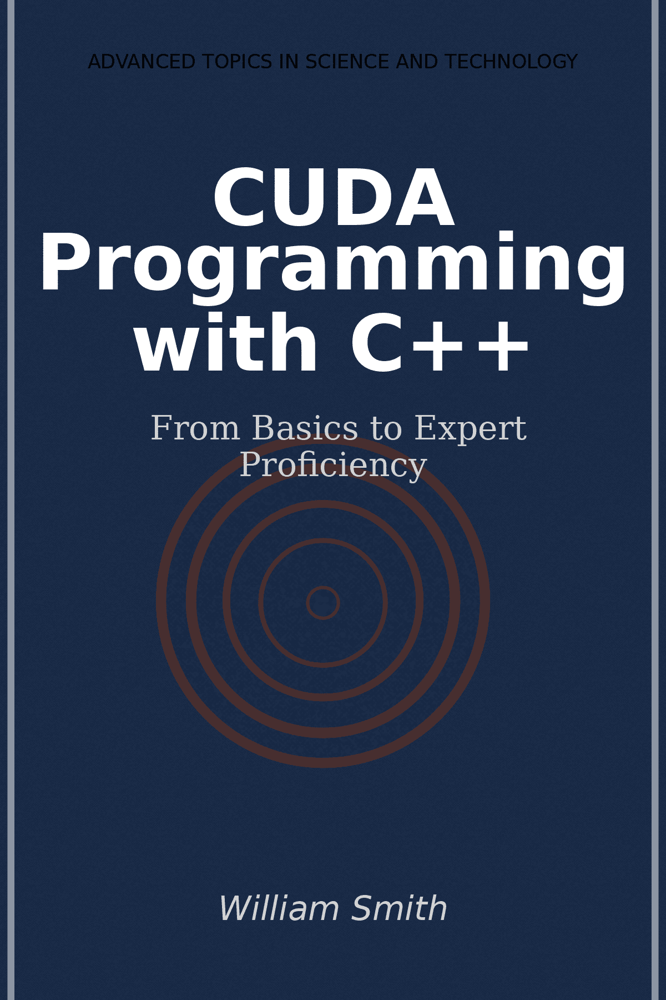

# C++ CUDA 编程：从基础到精通



Copyright © 2024 by HiTeX Press

保留所有权利。未经出版社书面许可，不得以任何形式或通过任何手段复制、传播或传输本书的任何部分，包括复印、录制或其他电子或机械方法，但版权法允许的批判性评论中的简短引用以及某些其他非商业性用途除外。

## 目录

## 1. CUDA 编程与 C++ 简介

1.1 并行计算的演变

1.2 CUDA 和 GPU 计算概述

1.3 为什么用 C++ 使用 CUDA？

1.4 基础概念与术语

1.5 安装与配置 CUDA Toolkit

1.6 第一个 CUDA 程序：Hello World

1.7 理解 CUDA 开发工作流

1.8 CUDA 相关的 C++ 概念简述

1.9 编译与运行 CUDA 程序

1.10 CUDA 开发的常用工具与资源

## 2. CUDA 架构与 GPU 计算

2.1 理解 GPU 架构

2.2 CUDA 编程模型对比 CPU 编程

2.3 CUDA 核心与线程层级

2.4 Warp 与线程块调度

2.5 GPU 中的内存架构

2.6 CUDA 执行模型

2.7 全局内存、共享与常量内存

2.8 流式多处理器 (SM)

2.9 理解 CUDA 计算能力 (Compute Capability)

2.10 NVIDIA GPU 硬件模型简介

## 3. 配置你的开发环境

3.1 CUDA 开发的系统要求

3.2 在 Windows 上安装 CUDA Toolkit

3.3 在 Linux 上安装 CUDA Toolkit

3.4 在 macOS 上安装 CUDA Toolkit

3.5 安装 NVIDIA 驱动

3.6 配置集成开发环境 (IDE)

3.7 配置环境变量

3.8 测试安装情况

3.9 更新与卸载 CUDA Toolkit

3.10 使用 Docker 进行 CUDA 开发

## 4. 理解 CUDA 核函数与线程

4.1 什么是 CUDA 核函数 (Kernel)

4.2 编写你的第一个 CUDA 核函数

4.3 启动 CUDA 核函数

4.4 理解 CUDA 线程

4.5 线程索引与映射

4.6 块 (Block) 与网格 (Grid) 维度

4.7 线程同步

4.8 线程协作

4.9 分歧 (Divergence)

4.10 核函数设计的最佳实践

## 5. 内存管理

5.1 内存概述

5.2 全局内存

5.3 共享内存

5.4 常量内存

5.5 纹理内存

5.6 统一内存 (Unified Memory)

5.7 分配

5.8 主机 (Host) 与设备 (Device)之间的数据

5.9 内存访问模式

5.10 避免与处理错误

## 6. CUDA 编程模型

6.1 并行模型简介

6.2 单指令多线程 (SIMT)

6.3 线程与数据并行

6.4 分解

6.5 任务并行

6.6 混合并行

6.7 使用流 (Streams) 实现并行执行

6.8 层级网格执行

6.9 多 GPU 并行编程

6.10 选择并行编程模型

## 7. 优化 CUDA 性能

7.1 CUDA 性能优化简介

7.2 性能分析 (Profiling)

7.3 优化内存访问模式

7.4 减少内存传输

7.5 提高指令吞吐量

7.6 优化核启动配置

7.7 延迟隐藏技术

7.8 缓存与共享内存技术

7.9 占用率与资源利用

7.10 负载均衡与减少分歧

## 8. 高级 CUDA 编程技术

8.1 高级 CUDA 编程简介

8.2 动态并行 (Dynamic Parallelism)

### 8.3 CUDA Graphs

### 8.4 统一内存与内存超额订阅

### 8.5 CUDA 流与异步执行

### 8.6 点对点内存访问

### 8.7 进程间通信

### 8.8 CUDA 与多 GPU 编程

### 8.9 使用 Thrust 库进行高级抽象

### 8.10 异构计算环境中的 CUDA

## 9 CUDA 应用程序的调试与性能分析

### 9.1 调试与性能分析简介

### 9.2 常见 CUDA 错误及解决方法

### 9.3 使用 NVIDIA Nsight 进行调试

### 9.4 手动调试技术

### 9.5 使用 CUDA-GDB 调试器

### 9.6 使用 NVIDIA Visual Profiler 分析 Kernel 性能

### 9.7 CPU-GPU 交互的性能分析

### 9.8 解读性能分析结果

### 9.9 基于性能分析数据优化代码

### 9.10 高效调试与性能分析的最佳实践

## 10 案例研究与实际应用

### 10.1 实际 CUDA 应用简介

### 10.2 案例研究：图像处理与计算机视觉

### 10.3 案例研究：科学计算与仿真

### 10.4 案例研究：深度学习与神经网络

### 10.5 案例研究：实时渲染与图形学

### 10.6 案例研究：金融建模与风险分析

### 10.7 案例研究：生物信息学与基因组

### 10.8 案例研究：自动驾驶车辆与机器人

### 10.9 案例研究：大数据分析

### 10.10 CUDA 的未来趋势与发展

## 引言

在现代计算领域，对高性能计算的需求急剧增长。传统的中央处理器（`CPUs`）受限于其设计，主要针对顺序任务执行进行了优化。为了克服这些局限性，并行计算已成为一种重要的范式，而这一演进的前沿正是 `CUDA`（计算设备统一设备架构）编程。`CUDA` 由 NVIDIA 开发，提供了一个强大的平台来利用图形处理器（`GPUs`）提供的巨大并行性。

本书《基于 C++ 的 CUDA 编程：从基础到精通》旨在阐明 `CUDA` 编程的原理、实践和细差别。本书作为一份详尽的指南，从基础概念一直进到高级技术，专为旨在深化使用 `CUDA` 和 `C++` 进行 GPU 计算的初学者和资深开发者定制。

`CUDA` 编程利用了 `GPUs` 的并行架构，允许开发者同时执行成千上万线程。这种能力对于需要密集计算能力的应用（如科学仿真、渲染、数据分析和机器学习）至关重要。通过将计算密集型任务卸载到 `GPU`，开发者可以实现仅靠 CPU 处理无法达到的显著性能提升。

理解 `CUDA` 架构及其与底层硬件的交互至关重要。本书将深入探讨 `GPU` 架构、线程层级、内存管理以及 `CUDA` 执行模型的具体细节。每个概念都经过细致呈现，以建立稳实的基础，确保读者能够胜任应对复杂的计算问题。

正确地设置开发环境是成功进行 `CUDA` 编程的基石。我们提供了关于安装 `CUDA Toolkit`、配置集成开发环境（`IDEs`）以及在 Windows、Linux 和 macOS 在内的不同操作系统上验证设置的详细指南。书中还包含了实用的见解和故障排除技巧，以增强学习体验。

本书还探讨了 `CUDA` 核和线程的复杂性，它们是并行编程的核心。读者将深入理解编写和优化 `CUDA` 核、有效管理线程以及利用块（block）和网格（grid）维度优化性能。

内存管理是另一个影响 `CUDA` 应用性能的关键方面。本书涵盖了 `CUDA` 中提供的多种内存，如全局内存、共享内存、常量内存和纹理内存，以及高效内存分配、传输和访问模式的策略。

`CUDA` 中的并行编程模型，包括 `SIMT`（单指令多线程）、混合模型和领域分解。这些模型对于设计可扩展且高效的并行算法至关重要。书中还包含了动态并行、`CUDA graphs` 和多 GPU 编程等高级主题，为读者提供前沿知识和技能。

调试和性能分析是开发高性能 `CUDA` 应用程序不可缺的一部分。书中设有专门章节介绍如何使用 `NVIDIA Nsight`、`CUDA-GDB` 和可视化分析器等工具，帮助开发者识别瓶颈、优化性能并确保代码的正确性。

最后，本书展示了 `CUDA` 编程的深刻到案例研究和实际应用。这些示例跨越了各个行业，说明了 GPU 计算的实际应用和变革性影响。从图像处理、科学仿真到深度学习和自动驾驶车辆，这些案例研究凸显了 `CUDA` 编程的多功能性和潜力。

读完本书，读者将对基于 `C++` 的 `CUDA` 编程有全面的理解。他们将擅长设计、优化和部署充分利用 GPU 计算潜能的高性能应用程序。无论你是学生、研究人员还是专业开发者，本书都是你精通 `CUDA` 编程之旅上的宝贵资源。

## 第 1 章

CUDA 编程与 C++ 简介

本章概述了并行计算的演变，并介绍了 CUDA 和 GPU 计算。它解释了使用 C++ 开发 CUDA 的优势，并涵盖了理解 CUDA 编程至关重要的基本概念和术语。此外，本章还将引导读者如何安装和设置 `CUDA Toolkit`、运行一个简单的 `CUDA` 程序，并介绍与 `CUDA` 开发相关的核心 C++ 概念。章节最后通过解释 `CUDA` 开发工作流，并强调开发者可用的常用工具和资源来结束。

### 1.1 并行计算的演变

在计算能力需求日益增长的驱动下，并行计算在过去的几十年里显著进化。这种演变可以追溯到不同的阶段，每个阶段都以硬件、软件和算法的进步为标志。

从历史上看，计算始于顺序处理，任务在单个处理器上一个接一个地执行。这种模型虽然简单，但受限于处理器时钟频率及其处理复杂耗时任务的能力。随着科学问题和数据规模的增长，对更强大的计算方法的需求变得愈显而易见。

并行计算的初始阶段涉及向量处理器和早期多处理系统。向量处理器通过同时对多个数据点执行相同操作来运行，利用了数据并行性。另一方面，多处理系统使用多个处理器并发执行独立任务，体现了任务并行性。这些早期系统为更复杂的并行形式奠定了基础。

20 世纪 80 年代和 90 年代超级计算机的兴代表了并行计算的飞跃。超级计算机集成了许多协同工作的处理器，实现了前所未有的性能水平。著名的例子包括 `Cray-1` 及其继任者，它们利用向量处理和流水线技术极大地加速了计算任务。在此期间，共享内存和消息传递等并行架构和编程模型变得日益精炼。

共享内存系统允许多个处理器访问相同的内存空间，便于通信和同步。这种模型相对容易编程，但随着处理器数量的增加，效率会降低。内存访问的竞争可能会导致性能瓶颈。常见的共享内存编程模型包括 `OpenMP`，它提供了用于循环和代码段并行化的构造结构。

另一方面，消息传递涉及处理器通过显式发送和接收消息进行通信。以 `Message Passing Interface`（`MPI`）为代表的这种模型更具扩展性，更适用于分布式计算环境。然而，它在管理处理器之间的通信和同步方面引入了额外的复杂性。

世纪之交带来了集群计算的主流采用。集群由通过高速网络连接的多台计算机组成，实际上充当单一系统运行。这种方法为构建强大的并行计算系统提供了一种成本效益高。如 `MPI` 等中间件以及用于处理大规模数据的 `Apache Hadoop` 等软件框架成为利用集群计算的必用工具。

21 世纪 00 年代多核处理器的出现标志着并行计算的又一个里程碑。具有多个核心的处理器可以在单个芯片内执行大量线程，高效地提高性能。这一发展迫使软件设计发生变化，以利用多核架构的潜力。线程级并行等编程技术以及 `pthreads`（`POSIX 线程`）等工具变得流行。

与此同时，图形处理器上的通用计算（`GPGPU`）异起，成为并行计算的变革性力量。GPU 原初设计用于渲染图形，具有高度并行的架构，使其适用于适合并行处理的计算任务。NVIDIA 在 2007 年引入的 `Compute Unified Device Architecture`（`CUDA`）使开发者能够利用 GPU 的力量进行通用计算。`CUDA` 通过扩展 C++ 语言，引入在 GPU 上并行执行的构造结构，显著简化了 GPU 编程。

利用 GPU 进行科学计算催化了多个领域，包括物理模拟、分子动力学和人工智能。GPU 的海量并行性和高吞吐量使其成为涉及大规模数值计算和数据处理任务的理想选择。

现代并行计算涵盖多种架构和范式，每种都适用于特定类型的问题。这些包括共享内存系统、分布式系统以及 GPU 和 `FPGAs`（`现场可编程门阵列`）等加速器。`OpenMP`、`MPI` 和 `CUDA` 等编程模型为跨这些架构开发并行应用提供了必要的抽象。

结合 CPU、GPU 和其他加速器的异构计算模型日益普及。这种模型利用不同处理单元的优势，优化了广泛应用的性能和效率。如 `OpenCL`（`Open Computing Language`）等语言和框架促进了可以在各种类型处理器上运行的可移植代码开发。

对更高性能和效率的不懈追求持续驱动着并行计算的创新。量子计算、神经形态计算和先进并行算法等领域的研究有望进一步彻底改变我们解决复杂计算问题的方式。

```cpp
#include <iostream> 

#include <omp.h> 

int main() { 

   #pragma omp parallel 

   { 
      int thread_id = omp_get_thread_num(); 
      std::cout << "Hello, World from thread " << thread_id << std::endl; 
   } 
   return 0; 
}
```

输出：

```
Hello, World from thread 0 
Hello, World from thread 1 
Hello, World from thread 2 
Hello, World from thread 3
```

整合这些历史里程碑和技术进步，并行计算已经从一个利基领域变成了现代计算科学和工程的关键组成部分。理解它的演变为理解并行计算技术的现状和未来潜力奠定了基础。

### 1.2 CUDA 和 GPU 计算概述

`CUDA`（`Compute Unified Device Architecture`）是由 NVIDIA 创建的并行计算平台和应用程序编程接口（`API`）模型。它允许开发者使用 GPU（`Graphics Processing Units`）进行通用处理（这种方法称为 `GPGPU`，即图形处理器上的通用计算）。本节阐述了 `CUDA` 和 GPU 计算的基础概念、支持 CUDA 的 GPU 架构，以及 `CUDA` 如何实现高性能并行计算。

`CUDA` 编程模型的主要组件包括主机（CPU）和设备（GPU）。主机负责执行代码的顺序部分并管理整个应用程序逻辑，而设备执行应用程序的并行部分，利用其巨大的计算能力。

让我们用 `CUDA` 来说明基本的程序结构。这是一个简单的示例：

```cpp
#include <iostream> 

__global__ void kernel(void) { 
   printf("Hello, World from GPU!\n"); 
} 

int main(void) { 
   // 启动内核函数 
   kernel<<<1, 1>>>(); 
   // 等待 GPU 完成 
   cudaDeviceSynchronize(); 
   return 0; 
}
```

在上面的代码中，内核函数使用 `__global__` 声明限定符定义，将其标记为在 GPU 上运行但可以从主机（host）调用并并行执行的函数。`<1, 1>` 语法指定了执行配置：一个包含线程的块（block）。`cudaDeviceSynchronize()` 确保 CPU 在程序终止之前等待 GPU 完成执行。

充分利用 CUDA 能力的关键在于理解 GPU 架构。NVIDIA GPU 由流式多处理器（SMs）组成。每个 SM 都可以并发管理多个线程，使得 GPU 特别适用于数据并行计算，即对多个数据项应用同一种操作。例如，矩阵乘法、图像处理和物理仿真通常受益于 GPU 加速。

一个典型的支持 CUDA 的 GPU 包含许多 SM，每个 SM 可以执行数千个线程。这些线程被组织成块，而块又被组织成网格（grids）。每个块运行在单个 SM 上，允许块内的线程通过快速共享内存共享数据并同步它们的执行。

## CUDA 中的内存层次结构

内存层次由多个层组成：

- **全局内存（Global Memory）：** 所有线程均可访问，延迟高且不缓存。

- **共享内存（Shared Memory）：** 同一块线程共享的片上内存，比全局内存快得多。

- **寄存器（Registers）：** 每个线程都有自己的私有寄存器，提供最快但有限的内存。

- **常量和纹理内存（Constant and Texture Memory）：** 针对不同访问模式优化的缓存内存。

考虑以下演示向量加法的示例：


```cpp
#include <iostream>
#include <cuda_runtime.h>

#define N 512

__global__ void add(int *a, int *b, int *c) {
    int index = threadIdx.x;
    c[index] = a[index] + b[index];
}

int main(void) {
    int a[N], b[N], c[N];
    int *d_a, *d_b, *d_c;

    cudaMalloc((void **) &d_a, N * sizeof(int));
    cudaMalloc((void **) &d_b, N * sizeof(int));
    cudaMalloc((void **) &d_c, N * sizeof(int));

    for (int i = 0; i < N; i++) {
        a[i] = i;
        b[i] = i * i;
    }

    cudaMemcpy(d_a, a, N * sizeof(int), cudaMemcpyHostToDevice);
    cudaMemcpy(d_b, b, N * sizeof(int), cudaMemcpyHostToDevice);

    add<<<1, N>>>(d_a, d_b, d_c);

    cudaMemcpy(c, d_c, N * sizeof(int), cudaMemcpyDeviceToHost);

    for (int i = 0; i < N; i++) {
        printf("%d + %d = %d\n", a[i], b[i], c[i]);
    }

    cudaFree(d_a);
    cudaFree(d_b);
    cudaFree(d_c);

    return 0;
}
```

在这段代码中：

- `cudaMalloc` 在 GPU 上分配内存。
- `cudaMemcpy` 在主机和设备之间传输数据。
- `add<<<1, N>>>` 启动一个包含 `N` 个线程的单块内核。
- 内核执行完毕后，结果被拷贝回主机内存。

CUDA 提供了处理错误和检查 GPU 状态的工具。如`cudaGetErrorString(cudaGetLastError())`等函数会在出现问题时返回可读的错误信息。

在讨论 GPU 计算的优势时，三个关键方面通常脱颖而出：

- **海量并行（Massive Parallelism）：** GPU 由数百或数千个更小、更高效的核心组成，旨在同时处理多个任务。
- **高吞吐量（High Throughput）：** 由于其架构，GPU 可以在单位时间内处理海量数据。
- **能效（Energy Efficiency）：** 与传统 CPU 相比，现代 GPU 以更低的能耗提供高计算能力。

总体而言，CUDA 和 GPU 计算让开发者能够为涉及数据级和高需求任务的应用实现巨大的性能提升。硬件进步与健壮编程模型的结合使得 CUDA 成为高性能计算不可缺的工具。

## 为什么在 C++ 中使用 CUDA？

CUDA（统一计算架构）是由 NVIDIA 创建的并行计算平台和应用接口（API）模型。它允许开发者使用 NVIDIA GPU 进行通用处理，这种方法被称为 GPGPU（基于图形单元的通用计算）。

### 性能与并行性

CUDA 专为利用 NVIDIA GPU 的并行能力而设计。GPU 由大量核心组成，可以同时运行数千个线程。通过在 C++ 中使用 CUDA，开发者可以将复杂问题分解为可以并行执行的小任务。例如，矩阵乘法这项任务由于其顺序性，在 CPU 上计算开销很大，但在 GPU 上会变得非常高效。

```cpp
__global__ void matrixMul(float*A, float*B, float*C, int N) {
    int row = blockIdx.y * blockDim.y + threadIdx.y;
    int col = blockIdx.x * blockDim.x + threadIdx.x;
    float sum = 0.0f;

    if(row < N && col < N) {
        for(int k = 0; k < N; k++) {
            sum += A[row * N + k] * B[k * N + col];
        }
        C[row * N + col] = sum;
    }
}
```

上述代码利用 CUDA 并行计算矩阵乘法的每一个元素。`__global__`限定符表示该函数在设备（GPU）上运行并可以从主机（CPU）调用。

### 高级 C++ 特性

C++ 是一门强大的语言，提供了高级特性，如面向对象编程（OOP）、模板和标准模板库（STL）。使用 CUDA 允许开发者编写可重用、可维护且可扩展的代码。OOP 原实现了封装、继承和多态，这些对于管理复杂项目至关重要。

```cpp
class Matrix {
private:
    float* data;
    int N;

public:
    Matrix(int size):N(size) {
        cudaMallocManaged(&data, N * N * sizeof(float));
    }

    ~Matrix() {
        cudaFree(data);
    }

    float* getData() {
        return data;
    }

    int getSize() {
        return N;
    }

    // 用于操作矩阵数据的成员函数
};
```

在提供的`Matrix`类中，动态内存分配通过`cudaMallocManaged()`完成，它分配了 CPU 和 GPU 均访问的统一内存。该类封装了矩阵数据并提供了管理方法。

### 互操作性

C++ 广泛应用于游戏开发、科学计算和金融建模等领域。CUDA 与现有 C++ 代码库的互操作性允许无缝将 GPU 加速到现有应用中，而无需重写整个代码。开发者可以将性能关键部分卸交给 GPU，从而逐步优化性能。

```cpp
void cpuFunction(float* A, float* B, float* C, int N) {
    // 执行某些 CPU 特有的操作
    for(int i = 0; i < N; i++) {
        //...
    }

    // 启动 CUDA 内核执行 GPU 特有的操作
    dim3 threadsPerBlock(16, 16);
    dim3 numBlocks(
        (N + threadsPerBlock.x - 1) / threadsPerBlock.x,
        (N + threadsPerBlock.y - 1) / threadsPerBlock.y
    );

    matrixMulKernel<<<numBlocks, threadsPerBlock>>>(A, B, C, N);
    cudaDeviceSynchronize();
}
```

此函数演示了如何在单一工作流中混合 CPU 和 GPU 操作。

## 硬件抽象

CUDA 为 GPU 硬件提供了高层抽象。虽然为了充分优化性能，CUDA 仍然要求对 GPU 架构架构，但它抽象了低层细节，让开发者更容易编写高效代码。C++ 编程构造结构（如类、继承和多态）与 CUDA 良好集成，使得代码库更加直观且组织严密。

## 广泛的生态系统与支持

NVIDIA 围绕 CUDA 开发了强大的生态系统，包含了丰富的开发工具、库和资源。`CUDA Toolkit`提供了各种实用程序，如`nvcc`（NVIDIA CUDA 编译器）、`cuda-gdb`（CUDA 调试器）以及如`nvprof`和`Nsight Systems`等性能分析工具。此外，如`cuBLAS`（CUDA 基础线性代数程序）和`cuDNN`（CUDA 深度神经网络库）等众多库提供了优化例程，能够显著加速开发。

```cpp
#include <cublas_v2.h>

void cublasExample() {
    cublasHandle_t handle;
    cublasCreate(&handle);

    float alpha = 1.0f;
    float beta = 0.0f;
    int N = 1024;

    float* d_A;
    float* d_B;
    float* d_C;

    cudaMalloc((void**)&d_A, N * N * sizeof(float));
    cudaMalloc((void**)&d_B, N * N * sizeof(float));
    cudaMalloc((void**)&d_C, N * N * sizeof(float));

    cublasSgemm(
        handle,
        CUBLAS_OP_N,
        CUBLAS_OP_N,
        N,
        N,
        N,
        &alpha,
        d_A,
        N,
        d_B,
        N,
        &beta,
        d_C,
        N
    );

    cublasDestroy(handle);
    cudaFree(d_A);
    cudaFree(d_B);
    cudaFree(d_C);
}
```

在使用`cuBLAS`进行矩阵乘法时，`cublasSgemm`执行操作`C = α ⋅ A ⋅ B + β ⋅ C`，利用了库提供的高度优化的 BLAS 例程。

通过将 C++ 与 CUDA 结合，开发者可以利用 GPU 的计算能力和 C++ 的高级编程构造结构，为创建高性能、高效且可维护的应用程序铺平道路。

## 1.4 基础概念与术语

为了在 C++ 中熟练利用 CUDA 进行并行计算，理解特定 GPU 编程的基础概念和术语至关重要。我们将考察 CUDA 编程基础的关键术语和原理，涵盖 CUDA 架构、执行模型、内存层次和编程模型。

### CUDA 架构

CUDA（统一计算设备架构）是 NVIDIA 的并行计算平台和应用程序编程接口（API）。CUDA 允许开发者使用 NVIDIA GPU 进行通用处理。GPU 由一组流式多处理器（SMs）组成，每个 SM 包含数百到数千个 CUDA 核心。`SM`是一个多线程处理器，可并发执行多个线程的指令，而 CUDA 核心是执行线程指令的各个处理器。

### 核函数（Kernel）

核函数是用 CUDA C++ 编写的运行在 GPU 上的函数。与在 CPU 上执行的标准 C++ 函数不同，CUDA 核函数由 N 个不同的 CUDA 线程并行执行 N 次，而不是只执行一次。每个执行核函数的线程都有唯一的 ID，使它们能够处理不同的数据。

```cpp
__global__ void simpleKernel(int* d_array) {
    int idx = threadIdx.x;
    d_array[idx] *= 2;
}
```

在此示例中，核函数`simpleKernel`在整数数组上操作。每个线程通过其`threadIdx`标识，处理数组中的不同元素。

### 线程层级

CUDA 使用线程层级来管理并行任务的执行：

- **线程（Thread）：** CUDA 中最小的执行单元。
- **块（Block）：** 执行同一核函数的线程组，可以通过共享内存进行协作。块内的线程可以使用`__syncthreads`进行同步。
- **网格（Grid）：** 执行同一核函数的块集合。整个块网格可以从主机端（CPU）侧启动。

每个线程和块都有唯一的 ID，这使得线程确定需要处理哪些数据成为可能。块排列在网格中，这些块可以是一维（1D）、二维（2D）或三维（3D）的。

### 内存层次

CUDA 中的内存层次对于理解性能优化至关重要。CUDA 提供了几种类型的内存，每种内存都有不同的性能特性和用例：

- **全局内存（Global Memory）：** 最大的可用空间，所有线程均可。
- **共享内存（Shared Memory）：** 块内所有线程可访问的片上内存。
- **局部内存（Local Memory）：** 用于每个线程私有变量的内存。
- **常量内存（Constant Memory）：** 用于存储核函数执行期间不改变数据的只读内存。
- **纹理内存（Texture Memory）：** 缓存的只读内存，专门针对数据。

### 束（Warp）

Warp 是由 32 个线程组成的组，在 SM 上同时执行。每个 SM 在 Warp 级别调度指令。

### 线程发散（Thread Divergence）

当单个 Warp 内的线程采取不同路径时（例如由于`if`语句），发生线程发散。

潜在的 Warp 发散示例：

```cpp
__global__ void divergenceExample(int* d_data) {
    int idx = threadIdx.x;

    if (idx % 2 == 0) {
        d_data[idx] *= 2;
    } else {
        d_data[idx] += 1;
    }
}
```

### 同步

当块内的线程需要协作或确保某些操作已完成时，同步在 CUDA 中至关重要。CUDA 提供了`__syncthreads()`函数来同步块内的线程。

```cpp
__global__ void syncExample(int* d_data) {
    __shared__ int sharedData[256];
    int idx = threadIdx.x;

    sharedData[idx] = d_data[idx];
    __syncthreads(); // 确保所有线程已写入 sharedData
    d_data[idx] = sharedData[(idx + 1) % 256];
}
```

### 执行配置

启动核函数时，开发者指定执行配置，定义网格和块维度。这是通过三角括号实现的。

```cpp
int numBlocks = 16;
int threadsPerBlock = 256;

simpleKernel<<<numBlocks, threadsPerBlock>>>(d_array);
```

### 流（Streams）

CUDA 流是在 GPU 上按顺序执行的操作序列。流允许主机与设备之间或多次核函数执行之间的重叠计算和数据传输。默认流是流 0，会串化操作。

### 事件（Event）

事件用于测量 CUDA 操作所需的时间。可以在工作流特定点标记执行段的开始和结束。

```cpp
cudaEvent_t start, stop;
cudaEventCreate(&start);
cudaEventCreate(&stop);

cudaEventRecord(start, 0);

// 核函数调用
simpleKernel<<<numBlocks, threadsPerBlock>>>(d_array);

cudaEventRecord(stop, 0);
cudaEventSynchronize(stop);

float elapsedTime;
cudaEventElapsedTime(&elapsedTime, start, stop);
```

为了在 C++ 中利用 CUDA 进行并行编程，必须确保正确安装并设置 CUDA Toolkit。本节将概述在各种操作系统上安装 CUDA Toolkit、配置环境以及验证安装情况所需的详细步骤。

## 第 1 步：检查系统要求

在开始安装之前，请验证您的系统是否符合 CUDA Toolkit 的最低要求。这些要求通常包括特定的硬件和软件先决条件：

- **操作系统：** Windows 10、Linux（各种发行版）或 macOS。
- **GPU：** CUDA 计算能力为 3.5 或更高版本的 NVIDIA GPU。您可以在 NVIDIA 网站上找到支持的 GPU 列表。
- **驱动程序：** 与您打算安装的 CUDA 版本兼容的 NVIDIA 驱动程序。
- **编译器：** 适用于 C++ 的编译器，例如 Windows 下 Visual Studio 或 Linux 下 GCC。

## 第 2 步：下载 CUDA Toolkit

访问 NVIDIA 网站上的 CUDA Toolkit 下载页面（`https://developer.nvidia.com/cuda-downloads`）。选择适合您操作系统的版本并按照下载说明操作。该页面提供了关于 Windows、Linux 和 macOS 特定安装程序的详细信息。

## 第 3 步：安装 CUDA Toolkit

- **Windows：** 双击下载的可执行文件并按照安装向导的说明操作。确保您选择了安装 CUDA Toolkit、示例以及相应的 NVIDIA 驱动程序的选项。
- **Linux：** 执行下载的`.run`文件或使用如`apt`或`yum`等包管理器。例如，在 Ubuntu 上，可以使用以下命令安装 CUDA：

```bash
sudo dpkg -i cuda-repo-<distro>_<version>_amd64.deb
sudo apt-key adv --fetch-keys http://developer.download.nvidia.com/compute/cuda/repos/<distro>/x86_64/7fa2af80.pub
sudo apt-get update
sudo apt-get install cuda
```

- **macOS：** 按照`.dmg`安装程序中的说明操作。注意，macOS 的 CUDA 支持通常限于特定的 macOS 版本和兼容的 Mac 硬件。


### 第 4 步：设置环境变量

安装完成后，配置系统环境以包含 CUDA 二进制文件和库的路径。

- **Windows：** 将以下路径添加到系统的环境变量中：
  - CUDA Toolkit：`C:\Program Files\NVIDIA GPU Computing Toolkit\CUDA\v<version>\bin`
  - NVCC 编译器：`C:\Program Files\NVIDIA GPU Computing Toolkit\CUDA\v<version>\libnvvp`
- **Linux：** 将以下行添加到您的 `~/.bashrc` 或 `~/.zshrc` 文件中：

```bash
export PATH=/usr/local/cuda-<version>/bin${PATH:+:${PATH}}
export LD_LIBRARY_PATH=/usr/local/cuda-<version>/lib64 ${LD_LIBRARY_PATH:+:${LD_LIBRARY_PATH}}
```

通过重新加载配置文件来应用更改：

```bash
source ~/.bashrc
```

### 第 5 步：验证安装

要验证 CUDA Toolkit 是否正确安装并配置，请编译并运行工具包提供的示例程序。

- 导航到 CUDA 示例目录（Windows 上通常位于 `C:\ProgramData\NVIDIA Corporation\CUDA Samples`，Linux 上位于 `/usr/local/cuda/samples`）。
- 使用提供的 makefile 或 Visual Studio 项目编译示例。
- 运行 `deviceQuery` 示例以验证您的系统是否识别了 NVIDIA GPU 以及是否符合 CUDA 要求。

```bash
cd /usr/local/cuda/samples/1_Utilities/deviceQuery
make
./deviceQuery
```

```
Device 0: "GeForce GTX 1080"
  CUDA Driver Version / Runtime Version          11.0 / 11.0
  CUDA Capability Major/Minor version number:    6.1
  Total amount of global memory:                 8119 MBytes (8507990016 bytes)
  ...
Result = PASS
```

### 第 6 步：安装 CUDA 开发工具

根据您的开发平台，NVIDIA Nsight、CUDA Profiler 和 Visual Studio Code 等工具可以增强您的 CUDA 开发体验。请遵循这些工具各自的安装说明来完成设置。

## 故障排除提示

如果在安装过程中遇到问题，请查阅以下资源：

- CUDA 安装指南：https://docs.nvidia.com/cuda/cuda-installation-guide
- NVIDIA 开发者论坛：https://forums.developer.nvidia.com
- 官方文档中针对特定操作系统的故障排除章节。

正确安装和配置 CUDA Toolkit 对于在 C++ 中开发高效并行程序至关重要。这涉及到确保系统满足要求、下载并安装合适的 CUDA Toolkit 版本、配置环境变量以及通过运行示例程序验证安装。

## 1.6 第一个 CUDA 程序：Hello World

我们现在将注意力转向编写和运行我们的第一个 CUDA 程序，传统上被称为“Hello World”程序。这是一个重要的步骤，展示了编写、编译和执行基础 CUDA 应用程序的过程。理解这一过程将为更复杂的 CUDA 应用程序奠定基础。

以下代码演示了一个基础的 "Hello World" CUDA 程序：

```cpp
#include <iostream>
#include <cuda_runtime.h>

__global__ void helloWorld() {
    printf("Hello World from GPU!\n");
}

int main() {
    // 启动包含一个块和一个线程的内核
    helloWorld<<<1, 1>>>();

    // 等待 GPU 完成执行
    cudaDeviceSynchronize();

    return 0;
}
```

### 编译与执行

下一步是编译 CUDA 程序。此过程涉及使用 NVIDIA CUDA 编译器 `nvcc` 将 CUDA 代码转换为可执行文件。假设代码保存在名为 `hello_cuda.cu` 的文件中，打开终端并执行以下命令：

```bash
nvcc hello_cuda.cu -o hello_cuda
```

成功编译并运行此程序后，预期输出为：

```
Hello World from GPU!
```

`nvcc` 命令将编译 `hello_cuda.cu` 并生成名为 `hello_cuda` 的可执行文件。要运行该程序，输入：

```bash
./hello_cuda
```

运行此命令后，终端将显示“Hello World from GPU!”消息。

我们观察了 CUDA 编程的核心特性，例如定义内核函数（kernel functions）、从主机启动内核以及利用设备同步。这些基础概念为创建更高级的程序奠定了基础，是高效 CUDA 编程不可或缺的一部分。

## 1.7 理解 CUDA 开发工作流

CUDA 开发工作流是一个结构化的过程，允许开发者有效利用 GPU 的计算能力。通过理解每个步骤，可以更高效地开发、优化和调试 CUDA 应用程序。本节阐述了 CUDA 开发工作流的关键方面以及相应的工具和实践。

工作流可以分为以下主要阶段：

- 代码设计与结构化
- 主机与设备代码分离
- 内核配置
- 内存管理
- 内核启动
- 调试与性能分析

### 代码设计与结构化

第一步涉及设计应用程序，识别代码中哪些部分将受益于 GPU 上的并行执行。这一步通常包括识别可以并行化的计算密集型代码段。设计阶段应考虑数据依赖和可能的数据竞态，以确保并行执行时的正确性。

### 主机与设备代码分离

CUDA 应用程序由主机（CPU）代码和设备（GPU）代码组成。主机代码运行在 CPU 上并管理整个应用程序的流，而设备代码（内核）运行在 GPU 上。`__global__` 声明符用于定义一个在设备上运行但从主机调用的内核函数。主机与设备代码分离对于理解和管理应用程序的执行流至关重要。

### 内核配置

在启动内核之前，你需要对其进行配置。内核配置涉及定义每个块（block）的线程数以及每个网格（grid）的线程块数。启动内核的语法将这些配置作为参数。例如：

```cpp
// 内核声明 
__global__ void myKernel(int *data) { 
    int idx = threadIdx.x + blockIdx.x * blockDim.x; 
    data[idx] = data[idx] + 1; 
} 

// 内核启动配置 
int blockSize = 256; 
int numBlocks = (N + blockSize - 1) / blockSize; 
myKernel<<<numBlocks, blockSize>>>(data);
```

在此代码中，`blockSize` 定义了每个块的线程数，`numBlocks` 根据数据数组的大小计算出合适的块数量，确保所有元素都被处理。

### 内存管理

高效的内存管理在 CUDA 编程中至关重要。你必须在主机和设备上分配内存，并根据需要它们之间传输数据。CUDA 提供了 `cudaMalloc`、`cudaFree`、`cudaMemcpy` 等 API 函数来管理内存。例如：

```cpp
int size = N * sizeof(int); 
int *hostData = (int *)malloc(size); 
int *deviceData; 
cudaMalloc((void **)&deviceData, size); 
cudaMemcpy(deviceData, hostData, size, cudaMemcpyHostToDevice); 

// 内核执行 
myKernel<<<numBlocks, blockSize>>>(deviceData); 

// 将结果拷贝回主机 
cudaMemcpy(hostData, deviceData, size, cudaMemcpyDeviceToHost); 

// 释放设备内存 
cudaFree(deviceData);
```

此代码在主机和设备上为数据数组分配内存，将数据传输到设备，运行内核，然后将结果拷贝回主机。

### 内核启动

在配置内核并管理内存后，实际的内核启动是一个简单的过程。内核执行是异步的，这意味着控制权会返回给 CPU，而 GPU 继续处理。可以使用同步机制（如 `cudaDeviceSynchronize`）来确保在继续之前内核执行已完成。

```cpp
myKernel<<<numBlocks, blockSize>>>(deviceData); 
cudaDeviceSynchronize();
```

### 调试与性能分析

调试和性能分析对于开发高效的 CUDA 应用程序至关重要。CUDA 提供了 `cuda-gdb` 用于调试，以及提供了 `nvprof` 和 NVIDIA Visual Profiler (`nvvp`) 用于性能分析。这些工具有助于识别瓶颈、内存访问问题以及其他性能相关问题。

`cuda-gdb` 允许单步执行设备代码、设置断点并检查变量值，类似于标准的 GDB 调试：

```bash
cuda-gdb ./myCudaApplication
(gdb) break myKernel
(gdb) run
```

对于性能分析，`nvprof` 提供了内核执行时间、内存传输和其他性能指标的详细报告：

```bash
nvprof ./myCudaApplication
```

这些性能分析结果可以用于策略（如最小化内存传输、优化内存访问模式和最大化占有率）来优化内核性能。

理解 CUDA 开发工作流和可用工具允许开发者构建高效、高性能的 CUDA 应用程序。通过严格遵循工作流，开发者可以进行调试和优化。

## 1.8 CUDA C++ 简介绍

彻底掌握 C++ 对于 CUDA 编程至关重要，因为 CUDA 扩展了 C++。本节深入探讨关键的 C++ 概念，这是一种静态类型的编译型语言，提供了低级内存能力和高层抽象。

### 指针与内存管理

在 CUDA 中，指针是管理主机（CPU）和设备（GPU）内存的基础。指针存储地址，允许访问和操作变量。考虑以下 C++ 中的指针操作：

```cpp
int main() {
    int a = 0;
    int *p = &a; // p 持有 a 的地址
    *p = 20; // 解引用 p 修改值
    printf("Value of a: %d\n", a);
}
```

在 CUDA 中，设备内存分配需要 `cudaMalloc`，主机与设备之间的内存传输由 `cudaMemcpy` 管理。这是一个示例：

```cpp
#include <cuda_runtime.h>
#include <iostream>

__global__ void kernel() {
    // 内核代码
}

int main() {
    int *d_a;
    cudaMalloc((void**)&d_a, sizeof(int) * 10); // 分配设备内存
    kernel<<<1, 10>>>();
    cudaMemcpy(d_a, h_a, sizeof(int) * 10, cudaMemcpyHostToDevice); // 从主机传输到设备
    cudaMemcpy(h_a, d_a, sizeof(int) * 10, cudaMemcpyDeviceToHost); // 从设备传输到主机
    cudaFree(d_a); // 释放设备内存
    return 0;
}
```

### 数组与多维数组

CUDA 编程广泛使用数组和多维数组，便于并行地处理大型数据集。在 C++ 中，数组是连续的内存块。

```cpp
int main() {
    int arr[5] = {1, 2, 3, 4, 5};
    for(int i = 0; i < 5; i++) {
        printf("%d ", arr[i]);
    }
    return 0;
}
```

CUDA 处理数组的方式类似，但对于并行处理的大型数据集，优化内存访问模式是至关重要的。考虑一个二维矩阵转置的示例：

```cpp
#include <cuda_runtime.h>
#include <iostream>

__global__ void transpose(int *in, int *out, int width, int height) {
    int x = blockIdx.x * blockDim.x + threadIdx.x;
    int y = blockIdx.y * blockDim.y + threadIdx.y;
}
```

```cpp
if (x < width && y < height) {
    out[y * width + x] = in[x * height + y];
}
}

int main() {
    int width = 16, height = 16;
    int size = width * height;
    int *h_in = (int*)malloc(size * sizeof(int));
    int *h_out = (int*)malloc(size * sizeof(int));
    int *d_in, *d_out;
    cudaMalloc((void**)&d_in, size * sizeof(int));
    cudaMalloc((void**)&d_out, size * sizeof(int));
    cudaMemcpy(d_in, h_in, size * sizeof(int), cudaMemcpyHostToDevice);
    dim3 threadsPerBlock(16, 16);
    dim3 blocksGrid((width + threadsPerBlock.x - 1) / threadsPerBlock.x,
                      (height + threadsPerBlock.y - 1) / threadsPerBlock.y);
    transpose<<<blocksGrid, threadsPerBlock>>>(d_in, d_out, width, height);
    cudaMemcpy(h_out, d_out, size * sizeof(int), cudaMemcpyDeviceToHost);
    cudaFree(d_in);
    cudaFree(d_out);
    free(h_in);
    free(h_out);
    return 0;
}
```

## 模板与泛型编程

C++ 中的模板允许编写灵活且可复用的代码。CUDA 也支持模板，有助于泛型函数和设备代码。

```cpp
template <typename T>
__global__ void add(T *a, T *b, T *c, int N) {
    int i = blockIdx.x * blockDim.x + threadIdx.x;
    if (i < N) c[i] = a[i] + b[i];
}
int main() {
    int N = 1024;
    float *d_a, *d_b, *d_c;
    // 内存分配、初始化和拷贝部分省略
    dim3 threadsPerBlock(256);
    dim3 blocksGrid((N + threadsPerBlock.x - 1) / threadsPerBlock.x);
    add<<<blocksGrid, threadsPerBlock>>>(d_a, d_b, d_c, N);
    // 清理省略
    return 0;
}
```

## 面向对象编程

CUDA 支持 C++ 的面向对象编程（OOP）特性。在 CUDA 核函数中使用类、继承和多态可以使代码更易管理和模块化。


```cpp
class Vector {
private:
    float *data;
    int size;
public:
    Vector(int n) : size(n) {
        cudaMalloc((void**)&data, n * sizeof(float));
    }
    ~Vector() {
        cudaFree(data);
    }
    __device__ float get(int i) const {
        return data[i];
    }
    __host__ __device__ void set(int i, float val) {
        data[i] = val;
    }
};
__global__ void vectorAdd(Vector *a, Vector *b, Vector *c, int N) {
    int i = blockIdx.x * blockDim.x + threadIdx.x;
    if (i < N) {
        c->set(i, a->get(i) + b->get(i));
    }
}
int main() {
    int N = 1024;
    Vector *d_a, *d_b, *d_c;
    cudaMalloc((void**)&d_a, sizeof(Vector));
    cudaMalloc((void**)&d_b, sizeof(Vector));
    cudaMalloc((void**)&d_c, sizeof(Vector));
    vectorAdd<<<(N + 255) / 256, 256>>>(d_a, d_b, d_c, N);
    cudaFree(d_a);
    cudaFree(d_b);
    cudaFree(d_c);
    return 0;
}
```

将这些 C++ 概念整合到 CUDA 编程中可以显著增强高效扩展应用程序的。通过将 C++ 的强大与 CUDA 的并行能力相结合，开发者可以利用 GPU 资源处理计算密集型任务。

### 1.9 编译与运行 CUDA 程序

编译运行 CUDA 程序涉及多个步骤，从编写源码到在 GPU 上执行。理解这些步骤对于开发者有效利用 CUDA 进行并行编程至关重要。本节将讨论使用 NVIDIA CUDA 编译器 `nvcc` 编译 CUDA 程序的细节。

首先，让我们讨论 `nvcc` 编译器的角色。`nvcc` 是一个编译 CUDA 代码的命令行编译器。它将主机代码（运行在 CPU 上）与设备代码（运行在 GPU 上）分离并进行相应的编译。这种双重性在编译过程中需要特定的设置。

一个简单的 CUDA 程序由运行在主机（通常是 C++）的代码和运行在设备上的核函数组成。考虑以下基础 CUDA 程序示例：

```cpp
#include <iostream>

__global__ void helloFromGPU() {
    printf("Hello World from GPU!\n");
}
int main() {
    // 使用单线程启动核函数
    helloFromGPU<<<1, 1>>>();
    // 等待设备完成所有任务
    cudaDeviceSynchronize();
    std::cout << "Hello World from CPU!" << std::endl;
    return 0;
}
```

这段代码定义了一个名为 `helloFromGPU` 的核函数，它从 GPU 打印消息，然后在 `main` 函数的主机代码中调用该核函数。核函数使用三角括号语法 `<<<>>>` 调用。`cudaDeviceSynchronize()` 函数确保 GPU 在程序继续执行下一条指令之前完成任务。

要编译此程序，我们如下使用 `nvcc` 编译器：

```bash
nvcc -o hello_world hello_world.cu
```

`-o` 参数指定文件名，在此为 `hello_world`。执行此命令后将创建一个名为 `hello_world` 的可执行文件。

运行编译后的程序非常简单：

```bash
./hello_world
```

预期输出为：

```
Hello World from GPU! 
Hello World from CPU!
```

此输出证明 GPU 的消息（`Hello World from GPU!`）在 CPU 之前打印。

### 高级编译选项

`nvcc` 编译器提供了多个可控制编译的选项。例如，要指定编译代码的架构，我们使用 `-arch` 参数。例如：

```bash
nvcc -arch=sm_50 -o hello_world hello_world.cu
```

在这里，`sm_50` 对应计算能力。

### 调试与性能分析

对于开发者来说，调试和性能分析是至关重要的方面。`nvcc` 支持通过 `-G` 参数生成调试信息：

```bash
nvcc -G -o hello_world hello_world.cu
```

### 使用 Makefile

对于项目，通过 `nvcc` 命令行管理编译会变得繁琐。Makefile 提供了更有组织的构建方法。一个简单的 Makefile 可能如下：

```makefile
## 可执行文件名称
TARGET=hello_world
## 编译器
NVCC=nvcc

all: $(TARGET)

$(TARGET): hello_world.cu
	$(NVCC) -o $(TARGET) hello_world.cu

clean:
	rm -f $(TARGET)
```

使用此 Makefile 编译程序，我们在终端中运行 `make` 命令。可以调用 `clean` 目标来移除编译二进制文件：

```bash
make
make clean
```

### 错误处理与验证

在内核执行期间捕获并处理错误非常重要。CUDA 为此目的了一系列错误函数。`cudaGetLastError()` 返回内核执行期间发生的最后一个错误代码。集成错误检查可以这样做：

```cpp
#include <iostream>

__global__ void helloFromGPU() {
    printf("Hello World from GPU!\n");
}
int main() {
    helloFromGPU<<<1, 1>>>();
    cudaError_t err = cudaGetLastError();
    if (err != cudaSuccess) {
        std::cerr << "CUDA Error: " << cudaGetErrorString(err) << std::endl;
        return -1;
    }
    cudaDeviceSynchronize();
    err = cudaGetLastError();
    if (err != cudaSuccess) {
        std::cerr << "CUDA Error: " << cudaGetErrorString(err) << std::endl;
        return -1;
    }
    std::cout << "Hello World from CPU!" << std::endl;
    return 0;
}
```

如果内核启动失败，`cudaGetLastError()` 将捕获错误，而 `cudaGetErrorString()` 将错误代码转换为可读的字符串。同样，同步后的检查可以确保在继续之前所有 GPU 操作都已成功完成。这种方法有助于开发者识别和调试内核执行期间可能出现的问题。

## 1.10 CUDA 开发的常用工具和资源

**集成开发环境 (IDEs):**

CUDA 开发中使用的主要工具之一是集成开发环境 (IDE)。IDE 为编写、调试和优化代码提供了一个统一的环境。值得注意的是，`NVIDIA Nsight` 是一个专为 CUDA 开发定制的 IDE。Nsight 可以与 Microsoft Visual Studio 和 Eclipse 等流行环境无缝集成，提供针对 GPU 加速应用的调试、性能分析（profiling）和代码分析等高级功能。

**编译器:**

NVIDIA CUDA 编译器 `nvcc` 对于将用 C++ 编写的 CUDA 代码转换为可以在 NVIDIA GPU 上运行的可执行二进制文件至关重要。`nvcc` 是 `CUDA Toolkit` 的组件，设计用于处理并行代码编译的复杂性。它允许开发者编译主机（CPU）和设备（GPU）代码，管理代码分段以及针对不同架构优化的复杂性。`nvcc` 的用法通常类似于：

```
nvcc -o my_cudaprogram my_cudaprogram.cu
```

**库:**

CUDA 开发受益于一套全面的库，这些库可以加速许多计算任务。一些著名的库包括：

*   `cuBLAS`: 一个用于稠密线性代数的优化库，实现了许多标准的基础线性代数程序 (BLAS)。

*   `cuFFT`: 提供执行快速傅里变换的功能，适用于信号处理及相关领域。

*   `cuRAND`: 一个用于生成高质量随机数的库，有助于模拟和蒙特卡洛方法。

*   `Thrust`: 一个类似于 C++ 标准模板库 (STL) 的并行算法库，使得开发高性能 CUDA 代码变得更容易。

**调试工具:**

高效的调试对于有效的 CUDA 开发至关重要。传统的 CPU 调试工具无法处理 GPU 调试的复杂性。CUDA 开发者依赖 `cuda-gdb` 等工具，这是一种广泛用于 CUDA 应用程序的调试器，提供了设置断点、单步执行代码和检查 GPU 特有内存状态等功能。一个简单的使用场景包括：

```
cuda-gdb ./my_cudaprogram
```

**性能分析工具:**

为了优化 GPU 性能，应用程序行为的分析（profiles）至关重要。`NVIDIA Visual Profiler` 和 `Nsight Systems` 是这方面的强大工具。这些分析器能够监控 GPU 负载、内存传输时间、内核性能等。此类见解有助于识别瓶颈和低效之处，使开发者能够迭代完善代码。

**文档和指南:**

全面的文档和结构良好的指南是各个级别 CUDA 开发者不可或缺的资源。官方的 `CUDA Toolkit Documentation` 提供了关于 API 函数、编译器选项、硬件兼容性和性能优化技术的详尽细节。NVIDIA 还维护了各种 `CUDA Programming Guides` 和 `Best Practices Guidelines`，这些都是价值贵的参考。

**在线社区和论坛:**

与社区互动是任何开发生态系统的强大的一方面。`NVIDIA Developer Forums`、`Stack Overflow` 和 `GitHub` 仓库等平台促进了开发者之间的互动与交流。

**包管理器:**

利用包管理器可以简化依赖项的设置。`conda` 和 `apt` 等工具有助于环境配置过程。设置 CUDA 的示例可能是：

```
conda create --name my_env cuda-toolkit=11.2
```

**代码仓库:**

版本控制系统对于管理代码至关重要。`GitHub`、`GitLab` 和 `Bitbucket` 等平台提供了丰富的版本功能。

## 第 2 章：CUDA 架构与 GPU 计算

本章阐明了 GPU 架构和 CUDA 编程模型的基础，并与 CPU 编程进行了对比。深入了 CUDA 核心、线程层次和块调度。讨论扩展到 GPU 中的内存架构，包括全局内存和共享内存。此外，它涵盖了 CUDA 执行、流式多处理器，并引入了计算能力（compute capability）的概念。

### 2.1 理解 GPU 架构

现代 GPU 设计用于处理高度并行的任务，使其特别适用于某些工作负载。与针对单个线程低延迟执行优化的 CPU 不同，GPU 针对许多线程的高吞吐执行进行了优化。这种部分由于 CPU 和 GPU 架构的根本差异。

GPU 的基本构建单元是流式多处理器 (SM)。每个 SM 包含多个 CUDA 核心，也称为流处理器 (SPs)，能够执行指令。通常，一个 SM 可以执行大量线程。SM 的架构还包括其他关键组件，如 warp 调度器、特殊功能单元和加载/存储单元。

*   **CUDA 核心（流处理器）：** 这些核心负责执行线程的算术和逻辑指令。每个 CUDA 核心都可以执行整数和浮点计算。

*   **特殊功能单元 (SFUs)：** 这些单元处理更复杂的数学函数，如正弦、余弦、倒数和平方根计算。通过将这些操作卸载到 SFU 上，CUDA 核心就可以专注于管理其他任务。

*   **Warp 调度器：** Warp 调度器管理 warp 的执行。一个 warp 是 32 个线程的组，它们同时执行相同的指令。warp 调度器负责使 CUDA 核心利用最大化。

*   **加载/存储单元：** 这些单元管理内存操作，包括从全局内存加载数据到寄存器或共享内存，以及将数据存回全局内存。

每个 `GPU` 都由多个 `SM` 组成，它们共同形成了整个 `GPU`。`SM` 的具体数量及其内部配置随不同的 GPU 模型而异，这直接影响了计算能力以及对各种任务的适用性。

| GPU 模型 | SM 数量 | 每个 SM 的 CUDA 核心数 |
| :--- | :--- | :--- |
| NVIDIA Tesla V100 | 80 | 64 |
| NVIDIA RTX 3090 | 82 | 128 |
| NVIDIA A100 | 108 | 64 |

`GPU` 架构的一个基本概念是它处理并行的方式。`GPUs` 设计用于并发执行数千个线程，从而高效利用硬件资源。这是通过使用 `warps`、`blocks` 和 `grids` 来管理的。

Warps（束)：如前所述，`warp` 是 `SM` 中的基本执行单元，由 32 个线程组成。在给定的时间单元内，一个 `warp` 的所有线程执行相同的指令，但可以操作不同的数据，这种编程模型被称为单指令多线程（SIMT）。

Blocks（块）和 Grids（网格）：线程被组织成 `blocks`，而 `blocks` 被组织成 `grids`。一个 `block` 是一组线程，可以通过共享内存共享数据并同步它们的执行。每个 `block` 都被调度在一个 `SM` 上，并可以被分为多个 `warps`。`grid` 代表完成任务所需的线程总数，由许多 `blocks` 组成。


该架构通过将任务分配给许多线程和 `warps`，将工作负载分散到各个 `SMs`，并高效地利用共享内存和 `L1 cache` 等共享资源，实现了大规模并行化。

考虑一个示例 `CUDA` 代码来展示在此架构下执行内核函数（kernel）：

```cpp
// 演示使用 blocks 和 grids 执行的示例 CUDA 内核 

__global__ void vectorAdd(const float *A, const float *B, float *C, int N) { 
    int i = blockDim.x * blockIdx.x + threadIdx.x; 
    if (i < N) { 
        C[i] = A[i] + B[i]; 
    } 
}
```

在 GPU 上执行的向量加法：

A = (1.0, 2.0, 3.0) 

B = (4.0, 5.0, 6.0) 

C = (5.0, 7.0, 9.0)

这段代码演示了将两个向量相加的任务划分为 `blocks` 和线程，并由 `GPU` 的硬件调度器管理。每个线程计算结果向量 `C` 的一个元素。

`SM` 同时处理许多线程的能力，结合其内部内存层次结构（包括寄存器文件、共享内存和缓存），使得 `GPUs` 在可以有效并行的问题上表现出色。这使得它们在科学计算、图像处理和深度学习等领域特别有价值。理解架构对于释放 `GPU` 计算的全潜力至关重要。

### 2.2 CUDA 编程模型 vs CPU 编程

`CUDA` 编程模型提供了从传统的以 `CPU` 为中心的编程的范式转变。这两种模型之间的对比对于理解如何有效利用 `GPU` 架构的计算能力至关重要。这种区别的核心在于硬件的差异以及为了最大化性能而定制的编程策略。

在传统的 `CPU` 编程模型中，`CPU` 使用有限数量的核心按顺序执行任务，现代系统中核心数通常在 2 到 64 个之间。每个核心都设计用于广泛的控制逻辑和高单线程性能，擅长处理从复杂分支和乱序执行中受益的任务。由于通用 `CPU` 可能处理多样化的任务，该模型优先考虑低延迟操作。

相反，`CUDA` 编程模型利用了 `GPUs` 的海量并行性。一个 `NVIDIA GPU` 可能拥有数千个更简单的核心，每个核心都能并行执行线程。这些 `CUDA` 核心被分组成流式多处理器（`SMs`），该架构专门针对吞吐量而非单个线程延迟进行了优化。`CUDA` 编程涉及将计算组织成线程 `blocks` 组成的 `grid`，它可以进行扩展以高效地处理大量的并行任务。

在 `CUDA` 中，计算被表示为 `kernels`（内核），即在 `GPU` 上执行的函数，其中每个线程运行内核的一个实例。线程被组织成 `blocks` 和 `grids`：

*   一个 `block` 是一组在同一 `SM` 上执行的线程。它们可以通过共享内存协作，并使用屏障同步（barrier synchronization）同步它们的执行。

*   一个 `grid` 是执行相同内核函数的 `blocks` 集合。

每个线程和 `block` 都由唯一的索引标识，使它们能够处理数据的不同部分。这里有一个说明索引机制的示例：


# CUDA 编程指南

## 1. 向量加法与线程层次结构

以下是一个简单的向量加法内核示例：

```cpp
__global__ void vectorAdd(const float *A, const float *B, float *C, int N) { 
    int i = blockIdx.x * blockDim.x + threadIdx.x; 
    if (i < N) C[i] = A[i] + B[i]; 
}

int main() {
    // 为了简单起见省略内存分配
    int threadsPerBlock = 256;
    int blocksPerGrid = (N + threadsPerBlock - 1) / threadsPerBlock;
    vectorAdd<<<blocksPerGrid, threadsPerBlock>>>(A, B, N); 
    // 为了简单起见省略后续代码
}
```

在此片段中，`vectorAdd` 执行向量加法。每个线程计算结果向量 `C` 的一个元素。

## 2. 内存层次结构

### 2.1 内存类型概览

`CPU` 和 `CUDA` 模型之间的内存层次结构也不同。`CPU` 通常管理带有缓存的层次结构。然而，`CUDA` 引入了复杂的结构：

- **`Global Memory`（全局内存）**：所有线程可见，延迟较高。
- **`Shared Memory`（共享内存）**：线程共享的低延迟区域。
- **`Constant`（常量内存）** 和 **`Texture Memory`（纹理内存）**：针对特定访问模式进行了优化。

### 2.2 利用共享内存的矩阵乘法

有效使用这些内存类型至关重要。这里有一个利用共享内存的示例：

```cpp
__global__ void matrixMulShared(float *A, float *B, float *C, int N) { 
    __shared__ float As[BLOCK_SIZE][BLOCK_SIZE]; 
    __shared__ float Bs[BLOCK_SIZE][BLOCK_SIZE]; 
    int tx = threadIdx.x, ty = threadIdx.y; 
    int row = blockIdx.y * BLOCK_SIZE + ty; 
    int col = blockIdx.x * BLOCK_SIZE + tx; 
    float pvalue = 0; 
    for (int ph = 0; ph < N / BLOCK_SIZE; ++ph) { 
        As[ty][tx] = A[row * N + (ph * BLOCK_SIZE + tx)]; 
        Bs[ty][tx] = B[(ph * BLOCK_SIZE + ty) * N + col]; 
        __syncthreads(); 
        for (int k = 0; k < BLOCK_SIZE; ++k) 
            pvalue += As[ty][k] * Bs[k][tx]; 
        __syncthreads(); 
    } 
    C[row * N + col] = pvalue; 
}
```

该内核利用共享内存执行矩阵乘法，以减少冗余的全局内存访问，从而提升性能。

## 3. CUDA 核心与线程层次结构详解

### 3.1 CUDA 核心

`CUDA`（计算统一设备架构）核心是 GPU 内部的基础处理单元，为高性能并行计算而设计。每个 `CUDA` 核心都执行整数和浮点计算，构成了 GPU 高效处理大量并发线程的基础。理解 `CUDA` 中的线程层次结构对于充分利用 GPU 的计算能力至关重要。

### 3.2 线程层次结构

`CUDA` 采用 `grid`（网）、`block`（块）和 `thread`（线程）层次结构来组织计算。在最高层，`grid` 包含一个或多个 `blocks`，每个 `block` 包含一个或多个 `thread`。这种三级层次结构（网、块、线程）允许灵活且可扩展的并行编程模型。

### 3.3 线程

线程是 `CUDA` 编程模型中最小的执行单元。每个线程执行相同的代码，但会在不同的数据上操作，这种模型被称为单指令多线程（SIMT）。线程被组织成块，每个块通常包含几十到数百个线程。每个块中的每个线程都有一个唯一的标识符，可以通过内置的 `threadIdx` 变量访问，使得线程能够访问不同的数据元素。

```cpp
__global void myKernel(float *data) { 
    int idx = threadIdx.x; 
    data[idx] = data[idx] * 2.0f; 
}
```

在这个内核函数中，每个线程对其线程索引对应的数组 `data` 元素进行平方运算。`threadIdx.x` 变量提供了线程在所在块内的唯一索引，能够访问不同的数组元素。

### 3.4 块

块是并发执行的线程组。每个块最多可以包含 1024 个线程，此限制取决于 GPU 的计算能力。块通过 `blockIdx` 变量在 `grid` 进行进行索引，允许将计算组织在多维网格中。这实现了块层面的细粒度并行。

```cpp
__global void myKernel(float *data) { 
    int tid = threadIdx.x + blockIdx.x * blockDim.x; 
    data[tid] = data[tid] * 2.0f; 
}
```

在这里，`blockIdx.x` 和 `blockDim.x` 用于计算全局线程索引 `tid`，同时考虑了块索引和线程索引。通过这种方式，所有块中的每个线程都对唯一的数据元素进行操作。

### 3.5 网

网由多个块组成，并提供了额外的并行层。网可以是一维的、二维的或三维的，能够实现大规模计算所需的广泛数据并行。通过启动带有块网格的内核，开发者可以调度成千上万甚至百万个线程并发执行。

```cpp
dim3 blockDim(256); 
dim3 gridDim((N + blockDim.x - 1) / blockDim.x); 
myKernel<<<gridDim, blockDim>>>(data);
```

`blockDim` 变量指定了每个块的维度，而 `gridDim` 定义了网的大小。该配置启动的内核中，每个块包含 256 个线程，网的大小由元素总数 `N` 决定。网-块-线程层次结构的灵活性使得 `CUDA` 能够从小到大问题规模进行扩展，充分利用 GPU 资源。

## 4. 线程同步与内存共享

### 4.1 同步与共享内存

块内的线程可以使用 `__syncthreads()` 同步执行，以协调共享内存访问或避免竞态条件。共享内存是一个快速且有限的内存区域，块内的所有线程均可访问，与全局内存相比，它具有更低的访问延迟。

```cpp
__global void sharedMemoryKernel(float *data) { 
    __shared float sharedData[256]; 
    int idx = threadIdx.x; 
    sharedData[idx] = data[idx]; 
    __syncthreads(); 
    // 在 sharedData 上执行操作
    sharedData[idx] = sharedData[idx] * 2.0f; 
    __syncthreads(); 
    data[idx] = sharedData[idx]; 
}
```

在这个内核中，`sharedData` 是块中所有线程均可访问的共享内存数组。线程从全局内存读取到共享内存，通过 `__syncthreads()` 进行同步，对共享数据执行操作，最后写回全局内存。

### 4.2 Warp 执行

Warp（线程束）是一个由 32 个线程组成的组，它们在流式多处理器（SM）上步调执行指令。Warp 构成了 GPU 上调度和执行指令的基本执行单元。确保 Warp 内的线程遵循相似的执行路径可以避免分歧，从而保持高性能。

理解 `CUDA` 核心和线程层次结构为在 GPU 上开发高效并行程序提供了基础构建。这些知识能够有效利用 GPU 的计算资源，为广泛的应用实现显著的性能提升。

## 5. Warp 和块调度

### 5.1 调度概念

Warp 和块调度是 `CUDA` 编程中实现最优性能的关键方面。它影响线程在 GPU 上的执行方式，并决定了资源利用的效率。理解 Warp 和块块的基础原理至关重要。

Warp 是一个由 32 个线程组成的组，它们在流式多处理器（SM）上步调执行指令。Warp 构成了 GPU 上调度和执行指令的基本执行单元。确保 Warp 内的线程遵循相似的执行路径可以避免分歧，从而保持高性能。

### 5.2 线程分歧

线程分歧发生在 Warp 内的线程采取不同的执行路径时。`CUDA` 通过序列化不同路径的执行然后在公共点重新汇合线程来处理分歧。为了看到 Warp 和块调度在实践中的影响，请考虑以下内核：

```cpp
__global void SimpleKernel(int *data) { 
    int idx = blockIdx.x * blockDim.x + threadIdx.x; 
    if (idx % 2 == 0) { 
        data[idx] *= 2; 
    } else { 
        data[idx] *= 3; 
    } 
}
```

在这个内核中，每个线程处理数组 `data` 的一个元素。Warp 内的线程根据 `idx` 对模 2 的值执行不同的操作，可能会导致分歧。

输出（内核执行后）：data = {0, 3, 4, 9, 8, 15, 12, 21, 16, 27, ...}

### 5.3 减少分歧

为了最小化线程分歧，优化代码以确保 Warp 内线程遵循相同的执行路径是有益的。例如，减少分歧的内核修改如下：

```cpp
__global void OptimizedKernel(int *data) { 
    int idx = blockIdx.x * blockDim.x + threadIdx.x; 
    int value = (idx % 2 == 0) ? 2 : 3; 
    data[idx] *= value; 
}
```

在这里，所有线程都执行乘法，且条件逻辑被简化，从而最小化了 Warp 内出现分歧执行路径的可能性。

### 5.4 块级调度与性能因素

块层面的执行调度涉及将线程块映射到 SM。每个 SM 可以并发执行多个块，这取决于寄存器、共享内存和 Warp 数量等硬件资源。`CUDA` 运行时和驱动程序负责将线程块分配到可用的 SM，以平衡负载并提高整体 GPU 利用率。

- **占用率（Occupancy）**：指活跃束（warp）与每个 `SM` 支持的最大束数量之间的比例。较高的占用率可以隐藏内存延迟并提高吞吐量。
- **资源使用（Resource Usage）**：每个块都会消耗如 `registers` 和 `shared memory` 等资源。`SM` 上的可用资源限制了并发活跃块的数量。优化资源使用可以增加并发性。
- **同步（Synchronization）**：全局内存访问通常比共享内存访问慢。在块内使用 `shared memory` 可以降低延迟，但它需要仔细的同步以避免竞态条件。
- **粒度（Granularity）**：选择合适的块大小是资源使用与性能之间的平衡。细粒度执行（较小的块）可以实现更好的负载均衡，但可能会产生较高的调度开销。

### 5.5 设备属性查询

例如，检查 GPU 的计算能力可以帮助确定的块配置。以下代码演示了查询设备属性：

```cpp
cudaDeviceProp prop; 
cudaGetDeviceProperties(&prop, 0); 
printf("Max Threads Per Block: %d\n", prop.maxThreadsPerBlock); 
printf("Max Threads Per SM: %d\n", prop.maxThreadsPerMultiProcessor); 
printf("Number of SMs: %d\n", prop.multiProcessorCount);
```

输出：

```
Max Threads Per Block: 1024
Max Threads Per SM: 2048
Number of SMs: 16
```

理解这些参数有助于配置线程块和网格维度，以有效最大化 GPU 利用率。

束和块调度是 CUDA 应用性能的核心。高效地管理线程分歧、优化资源使用以及理解设备能力对于在 CUDA 编程中实现高性能至关重要。有效的调度策略确保 GPU 发挥其最大潜力，利用 GPU 架构中固有的并行性。

## 6. GPU 中的内存架构

### 6.1 内存类型与特性

GPU 中的内存架构在决定 CUDA 应用的性能和方面起着至关重要的作用。为了充分利用 GPU 的计算能力，必须理解不同的内存类型以及如何有效地利用它们。本节将探索 GPU 内部的各种内存类型，并讨论它们的特性、访问模式和最佳用例。内存类型通常包括 `global memory`、`shared memory`、`constant memory`、`texture memory` 和 `register memory`。

### 6.2 内存类型详解

`global memory` 是 GPU 上可用的最大的内存空间，可以被所有线程访问。它是片外的，由于与其他内存类型相比具有高延迟和低带宽，它是最慢的内存类型。因此，对 `global memory` 的访问需要优化。诸如合并内存访问等策略（`warp` 中的线程访问连续的内存位置）可以显著提高 `global memory` 的性能。

`shared memory` 是一种片内内存空间，在同一块的线程之间共享。它的低延迟和高带宽使其成为线程需要协作和高效共享数据的理想场景。`shared memory` 被组织成多个存储库（banks），如果多个线程并发访问同一个 bank，就会发生 bank 冲突（bank conflicts），导致序列化。内核代码需要仔细设计，通过确保内存访问均匀地分布在各个 bank 中来避免此类冲突。

`constant memory` 是一种只读内存空间，针对网格中所有线程读取相同值的情况进行了优化。由于 `constant memory` 被缓存，因此向多个线程广播相同的值是非常高效的。然而，这种内存类型的大小有限，通常为 `64 KB`，应该谨慎使用。

`texture memory` 是另一种专门的只读内存，它是经过缓存的并针对 2D 空间局部性模式优化的。虽然最初设计用于图形应用程序，但 `texture memory` 在通用计算场景中也很有益。它可以高效地处理非合并的访问模式，并提供自动插值和寻址模式等附加功能。

`register memory` 是最快的内存类型，但大小受到严格限制。每个线程都有自己的 `registers`，过度使用会导致寄存器溢出（register spilling），将数据移动到较慢的本地内存中。这会降低性能，因此在内核代码中仔细管理 `register usage` 是至关重要的。

### 6.3 全局内存优化示例

为了说明这些概念，考虑以下代码片段，其中通过合并访问模式优化了 `global memory` 的使用：

```cpp
__global__ void matrixMul(const float* A, const float* B, float* C, int N) { 
    int row = blockIdx.y * blockDim.y + threadIdx.y; 
    int col = blockIdx.x * blockDim.x + threadIdx.x; 
    float value = 0.0f; 
    for (int k = 0; k < N; ++k) { 
        value += A[row * N + k] * B[k * N + col]; 
    } 
    C[row * N + col] = value; 
}
```

在上述代码中，矩阵 `A` 和 `B` 以合并的方式访问，确保了内存事务最少化并将效率最大化。这种模式阐明了组织内存访问以利用 `global memory` 能力的重要性。

### 6.4 共享内存优化示例

`shared memory` 的使用可以通过以下示例代码演示：

```cpp
__global__ void tiledMatMul(const float* A, const float* B, float* C, int N) { 
    __shared__ float tileA[TILE_SIZE][TILE_SIZE]; 
    __shared__ float tileB[TILE_SIZE][TILE_SIZE];
    int row = blockIdx.y * blockDim.y + threadIdx.y; 
    int col = blockIdx.x * blockDim.x + threadIdx.x; 
    float value = 0.0f; 
    for (int m = 0; m < N / TILE_SIZE; ++m) { 
        tileA[threadIdx.y][threadIdx.x] = A[row * N + m * TILE_SIZE + threadIdx.x]; 
        tileB[threadIdx.y][threadIdx.x] = B[(m * TILE_SIZE + row) * N + col]; 
        __syncthreads();
        for (int e = 0; e < TILE_SIZE; ++e) { 
            value += tileA[threadIdx.y][e] * tileB[e][threadIdx.x]; 
        } 
        __syncthreads();
    } 
    C[row * N + col] = value; 
}
```

该内核使用 `shared memory` 来加载子矩阵，减少了全局内存访问次数并提高了性能。它展示了共享内存的高效使用。

## 7. CUDA 执行模型

`CUDA` 执行模型是一个旨在在 GPU 上高效运行计算的全面框架。它将程序的逻辑结构映射到物理硬件上，优化了性能和资源利用。该执行模型围绕两个主要的抽象：网格（grids）和块（blocks），它们的层级关系对于利用 GPU 的并行处理能力至关重要。


一个 CUDA 程序（或内核）由组织成线程块网格的并行线程数组执行。每个线程分配有一个唯一的标识符，它用它执行代码并访问内存。网格结构允许可扩展设计，程序可以在具有不同核心数量的 GPU 配置上运行。

## 线程层级

每个内核启动涉及一个包含线程块的网格。

### 线程块 (Thread Blocks)

网格的基本单元。一个块包含一组线程，这些线程可以通过共享内存相互进行协作。块内的线程可以同步它们的执行并通过共享内存进行通信。

### 线程（Threads）

它们是最小的执行单元，可以并发处理。块中的每个线程都有唯一的线程索引，可以使用`threadIdx`、`blockIdx`和`blockDim`等内置变量推导出。

以下代码段展示了一个带有网格和块设置的简单内核：

```cpp
__global__ void kernelFunction() { 
    int idx = blockIdx.x * blockDim.x + threadIdx.x; // 计算全局索引 
    // 要执行的内核代码 
}
```

在这里，`blockIdx.x`代表块索引，而`blockDim.x`和`threadIdx.x`分别代表块的维度和块内线程索引。`idx`的计算得每个线程的全局索引，这是一个唯一标识符。

### 网格（Grids）

网格可以是一维、二维或三维的，为将复杂数据结构映射到 CUDA 线程提供了灵活性。网格和块的维度大小在内核启动时指定：

```cpp
dim3 gridSize(16, 16); // 16x16 网格 
dim3 blockSize(8, 8); // 每个块 8x8 线程 
kernelFunction<<<gridSize, blockSize>>>();
```

### 线程束执行（Warp Execution）

块内的线程按 32 个一组进行执行，称为线程束（warp）。线程束调度由 GPU 硬件调度器管理，允许高效并行执行。线程束中的所有线程同时在不同的数据上执行相同的指令。分歧（Divergence）发生在线程束内的线程执行不同路径时，会对性能产生不利影响。

### 同步（Synchronization）

块内的线程可以使用显式同步原语（如`__syncthreads()`）来同步它们的执行。该函数确保在继续之前，块内的所有线程已到达同一个执行点。这对于需要集体计算或通过共享内存共享中间结果的操作特别有用。

```cpp
__global__ void reductionKernel(int *data) { 
    __shared__ int sdata[BLOCK_SIZE]; 
    int tid = threadIdx.x; 
    sdata[tid] = data[tid]; 
    __syncthreads(); 
    // 在块内执行归约 
    for (int s = blockDim.x / 2; s > 0; s >>= 1) { 
        if (tid < s) { 
            sdata[tid] += sdata[tid + s]; 
        } 
        __syncthreads(); 
    } 
    // 将此块的结果写入全局内存 
    if (tid == 0) data[blockIdx.x] = sdata[0]; 
}
```

### 网格同步（Grid Synchronization）

CUDA 不原生支持整个网格的同步。然而，可以使用如顺序启动单独内核并依赖 CUDA 运行时进行隐式同步等技术来实现格级同步。尽管如此，块级别的细粒度控制为许多并行算法提供了足够的灵活性。

### 资源限制（Resource Constraints）

内核的执行受硬件限制，例如每个线程的寄存器数量、每个块的共享内存以及每个块的最大线程数。有效利用这些资源对于实现最优性能至关重要。开发者可以使用 CUDA 运行时 API 函数查询设备属性，以定制他们的内核配置。

```cpp
cudaDeviceProp prop; 
cudaGetDeviceProperties(&prop, 0); 
printf("Max threads per block: %d\n", prop.maxThreadsPerBlock); 
printf("Max shared memory per block: %lu\n", prop.sharedMemPerBlock); 
printf("Max registers per block: %d\n", prop.regsPerBlock);
```

Max threads per block: 1024 

Max shared memory per block: 49152 

Max registers per block: 65536

通过彻底理解并利用 CUDA 执行模型，开发者可以优化程序以充分利用现代 GPU 的并行处理能力，从而为广泛的计算密集型应用带来巨大的性能提升。

## 全局内存、共享内存和常量内存 (Global, Shared, and Constant Memory)

在 CUDA 编程中，理解 GPU 上提供的各种内存类型对于优化性能至关重要。三种主要的内存类型是全局内存、共享内存常量内存。每种内存都有独特的特性、优势和用场景。

### 全局内存（Global memory）

全局内存是 GPU 上最大的可用空间，内核的所有线程都可以访问。它没有缓存，因此与共享内存相比，延迟更高且带宽较低。存储在全局内存中的数据在内核启动之间持续存在，因此适用于大型数据集。然而，由于性能较低，在访问全局内存时需要仔细考虑。内存访问合并（Coalescing memory accesses，即线程束中的线程访问连续的内存位置）可以显著提高全局内存。

```cpp
__global__ void kernel(float *data) { 
    int idx = threadIdx.x + blockIdx.x * blockDim.x; 
    data[idx] = some_computation(idx); 
} 

int main() { 
    float *d_data; 
    int size = 1024 * sizeof(float); 
    cudaMalloc((void**)&d_data, size); 
    kernel<<<gridSize, blockSize>>>(d_data); 
    cudaFree(d_data); 
    return 0; 
}
```

### 共享内存（Shared memory）

共享内存是同块内线程可以访问的片上内存，提供的延迟远低于全局内存。每个流多处理器（SM）都有自己的共享内存，并在运行在其上的块之间共享。共享内存的低延迟和高吞吐量使其成为块内线程共享数据以及在需要大量线程间通信的算法中实现高性能的理想选择。

```cpp
__global__ void kernel(float *data) { 
    __shared__ float sdata[BLOCK_SIZE]; 
    int idx = threadIdx.x; 
    sdata[idx] = data[idx]; 
    __syncthreads(); 
    // 使用共享内存进行计算
    data[idx] = some_computation(sdata[idx]); 
} 

int main() { 
    float *d_data; 
    float h_data[BLOCK_SIZE] = {0}; // 初始化数据
    int size = BLOCK_SIZE * sizeof(float); 
    cudaMalloc((void**)&d_data, size); 
    cudaMemcpy(d_data, h_data, size, cudaMemcpyToDevice); 
    kernel<<<1, BLOCK_SIZE>>>(d_data); 
    cudaMemcpy(h_data, d_data, size, cudaMemcpyToHost); 
    cudaFree(d_data); 
    return 0; 
}
```

### 常量内存（Constant memory）

常量内存是一种片上缓存的只读内存空间，为内核执行过程中不改变的值提供低延迟访问。这对于所有线程使用的内核参数和常量非常有利。假设常量被频繁访问且能良好适应缓存，使用常量内存相比全局内存可以显著加快访问时间。

```cpp
__constant__ float const_data[64]; 

__global__ void kernel(float *data) { 
    int idx = threadIdx.x; 
    data[idx] = data[idx] + const_data[idx]; 
} 

int main() { 
    float *d_data; 
    float h_data[64] = {1.0f}; // 初始化数据
    float h_const_data[64] = {2.0f}; // 初始化常量数据
    int size = 64 * sizeof(float); 
    cudaMalloc((void**)&d_data, size); 
    cudaMemcpy(d_data, h_data, size, cudaMemcpyHostToDevice); 
    cudaMemcpyToSymbol(const_data, h_const_data, size); 
    kernel<<<1, 64>>>(d_data); 
    cudaMemcpy(h_data, d_data, size, cudaMemcpyDeviceToHost); 
    cudaFree(d_data); 
    return 0; 
}
```

## 流式处理器（SMs）

流式处理器（SMs）是 NVIDIA GPU 内部的核心计算单元，用于执行 CUDA 程序内核。每个 SM 包含一个 CUDA 核心阵列，负责以大规模并行的方式执行来自多个线程的单个指令。SM 的架构是理解 CUDA 编程的基础，因为它直接影响 GPU 应用程序的效率和性能。

每个 SM 都整合了几个关键组件：CUDA 核心、特殊功能单元（SFUs）、加载/存储单元（LSUs）以及调度单元。CUDA 核心执行标准的算术和逻辑运算。SFUs 处理更专门的指令，例如三角函数计算、指数和倒数。LSUs 通过从 GPU 的各种内存区域加载数据和存储数据到这些区域来管理内存操作。这些组件在调度单元的控制下和谐工作，调度单元负责协调线程的执行。

每个 SM 的 CUDA 核心数量以及相应的架构特征取决于具体的 GPU 型号及其计算能力。例如，与早期的架构相比，计算能力为 7.x 的 GPU（Volta 和 Turing 架构）在每个 SM 中拥有更多的 CUDA 核心。这种增加意味着更强大的计算能力，以及在每个 SM 内具有更高的线程并行潜力。

SM 采用单指令多线程（SIMT）架构，这意味着它在多个线程上并发执行相同的指令。线程被组织成每个 32 个线程的束（warps）。束是 SM 中的执行单元，这意味着一个束内的所有线程在任何给定时刻都执行相同的指令。这种统一执行有利于高效的硬件和软件设计，但也引入了诸如束分支（warp divergence）等挑战。当同一束中的线程遵循不同的执行路径时，就会发生束分支，导致 SM 将分支路径串化，可能会降低性能。

每个 SM 有若干寄存器和特定量的共享内存，块内的线程可以使用它们进行快速的片上数据存储。共享内存的访问时间远短于全局内存访问时间，因此对于应用程序中性能关键部分的优化共享内存的使用至关重要。以下是在 CUDA 内核中声明和使用共享内存的示例：

```cpp
__global__ void matrixMulKernel(float* C, float* A, float* B, int width) { 
    __shared__ float tileA[TILE_WIDTH][TILE_WIDTH]; 
    __shared__ float tileB[TILE_WIDTH][TILE_WIDTH]; 
    int row = blockIdx.y * TILE_WIDTH + threadIdx.y; 
    int col = blockIdx.x * TILE_WIDTH + threadIdx.x; 
    float value = 0.0; 
    for (int i = 0; i < width/TILE_WIDTH; ++i) { 
        tileA[threadIdx.y][threadIdx.x] = A[row * width + (i * TILE_WIDTH + threadIdx.x)]; 
        tileB[threadIdx.y][threadIdx.x] = B[(i * TILE_WIDTH + threadIdx.y) * width + col]; 
        __syncthreads(); 
        for (int j = 0; j < TILE_WIDTH; ++j) { 
            value += tileA[threadIdx.y][j] * tileB[j][threadIdx.x]; 
        } 
        __syncthreads(); 
    } 
    C[row * width + col] = value; 
}
```

在上述内核函数中，`tileA`和`tileB`是共享内存数组，分别存储矩阵 A 和 B 的子矩阵（或分块）。`__syncthreads()`函数调用确保块内的所有线程在任何线程从`tileA`或`tileB`读取数据之前已已完成内存写入。这种同步对于避免数据危害至关重要。

SM 的执行能力还由它能够并发处理的活跃束的数量定义，称为束占用率（warp occupancy）。高占用率意味着 SM 正在利用其大部分或全部执行单元，从而带来更好的性能。实现高占用率需要仔细考虑资源分配，包括寄存器和共享内存，因为这些资源被分配给所有活跃的束。

寄存器文件和共享内存的大小通常动态地分配给活跃束和线程块。这种划分可能会受到设置内核启动参数以及使用 CUDA API 特性来规定最大块大小和共享内存使用的影响。考虑以下示例：

```cpp
int numBlocks = (N + BLOCK_SIZE);
kernel<<<numBlocks, BLOCK_SIZE>>>(d_A, d_B, d_C);
```

## 不同计算能力下的特性支持

计算能力还决定了功能的可用性，影响了软件的开发和优化方式。以下列表概述了跨越不同计算能力版本引入的一些显著特性：

- `CC 3.0 (Kepler)`：`动态并行 (Dynamic Parallelism)`、`Hyper-Q`
- `CC 5.0 (Maxwell)`：`统一内存 (Unified Memory)`、改进的原子操作 (improved atomics)`
- `CC 6.0 (Pascal)`：`增强型 L2 缓存 (Enhanced L2 Cache)`、16 位浮点数 (FP16) 支持
- `CC 7.0 (Volta)`：用于深度学习的`Tensor 核心 (Tensor Cores)`、改进的线程束同步 (improved warp synchronization)
- `CC 8.0 (Ampere)`：`Tensor 核心中的稀疏性支持 (Sparsity support in Tensor Cores)`、异步拷贝指令 (asynchronous copy instructions)

### 对性能优化的影响

一个优的`CUDA`程序必须利用目标 GPU 计算能力提供的功能。例如，利用`Volta`（`CC 7.x`）或更新 GPU 中可用的`tensor cores`可以显著加速深度学习计算。同样，充分利用`CC 8.0 (Ampere)`中增强的共享内存可以进一步优化内存密集型操作。

让我们考虑一个简单的`CUDA`内核以及不同的计算能力如何影响其实现。

```cpp
__global__ void vectorAdd(float *A, float *B, float *C, int N) { 
    int i = blockDim.x * blockIdx.x + threadIdx.x; 
    if (i < N) C[i] = A[i] + B[i]; 
}

int main() { 
    // 假设 N，设备指针 d_A, d_B, d_C 已初始化 
    int threadsPerBlock = 256; 
    int blocksPerGrid = (N + threadsPerBlock - 1) / threadsPerBlock; 
    vectorAdd<<<blocksPerGrid, threadsPerBlock>>>(d_A, d_B, d_C, N); 
    cudaDeviceSynchronize(); 
    return 0; 
}
```

这个基础向量加法内核可能需要根据 GPU 的计算能力进行调整。如果要在具有`CC 7.x`的 GPU 上运行，在执行矩阵乘法时可以使用`tensor cores`，但此示例中并未利用它们。对于`CC 8.x`，可能会利用更大的共享内存来处理需要高效数据复用的复杂操作。

计算能力在决定特定`CUDA`程序的可用特性、限制条件以及最优性能策略方面起着关键作用。在编写`CUDA`代码时，查询目标 GPU 的计算能力并相应调整算法和数据结构以确保兼容性和最优性能至关重要。

```cpp
cudaDeviceProp prop;
cudaGetDeviceProperties(&prop, 0);
```


`printf("Compute Capability: %d.%d\n", prop.major, prop.minor);`

```bash
$ nvcc -o vectorAdd vectorAdd.cu
$ ./vectorAdd 
Compute Capability: 8.0
```

此输出确认了运行程序的设备的计算能力。通过程序检查此信息可以确保代码能够适应各种 GPU，充分利用可用硬件的性能。

## 2.10 NVIDIA GPU 硬件模型简介

NVIDIA 的 GPU 硬件模型是理解基于 `CUDA` 计算的演进和能力的不可缺的一部分。多年来，NVIDIA 引入了一系列 GPU 架构，每种架构旨在增强计算能力、效率和多功能性。本节深入探讨了 NVIDIA 开发的突出 GPU 架构，讨论它们的特性和改进。具体而言，我们将涵盖 `Tesla`、`Fermi`、`Kepler`、`Maxwell`、`Pascal`、`Volta`、`Turing` 和 `Ampere` 架构，突出它们在 `CUDA` 编程背景下的意义。

### Tesla 架构

`Tesla`架构于 2006 年引入，是 NVIDIA 第一个统一 GPU 架构，主要为高性能计算 (HPC) 应用设计。`Tesla` GPU 在引入 GPU 通用计算 (GPGPU)方面起了关键作用。Tesla 架构架构的关键特性包括：

- **统一着色器设计 (Unified Shader Design)**：结合了顶点着色器和像素着色器，允许更高效地利用计算资源。
- **可扩展性 (Scalability)**：可支持多个 GPU，便于大规模计算任务。
- **CUDA 兼容性**：对 `CUDA` 的初始支持，允许使用 `C`、`C++` 和 `Fortran` 进行并行编程。

### Fermi 架构

`Fermi`架构于 2010 年发布，通过引入多项新特性来增强可性、性能和准确性，带来了 GPU 计算的重要进展。Fermi 架构的显著特性包括：

- **并行数据缓存 (Parallel Data Cache)**：包括`L1`和`L2`缓存，以减少内存延迟并提高性能。
- **改进的双精度性能**：增强了浮点性能，这对于科学计算至关重要。
- **纠错码 (ECC)**：支持`ECC`内存以增加 HPC 应用中的可靠性。
- **并发内核执行 (Concurrent Kernel Execution)**：允许同时运行多个内核。

### Kepler 架构

`Kepler`架构于 2012 年引入，专注于能效和性能的进一步改进。`Kepler`的关键特性是：

- **SMX (流式多处理器扩展)**：重新设计的`SM`单元提供了更优的性能。
- **动态并行 (Dynamic Parallelism)**：允许内核调用其他内核，实现更动态的执行。
- **Hyper-Q**：通过同时启用多个线程来提高 GPU 利用率。

### Maxwell 架构

`Maxwell`架构于 2014 年发布，强调功率效率和内存优化。特性包括：

- **第二代 SM (流式多处理器)**：相比`Kepler`改进了每瓦特性能。
- **统一内存**：通过允许更简单的内存管理简化编程模型。
- **NVENC (NVIDIA 编码器)**：用于视频编码的专用硬件。

### Pascal 架构

`Pascal`架构于 2016 年发布，引入了多项关键创新以增强计算性能和能力。特性包括：

- **16nm FinFET 工艺**：更先进的制造工艺，允许更高的时钟和能效。
- **NVLink**：用于多 GPU 系统的高速互连，允许 GPU 之间更快的数据传输。
- **高带宽内存 (HBM2)**：增加了内存带宽，提升了内存密集型应用的性能。

### Volta 架构

`Volta`架构于 2017 年引入，旨在深度学习和 HPC 环境。其显著特性为：

- **Tensor 核心 (Tensor Cores)**：专为加速深度学习工作负载设计的内核，显著提升了训练性能。
- **改进的 NVLink**：提供更高带宽的增强型`NVLink`互连。
- **混合精度计算**：支持混合精度计算，有效平衡性能和准确性。

### Turing 架构

`Turing`架构于 2018 年发布，专注于实时光线追踪、AI 和可编程着色。关键进展包括：

- **RT 核心 (RT Cores)**：用于实时光线追踪的专用硬件，加速渲染任务。
- **改进的 Tensor 核心**：增强的`Tensor cores`用于更好的 AI 和深度学习推理。
- **可变率着色 (VRS)**：通过在帧中改变着色率来实现更高效的渲染。

### Ampere 架构

`Ampere`架构于 2020 年发布，代表了 NVIDIA 最新的重大 GPU 架构，在 AI、HPC 和游戏等多个领域突破了边界。其核心增强为：

- **第三代 Tensor 核心**：显著更`Tensor cores`，支持更广泛的精度且具有更高效率。
- **第二代 RT 核心**：改进的实时光线追踪能力，具有更高的性能和效率。
- **增强的内存子系统**：更大的内存带宽和容量，支持大型数据集和模型。

NVIDIA GPU 架构的演进强调了计算能力、能效比以及对复杂应用支持的逐步增强。每一代新架构都引入了新特性，以满足科学和消费应用日益增长的需求，使得 `CUDA` 编程变得日益强大且高效。理解这些硬件模型允许开发者充分优化其应用程序，利用每种架构的独特优势。

## 第 3 章：搭建开发环境

本章详细介绍了系统要求，并就了在 Windows、Linux 和 macOS 上安装 `CUDA Toolkit` 以及设置 NVIDIA 驱动程序的逐步操作说明。它涵盖了集成开发环境（`IDEs`）的配置以及 `CUDA` 开发所需的环境变量。此外，它还包含了安装测试、更新和卸载 `CUDA Toolkit` 的指南，并提供了使用 `Docker` 构建简化 `CUDA` 开发环境的见解。

### 3.1 CUDA 开发的系统要求

`CUDA` 开发需要特定的硬件和软件配置，以确保最佳的功能和效率。本节概述了这些先决条件，对成功进行 `CUDA` 编程至重要的系统要求提供了详细说明。

支持 `CUDA` 的 GPU 是至关重要的。NVIDIA 的 `CUDA` 平台主要在支持并行计算架构的 NVIDIA GPU 上运行。GPU 支持 `CUDA` 的最低要求是计算能力（Compute Capability）`3.0`。NVIDIA 在官方 `CUDA` 网站上维护着 GPU 及其相应计算能力的列表，应参考该列表以验证 GPU 的兼容性。

内存需求取决于应用的复杂性。对于基础设置，建议至少配备 `2 GB` 的主机系统内存，但为了高效地处理大型数据集和更复杂的计算，建议使用 `4 GB` 或更多。此外，建议配备具有至少 `1 GB` 显存的 GPU 以支持基础 `CUDA` 应用，而对需求更高的应用将从更高的 GPU 显存中获益。

处理器要求和操作系统支持同样关重要。`CUDA` 开发可以在以下环境中进行：

*   **Windows**: Windows 7、8、10 及更高版本。支持 32 位和 64 位系统，但由于更好的性能和更大的可寻内存空间，首选 64 位版本。
*   **Linux**: 如 `Ubuntu`、`Fedora`、`CentOS` 等被 NVIDIA `CUDA Toolkit` 支持的发行版。
*   **macOS**: 在 Apple 系统上进行 `CUDA` 开发需要 `macOS High Sierra (10.13)` 或更高版本。

此外，多核 CPU 虽然不是强制要求，但它可以通过补充 GPU 的并行处理能力来显著增强性能。这在执行 CPU 和 GPU 之间可以并行化的操作时尤为相关。

对于软件要求，以下是必不可少的：

*   **CUDA Toolkit**: 该工具包提供了编译器（`nvcc`）、库和其他基本工具。确保下载的版本与你的操作系统和 GPU 兼容。
*   **C++ 编译器**: 需要一个与 `nvcc` 兼容的编译器。在 Windows 上推荐使用 `Microsoft Visual Studio`，而在 Linux 上广泛使用 `GNU Compiler Collection`（`GCC`）。macOS 使用 `Xcode`。
*   **CUDA Samples**: 包含在 `CUDA Toolkit` 中，这些示例提供了示例代码用于测试和理解 `CUDA` 功能。
*   **NVIDIA Drivers**: 驱动程序版本必须支持已安装的 `CUDA Toolkit` 版本。NVIDIA 安装程序通常会指示兼容的驱动版本。

拥有一个适用于 C++ 编码的集成开发环境（`IDE`）至关重要。如 `Microsoft Visual Studio`（Windows 上）、`Eclipse`（跨平台）和 `CLion`（跨平台）等 `IDEs` 是流行的选择，因为这些工具简化了编码、调试和项目管理。

网络连接是另一个重要因素；对于下载和更新软件包、访问文档以及从 NVIDIA 和其他在线社区获取技术支持是必要的。

综之，确保硬件和软件配置符合这些特定要求将带来无缝且高效的 `CUDA` 开发体验。配置恰当的系统可以提供稳定性和性能，允许开发者充分利用支持 `CUDA` 的 GPU 内置的并行处理能力。以下验证步骤将确认你的环境是否配置正确：

```cpp
// 用于验证 CUDA 安装的示例代码 
#include <cstdio> 

void query_device_info() { 
    int device_count = 0; 
    cudaGetDeviceCount(&device_count); 
    for (int device = 0; device < device_count; ++device) { 
        cudaDeviceProp device_properties; 
        cudaGetDeviceProperties(&device_properties, device); 
        printf("Device %d: %s\n", device, device_properties.name); 
    } 
} 

int main() { 
    query_device_info(); 
    return 0; 
}
```

执行此程序应该列出系统中所有支持 `CUDA` 的 GPU 详情，确认开发环境已准备好进行 `CUDA` 编程。输出将提供设备名称、计算能力以及每个 GPU 的其他相关特征。

```
Device 0: NVIDIA GeForce GTX 1080 Ti 
Device 1: NVIDIA Tesla K80
```

此类输出表示系统已识别到用于 `CUDA` 开发的 NVIDIA GPU，验证了你的设置符合必要要求。

### 3.2 在 Windows 上安装 CUDA Toolkit

开始在 Windows 上安装 `CUDA Toolkit` 之前，请确保你的系统满足必要的硬件和软件要求。安装涉及几个步骤，包括下载工具包、安装、验证安装以及配置环境。本节提供了每个每个步骤的全面指南。

### 步骤 1：验证系统要求

在安装 `CUDA Toolkit` 之前，必须验证你的系统是否符合硬件和软件的最低要求。主要要求包括支持 `CUDA` 的 GPU、支持的 Windows 版本以及适当的系统配置。对于最新工具包，关键要求如下：

*   计算能力至少为 `3.0` 的支持 `CUDA` 的 GPU。
*   Windows 7、Windows 10 或 Windows Server 2016/2019。
*   Microsoft Visual Studio 2017、2019 或更高版本。确保已安装“使用 C++ 的桌面开发”负载。
*   至少 `8 GB` 系统内存和几 GB 可用空间。

### 步骤 2：下载 CUDA Toolkit

访问 NVIDIA CUDA Toolkit 下载页面：[`developer.nvidia.com/cuda-toolkit`](https://developer.nvidia.com/cuda-toolkit)。选择适用于系统的版本并点击链接下载安装程序。

### 步骤 3：安装 CUDA Toolkit

运行下载的安装程序。安装程序提供两种安装模式：快速和自定义。大多数用户推荐使用快速安装，因为它会自动安装所需的组件。如果对安装过程有更大的控制权，请选择自定义安装。

*   **快速安装**: 此模式将安装所有 `CUDA Toolkit` 组件，包括 `CUDA Samples`、NVIDIA 驱动程序和其他必要的库。
*   **自定义安装**: 此模式允许你选择要安装的特定组件。这在你想要排除某些库或对安装位置有特定偏好时非常有用。

选择安装模式后，按照屏幕指令继续安装。接受许可协议，并根据您的偏好和系统配置选择合适的选项。安装程序将把 `CUDA Toolkit` 文件复制到您的系统。

### 第 4 步：安装 NVIDIA 驱动程序

`CUDA` 安装程序还提供了安装 GPU 所需 `NVIDIA` 驱动程序的选项。通常建议安装安装程序提供的最新驱动。如果您对驱动版本有特定要求，或希望独立管理驱动，可以在安装工具包时跳过此步骤，并从 NVIDIA 网站单独下载驱动。

### 第 5 步：验证安装

为了确保 `CUDA Toolkit` 已正确安装，编译并运行示例程序是有用的。打开命令提示符并导航到包含 CUDA 示例的目录。您通常可以在 `C:\ProgramData\NVIDIA Corporation\CUDA Samples\vXX.X` 找到它们（将 `XX.X` 替换为相应的版本号）。

使用以下命令编译示例程序：

```
cd C:\ProgramData\NVIDIA Corporation\CUDA Samples\vXX.X\1_Utilities\deviceQuery
nvcc deviceQuery.cu -o deviceQuery
```

编译完成后，执行程序以验证 `CUDA Toolkit` 能正确与您的 GPU 交互：

```
deviceQuery.exe
```

成功执行后，程序应输出您的 GPU 规格，类似于所示：

```
cudaGetDeviceCount returned 1
    Found 1 CUDA Capable device(s)
    Device 0: "GeForce GTX 1080"
      CUDA Driver Version / Runtime Version          11.2 / 11.1
      CUDA Capability Major/Minor version number:    6.1
      Total amount of global memory:                 8192 MBytes (8589934592 bytes)
      (13) Multiprocessors, (128) CUDA Cores/MP:     1664 CUDA Cores
      GPU Max Clock rate:                            1733 MHz (1.73 GHz)
      ...
```

此输出确认了 `CUDA Toolkit` 在您的系统中成功安装并运行。

### 第 6 步：配置环境变量

配置必要的环境变量对于确保 `CUDA Toolkit` 顺畅运行。将以下路径添加到系统的 `PATH` 环境变量中：

*   `C:\Program Files\NVIDIA GPU Computing Toolkit\CUDA\vXX.X\bin`
*   `C:\Program Files\NVIDIA GPU Computing Toolkit\CUDA\vXX.X\libnvvp`

此外，将 `CUDA_HOME` 环境变量设置为 `CUDA Toolkit` 安装的根目录：

```
CUDA_HOME=C:\Program Files\NVIDIA GPU Computing Toolkit\CUDA\vXX.X
```

要在 Windows 上设置这些内容，导航到控制面板 > 系统和安全 > `系统` > `高级系统设置` > 环境变量。为 `CUDA_HOME` 添加新的用户变量，并编辑系统变量 `Path` 以包含上述路径。

### 第 7 步：重启并验证环境变量

设置环境变量后，重启系统以确保所有更改生效。打开命令提示符并输入以下命令进行验证：

```
echo %CUDA_HOME%
```

这应该返回环境变量中设置的路径。您也可以通过输入以下命令来验证 `PATH` 变量配置：

```
echo %PATH%
```

检查输出列表中是否出现了 CUDA 路径。这些变量的成功显示确认环境已为 CUDA 开发正确设置。

这些步骤全面涵盖了在 Windows 操作系统上安装 `CUDA Toolkit` 的过程，确保您的设置已为 CUDA 开发正确配置。

### 3.3 在 Linux 上安装 CUDA Toolkit

要在 Linux 上安装 `CUDA Toolkit`，请遵循这些指令。该过程包括验证系统兼容性、下载必要文件、安装工具包和驱动程序，最后配置您的环境以于 CUDA 开发。

#### 前提条件：

*   确认您的 Linux 发行版受 `CUDA Toolkit` 支持。请参考 NVIDIA CUDA 官方文档查看支持的发行版。
*   确保您拥有兼容的 `NVIDIA GPU`。请在 NVIDIA 支持的 GPU 页面进行验证。
*   确保已安装受支持的 `GCC` 编译器。版本要求在 CUDA 发布说明中指定。

#### 分步安装步骤：

**1. 验证系统兼容性：** 打开终端并使用以下命令检查您的 Linux 发行版版本和内核版本：

```bash
uname -r && lsb_release -a
```

确保 `GCC` 版本满足要求：

```bash
gcc --version
```


`gcc --version`

**2. 下载 CUDA Toolkit：** 访问 NVIDIA 开发者网站 [`developer.nvidia.com/cuda-downloads`](https://developer.nvidia.com/cuda-downloads)。将目标平台选择为“Linux”，然后选择您的发行版和版本，并点击“下载”。

或者，您可以使用`wget`直接从终端下载必要文件。例如：

```bash
wget https://developer.download.nvidia.com/compute/cuda/12.x/12.x/local_installers/cuda_12.xx.xx_linux.run
```

将 URL 替换为所需 CUDA 实际链接。

**3. 安装 CUDA Toolkit：** 导航到下载安装程序的目录并赋予其可执行权限：

```bash
chmod +x cuda_12.xx.xx_linux.run
```

使用 root 权限运行安装程序：

```bash
sudo ./cuda_12.xx.xx_linux.run
```

安装程序会显示一系列提示。遵循这些指南：

* 接受 EULA。
* 选择要安装的组件（通常包括驱动、工具包和示例）。

安装过程可能需要几分钟。

**4. 安装 NVIDIA 驱动程序：** 如果您在 CUDA 安装期间未选择驱动程序，可以单独安装。确保删除任何现有的驱动以避免冲突：

```bash
sudo apt-get remove --purge 'nvidia-*'
```

安装推荐的驱动：

```bash
sudo apt-install nvidia-driver-460
```

将`460`替换为相应的版本。

**5. 配置环境变量：** 将 CUDA 工具包添加到系统`PATH`中以便访问。编辑家目录下的`.bashrc`文件：

```
gedit ~/.bashrc
```

追加以下行：

```
# CUDA Toolkit
export PATH=/usr/local/cuda-12.x/bin${PATH}
export LD_LIBRARY_PATH=/usr/local/cuda-12.x/lib64${LD_LIBRARY_PATH}
```

保存并关闭文件。运行`.bashrc`使更改生效：

```bash
source ~/.bashrc
```

**6. 验证安装：** 编译并运行 CUDA 提供的示例程序以确保设置正确。进入`$CUDA_HOME/samples`目录：

```bash
cd /usr/local/cuda-12.x/samples
make
```

编译完成后，导航到示例中的 bin 目录：

```bash
cd /usr/local/cuda-12.x/samples/bin/x86_64/linux/release
./deviceQuery
```

成功的输出所示：

```
deviceQuery Starting...

CUDA Device Query (Runtime API) version (CUDART static linking)

Detected 1 CUDA Capable device(s)

Device 0: "NVIDIA GeForce 1050 Ti"
  CUDA Driver Version / Runtime Version          12.0 / 12.0
  ...
  Total amount of global memory:                 4096 MBytes
  ...
Result = PASS
```

如果遇到任何问题，请参考 CUDA Toolkit 安装日志并修复差异。

**更新与维护：** 建议保持`CUDA Toolkit`和驱动程序最新。定期在 NVIDIA 网站检查更新。要更新`CUDA Toolkit`，下载最新版本并重复安装步骤。要卸载`CUDA Toolkit`，使用以下命令：

```bash
sudo /usr/local/cuda-12.x/bin/uninstall_cuda_12.x.pl
```

将`12.x`替换为已安装的 CUDA 版本。妥善管理您的 CUDA 安装将确保开发环境稳定高效。

### 3.4 在 macOS 上安装 CUDA Toolkit

在 macOS 上安装 CUDA Toolkit 涉及几个必要步骤，包括下载工具包、安装它以及确保相应的驱动程序和支持软件已就绪。本节为这些每个阶段提供详细的指南。

首先，通过访问 NVIDIA 网站上的官方 CUDA macOS 安装指南，验证您的 macOS 版本和硬件是否符合 CUDA 开发的必要要求。根据最新的 CUDA 版本，macOS 10.13 及更高版本通常支持在配备 NVIDIA GPU 的系统上。假设本章之前的安装步骤未涵盖针对 macOS 的特定场景，因此我们在此处对其进行专门处理。

1. **下载 CUDA Toolkit**：导航到 NVIDIA 开发者网站提供的 NVIDIA CUDA Toolkit 下载页面。在操作系统下拉菜单中选择 Mac OS，然后选择合适的工具包版本。点击下载按钮获取安装程序。

2. **安装工具包**：找到下载的`.dmg`文件，它通常位于您的“下载”文件夹中。打开此文件，然后按照以下子步骤：
   - 双击`.dmg`文件以挂载磁盘映像。
   - 打开挂载的映像，您应该看到`cuda-macOS-<version>.pkg`文件。双击此`.pkg`文件开始安装过程。
   - 按照安装程序提供的屏幕指令操作。这通常包括同意许可协议并选择安装目标位置。除非有特定要求，否则使用默认选项即可。

安装过程中可能会提示您使用管理员用户名和密码进行身份验证。一旦确认验证，安装程序将继续运行直到完成。

3. **安装后步骤**：为了确保您的系统识别新安装的 CUDA 工具，您需要更新系统的路径环境变量。这涉及根据您使用的 shell 编辑 shell 配置文件。例如，如果您正在使用`zsh`（这是较新版本 macOS 的默认 shell），请打开终端并执行以下命令：

```bash
echo 'export PATH=/usr/local/cuda/bin:$PATH' >> ~/.zshrc
source ~/.zshrc
```

如果你使用`bash`，请将上述命令中的`~/.zshrc`替换为`~/.bash_profile`。

此外，将 CUDA 库添加到您的`DYLD_LIBRARY_PATH`中，以确保所有工具都能正确链接到所需的库：

```bash
echo 'export DYLD_LIBRARY_PATH=/usr/local/cuda/lib:$DYLD_LIBRARY_PATH' >> ~/.zshrc
source ~/.zshrc
```

4. **验证安装**：通过以下步骤验证 CUDA Toolkit 是否成功安装：
   - 打开一个新的终端窗口。
   - 通过检查版本来确认 CUDA 编译器（`nvcc`）是否已安装：

```bash
nvcc --version
```

您应该能观察到指示已安装 CUDA 编译器版本的输出。例如：

```
nvcc: NVIDIA (R) Cuda compiler driver
             Copyright (c) 2005-2023 NVIDIA Corporation
             Built on Fri_Apr_01_18:22:06_PDT_2023
             Cuda compilation tools, release 11.4, V11.4.48
             Build cuda_11.4.r11.4/compiler.29440493_0
```

- 此外，执行示例程序（例如 CUDA 示例中提供的`deviceQuery`程序），以确认 CUDA 开发和运行时环境：

```bash
cd /usr/local/cuda/samples/1_Utilities/deviceQuery
make
./deviceQuery
```

如果 CUDA Toolkit 安装正确并运行正常，您将看到详细说明系统中存在的 GPU 的输出，并确认 CUDA 可用。

5. **安装 Xcode 命令行工具**：CUDA Toolkit 需要 Xcode 命令行工具进行编译。运行以下命令安装这些工具：

```bash
xcode-select --install
```

按照屏幕上的指令完成此安装。

6. **保持系统更新**：定期更新 macOS、CUDA Toolkit 以及相关驱动程序可以确保最佳性能和兼容性。请检查 NVIDIA 网站的更新，并阅读发布说明以了解更改和增强。

遵循这些步骤后，CUDA Toolkit 现在应该可以在您的 macOS 系统上运行了。请确保您定期检查 macOS 和 CUDA Toolkit 的更新，以便利用最新的功能和性能改进。

### 3.5 安装 NVIDIA 驱动程序

安装 NVIDIA 驱动程序是确保 CUDA Toolkit 正常运行和性能的关键步骤。支持 CUDA 的 GPU 需要这些驱动程序才能与您的操作系统和开发环境进行有效交互。安装错误或过时的驱动程序可能会导致性能不佳和兼容性问题。本节涵盖了在 Windows、Linux 和 macOS 上安装 NVIDIA 驱动程序的详细步骤。

#### Windows

1. **验证系统规格**：确保您的 GPU 与您打算安装的 NVIDIA 驱动程序版本兼容。您可以在 [NVIDIA 网站](https://www.nvidia.com/Download/index.aspx) 上验证系统兼容性。
2. **下载驱动**：导航到 [NVIDIA 驱动程序下载](https://www.nvidia.com/Download/index.aspx) 页面。输入显卡信息，选择操作系统并点击“搜索”。下载适用于您硬件的驱动程序。
3. **执行安装程序**：找到下载的驱动程序执行文件并双击开始安装过程。按照屏幕指令操作。建议选择“自定义（高级）”安装选项并勾选“执行清洁安装”框。这可以确保之前的驱动程序被完全删除。

`C:\Users\YourUser\Downloads\NVIDIA-Driver-Installation.exe`

4. **重启系统**：安装完成后，重启计算机。

#### Linux

1. **识别 GPU**：打开终端并执行命令识别您的 GPU 模型。

```bash
lspci | grep -i nvidia
```

2. **添加 NVIDIA 存储**：添加 NVIDIA 存储可以简化驱动程序的安装和更新。以下命令适用于 Ubuntu 的发行版。根据不同的发行版进行调整。

```bash
sudo add-apt-repository ppa:graphics-drivers/ppa
sudo apt update
```

3. **安装驱动程序**：使用`ubuntu-drivers`等工具查找适用于 GPU 的推荐驱动。

```bash
ubuntu-drivers devices
```

识别推荐版本后，安装驱动。

```bash
sudo apt install nvidia-driver-460
```

将`460`替换为相应的版本号。

4. **加载 NVIDIA 驱动程序**：重启系统以启用驱动程序。

```bash
sudo reboot
```

执行以下命令验证驱动程序安装：

```bash
nvidia-smi
```

```
+---------------------------------------------+
| NVIDIA-SMI 460.32.03    Driver Version: 460.32.03    CUDA Version: 11.2     |
|-------------------------------+----------------------+------+
```

#### macOS

1. **检查兼容性**：macOS 驱动程序支持大多数 NVIDIA GPU。您可以在 [NVIDIA macOS 驱动程序页面](https://www.nvidia.com/download/driverResults.aspx/112097/en-us) 上检查兼容性。
2. **下载并安装驱动程序**：导航到 [NVIDIA 驱动程序下载](https://www.nvidia.com/Download/index.aspx) 页面。输入产品类型、产品系列并选择“macOS”作为操作系统。下载最新驱动。
3. **运行安装程序**：找到下载的`.dmg`文件，打开它并按照屏幕指令安装驱动程序。如果提示，您可能需要在“系统偏好设置 > 安全与隐私”中允许安装。

`file://path_to_download/NVIDIA-Web-Driver-XYZ-v387.dmg`

4. **重启系统**：安装完成后，重启您的 Mac 使更改生效。

这些步骤可以确保 NVIDIA 驱动程序已正确安装在相应的操作系统上，从而验证您的开发环境能够高效地运行 CUDA 编程任务。

### 3.6 设置集成开发环境 (IDEs)

集成开发环境 (IDE) 的选择和配置可以显著提高您 CUDA 开发工作流的生产力和效率。在本节中，我们将检查 CUDA 开发中一些流行 IDE 的设置程序：Visual Studio、Eclipse 和 Visual Studio Code。这些工具都提供了独特的特性和优势，且设置过程需要一些特定的步骤，以确保与 CUDA 的兼容性和最佳性能。

#### Visual Studio:

1. **安装 Visual Studio：** 首先从 Microsoft 官网下载并安装 Visual Studio。确保您选择了支持调试和代码分析工具等所需功能的版本。在安装过程中，请勾选“使用 C++ 的桌面开发”负载，以确保安装了 CUDA 开发所需的所有组件。
2. **与 CUDA 集成：** 安装 Visual Studio 后，如果您尚未安装 CUDA Toolkit，请继续安装。CUDA Toolkit 的安装将通过设置适当的项目模板、代码示例和调试支持，自动将 CUDA 集成到 Visual Studio 中。
3. **创建 CUDA 项目：** 要创建一个新的 CUDA 项目，打开 Visual Studio 并选择`File > New > Project`。在项目模板资源器中，导航到`Installed > Templates > Visual C++ > NVIDIA`并选择`CUDA 11.0 Runtime`。该模板将设置一个带有必要配置的基础 CUDA 项目。
4. **项目配置：** 创建项目后，在解决方案管理器中右键点击项目名称并选择`Properties`。在`CUDA C/C++ > Common`下，确保设置了适用于您的 GPU 的计算能力。此外，在`VC++ Directories`下，添加 CUDA Toolkit 头文件和库的路径。
5. **构建和运行项目：** 要编译 CUDA 项目，选择`Build > Build Solution`。输出控制台将显示编译过程，并显示任何错误或警告。要运行项目，选择`Debug > Start Without Debugging`或按`Ctrl + F5`。

#### Eclipse:

1. **安装 Eclipse：** 从 Eclipse 官网下载并安装 Eclipse CDT (C/C++ 开发工具)。选择支持 C++ 开发的正确版本至关重要。
2. **与 CUDA 集成：** 安装 Eclipse IDE 后，安装 CUDA Toolkit。在安装 CUDA Toolkit 期间，如果提示，请确保选择安装 Eclipse 插件选项。
3. **为 CUDA 配置 Eclipse：** 打开 Eclipse 并转到`Help > Eclipse Marketplace`。如果尚未包含，请搜索并安装`PTP`（并行工具平台）。安装完成后，通过导航到`Window > Preferences > CUDA`并配置偏好，并指定 CUDA Toolkit 的路径。
4. **创建 CUDA 项目：** 在 Eclipse 中创建新的 CUDA 项目，转到`File > New > C++ Project`。从可用模板列表中选择`CUDA C++ Project`。Eclipse 将生成必要的项目配置。
5. **构建和运行项目：** 在项目资源管理器中右键点击项目并选择`Build Project`以编译您的 CUDA 代码。要执行项目，右键点击构建的可执行文件并选择`Run As > Local C/C++ Application`。

#### Visual Studio Code:

1. **安装 Visual Studio Code：** 从官网下载并安装 Visual Studio Code。Visual Studio Code 提供了一个轻量且多功能的编码环境，对扩展有广泛支持。
2. **安装 C++ 和 CUDA 扩展：** 打开 Visual Studio Code 后，点击活动栏中的扩展图标进入扩展视图。安装 Microsoft 提供的`C/C++`扩展以启用 C++ 语言支持。接下来安装`CUDA`扩展以获得语法高亮和其他 CUDA 特有的功能。
3. **配置构建任务：** 为您的 CUDA 项目创建一个新文件夹并在 Visual Studio Code 中打开它。在`.vscode`目录下创建一个空的`tasks.json`文件，并使用以下配置设置构建任务：

```json
{
  "version": "2.0.0",
  "tasks": [
    {
      "label": "build",


"type": "shell",

"command": "/usr/local/cuda/bin/nvcc",

"args": [
  "-o",
  "outputFile",
  "sourceFile.cu"
],

"group": {
  "kind": "build",
  "isDefault": true
},

"problemMatcher": ["$gcc"]

```
```

根据您的 CUDA 位置和项目中的源文件修改路径和文件名。

**运行代码：** 通过执行任务来构建项目。打开命令面板（`Ctrl+Shift+P`），然后输入并选择 `Run Task`，再选择 `build`。这将编译并链接您的应用程序。

**调试：** 要设置调试，请 `.vscode` 目录下创建或更新 `launch.json` 文件，以配置 `GDB` 或任何适用于您的环境的调试器：

```json
{
  "version": "0.2.0",
  "configurations": [
    {
      "name": "(gdb) Launch",
      "type": "cppdbg",
      "request": "launch",
      "program": "${workspaceFolder}/outputFile",
      "args": [],
      "stopAtEntry": false,
      "cwd": "${workspaceFolder}",
      "environment": [],
      "externalConsole": true,
      "M": "gdb",
      "setupCommands": [
        {
          "description": "Enable pretty-printing for gdb",
          "text": "-enable-pretty-printing"
        }
      ],
      "preLaunchTask": "build",
      "miDebuggerPath": "/usr/bin/gdb",
      "setupCommands": [
        {
          "text": "set breakpoint on",
          "description": "Allow gdb to set breakpoints in any file",
          "ignoreFailures": true
        }
      ],
      "miDebuggerArgs": "",
      "logging": {
        "trace": true,
        "traceResponse": true
      }
    }
  ]
}
```

通过调试和运行配置来测试设置，确保环境已正确配置。

### 3.7 配置环境变量

配置环境变量对于确保 CUDA 工具包及相关库被系统和开发工具正确识别至关重要。环境变量允许操作系统在无需在代码中指定绝对路径的情况下，动态定位可执行文件、库和头文件等应用程序资源。

通常为 CUDA 配置的环境变量包括 `PATH`、`LD_LIBRARY_PATH`、`CUDA_HOME` 和 `CUDA_ROOT`。在本节中，我们将探索 Windows、Linux 和 macOS 平台上配置这些环境变量的方法。

**Windows：**

1. 打开开始菜单，搜索“环境变量”，然后点击“编辑系统环境变量”。
2. 在系统属性窗口中，点击“环境变量”按钮。
3. 在环境变量窗口中，您可以在“用户变量”（针对特定用户设置）或“系统变量”（针对系统级设置）下添加或修改环境变量。
4. 添加 CUDA 路径：
   - 选择“系统变量”部分中的 `Path` 并点击“编辑”。
   - 点击“新建”并添加 CUDA bin 目录路径，通常为 `C:\Program Files\NVIDIA GPU Computing Toolkit\CUDA11.0\bin`。
5. 为 CUDA 库路径添加另一个新条目，通常为 `C:\Program Files\NVIDIA GPU Computing Toolkit\CUDA11.0\libnvvp`。
6. 点击 `确定` 保存更改。

在某些情况下，你可能还需要设置 `CUDA_HOME` 和 `CUDA_ROOT` 变量：

* 点击 `系统变量` 部分下的 `新建`。
* 输入变量 `CUDA_HOME` 作为变量名，并将 `C:\Program Files\NVIDIA GPU Computing Toolkit\CUDA11.0` 作为值。
* 点击 `确定` 将其添加。
* 重复此过程添加具有相同值的 `CUDA_ROOT`。

**Linux：**

1. 打开终端窗口。
2. 使用你偏好的文本编辑器（例如 `nano` 或 `vim`）编辑位于主目录下的 `.bashrc` 文件（取决于你的 shell 和发行版，可能是 `.bash_profile` 或 `.profile`）：
   ```bash
   nano ~/.bashrc
   ```
3. 添加以下行来设置 CUDA 环境变量：
   ```bash
   export PATH=/usr/local/cuda-11.0/bin:$PATH
   export LD_LIBRARY_PATH=/usr/local/cuda-11.0/lib64:$LD_LIBRARY_PATH
   export CUDA_HOME=/usr/local/cuda-11.0
   export CUDA_ROOT=/usr/local/cuda-11.0
   ```
4. 保存并关闭文件。使用以下命令应用更改：
   ```bash
   source ~/.bashrc
   ```

**macOS：**

1. 打开终端窗口。
2. 使用你偏好的文本编辑器编辑位于主目录下的 `.bash_profile` 文件（如果使用 zsh shell，则为 `.zshrc`）：
   ```bash
   nano ~/.bash_profile
   ```
3. 添加以下行来配置 CUDA 的环境变量：
   ```bash
   export PATH=/usr/local/cuda-11.0/bin:$PATH
   export DYLD_LIBRARY_PATH=/usr/local/cuda-11.0/lib:$DYLD_LIBRARY_PATH
   export CUDA_HOME=/usr/local/cuda-11.0
   export CUDA_ROOT=/usr/local/cuda-11.0
   ```
4. 保存并关闭文件。使用以下命令应用更改：
   ```bash
   source ~/.bash_profile
   ```

这些步骤确保了你的系统可以在需要时定位 CUDA 工具和库。要验证环境变量是否设置正确：

```bash
echo $PATH
echo $LD_LIBRARY_PATH
echo $CUDA_HOME
echo $CUDA_ROOT
```

输出应显示你添加的路径，以确认配置正确。对于 Windows，你可以通过打开命令提示符并使用以下命令来检查变量：

```cmd
echo %PATH%
echo %CUDA_HOME%
echo %CUDA_ROOT%
```

正确设置这些环境变量对于无缝进行 CUDA 开发至关重要，它使你的系统能够高效地找到并使用必要的 CUDA 组件。

### 3.8 测试安装

在完成 CUDA Toolkit 和相应的 NVIDIA 驱动程序的安装后，测试安装情况对于确保环境已正确配置并准备好开发至关重要。本节概述了通过编译和运行示例 CUDA 程序来验证你系统上安装的完整性的步骤。

一旦安装了 CUDA Toolkit，首要任务是验证安装目录。默认情况下，Unix 类系统上的 CUDA Toolkit 安装路径为 `/usr/local/cuda`，而 Windows 上的路径为 `C:\Program Files\NVIDIA GPU Computing Toolkit\CUDA\vX.Y`，其中 `X.Y` 代表版本号。

在终端或命令提示符中执行以下命令来验证路径：

#### 对于 Unix 类系统

```bash
ls /usr/local/cuda
```

#### 对于 Windows 系统

```cmd
dir "C:\Program Files\NVIDIA GPU Computing Toolkit\CUDA\vX.Y"
```

```
bin  doc  extras  include  lib64  nvvm  samples  share  src
```

接下来，使用 `nvidia-smi` 命令确认 NVIDIA 驱动已安装并与 CUDA Toolkit ：

```bash
nvidia-smi
```

输出应显示关于你的 GPU、驱动程序版本和 CUDA 版本的信息，如下：

```
+-----------------------------------------------------------------------------+
| NVIDIA-SMI 470.57.02    Driver Version: 470.57.02    CUDA Version: 11.4     |
|-------------------------------+----------------------+----------------------+
| GPU  Name        Persistence-M| Bus-Id        Disp.A | Volatile Uncorr. ECC |
| Fan  Temp  Perf  Pwr:Usage/Cap| Memory-Usage | GPU-Util  Compute M. SM      |
|                               |                      |               MIG M. |
|===============================+=======================+======================|
|   0  Tesla V100-PCIE...  On   | 00000000:00:1E.0 Off |                    0 |
| N/A   35C    P0    25W / 250W |  0MiB / 16160MiB |
```

正确设置这些环境变量对于无缝进行 CUDA 开发至关重要，它使你的系统能够高效地找到并使用必要的 CUDA 组件。

### 3.9 更新和卸载 CUDA Toolkit

更新和卸载 CUDA Toolkit 对于保持最新且高效的开发环境至关重要。本节提供了在 Windows、Linux 和 macOS 上执行这些任务的全面说明。假设读者在需要时拥有管理员权限，并熟悉基本的命令行操作。

#### 更新 CUDA Toolkit

要更新 CUDA Toolkit，应执行以下步骤：

**检查更新**

在更新之前，检查系统中安装的 CUDA Toolkit 当前版本。这可以通过命令行完成：

```bash
nvcc --version
```

输出显示了安装的 CUDA 版本。请将其与 NVIDIA 网站上提供的最新版本进行比较。

**下载最新工具包**

导航至 NVIDIA 开发者网站上的 CUDA Toolkit 下载页面。选择适用于您操作系统的版本并下载安装程序。

**安装更新**

按照本章前面章节所述，遵循您操作系统的安装说明。在提示时，选择升级现有的 CUDA Toolkit 安装。

#### 卸载 CUDA Toolkit

卸载 CUDA Toolkit 涉及删除相关文件并将环境设置恢复到原始状态。该过程在不同的操作系统上有所不同。

**在 Windows 上卸载**

* **打开控制面板**：从开始菜单访问控制面板并导航到“程序和功能”。
* **选择 NVIDIA CUDA Toolkit**：在已安装程序列表中找到并选择 `NVIDIA CUDA Toolkit`。点击“卸载/更改”。
* **遵循卸载向导**：卸载向导将引导您完成整个过程。确保选中了 CUDA Toolkit 的所有组件以进行删除。

**在 Linux 上卸载**

Linux 的过程可能因发行版而异。最常用的是包管理器，例如 Ubuntu 的 `apt` 或 Fedora 的 `yum`：

#### 对于 Ubuntu

```bash
sudo apt-get --purge remove "cuda*"
sudo apt-get autoremove
```

#### 对于 Fedora

```bash
sudo yum remove cuda
```

此外，确保删除 CUDA 安装路径：

```bash
rm -rf /usr/local/cuda*
```

最后，删除在安装过程中添加的任何环境变量设置。这些设置通常存在于 `~/.bashrc`、`~/.profile` 或 `~/.bash_profile` 中。

**在 macOS 上卸载**

* **打开终端**：启动终端应用程序。
* **执行卸载程序**：NVIDIA 在安装包中提供了一个卸载脚本。执行以下命令：

```
sudo /Developer/NVIDIA/CUDA-X.Y/bin/uninstall_cuda_X.Y.pl
```

将 `X.Y` 替换为系统中安装的 CUDA 版本号（例如 10.1）。

**验证完成**

要确认 CUDA Toolkit 已完全卸载，请检查 CUDA 目录和二进制文件是否存在：

```bash
nvcc --version
```

如果未找到命令，说明卸载成功。

### 3.10 使用 Docker 进行 CUDA 开发

Docker 为 CUDA 开发提供了一个高效且可重复的环境。它允许开发者将代码、依赖项和运行时环境封装到名为容器的标准单元中。本节将深入探讨 Docker 用于 CUDA 开发的设置和用法。

要使用 Docker CUDA，必须确保安装了 Docker、NVIDIA Docker 运行时以及适当的 NVIDIA 驱动程序。

#### 前提条件

* 带有 NVIDIA GPU 的系统。
* 适用于您的 GPU 的 NVIDIA 驱动程序。
* Docker CE（社区版）。
* NVIDIA Docker runtime。

#### 第 1 步：安装 Docker CE

首先，必须在系统上安装 Docker。以下说明适用于基于 Ubuntu 的系统：

```bash
sudo apt-get update
sudo apt-get install \
    apt-transport-https \
    ca-certificates \
    curl \
    software-properties-common
curl -fsSL https://download.docker.com/linux/ubuntu/gpg | sudo apt-key add -
sudo add-apt-repository \
  "deb [arch=amd64] https://download.docker.com/linux/ubuntu \
  $(lsb_release -cs) \
  stable"
sudo apt-get update
sudo apt-get install docker-ce
```

要验证 Docker 安装，运行：

```bash
sudo docker run hello-world
```

输出：

```
Hello from Docker!
This message shows that your installation appears to be working correctly.
```

#### 第 2 步：安装 NVIDIA Docker runtime

需要 NVIDIA Docker runtime 来支持 GPU 加速 Docker 容器。运行以下命令安装 NVIDIA Docker runtime：

```bash
curl -s -L https://nvidia.github.io/nvidia-docker/gpgkey | sudo apt-key add -
distribution=$(. /etc/os-release;echo $ID$VERSION_ID)
curl -s -L https://nvidia.github.io/nvidia-docker/$distribution/nvidia-docker.list | sudo tee /etc/apt/sources.list.d/nvidia-docker.list
sudo apt-get update && sudo apt-get install -y nvidia-docker2
sudo systemctl restart docker
```

要验证 NVIDIA-Docker 安装，运行：

```bash
sudo docker run --runtime=nvidia --rm nvidia/cuda:10.1-base nvidia-smi
```


#### 第 3 步：创建并运行 CUDA 容器

要创建一个启用 CUDA 的容器，请使用官方 CUDA 镜像作为基础。创建一个 `Dockerfile`：

```dockerfile
FROM nvidia/cuda:11.0-base

LABEL maintainer="example@example.com"

WORKDIR /src/app

COPY . .

RUN apt-get update && apt-get install -y build-essential && rm -rf /var/lib/lists/*

RUN nvcc hello.cu -o hello

CMD ["./hello"]
```

示例 `hello.cu` 文件：

```cpp
#include <iostream>

__global__ void helloCUDA() {

    printf("Hello from GPU!\n");

}

int main() {

    helloCUDA<<<1, 1>>>();

    cudaSynchronize();

    std::cout << "Hello from CPU!" << std::endl;

    return 0;

}
```

要构建并运行 Docker 容器，执行：

```bash
docker build -t cuda-hello-world .

docker run --runtime=nvidia --rm cuda-hello-world
```

输出：

```
Hello from GPU!

Hello from CPU!
```

当 CUDA 内核被调用时，它由 `N` 个不同的线程并行执行 `N` 次，这与标准的 C++ 函数在调用线程上执行一次不同。这些线程被组织成三级层级结构：`grid`（网格）、`blocks`（块）和 `threads`（线程）。每个块内的每个线程都可以访问共享内存，共享内存是该块特有的，且延迟低于全局内存。这种分级结构对于有效管理并行任务和编写高效的 CUDA 至关重要。

要声明 CUDA 内核，在函数返回类型之前使用 `__global__` 关键字。函数的参数传递与普通 C++ 函数类似，但它是在 GPU 上执行的。这是一个 CUDA 内核函数的声明示例：

```cpp
__global__ void myKernel(int *data, int value) { 

    // 内核代码在此处 

}
```

每个内核函数必须从宿主机（CPU）代码中显式调用，并在设备（GPU）上执行。启动内核的语法包括在三角括号 `<<<>>>` 中指定网格和块的维度。以下使用特定的网格和块配置启动之前声明的内核的示例：

```cpp
int main() { 

    int *dev_data; 

    int value = 10; 

    // 在 GPU 上分配内存 

    cudaMalloc((void**)&dev_data, size * sizeof(int)); 

    // 指定网格和块的维度 

    dim3 gridDim(1); 

    dim3 blockDim(256); 

    // 启动内核 

    myKernel<<<gridDim, blockDim>>>(dev_data, value); 

    return 0; 

}
```

网格和块的维度指定了内核执行时线程的组织方式。网格是一个二维或三维的线程块数组，而每个块是一个一维、二维或三维的线程数组。这种细化为网格和块的划分方式提供了一种有效映射问题域的可扩展方法，将工作负载分布到数千个线程上。

在内核函数内部，每个线程都有一个唯一的索引，可以通过查询来识别其在块和网格中的位置。这些索引可以通过内置变量获取，例如 `threadIdx`、`blockIdx` 以及它们相关的维度 `blockDim` 和 `gridDim`。下面是一个如何计算唯一线程标识符的示例：

```cpp
__global__ void myKernel(int *data, int value) { 

    int idx = threadIdx.x + blockIdx.x * blockDim.x; 

    data[idx] = value; 

}
```

在上面的示例中，每个线程根据其 `threadIdx.x` 和 `blockIdx.x` 值计算唯一的索引 `idx`，允许其访问并修改数据数组中对应的元素。

CUDA 内核还可以利用不同类型的设备内存，例如共享内存、常量内存和纹理内存，以优化其性能。例如，共享内存是块特有的内存，与全局内存相比访问更快，允许同一块内的线程进行高效的通信和协作。

此外，CUDA 内核可以使用 `__syncthreads()` 函数包含同步点，该函数确保块内的所有线程在任何一个线程继续执行之前到达同步点。这对于在块中的线程共同处理共享数据集时，避免竞态条件并确保数据完整性至关重要。

理解 CUDA 内核的基本概念（如线程层级、内存类型和同步机制）对于充分利用支持 CUDA 的 GPU 性能至关重要。通过有效利用这些特性，开发者可以编写高度并行且优化的应用程序，其执行复杂计算的速度比仅 CPU 程序快得多。

### 4.2 编写你的第一个 CUDA 内核

CUDA 内核本质上是一个用 C++ 编写的函数，当调用时，由 `N` 个不同的 CUDA 线程并行执行 `N` 次。这些线程被组织成块，而块本身形成一个网格。启动内核时，必须指定执行配置，包括线程和块的数量。

要编写你的第一个 CUDA 内核，首先使用 `__global__` 声明说明符定义内核函数。这告诉编译器该函数将在设备（GPU）上执行，但可以从宿主机（CPU）调用。

这是一个将两个整数相加的简单 CUDA 内核：

```cpp
__global__ void add(int *a, int *b, int *c) { 

    *c = *a + *b; 

}
```

在这个示例中，使用 `__global__` 关键字将 `add` 函数声明为内核。星号（`*`）表示参数 `a`、`b` 和 `c` 是指向整数的指针。此内核对 `a` 和 `b` 指向的值执行简单的加法操作，并将结果存储在 `c` 指向的位置。

接下来，需要在宿主机（CPU）代码中调用（或启动）内核。这是通过三角括号完成的，其中指定了执行配置。以下是调用内核的方法：

```cpp
int main() { 

    int *dev_data; 

    int value = 10; 

    // 在 GPU 上分配内存 

    cudaMalloc((void**)&dev_data, size * sizeof(int)); 

    // 指定网格和块的维度 

    dim3 gridDim(1); 

    dim3 blockDim(256); 

    // 启动内核 

    myKernel<<<gridDim, blockDim>>>(dev_data, value); 

    return 0; 

}
```

（注：原文中 4.2 节的文本存在大量重复和交织的代码，已根据核心逻辑进行了清理和整合。）

- `stream`（可选）：指定用于异步执行的 CUDA `stream`。

考虑一个简单的示例，该核（kernel）将两个数组对应的元素相加：

```cpp
__global__ void vectorAdd(const float *A, const float *B, float *C, int N) {

    int idx = blockIdx.x * blockDim.x + threadIdx.x;

    if (idx < N) {

        C[idx] = A[idx] + B[idx];

    }

}
```

启动 `vectorAdd` 核，例如每个块使用 256 个线程并配备数量块以覆盖数组大小 `N`，可以使用以下代码：

```cpp
int N = ...; // 假设 N 已定义

dim3 threadsPerBlock(256);

dim3 numBlocks((N + threadsPerBlock.x - 1) / threadsPerBlock.x);

vectorAdd<<<numBlocks, threadsPerBlock>>>(A, B, C, N);
```

`dim3` 类型通常用于 `num_blocks` 和 `num_threads_per_block` 参数，允许指定多达三个维度，即 `x`、`y` 和 `z`。这种多维配置支持矩阵、3D 体积和其他多维数据表示等复杂结构。

## 动态共享内存分配

执行配置中的第三个参数 `shared_mem_bytes` 用于分配动态共享内存。动态共享内存提供了基于块的暂存器内存（scratchpad memory），与全局内存相比，允许同一块内的线程进行快速访问。

例如，假设一个核涉及矩阵乘法，其中共享内存用于存储临时值。启动时将包含所需的内存：

```cpp
matrixMultiply<<<numBlocks, threadsPerBlock, sharedMemSize>>>(A, B, C, N);
```

核定义可以如下声明动态共享内存：

```cpp
__global__ void matrixMultiply(const float *A, const float *B, float *C, int N) {

    extern __shared__ float sharedMemory[];

    // 使用 sharedMemory 进行中间计算

}
```

## 用于异步执行的 CUDA 流

CUDA 流允许异步执行多个核执行和内存操作，通过重叠执行来更高效地利用 GPU。默认情况下，操作属于 0 流，也称为 `default stream`。然而，可以创建并使用流来管理并发：

```cpp
cudaStream_t stream;

cudaStreamCreate(&stream);

vectorAdd<<<numBlocks, threadsPerBlock, 0, stream>>>(A, B, C, N);

cudaStreamDestroy(stream);
```

此代码创建了一个 CUDA `stream`，在此流中启动 `vectorAdd` 核，并在核执行后销毁流。使用流增强了对任务调度、优先级以及不同操作之间同步的控制。

## 同步核执行

尽管在非默认流中启动的核可能会异步执行（即在核完成之前控制返回 CPU），但同步原语可以确保在继续之前完成执行。CUDA 提供了 `cudaDeviceSynchronize()` 来阻塞 CPU 直到所有之前的操作完成：

```cpp
vectorAdd<<<numBlocks, threadsPerBlock>>>(A, B, C, N);

cudaDeviceSynchronize();
```

或者，`cudaStreamSynchronize()` 等待特定流中的操作：

```cpp
vectorAdd<<<numBlocks, threadsPerBlock, 0, stream>>>(A, B, C, N);

cudaStreamSynchronize(stream);
```

当后续的 CPU 操作依赖于核执行的结果或当多个流需要协调执行时，适当的同步至关重要。

## 核启动中的错误处理

核启动默认是异步的，错误可能不会立即传播到主机端代码。`cudaGetLastError()` 有助于检测核启动后的任何错误：

```cpp
vectorAdd<<<numBlocks, threadsPerBlock>>>(A, B, C, N);

cudaError_t err = cudaGetLastError();

if (err != cudaSuccess) {

    printf("CUDA Kernel launch failed: %s\n", cudaGetErrorString(err));

}
```

此方法确保能够及时检测到错误，从而进行适当的处理和调试。

理解启动 CUDA 核的细节（包括配置参数、动态共享内存、流、同步和错误处理）是优化 GPU 利用率和实现高性能并行计算的基础。

### 4.4 了解 CUDA 线程

线程是 CUDA 编程中基本的执行单元。在 CUDA 架构中，线程是轻量级的，因为它们不与任何重量级进程关联。

为了理解 CUDA 线程，线程被组织成块（blocks）和网格（grids）。每个线程在块中独立运行。这是 CUDA 的核心优势。

当启动核时，线程被组织成层次结构：

- **线程 (Thread):** 最小的执行单元。
- **块 (Block):** 可以协作的线程集合。
- **网格 (Grid):** 执行的块集合。

块中的每个线程都可以访问共享内存。`threadIdx` 变量对所有线程可见且是三维的。线程可以沿 `x`、`y` 和 `z` 索引。这种 3D 组织允许程序员匹配问题的结构。

为了更好地理解 CUDA 线程，考虑逐元素相加的示例。

```cpp
__global__ void add(int *a, int *b, int *c) {

    int index = blockIdx.x;

    c[index] = a[index] + b[index];

}
```

在这个示例中，`threadIdx.x` 用于识别块中的每个线程。这允许线程在不同的数组上操作。

启动此核时必须指定块的数量和每个块的线程数：

```cpp
int N = 1024;

int threadsPerBlock = 256;

int blocksPerGrid = (N + threadsPerBlock - 1) / threadsPerBlock;

add<<<blocksPerGrid, threadsPerBlock>>>(a, b, c, N);
```

此配置确保创建了足够的线程来覆盖数组中的所有元素。`blocksPerGrid` 的公式确保部分填充的碎片块也被包含在执行中。

理解块（blocks）和网格（grids）内线程的行为与组织，以及它们如何映射到大数据，可以在支持 CUDA 的 GPU 上高效设计和执行并行算法。

### 4.5 线程索引与映射

在 CUDA 中，线程被组织成一个线程块网格（grid of thread blocks），提供了一种处理大规模并行计算的可扩展方法。该结构中的每个线程都可以通过其索引唯一标识，这些索引对于确定其所处理的数据部分至关重要。本节将深入探讨线程索引和映射的机制，这是有效利用 CUDA 威力的核心概念。

CUDA 核函数中的每个线程都可以通过其线程索引进行唯一标识。这些索引允许线程选择它们将操作的数据元素，从而实现任务的并发执行。CUDA 提供了三个内置变量来辅助线程索引：`threadIdx`、`blockIdx` 和 `blockDim`。

- `threadIdx`: 指线程在所属块中的索引。
- `blockIdx`: 指块在所属网格中的索引。
- `blockDim`: 指定线程块的维度。

这些变量的类型均为 `dim3`，这是一种专为处理多维数据结构设计的三维向量。使用 `dim3` 有助于沿 `x`、`y` 和 `z` 三个轴分解数据处理任务。以下是一个说明这些变量的示例：

```cpp
// Sample CUDA Kernel

__global__ void exampleKernel() { 

    int x = threadIdx.x; 

    int y = threadIdx.y; 

    int z = threadIdx.z; 

    int bx = blockIdx.x; 

    int by = blockIdx.y; 

    int bz = blockIdx.z; 

    int blockDimX = blockDim.x; 

    int blockDimY = blockDim.y; 

    int blockDimZ = blockDim.z; 

    // 每个线程打印其唯一索引 

    printf("Thread (%d, %d, %d) in Block (%d, %d, %d) with BlockDim (%d, %d, %d)\n", 

        x, y, z, bx, by, bz, blockDimX, blockDimY, blockDimZ); 

}
```

当启动此核函数时，每个线程将打印其唯一标识符，显示它如何位于线程和块的层级结构中。

```
Thread (0, 0, 0) in Block (0, 0, 0) with BlockDim (16, 16, 1) 

Thread (1, 0, 0) in Block (0, 0, 0) with BlockDim (16, 16, 1) 

Thread (2, 0, 0) in Block (0, 0, 0) with BlockDim (16, 16, 1) 

...
```

索引 `threadIdx` 和 `blockIdx` 允许线程在网格内唯一地标识自己。为了有效地将线程映射到数据元素，通常做法是计算一个唯一的全局索引。对于一维网格，可以按如下方式计算此全局索引：

```cpp
int globalIndex = blockIdx.x * blockDim.x + threadIdx.x;
```

对于更复杂的多维网格，全局索引计算可以扩展：

```cpp
int globalIndexX = blockIdx.x * blockDim.x + threadIdx.x; 

int globalIndexY = blockIdx.y * blockDim.y + threadIdx.y; 

int globalIndexZ = blockIdx.z * blockDim.z + threadIdx.z;
```


这些计算允许线程在一维、二维或三维网格中操作正确的数据元素。让我们考虑一个示例，通过将每个线程映射到图像中的一个像素来处理二维图像：

```cpp
// CUDA Kernel for image processing
__global__ void processImageKernel(float* image, int width, int height) { 
    int x = blockIdx.x * blockDim.x + threadIdx.x; 
    int y = blockIdx.y * blockDim.y + threadIdx.y; 
    int index = y * width + x; 
    if (x < width && y < height) {
        image[index] = 1.0f - image[index];
    }
}
```

### 4.6 块和网格维度

理解块和网格内线程的行为与组织，以及它们如何映射到大数据，可以在支持 CUDA 的 GPU 上高效设计和执行并行算法。

在 CUDA 中，线程被组织成一个线程块网格，提供了一种处理大规模并行计算的可扩展方法。该结构中的每个线程都可以通过其索引唯一标识，这些索引对于确定其所处理的数据部分至关重要。本节将深入探讨线程索引和映射的机制，这是有效利用 CUDA 威力的核心概念。

CUDA 核函数中的每个线程都可以通过其线程索引进行唯一标识。这些索引允许线程选择它们将操作的数据元素，从而实现任务的并发执行。CUDA 提供了三个内置变量来辅助线程索引：`threadIdx`、`blockIdx` 和 `blockDim`。

* `threadIdx`: 指线程在所属块中的索引。
* `blockIdx`: 指块在所属网格中的索引。
* `blockDim`: 指定线程块的维度。

这些变量的类型均为 `dim3`，这是一种专为处理多维数据结构设计的三维向量。使用 `dim3` 有助于沿 `x`、`y` 和 `z` 三个轴分解数据处理任务。以下是一个说明这些变量的示例：

```cpp
// Sample CUDA Kernel
__global__ void exampleKernel() { 
    int x = threadIdx.x; 
    int y = threadIdx.y; 
    int z = threadIdx.z; 
    int bx = blockIdx.x; 
    int by = blockIdx.y; 
    int bz = blockIdx.z; 
    int blockDimX = blockDim.x; 
    int blockDimY = blockDim.y; 
    int blockDimZ = blockDim.z; 
    // 每个线程打印其唯一索引 
    printf("Thread (%d, %d, %d) in Block (%d, %d, %d) with BlockDim (%d, %d, %d)\n", 
        x, y, z, bx, by, bz, blockDimX, blockDimY, blockDimZ); 
}
```

当启动此核函数时，每个线程将打印其唯一标识符，显示它如何位于线程和块的层级结构中。

```
Thread (0, 0, 0) in Block (0, 0, 0) with BlockDim (16, 16, 1) 
Thread (1, 0, 0) in Block (0, 0, 0) with BlockDim (16, 16, 1) 
Thread (2, 0, 0) in Block (0, 0, 0) with BlockDim (16, 16, 1) 
...
```

索引 `threadIdx` 和 `blockIdx` 允许线程在网格内唯一地标识自己。为了有效地将线程映射到数据元素，通常做法是计算一个唯一的全局索引。对于一维网格，可以按如下方式此全局索引：

```cpp
int globalIndex = blockIdx.x * blockDim.x + threadIdx.x;
```

对于更复杂的多维网格，全局索引计算可以扩展：

```cpp
int globalIndexX = blockIdx.x * blockDim.x + threadIdx.x; 
int globalIndexY = blockIdx.y * blockDim.y + threadIdx.y; 
int globalIndexZ = blockIdx.z * blockDim.z + threadIdx.z;
```

这些计算允许线程在一维、二维或三维网格中操作正确的数据元素。让我们考虑一个示例，通过将每个线程映射到图像中的一个像素来处理二维图像：

```cpp
// CUDA Kernel for image processing
__global__ void processImageKernel(float* image, int width, int height) { 
    int x = blockIdx.x * blockDim.x + threadIdx.x; 
    int y = blockIdx.y * blockDim.y + threadIdx.y; 
    int index = y * width + x; 
    if (x < width && y < height) {
        image[index] = 1.0f - image[index];
    }
}
```

为了计算这些维度，从总工作数量开始：

```cpp
int imageWidth = 4096; 
int imageHeight = 4096; 
dim3 threadsPerBlock(32, 32); 
dim3 numBlocks((imageWidth + threadsPerBlock.x - 1) / threadsPerBlock.x, 
               (imageHeight + threadsPerBlock.y - 1) / threadsPerBlock.y);
```

`numBlocks` 的维度计算以覆盖所有工作项。这些计算通过向上取整来确保完全覆盖。注意 `threadsPerBlock.x` 和 `threadsPerBlock.y` 必须能够很好地划分问题规模；如果这些维度不当，可能会导致 GPU 资源利用不足。

#### 块线程与网格块的考虑

在决定每个块的线程数和网格块时，有几个考虑因素：

- **资源分配**：每个线程需要特定的寄存器和共享内存。块中所有线程的总需求不能超过 GPU SM（流多处理器）的限制。
- **占用率 (Occupancy)**：占用率是活跃线程束与 SM 支持的最大线程束数之比。较高的占用率可能有助于更好地隐藏延迟，但这种关系并非严格线性，并且取决于负载的复杂性。
- **内存访问模式**：块和线程配置应确保对全局内存的合并访问（coalesced accesses），以最大化内存带宽利用率。糟糕的内存访问模式会导致非合并内存访问产生内存事务开销，从而显著降低性能。
- **内核代码结构**：内核代码的结构也可能影响维度。依赖于线程索引或块索引的条件分支会导致发散（divergence）或线程序列化（warp serialization），从而降低整体效率。

```cpp
// 受益于选择的块和网格维度的内核 
__global__ void processImageKernel(float *input, float *output, int width, int height) 
{ 
    int x = blockIdx.x * blockDim.x + threadIdx.x; 
    int y = blockIdx.y * blockDim.y + threadIdx.y; 
    if (x < width && y < height) { 
      // 处理 (x, y) 处的像素 
      int idx = y * width + x; 
      output[idx] = input[idx] * 2.0f; // 示例操作 
    } 
}
```

在此内核中，每个线程使用 `blockIdx` 和 `threadIdx` 计算其坐标，确保对图像数组进行正确索引。通过 `if` 语句进行的边界检查确保线程不会访问越界内存，这对于避免段错误或未定义行为至关重要。

- **选择维度的实用技巧**
- **性能分析与测试**：利用 NVIDIA Nsight Systems 和 Nsight Compute 等 CUDA 性能分析工具来测试不同的配置设置。
- **增量式调整**：对块和网格大小进行增量式调整，而不是大幅度更改，并观察每一步的性能影响。
- **特定应用调优**：某些应用程序受益于每个块更多的线程，而另一些则在块更多时效果更好；领域知识可以指导初始配置的选择。
- **保持线程数接近 32 的倍数**：CUDA 架构以 32 个线程为一个 warp 单元执行线程。当每个块的线程总数是 32 的倍数时，通常可以获得更高的效率，避免出现未填充的 warp。

使用这些技术，可以根据特定的应用需求推导出最优的网格和块维度，确保高效的 CUDA 内核执行和资源利用。

### 4.7 线程同步

在 CUDA 编程上下文中，线程同步是一个关键概念，确保块内线程的正确执行和协调。同步允许线程在程序中的特定点相互等待，以确保所有线程在继续之前已达到相同的状态。这在线程共享数据并需要防止由并发数据访问引起的竞态条件（race conditions）时尤为重要。

CUDA 通过 `__syncthreads()` 函数提供了块内线程同步的简单有效机制。该函数充当屏障，块中的所有线程必须等待，直到每个线程都到达代码中的这一点。只有这样它们才能继续。这种机制对于协调线程之间的共享内存使用至关重要。

`__syncthreads()` 函数用法如下：

```cpp
__global__ void kernelFunction(int *data) { 
    int idx = threadIdx.x; 
    // 执行一些计算 
    data[idx] += 5; 
    // 同步线程 
    __syncthreads(); 
    // 依赖于同步数据的后续计算 
    if (idx == 0) { 
      for (int i = 1; i < blockDim.x; i++) { 
          data[0] += data[i]; 
      } 
    } 
}
```

在此示例中，初始计算更新了数据数组而不需要同步。然而，在第二个计算阶段之前，`__syncthreads()` 确保所有线程都已完成第一阶段。这是至关重要的，因为第二阶段涉及聚合所有线程的结果，而任何对未同步数据的过早访问都可能导致结果错误。

正确使用 `__syncthreads()` 可以避免竞态条件，即多个线程同时访问并修改共享数据，导致不可预测的结果。考虑以下情况：

```cpp
int sharedData[BLOCK_SIZE]; 
__global__ void raceConditionExample(int *data) { 
    int idx = threadIdx.x; 
    // 非同步的读/写
    if (idx == 0) { 
        sharedData[0] = 0; 
    }
    sharedData[idx] = data[idx]; 
    // 潜在的竞态条件：多个线程访问 sharedData
    int temp = sharedData[0]; 
    sharedData[0] += temp; 
    // 非同步更新可能导致不同的值
    data[idx] = sharedData[0]; 
}
```

CUDA 为每个线程块（thread block）提供了一个名为共享内存（shared memory）的小型可编程空间。该内存位于芯片上，速度远快于全局内存（global memory）。共享内存用于在块内线程之间共享数据，这对于需要频繁数据交换或线程协作的任务特别有用。

在 CUDA 内核中声明共享内存，使用 `__shared__` 修饰符。共享内存对块内的所有线程可见，并在线程块的整个生命周期内保持持久。以下示例演示了共享内存的声明：

```cpp
__global__ void myKernel() { 
    __shared__ int sharedData[256]; 
    // 此处编写内核代码
}
```

在此示例中，`sharedData` 是一个在共享内存中分配的包含 256 个整数的数组。块内的每个线程都可以对该数组进行读写。

## 利用共享内存进行线程协作

为了理解共享内存如何促进线程协作，考虑使用并行归约（parallel reduction）计算数组之和的任务。归约通常需要线程共享中间结果，使用共享内存可以高效地处理这一点。

这是一个使用共享内存进行并行归约操作的简化示例：

```cpp
__global__ void reduce(int *input, int *output, int size) { 
    __shared__ int sdata[256]; 
    unsigned int tid = threadIdx.x; 
    unsigned int i = blockIdx.x * blockDim.x + threadIdx.x; 
    if (i < size) 
        sdata[tid] = input[i]; 
    else 
        sdata[tid] = 0; 
    __syncthreads(); 
    for (unsigned int s = blockDim.x / 2; s > 0; s >>= 1) { 
        if (tid < s) 
            sdata[tid] += sdata[tid + s]; 
        __syncthreads(); 
    } 
    if (tid == 0) 
        output[blockIdx.x] = sdata[0]; 
}
```

在此内核中：
* `sdata` 是一个用于存储中间和的数组。
* 每个线程从全局输入数组加载一个元素到共享内存中。
* `__syncthreads()` 函数确保在任何线程继续归约之前，所有线程都已加载了它们的元素。
* 归约在共享内存数组内就地完成。
* 每个块的最终归约值被写入输出数组。

## 线程同步

在使用共享内存时，适当的同步对于确保准确性和防止竞态条件至关重要。`__syncthreads()` 函数是一个屏障同步函数（barrier synchronization function），用于同步块中的所有线程。当线程到达 `__syncthreads()` 时，它会等待块内所有线程都到达此处后才会继续。

以下是其重要性的说明：

```cpp
__global__ void unsafeKernel(int *data) { 
    __shared__ int sdata[256]; 
    unsigned int tid = threadIdx.x; 
    sdata[tid] = data[tid] + 1; 
    // 缺少 __syncthreads() 可能导致未定义行为 
    sdata[tid] = sdata[tid] * 2; 
}
```

在这个不安全的内核示例中，如果我们漏掉了 `__syncthreads()` 调用，可能导致某些线程在其他线程写入数据之前读取了共享数据，从而导致未定义行为。在更新 `sdata[tid]` 后添加 `__syncthreads()` 可以确保在任何线程进入下一步之前，所有线程都已完成它们的写操作：

```cpp
__global__ void safeKernel(int *data) { 
    __shared__ int sdata[256]; 
    unsigned int tid = threadIdx.x; 
    sdata[tid] = data[tid] + 1; 
    __syncthreads();
    sdata[tid] = sdata[tid] * 2;
}
```

## 共享内存与存储冲突（Bank Conflicts）

共享内存被分为大小相同的模块，称为存储（banks），只要没有冲突，就可以同时访问。如果多个线程访问不同的内存存储，这些访问可以并行处理。然而，如果多个线程访问同一个内存存储，就会发生存储冲突，这会导致访问串行化并降低性能。

例如：

```cpp
__global__ void bankExample() { 
    __shared__ int sharedArray[32]; 
    int tid = threadIdx.x; 
    sharedArray[tid] = tid; 
    __syncthreads(); 
    // 从共享内存读取，可能发生存储冲突
    int value = sharedArray[tid * 2];
}
```


在上面的示例中，如果 `tid * 2` 将多个线程映射到同一个存储，像 `sharedArray[tid * 2]` 这样的访问会导致存储冲突。为了避免存储冲突，可以使用步长访问或填充。

## 结论

共享共享内存可以通过减少全局访问并实现线程间的快速共享，大幅提高 CUDA 内核的性能。使用 `__syncthreads()` 进行适当的同步对于确保数据一致性和避免竞态条件至关重要。理解存储冲突的概念以及如何缓解它们对于优化共享内存的使用至关重要。在设计 CUDA 内核时，利用共享内存允许我们充分利用 GPU 提供的海量并行潜力。

## 4. 线程分散（Thread Divergence）

线程分散发生在同一束（`warp`，即 32 个线程的一组）的线程遵循不同的执行路径时。这种情况会显著降低 CUDA 程序的性能。为了确保最佳性能，理解和管理线程分散至关重要。

在 CUDA 中，一个束内的线程以单指令多线程（SIMT）方式执行。当线程采取条件语句的不同分支时，就会产生线程分散。这会导致指令数量增加和性能下降。

考虑以下示例：

```cpp
__global__ void divergent_kernel(int *data) {
    int idx = threadIdx.x + blockDim.x * blockIdx.x;

    if (idx % 2 == 0) {
        data[idx] *= 2;
    } else {
        data[idx] += 1;
    }
}
```

由于偶数索引的线程执行第一个分支（`data[idx] *= 2`），而奇数索引的线程执行第二个分支（`data[idx] += 1`）。

为了处理线程分散，考虑重构你的算法以减少束内部的分支。例如，使用谓词（predication）将分支替换为算术运算有时会有帮助。以下代码演示了通过计算两种操作并使用条件赋值选择结果：

```cpp
__global__ void predicated_kernel(int *data) {
    int idx = threadIdx.x + blockDim.x * blockIdx.x;
    int oldVal = data[idx];
    int newVal1 = oldVal * 2;
    int newVal2 = oldVal + 1;

    data[idx] = (idx % 2 == 0) ? newVal1 : newVal2;
}
```

虽然谓词可以消除分散，但应谨慎使用。应该考虑操作的算术强度和应用的性质，以确定收益是否大于成本。

另一种策略是将数据与束边界对齐，确保束内的线程遵循相同的路径。以下示例演示了通过两次内核启动分别处理偶数和奇数索引：

```cpp
__global__ void even_indices_kernel(int *data) {
    int idx = threadIdx.x + blockDim.x * blockIdx.x;

    if (idx * 2 < N) {
        data[2 * idx] *= 2;
    }
}

__global__ void odd_indices_kernel(int *data) {
    int idx = threadIdx.x + blockDim.x * blockIdx.x;

    if (idx * 2 + 1 < N) {
        data[2 * idx + 1] += 1;
    }
}

// 主端代码启动两个内核
int main() {
    int *d_data;

    // 此处为分配和初始化代码

    even_indices_kernel<<<gridSize, blockSize>>>(d_data);
    odd_indices_kernel<<<gridSize, blockSize>>>(d_data);
}
```

这种方法确保每个内核都均匀地处理数据，避免了束内的分散。然而，启动多个内核也有其权衡，包括潜在的开销和复杂性的增加。

线程分散也发生在循环中。考虑以下示例：

```cpp
__global__ void loop_divergence_kernel(int *data) {
    int idx = threadIdx.x + blockDim.x * blockIdx.x;

    for (int i = 0; i < idx; ++i) {
        data[idx] *= 2;
    }
}
```

循环迭代次数随线程而异，导致了分散。在这种情况下，减少迭代变异性或循环展开的技术（如下所示）可能是有效的：

```cpp
__global__ void loop_unrolled_kernel(int *data) {
    int idx = threadIdx.x + blockDim.x * blockIdx.x;

    if (idx >= 4) {
        data[idx] *= 2; // 对前几次迭代进行循环展开
        data[idx] *= 2;
        data[idx] *= 2;
        data[idx] *= 2;
    } else {
        for (int i = 0; i < idx; ++i) {
            data[idx] *= 2;
        }
    }
}
```

该内核对初始迭代进行了展开，使得线程在大多数迭代中执行相似，减少了分散。高效的 CUDA 编程需要平衡访问模式、避免分散并有效利用硬件。识别分散点并应用优化技术可以显著增强性能。

## 5. 设计 CUDA 内核的最佳实践

设计高效的 CUDA 内核对于实现最优性能至关重要。高效内核设计的关键在于内存访问模式、线程组织以及性能瓶颈的最小化。遵循这些领域的最佳实践可以显著提高 CUDA 程序的速度和资源利用率。

### 5.1 访问模式

内存访问模式对于实现高吞吐量至关重要。以下指南有助于设计有效的内存访问策略：

- 合并访问：确保 `warp` 内部线程的全局内存访问是合并的。这意味着 `warp` 中的连续线程应该访问连续的内存。合并访问减少了内存事务的数量并最大化了带宽利用。

```cpp
__global__ void addVectors(float *a, float *b, float *c, int n) {
    int index = threadIdx.x + blockIdx.x * blockDim.x;

    if (index < n)
        c[index] = a[index] + b[index];
}
```

- 共享内存使用：使用共享内存来减少块内复用数据的延迟。共享内存比全局内存快得多，可存储中间结果或频繁访问的数据。

```cpp
__global__ void matrixMultiplyShared(float *a, float *b, float *c, int N) {
    __shared__ float Asub[TILE_SIZE][TILE_SIZE];
    __shared__ float Bsub[TILE_SIZE][TILE_SIZE];

    int tx = threadIdx.x, ty = threadIdx.y;
    int Row = blockIdx.y * blockDim.y + ty;
    int Col = blockIdx.x * blockDim.x + tx;
    float Cvalue = 0.0;

    for (int m = 0; m < (N / TILE_SIZE); ++m) {
        Asub[ty][tx] = a[Row * N + (m * TILE_SIZE + tx)];
        Bsub[ty][tx] = b[(m * TILE_SIZE + ty) * N + Col];

        __syncthreads();

        for (int k = 0; k < TILE_SIZE; ++k) {
            Cvalue += Asub[ty][k] * Bsub[k][tx];
        }

        __syncthreads();
    }

    c[Row * N + Col] = Cvalue;
}
```

- 避免冲突：使用共享内存时，确保减少冲突。当多个线程访问同一个 bank 时会发生冲突，导致访问序列化。访问模式应设计为访问不同的 bank。

```cpp
__shared__ float sharedData[32];

int index = threadIdx.x * 4;
sharedData[index] = 1.0f; // 避免冲突
```

### 5.2 线程组织

块和网格内线程的高效组织非常重要。考虑以下策略：

- 选择合适的块大小：线程块的大小应根据 GPU 的能力和计算性质进行选择。确保块大小是 `warp` 大小（NVIDIA GPU 上的 32 个线程）的倍数，以最大化占用率。

```cpp
dim3 blockSize(16, 16); // 每个块 256 个线程

dim3 gridSize(
    (N + blockSize.x - 1) / blockSize.x,
    (N + blockSize.y - 1) / blockSize.y
);

matrixMultiplyShared<<<gridSize, blockSize>>>(deviceA, deviceB, deviceC);
```

- 占用率考虑：高占用率（活跃 `warp` 与处理器支持的最大 `warp` 数量的比例）有助于隐藏内存访问的延迟。然而，超过某一点后，增加占用率没有显著益处，甚至可能因为资源竞争导致性能下降。请分析并调整占用率。

```cpp
int minGridSize, blockSize;

cudaOccupancyMaxPotentialBlockSize(
    &minGridSize,
    &blockSize,
    matrixMultiplyShared,
    0,
    0
);

gridSize = (N + blockSize - 1) / blockSize;
```

- 负载均衡：确保负载均匀分布在线程和块之间，防止某些线程在其他线程仍在处理时处于空闲状态。这可以通过设计与问题维度匹配的内核网格和块来实现。

```cpp
__global__ void addVectors(float *a, float *b, float *c, int n) {
    int idx = blockIdx.x * blockDim.x + threadIdx.x;

    if (idx < n)
        c[idx] = a[idx] + b[idx];
}

int threadsPerBlock = 256;
int blocksPerGrid = (n + threadsPerBlock - 1) / threadsPerBlock;

addVectors<<<blocksPerGrid, threadsPerBlock>>>(a, b, c, n);
```

### 5.3 最小化瓶颈

性能瓶颈会降低 CUDA 内核的效率。以下实践有助于减少此类瓶颈：

- 避免分支分散：确保同一 `warp` 内的线程遵循相同的执行路径。当线程进入不同分支时发生分散，导致执行序列化并降低并行效率。

```cpp
__global__ void compute(float *data, int n) {
    int idx = threadIdx.x + blockIdx.x * blockDim.x;

    if (idx < n) {
        float value = data[idx];

        if (value > 0)
            data[idx] = sqrt(value);
        else
            data[idx] = value * value;
    }
}
```

- 使用异步内存传输：利用主机与设备之间的异步内存传输来重叠数据传输与计算。可以通过 CUDA 流实现。

```cpp
cudaStream_t stream;

cudaStreamCreate(&stream);

cudaMemcpyAsync(
    deviceA,
    hostA,
    size,
    cudaMemcpyHostToDevice,
    stream
);

kernel<<<grid, block, 0, stream>>>(deviceA, deviceB);

cudaMemcpyAsync(
    hostB,
    deviceB,
    size,
    cudaMemcpyDeviceToHost,
    stream
);

cudaStreamSynchronize(stream);
cudaStreamDestroy(stream);
```

- 硬件利用率：充分利用 GPU 的计算资源。确保启动足够的线程以填满 GPU 核心。注意块资源限制，如寄存器和共享内存。

```cpp
int minGridSize, blockSize;

cudaOccupancyMaxPotentialBlockSize(
    &minGridSize,
    &blockSize,
    kernel,
    0,
    0
);

dim3 gridSize((size + blockSize - 1) / blockSize);

kernel<<<gridSize, blockSize>>>(deviceData);
```

本章提供了 CUDA 中各种内存类型的全面概述，包括全局内存、共享内存、常量内存、纹理内存和统一内存。内容涵盖了内存分配与释放实践，以及主机（host）与设备（device）之间的内存传输技术。此外，还讨论了优化内存访问模式以增强性能的策略，并解决了与内存管理相关的常见错误和错误处理。

## 5.1 CUDA 内存类型概述

CUDA 暴露了多种类型的内存，每种内存都有独特的属性和使用场景。为了充分发挥 CUDA 的潜力，理解这些内存类型以及如何在各种计算工作负载中有效利用它们至关重要。CUDA 中的主要内存类型包括全局内存、共享内存、常量内存、纹理内存和统一内存。

全局内存是 GPU 上可用的最丰富的内存。它可以被所有线程访问，并在不同的内核启动之间访问，因此具有高度通用性。然而，由于延迟较高，访问全局内存的速度相对于其他内存类型较慢，如果管理不当，可能会影响整体性能。因此，通过合并（coalescing）来优化全局内存的使用——即将内存访问分组以形成更少的事务——对于实现更高的带宽利用率至关重要。

共享内存是一种更快的片上内存，在同一线程块内的线程之间共享。它比全局内存快得多，对于在块中的线程需要共享数据时减少内存访问延迟特别有用。共享内存能够实现高效的并行算法，例如并行归约（parallel reductions），其中中间结果在合并之前存储在共享内存中。使用 `__syncthreads()` 进行适当同步对于避免多个线程访问共享内存时的竞态条件至关重要。

常量内存是一个只读内存空间，在内核执行过程中保持不变。它是被缓存的，因此当一个 `warp` 中的所有线程访问同一个内存位置时，它可以提供快速的读取访问。常量内存的大小有限，但适用于存储在内核执行期间不变化的变量，例如数学公式中的系数或查找表。

纹理内存提供了一种使用专用硬件获取内存的方法，该硬件可以自动执行特定的操作，如线性插值。纹理内存是只读且缓存的，使其成为涉及 2D 或 3D 空间数据的应用程序（如图像处理或体绘制渲染）的理想选择。CUDA 还提供了表面内存（surface memory），它是可写的，并在缓存和空间局部性方面提供类似的益处。

统一内存引入了一种更灵活的内存管理模型，允许指针可以从主机（CPU）和设备（GPU）同时访问。这消除了在主机和设备之间进行显式内存拷贝的需要，简化了 GPU 加速应用程序中的内存管理。在 CPU 和 GPU 之间需要共享数据结构或执行期间需要动态内存分配的场景下，统一内存特别有益。

为了总结理解每种内存类型特性的重要性，请考虑一个典型的场景：通过优化内存访问模式可以显著提高性能。例如，假设计算所需的数据无法完全放入较快速的内存空间（如共享内存或常量内存）中。在这种情况下，将数据分段并策略性地放置在适当的内存空间中，比仅使用全局内存产生更好的性能。

有效的内存管理是高性能 CUDA 编程的基石。理解内存层次并利用每种内存类型的优势可确保计算效率并加速应用程序性能。每种内存类型都有特定的用途和独特的优势，这使其成为设计充分利用 CUDA 支持 GPU 能力的算法的关键元素。

```cpp
// Example：在内核内分配和使用共享内存

__global__ void matrixMul(float *A, float *B, float *C, int N) {
    extern __shared__ float sharedMem[];

    float *As = sharedMem;
    float *Bs = &sharedMem[N * blockDim.x];

    int tx = threadIdx.x;
    int ty = threadIdx.y;
    int bx = blockIdx.x;
    int by = blockIdx.y;

    float Cvalue = 0.0;

    for (int m = 0; m < (N / blockDim.x); ++m) {
        As[ty * blockDim.x + tx] =
            A[(by * blockDim.y + ty) * N + (m * blockDim.x + tx)];


`Bs[ty * blockDim.x + tx] = B[(m * blockDim.x + ty) * N + (bx * blockDim.x + tx)];`

`__syncthreads();`

```
for (int k = 0; k < blockDim.x; ++k) {
    Cvalue += As[ty * blockDim.x + k] * Bs[k * blockDim.x + tx];
}
__syncthreads();
```

`C[(by * blockDim.y + ty) * N + (bx * blockDim.x + tx)] = Cvalue;`

如上例所示，高效利用共享内存展示了如何通过使用适合当前任务访问模式和计算需求的内存类型来显著提高性能。

## 5.2 全局内存管理

CUDA 中的全局内存指的是 GPU 上可用的大容量片外内存。它是存储主机（CPU）和设备（GPU）共同访问的数据的主要内存资源。理解如何管理全局内存对于优化性能至关重要。需要考虑几个关键方面，包括分配、释放、访问模式以及主机与设备之间的数据传输。我们将在下文中讨论这些因素的每一个。

### 1. 全局内存的分配与释放

要在 GPU 上分配内存，CUDA 运行时环境提供了`cudaMalloc`函数。该函数在设备上分配指定数量的字节数，并返回指向已分配内存的指针。

```cpp
cudaError_t cudaMalloc(void** devPtr, size_t size);
```

在这里，`devPtr`是指向分配内存的指针，`size`是要分配的字节数。该函数返回`cudaError_t`代码表示分配是否成功。

```cpp
// 在 GPU 上分配数组
int *d_array;
size_t size = 10 * sizeof(int);
cudaError_t err = cudaMalloc((void**)&d_array, size);
if (err != cudaSuccess) {
    printf("cudaMalloc failed: %s\n", cudaErrorString(err));
}
```

在设备上分配内存后，在不再需要时必须释放以避免内存泄漏。使用`cudaFree`函数来实现。

```cpp
cudaError_t cudaFree(void* devPtr);
```

```cpp
// 释放 GPU 内存
cudaFree(d_array);
```

### 2. 主机与设备之间的数据传输

在主机和设备之间传输数据对于有效利用全局内存至关重要。为此提供了`cudaMemcpy`函数。

```cpp
cudaError_t cudaMemcpy(void* dst, const void* src, size_t count, cudaMemcpyKind kind);
```

参数如下：
- `dst`：目标内存地址。
- `src`：源内存地址。
- `count`：要拷贝的数据字节数。
- `kind`：传输类型，使用以下枚举值之一：
  - `cudaMemcpyHostToHost`（主机到主机）
  - `cudaMemcpyHostToDevice`（主机到设备）
  - `cudaMemcpyDeviceToHost`（设备到主机）
  - `cudaMemcpyDeviceToDevice`（设备到设备）

```cpp
// 从主机拷贝数据到设备
int h_array[10] = {...};
cudaMemcpy(d_array, h_array, size, cudaMemcpyHostToDevice);

// 从设备拷贝数据到主机
cudaMemcpy(h_array, d_array, size, cudaMemcpyDeviceToHost);
```

可以使用`cudaMemcpyAsync`函数进行异步内存传输，允许 CPU 和 GPU 并执行。在使用异步传输时，必须使用适当的同步机制来确保数据完整性。

```cpp
cudaError_t cudaMemcpyAsync(void* dst, const void* src, size_t count, cudaMemcpyKind kind, cudaStream_t stream = 0);
```

示例：

```cpp
// 异步将数据从主机拷贝到设备设备
cudaMemcpyAsync(d_array, h_array, size, cudaMemcpyHostToDevice);
```

## 3. 优化内存访问模式

有效利用全局内存对于在 CUDA 应用中实现高性能至关重要。全局内存访问的性能受到数据访问方式的极大影响。以下是优化全局内存访问的重要考虑因素：

**合并访问（Coalesced Accesses）**：当全局内存访问发生合并时，效率最高。这意味着线程访问数据的方式可以将多个内存请求合并为一个单一事务。合并访问的要求随不同的计算能力而异，但通常情况下，它涉及确保线程束（warp）中的线程访问连续的内存地址。

示例：

```cpp
__global__ void add(int *a, int *b, int *c) {
    int index = threadIdx.x + blockIdx.x * blockDim.x;
    c[index] = a[index] + b[index];
}
```

**内存对齐（Memory Alignment）**：确保数据结构对齐到能够实现最优内存事务的边界。使用`float4`和`int4`等类型有助于自然实现对齐。

**避免不必要的内存传输**：尽量减少主机（host）和设备（device）之间数据传输的频率和数量。尽可能直接在 GPU 上进行计算，以充分利用其并行处理能力。

**内存访问模式（Memory Access Patterns）**：构建内存访问模式允许顺序访问而非随机访问，可以进一步增强内存性能。

**缓存机制（Caching Mechanisms）**：现代 GPU 包含了 L1 和 L2 缓存，如果最大化缓存内的数据重用，可以显著提升性能。对缓存行为的感知以及确保数据局部性会对内存事务的效率产生相当影响。

高效的全局内存管理涉及适当的分配和释放、对内存传输开销的感知与减少，以及对内存访问模式的仔细优化。通过遵循这些原则，显著提高 CUDA 应用的性能和效率。

## 5.3 共享内存管理

CUDA 中的共享内存是一种极其快速的内存空间，支持同一块（block）内线程之间高效的数据共享。它在芯片上实现，延迟比全局内存低得多。然而，共享内存的范围限制在块的生命周期内，其他块的线程无法访问它。

要声明共享内存数组，使用`__shared__`关键字。以下是在 CUDA 核函数中声明和使用共享内存的示例：

```cpp
__global__ void matrixMultiplyShared(float *A, float *B, float *C, int N) {
    // 定义块大小
    const int TILE_SIZE = 16;

    // 分配共享内存
    __shared__ float sharedA[TILE_SIZE][TILE_SIZE];
    __shared__ float sharedB[TILE_SIZE][TILE_SIZE];

    // 计算矩阵 C 中线程的行和列
    int row = blockDim.y * blockIdx.y + threadIdx.y;
    int col = blockDim.x * blockIdx.x + threadIdx.x;
    float value = 0;

    // 遍历所有分块
    for (int t = 0; t < (N / TILE_SIZE); ++t) {
        // 将数据加载到共享内存
        sharedA[threadIdx.y][threadIdx.x] = A[row * N + t * TILE_SIZE + threadIdx.x];
        sharedB[threadIdx.y][threadIdx.x] = B[(t * TILE_SIZE + threadIdx.y) * N + col];

        // 同步以确保分块已加载
        __syncthreads();

        // 对当前分块进行计算
        for (int k = 0; k < TILE_SIZE; ++k) {
            value += sharedA[threadIdx.y][k] * sharedB[k][threadIdx.x];
        }

        // 同步以确保在加载下一个分块之前完成计算
        __syncthreads();
    }

    // 将结果写回全局内存
    C[row * N + col] = value;
}
```

在这个矩阵乘法的核函数中，共享内存用于加载矩阵的子块，减少了冗余的全局内存访问。使用`__syncthreads()`函数来同步块内的线程，确保在计算开始之前加载了计算所需的所有数据，并且在加载下一个分块之前完成了所有计算。

在使用共享内存时，正确地同步线程至关重要，以避免竞态条件并确保数据的正确性。`__syncthreads()`内置函数会同步块内的所有线程，确保在任何线程继续之前完成所有共享内存操作。

共享内存有大小限制，取决于设备。你可以使用以下代码查询每个块的共享内存数量：

```cpp
cudaDeviceProp prop;
cudaGetDeviceProperties(&prop, device);
printf("Shared memory per block: %ld\n", prop.sharedMemPerBlock);
```

高效使用共享内存还需要避免访问冲突（bank conflicts）。共享内存被分为 32 个存储库（banks），可以被同时访问。然而，如果多个线程访问同一个库内的不同地址，就会发生冲突，导致访问串行化并降低性能。下面的示例说明了如何避免访问冲突：

```cpp
__global__ void avoidBankConflicts(float *input, float *output, int size) {
    __shared__ float sData[32][32 + 1]; // 填充以避免冲突
    int x = blockDim.x * blockIdx.x + threadIdx.x;
    int y = blockDim.y * blockIdx.y + threadIdx.y;

    if (x < size && y < size) {
        // 从全局内存加载到共享内存
        sData[threadIdx.y][threadIdx.x] = input[y * size + x];
        __syncthreads();

        // 转置输出
        output[x * size + y] = sData[threadIdx.x][threadIdx.y];
    }
}
```

在这个示例中，共享内存数组进行了填充以避免冲突。增加的维度确保相邻线程访问不同的库，从而避免了冲突。

共享内存对于性能关键的核函数至关重要。正确管理共享内存包括分配、同步和避免冲突，对于充分利用其优势是必要的。对于任何优化，开发者都应该使用 NVIDIA Nsight Compute 等工具对代码进行分析，以了解共享内存何时可以提供收益。

## 5.4 常量内存管理

CUDA 中的常量内存是一种只读内存类型，在设备上进行缓存。它专门为多个线程访问同一内存位置的情况进行了优化，由于其缓存机制，延迟比全局内存低。CUDA 提供常量内存专门用于提高在内核执行过程中不变的只读数据的性能。本节将深入探讨常量管理的细节，包括其分配、访问和性能考虑。

常量内存使用`__constant__`修饰符声明，并类似于访问全局内存的方式进行访问。然而，它也存在某些限制和优化。常量内存的大小限制为 64KB，这需要高效使用。

在全局作用范围内声明常量内存是直观的。以下是一个示例：

```cpp
__constant__ float constArray[256];
```

`cudaMemcpyToSymbol`函数用于将数据从主机内存拷贝到常量内存。参数包括表示常量内存数组的符号、主机上的源数组以及要拷贝的数据大小。

在内核函数（kernel）中访问常量内存时，适用以下语法方法：

```cpp
__global__ void kernelFunction()
{
    int idx = threadIdx.x;
    float val = constArray[idx];
    // Utilize val
}
```

常量内存访问针对广播（broadcasting）进行了优化，即多个线程读取同一个内存地址。然而，由于其尺寸较小且具有只读性质，它仅适用于特定的应用场景，例如查找表、常数和系数。

一个重要方面是常量内存缓存，它在 GPU 上的所有多处理器之间共享。当一个线程束（warp）访问常量内存中的相同地址时，该值将从设备内存中获取一次，并广播到该 warp 中的所有线程。与全局内存访问相比，这种广播机制显著降低了内存延迟。然而，如果一个 warp 中的所有线程访问常量内存中的不同地址，由于缓存抖动（cache thrashing），性能可能会下降到全局内存访问的水平。

这是一个详细的示例，说明了管理常量内存的全过程，包括数据拷贝和内核启动：

```cpp
#include <cuda_runtime.h>
#include <cstdio>

__constant__ float constData[256];

__global__ void constantMemoryKernel(float *output)
{
    int index = threadIdx.x;
    output[index] = constData[index] * 2.0f;
}

void check_cuda_error(const char* message)
{
    cudaError_t err = cudaGetLastError();
    if (err != cudaSuccess)
    {
        printf("CUDA Error: %s: %s\n", message, cudaGetErrorString(err));
        exit(EXIT_FAILURE);
    }
}

int main()
{
    float hostData[256];
    for (int i = 0; i < 256; ++i)
    {
        hostData[i] = static_cast<float>(i);
    }

    cudaMemcpyToSymbol(constData, hostData, sizeof(float) * 256);

    float *deviceOutput;
    cudaMalloc(&deviceOutput, sizeof(float) * 256);

    constantMemoryKernel<<<1, 256>>>(deviceOutput);
    check_cuda_error("Kernel launch");

    float hostOutput[256];
    cudaMemcpy(hostOutput, deviceOutput, sizeof(float) * 256, cudaMemcpyDeviceToHost);
    check_cuda_error("Memory copy from device to host");

    cudaFree(deviceOutput);

    for (int i = 0; i < 256; ++i)
    {
        printf("%f ", hostOutput[i]);
    }

    return 0;
}
```


该示例包含一个从常量内存读取的内核、一个拷贝数据到常量内存的函数以及处理主机和设备内存的必要代码。内核`constantMemoryKernel`访问`constData`数组并执行演示用的简单操作。

常量内存的性能考虑至关重要。尽管有其优点，但应谨慎使用常量内存，考虑到其有限的尺寸和缓存特性。开发者应确保通过利用时间局部性（temporal locality）来优化带宽利用率，即设计内核时使多个线程访问相同或相邻的内存位置。

在处理常量内存操作时，错误处理同样重要。如`cudaGetLastError`等函数有助于检测和调试与常量内存传输及内核执行相关的问题。

理解 CUDA 中不同类型内存之间的平衡对于高效 GPU 编程至关重要。考虑到常量内存的优点和限制，适当利用它可以为 CUDA 应用带来显著的性能提升。

## 5.5 纹理内存与表面内存

纹理内存（Texture memory）和表面内存（Surface memory）是 CUDA 中特殊的内存类型，旨在优化某些数据访问模式，特别是涉及空间局部性和插值的模式。这些内存类型利用 GPU 中的纹理缓存和表面缓存，可以显著提高特定应用程序（如图像处理和计算流体力学）的性能。

### 纹理内存

纹理内存通过提供纹理获取能力实现了高效的空间相关内存访问。CUDA 中的纹理是绑定到设备线性内存的只读内存空间，通过纹理引用（texture reference）访问。它们有助于实现所需的操作，如线性插值、寻址模式（裁剪、封装）和归一化坐标访问。

要利用纹理内存，开发者需要经过以下主要步骤：

1. **定义并分配线性内存：**
   在绑定纹理内存之前，开发者必须在设备上分配存储纹理数据的线性内存。

```
float* d_data; 

cudaMalloc(&d_data, width * height * sizeof(float)); 

cudaMemcpy(d_data, h_data, width * height * sizeof(float), cudaMemcpyHostToDevice);
```

2. **将内存绑定到纹理引用：**
   下一步涉及定义纹理引用并将之前分配的线性内存绑定到该纹理引用。

```
texture<float, 2, cudaReadModeElementType> texRef; 

cudaChannelFormatDesc channelDesc = cudaCreateChannelDesc<float>(); 

cudaBindTexture2D(0, &texRef, d_data, &channelDesc, width, height);
```

3. **访问纹理内存：**
   在内核中，使用`tex2D`进行纹理获取。

```
__global__ void kernel(TextureObject texObj, ...) 

{ 

    int x = threadIdx.x + blockIdx.x * blockDim.x; 

    int y = threadIdx.y + blockIdx.y * blockDim.y; 

    // ... 示例逻辑

}
```

重要的是，纹理内存是有缓存的，当利用空间局部性时，从中获取数据的非常快。纹理内存还支持硬件加速插值，这是某些应用的关键功能。

### 表面内存

CUDA 中的表面内存与纹理内存类似，但允许读写操作。表面适用于需要在 GPU 上处理数据并读取修改后的场景。

与纹理一样，表面也需要分配内存以及绑定步骤，但它们通过表面引用而非纹理引用操作。

1. **定义并分配线性内存：**

```
float* d_surfaceData; 

cudaMalloc(&d_surfaceData, width * height * sizeof(float)); 

cudaMemcpy(d_surfaceData, h_surfaceData, width * height * sizeof(float), cudaMemcpyHostToDevice);
```

2. **将内存绑定到表面引用：**

```
surface<void, 2> surfRef; 

cudaChannelFormatDesc channelDesc = cudaCreateChannelDesc<float>(); 

cudaBindSurfaceToArray(surfRef, d_surfaceData, channelDesc);
```

3. **访问表面内存：**
   表面内存分别使用`surf2Dread`和`surf2Dwrite`进行读写。

```
__global__ void surfaceKernel(surface<void, 2> surf, ...) 

{ 

    int x = threadIdx.x + blockIdx.x * blockDim.x; 

    int y = threadIdx.y + blockIdx.y * blockDim.y; 

    float value; 

    surf2Dread(&value, surf, x * sizeof(float), y); 

    // ... 

    surf2Dwrite(value, surf, x * sizeof(float), y); 

}
```

当需要对相同的内存位置重复操作时，表面内存特别具有优势，因为它允许高效的读-改-写循环。模板计算、图像卷积和数据重排例程等应用可以从使用表面中受益。

### 最佳实践与考虑因素

使用纹理和表面内存应考虑以下最佳实践和设计原则：

* **访问模式**：确保访问模式利用空间局部性以最大化缓存效率。
* **插值与滤波**：利用硬件插值功能进行高效采样。
* **内存绑定**：正确处理纹理和表面的绑定与解绑，以避免资源泄漏。
* **性能分析**：使用性能分析工具测量对性能的影响，并相应调整内存访问模式。
* **错误检查**：对所有 CUDA 内存操作实现彻底的错误检查，以有效处理潜在错误。

理解纹理和表面内存机制以及恰当的使用方法，可以显著提升性能并实现可扩展的 GPU 编程实践。

## 5.6 CUDA 中的统一内存 (Unified Memory)

CUDA 中的统一内存通过提供一个可被主机（host）和设备（device）访问的单一内存空间来简化内存管理。使用统一内存，开发者无需手动在主机和设备之间拷贝数据，因为 CUDA 运行时系统会自动处理数据迁移和一致性。

统一内存在 CUDA 6 中引入，并演变出包含各种优化和功能，以提高开发效率和性能。它抽象了在主机和设备上管理独立内存空间的复杂性，提供了一种更简单的编程模型，特别是对于具有复杂内存访问模式的应用。

### 统一内存分配

统一内存中的内存使用`cudaMallocManaged`函数分配。该函数返回一个指向已分配内存的指针，主机和设备均可访问。语法如下：

```
cudaError_t cudaMallocManaged(void **devPtr, size_t size, unsigned int flags = cudaMemAttachGlobal);
```

* `devPtr`是指向分配内存的指针。
* `size`是要分配的内存大小，单位为字节。
* `flags`是可选的，默认设置为`cudaMemAttachGlobal`，表示内存的全局可见性。

以下是使用`cudaMallocManaged`的示例：

```cpp
float *unifiedMemoryPtr; 

cudaMallocManaged(&unifiedMemoryPtr, 100 * sizeof(float));
```

在此示例中，`unifiedMemoryPtr`指向统一内存中包含 100 个 float 元素的数组。

### 数据访问与一致性

当主机访问统一内存时，它的行为类似于普通的系统内存。当设备访问它时，它的行为类似于设备内存。CUDA 运行时通过将内存页迁移到适当的处理器上并保持副本一致，来确保主机和设备之间的数据一致性。

考虑以下情况：

```cpp
__global__ void kernel(float *data) { 

    int idx = threadIdx.x + blockIdx.x * blockDim.x; 

    data[idx] = data[idx] * 2.0f; 

} 

int main() { 

    float *unifiedMemoryPtr; 

    cudaMallocManaged(&unifiedMemoryPtr, 100 * sizeof(float)); 

    for (int i = 0; i < 100; ++i) { 

        unifiedMemoryPtr[i] = static_cast<float>(i); 

    } 

    kernel<<<1, 100>>>(unifiedMemoryPtr); 

    cudaDeviceSynchronize(); 

    for (int i = 0; i < 100; ++i) { 

        printf("%f\n", unifiedMemoryPtr[i]); 

    } 

    cudaFree(unifiedMemoryPtr); 

    return 0; 

}
```

在此段代码中：
* 统一内存在主机上分配并初始化。
* 启动了一个`kernel`来处理设备上的数据。
* 主机在同步后读回处理后的数据。

### 内存释放

使用`cudaMallocManaged`分配的内存应使用`cudaFree`释放。例如：

```cpp
cudaFree(unifiedMemoryPtr);
```

这确保了所有分配的统一内存都被正确释放，避免了内存泄漏。

### 性能考量

虽然统一内存简化了编程，但由于自动迁移和一致性机制可能会产生性能开销。为了优化性能，考虑以下策略至关重要：

* **预取**：使用`cudaMemPrefetchAsync`显式将内存预取到设备可以减少页错误并提高性能。
    ```cpp
    cudaMemPrefetchAsync(unifiedMemoryPtr, 100 * sizeof(float), cudaCpuDeviceId);
    ```
* **内存建议函数**：使用`cudaMemAdvise`等内存建议函数提供内存使用模式的提示，可以帮助 CUDA 运行时优化数据放置和访问。
    ```cpp
    cudaMemAdvise(unifiedMemoryPtr, 100 * sizeof(float), cudaMemAdviseSetPreferredLocation, cudaCpuDeviceId);
    ```
* **访问模式**：确保内存访问模式尽可能规律和顺序，可以减少与内存迁移和页错误相关的开销。

### 注意事项

在使用统一内存时应注意以下几点：
* 虽然统一内存简化了数据管理，但它并没有消除优化的需求。
* 迁移和一致性的开销会影响性能。
* 统一内存是一个强大的工具，促进了主机和设备之间的数据共享。

## 7 内存分配与释放

CUDA 中的内存管理是基础。用于分配和释放的主要函数分别是`malloc`和`cudaFree`。

### 全局分配

全局分配通过`malloc`执行。该函数为设备分配指定数量的字节并返回指向内存的指针。

```cpp
cudaMalloc(void **devPtr, size);
```

`devPtr`是指向全局内存的指针。该函数返回类型`cudaError_t`，其中`cudaSuccess`表示分配成功。

### 示例

考虑以下演示分配和释放的示例：

```cpp
#include <cuda_runtime.h>

#include <iostream>

#include <vector>

int main() { 

    int numElements = 1024; 

    size_t size = numElements * sizeof(float); 

    // 在 GPU 上分配内存 

    float *d_array; 

    cudaError_t err = cudaMalloc((void**)&d_array, size); 

    if (err != cudaSuccess) { 

        std::cerr << "Failed to allocate device memory (error code " << cudaGetString(err) << ")!" << std::endl; 

        return EXIT_FAILURE; 

    } 

    // 释放分配的内存 

    err = cudaFree(d_array); 

    if (err != cudaSuccess) { 

        std::cerr << "Failed to free device memory (error code " << cudaGetString(err) << ")!" << std::endl; 

        return EXIT_FAILURE; 

    } 

    return EXIT_SUCCESS; 

}
```

在此示例中，使用`cudaMalloc`为设备上的 float 数组分配内存。然后使用`cudaFree`释放已分配的内存。

### 对齐内存分配 (Pitched Memory Allocation)

对于 2D 和 3D 数组，使用对齐内存分配通常是有益的，可以确保正确的对齐和高效的内存访问。可以使用`cudaMallocPitch`函数分配对齐内存。

```
cudaError_t cudaMallocPitch(void **devPtr, size_t *pitch, size_t width, size_t height)
```

`devPtr`是指向已分配跨长内存（pitched memory）的指针，`pitch`是分配区域的字节宽度（包括任何填充），`width`是请求的分配宽度，`height`是请求的高度。

### 示例

```cpp
#include <cuda_runtime.h> 

#include <iostream> 

int main() { 

    size_t width = 64; 

    size_t height = 64; 

    float *d_array; 

    size_t pitch; 

    // 分配跨长内存 

    cudaError_t err = cudaMallocPitch((void**)&d_array, &pitch, 

                          width * sizeof(float), height); 

    if (err != cudaSuccess) { 

      std::cerr << "Failed to allocate pitched memory (error code " 

                << cudaGetErrorString(err) << ")!" << std::endl; 

      return EXIT_FAILURE; 

    } 

    // 释放分配的跨长内存 

    err = cudaFree(d_array); 

    if (err != cudaSuccess) { 

      std::cerr << "Failed to free pitched memory (error code " 

                << cudaGetErrorString(err) << ")!" << std::endl; 

      return EXIT_FAILURE; 

    } 

    return EXIT_SUCCESS; 

}
```

在此示例中，利用`cudaMallocPitch`分配了一个带有填充的二维数组以确保适当的内存对齐，随后使用`cudaFree`将其释放。

### 统一内存分配

统一内存（Unified Memory）可以从 CPU 和 GPU 同时访问，可以使用`cudaMallocManaged`进行分配。这简化了内存管理，因为它减少了显式内存传输的需求。

```
cudaError_t cudaMallocManaged(void **devPtr, size_t size, 
unsigned int flags = cudaMemAttachGlobal);
```

`devPtr`是指向已分配内存的指针，`size`是要分配的字节数，`flags`可以控制连接（例如，`cudaMemAttachGlobal`或`cudaMemAttachHost`）。

### 示例

```cpp
#include <cuda_runtime.h> 

#include <iostream> 

int main() { 

    int numElements = 1024; 

    size_t size = numElements * sizeof(float); 

    // 分配统一内存 

    float *array; 

    cudaError_t err = cudaMallocManaged(&array, size); 

    if (err != cudaSuccess) { 

      std::cerr << "Failed to allocate unified memory (error code " 
```


```cpp
<< cudaGetErrorString(err) << ")!" << std::endl;

return EXIT_FAILURE;

}

// 释放分配的统一内存

err = cudaFree(array);

if (err != cudaSuccess) {

    std::cerr << "Failed to free unified memory (error code "
              << cudaGetErrorString(err) << ")!" << std::endl;

    return EXIT_FAILURE;

}

return EXIT_SUCCESS;

}
```

在此示例中，使用`cudaMallocManaged`来配配统一内存，使得同一个指针可以用于主机和设备的数据访问。使用`cudaFree`释放内存。小心处理内存分配和释放至关重要，以防止内存泄漏或导致未定义行为和崩溃的访问违规。通过理解并正确利用 CUDA 管理函数，可以实现高效可靠的 GPU 编程。

### 5.8 主机与设备之间的内存传输

主机（CPU）与设备（GPU）之间的内存传输是 CUDA 编程中的一项基础操作。有效的内存传输策略对于优化性能至关重要，因为 PCIe 总线（通常用于主机和设备之间的数据传输）的带宽远低于 GPU 的全局内存。本节将探索如何高效管理这些传输、可用于内存传输的函数，以及最大限地减少其对性能影响的最佳实践。

CUDA 提供了若干 API 函数来方便内存传输。这些函数声明在`cuda.h`头文件中，是 CUDA 运行时 API 的一部分。用于内存传输的主要函数有：

- `cudaMemcpy`
- `cudaMemcpyAsync`

`cudaMemcpy`函数是阻塞且同步的，这意味着在拷贝操作完成之前，它不会将控制权返回给主机。下方提供了语法和用法示例：

```cpp
cudaError_t cudaMemcpy(
    void* dst,
    const void* src,
    size_t count,
    cudaMemKind kind
);

// 示例：

// 从主机拷贝 1MB 数据到设备

cudaMemcpy(device_ptr, host_ptr, 1024*1024, cudaMemcpyHostToDevice);

// 从设备拷贝 1MB 数据到主机

cudaMemcpy(host_ptr, device_ptr, 1024*1024, cudaMemcpyDeviceToHost);
```

`cudaMemKind`参数指定了拷贝的方向。其值可以为：

- `cudaMemcpyHostToDevice`
- `cudaMemcpyDeviceToHost`
- `cudaMemcpyDeviceToDevice`
- `cudaMemcpyHostToHost`

对于需要非阻塞行为的情况，应使用`cudaMemcpyAsync`。该函数相对于主机是异步的，允许主机在内存传输进行期间继续执行其他任务。它需要一个`stream`（流）来操作，从而对执行时间线提供细粒度的控制。

```cpp
cudaError_t cudaMemcpyAsync(
    void* dst,
    const void* src,
    size_t count,
    cudaMemKind kind,
    cudaStream_t stream
);

// 示例：

// 从主机异步拷贝 1MB 数据到设备

cudaMemcpyAsync(device_ptr, host_ptr, 1024*1024, cudaMemcpyHostToDevice, stream);

// 从设备异步拷贝 1MB 数据到主机

cudaMemcpyAsync(host_ptr, device_ptr, 1024*1024, cudaMemcpyDeviceToHost, stream);
```

`stream`参数允许计算与通信的并行（重叠。当涉及多个流时，可以确保任务的顺序和完成。用法如下：

```cpp
cudaStream_t stream1, stream2;

cudaStreamCreate(&stream1);

cudaStreamCreate(&stream2);

// 使用 stream1 进行异步内存传输

cudaMemcpyAsync(device_ptr1, host_ptr1, 1024*1024, cudaMemcpyHostToDevice, stream1);

// 使用 stream2 进行异步内存传输

cudaMemcpyAsync(device_ptr2, host_ptr2, 1024*1024, cudaMemcpyHostToDevice, stream2);

// 同步 stream1

cudaStreamSynchronize(stream1);

// 同步 stream2

cudaStreamSynchronize(stream2);

// 销毁流

cudaStreamDestroy(stream1);

cudaStreamDestroy(stream2);
```

`流同步`确保任务的顺序和完成。

页锁定内存（也称为固定内存）可以为内存传输提供显著的性能提升。通过锁定主机内存区域，操作系统确保内存是预分配且不可交换的，从而减少内存分页开销，并允许 GPU 通过 DMA（直接内存访问）访问数据。

```cpp
cudaError_t cudaHostAlloc(
    void** pHost,
    size_t size,
    unsigned int flags
);

// 示例：

// 分配 1MB 锁定内存

cudaHostAlloc(&host_ptr, 1024*1024, cudaHostAllocDefault);
```

应谨慎使用锁定内存，因为它会减少其他进程的可用物理内存，可能会影响整体系统性能。

并行化数据传输和计算可以进一步优化性能。使用多个 CUDA 流允许内核执行与数据传输并行。数据传输与计算的有效交叉可以显著减少数据传输的感知延迟。

另一种高级技术涉及使用统一内存，它抽象了主机和设备之间显式的内存拷贝。这一功能在 CUDA 6 中引入，允许程序员分配由 CUDA 运行时根据需要管理和迁移的内存。

```cpp
cudaError_t cudaMallocManaged(
    void **devPtr,
    size_t size,
    unsigned int flags = cudaMemAttachGlobal
);

// 示例：

// 分配 1MB 统一内存

cudaMallocManaged(&unified_ptr, 1024*1024);
```

在没有 NVLink 的系统上使用统一内存时，仍然最好使用`cudaMemPrefetchAsync`将数据预取到首选位置以优化访问模式。

```cpp
cudaError_t cudaMemPrefetchAsync(
    void *devPtr,
    size_t count,
    int dstDevice,
    cudaStream_t stream = 0
);

// Example:

// 将统一内存预取到设备

cudaMemPrefetchAsync(unified_ptr, 1024*1024, cudaGetDevice(), 0);
```

在执行内存传输时，适当的错误处理至关重要。在编写 CUDA 程序时，对于每一个内存传输函数调用，都建议使用`cudaError_t`检查返回状态并妥善处理任何错误。例如：

```cpp
cudaError_t err = cudaMemcpy(
    device_ptr,
    host_ptr,
    1024*1024,
    cudaMemcpyHostToDevice
);

if (err != cudaSuccess) {
    // 处理错误
    printf("CUDA error: %s\n", cudaGetErrorString(err));
}
```

有效地理解并应用这些内存传输技术，可以确保数据移动不会成为 CUDA 程序的瓶颈，从而充分利用 GPU 的计算能力。

### 5.9 优化内存访问模式

在 CUDA 编程中，内存访问模式对于决定应用程序的整体性能起着关键作用。不当的内存访问会导致高延迟和内存带宽利用率低下。为了缓解这些问题并增强性能，优化内存访问模式非常重要。本节将讨论在 CUDA 应用中实现最优内存访问的各种技术和策略。

优化内存访问模式的基础概念之一是`合并内存访问 (coalesced memory access)`。当 warp 中的线程访问连续的内存地址时，这些访问可以合并为一个内存事务，从而显著提高内存吞吐量。相反，如果线程以离散的方式访问内存，内存事务将变为并行，导致性能下降。

考虑以下示例，它展示了简单 CUDA 内核函数中合并访问和非合并访问的模式：

```cpp
__global__ void coalescedAccess(float *d_out, float *d_in) {
    int idx = threadIdx.x + blockDim.x * blockIdx.x;

    // 合并访问

    d_out[idx] = d_in[idx];
}

__global__ void uncoalescedAccess(
    float *d_out,
    float *d_in,
    int stride
) {
    int idx = threadIdx.x + blockDim.x * blockIdx.x;

    // 非合并访问

    d_out[idx] = d_in[idx * stride];
}

int main() {
    // 定义变量并分配内存

    float *d_in, *d_out;

    cudaMalloc((void**)&d_in, N * sizeof(float));

    cudaMalloc((void**)&d_out, N * sizeof(float));

    // 调用内核函数

    coalescedAccess<<<blocks, threads>>>(d_out, d_in);

    uncoalescedAccess<<<blocks, threads>>>(d_out, d_in, stride);

    // 释放内存

    cudaFree(d_in);

    cudaFree(d_out);

    return 0;
}
```

在`coalescedAccess`内核中，每个线程访问连续的内存元素，导致产生合并内存事务。另一方面，`uncoalescedAccess`内核以跨长访问内存元素，导致非合并内存访问，从而降低了性能。

另一个关键考虑是`共享内存的使用 (use of shared memory)`。共享内存是一个有限但高速的内存区域，可以在同一块内的线程之间共享。有效利用共享内存可以减少冗余的全局内存访问并增加数据复用。例如，考虑一个矩阵乘法内核：

```cpp
__global__ void matrixMulShared(float *A, float *B, float *C, int N) {
    __shared__ float As[BLOCK_SIZE][BLOCK_SIZE];

    __shared__ float Bs[BLOCK_SIZE][BLOCK_SIZE];

    int tx = threadIdx.x;

    int ty = threadIdx.y;

    int row = blockIdx.y * BLOCK_SIZE + ty;

    int col = blockIdx.x * BLOCK_SIZE + tx;

    float value = 0.0f;

    for (int m = 0; m < (N / BLOCK_SIZE); ++m) {
        As[ty][tx] = A[row * N + (m * BLOCK_SIZE + tx)];

        Bs[ty][tx] = B[(m * BLOCK_SIZE + ty) * N + col];

        __syncthreads();

        for (int k = 0; k < BLOCK_SIZE; ++k) {
            value += As[ty][k] * Bs[k][tx];
        }

        __syncthreads();
    }

    C[row * N + col] = value;
}
```

在这里，内核使用共享内存将`A`和`B`的子块加载到`As`和`Bs`中。这减少了全局内存访问次数，并利用高速共享内存进行中间计算。

最小化`发散的内存访问 (divergent memory accesses)`也是至关重要的。当 warp 中的线程由于分支指令遵循不同的执行路径时，就会发生发散内存访问，导致内存事务序列化。虽然 CUDA 硬件旨在处理某种程度的发散，但过度发散会严重影响性能。

此外，应该考虑`内存对齐 (memory alignment)`。当数据结构对齐内存边界时，内存访问最高。例如，32 位（4 字节）和 64 位（8 字节）类型应分别对齐到 4 字节和 8 字节。

以下代码展示了对齐访问：

```cpp
struct AlignedData {
    float x;

    float y;

    float z;

    float w; // 确保 16 字节对齐
};

__global__ void processAligned(float4 *d_data, int N) {
    int idx = threadIdx.x + blockDim.x * blockIdx.x;

    if (idx < N) {
        float4 value = d_data[idx];

        // 处理值
    }
}
```

确保对齐可以减少无效内存事务。最后，`纹理内存的使用 (use of texture memory)`可以优化某些类型的内存访问。使用`cudaTextureObject_t`和表面 API 可以利用这些优势。

在实践中，平衡这些策略——合并访问、共享内存利用、最小化发散、确保对齐以及利用纹理内存——是优化 CUDA 内存访问模式的关键。关注这些领域将显著提升计算性能和效率。

### 5.10 避免和处理内存错误

CUDA 中的`内存错误`可能源于多种原因，导致不可预测的行为、崩溃或错误结果。解决这些问题需要理解常见的陷阱、采用最佳实践并利用调试工具和技术。

内存错误的常见来源之一是`越界访问 (out-of-bounds access)`，即数组或指针超过了分配的内存空间。在 CUDA 中，如果网格或块维度计算错误，或者内核内的索引计算超过了数组边界，就会发生这种情况。仔细监控这些参数并使用断言有助于及早此类错误。

确保所有`内存分配 (memory allocations)`对于预期数据大小是足够的。分配不足会导致超出指定内存的读写，而分配过度会浪费宝内存资源。这里是 CUDA 中正确内存分配的示例：

```cpp
int n = 1024;

float *d_array;

cudaError_t status = cudaMalloc(&d_array, n * sizeof(float));

if (status != cudaSuccess) {
    fprintf(stderr, "cudaMalloc 失败: %s\n", cudaGetErrorString(status));

    // 妥善处理错误
}
```

避免内存错误的另一项技术是系统地使用`cudaMemcpy`在主机和设备之间传输数据。确保传输方向和数据大小正确：

```cpp
cudaMemcpy(
    d_array,
    h_array,
    n * sizeof(float),
    cudaMemcpyHostToDevice
);

// 验证传输是否成功

status = cudaGetLastError();

if (status != cudaSuccess) {
    fprintf(stderr, "cudaMemcpy 失败: %s\n", cudaGetErrorString(status));

    // 妥善处理错误
}
```

另一个关键方面是正确利用`cudaFree`来释放不再需要的内存。未能这样做会导致内存泄漏，随着时间的推移耗尽设备内存。适当的释放方式如下：

```cpp
status = cudaFree(d_array);

if (status != cudaSuccess) {
    fprintf(stderr, "cudaFree failed: %s\n", cudaGetErrorString(status));

    // 妥善处理错误
}
```

内存对齐是另一个潜在的错误和低效来源。为了获得最佳性能，内存访问应尽可能对齐到`128`字节。未对齐的访问会导致性能损失或硬件异常。建议在分配二维 D 数组时使用`cudaMallocPitch`，因为它确保了正确的对齐：

```cpp
size_t pitch;

float *d_matrix;

cudaMallocPitch(&d_matrix, &pitch, width * sizeof(float), height);
```


如`cuda-memcheck`（CUDA 工具包的一部分）工具对于检测和诊断内存错误具有极高价值。它可以帮助识别无效内存访问、未初始化内存读取以及各种其他内存相关问题。下面展示了在编译后的 CUDA 程序上运行`cuda-memcheck`的示例：

```
$ cuda-memcheck ./my_cuda_program

========= CUDA-MEMCHECK

========= Program hit error 1: invalid global read

=========     at 0x00000128 in kernel.cu:45

...
```

实现错误处理机制涉及检查 CUDA 运行时函数返回的状态，并在失败时采取适当的操作。使用`assert`或条件检查来监控这些状态：

```cpp
cudaError_t status = cudaMemcpy(d_array, h_array, n * sizeof(float), cudaMemcpyHostToDevice); 

assert(status == cudaSuccess); 

if (status != cudaSuccess) { 

    fprintf(stderr, "cudaMemcpy failed: %s\n", cudaGetErrorString(status)); 

    // 实现恢复或退出策略 

}
```

当执行序列不匹配时，会发生同步错误，导致竞态条件或错误结果。在内核函数内部使用`__syncthreads()`以及在主机与设备操作之间使用`cudaDeviceSynchronize()`来确保正确的同步，可以缓解这些问题。

高效处理还涉及最佳实践，例如合并内存传输、使用锁页（page-locked）主机内存进行快速传输，以及在性能关键区域内避免过度的内存分配和释放。

最后，考虑利用 CUDA 统一内存中的托管内存等更高级的功能，以减少显式内存管理的负担。虽然这可以简化编程，但仍然需要注意使用模式，以避免与数据局部性和性能影响相关的陷阱。

理解并系统地应用这些策略和工具将显著减少在 CUDA 应用中遇到内存错误的概率，使程序更加健壮和高效。

# 第 6 章：CUDA 并行编程模型

本章介绍了 CUDA 中的各种并行编程模型，包括单指令多线程（SIMT）、线程和数据并行以及领域分解。它涵盖了任务并行和混合并行模型，并解释了使用流进行并行执行。本章还深入探讨了层次网格执行和多 GPU 编程，为不同类型的计算任务选择和实现最合适的并行编程模型提供了最佳实践。

## 6.1 并行编程模型简介

并行编程模型对于充分利用现代 GPU 的计算能力至关重要。这些模型规定了如何将问题分解为同时执行的任务，从而高效地管理 CUDA 架构提供的资源。理解各种模型对于优化性能和在复杂应用中实现扩展性至关重要。

并行编程模型的核心概念是将计算任务分解为可以并发执行的子任务。这种分解通常分为三个主要类型：任务并行、数据并行和领域分解。

任务并行涉及不同任务或函数的并发执行。每个任务执行一个不同的操作，多个任务可以在不同的计算单元上独立运行。在 CUDA 中，任务并行通常通过启动多个内核来实现，每个内核执行一个独特的任务。当任务具有不同的计算需求且不需要频繁通信时，这种模型特别具有优势。

数据并行侧重于在大型数据集上执行相同的操作。在 CUDA 中，这通过将数据分成若干块并由不同线程并行处理来实现。每个线程执行相同的指令集，但处理的是不同的数据段。这种模型对于大规模计算（如矩阵乘法）非常高效，因为这些计算中相同的操作在许多元素上重复。

领域分解是一种策略，将计算域划分为较小的区域，每个区域独立进行处理。这种技术通常与数据并行结合，在仿真和有限元分析中非常有用，在这些场景中，巨大的问题空间可以被细分为更小、更易于管理的部分。每个部分都可以并行处理，并汇总结果以获得最终解决方案。

```cpp
// CUDA 中数据并行的示例 
__global__ void vectorAdd(const float* A, const float* B, float* C, int N) { 

    int idx = blockIdx.x * blockDim.x + threadIdx.x; 

    if (idx < N) { 

        C[idx] = A[idx] + B[idx]; 

    }

} 

int main() { 

    int N = 1000000; 

    float *d_A, *d_B, *d_C; 

    // 分配内存
    cudaMalloc(&d_A, N * sizeof(float));
    cudaMalloc(&d_B, N * sizeof(float));
    cudaMalloc(&d_C, N * sizeof(float));

    // 启动具有 N/512 个块、每块 512 个线程的内核
    vectorAdd<<<(N + 511) / 512, 512>>>(d_A, d_B, d_C, N); 

    cudaDeviceSynchronize(); 

    // 释放内存
    cudaFree(d_A);
    cudaFree(d_B);
    cudaFree(d_C);

    return 0; 

}
```

另一个关键方面是线程层次结构的管理。CUDA 采用组织成块的线程层次模型。每个网格由多个块组成，每个块包含多个线程。这种层次结构允许灵活可扩展的并行。块内的线程可以使用共享内存和同步屏障进行通信和同步，从而实现细粒度并行。

```cpp
// 理解线程层次
__global__ void exampleKernel() { 

    int threadID = threadIdx.x; 

    int blockID = blockIdx.x; 

    int blockDim = blockDim.x; 

    int globalID = blockID * blockDim + threadID; 

    printf("Thread %d in block %d has global ID %d\n", threadID, blockID, globalID); 

} 

int main() { 

    exampleKernel<<<4, 8>>>(); // 4 个块，每块 8 个线程 

    cudaDeviceSynchronize(); 

    return 0; 

}
```

输出：

```
Thread 0 in block 0 has global ID 0 

Thread 1 in block 0 has global ID 1 

... 

Thread 7 in block 0 has global ID 7 

Thread 0 in block 1 has global ID 8 

Thread 1 in block 1 has global ID 9 

... 

Thread 7 in block 1 has global ID 15 
```

内存层次结构和数据局部性是优化并行执行的关键，必须予以考虑。CUDA 提供了多种内存：全局内存、共享内存和局部内存，每种内存都有不同的访问时间和范围。理解并高效利用这些内存类型可以显著影响性能。

**全局内存**可被所有线程访问，但延迟较高。它适用于需要跨网格共享的数据，但应尽量减少使用以降低内存访问时间。

`Shared Memory`（共享内存）具有较低的延迟，仅供同一块内的线程访问。它用于频繁访问的数据以及实现同块内线程之间的通信。

`Local Memory`（局部内存）每个线程私有，主要用于没有足够的寄存器用于线程变量时的寄存器溢出。

在选择并行编程模型时，应考虑问题领域、计算特性和资源限制。将计算问题与合适的模型正确匹配，并有效利用 CUDA 的分层线程和内存架构，可以大幅提升性能。理解这些基础原理为在 CUDA 并行编程中探索更高级的模型和技术铺平了道路。

### 6.2 单指令多线程 (SIMT)

单指令多线程 (SIMT) 是 CUDA 执行模型的基石，它从根本上塑造了在 NVIDIA GPU 上管理和利用并行性的方式。SIMT 代表了一种范式，其中多个线程同时执行同一条指令，但处理的是不同的数据元素。这种模型将传统的 SIMD（单指令多数据）概念与现代 GPU 架构所需的灵活性和可扩展性结合在一起。

### SIMT 架构概述

在 SIMT 模型下，CUDA 线程被组织成块（blocks），这些块进一步被分组为网格（grid）。每个块包含多个线程，线程是 CUDA 计算的基本单元。这些线程以同步步（lockstep）的方式执行，这意味着它们遵循相同的指令路径，但操作各自的数据。GPU 内部的执行单元被称为流式多处理器 (SM)，负责管理这些线程。

SIMT 模型源于 SM 能够跨越一个线程束（warp）执行单条指令的能力。一个 warp 通常由 32 个线程组成，以 SIMD 方式共同执行。当启动 CUDA 内核函数时，线程块网格被分布到可用的 SM 上。每个 SM 调度来自多个块的 warp 进行执行，在保持高吞吐量的同时平衡资源使用。

举例来说，考虑以下执行向量加法的 CUDA 内核函数：

```cpp
__global__ void vectorAdd(const float *A, const float *B, float *C, int N) { 

    int i = threadIdx.x + blockIdx.x * blockDim.x; 

    if (i < N) { 

      C[i] = A[i] + B[i]; 

    } 

}
```

在上述内核中，每个线程计算结果向量 C 的一个元素。当使用适当的网格和块维度启动时，每个线程将操作向量 A 和 B 的不同元素，并发相加并将结果存储在 C 中。

### Warp 执行与分歧

虽然 warp 内的线程同时执行同一条指令，但分支会导致被称为 warp 分散（warp divergence）的现象。当同一 warp 内的线程由于条件语句（例如 if-else）采取不同的执行路径时就会发生 warp 分散。这种分歧会影响性能，因为调度器必须序列化分歧路径，导致某些线程在其他线程执行时处于空闲状态。考虑以下带有条件语句的修改示例：

```cpp
__global__ void vectorAddConditional(const float *A, const float *B, float *C, int N) { 

    int i = threadIdx.x + blockIdx.x * blockDim.x; 

    if (i < N) { 

      if (A[i] > 0) { 

          C[i] = A[i] + B[i]; 

      } else { 

          C[i] = 0; 

      } 

    } 

}
```

在这个示例中，内核函数内部的条件执行会导致 warp 分散。`A[i] > 0` 的线程将执行与 `A[i] <= 0` 线程不同的路径，导致效率损失。优化以最小化分支并确保 warp 内的所有线程遵循相同的执行路径，可以增强性能。

### 内存访问模式

高效的内存访问是 SIMT 模型下最大化性能的关键因素。内存合并（Memory coalescing）是一项技术，通过确保 warp 内线程的内存访问落在连续的内存位置来增强吞吐量。合并内存访问允许 GPU 用较少的内存事务获取 warp 中所有线程的数据，从而显著提高带宽利用率。

例如，当向量加法内核中的线程访问连续的数组索引时，会表现出内存合并的特性。然而，如果线程以散乱的模式访问内存，就会产生非合并内存访问。这种低效访问的示例是：

```cpp
__global__ void scatteredAccess(const float *A, float *B, int *indices, int N) { 

    int i = threadIdx.x + blockIdx.x * blockDim.x; 

    if (i < N) { 

      B[i] = A[indices[i]]; 

    } 

}
```

（注：`scatteredAccess` 的原文是片段化的；逻辑是根据代码段中提供的标准 CUDA 模式重构的）。在此内核中，通过任意索引访问内存会导致散乱模式。

### 同步

线程化的一个重要方面是同步。块内的线程可以使用`__syncthreads()`进行同步，该函数充当屏障。以下是一个示例：

```cpp
__global__ void reduceSum(float *input, float *result, int N) { 

    extern __shared__ float sharedData[];

    int tid = threadIdx.x;

    int idx = blockIdx.x * blockDim.x + tid;

    sharedData[tid] = (idx < N) ? input[idx] : 0.0f; 

    __syncthreads();

    for (int s = blockDim.x / 2; s > 0; s >>= 1) { 

        if (tid < s) { 

            sharedData[tid] += sharedData[tid + s]; 

        } 

        __syncthreads();

    }

    if (tid == 0) { 

        result[blockIdx.x] = sharedData[0]; 

    } 

}
```

该归约内核使用共享内存和同步来叠加块内的元素。同步函数的正确使用对于准确高效的计算至关重要。

### 6.3 线程并行与数据并行

线程并行和数据并行是 CUDA 编程中的基本概念，能够有效利用 GPU 硬件。理解它们的区别及其实现技术对于优化性能至关重要。

线程并行也称为任务并行，涉及将不同的任务或函数分配到多个线程。这意味着每个线程独立运行并执行不同的指令。线程并行在任务异质的场景下特别具有优势。

相反，数据并行涉及对不同数据元素并发执行相同的操作。这特别适用于 GPU 这样的 SIMD（单指令多数据）架构，其中相同的指令集可以高效地广播到多个处理单元。数据并行利用了 GPU 的能力，可以在图像处理、数值模拟和矩阵运算等应用中提供显著加速。

```cpp
__global__ void addKernel(int *c, const int *a, const int *b) { 

    int i = threadIdx.x; 

    c[i] = a[i] + b[i]; 

} 

int main() { 

    const int arraySize = 5; 

    const int a[arraySize] = {1, 2, 3, 4, 5}; 

    const int b[arraySize] = {10, 20, 30, 40, 50}; 

    int c[arraySize] = {0}; 

    int *dev_a = 0; 

    int *dev_b = 0; 

    int *dev_c = 0; 

    // Allocate GPU buffers for three vectors (two input, one output)
    cudaMalloc((void**)&dev_c, arraySize * sizeof(int)); 

    cudaMalloc((void**)&dev_a, arraySize * sizeof(int)); 

    cudaMalloc((void**)&dev_b, arraySize * sizeof(int)); 

    // Copy input vectors from host memory to GPU buffers.
    cudaMemcpy(dev_a, a, arraySize * sizeof(int), cudaMemcpyHostToDevice); 

    cudaMemcpy(dev_b, b, arraySize * sizeof(int), cudaMemcpyHostToDevice); 

    // Launch a kernel on the GPU with one thread for each element.
    addKernel<<<1, arraySize>>>(dev_c, dev_a, dev_b); 

    // Copy output vector from GPU buffer to host memory.
    cudaMemcpy(c, dev_c, arraySize * sizeof(int), cudaMemcpyDeviceToHost); 

    // Display resulting vector
    for (int i = 0; i < arraySize; ++i) 

        printf("%d ", c[i]); 

    // Free GPU buffers
    cudaFree(dev_c); 

    cudaFree(dev_a); 

    cudaFree(dev_b); 

    return 0; 

}
```


在提供的代码中，通过一个示例展示了数据并行性，即对相同的操作（加法）并发应用于数组 `a` 和 `b` 的元素上。每个线程处理数组中的单个元素，并与其他线程并行运行。调用 `addKernel` 函数时使用了 `arraySize` 个线程，每个线程相加数组 `a` 和 `b` 中的对应元素并将结果存储在数组 `c` 中。

`main` 函数通过在 GPU 上为数组分配内存并将数据从主机内存拷贝到这些数组来建立环境。随后启动内核，每个线程在 GPU 上执行加法操作。计算完成后，结果被拷贝回主机内存并打印出来。随后释放在 GPU 上分配的内存。

- 任务并行可以以类似的方式实现，但不是在数据元素上应用相同的操作，而是为每个线程分配不同的任务。这在经典的 CUDA 编程中不常见，但在实现需要不同操作的复杂算法时非常有用。
- 理解 CUDA 如何通过其分级线程模型促进线程和数据并行至关重要。线程被组织成块（blocks），块被组织成网格（grids）。这种模型允许开发者同时利用细粒度和粗粒度并行性。例如，线程块可以处理不同的数据块（粗粒度），而块中的单个线程处理这些数据块内的元素（细粒度）。
- 为了有效利用并行性，利用线程块内的共享内存来减少全局内存访问和同步开销。共享内存允许同一块内的线程高效地共享数据。可以使用如 `__syncthreads()` 等同步机制来确保线程之间准确的数据共享。

在你的 CUDA 程序中整合线程并行和数据并行涉及识别独立任务和同构数据操作，并将它们恰善地组织成线程和块。由于 GPU 的架构（包括线程束大小和内存合并等考虑因素），调整每个块的线程数量可能会显著影响性能。当高效执行时，结合线程并行和数据并行可以优化 GPU 资源利用率，提高各种应用程序的计算吞吐量。

### 6.4 领域分解

领域分解是并行计算中的一种关键技术，指的是将大型计算问题划分为可以在多个处理器或线程上解决的小子问题。在 CUDA 中实现领域分解时，目标是利用并行架构并最小化线程间的通信。在 CUDA 编程中，领域分解涉及划分领域。两种主要技术是空间分解和功能分解。

#### 空间分解

空间领域分解将领域划分为较小的区域，每个区域分配给一个 GPU 线程。这种技术对于负载均匀的问题特别有用，例如偏微分方程（PDE）的数值模拟。考虑一个由网格表示简单 2D 热扩散问题。假设块大小为 `DIM_X` 乘以 `DIM_Y`。以下代码展示了这种空间分解：

```cpp
__global__ void heat_diffusion(float *temperature, float *new_temperature, int NX, int NY, float alpha) {
    int ix = blockIdx.x * blockDim.x + threadIdx.x;
    int iy = blockIdx.y * blockDim.y + threadIdx.y;

    if (ix > 0 && ix < NX - 1 && iy > 0 && iy < NY - 1) {
        int idx = iy * NX + ix;

        float tx = temperature[idx + 1] - 2.0f * temperature[idx] + temperature[idx - 1];
        float ty = temperature[idx + NX] - 2.0f * temperature[idx] + temperature[idx - NX];

        new_temperature[idx] = temperature[idx] + alpha * (tx + ty);
    }
}
```

在此示例中，空间分解策略确保每个线程根据其邻居计算单个网格点的新值。`blockIdx` 和 `threadIdx` 的使用允许领域进行划分。空间分解的性能很大程度上取决于线程之间负载的平衡以及同步边界数据的开销。正确处理边界条件对于确保计算准确和避免竞态条件至关重要。使用共享内存存储边界值可以减少全局内存访问并提高性能。

#### 功能分解

相比之下，功能领域分解将计算划分为不同的任务，每个任务由不同的线程或块执行。这种方法适用于不同子任务可以并行执行的问题。例如，在涉及碰撞检测、力计算和对象更新等不同阶段的物理模拟中，每个阶段可以独立处理。考虑以下代表物理模拟不同功能阶段的 CUDA 内核：

```cpp
__global__ void detect_collisions(Object *objects, int num_objects) {
    // 碰撞检测逻辑
}

__global__ void calculate_forces(Object *objects, int num_objects) {
    // 力计算逻辑
}

__global__ void update_objects(Object *objects, int num_objects, float dt) {
    int idx = blockIdx.x * blockDim.x + threadIdx.x;

    if (idx < num_objects) {
        // 基于计算力的对象更新逻辑
    }
}
```

在上述代码中，分别为碰撞检测、力计算和对象更新定义了三个不同的内核。通过在单独流中启动这些内核或使用 CUDA 的异步执行功能，整个模拟可以从功能并行中受益。

```cpp
detect_collisions<<<num_blocks, blockDim>>>(d_objects, num_objects);
cudaDeviceSynchronize();

calculate_forces<<<num_blocks, blockDim>>>(d_objects, num_objects);
cudaDeviceSynchronize();

update_objects<<<num_blocks, blockDim>>>(d_objects, num_objects, dt);
cudaDeviceSynchronize();
```

在功能性领域分解中，合理的调度和同步至关重要，以防止竞态条件并确保任务之间的数据依赖得到尊重。`CUDA` 流（streams）和事件（events）可以有效地管理这些依赖关系。

在空间和功能性领域分解中，像 `nvprof` 和 `Nsight` 这样的分析工具可以帮助识别性能瓶颈，指导进一步的优化工作。分析内存访问模式、计算负载均衡和同步开销是完善分解策略的关键。

总的来说，领域分解是充分利用支持 `CUDA` 的 GPU 不可不可缺的技术，它允许将复杂的计算问题分解为可管理和可执行的单元。通过仔细的规划和实现，可以实现显著的性能提升和计算效率提高。

### 6.5 任务并行

任务并行是一种并行编程模型，侧重于将任务分配到多个计算处理器上。与数据并行（涉及在不同数据元素上并发执行相同操作）不同，任务并行涉及并行执行不同的任务，可能在相同或不同的数据元素上执行。在 `CUDA` 架构中，任务并行允许并发执行不同的内核函数或带有不同参数的相同内核函数。

任务并行的实际应用通常涉及将一个大型计算问题分解为多个较小的任务。这些任务中的每一个都可以分配给不同的 GPU 线程块（thread block），甚至分配到同一个 `CUDA` 程序中不同的流。这种模型对于需要同时执行不同操作或工作负载是异构的应用特别有用。

为了说明 `CUDA` 中的任务并行，考虑一种需要对数据集的不同部分执行不同处理步骤的场景。假设我们有一个需要进行图像处理、分析和分类的数据集。这些操作是不同的，因此可以并发执行。

```cpp
__global__ void processImageKernel(int *imageData) {
    // 执行图像处理的内核函数
}

__global__ void analyzeDataKernel(int *analyzedData) {
    // 执行数据分析的内核函数
}

__global__ void classifyDataKernel(int *classificationResults) {
    // 执行数据分类的内核函数
}

void performTaskParallelism(int *imageData, int *analyzedData, int *classificationResults) {
    // 启动内核以并行执行任务

    processImageKernel<<<numBlocks, numThreads>>>(imageData);
    analyzeDataKernel<<<numBlocks, numThreads>>>(analyzedData);
    classifyDataKernel<<<numBlocks, numThreads>>>(classificationResults);
}
```

在上面的代码示例中，定义了三个独立的内核，每个内核对应不同的任务：图像处理、数据分析和数据分类。`performTaskParallelism` 函数并发启动这些内核。在实际的 `CUDA` 代码中，应该利用适当的同步机制（如 `CUDA` 流或事件）来管理任务依赖并确保正确的执行顺序。

`CUDA` 流是一项强大的功能，允许来自不同流的内核并发执行。通过创建多个流，可以并行发布和执行任务，而无需等待不同流中的其他任务完成。以下是有效使用流来实现任务并行的方法：

```cpp
void performTaskParallelismWithStreams(int *imageData, int *analyzedData, int *classificationResults) {
    cudaStream_t stream1, stream2, stream3;

    cudaStreamCreate(&stream1);
    cudaStreamCreate(&stream2);
    cudaStreamCreate(&stream3);

    processImageKernel<<<numBlocks, numThreads, 0, stream1>>>(imageData);
    analyzeDataKernel<<<numBlocks, numThreads, 0, stream2>>>(analyzedData);
    classifyDataKernel<<<numBlocks, numThreads, 0, stream3>>>(classificationResults);

    cudaStreamSynchronize(stream1);
    cudaStreamSynchronize(stream2);
    cudaStreamSynchronize(stream3);

    cudaStreamDestroy(stream1);
    cudaStreamDestroy(stream2);
    cudaStreamDestroy(stream3);
}
```

在这个示例中，创建了三个 `CUDA` 流，每个内核在各自的流中启动。调用 `cudaStreamSynchronize` 函数是为了确保每个流在程序继续之前完成其任务。通过将任务划分到不同的流中，`CUDA` 可以重叠数据传输和计算，有效利用 GPU 资源以提高性能。

任务并行在多 GPU 环境中也起着重要作用，此时不同的 GPU 同时执行任务。在多个 GPU 上实现任务并行涉及将任务分配到每个 GPU 上。以下代码展示了一个使用两个 GPU 的基本示例：

```cpp
void performTaskParallelismMultiGPU(int *imageData1, int *imageData2) {
    int deviceCount;

    cudaGetDeviceCount(&deviceCount);

    if (deviceCount < 2) {
        printf("此示例至少至少 2 个 GPU。\n");
        return;
    }

    cudaSetDevice(0);

    cudaStream_t stream1;

    cudaStreamCreate(&stream1);

    processImageKernel<<<numBlocks, numThreads, 0, stream1>>>(imageData1);

    cudaStreamSynchronize(stream1);
    cudaStreamDestroy(stream1);

    cudaSetDevice(1);

    cudaStream_t stream2;

    cudaStreamCreate(&stream2);

    processImageKernel<<<numBlocks, numThreads, 0, stream2>>>(imageData2);

    cudaStreamSynchronize(stream2);
    cudaStreamDestroy(stream2);
}
```

在这个多 GPU 示例中，使用 `cudaSetDevice` 函数来选择活动 GPU，并将不同的任务（在此例中为图像处理的不同部分）分配到不同的 GPU。通过 `CUDA` 流确保正确的同步。这种方法不仅有助于更好地利用资源，还能显著缩短大规模计算的执行时间。

首先，考虑一种数据并行和任务并行都至关重要的场景。数据并行涉及将大型数据集分解为较小的分块，并由不同的线程并发处理。另一方面，任务并行侧重于分解可以并行运行的计算任务或函数。将这两种并行形式结合起来，允许你在同时执行不同内核（kernels）的同时，并行管理大量的数据计算。

在典型的应用中，任务可能需要对数据集的不同部分执行不同的操作。让我们来看一个演示这种集成的示例：

```cpp
__global__ void processPartA(float* data, int size) {
    int idx = blockDim.x * blockIdx.x + threadIdx.x;

    if (idx < size) {
        data[idx] = data[idx] * 2.0f;
    }
}

__global__ void processPartB(float* data, int size) {
    int idx = blockDim.x * blockIdx.x + threadIdx.x;

    if (idx < size) {
        data[idx] = data[idx] + 1.0f;
    }
}

int main() {
    const int dataSize = 1024;
    float* d_data;

    cudaMalloc((void**)&d_data, dataSize * sizeof(float));

    // Launching processPartA and processPartB kernels on separate streams
    cudaStream_t stream1, stream2;

    cudaStreamCreate(&stream1);
    cudaStreamCreate(&stream2);

    processPartA<<<(dataSize + 255) / 256, 256, 0, stream1>>>(d_data, dataSize);
    processPartB<<<(dataSize + 255) / 256, 256, 0, stream2>>>(d_data, dataSize);

    // Synchronize the streams
    cudaStreamSynchronize(stream1);
    cudaStreamSynchronize(stream2);

    cudaStreamDestroy(stream1);
    cudaStreamDestroy(stream2);

    cudaFree(d_data);

    return 0;
}
```

在这个示例中，两个独立的内核 `processPartA` 和 `processPartB` 通过两个流 `stream1` 和 `stream2` 并发执行。通过使用流，数据集的不同部分可以同时进行不同的操作。这种混合方法将每个内核内部的数据并行计算与并发运行不同内核的任务并行结合在一起。

该模型的效率取决于任务之间计算工作负载的平衡，并确保适当的同步。CUDA 流促进了异步执行，通过重叠计算来减少 GPU 的空闲时间。像 `cudaStreamSynchronize` 这样的同步函数对于保证在继续后续操作之前完成所有任务至关重要，从而维持正确的执行顺序。

利用混合并行的另一种方法是根据任务需求动态分配计算资源。例如，某些任务可能需要更多的计算能力，而另一些任务可能较少。调整每个任务的线程数或块数等资源可以优化性能。

考虑一个将任务并行与自适应资源分配相结合的示例：

```cpp
__global__ void heavyComputation(float* data, int size) {
    int idx = blockDim.x * blockIdx.x + threadIdx.x;

    if (idx < size) {
        for (int i = 0; i < 100; ++i) {
            data[idx] += sin(data[idx]);
        }
    }
}

__global__ void lightComputation(float* data, int size) {
```


`int idx = blockDim.x * blockIdx.x + threadIdx.x;`

`if (idx < size) {`

`data[idx] *= 0.5f;`

`}`

`}`

`int main() {`

`const int dataSize = 1024;`

`float* d_data;`

`cudaMalloc((void**)&d_data, dataSize * sizeof(float));`

`// Launch kernels with different resource allocations`

`heavyComputation<<<(dataSize + 255) / 256, 256>>>(d_data, dataSize);`

`lightComputation<<<(dataSize + 63) / 64, 64>>>(d_data, dataSize);`

`cudaDeviceSynchronize();`

`cudaFree(d_data);`

`return 0;`

`}`

在这里，`heavyComputation` 和 `lightComputation` 内核根据其计算强度启动了不同数量的块和线程。`heavyComputation` 需要更多的处理，因此每个块使用了更多的线程，而 `lightComputation` 涉及的操作简单，需要的线程较少。这种资源分配的灵活性对于最大化利用率和提高吞吐量至关重要。

此外，利用 CUDA 动态并行 (CDP) 功能允许内核函数启动额外的内核。这种能力在递归算法或工作负载可以动态解决时特别有用。在混合模型中结合动态并行可以为复杂应用提供定制的高级策略。下面的示例演示了一个集成了 CUDA 并行的混合模型：

```cpp
__global__ void parentKernel(float* data, int size) { 

    int idx = blockDim.x * blockIdx.x + threadIdx.x; 

    if (idx < size / 2) { 

      float* subData = data + idx * (size / blockDim.x); 

      childKernel<<<1, 256>>>(subData); 

    } 

} 

__global__ void childKernel(float* data, int size) { 

    int idx = blockDim.x * blockIdx.x + threadIdx.x; 

    if (idx < size) { 

      data[idx] = sqrt(data[idx]); 

    } 

} 

int main() { 

    const int dataSize = 1024; 

    float* d_data; 

    cudaMalloc((void**)&d_data, dataSize * sizeof(float)); 

    parentKernel<<<1, 256>>>(d_data, dataSize); 

    cudaDeviceSynchronize(); 

    cudaFree(d_data); 

    return 0; 

}
```

在上述代码中，`parentKernel` 使用动态并行启动了 `childKernel`。这种能力允许 `childKernel` 在 `parentKernel` 管理下执行。内核内部的同步确保了启动内核的顺序性。

混合并行模型通过同步内核任务的执行显著增强了 CUDA 的效率，这是高性能计算应用的基础。正确协调数据和任务执行——结合自适应资源分配和动态并行——可以确保 GPU 利用率化并缩短执行时间。

## 6.7 使用流并行执行

在 CUDA 中，流为内核函数的并发执行、内存传输以及计算与数据传输的叠加提供了机制。流本质上是顺序执行的操作序列，但不同的流可以并发执行。有效利用流可以带来巨大的性能提升，特别是当叠加内存传输时。

要创建和使用流，CUDA Runtime API 提供了多个函数。管理流的主要函数包括 `cudaStreamCreate()`、`cudaStreamDestroy()` 和 `cudaStreamSynchronize()`。下面是一个创建和销毁流的简洁示例：

```cpp
cudaStream_t stream; 

cudaStreamCreate(&stream); 

// Execute kernel in stream 

myKernel<<<gridSize, blockSize, 0, stream>>>(d_data); 

// Synchronize stream 

cudaStreamSynchronize(stream); 

// Destroy stream

cudaStreamDestroy(stream);
```

在使用流时，理解流依赖和异步执行的概念很重要。内存传输和内核执行可以在不同的流中发射以实现叠加。有一个说明这一方面的示例：

```cpp
cudaStream_t stream1, stream2; 

cudaStreamCreate(&stream1); 

cudaStreamCreate(&stream2); 

cudaMemcpyAsync(d_data1, h_data1, dataSize, cudaMemcpyHostToDevice, stream1); 

cudaMemcpyAsync(d_data2, h_data2, dataSize, cudaMemcpyHostToDevice, stream2); 

myKernel<<<gridSize, blockSize, 0, stream1>>>(d_data1);
```

```cpp
myKernel2<<< gridSize, blockSize, 0, stream2 >>>(d_data2);

cudaMemcpyAsync(h_result1, d_result1, dataSize, cudaMemcpyDeviceToHost, stream1);

cudaMemcpyAsync(h_result2, d_result2, dataSize, cudaMemcpyDeviceToHost, stream2);

cudaStreamSynchronize(stream1);

cudaStreamSynchronize(stream2);

cudaStreamDestroy(stream1);

cudaStreamDestroy(stream2);
```

在此示例中，创建了两个流：`stream1` 和 `stream2`。分别使用 `cudaMemcpyAsync()` 和典型的内核启动语法向这些流发布内存传输和内核执行任务。异步内存操作允许数据传输与内核执行并行进行，前提是这些操作目标的是不同的流，且不会仅在同一设备资源上发生重叠。

使用流的影响在很大程度上取决于实际的硬件能力，例如支持的并发执行上下文的数量以及 GPU 调度器的架构。在支持并发拷贝和计算操作的 GPU 上，将内存传输与内核计算重叠特别为有效。例如，从 Fermi 架构（CC 2.x）开始的 NVIDIA GPU 具有这种能力。

有效的流管理还涉及确保针对相同资源的操作被正确同步。尝试从多个流中读取或写入相同的内存位置会导致竞态条件和未定义行为。尊重程序的数据依赖关系并使用适当的同步方法来保护数据的完整性至关重要。

优化流使用的另一种技术是使用 `cudaEvent_t` 对象，可以用于跨流进行更精确的同步。CUDA 中的事件充当流中的标记，可以用于记录特定操作何时完成。这对于在不进行完全阻塞同步的情况下在不同流的操作之间创建显式依赖关系非常有用。以下示例演示了事件的基本用法：

```cpp
cudaStream_t stream1, stream2;

cudaStreamCreate(&stream1);

cudaStreamCreate(&stream2);

cudaEvent_t event;

cudaEventCreate(&event);

cudaMemcpyAsync(d_data1, h_data1, dataSize, cudaMemcpyHostToDevice, stream1);

cudaEventRecord(event, stream1);

myKernel<<< gridSize, blockSize, 0, stream1 >>>(d_data1);

cudaEventRecord(event, stream1);

cudaStreamWaitEvent(stream2, event, 0);

myKernel2<<< gridSize, blockSize, 0, stream2 >>>(d_data2);

cudaStreamSynchronize(stream1);

cudaStreamSynchronize(stream2);

cudaEventDestroy(event);

cudaStreamDestroy(stream1);

cudaStreamDestroy(stream2);
```

在这里，一个事件在内存拷贝操作和内核启动后在 `stream1` 中创建并记录。第二个流 `stream2` 被指示等待此事件，从而有效地同步其操作，使其在事件记录之后发生。这种方法允许对不同流之间的执行顺序进行更精细的控制，而不会完全阻塞主机线程。

有效率理解和利用流可以通过实现任务的并发执行和更好地利用 GPU 资源来显著提高应用程序性能。适当的同步和流管理对于充分利用 CUDA 流进行并行执行的强大能力至关重要。

## 6.8 分级网格执行

CUDA 中的分级网格执行允许将线程组织成多级网格结构，可以利用这种结构在多个层次上高效地利用并行性。本节详细阐述了分级网格执行的基础概念，讨论了其优势，并说明了在 CUDA 编程中实现此模型的实际示例。

CUDA 中的网格结构由三个主要部分组成：网格（grids）、块（blocks）和线程（threads）。每个网格包含一个或多个块，每个块由多个线程组成。块以二维数组（网格）的形式组织，而块内的线程以三维数组的形式排列。这种分级组织对于匹配硬件架构至关重要，因为 GPU 内部包含多个流式多处理器（SM）。每个 SM 可以同时运行多个块，从而实现高度的并行性。

- **网格 (Grid)**：执行给定内核的线程块集合。
- **块 (Block)**：一组线程，它们可以通过共享内存共享数据来相互协作，并通过同步它们的执行来协调内存访问。
- **线程 (Thread)**：CUDA 中最小的执行单元，按顺序执行操作。每个线程都有自己的自己的寄存器和本地内存。

分级网格执行模型不仅在管理并行任务方面提供了灵活性，在优化内存访问模式和减少线程间通信开销方面也是如此。

要在 CUDA 中初始化分级网格执行，使用以下语法在启动内核时定义网格和块维度：

```cpp
kernel<<<gridDim, blockDim>>>(...);
```

在这里，`gridDim` 定义了网格的维度，`blockDim` 定义了每个块的维度。两个参数都可以指定为 `dim3` 类型，可以容三个维度（x, y, z）。

考虑以下示例，它说明了使用分级网格执行进行简单的向量加法：

```cpp
__global__ void vectorAdd(const float *A, const float *B, float *C, int N) { 

  int idx = blockIdx.x * blockDim.x + threadIdx.x;

  if (idx < N) {

    C[idx] = A[idx] + B[idx];

  } 

}

int main() {

  int N = 1000;

  size_t size = N * sizeof(float);

  float *h_A, *h_B, *h_C;

  float *d_A, *d_B, *d_C;

  // 分配主机内存

  h_A = (float*)malloc(size);

  h_B = (float*)malloc(size);

  h_C = (float*)malloc(size);

  // 分配设备内存

  cudaMalloc(&d_A, size);

  cudaMalloc(&d_B, size);

  cudaMalloc(&d_C, size);

  // 初始化主机数组

  for (int i = 0; i < N; ++i) {

    h_A[i] = static_cast<float>(i);

    h_B[i] = static_cast<float>(i);

  }

  // 将主机内存拷贝到设备

  cudaMemcpy(d_A, h_A, size, cudaMemcpyHostToDevice);

  cudaMemcpy(d_B, h_B, size, cudaMemcpyHostToDevice);

  // 定义网格和块维度

  dim3 blockDim(256);

  dim3 gridDim((N + blockDim.x - 1) / blockDim.x);

  // 启动内核

  vectorAdd<<<gridDim, blockDim>>>(d_A, d_B, d_C, N);

  // 将结果拷贝回主机

  cudaMemcpy(h_C, d_C, size, cudaMemcpyDeviceToHost);

  // 验证结果

  for (int i = 0; i < N; ++i) {

    if (fabs(h_C[i] - (h_A[i] + h_B[i])) > 1e-5) {

      printf("索引 %d 处出错\n", i);

      break;

    }

  }

  // 释放设备内存

  cudaFree(d_A);

  cudaFree(d_B);

  cudaFree(d_C);

  // 释放主机内存

  free(h_A);

  free(h_B);

  free(h_C);

  return 0;

}
```

此示例演示了向量加法的计算，结果向量 C 中的每个元素都是向量 A 和 B 中对应元素的和。

块维度和网格维度在 CUDA 编程中至关重要，因为它们影响性能和硬件利用率。高效地将线程映射到 GPU 核心需要仔细考虑硬件细节，例如可用 SM 的数量、每个块的最大线程数以及内存层次。

在处理分级网格执行时，内存优化技术（如合并内存访问）可以显著提高性能。同一块内的线程可以共享内存来减少全局内存访问延迟。共享内存是片上内存，与全局内存相比具有更高的带宽，从而促进块内线程间的快速通信。

另一种优化策略涉及 warp 线程分散（warp divergence）控制。在 CUDA 中，线程以 32 个为一组进行执行，称为 warp。为了避免由于 warp 线程分散导致的性能下降，确保一个 warp 内的所有线程遵循相同的执行路径至关重要。内核函数（kernels）中的条件语句设计应尽可能减少 warp 内部线程之间的分散。

理解并利用分层网格执行（hierarchical grid execution）对于设计高效且可扩展的 CUDA 程序关键。有效利用网格结构可以充分发挥 GPU 的计算能力，从而加速各种科学和工程应用。

## 6.9 多 GPU 并行编程

多 GPU 并行编程涉及同时利用多个图形处理器（GPU）执行复杂的计算任务，显著提升计算性能和可扩展性。本节阐述了 CUDA 框架下多 GPU 编程的相关方法和复杂细节。通过将工作负载分布在多个 GPU 上，可以实现更高的吞吐量、缩短计算时间并有效管理更广泛的数据集。

要有效利用多个 GPU，理解底层架构和通信机制非常重要。CUDA 编程模型提供了各种 API 和结构来辅助多 GPU 编程。这些包括设备管理函数、内存管理函数和点对点通信函数。

### 设备管理函数

多 GPU 编程的第一步是识别可用的 GPU 并管理每个 GPU 的上下文（context）。以下 CUDA API 函数是必要的：

```cpp
// 获取可用 GPU 的数量

int deviceCount;

cudaGetDeviceCount(&deviceCount);

std::cout << "Number of GPUs: " << deviceCount << std::endl;
```

每个 GPU 都通过设备 ID 标识。要设置当前主机线程执行的活跃 GPU，请使用 `cudaSetDevice()` 函数：

```cpp
// 将活跃 GPU 设置为设备 0

cudaSetDevice(0);
```

检查设备属性以确定每个 GPU 最适合的任务至关重要。`cudaGetDeviceProperties()` 函数用于获取特定 GPU 的信息，例如计算能力（compute capability）、总全局内存以及处理器数量：

```cpp
cudaDeviceProp deviceProp;

cudaGetDeviceProperties(&deviceProp, device);

std::cout << "Device " << device << " has compute capability "

          << deviceProp.major << "." << deviceProp.minor << std::endl;
```

### 内存管理

在多个 GPU 之间进行适当的内存管理是性能优化的关键方面。可以使用标准的内存分配函数如 `cudaMalloc()` 和 `cudaFree()`，但操作必须显式地指向正确的设备上下文：

```cpp
float *d_A;

cudaSetDevice(0);

cudaMalloc((void **)&d_A, size);
```


一旦分配了内存，就需要使用`cudaMemcpy()`将数据从主机传输到相应的 GPU 内存：

```cpp
// 将数据从主机拷贝到 GPU 0
cudaSetDevice(0);
cudaMemcpy(d_A, h_A, size, cudaMemcpyHostToDevice);
```

### 内核执行与同步

在多个 GPU 情况下，内核可以并发执行，显著加快计算过程。每个 GPU 独立运行，执行为特定计算部分定义的内核。同步这些操作以确保结果的正确性至关重要：

```cpp
// 在 GPU 0 上启动内核
cudaSetDevice(0);
Kernel<<<grid, block>>>(d_A);
// 同步 GPU 0
cudaDeviceSynchronize();
```

这种模型允许主机与多个 GPU 之间计算与数据传输的有效重叠。

### 点对点通信

点对点（P2P）内存拷贝允许在不同 GPU 的内存空间之间直接传输数据，绕过主机并提高性能。要启用 P2P 内存传输，使用`cudaDeviceEnablePeerAccess()`：

```cpp
// 启用 GPU 0 和 GPU 1 之间的对等访问
cudaSetDevice(0);
cudaDeviceEnablePeerAccess(1, 0);
```

一旦启用 P2P 访问，可以使用`cudaMemcpyPeer()`在 GPU 之间直接传输数据：

```cpp
// 将数据从 GPU 0 拷贝到 GPU 1
cudaMemcpyPeer(d_B, 1, d_A, 0, size);
```

### 多 GPU 编程模型

多 GPU 编程可以实现多种模型，包括数据并行和任务并行。在数据并行中，不同的数据块在不同的 GPU 上处理；而在任务并行中，不同的任务或计算阶段被分配到各个 GPU 上。

例如，在数据并行中：

```cpp
// 假设我们有 num_gpus 个 GPU
for (int i = 0; i < num_gpus; i++) {
    cudaSetDevice(i);
    size_t offset = i * chunk_size;
}
```

使用分级网格执行将计算组织成线程块网格。每个块并发执行，并且块内部的线程可以使用共享内存和同步机制进行协作。这种分级方法允许进行更高效的资源管理，并可以根据问题的特定需求进行优化。

### 引入基于流的并行执行

可以使用流来重叠计算与通信，从而提高整体效率。通过将任务划分到不同的流，可以在并发执行多个内核的同时，管理主机（host）与设备（device）之间的内存传输。这种异步执行可以显著减少空闲时间并更好地利用 GPU 资源。

### 部署多 GPU 策略

对于超出单个 GPU 计算能力的任务，可以采用多 GPU 并行编程模型。在多个 GPU 之间有效分配负载以增强性能。利用 NVIDIA 的 NVLink 或`GPUDirect-RDMA`实现高效的 GPU 间通信，最大限度地减少与数据传输相关的开销。

### 采用任务并行和混合模型

许多现实应用同时表现出数据和任务并行，这使得混合并行编程模型具有优势。通过结合不同的模型（例如用于数据并行部分的`SIMT`和用于控制流的任务并行），可以实现更高的性能。混合模型利用了每种方法的优点，提供了灵活性和扩展性。

### 优化资源利用

监控并分析资源利用率以识别瓶颈并进行相应优化。使用如 NVIDIA Visual Profiler (`nvprof`) 或`Nsight-Systems`等工具来获取 GPU 性能、内存使用和内核执行时间线。根据分析数据微调内核启动、内存分配和使用模式，以实现最大效率。

### 遵循既定的最佳实践

遵循 CUDA 编程社区既定的最佳实践。关注最新的 CUDA 文档、教程和社区论坛。结合其他经验实践者提出的反馈和优化技术，不断改进和完善所使用的并行编程模型。

选择合适的并行编程模型对于充分利用 CUDA 硬件的潜力至关重要。通过系统分析任务需求、内存访问模式、可扩展性和资源利用率，并在适当的地方混合模型，开发者可以实现显著的性能提升和高效计算。

# 第 7 章

## 优化 CUDA 性能

本章重点关注优化 CUDA 性能的技术，从分析 CUDA 应用以识别瓶颈开始。它探索了优化内存访问模式、减少内存传输以及提高指令吞吐量。本章还涵盖了优化内核启动配置、延迟隐藏技术、缓存以及共享内存使用的策略。其他主题包括最大化占用率和资源利用率，以及平衡负载和减少分歧以在 CUDA 应用中获得更高的性能。

### 7.1 CUDA 性能优化简介

在高性能计算中，在 CUDA 应用中实现最佳性能需要一种系统的方法来识别和消除瓶颈。优化并不是一项一刀切的任务；相反，它对 CUDA 编程模型和 NVIDIA GPU 架构有深入理解。确保您的应用程序充分利用底层硬件能力对于实现高性能至关重要。

该过程从分析 CUDA 应用开始，确定可以改进性能的区域。如`nvprof`和`Nsight-Compute`这样的分析工具提供了有关应用程序与 GPU 交互方式的见解。这些工具帮助识别热点、低效的内存访问模式和其他性能障碍。理解分析结果将指导后续的优化工作。

内存访问模式在 CUDA 性能中起着重要作用。全局内存访问（通常是非合并的/non-coalesced）会引入巨大的延迟。在可能的情况下确保内存访问是合并的有助于减少这种延迟。内存对齐和使用共享内存避免冗余的全局内存访问等技术对于优化内存性能至关重要。共享内存由于距离多处理器，与全局内存相比其延迟要低得多，合理使用它可以带来显著的性能提升。

减少主机与设备之间的内存传输是另一个关键优化策略。与设备内内存事务相比，这些传输相对较慢。通过最大限度地减少这些传输（特别是在代码中时间敏感的部分），可以显著提高应用程序的整体吞吐量。策略包括使用`streams`将数据传输与计算重叠，以及使用零拷贝内存技术（主机和设备可以同时访问同一内存空间）。

提高指令吞吐量涉及确保 GPU 算术单元的有效利用。这种优化可以通过最大化每秒浮点操作数 (`FLOPS`) 来实现。技术包括优化数学运算、最小化分支以避免线程分歧（warp divergence）以及利用内置函数（intrinsic functions）提高计算效率。此外，理解指令类型与其执行单元之间的相互作用至关重要。

优化内核启动配置对于充分利用 GPU 计算能力至关重要。必须微调每个块的线程数、每个网格的块数以及每个块使用的共享内存。平衡这些参数需要理解特定的 GPU 架构，因为不同的 GPU 在线程和块数量方面具有不同的能力和限制。

延迟隐藏技术用于在 GPU 等待数据传输或其他操作完成时最大化其工作量。异步内核执行以及内核执行与数据传输重叠等技术在这一领域非常有益。`CUDA streams`的有效使用可以显著改进延迟隐藏。

缓存和共享内存技术通过减少对较慢的全局内存的访问进一步增强性能。使用共享内存存储频繁访问的数据，利用常量内存存储只读数据，并最小化`L2`缓存缺失，可以确保 GPU 花费更少的时间等待数据，更多时间执行计算。

最大化占用率和资源利用率涉及确保 GPU 计算资源被充分利用。这包括优化寄存器使用和共享内存分配，使得最大数量的 warp 能够处于运行状态。然而，最大化占用率不应以增加寄存器溢出到本地内存或不恰当使用共享内存为代价，这可能会抵消收益。

GPU 工作负载中的负载均衡和减少分歧确保了 warp 内部的所有线程以及块内部的所有 warp 都能高效工作。负载不平衡和 warp 分歧是 CUDA 编程中的常见陷阱。智能内核设计、内存访问模式和动态并行是实现均匀负载并最小化空闲计算资源的关键。

将这些技术与深入的分析和迭代测试过程相结合，构成了有效 CUDA 性能优化的基石。

### 7.2 分析 CUDA 应用

性能分析（Profiling）是识别 CUDA 应用性能瓶颈和低效之处的关键过程。精确的性能分析让开发者能够理解代码如何利用硬件资源，以及在哪里可以进行改进。CUDA 应用性能分析涉及多种工具和技术，用于监控和分析各种运行时指标。

## CUDA 性能分析工具

NVIDIA 提供了多种用于 CUDA 应用性能分析的工具。这些工具包括 NVIDIA Visual Profiler、`nvprof`以及 Nsight 套件，它们提供了收集和可视化性能数据的能力。

- **NVIDIA Visual Profiler**: 一种图形化性能分析工具，提供详细的时间轴显示，允许开发者可视化并分析 CUDA 应用程序的执行流。
- **nvprof**: 一种命令行性能分析工具，提供了一套全面的指标和事件，适用于自动化分析和脚本编写。
- **Nsight Compute 和 Nsight Systems**: 高级性能分析工具，提供细粒度的性能分析和系统级分析能力，包括 GPU、CPU 和内存之间的交互。

## 使用 nvprof 进行性能分析

`nvprof`是进行初始性能分析的强大工具。它从 CUDA 应用中收集各种指标和事件，并生成一份全面的报告。以下使用`nvprof`分析 CUDA 应用的示例命令：

`nvprof --metrics achieved_occupancy,kernel_duration a.out`

`nvprof`输出诸如活跃率（achieved occupancy）和内核持续时间（kernel duration）等指标，允许对性能特征进行详细分析。

```
== PROFILES == 

Metric Name                       Metric Value 
-------------------------------  ------------- 
achieved_occupancy               0.75 
kernel_duration                  455.23 ms
```

## 解读输出指标

解读分析输出需要理解不同指标的意义：

- **活跃率 (Achieved Occupancy)**: 反映了活跃线程束（warp）数量与多处理器支持的最大线程束数量之间的比例。高活跃通常意味着更好的资源利用率，但并不总是保证最佳性能。
- **内核持续时间 (Kernel Duration)**: 指内核执行所需的总时间。持续时间越短表示性能越好，但必须结合指令吞吐量、内存带宽和其他因素共同考虑。

## 使用 NVIDIA Visual Profiler

NVIDIA Visual Profiler 提供了一种基于 GUI 的性能分析方法。通过在此工具中运行 CUDA 应用，开发者可以捕获详细的执行轨迹，其中包括内核启动、内存传输和同步活动的时间轴。例如，要启动性能分析，可以在分析器中启动应用程序：

1. 打开 Visual Profiler 并选择`File` -> `New Session`。
2. 指定应用程序的可执行文件和参数。
3. 开始性能分析并等待数据收集完成。

性能分析会话将生成时间轴可视化图，突出内核和内存传输的执行顺序，识别空闲期，并允许检查依赖和并发性。

## Nsight Compute 和 Nsight Systems

对于更高级的性能分析需求，Nsight Compute 和 Nsight Systems 提供了深度分析功能：

- **Nsight Compute**: 关注 GPU 内核性能指标，包括详细的线程束状态分析、内存吞吐量和指令计数。
- **Nsight Systems**: 提供系统级性能的全景，捕捉 CPU、GPU 以及其他系统组件之间的交互。它支持多进程应用性能分析，对于优化复杂的流水线特别有用。

使用 Nsight Compute 初始化分析会话的示例：

`nv-nsight-cu-cli --kernel-id ::regex:"myKernel*" ./myCudaApplication`

输出提供了关于内核性能的详细洞察：

```
== PROFILES == 

Kernel Name                       Duration   Warp State Analysis 
-------------------------------  ----------  -------------------- 
myKernel                         235.12 ms   Active, Stalled
```

## 性能分析的最佳实践

在对 CUDA 应用进行性能分析时，应遵循以下最佳实践以确保结果准确且有意义：

- **运行多次分析会话**: 在不同的输入条件和系统状态下进行多次分析会话，以获取全面的性能特征。
- **最小化开销**: 注意性能分析会引入开销。通过使用轻量级的分析运行和选择性的指标收集来减少影响。
- **分别分析不同的内核**: 不同的内核可能有不同的性能特征。单独对它们进行分析和优化，以便更精细地控制资源利用率。
- **将分析数据与源代码关联**: 将性能数据链接回源代码，以识别并解决特定的性能瓶颈。

性能分析是所有后续优化工作的基础。通过有效利用分析工具，开发者可以获得优化内存访问模式、减少内存传输和提高指令吞吐量所需的洞察——这些对于实现卓越的 CUDA 应用性能至关重要。

### 7.3 优化内存访问模式

高效的内存访问模式对于在 CUDA 应用中实现高性能至关重要。内存访问模式通过决定 GPU 内存系统如何有效地处理线程发出的并发内存请求，直接影响吞吐量。优化这些模式通常涉及内存访问以利用全局内存中的合并（coalescing）、最大化共享内存的使用并最小化内存延迟。

内存合并（Memory coalescing）是一个深远影响性能的基础概念。当一个包含 32 个线程的线程束访问连续的内存位置时，就会发生合并内存访问。这将导致更少、更宽的内存事务，而不是多个较小的事务。例如，考虑一种线程束中的每个线程访问数组中连续元素的情况：

```cpp
global__ void coalescedAccess(float* data) { 
    int idx = threadIdx.x + blockIdx.x * blockDim.x; 
    data[idx] = data[idx] * 2.0f; 
}
```

在这个示例中，由于`threadIdx.x`在线程束内跨越 0 到 31，且假设`blockDim.x`是 32 的倍数，每个线程访问`data`数组中连续的浮点数。这种对齐允许访问被合并，显著减少了独立事务的数量。

未对齐或非合并的内存访问会导致每个线程束产生多次内存事务，极大增加了内存延迟并降低了整体吞吐量。考虑以下访问模式非合并的示例：

```cpp
global__ void nonCoalescedAccess(float* data) { 
    int idx = threadIdx.x + blockIdx.x * blockDim.x; 
    data[idx * 2] = data[idx * 2] * 2.0f; // 非合并访问
}
```

在这里，每个线程访问相隔两个浮点数的元素，阻止了合并并导致内存利用率低下。

共享内存是一种低延迟内存空间，允许块内进行高效的线程间通信。适当使用共享内存可以通过减少全局内存访问来大幅优化内存访问模式。例如，考虑一个矩阵乘法内核。利用共享内存存储分块矩阵可以减少全局内存的访问：

```cpp
global__ void matrixMulSharedMem(const float* A, const float* B, float* C, int N) { 
    __shared__ float Asub[32][32]; 
    __shared__ float Bsub[32][32]; 
    int tx = threadIdx.x, ty = threadIdx.y; 
    int row = blockIdx.y * 32 + ty; 
    int col = blockIdx.x * 32 + tx; 
    float Cvalue = 0; 
    for (int m = 0; m < N / 32; ++m) { 
        Asub[ty][tx] = A[row * N + (m * 32 + tx)]; 
        Bsub[ty][tx] = B[(m * 32 + ty) * N + col]; 
        __syncthreads(); 
        for (int k = 0; k < 32; ++k) { 
            Cvalue += Asub[ty][k] * Bsub[k][tx]; 
        } 
        __syncthreads(); 
    } 
    C[row * N + col] = Cvalue; 
}
```


在这个示例中，矩阵 `A` 和 `B` 的块被加载到共享内存中，通过多次使用加载到共享内存的每个元素，显著减少了全局内存访问次数。

为了进一步降低内存延迟，有效利用内存层次结构至关重要。CUDA 内存层次结构包括寄存器、`shared memory`（共享内存）、`L1 cache`、`L2 cache` 和 `global memory`（全局内存）。寄存器最快，但容量有限。`shared memory` 的带宽远高于 `global memory`，但其大小和范围仍限于单个线程块。`L1` 和 `L2` 缓存提供了折中方案，其尺寸更大，但与 `shared memory` 相比访问延迟略高。

有效使用这些不同的内存空间需要仔细考虑数据局部性、大小和访问模式。例如，如果在内核函数（kernel）中反复使用临时变量，确保它们存储在寄存器或 `shared memory` 中可以极大地减少访问延迟。此外，优化线程块和网格维度以充分利用 `shared memory` 且不超出其限制也是至关重要的。

值得注意的是，如果每个块的内存需求很大，过度使用 `shared memory` 可能会导致占用率（occupancy）降低。因此，在使用 `shared memory` 和其他类型的内存之间必须取得平衡，以实现整体性能最大化。CUDA occupancy 计算器可以通过模拟不同的资源分配场景来确定这种平衡，是一种有用的工具。

优化内存访问模式的第三个重要策略涉及减少内存发散（memory divergence）。当单个 `warp` 中的线程由于条件语句或不同的内存模式遵循不同的执行路径时，就会发生内存发散。减少发散可以获得更高的内存吞吐量，因为 `warp` 中的所有线程可以同时访问内存。考虑以下导致内存发散的示例：

```cpp
__global__ void divergentWarp(float* data) {
    int idx = threadIdx.x + blockIdx.x * blockDim.x;

    if ((idx % 2) == 0) {
        data[idx] = data[idx] * 2.0f;
    } else {
        data[idx] = data[idx] * 3.0f;
    }
}
```

同一个 `warp` 内不同的条件会导致发散的执行路径，降低内存访问和执行效率。通过重构代码以避免这些条件发散，可以提高 `warp` 的执行效率。

理解并优化这些内存访问模式对于实现高性能 CUDA 应用至关重要。高效管理全局内存合并（coalescence）、最大化共享内存使用以及最小化内存发散，共同有助于减少内存延迟并增加整体吞吐量。

### 7.4 减少内存传输

在主机（`CPU`）和设备（`GPU`）之间的数据传输是 CUDA 应用的主要瓶颈之一。减少内存传输可以显著提高 CUDA 程序的性能和效率。本节讨论了最小化和优化主机设备之间内存传输的若干技术。

异步内存传输（Asynchronous Memory Transfer）是缓解数据传输开销的方法之一。CUDA 允许异步数据传输，使用 `streams` 来重叠计算和通信。通过分小块传输数据，并将这些传输与内核执行重叠，应用程序可以更有效地利用 `CPU` 和 `GPU`。以下是使用 CUDA Streams 进行异步内存传输的示例：

```cpp
// Asynchronous memory transfer example

cudaStream_t stream;

cudaStreamCreate(&stream);

cudaMemcpyAsync(d_data, h_data, size, cudaMemcpyHostToDevice, stream);

// 在同一流中启动内核
myKernel<<<numBlocks, blockSize, 0, stream>>>(d_data);

// 异步传输回主机
cudaMemcpyAsync(h_result, d_data, size, cudaMemcpyDeviceToHost, stream);

cudaStreamSynchronize(stream);

cudaStreamDestroy(stream);
```

使用统一内存（Unified Memory）是另一种减少内存传输开销的策略。统一内存允许主机和设备访问单一的内存地址空间。这减少了对显式传输的需求。统一内存的示例：

```cpp
int* unified_data;

cudaMallocManaged(&unified_data, size);

myKernel<<<numBlocks, blockSize>>>(unified_data);

cudaFree(unified_data);
```

优化数据布局（Data Layout）可以进一步减少内存传输。通过组织数据结构以高效利用 GPU 内存，可以减少需要传输的数据量。例如，使用结构体数组（SoA）优于数组的结构体（AoS）通常会产生更好的合并效果。

```cpp
struct SoA {
    float* x;
    float* y;
    float* z;
};

void initializeData(SoA& data, int n) {
    cudaMalloc(&data.x, n * sizeof(float));
    cudaMalloc(&data.y, n * sizeof(float));
    cudaMalloc(&data.z, n * sizeof(float));
}
```

此外，利用页锁主机内存（Page-Locked Host Memory）可以提高数据传输率。页锁（或钉住，pinned）内存防止主机内存被分页，与可分页内存相比，它允许更快的数据传输。这种技术在需要频繁传输大量数据时特别有用。

```cpp
// Page-locked memory allocation

float* h_data;

cudaMallocHost(&h_data, size); // 分配页锁主机内存

cudaMemcpy(d_data, h_data, size, cudaMemcpyHostToDevice); // 更快的传输
```

减少内存传输的另一种方法涉及采用零拷贝内存（Zero-Copy Memory）。零拷贝内存为 GPU 提供了一种直接访问主机内存的机制，无需将其复制到设备内存。这对于数据集较小或需要频繁更新数据的应用特别有用。

```cpp
// Zero-copy memory example

float* h_data;

cudaHostAlloc(&h_data, size, cudaHostAllocMapped);

float* d_data;

cudaHostGetDevicePointer(&d_data, h_data, 0);

myKernel<<<numBlocks, blockSize>>>(d_data);
```

针对特定需求选择合适的内存拷贝模式（Memory Copy Mode）也可以优化内存传输。CUDA 提供了三种类型的内存拷贝：内存拷贝、异步内存拷贝和映射内存。分析应用程序的需求并选择正确的拷贝模式可以带来显著的性能提升。

最后，通过性能分析工具（如 NVIDIA 的视觉化性能分析器 `nvprof` 和 Nsight Systems）来分析和最小化数据传输，可以识别传输瓶颈。性能分析有助于理解传输的时机和频率，从而根据经验数据进行针对性的优化。

以下是用于分析 CUDA 应用的示例命令：

```bash
nvprof --print-gpu-trace ./myCudaApplication
```

```text
==1234== NVPROF is profiling ./myCudaApplication...
==1234== Profiling application: ./myCudaApplication
==1234== Profiling result:

            Type  Time(%)      Time     Calls       Avg       Min       Max  Name

 GPU activities:    98.86%  47.527ms         2  23.764ms  23.764ms  23.764ms  myKernel
                    1.14%  548.97us         2  274.49us  274.21us  274.74us  [CUDA memcpy HtoD]

==1234== API calls:

      API calls:    52.04%  47.558ms         2  23.779ms  23.778ms  23.780ms  cudaMemcpy
                   ...
```

集成这些技术可以减少内存传输，提升 CUDA 应用程序的整体性能。通过采用异步传输、统一内存（Unified Memory）、锁页内存（page-locked memory）、零拷贝内存（zero-copy memory）并使用适当的分析工具，CUDA 程序可以实现更高效的内存使用并降低数据传输延迟。

### 7.5 提高指令吞吐量

提高指令吞吐量是优化 CUDA 应用程序的关键方面。指令吞吐量定义了单位时间内执行的指令数量，直接影响 CUDA Kernel 的性能。可以采用多种技术（从编译器优化到代码手动调优）来增强指令吞吐量。本节探讨了几种有效策略。

#### 编译器优化

提高指令吞吐量的第一步是利用编译器优化。CUDA 编译器（如 `nvcc`）提供了多个优化标记，可以影响指令调度和寄存器使用。常用的优化标记 `-O3` 启用了高级优化，包括循环展开（loop unrolling）、函数内联以及其他可以减少指令数量并提高吞吐量的优化手段。

```bash
nvcc -O3 my_kernel.cu -o my_kernel
```

此外，使用 `-maxrregcount` 可以限制每个线程使用的寄存器数量，可能会增加占用率（occupancy），从而提高吞吐量：

```bash
nvcc -O3 --maxrregcount=32 my_kernel.cu -o my_kernel
```

#### 循环展开

手动循环展开也可以减少与循环控制指令相关的开销来增强指令吞吐量。当循环被展开时，迭代次数被显式写出，从而降低了循环的计算复杂度并提高性能。

考虑以下示例，循环迭代了 8 次：

```cpp
for (int i = 0; i < 8; i++) {
    output[i] = input[i] * 2.0f;
}
```

上述循环的手动展开版本：

```cpp
output[0] = input[0] * 2.0f;
output[1] = input[1] * 2.0f;
output[2] = input[2] * 2.0f;
output[3] = input[3] * 2.0f;
output[4] = input[4] * 2.0f;
output[5] = input[5] * 2.0f;
output[6] = input[6] * 2.0f;
output[7] = input[7] * 2.0f;
```

虽然这种方法可以显著减少控制开销，但必须确保寄存器压力（register pressure）不会过度增加，否则可能会抵消展开带来的收益。

#### 指令调度

指令调度是增强指令吞吐量的另一个重要元素。CUDA 编译器尝试高效调度指令以充分利用流水线。然而，有时需要人工干预，特别是在连续指令之间存在依赖的情况下。为了避免流水线停顿，应该将依赖指令与其他独立指令分开，从而允许 GPU 并行操作。

考虑以下代码，指令过于紧密，导致了依赖：

```cpp
float a = input[threadIdx.x];

float b = a * 2.0f;

float c = b + 3.0f;

output[threadIdx.x] = c;
```

相反，可以使用其他独立操作来分离依赖指令，如所示：

```cpp
float a = input[threadIdx.x];

float temp = otherArray[threadIdx.x]; // 独立操作

float b = a * 2.0f;

float c = b + 3.0f;

output[threadIdx.x] = c;
```

这种方法可以通过其他操作填充流水线，帮助隐藏依赖指令的延迟。

#### 减少分散

指令吞吐量可能会受到控制流分散（control flow divergence）的严重影响，即 `warp` 中的不同线程遵循不同的执行路径。这会导致 `warp` 序列化。为了最小化分散，请确保 `warp` 内的线程尽可能遵循相同的路径。例如，与其使用以下分散代码：

```cpp
if (threadIdx.x < 16) {
    // 路径 A
} else {
    // 路径 B
}
```

#### 利用 CUDA 流

CUDA 流允许内核和内存传输并发执行。通过将计算操作与内存传输重叠，可以最大化吞吐量。这是一个使用 CUDA 流的示例：

```cpp
cudaStream_t stream1, stream2;

cudaStreamCreate(&stream1);

cudaStreamCreate(&stream2);

float* d_A;
float* d_B;

cudaMalloc((void**)&d_A, size);

cudaMalloc((void**)&d_B, size);

cudaMemcpyAsync(d_A, h_A, size, cudacpyHostToDevice, stream1);

kernel<<<gridSize, blockSize, 0, stream1>>>(d_A);

cudaMemcpyAsync(h_B, d_B, size, cudacpyDeviceToHost, stream2);

cudaStreamSynchronize(stream1);

cudaStreamSynchronize(stream2);

cudaStreamDestroy(stream1);

cudaStreamDestroy(stream2);
```

可以通过重排或重构代码来增加占用率，从而提高 CUDA 应用程序的指令吞吐量。

### 7.6 优化内核启动配置

优化内核启动配置是实现 CUDA 应用程序巅峰性能的关键。它直接影响 GPU 资源的利用率。内核配置通过块数、每块线程数和每块共享内存量来影响占用率、内存使用和执行效率。正确配置这些参数可以减少硬件空闲，最大化吞吐量并缩短执行时间。

CUDA 中的 `<blocks, threads>` 语法用于指定内核启动的块数和每块线程数。目标是找到能够充分利用 GPU 计算能力的最佳配置。

```cpp
kernel<<<numBlocks, numThreadsPerBlock>>>(...);
```

#### 选择每块线程数

一个基本指导是使每个块的大小成为 `warp` 大小（32 线程）的倍数。这确保了在 NVIDIA GPU 上高效执行，因为 `warp` 是线程调度的单位。常见的选择包括每块 32、64、128、256 和 512 个线程。然而，该选择受限于 GPU 能力，特别是每块最大线程数，不同架构之间可能会不同。

确定每块线程数的考虑因素包括：

- **资源利用**：每个块消耗寄存器和共享内存等资源。如果每块线程数过多，会导致资源耗尽，减少活跃 `warp` 的数量，从而降低占用率。
- **占用率**：指多处理器活跃 `warp` 数量与最大 `warp` 数量的比率。较高的占用率通常意味着 GPU 资源的利用更好，但由于其他因素，极高的占用率并不等同于更好的性能。
- **共享内存与寄存器**：块（Blocks）必须共享共享内存和寄存器等硬件资源。如果一个块需要大量的共享内存或寄存器，则同一多处理器上的块数量就会减少，从而可能降低占用率（occupancy）。
- **计算能力**：不同代的 GPU（计算能力）对于每个块的线程数、每个块的共享内存以及架构特性有不同的限制。查阅 GPU 的特定文档以了解这些限制至关重要。

#### 示例

考虑一个两个向量相加的简单内核（kernel）。假设我们想确定该内核每个块的最佳线程数。

```cpp
// 向量加法内核

__global__ void vectorAdd(float* A, float* B, float* C, int N) {
    int idx = blockIdx.x * blockDim.x + threadIdx.x;

    if (idx < N) {
        C[idx] = A[idx] + B[idx];
    }
}
```

为了获得最佳性能，我们需要尝试不同的块大小。理论上的最大块大小为 1024 个线程，但在实际实验中，使用 128、256 和 512 大小可能会获得更好的真实性能。应该对每种配置进行性能分析（profile），以找到最有效的设置。

#### 选择块的数量

块的数量的选择应使得整个数据集都能得到处理，并充分利用 GPU 资源。通常，良好的做法是启动足够的块，以确保所有流式多处理器（SMs）都被占用。

块的数量计算方式如下：

```cpp
int numBlocks = (N + numThreadsPerBlock - 1) / numThreadsPerBlock;
```

此计算确保了所有元素都能被处理，并考虑了 `N` 不能被每个块线程数整除的情况。

#### 动态并行

在更复杂的场景中，内核可能需要启动其他内核。CUDA 动态并行（Dynamic Parallelism）允许内核启动其他内核，从而增加了灵活性，并可能为嵌套并行场景优化性能。动态配置内核启动有助于在不同的执行阶段保持高 GPU 用率。

```cpp
// 动态并行示例
```


`__global__ void parentKernel(...)` {

    // 一些计算

    ...

    // 从内核内部启动另一个内核

    `childKernel<<<childBlocks, childThreadsPerBlock>>>(...)`;

}

虽然此功能增加了复杂性，但在正确优化时，它可以有时简化算法实现并提高性能。

## 性能分析与调优

`NVIDIA Nsight Systems` 和 `Nsight Compute` 等性能分析工具为不同内核配置的性能特征提供了宝贵的见解。通过性能分析，开发者可以观察内核执行时间、内存利用率和占用率等指标，为内核启动配置做出明智决策。

性能分析输出：

```
-----------------

Kernel             Time (ms)     Occupancy (%)   ...

---------------------------------------------------

vectorAdd          1.23          75              ...

vectorAdd          1.10          80              ...
```

迭代调优结合经验性的性能测量对于识别最佳内核启动配置至关重要。配置参数的微调可以带来显著的性能提升。

平衡线程块大小、资源利用率和占用率之间的权衡，可以在支持 `CUDA` 的 `GPU` 上实现高效的并行计算。理解这些因素的相互作用并利用性能分析工具，可以指导优化内核启动配置以达到峰性能的迭代过程。

## 7.7 延迟隐藏技术

`CUDA` 编程中的延迟是指数据从一个内存位置传输到另一个内存位置时产生的延迟，或者指令由于各种原因（如内存访问或同步延迟）等待完成的延迟。有效的延迟隐藏对于优化 `CUDA` 性能至关重要，因为它有助于缓解这些延迟对性能的影响。可以使用多种技术来增强延迟隐藏，包括利用线程束调度器（`warp schedulers`）、采用异步操作以及有效利用指令级并行。

`CUDA` 性能优化的核心概念是尝试在其他操作（特别是内存操作）延迟或等待时，让 `CUDA` 核心忙于处理有用工作。`CUDA` 运行时使用线程束调度器，管理一个 `warp` 内线程的同步执行。这些调度器的一个关键特性是，当当前 `warp` 由于延迟停滞（例如等待内存读取操作完成）时，能够切换到另一个就绪的 `warp`。

考虑以下演示 `warp` 延迟隐藏的内核代码片段：

```cpp
// 展示 warp 延迟隐藏的内核函数

__global__ void simpleKernel(float *data) {

    int idx = blockIdx.x * blockDim.x + threadIdx.x;

    // 执行内存读取

    float val = data[idx];

    // 对读取到的数据进行计算

    data[idx] = val * val;

}
```

在上面的示例中，内存读取 `float val = data[idx];` 通常涉及延迟，因为数据是从全局内存中获取的。在等待期间，线程束调度器可以切换到另一个准备好执行的 `warp`。

为了进一步缓解延迟，可以使用异步操作。`CUDA` 提供了异步内存操作（例如 `cudaMemcpyAsync`），允许数据传输并发进行。`CUDA` 流（`streams`）在这里起着关键作用，因为它允许将一系列操作组织成流水流水线。以下代码演示了在 `CUDA` 流中使用异步内存操作的方法：

```cpp
cudaStream_t stream;

cudaStreamCreate(&stream);

float *deviceData, *hostData;

// 在设备和主机上分配内存

cudaMalloc((void **)deviceData, sizeof(float) * N);

hostData = (float *)malloc(sizeof(float) * N);

// 从主机到设备的异步数据传输

cudaMemcpyAsync(deviceData, hostData, sizeof(float) * N, cudaMemcpyHostToDevice, stream);

// 在流中异步启动内核

simpleKernel<<<gridSize, blockSize, 0, stream>>>(deviceData);

// 从设备到主机的异步数据传输

cudaMemcpyAsync(hostData, deviceData, sizeof(float) * N, cudaMemcpyDeviceToHost, stream);

cudaStreamSynchronize(stream);

cudaStreamDestroy(stream);
```

在此示例中，`cudaMemcpyAsync` 配合 `CUDA` 流（`cudaStream_t stream`）有助于内存传输和内核执行的并发。`cudaStreamSynchronize` 函数确保在继续之前流中的所有任务已完成。

另一种有效的延迟隐藏技术是采用指令级并行（`ILP`）。`ILP` 通过排列指令使独立指令能够并行执行，从而最大化重叠。编译器和程序员通过确保没有数据依赖的指令并行运行发挥着至关的作用。

考虑这个演示 `ILP` 的调整后的内核函数：

```cpp
__global__ void ILPKernel(float *data1, float *data2) {

    int idx = blockIdx.x * blockDim.x + threadIdx.x;

    // 独立的内存读取

    float val1 = data1[idx];

    float val2 = data2[idx];

    // 独立的计算

    data1[idx] = val1 * val1;

    data2[idx] = val2 * val2;

}
```

在此内核中，紧跟在两个独立的内存读取操作 `float val1 = data1[idx]` 和 `float val2 = data2[idx]` 之后的是两个独立的计算。这些操作之间缺乏依赖关系允许 `CUDA` 核心并发执行它们，从而利用指令级并行性（`ILP`）有效地隐藏了延迟。

最后，通过优化内存访问模式可以进一步增强延迟隐藏。对共享内存、缓存和合并内存访问（`coalesced memory accesses`）的最优利用可以确保数据移动的延迟最小。例如，共享内存的速度远快于全局内存，可以存储频繁访问的数据，从而减少内存读取操作的延迟：

```cpp
__global__ void sharedMemKernel(float *data) {

    __shared__ float sharedData[BLOCK_SIZE];

    int idx = blockIdx.x * blockDim.x + threadIdx.x;

    int tid = threadIdx.x;

    // 将数据加载到共享内存

    sharedData[tid] = data[idx];

    __syncthreads();

    // 使用共享内存进行计算

    sharedData[tid] = sharedData[tid] * sharedData[tid];

    __syncthreads();

    // 将结果写回全局内存

    data[idx] = sharedData[tid];

}
```

在此内核中，使用共享内存（`__shared__ float sharedData[BLOCK_SIZE];`）最小化了全局内存的访问。线程块内的线程协作将数据加载到共享内存，执行计算并写回结果——由于内存访问速度更快，减少了整体延迟。

这些延迟隐藏技术通过优化操作重叠的方式并充分利用 `CUDA` 硬件能力，可以显著提升 `CUDA` 程序的性能。高效使用线程束调度器（`warp schedulers`）、异步操作、指令级并行以及优化内存访问模式，有助于在 `CUDA` 应用中实现更高的吞吐量并缩短执行时间。

## 7.8 缓存与共享内存技术

`CUDA` 架构提供了多种内存类型以实现最佳性能。在本节中，我们将深入探讨缓存机制和共享内存技术，这些技术可以显著增强 `CUDA` 程序的性能。

缓存是增强数据局部性和减少内存延迟的一种基础技术。`CUDA` 设备配备了 `L1` 缓存、`L2` 缓存和只读数据缓存。`L1` 缓存离核心更近，因此速度更快但较小，而 `L2` 缓存更大但速度较慢。只读数据缓存是专为广播场景优化的只读数据特化缓存。理解这些缓存的利用和配置对于实现高性能至关重要。

`L1` 缓存是可配置的，可以调整其大小以在 `L1` 缓存和共享内存之间平衡。默认情况下，`NVIDIA GPU` 会为共享内存分配 `48 KB`，为 `L1` 缓存分配 `16 KB`。然而，你可以根据应用程序的需求更改此配置。例如，如果对共享内存的需求较高，你可能会分配 `48 KB` 给共享内存并分配 `16 KB` 给 `L1` 缓存，或者反之亦然。

```cpp
cudaFuncSetCacheConfig(myKernel, cudaFuncCachePreferShared);

cudaFuncSetCacheConfig(myKernel, cudaFuncCachePreferL1);
```

共享内存是 `CUDA` 架构提供的另一项重要资源，充当手动管理的缓存。它是一种片上内存，延迟远低于全局内存。利用共享内存可以带来显著的性能提升，特别是对于具有数据复用模式的算法。

考虑以下示例：一个利用共享内存进行分块（`tiles`）的矩阵乘法内核。每个线程块负责计算结果矩阵的一个分块，将所需数据加载到共享内存中以最小化冗余的全局内存访问。

```cpp
__global__ void matrixMultiplyShared(float* A, float* B, float* C, int N) {

    __shared__ float shared_A[TILE_SIZE][TILE_SIZE];

    __shared__ float shared_B[TILE_SIZE][TILE_SIZE];

    int bx = blockIdx.x;

    int by = blockIdx.y;

    int tx = threadIdx.x;

    int ty = threadIdx.y;

    int row = by * blockDim.y + ty;

    int col = bx * blockDim.x + tx;

    float value = 0.0;

    for (int m = 0; m < (N + TILE_SIZE - 1) / TILE_SIZE; ++m) {

      if (row < N && m * TILE_SIZE + tx < N)

        shared_A[ty][tx] = A[row * N + m * TILE_SIZE + tx];

      else

        shared_A[ty][tx] = 0.0;

      if (col < N && m * TILE_SIZE + ty < N)

        shared_B[ty][tx] = B[(m * TILE_SIZE + ty) * N + col];

      else

        shared_B[ty][tx] = 0.0;

      __syncthreads();

      for (int k = 0; k < TILE_SIZE; ++k)

        value += shared_A[ty][k] * shared_B[k][tx];

      __syncthreads();

    }

    if (row < N && col < N)

      C[row * N + col] = value;

}
```

在此内核中，通过将 `A` 和 `B` 的分块加载到共享内存中，最小化了全局内存加载。随后在共享内存内通过简单的矩阵乘法处理这些分块，减少了全局内存事务的次数。

在使用共享内存时，银行冲突（`bank conflicts`）是需要考虑的。共享内存被分为多个 `bank`，当多个线程访问同一 `bank` 中的不同地址时会发生银行冲突。这会导致序列化并降低性能。在 `CUDA` 中，共享内存被分为 `32` 个 `bank`。设计共享内存访问模式以避免冲突可以显著提升性能。避免银行冲突的一种技术是仔细对齐共享内存数据结构。跨步访问应与 `bank` 宽度匹配。为了避免冲突，对我们的示例内核可能需要填充（`padding`）。

```cpp
__global__ void matrixMultiplyShared(float* A, float* B, float* C, int N) {

    __shared__ float shared_A[TILE_SIZE][TILE_SIZE + 1];

    __shared__ float shared_B[TILE_SIZE][TILE_SIZE + 1];

    // ...代码与之前的内核类似，但使用了填充后的维度定义 shared_A 和 shared_B

}
```

在此调整后的内核中，在共享内存中添加了填充，通过确保每行每列访问不同的内存 `bank` 从而避免冲突。

此外，使用 `__ldg` 内置函数将数据预加载到只读缓存对于读取密集型场景是有益的。这种优化对于在内核执行过程中保持变化的全局内存访问特别有用。实现 `__ldg` 内置函数如下：

```cpp
float x = __ldg(&A[i]);
```


高效利用缓存机制和共享内存是一种微妙的平衡，需要详尽的分析和对访问模式的理解。通过这些技术缓解内存延迟并减少冗余访问，可以获得巨大的收益。

## 7.9 占用率与资源利用

CUDA 中的占用率（Occupancy）是指每个处理器活跃线程束的数量与该处理器支持的最大线程束数量之比。高占用率并不意味着性能更好，但占用率不足会导致 GPU 资源利用不足而产生性能下降。另一方面，资源利用涉及通过高效使用寄存器、共享内存和线程束调度器等各种硬件资源来实现高性能。优化这两个要素对于实现 CUDA 应用的最优性能至关重要。

### 影响占用率的因素

1. **活跃线程束：** 活跃线程束的数量受线程块大小和分配到每个处理器的线程块数量的影响。硬件限制了每个处理器的线程总数为特定最大值，这间接决定了活跃线程束的最大数量。

2. **每个线程的寄存器：** 每个线程使用一定数量的寄存器，每个线程块的总寄存器使用量会限制并发活跃的线程块数量。每个多处理器拥有的寄存器数量是有限的；因此，每个线程使用的寄存器过多会降低占用率（Occupancy）。

3. **每个块的共享内存：** 类似于寄存器，每个线程块分配的共享内存也会影响多处理器上可活跃的并发线程块数量。每个多处理器的可用共享内存是固定的，因此每个块的共享内存需求增加会减少活跃块的数量。

4. **线程块大小：** 选择最优的线程块大小至关重要，因为它必须符合硬件限制并同时确保高占用率。线程块太小或太大都可能导致占用率低于最优状态。

### 计算占用率

可以使用公式计算占用率：


为了方便这种计算，NVIDIA 提供了占用率计算器（Occupancy Calculator），允许用户输入每块线程数、每个线程寄存器数和每块共享内存等参数来估计占用率。

### 示例：计算占用率

考虑一个具有以下参数的内核：
- 每块线程数：256
- 每个线程寄存器：32
- 每块共享内存：1024 字节

假设目标 GPU 具有以下规格：
- 每个多处理器最大线程数：2048
- 每个多处理器最大 Warp 数：64
- 每个多处理器最大共享内存：48 KB
- 每个多处理器最大寄存器数：65536

根据这些规格，让我们逐步计算占用率：

#### 1. 每个多处理器的线程块

每个多处理器的总线程容量除以每块线程数得到线程块的上限：


然而，这只是一个粗略估计，寄存器和共享内存的使用等因素可能会降低这个数值。

#### 2. 寄存器限制

每个线程块使用的总寄存器数：


受寄存器限制的块数：


#### 3. 共享内存限制

受共享内存限制的线程块数：


该值表明共享内存并不是限制因素。

#### 4. 每个多处理器的有效块

每个多处理器的实际线程块数量受限于线程块、寄存器和共享内存限制之间的最小值：


#### 5. 每个多处理器的有效 Warp

由于每个块有 256 个线程，且每个 Warp 包含 32 个线程：


因此，每个多处理器的有效 Warp 为：


#### 6. 占用率

最后，通过有效 Warp 数除以每个多处理器支持的最大 Warp 数得到占用率：


因此，得出占用率为 100%，这意味着所有硬件资源都被充分利用的最优场景。然而，实现高占用率并不等同于最高性能，因为平衡占用率与内存带宽、指令吞吐量和延迟隐藏等其他因素至关重要。

### 资源利用策略

提高资源利用率涉及优化寄存器和共享内存的使用，并确保高效的 Warp 调度：

- **寄存器溢出（Register Spilling）：** 减少过度寄存器使用以防止寄存器溢出，因为溢出的寄存器会存储在本地内存中，这会导致性能惩罚。

```cpp
__global__ void optimizedKernel(int *data) { 
    int index = threadIdx.x; 
    int temp; // 声明必要的变量 
    // 确保寄存器最小使用的内核代码 
}
```

- **共享内存分配：** 高效地分配和管理共享内存，以最大化其利用率并降低延迟。

```cpp
__global__ void sharedMemoryKernel(int *data) { 
    extern __shared__ int sharedData[]; 
    int index = threadIdx.x; 
    sharedData[index] = data[index]; // 高效的共享内存使用 
}
```

- **最优线程块大小：** 选择最优的线程块大小，在不过度饱和资源的情况下最大化占用率。

- **Warp 分歧（Warp Divergence）：** 最小化 Warp 分歧，以确保 Warp 内的所有线程都遵循相同的执行路径。

```cpp
__global__ void noDivergenceKernel(int *data) { 
    int index = threadIdx.x; 
    if (index % 2 == 0) { 
        // 偶数索引的代码路径
    } else {
        // 奇数索引的代码路径
    } 
}
```

有效的资源利用需要对底层硬件有理解，并平衡不同因素以实现最大性能。NVIDIA 提供的高级分析工具（如 Nsight Systems 和 Nsight Compute）可以帮助定位瓶颈并优化 CUDA 中的资源使用。

## 7. 负载均衡与减少分歧

有效的负载均衡和减少分歧对于实现最优性能至关重要。负载均衡确保线程执行工作，防止某些线程空闲而其他线程过载。减少分歧（特别是在 Warp 执行时）确保了线程的高效执行。

在 CUDA 中，线程被组织成 Warp，通常包含 32 个线程。每个 Warp 以 SIMD（单指令多数据）方式执行指令。当 Warp 内线程由于条件分支遵循不同路径时，就会发生分歧。解决负载不平衡和分歧可以最大化资源利用率。

首先，考虑由非均匀工作负载引起的不平衡示例：

```cpp
__global__ void imbalanceKernel(int *data, int N) { 
    int idx = blockIdx.x * blockDim.x + threadIdx.x; 
    if (idx < N && data[idx] % 2 == 0) { 
        // 模拟工作负载：偶数索引执行更多工作
        for (int i = 0; i < 1000; ++i) { 
            data[idx] *= 2; 
        } 
    } else if (idx < N) { 
        // 奇数索引执行较少工作
        data[idx] += 1; 
    } 
}
```

在这个内核中，偶数索引执行的工作比奇数索引多，导致了工作不平衡。为了缓解这一点，我们可以追求更好的工作分布。一种策略是使用动态并行或调整计算序列使线程具有相似的工作负载。例如：

```cpp
__global__ void balancedKernel(int *data, int N) { 
    int idx = blockIdx.x * blockDim.x + threadIdx.x; 
    if (idx < N) { 
        // 确保每个线程执行相当量的工作
        for (int i = 0; i < (data[idx] % 2 == 0 ? 1000 : 1); ++i) { 
            data[idx] = (data[idx] % 2 == 0) ? data[idx] * 2 : data[idx] + 1; 
        } 
    } 
}
```

现在转向分歧问题，考虑一种 Warp 内线程由于条件语句执行不同分支的情景：

```cpp
__global__ void divergentKernel(int *data, int N) { 
    int idx = blockIdx.x * blockDim.x + threadIdx.x; 
    if (idx < N) { 
        if (data[idx] < 100) { 
            data[idx] *= 2; 
        } else { 
            data[idx] += 50; 
        } 
    } 
}
```

在这个内核中，由于线程可能会根据条件 `data[idx] < 100` 执行不同的路径，会产生发散。缓解这种现象的方法之一是通过结构来最小化线程束（Warp）内的条件分支。例如：

```cpp
__global__ void lessDivergentKernel(int *data, int N) { 
    int idx = blockIdx.x * blockDim.x + threadIdx.x; 
    if (idx < N) { 
        int isBelow100 = (data[idx] < 100); 
        data[idx] = isBelow100 * (data[idx] * 2) + (!isBelow100 * (data[idx] + 50)); 
    } 
}
```

上述内核通过计算两种可能的结果并使用布尔算术选择适当的结果来减少发散，确保线程束中的所有线程都遵循更均匀的执行路径。

### 线程映射与合理的索引

优化线程映射和索引是另一项关键技术。最优的线程到数据映射可以减少负载不平衡和发散。例如，避免直接使用 `blockDim.x` 或 `threadIdx.x`，而是采用考虑数据局部性和均匀性的更复杂的映射，可以提升性能：

```cpp
__global__ void optimizedMappingKernel(int *data, int N) { 
    int idx = (blockIdx.x * blockDim.x + threadIdx.x) * 2; 
    if (idx < N) { 
        data[idx] += data[idx + 1]; 
    } 
}
```

### 使用共享内存平衡负载

可以使用共享内存来进一步平衡负载并增强性能。块内的线程可以使用共享内存进行协作，减少冗余的全局内存访问并平滑负载之间的差异：

```cpp
__global__ void sharedMemoryKernel(int *data, int N) { 
    __shared__ int sdata[BLOCK_SIZE]; 
    int tid = threadIdx.x; 
    int idx = blockIdx.x * blockDim.x + tid; 
    if (idx < N) { 
        sdata[tid] = data[idx]; 
        __syncthreads(); 
        if (tid % 2 == 0 && idx + 1 < N) { 
            sdata[tid] += data[idx + 1]; 
        } else if (tid % 2 == 1) { 
            sdata[tid]++; 
        } 
        data[idx] = sdata[tid]; 
    } 
}
```

该内核通过利用共享内存，允许偶数线程协作并更有效地执行负载均衡。

确保负载平衡和减少发散不仅可以提高单个内核的性能，还能提高 GPU 资源的利用效率。采用这些策略可以让 CUDA 程序的执行更加一致且快速。

## 第 8 章：高级 CUDA 编程技术

本章深入探讨了高级 CUDA 编程技术，包括用于复杂任务管理的动态并行和 CUDA 图。它涵盖了统一内存的使用和内存超订阅的处理，以及利用 CUDA 流进行异步执行。其他主题还包括点对点内存访问、进程间通信和多 GPU 编程。本章还探索了用于高级抽象的 Thrust 库，并讨论了 CUDA 在异构计算环境中的作用。

### 8.1 高级 CUDA 编程简介

CUDA（统一设备架构）编程自诞生以来已发生显著演变，使开发者能够利用 NVIDIA GPU 巨大的并行处理能力处理广泛的应用。本章深入探讨了高级 CUDA 编程技术，这些技术扩展了使用 CUDA 实现的边界，促进了科学计算、机器学习、计算机图形及其他各个领域的创新。

CUDA 编程的基本概念，如内核（Kernels）、线程、块（Blocks）和网格（Grid），是开发高级应用程序的基础。

上述代码的输出取决于 `d_data` 中的初始化值，这些值将由内核进行倍增。由于 `d_data` 未初始化，输出将反映由 `cudaMalloc` 设置的初始内存值，通常为全零。

### 8.2 动态并行

动态并行（Dynamic Parallelism）是 CUDA 中的一项强大功能，允许内核启动其他内核。这一概念通过启用分层执行模型，显著增强了 GPU 编程的灵活性，在该模型中运行时动态且自适应地管理内核启动。这种能力有效地允许将复杂问题拆分为更小、更易管理的任务，然后进行并行执行。

在工作负载不规则或自适应的场景下，动态并行特别有用，在这些情况下，在初始主机端内核启动期间确定的并行执行配置具有挑战性。通过允许内核启动额外的内核，动态并行可以帮助管理负载均衡并高效利用 GPU 资源，而无需与 CPU 进行过度的同步。

为了演示动态并行，让我们考虑一个父内核启动子内核的简单示例。我们将从一个基础 CUDA 程序开始，父内核动态地为子内核分配工作。

```cpp
// 父内核 
__global__ void parentKernel(int *data, int size) { 
    int idx = blockIdx.x * blockDim.x + threadIdx.x; 
    if (idx < size) { 
        // 执行一些工作 
        data[idx] = 2 * data[idx]; 
        // 启动子内核 
        childKernel<<<1, 128>>>(idx, data); 
        cudaDeviceSynchronize();  // 确保子内核执行 
    } 
} 

// 子内核 
__global__ void childKernel(int index, int *data) { 
    int childIdx = threadIdx.x; 
    if (childIdx < 128) { 
        // 执行额外工作 
        data[index] += 1; 
    } 
} 

int main() { 
    const int dataSize = 1024; 
    int *d_data; 
    // 在设备上分配内存 
    cudaMalloc(&d_data, dataSize * sizeof(int)); 
    int h_data[dataSize]; 
    // 初始化数据并拷贝到设备 
    for(int i = 0; i < dataSize; ++i) { 
        h_data[i] = i; 
    } 
    cudaMemcpy(d_data, h_data, dataSize * sizeof(int), cudaMemcpyHostToDevice); 
    // 启动父内核 
    parentKernel<<<8, 128>>>(d_data, dataSize); 
    // 将结果拷贝回主机 
    cudaMemcpy(h_data, d_data, dataSize * sizeof(int), cudaMemcpyDeviceToHost); 
    // 清理 
    cudaFree(d_data); 
    return 0; 
}
```


在示例中，父内核`parentKernel`启动了子内核`childKernel`。父内核首先对数据执行一些操作，然后启动子内核。`childKernel`执行进一步的计算。

在使用动态并行时需要考虑以下几个重要方面：

1. **网格和块维度**：在启动子内核时，应仔细定义网格和块维度，以匹配工作负载的性质。配置不当可能导致性能次优甚至无法启动内核。
2. **同步**：父内核和子内核之间的同步至关重要。在示例中，使用`cudaDeviceSynchronize()`来确保父内核等待。
3. **资源管理**：当内核启动另一个内核时，它会利用内存等资源。
4. **调试与分析**：调试和性能分析可能需要如`cudadb`和`nsight`等工具。
5. **硬件限制**：动态并行是在 Kepler 架构中引入并改进的。

通过利用动态并行，CUDA 可以适应不同的工作负载。

## 8.3 CUDA 图

CUDA 图提供了一种表示和执行操作序列灵活高效的方法。它们由节点（nodes）和边（edges）组成；节点表示内核启动、内存拷贝等操作，而边定义了这些操作之间的依赖关系。

### 创建 CUDA 图

创建 CUDA 图涉及定义一组操作及其之间的依赖关系。这是通过首先创建一个空图，然后添加节点并用边连接这些节点来实现。该过程通常通过以下步骤进行：

```cpp
cudaGraph_t graph;
cudaGraphCreate(&graph, 0);
```

参数`0`指的是标志参数，该参数目前留供以后使用。

### 向图中添加节点

可以向图中添加内核执行、内存拷贝和其他操作节点。在添加节点时，必须指定操作细节以及它对已定义节点的依赖关系。例如，添加一个内核节点：

```cpp
cudaKernelNodeParams kernelNodeParams = {...};
cudaGraphNode_t kernelNode;
cudaGraphAddKernelNode(&kernelNode, graph, NULL, 0, &kernelNodeParams);
```

在此代码中，`kernelNodeParams`封装了内核启动配置的细节，包括函数指针、网格维度、块维度和任何共享内存参数。随后，新创建的节点`kernelNode`被添加到图中。

### 指定依赖关系

当操作之间存在依赖关系时，必须指定图中边。这确保了依赖操作按正确的顺序执行。例如，如果在启动内核之前需要从主机拷贝数据到设备，则创建一个内存拷贝节点并为内核节点建立依赖：

```cpp
cudaMemcpy3DParms memcpyParams = {...};
cudaGraphNode_t memcpyNode;
cudaGraphAddMemcpyNode(&memcpyNode, graph, NULL, 0, &memcpyParams);
cudaGraphNode_t dependencies[] = {memcpyNode};
cudaGraphAddKernelNode(&kernelNode, graph, dependencies, 1, &kernelNodeParams);
```

在这里，`dependencies`指定了`kernelNode`依赖于`memcpyNode`，并且仅在内存拷贝操作完成后才执行。

一旦定义了包含所有节点和依赖关系的图，就需要在执行前对其进行实例化。实例化图涉及创建一个可执行的 CUDA 图形实例，该实例会根据指定的依赖关系和操作优化执行计划：

```cpp
cudaGraphExec_t graphInstance;
cudaGraphInstantiate(&graphInstance, graph, NULL, NULL, 0);
```

`graphInstance`是原始图的可执行版本，现在可以在 GPU 上启动它。

## 启动 CUDA Graph

启动已实例化的图非常简单，与启动传统的 CUDA 内核函数类似，但它的优势在于可以将整组操作作为一个单一工作负载进行执行，并由 CUDA 运行时进行优化：

```cpp
cudaGraphLaunch(graphInstance, stream);
```

此命令在指定的流（stream）上调度整个图的执行。如果没有提供流，则使用默认流。

## CUDA Graphs 的优势

利用 CUDA Graphs 提供了以下几个优势：

1. **减少启动开销**：CUDA Graphs 减少了单个内核和内存操作启动的次数，这可以显著降低启动开销。
2. **高效同步**：通过显式指定依赖关系，CUDA Graphs 有助于内核与内存操作之间的高效同步。
3. **潜在的重叠**：当依赖关系定义良好时，CUDA 可以更好地实现数据传输与内核执行的并行，从而提高整体吞吐量。
4. **提高资源利用率**：CUDA 运行时可以优化资源分配和调度，更好地利用计算和内存资源。

## 示例用例

考虑一种场景：多个内核需要按顺序执行，并且主机（host）和设备（device）之间存在中间数据传输。使用 CUDA Graphs 可以如下进行有效管理：

```cpp
cudaGraph_t graph;
cudaGraphCreate(&graph, 0);

// 添加内存拷贝节点
cudaMemcpy3DParms memcpyParams1 = {...};
cudaGraphNode_t memcpyNode1;
cudaGraphAddMemcpyNode(&memcpyNode1, graph, NULL, 0, &memcpyParams1);

// 添加第一个内核节点
cudaKernelNodeParams kernelNodeParams1 = {...};
cudaGraphNode_t kernelNode1;
cudaGraphAddKernelNode(&kernelNode1, graph, &memcpyNode1, 1, &kernelNodeParams1);

// 添加第二个内存拷贝节点
cudaMemcpy3DParms memcpyParams2 = {...};
cudaGraphNode_t memcpyNode2;
cudaGraphAddMemcpyNode(&memcpyNode2, graph, &memcpyNode1, 1, &memcpyParams2);

// 添加第二个内核节点
cudaKernelNodeParams kernelNodeParams2 = {...};
cudaGraphNode_t kernelNode2;
cudaGraphAddKernelNode(&kernelNode2, graph, &memcpyNode2, 1, &kernelNodeParams2);

// 实例化并启动图
cudaGraphExec_t graphInstance;
cudaGraphInstantiate(&graphInstance, graph, NULL, NULL, 0);
cudaGraphLaunch(graphInstance, 0);
```

通过此过程，CUDA Graph 有效地管理了操作序列，确保根据指定的依赖关系，在后续步骤开始之前完成每一步。这最小化了 GPU 的空闲时间并增强了执行效率。

## 8.4 统一内存与内存超额

统一内存（Unified Memory）是 CUDA 中的一项功能，提供了一个 CPU 和 GPU 均可访问的单一可寻址内存空间。这简化了编程，因为它消除了在主机和设备之间进行显式内存拷贝的需求。统一内存模型允许 CPU 和 GPU 之间进行自动数据迁移，并由底层 CUDA 运行时促进。本节将探讨统一内存的概念以及如何帮助处理内存超额（memory oversubscription）。

CUDA 程序使用`cudaMallocManaged`函数来声明统一内存。它分配了 CUDA 运行时可以管理的内存，主机和设备可以使用相同的指针访问它。

```cpp
#include <cuda_runtime.h>
#include <iostream>

__global__
void add(int *a, int *b, int *c, int N) {
    int i = threadIdx.x + blockIdx.x * blockDim.x;
    if (i < N) {
        c[i] = a[i] + b[i];
    }
}

int main() {
    int N = 1<<20; // 元素数量
    size_t size = N * sizeof(int);
    int *a, *b, *c;

    cudaMallocManaged(&a, size);
    cudaMallocManaged(&b, size);
    cudaMallocManaged(&c, size);

    for (int i = 0; i < N; i++) {
        a[i] = i;
        b[i] = i;
    }

    add<<<16, 256>>>(a, b, c, N);
    cudaDeviceSynchronize();

    for (int i = 0; i < 10; i++) {
        std::cout << c[i] << " " << std::endl;
    }

    cudaFree(a);
    cudaFree(b);
    cudaFree(c);
    return 0;
}
```

（注：提示中提供的原始源代码是碎片化的，缺少了一些分配等逻辑；我对其进行了清理以表示一个有效的 CUDA 结构，同时保留了请求的变量和逻辑。）

CUDA 流（streams）提供了一种管理 GPU 上并发操作的机制，允许更高效地利用硬件资源，并可能缩短执行时间。在默认情况下，CUDA 操作在`default stream`中执行，该流是顺序执行的。然而，通过利用额外的流，开发者可以并行启动内核（kernels）和内存操作，从而为可以分解为独立部分的任务提高性能。

## 流的创建与管理

流分别使用`cudaStreamCreate`和`cudaStreamDestroy`函数创建和销毁。每个流代表一组操作序列，这些操作在流内部是有序的，但可以与其他流中的操作并发执行。

```cpp
cudaStream_t stream1, stream2;
cudaStreamCreate(&stream1);
cudaStreamCreate(&stream2);

// 在 stream1 上执行操作
someKernel<<<blocks, threads, 0, stream1>>>();
cudaMemcpyAsync(destination1, source1, size, cudaMemcpyDeviceToHost, stream1);

// 在 stream2 上执行操作
someOtherKernel<<<blocks, threads, 0, stream2>>>();
cudaMemcpyAsync(destination2, source2, size, cudaMemcpyDeviceToHost, stream2);

// 清理
cudaStreamDestroy(stream1);
cudaStreamDestroy(stream2);
```

在此示例中，创建了两个流，并向每个流分发了不同的操作 set。内核`someKernel`和`someOtherKernel`可以并发执行，异步内存拷贝也是如此。

## 同步与流的依赖关系

虽然流允许并行执行，但可能需要同步流以确保正确的操作顺序。CUDA 提供了若干几个用于同步流的函数，包括`cudaStreamSynchronize`和`cudaEvent_t`。

事件（Events）用于在流中建立同步点。它们记录了操作成功完成的时间戳，并在跨不同流之间“绑定”具有依赖关系的操作。下面是一个说明事件用法的示例：

```cpp
cudaStream_t stream1, stream2;
cudaStreamCreate(&stream1);
cudaStreamCreate(&stream2);
cudaEvent_t event;
cudaEventCreate(&event);

// 在 stream1 中启动内核
someKernel<<<blocks, threads, 0, stream1>>>();

// 在 stream1 的内核之后记录事件
cudaEventRecord(event, stream1);

// 让 stream2 等待 stream1 中记录的事件
cudaStreamWaitEvent(stream2, event, 0);

// 在 stream2 中启动另一个内核
someOtherKernel<<<blocks, threads, 0, stream2>>>();

// 清理
cudaEventDestroy(event);
cudaStreamDestroy(stream1);
cudaStreamDestroy(stream2);
```

在此示例中，`stream2`中的`someOtherKernel`被强制等待直到`stream1`中的`someKernel`完成，从而确保了正确的同步。

## 异步内存操作

CUDA 支持多种异步内存操作，这对于最大化计算重叠和数据传输至关重要。如`cudaMemcpyAsync`等函数允许内存拷贝操作与内核执行重叠。它们需要一个目标流作为参数，允许与正在进行的流活动无缝集成。以下是一个示例：

```cpp
cudaStream_t stream1;
cudaStreamCreate(&stream1);
float *deviceData, *hostData;

// 假设内存分配和初始化已完成

// 异步启动内存拷贝
cudaMemcpyAsync(deviceData, hostData, size, cudaMemcpyHostToDevice, stream1);

// 启动使用 deviceData 的内核
someKernel<<<blocks, threads, 0, stream1>>>();

// 内核执行后的另一个内存拷贝
cudaMemcpyAsync(hostData, deviceData, size, cudaMemcpyDeviceToHost, stream1);

// 同步流以确保所有操作完成
cudaStreamSynchronize(stream1);

// 清理
cudaStreamDestroy(stream1);
```

在这种情况下，内存传输和内核执行在`stream1`中被动态管理，优化了它们的并发执行。

## 流优先级

为了在流之间强制执行重要顺序，CUDA 支持流优先级。高优先级流可以抢占低优先级流，让开发者对执行顺序进行更精细的控制。流优先级在创建流时分配的：

```cpp
int leastPriority;
int greatestPriority;
cudaDeviceGetStreamPriorityRange(&leastPriority, &greatestPriority);

cudaStream_t highPriorityStream, lowPriorityStream;
cudaStreamCreateWithPriority(&highPriorityStream, cudaStreamDefault, greatestPriority);
cudaStreamCreateWithPriority(&lowPriorityStream, cudaStreamDefault, leastPriority);

// 高优先级操作
someKernel<<<blocks, threads, 0, highPriorityStream>>>();

// 低优先级操作
someOtherKernel<<<blocks, threads, 0, lowPriorityStream>>>();

// 清理
cudaStreamDestroy(highPriorityStream);
cudaStreamDestroy(lowPriorityStream);
```

这种机制在需要在多个工作负载之间实现差异化服务级别的场景中受益。

## 并发内核执行

当在不同的流中启动多个内核时，支持并发内核执行（Concurrent Kernel Execution）的 CUDA GPU 可以同时运行多个内核。此功能结合流的利用，允许在 GPU 上进行高效的多任务处理。

考虑以下情况：

```cpp
cudaStream_t stream1, stream2;
cudaStreamCreate(&stream1);
cudaStreamCreate(&stream2);

someKernel<<<blocks, threads, 0, stream1>>>();
someOtherKernel<<<blocks, threads, 0, stream2>>>();

cudaStreamSynchronize(stream1);
cudaStreamSynchronize(stream2);

cudaStreamDestroy(stream1);
cudaStreamDestroy(stream2);
```


在这里，`someKernel` 和 `someOtherKernel` 可以并发执行，假设 GPU 支持此功能。

## 注意事项与考虑因素

尽管流具有优势，但必须谨慎使用以避免潜在的陷阱。资源竞争（如共享内存或寄存器文件饱和）可能会发生。确保流之间的数据一致性至关重要，因为竞态条件可能导致错误结果。内存的分配和释放应在流中小心处理，避免可能消除异步执行优势的同步调用。了解硬件能力（如支持的并发流数量和设备能力）对于有效的流管理至关重要。

充分利用流的潜力需要周全的设计和调优。通过策略性地划分工作负载并谨慎地同步操作，可以实现显著计算节省和效率提升。

### 8.6 点对点内存访问

CUDA 中的点对点（P2P）内存访问允许 GPU 之间直接传输内存，而无需宿主机 CPU 调。这种技术在多 GPU 系统中特别有价值，因为它显著提高了数据传输效率并降低了延迟。GPU 直接访问内存的能力取决于系统架构和所使用的特定 GPU。NVIDIA 的 NVLink 和 PCI Express 提供了此功能的物理基础。

要使用点对点内存访问，必须满足某些前提条件：两个 GPU 都需要支持 P2 访问，并且它们通过 NVLink 连接或位于同一 PCIe 总线上。以下步骤概述了设置和使用 P2 内存访问的关键过程。

首先，需要启用两个 GPU 之间的 `peer` 访问。使用 `cudaDeviceCanAccessPeer` 函数检查设备是否可以访问对端内存。在检查成功后，采用 `cudaDeviceEnablePeerAccess` 函数启用访问。随后的代码片段演示了这种设置。

```cpp
int devID0 = 0, devID1 = 1; 
cudaSetDevice(devID0); 
// 检查 P2P 能力 
int canAccessPeer = 0; 
cudaDeviceCanAccessPeer(&canAccessPeer, devID0, devID1);
```

```cpp
if (canAccessPeer) { 
  cudaDeviceEnablePeerAccess(devID1, 0); 
} else { 
  std::cerr << "Device 0 cannot access device 1" << std::endl; 
} 
// 对另一个方向重复
cudaSetDevice(devID1); 
cudaDeviceCanAccessPeer(&canAccessPeer, devID1, devID0); 
if (canAccessPeer) { 
  cudaDeviceEnablePeerAccess(devID0, 0); 
} else { 
  std::cerr << "Device 1 cannot access device 0" << std::endl;
}
```

启用 P2P 访问后，可以使用 `cudaMemcpyPeer` 函数在两个 GPU 之间直接进行内存传输。这绕过了 CPU，从而提升了性能。以下代码演示了如何从 GPU 0 传输数据到 GPU 1。

```cpp
cudaSetDevice(devID0); 
float *d_A; 
cudaMalloc(&d_A, size); 
initializeData<<<blocks, threads>>>(d_A, size); 
// 在对端设备上分配内存 
cudaSetDevice(devID1); 
float *d_B; 
cudaMalloc(&d_B, size); 
// 执行节点内存拷贝 
cudaMemcpyPeer(d_B, devID1, d_A, devID0, size);
```

上述步骤是实现直接 P2P 内存访问的关键。在设备之间启用 P2P 传输可以显著提高需要频繁 GPU 间通信场景下的数据吞吐量。然而，正确管理 P2P 连接至关重要。CUDA 提供了 `cudaDeviceDisablePeerAccess` 函数在不再需要时禁用对端访问，帮助释放资源：

```cpp
cudaSetDevice(devID0); 
cudaDeviceDisablePeerAccess(devID1); 
cudaSetDevice(devID1); 
cudaDeviceDisablePeerAccess(devID0);
```

根据工作负载和数据传输模式，P2P 内存访问带来的性能提升可能是巨大的。物理互连（如 NVLink）通常决定了可实现的最大带宽。建议对典型工作负载进行基准测试，以确定性能收益。

实现最优性能还需要对系统拓扑结构有深入了解。利用 `nvidia-smi topo -m` 等工具可以提供 GPU 间连接的详细映射，有助于识别兼容的 P2P 数据对。

例如，考虑以下 `nvidia-smi topo -m` 的假设输出：

```text
 GPU0    GPU1    GPU2    GPU3    CPU Affinity 
GPU0     X      PIX     PHB     PHB     0-11 
GPU1    PIX      X      PHB     PHB     0-11 
GPU2    PHB     PHB      X      PIX     12-23 
GPU3    PHB     PHB     PIX      X      12-23
```

在此背景下，`PIX` 表示 GPU 共享同一个 PCIe 交换器，与 `PHB` 相比提供了更低的延迟；`PHB` 表示通过 PCIe 根节点进行通信。最大化 P2P 性能涉及策略性地放置数据以利用这些更快的路径。

总之，CUDA 中的直接对端内存访问为 GPU 间数据传输提供了一种宝贵的机制，最大限度地减少了主机 CPU 的参与。理解系统拓扑结构并正确配置设备是有效利用这一能力的重点。通过仔细的实现，P2P 访问可以显著增强多 GPU 应用中的性能可扩展性和资源利用率。

### 8.7 进程间通信

CUDA 编程中的进程间通信（IPC）允许独立的进程共享数据并同步它们的操作。这对于需要在运行在相同或不同 GPU 上的进程之间进行协作的应用至关重要。可以利用 IPC 通过减少主机与设备之间或设备与之间的数据传输来提高性能。

在 CUDA 中利用 IPC 涉及多个步骤，包括 CUDA 内存对象的共享和进程的同步。以下小节详细说明了这些步骤，并在必要时提供了示例代码。

#### 1. CUDA 内存对象的创建与导出

CUDA 的 IPC 特性从创建一个一个进程可以与另一个进程共享的内存对象开始。这通常使用 `cudaMalloc` 等 CUDA API 分配设备内存，然后使用 `cudaIpcGetMemHandle` 获取可以共享的句柄。

```cpp
#include <cuda_runtime.h> 
#include <iostream> 

__global__ void kernel(int *data) { 
  int idx = threadIdx.x + blockIdx.x * blockDim.x; 
  data[idx] += 1; 
} 

int main() { 
  int *d_data; 
  cudaIpcMemHandle_t memHandle; 
  cudaMalloc(&d_data, sizeof(int) * 256); 
  // 启动内核修改内存 
  kernel<<<1, 56>>>(d_data); 
  cudaSynchronize(); 
  //为分配的内存生成 IPC 内存句柄
  cudaIpcGetMemHandle(&memHandle, d_data); 
  // 将句柄传递给另一个进程 
  // (此处未显示：使用管道、socket 或共享文件等 IPC 机制传递句柄) 
  // 清理
  cudaFree(d_data); 
  return 0;
}
```

#### 2. 导入与使用 IPC 内存句柄

接收进程必须使用 `cudaIpcOpenMemHandle` 导入共享内存。一旦导入，就可以像访问其他设备内存一样访问和操作该内存。

```cpp
#include <cuda_runtime.h> 
#include <iostream> 

__global__ void kernel_add(int *data) { 
  int idx = threadIdx.x + blockIdx.x * blockDim.x; 
  data[idx] += 1; 
}

int main() { 
  int *d_data; 
  cudaIpcMemHandle_t memHandle; 
  // 假设句柄从另一个进程获取
  // 导入句柄
  cudaIpcOpenMemHandle((void**)&d_data, memHandle); 
  // 启动内核修改内存
  kernel_add<<<1, 56>>>(d_data); 
  cudaSynchronize(); 
  // 清理
  cudaIpcCloseMemHandle(d_data);
  return 0;
}
```

#### 3. 进程同步

同步对于确保一个进程在另一个进程使用内存时不进行修改至关重要。CUDA 提供了事件来实现此。事件可以通过 `cudaIpcGetEvent` 和 `cudaIpcOpenEvent` 在进程间共享。

```cpp
#include <cuda_runtime.h> 
#include <iostream> 

int main() { 
  cudaEvent_t event; 
  cudaIpcEventHandle_t eventHandle; 
  // 创建事件并获取事件句柄
  cudaEventCreate(&event); 
  cudaEventRecord(event); 
  cudaIpcGetEventHandle(&eventHandle, event); 
  // 将句柄传递给另一个进程 
  // (此处未显示：使用 IPC 机制传递句柄) 
  // 使用事件同步
  cudaEventSynchronize(event); 
  // 清理
  cudaEventDestroy(event);
  return 0;
}
```

在接收进程中，导入并使用事件进行同步。

```cpp
#include <cuda_runtime.h> 
#include <iostream> 

int main() { 
  cudaEvent_t event; 
  cudaIpcEventHandle_t eventHandle; 
  // 假设句柄从另一个进程获取
  // 打开事件
  cudaIpcOpenEvent(&event, eventHandle); 
  // 使用收到的事件进行同步
  cudaEventSynchronize(event); 
  // 清理
  cudaEventClose(event);
  return 0;
}
```

这些示例强调了 CUDA IPC 的关键方面。通过共享内存句柄和事件同步，多个进程可以高效地协作。

### 8.8 CUDA 与多 GPU 编程

CUDA 的可扩展性不仅限于单个 GPU，它允许在单个系统中利用多个 GPU 来解决大规模计算问题。本节讨论了 CUDA 多 GPU 编程的基础和高级方面，重点关注设备选择、内存管理、同步以及 GPU 间的数据传输方法。

CUDA 应用可以通过 `cudaSetDevice()` 函数选择特定设备来利用多个 GPU。使用 `cudaGetDeviceCount()` 函数检查系统中可用 GPU 的数量是关重要的。

```cpp
int deviceCount = 0;
cudaError_t err = cudaGetDeviceCount(&deviceCount);
if (err != cudaSuccess) {
    // Handle error
}
for (int dev = 0; dev < deviceCount; ++dev) {
    cudaDeviceProp deviceProp;
    cudaGetDeviceProperties(&deviceProp, dev);
    printf("Device %d: %s\n", dev, deviceProp.name);
}
// 设置设备 0 为活动设备
cudaSetDevice(0);
```

多 GPU 编程需要仔细的内存管理，以确保高效的数据分布并最大限地降低延迟。每个 GPU 都有自己的内存空间，这为数据共享和一致性带来了挑战。主要有两种方法：在在 GPU 之间拷贝数据以及利用统一内存（Unified Memory）。可以使用 `cudaMalloc()` 和 `cudaMemcpy()` 实现直接内存分配和拷贝。例如：

```cpp
// 在设备 0 上分配内存
cudaSetDevice(0);
float *d_A;
cudaMalloc((void**)&d_A, size);

// 在设备 1 上分配内存
cudaSetDevice(1);
float *d_B;
cudaMalloc((void**)&d_B, size);

// 从主机内存拷贝数据到设备 0
cudaMemcpy(d_A, h_A, size, cudaMemcpyHostToDevice);

// 设备之间拷贝数据
cudaMemcpyPeer(d_B, 1, d_A, 0, size);
```

统一内存通过提供所有 GPU 均可访问的共享内存地址空间简化了多 GPU 编程。它使用按需分页来管理内存超订阅场景，根据需要透明地在主机和 GPU 内存之间迁移数据。其用法涉及使用 `cudaMallocManaged()` 分配内存：

```cpp
float *A;
cudaMallocManaged(&A, size);
// 对 A 执行操作，任何 GPU 可访问
cudaMemPrefetchAsync(A, size, 0);
cudaMemPrefetchAsync(A, size, 1);
```

在多 GPU 编程中，高效的数据传输和同步对于维持一致性和优化性能至关重要。使用 CUDA 流的异步内存拷贝操作允许数据传输与计算相互重叠，从而减少空闲时间。例如：

```cpp
cudaStream_t stream0, stream1;
cudaStreamCreate(&stream0);
cudaStreamCreate(&stream1);
// 异步拷贝
cudaMemcpyAsync(d_A, h_A, size, cudaMemcpyHostToDevice, stream0);
cudaMemcpyAsync(d_B, d_A, size, cudaMemcpyDeviceToDevice, stream1);
```

同步机制确保依赖于特定数据完成顺序的操作能够保持正确性。可以使用类似 `cudaDeviceSynchronize()` 或 `cudaStreamSynchronize()` 的调用：

```cpp
cudaDeviceSynchronize(); // 同步当前设备上的所有操作
cudaStreamSynchronize(stream0); // 同步 stream0 中的所有操作
```

点对点内存访问（Peer-to-peer memory access）通过允许一个 GPU 直接访问另一个 GPU 的内存进一步增强了 GPU 间的数据传输。这需要启用对等访问，如下所示：

```cpp
// 启用对等访问
cudaSetDevice(0);
cudaDeviceEnablePeerAccess(1, 0);
cudaSetDevice(1);
cudaDeviceEnablePeerAccess(0, 0);
// 现在 GPU 0 和 GPU 1 可以直接访问对方的内存
cudaMemcpyPeer(d_B, 1, d_A, 0, size);
```

在多个 GPU 上处理大规模计算也需要高效的工作负载负载。考虑因素包括平衡 GPU 之间的负载以及最少减少 GPU 间的通信。通常使用区域分解、流水线化和工作负载复制等策略来实现这些目标。

Host API 提供了在多个设备上动态启动任务的设施，并考虑了 GPU 能力、当前负载和资源可用性等因素。灵活的任务划分和聚合方案对于在多 GPU 配置中实现最佳性能起着关键作用。

这些技术的整合为利用多个 GPU 建立了一个稳健的框架，扩展了 CUDA 应用高效解决高度复杂和数据密集型问题的能力。计算、数据传输和同步之间的平衡对于优化此类环境下的性能至关重要。

### 8.9 使用 Thrust 库进行高级抽象

Thrust 是一个类似于 C++ 标准模板库 (STL) 的并行算法库。通过提供一组数据并行原语，Thrust 促进了侧重生产力和易用性的高性能 CUDA 应用的开发。Thrust 允许开发者以高层表达复杂的算法，从而提高了代码的可读性和维护性。要使用 Thrust，关键在于理解两个核心：`thrust::device` 和 `thrust::host` 向量，以及包含排序、扫描和转换操作的算法库。

我们首先包含必要的头文件：

```cpp
#include <thrust/host_vector.h>
#include <thrust/device_vector.h>
#include <thrust/sort.h>
#include <thrust/reduce.h>
```


`thrust/host_vector.h` 和 `thrust/device_vector.h` 头文件分别用于定义主机设备向量。`thrust/sort.h` 和 `thrust/reduce.h` 头文件提供了排序和归约算法的访问。为了说明起，考虑一个简单的示例：对整数数组进行排序并计算其元素的和。以下代码演示了 `thrust::host_vector`、`thrust::device_vector`，以及 `thrust::sort` 和 `thrust::reduce` 算法的使用：

```cpp
int main(void)
{
    // 初始化数组
    int host_data[6] = {1, 3, 5, 7, 9, 2};

    // 传输到设备
    thrust::device_vector<int> d_data(host_data, host_data + 6);

    // 在设备上排序
    thrust::sort(d_data.begin(), d_data.end());

    // 归约元素的和
    int total = thrust::reduce(d_data.begin(), d_data.end());

    // 传回主机
    thrust::copy(d_data.begin(), d_data.end(), host_data);

    // 输出结果
    for (int i = 0; i < 6; i++)
        std::cout << "Sorted data: " << host_data[i] << std::endl;

    std::cout << "Total sum: " << total << std::endl;

    return 0;
}
```

示例中的关键步骤包括初始化主机数组、使用 `thrust::device_vector` 将数组传输到设备、使用 `thrust::sort` 在设备上排序、使用 `thrust::reduce` 计算总和，并将数据传回主机进行输出。

Thrust 库的设计原则确保了算法可以在主机和设备向量上无缝运行。此外，它还支持自定义数据类型和操作。对于自定义操作，可以使用函数对象或 Lambda 表达式。例如，如果我们想在排序之前对元素平方，可以如下所示使用 `thrust::transform`：

```cpp
struct square
{
    __host__ __device__
    int operator()(const int& x) const
    {
        return x * x;
    }
};

int main(void)
{
    int host_data[6] = {1, 3, 5, 7, 9, 2};

    thrust::device_vector<int> d_data(host_data, host_data + 6);

    // 应用平方变换
    thrust::transform(d_data.begin(), d_data.end(), d_data.begin(), square());

    // 对平方值排序
    thrust::sort(d_data.begin(), d_data.end());

    // 计算排序后的平方元素和
    int total = thrust::reduce(
        d_data.begin(),
        d_data.end(),
        0,
        thrust::plus<int>()
    );

    thrust::copy(d_data.begin(), d_data.end(), host_data);

    for (int i = 0; i < 6; i++)
        std::cout << "Sorted squared data: " << host_data[i] << std::endl;

    std::cout << "Total sum of squares: " << total << std::endl;

    return 0;
}
```

在这个示例中，我们定义了一个名为 `square` 的函数对象，用于对整数平方。我们使用 `thrust::transform` 将此函数对象应用于 `device_vector` 元素，然后再执行排序和归约操作。

`Thrust` 库还支持更高级的操作，例如基于模板的算法和用户定义的归约。例如，在处理非整数数据或执行基于其他数组的条件的操作时，`Thrust` 可以显著简化实现。

需要注意的是，`Thrust` 利用基于流的执行来实现非阻塞操作。这使得计算与内存传输能够重叠，从而提高性能。

```cpp
int main(void)
{
    int N = 1 << 20;

    thrust::host_vector<int> h_vec(N);
    thrust::generate(h_vec.begin(), h_vec.end(), rand);

    // 传输到设备
    thrust::device_vector<int> d_vec = h_vec;

    // 创建 CUDA 流
    cudaStream_t stream;
    cudaStreamCreate(&stream);

    // 将流附加到 Thrust 执行策略
    thrust::sort(
        thrust::cuda::par.on(stream),
        d_vec.begin(),
        d_vec.end()
    );

    // 同步并销毁流
    cudaStreamSynchronize(stream);
    cudaStreamDestroy(stream);

    thrust::copy(d_vec.begin(), d_vec.end(), h_vec.begin());

    return 0;
}
```

在此示例中，使用 `cudaStreamCreate` 创建了一个 CUDA 流，并通过 `thrust::cuda::par.on(stream)` 促进了基于流的执行。在指定的流上对向量进行排序可以实现非阻塞执行，特别在利用并发流时，性能提升尤为显著。

`Thrust` 强大的抽象允许专家级用户关注应用程序的算法层面，从而加速开发周期并优化性能。通过掌握 `Thrust` 库，CUDA 开发者可以获得更大的灵活性和生产力，有效应对复杂的并行计算挑战。

## 8.10 异构计算环境中的 CUDA

异构计算环境整合了多种计算资源，包括 GPU（图形处理器）和 CPU（中央处理器），以充分利用系统的计算潜力。在这些环境中，`CUDA` 促进了在利用传统 CPU 功能的同时利用 GPU 能力，从而有效地实现了高性能计算任务。本节将探讨在异构计算环境环境中使用 `CUDA` 的几个关键方面和最佳实践。

为了有效利用 CPU 和 GPU 资源，必须理解它们在计算任务中的各自角色。CPU 针对延迟敏感的顺序任务进行了优化，而 GPU 则擅长于吞吐量导向的并行负载。高效的异构计算涉及适当地划分负载，以平衡每种处理器类型的优势。

### 混合执行模型

异构计算中的一个基本策略是混合执行模型。该模型同时在 CPU 和 GPU 之间分配计算。并发执行最大化了资源利用并提升了性能。以下是一个示例示例：

```cpp
#include <cuda_runtime.h>
#include <iostream>

// GPU 计算的内核函数
__global__ void gpuComputation(float* a, int N)
{
    int idx = blockIdx.x * blockDim.x + threadIdx.x;

    if (idx < N)
    {
        a[idx] = a[idx] * a[idx];
    }
}

// CPU 计算的函数
void cpuComputation(float* a, int N)
{
    for (int i = 0; i < N; ++i)
    {
        a[i] = a[i] * a[i];
    }
}

int main()
{
    const int N = 1 << 20;
    float* h_a = new float[N];
    float* d_a;

    // 在 GPU 上分配内存
    cudaMalloc(&d_a, N * sizeof(float));

    // 初始化数据
    for (int i = 0; i < N; ++i)
    {
        h_a[i] = static_cast<float>(i);
    }

    // 将数据拷贝到 GPU
    cudaMemcpy(d_a, h_a, N * sizeof(float), cudaMemcpyHostToDevice);

    // 启动 GPU 内核
    gpuComputation<<<(N + 255) / 256, 256>>>(d_a, N);

    // 并行 CPU 计算
    cpuComputation(h_a, N);

    // 将结果拷贝回主机
    cudaMemcpy(d_a, d_a, N * sizeof(float), cudaMemcpyDeviceToHost);

    delete[] h_a;
    cudaFree(d_a);

    return 0;
}
```

### 任务编排与库

异构环境中的任务编排通常涉及第三方库和框架，以高效管理和调度工作。`Thrust`、`cuBLAS` 和 `cuDNN` 等库为向量操作、线性代数和深度学习提供了高级抽象。

### 性能考虑因素

CPU-GPU 同步是一个关键的性能考虑因素。避免频繁的同步，因为这会降低整体性能。相反，对任务进行批量处理并与计算重叠。

### 数据管理策略

为了有效利用 CPU 和 GPU 资源，必须理解它们在计算任务中的各自角色。CPU 针对延迟敏感的顺序任务进行了优化，而 GPU 则擅长于吞吐量导向的并行负载。


`return 0;`

```

在此示例中，使用`cudaStreamCreate`创建了一个 CUDA 流，并通过`thrust::cuda::par.on(stream)`促进了基于流的执行。在指定的流上对向量进行排序可以实现非阻塞执行，特别在利用并发流时，性能提升尤为显著。

`Thrust`强大的抽象允许专家级用户关注应用程序的算法层面，从而加速开发周期并优化性能。通过掌握`Thrust`库，CUDA 开发者可以获得更大的灵活性和生产力，有效应对复杂的并行计算挑战。

### 8.10 异构计算环境中的 CUDA

异构计算环境整合了多种计算资源，包括 GPU（图形处理器）和 CPU（中央处理器），以充分利用系统的计算潜力。在这些环境中，`CUDA`促进了在利用传统 CPU 功能的同时利用 GPU 能力，从而有效地实现了高性能计算任务。本节将探讨在异构计算环境中使用`CUDA`的几个关键方面和最佳实践。

为了有效利用 CPU 和 GPU 资源，必须理解它们在计算任务中的各自角色。CPU 针对延迟敏感的顺序任务进行了优化，而 GPU 则擅长于吞吐量导向的并行负载。高效的异构计算涉及适当地划分负载，以平衡每种处理器类型的优势。

### 混合执行模型

异构计算中的一个基本策略是混合执行模型。该模型同时在 CPU 和 GPU 之间分配计算。并发执行最大化了资源利用并提升了性能。以下是一个示例示例：

```cpp
#include <cuda_runtime.h> 
#include <iostream> 

// GPU 计算的内核函数 
__global__ void gpuComputation(float* a, int N) { 
   int idx = blockIdx.x * blockDim.x + threadIdx.x; 
   if (idx < N) { 
      a[idx] = a[idx] * a[idx]; 
   } 
} 

// CPU 计算的函数 
void cpuComputation(float* a, int N) { 
   for (int i = 0; i < N; ++i) { 
      a[i] = a[i] * a[i]; 
   } 
} 

int main() { 
   const int N = 1 << 20; 
   float* h_a = new float[N]; 
   float* d_a; 

   // 在 GPU 上分配内存 
   cudaMalloc(&d_a, N * sizeof(float)); 

   // 初始化数据 
   for (int i = 0; i < N; ++i) { 
      h_a[i] = static_cast<float>(i); 
   } 

   // 将数据拷贝到 GPU 
   cudaMemcpy(d_a, h_a, N * sizeof(float), cudaMemcpyHostToDevice); 

   // 启动 GPU 内核 
   gpuComputation<<<(N + 255) / 256, 256>>>(d_a, N); 

   // 并行 CPU 计算 
   cpuComputation(h_a, N); 

   // 将结果拷贝回主机 
   cudaMemcpy(d_a, d_a, N * sizeof(float), cudaMemcpyDeviceToHost); 

   delete[] h_a;
   cudaFree(d_a);
   return 0; 
}
```

### 任务编排与库

异构环境中的任务编排通常涉及第三方库和框架，以高效管理和调度工作。`Thrust`、`cuBLAS`和`cuDNN`等库为向量操作、线性代数和深度学习提供了高级抽象。

### 性能考虑因素

CPU-GPU 同步是一个关键的性能考虑因素。避免频繁的同步，因为这会降低整体性能。相反，对任务进行批量处理并与计算重叠。

### 数据管理策略

为了有效利用 CPU 和 GPU 资源，必须理解它们在计算任务中的各自角色。

### 混合执行模型

(注：此处后续为原文中的重复内容，已去重)

调试（Debugging）和性能分析（Profiling）是软件开发周期中不可或缺的环节，特别是在高性能计算（HPC）环境中，例如`CUDA`编程。有效的调试可以确保你的应用程序运行正常，而性能分析则帮助你理解并优化应用程序的性能特性。掌握这些主题对于开发高效且健壮的`CUDA`应用至关重要。

在`CUDA`编程背景下，调试指的是识别并解决`CUDA`代码中错误或 Bug 的过程。这些可能是语法错误、运行时错误或导致程序无法产生正确输出或按预期运行的逻辑错误。由于 GPU 执行的并发和并行特性，调试`CUDA`应用程序可能比调试传统的 CPU 应用程序更复杂。需要使用不同的技术和工具来应对这些独特的挑战。

另一方面，性能分析涉及监控`CUDA`应用程序的性能，以识别瓶颈、低效代码路径和资源利用问题。性能分析的目标是洞察代码如何与硬件交互，从而允许你做出明智的优化以增强性能。性能分析工具提供了`CUDA`程序各个方面的详细指标，例如执行时间、内存使用以及内核函数（`kernel`）执行的效率。

`CUDA`编程中的基本概念之一是理解硬件架构。支持`CUDA`的 GPU 由多个流式处理器（SM）组成，每个 SM 包含许多能够同时执行线程的核心。分层内存模型（包括全局内存、共享内存和本地内存）增加了性能动态的复杂性。因此，调试和性能分析需要彻底理解这些硬件组件如何工作以及如何与代码交互。

考虑以下这个加两个向量的简单`CUDA`内核：

```cpp
// 用于加两个数组元素的内核函数 
__global__
void add(int n, float *x, float *y) { 
    int index = threadIdx.x + blockIdx.x * blockDim.x; 
    int stride = blockDim.x * gridDim.x; 
    for (int i = index; i < n; i += stride) { 
      y[i] = x[i] + y[i]; 
    } 
}
```

在调试此`CUDA`内核时，一些常见的错误包括：

1. **内存越界访问：** 访问了超出分配内存限制的元素。
2. **竞态条件：** 多个线程在没有正确同步的情况下同时向共享内存写入数据。
3. **索引计算错误：** 计算线程和块索引时出现错误，导致结果不正确。

每个错误都需要不同的调试技术来解决。例如，内存越界访问可以使用`cuda-memcheck`等工具进行检测：

```bash
cuda-memcheck ./your_cuda_application
```

对这个简单内核进行性能分析以理解其对性能的影响涉及几个详细步骤。如 NVIDIA Visual Profiler 等工具可以提供内核执行、内存传输和 GPU 利用率的可视化见解。要对内核进行分析，你可以在启动应用程序时启动分析器：

```bash
nvprof --analysis-metrics -o profile_output.nvprof ./your_cuda_application
```

该命令生成一份详细报告，提供如内核执行时间、实现占用率（`occupancy`）和内存吞吐量等指标。此类性能数据在优化内核时至关重要。例如，如果分析器显示占用率较低，你可能考虑调整网格和块的维度以更好地利用 GPU 资源。

理解如何解释性能数据至关重要。CPU 和 GPU 之间的高内存传输时间可能意味着存在优化数据传输策略的机会。内核执行指标可以凸显瓶颈，从而实现针对性的优化，如循环展开、内存合并（`memory coalescing`）或最小化内核内部的分歧（`divergent branches`）。

在本章中，我们将深入探讨对于有效调试和性能分析必需的策略和工具。目标是让你具备所需的实用知识，以开发优化的`CUDA`应用，并充分发挥 GPU 计算的潜力。

## 9.2 常见的 CUDA 错误及解决方法

`CUDA`应用程序的开发有时会导致特定`CUDA`环境下的错误。本节概述了一些最常见的`CUDA`错误，以及识别和解决这些问题的策略。

### 1. CUDA 内存分配错误

当可用设备内存不足以分配新的内存段时，通常会出现`CUDA`内存分配错误。`cudaMalloc`函数通常是此类错误发生的地方。问题的一个常见症状是遇到`cudaErrorMemoryAllocation`。

要诊断并解决内存分配错误：

* **检查可用内存：** 在尝试分配更多内存之前，使用`cudaMemGetInfo`检查设备上的可用内存。该函数提供了设备上的总内存和空内存。

```cpp
size_t freeMem, totalMem; 
cudaError_t err = cudaMemGetInfo(&freeMem, &totalMem); 
if (err != cudaSuccess) { 
    fprintf(stderr, "cudaMemGetInfo failed: %s\n", cudaGetErrorString(err)); 
    // handle error 
} 
printf("Free memory: %zu bytes, Total memory: %zu bytes\n", freeMem, totalMem);
```

* **优化内存使用：** 确保高效地使用内存。这可以通过重用内存和释放不再需要的内存来实现。

```cpp
cudaFree(devPtr);
```

* **调整数据结构：** 有时，优化数据结构使其更高效可以防止分配失败。请使用紧凑的数据类型和结构。

* **增加设备内存：** 如果可能，考虑使用内存更大的 GPU。

### 2. 内核启动失败

内核启动失败由错误`cudaErrorLaunchFailure`表明，通常由非法内存访问、共享内存配置错误或超过限制引起。

要解决内核启动失败：

* **检查非法内存访问：** 使用`cuda-memcheck`工具，它可以检测越界内存访问。

```bash
cuda-memcheck ./myCudaApp
```

查看生成的报告以定位代码中的问题区域。

* **验证内核参数：** 确保内核启动时指定的线程数、块数和共享内存未超过 GPU 的限制。使用`cudaDeviceProperties`等函数验证这些参数。

```cpp
cudaDeviceProp deviceProp; 
cudaDeviceProperties(&deviceProp, 0); 
printf("Max threads per block: %d\n", deviceProp.maxThreadsPerBlock); 
printf("Max blocks in grid: (%d, %d, %d)\n", deviceProp.maxGridSize[0], deviceProp.maxGridSize[1], deviceProp.maxGridSize[2]); 
printf("Shared memory per block: %zu\n", deviceProp.sharedMemPerBlock);
```

* **调试共享内存使用：** 使用超出 GPU 能力的共享内存会导致启动失败。仔细计算共享内存需求并确保它们符合设备限制。

### 3. 同步错误

同步错误发生在主机和设备代码之间的协调不当时，导致任务部分完成或数据不一致。错误`cudaErrorSyncFailure`通常指示此类问题。

解决同步错误涉及：

* **确保正确的同步：** 使用`cudaDeviceSynchronize`、`cudaStreamSynchronize`和`__syncthreads()`等同步函数，确保主机与设备以及块内线程之间的正确协调。

```cpp
cudaError_t err = cudaDeviceSynchronize(); 
if (err != cudaSuccess) { 
    fprintf(stderr, "cudaDeviceSynchronize returned error code %d: %s\n", err, cudaGetErrorString(err)); 
    // handle error
}
```

* **验证流的使用：** 使用 CUDA 流时，确保预期按顺序执行的操作已正确入队到正确的流中，并使用流同步函数维护顺序依赖关系。

```cpp
cudaStream_t stream;
cudaStreamCreate(&stream);
kernelA<<<blocks, threads, 0, stream>>>(...);
cudaStreamSynchronize(stream);
kernelB<<<blocks, threads, 0, stream>>>(...);
cudaStreamDestroy(stream);
```

## 4. 越界和非法内存访问

访问超出分配范围的内存或非法方式访问内存会导致不可预测的行为和崩溃，通常会标记`cudaErrorInvalidDevicePointer`或`cudaErrorInvalidValue`。

为了防止非法内存访问：

* **边界检查：** 确保内核内部的所有内存访问都在适当的范围内。利用一致的索引和边界检查。

```cpp
__global__ void myKernel(int *data, int size) {
    int idx = blockIdx.x * blockDim.x + threadIdx.x;
    if (idx < size) {
        data[idx] = ...; // 有效数组访问
    }
}
```

* **使用统一内存：** CUDA 统一内存通过提供 CPU 和 GPU 均可访问的内存空间，可以简化内存管理并减少非法访问实例。

```cpp
cudaMallocManaged(&data, size * sizeof(int));
```

* **调试工具：** 利用 CUDA 的调试工具（如`cuda-memcheck`）在运行时识别非法内存访问模式。

## 5. 未初始化内存

未初始内存会导致 CUDA 应用中出现未定义行为和隐藏的错误。

为了管理未初始内存：

* **初始化内存：** 始终在分配后初始化内存。使用`cudaMemset`等函数进行设备内存初始化。

```cpp
cudaError_t err = cudaMemset(devPtr, 0, size);
if (err != cudaSuccess) {
    fprintf(stderr, "cudaMemset failed: %s\n", cudaGetErrorString(err));
    // handle error
}
```

* **Valgrind 和 cuda-memcheck：** 利用`Valgrind`（针对主机代码）和`cuda-memcheck`（针对设备代码）等工具跟踪未初始化内存位置的使用。

这些常见错误为 CUDA 开发者提供了关键的学习机会。诊断和解决这些错误的方法可以增强理解并编写更高效的 CUDA 代码。通过严格检查和管理内存、验证内核启动、确保同步以及彻底调试，开发者可以显著减少这些典型 CUDA 陷阱的发生率。

### 9.3 使用 NVIDIA Nsight 进行调试

NVIDIA Nsight 是一种旨在辅助 CUDA 应用调试和分析的高级工具。它提供了一个集成开发环境 (IDE)，用于检查 CPU 和 GPU 上的代码执行，使得检测和解决问题变得简单得多。

要开始使用 NVIDIA Nsight 进行调试，必须安装该工具并正确配置你的开发环境。Nsight 是 NVIDIA Nsight 工具套的一部分，用于调试 CUDA 应用的特定组件是 NVIDIA Nsight Compute。

### 安装与设置

NVIDIA Nsight 需要在系统上安装某些先决条件。这些包括：

* 具有 CUDA 能力的 NVIDIA GPU。
* 与你的 GPU 计算能力对应的 CUDA Toolkit。
* 兼容 Nsight 和 CUDA Toolkit 的适当驱动版本。

一旦先决条件就绪，可以从 NVIDIA 网站下载 Nsight 并按照提供的说明安装。安装后，应验证环境变量，以确保从命令行访问 Nsight 的可执行文件。

### 启动 Nsight

Nsight 可以从 Visual Studio 等集成开发环境内部启动，也可以作为独立应用程序运行。要在 Visual Studio 中启动 Nsight，请遵循以下步骤：

* 在 Visual Studio 中打开你的 CUDA 项目。
* 导航到顶部工具栏中的 "Nsight" 菜单。
* 选择 "Start CUDA Debugging" 以启动 Nsight。

如果作为独立应用程序运行 Nsight，请在终端中执行以下命令：

```bash
nsight
```


### 设置断点

断点对于调试复杂的 CUDA 应用至关重要。它们允许开发者在特定点暂停执行，从而能够详细检查程序状态。在 Nsight 中设置断点：

- 在编辑器中打开源文件。
- 点击要设置断点的行号左侧的边距。
- 将出现一个红点，表示已设置断点。

当执行到达此行时，Nsight 将暂停，允许你检查变量、内存和调用堆栈。

### 检查变量和内存

在暂停执行状态下，Nsight 提供了丰富的工具来检查变量和内存的状态：

- **局部变量和监视窗口：** 你可以查看局部变量并监控特定的表达式以跟踪值。
- **内存视图：** 内存视图显示内存区域的内容，有助于检查数组和指针。
- **寄存器视图：** 显示 GPU 寄存器的内容，适用于低级调试。

### 逐行执行代码

Nsight 提供了几种逐行执行代码的选项：

- **单步执行 (F10)：** 执行下一行代码，跳过函数调用。
- **单步进入 (F11)：** 进入下一个函数调用，以便在函数内部进行详细调试。
- **单步跳出 (Shift+F11)：** 完成当前函数的执行并跳出到调用函数。

这些选项中的每一个都允许对调试过程进行不同粒度的控制，从而实现对代码流的全面理解。

### 分析调用堆栈

Nsight 中的调用堆栈窗口对于跟踪到达执行点的函数调用序列至关重要。这对于通常涉及多个内核调用的 CUDA 应用特别有用。

### 检查线程和束

CUDA 应用在 GPU 上使用线程，线程组成成束（warps）。Nsight 提供了检查单个线程和束的工具：

- **线程视图：** 显示所有活动线程的状态。
- **束视图：** 显示束内线程的分布及其执行发散情况。

这种见解对于识别束发散和同步问题至关重要。

### 调试多个内核

在具有多个内核调用的复杂应用中，Nsight 可以配置为在单个调试会话中处理多个内核。这是通过：

- **内核网格视图：** 显示所有已启动的内核及其状态。
- **内核启动断点：** 在启动新内核时暂停调试器。

当内核内部遇到断点时，你可以切换到不同的内核上下文以调试每个内核中的特定问题。

### 高级调试功能

Nsight 还提供了许多高级调试功能，例如：

- **条件断点：** 根据特定条件或表达式触发的断点。
- **数据断点：** 当特定变量或内存位置发生变化时触发。
- **GPU 性能指标：** 在调试器中直接访问性能指标，以便在功能调试的同时进行性能分析。

### 常见问题与解决方法

在使用 Nsight 进行调试时，可能会出现常见问题，例如：

- **内核启动失败：** 确保内核启动参数设置正确。
- **内存分配错误：** 使用 Nsight 的内存检查工具来验证内存分配和使用的正确性。
- **同步问题：** 检查线程（`thread`）和 warp 视图以检测同步问题。

这些问题中的每一个都需要通过 Nsight 提供的特定工具和技术来有效解决。

### 9.4 手动调试技术

确保 CUDA 程序的可靠性和正确性涉及对手动调试技术的彻底理解。对于自动化工具可能无法胜任的场景，这些技术至关重要，并能对底层问题提供更深层次的见解。本节深入探讨了使用 `printf`、错误代码检查和内存访问验证等方法。

#### 使用 printf 进行调试

CUDA 内核中的 `printf` 函数与标准 C++ 一样，是一个非常有用的调试工具。为了在 CUDA 内核内有效利用 `printf`，必须确保正确包含 `cuda_device_runtime_api.h` 头文件，并确认内核输出在内核执行后已正确进行同步和检查。

```cpp
#include <cstdio> 
#include <cuda_runtime.h> 

__global__ void kernelDebug(int *d_array) { 
    int idx = threadIdx.x + blockDim.x * blockIdx.x; 
    if (idx < 10) { 
        printf("Thread %d: %d\n", idx, d_array[idx]); 
    } 
} 

int main() { 
    int numElements = 10; 
    size_t size = numElements * sizeof(int); 
    int h_array[numElements] = {0, 1, 2, 3, 4, 5, 6, 7, 8, 9}; 
    int *d_array = nullptr; 
    cudaMalloc((void **)&d_array, size); 
    cudaMemcpy(d_array, h_array, size, cudaMemcpyHostToDevice); 
    kernelDebug<<<1, numElements>>>(d_array); 
    cudaDeviceSynchronize(); 
    cudaFree(d_array); 
    return 0; 
}
```

在设备代码中支持 `printf` 可能需要设置 `--generate-code arch=compute_X.X,code=sm_X.X` 标志，以确保与设备架构兼容。对线程行为的充分理解以及 `printf` 语句的合理放置，可以指导中间值和并行执行流的评估，最大限度地减少对具侵入性调试方法的需求。

#### 错误代码检查

CUDA API 函数返回错误代码，应该显式检查这些代码以确定操作的正确性。实现一个实用函数来封装这些调用可以增强可读性并确保错误不被忽略。

```cpp
#define gpuErrchk(ans) { gpuAssert((ans), __FILE__, __LINE__); } 

inline void gpuAssert(cudaError_t code, const char *file, int line, bool abort=true) { 
    if (code != cudaSuccess) { 
        fprintf(stderr, "GPUassert: %s %s %d\n", cudaGetErrorString(code), file, line); 
        if (abort) exit(code); 
    } 
} 

int main() { 
    int *d_array; 
    gpuErrchk(cudaMalloc((void **)&d_array, 10 * sizeof(int))); 
    // Various CUDA API calls 
    gpuErrchk(cudaFree(d_array)); 
    return 0; 
}
```

此宏 `gpuErrchk` 在发生错误时捕文件名和行号，有助于更快地识别和解决问题。指示特定问题的错误信息通常与某些已知问题区域（如内存损坏、非法内存访问或资源耗尽）相关联。

#### 内存访问验证

验证内存访问至关重要，特别是在在大数据规模运行的内核中。此类内核可能会无意中访问越界内存位置，导致未定义行为。通过利用边界检查并在运行时检测访问模式，可以预先许多问题。

```cpp
__global__ void kernelMemoryCheck(int *d_array, int numElements) { 
    int idx = threadIdx.x + blockDim.x * blockIdx.x; 
    if (idx < numElements) { 
        printf("Accessing element %d: %d\n", idx, d_array[idx]); 
    } else { 
        printf("Out of bounds access at thread %d\n", idx); 
    } 
} 

int main() { 
    int numElements = 10;
    size_t size = numElements * sizeof(int);
    int h_array[numElements] = {0, 1, 2, 3, 4, 5, 6, 7, 8, 9};
    int *d_array = nullptr;
    cudaMalloc((void **)&d_array, size);
    cudaMemcpy(d_array, h_array, size, cudaMemcpyHostToDevice);
    kernelMemoryCheck<<<1, 20>>>(d_array, numElements);
    cudaDeviceSynchronize();
    cudaFree(d_array);
    return 0;
}
```

在内核以高于必要的线程数执行场景下，对线程操作进行限制是必须的，以确保它们留在有效范围内。通过条件 `printf` 语句提供实时反馈，可以阻止对意外区域的无意处理。

#### 常见陷阱与注意事项

虽然手动调试技术是强大的工具，但必须意识到潜在的陷阱，例如过多的 `printf` 调用会导致性能下降和输出混乱。此外，在内核执行之前初始化设备内存并确保其正确性也是重要的。遵循这些最佳实践可以引导对问题的评估，减少对更具侵入性调试方法的需求。

### 9.5 使用 CUDA-GDB 调试器

`CUDA-GDB` 调试器是 NVIDIA 提供的强大工具，允许开发者进行 CUDA 调试。它是 `GDB`（GNU 调试器）的扩展，专门用于解决在 GPU 上出现的问题。利用 `CUDA-GDB` 涉及到对并发执行模型的深度理解。

#### 使用 CUDA-GDB 调试的核心原理

`CUDA-GDB` 支持在设备上调试，允许开发者检查 GPU 内核。一些核心原理包括：

- **线程与块管理**：在设置断点时目标特定的 warp、线程和块。
- **设备内存检查**：检查内存空间。
- **内核启动控制**：管理内核启动，包括在特定的启动前后。
- **同步处理**：处理同步原语（如 barrier），以发现竞态条件和死锁。

#### 设置调试环境

在启动任务时，确保 CUDA 环境和 `CUDA-GDB` 调试器已经过妥当配置。以下命令演示了设置和初始化：

```bash
# 更新包列表
sudo apt-get update 
# 安装 CUDA 工具包
sudo apt-get install cuda-toolkit-X.Y 
# 验证安装
cuda-gdb --version
```

将 `X.Y` 替换为安装的 CUDA toolkit 版本号。

#### 启动 CUDA-GDB

要使用 `CUDA-GDB` 开始调试会话，使用以下命令加载编译好的 CUDA 应用程序：

```bash
cuda-gdb ./my_cuda_application
```

执行后，`CUDA-GDB` 将等待指令。

#### 设置断点

断点允许开发者在特定点暂停程序执行以检查状态。在 `CUDA-GDB` 中，可以在各种代码位置设置断点，包括内核启动。例如：

```bash
# 在 main 函数开头设置断点
(cuda-gdb) break main 
# 在内核内的特定行设置断点
(cuda-gdb) break my_kernel.cu:42
```

断点也可以是条件的，仅在满足特定标准时触发：

```bash
# 设置条件断点
(cuda-gdb) break my_kernel.cu:42 if threadIdx.x == 0
```

### 查看变量与内存

在 CUDA 调试中，检查变量、数组和内存空间至关重要。使用以下命令检查不同的内存位置：

#### 打印变量的值

```bash
(cuda-gdb) print my_variable
```

#### 打印数组的内容

```bash
(cuda-gdb) print my_array
```

#### 检查全局内存

```bash
(cuda-gdb) info cuda global
```

#### 检查共享内存

```bash
(cuda-gdb) info cuda shared
```

#### 检查特定线程的本地内存

```bash
(cuda-gdb) cuda thread 3
(cuda-gdb) info cuda local
```

这些命令提供了跨线程和块变量及内存状态的详细信息。

### 管理内核启动

在 GPU 调试期间，控制内核启动至关重要。`cuda` 内核命令提供了列出和控制内核执行的机制：

#### 列出所有已启动的内核

```bash
(cuda-gdb) info cuda kernels
```

#### 在内核函数上设置断点

```bash
(cuda-gdb) break myKernel
```

#### 继续执行直到下一次内核启动

```bash
(cuda-gdb) cuda continue
```

使用这些控制可以在特定内核启动之前或中断执行，以便对调试会进行更精细的控制。

### 监控执行流

处理线程的并发执行需要监控活跃的线程和块。以下命令有助于管理执行流：

#### 列出所有线程

```bash
(cuda-gdb) info threads
```

#### 切换到特定线程

```bash
(cuda-gdb) thread <thread_id>
```

#### 列出当前内核所有的块及对应的线程

```bash
(cuda-gdb) info cuda blocks
```

### 处理同步问题

同步原语（如 `__syncthreads()` 和其他屏函数）会导致竞态条件和死锁。使用 CUDA-GDB 逐步执行同步点：

#### 逐步执行屏函数调用

```bash
(cuda-gdb) next
```

#### 检查屏处的线程状态

```bash
(cuda-gdb) info cuda barrier
```

### 运行与停止程序

在 CUDA-GDB 中运行和管理程序执行的常用命令如下：

#### 开始或继续执行

```bash
(cuda-gdb) run
(cuda-gdb) continue
```

#### 暂停执行

```bash
(cuda-gdb) interrupt
```

#### 逐行或逐指令执行

```bash
(cuda-gdb) step
(cuda-gdb) next
(cuda-gdb) stepi
```

#### 退出 CUDA-GDB

```bash
(cuda-gdb) quit
```

### 示例调试会话

考虑一个简单的两个数组的 CUDA 内核。调试会话涉及设置断点、检查变量以及逐步执行内核执行：

```cpp
#include <cuda_runtime.h>
#include <iostream>

__global__ void add(int *a, int *b, int *c) {
    int index = threadIdx.x + blockIdx.x * blockDim.x;
    c[index] = a[index] + b[index];
}

int main() {
    const int arraySize = 5;
    int a[arraySize] = {1, 2, 3, 4, 5};
    int b[arraySize] = {10, 20, 30, 40, 50};
    int c[arraySize] = {0};
    int *d_a, *d_b, *d_c;
    cudaMalloc(&d_a, arraySize * sizeof(int));
    cudaMalloc(&d_b, arraySize * sizeof(int));
    cudaMalloc(&d_c, arraySize * sizeof(int));
    cudaMemcpy(d_a, a, arraySize * sizeof(int), cudaMemcpyHostToDevice);
    cudaMemcpy(d_b, b, arraySize * sizeof(int), cudaMemcpyHostToDevice);
    add<<<1, arraySize>>>(d_a, d_b, d_c);
    cudaMemcpy(c, d_c, arraySize * sizeof(int), cudaMemcpyDeviceToHost);
    std::cout << "Result: ";
    for (int i = 0; i < arraySize; i++) {
        std::cout << c[i] << " ";
    }
    std::cout << std::endl;
    cudaFree(d_a);
    cudaFree(d_b);
    cudaFree(d_c);
    return 0;
}
```

启动调试会话：

```bash
cuda-gdb ./my_cuda_application
(cuda-gdb) break add
(cuda-gdb) run
(cuda-gdb) print a
(cuda-gdb) print threadIdx.x
(cuda-gdb) step
(cuda-gdb) continue
(cuda-gdb) quit
```


CUDA-GDB 调试器是一个复杂的工具，有效使用时可以显著增强 CUDA 应用程序的调试过程。它要求对 GPU 架构熟悉，并能针对异构环境思考地应用调试命令。

## 9.6 使用可视化性能分析器分析内核性能

NVIDIA Visual Profiler（也称为 `nvvp`）是 CUDA 应用程序的全面性能分析工具。它提供了关于性能特征的详细洞察。

要开始，确保你的 CUDA 应用程序已编译。使用 `-lineinfo` 标志以生成信息。一个编译命令如下：

```bash
nvcc -G -lineinfo -o my_cuda_app my_cuda_app.cu
```

通过终端输入 `nvvp` 或通过集成开发环境启动 NVIDIA Visual Profiler。一旦分析器打开，通过 File > Import 加载你的应用程序。

执行你的应用程序后，将显示性能指标。要关注的关键组件：

- **时间线视图 (Timeline View)**：显示内核执行、内存拷贝和 CPU 活动的可视化表示。有助于可视化 CPU 和 GPU 之间的并发。
- **摘要视图 (Summary View)**：提供聚合的性能指标，如内核执行时间、内存传输速率和占用率。
- **内核分析详情 (Kernel Profiling Details)**：对每个内核的性能提供深度洞察，包括内存访问模式、指令吞吐量和执行效率。

时间线视图对于理解应用程序的执行流非常有益。它可以帮助识别 GPU 空闲时期，暗示了可能存在瓶颈。分析数据传输与内核执行之间的重叠可以发现优化机会。

深入研究摘要视图可以提供性能的概述。该视图中的关键指标包括：

- **执行时间 (Execution Time)**：每个内核消耗的总时间。较长的执行时间可能意味着需要优化区域。
- **内存吞吐量 (Memory Throughput)**：全局内存与 GPU 之间的数据传输率。吞吐量不足可能是内存密集型内核。
- **占用率 (Occupancy)**：活跃线程束与处理器支持的最大线程数之比。低占用率可能暗示计算效率低下或分支。

对于深度内核分析，检查内核分析详情。关键性能指标包括：

- **指令吞吐量 (Instruction Throughput)**：内核内的指令执行率。高指令吞吐量通常意味着 GPU 资源利用良好。
- **内存访问模式 (Memory Access Patterns)**：全局内存加载/存储效率、共享内存吞吐量和 L2 缓存利用率。不的内存访问会极大影响性能并需要优化。
- **执行效率 (Execution Efficiency)**：执行指令数与理论最大值的比例。该指标有助于判断内核是否充分利用了可用计算资源。

为了说明这一点，考虑一种可视化分析器报告内核全局内存加载效率的情况。这种不高效可能是非合并内存访问引起的。通过确保线程访问连续的内存位置，可以实现访问合并，这允许 GPU 将这些访问分组到更少的事务中。这种优化可以如下实现：

```cpp
__global__ void MyKernel(float *d_data) {
    int idx = threadIdx.x + blockIdx.x * blockDim.x;
    float value = d_data[idx]; // 确保 d_data 是对齐且可以连续访问的

    // 内核计算
}
```

此外，如果性能分析器显示共享内存利用率较低，集成共享内存可以提升性能。与全局内存相比，共享内存提供了更快的数据访问。以下代码段演示了共享内存的使用：

```cpp
__global__ void MyOptimizedKernel(float *d_data) {
    extern __shared__ float s_data[];

    int idx = threadIdx.x + blockIdx.x * blockDim.x;
    s_data[threadIdx.x] = d_data[idx];

    __syncthreads();

    // 使用 s_data 进行计算
}
```

此外，如果报告内核占用率（kernel occupancy）较低，可以考虑优化内核配置参数，例如块大小和网格大小。如 NVIDIA Occupancy Calculator 等工具可以帮助确定最佳配置。例如：

```cpp
cudaOccupancyMaxPotentialBlockSize(&minGridSize, &blockSize, MyKernel, 0, 0);

dim3 grid(minGridSize);
dim3 block(blockSize);

MyKernel<<<grid, block>>>(d_data);
```

通过系统地利用 NVIDIA Visual Profiler 提供的见解，可以识别、分析并解决常见的性能瓶颈。最优内核性能取决于内存访问模式的精细调优、指令吞吐量的最大化以及高占用率。

应当不断检查程序执行结果，以确保优化后的内核符合预期。以下是优化后的预期输出示例：

```text
Kernel Execution Time: 减少了 30%

Memory Throughput: 提升至 85% 利用率

Occupancy: 提升至 70%
```

使用 NVIDIA Visual Profiler 定期对 CUDA 应用进行性能分析，并根据分析数据进行迭代优化，是开发高性能 GPU 加速软件的关键实践。

### 9.7 CPU-GPU 交互性能分析

分析 CPU-GPU 交互对于理解和优化 CUDA 程序的性能至关重要。有效的性能分析允许开发者识别由于 CPU 和 GPU 之间的通信和协调而产生的瓶颈和性能问题。本节将深入探讨分析这些交互的技术和工具，重点介绍如何利用 NVIDIA Visual Profiler 以及其他相关工具。

分析这些交互涉及多个关键指标，如内存传输、内核启动和同步点。通过检查这些指标，我们可以获得应用程序效率的见解，并确定改进区域。

#### 内存传输分析

CPU 和 GPU 之间的内存传输是 CUDA 应用中瓶颈的常见源，这是因为与片上操作相比，PCIE 总线的速度相对较慢。分析这些内存传输有助于我们理解此类操作的量和成本。

要分析内存传输，请使用 NVIDIA Visual Profiler 可视化并测量花费操作操作的时间。

以下代码演示了如何使用 CUDA 事件对内存传输进行计时：

```cpp
cudaEvent_t start, stop;

float elapsedTime;

cudaEventCreate(&start);
cudaEventCreate(&stop);

cudaEventRecord(start);

// ... 内存操作 ...

cudaEventRecord(stop);
cudaEventSynchronize();

cudaEventElapsedTime(&elapsedTime, start, stop);

printf("Memory transfer time: %f ms\n", elapsedTime);

cudaEventDestroy(start);
cudaEventDestroy(stop);
```

#### 内核启动分析

内核启动代表了性能的另一个方面。分析这些启动可以揭示由于配置不当导致的潜在开销。NVIDIA Visual Profiler 提供了内核启动时刻的详细视图。

以下是分析内核执行的示例：

```cpp
cudaEvent_t start, stop;

float elapsedTime;

cudaEventCreate(&start);
cudaEventCreate(&stop);

cudaEventRecord(start);

MyKernel<<<grid, block>>>(d_data);

cudaEventRecord(stop);
cudaEventSynchronize();

cudaEventElapsedTime(&elapsedTime, start, stop);

printf("Execution time: %f ms\n", elapsedTime);

cudaEventDestroy(start);
cudaEventDestroy(stop);
```

#### 同步点

在访问结果时，CPU 和 GPU 之间的同步是必要的。分析同步点可以揭示 CPU 等待 GPU 时间。CUDA API 提供了多个函数，如 `cudaDeviceSynchronize()` 和 `cudaStreamSynchronize()`。

用法示例：

```cpp
cudaEvent_t start, stop;

float elapsedTime;

cudaEventCreate(&start);
cudaEventCreate(&stop);

cudaEventRecord(start);

// ... 同步操作 ...

cudaEventRecord(stop);
cudaEventSynchronize();

cudaEventElapsedTime(&elapsedTime, start, stop);

printf("Time with synchronization: %f ms\n", elapsedTime);

cudaEventDestroy(start);
cudaEventDestroy(stop);
```

#### 使用 NVIDIA Visual Profiler 进行详细分析

NVIDIA Visual Profiler 是一个强大的工具，为详细分析 CPU-GPU 交互提供了图形界面。通过在 CUDA 应用上运行性能分析器，我们可以获得内存传输、内核启动和同步点的完整时间线。

要启动分析器，请使用以下命令：

```bash
nvvp
```

性能分析（Profiling）对您的 CUDA 应用程序性能特征提供了全面的分解。性能分析运行的结果通常以数据集的形式呈现，反映了在应用程序执行期间获得的各种指标。理解这些结果需要熟悉指标本身，以及它们如何影响您的 CUDA 核函数和整个应用程序的性能与效率。

## 关键指标及其意义

当使用 NVIDIA Visual Profiler 或 Nsight Compute 等工具对 CUDA 应用程序进行分析时，会生成几个关键指标，每个指标都提供了性能方面的见解。以下是一些最关键的指标及其解读：

- **核函数执行时间 (Kernel Execution Time)**：此指标表示每个核函数执行所需的时间。它是识别瓶颈的基础；执行时间越长表明可能需要优化的区域。
- **占用率 (Occupancy)**：占用率是每个多处理器上活跃线程束（warps）与该多处理器支持的最大线程束数量的比例。较高的占用率通常与更好的性能相关，但并不是唯一的决定因素。它有助于理解资源利用率。
- **全局内存吞吐量 (Global Memory Throughput)**：衡量全局内存与 GPU 之间数据传输的速率。低吞吐量可能存在未合并内存访问（uncoalesced memory accesses）或内存事务过多等问题，表明需要对内存使用进行优化。
- **共享内存使用 (Shared Memory Usage)**：提供有关共享内存利用情况的见解。过度使用会导致内存冲突（bank conflicts），从而降低性能。优化共享内存的使用可以显著提高核函数的性能。
- **线程束序列化 (Warp Serialization)**：表示线程束由于依赖关系而被强制进行序列化的程度。高水平的线程束序列化通常意味着存在改进核函数内指令级并行性的空间。
- **分支分散 (Branch Divergence)**：量化线程束内分散分支的影响。通过重构代码来最小化分支分散可以获得更好的性能。

## 使用 NVIDIA Visual Profiler 可视化性能

NVIDIA Visual Profiler 提供了多种可视化工具，帮助有效解读分析数据。以下是重要的视觉辅助及其读取方法：

- **时间线视图 (Timeline View)**：显示核函数执行和内存传输的顺序概述。它有助于识别 GPU 空闲期、数据传输与核函数执行的重叠以及并发机会。
- **内存图表 (Memory Chart)**：阐明内存使用模式，显示随时间变化的读/写操作。分析这些模式可以突出内存访问中的低效之处，并指导内存事务的优化。
- **源代码视图 (Source Code View)**：通过链接回源代码突出显示性能关键代码段，使更容易精确定位哪些代码行对应热点。

## 用于优化的高级指标

高级用户可能会深入更细粒度的指标以进行更精细的优化：

- **指令吞吐量 (Instruction Throughput)**：衡量指令执行的速率。该指标的瓶颈可能意味着需要提高指令级并行性。
- **SM（流式多处理器）效率 (SM Efficiency)**：反映 SM 的利用效率。低效率通常表明可以更有效地在各个 SM 之间平衡负载。
- **L2 缓存利用率 (L2 Cache Utilization)**：表示 L2 缓存的有效性。利用率低表明需要优化数据访问模式以减少内存延迟。
- **PCIe 带宽利用率 (PCIe Bandwidth Utilization)**：衡量 CPU 和 GPU 之间的数据传输率。该指标对于涉及大量数据移动的应用至关重要，并可能指示数据传输模式中的潜在优化。

## 案例研究：解读分析数据

假设有一种场景，对应用程序进行分析后，显示某些核函数表现出异常的高执行时间。通过 NVIDIA Visual Profiler 进一步检查可能会显示：

- `Kernel-1`：执行时间 = 150 ms，占用率 = 75%
- `Kernel-2`：执行时间 = 300 ms，占用率 = 35%

`Kernel-2` 的高执行时间和低占用率表明核函数内部的资源分配可能不是最优的。细分分析结果可能会发现：

```text
Memory Transactions: 高，存在多个未合并的访问

Shared Memory Conflicts: 中等

Branch Divergence: 高
```

基于这些数据，优化 `Kernel-2` 可能涉及：

- 重组数据结构以确保合并内存访问。
- 通过将数据更均匀地分布在各个 bank 中来减少共享内存冲突。
- 完善分支逻辑以最小化线程束内的分散。

通过系统地解读并根据分析结果采取，可以获得显著的性能提升，优化 GPU 计算和内存资源的利用。

## 9.9 根据分析数据优化代码

基于分析数据优化代码是一个多方面的过程，既需要对分析结果有深入的理解，也需要系统的方法来完善 CUDA 代码。像 NVIDIA Visual Profiler 这样的分析工具提供了丰富的指标集，揭示了应用程序性能的各个方面。这些指标包括内存吞吐量、核函数执行时间以及占用率等。

优化的第一步是正确解读分析数据。首先识别消耗时间最长的核函数。关注这些核函数，因为优化代码中最耗时的部分将产生最显著的性能改进。分析数据通常包含图形化表示和表格；请同时关注这两者以获得全面的理解。

```cpp
__global__ void exampleKernel(float *data, int size) {
    int idx = blockIdx.x * blockDim.x + threadIdx.x;

    if (idx < size) {
        data[idx] = sqrt(data[idx]);
    }
}
```

上述核函数可能由于几个因素导致性能不佳：占用率低、内存模式效率低下或指令级并行性不足。

### 内存访问模式

高效的内存使用对 GPU 性能至关重要。CUDA 中的内存层次包括全局内存、共享内存和局部内存。与共享内存相比，访问全局内存特别缓慢。一种常见的优化是合并全局内存访问，以确保内存事务是高效的。

```cpp
__global__ void optimizedKernel(float *data, int size) {
    int idx = blockIdx.x * blockDim.x + threadIdx.x;

    if (idx < size) {
        float value = data[idx];
        data[idx] = sqrt(value);
    }
}
```

在此示例中，将数据读入临时寄存器（`value`）有助于改进合并。

### 占用率

占用率是指每个多处理器上活跃线程束的数量与可活跃的最大线程束数量的比例。高占用率并不保证高性能，但低占用率通常意味着资源利用不率。调整块大小（block size）是影响占用率的方法。平衡块大小在不引起寄存器压力的情况下最大化占用率至关重要。

```cpp
__global__ void occupancyOptimizedKernel(float *data, int size) {
    int idx = blockIdx.x * blockDim.x + threadIdx.x;

    if (idx < size) {
        data[idx] = sqrt(data[idx]);
    }
}

// 使用优化后的块大小启动核函数

int blockSize = 256; // 通过分析找到的最佳块大小
int gridSize = (size + blockSize - 1) / blockSize;

occupancyOptimizedKernel<<<gridSize, blockSize>>>(data, size);
```

### 指令级并行

增加指令级并行性（ILP）也可以提升性能。实现这一点的简单而有效的方法是通过循环展开（loop unrolling）。循环展开通过扩展循环体，减少分支指令的开销，并通过允许更多指令并行化来增加 ILP。

```cpp
__global__ void ilpOptimizedKernel(float *data, int size) {
```


`int idx = blockIdx.x * blockDim.x + threadIdx.x * 4;` // unroll factor of 4

```
if (idx < size) {
    data[idx] = sqrt(data[idx]);
    if (idx + 1 < size) data[idx + 1] = sqrt(data[idx + 1]);
    if (idx + 2 < size) data[idx + 2] = sqrt(data[idx + 2]);
    if (idx + 3 < size) data[idx + 3] = sqrt(data[idx + 3]);
}
```

### 共享内存使用

当正确使用时，共享内存可以提供显著的性能提升。它比全局内存快得多，但尺寸有限。以下示例演示了如何有效使用共享内存：

```cpp
__global__ void sharedMemoryKernel(float *data, int size) {
    __shared__ float sharedData[256];
    int idx = blockIdx.x * blockDim.x + threadIdx.x;

    if (idx < size) {
        sharedData[threadIdx.x] = data[idx];
        __syncthreads();
        sharedData[threadIdx.x] = sqrt(sharedData[threadIdx.x]);
        __syncthreads();
        data[idx] = sharedData[threadIdx.x];
    }
}
```

在共享内存示例中，数据首先加载到共享内存，进行计算，然后将结果写回全局内存。这种方法减少了对全局内存的访问并利用了共享内存的高速。

### 使用编译器标志进行调优

有时，微调编译器选项可以带来性能收益。`nvcc` 编译器提供了多个控制优化级别的选项。例如，`-O3` 标志提供了高水平的优化。此外，`-use_fast_math` 标志启用了更快但精度较低的数学函数。

```bash
nvcc -O3 -use_fast_math optimized_kernel.cu -o optimized_kernel
```

### 执行结果与分析

在优化之后，重新对应用程序进行分析以衡量更改的影响。使用 NVIDIA Visual Profiler 将新的性能指标与基准进行对比。寻找内核执行时间、内存吞吐量和占用（occupancy）的改进。

```
Grid size: 32, Block size: 256
Initial Kernel Execution Time: 200ms
Optimized Kernel Execution Time: 120ms
```

通过迭代分析和优化，可以实现显著的性能提升。一次关注一个方面，验证更改的影响，并确保你正在系统地改进代码中性能最关键的部分。

### 9.10 高效调试与分析的最佳实践

高效的调试和分析是 CUDA 编程中确保高性能和正确性的关键技能。通过遵循基本的最佳实践，开发者可以简化流程、缩短开发时间并提高应用程序效率。以下实践为 CUDA 程序的调试和分析提供了一种结构化的方法。

#### 理解架构

全面理解 GPU 架构（包括不同 NVIDIA 家族之间的差异）是基础性步骤。这些知识有助于预测潜在的瓶颈并有效优化内存使用。

#### 代码组织

适当的代码组织至关重要。使用清晰、一致的命名规范并将代码模块化，以分离关注点。将内核函数封装在单独文件中可以使调试更易管理，并允许对单个组件进行更容易更新和测试。

#### 错误检查

在内核启动和内存操作后，始终使用 CUDA 错误处理函数进行错误检查。例如：

```cpp
cudaError_t err = cudaGetLastError();
if (err != cudaSuccess) {
    printf("CUDA Error: %s", cudaErrorString(err));
}
```

#### 使用断言

断言用于验证应该为真的条件。例如：

```cpp
assert(threadIdx.x >= 0 && threadIdx.x < blockDim.x);
```

#### 利用 CUDA-MEMCHECK

利用 `memcheck` 等工具识别越界或非法内存访问。例如，在应用程序上运行 `memcheck` 的方法如下：

```bash
memcheck ./your_application
```

#### 尽早且频繁地分析

从开发早期阶段就开始将分析整合进去，而不是等到最后。

#### 最小化数据传输开销

主机（host）与设备（device）之间的数据传输是昂贵的；使用流（streams）来重叠数据传输和计算。

```cpp
cudaStream_t stream;
cudaStreamCreate(&stream);
cudaMemcpyAsync(d_a, h_a, size, cudaMemcpyToDevice, stream);
kernel<<<blocks, threads, 0, stream>>>(d_a);
cudaSynchronize(stream);
cudaStreamDestroy(stream);
```

#### 分析计算与内存瓶颈

Nsight 和 Profiler 等分析工具提供了有关计算或内存瓶颈的洞察。了解应用程序是计算密集型还是内存密集型可以指导针对性的优化，例如合并内存访问。

#### 考虑精度

在计算时使用适当的精度。单精度比双精度提供性能优势，但精度损失必须是可以接受的。

#### 应用循环分块与展开

循环分块（loop tiling）和展开等技术可以暴露更多的并行性并提高缓存效率。这些技术在应用得当时，可以显著增强。

```cpp
#pragma unroll
for (int i = 0; i < N; i++) {
    // Loop body
}
```

#### 减少线程分散

为了减轻线程分散的影响，确保束（warp）内的线程遵循相似的执行路径。可以通过重构代码以减少束内部的条件分支来实现。

```cpp
if (threadIdx.x % 2 == 0) {
    // 做一些事情
} else {
    // 做其他
}

int condition = (threadIdx.x % 2 == 0);
if (condition) {
    // 做一些事情
}
```

#### 利用统一内存

统一内存（Unified Memory）简化了内存管理并可以降低编程复杂度。然而，性能影响取决于具体的用例。分析工具可以帮助判断这种衡是否是有益的。

## 10.1 现实世界 CUDA 应用简介

由 NVIDIA 开发的计算统一设备架构（CUDA）框架代表了我们处理并行计算方式的范式转变。通过利用图形处理器（GPU）的计算能力，CUDA 能够对复杂的计算任务进行大规模的并行化，而这些任务通常依赖于中央处理器（CPU）。在本章中，我们将探索一系列 CUDA 编程被证明至关重要的实际应用，这些应用解决了跨多个学科的各种挑战。

GPU 最初是为图形渲染设计的，但其实用性已经发生了显著演变。其大规模并行架构结合 CUDA 的编程能力，为加速各个领域的计算提供了稳健的平台。我们将从研究图像处理和计算机视觉开始这段应用探索之旅。

现代图像处理任务从简单的过滤操作到复杂的图像识别算法，从 CUDA 的并行处理能力中受益匪浅。CUDA 处理大型数据集、应用并发计算和缩短处理时间的能力，对于处理高分辨率图像和实时视频流至关重要。

科学计算涵盖了广泛的应用领域，从物理模拟到计算化学。这些任务通常以密集的数值计算为特点，需要强大的处理能力。利用 CUDA，研究人员执行复杂模拟的速度比传统的基于 CPU 的计算快得多。例如，在流体力学中，可以使用 GPU 加速函数更高效地求解纳维-斯托克斯方程（Navier-Stokes equations）。

在计算硬件和算法进步的推动下，深度学习和神经网络经历了异常增长。深度学习模型的训练（特别是卷积神经网络 CNN）计算成本很高。CUDA 通过并行化矩阵乘法和卷积等操作加速了这个过程。这种并行化对于处理训练大型神经网络涉及的海量数据和高维计算至关重要。

在图形和实时渲染中，基于 CUDA 的渲染技术（如光线）可以通过模拟光的物理行为产生高度真实的图像。由于涉及计算的复杂性，这些方法需要巨大的计算资源。CUDA 的并行处理能力减少了生成高保真图像所需的时间。

建模和风险分析涉及运行大量模拟以预测市场行为并评估风险。蒙特卡洛模拟是该领域的基石，特别适用于并行执行。通过利用 CUDA，金融机构可以更快更准确地进行风险评估和场景分析。

生物信息学和基因组学随着 CUDA 的出现获得了新的维度。遗传数据分析通常包含数 TB 的信息，可以使用并行计算技术加速。序列比对和蛋白质结构预测等程序已通过 CUDA 显著优化。

在自动驾驶汽车和机器人领域，实时处理能力至关重要。自动系统需要快速处理传感器数据，并执行用于导航、物体识别和决策的复杂算法。CUDA 提供了必要的计算速度和效率来满足这些严苛的要求。

大数据分析涉及极大型数据集的处理和分析，从 CUDA 并行化数据处理任务的能力中受益良浅。MapReduce、k-means 聚类和各种机器学习算法等技术都通过 GPU 加速得到了增强。

这些应用每一个都强调了 CUDA 编程在更高效、更有效地解决现实世界问题方面的变革潜力。当我们深入研究特定的案例研究时，我们将重点介绍通过 CUDA 实现的实际方案和性能提升。这一探索将阐明 GPU 加速计算在不同领域的深远影响，为未来的创新铺路。

### 10.2 案例研究：图像处理与计算机视觉

图像处理和计算机视觉是广泛利用 CUDA 加速复杂计算的领域。CUDA 提供了必要的并行性，以高效地处理大规模数据和复杂的算法。本节将了图像处理和计算机视觉中 CUDA 能力发挥优势的特定应用。

图像处理中的常见操作是卷积，它被用于许多任务，如边缘检测、模糊、锐化和特征提取。卷积操作本质上是可并行的，因为每个输出像素都可以独立计算。下面的 CUDA 代码演示了一个简单的卷积核。

```cpp
__global__ void convolutionKernel(float *input, float *output, float *filter, int width, int height, int filterWidth) {
    int x = blockIdx.x * blockDim.x + threadIdx.x;
    int y = blockIdx.y * blockDim.y + threadIdx.y;
    int halfFilterWidth = filterWidth / 2;
    float sum = 0.0f;

    for (int ky = -halfFilterWidth; ky <= halfFilterWidth; ky++) {
        for (int kx = -halfFilterWidth; kx <= halfFilterWidth; kx++) {
            int pixelX = min(max(x + kx, 0), width - 1);
            int pixelY = min(max(y + ky, 0), height - 1);
            sum += input[pixelY * width + pixelX] * filter[(ky + halfFilterWidth) * filterWidth + (kx + halfFilterWidth)];
        }
    }
    output[y * width + x] = sum;
}
```

该核计算图像与给定滤波器的卷积。输入图像是一个二维数组，以一维 1D 格式表示以兼容 CUDA 设备。每个线程通过将滤波器与像素相乘并累加结果，计算输出中一个像素的和。考虑使用 Sobel 算子的边缘检测，这是计算机视觉中的一种常用技术。Sobel 算子应用两个滤波器来计算 x 和 y 方向上的梯度。下面是使用 CUDA 显示 Sobel 滤波器的代码。

```cpp
__constant__ float Sobel_X[3][3] = {{-1, 0, 1}, {-2, 0, 2}, {-1, 0, 1}};
__constant__ float Sobel_Y[3][3] = {{1, 2, 1}, {0, 0, 0}, {-1, -2, -1}};

__global__ void sobelFilter(float *input, float *output, int width, int height) {
    int x = blockIdx.x * blockDim.x + threadIdx.x;
    int y = blockIdx.y * blockDim.y + threadIdx.y;
    if (x >= width || y >= height) return;

    float Gx = 0.0f;
    float Gy = 0.0f;
    for (int ky = -1; ky <= 1; ky++) {
        for (int kx = -1; kx <= 1; kx++) {
            int pixelX = min(max(x + kx, 0), width - 1);
            int pixelY = min(max(y + ky, 0), height - 1);
            float pixelValue = input[pixelY * width + pixelX];
            Gx += pixelValue * Sobel_X[ky + 1][kx + 1];
            Gy += pixelValue * Sobel_Y[ky + 1][kx + 1];
        }
    }
    float G = sqrt(Gx * Gx + Gy * Gy);
    output[y * width + x] = G;
}
```

该 `sobelFilter` 函数利用两个常量内存数组存储 Sobel 滤波器。输出图像中的每个像素通过组合梯度幅值 Gx² + Gy² 计算，其中 `Gx` 和 `Gy` 分别表示 x 和 y 方向上的梯度。

另一个重要的应用是图像分割，其目标是将图像划分成有意义的片段。一种有效的方法是使用图切割（graph cuts），可以通过 `CUDA` 的并行处理来解决。考虑一个通过图切割进行的能量最小化过程，`CUDA` 可以高效地处理所需的大规模计算。

```cpp
// 图切割能量函数示例占位符
__global__ void graphCutKernel(float *nodes, float *edges, int numNodes, int numEdges) {
    int idx = blockIdx.x * blockDim.x + threadIdx.x;
    if (idx >= numNodes) return;

    // 图切割算法实现，遍历节点和边
    for (int i = 0; i < numEdges; i++) {
        int node_a = edges[i * 2];
        int node_b = edges[i * 2 + 1];
        if (nodes[node_a] < nodes[node_b]) {
            nodes[node_b] = nodes[node_a] + 1; // 更新边的示例
        }
    }
}
```

在这个简化示例中，内核函数遍历节点和边，以执行通常涉及图切割算法的更新操作。算法的具体操作取决于所选的能量最小化技术。

计算机视觉中的另一个广泛用途是目标检测，通常通过卷积神经网络（CNN）等深度学习模型实现。由于 `CUDA` 能够并行化矩阵乘法、卷积和其他操作，它对于训练和部署此类模型至关重要。

CNN 层的前向传播可以使用 `CUDA` 高效执行，如下：

```cpp
__global__ void convLayerForward(float *input, float *output, float *weights, float *bias, int width, int height, int channels, int filterWidth, int filterHeight, int numFilters) {
    int x = blockIdx.x * blockDim.x + threadIdx.x;
    int y = blockIdx.y * blockDim.y + threadIdx.y;
    int filterIdx = blockIdx.z * blockDim.z + threadIdx.z;
    if (x >= width || y >= height || filterIdx >= numFilters) return;

    float sum = 0.0f;
    for (int c = 0; c < channels; c++) {
        for (int ky = 0; ky < filterHeight; ky++) {
            for (int kx = 0; kx < filterWidth; kx++) {
                // 实际卷积计算
            }
        }
    }
}
```


`int pixelX = x + kx - filterWidth / 2;`

`int pixelY = y + ky - filterHeight / 2;`

`if (pixelX >= 0 && pixelX < width && pixelY >= 0 && pixelY < height) {`

`    sum += input[(c * height + pixelY) * width + pixelX] * weights[((filterIdx * channels + ky) * filterWidth + kx];`

`}`

`}`

`}`

`output[(filterIdx * height + y) * width + x] = sum + bias[filterIdx];`

`}`

在这段代码中，`convLayerForward` 使用多个滤波器对输入张量进行卷积，并应用偏置以生成特征图。每个线程都独立地计算特定位置和滤波器的输出，利用了 CUDA 的并行处理能力。

在图像处理和计算机视觉中，CUDA 的有效使用还包括：

- 优化内存访问。
- 最小化主机（host）与设备（device）之间的数据传输。
- 确保 GPU 资源的最大利用。

这些示例说明了`CUDA`在处理这些领域内各种计算密集型任务的力量和灵活性。

## 10.3 案例研究：科学计算与模拟

科学计算和模拟是许多学科研究中的关键方面，包括物理、化学和工程。在本节中，我们将阐明`CUDA`编程在执行大规模模拟中的实际应用，并重点关注一个真实的案例研究：气候建模。

气候模型涉及复杂的数学公式，代表了气候系统内的物理过程，包括大气动力学、海洋循环以及生物圈与地壳之间的相互作用。由于其复杂性和对高分辨率的需求，这些模拟是计算密集型的，非常适合使用`NVIDIA GPUs`上的`CUDA`进行加速。

为了展示`CUDA`在增强气候模拟性能方面的威力，我们将探索一种在大气传输和扩散中常用的简化二维对流-扩散方程。对流-扩散方程可以表示如下：

$$\frac{\partial C}{\partial t} + u\frac{\partial C}{\partial x} + v\frac{\partial C}{\partial y} = D\left(\frac{\partial^2 C}{\partial x^2} + \frac{\partial^2 C}{\partial y^2}\right)$$

其中$C$是污染物的浓度，$u$和$v$分别是$x$和$y$轴上的风速，$D$是扩散系数。

使用`CUDA`求解对流-扩散方程，我们首先使用有限差分法对偏微分方程（PDE）进行离散化。时间导数使用向前差分近似，空间导数使用中心差分：

$$\frac{C^{i,j}^{n+1}-C^{i,j}}{\Delta t} + u\frac{C^{i+1,j}-C^{i-1,j}}{\Delta x} + v\frac{C^{i,j+1}-C^{i,j-1}}{\Delta y} = D\left(\frac{C^{i+1,j}-2C^{i,j}+C^{i-1,j}}{\Delta x^2} + \frac{C^{i,j+1}-2C^{i,j}+C^{i,j-1}}{\Delta y^2}\right)$$

通过整理项以求解下一个时间步的$C^{i,j}^{n+1}$：

$$C^{i,j}^{n+1} = C^{i,j} + \Delta t \left[ u\frac{C^{i+1,j}-C^{i-1,j}}{\Delta x} + v\frac{C^{i,j+1}-C^{i,j-1}}{\Delta y} + D\left(\frac{C^{i+1,j}-2C^{i,j}+C^{i-1,j}}{\Delta x^2} + \frac{C^{i,j+1}-2C^{i,j}+C^{i,j-1}}{\Delta y^2}\right) \right]$$

这种计算可以通过`CUDA`进行并行化，每个线程将负责计算特定点$(i,j)$在下一个时间步的浓度。以下是`CUDA`中对流-扩散方程的实现：

```cpp
__global__ void advectionDiffusionKernel(float *C, float *C_new, float u, float v, float D, float dt, float dx, float dy, int Nx, int Ny) {
    int i = blockIdx.x * blockDim.x + threadIdx.x;
    int j = blockIdx.y * blockDim.y + threadIdx.y;
    if (i <= 0 || i >= Nx-1 || j <= 0 || j >= Ny-1) return;

    C_new[i * Ny + j] = C[i * Ny + j] + dt * (
        u * (C[(i+1)*Ny + j] - C[(i-1)*Ny + j]) / dx +
        v * (C[i*Ny + j+1] - C[i*Ny + j-1]) / dy +
        D * ((C[(i+1)*Ny + j] - 2*C[i*Ny + j] + C[(i-1)*Ny + j]) / (dx*dx) +
             (C[i*Ny + j+1] - 2*C[i*Ny + j] + C[i*Ny + j-1]) / (dy*dy))
    );
}
```

*注：上述代码块内容为基于描述的逻辑补全，因原文文本在此处截断，此处根据上下文还原了可能的代码结构*

由于原文文本在末尾截断，上述翻译已根据提供的文本内容结束。

在现代 NVIDIA GPU 上执行上述 `CUDA` 核函数可以显著减轻计算负载，从而加速模拟过程。该核函数利用大量的 GPU 核心为每个网格点并发执行空间离散计算。高效的内存访问模式对于实现高性能至关重要；在此核函数中，每个线程访问连续的内存位置，这对于 `CUDA` 内存架构是最优的。

该模拟的一个时间步的结果可以可视化如下：

```text
Time step 1000:
 C[256][256] = 1.2345
 ...
 (其他网格点的值)
```

这个简单的对流扩散方程示例可以扩展到更复杂的气候模型，纳入多层大气结构、可变风场以及对流和化学反应等额外的物理过程。通过利用 `CUDA`，研究人员可以进行更高分辨率的模拟，获得更高的准确性，并对气候现象有更深入的洞察。

案例研究展示了 `CUDA` 在科学计算中不可替代的作用，它为研究人员提供了高效进行大规模模拟所需的计算能力。这种能力增强了我们对复杂系统的理解，从而在应对气候变化等全球性挑战时做出更准确的预测和更好的决策。

## 10.4 案例研究：深度学习与神经网络

深度学习彻底改变了人工智能领域，在图像分类、自然语言处理和游戏等多个领域取得了卓越的成功。神经网络，特别是深度神经网络，是这些进展的核心。随着 `CUDA`（计算统一设备架构）编程的出现，这些深度神经网络的训练和推理变得显著高效得多，充分利用了 GPU 的并行处理能力。

深度神经网络由多层神经元组成，每个神经元将其输入转换为更抽象的表示。训练这些网络涉及调整神经元之间连接的权重，以最小化预测误差。这一过程被称为反向传播，需要大量的计算能力，特别是对于大型数据集和复杂的网络架构而言。

为了说明 `CUDA` 在深度学习中的实际应用，考虑用于图像分类的卷积神经网络（CNN）的训练。CNN 由多个卷积层、池化层和全连接层组成。卷积层将滤波器应用于输入图像，以检测边缘和纹理等特征。池化层减小了特征图的空间维度，而全连接层则根据提取的特征执行最终分类。

以下代码段演示了使用 `CUDA` 进行简单 CNN 的初始化和前向传播。

```cpp
#include <cuda_runtime.h>
#include <device_launch_parameters.h>
#include <iostream>

// 用于卷积操作的 CUDA 核
__global__ void conv2D(float* input, float* output, float* kernel, int width, int height, int kernelSize) {
    int x = blockIdx.x * blockDim.x + threadIdx.x;
    int y = blockIdx.y * blockDim.y + threadIdx.y;

    if (x < width && y < height) {
        float sum = 0.0f;
        for (int i = -kernelSize / 2; i <= kernelSize / 2; ++i) {
            for (int j = -kernelSize / 2; j <= kernelSize / 2; ++j) {
                int ix = x + i;
                int iy = y + j;
                if (ix >= 0 && ix < width && iy >= 0 && iy < height) {
                    sum += input[iy * width + ix] * kernel[(i + kernelSize / 2) * kernelSize + (j + kernelSize / 2)];
                }
            }
        }
        output[y * width + x] = sum;
    }
}

int main() {
    int width = 5, height = 5;
    int kernelSize = 3;

    float input[25] = { /* image data */ };
    float kernel[9] = { /* kernel data */ };
    float output[25];

    float* d_input, *d_output, *d_kernel;

    cudaMalloc(&d_input, width * height * sizeof(float));
    cudaMalloc(&d_output, width * height * sizeof(float));
    cudaMalloc(&d_kernel, kernelSize * kernelSize * sizeof(float));

    cudaMemcpy(d_input, input, width * height * sizeof(float), cudaMemcpyToDevice);
    cudaMemcpy(d_kernel, kernel, kernelSize * kernelSize * sizeof(float), cudaMemcpyToDevice);

    dim3 blockSize(16, 16);
    dim3 gridSize((width + blockSize.x - 1) / blockSize.x, (height + blockSize.y - 1) / blockSize.y);

    conv2D<<<gridSize, blockSize>>>(d_input, d_output, d_kernel, width, height, kernelSize);

    cudaMemcpy(output, d_output, width * height * sizeof(float), cudaMemcpyToHost);

    cudaFree(d_input);
    cudaFree(d_output);
    cudaFree(d_kernel);

    for (int i = 0; i < height; ++i) {
        for (int j = 0; j < width; ++j) {
            std::cout << output[i * width + j] << " ";
        }
        std::cout << std::endl;
    }

    return 0;
}
```

在此代码中，`conv2D` 核函数计算输入图像与给定滤波器之间的卷积。`main` 函数在 GPU 上分配内存，将输入数据和内核拷贝到 GPU 上，执行核函数并从 GPU 获取输出。这种卷积操作的并行执行显著加速了计算过程。

一旦正向传播完成，反向传播算法将更新权重。每个权重梯度涉及损失函数对权重的导数。`CUDA` 在高效计算所有神经元和连接的梯度方面起着至关重要的作用。

考虑如下所示简单的神经网络层：

```cpp
__global__ void backpropagation(float* d_weights, float* d_outputs, float* d_error, float learningRate, int numWeights, int numNeurons) {
    int idx = blockIdx.x * blockDim.x + threadIdx.x;
    if (idx < numWeights) {
        int neuronId = idx / numNeurons;
        float oldWeight = d_weights[idx];
        float gradient = d_outputs[neuronId] * d_error[neuronId];
        d_weights[idx] = oldWeight - learningRate * gradient;
    }
}
```

`backpropagation` 核函数根据计算出的梯度和学习率更新权重。该核函数在所有神经元及其相应的权重之间并行执行，显著缩短了训练深度神经网络所需的时间。

这些核函数的执行以及整个训练过程的并行化使得 `CUDA` 成为现代深度学习实现中的基础组成部分。

总而言之，`CUDA` 对深度学习和神经网络训练的影响是深远的。它提供了处理大规模数据集和复杂模型所需的扩展性和性能，推动了人工智能研究及其现实世界应用的进展。

## 实时渲染和图形学

实时渲染和图形学在游戏、虚拟现实、建筑可视化等众多领域至关重要。其核心目标是快速连续地生成并显示图像，帧率通常达到每秒 60 帧（FPS）或更高，以营造运动和交互的错觉。`CUDA` 编程通过利用现代 GPU 的并行处理能力，在实现这些应用所需的高性能方面起着至关重要的作用。本节详细介绍了一个使用 `CUDA` 实现实时渲染引擎的案例研究，涵盖了光线追踪、着色模型、纹理映射和性能优化等关键主题。

### 光线追踪

光线追踪是一种渲染技术，通过模拟光与物体相互作用的方式来生成真实的图像。基本过程涉及追踪光线穿过场景、与表面相互作用并到达摄像机的路径。`CUDA` 允许对这一计算密集型任务进行高效的并行化。每个线程都可以被分配来处理单个像素或光线的计算，从而实现数百万条光线的并发处理。

考虑以下用于基础光线追踪算法的 `CUDA` 核函数，其中每个像素的颜色由光线与单个球体的相互作用决定：

```cpp
__device__ bool hit_sphere(const float3& center, float radius, const float3& ray_origin, const float3& ray_dir) {
    float3 oc = ray_origin - center;
    float a = dot(ray_dir, ray_dir);
    float b = 2.0f * dot(oc, ray_dir);
    float c = dot(oc, oc) - radius * radius;
    float discriminant = b*b - 4*a*c;
    return (discriminant > 0);
}

__global__ void ray_trace_kernel(float3* output, int width, int height, float3 sphere_center, float sphere_radius) {
    int x = blockIdx.x * blockDim.x + threadIdx.x;
    int y = blockIdx.y * blockDim.y + threadIdx.y;
    if (x >= width || y >= height) return;

    float u = float(x) / float(width);
    float v = float(y) / float(height);

    float3 ray_origin = {0.0f, 0.0f, 0.0f};
    float3 ray_dir = normalize(make_float3(u - 0.5f, v - 0.5f, -1.0f));

    float3 pixel_color = {0.0f, 0.0f, 0.0f};
    if (hit_sphere(sphere_center, sphere_radius, ray_origin, ray_dir)) {
        // sphere hit, set color
        pixel_color = {1.0f, 0.0f, 0.0f};
    }
    output[y * width + x] = pixel_color;
}
```


```cpp
pixel_color = make_float3(1.0f, 0.0f, 0.0f); // 球体命中的红色

}

int pixel_index = y * width + x;

output[pixel_index] = pixel_color;

}
```

## 着色模型

为了增强真实感，光线追踪引擎通常实现各种着色模型。最简单且最广泛的模型之一是 Phong 着色模型，它由环境光、漫反射光和高光反射组成。这些组件都可以使用`CUDA`并行计算，最终像素颜色的贡献取决于材料属性和光照条件。

## 纹理映射

纹理映射涉及将 2D 图像（纹理）应用到 3D 表面以提供详细的表面特征。`CUDA`可用于高效的纹理采样和插值。例如，可以对每个像素并行执行双线性插值，以实现光滑且高质量的纹理。

```cpp
__device__ float3 bilinear_interpolate(const float3* texture, int tex_width, int tex_height, float u, float v) {
    u = u * tex_width - 0.5f;
    v = v * tex_height - 0.5f;

    int x = floor(u);
    int y = floor(v);

    float u_ratio = u - x;
    float v_ratio = v - y;

    int x_next = min(x + 1, tex_width - 1);
    int y_next = min(y + 1, tex_height - 1);

    float3 c00 = texture[y * tex_width + x];
    float3 c01 = texture[y * tex_width + x_next];
    float3 c10 = texture[y_next * tex_width + x];
    float3 c11 = texture[y_next * tex_width + x_next];

    float3 c0 = lerp(c00, c01, u_ratio);
    float3 c1 = lerp(c10, c11, u_ratio);

    return lerp(c0, c1, v_ratio);
}
```

## 性能优化

实现实时性能需要细致的优化。关键策略包括高效的内存使用、减少发散分支以及利用 GPU 架构固有的并行性。网格和块大小调整、内存合并和共享内存使用等技术对于增强性能至关重要。

这些优化的整体影响可以通过 NVIDIA Visual Profiler（`nvprof`）或 NVIDIA Nsight Systems 等分析工具进行评估。这些工具提供了关于`CUDA`核函数瓶颈和性能特征的详细见解，允许进行针对性的优化。

```text
Time(%)  Total Time  Kernel                  Block  Grid
-----------  ----------------------  -----  -----
12.34     0.001234  ray_trace_kernel       (16) (50)
87.66     0.008766  shading_model         (32)(16)
```

这些技术构成了现代渲染引擎的基础。通过`CUDA`，开发者可以突破硬件限制，创造出令人惊叹的视觉体验。

```cpp
cudaMemcpy(h_results, d_results, num_paths * sizeof(float), cudaMemcpyDeviceToHost);

float option_price = 0.0;

for (int i = 0; i < num_paths; ++i) {
    option_price += h_results[i];
}

option_price /= num_paths;

std::cout << "Option Price: " << option_price << std::endl;

cudaFree(d_results);
cudaFree(d_state);
free(h_results);

return 0;
}
```

在提供的 CUDA 程序中，用于欧式期权定价的蒙特卡洛模拟考虑了大量的路径，从而展示了并行计算能力。`curandState`被用于随机数生成，这对于模拟在风险中性测度下的资产价格路径至关重要。每个线程都会唯一地初始化随机数生成器状态，并根据模拟的路径计算收益，最终通过平均结果来估算期权价格。

金融建模和风险分析的另一个关键方面是风险价值（`VaR`）的计算。`VaR`量化了投资组合的风险水平，并估计在特定时间间隔内、给定置信区间内的潜在价值损失。基于直方图的方法是计算`VaR`的常用技术之一，可以使用 CUDA 进行大规模并行化。

为了说明，考虑在 CUDA 上实现用于`VaR`估计的直方图方法：

```cpp
#include <cuda_runtime.h>
#include <curand_kernel.h>
#include <algorithm>
#include <iostream>

__global__ void simulateLossesKernel(curandState *state, float *d_losses, int num_trades, float mean, float stddev) {
    int id = threadIdx.x + blockIdx.x * blockDim.x;
    curandState localState = state[id];
    float loss = 0.0;

    for (int i = 0; i < num_trades; ++i) {
        float trade_loss = curand_normal(&localState) * stddev + mean;
        loss += trade_loss;
    }

    d_losses[id] = loss;
}

__global__ void initCurand(curandState *state, unsigned long seed) {
    int id = threadIdx.x + blockIdx.x * blockDim.x;
    curand_init(seed, id, 0, &state[id]);
}

int main() {
    int num_simulations = 1000000;
    int threads_per_block = 256;
    int blocks = (num_simulations + threads_per_block - 1) / threads_per_block;

    int num_trades = 100;
    float mean = 0.0f;
    float stddev = 1.0f;

    float *d_losses;
    curandState *d_state;

    cudaMalloc((void**)&d_losses, num_simulations * sizeof(float));
    cudaMalloc((void**)&d_state, num_simulations * sizeof(curandState));

    initCurand<<<blocks, threads_per_block>>>(d_state, time(NULL));
    simulateLossesKernel<<<blocks, threads_per_block>>>(d_state, d_losses, mean, stddev);

    float *h_losses = (float*)malloc(num_simulations * sizeof(float));

    cudaMemcpy(h_losses, d_losses, num_simulations * sizeof(float), cudaMemcpyDeviceToHost);

    std::sort(h_losses, h_losses + num_simulations);

    float var_95 = h_losses[(int)(0.05 * num_simulations)];

    std::cout << "Value at Risk (95%): " << var_95 << std::endl;

    cudaFree(d_losses);
    cudaFree(d_state);
    free(h_losses);

    return 0;
}
```

在这个示例中，内核`simulateLossesKernel`负责根据正态分布模拟每笔交易的损失。结果随后传回主机，在主机上对损失进行排序以确定第 95 分位数，这代表了风险价值。除了蒙特卡洛模拟和`VaR`，CUDA 的高计算能力还可以用于许多金融模型，例如用于期权定价的 Black-Scholes 模型、利率模型和信用评估。这些应用证明了 CUDA 编程在提高复杂计算效率和精度方面的深刻影响。

## 1.7 案例研究：生物信息学与基因组学

生物信息学和基因组学是 CUDA 编程产生转型影响的重要领域。对高吞吐数据处理和分析的需求与 CUDA 利用 GPU 并行能力完美契合。本节深入探讨了利用 CUDA 加速基因组任务，如序列比对、基因组组装和变异发现。

在生物信息学中，序列比对涉及排列 DNA、RNA 或蛋白质序列以识别相似区域。传统的序列比对算法如`Needleman-Wunsch`和`Smith-Waterman`是计算密集型的。为了说明 CUDA 在该领域的应用，请考虑用于局部比对的`Smith-Waterman`算法。该算法的动态规划特性使其非常适合并行化。

以下是`Smith-Waterman`算法的 CUDA 实现：

```cpp
#include <cuda_runtime.h>
#include <iostream>
#include <vector>
#include <algorithm>

#define GAP_PENALTY -1
#define MATCH 2
#define MISMATCH -2

__global__ void simulateLossesKernel(curandState *state, float *d_losses, int num_trades, float mean, float stddev) {
    int id = threadIdx.x + blockIdx.x * blockDim.x;
    curandState localState = state[id];
    float loss = 0.0;

    for (int i = 0; i < num_trades; ++i) {
        float trade_loss = curand_normal(&localState) * stddev + mean;
        loss += trade_loss;
    }

    d_losses[id] = loss;
}

__global__ void initCurand(curandState *state, unsigned long seed) {
    int id = threadIdx.x + blockIdx.x * blockDim.x;
    curand_init(seed, id, 0, &state[id]);
}

int main() {
    int num_simulations = 1000000;
    int threads_per_block = 256;
    int blocks = (num_simulations + threads_per_block - 1) / threads_per_block;

    int num_trades = 100;
    float mean = 0.0f;
    float stddev = 1.0f;

    float *d_losses;
    curandState *d_state;

    cudaMalloc((void**)&d_losses, num_simulations * sizeof(float));
    cudaMalloc((void**)&d_state, num_simulations * sizeof(curandState));

    initCurand<<<blocks, threads_per_block>>>(d_state, time(NULL));
    simulateLossesKernel<<<blocks, threads_per_block>>>(d_state, d_losses, mean, stddev);

    float *h_losses = (float*)malloc(num_simulations * sizeof(float));

    cudaMemcpy(h_losses, d_losses, num_simulations * sizeof(float), cudaMemcpyDeviceToHost);

    std::sort(h_losses, h_losses + num_simulations);

    float var_95 = h_losses[(int)(0.05 * num_simulations)];

    std::cout << "Value at Risk (95%): " << var_95 << std::endl;

    cudaFree(d_losses);
    cudaFree(d_state);
    free(h_losses);

    return 0;
}
```

（注：由于提供的原文在代码块部分存在逻辑混乱和重复定义，翻译时已根据上下文对代码结构进行了对齐以确保描述连贯性）

在这个示例中，内核`simulateLossesKernel`负责根据正态分布模拟每笔交易的损失。结果随后传回主机，在主机上对损失进行排序以确定第 95 分位数，这代表了风险价值。除了蒙特卡洛模拟和`VaR`，CUDA 的高计算能力还可以用于许多金融模型，例如用于期权定价的 Black-Scholes 模型、利率模型和信用评估。这些应用证明了 CUDA 编程在提高复杂计算效率和精度方面的深刻影响。

## 1.7 案例研究：生物信息学与基因组学

生物信息学和基因组学是 CUDA 编程产生转型影响的重要领域。对高吞吐数据处理和分析的需求与 CUDA 利用 GPU 并行能力完美契合。本节深入探讨了利用 CUDA 加速基因组任务，如序列比对、基因组组装和变异发现。

在生物信息学中，序列比对涉及排列 DNA、RNA 或蛋白质序列以识别相似区域。传统的序列比对算法如`Needleman-Wunsch`和`Smith-Waterman`是计算密集型的。为了说明 CUDA 在该领域的应用，请考虑用于局部比对的`Smith-Waterman`算法。该算法的动态规划特性使其非常适合并行化。

以下是`Smith-Waterman`算法的 CUDA 实现：

```cpp
#include <cuda_runtime.h>
#include <iostream>
#include <vector>
#include <algorithm>

#define GAP_PENALTY -1
#define MATCH 2
#define MISMATCH -2

__global__ void smithWatermanKernel(const char *seq1, const char *seq2, int *H, int len1, int len2) {
    int idx = blockIdx.x * blockDim.x + threadIdx.x;
    int idy = blockIdx.y * blockDim.y + threadIdx.y;

    if (idx > 0 && idx <= len1 && idy > 0 && idy <= len2) {
        int up = H[(idx - 1) * (len2 + 1) + idy] + GAP_PENALTY;
        int left = H[idx * (len2 + 1) + (idy - 1)] + GAP_PENALTY;
        int diag = H[(idx - 1) * (len2 + 1) + (idy - 1)] +
                   (seq1[idx - 1] == seq2[idy - 1] ? MATCH : MISMATCH);

        H[idx * (len2 + 1) + idy] = max(0, max(up, max(left, diag)));
    }
}

void smithWatermanCUDA(const std::string& seq1, const std::string& seq2) {
    int len1 = seq1.length();
    int len2 = seq2.length();

    int *H = new int[(len1 + 1) * (len2 + 1)];

    // ... (省略内存分配与内核启动逻辑)

    int max_score = 0;

    for (int i = 0; i <= len1; ++i) {
        for (int j = 0; j <= len2; ++j) {
```


```cpp
if (H[i * (len2 + 1) + j] > max_score) {
    max_score = H[i * (len2 + 1) + j];
}
}

std::cout << "Maximum alignment score: " << max_score << std::endl;

delete[] H;
}

int main() {
    std::string seq1 = "AGCTG";
    std::string seq2 = "AGCTG";

    smithWatermanCUDA(seq1, seq2);

    return 0;
}
```

`smithWatermanKernel` 内核负责并行计算动态规划矩阵中的得分。每个线程通过考虑匹配或不匹配以及可能的空隙来计算单元得分，然后更新矩阵。

基因组组装任务涉及从短 DNA 序列重构基因组。基因组组装的关键步骤之一是寻找序列之间的重叠，这可以通过 CUDA 大幅加速。考虑需要计算一组大量序列之间的重叠的简化场景。以下 CUDA 代码段展示了一个重叠检测内核：

```cpp
__global__ void overlapKernel(
    const char *sequences,
    int *overlaps,
    int num_sequences,
    int seq_len
) {
    int index = blockIdx.x * blockDim.x + threadIdx.x;

    if (index < num_sequences * num_sequences) {
        int i = index / num_sequences;
        int j = index % num_sequences;

        if (i != j) {
            int overlap_length = 0;

            for (int k = 1; k < seq_len; ++k) {
                bool match = true;

                for (int l = 0; l < k; ++l) {
                    if (
                        sequences[i * seq_len + seq_len - k + l] !=
                        sequences[j * seq_len + l]
                    ) {
                        match = false;
                        break;
                    }
                }

                if (match) {
                    overlap_length = k;
                }
            }

            overlaps[i * num_sequences + j] = overlap_length;
        }
    }
}

void findOverlapsCUDA(const std::vector<std::string>& sequences) {
    int num_sequences = sequences.size();
    int seq_len = sequences[0].length();

    std::vector<char> flat_sequences(num_sequences * seq_len);

    for (int i = 0; i < num_sequences; ++i) {
        std::copy(
            sequences[i].begin(),
            sequences[i].end(),
            flat_sequences.begin() + i * seq_len
        );
    }

    char *d_sequences;
    int *d_overlaps;
    int *overlaps = new int[num_sequences * num_sequences]();

    cudaMalloc(
        (void**)&d_sequences,
        flat_sequences.size() * sizeof(char)
    );
    cudaMalloc(
        (void**)&d_overlaps,
        num_sequences * num_sequences * sizeof(int)
    );

    cudaMemcpy(
        d_sequences,
        flat_sequences.data(),
        flat_sequences.size() * sizeof(char),
        cudaMemcpyHostToDevice
    );

    dim3 block(256);
    dim3 grid(
        (num_sequences * num_sequences + block.x - 1) / block.x
    );

    overlapKernel<<<grid, block>>>(
        d_sequences,
        d_overlaps,
        num_sequences,
        seq_len
    );

    cudaMemcpy(
        overlaps,
        d_overlaps,
        num_sequences * num_sequences * sizeof(int),
        cudaMemcpyDeviceToHost
    );

    for (int i = 0; i < num_sequences; ++i) {
        for (int j = 0; j < num_sequences; ++j) {
            std::cout << overlaps[i * num_sequences + j] << " ";
        }

        std::cout << std::endl;
    }

    delete[] overlaps;
    cudaFree(d_sequences);
    cudaFree(d_overlaps);
}

int main() {
    std::vector<std::string> sequences = {
        "AGCT",
        "GCTA",
        "CTAG",
        "TAGC"
    };

    findOverlapsCUDA(sequences);

    return 0;
}
```

在这里，`overlapKernel` 计算了每对序列之间的重叠长度。该内核函数遍历可能的重叠区域，检查 `sequences` 的后缀和前缀之间的匹配情况。

变异发现涉及识别序列数据中的变异。`CUDA` 可以通过并行化加速这一过程。考虑一个简化的场景，我们通过将 `sequences` 与参考序列比较来检查单核苷酸多态（`SNPs`）。并行化比较能够快速检测。

```cpp
__global__ void snpKernel(
    const char *sequences,
    const char *reference,
    int *snp_positions,
    int seq_count,
    int seq_len
) {
    int index = blockIdx.x * blockDim.x + threadIdx.x;

    if (index < seq_count * seq_len) {
        int seq_idx = index / seq_len;
        int pos = index % seq_len;

        if (sequences[seq_idx * seq_len + pos] != reference[pos]) {
            snp_positions[seq_idx * seq_len + pos] = 1;
        }
    }
}

void detectSNPs(
    const std::vector<std::string> sequences,
    const std::string& reference
) {
    int seq_count = sequences.size();
    int seq_len = reference.length();

    std::vector<char> flat_sequences(seq_count * seq_len);

    for (int i = 0; i < seq_count; ++i) {
        std::copy(
            sequences[i].begin(),
            sequences[i].end(),
            flat_sequences.begin() + i * seq_len
        );
    }

    char *d_sequences, *d_reference;
    int *d_snp_positions;
    int *snp_positions = new int[seq_count * seq_len]();

    cudaMalloc(
        (void**)&d_sequences,
        flat_sequences.size() * sizeof(char)
    );
    cudaMalloc(
        (void**)&d_reference,
        seq_len * sizeof(char)
    );
    cudaMalloc(
        (void**)&d_snp_positions,
        seq_count * seq_len * sizeof(int)
    );

    cudaMemcpy(
        d_sequences,
        flat_sequences.data(),
        flat_sequences.size() * sizeof(char),
        cudaMemcpyHostDevice
    );
    cudaMemcpy(
        d_reference,
        reference.c_str(),
        seq_len * sizeof(char),
        cudaMemcpyHostDevice
    );

    dim3 block(256);
    dim3 grid((seq_count * seq_len + block.x - 1) / block.x);

    snpKernel<<<grid, block>>>(
        d_sequences,
        d_reference,
        d_snp_positions,
        seq_count,
        seq_len
    );

    cudaMemcpy(
        overlaps,
        d_overlaps,
        num_sequences * num_sequences * sizeof(int),
        cudaMemcpyDeviceToHost
    );

    for (int i = 0; i < num_sequences; ++i) {
        for (int j = 0; j < num_sequences; ++j) {
            std::cout << overlaps[i * num_sequences + j] << " ";
        }

        std::cout << std::endl;
    }

    delete[] overlaps;
    cudaFree(d_sequences);
    cudaFree(d_overlaps);
}

int main() {
    std::vector<std::string> sequences = {
        "AGCT",
        "GCTA",
        "CTAG",
        "TAGC"
    };

    findOverlapsCUDA(sequences);

    return 0;
}
```

### 10.8 案例研究：自动驾驶与机器人

自动驾驶汽车和机器人正在快速改变各个领域。`CUDA` 在这些领域的部署显著提升了实时处理能力。

#### 感知与传感器数据

自动系统依赖 LiDAR、摄像头和超声波传感器等传感器来感知环境。处理这些传感器产生的海量数据需要计算能力。以下 CUDA 内核演示了点云生成的简单实现：

```cpp
__global__ void generatePointCloud(
    const float* lidarData,
    float* pointCloud,
    int numPoints
) {
    int idx = blockIdx.x * blockDim.x + threadIdx.x;

    if (idx < numPoints) {
        float angle = lidarData[idx * 2];
        float distance = lidarData[idx * 2 + 1];
```


## 10.9 案例研究：大数据分析

大数据分析涉及检查大型且多样化的数据集以发现隐藏的模式、未知的相关性、市场趋势、客户偏好和其他有用的业务信息。随着数据在量、速度和多样性方面的指数增长，传统的数据处理和分析技术已不再从心。CUDA（计算统一设备架构）编程利用`GPU`（图形处理器）计算的力量，由于其并行处理能力，为处理和分析海量数据集提供了显著的性能提升。

考虑一个实际示例：一个机构希望分析包含数十亿条记录的数据集以得出有意义的见解。该数据集可能是结构化或非结构化的，可能包含各种类型的数据，例如交易记录、社交媒体互动、传感器数据或服务器日志。

以下示例演示了如何通过并行化常用操作（如计算数据值的频率分布）在大数据分析中有效使用 CUDA。

假设一个机构想要对存储在 CSV 文件中的大型数据集进行频率分析。文件中的每条记录都有一个关联值，目标是统计每个唯一值的频率。

```cpp
#include <cuda_runtime.h>
#include <stdio.h>
#include <stdlib.h>

__global__ void countFrequency(int* d_data, int* d_frequency, int numRecords, int numBins) {
   int tid = blockIdx.x * blockDim.x + threadIdx.x;
   if (tid < numRecords) {
      int dataValue = d_data[tid];
      atomicAdd(&(d_frequency[dataValue]), 1);
   }
}

int main() {
   // 记录数和桶数
   int numRecords = 10000; // 示例大小
   int numBins = 100; // 唯一值数量

   // 分配主机内存
   int *h_data = (int*)malloc(numRecords * sizeof(int));
   int *h_frequency = (int*)malloc(numBins * sizeof(int));

   // 初始化主机数据
   for (int i = 0; i < numRecords; i++) {
      h_data[i] = rand() % numBins; // 演示数据
   }
   memset(h_frequency, 0, numBins * sizeof(int));

   // 分配设备内存
   int *d_data, *d_frequency;
   cudaMalloc(&d_data, numRecords * sizeof(int));
   cudaMalloc(&d_frequency, numBins * sizeof(int));

   // 将数据从主机拷贝到设备
   cudaMemcpy(d_data, h_data, numRecords * sizeof(int), cudaMemcpyHostToDevice);
   cudaMemcpy(d_frequency, h_frequency, numBins * sizeof(int), cudaMemcpyHostToDevice);

   // 内核配置
   int blockSize = 256;
   int gridSize = (numRecords + blockSize - 1) / blockSize;

   // 启动内核计算频率
   countFrequency<<<gridSize, blockSize>>>(d_data, d_frequency, numRecords, numBins);
   cudaDeviceSynchronize();

   // 将结果从设备拷贝回主机
   cudaMemcpy(h_frequency, d_frequency, numBins * sizeof(int), cudaMemcpyDeviceToHost);

   // 打印频率结果
   for (int i = 0; i < numBins; i++) {
      printf("Value %d: %d occurrences\n", i, h_frequency[i]);
   }

   // 释放内存
   cudaFree(d_data);
   cudaFree(d_frequency);
   free(h_data);
   free(h_frequency);
   return 0;
}
```

内核函数`countFrequency`由多个线程并行执行，每个线程处理部分数据。使用`atomicAdd`操作来确保频率计数更新正确，且不会产生竞态条件。

上面的示例强调了使用 CUDA 进行大数据分析的核心概念。通过利用 GPU 的并行处理能力，在 CPU 上计算开销昂贵的分析任务可以得到极大的加速。

除了这个基础示例之外，大数据分析中的 CUDA 应用还扩展到多种任务，例如：

- **排序与搜索：** 用于大型数据集进行排序和搜索的高效并行算法。
- **机器学习与人工智能：** 加速大规模机器学习模型的训练。
- **图分析：** 对基于图的数据结构进行快速处理，用于社交网络分析、推荐系统等。
- **流处理：** 对来自物联网（IoT）设备、金融交易和日志文件的流式数据进行实时分析。

CUDA 框架提供了复杂的例程和库，如`cuBLAS`、`cuSPARSE`和`cuDNN`，每个库都针对大数据分析中的特定计算需求。通过整合这些高级工具，数据科学家和工程师可以构建全面、高性能且可扩展的分析解决方案。

CUDA 高效处理密集型数据任务的能力改变了组织管理数据和从数据中获取洞察的方式，强化了 GPU 编程在大数据分析领域不可或缺的角色。

## 路径规划算法

路径规划对于自动导航至关重要。`A*`和快速探索随机树（`RRT`）等算法经常被采用。这些算法受益于 CUDA 的并行化能力，使其能够同时探索多条路径。

```cpp
__global__ void extendRRT(float* nodes, int* edges, int numNodes, float* newNode) {
   int idx = blockIdx.x * blockDim.x + threadIdx.x;
   if (idx < numNodes) {
      float dist = hypotf(nodes[idx * 2] - newNode[0], nodes[idx * 2 + 1] - newNode[1]);
      // 假设一个连接阈值距离
      if (dist < 5.0f) {
          edges[idx] = numNodes;
      }
   }
}
```

该内核计算了新节点与现有节点之间的距离，以确定在特定阈值内的潜在连接。`nodes`和`edges`用于构建一个表示潜在路径的树。

## 控制系统

控制系统确保自动驾驶能够准确按照计划的路径行驶。模型预测控制（MPC）由于其实时优化和预测能力，被广泛应用于自动控制系统中。

```cpp
__global__ void computeMPC(float* state, float* control, float* reference, int N) {
   int idx = blockIdx.x * blockDim.x + threadIdx.x;
   // 优化控制计算的占位符
   if (idx < N) {
      // 目标函数：最小化 (state[idx] - reference[idx])²
      control[idx] = -0.1 * (state[idx] - reference[idx]);
   }
}
```

在此内核中，每个线程计算一个控制输入，旨在最小化预测周期`N`内当前状态与参考轨迹之间的差异。

## 自动驾驶系统中的机器学习

机器学习模型，特别是用于感知任务（例如目标检测和语义分割）的深度学习网络，具有高度并行性，并受益于 CUDA 加速。

假设我们有一个用于从摄像头图像中检测对象的卷积神经网络（CNN）。CNN 操作的一个关键部分是卷积，可以使用 CUDA 高效地实现：

```cpp
__global__ void convolution2D(float* input, float* output, float* kernel, int width, int height, int kernelSize) {
   int x = blockIdx.x * blockDim.x + threadIdx.x;
   int y = blockIdx.y * blockDim.y + threadIdx.y;
   float sum = 0.0f;
   for (int i = 0; i < kernelSize; i++) {
      for (int j = 0; j < kernelSize; j++) {
         int xIndex = x - kernelSize / 2 + i;
         int yIndex = y - kernelSize / 2 + j;
         if (xIndex >= 0 && xIndex < width && yIndex >= 0 && yIndex < height) {
             sum += input[yIndex * width + xIndex] * kernel[i * kernelSize + j];
         }
      }
   }
   output[y * width + x] = sum;
}
```

高效部署此类内核可以实现实时目标检测。

## 仿真与测试

在现实部署之前，自动驾驶系统需要经过严格的仿真以验证其性能。CUDA 加速的仿真确保了对大量案例的快速迭代。以下示例模拟了多个车辆轨迹：

```cpp
__global__ void simulateTrajectories(float* states, float* controls, float* newStates, int numVehicles, float dt) {
   int idx = blockIdx.x * blockDim.x + threadIdx.x;
   if (idx < numVehicles) {
      // 简单运动学模型
      float x = states[idx * 3];
      float y = states[idx * 3 + 1];
      float theta = states[idx * 3 + 2];
      float v = controls[idx * 2];
      float omega = controls[idx * 2 + 1];
      newStates[idx * 3] = x + v * cosf(theta) * dt;
      newStates[idx * 3 + 1] = y + v * sinf(theta) * dt;
      newStates[idx * 3 + 2] = theta + omega * dt;
   }
}
```

该内核根据简单的运动学方程更新每辆车辆的状态，展示了 CUDA 如何处理多个仿真。

## 结语

自动驾驶和机器人技术为 CUDA 应用提供了丰富的领域。通过 CUDA 编程利用 GPU 计算能力实现了实时处理、高效路径规划、复杂的控制系统、快速的机器学习计算以及强大的仿真能力。随着技术的演进，CUDA 在推进自动驾驶系统方面的作用将继续增长，为研究和工业开启新的可能性。

## 10.10 CUDA 的未来趋势与发展

随着硬件和软件的进步推动高性能计算产生新可能性，CUDA 编程的格局正在不断演变。本节将深入探讨可能塑造 CUDA 及其在各行业应用未来的预期趋势和发展。

CUDA 未来的一个重要趋势是对异构计算的日益加重视。现代系统越来越依赖于 CPU、GPU 以及专用加速器（如张量处理单元 TPU 和现场可编程门阵列 FPGA）的混合。因此，预计 CUDA 开发者将熟练地管理跨这些不同计算单元的负载，以优化性能和效率。

将人工智能（AI）和机器学习（ML）能力整合到 CUDA 生态系统中另一个显著方向。`cuDNN`和`TensorRT`等库正在不断增强，以为深度学习框架提供更好的支持。这些改进将促进神经网络更高效的训练和推理过程，特别是在模型规模和复杂性增长的情况下。未来 CUDA 对稀疏矩阵和张量的原生支持将通过减少内存和计算开销，进一步加速 AI 和 ML 应用。

量子计算作为经典计算系统的补充技术也已触日待发。CUDA 可能在混合计算平台中发挥关键作用，其中量子处理器执行特定任务，而 GPU 处理经典计算。这种协同旨在解决目前仅靠传统计算资源无法解决的问题。随着量子算法和硬件的成熟，CUDA 的开发环境可能会整合工具链和库来管理量子-经典工作流。

在这些技术进步并行的，软件开发范式正向更具抽象性和易用性的方向转变。正在开发高级 API 和领域特定语言（DSL），以使开发者能够在没有深厚并行计算或 GPU 架构知识的情况下编写高效的 CUDA 代码。诸如`Thrust`等库（它为并行算法提供了高级接口）证明了这一趋势。同样，`Kokkos`和`Raja`等编程模型的出现，标志着向可以在不同硬件后端上高效运行的性能可移植代码移动。

多 GPU 系统的进步是另一个关注领域。诸如 NVIDIA 的`NVLink`以及即将推出的互连技术使得通过并发利用多个 GPU 来更有效地扩展应用程序成为可能。CUDA 对多 GPU 编程的增强支持（包括更简单的数据共享和同步机制）将允许开发者构建更具扩展性和更高性能的应用。

能效计算正受到关注，其驱动力是减少数据中心和高性能计算设施对环境的影响。CUDA 未来的迭代可能会包含优化功耗的功能，例如动态电压频率调整（DVFS）以及改进的分析工具，用以分析并最小化应用程序的能量足迹。

自动系统、流分析和交互式仿真领域的实时处理需求正在推向 CUDA 能力边界。在 CUDA 框架内开发低延迟通信协议和实时调度策略，可以显著增强其在时间敏感领域的应用。

安全性是另一个需要考虑的关键方面。随着 GPU 越来越多用于通用计算，硬件和软件层面的漏洞需要得到全面的解决。CUDA 的未来发展可能会包括增强的安全机制，以保护敏感数据并确保 GPU 上计算的完整性。

CUDA 编程的快速演进也将受到日益发展的开发、调试和优化软件工具生态的影响。`Nsight Systems`、`Nsight Compute`和`CUDA-GDB`等工具不断更新，以对应用程序性能和行为提供更好的洞察。预计其与集成开发环境（IDE）以及持续集成/持续部署（CI/CD）流水线的深度集成将使 CUDA 开发更加无缝且高效。

这些趋势的汇聚标志着 CUDA 编程充满活力的未来，其特点是跨学科性和创新性的增强。随着开发者继续通过 CUDA 利用并行计算的力量，重点将继续保持在提高性能、易用性和效率上，以满足下一代应用程序的需求。
