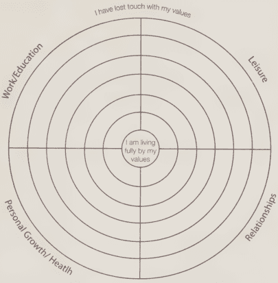

# 好奇？：发现充实生活的缺失要素

改变？做出真正持久的改变需要多长时间

> “《好奇？》是一本能塑造灵魂的读物，将永远改变你对拥抱新机遇的看法。它将精心设计的自助指南与前沿的积极心理学以及深刻鼓舞人心的故事相结合，当你对挑战自己去探索人生下一步产生疑虑时，这是最适合阅读的书籍。”
> 
> —斯蒂芬·波斯特，博士，《为什么好事会发生在好人身上》合著者

> “《好奇？》会让你意识到，生活中最重大和最平凡的时刻中固有的回报、冒险和意义。”
> 
> —索娅·柳博米尔斯基，博士，《幸福的方法：获得你想要生活的科学方法》作者

> “你如何知道什么能让你快乐？你如何弄清楚自己真正想要什么？通过行动你的好奇冲动！托德·卡什丹为我们提供了工具、语言和计划，以将生活改变付诸实践。而旅程本身可以和目的地一样快乐。”
> 
> —马西·希莫夫，《无缘无故地快乐》作者

> “好奇心造就了伟大的领导者、伟大的父母和伟大的朋友。在最新科学研究的支持下，《好奇？》是那些能让你重新思考看待世界方式的罕见书籍之一。”
> 
> —阿丽安娜·赫芬顿

> “托德·卡什丹是积极心理学的先驱科学家，他写了一本不仅仅是关于积极思考的另一本书。《好奇？》指明了通向探索精神的道路，这种精神通向奇妙、喜悦和意义。这是一本既基于研究又实用的罕见书籍。”
> 
> —大卫·G·迈尔斯，希望学院，《追求幸福》作者

> “托德·卡什丹用实用的语言解释了你如何培养与生俱来的好奇心，使你的生活更有回报、更有趣、更有意义。”
> 
> —埃德·迪纳，《幸福：解开心理财富之谜》作者，伊利诺伊大学约瑟夫·R·斯迈利杰出教授

2022年由互联网档案馆数字化，资金由Kahle/Austin基金会提供
本书精装版于2009年由威廉·莫罗出版社出版，后者是哈珀柯林斯出版社的一个品牌。

献给我生命中的五位女性，
Sarah，我最好的朋友和人生伴侣
Raven 和 Chloe，我好奇与探索的小小灯塔
我的祖母，力量与韧性的源泉
我的母亲，她离开这个世界太年轻，未能
欣赏她持久的影响

# 致谢

写书的好处之一是，我可以公开感谢我生命中重要的人。

毫无疑问，这本书得以问世的原因之一是D. T. Max在*纽约时报杂志*（2007年1月7日，星期日）上关于我幸福科学课程的一篇文章。我收到了大量媒体采访请求，以及多个邀请，要求我撰写一本描述超越幸福之幸福广泛复杂性的书。看似随机的时刻，只要你敞开心扉并愿意探索，就能改变你的人生，这一事实至今仍让我惊叹不已。

在乔治·梅森大学心理学系管理人员和同事教职员工的大力支持下，我的研究项目获得了绝对的学术自由。感谢你们提供了让这个项目得以萌芽的环境。

我还获得了多个组织的慷慨资助，包括美国国家卫生研究院、美国焦虑症协会和退伍军人综合服务网络，这使我能够研究我热爱的领域。我从未服过兵役，因此，通过治疗饱受难以忍受的焦虑所困的退伍军人，并开展展示退伍军人继续拥有的优势的研究（即使在服役数十年后），我感到无比荣幸，以此表达我的感激之情。我希望本书中的某些内容能帮助退伍军人在从战场回归平民生活的艰难过渡中获得帮助。

科学可能是一项孤独的事业。建立那种能让我充满活力、受到启发并能轻松做自己的关系至关重要。

对于在我的这项长期热忱中提供合作、专业知识、指导、支持和必要意见的同事们，谢谢你们：Arthur Aron, Catherine Bagwell, Ingrid Brdar, Kirk Brown, Joseph Ciarrochi, R. Lorraine Collins, Ed Diener, Susan David, Jon Elhai, Robert Emmons, William Fals-Stewart, Frank Fincham, John Forsyth, Ray Fowler, David Fresco, Barbara Fredrickson, Jeffrey Froh, Chris Fruch, Matt Gallagher, Amie Grills-Taquechel, Dóra Guðmundsdóttir, Steven Hayes, James Herbert, Stefan Hofmann, Stephen Joseph, Terri Julian, Laura King, Carl Lejuez, Jon Loney, Alex Linley, Shane Lopez, Sonja Lyubomirsky, James Maddox, Doug Mennin, Nesh Moriña, John Nezlek, Nansook Park, William Pelham, Christopher Peterson, John Roberts, Paul Rose, Mark Russ, Richard Ryan, Carol Sansone, Suzanne Segerstrom, Leslie Sekerka, Martin Seligman, Ken Sheldon, Ryne Sherman, Marci Shimoff, Jerome Short, Paul Silvia, C. Rick Snyder, Charles Spielberger, Jeff Stuewig, Jane Tangney, Howard Tennen, James Thompson, Gittendre Uwsate, Amy Wenzel, Andy Williams, Kirk Wilson, Alex Wood, Mantak Yuen, and Michael Zvolensky。

没有在我社会焦虑、性格优势及相关现象研究实验室工作的杰出学生们，我的工作效率会低得多，研究过程也会少很多乐趣。除了运营实验室之外，在本书的制作过程中，William Breen 和 Patty Zorbas 为核心章节提供了仔细的编辑和富有挑战性的评论。Melissa Birnbek 协助我进行背景研究，Christine Plummer 为本项目带来了坚定不移的专业能力、承诺和各种帮助。有他们加入我的团队，这本书明显更好了。

还有其他人通过分享未发表的研究、授权我使用他们的问卷，以及常常在未经他们知晓的情况下，通过电子邮件或交谈提供关键的想法、知识、批评和深刻见解，为本书做出了贡献。我特别要感谢许多朋友、亲戚、熟人、客户、参加我积极心理学和幸福科学课程的学生以及陌生人，他们慷慨地为本书贡献了自己的故事或帮助寻找故事。我无法一一列出所有人，但期待未来回报这些恩情的时刻。

正如我以一种偶然的方式（本书中有描述）偶然发现好奇心这一话题一样，我生命中一些最重要的人也是如此。为了宝贵的交谈、鼓励、慷慨—

# Acknowledgments
# 致谢

generosity, compassion, wisdom, and always welcome playful diversions during the writing of this book. I am particularly indebted to Robert Biswas-Diener, Adam Harmon, Patrick McKnight, Michael Steger, and Martin Stern. To bear the burden of my hypomania, my appreciation will endure. I hope in some capacity I offer a small percentage of what you offer me.

慷慨、同情、智慧，以及在撰写本书期间始终欢迎轻松的消遣。我特别感激 Robert Biswas-Diener、Adam Harmon、Patrick McKnight、Michael Steger 和 Martin Stern。感谢你们承担我轻度躁狂的负担，我的感激之情将永存。我希望在某种程度上，我能回报你们给予我的一小部分。

Thanks to my editor, Mary Ellen, and the entire team at Harper Collins for supporting me and this project before my vision evolved. Their confidence in me provided a well-needed springboard to take risks and persist during good and trying times.

感谢我的编辑 Mary Ellen 以及 Harper Collins 的整个团队，在我愿景成形之前就支持我和这个项目。他们对我的信任为我提供了急需的春板，让我能够在顺境和逆境中冒险并坚持下去。

Thanks to my agent, Richard Pine, for his insight, candor, optimism, intelligence, and dependability. He is one of the toughest critics I ever met, and as a result, his words of encouragement often mean the most. Rarely a conversation goes by between us when I am not jotting down notes or spending valuable time contemplating his words. I couldn't imagine working with anyone else.

感谢我的经纪人 Richard Pine，感谢他的洞察力、坦诚、乐观、智慧和可靠性。他是我遇到过的最严苛的批评者之一，因此，他的鼓励之言往往意义最重。我们之间鲜少有一次交谈，我不记下笔记或花宝贵时间思考他的话。我无法想象与其他人合作。

Then there is my "second" editor, Janet Goldstein. She was my bedrock foundation of strength and encouragement. Her editing and labors were crucial in creating the book I wanted to write. She was invaluable to this project, and in the process, I found a close friend.

还有我的“第二位”编辑 Janet Goldstein。她是我力量和鼓励的坚实基础。她的编辑工作和辛劳对于创作我想写的这本书至关重要。她对这个项目无价之宝，在此过程中，我找到了一位密友。

Through my cousin Randy, I was able to land a job in a world of neon and debauchery: the floor of the New York Stock Exchange. Great memories. But I am equally thankful to my cousin Eric who helped me escape. He was the only member of my family who supported my ambition to be a scientist, professor, therapist, and writer. This single source of encouragement provided the extra fuel I needed to persevere and secure a lasting, renewable source of meaning in my life.

通过我的表弟 Randy，我得以在霓虹灯和放纵的世界里找到一份工作：纽约证券交易所的交易大厅。美好的回忆。但我同样感激我的表弟 Eric，他帮我逃离了那里。他是我家里唯一支持我成为科学家、教授、治疗师和作家的雄心的家人。这一份鼓励为我提供了所需的额外动力，让我坚持下去，并在生命中获得一个持久、可再生的意义来源。

Even though he had absolutely nothing to do with this book, my life would be incomplete without my twin brother, Andrew. He regularly reminds me that with the right mindset, we can unleash a wealth of novelty in the seemingly familiar. Despite prenatal adventures together and a lifetime of shared experiences, nobody intrigues me more. I wish the same sentiments for everybody in every relationship.

尽管他与本书毫无关系，但没有我的双胞胎兄弟 Andrew，我的人生将不完整。他经常提醒我，只要心态正确，我们就能在看似熟悉的事物中释放出丰富的新奇感。尽管我们共享产前的冒险和一生的共同经历，没有人比他更让我着迷。我希望每个人在每段关系中都能有同样的感受。

Writing this book has been one of the most challenging and meaningful experiences in my life. Thankfully, the most important people in my life were with me for the entire ride. Few people get a second chance at finding loving, generous parents. With Barry and Marilyn Spirtz, I did. Barry has been my wise counsel for this project and nearly every other for as long as I have known him. Marilyn encapsulates that perfect combination of boundless curiosity and tenderness to which every adult should aspire. Nobody will replicate what my grandmother, Selma, has done in terms of caring for the generations before and after without complaint. I admire her courage and humility from afar as she has them in an abundance I could never match. She remains my role model of how to live a life that matters.

撰写本书是我生命中最具挑战性和意义的经历之一。幸运的是，我生命中最重要的人陪我走完了整段旅程。很少有人能有第二次机会找到充满爱心和慷慨的父母。而我有 Barry 和 Marilyn Spirtz。 Barry 一直是我这个项目以及几乎所有其他项目的明智顾问，从我认识他以来便是如此。Marilyn 体现了那种无限好奇与温柔的完美结合，这是每个成年人都应向往的。没有人能复制我祖母 Selma 在照顾前后代人方面所做的一切，从不抱怨。我从远处钦佩她的勇气和谦逊，因为她拥有的这些品质是我永远无法比拟的。她始终是我如何过上有意义人生的榜样。

As for my wife, Sarah, this book could not have been written without her. Her sacrifice is immeasurable. With the patience of a Tibetan monk, she listened to my flurry of ideas during parties, romantic dinners, moonlit strolls, and attended to random epiphanies that often occurred at ungodly hours of the day. There was no escape from this book, and she let it be. Rubbing the crust from her eyes, she cared for our twin girls, Chloe and Raven, when I was absent more often than I wanted to be. She remains my most intimate confidante, and perhaps the best thing about her is that she still can make me laugh absolutely anytime she wants. It is a power that continues to astound me, and one that she abuses regularly. Besides everything else, she found the perfect title for this book. My love only grows deeper as I watch Chloe and Raven flourish in her arms.

至于我的妻子 Sarah，没有她，这本书无法写成。她的牺牲无法估量。她像西藏僧侣一样耐心，在聚会、浪漫晚餐、月光下的漫步中倾听我涌现的点子，并应对那些常常在一天中不合时宜时刻出现的随机灵感。这本书无处可逃，她也任其发展。她揉着眼睛里的睡痂，在我比自己愿意的更频繁地缺席时，照顾我们的双胞胎女儿 Chloe 和 Raven。她仍然是我最亲密的知己，而关于她最美好的地方或许是，她随时都能让我开怀大笑。这种力量始终让我惊叹，而且她经常滥用这种力量。除此之外，她还为这本书找到了完美的标题。当我看到 Chloe 和 Raven 在她怀抱中茁壮成长时，我的爱只会更加深沉。

# Curious?
# 好奇？

# 1 Seeking a Fulfilling Life
# 1 追求充实的生活

## Why There Is More to It Than Happiness
## 为什么不仅仅是幸福

What do you want most in life? For the vast majority of us, the answer is “to be happy.” We want to be happy, and we want our children and loved ones to be happy too. In a survey of more than 10,000 people from 48 countries, happiness was viewed as more important than success, intelligence, knowledge, maturity, wisdom, relationships, wealth, and meaning in life.

你在生命中最想要什么？对我们绝大多数人来说，答案是“幸福”。我们希望自己幸福，也希望我们的孩子和亲人幸福。在一项对 48 个国家超过 10,000 人的调查中，幸福被视为比成功、智力、知识、成熟度、智慧、人际关系、财富和生命意义更重要的东西。

Not surprisingly, we spend a lot of time, effort, and money trying to achieve this sometimes elusive happiness. Our desire to “be happy” has resulted in a multibillion-dollar self-improvement industry with a staggering number of books, tapes, motivational speakers, therapists, and gurus. Infomercials plead with us to purchase the latest top-secret happiness strategy—appearing when we’re most vulnerable, teetering on the edge of sleep at 2 A.M. In recent years, houses of worship have become empires, megachurches where members can pray, eat, shop, sing, and work out in a one-stop happiness enterprise. It is simply exhausting to think about the myriad of choices available to create happiness.

毫不奇怪，我们花费大量时间、精力和金钱去追求这有时难以捉摸的幸福。我们“想要幸福”的愿望催生了一个价值数十亿美元的自我提升产业，包含惊人的数量的书籍、磁带、激励演讲者、治疗师和导师。电视购物节目恳求我们购买最新的顶级秘密幸福策略——在我们最脆弱、凌晨两点在睡眠边缘徘徊时出现。近年来，宗教场所已变成帝国，成为大型教堂，成员可以在那里祈祷、吃饭、购物、唱歌和锻炼，构成一个一站式幸福企业。仅仅想到创造幸福的无数选择就令人筋疲力尽。

Despite the commercialization of its pursuit, happiness is a good thing. And though some deny this fact, it’s hard to take them seriously. Yet is happiness itself truly the thing, the goal, that we should constantly be seeking? Does the pursuit of happiness even work? Are we becoming happier?

尽管追求幸福已被商业化，但幸福本身是一件好事。尽管有些人否认这一事实，但很难认真对待他们。然而，幸福本身真的是我们应该不断追求的东西、目标吗？追求幸福甚至有效吗？我们变得更幸福了吗？

## 2 Curious?
## 2 好奇？

I would answer “no” to all of these questions and here’s why: We have been sold on the idea that being happy is the only or most important goal in life.

我会对所有这些问题回答“不”，原因如下：我们被灌输了这样的观念，即幸福是生命中唯一或最重要的目标。

While acknowledging the importance of happiness to creating a fulfilling life, when we focus on it, we lose out on the complexity of being human. We ignore the other important pieces of the puzzle, such as meaning in life, maturity, wisdom, and compassion.

在承认幸福对创造充实生活的重要性的同时，当我们专注于它时，我们就错过了作为人类的复杂性。我们忽略了拼图中的其他重要部分，例如生命意义、成熟度、智慧和同情心。

Happiness involves feelings or judgments about life. It is a gauge we use to measure if our life is going well. But if we do things solely to be happy, what happens after this goal is met? We can find ourselves on an endless, fruitless, treadmill of “happiness seeking,” never actually feeling all that happy! I believe that all the time and energy spent looking at and trying to move the happiness gauge a notch higher can be used much more effectively. Instead of constantly trying to be happy, we should focus on building a rich, meaningful life, guided by our core values and interests.

幸福涉及关于生活的感受或判断。它是我们用来衡量生活是否顺利的一个指标。但如果我们仅仅为了幸福而行事，当这个目标实现后会发生什么？我们可能会发现自己陷入了无休止、徒劳的“寻求幸福”的跑步机上，实际上从未感到真正幸福！我相信，所有花在观察并试图将幸福指标提高一格上的时间和精力，都可以被用得更有效。与其不断试图幸福，不如专注于建立一个丰富、有意义的生活，由我们的核心价值观和兴趣引导。

This is what the Dalai Lama means when he says that “the very purpose of life is to seek happiness.” How is he defining happiness here? He isn’t talking about feeling good or satisfied. He is talking about living a life infused with meaning while embracing the full range of human experiences—the positive and the negative.

这就是达赖喇嘛说“人生的目的就是寻求幸福”时的意思。他在这里如何定义幸福？他谈论的不是感觉良好或满足。他谈论的是过一种充满意义的生活，同时拥抱人类经历的全部范围——积极的和消极的。

This is not a happiness book. This is a book about being alive, exploring, discovering insights, and living a life that matters. This is a book about the science behind creating a fulfilling life, broadly defined.

这不是一本关于幸福的书。这是一本关于活着、探索、发现洞察力以及过上有意义生活的书。这是一本关于创造充实生活背后的科学的书，广义地定义。

You might be feeling as if you want it all. I want to be happy, I want meaning and purpose in my life, I want greater flexibility and acceptance, I want to become wiser and more mature, I want to be successful and creative, I want to be able to tolerate the distress and uncertainty of being human, and so on.

你可能觉得自己想要一切。我想要幸福，我想要生命中的意义和目标，我想要更大的灵活性和接受度，我想要变得更聪明、更成熟，我想要成功和富有创造力，我想要能够忍受作为人类的痛苦和不确定性，等等。

When we recognize that there is more to a fulfilling life than being happy, then we are left with an important question that this entire book hinges on. Namely, what is the central ingredient to creating a fulfilling life?

当我们认识到充实的生活不仅仅是幸福时，我们就面临一个本书所依赖的重要问题。即，创造充实生活的核心要素是什么？

The answer is curiosity.

答案是好奇心。

## Reacquainting Yourself with Curiosity
## 重新认识好奇心

On the surface, curiosity is nothing more than what we feel when we are struck by something novel. During long car rides, road signs plead with us to pull off at the next exit to visit underground caverns and carnival rides. Your carload of travelers may pass by these opportunities with mixed responses—teenagers squawling with intrigue, Grandma detesting any screwing up her window vista, and your own hesitation to spend money to satisfy childish interests. You might experience similar moments of beckoning when an odd book title compels you to see what's inside or when you are enthralled as you pass the rising gull-wing doors of a parked DeLorean. Commonly, we view curiosity as what we experience when opportunities bump into us.

表面上，好奇心只不过是我们被某些新奇事物吸引时的感受。在长途驾车途中，路牌恳求我们在下一个出口驶下去参观地下溶洞和游乐设施。你车里的旅行者可能会对这些机会有不同反应——青少年因好奇而尖叫，奶奶讨厌任何破坏她车窗景色的事情，而你自己则犹豫是否要花钱满足孩子气的兴趣。当一个奇怪的书名迫使你想看看里面是什么，或者当你经过一辆停放的 DeLorean 汽车升起的鸥翼门而感到着迷时，你可能会经历类似的召唤时刻。通常，我们将好奇心视为机会撞上我们时的体验。

Curiosity does draw our attention to things that are interesting. But while this appears simple, my research and that of others shows that curiosity is a deeper, more complex phenomenon that plays a critical role in the pursuit of a meaningful life.

好奇心确实会将我们的注意力引向有趣的事物。但虽然这看起来很简单，我的研究和其他人的研究表明，好奇心是一种更深层、更复杂的现象，在追求有意义的生活中起着关键作用。

We often make the fatal mistake of thinking growth opportunities come to an end when something or someone becomes part of our daily routine. When things become familiar and predictable, we become mindless drones. We tune out. As soon as we think we understand something, we stop paying attention.

我们常常犯下致命的错误，认为当某事或某人成为我们日常例行公事的一部分时，成长机会就结束了。当事情变得熟悉和可预测时，我们就变成了没有思考的无人机。我们会走神。一旦我们认为自己理解了某事，就停止关注。

Novelty is different. We often pay attention to the unfamiliar and listen to new people because they grab our attention. What we forget is that novelty always exists in the present moment. There is much to learn from the unfamiliar and the familiar. No two hugs are the same, no two pizzerias make pizza slices the same way, no two times we watch The Godfather are the same, and so it goes. Being curious is about recognizing novelty and seizing the pleasures and meaning that they offer us.

新奇感不同。我们常常会关注不熟悉的事物，倾听新的人，因为它们吸引了我们的注意力。我们忘记的是，新奇感始终存在于当下。从不熟悉和熟悉的事物中有很多可以学到。没有两次拥抱是一样的，没有两家披萨店制作披萨片的方式相同，我们观看《教父》的两次也不同，以此类推。好奇心在于识别新奇感，并抓住它们为我们提供的快乐和意义。

Another reason that curiosity is neglected is that it operates below the surface of our desires. It's not as simple as thinking positive, being optimistic, being grateful, being kind, or feeling good. Being curious is about how we relate to our thoughts and feelings. It's not about whether we pay attention but how we pay attention to what is happening in the present.

好奇心被忽视的另一个原因是，它在我们欲望的表面下运作。它不像积极思考、乐观、感恩、善良或感觉良好那样简单。好奇心在于我们如何与自己的想法和感受建立关系。它不在于我们是否关注，而在于我们如何关注当下正在发生的事情。

The past and future are nothing more than symbolic representations

过去和未来只不过是象征性的表征

## 4 好奇？

关于现实。心理照片（过去）和梦境（未来）。真实事件确实发生过，但一旦行动结束，它们就成为现实的虚构产物。这些表象甚至不稳定；它们会改变。你翻看相册里的照片，重新创造记忆。我们围绕想要编织的关于自己和他人的叙事来创造故事。西奥多·罗斯福是否是最后一位坦率、真实的总统，这个正在绝迹的物种中的总统，他可以在大白天在白宫后面的池塘里裸泳，用霰弹枪杀死数百只动物，与警察腐败作斗争，并成为创建国家公园体系的勇敢环境卫士？或者他是一个自视甚重的反社会人格，受不可控制的冲动驱使，找到了一个很好的出口来掩盖它？历史不断被重写，过去也在改变。

我们的心情不断变化，因此我们对过去的想法也随之改变。至于未来，它仍然是不可知的。任何事情都可能发生，而且我们常常会弄错。我们对未来所能做的最好的事情，就是做好准备，并品味当下可以做的事情的可能性。

只有在当下，我们才能获得解放，去做自己想做的任何事情。当我们真正自由时，那是一个转瞬即逝的时刻。当我们好奇时，我们通过身临其境来利用这些时刻，对正在发生的事情保持敏感，无论它与过去（过去）或我们期望它成为的样子（未来）有多么不同。我们全身心投入，对正在发生的事情充满活力。我们充满活力。我们对寻找机会、做出发现以及为生活增添意义保持开放和接受的态度。再次强调，这不是关于专注，而是关于我们注意力的质量。

通过在当下保持开放和好奇，我们可以改善日常生活中甚至最平凡的方面。我们怎么会走进超市过道，却对货架上成百上千件商品浑然不觉呢？一个原因是它们不引起我们的兴趣。我们在同一家商店里去过上百万次，我们很匆忙，而且可能总的来说讨厌买杂货。如果我们带着一份书面购物清单，奉命去做凯撒沙拉，我们的注意力就会像激光一样集中在寻找我们需要的物品上。超市老板试图用色彩鲜艳的产品展示来智胜我们，这些展示强行进入我们的意识。如果没有帮助来在我们内外世界的物品洪流中导航，混乱就会肆虐。好奇心正是在这个时候发挥作用，如果我们允许它的话。

如果我们对非计划的机会保持开放，我们会有意地在商店里寻找有趣的物品。我们可能会找到一种新食物来让挑食的孩子吃下去，一种让一周更有趣的美食，或者也许我们会在一次不合我们胃口的烹饪实验上浪费几美元。无论如何，不确定会期待什么，并且愿意寻找发现并在机会出现时采取行动，这本身就有一种乐趣。

## 塑造我们的能力与身份

除了改变琐碎的时刻，好奇心还为创造深刻的亲密感、洞察力和生活意义提供了一扇大门。理解好奇心的最好方式是亲眼目睹它。考虑一下斯泰西。我是通过一位朋友认识她的，那位朋友形容她像个装扮成一流建筑师的孩子。我想多了解她的热情，于是我们在弗吉尼亚州蓝岭山脉附近一块正在建造巨大豪宅的土地上会面。她受聘担任该项目的顾问。

我看着她观察、倾听，并深入森林徒步很远。我问是什么吸引了她的注意。“土地，以及它的坡度。你可以做什么来充分利用景观。房子应该建在哪里。如何避免砍伐太多树木。”

她不时地提出自己的问题。“这些树大部分是什么树，我是说，什么种类？你知道土壤有多深吗？你能在这块地上钻井吗？毕竟，这里有很多页岩和石灰岩。”在没有被问及的情况下，她分享了她的总体印象。

“我认为房子应该与它所在的地方有关系，你不觉得吗？房子应该与环境共享一套词汇。我是说，想想所有住在这里的人以及他们是如何生活的。当他们建造房屋时，他们出于某些原因采用某种风格，并使用当地材料。现在我们知道了世界各地的设计，但我们应该在这里使用它们吗？”

当我们透过斯泰西的眼睛看世界时，你可以看到好奇心如何塑造我们的身份和我们人生的故事。这不仅仅是当下感觉良好，不仅仅是利用眼前的新奇事物，而是一种生活态度。

## 6 好奇？

西尔万·汤普金斯是一位先驱社会心理学家，或许是第一个探索积极情绪独特价值的研究者，这比“积极心理学”运动出现早了35年。他认为好奇心具有深远的进化意义：

好奇心对思维和记忆的重要性非常广泛，以至于缺乏好奇心……会像破坏脑组织一样危及智力发展……没有持续的兴趣，就无法获得任何人类能力。

自他提出这一观点以来，大量研究积累起来，证明了这一工作假设的真实性。如果我们想更容易地找到满足感并保持它，我们需要利用好奇心。用汤普金斯的话来说，“我首先是让我兴奋的事物。”这一机制究竟如何运作，以及我们如何更充分地理解和利用其益处，得益于一个安全、科学基础的出现。

好奇心在大脑中是与生俱来的，其特定功能是敦促我们探索、发现和成长。它是我们不断进化的自我之引擎。没有好奇心，我们就无法保持注意力，我们会回避风险，放弃具有挑战性的任务，损害我们的智力发展，无法获得能力和优势，限制我们与他人建立关系的能力，基本上，会停滞不前。

当你看历史上成功的人时，会清楚地看出好奇心激励他们拓宽视野，并且对他们的成就至少应部分归功于好奇心。无论是科学家、艺术家、建筑师、政客、首席执行官、小店主、广告高管、教师、政治活动家，还是几乎任何试图发现某事物的人，他们的故事都突出了好奇心作为我们做事原因的强大动力。

好奇心是构建愉快、引人入胜且有意义的生活所需架构的一部分。理解这种动机使我们能够更好地理解人性。

好奇心为什么如此重要？首先，就像斯泰西的探索一样，好奇心激励着我们。这体现在我们对新体验和新信息有更大的兴趣和偏好。当我们体验到好奇心时，我们愿意离开熟悉和常规，去冒险，即使这会让我们感到焦虑和不安。那些更能应对新奇事物、在不可预测、不确定和不稳定的世界中表现更出色的人，我称之为“好奇探索者”。好奇探索者对接受挑战的风险感到自在。事实上，我们中最好奇的人实际上渴望新事物。

其次，好奇心帮助我们从这些新体验中提取和整合经验与意义。当我们探索新世界的每一个角落时，我们不可避免地也在学习。这是我们好奇心系统的最终目标：为我们现有的知识、技能和能力增添新内容。这些新增内容帮助我们更好地了解自己和外部世界，应对日常生活中的挑战，并提高处理混乱的能力。

抵制我们对确定性的相对渴望，我们会发现，当我们质疑权威、质疑现状、质疑自己的信念、质疑一切时，最大的回报就会到来。有时，这些有益的积极感受来自于对探索某些我们可能不希望其结束的事物的兴奋的预期。其他时候，只有在获得我们渴望的体验后，我们才会感到兴奋、满足或心满意足。我们只有一生可以用来实验，摘下我们的眼罩可以帮助我们开始。

## 童年好奇心的窃贼

儿童天生怀有无限的好奇心。起初，婴儿会被鲜艳的颜色、母亲声音的细微变化以及视野范围内的任何事物所兴奋。毫不缺乏着迷，数小时可以用来观看电扇旋转的叶片。随着年龄增长，感官变得更加发达，他们的惊奇和兴奋感会扩大，并会冒险走得更远一些。每个橱柜和抽屉都藏着值得调查的谜团。在生日和节日期间，盒子和包装纸和……一样有趣。

礼物本身。儿童渴望更深入地理解周围复杂的世界，而游戏为他们提供了一个安全的机会，使一些令人恐惧的未知变得已知。

但这种天真而勇敢的探索总会出点什么问题。社会妨碍了我们。我们被给予一系列无休止的规则和义务，这些规则和义务约束着我们的好奇心。立刻去做，事后再提问。远离陌生人。避免有争议的话题和敏感问题。长辈总是对的。我们不是学习历史、科学和伟大的文学作品，而是被教导如何在标准化考试中取得好成绩。背诵事实往往取代了接触异国他乡、异域领域所带来的趣味——比如触摸母袋鼠的育儿袋，想象恐龙曾在地球上漫步的时代，审视转世和冷冻永生等不太可能的想法的价值。

规则是有用的，因为它们提供结构，并帮助我们避免怀疑和不确定性。但它们妨碍了自由。遵循指示可以节省能量，但遵循自己独特的方向会扩展能量。

我们不是被鼓励去了解自己和自己的兴趣，而是更常被教导如何尽早决定人生该做什么，以免在实现目标上浪费时间。选择学术专业，选择职业，组建家庭。其他兴趣是否被扼杀并不重要。重要的是要“成就自己”、“能够自食其力”，并“认识到生活不仅仅是寻欢作乐”。

我们也生活在恐惧的氛围中。头条新闻报道不断向我们发出警告，提醒我们应该警惕什么。恐怖主义、绑架、信用卡和网络诈骗、疯牛病、性侵犯者、空难、杀人蜂、鲨鱼袭击、轮胎召回等等。因此，我们竭尽全力避开危险。

但一味安稳也有风险。我们的行为由我们不想要的东西决定，而不是由我们想要的东西决定。抱负被搁置一旁。但我们害怕的事情往往不太可能发生。我们害怕恐怖袭击、儿童被绑架、学校里的疯狂枪手——然而这些事情发生的可能性微乎其微。

大多数人高估了风险、失败和危险，低估了好奇心的价值。是时候重拾我们被忽视的优点了。我们可以——也应该——选择如何生活。我们是受恐惧和对安全的需求所支配，还是愿意在追求满足感、成长和意义的过程中接受一些风险和焦虑？

过好奇心的生活并不是要忽视风险和焦虑。而是要愿意去做自己重视的事情，即使面临风险和焦虑。如果我们不带对事物应当或期望它们是什么的评判，而是看待事物本来的样子，会怎样呢？如果我们在决定如何利用空闲时间、选择什么职业、与谁共度时光并将生命奉献给谁时，都能听从好奇心的指引，会怎样呢？

好奇心是通往我们最珍视和珍惜之事的门户。我们可以重拾青年时代失去的不确定性、发现和游戏的乐趣。童年时期之外，我们与生俱来的好奇心不再那么轻易或自然地涌现，但这些障碍可以被承认、面对，并最终克服。我们可以培养好奇心，使我们的生活更贴近我们希望它走向的方向。实现我们的潜能取决于此。

毫无疑问，好奇心并不是促进幸福、有意义和充实生活的唯一品质。话虽如此，很难想到有人类活动中好奇心不发挥至关重要的作用。想想看：科学、技术、工作、商业、体育、教育、政治、艺术与美学、内省、人格发展、人际关系——随你举出。很少有领域比提升我们好奇的能力更值得我们投入时间和精力了。

这并非无稽之谈。正如你将看到的，本书中的观点和我的结论都有大量科学研究支持，其中大部分只为学术期刊读者所知，很少被整合成与我们日常生活相关的有意义的图景。本书将提供你可以使用的工具，帮助你与内心那个好奇的探索者重新建立联系。

## 我们轻易适应积极和消极变化的能力

对好奇心以及任何可能带来持久满足感的新策略持怀疑态度是有道理的。我们拥有一种惊人的能力，能够根据环境的变化迅速重新调整我们的情绪和感受。科学家将此称为我们的幸福“设定点”。除了成为寡妇或患上严重残疾、疾病或失业等少数重大不愉快事件外，我们很快就会熟悉生活中的变化，并回到之前的感觉。我们在好事或坏事发生后回到的这个点，就是我们的典型情绪。这种典型情绪由基因决定，相对不受我们控制，并且在某种程度上对我们所经历的事情免疫，除了短暂的下降和上升波动。

这是一种极好的资源，因为它防止我们被生活中的挑战和悲剧压垮。在许多不愉快的事件中，你会被拒绝，你会在某件重要的事情上失败，你会不止一次地生病和受伤。知道我们能够克服大部分遇到的障碍并反弹回来，这真是太好了。

人类通常希望预测、理解和控制发生在自己身上的事情。毕竟，如果我们不试图对一件事件获得了结，我们就会处于永恒的悬而未决状态，无法对发生在我们身上的事情做出决定或得出结论。在不愉快的事件之后，这似乎是一件好事。毕竟，能够获得了结能给我们带来安全感。我们感到安全和安心；我们感到自信；我们感到聪明。

但积极事件发生后我们会怎样呢？当你的浪漫伴侣吻你，说：“我想和你共度余生”，你可能会体验到爱的感觉。在其他愉快的事件中，当你体验到他人的善意、学到新东西、完成艰巨的壮举，以及拥抱、亲吻和逗人发笑时，你会感到感激。对积极事件的意义得出明确解释并达成了结，会削弱我们的积极情绪并使其缩短。被新体验激活的大脑部分、品味当下的乐趣、当我们试图理解正在发生的事情时在神经细胞之间建立的连接，都戛然而止。一旦我们给积极体验贴上标签，将其归档到我们的先前知识库中，积极体验就结束了。

所以这个重大问题依然存在。我们有可能将设定点上移并持续提升幸福感吗？可以，答案在于好奇心。仅仅乐观和充满希望本身会屈服于适应。增加其他优点（如善良、宽恕、幽默、勇敢或热情）的努力也是如此。这就是为什么我没有给你另一本关于积极思考或更友好的书。

如果我们想延长积极体验，如果我们想要更充实的存在，我们需要一种新的思维方式。付诸好奇心是寻求了结和确定性的替代方案。阻碍我们适应并回到常规日常的，恰恰是我们试图摆脱新奇和不确定性的同样方式。只要某事物是新奇的，我们就仍在寻找和创造意义的过程中。当某事物不确定时，接下来可能发生什么就有多种可能的结果。结局不明确，因此事件仍在进行中。

好奇心与其他获得满足的方式不同，因为它关乎欣赏和寻求新事物。它关乎灵活，认识到熟悉事物中的新奇和新鲜感。与其拼命试图解释和控制我们的世界，不如作为一个好奇的探索者，拥抱不确定性。与其试图确定和自信，不如将我们的生活视为一场发现、学习和成长的愉快探索之旅。没有什么需要解决，我们内心也没有为了避免不确定的紧张感而进行的战斗。我们不会把积极事件视为理所当然，而是进一步调查和探索它们。最近的科学研究表明，当我们对新体验持开放态度，当我们在接近人和任务时保持灵活，当我们珍视未知远大于已知时，积极事件会持续更久，我们也能从世界中提取更多的快乐和意义。本书旨在释放你内心那个好奇的探索者。

## 充实人生的阴阳：以好奇探索为引擎的新方法

作为一名临床心理学家，我治疗过无数饱受严重精神健康问题困扰的儿童和成人。我的几位来访者觉得生活不值得过。我永远不会忘记那些人生走到将自杀视为可行选择地步的人；他们至今仍萦绕在我心头。我从与他们合作中学到了很多关于什么是充分、完整地生活的意义。一些患者在治疗中表现出的绝望之渊，当然与他们的痛苦有关。他们希望痛苦消失，并将自杀视为逃避自我的终极方式。但痛苦并不是自杀念头的原因。人们试图自杀是因为缺乏正面的东西。他们找不到活下去的理由。在他们看来，自己的生活缺乏意义和目的。

发现这一点是我思维上的一个转折点。我理解人性的能力曾被一种狂热所扼杀，这种狂热痴迷于描述和记录人们的问题，而忽视他们的积极体验和优势。通过忽视正面、专注于负面，就像许多致力于帮助他人的治疗师一样，我正在否定人类一半的意义。

当我在治疗结束一年后联系来访者时，我发现许多人几乎没有或完全没有曾经使他们无助的问题的迹象。然而，太多人似乎感到不满足和迷失。我的许多前来访者的生活不过是机械的例行公事——起床、工作、坐在电视或电脑屏幕前、睡觉，然后重复——中间穿插着少数深度投入的时刻，例如出生、婚礼和死亡。我深刻意识到，仅仅关注心理学家所说的“首要问题”是不够的。增加积极体验，以平衡一个人生活中负面因素的拉力，是一个起点。

但关注正面只是方程式的一部分。我需要一个更复杂的模型，以反映我认识和治疗的人们的实际生活。在对积极体验和优势往往片面的关注中，积极心理学和幸福感研究人员低估了负面情绪、不确定性和压力的价值。负面的想法和感受不能被忽视或回避。有效应对生活不可避免地带来的痛苦和压力，是创造丰富、有意义的存在的重要组成部分。

如果你追求一个没有紧张的生活，你会发现很少有令人满意的事情。应对负面经历和保持心理灵活性，往往是通往巅峰体验和个人成长的跳板。在整本书中，我们将探讨这是如何运作的。

正面和负面都需要被处理。任何少于此的都无法捕捉作为人类并过上满足、充实生活的完整内涵。

## 你将在本书中发现什么

我们将从考察好奇心的基础以及如果我们建立和运用好奇心，我们的生活会是什么样子开始。在第2章中，我们将探讨支持投资好奇心必要性的科学证据。到本章结束时，你将了解好奇心的本质、与好奇心相关的益处，以及好奇心与其他积极品质和人类优势有何不同。你会意识到，即使你现在不是一个非常好奇的人，这也是一种我们可以培养的优势。在第3章中，我们将采用进化视角来理解好奇心的起源。然后，我们将探讨最新的脑科学，以表明好奇心调用的大脑区域与我们仅仅感觉良好时“亮起”的区域不同。当我们探索和成长时，我们的大脑会以更强烈、更持久的愉悦感作出反应。同时，你将了解到好奇心不止一种类型。从伴随着喜悦和兴奋的好奇心，到最好描述为一种强烈的渴望去了解，希望缓解体内涌动的紧张感的好奇心。对汽车里那种咔嗒声感到好奇，或者想知道脸颊上的红斑是痤疮、甲状腺肿还是癌性溃疡，这没有什么愉悦可言。你将了解到，你可能并不总能找到愉悦，但你会建立知识、技能、优势或意义，或许以上皆是。

本书的下一部分在向你展示如何将这些想法应用到你自己的情况中并提升你的幸福感方面起着决定性的作用。第4章向你展示如何投资你最有限、最宝贵的资源——时间和精力。当这种投资被有意地集中时，它可以从根本上增强生活中的时刻和事件，使其更加有趣和引人入胜。你将变得更擅长在平凡、陈词滥调和令人震惊地无聊的情况下创造兴趣。好奇心并非通过神奇的偶然或自我对话而产生；它是由情感特质和特定行为启动的。你将了解几种实操策略及其背后的科学原理，明白它们如何以及为何起作用。在第5章中，我们将从如何理解和利用“好奇时刻”的故事，转向这些时刻如何被加深、增强并转化为持久的兴趣和热情。再次，你将获得一套详细的策略，并学习如何从理解科学转向将其应用到你自己的生活中。本章还涉及如何运用维持兴趣的经验来激励和鼓舞他人的方法。

虽然已经有许多书籍探讨了人际关系对幸福生活的重要性，但第6章的核心是一种关于人际关系和社会联系作为个人成长终极来源的新视角。首先，我将展示关注我们不了解的人以及他们与我们有何不同的逻辑，而不是依赖我们了解的人以及他们与我们有多相似。我们将从在潜在朋友、恋人和同事中激发兴趣的艺术开始；接着是随时间建立深刻、有意义的联系的挑战；并直面那些常常潜入现有关系中的无聊和停滞问题。因为改善我们社交世界没有单一的秘诀，许多基于科学的指导方针和策略将指明在长期关系中保持激情和兴奋的道路。

第7章驱散了任何忽视负面、只关注正面的诱惑。

焦虑与好奇心一样是一种强大的动机。它可能是有益的、恼人的，或是使人衰弱的。我将向你展示，用于控制焦虑的常见技巧往往不是解药，反而是最大的问题。不要因为错误地认为自己不被焦虑的想法和感受所困扰而跳过本章。我们每个人都天生会体验这种常见情绪。我将解释我们如何改变与焦虑的关系，并通过此为检测和创造意义打开更大的空间。你将接触到我和其他人的研究，表明成为好奇的探索者可以为有问题的焦虑提供缓解。

尽管好奇心有着深远的益处，但有时好奇心也会令人烦恼、古怪、适得其反，甚至邪恶。第8章将探讨好奇心的黑暗面。有些人对性、死亡以及其他与成为健康、有益于社会的贡献者背道而驰的领域表现出强烈的兴趣。

本书以一章关于发现生命意义和目的的重要章节结束。到第9章结束时，你将掌握关于我们身份核心的激情（也称为目的或“使命”）如何发展的知识。与普遍看法相反，没有证据表明我们在生命中有预先注定的目的。相反，基于最新证据，提出了增加创造意义和目的机会的具体指导方针。拥有目标将被证明是通往健康、满足和长寿生活的途径之一。它不是唯一的途径，但却是一个重要的途径。你还将学到，作为好奇的探索者如何帮助在损失和创伤破坏关于世界的信念的那些困难时期找到意义和益处。即使你有幸避免这些苦难，这一章也值得一读。一系列见解将使你更好地准备好在事情顺利和不顺利时提取意义。好奇心是韧性和康复的核心。

总的来说，我写这本书的目的是在两个方面影响你。第一，通过向你展示好奇探索如何以及为何是过上美好生活不可或缺的一部分。第二，提供清晰的策略，帮助你成为好奇的探索者，从生活的所有时刻中提取更大的愉悦和意义，并投资于持久的激情和充实感。

本书中的所有信息都基于科学证据。

其中大部分源于我自己的工作，以及那些我很荣幸能与之合作或向其学习的其他科学家的工作。这是对好奇心和新奇感在幸福感、与他人建立有意义的关系以及转变焦虑情绪中所起作用的10年研究的总结。它还包括我作为临床心理学家的工作见解，我直接与正在与焦虑和抑郁、创伤以及成瘾作斗争的人们合作。我大部分职业生涯都在思考什么是拥有充实的生活。这本书正是关于此：如何成为一个好奇的探索者，以及如何构建一个充满意义的生活。我希望在读完这本书后的某个时刻，当有人问你从生活中最想要什么时，你不再迅速回答“我只关心快乐”，而是可能会说：“我想保持好奇，并做一些有意义的事情。”

# 2 好奇心优势

## 通往生活最值得过的方式的大门

> 大多数人在找到大海捞针般的东西后就停止了寻找。我会继续寻找，看看是否还有其他针。
>
> 阿尔伯特·爱因斯坦

当被问及他的独特之处时，阿尔伯特·爱因斯坦没有滔滔不绝地谈论他的智力、工作道德、幸福或人际关系——他谈论的是他的好奇心。他声称，他的成就与欣赏他人常常视为理所当然的日常生活中的小小奥秘有关。总有一些他不理解的事情，他乐于尝试弄明白。他对搜索、提问和探索广阔未知的驱动力，对他来说与寻找答案的驱动力同样重要。这是一种简单易懂但在实践中罕见的生活方式。

尽管我们可能不会像爱因斯坦那样虔诚地培养我们的天然好奇心，但当我们付诸好奇心行动时，我们滋养了大脑，并处于丰富生活的最佳位置。四十五岁的冠军犬训练师本就是一个典型的例子。

本是一名成功的诉讼律师。年轻时，他成为军事退伍军人上诉法院的法官。倾听为国家服役却觉得正义未能为他们伸张的士兵的上诉，本产生了影响。然而，他体验到一种安静但令人不安的疏离感，与他所做的工作缺乏联系。工作的压力和情感强度让他感到与职业生活的联系越来越少，而非越来越多。当我遇见他时，他已经探索了各种兴趣好几年了。他上钢琴课和普拉提课。然后他买了一条狗。他万万没想到，买下这条名为维克森的特弗伦犬，将成为一个转折点，为他填充日常生活开辟新道路，为他的个性增添新层次。

育种者帮助本训练维克森，他的狗变成了更好的伙伴。在一次次越来越频繁的训练课程中，育种者提到特弗伦犬以出色的牧羊犬而闻名，并提到一位教牧羊的农夫的名字。一时兴起，本打了电话并报名参加每周课程。与法庭证词和惊喜证人的兴奋截然不同，我问本为什么这么喜欢牧羊。

“一方面，教我的人很棒。我对他与狗的联系感到敬畏——他是‘狗语者’。至于我，当我训练维克森时，我的大脑高速运转，敏锐地感知我的情绪和身体如何向他传递某些信息。同时，我必须意识到维克森想告诉我什么。而且始终，我必须意识到我们周围发生了什么，做出调整，尽可能以优雅且不易被裁判注意到的方式使用我的肢体语言。”

他补充道：“如果你告诉我，我会奋斗成为一名法官，却把大部分工资都花在牧羊课程上，我会觉得你疯了！但事实就是如此。”

他与维克森的工作与法庭的压力和挑战截然不同。本开始精神焕发地醒来，他的新世界开始渗透到他“真正的”工作中。其他人注意到了他的新热情。无论是由于维克森、他对新体验的开放性，还是某种组合，本的生活正在改变，他的个性正在演变，他因此变得更好。

## 好奇心是增长的引擎

如果我们意识到并开放地接受自己的好奇本性，就能捕捉到意外的惊喜。如果告诉年轻时的本，他长大后会去牧羊，他会大笑。放弃那些超出我们舒适区的有趣可能性，实在太容易了。我们把接触新事物推迟到未来的某一天。但我们在等什么？倦怠？退休？但为什么要等待重大改变才为你的生活方式增添有趣的元素？为什么要等待倦怠？为什么要等到退休？

本向我们展示了好奇心始终可用，并且我们可以随时付诸行动。当我们对任何事物感兴趣时——朋友、购物、挑选食谱或查找新单词的定义——好奇心就在起作用。当我们主动为日常例行公事注入多样性时，好奇心就在发挥作用。微小的、无害的改变——从把橱柜里四盒谷物混合在一起，到改变慢跑路线——都能丰富我们的日常和生活。这些重复的经历改变了我们的大脑，进一步增强我们在一个未知多于已知的世界中茁壮成长的能力。

但好奇心不仅仅是一种轻松自发的体验。它是一种编织进我们人格基本结构中的强烈动机。我们所有人，在不同程度上，都被驱动去寻求新的和不确定的体验。虽然你可能相信确定性和对环境的控制会带给你快乐，但往往是不确定性和挑战实际上带给你最深刻、最持久的益处。

好奇心在于认识并收获拥抱不确定性、未知和新奇事物的回报。好奇心作为增长引擎有一个简单的故事线。

- 通过好奇，我们探索。
- 通过探索，我们发现。
- 通过这种满足感，我们更有可能重复它。
- 通过重复，我们发展能力和掌握。
- 通过发展能力和掌握，我们的知识和技能增长。

随着我们的知识和技能增长，我们伸展并扩展我们是谁以及我们的生活关乎什么。

通过应对新奇事物，我们变得更有经验、更聪明，并为我们的生活注入意义。

好奇心滋生更多好奇心，因为我们知道得越多，关注的细节就越多，就越意识到还有什么需要学习。为什么？当我们拥抱未知时，我们的视角会改变，我们开始认识到以前不明显的缺口——字面和比喻意义上的缺口。

攀岩的物理学提供了一个生动的例证。初学者攀岩者依赖他们的直觉。他们的目标是不掉下来。他们紧贴山壁，并大量使用上肢力量将自己拉上去。征服了几座山峰后，他们开始积累一些反直觉的技巧。例如，为了避免滑倒或摔落，你将身体推离山壁。这看起来似乎是必然摔落的方式，但实际情况是，你可以让脚趾和脚掌与山壁有更大的接触面积。你会有更稳固的抓握，也就不太可能摔落。

随着攀岩者对手脚位置越来越熟悉，他们开始看到以前没注意到的可以移动脚和抓握的地方。他们的手指变得更强壮，不再只寻找突出的岩石，而是开始寻找可以插入手指和脚趾的裂缝。他们的专业知识让他们能看到更多缺口，并作为攀岩者更具创造力。

好奇心不总是愉快的发现过程，也不仅仅是通向某个期待已久的巅峰体验的向上螺旋。有时，好奇心是一种我们需要抓挠的瘙痒。我们不是因为好奇或神秘感而有动力去探索，而是渴望得到一个谜题的具体答案。

我们渴望可能帮助我们弥合差距的具体信息——而这正是带来快乐的来源。例如，一个成年人需要弄清楚填字游戏最后几个答案；一个青少年为了写作作业需要了解弗兰茨·卡夫卡；一位经理想要了解员工的优势以最大限度地提高生产力。还有充满明显紧张感的问题，从琐碎到宇宙：我是否像父母一样有患帕金森病或亨廷顿病的风险？我的婚姻能维持下去吗？

有时，欢乐是我们探索的核心；而另一些时候，唯一目的是释放紧张情绪并寻找意义。无论哪种情况，针对特定探索找到答案都不是我们好奇心的终点。我们越是博学或技能越强，就越容易发现自己认知中的其他漏洞，以及想要探索的其他问题和兴趣。

每当我们对超出已知范围的经历保持开放和接受的态度时，好奇心就在发挥作用。每次我们拥抱新事物，都不由自主地延伸和扩展自我。这可能简单到在收音机里听到一个从未听过的音乐和弦。也可能深刻到反思身边流汗喘息的人究竟只是另一个性伴侣，还是我们爱的人——并发现我们正处于恋爱之中。

## 不确定性加剧并延长愉悦感——而你甚至浑然不知

在一次电视采访中被问及日常作息时，灵性与意识领域的领军作家和教师迪帕克·乔普拉（Deepak Chopra）赞扬了好奇心的美德：

- 我醒来时希望这一天比昨天更加不确定。
- 我们时刻生活、呼吸和活动在未知之中，却自以为那是已知。
- 如果生命可以是一系列持续的惊喜，那将是你能拥有的最快乐的体验。

我们大多数人还没有学会这一课。我们没有意识到，试图理解未知实际上会增加我们积极体验的强度，并使其比来自熟悉例行公事的愉悦持续更长时间。

支持性证据相当充分。在一项实验中，口渴的研究受试者在喝水（令人愉悦）或Kool-Aid（更令人愉悦）时接受了大脑扫描。有些受试者被告知他们将喝什么以及何时喝（确定），而另一些则被蒙在鼓里（不确定）。当受试者知道自己将得到一杯饮料，但不确定会端上来什么饮料时，与积极情绪相关的大脑回路就像街头狂欢节一样亮起。就像一车赌徒在赌场里对着老虎机坐上八个小时，每次拉动杠杆都对获胜的前景感到兴奋一样，不确定性增强了积极事件的愉悦感。

我们的期望影响着我们将会有何感受，而好消息在以惊喜形式出现时更令人愉悦。科学家发现，那些满足于参赛且不期望赢得任何奖牌的奥运运动员，在赢得银牌后比那些期望获胜的运动员更有可能喜极而泣。

获得满足远不止于生活馈赠给我们的礼物的大小或类型。被惊喜、不确定以及对即将发生的事情和结果一无所知，本身就有着特殊而有意义的价值。

有趣的是，我们常常不知道什么会给我们带来最强烈、最持久的愉悦和人生意义。心理学家蒂莫西·威尔逊（Timothy Wilson）对陌生人对我们友善时为何特别有意义感到好奇。是礼物本身，还是出乎意料的友善最能打动我们？（毕竟，我们从小就被教导要提防陌生人。）也许“随机”的善举更有意义。当我们不期待、也无法解释他人友善的原因时，这种神秘感加深了我们的愉悦，并改变了我们看待世界的方式（也许人们并不那么令人讨厌）。这些惊喜时刻提供了“意义建构”的机会。

威尔逊的研究团队漫步在大学校园里，给学生们发贴着银元的卡片。所有卡片都签名为“微笑协会”，但一些学生的卡片上包含了这个古怪协会所做之事的细节，即让人们的一天变得美好。那些不知道自己为何收到免费一美元的学生对这份礼物感觉更好，且这种感觉持续更久。感到困惑增强了他们的积极情绪。在另一项研究中，受试者不是收到贴有银元的卡片，而是被要求想象如果自己是银元的接收者会有何感受。一半人被告知他们会知道是谁以及为什么给他们钱；另一半人只被告知会得到陌生人的姓名。当被要求想象自己的反应时，那些知道是谁以及为什么送礼物的人预期自己会处于更强烈、更持久的积极情绪中。而那些一直在想为什么会收到礼物的人预期自己会感到失望。学生们认为，理解发生在自己身上的事对于感觉良好至关重要。

这些发现很有趣，因为它们表明，我们认为能带来愉悦和意义的事情，往往与我们所做的正好相反。我们的“误预测”会产生实际的后果。如果我们相信理解一切、能够自信地预测未来以及掌控一切是必要的，那么我们就会走向停滞。做那些只有轻微愉悦的事情，我们会低估生活中两个深刻的幸福和意义来源：新奇和不确定性。

## 好奇心是确定性、封闭和自信的制衡力量

表面上看，好奇心和对确定性的需求都关乎收集信息和反思经历。深入挖掘，你会发现我们与世界、他人以及自身关系中的一些重要差异。当我们怀有好奇心时，我们对扩展自我持开放态度，为此我们进行探索。当我们寻求确定性时，我们在寻找最终结论。我们希望尽早结束搜索过程，以便确信我们知道该做什么以及如何行动。

为了做到这一点，我们在审问时缺乏好奇探索者所特有的开放性和觉察力。我们可以从下面的对比中看到差异：

- 好奇心创造可能性；对确定性的需求则将其缩小。
- 好奇心创造能量；对确定性的需求则消耗它。

### 好奇吗？

好奇心带来探索；对确定性的需求带来封闭。好奇心带来运动；对确定性的需求在于重演事件。好奇心建立关系；对确定性的需求制造防御心理。好奇心关乎发现；对确定性的需求关乎正确。

从一开始，我需要说明，如果我们怀有对确定性的需求，没有人应该感到尴尬或自责。我们的环境常常将我们推向狭隘和确定的观点，例如在过度噪音（我们无法清晰思考）或时间压力（我们过分关注完成任务而非做好任务）的情况下。在这些过度刺激的环境中，我们会封闭自己，试图生存而非茁壮成长。

他人和社会也向我们传递一个明确的信息：确定和果断、找到问题的确切答案和封闭、尽可能避免歧义及其带来的紧张感，都有好处。当谈到如何投资资金、规划飓风季节或保持健康、预防危及生命的疾病时，难道这不是你希望从你最喜欢的新闻主播和记者那里得到的吗？当你询问汽车修理工关于车里的咔嗒声时，难道这不是你希望得到的吗？当他们能够准确指出问题所在时，你会感到安全和安心。

不幸的是，努力让自己感到安全、安心和自信是有代价的。我们常常在过程中过早地终止对信息的搜索。本质上，我们很快变得思想封闭。即使我们的信念可能是错误的，我们也会保护它们。如果有人赞同我们的观点，我们会称赞他们；如果有人质疑或挑战我们的观点，我们会批评、攻击并贬低他们。

缺乏好奇心是以下问题的温床：

- *刻板印象和歧视，在极端情况下会导致仇恨甚至暴力*
- *膨胀的自信和无知，导致错误决策*
- *教条主义和僵化思维，这与心理灵活性恰恰相反*

我们需要警惕对确定性的需求。追求绝对确定会导致我们的信念和决策过早固化，而由此产生的不愿考虑新信息的态度从长远来看会伤害我们。根据这一主题的研究，我们知道一个悲哀的讽刺：一个人对确定性的需求越大，就越确信自己的想法是“正确的”。

你想要一个封闭自己、拒绝将你视为初次约会时遇到的人之外的任何人的浪漫伴侣吗？你会投票给一个拒绝保持开放、不愿吸收能提升其精准度和智慧的新知识和新进展的政客吗？父母、医生、科学家、陪审团成员和公司经理也是如此。如果有一件事是确定的，那就是事物总是在变化。如果不接受这个真理，如果不对新事物保持开放和好奇，停滞就注定会发生，而且往往更糟。

## 好奇心解放了我们

我的一名学生和男朋友去看了她人生中的第一场冰球比赛。看到她平静内敛的爱人对裁判大喊大叫、与其他球迷争论、跳起来对球员咆哮充满脏话的谩骂，她震惊不已。这次经历让她深受震动，当她问起此事时，他笑着说：“亲爱的，我只是戴上了比赛面具！这是我辛苦工作一天后发泄压力的方式。”她微笑着意识到，关于她的新伴侣，仍有许多值得欣赏和发现的地方。一段关系——就像我们生活中许多重要的事情一样——永远无法被完全解决，可以被视为一个令人兴奋的谜题，我们不断发现它的碎片。

我们有多少人下班回家后，会像第一次见到室友、孩子、宠物和家一样仔细照料他们？作为一名科学家、治疗师、教师、丈夫和父亲，这已经变成了

让我清楚地意识到，我们大多数人都未能欣赏它们的气味、触感，以及它们以日复一日变化的方式对我们生活的贡献。

好奇心激励我们以多种视角看待世界、他人和我们自己。这些视角可能与我们过去看待事物的方式或他人看待事物的方式相冲突。我们可能需要改变自己的信念体系来容纳它们。修改那些曾经让我们感到确定和清晰的根深蒂固的信念可能很困难。然而，当我们处于好奇的心态时，我们可以容忍这种张力。

## 好奇心激发注意：无论你走到哪里，如果有正念，就有好奇心

我们每个人每天都会经历感兴趣的时刻，可以选择忽略或探索。无论我们将好奇的状态和感受视为对体验的开放、追求新奇、心流、内在动机或对意义的探索（这些都是研究人员、心理学家和精神领袖使用的术语），好奇心都是其核心。它们都涉及对超出已知事物的体验保持开放和接受的感觉。

好奇心的另一种化身尤其值得探索，因为它拥有2500年的历史，作为通向幸福的窗口和路径。它是来自正念的好奇心。从最早的佛教徒到几代哲学家，再到最近的科学研究，正念被发现具有深远的益处。

简而言之：痛苦是不可避免的；痛苦是可选的。正念为以一种将痛苦最小化并最大化满足感的方式面对压力和困难铺平了道路。

不幸的是，保持正念是一项挑战。我们默认的思维模式是无意识的。我们会反射性地给事物贴标签和分类。例如，其他人被归类为我们的朋友，或许是内圈人士，或者是我们容忍、忽视或回避的局外人。我们在短短几秒钟内就对某事物是丑是美、任务是枯燥还是有趣形成了持久的印象。我们不允许自己感到焦虑、悲伤或愤怒，而不给这些感受贴上可取或不可取、好或坏的标签。根据我们的判断，我们决定接受并处理自己的感受，或者努力避免或改变它们。

我们还在不断地将自己与标准进行比较：与其他穿短裤的人相比，我的腿像松垮的风铃（我今天不去海滩了）；怎么有人能说出这么蠢的话（庆幸我不是他们）；如果我把这个女人带回家，我父母肯定不会赞同（我应该在事情发展到那一步之前结束这段恋情吗？）；如果我不幽默，没人会喜欢我；等等。虽然我们希望大脑能停止不停的喋喋不休，偶尔安静下来，但这种内心独白是做人的一部分。

虽然有些人不太可能急于给一切贴标签和分类，但我们都会这样做。以这种方式处理信息是高效的，我们天生就倾向于这样做。人类是习惯的动物，要进行反思并避免贴标签需要付出努力。话虽如此，研究表明，我们越是自动和无意识地对思想、感受和其他人进行分类，我们就越受苦。当我们陷入自动驾驶模式时，幸福感就会受挫。

如果你仔细观察正念，你会学到我所学到的。没有好奇心，正念就无法存在。重新找回你自己的好奇心将使你真正理解什么是正念，并提高你达到这种崇高状态的能力。

正念是一种与自己和周围世界建立关系的方式。在谈论正念时，学者和实践者提到要完全觉察、活在当下、不带评判、接纳、富有同情心和开放。最后这一点，即开放，往往在人们急于尽可能简洁地描述正念时被遗漏。我认为这种遗漏是一个巨大的错误。请考虑一些开创性的和最近的定义：

> “让人的意识时刻关注当下的现实”
> —一行禅师

> “以特定方式注意：有意识地、活在当下、不带评判地”
> —乔恩·卡巴金

> “通过直接和即时的体验，对当下事物不带评判的觉察”
> —《牛津英语词典》

乍一看，正念似乎是关于我们如何使用注意力。但它远不止是有意识地关注正在进行的时刻并意识到当下发生的事情。

小时候，我记得在旧货市场上翻阅一本名为《万溪禅》的50美分书。这本书描述了一种名为“不生佛心”的心境。当佛教学者提到“不生佛心”或“初学者心境”时，他们谈论的就是好奇心。《万溪禅》谈论的是用崭新而开放的眼睛看待事物，仿佛是第一次看到。就像一个第一次看到乌龟的孩子，它用短腿在水里水外爬行，我们以同样的接纳和惊奇对待我们的内在世界和外在世界。这就是正念。

没有好奇心，关于正念的讨论不过是有意识地注意并努力集中注意力。当你的心是封闭的，你就会沉溺于过去或未来。看似正念但实际上不是正念的例子包括：

- 疲惫时深夜开车，全神贯注地努力保持在车道内。与其说是正念，不如说是你对安全驾驶任务高度专注。
- 听客户说话，同时不断提醒自己要给他们收据。与其说是正念，不如说是你在强行完成一项工作任务。
- 孩子用刀削苹果时，你俯视着他们。与其说是正念，不如说是你随时准备应对危险以确保他们的安全。

在这些情况下，你是在集中注意力并抗拒改变。你与情况融为一体。集中注意力很有用，尤其是在上述情况下，但代价是错失了时刻。正念是关于被引导，而不是被计划控制。集中注意力是指导并保持注意力稳定的粗力。正念是细腻而敏感的，带来能量、创造力和更广阔的发挥空间。

2004年，一些学者开会并就如何定义正念达成了共识。最后，*好奇心*一词被引入作为两个强大且相互关联的组成部分之一。

- 第一个与我们注意力的自我调节有关。它涉及我们不断转移和重新聚焦注意力到当下时刻的内在体验或外部世界的能力。它涉及以灵活的方式监控和维持对感官目标的注意力。

- 第二个与我们注意力的质量有关。它涉及对即时体验采取特定取向，其特征是好奇心、开放和接纳。当我们正念时，我们对当下体验到的思想、感受、行为和事件保持探究的本性。这种探究的本性使我们能够对现实的所有方面保持接受和觉察。

正念关乎时刻。洗澡时，你会完全意识到水击打并流过身体的感觉。今天站在淋浴下与我们生命中任何其他时刻都不同，因为我们携带的情绪和想法、身体的位置、各个身体部位的柔软和紧张等等。当你的脑海中涌现出一个新想法时，你可以有意识地将注意力引导到它上面，然后轻轻回到每一股水的物理感觉上。如果没有对体验的开放和灵活的态度，正念就不存在。

以Shane为例，他是一座桥梁收费站的收费员，正在学习正念。在工作中，Shane与外界的接触有限。每收到一个对他微笑的人，就有几十名司机开到他的收费站，用轻蔑的眼神看着他，对他大喊脏话催他快点，或者试图不付费就冲过去。在这份工作上干了几年后，他的身体开始对慢性压力做出反应。他出现了身体疾病，包括部分胃部瘫痪，导致他消化不良。一位医生为他治疗，并建议了一种不寻常的干预措施。他给

Shane有一个计划，旨在在紧张情绪积聚并造成如此多痛苦之前将其短路。该计划涉及一种有系统的关注方法。正如Shane所描述的，

在第一周，我大部分时间都在努力意识到自己的身体感觉如何。早上、上班时，以及每晚睡前，我都会做一次身体检查。每次我在摊位上坐下，或伸过去和顾客说话时，我都会做身体检查。我过去在健身房也总是这样做，但现在我是对整个身体这样做。因为是夏天，我在摊位里出汗出得像个混蛋，这对身体每一块肌肉的感觉有很大影响。我会对自己说，我的小腿感觉放松，大腿感觉像橡树一样坚实，膝盖疼痛，手臂感觉像煤渣砌块。我是一颗定时炸弹。所以起初我所做的只是感觉更糟。我会想，太好了，Shane，现在你知道你的手臂感觉就像刚用它拖了一辆消防车一样。几天后，我开始意识到我的身体和情绪比以前匹配得多得多。例如，如果我压力大，肩膀疼得要命；如果我紧张，身体会微微颤抖；如果我快乐，脸感觉就像敷了热毛巾；如果我满足，双腿像热蜡一样融化在椅子里。这让我感到完整。感觉自己不是分离的碎片，而是构成整体的碎片。

正如Shane所展示的，我们不仅可以关注，还可以对眼前或内心的事物产生兴趣并加以探索。我们可以学习新事物，发现意外的回报。好奇心提供了让正念展开的平静能量。

## 好奇心是我们个性的一部分，而所有这些都是可以塑造的黏土

好奇的时刻是成为好奇之人的基石。尽管好奇心是我们所有人与生俱来的，但我们在面向世界的方式和处理信息的方式上有所不同。有些人更开放，而另一些人则更抗拒改变和不确定性。好奇心是我们身份的重要组成部分，我们都处于一个连续体上的某个位置。也就是说，问题不在于你是否是一个好奇的人，而在于你拥有多大程度的好奇心。为了了解自己处于什么位置，有必要分解一下非常好奇之人的特质（连续体的高端）。

第一个特质是**强度。**高度好奇的人会感受到更强烈的好奇、兴趣和惊奇。他们表现出对新奇、多样性和复杂性的强烈偏好。我们中更好奇的人对新体验持开放态度，即使熟悉且安全的想法和常规受到挑战。

第二个特质是**频率。**高度好奇的人在一天内会多次感到好奇，探索和调查的冲动很容易被触发。短暂的景象、声音和信息碎片极易激发他们的好奇心。感受到踏板摩托车呼啸而过的微风，会引发一连串问题：它们开得有多快，油耗如何，与汽车相比是否死亡人数更少、维护成本更低，以及为什么它们是欧洲和亚洲城市地区最流行的交通工具，却在美国很少见。

第三个特质是**持久性。**好奇之人的好奇感和探索欲望往往能持续较长时间。想想好奇的体育迷。这个人会对平局并进入加时赛的比赛兴奋不已。尽管所有比赛都始于纯粹的不确定性，但高好奇心的球迷在一方彻底击败另一方时会感到失望并提前离开。高好奇心特质的人希望尽可能延长不确定性，因为紧张感令人兴奋。对于好奇的人来说，新奇和不确定性的愉悦感会持续更久，并被有意地延长。

第四和第五个特质最好一起理解为**广度和深度。**广度指的是让人感到好奇或感兴趣的事件数量。好奇的人对其世界的广泛领域感兴趣，例如工作、人际关系、激情和爱好，以及他们自己的私人想法、感受和价值观。我们可以对过去、现在或未来感到好奇；可以对外部世界、他人和我们自己感到好奇（内省是一种行为，好奇的人喜欢探索自己；好奇心较少的人较少审视指导其选择的内在动机）。一旦一个人找到吸引其兴趣的事物，深度指的是他们是否保持这种兴趣，并将新体验融入自己的身份。也就是说，最初的兴趣可以导致持久的爱好或激情，提供可再生的兴奋和意义来源。

当我们非常好奇时，我们的生活充满了对探索注意力目标所提供的一切持开放态度的时刻。我们可以改变生活中好奇时刻的频率，以及我们作为一个人的好奇程度。最新的科学证据表明，重复的体验可以改变我们的大脑，并且是人格正在改变的首要迹象。这就是科学家所说的“神经可塑性”，这是一项重大突破。直到20世纪90年代，人们一直认为任何改变人格的机会都会在成年早期戛然而止。我们现在知道，我们的人格是可塑的，特别是，我们可以变得更好奇（或更不那么好奇）。

一方面，科学家已经表明，对新体验持开放态度、对学习新事物感兴趣以及能够适应新情况的能力在中晚期成年期会显著下降。这一发现呼应了刻板印象中那种思想封闭的老年人，从自己年轻时爱玩、更无忧无虑的版本所感兴趣的事物中获得很少的快乐或意义。平均而言，好奇心和对体验的开放性（无论男孩还是女孩）从12岁增加到上大学。仅到30岁时，他们内心的好奇探险家就开始消退。当我们对新事物关闭自己时，社会责任、喜好和厌恶以及人生道路开始固化。年轻成年人可能比害怕死亡更害怕好奇心的这种缓慢退化（听听The Who高唱"My Generation"）。我看到我的学生以及我在治疗中合作的老年人的评论中体现了这种态度（“我早就应该很久以前来看你了，在我变成现在的我之前”）。

但刻板印象并非命运，与ACLU、AARP或政治正确的公益广告抗争“永远不晚改变”这一概念的也不是它们，而是科学。

在过去10年里，许多科学团队开始报告他们的结果，他们追踪同一批人数十年，以揭示我们人格中哪些部分在一生中保持一致，哪些部分会改变。我们说的是科学家观察儿童直到他们上大学。在其他情况下，科学家从20岁开始追踪受试者长达四十年！通过这项艰苦的工作，我们现在知道，我们的人格，包括我们有多好奇，可以在整个生命周期中发生变化。例如，在从12岁到16岁被观察的870名智力超常儿童中：在这关键的四年里，

- 5% 的好奇心下降
- 44% 的好奇心增加
- 51% 保持不变。

为了让这些发现有个参照，49%的儿童在好奇心上发生了变化。当你看其他“大”人格特质，例如外向、宜人或冲动时，只有34%-38%的儿童发生了变化。青春期前儿童的一个显著特征是他们难以理解和处理自己的负面情绪。然而，只有43%在焦虑、尴尬和发脾气方面表现出变化。这意味着，在人类的主要、普遍的人格特质中，好奇心和开放性是最具可塑性的。

因为童年那种嬉戏的、无边无际的好奇心并非对每个人都呈现出缓慢、稳定、有系统的下降，这引发了一个重要问题。我们能做些什么，成为那些在30岁之后实际上增加（或至少保留）好奇心的人群？本书致力于提供这个问题的答案，以及具体的实施策略。

基于几项研究，我们对20岁和40岁时哪些类型的行为能预测60岁时（足足20年或

40 年后！）。那些在成年后被认定为非常好奇的大学年龄的年轻人有几个共同特点：

- 他们拥有丰富的情感生活，充满了积极和消极的情绪（这进一步证明消极情绪并非“坏”）。
- 他们正在积极寻找生命的意义（这包括质疑权威和占主导地位、广为接受的观念）。
- 他们不觉得自己受到社会规范的限制。
- 他们选择了能让自己真实、真诚、独立和富有创造力的职业。

这些特质中的每一种都暗示了保持强烈好奇心和对新奇事物（胜过熟悉事物）的偏好的方法，而这种好奇心和偏好是开明青年的特征。它们也指向了相反的一面。过分关注寻求安全、避免痛苦和坚持舒适的常规会削弱一个人的好奇心，进而削弱生活中的满足感和意义。

与普遍的看法相反，即使我们不再处于尴尬的青春期，个性也可以改变。我们无法改变自己的基因密码、性别、年龄、种族或过去的生活事件（好的、坏的和丑陋的）。但我们可以改变自己的思维方式以及投入的活动和目标。即使你现在觉得与这些特质关联不大，你也可以成为一个好奇的探索者。科学给了我们乐观的理由。

当我们谈论改变的可能性时，必须具体说明这在实践中是如何发生的。我们知道情绪持续几秒钟，心情持续数小时左右，而我们的个性是多年来锻造出来的。如果我们想要改变，就需要从瞬间的事件开始着手，练习好奇探索者的心态。这将以微妙的方式帮助改变我们的大脑，最终将新的丝线编织进我们的个性中。正如藏传佛教徒提醒我们的：“如果我们珍惜每一分钟和每一个时刻，那么小时和天自然会照顾好自己。”

## 利用好奇心的“五大”益处

从许多角度来看，好奇心提供了作为一个人去探索和成长的动力。好奇心是正念的核心，与我们常常预期的相反，新奇和不确定的事件会加强并延长积极体验。尽管我们每个人都被赋予了一定的水平（这是我们甚至在婴儿身上也能看到的），但通过努力，我们可以变得更加好奇，从而改变我们面对世界的方式。

好奇心的益处影响着我们生活的方方面面，但我喜欢谈谈我认为关于好奇心益处的“五大”科学发现。它们之所以重大，是因为它们不具争议性。每一项都是令人向往的优势，无论你住在哪里，你的生活状况如何，或者你的目标是什么。

### 健康

很难找到比暂时推迟死亡更有用的事情了。超过 2000 名 60 至 86 岁的老年人在为期五年的时间里被仔细观察，研究开始时好奇心更强的人在研究结束时更有可能还活着，即使在考虑年龄、是否吸烟、是否患有癌症或心血管疾病以及所有其他常规指标后也是如此。好奇心下降可能是神经系统疾病和健康状况恶化的早期迹象。支持这一观点的是，帕金森病和阿尔茨海默病患者患有多巴胺回路退化，进而表现出对新奇事物缺乏兴趣，普遍不愿探索环境。好奇心相关脑区退化的老年人也是如此。为什么这很重要？因为随着健康和营养方面的科学进步，我们活得更长，但不一定活得更好。长寿的一个意外代价是，估计每八个婴儿潮一代成员中就有一人会患上阿尔茨海默病。65 岁以后，阿尔茨海默病的风险翻倍，到 2030 年，患此病的美国人数量预计将增长 50%（从 520 万增至 770 万）。尽管如此，仍有迹象表明，增强好奇心可以降低这些疾病的风险，甚至有可能逆转一些自然发生的退化。

在动物世界中，我们看到了同样的结果。经常寻求新体验的雌性大鼠（在笼子里摆弄玩具，探索迷宫的各个部分）比更谨慎的同伴寿命更长。使用一种最终都会死于肿瘤的实验室大鼠品系，更好奇的大鼠比害怕未知的大鼠多活了 25%。现在，如果我们在人类身上发现任何类似的情况，我们就需要开始认真对待好奇心，并投资于利用好奇心的方法。

### 智力

如果智力是关于分析问题和解决问题，那么能够处理日常决策中悄然出现的新奇和不确定性，还有什么比这更好的呢？为了支持这一观点，研究人员对 1795 名三岁儿童的样本进行了研究，在 3 岁时测量了他们的好奇心和智力，并在八年后（当孩子们 11 岁时）再次测量。研究人员发现，即使考虑到孩子们在 3 岁时的智力水平，更好奇的孩子在八年期间表现出更大的智力。更令人惊奇的是，与好奇心较低的孩子相比，高度好奇的孩子在智力测试中得分高出 12 分。为了让大家有个概念，平均人的智商是 100 分，比一半的考生都高。提高 12 分会让他们上升到只有 22% 的分数比他们高。这非常令人印象深刻。因此，即使考虑到孩子的初始智力，如果他们也碰巧非常好奇，他们在成长期会表现出强烈的认知发展。

在成年人中，更高的好奇心经常与更强的分析能力、解决问题的能力和整体智力相关联。高好奇心和高智力的结合是最佳学生、员工、经理、科学家、艺术家以及其他为周围的人和世界做出重大贡献的杰出人物的强大组合。

提高人们智力的想法很有吸引力。然而，像启动计划（针对婴幼儿的早期教育计划）这样的提高智力的尝试，往往以惨败告终。智力对改善的抵抗力到底有多强还不清楚，但一个世纪的研究表明，大约 50% 的智力可以由我们的基因蓝图来解释，另外 10% 反映了我们的养育方式以及产前子宫期间发生的一切。

虽然智力相当难以改变，但好奇心可以被培养，任何渴望充实生活的人都可以拥有它。许多在不同学科中表现出神童天赋的人，起初是因为弹奏音乐、写诗或投篮感觉良好而开始的，但这种快乐往往被成功的压力所扼杀。基本上，当好奇心和兴趣消失时，益处也随之消失。

当我们过分关注智力时，我们就会错过一个重要的真理：最聪明的人不一定是最优秀、最出色的人。好奇心预测学校里更好的成绩和成就测试分数，课堂上的好奇心是学生将所学知识转化为长期兴趣和职业意愿的更好预测因素。即使是好奇心强的智力迟钝儿童，也表现出与其“高功能”同龄人不相上下的强烈学习动机和投入。我们需要问，教孩子的目标是让他们在考试中表现好并进入最好的大学，还是让他们成功。如果是后者，社会对智力的痴迷需要重新考虑，好奇心需要被推到前沿。

### 生命中的意义与目的

我自己的研究表明，好奇的人拥有确保持续构建充实生活的最佳取向。他们沉浸在当下，感觉自己的生活充满了意义，同时，他们乐于寻找和发现意义，并将其添加到现有的储备中。

我们怎么知道这一点？在几项研究中，我们要求人们追踪

他们每天做什么，以及在这些活动中提取了多少意义，持续数周。通过这种方法，我们发现了人们在特定一天和一周内实际做了什么，而不是依赖对他们认为自己做了什么的事后报告。这一点很重要，因为我们知道，如果你问有年幼孩子的父母他们的生活是否愉快，他们总会对问题给出热情的“是的”。然而，如果你让他们报告某一天中发生的事情，你会得到截然不同的结果。父母报告极度沮丧和不快乐的频率高于快乐的时刻。你对过去的反思往往与当下实际发生的情况截然不同。

好奇心也是通往生命中许多最大意义来源的入口。我们可以将它们称为兴趣、爱好和热情。如果我们要在生活中找到自己的使命和热情，那将源于某种能激发我们好奇心和迷恋的事物。探索和发现是跟进有趣事物并确定哪些值得长期投入的试错过程。好奇心是寻找和创造小而可持续的意义口袋的驱动力。这可能是与重要他人共度时光，也可能是完全沉浸在谈话、书籍、电影、游戏或运动中的体验，然后对事件进行理解。这一过程将在本书后面章节中详细讨论。

### 社交关系

我们不常将好奇心与社交关系联系起来。然而，我坚信，如果没有开放和好奇的态度，你就无法建立和维持令人满意、重要的关系。夫妻寻求咨询或治疗的主要原因之一是纯粹的无聊。这往往是怨恨、敌意、沟通破裂以及缺乏共度时光兴趣的起点（这只会增加最初的问题）。好奇的人报告拥有更满意的关系和婚姻。幸福的夫妻将他们的伴侣描述为感兴趣且善于回应。

除了现有的关系，好奇的人在与陌生人交往时也会以某种方式行事，这使得关系更容易发展。在我的一项研究中，人们与异性陌生人交谈五分钟以相互了解，然后每位伴侣对对方的人格做出判断。我们还单独询问了人们最亲密的朋友和父母，以了解好奇的人在他们最了解的人心中形成的印象。仅相识五分钟的熟人、亲密朋友和父母都认为，与好奇心较低的人相比，高度好奇的人非常热情和精力充沛、健谈、对自己说和做的事情很有趣、兴趣广泛、自信、幽默、较少表达不安全感，且缺乏怯懦和焦虑。好奇的人会提问，并有兴趣了解伴侣，并有意地努力让互动保持有趣和活泼。这种兴趣有助于更令人满意和有意义的互动，进而往往导致关系的发展。

在缺乏好奇心和对经验开放的情况下，人们会表现出对不确定性的不容忍和对生活中强烈的封闭需求。虽然这些特征可能有助于保护一个人免受焦虑和压力，但它们对社交关系的破坏性影响是深远的。好奇心较低的人依赖刻板印象来描述他人，并认为与这些信念不一致的新信息具有威胁性。结果，即使他们的第一印象是错误的，他们也会更加紧紧地抓住它。这种封闭心态是偏见的弹簧板，也是迅速拒绝那些不同意或不顺从之人的起点。

为了避免社交关系中不确定性带来的不适，好奇心较低的人会迅速从爱转为恨，从信任转为不信任，以及其他形式的非黑即白思维。好奇的人在关系中处理疑虑和复杂情绪时感到自在。好奇心较低的人将对关系伴侣的矛盾心态视为无法解决问题的迹象，这些问题会迅速升级为极端行动：激烈的分歧、拒绝和不信任，以及突然的分手。社会弊病的起源通常可以追溯到缺乏好奇心。

### 幸福

对许多人来说，这是人生的大目标，是根本的追求。因此，以讨论好奇心如何促进我们的幸福来结束这篇科学指导的好奇心宣传是值得的。

盖洛普组织最近对来自130多个国家、代表全球96%人口的13万多人进行了调查。科学调查前所未见过这样的规模。影响一个人在特定一天体验到多少乐趣的两个最强因素是“有人可以依靠寻求帮助”和“昨天学到了新东西”。这项盖洛普民调证实，与他人建立良好关系、寻求新事物以及作为一个人成长，是“幸福”生活的关键。

这还不是全部。在心理学领域最大的研究之一中，马丁·塞利格曼和克里斯·彼得森制定了人类可能拥有的基本优势的科学分类。该系统是阅读古代哲学家著作、宗教文本和当代文学，识别模式，并最终将这些想法置于严格科学检验之下的最终结果。他们的研究最终统计出24种优势。其中一些，如爱、灵性和情商，是我们想到什么会让我们幸福时首先想到的（也许你读过关于这些说法的书）。当塞利格曼和彼得森评估这24种优势时，好奇心是与以下五项高度相关的优势之一：

- 体验整体生活的满足感和幸福感
- 从工作中获得满足感
- 过愉快的生活
- 过投入的生活
- 过有意义的生活

好奇心比其他备受推崇的品质（如爱、灵性、情商、善良、宽恕、毅力、智慧等）更重要（只有希望、热情和感恩超过了它）。如果你在想，这些研究基于全球各国4000到12000多人样本的网站问卷回答。对于来自美国和日本的1000多名年轻成年人（18–24岁），正值发现自我身份的高峰期，与好奇心相比，与幸福联系更紧密的唯一优势是希望和热情。

在对839名克罗地亚学生的调查中，我和我的同事发现，在24种优势中，只有好奇心和热情始终是与获得愉快、投入和有意义的生活相关的前五种优势！

将优势放入竞争中，24个进入但只有少数脱颖而出，这有点可笑。当我们查看预测幸福的顶级优势时，它们中的每一个通常都与好奇心一起出现。例如，在一项研究中，约1200名青少年佩戴了一块手表，一周内每天响八次。青少年随身携带一份问题包，并在被响铃时记下当时自己在做什么、在想什么以及感觉如何。这是研究好奇孩子一天生活的绝佳方法。那一周中对自己正在做的事情最感兴趣的207名孩子（前10%）被贴上“好奇探索者”的标签；最不感兴趣的207名孩子（后10%）被贴上“无聊孩子”的标签。当好奇探索者在一天中被响铃时，他们有何不同？他们感到更加乐观和充满希望，充满自信，并相信自己掌控着自己的行动和决定，而不是感到受他人想法的支配。他们不像“无聊孩子”那样感到自己是没有掌控自己命运的“棋子”，而是感到一种自我决定感——这是一种强大的动力，去掌控生活所提供的机遇和挑战。

这些发现不过是相关性，但它们暗示了一个更大的故事。我认为，和我之前的许多人一样，在适当条件下，不懈追求“个人成长”的人最适合茁壮成长。享受过程和结果，并感觉自己是自己命运的主人，好奇的人处于创造和维持幸福及更多事物的绝佳位置。

## 好奇心作为通往成功人生的自然通道

从书架上取下一本关于幸福或其他类似主题的近期书籍，打开索引，查找 _curiosity_、_interest_ 及其家族的其他成员（_novelty_、_openness_ 等）。也许好奇心只得到一句话的提及，但常常在数百页中连一个词都没有。在我研究这个主题10多年的过程中，我了解到，如果我们想要更接近向往的生活，就不能对好奇心视为理所当然。

好奇心不受年龄、性别、种族、智力或文化的限制。它是人类及大多数动物朋友的普遍特质。然而，我们每个人都天生具有某种气质，这使得我们在探索倾向以及阻挡我们前进的心理障碍方面略有不同。所有这些都体现在我们的行为中，也体现在对耳朵之间那三磅重的神经元团块的研究中。

作为更好地利用和培养好奇心的视角，我们需要考虑其起源。在下一章中，我们将从进化角度出发，窥探大脑内部。

# 3 我们的大脑渴望新事物

我们狩猎采集祖先的首要任务是警惕任何可能危险或致命的事物。每个人和每件事都会被评估其可能带来的麻烦程度。如果我吃那些植物，我会生病死亡吗？那些嚎叫声是否足够远，让我可以安全地外出觅食？洞穴后方那个呼吸中带着烧焦人肉气味的人对我构成威胁吗？

在史前非洲塞伦盖蒂，那里有逼近的掠食者、受伤、疾病和饥饿，我们的祖先意识到，如果成为社会群体的一部分，他们的生存机会就会增加。与10名助手一起攻击猛犸象，比单枪匹马要不那么具有威胁性。作为群体的一员，我们的祖先更容易获得食物、照料、保护，以及足够的性邀请，以确保生存和基因的传递。

凭借这些诱人的好处，人类心智进化出了对被群体拒绝的恐惧。

## 面对拒绝时对新事物的推动

我们的大脑天生就渴望好奇心——以及其神经孪生体，担忧。从50万年前祖先的困境开始，社会群体总是必须具有选择性。例如，每个洞穴住所都有最大容量。如果新人看起来有吸引力、聪明、能干、强壮且合作，群体更愿意投入时间、精力和资源。每个人都很脆弱，因为他们不断受到群体的评估。这不是偷懒的地方，因为懒惰和软弱的人会被第一个踢出去，独自面对饥饿的猛禽和狼群。为了被接受，我们的祖先需要证明自己能够尽职尽责。

我们如何保护自己免受拒绝？我们不断监测自己在群体中其他人眼中的地位。我贡献足够吗？我贡献得和别人一样多吗？我是否做了任何愚蠢的事，足以招致拒绝和放逐？在数千年的过程中，人类大脑进化出了应对狩猎、采集及其他生存挑战的能力。

不幸的是，许多帮助我们狩猎采集祖先生存的心理工具，如今却妨碍了我们在现代世界享受生活的能力。例如，史前时期担忧很多的男女，比那些无忧无虑、积极思考的同伴更有可能生存。消极思考充当了早期预警系统。它触发大脑识别当下的实际和潜在威胁，也帮助大脑想象不存在的危险场景。如果人们时刻做好准备，他们更有可能生存。即使他们有90%的时间是错的，并且花了大量时间为无事担忧，那也无关紧要，因为生存是首要目标。

## 消极偏差与积极偏置

我们天生就要为最坏的情况做准备。当危险被发现——或仅仅是预期——时，我们的心智会迅速以焦虑的感觉和强烈的逃离欲望做出反应。正如我们的祖先对危险的可能性做出焦虑反应一样，当我们匆忙赶去上班或即将支付午餐费却发现钱包落在家里时，我们也会做出同样的强烈战斗或逃跑反应。

我们花大量时间担心那些不太可能发生的潜在威胁事件，即使发生，也很少像我们想象的那么糟糕。正如我们的祖先担心被社会群体放逐一样，我们担心别人对我们的看法，并在可能被负面评价时感到焦虑和尴尬。我们的心智还擅长寻找并将我们与那些更强壮、更聪明、更有吸引力、更能应对生活烦恼的人进行比较（至少我们是这么想的），确保我们沉浸在自我厌恶中。

了解大脑的进化设计有助于我们理解创造充实生活所需的条件。我们不断试图平衡积极和消极。我们关注消极的天生倾向实际上有一个名称。它被称为消极偏差。想象一下我们的祖先听到身后的脚步声或树叶的沙沙声。他们的心跳会加快，他们会转过头，准备战斗或逃跑。我们被设计为对潜在危险做出快速反应。但不仅如此，我们还有这种有福的诅咒，能够想象出各种我们可能失败、受伤和死亡的场景，这自然会导致更多的焦虑和担忧。消极偏差是我们对潜在威胁的强烈反应。如果你是一个焦虑的人，这种偏差会进一步延伸，使得模糊和不确定的情况在被证明安全之前都被体验为危险。

有时我们会从焦虑警觉的状态中得到喘息。那些绝对没有危险、我们感到安全的时刻。在这种状态下，我们不试图躲避世界。我们可以放松和休息。这种中性、不活跃的状态往往是短暂的。我们进化设计中还有另一个重要元素，称为积极偏置。这意味着当我们感到安全时，我们会表现出轻微的偏向去探索新事物和寻求新体验。我们被奖励和兴奋所吸引。没有这种偏置，我们就永远不会学习、伸展、成长或进化。

## 每件该死的东西都必须由我们的祖先发现

在某种程度上，每个人都在努力理解世界，这有着深厚的进化根源。无论是获取资源（工具或庇护所）、信息（在小部落中信任谁），还是有形的奖励（食物或性伴侣），我们的祖先都需要寻求机制。

只有当我们的祖先超越已知的边界时，他们才能增加知识和技能。知识和技能的增加可以帮助某人多活一天。当然，仅仅因为某事物是新的，并不意味着它有助于预测和理解任何重要的事情。记住，他们必须发现一切。拨弄别人的肚脐除了惹恼主人之外没什么用，石头不会浮起来，等等。这通常是一个创造性的试错过程。想象一下，在我们的祖先驯服火之前丢弃了多少物体。我想，一个爱玩的穴居人第一次就捡起燧石是“可能”的。更有可能的是，几代人玩树枝、骨头、石头以及他们能举起的任何其他东西。他们可能试图吃、舔、搬运、揉搓、挤压、击打、摇晃、抛掷、跳舞并对这些物体吟唱，同时等待有趣的事情发生。一旦火生起，他们就必须学习什么有效、什么无效之间的联系（因果关系）。

在动物们为了多活一天而互相争斗的无情环境中，有很多东西需要学习。为了有动力去寻求新事物，我们的祖先需要一个天生的系统，使他们热切地期待和渴望奖励。这种在可能性中感受到的狂喜-

获得奖励的特性迫使他们去探索、寻求和调查。毕竟，是对获得奖励的期待激励着人们，而消费带来满足感。这种期待和寻求本质上就是好奇心；这是进化适应的最佳体现。

## 好奇心的社会益处

不仅如此。毫无疑问，与不那么大胆的同龄人相比，好奇的探索者在获得社会认同方面具有优势。他们的新技能对部落更具吸引力，进而能更多地获得群体的食物、水、工具和性伴侣。拥有更多资源，探索者得以生存，并且能接触到大量性伴侣，更有可能将这些特征传递给后代。学习哪些行为能让他们足够有吸引力而被部落接受（例如，提供食物），哪些行为会确保被拒绝（例如，偷窃、懒惰）是至关重要的。经过几代人，好奇心、探索精神及类似特征会变得更加普遍。

有助于发展关系的另一种行为是游戏。游戏的核心在于多样性，无论是为朋友编造有趣的绰号并逗弄他们、装扮、爬树和爬楼、嬉戏打闹，还是参加体育和游戏比赛。游戏是好奇心与快乐的搅拌机。除了令人愉悦之外，游戏是幼儿和动物发展终生受用的基本社交和解决问题技能的训练场。在动物王国中，松鼠会选择家庭圈外的固定玩伴。即使松鼠与童年玩伴分离数月或数年后，当它们重逢且那个玩伴正遭受捕食者攻击时，松鼠更有可能冒进混战中，冒着生命危险保护它们。童年那些快乐的经历创造了持久的友谊，在未来需要时派上用场。人类也表现出同样的模式。没有好奇心系统，游戏就不存在，而经常性的游戏往往会导致长期的关系。

对我们的祖先来说，游戏作为好奇心寻求系统的产物，是确保盟友和性伴侣的工具之一，从而增加了生存和繁殖成功的可能性。在游戏中，我们尝试不同的社交行为、规则和角色。我们扩展了如何与他人相处的工具箱，并了解自己。游戏是变革的训练场。

## 好奇心与恐惧的舞蹈

当然，并非所有好奇、爱玩的探索者都有幸福的结局。未知提供了巨大的洞察和回报，但探索者并不总能活下来分享它们。在这些冒险过程中，邻居们坐以待毙，关心的是舒适、安全、确定和掌控；与探索者相比，他们把时间花在熟悉和常规的事情上。他们本可以通过倾听和观察探索者而受益。间接学习和成长往往与亲身经历一样好，还多了一个好处：不必冒受伤或死亡的风险。

为了能够有效地导航环境，出现了一种最佳的灵活性特征。最成功的人在面对明显且当前的危险时感到焦虑，在面对潜在回报和学习机会时感到好奇。当危险与回报交织在一起时，我们的祖先会经历想要逃离和生存与想要探索并获得所有随之而来的奖品之间的冲突——这可能有助于他们在未来生存。

对未来可能发生的事情的预测并不完美，因此，我们的祖先被对该做什么的不确定感所困扰。我们并不会终生因恐惧、口渴和饥饿而蜷缩不前，因为我们的大脑进化成这样：即使感到轻微到中度的不适，我们大多数人也更倾向于探索。当有新奇且不可预测的事物打破常规时，我们天生就会感到一阵兴奋。独自在图书馆时，我们会偷看旁边人裸露的脚踝，却只注意到一个纹身，上面是我们最喜欢的歌词。

当我们身处未知领域时，倾向于探索而非回避是丰富、有意义生活的关键；对我们的祖先来说，这关乎增加生命长寿和繁殖成功的机会。对焦虑过度或过少的担忧都会阻碍我们付诸好奇心行动。没有恐惧，我们可能会超出对自己和周围人安全的界限。没有真正的危险，当我们无法付诸好奇心行动时，我们只能为本可能拥有的生活而痛苦懊悔。我们的好奇心和威胁检测系统共同进化，其功能是确保在不可预测、不确定的世界中做出最佳决策。

## 3磅的好奇探索者

如果好奇心的激励力量确实进化了，那么我们应该在现代大脑中看到深植的标记。借助当今的技术，我们的大脑可以被看作其本身——通往我们共同人类历史的考古地图。

在大众想象中，我们的大脑代表着真相。人们对研究非常兴奋，这些研究表明，无论你是恋爱中、乐观、宗教、快乐、强迫还是恐惧，这一切都会在大脑中显现。很容易相信，除非你的经历可以追溯到你的生物学，否则它们就无效。但是，你需要进入脑部扫描仪来发现你是否爱你的孩子，或者你是否痛苦或悲观吗？如果是这样，我会认为你需要认真考虑少在当地酒吧闲逛，多花时间弄清楚你是谁。

话虽如此，脑科学可以揭示我们好奇天性的起源，以及人们是否确实更从稳定、熟悉和确定中获得乐趣，抑或我是对的，即强烈、持久满足感的关键在于寻求新奇和拥抱不确定性。

首先，让我们从大脑中最常被讨论和误解的与快乐相关的化学物质谈起——多巴胺。多巴胺是一种神经递质，在大脑中从一个神经末梢向另一个神经末梢传递信息，为我们的身体行动做准备。神经科学领域对究竟是什么触发多巴胺，以及当它被释放时会驱使什么样的行动，存在着激烈的争论。高中生物老师和许多科学家将大脑中拥有最大量多巴胺受体（接收码头）的区域称为大脑的“快乐中心”。这个快乐中心是伏隔核，它是腹侧纹状体的一部分，在我们大脑原始的爬行动物部分具有早期的进化根源。纹状体将我们与外部世界发生的事情联系起来，当看到奖励机会时，多巴胺会在我们的大脑中激增。

现代技术使研究人员能够在人们思考、做决策和规划行为时绘制活跃的大脑区域图。当志愿者接受脑部扫描并通过吸管得到美味的食物和饮料、色情视频，或有机会赢得现金和奖品的视频游戏时，纹状体和多巴胺会被刺激。因此，在某种程度上，多巴胺活动与奖励相关。当我们感觉良好时，我们的神经系统被多巴胺充斥。当我们在电影中大笑时，多巴胺会在我们的血管中激增。共识一直是多巴胺为我们的身体抓取奖励做准备，进而我们感到愉悦、微笑并感到快乐。

案情结束了吗？未必。在过去几年中，独立工作的怀疑论神经科学家发现了挑战这一解释的新结果——其中包括鲍灵格林大学的Jaak Panksepp、密歇根大学的Kent Berridge、斯坦福大学的Brian Knutson和康奈尔大学的Richard Depue。为了发现大脑如何产生情感体验，科学家们通常需要对其进行干预。在一项研究中，Berridge给一群老鼠喂了甜味食物。你可以通过老鼠的面部表情判断它们是否在享受。就像花花公子宅邸里的普通20岁男性一样，它们的舌头伸出嘴外。这些老鼠与众不同之处在于，它们被给予了一种神经毒素，消除了大脑中的多巴胺。这是一项严密的研究，因为没有多巴胺，那些老鼠本不应该能享受任何东西。首先发生的事情是老鼠停止了探索和在笼子里移动。它们的食物未动，因此实验者假设老鼠失去了进食欲望，正在绝食。实验者强行喂食它们以看看会发生什么。令他们惊讶的是，老鼠的舌头很快就伸出嘴外，它们享受着甜味食物。显然，消除多巴胺并没有阻止它们享受食物的能力-

们。但这并没有阻止它们想要食物，或者更准确地说，想要做任何事情！这些老鼠看起来像一群对电视屏幕出神的冷漠青少年。

啮齿动物是开始理解大脑的一批不错的受试对象，但最终你必须研究人类。除了能够绘制大脑哪些部分活跃的地图之外，我们还可以确定活动是在执行任务期间、之前还是之后发生。躺在扫描仪里，被告知你将看到你过去某个重要人物的照片，在看到照片之前，你大脑的哪些部分会活跃起来？在看到照片之前的不确定性期间，不同的大脑区域是否会在你知道对方是谁时活跃起来？你将要见到谁的谜团与看着他们的照片并回忆往事的乐趣是分开的。当我们期待见到某人时发生的事情与和某人共度时光不同。时间对于我们的感受以及它激励我们接下来做什么很重要。

通过使用扫描技术，我们可以测试关于多巴胺确切作用的竞争性观点。如果多巴胺对我们获得奖励时的感受至关重要，那么无论我们是在吃巧克力、吸可卡因、和朋友一起大笑，还是正确回答问题，多巴胺所在的脑区都应该活跃起来。然而，如果多巴胺对寻求奖励至关重要，那么当我们热切期待得到奖励时，与满足口渴或达到高潮的那一刻相比，相同的脑区都应该活跃起来。我们接下来要探讨的悬而未决的问题是，究竟是快乐本身，还是想要和渴望，让多巴胺疯狂释放。

## 大脑中的好奇模式：寻求奖励与拥有奖励

问问任何父母，他们认为寻求与拥有之间的区别是否是武断的。我采访了玛丽和她的女儿弗兰。弗兰是个典型的青少年，除非你大喊大叫，否则她不肯起床。在即将被开除之际，弗兰告诉她，如果她振作起来，她会给她买一辆带有钛外壳、减震器和其他一流配件的新山地自行车。当她得知自己可能得到一辆自行车时（当“想要”启动时），你觉得发生了什么？感激之情充斥着谈话，家务活被完成了，学习小组每周开会一次，她洋溢着积极的态度。当她得到自行车时，你觉得发生了什么？她日夜骑行，在越野小径上尽享纯粹的喜悦。与此同时，她的成绩下滑了，直到一个月过去，她再次变成了我们在故事开始时遇到的那个人。

当我们得到奖励时，我们会感到满足。就像吃了一顿丰盛的饭菜，之后我们就不再有动力做任何事情。当我们期待奖励时，我们会有动力采取行动。我们被驱动着去冒险追求它们。这个过程既充满活力，又常常令人愉快。当我们好奇并探索时，我们常常可以两全其美：

- 寻求新奖励时的期待兴奋
- 消费奖励时的满足感

使用脑部扫描，在一项又一项的研究中，科学家发现，当人们不知道将要发生什么，或者期待某些有回报的事情时，纹状体会呈现出一片活跃的景象。如果多巴胺对奖励的可能性做出反应，它应该激励我们去寻求这些相同的奖励。而事情正是如此。在人们探索、希望得到奖励之前，纹状体就会活跃起来。无论我们是在酒吧接近一个有吸引力的人却被对方骂滚蛋，还是对方给了我们电话号码，纹状体都会在我们行动之前活跃起来。

这一点非常重要——我们的大脑为我们采取行动做准备。当我们处于一个新颖、不确定的情境中，并注意到某个我们想要的令人愉快的事物时（想想查理和其他孩子第一次走进威利·旺卡巧克力工厂），我们可以看到纹状体中多巴胺活动的激增。纹状体为我们的身体抓住这些新颖的机会做准备。

新颖性 + 开放和接受的态度 = 新信息被整合到自我中并实现个人成长。

我们的身体通过将注意力集中在当下、为即将到来的挑战可能需要的强烈努力调动能量、并启动动作让我们逐渐靠近新颖性的源头以及我们可以从中吸收的任何奖励，来为我们做准备。美丽的日落或一段音乐要求我们将注意力集中在其方向并保持在那里；为了利用他人有趣的评论，我们需要表达自己的想法，并协调微笑和姿势以表明我们感兴趣。

这是一个重要的发现：并非所有奖励在释放纹状体多巴胺方面都相等。当我们将某事识别为新颖、不确定或具有挑战性，并且我们超越已知的边界时，多巴胺的产生和释放速度会更快。此外，当新颖性对我们个人有意义或重要时（想象一个坐不住、恳求打开圣诞礼物的五岁孩子），会有更大规模的多巴胺级联反应。

## 好奇有时感觉良好：盘点几种好奇模式

好奇不仅仅是一个中性的神经过程——我们的感受也会随之而来。有时，我们的好奇冒险中会伴随着喜悦、兴奋的感觉（在日出时分沿着休眠火山徒步），这意味着除了纹状体活跃伴随多巴胺爆发之外，你还会看到大脑中鸦片类物质的激增。鸦片类物质是与享受生活所提供的奖励这一基本感觉最相关的神经递质。

### 好奇画像 #1：多巴胺与鸦片类物质

根据词典条目和日常交谈，好奇通常指一种快乐、兴奋的状态。我们喜欢不确定和新颖的事物，因为它们能引起我们的兴趣。我们被一种惊奇和好奇的感觉吸引向未知。其他时候，我们会有意地寻求新颖、多样性和挑战。

好奇与喜悦的画像很常见。想想一个家长听着孩子热情地描述一次实地考察，一个青少年在收音机里跳着不熟悉的歌曲而沉浸其中，或者沉浸在引人入胜的谈话、书籍、电影或游戏中。大多数积极体验都包含一定程度的好奇和探索。无论是音乐、舞蹈、瑜伽、体育、休闲阅读、电影、徒步旅行、旅游、亲密交谈、老式的游戏，还是在家里、工作、飞机上、火车上或任何地方全神贯注于某项活动，都无关紧要。

好奇的情感模式在我们的大脑回路中可见。如果我们能在被喜悦的探索所占据时进入大脑内部，我们将看到大量的多巴胺和鸦片类物质活动。

### 好奇画像 #2：与多巴胺独处，直到很久以后

但喜悦并不总是图景的一部分。紧张和沮丧等其他情绪常常与我们的好奇交织在一起。我们可能会为已知与未知之间的差距而苦恼。我眼睛里那是什么东西，让我疯狂眨眼？停车场里那么多车，为什么鸽子偏偏选中我的车？我们可以在大脑中看到这种好奇情感和动机模式的独特性。多巴胺存在，而鸦片类物质活动则在过程的很晚之后才到来（如果有的话）。

当我们的好奇心是由需要知道某事而激发时，快乐来自于得到答案并感到完整。只有在填补差距之后，我们才会感觉更好，无论是感到平静、不那么焦虑、兴奋，还是其他情感混合。想想那些电脑不配合时充满愤怒的时刻。你试图解决问题，在等待电脑技术人员电话时焦虑不安，你们俩都无法在几个小时的沮丧中找出问题所在。你想知道到底发生了什么，但我不需要告诉你，喜悦无处可寻。满足感有时会在问题解决时到来。

这是我们在各种各样的情境中发现的一种模式。约会者会好奇

关于他们共进晚餐的人是否与他们有同样的感受，教师们好奇什么类型的奖励和惩罚能驯服班级小丑，经理们好奇是什么导致了上个月生产力的波动。我们仍然好奇，但归根结底，我们想要获得那片信息并熄灭好奇心。多巴胺细胞会在寻求新颖和不确定信息时放电，即使我们当时并不兴奋，或者我们的渴望有些不舒服。在这种情况下，我们预期会看到大量的多巴胺活动，但很少或没有鸦片类物质活动在大脑中。

这种以缓解不知道某事的紧张感为目标的好奇心模式，可能和那种喜悦的惊奇感一样普遍。除了共享想要调查和探索这一共同特征外，它们也充当理解世界的门户。有时它是一小片意义，有时我们会发现对看待世界或生活方式的深刻修订。当然，如果我们无法保留这些经历，最终结果只不过是短暂的奖励。

## 记忆的作用

大脑中还有一个需要加入的方面——海马体及其在记忆中的作用。纹状体中的多巴胺，无论是像机枪一样主动放电还是潜伏待发，都是好奇心和探索行为的核心。如果你消除它，你会变得冷漠、懒散的家伙。如果你增加它，你会完全投入到世界中，寻找并发现新事物。我们纹状体中多巴胺活动的高峰出现在我们付诸好奇心行动之前，那时我们仍在热切地决定是否以及如何捕捉向我们招手的奖励。目前尚不清楚多巴胺回路是否单独解释了我们体验并拥抱新事物后发生的学习和成长。看来它需要海马体的帮助。

大多数积极体验都是短暂的，转瞬即逝，除了给我们带来一阵善意之外几乎毫无作用。为了让积极体验持久，我们需要将信息转移到记忆库中。我们需要专注，产生兴趣，并确保它在众多争夺即时关注的刺激背景中脱颖而出。

为什么我们只记得所遇到和探索的部分事物？为什么我们对某些事件记忆极其详尽，却完全忘记其他事件？部分答案在于颞叶中称为海马体的部分是否被激活。它是将新颖信息和经历转移到长期记忆的主要位置，对我们创造新记忆至关重要。

关于海马体的见解来自多年的实验和手术程序。海马体受损的人在回忆特定个人经历方面存在问题。为了让我们维持好奇体验，使其成为我们长期身份的一部分，引导我们走向满足的方向，我们需要海马体——大脑边缘系统或“情感”系统的重要组成部分。

当海马体中的回路全力运转时，我们不仅能回忆起积极的记忆，还能记住事件周围生动的情境细节。它发生在何时何地？当时还有谁在场？我们当时在想什么、感觉如何？事物看起来是什么样子？有了这些丰富的细节，我们就能细细品味好奇的时刻并从中学习。除了对于记住过去发生在我们身上的事情的背景至关重要外，最近的研究还表明，海马体对于想象未来可能发生在我们身上的详细情景也是必不可少的。创造力和想象力的种子就种植在这个小小的大脑区域。

如果海马体在你热切期待奖励的同时被激活，那么我们不仅感到好奇并想要探索。我们更能够抓住这些时刻，从而扩展我们的自我意识。试图为好奇心寻找单一神经回路是徒劳的。多巴胺、鸦片类物质和海马体共同构成了大脑合奏，使我们能够从满足的时刻走向持久、丰富、有意义的存在。请欣赏让这个合奏协同作用的重要性。

## 好奇心的优势

好奇心最大的优势在于，通过花时间和精力去接触新事物，增加了神经连接的可能性。事实和经验被综合成一张网，为更大的智力和智慧铺平了道路。我们在做未来决策时变得更加高效。我们在可视化看似不相关想法的相关性方面变得更好，为更大的创造力铺平了道路。这是个人成长的神经学等价物。当你寻求新信息和新经验并将它们整合到已知事物中时，大脑中新的路径是不可避免的。

# 4 好奇时刻：在新事物中激发兴趣，在平凡事物中发现意义

充实的生活始于有趣、有意义的时刻。2007年，普林斯顿经济学家艾伦·克鲁格、诺贝尔奖得主丹尼尔·卡尼曼及其同事发表了一篇名为《我们玩得更开心了吗？》的引人注目的论文。由于过去50年来巨大的社会进步、经济繁荣和技术进步，如何利用我们的空闲时间已经开辟出无穷无尽的选择。背后萦绕着一个挥之不去的问题：这些新机会是否让我们能花更多时间去做我们最在乎的事情，从而增加生活中的满足感和意义？

对我们中的太多人来说，太频繁地，答案是响亮的否定。大多数人每天不到20%的时间从事可以称为有意义的活动（例如，与亲密朋友交谈、精神修行和祈祷、爱爱、玩耍）或有意义的工作。

## 充实的生活由充实的时刻构成

情况不必如此。我们的生活不必被“日常琐事”所主导。好奇心可以被利用，将日常生活中平凡、不令人满意的任务转变为真正有趣和愉快的事情。这些“增强兴趣”的策略让我们能够有意识地从面对我们的日常事件中发现和雕琢奇妙、趣味和游戏。一旦我们的兴趣被激发，好奇心就发挥第二种作用，确保这些时刻能够持久。

如果不关心我们所做的事情，几乎不可能有动力去实现对我们最重要的目标。当我们不感兴趣时，我们的承诺、努力、创造力、毅力、表现以及许多其他宝贵品质都会受损。

这两个简单的过程——激发趣味和维持兴趣——是充实生活的核心。

## 日常生活的乐趣与痛苦

鉴于几乎普遍的渴望快乐，或者至少比现在更快乐，我们对什么有助于我们的幸福指数却惊人地无知。改善我们生活质量的尝试必须从了解我们如何看待占据我们时间的活动开始。脑海中浮现出几个问题：我们花多少时间做我们最享受的事情，给我们起床的理由？我们花多少时间从事不令人满意的活动？在可以随心所欲的自由下，我们是否广泛地花时间做真正愉快和有意义的事情？我们能让不那么理想的活动变得更愉快吗？

艾伦·克鲁格和丹尼尔·卡尼曼让我们了解了普通美国人的日常生活。他们研究普通人的方法是开创性的。他们认识到，我们每个人都是自己生活中实际发生的事情以及特别是某事发生时我们感觉如何的不可靠的记者。尽管我们对过去的回忆，常常记得好事比实际更好，记得坏事比实际糟糕得多，并说一些小小的善意谎言以便在别人面前留下好印象。所以这些科学家所做的就是请数千人带他们走过他们生活中的一天。研究参与者像看电影一样重温他们一天中的片段，从一个转换到

从一个场景和地点到下一个场景和地点，从他们醒来直到入睡。

通过捕捉人们生活中实际发生的事情，我们可以诊断问题，发现自身优势以及如何最佳地利用它们，并逐步了解该接受什么、该改变什么。

## 我们分配时间和精力的对象，就构成了我们的生活

借助这些改进的科学工具，我们可以窥探人们生活的幕后。为了弄清楚美国人在典型的一天里到底做什么，采访者与高达4,000名美国人交谈了。研究参与者被要求将前一天划分为15分钟的时段，并重温他们做了什么、和谁在一起以及感觉如何。我们可以对调查结果的准确性充满信心，因为这4,000人被选中以代表美国的每个地区，与人口普查数据在年龄、性别、种族等方面相匹配。

考虑到我们在这个星球上的时间有限，我们一天中有多少比例是愉快、有趣且有意义的？我们是否浪费了活在当下的宝贵机会？

发现什么让我们脚踏实地，什么让我们感到满足，我们就可以寻找方法来加强这些时刻——更频繁地做这些事，让它们持续更久，或者更加专注，以便更好地品味它们。仔细审视那些不令人满足的时刻同样重要。你可能会惊讶于有多少时间落入这个领域。有了洞察，我们可以问自己是否准备好投入一些尝试，来夺回这些未得到满足的时刻。在工作、人际关系和闲暇时间中，是否有明显的地方可以挤出更多幸福感？

我想分享那些引人入胜的发现。其中大部分并不美好。为了让这些发现对你有意义，我希望你想象一个有六个切片的饼图。每个切片代表一种不同的时刻，这些时刻共同描绘了一个典型美国人的一天。即使它不完全符合你的生活，我相信将你自己与外面的普通大众进行比较，也能获得很多收获。

让我们从最美味、最有回报的切片开始，一路绕到我称之为“人生饼”中最令人恼火、最不想要的切片。

### 极具愉悦感和意义

诸如精神实践、聚会、锻炼、亲近自然、听音乐、性爱以及玩乐（无论你如何玩乐）等活动占据了一天的17.1%。

### 愉悦

诸如散步、阅读、打电话和使用电脑等活动又占据了一天的11.5%。

就这些。将这两个主要类别加在一起，你会发现我们一天中只有28.6%的时间在做愉快的事情！

### 精神安定剂

一天中还有22%的时间用于以无法带来快乐或痛苦的方式放松，诸如看电视、吃零食，或者只是“无所事事”。这段时间构成了一个没有情感、没有实质、也没有任何难忘影响的行动黑洞。

### 平凡的家务

我们花费14%的清醒时间做着诸如庭院工作、洗碗和倒垃圾等平凡的家务。我们中许多人在这些事情开始之前就感到害怕，而这些负面情绪在我们不情愿地完成它们时只会加剧。

### 工作与学校的传送带

饼图中最大的一块是被工作或上学所占据的一天中的31%。请记住，这是被采访的4,000人的平均值。让我们不要忽视人们看待学校和工作的各种方式。正如我将在下一章详细说明的那样，我们中有些人厌恶工作，仅仅是为了糊口而工作。对另一些人来说，工作提供了一个理想的出口来发挥我们的优势，为我们的身份提供有意义的延伸。工作与娱乐之间的任意区分变得模糊。随身携带一台小型手持电脑，它随机在白天向男女工人发出信号，让他们报告自己在做什么和感觉如何，一个令人惊讶的结果出现了。工作时最强烈的快乐和兴趣时刻比休闲时频繁三倍。有使命感或目标感的人知道工作不是需要害怕的东西。其他人错过了这些时刻，将满足感搁置到工作日结束。因此，你对这块切片的感受取决于你对工作或学校的态度。

### 伤害与痛苦

对绝大多数美国人来说，每天有近20%的时间花在不令人满意的活动上；这是最不想要的饼切片。从通勤上班、修理坏掉的电器，到在车管所排队，平均而言，我们清醒生活的五分之一都在痛苦中度过。这实在太多了。

### 关于人生饼的思考：着眼于接受与改变

研究团队使用不同的问题，对我们时间中有多少比例不令人满意得出略有不同的结论。这项关于“人生饼”的特定研究有益之处在于，代表整个美国的大量人士详细讲述了他们在一天中所经历的一切。

我们与家人、朋友和同事的关系；我们的工作生活；以及我们的私人时间，都由令人畏惧、容易被遗忘，或愉快且重要的时刻构成。我们拥有有限的时刻。将它们浪费在不想要和不受欢迎的事件上，不是生活的方式。我们不必被动接受自己的命运。我们的心态，在我们的控制之下，是可以改变的。活动可以被修改。即使是以微小而微妙的方式。选择新的、有吸引力的活动并将其加入我们的日常日程，可以令人振奋。

人生饼为我们努力的方向提供了洞察。大部分可以转变的事情在于我们一天中用于工作的31%和用于平凡家务的14%。还有“精神安定剂”，即一天中的22%，那时我们在电视机前放松、吃零食，或者只是无所事事地坐着。请不要误解，有时充电比任何事情都重要。然而，当我们得到那种渴望已久的空闲时间时，我们常常将其浪费在习惯和常规上，这些习惯和常规可能提供从辛苦工作中喘息的机会，但带来的回报少于我们意识到的。仿佛这一切还不够，无聊的闲聊主导了太多对话（尽管每个人都希望能谈谈别的事情）。如果你不能正确地滋养关系，亲密关系的纤维很容易侵蚀。

我们对自己感觉有多好的印象，往往与现实相去甚远。人类对什么能带来幸福以及未来会有什么感觉，缺乏洞察力（见第1章）。收集和评估关于我们在某一天做了什么以及它实际上如何使我们受益的信息（同样，典型的一天中不到三分之一是令人满足的），是创造美好生活的第一阶段。怀着开放和接受的态度，让我们进一步探究，调查典型一天中最好的和最差的事件。

在这项对4,000人的同项研究中，没有什么比被判定为最令人愉悦的五项活动所占据的那寥寥无几的时间更可怕的了。请考虑一下：男性和女性每天只花25到30分钟做他们热爱的事情：与孩子玩耍；听音乐；去音乐会、电影院或体育赛事；亲近自然；以及与他人聚会。想想看：每天我们只花半小时做带来最大快乐的事情。为了让你有个概念，我们每天大约花40分钟做我们最厌恶的五件事。如果你认为这只是一项研究，这些研究人员一定搞错了，那就再想想。在其他研究中（涉及近1,000名俄亥俄州女性和另外1,000名法国女性），人们十项最令人愉悦的活动加起来不到一天的25%。显然，我们早上醒来时并不是在高喊“carpe diem！”

请将此视为一次行动号召。我们不必成为不令人满意时刻的奴隶。我想向你展示问题，但更重要的是，我想向你展示另一种生活方式。

## 诚实面对将时间标记为愉悦、痛苦或两者之间的灰色地带

自由——以及满足感——源于了解我们如何花费时间，同样重要的是，它确切地让我们感觉如何。如果我们对这一关键信息一无所知，就不会知道如何朝着过上美好生活的方向努力。

一个绝佳的例子是育儿的经历。无论我们是否有孩子，我们都知道育儿并非全是拥抱和咯咯笑。还有成堆的脏尿布、夜里醒来的孩子、不方便的医生预约以及不间断的照料。然而，当你问一位父母他们有多喜欢和孩子在一起时，他们的第一反应通常是类似于“我很喜欢和孩子在一起。”“有哪个妈妈不喜欢呢？”我有亲身体会。你对一位父母越是不太熟悉，他们就越是强调没有什么比做父母更好的了。作为一名研究人员，我也知道这一点。例如，当研究人员要求父母按活动的享受程度对一系列活动进行排序时，育儿排在前两位。只有放松被认为更令人愉悦。与朋友共度时光、和朋友打电话以及锻炼都被排在了较低的享受程度。

然而，尽管我们可能会怎么说，尽管这些研究参与者列出了什么，当父母被问及生活中具体时刻时，结果表明，他们和孩子在一起的享受程度远低于他们自己所想的。

当这些同一批父母被要求重构一天，并思考他们与孩子在一起的具体片段中感受时，育儿掉到了第12位。被认为享受程度更低的活动只有通勤上班、家务和工作。现在，这并不意味着育儿很糟糕，而是意味着，通过诚实的评估，强烈的喜悦时刻与巨大的压力和被困感交替出现。更仔细地审视真实情况，并不会削弱许多父母从养育孩子中获得的深刻意义。这些发现使痛苦和不适正常化，让父母有自由承认自己真实的感受。生完孩子后，大多数父母的愉悦感会大幅下降，直到孩子在成年早期离家。但积极情绪只是我们幸福感的一小部分，而孩子为我们打开了其他途径，例如无与伦比的、持久的意义和人生目标。

如果你想要满足感，是时候不再客套，直面真相了：并非所有时刻都平等。平均而言，父母和孩子在一起时几乎感受不到愉悦。为什么？因为，坦白说，和孩子在一起的最糟糕时刻真的很糟糕。想想你自己的孩子、侄女或孙子在超市地板上扑通摔倒，哭闹着扭动四肢，招来旁观者的怜悯和白眼。但和孩子在一起的最美好时刻却令人难以置信。想想当雷·查尔斯的《What I'd Say》在背景响起，而你的孩子毫无自觉地挥舞手臂、蹲下又站起、转圈直到头晕、歇斯底里地大笑，基本上看起来像一群兴奋过度的小矮人时，你会有什么感受。

当你将这些截然相反的经历取平均值时会发生什么？经常是，不愉快、令人筋疲力尽、令人迷失方向、睡眠不足的时刻与极乐完美的时刻交替出现。将这些时刻平均在一起无法捕捉育儿的真相。即使我们的孩子很容易让我们精疲力竭，我们也可以使用一些策略，帮助我们更多时间感到充满活力和投入。承认有些时刻比其他时刻更具挑战性，你就已经走在正确的道路上了。

审视你的生活，观察每一个时刻发生了什么——仅仅是关注这一行为，就可能让你从恍惚中清醒过来 [insert image of masked kids on the conveyor belt in Pink Floyd’s The Wall]。它可能激发你去湖边散步、给亲密的朋友打电话，或和你的孩子或现任恋人开心地挠痒痒。也就是说，为你的一天注入一些激情。现在，你就可以开始策划方法，来缩小或转变你一天中最令人厌烦的部分。

## 并非所有时刻都平等：日常生活中的五种时刻

关于我们大多数人如何花费大量时间的这一有些令人沮丧的消息中，蕴含着一个鼓舞人心的信息。我们可以衡量，然后转变生活中可取时刻与不可取时刻的平衡。在我们能够添加优化幸福感的活动并移除损害幸福感的活动之前，我们需要洞察我们行为背后的动机。也就是说，是什么让我们能够做自己热爱的事情，为什么摆脱我们厌恶的事情如此困难？我们所做的和可能做的事情可以分为五种活动，每种对我们的生活质量都有不同的影响。

- 我们真正享受并自然想要继续做的活动
- 我们不享受、非必要且对我们的生活造成负担的活动
- 我们不享受，但出于重要原因需要继续的活动
- 让我们能够休息和恢复精力的活动
- 我们不参与但可能对我们的生活产生积极贡献的活动

有些活动本身就固有地有趣且令人愉快，我们不需要外力推动就能继续参与其中。如果你对实现某个特定目标——无论大小——充满热情，你就会有动力去实现它。你的兴趣、投入和好奇心会推动你向前。

我们的爱好、兴趣和偶尔的玩耍都属于可取活动的范畴。（当工作是你的人生使命或目标时，工作也是如此。）在做一项任务时，我们越好奇，就越愿意付出努力和精力去参与其中。然而，这并不感觉像是在付出努力，因为当我们全神贯注且有动力时，努力是令人愉快的，而不是令人精疲力尽和厌恶的。当我们好奇时，精力耗尽的临界点会被推后，我们可以更长时间地坚持任务。

感兴趣的人天生拥有更大的耐力和能力，而兴趣是有效性的强有力预测因素。管理者、主管、教练、老师、父母，甚至伴侣都应该明智地听取这个建议：将任务委派给感兴趣的人。

至于影响我们坚持某件事的兴趣的因素，有几个重要因素。白板说是一个神话，因为我们并非空白的画板。当我们开始一项活动时，我们会带着关于它看起来有多有趣的信念。这些信念将影响我们是否会坚持下去。我们也会带着关于自己处理新的、不确定的或具有挑战性的情况的能力的信念。专业知识不如我们对自己技能的信念重要。

想象走进一家赌场。百家乐桌可能看起来新颖有趣。它被视为最优雅的游戏。玩家感觉自己像皇室成员，因为它通常在天鹅绒帘后的后室进行。如果没有对自己学习如何玩这个游戏的能力的信心，你的初始兴趣肯定会很快被不想要的焦虑浪潮所取代。为了让好奇心占据主导，高度不确定的情况需要相匹配的自我效能感（相信自己能够有效行事的信念）。

有些活动对我们个人来说并不有趣或有价值，继续做它们可能对我们的健康有害。决定放弃往往是处理我们不喜欢的活动和情况的最佳方式。放弃可以减轻压力，并将我们的精力节省下来用于更有价值和更具吸引力的出口。

考虑这个激进的想法：完全没有理由继续做我们不觉得必须做的活动。如果我们确实感到必须做，我们可以仔细关注我们“如何”和“为什么”会有这种感觉，以便重新校准日常生活中愉悦时刻与痛苦时刻的比例。

我们常常因为错误的信念和逃避痛苦（而非寻求奖励）的动机，而让自己陷入不想要的活动中。你最喜欢的乐队要来城里开演唱会，你本来计划买票，但其他一些不吸引人的事情把你拉走了。你可能会对自己说：

如果我不帮我小舅子清理他的车库，我妻子会很生气的。

如果我这个周末工作，我的老板会知道他可以指望我，并且会认为我有管理潜力。

我不应该随意花钱在自己身上。

我们都无法免于面对亲人的愤怒，也无法免于努力留下好印象。然而，如果代价太大，如果我们允许自己继续偏离珍视的价值观，我们就会无谓地受苦。

有些活动既无趣又痛苦，但我们感到有理由继续做它们。如果我们生活的每一刻都令人兴奋和有趣，或者平静而宁静，那将是美好的。不幸的是，普通的一天充满了琐碎甚至不受欢迎的任务，这些任务无法逃避。洗碗、在寒风呼啸的冬日加油、以及打电话给信用卡公司修正上个月账单上的错误，都是现代生活中必要的方面。

再来看看养育孩子。换脏尿布没有任何有趣或令人兴奋的地方，尤其是当婴儿在过程中踢腿和哭喊时。然而，那个尿布必须被换掉。成功的养育是一个过程，无论你多么想避开这项工作的单调乏味，尿布都是其中的一部分。希望，如果你是父母，你会将养育视为有价值和重要的。你不会在看着小手把一碗汤打翻在地毯和墙上后就放弃。凌晨4点被叫醒安抚因噩梦而哭喊的孩子，你忍耐是因为你在乎。

但如前面提到的研究所示，养育孩子这项活动是有压力的，如果说它不会对我们的身体、其他关系以及孩子到来之前存在的那种欢乐的自由感造成损耗，那就是不真诚的。

无论是育儿、谋生、与他人相处，还是与邻居相处，痛苦、沉闷和琐碎的时刻与有趣和令人兴奋的时刻一样频繁。

重要、有价值但令人不满的活动让我们陷入两难。

我们可以辞职并面对真实的、麻烦的后果。例如，我们可以离开一份不令人满意的工作，冒着下个月付不起房租的风险。我们可以照旧继续。然而，疲劳、焦虑、绝望和愤怒是日复一日感到被剥夺的副作用。或者，还有一个令人乐观的选择：我们可以通过好奇心这一催化剂，使日常任务和活动更具意义和趣味性，从而改变满足感的平衡，正如我们将在本章稍后的“在熟悉中发现陌生”一节中看到的那样。

有些活动给我们休息时间来补充寻求好奇心的能量。回到典型的一天，我们大多数人每天将近四分之一的时间都在令人麻木的休息中度过。主张每一刻都要保持好奇和开放将是一个致命的错误。虽然好奇时我们感到精力充沛，但我们需要积蓄能量供应来应对世界带来的挑战。

当你跑步或举重时，肌肉最终会疲劳，需要休息才能恢复最大力量重新开始。与普遍看法相反，锻炼本身不会导致肌肉增长。正是在我们放松和睡眠时，微小的组织撕裂得到修复，肌肉才会扩张和增强。如果你跳过拉伸，过度训练会导致肌肉变弱，你最终会比完全不训练时更糟糕。

同样，那些为了比任何人都工作更长、更快、更辛苦，并且仅靠两到四小时睡眠就能撑过来的虚假荣誉徽章是具有欺骗性的。基于他关于睡眠剥夺的研究，精神科医生David Dinges在60 Minutes采访中解释道：

> 你思考快速、反应迅速、记住事物的能力会出现累积性损害。而且这种损害会立即开始……一次只有四小时、五小时甚至六小时睡眠的夜晚，在大多数人身上，就会开始在你的注意力、记忆力以及思考速度上显现出影响。第二晚会更糟。第三晚更糟。每一天都会给你的认知能力增加额外的负担或亏损。

区分习惯与效果不可忽视。仅仅因为我们经常做某事，并不意味着它服务于我们认为的目的。根据2008年11月在美国收集的尼尔森媒体研究数据，平均每个家庭每天开着电视的时间高达八小时十八分钟！在英国和世界其他地区，情况好不了多少，因为平均每个人每天看四小时电视。当被问及感受时，那不是愉悦或放松；更多时候是一种沉闷或轻微的不满。无论电视的功能是什么，它通常都不会提供我们认为的那种补充。你日常生活中的其他部分也可能如此。

当你选择一项活动来补充能量时，它不应该感觉中立，而应该感觉良好。补充性活动会诱导积极的精力状态，例如兴奋，或者更平静的状态，例如宁静和安详。重要的是能量是被产生而不是被消耗。

**我们需要能量来付诸好奇心，我们需要好奇心来发现什么能补充我们的能量。** 我们可以根据需要观察、实验和修改我们的放松和补充活动，以发现对我们有效的方法。这个练习不应多也不应少，就是一次个人的试错过程。与其凭直觉和假设行事，不如用一周时间用笔记本记录活动前后的感受（感兴趣、精力充沛、放松、无聊、疲劳、烦躁），评分范围从0（没有感觉）到10（非常强烈）。

尊重你的个性。你可能极度外向（爱交际、自信）或内向（矜持、安静）。有些人通过与他人在一起来充电，有些人则独自一人。不要做你“应该”做的事（因为你的性别、年龄或职业）或别人做的事；遵循你自己的好奇心和兴趣。如果你看看一个两岁的孩子，你不会发现限制他们感兴趣事物的类别。虽然看起来很反常，但有些青少年觉得洗碗很放松，有些健美运动员做足部护理来放松，有些建筑工人读若泽·萨拉马戈或米兰·昆德拉的书来充实自己，有些家庭主妇通过骑行10英里颠簸的山地车道来充电。我知道，因为我遇到过这些人。

废除类别、标签和刻板印象。人为的障碍只会阻止我们了解自己、做出符合我们兴趣的选择，以及获取扩展和成长所需的能量养分。

未被记录、不在我们雷达上的活动（它们被拒绝或从未被考虑过）。前四类活动有一个共同点：我们积极参与其中。不幸的是，还有许多其他活动，我们一开始甚至不考虑尝试，因为我们在没有任何第一手经验的情况下就假设它们会让我们无聊、让我们痛苦或浪费时间。也许我们是从父母、朋友那里学到的，或者是通过听我们尊重或钦佩的其他人说的。

考虑一下许多贫民窟文化中特有的“男子气概”和“街头规则”，在这些文化中，保护荣誉是头等大事。这些文化中的男性从榜样那里学到，愿意与他人身体冲突、避免软弱的行为（如说“对不起”或表达感激）、将权威人物视为敌人，都是社会等级顶端强者的标志。接受这些观点意味着贬低许多可能有趣和愉快的活动。我们可以看到类似的行为出现在那些极力扮演专业人士、懒汉、运动员或知识分子角色的人身上，而不是遵循自己的价值观和兴趣，而这些价值观和兴趣可能跨越看似不可逾越的界限。通过这些过早的承诺，我们将自己锁定在对什么是“好”或“坏”的看法中。有时我们对某事感到好奇，但却犹豫不前，甚至不考虑付诸行动，让自己留下了我所谓的“未满足的残留好奇心”。我们剥夺了自己做自己最感兴趣的事情的机会，最终只能后悔，并且在我们正在做的事情和我们想要做的事情之间产生脱节。

创造最大空间以自由探索并在生活中找到快乐和意义的解决方案，就是保持开放，并根据需要观察、实验、玩耍和修订。最坏的情况是你尝试一次生活的一部分，最好的情况是你找到一个新的、持久的兴趣、兴奋和意义的来源。

许多从伊拉克战争归来的退伍军人发现自己难以过渡到平民生活。他们遭受噩梦、关于差点被杀死和看到朋友被杀死的侵入性思维，以及其他令人损害的焦虑症状的困扰。我在 Walter Reed Army Medical Center 采访了一位退伍军人，他对治疗师建议他参加为期三周的瑜伽计划嗤之以鼻。他说：“那是给娘娘腔准备的，不是给战士准备的。”两周后，当他开始参加该计划时，当我提起我们最初的谈话时，他笑了。曾经完全不在他的考虑范围内、他鄙视和嘲笑的事情，成了他走出最深痛苦和绝望的一步。

谁知道我们每个人因缺乏好奇心和探索精神而错过了什么。那可能甚至不是一个全新的兴趣来源；而是在看似熟悉的事物中认识到陌生的一面。通过后退一步，仿佛第一次看待某事，我们会看到在人、地点、事物和任务中那些我们可能因过快否定或预设其应有模样而错过的细节。我们可以使用我们的“未生佛心”（见第 2 章），在当下保持开放和接纳。

## 唤醒兴趣：充实公式中缺失的一环

你可能认为谈论花更多时间做令人兴奋和满足的事情很好，但对在自己生活的琐碎中找到这种兴趣的可能性持怀疑态度。这是因为我们所讨论的内容中缺少一个重要的环节：激发兴趣。如果我们观察构成一天的六种时刻中的五种，只有一种与我们已经感兴趣或好奇的事物有关。在着手创造持久热情的探索之前，我们首先需要激发兴趣，而这种火花既难以找到又容易熄灭。正如著名教育改革家和心理学家 John Dewey 在 1913 年所写：“你需要先捕捉到兴趣，才能抓住它。”

主要障碍在于如何坚持做那些本身不具吸引力但必要的任务，以及如何遇到更多有潜力吸引我们的情境。与其甘于过着一天中 75% 的时间不那么愉快，甚至最多只是中性的生活，我们不如寻找方法让这些时刻变得生动并加以转变。

## 改变视角：操纵情境和任务

### 从情绪开始

对于最初看似乏味的活动，心情愉悦往往是激发兴趣的第一个火花。你需要一个丰富、令人兴奋、能唤醒你、吸引你注意力，并让你敞开心扉接受所提供之事（而非你所期望之事）的时刻。从必须做的（不通勤就无法上班），到重要的（那些碗碟不能永远留在水槽里），再到无法避免的（让你不舒服的老板，你刚到午餐桌几秒钟就坐下来），提升你的情绪都可以是点燃激情火花的燧石。这不必复杂。你可以在开始前打电话给一个喜欢的人来获得灵感。

如果你心情好，你通常会利用这些信息，想既然我感觉良好，那我一定在做一些有趣且好玩的事情。（请注意，我们常常是错的，因为有时我们的情绪受天气、荷尔蒙或与我们实际所做之事无关的东西的影响。）

好心情往往具有传染性。如果你的老板悠闲地走进办公室，向你和你的同事提供免费寿司，那些积极的感觉（假设你喜欢寿司）可以延续到你的工作中。无论你是否知道，你通常会以愉快的态度回报这份善意，这种态度会转化为持续的努力工作。你的老板在买第一个鳗鱼卷之前可能就知道这一点。

当我们感觉良好时，我们会对吸引我们注意力的任何事物更感兴趣，并且以不同的方式看待周围的世界，发现周围许多事物比我们想象的更具吸引力。我们更有可能将困难的情境视为挑战，而不是对我们安全或自尊的威胁，并且通常我们会多享受一点。让我解释一下我所说的这种区别：

- 当我们认为情境的要求超过了我们可用的资源（能力、社会支持等），并且这令人生畏和害怕时，情境会被视为 *威胁性* 的。
- 当我们相信有效应对所需的资源触手可及时，情境会被视为 *挑战性* 的。

当我们心情好时，压力会转化为兴趣。我们更愿意将精力和努力投入到活动中。我们本质上变成了每个人都想在团队中拥有的理想员工、学生、家长、朋友和运动员。

### 发挥我们的优势

我们实际上可以专注于*增加*情境的挑战性以发挥我们的优势。当我们使用我们的优势时，我们感到精力充沛和充满活力。我们体验到心流、兴趣和沉浸感。我们不会过分自我意识；相反，我们专注于手头的任务并发挥出最佳水平。

我曾有机会与一位名叫 Fred 的治疗客户合作，他有意在工作中为自己的优势浮现创造空间。Fred 是纽约市 Grand Central Station 的一名清洁工。作为一名非熟练工人，他挣得体面的薪水，但作为该市最繁忙的区域之一，Grand Central 并不是一个适合清洁工工作的愉快地方。多年来，他为自己那种重复的、没有前途的工作而感到尴尬，他说这项工作“定义了他”。八小时的班次将车站清理得一尘不染，却被随意扔垃圾的通勤者和无家可归者的体液所破坏。他实际的工作远不如他最终如何应对重复和挫折那样有趣。

我们谈到了他的优势，在众多明显的优势中，有一个脱颖而出：他能为任何家庭或街头聚会创造游戏，从而提振人们的精神。他从未想过可以在工作中使用同样的心态。他将拖地、倒垃圾桶和疏通马桶的行为变成了一项运动。在开始每项任务时，他会计时自己的表现，并在一本小小的、折痕严重的螺旋笔记本上记录自己的最佳成绩。如果有人挡他的路，或者有大量垃圾需要清理，他会给自己设置障碍以考虑增加的难度级别。这些计算和竞赛使他的任务变得有趣得多。

当他向同事解释这个系统时，他们笑了。但 Fred 的个人挑战已经启动了某种新事物。几天后，其他一些人也开始记录自己的成绩。他们互相调侃，争夺“头号人物”的地位，交流关于讨厌的人和怪诞“障碍”的故事（你可以想象这些清洁工在但丁地狱第三圈——“贪食者”的废物和垃圾堆中漫步）。这些轻松的互动神奇地将以前独自工作的人们聚集在一起，为完成任务提供了活力和更多主动性。下班时，他们不再是家人和朋友习惯看到的精疲力竭的行尸走肉；他们现在有足够的精力在新工作开始前参与愉快的活动。通过在自己的行为和同事中激发好奇心，Fred 为从看似毫无生气的环境中获得回报铺平了道路。

## （重新）与游戏和趣味连接

我们可以为几乎任何任务添加实际的游戏和趣味。激发兴趣的这一方面在国家公共广播电台的一个故事中被精彩地描述，故事讲述了一家薯片工厂的流水线工人，他的工作是确保传送带上滚动的薯片在装袋前统一且美观。意外情况需要被移除（这是机器不如人做得好的事情）。他并非因为兴奋而接受这份工作。他接受这份枯燥的工作是因为钱紧，需要工作。让我感到好奇的是，他开发了一个古怪的游戏，使工作更有趣。他搜索

薯片上长得像名人，并且他收藏了这些薯片（想象一下猫王、查尔斯·曼森、玛丽莲·梦露，以及吉米·亨德里克斯的火焰吉他，都化身为玉米饼薯片的剪影）。他不断扫描奇形怪状的薯片，寻找名人相似之处，一天过得飞快，他也非常擅长发现意外情况。

在 Trader Joe's，收银员接受培训，学会提出开放式问题并跟进顾客的回复。其理念是：当顾客和员工都感兴趣时，每个人都会受益。这还有一个额外的好处，就是能营造出一种具有感染力的好心情。与其用标准的 "how are you?" 来开场，不如用以下几种开场白之一来引发对话。你生活中最近有什么令人兴奋的事吗？你昨晚看到迈克尔·菲尔普斯游泳了吗？你觉得怎么样？所以你这个周末有什么计划？有时我会试着只用一两个词来回答，让他们难堪，但他们很有耐心，通常能把我引入一场愉快的个人交谈。这就是我不断回去的原因之一——还有成千上万其他快乐的购物者——他们也知道这一点。

这些只是例子。重要的是，当我们心情好时，会更加努力、工作更长时间，并且更投入、更负责。只要任务完成了，就要对完成任务的创新想法保持开放态度。

当我们不感兴趣、心不在焉时，情况正好相反。如果你发现自己处于一个必须完成但令人不满意的情境中（也许是家里那些琐碎的家务，或工作中重复性的任务），那么“玩”不仅会让你感觉良好，还会让你在所做的任何事情上变得更好。

## 选择合适的向导和伙伴

合适的向导和伙伴能在寻找理想切入点时起到决定性作用。他们能激发我们的兴趣，鼓励我们尝试新的活动、人物和领域。他们的积极情绪具有感染力。

无论向导是朋友、家人、同事，还是不熟悉的教练或团体，当向导在不评判、不评价、不批评的情况下支持我们时，我们表现最好。进入新领域往往会带来积极和消极情绪的混合。那些理解不确定性以及在新情境中自然产生的复杂情绪混合的人，就是好的向导。

合适的向导和伙伴为我们搭建舞台，让我们将新情境视为挑战而非威胁。当人们感到安全和安心时，会更投入、更愿意探索、更有创造力，也更真实。如果把世界比作一场捉人游戏，他们提供了一个安全基地，我们可以回去接受打气、寻求安慰或分享冒险经历。这就为我们凭着好奇心行动、发挥优势创造了条件。

我还建议你寻找并围绕着那些与你渴望成为的人类似、并且在与你目前所走的道路相似的道路上找到了成功和满足感的人在一起。你越了解他们所走的曲折道路和所面临的挫折，他们的故事就越有可能增强你对自己应对能力的信心。有了更大的信心，你自然会更感兴趣、更投入，也更愿意寻求新事物，超越既定的舒适区。

我们可以根据周围的人在多大程度上支持我们的探索和实验（这些探索和实验塑造了我们今天的样子，也通向我们渴望的未来）来评价每一个与我们互动的人。合适的向导和伙伴接受我们的独特品质，以及我们偏离社会群体和更大社区规范的行为。他们给予我们所需的接纳，让我们能够开辟自己的天地。为了激发我们好奇的精神，我们不仅要对自己以及如何投入时间和精力保持诚实，也要对周围的人保持诚实。你可以问自己关于周围的人的一些直截了当的问题：

- 你的浪漫伴侣是否对你过去的恋情感兴趣（这些恋情奠定了你们两人一见如故的基础），还是他或她表现得不屑一顾且充满嫉妒？
- 你目前的朋友圈是否尊重你年轻时的故事（也许那时更冲动、更鲁莽），还是他们苛刻且爱评判他人？
- 长期的家人和朋友是否尊重你个性和兴趣随时间变化的事实，还是他们拼命执着于对你最初的印象？

在回答时要诚实，否则你只会强化不必要的成长障碍。金属乐队（Metallica）和冲突乐队（The Clash）在首张唱片发行后拥有数百万宠爱且狂热的粉丝。随着这些乐队成熟，许多粉丝发生了反叛。他们希望乐队和歌曲类型永远不变。“真正的”粉丝尊重这些自然的变化。毕竟，如果只会一成不变，为什么还要待在乐队里呢？他们接受这样一个事实：如果我们在进化，其他人也在进化。变化是生活中不可避免的一部分。

让自己周围围绕着能够驾驭变化而非与之挣扎的向导。有了合适的向导，我们能发现和探索比独自一人多得多的领域。拥有这个安全基地是力量的象征，而非软弱的表现。

## 在熟悉中发现陌生

对一些父母来说，看着幼儿发现地毯上的磨损和墙上的油漆斑点，就像他们在寻找所有你从未注意到的小事一样，这很有趣。对另一些父母来说，这只是孩子做的许多事情之一，这些微小的顿悟直到有人指出才会被注意到。区别在哪里？一个区别是每个父母愿意注意日常生活中看似熟悉和显而易见的方面中新出现的事物的意愿。

我说“看似”是因为重复出现的情境表面上可能看起来一模一样，但实际上，任何涉及人类的事件每次发生都带有一定程度的新奇性。我们可以对这种新奇性保持开放，也可以将其归类为“只是孩子又在厨房玩耍”、“只是伴侣又在车里唱歌”，或者“只是老板又在夸我的工作”这样的时刻。

变得更好奇的一种方法是，有意地绕过关于“看似”熟悉的活动和事件的期望、类别和标签。我们很容易因为觉得以前见过某项活动而对其产生偏见，或者因为预期它会不愉快而完全避开它，就像那个最初拒绝练习瑜伽来帮助缓解创伤后应激障碍的男人一样。当他消除了抵触情绪，他发现了一条通往幸福的道路。

当我问我的学生和客户喜欢听什么类型的音乐时，我经常得到同样的回答——“除了乡村音乐和说唱，其他都听。”（如果你碰巧是数百万喜欢乡村音乐或说唱的人之一，那么请插入“重金属”、“凯尔特音乐”、“男孩乐队”、“任何像迈克尔·博尔顿那样的东西”，或者任何相当于牙科钻头在你臼齿上钻孔的音乐类型。）当我问人们会避开巴诺书店（Barnes & Noble）的哪些区域时，人们常说“诗歌、哲学，或者任何让我反复读同一页的区域。”当我得知某人不喜欢体育并问为什么时，他们常告诉我：“我根本不知道发生了什么，也毫不在意。”

为什么我们许多人在还没有给人、地点和活动一个公平的机会之前，就对它们有强烈的厌恶？由于缺乏探索，我们设置了障碍，使我们的宇宙缩小了一小部分。我们错过了潜在的宝贵机会。在熟悉中发现陌生的目标是搁置判断，关注事物的本来面目，而不是你预期它们会是什么样子。研究表明，态度的微小转变可以让我们充满活力，并改变我们对以前认为愚蠢、愚昧或不令人满意的活动的评价方式。

在一个实验中，人们被要求做一件他们声称不喜欢的事情，并且被告知在做的时候要注意三个新奇的特征。这个小练习实际上改变了他们对这项活动的看法。一个18岁的男性健美运动员曾嘲笑钩针编织（“那是奶奶们做的”），花了90分钟练习针法，并发现这可能很费劲（他高估了手指的身体素质），这可能具有冥想作用（“时间过得飞快”），而且针脚可以绷紧到足以制作人字拖（他正在做的就是这个）。

更有趣的是，几周后当受试者被联系时，那些被要求在这个实验室中寻找新奇和陌生事物的人

参与这项任务的人更有可能在没有被要求或提示的情况下自行再次做一次。对许多参与者来说，一个机会之窗打开了，这个机会之前不仅不存在，而且还被他们先入为主的想法人为地关上了。

将这项实验的教训应用到我们日常生活中有三个步骤：

- 1. 非常简单，选择一件你不感兴趣的事情。这可能是听速度金属或自由爵士，参加品酒会，或阅读维多利亚时代的诗歌。
- 2. 参与这项活动，但不要照常进行，而是寻找其中任何三件新奇或独特的事情。
- 3. 写下或与他人谈谈你的发现。就像研究参与者一样，你会发现你会将这种开放的兴趣带到接下来的几天和几周里。

这个小实验同样可以应用到你生活中的任何活动。考虑一下你典型日子里那些乏味但必要的活动清单。如果你是父母，可能是为不领情的两岁孩子做饭，或和九岁孩子一起复习每晚的作业。在工作中，可能是机械的数据录入或行政事务。与你的浪漫伴侣同住时，可能是想办法削减那份令人生畏的月度预算中的开支，或计划与各自最不喜欢的亲戚的探访。

我的一位抑郁症来访者，使用了这个策略来激励自己去做她最厌恶的活动之一：洗衣服。由于抑郁，她除了盯着那堆不断增高、令人望而生畏的脏衣服之外，几乎没有动力做其他事情，这提醒她清醒时取得的成就有多少。我请她在我们下次见面之前，试着只洗一次衣服。只是为了积累一些动力。我给了她另一个指示：在过程中有意地寻找新奇之处。衣服晾干后，她把装满的洗衣篮带到房间。打破她惯常的例行程序，她没有打开电视。带着完美主义，她决定所有衬衫在叠之前都必须完全平整。她注意到自己的手变得非常干燥。她还注意到鼻子开始发痒，每次揉鼻子时，感觉更糟，就像鼻腔内的皮肤在收紧。然后她开始思考每件衣服从哪里来，并意识到她大部分衣服都是由坚韧材料制成的，这与她安静温和的举止形成对比。这让她思考自己对购买动机了解得有多少。她总结得最好，“我原本以为这项任务需要很长时间，或者至少看起来需要很长时间，但事实并非如此。它让我意识到服装需要投入多少时间和精力，不仅仅是洗衣服，还包括出门、逛商店、弄清楚什么最能代表我，然后花点时间记住每件衬衫和每条裤子背后的所有故事和时刻。”

与其带着封闭的心态进入，在事情发生前就把事件定性为浪费时间，不如为自己创造一点喘息空间。如果这项活动不是你日常例行程序的一部分，在进入之前问问自己：关于这项特定活动，你能发现什么新奇和独特的地方？一旦沉浸其中，你又能发现什么？如果这项活动是你常规例行程序的一部分，那么这一次，此时此刻，与过去相比，有什么不同？

这是一项小小的探索，能防止我们戴上眼罩、陷入老套。在我写这段文字之前，我给我的双胞胎女儿之一、20个月大的Raven换了尿布。养双胞胎婴儿，你一天要换大约10次尿布，而幼儿并不是最听话的生物。Raven通常像煎饼一样翻来翻去，同时拼命踢腿。当我在情境中寻找新奇之处时，我发现她总是试图让她的小脚贴着我（即使她翻过身趴着），并且避免与我对视。通过轻轻揉她的肚子，我通常能换来几秒钟的安静。我常常忘记在这个常规例行程序中寻找不熟悉的事物，但当我真的去寻找时，就会发生一些特别的事情。一些愉悦进入了氛围，我得到片刻反思，并感到与我的小宝贝亲近。与其失去片刻，不如获得片刻。

## 通过改变我们记忆事件的方式来放大兴趣：“峰终”法则

我们的记忆是一个扭曲的殿堂。有些部分被放大，其他部分被最小化、忽略或遗忘。现实最终变成了我们对过去的解读。

我们通过期望的棱镜来记忆自己的经历。我们期待什么？这些期望实现了吗？这很重要，因为如果我们将一个事件记忆为令人平静或令人兴奋的，我们未来更有可能重复它。如果我们将一个事件记忆为令人恼火或令人反感的，大门可能会永远关闭。这是关于我们情绪的时机如何影响对事件记忆的一个鲜为人知的事实。

很少有事情比结肠镜检查更让人兴奋不起来了。想象两位病人，西尔维亚和阿黛尔，都接受了30分钟的结肠镜检查。然而，对于阿黛尔来说，在痛苦的吸力过程结束后，管子又留了额外五分钟——感觉很奇怪，但比最初的30分钟要轻松得多。你觉得谁的体验更好？

你可能会认为一定是西尔维亚。毕竟，越快穿上衣服越好。你可能会惊讶地发现，阿黛尔的体验更好。阿黛尔表现更好的原因，可以帮助我们所有人改善我们的时刻。

事件中最强烈的情绪时刻（高峰的痛苦或愉悦）以及事件的结束方式（痛苦或愉快）对我们如何记忆它有着深远的影响。尽管西尔维亚的手术时间更短，但最后的时刻才最令人难忘。对西尔维亚来说是痛苦，但对阿黛尔来说，是一种不寻常的感觉。我们知道，结局会影响我们回忆事件的方式，这来自经济学家丹尼尔·卡尼曼臭名昭著的结肠镜检查研究。682名接受结肠镜检查的患者中，有一半在手术结束后，医生又让管子多留了几分钟。尽管多留的时间比实际手术过程更不痛苦，但接受更长手术的患者在事后立即以及一小时后被问及时报告了更好的整体体验。现在，当医生建议他们再次接受检查时，你觉得谁更有可能回来？以愉快或不愉快的方式结束，会有真实的后果。

另一项结肠镜检查研究证实了这一发现。样本中的患者接受的结肠镜检查时间从4分钟到69分钟不等。我们会认为，那些做了整整一小时手术的可怜人，会比那些幸运地在10分钟内完成的人记得事件更糟糕。然而，令人惊讶的是，手术时长与记忆中的疼痛和不适之间绝对没有关系（相关系数为0.03）。

我们对生活中事件的回顾性评估，最能由我们高峰情绪的强度（最高点和最低点）以及最后一刻感受的强度来预测。这意味着，我们可以利用这个所谓的峰终法则，来改变我们对一项活动的兴趣和动机。

我遇到过一些人，他们在不知不觉中利用了这个策略。我问过他们如何处理那些无法激发他们但又感到必须去做的任务：

- Shane试图通过每天去健身房来减肥，并且每次锻炼结束时都会在热水浴缸里泡20分钟。
- 由于患有1型糖尿病，Jasmine每天需要注射胰岛素两次。她随身携带一对骰子，每次注射后掷一次。如果掷出12点，她就给自己买一首新歌放在iPod里（只要3美元！）。从她自豪的讲述中可以清楚看出，她更享受玩游戏本身，而不是赢。
- Mike管理一家天然食品商店，任何时候都有三名收银员。他每小时巡视一次商店，并询问当时的顾客，他们的收银员是否应该获得选择下一首在商店扩音器上播放歌曲的荣誉。顾客们乐此不疲，称赞自己收银员的优点，他的员工也投入其中，对顾客友好，商店拥有大型连锁店所缺乏的亲密感。Mike喜欢看着他的员工在回家前，开玩笑地争论彼此的品味和当天的音乐选择。不用说，士气很高。

Shane 和 Jasmine 表明，我们可以有意识地将创造力带入我们的行动中，正如 Mike 所示，我们可以在行动中激发兴趣和兴奋。只要付出一点努力，我们就可以有意识地/主动地创造强烈的高潮和幸福的结局，即使我们正在做表面上令人恼火、痛苦或单调的事情——而这些积极的“高峰-终结”体验可以深刻影响我们生活的许多方面。

## 当你领导和激励他人时

当我教本科生和研究生时，我会搜罗能吸引他们的例子——性、约会、毒品、暴力、电影、音乐和食物。这些例子和情境之所以有效，是因为它们能让学生从昏睡中醒来。没有什么比简短的粗言秽语或下流的暗示更能让学生集中注意力了。

在向学生和听众介绍新材料时，我非常留意他们的情绪——他们是冷漠的、无聊的、焦虑的，还是感兴趣的？包含有趣的小组作业、惊喜和个人有意义的挑战的学习环境可以激发那种最初的兴趣激增。当然，它不应该具有挑战性以至于引起焦虑，也不应该平淡无奇以至于引起无聊。通过让人们感到有能力和胜任，他们就会较少专注于试图避免显得像个白痴和失败，进而能更深入地专注于手头的任务。这些是惊奇和好奇心产生的理想条件。

你可能还认为工作和娱乐应该被不可逾越的界限分开，没有游戏、社交和食物的余地。如果情况如此，你需要仔细考虑科学研究，该研究表明，当人们享受时，他们会更具创造力、高效、高产、合作精神，并且是更好的自主决策者。在那份清单中，你对你的被动听众——孩子、工人、学生、运动员、病人或任何其他人——不希望拥有什么呢？

最后，你需要记住目标。如果你希望人们感兴趣、投入，并愿意付出努力去学习、掌握和长期使用这些技能，那么你就不能避免激发兴奋这一初始步骤。

吸引那些兴趣寥寥、不感兴趣或缺乏动力的人可能尤其具有挑战性。当人们在你的指导下执行任务时，对他们行为和表达方式保持灵活是有帮助的。

僵化的规则阻止人们找到增强自身兴趣的个性化策略，只会疏远他们并降低他们的表现和承诺。研究人员表明，当人们感到被观察和控制时，他们会体验到更多的负面情绪，并且表现更差。

强烈的时间压力也是如此，它只会破坏兴趣，因为人们会狭隘地专注于完成任务和避免失败。放松监控和监督的控制并保持灵活，会增加从周围人那里获得更高兴趣和奉献的可能性。

## 重要提醒：关注不感兴趣者与感兴趣者之间的差异

并非所有人都从同一位置进入任务或话题。有些人一开始就有强烈的初始兴趣。当你对那些兴趣较少的人使用同样的令人兴奋、刺激的技巧时会发生什么？当然，许多人会被转化，最终变得专注、投入和感兴趣，但那些一开始就有兴趣火花的人实际上会失去一些兴奋感和光彩。

这完全说得通。假设我非常喜欢玩飞盘，但除了我哥哥之外，没人对玩飞盘高尔夫感兴趣，而他碰巧是一名世界级选手。为了招募其他球员，我哥哥向我们展示了一些技巧。他花了45分钟向我们展示如何让飞盘从地面弹起飞向目标，或者做一个上手锤式投掷，飞盘平面朝下飞行，然后正面朝上落在目标处（非常奇怪）。在整个游戏过程中，他会定期在游戏中途暂停动作，以便我们获得更多指导。这些教程可能会吸引其他人，但枯燥的停顿时间可能会削弱我自己的兴趣，使我无法进入状态。

当你试图教人们关于家庭维修或电脑知识，或者试图让任何人参与他们已经有强烈兴趣的任务时，也会发生同样的情况。花哨的功能可能会令人烦恼和分心。他们可能会感到沮丧和丧气，因为你需要诉诸技巧来吸引他们。

因此，要注意人们在兴趣和背景知识方面的起点。高估他们的兴趣，你可能会忘记他们需要一点额外的激励才能保持动力，否则他们可能会面临退出的风险。低估他们的兴趣，你可能会剥夺他们已经准备好体验的乐趣。如果你有一群感兴趣和不感兴趣的人混合在一起，一个解决方案是将感兴趣的人带到前台，作为同行讲师来展示他们的才华和潜力。

## 练习好奇心的简要入门

不要把变得更好奇的目标当作可以搁置的琐事，因为你的生活中有更紧迫的事情。健康和家庭几乎压倒一切。之后，很少有事情比你的幸福更重要。以好奇探索者的态度面对生活将有助于你朝着更大的幸福努力。为新奇事物安排时间，就像你安排工作、医疗预约或任何其他你绝不会错过的事情一样，除非你有正当理由。要变得更好奇，你需要花时间去改变。

健身中经过验证的原则之一与变得更好奇相关。它被称为“肌肉混淆”。如果你想改变你的身体——无论是增肌、减脂，还是变得更强壮或更敏捷——你需要持续改变你的常规。我们的身心旨在节省能量并尽可能少做工作。如果你每天去健身房，以相同的速度在跑步机上跑30分钟，使用相同的重量做同样的三个动作来锻炼肱二头肌，并且所有事情都按相同的顺序进行，你可以确保很快就会遇到平台期。你的身体会学会它必须做什么，一旦学会，它就会进入自动驾驶模式，尽管你仍在跑步、跳跃、拉伸和推举，但你的身体停止生长。保持身心健康的关键是不断改变锻炼中的变量。改变你做的运动类型、完成它们的顺序、你保持身体的角度、你做的组数和次数、组间休息的时间长度，等等。欺骗你的身体，使其不得不适应挑战。新的肌肉将被招募来完成这些动作，你的身体将被迫生长。

变得更好奇也是如此。小事能改变你面对生活的方式。坚持结构和秩序很容易，因为常规在不确定的世界中让我们感到安全和安心。但我们可以睁开眼睛，意识到新奇和吸引注意力的事物无处不在。我们可以随时随地改变习惯、改变行为方式、改变看待世界的方式。欣赏并寻找超出你已知、已假设和已预期会发生的事情。我指的是一种心态：预期会有你不知道的事情，并意识到这并不意味着你脆弱或愚蠢，只是因为你无法预测会发生什么。相反，这意味着有学习、发现和成长的机会。

另一个简单的策略是记住避免过早地承诺想法和判断。坚持这样的信条：看待事物总有另一种方式，而且你可能过分关注某件事，同时忽略或错过了某件有趣的事情。每次你对自己、他人、任务、世界、过去、现在和未来做出判断时，都要牢记这一点。如果这种方法成为医生诊断、研究人员试图理解世界、记者报道新闻、商业人士开展项目和政治家决策的培训的一部分，那该多好啊？当我们对新可能性保持开放时，我们就会发现它们。对一切保持开放和怀疑。

培养好奇心可能很困难。它不能像心理治疗会议一样一周做一次。它必须定期进行，有时当我们刚开始改变生活方式时，它必须是全方位的。我们可以参考以下准则：

- 醒来时，我之前忽略了什么？
- 交谈时，我将保持开放，对所发生的事不分类、不评判、不反应，我会让新奇自然展开，抵制控制流程的诱惑。
- 在屋外行走时，我会轻柔地引导注意力，让自己对每一个身体动作以及视野内的一切景象、声音和气味感到好奇。
- 除了新奇无处不在这一假设外，我不会假设或预设任何事。

怀着这种心态，每一个举动都由开放和好奇心引导。

每天尝试仅五分钟。一周后，为训练增加一些时间。确保在不同情境下练习。有一天，试着在与家人或朋友共进晚餐时练习。有一天，试着在工作会议或学校课堂上练习。在锻炼、散步、做饭、吃饭、坐在门廊上等时都可以尝试。这种方法将确保你保持灵活，好奇心不受任何特定情境的限制。

坚持这种练习，你将利用神经可塑性，因为经历会让你的性格变得更好。从激发兴趣和意义片段，我们转向创造持久的兴趣和热情，以追求可持续的幸福。

# 5 创造持久的兴趣和热情

充满兴趣和兴奋的时刻让我们感到充满活力并渴望更多。然而，我们大多数好奇的时刻都是短暂的。它们可能是暂时提升我们情绪的快乐体验。或者，它们可能只是专注于消除不确定性并找到答案的体验。追求美好时光无需感到内疚，但一串不相连的愉悦时刻并不是充实生活的秘诀。

接触到有趣的情境后，我们可以将其与其他积极记忆归档并继续前进。或者，我们可以试图保持那种被吸引的注意力并延长它。这是一个棘手的命题。我们谈论的是为话题、事物、人物和地点创造相对持久的偏好、兴趣和热情。我们寻求可再生、持久的意义来源，能够定期滋养我们的好奇心。加强和深化兴趣通常是自我产生的。我的意思是，我们可能会发现自己在质疑、探索，并与生活中我们认为重要的事物建立联系。这种建立联系的过程始于那些来自有趣时刻的初始、持久的积极感受——那些我们不希望结束的时刻。有一些策略可以增加好奇探索为持久兴趣奠定基础的可能性。持久的兴趣在很大程度上由我们在活动中发现的个人意义和价值所塑造。

## 热情追求的滋味

这让我想起了成年后的第一个强烈热情。作为一个笨拙、不协调的青少年，我从未找到过既让我感兴趣又能让我出类拔萃的运动。这两个问题——擅长某事和对某事感兴趣——无可救药地纠缠在一起。橄榄球真的让我很感兴趣。全速奔跑，全力将身体撞向那个独自持球的人，毫无保留，听起来很解气。唯一的问题是，梦境在球场上看起来不同。当一个150磅的人撞上一个300磅的肉块时，会撕裂重要的肌肉和肌腱。然而，我甚至没有“撞到别人”的“乐趣”。在我第一场比赛中，我试图擒抱一个沿边线跑动的外接手。我扑向他，没碰到，肩膀先着地。几分钟内，我意识到我无法移动右臂。接下来的几周，我一直处于全身石膏固定中，从腰部到肩膀都裹着石膏，前臂水泥般固定在胸前。

在长期的物理治疗期间，我记得观看了1988年奥运会，特别是铅球比赛。很久以前——确切地说，是公元前776年的古奥林匹亚——它是世界上最受欢迎的体育赛事。如今，铅球通常被视为人类自娱自乐的愚蠢行为，其吸引的观众很少超过20人。对我来说，它是完美的。一个人在7英尺的圆圈内，只有一个目标：将一个12磅的金属球抛得尽可能远。无论球抛得多远，无论你赢或输，只有一个人需要负责。这是体育的纯粹性。这是对力量、速度、平衡和纪律的完美考验。

我立刻着迷了，并与我的双胞胎兄弟（他是高中田径队的队长之一）谈论如何加入以及球队里是否有优秀的铅球运动员。结果发现，我们没有一个铅球运动员，没有任何教练有训练铅球的经验，我们高中多年来一直弃权参加这个项目。我跟教练谈了谈，我的热情追求开始了。

我开始刻苦训练身体，举重、喝小麦草和蛋白质奶昔，用肌肉武装我瘦小的身躯。在一家即将倒闭的体育用品店的清货架上，我找到了一个霓虹绿色的铅球和一个带手柄的聚乙烯绳索携带袋。我怀疑这个铅球从商店开张起就一直放在货架上。

没有教练，我必须自己想办法怎么把这个该死的东西扔出去。我做的第一件事是翻阅目录，试图找到合适的书。我偶然发现了一本关于铅球生物力学的小册子，里面有奥地利奥运冠军的黑白逐帧静止照片。尽管有语言障碍（它是德语的），我还是仔细研读了那些页面，并随身带着它去练习的地方。每天上学，一手拿着书，另一手拿着铅球生物力学小册子放在书上，另一只手拿着霓虹色铅球。人们叫我“带金属球的男孩”。放学后，我花了几个小时把那个铅球扔过一个未使用的足球门柱。我尝试了不同的贴颈持球方式、在泥土中画出的7英尺圆圈上不同的滑步方式，以及不同的积蓄动量方式——左腿在空中甩动再落地，扭转躯干以获得最快速度和最快释放，试图找到让它在空中翱翔的完美角度。

为了避免修正主义历史，我要坦白：当我刚开始练铅球时，我很烂。非常烂。但我回到足球场，修正了姿势，录像记录了我的动作，并不断改进我的技术。

几件事维持了这份兴趣。我进步得相当快，在比赛中名列前茅并获胜，第二年，我被邀请参加州锦标赛。我输了，但我被邀请了。我的事迹被当地报纸报道，我得到了那些一直好奇我在拿球形金属宠物做什么的教练和学生的大量赞扬。我感到自信；我感到一种掌控感。我为下个赛季定下了更高的目标。这种热情，这种强烈的兴趣，渗透到了我生活的其他方面。凭借为掌握某事而如此努力的新纪律，我成为了一个更好的学生。我变得更愿意尝试其他新事物，并与我少数几个亲密朋友之外的新人相处。铅球成为一系列强烈热情的第一个，这些热情滋养了我的优势，并将我推向珍视的价值观方向。

## 兴趣与意义的交汇

为了了解触发兴趣与持久兴趣之间的中介因素，我们可以参考一项对1000多名大学生的研究。在学生开始修读心理学入门课程之前，他们被问及对该学科的一般兴趣。随后，这些同一批学生在定期间隔内被问及他们的成绩以及对心理学领域的看法。这些回访持续了两年，研究人员还审查了学生的学业记录，以了解他们修读了哪些课程以及在大学里表现如何。

领导这项研究的科学家发现，最初对心理学有强烈兴趣的学生在学期中受到启发，喜欢上课，并且因为感兴趣且专注，更有可能将知识应用到自己的生活中。由于与材料有更强的个人联系，更感兴趣的学生获得了更好的成绩，修读了更多心理学课程，更有可能主修心理学，并且在这些课程中获得了更高的成绩。

感兴趣的学生表现如此出色的一个原因是，他们的目标是尽可能多地掌握心理学知识。形成鲜明对比的是，感兴趣程度较低的学生试图付出最少的努力来避免不及格。对第一门心理学课程的不同态度导致了截然不同的大学生涯。

同样的模式在课堂之外也存在。在另一项研究中，研究人员观察了夏季橄榄球营中近200名运动员。进入营地时对橄榄球兴趣最大的运动员，在日常训练中找到了最大的乐趣和价值。当你对某事感兴趣时，小事也很重要——训练、模拟赛，以及半夜起床跑步或举重。这种开放、接受的心态对他人是可见且有吸引力的。被评为最

talented and desirable by coaches were not simply the most physically gifted, they were the ones who were the most interested when camp started.

Whether it is school, work, sports, parenting, household chores, or doing taxes, we are going to be interested and motivated if we can connect our immediate actions to larger, personal values. When we can't, disengagement, burnout, stress, and poor performance are much more likely to occur.

## On the Basketball Court: When Meaning-Making Fuels Passion

The athlete Bo Kimble excelled by bringing values into the forefront when faced with a heart-breaking personal loss.

In the late 1980s, Bo Kimble and his best friend, Hank Gathers, held the basketball world in thrall. They went to high school together in a rough neighborhood in Philadelphia and took their school to the prestigious public league championship in 1985. From there, they received full scholarships to attend the University of South Carolina. When the coaches who recruited them were fired, they fled together to a little-known college basketball team at Loyola Marymount University in Los Angeles. While the average college basketball team was lucky to score 100 points, Kimble and Gathers shocked the sports world by leading their team to score 157, 150, and 148 points in three consecutive games over four days.

In 1989 Hank Gathers became the second player in history to lead the nation in both scoring and rebounds with Bo Kimble not far behind him on the list. Then in 1990, in the middle of a game—not just any game, the semifinal of the West Coast Conference championship tournament—right after making a thunderous dunk that drove more than 3,000 fans into a frenzy, Hank Gathers collapsed and died on the court.

When Bo Kimble returned to the basketball court, he led his team through the final tournament of the season with the top 64 teams competing. He brought little Loyola Marymount past some of the best teams in the country to the final 8. He graced the cover of Sports Illustrated magazine.

What allowed Bo to focus, what gave him purpose, was to honor his best friend by living out their shared dream. Even though Hank Gathers was one of the best basketball players, he struggled to shoot free throws. At one point, he practiced using only his left hand to get it up to speed with his dominant right hand. After Gathers died, Bo shot the first free throw of each game left-handed in honor of Gathers. He made the first three shots he attempted, which is no mean feat. And just like Gathers the year before, he led the nation in scoring. When he was drafted into the NBA with a multimillion-dollar contract, he continued to honor Gathers by making his first free throw of each game with only his left hand.

I'm sure Bo's coaches and teammates had mixed feelings about those left-handed shots as they were far less likely to sink, costing the team points, and perhaps led to a few team losses. But Bo's coaches would have been foolish to ask him to stop, and they didn't. By connecting his work to profound values about friendship, his interest, and effort intensified. Besides his own accomplishments, Bo inspired teammates, other teams, and a younger generation to emulate his game and character.

There is much to learn from Bo and his open-minded coaches and teammates. We, too, can learn to connect what we do to our values. If we are trying to motivate others, we can help them do the same.

## Values as a Catalyst and Guide to Meaning

Our values influence why we do the things we do, and the rewards of moving in the direction of our values motivate us to persist despite challenges.

Identifying our values is critical to creating a fulfilling life and can begin with a simple questionnaire. It is based on decades of research by therapists helping clients move from thinking about changing to taking the next step of doing something about it.

Some of the values listed below might be irrelevant in your life and some might be the guiding forces that drive your behavior and decisions in nearly everything you do. Layers of interest and meaning can be added to any activity when we can connect our behavior to cherished values. Using the list below:

- 1: Identify the ten values of greatest importance to you.
- 2: Circle them, write them on a piece of paper, tuck the list into your desk drawer, or tattoo them on your calves. It doesn't matter. What matters is that you carefully go through each of the values until you find the ones that resonate. Meditate on these values regularly to build a foundation to guide your actions and to heighten the meaning and satisfaction found in seemingly minor activities.

- Acceptance—To be accepted as I am
- Achievement—To set goals and make important accomplishments
- Accuracy—To be accurate in my opinions and beliefs
- Attractiveness—To be physically attractive
- Authority—To be in charge and lead, command, and be responsible for others
- Autonomy—To be independent and in control of my thoughts and actions as opposed to being controlled by outside influences
- Caring—To take care of others and be kind and generous
- Challenge—To take on difficult and demanding tasks and problems
- Commitment—To make enduring, meaningful commitments
- Conformity—To respect rules, be obedient, and meet societal obligations
- Contribution—To make a lasting impact on the world
- Cooperation—To work collaboratively with others
- Courtesy—To be considerate and polite toward others
- Creativity—To have new and original ideas
- Dependability—To be honest, reliable, and responsible
- Faithfulness—To be loyal and trustworthy in relationships
- Family—To create and sustain a happy, loving family
- Genuineness—To act in a manner that is true to who I am
- God's Will—To seek and obey the will of God
- Growth—To continue learning, changing, and evolving
- Health—To be physically well and healthy
- Hedonism—To simply enjoy myself and satisfy my desires
- Helpfulness—To be helpful to others
- Humor—To see the humorous side of myself and the world
- Industry—To work hard and well at my life tasks
- Inner Peace—To seek out and experience tranquility and serenity
- Knowledge—To learn and contribute valuable knowledge
- Loving—To give love to others
- Mastery—To be competent in my everyday activities
- Order—To have a life that is well-ordered and organized
- Popularity—To be well-liked by many people
- Power—To gain social status and prestige
- Purpose—To have meaning and direction in my life
- Romance—To have intense, exciting love in my life
- Safety—To be safe and secure
- Security—To protect loved ones, my community, and/or my nation
- Self-control—To be disciplined in my own actions
- Self-esteem—To feel good about myself
- Self-sufficient—To take care of myself without being dependent on others
- Spirituality—To grow and mature spiritually by connecting to things bigger than myself
- Stability—To have a life that stays relatively consistent
- Stimulation—To actively seek out adventure and create a life filled with novelty and variety
- Tolerance—To accept other people, as well as opinions and beliefs differing from my own
- Tradition—To respect and preserve the past and maintain order through tradition and customs
- Universalism—To create a sense of harmony among different people and preventing war and conflict; to create a sense of unity with nature and protecting it
- Virtue—To live a morally pure and excellent life
- Wealth—To have plenty of money
- Insert your own unlisted value:
- Insert your own unlisted value:

Once you select your top ten values, prioritize each one into the following categories:

- 1. Most important to me
- 2. Very important to me
- 3. Least important to me

Having clarified your most cherished values, you can keep them at the forefront of your attention, and it will be easier to determine which activities are worthwhile to commit to and be interested in. Returning to the “big-five” kinds of moments in our lives, we are regularly confronted with uninteresting or painful activities that are potentially hazardous to our health that we can quit (e.g., talking to a racist neighbor) or still feel compelled to do (e.g., calling your 85-year-old grandmother every week and enduring the 10-minute spiel about how you don’t call enough).

Knowing your values makes it easier to make decisions as they offer us a direction to travel in. Enduring interest and passion—the hallmarks of a fulfilling life—start with moments of interest, that is, infusing daily activities with more delight, eliminating unnecessary activities that drain time and energy, and taking on new activities that have the potential to enhance our lives. But moments of interest are transformed when they tap into and reflect our values. It’s easier to quit painful or uninteresting activities when we know that our cherished values conflict with their constitution. It’s easier to justify ending a relationship if you know what values at your core are being disrespected or tread on. It’s easier to begin relationships when you know which values you are more flexible about. Then there are values you don’t identify with. Someone exemplifying them might expand your own world if you were to enter a relationship with them. Those unaccounted-for activities that are ruled out or rejected

即使不给他们机会（见第 4 章），也可以通过我们价值观的视角来重新评估。我再怎么强调也不为过：你需要尊重自己的价值观，它们可能与任何其他人不同。充实的生活源于以与我们核心身份一致的方式行事。价值观填满了核心的空间。

然而，你的价值观可能会改变，并且在生活的不同部分可能也不同。因此，如果你对人际关系中的时刻感到不满意，想想你在人际关系中看重什么。职业或你如何度过空闲时间也是如此。如果你能确定自己感到不满足的具体领域，就探索该领域的价值观，并考虑要接受什么、要转变什么、要结束什么，以及要重新开始什么。

本书附录包含另外两个工具，可以帮助你评估自己的价值观，更重要的是，判断你是否正朝着价值观的方向前进，过着充满意义的生活。完成《重视生活问卷》（Valued Living Questionnaire）和 BULLI 的每个部分。

## 找到合适的“家”，让行动与价值观保持一致

当你做一件与价值观高度“契合”的事情，并且能定期运用自己的优势时，会感觉良好。这些积极情绪会蔓延到活动本身，因此你更有可能产生兴趣、投入更多努力并坚持更久。这是一种培养、增强和保持兴趣与意义的强大工具。“契合”这一概念无法通过任务本身有多有趣，或人们感觉多么积极来解释。当你的价值观和优势与某项活动相关联时，这会激发超越单纯感觉良好的兴趣。

我们都知道有些情境能让我们武装起来或卸下武装，这些情境似乎天然契合我们的优势和价值观。我们中有些人更偏向于人际导向，这意味着我们更愿意与他人一起做事，而不是独自一人。我们最强的价值观可能包括帮助他人、分享爱或被接纳。忽略这一因素，你很可能会发现自己处于多种无法发挥潜能的情境中。如果你强烈倾向于与他人在一起，那么在过去让你感到无趣的时刻，以及你可能过早排除在外（“不在雷达上”）的活动中，将社交元素放在首位。也许只是和别人待在同一个房间；也许是一起做饭；也许是在工作中和最亲密的朋友坐在一起，这样你每努力工作一小时就可以用五分钟愉快的交谈来奖励自己。

态度也是如此。如果你倾向于关注安全、责任和防止错误，那么在精确性至关重要的工作中，你会更感兴趣且更成功。

如果你被置于一个需要冒险并不断适应变化的情境中，那将是糟糕的契合。这会很吃力，缺乏动力。例如，假设你负责主持为政治演讲试演笑话和故事的焦点小组。这项任务需要愿意头脑风暴，并可能被嘲笑、显得愚蠢，以期捕捉到几条智慧。这项任务非常适合关注获益的人（即使机会寥寥，也能珍视积极结果），但对关注最小化损失的人来说则很糟糕。

让别人知道你何时表现最佳。当你的价值观置于思考和所处环境（工作、社交等）的首位时，你的优势更有可能显现出来。当他人受到你表现的影响时，让他们知道能发挥你优势并让你保持最佳动力的条件是合理的。如果最适合你的方式与常规相悖，就愿意推销你的想法和观点（基于本书提出的科学证据），并建议试用期。例如，我写作时需要极大的音乐音量和最少的灯光。想象一个洞穴，里面有一盏小灯、一台电脑屏幕和一套强大的音响。这绝非典型的、安静而宜人的教授办公室。但没有它，我就无法正常工作。我知道有些商人要求办公室里安装淋浴，因为在困境中洗澡能帮助他们思考。

如果你的想法有效，你就可以按自己的方式运作；如果无效，就回到原状。这不花任何钱，如果有效，其他人就能从你的最佳版本中受益。

## 通过与他人分享事件来增强兴趣

为了让积极事件巩固并改善我们的生活，我们需要抓住它们。否则，就像反复节食又反弹让体重回到原点一样，我们很快就会回到稳定的“幸福设定点”。

分享关于我们自己的细节能让我们感到与他人亲近。作为令人满意关系的标志，也是发展亲密关系的策略，适当的自我披露是一项基本的社交技能。我想关注另一个不为人知的好处。当我们与对我们重要的人分享经历时，他们的兴趣会产生深远的影响。劳拉，一位三十多岁的女性，报名参加了我的一门大学课程，她解释了在他人分享积极经历时全神贯注的价值。

> 我下定决心，当朋友告诉我他们遇到的好事时，尽量不把焦点放在自己身上。当一位朋友告诉我她丈夫要给她买一只价格昂贵（而且很可爱！）的葡萄牙水犬时，我为她感到高兴，因为当她向我展示那只狗在海滩上、在草地上、穿着毛衣等照片时，她激动得快要跳起来了。我问她葡萄牙水犬到底是什么，它有什么特别之处，她丈夫是在为什么赎罪。我忍不住说：“我真希望我也有个愿意为我这样做的男人！”但我很快就回到了她那沸腾的兴奋中。

尽管我们似乎总是聊天笑上好几个小时，但仅仅关注她的好消息而不谈其他事情，感觉有所不同。询问细节让她兴奋并愿意分享更多。我们交谈后，她似乎对自己的消息更加兴奋，对责任也更不紧张了，因为她以前从未养过狗。我离开时觉得自己做了一件好事，这种感觉在我们分别后很久仍然持续。

无论我们对一项活动多么感兴趣或好奇，如果与他人分享我们的经历能增强这种动力，那么我们就会因此受益。通过与他人分享发生在我们身上的事件，我们会创造并增强对该事件的兴趣。当我们与他人分享一项活动时，该事件在我们大脑中拥挤的记忆档案中会变得更加突出。与他人分享经历就像添加书签，或标记一个经历，以便轻松重访、铭记并再次品味。

多项研究表明，与他人谈论某个事件这一行为，能有效改变我们体验该事件实际过程的方式。我们从这些积极记忆中受益，因为当我们情绪低落、需要提振精神时，它们就在那里。我们可以轻松回忆起它们，从而更容易、更长时间地感觉良好。此外，当未来出现类似事件时，我们会感到焕发活力和精力充沛。

与他人分享我们的经历有一个关键的陷阱——即我们分享对象表现出的明显兴趣。如果对方对我们所说的内容反应积极且感兴趣，那么我们对一项活动的初始兴趣就能得到增强。当我们的行为被他人视为有价值时，我们会感到被认可。

如果我们分享经历的对象显得分心、轻蔑或不感兴趣，那么我们很可能会觉得自己的活动其实并不有趣。这会剥夺我们原有的兴趣，对该事件的记忆会变差，并且在未来有机会做类似事情时会影响我们的动力。当我们感到被否定时，兴趣之门会很快关闭。

“资本化”（Capitalization）是心理学家用来描述这种社会现象的术语。当我们进行“资本化尝试”时，我们试图通过与他人分享好消息来加深自己的兴趣和快乐。

我们可以以 Andrew 为例来说明这种现象。Andrew 是一位全职父亲，迫不及待地等待妻子 Jessica 从她作为手外科医生的工作中回家，好告诉她他们一岁的儿子 Sam 刚刚迈出了第一步——七下类似弗兰肯斯坦的跺脚。

- Jessica 的主动–建设性回应可能是，“你是认真的吗？太棒了。把所有细节都告诉我，一步步描述给我听。在哪里、什么时候发生的？”
- 被动–建设性回应可能是，“听起来你今天过得不错。”然后微笑，轻轻抚摸 Andrew 的头发。
- 主动–破坏性回应可能是，“也该了。其他人的孩子都在 12 或 13 个月时开始走路了。你为什么没有录像？你知道这对我来说很重要。”
- 被动–破坏性回应可能是，“太好了，但改天再告诉我。我今天真的很累，需要小睡一会儿。哦，还有，提醒我告诉你我今天做的手术。”

只有一种好的回应，那就是主动且建设性。偶尔的被动回应是正常的，忠于自己的感受并避免虚假的笑容和笑声很重要。问题在于当你持续无法分享你所关心的人的兴趣、兴奋和荣耀时。

你可能会惊讶地发现，伴侣对我们积极事件的回应，比伴侣在困难时期的回应，更能让我们感到被重视、被关怀和被理解。当伴侣在我们分享兴趣时表现得主动且建设性，我们会体验到更大的幸福感，我们的关系更健康，也更有可能维持这段关系。当你分享积极事件时，你在谈论自己的兴趣和优势，而让他人验证我们最在乎和最擅长的事情，这一点尤为重要。在事情顺利时出现在身边，真的很重要。

我们可以通过将以下准则付诸实践，来鼓励和增强对我们经历的建设性反应：

- 在分享事件之前，先询问你的伴侣现在是不是合适的时间。你不想让自己注定失败。
- 提供一个有开头、中间和结尾的故事。如果人们能跟上你为什么觉得这件事有意义，他们更容易倾听并对与自己无直接关联的事情产生兴趣。让他们知道这件事对你为什么重要。
- 即使是无聊的事件，如果以一种戏谑的方式讲述，也可能对别人有趣。我们很快就会对工作中有趣的部分产生习惯，并觉得它们乏味。当我们分享它们时，其他人往往会有我们最初开始时那种感兴趣、兴奋的反应。此外，适度的自嘲幽默可以吸引别人靠近你。
- 不要假设你的伴侣不屑一顾且不关心，仅仅因为他们通过分享自己类似的事件来表现出热情。在别人身上触发类似的、令人难忘的兴趣是正常的。
- 仔细观察他们表现出专注和兴趣的非语言线索（强烈的眼神交流、点头、微笑、说“太棒了！”或伸手触碰你），因为不是每个人都知道该问什么和说什么，他们可能不说话是出于对你热情的尊重。
- 对伴侣可能带来的新鲜、新的观点保持开放。对你来说乏味、枯燥、痛苦和单调的细节，对他们来说可能很有趣。不要防御。如果你主要关心显得聪明或正确，你可能会错失机会。
- 对你的伴侣抱有最好的期望，以实现双赢。记住，是你认为他们是如何回应的会影响你的兴趣，所以不要错过显示他们真的为你兴奋的线索。
- 考虑你想与谁分享特定的经历。并非所有朋友都平等。每个人都提供独特的东西，这通常与是否是一个好的倾听者无关。明智地选择！在正确的时间找对的人，为你的生活带来更强烈、更频繁、更持久的兴趣。
- 关系关乎互惠，除非你也对别人这样做，否则你得不到好的回应。因此，当你的伴侣正在尝试/试图从一段经历中获益并希望你倾听时，请实践以下内容：
- 积极且富有同理心地倾听他们对事件的描述。
- 在他们分享时，当下镜像他们对事件的兴趣和热情。
- 在你的兴趣和热情上保持真诚。人们能察觉到虚假的笑容和笑声。
- 询问并探询事件的细节，并关注积极的一面。发生时你感觉如何？它是怎么发生的？把一切都告诉我！故事浮现后，提出更具体的问题来延长他们的兴趣。
- 在没有提示的情况下，下次和他们说话时，在谈话中提起这件事。让他们知道你倾听了，以及对他们有意义的事情对你也有意义。这将进一步巩固他们的积极感受，并加强你与他们的关系。

我们不能忽视他人在我们生活中的重要性，我们可以战略性地利用这些社会联系来创造和增强我们的兴趣。对话作为一种媒介，通过他人的反应帮助构建和加强我们自己关于一项活动是有价值的、有趣的和值得的想法。重要的是，他人不仅改变我们的感受，他们改变我们对事件的体验，并且这种体验在对话结束后很长一段时间内持续存在。如果我们的伴侣投入其中，我们的兴趣可以得到加强。如果对话不顺利，最初强烈的兴趣可能会迅速消退。

## 工作作为兴趣和意义的源泉

在介绍了创造持久兴趣的几个关键要素后，我们需要特别关注工作，因为它占据了我们大量的日子、周和一生。工作是人们可以找到持久兴趣的家园和出口的中心场所之一。对某些人来说，工作是价值和意义的源泉。

如果你和我一样，当你在小学时，你参加过职业能力测试，以发现你是否注定要成为心脏外科医生、空调维修工，或者穿上有毒废物防护服去废弃的贩毒窝点清除石棉。尽管这些测试很荒谬，但它们提供的小片段信息可能会激励我们更仔细地审视我们可能用生命做什么。它可以启动意义的探索。当然，如果没有探究自己和探索那条新信息所需的欲望，测试结果就会被搁置一旁。没有好奇心或兴趣的免费信息和指导是不够的。

我不必在车库里翻找那个存放我旧成绩单、情书和职业能力测试分数的破旧纸箱。我清楚地记得测试结果说的是——你应该当会计师，遥远的第二选择是当心理学家。十一岁时，我甚至不知道心理学家除了抽烟斗、倾听客户躺在沙发上絮絮叨叨谈论生活之外还做什么。我确实记得很认真地对待了这个建议，我在华尔街花了几年时间玩数字，之后才意识到，心智而非金钱，可能才是我的真正天职。

## 一份工作、一份事业、一种天职

你可能是幸运的少数人之一，每周花几十个小时做报酬性工作，感觉像在玩耍（大部分时间）。即使金钱和声望对你很重要，你也会发现出色表现和尽力而为令人个人满意。你期待远离工作的时间，但也期待重返工作。周日周末结束时开始的忧伤，以及影响许多人忧郁的周一，都不会影响你。

如果这不能描述你的工作生活，你可能会认为对自己谋生之事充满热情这个想法是不切实际且难以企及的

只有最杰出的人才能做到。但正如我们在大中央车站看到的弗雷德那样，情况并非如此。同样数量的人厌恶自己的工作，也觉得自己的工作是一种召唤或人生目标。这可能令人惊讶，因为觉得工作是诅咒的人往往比充满激情的工人更大声、更直言不讳。

根据不同的调查，25%–33%的人将工作视为充满激情的召唤，另外25%–33%的人将工作描述为一份工作，再另外25%–33%的人将工作描述为一种职业。工作类型很重要，因为从事“白领”或“专业、高技能”工作的人更有可能描述自己找到了激情或目标。

根据2007年盖洛普对131多个国家数千人的调查，美国遥遥领先，有27%的工人感到与工作有强烈的情感联系，50%的美国人（而全球为70%）表示他们的工作每天让他们有机会做自己最擅长的事情。他们能够发挥自己的优势，对工作非常满意，投入于所做的事情，并定期学习新事物。美国人可以为从工作中获得如此多益处的人数感到自豪。然而，这些发现也意味着，每10名工人中有7人对自己所做的工作没有强烈的联系，每2名工人中有1人每天无法发挥自己的优势。

### 这只是一份工作（有时我讨厌它）

也许你同意以下陈述：

- 我对工作不抱太大期望。它只是提供我生活中做其他更重要事情所需的东西。
- 我常常害怕周一早上去上班。
- 当我们考虑工作所占人生比例与享受生活相比时，我认为工作被高估了。我不在工作时，不会太多想工作。

对这一群人来说，工作是一种必要的恶，他们的工作只不过是赚钱养家糊口的工具。对某些人来说，情况更糟。他们数着分钟直到下班，把生活搁置到周末。

根据最近的一项盖洛普民调，25%的美国工人感到“因工作压力而想尖叫或大喊”，将其视为痛苦、无聊和剥削的黑洞。在30岁以下的工人中，34%的人如果可以的话会辞职。在对加拿大300名工人的一项研究中，从大学教授到公司经理再到一线工人，23%的人对自己谋生的工作毫无热情。毫无热情。也就是说，他们不喜欢自己的工作，不重视自己所做的事情，并且希望在工作上花费尽可能少的时间和精力。

如果上述几个特质描述了你的态度，那么你就有一份工作。如果你更关注工作的经济回报而非快乐或成就感，没有理由感到羞耻。你可能有有意义的途径来好好利用这笔钱。许多人在朝九晚五的生活之外找到了真正的满足感。如果你厌恶自己的工作，整个星期都沮丧痛苦，那么质疑自己为何留在这份工作中将对你有益。弄清楚换工作或辞职是否是一个选择。

### 我有一份事业（它提供足够的回报，令人满意且有意义）

也许这些陈述捕捉了你对工作的感受：

- 尽管我喜欢工作中的事情并且非常擅长，但我常常感到精疲力竭，会到其他地方寻求满足——我的家庭、我的精神生活、我的朋友、我的爱好、我的社区服务。
- 工作中最棒的经历是，别人认可我所取得的成就。
- 我会不惜一切代价在工作中取得成功。

许多人将工作视为实现人生许多目标的跳板。通过他们的事业，他们可以获得各种好处，包括经济保障、地位、声望，以及表达才能和能力、为重要目标而努力的机会。从这些成功中，他们在提升自我价值方面站稳了脚跟。这让他们对自己所做的事情持积极态度，激励他们付出更多努力。通过给工作更多，他们获得更多满足感。因此，工作是有回报的。

许多人成为医生、律师或学校教师，或获得研究生学位，因为这是他们父母想要的。做朋友、家人、老板和社会所重视的事情会让他们感到有价值。想要受欢迎、和酷孩子坐在一起的愿望并不会在青少年时期结束。

如果你有一份事业，你关心的不仅仅是金钱。你的主要关注点是成功和成就。这并不是说你不沉浸于任务中，也不意味着你缺乏快乐和意义。只是工作是达到目的的手段。这通常关乎你从外部世界获得的自尊心提升——赞扬和认可。同样，这没有什么好羞耻的。充实生活的关键之一是充分意识到并活在当下，朝着有意义的目标取得进展。我们通过为重要问题而努力，并对自己所做的事情以及自己正在成为和将要成为的人感到良好，从而获得意义。

### 我找到了天职（工作似乎就是游戏）

也许你是这样看待你的工作的：

- 以某种微小的方式，我感觉我的工作确实在世界上产生了影响。
- 有时我会对自己说：“如果我中了彩票，我可能还会继续做这份工作。”我做我所做的事是因为我热爱它。
- 我觉得我的工作让我展示“真实的自我”。我的工作挑战我，我的工作让我发挥优势，我倾向于全神贯注于所做的事情并忘记时间。这些时刻汇聚成更大的东西，我能为之做出贡献，我很庆幸找到了它。

在一项研究中，大约33%的成年人觉得召唤或目标最能描述他们的工作。这可能是一种夸大，因为充满激情的工作狂——那些失控、痴迷于工作承诺并几乎以牺牲其他一切为代价的人——也可能会将他们的工作描述为召唤，却得不到任何好处。

关注那些对工作有健康但非痴迷热情的人，我们发现那些因为工作本身带来回报而努力工作的人。这是他们身份的重要组成部分，并且在他们需要时，它作为一种可再生的能量、快乐和意义的来源。

想想《死亡诗社》中罗宾·威廉姆斯饰演的鼓舞人心的老师和导师。想想社区酒吧老板，她既是朋友也是治疗师。她知道她的顾客喜欢传奇故事、伤心事和喜爱的消遣，并非常乐意提供情感上的鼓舞或可依靠的肩膀。小费并不是让工作有回报的原因；而是与各色人等建立联系。

### 从观察幸运找到天职的人身上了解天职

我最近有幸遇到了雷·福勒博士。他不认识我，但我知道他是一位杰出的心理学家，对法医学、政治和监狱改革感兴趣。

20世纪70年代中期，“雷博士”带领一支学生团队，评估了阿拉巴马州惩教系统中所有4000名囚犯。他希望改善这个混乱系统中的护理和安全质量。为此，他制定了一项详尽的策略，根据囚犯的精神健康、他们构成的威胁以及他们学习如何成为社会健康贡献者的潜力来对囚犯进行分类。认识到一些囚犯可以被改造，他制定了治疗、教育和康复计划。这一雄心勃勃的举措改变了许多监狱的运作方式。

这只是他在50年间开展的众多项目中的一个例子，他利用科学研究来帮助社区中的人们。

除其他成就外，他曾担任美国心理学会（全球最大的心理学协会）的主席，后来又担任首席执行官。

2008年夏天，我遇到雷和他的妻子时，他谈起了自己2002年的退休。我们大多数人把退休视为工作的结束。事实上，这恰好是“退休”一词的定义。但雷不是这样。我们在克罗地亚的一次积极心理学会议上相遇，在那里他一直与来自冰岛、以色列、澳大利亚、希腊、英国以及世界其他地区的人们会面，旨在创建一个专注于改善人类心理健康的国际专业人士社区（这与你常听到环球小姐候选人谈论的崇高目标相同）。

雷对这份热情不遗余力，似乎对其他一切也是如此。见面后不到10分钟，他就告诉我应该北上斯洛文尼亚。他和妻子出发进行了一次半日游，参观了波斯托伊纳溶洞，这是欧洲最大的溶洞之一，全长20,570米。他建议我徒步几公里，并乘坐一辆钻进另外几公里地下的轨道小车游玩。他的热情具有感染力，说明变老和退休可以为新的冒险敞开大门，而非标志着一个时代的结束。

“75岁时，我身体健康、精力充沛，热爱自己所做的事。我现在的工作日[are]和以往一样长，但不被办公室束缚让我有自由去我想去的地方，包括探望散居全国的子女和孙辈。在空闲时刻，我是一名热衷于烘焙面包和烹饪的人。我的锻炼计划包括跑步、游泳、骑自行车、徒步旅行和在健身房锻炼。与大多数人不同，我享受旅行的方方面面，甚至包括海外航班和漫长的机场候机。我于2002年当选国际应用心理学协会主席，作为一个持续到2018年的领导周期的一部分，那时我将87岁。我打算履行完我的任期。然后——谁知道呢——我可能真的会退休。”

听好了。如果你算算账，雷卸任时，将是他声称退休之日之后的16年！通过他的热情，你可以看到“工作不仅仅是一份职业或事业”意味着什么。他的目标充满意义，是他生活空间的核心，他并不渴望假期。他的目标让他充满活力，为家庭以及对旅行、烹饪、葡萄酒和铁人三项锻炼的长期热爱腾出空间。像雷一样，当我们珍视的价值观与工作相匹配时，我们可以拓展生活的边界，挤进更多的心理和身体益处。

### 有意义的工作惠及众人——而非仅一人

鉴于这种关于工作作为天职的讨论，你可能会认为它只惠及个人。但将工作视为有意义也惠及他人。如果你对工作失去兴趣，公司的昂贵开支会迅速累积。这可能始于几天病假和“心理健康”假，或许还有一两场打击士气的争吵。它可能升级为闲言碎语和抱怨会议，最终导致人员流动。对个人来说，选择一份更合适的工作可能会轻松得多。对组织而言，所有那些薪水和培训都付诸东流，因为他们不得不重新找人并从头开始。

### 有意义的工作形形色色

如果你身处一个需要大量教育和培训、或受社会高度尊重的高地位领域，你更可能将自己的工作视为天职。但这一称谓并非专属于某个特定职业。想想看。世界上某个地方，有人正沉浸在游戏中，做着别人为了报酬而做的事。例如，比较一下每月去森林徒步一次，与带领风景冒险探险旅游团。

当我们听到那些“非传统”却也能养家糊口的职业时，我们中的许多人会感到一丝嫉妒和敬畏。我们纳闷，为什么高中生涯辅导员忘了告诉我们，我们可以拍摄非洲湖泊中鳄鱼和河马争夺霸权的纪录片。谁知道你可以在危险的探险中行医，为喜马拉雅山的登山者提供高海拔治疗，或者治疗被亚马逊雨林中跳入毫无防备者尿道的水生生物所困扰的探险家。为什么这些工作选择不被呈现为教师、会计师或律师的替代方案？

雷·福勒、“极端”医生、各种电影导演、出租车司机、调酒师和全职妈妈等人所过的生活——他们找到了发挥优势的出口，或与比自身更伟大的事物建立联系的方式——这种生活也可以由我们来拥有。我们可以学习如何保持正念，并练习与我们的价值观合作，以最有意义的方式参与生活。我们的好奇心和探索意愿并非一成不变。

## 为工作注入更多意义的指南

你的工作仅仅是赚钱的方式，还是表达你的兴趣和优势、为生活增添满足感的途径？我想强调诚实的重要性。除非你愿意搁置判断，敞开心扉看待事物的本来面目，否则你无法理解生活中意义的来源，以及该接受什么、该改变什么。工作只是图景的一部分，如果它滋养了你生活中其他更重要的意义来源，那非常好。但用单一类别来描述你的工作是愚蠢的，因为事情会时刻变化。有些天你的工作会感觉像一份差事，而其他天，它会感觉像是一份事业或天职。

你内心好奇的探险家可以识别当下正在发生的事情，以便在奖励出现时加以认识，接受你无法改变的事物，并在你需要一股活力、兴趣和兴奋感时激发你的投入。以下是一些为你的工作注入意义和热情的具体指南：

- 1. 发现你的优势

如果不进行深入的自我探索和发现，寻求、使用并利用你所拥有的优势不太可能发生。仅仅意识到自己善于与人相处、动手能力强或擅长创造性挑战，收获甚微。深入细节。你富有同情心吗？你慷慨大方吗？你宽容他人吗？当压力的飓风袭来时，你有韧性吗？你勇敢无畏，能够在恐惧面前继续前进吗？

如果你难以确定自己的优势，想想你的成就和自豪时刻——你最精彩的谈话、最出色的努力、最佳表现，以及在困难和挑战性情境中逆风翻盘的时刻。你什么时候状态最好？什么事物让你充满活力？密切关注你在空闲时间倾向于做什么。你喜欢读什么书？什么活动能让你恢复活力？什么让你受到挑战？你期待做什么？你什么时候感觉最真实或最自然地做自己？通过分析这些经历，你会看到自己的优势和热情浮现出来。为你的优势命名，并用这套新词汇，开始用积极的词语来描述自己。

与通常分享姓名和最爱食物的破冰游戏不同，在课堂的第一天，我要求学生描述一个能体现他们最佳状态的生活事件。我不在乎他们讲完故事花了多长时间。

学生们围坐一圈讲完之后会发生什么？起初，人们感到不自在，因为他们不习惯分享自己的优势；他们从小就被教导要谦虚。但随后，另一些事情开始发生。他们感到强烈的兴奋、敬畏，并欣赏周围所有优秀的人。他们与这些陌生人感到强烈的联系，因为他们了解了彼此作为人的核心本质，这成为课后与他们交谈的快速切入点。这一练习让每个人都知道，你最意想不到的人也拥有深刻的优势。想象一下，这在工作场所能起到什么作用。想象一下，团队表现会有多好，利用人们最大的能力是多么明智，如果每个人都了解彼此深刻而积极的事情，社会纽带能多么迅速地建立起来。

如果你独自思考自己的优势有困难，请向亲密的朋友、家人、经理或同事询问一个他们看到你状态最好时的故事。事实上，你可能无论如何都想联系他人，了解你可能正在忽视或疏忽的优势。

### 2. 将你的优势带入职场

如果你能把关心的事情带入工作，而不是等到下午5点或周末才去做，你会更有动力、表现更好，并感受到更强的联系。这需要意识和尝试，但这份努力是值得的。

事实是，最好的团队由那些为自己的优势挺身而出并将其贡献给团队的人组成。因此，通过了解你的优势并在工作中运用它们，你也会创造一个更好的团队，这是另一件值得骄傲并从中汲取意义的事情。

在盖洛普的一项调查中，员工被问及他们最经常与经理讨论什么。结果显示，36%的人说是关于弥补弱点，24%的人说是关于培养优势，40%的人说他们不与经理讨论这些事情。不要等待经理主动开始对话，让他们知道你能做什么以及你认为自己的优势是什么，这样你就可以寻找想要的意义，找到它，并将其融入你的身份认同中。

### 3. 寻找安全基地

当你在自己的岗位上感到安全和稳定时，你可以成为一个投入且好奇的探索者，敢于冒险，富有创造力和创新精神。当你不感到安全时，你会依赖那些不会导致错误和问题的方法。当你开始担心犯错和失败时，你会浪费精力去控制环境和未来会发生什么，而不是专注于手头的任务。这会减慢你的思维并阻碍你的创造力，每个人都会受损。

### 4. 采取行动。比做某事更糟糕的唯一事情就是什么都不做

多样性和挑战能让你在工作中保持专注和兴趣。如果你从未在所做的事情中全神贯注、沉浸其中，说明你没有受到挑战。变换一下花样。一旦掌握某件事，欣赏你的成就，然后寻求需要更多技能的新机会。这就像在健身房锻炼或玩电子游戏一样。我们的身体一旦意识到没有受到挑战就会实际上“关机”。记住，你的身体设计用于节省能量，因为它只关心生存。不要成为懒惰心态的牺牲品。当你进入自动驾驶模式时，你就会失去获得愉悦、投入和意义的机会。每天受到挑战并感受到他人的支持，是帮助你在工作中找到和创造意义的两把钥匙。

### 5. 关注人作为支持和意义的来源

人们往往是我们排除工作作为意义来源的第一个原因。当我们感受到周围人们的支持和联系时，我们自然会体验到更大的意义感。当我们离开工作，无论是精神上抽离还是实际辞职，往往是因为我们感到自己的优势缺乏认可，或者自己的兴趣缺乏考虑。我们能做的最好的事情是表达自信，向他人表达我们的优势和兴趣。关注想法和解决方案，而不仅仅是哪里出了问题。如果你认为经理会反对改变，让他们看到你的态度、努力和绩效如何改善。毕竟，这是他们关注的底线。当你将自己“推销”为被低估利用、希望更有动力和更高效时，你会惊讶于组织可以多么灵活。本书中有一些关于如何做到这一点的想法。通过让人们站在你这边，你将获得强大的社会联系，这些联系会蔓延到与工作的更强联系。所有这些都为定期提取更大意义奠定了基础。

### 6. 寻找你的身份认同与工作及工作团队之间的联系

每当我们感觉真实的自我被展现出来时，对工作的热情就不可避免。当我们觉得我们所做的事以及我们做事的方式很重要时，我们会感到个人联系。这种联系不必完全是个人主义的才有意义。联系也可以是集体的。这是许多东方文化中人们的确切心态，他们不将自己与所属群体分开。当他们的群体获胜时，他们获胜。当他们的群体赢得尊重时，他们感到被尊重。我们可以从这种集体归属感中学到很多。意义源于理解我们在哪里合适。我们可以通过记住要对周围的人保持开放和好奇，并观察我们是多少群体的一部分以及对多少群体很重要，来增强我们的意义感。

### 7. 通过记住要好奇来变得更好奇

我们只能控制自己的思想和行为；我们几乎无法控制其他人和情况。我们常常认为必须做新事才能对日常任务感兴趣和投入。这是通往满足感的一条路径，但另一条是发现新事物。带着寻找两三件新奇事物和三件能挑战你的事情的心态去工作，而不是依赖熟悉和已知的事物。你同事的态度有什么新奇之处？你的身体运作方式有什么新奇之处？面前的任务有什么新奇之处？你今天或本周可以为会议、任务、时间管理或人际关系带来什么挑战？

把你的工作场所当作一个研究实验室。即使你无法减少需要完成的看似毫无意义的任务数量，你也可以在白天探索、实验和发现。在所有这些情况下，你不会坐等事情发生。你意识到周围有什么，你主动寻找事物，并且你会玩耍。奇怪的是，我们对乐趣如此不重视，却对赚多少钱如此重视。奇怪的是，试图雇佣新员工的人如此重视教育和培训，却如此不重视他们是否感兴趣和兴奋。

你的工作不必成为你意义的主要来源，但如果你全职工作，你可以预期大约有45%的时间都在为你的职业忙碌。为什么不决定去做一些创造的能量多于消耗的能量的事情呢？如果你不喜欢你正在做的事情，问问自己是否可以改变你的视角。如果你把工作看作严肃、痛苦的苦差事，它会降低你的心情。如果你把工作看作有趣、有挑战性以及作为一个人成长的机会，它会提振你的精神并改变你的看法。如果你无法改变你的视角，如果没有什么能让你感到娱乐或感兴趣，问问自己是否应该在这个星球上用这大块人生去做些不同的事情。你可以在人生的任何阶段找到目标。没有必要等待去抓住你想要的生活。你的生活在继续，取决于你去意识到，你的好奇心可以随时改变、接受或欣赏那条轨迹。

## 转换视角：增强他人的兴趣

如果你预期统计学很难并担心自己几乎听不懂，走进一堂典型的统计学课不太可能改变你对这门学科的看法。你必须相信回报值得付出努力，否则你就会放弃。要培养可持续的兴趣和投入，学科的价值需要清晰且具有个人意义。

2008年4月25日，超过4000名高中生涌入美国六旗乐园参加物理日。对于老师来说，有什么比坐过山车更好的方式来展示物体向地球的引力和G力吗？对许多孩子来说，这可能是一个关键时刻，那时他们意识到物理学可以帮助他们开始解开周围的一些谜团。

当二十世纪的杰出艺术家、科学家、政治家、商人和探险家被米哈里·契克森米哈里（一位对好奇心和创造力感兴趣的心理学家）要求反思他们的生活选择时，许多人回忆起一个引人入胜的经历或一个启发性的时刻，这成为他们终生追求的起点。这个启发性的时刻通常由一位导师点燃，这位导师认识到他们的好奇心并保持足够的刺激以在此基础上建立。如果不利用这些时刻来触发和维持这些兴趣，谁知道世界可能错过了什么洞见。

有策略可以帮助他人利用他们的兴趣和优势。当我们挖掘好奇心的力量时，我们会发现新的和

激励他人的高效方法。以下示例仅供参考。这些策略可以应用到几乎任何有人在你管理下的情境中（经理、父母、教师和教练）。它们还能让你了解自己生活中所需的“养分”，以增强自身持久的兴趣。

### 1. 描绘大局并与他人分享。

如果你在大型公司管理员工，应让员工看到大局，并了解他们的工作如何为之做出贡献。如果人们在灌装厂工作，却不知道正在生产什么产品、正在规划哪些新产品，以及他们的行为如何促进销售或声誉的提升，那么很少有人会感到强烈的动力。让员工接触产品，征求他们的想法，并展示他们的工作与重要公司成果之间的联系。

当然，你应该根据销售情况给予员工相应的奖励，但让他们知道自己正在为公司做有意义的事情同样重要。给他们时间，并允许他们提供意见。

同样的道理也适用于即将影响他人的过渡和变化。无论你是考虑搬到新城市，还没有告诉孩子们生活可能发生重大变化的可能性；还是考虑升级公司技术，还没有告诉员工这将如何影响他们的职责——越早越好。研究人员发现，人们越早被纳入变革过程，并在过程中拥有越多的参与度（包括分享想法和意见），他们就越开放地接受变革。即使这意味着他们的生活将发生转变或重组，情况也是如此。通过提高他们的开放度，你就能增加他们对该过程的兴趣和承诺。对我们的希望、梦想、恐惧和计划保持透明，可以增强我们关心之人的兴趣，而他们的积极情绪往往具有感染力，从而加强我们自身的兴趣。

### 2. 超越金钱，奖励他人。

金钱可能会削弱人们对一项任务最初的、自然的兴趣。科学家发现，当人们出于兴趣从事某项活动，然后你为同一活动付钱给他们时，他们的动力会下降，并且在没有金钱的情况下不太可能自发地去做。

我采访的一位商业经理注意到，有人在办公楼前种了新花，并且似乎经常照料它们。在发现这个人是谁并表达感谢后，她决定像对待园丁一样，给这位女士每周发放奖金。结果呢？一个出于爱心的举动变成了另一项工作任务。很可能，这位热爱花卉的员工会开始少想植物，而更多地想如何做好工作以维持这笔额外收入。如果停止付钱，我们知道她很可能会停止照料花园。金钱本身并不有意义，因此跳过金钱，专注于你想要增强的东西——即手头任务的兴趣和意义——是合理的。我并非在批评这位特定经理的善意：我只是指出，金钱往往无法提供我们想要的激励。

创建附有个人意义的奖励。通过了解你试图激励的人（员工、学生、孩子、运动员）的价值观和兴趣来发现那是什么。会发生两件事。首先，这个人会感到被关心和重视，因为你表现出了解他们的兴趣。这将增加他们对你所关心之事的承诺。其次，当奖励与他们的优势、价值观和表现挂钩时，你会创造一个与该活动永久相关的积极记忆。

如果你有一位员工在保持工作士气高昂、让工作场所更愉快、让每个人更高效方面表现出色，可以颁发公民奖。但不要止步于奖牌；给这位员工一份礼物，以肯定他们在工作之外的某个特定兴趣，例如，去一个喜欢的地方度周末，或参加特别活动的门票。如果他们拿到钱，会花掉或存起来，可能只会将其视为工资的延伸，而不会有丝毫持久的意义。同样的金额，一个个性化的活动可以将人们与任务和组织联系起来，增强兴趣。

### 3. 向人们提出发人深省的问题。

如果可以选择世界上任何一个人作为晚餐客人，你会选谁，为什么？如果金钱不是问题，你想用余生做什么？找出他们感兴趣的事物以及他们热衷的事物。这些兴趣可以用来构建示例或隐喻，帮助他们发现某项特定任务对他们为何可能有价值。

### 5. 倾听、接受，避免对抗。

让他们说话，并跟进他们提供的线索。保存这些信息，并在未来的对话中重新提及，以表明你在倾听并关注。接受他们的兴趣和热情。如果你不喜欢，请记住它们可能会随时间改变。例如，如果你是家长，你的青少年目前对扑克的痴迷可以帮助培养敏锐的读人能力和统计思维，这些对于成为优秀的科学家、侦探、医生、商业高管或教师（仅举几例）至关重要。试图说服他们做不感兴趣的事，只会让他们感到被批评、变得防御性并情感退缩，从而无法接触到他们正在思考的其他任何事情。要保持开放，不断探索并认可他们关心的事物。

### 6. 建立桥梁。

鼓励人们在关心的事物与必须做但不特别感兴趣的事物之间寻找联系。考虑与孩子一起工作的家长和教师。由于大多数孩子喜欢他们的电脑、手机以及即将到来的任何类似Jenson的小工具，因此很容易将其与物理学联系起来。对体育感兴趣的孩子，从滑板和攀岩到踢足球，可能会惊讶地发现，最好的职业运动员利用生物学和物理学来达到巅峰表现。除了职业之外，还有日常生活中的任务——计算服务员小费、烹饪时称量食材，以及理解汽油成本如何影响家庭度假地点。帮助人们发现价值和意义很重要，而不是强行灌输想法。如果他们难以看到联系，你应该准备好引导他们开始，并用提示和问题指导他们。以身作则，向他们展示你自己的生活如何受到你试图让他们感兴趣的相同主题和活动的影响。

让我们回到Bo Kimble的篮球教练，以及他愿意接受丢掉几分，以便其运动员的价值观得到认可和赏识。无论你是经理、主管还是家长，你都需要弄清楚你希望从他人那里得到什么。如果目标是让他们最大程度地感兴趣、投入、高效且士气高昂，那么你需要灵活，并给予他们自由去找到最符合其价值观和个性的契合点。这可能与其他人所做的不同，但如果生产力、创造力、灵感、精力和士气都很高，那不应该是个问题。

如果你指导下的人想要采取一种对他们个人有意义的非同寻常的方法，请让他们向你推销（这将如何帮助你变得更感兴趣？更高效？）。如果你被说服，可以接受试用期。最坏的情况是，他们尽了最大努力，最终还是和以前一样不感兴趣。无论如何，你都会被视为一个关心他人、思想开明的人，而且这不花任何钱。如果你不尝试新的适应性安排，你就有低估和未充分利用人们优势的风险。

### 7. 坚持。

在这些讨论的早期阶段，你的主要目标是打开沟通渠道。兴趣会时强时弱，创造意义和价值的整个过程可能很漫长。当他们弄清楚什么符合自己的价值观、什么不符合，以及是否需要改变自己的观点或价值观时，要为小小的进步感到自豪。我们并不关心让他们仅仅感觉良好；我们正在帮助他们在生活中获得一种个人归属感，尤其是在

他们感到被他人控制（行政任务、家务杂务、强制性课程）。绊脚石、挫折、尴尬时刻以及感到不安都是过程的一部分。面对这些障碍坚持下去很重要。

## 拥有当下时刻

我们过于容易适应长期存在的例行公事，就像谚语中的实验室老鼠一样在跑步机上继续前行，走着、跑着、吃着、工作着、睡着、醒着，然后一遍又一遍地重复。古老的格言“认识你自己”很有用，但我们得到的往往只是这一条建议，让我们不禁问：“好吧，那接下来呢？”幸运的是，大量科学研究已经涌现，提出了几种“兴趣增强”策略，以转变时刻并创造持久的兴趣。正如前两章所示，通过努力和意图，我们可以重新夺回并激活看似平凡、乏味、枯燥和重复的日常时刻，并确保能量这一终极货币被明智地花费。通过这样做，我们在不断演变的、独特的领域中航行时，创造了价值和意义。

# 6 关系的回报
向社交互动注入能量与激情

> 他们结婚才三个月，关于她的一切都充满新奇与启示，甚至包括她早上穿牛仔裤的方式，或者对着一锅蔬菜炖菜嘟囔嘴，一条细细的青椒条从她唇间消失，而蒸汽在她头发中巫术般升腾。
> - T. C. Boyle

> 爱的对立面不是恨，而是冷漠。
> - Elie Wiesel

我大学主修投资银行，随后在纽约证券交易所交易大厅工作。这似乎是我天生就该从事的工作。我的祖母是金融领域最早打破玻璃天花板的女性之一，我有几个表亲在交易大厅谋生，并信奉戈登·盖柯“贪婪是美德”的生活方式。

在赚钱生涯的头几年里，一天清晨，我在高尔夫球场上与几位密友闲聊时，有了一个顿悟。那个夏天，几乎每个周末，我们都会非法翻过围栏，带着折叠椅和啤酒，聊天直到日出。我们每个人都有女朋友和周末派对邀请，但没有什么比置身大自然（郊区的高尔夫球场算得上是大自然的全部了）、分享我们的哲学、在世界其他人还在睡觉时欢笑更让我们感到愉悦的了。

在那些夜晚的一次，我正在抱怨股市的单调，以及家中等待我的那些振奋人心的书籍如何拯救了我的理智。我们读过的书渗入了我们的谈话。我正在谈论菲利普·迪克对一个超现实、引人入胜的愿景：如果美国在二战中输给了德国和日本，会是什么样子。集中营遍地开花，每个人——从公司高管到加油站服务员——都会放弃逻辑，转而求助于被称为《易经》的古老神谕来做决定。其他主题在我心中酝酿，从天才与疯狂之间微妙的界限，到关于爱与创造力的科学发现。我的朋友戴夫挪到椅子边缘，直视我的眼睛，说：“我不明白。如果你对这些话题这么感兴趣，为什么不去学心理学？滋养你那渴求知识的头脑，把股票投资留给你的业余时间。颠倒你的世界。”事情就是这样。也许是那个“梦幻田园时刻”（由酒精和睡眠剥夺所助长）的易感性，但那天早上4点，我决定成为一名科学家。但首先，我需要一位合适的导师。

20世纪60年代末，阿瑟·阿伦是伯克利社会心理学专业的研究生，正在攻读博士学位，背景是激进的社会变革。伊莱恩是他T小组（T=信任）的一名学生。在这个情感充沛的氛围中，两人在这门小组过程课程中一直水火不容。伊莱恩拥有丰富的领导经验，认为阿特带领这些小组的方式不对。学期结束时，限制解除，正如阿特所说：“我记得那一天。我们走进校园广场，互相看着对方，尽管在此之前我们一直不断争吵，但我们还是接吻了。那非常强烈，基本上从那以后我们就一直住在一起。”作为坠入爱河的初涉科学家，他们好奇为什么没有人研究这种深刻的人类体验。于是，一段共同的事业开始了，致力于理解与另一个人亲近意味着什么，以及亲密关系的境况和意义。

离开华尔街后不久，我的道路与阿特的道路交汇了。我正在为研究生申请寻找一份入门级研究工作。我偶然发现了阿特的实验室，模糊地记得那次揭示我职业生涯开端的电话交谈。阿特正在研究，处于稳定关系中的情侣如何在情感戏剧达到高峰时，重新创造相识最初几个月的激情。作为一名无薪助理，我花光了微薄的积蓄，全身心投入到友谊与浪漫的科学中。

## 通过进入关系来扩展自我

我的个人故事还有一个转折，这让科学研究回到了家——字面意义上的。在我的实习进行到一半时，我是单身并在约会，这时我的朋友马丁邀请我参加纽约市的一个露台派对。我到达时，一个微笑着、六英尺高、身材匀称的女人打开了门。她是女主人，我一见钟情。追求她是一个令人兴奋的挑战。公寓和露台平台座无虚席。一分钟她还在桌子上跳舞；下一分钟，她正逗得一群宾客大笑、调制饮料，或者欣赏俯瞰城市的景色。那天晚上晚些时候，我在沙发上找到了她，并在她旁边坐下。

她问我做什么工作，我告诉她我正在研究情侣如何在长期关系中保持激情。看到她如此感兴趣时，我意识到我的新工作给了我一个绝佳的搭讪开场白。

她是一名瑜伽老师，对直觉比科学更感兴趣，但她似乎渴望了解更多，并向我抛出了一个又一个问题。你真的能研究激情和爱吗？你发现了什么？我们的谈话持续了数小时。在她吸收我对科学的热爱的同时，我也吸收了她瑜伽训练的细节，了解其背后的哲学往往被遗忘，以及通过身体动作平静心灵的方法。六个月后，我们结婚了。从一开始，我们就有不同的价值观和兴趣，但我们没有互相排斥，而是在给彼此进入这些独立世界的权限中找到了和谐。作为一对情侣，我们每个人都成长为更庞大、更复杂的个体。随着时间的推移，当我们达到了解彼此基本细节的饱和点——就像所有情侣一样——我们就寻求新的方式来成长和扩展我们自己。

这个有时轻松但常常充满挑战和压力的过程，是创造和维持有意义关系的核心。我的观点——由研究和临床经验所证实——是，关系中的兴趣、兴奋和承诺是可以学习并应用于各种情况和联系的技能。

心理学家，包括我自己和我的研究团队，最近发现，好奇心、新奇感和不确定性为我们为什么进入关系、为什么对某些人而非其他人产生吸引力、如何让对话更有趣更愉快、为什么关系会随时间变得脆弱，以及如何延长激情的强烈程度提供了线索。这项早期研究和本章关注浪漫关系以及坠入爱河和保持爱情的魔力，但这些发现和见解与各种社交活动都相关，从与陌生人的相遇、与同事的交谈，到与父母、子女、朋友以及我们想要激励和帮助成长的所有人的最重要联系。

在本章中，我们将获得关于特定心态和行为的见解，有些见解反直觉，这些心态和行为能让关系蓬勃发展。你不会等待关系出现问题然后试图修复，而是学习如何在与他人共处的时光中添加积极能量、趣味和意义。尝试这些见解可能会在你自己的生活以及你最关心的人的生活中带来巨大的回报。

## 为什么人际关系对我们有效

如果有一个特质能将非常快乐的人——那些在自杀式鸽子在其头上拉屎时仍会大笑并拥抱陌生人的人——与社会其他人区分开来，那就是他们人际关系的质量。非常快乐的人与他人拥有令人满意且有意义的联系。

幸福研究员罗伯特·比斯瓦斯-迪纳（Robert Biswas-Diener）采访了加利福尼亚州弗雷斯诺的无家可归者和印度加尔各答贫民窟的妓女。尽管弗雷斯诺的人们更容易获得食物、住所和免费医疗，但加尔各答的妓女更幸福。为什么？回到这样一个观念：充实的生活不仅仅是幸福，罗伯特得出结论说：“虽然加尔各答的穷人不过着令人羡慕的生活，但他们过着有意义的生活。”加尔各答的妓女拥有更牢固的社会纽带，并与家人保持定期联系，这使她们能够更有效地应对贫困、衰败和堕落。牢固的社会关系在出人意料的安全、低压力的气旋中心提供意义和幸福时刻，在那里，理论上，即使被毁灭领域包围，你也能保持受保护且毫发无损。

牢固的社会关系创造意义和幸福感。日常社交互动同样是建立良好关系的基石；即使它们不导致关系，它们也是我们生活中最好和最坏时刻的跳板。感到被他人拒绝和伤害往往是强烈、持久痛苦的原因。相反，感到被他人接受和关怀会带来最大的安慰。

虽然我们不再仅仅由大脑中那部分古老的爬行动物部分所引导，它告诉我们“吃、%#@!、杀戮”以便我们的基因能再存活一天，但我们的大脑仍然推动我们去探索，并奖励我们寻求新事物。这些正是引导我们的祖先寻找新食物来源、性伴侣以及击败敌人和提升社会地位的创造性方式的相同策略。

仔细观察现代生活会发现，我们花费大量时间和精力来提升技能、知识、经验、权力和社会资源，以朝着重要目标取得进展。当然，我们受到对安全的渴望所驱动，并寻求避免危险，但我们也拥有作为人类扩展和成长的基本动力。成长不仅感觉良好，了解更多并提升技能所带来的智慧和力量，使我们在不确定的世界中生存和繁荣占据优势。

也许扩展和成长的最佳方式是进入亲密关系。例如，当两个人初次进入浪漫关系时，它始于一阵兴奋的旋风。好奇并想了解我们的伴侣很重要，通过付诸这些欲望，我们通过“将他人包含在自我中”来发展有意义的关系。这通常通过共同度过时光和分享经验来实现。我们相互披露我们现在是谁以及我们过去是谁，并保持开放和尊重，了解我们彼此的不同之处，并警觉于共同的想法和兴趣。从这些交流中，我们获得伴侣一生中积累的知识、洞察、能力和财产（他们也是如此）。这是一个快速自我扩展的时期，我们每个人轮流分享并将对方吸收进我们的身份（或自我意识）中。

你在年轻女孩的友谊中也能看到类似的模式，她们花几个小时交谈、发邮件、发短信，并抽出大量时间在一起。你也会在任何人们正在成为彼此知己的友谊中看到这种热情的自我扩展模式，尽管在男性的友谊中强度较低。

尤其是在初期的浪漫关系中，新奇之处层出不穷，令人兴奋和激动。当我们的伴侣致力于了解我们时，我们感到自己很有吸引力和价值。有人想要解开我们个性的表层，深入我们的希望、恐惧、抱负、优点、缺点、喜好和厌恶。当我们将自己与进入关系前的生活方式进行比较时，我们会意识到自己在几周或几个月内成长了多少，有时很难想象没有这个人在我们生活中，我们曾是谁或是如何生活的。

我曾与一位中年男子谈论他约会三个月的伴侣。今天，他的社交日程安排得满满当当，有晚餐计划、派对，以及去偏僻俱乐部参加音乐活动的门票。他吐露心声：“要是这些家伙中的一些人能看到我当时的样子就好了，每天在工作中对着电脑坐八个小时，回家后塞个水果塔，然后整晚玩电子游戏。我仍然保留着我的旧自我，现在加上了一些改进。”

通过处于亲密关系中来扩展，类似于一个共享银行账户，每个人都可以使用对方的钱。但这种交流超越了有形事物。是的，它包括能够分享物质财产（我可以用你的东西）。但它还包括知识和智慧（我可以用你的大脑）以及不断扩大的社交世界（我可以与你认识的人共度时光，并指望他们）。

当我们处于一个大体上具有扩展性的关系中，除了感到与伴侣更亲近之外，我们实际上与他们联系在一起——他们的特质成为我们的一部分。如果我的伴侣喜欢钓鱼，我们经常一起在船上度过时光，那么仅仅通过在一起，我就会增加对天气和洋流的知识、钓鱼的技能，当别人问我做什么、我是谁时，新的话题就会开始出现。我们伴侣的世界像一幅美丽的挂毯一样编织进我们自己的世界中。

这解释了为什么当有人批评我们的朋友、家人和浪漫伴侣时，我们会变得如此保护性，反之，当他们受到赞美时，我们会感到一阵自豪。在某种奇怪的意义上，那个人是在批评或赞美我们。这也解释了为什么“分手”是描述关系丧失的理想说法。每个伴侣带入关系以供分享的物质财产、知识、洞察、哲学、价值观、朋友和独特的世界观，在关系结束后不再对双方可用。每个人都通过处于关系中而扩展了自己。分手后，他们变成了那个结合体的一部分。

反复我们看到，最好的关系——无论是浪漫的还是其他关系——都涉及两个独特的伴侣，他们认识到并付诸行动，通过持续的分享、探索、观察、尊重、整合以及根据情况接受或改变的过程来了解彼此。总的来说，我们在这些提供大量自我扩展机会的关系中感到更亲近、更满意。将关系视为终极成长机会，使我们能够理解为什么有些关系让我们满意而有些则不然。

## 自我扩展、人际关系与大脑

如果人们在开始亲密关系时确实会成长，那么这应该是可见的。确实如此。坠入爱河后，人们用来描述自己的特质比以前更加多样。坠入爱河的人扩大了他们作为人是谁的定义；他们的自我意识扩展了。

当已婚伴侣向翻译人员谈论他们的关系时，与在一起最初几个月的情侣相比，他们更多地使用“我们”这个词而不是“我”。当伴侣相互分享生活并共同成长时，一种“合一”的层次开始出现。这是一件好事，因为一项研究发现，与伴侣分享更多生活并将伴侣世界的一部分整合到自己世界中（自我扩展）的情侣，三个月后仍然在一起的可能性更大。他们还表现出更大的亲密感、承诺、激情，以及为伴侣牺牲自己需求的意愿。

亲密关系中的这种自我扩展过程不仅限于浪漫关系。在社交互动中，谈话中的快速自我扩展（例如满足我们好奇心的劲爆信息）会带来更大的积极情感和喜爱体验。我们会记住这个积极时刻，并在未来更愿意再次与这些交谈对象共度时光。

一些引人入胜的研究表明，作为持久同性友谊的结果，我们会将朋友的许多特质、兴趣和价值观视为我们自身的一部分。通常，要清楚地界定

我们在遇到他们之前是谁的边界——在他们开始影响和改变我们之前。我发现令人着迷的是，这一过程在大脑中是可见的。

在一项研究中，研究人员要求受试者说出一位亲密的同性朋友的名字。接下来，受试者进入脑部扫描仪（功能性磁共振成像，fMRI），并在几分钟内听到了许多不同的名字，包括他们自己的名字、朋友的名字以及他们文化中常见的名字（这些名字他们很可能听过，可能暗示某个他们认识的人，但并非他们内心亲密圈子中的任何人）。

研究人员从其他研究中知道，当我们思考自我时，某些大脑区域会被激活。这很合乎逻辑。如果“我”开始的地方和万物开始的地方之间的界限变得模糊，我恐怕很难把食物送进嘴里，也很难回答别人的问题。当我们思考他人时，其他大脑区域会被激活。这些发现关于当我们与他人融合生活时大脑会发生什么，提供了引人入胜的想法。科学家想知道的是：如果我处于一段亲密关系中，并将亲密朋友纳入我的自我感知中，那么当我想到自己时被激活的大脑部分，当我想到他们时是否也会被激活？

是的，根据这些神经科学家的发现。对于处于亲密关系中的人来说，当他们听到亲密朋友的名字时，与自我相关的大脑区域会被激活。当他们听到熟悉的名字时，则不会发生这种情况。

大脑仍然将自我与他人区分开来，但对与我们自身生活紧密交织的朋友、恋人和家人，它会做出特殊例外。当你与亲密朋友建立紧密联系并交换对最内在自我的接触权时，这些关系会在你的大脑中留下印记。你的大脑会被重新连接，添加新的神经连接，以包含对你最重要的人。大脑会因经历而发生字面上的改变。

## 买者自警：当对安全的需求压倒探索的需求

不幸的是，并非所有关系和对话都能满足我们的好奇心并提供我们渴望的刺激。一段关系可能不健康或不可取的原因之一，在于对安全感的需求与成长和学习的动机之间失衡。迫在眉睫的危险会扼杀基于兴趣和好奇采取行动的尝试。也许那个人不尊重、不关心你的福祉，甚至可能通过忽视、傲慢、轻蔑，甚至攻击性和暴力行为来伤害它。我们不再试图成长和增进某段关系，而是将动机转移到避免痛苦、焦虑和悲惨，以保护自己。

危险是激发兴奋和兴趣的有用火花，但对于共享世界来说却是个问题。想想那些偏爱“坏男孩”的女性吧。短期来看听起来不错，但存在权衡：当我们需要警惕受伤时，真正的亲密和成长就会停滞不前。证据表明，当伴侣将我们的感情和我们的关系视为一种游戏时，亲密关系就会受损。

有一个例外。当夫妻在对刺激和冒险的渴望以及对无聊的恐惧方面相似时，他们会感觉更亲密，性生活更美好，也更有可能在一起。两个刺激追求者组成一对好伴侣。他们理解彼此的需求，并提供足够的刺激来满足对方。

## 所有关系都始于某处：激发兴奋以吸引他人并对他人有吸引力

所有关系都始于某处——在偶遇、持续的社交互动以及随时间酝酿的友好联系中。所有这些情况都是可以通过拓宽视野来丰富我们生活的机会。创造和把握这些机会是一场共同的舞蹈。一方面，我们在决定某人是否值得我们花费时间和精力，与我们在任何给定时刻可以相处的其他所有人相比。另一方面，其他人也在对我们做出同样的决定。

## 好奇心在所有关系中都充当积极的火花

我们知道关系对幸福至关重要。我们还在学习，好奇心驱使我们与他人建立联系，从而得以扩展和成长。但我们较少了解，做一个好奇的人在创造健康、有意义的关系方面有何益处。与一个非常好奇的人分享生活感觉好吗？如果是的话，他们身上有什么值得向往的地方？我花了数年时间进行研究来回答这些问题。

如果非常好奇能改善社交互动，那么恋人、朋友和家人应该能看出来。观察人们在单向镜后交谈的研究人员也应该能看出来。我进行了一些关于好奇心社会后果的最早期研究。我们将陌生人带到实验室，花五分钟相互认识。在这些互动之前，参与者填写了问卷，以便我们能将他们从最不好奇到最好奇进行排序。我们发现，一个人越好奇，他们就越喜欢与陌生人互动，并在结束时感到与他们更亲近。但这种积极体验不仅仅是“他们自己感觉到的”。最好奇的人的伴侣也有同样的感受。

在寻找导致这些有益交流的特质时，我们发现，好奇的人将他们的伴侣视为待探索的广阔未知领域，提出大量问题，不断深入新领域。与非常好奇的人交谈的人似乎享受处于这种全神贯注关注的聚光灯下。

当有人对你感兴趣时，感觉很好。这会让你觉得自己很有魅力，从而更关注并感到亲近那个向你倾注关注的人。也许戴尔·卡耐基在其1936年的经典著作*如何赢得朋友和影响他人*中表述得最好：“你不能用草莓和奶油钓鱼。”

与加州大学戴维斯分校的科学家一起，我们在理解好奇的人究竟做了什么让人愿意与他们相处方面又迈出了一步。我们想了解好奇心如何影响长期关系和新关系。这项研究分为两部分。再次，参与者与陌生人互动几分钟，以确定他们留下了什么样的印象。我们还采访了参与者的大学朋友、“最好”朋友和父母，了解他们的优点、缺点以及他们通常的行为方式。通过结合这些视角，我们描绘出与非常好奇的人共度时光是什么感觉的画面。

仅仅花五分钟相互认识后，陌生人表示，好奇的探索者与不那么好奇的交谈伙伴在几个方面有所不同。其中，他们往往表现出以下特质：

- 展现广泛的兴趣
- 充满热情、精力充沛且生动活泼
- 健谈
- 在谈话中占据主导地位
- 表达观点清晰
- 说有趣的事、做有趣的事（他们引人入胜，有时令人惊讶）
- 看起来放松自在
- 完全专注并投入谈话

值得注意的是，这些陌生人察觉到的品质，与这些非常好奇的人的大学朋友、最好朋友和父母所喜爱的品质几乎相同。例如，以下是最能区分非常好奇的人和不那么好奇的人的品质：

- 展现广泛的兴趣
- 轻易主动分享关于自己的信息（包括性和宗教等挑衅性话题）
- 在谈话中占据主导地位
- 非常聪明
- 表达观点清晰
- 幽默，往往是第一个开玩笑的人
- 看起来放松自在
- 更开放，不那么爱评判他人

显然，好奇的人在与初次见面的人时不会有所保留。我们知道他们是真实的、做自己，因为陌生人也认出了长期朋友和家人所指出的许多相同品质。

非常好奇的人会提出很多问题，但这不是单方面的探索。他们通过分享关于自己的亲密信息来回报。除了强烈的好奇和提问之外，他们还能清晰地表达观点，专注且投入，并对发生的一切保持开放。这一点很重要，因为亲密和亲近只有在双方都想了解对方并承诺时才会发生。我们在第5章中看到了这种积极建设性回应（我们将其描述为“资本化”）的好处。我们通过对他人生活中正在发生的好事的积极故事做出建设性回应，来加强兴趣并随时间延长它们。这些有意义的对话往往是持久关系的谦卑开端。因此，好奇的人在启动关系方面具有明显优势。

非常好奇的人在尝试新事物、对接下来会发生什么不确定，或面临与自身信念相冲突的信息时，也表现出对痛苦的高度耐受。通过观察自己内心和周围发生的事情，非常好奇的人能够更贴近自己的想法和感受，以及他人的想法和感受，这种能力也为他人所看见并高度重视。

对痛苦的耐受让人们能够更自在地与

被称为“混合体验”的——那些同时引发负面、紧张情绪和兴奋、快乐情绪的复杂情境。混合情感体验可能在初次见面时发生（遇到潜在商业伙伴的兴奋与不知道对方是否喜欢你或你的提案的焦虑交织在一起），或在与朋友或家人发生分歧时发生（你既感到愤怒，又对终于将一个亟待解决的问题揭露出来感到宽慰和积极）。

并非所有谈话都充满欢乐。好奇且高度包容的人在处理情感挑战性的互动时具有优势，因为他们能够保持开放和投入。当我们缺乏好奇心，或者当好奇心被焦虑或对确定性的需求所淹没时，我们更可能回避或逃避这些情境。这种容忍并处理负面情绪的能力，让我们能够更多地测试和了解自己，并创造吸引他人的机会。同样，无法应对开玩笑或某人心情不好、心烦意乱或愤怒的时候，会让人觉得不吸引人，并限制建立联系和加深关系的机会。

好奇的人从社交中获得大量的愉悦和意义，他们的社交伙伴在其面前感觉良好，并希望与他们相处。通过识别这些行为并努力模仿，我们所有人都能更投入于自己的社交世界，并更好地激发他人对我们的兴趣和吸引力。

## 非语言好奇心的表现比语言表达更有力

如果你仔细关注他人的反应，你会发现，人们所说的话远不如那些“泄露”出来的非语言线索重要。我想起研究生院时一次有趣且令人焦虑的晚餐，学生们和他们的约会对象与教职员工一起去了一家餐厅。

一位教授正在讲一个粗俗的故事，他双腿大开站着，双手疯狂地比划着，俯视着坐着的、被迫听讲的听众。事实上，一些学生被他的气势吓了一跳。其中一名学生正一点一点地把椅子从桌边挪开，试图与这位教授保持一些物理距离。但教授显然没有注意到，因为他经常朝她的方向盯着，以确保她在听。于是他们之间开始了一场有趣的“舞蹈”——椅子往后推，教授更靠近；椅子再往后推，教授再次上前。最后，那位女人几乎蜷缩在墙边，胎儿般蜷缩着。也许教授喜欢看着她局促不安。更可能的是，他太沉迷于逗乐观众，以至于没有注意到，虽然我们中有些人被故事本身逗乐了，但大多数人都被他那种咄咄逼人、具有攻击性的肢体语言吓了一跳，至少有一个女人每时每刻都在忐忑不安。

两项独立研究发现，当人们试图传达信息时，仅有7%是通过语言传达的。其余部分取决于话语的表达方式——面部表情、姿势、肢体动作、语调等等。如果你想与某人真正建立联系，仅仅倾听是不够的；你必须观察他们。不要指望别人会口头表达对听你另一个毫无情节或笑点的乏味故事的沮丧。礼貌往往占上风。如果你真的想知道某人在想什么，请注意并对他们与你沟通的无数方式保持开放和接纳。

当人们缺乏好奇心时，试图与他们达成一致需要付出大量的努力和精力——我们可能称之为高维护型的互动。关于识别他人情绪并随其瞬息万变地迅速同步这一关键技能，有令人信服的研究。著名情绪研究员保罗·艾克曼发现，那些对新体验持开放态度且普遍好奇的人，更擅长检测和调整这些变化的情绪，因此更擅长与交谈对象建立联系。这种同步使人们能够合作，并了解他人在想什么、谈论什么或在做什么。这些被称为低维护型的互动。

这项研究的美妙之处在于，它表明识别情绪是一项可以学习的技能。下次你进行社交互动时，试着花两分钟忘记自己正在给对方留下什么印象。忘记你打算接下来要说什么。忘记你的议程。相反，要保持觉察、专注，并对对方正在传达的内容保持开放。她是紧张、兴奋，还是轻轻触碰你？如果是浪漫场景，他是在模仿你的动作和行为，还是以戏谑的方式逗你——或者至少在尽力而为？如果是这样，你面对的是一个投入且有趣的人。但要留意变化。你看到是否有轻微的肢体动作，想要身体后退或减少眼神交流？

就花这两分钟，与你伴侣的情绪同步，并尊重正在传达的内容。你可能会意识到这种做法其实有多罕见，以及在对话中你错过了多少。定期练习会让你成为一个更投入、更有趣、更值得相处的人。如果你不相信我，看看你生活中那些你觉得有趣、愉快的人，是否恰好是那些最能敏锐察觉你情绪、兴趣和需求变化的人。

当我们积极投入社交世界时，我们会创造并激发兴趣。

在与一位能力出众的律师进行的第一次治疗会谈中，她提到自己被“无用的谈话和毫无结果的初次约会”伤透了，于是开始给别人两分钟时间，然后再决定是否排除对方。这听起来可能很冷酷，但每个决定都有机会成本，因为我们还有其他事情可做。

我发现，与其被动等待令人失望的对话结束，不如主动将其转变。在几项研究中，我带两个陌生人进实验室，花45分钟互相了解。为了帮助他们，我给了他们一副问题卡，让他们轮流提问。一些人被问到的问题类似于鸡尾酒会上那些乏味、无聊的闲聊，似乎永远聊不出什么结果（你喜欢这个天气吗？你更喜欢读哪份报纸，为什么？你上次去动物园吃了什么？）。然而，另一些人被问到的问题则需要越来越多的自我披露来回答，旨在创造积极情感和亲密感。（如果你只能永远保留一个记忆，那会是什么？如果水晶球能告诉你关于你自己、你的生活、未来或其他任何事情的真相，你想知道什么，为什么？）

平均而言，在高自我披露问题之后，每个人都感到彼此更亲近。然而，我们发现，非常好奇的人无论是在闲聊还是讨论深层问题，都会产生强烈的积极情感和亲密感。此外，非常好奇的人显然想要探索潜在的关系，因为他们更可能留下电话号码以便再见到对方。为什么？发生了什么？

好奇的人以多种方式改变了闲聊，使其更有趣。首先，他们对伴侣的言行保持专注、开放和接纳。他们抵制根据第一印象给伴侣贴标签、分类和定型。他们在改变对伴侣的看法时很灵活。其次，他们通过发现伴侣的兴趣并跟进，鼓励伴侣分享。第三，他们希望让对话保持有趣，为此，他们更可能以无害、戏谑的方式提及挑衅性且看似禁忌的话题（种族、宗教、政治和性）。他们不太可能审查自己，分享脑海中浮现的任何有趣想法。这些发现与我之前提到的研究相符，那些研究表明，非常好奇的人在陌生人和亲密朋友眼中被认为是自在、生动、有趣和好玩的。

我将这种策略称为“跳过亲密阶梯”。与其慢慢从关于天气和大学所学专业的闲聊开始攀爬阶梯，希望进入大家都渴望的戏谑、有意义的对话，为什么不直接跳进去呢？如果你感兴趣，你的伴侣更可能感兴趣（如果你只是敷衍了事，你的伴侣可能也有同样的感觉）。

因为这种策略打破了不成文的社会规范。

伴侣们常常会感到心跳加速，纳闷着发生了什么以及接下来会怎样。与其将焦虑和紧张视为不适，不如将其转化为激情与兴奋，并将其作为亲密关系的跳板。

不过，并非所有人都对这种方法反应积极。有些伴侣会感到不适并失去兴趣。显然，如果你非常担心被拒绝的可能性，这种高风险、增强兴趣的策略可能并不适合你。另一方面，如果这让你感到充满活力，跳过亲密关系的阶梯是一个有用的试金石，用来看某人是否愿意在你的沙盒角落里玩耍（包括你独特的兴趣、幽默风格等等）。

无论你的倾向如何，清晰地表达你感兴趣的事物和你不想要的东西，能让你在社交世界中保持真实。你会成为你自己想要的伴侣。归根结底，保持好奇心是为了创造呼吸的空间，让积极情感、兴趣和意义在对话和关系中涌现。

## 沟通技巧101：平衡焦虑与兴奋

无论我们最终与某人变得多么亲密，我们总是从陌生人开始，不知道未来会怎样。在试图激发他人兴趣之前，我们需要确保他们感到有些舒适，我们需要让彼此放松，并且需要撒下一些线索，引导伴侣注意到我们的专注、真诚、可信赖和兴趣。

当我们在网上“遇到”某人时，我们会错过“读取”和表达对他人兴趣的方式，从面部表情、肢体语言、触摸和语音语调，到对来回交流中情绪变化的即时关注。网上建立信任需要更长时间，谎言和欺骗也更难被发现。因此，在第一次面对面会面时，突然的拒绝相当常见。在网上建立的亲密关系通常需要在现实世界中重新创建。

无论你的下一次相遇是什么，这里有一套基于科学的指导方针，旨在利用好奇心建立更有意义的联系和关系。它们专注于突破最初的不确定性障碍，创造共同点以开始。它们可以为你铺平道路，让你大放异彩，并可能带来一些引人注目的时刻，让兴趣和兴奋得以迸发和蓬勃发展。

### 冒险并分享

焦虑是正常的。试图给人留下好印象是正常的。试图不显得愚蠢也是正常的。所以，就开口说话吧。当人们说他们没什么可谈的时，那不是他们的真实意思。他们的意思是，他们认为自己没什么有趣的话可说，并且在审查脑海中浮现的想法。就把它说出来吧。很可能你的伴侣有同样的顾虑，所以猜猜看，如果你说话，你们两个都会更舒服。既然很明显你会一遍又一遍地做很多愚蠢和荒唐的事，那就去做吧。

### 让你的伴侣感到安全

由于起初没有人动机清晰，创造一个安全的避风港。不要过于苛刻，避免贬低你过去的人。记住这句箴言：未来行为的最佳预测因素是过去的行为。在讲述你过去中尴尬、令人反感或令人担忧的故事之前，即使它们很有趣，你也要确保已经建立了一个安全的地方来连接并与彼此同步。

### 发现你伴侣的兴趣并真正倾听

赢得某人好感的最佳方式，是让他们谈论他们最关心的事情：他们的兴趣和热情。提出问题，如果有共同点，就强调它。要建设性，并关注他们感兴趣事物的积极方面。当你的伴侣向你敞开心扉时，用同样的方式分享你在想什么、感觉如何，以及这让你想做什么。支持你伴侣的关切，用你自己的感受和经历来补充和修饰，并进行确认，以确保谈话冒险是双向的。

### 你的话语只讲述了故事的一部分

言行要真诚。你的姿态、声音的音调、面部表情、眼神交流、你与对方之间的距离、如何以及何时触摸，都在传递情绪——积极或消极的情绪——以及你是否专注和投入。

### 不要成为能量吸血鬼！

表明你能够吸收负面情绪和事件，并且你不会过度或不负责任地将其倾倒给他人。给对方一些保证，与你交谈的人所承受的痛苦将会很小。分歧、焦虑和愤怒在具有挑战性的初次相遇中都是正常的，也是家常便饭。重要的是你如何回应。除非你采取高度好奇、跳过亲密阶梯的方法，否则应从低维护、充满活力和热情的互动开始。就像跳舞一样，你需要关注你的伴侣。如果你步调不一致，观察他们的动作并重新回到位置上。

### 保持开放

预先预期你可能在某些主要领域存在分歧。如果你将这些差异视为机会而非危险的障碍，你就能在情况中获得最佳结果。不要出于恐惧而回避话题。就算你在种族、政治和宗教的观点上存在分歧又如何；这最终可能会成为一种和谐的混合。只需保持开放，并积极倾听他们要说的话。如果你担心可能会错过他们的观点，就进行确认并问：“听起来你是说……对吗？”或者“让我看看我是否理解你……我是否漏掉了什么？”每个人都想要被理解。不要猜测。保持开放，并去发现。

### 关注互动，而非结局

请记住，你只承担对话中的50%。你永远无法控制结果，只能控制你的行为和感知。评判你的表现，而不是结果。最坏的情况是你没有交到新朋友或开始一段关系。这可能是一场文明友好的对话，你们双方都接受无法弥合的领域。它可能会戛然而止。我可以在排队买滚石乐队门票时，与一位美丽的陌生人搭讪。我可以非常幽默，在所有合适的地方提出所有正确的问题。然而，当我要电话号码时，她摇摇头转身离开。我可能会认为是我和我糟糕的发型的问题，或者我可能意识到，如果她想要一段关系，我完美地执行了我的部分，但她只是不感兴趣。对自己宽容一点。你只对所发生的一半负责。当你忘记这一点时，你会让自己的相遇变得不必要地困难。

你最好记住的一点是，与其努力成为一个有意思、有话可说的人，不如向你身边的人展示你对他们真正感兴趣。不需要做出任何承诺或事先决定。兴趣和好奇心会滋生具有感染力的积极情感。无论相遇的结果和后续步骤如何，当两个人感觉良好时，就打开了通往我们所有人都想要的有意义、有趣、发人深省的对话的大门。

## 寻找持久的亲密：志同道合还是互补相吸？

正如我们所见，迈出开始一段关系的第一步，无论多么随意，都具有挑战性，因为我们总是不确定别人在想什么，以及他们是否真的喜欢我们。这就是为什么我们更喜欢与我们在外貌、智力、兴趣、态度等方面相似的人（俗称“同类相聚”）。这表明我们是可以接受的，并且与他们同步。拒绝一个非常相似的人就像拒绝你自己。

然而，当我们关注相似之处时，我们忽略了我们对别人知之甚少。这种“不知道”的因素，实际上是加强各种关系的关键。“互补相吸”是一句适用于许多关系的格言。关注我们对人不了解的地方以及他们与我们的不同之处，是有价值的。

关注差异要求我们采用一种新思维；我们跳出假设和期望的框架，以新的眼光看待人或事物，为关系带来崭新的视角。

那么，相同和不同，哪个更好？而且，考虑到在感情问题上，我们“知道”的不一定就是我们“做”的，这个答案又有多大意义呢？科学家知道，无论人们怎么说，在选择新朋友和恋人时，他们既不政治正确也不理性。有些人吸引我们，另一些人让我们反感，我们常常策略性地寻找某些特质，而这些特质我们可能从未明确表达过。

如果人类渴望成长与挑战（即使这会带来暂时的不适），那么相似的人有时会比那些拥有独特知识和经验、能够互补我们自身的人更缺乏吸引力。在这种情况下，我们最应被那些能提供最大自我扩展可能性的新朋友或恋人所吸引，而非那些与我们观点和兴趣已完全一致的“复印件”。

我们大多数人在尝试建立关系时都会经历一种经典的冲突：我们追求兴奋与连接的回报，又想避免可能的痛苦和拒绝。在考虑是否要尝试一段新关系时，我们会寻求两个问题的答案。

### 他们有吸引力吗？

我们会考虑某人有多有吸引力，取决于我们认为与其建立关系能在多大程度上让自己扩展或成长。如果没有他们我们也能得到想要的一切，那当然没有理由进入一段关系。

### 这段关系有机会吗？

我们会考虑与某人建立并维持关系、从而实现自我扩展有多现实。

在Arthur Aron和我进行的一项研究中，我们创建了一个假的电脑约会服务，但其目标不是浪漫，而是帮助大学生寻找友谊。所有受试者都列出了自己的兴趣，一周后我们回来，请他们审阅另一个人写的个人简介，并判断是否喜欢并想见对方。一半人被告知，我们超可靠的撮合程序认定这个新人是他们理想的匹配对象。另一半人什么都没被告知。当人们没有得到关于友谊是否可能的任何信息时，他们更喜欢兴趣与自己完全相同的人。但当他们被告知友谊很可能时，他们更喜欢那些拥有不同兴趣、能够互补自己的人。也就是说，当人们确信一段关系是可能的时，他们希望与那些独特、有趣、能提供拓宽视野机会的人共度时光。

其他研究人员也得出了类似结论。同居的已婚夫妇报告说，他们共同致力于许多共同目标，从确保冰箱里有食物到为买新车存钱。当伴侣在为目标努力和做决策时依赖不同的、互补的方法，而不是彼此重复，这可能很有用。

他们在朝着重要目标前进时进展更快，因为他们可以根据各自的特长分工合作。如果你和你的伴侣计划去罗马旅行，能够策略性地分工规划会更高效。只需要一个人来寻找最佳航班和酒店，有人需要确保在规划和打包行李时没有遗漏，以避免意外（检查护照是否有效，确保打包了足够的防晒霜），还有人需要找出“不容错过”的冒险活动。我们常常忽略那些让旅行或任何项目顺利进行的小优势。你意识到与一个能把衣服塞进行李箱每个角落、从而需要更少行李箱的人一起旅行有多棒吗？还有那个提醒你在出国前致电信用卡公司的人呢？擅长预防问题的人是无价的。

视情况而定，与能够互补自己的人在一往往是一种福气。研究人员发现，在为目标努力和做决策方面采用互补策略的已婚夫妇，拥有最投入、最满意的关系。策略相似的伴侣满意度则低得多。

我们可以通过观察其他我们希望获得最大回报和满足感的情境，对这个问题获得不同的视角。如果我们要组建一个梦想团队来完成工作项目、创办新公司、策划一次完美的亲子聚会，或赢得一场球赛，什么样的人员组合效果最好？研究人员一致发现，对于任何任务，当至少两人分担共同目标的琐事时，如果有人拥有与自己互补的风格或视角，人们表现会更好。如果我擅长创意想法（敢于冒险、愿意失败），而你擅长看到所有细节如何组织并融入大局（负责任、避免错误），我们就能避免领地之争，表现更出色。

就像运动队一样，每个伴侣都有明确界定的角色，可以为团队做出独特且有价值的贡献，从而带来更大的个人满足感和更有意义的伙伴关系。为了利用我们生活中的团队，我们必须花时间去挖掘和培养他人的优势，并重视这些差异。给它们命名，并告诉你的伴侣你看到并欣赏什么。这不是一次性的练习。我们在不断进化，我们生活中的其他人也是如此。承诺不断探索他人的优势。每个人都有优势。如果你没发现，那就更仔细地看。你可能在忽视或贬低他们最擅长的事和让他们充满活力的事。从他们的角度，而非你的角度来评估他们的生活。当你发现他们的优势时，给它们命名，分享这些见解，并在与他们的日常对话中经常提及。

## 持久爱情的三要素

我们关于关系的科学知识为选择理想的恋人以建立持久关系提供了智慧。当然，没有退款保证。简而言之，有三个关键要素：

- 共同点，创造安全基础（尤其是当核心价值观受到尊重和赏识时）
- 共同的差异，创造扩展和成长的机会
- 共同了解每位伴侣如何改变和进化，使需求能够不断被承认、采纳和满足

要意识到，在某些领域，相似性往往会带来成功的关系。研究表明，在外貌吸引力和智力方面，幸福的夫妻往往在这些特质上相似。在珍视的价值观或人生指导原则方面，例如创建和照顾家庭以及宗教的核心地位，这不是寻找不同伴侣的地方。虽然这可能引发激烈的辩论，但这是人们最不太可能让步的地方，因此很少有扩展自我的机会。

虽然在开始时可能很有趣，但在这些关键领域的差异，当共同生活中面临重大决策（例如如何抚养孩子）时，往往会导致敌意。了解你的核心价值观的重要性无论如何强调都不为过。它为决策提供了基础，包括你可能想要作为余生浪漫伴侣的人。

除了这些基本价值观，寻找在多种兴趣、技能、能力、抱负、视角和资源上与你不同的伴侣是有价值的。这些差异和优势让每个人在关系中拥有独特且有价值的角色。这些差异点燃好奇心和兴奋感，提供了充足的探索、发现和学习机会。每个人都渴望陪伴。伴侣可以共度时光、一起玩乐，并在过程中成长，最终拥有两个可以分享和玩耍的世界。分享独特的世界会创造激情和承诺，因为对新奇和变化的需求在关系本身中得到了满足。

异性相吸，但吸引并不意味着一段关系可以建立和维持。相反意味着没有共同空间。与其用非黑即白的方式看待人们，不如将相似性视为一个连续体。当我们把人们归类时，我们高估了他们的差异，并低估了

他们多么适合融入我们的生活空间。僵化的思维会妨碍我们给那些可能带来意外回报的人机会。理想的情况是两位拥有互补兴趣、优势和技能的伴侣，双方都相互尊重，渴望了解对方所能提供的东西。

## 阻碍深厚连接的困难

无论我们是喜欢拥有庞大的社交网络，还是偏好只有少数亲密朋友的更私密圈子，我们都是天生的社会性动物，渴望深刻而有意义的社交连接。然而，友谊或恋情并不容易建立，维持起来同样困难。“意外”和“失败”难以避免，但我们可以采用一些策略来帮助克服它们。

### 孤独

社交需求未得到满足的人数不胜数，他们感觉自己似乎与任何人或任何群体都不真正属于一起。孤独、强烈的使人衰弱的社交焦虑以及被抛弃的恐惧影响了近25%的人。

随着年龄增长，我们离开了高中、大学和室友那些充满社交活动的“游乐场”，满足社交需求变得更加困难。更高比例的老年人感到孤独和疏离。长期好友离世、行动能力下降，以及子女和孙辈探访和来电减少，都导致大量独处时间。仿佛这还不够，根深蒂固的习惯扼杀了尝试新事物的意愿，因此人们随着年龄增长更不愿追求新友谊。如果不主动或被引入与新人的对话，关系就无法开始。

有些人因为害怕被拒绝、被抛弃、亲密关系以及其他让他们感到不受欢迎的问题，而从未进入过持久、有意义的关系。他们可能怀疑自己能否给人留下好印象并被某人接纳。如果这种强烈的归属感需求得不到满足，它会持续存在。这些问题不仅限于试图开始关系的人。浪漫关系因为人们感到孤独而破裂是很常见的。

### 无聊

情侣决定分手或寻求治疗的首要原因是，曾经的幸福感消退后，被浅薄的对话和难以忍受的无聊所取代。

自我扩展机会的丧失会导致一种失落感，以及渴望寻找另一份趣味和刺激的躁动感。在家中安静的夜晚，那个令人烦恼的问题开始反复出现：“就这些吗？”

想想约会。起初是充满激情的疯狂之夜，而仅仅几年后，同两个人却在玩剪刀石头布来决定谁来刷洗浴室瓷砖上的霉菌。随着日常惯例的形成，关系失去了光泽。那些最初的积极情绪随时间褪色，因为我们通过伴侣进行自我扩展的机会已达到饱和点。我们确信已经了解了关于对方的一切，并将想要从对方那里获得的技能加入了自己的工具箱。

我们不再关注伴侣“流露”出的具体言行，而是依赖自己对对方会想什么、做什么、感觉什么的“专业知识”。我们更多依赖过去，而非活在当下。考虑一下Gene。

他没有告诉妻子Samara自己因为在公共停车场将工作服换成运动装而收到公共猥亵罚单的事，而是自己藏了起来。这并非因为这件事没有影响他。事实上，他花了大半周时间在想，为什么“大兄弟”要在乎他10秒钟的裸露，而那个警察本可以去别处防止杂货店抢劫或追捕真正的罪犯。相反，他决定不告诉她，因为在他看来，他知道她会说什么——如果他对警察更友善些，他们就会放过他；如果他处理账单，他就会知道我们不能浪费200美元；而且他应该停止表现得像他教的大学生一样。因此，他对妻子隐瞒了此事，但把这个有趣的故事分享给了其他朋友。

问题在于，当他这样做时，他忽略了情境和变化的影响。他的妻子倾向于以某种方式行事；也就是说，她有稳定的性格。但这忽略了每个情况都与其他情况略有不同，即使她平均来说倾向于保守和思想封闭，如果他仔细关注，他会注意到有时她是开放和叛逆的。也许她会觉得这个故事很有趣，被他在公共场合裸露的画面所吸引，或者被与他教授角色截然不同的孩子气鲁莽所吸引。

凭借对Samara可能会怎么做的直觉行事，他可能错失了一个增进感情的机会。对她隐瞒这个故事也偏离了他们求爱时期的行为。这种从探索和发现彼此，到做出无脑假设和遵循脚本化行为（Gene是不负责任的一方，Samara是理性之声）的缓慢、隐蔽的转变，并非关系成长和繁荣的方式。

研究人员发现，当我们怀疑关系的扩张阶段正在消退（对未来的单调感到战栗时），出轨的风险就会增加。我们开始寻找其他出口来满足自己的需求。当现有关系同时满足我们对安全和成长的双重需求时，那个拥有美丽蓝眼睛和完美小腿肌肉的同事就没有那么有吸引力了。

随着自我扩展机会开始减少，关系会受损，并滋生那句著名的“七年之痒”，这常常让伴侣痛苦不堪。即使七年也过于乐观了，因为最近对情侣的纵向研究表明，许多人在浪漫关系中仅两三年就开始“搔痒”了。

不过，如果我们继续关注，并将新鲜感带入熟悉之中，这种无聊并非不可避免。

### 无脑脚本

无聊也影响其他关系。当我们似乎“超越”了友谊时，常常就是这种情况。你可以把关系看作一个即兴喜剧团体。当你认识某人多年后，你就不觉得需要付出太多努力。很容易进入自动驾驶模式，回到脚本化的行为中。

例如，一位朋友可能总是负责确保长时间不联系的情况不发生。另一位朋友可能是那种自发、爱玩的人，不经常打电话或发邮件，但总是准备好在一小时的通知下放下计划开始一次冒险。当总是主动联系的人感到精疲力竭，转而投入那些足够在意并愿意回应的其他关系时，或者外向、爱冒险的朋友不再觉得需要给人留下印象，厌倦了仅仅做“派对上的开心果”，并开始寻求更深层的连接时，这个脚本就破裂了。

当我们忽视对方在人生道路上还有多少是我们不知道的时，友谊就会凋零。

在忙碌的生活方式下，很难维系非浪漫关系，无论是朋友还是家人。在成年期，我们常常需要兼顾多个独立的社交圈子，可能包括高中朋友、大学朋友、工作朋友，以及在随机社交场合中投缘并随后成为密友的人。我们需要有意识地行动以保持联系，需要让他们了解我们在他们看不到的环境中是如何变化和成长的，也需要向他们询问同样的事情。

### 兴趣差距

声称对彼此永恒相爱的伴侣中，有惊人的比例无法维持这种感觉超过几年。根据美国疾病控制与预防中心的数据，在一起5年后，49%的浪漫伴侣分手，到10年时，62%的浪漫

同居伴侣分居或离婚。当然，那些争吵不断、诉诸暴力并发生不忠行为的伴侣应该结束他们的关系，但他们属于明显的少数。大多数浪漫伴侣面临其他不那么明显的问题。

关系停滞，甚至有时走向终结的主要原因之一，是共同兴趣和活动之间差距的扩大。相信关系可以依靠过去来在当下发挥作用，是失败的配方。新奇的事物在我们生活的每个角落向我们招手。当我们尝试新的兴趣时，我们的喜好和厌恶会扩大或增强（即使只是微小的分数）。

为了保持亲密，我们需要处于这样的关系中：新知识和见解被每位伴侣寻求、分享和欢迎。即使我们希望事情保持不变，我们知道自己正在改变，那么为什么我们应该对在乎的人期待更少呢。我们如何应对变化，最终成为我们社交世界的遗产。我们是开放好奇的，还是封闭的？

### 与消极情绪共处

许多与伴侣合作的科学家和治疗师都谈到了良好沟通技巧、解决问题的技巧，以及如何消除消极、增加积极的想法和行为的重要性。如果我们想避免糟糕的关系，那么我们在与伴侣交谈时需要诚实且有建设性，并学会在争吵恶化并控制关系之前快速有效地处理它们。关于与伴侣共度时光，研究表明，每进行一次消极行为（例如争吵或冷落），就要进行五次积极行为（例如赞美或拥抱），这是令人满意关系的关键。据说，如果你低于这个神奇的 5:1 比例，那么你基本上就走在离婚、分手或无尽痛苦地狱的道路上。

但一旦我们离开实验室进入现实世界，关系就要混乱得多。有些关系充满了积极体验，几乎没有什么可抱怨的（高积极，低消极）；有些情感强烈的关系则有最高的高点和最低的低点（令人兴奋不已，但充满了苦涩、充满愤怒的争吵）。更常见的是，可能没有什么可以指出的消极或糟糕之处，但总的来说，我们就是感觉不到满足（低积极，低消极）。这意味着我们需要清楚自己想要什么，因为试图消除关系中的糟糕部分，与创造愉快且有意义的关系并不相同。那些所谓的消极行为最终可能是好的。适度地表达消极情绪并将其公开可能会刺痛，但这只是需要消化和理解的信息。

你可能会问，为什么不能总是如此。你说得对。如果你或你的伴侣有情绪问题，或者表达消极情绪的频率或强度太高，你的关系往往会受到影响。考虑是否需要咨询治疗师。如果情绪问题不是问题所在，我和其他人进行的研究表明，压抑消极情绪会导致关系问题。如果不知道伴侣心里在想什么，你就缺乏对其担忧的洞察；亲密受阻，亲近被切断。表达消极情绪更健康，能让人们更亲近。

焦虑、愤怒和其他所谓的消极情绪，往往是激情和兴奋的表达。以开放、好奇的心态，我们可以从消极和积极中学习。将伴侣和关系视为发现的机会，可能比任何试图避免消极、堆积积极的尝试都更重要。事实上，当处于关系中的人告诉我他们从不争吵，也从不对伴侣感到不安时，我会担心。这是一种克制、隐瞒、掩盖和回避的迹象，而这些正是关系得以发展的工作素材。要与消极情绪合作，而不是对抗它。我们将在下一章中深入讨论这一点，该章探讨焦虑在过上好奇而充实生活中的作用。

如果我能给你一个选择：在永远没有痛苦感受但没有爱或关心的能力之间，或者能够爱和关心但偶尔会有痛苦感受之间，你会选哪个？将新奇的活动和人引入你和你伴侣的生活，必然是一种情感的混合，兴趣和兴奋与焦虑、紧张、愤怒、嗜睡和愧疚交织在一起（取决于那个没有人知晓的心理特质）。保持开放意味着愿意体验和吸收情绪，无论是积极的还是消极的，因为它们是发现、理解和在关系中成长的垫脚石。

我深信，我们不必驱逐那些未能立即吸引我们兴趣的人。当牢固的关系失去光彩时，我们也不需要退出。我们必须愿意接受来自他人和自身的一定程度的消极情绪。那么，我们可以做些什么来转化这些不想要的消极想法和感受，使我们的关系更有趣、更有回报呢？

## 为维系和激发健康关系而添加关系和兴趣的魔力

就像我们不能在逃去享受豪华水疗周末时让婴儿自生自灭，如果我们不跟上青少年正在变成谁，他们就会把我们挡在门外一样，我们自己的关系也需要定期检查和滋养。

有大量证据表明，与伴侣面对面相处时间最多的人拥有最令人满意的关系。但这不仅仅是关于共处时间的长短，而是关于如何度过这段时间。是死板地遵循根深蒂固的习惯和常规？还是在新奇的情境中度过，并关注彼此兴趣和情绪的变化，就像我们关注成长中的孩子一样？

外出就餐和散步等愉快的体验能提供短期的情绪提升，但往往容易被遗忘。正是那种激发我们好奇心和开放性的主动关注，才能抵消激情和关系满意度的下降。这种关注是蜜月期过后依然保持活力的伴侣的标志。

弗雷迪是一位82岁的退休老人，与贝蒂结婚已有54年。表面上，他看起来很脆弱。他颤抖的双腿拄着手杖站起来，要过好几秒钟。一旦他开始说话，我很快就意识到这个第一印象是欺骗性的。他退休是因为他“工作受够了”。弗雷迪提到自己是当地喜剧俱乐部的主席，做过兼职药剂师，在健身房锻炼，并喜欢通过高风险投资战胜股市时，眼睛里闪烁着自豪的光芒。

采访结束后，他忍不住告诉了我他即将与贝蒂一起乘船穿越巴拿马运河的周末旅行，“因为船闸系统非常迷人”，他想“亲眼看看它运作”。被问及他充沛的精力时，他说：“当你有配偶陪伴时，你可以拥有并做任何事情……你需要感觉到被爱，并回报爱。”弗雷迪表明，在初识阶段结束很久之后，在关系中保持高度兴奋是可能的。对弗雷迪来说，他所做的几乎所有事情都涉及他的妻子或与她共享。弗雷迪不只是和她在超市散步。他做自己热衷的事情，而贝蒂在某种程度上总是陪他一起体验。

如果我们回顾关系的早期阶段，我们的心灵和思想都充满了肾上腺素和激情的兴奋，就像烘干机里一双鞋子在里面蹦跳一样。起初，我们之所以成长，是因为伴侣为我们的生活带来了新奇、挑战和多样性——我们也为他们做了同样的事情。运用同样的逻辑，随着自我扩张机会的消失，寻找新的兴趣和兴奋来源是当务之急。

如果我们在做一些新奇的事情，比如在后院设计鸟类保护区、试驾兰博基尼Murcielago LP-640（一辆酷炫的摩托车）、在夏季音乐会前户外野餐，或品尝野猪烩饭，我们就在记录我们所有个人冒险的百科全书中添加一个条目。活动可以从奇特到平凡不等，只要我们关注熟悉情境所能提供的新奇和变化（保持“初学者心态”）。我们增加了先前拥有的信息和知识量，并扩展

当我们做超出已知范围的事情时，我们的技能。

在浪漫伴侣的舒适与安全中，我们在新奇和冒险情境中体验到的焦虑与紧张，常常让我们感到充满活力和兴奋。它唤起了我们最初约会时的感受——那时我们对未来一无所知，也不知道一切是否会好转。这种备受向往的、充满扩张感与完全活着的状态被重新点燃，并与我们的伴侣及关系联系在一起。

将积极体验与伴侣及关系联系起来的整个过程，都发生在我们的意识之外。也就是说，我们常常不知道，为什么在一起做了一件有趣的事情后，会对伴侣涌起一阵爱意。

为检验这些想法，研究人员给53对已婚夫妇分配了关系增强练习。任何改变都将是深远的，因为这些夫妇平均在一起15年！首先，参与者浏览了一长串活动，评估作为一对夫妇进行这些活动有多愉快或令人兴奋。某人评为令人兴奋的活动并不总是愉快的，因为当你尝试新事物（走出舒适区）时，你常常会感到不想要的焦虑，并害怕出丑或失败。通常被评为非常令人兴奋的活动包括：跳舞、去音乐会、结识新朋友，以及喷气滑雪等刺激运动；通常被评为非常愉快（但不令人兴奋）的活动包括：拜访朋友、看电影和外出就餐。

夫妇们被随机分配，在接下来的10周里，每周花1.5小时根据自己的评分参与“令人兴奋”或“愉快”的活动。夫妇们从自己的列表中选择很重要，因为对你来说令人兴奋的事情，对我来说可能枯燥乏味。其他夫妇被分配到“无干预”组，被告知在10周内照常行事。

这些科学家发现，仅仅花时间在一起不足以提升关系质量，而且一起做令人兴奋的事情比一起做愉快和放松的事情更有价值。与那些在生活中注入更多愉快事件或坚持常规日程的夫妇相比，参与更多令人兴奋活动的夫妇在10周内婚姻满意度提升更大。这些发现意义深远，因为仅仅10周后，夫妇们以不同的方式看待他们10年、20年甚至30年的关系，当兴奋感被加入其中时，他们发现这些关系更令人满意。

为了确定参与令人兴奋的活动与更高关系满意度之间联系的具体原因，研究人员要求112对平均在一起6年的夫妇回答关于他们关系的问题，例如“你在关系中感到多么无聊？”以及“你在关系中做的事情有多么令人兴奋？”参与更多令人兴奋活动的夫妇认为他们的关系更令人满意。他们的令人兴奋的活动打破了可能渗入任何关系的日常单调。

作为检验新奇和令人兴奋的活动是否能消除关系无聊的严格测试，我们可以看看当研究夫妇被隔离在实验室中以研究这些新活动的作用时发生了什么。通过这种方法，研究人员控制了情境，以确保所有夫妇都参与同一项新奇、令人兴奋的活动（以排除某些夫妇只是做更酷事情的想法）。

一系列研究涉及几十对在一起至少一年的夫妇。一些夫妇参与了一项为期七分钟的新奇共同任务。他们的手腕和脚踝被绑在一起，被指示将纠缠的四肢从柔软温暖房间的一侧拖到另一侧。房间中央堆放着一个巨大的卷起的瑜伽垫金字塔，他们唯一的选择就是爬过它。不仅如此，不使用双手，他们还必须将一个泡沫圆柱体带到房间另一侧。

任务结束时，夫妇们说这极其古怪。当然，如果你声称不是这样，那你的生活肯定相当不寻常。另一组夫妇花了七分钟，轮流爬向垫子金字塔再返回，来回往复，直到时间用完。他们作为一对夫妇一起完成了任务，但没有额外的刺激，比如被绑在一起、必须爬过金字塔或携带圆柱体。基本上，他们只是轮流在垫子上爬行（多么令人兴奋啊）。

虽然我们可能预期做新奇任务的夫妇会在当下感觉更好，但发生了一件有趣的事情。他们不仅感觉良好。他们实际上以不同于做琐碎任务的夫妇的方式看待自己的关系。仅仅在一起做一项独特活动七分钟后，夫妇们就将他们长期存在的关系视为更令人满意。共享的积极感受延伸到了伴侣对整个关系的看法，将其视为更有回报、更令人满意和更有意义。

对于一起做枯燥活动的夫妇，没有发现这种关系改善。事实上，许多夫妇在枯燥活动后认为他们的关系不那么令人满意。这很重要。如果你不能用有趣的活动填充你的空闲时间，无聊和单调会溢出到你如何评价你的伴侣和关系。出于这个原因，我鼓励你重读第4章，将触发兴趣的技巧融入你生活中的时刻。

好奇心这门新科学可以教给你的是，这些成长机会触手可及。专注于它们，与他人分享经历，并确保它们留在你的记忆中（激活那个海马体）。这些成长机会不仅能维持关系的完整；它们能让关系保持充满活力和生机。

另一组与夫妇合作的治疗师意识到，等待关系失败是增强婚姻和亲密关系的失败方法。他们开始与没有心理问题的健康夫妇合作，教导他们正念疗法的技巧。不深入细节，正念疗法教导夫妇对自己的想法和感受保持开放和好奇，与负面情绪合作（而不是试图避免或消除它们），并以符合核心价值观的方式生活（见第5章）。其他技能包括培养自我同情和对他人的同情，以及学习瑜伽和触摸练习，使夫妇进入平静、充满爱的同步状态。

进行了多项临床试验来查看夫妇正念疗法是否有效，迄今为止，结论良好。研究的夫妇对他们的关系更满意。至于为什么有效，这种干预推动夫妇一起参与新奇和有趣的事情，并欣赏他们之前忽略的关于伴侣和关系的品质。为了让关系蓬勃发展，我们需要确保灵活性内置于我们的剧本中。我们需要不断对剥开并穿透伴侣的表面保持兴趣，当我们这样做时，我们会以正念的方式与他们相处。

## 通过引入他人来滋养亲密关系

不，我不是在谈论在大胆的拉斯维加斯夜总会里当交换伴侣者。我是在谈论与其他夫妇的友谊对你自身关系中兴趣和亲密感的影响。仿佛约会还不够难，与另一对夫妇成为朋友涉及：我喜欢两个人，我的伴侣喜欢两个人，以及另一对夫妇的每个成员都喜欢我的伴侣和我。对于一个四人组，有惊人的数量的失误可能导致失败。要创建一个可行的四人组，尤其是当只有一个漏洞（例如，我的伴侣不喜欢其中一个人）时，请考虑本章关于触发兴趣部分讨论的策略。

一旦你找到另一对夫妇共度时光，除了将人们加入你的社交圈，你还创造了一个增强自身关系的机会。原因如下。

无论我们与某人共处多长时间，我们只能了解他们的片段和他们的能力。我们的行为影响并改变我们在一起的人，因此

- 我们永远无法确切知道他们是谁（这被称为“观察者效应”）
- 我们经常过度强调我们期望看到的东西
- 我们经常无法认识到并低估我们不期望看到的东西

作为关系中的积极成员，我们会失去客观性，无法像其他不太熟悉他们的人那样看到伴侣的本来面目。如果我们想要重现恋爱初期那种积极情感的涌动和迅速扩张的感觉，如果我们想要保持兴趣并让伴侣也有同样的感受，我们就必须改变思维模式——从无思考的无人机变成好奇的探索者。

我可以通过观察伴侣与另一对夫妻相处来了解她很多。当我听伴侣讲述一个我以前听过的故事，同时看着其他人专注倾听、开怀大笑或被伴侣深深吸引时，这个故事会获得新的意义。他们对伴侣的吸引力会增强我自己的吸引力。作为社会性动物，我们重视我们在乎的人的意见。虽然这听起来有点粗俗，但当我重新欣赏这个我决定带入生活的人身上多么了不起的地方时，伴侣的“股票价值”就会上升。

除了对伴侣越来越感激和着迷之外，我还可以发现新事物。我的伴侣会了解我的喜好和厌恶，正因为如此，她不会分享她过去和日常行为的一切。我们都会学习什么能得到积极反应，什么不能，然后根据这些奖励和惩罚来修改我们接下来的行为（不回应伴侣在乎的事情本质上就是通过忽视来惩罚）。

当我们与另一对夫妻共度时光时，两个有着与我不同独特品味的新人会引出伴侣那些我可能从未听过的故事。当我目睹这一切时，伴侣变得新颖有趣，这种效果远远超出任何对话或情境。而不仅仅是讲故事——新的人会影响伴侣的思考、感受和行为方式。

与另一对夫妻在一起时，我的伴侣可能会更加自信和主导（与在我面前陷入安静、更顺从的角色相反），或者滑稽好玩（与倾向于在我面前严肃和知识分子化相反，因为那些是我经常引导她进行的谈话类型）。我们可以从新的视角看待伴侣，收集新细节，并开始理解他们实际上有多么复杂，与我们已经了解他们一切的错误想法相比。如果你愿意保持开放和好奇，你会享受发现：你以为自己了解的关于他们的事情，其实并不了解，而且总会有未知的信息等待被发现。

斯坦福大学心理学家理查德·斯莱特（Richard Slater）扩展了关于两人在一起后如何重新点燃兴趣和兴奋感的研究。他将60对不相识的已婚夫妇配对，让四人小组进行45分钟的亲密感诱导程序，他们抽取印有亲密问题的卡片并轮流回答。其他夫妻则经历了45分钟令人麻木的闲聊问题。他的结果令人惊叹。

首先，亲密感问题组的夫妻通常比闲聊问题组的夫妻在问完问题后感到与其他夫妻更亲近。事实上，其中许多人似乎正在建立真正的友谊，在实验结束后交换电话号码以便见面。相比之下，闲聊组的每个人在会议结束时似乎都准备快速离开；他们既不高兴也不难过，只是整个谈话过程中感到缺乏活力。

其次，亲密感组的每对夫妻在互动后对自己的关系感觉更好。在与另一对夫妻分享亲密事务后，他们对伴侣的满意度比开始时更高。

第三，他们对关系更满意的原因是，他们感到积极情感的涌动，发现整个任务新颖有趣，并且“了解了伴侣的新事物”。在无菌实验室里仅仅45分钟，与另一对夫妻交谈就让他们在关系中成长了（即使只是一点点）。在事后立即，他们报告说，他们将整体关系和伴侣都视为更有趣、更令人满意。虽然我们不知道这些想法和感受能持续多久，但仅仅改变长期存在的观点这一事实就表明，这些新体验是从新角度和新视角看待伴侣的门户。

正如我的导师兼研究合作者阿特·阿伦（Art Aron）对我说的：“我认为夫妻丰富生活、充实生活并应对无聊的一种方式，就是与其他夫妻交往。对我和伊莱恩来说当然如此。我们有一对非常要好的朋友夫妻，他们带给我们一些我们永远不会做的事情，我们也为他们做同样的事情。

我一直关注的研究和例子是关于夫妻的，但你的关系可以通过引入任何其他人或人群来扩展。但请务必寻找好奇的探索者。寻找有趣的人，而不是会让你心情糟糕的人。

有时，最不适合让我们尝试新事物或给我们建议的人，是最了解我们的人，即我们的浪漫伴侣、最好的朋友或父母。一旦其他人说出完全相同的话，我们就会倾听，并有动力去尝试新事物。当我们与某人非常亲近，并将其视为自己延伸或成长时，我们通常需要一个更疏离、更客观的另一个人来点燃火焰。其他人将新事物带入我们的关系。我们得以透过初学者的心态窥探。这是长期保持新鲜感和兴趣的简单真理之一。

请记住，你需要与伴侣分享你生活中的新人，才能让关系受到影响。当未分享的兴趣、人和生活之间的差距不断扩大时，关系几乎注定会早逝。

如果你翻到本书的附录，你会找到详细说明，教你如何应用这些基于科学的策略来振奋你自己的浪漫关系。

## Final Thoughts

## 最后的想法

这项研究告诉我们，更擅长欣赏关系和生活中的神秘与不确定性，才是找到真正满足感的地方。超越预测、理解和控制你社交世界的需求。关注你不知道的事物，扩展你是谁和你做什么的边界，遵循你对什么有趣、对别人什么有趣的直觉，这将带来你社交互动和关系中的积极变化。理解这些概念可能就是你所需要的全部。

说到浪漫关系，有些夫妻可能需要治疗师来指导他们。但是请注意，本章中的研究发现和见解与许多夫妻从治疗中想要的东西非常不同。许多夫妻想要答案。他们想要获得确定性和了结感。他们想要能够预测伴侣的每一个举动，因为这能让他们摆脱焦虑和不安的感觉。他们想要绝对确定自己会在一起并解决问题。如果你只关心在一起，而对共处时光的质量毫不在意，那可能有效。

我猜大多数人想要的不仅仅是与他人的身体接近。我们想要建立令人兴奋且有意义的联系。我们希望我们的浪漫关系不仅能持续，而且能长期持续地促进我们的成长、幸福和福祉。科学提供的道路为我们指明了正确方向。

# 7 The Anxious Mind and the Curious Spirit

# 7 焦虑的心灵与好奇的精神

> Twenty years from now you will be more disappointed by the things that you didn't do than by the ones you did do. So throw off the bowlines. Sail away from the safe harbor. Catch the trade winds in your sails. Explore. Dream. Discover.
>
> -Mark Twain

> 二十年后，你将为没做过的事比做过的事更加失望。所以解开缆绳。驶离安全的港湾。让信风充满你的船帆。探索。梦想。发现。
>
> -马克·吐温

> Do not be too timid and squeamish about your actions. All life is an experiment. The more experiments you make the better. What if they are a little coarse and you may get your coat soiled or torn? What if you do fail, and get fairly rolled in the dirt once or twice? Up again, you shall never be so afraid of a tumble.
>
> -Ralph Waldo Emerson

> 对自己的行为不要过于胆怯和拘谨。人生就是一次次实验。实验越多越好。万一它们有点粗鲁，你的外套可能会弄脏或撕破怎么办？万一你失败了，一两次狼狈不堪怎么办？重新站起来，你永远不会再那么害怕跌倒。
>
> -拉尔夫·沃尔多·爱默生

We possess an old body crafted by natural selection to do more than just explore and discover—it's also designed to help us survive. Each time we recognize something new and are uncertain about what might happen, we often feel a combination of curiosity and anxiety.

我们拥有一个由自然选择塑造的古老身体，它不仅用于探索和发现，还旨在帮助我们生存。每当我们认识到新事物并对可能发生的事情不确定时，我们常常会同时感到好奇和焦虑。

We regularly find ourselves in battle—with ourselves. We get signals from the anxiety system, and our bodies gear up for danger, preparing us

我们经常发现自己在与自己作战。我们会收到来自焦虑系统的信号，我们的身体会为危险做好准备，让我们做好准备

战斗或逃跑。如果我们回避这种情况，那么就不会有人受伤。与此同时，任何新事物都是潜在的宝藏。如果新事物蕴含着隐藏宝藏的可能性，我们又怎能不去探索、把花蜜吸干就离开呢？于是，我们在回避（稳妥行事）和探索（寻求回报）之间展开较量。

每个人都会有恐惧、紧张、担心坏事发生的时刻。取决于焦虑的强度以及你如何应对，焦虑可能是有益的，也可能是有害的。学会与焦虑共处，在创造包裹于充实人生之中的高度集中满足时刻方面，起着决定性的作用。

我的一位学生，名叫克里斯汀的祖母，分享了一个故事，这个故事将人生浓缩为焦虑与好奇碰撞的那一刻。

一天，我带着我的8岁孙女布鲁克去玩具店。当我们沿着过道走时，布鲁克对许多东西都感兴趣，似乎对那长长的一排娃娃着迷。她高兴地指着每一个娃娃，咧开大笑容宣布：“宝宝！”突然，我们俩都感觉到身后有动静。

我们转过身，看到一对年轻夫妇牵着一个小男孩走过来，男孩看起来和布鲁克差不多大。那对夫妇和男孩看到我们挡在他们前面时停了下来，布鲁克朝他笑了笑。男孩的父母站在那里安静地，可能以为两个孩子会有一次甜蜜的相遇。然而，男孩全速冲上前来，伸出双臂，用尽全力推了布鲁克一把。布鲁克向后飞出去，在瓷砖地板上滑行，直到头撞上购物车才停下来。我迅速抱起她，托着她的头，轻声对她说话，而她尖叫着。

父母道了歉，我能看出他们非常震惊。我还听到他们告诉男孩，因为他的行为，那天不会给他买玩具。他们离开了，我站在那里安抚布鲁克。

那对年轻父母在事件发生后不久回来了。他们希望儿子能弥补过错。我赞赏他们试图教导儿子做正确的事。父母确保儿子不会再次冲向布鲁克，并鼓励他道歉。布鲁克停止了哭泣，但脸上还挂着泪痕。让我印象深刻的是：当男孩回来时，布鲁克没有微笑，也没有期待地看着他。初次见面时的那种敞开心扉已经不见了，取而代之的是一种戒备的表情，以及对我更紧的依偎。布鲁克向我示意，只要男孩在场，她就不愿意下来。

当克里斯汀给我讲这个故事时，我意识到我们所有人都会面临这样的冲突：当事件侵犯我们天生寻求回报的欲望时。我思忖，生活中有多少次，我们本是敞开心扉、充满好奇，却只能遭遇失望或需要保持戒备。因为我们不想体验焦虑或恐惧，所以就关上了未来体验可能性的大门。

偶尔被焦虑所左右并不会毁掉你的生活。事实上，这往往是正确的决定，就像小布鲁克的情况一样。然而，模式会随着时间发展，而这正是我们想要审视的。我们是承担经过计算的风险，瞄准最大可能的回报？还是我们不遗余力地确保痛苦、错误和失败降到最低？

如果焦虑压倒了我们的好奇心系统，主导着我们的所作所为，那么我们对未来的计划就会被劫持。另一方面，如果我们感到焦虑，认识到未来是不确定的，并自愿参与那些自然引起我们兴趣的事情，那么一种不同的人生叙事就会出现。本章是关于理解和驾驭好奇心与焦虑。通过这样做，你可以释放你的最大潜能，确保更大比例的精力花在带来满足感和意义的事情上。

## 好奇心作为焦虑的解毒剂

NBC环球公司整合媒体总裁贝丝·科姆斯特克将她的职业成就归功于“对新挑战的热情”。她解释说，当你身边围满了聪明人，并且正在做涉及数百万美元的决策时，很容易变得焦虑和胆怯。当被问及如何应对时，她说：“我发现好奇心推动我向前。有时我会回想起那些我不愿发言的情况，即使我知道自己本可以提供价值；或者害怕结识新朋友，从而错过机会并感到后悔。这就是我现在对自己说的话：‘你不想错过这个机会。进去吧。’”

就像贝丝一样，好奇的人表现出随时投入体验的准备，不管感觉如何，也不管外表如何。这并不是说好奇的人没有焦虑。他们和其他人一样会感到焦虑（焦虑的频率可以从几乎总是到很少不等）。好奇的人不关注自己感受到多少焦虑，而是从如何处理焦虑中受益。好奇的人会根据自己的好奇心行动，去探索任何引起他们兴趣的事情，带着那些焦虑的感觉以及它们带来的任何不适一起前行。与其依赖对感觉是好是坏、人是好是坏、情况是好是坏的过早描述，好奇的人会亲自去试试。他们表现出探索的意愿。

通过增强好奇心，我们可以更从容地应对变化和艰难的人生处境。例如，年幼的孩子常常害怕去医院——这也是有充分理由的。医院里到处是行动不便的伤员，走廊里呻吟和流血；护士拿着和婴儿躯干一样长的针头；房间里充满了滴滴声、闪烁的灯光和形状奇怪的小装置。澳大利亚的两位研究人员想知道，是否可以通过让孩子们有机会亲手玩弄各种医疗设备，并询问它们的工作原理，来减轻孩子们对医院的恐惧。

作者的假设很简单：那些在安全的医院参观中能够保持好奇心并探索看起来吓人的医疗设备的孩子，在需要接受医疗条件治疗时可能会不那么焦虑。一组3到5岁的孩子玩弄了化疗眼镜、输液袋、无针注射器、采血管等等。孩子们提出问题，并接触到他们想要的尽可能多的信息。有些孩子在医疗环境中有过先前经验，并向其他孩子炫耀他们的知识。“让我们试着从输液管里抽出水……看，药正从里面流出来。”其他孩子则用医疗设备玩游戏——注射器是浇花或互相喷水的最爱。作者发现，更好奇的孩子（那些提问和操作物体的孩子）对设备和程序了解更多，并对医生和医院做出了更多积极的评论。很明显，孩子们“对医疗设备怀有天真而快乐的好奇心”。孩子们被允许和鼓励去探索和玩耍得越多，关于重型医疗设备和医院危险性的误解就越能被准确的信息所取代。因此，当孩子们需要医疗服务时，他们能获得洞察力并更好地应对。

## 依托优势与焦虑而茁壮成长：调节我们的探索与焦虑模式

我们生活中的某些方面可能需要改变。例如，我们可能需要从社交圈中剔除过于好斗、压迫、暴力或有毒的人。其他时候，我们可能无法做任何事情来带来改变。当我们无法区分接受与改变时，我们就会受苦。我的同事汉克·罗布捕捉到了这种微妙的平衡，他对广为人知的宁静祷文做了稍作改编：

> 让我寻求接受生活的本来面目，即使我可能不赞同我所发现的东西；拥有智慧去看清什么值得改变，有行动的意愿，也有坚持到底的意愿，并对能够尽我所能地生活这一机会心怀感激。

即使焦虑感强烈，也请考虑与人相处、身处场所、从事那些有趣、令人愉悦且符合个人价值的事情。事实上，在焦虑中，我们也能发挥最佳状态，运用自身优势。

我将请你思考，当你与焦虑等不想要的、令人不快的情绪作斗争时，还有哪些可供选择的方案。Steven Hayes 博士创造了一种基于正念与接纳的干预方法，称为“接纳承诺疗法”（Acceptance and Commitment Therapy，简称 ACT），旨在帮助人们变得心理灵活，并承诺采取与其最深层价值观一致的行为。将 ACT 与认知疗法和药物进行对照的研究表明，在治疗焦虑、疼痛、吸烟、糖尿病管理、癌症适应和癫痫等广泛问题方面，ACT 取得了显著成效。无论你是否患有精神病，还是希望更好地应对压力和焦虑，人们都应从关注他称之为“两个系统”——好奇系统和焦虑系统——的隐喻开始，这会很有帮助。

请花一点时间，想想你感到最焦虑、最不自在的情境。也许是公开演讲、参加工作面试、与你想约会的有魅力的人交谈，或是思考自己可支配的钱有多少。让这个情境变得个人化。每个人都有至少会引起自己一点焦虑的事情。

当你感到那种焦虑时，想想自己最想做什么。你想逃跑吗？你会僵住吗？你想躲藏吗？你想征服当下吗？带着这个个人画面，请考虑以下隐喻：

把焦虑系统和好奇系统想象成两个旋钮，就像立体声设备上的音量和平衡控制旋钮一样。我们最熟悉的是焦虑旋钮。理论上，这个旋钮可以从 0 调到 10，但你可能会对自己说：“我似乎无法把它调低到 5 以下，而且当它达到 8 或更高时，我真的无法忍受。这很不舒服。我得做点什么。”这很可能是你花费大部分时间和精力的那个旋钮。

后面还有一个较难看到的隐藏旋钮。它被称为“探索旋钮”。就像焦虑旋钮一样，它也可以从 0 调到 10。它可能是两个中更重要的一个，因为它是唯一你可以控制的旋钮。它指的是你对接受自身原本体验的开放程度。当焦虑处于 10 级，而你试图让它下降、让它消失时，你就不愿意去感受表盘上显示的焦虑。换个角度看，你已经把探索旋钮调到了 0。

这是一种糟糕的组合。如果焦虑很高而探索很低，你就无法改变自己的处境。焦虑无法下降。你根本无法凭意志随意调节它。你不能只是告诉自己要冷静。事实上，当别人对你说这话时，通常只会让你更加焦虑。当你试图放松以减轻焦虑时，这反而可能让你更焦虑，因为你开始想为什么自己无法冷静下来。

你一直在尝试调节焦虑旋钮。这并非因为你不聪明，只是它根本不管用，坚持下去会令人沮丧。因此，请牢记那个让你焦虑的时刻，现在我想让你把注意力转移到探索旋钮上。与你无法随意移动的焦虑旋钮不同，探索旋钮是你可以随意设置的东西。它不是一种感觉或想法，而是一种选择。你可能一直把它设在低位，因为你不知道可以移动它，或者从未想过要移动它。但你可以。

你需要做的是把它调高。现在想象你高度焦虑的情境，焦虑依然很高，但此时你的探索旋钮已经调到了最大。你现在注意到了什么？

我可以告诉你现实中会发生什么，我对此发誓。如果你不再试图控制焦虑，你的焦虑会变低……或者会变高。当它低时，它会保持低，直到不再低，然后就会变高。当它高时，它会保持高，直到不再高。然后它又会变低。它不是在戏弄你。只是没有合适的词语来形容探索旋钮调高时的感觉。不过，我可以肯定地说一件事——如果你想确切知道焦虑旋钮会在哪里，你可以做一件事。只需把探索旋钮调得非常、非常低，迟早当焦虑开始时，它就会固定住，你会有大量的焦虑。这会非常可预测。

如果你把探索旋钮调高，焦虑就可以自由移动。有时它会很低，有时会很高，无论哪种情况，你都会拥有所需的觉察，以采取行动，朝着你的价值观和你渴望在生活中追求的方向前进。

这是一种特殊的心态，属于正念的范畴（我们将在第 2 章中探讨），它能带来深远的益处。

我认识一位生物学家，她对青蛙着迷，但害怕黑暗和封闭的空间。她来到一个采石场，因为最近在某个洞穴中发现了一种濒危青蛙物种。回答众多问题的机会让她兴奋不已。她的兴奋如此强烈，以至于她鼓起勇气进入那个寒冷、黑暗的洞穴。她找到了青蛙，发表了一篇重要论文，引起了人们对它们困境的关注，并且——在地下期间——发现了一处美丽的瀑布。她珍视整个冒险经历，并向任何愿意听的人讲述。

这是一个我们每个人在某种程度上都能产生共鸣的重要故事。焦虑和欲望是同一枚硬币的两面。放弃焦虑，你将无法克服阻碍你追求与价值观一致的目标的障碍。不要等待焦虑消失，因为那永远不会发生。

## 焦虑作为对犯错的恐惧

我们不敢投入并探索的一个原因，是我们害怕犯错（有些人比其他人更不安）。我们过于专注于不显得像个白痴，以至于陷入自己的内心独白。这使我们没有多少精力去积极参与正在做的事情。担心犯错会阻止我们保持兴趣和创造力。

埃伦·兰格（Ellen Langer）进行了一项巧妙的研究，她让哈佛大学的大学生向观众进行即兴演讲。她想看看，保持开放和好奇是否能转化公开演讲的焦虑。怎么做？通过要求演讲者改变对“错误”定义的心态。兰格随机将学生分配到三种条件之一：
- “错误是不好的”条件，他们被告知不要犯错；
- “宽恕”条件，他们被告知错误没关系，并被指示故意犯错；以及
- “对新奇保持开放”条件，他们被告知将犯的任何错误都融入演讲本身，并被指示故意犯错。

三种条件下的演讲者都在满屋子的人面前发表了演讲，并被告知将根据表现好坏进行评判。结果如何？对新奇保持开放条件下的演讲者认为自己更自在，并比其他条件下的演讲者给自己的表现评了更高的分。此外，观众也认为对新奇保持开放条件下的演讲者更加镇定、高效、有创造力且聪明。

了解这一点后，或许我们可以对自己宽容一些。孔子说：“羞于自己的过失，便使其成为罪过。”允许自己有犯错的空间，并对当下可能采取的任何方向保持开放，这使我们能成为更好的演讲者和交谈伙伴。

我认为还有一个原因，错误和失误会吸引人们：当我们犯一些错误时，人们会觉得我们可亲且有吸引力。我们会变得更加当下、充满活力和人性，而不是一个预先策划、千篇一律的机器。

奇怪、不可预测的事件会引发兴趣，将我们从沉睡中拉回当下时刻。这就是为什么人们愿意支付高昂票价去听他们最喜欢的乐队现场演出。我们可以买十张最喜欢乐队的 CD，也可以支付一场现场演出的费用。为什么我们想在舞台上看到他们现场表演？毕竟，那些 CD 经过编辑，做到了绝对完美，让你听到最好的表演。我们付费观看乐队现场表演，是为了即兴发挥，为了任何事情都可能发生的可能性。

演讲和交谈也是如此。我们被真实、鲜活、有缺陷、有创造力的人所吸引。当人们对实验和

玩弄所谓的错误和失误，他们更享受其中，观众也是如此。这就是为什么当《周六夜现场》的常驻演员、《每日秀》的乔恩·斯图尔特以及已故的《卡萝尔·伯内特秀》的哈维·科曼等喜剧演员在当下被感染、对自己的笑话发笑时，观众会兴奋地欢呼。我怀疑这些节目如此受欢迎的一个原因是，观众总有可能偶然发现新奇之处。一种真实的关系由此建立，并让人们目不转睛地盯着电视。

## 好奇心与我们的社会角色和身份

当焦虑没有与好奇心平衡时，它会加剧对了结和确定性的需求，这种需求体现在我们是谁的方方面面（我们的身份）以及我们如何与他人建立联系（我们的社会角色）。当我们缺乏安全感，当我们担心在群体中不被接受，当我们害怕犯错时，简化自己的身份似乎更容易一些。

我们可能将自己定义为妈妈、全职主妇、同性恋、拉丁裔或退伍军人。我们可能会给自己贴上内向、体贴或负责任的标签。太多人在兼顾工作与家庭等双重角色，或在努力完成高中学业并进入大学的同时在内城求生存的冲突中承受巨大压力。只有看到我们身份的各个侧面以及它们如何协同工作，我们才能成功地寻找花费时间和精力的有意义方式。

我曾有机会与一位在冲突身份中挣扎的人交谈。拉希德是一个同性恋男性，身材匀称，拥有紧凑的55”身材。虽然他非常虔诚，但很难将他的信仰与同性恋常常受到教会批评和妖魔化的事实调和起来。他说：“教会里没人知道我的情况，我认为最好坚持‘不问不说’政策。”

在健身房，他开始与私人教练合作，以改变他球形躯干的形状。仅仅三个月，他就减掉了20磅。作为一种激励工具，他随身携带一张他所追求身材的无上衣男模特照片。为这个“未来自我”感到自豪，他想向我展示这张照片，然后倒吸一口气。“哦，天哪，我把照片落在教会包里了！我最好在有人看到之前把它拿出来。让我的生活保持隐藏太难了。”我记得感到难过的是，他的动力，他减肥这项重大成就，不得不向教会中尊重和关心他的人隐藏，生怕他们得知他的性取向。拉希德在与自己的身份玩捉迷藏，他不断与自己内心斗争。

我设想拉希德以不同方式调整焦虑和探索旋钮的场景。尽管他担心如果教会里的人发现他是同性恋会怎么想，但他仍然随身携带那张理想身体的照片，激励自己成为更好的版本。我怀疑这种对更健康身体的追求使他成为一个更好的人，无论是在教会、工作中，还是与朋友和家人在一起时。我希望他尝试做真实的自己。如果他们看到照片，可能不会认为他是同性恋。他们可能会看到我看到的那个有动力、勇敢的人。如果他们确实发现他是同性恋，他们可能会张开双臂欢迎他。如果他们不欢迎，那么这个小实验可能会给他一个充分的理由，去别处寻找社会支持、道德和精神寄托。

与其限制他的生活空间，这些替代方案为他打开了空间，让他可以朝着价值观的方向前进，而无需刻意尝试调节焦虑旋钮。他最终可能会感觉不那么焦虑，但这与朝着重要目标努力相比是次要的。踏上充实生活之路的最佳方式是提高探索旋钮，而不是焦虑旋钮。

寻求安全和保障可能会在短期内减少焦虑和痛苦，但认为我们必须在尝试投资于真正感兴趣的事情之前消除或管理不愉快的经历，这是荒谬的。只要我们对自己想要的人生主题保持开放和接受，并接受困难的想法、感受和记忆是朝着重要事物前进旅程的一部分，就可以开始。

## 好奇心帮助我们处理关系中的冲突和不确定性

不要只听我一面之词，研究表明，好奇心可以帮助解决我们的冲突，从而从困难事件中找到意义、成熟度和其他积极因素。探索我们的内心世界是一条后门路径，可以在我们努力回归情绪平衡状态时，理解困难的个人材料。

回到上一章阿伦关于浪漫伴侣的研究，在一项研究中，他想知道参与新奇活动是否能改善对负面情绪的处理。你可能记得，情侣们在不使用双手的情况下携带一个泡沫圆柱体穿过体育馆地板。在任务前后，他们参与了一场情绪激烈的谈话——一起策划度假，或讨论你会用$15,000装修房子做什么。一些困难的情绪浮现出来，但在那项有趣的任务之后，情侣们在交流中表现出较少的敌意和愤怒。当困难情绪出现时，他们没有筑起障碍，而是处于好奇心态的情侣只是顺其自然，与之合作。

在亲密关系的背景下，研究表明，好奇的人是好的朋友和伴侣。他们不会对过去发生的事情或未来可能发生的事情过度焦虑或感到受到威胁，因为他们将其视为待揭示的谜团。当不知道事情将如何发展时，好奇的人不会过度焦虑或感到受到威胁。反过来，当有人愿意信任他们时，即使无法给出绝对保证（因为没有人知道未来会怎样），伴侣也会感到被尊重。

当人们需要确定性时，他们很难应对焦虑，因为他们无法完全、彻底地信任某人。他们用非黑即白的方式看待关系伴侣：要么完全信任，要么是个混蛋。与持有这些极端信念的人做伴侣很困难。同样，他们更喜欢极其容易或极其困难的任务，这样就不需要确保自己。他们要么赢，要么输。最终，他们错过了成长和可能性存在的灰色地带的美丽。

这有什么问题呢？当人们无法处理伴侣偶尔的隐私请求或随机爆发的愤怒和焦虑时，他们会采取极端措施（攻击、分手），而不是解决正常的关系小插曲。当你试图阻止伴侣做你不赞成的事情，当你开始窥探和监视伴侣，当你开始避免让你不舒服的事情时，你就阻止了他们自由和自主。伴侣们学到，隐藏和掩盖比付出揭示可能让你不舒服的事情的代价更好。

当身边是一个不断变化的人时，预测、控制和寻求了结的需求有一种替代方案。去够探索旋钮。当我们拥有健康、尊重的好奇心，当我们支持伴侣的探索时，关系就会得到加强。

## 当正常的焦虑感变成问题时

当焦虑强烈且频繁时，它可能会变得困难。有时，对我们健康和生存的潜在危险是真实的——比如在沙漠小径徒步时差点踩到一条盘绕的响尾蛇。其他时候，我们的威胁检测系统可能不准确，就像一个过于敏感的烟雾报警器，在你洗热水澡时就会响起。房子着火的风险不存在，但我们拥有一个不冒任何风险的烟雾报警器可能更好，对吧？我会反驳：不。如果长时间的、令人神清气爽的淋浴是一天中无害且令人愉快的一部分，那么为什么应该放弃它们呢？很容易买到一个能区分蒸汽和火灾产生的烟雾的烟雾报警器。你不会因为不必要的受苦而获得紫心勋章；你只是失去了降低生活质量的时刻。如果报警器响起时家里还有其他人在睡觉，那么损失的时刻就更多了。

在一切安全时检测危险会有后果。例如，患有惊恐障碍的人担心自己会发作焦虑。当他们经历诸如 shortness 之类的轻微身体感觉时，

气短或心跳加速，他们会对“焦虑本身”感到焦虑，心急火燎地想知道心脏病发作是否即将发生。不幸的是，许多正常活动都会提高你的心率并改变你的呼吸模式：在跑步机上慢跑、发生性关系，或者吃一份加了辛辣莎莎酱的卷饼。

担忧是指预期会发生不好的事情，担心犯错，或担心被他人负面评价。担忧是那种不停的心理喃喃自语，让我们沉溺于自己的想法和感受中。区分功能性担忧和失调性担忧可能会有所帮助。

担忧可以是一种非常有效的解决问题的策略。如果我凌晨3点独自走回家，担心会遭到抢劫者的偷袭，这会提醒我保持警惕。我会检查钱包是否藏好，并朝光线充足的地方走去。

但有时担忧并不能解决任何问题。我可能身处同样的情境，想象自己被抢劫、绑架并遭到残忍袭击，然后开始吓唬自己。如果这还不够，我又开始担心自己这么担忧意味着什么。我感受到的担忧是在告诉我危险是真实的，还是在告诉我自己有心理健康问题？我花太多时间在脑海中担忧本可能发生的可怕场景，以至于从未有机会证伪这些信念，意识到那次散步其实是安全的。相反，我可能会庆幸自己平安到家。问题是，下次我独自行走时可能会更加害怕。我可能会决定完全避免独自行走。这种回避开启了一个危险的先例，我生活中安全、可靠的空间正在缩小。

焦虑本身不是问题。问题在于投入巨大的精力去管理焦虑、避免过去曾让我们焦虑的情境，以及避免我们认为未来会让我们焦虑的情境。例如，你可能想请病假，以免见到昨天在公共隔间里你放了一个响屁而被同事嘲笑的人。如果只是一天，那还好，但如果你必须做一场重要的演示来签订商业合同呢？如果情况超过一天，通过躲藏和过度敏感，恐惧开始一点点侵蚀你与同事的关系呢？与其活出你的人生——包括错误和尴尬——你却躲在背景中与你的情绪和自我意识作斗争。投入过多的精力和时间去改变、控制和避免焦虑，其意想不到的后果是将正常的焦虑转化为问题。

### 担忧消耗心理资源和精力

令人担忧的想法会消耗我们可用的有限大脑处理能力。当我们担忧时，可用于处理其他任务的大脑能力就更少了。

想象一下，你在高速公路上开车，迟到了却想准时赶到上班地点。你可能会感到焦虑。你可能会担心老板会对你说什么，或者你可能会烦恼自己为什么总是小题大做，无法摆脱这些焦虑的想法和感受。不幸的是，副作用是你的注意力不再那么集中（也许你错过了出口的路标，或者没有意识到需要多用力踩刹车才能避免事故）。焦虑会消耗做一个好奇探索者所需的能量。

### 身体紧张和兴奋本身不是问题

运动心理学家仔细研究了焦虑如何帮助或阻碍运动员。其中一位，Dietmar Kleine，仔细审视了该主题的50项研究，总计涉及3,589名运动员（从周末保龄球爱好者到高中和大学球队成员，再到顶尖职业选手）。他发现，身体紧张和兴奋对运动表现几乎没有影响。问题在于担忧。那些最担心被评判、比赛表现不佳以及试图控制自己焦虑情绪的运动员，无法发挥出自己的水平。我认为你之所以会看到表现问题，是因为体育比赛要求人们快速行动，而注意力至关重要（一垒上的棒球运动员只有几秒钟时间决定在投手下一球投出前是否偷二垒）。

高水平与低水平运动员之间的差异，似乎在于他们在几乎什么也不做时大脑活动的量。低水平运动员的大脑表现得异常活跃。这听起来可能不错，直到你意识到，拥有多余大脑容量的人更有能力认识到他们在场地、球场、赛道或跑道上所面对的情况，从而发挥出最佳水平。我们需要给大脑留出空间来专注于当下正在发生的事情，因为没有两场体育比赛是完全相同的。取决于足球场上的雨量、我们早餐吃了什么，以及跑步前拉伸了多少，我们的身体在任何其他时间都会略有不同地运作——我们必须考虑到这些独特情况，才能发挥出最佳水平。担忧的运动员不仅表现更差，他们还投入了更多精力，并且没有剩余精力去感兴趣和享受自己（“心流”状态中有趣的部分已经消失）。无论是什么吸引他们去运动，都在流失，因为无论如何看，他们都无法获得益处。

这并非运动员特有的情况，工人、主管和经理、父母、朋友和恋人等也是如此。当人们过度担忧时，他们的思维会变得不那么灵活，并且在思想、行动和任务之间来回切换（多任务处理）时会表现出更大的困难。例如，一个担忧的徒步旅行者会报告对风景美感的感知减少，完全沉浸其中的时间也更少（与山融为一体的喜悦感）。

### 为接下来的任何事情而身心俱疲

为调节焦虑而付出的强烈努力会耗尽心理和身体资源。之后，一个人在面对任何新出现的挑战时，都远远低于全力运作状态。

假设老板告诉你，你需要在一天结束时就某件重要的事情开会。现在，你可能会反复思考这次会议，并开始为最坏的情况做准备，同时不时地看时间。你也可能会担心，因为你平时的习惯是下班后直接回家照顾孩子，让妻子能休息一下。所有这些控制焦虑的努力都会让你几乎没有精力有效地和孩子们玩耍。如果你与担忧作斗争，那么当孩子们要求你抱他们时，你会在体力上更加虚弱。如果你想帮他们做功课，你会在精神上感到疲惫，并且实际上表现出较少的智慧思考。

超出一个人资源的负荷是有害的。当我们感到极度焦虑和兴奋时，我们的注意力会变得狭窄。被困在脑海中试图避免和控制焦虑，会把我们从当下时刻拉开，并使我们更远离实现目标。几十项实验研究表明，如果要求人们进行强烈的自我控制行为，例如在观众面前演讲时努力不显得焦虑，那么他们在随后的职责中效果会更差——即使后续活动与第一个任务无关。在研究中，他们在智力测试中得分更低，握力更弱，双手在冷水中坚持放弃的时间更短。他们较少能抵制吃不健康零食或盯着色情图片，并且在购物时更容易受到冲动购买的影响。被担忧所耗竭，我们本质上在心理和身体上都变得更加虚弱。这项研究与我们所有人都有关。我们每个人都会有这种时刻；我们只是在发生频率或强度上有所不同。

### 焦虑过多时，混乱与停滞主导一切

研究表明，非常焦虑的人以及倾向于回避焦虑或对感到焦虑过度反应的人，比他们的同龄人处境更差。由于害怕焦虑，一个人无法根据自己的好奇心行动。如果压倒性的担忧在我们生命早期就影响我们，那么焦虑可能会在关键的发展时期破坏许多机会。

我朋友16岁的女儿Sonja患有阅读障碍。Sonja的病情需要她耗费大量精力来理解从环境中获取的信息。即使是对她同龄人来说轻而易举的日常任务，也会让她感到疲惫。Sonja因应对日常生活而筋疲力尽，以至于在学校学习、交谈时仔细倾听或看电影往往会戛然而止。到一天结束时，她被声音、色彩和人们压得喘不过气，并关闭自我以限制刺激并释放一天中涌动的紧张情绪。Sonja的阅读障碍降低了她被压垮的阈值。她比家人和朋友更早就开始感到不堪重负。

不幸的是，这意味着应对紧张和焦虑往往优先于感到感兴趣或满足。为了应对这些困难，她会精心管理自己的环境，提前消除一丝丝焦虑。她会排练对话，因为在自发且充满压力的时刻，她的大脑并不总是配合。如果她记不住餐厅的名称和位置，她并不总是去餐厅。结构能让痛苦的焦虑和怀疑情绪远离。但长期以来，代价很高——她的好奇心被牺牲了。她对控制环境的僵化需求限制了她对生活的热情和克服阅读障碍的能力。幸运的是，在父母和专业学校的支持下，她对保持平衡的高度专注正在缓解，她的学习和朋友的世界也开始扩大。

Sonja患有阅读障碍，但她的故事也是严重焦虑症患者的典型写照。极端情况下，大约16%生活在美国的人在其一生中的某个时点被诊断出患有焦虑症。这使得焦虑症成为人群中最常见的心理障碍（比抑郁症或物质使用更常见）。焦虑症患者将一生奉献给管理焦虑，代价是牺牲了朝着更重要、更愉快、更有意义的目标努力。以避免和隐藏焦虑为功能来做人生选择，会建立一种与世隔绝、精疲力竭的存在。我称之为生活在社交茧中。

在众多不同的焦虑症中，社交焦虑对我们的幸福感可能最具毁灭性。想想看：生活中最有意义、最令人向往的部分——与他人共度时光——却是最大恐惧的来源。生活在社交茧中，让人免受焦虑侵扰，但代价是牺牲了残留的、未得到满足的好奇心、热情和意义来源。这些未得到满足的欲望往往会挥之不去，有时长达数十年，社交焦虑者会反复思索本可能发生的事情。

我曾与许多患有社交焦虑症的来访者合作。我记得一位大学橄榄球队跑卫，他所在的球队是全国最好的球队之一。他是个英俊、有教养、善良的小伙子。但他也患有强烈的社交焦虑，这在一个彪悍的橄榄球运动员身上是你意想不到的。他之所以能打球，仅仅是因为他实在太出色了，以至于身边有一大群随从，他们保护他免受任何人（哪怕只是指指他）的侵扰（所以他从不需要自己表现得强势），替他考试（所以他从不需要学习如何应对被点名的压力），把他喜欢的女孩带到他身边（所以他从不需要培养约会技巧），并确保他从不缺少任何东西。

他大学毕业后，随从们都离开了，他的社交忧虑便接管了他的生活。他只想指导和教练市区儿童进行体育运动。但他无法应对自己对他人如何看待他的担忧。教师休息室里轻松的玩笑对他来说是陌生的。他很容易被校长和学生吓倒，害怕被评判的恐惧导致他辞职了。接下来，你就知道了，他身处一份令人不满的职位，为一家搬家公司搬运家具。最后，他鼓起勇气回应了我们关于社交焦虑研究的广告。这很幸运，因为大多数社交焦虑者从不寻求治疗。为什么？遗憾的是，同样的害怕被他人拒绝的恐惧，会让人们害怕因寻求治疗而被污名化。

在初次会谈中，典型的社交焦虑症来访者会描述一种强烈的害怕被他人拒绝的恐惧。年轻时，他们表现得不像正常的青少年。他们不去参加聚会，不约会，也不参加体育运动或加入社团。他们周末待在家里，不是因为想待在家，而是因为害怕显得像个白痴、不幽默、不知道说什么，以及仅仅是感觉自己不被爱。社交恐惧导致他们孤立和孤独。最糟糕的是，这些行为让他们为成人世界准备得更少。他们错过了那些练习岁月，在那些岁月里，人们学习社交技能，比如如何进行良好的交谈、机智幽默，以及如何接吻。

焦虑并不总是表面可见。我的许多来访者表面上看起来没什么问题。其中一些人是成功的工程师或会计师，拥有六位数的薪水、家庭、房子和车库里的两辆车。但拉开帷幕，你会发现他们的焦虑已经让他们偏离了轨道。他们可能降低了目标，缩小了抱负，并回避让自己不舒服的情况，随着岁月流逝，生活变得越来越不有意义和不令人满意。梦想被搁置。

## 焦虑是普遍的，但我们对它的态度并非如此

虽然我们可能推断高度好奇的人只是焦虑较少，但我的研究讲述了一个不同的故事。最好奇的人并非只是在生活中很少担心被他人评判和批评。他们和好奇心较少的人一样焦虑。不同之处在于，他们承认自己的感受是正常的。无论是焦虑还是快乐，好奇的人都不会逃避自己的感受。他们表现出对痛苦的容忍。

健康的生活方式关乎心理灵活性。强烈的好奇感会被付诸行动，世界被探索，对于相对危险的活动，焦虑会被仔细考虑，以判断逃离是否是最可行的选择。不幸的是，对于有焦虑问题的人来说，逃避路线最终成为对任何被视为新奇、挑战性或不确定的事物的默认反应。说到社交焦虑问题，焦虑旋钮常常被调到10，而探索旋钮却被忽略。

随着时间的推移，未得到满足的欲望和回报的积累会带来相当大的心理代价，从遗憾到绝望。我们通过研究人们对自己生活的回顾性叙述知道，因未采取行动而受苦，比冒险并失败更为强烈和持久：这是一个重要的教训，适用于我们每个人在冒险或退缩的十字路口。

如果我们不付诸好奇心，就无法获得它的任何好处。担忧常常阻止我们付诸对新事物的渴望。根据我作为治疗师和科学家的工作，我怀疑那些因未付诸好奇心而失去的发现、成就和梦想是惊人的。很难计算未付诸行动的好奇心的代价。谁知道有多少人错失了成为他人未开发的优势和潜力的接受者的机会呢？

当你担心失败时，你就不会冒险。没有这些风险，疾病的治疗方法永远不会被发现，艺术家永远不会与世界分享他们的作品，伟大的领导者永远不会有勇气表达他们的想法。

## 寻找最佳焦虑的灵药——蝴蝶最好

如果我们要理解如何让焦虑为我们所用，一切始于自我意识。焦虑或挑战太少会为无聊和冷漠铺平道路。适度的焦虑剂量正好合适，它能调动我们的精力和注意力，以高效的方式最大限度地发挥我们的潜力。

我问急诊室外科医生Andy，焦虑在他的工作中扮演什么角色。当Andy完全不感到焦虑时，他做常规手术（比如切除几颗肾结石）没有任何问题。他几乎处于自动驾驶状态，能够与护士开玩笑，跟着背景中播放的Radiohead歌曲一起唱，同时仍然做得很好。然而，这种心态是有代价的。没有焦虑，他就无法全力以赴。依靠他的专业知识，而不是紧迫感，在the

瞬间，他的注意力就会涣散。如果有什么不对劲，他更容易忽略它。这很合理，因为我们知道当发生意外情况时，缺乏挑战的人更容易漏掉它。几乎可以肯定，病人得到的是一场平庸的表现。

当安迪过于焦虑时，他过于专注于做正确的事情，以至于剩下的注意力大大减少，无法从自己的思绪中抽离出来投入手术。理想的焦虑程度介于两者之间——既不太低也不太高。

理想的状态是，我们带着轻微的焦虑（心中有“蝴蝶”）进入一种情境。这点焦虑会激发我们，将注意力引向需要完成的任务细节，深吸一口气后，我们全神贯注，与所处的独特时刻产生共鸣。我们的焦虑让我们对多个目标保持警觉。如果你像安迪一样是外科医生，就为问题实施最微创的手术，监测病人的生命体征，并留意任何需要改变计划的异常情况。最佳焦虑水平确保了仔细避免错误与热切寻找进一步改进机会的完美结合。

适量的焦虑能释放我们的优势和技能，使我们发挥出最佳水平。当我们没有特定的工作要做时，适度的焦虑能让我们的时刻变得更好。如第2章所述，尽管人们想知道为什么陌生人对他们友好，但当事情是随机且神秘的，当我们对未知有一丝“蝴蝶”般的感觉时，会体验到更大、更持久的兴趣和意义。

要达到那种最佳焦虑水平，让我们成为好奇的探索者，投入其中并享受其中，这取决于我们对所处情境的看法。几乎任何任务都可能变得有趣，如果我们将一项活动视为新颖、具有挑战性或神秘的。

我的一名学生是弗吉尼亚州约克镇一家餐厅的女服务员。忠实的、高小费的顾客直接从工作地点赶来。这本身并不寻常，只不过最近的工作地点不是购物中心或煤矿，而是一片战场。大量身着革命战争时期服装的成年人在重演约克镇围城战的间隙来餐厅用餐（这场战役结束了1781年的美国独立战争；相信我，直到她告诉我之前我都不知道这一点）。在100度的夏日里，走过一整个穿着战斗装备、拖着模型大炮的大陆军团，对你我来说可能新颖有趣，但对她来说却没那么有趣了。

单纯的新奇感不会让你产生好奇。假设你不敲门就走进老板的办公室，他正坐在办公桌前，完全赤裸着，在键盘上敲个不停。你会问自己，这是什么鬼？显然，你正被新奇感猛烈地冲击（我假设这在你的工作中并非常见情况）。你可能会咯咯笑，想知道发生了什么事——而且是在工作场所。或者，你可能会感到被冒犯、厌恶。人们对情境的反应各不相同，有些人即使客观上发现自己处于新奇、神秘、惊讶的情境中，也不会产生好奇。

如果我们想了解是什么让我们产生好奇，并带着“蝴蝶”般的焦虑保持警觉，显然除了情境的新奇或吸引力之外，还有其他因素在起作用。两个因素在起作用——新奇潜力和应对潜力。

### 新奇潜力

将一项事件判断为新颖、具有挑战性、出乎意料、复杂、令人惊讶、神秘或具有挑战性，意味着我们认识到了学习和成长的机会。

### 应对潜力

判断你是否拥有应对或理解所面临的新奇事物所需的技能和能力。

如果将这两种信念结合起来，你就能明白为什么有些员工在撞见赤身裸体的老板时会感到焦虑和厌恶（高新奇，低应对），而有些员工则会感到好奇和好笑（高新奇，高应对）。记住，你是在判断一件事——没有好坏反应之分；这取决于你的想法和感受。

对我们所有人来说，都有一个临界点，当任务变得如此令人困惑或困难，以至于变得令人沮丧，不再有趣或令人愉快。想象一下和朋友在艺术画廊度过一个悠闲的日子。如果你像我一样，在艺术欣赏方面是个新手，你花在观赏绘画和雕塑上的时间会比那些仔细审视我甚至看不见的细节的专家要少。当一件艺术品难以理解时，我们新手就不那么感兴趣了。因为我们很容易从一个画廊走到下一个，或者走神，所以我们的沮丧不太可能持续太久。逃避很容易。很少有人在空闲时间去艺术展览、听音乐或读书是为了感到过度沮丧和焦虑。他们寻求的是努力的回报。如果回报太小，不适就不值得了，人们就会放弃计划，去寻找更有趣、更愉快的事情。

有趣的是，当具有挑战性和复杂性的艺术作品有标题时，普通博物馆参观者会觉得作品更有吸引力。标题提供了进入艺术家此前难以捉摸的内心世界的入口。通过稍微减少困惑，艺术品变得更有意义，让我们从感到过度焦虑的状态下降到最佳焦虑区间。现在，如果你碰巧对艺术非常了解，经常阅读艺术杂志，并环游世界去博物馆，那么你就不那么依赖标题了。你喜欢被难住。当你是专家时，你的应对潜力非常高，需要极其艰巨的挑战才能感到那种“蝴蝶”般的感觉（太常见的是，你因焦虑不足而感到痛苦）。

无论是艺术、音乐、体育、谈话话题还是食物——无论是什么——如果你把某事视为新颖且具有挑战性，你就会更加投入，并感受到更多的快乐和愉悦，而不是处于一个不会让你焦虑的情境中。当我们进入新领域，却没有信心能理解或做好所做的事情时，沮丧和焦虑将主导一切，我们最初拥有的任何兴趣和兴奋都会被消磨殆尽。如果我们以迫使我们将技能和知识发挥到极致的方式受到挑战，我们将体验到强烈的好奇心。如果我们回避存在某些焦虑的挑战，我们就会变得脆弱，过于频繁地感到不知所措，并且过于频繁地缺乏好奇心。

## 合适的匹配——高新奇，高应对，感觉良好

当我们的应对潜力与特定经历的新奇程度相匹配时，我们就会与焦虑的感觉成为朋友。而且，我们的能力是一步步建立的。我们为接下来面临的不确定、具有挑战性的情境获得信心和能力。

你可以在艾米处理一种称为共感觉的状况时看到这种变化，在这种状况中，对刺激的生理反应存在错位，例如有人听到颜色、看到味道、闻到字母和数字的气味。

我五岁时发现妈妈不知道红色听起来是什么样子，我震惊了。到17岁时，我觉得自己疯了。我过去常提到我的共感——哇，那个男人是蓝色的——我的朋友过去常让我安静。所以我知道其他人不会看到人周围有颜色。我过去为此感到尴尬。除非我相信这不会改变别人对我的看法，否则我倾向于不向别人提起。我有过告诉别人却被嘲笑的经历。被说成是撒谎者会让人精疲力竭。这会让人感到孤立。

艾米为她的状况而挣扎，因为这可能会导致感官过载。对艾米来说，小时候洗澡是可怕的。现在，作为成年人，当她心态不当时，洗澡仍然会引发焦虑。早上刚醒，水击打她的身体，蒸汽在她脸上，双手搓起肥皂泡沫——所有这些经历都会让她涌入难以处理的颜色、声音和图像。就像静脉注射咖啡因一样，它震惊了她的神经。

然后她向一个男朋友敞开心扉，问他听音乐时看到和听到什么。她意识到她的大脑为她提供了比我们其他人更有趣的调色板。进入的信息在她脑海中产生图像。她将声音视为色彩斑斓的质感，颜色会发出声音并有味道。“美观”的色调听起来像孩子们的咯咯笑声。“难看”的色调听起来像糟糕的管弦乐队在热身或

尖啸的小提琴。听着 Tool（一支出色的金属乐队，至少对这位评论家的耳朵来说是这样），她看到锯齿状的橙色和绿松石色波浪迅速旋转，如同螺旋楼梯。意识到自己的独特性给她带来了对生活的新态度。她开始把她的“探索旋钮”调到最大。

当她放弃抗争并观察自己的经历时，她被未被察觉、未被充分欣赏的意义所包围。我怀疑我们许多人也这样做。我们可以以正念和自我慈悲的新心态重新夺回我们的时刻，认识新奇性并建立拥抱它的能力。

如果我们想要达到焦虑、成长潜力和能力交汇的这种最佳状态，那么我们需要知道对自己来说什么是有趣且有挑战性的，并且需要认识到有些情况会提供最佳的紧张期待感。

我与一位同事在香港研究了近500名青少年，以弄清楚高好奇心儿童与其高中产生“好匹配”和“坏匹配”时会发生什么。我们发现，当非常好奇的孩子们相信他们的学校挑战学生去获得掌握力和知识（高新奇性和高应对潜力）时，他们在学校里茁壮成长——拥有良好的课堂成绩和国家成就测试的优异分数。这正是我们的发现。

虽然非常好奇的孩子在面对高期望的挑战时可能会焦虑，但他们也更投入，在学校表现更好，并报告与老师有更好的关系。与好奇心较低的同学相比，非常好奇的孩子们茁壮成长。他们需要高新奇性的情境才能进入那个最佳的焦虑区间，否则会感到乏味。另一方面，当他们相信学校未能在智力上挑战他们时，非常好奇的孩子们比好奇心较低的孩子们情况更糟。他们不去上课，因为他们不需要努力学习就能考好。他们的优势被低利用，作为回应，他们在心理上退学了。

我们需要关注让我们感兴趣的事物，也要关注让我们担忧的事物。尽管非常好奇的学生发起的课堂问题比好奇心较低的同伴多三倍，但当老师被视为具有威胁性时，两组人都会沉默。这消耗了他们的精力，以至于没有足够的精力用于家庭作业、课后活动和社交。

我怀疑你和工作场所的其他成年人也是如此。如果你不感到安全，如果你感觉不到对你的价值观有尊重和兴趣，你就会退出并放弃。当你这样做时，其他人会受到你绩效下降的影响。环境能做什么来提升或扼杀我们最宝贵的资产，还有很多需要学习。

匹配力量的另一个例子是亲子游乐场之旅。观看孩子的征服和与其他孩子的互动可以是一连串的惊喜。新奇性潜力很高，留心的父母通常充满好奇。然而，正如任何父母都知道的，游乐场也会让你揪心。当角色颠倒时，关于头朝下滑下滑梯和荡过猴子梯的有趣回忆会戏剧性地改变。现在你正试图保护你的孩子不吃泥土、不啃另一个孩子的头骨，或者不追逐疯狂的冰淇淋车。

传统游乐场通常有死角，因此成年人必须走动，观察并呼唤那些跑出视线的孩子。当父母戒备森严、担心孩子安全、试图管理焦虑时，他们很可能会失去那种快乐的好奇心。当父母过于焦虑、在受伤发生前就想象受伤时，他们不让孩子独立和玩乐，每个人都会受损。要从体验中获得最大收获，你需要感觉自己能够处理并享受新奇性。

在弗吉尼亚州麦克莱恩，有一个名为Clemjontri公园的18英亩公园。这个非凡的公园的设计使得使用轮椅、助行器、支架或有发育障碍的儿童可以与没有残障的儿童一起玩耍。设计特点包括游乐结构中更宽的开口、比通常更低的横杆、连接结构的坡道，以及橡胶地面，这样孩子们可以从攀岩墙上摔下来并弹回去，而不会发出撕心裂肺的尖叫。

Robin和她两岁的女儿Liah带着一个游戏小组去了Clemjontri公园，欢迎设计带来的意外好处。

父母不需要在结构周围跑来跑去或抬头看高梯子来照看孩子。相反，他们可以坐在原处看着孩子们玩耍。结果，Liah可以在没有Robin干扰的情况下与其他孩子玩更长时间，Robin可以观察到Liah性格中以前未见过的方面。例如，Liah担任了她那群18个月到2岁孩子的领导者，指着新地方让其他孩子“加入她”。Robin还可以与其他妈妈享受富有启发性的交谈。在合适的情境和合适的焦虑水平下，每个人都受益。

如果你想发挥优势并最大化幸福感，请密切关注所提供的新奇性，以及是否有机会处理和应对持续的挑战。合适的匹配可以激活好奇心。具有威胁性的情境会迅速将从想要探索转向保护自我，从而消解好奇心。

关于匹配的这些发现对在工作、游戏或任何有组织的活动中创造最佳环境具有重要意义。优势需要被澄清。给它们命名。在自己和他人身上承认它们。除了勇气、慷慨和好奇心等基本优势之外，日常行为中还散落着待发现的优势。能让最复杂的想法听起来简单的人（解码者）、在别人需要句子时只用几句话的人（精炼者）、在身边激励他人的人（催化剂），以及让他人展示他们不知道自己拥有的创造力和力量的人（孵化器）。通过给它们命名，优势得到滋养。当我们获得使用优势的自主权时，我们会更投入、更专注，表现也更好。当我们感到受规则和条例约束时，很容易举步维艰。考虑学校系统中的好奇心。如果一所学校更关注提高学生考试分数以获得声望和资金，而不是孩子们是否真正获得知识，那么那所学校很可能会扼杀学生的天然好奇心，使他们疏离且表现不佳。

我们可以找出人们是需要更多结构和指导——还是更少。我们可以检查，看看是否需要更多建议、更多安静或更多挑战。一个非常好奇的学生/工人/父母可能需要一个更大、更戏剧性的目标；投入度较低的人可能需要更多兴奋来触发他们的兴趣，而非常焦虑的人可能需要额外的安慰、信息和舒适，以免他们的好奇心被担忧耗尽。

## 与焦虑充分共处的策略

焦虑是坏的、有害的并且必须被消除这一前提，是一个已经过时的想法。不应信任消除焦虑的疗法。基于科学的技术可以帮助你与焦虑建立更好的关系，而不陷入与担忧的死斗中，也不会因对焦虑的焦虑而精疲力竭。

### 策略1：流沙生存指南

我们已经讨论过调高“探索旋钮”，以便将越来越多的行动指向你所声明的价值观的方向，而不是通过重复同样的做法来徒劳地控制焦虑。为了开始思考与焦虑合作而非对抗，我想引用Steven Hayes著作中的另一个隐喻。他称之为流沙隐喻。为什么要用隐喻？通过冥想它们，我们可以摆脱脑海中的纠结，转变视角，专注于新策略并面对旧问题。

假设你遇到一个人站在流沙池中央。没有绳子或树枝可以伸过去，你唯一能帮助的方式就是与他们沟通。他们喊道：“救命，把我弄出去，”并开始做人们通常在被困在他们害怕的东西中时所做的事：挣扎着想出来。当人们踏入他们想要逃离的东西，无论是荆棘丛还是泥坑时，99.9%的时间，有效的行动是走、跑、踏、跳或蹦出困境。

但流沙不是这样。要踏出某物，有必要

抬起一只脚，另一只脚向前移动。在处理流沙时，这是个非常糟糕的主意。一旦抬起一只脚，被困者的全部重量就只压在原来一半的表面积上。这意味着向下的压力瞬间加倍。此外，被抬起的脚周围流沙的吸力会对另一只脚施加更大的向下压力。只有一种结果会发生：这个人会陷得更深。

当你看着被困在流沙中的人时，你会看到这个过程开始发生。你有什么可以大喊出来帮助他吗？如果你了解流沙的工作原理，你会对那个人喊叫，让他停止挣扎，并尝试像星形一样平躺，以最大限度地增加与水池表面的接触。在这种姿势下，这个人可能不会下沉，并且可能能够滚到安全的地方。

对于试图逃离流沙的人来说，这是一个极其违反直觉的想法。一个在泥浆中挣扎想要出来的人可能永远不会意识到，更明智、更安全的做法是与泥浆融为一体。

如果你和大多数人类一样，你常常会陷入自己焦虑的流沙中，试图通过猛烈挣扎来找到解决办法，却绕过了那种能带来兴奋感并导致巅峰表现的最佳焦虑。

如果你想知道陷入流沙是什么感觉，去一个安静的地方，那里没有人会在附近，这样你就可以进行下面的练习。

好吧，我要请你不要去想某件事。准备好了。马上就来。现在记住，不要去想它。不要去想……温热的巧克力蛋糕。你知道它刚出炉时是什么气味。不要去想它！蛋糕外面有一层湿润、温热的巧克力糖霜。但是不要去想它！想任何你想想的东西，只要别想蛋糕。闭上眼睛一分钟，不管你做什么，都不要胆敢去想那个温热、湿润、裹满糖霜的蛋糕。

你想到它了吗？把注意力转移到别的东西上有多难？

如果你和大多数人一样，你想到了蛋糕。这是因为我把这个想法植入了你的脑海，然后基本上要求你忽略它。这就是试图隐藏或压抑想法、感受或图像的讽刺之处。试图不去想某件事反而会让我们与它联系得更紧密。我们在脑海中创造了一条规则，说：“我拒绝去想那封我哥哥叫我混蛋的电子邮件。”现在，每次你试图不去想它时，你都被迫再次回顾这条规则，这会让你更加频繁地想到它。

我在南卡罗来纳州查尔斯顿的退伍军人管理局医院工作了一年，治疗因战争经历而创伤的退伍军人：有人向他们开枪、他们怀里抱着受伤的朋友、目睹平民和无辜儿童无力的尸体。他们无法摆脱这些画面，越是努力，这些画面就越生动地回来，干扰入睡或听孩子讲述学校生活等日常活动。如果你曾经因为想法让你感到不舒服而试图避免它们，或者试图通过（毒品、工作、锻炼、性、收集河马瓷制小雕像，随你所选）来逃避，那么你与这些退伍军人有共同之处。你该怎么办？为了开始改变过程，我希望你冥想这个隐喻，以一种新的方式与你不想要的私人经历建立关系。

想象你在游泳池里，手里拿着一个充气球。充气球就是你不想要的想法或感受。那么，你会怎么做？你会非常努力地把它压在水下，这样就不用再看它了。现在，把充气球压在水下很难，不是吗？如果你不倾注全部精力和注意力，那个球就会立刻弹回水面。只要你投入大量精力且不分心，你就可以长时间把球压在水下。不幸的是，你很少能独自占用整个游泳池。从眼角，你注意到几个身材完美、穿着小比基尼的美丽女性正朝游泳池走来，对你微笑（或者是拥有腹肌和塑形二头肌的英俊男性）。会发生什么？你忘了自己在做什么，那个球弹到水面，那里就是——你一直试图摆脱的那个想法。于是你再次把它按下去。你低下头，因为你无法一边看着并和那些漂亮的人调情，一边把球压在水下。然后，其中最美丽的那个跳进泳池，游过来，开始和你说话。现在你被困住了，并且为此感到焦虑。你不想有那个想法，你害怕有那个想法，尤其是现在，然而，你真的、真的很想和她说话。不仅因为把球压在水下而紧张疲惫，现在你还因为试图同时社交而紧张。

解决办法是什么？仔细看看那个充气球。让它浮到泳池表面，触摸它，盯着它，闻它，尝它，并尽可能长时间地这样做。然后第二天你带着球去泳池，做同样的事情。不管你是带球去还是球凭空出现，如果你看到了它，就专注于它。我不是说让你像僵尸一样眼睛呆滞，睁着眼睛入睡。要关注细节。看看颜色，感受表面光滑和不光滑的地方，在手中转动它，看看它贴近眼睛时是什么样子，以及拿在远处时有什么不同。日复一日地这样做，你觉得会发生什么？你不会感到焦虑。你会无聊到极点。你指望什么？你会一次盯着球看一个小时，一天好几次，持续几个月。而这就是目标：变得无聊，真的很无聊。那么会发生什么呢？那个球，那个想法，仍然属于你，是你头脑中杂乱车库里众多财产之一。它只是不再有曾经的情感刺痛。你不会觉得需要隐藏它或把它藏起来。你会接受它本来的样子，接受它的所有特质，正因为如此，你将获得自由。你不会再感到必须把它压在水下，因为看着它将就像任何其他想法或经历一样。你将能够游泳，享受水拍打身体的感觉，与引起你注意的人交谈，并趋向于真正让你感兴趣的事物。

这种心态的目标不是减少焦虑。目标是活着，夺回时刻，以便建立越来越多与你的价值观一致的行为模式。带着紧张感，选择朝着重要的事情、意义所在的方向前进。

### 策略 2：化解可怕、令人恐惧的想法

回到让我们感到好奇的事物，我们可能会认识到新奇、挑战和不确定性，但因为我们不认为自己有应对或理解的技能，我们会过度焦虑，离开情境去做一些让自己平静下来的事情。也许我们最终从事一份远低于我们教育和培训水平的工作，也许我们与一个不让我们感兴趣或没有挑战的人建立关系，或者我们在闲暇时感到无聊，因为我们不愿意尝试可能让我们出丑的新事物。你觉得这与你无关？由于这些想法，人们常常避免走上舞池，即使走上去，他们也不敢放开手脚，而是谨小慎微，打着拍子，轻轻拍手，稍微摆动手臂，稍微扭动臀部，不做任何可能引起注意的事情。结果？挑战被降到最低，减少了我们寻找意义的机会。我们能够处理和理解比我们想象中更多的新奇和挑战。大多数时间让我们感到无聊或焦虑的，是我们字面上接受的那些想法。

处理焦虑的关键在于认识到词语的力量。问题在于，当我们把想法当作无法质疑或检验、而是真理的东西来对待时。你的朋友可能会邀请你和他们一起穿过茂密森林的非铺装小径进行山地骑行，这是你从未做过的事情。你的大脑开始飞速运转：“我的朋友会嘲笑我”，“我做不到”， blah blah blah。如果你陷入其中并相信这些想法，你就在做心理学家所说的“融合”。融合是指将想法视为字面真理（“我做不到”），而不是实际发生的事情（“我正在产生我做不到的想法”）。融合使得几乎不可能活在当下，并以符合珍视的兴趣和价值观的方式行事。

我们比你想象的更频繁地被自己的思绪缠绕。我们会想“我不幽默”，因为晚餐时没人对我们的评论发笑。我们会怎么做？在座无虚席的餐桌前，我们说话变少，变得沉默寡言、孤独孤单。我们的思绪让我们封闭自己。如果不是这个念头，那就是另一个与之融合的念头。任选其一：我没什么可说的，我的老板不喜欢我，我不有趣，如果人们看到我有多焦虑，他们会对我更加不以为然，我应该更加努力工作，等等。

大多数时候，我们没有意识到，我们是根据内心告诉我们的内容来构建世界的。我们假设自己的思绪是对我们自身以及周围世界发生之事的准确反映。当焦虑的思绪将我们推离，而非推向那些激发我们兴趣的人、事物和地方时，问题就出现了。与思绪融合会赋予它们不应得的额外力量和分量。

有几种策略可以改变我们与思绪的关系。请给我一分钟时间，让你了解如何化解令人不适的思绪。

我想让你想一想牛奶。就这四个字母：M-I-L-K。除了单词 MILK，什么都不存在。当你大声说出这个词时——MILK，脑海中会浮现什么？

不要强迫自己。任由一切自然浮现。也许你会想象一种浓稠的白色液体缓缓倒入一碗麦片。喝下一杯之后，你可能会想象舔掉嘴唇上留下的冰冷水痕。你脑海中有清晰的画面了吗？很好。现在，我要请你做一件有点奇怪的事。过程很短，请跟随我，严格按照这些指示操作。

我想让你看一眼时钟，在接下来的一分钟里，反复说出“milk, milk, milk”这几个词。语速不要比平时快。下一分钟开始时，开始说 milk。准备好了吗？开始。

发生了什么？这个词开始失去意义了吗？我敢说它开始听起来很奇怪，发音融合在一起，让你觉得自己在说胡言乱语。我敢说你不再看到牛奶盒。我敢说你不再看到白色浓稠的液体倒入玻璃杯。我敢说你的大脑不再创造图像，也不再为那四个小字母产生思绪。

这就是解离的含义。单词的意义和影响会消失。词语可能会失去力量，你可以看到思绪的本质，它们只是声音和词语的排列。如今，对我们大多数人来说，“milk”这个词并不具有威胁性。但我们可以用同样的练习来处理那些让我们焦虑的思绪。当你能将思绪浓缩为几个简短的词或一个短语时，这个练习效果最好。例如，如果你担心别人觉得你不聪明，可以使用“stupid”这个词。如果焦虑感让你不舒服，可以使用“我正在变得焦虑”这个短语。就像我们对待 milk 那样，重复说出这些词或短语一分钟，观察会发生什么。让我分享一个关于使用解离来为更感兴趣、更投入地生活创造空间的个人故事。

如果在成长过程中有一件事让我极度羞耻，那就是我的身体。我的身体长满了胎记和痣，不断地给我带来惊喜：手臂上长出一颗多毛的痣，胸口出现一块丑陋、圆鼓鼓的多色斑点。在我的梦里，有一只母痣，当我找到并杀死它时，痣的增殖才会最终结束。不幸的是，我从未能杀死那头野兽，痣的增殖成为我人生的缩影。当你脱掉衬衫时，被叫作“巧克力碎片饼干”可不是什么好听的绰号。于是，我在泳池、海滩都不再脱衬衫了，即使夏天下午在街上走动，衬衫被三磅汗水浸得沉甸甸，我也始终穿着。我的衬衫总是穿在身上，因为我担心人们会嘲笑和盯着我看。然后有一天，我在海滩上和一群随和的冲浪者在一起。其中一人转过身问我为什么总是穿着衬衫，当我向他讲述我的烦恼时，他平静地说：“如果你身上没有任何痕迹，那会有多奇怪呢？没有疤痕，没有乳头，没有痣，没有任何迹象表明有人住在这张皮肤里？这为一个人增添了色彩。这让你与众不同。”这句话中蕴含着自由，于是我脱掉了衬衫。直到那时，我才意识到，太长一段时间里，我已经变成了我的痣。我变成了自己在痣身上看到的丑陋。我从未真正审视过那些痣，我看到的只是自我厌恶。嗯，那家伙的话斩断了羁绊。这相当突然，比我生命中其他处理焦虑和不安全感的尝试都要突然。那一刻发生的事情是，我看清了思绪的本质。问题不在于我丑陋，而在于我“产生了身体丑陋的想法”。通过削弱对这些想法的执着，通过削弱我对“身体古怪丑陋”这一信念的坚信，这些想法变得不那么重要，对我幸福感和想要做的事情的控制也减弱了。我甚至经历过一段时期，决心尽可能频繁地、在尽可能多的地方不穿衬衫。作为青少年，我从不脱衬衫；上大学时，我几乎从不穿衬衫。大门敞开了。

这个练习不是你处理焦虑的唯一方式。我希望你能体验新的方式，与你的焦虑思绪和情感互动。从不同角度审视你的思绪。把它们想象成与你内心的对话。你可以对谈话伙伴——你的内心——所说的话保持兴趣和开放态度，但你不必同意他或她。感谢你的内心带来不愉快的想法，然后继续朝着有趣且有意义的事物前进。把你的思绪想象成有生命的物体：“我不应该犯这么多错误”变成一把紫色、蓬松的 La-Z-Boy 懒人沙发椅。“那次成功只是运气”变成一只粉色的乌龟。选择你最喜欢的意象。当它们看起来滑稽且无威胁时，面对不想要的经历并防止融合就会容易得多。拔毒牙的蛇。没牙的斗牛犬。没刺的蜜蜂。它们看起来凶恶，但威胁、障碍是一种幻觉，只不过是我们大脑的产物。当我们继续前进时，可以用一团混杂情绪（焦虑和好奇心）的超大卷饼来观察这种大脑残留。

### 策略 3：使用精准校准的指南针为你的人生选择方向

你不是你的思绪。你的思绪不是你能力的准确反映。你的思绪也不是外界风险与回报的准确反映。但如果你不再信任思绪和感受，那么什么能帮助我们决定该做什么？答案是好奇心、兴趣和价值观（参见第 5 章）。先从几个简短的练习开始探索。你只需要一支笔、一些纸和反思的时间。

想象自己 20 年后的样子，在数十年的知识和经验积累中变得更加睿智和富有同情心。花些时间描绘这个未来的自己是什么样子。如果你继续做现在生活中做的同样事情，你会在做什么，会成为什么样的人？如果你在未来 20 年继续走这条路，会发生什么？你的好朋友会怎么说你？你靠什么为生？你取得了什么成就？你有哪些想要却未能完成的事情？在脑海中形成一个清晰的画面。

想象这个“未来睿智的你”会对“此时此刻的你”说些什么。他们可能会就什么有效、什么无效向你提供一些视角。也许他们关于如何充分体验生活的建议与你现在的行为大相径庭。也许你正走在正确的道路上。我希望你真的给自己写一张便条。这个“未来睿智的你”有什么建议要提供？把它写下来。

还有其他方法可以思考你是否偏离了感兴趣的事物。我希望你思考这样一个观点：忽略内心那个好奇的探索者是有代价的。思考你的人生轨迹可能会激励你现在就做点不同的事，而不是等待一个可能永远不会发生的惊天动地事件。这里还有一个可以尝试的练习。

你将死去很长时间，只有短暂的时光去感受，去做一些有意义的事，去做一些重要的事。想象你自己的死亡。尽管我们可能不喜欢去想它，但我们无法阻止它。它是不可避免的。想象几十年后，你坚持目前常规生活后墓碑上的铭文。墓碑上是一段关于你所过生活的文字。它谈论你的个性、你的成就和贡献、你的失误和失败。它会说什么？如果你继续这样做，你会喜欢它说的话吗？你不喜欢什么？你喜欢什么？你的生活故事会变成什么？我们在谈论你的遗产，你在世界上留下的印记。

当然，这些练习不是通过将兴趣和开放性置于前沿来缓解焦虑的唯一方式。作为这种新视角的最终证明——活在当下而不是等待痛苦被管理，由好奇心驱动而不是由恐惧驱动——让我分享我最难忘的一位来访者的故事。

Rick是一个青少年，对昆虫、狗、猫、海豚等有强烈的恐惧，他害怕春夏两个月。学校里的其他孩子会互相串门、在户外玩耍，一起参加体育活动和周末旅行。Rick很难交朋友，因为他很少离开家。当他外出时，他看不到玫瑰和菊花，看不到孩子们玩捉迷藏，看不到穿着连衣裙的美丽女孩，他看到的全是一支随时可能伏击他的昆虫大军。无情的恐惧占据了主导，他脑海中像一块黑板，反复写着同样的词：“警惕昆虫，它们比你快，准备好逃跑。”预料到最坏的情况——昆虫爬到他身上，留下粘稠的体液，甚至可能咬他——他每年有几个月都躲藏起来。一个怕蝴蝶的13岁男孩，简直是招致持续欺凌的邀请。不幸的是，他确实遭遇了。于是，我们开始与他的恐惧一起工作。他意识到自己的优势在于热爱学习。他来到会谈时谈论达尔文的进化论，想象如果人类能穿越黑洞，时间旅行如何可能，等等。我意识到，我可以利用他对科学的热情，以不同的方式看待动物和昆虫。也就是说，让他接触自己的恐惧，但不是试图消除恐惧，而是改变他的目标。为了达到我们所重视的东西，我们必须带着焦虑前行。

我们从慢开始，读关于蝴蝶的书，看关于蝴蝶的电影，待在一个罐子里装着蝴蝶的房间，让他触摸罐子，最终拿着蝴蝶并仔细观察。我从热带经销商那里订购蝴蝶，这样我们就能观察它们如何进化出不同的特征以适应当地环境。我们把它变成了一种游戏。我们会阅读当地气候，当我们释放一只蝴蝶时，他必须弄清楚哪些特征支持它进化的观点，哪些特征不支持。我期待着治疗。他很焦虑，起初，当我把装着蝴蝶的罐子带到办公室时，我发现他把身体贴在后墙上。但当我们把这个游戏引入画面后，他与蝴蝶相处的时间越来越长，没有发生任何坏事，他的焦虑旋钮调低了，探索旋钮正在转向更高水平。

然后我们更进一步，每周去蝴蝶温室参观两三次。我们谈论他担心什么，以及他对什么感到兴奋。第一次参观时，他惊慌失措。数百只蝴蝶，几十种品种，拍打着我们裸露的皮肤并落在我们的衣服上。他尖叫着，由于他还没有进入青春期，那是一声尖利、令人毛骨悚然的声音。他边尖叫边跑，双臂在空中乱挥。他看起来又惊又脆弱，我开始明白为什么其他青少年男孩可能会欺负他。于是，我们回到了与他的热情和兴趣一起工作的想法——让焦虑一同随行。

他告诉我，他长大后想当科学家，但不想与动物或昆虫有任何关系。我问他计划如何避开这些生物？很明显，他做不到。下次我们去温室时，我安排参观育婴室，那里可以观察蝴蝶的整个生命周期，从幼虫到蛹孵化成蛹，然后缓慢变态成蝴蝶。各种标本并排排列。在玻璃墙后面，育婴室负责人带领Rick了解整个过程。当Rick不焦虑时并不害羞，一旦他开始说话，问题、事实和故事就会从他矮小的身体中迅速迸发出来。你可以看到他放松下来，专注于曾经在书本中吸引他、如今就在他面前的科学。很快，未经我提示，他问能否在玻璃后面触摸它们。他做到了。

于是我们回到主温室，那里蝴蝶成群。他仍然会畏缩，发出小尖叫，躲在我身后。就像我在办公室所做的那样，我成为他的榜样，让蝴蝶落在我身上，并向他展示某只蝴蝶与其他蝴蝶相比有什么独特之处，不断提醒他它们为什么酷且有趣。这似乎奏效了……直到一只蝴蝶落在他身上，他又双臂乱挥地崩溃了。我们谈论了他的担忧：人们会不赞同地盯着他看，因为蝴蝶靠近他时他的反应而认为他是个失败者。我说我们应该测试这个想法。人们花15美元进入温室是因为他们想看蝴蝶，几秒钟后，人们会停止看尖叫的访客，回到他们付费入场的原因。为了测试这个想法，我告诉他看着我。我重演了他认为自己做的最傻、最引人注目的事情。他的任务是看着别人看着我，并学到我们常常认为人们比实际更关注我们。

我们以为聚光灯在我们身上，其实，人们根本不在乎我们。我在温室里跑来跑去，尖叫着：“哦我的天，哦我的天，哦我的天，哦我的天，哦我的天，蝴蝶太可怕了，太可怕了，走开，走开，太可怕了，这是魔鬼的杰作！”我回来时，他正开心地大笑。我很高兴地指出，当他看着我时，他没有注意到衬衫上挂着两只蝴蝶。

然后我请他加入我，他答应了，并且玩得很开心。我记得他对我说：“我想知道人们会怎么想？”以及“我想知道他们会不会把我们赶出去？”语气不同了，因为他真的很想看看人们会如何反应。比话语更重要的是他的态度——他在玩耍。他玩得很开心。整个过程中，蝴蝶不断落在我们身上，出乎意料的是，没有人真的在乎。他们对着这场景微笑。又去了几次后，Rick变成了另一个人。他能聪明地谈论蝴蝶，姿态放松，吃午饭时，他不只是谈论蝴蝶，而是像我们在车里聊天时那样快速切换话题。几个月后，Rick的妈妈告诉我，他第一次报名参加了住宿夏令营，交了很多朋友。

当我们调高Rick的探索旋钮，将他的兴趣置于前沿时，即使他的焦虑旋钮调高，他也会去做事情。很快他的焦虑旋钮开始调低，但他甚至没有注意到，因为他正忙于生活。当我们能澄清自己的热情时，即使焦虑出现，我们也能让手脚朝着热情前行。从流沙中滚出来，焦虑和自我怀疑沾在我们的皮肤和衣服上，我们进入更大的世界，而不等待那个永远不会到来的、我们一尘不染的日子。

这些及其他练习旨在让你开眼看清你的生活正朝向何方。通过更接纳焦虑的想法并追随好奇心，你允许自己被引导向更充实的时刻和更充实的生活。所有这些策略都是关于焦虑和其他不想要的体验的一种不同思考方式。与其试图摆脱它们，不如将我们的行动聚焦于最有意义的事情，带着焦虑一同前行——焦虑在旅途中必将一再起伏。

# 8 好奇心的阴暗面
## 痴迷、轰动性刺激、性、死亡和有害的闲言碎语

当我们仔细审视好奇心时，一个奇怪的矛盾浮现出来。尽管好奇的探索者有诸多益处，但存在一个临界点。在错误的时间或错误的人身上，极端的好奇心会引入黑暗、破坏性的一面。就像俄罗斯套娃可以被拉开以露出里面更小的一个版本一样，好奇心的阴暗面令我们着迷。在某种程度上，这很正常且相对无害——比如在致命事故现场围观，阅读关于青少年纵火犯的报纸文章，以及关注那些行尸走肉般的名人的丑闻。事情越极端或越离奇，我们就越好奇。

迄今为止，积极心理学的作者和研究者对正面与负面的阴阳鲜有论述。大部分讨论集中在乐观、感恩、爱、积极情绪、勇气和幸福上，仿佛越多总是越好。但关于好奇心的公平平衡的叙述必须承认，任何积极体验或“优势”过多都可能成为负担。取决于其表达方式，好奇心可能变得扭曲、恼人、多管闲事、有害，甚至致命。过多的好奇心可能导致强迫行为、危险的刺激寻求和有害的多管闲事。

健康与不健康兴趣之间存在模糊的边界。

兴趣通常是对个人有意义或滋养性活动的投资的健康表达。一个人的兴趣可能令人兴奋、羡慕或鼓舞，也可能成为嘲笑、厌恶或无聊的对象。在一个聚会上，一群人被一位海洋生物学家迷住，他分享关于海马是唯一雄性生育的生物、某种章鱼可以变色与朋友交流等等的故事。在另一个聚会上，同一位生物学家因为对海洋生物的性生活比对自己的性生活更感兴趣而被嘲笑。兴趣可能古怪或有趣，取决于语境。虽然大多数相对无害，但有些并非如此。

## 强迫性激情

38岁时，史蒂夫·威比在签署新家房产契约的同一天丢了工作。他已婚并有两个九岁以下的孩子，失业加剧了他的自我厌恶。史蒂夫想在某件事上成功，想在某件事上成为最好的，而这在他一生中一直遥不可及。在他可能追求的无限可能性中，他瞄准了打破经典电子游戏《大金刚》（Donkey Kong）25年世界纪录得分。他买了一台街机并放在车库里。为了安抚妻子对他新兴趣的复杂情感，他只在晚上练习——也就是说，每晚都练习，持续数月。

有一天，他正在向纪录发起冲击。他所有的游戏时间都被录像，以便他可以将其发送给记录这些历史事件的游戏管理部门。史蒂夫独自一人，大概在看着他的两个孩子，正用操纵杆施展魔法时，他的小儿子开始大喊（如录像带所捕捉到的）：

> Dad!!
> I can't believe this is happening, guys.
> Wipe my butt!
> Wipe your bottom? I will in a second, bud.
> Can you bring me some toilet paper?
> Derek, Derek, I'm going to get the world record.
> Don't play! Don't play!
> Derek
> No! No!
> Derek
> Stop playing . . . Donkey Kooooooong!
> Derek. You stop it.

录像带就这样倒带着，史蒂夫对着屏幕出神地坐了几个小时，而他的孩子们在呼唤他的注意。那天，史蒂夫最终打破了世界纪录。在开车去让他的《大金刚》得分载入吉尼斯世界纪录大全的路上，他向九岁的女儿吉莉安解释了这对他来说意味着什么。她明智地回答说：“有些人为了进入它而毁了自己的生活。”

对许多人来说，这种强迫性激情的代价是破碎的婚姻、健康恶化以及与社会其余部分的脱节。史蒂夫很幸运，他的妻子认识到征服一生失败征服的恶魔对他的自尊心有多么重要。

我们许多行为都受到获得某种奖励的驱动，无论是外在的还是内在的。外在奖励来自我们的环境，如成绩、金钱和他人的赞扬。我们努力工作或承担任务是为了得到胡萝卜。另一方面，内在奖励是我们为其本身而做的事情，无论外部回报如何。内在奖励的例子包括个人满足感、满足兴趣以及体验快乐或成就感。

运动员和音乐家是受内在奖励驱动的好奇探索者的绝佳例子。考虑那位尽管脚起了疼痛的水泡仍每天练习的芭蕾舞者。极限运动员跑超马拉松，试图游遍世界海洋，攀登珠穆朗玛峰。一名拳击手鼻子骨折、嘴唇出血、视力模糊，仍找到耐力撑到最后一回合。当然，这些表演者也可能受到欢呼人群、丰厚合同和认可的激励。然而，运动员和艺术家投入追求的数小时和努力以及他们忍受的痛苦，通常不仅仅是为了获得奖杯或返场的难以捉摸的荣耀。为了维持这些长期兴趣并取得卓越成就，这些人受到更多东西的驱动——对自己所做之事的热情。研究人员发现，仅受外在奖励驱动的运动员和音乐家表现不如其能力所允许，更容易受伤，与同伴和教练的关系更差，在困难时期更容易放弃。

并非每个激发兴趣的活动都会成为激情。在你的各种爱好和兴趣中，当你享受投入时，激情就会产生。充满激情的活动开始定义一个人，并成为意义的基本来源。

考虑13岁的凯尔·克里奇鲍姆。与大多数孩子向父母要巨型水枪、漫画书或自行车不同，凯尔要了一个吸尘器。据他的父母说，凯尔从婴儿时期就对吸尘器着迷——他母亲吸尘时他就着迷了。所以他的父母在他一岁时送了他第一个玩具吸尘器。两岁时，凯尔万圣节装扮成了Dirt Devil。很快，凯尔开始将吸尘器融入生活的方方面面。在学校，他的艺术作品带有吸尘器主题，例如第一个吸尘器日历。在家里，他用纸板和乐高积木制作吸尘器。到上小学时，凯尔在课间吸尘教室和校长办公室。并非凯尔不喜欢和其他孩子玩耍，他更喜欢吸尘。

今天，13岁的凯尔拥有超过165台吸尘器，并且几乎都在轮流使用。凯尔不在学校时，可以发现他正在吸尘房屋，每天多达五次。凯尔的庞大收藏包括1907年制造的第一台吸尘器，即Hoover Model O，现在估值约10,000美元。在凯尔家，房子的每个房间都能找到吸尘器，除了他妹妹的房间。

被凯尔对吸尘器的热情所吸引，媒体在报纸和谈话节目中突出了他的故事。他甚至被邀请在2008年吸尘器经销商贸易协会全国大会上发表演讲。作为一名吸尘器天才，他找到了一种方法，通过为邻居修理吸尘器将热情变成生意。用赚来的利润，凯尔购买更多吸尘器。这对凯尔来说都是一次绝佳的经历，他最终希望拥有一家吸尘器维修店。但凯尔真正想做的是制造第一台无声吸尘器。

但将这些积极益处搁置一旁，并承认凯尔的父母不介意拥有街区上最干净的地板，他们更希望他多出去玩。他正处于学习有效社交技能的关键年龄。如果随着时间的推移，凯尔继续独自与他的吸尘器共度时光，他可能会发现建立成功关系变得困难。此外，我们可以看到凯尔的吸尘如何打扰他的家庭生活。对于凯尔的父母来说，他们必须小心，永远不要把任何贵重物品留在地板上。凯尔的妹妹希望能有几个时刻没有吸尘器无休止的嗡嗡声。

加拿大心理学家罗伯特·瓦勒兰德确定了两种激情——和谐型和强迫型。和谐型激情是指我们按照自己的条件选择参与的活动。我们决定何时参与和何时停止。有了这种灵活性，我们可以随时减少投入或在变得麻烦时停止。我们大多数人都能找到在生活中占据重要位置的激情，同时为其他我们关心的追求留出空间。

有强迫性兴趣的人感到受到激情的控制，并经历不想要的压力去坚持，即使他们的身心另有所感。这种压力可能来自外部世界，如父母、教练和老师，也可能来自内部动机，如内疚或被接受的需求。假期、节假日、疾病以及其他对其顺从奉献的干扰（无论是积极还是消极）都令人沮丧。好奇探索受到压制，因为他们反复思考自己缺乏奉献精神以及应该做什么，而不是保持正念，欣赏当下眼前的一切。被困在过去或未来，他们的幸福感受到损害。

强迫性激情会吞噬一切，人们对其产生依赖，方式类似于酒精和药物成瘾。虽然这种坚持

可能会带来诸如承诺和技能掌握等好处，但缺乏灵活性会让人们远离生活中的其他事物。

痴迷的激情也会对身体健康产生负面影响。虽然大多数冲浪者在春季、夏季和秋季享受海洋，但在严冬或暴风雨条件下，冲浪可能变得危险。这些知识对痴迷的冲浪者毫无威慑作用。受伤的运动员和头痛的作家也是如此。患有痴迷激情的人会忽视恶化的迹象，通过继续他们的追求，他们的病痛只会加剧。

此时，区分痴迷的激情与强迫症（OCD）患者中发现的强迫行为至关重要。强迫症患者会进行重复的强迫行为（检查炉灶是否关闭，数楼梯），希望中和他们不想要的想法和冲动（例如，想象裸体儿童在游乐场嬉戏的画面）。通常，在强迫症中，对这些无法控制的想法和行为既没有好奇心，也没有兴趣。事实上，它们非常令人痛苦，这解释了他们试图避免这些行为的原因。强迫症患者对自己的激情充满好奇，即使他们并不总是享受它们。

对Steve和Kyle来说，强烈的兴趣都退化为痴迷的激情。当我们参与自己热衷的活动时，很容易失去控制，并对后果浑然不觉。由好奇心引导的活动有可能变成痴迷的激情。痴迷激情的内容往往相对良性。有时，痴迷的对象最终会变成另一个人。

## 单相思与色情狂：对不感兴趣的情感对象的永恒好奇

此前，我们讨论过作为人类成长的普遍愿望，以及他人在此过程中扮演的重要角色。我们会被那些帮助我们扩展自我认知和自我看法的人所吸引。不幸的是，我们的吸引感并不总是得到回应。

谈到单相思，对一个人的渴望非常强烈，但实际上建立关系的概率几乎为零。就我而言，我可以享受对詹妮弗·康纳莉（《美丽心灵》和《安魂曲》中的角色）的暗恋，因为我知道我可能从她那里得到的唯一关注是一张带盖章签名的库存照片——或者，如果我靠得足够近说一声“嗨”，可能会遭到保镖的手枪殴打。

当人们无视明确的拒绝并跟踪他们情感的对象时，单相思会变得更加令人毛骨悚然和变态。他们认为只要更加努力，就有可能建立关系。他们可能认为自己的爱慕对象也爱着他们，或者如果他们见面，情感对象会立刻有同样的感觉。好奇心走偏了。他们对爱慕对象在做什么，以及对方如何“秘密”地向他们表达感情的好奇，增添了一种难以捉摸的感觉，使其更加刺激。追逐的不确定性和热情被混入爱情鸡尾酒中，激发了进一步的兴趣和坚持。

由于他们生活的公开性质，名人是痴迷激情的常见目标。这种对社会地位较高的人（例如，政客、名人）的浪漫兴趣被称为色情狂（erotomania）。

小约翰·欣克利曾试图刺杀总统罗纳德·里根，以赢得女演员朱迪·福斯特的爱与尊重。玛格丽特·玛丽·雷以跟踪并声称自己是深夜电视主持人大卫·莱特曼和前宇航员斯托里·马斯格雷夫的妻子而闻名。其他已知拥有色情狂粉丝的名人还包括约翰·列侬、琳达·朗斯塔特、麦当娜、史蒂文·斯皮尔伯格、芭芭拉·曼德瑞尔和乌玛·瑟曼。

帕克·迪茨博士分析了妄想粉丝写给名人的5000多封信。迪茨发现，至少有800名粉丝试图亲自接近名人。当粉丝未能得到回应时，他们往往会变得更加执着，并且越来越暴力。黑暗的一面不仅限于痴迷的激情。寻求刺激、病态好奇心和古怪的性兴趣是部分人生活中的主题。拥有这些兴趣的人只占人口的相对较小比例，然而在我们这个窥视癖的社会里，我们对他们感到好奇。他们是如何发展出这些违反社交礼仪，在某些情况下还违反法律的极端形式的好奇心的？是什么导致某人为了有趣的经历而拿自己或他人的生命冒险？

## 社交信息寻求

好奇的人也可能令人十分烦恼。这描述的是你吗？

- 我的朋友会形容我总是向他们抛出各种问题。
- 我有时会通过询问朋友和亲戚关于为什么一切都是这个样子的非常私人的问题来惹恼他们。
- 人们告诉我，我常常被路过的新奇、令人兴奋的事物分散注意力，以至于让人难以相处。

可以公平地说，在不真正关心他人、不想更好地了解他们以建立联系的情况下，好奇心是一种社交负担。人们知道何时被当作与其他形式的新奇事物无异来对待。没有人愿意被当作信息容器来利用，直到有更有趣的人路过。收集我们社交世界中关于他人的信息有助于我们在社交环境中导航。我们寻求的关于他人的信息可以是公开的（询问某人的职业或性别）或私密的（想知道某人和谁睡觉）。在大多数情况下，获取他人信息是可以接受的，甚至是被期望的。这是因为社交好奇心发挥着几个重要功能：

- 它满足我们的好奇心，增加我们对他人的了解。
- 它给我们提供归属感。
- 它帮助我们与同龄人相比评价自己和自己的社会地位。
- 它具有娱乐价值。

寻求他人信息的动机各不相同。通常，我们尊重社交好奇心。我们期望人们核实保姆或外科医生的资质，并了解浪漫伴侣的家人和朋友。

许多人觉得收集与自己生活无关的人的信息很有趣。我们文化中对名人的迷恋是社交好奇心的一个绝佳例子。超市结账处的货架上摆满了小报，满足我们对名人和非名人生活的兴趣。这种社交好奇心有问题吗？几乎没有。然而，像任何个人兴趣一样，有可能会过分沉溺。

社交好奇心可能会通过间谍、窥探和偷听导致隐私侵犯。当然，偷听他人谈话、阅读兄弟姐妹的日记，或检查孩子的书包以确保作业完成，都是相对无害的行为。被抓住的后果（例如，激烈的争吵）不太可能严重或持久。但是，故意访问机密公司信息的员工会怎样？翻看他人垃圾桶的邻居会怎样？秘书追查她无权合法接触的身体有吸引力的客户的病历会怎样？在这些例子中，对信息的渴望都是令人不安的、被禁止的或非法的。

使用隐蔽手段获取信息可能会损害个人关系。极端好奇者的隐私侵犯行为可能导致被拒绝，使他们越来越难以满足自己的好奇心。当获得的信息被与他人分享（这经常发生）时，后果可能会更加严重。

社交好奇心有一种互补行为：闲话。闲话无处不在，我们在学会说话后不久就开始说闲话。一些研究人员发现，多达60%的成年对话可以被归类为闲话。

闲话之所以无处不在，是因为它很有用。我们无法无处不在，而闲话让我们了解世界，预测和理解他人，建立关系，并学习如何适应新的环境和群体。我们使用闲话来娱乐、赢得好感并建立紧密的联系（交换机密秘密），并避免尴尬的沉默。闲话让我们学习并教导他人哪些行为是可接受的，哪些是不被赞同的。关于与已婚同事上床的男人的闲话，让他社区中的其他人能更好地判断谁值得信任，一个人可以逍遥法军到什么程度，以及正在形成什么联盟。

试着戒断闲话，避免一天说闲话，你会发现闲话在多大程度上渗透到你的谈话和意识中。闲话通常涉及对第三方的性格、声誉或社会地位的评判。最常见的话题包括性、金钱、非法或猎奇活动，以及任何被认为不正常的事情。

仅仅分享关于另一个人的事实并不构成闲话（“卡伦生孩子了！”）。如果你猜测或评价她的行为，这句话就变成了闲话。（“我不认为她会回去工作，”“她不可能作为全职妈妈生存下去！”）为了让闲话成功，传播的信息需要被视为真实、清晰和全面。当信息模糊、未经证实或不完整时，闲话往往会消退。

如果闲话有这么多有用的目的，为什么我们必须感到内疚？为什么我们要压低声音说闲话？有一个临界点，闲话不再有用，反而会造成伤害。

传播闲话的人通常是高度好奇的人，他们在别人的生活上投入了太多的时间和精力。经常说闲话的人往往是

受欢迎，但也不太讨人喜欢。他们高度的受欢迎程度是可以理解的。人们想要获取有趣的故事。作为守门人，在社交圈中泄露秘密，他们也最终成为愤怒、轻蔑，没错，还有闲言碎语的靶子。我们可以通过牺牲他人来利用闲言碎语提升自己的社会地位。事实上，当某人被视为竞争对手时，你更有可能对他散布恶意闲言碎语。阻止散布恶意闲言碎语的是害怕被指认为源头。匿名的机会带出了人性中最糟糕的一面。一个面向大学生的八卦网站以允许匿名发帖而自豪。话题包括“揭露尚未‘出柜’的男同性恋者”和发布种族歧视言论。一个问“______大学最荡妇的女生是谁？”的网页帖子在几天内收到了超过300条回复。当目标试图修复受损的声誉时，关于绝望、孤独和自杀倾向的故事司空见惯。

## 感觉寻求：不惜任何代价追求速度、刺激与兴奋

要完全理解好奇心，我们必须理解那些渴望寻找最强烈新奇感和刺激的人。这些人最好被描述为高感觉寻求者。无论爱还是恨，感觉寻求者很少被忽视。请考虑历史上两位被铭记的高感觉寻求者。

### 人物 A

他出生在一个相对贫穷的家庭。埋头书本，他将大学视为改变命运的入场券。这一押注成功了。获得学术奖学金后，他进入了一所小型社区学院。他表现出色，并获得奖学金，得以与世界上一些最优秀的学生一起在斯坦福大学学习。在这片新天地里，他发生了蜕变。他英俊潇洒、时尚有致、机智幽默，举止文雅。他曾在自杀危机热线担任咨询师，救起一个溺水的三岁男孩，并因在街上抓获扒手而被当地警察局称为英雄。毕业后，他成为共和党的新星，并在多位州长和国会议员的委员会工作。当他被法学院录取时，他终于有机会走进聚光灯下。

### 人物 B

他需要了解事物的运作方式，因此设下了离奇的实验。没有任何生物能幸免。等待母鸡离开巢穴后，他会从鸡蛋中偷取胎儿。其他家庭当作宠物饲养的动物，他都进行解剖。不清楚有多少兔子、鸟类、猫和狗在他手中断气。他许多夜晚都在盗掘坟墓。他会挖出亲人刚埋几个小时的尸体。带着敬畏与惊奇，他剥开皮肉，切开组织和器官，取出最微小的人体残骸。他掩盖痕迹做得很好。他的行为在当地新闻中引发公愤和恐惧。对扩充他的“收藏”进度不满，他转而向内，对自己进行实验。其中包括刺伤自己的阴茎，并定期审视这些自残伤口。

那个克服了童年贫困、受过良好教育、政治野心勃勃的人是泰德·邦迪，或许更广为人知的是美国历史上最臭名昭著的连环杀手。他承认强奸并杀害了至少20名女性，据信他的杀人横跨了近半个美国的50个州，受害者多达100人。1989年，他因滔天罪行被处决于电椅。

那个盗尸者正是约翰·亨特，许多人认为他是现代外科之父。尽管有着卓越的科学成就，医学界之外鲜有人知晓他的名字。原因在于，他的兄弟和其他科学家不断窃取或剽窃他的工作，约翰·亨特避免与兄弟对抗，因为他更在意满足自己的好奇心（内在回报），而非认可和声望（外在回报）。这很遗憾，因为如果他因所取得的一切而获得应有的荣誉，他的名字将与艾萨克·牛顿、阿尔伯特·爱因斯坦、尼古拉·特斯拉、玛丽·居里以及其他科学进步的巨擘并列。

无数人类生命至今仍因他18世纪开创性的实验而得以拯救。大约在1850年，英国，普通人的平均预期寿命悲惨地只有39.5岁！可悲的公共卫生状况以及对魔法和迷信的信念，导致无数人死于不称职医生之手。约翰·亨特改变了这种心态。亨特强烈的好奇心和自信心促使他制定了培训医生和治疗患者的新准则。他认为医疗程序需要经过测试，以查看其是否有效。他认为医生需要练习他们即将对患者实施的实际程序。在亨特之前，外科医生仅靠阅读书籍来掌握技能，只读书籍（下次当你抱怨自己的医生时，想想这一点）。作为对知识追求的个人牺牲，他给自己注射了梅毒（刺伤自己的阴茎）以更好地了解性病。尽管有争议且血腥，亨特的实验为兽医、医生和科学家提供了减少伤害的知识。亨特教育下一代，不断尝试发现生命运作的细微差别。

感觉寻求者是指为了满足自身对新奇和强烈体验的需求，愿意承担身体、社会、财务和法律风险的人。他们厌恶无聊。通常，冒险是满足其感觉活着的欲望所必需的。但冒险是达到目的的手段，回报是新奇、刺激的体验。

低感觉寻求者不仅仅是厌恶风险。他们觉得没有意义，也找不到寻求刺激的正当理由。低感觉寻求者对疼痛和其他刺激更敏感。他们不重视新奇感觉。这就是为什么高感觉寻求者和低感觉寻求者无法相互理解，且不适合合作。

成为高感觉寻求者不一定是好或坏。这取决于对新奇和多样性的强烈渴望如何被引导。

感觉寻求包括在凉风中散步、冥想和瑜伽，以及与新人交谈的刺激。它影响对食物、音乐、电影和谈话话题的偏好。如果你被邀请品尝蛇、蛞蝓、壁虎、海鹦、驯鹿或鲸鱼生鱼片等不寻常的食物，你会怎样？对于未经尝试的人来说，几声娇气地喊妈妈是很自然的。这是高感觉寻求者的领域。他们不太可能让最初的厌恶阻止自己尝试新体验。

高感觉寻求者也喜欢一些社会上不太合适的兴趣，例如赌球、悬崖跳水、吸毒、激进驾驶、滥交，以及对少数人来说，暴力和严重犯罪活动。高感觉寻求既不是疾病，也不是偏差行为的配方。它是一种人格特质。

有些高感觉寻求者碰巧是魔鬼化身，但另一些人则是成功的创造者和领导者。对新体验保持开放并追求与传统观念相抗衡的想法对社会至关重要。如果人们不愿意冒险，我们的物种将停滞不前。少数高感觉寻求者的行为确保了我们继续进化。

## 方向盘后的危险

你不希望在路上被一群高感觉寻求者包围时开车。你也不希望把车借给高感觉寻求者。感觉寻求与几乎每一种危险驾驶行为相关：酒后驾驶、时速超过80英里、不系安全带、与其他司机保持不安全距离、对其他司机咒骂、在交通中穿插行驶、与其他汽车赛跑、恼怒时按喇叭，以及比中指等其他粗鲁手势。这些司机更有可能压实线变道、收到交通违章罚单并引发车祸。

高感觉寻求者很危险，因为危险驾驶对他们来说既刺激又令人兴奋。

## 冒险与亲密

高寻刺激者几乎在所有类型的高风险性行为方面面临更大风险；包括早期性行为、性伴侣数量多、与多个伴侣发生性关系、无保护性行为、与陌生人发生性关系、与卖淫者发生性行为、将药物与性行为结合以及意外怀孕。成为高寻刺激者并不意味着这些性经历必然会成为问题，但潜在危险是巨大的。例如，高寻刺激者更可能与患有生殖器疱疹、HIV或艾滋病的人发生性关系。对他们来说，短期的快感往往超过代价。更糟的是，他们常常淡化代价，不太可能使用安全套和避孕措施。因此，高寻刺激者中的HIV和艾滋病患者数量过多。

与寻刺激行为相关的性冒险只是他们难以建立持久、有意义的浪漫关系的一个促成因素。高寻刺激者往往将爱视为一种调情、争吵和相互挑战的游戏。这还包括贬低忠诚和承诺，性行为不端成为常态而非例外。

与高度好奇的人一样，高寻刺激者认识到与与自己不同的人共处的价值，这些人能够补充和扩展他们。他们也不以非黑即白的方式看待冲突。表现出痛苦耐受力，争吵往往是增进关系的一种途径——一种分享、坦率诚实、兴奋和活力的来源。高寻刺激者为更大的亲密和亲近敞开了大门，游戏和玩耍也有其位置。但将爱视为某种要赢的东西（即你给我的比我给你的多）对建立健康关系是有毒的。

有一个总担心会让你厌倦的伴侣对关系没有帮助。支持这一观点的是，高寻刺激者在关系中的满意度较低，比任何人都更容易出轨并与配偶离婚。更糟糕的是，当你把高寻刺激者和低寻刺激者放在一起时。不忠、激烈争吵、冷战和分手极有可能发生。他们只是不理解彼此的兴趣。

这些关系问题有一个例外。具有相似高寻刺激倾向的伴侣往往极其合适，不断寻找方式来刺激和挑战对方。

## 犯罪活动的吸引力

寻求刺激和兴奋也可能导致远比高速公路上超速和连续一夜情更严重的非法犯罪行为。为什么有人会闯入住宅却一无所取？是什么会驱使像温诺娜·瑞德这样高薪且闻名的名人去萨克斯第五大道商场偷窃？我们每个人心中都对偏差行为和打破规则抱有一定的好奇。对于那些过着看似守规矩生活的人来说，这种好奇处于休眠状态。它如此之弱，以至于可以被理性思考排除在考虑之外。然后在意想不到的时候，这种好奇会觉醒，促使我们去探索明知不该进入的黑暗角落。这是想知道犯罪是什么感觉的欲望。这是想体验被抓住的不确定性的需求。我采访了一位白领工作的高智商、教养良好的女性，她分享了自己违法的时刻。

我十分幸运，从未缺乏任何物质财产，也从未远离金钱来源。但在欧洲工作期间，我发现自己从街头小摊偷窃低价商品。我记得觉得街头小摊几乎是在邀请人们偷窃。一个摊主，商品散乱地摆放着，有很多藏身之处，逃跑也很容易。于是有一天我尝试了。我顺走了一块5美分的口香糖。令我惊讶的是，事后我对自己既没有感觉更好也没有更糟。我对它如此之容易感到好奇。很快，我每次去都开始偷泡泡糖，无论是否购买其他东西。然后在几次场合，我决定增加风险，去偷更大的东西——比如一瓶水或果汁。同样，这太容易了。知道自己能做到这点，我感到满足。我没有感到羞耻。我的罪行是小偷小摸，我没有毁掉某人的生计。当然，后来我几次提高了赌注，但我并没有造成重大伤害。我喜欢智胜系统的兴奋感。只是偶尔几次。拿着我的赃物，后来看着它，我感到诱人。

未被抓住的兴奋感是这些非法寻刺激倾向的一部分。犯罪行为为他们的个性增添了一种愉悦的维度。

在犯罪光谱的最远端是像泰德·邦迪和三K党这样的杀人犯和强奸犯。最初，三K党被设计为一种逃避无聊的无害方式。正如历史学家温恩·克雷格·韦德所描述的：“几位有魅力的领袖引诱了不快乐、缺乏教育、寻求刺激和冒险的年轻人。他们穿着床单装扮成鬼魂，享受吓唬那些害怕鬼魂和恶魔并对死者持迷信信念的奴隶。利用他们在获得社会流动性方面的挫败感和失败，这个教派的领袖慢慢地灌输他们的成员，让他们看到自己有多么优越，如何能够吓唬和恐吓任何人。嬉戏性的恶作剧退化为酷刑、阉割、涂柏油撒羽毛、殴打和私刑。暴力刺激源于卑微的开端。”

汉娜·阿伦特在撰写“平庸之恶”时得出了这一结论。在思考阿道夫·艾希曼和纳粹政权时，在一个清晰的时刻，她意识到世界上的巨大邪恶是由普通人犯下的。被伤害他人和毁掉他人生活的吸引力所诱惑，暴力往往起源于一种寻找乐趣和兴奋的离奇想法。焚烧森林、抢劫银行、强奸男女和引爆炸弹可以是日常乏味和痛苦的解药。

这个想法让我们感到不安。更容易想象毫无意义的暴力行为是由与我们完全不同的怪物犯下的。虽然这通常是事实，但一个具有高寻刺激倾向且碰巧冲动、好斗且缺乏自控力的人，可能会发现自己为了娱乐而变得暴力。身处偏差同伴之中且缺乏适当指导，好奇心可能会引导他们走向“邪恶的内在吸引力”。当然，我们谈论的是极端情况。圣人和罪人是好奇人群光谱的两端。

## 工作中的寻刺激行为

高寻刺激者试图寻找能确保每天都有强烈新奇感和不确定性的工作（否则他们会受苦）。当你看到消防员和警察的寻刺激水平时，他们与普通罪犯无异。科学家还发现，罪犯的寻刺激水平与致力于滑雪、跳伞和攀岩等极限运动的人相同。这很合理。这些出口提供了类似的刺激和兴奋。

即使在重大战斗的激烈中，退伍军人也报告兴奋和意义。战俘在恐惧和愤怒之余也报告刺激和兴奋。混合情绪很常见，尤其是对高寻刺激者而言。他们通过冒险并与恐惧合作而非对抗来完成伟大的英勇壮举。他们在困难、危及生命的情况下应对得最好。

在战区中，高寻刺激倾向的战斗退伍军人报告的创伤、压力和情绪问题较少。然而，他们常常在从战时活动的兴奋过渡到通勤上班、倒垃圾和修整树篱的家庭化生活方面遇到更大困难。单调、安静的日常与他们对速度和刺激的需求不匹配。知晓这一点，我们可以通过帮助军人找到这些需求的新的、健康的出口来改善他们的生活。忽视他们基于生物学的多样性和新奇欲望是不必要的痛苦和苦难的根源。

其他高寻刺激者成为心理学家、外科医生、诉讼律师和投资者。相比之下，低寻刺激者偏好结构化、明确界定、有秩序和常规的职业。然而，有时这与人们谋生的方式无关，而与他们如何对待自己的工作有关。高寻刺激倾向的父母会发现低寻刺激者可能无法察觉的回报。对于母亲来说，这可能包括更强烈的母乳喂养感官体验、享受年长孩子的自发性，并让孩子们富有玩味和创造力的游戏影响他们也这样做。尽管父母是监护人和照顾者，但如果我们保持开放和好奇，我们的孩子可以成为我们伟大的老师。

在一项研究中，父母和老师被问及他们从孩子身上学到了什么（如果有的话）。人生教训包括：

- 调整人生优先级。停止纠结于琐碎的烦恼，将精力重新引导向有意义的人生目标。
- 更具创造力和灵活性。意识到达到既定目标有多种途径（也能摆脱困境）。
- 以更大的惊奇和敬畏看待世界。当孩子问“为什么”时，我们会被提醒，我们很少质疑外部世界发生的事情。我们所知道的远比我们想象的少。孩子们提供了一个如何毫无尴尬地无知的榜样。发现事物的乐趣胜过不知道某事的不适。
- 欣赏嬉戏和滑稽的乐趣。太多成年人错误地认为这应该在某个年龄结束，并被严肃、沉闷的态度所取代。孩子们提醒我们，没有任何正当理由，我们错过了什么。

高感觉寻求者更有可能认识到这些人生教训，并更愿意采纳它们。通过寻找感觉并将情境变得更有趣，感觉寻求者很容易从他们的工作中获得最大收获。

总的来说，高感觉寻求者容易感到无聊，一旦无聊，他们就会制造问题，包括与同事争吵或偷窃办公用品，以在原本乏味的环境中寻求刺激。不得不与情绪不稳定的高感觉寻求型员工打交道时，经理和同事往往会承受痛苦。处理这种情况的最佳方式是确保个人的个性与分配给他们的任务之间有良好的匹配。多样性至关重要。请求和提供反馈至关重要。最终，如果无法提供足够刺激的环境，有时高感觉寻求者需要转向高刺激、令人兴奋的职业。

## 引导感觉寻求

我们在年仅两岁的儿童身上就能看到感觉寻求的迹象。长大后成为高感觉寻求成年人的幼儿：

- 更快地伸手去拿并对新玩具和声音做出反应
- 选择更强烈、更具刺激性的玩具
- 更有可能去探索
- 更有可能冒身体风险
- 当有足够娱乐时，父母离开他们也不那么难过

找到引导其好奇心和精力的好方法是从幼儿期一直到成年期的关键。社会影响——从父母和老师到朋友、教练和导师——在发生的事情中起着巨大作用。青少年感觉寻求者可能会被危险运动吸引，并在关心他们的教练指导下成长。他同样很容易被犯罪和毒品吸引，并在当地毒贩的指导下成长。与低感觉寻求青少年相比，高感觉寻求青少年尝试非法药物的可能性大约高出三倍。

导师和同伴很重要。在积极充满爱的家庭中长大的高感觉寻求者不太可能参与负面和非法的刺激寻求活动。禁毒、反暴力和反犯罪斗争应该更仔细地审视好奇心的世界。它是人们行事的主要动机之一，在缺乏适当指导的情况下，人们很容易转向黑暗的一面。

西奥多·罗斯福、查克·叶格、乔治·巴顿将军都是高感觉寻求者。一些历史学家将他们每个人都描述为反社会的刺激寻求者，但他们却能过上成功的生活（说得轻一点）。关键在于尽早找到合适的环境和导师。高感觉寻求者可以被引导向健康的替代品，以满足他们对强烈、新颖和多样化体验的需求。

## 古怪的性兴趣

我十几岁时，我叔叔在纽约市开了一家古怪的商店。前面摆满了各种可以翻找的商品，包括老式的Beta录像机，播放按钮大得像婴儿的躯干，二手CD、弹簧刀，以及倒闭化学实验室的量筒。后屋则是另一番景象。拉开窗帘，映入眼帘的是一堵假阳具墙，以及堆叠如山的色情录像带和杂志，一直堆到半个天花板高。我和双胞胎兄弟在太年轻的年纪就在了这个欲望大都市工作。在柜台前，我们告诉顾客他们能得到的绝佳交易——买十二盘色情录像带，送第十三盘！我们鼻子下面还没长出几根绒毛，顾客就会按片名要电影，每一部都比上一部更露骨。不用说，我很快就产生了正常的性兴趣，同时也对古怪的极端事物产生了更浓厚的兴趣。

上大学前，我带回家几部古怪的电影。我把这些电影带到大学，发现人们对各种反应非常感兴趣。有些人笑个不停，有些人显然会兴奋，有些人惊愕万分，还有一个熟人坐在那里僵住了，眼睛睁得大大的，毫无预兆地俯身把自己呕吐了一身（他后来成为一家主要电视网的天气预报员，所以我不会透露他的名字）。我并不为色情辩护，当然也在想，如果我像其他人一样在青年时期看《星球大战》和《大白鲨》，我的性格会变成什么样子。有趣的是，有些人被血腥和恐怖的事物所吸引，因为这能让他们满足。有些人能理解，有些人不能。我们需要调查这些兴趣，因为它们能清晰地了解一些好奇的探索者会去往何处。

在决定如何度过空闲时间时，我们会转向那些能让我们振奋的兴趣。在大多数情况下，这些活动相当无害。正如本书所述，当宣泄途径友好且不令人生畏时，从好奇心中获益的效果最好。然而，对某些人来说，这些宣泄途径可能很危险，或超出了我们作为社会认为适当的界限。

## 性痴迷

想一想是什么让你性兴奋。看到伴侣穿着某种方式？某种特殊的气味？观看色情电影？性偏好和性兴奋的来源高度个性化。对你有兴奋作用的东西，对你的邻居来说可能令人反感。性兴奋可以由各种各样的事物引发，从常见到不常见的人体解剖部位（乳房、臀部、大腿、耳朵、清晰的锁骨）到非人类物体（动物、吊袜带、内衣、鞋子），再到怪诞事物（尿液、粪便、截肢者、尸体）。如果你此刻感到不适，你并不孤单。虽然大多数变态的想法、幻想和性行为是无害的，但有些人（或其受害者）对自己的性经历会经历显著的痛苦。

患有性倒错的人拥有围绕非成熟成年人以外的事物的性冲动和幻想。他们的性兴趣往往成为痴迷，为此投入大量时间和精力来满足色欲。性欲可能源于在他人手中经历痛苦和羞辱（受虐癖）或对他人施加痛苦和羞辱（施虐癖）。它可能源于向惊讶的观众暴露自己的生殖器（露阴癖），窥视他人，通常是在他们脱衣或发生性关系时（窥阴癖），或将自己的生殖器触碰和摩擦在不同意的他人身上（冲撞癖）。它还包括对无生命物体或孤立身体部位产生性吸引（恋物癖）。更令人不安的是，成年人将其性幻想和行为针对未成年儿童（恋童癖）。性倒错在男性中更常见，往往与其他情绪问题共存，尤其是药物滥用、抑郁和焦虑障碍。

你可能也在想，人们如何会产生看似古怪的性偏好。正如他们的性偏好多样，原因也是多样的。关注对新奇、不确定性的渴望，

惊喜只是影响不寻常性行为发展的众多因素之一。

假设你碰巧渴望吸吮老茧脚趾，而这是你唯一能解渴的方式，并且你找到了一个开放且愿意的浪漫伴侣。一种真正的恋物癖存在。你没有伤害他人或自己，而且这一切都在私下进行。当然，这很奇怪且有趣——与伴侣扮演狱警与囚犯、图书管理员与渴望的学生，或加格美与小美也是如此。

为了进一步说明何时将这些非典型性兴趣标记为“障碍”或“变态”的复杂性，请考虑观察他人的性需求。从观察他人中获得一定程度的非性或性满足是很常见的。在一个普通的每周，数百万美国人会享受观看侵犯隐私的真人秀节目。其他人会浏览色情材料。

将数百万因观看他人而获得性满足的美国人与被称为窥视者的人区分开来的，在于被观察的对象是否同意。在大多数电视和互联网记录中，演员和模特自愿将自己置于知道可能被公众观察的情境中。窥视者从寻找非同意的目标中获得快感。

当你远离虐恋和恋物癖，当你远离同意的伴侣时，称它们为变态和障碍就不那么有争议了。也更容易理解它对他人造成的厌恶、反感和义愤。更常被称为偷窥狂的窥视癖，是关于入侵他人领地以获得兴奋。窥视者通过监视目标来体验性兴奋，希望瞥见他们脱衣、裸体或进行性行为。在观看时，他们经常手淫。未知的元素无处不在。

每一次监视都可能导致新目标，而躲在浴室窗外时会发生什么无法预料。他们会看到什么吗？如果看到，是什么时候？如果目标注意到，他们会如何反应？他们会邀请他们进行某种性冒险吗？期待的快感可能非常强烈。许多窥视者享受监视行为带来的不确定性之乐。

是否会被看到或抓住增加了一层额外的兴奋，进一步增强他们的性兴奋。这是一种最佳焦虑状态，即蝴蝶在胃里飞舞的感觉。

正如窥视癖有明确的受害者一样，露阴癖也是如此。在自己家里或社会上接受裸体的地方（如裸体海滩或水疗中心）四处裸奔并没有什么错。然而，当一个人向非同意的路人暴露生殖器时，问题就出现了。露阴癖是向陌生人展示生殖器时体验到的性兴奋和满足。对于露阴癖者来说，只有当目标（通常是女性）是陌生且不合作时，暴露自己才会引起兴奋。露阴癖者渴望的是目标以自己的性兴奋来回应。他不渴望现实世界中的性关系。他希望自己的肉体之景能让她感到愉悦。

当然，这种理想的交流不太可能发生，而且几乎闻所未闻。但他受害者可能以这种方式做出独特反应的微小可能性维持了兴奋。再加上公开暴露的法律风险，露阴癖者，就像窥视者一样，在挥之不去的“如果……会怎样”的问题中找到了乐趣。

要明确的是，对窥视者或露阴癖者来说可能很有趣，但这侵犯了非同意目标的生活空间。这不仅仅是一个被毁掉的时刻。它可以粉碎一个人关于安全公正世界的信念。它会让他们害怕其他人。它会让他们害怕待在自己家里或任何独处的地方。当涉及真正的受害者并且他们的生活被改变时，好奇心的黑暗面就变得显而易见了。

没有单一的解释可以解释偏离性偏好是如何以及为何发展的。我们确实知道，有些人因为相关的风险而从事非典型和偏离的性行为。高风险情境提供了一种新奇和危险的感觉，而不确定性会引起性兴奋。引起兴奋的不总是性行为本身。也可能是导致性行为的想法、幻想和期待。

## 病态好奇心

你会观看那些人们受重伤、奋力求生的真实急诊室节目吗？面对血腥场景，你是否难以移开目光？你是否曾对暴力场景或情境发笑？你看过萨达姆·侯赛因处决视频吗？世界贸易中心大楼倒塌呢？看过多少次？

死亡在很大程度上是一个谜。尽管我们能够研究死亡的物理发生及其后果，但我们了解甚少。我们想了解未知。事实上，许多人发现研究和学习暴力与死亡本身就很有回报。刀伤是什么样子的？之后身体如何分解？人与人之间有何不同？人们在死亡前的最后时刻会如何表现？对死亡的态度在其他文化中与我自己的文化有何不同？

大量书籍、杂志和网站应运而生以满足这些兴趣。一个名为Rotten.com的网站为病态好奇者提供即时满足。该网站每天大约有1500万次点击，网站所有者声称只记录发生在人们身上的真实坏事。感兴趣的个人可以访问关于伤害、死亡和肢解的文档和恐怖图像。那些有病态兴趣的人可以花几个小时观看YouTube上关于病态事件的视频来自娱自乐（例如，野生动物、鱼类和爬行动物吃人的片段）。即使是新闻媒体也知道，坏消息的收视率远好于好消息。图书出版商和电影制片商每年通过关注死亡、毁灭和混乱赚取数十亿美元。

大多数对病态事物有少许兴趣的人可以舒适地搁置自己的兴趣，回归更平静的现实。更少的人表现出无法控制的冲动。更少的人缺乏同理心或悔意。因此，没有什么能阻止他们更大胆地尝试付诸这些兴趣。这些人可能会花大部分时间寻找与死亡相关的信息和事件。你可能会发现自己在想，人们怎么能对暴力和病态的事物如此好奇。我们不需要深入历史的深处就能找到几个臭名昭著的案例。杰弗里·达默、伊塞·萨加瓦，等等。虽然他们的故事令人作呕，可能会让一些人感到反胃，但它们让我们了解人类能做什么。关于他们的书籍和电影继续带来可观的经济收益，因为人们感到着迷。病态好奇心超越了门槛，吸引了着迷的粉丝。这些事件的新奇、非同寻常和神秘往往既令人反感又令人着迷。

好奇心有黑暗的一面。为了从好奇心中获益而不被痴迷所左右，或被拉入危及我们和他人的行为，我们需要以同样的开放和探索者心态去面对黑暗，这种心态我们可以学会带到其他一切事物中。

# 9 在生活中发现意义与目的

> 人们说我们在寻找生命的意义。我完全不这么认为。我认为我们所寻求的是一种活着的体验……
> 
> ——约瑟夫·坎贝尔

> 阳光穿过挡风玻璃，将我封印在光中。我闭上眼睛，感觉到眼睑上的温暖。阳光旅行了很长的距离才到达这颗星球；那阳光中微不足道的一部分足以温暖我的眼睑。我被感动了。像眼睑这样微不足道的东西在宇宙的运作中有其位置，宇宙秩序没有忽略这一短暂的事实。
> 
> ——村上春树

我们的遗传密码与黑猩猩表亲有98%相同。哺乳动物、啮齿动物和其他生物会感到好奇，会焦虑，并经历是躲避还是探索环境的冲突。然而，有一件事凸显为独属人类的——刻意寻找意义和创造意义。在本章中，我想向你展示好奇心价值的最终证明。它在我们……

仔细审视我们如何创造、寻找和产生意义，这对某些人来说会通向人生目标。

## 绝望的意义寻索

在我人生故事的核心，正是这场对意义的追寻。一件重大事件拉开了这场追寻的序幕。我和我的双胞胎哥哥在13岁时因乳腺癌失去了母亲。在我们两人中，我是个妈妈的乖儿子。我大部分时间都靠在她身边，听着音乐，或者在夏日的午后啃着一根Good Humor Toasted Almond Crunch Bar冰淇淋。我父亲在我们两岁时就几乎从我们生活中消失了，直到今天他也没有回来。突然间，我们在太小的年纪就失去了父母。

我的妻子和朋友们经常谈论他们的童年。他们怀念家庭海滩之旅和在街头持续到夜幕降临的Wiffle球游戏。而我，几乎不记得17岁之前生活中的任何事情。当我母亲去世时，我的大部分记忆也随她而去。许多心理学家会告诉你，这种反应是正常的。通过隐藏和压抑想法来摆脱不想要的情绪，能让痛苦远离。

在失去了生命中大部分的爱与意义后，我开始寻找替代品来填补内心的空虚。当时我并不知道，但我正是通过创造和寻找意义来应对的。自我探索很少是一条坦途。我从一个意义来源跳到另一个。我对自己的身体着迷了。在初中和高中，我在雕塑自己那根根像吸管一样的手臂和腿上找到了巨大的满足感，它们垂挂在我126磅的骨架上。我生活在健身房里，在抛掷哑铃和杠铃时咆哮着、抽搐着。通过在骨架上增加30磅肌肉，我感到自己在皮肤内很强壮。这是一种释放；这是有回报的。这是终极艺术形式。

但我想要更多。十年级时，我痴迷于利用身体成为一名顶尖运动员。由于我缺乏协调性、平衡感、良好的反射或速度，我的选择有限。晦涩的铅球成为了我的新圣杯。不言而喻，这种过度阳刚的体育明星尝试让我远离了高中的人气，但它确实在我大多数青少年不知道自己是谁的时代，给了我强烈的自我意识。

15岁青春期之后，我失去了对体育的兴趣，发现了异性。到18岁上大学时，除了我自己的身体之外，其他身体成了我主要的兴趣。我希望能告诉你进入常春藤盟校的智力回报。如果我说了，那就是在撒谎。

像许多人一样，大学结束后，我四处换工作。我穿着令人窒息的超级英雄服装在玩具店外卖交易卡，在一家律师事务所当邮差男孩，在东方拍卖会上展示男式夹克。即使我开始在纽约证券交易所工作，踏上真正成年生活的道路，缺乏满足感仍在啃噬着我。顺应时代，我对意义的追寻变得更加刻意和执着。我读了关于佛教、分裂主义、科学和心灵的书籍，最后终于鼓起勇气，将我的意义来源转化为一份职业。

我离开了高薪的华尔街职业，担任了几个无薪职位，以帮助我将真正的兴趣转化为职业。缓慢地，我的意义来源再次转变，我找到了自己作为科学家、教师和治疗师的“天职”，致力于理解某些人如何无论生活抛给他们什么都能保持韧性和满足感。就我记忆所及，“强烈的热情”和“奉献精神”是人们用来描述我的头两个词。我出于痛苦而进行的自身探索，引导我在生命中找到了一个指引方向，或者说人生目标。

## 寻找方向

我们生活在一个充满巨大不确定性的时代。当我写下这些时，美国正陷入经济危机，几场国家间的战争已持续进行，而像达尔弗尔地区发生的大规模种族屠杀这样的事件，只被 relegated 到报纸第13页，因为读者们翻过去看更新鲜的故事了。我们中有许多人将不得不走上从未预料过的道路，因为许多糟糕的事情正在向我们袭来。当我想到人们需要什么时，幸福不是首先想到的东西。

幸福是生活过得好的标志，但它并不能说明你生活的实质或质量。虽然许多幸福的人在生活中找到了深刻的意义，但许多幸福的人没有。幸福并不能为该做什么提供方向。

为了成功应对困难、迎接挑战，并以一种开放的心态活在当下，欣赏并理解生活在瞬息之间展开的丰富，我们需要的不仅仅是幸福。意义在于，当我们面对大大小小的人生决策时，获得关于该做什么和不该做什么的洞察。意义增强了我们朝着与我们最深层的价值观和兴趣最为一致的未来努力的能力。

当我们做到以下几点时，可以说我们的生活充满了意义：

- 开始理解并认识我们是谁，以及我们可用的优势是什么
- 掌握如何与他人良好合作，并知道哪些情况会让我们充满活力，哪些情况会让我们耗尽精力
- 为如何以最高效、最有效的方式投资我们生命中最宝贵的资源——时间和精力——寻找一个引人注目的使命（一只脚坚定地踏在当下，细细品味当下时刻；另一只脚迈向未来，努力以与我们最深切关心的事物保持一致的方式生活）

我们寻找意义的原因是，没有意义的生活是空虚的。充满意义的生活可以为我们提供一个安全、坚实的基础。

不幸的是，寻找生命意义没有蓝图。定期锻炼和吃绿叶蔬菜是不够的。积极思考并对未来充满希望也不是“秘诀”。对拥有的心存感激也不够。偶尔带来喜悦和惊奇的邂逅也不够。在我们的社交圈中拥有我们关心、可以做自己、并可以依靠他们提供帮助的人也不够。拥有制作巧克力慕斯蛋糕的所有原料并不意味着你就拥有一个。你需要以恰到好处的方式组织这些原料，否则你的厨房里除了几乎无法入口的混乱之外，别无他物。

证据很清楚，那些能够创造意义、从事件中学习、获得宝贵洞察并作为一个人成长的人，会体验到深刻的健康和幸福。我怀疑，拥有两全其美的好处——生活中充满幸福和意义——会增加我们可用的健康、幸福和长寿的数量。

话虽如此，幸福是一个摇摇欲坠的基础，而意义则在我们面对选择过多时，为我们提供去向和行动方向。我该如何选择朋友？我该如何选择浪漫伴侣？我该如何选择职业？我该如何度过财务、社交和健康方面的危机？我应该在空闲时间定期投入什么？是什么造就了今天的我，又是什么将帮助我进化成我想成为的人？

意义为回答这些及其他问题提供了指导。当然，这引发了关于寻找这种持久指导需要什么的问题。我深信，好奇心是你编织想要的未来所需的终极工具。

在撰写本书期间采访的普通人中，有一个人在我心中脱颖而出，他拥有独特的意义创造能力。我不是唯一被他生活方式所吸引的人：我最初是在华盛顿邮报的一篇人物特写中了解到李·惠勒的，那篇文章将他描述为一位雕塑家，他养成了收集连环杀手创作的艺术品这一极不寻常的兴趣。在文章中，记者请他分享对生活的态度。

我喜欢这样的想法：如果某人足够好奇，他们就会找到自己想要的东西。我找到的那些东西中，有一样并不是我可以实际拿起并带走的东西。我注意到

草坪上有个大鼓包。就像有人在草皮下面垫了个枕头。推割草机碾过去时，你会注意到这种情况。这他妈是怎么回事。我决定用手指戳进去。我把手指抽出来，世界上最难闻的臭味……把我的头发都吹散了。然后它就消失了。你不知道该说什么。你不知道该怎么办。你的草坪刚刚对你放了个屁。你不知道是该欣喜若狂，开始大笑，还是呕吐。

李深入普通人不会涉足的领域，体现了好奇心在寻找日常意义以及按需创造更多意义方面的作用。他的探索并非出于不满。相反，他天生开放且善于接受，就像许多人被问及时习惯性地把薯条超大份化一样，不断增加自己的意义储备。作为一名艺术家，他不太愿意将自己归类为雕塑家。“姑且说吧，我从事从泡沫橡胶到混凝土的任何工作都感到自在。几乎任何材料都有使用方法。即使我需要自我拓展，如果我喜欢别人提供给我的作品背后的理念，我就会接下去，并在做中学习。”

李渴望弄清楚事物是如何运作的。他宁愿亲自动手，也不依赖所谓专家和导师的智慧。他的方法与一个小孩子第一次看到事物、没有先入之见的判断毫无二致。怀着这种心态，他为自己的艺术作品寻找灵感，并不断添加新词来定义自己。他找到了意义的小口袋，帮助他理解自己、他人、其他事物，以及他与它们之间的联系。

无论我们多么努力，都无法在不使用探索、学习和发现等词汇的情况下谈论创造、寻找和产生意义。想想看，如果你不去探索、挖掘和寻找意义，你又怎么能找到它呢？

无论你是年轻且在探索生活、感到不满足、正在应对失去或重大变化，如果你不敞开心扉去发现，你就无法获得可以利用的新体验和新感受。这就是我们可以从世界各地的李·惠勒身上学到的东西。搜索和探索需要注意力、意识和努力。我无法想象比填满意义以发展我们身份核心更好的资源利用方式了。

正如我自己的故事所证明的，即使在痛苦和失去动摇我们对世界信念的艰难时期，我们也能找到意义并成长。但你不需要重大人生变故和创伤来寻找意义。开始搜索的地方有无数个，多到容易让人迷失。

## 从内心寻找目的，如同寻找美

从读书、照料花园、领悟形而上的顿悟，到在 Google 上搜索困扰你的事情（鱼什么时候睡觉？我们如何利用火山作为能源来源？）。从小细节到重大的探索性问题，我们找到意义，理解我们的世界以及我们在其中的位置。当我们“明白了”时，生活才有意义。

当我们理解琐碎和平凡的事件，或处理更复杂、也许令人恐惧的、不仅影响我们自己，还影响我们所爱和关心之人的事情时，我们会定期体验到意义。远少见的是，我们会体验到一种超越常规视角并改变我们的自我理解层次。这些洞察对我们的幸福感可能产生深远影响。这就是意义的理解部分。它关乎探索并试图理解我们是谁，以及我们如何融入宇宙中自己小小的位置。它关乎理解我们生活的意义，以及其中其他人和事物的意义。

目的是一种特定类型的意义。它是当我们找到遵循的使命或人生哲学时。例如，甘地是人生目标的典范。他至少有三个：实现个人启蒙，帮助他的同胞也做到这一点，以及保护人类的自由和尊严（尤其是受压迫和受欺压的人）。对于一个人来说，这已经不错了。

除了甘地，还有许多人一生致力于保护无法保护自己的同胞。拥有这种类型的目的，自然会让人制定某些目标而非其他目标。例如，有人可能决定成为一名警察，以维护正义和公平。另一个人最终可能会从孤儿院领养一个孩子。还有一个人可能会工作谋生以养家糊口，并向慈善机构捐款帮助有需要的人。过有目的生活的人有明确的目标，并乐于投入大量精力去实现它们。

## 定义目的

由目的定义的生活有几个显著特征。当目的成为指导力量时，一个人的人生叙事或故事中会有一个中心主题。如果你把身份想象成一座建筑，目的就是提供对你是谁的整体理解的建筑框架。完成硕士学位或成为亲密朋友更好的倾听者等目标，提供了对建筑中小空间——柱子、楼层和房间——的理解。目标让我们了解在生命特定时间和地点我们在做什么，但它们忽略了大局。

例如，如果你和刑事律师卡洛斯聊天，当他专注于一个大案子时，他会描述他让当事人免入监狱的计划。做律师对他来说是一份极其有回报的职业。他为自己的贡献感到自豪，这让他能够运用许多优势。然而，说到底，他的目的是照顾他的亲人。他的事务所知道，除非有紧急情况，否则不要打断他的家庭时间。他和妻子及两个孩子在一起时感到满足。他们让他脚踏实地；在混乱的世界中，他们给他带来平静。做律师的金钱和福利为他的家庭提供安全和幸福。他的工作很重要且有意义，但在他人生叙事中，它次于做一个疼爱妻子和孩子的丈夫和父亲。

卡洛斯的目的为日常生活中定义目标和做决定提供了基础。当必须做出选择时，他宁愿将照顾和与家人在一起放在首位。他的目的为投入有限的时间和精力去参与、坚持并朝着特定人生目标取得进展提供了方向感。当他的伴侣和孩子想要周末短途旅行时，他会在工作周的晚上加班，以便能和他们一起去。失眠很痛苦，但他并不受苦。正如俗话所说，“付出是值得的。”

目的是我们核心价值观和兴趣的体现（参见第 5 章）。目的不支配行为，而是提供方向，就像指南针为航海者提供方向一样。一个人可以选择不遵循那个方向。有目的只是一个起点。只有通过付出努力，我们才能给自己一个自我维持的快乐和意义来源。不播种，就不会得到植物和食物的好处（“种瓜得瓜”）。

如果卡洛斯经常每周工作 90 个小时，直到家人入睡才回家，那么他拥有照顾和与家人分享生活的目的也收获甚微。当我们以与目的相悖的方式行事时，我们会受苦。甘地谈到过他未能以开悟的方式行事的日子。他是凡人，有时会让脾气控制住自己，责骂妻子和孩子。当他意识到自己目的与行为之间的差距时，他会受苦。

当追求目标时，一个人会将更多精力投入到重要的目标和活动中，但这往往感觉毫不费力。当我们做着觉得不得不做的事情时，同样的精力投入会让人精疲力竭。有目的能保护我们，因为拥有个人可控的、可以依靠的重要事物，使我们能够承受周围世界的压力和困难。有目的就是坚实的基础，使我们能够冒险、探索，并寻找和创造意义。目的增加了我们的能量供应，让我们能做更多想做的事，并从中获得更多。

当目的成为指导力量时，一个人在公共和私人所有场合下的行为都相对一致。我们无法使目的合法化。有些父母会把照顾孩子视为意义和快乐的重要来源，但并非他们人生的目的。即使育儿不是他们身份的核心，这

只要他们认真对待照顾者的角色，这就没什么好羞耻的。

仅仅因为母亲或父亲将育儿视为一种目标，并不意味着他们不会感到疲惫，或渴望能周末外出泡在热水浴缸里、和成年人（只有成年人）一起欢笑的时刻。他们会。然而，有目标的父母比那些将育儿视为应该做或不得不做之事，而非出于自身意愿去做的母亲，更能抵御压力。

基本上，通过与你最内心的价值观和兴趣保持一致，拥有目标能让你更容易制定重要目标，并在实现它们方面取得进展。当你从事与自身身份核心相关的事情时，一切都会感觉不那么困难，压力源对你的身体、心理和社交生活造成的影响也会更小。

## 生活中寻找目标的三条路径

在某些领域，我们最有可能看到目标付诸行动（例如，宗教与灵性、作为“天职”的工作、做父母、以及照顾他人）。除了工作之外，共同点在于将自身优势用于服务于比自我更大的事物。目标感存在的领域并非只有这些。许多人从爱好、兴趣和热情中找到目标。目标没有单一类型，人生中也没有注定要找到它的特定时间。

我了解到，创造目标没有单一的方法。但我的同事帕特里克·麦克奈特和我认为，我们可以定义至少三条在生活中发展目标的路径。

- 1. 我们可以学习，以他人的行为为榜样，采纳他们的价值观和意义来源作为自己的。
- 2. 我们可以以开放和同情的心态应对改变人生的事件。通过这样做，我们可以在事后创造意义并增添清晰度。
- 3. 我们可以寻求，有意地打开大门，搜寻目标。

通过呈现这些路径，我希望你能意识到自己创造目标的潜力。怀着好奇的心态，你更有可能偶然发现目标，并付出必要的努力来巩固一个充满目标感的生活。

## 从他人那里学习目标

作为寻找目标的第一条路径，我们可以通过观察、模仿和向他人学习来获得启发。我们观察他人，留意他们所做之事的代价与收益。如果你在玩捉迷藏时看到弟弟抢到了停放汽车底下的绝佳位置，你可能会奇怪自己为什么没想到。后来，当你听到引擎启动，看着弟弟惊慌失措地跑向安全地带时，你就再也不会把那个地方当作藏身之处了。

当你想到人生中最常见的目标领域——工作、宗教/灵性/信仰、以及照顾他人时，很容易想象这些路径是如何通过遵循学习到的规则和指南而被采纳的。毕竟，通过模仿来学习，比踏上充满风险、失败、不确定性和焦虑的自我发现之旅要高效得多。虽然这可能更高效，但过早采纳一个目标存在风险，这发生在你发现自身优势和兴趣之前很久。如果我们在人生过早、处于脆弱状态、容易受生活中有魅力或令人恐惧的人影响时就承诺一个目标，我们可能会做他们希望我们做的事，而不是出于自身意愿去做的事。一个需要不断自问的重要箴言是：你是在为谁承担使命？如果我挥动魔法棒，保证你终生被接纳、被爱和被崇拜，你的生活会关于什么？你会停止做什么（既然你不再担心别人怎么看）？你会做出哪些不同的事情？如果你的探索会有所不同，那么是时候开始你真实自我的旅程了。不断反复地问自己这些问题，以确保你的目标是源于你自身兴趣的产物。

孩子们观察父母并模仿父母的行为。孩子们随后会吃许多同样的食物，并养成许多与父母相同的习惯和偏好。但父母只是一种榜样。

我听一位40多岁的男子讲述他在曼哈顿街头的一个时刻：他看到一个陌生人弯下腰去帮助一个脱水、面朝下躺在人行道上的无家可归者。在这个男人停下来帮助他之前，其他人都走过，无视他。然而，一旦这个陌生人介入，态度就改变了，其他人感到有义务停下来进一步帮助。他从未忘记那件事。那是关于一个人创造更美好世界的力量的一次速成课。当你看到那种行为时，它会影响你未来在危机情况下可能会做什么。观察者看到的类似行为越多，并认识到善良和慷慨的好处，一个人就越有可能将这些行为加入自己的行为模式中。

对某些人来说，目标源于他人。也就是说，目标并非来自艰苦的自我发现行为，也非改变人生事件的偶然发生，而仅仅来自于对他人行为的观察，以及与这些行为相伴的相关情感反应。

它始于观察他人。通过观察，人们能够模仿他人的行为供人观看。目标像病毒式传播一样通过他人传播，可以占据开明或脆弱的个体。宗教是社会学习的绝佳例子。就宗教而言，在信仰虔诚的家庭中长大的孩子会观察他们的父母、兄弟姐妹、朋友和邻居按照宗教信仰行事。父母向孩子展示什么有价值，并教导他们相信某些事物而不相信其他事物。这些信念和行为会变得“正常化”，孩子们很快就会付诸行动。社区越是培养这些行为，宗教追随者就越强大。从某种意义上说，宗教通过他人传播。

在2007年皮尤宗教景观调查中，对35,556名美国人的调查显示，不到10%的美国成年人报告童年时没有宗教信仰。超过90%报告有童年宗教。显然，很少有父母允许他们的孩子在长大、处于更有能力决定在其身份核心采纳哪些信念之前，一直保持无宗教归属。

对某些孩子来说，宗教不再仅仅是父母世界的领域。它成为他们自己的中心，作为他们生活的核心结构框架来指导他们。也就是说，人生早期与宗教建立联系会导致目标的发展。一旦它成为一个目标，它就拥有了自己的生命，在面对多种选择时指导决策。例如，我是应该把多余的收入存入银行，还是遵循圣经中的十一奉献传统，将10%的钱捐给教堂或慈善机构？如果你属于一个教堂，并觉得你的人生使命是追随你的宗教和上帝，那么你的行为就应该与你的信念相一致。

关键问题是，你是按照自己的目标生活，还是你的目标只是表面的修饰。下次当你描述自己生活中的核心要素时，无论是宗教或灵性信仰、育儿，还是你认为是生活中心的任何使命，都要想想这个问题。你的行为与你的信念相符吗？你为追求与这些信念相关的目标付出了多少努力？如果你说与所做之间存在差距，就找出原因。

我们无法选择自己的父母，并且对人生早期接触的许多事情几乎没有发言权。如果你幸运，你会得到一群关爱、保护的好父母，他们给你相当大的自主权去做选择，发现自己的个人优势和兴趣。如果你不那么幸运，你的生活就会被替你安排好。也许你的父母有虐待行为，也许你经历了不好的事情，也许你从未了解过自己可利用的广泛选择，以及你随时可以改变方向。

向他人学习并不仅止步于父母。我们通过与人交谈，或通过电视、电影、书籍、课程、互联网以及无数其他信息来源接触想法，来了解目标。当你超越父母寻求指导时，请务必识别那些拥有你所渴望的成功的人。他们可能拥有你也具备但已充分发展的优势。他们可能拥有你不具备、令你印象深刻的优势。你不必选择

你面前的偶然机会，例如父母和老师。要保持好奇、开放和主动，在寻找优秀榜样的过程中向他们学习，同时保持对自己独特性的敏感。当你发现自己的优势，当你处于最佳状态、最充满活力时，你会与即使是最贴切的模式既相似又不同。

在我们寻找指引自己独特人生目标的自由中，几乎没有规则和蓝图。我之所以提到这一点，是因为在向他人学习时，很容易被迷惑并盲从。当我们搁置好奇心时，就有失去自我的风险。

## 当机遇与挑战介入时对生活的反应

佛教的第一个圣谛是，我们将遭遇苦难。除了感到痛苦，这些事件往往会改变我们对自己、他人以及周围世界的根本假设。然而，尽管人们面临的障碍常常令人难以承受，但大量儿童、男性和女性能够吸收痛苦并继续前进。也就是说，他们具有韧性。另一些人在面对苦难时，实际上是“向前反弹”。也就是说，他们从挣扎中成长并获益。

为了让你了解创伤后韧性和成长背后的科学，让我们考虑一个人对另一个人所能做的最可怕的事情之一：强奸。正如你所料，强奸受害者比从未遭受过犯罪的人面临情绪障碍的风险要大得多。例如，强奸受害者在一生中某个时候患创伤后应激障碍的可能性是其他人的6倍，自杀未遂的可能性是其他人的13倍。出现焦虑、抑郁、噩梦和自杀念头是正常的反应。

但一个真正惊人、鲜为人知的事实是，在六个月后，无需治疗，约50%的强奸幸存者会回到之前的感觉状态。许多幸存者不会出现心理或身体问题，并且在工作、社交和参与日常常规方面仅表现出轻微的损害。

当战斗退伍军人回家时，我们也看到了同样的情况。有些人目睹了可怕的暴力和暴行，有些人自己也受伤并几乎丧命。在新闻中，你会听到创伤后应激障碍、抑郁、自杀以及无法作为社会有贡献的成员发挥作用的流行病。这些后果对直接受影响的人和整个社会来说都是毁灭性的，而且过于真实和紧迫。但不要淡化相当一部分退伍军人的损害（并且相信作为社会，我们应该尽一切可能通过帮助他们来表达对他们牺牲的感激），我们可以从那些尽管经历了苦难却表现出深刻应对和茁壮能力的退伍军人身上学到很多。

这种现象在极端暴力环境中被研究过，也发生在更常见的事件之后。一位女士告诉我：“无论你喜不喜欢，生完孩子后你的生活就会改变。”失去工作、换工作、搬到新城市、退休、恋爱或结婚也是如此。心脏病发作、严重车祸、子女和亲人的疾病与死亡、被诊断出患有严重绝症，以及在电视上观看2001年9月11日事件的发展，都是研究人员研究以了解人们如何应对和茁壮成长的一些事件。

从对这项研究的回顾来看，人们可能从转变、困难和危机中成长的三种基本方式如下：

- **关系得到加强。** 人们更加珍惜家人和朋友的重要性。以前没有得到足够关注的亲人现在被提升到首要位置。人们可能会更加致力于照顾他人。善良、慷慨、宽恕和感恩等人际美德涌现出来。重新与他人建立联系并付诸行动的愿望很常见。我们可以称这为源于苦难的同情。智慧来自于对所拥有的优势的认识，以及对现有脆弱性和局限性的更大接受。幸存者通常不再将困难视为威胁，而是将其视为挑战甚至机遇。这种新态度往往会带来更大的韧性，从而在未来减少最初发生的痛苦和动荡。

人生哲学发生改变。人生目标或使命可能会出现。苦难之后往往会产生更强烈的精神或宗教信仰。这可能是对现有信仰和实践的重新承诺，也可能是转向新的群体。由此，与更高力量（如上帝或自然）形成更紧密的关系。但新的目标也可以有其他主题。可能是追求知识，确保你的优势和创造力与世界分享，照顾你生命中的特定人，为世界的公平和社会正义而努力，保护环境，以最真实的方式表达自己，等等。从这些人生哲学中，会创造出更具体的目标并定期为之努力。只有当这些哲学转化为行动时，我们才能说一个人在压力或创伤之后过着有目标的生活。当我们从信念转向行动时，似乎能获得最大的心理、身体和社会效益。

这些改变人生的事件带入方程式的是随机性和机会。仔细研究研究和临床文献，我们可以了解如何提高成为能够“回弹”的韧性战士，或从这些事件中成长并“向前反弹”的人可能性。请记住，不可能在一个章节中涵盖一切，我们的重点是随机、困难的事件如何为人生目标奠定基础。基于我们已知的改善幸存者生活的最有效策略，让我给你一些见解，以提高获得积极（或消极较少）结果的可能性。

- 改变你对创伤和逆境的看法。研究表明，并非每个人在经历创伤后都会陷入衰竭、受损的状态。许多人具有韧性，许多人实际上从经历中受益并成长，变得更强大、更有目标。请记住，苦难与成长共存。也就是说，你可能会经历深刻的痛苦，同时在个人方面变得更好。事实上，你需要负面情绪、想法和痛苦才能成长。

- 创伤事件和不良经历本身并没有任何固有的积极意义。任何发生的成长都不是因为实际事件本身。如果你找到了目标，它将源于在后续阶段与新现实的挣扎。我们必须与当下所携带的痛苦、负面情绪、负面想法和不想要的感觉一起工作。我们无法改变过去。通过采取行动并活在当下，我们可以为自己创造一个成长的工作空间。

- 试图理解被打破的假设并成为一个完全发挥作用的人，要求我们接受困难的事件已经发生，困难的想法和感受是正常的反应。只有从对负面事物的这种接受出发，我们才能试图理解发生了什么，并发现意义和目标。

- 认识你从哪里开始以及你想做什么。每个人的创伤都不尽相同。从一开始，就将自己与其他幸存者比较谁做得更好是一个亏本的买卖。

- 相当一部分人从苦难中获得的成长很少或根本没有：约瑟夫·坎贝尔在本章开头表达得最好：不要以寻找目标为目标，要以在当下感受到活着为目标。如果你找到了目标，那很好。也许你找不到，但仍然希望你能康复，并用丰富、有意义的时刻充实你的存在。

- 最不可能成长的人是那些经历轻微痛苦和那些经历巨大痛苦的人。经历轻微痛苦的人具有韧性。他们不需要寻找意义并试图理解自己的经历，因为他们

他们能够自行有效掌控局势。如果没坏，就无需改变。经历极度痛苦的人处于不同阶段。他们正在努力生存。成长是他们最不关心的事。他们在寻找安全感，在寻找希望，他们在想方设法如何应对我们习以为常的日常任务：不做噩梦地入睡；意外的、侵入性的事件回忆；感觉仿佛正在重温那段经历，因此陷入过去，无法参与当下或为有意义的未来而努力。

- 如果你没有从逆境中成长，那并不是你做错了什么。许多因素会影响我们是否成长，其中许多因素不在我们的控制之中。头等优先事项是安全和日常生活的正常运作。只有在那之后，我们才能开始思考从经历中学习和成长。

- 在创伤和逆境之后经历积极和消极的生活变化是正常的。再说一次，好与坏共存是正常的。我曾有一位来访者，他在我认识他之前七年失去了妻子。他说：“我总是睡在床的我那一侧。”这种失落对他来说触手可及。他重新欣赏起生活中那些他从未关注过的小事。在注意到自己凝视邻居花坛时常感到平静之后，他创建了一个花园。与此同时，他妻子曾邀请他一起参与的所有活动都不再是他日常的一部分。他接受这些得失，它们构成了他当下改变后的生活空间。有趣的是，在2001年9月11日恐怖袭击后报告同时经历高频率积极和消极变化的人，获得了最大的成长。请记住，与消极面打交道将有助于你寻找意义和目标。

- 除了最初痛苦和侵入性思维的强度之外，还有两个其他广泛因素影响我们经历成长的程度。首先，事件发生以来的时间长度很重要。我们需要时间来理解和消化所发生的事情，并确定自己是否准备好承诺任何潜在的积极改变（人际关系、自我认知和人生目标）。其次，对这些经历的好奇心和开放态度很重要。如果没有看到发生了什么变化并愿意朝那个方向前进的动力，任何可能的成长都将停止。这关乎于不带幻想和偏见地看待事物，即使这样做会带来痛苦。

- 如果我们袖手旁观，任由事情发生而不采取任何行动，我们就不太可能找到目标。这并不意味着我们应该把大部分时间花在反复思考和质疑所发生的事情上。我们应该观察、探索和发现。当我们首先接受一场动荡发生了并且是我们历史的一部分时，目标就有机会产生。

- 带着不想要的想法和感受采取行动。当我们认识到一个目标时，我们会重新评估自己的优先事项：什么让我们担心，我们致力于什么，以及我们希望如何投入时间和精力。要将我们新的人际关系、自我观或人生哲学转化为行动，我们需要制定具体目标并为之努力。通过想出如何在某一天为这些目标付出努力，我们将意义缝合进略作修订的自我认同中。本书附录包含一些问卷，你可以使用它们开始朝着有目标的生活进行最初的内省工作。

重新审视并理解困难的人生经历是一个过程。对某些人来说，在某些时候这是可能的。以开放和好奇的态度应对和管理不确定性，是韧性和恢复核心的要素之一。当我们保持开放和好奇时，我们在失去和创伤中拥有更大的成长和茁壮能力。但研究表明，好奇心只是在创伤和逆境之后目标发展中几个重要因素之一。

你在2001年9月11日之后大规模地见证了这一现象。经历了包括愤怒和仇恨在内的各种情绪之后，许多人在工作方式上做出了彻底的改变。报纸报道充斥着成功的投资银行家、律师和整形外科医生用高地位、精致餐饮的生活方式去换取在世界上有所作为的故事。突然涌入大量想要成为小学教师或护士的新人，并加入帮助难民、在第三世界国家当医生等事业（收入仅为他们在本国执业所能赚到的一小部分）。科学家在心理层面发现了这些变化的证据。你可以看到，平均而言，美国人作为2001年9月11日的结果，变得更加感恩、善良、精神化，并对新体验更感兴趣。

这些研究是在恐怖袭击后立即进行的，不幸的是，我们现在知道，对太多人来说，那些变化并没有持续。他们在几个月内回到了旧生活。他们的成长是短暂的。但对于少数人来说，他们的生活依然发生了改变。他们车窗上吸附的小美国国旗可能已经不见了，但他们改变了根本的人生哲学和价值观。因此，他们的目标和日常行为变得更好了。从这段艰难的经历中，他们找到了一套致力于比自身更伟大事物的新生活。他们找到了目标。

## 主动出击：对新事物的渴望、探索、实验与发现

蕾切尔·西蒙斯博士是威尔康奈尔医学院的一名乳腺癌外科医生，她通过反思自己的兴趣并揭示一份与之直接相关的职业，找到了目标。她描述一个公寓“里面满是裸体女性。绘画、雕塑、青铜像。”她补充道：“本科时，我主修艺术史。”从小她就“对女性身体怀有深深的欣赏……那种热情对我产生了影响。在某种程度上，我确实把病人的身体当作艺术品来看待。我做很多演讲，今天的主题越来越少侵入性的治疗，我很幸运能帮助开创这一领域。少侵入性意味着更少的毁容。我喜欢一年后乳腺肿块切除术患者找不到自己疤痕的情景。或者当乳房切除术患者去做乳腺X线摄影，放射技师开始对重建的乳房拍摄X光片，因为它看起来很自然。”西蒙斯博士竭尽所能，以几分之力保存世界上的美丽，并尽量减少痛苦和苦难。许多人对裸体人体有审美欣赏，但西蒙斯博士更进一步，释放了一个尊重这一兴趣的目标。

目标很难形成，如果我们等待偶然事件来激励我们行动，就会把生活搁置。像西蒙斯博士一样，目标可以来自一种我称之为主动出击的刻意搜索和精炼过程。与其对转变性事件做出反应，不如说这是一个有意识的、逐步的过程。好奇心是关键要素。

享受思考的乐趣。健康的内省让我们更好地理解人生叙事的核心。知道你珍视什么，你拥有什么优势，以及如何运用它们。通过更清楚地了解我们的能力、对我们重要的事物以及我们感兴趣的事物，我们在每天有限的时间、精力和能量中，会分配更多给值得做的事情。很容易将好奇心狭隘地理解为探索我们之外的世界。不要忽视对自己是谁保持好奇心以及内省带来的益处的价值。我们可以从所做的事情中提取更多意义。

如果不探索我们生活空间之外的事物，我们的意义就有限。好奇心吸引人们去体验新事物。这些要素保证了接触新奇事物。当一个人在探索未知或挑战其知识和技能的极限时，自我扩张是不可避免的。这种扩张过程可以包括澄清和强化既有的兴趣和价值观（深度），或增加我们用来定义自己的兴趣和价值观的数量（广度）。通过沉浸于新的广泛活动中，有时会发展出一种兴趣、爱好或热情，它可以被定义为有意投入的可靠的快乐和意义来源。这些快乐和意义的来源很重要，但它们通常与我们人格中的其他元素几乎没有关联。也就是说，它们不一定是人生目标。

要充分发展一个目标，我们必须能够识别并利用那些能带来启发性体验（那些“啊哈！”

瞬间）。我们必须从忙碌的生活中抽出时间来反思、理解并整合新事物。我们不能总是追求新奇。我们还需要理解它，并看看我们所经历的是短暂的肾上腺素飙升、一夜情式的意义建构，还是我们身份的新增部分。如果是新增部分，我们需要弄清楚它是墙上又一块砖，还是整个建筑框架中更核心的东西——我们称之为持久的意义或目标。

内省、自我认知和好奇心并不是主动发展目标的唯一要求。最后一个要求是机缘或巧合。机缘往往在认识目标方面发挥作用。我们在日常生活中接触到的事物存在一定的随机性。想想遇到理想配偶的完美方式——两个陌生人在超市同时伸手拿哈密瓜，他们转过身面对彼此，因共享的瞬间而咯咯笑，接下来你知道他们交换了电话号码，几个月后幸福地生活在一起。如果我们定期探索、实验和玩耍，有时我们会偶然遇到积极的巧合。我们尝试得越多，就越有机会找到有意义的事物。

当这种巧合或偶然事件发生时，我们可以通过与他人交谈来更好地理解它并加强它。我们会进行“资本化尝试”——分享好消息，并希望得到建设性的回应。这只会加剧我们最初的兴趣和兴奋。当我们信任和依赖的人验证我们的想法时，我们更有可能投资于偶然的相遇。当然，有些人有信心独自完成，只需要充足的内省时间。最重要的是，你要对偶然的相遇保持开放态度，愿意容忍不确定性，并深入其中看看有什么奖励可供获取。机缘可能不在我们的控制之下，但我们可以调节我们的注意力和注意力的质量，以保持正念。通过试错、有意识的反思和好奇的探索，我们可以从日常生活中的随机积极时刻，为自我建立强大而广泛的结构性补充。

在试错和机缘的过程中，某个时刻我们可能会意识到一个令人满意的目标已经达成（或者至少是一个可以进一步完善的目标）。在发展目标的过程中，“满意”或“足够好”的解决方案与其说是追求幸福，不如说是发现一种方式，最终表达那些难以捉摸的内心最深处的价值观和兴趣。

回到2007年皮尤宗教景观调查，我们发现有相当数量的人，在寻找意义的过程中，发现自己已经超越了自己的信仰。在童年时期没有被培养成宗教信徒的成年人中，有4%后来认同了一种宗教。也就是说，他们找到了自己所相信的事物以及想要人生追求的目标之间良好的契合。根据我们对宗教人士的了解，可以肯定其中一些人偶然发现了人生目标。当然，情况也是双向的。在童年时期接受宗教教育的成年人中，近十分之一决定这并不是他们生活中的指导力量，并将人生哲学改为非宗教信仰。在你将这些改变视为微不足道之前，请考虑一下，在最新的美国人口普查中，超过85%的人口报告自己有宗教信仰——这个群体的10%就超过2500万人！

一个动态的过程正在运作，人们正在寻找意义的旅程。在任何时候，我们都可以“学习”另一套价值观来指导我们，并从这些经历中，我们可以重塑大脑并改变我们的个性。

## 目标在行动中的有意识、渐进的过程

回到李·惠勒，我在《华盛顿邮报》上读到的那位雕塑家，我对他的放屁草坪和好奇态度非常着迷，以至于不得不和他交谈并了解更多。很明显，他体现了主动的心态。

李·惠勒碰巧找到了他自己那奇特的目标：欣赏并试图理解生活的荒谬和人类的复杂性。现在，很容易看出这种目标如何引导人成为心理学家、国际记者或任何其他职业。李的目标不仅限于他作为雕塑家和艺术家的职业生涯；它渗透到他的生活方式中。

李的胡须上向各个方向长着灰白色的头发。他的眼睛从一顶旧棒球帽下方专注地凝视着。他谈论自己热爱“东西出现在不该出现的地方”。这种生活哲学是他的目标，他的指南针。

这不是你在寻找的东西。可能是一个压扁的瓶盖形成了一个小星星。可能是一个纸杯，当你往杯子里看时，上面写着“去你的”……这些是让我微笑的事情。你停下来调查，它就停止了我可能担心的其他一切。我没有关注税务或我的脸是否长痘痘……在我的许多个人艺术作品中，有很多隐藏的东西。上大学时，我习惯在水槽下面、壁橱里等地方写小字……我想让有人想：“他到底在这里干什么。”老实说，我现在还在做。这就像一个小定时炸弹。你把它们留在各处。

我最感兴趣的是他对连环杀手艺术的兴趣。我不知道这是什么，从他生动的语气中，很明显我触及了他的热情。

我收集有趣的东西。也许不是正常的东西。有些东西你路过时不知道它有什么用……我收集连环杀手的作品。他们不以艺术闻名。这是他们绘画的强迫——一种在死囚牢房等地方被关押时表达自我的需求。在某种程度上，这几乎就像与某人交谈。当我看到他们的作品时，我得到了他们大脑的一部分。有时这让我毛骨悚然——感受他们所做之事的恐怖。但它仍然让我着迷。足以让我被他们的作品吸引。我最喜欢的作品之一是亨利·李·卢卡斯创作的。他绑架了几乎任何人。正是他缺乏情感，将人们视为对象而非活生生的人，这让我感兴趣。

他画了一只红衣主教鸟，而且画得相当不错。没有显示出他另一面的迹象。这是一幅你可能期望从伍德斯托克阁楼里一位满是鲜花的老人那里看到的甜美画作。它脱离了语境，我喜欢了解两个极端。

如果你是数百万阅读悬疑小说或观看《犯罪现场调查》等电视犯罪剧的人之一，你可能会发现与李有某种共鸣。他花白天的时间试图理解某些人如何模糊人与兽之间的界限来虐待和杀害他人。李对那些毫无悔意地施加痛苦的人感到困惑。他收集奇珍异宝反映了这一使命：去理解他周围世界的真相，无论它多么复杂。

他正在进行一次无尽的探险，寻找那些不符合分类和类别的东西，无论是他那只放着甲烷气泡的羔羊，还是连环杀手表达内心深处的敏感。李体验到强烈的心流和兴奋时刻，即使中间有间歇。说话时，他听起来像个顽皮的孩子在玩耍。我这么说是因为作为成年人，我们忘记了玩耍和享受乐趣的价值。我怀疑这就是为什么他在我们大多数人会回避或浑然不觉地路过的地方找到了乐趣和意义。李正在进行一次试错的探索，他热爱这段旅程。他对偶然的相遇保持开放，抓住有意义的片段并将其添加到他的生活空间中。

## 有目的的生活与自我怀疑

主动寻找目标有一个重要的障碍，那就是自我怀疑。无论你是想换工作、结束一段重要关系，还是训练成为铁人三项运动员，你脑海中都会有心理杂音，说你的目标荒谬、自私、冒险，甚至可能危险。担忧和控制欲往往潜伏在背景中。

很难关掉这些杂音，当我们试图关掉时，我们只会更多地思考为什么应该坚持现状。假设是错误的

如果我们认为自己新产生的想法很愚蠢，就应该倾听“直觉。” 认为如果我们的想法有价值，我们就会更自信、毫无怀疑，这是错误的。我想强调，自我怀疑、对控制的需求以及对不确定性的恐惧，都是冒险过程中正常且健康的部分。

当我们愿意容纳“我们以为知道的东西可能是错误的或不成熟的”这一观念时，当我们愿意对自己不知道的事情保持开放时，我们就会获得解放。我们会变得乐于去寻找持久的意义和目标。这种对不确定性的容忍，在于在继续朝着核心价值观和兴趣前进的同时，保持对内心声音的开放。我们都在成长过程中学习，什么行为适合我们的年龄、性别、社会地位、外貌等等。这些关于我们“应该”或“ought to”做什么的标准只会妨碍我们，过早地让我们错失适合自己的机会（在某些方面与所有人相似，在某些方面与所有人不同，在某些方面又与任何其他人都独特）。

如果你过早地封闭自己，就不太可能找到目标。保持主动，运用你的好奇心。

## 充满奇妙的人生

无论你最终走上哪条道路——这可能是向他人学习、被动反应和主动出击的奇特组合——始终质疑、调查和好奇都会对你有益。我想起一个父亲的故事，他试图将这种心态灌输给自己的儿子，而儿子当时还只是一个天真好奇、像海绵一样吸收知识的小家伙。

理查德的父亲和儿子玩一个名为“我在哪里？”的游戏。理查德闭上眼睛，他父亲会让他猜猜自己在哪里：“无论我转向哪个方向，所能看到的都是这些巨大的模糊蓝色塔楼。它们非常庞大。它们又高又近，我无法判断它们是否直插云霄。无论我走到哪里，所见的都是一模一样的模糊蓝色塔楼，一遍又一遍。每座塔楼到下一座的距离完全相同，每座塔楼的宽度也都一样。我刚碰到一座塔楼，它划伤了我的皮肤。没有外伤，感觉像海绵的背面。当我看向自己的脚时，我注意到地面与塔楼完全一样。地面和塔楼一样模糊、一样蓝色。如果我上下跳跃，我的脚会稍微弹起。我在哪里？

答案是，理查德的父亲当时正坐在他们卧室里的蓝色地毯上。他们经常玩这个游戏。他的目标是让儿子摆脱从单一视角看待世界的习惯。世界取决于你的起点而有所不同，他希望理查德明白，在看待一个人、地方或问题时，总是存在不同的角度和视角。如果你固守一种视角，就会失去学习任何新事物的机会。这个游戏只是理查德父亲用来培养儿子好奇心、灵活性和创造力的一种方式。

多年后，理查德思考着父亲是如何影响他的。他将自己对科学的兴趣归功于父亲。理查德非常成功，毕业于一所顶尖大学，获得物理学博士学位，担任曼哈顿计划（研制第一颗原子弹的团队）最年轻的成员，并最终获得诺贝尔奖。理查德·费曼的人生证明了好奇心的价值。他的父亲在他很小的时候就教导了他这一点，这成为他生命中根本的、核心的要素。他在名为《发现事物的乐趣》（The Pleasure of Finding Things Out）的自传中，描述了父母对他产生的影响——当时他并未完全意识到这一点。

在几十个国家中，好奇心是最常被认可的优势之一。不幸的是，仅仅声称自己好奇，不足以获得本书讨论的深层益处。很容易把自己的优势视为理所当然。很容易忘记那些经常出现的优势。你不需要去践行或主动关注它们，因为它们似乎就在那里。

你可能会像我的许多学生在一开始时那样回应：“我不需要刻意成为一个好奇的探索者，因为如果某件事有趣，我会对它做出反应。”当优势与我们的身份紧密交织时，很容易低估它们。也许我们认为应该往工具箱里添加更多优势，而不是利用已有的优势。让我坦率地告诉你，这完全是错误的。我们的优势正是我们应该去发挥的东西。这些是我们最自在的行为；这些是最能激发我们活力的行为；这些是使用起来感觉轻而易举的行为。

当我们把好奇心视为理所当然时，我们就不会将其用于任何事物，更不用说用于“比自我更伟大的事物”了。我们不是利用好奇心引导自己走向引人入胜且有价值的事物，而是陷入了老生常谈的习惯和常规中。我们变得被动，等待新事物降临到我们身上。当我们被动时，就限制了在生活中发现和创造意义的数量。为了让好奇心对有意义的生活做出贡献，我们需要有意识地运用它。我们需要开始关注自己与周围世界的联系（参见本章开头村上春树的引言）。我们需要考虑主动出击的价值，即使是在应对随机、偶然的生活事件时也是如此。

做一个好奇的探索者，可以为创造、发现和意义的产生敞开大门。只有当我们有意识地倾听并践行好奇心时，这种情况才会发生。当我们这样做时，我们就能尝到当我们让探索的欲望自由驰骋时，生活可以是什么样子。

对我们中的一些人来说，充满激情的追求成为我们身份的中心，也是我们人生的目标或“使命”。我们的行为与我们最深层、最核心的价值观保持一致。拥有目标是通往健康、满足且长久生活的途径之一。它不是唯一的途径，但却是一条重要的途径。我希望通过了解目标背后的科学，你们中的一些人会找到意义，一些人会找到目标，而每个人都将构建一个比以前更开放、更令人兴奋、更广阔、更持久的生活。

# 附录：练习与工具

## 关系练习

在第6章中，我讨论了基于科学的观点：在关系中拥抱并引入新奇和不确定性，可以让双方都获得更大的满足感。以下四步练习是提升关系中“刺激系数”进而提升满意度的一种方法。

### 练习1：如何让你与浪漫伴侣的关系更具活力

**步骤 1：** 私下里，每个人都应该思考与伴侣共度的时光。不必讨论，你们每个人都应该列出一份共同经历的清单，这些时光最好能被描述为“非常愉快”或“令人兴奋”。思考你们在家里、工作中、社区里、休闲时、度假期间，或任何其他与伴侣一起做过让你感到兴奋的事情。例如，思考你们曾经：

- 去参加音乐会或夜店
- 玩或观看某种运动或游戏
- 购物
- 学习新技能
- 交谈
- 志愿服务
- 解决问题
- 照顾他人、动物或物品
- 参加精神或宗教活动/研讨会/会议
- 演奏音乐
- 发生性关系（细节越多越好）
- 锻炼
- 放松
- 在与平时不同的环境中度过时光（海滩与山区、郊区与城市、嘈杂与安静、人满为患与人烟稀少）
- 进行高强度的体力和/或脑力锻炼
- 加入你们共同信仰的组织
- 培养爱好
- 修缮房屋、庭院、汽车或船只
- 尝试新食谱
- 去看电影
- 坐在同一个房间里各自做自己的事，比如阅读、做针线活或做填字游戏
- 制定家庭预算
- 上课
- 其他（随意添加——添加任何让你感到充实的活动）

**步骤 2：** 与伴侣聚在一起，对比两份清单。注意哪些项目同时出现在*两份*清单上。创建一份包含这些项目的主清单。

**步骤 3：** 此步骤包含三个部分。首先，思考一些与你们发现令人兴奋的活动相似且你们可以进行的活动，并将其添加到主清单中。其次，留意你们相信自己和伴侣都会觉得令人兴奋的新奇活动，并尝试一下。如果你们的直觉正确，就将它们添加到主清单中。第三，考虑纳入那些让你着迷但平时可能会错过的活动，因为你觉得它们太幼稚或可能令人尴尬。允许自己感受一些焦虑，从而挑战自我。在发现新的、令人兴奋的活动时，将它们添加到主清单中。

**步骤 4：** 每周至少花 1½ 小时在你的主清单上选择一项活动参与。通过确保从步骤 3 中讨论的三种不同类型活动的主清单中选取片段，为这些场合增添乐趣。毕竟，即使是最令人兴奋的事情，如果一遍又一遍地做，也会开始变得平淡无奇，而且有时你和你的伴侣需要尝试几次才能找到适合你们的活动。把每周这 1½ 小时的时间当作非常重要的约会——除非万不得已，否则不要错过。

## 当你准备好进入下一阶段时

你可能还记得第 6 章中提到，与你的伴侣 *和* 亲密朋友一起做一些新奇而令人兴奋的事情，是增进关系的另一种好方法。研究表明，你在乎的人往往会以积极的方式影响和启发你。此外，当只有你们两个人时，你不常看到的伴侣性格的一面也可能会显现出来，这很有趣。以下是三个额外步骤，适用于那些希望最大限度地发挥发展充满活力和激情的伴侣关系潜力的人。

### 练习 2：再三步

**步骤 5：** 在一起尝试新活动至少两个月后，与你的伴侣一起创建第二个主清单。此清单应包含两列。在第一列中，写下你们俩都喜欢共度时光的朋友的姓名。在第二列中，写下你与这些朋友一起做的、你觉得“非常愉快”或“令人兴奋”的事情。

**步骤 6：** 告诉你的朋友，他们对你很重要，你希望能更经常见到他们。与他们一起头脑风暴，讨论哪些活动最有趣。

**步骤 7：** 继续每周与你的伴侣一起参与新奇而令人兴奋的活动的同时，计划一些与朋友的外出活动。出去玩，享受乐趣！

## 测量工具

在为本书提供科学基础的许多研究中，心理学家经常要求人们就某些话题回答问卷。当人们诚实回答时，他们的回答往往能提供关于该人如何思考、感受和行动的巨大洞察。

心理学家使用的测量工具并不是某人随意编造并印刷出来的。相反，它们在一个称为“验证”的过程中，已经分发给了数百甚至数千人。验证使开发该工具的研究人员知道它测量的是它应该测量的内容，而不是其他东西。验证过程发生在该工具在研究实验室之外使用之前。

为了帮助你更好地了解自己，我得到了几位知名且备受尊敬的研究人员的许可，转载他们的测量工具，也转载了我自己的一个工具。所以，请逐一完成它们，享受更好地了解自己的过程。重要的是要强调，没有对错之分，你也没有在与任何人竞争。你在回答时越诚实，在了解自己方面收获就越多。

### 好奇心与探索量表-II

好奇心与探索量表-II 揭示了你作为“好奇探索者”的程度。阅读每个陈述，圈出最符合你同意该陈述程度的数字。不要想着你希望自己如何，或未来可能会如何，而是你现在实际的样子。对自己诚实。

| | 1 (非常轻微或完全没有) | 2 (有一点) | 3 (中等程度) | 4 (相当程度) | 5 (极度) |
|---|---|---|---|---|---|
| 1. 我在新环境中会主动寻求尽可能多的信息 | 1 | 2 | 3 | 4 | 5 |
| 2. 我是那种真正享受日常生活中不确定性的人。 | 1 | 2 | 3 | 4 | 5 |
| 3. 当我做复杂或有挑战性的事情时，我表现最好。 | 1 | 2 | 3 | 4 | 5 |
| 4. 无论走到哪里，我都在寻找新事物或新体验。 | 1 | 2 | 3 | 4 | 5 |
| 5. 我将具有挑战性的情况视为成长和学习的机会。 | 1 | 2 | 3 | 4 | 5 |
| 6. 我喜欢做一些有点吓人的事情。 | 1 | 2 | 3 | 4 | 5 |
| 7. 我总是在寻找挑战我对自己和世界看法的体验。 | 1 | 2 | 3 | 4 | 5 |
| 8. 我更喜欢令人兴奋且不可预测的工作。 | 1 | 2 | 3 | 4 | 5 |
| 9. 我经常寻找挑战自己、作为一个人成长的机会。 | 1 | 2 | 3 | 4 | 5 |
| 10. 我是那种拥抱陌生人、事件和地方的人。 | 1 | 2 | 3 | 4 | 5 |

陈述 1、3、5、7 和 9 描述的是“伸展”，即一个人挑战自己去学习新事物或体验新事物的程度。分数越高，你越寻求并享受挑战。满分 25 分，我的得分是 ___。

陈述 2、4、6、8 和 10 描述的是“拥抱”，即一个人享受参与新活动所带来的不确定性的程度。分数越高，你越拥抱不确定性和神秘感。满分 25 分，我的得分是 ___。

CEII-II: Kashdan, T. B., Gallagher, M., Silvia, P., Breen, W. E., Terhar, D., & Steger, M. F. (2008). 好奇心与探索量表-II：开发、因子结构和初始心理测量学。未发表的手稿。

这是对最初经过充分验证的版本的改进：Kashdan, T. B., Rose, P., & Fincham, F. D. (2004). 好奇心与探索：促进积极主观体验和个人成长机会。《人格评估杂志》，82，291–305。

### 基本心理需求量表

基本心理需求量表测量幸福感的几个要素，即一个人认为其自主性、胜任力和归属感需求得到满足的程度。

自主性是指感觉自己的选择和活动是自我决定的，而不是受到内部（如愧疚）或外部（如他人规则）压力的控制。

胜任力是指在自己的环境中感到自信和掌控感。

归属感是指感觉自己正在与他人建立满足且有意义的联系，并感到被他人关心、认可和理解。

为了了解你多大程度上满足了这三种基本需求，请阅读每个陈述，并圈出与该陈述对你有多真实相对应的数字。

| | 1 (完全不真实) | 2 | 3 | 4 (有些真实) | 5 | 6 | 7 (非常真实) |
|---|---|---|---|---|---|---|---|
| 1. 我觉得自己可以自由决定如何生活。 | 1 | 2 | 3 | 4 | 5 | 6 | 7 |
| 2. 我真的很喜欢我互动的人。 | 1 | 2 | 3 | 4 | 5 | 6 | 7 |
| *3. 通常，我不觉得自己很有能力。 | 1 | 2 | 3 | 4 | 5 | 6 | 7 |
| *4. 我感到生活中有压力。 | 1 | 2 | 3 | 4 | 5 | 6 | 7 |
| *5. 我认识的人告诉我，我擅长我所做的事情。 | 1 | 2 | 3 | 4 | 5 | 6 | 7 |
| 6. 我与接触的人相处融洽。 | 1 | 2 | 3 | 4 | 5 | 6 | 7 |
| *7. 我基本上独来独往，没有太多社交联系。 | 1 | 2 | 3 | 4 | 5 | 6 | 7 |
| 8. 我通常觉得可以自由表达我的想法和观点。 | 1 | 2 | 3 | 4 | 5 | 6 | 7 |
| 9. 我认为我经常互动的人是我的朋友。 | 1 | 2 | 3 | 4 | 5 | 6 | 7 |
| 10. 我最近能够学习有趣的新技能。 | 1 | 2 | 3 | 4 | 5 | 6 | 7 |
| *11. 在日常生活中，我经常不得不做被告知的事情。 | 1 | 2 | 3 | 4 | 5 | 6 | 7 |
| 12. 我生活中的人关心我。 | 1 | 2 | 3 | 4 | 5 | 6 | 7 |
| 13. 大多数日子，我从所做的事情中感到成就感。 | 1 | 2 | 3 | 4 | 5 | 6 | 7 |
| 14. 我每天互动的人往往会考虑我的感受。 | 1 | 2 | 3 | 4 | 5 | 6 | 7 |
| *15. 在我的生活中，我很少有机会展示自己的能力。 | 1 | 2 | 3 | 4 | 5 | 6 | 7 |

| Item | Statement | 1 | 2 | 3 | 4 | 5 | 6 | 7 |
|---|---|---|---|---|---|---|---|---|
| *16. | 我亲近的人不多。 | 1 | 2 | 3 | 4 | 5 | 6 | 7 |
| 17. | 我觉得在日常生活中我基本上可以做我自己。 | 1 | 2 | 3 | 4 | 5 | 6 | 7 |
| *18. | 我经常接触的人似乎并不太喜欢我。 | 1 | 2 | 3 | 4 | 5 | 6 | 7 |
| *19. | 我常常感觉自己不太有能力。 | 1 | 2 | 3 | 4 | 5 | 6 | 7 |
| *20. | 在我的日常生活中，我没有太多机会自己决定如何做事。 | 1 | 2 | 3 | 4 | 5 | 6 | 7 |
| 21. | 人们通常对我相当友好。 | 1 | 2 | 3 | 4 | 5 | 6 | 7 |

* 用负面措辞表述的陈述必须进行反向计分，因此计算此工具的得分需要几个步骤：

STEP 1: 对陈述 3、4、5、7、11、15、16、18、19 和 20 进行反向计分。这意味着如果你对其中任何陈述圈选了 1，请将其改为 7。将 2 改为 6，3 改为 5，5 改为 3，6 改为 2，7 改为 1。如果你圈选了 4，则保持为 4。

STEP 2: 将陈述 1、4、8、11、14、17 和 20 的得分相加，然后将总和除以 7。这就是你的平均“自主性”得分。我的自主性得分是 ___。

STEP 3: 将陈述 3、5、10、13、15 和 19 的得分相加，然后除以 6。这就是你的平均“胜任力”得分。我的胜任力得分是 ___。

STEP 4: 将陈述 2、6、7、9、12、16、18 和 21 的得分相加，然后除以 8。这就是你的平均“关系性”得分。我的关系性得分是 ___。

基本心理需求量表：Deci, E. L., & Ryan, R. M. (2000). 自我决定理论网站，基本心理需求量表-通用版。http://www.psych.rochester.edu/SDT/measures/needs.html.

基本心理需求量表的效度证据见以下发表的文章：

- Gagné, M. (2003b). 自主性支持和自主性取向在亲社会行为参与中的作用。Motivation and Emotion, 27, 199-223.
- Kashdan, T. B., Mishra, A., Breen, W. E., & Froh, J. J. (待刊). 感恩中的性别差异：评估、叙事、表达情绪的意愿以及心理需求的变化。Journal of Personality.
- Niemiec, C. P., Ryan, R. M., & Deci, E. L. (待刊). 所走的道路：在大学后生活中实现内在和外在抱负的后果。Journal of Research in Personality.

在这些文章中，你可以了解你的得分与世界各地其他人的典型得分相比如何。

### 接受与行动问卷-II (AAQ-2)

AAQ–2 测量心理灵活性，即活在当下、处理任何不愉快的想法、感受和身体感觉（而不是回避它们），并朝着重要价值观前进的过程。要查看你的得分，请圈出每个陈述旁边最符合你认为该陈述对你有多真实的数字。

| | 1 | 2 | 3 | 4 | 5 | 6 | 7 |
|---|---|---|---|---|---|---|---|
| | 从不真实 | 极少真实 | 很少真实 | 有时真实 | 经常真实 | 几乎总是真实 | 总是真实 |
| 1. | 如果我记得某件不愉快的事，那也没关系。 | 1 | 2 | 3 | 4 | 5 | 6 | 7 |
| 2. | 我痛苦的经历和记忆使我很难过上我所珍视的生活。 | 1 | 2 | 3 | 4 | 5 | 6 | 7 |
| *3. | 我害怕自己的感受。 | 1 | 2 | 3 | 4 | 5 | 6 | 7 |
| 4. | 我担心自己无法控制自己的担忧和感受。 | 1 | 2 | 3 | 4 | 5 | 6 | 7 |
| *5. | 我痛苦的记忆阻止我拥有充实的生活。 | 1 | 2 | 3 | 4 | 5 | 6 | 7 |
| 6. | 我掌控着自己的生活。 | 1 | 2 | 3 | 4 | 5 | 6 | 7 |
| *7. | 情绪在我的生活中造成问题。 | 1 | 2 | 3 | 4 | 5 | 6 | 7 |
| *8. | 看来大多数人比我更好地处理着自己的生活。 | 1 | 2 | 3 | 4 | 5 | 6 | 7 |
| *9. | 担忧阻碍了我的成功。 | 1 | 2 | 3 | 4 | 5 | 6 | 7 |
| 10. | 我的想法和感受并没有妨碍我想要过的生活方式。 | 1 | 2 | 3 | 4 | 5 | 6 | 7 |

* 陈述 2、3、4、5、7、8 和 9 必须进行反向计分。回顾上述陈述，如果你圈选了 1，请将其改为 7。将 2 改为 6，3 改为 5，5 改为 3，6 改为 2，7 改为 1。如果你圈选了 4，则保持为 4。

现在，将所有十条陈述的得分相加。该量表得分越高，表示心理灵活性越强。我的得分是 ___。

Bond, F. W., Hayes, S. C., Baer, R. A., Carpenter, K. M., Orsillo, H. K., Waltz, T. & Zettle, R. D. (2008). 接受与行动问卷—II的初步心理测量特性：心理灵活性和接受的修订版测量。手稿已提交。

### 生命意义量表

生命意义量表衡量你认为你的生命、你的存在本身有多么重要和重大。它为两个子量表提供数值得分，一个称为意义存在，另一个称为意义探索。阅读每条陈述，圈出最真实、最准确描述你对其感受的数字。请记住，没有对错之分；你如何回答对你来说都是正确的。

| | | 1 | 2 | 3 | 4 | 5 | 6 | 7 |
|---|---|---|---|---|---|---|---|---|
| | | 完全不真实 | 大多不真实 | 有点不真实 | 无法说是真或假 | 有点真实 | 大多真实 | 完全真实 |
| 1. | 我理解我生命的意义。 | 1 | 2 | 3 | 4 | 5 | 6 | 7 |
| 2. | 我正在寻找能让我的生活感觉有意义的东西。 | 1 | 2 | 3 | 4 | 5 | 6 | 7 |
| 3. | 我一直在寻找我生命的目标。 | 1 | 2 | 3 | 4 | 5 | 6 | 7 |
| 4. | 我的生活有清晰的目标感。 | 1 | 2 | 3 | 4 | 5 | 6 | 7 |
| 5. | 我很好地了解什么让我的生活有意义。 | 1 | 2 | 3 | 4 | 5 | 6 | 7 |
| 6. | 我发现了一个令人满意的人生目标。 | 1 | 2 | 3 | 4 | 5 | 6 | 7 |
| 7. | 我一直在寻找能让我的生活感觉有重大意义的东西。 | 1 | 2 | 3 | 4 | 5 | 6 | 7 |
| 8. | 我正在为我的生活寻求一个目标或使命。 | 1 | 2 | 3 | 4 | 5 | 6 | 7 |
| *9. | 我的生活没有清晰的目标。 | 1 | 2 | 3 | 4 | 5 | 6 | 7 |
| 10. | 我正在我的生活中寻找意义。 | 1 | 2 | 3 | 4 | 5 | 6 | 7 |

在计算两个子量表的得分之前，首先对陈述 9“我的生活没有清晰的目标”进行反向计分。如果你圈选了 1，请将其改为 7。将 2 改为 6，3 改为 5，6 改为 2，7 改为 1。如果你给自己打了 4 分，则保持为 4。在计算意义存在得分时，使用这个新数字进行加法运算。

意义存在子量表衡量你当下赋予生命多少意义。要计算它，请将你为陈述 1、4、5、6 和 9 圈出的数值相加。我的意义存在得分是 ____.

意义探索子量表衡量你在生活中持续寻找意义的程度——探索、发现和创造意义。要计算它，请将你为陈述 2、3、7、8 和 10 圈出的数值相加。我的意义探索得分是 ____.

Steger, M. F., Frazier, P., Oishi, S., & Kaler, M. (2006). 生命意义量表：评估生命中的意义存在与意义探索。咨询心理学杂志, 53, 80–93.

## 理解你的好奇心与幸福感档案得分

现在，你已经确定了自己作为好奇探索者的程度（使用好奇心与探索量表-II）、基本心理需求得到满足的程度（使用基本心理需求量表）、你是如何与焦虑等负面情绪共事而非回避它们并表现出心理灵活性迹象（使用接受与行动问卷-II），以及你的生活是否有意义（使用生命意义量表）。为了理解你的得分，将自己与“普通人”进行比较是有用的。你视为比较群体的人取决于对你来说什么很重要：性别、性取向、种族和族裔、你所在的世界地区、职业等等。为了简单起见，我将只关注年龄。如果你想了解更多关于你的得分的信息，可以在本书和我的网站 www.mason.gmu.edu/tkashdan 中列出的文章中找到更多信息。

请记住，这些衡量工具并非衡量好奇心和幸福感的唯一工具。相反，它们已被证明在科学研究中很有用，并且是书籍格式中最易于使用的。重要的是要记住，无论你在这些工具上如何得分，使用本书中的练习，你都可以变得更加好奇，并在生活中获得更大的满足感。

### Curiosity and Exploration Inventory-II

好奇心与探索量表-II

完成本问卷的平均成年人在好奇心的“伸展”（Stretching）元素上得分约为17.5，在“拥抱”（Embracing）元素上得分约为15.5。这意味着，如果你在这两个数字中的任何一个上得分更高，则你的得分高于大约50%的其他成年人。如果你的总分超过33，这意味着大约50%的其他成年人通常不如你好奇。

### Basic Psychological Needs Scale

基本心理需求量表

如果你在满足自主性（Autonomy）需求方面得分超过34，在满足胜任力（Competence）需求方面得分超过30，在满足关系性（Relatedness）需求方面得分超过44.5，这意味着大约50%的其他成年人满意度低于你。

### Acceptance and Action Questionnaire-II

接受与行动量表-II

关于心理灵活性，社区中的大学生和老年人通常得分较高（平均略低于51），高于接受情绪困难治疗的成年人（平均略低于40）。如果你的得分高于这些比较组中的人，那么你就能够在不必要的防御下接触当下时刻及其中包含的思想和感受，并在坚持朝着有价值的目标前进方面表现出比“普通人”更大的心理灵活性。

### Meaning in Life Questionnaire

生命意义量表

关于生命意义，年龄比幸福感的其他元素重要得多。在生命意义的存在感方面，青少年得分往往较低（平均约21），大学生得分往往较高（平均略低于24），25–44岁的在职成年人得分略低（平均接近22.5），45–64岁的老年人得分较高（平均接近25），65岁及以上的老年人得分最高（平均略低于27）。如果你的得分高于你所在年龄组的人，那么你比“普通人”更能认识到生命中的意义。

在寻找生命意义方面，13–44岁的人得分最高（平均约25），45–64岁的在职成年人得分较低（平均接近23），65岁及以上的老年人得分最低（平均略高于21）。

接下来的两个工具对应第5章和第9章中关于价值观、兴趣、热情和人生目标的讨论。这两个工具——有价值生活量表-II（VLQ-II）和关于有价值生活的靶心工具（BULLI）——将帮助你判断生活中各个领域什么是有意义的。这些工具可以帮助你澄清开始发现人生目标的最合适的地方。

我建议你打印出这些量表的多份副本，而不是在本书上书写。这是因为你可以使用这些工具来跟踪你的日常行动是否与你关心的事、对你有意义的事以及你的人生目标所对应的目标保持一致。这包括识别和管理有目的生活的障碍。请尝试定期（每周）进行此跟踪。

### Valued Living Questionnaire-II (VLQ-II)

有价值生活量表-II（VLQ-II）

VLQ-II包含两部分。以下是一些人会对其进行评分的十个不同的生活领域。我关心你在这些领域中各自的生活质量。在第一部分中，我希望你在对每个领域进行评分时问自己以下问题。

当前重要性：这个领域在你目前的生活中有多重要？在1–10的量表上评分：1表示该领域完全不重要，10表示该领域非常重要。

并非每个人都会重视所有这些领域，或以相同的方式重视所有领域。请根据你对每个领域的个人看法来评分每个领域。没有对错之分。圈出反映你感受的答案。

| | 1 | 2 | 3 | 4 | 5 | 6 | 7 | 8 | 9 | 10 |
|---|---|---|---|---|---|---|---|---|---|---|
| | 完全不重要 | | | | | | | | | 非常重要 |
| 1. 家庭（婚姻或育儿以外） | 1 | 2 | 3 | 4 | 5 | 6 | 7 | 8 | 9 | 10 |
| 2. 婚姻/伴侣/亲密关系 | 1 | 2 | 3 | 4 | 5 | 6 | 7 | 8 | 9 | 10 |
| 3. 育儿 | 1 | 2 | 3 | 4 | 5 | 6 | 7 | 8 | 9 | 10 |
| 4. 朋友/社交生活 | 1 | 2 | 3 | 4 | 5 | 6 | 7 | 8 | 9 | 10 |
| 5. 工作 | 1 | 2 | 3 | 4 | 5 | 6 | 7 | 8 | 9 | 10 |
| 6. 教育/培训 | 1 | 2 | 3 | 4 | 5 | 6 | 7 | 8 | 9 | 10 |
| 7. 娱乐/乐趣 | 1 | 2 | 3 | 4 | 5 | 6 | 7 | 8 | 9 | 10 |
| 8. 灵性 | 1 | 2 | 3 | 4 | 5 | 6 | 7 | 8 | 9 | 10 |
| 9. 社区生活 | 1 | 2 | 3 | 4 | 5 | 6 | 7 | 8 | 9 | 10 |
| 10. 身体自我照顾（饮食、锻炼、睡眠） | 1 | 2 | 3 | 4 | 5 | 6 | 7 | 8 | 9 | 10 |

在第二部分中，重点在于你的行为或生活方式。我希望你就你以何种一致性采取与你的价值观相一致的行动进行多次评分。针对每个领域，问自己以下三个问题。

行动：在过去的一周里，你为这个领域采取了多少行动？在1–10的量表上评分你的行动程度：1表示你完全没有践行这一价值观，10表示你非常积极地践行这一价值观。

对行动程度的满意度：你对过去一周在该领域的行动程度有多满意？在1–10的量表上评分你对行动程度的满意度：1表示你完全不满意，10表示你对该领域的行动程度完全满意。

担忧：你有多担心该领域不会按你期望的方式进展？在1–10的量表上评分你的担忧程度：1表示你完全不担心，10表示你非常担心。

| | | 行动 | 对行动的满意度 | 担忧 |
|---|---|---|---|---|
| 1. | 家庭（婚姻或育儿以外） | | | |
| 2. | 婚姻/伴侣/亲密关系 | | | |
| 3. | 育儿 | | | |
| 4. | 朋友/社交生活 | | | |
| 5. | 工作 | | | |
| 6. | 教育/培训 | | | |
| 7. | 娱乐/乐趣 | | | |
| 8. | 灵性 | | | |
| 9. | 社区生活 | | | |
| 10. | 身体自我照顾（饮食、锻炼、睡眠） | | | |

现在，将你在VLQ-II第一部分的答案与第二部分的答案进行比较。你过去一周的生活方式与你认为重要的价值观有多一致？如果你没有以与你的价值观一致的方式生活——我们可能称之为基于价值观的生活——请回到第4、5和9章，为你的生活注入更多意义，并激励自己为你关心的事情付出努力。另外，完成下一个衡量工具。

你可以从VLQ-II的作者那里找到有关此衡量工具的更多信息：

### The BULL's-eye Instrument about Valued Life (BULLI)

关于有价值生活的靶心工具（BULLI）

BULLI是一款旨在帮助人们澄清自身价值观的工具。它并非用来衡量哪些事情可以从清单上划掉。目标是诸如“我想结婚”、“我想找份更好的工作”、“我想买房”、“我想毕业”之类的事情。相反，价值观始终是未竟的事业，需要持续行动。价值观是诸如“我想成为我所能成为的最好的父母”、“我想对我的伴侣充满爱意、关怀和支持”、“我想在工作中始终付出最佳努力”之类的事情。价值观定义了我们每个人想要如何生活、如何选择与他人互动以及如何行为。价值观反映了我们想做什么、何时做以及如何做。理解我们的价值观有助于我们每个人了解自己在生活各个方面想要如何行为。

BULLI包含三个部分。第一部分将帮助你澄清你的价值观。第二部分旨在帮助你识别任何阻碍你按照个人价值观行事的障碍。第三部分旨在帮助你制定行动计划，使你的生活方式更贴近你所信奉的价值观。

### Part 1: The Bull's Eye

### 第一部分：靶心

BULLI的第一部分包含两个练习。第一个练习要求你考虑生活中的四个领域或方面：工作/教育、人际关系、个人成长/健康以及休闲。阅读每个领域标题后的描述，并写下该领域的你的价值观。从总体人生方向来思考，并记住没有对错之分。写下你的个人价值观是这个练习的关键所在。

工作/教育：指你的工作场所和职业、教育和知识，以及技能发展。（这可能包括志愿服务和其他形式的无偿工作。）你希望如何对待你的客户，

客户、同事、员工、共事者？你希望将哪些个人品质带到你的工作中？你希望发展哪些技能？

人际关系：指你生活中的亲密、亲近、友谊和联结。它包括你与伴侣、子女、父母、亲戚、朋友、同事及其他社会联系的关系。你希望建立什么样的人际关系？你希望在这些关系中如何相处？你希望发展哪些个人品质？

个人成长/健康：指你作为人类的持续发展。这可能包括有组织的宗教、个人的灵性表达、创造力、生活技能的发展、冥想、瑜伽、亲近自然、锻炼、营养，以及解决吸烟等健康风险因素。

休闲：指你如何玩耍、放松、刺激自己、享受自己，以及参与爱好或其他活动以获得休息、娱乐、乐趣和创造力。

BULLS-eye 第一部分的第二个练习包含一个靶心图，看起来像飞镖靶。与飞镖靶不同，它进一步划分为你刚才写过的四个生活领域：工作/教育、人际关系、个人成长/健康和休闲。通读你所写的价值观，并在每个领域中打一个 X，以表示你按照价值观生活的程度。就像飞镖靶一样，越靠近中心越好。靠近中心的标记意味着你完全按照自己的价值观生活，而远离中心的标记意味着你远离按照个人价值观生活。

### 第二部分：识别你的障碍

思考你在第一部分第一个练习中写下的个人价值观。现在，思考你希望如何利用这些价值观来过上你想要的生活。你最钦佩的自身价值观与你目前的生活方式之间是否存在脱节？如果是，哪些障碍阻碍你过上你想象中的那种生活？请在下方描述。

现在，估计你生活中障碍的强大程度。圈出最能描述你的障碍阻止你过上忠于自身价值观的生活的可能性的数字。

| 1 | 2 | 3 | 4 | 5 | 6 | 7 |
|---|---|---|---|---|---|---|
| 根本不阻碍我 | | | | | | 完全阻碍我 |

### 第三部分：我的价值导向行动计划

到目前为止，你已经确定了对你最重要的价值观，你离按照价值观生活有多近或多远，并识别了可能阻止你实现按照价值观生活的任何障碍。现在，思考你可以采取的任何行动，这些行动能让你更接近充分地按照价值观生活。这些行动可以是大或小，并且非常个人化。它们可能是朝着目标的小步骤，或是反映你希望成为怎样的人的行动。利用面对障碍并决定克服它（或其某个小部分）时产生的焦虑，来更接近充分投入你的价值体系的生活。下面，尝试在四个生活领域中各写下至少一个你愿意采取的基于价值观的行动。

- 工作/教育：
- 人际关系：
- 个人成长/健康：
- 休闲：

关于价值导向生活的 BULLS-eye 工具由瑞典 ACT 治疗师 Tobias Lundgren 撰写，由 Russ Harris 修改，并由我进一步修改。

# 注释与参考文献

## 第1章

### 追求充实的生活：为什么生活不仅仅是幸福

- p. 1 来自48个国家的10000多人调查：Oishi, S., Diener, E., & Lucas, R. (2007). The optimum level of well-being: Can people be too happy? Perspectives on Psychological Science, 2, 346–360.

- p. 2 陷入“幸福是人生唯一或最重要目标”的观念：Kashdan, T. B., Biswas-Diener, R., & King, L. A. (2008). Reconsidering happiness: The costs of distinguishing between hedonics and eudaimonia. Journal of Positive Psychology, 3, 219–233.

- p. 2 无休止、徒劳的“追求幸福”跑步机：Schooler, J., Ariely, D., & Loewenstein, G. (2003). The pursuit and assessment of happiness can be self-defeating. In I. Brocas & J. Carrillo (Eds.), Psychology and Economics, Vol 1 (pp. 41–70). Oxford, UK: Oxford University Press.; Wilson, T. D., & Gilbert, D. T. (2005). Affective forecasting: Knowing what to want. Current Directions in Psychological Science, 14, 131–134.

- p. 3 好奇心是一种更深层、更复杂的现象：Panksepp, J. (1998). Seeking systems and anticipatory states of the nervous system. In J. Panksepp (Ed.), Affective neuroscience: The foundations of human and animal emotions (pp. 144–163). New York: Oxford University Press; Silvia, P. J. (2006). Exploring the psychology of interest. New York: Oxford University Press.

- p. 4 西奥多·罗斯福：Morris, E. (1979). *西奥多·罗斯福的崛起*. New York, NY: Random House; Morris, E. (2001). *西奥多·雷克斯*. New York, NY: Random House.

- pp. 6-7 好奇心为什么如此重要？：Kashdan, T. B. (2004). Curiosity. In C. Peterson and M. E. P. Seligman, (Eds). *性格优势与美德：一本手册和分类* (pp. 125–141). Washington, DC: American Psychological Association and Oxford University Press; Kashdan, T. B. & Silvia, P. (2009). Curiosity and interest: The benefits of thriving on novelty and challenge. In S. J. Lopez & C. R. Snyder (2nd Ed.), *积极心理学手册*. Oxford, UK: Oxford University Press; Silvia, P. J. (2006). op. cit.

- p. 6 好奇心对思维和记忆的重要性非常广泛：Tomkins, S. S. (1962). *情感、意象、意识。第1卷。积极情感*. New York: Springer. 参见第 347 页。

- p. 10 “我们对环境变化迅速重新调整情绪的惊人能力”：Diener, E., Lucas, R., & Scollon, C. N. (2006). Beyond the hedonic treadmill: Revising the adaptation theory of well-being. *美国心理学家*, 61, 305–314.; Lucas, R. E. (2007). Long-term disability is associated with lasting changes in subjective well-being: Evidence from two nationally representative longitudinal studies. *人格与社会心理学杂志*, 92, 717–730.; Lucas, R. E. (2007). Adaptation and the set-point model of subjective well-being: Does happiness change after major life events? *心理科学当前动向*, 16, 75–80.; Lucas, R. E., Clark, A. E., Georgellis, Y., & Diener, E. (2003). Re-examining adaptation and the setpoint model of happiness: Reactions to changes in marital status. *人格与社会心理学杂志*, 84, 527–539.; Wilson, T. D., & Gilbert, D. T. (2008). Explaining away: A model of affective adaptation. *心理科学透视*, 3, 370–386.

## 第2章 好奇心的优势：打开通往生活最有价值之事的大门

- p. 19 好奇心是成长的引擎：Berlyne, D. E. (1960). *冲突、唤醒与好奇心*. New York: McGraw-Hill.; Berlyne, D. E. (1971). *美学与心理生物学*. New York: Appleton-Century-Crofts; Dewey, J. (1913). Interest and effort in education. Boston: Riverside.; Deci, E. L. (1992). The relation of interest to the motivation of behavior: A self-determination theory perspective. In K. A. Renninger, S. Hidi, & A. Krapp (Eds.), The role of interest in learning and development (pp. 43–70). Hillsdale, NJ: Lawrence Erlbaum Associates.; Izard, C. E. (1977). Human emotions. New York: Plenum.; Kashdan, T. B. (2004, op. cit.; Kashdan, T. B. & Silvia, P. (2009). op. cit.; Ryan, R. M., & Deci, E. L. (2000). Self-determination theory and the facilitation of intrinsic motivation, social development, and well-being. American Psychologist, 55, 68–78.; Silvia, P. J. (2006). *探索兴趣心理学*. New York: Oxford University Press.; Spielberger, C. D., & Starr, L. M. (1994). Curiosity and exploratory behavior. In H. F. O'Neil Jr., & M. Drillings (Eds.) Motivation: Theory and research (pp. 221–243). Hillsdale, NJ: Erlbaum.

- p. 19 我们所有人，在不同程度上，都被驱动去寻求新的和不确定的体验：Darwin, C. (1965). The expression of emotions in man and animals. Chicago: Chicago University Press. (Original work published 1872.); Ellsworth, P. C. (2003). Confusion, concentration, and other emotions of interest: Commentary on Reznin and Cohen (2003). Emotion, 3, 81–85.; Izard, C. A. (1972). The face of emotion. New York: Appleton-Century-Crofts.; Langsdorf, P. Izard, C. E., Rayias, M., & Hembree, E. A. (1983). Interest, expression, visual fixation, and heart rate changes in 2- to 8-month-old infants. Developmental Psychology, 19, 418–426.; Tomkins, S. S. (1962). op. cit.

- p. 20 好奇心并不总是一个愉快的过程：Litman, J. A. (2005). Curiosity and the pleasures of learning: Wanting and liking new information. Cognition and Emotion, 19, 793–814.; Litman, J. A., & Silvia, P. J. (2006). The latent structure of trait curiosity: Evidence for interest and deprivation curiosity dimensions. Journal of Personality Assessment, 86, 318–328.; Loewenstein, G. (1994). The psychology of curiosity: A review and reinterpretation. Psychological Bulletin, 116, 75–98.

- pp. 21–23 试图理解未知会增加我们积极体验的强度并使其持续更久：Bar-Anan, Y., Wilson, T. D., & Gilbert, D. T. (in press). The feeling of uncertainty intensifies affective reactions. Emotion; Berns, G. S., McClure, S. M., Pagnoni, G., &

Montague, P. R. (2001). 可预测性调节人类大脑对奖赏的反应. Journal of Neuroscience, 21, 2793–2798.

Knutson, B., & Cooper, J. C. (2006). 诱惑与未知: Neuron, 280–282.

Kurtz, J. L., Wilson, T. D., & Gilbert, D. T. (2007). 数量与不确定性：赢得一个奖品为何优于赢得两个. Journal of Experimental Social Psychology, 43, 979–985.

Schultz, W., Dayan, P., & Montague, P. R. (1997). 预测与奖赏的神经基础. Science, 275, 1593–1599.

Churchill, E., Wilson, T. D., & Gilbert, D. T. (2008). 不确定性会增加积极情绪. 未发表的原始数据.

## OLYMPIC ATHLETES

Shepard, J. A. & McNulty, J. K. (2002). 预期与非预期结果的情感后果. Psychological Science, 13, 85–88.

在一项对奥运运动员的研究中，那些参赛前期望获胜的运动员，赢得铜牌时比赢得银牌时更快乐。为什么呢？因为铜牌得主将自己的胜利与“无缘奖牌”的可能性进行比较，而银牌得主则将自己与“本应”赢得的金牌进行比较。

## WHY IT IS PARTICULARLY MEANINGFUL WHEN STRANGERS ARE KIND TO US.

Wilson, T. D., Centerbar, D. B., Kermer, D. A., & Gilbert, D. T. (2005). 不确定性的愉悦感。以人们未曾预料的方式延长积极情绪. Journal of Personality and Social Psychology, 88, 5–21.

## COUNTERBALANCE TO CERTAINTY, CLOSURE, AND CONFIDENCE:

有关僵化、对模棱两可的不容忍、从众心理以及对确定性、封闭感和结构的需求等问题的更多信息。Brashers, D. E. (2001). 沟通与不确定性管理. Journal of Communication, 51, 477–497.

Kruglanski, A. W. (2004). 封闭心态的心理学. New York: Psychology Press.

Kruglanski, A. W., & Webster, D. M. (1996). 出于动机的心智封闭：“抓取”与“冻结.” Psychological Review, 103, 263–283.

McCrae, R. R. (1996). 体验开放性的社会后果. Psychological Bulletin, 120, 323–337.

Sorrentino, R. M. (1995). 减少自我差异并保持自我一致性。不确定性取向、自我调节与表现. Journal of Personality and Social Psychology, 68, 485–497.

Sorrentino, R. M., Hanna, S. E., Holmes, J. G., & Sharp, A. (1995). 不确定性取向与亲密关系中的信任：认知风格的个体差异. Journal of Personality and Social Psychology, 68, 314–327.

Sorrentino, R. M., Hewitt, E. C., & Raso-Knot, P. A. (1992). 机会与技巧游戏中的冒险行为：信息性和情感性对选择行为的影响. Journal of Personality and Social Psychology, 62, 52–533.

Sorrentino, R. M., & Roney, C. J. R. (2000). 不确定的心智：面对未知的个体差异. Philadelphia, PA: Psychology Press.

## MINDFULNESS

Brown, K. W., Ryan, R. M., & Creswell, J. D. (2007). 正念：理论基础及其有益效果的证据. Psychological Inquiry, 18, 1–26.

Hanh, T. N. (1996). 正念的奇迹：冥想手册. Beacon Press.

Hanh, T. N. (1998). 佛陀教义的核心. New York: Broadway.

Haskel, P., & Hakeda, Y. (1984). 般若禅：般若录译文. New York, NY: Grove.

Kabat-Zinn, J. (1990). 全然活在当下：运用身心智慧面对压力、疼痛与疾病. New York, NY: Delta.

Kabat-Zinn, J. (1995). 无论你走到哪里，你都在那里：日常生活中的正念冥想. New York: Hyperion.

关于好奇心与其他与愉悦体验消费相关的积极情绪（如喜悦、兴奋和爱）在正念关注方面有所不同的证据。Gable, P. A., & Harmon-Jones, E. (2008). 以接近为动机的积极情感会降低注意广度. Psychological Science, 19, 476–482.

## CONSENSUS ABOUT HOW TO DEFINE MINDFULNESS:

Bishop, S. R., Lau, M., Shapiro, S., Anderson, N., Carlson, L., Segal, Z. V., Abbey, S., Speca, M., Velting, D., & Devins, G. (2004). 正念：一项拟议的操作性定义. Clinical Psychology: Science and Practice, 11, 230–241.

Lau, M. A., Bishop, S. R., Segal, Z. V., Buis, T., Anderson, N. D., Cardaciotto, L., Shapiro, S., & Carmody, J. (2006). 多伦多正念量表：开发与验证. Journal of Clinical Psychology, 62, 1445–1467.

Siegel, D. J. (2007). 正念大脑：在培养幸福感中的反思与协调. New York: W. W. Norton.

在所有积极情绪中，慈爱冥想似乎对增加人们日常的兴趣或好奇心影响最大。Fredrickson, B. L., Cohn, M. A., Coffey, K. A., Pek, J., & Finkel, S. M. (2008). 开放的心灵构建生活：通过慈爱冥想诱导的积极情绪建立重要的个人资源. Journal of Personality and Social Psychology, 95, 1045–1062.

好奇心并非独生子女；它是作家、科学家以及日常交谈中人们使用的一组术语的一部分，用以捕捉识别、寻求并偏好新事物的本质。在过去的一个世纪里，孤立的知识岛屿不断增多，除了少数显著例外，研究人员和专家忽视了将它们连接起来。正如世界上所有大陆曾经作为名为潘盖亚的单一超大陆相互连接，随后漂移并被广阔的海洋分隔开来一样，好奇心可以被视为一个潘盖亚式的概念集合，这些概念在本质上相互关联，但在我们的心中却因研究领域和个人经历而被分隔开来。澄清好奇心家族中的概念非常重要；每个概念的独特之处与其共同特征同样重要。如果我们掌握这个庞大而幸福的家族的整体，那么我们就能第一次开始理解关于好奇心益处的科学发现的深度。好奇心家族包括以下兄弟姐妹：

- a. 兴趣是我们感到好奇时的情感。兴趣是少数几种几乎在世界上任何地方任何人身上都能找到的普遍情感之一（许多动物也是如此）。婴儿在几个月大时就会对环境中的某些景象和声音表现出偏好。将某事物描述为“有趣”与说“它让我们感到好奇”截然不同。

- b. 心流是心理学家米哈里·契克森米哈里（Mihaly Csikszentmihalyi）定义的一个术语，意为“完全投入一项活动本身。自我消失了。时间飞逝。每一个动作、动作和想法都不可避免地源于前一个，就像演奏爵士乐一样。你的整个存在都参与其中，并且你正在充分运用自己的技能。”作为一种深度专注和投入的状态，当我们对一项活动感兴趣并受到挑战，以至于其他一切似乎都不重要时，心流就会发生。虽然心流通常发生在我们朝着明确目标努力时，但回报源于活动本身，而非任何成就或成就。心流可以被视为好奇心的一种极端变体。参见 Csikszentmihalyi, M. (1990). 心流：最佳体验的心理学. New York: Harper & Row.

- c. 内在动机反映了从事一项活动的潜在原因之一，而好奇恰好是其核心。正如杰出心理学家理查德·瑞安（Richard Ryan）和爱德华·德西（Ed Deci）所说：“也许没有哪一种单一现象能像内在动机那样反映人性的积极潜能，即寻求新奇和挑战、扩展和运用自身能力、探索和学习的内在倾向。”引自 Ryan 和 Deci (2000)，前引文献。

- d. 追求新奇是我们好奇心的一种动力。绝对的追求新奇是指参与从未经历过的纯粹新事物。这种情况相当罕见。更常见的是相对的新奇，即由于情境或视角的改变，物体、人物或情境的独特性。即使我可能熟悉吉米·亨德里克斯（Jimi Hendrix）的《Hey Joe》的每一个节拍和歌词，节奏也可能因我的心情（在后门廊喝着龙舌兰酒，在交通中奔驰以准时回家哄孩子睡觉）以及演唱的版本（伍德斯托克现场版；婚礼歌手的演绎）而感觉快或慢。在本书的部分章节中，我将讨论新奇作为变得好奇的最相关来源之一。

- e. 对经验的开放性是一种广泛的人格特质，它捕捉了一个人内心世界的广度、深度和复杂性。心理学家发现的五种基本的、普遍的人格特质共同可以描述几乎任何文化中的人，其中之一就是开放性（其他包括尽责性、外向性、宜人性和神经质——一个简单的记忆方法是缩写 OCEAN）。对经验持开放态度的人在智力上充满好奇，愿意尝试新活动，意识到并接受自己的情感。他们也富有想象力，欣赏音乐和其他形式的创造性表达，并对传统的社会、宗教和政治价值观持怀疑态度。因此，开放性可以被视为一种成分的混合体，而好奇恰好是其中一个主要主题，但不是唯一主题。毕竟，你可以非常好奇，却不表现出对艺术的强烈欣赏或对政治的任何兴趣。话虽如此，对经验持开放态度的人从多样性和新奇中获得巨大的乐趣，表现出强烈的探索和寻求刺激的愿望，并倾向于独立思考或心理上灵活。我们关于好奇心的知识可以从对这一特定人格特质的研究中获得。参见 John, O. P., & Srivastava, S. (1999). 五大人格特质分类学：历史、测量与理论视角. In L. A. Pervin and O. P. John (Eds.), Handbook of personality: Theory and research (pp. 102–138). New York: Guilford; McCrae, R. R., & Costa, P. T. (1997).

体验开放性的概念与相关因素。载于 R. Hogan, J. Johnson, & S. Briggs (编), 人格心理学手册 (第 825–847 页). 圣地亚哥, CA: Academic Press.

- f. 对意义的探寻是指一个人增进理解并领悟其生命意义、重要性和目标的愿望与努力。从定义上讲，探寻意义涉及探索和调查，因此可以被视为一种有针对性的好奇心；参见 Frank, V. E. (1963). 人类对意义的探寻：意义疗法导论. New York: Washington Square Press; Steger, M. F., Kashdan, T. B., Sullivan, B. A., & Lorentz, D. (2008). 理解生命中的意义探寻：人格、认知风格与寻求与体验意义之间的动态. Journal of Personality, 76, 199–228.

## 重复经历可以改变我们的大脑：

亦称人格可塑性。Davidson, R. J., Jackson, D. C., & Kalin, N. H. (2000). 情绪、可塑性、情境与调节：来自情感神经科学的视角. Psychological Bulletin, 126, 890–906; McCrae, R. R., Costa, P. T., Jr., de Lima, M. P., Simoes, A., Ostendorf, F., Angleitner, A., Marusic, I., Bratko, D., Caprara, G. V., Barbaranelli, C., Chae, J. H., & Piedmont, R. L. (1999). 成年期全程人格的年龄差异：五种文化中的平行现象. Developmental Psychology, 35, 466–477.; McCrae R. R., Costa P. T., Jr., Terracciano A., Parker W. D., Mills C. J., De Fruyt F., & Mervielde I. (2002). 12 岁至 18 岁人格特质的发展：纵向、横断面和跨文化分析. Journal of Personality and Social Psychology, 83, 1456–1468.; Roberts, B. W. & Mroczek, D. (2008). 成年期人格特质的变化. Current Directions in Psychological Science, 17, 31–35.

## 与好奇心相关特质的人格变化的额外证据：

Helson, R., & Roberts, B. W. (1994). 自我发展与成年期人格变化. Journal of Personality and Social Psychology, 66, 911–920.; Helson, R., & Srivastava, S. (2001). 成年发展的三条路径：保守者、探索者和成就者. Journal of Personality and Social Psychology, 80, 995–1010. Davidson, R. J., Kabat-Zinn, J., Schumacher, J., Rosenkranz, M., Muller, D., Santorelli, S. F., Urbanowski, F., Harrington, A., Bonus, K., & Sheridan, J. F. (2003). 正念冥想引起的大脑和免疫功能改变. Psychosomatic Medicine, 65, 564–570; Lazar, S. W., Kerr, C. E., Wasserman, R. H., Gray, J. R., Greve, D. N., Treadway, M. T., McGarvey, M., Quinn, B. T., Dusek, J. A., Benson, H., Rauch, S. L., Moore, C. I., & Fischl, B. (2005). 冥想经验与皮层厚度增加相关. *Neuroreport*, 16, 1893–1897.

第 34 页
“如果我们珍惜分钟和片刻，小时和天自然会照顾自己” 引自第 213 页, Goleman, D. (2004). *Destructive emotions: A scientific dialogue with the Dalai Lama*. New York: Bantam Doubleday Dell.

第 35–36 页
### 健康：

Bernheimer, H., Birkmayer, W., Hornykiewicz, O., Jellinger, K., & Seitelberger, F. (1973). 大脑多巴胺与帕金森病和亨廷顿病综合征。临床、形态学和神经化学相关性. *Journal of Neurological Science*, 20, 415–455. Chong, H., Rits, J. L., McGinnis, S. M., Williams, D. M., Holcomb, P., & Daffner, K. (2008). 忽视还是探索：对新奇性处理的自上而下调节. *Journal of Cognitive Neuroscience*, 20, 1–15; Daffner, K. R., Rentz, D. M., Scinto, L. F. M., Faust, R., Budson, A. E., & Holcomb, P. J. (2001). 早期阿尔茨海默病患者对新奇事件注意力下降的病理生理学. *Neurology*, 56, 1377–1383; Daffner, K. R., Ryan, K. K., Williams, D. M., Budson, A. E., Rentz, D. M., Scinto, L. F. M., & Holcomb, P. J. (2005). 认知高表现成年人中新奇性与目标处理的年龄差异. *Neurobiology of Aging*, 26, 1123–1295; Daffner, K. R., Ryan, K. K., Williams, D. M., Budson, A. E., Rentz, D. M., Wolk, D. A., & Holcomb, P. J. (2006). 对新奇性的反应增加与成功的认知老化相关. *Journal of Cognitive Neuroscience*, 18, 1759–1773; Daffner, K. R., Ryan, K. K., Williams, D. M., Budson, A. E., Rentz, D. M., Wolk, D. A., & Holcomb, P. J. (2006). 认知高表现成年人中对新奇性注意力的年龄差异. Biological Psychology, 72, 67–77; Daffner, K. R., Scinto, L. F. M., Weintraub, S., Guinessy, J., & Mesulam, M. M. (1994). 衰老对通过探索性眼动测量的好奇心的影响. *Archives of Neurology*, 51, 368–376; Fritsch, T., Smyth, K. A., Dabbs, S. M., Petot, G. J., & Friedland, R. P. (2005). 参与新奇寻求休闲活动与阿尔茨海默病. *Journal of Geriatric Psychiatry and Neurology*, 18, 134–141; Swan, G. E., & Carmelli, D. (1996). 好奇心与老年成人死亡率：西方协作组研究的 5 年随访. *Psychology and Aging*, 11, 449–453.; Wills, S. L., Tennstedt, S. L., Marsiske, M., Ball, K., Elias, J., Koepke, K. M., Morris, J. N., Rebok, G. W., Unverzagt, F. W., Stoddard, A. M., & Wright, E. (2006). 认知训练对老年人日常功能结果的长期影响. *Journal of the American Medical Association*, 296, 2805–2814.; Wilson, R. S., de Leon, C. F. M., Barnes, L. L., Schneider, J. A., Bienias, J. L., Evans, D. A., & Bennett, D. A. (2002). 参与认知刺激活动与阿尔茨海默病发病风险. *Journal of the American Medical Association*, 287, 742–748.

关于此话题的辩论，请参见以下参考文献：Salthouse, T. (2006). 精神锻炼与精神老化：对“用进废退”假说有效性的评价. *Perspectives on Psychological Science*, 1, 68–87.; Schooler, C. (2007). 用进废退——并且保留更久，可能：对 Salthouse (2006) 的回复. *Perspectives on Psychological Science*, 2, 24–29.; Stine-Morrow, E. A. L. (2007). 认知老化的哑铃假说. *Current Directions in Psychological Science*, 16, 295–299. 注：这些科学家确实达成共识，即新奇、富有刺激的活动将改善生活质量，并且有混合证据表明它们能增强认知功能。此外，似乎投入于挑战性活动的热情参与所付出的努力是有帮助的。

关于非人类动物文献中好奇心益处的研究，Cavigelli, S. A., & McClintock, M. K. (2003). 婴儿大鼠对新奇性的恐惧预测成年皮质酮动力学和早期死亡. *Proceedings of the National Academy of Sciences*, 100, 16131–16136.; Cavigelli, S. A., Yee, J. R., & McClintock, M. K. (2006). 婴儿气质预测自发性肿瘤雌性大鼠的寿命. *Hormones & Behavior*, 50, 454–462.

每 8 个婴儿潮一代成员中就有 1 人：阿尔茨海默病数据摘自 Kiplinger Retirement Report, 2006 年 12 月和 The Philadelphia Inquirer, 2007 年 4 月 29 日。

### 智力：

Berg, C. A., & Sternberg, R. J. (1985). 对新奇性的反应：智力发展历程中的连续性与不连续性. *Advances in Child Development*, 19, 1–47.; Nair, K. U., & Ramnarayan, S. (2000). 认知需求与复杂问题解决的个体差异. *Journal of Research in Personality*, 34, 305–328.; Rainey, A., Reynolds, C., Venables, P. H., and Mednick, S. A. (2002). 寻求刺激与智力：一项前瞻性纵向研究. *Journal of Personality and Social Psychology*, 82, 663–674; Reiss, S. & Reiss, M. (2004). 好奇心与智力迟钝：超越智商. Mental Retardation, 42, 77–81.

## 尝试增强智力……往往不尽如人意，多以惨败告终：

Baumeister, A. A., & Bacharach, V. R. (2000). 早期通用教育干预对智力没有持久影响，也不能预防智力迟钝。婴儿健康与发展计划. Intelligence, 28, 161–192. 注：这篇文献难以阅读，但总体而言，开端计划和其他早期教育（学前班）项目的好处已被证明很少能归因于项目本身，而非学校质量、儿童动机或其他变量。例如，研究表明，在开端计划项目之后，到孩子上二年级时，安置在质量差学校的儿童表现比其他学生更差（即，即时益处“消退”）。在分析与开端计划相关的巨额成本后，分配的资金当然可以用于更好的用途并获得更好的收益。也就是说，开端计划在成本效益分析后惨败。参见 McKey, R. H., Condelli, L., Ganson, H., Barrett, B. J., McConkey, C., & Plantz, M. C. (1985). 开端计划对儿童、家庭和社区的影响。（DHHS 出版物编号 (OHDS) 90–31193）。华盛顿特区：美国政府出版局。; Schaefer, S. & Cohen, J. (2000). 对幼儿的投资：早期保育和教育研究告诉我们什么. 美国儿童倡导者协会，华盛顿特区。Zigler, E., & Styfco, S. (2004). 开端计划辩论. Baltimore, MD: Paul H. Brookes Publishing.

## 生命中的意义与目标：

Baumeister, R. F. (1991). 生命的意义. New York: Guilford Press.; Frankl, V. E. (1963). 同上.; Hidi, S., & Renninger, K. A. (2006). 兴趣发展的四阶段模型. Educational Psychologist, 41, 111–127.; Higgins, E. T. (2006). 来自享乐体验和参与的价值. Psychological Review, 113, 439–460.; Kashdan, T. B. & Steger, M. F. (2007). 好奇心与通向幸福和生命意义的途径：特质、状态和日常行为. Motivation and Emotion, 31, 159–173.; McKnight, P. E., & Kashdan, T. B. (2007). 生命目的作为创造和维持健康与幸福的系统：一种整合性、可检验的理论. Review of General Psychology (注：作者作平等贡献。); Silvia, P. J. (2001). 兴趣与兴趣：建设性心理学的

反复无常。Review of General Psychology, 5, 270–290; Steger, M. F., Kashdan, T. B., et al. (2008), op. cit.; Vallerand, R. J., Blanchard, C. M., Mageau, G. A., Koestner, R., Ratelle, C., Léonard, M., Gagné, M., & Marsolais, J. (2003). Les passions de l'âme: 关于强迫性和和谐性激情. Journal of Personality and Social Psychology, 85, 756–767.

pp. 38-39
39

### 我们常常不会将好奇心与社会关系等同：
Barnes, S., Brown, K. W., Krusemark, E., Campbell, W. K., & Rogge, R. (2007). 正念在浪漫关系满意度及对关系压力反应中的作用. Journal of Marital and Family Therapy, 33, 482–500; Botwin, M. D., Buss, D. M., & Shackelford, T. K. (1997). 人格与配偶偏好：配偶选择与婚姻满意度中的五大因素. Journal of Personality, 65, 106–136; Bouchard, G., Lussier, Y., & Sabourin, S. (1999). 人格与婚姻适应：五因素人格模型的效用. Journal of Marriage and Family, 61, 651–660; Burpee, L. C., & Langer, E. J. (2005). 正念与婚姻满意度. Journal of Adult Development, 12, 43–51; Donnellan, M. B., Conger, R. D., & Bryant, C. M. (2004). 五大人格与持久婚姻. Journal of Research in Personality, 38, 481–504; Kashdan, T. B., & Roberts, J. E. (2004). 亲密关系产生中的特质与状态好奇心：与相关概念的区分. Journal of Social and Clinical Psychology, 23, 792–816; Kashdan, T. B., & Roberts, J. E. (2006). 浅层与亲密互动中的情感结果与认知过程：社会焦虑与好奇心的作用. Journal of Research in Personality, 40, 140–167; Kashdan, T. B., McKnight, P. E., Shermar, R., Fincham, F. D., & Rose, P. (2008). 当好奇心滋生亲密关系：将无聊对话转化为抓住亲密机会时. 手稿已提交; Lee-Baggley, D., Preece, M., & DeLongis, A. (2005). 应对人际压力：五大人格特质的作用. Journal of Personality, 73, 1141–1180; Neyer, F. J. & Voigt, D. (2004). 人格与社会网络对浪漫关系的影响：一种双人方法. European Journal of Personality, 18, 279–299; Sneed, C. D., McCrae, R. R., & Funder, D. C. (1998). 普通人对五因素模型及其指标的概念. Personality and Social Psychology Bulletin, 24, 115–126.

有关封闭心智特征与好奇心的反向如何与社会问题相关的研究综述，请参见 Kruglanski (2004)、Kruglanski & Webster (1996)、McCrae (1996) 和 Sorrentino & Roney (2000)，op. cit.

### 幸福：
Bauer, J. J., McAdams, D. P., & Sakaeda, A. R. (2005). 诠释美好生活：成熟快乐人士生命中的成长记忆. Journal of Personality and Social Psychology, 33, 203–217; Brdar, I., & Kashdan, T. B. (200). [克罗地亚的优势与幸福感。未发表的原始数据]; Deci, E. L., & Ryan, R. M. (2000). 目标追求的“什么”与“为什么”：人类需求与行为的自我决定. Psychological Inquiry, 11, 227–268; Diener, E. (2008年7月). 地球的幸福感。克罗地亚奥帕蒂亚欧洲积极心理学峰会主旨演讲.; Gallagher, M. W., & Lopez, S. J. (2007). 好奇心与幸福感. Journal of Positive Psychology, 2, 236–248; Hunter, J. P., & Csikszentmihalyi, M. (2003). 感兴趣青少年的积极心理学. Journal of Youth and Adolescence, 32, 27–35; Kashdan, T. B., Rose, P., & Fincham, F. D. (2004). 好奇心与探索：促进积极主观体验和个人成长机会. Journal of Personality Assessment, 82, 291–305; King, L. A., & Hicks, J. A. (2007). “本可能发生的事”后来怎么样了？遗憾、幸福与成熟. American Psychologist, 62, 625–636; Park, N., Peterson, C., & Seligman, M. E. P. (2004). 品格优势与幸福感. Journal of Social and Clinical Psychology, 23, 603–619; Shimai, S., Otake, K., Park, N., Peterson, C., & Seligman, M. E. P. (2006). 美国和日本年轻成人中品格优势的趋同. Journal of Happiness Studies, 7, 311–322.

## 第3章
### 我们的大脑渴望新事物

### p. 44 我们的大脑天生就为好奇心……以及……忧虑而设计：
Baumeister, R. F., & Tice, D. M. (1990). 焦虑与社会排斥. Journal of Social and Clinical Psychology, 9, 165–196.; Gilbert, P. (2001). 进化与社会焦虑：吸引力、社会竞争和社会等级的作用. Psychiatric Clinics of North America, 24, 723–751.; Leary, M. R. (2004). 社会计量表、自尊与人际行为的调节. In K. D. Vohs, & R. F. Baumeister (Eds.), Handbook of self-regulation: Research, theory, and applications (pp. 373–391). New York: Guilford Press.; Panksepp, J. (1998). op. cit.

### p. 45 消极偏差：
Baumeister, R. F., Bratslavsky, E., Finkenauer, C., & Vohs, K. D. (2001). 坏比好更有力量. Review of General Psychology, 5, 323–370.

### p. 46 积极偏置：
Cacioppo, J. T., Gardner, W. L., & Berntson, G. G. (1997). 超越双极概念化与测量：态度与评价空间的个案. Personality and Social Psychology Review, 1, 3–25.

### p. 47 松鼠会在家庭圈外选择固定的玩伴：
Warren G. Holmes 于1999年作为密歇根大学群体动力学研究中心研讨会系列的一部分所做的演讲。Panksepp, J. (1998). op. cit.; Panksepp, J., Siviy, S., Normansell, L. (1984). 玩耍的心理生物学：理论与方法学视角. Neuroscience and Biobehavioral Review, 8, 465–492.

注：作为这场讨论的重要前提，我们只能假设好奇心是在进化过程中发展起来的。我们无法采访我们的祖先，也无法观察那些更好奇的人是否真的比那些更恐惧或冷漠的邻居过得更好。话虽如此，大多数研究人员都确信，如果没有好奇心和探索，人类就不会进化。

### p. 49 大脑中与幸福感最常被讨论和误解的化学物质：
Ashby, F. G., Isen, A. M., & Turken, A. U. (1999). 情感及其对认知影响的神经心理学理论. Psychological Review, 106, 529–550; Berridge, K. C. (2007). 多巴胺在奖赏中的作用之争论：动机显著性的个案. Psychopharmacology, 191, 391–431.

### p. 50 怀疑的神经科学家：
Alcaro, A., Huber, R., & Panksepp, J. (2007). 中脑边缘多巴胺系统的行为功能：一种情感神经行为学视角. Brain Research Reviews, 56, 283–321.; Depue, R. A. (1996). 人格与情感结构的神经生物学框架：对人格障碍的启示. In P. J. Clark & M. F. Lenzenweger (Eds.), Major theories of personality disorder (pp. 347–391). New York: Guilford; Depue, R. A., & Collins, P. F. (1999). 人格结构的神经生物学：多巴胺、激励动机的促进与外向性. Behavioral and Brain Sciences, 22, 491–569.; Panksepp, J., & Moskal, J. (2008). 多巴胺与寻求：皮层下“奖赏”系统与欲望冲动. In A. Elliot (Ed.), Handbook of approach and avoidance motivation (pp. 67–87). New York: Psychology Press.

### pp. 51–53 寻求与拥有奖赏：
Bunzeck, N., & Duzel, E. (2006). 人类黑质/腹侧被盖区中刺激新颖性的绝对编码. Neuron, 51, 369–379. Knutson, B., Adams, C. M., Fong, G. W. & Hommer, D. (2001). 金钱奖赏预期选择性招募伏隔核. Journal of Neuroscience, 21, RC159. Knutson, B., Fong, G. W., Adams, C. S., & Hommer, D. (2001). 基于事件相关fMRI的奖赏预期与结果的解离. NeuroReport, 12, 3683–3687. Knutson, B. & Peterson, R. (2005). 神经重建预期效用. Games and Economic Behavior, 52, 305–315. Knutson, B., Wimmer, G. E., Kuhnen, C. M., & Winkielman, P. (2008). 伏隔核激活介导奖赏线索对金融风险承担的影响. NeuroReport, 19, 509–513.

### pp. 53–54 大脑中阿片类物质的激增：
Pecina, S. (2008). 伏隔核中阿片类奖赏的“喜欢”与“想要”. Physiology and Behavior, 94, 675–680. Smith, K. S., & Berridge, K. C. (2007). 奖赏的阿片类边缘回路：伏隔核快感热点与腹侧苍白球之间的相互作用. Journal of Neuroscience, 27, 15946–1605.

### p. 56 海马体及其在记忆中的作用：
Lisman, J. E., & Grace, A. A. (2005). 海马–VTA回路：控制信息进入长期记忆. Neuron, 46, 703–713. Wittmann, B. C., Bunzeck, N., Dolan, R. J., & Duzel, E. (2007). 新奇预期招募奖赏系统和海马体，同时促进回忆. Neuroimage, 38, 194–202.

## 第4章
### 好奇时刻：在新事物中激发兴趣，在平凡事物中赋予意义

### p. 59 这些机会是否让我们能花更多时间做我们最在乎的事：
Myers, D. G. (2000). 美国悖论：物质丰裕时代的精神饥饿. New Haven: Yale University Press.

### pp. 59–60 将枯燥乏味、令人不满的任务转变：
Sansone, C., & Thoman, D. B. (2005). 兴趣作为自我调节中缺失的激励因素. European Psychologist, 10, 175–186; Silvia (2006), op. cit.

- p. 60 普通美国人的日常作息：Kahneman, D., Krueger, A. B., Schkade, D., Schwarz, N., & Stone, A. (2004). A survey method for characterizing daily life experience: The day reconstruction method. *Science*, 306, 1776–1780; Krueger, A. B., Kahneman, D., Schkade, D., Schwarz, N., & Stone, A. (in press). National time accounting: The currency of life. In A. B. Krueger (Ed.), *National accounting and subjective well-being*. Chicago, IL: University of Chicago Press; Schwarz, N., Kahneman, D., & Xu, J. (in press). Global and episodic reports of hedonic experience. In R. Belli, D. Alwin, & F. Stafford (Eds.), *Using calendar and diary methods in life events research*. Newbury Park, CA: Sage.

- p. 63 工作为发挥我们的优势提供了理想的出口：Csikszentmihalyi, M., & LeFevre, J. (1989). Optimal experience in work and leisure. *Journal of Personality and Social Psychology*, 56, 815–822; Wrzesniewski, A., McCauley, C. R., Rozin, P., & Schwartz, B. (1997). Jobs, careers, and callings: People’s relations to their work. *Journal of Research in Personality*, 31, 21–33.

- p. 67 我们的爱好、兴趣……属于可取活动的范畴：Waterman, A. S. (2005). When effort is enjoyed: Two studies of intrinsic motivation for personally salient activities. *Motivation and Emotion*, 29, 165–188.; Fisher, C. D., & Noble, C. S. (2004). A within-person examination of correlates of performance and emotions while working. *Human Performance*, 17, 145–168.

- p. 71 平均家庭每天开电视的时间高达惊人的八小时十八分钟：2008年11月21日，尼尔森收视率。这是自尼尔森在20世纪50年代开始记录行为以来的最高收视时长。

- p. 72 这些文化中的男性从榜样中学习：Kashdan, T. B., Mishra, A., Breen, W. E., & Froh, J. J. (in press). Gender differences in gratitude: Examining appraisals, narratives, the willingness to express emotions, and changes in psychological needs. *Journal of Personality*.

- p. 73 沃尔特·里德陆军医疗中心：更多详情，请参见艾琳·里夫斯（Eileen Rivers）撰写的 *华盛顿邮报* 2008年5月6日星期二文章《一线希望：沃尔特·里德尝试瑜伽应对创伤后应激障碍》。

- p. 73 在抓住兴趣之前，你无法保持兴趣：Dewey, J. (1913). op. cit.

- p. 74 如果我感觉良好，那我一定在做一些有趣且好玩的事：Clore, G. L., Gasper, K., & Garvin, E. (2001). Affect as information. In J. P. Forgas (Ed.), *Handbook of affect and social cognition* (pp. 121–144). Mahwah, NJ: Lawrence Erlbaum Associates, Inc.; Fredrickson, B. L. (1998). What good are positive emotions? *Review of General Psychology*, 2, 300–319.

- p. 75 将困难情境视为挑战而非威胁：Blascovich, J., Mendes, W. B., Tomaka, J., Salomon, K., & Seery, M. (2003). The robust nature of the biopsychosocial model challenge and threat: A reply to Wright and Kirby. *Personality and Social Psychology Review*, 7, 234–243.; Tomaka, J., Blascovich, J., Kelsey, R. M., & Leitten, C. (1993). Subjective, physiological, and behavioral effects of threat and challenge appraisal. *Journal of Personality and Social Psychology*, 65, 248–260. 国家公共广播电台关于一家薯片工厂流水线工人的故事在以下文章中被简要提及：Sansone, C., Weir, C., Harpster, L., & Morgan, C. (1992). Once a boring task always a boring task? Interest as a self-regulatory mechanism. *Journal of Personality and Social Psychology*, 63, 106.

- p. 77 当我们心情良好时，工作会更加努力、更持久，并且更加投入和负责：Isen, A. M., & Reeve, J. (2005). The influence of positive affect on intrinsic and extrinsic motivation: Facilitating enjoyment of play, responsible work behavior, and self-control. *Motivation and Emotion*, 29, 295–323.

- pp. 77-79 选择合适的向导和伙伴：Bowlby, J. (1988). *A secure base: Parent-child attachment and healthy human development*. New York: Basic Books.; Elliot, A. J., & Reis, H. T. (2003). Attachment and exploration in adulthood. *Journal of Personality and Social Psychology*, 85, 317–331.; Feeney, B. C. (2004). A secure base: Responsive support of goal strivings and exploration in adult intimate relationships. *Journal of Personality and Social Psychology*, 87, 631–648.

- pp. 80-81 注意三个新特性：Data reported in Langer, E. (2005). *On becoming an artist: Reinventing yourself through mindful creativity*. New York: Ballantine. Langer, E. J., & Pietrasz, L. (1995). From reference to preference. Unpublished manuscript, Harvard University, Cambridge, MA.

关于上述研究的相关研究，请参见：Langer, E. J., Bashner, R. S., & Chanowitz, B. (1985). Decreasing prejudice by increasing discrimination. *Journal of Personality and Social Psychology*, 49, 113-120.; Langer, E. J., Fiske, S., & Taylor, S. E. (1976). Stigma, staring, and discomfort: A novel-stimulus hypothesis. *Journal of Experimental Social Psychology*, 12, 451-463.

- pp. 83-84 结局影响我们如何回忆事件：Redelmeier, D., & Kahneman, D. (1996). Patients' memories of painful medical treatments: Real-time and retrospective evaluations of two minimally invasive procedures. *Pain*, 66, 3-8.

- pp. 85-86 当你领导和激励他人时：Hidi, S., & Renninger, K. A. (2006). op. cit. 如果你认为关于性、暴力和毒品的谈话不适合让人们参与，那么有两点需要记住。首先，一些最具创造力的艺术杰作也涉及这些相同的主题（参见托尔斯泰的《安娜·卡列尼娜》、曼的《威尼斯之死》和贝尼尼的《阿波罗与达芙妮》）。

- p. 85 当人们享受时，他们会更具创造力、高效、高产、合作，并且是更好的自主决策者。Estrada, C. A., Isen, A. M., & Young, M. J. (1997). Positive affect facilitates integration of information and decreases anchoring in reasoning among physicians. *Organizational Behavior and Human Decision Processes*, 72, 117-135.; Fredrickson, B. L., & Branigan, C. (2005). Positive emotions broaden the scope of attention and thought-action repertoires. *Cognition and Emotion*, 19, 313-332.; Isen, A. M. (2000). Positive affect and decision making. In M. Lewis & J. Haviland-Jones (Eds.), *Handbook of emotions* (2nd ed., pp. 417-435). New York: Guilford.; Isen, A. M. (2003). Positive affect as a source of human strengths. In L. G. Aspinwall & U. M. Staudinger (Eds.), *A psychology of human strengths: Fundamental questions and future directions for a positive psychology* (pp. 179–195). Washington, DC: American Psychological Association.

- pp. 86-87 并非所有人以相同的速度进入一项任务或话题：Durik, A. M., & Harackiewicz, J. M. (2007). Different strokes for different folks: How personal interest moderates the effects of situational factors on task interest. *Journal of Educational Psychology*, 99, 597–610.

关于好奇心干预的更多信息，请参见：Kashdan, T. B., & Fincham, F. D. (2004). Facilitating curiosity: A social and self-regulatory perspective for scientifically based interventions. In P. A. Linley & S. Joseph (Eds.), *Positive psychology in practice* (pp. 482–503). Hoboken, NJ: Wiley.

## 第 5 章

## 创造持久的兴趣和热情

- p. 91 我们大部分好奇时刻都是短暂的。Loewenstein, G. (1994). op. cit.

- p. 94 对1000多名大学生的研究：Harackiewicz, J. M., Barron, K. E., Tauer, J. M., & Elliot, A. J. (2002). Predicting success in college: A longitudinal study of achievement goals and ability measures as predictors of interest and performance from freshman year through graduation. *Journal of Educational Psychology*, 94, 562–575.

关于上述研究的相关研究，请参见：Church, M. A., Elliot, A. J., & Gable, S. L. (2001). Perceptions of classroom environment, achievement goals, and achievement outcomes. *Journal of Educational Psychology*, 93, 43–54; Harackiewicz, J. M., Barron, K. E., Tauer, J. M., Carter, S. M., & Elliot, A. J. (2000). Short-term and long-term consequences of achievement goals: Predicting interest and performance over time. *Journal of Educational Psychology*, 92, 316–330; Harackiewicz, J. M., Durik, A. M., Barron, K. E., Linnenbrink, E. A., & Tauer, J. M. (2008). The role of achievement goals in the development of interest: Reciprocal relations between achievement goals, interest and performance. *Journal of Educational Psychology*, 100, 105–122.

- pp. 94-95 夏季足球营中近200名运动员：Hulleman, C. S., Durik, A. M., Schweigert, S., & Harackiewicz, J. M. (2008). Task values, achievement goals, and interest: An integrative analysis. *Journal of Educational Psychology*, 100, 398–416.

- 第 96-100 页 我们的价值观影响着我们为什么做这些事：Miller, W. R., & Rollnick, S. (2002). 动机性访谈：为改变做准备 (第 2 版). 纽约：吉尔福德出版社。; Sagiv, L. & Schwartz, S. H. (2000). 价值优先级与主观幸福感：直接关系与一致性效应. 《欧洲社会心理学杂志》, 30, 177–198. ; Schwartz, S. H. (1992). 20个国家中价值内容与结构的普遍性：理论进展与实证检验. 在 M. P. Zanna (编), 《实验社会心理学进展》(第 24 卷, 第 1–65 页). 圣地亚哥，学术出版社。; Schwartz, S. (1994). 人类价值结构与内容是否存在普遍性？《社会问题杂志》, 50, 19–45. ; Schwartz, S. (1996). 价值优先级与行为：应用整合价值系统理论. 在 C. Seligman, J. M. Olson, & M. P. Zanna (编), 《安大略研讨会：价值心理学》(第 8 卷, 第 1–24 页). 马瓦，新泽西：劳伦斯·埃尔尔鲍姆出版社公司。

- 第 100-101 页 找到合适的家园以使你的行动与你的价值观保持一致：Freitas, A. L., & Higgins, E. T. (2002). 享受目标导向行动：调节契合的作用. 《心理科学》, 13, 1–6. ; Higgins, E. T. (2006). 来自享乐体验与投入的价值. 《心理评论》, 113, 439–460. ; Vaughn, L. A., Baumann, J., & Klemann, C. (2008). 对经验的开放性与调节焦点：来自契合的动机证据. 《人格研究杂志》, 42, 886–894. 注：这种契合概念不能由任务有多有趣或人们感觉多么积极来解释；它在感觉良好之外激发兴趣和投入。

- 第 102 页 为了巩固积极事件：Diener, E., Lucas, R., & Scollon, C. N. (2006). 同上。

- 第 103-106 页 资本化：Deci, E. L., Guardia, J., Moller, A., Scheiner, M., & Ryan, R. (2006). 给予与接受自主支持的益处：亲密友谊中的互惠. 《人格与社会心理学通报》, 32, 313–327. ; Gable, S. L., Gonzaga, G., & Strachman, A. (2006). 当事情顺利时，你会在我身边吗？对积极事件披露的支持性回应. 《人格与社会心理学杂志》, 91, 904–917. ; Gable, S. L., Reis, H. T., Impett, E., & Asher, E. R. (2004). 当事情顺利时你会怎么做？分享积极事件的内在与人际益处. 《人格与社会心理学杂志》, 87, 228–245. ; Masel, N. C., Gable, S. L., & Strachman, A. (2008). 浪漫关系中的回应性行为：在好时光和坏时光中哪些行为有帮助？《个人关系》, 15, 317–338. ; Pasupathi, M., & Rich, B. (2005). 不专注的倾听破坏了个人叙事中的自我验证. 《人格杂志》, 73, 1051–1086. ; Pasupathi, M., Stallworth, L. M., & Murdoch, K. (1998). 我们说什么就变成我们知道什么：听众对说话者事件长期记忆的影响. 《话语过程》, 26, 1–25. ; Thoman, D. B., Sansone, C., & Pasupathi, M. (2007). 谈论兴趣：探索社会互动在调节动机和兴趣体验中的作用. 《幸福感研究杂志》, 8, 335–370. ; Zorbas, P., & Kashdan, T. B. (2008, 11月). 夫妻中的自我扩张：好奇心、资本化和社交焦虑的作用. 在行为与认知治疗协会年会上发表，奥兰多，佛罗里达州。

- 第 107-108 页 工作作为充满激情的召唤：Vallerand, R. J., & Houlfort, N. (2003). 工作中的激情：迈向新的概念化. 在 S. W. Gilliland, D. D. Steiner, & D. P. Skarlicki (编), 《组织中价值的新兴视角》(第 175–204 页). 格林威治，康涅狄格州：信息时代出版社。 Wrzesniewski, A., McCauley, C. R., Rozin, P., & Schwartz, B. (1997). 同上。

- 第 108 页 超过 131 个国家的盖洛普调查：2000 年年度“美国职场态度 VI”盖洛普民意调查，由马丁公司赞助。

- 第 109 页 加拿大 300 名工人：Vallerand, R. J., & Houlfort, N. (2003). 同上。

- 第 111-112 页 雷·福勒博士：Fowler, R. D. (2006). 计算机、罪犯、一位古怪的亿万富翁与美国心理学会：一份简短的自传. 《人格评估杂志》, 87, 234–438.

- 第 118-119 页 如果你不喜欢你正在做的事情，问问自己是否能改变视角：Bianco, A. T., Higgins, E. T., & Klem, A. (2003). “乐趣/探究”切割如何影响表现：将隐性理论与指令联系起来. 《人格与社会心理学通报》, 29, 1091–1103.

- 第 119 页 物理日：2008 年六旗主题公园公司。

- 第 119 页 二十世纪杰出艺术家、科学家、政客、商人和探险家：Csikszentmihalyi, M. (1997). 创造力：心流与发现和发明心理学. 纽约：哈珀佩伦尼尔。另见 Ludwig, A. (1996). 伟大的代价：解决创造力与疯狂的争议. 纽约：吉尔福德。

- 第 120 页 可视化大局并与他人分享：Hatfield, E., Cacioppo, J. T., & Rapson, R. L. (1994). 情绪传染. 纽约：剑桥大学出版社。; Wanberg, C. R., & Banas, J. T. (2000). 重组工作场所中对变化开放性的预测因素与结果. 《应用心理学杂志》, 85, 132–142.

- 第 120–121 页 超越金钱奖励人们：Deci, E. L., Koestner, R., & Ryan, R. M. (1999). 关于外在奖励对内在动机影响的实验元分析综述. 《心理公报》, 125, 627–668. ; Deci, E. L., Koestner, R., & Ryan, R. M. (1999). 破坏效应毕竟是现实：外在奖励、任务兴趣与自我决定. 《心理公报》, 125, 692–700.

## 第 6 章 关系的回报：为社交互动注入能量与激情

- 第 125 页 他们现在已经结婚三个月了. Boyle, T. C. (2000). 《地球之友》. 纽约：维京出版社。

- 第 125 页 爱的反面. 埃利·维塞尔在《美国新闻与世界报道》中的采访（纽约，1986 年 10 月 27 日）。

- 第 129 页 将非常幸福的人与社会其他人区分开来的特征. Diener, E., & Seligman, M. E. P. (2002). 非常幸福的人. 《心理科学》, 13, 80–83.

- 第 129 页 加尔各答贫民窟中的妓女：Biswas-Diener, R., & Diener, E. (2006). 无家可归者的主观幸福感及幸福启示. 《社会指标研究》, 76, 185–205.

- 第 129 页 感到被他人拒绝和伤害：DeWall, C. N., Baumeister, R. F., & Vohs, K. D. (刊载中). 满足于归属感？接受、拒绝和任务框架对自我调节表现的影响. 《人格与社会心理学杂志》. MacDonald, G. & Leary, M. R. (2005). 社会排斥为何会伤人？社会疼痛与生理疼痛的关系. 《心理公报》, 131, 202–223. ; Leary, M. R., Springer, C., Negel, L., Ansell, E., & Evans, K. (1998). 受伤感情的原因、现象学与后果. 《人格与社会心理学杂志》, 74, 1225–1237. ; Reis, H. T., Sheldon, K. M., Gable, S. L., Roscoe, R., & Ryan, R. (2000). 日常幸福感：自主性、胜任感与关系性的作用. 《人格与社会心理学通报》, 26, 419–435.

- 第 130 页 扩展与成长的最佳方式是进入亲密关系：Aron, A., & Aron, E. N. (1986). 爱作为自我扩张：理解吸引与满足. 纽约：半球出版社；Aron, A., McLaughlin-Volpe, T., Mashek, D., Lewandowski, G., Wright, S. C., & Aron, E. N. (2004). 将他人纳入自我. 《欧洲社会心理学评论》, 15, 101–132. ; Knee, C. R., Patrick, H., Victor, N. A., Nanayakkara, A., & Neighbors, C. (2002). 浪漫关系中的自我决定作为成长动机. 《人格与社会心理学通报》, 28, 609–619.

- 第 132 页 坠入爱河之后：Aron, A., Paris, M., & Aron, E. N. (1995). 坠入爱河：自我概念变化的前瞻性研究. 《人格与社会心理学杂志》, 69, 1102–1112.

- 第 132 页 当已婚伴侣谈论他们的关系时：Sillars, A., Shellen, W., McIntosh, A., & Pomegranate, M. (1997). 语言的关系特征：婚姻对话中的阐述与分化. 《西方传播杂志》, 61, 403–422.

- 第 132 页 作为处于持久友谊的结果，我们将许多朋友的品质、兴趣和价值观视为我们自身的一部分：Mashek, D., Aron, A., & Boncimino, M. (2003). 自我与亲密他人的混淆. 《人格与社会心理学通报》, 29, 382–392.

- 第 133 页 大脑中可见：Aron, A., Fisher, H., Mashek, D. J., Strong, G., Li, H. F., & Brown, L. L. (2005). 早期强烈浪漫爱情相关的奖励、动机与情绪系统：一项 fMRI 研究. 《神经生理学杂志》, 94, 327–337. ; Aron, A., Whitfield-Gabrieli, S. L., and Lichey, W. (2006). 全脑相关性：检查 fMRI 中整体神经激活模式在不同条件下的相似性. 在 S. S. Sivowlosky (编),

真实数据分析（第365–369页）。北卡罗来纳州夏洛特：信息时代出版社。Mashek, D., Aron, A., & Fisher, H. (2000) 识别、唤起和测量强烈的浪漫爱情感受。《社会心理学代表性研究》，24，48–55。友谊中的性别差异。Fehr, B. (1996)。友谊过程。加利福尼亚州千橡市：Sage；Reis, H. T. (1998)。亲密关系及相关行为中的性别差异：背景与过程。载于 D. J. Canary & K. Dindia (Eds.), 沟通中的性别差异与相似性：关于互动中性别与性别的批判性文章与实证研究（第203–231页）。新泽西州马瓦：劳伦斯·埃尔尔鲍姆出版社。

## 第134页 当对安全的需求压倒探索的需求时

- Bowlby, J. (1988)，同上。
- Elliot, A. J., & Reis, H. T. (2003)，同上。
- Feeney, B. C. (2004)，同上。
- Feeney, B. C. (2007)。亲密关系中的依赖悖论：接受依赖促进独立。《人格与社会心理学杂志》，87，631–648
- Green, J. D., & Campbell, W. K. (2000)。成人中的依恋与探索：慢性和情境可及性。《人格与社会心理学通报》，26，452–461
- Mikulincer, M. (1997)。成人依恋风格与信息加工：好奇心和认知封闭的个体差异。《人格与社会心理学杂志》，72，1217–1230
- Mikulincer, M., & Arad, A. (1999)。依恋工作模式与亲密关系中的认知开放性：对慢性和临时可及性效应的检验。《人格与社会心理学杂志》，77，710–725

## 第135–138页 做一个好奇的人有助于建立健康、有意义的关系

- Barnes, S., Brown, K. W., Krusemark, E., Campbell, W. K., & Rogge, R. (2007)，同上。
- Botwin, M. D., Buss, D. M., & Shackelford, T. K. (1997)，同上。
- Bouchard, G., Lussier, Y., & Sabourin, S. (1999)，同上。
- Burpee, L. C., & Langer, E. J. (2005)，同上。
- Davis, D. (1982)。双人互动中回应性的决定因素。载于 W. Ickes & E. S. Knowles (Eds.), 人格、角色与社会行为（第85–139页）。纽约：斯普林格-维拉格
- Donnellan, M. B., Conger, R. D., & Bryant, C. M. (2004)，同上。
- Holland, A. S., & Roisman, G. I. (2008)。五大人格特质与关系质量：自我报告、观察和生理证据。《社会与个人关系杂志》，25，811–829
- Kashdan, T. B., & Roberts, J. E. (2004)，同上。
- Kashdan, T. B., & Roberts, J. E. (2006)，同上。
- Kashdan, T. B. 等人 (2008)。同上。
- Kelly, A. E., & McKillop, K. J. (1996)。透露个人秘密的后果。《心理学通报》，120，450–465
- McCrae, R. R. (1996)。体验开放性的社会后果。《心理学通报》，120，323–337
- Meyer, F. J. & Vossi, D. (2004)。同上。
- Sneed, C. D., McCrae, R. R., & Funder, D. C. (1998)。同上。

注：这些研究中的几项发现，好奇心的益处并非源于其他人格特质，如普遍的负性情感、正性情感、对奖励线索的敏感性或社交焦虑。因此，有证据表明，好奇心和对各种经历保持开放态度具有独特的价值。

## 第138–139页 会“泄露”出来的非语言线索

- Mehrabian, A. (1972)。非语言沟通。伊利诺伊州芝加哥：奥尔德因-阿瑟顿
- Mehrabian, A. (1981)。无声信息：情感和态度的隐性沟通：(第2版)。加利福尼亚州贝尔蒙特：沃兹沃思

## 第139页 识别他人情绪的关键技能

- Matsumoto, D., LeRoux, J., Wilson-Cohn, C., Raroque, J., Kooken, K., Ekman, P., Yrizarry, N., Loewinger, S., Uchida, H., Yee, A., Amo, L., & Goh, A. (2000)。测量情绪识别能力的新测试：Matsumoto和Ekman的日本和白种人简短情感识别测试(JACBART)。非语言行为杂志，24，179–209

## 第145–148页 豆荚里的豌豆还是异性相吸

- Aron, A., & Aron, E. N. (1997)。自我扩展动机和将他人纳入自我。载于 W. Ickes (分册编辑) & S. Duck (Ed.), 人际关系手册 (第2版 第1卷，第251–270页)。伦敦：Wiley
- Aron, A., Steele, J., Kashdan, T. B., & Perez, M. (2006)。当相似不吸引时：来自自我扩展模型预测的检验。个人关系，13，387–396

请参见类似研究：
- Goldstein, J. W., & Rosenfeld, H. (1969)。不安全感与偏好与自己相似的人。人格杂志，37，253–268
- Grush, J. E., Clore, G. L., & Costin, F. (1975)。差异与吸引：当差异产生差异时。人格与社会心理学杂志，32，783–789
- Izard, C. E. (1963)。人格相似性与友谊：一项后续研究。异常与社会心理学杂志，66，596–600
- Langer, E. J., Benasair, R. S., & Chanowitz, B. (1985)。通过增加歧视来减少偏见。人格与社会心理学杂志，49，113–120

## 第147–148页 朝着合作方式朝着目标努力

- Lake, V. K. B., Lucas G., Molden D. C., Finkel E. J., Coolsen, M. K., Kumashiro M., Rusbult C. E., & Higgins E. T. (即将出版)。当异类相配：来自伴侣调节焦点互补性的关系强度增强。人格与社会心理学杂志

## 第150页 孤独

- Cacioppo, J. T., & Patrick, B. (2008)。孤独：人性与社会连接的需求。纽约：W. W. Norton and Company
- Fredrickson, B. L., & Carstensen, L. L. (1990)。选择社交伙伴：老年及预期结束如何使人们更具选择性。心理学与老龄化，5，335–347
- Iacovi, E. (2004)。俄罗斯和乌克兰老年犹太人的社会支持网络与孤独。婚姻与家庭杂志 66，306–317
- Kessler, R. C., Chiu, W. T., Demler, O., & Walters, E. E. (2005)。全国共病调查复制中12个月DSM-IV障碍的患病率、严重程度和共病。普通精神病学档案，62，617–627
- Kessler, R. C., McGonagle, K. A., Zhao, S., Nelson, C. B., Hughes, M., Eshleman, S., et al. (1994)。美国DSM-III-R精神障碍的终生和12个月患病率。普通精神病学档案，51，8–19
- Killeen, C. (1998)。孤独：现代社会的流行病。高级护理杂志，28，762–770
- McCamish-Svensson, Samuelsson, G., & Hägerberg, B. (2001)。从年轻老年人到最年长老年人孤独的相关因素和患病率：来自瑞典队列的结果。国际老龄化杂志，3，1–24

## 第151–152页 无聊

- Leary, M. R., Rogers, P. A., Canfield, R. W., & Coe, C. (1986)。人际互动中的无聊：先决条件和社会影响。人格与社会心理学杂志，51，968–975
- Lewandowski, G. W., Jr., & Ackerman, R. A. (2006)。缺少了什么：需要满足和自我扩展作为通奸易感性的预测因素。社会心理学杂志，146，389–403

## 第152页 七年之痒

- Lucas, R. E. (2007)。同上。

## 第153–154页 浪漫伴侣宣告分手

- 疾病控制中心国家健康统计中心 2002

## 第154–156页 处理消极情绪

- Fredrickson, B. L., & Losada, M. F. (2005)。正性情感与人类繁荣的复杂动态。美国心理学家，60，678–686
- Gottman, J. M. (1993)。婚姻互动中冲突参与、升级和回避的作用：五种夫妻类型的纵向视角。咨询与临床心理学杂志，61，6–15
- Gottman, J. M., Coan, J. A., Carrere, S., & Swanson, C. (1998)。根据新婚互动预测婚姻幸福和稳定性。婚姻与家庭杂志，60，5–22
- Wilson, K. G., & Dufrene, T. (2009)。两人的正念：心理治疗中正念的接纳承诺疗法方法。加利福尼亚州奥克兰：新哈宾格

## 第155–156页 好奇且对各种经历持开放态度的人在处理社交互动和关系中的消极情绪时表现出更大的容忍度

- Bollmer, J. M., Harris, M. J., Milich, R., & Georgesen, J. C. (2003)。感到被冒犯：人格和取笑史对取笑行为和情绪反应的影响。人格杂志，71，557–603
- Bouchard, G., Lussier, Y., & Sabourin, S. (1999)。同上。
- Kashdan, T. B. 等人 (2008)。同上。
- Lee-Bagley, D., Preece, M., & DeLongis, A. (2005)。同上。

## 第156页 与伴侣面对面相处时间最多的人

- Bollme, B. S., Howell, F., & England, P. (1990)。主观婚姻团结的测量模型：跨时间、性别和生命周期阶段的不变性。社会科学研究，19，62–81
- Kingston, P. W., & Nock, S. L. (1987)。双收入夫妻中的相处时间。美国社会学评论，52，391–400
- Orden, S. R., & Bradburn, N. M. (1968)。婚姻幸福的维度。美国社会学杂志，73，715–731
- Orndher, D. K. (1975)。婚姻生涯中的休闲活动模式与婚姻满意度。婚姻与家庭杂志，37，91–101
- White, L. K. (1983)。配偶互动的决定因素：婚姻结构还是婚姻幸福。婚姻与家庭杂志，45，511–519

## 第158页 增进关系的练习

- Reissman, C., Aron, A., & Bergen, M. R. (1993)。共同活动与婚姻满意度：因果方向和自我扩展与无聊。社会与个人关系杂志，10，243–254

## 第159–160页 为何参与令人兴奋的活动与更高的关系满意度相关

- Aron, A., Norman, C. C., Aron, E. N., McKenna, C., & Heyman, R. (2000)。夫妻共同参与新颖和唤醒活动及体验到的关系质量。人格与社会心理学杂志，78，273–283
- Strong, G., & Aron, A. (2006)。共同参与新颖和具有挑战性的活动对体验到的

关系质量：是否由高积极情绪中介？载于 K. D. Vohs & E. J. Finkel (编), 《自我与关系：连接内人际与人际过程》（第 342–359 页）。纽约：吉尔福德出版社。

相关工作请参见：Aron, A., Norman, C., Aron, E. N., & Lewandowski, G. W., Jr. (2003). 参与自我扩展活动的共同参与：对体验到的婚姻质量的积极影响。载于 P. Noller & J. Feeney (编), 《婚姻互动》（第 177–196 页）。剑桥大学出版社。; Graham, J. M. (2008). 伴侣即时体验中的自我扩展与心流：一种体验取样研究。《人格与社会心理学杂志》, 95, 679–694。; Lewandowski, G. W., Jr., & Aron, A. (2004). 区分陌生人之间初始浪漫吸引中的唤醒与新奇和挑战。《社会行为与人格杂志》, 32, 361–372。; Lewandowski, G. W., Jr., & Aron, A. (2007). 新奇/挑战性活动与唤醒性活动对伴侣体验到的关系质量的影响。未发表的手稿。; Lewandowski, G. W., Jr., Aron, A., Bassis, S., & Kunak, J. (2006). 失去自我扩展关系：对自我概念的影响。《人际关系》, 13, 317–331。

- 第 160–161 页 夫妻正念疗法：Carson, J. W., Carson, K. M., Gil, K. M., & Baucom, D. H. (2004). 基于正念的关系增强。《行为疗法》, 35, 471–494。; Carson, J. W., Carson, K. M., Gil, K. M., & Baucom, D. H. (2007). 自我扩展作为正念干预中关系改善的中介。《婚姻与家庭治疗杂志》, 35, 517–528。

- 第 161–164 页 将他人引入其中：Slatcher, R. B. (2008 年 1 月). 伴侣友谊对关系亲密度的影响。在人格与社会心理学会年会上发表，阿尔伯克基，新墨西哥州。

## 第 7 章 焦虑的心灵与好奇的精神

- 第 170 页 贝丝·科莫斯特：摘自《成功》杂志，2008 年 5 月。

- 第 170–171 页 年幼儿童常常害怕去医院：McGrath, P., & Huff, N. (2001). “这是什么？”：学龄前儿童对玩医疗设备反应的研究结果。《儿童：护理、健康与发展》, 27, 451–462。另见：Abbott, K. (1990). 正在接受心脏手术的学龄前儿童心理准备中游戏的治疗用途。《全面儿科护理问题》, 13, 265–277；Zahr, L. K. (1998). 黎巴嫩住院学龄前儿童的治疗性游戏。《儿科护理》, 23, 449–454；Zeiger, D. B. & Prior, M. M. (1994). 手术准备与住院适应。《北美护理诊所》, 29, 655–669。

其他研究表明，好奇心是焦虑的解药。Axtell, C., Wall, T., Stride, C., Pepper, K., Clegg, C., Gardner, P., & Bolden, R. (2002). 熟悉生轻蔑：接触变化对员工开放性和幸福感的影响。《职业与组织心理学杂志》, 75, 217–231。; Beckmann, J., & Trudewind, C. (1997). 情感与动机的功能分析视角。《波兰心理学通报》, 28, 125–143。; Chamorro-Premuzic, T., & Reichenbacher, L. (2008). 人格与评价威胁对发散思维和聚合思维的影响。《人格研究杂志》, 42, 1095–1101。Trudewind, C. (2000). 好奇心与焦虑作为认知发展的动机决定因素。载于：J. Heckhausen (编). 《人类发展的动机心理学：发展动机与激励发展》（第 15–38 页）。纽约：Elsevier。; Trudewind, C., Mackowiak, K., & Schneider, K. (1999). Neugier, Angst und kognitive Entwicklung [好奇心、焦虑与认知发展]。载于：Jerusalem, M. & R. Pekrun (编), 《情感、动机与绩效》（第 105–126 页）。德国哥廷根：Hogrefe。; Trudewind, C., Schubert, U., & Ballin, U. (1996). 好奇心和焦虑作为幼儿学习基本动机的作用。载于：C. Spiel, U. Kastner-Koller, & P. Deimann (编). 《从终身发展视角看动机与学习》（第 15–30 页）。德国明斯特：Waxmann。; van Dijk, E., & Zeelenberg, M. (2007). 当好奇心扼杀了遗憾：在不确定性决策中回避或寻求未知。《实验社会心理学杂志》, 43, 656–662。

- 第 172–174 页 焦虑与好奇心系统作为两个旋钮：改编自 Hayes, S. C., Strosahl, K., & Wilson, K. G. (1999). 《接纳与承诺疗法：行为改变的体验性方法》。纽约：吉尔福德出版社。

- 第 175 页 演讲者改变对什么构成错误的心态：数据报告于：Langer, E. (2005), 同上。

- 第 176–177 页 我们的社会角色与身份：Bardi, A., & Ryff, C. D. (2007). 特质对生活过渡适应的交互作用。《人格杂志》, 75, 955–984。; Whitbourne, S. K. (1986). 成年人的经验开放性、身份灵活性与生活变化。《人格与社会心理学杂志》, 50, 163–168。关于与确定性和封闭需求相关的问题：Kruglanski, A. W., & Webster, D. M. (1996). 同上。; Kruglanski, A. W., Pierro, A., Mannetti, L., & De Grada, E. (2006). 群体作为认识论提供者：封闭需求与群体中心主义的展开。《心理学评论》, 113, 84–100。; Linville, P. W. (1985). 自我复杂性与情感极端性：不要把所有鸡蛋放在一个认知篮子里。《社会认知》, 3, 94–120。; Rafaeli-Mor, E., & Steinberg, J. (2002). 自我复杂性与幸福感：一项研究综合。《人格与社会心理学评论》, 6, 31–58。; Rocca, S., & Brewer, M. B. (2002). 社会身份复杂性。《人格与社会心理学评论》, 6, 88–106。

关于灵活身份和好奇心的相关工作，请参见：Letting, T. D., Block, J., & Funder, D. C. (2005). 自我控制与自我复原力：基于熟人、临床医生和自我的人格描述的自评量表的概括。《人格研究杂志》, 39, 395–422。

好奇心有助于在理解自我时应对复杂性和模糊性。Adler, J. M., Wagner, J. W., & McAdams, D. P. (2007). 人格与心理治疗叙事的连贯性。《人格研究杂志》, 41, 1179–1198。; Bauer, J. J., McAdams, D. P., & Sakaeda, A. R. (2005). 诠释美好生活：成熟快乐之人的成长记忆。《人格与社会心理学杂志》, 32, 203–217。; McAdams, D. P., Anyidoho, N. A., Brown, C., Huang, Y. T., Kaplan, B., & Machado, M. A. (2004). 特质与故事：人格的 dispositional 特质与叙事特征之间的联系。《人格杂志》, 72, 761–782。

- 第 178–179 页 处理我们关系中的冲突与不确定性：Aron, A., Norman, C. C., Aron, E. N., McKenna, C., & Heyman, R. (2000). 同上。; Bollmer, J. M., Harris, M. J., Milich, R., & Georgesen, J. C. (2003). 同上。; Bouchard, G., Lussier, Y., & Sabourin, S. (1999). 同上。; Lee-Baggley, D., Preece, M., & DeLongis, A. (2005). 同上。; Sorrentino, R. M. (1995). 同上。; Sorrentino, R. M., Hanna, S. E., Holmes, J. G., Sharp, A. (1995). 同上。; Sorrentino, R. M., Hewitt, E. C., Raso-Knut, P. A. (1992). 同上。

- 当正常的焦虑感变成问题时：Borkovec, T. D., Alcaine, O., & Behar, E. (2004). 担忧和广泛性焦虑障碍的回避理论。载于 R. G. Heimberg, C. L. Turk, & D. S. Mennin (编), 《广泛性焦虑障碍：研究与实践的进展》（第 77–108 页）。纽约：吉尔福德出版社。; Eysenck, M. W., Santos, R., Derakshan, N., & Calvo, M. G. (2007). 焦虑与认知表现：注意控制理论。《情绪》, 7, 333–353。; Hayes, S. C., Luoma, J., Bond, F., Masuda, A., & Lillis, J. (2006). 接纳与承诺疗法：模型、过程与结果。《行为研究与疗法》, 1, 1–25。; Mennin, D. S., Heimberg, R. G., Fresco, D. M., & Turk, C. L. (2005). 广泛性焦虑障碍情绪失调模型的初步证据。《行为研究与疗法》, 43, 1281–1310。

- 身体紧张和唤醒并非问题：Klein, D. (1990). 焦虑与运动表现：一项元分析。《焦虑研究》, 2, 113–131。

- 身体和情绪上的精疲力竭：Muraven, M. R., & Baumeister, R. F. (2000). 自我调节与有限资源的耗竭：自控是否类似肌肉？《心理学通报》, 126, 247–259。; Rawan, C. D., & Vohs, K. D. (2006). 自我调节对人际功能的重要性。载于 K. D. Vohs & E. J. Finkel (编), 《自我与关系：连接内人际与人际过程》（第 13–31 页）。纽约：吉尔福德出版社。

- 焦虑过多时，混乱与停滞横行：Eifert, G. H., & Forsyth, J. P. (2005). 焦虑障碍的接纳与承诺疗法：使用正念、接纳和基于价值观的行为改变策略的从业者治疗指南。奥克兰，加利福尼亚州：New Harbinger。; Kashdan, T. B. (2007). 社交焦虑谱系与积极体验减少：理论综合与元分析。《临床心理学评论》, 27, 348–365。; Kashdan, T. B., Elhai, J. D., & Breen, W. E. (2008). 社交焦虑与去抑制：对好奇心和社会等级评价、接近-回避冲突以及破坏性冒险行为的分析。《焦虑障碍杂志》, 22, 925–939。; Kashdan, T. B., Zvolensky, M. J., & McLeish, A. C. (2008). 焦虑敏感性与情绪调节策略：与焦虑相关症状的个体和交互风险因素。《焦虑障碍杂志》, 22, 429–440。; Kessler, R. C., et al. (2005), 同上。

- **第 185 页** 大多数社交焦虑者从不寻求治疗：Olfson, M., Guardino, M., Struening, E., Schneier, F. R., Hellman, F., & Klein, D. F. (2000). 社交焦虑的治疗障碍。*美国精神病学杂志*, 157, 521–527.

- **第 186 页** 心理弹性：Kashdan, T. B. (2007), 同上；Kashdan, T. B., & Breen, W. E. (2008). 社交焦虑与积极情绪：一种自我调节模型的前瞻性检验，以抑制或表达情绪的倾向作为调节变量。*行为疗法*, 39, 1–12；Kashdan, T. B. & Steger, M. F. (2006). 扩展社交焦虑的地形：积极情绪与事件以及情绪抑制的体验取样评估。*心理科学*, 17, 120–128.

- **第 187 页** 未采取行动所带来的痛苦比冒险并失败更强烈且更持久：Gilovich, T., Medvec, V. H., & Kahneman, D. (1998). 后悔的种类：一场辩论与部分解决。*心理学评论*, 105, 602–605.

- **第 187–188 页** 最佳焦虑的灵药：Berlyne, D. E. (1960). *冲突、唤醒与好奇心*. 纽约：麦格劳-希尔；Csikszentmihalyi, M. (1990), 同上；Silvia, P. J. (2006), 同上；Spielberger, C. D., & Starr, L. M. (1994), 同上.

- **第 189 页** 新奇潜能与应对潜能：Shepherd, J. A., & McNulty, J. (2002). 预期和意外结果的情感后果。*心理科学*, 13, 84–87；Silvia, P. J. (2005). 什么是有趣？探索兴趣的评估结构。*情绪*, 5, 89–102；Silvia, P. J. (2008). 评估成分与情绪特质：检验特质好奇心的评估基础。*认知与情绪*, 22, 94–113.

- **第 190 页** 标题提供了进入艺术家内心的切入点：Müllis, K. (2001). 创造意义带来愉悦：标题对审美体验的影响。*情绪*, 1, 320–329；Silvia, P. J. (2006). 艺术训练与对视觉艺术的兴趣：应用审美情绪评估理论。*艺术实证研究*, 24, 139–161.

- **第 191–192 页** 联觉：Dixon, M. J., Smilek, D., Cudahy, C., & Merikle, P. M. (2000). 五加二等于黄色。*自然*, 406, 365.；Cytowic, R. E. (1993). *那个尝到形状的人*. 纽约：

- 提供最佳兴奋“蝴蝶感”的情境：Csikszentmihalyi, M., & LeFevre, J. (1989). 同上；Kashdan, T. B. & Yuen, M. (2007). 高好奇心学生是否在学业上取得成功取决于他们学校的学习环境：对香港青少年的研究。动机与情绪, 31, 260–270；Peters, R. A. (1978). 焦虑、好奇心和感知到的教师威胁对大学课堂中学生言语行为的影响。教育心理学杂志, 70, 388–395. 有关相关工作，请参见：Schiefele, U., Krapp, A., & Winteler, A. (1992). 兴趣作为学业成就的预测因素：研究的元分析。载于 K. A. Renninger, S. Hidi, & A. Krapp (编). 学习与发展中的兴趣作用 (第 183–212 页). 希尔斯代尔，新泽西州：劳伦斯·埃尔尔鲍姆；Smith, J. L., Sansone, C., & White, P. H. (2007). 刻板任务参与过程：兴趣和成就动机的作用。教育心理学杂志, 99, 99–114.；Thoman, D. B. & Sansone, C. (2007). 对类似工作获得不同反馈：从有偏反馈中受益或受损如何影响活动兴趣、自尊和未来动机。手稿已提交。

数十年的研究和临床工作已确立，帮助人们应对焦虑最有效的工具恰好是基于暴露的练习。这是使认知行为疗法对焦虑有效的活性成分。要了解这些策略的更多信息，请参见：Barlow, D. H. (2002). 焦虑及其障碍：焦虑与惊恐的本质与治疗（第 2 版）。纽约：吉尔福德出版社；Wells, A. (2000). 情绪障碍与元认知：创新认知疗法。奇切斯特，英国：威利。

- 流沙生存指南：Hayes, S. C., & Smith, S. (2005). 走出你的头脑，进入你的生活：新的接受与承诺疗法。奥克兰，加利福尼亚州：新哈宾格出版社公司.

- 温热巧克力蛋糕：见第 124 页，Hayes, S. C., Strosahl, K., & Wilson, K. G. (1999). 接受与承诺疗法：行为改变的体验方法。纽约：吉尔福德出版社.

有关相关工作，请参见：Wegner, D. M. (1994). 心理控制的反讽过程。心理学评论, 101, 34–52.

- 第 199–201 页 化解令人不安和恐惧的想法：Marcks, B. A. & Woods, D. W. (2005). 思维抑制与基于接受的技术在管理个人侵入性思维中的比较：一项控制评估。行为研究与疗法, 43, 433–445.；Marcks, B. A. & Woods, D. W. (2007). 与思维相关的信念和应对策略在侵入性思维升级中的作用：强迫症的类比。行为研究与疗法, 45, 2640–2651.；Masuda, A., Hayes, S. C., Sackett, C. F., & Twohig, M. P. (2004). 认知解离与自我相关的消极思维：检验一种九十年历史技术的影响。行为研究与疗法, 42, 477–485.

- 第 203–204 页 使用校准良好的指南针为你的人生选择方向：Wilson, K. G. & DuFrene, T. (2009). 正念双人：接受与承诺疗法在心理治疗中的正念方法。奥克兰，加利福尼亚州：新哈宾格，Wilson, K. G. & Murrell, A. R. (2004). 接受与承诺疗法中的价值工作：为行为治疗设定方向。载于 S. C. Hayes, V. M. Follette, & M. Linehan, (编), 新的行为疗法：扩展认知行为传统 (第 120–151 页). 纽约：吉尔福德出版社.

## 第 8 章
好奇心的黑暗面：
强迫症、轰动性刺激、性、
死亡以及有害的闲言碎语

- 第 210–211 页 大金刚：这个传奇在 2007 年纪录片《大金刚：一把硬币》中有所记录.

- 第 212–213 页 真空吸尘器：今夜秀：杰·莱诺主持。2007 年 2 月 9 日集数。CBS 晚间新闻-美国任务，“吸尘男孩”，2007 年 7 月 27 日.

- 第 213–214 页 强迫性兴趣：Mageau, G. A., & Vallerand, R. J. (2007). 激情在活动参与与积极情感之间关系中的调节作用。动机与情绪, 31, 312–321.；Rip, B., Fortin, S. & Vallerand, R. J. (2006). 舞蹈学生中激情与受伤之间的关系。舞蹈医学与科学杂志, 10, 14–20.；Vallerand, R. J., Blanchard, C. M., Mageau, G. A., Koestner, R., Ratelle, C., Leonard, M., Gagne, M., & Marsolais, J. (2003). 灵魂的激情：关于强迫性和和谐性激情。人格与社会心理学杂志, 85, 756-767.；Vallerand, R. J., Salvy, S. J., Mageau, G. A., Denis, P., Grouzet, F. M. E., & Blanchard, C. B. (2007). 激情在表现中的作用。人格杂志, 75, 505-533.

- 第 215 页 无望的爱情：Aron, A., & Aron, E. N. (1997). 同上；Aron, A., Aron, E. N., & Allen, J. (1998). 未被回应的爱的动机。人格与社会心理学通报, 24, 787-796.

- 第 215–216 页 妄想型粉丝：Dietz, P. Matthews, D., Van Duynne, C., Martell, D., Parry, C., Stewart, T., Warren, J., & Crowder, J. (1991). 发给好莱坞名人的威胁性和其他不当信件。法医学杂志, 36, 185-209.

- 第 216–219 页 社交信息寻求：Jaeger, M. E., Skedler, A. A., Rind, B., & Rosnow, R. L. (1994). 闲言碎语、说闲话的人和爱说闲话的人。载于 R. F. Goodman & A. Ben-Ze'ev (编), 好闲言碎语 (第 154–168 页). 堪萨斯州劳伦斯：堪萨斯大学出版社.；Littman, J. A., & Pizzo, M. V. (2005). 对闲言碎语态度的个体差异。人格与个体差异, 38, 963-980.；McAndrew, F. T., Bell, E. K., & Garcia, C. M. (2007). 我们告诉谁，又告发谁？闲言碎语作为地位提升的策略。应用社会心理学杂志, 37, 1562-1577.；Wert, S. R., & Salovey, P. (2004). 闲言碎语的社会比较解释。一般心理学评论, 8, 122-137.

- 第 219–220 页 特德·邦迪：Newton, M. (2006). 连环杀手百科全书（第 2 版）。纽约：Checkmark Books.；Vronsky, P. (2004). 连环杀手：怪物的方法与疯狂 (第 102–142 页). 纽约：The Berkley Publishing Group.；《纽约时报》，1978 年 12 月 10 日，第 SM24 页.

- 第 220–221 页 约翰·亨特：Kobler, J. (1960). 不情愿的外科医生：约翰·亨特传。花园城，纽约：Doubleday and Company, Inc.；Moore, W. (2005). 刀锋人：血液、盗尸与现代外科的诞生。纽约：Broadway Books.

- 第 221 页 为了满足对新奇和强烈体验的需求而不惜冒身体、社交、财务和法律风险：Zuckerman, M. (1994). 感觉寻求的行为表达与生物学基础。纽约：剑桥大学出版社.

### p. 222 食物偏好：
Logue, A. W., & Smith, M. E. (1986). 成人食物偏好的预测因子. 食欲, 7, 109–125; Terasaki, M., & Imada, S. (1988). 感觉寻求与食物偏好. 人格与个体差异, 9, 87–93.

### p. 222 方向盘后的危险：
Arnett, J., Offer, D., & Fine, M. A. (1997). 青少年鲁莽驾驶：“状态”与“特质”因素. 事故分析与预防, 29, 57–63; Burns, P. C., & Wilde, G. J. S. (1995). 男性卡车司机的冒险行为：人格、观察数据与驾驶记录之间的关系. 人格与个体差异, 18, 267–278; Heino, A. (1996). 汽车驾驶中的冒险行为：感知、个体差异与安全激励的影响. 格罗宁根大学，荷兰.

### p. 223 冒险与亲密关系：
Fischer, I. V., Zuckerman, M., & Steinberg, M. (1988). 伴侣间感觉寻求作为婚姻适应的决定因素：部分复制与扩展. 临床心理学杂志, 44, 803–809; Gaither, G. A., & Sellbom, M. (2003). 性感觉寻求量表：异性恋大学生样本中的信度与效度. 人格评估杂志, 81, 157–167; Hoyle, R., Fejfar, M. C., & Miller, J. D. (2000). 人格与性冒险行为：定量综述. 人格杂志, 68, 1203–1231; McCaul, M. D., & Hahlam, N. (2001). 预测异性恋和男同性恋男性的高危险性行为：冲动性与感觉寻求的作用. 人格与个体差异, 31, 1303–1310; Thornquist, M. H., Zuckerman, M., & Eysenck, R. V. (1991). 未婚大学生情侣中的爱、喜欢、注视与感觉寻求. 人格与个体差异, 12, 1283–1292.

### pp. 224–225 犯罪活动的吸引力：
Baumeister, R. F., & Campbell, W. K. (1999). 邪恶的内在吸引力：虐待狂、轰动性刺激与受威胁的自我主义. 人格与社会心理学评论, 3, 210–221; Goma, M., Peres, J., & Torrubia, R. (1988). 反社会与亲社会去抑制行为中的人格变量. 载于 T. E. Moffitt & S. A. Mednick (编), 生物学对犯罪成因的贡献 (第211–222页). 多德雷赫特，荷兰：马蒂努斯·奈霍夫; Katz, J. (1988). 犯罪的诱惑：作恶中的道德与性吸引力. 纽约：基本图书公司; Wade, W. C. (1987). 燃烧的十字架：美国三K党. 纽约：西蒙与舒斯特.

### p. 226 工作中的感觉寻求：
Zuckerman, M. (2007). 感觉寻求与冒险行为. 华盛顿特区：美国心理学会.

### p. 227 父母和教师向儿童学习：
Dillon, J. J. (2002). 儿童在成人发展中的作用. 成人发展杂志, 9, 267–275.

### pp. 229–233 古怪的性兴趣：
American Psychiatric Association. (1994). 精神障碍诊断与统计手册 (第4版). 华盛顿特区：美国精神病出版社.; Cantor, J. M., Blanchard, R., & Barbaree, H. (即将出版). 性障碍. 载于 P. H. Blaney & T. Millon (编), 精神病理学牛津教科书. 纽约：牛津大学出版社.; Kolaoski, A., & Madafoux, J. (1983). 露阴癖者中预备性色情刺激的逆向作用：阴茎测量研究. 性行为档案, 12, 123–148.; Williams, D. J. (2005). 性侵害循环中休闲与娱乐活动的功能：个案研究. 性成瘾与强迫, 12, 295–309.

### pp. 233–234 病态好奇心：
Abdel-Khalek, A. M., & Maltby, J. (2008). 两种文化中死亡执念预测因子的比较. 死亡研究, 32, 366–377.; Frabregt, A. A. (2000). 青少年电视与电影暴力的人格与好奇心. 人格与个体差异, 29, 379–392.; Zuckerman, M., & Little, P. (1985). 人格与对病态和性事件的好奇心. 人格与个体差异, 7, 49–56.

## 第 9 章
发现生命中的意义与目的

### p. 235 人们说我们在寻找生命的意义：
Campbell, J. (1988). 神话的力量. 纽约：双日出版社.

### p. 235 太阳穿透了挡风玻璃：
Murakami, H. (1993). 硬煮奇境与世界尽头. 纽约：随机堂.

### p. 239 意义创造者……体验深刻的健康与幸福：
Alim, T. N., Feder, A., Graves, R. E., Wang, Y., Weaver, J., Westphal, M., Alonso, A., Aigbogun, N. U., & Smith, B. W. (2008). 高危非裔美国人人群中的创伤、韧性与恢复. 美国精神病学杂志, 165, 1566–1575; Mascaro, N., & Rosen, D. H. (2005). 存在意义在增强希望和预防抑郁症状中的作用. 人格杂志, 73, 985–1013; Steger, M. F., Kashdan, T. B., & Oishi, S. (2008). 通过行善而为善：每日幸福主义活动与幸福感. 人格研究杂志, 42, 22–42; Urry, H. L., Nitschke, J. B., Dolski, I., Jackson, D. C., Dalton, K. M., Mueller, C. J., Rosenkranz, M. A., Ryff, C. D., Singer, B. H., & Davidson, R. J. (2004). 创造值得过的生活：幸福感的神经相关. 心理科学, 15, 367–372.

### pp. 239–240 李·惠勒：
《华盛顿邮报》，2007年4月20日，“存在。”

### p. 241 搜索和探索需要注意力、意识和努力：
Steger, M. F., Kashdan, T. B., 等人. (2008). (第102–142页).

### p. 241 我们经常体验意义：
Wong, P. T. P., & Fry, P. S. (1998). 人类对意义的追求：心理学研究与临床应用手册. 马瓦，新泽西：劳伦斯·埃尔鲍姆.

### p. 241 甘地：
Buncombe, A. (2007). 甘地与儿子：一场家庭悲剧；伟大的阴暗面. 《独立报》（伦敦）.

### p. 242 定义目的：
McAdams, D. (2001). 人生故事的心理学. 一般心理学评论, 5, 100–122; Sheldon, K. M. (2004). 最优人类：整合多层次视角. 新泽西：埃尔鲍姆.

### p. 243 拥有目的是坚实的基础：
Creswell, J. D., Lam, S., Stanton, A. L., Taylor, S. E., Bower, J. E., & Sherman, D. K. (2007). 自我肯定、认知加工还是意义发现能解释表达性写作的癌症相关健康益处？人格与社会心理学通报, 33, 238–250; Creswell, J. D., Welch, W. T., Taylor, S. E., Sherman, D. K., Gruenewald, T. L., & Mann, T. (2005). 个人价值肯定缓冲神经内分泌和心理压力反应. 心理科学, 16, 846–851; Lapierre, S., Dube, M., Bouffard, L., & Alain, M. (2007). 通过实现有意义的个人目标来应对自杀意念. 危机, 28, 16–25; Niemiec, C. P., Brown, K. W., Kashdan, T. B., Breen, W. E., Levesque-Bristol, C., & Ryan, R. M. (2008). 面对死亡时保持当下：恐惧管理中的正念作用. 手稿已提交; Sheldon, K. M., & Elliot, A. J. (1999). 目标追求、需要满足与纵向幸福感：自我一致性模型. *人格与社会心理学杂志*, 76, 482–497; Sheldon, K. M., Elliot, A. J., Ryan, R. M., Chirkov, V., Kim, Y., Wu, C., Demir, M., & Sun, Z. (2004). 四种文化中的自我一致性与主观幸福感. *跨文化心理学杂志*, 35, 209–233; Sheldon, K. M. & Houser-Marko, L. (2001). 自我一致性、目标达成与幸福追求：是否存在向上螺旋？*人格与社会心理学杂志*, 80, 152–165.

### p. 244 养育作为一种目的：
Deci, E. L., & Ryan, R. M. (2000). 同上.; Sheldon & Elliot (1999). 同上.

### p. 244 生活中通往目的的三条路径：
McKnight, P. E., & Kashdan, T. B. (2007). 同上.

### p. 245 怀着好奇心态，你更有可能偶然发现目标：
Bauer, J. J., McAdams, D. P., & Sakaeda, A. R. (2005). 同上.; McAdams, D. P., Anyidoho, N. A., Brown, C., Huang, Y. T., Kaplan, B., & Machado, M. A. (2004). 同上.

### pp. 245–246 从他人那里学习目标：
Bandura, A. (1977). *社会学习理论*. 埃格尔伍德克利夫斯，新泽西：霍尔出版社.

### pp. 248–249 当机遇和挑战介入时对生活的反应：
Affleck, G., & Tennen, H. (1991). 新生儿重症监护对父母心理幸福感的影响. *儿童保健*, 20, 6–14; Affleck, G., Tennen, H., Croog, S., & Levine, S. (1987). 心脏病发作后的因果归因、感知获益与发病率：一项8年研究. *咨询与临床心理学杂志*, 55, 29–35; Affleck, G., Tennen, H., Zautra, A., Urrows, S., Abeles, M., & Karoly, P. (2001). 纤维肌痛日常生活中女性对个人目标的追求：价值-期望分析. *咨询与临床心理学杂志*, 69, 587–596; Bower, J. E., Meyerowitz, B. E., Desmond, K. A., Bernaards, C. A., Rowland, J. H., & Ganz, P. A. (2005). 乳腺癌后对积极意义和脆弱性的感知：长期乳腺癌幸存者中的预测因素与结局. *行为医学年鉴*, 29, 236–245; Coward, D. D. (1990). 晚期乳腺癌女性自我超越的生活体验. *护理科学季刊*, 3, 162–169; Coward, D. D. (1994). 艾滋病患者生活中的意义与目的. *公共卫生

护理, 11, 331–336; Park, C. L., Edmondson, D., Fenster, J. R., & Blank, T. O. (2008). 癌症后的意义建构与心理调适：成长、生命意义和恢复的公正世界信念的中介作用. 咨询与临床心理学杂志, 76, 863–875.

### 第 248 页 来自挣扎的成长与获益

Calhoun, L. G. (2003). 战后的创伤后成长：对萨拉耶沃前难民和流离失所者的研究. 临床心理学杂志, 59, 71–83.
Janoff-Bulman, R. (1992). 破碎的假设：迈向创伤的新心理学. 纽约：自由出版社.
Joseph, S., & Linley, P. A. (2005). 对威胁性事件的积极调适：通过逆境成长的有机体价值理论. 一般心理学评论, 9, 262–280.
Tedeschi, R. G., & Calhoun, L. G. (2004). 创伤后成长：概念基础与实证证据. 心理学探究, 15, 1–18.

### 第 248 页 强奸幸存者

Kilpatrick, D. G., Edmonds, C. N., & Seymour, A. K. (1992). 美国的强奸：向国家提交的报告. 阿灵顿，弗吉尼亚州：全国受害者中心和南卡罗来纳医科大学.
Resnick, H., Kilpatrick, D., Dansky, B., Saunders, B., & Best, C. (1993). 具有代表性的全国女性样本中平民创伤和创伤后应激障碍的患病率. 咨询与临床心理学杂志, 61, 984–991.

### 第 249–250 页 人们可能从困难中成长的三种基本方式

Hobfoll, S. E. (2002). 社会和心理资源与适应. 一般心理学评论, 6, 307–324.
Hobfoll, S. E., Hall, B. J., Canetti-Nisim, D., Galea, S., Johnson, R. J., & Palmieri, P. (2007). 在恐怖主义面前完善我们对创伤性成长的理解：从意义认知转向做有意义的事. 应用心理学：国际评论, 56, 345–366.
Park, Edmondson, Fenster, & Blank (2008)，同上.

### 第 252 页 事件发生后的时间

Helgeson, V. S., Reynolds, K. A., & Tomich, P. L. (2006). 发现获益与成长的元分析综述. 咨询与临床心理学杂志, 74, 797–816.

### 第 253 页 对这些经历的开放……即使这样做很痛苦

Linley, P. A. (2003). 创伤后的积极适应：智慧既是过程也是结果. 创伤性压力杂志, 16, 601–610.
Peterson, C., Park, N., Pole, N., D'Andrea, W., & Seligman, M. E. P. (2008). 性格优势与创伤后成长. 创伤性压力杂志, 21, 214–217.
Waugh, C. E., Fredrickson, B. L., & Taylor, S. F. (2008). 适应生活的打击与箭矢：从预期威胁中恢复时的个体韧性差异. 人格研究杂志, 42, 1031–1046.
Waugh, C. E., Wager, T. D., Fredrickson, B. L., Noll, D. C., & Taylor, S. F. (即将出版). 预期和从威胁中恢复时特质韧性的神经相关. 社会认知与情感神经科学
Zoellner, T., & Maercker, A. (2006). 临床心理学中的创伤后成长——一项批判性综述和两组分模型的介绍. 临床心理学评论, 26, 626–653.

### 第 253–254 页

2001 年 9 月 11 日: Fredrickson, B. L., Tugade, M. M., Waugh, C. E., & Larkin, G. (2003). 危机中积极情绪有何益处？：2001 年 9 月 11 日美国恐怖袭击后韧性与情绪的前瞻性研究. 人格与社会心理学杂志, 84, 365–376.
Peterson, C., & Seligman, M. E. P. (2003). 9·11 前后的性格优势. 心理科学, 14, 381–384.

### 第 255 页

探索我们生活空间之外: Bishop 等人 (2004). 同上.
Capriles, P., & O’Rourke, N. (2002). 老年人追思功能的人格特质和存在性关注作为预测因素. 老年学杂志, 57B, 116–123.
Hidi, S., & Renninger, K. A. (2006). 同上.
Kashdan, T. B. & Steger, M. F. (2007). 同上.
McCrae, R. R. (1993). 对经验的开放性作为人格的基本维度. 想象、认知与人格, 13, 39–55.
Silvia, P. (2001). 同上.

### 第 256 页

试错与偶然过程: Simon, H. A. (1956). 理性选择与环境结构. 心理学评论, 63, 129–138.

### 第 257 页

“满意”解决方案: Schwartz, B., Ward, A., Monterosso, J., Lyubomirsky, S., White, K., & Lehman, D. R. (2002). 最大化与满意化：幸福是选择的问题. 人格与社会心理学杂志, 83, 1178–1197.

### 第 259–260 页 有目的的生活与自我怀疑

Dugas, M. J., Freeston, M. H., & Ladouceur, R. (1997). 担忧中对不确定性的无法容忍与问题取向. 认知疗法与研究, 21, 593–606.
Dugas, M. J., Hedayati, M., Karavidas, A., Buhr, K., Francis, K., & Phillips, N. A. (2005). 对不确定性的无法容忍与信息处理：偏向性回忆和解释的证据. 认知疗法与研究, 29, 57–70.
Kruglanski, A. W. (2004). 同上.

### 第 261 页 好奇心是最常被认可的优势之一

Park, N., Peterson, C., Seligman, M. E. P. (2004). 同上.
Peterson, C., Ruch, W., Beermann, U., Park, N., & Seligman, M. E. P. (2007). 性格优势、幸福取向与生活满意度. 积极心理学杂志, 2, 149–156.
Shimai, S., Otake, K., Park, N., Peterson, C., & Seligman, M. E. P. (2006). 同上.

# 索引

- 能力，塑造，5–7
- 接受，63–64, 97, 122
  - 与改变的区分，171
- 接受与承诺量表–II (AAQ–2), 271–72, 274, 275
- 接受与承诺疗法 (ACT), 172, 283
- 准确性，97
- 成就，97
- 青春期，其中的好奇心与开放性，32–34
  - 与幸福感，41
  - 在高中阶段，192–93
- 成年期，保持好奇心，32–34
- 年龄歧视，32–34
- 老龄化，好奇心，291n
- 阿尔茨海默病，35–36
- 美国心理学会，112
- 大脑化学的动物研究，50–51
  - 关于好奇心健康益处，36
- 焦虑，14–15, 167–207, 315n
  - 平衡兴奋与焦虑，142–45
  - 好奇心作为焦虑的解药，170–71
  - 进化益处，45
  - 过度焦虑，179–87
  - 作为犯错恐惧，174–76
  - 最佳焦虑水平，187–90
  - 应对潜能与焦虑的匹配，191–95
  - 社交焦虑，150, 185
  - 社会角色与身份及焦虑，176–79
  - 与焦虑共处的策略，195–207
  - 发挥优势与焦虑，171–74
- 阿伦特，汉娜，225
- 阿伦，亚瑟，126–27, 146, 163, 178
- 注意力
  - 行动，在人际关系中，156
  - 焦虑与注意力，187–88
  - 聚焦，53
  - 另见 意志性
- 自闭症
  - 转换，79–82, 88
  - 价值观与自闭症，101
- 吸引力，97, 134–42
  - 对立面的吸引力，145–48
- 权威，97
  - 质疑，7, 34
- 自主性，97, 268
  - 育儿提供的自主性，247
  - 优势与自主性，194
- 班奇禅 (Haskell), 28
- 基本心理需求量表，268–71, 274, 275
- 《一颗美丽的心》(电影), 215
- 归属感，151, 268
  - 集体归属感，117–18
  - 社会好奇心与归属感，217
- 贝瑞奇，肯特，50
- 大局，可视化，120
- 比斯瓦斯-迪纳，罗伯特，129
- 肢体语言，138–39
- 无聊，38, 85, 187
  - 青春期的无聊，41
  - 在人际关系中的无聊，14, 151–53, 159, 160, 163
  - 工作中的无聊，109
- 博伊尔，T. C.，125
- 人脑，33–57
  - 经验中的变化，32
  - 大脑中的改变模式，6, 13, 51–55
  - 退行性疾病，参见 阿尔茨海默病；帕金森病
  - 演化，43–46
  - 记忆结构，55–56
  - 愉悦中枢，50
  - 人际关系与大脑，129, 132–33
- 佛教，26–28, 34, 237, 248
- 关于重视生活的靶心工具 (BULLI), 279–83
- 邦迪，泰德，220, 225
- 蝴蝶，187–90, 192, 223
- 召唤，15, 38, 63, 67, 107–8, 110–14, 237, 244, 262
  - 另见 工作
- 坎贝尔，约瑟夫，235, 251
- 大写，103–4, 119–20, 137
- 职业生涯，107–8
  - 有回报的职业，109–10
- 关怀，97
  - 作为目标，242–45
- 卡耐基，戴尔，126
- 《卡尔·伯内特秀》，176
- 美国疾病控制中心，153–54
- 好奇心作为平衡的世纪，23–25
- 挑战，7, 41, 75, 97, 238
  - 对挑战的适应，88
  - 焦虑与挑战，187, 190, 192, 194, 199
  - 应对挑战的能量，70
  - 在挑战中运用优势，75–76
  - 在挑战中寻找目标，248–54
  - 正念中的挑战，26
  - 挑战的新颖性与应对潜能，189–90, 192–95
  - 对挑战的热情，170
  - 在人际关系中的挑战，14, 146, 157, 224
  - 生存挑战，44
  - 工作中的挑战，110, 114–18, 182
- 改变，4, 19, 26–28, 32–35, 87–89, 70
  - 接受与改变，63–64, 171
  - 习惯改变，10–11
  - 鼓励他人改变，122, 123
  - 兴趣中的改变，79–80, 84
  - 游戏作为改变的训练场，48
  - 在人际关系中的改变，149, 152, 154, 158, 163, 164
  - 对改变人生事件的反应，249–54
  - 价值观的改变，100
  - 工作中的改变，117–20
  - 另见 成长
- 查尔斯，雷，66
- 育儿，参见 养育
- 童年好奇心，参见 养育
  - 与好奇心，7–8, 32, 33, 79
  - 作为平衡，170–71
  - 智力与童年好奇心，36
  - 对童年好奇心的个人开放性，226–27
  - 游戏与童年好奇心，47, 193–94
  - 感觉寻求与童年好奇心，228
- 乔普拉，迪帕克，21
- 家务，时间分配，62, 64, 69
- The Clash，79
- 克莱蒙特里公园 (弗吉尼亚州麦克莱恩), 193–94
- 亲密感诱导程序，163
- 封闭
  - 好奇心作为平衡，23–25
  - 对封闭的需求，59
- 承诺，97, 214
  - 对承诺的贬值，223
  - 在人际关系中的承诺，128, 132
  - 因改变人生事件而更新，250
  - 工作中的承诺，111, 120, 121

- 共同点，共享，148–49
- 沟通
  - 基本技能，142–45
  - 非言语，138–40, 144
- 竞争，校准良好，203–7
- 胜任力，268
- 互补关系，147–48
- 科姆斯特，贝丝，170
- 专注，28
- 自信，好奇心作为其制衡，23–25
- 冲突
  - 身份，176–77
  - 在关系中，178–79
- 从众，97
- 困惑，避免，122
- 意识提升，175
- 连接，创建，122–23
- 康奈利，珍妮弗，215
- 尽责性，291n
- 一致性，243–44
- 贡献，97
- 合作，97
- 应对潜力，189–90
  - 新奇与其之间的契合，191–95
- 礼貌，97
- 创造力，56, 57, 97
  - 优势与，194, 250
- 犯罪活动，234–25
- 西奥迪尼，罗伯特，242–25
- 居里，玛丽，221
- 好奇心与探索量表-II，266–66, 274, 275
- 达默，杰弗里，234
- 日常惯例，参见 日常生活
- 《每日秀》，176
- 达赖喇嘛，2
- 危险
  - 不准确的估计，179–80
  - 在关系中，134
- 《死亡诗社》（电影），111
- 德西，埃德，290n
- 解离技巧，199–202
- 可靠性，97
- 德彭，理查德，50
- 杜威，约翰，73
- 迪克，菲利普，126
- 茨，帕克，215–16
- 差异
  - 兴趣水平的差异，86–87
  - 在关系中，146–49
- 丁格斯，大卫，70
- 方向，寻找，237–41
- 歧视，24
- 苦难，耐受力，137–38
- 教条主义，25
- 多巴胺，35, 49–51, 53–55, 233
- 休息时间，需求，70–71
- 驾驶，寻求感觉，222
- 阅读障碍，管理相关焦虑，184
- 艾希曼，阿道夫，225
- 爱因斯坦，阿尔伯特，17, 221
- 艾默生，拉尔夫·沃尔多，167
- 情绪，50–51
  - 混合，138
  - 大脑化学与，50–51, 53–55
  - 消极，关系与，154–56
  - 他人的，识别，139–40
  - 高峰，83–85
  - 积极，价值，6
- 能量，14
  - 分配，61–63
  - 兴趣作为消耗，181–83
  - 在沟通中，144
  - 补充，70–72
- 享受，参见 愉悦
- 色情狂，215–16
- 日常生活，59–60
  - 唤醒其中的兴趣，73–74
  - 运用优势于其中，75–76
  - 在熟悉中发现陌生，79–82
  - 其中的向导与伴侣，77–79
  - 其中的时刻类型，67–73
  - 其中的情绪，74–75
  - 其中的游戏与戏谑，76–77
  - 其中的快乐与痛苦，60–66
- 演化，人类，43–46, 167
  - 好奇心在其中的意义，6, 13, 46–49
- 兴奋，平衡焦虑与，142–45
- 露阴癖，230, 232
- 经历
  - 混合，138
  - 分享，102–6
- 探索模式，171–74
- 外向性，291n
- 熟悉，在其中发现陌生，79–82
- 忠诚，97
  - 贬值，223
- 家庭，97
  - 另见 养育
- 恐惧，48–49
  - 被抛弃，150
  - 气氛，8
  - 缓解，199–202
  - 犯错，174–76
  - 被拒绝，43, 44
- 女性高潮，231
- 费曼，理查德，260–61
- 战斗或逃跑反应，45, 167–68
- 心理灵活性，186–87
  - 激情与，213–14
- 心流，290n
- 福斯特，乔迪，215
- 福勒，雷，111–14
- 友谊，参见 关系
- 触摸癖，230
- 成就感，59–60
  - 兴趣与，73–74
  - 视角与，74–87
  - 时间分配与，61–73
- 功能性磁共振成像（fMRI），133
- 盖洛普调查，40, 108, 109, 116
- 甘地，莫汉达斯·K.，241, 243
- 加瑟斯，汉克，95–96
- 遗传因素，235
  - 在智力中，37
  - 在情绪中，10
- 天才，97, 106, 142, 144
- 贫民窟文化，72
- 目标
  - 焦虑与朝向，174, 177, 184, 186
  - 共同，在关系中，147
  - 赞美与，242–44, 247, 250, 253, 254
  - 有回报的工作，110
- 闲话，218–19
- 群体
  - 好奇心的益处，47–48
  - 被拒绝的恐惧，43, 44
  - 工作场所，116–18
- 成长，3, 98
  - 焦虑与，192
  - 好奇心作为引擎，19–21
  - 创伤后，248, 251–54
  - 在关系中，130–33, 134, 146, 149, 152, 160, 164, 165
  - 另见 变化
- 向导，77–79
- 《吉尼斯世界纪录大全》，211
- 幸福，1–2, 13, 40–41, 238, 239
  - 关系作为来源，129
  - 另见 愉悦
- 和谐激情，213
- 哈里斯，拉斯，283
- 海斯，史蒂夫，172, 195
- 起点计划，37, 294n
- 健康，98
  - 好奇心的益处，35–36
  - 强迫性激情的影响，214
- 享乐主义，98
- 乐于助人，98
- 高维护互动，139
- 英克利，小约翰，215
- 希区考克，约翰尼，55–56
- 《如何赢得朋友和影响他人》（卡耐基），136
- 幽默，98, 105
- 亨特，约翰，220–21
- 狩猎采集者，43, 44
- 亨廷顿舞蹈症，20
- 身份
  - 焦虑与，176–79
  - 工作与之间的联系，117–18
  - 目标与，241, 242, 244, 253, 256, 262
  - 塑造，5–7
- 个性，尊重，71–72
- 勤奋，98
- 社交信息寻求，216–19
- 内心平静，98
- 失眠，36–37
  - 情绪性，40
- 兴趣，14, 290
  - 放大，峰终法则，83–85
  - 唤醒，73–82
  - 对水平差异保持敏感，86–87
  - 差距，关系失败的原因，153–54
  - 健康与不健康，209–10
  - 意义与的交汇，94–95
  - 持久，91
  - 通过探索与焦虑共处，203–7
  - 他人的，119–24, 143
  - 目的，表现，243, 244
  - 塑造，102–6
  - 增强策略，60
  - 工作作为储库，106–19
- 应用心理学国际协会，112
- 互联网，142, 231
- 亲密
  - 在线发展，142
  - 通过与他人分享增强，161–64
  - 持久，145–50
  - 冒险与，223–24
  - 跳过阶梯，141–42, 144
- IQ测试，36
- 工作，107–9
- 卡巴金，乔恩，27
- 卡尼曼，丹尼尔，59, 60, 83
- 金布尔，博，95–96, 123
- 克莱内，迪特马，181
- 知识，98
- 克努特森，布莱恩，50
- 科尔曼，哈维，176
- 克里奇鲍姆，凯尔，212–14
- 克鲁格，艾伦，59, 60
- 三K党（KKK），225
- 昆德拉，米兰，71
- 兰格，艾伦，174–75
- 领导力，通过改变视角，85–86
- 学习，通过寻找目标，244–48
- 列侬，约翰，215
- 莱特曼，大卫，215
- 改变人生的事件，反应，244, 248–54
- 人生叙事，核心主题，242–43
- 人生哲学，变化，250
- 边缘系统，56
- 倾听，122, 143
- 孤独，150–51
- 爱，98
  - 单恋，215–16
- 慈心禅，289
- 低维护互动，139, 144
- 洛约拉马利蒙特大学，95–96
- 卢卡斯，亨利·李，258–59
- 伦格伦，托比亚斯，283
- 马基斯莫，72
- 麦当娜，215
- 磁共振成像，功能性（fMRI），133
- 曼德雷尔，芭芭拉，215
- 曼哈顿计划，261
- 受虐癖，230, 231
- 成熟，19, 98, 214
- 麦克奈特，帕特里克，244
- 意义，7, 15–37, 38
  - 时间分配，62
  - 附着于奖励，121
  - 兴趣与的交互，94–95
  - 由激情驱动，95–96
  - 在关系中，129
  - 寻找，235–44, 291n
  - 价值作为催化剂和指南，96–102
  - 工作作为储库，106–19
  - 另见 目标
- 人生意义问卷，273–76
- 意义-热爱-善良，289n
- 记忆，55–56
  - 通过放大兴趣，83–85
- 心理资源，焦虑作为消耗，181–83
- 心理维生素，62, 64
- 导师，126–27
  - 为寻求强烈感觉者，228
- 金属乐队，79
- 正念，26–30, 35, 114, 174, 192
  - 接受与，172
  - 关系通过增强，160–61
- 无意识脚本，153
- 错误，害怕犯，174–76
- 混合动机
  - 类型，在日常生活中，67–73
  - 欠债，124
- 情绪，74–75
  - 遗传决定，10
  - 兴趣与，77
- 病态好奇心，15, 233–34
- 动机，6, 35
  - 焦虑作为，14–15
  - 内在，290n
  - 他人的，85–86
- 琐碎家务，时间分配，62, 64, 69
- 村上春树，235, 262
- 肌肉混淆，87–88
- 马斯格雷夫，斯托里，215
- 国家篮球协会（NBA），96
- 全国公共广播电台，76
- 纳粹，225
- NBC环球，170
- 消极变化，习惯于，10–11
- 消极性，154–56
- 消极偏差，45–46
- 神经可塑性，32
- 神经质，291n
- 神经递质，49, 53
  - 另见 多巴胺
- 神经递质
- 新，推动，41
- 《纽约时报》，421
- 纽约证券交易所，125, 237
- 一行禅师，27
- 尼尔森媒体研究，71, 299n
- 非言语沟通，138–40, 144
- 新奇，3, 7, 11, 52
  - 多巴胺反应，52–53
  - 成长与，20
  - 开放性，175
  - 应对潜力与，189–95
  - 在关系中，130, 159–60, 178
  - 看到，49, 53, 80–82, 189, 290n
- 伏隔核，50
- 执念，210–14
  - 性，230–33
- 强迫症（OCD），214
- 老年人，32
  - 好奇心的健康益处，35–36
  - 孤独，150
  - 人格特质，33–34
- 奥运会，92
- 开放性，144, 291n
  - 对新奇，175
  - 在关系中，144, 156
  - 对未解释活动，72–73

- 奥派茨，53–54
- 顺序，98
- 《牛津英语词典》，28
- 痛苦
  - 日常生活中的，63, 65–73
  - 在其中寻找目标，248
  - 拒绝带来的，129
- 惊恐发作，179–80
- 雅克·潘克塞普，50
- 旷海马旁，230
- 育儿，65–66, 69
  - 在熟悉中发现陌生，79, 81
  - 新奇与焦虑，193–94
  - 目标与，243–47
  - 自我反省，226–27
- 帕金森病，20, 35–36
- 伴侣，参见 关系
- 激情，14
  - 意义与，38, 95–96
  - 负面情绪作为的表达，155
  - 强迫性，111, 210–14
  - 作为目标，243–44
  - 对工作的，107–8, 114, 117
  - （另见 天职）
- 乔治·S·巴顿将军，228
- 峰终定律，83–85
- 恋童癖，2, 21
- 坚持，123–24
- 人格，30–34
- 人格改变
  - 通过操纵情境和任务，74–87
  - 通过增强他人的兴趣，119–24
- 克里斯·彼得森，4
- 皮尤宗教景观调查，246, 257
- 平克·弗洛伊德，66
- 神经可塑性，32
- 游戏，47–48, 76–77
  - 将工作体验为，63, 75–76, 85, 107, 110–11
- 愉悦
  - 日常生活中的，60–73
  - 因不确定性而加强和延长，21–23
- 《发现的乐趣》（费曼），261
- 受欢迎程度，98
- 色情，229, 231
- 积极变化，习惯于，10–11
- 积极心理学运动，6, 13, 112, 209
- 积极性偏置，45–46
- 权力，98
- 权力距离
- 拖延，大学，59
- 普罗克鲁斯提斯式寻求，254–57
- 公开演讲焦虑，174–75
- 目标，15, 37–38, 63, 241–62
  - 定义，242–44
  - 向他人学习，245–48
  - 通往的路径，244–45
  - 主动通往的路径，254–57
  - 过程，257–59
  - 对机遇和挑战的回应，248–54
  - 寻求，241–42
  - 自我怀疑与，259–60
  - 在工作中，108, 111, 113
- 问题，发人深省的，122
- 快步舞隐喻，195–96
- 玛格丽特·玛丽·雷，215
- 罗纳德·里根，215
- 拒绝
  - 对的恐惧，43, 142, 144, 185–86
  - 被跟踪者忽视，215
  - 在痛苦中，129
- 关系，14, 38–39, 47–48, 125–65
  - 时间分配，64
  - 初期吸引力，134–42
  - 将他人引入其中，161–64
  - 沟通技巧，142–43
  - 冲突与不确定性，178–79
  - 持续发现，25–26
  - 干扰的困难，150–56
  - 改善练习，263–65
  - 在熟悉中发现陌生，79, 81
  - 幸福与，40
  - 激发的兴趣，78–79
  - 持久，145–50
  - 游戏，47
  - 自我扩展，127–28, 132–33
  - 感觉寻求与，223–24
  - 分享经验，102–6
  - 社交好奇心与，217–18
  - 因挑战而加强，249
  - 价值观与激发活力，156–61
  - 价值观，99–100
  - 在工作中，117
- 宗教，246–47, 250, 257
- 补充性活动，70–72
- 《安魂曲》（电影），215
- 复原力，248–49
- 奖励，112
- 奖励
  - 对的期待，46–47, 56
  - 职业生涯的，109–10
  - 多巴胺反应，50
  - 内在与外在，211–12, 221
  - 非货币性，120–22
  - 寻求与拥有，51–53
- 威诺娜·赖德，224
- 风险
  - 高估，9
  - 冒险，参见 感觉寻求
- 汉克·罗布，171
- 社会角色，176–79
- 浪漫，98
  - 另见 关系
- 琳达·罗姆施塔特，215
- 西奥多·罗斯福，4, 228
- Rotten.com，233
- 理查德·瑞安，290
- 施虐癖，230, 231
- 安全，98, 177
  - 传达的感觉，143
  - 需求，关系与，134, 143
  - 在工作中，116, 193
  - 担忧，193
- 伊塞伊·萨加瓦，234
- 何塞·萨马拉索，71
- 《周六夜现场》，176
- 学校，时间分配，62–63
- 安全，34, 98, 177
- 寻求机制，46
- 自控，98, 183
- 自我怀疑，259–60
- 自尊，98, 110
- 自我扩展，127–32
- 自我表达
  - 大脑与，132–33
  - 机会丧失，151, 152, 157
  - 目标与，255
- 自我提升产业，1
- 自给自足，98
- 马丁·塞利格曼，40
- 感觉寻求，219–28
  - 导向，228
  - 犯罪性，224–25
  - 驾车时，222
  - 性，223–24
  - 在工作中，225–26
  - 内在与外在，225–27
  - 2001年恐怖袭击，251–52
- 性行为，15, 229–30
  - 变态，230–33
  - 感觉寻求，223–24
- 分享
  - 在关系中，143, 148–49
  - 通过加强兴趣，102–6
- 蕾切尔·西蒙斯，254–55
- 六旗美国物理日，119
- 《60分钟》，60
- 理查德·斯莱特，163
- 睡眠剥夺，70
- 社交焦虑障碍，185
- 社交信息寻求，216–19
- 社会关系，参见 关系
- 史蒂文·斯皮尔伯格，215
- 灵性，98, 244, 245
- 《体育画报》，96
- 跟踪骚扰，215
- 刻板印象，24
- 乔恩·斯图尔特，176
- 刺激，75–76, 98, 134
- 优势，75–76
  - 互补，147–48
  - 他人的，119
  - 作为幸福的预测因子，40–41
  - 认可，249–50
  - 价值观与，100–101
  - 在工作中，63, 76, 114–16
- 《优势与美德：一本手册和分类》，171–74, 188
- 压力，与工作相关的，109
- 斯特里特马特，腹侧，50, 55
- 自杀，12
- 支持，人作为来源，117
- 惊喜，愉悦，22
- 联觉，191–92
- 电视，71, 231
- 紧张，身体的，181–82
- 尼古拉·特斯拉，221
- 发人深省的问题，提出，122
- 想法，化解负面，199–202
- 威胁性情境
  - 对的反应，75
  - 另见 危险
- 乌玛·瑟曼，215
- 时间，分配，14, 59–64
  - 日常生活中的时刻类型，67–73
  - 标记为愉悦、痛苦或中性，65–66
- 容忍，98
- 西尔万·汤普金斯，6
- 乔伊超市，77
- 传统，尊重，98
- 创伤，对的反应，248–51
- 马克·吐温，167
- 不确定性，21–23, 237
  - 拥抱，49, 53, 137
  - 不能容忍，39
  - 在关系中，178–79
- 陌生，发现，79–82
- 普遍主义，98
- 单恋，215–16
- 瓦鲁姆，心理的，62, 64
- 罗伯特·瓦利亚德，213
- 《价值生活问卷-II》(VLQ-II)，276–79
- 价值观，94–102, 114, 172
  - 使行动与一致，100–102
  - 共同，在关系中，148, 149
  - 识别，96–99
  - 兴趣与，94–96
  - 目标作为的体现，243, 244
- 退伍军人管理局医院（查尔斯顿，南卡罗来纳州），197
- 暴力
  - 对的病态好奇心，233–34
  - 感觉寻求，220, 225
- 美德，99
- 窥阴癖，230–32
- 温·克雷格·韦德，225
- 沃尔特·里德陆军医疗中心，73
- 《华盛顿邮报》，239, 257
- 财富，99
- 威尔康奈尔医学院，254
- 李·惠勒，239–40, 257–59
- 《谁乐队》，32
- 史维·维比，210–11, 214
- 罗宾·威廉斯，111
- 蒂莫西·威尔金森，22
- 工作，106–24
  - 时间分配，62–64
  - 焦虑，116, 180–83, 193
  - 带来优势，75–76, 114–16
  - 将优势表达为游戏，63, 75–76, 85, 107, 110–11
  - 在其中在熟悉中发现陌生，81
  - 工作、职业与天职，107–13
  - 身份与之间的联系，117–18
  - 在中的情绪，74
  - 在中激励他人，85–86
  - 在中人作为支持和意义的来源，117
  - 在中的安全基地，116
  - 在中的感觉寻求，226–27
  - 在中的社交信息寻求，217
  - 在中增强他人的兴趣，119–24
  - 在中采取行动，116–17
  - 不令人满意，69
- 担忧，44, 45, 116, 180–81
  - 精神资源和精力被消耗，181–83
- 查克·叶格，228
- YouTube，233

# 拥抱不确定性。吸引爱与丰盛。掌控你的生活。

你不想了解更多吗？

> > 好奇心造就伟大的领导者、伟大的父母和伟大的朋友……《好奇心》是那些能让你重新审视世界看法的罕见书籍之一。——阿里安娜·赫芬顿

> > 托德·卡什丹为我们提供了工具、语言和计划，以实现生活改变。旅程本身可以和目的地一样快乐。——马克·西莫夫，《无理由幸福》作者

HARPER 是 HarperCollins 的一个品牌 www.HarperCollins.com

访问 www.AuthorTracker.com 获取您喜爱作家的独家更新！自助 ISBN 978-0-06-166119-8 美国 $16.99

在《好奇心》中，托德·卡什丹博士传递了许多幸福类书籍中缺失的深刻新信息：最大的喜悦、目标和个人成长机会，实际上并非发生在我们追求幸福时。它们发生在我们保持正念、探索新奇事物、活在当下、对新体验持开放态度并享受未知时。

运用科学、故事和实践练习，卡什丹博士提供了一份构建持久、有意义的关系、改善健康、提升创造力和增强生产力的蓝图。你也可以成为一名与风险和挑战相处自如的“好奇探索者”，能够在不稳定、不可预测的世界中发挥最佳状态。

托德·卡什丹，哲学博士，是临床心理学家，乔治·梅森大学心理学教授。他的工作曾被《纽约时报》、《华尔街日报》和PBS报道。他与妻子和女儿居住在弗吉尼亚州费尔法克斯市。

加拿大建议零售价 $18.99

封面设计：阿曼达·凯恩 作者照片：阿萨德·阿齐尔

