# CISC 200 线性规划定制补充


由互联网档案馆于2023年数字化，资金由Kahle/Austin基金会提供


线性规划是一种为帮助管理者决策而开发的问题求解方法。在当今竞争激烈的商业环境中，可以找到大量线性规划的应用。例如，IBM使用线性规划进行产能规划，并为其半导体制造运营做出产能投资决策。GE Capital使用线性规划来帮助确定最佳租赁结构。马拉松石油公司使用线性规划进行汽油调和，并评估新终端或管道的经济性。MeadWestvaco公司的“定量方法在行动：木材采伐模型”提供了线性规划应用的另一个示例。本章后面的另一个“定量方法在行动”说明了美国海军如何使用线性规划来减少其船舶的燃料消耗。

为了说明所有线性规划问题共有的一些属性，请考虑以下典型应用：

- 制造商希望制定生产计划和库存政策，以满足未来期间的销售需求。理想情况下，该计划和政策将使公司能够在满足需求的同时，尽量降低总生产和库存成本。
- 金融分析师必须从各种股票和债券投资替代方案中选择投资组合。分析师希望建立能够最大化投资回报率的投资组合。
- 市场经理希望确定如何在广播、电视、报纸和杂志等替代性广告媒体之间最佳分配固定的广告预算。经理希望确定能够最大化广告效果的媒体组合。
- 一家公司在多个地点设有仓库。在给定特定客户需求的情况下，公司希望确定每个仓库应向每个客户运送多少货物，以便将总运输成本降至最低。

这些只是线性规划成功应用的少数情况，但它们说明了线性规划应用的多样性。仔细审视会发现，它们都具有一个共同的基本属性。在每个示例中，我们关注的是最大化或最小化某个数量。在示例1中，制造商希望最小化成本；在示例2中，金融分析师希望最大化投资回报率；在示例3中，市场经理希望最大化广告效果；在示例4中，公司希望最小化总运输成本。在所有线性规划问题中，最大化或最小化某个数量都是目标。

## 定量方法在行动

### MeadWestvaco公司的木材采伐模型*

MeadWestvaco公司是期刊、书籍、商业印刷和商业表格用涂布纸的主要生产商。该公司还生产木浆和木材，为饮料及其他消费品市场设计和制造包装系统，并且是涂布纸板和运输集装箱生产领域的世界领导者。MeadWestvaco的定量分析由公司的决策分析部开发和实施。该部门通过提供定量方法的分析工具以及个人分析和建议，协助决策者。

*基于MeadWestvaco公司Edward P. Winkofsky博士提供的信息。

MeadWestvaco使用定量模型来协助公司林地的长期管理。通过使用大规模线性规划，制定木材采伐计划以覆盖相当长的时间范围。这些模型考虑木材市场状况、造纸厂木浆需求、采伐能力以及一般森林管理原则。在这些约束条件下，模型基于现金流折现得出最优采伐和采购计划。替代计划反映了关于森林生长、木材供应以及一般经济状况的各种假设的变化。定量方法也用于开发线性规划模型的输入数据。必须对时间范围内的木材价格和供应以及造纸厂需求进行预测，并使用先进的抽样技术来评估土地持有量并预测森林生长。然后使用定量方法制定采伐计划。

线性规划最初被称为“线性结构中的规划”。1948年，Tjalling Koopmans向George Dantzig建议该名称太长；Koopmans的建议是将其缩短为线性规划。George Dantzig同意，我们现在所知的线性规划领域因此得名。

所有线性规划问题还具有第二个属性：限制或约束，这些约束限制了目标的追求程度。在第一个示例中，制造商受到要求满足产品需求以及限制生产能力的约束条件的限制。金融分析师的投资组合问题受到可用投资资金总额以及每只股票或债券可投资最大金额的约束。市场经理的媒体选择决策受到固定广告预算和各种媒体可用性的约束。在运输问题中，最低成本运输计划受到每个仓库可用产品供应量的约束。因此，约束是每个线性规划问题的另一个一般特征。

## 7.1 一个简单的最大化问题

RMC, Inc.是一家生产多种化学产品的小型公司。在某个特定的生产过程中，使用三种原材料生产两种产品：燃油添加剂和溶剂基。燃油添加剂销售给石油公司，用于汽油及相关燃料的生产。溶剂基销售给各种化工公司，用于家用和工业清洁产品。三种原材料按表7.1所示的比例混合形成燃油添加剂和溶剂基，表7.1显示一吨燃油添加剂是0.4吨原材料1和0.6吨原材料3的混合物。一吨溶剂基是0.5吨原材料1、0.2吨原材料2和0.3吨原材料3的混合物。

| | 燃油添加剂 | 溶剂基 |
|---|---|---|
| 原材料1 | 0.4 | 0.5 |
| 原材料2 | | 0.2 |
| 原材料3 | 0.6 | 0.3 |


RMC 的生产受三种原材料可用性有限的制约。对于当前生产周期，RMC 可用的各种原材料数量如下：

| 材料 | 可用于生产的数量 |
|---|---|
| 材料 1 | 20 吨 |
| 材料 2 | 5 吨 |
| 材料 3 | 21 吨 |

重要的是要明白，我们要最大化的是利润贡献，而非利润。在得出利润数字之前，不能扣除间接费用和其他共同成本。

由于变质和生产过程的性质，任何未用于当前生产的材料都是无用的，必须被丢弃。

会计部门分析了生产数据，分配了所有相关成本，并得出了两种产品的价格，每生产一吨燃油添加剂可获得 40 美元的利润贡献，每生产一吨溶剂基可获得 30 美元的利润贡献。现在让我们使用线性规划来确定应生产多少吨燃油添加剂和多少吨溶剂基，以最大化总利润贡献。

### 问题表述

问题表述是将问题的口头陈述转化为数学陈述的过程。问题的数学陈述称为数学模型。开发适当的数学模型是一门艺术，只有通过实践和经验才能掌握。虽然每个问题都至少有一些独特特征，但大多数问题也有许多共同或相似的特征。因此，一些开发数学模型的一般准则可能有所帮助。我们将通过为 RMC 问题开发数学模型来说明这些准则。

### 彻底理解问题

RMC 问题相对容易理解。RMC 希望确定生产多少每种产品，以最大化总利润贡献。生产这两种产品所需的三种材料的可用吨数将限制每种产品可生产的吨数。更复杂的问题需要更多工作才能理解问题。然而，彻底理解问题是开发任何数学模型的第一步。

### 描述目标

RMC 的目标是最大化总利润贡献。

### 描述每个约束

三个约束限制了可生产的燃油添加剂吨数和溶剂基吨数。

#### 约束 1：使用的材料 1 吨数必须小于或等于可用的 20 吨。

#### 约束 2：使用的材料 2 吨数必须小于或等于可用的 5 吨。

#### 约束 3：使用的材料 3 吨数必须小于或等于可用的 21 吨。

### 定义决策变量

决策变量是问题中的可控输入。对于 RMC 问题，两个决策变量是 (1) 生产的燃油添加剂吨数，和 (2) 生产的溶剂基吨数。在为 RMC 问题开发数学模型时，我们将使用以下决策变量表示法：

F = 燃油添加剂吨数
S = 溶剂基吨数

### 用决策变量表示目标

RMC 的利润贡献来自生产 F 吨燃油添加剂和 S 吨溶剂基。因为 RMC 每生产一吨燃油添加剂赚取 40 美元，每生产一吨溶剂基赚取 30 美元，因此公司从生产燃油添加剂中获得 40F 美元，从生产溶剂基中获得 30S 美元。因此，

总利润贡献 = 40F + 30S

因为目标——最大化总利润贡献——是决策变量 F 和 S 的函数，我们将 40F + 30S 称为目标函数。使用“Max”作为 maximize 的缩写，我们可以将 RMC 的目标函数写为：

Max 40F + 30S (7.1)

### 用决策变量表示约束

#### 约束 1：

使用的材料 1 吨数 ≤ 可用的材料 1 吨数

RMC 生产的每吨燃油添加剂将使用 0.4 吨材料 1。因此，生产 F 吨燃油添加剂使用 0.4F 吨材料 1。同样，RMC 生产的每吨溶剂基将使用 0.5 吨材料 1。因此，生产 S 吨溶剂基使用 0.5S 吨材料 1。因此，生产 F 吨燃油添加剂和 S 吨溶剂基所使用的材料 1 吨数为

使用的材料 1 吨数 = 0.4F + 0.5S

因为有 20 吨材料 1 可用于生产，约束 1 的数学表述为

0.4F + 0.5S ≤ 20 (7.2)

#### 约束 2：

使用的材料 2 吨数 ≤ 可用的材料 2 吨数

燃油添加剂不使用材料 2。然而，RMC 生产的每吨溶剂基将使用 0.2 吨材料 2。因此，生产 S 吨溶剂基使用 0.2S 吨材料 2。因此，生产 F 吨燃油添加剂和 S 吨溶剂基所使用的材料 2 吨数为

使用的材料 2 吨数 = 0.2S。因为有 5 吨材料 2 可用于生产，约束 2 的数学表述为

0.2S ≤ 5

#### 约束 3：

使用的材料 3 吨数 ≤ 可用的材料 3 吨数

RMC 生产的每吨燃油添加剂将使用 0.6 吨材料 3。因此，生产 F 吨燃油添加剂使用 0.6F 吨材料 3。同样，RMC 生产的每吨溶剂基将使用 0.3 吨材料 3。因此，生产 S 吨溶剂基使用 0.3S 吨材料 3。因此，生产 F 吨燃油添加剂和 S 吨溶剂基所使用的材料 3 吨数为

使用的材料 3 吨数 = 0.6F + 0.3S

因为有 21 吨材料 3 可用于生产，约束 3 的数学表述为

0.6F + 0.3S ≤ 21

### 添加非负约束

RMC 不能生产负吨数的燃油添加剂或负吨数的溶剂基。因此，必须添加非负约束，以防止决策变量 F 和 S 取负值。这些非负约束为

F ≥ 0 and S ≥ 0

非负约束是许多线性规划问题的一般特征，可以写成缩写形式：

F, S ≥ 0

### RMC 问题的数学模型

问题表述现已完成。我们已成功将 RMC 问题的口头陈述转化为以下数学模型：

```
Max 40F + 30S
Subject to (s.t.)
0.4F + 0.5S ≤ 20 Material 1
0.2S ≤ 5 Material 2
0.6F + 0.3S ≤ 21 Material 3
F, S ≥ 0
```

我们现在的任务是找到产品组合（即 F 和 S 的组合），该组合满足所有约束，同时使目标函数取得最大值。一旦计算出这些 F 和 S 的值，我们就找到了问题的最优解。RMC 问题的这个数学模型是一个线性规划。RMC 问题具有一个目标和约束，如前所述，这是所有线性规划的共同属性。但是，这个数学模型的什么特征使其成为线性规划？使其成为线性规划的特殊特征是，目标函数和所有约束函数（约束不等式的左侧）都是决策变量的线性函数。

每个变量以单独项出现且仅以一次方出现的数学函数称为线性函数。目标函数 (40F + 30S) 是线性的，因为每个决策变量以单独项出现且指数为 1。使用的材料 1 数量 (0.4F + 0.5S) 出于同样的原因也是决策变量的线性函数。同样，材料 2 和材料 3 约束不等式左侧的函数（约束函数）也是线性函数。因此，这种数学表述称为线性规划。

线性规划与计算机编程无关。此处使用的 programming 一词意为“选择行动方案”。当问题的数学模型仅包含线性函数时，线性规划涉及选择行动方案。

尝试问题 1，以测试你识别线性规划中可能出现的数学关系类型的能力。

### 注释和评论

- 1. 线性规划模型适用所需的三个假设是比例性、可加性和可分性。比例性意味着对目标函数的贡献和每个约束中使用的资源量与每个决策变量的值成正比。可加性意味着目标函数的值和使用的总资源可以通过对所有决策变量的目标函数贡献和使用的资源求和来找到。可分性意味着决策变量是连续的。可分性假设加上非负约束意味着决策变量可以取任何大于或等于零的值。

- 2. 定量分析人员制定和求解包含目标函数和一组约束的各种数学模型。此类模型称为数学规划模型。线性规划模型是数学规划模型的一种特殊类型，其目标函数和所有约束函数均为线性。

## 7.2 图解法

涉及仅两个决策变量的线性规划问题可以使用图解法求解。让我们首先通过开发一个显示 RMC 问题可能解（F 和 S 值）的图表来开始图解法。图 7.1 中的图表在水平轴上有 F 的值，在垂直轴上有 S 的值。图表上的任何点都可以通过其 F 和 S 值来识别，这些值分别指示点沿水平轴和垂直轴的位置。因此，图表上的每个点都对应一个可能的解。F = 0 和 S = 0 的解称为原点。因为 F 和 S 都必须是非负的，图 7.1 中的图表仅显示 F ≥ 0 和 S ≥ 0 的解。

此前我们确定，表示材料 1 约束的不等式为

0.4F + 0.5S ≤ 20

为了显示满足此关系的所有解，我们首先绘制与以下方程对应的直线

0.4F + 0.5S = 20


### 图 7.1 显示两个变量 RMC 问题的两个解的图表

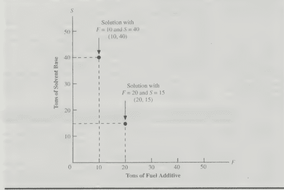

我们通过找出满足该方程的两个点，然后在这两点之间画一条直线来绘制该方程的图。令 F = 0 并求解 S 得到 0.5S = 20，即 S = 40；因此解 (F = 0, S = 40) 满足前面的方程。要找到满足该方程的第二个解，我们令 S = 0 并求解 F。这样，我们得到 0.4F = 20，即 F = 50。因此，满足该方程的第二个解是 (F = 50, S = 0)。有了这两个点，我们现在可以绘制这条直线了。这条直线称为材料 1 约束线，如图 7.2 所示。

回顾，表示材料 1 约束的不等式是 0.4F + 0.5S <= 20

你能找出所有满足该约束的解吗？首先，请注意，直线 0.4F + 0.5S = 20 上的任何点都必须满足该约束。但是，满足 0.4F + 0.5S < 20 的解在哪里呢？考虑两个解 (F = 10, S = 10) 和 (F = 40, S = 30)。图 7.2 显示，第一个解与原点位于约束线的同一侧，而第二个解位于约束线与原点相对的一侧。哪个解满足材料 1 约束？对于 (F = 10, S = 10)，我们有

0.4F + 0.5S = 0.4(10) + 0.5(10) = 9

因为 9 吨少于可用的 20 吨材料 1，所以解 F = 10, S = 10 满足该约束。对于 F = 40 和 S = 30，我们有

0.4F + 0.5S = 0.4(40) + 0.5(30) = 31

31 吨大于可用的 20 吨，因此解 F = 40, S = 30 不满足该约束。

你现在应该能够绘制约束线并找到满足约束的解点。尝试问题 2。

如果某个特定解满足约束，那么约束线同一侧的所有其他解也将满足该约束。如果某个特定解不满足约束，那么约束线同一侧的所有其他解也不会满足该约束。因此，你只需评估一个解，即可确定约束线的哪一侧提供满足约束的解。图 7.3 中的阴影区域显示了所有满足材料 1 约束的解。

接下来，让我们找出所有满足材料 2 约束的解：

0.2S <= 5

我们首先绘制与方程 0.2S = 5 对应的约束线。因为该方程等价于方程 S = 25，我们只需画一条直线，使得对于每个 F 值，S 值均为 25；这条直线与水平轴平行，且位于水平轴上方 25 个单位处。图 7.4 显示了与材料 2 约束对应的直线。沿用我们对材料 1 约束所采用的方法，我们意识到只有直线上或直线下方的解才会满足材料 2 约束。因此，在图 7.4 中，阴影区域对应于满足材料 2 约束的解。

同样，我们可以确定满足材料 3 约束的解。图 7.5 显示了结果。为了练习，尝试绘制满足材料 3 约束的可行解，并确定你的结果是否与图 7.5 所示一致。

我们现在有三个分别显示满足每个约束的解的独立图表。在线性规划问题中，我们需要找出同时满足

### 图 7.3 满足材料 1 约束的解

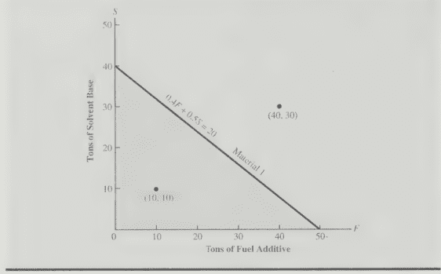

### 图 7.4 满足材料 2 约束的解

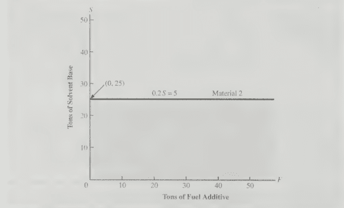

### 图 7.5 满足材料 3 约束的解

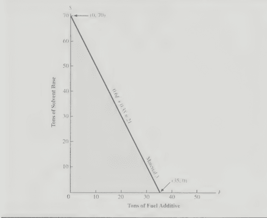

所有约束的解。要找到这些解，我们可以将三个约束绘制在同一张图上，并观察包含实际上同时满足所有约束的点的区域。

图 7.3、7.4 和 7.5 中的图表可以叠加，以获得包含所有三个约束的单一图表。图 7.6 显示了这个组合约束图。此图中的阴影区域包含每个同时满足所有约束的解点。因为同时满足所有约束的解称为可行解，所以阴影区域称为可行解区域，或者简称为可行域。可行解区域边界上的任何点，或可行解区域内的任何点，都是线性规划问题的可行解点。

你现在能在给出多个约束的情况下找到可行域吗？尝试问题 7。

既然我们已经确定了可行域，就可以继续使用图解法并找到 RMC 问题的最优解。回顾，线性规划问题的最优解是提供目标函数最佳可能值的可行解。让我们通过在单独的图上重新绘制可行域，来开始图解程序的优化步骤。图 7.7 显示了该图。

寻找最优解的一种方法是对每个可行解评估目标函数；最优解将是产生

### 图 7.6 RMC 问题的可行域

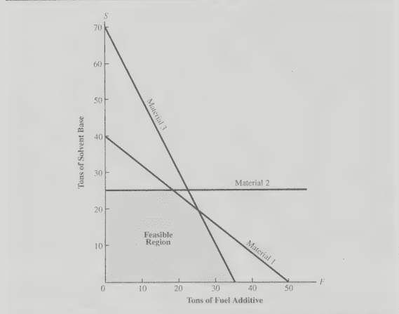

最大值的那个解。这种方法的困难在于，无限多的可行解使得对所有可行解进行评估变得不可能。因此，这种试错程序无法用于确定最优解。

与其试图计算每个可行解的利润贡献，不如为利润贡献选择一个任意值，并找出产生所选值的所有可行解。例如，哪些可行解提供 240 美元的利润贡献？这些值由可行域中使目标函数

```
40F + 30S = 240
```

的 F 和 S 值给出。

这个表达式仅仅是一条直线的方程。因此，所有产生 240 美元利润贡献的可行解 (F, S) 必须在这条直线上。我们在本节前面学习了如何绘制约束线。绘制利润或目标函数直线的程序是相同的。令 F = 0，我们看到 S 必须为 8；因此解点 (F = 0, S = 8) 在直线上。同样，令 S = 0，我们看到解点 (F = 6, S = 0) 也在直线上。通过这两点画直线，即可找出所有利润贡献为 240 美元的解。该利润直线的图表如图 7.8 所示。图表显示，无限多个可行生产组合将提供 240 美元的利润贡献。

### 图 7.7 RMC 问题的可行域

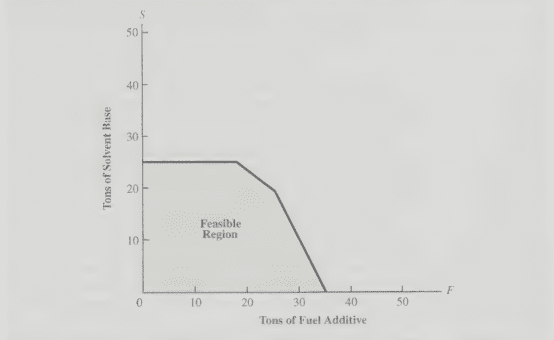

### 图 7.8 RMC 问题的 240 美元利润直线

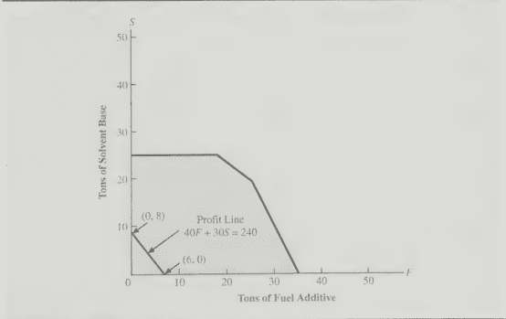

目标是找到产生最高利润贡献的可行解，因此我们通过选择更高的利润贡献并找出产生所述值的解来继续。例如，哪些解提供 720 美元的利润贡献？哪些解提供 1200 美元的利润贡献？要回答这些问题，我们必须找出位于利润直线上的 F 和 S 值：

40F + 30S = 720 and 40F + 30S = 1200

使用之前用于绘制利润和约束直线的程序，我们绘制了图 7.9 中所示的 720 美元和 1200 美元利润直线。并非 1200 美元利润直线上的所有解点都在可行域内，但直线上至少有一些点在可行域内；因此，我们可以获得一个提供 1200 美元利润贡献的可行解。

我们能找到产生更高利润贡献的可行解吗？查看图 7.9，并对利润直线做一些一般性观察。你应该能够识别以下属性：(1) 利润直线彼此平行，(2) 利润贡献更高的利润直线距离原点更远。

由于利润直线彼此平行，且利润更高的直线距离原点更远，我们可以通过继续将利润直线远离原点移动，同时保持其与其他利润直线平行，来获得目标函数值越来越高的解。但是，在某个时刻，任何进一步的外向移动都会使利润直线完全位于可行域之外。因为可行域外的点是不可接受的，所以位于最高利润直线上的可行域内的点是线性规划问题的最优解。

你现在应该能够识别 RMC 问题的最优解点。使用直尺，将利润直线尽可能远离原点移动。可行域中的最后一个点是什么？这个点（即最优解）在图 7.10 中以图形方式显示。决策变量的最优值是该点处的 F 和 S 值。

### 图 7.9 RMC 问题的选定利润直线

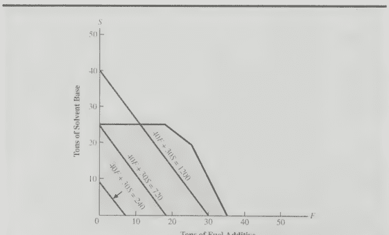


### 图 7.10 RMC 问题的最优解

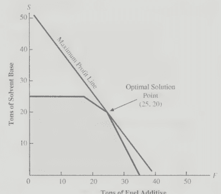

取决于图表的精度，您可能能够也可能无法直接从图表中确定 F 和 S 的精确最优值。但是，请参阅图 7.6，并注意 RMC 示例的最优解点位于材料 1 和材料 3 约束线的交点处。也就是说，最优解同时位于材料 1 约束线上，

0.4F + 0.5S = 20 (7.6)

以及材料 3 约束线上，

0.6F + 0.3S = 21 (7.7)

因此，决策变量 F 和 S 的值必须同时满足方程 (7.6) 和 (7.7)。利用 (7.6) 并求解 F 得到

0.4F = 20 - 0.5S

或

F = 50 - 1.25S (7.8)

将 F 的这个表达式代入方程 (7.7) 并求解 S 得到

0.6(50 - 1.25S) + 0.3S = 21
30 - 0.75S + 0.3S = 21
-0.45S = -9
S = 20

将 S = 20 代入方程 (7.8) 并求解 F 得到

```
F = 50 - 1.25(20)
= 50 - 25 = 25
```

尽管 RMC 问题的最优解中决策变量为整数值，但结果并不总是如此。

因此，最优解点的精确位置是 F = 25 和 S = 20。该解点为 RMC 提供了最优生产数量，即 25 吨燃料添加剂和 20 吨溶剂基料，并贡献利润 40(25) + 30(20) = 1600 美元。

对于具有两个决策变量的线性规划问题，可以先使用图形法确定最优解点，然后求解与该点相关的两个联立方程，从而确定最优解处的决策变量精确值。

### 关于绘制直线的说明

图形法的一个重要方面是能够绘制显示线性规划约束和目标函数的直线。我们用于绘制直线方程的程序是找到满足方程的任意两点，然后通过这两点画直线。对于 RMC 约束，通过令 F = 0 并求解约束方程得到 S，很容易找到这两点。然后令 S = 0 并求解 F。对于材料 1 约束线

```
0.4F + 0.5S = 20
```

尝试问题 10，以测试您使用图形解法确定最优解并找到最优解处决策变量精确值的能力。

该程序确定了两点 (F = 0, S = 40) 和 (F = 50, S = 0)。然后通过这两点画直线来绘制材料 1 约束线。

如果能确定直线上的两点，则双变量线性规划中的所有约束和目标函数直线都可以绘制出来。但是，找到直线上的两点并不总是像 RMC 问题中所示那样容易。例如，假设一家公司生产两种小型手持计算机型号：专业型 (P) 和助理型 (A)。管理层需要 50 台专业型号用于其自身销售团队，并预计剩余专业型号的销量将小于或等于助理型号销量的 50%。强制执行此要求的约束是

```
P - 50 <= 0.5A
```

或

```
P - 0.5A <= 50
```

使用约束的等式形式并令 P = 0，我们发现点 (P = 0, A = -100) 在约束线上。令 A = 0，我们找到约束线上的第二个点 (P = 50, A = 0)。如果我们只绘制了图表的非负部分 (P >= 0, A >= 0)，则第一个点 (P = 0, A = -100) 无法绘制，因为 A = -100 不在图表上。每当我们有直线上的两点，但其中一点或两点都无法在图表的非负部分绘制时，最简单的方法是放大图表。在此示例中，可以通过扩展图表以包含负 A 轴来绘制点 (P = 0, A = -100)。一旦找到满足约束方程的两点，就可以绘制直线。约束线和满足约束 P - 0.5A <= 50 的解如图 7.11 所示。

### 图 7.11 满足约束 P – 0.5A ≤ 50 的解

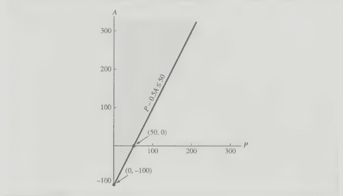

作为另一个示例，考虑涉及两个决策变量 R 和 T 的问题。假设生产的 R 单位数量必须至少等于生产的 T 单位数量。强制执行此要求的约束是 R ≥ T 或 R - T ≥ 0

当原点在约束线上时，您能绘制约束线吗？尝试问题 5。

要找到作为等式满足约束的所有解，我们首先令 R = 0 并求解 T。此结果显示原点 (T = 0, R = 0) 在约束线上。令 T = 0 并求解 R 得到相同的点。但是，我们可以通过令 T 等于任何非零值然后求解 R 来获得直线上的第二个点。例如，令 T = 100 并求解 R，我们发现点 (T = 100, R = 100) 在直线上。有了两点 (R = 0, T = 0) 和 (R = 100, T = 100)，约束线 R - T = 0 和满足约束 R - T ≥ 0 的解可以如图 7.12 所示绘制。

### 最大化问题图形解法步骤总结

如前所述，图形解法是求解双变量线性规划问题（如 RMC 问题）的一种方法。最大化问题的图形解法步骤总结如下：

要进一步练习使用图形解法，请尝试问题 24。

- 1. 为每个约束绘制显示满足该约束的解的图表。
- 2. 通过识别同时满足所有约束的解来确定可行域。

### 图 7.12 约束 R - T ≥ 0 的可行解

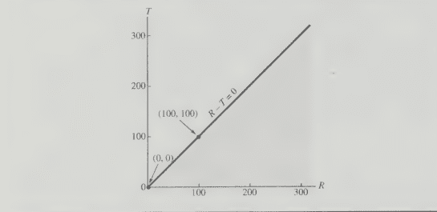

- 3. 绘制目标函数直线，显示产生指定目标函数值的决策变量值。
- 4. 将平行的目标函数直线朝着更大的目标函数值方向移动，直到进一步移动会使直线完全超出可行域。
- 5. 目标函数直线上值最大的任何可行解都是最优解。

### 松弛变量

除了最优解及其相关利润贡献外，RMC 经理还希望了解三种材料的生产需求。我们可以通过将最优解值 (F = 25, S = 20) 代入线性规划的约束来确定此信息。

| 约束 | F = 25 吨，S = 20 吨所需吨数 | 可用吨数 | 未使用吨数 |
| :--- | :--- | :--- | :--- |
| 材料 1 | 0.4(25) + 0.5(20) = 20 | 20 | 0 |
| 材料 2 | 0.2(20) = 4 | 5 | 1 |
| 材料 3 | 0.6(25) + 0.3(20) = 21 | 21 | 0 |

您能识别与约束相关的松弛量吗？尝试问题 24 的第 (e) 部分。

因此，最优解告诉管理层，生产 25 吨燃料添加剂和 20 吨溶剂基料将需要所有可用的材料 1 和材料 3，但只需要 5 吨材料 2 中的 4 吨。未使用的 1 吨材料 2 称为松弛量。在线性规划术语中，≤ 约束的任何未使用或闲置产能称为与该约束相关的松弛量。因此，材料 2 约束的松弛量为 1 吨。

通常，会向线性规划问题的公式中添加称为松弛变量的变量，以表示与约束相关的松弛量或未使用产能。未使用产能对利润没有贡献，因此松弛变量在目标函数中的系数为零。更一般地说，松弛变量表示

您能写出标准形式的线性规划吗？尝试问题 18。

<= 约束的右侧与左侧之间的差值。添加三个松弛变量（记为 S1、S2 和 S3）后，RMC 问题的数学模型变为

Max 40F + 30S + 0S1 + 0S2 + 0S3
s.t.
0.4F + 0.5S + 1S1 = 20
0.2S + 1S2 = 5
0.6F + 0.3S + 1S3 = 21
F, S, S1, S2, S3 >= 0

每当线性规划以所有约束均表示为等式的形式编写时，即称为标准形式。

参考 RMC 问题的标准形式，我们看到在最优解 (F = 25, S = 20) 处松弛变量的值为

| 约束 | 松弛变量值 |
|---|---|
| 材料 1 | S1 = 0 |
| 材料 2 | S2 = 1 |
| 材料 3 | S3 = 0 |

我们能否使用图形分析提供一些先前的信息？答案是肯定的。通过在图 7.6 中找到最优解，我们看到材料 1 约束和材料 3 约束在此点限制（或约束）可行域。因此，最优解要求使用所有这两种资源。换句话说，图表显示在最优解处材料 1 和材料 3 的松弛量为零。但是，由于材料 2 约束在最优解处不约束可行域，我们可以预期该资源会有一些松弛量。

使用图形解法很容易识别冗余约束。在具有两个以上决策变量的问题中，冗余约束通常不明显。

最后，某些线性规划可能有一个或多个不影响可行域的约束；也就是说，无论是否在问题中包含该约束，可行域都保持不变。由于此类约束不影响可行域，因此也不能影响最优解，它被称为冗余约束。冗余约束可以从问题中删除，而不会对最优解产生任何影响。但是，在大多数线性规划问题中，冗余约束不会被丢弃，因为它们不易立即被识别为冗余。RMC 问题没有冗余约束，因为每个约束都对可行域产生了影响。

### 注释和评论

- 1. 在线性规划的标准形式表示中，松弛变量的目标函数系数为零。此条件意味着表示未使用资源的松弛变量不影响目标函数的值。但是，在某些应用中，未使用资源的全部或部分可以出售并贡献利润。在这种情况下，相应的松弛变量变成表示要出售的资源数量的决策变量。对于这些变量中的每一个，目标函数中的非零系数将反映出售相应资源单位所关联的利润。

- 2. 冗余约束不影响可行域；因此，可以从线性规划模型中删除它们而不影响最优解。但是，如果以后需要重新求解线性规划模型，某些数据的变化可能会将先前的冗余约束变为约束性约束。因此，我们建议保留线性规划模型中的所有约束，即使其中一个或多个约束可能是冗余的。


## 7.3 极点与最优解

假设每吨溶剂基的利润贡献从30美元增加到60美元，而每吨燃油添加剂的利润贡献及所有约束保持不变。该新问题的完整线性规划模型与第7.2节中的数学模型相同，只是修改了目标函数：

Max 40F + 60S

目标函数的这一变化如何影响RMC问题的最优解？图7.13显示了使用修改后目标函数的RMC问题图解解。请注意，由于约束未改变，可行域保持不变。但是，必须修改利润线以反映新的目标函数。

通过将利润线以平行方式远离原点移动，我们找到了如图7.13所示的最优解。该点的决策变量值为F = 18.75和S = 25。溶剂基利润的增加导致最优解发生变化。事实上，正如你可能猜到的，我们削减了低利润燃油添加剂的产量，并增加了高利润溶剂基的产量。

你对迄今为止求解的线性规划问题中最优解的位置有何观察？请仔细查看图7.10和图7.13中的图解解。你应当能够做出的一项重要观察是，最优解出现在可行域的顶点或“角点”上。在线性规划术语中，这些顶点被称为可行域的极点。因此，RMC问题有五个顶点或五个极点（图7.14）。我们现在可以陈述关于最优解位置的观察：²

线性规划问题的最优解可以在问题的可行域的一个极点上找到。

这一特性意味着，如果你在寻找线性规划问题的最优解，不需要评估所有可行解点。事实上，你只需考虑出现在可行域极点上的可行解。因此，对于RMC问题，与其计算并比较所有可行解的利润，不如评估五个极点解并选择利润最高的那个，从而找到最优解。实际上，图解解法只不过是识别两变量问题最优极点的一种便捷方式。

为了进一步练习识别可行域的极点并确定最优解，尝试计算并比较每个极点上的目标函数值，参见问题13。

**图7.13 目标函数为40F + 60S的RMC问题最优解**

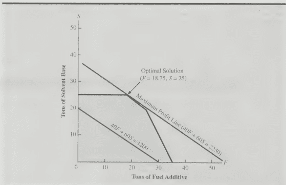

**图7.14 RMC问题可行域的五个极点**

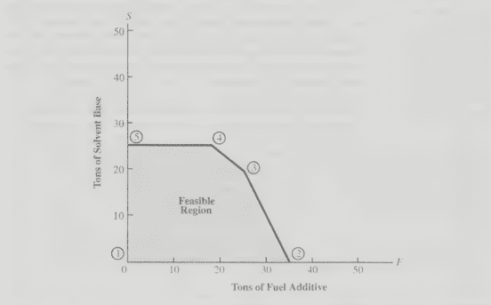

## 7.4 RMC问题的计算机求解

用于求解线性规划问题的计算机程序广泛可用。在短暂熟悉程序的特定功能后，大多数用户可以轻松求解线性规划问题。涉及数千个变量和数千个约束的问题现在常通过计算机软件包常规求解。一些领先的商业软件包包括CPLEX、LINGO、MOSEK、Gurobi和Xpress-MP。

²在第7.6节中，我们将展示线性规划中的两种特殊情况（无可行解和无界解）没有最优解。上述观察不适用于这些情况。

1952年1月，线性规划问题的首次成功计算机求解是在SEAC（标准东部自动计算机）上进行的。SEAC是美国国家标准局在美军赞助下建造的第一台数字计算机，拥有512字的存储器和用于外部存储的内部磁带。

关于如何使用Excel和LINGO求解线性规划的说明在章末的附录中提供。

软件包也可免费下载。一个很好的例子是Clp（COIN-OR线性规划），可从COIN-OR组织的http://www.coin-or.org获取。

现在有大量用户友好的可求解线性规划的计算机程序可用。这些程序由学者和小型软件公司开发，几乎都易于使用。这些程序中的大多数旨在求解较小的线性规划（几百个变量），但有些可用于求解涉及数千个变量和约束的问题。电子表格环境中也提供线性规划求解器。在附录7.1中，我们展示了如何使用随Excel提供的求解器。附录7.2演示了LINGO的使用，LINGO是一种用于求解优化问题的独立软件包。

可能最广泛使用的工具是Solver，它内置于Microsoft Excel中。因此，我们讨论的计算机输出基于Excel Solver提供的输出。关于如何在Excel中制定RMC问题并使用Solver的完整细节包含在附录7.1中。

```
Recall the RMC linear program:
Max 40F + 30S
s.t.
0.4F + 0.5S <= 20 Material 1
0.2S <= 5 Material 2
0.6F + 0.35S <= 21 Material 3
F, S >= 0
```

图7.15显示了RMC问题的最优解。此输出基于Excel Solver的答案报告，但包含我们在线性规划模型中使用的变量名。这使你可以轻松将答案报告与所讨论的模型关联起来。我们将在第7-12章中使用这种风格来展示优化问题的解。

### 答案报告解读

让我们更仔细地查看图7.15中的答案报告，并解释为RMC问题提供的计算机解。首先，请注意Objective Cells (Max)部分中的数字1600.000，它出现在目标函数值“最大化总利润”右侧的Final Value列中。这个数字表明该问题的最优解将提供1600美元的利润。目标函数值下方直接显示的是最优解的决策变量值。这些值显示为答案报告中Variable Cells部分的Final Value列。因此，我们有F = 25吨燃油添加剂和S = 20吨溶剂基作为最优生产数量。我们将在第11章讨论Variable Cells部分中Integer列的含义。

**图7.15 RMC问题的答案报告**

**目标单元格（最大化）**

| 名称 | 原始值 | 最终值 |
|---|---|---|
| 最大化总利润 | 0.000 | 1600.000 |

**变量单元格**

| 模型变量 | 名称 | 原始值 | 最终值 | 整数 |
|---|---|---|---|---|
| F | 生产的燃油添加剂吨数 | 0.000 | 25.000 | 连续 |
| S | 生产的溶剂基吨数 | 0.000 | 20.000 | 连续 |

**约束**

| 约束编号 | 名称 | 单元格值 | 状态 | 松弛量 |
|---|---|---|---|---|
| 1 | 材料1使用量 | 20.000 | 约束紧 | 0.000 |
| 2 | 材料2使用量 | 4.000 | 约束非紧 | 1.000 |
| 3 | 材料3使用量 | 21.000 | 约束紧 | 0.000 |

答案报告的约束部分提供了关于约束状态的信息。请回顾，RMC问题有三个小于等于约束，分别对应三种原材料的可用吨数。Slack列中显示的信息提供了每个约束的松弛变量值。此信息总结如下：

| 约束编号 | 约束名称 | 松弛变量值 |
|---|---|---|
| 1 | 材料1使用量 | 0 |
| 2 | 材料2使用量 | 1 |
| 3 | 材料3使用量 | 0 |

因此，我们看到约束紧约束（材料1使用量和材料3使用量约束）在最优解处的松弛量为零。材料2使用量约束有1吨的松弛量，即未使用的产能。

## 7.5 一个简单的最小化问题

M&D化工公司生产两种产品，作为原材料销售给生产浴皂和洗衣液的公司。基于对当前库存水平和下个月潜在需求的分析，M&D管理层规定，产品A和B的总产量必须至少为350加仑。具体来说，还必须满足一位主要客户对125加仑产品A的订单。产品A每加仑需要2小时加工时间，而产品B每加仑需要1小时加工时间，下个月可用的加工时间为600小时。M&D的目标是以最低总生产成本满足这些要求。产品A的生产成本为每加仑2美元，产品B的生产成本为每加仑3美元。

为了找到最低成本的生产计划，我们将把M&D化工问题制定为线性规划。遵循与RMC问题类似的程序，我们首先定义问题的决策变量和目标函数。设

A = 产品A的加仑数
B = 产品B的加仑数

由于产品A的生产成本为每加仑2美元，产品B的生产成本为每加仑3美元，对应于总生产成本最小化的目标函数可写为

Min 2A + 3B

接下来，考虑M&D化工问题的约束。为了满足主要客户对125加仑产品A的需求，我们知道A必须至少为125。因此，我们写出约束

A >= 125


由于两种产品的联合生产总量必须至少为 350 加仑，我们可以写出约束

```
1A + 1B ≥ 350
```

最后，可用加工时间限制为 600 小时，这意味着我们需要添加约束

```
2A + 1B ≤ 600
```

在添加非负约束 (A, B ≥ 0) 后，我们得到 M&D 化学品问题的以下线性规划：

```
Min 2A + 3B
s.t.
1A ≥ 125 Demand for product A
1A + 1B ≥ 350 Total production
2A + 1B ≤ 600 Processing time
A, B ≥ 0
```

由于线性规划模型只有两个决策变量，可以使用图解法来找到最优生产量。本问题的图形方法与 RMC 问题一样，要求我们先绘制约束线以找到可行域。通过分别绘制每条约束线，然后检查约束线两侧的点，可以识别出满足每个约束的解。通过在同一图上组合满足每个约束的解，我们得到如图 7.16 所示的可行域。

图 7.16 M&D 化学品问题的可行域

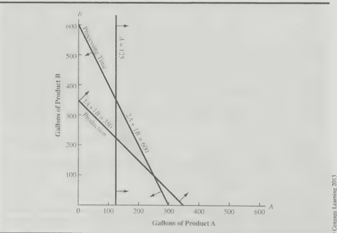

图 7.17 M&D 化学品问题的图形解

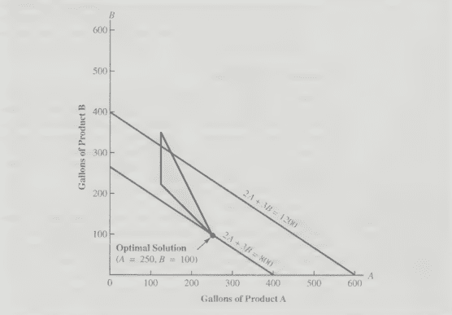

为了找到最小成本解，我们现在绘制对应特定总成本值的目标函数线。例如，我们可以先绘制直线 2A + 3B = 1200。该直线如图 7.17 所示。显然，可行域中的某些点可提供 1200 美元的总成本。为了找到提供更小总成本值的 A 和 B 的值，我们将目标函数线向左下方向移动，直到如果再移动，线就会完全位于可行域之外。请注意，目标函数线 2A + 3B = 800 在极点 A = 250 和 B = 100 处与可行域相交。该极点提供了目标函数值为 800 美元的最小成本解。从图 7.16 和 7.17 可以看出，总产量约束和加工时间约束是紧约束。与每个线性规划问题一样，最优解出现在可行域的一个极点上。

你能使用图解法来确定最小化问题的最优解吗？尝试问题 31。

### 最小化问题图解步骤总结

最小化问题图解步骤总结如下：

- 1. 为每个约束绘制一个图，显示满足该约束的解。

- 2. 通过识别同时满足所有约束的解来确定可行域。

- 3. 绘制目标函数线，显示决策变量取得指定目标函数值时的取值。

- 4. 将平行的目标函数线朝着目标函数值更小的方向移动，直到再移动就会使线完全位于可行域之外。

- 5. 目标函数值最小的目标函数线上的任何可行解都是最优解。

### 剩余变量

M&D 化学品问题的最优解表明，所需的总产量 A + B = 350 加仑是通过使用所有可用加工时间 2A + 1B = 2(250) + 1(100) = 600 小时实现的。此外，请注意，要求满足产品 A 需求的约束在 A = 250 加仑时得到满足。事实上，产品 A 的产量超过了其最低水平 250 – 125 = 125 加仑。这种对产品 A 的超量生产被称为剩余量。在线性规划术语中，任何对应于 ≥ 约束的超量都称为剩余量。

> Excel Solver 将所有非紧约束称为具有正松弛值，无论它们是 > 还是 ≤ 约束。但是，在引用非紧 ≥ 约束时，我们将使用“剩余量”。

回顾一下，对于 ≤ 约束，可以向不等式左侧添加一个松弛变量以将约束转换为等式形式。对于 ≥ 约束，可以从不等式左侧减去一个剩余变量以将约束转换为等式形式。与松弛变量一样，剩余变量在目标函数中的系数为零，因为它们对目标函数值没有影响。在为 ≥ 约束引入两个剩余变量 S1 和 S2，并为 ≤ 约束引入一个松弛变量 S3 后，M&D 化学品问题的线性规划模型变为

```
Min 2A + 3B + 0S1 + 0S2 + 0S3
s.t.
1A - 1S1 = 125
1A + 1B - 1S2 = 350
2A + 1B + 1S3 = 600
A, B, S1, S2, S3 ≥ 0
```

> 尝试问题 35 以测试你使用松弛变量和剩余变量将线性规划写成标准形式的能力。

现在所有约束均为等式。因此，前述表述是 M&D 化学品问题的标准形式表示。在最优解 A = 250 和 B = 100 处，剩余变量和松弛变量的值如下：

| 约束 | 剩余或松弛变量的值 |
| :--- | :--- |
| 产品 A 需求 | S1 = 125 |
| 总产量 | S2 = 0 |
| 加工时间 | S3 = 0 |

请参阅图 7.16 和 7.17。请注意，零剩余和松弛变量与最优解处约束成立的约束相关——即，总产量约束和加工时间约束。125 单位的剩余量与产品 A 需求的非紧约束相关。

在 RMC 问题中，所有约束均为 ≤ 类型，而在 M&D 化学品问题中，约束是 ≥ 和 ≤ 类型的混合。特定线性规划问题中遇到的约束数量和类型取决于问题中存在的具体条件。线性规划问题可能包含一些 ≤ 约束、一些 ≥ 约束和一些 = 约束。对于等式约束，可行解必须直接位于约束线上。

尝试问题 34 以练习求解具有所有三种约束形式的线性规划。

这里给出了一个具有两个决策变量 G 和 H 且包含所有三种约束形式的线性规划示例：

```
Min 2G + 2H
s.t.
1G + 3H <= 12
3G + 1H >= 13
1G - 1H = 3
G, H >= 0
```

该问题的标准形式表示为

```
Min 2G + 2H + 0S1 + 0S2
s.t.
1G + 3H + 1S1 = 12
3G + 1H - 1S2 = 13
1G - 1H = 3
G, H, S1, S2 >= 0
```

标准形式要求为 <= 约束引入松弛变量，为 >= 约束引入剩余变量。但是，第三个约束不需要松弛变量或剩余变量，因为它已经是等式形式。

在图形求解线性规划时，不必将问题写成标准形式。尽管如此，能够计算松弛变量和剩余变量的值并理解其含义是有帮助的。最后的一点是：线性规划问题的标准形式与问题的原始表述是等价的。也就是说，任何线性规划问题的最优解与其标准形式的最优解相同。标准形式没有改变基本问题；它只改变了我们书写问题约束的方式。

### M&D 化学品问题的计算机求解

M&D 化学品问题的解答报告如图 7.18 所示。解答报告表明，最小成本解的目标函数值为 800 美元。该

图 7.18 M&D 化学品问题的解答报告


#### 目标单元格 (最小化)

| 名称 | 原始值 | 最终值 |
| --- | --- | --- |
| 最小化总成本 产品 A | 0.000 | 800.000 |

#### 变量单元格

| 模型变量 | 名称 | 原始值 | 最终值 | 类型 |
| --- | --- | --- | --- | --- |
| A | 产品 A 生产加仑数 | 0.000 | 250.000 | 连续型 |
| B | 产品 B 生产加仑数 | 0.000 | 100.000 | 连续型 |

#### 约束

| 约束编号 | 名称 | 单元格值 | 状态 | 松弛量 |
| --- | --- | --- | --- | --- |
| 1 | 产品 A 需求 | 250.000 | 非紧约束 | 125.000 |
| 2 | 总产量 | 350.000 | 紧约束 | 0.000 |
| 3 | 加工时间 | 600.000 | 紧约束 | 0.000 |


决策变量的值表明，250 加仑的产品 A 和 100 加仑的产品 B 提供了最小成本解。

答案报告中“约束”部分的“松弛量”列显示，与产品 A 需求对应的 >= 约束（参见约束 1）的值为 125 单位。Excel 在引用非约束性 >= 约束时使用“松弛量”。但是，由于这是一个 >= 约束，它告诉我们，在最优解中产品 A 的产量超过需求 125 加仑。换句话说，产品 A 的需求（约束 1）有 125 单位的盈余值。总生产要求（约束 2）和加工时间限制（约束 3）的松弛量均为零，这表明这些约束在最优解中是约束性的。

## 7.6 特殊情况

在本节中，我们将讨论在求解线性规划问题时可能出现的三种特殊情况。

### 替代最优解

根据我们对图解法的讨论，我们知道最优解可以在可行域的极点处找到。现在让我们考虑一种特殊情况：最优目标函数线与某个约束性约束线重合。这可能导致替代最优解，即多于一个解为目标函数提供最优值。

为了说明替代最优解的情况，我们回到 RMC 问题。但是，让我们假设溶剂基（S）的利润贡献已增加到 50 美元。修订后的目标函数是 40F + 50S。图 7.19 显示了该问题的图解解。请注意，最优解仍然出现在极点处。事实上，它出现在两个极点处：极点 3（F = 25，S = 20）和极点 4（F = 18.75，S = 25）。

这两个极点处的目标函数值相同；即，40F + 50S = 40(25) + 50(20) = 2000

和

40F + 50S = 40(18.75) + 50(25) = 2000

此外，连接两个最优极点的直线上的任何点也提供一个最优解。例如，两个极点中点处的解点（F = 21.875，S = 22.5）也提供最优目标函数值

40F + 50S = 40(21.875) + 50(22.5) = 2000

具有替代最优解的线性规划问题通常对管理者或决策者来说是一个好情况。这意味着多个决策变量组合都是最优的，管理者可以选择最理想的最优解。不幸的是，确定一个问题是否具有替代最优解并非易事。

### 无可行解

无可行解意味着线性规划问题没有任何解能满足所有约束，包括非负性约束。从图形上看，无可行解意味着不存在可行域；即，没有点能同时满足所有约束方程和

### 图 7.19 具有目标函数 40F + 50S 的 RMC 问题最优解

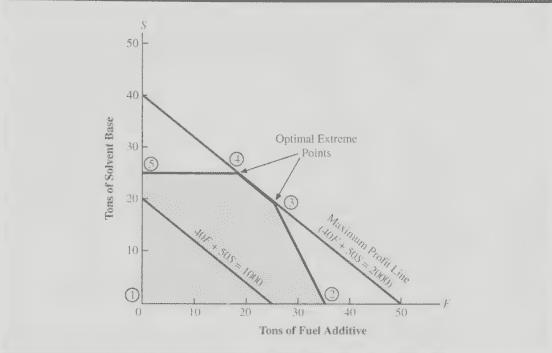

非负性条件。为了说明这种情况，让我们回到 RMC 面临的问题。

在实践中，确实会出现没有可行解的问题，最常见的原因是管理层的期望过高，或者对问题施加了过多限制。

假设管理层规定必须至少生产 30 吨燃油添加剂和 15 吨溶剂基。图 7.20 显示了反映这些要求的解区域图。图中左下部分的阴影区域描绘了满足可用材料数量小于或等于约束的那些点。图中右上部分的阴影区域描绘了满足至少生产 30 吨燃油添加剂和 15 吨溶剂基的最低生产要求的那些点。但是，没有任何点能同时满足这两组约束。因此，如果管理层施加这些最低生产要求，线性规划问题将没有可行解。

我们应如何就当前问题解释这种无可行解？首先，我们应该告诉管理层，针对三种材料的可用量，生产 30 吨燃油添加剂和 15 吨溶剂基是不可能的。此外，我们可以准确地告诉管理层每种材料还需要多少。

| 材料 | F = 30, S = 15 所需的最低吨数 | 可用吨数 | 还需额外吨数 |
| :--- | :--- | :--- | :--- |
| 材料 1 | 0.4(30) + 0.5(15) = 19.5 | 20 | — |
| 材料 2 | 0.2(15) = 3 | 5 | — |
| 材料 3 | 0.6(30) + 0.3(15) = 22.5 | 21 | 1.5 |

### 图 7.20 具有最低生产要求的 RMC 问题无可行域

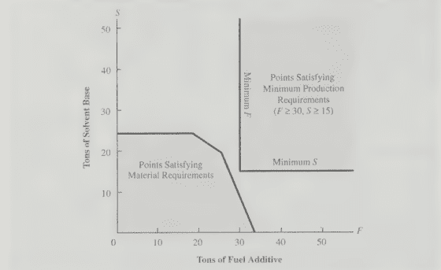

因此，RMC 对材料 1 和 2 的供应充足，但需要额外 1.5 吨材料 3 才能满足管理层 30 吨燃油添加剂和 15 吨溶剂基的生产要求。如果在审阅前面的分析后，管理层仍希望对这两种产品进行此水平的生产，RMC 将不得不获得额外的 1.5 吨材料 3。

通常，一旦发现没有可行解，就有许多纠正性管理行动可供选择。重要的是要认识到，线性规划分析可以帮助确定管理层的计划是否可行。通过使用线性规划分析问题，我们通常能够指出不可行的条件并启动纠正行动。

每当您尝试使用 Excel Solver 求解一个无可行解的问题时，您将收到一条消息，显示“Solver 无法找到可行解”。在这种情况下，您知道线性规划问题没有任何解能满足所有约束。需要仔细检查您的模型以确定问题为何无可行解。在某些情况下，唯一合理的方法是删除一个或多个约束并重新求解问题。如果您能为这个修订后的问题找到最优解，您将知道被省略的约束是导致问题无可行解的原因。

### 无界解

如果最大化线性规划问题的解值可以在不违反任何约束的情况下无限增大，则该解是无界的；对于最小化问题，如果解值可以无限减小，则该解是无界的。这种状况可能被称为管理乌托邦；例如，如果这种状况出现在利润最大化问题中，管理者可以实现无限利润。

但是，在实际问题的线性规划模型中，出现无界解意味着问题的模型制定不当。我们知道利润不可能无限增加。因此，我们必须得出结论：如果利润最大化问题导致无界解，则数学模型不能充分代表现实世界问题。通常，无界问题是由于在问题制定过程中无意中遗漏了一个约束而导致的。

作为示例，请考虑具有两个决策变量 X 和 Y 的以下线性规划：

```
Max 20X + 10Y
s.t.
1X ≥ 2
1Y ≤ 5
X, Y ≥ 0
```

在图 7.21 中，我们绘制了与该问题相关的可行域。请注意，我们只能指示可行域的一部分，因为可行域沿 X 轴方向无限延伸。观察图 7.21 中的目标函数线，我们可以看到该问题的解可以变得尽可能大。无论我们选择什么解，我们总能找到一个值更大的可行解。因此，我们说这个线性规划的解是无界的。

### 图 7.21 无界问题示例

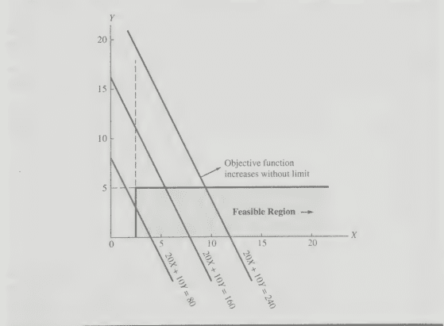


你能识别线性规划是否涉及替代最优解、不可行性或无界解吗？尝试问题42和43。

当你尝试使用Excel求解器求解无界问题时，会收到一条消息，显示“目标单元格数值不收敛”。由于无界解在实际问题中不可能出现，你首先应该做的是检查模型，确定是否错误地制定了问题。

### 注释与评论

- 1. 不可行性与目标函数无关。之所以存在不可行性，是因为约束条件过于严格，以至于线性规划模型没有可行区域。因此，当你遇到不可行性时，更改目标函数的系数没有帮助。问题将保持不可行。

- 2. 无界解的出现通常是由于缺少约束条件所致。然而，更改目标函数可能会导致先前无界的问题变为有界并具有最优解。例如，图7.21中的图显示了目标函数Max 20X + 10Y的无界解。然而，将目标函数更改为Max 20X – 10Y将提供最优解X = 2和Y = 0，尽管约束条件没有任何更改。

## 7.7 通用线性规划表示法

在本章中，我们展示了如何为RMC和M&D化学品的线性规划问题制定数学模型。为了制定RMC问题的数学模型，我们首先定义了两个决策变量：F = 燃料添加剂的吨数，S = 溶剂基的吨数。在M&D化学品问题中，两个决策变量定义为A = 产品A的加仑数，B = 产品B的加仑数。我们在RMC问题中选择F和S作为决策变量名，在M&D化学品问题中选择A和B，以便更容易回忆这些决策变量在问题中代表的含义。虽然这种方法对于涉及少量决策变量的线性规划效果良好，但在处理涉及大量决策变量的问题时可能会变得困难。

线性规划中常用的一种更通用的表示法是使用带下标的字母x。例如，在RMC问题中，我们可以这样定义决策变量：

```
x1 = number of tons of fuel additive
x2 = number of tons of solvent base
```

在M&D化学品问题中，将使用相同的变量名，但它们的定义将发生变化：

```
x1 = number of gallons of product A
x2 = number of gallons of product B
```

为决策变量使用通用表示法的一个缺点是，我们不再能轻易识别决策变量在数学模型中实际代表什么。然而，通用表示法的优点是，为涉及大量决策变量的问题制定数学模型要容易得多。例如，对于涉及三个决策变量的线性规划问题，我们将使用变量名x1、x2和x3；对于涉及四个决策变量的问题，我们将使用变量名x1、x2、x3、x4，以此类推。显然，如果问题涉及1000个决策变量，试图识别1000个唯一名称将会很困难。然而，使用通用线性规划表示法，决策变量将定义为x1、x2、x3、...、x1000。

为了说明使用通用线性规划表示法编写的线性规划的图形解法，请考虑以下涉及两个决策变量的最大化问题的数学模型：

```
Max 3x1 + 2x2
s.t.
2x1 + 2x2 ≤ 8
1x1 + 0.5x2 ≤ 3
x1, x2 ≥ 0
```

我们必须首先开发一个图表，显示问题的可能解（x1和x2的值）。通常的惯例是将x1的值沿水平轴绘制，将x2的值沿垂直轴绘制。图7.22显示了这个两变量问题的图形解。请注意，对于这个问题，最优解是x1 = 2和x2 = 2，目标函数值为10。

### 图 7.22 使用通用表示法的两变量线性规划图形解

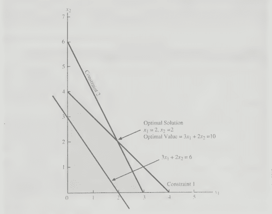

使用通用线性规划表示法，我们可以将前面的问题写成标准形式，如下所示：

```
Max 3x1 + 2x2 + 0s1 + 0s2
s.t.
2x1 + 2x2 + 1s1 = 8
1x1 + 0.5x2 + 1s2 = 3
x1, x2, s1, s2 >= 0
```

因此，在最优解x1 = 2和x2 = 2时，松弛变量的值为s1 = s2 = 0。

### 摘要

我们为RMC最大化问题和M&D化学品最小化问题制定了线性规划模型。对于这两个问题，我们展示了如何使用图形解法和Excel求解器来识别最优解。在制定这些问题的线性规划模型时，我们发展了线性规划的一般定义。

线性规划是具有以下特性的数学模型：

- 1. 一个待最大化或最小化的线性目标函数
- 2. 一组线性约束
- 3. 限制为非负值的变量

松弛变量可用于将小于或等于约束写成等式形式，剩余变量可用于将大于或等于约束写成等式形式。松弛变量的值通常可以解释为未使用资源的量，而剩余变量的值则表示超过某个规定最低要求的量。当所有约束都写成等式时，线性规划就写成了标准形式。

如果线性规划的解是不可行的或无界的，则无法找到问题的最优解。在不可行的情况下，不存在可行解。在无界解的情况下，对于最大化问题，目标函数可以无限大；对于最小化问题，目标函数可以无限小。在存在替代最优解的情况下，存在两个或多个最优极点，连接它们的线段上的所有点也是最优的。

本章最后有一节展示了如何使用通用线性规划表示法编写数学模型。“Q.M. in Action：美国海军利用线性规划节约燃料”提供了线性规划广泛应用的众多示例之一。在接下来的两章中，我们将看到更多线性规划的应用。

### 行动

### 美国海军利用线性规划节约燃料*

美国海军每年在其舰船燃料上花费约十亿美元。决定船舶燃料消耗的主要因素是速度。一艘船可以以多种不同的模式运行。例如，一艘配备四台发动机来驱动两个轴以推进船舶的海军驱逐舰，可以以三种不同的模式运行：单轴拖曳模式、分厂模式和全功率模式。在单轴拖曳模式下，四台发动机中的一台驱动一个轴。在分厂模式下，两台发动机运行，各自驱动自己的轴。全功率模式下，四台发动机全部运行，每个轴上有两台。全功率模式的每小时加仑燃料消耗率最高。根据模式不同，一艘船每小时可能消耗600到7000加仑的燃料。

一艘需要在一定时间内从A点到达B点的船舶的船长有模式选项，每种模式消耗的燃料量不同。船舶可以以恒定速度或可变速度运行。例如，一艘船可以在行程的第一部分以较快模式运行，在剩余部分以较慢模式运行，并且仍然与以所需恒定速度运行的船舶同时到达。美国海军使用基于电子表格的线性规划模型来确定在规定时间内完成行程的最省燃料方式。

线性规划的决策变量是以给定速度运行的时间（小时）。目标是在约束条件下最小化燃料消耗，即所需距离必须在规定时间内行驶完毕。线性规划的解指定了以每种速度运行的时间，但速度实施的顺序是灵活的。与以单一模式运行的燃料消耗相比，通过实施线性规划模型推荐的可变模式，已实现2%到54%的燃料节约。

*Based on G. Brown, J. Kline, R. Rosenthal, and A. Washburn, "Steaming on Convex Hulls," Interfaces 37, no. 4 (July–August 2007): 342–352.

### 术语表

- **约束** 排除某些决策变量组合作为可行解的方程或不等式。
- **问题制定** 将问题的口头陈述翻译成称为*数学模型*的数学陈述的过程。
- **数学模型** 问题的表示，其中目标和所有约束条件均由数学表达式描述。
- **决策变量** 线性规划模型的可控输入。
- **目标函数** 定义线性规划模型中要最大化或最小化的数量的表达式。
- **非负约束** 要求所有变量均为非负的一组约束。
- **线性规划** 具有线性目标函数、一组线性约束和非负变量的数学模型。
- **线性函数** 变量以单独项出现且仅一次方的数学表达式。
- **可行解** 同时满足所有约束的解。
- **可行域** 所有可行解的集合。


Slack variable 松弛变量。添加到小于等于约束左侧以将约束转换为等式的变量。该变量的值通常可解释为未使用资源的量。

Standard form 标准形式。所有约束均写成等式的线性规划。线性规划的标准形式的最优解与线性规划原始表述的最优解相同。

Redundant constraint 冗余约束。不影响可行域的约束。如果约束是冗余的，可以从问题中移除而不影响可行域。

Extreme point 极点。从图形上看，极点是出现在可行域顶点或“角”处的可行解点。对于两变量问题，极点由约束线的交点确定。

Surplus variable 剩余变量。从大于等于约束左侧减去以将约束转换为等式的变量。该变量的值通常可解释为超过某个所需最低水平的量。

Alternative optimal solutions 替代最优解。多个解为目标函数提供最优值的情况。

Infeasibility 不可行性。线性规划问题中没有解能满足所有约束的情况。

Unbounded 无界。在最大化线性规划问题中解的值可以无限大，或在最小化问题中可以无限小，且不违反任何约束的情况。

## Problems

### 1. 下列哪些数学关系可以出现在线性规划模型中，哪些不能？对于线性规划中不可接受的关系，说明原因。
- a. 1A + 2B <= 70
- b. 2A - 2B <= 50
- c. 1A - 2B^2 <= 10
- d. 3√A + 2B >= 15
- e. 1A + 1B = 6
- f. 2A + 5B + 1AB <= 25

### 2. 找出满足以下约束的解：
- a. 4A + 2B <= 16
- b. 4A + 2B >= 16
- c. 4A + 2B = 16

### 3. 分别绘制以下各约束的约束线及满足该约束的解的图形：
- a. 3A + 2B >= 18
- b. 12A + 8B >= 480
- c. 5A + 10B = 200

### 4. 分别绘制以下各约束的约束线及满足该约束的解的图形：
- a. 3A + 4B >= 60
- b. -6A + 5B <= 60
- c. 5A - 2B <= 0

### 5. 分别绘制以下各约束的约束线及满足该约束的解的图形：
- a. A >= 0.25 (A + B)
- b. B <= 0.10 (A + B)
- c. A <= 0.50 (A + B)

### 6. 线性规划问题的三个目标函数分别为 7A + 10B、6A + 4B 和 -4A + 7B。绘制目标函数值等于 420 时的每个图形。

### 7. 确定以下约束集的可行域：
0.5A + 0.25B >= 30
1A + 5B <= 250
0.25A + 0.5B <= 50
A, B >= 0

### 8. 确定以下约束集的可行域：
2A - 1B <= 0
-1A + 1.5B <= 200
A, B >= 0

### 9. 确定以下约束集的可行域：
3A - 2B >= 0
2A - 1B <= 200
1A <= 150
A, B >= 0

### 10. 对于线性规划
Max 2A + 3B
受约束于：
1A + 2B <= 6
5A + 3B <= 15
A, B >= 0
使用图解法求最优解。最优解处的目标函数值是多少？

### 11. 使用图解法求解以下线性规划：
Max 5A + 5B
受约束于：
1A <= 100
1B <= 80
2A + 4B <= 400
A, B >= 0

### 12. 考虑以下线性规划问题：
Max 3A + 3B
受约束于：
2A + 4B <= 12
6A + 4B <= 24
A, B >= 0

- a. 使用图解法求最优解。
- b. 如果目标函数改为 2A + 6B，最优解将是什么？
- c. 有多少个极点？每个极点处 A 和 B 的值是多少？

### 13. 考虑以下线性规划：

```
Max 1A + 2B
s.t.
1A <= 5
1B <= 4
2A + 2B = 12
A, B >= 0
```

- a. 显示可行域。
- b. 可行域的极点是什么？
- c. 使用图解法求最优解。

### 14. Par, Inc. 是一家小型高尔夫设备和用品制造商。Par 的经销商认为，既有中价位高尔夫球袋（称为标准型），也有高价位高尔夫球袋（称为豪华型）的市场。经销商对市场非常有信心，因此，如果 Par 能以有竞争力的价格生产球袋，经销商将购买 Par 未来三个月内能制造的所有球袋。对制造要求的仔细分析得出了以下表格，该表格显示了四项必需制造操作的生产时间要求以及会计部门估计的每个球袋的利润贡献：

| 产品 | 裁剪与上色 | 缝纫 | 整理 | 检验与包装 | 每个球袋利润 |
|---|---|---|---|---|---|
| 标准型 | 7/10 | 1/2 | 1 | 1/10 | $10 |
| 豪华型 | 1 | 5/6 | 2/3 | 1/4 | $9 |

制造主管估计，未来三个月内用于生产高尔夫球袋的可用时间为：裁剪与上色 630 小时，缝纫 600 小时，整理 708 小时，检验与包装 135 小时。

- a. 如果公司希望最大化总利润贡献，应制造多少个每种型号的球袋？
- b. Par 在这些产量下可以获得多少利润贡献？
- c. 每项操作将安排多少小时的生产时间？
- d. 每项操作的闲置时间是多少？

### 15. 假设 Par 的管理层（问题 14）遇到以下情况：

- a. 会计部门将豪华球袋的利润贡献估计修订为每个 18 美元。
- b. 标准球袋有新的低成本材料可用，每个标准球袋的利润贡献可提高到 20 美元。（假设豪华球袋的利润贡献为原始的 9 美元。）
- c. 有新的缝纫设备可用，可将缝纫操作产能提高到 750 小时。（假设 10A + 9B 是合适的目标函数。）如果分别遇到上述每种情况，最优解和总利润贡献是多少？

### 16. 参照问题 14 中 Par, Inc. 的可行域。

- a. 制定一个目标函数，使极点 (0, 540) 成为最优极点。
- b. 你在 (a) 部分选择的目标函数的最优解是什么？
- c. 与此解相关的松弛变量的值是多少？


### 17. 将以下线性规划写成标准形式：
Max 5A + 2B
受约束于：
1A - 2B <= 420
2A + 3B <= 610
6A - 1B <= 125
A, B >= 0

### 18. 对于线性规划
Max 4A + 1B
受约束于：
10A + 2B <= 30
3A + 2B >= 12
2A + 2B <= 10
A, B >= 0

- a. 将此问题写成标准形式。
- b. 使用图解法求解该问题。
- c. 最优解时三个松弛变量的值是多少？

### 19. 给定线性规划
Max 3A + 4B
受约束于：
-1A + 2B <= 8
1A + 2B <= 12
2A + 1B <= 16
A, B >= 0

- a. 将问题写成标准形式。
- b. 使用图解法求解该问题。
- c. 最优解时三个松弛变量的值是多少？

### 20. 对于线性规划
Max 3A + 2B
受约束于：
A + B >= 4
3A + 4B <= 24
A >= 2
A - B <= 0
A, B >= 0

- a. 将问题写成标准形式。
- b. 求解该问题。
- c. 最优解时松弛变量和剩余变量的值是多少？

### 21. 考虑以下线性规划：

```
Max 2A + 3B
s.t.
5A + 5B <= 400 Constraint 1
-1A + 1B <= 10 Constraint 2
1A + 3B >= 90 Constraint 3
A, B >= 0
```

图 7.23 显示了约束线的图形。

- a. 在每条约束线旁边放置数字（1、2 或 3）以标识它代表哪个约束。
- b. 在图上阴影标出可行域。
- c. 确定最优极点。最优解是什么？
- d. 哪些约束是约束紧格的？解释。
- e. 非约束紧格约束关联的松弛量或剩余量是多少？

### 22. Reiser Sports Products 希望确定应生产多少个 All-Pro (A) 和 College (C) 足球，以在未来四周规划期内最大化利润。影响产量的约束是三个部门的生产产能：裁剪与上色；缝纫；以及检验与包装。在四周规划期内，可用的裁剪与上色时间为 340 小时，缝纫时间为 420 小时，检验与包装时间为 200 小时。All-Pro 足球提供的利润

#### 图 7.23 练习 21 的约束线图

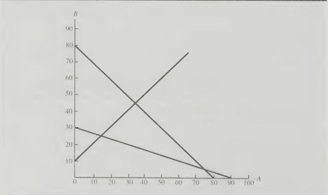


每单位5美元，而大学橄榄球每单位提供4美元的利润。以分钟表示生产时间的线性规划模型如下：

```
Max 5A + 4C
s.t.
12A + 6C ≤ 20,400 Cutting and dyeing
9A + 15C ≤ 25,200 Sewing
6A + 6C ≤ 12,000 Inspection and packaging
A, C ≥ 0
```

Reiser 问题的图形解部分如图 7.24 所示。

- a. 对本问题进行可行域阴影处理。
- b. 确定每个极点的坐标及其对应的利润。哪个极点产生的利润最高？
- c. 绘制利润为 4000 美元对应的利润线。尽可能将利润线远离原点移动，以确定哪个极点将提供最优解。将您的答案与部分 (b) 中使用的方法进行比较。
- d. 哪些约束是紧约束？请解释。
- e. 假设目标函数系数的值为：每生产一个 All-Pro 型号为 4 美元，每生产一个 College 型号为 5 美元。使用图形解法确定新的最优解及其对应的利润值。

#### 图 7.24 练习 22 的图形解部分

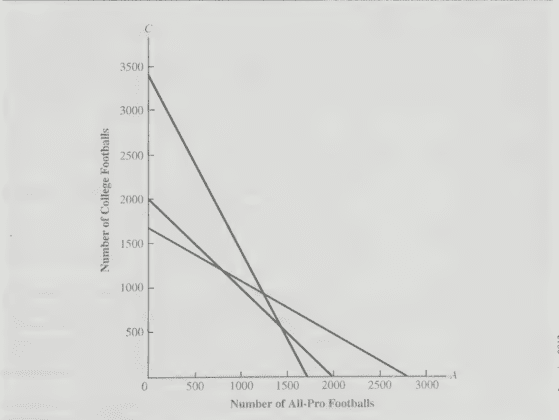

### 23. Embassy Motorcycles (EM) 公司生产两款旨在易于操控和安全的轻型摩托车。EZ-Rider 型号配备新发动机且车身较低，易于保持平衡。Lady-Sport 型号略大一些，采用更传统的发动机，专门设计以吸引女性骑手。Embassy 公司在其位于艾奥瓦州得梅因的工厂生产两款车型的发动机。每个 EZ-Rider 发动机需要 6 小时制造时间，每个 Lady-Sport 发动机需要 3 小时制造时间。得梅因工厂在下一生产周期可用的发动机制造时间为 2100 小时。Embassy 公司的摩托车车架供应商可按需提供任意数量的 EZ-Rider 车架。然而，Lady-Sport 车架更为复杂，供应商在下一生产周期只能提供最多 280 个 Lady-Sport 车架。最终组装和测试每个 EZ-Rider 型号需要 2 小时，每个 Lady-Sport 型号需要 2.5 小时。下一生产周期可用的组装和测试时间最多为 1000 小时。该公司会计部门预计，每生产一个 EZ-Rider 贡献利润 2400 美元，每生产一个 Lady-Sport 贡献利润 1800 美元。

- a. 制定一个线性规划模型，用于确定应生产每种型号的多少单位，以最大化总利润贡献。
- b. 使用图形法求解该问题。最优解是什么？
- c. 哪些约束是紧约束？

### 24. Kelson Sporting Equipment, Inc. 公司生产两种不同类型的棒球手套：普通型号和捕手型号。该公司在裁剪和缝纫部门有 900 小时的可用生产时间，在整理部门有 300 小时，在包装和发货部门有 100 小时。每只手套的生产时间要求和利润贡献如下表所示：

| 型号 | 裁剪和缝纫 | 整理 | 包装和发货 | 每只手套利润 |
| :--- | :--- | :--- | :--- | :--- |
| 普通型号 | 1 | 1/2 | 1/8 | $5 |
| 捕手型号 | 3/2 | 1/3 | 1/4 | $8 |

假设该公司有兴趣最大化总利润贡献，请回答以下问题：

- a. 该问题的线性规划模型是什么？
- b. 使用图形解法求解最优解。Kelson 应该制造多少只每种型号的手套？
- c. Kelson 以给定的生产数量可以获得的总利润贡献是多少？
- d. 每个部门将安排多少小时的生产时间？
- e. 每个部门的闲置时间是多少？

### 25. George Johnson 最近继承了一大笔钱；他想用其中一部分为他的两个子女设立一个信托基金。该信托基金有两种投资选择：(1) 债券基金和 (2) 股票基金。在投资期限内，债券基金的预计回报率为 6%，股票基金的预计回报率为 10%。无论 George 最终决定将多少遗产投入信托基金，他都希望将该金额中至少 30% 投资于债券基金。此外，他希望选择一种组合，使其能够获得至少 7.5% 的总回报率。

- a. 制定一个线性规划模型，用于确定应分配给每种可能投资替代方案的百分比。
- b. 使用图形解法求解该问题。

### 26. Sea Wharf 餐厅希望确定在报纸广告和广播广告之间分配每月 1000 美元广告预算的最佳方式。管理层决定，每种媒体类型的预算支出必须至少占 25%，并且用于本地报纸广告的金额必须至少是用于广播广告金额的两倍。一位营销顾问开发了一个指数，用于衡量每美元广告的受众曝光度，范围从 0 到 100，数值越高表示受众曝光度越大。如果本地报纸广告的指数值为 50，而定点广播广告的指数值为 80，餐厅应如何分配其广告预算以最大化总受众曝光度的值？

- a. 制定一个线性规划模型，用于确定餐厅应如何分配其广告预算，以最大化总受众曝光度的值。
- b. 使用图形解法求解该问题。

### 27. Blair & Rosen, Inc. (B&R) 是一家经纪公司，专门设计符合客户特定风险承受能力的投资组合。本周联系 B&R 的一位客户最多有 50,000 美元可供投资。B&R 的投资顾问决定推荐一个由两个投资基金组成的组合：互联网基金和蓝筹基金。互联网基金的预计年回报率为 12%，而蓝筹基金的预计年回报率为 9%。投资顾问要求，客户资金中最多 35,000 美元应投资于互联网基金。B&R 的服务包括为每个投资替代方案提供风险评级。互联网基金是两个投资替代方案中风险较高的一个，其每千美元投资的风险评级为 6。蓝筹基金的风险评级为每千美元投资 4。例如，如果在两个投资基金中各投资 10,000 美元，B&R 的投资组合风险评级将为 6(10) + 4(10) = 100。最后，B&R 开发了一份问卷来衡量每位客户的风险承受能力。根据回答，每位客户被分类为保守型、稳健型或激进型投资者。假设问卷结果将当前客户分类为稳健型投资者。B&R 建议稳健型投资者将其投资组合的风险评级限制在最多 240。

- a. 为该客户推荐的投资组合是什么？该组合的年回报率是多少？
- b. 假设第二位有 50,000 美元可供投资的客户被归类为激进型投资者。B&R 建议激进型投资者的最大投资组合风险评级为 320。为该激进型投资者推荐的投资组合是什么？讨论在激进型投资者策略下投资组合会发生什么变化。
- c. 假设第三位有 50,000 美元可供投资的客户被归类为保守型投资者。B&R 建议保守型投资者的最大投资组合风险评级为 160。为保守型投资者制定推荐的投资组合。讨论总投资基金约束的松弛变量的解释。

### 28. Tom's, Inc. 公司生产各种墨西哥食品，并将其销售给 Western Foods，这是一家位于德克萨斯州和新墨西哥州的杂货店连锁店。Tom's, Inc. 生产两种莎莎酱产品：Western Foods 莎莎酱和 Mexico City 莎莎酱。基本上，这两种产品的整个番茄、番茄酱和番茄泥混合比例不同。Western Foods 莎莎酱由 50% 的整个番茄、30% 的番茄酱和 20% 的番茄泥混合而成。Mexico City 莎莎酱质地更浓稠、更颗粒，由 70% 的整个番茄、10% 的番茄酱和 20% 的番茄泥组成。每罐生产的莎莎酱重 10 盎司。在当前生产周期，Tom's, Inc. 可购买最多 280 磅的整个番茄、130 磅的番茄酱和 100 磅的番茄泥；价格

这些原料的每磅价格分别为 $0.96、$0.64 和 $0.56。香料和其他原料的成本约为每罐 $0.10。Tom's, Inc. 以每个 $0.02 的价格购买空玻璃罐，贴标和填充成本估计为每罐莎莎酱 $0.03。Tom's 与 Western Foods 的合同使得每罐 Western Foods 莎莎酱的销售收入为 $1.64，每罐 Mexico City 莎莎酱的销售收入为 $1.93。

- a. 制定一个线性规划模型，使 Tom's 能够确定莎莎酱产品的组合，以最大化总利润贡献。
- b. 求最优解。

29. Autolite 在俄亥俄州克利夫兰的一个工厂生产汽车电子点火系统。每个点火系统由在 Autolite 位于纽约州布法罗和俄亥俄州代顿的工厂生产的两个组件装配而成。布法罗工厂每天可以生产 2000 个组件 1、1000 个组件 2，或两种组件的任意组合。例如，布法罗 60% 的生产时间可用于生产组件 1，40% 的生产时间可用于生产组件 2；在这种情况下，布法罗工厂每天能生产 0.6(2000) = 1200 个组件 1 和 0.4(1000) = 400 个组件 2。代顿工厂每天可以生产 600 个组件 1、1400 个组件 2，或两种组件的任意组合。每天结束时，布法罗和代顿的组件生产会被送往克利夫兰，在下一个工作日组装点火系统。

- a. 制定一个线性规划模型，用于制定布法罗和代顿工厂的每日生产计划，以最大化克利夫兰的点火系统日产量。
- b. 求最优解。

30. Diehl Investments 的一位财务顾问确定了两家在不久将来可能成为收购目标的公司。Eastern Cable 是建筑行业使用的柔性电缆系统的领先制造商，ComSwitch 是一家专注于数字交换系统的新公司。Eastern Cable 目前每股交易价为 $40，ComSwitch 目前每股交易价为 $25。如果收购发生，财务顾问估计 Eastern Cable 的股价将涨至每股 $55，ComSwitch 将涨至每股 $43。此时，财务顾问已将 ComSwitch 确定为较高风险的替代方案。假设一位客户表示愿意在两家公司中最多投资 $50,000。客户希望在 ComSwitch 中至少投资 $15,000，在 Eastern Cable 中至少投资 $10,000。由于 ComSwitch 关联的风险较高，财务顾问建议在 ComSwitch 中投资最多不应超过 $25,000。

- a. 制定一个线性规划模型，用于确定 Eastern Cable 和 ComSwitch 的股数，以满足投资约束并最大化投资的总回报。
- b. 绘制可行域。
- c. 确定每个极点的坐标。
- d. 求最优解。

31. 考虑以下线性规划：

```
Min 3A + 4B
s.t.
1A + 3B ≥ 6
1A + 1B ≥ 4
A, B ≥ 0
```

使用图解法确定可行域并求最优解。目标函数的值是多少？

32. 确定 M&D Chemicals 问题（见第 7.5 节）的三个极点解。确定每个极点的目标函数值以及松弛变量和剩余变量的值。

33. 考虑以下线性规划问题：

```
Min A + 2B
s.t.
A + 4B ≤ 21
2A + B ≥ 7
3A + 1.5B ≤ 21
-2A + 6B ≥ 0
A, B ≥ 0
```

- a. 使用图解法求最优解和目标函数的值。
- b. 确定每个约束的松弛量或剩余量。
- c. 假设目标函数改为 max 5A + 2B。求最优解和目标函数的值。


34. 考虑以下线性规划：

```
Min 2A + 2B
s.t.
1A + 3B ≤ 12
3A + 1B ≥ 13
1A - 1B = 3
A, B ≥ 0
```

- a. 显示可行域。
- b. 可行域的极点是什么？
- c. 使用图解法求最优解。


35. 对于线性规划

```
Min 6A + 4B
s.t.
2A + 4B ≥ 12
1A + 1B ≥ 10
1B ≤ 4
A, B ≥ 0
```

- a. 将问题写成标准形式。
- b. 使用图解法求解问题。
- c. 松弛变量和剩余变量的值是多少？

36. 作为质量改进计划的一部分，Consolidated Electronics 的员工完成了为期三天的团队合作培训课程和为期两天的问题解决培训课程。质量改进经理要求在未来六个月内至少开设 8 门团队合作培训课程和至少 10 门问题解决培训课程。此外，高层管理规定在此期间必须至少开设 25 门培训课程。Consolidated Electronics 使用顾问来教授培训课程。在下一个季度，顾问有 84 天的培训时间可用。每门团队合作培训课程成本为 $10,000，每门问题解决培训课程成本为 $8000。

- a. 制定一个线性规划模型，用于确定应开设多少门团队合作培训课程和多少门问题解决培训课程，以最小化总成本。
- b. 绘制可行域。
- c. 确定每个极点的坐标。
- d. 求最小成本解。

37. 新英格兰奶酪公司通过将温和切达奶酪与特级切达奶酪混合生产两种奶酪涂抹酱。奶酪涂抹酱装在 12 盎司的容器中，然后销售给东北地区的分销商。Regular 混合酱含 80% 的温和切达奶酪和 20% 的特级切达奶酪，Zesty 混合酱含 60% 的温和切达奶酪和 40% 的特级切达奶酪。今年，当地乳品合作社提出提供最多 8100 磅温和切达奶酪，每磅 $1.20，以及最多 3000 磅特级切达奶酪，每磅 $1.40。除奶酪成本外，混合和包装奶酪涂抹酱的成本为每容器 $0.20。如果每容器 Regular 售价为 $1.95，每容器 Zesty 售价为 $2.20，新英格兰奶酪公司应生产多少容器的 Regular 和 Zesty？

38. 应用技术公司（ATI）使用两种玻璃纤维材料生产自行车车架，以提高车架的强度重量比。标准级材料的成本为每码 $7.50，专业级材料的成本为每码 $9.00。标准级和专业级材料含有不同数量的玻璃纤维、碳纤维和凯夫拉，如下表所示：

| | 标准级 | 专业级 |
|---|---|---|
| 玻璃纤维 | 84% | 58% |
| 碳纤维 | 10% | 30% |
| 凯夫拉 | 6% | 12% |

ATI 与一家自行车制造商签订合同，生产一种碳纤维含量至少为 20% 且凯夫拉含量不大于 10% 的新车架。为满足所需重量规格，每个车架必须总共使用 30 码材料。

- a. 制定一个线性规划，以确定 ATI 应在每个车架中使用多少码每种等级的纤维材料，以最小化总成本。定义决策变量并说明每个约束的目的。
- b. 使用图解法确定可行域。极点的坐标是什么？
- c. 计算每个极点的总成本。最优解是什么？
- d. 玻璃纤维材料的分销商目前专业级材料库存过剩。为减少库存，分销商向 ATI 提供以每码 $8 的价格购买专业级材料的机会。最优解会改变吗？
- e. 假设分销商进一步将专业级材料的价格降至每码 $7.40。最优解会改变吗？专业级材料价格更低会对最优解产生什么影响？请解释。

39. Innis Investments 为许多公司和富有的客户管理资金。投资策略根据每个客户的需求量身定制。对于一位新客户，Innis 已获授权在两个投资基金中最多投资 120 万美元：一个股票基金和一个货币市场


基金。每单位股票基金成本为 50 美元，年收益率为 10%；每单位货币市场基金成本为 100 美元，年收益率为 4%。客户希望在投资年收入至少为 60,000 美元的前提下最小化风险。根据 Innis 的风险衡量体系，每单位投资于股票基金的风险指数为 8，每单位投资于货币市场基金的风险指数为 3；股票基金较高的风险指数仅表明它是风险更大的投资。Innis 的客户还规定，至少将 300,000 美元投资于货币市场基金。

- a. 确定 Innis 应为客户购买多少单位的各类基金，以使投资组合的总风险指数最小。
- b. 该投资策略将产生多少年收入？
- c. 假设客户希望最大化年回报，资金应如何投资？

- 40. Eastern Chemicals 生产两种用于工业制造的润滑油。这两种产品的生产成本均为 Eastern Chemicals 每加仑 1 美元。基于对当前库存水平和下个月未完成订单的分析，Eastern Chemicals 的管理层规定，未来两周内必须生产至少 30 加仑的产品 1 和至少 20 加仑的产品 2。管理层还指出，生产这两种润滑油所需的一种极易变质原材料的现有库存必须在未来两周内使用完毕。该易变质原材料的当前库存为 80 磅。虽然如有必要可以订购更多这种原材料，但未来两周内未使用的当前库存将会变质——因此，管理层要求未来两周内至少使用 80 磅。已知，产品 1 每加仑需要 1 磅这种易变质原材料，产品 2 每加仑需要 2 磅这种原材料。由于 Eastern Chemicals 的目标是将生产成本降至最低，该公司管理层正在寻找一种最低成本的生产计划，该计划将使用全部 80 磅易变质原材料，并提供至少 30 加仑的产品 1 和至少 20 加仑的产品 2。最低成本解是什么？

- 41. Southern Oil Company 生产两种汽油：普通汽油和高级汽油。普通汽油的利润贡献为每加仑 0.30 美元，高级汽油的利润贡献为每加仑 0.50 美元。每加仑普通汽油含 0.3 加仑 A 级原油，每加仑高级汽油含 0.6 加仑 A 级原油。在下一个生产周期，Southern 可用 A 级原油 18,000 加仑。用于生产汽油的炼油厂在下一个生产周期的生产能力为 50,000 加仑。Southern Oil 的分销商表示，下一个生产周期高级汽油的需求量最多为 20,000 加仑。

  - a. 制定一个线性规划模型，用于确定应生产多少加仑的普通汽油和多少加仑的高级汽油，以最大化总利润贡献。
  - b. 最优解是什么？
  - c. 松弛变量的值及其解释是什么？
  - d. 约束条件中哪些是紧约束？

- 42. 以下线性规划是否涉及无可行解、无界解和/或多个最优解？请解释。

Max 4A + 8B
s.t.
2A + 2B <= 10
-1A + 1B >= 8
A, B >= 0

- 43. 以下线性规划是否涉及无可行解、无界解和/或多个最优解？请解释。

Max 1A + 1B
s.t.
8A + 6B ≥ 24
2B ≥ 4
A, B ≥ 0

- 44. 考虑以下线性规划：

Max 1A + 1B
s.t.
5A + 3B ≤ 15
3A + 5B ≤ 15
A, B ≥ 0

  - a. 该问题的最优解是什么？
  - b. 假设目标函数改为 1A + 2B。求出新的最优解。

- 45. 考虑以下线性规划：

Max 1A - 2B
s.t.
-4A + 3B ≤ 3
1A - 1B ≤ 3
A, B ≥ 0

  - a. 绘制该问题的可行域。
  - b. 可行域是否无界？请解释。
  - c. 求出最优解。
  - d. 可行域无界是否意味着线性规划的最优解将是无界的？

- 46. 一家小型独立杂货店的经理正在确定软饮料货架空间的最佳利用方式。该店销售全国品牌和自有品牌，目前有 200 平方英尺的货架空间可用。经理希望将至少 60% 的空间分配给全国品牌，并且无论盈利能力如何，至少将 10% 的空间分配给自有品牌。在以下情况下，经理应将多少平方英尺的空间分配给全国品牌和自有品牌？

  - a. 全国品牌比自有品牌更有利可图。
  - b. 两种品牌盈利能力相同。
  - c. 自有品牌比全国品牌更有利可图。

- 47. 讨论如果产品 A 的每加仑成本增加到 3.00 美元，M&D Chemicals 问题（见第 7.5 节）会发生什么变化。你有什么建议？请解释。

- 48. 针对第 7.5 节的 M&D Chemicals 问题，讨论管理层要求两种产品总产量为 500 加仑的影响。列出 M&D 应考虑的两到三项措施，以纠正你遇到的情况。

- 49. PharmaPlus 经营一家拥有 30 家药店的连锁店。药店由持证药剂师和药房技术人员配备人员。该公司目前雇佣了 85 名全时当量药剂师（全职和兼职的组合）和 175 名全时当量技术人员。每年春季，管理层都会审查当前的人员配置水平并为全年制定招聘计划。对明年处方量的最新预测显示，为药店配备人员至少需要 250 名全时当量员工（药剂师和技术人员）。人事部门预计未来一年将有 10 名药剂师和 30 名技术人员离职。为了应对预期的流失并为未来增长做准备，管理层表示必须至少雇佣 15 名新药剂师。此外，PharmaPlus 的新服务质量指南规定，每名持证药剂师最多配备两名技术人员。持证药剂师的平均薪资为每小时 40 美元，技术人员的平均薪资为每小时 10 美元。

  - a. 为 PharmaPlus 制定一个最低成本的人员配置计划。需要多少名药剂师和技术人员？
  - b. 鉴于当前的人员配置水平和预期的流失，必须进行多少新招聘（如果有）才能达到部分 (a) 推荐的水平？对工资单会有什么影响？

- 50. Expedition Outfitters 制造各种用于徒步旅行、滑雪和登山的专业服装。该公司决定开始生产两款专为极寒天气设计的新款羽绒服：Mount Everest 羽绒服和 Rocky Mountain 羽绒服。Expedition 的制造工厂有 120 小时的裁剪时间和 120 小时的缝纫时间可用于生产这两款羽绒服。每件 Mount Everest 羽绒服需要 30 分钟的裁剪时间和 45 分钟的缝纫时间，每件 Rocky Mountain 羽绒服需要 20 分钟的裁剪时间和 15 分钟的缝纫时间。人工和材料成本为每件 Mount Everest 羽绒服 150 美元，每件 Rocky Mountain 羽绒服 50 美元，该公司通过其邮购目录的零售价为 Mount Everest 羽绒服 250 美元，Rocky Mountain 羽绒服 200 美元。由于管理层认为 Mount Everest 羽绒服是一款独特的外套，将提升公司的形象，因此管理层规定，总产量中至少有 20% 必须是这款型号。假设 Expedition Outfitters 能够销售其能生产的每种类型的所有外套，它应制造多少单位的每款型号以最大化总利润贡献？

- 51. English Motors, Ltd. (EML) 开发了一款新的全轮驱动运动型多用途车。作为营销活动的一部分，EML 制作了一份数字录制的销售演示文稿，发送给现有 EML 四轮驱动车辆的车主以及竞争对手提供的四轮驱动运动型多用途车的车主；EML 将这两个目标市场称为现有客户市场和新客户市场。请求新促销的个人还将收到一张试驾新款 EML 车型一个周末的优惠券。新促销成功的关键因素是响应率，即收到新促销并试驾新车型的个人百分比。EML 估计，现有客户市场的响应率为 25%，新客户市场的响应率为 20%。对于试驾新车型的客户，销售率是进行购买的个人百分比。市场调查研究表明，现有客户市场的销售率为 12%，新客户市场的销售率为 20%。每次促销的成本（不包括试驾成本）为：发送给现有客户市场的每次促销 4 美元，发送给新客户市场的每次促销 6 美元。管理层还规定，至少有 30,000 名现有客户应试驾新车型，至少有 10,000 名新客户应试驾新车型。此外，试驾新车辆的现有客户数量必须至少是试驾新车辆的新客户数量的两倍。如果营销预算（不包括试驾成本）为 120 万美元，应向每组客户发送多少份促销材料才能最大化总销售额？


52. Creative Sports Design (CSD) 生产标准尺寸球拍和大号球拍。该公司的球拍极其轻便，因为使用了由该公司创始人发明的镁-石墨合金。每个标准尺寸球拍使用 0.125 千克合金，每个大号球拍使用 0.4 千克；在未来两周的生产期间，仅有 80 千克合金可用。每个标准尺寸球拍使用 10 分钟制造时间，每个大号球拍使用 12 分钟。每个标准尺寸球拍的利润贡献为 10 美元，每个大号球拍为 15 美元，每周可用制造时间为 40 小时。管理层规定，总产量中至少 20% 必须是标准尺寸球拍。CSD 在未来两周内应分别制造多少个各类型球拍才能使总利润贡献最大化？假设由于其产品的独特性质，CSD 能够销售其生产的所有球拍。

53. High Tech Services (HTS) 管理层希望开发一个模型，帮助分配技师在常规合同客户和新客户服务呼叫之间的时间。在两周规划期间，技师时间最多可用 80 小时。为满足现金流要求，两周期间必须产生至少 800 美元（每位技师）的收入。常规客户的技师时间每小时产生 25 美元。然而，新客户的技师时间平均每小时仅产生 8 美元，因为在许多情况下，新客户联系无法提供可计费服务。为确保维护新客户联系，用于新客户联系的技师时间必须至少为用于常规客户联系时间的 60%。鉴于这些收入和政策要求，HTS 希望确定如何在常规客户和新客户之间分配技师时间，以最大化两周期间联系的客户总数。技师平均每次常规客户联系需要 50 分钟，每次新客户联系需要 1 小时。a. 开发一个线性规划模型，使 HTS 能够在常规客户和新客户之间分配技师时间。b. 求最优解。

54. Jackson Hole Manufacturing 是一家小型塑料制品制造商，其产品用于汽车和计算机行业。其一项主要合同与一家大型计算机公司签订，涉及为该公司的便携式打印机生产塑料打印机外壳。生产外壳使用两台注塑机。M-100 机器的生产能力为每小时 25 个打印机外壳，M-200 机器的生产能力为每小时 40 个外壳。两台机器使用相同的化学材料生产打印机外壳；M-100 每小时使用 40 磅原材料，M-200 每小时使用 50 磅。计算机公司要求 Jackson Hole 在接下来的一周内尽可能多地生产外壳；它将为 Jackson Hole 交付的每个外壳支付 18 美元。然而，下周是 Jackson Hole 大多数生产员工的定期休假期间；在此期间，工厂所有设备将进行年度维护。由于维护停机，M-100 可用时间不超过 15 小时，M-200 可用时间不超过 10 小时。然而，由于两台机器都涉及高昂的设置成本，管理层要求，如果对任一机器安排生产，则该机器必须运行至少 5 小时。生产过程中使用的化学材料供应商告知 Jackson Hole，下周生产最多可提供 1000 磅化学材料；该原材料成本为每磅 6 美元。除了原材料成本外，Jackson Hole 估计 M-100 和 M-200 的每小时运行成本分别为 50 美元和 75 美元。

- a. 制定一个可用于最大化利润贡献的线性规划模型。
- b. 求最优解。

## 案例问题 1 工作量平衡

Digital Imaging (DI) 为专业市场和消费市场生产照片打印机。DI 消费部门最近推出了两款照片打印机，可提供与专业处理实验室生产的相媲美的彩色打印。DI-910 型号可在约 37 秒内生产一张 4" × 6" 无边框打印。更先进、更快的 DI-950 甚至可以生产 13" × 19" 无边框打印。财务预测显示，每台 DI-910 的利润贡献为 42 美元，每台 DI-950 为 87 美元。

打印机在位于北卡罗来纳州纽伯恩的 DI 工厂组装、测试和包装。该工厂高度自动化，使用两条生产线生产打印机。生产线 1 执行组装操作，每台 DI-910 打印机耗时 3 分钟，每台 DI-950 打印机耗时 6 分钟。生产线 2 执行测试和包装操作。每台 DI-910 打印机耗时 4 分钟，每台 DI-950 打印机耗时 2 分钟。DI-950 打印机的时间更短是因为其打印速度更快。两条生产线每天运行一个 8 小时班次。

### 管理报告

为 Digital Imaging 进行分析，以确定每种打印机应生产多少台。向 DI 总裁提交一份报告，陈述你的调查结果和建议。包括（但不限于）对以下事项的考虑：

- 1. 为最大化 8 小时班次的总利润贡献，建议生产每种打印机的推荐台数。管理层可能出于什么理由不采纳你的建议？
- 2. 假设管理层还规定，生产的 DI-910 打印机数量必须至少等于生产的 DI-950 单位数量。假设目标是最大化 8 小时班次的总利润贡献，每种打印机应生产多少台？
- 3. 你在第 (2) 部分开发的解决方案是否平衡了生产线 1 和生产线 2 的总耗时？为什么这种平衡或不平衡可能是管理层关注的问题？
- 4. 管理层要求扩展第 (2) 部分的模型，以在生产线 1 的总耗时和生产线 2 的总耗时之间提供更好的平衡。管理层希望将生产线 1 的总耗时和生产线 2 的总耗时之间的差异限制在 30 分钟以内。如果目标仍然是最大化总利润贡献，每种打印机应生产多少台？这种工作量平衡对第 (2) 部分的总利润有什么影响？
- 5. 假设在第 (1) 部分中，管理层指定的目标是最大化每班次生产的打印机总数，而不是总利润贡献。有了这个目标，每班次每种打印机应生产多少台？这个目标对总利润和工作量平衡有什么影响？

对于你开发的每个解决方案，在报告附录中包含一份线性规划模型和图形解的副本。

## 案例问题 2 生产策略

Better Fitness, Inc. (BFI) 在长岛自由港的工厂制造健身器材。它最近为家庭健身市场设计了两款通用重量机。两款机器都使用 BFI 专利技术，为用户提供每种锻炼类型极其广泛的运动能力。直到现在，这种功能仅在昂贵的重量机上可用，主要由物理治疗师使用。

在最近的一次贸易展览会上，机器演示引起了经销商的极大兴趣。事实上，BFI 在贸易展览会上收到的订单数量远远超过了当前生产周期的制造能力。因此，管理层决定开始生产这两款机器。BFI 命名为 BodyPlus 100 和 BodyPlus 200 的两款机器，生产所需的资源量不同。

BodyPlus 100 由机架单元、压力站和胸肌飞鸟站组成。每个生产的机架使用 4 小时机加工和焊接时间以及 2 小时喷漆和 finishing（表面处理）时间。每个压力站需要 2 小时机加工和焊接时间以及 1 小时喷漆和 finishing（表面处理）时间，每个胸肌飞鸟站使用 2 小时机加工和焊接时间以及 2 小时喷漆和 finishing（表面处理）时间。此外，每台 BodyPlus 100 花费 2 小时进行组装、测试和包装。原材料成本为每个机架 450 美元，每个压力站 300 美元，每个胸肌飞鸟站 250 美元；包装成本估计为每台 50 美元。

BodyPlus 200 由机架单元、压力站和腿压站组成。每个生产的机架使用 5 小时机加工和焊接时间以及 4 小时喷漆和 finishing（表面处理）时间。每个压力站需要 3 小时机加工和焊接时间以及 2 小时喷漆和 finishing（表面处理）时间，每个胸肌飞鸟站使用 2 小时机加工和焊接时间以及 2 小时喷漆和 finishing（表面处理）时间，每个腿压站需要 2 小时机加工和焊接时间以及 2 小时喷漆和 finishing（表面处理）时间。此外，每台 BodyPlus 200 花费 2 小时进行组装、测试和包装。原材料成本为每个机架 650 美元，每个压力站 400 美元，每个胸肌飞鸟站 250 美元，每个腿压站 200 美元；包装成本估计为每台 75 美元。

对于下一个生产周期，管理层估计将有 600 小时机加工和焊接时间；450 小时喷漆和 finishing（表面处理）时间；以及 140 小时组装、测试和包装时间可用。当前人工成本为机加工和焊接时间每小时 20 美元；喷漆和 finishing（表面处理）时间每小时 15 美元；组装、测试和包装时间每小时 12 美元。两款机器必须竞争的市场建议 BodyPlus 100 的零售价为 2400 美元，BodyPlus 200 的零售价为 3500 美元，尽管由于新机器的独特功能，BFI 可能有一些灵活性。经授权的 BFI 经销商可以按建议零售价的 70% 购买机器。

BFI 总裁认为，BodyPlus 200 的独特功能可以帮助 BFI 定位为高端健身器材领域的领导者之一。因此，她表示，生产的 BodyPlus 200 单位数量必须至少占总产量的 25%。

### 管理报告

分析 Better Fitness, Inc. 的生产问题，并为 BFI 总裁准备一份报告，陈述你的调查结果和建议。包括（但不限于）对以下事项的考虑：

- 1. 建议生产的 BodyPlus 100 和 BodyPlus 200 机器的数量


- 2. 生产的BodyPlus 200单位数量必须至少占总产量25%这一要求对利润的影响
- 3. 为增加对利润的贡献，应将精力集中在哪里

在报告的附录中包含您的线性规划模型和图形解的副本。

## 案例问题 3 Hart Venture Capital

Hart Venture Capital (HVC) 专门为软件开发和互联网应用提供风险资本。目前HVC有两个投资机会：(1) Security Systems，一家需要额外资金来开发互联网安全软件包的公司；(2) Market Analysis，一家需要额外资金来开发用于进行客户满意度调查的软件包的市场研究公司。作为交换Security Systems股票的条件，该公司要求HVC在未来三年期间分别在第1年提供600,000美元、第2年提供600,000美元、第3年提供250,000美元。作为交换Market Analysis股票的条件，该公司要求HVC在同一三年期间分别在第1年提供500,000美元、第2年提供350,000美元、第3年提供400,000美元。HVC认为这两个投资机会都值得追求。但是，由于其他投资，HVC愿意在第一年为两个项目最多承诺800,000美元，在第二年最多承诺700,000美元，在第三年承诺500,000美元。

HVC的财务分析师团队审查了两个项目，并建议公司的目标应是最大化Security Systems和Market Analysis总投资的净现值。净现值考虑了三年期结束时股票的预估价值以及每年三年期间所需的资本流出。使用8%的回报率，HVC的财务分析团队估计，Security Systems项目100%资助的净现值为1,800,000美元，Market Analysis项目100%资助的净现值为1,600,000美元。

HVC有选择资助Security Systems和Market Analysis项目任何百分比的选项。例如，如果HVC决定资助Security Systems项目的40%，则第1年需要投资0.40($600,000) = $240,000，第2年需要投资0.40($600,000) = $240,000，第3年需要投资0.40($250,000) = $100,000。在这种情况下，Security Systems项目的净现值将为0.40($1,800,000) = $720,000。Market Analysis项目部分资助的投资金额和净现值将以同样的方式计算。

### 管理报告

对HVC的投资问题进行分析，并准备一份陈述您的调查结果和建议的报告。请务必包含以下信息：

- 1. HVC应资助的每个项目的推荐百分比以及总投资的净现值
- 2. 未来三年期间Security Systems和Market Analysis的资本分配计划以及HVC每年的总投资
- 3. 如果HVC愿意在第1年额外承诺100,000美元，对HVC应资助的每个项目的推荐百分比的影响（如有）
- 4. 如果额外提供100,000美元，资本分配计划
- 5. 关于HVC是否应在第1年承诺额外100,000美元的建议

在报告附录中提供模型详细信息和相关计算机输出。

## 附录7.1 使用Excel 2010求解线性规划

在本附录中，我们将使用Excel工作表来求解RMC线性规划问题。我们将在工作表的上半部分输入RMC问题的问题数据，并在工作表的下半部分开发线性规划模型。请注意，附录A包含关于如何在Excel中制定模型的更多详细信息。

### 制定

每当我们制定线性规划的工作表模型时，我们执行以下步骤：

- 步骤1. 在工作表的上半部分输入问题数据
- 步骤2. 为决策变量指定单元格位置
- 步骤3. 选择一个单元格并输入计算目标函数值的公式
- 步骤4. 选择一个单元格并输入计算每个约束左侧的公式
- 步骤5. 选择一个单元格并输入计算每个约束右侧的公式

使用这五个步骤为RMC问题开发的公式工作表如图7.25所示。让我们回顾一下上述步骤在RMC问题中的应用。

### 图 7.25 RMC问题的Excel公式工作表

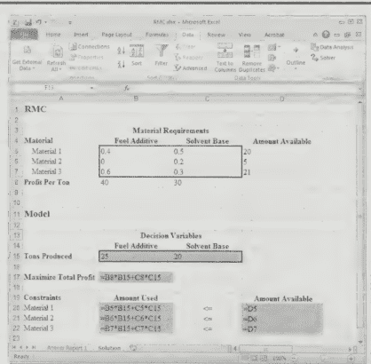

- 步骤1. 在工作表的上半部分输入问题数据
- 单元格B5到C7显示每种产品每吨的材料需求。
- 单元格B8和C8显示两种产品每吨的利润贡献。
- 单元格D5到D7显示三种材料各自的最大可用量。

- 步骤2. 为决策变量指定单元格位置
- 单元格B15将包含生产的燃油添加剂吨数，单元格C15将包含生产的溶剂基吨数。

- 步骤3. 选择一个单元格并输入计算目标函数值的公式
- 单元格B17: =B8*B15+C8*C15

- 步骤4. 选择一个单元格并输入计算每个约束左侧的公式。有三个约束，我们有
- 单元格B20: =B5*B15+C5*C15
- 单元格B21: =C6*C15
- 单元格B22: =B7*B15+C7*C15

- 步骤5. 选择一个单元格并输入计算每个约束右侧的公式。有三个约束，我们有
- 单元格D20: =D5
- 单元格D21: =D6
- 单元格D22: =D7

请注意，描述性标签使工作表的模型部分更易于阅读和理解。例如，我们在第14行和第15行添加了“燃油添加剂”、“溶剂基”和“生产吨数”，以便可以轻松解释出现在单元格B15和C15中的决策变量的值。此外，我们在单元格A17中输入了“最大化总利润”，以指示出现在单元格B17中的目标函数值是最大利润贡献。在工作表的约束部分，我们添加了约束名称以及“<=”符号，以显示每个约束左侧和右侧之间存在的关系。尽管这些描述性标签对于使用Excel Solver求解RMC问题的解决方案不是必需的，但这些标签使用户更容易理解和解释最优解。

### Excel解法

Excel 2010包含更新的Solver功能，该功能包含了以前作为Premium Solver提供的许多内容。由Frontline Systems开发的Excel Solver可以用于求解本教材中介绍的所有线性规划问题。

以下步骤描述了如何使用Excel Solver来获得RMC问题的最优解：

- 步骤1. 从功能区选择“数据”选项卡
- 步骤2. 从分析组选择Solver（参见图7.25，其中功能区显示了分析组和“数据”选项卡）
- 步骤3. 当Solver参数对话框出现时（参见图7.26）：
- 将B17输入到“设定目标”框中
- 选择“To: Max”选项
- 将B15:C15输入到“按变化单元格”框中
- 选择“添加”
- 步骤4. 当添加约束对话框出现时：
- 在“单元格引用”框中输入B20:B22

### 图 7.26 RMC问题的Excel Solver参数对话框

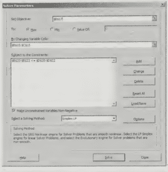

- 选择“<=”
- 在“约束”框中输入D20:D22
- 单击“确定”
- 步骤5. 当Solver参数对话框再次出现时：
- 单击“使无约束变量非负”复选框
- 步骤6. 选择“选择求解方法”下拉按钮
- 选择“单纯形法 LP*”
- 步骤7. 单击“求解”
- 步骤8. 当Solver结果对话框出现时：
- 选择“保留Solver解”
- 单击“确定”

从Solver结果对话框生成的Excel答案报告类似于图7.15。这是通过在步骤7中单击“确定”之前，在“报告”组中单击“答案”来创建的。我们将在第8章讨论敏感性报告。

图7.26显示了完成的Excel Solver参数对话框，图7.27显示了工作表中的最优解。25吨燃油添加剂和20吨溶剂基的最优解与我们使用图形解法程序获得的结果相同。Solver还有一个选项可以提供敏感性分析信息。我们将在第8章讨论敏感性分析。

在步骤5中，我们在Solver参数对话框中选择了“使无约束变量非负”选项，以避免为决策变量输入非负约束。一般来说，每当我们想要在

*因为我们知道这是一个线性规划问题，单纯形法 LP 算法是最高效的求解方法。


### 图 7.27 RMC 问题的 Excel 解法

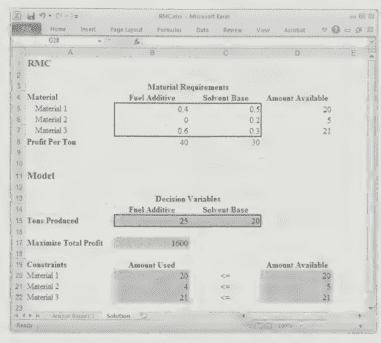

由于决策变量均限定为非负数，我们将选择此选项。此外，在第 4 步中，我们通过将 B20:B22 输入到“单元格引用”框、选择 <=，并将 D20:D22 输入到“约束”框，同时输入了所有三个小于或等于约束。或者，我们也可以逐个输入这三个约束。Solver 加载项应位于 Excel 功能区的“数据”选项卡下。如果在此处未显示，则需要按照下面所示的步骤将其添加。

- 步骤 1. 从功能区选择“文件”选项卡
- 步骤 2. 从“文件”菜单中选择“选项”
- 步骤 3. 在 Excel 选项屏幕中选择“加载项”
- 步骤 4. 单击“管理: Excel 加载项”旁边的“确定”
- 步骤 5. 单击“Solver 加载项”复选框

## 附录 7.2 使用 LINGO 求解线性规划

在本附录中，我们将说明如何使用 LINGO 求解 RMC 问题。启动 LINGO 时，会立即显示两个窗口。外部（或主框架）窗口包含所有命令菜单和命令工具栏。较小的窗口是模型窗口；此窗口用于输入和编辑您要求解的线性规划模型。与任何模型一样，最好使用注释来记录您的 LINGO 模型。LINGO 模型中的注释以感叹号开头，以分号结尾。如果需要，注释可以跨多行。

我们输入的第一项是描述目标函数的注释。请回顾，RMC 问题的目标函数是最大化利润。因此，我们输入以下注释：

```
! MAXIMIZE PROFIT;
```

接下来，我们按 Enter 键，然后键入目标函数。RMC 问题的目标函数是 Max 40F + 30S。因此，在 LINGO 模型窗口的第二行中，我们输入以下表达式：

```
MAX = 40*F + 30*S;
```

请注意，在 LINGO 中，符号 * 用于表示乘法，且目标函数（如同注释一样）以分号结尾。一般来说，LINGO 中的每个数学表达式（目标函数和约束）都以分号结束。

接下来，我们按 Enter 键移至新行。RMC 问题中的第一个约束是 0.4F + 0.5S <= 20，适用于材料 1。因此，在 LINGO 模型窗口的第三行和第四行中，我们输入以下表达式：

```
!MATERIAL 1 CONSTRAINT;
0.4*F + 0.5*S <= 20;
```

请注意，LINGO 将 <= 符号解释为 <=。或者，我们可以输入 < 来代替 <=。与输入目标函数时的情况一样，第一个约束末尾需要分号。按 Enter 键移至新行，然后继续输入其余注释和约束，如下所示：

```
!MATERIAL 2 CONSTRAINT;
0.2*S <= 5;
!MATERIAL 3 CONSTRAINT;
0.6*F + 0.3*S <= 21;
```

模型窗口现在将显示如下：

```
!MAXIMIZE PROFIT;
MAX = 40*F + 30*S;
!MATERIAL 1 CONSTRAINT;
0.4*F + 0.5*S <= 20;
!MATERIAL 2 CONSTRAINT;
0.2*S <= 5;
!MATERIAL 3 CONSTRAINT;
0.6*F + 0.3*S <= 21;
```

如果在输入模型时出错，您可以随时将光标定位到出错位置并进行必要的更正来纠正它。

要求解模型，请从 LINGO 菜单中选择“求解”命令，或单击主框架窗口顶部工具栏上的“求解”按钮。LINGO 将通过确定模型是否符合所有语法要求来开始求解过程。如果 LINGO 模型未通过这些测试，您将收到一条错误消息。如果 LINGO 在模型输入中未发现任何错误，它将开始求解模型。作为求解过程的一部分，LINGO 会显示一个“求解器状态”窗口，允许您监控求解器的进度。LINGO 会在标题为“解决方案报告”的新窗口中显示解决方案。RMC 问题在“解决方案报告”窗口中显示的输出如图 7.28 所示。

### 图 7.28 使用 LINGO 求解 RMC 问题的解

已找到全局最优解。
目标值：1600.000
总求解器迭代次数：2

| 变量 | 值 | 降成本 |
|---|---|---|
| F | 25.00000 | 0.000000 |
| S | 20.00000 | 0.000000 |

| 行 | 松弛量或剩余量 | 对偶价格 |
|---|---|---|
| 1 | 1600.000 | 1.000000 |
| 2 | 0.000000 | 33.333333 |
| 3 | 1.000000 | 0.000000 |
| 4 | 0.000000 | 44.44444 |

图 7.28 所示输出的第一部分表明已找到最优解，且目标函数的值为 1600。我们可以看到，最优解为 F = 25 且 S = 20，三个约束（行 2–4）的松弛变量分别为 0、1 和 0。我们将在第 8 章中讨论“降成本”列和“对偶价格”列信息的用途。

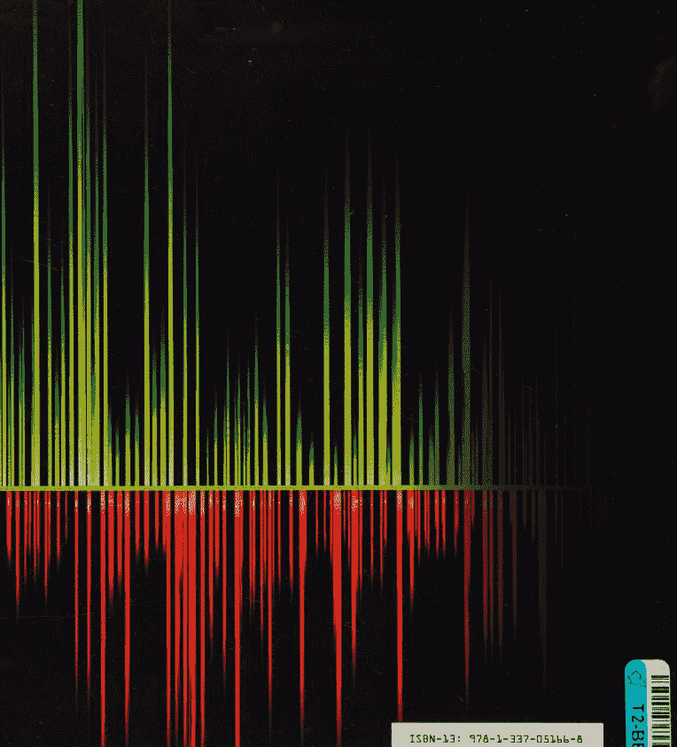

Cengage Learning
如需终身学习解决方案，请访问 www.cengage.com/custom
访问我们的企业网站 www.cengage.com

ISBN-13：978-1-337-05146-8
ISBN-10：1-337-05146-7

90000
9 781337 051668

T2-BEN-474
