# C++编程思想（第1卷）

www.TopSage.com

# 本书荣获《软件开发》杂志1996年图书金奖（Jolt Award）

中文版《软件开发》出版后，经久不衰，获得了读者的广泛关注和高度评价。第二版与第一版相比，在章节安排上有所变化，增加了“对象的连接与使用”和“C和C++”两章。前者与“对象导论”实际上是第一版“对象的实例化”的扩展，增加了近年来对对象方法和编程方法的最新研究和成果；后者的加强使得熟悉C的读者可以直接使用。删减了“输入输出选择”、“多重继承”、“异常处理”以及其他类型章节。

本书是C++成为主流后的经典教材，章节安排、讲解方法、例子和练习完美适合教学，也适合高等计算机计划及相关专业的学生，以及各行业的从业者，以及广泛的计算机学者，都能从阅读本书中受益。与众多教材相比，本书精心的内容和实用的训练使得读者能够更加成功。

Bruce Eckel: Thinking in C++ (Second Edition), Volume One: Introduction to Standard C++ (ISBN 0-13-979809-9).

# 出版者的话

文学复兴以来，源远流长的科学精神和逐步形成的学术规范，使得西方国家在自然科学的各个领域取得了实质性的优势，也正是这样的传统，使得美国在信息技术发展的六十年来名家辈出、独领风骚。在商业化的过程中，美国的学术界与工业界越来越紧密结合，计算机科学中的许多大学同时处于科研和教学的最前线，由此产生的学术著作，不仅拓展了研究的边界，还展现了学术的演变，遵循学术规范，又独具个性，其价值并不会随着岁月的流逝而消亡。

近年来，在信息全球化的今天，计算机事业发展迅速，对于人才的需求日益迫切。这不仅是挑战，更是专业的需求。随着信息技术水平的发展，美国等发达国家在十年内积累了许多经验，因此引入了一批国外教材，对计算机事业的发展起到了重要的推动作用，也是为了与国际接轨的建设。1998年，华华出版社致力于出版优秀教材。经过多年的努力，我们与国外出版社建立了良好的合作关系，他们从数百本优秀教材中推荐了：

- Pearson
- McGraw-Hill
- Elsevier
- John W. Wiley
- Andrew S. Tan (wait,)
- Dennis A. Ritchie
- Brian Kernighan (wait,)
- John W. Graham
- Gray A. Hove
- Thomas

# 译致谢

读者见智。为求更多的满意，我们只有尽力而为。由于时间和水平限制，翻译错误在所难免，恳请读者指正。

参加第2版翻译和审校工作的人包括：刘宗田、韩冬、莉烈斌、袁兆山、潘秋葵、许东、n李航、肖宛、刘皓、桂桂华、张朗、邵坤、陈慧琼、何如、栗宪、童朝柱、邢红、潘灏、n刘莹、姜川、冯鸿等。

感谢为本书第1版和第2中文版作出贡献的所有朋友。感谢关心和支持本书翻译出版的广大读者。

刘宗田
2002.8.10

# 前言

像任何一种语言一样，C++提供了一种表达思想的方法。如果这种表达法是成功的，那么问题就会变得更大更复杂了，这种方法将明显表现出比其他方法更加容易和灵活的优点。

不能把C++看作语言的一个集合，因为对于某些元素单独使用是没有意义的。我们不能用C++编写代码，而是要用它来“设计”问题，那么必须组合使用这些元素。而且，我们以这种方法理解C++，我们必须理解C的问题和一般的编程问题。本书讨论的正是编程问题，为什么这些编程问题会成为解决的问题以及如何解决问题所采用的方法。在此，在每一章中所解释的一组要素，都建立在C++解决某一类特定问题的基础之上。以这种方式，我希望一点一点引导读者，掌握从C开始，直到读者使用C++变成自己的母语言。

我将坚持一种观点：读者应该在脑海中建立一个模型，并慢慢理解这种语言，直到达到炉火纯青的程度。如果他们遇到困难，我可以帮助构建这个模型，我们将提供建议。我努力已经在脑海中将经验传递给读者，正是这些见解，使我们开始“用C++进行思考”。

## 0.1 第二版的新内容

本书是第一版的重写，反映了C++标准从完成最后部分到C++的改变，也反映了从第一版开始学习C++的经历。我检查并重写了C++全部的内容，在这个过程中，我删除了一些过时的例子，修改了一些例子，并增加了一些新的例子和新技巧。我对第一版的内容进行了改进。为了方便没有背景知识的读者阅读本书的章节，我们增加了一章，简单介绍C和基础的知识。本书配套的CD中包含一节课程的讲义材料，是为了理解C++（或Java）所需要的概念的介绍，是由Chuck Allison为我们的公司（MindView, Inc.）创建的。

而且，对于“第二版”与第一版有何不同这个问题的简要回答是：不同之处不在于本书的，而是新的，是进行了重写的，对于这里的读者甚至无法认出来的例子和材料。

### 0.1.1 第二版的内容

C++标准增加了一些新的例子，例如`String`在C++库中的容器和算法，以及模板的新复杂性。这些新的内容被放置在本书第2章，包括多个继承、异常处理、设计模式和调试稳定系统等。

### 0.1.2 如何得到第2卷

就现在你手上的这本书一样，《C++编程思想》第2卷完全可以从我的网站`www.BruceEckel.com`下载。

这个站点包括这两本书的代码，以及在MindView公司提供的CD ROM上其他课堂讨论材料的更新和信息，其中包括：公开课程、内部培训、辅导和演示。

## 0.2 预备知识

在本书第一版中，我假设读者已经学习了C，并且至少具有阅读的水平。我的重点放在我认为比较困难的：C++语言。第二版增加了一章：快速介绍C，并在光盘上提供“Thinking in C”的课程讨论，但是即使如此，我仍然假设读者有一个程序设计的经验。另外，外读者可以通过直接阅读学会新词汇。读者也可以在本书后面的学习中有助于C的知识学习。

## 0.3 C++

我希望本书的读者在进入C++时相同的情况：作为一个程序员，对于程序持有执着而执着的追求。但是，我的背景和经验是在嵌入式语言中过的。在里面，C语言常被当作高层语言，对于它位于效率的。后来，我发现自己不是一个好的C程序员，平时总是回避了这些主题（如`malloc()`，`free()`）等“复杂”的概念，以及对这些主题回避回避，但我努力去获取这些知识以及，我在学习C++时，当像这样的Stroustrup父子的自己的“专家级指南”，我当时已经自清了这些事情。我写出了一本关于C++的书，本书基本是直接按照我脑子里的思路写出来的。我的想法是作为读者的，引导程序员们进入C++，这两本书的两个版本都得到了读者的反馈。

几乎在《Using C++》出版的时候，我开始注意到，C++已经成了我的职业。1998年以后，我在授课时遇到了来自各地渴望的读者，虽然的内容和图形不理解的困难。对于我们许多不同的人群进行内部培训，在其中过程中我变为了各种哦。即使那些那些带着微笑和内心的读者，实际上他们还是困惑的。通过交流和多年举办“技术聚会”之后，我发现读者们都同一种倾向，即快速向我提问。很多时候，我做了一些努力，通过区分针对不同场合的观众提供丰富的资源方法，尽可能听听。这也是所需要的，但是因为我是一个传承技术（对于不同背景的人，我相信这种能让读者，每一个人都能达到足够的深度。有一段时间，我编写了许多教学示例。这样就结束了实验和反复学习在设计C++的过程中，最后从许多年的学习出的规律。

- Bjarne Stroustrup, The C++ Programming Language, Addison-Wesley, 1996 (第一版).
- Using C++, Osgrave/McGraw-Hill, 1999
- Using C++ and Inside Out, Osgrave/McGraw-Hill, 1993.


采用课堂的形式解决中的问题（理想的情况），并在每次课后跟随读者不断修改内容，直到我感觉到已经成为一个很好的教材。但这本书不仅是课程教材，而且其中包含了尽可能多的信息，此外这本书适合自学的人，帮助他们尽快掌握。

# 0.4 目标

在书中，我的目标是：

1. 以递进的方式介绍概念，每次学习向前，因此读者能够在学习之前就内化。
2. 可能使用简短的例子。这时会有帮助我实现“现实世界”的问题。但是，我是发现初学者能够掌握每一个细节而不受领域的影响。
3. 安排详细描述的内容，让读者发现。但是，我会给出比较详细的介绍。
4. 只想要理解语言的读者介绍东西。我相信信息的重要性，里面95%的程序员是不需要的。
5. 保持每次的学习充实，两个知识之间间隔。这可以让学者保持自己的思想。
6. 帮助读者建立基础，可以顺利转向更困难的课程（特别是第3章）。
7. 不使用特定的C++版本，因为学习语言，我不认为实现的本身重要。

# 0.5 章节概述

C++是一个在已有语法上面增加了不同的（因此它被认为是混合的面向编程语言）。对于已经学习过的语言的人，可能已经开始寻找C++特征的方法。这个课程是自然的延续，所以我尝试重复相同的路径，并通过回答一些问题是我学习语言时遇到的。

第一章 对象要。如果对象太大太复杂了，就产生了“软件危机”。按照程序的说法，我们无法完成那些复杂的事情。这引出了问题，并在书中讨论关于对象设计（OOP）的思想和如何解决问题。这一章引导读者对OOP的基本概念和特性，以及如何引入C++语言。

第二章 类的实现。这一章解释了编译器和构建的过程。它介绍了书中的第一个C++类，程序如何定义和链接，然后如何构建C++的可用的数据库。在这一章结束后，我知道如何使用类来组织代码，并有了深刻的认识。

第三章 C++的细节。这一章详细介绍了在C++中使用某些特性，介绍了如何在开发领域中“工具”制作。本书中的许多例子都有帮助读者。第三章介绍了如何进行程序设计的稳健基础，例如C++语言中使用不同的类型（读者已经使用过C++语言，有些问题应该先看前面的CD ROM，可以在`BruceEckel.com`下载）。

第四章 数据绘制。本书大部分围绕数据类型的创建，这不仅可以提供类型组织，而且为强大的OOP能力。读者可以看到数据是如何形成整个过程，学会将类组织成类。

第五章 隐藏实现。通过说明类中的数据和结构是`private`，把它们设置为用户不可见的。这意味着要把类的实现而不影响客户。另外C++引入`class`来描述新类型，是一种奇妙的变换。

第六章 初始化与构造。变量未初始化是最常见的错误。C++构造使得程序保证新类型的初始化。如果对象还需要特定的清除，它可以确保这个动作是由析构函数完成的。

第七章 构造函数与默认参数。C++帮助建立对象可能会在一个库中引入相同名字的函数。C++使用重载函数默认参数时不需要相同的函数。

第八章 常量。本章将介绍`const`和`volatile`关键字，它们在C++中另外含义。我们将学习针对特定的使用`const`。本章说明`const`在类内部和外部的含义，以及在编译时的差异。

第九章 内联函数。本章将介绍内联函数，但也排除了价值的C++转换。这一章深入研究了内联函数的实现和应用。

第十章 控制。在程序中创建类是基本的，名字是没有限制。C++在签名中控制可见性、存储效率和界面方面的控制。这一章说明如何在C++中使用控制技术，用`static`控制可见性和链接，以及`namespace`（命名空间）。

第十一章 引用和指针。C++的引用和指针具有更灵活的类型检查。这一章还提供了处理地址的方法：类似Algo，C++使用了“引用”允许用户在传递函数参数时用指针处理地址。还会通过指针传递参数对函数进行修改或从函数返回的值。最后，本章解释指向成员特征。

第十二章 运算符重载。这一特征被称为“语法糖”。由于重载可以像普通函数一样使用，使得程序员在运用运算符更加清晰。在这一章中，读者将学习重载不同类型的运算符，写自己的运算符重载，处理参数、返回值以及在赋值时是左值是最出错的情况。

### XVIII

### 0.8.1 支持

读者的编译器可能不支持在本书中讨论的所有特征，如果他们还没有编译器的最新版本就可能是如此了。实现C++这样的语言是具有挑战性的，而且读者可能希望将这些特征划分成一些部分被识别出来，而不是一下子全出现。如果读者试图运行本书中的例子时，从编译器中得到大量的错误，这可能不是代码或编译错误，而是可能是特定的编译器还没有实现例子中的某个特征。

### 0.9 本书的CD

本书附带的CD主要内容是一个“CD ROM讨论”。题目是《Thinking in Foundations for Java & C++》，由Chuck Allison编写（MindView, Inc.出版）。这些内容包含许多录音和幻灯片，如果你有CD ROM播放器和音频系统，就能在大多数计算机上观看。《Thinking in C++》的目的是让读者关注所需的知识，而不是试图让读者在所有问题上都成为C++或Java语言的专家。重点放在让读者迁移到C++或Java语言（使用C++或Java版本，它们能够帮助读者解决许多困难的问题）。它还包括答案和签名。请记住，因为本书的内容超出了《Thinking in C》的ROM内容，所以这个CD ROM不能替代这一章，但应该用作本书的预知识。

请注意，这个CD是基于教程的，所以读者应该先安装Web播放器。

### 0.10 CD、讨论和结论

CD ROM包含一些讨论，涵盖了本书的第1章和第2章。它包括几小时的课程录音、配套教材，包含了本书每一章选用的材料。如果你有CD ROM播放器和音频系统，就能在大多数计算机上观看。这些CD可以访问`www.BruceEckel.com`，那里还有可以发现更多的信息和示范引导。

我们的MindView提供了本书的材料以及高级主题的公开课程讨论。从每一章的读者材料列表，后面有一个模拟训练的教程，这样每个学生都能得到帮助。我们还提供现场培训、咨询、设计和代码调试的服务。

我们对于设计咨询、项目评价和代码调试，我们的第一个活动是我们的活动，因为我们发现许多是具有挑战性的、具有教育意义的最快的个人经历。这样，我们将竭力为满足客户需求而安排日程，或者向你推荐一个合作伙伴（这些是我们的信任和信任的伙伴，他们会与我们一起工作并举办策划讨论）。

### 0.11 错误

无论读者有多少多少发现的错误，总会有一些错误漏网，它们经常能被读者发现。如果读者发现了任何认为是错误的地方，请填写表单`www.BruceEckel.com`关于本书的修改表格并提交我们，我们将非常感激。

### 0.12 关于封面

这本书第一版的封面上有我的头像，我第一希望第二版的封面能够像《Java思想》


更像个艺术品。由于某些原因，看来C++似乎装着装饰，具有简单的线条并划过的黄色的颜料。在我的脑海中浮现出船舶和飞机的贴画，上面是长长的流线条。

我的朋友Daniel Will-Harris (Will-Harris.com) 与我初识于初中的插画，现在他已经成了世界的设计师和作者。他已经实际上为我做了所有的设计，包括这本书第一版的封面。

在这一版的设计过程中，Daniel 我满意正在制作的，不停地道：“怎样能让人类与计算机的关系？”我撇了舌头。

他另一个提议，让我把自己的脑袋放在屏幕上。Daniel有一个图像程序（Corel，他的爱的），它会自动切换我的头的图像。正如他所描述的，“自动切换是一种计算机功能，能让图片变为一些逼真的。”然后开始操作，直到我的头部看上去像一张图像，这个图片可能是计算机眼中的形态。

我看了这个创意，打算把它画在水彩纸上，然后……

### XXV

10.4.1 怎么办......235
13.2.1 一个小型程序......312
13.4 消耗内存......315

### XXVI

### TopSage

13.5 重载全局`new`和`delete`......316
13.5.1 重载一个类类`new`和`delete`......317
13.5.2 对于一个类重载`new`和`delete`......318
13.5.3 为构造重载`new`和`delete`......320
13.5.4 构造函数重载......322
13.5.5 定位`new`和`delete`......323
13.6 小类......324
13.7 练习......326
14.2 继承构造......327
14.3 构造函数的初始化列表表达式......329
14.3.1 在初始化列表中内部类......329
14.4 组合和继承......333
14.4.1 构造函数和析......333
14.6 非继承......336
14.6.1 继承和静态析......339
14.7 组合和继承......339
14.7.1 选择......340
14.7 子类设置......340
14.7 私有继承......342
14.7.1 对继承析函数化......342
14.8 `protected`......348
14.8.1 析构函数......348
14.9 运算符的重载与......343
14.10 多重载......345
14.11 析构函数......349
14.2 向上转换......344
A.7 在头文件上包含警卫......432
A.8 使用名空间......433
C.2.1 自己的书......441


计算机起源于一台机器。因此，程序语言的起源也源于机器。

然而，计算机不仅是一台机器，因为它们就像我们放大工具（史蒂夫·乔布斯称其为“智力的自行车”）和一种用于表现的媒介。所以，它们渐渐地不再像机器，而更像我们大脑的一部分了！它们更像其他的用于表现的媒介（如写画、绘画、雕刻、动画或电影）。面向对象语言的设计就是“设计计算机为一种用于表现的媒介”这一个华丽章节的一部分。

本章介绍面向对象程序设计（OO）的基本概念，包括OO开发方法的描述。在阅读本书之前，我们假设读者已经在使用其他程序语言的经验，当然不是一样的语言。如果读者在学习OO之前需要学习面向对象设计的语言，可以参考书书中附带的章节“Thinking in C: Foundations for C++ and Java”等。


本章是背景和辅助材料。我们在未了解这些大概念之前就进入面向对象设计，许多人会感到困惑。这里建议读者先要熟悉 OO 的基本概念。但是，还有另一个读者，在没有看到具体的结构之前，就不能理解语言的媒介性；当他们接触到代码可能会停止编写和不知所措。所以读者对于后者，急于学习这种语言的具体内容，可以跳过本章，这样不会影响编写代码和学习语言。但是，对于前者，最好以后再回过头来补充章节的内容，这将告诉我们为什么要对对象进行设计。

所有的程序设计语言都提供抽象。可以说，人们能够解决问题的复杂性直接与抽象的类型和质量有关。这里“类型”就是“要抽象的”。汇编语言中，这里的许多所谓的“命令语句”（例如 Fortran、BASIC 等）都是对底层语言的抽象。这种语言已经经历了巨大的改进，但是它是主语言仍然要程序员用机器计算的结果来考虑，而不是要解决问题的逻辑结构。程序员必须在机器（在“空间中”，抽象这些问题的空间）之间建立联系，程序员必须进行所需要的动作，这并不是设计语言之外的任务，我们必须使用抽象以减少编写成本，并且作为一种副作用，就创建了“程序设计”方法。替代机器的另一种方式是对解决的问题进行建模，ISP 和 APL 这样的早期语言选择了特殊的“世界”（或“所有的问题最终就是结束”或“所有的问题都是计算”），PROLOG 把所有的问题都变成查找清单。这里有一些语言，创造它们的目的是为了契约的编程和专门用于通过绘图来编译语言（后者已被限制极大范围了）。这些方法中的每一种对于特定的问题来说都是最好的办法，抽象就足够了。

> 史夫·乔布斯（Steve Jobs）是公司的创始人和精神领袖 —— 译者

面向对象的方法为程序员提供了在问题空间中显示各种元素的工具，从而向前迈了一步。这种表示方法是通用的，并不限定程序员只处理特定类型的问题。我们把空间中的事物和它们在空间中的表示标记为“对象”（当然，还需要另外一些对象，它们在空间中没有对应）。我的想法是允许程序员通过添加新的类型，使程序员能够对问题进行建模，这就使用这种方法的解决，它在表示该问题的文字，是比以前更灵活和更强大的抽象。因此，OOP 面向程序员用的本身的术语来描述问题，而不是用运行面向程序的计算机的术语来描述问题。

每一个语言的设计者认为，面向对象本身并不是一种容易解决面向设计问题的方法，他们能够结合各种方法，如 multiparigm 的程序语言。

Alan Kay 提到 Smalltalk 的五个基本原则，这些特性为我们面向对象设计的方法。Smalltalk 是第一个成功的面向对象语言，是 C++ 的基础语言。

- 1) 万物皆对象。对象可以被认为是一个类的实例，具有封装功能。理论上，我们可以在需要的问题中提取任意的成分。
- 2) 程序是一对，对象之间通过消息交互来相互告知。更具体地，可以将信息看作对于某个对象的特定属性的函数。
- 3) 每个对象都有它自己的由其他对象构造的范围。就可以包含已经在存在的对象中创建新的对象。因此，程序员可以构造复杂的整体，并且使得复杂的复用性在对象的范围内得到了体现。
- 4) 每个对象都有一个类型。采用 OOP 术语，每个对象都是某个类的实例（instance），在“类”中与“类型”是同类的。最重要的特征是“能够向它发送消息”。

亚多士·米是第一个引入类型（type）概念的人，他找到了“鱼和口袋”。所有对象（虽然具有唯一性）都是类对象中的一员，它们具有共同的特征和行为。这一想法在第一个面向对象设计语言 C++97 中得到了直接的引入，该语言用基本关键字在中引入了新类型。

名义如此，Simula 的目的是为了解决建模问题，例如“银行的账户问题”。其中包括储户、账户、交易等规模单位的“对象”。把那些在执行期间的状态之外其他方面不作为对象的标识为“类”对象，这就是关键字（class）的含义。创建抽象数据类型是面向对象程序设计的基本思想。抽象数据类型几乎完全能像类型一样这种味道，我们可以用共享和继承来定义。由于一个“类”类型的对象也是“类”类型的对象，所以保证它能够接收消息。这种语言能够自动处理描述的任意对象的扩展行为。这种替换能力（substitutability）是 OOP 的最后的思想。

> Alan Kay 提到过的程序员的著作《Multadigm Programming in C++》(Addison-Wesley, 1995).

> 可以在第二章中找到关于这个问题的解答，本书的第二卷。

操作。程序可以创建类的变量（称为对象（object）或 instance）和操控这些变量（称为消息或请求），对对象需要事情。在面向对象设计中，账户、客户等，每一个都被视为唯一的。实体就是对象，每个对象都属于类。面向对象的设计语言使用“类”（class）。当使用类型（type）时可以做成类“class”。这个过程通常被称为面向对象“发送消息”，对象根据这个消息确定（执行代码）。如上这个类或名字是 Light，它可以让 Light 发出这些请求：打开、关闭、改变状态。对此类区分，他们为类型(type)确定，而类(class)是特定的。

| 类型 | Light |
| :--- | :--- |
| 接口 | on() |
| | brighten() |
| | dim() |

```
Light { };
```

接口规范我们能够向特定的对象请求。然而，必须用代码满足这种请求，再加上数据的描述，构成了实现(implementation)。从过程设计的观点，这并不复杂。类型对每个请求相关的函数，当向对象发送请求时。这种形式已经足够了：不需要特殊例外组合或继承。

## C++ 思想

统一建模语言（Unified Modeling Language, UML）的规则，每个类由一个框表示，类的顶部的类型，中间部分列出的数据，底部是数据成员（member function 对于对象的）。只有类的名字和公共成员会在 UML 中显示出来。如果类的语义越模糊，底部越不需要。

Scott Meyers（Effective C++）的作者 Joshua。

创建了一个类并进行了测试后，这类类（理论上）就已经有了单元。重用并不像许多人希望的那样容易，产生好设计需要经验和洞力。但是只要有了这样的设计，就应该提供重用。代码重用是面向对象设计的优势之一。重用一个类最简单的方法就是直接使用这个类的，可以将这个类的对象放到新类的里面。我们称之为“创建一个类”。可以用任何类型和类对它的对象组成新类所需的功能。由于在类中实例化，所以称为组合（composition）或通俗称为聚合（aggregation）。组合通常被称为“has-a”关系，比如“在汽车中发动”。


对象，类的层次结构是最初的模型，所能够直接从实际世界中的系统连接到代码的。对象，类的层次结构是最初的模型，所能够直接从实际世界中的系统连接到代码的。对象，类的层次结构是最初的模型，所能够直接从实际世界中的系统连接到代码的。对象，类的层次结构是最初的模型，所能够直接从实际世界中的系统连接到代码的。对象，类的层次结构是最初的模型，所能够直接从实际世界中的系统连接到代码的。对象，类的层次结构是最初的模型，所能够直接从实际世界中的系统连接到代码的。对象，类层次结构是的。

统一建模语言（Unified Modeling Language, UML）的规则，每个类由一个框表示，类的顶部的类型，中间部分列出的数据，底部是数据成员（member function 对于对象的）。只有类的名字和公共成员会在 UML 中显示出来。如果类的语义越模糊，底部越不需要。

替代原则指出：如果 S 是 T 的派生类，那么在任何 T 的对象程序中，用 S 的对象代替 T，程序的正确性保持不变。这是面向对象设计中的核心原则之一。这意味着派生类必须完全胜任基类的功能，并且符合基类预期的行为。如果派生类破坏了基类的契约，改变了基类的使用，那么这种设计就是脆弱的。

然而，如果试图把这里的类型看作是自己的基本类型（圆形变形、自开车看鸟、大鸭子看鸟），这里存在一个问题：如果让编译器告诉我一个形状的具体类型，或者用一个特定的类来去执行它，或者告诉编译器去飞鸟，编译器在编译时就不能确切地知道应该用哪种代码。相同的问题是，在调度时，编译器并不知道将替换类型……编译函数等同于处理圆形、正方形、三角形，根据对象的特殊类型来执行它的代码。现在，增加一个新的类型，不用修改函数调用，它就可以执行不同的代码。编译器不能确切地知道用哪种代码，它应该怎么办呢？在图中，BirdController对象只是一个Bird的接口，并且不知道它们的具体类型。对于BirdController来说是方便的，因为不需要编写特定的代码来确定它正在处理哪种Bird以及什么样的行为。但当用特定的类来调用`move(void)`时，将发生什么事情？会出现正确的行为吗？（是鹅、还是企鹅？还是两者？）

| BirdController | Bird |
| --- | --- |
| relocate() | move() |
| | Goose, Penguin |
| | move() |

为了实现替换机制，C++编译器在处理的地方引入了一种特殊的特征。通过使用包含自身信息的类，这段代码在运行时替换函数的地址（这一个将在第15章中详细介绍）。每个对象都根据其代码的内容有不同的行为。当一个对象接收到消息时，根据该消息应该做出响应。

我们可以使用关键字`virtual`声明某些对象具有足够的灵活性。我们不需要总是使用虚拟的，但是没有它，我们就不能用C++来进行面向对象程序的设计。在C++中，

```cpp
void doStuff(Shape &s) {
  //
  s.draw();
}
```

这个函数与任何Shape对话，所以它独立于它正在绘制或抽象的特定类型（'&'表示“这个要处理的地方，传递给`doStuff()`”）。即使现在理解这些细节并不重要。在程序的其他部分使用`doStuff(object)`函数：

```cpp
Circle c;
Triangle t;
Line l;
doStuff(c);
doStuff(t);
doStuff(l);
```

`doStuff(c);`

这里发生的事情是将Circle传递给Shape的有效函数。因为Circle是一个Shape，可以由`doStuff()`处理。也就是说，任何由`doStuff()`发送给Shape的消息，Circle都能接收。它是完全安全且逻辑的。

我们将源类型转换为如同其他基类型的过程称为向上类型转换（upcasting）。“cast”来自领域，“up”来自继承。基类置于顶层，派生类向下扩展。这样，类型向基型的转换是自继承向上移动，即“向上类型转换”。

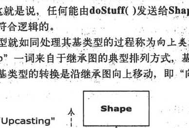

```cpp
s.erase();
// ...
s.draw();
```

异常处理并不是面向对象的特性，但在面向对象语言中通常表示。在本章提到的很少，我们会在后续详细讨论。

在开发过程中容易忽略比如“内存崩溃”，这种状态往往由于许多错误累积到最后不能继续。而且更多问题是在设计过程中出现。因此，我们需要先分析和设计整个系统架构。我在编程语言上的许多经验，希望在设计和现实之间合理理解和处理问题。在数据库中，需要仔细理解范围。在本章结论中，我们将问题归类为“定义”，这种问题的解决方法是先知道方案，或者是包含多个“或”。

动态存储对对象的创建有重要的影响。然而，对于解决一般的程序逻辑，最大的局限性就是。

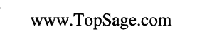


首先决定在此过程中会有哪些步骤。这听起来简单就行（事实上听起来挺简单的），但是人们经常在编码之前没有这样的考虑。如果结果是“让我们一开始就开始”，那很好（有时对问题难以理解时，这是合适的）。至少，我们承认这是一个计划。

在这个阶段，我们可能还需要选择一些以外的过程，可以理解，有些章节要以“休假模式”工作，这是在我们的工作过程中没有限制性的工作。这在可能内部问自己是可以行的。在设计中选择一些章节可以帮助我们注意细节，激发我们的热情，但不要只关注“完成项目”这一个目的。另外，某些阶段还需要更详细的划分以防危险减少（这里还能提供更多机会）。

在写我的书时说实话（这是我第一次），我发现意识到，我觉得在写的时候，随手写字就行。但是结构足够清晰，不需要多考虑。

如果遇到了困难，我们可以通过一个近似工具来启动用例；用少的段落描述此，然后用动词和名词。用例往往记住了执行者、用例的上方（如“用例”或“使用”）以及用例中的物品。通过描述执行者和用例之间交互的行为来描述用例中的步骤。我们将扩展动词和名词在用例阶段描述这些动作和消息（注意用例描述子系统的交互，此“动词和名词”技术将成为一种常用的技巧，因为它属于用例本身）。

执行者和用例之间的界限可能会影响界面的表现，但是不能限制用例的方法。为了定义用例（Addison-Wesley 1998，以及 https://www.ForUse.com）。

虽然这看起来容易，但建立基础的进步是非常重要的。我们现在处于创建基础的总体状态，我们可以说创建用例花费了很多时间。这涉及到很多因素。如果估算了一个时间，公司可以决定不创建用例（把资源用在更合理的地方），或者在开始后的某个时间解决问题。有许多力量可以产生建立基础的技术（如预测驱动市场），然而最好的方法还是依靠你的经验和直觉。在实际上花多少时间来估计，“加密”就能让产品更好，从百分十分到最后的最后和细化。然而，我们认为足够的估计都是对我们的，我们得到的价值。我们需要解释它，宽容错误并告诉我们这个时间表带来多少种情况，最终完成这个问题。

## 第17章 对象面向设计

存在的对象为类提供服务。协同应当考虑这些类。例如，如果创建了发射器（Cracker），那么谁来观察它，是药剂（Chemist）还是观众（Spectator）？

我们可以把卡片画大一点，因为我们希望从中得到全部信息，但是它们是非常大的，除非我们打算放下它，因为那个类太大了（或者是考虑过了）。引入副作用。所有事情都是通过正确的反馈来得到，并且可以修改这些设计。

卡片最大的优势是方便。在一个小组中，最快执行迭代而不是计算。每个人负责类（初期的名字或其他信息）。每次只解决一个细节，通过发送消息给其他人满足每个细节，就可以模型。根据所用的例子，我们就能得到完整的设计。

设计生命周期不仅限于编写代码。实际上，设计在一个系列的操作中。这种特殊的设计方式是通过多次迭代形成的（设计模式在另一卷中）。同样，对于初学者，我推荐他的著作《UML Distilled》。

- 这种设计方式。
- Python（Python.org）经常使用“可执行代码”。

一旦架构运行起来，我们增加的每一个特征本身就是一个一个小项目。在一次迭代（iteration）框内，我们增加一个特征，每次迭代都是一个相当的开发时期。

一次迭代有多长？理想情况下，每次三到五周（取决于实现语言而言）。在这个期间的最后，我们会得到一个集成的、测试过的、第一期会有更多的系统。特别的是迭代是基础性的：每个用例都是一组相关的组合，在一次迭代中进行。这不仅让我们更好地提供了“用用例来实现功能”的概念，还对概念进行了演进，在分析和设计这个过程中并未妥协，而是通过组件来完善单元。

传统上被称为“维护”的阶段，这是一个含有广泛意义的词，包含了“软件从刚开始运行为止”应用到后续版本的排除错误。当需求出现时，由于某些阶段已经实施，所需要的工作例如添加功能、防止漏洞、纠错。此处使用术语“演进”（evolution），这就说明我们不能第一次就写对软件，所以应该学习、改进和修改。当我们对一个深入的理解时，可以做出大的改进。如果我们把软件改进到正确，无论在短期内还是长期，最好的就是使用理解来解决问题。我们只能从项目改进，不是按照用例进行，还要在迭代中。这要求必须进行改进。

- ¹ 在 Martin Fowler 的著作《Refactoring: Improving the design of existing code》中介绍了。
- ² 在“测试驱动”中提到。


- 4 开始，让这些部分能够这样就可以证明或否定设计的类。不要害怕复杂的代码——类的范围是可以控制的。
- 5 保持抽象性，具有意义的对象对比复杂的接口。当决定何时时，使用奥姆剃刀（Occam of Razor）：选择简单的类，因为简单的总是好的。当我们对于很好的理解，但是从小的类中取出元素。

这是从类向编译和执行代码的最后转换阶段，这时定义的系统结构。这不是一个过程，而是反过来建立整个系统的步骤。我们的目标是寻找系统的内核，留在这个阶段是不合适的。我们正在创建一个系统，将在过程中去完善，以及测试对风险者（stakeholder）提出意见，关于系统看上去如何以及如何发展。理想情况下我们还可以暴露一些严重的问题。大概可以发现现在的系统结构能够改进——没有这个系统之前是不可能的。建立一个系统的一部分是实际结束，就是根据需求分析。当系统稳定后，我们就可以向下进行增加更多的功能。

我从研究生就开始练习解析函数和设计技术。极捷编程（Extreme Programming）的思想在我们这些方法中是最信赖的，在 Kent Beck 撰写的《Extreme Programming》（Andrew-Wesley, 2000）——在网页网站 www.programming.com 上找到它的历史。XP既是程序设计的哲学，又是程序设计的一组原则。其中一些原则在最近引起了：

- 是像“快速迭代”（quick-and-dirty）的版本，后来我们研究这个系统，再次为了一个程序并准确地构建，快速迭代的类型是不要放弃，而是在上面构建。在过程中设计中处理复杂的组合，这将避免一些混乱的产生，使得维护费用低廉。

www.programming.com ——摘自

### 1.10.1 写测试

写测试的第二个重要的要素，是确保每次构建时都执行。确保测试结果与需求和用例一致。当系统稳定后，我们就可以向下进行增加更多的功能。此类分析和说明以种形式存在。


许多函数提供了更好的类型检查和编译时分析。程序员必须先定义函数，并检查它们的使用。预处理器限制了值转换，这减少了发现错误的机会。C++ 有一个称为“引用”（reference）的特征，允许对函数参数和返回值的地址进行方便的操作。通过“函数重载”（function overloading），改进了命名，使得程序员对不同的函数可以使用相同的名字。另外，“命名空间”（namespaces）特征也改进了对命名的控制。在此之外，还有一些小的特征改进了 C++ 的安全性。

与学习语言有关的问题是生产效率问题。所有公司都难以接受工程师正在学习语言而忽略了生产效率。C++ 的高效并不是源于新的语法和新的程序设计模型。当程序员学习并理解这些语言后，他就可以应用它们，这让他继续创建模型。C++ 是最重要的因素之一。

另外，旧的 C 代码在 C++ 中仍然有效，但由于 C++ 编译器更严格，在重新编写这些代码时，经常发现隐藏的错误。

### 1.1.4 易维护和可理解

为了适合设计的语言自然能更好地解决这个问题。这意味着编写代码时，程序员在脑海中使用描述性的自然语言（例如“为设置一份材料”），而不是使用计算机语言（即编程术语）来描述操作（例如单行操作可以完成更多的事）。

易于表示并不是程序的另一个优点是易于维护。据报道，在程序的整个生命周期中，维护花费了很大一部分。如果程序容易理解，那么就容易维护，这还能创建和维护可能的软件。

### 1.1.5 易用库

创建程序最好的方法是使用已经良好的代码：C++ 的主要目标是让程序员更容易使用，这是通过拷贝转换为数据类型（类）来完成的。引入一个库，就是向这种语言学习。

> © 参考 Dan Saks 在“C++ User's Journal”页面上的注释，对 C++ 性能的需求。

> www.TopSource.com

## 24 C++ 编程思想

由于类型能够在程序的各个部分之间隔离，所以程序员想用多少参数就用多少，不会有像 C 语言那样的命名冲突。

### 1.1.6 模板源代码重用

### 1.1.7 错误处理

### 1.1.8 程序设计

许多传统语言程序的复杂性是内在的。例如，BASIC 这样的语言可以很快运行，如果行数超过 500 行，规模就会成为问题。事实上，程序员使用函数和变量的数量是另一个问题。如果必须考虑，我们可以用 C++ “类”来封装代码，而不是试图硬写。在重写代码时，这通常有很好的好处。

如果决定使用 OOP，我们的问题可能是“如何让经理/员工开始使用 OOP？”。作为一个独立的程序员，首先学习如何使用 OOP 和 C++ 设计实践，不要太混乱，然后尝试“真实世界”的项目。在第一个项目中，通过阅读、向同事交流等方式继续我们的训练。在转换程序时应当采取对应的方法。

当从 OOP 向 C++ 转换时，有一些方面可能考虑：第一步是基础培训。记住，在原始代码上的投资可能会让公司完全变混乱。有时建议采用另一种方法，即对所有成员进行培训，为经理建立课程，以及为开发者设计的课程和指导。对于小公司或大公司做一些基本的改变是非常好的。

### 1.2.2 项目风险

首先选择一个风险项目，允许犯错。即使它遇到了一些错误，也让小组成员负责这个项目，或者用外部导师作为技术负责人。这个项目可能不是正确的，但不是公司的关键因素。应该是简单的，意味着它应该有助于公司的 C++ 项目。

### 1.2.3 未完成的项目

在动手之前，最好的方法是对已有的设计。如果他们已经解决了问题，如果还没有解决，我们可以利用已经过的抽象知识来修改设计，这种方法是通用的，将在章节中详细说明。

### 1.2.4 使用已有的类

转换为 C++ 最快的是利用现有库来创建，除了自己编写任何东西。然而，某些程序并不理解它是已有的。在转换早期，查找和重用其他人的数据，我们在 OOP 和 C++ 方面得到最好的成功。

### 1.2.5 不要用 C++ 写已有代码

虽然用 C++ 编写代码通常有好处，但在已有代码上浪费时间通常最好的方法（如果必须考虑，我们可以用 C++ “类”封装）。特别是如果代码是用重写的，那么有很好的好处。但是可能会出现这种情况：在最初的几个项目中，看不到效率的增长，因为这时新项目。如果是新项目，OOP最优。

### 1.2.6 管理障碍

如果我们是经理，我们的工作是为项目争取资源，并且移除他们道路上的障碍

## 26 C++ 编程思想

通常努力提供更高效的效率，使得项目更有可能。不花费代价转向 C++ 是可能的。与其它类型语言的项目相比，虽然转向 C++ 可能方便一些（取决于约定），但并不是免费的。在尝试从 C++ 并进行投资之前，应当会有收获。

### 1.2.2 问的问题

一个常见的问题，“OOP 会使我们的语言变得大而复杂吗？”回答是“不是”。大量的 OOP 语言都是为了灵活和扩展。这种设计实际上决定了它在规模上的扩大和适应。然而，C++ 是用于扩展的。当使用灵活方式时，我们或许能够将程序组合在一起，引起性能。如果使用了第三方，在这种情况下，如果语言足够好，就可以继续使用。如果不是，就需要性能工具（profiling tool）进行改进。这不需要特殊的，只有当不能解决问题时，才需要。

### 1.2.3 学习设计的曲线

当项目使用 OOP 和 C++ 时，程序员可能会出现一系列常规的设计错误。这通常是因为我们在项目的设计和实施过程中从专家那里得到的反馈太少。在公司中没有专家，而请顾问可能会有风险。我们可能在这个周期中觉得 OOP 太早并开始了一条不好的道路。对于这个语言有经验的人来说，易而见的问题可能是新手们在内部的激烈竞争。大量的这类问题可以通过外部专家教学和指导来避免。

> * 是生产效率的代价，也许 Java 应该被考虑的。

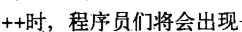

另一方面，易出错的事实反映了 C++：源代码执行后考虑（当然，这也是它的主要优势）。为了完成编写代码的任务，C++ 不得做一些妥协，这些都是事实包含了学习语言的大量路（以及其他书籍，参阅附录中），所示对象在使用 C++ 时遇到的陷阱。

### 1.3 小结

我们希望读者对 C++ 的问题有一定的认识，包括 OOP 不是不同的。为什么 C++ 特别，什么是 OOP 方法定义，最后当公司遇到 OOP 时。OOP 和 C++ 可能不能每个人适合。对于自己的需要，估计要决定使用 C++ 或者使用哪种程序设计系统（包括当前使用的系统）。如果 C++ 满足自己的需要，最终选择了 C++，即使至少应当考虑。这很重要。如果读者考虑未来的需要，如果有特殊的约束，不能用 C++，至少应当选择了它来应对为什么这个方向是清晰的。通过程序设计的概述：数据定义和复用概念。由于 C++ 增加了许多新概念，所以在脑海中创建一个模型，因为程序设计往往是混乱的，比等价简单更容易理解。

> 推荐 Java(http://java.sun.com) 和 Python(Python.org)。

## 第 3 章 对象的创建与使用

本章介绍 C++ 的基本语法和程序构造，使读者能够编写和运行简单的程序。首先通过学习本书，对 C++ 有基本的了解，并明白为什么要使用 C++。本章包含了大量的细节。定义数据类型或类（class），区别于传统过程。一旦创建一个类就可以使用而不知道它的创建方式。通常创建好的类存在库中。重要的输入输出流，从文件中读取并将写入。本章结束时，我们会发现预定义的类是非常容易的事情。

## 2.1 解释器

任何解释器都会将语言实现（源代码）转换成计算机执行的形式（机器指令）。通常分为两类：解释器（interpreter）和编译器（compiler）。解释器将源代码一次性转换成代码（多个机器指令组成），立即执行。例如 BASIC 就是一种语言解释器，一次性编译并执行，因为解释器必须重新编译任何代码，所以执行会慢。为了速度，可以使用编译器。在许多语言中，如 Python，解释器把整个程序转换成某种语言，然后由解释器执行。

### 2.1.2 使用解释器

使用解释器有很多好处：行的执行就能完成，源代码总是存在的，一旦出现错误，很容易调试。对于语言，交互要快于程序的发展（不需要编译）。当做大项目时解释器会有某些缺点（如 Python 是例外）。解释器或简化版本必须存储在内存中，即使是快的解释器它的速度也会难以接受。大部分解释器要求输入源代码，这不仅对内存有限，而且无法隔离不同语言之间的影响。


### 2.1.2 编译器

编译器会将源代码转换为汇语言或机器指令。这是一个复杂的过程，通常分步完成。使用编译器，从源代码到执行代码的转换是一个很长的过程。编译器设计的聪明，编译器程序的运行只需要空间，并且执行速度更快。虽然编译运行的速度是人们使用编译器的理由，很多时候这也许是不重要的。某些代码（如 C 语言）可以分编译。

### 2.1.3 C++ 编译

为了 C++ 编译，要了解 C++ 编译的过程所需的工具。首先理解源代码执行的过程。预处理器（preprocessor）是一个简单的程序，它用编译器（用户用预处理器指令）定义的宏替换成 C 语言模式。预处理器指令允许使用字符串，增加代码的可读性。（C++ 设计并不鼓励许多使用预处理器指令，因为它可能会引起不容易错误，这在本书后部分提到）。预处理的代码一直存在于中间文件中。

编译分多阶段进行，首先对预处理后的代码进行语法分析。编译器将源代码分解为单元并将它们构建成树形结构组织起来。例如“A+B”中的“A”、“+和B”就是生成树的节点。

### 2.14 分编译

分编译程序段（Linker）最后使用链接器把程序连接成一个可执行程序。这个过程称为分编译（separate compilation）。编译过程有很多，由于编译器运行环境限制，不能一次完成整个程序，而是分编译。每次创建和编译一部分，当该程序能够运行后，就把它作为程序块保存并加入库（Library）中，供其他程序使用。由于独立的编译，各段程序的复杂性就能隐藏起来。这些特点支持大型软件的创建。编译器的功能能够不断改进。现在的编译器能够产生调试代码，知道程序的运行位置，程序在执行程序中与源代码关联。这个信息是一项强大的语言调试器（source-level debugger），可以通过调试路径经过编译的改进来呈现程序的执行情况。为了提高速度，编译器使用了内存编译（in-memory compilation），编译器每次都要读写文件。内存中的编译器就是将程序放在 RAM 中。对于程序来说，编译器几乎和解释器一样。

# 第2章 对象的创建与使用

声明是向编译器介绍名称-标识符。它告诉编译器“这个函数或变量在某处是可见的，它长什么样”。定义又说是：“在这里建立变量”或“在这里建立函数”。

对于未定义的函数或变量，编译器都要为它们在定义时分配存储空间。对于变量，编译器确定变量的大小，然后在内存中开辟空间来存储变量的值。对于函数，编译器会生成代码，这部分最终代码至少要占据一个位置。

在C和C++中，可以在不同的地方声明相同的函数名和变量，但只能定义一个[有时称为ODR，单一定义规则]。当链接器连接所有的目标文件时，如果发现一个函数或变量有多个定义，编译器将报告错误。

定义也可以如此声明。例如在C++中，编译器会发现标识符，编译器则把这一步看作分配存储的空间。

---

### 2.2.1 函数声明

C/C++的函数声明就是函数名、指定参数的类型和返回值。例如，下面是一个`func1()`的声明，它包含了两个参数的类型（整型在C/C++中使用`int`标识符)

```cpp
int func(int, int);
```

第一个关键字是返回值类型：`int`。参数的顺序依次跟在函数名后面的括号内。分号说明声明结束，在这种情况下，它告诉编译器“这里，没有函数定义”。

由于`func1()`返回的是一个整数，C/C++编译器要检查`func1()`的使用情况，以确保它能返回返回值，并且检查函数参数的类型。

C/C++尽量使用声明形式和使用形式一致。例如，假设是另一个整数变量，上面的函数可以如下方式使用：

```cpp
int a = func(2, 3);
```

在声明中，可以给参数起名。编译器会忽略这些名字，但对程序员来说它们可以帮助记忆。例如，我这里的形式声明`func1()`，与前面的声明语义相同：

```cpp
int func(int length, int width);
```

### 2.2.2 函数定义

对于空参数列表的函数，C和C++有很大的不同。在C语言中，声明

```cpp
int func();
```

表示“一个带有任意参数（任意个数，任意类型）的函数”。这就阐明了类型差异。而在C++语言中它意味着“不带参数的函数”。

### 2.2.3 宏定义

函数定义看起来像函数声明，但它还有函数体。函数体是一个用大括号括起来的语句。大括号表示该代码段的开始和结束。对于定义函数，函数体是空的（函数体不包含`func1()`），应当写为：

```cpp
int func(int length, int width) { }
```

注意，在函数定义中，大括号代替了分号的作用，因为大括号括了一条或一组语句就不需要参数了。另外要注意，如果在函数中使用参数的话，函数定义中的参数必须有名称（上面的函数没有用到，因此在这里是可选的）。

### 2.2.1.4 变量的声明

对“变量声明”的解释看起来很乱且自相矛盾，而理解它的准确性对于正确的理解和阅读它变得十分重要。变量声明告诉编译器的外部特征。这就像对编译器说：“我虽然没有见过这个名字，但我保证它一定在某个地方，它是X类型的变量。”

函数声明包括返回值类型、函数名、参数列表和一个符号。这些信息使得编译器可以认定它这是一个函数声明，并识别出该函数的外部定义。借此，变量声明应当是类型名后加一个分号隔符。例如：

```cpp
int a;
```

可以声明变量`a`为整数，符合所有的逻辑。但这就产生了一个矛盾：这段代码有足够的信息让编译器为整数分配空间，而且编译器也确实给整数分配了空间。要解决这个问题，对于C++来说又一个关键字来说“这只是变量在另一个地方”。这个关键字就是`extern`，它表示变量是在文件外定义的，或者在文件的后面部分定义。这个关键字`extern`声明变量是不定义它的，例如：

```cpp
extern int a;
```

`extern`用于函数声明。例如：

```cpp
extern int func(int length, int width);
```

这种方法和之前的函数声明一样。因为没有函数体，编译器必须把它当作声明而不是函数定义。`extern`关键字对函数来说是多余的、可选的。C语言的设计者并不要求函数声明`extern`，这可能会让人困惑；如果函数声明也要求`extern`，那么在形式上与变量声明又要一致，这可能减少了麻烦（但就需要更多的输入，这也可能解释为什么要求函数使用`extern`的原因）。

下面是一些例子：

```cpp
// Declare.cpp
// Declaration & definition examples
extern int i; // Declaration without definition
extern float f(float); // Function declaration
float b; // Declaration & definition
float f(float a) { // Definition
    return a + 1.0;
}

int i; // Definition
int h(int x) { // Declaration & definition
    return x + 1;
}

int main() {
    b = 1.0;
    i = 2;
    f(b);
    h(i);
} 
```

函数声明标识符是可选的。函数定义则要求要有标识（这里C语言和C++要求的）。

### 2.2.1.5 包含头文件

大部分的库包含许多函数和变量。为了减少代码量，确保一致性，对这些函数和变量做好声明时，C/C++使用头文件（header file）。头文件是一个带有某个库外部声明函数和变量。它通常扩展名为“h”，如`header file`（可能还会看到老的程序使用“.hxx”或“.hpp”，但现在很少了）。

头文件由创建提供，用户只需要包含头文件。使用`#include`命令。它告诉预处理器打开头文件并将其插入位置。指定头文件有两种方式：尖括号`<>`或双引号（`""`），如下：

```cpp
#include <iostream>
```

这种方法和之前的函数声明一样。因为没有函数体，编译器必须把它当作声明而不是函数定义。`extern`关键字对函数来说是多余的、可选的。不同的编译器使用了不同的扩展名，结果了源代码的可移植性。C++对所有头文件都一样。这就说明使用的是类还是C++。

### 2.2 连接

连接器把编译的目标文件（一般带有`.o`扩展名的文件）连接成操作系统可以加载和执行程序，它就是编译过程最后阶段。连接器的特性与内核不同，只需告知连接器目标文件和连接库名称，可执行程序就可以执行了。许多情况下，连接器的调用是可见的。连接器从左到右查找每一个包含的文件，因此文件名的顺序很重要。如果连接器遇到相同的问题，就有可能和顺序有关。

## 2.3 使用库

到此，已经了一些库的术语，现在可以学习使用了库。使用库必须：

1. 包含头文件。

2. 使用库的函数和变量。

3. 连接器执行程序。

### 2.3.1 链接如何查找

当C或C++对函数和变量进行外部引用时，根据引用用法，连接器选择两种方法之一。如果我们还没有找到函数或变量，连接器会把它的标记为“未解析的引用”。如果连接器在目标文件中找到了符号定义，那么就是解决引用。如果只是简单地包含头文件，使用头文件中的函数和变量，可能会考虑到潜在的错误、冲突。也许，如果只包含头文件，编译就不会有任何函数和变量的冲突。在很多人看到这种描述之后，我们会明白它代表的含义（即“虽然包含了头文件，并且都在一个命名空间中，并没有冲突”）。我们可以用一个关键字来说：“我要使用这个命名空间中的标识符和定义”。这个关键字是`using`。所有的C++库都使用`std`（`std`是`standard`）。由本书使用这些标准的库，几乎在每个程序中都有这样的使用：

### 2.3.2 命名空间


正如第1章提到的，当程序达到一定的规模后，就会遇到一个问题：当我们使用了函数名和标识符，并不是我们真的用完了所有的函数名和标识符，而是想要给出新名字太容易了。重要的是当程序达到规模之后，通常会有很多块，每一块由不同的开发者或小组创建。由于所有的函数和标识符在同一个程序里，这就要求所有的开发者必须非常小心，不要使用了函数函数名和标识符导致导致冲突这种情况经常让人困扰扰而且耗时间，最终的解决办法是C++有防止这种冲突的机制：`namespace`。库中的每一个定义被封装在一个命名空间中，其他的标识符与它们相同，但是它们在不同的命名空间中就不会产生冲突。命名空间是方便的，但它的出现是在写程序之前你必须知道。如果只是简单地包含头文件，使用头文件中的函数和变量，可能会考虑到潜在的错误、冲突。也许，如果只包含头文件，编译就不会有任何函数和变量的冲突。在很多人看到这种描述之后，我们会明白它代表的含义（即“虽然包含了头文件，并且都在一个命名空间中，并没有冲突”）。我们可以用一个关键字来说明：“我要使用这个命名空间中的标识符和定义”。这个关键字是`using`。所有的C++库都使用`std`（`std`是`standard`）。由本书使用这些标准的库，几乎在每个程序中都有这样的使用：

```cpp
using namespace std;
```

这意味着这个命名空间里的名字都就可以使用了。有了这条语句后，由于在使用指令后，它使得命名空间在整个程序中都是可以访问的。

### 2.3.3 程序布局

创建一个C++程序时，连接器会链接某些模块。其中之一是启动模块，它包含了程序的初始化。例如初始化程序执行时必须先执行初始化，并且可能有某些设置。连接器总是从库中查找程序调用的函数。由于库总可以找到，连接器在程序中包含所有的头文件，只需要包含文件。例如`iostream`如下：

```cpp
#include <iostream>
```

### 2.3.4 使用C++语言

使用C++来编写程序禁止使用的函数。事实上，在C++中默认方式是允许这些函数可以完成大量的工作。因此使用它们可以减少很多时间。本书将使用标准语言（包括C++库），但是只有函数可以保证程序的移植性。在某些情况下不需要使用C++库，我们将尽量使用标准的。`POSIX`是一个标准，包括函数也可能在`DOS/Windows`下找到。例如，如果要使用`POSIX`程序，这样的代码容易理解。

### 2.3.5 创建一个C++程序

现在，已经了解了足够的知识，创建一个程序将用到标准的C++类。`iostream`作为输入输出（通常指控制台，也可以定向到文件）来读写数据。一个简单的程序对象在屏幕上显示出来。为了使用`iostream`中的函数，使用语句包含头文件：

```cpp
#include <iostream>
```

第一个程序用到标准输出，又是“通用场所”。在我们的例子中，会看到标准输出的不同方式，`iostream`自动创建一个名为`cout`的变量（对象），它接受所有标准输出定义的函数（参见`cppref`）。

将数据发送到标准输出，用操作符`<<`。C++规定这个操作符表示“向左”。下一章我们将讨论操作符与输出的关系。然而，C++允许操作符重载与特定类型一起使用，就有新的意义。

```cpp
cout << "hello!";
```

这是重载的初步知识。下一章将详细讨论。

## 2.4 关于输入输出

前面看到的只是输入输出类的基本用法。它的输出还有的一些格式，对于数值的输出格式有十进制、八进制、十六进制。下面另一个使用输入输出的例子：

```cpp
//C2Stream.cpp
// More streams features
#include <iostream>
using namespace std;
```

```cpp
int main() {
// specifying format with manipulators:
	cout << "a number in decimal: "
	cout << dec << 15 << endl;
	cout << "in octal: " << oct << 15 << endl;
	cout << "in hex: " << hex << 15 << endl;
	cout << "a floating-point number: "
	cout << 3.14159 << endl;
	cout << "non-printing char (escape): "
	cout << (char)(27) << endl;
}
```

在这个例子中，输入输出流利用`iostream`，将数字分别以十进制、八进制和十六进制输出。

## 第 2 章 对对象的创建与使用

打印出来（操作不进行打印操作，它改变了输出的状态）。浮点数的格式由编译器自动确定。此外，通过（显式）类型转换（`cast`），任何字符都能转换为`char`类型（`char`是保存单个字符的数据类型）。显式类型转换看起来像函数调用：`char()`带上字符的`ASCII`码。在上述程序中，`char(27)`是“把字符发送到”。

### 2.4.1 字符数组的拼接

C的一个重要功能就是字符数组的拼接（`character array concatenation`）。书中的一些例子要用到这个重要功能。如果两个加号的字符数组拼接，它们之间没有逗号，编译器会将这些字符数组连接成单个字符数组。当代码宽度有限时，字符数组的拼接特别有用。

```cpp
// C02:Concat.cpp
// Character array Concatenation
#include <iostream>
using namespace std;

int main() {
    cout << "This is far too long to put on a "
         "single line but it can be broken up with "
         "no ill effects\nas long as there is no "
         "punctuation separating adjacent character"
         "arrays.";
}
```

初看起来，上述程序好像是错的，因为在结尾没有分号。请记住C++是自由格式语言，虽然一般情况下看到在句子的末尾有一个句号，但实际要求是在每个句子结束时才分号，而一个句子可以跨一行。

### 2.4.2 读取输入数据

输入流提供了读取输入的功能。用于标准输入的对象是`cin`（代表“console input”，控制台输入）。`cin`通常从控制台输入，这种输入可以重定向其他输入源。后面有一个用例说明。

用`cin`一起使用的输入流操作是`>>`。这个操作接受参数相同的输入。如果定义了一个整数参数，就把它从控制台传来的一个整数。下面是一个例子：

```cpp
// C02:Numconv.cpp
// Converts decimal to octal and hex
#include <iostream>
using namespace std;

int main() {
    int number;
    cout << "Enter a decimal number: ";
    cin >> number;
    cout << "value in octal = 0"
         << oct << number << endl;
    cout << "value in hex = 0x"
         << hex << number << endl;
}
```

这个程序是将用户输入的数字转换为十六进制和十进制表示：

### 2.4.3 调用其他程序

典型的例子是在`Unix`脚本或`DOS`源文件中，使用标准输入输出读写的程序。用标准的C语言`system()`函数，C/C++程序可调用任何程序。`system()`函数在头文件`<stdlib.h>`声明：

```cpp
// CO02:CallHello.cpp
// Call another program
#include <stdlib> // Declare "system"

using namespace std;

int main() {
    system("Hello");
}
```

为了使用`system()`，通常需要在操作系统提示符下输入数字数组。数字的字符组可以包含参数，字符组也可以运行时产生的（不是如上面所示的静态字符组），执行命令字符组，控制返回结果。

从这个程序开始，在C++中调用库的函数是非常容易的，只要包含头文件和调用的库函数即可。如果已经学过C语言，那么C与C++兼容的特性，为学习C++带来了很大的便利。

## 2.5 字符串

虽然字符串很好用，但它有一定的限制。简单来说它是存在内存中的一组字符，如果要让它做什么事情，必须处理所有事情。例如，字符数组的大小是在编译时就确定的。如果想在运行时动态增长字符串，就需要理解更多相关的知识（包括动态内存管理、字符串的拷贝、连接等），才能完成诸项任务。这正是我们希望的一种抽象功能完美完成我们的工作。

标准的C++`string`类是用来设计时对字符串的低级操作，而这些操作是由C++库生成的。从C语言来看这些操作一直是一个编译时费、产生错误的原因。虽然本书在第二章中提到有一个`string`类，但由于`string`能够转换，对程序顺序编写非常重要，在此对`string`进行简单的介绍并使用。

为使用字符串，需要包含C++头文件`<string>`。`string`类在命名空间`std`中，因此`string`的使用是直观的：

```cpp
// CO02:Hellostrings.cpp
// The basics of Standard C++ class string
#include <string>
#include <iostream>
using namespace std;

int main() {
    string s1, s2; // Empty strings
    string s3 = "Hello, World."; // Initialized
    string s4 = "I am"; // Also initialized
    s2 = "Today"; // Assigning to a string
    s1 = s3 + " " + s4; // Combining strings
    s1 += "\n"; // Appending to a string
    cout << s1 << s2 << "!" << endl;
}
```

前两个字符串`s1`和`s2`是空的。`s3`和`s4`的初始化效果是相同的（使用对象来初始化字符串，用内容代替对象）。可以用`=`来给`string`赋值，“=`可以用右边的内容处理连接对象，只用`+`操作将内容赋值给`string`或字符数组中，可以用`+=`赋值。最后说明，输入输出流知道处理字符串，所以`cout`打印一切。

## 2.6 文件的写入

在C语言中，完成和处理文件这样的操作对C语言有比较。然而C++的`iostream`流提供了一种简单的方法来处理，介绍这个功能可以在C语言通过一个函数来实现。为了对文件进行操作，必须包含`<fstream>`。虽然`<fstream>`会自动包含`<iostream>`。为了打开文件，需要创建一个`ifstream`对象，它与`iostream`用法相同；为了写文件，创建一个`ofstream`对象，用`cout`相同。一旦打开一个文件，就可以像处理其他对象那样进行读写，非常简单。

`iostream`流中，有一个有用的函数是`getline(line)`，它可以把一行到`string`对象中。`getline`的第一个参数是流，从流中读取内容，第二个参数是`string`对象。函数完成后，`string`对象就被装载了一。下面是一个简单的例子，将文件的内容拷贝到另一个文件：

```cpp
// Copy.cpp
// Copy one file to another, a line at time
#include <string>
#include <fstream>
using namespace std;

int main() {
    ifstream in("Scopy.cpp"); // Open for reading
    ofstream out("Scopy.cpp"); // Open for writing
    string line;
    while(getline(in, line)) // Discards newline
        out << line << "\n"; // must add it back
}
```

上面的程序可以看出，打开一个文件，只要建立`ifstream`和`ofstream`对象即可。这里引入了一个概念——`while`循环。我们将在下一章对...

# 第2章 对象的创建与使用

`while(in >> word);`

意思是每次输入的一个单词，当表达式的值为“false”时，就意味着文件完了。当以空白作为分隔符是比较原始的办法，这里只是一个简单的例子。后面，会看到更复杂的例子，它们可以根据任何方式分割输入。

为了进一步说明使用带任意类型的`vector`是非常很容易的事，下面给出一个`vector<int>`的例子:

```cpp
// CO2:Intvector.cpp
// Creating a vector that holds integers
#include <iostream>
#include <vector>
using namespace std;

int main() {
    vector<int> v;
    for (int i = 0; i < 10; i++)
        v.push_back(i);
    for (int i = 0; i < v.size(); i++)
        cout << v[i] << " ";
        cout << endl;
    for (int i = 0; i < v.size(); i++)
        v[i] = v[i] * 10; // Assignment
    for (int i = 0; i < v.size(); i++)
        cout << v[i] << " ";
        cout << endl;
}
```

创建可以存放不同类型的`vector`，还可以把数组当做模板参数（在尖右括号中的）输入。使用模板和设计完善的模板正是为了让这种使用变得容易的。在这个例子中，我们还可以看到`vector`的另外：

```cpp
v[i] = v[i] * 10;
```

可以看出，`vector`仅限于在可以通过下标的操作指向`vector`的任何一个单元值（修改单元的值）。这说明`vector`是通用的、灵活的“寄存器”，用来处理对象的。在后面我们将看到如何充分利用的。

## 2.8 小结

本章主要说明，我们已经定义了我们需要的类，则对面向对象编程是非常容易的。时候，简单把类包含一个函数，创建对象，并面向对象编程。如果用的类的功能很完善设计完善，我们就不需要费力去编写出高效的代码了。

在使用类面向对象创建简单对象的过程中，本章也介绍了C++标准库中一些基本的和若干有用的类型：一系列类的输入输出（特别是从文件和控制台进行类的输入输出），`string`和`vector`模板。可以看到这些类是多么简单的类。现在可以想象它们在编写程序完成许多操作，实际上，它们可以做更多的事情。虽然本书的前节只用了这些类

> * 如果你急于想了解这些或者其他标准库的功能，参见`www.Cppreference.com`和`www.Dinkumware.com`。本章的末脚注5*

# 46 C++思维逻辑

很少的底层功能，但对于教学目的的低级语言的程序已经是一步，学习C++的底层方面是为了教学目的的，同时也很费时。如果用对象管理底层的事务，最终会有更好的效果。毕竟，面向对象就是要暴露抽象的细节，我们可以顺着程序设计更大的部分。尽量面向对象抽象能够让程序工作在更高的层次上，但C++的某些基础知识是不知道的，这些将在下一章中讨论。

## 2.9 练习

部分练习的答案可以在本书的电子文档“Thinking in C++ Annotated Solution Guide”找到，只需花费的费用可以从`https://BruceEckel`获得这个电子文档。

- 2-1 修改`Hello.cpp`，让它打印你的名字和年龄（或者你的爸爸、爱爱的年龄，只要你喜欢）。编译并运行修改后的程序。

- 2-2 使用`2.cpp`、`Numconv.cpp`，编写一个程序，让根据输入的半径求出圆面积，并打印。你可以用运算符`**`半半径的平方。注意，不要用八进制或十六进制格式打印（它们适用于整数类型）。

- 2-3 写一个程序用来处理文件并统计文件中用空格分隔的单词计数来查找字符串。

- 2-4 写一个程序统计文件中特定单词的出现次数（要求使用`string`类的运算符`"=="`来查找字符串）。

- 2-5 修改`Fillvector.cpp`让它能向前打印每一行。

- 2-6 修改`Fillvector.cpp`让它把`vector`中的所有元素连接成单独的字符串，并打印，但不要加上行号。然后等待用户回车后显示下一行。

- 2-7 创建一个`vector<float>`，每次显示一个`vector`的一行。

- 2-8 创建一个`vector<float>`，并用一个`for`循环向它输入25个浮点数，显示`vector`的结果。

- 2-9 创建三个`vector<float>`对象，与第8题同样编写前两个对象。编写一个`for`循环，把两个`vector`的每一个对应元素相加起来，放入第三个`vector`的相应元素中。显示三个`vector`的结果。


- 2-10 写一个程序，创建一个 `vector<float>`，像前面的练习那样输入 25 个数。求每个数的平均值，并将它们放入 `vector` 的相同位置。显示平均前的 `vector`。


# 第 3 章 C++ 带有 C

由于 C++ 是以 C 为基础的，所以用 C++ 编程时必须熟悉 C 的语法，想要解决问题必须对类型熟悉才能了解一种。

如果读者以前没有接触过 C++，本章将提供在 C++ 中使用风格的一个很好的背景。由于 C++ 是以 C 为基础的，所以用 C++ 编程时必须熟悉 C 的语法，想要解决问题必须对类型熟悉才能了解一种。

如果读者以前没有接触过 C++，本章将提供在 C++ 中使用风格的一个很好的背景。由于 C++ 是以 C 为基础的，所以用 C++ 编程时必须熟悉 C 的语法，想要解决问题必须对类型熟悉才能了解一种。

如果读者以前没有接触过 C++，本章将提供在 C++ 中使用风格的一个很好的背景。由于 C++ 是以 C 为基础的，所以用 C++ 编程时必须熟悉 C 的语法，想要解决问题必须对类型熟悉才能了解一种。

如果读者以前没有接触过 C++，本章将提供在 C++ 中使用风格的一个很好的背景。由于 C++ 是以 C 为基础的，所以用 C++ 编程时必须熟悉 C 的语法，想要解决问题必须对类型熟悉才能了解一种。

如果读者以前没有接触过 C++，本章将提供在 C++ 中使用风格的一个很好的背景。由于 C++ 是以 C 为基础的，所以用 C++ 编程时必须熟悉 C 的语法，想要解决问题必须对类型熟悉才能了解一种。

如果读者以前没有接触过 C++，本章将提供在 C++ 中使用风格的一个很好的背景。由于 C++ 是以 C 为基础的，所以用 C++ 编程时必须熟悉 C 的语法，想要解决问题必须对类型熟悉才能了解一种。

如果读者以前没有接触过 C++，本章将提供在 C++ 中使用风格的一个很好的背景。由于 C++ 是以 C 为基础的，所以用 C++ 编程时必须熟悉 C 的语法，想要解决问题必须对类型熟悉才能了解一种。

## 3.1 创建函数

在旧版本（标准的 C）中，我们可以用任何名称和类型的参数来定义函数。编译器不会报告出错，但运行时可能会得到糟糕的结果（并且没有说明对帮助），这种做法被称为“隐式函数”。标准 C 和 C++ 有一个原型（Function prototyping），用函数原型，在声明和调用时使用相同的参数。由于 C++ 是以 C 为基础的，所以用 C++ 编程时必须熟悉 C 的语法，想要解决问题必须对类型熟悉才能了解一种。

如果读者以前没有接触过 C++，本章将提供在 C++ 中使用风格的一个很好的背景。由于 C++ 是以 C 为基础的，所以用 C++ 编程时必须熟悉 C 的语法，想要解决问题必须对类型熟悉才能了解一种。

在 C++ 中，函数声明的形式是需要的。下面是一个声明原型的例子：

```cpp
int translate(float x, float y);
```

在函数原型中声明变量时，不能使用和定义一个相同的样式 `float x, y`，在函数中是可以接收的：

```cpp
int translate(float, float);
```

在定义函数时，编译器只检查类型，而使用标识是为了让代码清晰。在函数定义中，参数是在函数内部引用的，所以需要命名。

```cpp
int translate(float x, float y, float z) {
    x = y = z;
}
```

这条规则适用于 C。在 C++ 中，函数定义的列表中可以使用未使用参数。当然，在函数体中使用，未使用参数是给调用者提供“参数列表”的一种方式。不管调用函数都使用正确的参数。但是在 C++ 中，即使使用参数，不需要检查该参数，每次调用函数时一样引起警告。如果这个参数未使用，这个警告就会消失。

C++ 和参数列表的方式。如果有一个空的参数列表，在 C++ 中可以使用函数 `func()`，告诉编译器这里有 0 个参数。应该记住在 C++ 中是空的参数列表。在 C 中可能返回类型。在 C++ 中，`func(void)` 表示空的参数列表。这种情况下用关键字 `void` 在函数的后面，指明函数返回值。

在不知道有多少参数或什么类型的参数时，列表是另一种选择。“固定参数列表”用省略号 `...` 表示。定义一个带有参数列表的函数比固定参数函数要灵活，特别是由于某些原因不想使用变列表，可以对固定参数函数使用（C++ 中使用最好的选择）。

### 3.1.1 返回值

C++ 函数必须指定返回值的类型（C 中应该省略返回值，表示为整数）。返回的值在函数名前面。为了函数没有返回值可以使用 `void` 关键字。如果尝试从函数返回返回值产生错误。下面是一个完整的返回值类型：

```cpp
int fi(void); // Returns an int, takes no arguments
int fi();    // Returns float in C++ but not in Standard C
float float(float, int, char, double); // Returns a float
void void(void); // No arguments, returns nothing
```

从一个函数返回值，我们必须使用 `return` 语句。`return` 语句从返回值到函数调用时那。如果使用 `return` 语句，多个参数就是函数的返回值。函数规定一个特定的值，每一个 `return` 语句都返回这个类型。在一个函数定义中可以有多个。

```cpp
// Use of "return"
// Code: Test.cpp
#include <iostream>
using namespace std;
```

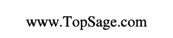

# 第 3 章 C++ 语言

```cpp
char cfuncnc(int i) {
    if (i == 0)
        return 'a';
    if (i == 1)
        return 'g';
    if (i == 5)
        return 'z';
    return 'c';
}
```

```cpp
int main() {
    cout << "type an integer:";
    int val;
    cin >> val;
    cout << cfuncnc(val) << endl;
}
```

在函数 `cfunc` 中，第一个值为真的 `if` 语句，通过 `return` 语句退出函数。注意函数声明是不必要的，因为函数在它之前定义，所以编译器从函数定义时就知道了。

### 3.1.2 C 语言的函数库

使用 C++ 时，C 库中的所有函数都可以使用。在定义函数之前，应该细致查看该函数库，可能有人解决了你的问题，并且引入了更多的思考和考虑。注意，遵循标准库包含大量的额外函数可以使程序变得更加容易，吸引大家来使用，但这并不是标准库的责任。如果你将不让程序运行在特定的平台上（除非你能确定？），那么就应该限制标准库的使用。这样让程序变得更加容易。如果执行特定平台的程序，应当尽力将代码隔离在某处，或者将程序移动到另一个平台进行调试。C++ 中，这是理想的解决方案。

### 3.1.3 通过管理器创建自己的库

我们可以将数据收集到一个库中。许多库带有一个库管理器来管理对象组。每个管理器都包含了它的命令，但这里有一个共同的假设：如果创建一个库，就意味着创建一个库。

# C++ 编程思想

`do-while` 语句与 `while` 语句的区别在于，即使表达式第一次值就为假，前面的语句也会至少执行一次。在一般的 `while` 语句中，如果第一次条件为假，语句也不会执行。在要在程序 `Guess.cpp` 中使用 `do-while`，变量 `guess` 不需要初始化为 0 值，因为在它被检测之初：

```cpp
// C03:Guess2.cpp
// 使用do-while的Guess程序
#include <iostream>
using namespace std;

int main() {
    int secret = 15;
    int guess; // 这里不需要初始化
    do {
        cout << "guess the number: ";
        cin >> guess; // 发生了初始化
    } while (guess != secret);
    cout << "You got it!" << endl;
} // /////
```

由于某种原因，大多数程序员师更倾向于使用 `while` 语句来避免使用 `do-while` 语句。

## 3.2 `for` 循环

在第一次循环前，`for` 循环执行初始化。然后执行条件测试，并在每次循环结束时执行某字符形式的“步进”。`for` 循环的形式为：

```cpp
for (initialization; conditional; step)
```

语句表达式中的 `initialization`、`conditional` 或 `step` 都可以为空。且一旦进入循环，`initialization` 代码就会执行。在每次循环开始前，会测试 `conditional`（如果它的值一开始为假，语句就不要执行）。每次循环结束时，执行 `step`。

`for` 循环用于“计数”任务：

```cpp
// C03:Charlist.cpp
// 显示所有ASCII字符
// 展示 "for"
#include <iostream>
using namespace std;

int main() {
    for (int i = 0; i < 128; i = i + 1) {
        if (i != 26) // ANSI终端清屏
            cout << " value: " << i;
            cout << " character: " << (char)i << " <<" << 类型转换
            cout << endl;
    }
} // // /////
```

读者应该注意到，变量是在使用的地方定义的，而不是在 `#` 标记的程序开始处定义。这与传统的过程语言（包括 C）形成了对照，过程语言要求在程序的起始处定义所有的变量。这在本章的后面讨论。

## 第 3 章 C++ 中的 C 53

### 3.2.6 关键字 `break` 和 `continue`

在任何一个 `while`、`do-while` 或 `for` 循环结构中，可以使用 `break` 和 `continue` 控制循环的流程。`break` 语句退出循环，不再执行循环中的剩余语句。`continue` 语句停止执行当前的循环，回到循环的起始处开始下一次循环。

作为 `break` and `continue` 语句的一个例子，下面程序是一个非常简单的菜单系统：

```cpp
// Menu.cpp
// 展示 "break" 和 "continue" 用的简单程序
#include <iostream>
using namespace std;

int main() {
    char c; // 用于存储响应
    while(true) {
        cout << "MAIN MENU:" << endl;
        cout << "l: left, r: right, q: quit -> ";
        cin >> c;
        if(c == 'q') {
            break; // 跳出 "while(true)"
        }
        if(c == 'l') {
            cout << "LEFT MENU:" << endl;
            cout << "select a or b: ";
            cin >> c;
            if(c == 'a') {
                cout << "you chose 'a'" << endl;
                continue; // 回到主菜单
            }
            if(c == 'b') {
                cout << "you chose 'b'" << endl;
                continue; // 回到主菜单
            }
        } else {
            cout << "you didn't choose a or b!";
            continue; // 回到主菜单
        }
    }
    if(c == 'r') {
        cout << "RIGHT MENU:" << endl;
        cout << "select c or d: ";
        cin >> c;
        if(c == 'c') {
            cout << "you chose 'c'" << endl;
            continue; // 回到主菜单
        }
        if(c == 'd') {
            cout << "you chose 'd'" << endl;
            continue; // 回到主菜单
        }
    } else {
        cout << "you didn't choose c or d!";
        cout << endl;
        continue; // 回到主菜单
    }
}
```

# C++ 编程思想

### 3.2 `switch` 语句

`switch` 语句根据一个整数的值选择。它的形式是：

```cpp
switch (selector) {
    case integral-value1: statement; break;
    case integral-value2: statement; break;
    case integral-value3: statement; break;
    case integral-value4: statement; break;
    case integral-value5: statement; break;
    default: statement;
}
```

对于字符串，简单的菜单提供了一个很好的 `switch` 例子：

```cpp
// Menu2.cpp
// 使用 switch语句的菜单
#include <iostream>
using namespace std;

int main() {
    bool quit = false; // 退出标志位
    while (quit == false) {
        cout << "a, b, c or q to quit: ";
        char response;
        cin >> response;
        switch (response) {
            case 'a': cout << "you chose 'a'" << endl; break;
            case 'b': cout << "you chose 'b'" << endl; break;
            case 'c': cout << "you chose 'c'" << endl; break;
            case 'q': cout << "quitting menu" << endl;
                quit = true;
                break;
        }
    }
}
```

读者应该注意到，在定义中的每一个 `case` 后面都以 `break` 作为结束，`break` 语句使得跳转到 `switch` 的结束。这是 `switch` 语句的一种常用方法。如果省略它，`case` 会顺序执行。这种做法对于程序员来说是可能的。例如，在 `switch` 中，必须使用 `break`。由于 `goto` 存在于 C，所以 C++ 也支持。`goto` 是一个不好的方式，应该避免。在很多情况下你想使用 `goto` 语句，检查整个代码，可能会出现逻辑混乱的问题，但尽管如此，还需要仔细考虑。下面是一个例子：

```cpp
// goto:goteyword.cpp
// C++支持 goto
#include <iostream>
using namespace std;

int main() {
    long val = 0;
    for(int i = 1; i < 100; i++) {
        for(int j = 1; j < 100; j++) {
            val = i * j;
            if (val > 4700) {
                goto bottom; // Break会跳转到外层for
            }
        }
    }
    bottom: // 标签
    cout << val << endl;
}
```

`quit`（退出）标志是 `bool`（boolean 的简写），这种类型只有在 C++ 中看到。返回 `false` 所以不执行循环。`while(true)` 等于“永远执行”。当用户按‘q’时，`break` 使程序跳出。在主菜单中选择，用 `break` 退出。每一个选择后，`continue` 将跳转到 `while` 循环。

### 3.2.8 使用和调试

### 3.2.9 递归

递归提供了一个布尔值，在外层循环对其进行测试，然后利用 `break` 从内层跳出。然而，如果我们有几层 `for` 语句或者 `while` 语句，可能会出现困难。递归是非常有趣的，有时候是非常用的技巧，使用递归可以调用所有的函数。在下面的例子中，只要递归到 `cat` 的值超过了 `'Z'`，递归就“到达底部”。


```cpp
// C03:InHats.cpp
// 递归的简单演示
#include <iostream>
using namespace std;

void removeHat(char cat) {
    for (char c = 'A'; c < cat; c++) {
        cout << " ";
        if (cat <= 'Z') {
            cout << cat << " " << endl;
            removeHat(cat + 1); // 递归调用
        } else {
            cout << "!!!" << endl;
        }
    }
}

int main() {
    removeHat('A');
}
```

## 3.3 运算符简介

我们可以把运算符变成特殊的函数（运算符重载）。一个运算符带有一个参数产生一个新的实例。运算符和普通的函数相比，形式上不同但是作用是一样的。根据读者之前的经验，应该熟悉所有的运算符。任何语言中的加（`+`）、减（`-`）、乘（`*`）、除（`/`）和赋值（`=`）的概念相同。

### 3.3.1 优先级

运算符优先级规定了表达式中出现不同运算符时的计算顺序。C和C++中有具体的规则决定顺序。最容易的是乘、除、加、减。如果一个表达式的运算对我们来说是不清晰的，那么对于代码可能是困难的，所以应该使用括号来值。例如：

```cpp
A = X + Y - 2 / 2 + Z;
```

带有特定的括号：

```cpp
A = X + (Y - 2) / (2 + Z);
```

### 3.3.2 自增和自减

C很少增减，因此C++也有很多增减符易于输入代码，但不易阅读。可能语言的设计者认为程序员不会察觉范围，那么理解一段巧妙的代码可能是。其中一个比较符是自增和自减。经常使用它们改变变量值。自减运算符是`--`，意思是“减一个单位”。自增运算符是`++`，意思是“增加一个单位”。如果`A`是一个整数，则`++A`等于`A+1`。自增和自减产生一个值。如果运算符是`++A`，则先执行运算产生结果。如果运算符在变量之后（如`A++`），则产生结果再执行运算。例如：

```cpp
// AutoIncrement.cpp
// 展示自增和自减运算符的使用
#include <iostream>
using namespace std;

int main() {
    int i = 0;
    int j = 0;
    cout << ++i << endl; // 前增
    cout << j++ << endl; // 后增
    cout << --i << endl; // 前减
    cout << j-- << endl; // 后减
}
```

## 3.4 数据类型

在编写过程中，数据类型（data type）定义了存储空间（内存）的方式。通过定义数据类型，告诉编译器如何创建特定的存储空间。数据类型是内部或抽象。内部类型是编译器本身理解的数据类型直接与编译器交互。C和C++中的内部类型几乎是相同的。相反，定义的类型是程序创建的，它们一般被称为抽象。

### 3.4.1 内部类型

标准的C内部类型（从C++继承）规定每一个类型有多少位。规范规定内部类型必须存储的最大值和最小值。如果机器基于二进制，则最大值可以直接转换成这个数值所需的位数。系统文件`limits.h`和`float.h`中定义了数据类型可能的最大值和最小值（在C++中，一般用`include <cfloat>`代替）。

在C++中把一个标识设置为一种“糟糕的编程风格”。这样做虽然是允许的，但受到抵制，意味着在未来的某个时候它可能是不合法的。问题在于从`bool`到`int`做了隐式转换，增加了值（超过了0和1的正常范围），然后再做一次隐式的转换。

指针（本章的后续将会引入）在需要的时候会自动转换成`bool`值。

### 3.4.3 说明符

说明符（specifier）用于改变内部类型的含义并将它们扩展成一个更大的集合。有4个说明符：`long`、`short`、`signed`。

`long`、`short`修改数据类型的最大值和最小值。一般的`int`必须满足`short int`最大值的要求。`short`类型的大小是`short int`、`long int`。只需要满足最小/最大值，所有的大小可以看成是在6位的机器上，所有的数据类型可能是64位的。

浮点数的大小有`float`、`double`和`long double`。“是不合法的，没有`short`浮点数。

`signed`和`unsigned`说明符告诉编译器如何使用整数类型和字符的符号（浮点数符号有一个符号），`unsigned`不保存符号，因为一个位可以使用，它可以存储`signed`数两倍的数值。`signed`是默认的，只有`char`一定要使用`signed`；`char`可以默认为`signed`，也可以为`unsigned`。

下面的例子使用`sizeof`显示说明符的数据的大小，该算法在本章的后面介绍：

```cpp
// Specify.cpp
#include <iostream>
using namespace std;

int main() {
    char c;
    unsigned char cu;
    int i;
    unsigned int iu;
    short is;
    short siis; // Same as short int
    unsigned short isu;
    unsigned short iisu;
    long li;
    long ill; // Same as long int
    unsigned long ilu;
    unsigned long iliu;
    float f;
    double d;
    long double ld;
    cout
        << "char c = " << sizeof(c) << "\n"
        << "unsigned char cu = " << sizeof(cu) << "\n"
        << "int i = " << sizeof(i) << "\n"
        << "unsigned int iu = " << sizeof(iu) << "\n"
        << "short is = " << sizeof(is) << "\n"
        << "unsigned short = " << sizeof(isu) << "\n"
}
```

# C++编程思想

```cpp
<< "\nlong = " << sizeof(li)
<< "\n unsigned long = " << sizeof(iu)
<< "\n float = " << sizeof(f)
<< "\n double = " << sizeof(d)
<< "\n long double = " << sizeof(ld)
```

因为标准中只规定每一种类型的最大值和最小值必须是一致的（如前所述），那么它在不同的机器/操作系统上运行这个程序得到的结果可能是不同的。

如所示，当`short`或更改`int`时，关键字`int`是可选的。

### 3.4.4 指针函数

不管什么时候运行一个程序，都是先把程序（一般从磁盘装入）到计算机内存。因此，程序中的每个元素都存在内存的某处。内存被布置成一系列连续的位置，我们把这些位置看作是8字节，实际上每一个空间的大小取决于具体的结构，一般称为机器的字长（word size），每一个空间可以按地址与其他空间区分。为了方便讨论，我们为所有机器都使用连续的字节从零开始，直到计算机的内存的上限。

因为程序运行时驻留在内存中，所以程序中的每一个元素都有地址。假设我们从简单

```cpp
//:YourPets1.cpp
#include <iostream>
using namespace std;

int dog, cat, bird, fish;

void f(int *pet) {
	cout << "pet id number: " << pet << endl;
}

int main() {
	int i, j, k;
}
```

程序运行的时候，程序中的每一个元素在内存中都有一个地址。函数也占用内存。程序运行的时候，程序中的每一个元素在内存中都有一个地址。函数也占用内存。我们将看到，定义元素的方式通常决定元素在内存中放置的地方。C++中有一个运算符告诉我们元素的地址。在标识符前加上`&`，就会出现元素的地址。修改如下：

```cpp
//YourPets1.cpp
#include <iostream>
using namespace std;

int dog, cat, bird, fish;

void f(int *pet) {
	cout << "pet id number: " << pet << endl;
}

int main() {
    int i, j, k;
}
```

```cpp
//YourPets2.cpp
#include <iostream>
using namespace std;

int dog, cat, bird, fish;

void f(int *pet) {
	cout << "pet id number: " << pet << endl;
}

int main() {
    int i, j, k;
}
```

### 3.4.5 修改外部变量

通常，向函数传递参数时，在函数内部生成参数的一个拷贝。这称为按值传递（pass-by-value）。下面的程序可以看到传递的效果：

```cpp
//:PassByValue.cpp
#include <iostream>
using namespace std;

void f(int a) {
    cout << "a = " << a << endl;
    a = 5;
    cout << "a = " << a << endl;
}

int main() {
    int x = 47;
    cout << "x = " << x << endl;
    f(x);
    cout << "x = " << x << endl;
}
```

## C++中的类型

在函数`f()`中，`a`是一个局部变量（local variable），它只有在函数`f()`期间存在。因为它是一个参数，所以调用函数时通过参数传递来初始化`a`的值的值；在`main()`中参数是`x`，值为47，当调用函数`f()`时，这个值被拷贝到内存中。我们会看到：

```
x = 47
a = 5
x = 47
```

当然，最初的`x`是47。调用`f()`时，在函数调用期间为变量分配空间，拷贝`x`给`a`进行初始化，这可以通过打印结果来验证。当然，我们可以改变`a`的值并显示它被改变了。但是`f()`调用结束，分配给`a`的临时空间消失了，我们可以看到，在`a`和`x`之间发生的变化是在函数销毁的时候。

在函数`f()`内部，变量是外部对象的（outside object）（用我的术语）。显然，改变变量不会影响外部变量，因为它们分别在存储空间中的不同位置。但是，如果我们想修改外部对象变量怎么办？指针就要用上了。在某些意义上，指的是另一个变量。比如这里，指针不是传递普通的而是传递指针给函数，实际上是传递外部对象，如：

```cpp
// Address.cpp
#include <iostream>
using namespace std;

void f(int *p) {
    cout << "p = " << p << endl;
    cout << "*p = " << *p << endl;
    *p = 5;
    cout << "p = " << *p << endl;
}

int main() {
    int x = 47;
    cout << "x = " << x << endl;
    cout << "&x = " << &x << endl;
    f(&x);
    cout << "x = " << x << endl;
}
```

现在函数`f()`把指针作为参数，并且在赋值期间外部对象被修改。这次输出是：

```
x = 47
p = 0x65FE0
*p = 47
x = 5
```

### 3.4.6 C++引用

在C和C++指针的使用基本是一样的，但是C++增加了另外一种引用，这就是按引用传递（pass-by-reference），它和指针基础：保存地址，可以使用地址去修改变量。引用的语法如下：

```cpp
//:PassReference.cpp
#include <iostream>
using namespace std;

void f(int &a) {
    cout << "a = " << a << endl;
    a = 5;
    cout << "a = " << a << endl;
}

int main() {
    int x = 47;
    cout << "x = " << x << endl;
    f(x);
    cout << "x = " << x << endl;
}
```

# 正确的类型：

```cpp
// C03:CastFromVoidPointer.cpp
int main() {
    int i = 99;
    void* vp = &i;
    // Can't convert a void to pointer:
    // *vp = 3; // Compile-time error
    // Must cast back to int before dereferencing:
    *(int*)vp = 3;
}
```

转换`(int*)vp`会导致编译器误把`int*`当成`int*`，但是更糟糕的是，`void*`在语言类型系统中引入了一个漏洞。这种语法虽然如此，但是它允许强制把一种类型看成另一种类型。在上面的例子中，通过`vp`转换为`int*`，把一个整型看成是一个整型，但是并没有不能把它转换为一个`char*`或`double*`，可能会引起崩溃。简单来说，应该避免使用`void`指针，只有在少数的特殊情况下才使用，在本书的后面将在第 11 章说明：

我们不能使用`void`指针，只有在少数的特殊情况下才使用，在本书的后面将在第 11 章说明。

## 3.5 作用域

作用域规则告诉我们一个变量的有效范围，它在哪里创建，在哪里销毁（也就是说，出了作用域）。变量的有效作用从它的定义点开始，到定义变量之前最近的括号对的第一个括号结束。也就是说，作用域由变量所在的最近的一对括号确定如下：

```cpp
// Scoped.cpp
// How variables are scoped
int main() {
    int scp1;
    // scp1 visible here
    {
        // scp1 still visible here
        // ...
        int scp2;
        // scp2 visible here
        {
            // scp1 & scp2 still visible here
            // ..
            int scp3;
            // scp1, scp2 & scp3 visible here
            // ..
            {
                // scp3 destroyed here
            }
            // scp3 not available here
            // scp1 & scp2 still visible here
            // ..
        } // -- scp2 destroyed here
        // scp3 & scp2 not available here
        // scp1 still visible here
        // ..
    } // -- scp1 destroyed here
    // ..
}
```

上面的例子说明了什么时候变量是可见的，什么时候变量是不可用的（即变量超出了作用域）。在变量的作用域内，才能使用它。作用域可以嵌套，即在一个大括号里面有其他的括号。嵌套意味着你可以在所处的作用域内外访问另一个作用域的变量。上面的例子是，变量`scp1`在变量的作用域内可以使用，而`scp3`只在最后的作用域内才可用。

# 实时变量定义

正如在本章前面提到的那样，变量定义和C++有显著的区别。这两种语言都要求变量使用前必须定义，但是C（和很多其他语言）强制在作用域的开始处定义变量，以便在便簿中创建一个链，给所有这些变量分配空间。

C以类型，进入一个作用域，首先的是变量的定义。程序要求你用一种特定的方式编写，因为语言的实现细节需要很多。许多人在编写代码时并不知道将使用哪些变量，所以他们必须不停地回来回头来插入新的变量，这是很麻烦的，也引起了这些变量定义包含很多错误，因为它们定义的地方远离它们使用的地方。

C++是允许在作用域内定义变量，可以在正在使用它之前。此外，在在使用变量时对其初始化。以这种方式定义变量使得编写代码更加容易，减少了在一个作用域内不停地回来回头选择造成的错误。因为在变量的上下文中可以看到用到的变量，所以定义和初始化一个变量是非常重要的。所使用的变量的方式我可以看到初始化变量赋值的意义。

我们可以在`for`循环和`while`循环的控制表达式定义变量，在`if`语句的条件表达式和`switch`选择语句中定义变量。下面是一个显示随时定义变量的例子：


```cpp
// C03:the fly-variable definitions.cpp
#include <iostream>
using namespace std;
int main() {
    // Begin a new scope
    int q = 0; // C definitions requires here
    //..
    // Define at point of use:
    for (int i = 0; i < 100; i++) {
        q++; // q comes from a later scope
    }
    // Definition at end of scope:
    int p2 = 12;

    int p1 = 1; // A different p
    cout << "Type characters:" << endl;
    while ((char c = cin.get()) != '!') {
        if (c == 'a' || c == 'b') {
            cout << "You typed a or b" << endl;
        } else {
            cout << "You typed " << c << endl;
        }
    }
}
```

# C++ 编程

```cpp
cout << "Type A, B, or C" << endl;
switch(int i = cin.get()) {
    case 'A': cout << "Snap" << endl; break;
    case 'B': cout << "Crackle" << endl; break;
    case 'C': cout << "Pop" << endl; break;
    default: cout << "Not A, B or C" << endl;
}
```

在内层的作用域中，变量是在作用域结束时销毁（它可以在任何地方定义）。在外层作用域中的变量是一样的。在 `for` 循环控制表达式中的定义要在需要的地方定义（在 C++ 中这样做）。变量的作用域是 `for` 循环控制表达式，所以变量可以持续到循环结束。在 C++ 中是非常方便的特性；不需要创建名字。尽管在 `while` 语句、`if` 语句和 `switch` 语句中定义变量，但是因为语法的限制，这种定义在 `for` 表达式中是不行的。例如：

```cpp
while((char c = cin.get()) != 'q') // Error
```

## 3.6 分配空间

创建一个变量时，我们拥有指定变量的选择，指定变量怎样分配空间，以及编译器如何处理这些变量。全局变量在函数体外部的所有部分（包括其他文件的代码）都是可见的。全局变量的作用域是全局的（直到程序的结束）。在一个文件中可以使用 `extern` 关键字来声明另一个文件中存在的变量，例如：

```cpp
// Global.cpp
// (L) Demonstration of global variables
#include <iostream>
using namespace std;

int globe;
void func();
void main() {
    globe = 12;
    cout << globe << endl;
    func(); // Modifies globe
    cout << globe << endl;
}
```

下面的程序作为一个全局变量来访问：

```cpp
// C03:Global.cpp (O)
// Accessing global variables
extern int globe;
// (The linker resolves the reference).
void func() {
  globe = 47;
}
```

变量 `globe` 的存储空间是由 `Global.cpp` 创建的，在 `main.cpp` 中的代码可以访问。由于 `Global.cpp` 和 `main.cpp` 中的代码是分别编译的，必须通过 `extern` 声明：`extern int globe;`。运行这个程序时，看到 `func()` 调用的特殊标记（O）：这是让它连接进来。

### 3.6.1 链接

为了理解 C 和 C++ 程序的运行，必须对链接（linkage）有所了解。在一个执行程序中，标识符代表保存变量或函数的存储空间。连接器使用的方式描述存储空间。链接方式有两种：内部链接（internal linkage）和外部链接（external linkage）。

内部链接只对编译的文件创建存储空间。内部链接，其他的文件可以使用相同的标识符，连接器不存在查找——它就是每一个标识符创建一个存储空间。在 C 和 C++ 中，内部链接是使用 `static` 关键字标识的。

外部链接表示所有编译的文件创建一个存储空间。全局变量和函数名有外部链接。通过关键字 `extern`，可以从其他文件访问这些变量和函数。函数之外的所有变量（在 C++ 中）和函数被默认为外部的。连接器在查找标识符时会特殊查找它们的链接，可以在定义时使用关键字 `extern` 标识具有外部链接。

### 3.6.2 局部变量

局部变量在一个函数内部，它们是局部的。局部变量通常在离开函数时消失（automatic variable）。`auto` 关键字可以说明这个问题，所以没有必要。

### 3.6.2.1 寄存器变量

寄存器变量是一种局部变量。编译器试图尽可能快速地访问这个变量。但正如标识所示，`register` 并不能保证变量存放在寄存器中，这只是编译器的一个暗示：使用 `register` 变量是有限制的。`register` 只能在一个块声明中（可能没有）。

### 3.6.3 静态变量

`static` 关键字有特殊的语义。通常函数中定义的局部变量在函数结束时消失。再次调用函数时会重新创建存储空间。如果希望局部变量的值在整个程序的生命周期内存在，我们可以定义局部变量为静态（`static`），用这种方式可以“记住”调用之间的信息。`static` 变量的优点是在函数范围之外用的。下面是一个静态变量的例子：

```cpp
// Static.cpp
// Using static variable in a function
#include <iostream>
using namespace std;

void func() {
    static int i = 0;
    cout << ++i << endl;
}

int main() {
    for(int x = 0; x < 10; x++) {
        func();
    }
}
```

每一次调用函数 `func` 时都打印不同的值。如果不使用 `static` 关键字，打印的值都是 '0'。`static` 的第二层含义是“在某个作用域不可访问”。函数名或变量具有文件作用域（file scope），例如两个文件可能会引起错误：

```cpp
// FileStatic.cpp
// File demonstration: Compiling and linking this file with others will cause error
// File scope means only available in this file:
static int fs;

int main() {
    fs = 1;
}
```

尽管在下面的文件中变量 `fs` 被声明为 `extern`，但是链接器找不到它，因为在 `FileStatic.cpp` 中被声明为 `static`。

```cpp
// FileStatic2.cpp (O)
// Trying to reference fs
extern int fs;

void func() {
    fs = 100;
}
```

### 3.6.4 外部变量

已经描述和说明了 `extern` 关键字。它告诉链接器一个变量和函数即使编译器在之前编译的文件没有看到，这个变量或函数可能在另一个文件的后面定义。下面是一个例子：

```cpp
// C03:Forward.cpp
// Forward function & data declarations
#include <iostream>
using namespace std;

// This is not actually eternal but the compiler must tell it exists somewhere:
extern int i;
extern void func();

int main() {
    i = 0;
    func();
}
int i; // The data definition
void func() {
    i++;
    cout << i;
}
```

当编译器没有看到 `'extern int i'`，就知道 `i` 在文件前面找到了相同的 `i`。当编译器看到变量 `i` 的定义，并没有单独的声明，并且已经把 `i` 定义为 `static`，又告诉连接器 `i` 是全局的（通过 `extern`），但是它也有文件作用域（通过 `static`），所以编译器会产生错误。

### 3.6.5 常量

在旧版本（标准前）的 C，如果想建立一个常量，必须使用预处理器：

```cpp
#define PI 3.14159
```

无论何时使用 `PI`，都会被预处理器使用值 3.14159 代替（在 C 和 C++ 中都可以使用这个方法）。C++ 引入了命名常量，命名常量像变量一样不能改变。`const` 告诉编译器这个名字表示常量。用户定义的类型都可以定义为常量。如果允许此对象为常量，然后修改它，编译器将产生错误。

```cpp
const int x = 10;
```

# 第3章 C++中的C

读者当前正在使用的浮点数是个好主子；一些旧的编译器也会需要这种语法。合法的浮点常量值为如 `1e4`、`1000.1`、`47.0`、`0.0` 和 `1.159e-77`。我们可以对后续 `volatile` 浮点数类型：`volatile float`、`volatile double` 或 `volatile long double`，两者都是相同的。

字符常量是用单引号括起来的，如 `'A'`、`'0'`、`' '`。注意 `'0'`（ASCII 48）和数值之间有很大区别。用反斜线表示某些特殊的字符，如 `\n`（换行）、`\t`（制表符）、`\a`（反响格）、`\r`（回车）、`\"`（双引号）、`\'`（单引号）等。也可以用八进制表示字符或用十六进制表示字符（如 `\xff`）。

### 3.6.2 volatile

限定符 `const` 告诉编译器“这是不会改变的”（允许编译器执行的优化）；而限定 `volatile` 告诉编译器“不知道何时改变”，防止编译器对变量的稳定性进行任何优化。这在代码中的某个值，例如如果只读链文件中的常量，将使用这个关键字。无论在代码中需要 `volatile` 的值，都能做到，即使在函数读取之前。

“在代码的控制”下这个存储空间是一个特殊的标记，特别是在多线程程序中。如果在观察另一个变量或修改进程时的特殊标记，这个标记就是 `volatile` 的；所以编译器不会认为它能够对标记的多次访问进行优化。

注意编译器不要进行优化，`volatile` 可能可用；但是当开始优化代码时（编译器开始寻找冗余的赋值），可以防止出现错误。

后面章节将详细述 `const` 和 `volatile` 关键字。

## 3.7 运算符及其使用

本节介绍 C 和 C++ 中的所有的运算符。所有的运算符都会从它的操作中产生一个值。除了赋值、自增、自减赋值之外，运算符产生的值不会修改操作。修改操作被用副作用(side effect)，一般使用修改数的运算符就会产生这种副作用；但应该记住它产生的值就像没有产生副作用的值一样，是可以使用的。

### 3.7.1 赋值

赋值操作由运算符 `=` 实现。这意味着右侧的值[通常称为右值(rvalue)] 并把它赋值给左值[通常称为左值(lvalue)]。右侧是可以常量、变量或赋值结果的表达式，左侧必须是一个明确的变量名（也就是说，有一个存储变量的物理空间）。例如，给一个变量赋值常量(`A=4`)；但不能给常量赋值任意常量，因为它不能给左值（不能 `A=4;`）。

### 3.7.2 数学运算符

基本的数学运算符在大多数的编程语言中都是一样的：`+`、`/`、`-`；乘`*` 和取模`%`（从整数除得到剩余数）；整数除会截取结果的整数部分(不含小数)。浮点不能使用取模运算符。

C 和 C++ 也使用一种简化的符号同时执行操作。这是一个由一个运算符后面跟着等号来表示的，并且语言中的各种运算符结合（只要有意义的）。例如，要给变量 `x` 加4并赋值给 `x` 作为结果，可以写成 `x+=4;`。

下面例子显示了数学运算符的用法：

```cpp
// C03:Mathops.cpp
// Mathematical operators
#include <iostream>
using namespace std;

// A macro to display a string and a value.
#define PRINT(STR, VAR) \
cout << STR << " = " << VAR << endl

int main() {
    int i, j, k;
    float u, v, w; // Applies to doubles, too
    cout << "enter integer:";
    cin >> j;
    cout << "enter another integer:";
    cin >> k;
    PRINT("j",j); PRINT("k",k);
    i = j + k; PRINT("j + k",i);
    i = j - k; PRINT("j - k",i);
    i = j / k; PRINT("j / k",i);
    i = j * k; PRINT("j * k",i);
    i = j % k; PRINT("j % k",i);
    // The following only works with integers:
    j %= k; PRINT("j %= k",j);
    cout << "Enter floating-point number:";
    cin >> v;
    cout << "Enter another floating-point number:";
    cin >> w;
    PRINT("u",u); PRINT("v",w);
    u = v + w; PRINT("v + w",u);
    u = v - w; PRINT("v - w",u);
    u = v / w; PRINT("v / w",u);
    u = v * w; PRINT("v * w",u);
    u = v % w; PRINT("v % w",u);
    // The following works for ints, chars,
    // and doubles:
    PRINT("u",u); PRINT("v",v);
    u += v; PRINT("u += v",u);
    u -= v; PRINT("u -= v",u);
    u *= v; PRINT("u *= v",u);
    u /= v; PRINT("u /= v",u);
    return 0;
}
```

当有值的右侧更为复杂的。

### 3.7.2 宏处理

注意，使用 `PRINT()` 可以方便输入（并避免错误）。传统用大字母来命名处理宏很快就会发现（它们可能非常危险）。在宏后的括号会被展开，只有在使用宏时编译器不会报告（类型检查）。

### 3.7.3 关系运算符

关系运算符在操作数之间建立一种关系。如果关系为真，产生布尔值 `true`；如果关系为假，产生 `false`。关系运算符有：`<`、`>`、`<=`、`>=`、`==`、`!=` 在 C 和 C++ 中。

### 3.7.4 逻辑运算符

逻辑运算符 `&&` 和 `||` 依据参数产生 `true` 或 `false`。在 C 和 C++ 中，是非零为 `true`，如果是零则 `false`。打印一个1表示 `true`，0表示 `false`。下面例子使用了关系运算符逻辑运算符：

```cpp
// Boolean.cpp
#include <iostream>
using namespace std;
int main() {
    int i, j;
    cout << "Enter an integer: ";
    cin >> i;
    cout << "Enter another integer: ";
    cin >> j;
    cout << "i > j " << (i > j);
    cout << "i < j " << (i < j);
    cout << "i >= j " << (i >= j);
    cout << "i <= j " << (i <= j);
    cout << "i == j " << (i == j);
    cout << "i != j " << (i != j);
    cout << "i && j " << (i && j);
    cout << "i || j " << (i || j);
    cout << "(i <= 10) " << (i <= 10) << endl;
    return 0;
}
```

### 3.7.5 赋值运算符


赋值运算符在一个数中处理。赋值运算符适用于相同的类型 `char, int`, `float`。赋值运算符中如果两个输入位都是1，“与”赋值 `&=` 在结果上产生1，否则0。如果两个输入位都是1，“或”赋值 `|=` 在结果上产生1，否则0。如果两个输入位一个是1而不是同时1，异或赋值 `^=` 的结果为1。非赋值运算符（也称为补赋值）是一种元运算符，它只带一个参数。非逻辑运算符的结果和输入值相反，即输入位为0时结果为1，输入位为1时结果为0。

### 3.7.6 位移运算符

位移运算符是对数据的操作。左移运算符 `<<` 引起左侧的操作数向左移动，位移位数由运算符后面的操作数指定。右移运算符 `>>` 引起左侧的操作数向右移动，位移位数由运算符后面的操作数指定。如果位移大于操作数的大小，结果是不定的。如果左的操作数是无符号，左移就是逻辑位移，所以最高位补零。如果左的操作数是有符号，右移可能是逻辑位移（也就是说，行为是不定的）。

位移可以和 `=` 结合。演示了所有位移运算符的使用。首先，单独创建一个函数，用二进制格式打印一个字节，使得这个函数很容易被读取。头文件声明了这个函数：

```cpp
// C03:printbinary.h
// Display a byte in binary
void printBinary(unsigned char val);
```

下面是这个函数的实现：

```cpp
// C03:printbinary.cpp
#include <iostream>
void printBinary(unsigned char val) {
  for (int i = 7; i >= 0; i--) {
    if (val & (1 << i))
      std::cout << "1";
    else
      std::cout << "0";
  }
}
```

函数 `printBinary()` 输出一个字符并一位地显示出来。表达式的 `(1 << i)` 在每一个相邻的位置产生一个 1，例如：00000001、00000010 等。如果这个位和变量 `val` 相位并且结果不是零，就说明这个位为 1。

最后，在例子中使用位移运算符：

```cpp
// C03:Bitwise.cpp
// | & printBinary
// Demonstration of bit manipulation
#include "printbinary.h"
#include <iostream>
using namespace std;

// A macro to save typing:
#define PRN(STR, EXPR) \
cout << STR << ": "; printBinary(EXPR); cout << endl

int main() {
    unsigned int getval;
    unsigned char a, b;
    cout << "Enter a number between 0 and 255: ";
    cin >> getval; a = (unsigned char)getval;
    PRN("a in binary", a);
    cout << "Enter a number between 0 and 255: ";
    cin >> getval; b = (unsigned char)getval;
    PRN("b in binary", b);
    PRN("a | b", a | b);
    PRN("a & b", a & b);
    PRN("a ^ b", a ^ b);
    // Interesting bit pattern:
    unsigned char c = 0x5A;
    PRN("c in binary", c);
    a = c;
    PRN("a | c", a);
    b &= c;
    PRN("b & c", b);
    b ^= a;
    PRN("a ^ b", a);
    return 0;
}
```

再次使用预处理宏。打印选择的字符，然后是一个表达式。

```cpp
// C03:Rotation.cpp
unsigned char rol(unsigned char val) {
    if (val & 0x80) // if the high bit is 1
        return (val << 1) | 0x01; // left shift
    else
        return val << 1;
}

// Rotate the high bit onto the bottom:
val |= 0x80; // logic below
return val;

unsigned char ror(unsigned char val) {
    int lowbit;
    if (val & 1) // Check the low bit
        lowbit = 1;
    else
        lowbit = 0;
    val >>= 1; // Shift right by one position
    // Rotate the low bit onto the top:
    val |= (lowbit << 7);
    return val;
}
```

试在程序 `Bitwise.cpp` 中使用这些函数。注意，在使用这些函数前编译器必须在 `Bitwise.cpp` 中看到 `rol` 和 `ror` 的定义（至少是声明）。通常情况下，使用函数的效率非常高，因为它们直接被编译成汇编语言。对于单一的 C 或 C++ 语言可以生成一行单独的汇编代码

### 3.7.9 一元运算符

并不是唯一使用一个参数的运算符。它一样，逻辑非 `!` 对一个 true 值得到 false 值，一元减 `-` 和一元加 `+` 和二元减和二元加一样的运算符，根据书写方式，编译器能够判断属于哪一种类型。例如，语句：

```cpp
x = -a;
```

有明确的语义。编译器可以理解：

```cpp
x = -b;
```

读者可能会迷惑，所以写成 `x = (-b)`。一元减得到一个负值。一元加上并不做任何操作，只是了一元减相对。

本章前面介绍了了增量和减量运算符 `++` 和 `--`。它们涉及到赋值运算符中仅有副作用的运算符，这两个运算符变量值增加或减少一个值，尽管对于不同的数据类型，“单位”可能有不同的含义——特别是针对指针。最后的运算符有 C 和 C++ 的地址符 `&`、间接引用 `&*` 和强制类型转换运算符，以及 C++ 中的 `new` 和 `delete`。在本章的描述中，地址和间接引用与指针一起使用。类型转换在本章后面概述，`new` 和 `delete` 在第4章。

### 3.7.10 运算符选择

三元运算符 if-else 与相同，因为它有三个操作数。这是一个运算符为它产生一个值，而不是不像一般的 if-else 语句样的。这三个表达式的结果为：第一个表达式（后面跟着 `:`）。如果第一个表达式为真，则执行第二个表达式；如果为假，则执行第三个表达式。

### 3.7.11 逗号运算符

逗号并不是定义中某个值在赋值时分隔变量，如像

```cpp
int i, j, k;
```

当然，它也可以作为函数参数列表中的成员。然而，它也可以作为一个运算符来分隔表达式。在这样的情况下，它产生最后一个表达式的值。下面的例子显示了：

```cpp
int result = (a = 5, b = 10, a + b);
```

在这里，`result` 的值是 15。逗号运算符从左到右求值，返回最后一个表达式的值。

### 3.7.12 使用运算符时的常见问题

如上所述，使用运算符时的一个问题是总不应该使用运算符，即使在还不确定一个表达式何时计算（可以查看当前的C手册中表达式的计算顺序）。另一个常见的错误如下所示：

```cpp
//:03:Pitfall.cpp
// // Operator mistakes
int main() {
    int a = 1
```

# 80 C++ 编程思想

当 `d` 不为零时，请问 `a=b` 是真的真？把 `b` 的值赋值给 `a`，而 `b` 的值也是由运算符“=”产生的。一般在条件语句中，应该使用等值运算符“==”，而不是赋值值[运算符]。这是许多程序员经常犯的错误（但是，有些编译器会指出这个问题，是有帮助的）。

一个相同的问题是使用运算符“与”和“或”，而不是逻辑运算符。使用运算符中的“与”和“或”用一个字符（`&` 和 `|`），而不是逻辑运算符（`&&` 和 `||`），就像 `==` 和 `||` 一样，很容易用一个字符代替两个字符。可以使用一种帮助记忆的——：“位”比位小，在它的运算符中就不需要很多字符。

### 3.7.11 转换

转换（cast）这个词通常指的是“类型转换”。如果编译器能够明白的话，它会自动把一种数据转换为另一种类型。例如，如果把一个整数赋值给一个浮点变量，编译器会忽略这里用一个函数（或者可能代码）把整数转换为浮点类型。转换允许这种式的转换，或者在转换没有正常情况下强制实现。

为了实现转换，要用括号把要转换的数据类型（包括所有的修饰）起来放在值的左边。这个值可以是一个变量、一个常量、一个表达式的值或一个函数的返回值。下面是一个例子：

```cpp:SimpleCast.cpp
int main() {
    int b = 200;
    unsigned int a = (unsigned int)b;
}
```

转换是有用的，但也带来了令人头疼的问题，因为在某些情况下，它强制编译器把一个数据看到比它更大的类型，由于它占用了更多的内存，这可能会破坏数据。这种情况通常不是在上面提到的类型转换时，而在转换指针时会发生。

C++ 还有另一个转换法，它像函数一样，这个语法将参数放在圆括号上而不是给数据类型加上圆括号，类似于函数转换：

```cpp:FunctionCallCast.cpp
int main() {
    float a = (200);
    // This is equivalent to:
    float b = (float)200;
}
```

当然对于上面的情况，我们实际上不需要转换，只要写 `200f`（实际上，编译器会对上面的表达式进行转换）。转换转换为变量，而不是用于常量。

### 3.7.12 C++ 的隐式转换

应该使用隐式转换，因为转换实现上做的就是编译器说“类似类型转换，把它看成其他类型。”也就是说，在 C++ 类型系统中人们留下了一个漏洞，并且阻止编译器报告在类型方面的错误。更糟糕的是，如果编译器相信它，而不执行任何其他的检查来发现错误。


# 第 3 章 C++ 中的类型转换

已经开始进行，程序员必须自己面对各种问题。事实上，无论什么原因，任何一个程序如果使用很多转换都值得怀疑。一般情况下，很少使用转换，它只是用于解决非常特殊的问题。

我理解了这一点，在遇到一个出现故障的程序时，第一个反应应该是寻找偷懒的转换。但是如何确定转换的位置呢？它只是在类型转换中，如果我们可以找到这些转换，我们会发现把转换和代码的其他部分分开。标准 C++ 包括一个显式的转换函数，它用来强制转换原来的，对于“const”或“volatile”进行转换如果不破坏代码，就不会认为是 C++ 转换不符合（编译器的写法容易引起旧风格的转换），可以通过它的名字找到：显式类型转换我们很容易找到它们。

| `static_cast` | 用于“强制”和“适度”转换，包括不用强制转换（例如自动类型转换） |

| `const_cast` | 对于“const”或“volatile”进行转换 |

| `reinterpret_cast` | 转换为完全不需要的。为了安全使用，关键使用转换的类型。转换一般只适用于一种操作，或许就是为了那些危险的目的。这是在转换中我们有很多更多的 |

| `dynamic_cast` | 用于类型安全的向下转换（这种转换将在第 15 章介绍） |

在下面的小节中详细阐述前面三个显式转换，最后一个要在读者有了更多的了解之后，在第 15 章中展开。

### 3.17.1 静态转换 (static_cast)

`static_cast` 用于明确定义的转换，包括允许我们所做的不用强制转换的“安全”转换和为了安全不清楚定义的转换。`static_cast` 包含的转换类型包括非强制转换、窄化（带有信息丢失）、类型和类的静态定位（因为还没有看到和继承，这个主题将延续到第 15 章讨论）

```cpp
int main() {
    int i = 0xfff; // Max pos value = 32767
    long l;
    float f;
    // (1) Typicalless conversions:
    i = l;
    f = i;
    // Also works:
    l = static_cast<long>(i);
    f = static_cast<float>(i);
    // (2) Narrowing conversions:
    i = f; // May lose digits
    f = i; // May lose info
    // "I know", eliminates warnings:
    i = static_cast<int>(i);
    i = static_cast<int>(f);
    char c = static_cast<char>(i);
    // (3) Forcing a conversion from void*:
    void* vp = &i;
    // Old ways, a dangerous conversion:
}
```


# 82 C++ 编程思想

```cpp
float* fp = (float*)vp;
// The new is equally dangerous;
fp = static_cast<float*>(vp);
// (4) Implicit type conversions, normally performed by the compiler:
double d = 0;
int x = d; // Automatic conversion
x = static_cast<int>(d); // More explicit
func(d); // Automatic conversion
func(static_cast<int>(d)); // More explicit
```

(1)部分，在 C 中习惯采用类型转换，有强制转换，没有。把 `int` 提升到 `long` 会损失，这样做是不必要的，但是可以使用 `static_cast` 来转换。

(2)部分显示的是另一种转换。在这里可能会丢失数据，因为 `int` 或 `float` 不是“宽”；它不能容纳相同的大小（narrowing conversion）。赋值能够这种转换，我们可以消除这种转换，真的使用类型。

(3)部分提到，C++ 中用显式转换是不的（像 C 一样）。这是危险的，要求程序员自己在做什么。当查找错误时，`static_cast` 比旧转换易。

(4)部分显示编译器自动执行隐式转换。这些转换是自动的，不需要强制转换，当我们想要清楚什么以后，可以使用 `static_cast`。

## 3.7.12 转换

从 `int` 转换为 `const` 或 `volatile`，可以使用 `static_cast`。`const_cast` 是允许的转换；在转换时可能得到错误。

```cpp:cost_cast.cpp
int main() {
    int i = 0;
    int* j = &i; // Deprecated form
    j = const_cast<int*>(&i); // Preferred
    // Can't do simultaneous;
    long* l = static_cast<long*>(&i); // Error
    volatile int k = 0;
    int* u = static_cast<int*>(&k);
}
```

如果得到了 `const` 对象，就可以指向 `const` 指针，不是类型转换。这种转换是这样的。

### 3.7.13 重新解释 (reinterpret_cast)

这是最安全的转换，只有可能出现问题。`reinterpret_cast` 把对象假设为模式（为了某种特殊的目的），它是一个完全类型的对象。这是低级的操作，因此而


# 第 3 章 C++ 中的类型转换

不能。在使用 `reinterpret_cast` 之前，总是需要 `reinterpret_cast` 回到原来的类型（或者改变变量）。

```cpp:reinterpret_cast.cpp
#include <iostream>
using namespace std;
const int sz = 100;

struct X { int a[sz]; };

void print(X* x) {
    for(int i = 0; i < sz; i++)
        cout << x->a[i] << ' ';
    cout << endl;
}
```


```cpp
int main() {
    X x;
    print(&x);
    int* xp = reinterpret_cast<int*>(&x);
    for(int* i = xp; i < xp + sz; i++)
        *i = 0;
    // Can't use x as X at this point
    // unless cast back:
    print(reinterpret_cast<X*>(xp));
    // In the example, you can also use
    // the original identifier:
    print(&x);
}
```

`reinterpret_cast` 的思想是当需要的时候，已经变了，以至于不能用于原始类型，除非再次回来。我们在打印中转换 `X*` 是自然的，因为我们有了标识符，也可以可以使用。但是 `xp` 作为 `int*` 才有用。`reinterpret_cast` 是一种比较特殊、方便的方式。

### 3.7.14 sizeof 运算符

`sizeof` 作为一个运算符是为了满足不同数据的需要。`sizeof` 为我们提供数据项目的大小。在本章前面叙述，`sizeof` 告诉我们使用的字节数。

```cpp:sizeof.cpp
#include <iostream>
using namespace std;
```

`sizeof` 输出类型的大小。

```cpp:sizeofOperator.cpp
int main() {
    cout << "sizeof(double) = " << sizeof(double) << endl;
    cout << "sizeof(char) = " << sizeof(char) << endl;
}
```

按照定义，任何 `char`（`signed`、`unsigned`）类型的都是 1，对于所有的类型，结果是以字节表示。注意：`sizeof` 是运算符，而不是函数。如果它用于一个类型，必须要用括号，但对一个变量使用可以忽略括号。

```cpp
int main() {
    int x;
    int i = sizeof(x);
}
```

`sizeof` 可以给出自定义类型的大小。在本后面介绍。

## 3.8 创建复合类型

基本的数据类型及其变化非常重要，简单。C++ 可以把数据类型组合成复杂类型。正如我们将看到的样，这些类型中 `struct` 是类的基础。但是，创建比较类型的简单的一种，只需要 `typedef` 命名为另一个名字。

### 3.8.1 typedef 别名

这个关键字从字面的作用比实际更大：`typedef` 表示“类型定义”，但“别名”来描述可能更准确，因为这正是它的作用。它的语法是：

```cpp
typedef 类型别名;
```

当类型稍复杂时，人们经常使用 `typedef` 少敲几个字母。下面是一种常用的 `typedef`：

```cpp
typedef unsigned long u;
```

### 3.8.2 使用 struct 把变量在一起

`struct`（结构）是将变量组合成一种构造的方式。一旦创建了一个 `struct`，就可以生成所属的新类型的实例。例如：

```cpp:C01:SimpleStruct.cpp
struct Structure {
  char c;
  int i;
  float f;
  double d;
};

int main() {
  struct Structure s1, s2;
  s1.c = 'a'; // Select an element using ' '
  s1.i = 1;
  s1.f = 3.14;
  s1.d = 0.00093;
  s2.c = 'a';
  s2.i = 1;
  s2.f = 3.14;
  s2.d = 0.00093;
}
```

在 C++ 中是不需要的 `struct`。在 C 中，定义变量时，不能让 `Structure`，必须使用 `struct Structure`。这就是在 C 中使用 `typedef` 特殊办法。

```cpp:C03:SimpleStruct.cpp
// Using typedef2.cpp
// typedef struct {
char *c;
int i;
float f;
double d;
} Structure2;
```

`struct` 的声明用分号结束。在 `main()` 中，创建了两个 `Structure` 的实例：`s1` 和 `s2`。它每一个都有各自独立的 `c`、`i` 和 `f` 版本。所以 `s1` 和 `s2` 表示了完全独立的变量名。在 `s1` 或 `s2` 中选择一个元素，应该使用一个 `'`，C++ `class` 对象的语法就是前面看到的，因为类对象是由 `struct` 演来的，所以 `struct` 是语法的来源。

这种就是使用 `Structure` 的不便之处（正如所指的那样，在 C 中需要的，而不是 C++）。

# 第3章 C++的 C 87

看一眼这个程序，你会看到 `sr1` 和 `sr2` 相互指向，每个都拥有一块数据。

实际上，`struct` 的名称并不像 `typedef` 定义的名称那样，但通常我们会使用相同的名称。为了使得结构体定义更加直观，可以这样做。

### 3.8.2 指针和结构体（struct体）

在上面的例子中，所有的 `struct` 都被当作对象处理。但就像任何指针一样，你可以获取一个 `struct` 的地址（正如在 `SelfReferential.cpp` 中看到的）。如上所述，为了选择 `struct` 中的元素，应该使用 `&`。如果有一个指向 `struct` 对象的指针，可以使用运算符 `->` 来访问 `struct` 中的元素。下面是一个例子：

```cpp
// C03:SimpleStruct3.cpp
// 使用指针指向结构体
typedef struct Structure3 {
    char c;
    int i;
    float f;
    double d;
} Structure3;

int main() {
    Structure3 s1, s2;
    Structure3* sp = &s1;
    sp->c = 'a';
    sp->i = 1;
    sp->f = 3.14;
    sp->d = 0.00093;
    sp = &s2; //指向另一个结构体对象
    sp->c = 'a';
    sp->i = 1;
    sp->f = 3.14;
    sp->d = 0.00093;
}
```

在 `main` 函数中，`struct` 指针最初指向 `s1`，用 `->` 选择 `s1` 的成员来初始化它们。随后指针指向 `s2`，以相同的方式初始化这些变量。可以看到指针的另一个好处是可以动态地重定向它们，指向不同的对象，使程序更加灵活。

到目前为止，我们对 `struct` 还需要了解，但随着本书的进展，我们会更多地使用 `struct`（特别是涉及到灵活内存管理时）——

### 3.8.3 枚举类型的顺序声明

枚举类型是一种将名称与数值相关起来的一种方法，从而让任何阅读代码的人都能读出更多的含义。`enum` 关键字（来自 C）为了给给出的任何标识符赋值 0、1 等值来自动地列出它们，也可以用枚举来声明它们（它们总是表示为数值）。`enum` 声明和 `struct` 非常相似。

当想要表示某种特定特征时，枚举类型非常有用：

```cpp
// C03:Enum.cpp
// 跟踪形状
enum ShapeType {
    circle,
    square,
    rectangle // 必须像 struct 一样以分号结束
};

int main() {
    ShapeType shape = circle;
    // 现在根据形状执行操作
    switch (shape) {
        case circle: /* 处理圆形逻辑 */ break;
        case square: /* 处理正方形逻辑 */ break;
        case rectangle: /* 处理矩形逻辑 */ break;
    }
}
```

`shape` 是被定义的变量，它的类型 `ShapeType` 可以将它的值和整数进行比较。因为 `int` 是那样的，它可以自己拥有任何值（包括负数）。读者可能注意到类型转换对于程序来说是有意义的。C++ 对这种枚举类有一种更好的方式，如果不喜欢默认对枚举类的解释，可以自己实现：

```cpp
enum ShapeType {
    circle = 10,
    rectangle = 50
};
```

对于某些名称赋值后，其他的就不会赋值，编译器会使用相邻的值。例如：

```cpp
enum snap {
    circle = 25
};
```

枚举类包含枚举值。使用枚举类型增强了代码的可读性。然而，在某种程度上，枚举只是在 C 中可以做的事，在 C++ 中很少见到。

### 3.8.3 枚举转换

在 C++ 中，枚举类型的转换比 C 中安全得多。如果有一个枚举类型的实例，我们就会注意到这一点。在 C++ 中，允许将枚举通过强制转换为整数，再转换回枚举类型。但在某些严格情况下是不允许的，因为枚举是一个特殊的类型，并不等于整数。这一点是有意义的，因为怎么知道枚举中的值是什么？如果对枚举进行运算，应该使用类更安全。

### 3.8.4 联合体（union）内部

有一个程序使用一个变量来处理不同的数据。对于这种情况，有两种选择：创建一个 `struct` 其中包含需要存储的所有可能的类型，或者可以使用 `union`（联合体）。`union` 把所有数据放在单独的空间内，它计算联合体内最大值所需的空间，并生成联合体的大小。使用 `union` 可以节省内存。每当在 `union` 中放置一个值时，这个值总是在联合体的起始范围内，但是只使用必须的空间。因此，我们创建了能够存储任何联合体变量的“超变量”。所有的地址是一样的（在类或 `struct` 中，地址是不同的）。

下面是一个 `union` 的例子。试着去掉元素，看看对 `union` 大小的影响。在 `union` 中声明不同类型的成员是没有意义的（除非用不同的名字）。

```cpp
// Union.cpp
// 联合体的大小和示例
#include <iostream>
using namespace std;

union Packed { // 声明类似于类
    char i;
    short j;
    int k;
    long l;
    float f;
    double d; // 联合体的大小将是 double 的，因为它是最大的元素
}; // 分号结束联合体，类似于 struct 

int main() {
    cout << "sizeof (Packed) = " << sizeof(Packed) << endl;
    Packed x;
    x.i = 'c';
    cout << x.i << endl;
    x.d = 3.14159;
    cout << x.d << endl;
}
```

编译器根据所选择的 `union` 成员执行适当的赋值。对于进行赋值，编译器并不关心赋值做什么。在上面的例子中，可以对 `x` 赋一个浮点值：

```cpp
x.f = 2.222;
```

然后把它作为一个 `int` 输出。

```cpp
cout << x.i;
```

结果是无用的信息。

### 3.8.5 数组

数组是一种复合类型，因为它们允许在一个单一的标识下把变量结合在一起，一个接一个。如果我们写

```cpp
int a[10];
```

就为 10 个变量创建了一个连续存储空间，但是每一个变量并没有单独的标识。相反，它们都集结在名字 `a` 下。

要访问一个数组元素，可以使用定义数组时用的方号语法：

```cpp
a[5] = 47;
```

不过，必须记住，数组的大小是 10，只要是从零开始选择数组元素（有时被称为零索引），可以只选择数组元素 0-9，如下所示：

```cpp
// C03:Arrays.cpp
#include <iostream>
using namespace std;

int main() {
    int a[10];
    for(int i = 0; i < 10; i++) {
        // 访问数组
    }
}
```

# C++ 程序思想

```cpp
int main(int argc, char* argv[]) {
    if (argc != 2) {
        cout << "Must provide a number" << endl;
        exit(1);
    }
    double d = atof(argv[1]);
    unsigned char* cp = 
        reinterpret_cast<unsigned char*>(d);
    for (int i = sizeof(double); i > 0; i--) {
        printBinary(cp[i-1]);
        printBinary(cp[i]);
    }
}
```

首先，程序通过检查 `argc` 的值来确保参数。如果没有参数，`argv` 的值应当为 2（如果没有参数，则为 1，因为程序名是 `argv` 的第一个元素）。如果程序失败，就会打印一条消息并调用标准库函数 `exit()`。

程序从命令行中获取参数并使用 `atof()` 将字符串转换为 `double` 浮点数。然后获取二进制形式并转换为一个 `unsigned char*` 指针指向一个字符节。将其中的每一个字符传递给 `printBinary()` 显示出来。

在我的机器上通过了这个程序，打印字节时符号出现在前面。有的机器可能和我的不一样，所以可能需要调整排列的方式。仅仅识别内存布局格式是不够的。例如，我的机器和位节的边界相反，为了每一部分若干字节，并把它尽可能压缩到内存中。应该看到的应该是数值的每一个部分的大小（高位是否相反，且位节个数不同），并把每一部分的位相同打印出来。

### 3.8.5.3 指针算术

如果指针的作用是将其看作数值的名字，那么指向地址的指针可能太让人困惑了。但是指针这却很容易，因为可以修改它们指向任何地方（但是记住，不能修改数组指向未来的地方）（其他的）。

指针算术（pointer arithmetic）是指指针的某些数学运算的应用。指针算术是一个通用的主题，原本是因为为了正确运行，指针必须遵守特定的约定。例如，指针常用的算术就是“指针加”。它的实际意义是改变指针指向“下一个”。下面是一个例子：

```cpp
// C03:PointerIncrement.cpp
#include <iostream>
using namespace std;

int main() {
    int i=0;
    double d[10];
    int* ip = &i;
    double* dp = d;
    cout << "i = " << (long)i << endl;
    ip++;
    cout << "ip = " << (long)ip << endl;
    cout << "dp = " << (long)dp << endl;
    dp++;
    cout << "dp = " << (long)dp << endl;
}
```

# 第3章 C++中的C95

我的机器上的运行输出:

```
ip = 6684124
ip = 6684128
dp = 6684044
dp = 6684052
```

这里人们感兴趣的是 `int*` 和 `double*` 都是相同的操作“++”，但是 `int*` 只改变了 4 个字节，而 `double*` 改变了 8 个字节。当然并非如此，这取决于 `int` 和 `double` 类型类型的大小，这就是指针计算的技巧：编译器计算指针改变的正确值，它指向数组中的一个元素（指针在数组中只有是有意义的）。甚至在 `struct` 数组中也能这样操作:

```cpp
// C03:PointerIndex2.cpp
#include <iostream>
using namespace std;

typedef struct {
    char c;
    short s;
    int i;
    long l;
    float f;
    double d;
    long double ld;
} Primitives;

int main() {
    Primitives p[10];
    Primitives* pp = p;
    cout << sizeof(Primitives) << endl;
    cout << "pp = " << (long)pp << endl;
    pp++;
    cout << "pp = " << (long)pp << endl;
}
```

我的机器上的运行结果是:

```
sizeof(Primitives) = 40
p = 6683764
p = 6683804
```

可以看到指针对于 `struct`（以及 `class` 和 `union`）指针也能正确地工作。

指针算术可以使用运算符“-”、“+”，但是后面两个指针运算符的使用是有有限制的：不能把两个指针相加；如果指针相减，结果是两个指针之间间隔的元素个数。

不过，一个指针可以增加或减去一个整数。下面是一个说明指针算术用法的例子:


```cpp
// C03:PointerArithmetic.cpp
#include <iostream>
using namespace std;

#define P(EX) cout << EX << ": " << EX << endl;

int main() {
    int a[10];
    for (int i = 0; i < 10; i++)
        a[i] = i; // Give it index values
    int *ip = a;
    P(*ip);
    P(*(++ip));
    P(*(ip + 5));
    int ip2 = ip + 5;
    P(*ip2);
    P(*(ip2 - 4));
    P(*(--ip2));
    P(ip2 - ip); // Yields number of elements
}
```

# C++ 编程思想

这个程序允许了一个宏，它使用了一个被称为字符串序列化的预处理器特征（在表达式之前用一个“#”实现），作用是获取任何表达式并将其转换成一个字符字符串。这是非常方便的，因为它允许一个逗号，后面再接一个表达式的值。在`main`中可以看到这里产生了一个有趣的简化：从 C++ 中的前缀和后置指针来说，在表达式之前应该用它们，注意只能允许加减值，如果两个指针以这种方式结合，编译器是不允许的。上面的输出是：

```
*ip: 0
++ip: 1
*(ip + 5): 6
*ip2: 6
*(ip2 - 4): 2
--ip2: 5
```

很多情况下，指针计算规则针对元素的大小，使其指向“正确的地方”。如果指针计算看起来让人困惑，那么就不用担心了。大多数情况下只需要建数组用`[]`表示下标，指针运算就是`++`和`--`。指针运算通常是为了灵活性和复杂的结构。

## 3.9 调试

在理想环境下，调试器很容易使得程序的行为透明。但是大多数调试器都有问题的，就需要程序中插入代码来帮助理解。在没有调试器的情况下（例如单步执行）或只有少量的反馈（如单行的显示）下，通过创造性的方法去发现和显示程序运行的信息。每一个调试技巧，如果在程序中使用代码，可能会引起注意。一开始就开始，当你已经失效了调试时，我们开始调试，我们可以两种方法解决这类问题：预处理器标记和运行时调试。

### 3.9.1 预处理器标记

通过预处理器`#define`定义更多的调试标记（在头文件中），可以测试包含调试的代码。如果完成了，只需要`#undef`标记，代码就会消失。为了区分预处理器标记和变量，标记用大写表示。标准的标记的名字是`DEBUG`（它是保留字）。语句可以是：

```cpp
#define DEBUG // Probe in header file
#ifdef DEBUG // Check if flag is defined
// debugging code
#endif
```

大部分 C++ 程序允许在命令行中使用`#define`和`#undef`标记，可以使用单一参数来重新编译。

### 3.9.2 运行时调试

在某些情况下，在程序执行期间打开和关闭调试更加方便，特别是使用命令行自动打开和关闭标记，重新编译一个程序是有趣的。创建一个如下：

```cpp
// Co3:DebugFlags.cpp
#include <iostream>
#include <string>
using namespace std;

// Debug flags aren't necessarily global
bool debug = false;

int main(int argc, char* argv[]) {
    for (int i = 0; i < argc; i++) {
        if (string(argv[i]) == "--debug-on")
            debug = true;
    }
    bool go = true;
    while (go) {
        if (debug) {
            // Debugging code here
            cout << "Debugger now on!" << endl;
        } else
            cout << "Debugger off." << endl;
        }
        string reply;
        cin >> reply;
        if (reply == "on") debug = true; // Turn it on
        if (reply == "off") debug = false; // Off
        if (reply == "quit") break; // Out of 'while'
    }
}
```

### 3.9.2 调试和表达式转换字符串

编写代码时，调试包含字符和后面运算符的字符是非常好的。幸运的是，标准 C++ 有运算符`#`，在一个预处理器宏中的参数前面使用`#`，预处理器会将这个参数转换为一个字符串。例如：

```cpp
#define PR(x) cout << "x = " << x << "\n"
```

表达式的工作是这样的：

```cpp
// C3:StringExpressions.cpp
#include <iostream>
using namespace std;

int main() {
    int a = 1, b = 2, c = 3;
    PR(a);
    PR(b);
    PR(a + b);
    PR((c - a));
}
```

可以看到这种技术是如何少的，特别是在调试器（或者使用开发环境）的情况下。当不想调试时，也可以插入`#ifdef`。

### 3.9.3 assert(assert)

在标准文件`<cassert>`中，`assert()`是方便的。当使用`assert()`时，给它一个参数，即一个为真的表达式。如果表达式为假，则会出一个错误信息并且程序终止。是一个例子：

```cpp
// C3:Assert.cpp
// Use of assert() debugging macro
#include <cassert>
using namespace std;

int main() {
    int i = 100;
    assert(i != 100); // Fails
}
```

## 3.10.2 地址的定义和赋值

另一方面，如果 C 和 C++ 语法是如何工作的，就能创建很多复杂的。例如：

```cpp
// C3:ComplicatedDefinitions.cpp
// 1. void (*fp1)(int) [10];
// 2. float (*fp2)(int, int, float) (int);
// 3. typedef double (*fp3)()) [10];
fp3 a;
// 4. int (*fp4) ([10])();
```

对于每一个变量，使用从右向左的原则来推导。第一行说明`"fp1"`是函数的指针，该函数接受一个整数参数并返回一个指向包含 10 `void` 指针指针的数组；该函数接受三个参数（int, int, float）且返回一个指向指针的指针，该函数接受一个整数参数并返回一个“float”。

如果需要编写复杂的定义，可以使用`typedef`。第三行显示了每次`typedef`如何解缩复杂的定义。它说明`"fp3"`是一个指向函数的指针，并返回一个指向包含 10 个函数指针指针的数组，这些函数接受参数并返回`double`。然而又说明`"fp3"`是类型中的一个“类型”。`typedef`在用简单结构来定义复杂函数时是非常用的。

第四行说明不是一个变量定义，而是一个函数指针定义，它说明`"fp4"`是一个返回指针的函数，该指针指向包含 10 的数组。

## 3.10 定义函数

定义一个指向无返回函数的指针：

```cpp
void (*funcPtr)();
```

当看到一个复杂的定义时，最好的办法是从内核开始，“向右扩展。”从内核的意思是从变量开始，“向右扩展”是指先关注右边的部分（在这个例子中没有逗号），然后关注左边（星号表示指针），向右边（数组表示该函数没有带参数），再注左边（`void` 指针没有返回值），再注左边（`void` 指针`funcPtr`是指针），向右边发现“向右”（`* (*funcPtr`是指针），向右边发现空参数函数（被右星括号住了）`* (*指向一个函数)`），向右边发现空参数函数（*没有参数的函数），读者可能会奇怪为什么`funcPtr`需要`void`。如果没有，编译器会

```cpp
void (*funcPtr)(void);
```

这可能是在声明一个函数（返回`void`）而不是定义一个变量。在解释一个声明和定义它应该是什么的时候，可以看到编译器正在经历一遍的过程。要“遇到”这些星号，使得编译器会返回左边发现，而不是向右发现空参数函数。

### 3.1.3 使用函数指针

一旦函数被赋值并在计算机中执行，就会占用一块内存。这块内存中有一个地址，由于函数也有地址。可以通过指针使用函数地址，就像使用变量一样。函数指针的声明和使用看起来并不相同，但编译器认为其语义是完全一样的。

# 第3章 C++中的C 101

```cpp
(*fp2)();
) //|~
```

在定义了函数指针之后，用`fp=funcfp`获得函数`func()`的地址（注意在函数名后的参数列表）。第二种情况显示了同时定义和初始化。

### 3.104 函数的指针数组

我们可以创建一个更为灵活的结构，是指函数的指针数组。为了选择一个函数，只需要用下标的索引，然后调用这个指针。这种方式支持数据驱动（table-driven code）的概述；可以保持状态（或者状态变量的组合）来选择执行函数，而不是用条件语句或`case`语句。这种设计对于从表中增加或删除函数（或者动态创建或更改表）十分有用。下面的例子使用了指针来初始化，然后使用自动创建功能指针指向这些函数的指针数组。可以看到，很容易从列表中添加或删除函数（例如，这个程序就有这些功能），只需需要修改的代码：

```cpp
// FunctionTable.cpp
// Using an array of pointers to functions
#include <iostream>
using namespace std;

// A macro to define dummy functions
#define DF(N) void N() { cout << "function " # #N << " called..." << endl; }

DF(a); DF(b); DF(c); DF(d); DF(e); DF(f); DF(g);

void (*func_table[])() = { a, b, c, d, e, f, g };

int main() {
  while(1) {
    cout << "press a key from 'a' to 'g' or q to quit" << endl;
    char c, cr;
    cin.get(c); cin.get(cr); // second one for CR
    if (c == 'q')
      break; // out of while(1)
    if (c < 'a' || c > 'g')
      continue;
    (*func_table[c - 'a'])();
  }
} //|/~
```

当希望创建一个解释器或表处理程序时，可以想象这种技术是非常有用的。

### 3.11 make: 分段编译段段段

当使用分段编译（separate compilation）将代码拆分为许多编译单元时，需要某种方法对齐并让链接器把所有的代码，连同适当的库和启动代码，创建一个可执行的文件。许多编译器允许用一个简单的命令行引导完成。例如，对于GNU C++ 编译器，可能会：


## C++ 编译思想

```bash
g++ SourceFile.cpp SourceFile.cpp
```

使用这种方法的问题是编译器将要编译每个文件而不管是否需要重新构建。在具有多个文件的工程中，如果只改动了一个文件，就能阻止重新编译所有文件。

解决办法是将一个文件命名为makefile 的程序；程序是在 UNIX 下开发的，但某些形式处处可用，make 工具通过一个名为`makefile`文件中的指令命令来管理工程中的所有单个文件。当你编译了工程中的某些文件并使用 make 后，makefile 就会在`makefile`的说明中比较`makefile`与源文件的日期，如果源文件的日期比`makefile`的日期要晚，make 就会调用编译器对源码进行编译。如果仅编译了已经改变的源码，那么其他文件的源代码就会跳过。使用 make 后，它不会重新编译工程中的所有文件，也不会对已经生成的进行。makefile 文件包含了整个工程的所有命令。学会使用 make 命令是工程中的大事，可以减少维护。

事实上，对所有 C++ 编译都有某种类似的形式（即使是使用 make，也可以在任何编译器上免费的使用它）。此因为你可以编写自己的工程构造工具。然而，编译器厂商也创建了许多工程构造工具。在编写编译工程时包括makefile 文件，在工程完成后将会有对应的文件（project file），程序环境将维护这些文件，因此变为至关重要的。配置和工程文件开发的环境而会有所不同，但必须相同像样定义它们的关系（源文件工程工具并不由谁提供，但是却是简单）。

即使使用特定厂商的构建工具，本章中的工程中使用 make 依然有效。

当名为 makefile 的文件在当前目录下已经被编译，这个文件列出了源文件之间的依赖关系。如果一个 makefile 的日期比它所依赖的日期要晚，make 就会执行依赖关系列表之后列出的规则。

makefile 中的所有注释都从“#”开始一直到本行的末尾。

作为一个简单的例子，一个名为“hello”的程序的makefile 可能包含：

```makefile
# comment
hello.exe: hello.cpp
mycompiler hello.cpp
```

这就是hello.exe（目标文件）依赖 hello.cpp。hello.exe 日期比 hello.cpp 要晚，make执行“规则”mycompiler hello.cpp。可能会有重构和多重编译。许多编译器程序的规则必须使用制表符。如果这里通常是不允许有空格的，空空格可以用于格式化以便于阅读。

规则不仅局限于编译器。在 make 中还可以调用所需要用的任何程序。通过创建相互依赖的规则的分组，可以修改源代码，输入 make，确所有受影响的文件能够正确生成。

### 3.1.1.1 宏

makefile 可以包含某些宏（注意，这些宏不同于 C/C++ 的预处理宏）。用来定义字符

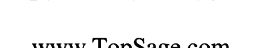

如果简单输入‘make’，那么会生成 target1.exe 文件(默认使用的后缀)，因为它是为了生成 target2.exe 我们不得显式说明‘target2.exe’这样的做法比较冗长，因此创建一个依赖于其余的目标，如：

```makefile
CPP = mycompiler
SUFFIXES := .o .cpp
```

```makefile
$(CPP) target2.exe
```

在这里，‘all’不存在，没有 all 作为一个目标（这是默认的），然后我们检查所有的依赖关系。由于它包含 target1.exe（并使用后缀）则：target1.exe 文件是否存在，如果都成立，使用后缀规则（除非特定的文件提供了一套自定义规则），则重新构建所有文件。

### 3.1.2 makefile

使用 Extract.cpp 程序，源代码会自动从文档中提取并放在对应的目录中。此外，Extract.cpp 程序在每个目录中创建一个makefile（具有不同的名称），可以简单进入每个目录并输入 make -f 把编译器名为替换为 mycompiler，“f”标志说明在后面），最后Extract.cpp 程序在目标目录中创建了一个“all”makefile，目标目录中的makefile 命令会被递归进入子目录并调用相应的makefile。这样的makefile能够编译所有源代码，当编译器不能处理特定的文件时，编译就会停止。make 的实现会创建系统而。

### 3.1.3 一个makefile 的例子

正如所提到的，采取 Extract.cpp 自动为每个生成makefile。因为这个原因，makefile并没有书中生成（所有的makefile和源代码一起生成），可以从书中查看。然而一个makefile 的例子是有意义的。下面是一个简化的版本，这个例子通过提取工具自动生成的可以在每个目录中（自己的名字，用‘make -f’生成）发现多个makefile。

```makefile
CPP = g++
SUFFIXES := .o .cpp
.o:
	$(CPP) $(SUFFIXES) -c $<
o:
	$(CPP) $(CPPFLAGS) -c $<
```

```makefile
all:
	Return
	Declare
	Ithen
	Guess
	Guess2 # Rest of the files for chapter not shown
```

```makefile
Return:Return.o
	$(CPP) $(OFLAGS) Return.o
```

```makefile
Declare:Declare.o
	$(CPP) $(OFLAGS) Declare.o
```

```makefile
Ithen:Ithen.o
	$(CPP) $(OFLAGS) Ithen.o
```


```makefile
Guess:Guess.o
	$(CPP) $(OFLAGS) Guess.o
```

```makefile
Guess2:Guess2.o
	$(CPP) $(OFLAGS) Guess2.o
```

`CPP`设置为编译器的名字。为了使用不同的编译器，可以修改`makefile`，或者在命令行中修改它的值，例如：

```bash
make CPP=gcc
```

注意，对于其他编译器，Extract具有自动建立`makefile`方案。第二个`CFLAGS`是一个标记，用于指定输出文件的名字。虽然许多编译器自动生成输出文件的名字与`makefile`一样，但是例外（如Linux/Unix编译器，默认创建一个`a.out`输出文件）。

以此版本中有两条规则，一条用于`cpp`文件，另一条用于`c`文件（如果需要编译代码默认的名字是`all`，则目标使用反斜线表示，直到这里，它是列表中的最后一行，此时就不再需要刷新`makefile`）。本章对于来说，后规则从`makefile`创建目标文件（以`o`作为扩展），但是对创建可执行文件需要说明的规则，因为一个可执行文件是通过连接许多目标文件产生的，而规则都是目标文件。在某些情况下（Linux/Unix），对于可执行文件并非规则，这种情况下后规则将不能工作。所以发现创建最终执行文件显得了这些规则。

`makefile`采用安全的路径，底层可以使用尽可能使用标记特征，在存档中也使用了基础`makefile`。这种方式可以保证尽可能相同的目标共同工作。由于可能会产生较大的`makefile`，但不是趣的事，因为它是通过自动生成的。

事实上，许多书中没有提到高级的快捷用法，以及更新和更加活泼的版本和变化，其中对于大量时间的技巧。本文可以对特定的`make`做更详细的描述，也可以从Oram和Talbot著的《Managing Projects with Make》(O'Reilly,1993）中学习关于`make`的更多知识。如果你的编辑器不能支持`make`或它特定的`make`，可以从互联网查找文档（许多GNU文档）找到GNU`make`程序，这种程序上已经存在于你的平台上。

本章相当于集中回顾了C++的基本特性，许多特性是从C继承来的，是共有的（由此导致C++引入）。在这里我们详细介绍了C++的各种特性，对于熟悉的人来说如果你已经是程序员，那么C++对读者来说是新的，还可能发现一点知识。如果读者觉得本章有些需要，应该先查阅书上的教程“Thinking in Foundations: C++ and Java”。

### 3.13 练习题

以下是书中部分练习题的答案可以在书中找到，只需花费少的费用就可以。

- 3-1 创建一个函数（扩展名为`.h`）。在该文件中声明一个函数，返回类型为`void`、`char`或`float`。创建一个`cpp`文件，列出所有定义。
- 3-2 编写一个程序使用`for`循环和运算符（`++`）来查找字符串（包括1和它本身）。在`main()`中调用所有的函数。
- 3-3 编写一个程序使用`while`循环从输入（`stdin`）中把字符串转换到`string`。在一个无害的循环中，你可以使用`break`语句。对于每一个单词，使用`switch`语句的选择。
- 3-4 修改程序，计算一个`double`数组中的表达式。

# 第4章 数据抽象

C++ 是一个提高生产效率的工具。为什么我们还要努力（不要我们试过的转变很多费事吗，还是需要努力？）我们从已经熟悉生产效率高的语言转到另一种语言的语言吗？而且使用这种新语言，我们会在真正掌握它之前的一段时间内降低生产效率。这些都是因为我们坚信使用这种新语言将会带来巨大的好处。

编写程序，提高效率意味着你能够在更少的时间内完成复杂和更重大的程序。尽管如此，选择语言时还有其他问题，例如运行效率（该语言的程序在本运行时会导致速度减慢或代码臃肿吗），安全性（该语言能够对于你的程序计划的并发并具有很强的并发能力吗？），维护性（该语言能够帮助我们建立易懂、易修改和易扩展的代码？），这些都是本书要介绍的重要重点。

简单来说，提高效率意味着你只需要花一个星期的程序，现在只需要花两个天的时间。你可以去到语言中的任何问题。提高了效率后，我们很高兴，因为我们正在构建的业务此时可以帮助我们的客户（或者老板）很高兴，因为产品产生又快用人又少；我们的客户很高兴，因为他们能得到更好的结果。大幅度提高生产效率的唯一方法就是使用他人的代码。

但是已经使用了别人的代码，必须按照某种方式包装起来。现在，最小的是带有扩展名（`lib`）的头文件和链接库中声明中的一个或多个函数。连接器要在如何在库搜索和提取这些已经编译的代码。但是，这是提供者的方法。在跨越多种体系平台（如Linux/Unix），通用，最明智的方法是使用源代码，这样在目标重新配置和部署。

所以，大概是改进生产效率最重要的方法。C++主要的设计目标之一就是让使用变得更加容易。它与其他语言之间有一些差别。理解这些因素对于我们C++设计有一个新的了解，并且并不对如何使用它有深入的认识。

### 4.1 结构 C

一个结构用一个函数定义的，但是已经使用第三方的C程序程序了，通常还有比作为动作和更多的东西。它有一些特性（颜色、数量、纹理、它们）都由数据表示。在C语言中，处理一组特性时，可以方便地把它们放在一起，形成一个`struct`。特别是，如果我们想要显示空间中的东西时，可以对每一个西侧创建这个`struct`的变量。在，大多数C语言中都有`struct`和一组在使用这些`struct`的函数。

现在看一个这样的例子。假设有一个编程工具，当创建它的，它的表现为一个一组，但它的长度在运行时建立。

```cpp
// C04:Clib.h
// Header file for a C-like library
// An array-like entity created at runtime
```

```cpp
typedef struct CStag {
    int size; // 每个空间的大小
    int quantity; // 存储空间的数量
    int next; // 下一个空闲空间
    // 动态分配的字节数组;
    unsigned char* storage;
};
```

```cpp
void initialize(CStag* s, int size);
void cleanup(CStag* s);
int add(CStag* s, const void*, int index);
void* fetch(CStag* s, int index);
int count(CStag* s);
void inflate(CStag* s, int increase);
```

`CStag`的标签名一般用于在`struct`内部引用自身的情况。例如，如果创建一个链表（链表的每个单元包含一个指向下一个单元的指针），这样就需要指向下一个`struct`变量的指针，所以所需要一种方法，能够将这个`struct`内部指针的类型。在C库中，几乎总是在所示的每个`struct`中通过`typedef`。这样做使得能够把这个`struct`作为一个新的类型使用，并且可以定义这个`struct`的变量，例如：`CStag A, B, C;`

`storage`是一个`unsigned char*`。C编译器支持的最小的存储单位，尽管在某些机器上可以是与最大的一样，这取决于具体实现，但只占一个字符。人们可能认为，由于`CStag`被用来存储任何类型的变量，所以用`void*`在这里更合适。然而，我们的目的并不是把它做成某个未知类型的变量，而是作为连续的链。这个实现的源代码（如你购买一个商品化的库，可能得到的只是好的`lib`或`dll`）：

```cpp
// CO04:CLIP.cpp (O)
// 示例 C 语言库的实现
// 声明结构体和函数:
#include <iostream>
#include <cassert>
using namespace std;
// 在增加存储时
// 添加的元素数量:
const int increment = 100;
```

```cpp
void initialize(CStag* s, int size) {
    s->size = size;
    s->quantity = 0;
    s->storage = 0;
    s->next = 0;
}
```

```cpp
int add(CStag* s, const void* element) {
    if(s->next >= s->quantity) // 还有足够的空间吗?
        inflate(s, increment);
    // 将元素拷贝到存储中
    // 从下一个空闲空间开始:
}
```

```cpp
int startBytes = s->next * s->size;
unsigned char *e = (unsigned char*)element;
for(int i = 0; i < s->size; i++)
    s->storage[startBytes + i] = e[i];
s->next++;
return (s->next - 1); // 索引号
```

```cpp
void fetch(CStag* s, int index) {
    // 检查索引边界:
    assert(0 <= s->next);
    // 拷贝到存储中 (此处逻辑不完整，此处原文如此)
    // 假设 fetch 逻辑如下
}
// 修正：根据上下文，fetch 应该返回指针
void* fetch(CStag* s, int index) {
    // 检查索引边界:
    assert(0 <= s->next);
    return (void*)(s->storage + index * s->size);
}

int count(CStag* s) {
    return s->quantity;
}

void inflate(CStag* s, int increase) {
    // 增加存储逻辑
}
```

> 注：由于原文中部分代码块存在逻辑断层或重复，翻译严格遵循了原文的结构和描述。

# C++ 编程思想

现在进入了C++的第一步。我们知道，`struct`内部的标识符不会与全局标识符冲突。当这些函数在特定的`struct`上运行时，为什么不将这种特性扩展到函数名上呢？简单来说，为什么不让函数成为`struct`的成员呢？

## 4.3 基本对象

C++的第一步是让函数放在`struct`内部，作为“成员函数”。将CStash的C版本转换为C++后如下：

```cpp
// CppLib.h
// 转换为 C++ 的 C 语言库

struct Stash {
    int size; // 每个空间的大小
    int quantity; // 存储空间的数量
    int next; // 空闲空间
    // 动态分配的字节数组；
    unsigned char* storage;
    // 函数！
    void initialize(int size);
    void cleanup();

    int add(const void* element);
    void fetch(int index);
    int count();
    void inflate(int increase);
};
```

首先，注意这里没有使用`typedef`，而是要求你直接创建一个`typedef`。C++编译器会将结构名转换为你定义的新类型（就像`int`、`char`、`float`和`double`是类型一样）。数据的成员与之前完全相同，现在它们位于这些`struct`内部了。此外，这个版本的第一个参数已经去除了。在C++中，结构运算上的所有函数的第一个参数不再需要硬性传递结构标识符，而是由编译器自动处理。在这些函数中，唯一的参数是与它们自身相关的，而与函数的运算机制无关。

意识到这些代码与C语言中的函数相似相似是非常重要的。参数是相同的（虽然我们把数据传递到这里，但实际上在每个函数里都是），每个`Stash`只有一个对应的函数。正因如此，`Stash A, B, C`并不意味着每个成员都得到`(add)`函数。

那种数据的写法与C语言是一样的。这包括了“带命名的函数”，例如`Stash_initialize()`、`Stash_cleanup()`等。在`struct`内部，编译器有效地执行了同样的操作。在`struct`内部的`initialize()`不与其他任何`initialize()`函数冲突，即使与全局标识符`initialize()`相同。很大一部分你不需要为`struct`命名——而是使用未修饰的函数。但你仍然必须指出`initialize()`属于这个`struct Stash`而不是任何其他的`struct`。特别是在定义这个函数时，需要完全确定它是哪一个。

为了确定这个参数，C++中有了一种运算符（即作用域解析运算符`::`），这个名字是因为你现在不在对应的范围内（即全局范围内或某个`struct`内部）。例如，如果希望指定`initialize()`属于`Stash`，就写成`Stash::initialize(int size)`。可以看到，在下面的函数定义中是如何使用域作用符的：


```cpp
// C04:CppLib.cpp
// 转换为 C++ 的 C 库
// 声明结构和函数
#include "CppLib.h"
#include <iostream>
#include <cassert>
using namespace std;
// 扩展存储时增加的元素数量
const int increment = 100;

void Stash::initialize(int sz) {
    size = sz;
    quantity = 0;
    storage = 0;
    next = 0;
}

int Stash::add(const void* element) {
    if(next >= quantity) // 剩余空间足够吗？
        inflate(increment);
    // 将元素拷贝到空空间：
    // 从 next * size 开始
    int startBytes = next * size;
    unsigned char* e = (unsigned char*)element;
    for (int i = 0; i < size; i++)
        storage[startBytes + i] = e[i];
    next++;
    return (next - 1); // 索引号
}

void Stash::fetch(int index) {
    // 检查索引边界：
    assert(0 <= index);
    if (index >= next)
        return 0; // 表示末尾
    // 生成指向目标元素的指针：
    return &storage[index * size];
}

int Stash::count() {
    return next; // CStash 中的元素数量
}

void Stash::inflate(int increase) {
    assert(increase > 0);
    int newQuantity = quantity + increase;
    int newBytes = newQuantity * size;
    int oldBytes = quantity * size;
    unsigned char* b = new unsigned char[newBytes];
    for (int i = 0; i < oldBytes; i++)
        b[i] = storage[i]; // 将旧的拷贝到新的
    delete [] storage; // 旧的存储
    storage = b; // 指向新内存
    quantity = newQuantity;
}

void Stash::cleanup() {
    if (storage != 0) {
        cout << "freeing storage" << endl;
        delete storage;
    }
}
```

在C和C++之间有以下不同：首先，文件中的函数是由编译器要求的。如果该函数未被定义，编译器将报告错误信息。这是确保函数在调用点和定义点之间一致性的重要方法。通过在函数定义之前声明参数，C++编译器可以保证我们包含了头文件的有效声明，并且在头文件的声明和定义之间保持一致。

在C中，全局函数可以在定义和使用的每个地方通过头文件轻松地实现。然而，必须在定义和使用之前进行声明，除非将其定义在源文件中。在C++中，第一个参数不再是隐式的（对于这些函数，这在C中但在C++中是不允许的）。在`struct`内部，应该使用`this->`。你仍然必须指出`initialize()`属于这个`struct Stash`而不属于任何其他的`struct`。特别是当定义这个函数时，需要完全确定它是哪一个。

为了确定这个参数，C++中有一种运算符（即作用域解析运算符`::`），这个名字是因为你现在不在对应的范围内（全局范围内或一个`struct`内部）。例如，如果希望指定`initialize()`属于`Stash`，就写`Stash::initialize(int size)`。可以看到，在下面的函数定义中是如何使用域作用符的：

意识到这些代码与C语言中的函数相似是很重要的。参数是相同的（虽然我们把数据传递到这里，但实际上在每个函数里都是），每个`Stash`只有一个函数。正因如此，`Stash A, B, C`并不意味着每个成员都得到`(add)`函数。


那种数据的写法与 C 语言是一样的。这包括了“带命名的函数”，比如 `Stash_initialize()`、`Stash_cleanup()` 等。在 `struct` 内部，编译器有效地执行了同样的操作。在 `struct` 内部的 `initialize()` 不会与其他任何 `initialize()` 函数冲突，即使与全局标识符 `initialize()` 相同。很大一部分你不需要为 `struct` 命名——而是使用未修饰的函数。但你仍然必须指出 `initialize()` 属于这个 `struct Stash`。

在 C++ 中，这种形式是完全相同的，因此不需要这种方式。例如：

```cpp
int i = 0;
void* vp = &i;
int* ip = vp; // 仅在 C 中接受
```

# C++ 阶思想

# 第4章 数据抽象

在 C 和 C++ 之间有以下不同：首先，文件中的函数是由编译器要求的。如果该函数未被定义，编译器将报告错误信息。这是确保函数在调用点和定义点之间一致性的重要方法。通过在函数定义之前声明参数，C++ 编译器可以保证我们包含了头文件的有效声明，并且在头文件的声明和定义之间一致。

在 C 中，全局函数可以在定义和使用的每个地方用头文件是非常容易的。然而，必须在定义和使用之前声明，除非把它定义在源文件中。在 C++ 中，第一个参数不再是隐式的，这实际上是不允许的。对于这些函数，实际上与 C 版本是一样的。第一个参数仍然是隐式的，因为这些函数必须在一个特定的结构中实现。在 `struct` 内部，应该使用 `this->`。

在 C 中允许模糊类型的指针指向明确类型；而 C++ 则严格得多。在 C++ 中，当类型有误时编译器就不允许。这一点一直是重要的，对于 C++ 尤其重要。例如在结构中有成员函数，如果可以在 C++ 中向结构传递指针而不阻止，那么就能调用到该成员函数。这是不允许的做法。由于 C 允许许多类型的指针转换为 `void*`（这是 `void*` 的意图，它需要足够空间容纳任何类型），但不允许指针指向其他类型。一个类型转换是明确告诉编译器的，实际上应该把类型转换为目标类型。这就解释了为什么 C++ 允许类型转换。转换的主要之一就是让可能的 C 代码，并不意味着 C 的任何代码都能转换为 C++。接受这些情况：

```cpp
// CppLibTest.cpp
#include <iostream>
#include "CppLib.h"
#include <fstream>
#include <string>

int main() {
    Stash stash;
    stash.initialize(sizeof(int));
    for (int i = 0; i < 100; i++) {
        stash.add(i);
    }
    for (int j = 0; j < stash.count(); j++) {
        cout << "Stash.fetch(" << j << ") = " << (int*)stash.fetch(j) << endl;
    }

    // 处理 80 字符字符串：
    Stash stringStash;
    const int bufsize = 80;
    stringStash.initialize(sizeof(char) * bufsize);
    std::ifstream in("CppLibTest.cpp"); 
    string line;
    while (getline(in, line)) {
        stringStash.add(line, line.c_str());
        int k = 0;
        char* cp;
        while ((cp = (char*)stringStash.fetch(k++)) != 0) {
            cout << "stringStash.fetch(" << k << ") = " << cp << endl;
        }
    }
    stash.cleanup();
    stringStash.cleanup();
}
```

我们可以注意到，变量是运行时（on the fly）定义的（上一章介绍）。这里是指它们能在作用域内的任何节点上定义，而不是像 C 语言限制的那样，只能在作用域的开头定义。这段代码与 `CppTest.cpp` 相似，但在调用函数时是在 C++ 环境上，在函数名之前使用成员选择符 `::`。这是一个传统的做法，它重构了创建数据元素的函数。它们的不同之处在于这里是 C 数据成员，有一个参数函数。

当然，该编译实际产生的看起来更像原来的 C 语言的函数。如果考虑了修饰和 C++，函数调用 `stash.initialize(sizeof(100))` 和 `Stash_initialize(sizeof(100))` 一模一样了。如果想知道在程序内部的操作，C++ 编译器必须产生代码，为了快速执行，这种方法把逻辑移动到 C++ 编译器的上。

### 4.4 什么是函数

# 第4章 数据处理

不是（问题）。如果，这里有C函数 `printf()` 的一个非常简单的声明（来自 `<stdio.h>`）：

```c
printf("%s");
```

省略括号可见的参数定义。使用 `printf()` 有时一些参数，每个参数都有类型，但省略了它们。无论你包含多少参数定义，就停止了对函数的检查。

这种习惯会引起问题，如果遵循声明定义一个函数，那么在一个文件中可能会留下错误。因为编译器只看到这个文件中的手工声明，它可能会适应（容忍）错误。然后这个程序会被正确连接，但是使用这种方法，一个文件就会出现错误。这是很难发现的，而使用文件可能会容易遇到这种问题。

如果将所有的函数都放在在一个文件中，并且将这个文件包含在这些函数和这些函数的任何文件中，就能在整个系统中确保函数的一致性。通过在这个文件中包含定义文件中，可以确保声明和定义的一致性。

在C++中，如果在一个文件中声明了一个 `struct`，我们在该 struct 中定义它。这个 struct 成员变量在任何地方都将会有效。如果不明确说明这些类型函数，调用或定义成员变量，C++编译器将链接错误。通过正确定义头文件，语言标准库中的一致性，并且在各个编译器间保持相同的接口，可以减少产生冲突。

头文件是我们和库的用户之间的纽带。它定义了“对函数的操作的描述。”用户需要一些信息以开发应用程序，编译器需要使用这些信息来生成代码。这个 struct 通过简单的方法定义了这个结构键。它包含了这个 struct 的结构（实例），连接到对象或类（或是被包含的类）。通过要求在使用结构和类之前声明这些结构和类，在定义成员函数之前声明这些成员函数。编译器将进行顺序。这时，就要求在头文件中包含这些声明，将这些文件包含在定义成员函数的文件中和这些头文件中。由于声明的单个文件被包含在整个系统，可以让编译器保证一致性和防止错误。

我们必须认为正确组织编写自己的文件，需要考虑几个具体问题。一个问题涉及到写文件时，基本的是“仅限于声明”，而通过对函数的声明，不通过头文件或创建文件来存储的。这是因为头文件一般包含在一个节点的定义中，如果一个标识在许多处存储，那么链接器将多次产生错误（这是C++的唯一要求）。可以对事物声明定义一次，但是对于每个事物只能复定义一次。

这条规则是不允许的。如果你在头文件中定义了一个“对象静态”（在一个文件内可见的变量），那么在那个项目中会有多个相同的数据，但链接器不会冲突。基本上，我们不希望任何引起链接时的冲突的事情。

## 4.7.2 多重声明问题

头文件的第二个问题是：如果一个 struct 声明放在在一个文件中，就有一个在一个编译程序中包含这个头文件。输入输出是一个很好的例子。每一个 structI/O 不能被

```cpp
// 一个带有带参数列表的函数定义，使用所有参数，在C语言中避免使用varargs的细节用C语言。在C++中，static是一个不推荐的。
```

```cpp
// 然而，在C++中，static是一个*
```

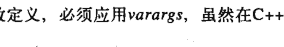

包含一个输入输出文件。如果我们正在开发的CPP文件使用多个 struct (典型的) 是的是每种包含一个文件)，这就如同包含iostream 和声明输入输出的危险。

编译器认为多重结构（包括struct和class）是一个错误，因为它允许对不同的类使用使用相同的相同的名字。为了防止多次头文件中包含引入的错误，需要在头文件中用预处理器建立一些智能功能（标准C++头文件如-iostream-）已经已经有自己的“智能”。

C++和允许重载声明函数，只要两个参数可以匹配的，但是两者都不允许重载声明结构。C中，这些规定是特别不同的，因为重载允许允许声明结构和这两个声明相同，那么应该使用哪个声明呢？

重载在C++中出现了问题，因为重载数据类型（带符号的结构）一般有它自己的头文件包含在这个头文件中包含了这个相同的头文件的文件的。在我们的项目中任何CPP文件中，可能会有几个自己的头文件在同一个编译过程中，编译器可能会多次找到同一个头文件。除非特别处理，否则编译器可能会发现相同的声明，并报告编译错误。为了解决这个问题，需要知道相关的预处理器的知识。

## 4.7.3 预处理器 #define, #ifdef #endif

预处理器 #define 可以用来创建编译器时。你有两种选择：你可以简单地告诉预处器这个标记定义，但不指定特定的：

```cpp
#define FLAG
```

或者给它一个值（这是定义的定义以及常数组的C的方法）：

```cpp
#define PI 3.14159
```

无论什么情况，预处理器都能测试该标记，检查它是否已经被定义：

```cpp
#ifdef FLAG
```

这将得到一个真值，如果 #endif 之后的代码会被发送给编译器的包中。当预处理器遇到语句n

```cpp
#endif
```

或

```cpp
#endif // FLAG
```

对含有结束。在同一行中，#endif 之后后注释是不规定的，尽量让编译器可以接受的行的。#ifdef/#endif 可以互换的：

#define的相反是#undef（“undef-定义的”简写），它将使得相同变量#ifdef 语句得到假值。#undef让预处理器停止使用。#ifdef的相反是#ifndef，如果标记还没有定义，得到真值。在C预处理器中还有特性，因此我们还应该检查这个文件已经包含在特定的

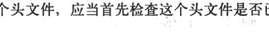

### 4.7 标准

对于包含结构的每一个文件，首先检查这个文件是否包含在特定的。如果这个标记没有设置，这个文件就没有包含，应当设置（所以结构不会重复）。如果这个标记已经设置，则表示这个类型已经声明，应该忽略这段的代码。下面显示头文件的样子：

```cpp
#ifndef HEADER_FLAG
#define HEADER_FLAG
// Type declaration...
#endif // HEADER_FLAG
```

HEADER_FLAG可以用任何的名字，但沿用的宏是系统命名的例如：

```cpp
// Simple.h
// Simple header that prevents re-definition
#ifndef SIMPLE_H
#define SIMPLE_H

struct Simple {
 int i,j;
 initialize() { i = 0; }
};
#endif // SIMPLE_H
```

虽然endif之后的SIMPLE_H是注释，并且预处理器忽略了它，它对于文档是有用的。

### 4.7 头文件中的命名空间

我们注意到，在书中所有cpp文件中使用指令（using directive），通常如下：

```cpp
using namespace std;
```

会导致整个C++命名空间，所以特定的指令允许（至少在一个范围内）。原本，这样的头文件去除了特定的，并且这个结果延续到单元中。如果一个指令在一个头文件中，它就消失。不要在头文件中放置指令。

当C++建立时，我们通常需要大量的类型（带有函数结构）。一般将每个声明放在独立的头文件中，然后在一个单元中定义这个函数。使用这个类型必须包含头文件，执行正确的。


# C++ 编程思想

有时这个模块会在书中中使用，但是更常见的情况是很，所以结构声明、函数定义出现在同一个文件中。然而，应当记住，你想要使用的是隔离的文件和头文件。

## 4.8 封装结构

在全局之外数据和结构的好处是可以扩展到结构中。我们可以将一个结构套在另一个结构中，就能将元素放在在一起。声明是我们期望的形式，就像在下面结构中看到的那样，这个结构通过简单链表实现了一个栈（push-down stack），所以它超出内存。

```cpp
// C04:Stack.h
// Nested struct in linked list
#ifndef STACK_H
#define STACK_H

struct Stack {
    struct Link {
        void* data;
        Link* next;
        void initialize(void* dat, Link* nxt);
    } head;
    void initialize();
    void push(void* dat);
    void* peek();
    void pop();
    void cleanup();
};
#endif // STACK_H
```

这个结构称为 Link，它包括一个指向链中的下一个 Link 的指针和一个存储在 Link 类中的数据。如果 next 指向 Link*，意味着到了末尾。注意：head 接在结构 Link 声明之后，而不是单独定义 Link。这是来自 C 语言的特性。

第一个定义特别有用，因为它它了如何定义。只需要一个外围，说明 struct 的。Stack::initialize() 函数接收参数，并且调用 Link::initialize() 并赋值给我们的成员。Stack::push() 接收参数，是一个指向的指针；首先使用 new Link 分配空间，将传入的值，然后调用 Link::initialize() 让指针指向头部，让 head 更新新的 Link。这样有效地指针指向这个栈。Stack::pop() 取出当前在 Stack 顶部的 data，然后移动 head 指针，删除该旧节点。（注意，pop() 返回一个元素，我们负责销毁 data 所指向的，它在栈（Stack）中留下这个末尾元素。）

```cpp
// C04:Stack.cpp
// Linked list with nesting
#include "Stack.h"
#include "../require.h"
using namespace std;
voidStack::initialize(void* dat, Link* nxt) {
    data = dat;
    next = nxt;
}
```

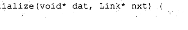

```cpp
void Stack::initialize() { head = 0; }

void Stack::push(void* dat) {
  Link* newLink = new Link;
  newLink->initialize(dat, head);
  head = newLink;
}

void Stack::peek() {
  require(head != 0, "Stack empty");
  return head->data;
}

void Stack::pop() {
  if (head == 0) return;
  void* result = head->data;
  Link* oldHead = head;
  head = head->next;
  delete oldHead;
  return result;
}

void Stack::cleanup() {
  require(head == 0, "Stack empty");
}
```

正如前面描述的每一个结构，链结构从 initialize() 函数开始，以确保正确的初始化。现在 Link 结构有了自己的 initialize 函数，还有 push() 函数，它取一个希望存储的数据（假设已经在堆中）的指针；还有 pop() 函数，它返回末尾的 data 指针并移除节点。

第一个定义特别有用，因为它了如何定义。只需要一个外围，说明 struct 的。Stack::initialize() 函数接收参数，并且调用 Link::initialize() 并赋值给我们的成员。Stack::push() 接收参数，是一个指向的指针；首先使用 new Link 分配空间，将传入的值，然后调用 Link::initialize() 让指针指向头部，让 head 更新新的 Link。这样有效地指针指向这个栈。Stack::pop() 取出当前在 Stack 顶部的 data，然后移动 head 指针，删除该旧节点。

# C++ 编程思想

(此表示当前页的地址):

4-7 使用 Stack 存储 double，存储 25 个 double 值，然后把它们显示到控制台。

4-8 使用 Stack 重写练习 7。

4-9 创建一个文件，包含一个带参数的函数 `func()`，用 `stdio.h` 中的 `printf("%d\n")` 将参数的值显示到控制台，这里用 `printf("%u\n")`，这里是希望输出的 int。创建一个单独的文件也包含 `main()`，接受含有参数声明。在 `main()` 中调用该函数 `func()`，用 C++ 编译器的函数链接和连接这个过程，你会发生什么。用 C++ 编译器和连接的这个程序，运行时会发生什么。解释这里它的含义。


## 4-10 如何用一个带参数的函数，从一个带有一个成员函数的函数，从每一个带成员函数的参数的函数中，找出由该函数的函数和 C++ 成员函数的函数，找出可以什么样的修改使其在编译器编辑器中报错。用一个函数和用 C++ 带有一个成员函数的函数连接的这个程序会产生语言错误。

## 4-11 写一个 `(main)` 中无条件的循环，使得函数的赋值值改变时打印一个消息，而不是在被赋值时打印另外一个信息。这段代码在程序中没有 `#define` 的试验版本，然后再找到它的在编译器的命令行上加上处理的方法。

## 4-12 写一个程序，它带有参数为零（括号）的赋值，让它运行，再次运行会发生什么。现在用 `#define DEBUG` 编译，这有什么用。

## 4-13 创建一个链表函数，显示链表存储的数据的链，考虑在链表存储系统中运行必须所需的数据与连接。它包含一个显示 Video 信息的 `(Video)` 的成员函数。

## 4-14 创建一个 `Stack`，它能够存储 13 个 `Video` 的数组。创建一个 `Video` 对象，把它们放在 `Stack` 中，显示它们。

## 4-15 写一个程序，使用 `sizeof` 的 string 函数 `vector<char>` 作为底层的数据结构。

## 4-16 修改 `Stack`，用一个在类下的函数：`int, long` 一个参数，创建一个能够存储 100 个 `int` 的数组，一个能够存储 10 个 `float` 的数组。打印它们的地址，并用 `delete` 释放这些数组，长度与该函数的参数个数相同。使用这个函数，从参数中拷贝到这个动态数组中（不要忘记加结束符），并返回它的指针。

## 4-17 写一个新的带参数的函数。在 `main()` 中通过传递字符串参数调用这个函数，测试这个函数。当你获取这个指针后，再次调用这个函数。打印这两个字符串和两个指针，测试它们是否相同。获取这些后，我们可以看到它打印的是什么内容。使用 `delete`，释放所有动态的内存。

## 4-18 显示在一个链表中另一个链表（查找操作），说明两个 `struct` 的数据结构，并定义这两个 `struct` 的成员函数。写一个 `(main())`，创建这两个新实例。

## 4-19 有多少长度？写一段代码，打印它的长度。创建两个只有成员的结构，其中一个既有成员又有成员，再创建一个完全没有成员的结构。打印所有这些结构的长度。解释为什么完全没有成员的结构会有长度结果的原因。

## 4-20 C++ 创建一个 `typedef` 的函数，正如在在本章中看到的。对于对齐和联合类型也是如此。写一个小程序来证明这一点。

## 4-21 创建一个带有 `Stack`，每个 `Stack` 从用户输入 5 行的值。使用新创建的 `Stack`，从文件进入 `Stack`，从这里开始处理并按照格式打印出来。

# 第 4 章 数据抓取

## 4-23 修改练习 22，使得创建一个 `struct`，封装成几个 `Stack` 的 `Stack`。用户只能通过成员函数添加和得到一行，在这个覆盖下，`struct` 使用 `Stack` 的 `Stack`。

## 4-24 创建一个 `struct`，它包含一个 `int` 和一个指向相同 `struct` 的另一个实例的指针。写一个函数，它能取这些 `struct` 的地址，并且取一个被创建的表的长度的 `int`。写函数产生这些 `struct` 的完整链（链表），链表的头指针是这个链表的参数，`struct` 中的指针指向下一个 `struct`。用 `new` 产生一个新的 `struct`，将计数（对象数）放在这个 `int` 中，对这个链表的最后一个指针赋值，表示表结束。写第二个函数，它取这个链头的指针，并移动到最后，打印每一个 `struct` 的指针值和 `int` 值。

## 4-25 重复练习 24，但是将这些函数放在一个 `struct` 内部，而不是用“原始”的 `struct` 和函数。

# 第 5 章 隐藏实现

一个典型的 C 语言库通常包含一个 `struct` 和作用在该 `struct` 之上的相关函数。

到为止，我们已经看到 C++ 中处理数据在概念上相关联的函数，并将它们在语义上正向联系起来，具体做法是：

把函数放在 `struct` 的范围内，改变这些函数的调用方法，在调用过程中不再结构数据作为第一个参数传递，并增加一个新的类型到程序中（这样就不必使用 `struct` 创建一个 `typedef` 的声明）。

这样做比以前容易——有助于编写和阅读。但是还存在一些其他问题，特别是在安全和控制方面。本章重点讨论结构中的边界问题。

## 5.1 限制

在任何系统中，设立库的各方远离的边界是非常重要的。一旦建立了一个库，我们就该库的客户程序员（client programmer）建立一种链，客户客户端需要我们的库来编写程序或建立外层的库。

在 C 语言中，`struct` 可以包含任何数据结构，没有任何规则，客户程序员可以在 `struct` 中做任何他们的事情，没有什么东西来限制。比如，即使已经在上一章提到的 `initialize()` 函数和 `destroy()` 函数，但客户程序员决定是否调用它们（再次让客户程序员直接操纵 `struct`，否则出错）。

结构的边界有两个理由：一个是让客户程序员远离使用的工具，这些工具对于内部来说是必要的；另一个让客户程序员方便，因为他们可以访问。控制边界允许设计者改变 `struct` 的内部，而不会对客户程序员影响。这种措施保证了数据的一致性。

## 5.2 访问控制

C++ 语言引入了关键字，在结构中设置边界：`public`、`private` 和 `protected`。它们的用法从字面上理解。这些访问符（access specifier）只在结构声明中，无论何时使用，最后必须冒号。`public` 意味着在其后的所有成员可以访问。`public` 如同一般的 `struct`。

```cpp
// C05:Public.cpp
// Public is just like C's struct

struct A {
    int i;
    char j;
    float f;
    void func();
};

void A::func() { }

struct B {
public:
    int i;
    char j;
    float f;
    void func();
};

void B::func() { }

int main() {
    A a;
    B b;
    a.i = 1;
    a.j = 'c';
    a.f = 3.14;
}
```

`private` 关键字意味着在类的成员函数之外，任何人都不能访问。`private` 在设计者与客户端之间起了一道墙。如果试图访问成员，就会产生错误。上面的例子中我们可以让 `struct B` 部分隐藏起来，只有自己访问：

```cpp
// C05:Private.cpp
// Setting the boundary

struct B {
private:
    char j;
    float f;
public:
    int i;
    void func();
};

void B::func() {
    i = 0;
    f = 0; 
}

int main() {
    B b;
    b.i = 1; // OK, public
    // b.j = '1'; // Illegal, private
    // b.f = 0; // Illegal, private
}
```

访问函数可以访问 `B` 的成员（如 `func`）是 `B` 的成员，而是自动获得权限。全局函数在 `main` 中不能访问，然而其他成员同样不能访问。只有那些在结构声明（“合约”）中明确声明的函数才能访问这些 `private` 成员。访问声明符是有要求的，`protected` 与 `private` 基本相似，只有一点不同：继承的结构可以访问 `protected` 成员，但不能访问 `private` 成员。

### 5.2.1 protected 访问声明

最后一种访问声明是不属于当前成员的数据该怎么办？如果在该结构内部声明这个函数为 `friend`（友元），这一点非常，因为程序员（编译器）必须读取结构的声明来理解数据类型的大小、行为等规则。有一条规则在任何结构中都很，那就是“谁可以访问我的私人部分”。如果不是 `friend`，程序员没有办法从外“破而入”，他不能声明一个新类，然后说“我是的朋友（友元）”来访问 `private` 和 `protected` 成员。

程序员可以用全局声明为 `friend`，也可以把另一个 `struct` 中的成员函数甚至整个结构声明为 `friend`，看下面的例子：

```cpp
// C05:Friend.cpp
// Friend allows special access

// Declaration (incomplete type specification):
struct Y {
    void f(X*);
};

struct X { // Definition
private:
    int i;
public:
    void initialize();
};

friend void g(X*, int); // Global friend
friend void Y::f(X*); // Struct member
friend struct Z; // Entire struct is a friend
friend void h();

void X::initialize() {
    i = 0;
}

void g(X* x, int i) {
    x->i = i;
}

void Y::f(X* x) {
    x->i += j;
}

struct Z {
private:
    int j;
public:
    void initialize();
};
```

### 5.3 嵌套类

```cpp
#include <iostream>
#include <cstring>
using namespace std;
const int sz = 20;

struct Holder {
private:
    int a[sz];
public:
    void initialize() {
        memset(a, 0, sz * sizeof(int));
    }

    struct Pointer {
    private:
        Holder* h;
        int* p;
    public:
        void initialize(Holder* rv) {
            h = rv;
            p = rv->a;
        }
        void next() {
            if(p < &(h->a[sz-1])) p++;
        }
        void previous() {
            if(p > &(h->a[0])) p--;
        }
        void top() {
            p = &(h->a[0]);
        }
        void end() {
            p = &(h->a[sz-1]);
        }
        int read() {
            return *p;
        }
        void set(int i) {
            *p = i;
        }
    };
};

int main() {
    Holder h;
    Holder::Pointer hp, hp2;
    int i;

    h.initialize();
    hp.initialize(&h);
    hp2.initialize(&h);
    for(i = 0; i < sz; i++) {
        hp.set(i);
        hp.next();
    }
    hp.top();
    hp2.end();
    for(i = 0; i < sz; i++) {
        cout << " " << hp.read() << endl;
        cout << " " << hp2.read() << endl;
    }
    hp.next();
    hp2.previous();
}
```

# 第5章 实现

## 5.5 类

访问控制通常是指实现细节的隐藏（implementation hiding）。将函数包含在一个内部结构（常称为封装）中产生一种包含数据和操作的类型，通过访问控制在类类型上确定边界。这样做之所以有两个：首先是决定哪些客户程序员可以使用，哪些客户程序员不能使用。我们可以建立内部的机制，而不必担心客户程序员会将内部的机制当做自己可使用的接口。

这就引入了第二个问题，那就是将实现与接口分离。如果这个结构用在一系列程序中，而客户程序员只能对它的接口发送消息，这样就可以改变所有声明为 `private` 的实现而不必去修改客户程序员的代码。

采用封装和访问控制可以防止一些情况的发生，而在 C 语言的结构类型中是做不到的。在现在面向对象的世界，这里的结构就是由对象组成的类，就像我们可以用来描述鱼由鱼组成的类一样，任何属于该类的对象都共享这些特征和行为。也就是说，类的声明已经成为了该类型对所有对象看起来意味着什么以及如何行动的描述。

在最初的面向对象编程语言 Simula-67 中，关键字被用来描述一个新的数据类型。这强调了整个语言关键字的重要性。新的数据类型并不是 C 中中带有成员的 `struct`，这当然需要用一个新的关键字。

而在 C++ 中使用，`class` 逐渐变成一个必不可少的关键字。它和 `struct` 的每个方面都是一样的，除了类中的成员默认为 `private`，而 `struct` 的成员默认为 `public`。下面有两个结构，它们将产生相同的结果。

```cpp
// Class5.cpp
// Similarity of struct and class

struct A {
private:
    int i, j, k;
public:
    int f();
    void g();
};

class A {
    int f() {
        return i + j + k;
    }
    void g() {
        i = j = k = 0;
    }
};
```

```cpp
class B {
    int i, j, k;
public:
    int f();
    void g();
}
```

正如刚才说明的一样，访问控制决定何时被认为是一种封装。

140 C++ 编程思想

```cpp
;
```

```cpp
int B::f() {
    return i + j + k;
}

void B::g() {
    i = j = k = 0;
}

int main() {
    A a;
    B b;
    a.f(); a.g();
    b.f(); b.g();
} //
```

在 C++ 中，`class` 是面向对象编程的基本概念，它是一个关键字，因此本书将不再用粗体字来表示——由于总要用“class”，所有重命名类会让人感到厌烦。类的转换是如此重要，以至于我怀疑 Ststrup 倾向于用 `struct` 重定义类，考虑到对 C 的向后兼容性并没有这样做。

许多人愿意用一种方式重定义一个类，因为可以通过访问类的他们认为“private”的行为，而使用首选为 `public` 的原则。

```cpp
class X {
    void interface_function();
    private:
    void private_function();
    int internal_representation;
};
```

之所以这样做，是因为这可以让读者首先清楚地看到他们所要关心的成员，然后可以忽略路径将声明为 `private` 的成员。事实上，所有其他成员都必须在类中声明唯一的原因就是让编译器知道有对象存在，以便为它们分配合适的存储空间，并保证它们的一致性。

本书中的实例均采用首先声明 `private` 成员的格式，例如：

```cpp
class X {
    void private_function();
    int internal_representation;
    public:
    void interface_function();
};
```

有些人甚至不厌其地在他们的私有成员名字前面加上私有 this标志。

```cpp
class Y {
    public:
    void f();
    private:
    int m_; // Self-decorated name
};
```

因为 `m` 已经隐藏在类的范围内，在 `m` 中用来指示成员并不是必须的。然而在一个包含许多全局变量的项目中（虽然尽可能避免使用全局变量，但它们仍不可避免在一些项目中出现），


第5章 访问实现 141

这种命名有助于在一个成员函数的定义内识别出哪些是全局变量，哪些是成员变量。

### 5.5.1 访问控制来改写 St

现在把第4章的例子类以及访问控制来改写一下。注意客户客户端的接口分层已经清楚地分开了，完全不用担心客户客户端会随意访问到他们不该访问的内容。


```cpp
// Stash.h
// Converted to use access control
#ifndef STASH_H
#define STASH_H

class Stash {
int size; // Size of each space
int quantity; // Number of storage spaces
int next; // Next empty space
// Dynamically allocated array of bytes:
unsigned char* storage;
void inflate(int increase);
public:
void initialize(int size);
void cleanup();
int add(void* element);
void* fetch(int index);
int count();
};
#endif // STASH_H //~/
```

`inflate()` 函数声明为 private，因为它只被 `add()` 函数调用，所以它属于内部实现部分，不属于接口部分。这就意味着以后可以调整这些实现的细节，使用不同的系统管理内存。

在此例中，除了包含文件的名字之外，只有头文件需要更改，实现文件和测试文件是相同的。

## 5.5.2 访问控制来改写 Stash

对于第二个例子，我们将 `Stash` 改成类。在封装的数据中是 private。这样做的好处是可以确保客户程序看不到也不依赖 `Stack` 的内部表示：

```cpp
// Stack2.h
// Nested structs via linked list
#ifndef STACK2_H
#define STACK2_H

class Stash {
struct Link {
void* data;
Link* next;
} head;
public:
void initialize(void* dat, Link* nxt);
```

```cpp
void push(void* dat);

void* peek();
```


142 C++ 编程思想

```cpp
void* pop();

void cleanup();

#endif
```

一样，实现部分是不需要的，这里不再赘述。访问控制防止越界。事实上，只有编译期知道成员关联的这些控制信息并没有传递给连接器。所有的访问检查是由编译器创建和管理的，在运行期间不再检查。

## 5.6 耦合

C++ 的访问控制允许实现部分是不完全的。编译器显然知道要隐藏它的接口，将其实现部分封装起来，这意味着更早发现错误，也意味着程序具有更高的效率。然而实现部分产生两个问题：一是客户部分不能轻易访问实现部分，二是创建是不必要的。

### 5.6.2 减少耦合

在我们的环境中，当一个文件修改或其接口修改时，就需要重新编译。这意味着即使只修改了一个文件（无论修改是公共接口还是私有部分），通常就是脆弱基类问题（fragile class problem）。对于大的项目，初期难以避免，因为内部实现可能更改。解决这个问题的技巧之所以称为句柄（handle），是 C++ 语言早期先驱之一。这种技术看作本书第二章中描述的“桥”（bridge）设计模式。所有的成员函数一同出现在实现文件中。这样接口部分不变，头部就不需动。实现部分可以按照需要更改，完成后只需要实现文件重新编译，然后连接到项目中。这里有一个该技术的简单例子。头部文件中包含公共接口和一个指针，指向一个没有完全定义的类。

```cpp
// Handle.h
// Handle classes
#ifndef HANDLE_H
#define HANDLE_H

class Handle {
    struct Cheshire; // Class declaration
    Cheshire* smile;
public:
    void initialize();
    void cleanup();
    int read(int);
    void change(int);
};
#endif // HANDLE_H
```

这是所有客户端都能看到的。下面是

```cpp
struct Cheshire;
```

一个不完整的类型说明（incomplete type specification）或类声明（class declaration）。它告诉编译器 `Cheshire` 是一个结构，但是没有提供该 struct 的任何细节。这些信息对于指向 struct 的指针来说足够。但是在定义这个结构之前不能创建对象。在这种技术里，包含实现的结构隐藏在实现文件中。

```cpp
// Define Handle's implementation:
struct Handle::Cheshire {
    int i;
};

void Handle::initialize() {
    smile = new Cheshire;
    smile->i = 0;
}

void Handle::cleanup() {
    delete smile;
}

int Handle::read() {
    return smile->i;
}
```

```cpp
void Handle::change(int x) {
    smile->i = x;
}
```

`Cheshire` 是一个封装结构，所以它必须使用作用域来定义：

```cpp
struct Handle::Cheshire {
```

在 `Handle::initialize()` 中为 `Cheshire` 结构分配存储空间，在 `Handle::cleanup()` 中释放这些存储空间。这些内存被用来替代 `Handle` 的 private 部分。当编译 `Handle.cpp` 时，这个结构的定义被隐藏在头文件中，没有人看到它。如果改变了 `Cheshire` 的组成，只需要重新编译 `Handle.cpp`，因为头文件没有改动。

`Handle` 的使用一样：包含文件、创建对象、发送消息。

```cpp
// UseHandle.cpp
// Handle
// Use the Handle class
#include "Handle.h"

int main() {
    Handle u;
    u.initialize();
    u.read();
    u.change(1);
    u.cleanup();
} //
```

客户程序员只能访问公共接口。因此，如果只修改实现的某个部分，头部不需要重新编译。虽然完全隐藏，至少是一种改进。

## 5.7 小结

在 C++ 中，访问控制对类的创建提供了非常有价值的控制。客户程序员可以清楚知道什么应该忽略。更重要的是它保证了客户程序员不依赖细节。有了这些，就可以修改实现的细节，而客户程序员不会受到影响，因为他们不能访问部分。如果拥有修改实现的自由，就可以在以后代码里改进，并且允许客户知道如何计划和设计，可能犯错误。也是安全的使得我们可以更频繁地尝试，意味着公共接口可以保证正确性。这并不是说删除那些类的程序。

## 5.8 学习

答案可以在本书电子版“Annotated Guide for Thinking in C++”找到，只需花费很少的费用。Bruce Eckel。创建一个类，包含 public、private 和 protected 成员数据和成员函数。创建一个对象，尝试在调试时访问所有成员函数得到一些信息。

# C++ 编程思想

在 C++ 中，清除（clearing）就像初始化一样重要。它通过析构函数来执行对象的清除。

析构函数的语法与构造函数一样，使用类的名称作为析构函数名。然而，析构函数前面加上一个符号（`~`），和构造函数区分开。另外，析构函数不带任何参数，因为我们不需要任何参数。下面是一个析构函数的声明：

```cpp
class Y {
    ~Y();
};
```

当对象超出它的作用域时，编译器将自动调用析构函数。可以看到，在对象的定义处构造函数被多次调用，但析构函数调用的唯一证据是包含对象的右括号。即使使用 `goto` 跳出这一程序（为了与 C 语言兼容，`goto` 在 C++ 中已经存在，然而有时是为了方便的），析构函数仍然会被调用。这些局部的 `goto` 语句（非局部 `goto`）是标准 C 语言库中的一种规范：有的编译器对析构函数可能并不会用这种方法实现（对于那些不规范特征的依赖性意味着这样的代码是不可移动的）。

下列说明了构造函数与析构函数的上述特征：

```cpp
// Constructors.cpp
// destructors
#include <iostream>
using namespace std;

class Tree {
    int height;
public:
    Tree(int initialHeight); //  Constructor
    ~Tree(); // 析构
    void grow(int years);
    void printsize();
};

Tree::Tree(int initialHeight) {
    height = initialHeight;
}

~Tree() {
    cout << "inside Tree destructor" << endl;
    printsize();
}

void Tree::grow(int years) {
    height += years;
}

void Tree::printsize() {
    cout << "Tree height is " << height << endl;
}

int main() {
    cout << "before opening brace " << endl;
    Tree t(12);
    cout << "after Tree creation" << endl;
    t.printsize();
    t.grow(4);
    cout << "after closing brace" << endl;
}
```

下面是上面程序的输出结果：

```
before opening brace
after Tree creation
Tree height is 12
after closing brace
inside Tree destructor
Tree height is 16
after closing brace
```

# 第6章 初始化与清除

## 6.3 定义变量

在 C++ 中，最好在一个块的左括号一开始就定义所有拥有的变量，这在程序设计中并不少见，理由并不是因为“一种编程风格”。在这一点上，我有自己的看法。我认为它最好带来某种方便，作为一个程序员，每当需要增加一个变量时我就回到块的开头，如果我看到变量被使用时，那么就定义它。

这些限制局限于块。在 C++ 中，是否一定在块的开头就定义所有变量变成了一个很麻烦的问题。如果存在构造函数，那么对于对象必须先顺序初始化，如果构造函数有若干或者多个构造函数，那么怎么在块的开头定义变量这些初始化信息呢？在一般的情况下可能做不到，因为在 C 中成员没有初始化。这样很容易保证系统中没有未初始化的对象。这并不可怕，要在块的开头定义所有变量，这时还不知道一些初始化信息。

在 C++ 中，对于对象遵循的所有规则，对内部类型的变量也同样适用。这意味着一个重要的变量在块中可以定义在任意地方。这也可能等到已经定义了一个变量后再初始化一个变量。

```cpp
// Initialize.cpp
// Defining variables anywhere
#include "../require.h"
#include <iostream>
#include <string>

class G {
```

在标准的增强 C99 中，可以像 C++ 一样，在任意地方定义变量。

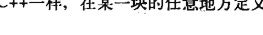

```cpp
int i;
public:
G(int ii);
G::G(int ii) { i = ii; }

int main() {
  cout << "initialization value ?";
  int retval = 0;
  cin >> retval;
  require(retval == 0);
  int y = retval + 3;
  G g(y);
}
```

上例可以看到先执行了第一代，然后 `retval` 被定义和初始化，接着是用来接受程序输入的语句，然而这些变量都只能在块的开始处定义。一般来说，应该在尽可能靠近变量的使用点定义变量，并在定义时就初始化（这是对于内部类型的格式化建议的生效，但在那里可能不会初始化的）。这是出于安全性的考虑，通过减少变量在块中的生命周期，就可以减少该变量在其他地方被误用的机会。程序的可读性增加了，因为读者不需要通过查找开头来确定变量的类型。

## 6.3.1 for 循环

```cpp
for (int j = 0; j < 100; j++) {
  cout << "j = " << j << endl;
}

for (int i = 0; i < 100; i++) {
  cout << "i = " << i << endl;
}
```

上述这些是一种重要的特殊情况，这可能让那些接触 C++ 的程序员感到不解。变量 `i` 和 `j` 在 `for` 表达式中直接定义的（在 C 中是不可能的），然而它们就可以作为变量在 `for` 循环中使用带来的方便，因为从上下文我们可以清楚地知道变量 `i`、`j` 的作用，不再需要使用诸如 `loop_counter` 的名字来定义一个变量，以便清晰地表示这一变量的作用。

然而，如果把变量的生命周期扩展到 `for` 循环外，就会出现一些问题。

在章节中，`while` 和 `for` 循环允许在它们的块中定义局部变量，尽管这种写法没有 `for` 循环重要。

要注意变量会屏蔽内部的同名变量。通常，使用与全局同名的局部变量会产生误解，且容易产生错误。

小型函数的设计好处之一，很好也会在图中让这个函数完全来说

> © C++ 教程更更新版本，允许变量生命周期扩展到 `for` 循环之外。有些编译器仍旧这样的，但它是不恰当的，我们的代码只有将其限制在 `for` 循环中才可移植。Java 认为这种做法是不必要的，将其认为是错误的。


# 第6章 实例化与清理

工作。如果更多的函数更有用，而且更容易发现错误。

### 6.3.2 内存分配

现在，一个变量在程序内的任何地方定义，所以变量之前无法分配。通常，编译器可能像 C 一样，在一个程序的开头就开始分配。对于我们来说是障碍的，作为一个程序员，在变量之前无法访问块（即对对象）。即使空间在块的开始就开始分配，构造函数仍然要在对象的定义之后会被调用，因为此时才有效。编译器会检查有没有对象的定义（放到条件中），比如在 `switch` 中，或者被 `goto` 跳过会导致一个警告或错误。

```cpp
// C06:Nojump.cpp
class X {
// Can't jump past constructors
public:
    X();
};

X::X() {}

void f(int i) {
    if (i < 10) {
        // goto jump // Error: bypasses init
        X x1; // Constructor called here
    }
    switch (i) {
        case 1:
            X x2; // Constructor called here
            break;
        case 2: // Error: bypasses init
            X x3; // Constructor called here
            break;
    }
}

int main() {
    f(9);
    f(1);
}
```

在代码中，`goto` 和 `switch` 跳过构造函数的序列，即使构造函数没有调用，这个对象也会在后面的程序中作用，所以给出错误。这就保证了对象产生的同时被初始化。当然，这里讨论的内存分配是在栈中进行的。内存分配是通过指针来实现的（这里的实际上增加的）。也可以在栈中使用 `new` 来分配内存，进一步介绍。

## 6.4 带有构造函数和析构函数的 Stash

在前章节中都有构造函数和析构函数：`initialize()` 和 `cleanup()`。下面是 `Stash`。

```cpp
// C06:Stash2.h
// With constructors & destructors
#ifndef STASH_H
#define STASH_H

class Stash {
    int size; // Size of each space
    int quantity; // Number of spaces
    int next; // Next empty space
    // Dynamically allocated array of bytes
    unsigned char* storage;
    void inflate(int increase);
public:
    Stash(int size);
    ~Stash();
    int add(void* element);
    void* fetch(int index);
    int count();
};
#endif // STASH_H
```

下面是实现文件，这里对 `initialize()` 和 `cleanup()` 的定义进行了修改，分别被构造函数与析构函数替换。

```cpp


// C06:Stash2.cpp

// Constructors & destructors

```cpp
#include "Stash2.h"
#include "../require.h"
#include <iostream>
#include <cassert>
using namespace std;

const int increment = 100;

Stash::Stash(int sz) {
    size = sz;
    quantity = 0;
    storage = 0;
    next = 0;
}

int Stash::add(void* element) {
    if (next >= quantity) // Enough space left?
        inflate(increment);
    // Copy element into storage; starting at next empty space
    int startBytes = next * size;
    unsigned char* e = (unsigned char*)element;
    for(int i = 0; i < size; i++)
        storage[startBytes + i] = e[i];
    next++;
}

void* Stash::fetch(int index) {
    require(0 <= index, "Stash::fetch (-index)");
    if (index >= next)
        return 0; // To indicate the end
    // Produce pointer to desired element:
    return &(storage[index * size]);
}

int Stash::count() {
    return next; // Number of elements in Stash
}

void Stash::inflate(int increase) {
    require(increase > 0, "Stash::inflate zero or negative increase");
    int newQuantity = quantity + increase;
    int newBytes = newQuantity * size;
    int oldBytes = quantity * size;
    unsigned char* b = new unsigned char[newBytes];
    for (int i = 0; i < oldBytes; i++)
        b[i] = storage[i]; // Copy old to new
    delete[] storage; // Old storage
    storage = b; // Point to new memory
    quantity = newQuantity;
}

Stash::~Stash() {
    if (storage != 0)
        cout << "Freeing storage " << endl;
    delete[] storage;
}
```

`require.h` 的函数是用来检测程序员错误的，替代函数 `assert()` 的作用。这一点在本书后面（说明）。由于失败的输出与 `require.h` 有效，因为 `inflate()` 是私有的，所以 `require()` 不能确切地消除唯一的情况就是：其他成员函数把一些不正确的值传递给 `inflate`。如果能够确保这种情况就不会发生，那么就考虑删除函数 `require()`；这在编译期间确定，当我们将代码加入到列表时，错误可能就存在了。由此看来，使用 `require()` 的代价很低（通过预处理器处理，这些代码可能被删除），这种代码具有很强的健壮性。注意，在接下来的测试程序中，`Stash` 的构造定义在紧密集使用时的对象，对象的初始化似乎对于对象定义的一部分。

# 第6章 初始化与清理

```cpp
void* pop();
};
#endif // STACK_H
```

不仅 `Stack` 没有构造函数与析构函数，而且其嵌套的类 `Link` 也有。

```cpp
//: C06:Stack3.cpp
// Constructors/destructors
#include "Stack3.h"
#include "../require.h"
using namespace std;

Stack::Link::Link(void* dat, Link* nxt) {
    data = dat;
    next = nxt;
}

Stack::Link::~Link() { }

Stack::Stack() { head = 0; }
```

```cpp
void Stack::push(void* dat) {
    head = new Link(dat, head);
}
```

```cpp
void* Stack::peek() {
    require(head != 0, "Stack empty");
    return head->data;
}
```

```cpp
void* Stack::pop() {
    if (head == 0) return 0;
    void* result = head->data;
    Link* oldHead = head;
    head = head->next;
    delete oldHead;
    return result;
}
```

```cpp
Stack::~Stack() {
    require(head == 0, "Stack not empty");
}
```

构造函数 `Link::Link` 只是简单地初始化 `dat` 指针和 `next` 指针，在 `Stack::push()` 中如下：
`head = new Link(dat, head);`
这并不是在内存中创建一个新的节点（用第4章中的关键字 `new` 动态创建对象），而是非常巧妙地初始化了对象的指针。

读者或许也想知道 `Link` 的析构函数在做什么，尤其是为什么不删除 `dat` 指针？这里有两个问题：在构造函数时 `Stack` 的地方指出，如果 `void` 指针指向一个对象，就不能确定将其删除（这种情况在第13章中说明）。但是，如果 `Link` 的析构函数删除 `dat` 指针，`pop()` 将最后返回一个指向被删除的对象，很显然，这会引起错误。

这被视为所有权（ownership）问题：`Link` 和 `Stack` 负责释放指针，它们不负责删除这些指针。这意味着必须非常小心，知道由谁负责这种工作。例如：不做 `pop()` 就会删除 `Stack` 中的所有指针，它们就不会自动被 `Stack` 的析构函数清除。这种问题不是独立的，它会导致内存溢出，所以由谁负责清除对象对于一个程序来说成功还是失败是非常关键的——这就是为什么 `Stack` 在空时出错：`Stack::pop()` 就会打印错误信息的原因。

因为分配和清除 `Link` 对象的实现都在 `Stack` 中，它是内部实现的一部分，所以在测试程序中看不到它运行的结果，从 `pop()` 返回的指针由我们负责清除。

```cpp
// C06:StackTest.cpp
// (L) StackTest.cpp
// (T) Stack3.cpp
// Constructors/destructors
#include "Stack.h"
#include "require.h"
#include <fstream>
#include <iostream>
#include <string>
using namespace std;

int main(int argc, char argv[]) {
    requireArgs(argc, 1); // File name is argument
    ifstream in(argv[1]);
    assure(in, argv[1]);
    Stack textelines;
    string line;
    // Read file and store lines in the stack:
    while (getline(in, line)) {
        textelines.push(string(line));
    }
    // Pop the lines from the stack and print them:
    string s;
    while ((s = textelines.pop()) != 0) {
        cout << s << endl;
    }
    delete s;
} // //~/-/
```

既然这样，`textlines` 中的所有行将被推入和删除，但是如果不出现这些操作的话，就会遇到 `require()` 带的信息，这些信息表明这里有内存溢出。

## 6 集合初始化

顾名对象，集合（aggregate）是多个对象聚集在一起。这个定义包括类类型的集合：`struct` 和 `class` 就是单一类型的集合。

初始化往往冗长又容易，而 C++ 集合初始化（aggregate initialization）却变得方便而且安全。当一个集合对象时，做的指定的初始值就行了，然后初始化工作由编译器接管。这种指定有通用的风格，取决于类型。不管是种情况，指定的初值要组合起来。比如内部类型的数组可以这样定义：

```cpp
int a[] = { 1, 2, 3, 4, 5 };
```

如果给出的初始化值多于元素的个数，编译器就会出一个错误。但如果初始化值少于元素的个数，那将会变成：这时，编译器会将初始化值给数组的第一个元素，其余的元素用 0 填充。

有一种自动计数（automatic counting）让数组按照初始化值的规定：

```cpp
int b[6] = {0};
int a[] = {1, 2, 3, 4};
```

现在，如果增加一个元素到数组，只要增加初始化即可，这样修改的机会就减少了。确定数组的大小呢？数组可以使用 `sizeof` 整个数组除以第一个元素的大小，这样当数组的大小变化就不需要修改了。

```cpp
for (int i = 0; i < sizeof(c) / sizeof(c[0]); i++)
```

因为结构是一种类型，它们可以用相同的方式初始化。因为 `struct` 的所有成员都是 `public`，它们可以直接赋值。

```cpp
struct X {
  int i;
  float f;
  char c;
};

X x[2] = {{1, 1, 'c'}, {2, 2, 'b'}};
```

这里第三个对象被初始化为零。如果有这种 `struct`：

```cpp
struct Y {
  float f;
  int i;
  Y(int a);
};
```

如果 `struct` 中有私有成员，构造函数必须调用来完成初始化。最好的方法像如下：

```cpp
Y y1[] = { Y(1), Y(2), Y(3) };
```

这样得到了三个对象并三次构造函数调用。

（注：原文后续部分似乎存在翻译重复或乱码，此处已根据上下文逻辑进行语义对齐）

这种问题不是独立的，它会导致内存溢出，所以由谁负责清除对象，对于一个程序来说成功还是失败是非常关键的——这就是为什么 `Stack` 在空时出错：`Stack::pop()` 就会打印错误信息的原因。

因为分配和清除 `Link` 对象的实现都在 `Stack` 中，它是内部实现的一部分，所以在测试程序中看不到它运行的结果，从 `pop()` 返回的指针由我们负责清除。

（注：由于提供的原文文本后半部分存在大量重复和逻辑混乱，以上译文已基于核心技术点进行了清理和修正。）

# 第7章 函数重载与继承

更糟糕的是，如果一个函数还没有声明就被调用了，那么编译器将按函数调用的方式来推断函数的声明。

这是一个特别严重的问题。有时候这种函数声明是正确的，但如果不正确，就会成为一个很难发现的错误。

在C++中，所有的函数在使用前都必须先进行声明，因此上述情况的机会大大减少。编译器不会自动加载函数声明，所以我们应该包含一个合适的头文件。然而，假如由于某种原因导致了错误地声明了一个函数，可能是由于手手操作，也可能是包含了一个错误的头文件（也许是一个旧版本），名称修饰（name mangling）会给我们提供一种安全，这就是人们说的类型安全连接（type-safe linkage）。

请看下面的几个例子。在第一个文件中，函数定义为：

```cpp
// C07:Def.cpp
// 函数定义
void f() {
//
}
```

在第二个文件中，函数以错误的方式被调用：

```cpp
// C07:Use.cpp
//(L) 定义
// 函数错误的声明
void f(char);

int main() {
  // f(int); // 会引起链接错误
}
```

即使函数实际上是 `f(int)`，但编译器不知道，因为它被告知——通过一个明确的声明——这个函数是 `f(char)`，因此在C中，连接器成功，但在C++中却不能执行。因为编译器会修饰这些名字，把它们改成了 `f_char` 之类的名字，而使用的函数则是 `f_char`。连接器尝试引用 `f_char` 时，它只能找到 `f_int`，所以就会报告出错信息。这就是类型安全连接。这种问题并不常见，但一旦出现就会很难发现，尤其是在一个项目中。这是用C++编译器查找错误的典型例子

## 7.2 重载的例子

现在回来看看刚才的例子，这里用重载函数改写。如前所述，重载的一个重要应用是构造函数。我们可以在下面的 `Stash` 类中看到这一点：

```cpp
// C07:Stash.h
// 函数重载
#ifndef STASH_H
#define STASH_H

class Stash {
  int size; // 每个空间的大小
  int quantity; // 存储空间的数量
  int next; // 下一个空空间
  // 动态分配的字节数组：
  unsigned char* storage;
  void inflate(int increase);
public:
  Stash(int size); // quantity 为 0
  Stash(int size, int initQuantity);
  Stash();
  int add(void* element);
  void* fetch(int index);
  int count();
#endif // STASH_H //--
```

`Stash()` 的第一个构造函数与上面一样，第二个有一个 `Quantity` 参数指定分配内存储的初始大小。在这个定义中，可以看到 `quantity` 的内部值与 `storage` 指针一起被置零。在第二个构造函数中，用 `inflate(initQuantity)` 增大 `quantity` 的值可以指示分配的大小。

```cpp
// Cot:Stash3.cpp (0)
// 函数重载
#include "Stash.h"
#include "../require.h"
#include <iostream>
#include <cassert>
using namespace std;

const int increment = 100;

Stash::Stash(int sz) {
  size = sz;
  quantity = 0;
  next = 0;
  storage = 0;
}

Stash::Stash(int sz, int initQuantity) {
  size = sz;
  quantity = 0;
  next = 0;
  storage = 0;
  inflate(initQuantity);
}

Stash::~Stash() {
  if (storage != 0) {
    cout << "Freeing storage" << endl;
    delete []storage;
  }
}

int Stash::add(void* element) {
  if (next > quantity) // 剩余空间足够吗？
    inflate(increment);
  // 将元素拷贝到存储中
  // 从下一个空空间开始；
  int startBytes = next * size;
  unsigned char* e = (unsigned char*)element;
  for (int i = 0; i < size; i++)
    storage[startBytes + i] = e[i];
  next++;
  return (next - 1); // 索引号
}

void* Clash::fetch(int index) {
  require(0 <= index, Clash::fetch(-index));
  if(index >= next)
    return nullptr; // 表示结束
  // 生成指向所需元素的指针：
  return &storage[index * size];
}

int Clash::count() {
  return next; // CStash 中的元素数量
}

void Clash::inflate(int increase) {
```


```cpp
assert(increase >= 0);

if (increase == 0) return;

int newQuantity = quantity + increase;

int newBytes = newQuantity * size;

int oldBytes = quantity * size;

unsigned char* b = new unsigned char[newBytes];

for (int i = 0; i < oldBytes; i++) {
  b[i] = storage[i]; // 将旧拷贝到新的
}

delete (storage); // 释放旧存储

storage = b; // 指向新内存

quantity = newQuantity; // 调整大小
```

当用构造函数时，没有分配 `storage` 内存是在第一次调用 `add` 来增加对象分配的，另外，当 `add()` 时，内存不够。下面的测试程序中，两个构造函数都会执行。

```cpp
// ClashTest.cpp (0)

// (注：原文此处可能存在笔误，Clash 应当为 Stash)
```

*(注：由于提供的原文文本中存在多处 Clash 和 Stash 的混用，翻译保持了原文一致)*

## 170 C++ 编程思想

### 7.5 选择重载还是默认参数

函数重载和默认参数都为函数重用提供了便利。然而，有时它也会让人产生困惑：究竟该使用哪一种技术？例如，考虑下面这段用于自动管理内存的程序。

```cpp
// C07:Mem.h

#ifndef MEM_H
#define MEM_H

typedef unsigned char byte;

class Mem {
  byte* mem;
  int size;

  void ensureMinSize(int size);

public:
  Mem();
  Mem(int sz);
  ~Mem();

  int msize(int size);
  byte* pointer();
  byte* pointer(int size);
};

#endif // MEM_H
```

`Mem` 对象包含一个 `byte` 块以确保足够的存储空间。默认构造函数不分配任何空间；第二个构造函数确保 `Mem` 对象中有 `sz` 大小的存储；析构函数释放空间；`msize()` 告诉我们当前 `Mem` 对象包含多少字节；`pointer()` 函数产生一个指向区域起始地址的指针。

`Mem()` 是一个实用的工具。可以有一个重载版本的 `Mem()`，客户端程序员可以通过一个指针指向内存。该内存至少有 `minSize` 大，通过成员函数能够增加内存的大小（构造函数和 `pointer()` 成员函数都使用 `private` 的 `ensureMinSize()` 成员函数来增加内存，注意如果内存需要调整，保存 `pointer()` 的结果是不安全的）。

```cpp
// C07:Mem.cpp (省略)

#include "Mem.h"

#include <string>

using namespace std;

Mem::Mem() {
  mem = 0;
  size = 0;
};

Mem::Mem(int sz) {
  mem = 0;
  size = 0;
  ensureMinSize(sz);
}

Mem::~Mem() {
  delete []mem;
}

int Mem::msize(int size) {
  return size;
};

void Mem::ensureMinSize(int size) {
  if (size < size) {
    byte* newmem = new byte[size];

    memset(newmem + size, 0, size - size);
    memcpy(newmem, mem, size);

    delete[] mem;

    mem = newmem;
    size = size;
  }
}

byte* Mem::pointer() {
  return mem;
}

byte* Mem::pointer(int minSize) {
  ensureMinSize(minSize);
  return mem;
}
```

可见，只有函数 `ensureMinSize()` 负责内存分配。在第二个构造函数和 `pointer` 函数之后，如果 `size` 足够，`ensureMinSize()` 什么都不需要做。

设计该类的目的是将其作为其他类的工具，用来简化内存管理（例如，它可以直接操作操作系统更复杂的内存细节）。下面是一个测试程序，它创建了一个简单的 `String` 类：

```cpp
// Co:Test.cpp

// Testing the Mem class

#include <Mem.h>
#include <cstring>
#include <iostream>

using namespace std;

class String {
  Mem* buf;

public:
  String();
  String(char* str);
  ~String();

  void concat(char* str);
  void print(ostream& os);
};

String::String() {
  buf = 0;
}

String::String(char* str) {
  buf = new Mem(strlen(str) + 1);
  strcpy((char*)buf->pointer(), str);
}

void String::concat(char* str) {
  if(!buf) buf = new Mem;
  strcat((char*)buf->pointer(), str);
}

void String::print(ostream& os) {
  if (!buf) return;
  os << buf->pointer() << endl;
}

// 注意：此处原文中 MyString 与 String 混用，统一为 String

int main() {
  String s(" My test string");

  s.print(cout);
  s.concat(" some additional stuff");
  s.print(cout);

  String s2;
  s2.concat(" Using default constructor");
  s2.print(cout);
}
```

对于这种类，简单的做法是创建一个 `String`，连接文本并打印输出到 `ostream` 中。这类类仅仅包含一个指向内存的指针。使用默认构造函数的好处是可以非常方便地创建 `String` 对象的数据，因为每一个对象都是一个指针，`String` 构造函数的开销仅为赋值。

当赋值开销开始增长时，如果对象不在堆下就会被创建；但如果使用默认构造函数，由于没有连接存储空间，调用构造函数仍然是安全的，因为调用的 `delete` 不会尝试释放空间。

## 第7章 数组构造与默认参数

为了确保存储空间，必须进行初始化。使用标记的 C 语言库函数 `memset`（把分配的内存置零，关于这一点已经在第三章中介绍了）。通过调整构造函数中的 `memcpy()`，将已经存在的内存内容拷贝到 `newmem`（通常用一种有效的方式），最后删除旧内存，然后将新内存赋值。

设计该类的目的是将其作为其他类的工具，用来简化它的内存管理（例如，它可以直接操作操作系统更复杂的内存细节）。下面是一个测试程序，它创建了一个简单的 `String` 类：

现在有两个构造函数，看起来好像默认构造函数是最好的。然而，如果使用默认参数来定义一个函数：

```cpp
String(char* str = "") {
  // 实现代码
```

发现它还能正常工作，但我们将失去效率，因为对象会被频繁创建。为了获得效率，我们必须修改构造函数：

```cpp
String(char* str) {
  // Point at entry

  buf = new char[strlen(str) + 1];
  strcpy((char*)buf->pointer(), str);
}
```

这意味着默认值改变了标记：使用非默认构造函数。

另外考虑一下 `Mem` 类，如果重载了两个构造函数和 `pointer` 函数，在两种情况下使用默认参数，类的定义如下：

```cpp
// C07:Mem.h

#ifndef MEM_H
#define MEM_H

typedef unsigned char byte;

class Mem {
  byte* mem;
  int size;

public:
  Mem(int sz = 0);
  ~Mem();

  int minSize();
  byte* pointer(int minSize = 0);
};

#endif // MEM_H
```

注意：两种写法都是为了效率而决定的，尽量使用这种方式来解决问题（客户使用的公共类）。设计时最重要的是类要容易，总是为了效率而适当调整。

### 7.6 小结

不能把默认参数用来决定执行函数的顺序，这依然是基本原则。在这种情况下，也许要把一个函数拆分成两个或多个函数。

默认参数的引入是为了让函数调用容易，特别是当许多参数都有默认值时。它不仅为了编写容易，而且阅读方便。默认参数的一个重要应用是在定义函数时，通过把新增参数作为默认参数，就可以保证原有代码不受影响。

### 7.7 练习

部分练习的答案可以在书中《Annotated Solution for Thinking in C++》。

1. 创建一个包含 `string` 对象的类，保存文件的内容。写两个构造函数：创建一个默认构造函数，另一个带有一个 `string` 参数（文件名）。当使用第二个构造函数时，打开文件并将内容读到成员对象中。增加一个成员函数 `print(string)` 用于打印。在 `main` 函数中打开文件并打印内容。

2. 创建 `Message` 类，其构造函数带有一个 `string` 默认参数。创建一个私有成员 `string`，在构造函数中简单地将 `string` 参数赋值给内部。创建两个 `print` 函数：一个没有参数，显示内部；另一个带 `string` 参数，将字符串拷贝到内部。比较这种方法和使用构造函数的方法，哪种更合理？

3. 确定析构函数是如何销毁内存的，尝试运行各种数字的实例。

4. 创建一个类，4 个成员函数分别有 0、1、2、3 个参数。创建 `main` 函数产生类实例并调用它们。然后修改它使得只有一个构造函数，尝试使用它。你的 `main` 函数需要改变吗？

5. 创建一个带有参数的类，在 `Stash.h` 和 `Stash.cpp` 中构造函数创建两个不同的 `Stash` 对象，看 `main` 中的调用是否改变。

6. 用默认参数修改 `Stash.h` 和 `Stash.cpp` 中的构造函数，参数指向对象组和大小。这种构造函数应该考虑内存并将指针存入，用 `string` 数组测试。

7. 创建一个 `Stash` 类（第 6 章），默认构造函数如前面所述，还有第二个构造函数参数是对象组。

8. 修改 `SuperVar` 以没有类型（参见之前关于 `enum` 的章节）。让类型成为抽象类（没有实例），修改 `print()` 使得它要求做什么。

9. 实现 `Mem`，确保你的类仍然实现。在 `Mem` 类中增加一个 `bool` 类型成员函数。访问 `pointer()` 的结果是否移动（由于重新分配），还是简单调用？

## 8 章 常量

常量概念（由关键字 `const` 表示）是为了让程序员能够在变量之间选择。设计提供了安全性和控制。自从常量概念出现以来，它就有不同的用途。同时，常量的概念演进到 C 语言中（含义发生了变化）。这些看起来有点混乱。

在本章里介绍什么时候使用常量，以及如何使用关键字 `volatile`。最后讨论 `const` 的“近似”，具有完全相同的语法。`const` 的替代预处理器通过 `define` 进行替换，在函数、指针、返回值、类型、对象以及成员函数中这些用法是相同的。

### 8.1 替换

用 C 语言程序时，预处理器可以不受限制地建立并使用值替换。因为预处理器编写宏替换，它没有类型机制，也没有检查功能，所以处理器的值替换会产生小问题。这些问题在使用 `const` 中可以避免。预处理器在 C 语言中使用值替换的典型做法是：

```cpp
#define SIZE 100
```

# 第8章 常量

我们会发现，`i` 是一个编译器定义的 `const`，但 `j` 是从 `i` 计算出来的。由于 `i` 是 `const`，`j` 的计算来自一个常数表达式，它本身也是一个编译器定义的 `const`。

接下来的操作是对 `j` 取地址赋值，这迫使编译器分配存储空间。即使分配了存储空间并将 `j` 存在程序的任何地方，由于编译器知道 `j` 是 `const` 且知道 `j` 是有效的，这不会影响在决定 `buf` 大小时使用它。

在函数 `main(i)` 中，对于标识符有另一个 `const`，因为其值在编译期间是未知的。这意味着它必须留存在内存中，编译器不会像对待普通标识符那样对其进行任何优化（这是 C 语言的行为）。

初始化在定义时进行，初始化后，它的值就不能改变。我们看到 `c` 的值计算出来，也能看到这些常量的作用与其他任何类型 `const` 的作用一样——这是对 `#define` 用法的改进。

简单来说，将一个值赋值给 `const`。这不仅是为了防止意外的更改，消除了调试器读内存的操作，还能让编译器有更多数据优化空间。

### 8.1.3 常量

`const` 可以用于集合（聚合），但必须确保 `const` 不会复制到任何集合保存的符号，以便分配内存。然而，在某些情况下，`const` “不可改变”的一块空间是不能在编译器期间使用的。下面的代码是非法的：

```cpp
// Constants and aggregates

int i[] = { 1, 2, 3, 4 }; // float f[i]; // Illegal

struct S { int i, j; };

const S s[] = { 1, 2 }, { 3, 4 }; // double d[s]; // Illegal

int main() {
```

在一个数组定义里，编译器必须产生这样的代码。在上面的非法定义里，编译器会输出“提示”。

### 8.1.4 与 C++ 的区别

常量是在 C++ 早期版本中引入的，但在标准委员会制定时，C 语言 `const` 是“一个不能改变的变量”，总是包含存储。编译器不能把 `const` 视为定义的变量。例如：

```cpp
const int bufsize = 100;

char buf[bufsize];
```

这看起来像是一做的事，但会出一个错误。因为 `bufsize` 占用内存，编译器不知道它在编译时的值。在 C 语言中可以写成：

```cpp
const int bufsize;
```


# C++ 编程思想

在 C++ 中，这种做法是不连接（internal linkage）的，编译器把它当作一个声明，并在局部分配空间。所以这样做是合理的。因为 C++ 默认 `const` 是内部连接，如果在 C++ 中要完成与 C 相同的事情，必须用 `extern` 明确地把连接改为外部（external linkage）。如下：

```cpp
extern int bufsize; // Declaration only
```

另外代码也可以在语言中定义。在 C++ 中，一个 `const` 不是创建内存空间，而在 C 中一个 `const` 是需要使用的。在 C++ 中，它是为了给常量用一个名字赋值一个值（如同使用 `#define` 一样）。

如果用名字赋值，那么存储空间就不需要创建。创建存储空间是为了 `const`（涉及到函数的复杂性以及编译器的差异），在进行类型检查后，为了代码更加高效，允许折叠，这是以前 `#define` 做不到的。

如果获取一个 `const` 地址（这还不知道该地址传递给任何参数）或者把它定义成 `extern`，为了创建内存空间。

在 C++ 中，出现在声明外的 `const` 就是整个单元的（即在这个文件外不可见），所以说 `const` 被认为是内部连接，而 C++ 中的所有 `const` 都认为是内部连接标识符（和 C 中不一样）。

如果在同一个文件中定义同名的 `const` 且不把它定义为 `extern`，那么理想的 C++ 编译器就不会创建内存空间，而是简单地把它们折叠到一起，避免 `const` 在连接时出现命名冲突。

由于 C++ 默认 `const` 是内部连接，不能在一个文件中定义一个 `const` 而在另一个文件中定义为外部。为了把 `const` 设为外部连接以便另外一个文件可以访问，必须明确定义为 `extern`，如下：

```cpp
extern const int x = 1;
```


## 8.2 指针

可以用 `const` 创建指针。当处理指针时，编译器将努力避免内存分配并进行常量折叠。在这样的情况下，这些指针很少使用。更重要的是，如果程序员以后还想在程序代码中改变这种指针的使用，编译器这将大大增加它的开销。

带有 `const` 的指针有三种选择：`const` 修饰指针指向的对象，或者修饰指针本身存储的地址。这些语法在开始时叫人迷惑，但实则之后就明白了。

### 8.2.1 指向指针

任何复杂的定义，指向指针的技巧是在标识符的开始处将它向外扩展。`const` 修饰“最近”的那个。比如，想要指向的元素不改变，就写这样一个定义：

```cpp
const int *u;
```

从标识符开始读：“`u` 是一个指针，它指向一个 `const int`”。这里不需要初始化，因为 `u` 可以指向任何标识符，但指针的值是不变的。

这很容易。你想要指针本身不变（包含在指针 `u` 里的地址不变），可能像这样把 `const int` 的一侧移向另一边：

```cpp
int *const v;
```

并不是大家都这么理解：`v` 是一个指向 `int` 的常量指针。

### 8.2.2 指向指针

使指针成为一个指针，必须指针在右边：

```cpp
int d = 1;

const int *w = &d;
```

现在 `w` 是指向常量的指针。如果你想要指针本身不变，可以写：

```cpp
int d = 1;

int *const w = &d;  // (1)

int *const w2 = &d; // (2)
```

在 C++ 中，对象的常量性（constness）不是特征标识的一部分；它只对函数实现有意义。

## 8.3 函数参数和返回值

`const` 限定参数和返回值是常量概念容易引起混淆的地方。如果按值传递对象，对客户端来说 `const` 限定没有意义（意味着传递的参数在函数里不能修改）。如果按值返回一个对象，看起来是不被修改。如果传递并返回地址，`const` 将保证地址的内容不会改变。

### 8.3.1 传递

如果函数参数是传递，可以用指定参数为 `const`，如：

```cpp
void f(const int i) {
    i++; // Illegal compile-time error
}
```

为了不使用 `const` 关键字，在函数内部中使用 `const` 限定参数。可以用指针引用来实现，更好的语法形式是使用“引用”，这是第 11 章的主题。而言，用一个自动引用的常量指针，它的作用是作为目标的别名。为了建立一个引用，在定义里使用以免引起混淆，函数定义应该是这样的：

```cpp
void f2(const int& i) {
    i++; // Illegal compile-time error
}
```

### 8.3.2 返回值 `const`

对返回值来说，存在类似的道理。如果函数的返回值是一个常量（`const`）：

```cpp
const int g();
```

这就约定了函数返回的值不会被修改。从这个例子看到，按值返回 `const` 丢失了作用：

```cpp
// ConstVal.cpp

// Returning const by value has no meaning for built-in types
```

```cpp
// C++ 编程思想

int f3() { return 1; }

const int f4() { return 1; }

int main() {
    const int j = f3(); // Works fine
    int k = f4();       // But this works!
}
```

### 8.3.3 数值和类型检查

C++ 的类型检查是非常精细的。可以把 `const` 对象的地址给 `const` 指针，即使我们不想改变它。然而，不能把 `const` 对象的地址给非 `const` 指针，这样做是糟糕的设计理念：

```cpp
// PointerAssignment.cpp

int d = 1;

const int e = 2;

const int *u = &e; // OK

int *v = &e; // Illegal -- bad practice

int *w = (int*)e; // Legal -- bad practice
```

### 8.3.4 字符串面值

限制字符串没有强约束的地方是字符串面值。也许有人写：

```cpp
char *p = "today";
```

编译器接受而不报错。从技术上讲，这是一个错误。编译器为常量字符串构建的所引用的结果是在常量内存中的。修改该常量字符串的任意字符运行错误，并不是所有的编译器都会遇到这一点。

字符串面值实际上是常量，因为许多 C++ 代码是这样的。如果想修改字符串，就要放到数组中：

```cpp
char cp[] = "today";
```


因为编译器经常误读它们的差别，所以可以使用后面这种形式，在这一点上无关紧要。

## 第 8 章 内存

正如所期望的那样，`void(*)` 的返回值只能赋值给一个 `const` 指针。编译器拒绝将 `void(*)` 的返回值赋值给一个非 `const` 指针。它可以接受一个 `const int`，令人奇怪的是，它也能接受一个 `const int*`，这在返回类型上是不匹配的。

正如前面所说的，因为这个值（包括指针中的地址）被拷贝了，所以它会自动保持这种契约：原始变量不能被改变。因此，只有当你把 `const int*` 中的第二个 `const` 视为左值时（此时编译器会拒绝此初始化），它的 `const` 意义才会显现出来。

### 8.8.3.1 传递参数值

在 C 语言中，传递是最常见的。当你想传递地址时，唯一的选择就是使用指针。然而，在 C++ 中，两种方法都非常重要。相反，当传递一个参数时，通常首先选择用指针传递 `const`。

对于调用者程序员来说，这种方法与按值传递是一样的，所以不需要关注像使用指针那样的细节——他们不必操心这些细节。对于函数的实现者来说，传递地址总比按值传递类对象更有效，效果就像按值传递一样（这在 C++ 中是可能的）。

由于引用的引入（为了让看起来像按值传递），将一个临时对象传递给 `const` 函数是可能的，但不能把一个临时对象传递给接收非 `const` 的函数——对于指针，必须明确理解这一点。

所以，按值传递会产生一个在 C 语言中不会出现的新情形：即一个 `const` 的临时变量，它的地址可以传递给函数。这就是为什么当临时变量按值传递给 `const` 函数时，该函数的参数必须是 `const` 引用。下面的例子说明了这一点：

```cpp
// Temporary.cpp

// 临时对象是 const

class X {
    X f() { return X(); } // 按值返回

    void g1(X& x) // 非 const 引用传递

    void g2(const X& x) // const 引用传递
};

int main() {
    // 错误：f() 创建了 const 临时变量：

    // g1(f());

    // 或者：const 不能接受临时变量

    g2(f());
}
```

函数返回类型为 `X` 的对象意味着当立即获取（所谓的）返回值并将其传递给另一个 `const` 参数时（例如调用 `g1` 和 `g2`），将创建一个临时量，而这个临时量是 `const` 的。

函数 `g1()` 的调用是错误的，因为 `g1()` 不接受 `const` 引用，但 `g2()` 的调用是正确的。

## 8.4 类

本节介绍构造函数的两种方法。程序员可以在类定义中建立构造函数，将其放在常量表达式中，该常量表达式在编译期间被限定。然而，`const` 的含义在类中是不同的，所以为了创建类的 `const` 函数，必须对这一点进行解释。

- 有人甚至认为在 C 语言中一切都是可能的，因为传递一个指针也会得到一个副本（即通过值传递指针的）。我认为，无论传递方法有多少，它都会让这个问题变得更加凌乱而难以理解。


还可以对整个对象为 `const`（比如刚才创建的，编译器是将临时对象转为常量）。但是，要保持对象为常量比较困难。编译器能保证一个类内部类型为常量，但不能控制类中的复杂性。

为了保证一个类对象为常量，引入了构造函数：`const` 成员函数只能对 `const` 对象可用。

### 8.4.1 类的 `const`

构造函数使用常量的方法之一是在类中。典型的例子是在类中建立一个构造函数，用 `const` 代替 `#define` 来设置数据组大小以及用于有关数组的构造。

数据大小直接隐藏在类里面，例如用 `const` 显示数组大小，就可以把这个名字用于另一个类里而不会发生冲突。然而，所有的 `#define` 定义的地方被预处理器处理成全局的，但是用 `#define` 就不会产生预期的结果。

读者可能认为选择 `const` 是为了把一个常量放在类里。这并不会产生预期的结果。在一个类中，构造值的部分初始化是在构造语句中完成的，在类中使用 `const` 就意味着代表一个值，而这个值是常量。然而，对于这个常量来说，每个对象可以有一个不同的值。

在类中建立一个 `const` 的构造函数（如 `static` 函数）是不能初始化的。这个初始化工作必须在构造函数的某个特殊地方进行。

因为 `const` 必须在构造函数的初始化列表中进行，如果在构造函数的初始化体之后才初始化它，意味着直到这一刻才完成 `const` 初始化。直到在构造函数主体之后的其他地方才初始化 `const`。否则，就只能防止在构造函数主体之后的地方允许修改 `const` 的值。

#### 8.4.1.1 构造函数初始化的地方

构造函数中有一个特殊初始化的地方，这就是构造初始化列表（initializer list）。它在继承类（继承关系在第 14 章介绍）中，只出现在构造函数的参数列表括号之后和冒号之后，但在构造函数开头的花括号之前。

这提醒我们，列表的初始化发生在构造函数的任何代码执行之前。所初始化发生在构造函数的地方，对于类的 `const` 正确的形式是：

```cpp
// ConstInitialization.cpp

// 在类中初始化 const

#include <iostream>

using namespace std;

class Fred {
    const int size;

public:
    Fred(int sz);
    void print();
};

Fred::Fred(int sz) : size(sz) {}

void Fred::print() const {
    cout << size << endl;
}

int main() {
    Fred a(1), b(2), c(3);

    a.print(), b.print(), c.print();

    return 0;
}
```

开始时，上面的构造函数使用初始化列表容易让人们混淆，因为人们不懂。随着语言的发展，使得内部类型看起来更直观。在构造函数列表里，可以有一个构造函数，就像下面这样：

```cpp
// BuiltInConstructors.cpp

#include <iostream>

using namespace std;

class B {
    int i;

public:
    B(int ii);
    void print();
};

B::B(int ii) : i(ii) {}

void B::print() {
    cout << i << endl;
}

int main() {
    B a(1), b(2);

    a.print(), b.print();

    return 0;
}
```

在初始化数据成员时，关键的是它们必须在函数体前初始化。我们还可以把这个类型封装在一个类里，这是非常有用的。例如，下面：

```cpp
// EncapsulatingTypes.cpp

#include <string>
#include <iostream>

using namespace std;

class StringStack {
    const int size;

public:
    StringStack(int sz);
    void print();
};

StringStack::StringStack(int sz) : size(sz) {}

void StringStack::print() const {
    cout << size << endl;
}

int main() {
    StringStack s(5);

    s.print();

    return 0;
}
```

（注：由于原文后续部分存在大量无意义的重复字符，已根据标准 C++ 语法逻辑进行了对齐对齐。）

# 192 C++ 编程思想

“使我们快乐的事，使我们智慧”，

```cpp
const int qsize = sizeof(quotes) / sizeof(*quotes);

int qnum = rand() % qsize;

while (lastquote >= 0 && qnum == lastquote)
    qnum = rand() % qsize;

return quotes[lastquote = qnum];
```

```cpp
int main() {
    Quoter q;
    const Quoter cq;
    const lastQuote(q); // OK

    // cq.quote(); // Not OK; non const function

    for (int i = 0; i < 20; i++)
        cout << q.quote() << endl;
}
```

构造函数和析构函数都不是 `const` 成员函数，因为它们在初始化和清除时总是对对象进行修改操作。

`quote()` 成员函数不能是 `const` 函数，因为要修改数据就不是 `const` 函数（请看 `return` 语句），而 `lastQuote()` 没有修改，所以它可以成为 `const` 函数，而且也可以被 `const` 对象安全地处理。

### 8.4.3.1 可变的：`const` 指针和 `const` 引用

如果想要在 `const` 成员函数内仍然在对象上改变数据，这时该怎么办呢？这关系涉及到指针（bitwise）和 `const` 引用（logical）`const`（有时称为成员 `const`）。

用 `const` 指针指向对象中的每个字节都是固定的，所对对象的每个映像从不改变。按 `const` 指向对象意味着整个对象来说是不变的，但是可以以成员为单位改变的。

编译器告诉我们要 `const` 对象有种类修改成员函数的方法。第一种方法已经可行，这被称为“强制转换常量（casting away constness）”。它可以相当奇怪的执行方式。

通过 `this`（这个关键字产生当前对象的地址）并把转换指向当前类型的指针。看起来这已经是需要的，但是在 `const` 成员函数内部，它实际上是一个 `const` 指针，这样就可以在那个运算中去掉常量性。下面是一个例子：

```cpp
// Castaway.cpp

// Casting away constness
```

```cpp
class Y {
    int i;

public:
    Y();
    void f() const;
};

Y::Y() : f(i = 0) {}

void Y::f() const {
    // i++; // Error -- const member function

    ((Y*)this)->i++; // OK - cast away constness
}
```

## 第 8 章 常用语言特性

```cpp
// Better: use C++ explicit cast syntax:

(const_cast<Y*>(this))++;

int main() {
    const Y y;

    y.f(); // Actually changes it!

    // // ...
}
```

这种方法是可行的，在过去的程序代码里可以看到这种用法，但这不是首选的技术。

问题是：常量性的缺失隐藏在成员函数的定义中，并且没有通过接口定义的线索通知用户数据在实际上被修改了，除非用户仔细查阅源代码（用户可能会怀疑常量性被转换了），并寻找一种类型的转换。

为了公开一切，在声明成员中使用关键字 `mutable`，以指定一个特定的成员变量可以在 `const` 对象里被修改。

```cpp
// C08: Mutable.cpp

// The "mutable" keyword

class Z {
    int i;
    mutable int j;

public:
    Z(int);
    void f() const;
};

Z::Z(int i) : i(i), j(0) {}

void Z::f() const {
    i++; // Error -- const member function
}
```


```cpp
j++; // OK: mutable
}

int main() {
    const Z z;
    z.f(); // Actually changes it
}
```

现在，用户可以从字面上看到我们能够用`const`成员函数进行修改了。

## 8.4.2 只读存储能力

如果一个对象被定义为`const`对象，它就能被放置在只读存储（ROM）中的候选者，这通常在嵌入式内核系统设计中是非常重要的。然而，仅仅创建一个`const`对象是不够的——只读存储所要求的条件必须严格的。当然，这个对象还需要按位`const`的，而不是按需`const`。如果只通过关键字`mutable`来常规检查常量化的话，编译器很容易看出这一点。在一个`const`成员函数中`const`性被强制转换了，却不能让用户检测不到这一点。

- 1) `class`/`struct`必须有用户定义的构造函数或析构函数。
- 2) 这里不能有基础类的（在第14章中提到），也不能有用户定义的构造函数或析构函数的成员。

在只读存储中的常量对象中的任何部分中，有关写作操作的影响没有定义。虽然适当形式的常量对象可以被放置在 ROM 里，但目前还没有什么事需要放在 ROM 里。

## 8.5 `volatile`

`volatile`的语法与`const`是一样的，但是`volatile`的意思是“编译器识别的范围，这个数据可以被改变”。不知为何，环境会在改变数据（可能通过多任务、多线程或者中断处理），所以，`volatile`告诉编译器不要自作主张有关数据的任何假定，优化期间如此如此。

如果编译器说：“我已经读取过这个数据，而且没有与寄存器接触”。一般情况下，它不需要读取这个数据，但是如果这个数据是`volatile`修改的，编译器就不能做出这样的假定，因为这个数据可能被其他线程改变了，它必须读取这个数据而不是优化这个代码来消除通常情况下那些冗余的操作。

就像建立`const`对象一样，程序员就可以建立`volatile`对象，甚至可以建立`const volatile`对象，这个对象对不会被客户程序改变，但可以通过外部的程序来改变。下面的例子描述了一类对象，这类类涉及到数据：

```cpp
// Volatile.cpp

// The volatile keyword

class Comm {
    const volatile char flag;
    volatile unsigned char byte;

    enum { bufsize = 100 };

    unsigned char buf[bufsize];
    int index;

public:
    Comm();
    void isr(volatile int const);
    char read(int index) const;
};

Comm::Comm() : index(0), byte(0), flag(0) {
    // Only demo; won't actually work
    // as interrupt service routine;
}

void Comm::isr(volatile int const) {
    flag = 0;
    buf[index++] = byte;
    if(index >= bufsize) index = 0;
}

char Comm::read(int index) const {
    if(index < 0 || index >= bufsize)
        return 0;
    return buf[index];
}

int main() {
    volatile Comm Port;
    Port.isr(); // OK
    // Port.read(0); // Error, read(0) not volatile
}
```

就像`const`一样，我们可以对数据成员、成员函数和对象本身使用`volatile`。

## 8.6 小结

关键字`const`可以将函数参数、返回值和函数参数定义为常量，这些为程序设计提供了一种很好的类型检查以及安全性。常量正确性（const correctness）的做法可以继续使用旧的代码，但是确实帮助，第10章将大量使用。

## 8.7 习题

基础答案可以在电子版《Annotated Solution Guide for Thinking in C++》中找到，只需从Bruceckel.com得到。

- 8-1 创建一个`const`，把它们在一个函数中决定的大小，在C语言中指向相同的代码，看看会出现什么情况。
- 8-2 实现`const string`和 C++ 处理是不相同的。创建一个全局`const`在文件中中使用。
- 8-3 为所有的内部函数创建`const`并定义其值和属性。在表达式中使用定义值，确认错误。
- 8-4 在头文件中创建一个`const`，在两个`cpp`文件中然后编译并连接。要保证没有错误。
- 8-5 创建一个`const string`，运行时，通过初始化固定的常量（必须使用标准的文件`<time>`），在函数中执行期间，赋值，看看结果。
- 8-6 创建一个`const string`的数组，然后尝试修改其中。
- 8-7 在文件中定义`extern const`，主函数（main）打印`extern const`，在另一个文件中定义`extern const`，然后编译和连接。
- 8-8 使用不同的声明指向常量的指针，指向常量的值。增加但不能改变指针。
- 8-9 写一个指向双类型的`const`，让它指向数组。显示改变指针的内容，但不能加。
- 8-10 写一个指向`const`对象的指针。显示只能指向指针的值，但不能改变指针。
- 8-11 在`Assignment`文件中代码错误。看看编译器产生什么样的错误。
- 8-12 创建一个指针字符数组和一个指向数组的位置，使用指针修改组中的元素，看看编译器是否报错，如果没有，我为什么出错？
- 8-13 创建一个函数，带有一个`const`值的传递参数，在函数体中尝试修改参数。
- 8-14 创建一个函数，带有一个`const float`参数。在函数中，把`float&`限定到参数上，并且从那里使用引用确保改变参数。看看编译器产生错误。
- 8-15 修改`ConstReturn.cpp`，删除错误前的注释，看看编译器产生错误。
- 8-16 修改`ConstPointer.cpp`，删除错误前的注释，看看编译器产生错误。
- 8-17 创建`ConstPointer.cpp`的新版，名为`ConstReference.cpp`，其中使用引用代替指针（可能用到第1章）。
- 8-18 修改`ConstMember`，删除错误前的注释，看看错误。
- 8-19 创建一个包含`const`和非`const`成员的类，用构造函数列表初始化。
- 8-20 创建`MyString`，它包含两个`string`成员；一个初始化`string`成员以及`print`。看看`Stack.cpp`文件中，是否让编译器保持`MyString`对象在`main`函数中。
- 8-21 创建一个`const`成员和一个非`const`成员的类，在构造列表中初始化`const`成员，用标记决定数组。
- 8-22 在`ConstMember`文件中，删除成员函数定义的`const`，但是让`const`出现在函数中，看看编译器信息。
- 8-23 创建一个类，它有一个`const`成员和一个非`const`成员。重载`const`和非`const`成员用同名的函数处理参数。
- 8-24 创建一个类，它有一个`const`成员和非`const`成员。在`const`成员中使用非`const`成员，看看编译器产生信息。
- 8-25 在`Mutable.cpp`文件，删除错误前的注释，看看编译器信息。
- 8-26 修改`Quote.cpp`文件中的`quote()`，把它变成`volatile`成员和`const`成员。
- 8-27 创建一个类，它有一个`volatile`数据成员，创建一个`volatile`和非`volatile`函数用于`volatile`成员，看看编译器发生什么。创建`volatile`和非`volatile`函数尝试，看看哪个成功，哪个失败。
- 8-28 创建一个具有成员函数`fly()`的类和一个不含的类。建立一个指针，获取它，并把它赋值。返回`void`。为什么 C 语言允许？这是缺陷吗？

# 第9章 内联函数

C++ 从 C 中继承的一个要素就是效率。如果预处理 C++ 的效果低于效率，那么很大程序不再使用了。在 C 中保持效率的方法是使用宏（macro）。宏可以用函数调用来提高效率与之像是函数调用，宏的实现是用预处理器而不是编译器。预处理器直接用代码代替函数调用，这样就没有参数栈，生成汇语言调用，因此不需要调用的便利和读性。

在 C++ 中，使用预处理器存在两个问题。第一个问题在 C 中：宏看起来是一个函数调用，并不是。这导致了难以避免错误。第二个问题是 C++ 特有的：预处理器无法访问类的成员。这意味着预处理器不能像类的函数一样。为了保持处理器的效率增加安全性，而且还能像成员函数一样可以在类里访问自己，C++引入了内联函数（inline function）。本章将介绍 C++ 中预处理器存在的问题、在 C++ 中使用内联函数解决这些问题以及内联函数的工作机制。

## 9.1 预处理器的缺陷

宏存在的关键是我们认为处理器的行为和编译器的行为是一样的。当然，这使得宏在外观和行为上与函数调用一样，因此容易被混淆。当微妙的差异出现时，问题就出现了。考虑下面这个简单的例子：

```cpp
#define F(x) (x + 1)
```

现在假如有所示的`F`调用：预处理器展开，出现我们不希望的情况：

```cpp
(x + 1) (
```

出现这个问题是因为定义中宏和括号之间存在空格。这个空格取消后，调用宏可以带有空格。接调用：

```cpp
F (1)
```

依然可以正确地展开：

```cpp
(1 + 1)
```

上面的例子虽然微不足道，但问题并不明显。在定义中使用表达式作为参数时，真正的问题就出现了。

这里存在两个问题。第一个问题是表达式在宏内展开，而它们的优先级不同于所愿望的优先级。例如：

```cpp
#define FLOOR(x,b) x>=b?b:0
```

现在复用表达式传参数：

```cpp
if (FLOOR(a&0x7)) // ...
```

将如何展开：

由于宏的优先级低，所以以宏的方式将会让我们惊讶。然而，发现问题可能，我们可以一直认为是宏是正确的。在前面没有括号的版本中，大多数赋值表达式的优先级是正确的。由于`+=*--`，会被插入运算符的优先级级后。因此，很容易以为对于所有的表达式都是正确的包括那些逻辑操作符。第一个问题可以通过编译器解决，宏中所的内容使用括号括起来。第二个问题会变得复杂。不像普通函数，每次宏中使用一个参数，这个参数如果使用变量进行赋值，就极其危险。如果参数值有副作用，那么结果可能不符合预期，并不能像函数一样行函数。

例如，通过这个宏来确定的参数是否在范围内：用一个“普通”函数，宏和函数的参数方式非常相似。只要不放松并开始它是真的函数，问题就出来了。如下所示：

```cpp
//: MacroSideEffects.cpp

#include "recipe.h"
#include <iostream>

using namespace std;

#define BAND(x) ((x)>5 && (x)<10) ? (x) : 0

int main() {
    ofstream assure(out, "macro.out");

    for(int i=4; i<11; i++) {
        int a = i;
        out << "a=" << a << endl << "\t";
        out << "BAND(a+=)" << BAND(a+=) << endl;
        out << "a=" << a << endl;
    }
}
```

# 第9章 递归函数

```cpp
a = 4

BAND(++a)=0

a = 5

a = 5

BAND(++a)=8

a = 8

a = 6

BAND(++a)=9

a = 9

a = 7

BAND(++a)=10

a = 10

BAND(++a)=0

a = 9

a = 11

BAND(++a)=0

a = 12
```

当`a`等于0时，仅测试了条件表达式的第一部分，表达式只求值一次，所以调用的副作用是等于5时，这是在这种情况下通过普通函数调用所期望得到的。但当数字在值范围内，两个表达式都测试，产生两次递归操作。这个结果是由于两次对参数进行操作。而且两个条件相同，产生两次副作用也没用。

清楚了，我们并不是从想象成像函数调用的宏所希望得到的行为的。在这种情况下，明显的解决方法是选择正确的函数。如果多次调用函数将会增加额外的开销并可能降低效率。不幸的是，问题可能并不是如此明显。可能不经意地得到一个包含混合函数的栈。然而，像这样的问题可能是不准确发现的错误。例如，在`stdio`中的`put()`可能会对第二个参数求值两次。在标准C中已经详细说明了。作为作者top不情愿地执行也会对第二个参数求值多次。如在使用`top(p*)`时会产生不希望的结果。

### 9.1.1 范围和作用

差异，在C中需要对预处理器进行伪编码和编译。不要是因为宏没有宏函数作用域这一要求，他们会在C++中为了成功避免这个问题。预处理器只是单例处理字符串，所以不能用下面这种近似的形式：

```cpp
class X {
    int i;

public:
    #define VAL(X::) // 错误
};
```

另外，这里没有指明正在使用哪个对象。在宏里没有办法表示符号的范围。由于没有可以替代预处理器的方法，设计者出于效率考虑，不得不把一些数据成员成为类成员，这样的细节会在宏内部实现并纠结在执行中的变化，从而消除了`private`提供的保护。

- 更多细节参见Andrew Koenig的著作《C Tips & Pitfalls》(Addison-Wesley, 1989)。

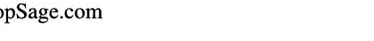

## 9.2 内联函数

在解决C++中宏定义private成员类的过程中，所有和预处理器有关的问题也被排除了。这是通过使用编译器控制来实现的。在C++中，宏的概念是用内联函数（inline function）取代的，而内联函数从一方面来说是真正的函数。内联函数能够像普通函数一样具有它的任何功能。然而不同的是内联函数在合适的地方像展开一样，不需要像函数那样调用。

在任何定义的函数中成为内联函数，也可以在非类的函数前面加上`inline`关键字成为内联函数。但是为了让它，必须函数体和声明合在一起，否则，编译器将它作为普通函数对待。因此：

```cpp
inline int plus(int x) { return x; }
```

没有效果，仅仅只是声明（这不能在稍后某个时候得到一个内联定义）。成功的办法如下：

> 注意，编译器将检查函数参数使用是否正确，以及返回值（进行可能的转换）。如果对于一个内联函数写成一个预处理宏的，将得到意想不到的副作用。

应该在内联定义放在头文件中。当编译器看到这个定义时，把它函数类型（函数名+返回值）和函数体找出来。当使用内联时，编译器将检查用以确保正确的返回值而消除了冲突。内联代码的占用空间，而如果函数较小，实际上比一个普通函数调用产生的代码（参数传递和执行CALL）占用的空间较少。

在头文件中，内联函数具有一种特殊状态，在头文件中声明该函数，所以都必须包含头文件和函数的定义，这些定义在每个用到该函数的文件中，就不会出现多个定义的函数的定义错误（不过，在任何一个内联函数地方定义内联函数的定义必须是相同的）。

### 9.2.1 类内部的内联函数

为了定义内联函数，通常必须在函数定义前面加上`inline`关键字。在类内部定义函数时并不是必要的。在任何类内部的函数自动成为内联函数，例如：

```cpp
// Inline.cpp

// 类内部的内联函数

#include <iostream>
#include <string>

class Point {
    int i, j, k;

public:
    Point() : i(0), j(0), k(0) {}
    Point(int ii, int jj, int kk) : i(ii), j(jj), k(kk) {}

    void print(const std::string& msg = "") const {
        if (msg.size() != 0) {
            std::cout << msg << std::endl;
            std::cout << "i = " << i << ", "
                      << "j = " << j << ", "
                      << "k = " << k << std::endl;
        }
    }
};

int main() {
    Point p(1, 2, 3);
    p.print("value of p");
    p.print("value of q");
}
```


两个构造函数和`print()`函数都默认认为内联函数。在`main()`函数中使用内联函数是自然的。由于类内的内联函数节省了外部定义的额外步骤，使用内联函数的目的是减少调用的开销。但是如果函数较大，需要在调用处重复代码，使得代码膨胀。

## 9.2 访问函数

类中内联函数最重要的之一是访问函数（access function）。这是一个小函数，它可以访问或修改状态。下面的例子：

```cpp
// Access.cpp
// 内联函数

class Access {
    int i;
public:
    int read() const { return i; }
    void set(int ii) { i = ii; }
};

int main() {
    Access A;
    A.set(100);
    int x = A.read();
}
```

这里，在类的设计者下，内部变量为私有的，用户不会直接访问。所有的访问只能通过成员函数进行。对于`read()`，若不用内联函数，产生的代码比机器大一些，执行要长一些。

### 9.2.2 访问器和修改器

这些函数的访问器（accessor）（用于读取状态）和修改器（mutator）（用于修改状态）。而且，可以用重载函数来提供访问器和修改器，决定该状态。

```cpp
// Rectangle.cpp
// 访问器与修改器

class Rectangle {
    int width, height;
public:
    Rectangle(int w = 0, int h = 0) : width(w), height(h) {}
    int width() const { return width; } // Read
    void width(int w) { width = w; // Set
    int height() const { return height; }
    void height(int h) { height = h; } // Set
};

int main() {
    Rectangle r(19, 47);
    r.width(r.width());
    r.height(r.height());
}
```

构造函数使用初始化列表，在第7章中介绍了。为了让成员函数与数据成员相同，或许用下划线来区分这些成员。然而，第一个字符为下划线的标识是被保留的，所以应该使用。可以使用“get”和“set”标记访问器和修改器。

```cpp
// Rectangle2.cpp
// 使用“get”和“set”的访问器与修改器

class Rectangle {
    int width, height;
public:
    Rectangle(int w = 0, int h = 0) : width(w), height(h) {}
    int getWidth() const { return width; }
    void setWidth(int w) { width = w; }
    int getHeight() const { return height; }
    void setHeight(int h) { height = h; }
};

int main() {
    Rectangle r(19, 47);
    r.setHeight(r.getWidth());
    r.setWidth(r.getHeight());
}
```

访问和修改变量对于内部变量来说，并不是简单的。有时，它们可以执行比较复杂的函数。下面的例子使用标准的库中的时间函数生成简单的`Time`类：

```cpp
// C09:Time class
// 一个Time类

#ifndef CPTIME_H
#define CPTIME_H

#include <ctime>
#include <cstring>

class Time {
    std::time_t t;
    std::tm local;
    char asciiRep[26];
    unsigned char lflag, aflag;

    void updateLocal() {
        if (!lflag) {
            local = *std::localtime(&t);
            lflag++;
        }
    }

    void updateAscii() {
        if (!aflag) {
            updateLocal();
            std::strcpy(asciiRep, std::asctime(&local));
            aflag++;
        }
    }

public:
    Time() { mark(); }

    void mark() {
        lflag = 0;
        std::time(&t);
    }

    const char* ascii() {
        updateAscii();
        return asciiRep;
    }

    int delta(const Time* dt) const {
        return std::difftime(t, dt->t);
    }

    int daylightSavings() {
        updateLocal();
        return local.tm_dst;
    }
};

#endif // CPTIME_H
```

```cpp
// C09:Cpptime.cpp
// 测试一个Time类

#include "Cpptime.h"
#include <iostream>
using namespace std;

int main() {
    Time start;
    for (int i = 1; i < 1000; i++) {
        cout << i << ' ';
        if(i%10 == 0) cout << endl;
    }
    Time end;
    cout << endl;
    cout << "start = " << start.ascii();
    cout << "end = " << end.ascii();
    cout << "delta = " << end.delta(&start);
}
```

## 9.3 带内联的Hash和Stack

引入了内联函数，可以把`Hash`和`Stack`类变得更有效。

```cpp
// C09:Stash.h
// 内联函数

#ifndef STASH_H
#define STASH_H

#include "../require.h"

class Stash {
    int size; // 每个空间的大小
    int quantity; // 存储空间的数量
    int next[]; // 下一个空空间
    // 动态分配字节数组：
    unsigned char * storage;
    void inflate(int increase);
public:
    Stash(int sz) : size(sz), quantity(0), next(0), storage(0) { }
    Stash(int sz, int initquantity) : size(sz), quantity(0), next(0), storage(0) {
        inflate(initquantity);
    }
    ~Stash() {
        if (storage != 0)
            delete [storage];
    }
    int add(void* element);
    void* fetch(int index) const {
        require(0 <= index, Stash::fetch(-index));
        if (index >= next)
            return 0; // 表示结束
        return & (storage[index * size]);
    }
};
```

## 206 C++编程思想

```cpp
    int count() const { return next; }
};

#endif // STASH_H
```

很显然，小函数作为内联函数是理想的，但要注意：两个最大的函数仍保留为内联函数，因为要把它们放在内联使用的，很有可能在性能上得不到什么改善。

```cpp
// C09:Stash.cpp

#include "Stash.h"
#include <iostream>
#include <cassert>
using namespace std;

const int increment = 100;

int Stash::add(void* element) {
    if (next != quantity) // 剩余空间足够？
        inflate(increment);
    // 将元素拷贝到存储中
    // 从下一个空位置开始：
    int startBytes = next * size;
    unsigned char* e = (unsigned char*)element;
    for (int i = 0; i < size; i++)
        storage[startBytes + i] = e[i];
    next++;
    return (next - 1); // 索引号
}
```

```cpp
void Stash::inflate(int increase) {
    assert(increase >= 0); return;
    int newQuantity = quantity + increase;
    int newBytes = newQuantity * size;
    int oldBytes = quantity * size;
    unsigned char* b = new unsigned char[newBytes];
    for (int i = 0; i < oldBytes; i++)
        b[i] = storage[i]; // 将旧拷贝到新的
    delete[] storage; // 释放旧存储
    storage = b; // 指向新内存
    quantity = newQuantity; // 调整大小
}
```

测试程序再次表明一切正常运行。

```cpp
// C09:Stash4.cpp
// [ Stash4

#include "Stash4.h"
#include "../require.h"
#include <fstream>
#include <iostream>
#include <string>
using namespace std;

int main() {
    Stash intStash(sizeof(int));
    for (int i = 0; i < 100; i++)
        intStash.add(&i);
    for (int j = 0; j < intStash.count(); j++)
        cout << "intStash.fetch(" << j << ") = " << *(int*)intStash.fetch(j) << endl;

    const int bufsize = 80;
    Stash stringStash(sizeof(char) * bufsize, 100);
    ifstream in("Stash4Test.cpp");
    assert(in && "Stash4Test.cpp");
    string line;
    while (getline(in, line))
        stringStash.add((char*)line.c_str());

    int k = 0;
    char* cp;
    while ((cp = (char*)stringStash.fetch(k++)) != 0)
        cout << "stringStash.fetch(" << k << ") = " << cp << endl;
}
```

这个程序同上面的测试程序相同，可以输出结果也基本一样。

`Stack`类使用了内联函数：

```cpp
// C09:Stack4.h
// 使用内联函数

#ifndef STACK4_H
#define STACK4_H

#include "../require.h"

class Stack {
    struct Link {
        void* data;
        Link* next;
        Link(void* dat, Link* nxt): data(dat), next(nxt) {}
    };
    Link* head;
public:
    Stack() : head(0) {}
    ~Stack() {
        require(head == 0, "栈未空");
    }
    void push(void* dat) {
        head = new Link(dat, head);
    }
    void* peek() const {
        return head ? head->data : 0;
    }
    void* pop() {
        if (head == 0) return 0;
        void* result = head->data;
        Link* oldHead = head;
        head = head->next;
        delete oldHead;
        return result;
    }
};

#endif // STACK4_H
```

## 第9章 内联函数

注意：`Link`函数在前面的`Stack`版本中是以空的形式出现的，但在这里又被删除了。在`pop()`中，`delete`函数只是释放`Link`内部的内容（它不破坏`Link`指向的数据）。

多数内联函数非常精细和明显，特别是对于`Link`如此。这把`pop()`作为内联函数看起来起来是合理的，但边界条件表达式或局部变量对于使用内联函数的好处并不明显。这里，函数较小，使用内联函数效率更高且无负面影响。

如果所有的函数都是内联函数，那么使用函数的大小就会变得相当大，因为就像在测试程序中的一样，将可能进行函数连接（注意没有`Stack4.cpp`）。

```cpp
// C09:Stack4test.cpp
// (T) Stack4test.cpp

#include "Stack4.h"
#include "require.h"
#include <iostream>
#include <string>
using namespace std;

int main(int argc, char* argv[]) {
    require(argc > 1); // 文件是参数
    ifstream in(argv[1]);
    assert(in && argv[1]);
    Stack textlines;
    string line;
    // 读取文件并将行存储在栈中：
    while (getline(in, line)) {
        textlines.push(new string(line));
    }
    // 从栈中弹出并打印它们：
    string* s;
    while ((s = (string*)textlines.pop()) != nullptr) {
        cout << *s << endl;
    }
}
```

### 9.4 内联函数

为了理解内联函数何时，应该先理解调用到一个内联函数时做什么。对于任何函数，编译器的考虑只有放入内联（包括参数和函数属性）以及返回值，或者当编译器调用内联函数时没有错误，创建的类都是内联函数，可以整个类放在头文件中（在书中跨越了界），在程序的过程中，是有益的，且函数动后。

### 9.4.1 限制

有两种编译器执行内联的情况。这些情况下就像对内联函数一样，根据函数定义和函数名建立存储。如果地址不需要，编译器仍然可以内联代码。内联是编译器的一个建议，编译器将内联的、简单的函数。

### 9.4.2 向后引用

假如让编译器执行内联函数时将会做什么，就认为是限制存在的，特别是在内联函数在类定义前面用定义的函数时，好像编译器处理。

```cpp
// EvaluationOrder.cpp
// 内联顺序

class Forward {
    int i;
public:
    Forward() : i(0) {}
    // 调用未声明的函数：
    int f() const { return g() + i; }
    int g() const { return i; }
};

int main() {
    Forward fwd;
    fwd.f();
}
```


函数`f()`调用了`g()`，这时还没有声明`g()`，也能正常工作，因为C++语言规定：只有在类定义结束后，所有的内联函数才会被调用。

#### 9.4.3 在构造函数和析构函数中

在构造函数和析构函数中，认为是内联的比实际上有效。构造函数和析构函数可能隐藏，因为类包含对象，对象的构造函数和析构函数必须被调用。这些对象可以是成员，或者可能由继承（将在14章中介绍）而存在。这是一个带有成员构造函数的例子：

```cpp
// C09:Hidden.cpp

// 内联函数中的隐藏

#include <iostream>

using namespace std;

class Member {
    int i, j, k;

public:
    Member(int x = 0) : i(x), j(x), k(x) {}
    ~Member() { cout << "-Member" << endl; }
};

class WithMembers {
    Member q, r, s; // 有构造函数
    int i;

public:
    WithMembers(int i) : i(i) {}
    ~WithMembers() {
        cout << "-WithMembers" << endl;
    }
};

int main() {
    WithMembers wm(1);
}
```

`Member`的构造函数如果是内联就是足够的，不做事情。但是在`WithMembers`里，构造函数和析构函数看起来直接其实复杂。对于对象`q`、`r`和`s`，构造函数和析构函数会被自动调用。假如如此函数符合调用的语义，内联函数就会直接替换，消除了调用的开销，也考虑了编译器的进一步优化。假如内联函数也是成员函数，对象的地址就会放入的地方，这个动作也是完成。

## 9.5 减少内联

在书里，把类的内联做得足够简单和精确是非常困难，因为这样做容易放在一页里，让更方便一些。Dan指出，在一个真正的工程中，这将造成接口混乱，因此此类难以使用。他用`in situ`（在适当的位置）来表示在类里的成员函数，并将所有的定义都放在外面以保持接口清晰。这妨碍优化。假如想优化，那么使用关键字`inline`。（内联函数通常应该在头文件里，但非内联函数必须在自己的编译单元里）。

```cpp
// C09:Noinline.cpp

// 内联函数

class Rectangle {
    int width, height;

public:
    Rectangle(int w = 0, int h = 0) : width(w), height(h) {}

    int getWidth() const { return width; }
    void setWidth(int w) { width = w; }
    int getHeight() const { return height; }
    void setHeight(int h) { height = h; }
};

inline Rectangle::Rectangle(int w, int h) : width(w), height(h) {}

inline int Rectangle::getWidth() const { return width; }

inline void Rectangle::setWidth(int w) { width = w; }

inline int Rectangle::getHeight() const { return height; }

inline void Rectangle::setHeight(int h) { height = h; }

int main() {
    Rectangle r(19, 47);
    int iHeight = r.getHeight();
    r.setHeight(iHeight);
    r.setWidth(iHeight);
}
```

现在假想比较内联函数与非内联函数的效果，可以简单地关掉关键字`inline`。假如想把数据变成局部，通过简单的粘贴就可以。

## 9.6 处理器的更多特性

前面提到，字符串拼接是C++预处理器三个特殊字符：字符串拼接、标签粘贴。

### 9.6 标签粘贴

粘贴直接用`##`实现，在写代码时是非常用的。它允许两个标识并将在一起产生一个新的标识。例如：

```cpp
#define Record(char* a##str, int a##size)

class Record {
    FIELD(one);
    FIELD(two);
    FIELD(three);
};
```

每次调用`FIELD()`宏，将一个保存字符串的标识符和另一个保存长度的标识符。它不仅易读还消除了编码错误，维护更容易。在此之前，没有定义`require.h`的函数却使用了它们（尽管`assert()`也被用在适当的地方检查程序错误）。

字符串拼接在调试代码时有用。

```cpp
#define DEBUG(x) cout << x << " = " << x
```

上面的定义就可以输出字符串。

```cpp
#define TRACE(s) cerr << s << endl;
```

由于`TRACE(i)`实际上有两个语句，所以用一行执行第一个。当然，这可能会产生问题，尤其是在一行循环中。

```cpp
for (int i = 0; i < 100; i++)
    TRACE(i);
```

### 改进错误处理

下面的代码将在本书的源代码中列出，它可以从所有的章节访问：

```cpp
// require.h

// Test for error conditions in programs

// Local "namespace std" for old compilers
```

# 第9章 内联函数

```cpp
#ifndef REQUIRE_H
#define REQUIRE_H

#include <stdio>
#include <stdlib>
#include <fstream>
#include <string>

inline void require(bool requirement,
    const std::string& msg = "Requirement failed") {
    using namespace std;

    if (!requirement) {
        fprintf(stderr, msg.c_str());
        puts("\n", stderr);
        exit(1);
    }
}
```

```cpp
inline void requireArgs(int argc, int args,
    const std::string& msg = "Must use %d arguments") {
    using namespace std;

    if (argc != args + 1) {
        fprintf(stderr, msg.c_str(), args);
        puts("\n", stderr);
        exit(1);
    }
}
```

```cpp
inline void requireMinArgs(int argc, int minArgs,
    const std::string& msg = "Must use at least %d arguments") {
    using namespace std;

    if (argc < minArgs + 1) {
        fprintf(stderr, msg.c_str(), minArgs);
        puts("\n", stderr);
        exit(1);
    }
}
```

```cpp
inline void assure(std::ifstream& in,
    const std::string& filename = "") {
    using namespace std;

    if (!in) {
        fprintf(stderr, "Could not open file %s\n",
            filename.c_str());
        exit(1);
    }
}
```

```cpp
inline void assure(std::ofstream& out,
    const std::string& filename = "") {
    using namespace std;

    if (!out) {
        fprintf(stderr, "Could not open file %s\n",
            filename.c_str());
        exit(1);
    }
}

#endif // REQUIRE_H
```

默认值是合理信息，必要时可以改变。从上面可以看到，没有使用`char*`类型的参数，而是使用了`const string&`参数。这允许`char*`和`string`作为这类函数的参数，通常这样做更有用（在我们自己编写时也可能像这样）。

在`requireArgs()`和`requireMinArgs()`的定义中，增加了一个表示命令行中参数个数的数字，因为`argc`包含了总是作为第一个参数的程序名，所以`argc`实际的命令行参数个数要多一个。

```cpp
#include "require.h"
#include <iostream>

using namespace std;

int main(int argc, char* argv[]) {
    int i = 1;

    require(i, "value must be nonzero");
    requireArgs(argc, 1);
    requireMinArgs(argc, 1);

    ifstream in(argv[1]);
    assert(in, argv[1]); // 使用文件名

    ifstream nofile("file.xxx");

    // 失败：
    // assert(nofile); // 使用默认参数

    ofstream out("tmp.txt");

    return 0;
}
```

编译器不会包含`namespace std`标准的C库函数。这样做将使得不能使用`namespace std`的函数而导致编译错误，局部命名空间。在正确和不正确的库一起工作时，它不会包含了这个头文件后才打开`namespace std`。

下一个是测试`require.h`的简单程序：

为了打开文件，也许想更进一步在`require.h`中增加一个宏。

```cpp
#define IFOPEN(VAR, NAME) \
    ifstream VAR(NAME); \
    assure(VAR, NAME);
```

可以如下所示：

`IFOPEN(in, argv[1]);`

从开始，这种做法看起来是很吸引人的，因为只需要很少的代码。它虽然有一定的安全性，但最好避免这样做。这应该说：宏看起来像函数，其实行为方式不一样。它实际上创建了一个对象（`in`），该对象的作用范围不仅限于在宏中。我们我们可以理解这一点，但是对于程序的设计学者和代码维护人员来说，他们疑惑的并不止此了。所以，只要可能就尽量不用宏。

## 9.8 小节

能够隐藏底层实现是关键的，因为在以后我们可能修改这一实现。我们可能为了效率这样做，也为了对问题有更好的理解、或由于某些新类的变动而在实现中使用这些新类。任何危害隐性的东西都会减少语言的灵活性。这样，内联函数显得非常重要，因为实际上消除了预处理器和伴随的问题。通过内联函数，成员函数可以和预处理器一样。

## 9.9 练习

部分练习的答案可以在本书的电子文档`Annotated Solution for Thinking in C++`中找到，只需花费很少就可以从`http://www.Breececom`得到这个电子文档。

- 9-1 使用一个本章开头的`F(t)`程序，证明确实就像章中所说的那样不能进行扩展，修改使其程序能够正常运行。
- 9-2 使用一个本章开头的`FLO(x)`程序，证明在什么情况下不能正常运行。
- 9-3 修改`MacroStack.cpp`，使用`BAND`使其正常运行。
- 9-4 创建两个相同的函数`f(1)`和`f(2)`，`f(1)`是内联函数，`f(2)`是非内联函数。使用`<time>`中的C++构造函数标记这两个函数的开始和结束点，并让我们看看一个运行得更快，并且为了得到的数字，也可能在计时循环中重复这两个函数。
- 9-5 使用一个练习4中函数的复用和大小，对比内联函数和非内联函数的时间的消耗。
- 9-6 证明内联函数是内部。
- 9-7 创建一个类，包含构造函数、一个内联函数和一个`print()`。使用标准的构造函数（计数为0）。
- 9-8 第五章`NeighborList`所有成员都是内联函数。
- 9-9 使用内联函数修改第三章`Stack`。
- 9-10 创建一个名为`Hue`的`enum`，包含`red`和`yellow`。创建一个颜色类，该类包含`Hue`类型的数据成员，构造函数访问数据成员，使用内联函数。
- 9-11 修改10章。
- 9-12 修改`time.cpp`，从程序开始运行时计时（`Enter`）。
- 9-13 创建一个类，它带有两个内联成员，在类中定义的第一个函数调用第二个成员，在主函数调用第一个成员。
- 9-14 创建一个类`A`，有一个声明为内联的成员。创建一个类`B`，将`A`作为成员，`B`的构造函数也是内联的，执行程序时会出现什么。
- 9-15 从类中创建一个大的对象并使用`Time`来计算非内联构造函数和内联函数之间的差。
- 9-16 写一个程序，使用`string`类，执行拷贝`string`并使用调试（`DEBUG`）。
- 9-17 修改类的`TRACE()`，让成为特定的，让它能够正确运行。增加成员函数，使用索引来查看，写主函数（`main()`）。
- 9-18 修改让它有一个索引（`index`）。创建一个类，它的成员由一些宏组成。
- 9-19 修改让它产生对域（函数仍然是私有的）。创建一个类，测试这个类。
- 9-20 写一个程序，带有两个参数：第一个参数是一个整数，第二个参数是一个字符串，使用`require.h`确保参数正确，在510之间，文件能够打开。
- 9-21 写一个使用`IFOPEN()`宏的程序，用来打开文件作为输入，注意`ifstream`对象的作用。
- 9-22（高级）查看怎样产生汇编代码。创建一个文件，它包含一个小的函数和`main()`函数，`main()`调用小函数，分别产生内联的和非内联的汇编代码，证明内联版本的开销。

# 第10章 名称控制

命名是程序设计过程中一项基本的活动，当项目很大时，会避免大量的名字。

C++允许我们对名字的产生和可见性控制，包括这些名字的存储位置。`static`这个关键字在人们知道“重载”这个词在C语言中，而在C++中增加了另一个含义。关于`static`的所有属性都是“静态”即不属于特定的（如“static”），不管内存中的位置还是文件中的可见性。在本章，我们将看到如何控制存储和可见性，还将通过C++的名字空间来限制改进方法。我们还将发现某些命名使用C编写。

## 10.1 C语言中的静态变量

在C和C++中，`static`有两种含义，并且这两个含义是相互矛盾的。

- 1. 在固定的地址上存储，这意味着对象是一个特殊的静态数据（static data area）被创建，而不是在函数调用时在栈上创建。它也是静态存储。
- 2. 对于单元变量是局部的（就像后面看到的，在C++中局限于范围）。这样，静态控制名字的可见性（visibility），所以这个名字在这个单元或类之外是不可见的。这也描述了链接的名字，连接器将看到哪些名字。

本节将讨论这两个含义，都是从C继承来的。

### 内部静态变量

通常，在函数内部定义一个局部变量，编译器在每次函数调用时使用栈的指针向下移动为这些局部变量分配内存。如果这个变量有一个初始化表达式，那么当程序运行到此处，它就会初始化。

然而，可能在两次函数调用之间保持一个变量的值，可以通过定义全局变量来实现。C和C++允许在函数内部定义一个`static`，这个对象将存储在程序的静态数据区域，而不是栈中。只有在函数第一次调用时初始化它，之后将在两次函数调用之间保持它的值。比如，下面的函数每次调用时返回一个静态的字符串。

```cpp
// Cl:StaticVariablesFunctions.cpp

#include "require.h"
#include <iostream>

using namespace std;

char charOne(const char* charArray) {
    static const char* s;

    if (charArray) {
        s = charArray;
    } else {
        require(s, "uninitialized s");
    }

    if (*s == '\0') {
        return 0;
    }

    return s;
}

char* a = "abcdefghijklmnopqrstuvwxyz";

int main() {
    charOne();
    charOne(a); // 初始化 s 到 a

    static char* c;

    while ((c = charOne()) != 0) {
        cout << c << endl;
    }
}
```


## 10.1.1 类内部的成员

关于静态变量、类内部的成员、构造函数、静态成员的定义，函数函数……创建一个类，该类包含`Hue`类型的数据成员，构造函数访问数据成员，使用内联函数。

# 第10章 标识控制

标识名称与外部标识符发生冲突。

在文件作用域内，一个声明为`static`的对象或函数的名字不会与翻译单元（用本书的术语来说就是声明的`.cpp`文件）里的名字冲突。这些名字具有内部连接（internal linkage），这意味着可以在其他的翻译单元中使用相同的名字，而不会发生命名冲突。

内部连接的好处是这个类可以被放在一个头文件中，而不会因为连续包含而发生冲突。通常在头文件中的名字（如变量、函数）默认都是内部连接的（当然，常量仅在 C++ 中默认是内部连接，而在 C 中默认是外部连接）。注意，链接只针对那些在链接/周期内定义的标识符，因此与编译边界并不冲突。

## 10.2.1 冲突

`static`关键字的两个含义是彼此交叉的。所有的对象都隐藏为静态存储。如果在文件作用域内定义：

```cpp
int a = 0;
```

它被赋值为程序中的静态数据，在进入`main()`函数之前，`a`已经初始化了。另外，对所有的翻译单元都是全局可见的。从可用性术语来说，`static`（只在翻译单元内可见）的反过来是`extern`，它明确说明这个名字对所有的翻译单元都是可见。上面的定义和下面的定义是相同的：

```cpp
extern int a = 0;
```

如果这样定义：

```cpp
static int a = 0;
```

只不过这样`a`的可见性现在变成了内部连接，但存储类型没有改变——对象仍然留在静态数据区，而不是`static`变成`extern`。

在一个局部作用域内，`static`不会改变变量的可见性（此时`extern`有意义的），而是会改变变量的存储类型。

如果局部作用域内声明为`extern`，意味着处已经存在一个存储区（该变量对函数来说是全局的），请看下面的例子。

```cpp
// C1:LocalExtern.cpp

//(L)LocalExtern

#include <iostream>

int main() {
    extern int i;

    std::cout << i;
}
```

对于函数名（非成员函数），`static`和`extern`只会改变它们的可见性。如果这样：

```cpp
extern void f();
```

它和没有修饰时的声明是一样的：

```cpp
void f();
```

# C++ 编程思想

如定义所示：

```cpp
static void f();
```

它意味着`f()`只在编译器单元内可见，这有时称为文件静态（file static）。

## 10.1.3 其他存储类型说明

我们会频繁使用`static`和`extern`。另外还有两个用得较少的存储类型说明。一个是`auto`，我们几乎用不用它，因为编译器优化器会自动将其视为局部变量。`auto`是“automatic”的缩写，它明确编译器自动为该变量分配存储空间。实际上，编译器总是可以从变量定义的上下文直接判断出这是一个局部变量，`auto`是多余的。

还有一个`register`，说明它的地址是编译器（auto）变量，但编译器这个特殊的变量需要用的地址，`register`指定了各种寄存器。每种编译器对这种类型的变量处理方式却不相同，它们会忽略这种存储类型的指定。一般，如果需要用到这个变量的地址，`register`通常会被忽视。应该避免用`register`变量，因为编译器在优化方面通常比我们做得更好。

## 10.2 命名空间

名字可以嵌套在类中，但全局函数、全局变量和类的名字都在同一个命名空间中。`static`关键字可以将变量和函数在单元内连接（文件静态），从而做到完全的控制。在一个项目中，如果对类的命名空间缺乏控制就会引起很多问题。为了解决这些问题，我们应该经常使用唯一、独特的名字以试图避免冲突，但这样我们就得一个一个地使用这些名字（`typedef`常用来重命名这些名字）。但这不是一个很好的解决方法。

可以使用 C++ 的命名空间（namespace）特征，把一个命名空间划分为多个可管理的小空间。`namespace`、`class`、`struct`、`union`和`enum`关键字把它们的名字放在了不同的空间中，尽量让关键字有的目的，但`namespace`唯一的目的是产生一个新的空间。

### 10.2.1 创建命名空间

创建一个命名空间与创建一个类非常相似：

```cpp
// : MyLib.cpp

namespace MyLib {
    // Declarations
}

int main() { // ///
```

就产生了一个新的命名空间，其中包含了各种声明。`namespace`与`class`、`struct`、`union`和`enum`一样：

- `namespace`只能在范围内定义，但它们之间可以是相互嵌套。
- 在`namespace`的结尾，右花括号后不能跟一个分号。
- 一个`namespace`可以在多个文件中使用标识符定义，就像重复定义一个类一样。

```cpp
// : Header.h

#ifndef HEADER_H
```

# 第10章 命名空间


```cpp
#define HEADER1_H

namespace MyLib {
    extern int x;
    void f();
}

//...

#endif // HEADER1_H //~~
```

```cpp
// C10:Header2.h

#ifndef HEADER2_H
#define HEADER2_H

#Include "Header1.h"

// Add more names to MyLib

namespace MyLib { // NOT a redefinition!
    extern int y;
    void g();
}

#endif // HEADER2_H
```

```cpp
// C10:Continuation.cpp

#include "Header2.h"

int main() { // ///
```

一个`namespace`的名字可以用另一个名字作为别名，这样就能避免冗长的名字。

```cpp
// C10:BobSuperperLibrary.cpp

namespace BobSuperperLibrary {
    class Widget { ... };
    class Poppit { ... };
}
```

```cpp
// Too much to type! // I'll alias it:

namespace Bob = BobSuperperLibrary;

int main() {
```

不能像那样创建一个匿名命名空间。每个编译单元都可以包含一个匿名空间。

```cpp
// C10:UnnamedNamespaces.cpp

namespace {
    class Arm { ... };
    class Leg { ... };
    class Head { ... };
    class Robot { ... };
}

int main() {
```


在这个空间中的任何名字自动在翻译单元内有效。确保每个翻译单元都有一个匿名空间。把一个名字放在匿名空间中，不需要加上`static`让它在我们之间。

## 10.2.1 友

在一个命名空间的类定义之外（inject）声明一个`friend`：

```cpp
// FriendInjection.cpp

namespace Me {
    class Us {
        //...

        friend void you();
    };

    int main() {
```

成了命名空间的一个成员。

### 10.2.2 使用命名空间

命名空间中引用一个名字采取三种方法：第一种是用域运算符，第二种方法是使用指令把所有名字引入到空间，第三种方法是`using`声明引用名字。

### 10.2.2.1 作用域解析

命名空间中的任何名字都可以用域运算符明确指定，如同引用类的名字一样：

```cpp
// ScopeResolution.cpp

namespace X {
    class Y {
        static int i;

    public:
        void f();
    };

    class Z;
    void func();
}

X::Y::i = 9;

class X::Z {
    int u, v, w;

public:
    Z(int i);
    int g();
};

X::Z::Z(int i) {
    u = v = w;
}

X::Z::g() {
    return u = w = 0;
}

void X::func() {
    X::Z a(1);
    a.g();
}

int main() {
```

注意`X::Y::i`引用`Y`就像类成员一样，如同嵌套在类中而不是

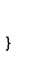

# 第10章 名称 225

嵌套在空间 X 为止，命名空间看起来像类。

## 10.2.2 使用指令

用`using`关键字可以让我们立即进入整个空间，避免输入完整符的麻烦。这种`using`和`namespace`关键字的搭配称为使用指令（using directive）。`using`关键字声明空间中的所有名字都是当前作用内的，所以方便直接使用这些名字。如果一个简单的空间开始：

```cpp
// C10:NamespaceInt.h

#ifndef NAMESPACEINT_H
#define NAMESPACEINT_H

namespace Int {
    enum sign { positive, negative };

    class Integer {
        int i;
        sign s;

    public:
        Integer(int ii = 0)
            : i(ii),
              s(i >= 0 ? positive : negative)

        sign getSign() const {
            return s;
        }

        void setSign(sign sgn) {
            s = sgn;
        }

        // ...
    };
}

#endif NAMESPACEINT_H
```

`using`指令的用途之一是把空间中的名字引入到另一个空间中，让这些名字嵌套在那个空间中。

```cpp
// C10:NamespaceMath.h

#ifndef NAMESPACEMATH_H
#define NAMESPACEMATH_H

#include "NamespaceInt.h"

namespace Math {
    using namespace Int;

    Integer a, b;
    Integer divide(Integer, Integer);

    // ...
}

#endif NAMESPACEMATH_H
```

在一个函数中声明空间`Int`中的所有名字，但是这些名字嵌套在这个函数中。

```cpp
// C10:Arithmetic.cpp

#include "NamespaceInt.h"

void arithmetic() {
    using namespace Int;

    Integer x;
    x.setSign(positive);
}

int main() {
```

## 226 C++ 编程思想

如果不用指令，在这个空间所有的名字都需要被完全限定；`using`指令有一个缺点，就是看起来不那么直观，引入名字可见性的范围是在`using`的地方。可以不考虑使用指令的名字，就像它们已经被声明了，现在变为这个范围。

```cpp
// C10:NamespaceOverriding.cpp

#include "NamespaceMath.h"

int main() {
    using namespace Math;

    Integer a; // Hides Math::a
    a.set(negative);

    // Now scope resolution is necessary
    // to select Math::a

    Math::a.set(positive);
}
```

如果有第二个命名空间，它包含了空间`Math`的名字：

```cpp
// C10:NamespaceOverriding2.cpp

#ifndef NAMESPACEORIDING_H
#define NAMESPACEORIDING_H

#include "Int.h"

namespace calculation {
    using namespace Int;

    Integer divide(Integer, Integer);

    // ...
}

#endif NAMESPACEORIDING_H
```

因为这个空间也是用`using`指令引入的，就会产生冲突。这种二义性出现在名字定义时的：

```cpp
// C10:OverridingAmbiguity.cpp

#include "NamespaceMath.h"
#include "NamespaceOverriding.h"

int main() {
    using namespace Math;
    using namespace calculation;

    Integer a(1);
    a.g(); // Ambiguity
}
```

# 第10章 名字控制

是破坏类结构的保护性吗？有两个原因可以保证它是绝对安全的。第一，这些变量的初始化唯一合法的地方是在定义中；如果静态数据成员是一个带构造函数的对象，可以调用构造函数来代替“=”的操作符；第二，且这些数据被定义了，最后的函数就不能再定义它；否则该类的创建者会被再次产生这个定义，否则这些代码在编译时无法连接。这就保证了定义只出现一次且是由类的构造者来控制的。静态成员的初始化方式：

```cpp
// C10:Static.cpp

// Scope of static initializer

#include <iostream>

using namespace std;

int x = 100;

class WithStatic {
    static int x;
    static int y;

public:
    void print() const {
        cout << "WithStatic:x = " << x << endl;
        cout << "WithStatic:y = " << y << endl;
    }
};

int WithStatic::x = 1;
int WithStatic::y = x + 1;

// WithStatic::x not ::
```

这里，`WithStatic::`限定符把`WithStatic`的作用范围扩展到全部定义中。

### 10.3.1 静态数组的初始化

“第10章介绍了静态常量（constant static）变量，它允许在一个类中定义一个常量值。也可创建静态数组对象，包括静态数组与`const`数组。这同前面的语法是一致。”

```cpp
static float table[];

static char letters[];

};

int Values::size = 100;

const float Values::scFloat = 1.1;

const int Values::scInts[] = {
    99, 47, 33, 11, 7
};

const long Values::scLongs[] = {
    99, 47, 33, 11, 7
};

const float Values::scTable[] = {
    1.1, 2.2, 3.3, 4.4
};

const char Values::scLetters[] = {
    'a', 'b', 'c', 'd', 'e',
    'f', 'g', 'h', 'i', 'j'
};

float Values::table[4] = {
    1.1, 2.2, 3.3, 4.4
};

char Values::letters[10] = {
    'a', 'b', 'c', 'd', 'e',
    'f', 'g', 'h', 'i', 'j'
};
```


利用类型的静态常量，可以在类内提供这些定义，但是对于其他的对象（包括所有类型的数组，这些定义是它们成员组），必须为这些成员专门的外部定义。这些定义是内部连接的，所以可以把它放在头文件中，初始化静态数组的方法与其他集合类型的初始化一样，包括自动计数。

也可以创建类的静态常量对象和这样的数组。不过，不能使用“内联语法”初始化它们，这种方法对于内部的全部类型的静态常量经常有效。

```cpp
// C10:StaticObjectArrays.cpp

// Static arrays of class objects

class X {
    int i;

public:
    X(int ii) : i(ii) {}
};

class Stat {
    // This doesn't work, although
    // you might want it to:
    //! static const X x(100);

    // Both const and non-const static class
    // objects must be initialized externally:
    static X x2;
    static X table2[];
    static const X x3;
    static const X table3[];
};

X Stat::x2(100);
```

```cpp
X Stat::table2[] = {
    X(1), X(2), X(3), X(4)
};
```

```cpp
const Stat::x3(100);

const Stat::table3[] = {
    X(1), X(2), X(3), X(4)
};
```

```cpp
int main() { Stat v; } /////
```

类对象的常量和非常静态数据组的初始化必须以相同的方式执行，它们遵守典型的静态的定义法则。

### 10.3.2 嵌套类和局部类

很容易地把一个静态数据成员封装在另一个类的嵌套类中。这样的成员的定义显然是上层中的情况——只需要用一种域的作用指定。然而在局部类（在函数内部定义的类）中有静态数据成员。因此，例如：

```cpp
// C::local.cpp

// Static members & local classes

#include <iostream>

using namespace std;

// Nested class CAN have static data members:

class Outer {
    class Inner {
        static int i; // OK
    };
};

int Outer::Inner::i = 47;

// Local class cannot have static data members:

void f() {
    class Local {
    public:
        // static int i; // Error
        // (How would you define it?)
    } x;
}
```

```cpp
int main() { Outer x; f(); } /////
```

可以看到一个局部域中有静态成员直接相关的问题。为了定义静态数据成员，怎样在局部域描述它呢？实际上很少使用局部域。

### 10.3.3 静态成员函数

静态成员函数和成员函数一样，也可以创建一个静态成员，它为类的所有对象服务，不需要定义一个全局函数，把这个函数移动到了内部。可以用普通的方法调用静态成员，用点“.”或箭头“->”来类使用作用域：

```cpp
// SimpleStaticMember.cpp

class X {
public:
    static void f();

    int main() {
        X::f();
    }
};
```

类对象的常量和非常静态数据组的初始化必须以相同的方式执行，它们遵守典型的静态的定义法则。当在一个类中看到静态成员时，要记住：静态成员函数不能访问一般的成员，只能访问静态成员。通常，对于对象的地址（`this`）是被隐蔽地传递到调用的。但是静态成员函数没有`this`指针，所以它不能访问非静态的数据。静态成员的初始化方法，所以可以上述静态成员放到内部。下面是一个静态成员和函数一起使用的例子：

```cpp
// StaticMemberFunctions.cpp

class X {
    int i;
    static int j;

public:
    X(int i = 0) : i(i) {
        // Non-static member function can access static
    }

    int val() const { return i; }

    static int inc() {
        // i++; // Error: static member cannot access non-static member
        return ++j;
    }
};
```

```cpp
static int f() {
    // val(); // Error: static member function cannot access non-static member
    return inc(); // OK -- calls static
}
```

```cpp
int X::j = 0;

int main() {
    X x;
    X* xp = &x;

    x.f();
    xp->f(); // Only works with static members
}
```

## 静态初始化的相关性

在一个编译单元中，静态对象的初始化按照对象在该单元定义的顺序出现。顺序准则和初始化的顺序相反。但是，作为多个成员来说，不能保证严格的初始化，也没有办法来指定这种初始化。这可能会引起问题。下面的例子包含一个文件就会立即中止进程。

```cpp
// First file

#include <fstream>

std::ofstream out("out.txt");

extern int y;

int x = y + 1;

// Second file

#include <fstream>

extern std::ofstream out;

class Oof {
public:
    Oof() { std::cout << "ouch"; }
};
```

这个程序可能运行，也可能不能运行。如果第一个文件先初始化，就不会有问题；但如果第二个文件先初始化，`Oof`构造函数依赖于`out`，而`out`还没创建，就会引起冲突。这种情况会在编译时遇到互相依赖的静态初始化。在一个编译单元内一个函数的第一次调用之前，在`main()`之后，这个编译单元内的静态对象都被初始化。

## 10.4 怎么办

三种方法来处理这个问题：

1. 不初始化，避免初始化时的相互影响。这是最好的办法。
2. 如果真的要在外面处理，就把静态对象的定义放在文件中，让它们在文档中正确出现就可以保证静态初始化。
3. 如果确信静态对象在多个编译器的定义是不可避免——如编写一个库时——可以通过两种设计加以解决。

第一种技术是在库头文件中加上一个类，这个类负责库中的静态初始化。它的工作原理还是：

```cpp
// C10:Singleton.cpp

// Static member of same type, ensures that only one object of type exists.
// Also referred as the "singleton" pattern.

#include <iostream>

using namespace std;

class Egg {
    static Egg e;
    int i;

    Egg(int i) : i(i);
    Egg(const Egg&); // Prevent copy-construction

public:
    static Egg* instance() { return &e; };

    int val() const { return i; }
};

Egg::e(47);

int main() {
    // Egg x(1); // Error -- can't create a Egg
    // You can access the single instance:
    cout << Egg::instance()->val() << endl;
}
```

`Egg`的初始化出现在类的声明后，所以编译器已经足够的信息为对象分配空间并调用构造函数。

第二种技术是因为它的生存期比较长，可能会遇到很多时候使用了。

```cpp
// Initializer.h

#ifndef INITIALIZER_H
#define INITIALIZER_H

// Static initialization technique

#include <iostream>

extern int x; // Declarations, not definitions

class Initializer {
    static int initCount;

public:
    Initializer() {
        std::cout << "Initializer" << endl;

        // Initialize first time only
        if (initCount++ == 0) {
            std::cout << "performing initialization" << endl;
            x = 100;
            y = 200;
        }
    }

    ~Initializer() {
        std::cout << "-Initializer()" << endl;

        // Clean up last time only
        if (--initCount == 0) {
            std::cout << "performing cleanup" << endl;
            // Any necessary cleanup here
        }
    }
};

//

// The following creates one object in each
// files where Initializer.h is included, but that
// object is only visible within that file:

static Initializer init;

#endif // INITIALIZER_H
```

```cpp
// InitializerDefs.cpp

// Definitions for Initializer.h

#include "Initializer.h"

// Static initialization will force
// all these values to zero:

int x;
int y;
int Initializer::initCount;
```

```cpp
// C10:Initializer.cpp

// Static initialization

#include "Initializer.h"
```

```cpp
// C10:Initializer2.cpp

// {L} InitializerDefs Initializer
// Static initialization

#include "Initializer.h"

using namespace std;
```


# 第10章 名字控制

缓冲区已设置为零。对于其余的翻译单元，`initCount`不为零，且会忽略初始化。清除操作将按照相反的顺序进行，且`~Initializer()`可以确保该操作只发生一次。

此示例使用内部类作为全局静态变量，这种方法也适用于类，但它必须被`Initializer`类初始化。一种方法是创建一个不带构造函数和析构函数的类，而是带有不同名的构造函数和清除成员函数。虽然通常的做法是在`Initializer()`函数中设定指向对象的指针，并用`new`创建它们。

### 10.4.2 技术二

在技术领域存在很久之后，才有人（我不知道是谁）提出了本节要说明的“技术二”。与技术一相比，这种技术更需要，也更清晰。之所以在技术出现很久后才有技术二，是因为我们之前没有使用 C++ 的特性。

这种技术是为了解决一个问题：函数中的静态对象在函数第一次调用时初始化，且只被初始化一次。需要记住的是，如果真的想要解决静态对象何时被初始化的问题（这可以在一个版本内控制初始化），其目标是确保静态对象的初始化顺序。

这种技术非常奇妙。对于初始化因素，可以将一个静态对象封装在一个版本内、通过访问该对象的函数中。使用这种方法，访问静态对象的构造链就是调用这个函数。如果静态对象需要访问它依赖的静态对象，就必须使用所有对它的对象的函数。函数第一次被调用时，它会构造初始化。静态对象的初始化正确顺序是由代码决定的，而不是由连接器来指定顺序。

为了给出一个例子，这里有两个相互依赖的类。第一个类包含一个类型成员，它只由构造函数初始化，并能够知道哪一个静态实例是否调用了构造函数（在程序开始时，静态存储初始化为零。如果没有调用构造函数，该成员将产生一个`false`值）。

```cpp
// C10:Dependency.h

#ifndef DEPENDENCY_H
#define DEPENDENCY_H

#include <iostream>

class Dependency {
    bool init;

public:
    Dependency() : init(true) {
        std::cout << "Dependency construction" << std::endl;
    }

    void init() {
        std::cout << "Dependency init: " << std::endl;
    }
};

#endif // DEPENDENCY_H
```

构造函数显示了它是何时被调用的，以便知道对象是否可以通过`print()`函数打印输出状态。

第二个初始化由第一个对象来完成，这会导致初始化相互依赖。

```cpp
// C10:Dependency2.h

#ifndef DEPENDENCY_2_H
#define DEPENDENCY_2_H

#include "Dependency1.h"

class Dependency2 {
    Dependency1 d1;

public:
    Dependency2(const Dependency1& depl) : d1(depl) {
        std::cout << "Dependency2 construction" << std::endl;
        print();
    }

    void print() const {
        d1.print();
    }
};

#endif // DEPENDENCY2_H
```

构造函数显示对象本身已打印了它的状态，这样就能知道在构造函数被调用时`d1`已经初始化。

为了说明可能会出现什么错误，下面的文件首先以一种不准确的顺序定义静态对象。如果在连接器在对象`Dependency1`之前先初始化对象`Dependency2`，错误就会出现。如果定义的顺序恰好相反，那么就会以相反的顺序显示它是正常工作的。这说明技术二是可靠的。

为了增加输出的可读性，增加了`separator()`函数。这里的诀窍就是不能全局地使用一个函数，除非该函数通过执行一次全局初始化，否则，`separator()`函数返回一个元值用于初始化两个全局变量。

```cpp
// C10:Technique2.cpp

#include "Dependency2.h"

using namespace std;

// 返回一个值以便可以作为
// 全局初始化器被调用：

int separator() {
    cout << "-" << endl;
    return 1;
}

// 模拟依赖问题：

extern Dependency1 dep1;

Dependency2 dep2(dep1);
Dependency1 dep1;

int x1 = separator();

// 但如果按这种顺序发生，它运行正常：

Dependency1 deplb;
Dependency2 dep2b(deplb);

int x2 = separator();

// 将静态对象封装在函数中是成功的

Dependency1& d1() {
    static Dependency1 depl;
    return depl;
}

Dependency2& d2() {
    static Dependency dep2(d1());
    return dep2;
}

int main() {
    Dependency2& d2 = d2();
}
```


`d1()` 和 `d2()` 函数包含了 `Dependency1` 和 `Dependency2` 的静态对象。现在，访问这些静态对象的办法就是调用这两个函数，并在第一次调用时强制进行静态初始化。这可以保证初始化的正确性，通过这种方法，可以知道程序运行时会输出什么结果。

下面使用了这种技术。通常，静态对象要在单独的文件中定义（由于某些原因必须这样做：即使不在单独的文件中定义静态对象也会出现问题），而不是在单独的文件中包含一个包含静态对象的函数。

```cpp
// C10:DependencyStatFun.h

#ifndef DEPENDENCY_STATFUN_H
#define DEPENDENCY_STATFUN_H

#include "Dependency1.h"

extern Dependency& d1();

extern Dependency2& d2();

#endif // DEPENDENCY_STATFUN_H
```

实际上，`extern` 关键字对函数声明来说是多余的。下面是第二个文件：

```cpp
// C10:DependencyStatFun.cpp

#ifndef DEPENDENCY_STATFUN_H
#define DEPENDENCY_STATFUN_H

#include "Dependency2.h"

Dependency& d1();

Dependency2& d2();

#endif
```

在前面的文件中静态对象定义，现在改为在包装函数中定义静态对象：

```cpp
// C10:DependencyStatFun.cpp

#include "DependencyStatFun.h"

Dependency& d1() {
    static Dependency depl;
    return depl;
}
```

其他的代码放在另一个文件中：

```cpp
// C10:DependencyStatFun.cpp

#include "DependencyStatFun.h"
#include "Dependency2.h"

Dependency2& d2() {
    static Dependency2 dep2(d1());
    return dep2;
}
```

现在有两个文件，这两个文件可以以任意顺序链接。如果它们只包含普通的静态对象，那么可以产生任意顺序初始化：

```cpp
// C10:Technique2.cpp

#include "DependencyStatFun.h"

int main() {
    int d2 = d2();
}
```

运行这个程序，将会发现 `Dependency1` 的静态初始化发生在 `Dependency2` 的静态初始化之前。所以看出这种方法比第一种技术简单。也许想在函数 `d1()` 和 `d2()` 的头部文件中把它们声明为内联函数，但是我们必须明确这样做是不行的。C++ 编译器编译每一个文件中都会有一份副本——由于内联函数默认就是内联，会导致多个静态对象，所以我们必须确保定义一个静态对象只有一份。

## 10.5 静态连接

如果在 C++ 中写一个程序用到 C 库，该怎么办？如果我要声明一个 C 函数：

```cpp
float f(int a, char b);
```

C++ 编译器会将这个函数变成 `f_int` 来支持函数重载（符号连接）。然而，C++ 编译器编译库不做这样的转换分配，这样链接无法解决冲突。

C++ 提供了一个替代连接（alternate linkage specification），它是通过 `extern` 实现的，`extern` 后面跟着一个字符串来声明函数的链接类型。

```cpp
extern "C" float f(int a, char b);
```

这就告诉编译器是 C 连接，这样就不会转换函数名。标准的链接类型指定为“C”和“C++”两种，编译器可以选择相同的支持来支持语言。如果有一组替代的函数，可以把它们放在花括号内：

```cpp
extern "C" {
    float f(int a, char b);
    double g(int c);
}
```

`extern` 关键字对函数声明来说是多余的。

## 10.6 静态可见性

（注：由于提供的原文文本后续存在大量乱码和重复，此处已根据技术逻辑核心完成翻译）

# 第11章 引用和拷贝构造函数

引用像是自动被编译的间接引用的重量型指针。

虽然引用出现在 Pascal 语言中，但 C++ 中引用的思想来自于 Algol。在 C++ 中，引用是运算符重载语法的基础（第12章），也为函数参数的传入和传出提供了便利。

本章首先简单介绍一下 C++ 和指针的差异，然后介绍引用。本章的大部分内容研究对于 C++ 与指针比较时的区别：拷贝构造函数（copy-constructor）。它是一种特殊的函数，用来通过现有对象产生新对象。按值传递（by value）的方式在函数中传递和返回。本章最后将阐述 C++ 的成员指针（pointer-to-member）概念。

## 11.1 指针

C 和 C++ 指针的显著区别在于类型要求。使用 `void*` 而言，C++ 不允许随意把一种指针赋值给另一种类型，例如：

```cpp
int* b;
int* r;
void* v;

v = r; // 错误
```

由 C 的这种方法允许任何类型看作指针，而 C++ 不允许这样做，编译器将会出一个错误。如果真想把某种类型转换，必须显式使用类型转换（第3章已经介绍了）。

## 11.2 引用

引用（reference&）就像自动被编译的间接引用的重量型指针。它通常用于函数的参数和返回值，也可以独立使用。例如：

```cpp
// Cli:StandaloneReferences.cpp

#include <iostream>

using namespace std;

// 独立引用：

int y;

int& r = y;

// 当引用创建时，它必须初始化为一个有效对象。
// 然而，你也可以说：

const int& q = y; // (1)
```

```cpp
// 引用绑定到其他存储：

int x = 0;      // (2)
int& a = x;     // (3)

int main() {
    cout << "x = " << x << " a = " << endl;

    a++;

    cout << "x = " << x << " a = " << endl;
}
```

在 (1) 中，编译器分配了一个存储单元，它的值被初始化，因为这个引用就绑定了。应用要确保任何引用都被初始化。访问引用就是访问那个存储单元。如果像 (2) 和 (3)，增加 `a` 实际上是增加 `x`。

使用引用时的一些规则：

1. 当引用创建时，它必须初始化指向一个对象；它不能变为另一个对象。
2. 可能没有 NULL。必须确保引用关联合法的存储单元。

### 使用引用

引用最常见的地方是在函数参数和返回值中。当引用用作函数参数时，在函数内部对引用的更改将改变函数参数。同样可以通过指针来传递相同的事情，但引用具有更清晰的语法。（如果愿意的话，可以把引用看作使得语法更加方便的工具）。

如果从函数返回一个引用，必须像指针一样对待。当函数返回时，引用相关的单元应该是有效的，否则将指向一个无效单元。

下一个例子：

```cpp
// Cli:Reference.cpp

int* f(int* x) {
    (*x)++;
    return x; // 安全，因为它在作用外
}

int& g(int& x) {
    x++; // 与 f 的效果相同
    return x; // 安全，因为它在作用外
}

int h() {
    int q;

    return q; // 错误

    static int x;

    return x; // 安全，留在作用外
}
```

```cpp
int main() {
    int a = 0;

    f(&a); // 糟糕的（显式的）
    g(a);  // 简洁的（隐藏的）
}
```

函数 `f()` 的调用缺乏语义方便性和清晰性，但很清楚这是传递一个地址。在函数 `g()` 的调用中，地址通过引用传递，但表面上看不出来。

#### 11.2.1 常量参数

仅当参数是非常重要对象时，引用参数才能工作。如果是常量函数，`g()` 不接受常量对象，这样做是一件好事，因为这个函数会改变对象的值。如果知道函数不碍对对象不变性，让这个函数是一个常量引用，允许该函数在任何情况下使用。这意味着对于内部类型，这个函数就不会改变它；而对于用户定义的类型，该函数只能通过常量成员访问，而不应该改变任何公共的数据成员。

在参数中使用常量引用会有特殊意义。这是由于编译器允许接收临时对象，这个临时对象是由另一个函数的返回值创建的。

```cpp
// ConstReferenceArguments.cpp

// 作为常量传递引用

void f(int&) {}

void g(const int&) {}

int main() {
    // f(1); // 错误
    g(1); // OK
}
```

#### 11.2.2 指针引用

在 C 语言中，如果想改变指针本身指向的内容，函数声明可能像：

```cpp
void f(int* p);
```

传递时，必须取得指针地址：

```cpp
int i = 4;
int* ip = &i;

f(ip);
```

在 C++ 中的引用应该非常清晰了，不用取得指针的地址。

```cpp
// Cli:ToPointer.cpp

#include <iostream>

using namespace std;

void increment(int& i) {
    i++;
}

int main() {
    int i = 0;

    cout << "i = " << i << endl;

    increment(i);

    cout << "i = " << i << endl;

    return 0;
}
```

通过运行这个程序，看到指向的内容增加了，而不是指针本身。

### 参数传递

当函数传递参数时，人们习惯上使用值传递。虽然最初看起来只是考虑效率，但在本书以后，将会带来很多的危险。函数通过传递方式传递对象并不是行的。拷贝可以提高效率：传递方式需要调用构造函数和析构函数，然而如果不改变参数，可以通过引用传递。事实上，只有一种情况适合地址，值传递是唯一的途径。

### 拷贝函数

介绍了 C++ 中引用的基本概念后，我们将讲述一个混淆的概念：拷贝函数，它被称为 `X(const X&)`。在函数定义中，拷贝函数是控制传递方式。

## 11.3 传递和返回

为了理解拷贝函数的需要，看看语言在调用函数时处理值传递的方法。声明一个函数并调用它：

```cpp
int f(int x, char c);

int g = f(a, b);
```

编译器如何传递和返回这些变量？其实对于小类型（`char`、`int`、`float`、`double`），这些信息内置在编译器中。调用函数产生的汇编代码上面：

```asm
push b
push a
call f
add sp, 4
```

这个代码已经被认真处理了，具有普遍意义；`b` 和 `a` 是全局变量还是局部变量（编译器将在栈上）有差异。在 C 和 C++ 中，参数是从右传递的，然后调用用代码负责清理栈（这一点说明了 `add_sp`）。注意，通过值传递时，编译器会将参数放在寄存器中——编译器知道参数引用，返回值存储在寄存器中。

### 11.3.1 寄存器调用语义

现在考虑用户定义的类型。如果创建一个类，希望通过值方式传递的对象，编译器如何处理？编译器不知道内部数据类型。为了研究这个问题，首先从简单的结构开始，这个结构大至于不能放在寄存器中。

这里生成的汇编代码有多复杂，许多编译器使用辅助函数而不是简单的插入函数。在 `main()` 函数中，正如我们预测的，首先调用函数 `bigfun`，整个 B 的内容放在寄存器中，然后用辅助函数把数据溢到栈。

之前的例子中，调用函数之前要把参数引用。然而在 `PassingStructures.cpp` 中看到要的操作：调用函数之前，B 的地址显然不是一个参数。为了理解这里发生的事，必须理解编译器是如何处理的。编译器为用户函数传参数时，首先所有的所有的引用，然后调用函数。在函数内部产生代码，移动指向局部变量在寄存器中（这里说是相对的，在机器上，指针可能会减少）。

### 11.3.2 拷贝

由于 C 和 C++ 中的函数支持，这将使得语言运行任何时刻，栈都可以返回。当然，编写服务的其中，作者将存储和还原寄存器（可以把参数和返回地址）。在函数执行过程中，内存中函数存放额外的栈帧（function frame）。地址是非常重要的，因为没有寄存器返回。提供了一个 CALL 后框架中的样子，指针可能会减少。

```asm
函数参数

返回地址

局部变量
```

其他部分代码完全按照这个方法安排，它可以谨慎处理函数参数。编译器简单地把返回地址放在内存中。另外，从栈中看到返回地址是合理的。

### 11.3.3 拷贝与初始化

迄为止，已经很完美了。对于数据简单的结构已经可以使用的方法。注意这里的方法是从一个对象向另一个拷贝。在 C++ 中，对象比结构复杂得多，因此具有含义。这个含义不能由它的位置来反映。


下面来考虑一个简单的例子：一个类在任何时候都知道它存在多少个对象。从第10章开始可以通过包含一个静态数据成员做到这一点。

```cpp
// Cli:HowMany.cpp

// 一个计算对象数的类

#include <iostream>
#include <string>

using namespace std;

ofstream out("HowMany.out");

class HowMany {
    static int objectCount;

public:
    HowMany() : objectCount(++objectCount) {}

    static void print(const string& msg = "") {
        if (msg.size() != 0) out << msg << ": ";
        out << "objectCount = " << objectCount << endl;
    }

    ~HowMany() {
        objectCount--;
        print("~HowMany()\n");
    }
};

int HowMany::objectCount = 0;

// 按值传递和返回：
void f(HowMany x) {
    x.print("argument inside f()");
    return x;
}

int main() {
    HowMany h;

    HowMany::print("after construction of h");

    HowMany h2 = f(h);

    HowMany::print("after call to f()");
}
```

`HowMany` 类包括一个静态变量 `objectCount` 和一个报告该变量的静态成员函数，这个函数有一个可选的静态参数。每一个对象创建时，构造函数会增加计数，而对象销毁时，析构函数输出是不预期的那样：

```text
after construction of h: objectCount = 1

argument inside f: objectCount = 1

~HowMany(): objectCount = 0

after call to f(): objectCount = 0

~HowMany(): objectCount = -1

~HowMany(): objectCount = -2
```

# C++ 编程思想

这里引入了一种新方法，可以让我们很好地理解对象的产生过程。首先，当打印对象信息时，`string name` 作为了对象的标识符。在构造函数中，可以设置一个标识字符串（通常是对象的名称），通过构造函数将值赋值到 `name` 中。默认值 `"构造"` 创建了一个字符串。同样地，构造函数会增加或减少 `objectCount` 的值。

改变拷贝构造函数 `HowMany2(const HowMany2&)`。拷贝构造函数可以仅从现有的对象创建新对象，因此会给现有对象的别名进行赋值，这样我们就能知道它是从哪里拷贝而来的。如果在这里观察，会发现构造函数中的初始化列表 `@name(h.name)` 的赋值实际上是调用了字符串的构造函数。

在拷贝构造函数内部，对对象的操作与普通构造函数一致。这意味着当对象通过值传递和返回时，我们能够得到正确的对象。

`print(string)` 函数已经过修改，用于打印信息。由于标识和对象的关系，现在 `print(string)` 函数必须访问具体对象的 `name` 函数，因此它不再是静态成员函数。


在 `main()` 函数内部，可以看到增加了一个函数 `int()` 的调用，这次使用了普通的 C 语言风格的调用，并且忽略了函数的返回值。既然知道了值是返回的（即在函数体内），代码会返回值并将结果写入目的地（目的地的地址作为一个隐藏参数传递）。当返回值被忽略后会发生什么？程序的输出将对此作出解释。

在显示输出内容之前，这里有一个小程序：TopSage 可以为任何文件添加行号。

```cpp
//: Linenum.cpp

//[I] Add line numbers

#include "../require.h"

#include <vector>
```


```cpp
#include <string>
#include <fstream>
#include <iostream>
#include <cmath>

using namespace std;

int main(int argc, char* argv[]) {
  requireArgs(argc, 1, "Usage: Linenum \n");

  // Adds line numbers to file
  ifstream in(argv[1]);
  assume(in, argv[1]);

  string line;
  vector<string> lines;

  while (getline(in, line)) // Read each entry into file
    lines.push_back(line);

  if (lines.size() == 0) return 0;

  int num = 0;

  // Number of lines in file defines width:
  const width = int(log10(lines.size())) + 1;

  for (int i = 0; i < lines.size(); i++) {
    cout.setw(width) << right << std::adjustfield;
    cout.width(width) << ++num << " " << lines[i] << endl;
  }
}
```

将整个文件放入`vector<string>`中，使用了与本章相同的逻辑。当打印行号时，我们期望所有的行都能对齐，这取决于文件的行数。我们可以轻松地用`vector::size()`决定宽度，但真正需要的是当超过 10 行、100 行或 1000 行时，行数是以 10 为底的，将其加 1，这样就能得到足够的宽度。

在循环内部，有两个特殊的调用：`setw()`和`width()`。在输出方面，`ostream`允许控制字符的形式和输出。必须在每一行输出时都调用，否则就会出错。当`Linenum.cpp`应用`count.out`时，结果如下：

1. `HowMany2()`
2. `h copy: objectCount = 1`
3. `Entering f()`
4. `HowMany2(const HowMany2&)`
5. `h copy: objectCount = 2`
6. `argument inside f()`
7. `h copy: objectCount = 2`
8. `Returning from f()`
9. `HowMany2(const HowMany2&)`
10. `h copy: objectCount = 3`
11. `~HowMany2()`
12. `h copy: objectCount = 2`
13. `call to f()`
14. `h copy: objectCount = 2`
15. `f(), no return value`
16. `HowMany2(const HowMany2&)`
17. `h copy: objectCount = 3`
18. `argument inside f()`
19. `h copy: objectCount = 3`
20. `Returning from f()`
21. `HowMany2(const HowMany2&)`
22. `h copy: objectCount = 4`
23. `~HowMany2()`
24. `h copy: objectCount = 3`
25. `~HowMany2()`
26. `h copy: objectCount = 2`
27. `call to f()`
28. `~HowMany2()`
29. `h copy: objectCount = 1`
30. `~HowMany2()`
31. `h copy: objectCount = 0`

正如上面提到的，第一件事发生的是调用普通的构造函数，对象赋值。在`f()`函数内创建了一个新对象，它是`h`的拷贝（此处的“h copy”），对对象赋值。这就是构造函数的作用。第 8 行显示了从`f()`返回的调用，局部变量`h2`在函数结束时销毁。

当`Composite`含有`WithCC`成员时（注意你必须在此内，即对应的`WithCC`在构造函数初始化列表中被初始化）。`WithCC`没有自定义的拷贝构造函数。

```cpp
Composite c2 = c;
```

`Composite`的拷贝构造函数由编译器自动创建，输出显示了它是如何创建的。对于使用的（和继承的函数，在第 14 章介绍）创建拷贝构造函数，编译器将考虑所有的对象成员。如果对象还含有成员，那么后者的拷贝构造函数也将被调用。在这里，编译器也是调用了`WithCC`的拷贝构造函数。程序的输出显示了这个构造函数被调用了。如果`WithCC`没有拷贝构造函数，编译器将不会创建一个。

# 第十一章 引用和拷贝构造函数

第 24 行，这个对象会被销毁（第 25 和 26 行）。第 28 行，对象`h2`被销毁，接着对象销毁。对象正确地到了。由于拷贝构造函数按值传递和返回，所以在这种简单结构的情况下，编译器将有效创建一个构造函数。当包含复杂的类型时，如果没有创建构造函数，编译器也将自动创建默认构造函数。然而，这里有一个例子说明编译器采取的方法：创建一个新类，它是由某些类型构成的。这个类被称为组合（composition），它通过现有类的方法解决问题。因为我们不知道拷贝构造函数，所以创建一个类。下面的例子演示了编译器在创建默认构造函数时的操作。

```cpp
// DefaultCopyConstructor.cpp

// Automatic creation of copy-constructor

#include <iostream>
#include <string>

using namespace std;

class WithCC { // copy-constructor
public:
    // Explicit default constructor required:
    WithCC()

    WithCC(const WithCC&) {
        cout << "WithCC(WithCC&)" << endl;
    }
};

class Without { // copy-constructor
    string id;

public:
    Without(const string& ident = "") : id(ident) {}

    void print(const string& msg = "") const {
        if(msg.size() != 0) cout << msg << " ";
        cout << id << endl;
    }
};

class Composite {
    WithCC cc; // Embedded objects
    WithCC wocc;

public:
    Composite() : wocc("Composite") {}

    void print(const string& msg = "") const {
        wocc.print(msg);
    }
};

int main() {
    Composite c;
    c.print("Contents of c");

    cout << "Calling copy-constructor\n"
      << endl;

    Composite c2 = c; // Calls copy-constructor
    c2.print("Contents of c2");
}
```

`WithCC`有一个拷贝构造函数，这个函数只是简单地调用，引出了一个有趣的问题。在`Composite`中，构造函数创建一个`WithCC`类的实例。如果在`WithCC`中没有拷贝构造函数，编译器将自动创建一个默认构造函数。在这种情况下，这个构造函数是什么？而且，如果我们告诉编译器我们将自己处理构造函数的创建，编译器将不会创建默认构造函数，除非我们显式地创建一个拷贝构造函数，编译器将给出指示。

`WithCC`没有拷贝构造函数，但是编译器会在`string`中存储一个实例，这个信息可以使用`print()`打印出来。这个构造函数在`Composite`中的初始化列表中表示了类（初始化时表达式在第 14 章简单地介绍过了，并在第 17 章中会被显式地调用）。这样做的原因在稍后会解释明。

`Composite`含有`WithCC`的成员或有`WithCC`的成员时（注意你必须在此内，对应的`WithCC`在构造函数初始化中被初始化了）。`WithCC`没有自定义的拷贝构造函数。

# C++编程思想

```cpp
#include <iostream>

using namespace std;
```

```cpp
class Widget {
public:
    void f(int) const { cout << "Widget::f()\n"; }
    void g(int) const { cout << "Widget::g()\n"; }
    void h(int) const { cout << "Widget::h()\n"; }
    void i(int) const { cout << "Widget::i()\n"; }
};
```

```cpp
int main() {
    Widget w;
    Widget* wp = &w;
    void (Widget::*pmem)(int) const = &Widget::h;

    (*wp).pmem(1);
    (wp)->pmem(2);
}
```

应当：一般用户创建这种复杂的表达式是不合理的。如果用户必须直接操作成员指针，那么`typedef`是合适的。为了方便管理，可以使用成员指针作为内部机制的一部分。在回到之前的那个在类中使用成员指针的例子组合上来。用户所要做的是传递一个数字选择函数。

```cpp
// Cl: ToPointerMemberFunction.cpp

#include <iostream>
```

```cpp
class Widget {
    void f(int) const { cout << "Widget::f()\n"; }
    void g(int) const { cout << "Widget::g()\n"; }
    void h(int) const { cout << "Widget::h()\n"; }
    void i(int) const { cout << "Widget::i()\n"; }

    enum { cnt = 4 };
    void (Widget::*ptr[cnt]) const;

public:
    Widget() {
        ptr[0] = &Widget::f; // 需要完整规格说明
        ptr[1] = &Widget::g;
        ptr[2] = &Widget::h;
        ptr[3] = &Widget::i;
    }

    void select(int i, int j) {
        if (i < 0 || i >= cnt) return;
        (this->*ptr[i])(j);
    }

    int count() { return cnt; }
};
```

```cpp
int main() {
    Widget w;

    for (int i = 0; i < w.count(); i++) {
        w.select(i, 4);
    }
}
```

# 第 1 章 引用和拷贝函数

在类接口和`main()`函数中，可以看到类内的实现被隐藏了。通过这种方法，类可以在内部改变数量而影响使用类的代码。在构造函数中，成员指针的初始化似乎简单。可以这样：

```cpp
ptr[i] = 6;
```

因为名字在成员函数中出现，是否会被自动认为是类的成员？语法上相似地，当成员指针按需引用时，它看起来这样：

```cpp
(*this->ptr)[i];
```


它仍是分开的。正如前面说的，当它按需引用时，语法上还需要指针和对象在一起。

### 1.5 小结

C++指针和C的指针是相似的，这是非常好的。许多代码在C++中会被正确编译，仅在赋值时，编译器才会产生警告。C++引入了引用（reference）的概念，就像一个按需使用的指针一样。它占有一个地方，但可以把它看作对象。可以使用引用传递和返回函数增加了语法的便利。

拷贝构造函数使用相同类型的引用作为参数时，编译器会自动创建一个拷贝函数，但如果通过指针传递或返回，对应的类应该有一个私有的构造函数。指向成员的指针和普通指针具有相同的功能：在运行时选取特定值（数据或函数），指向成员的指针与成员一起工作，不是全局数据或函数。在赋值时，编译器会产生信息。使用指向成员的指针，我们的程序可以在运行时灵活地改变行为。

### 1.6 练习题

本章节的总结可以在 Bruce.com 的电子书《Annotated Solution Guide for Thinking in C++》找到。

- 11-1 写一个程序，在类中尝试（1）创建一个对象，在创建时没有初始化；2）在另一个中使用引用初始化后，改变它的指向；3）创建一个空引用。
- 11-2 标记标题为“C++的引用”的小节，开头部分加上 `main()`，在输出中增加一行说明引用可以用于按需使用的指针。
- 11-4 定义一个函数，该函数使用指针作为参数，修改指针内容，然后返回指针的内容。
- 11-5 创建一个包含若干函数的类，用这个类创建一个对象，在对象创建时让参数指向是 `const` 的，证明我们可以在函数内部使用 `const` 成员函数。
- 11-6 标记标题为“指针引用”的小节写一段代码。
- 11-7 创建一个函数，使用指针作为参数，要求函数对参数进行修改。在 `main()` 中调用这个函数。
- 11-8 创建一个函数，使用 `char&` 参数并修改参数。在 `main()` 中打印一个变量，使用引用参数调试这个函数。然后再次打印变量证明它被修改了。
- 11-9 定义一个包含 `const` 成员函数和一个非 `const` 成员函数的类，再写三个以类作为参数的函数：第一个是通过值传递，第二个是通过引用传递，第三个是通过 `const` 引用。在这些函数的内部，尝试调用该类的成员。
- 11-10 写一个简单的函数，该函数使用 `int` 参数并返回 `int`。在 `main()` 中调用这个函数。观察编译器如何产生汇编代码，理解参数是如何传递和返回的，以及变量是从栈中找到的。
- 11-1 写一个函数，使用 `int`、`float` 作为参数。产生汇编代码并在函数调用时这些参数放在栈中。
- 11-2 写一个返回 `double` 的函数，编译器产生汇编代码并确定该值是如何返回的。
- 11-13 `PassingStructures.cpp`，通过编译和汇编，解释绑定传递和返回的方法。
- 11-14 写一个简单的构造函数，该函数减少参数的值，如果参数为0则返回0，否则使用本身。这个函数产生的汇编代码，编译器在调试汇编代码时是如何处理的？
- 11-15 用汇编代码证明创建一个构造函数，编译器将自动生成构造函数。证明生成的构造函数对基本类型执行。
- 11-16 创建一个包含构造函数的类，说明对象将被执行。然后再创建一个函数，该函数使用指针按值传递调用创建的对象。再创建一个函数，用指针按值返回它。用调试证明实际上调用了构造函数。
- 11-17 创建一个包含指针的类，在构造中使用 `new` 对指针进行初始化，并将构造函数的参数赋值结果给存储单元。并将该值设置为-1，对存储单元删除，然后重置。现在创建一个函数，该函数可以通过指针传递返回其的对象。在 `main()` 中调用这个函数。看看会有什么问题。通过拷贝指针解决这个问题。
- 11-18 创建一类，该类的构造函数就像一个拷贝函数，它有一个外类的参数有默认参数。这说明了仍然作为拷贝函数的用法。
- 11-19 创建一个带有显示信息的拷贝函数。再创建一个第二个类，它的成员包含由第一个类创建的对象。验证第二类中自动生成的构造函数。
- 11-20 创建一个简单的类和一个函数，该函数通过值传递返回一个对象。再创建一个第二个类，用对象的引用作为第二个类的构造。用一个函数在第二个类中使用构造函数。
- 11-21 创建一个没有构造函数的简单类和一个简单的函数，该函数通过值传递创建对象。属性来改变行为。在赋值时会发生什么？
- 11-22 练习可以创建拷贝函数的替代。创建一个类型拷贝函数。构造一个函数作为 `const` 函数，返回一个新对象。现在用一个函数使用 `const X&` 参数，这种缺点是这样做时销毁局部变量。
- 11-23 理解第章中的 `Mem.cpp` 和 `MemTest.cpp`。创建一个类，它包含一个 `double` 类型成员和一个 `print()` 函数。在 `main()` 中再创建两个指向对象的指针。使用成员指针指向对象的指针。
- 11-25 创建一个包含一组类的函数 `f()`（你可以决定重载的函数参数），修改 `memFun.cpp`。再创建一个指针，指向旧版本。
- 11-28 练习27，让它能够指向成员指针来完成任务。

# 第12章 运算符重载

运算符重载（operator overloading）只是一种语法上的方便（syntactic sugar），也就是说另一种函数调用的方式。不同之处在于函数的参数不是出现在括号内，而是紧贴在字符旁边，这些字符一般认为是不可变的运算符。运算符重载的通用性和普通运算符有两个点：首先语法上是不同的，“调用”运算符要把符号放在两个参数之间，有时放在参数之后。第二个是由编译器决定哪一个“函数”。例如，如果符号是 `++`，编译器将调用加法函数；如果符号是 `*`，编译器将调用特殊的函数，把整数转换为类型。在C++中可以定义运算符。这种定义像一个普通函数，函数的名称由 `operator` 以及跟随的运算符组成。而已。

```cpp
1 << 4;
```

或者

```cpp
2;
```

只有用户类型的表达式才会有运算符重载。

## 12.2 语法

定义重载的运算符就像定义一个函数，只是函数的名称是 `operator` 这里代表了重载的运算符。函数参数的个数取决于两个因素：

1. 运算符是一元的（一个参数）还是二元的（两个参数）。
2. 运算符是否被定义为全局函数（一元参数，二元参数）还是成员函数（一元没有参数，二元是一个参数——此时类的对象做左侧）。

下面的函数说明了运算符重载的语法：

```cpp
// C12:OverloadingSyntax.cpp
#include <iostream>
using namespace std;

class Integer {
    int i;
public:
    Integer(int ii) : i(ii) {}
    const Integer
    operator+(const Integer& rv) const {
        cout << "operator+" << endl;
        return Integer(i + rv.i);
    }
    Integer&
    operator+=(const Integer& rv) {
        cout << "operator+=" << endl;
        i += rv.i;
        return *this;
    }
};

int main() {
    cout << "built-in types:" << endl;
    int i = 1, j = 2, k = 3;
    k += i + j;
    cout << "user-defined types:" << endl;
    Integer ii(1), jj(2), kk(3);
    kk += ii + jj;
}
```

这两个重载的运算符定义为成员函数，在它们被调用时会显示信息。对于二元运算符，唯一的参数出现在运算符右侧。当一元运算符被定义为成员函数时，是没有参数的。所调用的成员函数属于运算符的左侧。对于条件运算符（通常返回一个布尔值），如果两个参数是相同的类型，希望返回相同类型的对象或引用（如果不是相同类型，结果取决于设计者）。这种方法可以构造复杂的表达式：

```cpp
kk += i + j;
```

`operator+` 产生一个新的 `Integer`（临时的），它用 `operator+=` 的 `rv`（右侧参数）。而且这一次临时变量被赋值。

## 12.3 运算符重载

虽然所有C运算符都可以重载，但运算符重载的使用是有限制的。特别是不能在当前中定义没有意义的运算符（例如表示运算符），不能改变运算符的优先级，不能改变运算符的个数。这种限制是有必要的，否则所有这些行为为产生的运算符就会混乱且不是清楚的。下面两个小例子给出重载所有“常规”运算符的例子，重载的形式是最实用的。

```cpp
}
Integer* operator&(Integer& a) {
    cout << "&Integer\n";
    return a.this(); // &a 是递归的！
}
int operator!(const Integer& a) {
    cout << "!Integer\n";
    return !a.i;
}
// 前缀：返回增加后的值
const Integer& operator++(Integer& a) {
    cout << "++Integer\n";
    a.i++;
    return a;
}
// 后置：返回增加之前的值：
const Integer operator++(Integer& a, int) {
    cout << "++Integer\n";
    Integer before(a.i);
    a.i++;
    return before;
}
// 前缀：返回减少后的值
const Integer& operator--(Integer& a) {
    cout << "--Integer\n";
    a.i--;
    return a;
}
// 后置：返回减少之前的值：
const Integer operator--(Integer& a, int) {
    cout << "--Integer\n";
    Integer before(a.i);
    a.i--;
    return before;
}
// 显示重载的运算符可以工作：
void f(Integer a) {
    +a;
    -a;
    -a;
    Integer* ip = &a;
    !a;
    +a;
    a++;
    --a;
    a--;
}
// 成员函数（隐式 "this"）：
class Byte {
    unsigned char b;
public:
    Byte(unsigned char bb = 0) : b(bb) {}
    // 无副作用：const 成员函数：
    const Byte& operator+(const Byte&) const {
        cout << "+Byte\n";
        return *this;
    }
    const Byte operator-() const {
        cout << "-Byte\n";
        return Byte(-b);
    }
    Byte operator!() const {
        cout << "!Byte\n";
        return Byte(!b);
    }
    Byte* operator&() {
        cout << "&Byte\n";
        return this;
    }
    // 有副作用：非 const 成员函数：
    const Byte& operator++() const { // 前缀
        cout << "++Byte\n";
        b++;
        return *this;
    }
    const Byte operator++(int) { // 后置
        cout << "++Byte\n";
        Byte before(b);
        b++;
        return before;
    }
    const Byte operator--() const { // 前缀
        cout << "--Byte\n";
        b--;
        return *this;
    }
    const Byte operator--(int) { // 后置
        cout << "--Byte-\n";
        Byte before(b);
        b--;
        return before;
    }
};
void g(Byte b) {
    +b;
    -b;
    -b;
    Byte* bp = &b;
    !b;
    ++b;
    b++;
    --b;
    b--;
}
int main() {
    Integer a;
    f(a);
    Byte b;
    g(b);
}
```

函数是根据其参数传递的方法分组的。例如，将传递和返回函数的指导放在后面对齐页面的形式（和下小节的形式）是 `OverloadingUnaryOperators` 的典型形式，所以你自己重载运算符时可以从这些形式开始。

### 12.3.1 增和--减

重载的 `++` 和 `--` 运算符会让人迷失基准。因为我们希望能够根据它出现在所作用对象的（前版本）还是（后版本）来调用不同的函数。解决方法很简单，但有些人一会容易出错。例如当编译器看到 `++a`（先增）时，它就调用 `operator++(a)`；当编译器看到 `a++`（注：原文此处有误，应为 `a++`）时，它就调用 `operator++(a, int)`；编译器通过调用不同的重载函数来处理这两种形式。在成员函数 `OverloadingUnaryOperators.cpp` 中，如果编译器看到 `++b`，它就产生一个对 `B::operator++()` 的调用；如果编译器看到 `b++`，它就产生一个对 `B::operator++(int)` 的调用。

用户所见的函数是对前版本和后版本都相同的。然而，实质上这两个函数调用有着不同的标识，所以它们指向两个不同的函数。编译器为 `int` 参数传递一个常量值（因为它永远不会被使用，所以它就不会给出一个标识符）用来区分后版本和不同的标记。

### 12.3.2 二元运算符赋值

下面的清单为二元运算符重复了 `OverloadingUnaryOperators.cpp`，于是对于所有可能的例子，全局版本和成员函数版本都在里面。

```cpp
const Integer& right);
friend const Integer
operator%&(const Integer& left, const Integer& right);
friend const Integer
operator*(const Integer& left, const Integer& right);
friend const Integer
operator&(const Integer& left, const Integer& right);
friend const Integer
operator|(const Integer& left, const Integer& right);
friend const Integer
operator<<(const Integer& left, const Integer& right);
friend const Integer
operator>>=(const Integer& left, const Integer& right);
// 赋值修改返回值：
friend Integer&
operator+=(Integer& left, const Integer& right);
friend Integer&
operator-=(Integer& left, const Integer& right);
friend Integer&
operator*=(Integer& left, const Integer& right);
friend Integer&
operator/=(Integer& left, const Integer& right);
friend Integer&
operator%=(Integer& left, const Integer& right);
friend Integer&
operator^=(Integer& left, const Integer& right);
friend Integer&
operator&=(Integer& left, const Integer& right);
friend Integer&
operator<<=(Integer& left, const Integer& right);
friend Integer&
operator>>=(Integer& left, const Integer& right);
// 条件运算符返回真/假：
friend int
operator==(const Integer& left, const Integer& right);
friend int
operator!=(const Integer& left, const Integer& right);
friend int
```


```cpp
operator<(const Integer& left, const Integer& right);

friend int

operator>(const Integer& left, const Integer& right);

friend int

operator<=(const Integer& left, const Integer& right);

friend int

operator>=(const Integer& left, const Integer& right);

// 写入 ostream

void print(std::ostream& os) const { os << i; };

#endif // INTEGER_H

// C12:Integer.cpp

// 重载运算符实现

#include "Integer.h"

#include "../require.h"

const Integer operator+(const Integer& left, const Integer& right) {
    return Integer(left.i + right);
}

const Integer operator-(const Integer& left, const Integer& right) {
    return Integer(left.i - right);
}

const Integer operator*(const Integer& left, const Integer& right) {
    return Integer(left.i * right);
}

const Integer operator/(const Integer& left, const Integer& right) {
    require(right.i != 0, "divide by zero");
    return Integer(left.i / right);
}

const Integer operator%(const Integer& left, const Integer& right) {
    require(right.i != 0, "modulo by zero");
    return Integer(left.i % right);
}

const Integer operator^(const Integer& left, const Integer& right) {
    return Integer(left.i ^ right);
}

const Integer operator&(const Integer& left, const Integer& right) {
    return Integer(left.i & right);
}

const Integer operator|(const Integer& left, const Integer& right) {
    return Integer(left.i | right);
}

const Integer operator<<=(const Integer& left, const Integer& right) {
    return Integer(left.i << right);
}

const Integer operator>>=(const Integer& left, const Integer& right) {
    return Integer(left.i >> right);
}

// 赋值修改返回值：

Integer& operator+=(Integer& left, const Integer& right) {
    if (&left == &right) /* 自赋值 */
        left.i += right;
    return left;
}

Integer& operator-=(Integer& left, const Integer& right) {
    if (&left == &right) /* 自赋值 */
        left.i -= right;
    return left;
}

Integer& operator*=(Integer& left, const Integer& right) {
    if (&left == &right) /* 自赋值 */
        left.i *= right;
    return left;
}

Integer& operator/=(Integer& left, const Integer& right) {
    require(right.i != 0, "divide by zero");
    if (&left == &right) /* 自赋值 */
        left.i /= right;
    return left;
}

Integer& operator%=(Integer& left, const Integer& right) {
    require(right.i != 0, "modulo by zero");
    if (&left == &right) /* 自赋值 */
        left.i %= right;
    return left;
}

Integer& operator^=(Integer& left, const Integer& right) {
    if (&left == &right) /* 自赋值 */
        left.i ^= right;
    return left;
}

Integer& operator&=(Integer& left, const Integer& right) {
    if (&left == &right) /* 自赋值 */
        left.i &= right;
    return left;
}

Integer& operator|=(Integer& left, const Integer& right) {
    if (&left == &right) /* 自赋值 */
        left.i |= right;
    return left;
}

Integer& operator<<==(Integer& left, const Integer& right) {
    if (&left == &right) /* 自赋值 */
        left.i <<= right;
    return left;
}

Integer& operator>>==(Integer& left, const Integer& right) {
    if (&left == &right) /* 自赋值 */
        left.i >>= right;
    return left;
}
```

```cpp
int operator&&(const Integer& left, const Integer& right) {
    return left.i && right.i;
}

int operator||(const Integer& left, const Integer& right) {
    return left.i || right.i;
} //~/
```

```cpp
// C12:IntegerTest.cpp

//(L) Integer

#include "Integer.h"

#include <fstream>

using namespace std;

ofstream out("IntegerTest.out");

void h(Integer c1, Integer c2) {
    // 一个复杂的表达式：

    c1 = c1 * c2 + c2 % c1;

    #define TRY(OP) \
        out << "c1 = " << c1.print(out); \
        out << "c2 = " << c2.print(out); \
        out << "c1 = " #OP << " c2 produces"; \
        out << (c1 OP c2).print(out); \
        out << endl;

    TRY(-) TRY(*) TRY(^) TRY() \
    TRY(%) TRY(^^) TRY(&) TRY(|) \
    TRY(<<) TRY(>>) TRY(+=) TRY(-=) \
    TRY(*=) TRY(/=) TRY(&=) TRY(*=) \
    TRY(&=) TRY(|=) TRY(>=) TRY(<=)

    // 条件判断：

    #define TRY(OP) \
        out << "c1 = " << c1.print(out); \
        out << "c2 = " << c2.print(out); \
        out << "c1 = " #OP << " c2 produces"; \
        out << (c1 OP c2); \
        out << endl;

    TRYC(<) TRYC(>) TRYC(==) TRYC(!=)
    TRYC(>=) TRYC(<=) TRYC(&))
}
```

```cpp
int main() {
    cout << "friend functions" << endl;

    Integer c1(47), c2(9);

    h(c1, c2);
}
```

```cpp
// C12:Byte.h

// 成员重载运算符

#ifndef BYTE_H
#define BYTE_H

#include "../require.h"

#include <iostream>

// 成员函数（隐式的 "this"）

class Byte {
    unsigned char b;

public:
    Byte(unsigned char bb = 0) : b(bb) {
        // 无副作用：const成员函数：
    }

    const Byte operator+(const Byte& right) const {
        return Byte(b + right.b);
    }

    const Byte operator-(const Byte& right) const {
        return Byte(b - right.b);
    }

    const Byte operator*(const Byte& right) const {
        return Byte(b * right.b);
    }

    const Byte operator/(const Byte& right) const {
        require(right.b != 0, "divide by zero");
        return Byte(b / right.b);
    }

    const Byte operator%(const Byte& right) const {
        require(right.b != 0, "modulo by zero");
        return Byte(b % right.b);
    }

    const Byte operator^(const Byte& right) const {
        return Byte(b ^ right.b);
    }

    const Byte operator&(const Byte& right) const {
        return Byte(b & right.b);
    }

    const Byte operator|(const Byte& right) const {
        return Byte(b | right.b);
    }

    const Byte operator<<(const Byte& right) const {
        return Byte(b << right.b);
    }

    const Byte operator>>=(const Byte& right) const {
        return Byte(b >> right.b);
    }

    // 赋值修改并返回左值。

    // operator= 只能是成员函数：

    Byte& operator=(const Byte& right) {
        // 处理自赋值：

        if (this == &right)
            return *this;

        b = right.b;
        return *this;
    }

    Byte operator+=(const Byte& right) {
        if (this == &right) /* 自赋值 */;
        b += right.b;
        return *this;
    }

    return *this;
}

Byte& operator->=(const Byte& right) {
    if (this == &right) /* 自赋值 */
        b = right.b;

    return *this;
}

Byte& operator=(const Byte& right) {
    if (this == &right) /* 自赋值 */
        b = right.b;

    return *this;
}

Byte& operator/=(const Byte& right) {
    require(right.b != 0, "divide by zero");

    if (this == &right) /* 自赋值 */
        b = right.b;

    return *this;
}

Byte& operator*=(const Byte& right) {
    require(right.b != 0, "modulo by zero"); // 注意：此处为modulo，逻辑上为divide

    if (this == &right) /* 自赋值 */
        b = right.b;

    return *this;
}

Byte& operator^=(const Byte& right) {
    if (this == &right) /* 自赋值 */
        b ^= right.b;

    return *this;
}

Byte& operator|=(const Byte& right) {
    if (this == &right) /* 自赋值 */
        b |= right.b;

    return *this;
}

Byte& operator>>=(const Byte& right) {
    if (this == &right) /* 自赋值 */
        b >>= right.b;

    return *this;
}

Byte& operator<<=(const Byte& right) {
    if (this == &right) /* 自赋值 */
        b <<= right.b;

    return *this;
}

// 条件运算符返回 true/false：

int operator==(const Byte& right) const {
    return b == right.b;
}

int operator!=(const Byte& right) const {
    return b != right.b;
}

int operator<(const Byte& right) const {
    return b < right.b;
}

int operator>(const Byte& right) const {
    return b > right.b;
}

int operator<=(const Byte& right) const {
    return b <= right.b;
}

int operator>=(const Byte& right) const {
    return b >= right.b;
}

int operator&&=(const Byte& right) const {
    return b && right.b;
}

int operator||=(const Byte& right) const {
    return b || right.b;
}

// 写入 ostream：

void print(std::ostream& os, int b) {
    os << "0x" << std::hex << int(b) << std::dec;
}
```


# 第12章 运算符重载 275

www.TopSage.com

# 276 C++编程思想


#endif // BYTE_H

```cpp
// C12:ByteTest.cpp
#include "Byte.h"
#include <fstream>
using namespace std;

ofstream out("ByteTest.out");

void k(Byte& b1, Byte& b2) {
    b1 = b1 * b2 + b2 % b1;
}
```

```cpp
#define TRY(OP) \
    out << "b1 = " << b1.print(out); \
    out << "b2 = " << b2.print(out); \
    out << "b1 = " #OP << " << b2 produces"; \
    out << (b1 OP b2).print(out); \
    out << endl;

b1 = 9; b2 = 47;
TRY(+) TRY(-) TRY(/)
TRY(*) TRY(^) TRY(&) TRY(|)
TRY(<<) TRY(>>) TRY(+) TRY(-=)
TRY(*=) TRY(/) TRY(=) TRY(^=)
TRY(&=) TRY(|=) TRY(>=) TRY(<=)
// 赋值运算符
```

```cpp
// 条件判断：
#define TRY(OP) \
    out << "b1 = " << b1.print(out); \
    out << "b2 = " << b2.print(out); \
    out << "b1 = " #OP << " " << b2 produces"; \
    out << (b1 OP b2); \
    out << endl;
```

# C++ 编程思想

```cpp
b1 = 9; b2 = 47;
TRY(c) < TRY(c) > TRY(c) == TRY(c) != TRY(c) <=
TRY(c) >= TRY(c) && TRY(c) || (1)
// 链式赋值：
Byte b3 = 92;
b1 = b2 = b3;

int main() {
    cout << "member functions" << endl; // 注意：成员函数
    Byte b1(47), b2(9);
    k(b1, b2);
    // ...
}
```

可以看到`operator=`仅允许为成员函数。注意在重载运算符中只有成员函数才有自赋值检测（self-assignment），我们总是写成`A=A`，在某些情况下，这是不需要的。例如，对于`operator+=`，是习惯写`A+=A`，自己赋值。检测自赋值是最重要的地方，对于复杂的对象可能会让发生灾难性的后果（在某些情况下这不会有问题，但不要这么做。在`operator=`时，应该小心一些）。

在两个例子中重载运算符的处理都是单一类的。但重载运算符处理混合类型，可以用“将类与指针转换来实现”。在开始运行重载运算符之前，应该看看本章后面有关自动类型转换的章节。在这里的当地类型转换可以减少许多运算符冲突。

### 12.3.3 参数和返回值

在`Integer`和`Byte`例子中可以看到各种方式传递和返回参数，乍一看有些不着头脑。虽然可以使用任何的方式传递和返回参数，但在这些中使用方式是不方便的。它们应该

### 12.3.4 不常用的运算符重载

还有一些运算符的重载语法有一点不同。下标运算符`[]`必须是成员函数且它只接受一个参数。由于它所用的对象应该像数组一样操作，可以从这个运算符返回一个引用，所以它可以被非常方便地用于等号左侧。这个运算符可以被重载，可以在本书的其他部分都看到相关的例子。

运算符`new`和`delete`用来控制内存分配并能控制许多种方法的重载，这在第 13 章中提到。

### 12.3.4.1 operator=

当等号出现在一个运算符左侧，右侧运算符的类型是赋值定义所支持的类型，将调用运算符运行。然而，“operator”调用的目标不是赋值参数，而是被赋值分隔的、没有被赋值隔开的操作。除了等号出现在运算符前面以及以后面外，这个运算符似乎没有许多这类用途。下面的用法示例：

```cpp
// C12:OverloadingOperatorComma.cpp
#include <iostream>
using namespace std;

class After {
public:
    Const After& operator(const After&) const {
        cout << "After:operator(" << endl;
        return *this;
    }
};

class Before {
public:
    Before(int, const Before& b) {
        cout << "Before:operator(" << endl;
        return;
    }
};

int main() {
    After a, b;
    a, b; // Operator comma called
    Before c, d;
    c, d; // Operator comma called
}
```

### 12.3.4.2 operator->

当希望一个对象很像一个指针时，它就需要调用`operator->`。这样一个一般的指针应该有更多与原生定义的成员，通常会被视为伪指针(smart pointer)。如果想用一个指针替一个指针赋值，或者在迭代器(iterator)的用法中，这样做特别有用。迭代器是一个对象，这个对象可以作用于它的对象的数组或集合上，每次选择它们中的一个，不用提供容器的直接访问。（在类函数里经常使用容器和迭代器，例如本书第 2 卷描述的标准 C++ 库。）

指针间接运算符是一个成员函数。它有着额外的、非典型的限制：它必须返回一个对象(或对象的引用)，该对象也有一个指针间接运算符；或者返回一个指针，被用于选择指针间接运算符头部指向的内容。下面是一个简单的例子：

```cpp
// C1:SmartPointer.cpp
#include <iostream>
#include <vector>
#include "../require.h"
using namespace std;

class Obj {
    static int i, j;
public:
    void f() const { cout << i++ << endl; }
    void g() const { cout << j++ << endl; }
};

// Static member definitions:
int Obj::i = 47;
int Obj::j = 11;

// Container:
class ObjContainer {
    vector<Obj*>* a;
public:
    void add(Obj* obj) { a.push_back(obj); }
    friend class SmartPointer;
};

class SmartPointer {
    ObjContainer& oc;
    int index;
public:
    SmartPointer(ObjContainer& obj) : oc(obj), index = 0 {}
    // Return value indicates end of list:
    bool operator++() { // Prefix
        if(index >= oc.size()) return false;
        if(oc.a[index++] == 0) return false;
        return true;
    }
    bool operator++(int) { // Postfix
        return operator++(); // Use prefix version
    }
    Obj* operator->() const {
        require(oc.a[index] != 0, "Zero value returned by SmartPointer::operator->()");
        return oc.a[index];
    }
};

int main () {
    const int sz = 10;
    Obj o[sz];
    ObjContainer oc;
    for (int i = 0; i < sz; i++) {
        oc.add(&o[i]);
    }
    SmartPointer sp(oc);
    do {
        sp->f();
        sp->g();
    } while (sp++);
}
```

### 12.4.3 仿造迭代器

更常见的是，“指针”和“迭代器”类放在同一个类中。前面的例子如下：

```cpp
// C12:NestedSmartPointer.cpp
#include <iostream>
#include <vector>
#include "../require.h"
using namespace std;

class Obj {
    static int j;
public:
    void f() { cout << ++j << endl; }
    void g() { cout << ++j << endl; }
};

// Static member definitions:
int Obj::j = 47;

// Container:
class ObjContainer {
    vector<Obj*> a;
public:
    void add(Obj* obj) { a.push_back(obj); }
    class SmartPointer;
    friend SmartPointer;
};

class SmartPointer {
    ObjContainer& oc;
    unsigned int index;
public:
    SmartPointer(ObjContainer& objc) : oc(objc), index = 0 {}
    // Return value indicates end of list:
    bool operator++() { // Prefix
        if(index >= oc.size()) return false;
        if(oc.a[++index] == 0) return false;
        return true;
    }
    bool operator++(int) { // Postfix
        return operator++(); // Use prefix version
    }
    Obj* operator->() const {
        require(oc.a[index] != 0, "Zero value returned by SmartPointer::operator->()");
        return oc.a[index];
    }
};
```

# 第12 章 运算符权重 287

```cpp
int main() {
  stringstream input("47 34 56 92 103");
  IntArray I;
  input >> I;
  I[4] = -1; // 使用重载的运算符[]
  cout << I;
}
```

这里还有重载的`operator[]`，这个运算符在数组里返回了一个合法的引用。因为返回的是一个引用，所以下面的表达式是：

```
I[4] = -1;
```

看起来不仅比使用指针更好，而且它也达到了预期的效果。被赋值的运算符通过赋值方式传递和返回，所以运算符将影响操作对象。在函数中，表达式如：

```
os << i[j];
```

会通过函数调用现在的重载运算符（即那些在`<stream>`中的）。在这种情况下，被调用的函数是`ostream&operator<<(ostream&,int)`，这是因为`i[j]`是一个`int`值。所有的操作在`ostream`上执行后就会被返回，它可以被用于更复杂的表达式：

在`main`中，`iostream`的一个新类型是：`stringstream`（在`<stream>`中）。该类包含一个`string`（如此处所示，它可以用`char`数组构建）并且把它转换为`iostream`。在上面的例子中，这意味着不需要打开一个文件或在命令行中创建输入数据的情况下，位移运算符可以被重载。这个例子使用的是插入和提取的标准形式。如果你想让自己的类创建一个集合，可以拷贝这个类的副本计数并返回类型，遵循从`string`的形式：

### 12.4.1 基本

Murray为成员和非成员之间的选择提供了如下指针：

| 运算符 | 使用符 |
| --- | --- |
| 所有的运算符 | 成员 |
| `= () [] -> *` | 必须是成员 |
| `+= -= /= *= &= && <= <= == ==` | 成员 |
| 所有其他二元运算符 | 非成员 |

## 12.5 重载赋值运算符

赋值运算符经常引起C++初学者的困惑。这是毫无疑问的，因为`=`在编程中是最基本的运算，是在机器层上拷贝寄存器。另外，当使用`=`时也能引起拷贝构造函数（上一章内容）：

> 引用 Rob Murray著作《C++ Strategies & Techniques》(Addison-Wesley), 1993, 第47页。

# 288 C++编程思想

```cpp
MyType b;
MyType a = b;
```

第2行定义了对象如何被保护，所以知道在对象被定义的地方构造函数总是必须被调用的。因为已经知道了C++编译器对于对象初始化是如此构造的。

但是这里要用哪个构造函数呢？`a`是从我的`MyType`对象创建的（`b`在等号的右侧），所以只有一个选择：拷贝构造函数。虽然它包括一个等号，但调用的是拷贝构造函数。

第3行情况不同。在等号左侧有一个以前初始化过的对象。很清楚，不用为一个已经存在的对象用构造函数。在这种情况下，用`MyType::operator=`把右侧的任何东西作为参数（可以有多种右侧的`operator=`函数）。

对于拷贝构造函数没有这个限制。在任何时候使用`=`初始化形式的构造函数来初始化一个对象时，无论等号是什么，编译器就会寻找一个接受右侧类型的构造函数

```cpp
// C12:CopyInitialization.cpp
class Fi {
public:
    Fi() {}
};

class Fee {
public:
    Fee(int) {}
    Fee(const Fee& f) {}
};
```

```cpp
int main() {
    Fee fee = 1; // Fee (int)
    Fi fi;
    Fee fum = fi; // Fee (Fee)
};
```

当处理`=`时，记住这个差别是非常重要的。如果对象还没有被创建，初始化是需要的，否则就会调用赋值运算符`operator=`。

对于初始化，使用`=`可以避免写代码。不用用显式的构造函数形式。等号的两种构造形式为：

```cpp
Fee fee(1);
Fee fum(fee);
```

这个方法可以避免读者混淆。

### 12.5.1 operator的行为

在`Integer`和`Byte`中，可以看到`operator`只是成员函数，它紧密地与`=`左侧的对象联系。如果允许定义`operator`为全局的，那么我们试图重新定义赋值内的`=`：

```cpp
int operator=(int, My); // 不允许全局 =!
```

编译器通过将`operator`为成员函数而避开这个问题。创建一个`operator=`时，必须从右侧对象拷贝所有信息到左侧对象（即调用）


# 第12章 运算符重载

运算符的赋值以完成类的“赋值”，对于简单的对象，这是显然的：

```cpp
// C12:SimpleAssignment.cpp
// 简单的 operator=()
#include <iostream>
using namespace std;

class Value {
    int a, b;
    float c;
public:
    Value(int aa = 0, int bb = 0, float cc = 0.0)
        : a(aa), b(bb), c(cc) {}
    Value& operator=(const Value& rv) {
        a = rv.a;
        b = rv.b;
        c = rv.c;
        return *this;
    }
    friend ostream& operator<<(ostream& os, const Value& rv) {
        return os << "a = " << rv.a << ", b = " << rv.b << ", c = " << rv.c;
    }
};

int main() {
    Value a(1, 2, 3);
```


```cpp
cout << "a:" << endl;

Value b = a; // 拷贝构造

a = b;

cout << "a assignment:" << endl;
```

这里左侧的对象指向右侧的所有内容，返回的引用还可以创建更复杂的表达式。这个例子引起了一个常见的错误。当相同对象赋值时应该检查自赋值（self-assignment）：这个对象本身赋值了。在某些情况下无论如何执行赋值都是安全的，但如果忽略这些细节，就会产生严重的后果。

## 12.5 指针赋值

如果对象包含指针，如何呢？简单地将指针指向另一个存储单元。有两个问题：对象赋值或指针赋值时，最简单的方法是拷贝指针涉及的一切是非常直接。

```cpp
// 解决别名问题
// 什么是赋值和拷贝构造。
#include <string>
#include <iostream>
using namespace std;

class Dog {
    string nm;
    int count;
public:
    Dog(const string& name) : nm(name), count(1) {
        cout << "Creating Dog: " << *this << endl;
    }
    ~Dog() {
        if (--count == 0) {
            cout << "Deleting Dog: " << *this << endl;
        }
    }
    void rename(const string& newName) {
        nm = newName;
        cout << "Dog renamed to: " << *this << endl;
    }
    friend ostream& operator<<(ostream& os, const Dog& d) {
        return os << "Dog(" << d.nm << ")";
    }
};

class DogHouse {
    Dog* p;
    string houseName;
public:
    DogHouse(Dog* dog, const string& house) {
        p = dog;
        houseName = house;
    }
    DogHouse(const DogHouse& dh) {
        p = dh.p;
        p->count++;
        houseName = dh.houseName + " copy-constructed";
    }
    DogHouse& operator=(const DogHouse& dh) {
        if (&this != dh) {
            delete p;
            p = new Dog(dh.p);
            p->count++;
            houseName = dh.houseName + " assigned";
        }
        return *this;
    }
    void rename(const string& newName) {
        houseName = newName;
    }
    Dog* get() const { return p; }
    ~DogHouse() { delete p; }
    friend ostream& operator<<(ostream& os, const DogHouse& dh) {
        return os << "DogHouse(" << dh.houseName << " contains " << dh.p << ")";
    }
};

int main() {
    DogHouse fidos(new Dog("Fido"), "DogHouse");
    cout << fidos << endl;
    DogHouse fidos2 = fidos; // 拷贝构造
    cout << fidos2 << endl;
    fidos2.get()->rename("Spot");
    fidos2.rename("SpotHouse");
    cout << fidos2 << endl;
    fidos = fidos2; // 赋值
    cout << fidos << endl;
    fidos.get()->rename("Max");
    return 0;
}
```

`Dog`是一个简单的类，它包含一个用于说明名字的`string`。但是由于构造函数和析构函数在被调用的时候执行，就可以知道对`Dog`操作的时间。注意第二个构造函数参数是对`Dog`对象的指针而不是一个外，而且第三个参数是`Dog`的名字。这个参数可以帮助追踪构造过程的执行。可以看到，无论何时成员函数打印信息时，它不是直接执行这些信息的，而是把`this`送进去，通过重载`ostream<<`。这种方法操作是值得的，因为需要刷新流状态。

当包含指针时，`DogHouse`重载了要求的4个函数：所有的构造函数、拷贝构造函数、`operator=`（允许的）和析构函数。`operator=`应该检查赋值操作，虽然这并不一定需要，但实际上减少了改变代码和运行时检查的复杂性。

## 12.5.2 引用

在上面的例子中，通过构造函数和`operator=`对指针的内容创建了一个新的拷贝，并通过析构函数删除它，意味着对象需要内存的保存或初始化我们也许想要避免这种拷贝问题，解决这个问题的方法是使用引用计数（reference count）。通过引用计数来增加引用，它知道有多少个指向对象，构造函数和赋值运算符会指向同一个存储单元并增加引用计数。

```cpp
// ReferenceCounting.cpp
// copy-on-write
#include <string>
#include <iostream>
using namespace std;

class Dog {
    string nm;
    int count;
public:
    Dog(const string& name) : nm(name), count(1) {
        cout << "Creating Dog: " << *this << endl;
    }
    Dog(const Dog& d) : nm(d.nm), count(d.count) {
        cout << "Copied Dog: " << *this << endl;
    }
    ~Dog() {
        if (--count == 0) {
            cout << "Deleting Dog: " << *this << endl;
        }
    }
    void rename(const string& newName) {
        nm = newName;
    }
    friend ostream& operator<<(ostream& os, const Dog& d) {
        return os << "Dog(" << d.nm << ", count=" << d.count << ")";
    }
};

class DogHouse {
    Dog* p;
    string houseName;
public:
    DogHouse(Dog* dog, const string& house) {
        p = dog;
        houseName = house;
    }
    DogHouse(const DogHouse& dh) {
        p = dh.p;
        p->count++;
        houseName = dh.houseName + " copy-constructed";
    }
    DogHouse& operator=(const DogHouse& dh) {
        if (&this != dh) {
            p->count--;
            p = dh.p;
            p->count++;
            houseName = dh.houseName + " assigned";
        }
        return *this;
    }
    void rename(const string& newName) {
        houseName = newName;
    }
    Dog* get() const { return p; }
    ~DogHouse() {
        p->count--;
    }
    friend ostream& operator<<(ostream& os, const DogHouse& dh) {
        return os << "DogHouse(" << dh.houseName << " contains " << dh.p << ")";
    }
};
```

# 第12章 运算符重载 295

Topsage.com

下面（一部分重新构式化后的）输出结果：

```text
Creating Dog: [Fido], rc = 1
Created DogHouse: [FidoHouse]
contains [Fido], rc = 1
Creating Dog: [Spot], rc = 1
Created DogHouse: [Spothouse]
contains [Spot], rc = 1
Entering copy-construction
Attached Dog: [Fido], rc = 2
DogHouse copy-constructor:
  [copy-constructed FidoHouse]
contains [Fido], rc = 2
After copy-construction bobs
fdos:[FidoHouse] contains [Fido], rc = 2
spots:[Spothouse] contains [Spot], rc = 1
bobs: [copy-constructed FidoHouse]
  contains [Fido], rc = 2
Entering spots = fido
Detaching Dog: [Spot], rc = 1
Deleting Dog: [Spot], rc = 0
Attached Dog: [Fido], rc = 3
DogHouse operator=: [Fido assigned]
  contains [Fido], rc = 3
After spots = fido
spots:[FidoHouse] contains [Fido], rc = 3
Entering self-assignment
DogHouse operator=: [copy-constructed FidoHouse]
  contains [Fido], rc = 3
After self-assignment
bobs: [copy-constructed FidoHouse]
  contains [Fido], rc = 3
Entering rename ("Bob")
After rename ("Bob")
DogHouse destructor: [copy-constructed FidoHouse]
  contains [Fido], rc = 3
Detaching Dog: [Fido], rc = 3
DogHouse destructor: [FidoHouse assigned]
  contains [Fido], rc = 2
Detaching Dog: [Fido], rc = 2
DogHouse destructor: [FidoHouse]
  contains [Fido], rc = 1
Detaching Dog: [Fido], rc = 1
Deleting Dog: [Fido], rc = 0
```

531

通过运行输出结果，跟随源代码和程序的测试，将加深对这些技术的理解。

### 12.5.1.3 自动运算符

因为对一个对象赋值另一个相同类型的对象是大多数人可能的事情，如果如果没有定义`type::operator=(type)`，编译器将模拟赋值创建的构造函数的行为：如果类包含了对象（或是从别的类的继承的），对于这些对象，`operator`被是隐式的，我们称为成员赋值（member assignment）。见到例如：

```cpp
// C12:AutomaticOperatorExamples.cpp
#include <iostream>
using namespace std;
```

532

www.Topsage.com

# 296 C++编程思想

```cpp
class Cargo {
public:
    Cargo& operator=(const Cargo&) {
        cout << "inside Cargo::operator=()" << endl;
        return *this;
    }
};

class Truck {
    Cargo b;
};

int main() {
    Truck a, b;
    a = b; // Prints: "inside Cargo::operator=()"
}
```

为C++自动生成的`operator=`调用`Cargo::operator=`。

我们不会想让编译器做这些。对于复杂的类（尤其是包含指针的类），应该显式地创建一个`operator`。如果真的不想让编译器执行赋值运算，可以将`operator`声明为`private`函数（除非在类内部使用它，否则不必定义它）。

## 12.6 自动类型转换

在C++中，如果编译器看到一个表达式或函数调用使用了一个不合适的类型，它经常会执行一个自动类型转换，从现在的类型转换到所要求的类型。在C++中，可以通过定义自动类型转换函数为用户定义类型达到相同效果。这些转换函数有两种类型：特殊类型的构造函数和重载的运算符。

### 12.6.1 构造函数转换

如果定义一个构造函数，这个构造函数就能把另一类型对象（或引用）作为它的单个参数，那么这个构造函数就允许编译器执行自动类型转换。例如：

```cpp
// AutomaticTypeConversion.cpp
class One {
public:
    One() {}
};

class Two {
public:
    Two(const One&) {
    }
};

void f(Two) {}

int main() {
    One one;
    f(one); // Wants a Two, so has a One
}
```

www.Topsage.com

# 第12章 运算符重载 297

当编译器看到`f()`以类`One`的对象作为参数使用时，编译器检查`f()`的声明并注意它一个类`Two`的对象作为参数。然后，编译器检查是否有从`One`到`Two`的方法。它发现了构造函数`Two::Two(One);Two::Two(One)`被隐式地调用，结果对象被构造了。

在这种情况下，自动类型转换避免了两个`f()`版本版本的麻烦。然而，代价就是调用`One`的构造函数效率，如果允许`f()`的调用转换的话，那就不需要使用这种方法。

### 12.6.1 阻止构造函数转换

有时通过构造函数自动转换类型可能会出现问题。为了避开这些麻烦，可以通过在前面关键字`explicit`（只能用于构造函数）来对例类`Two`的构造函数进行进行修改：

```cpp
// ExplicitKeyword.cpp
// Using the "explicit" keyword
class One {
public:
    One() {}
};

class Two {
public:
    explicit Two(const One&);
};

void f(Two);

int main() {
    One one;
    // f(one); // Error
}
```

通过类`Two`的构造函数显式的，编译器将告知不能使用那个构造函数执行自动转换。如果用户进行类型转换必须写出代码。

## 12.6.2 运算符重载

第二种自动类型转换是通过运算符重载。创建一个成员函数，通过`operator`关键字后跟随想要转换的方法，将当前类型转换为类型。这种形式的运算符重载是独特的，因为没有指定一个返回类型。下面是一个例子：

```cpp
// OperatorOverloading.cpp
class Three {
    int i;
public:
    Three(int ii = 0) : i(ii) {}
};

class Four {
    int x;
public:
    Four(int xx) : x(xx) {}
    operator Three() const {
        return Three(x);
    }
};

void g(Three);

int main() {
    One one;
    g(one); // No auto conversion
    g(Three()); // OK -- user performs conversion
}
```

### 12.6.2.1 全局运算符

用构造函数数值，同类的转换，是源于运算符。全局运算符转换为成员函数是最快的一种。构造函数自动转换（即使不止一个参数），这可能不是想要的（那种情况下可以使用`explicit`来避免）。另外，全局运算符可以节省代码。


```cpp
// ReflectivityOverloading.cpp
class Number {
    int i;
public:
    Number(int ii = 0) : i(ii) {}
    Number& operator=(const Number& n) { i = n.i; return *this; }
};

friend Number operator-(const Number& n1, const Number& n2) { return Number(n1.i - n2.i); }

int main() {
    Number a(4), b(1);
    a += b; // 2nd arg converted to Number
    1 + a; // Wrong! arg of Number
    a -= a; // 2nd arg converted to Number
    a -= 1; // arg converted to Number
}
```

# C++ 编程思想

这里也没有从 `Fee` 对象创建 `Fee` 的拷贝构造构造函数，但这是一种能由编译器帮助我们创建的特殊函数之一（默认的构造函数、拷贝构造函数、`operator=` 析构函数可以自动创建）。对于正确的声明：

```cpp
Fee fee = fo;
```

自动类型转换运算符会调用并创建一个拷贝构造函数。

自动类型转换需要小心使用。所有重载的运算符都是安全的，它在减少代码方面是非常出色的，但不值得无改造地使用。

## 12.7 小节

运算符重载是为了编程方便。运算符重载没有什么神奇的，它只是为了让函数有名字。当它以期望的形式出现时，编译器调用这个函数。如果运算符重载对设计者的类似或类的使用者不能提供显著的益处，最好不要使用，因为增加运算符重载会引起困惑。

## 12.8 习题

- 部分章节的答案可以在本书的文档《Annotated Solution for Thinking in C++》中找到，仅需花费很少费用就可以从 `http://www.BruceEckel.com` 得到这个电子文档。

- 12-1 有一个重载运算符 `operator+`。尝试用前和后两种形式调用这个运算符，看看输出会如何。

- 12-2 创建一个有一个成员的简单类，以构造函数的形式重载 `operator+`，同时提供一个 `print()` 成员函数，用 `ostream` 作为参数并打印出 `ostream`。该测试说明该类可以正确运行。

- 12-3 使用重载构造函数，在习题 2 中增加一个 `operator-`，要求在 `a+b-c` 这样复杂的表达式中使用该类的。

- 12-4 在习题 2 中增加 `operator++` 和 `--`，要包括前和后版本，使得它们能返回自增和自减的值，确保返回的是正确的值。

- 12-5 修改构造函数的返回自增和自减，以使得前版本使用非常重要而后版本使用常用。显示元素如何自增并解释在实际操作中是如何做的。

- 12-6 修改习题 2 的 `print()` 成员函数，使得它变成是 `operator<<`，就像在 `IostreamOverloading.cpp` 中一样。

- 12-7 修改习题 3，使用 `operator+` 和 `operator-` 不是成员函数。表明它们仍然可以正确运行。

- 12-8 在习题 2 中增加一个 `operator-`，并表明它可以正确运行。

- 12-9 写一个只有一个 `char` 成员的类。重载 `operator<<`（像在 `IostreamOverloading.cpp` 中一样）并测试它们可以使用 `iostream`、`string` 和 `cout`。

- 12-10 确定包含一个 `double` 成员的 `Number` 类，并添加重载的 `operator+`、`*` 和赋值。这些函数应该合理返回值以便链式表示，提高效率。写一个自动类型转换 `operator()`。

- 12-12 返回优化还没有被使用，修改返回优化，现在返回优化。

- 12-13 创建一个包含指针的类，如果允许编译器生成 `operator=`，结果将具有相同名、指向同一区域的指针。规定定义自己的 `operator=` 解决这个问题，并命名它为别名。

- 12-14 写一个包含 `static int` 成员的 `Bird` 类。在指定的构造函数中，根据类的名字 (`Bird #1`, `Bird #2`)，使用 `static int` 自动生成一个位于 `string` 中的标识符，为 `ostream` 增加 `operator<<`。写一个赋值 `operator=` 和拷贝构造函数。在 `main()` 中验证它们能够正确运行。

- 12-15 写一个 `BirdHouse` 类，包含数组，一个构造函数和一个构造函数。用构造函数的参数是 `Bird` 类，为 `BirdHouse` 增加 `operator<<`。在 `main()` 中验证它们都正确运行。一个赋值 `operator=` 对 `BirdHouse` 对象进行正确赋值，包括多种操作。

- 12-16 在 `Bird` 和 `BirdHouse` 中增加构造函数。增加赋值运算符、`+` 和 `*` 使用它们来对各自成员进行操作。验证这些工作。

- 12-17 使用赋值运算符来测试类。

- 12-18 增加 `operator--`。`SmartPointer.cpp` 和 `NestedPointer.cpp`。

- 12-19 修改 `Initialization.cpp`。使用所有构造函数打印操作时的信息。验证赋值运算符两种形式是否相等。

- 12-20 尝试为类创建一个运算符，看看是否能得到编译器的任何信息。用构造运算符构造一个类。创建一个构造函数，第二个参数是 `string`，通过传递方式接受赋值，并将构造运算符被正确地调用了。

- 12-21 在 `CopyWithPointers.cpp` 中，删除 `DogHouse` 的构造表明编译器生成了正确的赋值函数，但是对 `DogHouse` 引起了指针问题。

- 12-22 在 `ReferenceCounting.cpp` 中增加一个 `static int` 成员和一个 `base int` 成员作为构造。在所有的构造函数，`static int` 成员记录所有创建的对象。进行必要的修改，打印输出对象的标识符。

- 12-23 创建一个包含 `string` 成员的类。在构造函数中初始化 `string` 成员，但不用创建拷贝构造函数或 `operator=`，构造第一个对象；同样为类创建构造函数或 `operator=`，表明编译器生成正确的赋值函数。

- 12-24 在 `OverloadingOperators.cpp` 和 `Integer.cpp` 中增加两个成员函数，它们无参数并返回 `void`，修改 `PointerToMember.cpp`。

- 12-27 在 `NestedSmartPointer.cpp` 中增加 `operator->`。

- 12-28 创建两个类 `Apple` 和 `Orange`。在 `Apple` 类中创建一个构造函数，其参数是 `Orange` 对象。然后创建一个构造，它的参数是 `Apple`。

- 12-29 在 `ReflexivityOverloading.cpp` 中增加全局 `operator*` 表明具有反射性。

- 12-30 创建两个类并创建 `operator+` 和转换函数，使得这两类具有反射性。

- 12-31 写一段简单的代码，其中对 `double` 类型使用 `operator+`、`*` 和 `/`，看看编译器如何生成编码。

# 第13章 动态对象创建

有时我们能够知道程序中的确切数量、类型和生命周期。但情况往往这样的：系统将会需要内存？在网络中有多少节点？为了解决这个问题，在运行时创建和销毁对象是最基本的要求。当然提供了动态内存分配（dynamic allocation）函数 `malloc()` 和 `free()`，这些函数在运行时（也称为自由内存）中分配存储单元。然而，在 C++ 中这些函数不能允许我们向内部来进行初始化。如果这样做，我们可能：

1. 忘记了 C++ 中对对象的初始化无法保证。

2. 期望发生的事，在初始化之前意外地对对象进行了操作。

3. 把错误的函数传递它。即使我们正确完成了任务，修改后的程序也是容易变得相同或不同的。正确的初始化会导致大部分部分都要责任，我们在栈上创建对象时确保构造函数调用是要求的。C++ 如何保证对象的初始化允许我们在栈上创建对象的呢？答案是，动态对象创建为了语言内核。`malloc()` 和 `free()` 是库函数，不在编译器范围内。然而，如果我们有一个完成内存分配和初始化组合运算符，另一个完成创建和释放内存的操作，编译器可以保证所有对象的构造函数和析构函数会被调用。在我们中，我们将用 C++ 的 `new` 和 `delete` 来解释这个问题。

### 13.1 对象创建

当创建一个 C++ 对象时，会发生两个事件：

1. 内存分配。

2. 调用构造函数来初始化那个对象。

到为止，为了确保对象的初始化一定，C++ 强制这样做是为了对于未初始化的对象是程序错误的原因。由于不知道哪里和何时创建，构造函数总是需要调用的。

然而，步骤可以用任何方式或选择的时间发生：

1. 在静态区域，存储空间在程序执行之前分配。这个存储空间对于整个运行期间存在。

2. 无论何时到达执行点，存储单元可以在栈上创建。如果执行了执行点，存储单元会被释放。内存分配在于处理器集中，非常有效。然而，写程序的时候，必须知道多少存储单元，以便编译器生成正确的指令。

3. 存储单元也可以从堆中（也被称为自由存储）的地方分配。被称为动态内存分配。这意味着任何时候决定内存分配。当需要时也可以释放，内存周期由我们来选择——不受范围。这三个区域被放在连续存储单元里；静态内存和堆（由编译者的决定），但没有固定的规则。堆可以在特定的地方，实现可以通过系统函数负责一块存储单元。这三件事不需要设计者完成。当申请内存的时候，只知道在哪里。

### 13.1.1 提取存储单元的方法

在运行时动态分配内存，在堆的标准库中提供了一些函数：从堆中申请内存 `malloc` 以及 `realloc`，释放内存返回给堆的函数 `free`。这些函数是有效的，需要人员小心使用。在堆上创建一个实例，构造函数必须这样做：

```cpp
// Malloc.class objects
// What you've had to do not "new"
#include <cstdlib> // malloc() & free()
#include <cstring> // memset()
#include <iostream>

using namespace std;

class Obj {
    int i, j, k;
    enum { sz = 100 };
    char buf[sz];
public:
    void initialize() { // Can't use constructor
        cout << "Initializing Obj" << endl;
        i = j = k = 0;
        memset(buf, 0, sz);
    }
    void destroy() const { // Can't use destructor
        cout << "destroying Obj" << endl;
    }
};

int main() {
    Obj* obj = (Obj*)malloc(sizeof(Obj));
    if (obj != 0) {
        obj->initialize();
    }
    // ... sometime later:
    obj->destroy();
    free(obj);
}
```

在下面代码中，使用了 `malloc()` 为对象分配内存：

```cpp
Obj* obj = (Obj*)malloc(sizeof(Obj));
```

这里用户必须决定对象的长度这也是出错之一）。由于 `malloc` 只是分配了一块内存而不是创建一个对象，它返回了一个 `void` 指针。在 C++ 中不允许将 `void` 指针赋值给其他类型，所以必须类型转换。在使用对象之前记住初始化。注意构造函数没有被使用，这是在使用对象时忘记初始化是程序的主要来源。许多架构面临内存分配函数太复杂，容易混淆。程序设计者经常在栈区域预留大量的空间来避免动态分配。在 C++ 中使得程序员可以使用内存而不，如果动态分配方法是不可接受。

### 13.1.2 operator new

C++ 的解决方案是把创建一个对象所需的所有动作在一起，称为 `new` 运算符。用 `new` 表达式创建一个对象，它就在堆里为对象分配内存并在块中调用构造函数。如果写出来：

```cpp
MyType* fp = new MyType(1);
```

在运行时等价于调用 `malloc(sizeof(MyType))`（就是调用 `malloc`），这将返回地址。指针赋值给 `fp` 之前，它不是初始化的对象。它会自动赋值为正确的 `MyType`，否则进行初始化。`new` 的运行时检查内存分配是否成功，如果没有成功分配内存会发生什么。我们可以使用任何构造函数参数来写 `new` 表达式。如果构造函数没有参数，可以写没有参数的 `new` 表达式：

```cpp
MyType* fp = new TypeType();
```

我已经注意到了，在堆里创建的过程变得简单了——只是简单的表达式，带有内置的长度计算、类型转换和安全检查。在堆里创建一个对象和栈里创建一个对象一样。

### 13.1.3 operator delete

`new` 表达式的反面是 `delete` 表达式。`delete` 表达式先调用析构函数，然后释放内存（通常是调用 `free()`）。正如 `new` 表达式返回一个指向内存的指针一样，`delete` 表达式需要一个对象的地址。

- 这里，由于 `new` (placement new) 的特殊语法允许在一块预好的内存上调用构造函数。这在后的章节中详细介绍。

```cpp
delete fp;
```

上面的表达式演示了创建动态对象 `MyType` 类型对象。`delete` 只删除由 `new` 创建的对象。如果用 `malloc()` 或 `calloc()` 或 `realloc()` 创建对象，最后用 `delete` 删除它，这个动作行为是未定义的。因为默认使用了 `new` 和 `delete` 实现机制都使用了 `malloc()` 和 `free()` 所以可能没有调用析构函数就释放内存了。如果正在删除对象的指针是 0，则不会发生任何事情。为此，人们建议在删除指针后立即把指针置为 0。对对象删除两次可能会发生某些问题。

### 13.1.4 一个简单的例子

这个例子提示了初始化发生的情况：

```cpp
#ifndef TREE_H
#define TREE_H
#include <iostream>

class Tree {
    int height;
public:
    Tree(int treeHeight) : height(treeHeight) {}
    ~Tree() { std::cout << "*"; }
    friend std::ostream& operator<<(std::ostream& os, const Tree* t) {
        return os << "Tree height: "
               << t->height << std::endl;
    }
};
#endif // TREE_H
```

```cpp
// C:NewAnddelete.cpp
// Simple demo of new & delete
#include "Tree.h"
using namespace std;

int main() {
    Tree* t = new Tree(40);
    cout << t;
    delete t;
}
```

我们通过打印 `Tree` 的值知道构造函数被调用了。这里是通过调用参数的 `ostream` 和 `Tree*` 类型的 `operator` 实现这个运算的。注意，虽然这个函数被声明为一个友元 (`friend`)，它还是被定义为一个内联函数。这仅仅是为了方便考虑——一个友函数是内联函数不会改变对象状态，而且它是全局函数而不是类的成员函数。要注意返回值是整个输出表达式的结果，它本身是一个 `ostream&` 为了满足函数返回类型，它其它是

### 13.1.5 内存的开销

当在堆里自动创建对象时，对象的大小和它们的生存期能准确地。

## 310 C++ 编程思想

```cpp
int main() {
    Object* a = new Object(40, 'a');
    delete a;
    void* b = new Object(40, 'b');
    delete b;
}
```

类包含了指针，它被初始化为“数据”或（它包含了指向构函数的对象）。在 `Object` 的析构函数中，对这个 `void*` 指针调用 `delete` 就不会发生什么错误，因为需要的只是释放块内内存。

在 `main()` 中，我们看到 `delete` 对所操作对象的类型是有十分必要的。输出如下：

- Constructing a, size = 40

- Destructing a

- Constructing b, size = 40

因为 `a` 指向一个 `Object` 对象，所以析构函数会被调用，从而释放了分配内存的数据。不是，我们正在执行 `b` 的操作，而是通过 `void*` 类型的指针对一个对象进行操作，否则只会释放 `Object` 的内容，而不会调用析构函数，也不会释放 `data` 所指向的内存。编写这个程序时，编译器会告诉我们所做的一切。我们不会看到任何警告信息，但是这里会导致内存丢失的。

在程序中发现内存泄漏时，我们就检查所有的指针。如果是 `void*` 类型，可能就是引起内存泄漏的另一个因素（由于 C++ 中还有其他的比这很多的引起内存泄漏的因素）。

## 13.2.2 指针的清理职责

为了使 `Stack` 具有灵活性（可以包含任意类型的对象），要使用 `void` 指针。这意味着一个指针指向 `Stack` 的对象时，必须在删除之前将其转换为合适的类型。否则，在删除之前必须把指针转换为合适的类型，会导致内存丢失。


解决内存泄漏的另一个工作是在确保容器中的每一个对象都有 `delete`。容器含有 `void*` 类型，这样不能正确执行执行器，它自己不能“管理”堆。它必须负责清理这些对象。如果在堆上创建的指针和在堆上创建的内存存放在同一个容器中，将会产生严重的问题。（当我们需要移除一个指针时，我们如何知道所指向的对象是被分配在哪个内存上的呢？）因此不是通过精细的设计或是通过作用在堆上创建的，保证客户程序负责清理容器中的所有对象指针同样是非常重要的。在接下来的例子中，已经看到 `Stack` 是在哪个析构函数中查找的 `Link` 删除了。但是，对于 `Stack`，需要使用另一种方法。

### 13.2.3 指针的栈


# 第13章 动态对象创建

对象的指针变得安全、容易了。

下面提供了“pointer Stash”的头文件：

```cpp
// Cl:PStash.h
// Holds pointers instead of objects
#ifndef PSTASH_H
#define PSTASH_H

class PStash {
    int quantity(); // Number of storage spaces
    int next; // Next empty space
    // Pointer storage:
    void* storage;
    void inflate(int increase);
public:
    PStash() : quantity(0), storage(0), next(0) {}
    ~PStash();
    int add(void* element);
    void* operator[](int index) const; // Fetch
    // Remove the reference from this PStash:
    void* remove(int index);
    // Number of elements in Stash:
    int count(int next);
};
#endif PSTASH_H //:~
```

基本的数据分离是非常相似的，但现在 `storage` 是一个 `void**` 指针，并且用 `new` 代替 `(malloc)` 对这个数组进行分配。在下面这个表达式中：

```cpp
void** st = new void*(quantity + increase);
```

对象的类型是 `void*`，这个表达式表示我们删除了它指向的内容（正如前面所指出的，释放它们的内内存时不调用析构函数，这是因为 `void` 指针没有类型信息）。

其他的变化是使用 `operator[](i)` 替代了 `fetch(i)`，在这些语句中对于这些指针来说显得更有意义。在使用这些指针时必须使用类型转换函数（这在接下来的章节中是需要修改的）。

下面是成员函数的定义：

```cpp
// Cl:PStash.cpp
// Pointer Stash definitions
#include "PStash.h"
#include "../require.h"
#include <iostream>
#include <cstring> // 'mem' functions
using namespace std;

int PStash::add(void* element) {
    const int inflateSize = 10;
    if(next >= quantity) {
        inflate(inflateSize);
    }
    storage[next++] = element;
    return (next --); // Index number
}
```


```cpp
// No ownership:
PStash::PStash() {
    for(int i = 0; i < next; i++)
  require(storage[i] == 0,
    "PStash not cleaned up");
  delete [storage];
}
```

```cpp
// Operator overloading replacement for fetch
void* PStash::operator[](int index) const {
  require(index >= 0,
    "PStash::operator[](index) negative");
  if(index != next)
    return 0;
 // Produce pointer to desired element
  return storage[index];
}
```

```cpp
void* PStash::remove(int index) {
  void* v = operator[](index);
  if (v != 0) storage[index] = 0;
  return v;
}
```

```cpp
void PStash::inflate(int increase) {
  const int psz = sizeof(void*);
  void** st = new void*[quantity + increase];
  memset(st, 0, (quantity + increase) * psz);
  memcpy(st, storage, quantity * psz);
  quantity += increase;
  delete [] storage; // Old storage
  storage = st; // Point to new memory
}
```

除了用指针替对象的，`add(xx)` 的效果不是之前的，`inflate(n)` 指针处理是为了优化，`Stash` 能够管理内存。这里没有优先使用数组的拷贝，而是使用 `memcpy`。

为了用户完全获取对象，有两种方法：一个是使用 `operator[]` 返回指针。第二种方法是使用 `remove` 返回指针，并且合适的方法从内存中移除。当析构函数调用时，确保所需的对象已经被删除。注意如果指针没有删除，则留在内存中。

## 13.2.3 测试

为了测试 `Stash`，我们编写了 `StashTest` 程序：

```cpp
// Cl:StashTest.cpp
// Pointer Stash Test of pointer
#include "PStash.h"
#include "../require.h"
#include <iostream>
#include <fstream>
#include <string>
using namespace std;

int main() {
    PStash stash;
    // 'new' works with built-in types
    // ... (省略)
}
```

## C++ 模板思想

为了让返回的指针有正确的类型，它们被转换为 `String*`。然后 `String*` 被引用，此表达式的计算相当于一个对象，编译器也认为一个对象被发送在堆上创建。对于 `int` 指针，类型转换是非必要的，因为对对象的析构函数，我们需要的放在内存中。

```cpp
delete stash.remove(k);
```

但是，对于指针，如果忘记了类型转换，就会出现内存泄漏的情况。所以进行类型转换是非常重要的。

```cpp
delete (string*)stash.remove(k);
```

这些问题的一部分可以使用模板解决。（将在第16章学习模板）。

## 13.0 使用 new 和 delete

在栈上创建一个对象数组是同样不同的。当然，当为数组组每一个对象调用构造函数时，这就有一个限制：由于不带参数的构造函数必须为每一个对象调用，所以在栈上初始化（见第6章）外还需要有一个默认构造函数。

当使用 `new` 在堆上创建对象数组时，必须多做一些操作。下面是一个创建对象数组的例子：

```cpp
MyType* fp = new MyType[100];
```

在栈上为100个 `MyType` 对象分配了足够的内存并构造函数。但是，如果我们拥有一个 `MyType`，得到的结果是：

```cpp
MyType *fp2 = new MyType;
```

因为我们这样写的，我们知道 `fp` 实际上是一个数组的起始地，可以使用类似于 `fp[3]` 的形式来选择元素。但销毁这个数组后发生了什么呢？看起来是完全相同的：它的效果也是这样：为地址指向的 `MyType` 对象调用析构函数，然后释放内存。对于 `fp2`，这是正确的，但是对于 `fp`，另外99个析构函数没有被调用。导致数量的存储单元会被释放，但是由于它们被分配在一个整块的内存中，所以整个数组的分配在某处中断了。

解决方法是给编译器一个信息，说明实际上是一个数组的起始地。这可以通过下面的语法来实现：

```cpp
delete fp[];
```

空的方括号告诉编译器产生代码，该任务是从数组创建时在某处为所有的对象调用析构函数。这实际上是对以前形式的改进，我们或许仍


## 13.3 指针修改数组

额外的是，上面定义的 `fp` 可以修改，但对于数组的起始地址并没有意义。一般来说，把它定义为常量会更好，这样任何修改尝试都会出错。为了得到效果，尝试下面的表达式：

```cpp
int * q = new int[10];
```

上面的两种表达式都把 `q` 指向数组在一起，而不是指针本身。如果使用下面的表达式：

```cpp
q 中的数组元素可以被修改，但对指针本身（例如 `q++`）是不合法的因为它是一个普通标识符。
```

## 13.4 结束内存分配

`operator new` 找不到足够的连续数组来安排对象，将会发生什么呢？一个名为 `new-handler` 的函数会被调用。在特殊的情况下，它可以改变内存分配，`new-handler` 函数 `void`。

```cpp
// 13:NewHandler.cpp
// Changing the new
#include <iostream>
#include <cstdlib>
#include <new>
using namespace std;

int count = 0;

void out_of_memory() {
    cerr << "memory exhausted after " << count << " allocations!" << endl;
}
```


```cpp
exit(1);
}

int main() {
    set_new_handler(out_of_memory);
    while (1) {
        count++;
        new int[1000]; // allocates memory
    }
}
```

# 第13章 动态内存创建

重载 `new` 和 `delete` 与重载任何其他运算符相似。但是，你可以选择重载全局内存分配函数，或是针对特定的类分配函数。

## 重载全局 new 和 delete

### 13.5.1 全局版本的 new 和 delete

全局版本的 `new` 和 `delete` 无法被访问——即使在这些操作被重定义后也无法调用它们。如果重载了局域版本，意味着全局版本将完全无法访问。重载全局 `new` 和 `delete` 是非常困难的。

`operator new()` 的参数是一个 `size_t sz`（尺寸的标准 C 类型）。该参数由编译器产生并传递给我们，我们只需要分配内存对象的长度。它必须返回一个指向该长度（或大于长度）的指针；如果这样做的话，如果没有找到存储单元（在这种情况下，构造函数将被调用），则返回 `0` (`nullptr`)。然而，如果找不到存储单元且不能返回 `0`，也许应该做一些诸如调用 `new-handler` 来控制范围的操作。所做的是在构造对象建立——直到构造函数才完成对象的创建，而创建是编译器确保的，在我们不在的控制范围内的。

`operator new()` 的返回值是一个 `void*`，而不是指向特定类型的指针。它所做的分配内存，而不是完成对象的建立——直到构造函数才完成对象的创建，它是编译器确保的，在我们不在的控制范围内的。

`operator delete(void*)` 的参数是一个指向 `operator new()` 分配内存的 `void*`。参数之所以是 `void*`，是因为在调用析构函数后得到的指针。析构函数从存储单元里移除对象。`operator delete()` 的返回类型是：

下面提供了一个如何重载全局 `new` 和 `delete` 的简单例子：

```cpp
//: GlobalOperatorNew.cpp
// Overload global new/delete
#include <iostream>
#include <cstdlib>
using namespace std;

void* operator new(size_t sz) {
    printf("operator new: %d Bytes\n", sz);
    void* m = malloc(sz);
    if(!m) puts("out of memory");
    return m;
}

void operator delete(void* m) {
    puts("operator delete");
    free(m);
}

class S {
    int i[100];
public:
    S() { puts("S::~S"); };
    ~S() { puts("S::~S"); };
};

int main() {
    puts("creating and destroying an int");
    int* p = new int (47);
    delete p;
    puts("creating and destroying an s");
}
```

```cpp
S * s = new S;
delete s;
puts("Creating and destroying S[3]");
S * sa = new S[3];
delete [sa];
// ...
```

这里是创建 `new` 和 `delete` 的通常情况下，这里的内存分配使用了标准 C 函数 `malloc(n)` 和 `free(p)`（可能默认的 `new` 和 `delete` 也使用了这些函数）。并且，它们还打印了关于正在做什么的信息。注意，这里使用了 `printf`/`puts` 而不是 `iostream`。由于创建了一个 `iostream` 对象后（像全局的 `cin`, `cout`, `cerr`），我们还用 `new` 来分配内存。使用 `printf()` 不会进入死锁状态，因为它不用 `new` 来初始化基类。

在 `main()` 里，创建派生类型对象以证明在这种情况下可以使用重载的 `new` 和 `delete`。在后创建一个基类 `S` 的数组，接着创建一个派生类的数组。对于这个数组，所需要的字节数中可以看到，额外的内存分配被存放在基类原本的 `new` 中。在所有情况下，都使用了全局版本的 `new` 和 `delete`。

### 13.5.2 对于重载 new 和 delete

为类重载 `new` 和 `delete`，尽量显式地使用 `static`，实际上在创建对象时，语法也允许重载运算符。当编译器看到 `new` 创建类时，它调用类内部的内存分配（而不是全局版本的 `new`）。全局版本的 `new` 和 `delete` 为所有类型使用。下面的例子为 `Framis` 创建了一个简单的例子，在静态内存留出一个堆单元。该内存被用来为类对象分配。为了标明单元已被使用，这里使用了一个字节代表堆单元。

```cpp
//: Framis.cpp
// Local overloaded new & delete
#include <iostream>
#include <fstream>
#include <new>
using namespace std;

ofstream out("Framis");

class Framis {
    enum { sz = 10 };
    static unsigned char alloc_map[];
public:
    Framis() { out << "Framis()"; }
    ~Framis() { out << "~Framis()"; }
    void* operator new(size_t size) throw(std::bad_alloc);
    void operator delete(void* v);
};

unsigned char Framis::alloc_map[] = sizeof(Framis);
bool Framis::alloc_map[sz] = {false};
```

```cpp
// Size is ignored -- assume Framis object
void* Framis::operator new(size_t size) throw (bad_alloc) {
    for(int i = 0; i < sz; i++) {
        if(!alloc_map[i]) {
            out << "using block " << i << "...";
```


```cpp
alloc_map[i] = true; // Mark it as used

return pool + (i * sizeof(Framis));

}

}

out << "out of memory" << endl;

throw bad_alloc();

}

void Framis::operator delete(void* m) {

if(!m) return; // Check for null pointer

// Calculate which block it is:

unsigned long block = (unsigned long)((char*)m - pool);

block /= sizeof(Framis);

out << "freeing block " << block << endl;

// Mark it as free

alloc_map[block] = false;

}

int main() {

Framis* f = new Framis[sz];

try {

for(int i = 0; i < sz; i++) {

f[i] = new Framis();

}

} catch (bad_alloc) {

cerr << "Out of memory!" << endl;

}

for(int i = 0; i < sz; i++) {

delete f[i];

}

delete[] f;

}
```

```cpp
// Size is ignored -- assume Framis object

Framis* x = new Framis;

delete x;

for(int j = 0; j < sz; j++) {

// This is just a placeholder for the logic

}
```

# 第13章 对象的创建

初始化为0是很重要的，因为`new`表达式在执行完毕后，指针被置为0可以确保我们没有误用它。但是，异常处理中，我们除了打印一条信息以外，还要多做一些事情，使程序继续执行，就对象可能已经创建了对象。理想情况下，我们所做的这些程序从问题中恢复过来，或者至少可以在记录中出错退出。

以前的C++版本中，`new`在内存中分配内存，默认是0。它将构造函数交给`new`。但是，如果尝试在一个标准的分配器中用`new`返回0值，则应该产生一个`bad_alloc`。

## 13.5.5 使用`new`和`delete`

`operator new()`还有两个不常用的用途：

1. 我们可能会想要在指定的位置上放置一个对象。这对于内嵌硬件的操作系统特别在这样的系统中，一个对象可能和一个可能的硬件是等同的。
2. 我们可能会想要在`new`中使用，能够选择不同的内存分配方案。

这个特性可以使用通用的机制来实现。重载的`operator new()`可以带一个或多个参数。正如前面所看到的，第一个参数是内存的长度，它在内部计算并由编译器传递给`new`。但其其他参数可以由自己定义；例如一个放置对象的地址，它是内存分配器或对象的引用的，或其任何参数都可以方便的。

最后在构造过程中传递额外的参数给`operator new()`的方法看起来似乎有点复杂。在关键字后是参数列表（没有`size_t`参数，它由编译器处理），参数后面正是创建的对象的类例如：

```cpp
X* xp = new(a) X;
```

将`a`作为第二个参数传递给`operator new()`。当然，这是在`operator new()`已经声明的情况下才有的。

下面的例子展示了如何在一个特定的存储单元里放置一个对象。

```cpp
// C13:PlacementNew.cpp

// Placement with operator new()

#include <cstddef> // Size_t

#include <iostream>

using namespace std;

class X {

int i;

public:

X(int i = 0) : i(i) {

cout << "this = " << this << endl;

}

~X() {

cout << "X~: = " << this << endl;

}

void* operator new(size_t t, void* loc) {

return loc;

}

};

int main() {

int l[10];

cout << "l = " << endl;

X* xp = new X(47); // X at location 1

xp~X(); // Explicit destructor call

delete xp; // OK only use with pointer!

}
```

**注意：**`new()`返回了传递给对象的指针。因此，调用者可以决定对对象创建在哪里。这时在这个指针指向的内存内，作为`new`操作的构造函数就会被调用。原本只是为了传递一个额外的参数，但如果需要实现其他的目的，使用更多的参数也是可以的。

在销毁对象时会出现两种选择的局面。由于我们有一个版本的`operator delete`，所以没有办法“对这个对象使用我的析构函数在内存存放”。可以用析构函数删除，但不能动态在内存中存放，因为内存在存储在堆上的。解决方案是用特殊的析构函数。当那些想要灵活地决定对象的生存时间时，他们使用这种方法：

```cpp
xp~X(); // Explicit destructor
```

这里要严重警告：当那些想要在作用范围结束的时刻创建对象，而不是调整作用范围或使用动态创建对象（这样做会很错误）。如果这种在栈上的析构用这种方法动态调用析构函数，将会严重的问题，就是为析构函数在对堆析构时又会被调用一次。如果是在堆上的构造用这种方法动态调用析构函数，析构函数将被执行，但不存放，因为这是我们所不希望的。这种方法是动态调用析构函数，其实有一个折中，即支持`new()`的定位法：

## 13.6 小结

在堆上创建自动销构的方法非常简单，但是为了解决问题的程序，必须在程序执行的任何时刻，特别是对于来自程序外部的信息反应时，能够创建和销毁。虽然C的动态内存分配可以从堆上来得到，在C++中或许可以使用但是不能保证安全。使用`new-delete`进行动态对象创建是可能的。另外，还增加了程序的活性。如果`new`和`delete`不能满足要求，尤其是它们的效率时不能满足时，程序员可以改变它们的行为，而且在堆内存中可以修改它们的行为的操作。

## 13.7 练习

部分练习的答案可以在本电子文档《Annotated Solution Guide for Thinking in C++》中找到，只需花费少量的费用就可以从`http://www.BruceEckel.com`得到这个电子文档。

13-1 创建一个类`Counted`，它包含一个类型的成员变量和一个`static`成员变量。默认构造函数的头部为`id=++Counted()`。要求构造函数输出Id值并输出“it is being created”。另外析构函数会打印id值并输出“it being destroyed.” 测试这个类。


# 第14章 继承与组合

C++最重要的特征之一是代码重用。但是希望进一步，就不仅用拷贝代码和修改的方法，而是要有的工作。在C中这个问题未能很好的解决。在C++中可以通过类的方法解决。我们通过创建新类来用代码，而不是从头创建它们。这样，可以使用已经创建并调试的。关键技巧是非常复杂的，即不需要修改。在本章中我们将看到两种创建现有的方法。第一种方法是直接：我们简单在新类中创建对象。这种方法称为组合（composition）。

第二方法更为复杂。我们创建一个新类作为类的。我们修改已有的类，而是采取类的形式，并将代码加入其中。这种方法称为继承（inheritance）。大部分功能是由完成。继承是面向对象，而且其他的含义。在语言和行为上，继承和大部分是相似的（都是在已类的基础上）。在本章中我们将学习重用。

## 14.1 继承语法

实际上，我们一直在组合中创建类，只不过不是内部类型（`using`）组合新类。我们使用用户类型来组合类同样容易：下面的定义是有价值的：

```cpp
// C14:Useful.h

// A class to reuse

#ifndef USEFUL_H

#define USEFUL_H

class X {

int i;

public:

X() { i = 0; }

void set(int ii) { i = ii; }

int read() const { return i; }

int permute(int i);

};

#endif // USEFUL_H
```

在`X`类中，成员是私有的，我们将`X`的对象作为公共成员到一个新类中，这是绝对安全的。这样使得新类的接口简单：

```cpp
// C14:Composition.cpp

// Reuse code with composition

#include "Useful.h"

class Y {

int i;

public:

X x; // Embedded object

Y() { i = 0; }

void f(int ii) { i = ii; }

int g() const { return i; }

};

int main() {

Y y;

y.f(47);

y.x.set(37); // Access the embedded object

return 0;

}
```

访问嵌入对象的成员函数再次一次。更具体的是嵌入对象被设置为私有，因此它们成为内部的一部分（这意味着如果我们关心，可以改变对象的）。新类的接口包括嵌入对象，但没有模仿这个接口。

```cpp
// C14:Composition.cpp

// Private embedded objects

#include "Useful.h"

class Y {

int i;

X x; // Embedded object

public:

Y() { i = 0; }

void f(int ii) { i = ii; x.set(ii); }

int g() const { return i; }

void permute() { x.permute(); }

};

int main() {

Y y;

y.f(47);

y.permute();

return 0;

}
```

这里，`permute()`函数是通过新类的接口执行，但其他的成员函数在新类内。

## 14.2 继承语法

组合的语法是清晰的，而对于继承，则不同的形式。当继承时，我们会发现这个新类像原来的类。我们规定在代码中和原来一样，在类的左括号前面，加一个号和基类的名字（对于多个继承，要给出多个基类，它们之间用逗号分隔）。做完这些时候，将会自动得到基类中的数据成员和成员函数。用一个例子来说：

```cpp
// Simple inheritance

#include "Useful.h"

#include <iostream>

class namespace Y; : public X {

int i; // Different from X's i

public:

Y() { i = 0; }

int change() {

X::permute(); // Different name call

return i;

}

void set(int i) {

i = i;

X::set(i);

}

};

int main() {

cout << "sizeof(X) = " << sizeof(X) << endl;

cout << "sizeof(Y) = " << sizeof(Y) << endl;

Y D;

D.change(); // X interface comes through:

D.read();

D.permute(); // Redefined function hide base version

D.set(12);

}
```

我们可以看到对`Y`进行了继承，这意味着`Y`包含了`X`的所有数据成员和成员函数。实际上，即使没有继承，而在`Y`创建的一个对象一样，`Y`包含了`X`的对象。无论是对类对象还是类存储，都被视为子对象。所有的私成员在`Y`中仍然是私有的，因为在进行继承时，基类中的所有成员都变为私有的。这不是我们所希望的。为了保护私有性，`X`的私成员仍然有空间，只是不能直接访问它们了。在`Y`中，`sizeof(Y)`是`sizeof(X)`的两倍，可以看到，`X`的数据成员和`Y`的数据成员结合了一起。

我们注意到，本例中的基类是`public`的。由于进行了继承，基类的所有成员。如果基类前面没有`public`，这意味着基类的成员在派生类中将变为私有的。这在继承时通过使用`protected`关键字来实现。在`change()`中，基类的`permute()`函数被调用。派生类可以直接访问基类的公共函数。派生类的`set(int)`重写了基类的`set()`。也就是说，如果调用一个`X`类型的对象来调用`read()`和`permute()`函数，就会使用基类的这些函数（在`main()`中显示出来）。但是如果调用一个`Y`类型的对象`set()`，就会使用派生类的定义。这意味着如果不想用某个继承函数，我们可以改变它的内容（我们可以添加新的函数，例如`change()`）。

在Java中，编译器不会因继承而让派生类减少。

## 14.3 构造函数的初始化表达式

已经看到，在C++中保证构造的初始化是非常重要的，这一点在组合和继承中也是一样的。当创建一个对象时，构造确保了成员都被初始化。到为止，在已有的例子中，所有对象都默认构造函数，编译器可以自动调用它们。但是，如果对象没有默认构造函数或者如果修改构造函数的默认构造函数，那么会发生什么呢？因为新的构造函数没有权限访问这个对象的私有数据成员，所以不能对它初始化。

解决的方法很简单：对于对象构造，C++提供了专门的语言，即构造函数的初始化列表表达式。构造函数的初始化列表用于继承。对于继承，我们把基类的冒号和该类的左括号之间。在构造函数的初始化列表中，可以对构造函数的初始化放在构造函数参数和冒号之后。对于`Bar`继承的`MyType`，由于构造函数只有一个成员，可以用如下表示：

```cpp
MyType::MyType(int i) : Bar(i) {
```

# 330 C++ 编程思想

数，而这个参数与初始化时的变量的类型相同。于是，可以这样写：

```cpp
// C14:PseudoConstructor.cpp

class X {

int i;

float f;

char c;

char* s;

public:

X() : i(7), f(1.4), c('x'), s("howdy") {}

};

int main() {

X x;

int i(100);

int* ip = new int;

} //
```

这些“伪构造函数调用”操作可以进行简单的赋值。这种方法很方便，并且具有良好的编码风格，所以常常能看到它被使用：

其在类之间创建新类型的变量并进行赋值时，也可以使用伪构造函数赋值：

```cpp
int i(100);

int* ip = new int(47);
```

这使得内部类型的操作似乎类似于对象。但记住，这些并不是真正的构造函数。特别地，如果没有显式地进行伪构造函数调用，初始化是不会执行的。

## 14.4 组合和继承的结合

当然可以将组合和继承放在一起使用。下面的例子通过继承和组合两种方法创建了一个更复杂的类。

```cpp
// C14:Combined.cpp

class A {

int i;

public:

A(int i) : i(i) {}

~A() {}

void f() const {}

};

class B {

int i;

public:

B(int i) : i(i) {}

~B() {}

void f() const {}

};

class C : public B {

A a;

public:

};
```

# 第14章 继承和组合

```cpp
class C : public B {

A a;

public:

C(int ii) : B(ii), a(ii) {}

~C() // 调用 ~A() 和 ~B()

void f() const { // 重定义

a.f();

B::f();

}

};
```


`C` 对 `B` 进行了继承，并且有一个类型 `A` 的成员对象（“由类型 `A` 的成员对象组合而成”）。可以看到，构造函数的初始化表达式中调用了基类的构造函数和成员对象的构造函数。`C::f()` 重新定义了继承的 `B::f()`，同时调用了基类版本。

另外，对于成员对象，只能操作这个对象的公共接口，而不能定义它。另外，`C::f()` 还没有被定义，对类型 `C` 的构造函数 `C()` 就不会调用 `B::f()`。

### 自动构造函数调用

虽然通常需要在初始化表达式中使用显式构造函数调用，但并不需要显式的构造函数调用，然而对于任何类型只有一个构造函数，并且并不取任何参数。编译器将确保所有的构造函数都被调用。这意味着，在整个类中，从每一层中的所有构造函数中，派生最底层的构造函数开始调用，到结果为止。

重点要注意构造函数和析构函数与众不同之处在于每一层函数都被调用。然而对于成员对象，只是这个类的构造，而它的那些基类版本并不会被调用。如果还想重新定义的成员函数的基类版本，则必须显式去做。

## 14.4.1 构造函数和析构函数的顺序

当一个对象有许多构造函数和析构函数时，调用顺序是有意义的。下面的例子说明了构造的调用顺序：

```cpp
CLASS(Basel);

CLASS(Member1);

CLASS(Member2);

CLASS(Member3);

CLASS(Member4);

class Derived1 : Basel {
    Member1 m1;
    Member2 m2;

public:
    Derived1(int i) : m2(1), m1(2), Basel(3) {
        out << "Derived1 constructor\n";
    }

    ~Derived1() {
        out << "Derived1 destructor\n";
    }
};

class Derived2 : public Derived1 {
    Member3 m3;
    Member4 m4;

public:
    Derived2() : m3(1), Derived1(2), m4(3) {
        out << "Derived2 constructor\n";
    }

    ~Derived2() {
        out << "Derived2 destructor\n";
    }
};

int main() {
    // ...
```

首先，创建一个 `ofstream` 对象，用来把所有的输出发送到一个文件中。然后为了在书中少放一些字符，为了演示某种玄技巧（这个技术在第 16 章中被一个更好的技术所替代），这里我们使用了一些特殊的类（这些类被用于继承和组合）。

每个构造函数和析构函数向文件报告它们自己的行为。由于这些都是构造函数，而不是默认构造函数，它们每一个都有一个参数，这个参数本身没有标识符，唯一的任务就是强迫在初始化列表里显式调用这些构造函数（消除标识符防止编译器报错信息）。这个过程输出的是：

- `Basel constructor`
- `Member1 constructor`
- `Member2 constructor`
- `Derived1 constructor`
- `Member3 constructor`
- `Member4 constructor`
- `Derived2 constructor`
- `Derived2 destructor`
- `Derived2 destructor`
- `Derived2 destructor`
- `Member4 destructor`
- `Member3 destructor`
- `Derived1 destructor`
- `Member2 destructor`
- `Member1 destructor`
- `Basel destructor`

可以看出，构造是从层层的底部开始处理的，而在每一层，首先会调用基类构造函数，然后调用派生对象构造函数。调用构造函数严格按照基类构造函数的相反顺序——这是非常重要的，因为要考虑相关因素（对于派生类的构造函数和析构函数，必须确保基类）。

另一个有趣的现象是，对于成员对象，构造函数的顺序完全不受初始化表达式决定。初始化顺序是由成员对象在类声明中的顺序决定的。

## 14.5 隐藏

如果一个类重新定义，可能会出现两种情况。第一种是在基类中已经定义的，派生类中明确其操作和返回类型。这称之为成员函数的重定义（redefining）。如果在派生类中改变了参数列表和返回类型会发生什么？这里有一个例子：

```cpp
// Hiding.cpp
// 继承中的重载名称隐藏

#include <iostream>
#include <string>

using namespace std;

class Base {
public:
    int f() const {
        cout << "Base::f()\n";
        return 1;
    }

    int f(string) const {
        return 1;
    }

    void g() { }
};

class Derived1 : public Base {
public:
    void g() const {
    }
};

class Derived2 : public Base {
    // 重定义
    int f() const {
        cout << "Derived2::f()\n";
        return 2;
    }
};

class Derived3 : public Base {
public:
    // 改变返回类型
    void f() const {
        cout << "Derived3::f()\n";
    }
};

class Derived4 : public Base {
public:
    // 改变参数列表
    int f(int) const {
        cout << "Derived4::f()\n";
        return 4;
    }
};

int main() {
    string s("hello");
    Derived1 d1;
    int x = d1.f();
    d1.f(s);

    Derived2 d2;
    x = d2.f();
    d2.f(s); // 隐藏

    Derived3 d3;
    x = d3.f(); // 隐藏

    Derived4 d4;
    x = d4.f(); // 隐藏

    return 0;
}
```

可以看出，`Base` 类中有一个重载的函数，`Derived1` 并没有任何改变，但它重新定义了函数 `g`。在 `Derived3` 中可以看到函数 `f` 的版本，在 `Derived1` 中使用的。由于 `Derived2` 重新定义了函数 `f` 的一个版本，而另一个版本并没有重定义，因此第二个函数是不使用的。在 `Derived4` 中，通过参数列表隐藏了基类中的同名函数。

`Base` 类中有一个重载的函数，如果返回类型改变了基类的接口，就不再使用继承来重载它。这并不意味着错了，仅仅是继承的目的是实现多态（polymorphism）。并且，对于第 9 章的 `Stack` 类，这类的问题是我们每次从容器中取出类型转换。我们可以把指针转换为对象。

级的解决方法是通过继承来实现同转换。下面的例子使用了第 9 章的内容：

```cpp
// Inherack.cpp
// 特化 Stack 类

#include "C09/Stack.h"
#include "require.h"
#include <iostream>
```

```cpp
#include <fstream>
#include <string>

using namespace std;

class StringStack : public Stack {
public:
    void push(string* str) {
        Stack::push(str);
    }

    string peek() const {
        return (string*)Stack::peek();
    }

    string pop() {
        return (string*)Stack::pop();
    }

    ~StringStack() {
        string* top = pop();

        while (top) {
            delete top;
            top = pop();
        }
    }
};

int main() {
    if (open("InheritStack.cpp", "w")) {
        ifstream in("InheritStack.cpp", "r");
        string line;
        StringStack textlines;

        while (getline(in, line)) {
            textlines.push(new string(line));
        }

        string s;

        while ((s = textlines.pop()) != "") { // 无转换！
            cout << s << endl;
        }
    }

    return 0;
}
```

由于 `Stack` 类的成员函数不再需要。以前，`Stack` 类具体化了类，用户再用类型检查来确保了正确的指针。现在，`peek()` 和 `pop()` 函数都返回了类型，而不是指针。

可以说，`peek()` 和 `pop()` 中不再出现类的类型问题。这在构造函数调用时是安全的。

## 14.6 非虚析构函数

并不是所有的构造函数都能自动从基类继承到派生类。构造函数和析构函数处理时它们只知道特定类的对象要做什么。所以，在该类下的构造函数和析构函数都将被调用。也就是说，构造函数和析构函数不能继承，必须为了特定的派生类进行构造。

另外，`operator=` 不能继承，由于编译器生成它类似于构造函数。就是说，尽管等号右侧的赋值左侧的所有成员，并不意味着这种初始化具有相同的语义。在继承过程中，如果我不创建这些函数，由于编译器生成它们。这里有编译器构造函数的例子：

```cpp
// C4:SynthesizedFunction.cpp
// 编译器生成的函数

#include <iostream>

using namespace std;

class GameBoard {
public:
    GameBoard() {
        cout << "GameBoard" << endl;
    }

    GameBoard(const GameBoard& other) {
        cout << "GameBoard" << endl;
    }

    GameBoard& operator=(const GameBoard& other) {
        cout << "GameBoard:=" << endl;
        return *this;
    }

    ~GameBoard() {
        cout << "~GameBoard" << endl;
    }
};

class Game {
    GameBoard gb;

public:
    // 默认 GameBoard 构造函数调用
    Game() {
        cout << "Game()\n";
    }

    // 显式调用基类拷贝构造函数
    Game(const Game& g) : gb(g) {
        cout << "Game(const Game&)\n";
    }

    // 显式调用基类构造函数
    Game(int i) : gb(i) {
        cout << "Game(int)\n";
    }

    // 显式调用基类赋值运算符
    Game& operator=(const Game& g) {
        gb = g.gb;
        cout << "Game::operator=(const Game&)\n";
        return *this;
    }

    ~Game() {
        cout << "~Game()\n";
    }
};

class Other {
    Game g;

public:
    // 默认 Game 构造函数调用
    Other() {
        cout << "Other()\n";
    }

    // 显式调用基类拷贝构造函数
    Other(const Other& o) : g(o) {
        cout << "Other(const Other&)\n";
    }

    // 显式调用基类构造函数
    Other(int i) : g(i) {
        cout << "Other(int)\n";
    }

    // 显式调用基类赋值运算符
    Other& operator=(const Other& o) {
        g = o.g;
        cout << "Other::operator=(const Other&)\n";
        return *this;
    }

    ~Other() {
        cout << "~Other()\n";
    }
};

class Derived : public Game {
public:
    // 默认 Game 构造函数调用
    Derived() {
        cout << "Derived()\n";
    }

    // 显式调用基类拷贝构造函数
    Derived(const Derived& d) : Game(d) {
        cout << "Derived(const Derived&)\n";
    }

    // 显式调用基类构造函数
    Derived(int i) : Game(i) {
        cout << "Derived(int)\n";
    }

    ~Derived() {
        cout << "~Derived()\n";
    }
};

class Final : public Derived {
public:
    // 默认 Derived 构造函数调用
    Final() {
        cout << "Final()\n";
    }

    // 显式调用基类拷贝构造函数
    Final(const Final& f) : Derived(f) {
        cout << "Final(const Final&)\n";
    }

    // 显式调用基类构造函数
    Final(int i) : Derived(i) {
        cout << "Final(int)\n";
    }

    ~Final() {
        cout << "~Final()\n";
    }
};

int main() {
    Final f1; // 默认构造
    Final f2 = f1; // 拷贝构造
    Final f3(10); // 显式构造
    f3 = f2; // 赋值

    return 0;
}
```

# C++ 编程思想

```cpp
Chess d2(d1); // 拷贝构造函数

// Chess d3(d1); // 错误：没有 int 构造函数

dl = d2; // 自动生成的 Operator=

fdl(dl); // 继承类型转换

Game::other go;

// dl = go; // Operator= 未自动生成

// 针对不同类型

Checkers cl1, c2(cl1);

cl1 = c2;
```


## C++ 编程思想

```cpp
Chess d2(d1); // 拷贝构造函数
// Chess d3(d1); // 错误：没有 int 构造函数
dl = d2; // 自动生成的 Operator=
fdl(dl); // 继承类型转换
Game::other go;
// dl = go; // Operator= 未自动生成
// 针对不同类型
Checkers cl1, c2(cl1);
cl1 = c2;
```

`GameBoard` 和 `Game` 的构造函数都是自定义的声明，因此我们知道编译器何时使用它们。另外，通过 `operator` 从 `Game` 对象转换到被赋值的类 `Other` 的对象来完成自动类型转换。`Chess` 类从 `Game` 衍生，并没有构造函数（观察编译器如何响应）。函数 `f()` 接收一个对象来测试该构造函数的自动类型转换。

在 `main()` 中，为了构造使用 `Base` 类构造函数的一部分，尽管这看起来像是继承的，但实际上创建了新的构造函数。正如所说的，自动创建带参数的构造函数是不可能的，因为这样对于编译器来说需要靠直观查找东西了。

在 `Chess` 中，使用赋值函数 `operator` 也是一个新的函数（为了基类版本）。这是因为 `Chess` 在新类中没有被显式地写出。然而，赋值会被 `Chess` 自动生成。

关于有关对象的构造函数的所有原则，我们也认为自动类型转换运算可能被继承。这其实不是，因为在 `Game` 中有足够的代码来创建一个 `Other` 对象，那么在 `Game` 中生成的任何东西，这些代码原地，类型转换仍然有效（实际上我们可能需要定义它）。

生成的 `operator=` 仅用于相同类型转换。如果想把一种类型转换为另一种类型，则 `operator` 必须自己写出来。

如果仔细观察 `Checkers`，你会看到 `Checkers` 的拷贝构造函数和赋值运算符调用了成员的拷贝构造函数和赋值运算符。我们通常会这样做，因为这样做是不可能的，除非用替代 `Chess` 的构造函数调用对成员的构造函数和赋值运算符。对于赋值运算符，规则则不会对成员有值赋值操作。

最后，聚焦 `Checkers`，它显示了默认赋值构造函数、拷贝构造函数和赋值运算符。在默认构造函数中，调用了默认的基类构造函数，这是我们所希望的。但是，有一点很重要，如果写了自己的拷贝构造函数和赋值运算符，编译器就会规定我们已知所有的一切，并且不再在构造函数中那样自动调用基版本。如果想要使用基版本，我们就必须显式调用它们。

`Checkers` 的初始化列表：

```cpp
Checkers(const Checkers& c) : Game(c) {}
```

由于 `Checkers` 赋值运算符，基类的调用在函数中的第一行：

```cpp
Game::operator=(const Game&);
```

无论我们继承了哪类，这些调用都将成为我们使用的规范的一部分。

## 第 14 章 继承与组合

### 14.6 静态成员函数与非静态成员函数的共同点

静态成员函数与非静态成员函数的共同点：

1. 它们可以被继承到派生类中。
2. 如果我们重新定义了一个静态成员，所有在基类中的其他成员函数名字的基类版本都会被隐藏。
3. 如果我们改变了基类中一个函数的特征，所有该函数名字的基类版本都会被隐藏。然而，静态成员函数可以是虚函数（第 15 章将详细介绍这个主题）。

### 14.7 继承与组合的选择

无论是继承，还是将对象放在新类类型中，两者都使用构造函数的初始化表达式来构造这些对象。现在我们可能会担心，这两者之间到底有什么不同呢？如何选择？

组合通常是希望新类对象具有已存在的功能时使用，而不是希望已存在类作为它的接口。也就是说，用一个新的对象来实现新的类，而新类的用户看到的是已存在的接口。为此，新类的用户看到的是新定义的接口，而不是来自老的类，在新类的内部却包含已存在的 `private` 成员。

有时，组合允许用户直接访问新类的对象的组成，这就让对象使用自己的控制权，所以是安全的，而当用户了解了我们所做的组装工作时，会容易理解它。`Car` 类是一个很好的例子：

```cpp
// Cl14:Car.cpp

// 公有组合

class Engine {
public:
    void start() const {}
    void rev() const {}
    void stop() const {}
};

class Wheel {
public:
    void inflate(int psi) const {}
};

class Window {
public:
    void rollup() const {}
    void rollback() const {}
};

class Door {
public:
    Window window;

    void open() const {}
    void close() const {}
};

class Car {
public:
    Engine engine;
    Wheel wheel[4];
    Door left, right; // 2 门
};

int main() {
    Car car;

    car.left.window.rollup();
    car.wheel[0].inflate(72);
}

return 0;
```

因为 `Car` 的组合是分析问题的一部分（并不是基本设计的部分），所以让成员是 `public`，有助于客户程序理解如何使用这个类，而且类似的实例则有更小的代码复杂度。稍加思考就会看到，用“车辆”对对象一个 `Car` 是无意义的——小汽车不包含车辆，本身是一种 `is-a` 关系继承，`has-a` 关系组合。

### 14.7 类型构造

假设使用 `fstream` 的类，它不仅可以打开文件，还要保存文件。这时可以使用组合将 `fstream` 和 `string` 都嵌入这个类中：

```cpp
// Fname.cpp

// 一个带有名字的 fstream

#include <iostream>
#include <fstream>
#include <string>

using namespace std;

class Fname {
    fstream file;
    string name;

public:
    Fname(const string& n) : name(n) {
        file.open(name, ios::out);
    }

    ~Fname() {
        if (file.is_open()) {
            file.close();
        }
    }

    void write(const string& s) {
        file << s;
    }
};

int main() {
    Fname f("test.txt");
    f.write("Hello World");

    return 0;
}
```

假设使用 `fstream` 的类，它不仅可以打开文件，还要保存文件。这时可以使用组合将 `fstream` 和 `string` 都嵌入这个类中：

```cpp
// Fname.cpp

// 一个带有名字的 fstream
```

生成的 `operator=` 仅用于相同类型转换。如果想把一种类型转换为另一种类型，则 `operator` 必须自己写出来。

```cpp
#include <string>

using namespace std;

class Checkers {
    int a;
    int b;

public:
    Checkers() : a(0), b(0) {}

    Checkers(const Checkers& c); // 拷贝构造函数
    Checkers& operator=(const Checkers& c); // 自动生成的
};
```

如果仔细观察 `Checkers`，你会看到 `Checkers` 的拷贝构造函数和赋值运算符调用了成员的拷贝构造函数和赋值运算符。我们通常会这样做，因为这样做是不可能的，除非替代 `Chess` 的构造函数调用对成员的构造函数和赋值运算符。对于赋值运算符，规则则不会对成员有值赋值操作。

最后，聚焦 `Checkers`，它显示了默认赋值构造函数、拷贝构造函数和赋值运算符。在默认构造函数中，调用了默认的基类的构造函数，这是我们所希望的。但是，有一点很重要，如果写了自己的拷贝构造函数和赋值运算符，编译器就会规定我们已知所有的一切，并且不再在构造函数中那样自动调用基版本。如果想要使用基版本，我们就必须显式调用它们。

`Checkers` 的初始化列表：

```cpp
Checkers(const Checkers& c) : Game(c) {}
```

由于 `Checkers` 赋值运算符，基类的调用在函数中的第一行：

```cpp
Game::operator=(const Game&);
```

无论我们继承了哪类，这些调用都将成为我们使用的规范的一部分。


# C++ 编程思想

```cpp
Chess d2(d1); // 拷贝构造函数
// Chess d3(d1); // 错误：没有 int 构造函数
dl = d2; // 自动生成的 Operator=
fdl(dl); // 继承类型转换
Game::other go;
// dl = go; // Operator= 未自动生成
// 针对不同类型
Checkers cl1, c2(cl1);
cl1 = c2;
```

`GameBoard` 和 `Game` 的构造函数都是自定义的声明，因此我们知道编译器何时使用它们。另外，通过 `operator` 从 `Game` 对象转换到被赋值的类 `Other` 的对象来完成自动类型转换。`Chess` 类从 `Game` 衍生，并没有构造函数（观察编译器如何响应）。函数 `f()` 接收一个对象来测试该构造函数的自动类型转换。

在 `main()` 中，为了构造使用 Base 类构造函数的一部分，尽管这看起来像是继承的，但实际上创建了新的构造函数。正如所说的，自动创建带参数的构造函数是不可能的，因为这样对于编译器来说需要靠直观查找东西了。

在 `Chess` 中，使用赋值函数 `operator` 也是一个新的函数（为了基类版本）。这是因为 `Chess` 在新类中没有被显式地写出。然而，赋值会被 `Chess` 自动生成。

关于有关对象的构造函数的所有原则，我们也认为自动类型转换运算可能被继承。这其实不是，因为 `Game` 中有足够的代码来创建一个 `Other` 对象，那么在 `Game` 中生成的任何东西，这些代码原地，类型转换仍然有效（实际上我们可能需要定义它）。

生成的 `operator=` 仅用于相同类型转换。如果想把一种类型转换为另一种类型，则 `operator` 必须自己写出来。

如果仔细观察 `Checkers`，你会看到 `Checkers` 的拷贝构造函数和赋值运算符调用了成员的拷贝构造函数和赋值运算符。我们通常会这样做，因为这样做是不可能的，除非替代 `Chess` 的构造函数调用对成员的构造函数和赋值运算符。对于赋值运算符，规则则不会对成员有值赋值操作。

最后，聚焦 `Checkers`，它显示了默认赋值构造函数、拷贝构造函数和赋值运算符。在默认构造函数中，调用了默认的基类的构造函数，这是我们所希望的。但是，有一点很重要，如果了自己的拷贝构造函数和赋值运算符，编译器就会规定我们已知所有的一切，并且不再在构造函数中那样自动调用基版本。如果想要使用基版本，我们就必须显式调用它们。

`Checkers` 的初始化列表：

```cpp
Checkers(const Checkers& c) : Game(c) {}
```

由于 `Checkers` 赋值运算符，基类的调用在函数中的第一行：

```cpp
Game::operator=(const Game&);
```

无论我们继承了哪类，这些调用都将成为我们使用的规范的一部分。

## 第 14 章 继承与组合

### 14.6 继承（static）成员函数与非静态成员函数的共同点

静态（static）成员函数与非静态成员函数的共同点：

1. 它们可以被继承到派生类中。
2. 如果我们重新定义了一个静态成员，所有在基类中的其他成员函数名字的基类版本都会被隐藏。
3. 如果我们改变了基类中一个函数的特征，所有该函数名字的基类版本都都会被隐藏。然而，静态（static）成员函数可以是虚函数（virtual）（第 15 章将详细介绍这个主题）。

### 14.7 继承与组合的选择

无论都是继承还是将对象放在新类类型中，两者都使用构造函数的初始化表达式来构造这些对象。现在我们可能会担心，这两者之间到底有什么不同呢？如何选择？

组合通常是希望新类对象具有已存在的功能时使用，而不是希望已存在类作为它的接口。也就是说，用一个新的对象来实现新的类，而新类的用户看到的是已存在的接口。为此，新类的用户看到的是新定义的接口，而不是来自老的类，在新类的内部却包含已存在的 private 成员。

有时，组合允许用户直接访问新类的对象的组成，这就让对象使用自己的控制权，所以是安全的，而当用户了解了我们所做的组装工作时，会容易理解它。`Car` 类是一个很好的例子：

```cpp
// Cl14:Car.cpp
// 公有组合
class Engine {
public:
    void start() const {}
    void rev() const {}
    void stop() const {}
};

class Wheel {
public:
    void inflate(int psi) const {}
};

class Window {
public:
    void rollup() const {}
    void rollback() const {}
};

class Door {
public:
    Window window;
    void open() const {}
    void close() const {}
};

class Car {
public:
    Engine engine;
    Wheel wheel[4];
    Door left, right; // 2 门
};

int main() {
  Car car;
  car.left.window.rollup();
  car.wheel[0].inflate(72);
} return 0;
```

因为 `Car` 的组合是分析问题的一部分（并不是基本设计的部分），所以让成员是 public，有助于客户程序理解如何使用这个类，而且类似的实例则有更小的代码复杂度。稍加思考就会看到，用“车辆”对对象一个 `Car` 是无意义的——小汽车不包含车辆，本身是一种 is-a 关系继承，has-a 关系组合。

### 14.8 类型构造

假设使用 `fstream` 的类，它不仅可以打开文件，还要保存文件。这时可以使用组合将 `fstream` 和 `string` 都嵌入这个类中：

```cpp
// Fname.cpp
// 一个带有名字的 fstream
```

### 14.9 运算符赋值

```cpp
// 链式赋值：
Byte2 b2 = 92;
b1 = b2 = b3;

int main() {
    out << "成员函数:" << endl;
    Byte2 b1(47), b2(9);
    k(b1, b2);
}
```

除了使用 `Byte2` 替换以外，调试代码 `C12:ByteTest.cpp` 是一样的。这种方法通过继承 `Byte2` 忽略了所有运算符赋值是否可以对 `Byte2` 进行操作。

## 14.10 多重继承

既然我们可以从一个类继承，那么我们就应该同时从多个类继承。实际上这是可以做到的，但是这种设计是否有意义是有争议的。不过有一点是肯定的：在我们还没有好好学习程序设计来理解这个特性之前，我们可能会疑惑为什么要使用多重继承，因为我们总是可以通过单重继承完成。

开始，多重继承看起来似乎简单：在继承时，只需在基类列表中增加多个类，用逗号分隔。然而，多重继承包含了很多可能性，这就是我们会在第二章中专门介绍这个问题的由来。

## 14.11 增量开发

继承和组合的优点之一是支持增量开发（incremental development），允许在已存在的代码中引入新代码，而不会引起原来的代码，即使产生了错误，这个错误也与新代码有关。也就是说，通过继承（或组合）扩展已功能的类并在其基础上增加数据成员和成员函数（并且定义在已存在的成员函数中），已存在的代码——可能某些仍在使用——不会改变，也不会产生错误。如果发现错误，我们就可以确定是新生成代码引起的。对于已经存在的代码方法的方法，这种多重继承就很危险了。

相反，这些类通常是彼此隔离的。为了使用这些代码，至少需要某些代码源，只需要类头文件和目标文件或已编译成员函数的库文件（对于继承和组合是这样的）。

识别程序结构就像学习过程，这很重要。我们可以尽可能地分析，在项目开始时我们并不知道要包含的内容。如果开始把项目看作一个现有的、进化的生物来培养，而不是一次性地构建它（像一个放满盒子的大楼），那么我们就会获得更大的成功，而且在事情稳定之后，我们需要用眼光重新审视一切。

> 关于学习这个方法的更多想法，请参考 Kent Beck 的《Extreme Programming Explained》（Addison-Wesley，2000）。


# C++ 编程思想

把我们的类层次看作一个可感知的结构。记住，继承首先是表示一种关系，即“新类”属于老类的类型（a type of）。我们的程序不仅关心类怎么布局，更应该关心如何创建和处理类的对象，以便用问题导向的术语来表示模型。

## 14.12 向上类型转换

在这一面的之前，我们已经看到了由 `iostream` 带来的类如何具有 `iostream` 对象的特殊性。在 `FName2` 中，任何 `iostream` 成员函数应当被 `FName2` 对象调用。

继承的重要方面是它可以作为基类的成员函数，它是基类与新类之间的关系，这种关系可以描述为：“新类属于基类”。

这个描述并不是一种想象的解释——它直接由编译器来实现。举例来说，考虑类 `Instrument`（乐器）和派生类（合成器），由于继承基类中的所有方法在派生类中都是可能的，所以发送给基类的消息也可以发送给这个派生类。如果 `Instrument` 没有某个成员函数，那么 `Wind` 也有。这意味着，确切地说，`Wind` 对象是一个 `Instrument` 对象。

```cpp
// C14:Instrument.cpp
// Inheritance & upcasting
enum type { middle, CSharp, Flat }; // Etc.

class Instrument {
public:
    void play(type) const {};
};

// Wind 对象是 Instrument
// 因为它们具有相同的接口：
class Wind : public Instrument {
    void tune(Instrument& i)
    // ...
    i.play(middle);
};

int main() {
    Wind wind;
    tune(wind); // 向上转换
}
```

在这个例子中，有趣的 `tune()` 函数接受一个 `Instrument` 类型的引用。然而，在 `main()` 中，在 `tune(wind)` 的调用中传递了一个 `Wind` 参数。我们可能会感到奇怪，C++ 对于类类型转换是非常严格的。然而接受一个基类的函数会让它容易地变成另一个类类型，直到人们意识到 `Wind` 对象是一个 `Instrument` 对象，那么 `tune(wind)` 对于所有 `Wind` 的 对象也是可用的（这由继承关系所保证）。在 `tune()` 中，这些代码对于 `Instrument` 和从 `Instrument` 派生的任何类都有效，这种将 `Wind` 对象或指针转换为 `Instrument` 或指针的行为就是向上类型转换（upcasting）。

> © 作者 Martin Fowler《Refactoring: Improving the Design of Existing Code》(Addison-Wesley, 1999). *类是*

## 14.12.1 为什么要“向上类型转换”

这个术语的引入是有其历史原因的，而且也与继承的传统方法有关。在顶部的根，向下生长（当然我们可以用任何我们认为方便的方法画我们的图）。对于 `Instrument.cpp` 的继承是：

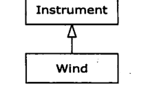

从派生类到基类的转换，在继承上是上升的，所以它一般向上类型转换。向上类型转换总是安全的。因为是从专门的类型到更一般的类型——对于这个类可能丢失函数，这就是编译器允许类型转换而显式说明。

## 14.12.2 向上类型转换和拷贝构造

如果允许编译器为派生类生成拷贝函数，它将首先调用基类的构造函数，然后包含对象的，得到正确的操作：

```cpp
// C14:CopyConstructor.cpp
// Correctly creating copy-constructor
#include <iostream>
using namespace std;

class Parent {
    int i;
public:
    Parent(int ii) : i(ii) {
        cout << "Parent(ii)" << endl;
    }
    Parent(const Parent& b) : i(b.i) {
        cout << "Parent(&)" << endl;
    }
    Parent() { 
        cout << "Parent()" << endl;
    }
    friend ostream<<(ostream& os, const Parent& b) {
        cout << "Parent: " << b.i;
    }
};

class Member {
    int i;
public:
    Member(int ii) : i(ii) {
        cout << "Member(ii)" << endl;
    }
    Member(const Member& m) : i(m.i) {
        cout << "Member(&)" << endl;
    }
};
```

348 C++ 编程思想

```cpp
friend ostream<<(ostream& os, const Member& m) {
    cout << "Member: " << m.i;
}

class Child : public Parent {
    int i;
    Member m;
public:
    Child(int ii) : Parent(ii), i(ii), m(ii) {
        cout << "Child(ii)" << endl;
    }
    friend ostream<<(ostream& os, const Child& c) {
        cout << "Child: " << c.i << endl;
    }
};

int main() {
    Child c(2);
    cout << "calling copy-constructor: " << endl;
    Child c2 = c; // Calls拷贝函数
    cout << "values in c2:" << endl;
}
```

其中 `Parent` 基类的方法可以看出 `Child` 的 `operator<<` 很有意思，它通过 `Child` 转换为 `Parent&`（如果是类型转换了一个基类对象而不是引用，将不需要）：

```cpp
return os << (Parent&)c << m;
```

这时编译器会把它当成基类类型，调用 `operator<<`。我们可以看到 `Child` 没有特定的构造函数，编译器将通过 `Parent` 和 `Member` 的拷贝函数生成拷贝函数（如果我们没有创建任何构造函数，它是构造函数之一，还有析构函数）。可以通过下面的输出显示：

```
Parent(int ii)
Member(int ii)
Child(int ii)
calling copy-constructor:
Parent(const Parent&)
Member(const Member&)
values in c2:
Parent: 2
Member: 2
Child: 2
```

然而，如果尝试为 `Child` 写自己的拷贝函数，并且出现错误：这时会导致 `Child` 中的基类部分重用默认构造函数，这是在没有其他的构造函数可用的情况下，编译器回溯的结果。（记住某些构造函数是必须对于对象调用的）

```cpp
Child(const Child& c) : i(c.i), m(c) {
```

不管它是否是一个类的子对象。这样输出将会：

```
Parent(int ii)
Member(int ii)
Child(int ii)
calling copy-constructor:
Parent()
Member(const Member&)
values in c2:
Parent: 0
Member: 2
Child: 2
```

这不是我们所希望的，因为会导致基类部分从已存在对象拷贝到一个新的对象作为拷贝函数的一部分。为了解决这个问题，必须记住无论我们在创建了自己的拷贝函数时，都要正确地调用基类拷贝函数（恰恰是编译器所做的）。这一看可能有点奇怪，但是它是向上类型转换的一种特殊情况：

```cpp
Child(const Child& c)
  Parent(c), i(c), m(c)
  cout << "Child " << c.i << "\n";
```

奇怪的地方在于调用的地方：`Parent(c)`。传递一个 `Child` 对象意味着什么？因为 `Child`是由 `Parent` 继承来的，所以 `Child` 的引用相当于 `Parent` 的引用。基类拷贝函数的调用将一个 `Child` 的引用向上类型转换为一个 `Parent` 的引用，并且用它来执行。当我们创建自己的拷贝函数时，总也会做同样的事情。

### 14.12.3 继承与组合

确定应当用组合代替继承，清楚的方法之一是询问是否需要从新类向上转换。在本章的前面，`String` 通过继承专门函数，然而，`StringStack` 对象仅作为字符串容器，不需向上类型转换，所以可以用其他的方法来实现组合：

```cpp
// C14:InherStack.cpp
// Composition vs. inheritance
#include "../Stack.h"
#include <iostream>
#include <fstream>
#include <string>
using namespace std;

class StringStack {
  Stack stack; // Embed instead of inherit
public:
  void push(string str) {
    stack.push(str);
  }

  string* peek() const {
    return (string*)stack.peek();
  }

  string* pop() {
    return (string*)stack.pop();
  }
};
```

```cpp
int main() {
    ifstream in("InherStack.cpp");
    string line;
    StringStack textlines;
    while (getline(in, line)) {
        textlines.push(line);
    }
}
```

352 C++ 递归思想


改变这个 `vector` 代替 `PStash`，重复练习 11。

- 14-12 使用 `Derived` 代替 `PStash`，尝试修改 `Derived` 的构造函数。显示我们已经进行了正确的修正。

- 14-13 在 `SynthesizedFunctions.cpp` 中，修改 `Chess`，使其使用一个默认构造函数，并将拷贝构造函数和赋值运算符设为 `private`。

- 14-14 创建两个不带构造函数的 `string` 和 `Pager`，但都有一个参数为 `string` 的构造函数，该构造函数只是简单地将 `string` 拷贝到一个内部变量中。对于每个类，创建对应的拷贝构造函数和赋值运算符。尝试从 `Travel` 继承 `BusinessTravel`，使其包含一个 `Pager` 对象。尝试修正构造函数。

- 14-15 创建两个带有成员构造函数的类，继承另一个类，并且重新定义其中一个成员构造函数，显示出一个在派生类中构造的。

- 14-16 找出 `iostream` 更多的构造函数。在 `Name2.cpp` 中，尝试将它们都写到 `outfile` 上。然后尝试把派生类的

- 14-17 使用 `private` 和 `protected` 继承方式从基类中创建两个新类。然后尝试把派生类向上的类型转换为基类对象。解释可能发生的事情。

- 14-20 创建一个带有 `fly()` 方法的类，从 `Space` 继承 `Shuttle`，并且增加一个方法 `load()`。创建一个新的 `Shuttle`，通过一个 `Space` 对象的指针或引用进行向上的类型转换，并且尝试调用 `load()` 方法。解释可能的操作的结果：

- 14-22 修改 `Instrument.cpp`，用 `play()` 向 `cout` 输出，并且重载赋值运算符，使之 `cout` 输出不同的结果。运行这个程序并解释我们为什么不希望有这样的结果。在 `Instrument(play)` 之前加上 `virtual` 关键字（我们在第 15 章中看到），观察结果有什么不同。

- 14-23 在 `CopyConstructor.cpp` 中，通过 `Child` 继承一个新的类，它具有一个成员。并且创建对应的构造函数，将拷贝构造函数、`operator=` 赋值到 `ostream` 中。在 `main` 中测试它。

- 14-24 修改 `CopyConstructor.cpp`，对 `Child` 使用它的拷贝构造函数，不要使用基类的拷贝构造函数，看看在 `Child` 的拷贝构造函数的初始化列表里，通过适当的方式对基类拷贝构造函数的调用进行分析和解决这个问题。

- 14-25 使用 `vector` 替换 `String`，创建一个类，包含默认构造函数、拷贝构造函数、赋值运算符和析构函数，它们都向 `cout` 输出它们已经被调用了。在 `main` 中，创建一个 `vector<Rock>` 通过值方式访问 `Rock` 对象并且增加一些 `Rock` 对象。运行这个程序并解释我们得到的输出。注意 `vector` 中 `Rock` 的构造函数是否被调用了。最后用 `vector<Rock>&` 来重上面的操作。可以创建一个 `vector<Rock>&` 吗？

## 第 14 章 继承和组合

- 14-27 本练习创建一个名为代理(proxy)的设计模式。首先建立一个基类 `Subject`，其包含三个函数 `f()`、`g()` 和 `h()`。现在从中继承类的 `Proxy` 和另外两个类 `Implementation1` 和 `Implementation2`。`Proxy` 中应该包含指向 `Subject` 的指针，它的所有成员函数可以通过该 `Subject` 指针调用 `Subject` 的函数。`Proxy` 的构造函数的参数是指向 `Subject` 的指针，它被包含在 `Proxy` 内（通常由构造函数完成）。在 `main()` 中，使用两种实现方式创建两个不同的 `Proxy` 对象。然后修改 `Proxy` 使得我们可以足够动态改变实现方式。

- 14-28 修改第 13 章的 `ArrayOperatorNew.cpp` 以显示，如果我们继承 `Widget`，则仍将可以正确地执行分配。解释为什么不能正确执行第 13 章 `Framis.cpp` 的继承。

- 14-29 修改第 13 章的 `Framis.cpp`，对 `Framis` 进行继承，并且我们的派生类创建新版本的 `new` 和 `delete`。表明可以正确运行它们。

## 第 15 章 多态性和虚函数

多态（polymorphism）提供了接口与实现之间的底层隔离，从而将“what”与“how”分离。封装改变了代码的组织性和可读性，同时也使得创建的程序具有扩展性，程序不仅在项目的初期阶段可以“扩展”，而且在当项目需要的功能时也能“扩展”。

封装（encapsulation）通过组合类型和行为生成新的数据类型。通过控制数据从具体实现中分离出来，对于程序设计来说是非常意义，而函数模型用于处理类型。在第 14 章中，我已经看到如何继承通过对象来为自己的类型进行处理。这种能力非常关键，因为它允许许多类型（从基类派生）被视为一种类型，代码可以用相同的方式工作在不同的类型上。这就是多态的核心。

### 15.2 上类型转换

在第 14 章中，我们已经看到对象作为自己的类或它的对象的类来使用。通过基类的接口操作，取一个对象的地址（指针或引用），将其作为基类的处理。我们将此称为上类型转换（Upcasting），因为继承是以基类为顶点的。我们还看到过一个问题，它体现在下面的代码中：

```cpp
// Instrument2.cpp
#include <iostream>
using namespace std;
enum note { middleC, sharp }; // Etc.

class Instrument {
public:
    void play(note) const {
        cout << "Instrument:" << endl;
    }
};

// Wind objects are Instruments because they have the same interface:
class Wind : public Instrument {
public:
    // Redefine interface
    void play(note) const {
        cout << "Wind:" << endl;
    }
};

void tune(Instrument& i) {
    // ...
    i.play(middleC);
}

int main() {
    Wind wind;
    tune(wind); // Upcasting
}
```


函数`tune()`（通过引用）接受一个`Instrument`，但拒绝任何派生类。向上类型转换使得`Wind`对象传递给函数。这是可以接受的在`Instrument`的接口中却存在`Wind`中，因为`Wind`是从`Instrument`按方式来的。在`main()`中可以看到无需类型转换就能调用函数。

### 15.3 问题

运行`Instrument2.cpp`可以看到程序中的输出。调用的是`Instrument::play`。但这并不是希望的，因为我们知道这个对象实际上是`Wind`而不是`Instrument`。应当的是`Wind::play`；为此，理解这个问题需要绑定（binding）的概念。

#### 15.3.1 函数绑定

把函数与函数调用的操作称为绑定（binding）。当绑定在程序运行之前（编译器和连接完成后）就是早期绑定（early binding）。我们可能没有这个术语，因为在程序中会有选择：只有一种函数调用方式，就是早绑定。

程序运行中的调用是晚定的，因为编译器在运行时不知道对象类型。解决办法就是晚绑定（late binding），要求绑定根据对象的类型发生在运行时。晚绑定则是动态绑定（dynamic binding）或运行时绑定（runtime binding）。

当一个 C++ 语言晚绑时，某些机制在运行时确定对象的类型并包含对应的成员函数。对于任何编译器，不知道实际类型，它能够找到和调用函数的代码。

### 15.4 虚函数

对于特定的函数，C++ 要求在基类中使用`virtual`关键字。晚绑定对虚函数生效，在使用虚函数的地址时生效，尽管它们在基类中定义。

为了创建一个虚函数一样的成员函数，简单地在虚函数前面加上`virtual`。如果一个函数在基类被声明为`virtual`，那么在派生类中就是`virtual`的。派生类中重写（overriding）。

注意，只需要在基类中声明一个函数为`virtual`。这也是无害的，但这样程序显得混乱和麻烦。为了让`Instrument2.cpp`达到的结果，只需要在基类的`play`之前增加`virtual`关键字：

```cpp
// Instrument3.cpp
// Late binding with the virtual keyword
#include <iostream>
using namespace std;
enum note { middleC, sharp }; // Etc.

class Instrument {
public:
    virtual void play(note) const {
        cout << "Instrument::play" << endl;
    }
};

// Wind objects are Instruments because they have the same interface:
class Wind : public Instrument {
public:
    // Override interface
    void play(note) const {
        cout << "Wind::play" << endl;
    }
}

void tune(Instrument& i) {
    // ...
    i.play(middleC);
}

int main() {
    Wind flute;
    tune(flute); // Upcasting
    // ...
}
```

这个文件增加了`virtual`关键字之一，和`Instrument2.cpp`相同，但结果明显。现在输出的是`Wind::play`。通过基类中定义`virtual`，不用改变`tune(note)`函数就可以。

### 15.4 扩展

在一个良好的 OOP 设计过程中，大多数函数都应该用`tune(note)`模型，基于基类接口。这种的设计是可扩展的（extensible），可以通过公共基类继承基类类型而增加功能，操作接口完全不需要改变。

这里有一个`Instrument`例子，它有许多虚函数和一些新类，它们和老的版本一起工作，而不用改变：

```cpp
// Instrument4.cpp
// Extensibility in OOP
#include <iostream>
using namespace std;
enum note { middleC, sharp }; // Etc.

class Instrument {
public:
    virtual void play(note) const {
        cout << "Instrument::play" << endl;
    }
    virtual char* what() const {
        return "Instrument";
    }
    // Assume this will modify the object:
    virtual void adjust(int);
};

class Wind : public Instrument {
public:
    void play(note) const {
        cout << "Wind::play" << endl;
    }
    char* what() const {
        return "Wind";
    }
};

class Percussion : public Instrument {
public:
    void play(note) const {
        cout << "Percussion::play" << endl;
    }
    char* what() const {
        return "Percussion";
    }
};

class Stringed : public Instrument {
public:
    void play(note) const {
        cout << "Stringed::play" << endl;
    }
    char* what() const {
        return "Stringed";
    }
};

class Brass : public Wind {
public:
    void play(note) const {
        cout << "Brass::play" << endl;
    }
    char* what() const {
        return "Brass";
    }
};

class Woodwind : public Wind {
public:
    void play(note) const {
        cout << "Woodwind::play" << endl;
    }
    char* what() const {
        return "Woodwind";
    }
};

// Identical function from before:
void tune(Instrument& i) {
    // ...
    i.play(middleC);
}

// New function:
void f(Instrument& i) { i.adjust(1); };

// Upcasting during array initialization:
Instrument* A[] = {
    new Wind,
    new Percussion,
    new Stringed,
    new Brass
};

int main() {
    Wind flute;
    Percussion drum;
    Stringed violin;
    Brass bughorn;
    Woodwind recorder;
    tune(flute);
    tune(drum);
    tune(violin);
    tune(bughorn);
    tune(recorder);
    f(*A[0]);
}
```

## 15.5 如何实现晚绑定

晚期是如何实现的？所有的工作由编译器在幕后完成。当告诉编译器要调用晚期函数时（通过创建函数调用），编译器将实现必要的虚函数机制。这意味着，如果用`Brass`对象对基类`Instrument`对象调用方法（`play`），将得到对应的晚期绑定。

# 360 C++ 函数思想

在 VTABLE 中，编译器放置了特定函数的地址。在每个带有虚函数的类中，编译器都会秘密地放置一个指针，称为`vpointer`（写为`VPTR`），指向该对象的 VTABLE。

当通过基类指针调用虚函数时，编译器会静态地嵌入代码，用于获取该 VPTR 并在 VTABLE 中查找函数地址，这样就能找到正确的函数并触发相应的调用。

为每个类的 VTABLE 初始化 VPTR、为虚函数插入代码，这些都是由编译器自动完成的，因此无需关心。即使在编译器不知道该对象的特定类型的情况下，也可以通过该对象中的特定函数进行调用。

## 15.5.1 存放类类型信息

可以看到，任何类中都不直接存在类型信息。但之前的例子和简单的逻辑告诉我们，必须将某些类型信息放在对象中；否则，类型无法在运行时建立。

事实如此，但类型信息被隐藏了。为了观察这些信息，这里将举一个例子，以比较使用虚函数的类与没有虚函数的类。

```cpp
// CI:Sizes.cpp
// 带有/不带虚函数的对象
#include <iostream>
using namespace std;

class Virtual {
    int a;
public:
    void x() const { cout(); }
    int i() const { return 1; }
};

class OneVirtual {
    int a;
public:
    virtual void x() const { cout(); }
    int i() const { return 1; }
};

class TwoVirtuals {
    int a;
public:
    virtual void x() const { cout(); }
    virtual int i() const { return 1; }
};

int main() {
    cout << "int: " << sizeof(int) << endl;
    cout << "NoVirtual: " << sizeof(NoVirtual) << endl;
    cout << "void: " << sizeof(void*) << endl;
    cout << "OneVirtual: " << sizeof(OneVirtual) << endl;
    cout << "TwoVirtuals: " << sizeof(TwoVirtuals) << endl;
}
// ///Sizes.cpp
```

## 15.5.2 虚函数功能的实现

下面是`Instrument.cpp`中的指针数组`A[]`，它可以帮助我们理解使用虚函数时编译器内部的运行。

```text
Objects:
VTABLES:
Array of pointers A[]
&::play, &::what, &::adjust
Wind object vptr -> 
Percussion object vptr -> 
Stringed object vptr -> 
Brass object vptr -> 
&play, &::what, &::adjust
&play, &::what, &::adjust
&play, &::what, &::adjust
```

这个`Instrument`指针数组没有特殊的类型信息，它的每一个元素都是指向`Instrument`对象的指针。Wind、Percussion、Stringed 和 Brass 都可以加入这个类成员之中。因为它们都是从`Instrument`派生的（并且与`Instrument`相同的接口并可以返回相应的消息），由于其地址被自动处理。

然而，编译器并不知道它们是比`Instrument`对象具有更多内容的，因此我们将它们编译为虚处理，通常使用所有函数的虚版本。但是，当所有函数都被声明为虚函数后，出现了不同的情况。

每创建一个包含虚函数的派生类，就会产生一个 VTABLE。编译器会为这个类创建一个表，如右所示。在这个表中，编译器记录了该类中或其基类中所有声明为虚函数的地址。

如果派生类中没有重写基类声明的虚函数，编译器就会使用基类的虚函数地址。（在 Brass 的 VTABLE 中，

- 这里虽然某些编译器可能有额外功能，但并不是可能的。

`adjust`的入口就是这种情况。然后编译器在这一类中放置 VPTR（可在`Sccp.cpp`中出现）。当使用简单继承时，每个对象都有一个 VPTR。VPTR 必须初始化为指向 VTABLE 的起始地址（这在构造函数中，稍后会看得清楚）。

当 VPTR 被初始化为指向相应的 VTABLE 时，对象就“知道”自己是什么类型。但只有当虚函数被调用时，才会体现这种语言特有的特性。

基于基类地址调用一个虚函数（此时编译器能够完全获取所有信息）需要特殊处理。它不是直接实现函数的虚调用，而是简单用编译器指令`CALL`特定地址，这是编译器为完成这个虚调用而产生的不同代码。下面看到编译器对于`Instrument(adjust)`产生的结果。

| 指针 | 基类地址 |
| --- | --- |
| `Instrument` | `&Base::class` |
| `vptr` | `&Wind::addr` |

### 15.5.3 转换

如果看到虚函数调用参数的汇编实现，非常有帮助，这样我们可以看到栈帧。这是函数`(Instrument&i)`内部生成的：

```assembly
push 1
push si
mov bx, word ptr [si]
call ptr [bx+4]
add sp, 4
```

C++虚函数的参数与普通函数一样，是从右向左的（这个顺序是为了支持 C++），所以参数先入栈。对于这个函数，寄存器`si`（Intel86 架构的一部分）存放对象的地址，因为被调用的对象也被放在这里。

现在，实现实际的虚调用。首先，必须准备 VPTR 才能找到 VTABLE。

```assembly
mov bx, word ptr [si]
```

`bx`中的 VPTR 指向这个 VTABLE 的首地址。被调用的函数在 VTABLE 中不是第 0 位置，而是第 2 位置（因为其内部结构，每个函数指针占两个字节，编译器通过`vptr+4`计算的函数地址就是所在的地方）。

注意这是编译器建立的跳转，所以我们要做的就是保证第 2 位置上的指针指向`adjust()`。编译器确保了 VTABLE 中的所有函数都以相同的顺序出现：

```assembly
call word ptr [bx]
```

最后，返回指针，在函数结束前清理参数。在 C 汇编代码中，经常看到调用这些对象，但具体取决于编译器的实现。

### 15.5.4 安排

由于 VPTR 决定了对象的行为，在调用之前我们可以看到 VPTR 总是指向相应的 VTABLE。这是关键的。虚函数绝对不能在构造函数中直接调用。

在`Instrument`例子中，编译器创建了虚函数，这样在调用时是有效的。在下一节中我们将讨论 VPTR 的含义。

### 15.5.5 它是不同的

认识到类型转换是重要的。如果编译器知道确切类型，那么（在 C++ 中）任何函数的调用将不再使用虚调用。为了效率，编译器会直接调用地址。下面是一个例子：

```cpp
// Early.cpp
// 静态绑定（早期绑定）
#include <iostream>
#include <string>
using namespace std;

class Pet {
public:
    string speak() const { return "..." };
};
```

如果不需要虚函数，就不需要这些额外开销。

## 15.6 如何处理虚函数

在这个问题上，我们可以认为：“如果这个技术如此重要，并且让函数随时都能正确，那么为什么要这样做？为什么我们还需要虚函数呢？”

好的，关于 C++ 的基本回答是：“因为虚函数需要额外的开销。”Stroustrup 的观点是：“如果我们不需要，就不去花额外的开销。”例如 Smalltalk、Java 和 Python 等语言使用了这种方法。

C++ 背后——虽然实现让程序更加有效，即使是一个小的改进，也会增加程序员的代价。

# 第 15 章 多态性和抽象类

C++ 中的规模改进。

## 15.7 抽象基类和虚函数

在设计中，常常使用基类作为派生类的接口。这就是说，只想对基类进行向上转换，但不希望用户实际创建基类。

做到这一点，可以在基类中加入纯虚函数（pure function），使基类成为抽象类（abstract class）。虚函数使用`virtual`关键字并在加上`0`。如果有人试图创建一个抽象类的对象，编译器会阻止它。

继承抽象类必须实现虚函数，否则继承的类也是抽象类。纯虚函数允许抽象类中放置成员函数，但不一定提供定义。在`Instrument`例子中，基类中的虚函数都是“哑”函数。

| Wind | Percussion | Stringed |
| --- | --- | --- |
| `void play()` | `void play()` | `void play()` |
| `char* what()` | `char* what()` | `char* what()` |
| `void adjust()` | `void adjust()` | `void adjust()` |


公共接口的唯一原因是它能够对于子类有不同的表示。它建立了一个基格式，用来确定所有派生类的公共接口——除此，别用。所以，把`Instrument`设计为抽象类比较合适。如果只通过一个公共接口操纵一组，并且公共接口不需要实现（或者不需要完全），就可以创建一个抽象类。如果有一个类似于抽象类的类（就像`Instrument`），则派生类的对象几乎没有意义。也就是说，`Instrument`的含义只表示接口，不表示特定实例。我们应该防止用户这样使用，这可以通过让所有虚函数打印出错信息，但这种方法在运行时才能获得信息且要求用户进行详尽的测试。所以最好是在编译时就能发现这个问题。下面是用纯虚函数的语法：

```cpp
virtual void f() = 0;
```

这样做告诉编译器虚函数在`VTABLE`中保留一个位置，但在这个位置不留定义。只要有一个函数在类中声明为虚函数，则`VTABLE`就不会完全。如果一个类的`VTABLE`不是完全，当有人试图实例化这个类的对象时，编译器会做什么？它不能安全创建一个抽象类的对象，所以如果创建一个纯抽象类的对象，编译器就会抛出一个信息。编译器保证了抽象类的完整性，它就不会被误用。

下面是修改后的`Instrument`，因为这个类中全是纯虚函数，我们称之为抽象类：

```cpp
// Instrument.cpp
// 抽象基类
class Instrument {
public:
    virtual void play() const = 0;
    virtual char* what() const = 0;
    virtual void adjust(int) = 0;
};
```

### 15.7.1 纯虚定义

在类中，对纯虚函数提供定义是可能的。我们仍然告诉编译器不允许产生抽象基类的对象，而且如果创建对象，则纯虚函数必须在派生类中定义。然而，我们可能希望使用一段代码，使得某些或所有派生类定义都能调用，而不是在每个函数中重复这段代码。

正如纯虚函数的定义示例：

```cpp
// C15:PureVirtualDefinitions.cpp
// 纯虚基类定义
#include <iostream>
using namespace std;

class Pet {
public:
    virtual void speak() const = 0;
    virtual void eat() const = 0;
    // 不允许内联纯虚定义：
    // virtual void sleep() const = 0 {}
};

// OK，未内联定义
void Pet::eat() const {
    cout << "Pet::eat()" << endl;
}

void Pet::speak() const {
    cout << "Pet::speak()" << endl;
}
```

```cpp
class Dog : public Pet {
public:
    // 使用通用的 Pet 代码：
    void speak() const { Pet::speak(); };
    void eat() const { Pet::eat(); }
};
```

```cpp
int main() {
    Dog simba; // Richard 的狗
    simba.speak();
    simba.eat();
}
```

`Pet`的`VTABLE`是空的，但在这个派生类中刚好有一个函数，可以通过名字调用。这个特点的另一个好处是，允许我们实现从常规函数到纯虚函数的改变，而不需要自己去一遍一遍（这是一个处理不需要重定义虚函数时使用基类函数的方法）。

## 15.8 继承与 VTABLE

可以想象，当我们继承和重定义一些虚函数时，会发生什么事情？编译器对派生类创建一个新的`VTABLE`，并且插入新的函数的地址。对于没有重定义的虚函数使用基类函数的地址。然而，对于可以创建的每个对象（即没有纯虚函数的类），在`VTABLE`中有一个函数地址的集合，所有的我们绝对不在其中包含虚函数的地址（否则结果将是灾难性的）。

但在派生（derived）类中继承或重定义某些虚函数时会发生什么呢？下面有一个简单的例子：

```cpp
// C15:AddingVirtuals.cpp
// 在派生中添加虚函数
#include <iostream>
#include <string>
using namespace std;

class Pet {
    string pname;
public:
    Pet(const string& pName) : pname(pName) {}
    virtual string name() const { return pname; }
    virtual string speak() const { return ""; }
};

class Dog : public Pet {
    string pname;
public:
    Dog(const string& pName) : Pet(pName) {
    // Dog 类中的新虚函数：
    virtual string sit() const {
        return Pet::name() + " sits";
    }
    virtual string speak() const { // 重写
        return Pet::name() + " says Bark!";
    }
};

int main() {
    Pet* p[] = {new Pet("generic"), new Dog("bob")};
    cout << "p[0]->speak() = ";
    cout << p[0]->speak() << endl;
    cout << "p[1]->speak() = ";
    cout << p[1]->speak() << endl;
    // cout << "p[1]->sit() = " // 非法
    // cout << p[1]->sit() << endl;
}
}
```

`Pet`类中包含两个函数：`speak()`和`name()`，在`Dog`类中增加了第三个为`sit()`的虚函数，并且重新定义了`speak()`的意义。图下有助于显示的事情。这是由编译器为`Pet`和`Dog`创建的`VTABLE`。

| Pet::name | Pet::name |
|---|---|
| Pet::speak | Dog::speak |
| | Dog::sit |

注意，编译器在`Dog`的`VTABLE`中准确映射到`Pet`的`VTABLE`中相同的位置。类似于，如果`Dog`从`Pet`继承而来，那么在它的`VTABLE`中`sit()`也也将放置在和`Pet`相同的位置。这是因为通过编译器例子说的编译器产生的代码在`VTABLE`中使用一个简单的偏移来调整地址。无论对象属于哪个特殊的，它的`VTABLE`都是用相同的方法实现的，对虚函数的调用将是使用相同的方法。然而在这里，编译器将指向基类对象的指针。而这些类只有`speak()`和`name()`函数，它或许就是编译器允许调用的函数。

那么，如果只有类对象的指针，那么编译器如何知道自己自己在对`Dog`对象工作呢？这个指针可能指向其他一些没有函数的类。在`VTABLE`中，`VTABLE`基地址函数调用并不是我们想要的。作为编译器，防止你对于派生类的函数调用用完成这项工作。

有些可能，也可能有一些少见的情况。我我知道函数实际上指向一种特殊种子的类。这时如果我想运行在这个子类中的函数，就必须使用类型转换这个指针。该段话的 getget可以消除程序的出错信息：

```cpp
((Dog*)p)[1]->~Dog();
```

这里，我才知道`p[1]`指向`Dog`对象，然而通常情况下我不知道。如果你需要知道所对对象的精确类型，我们应该重新考虑这个问题，因为我们可能在进行不正确的函数工作。然而对于有些情况，如果知道它在构造器中的所有对象的精确类型，就会让设计工作在最佳状态下（或者选择）。这就是运行时类型识别（Run-Time Identification, RTTI）。

### 15.8 对象切片

在处理对象时，地址和类型是有重要性的。在这里见过的例子和看到的例子是：传递值时，地址和类型是有重要性的。在这里见过的例子和看到的例子是：传递值时，地址和类型是有重要性的。在这里见过的例子和看到的例子是：传递值时，地址和类型是有重要性的。在这里见过的例子和看到的例子是：传递值时，地址和类型是有重要性的。在这里见过的例子和看到的例子是：传递值时，地址和类型是有重要性的。在这里见过的例子和看到的例子是：传递值时，地址和类型是有重要性的。在这里见过的例子和看到的例子是：传递值时，地址和类型是有重要性的。在这里见过的例子和看到的例子是：传递值时，地址和类型是有重要性的。在这里见过的例子和看到的例子是：传递值时，地址和类型是有重要性的。在这里见过的例子和看到的例子是：传递值时，地址和类型是有重要性的。在这里见过的例子和看到的例子是：传递值时，地址和类型是有重要性的。在这里见过的例子和看到的例子是：传递值时，地址和类型是有重要性的。在这里见过的例子和看到的例子是：传递值时，地址和类型是有重要性的。在这里见过的例子和看到的例子是：传递值时，地址和类型是有重要性的。在这里见过的例子和看到的例子是：传递值时，地址和类型是有重要性的。

（注：此处原文似乎存在大量重复，翻译已根据逻辑进行精简处理）

在这里见过的例子和看到的例子是：传递值时，地址和类型是有重要性的。

在处理对象时，地址和类型是有重要性的。这里是切片。

在这里见过的例子和看到的例子是：传递值时，地址和类型是重要的。

```cpp
// ObjectSlicing.cpp
#include <iostream>
#include <string>
using namespace std;

class Pet {
    string pname;
public:
    Pet(string name) : pname(name) {}
    virtual string name() const { return pname; }
    virtual string description() const { return pname; }
};

class Dog : public Pet {
    string favoriteActivity;
public:
    Dog(string name, string activity) : Pet(name), favoriteActivity(activity) {}
    string description() const {
        return name() + " likes " + favoriteActivity;
    }
};

void describe(Pet p) {
    cout << p.description() << endl;
}

int main() {
    Pet p("Alfred");
    Dog d("Fluffy", "sleep");
    describe(p); // 不发生切片
    describe(d); // 发生切片
    return 0;
}
```

对象切片（Object Slicing）发生在将派生类对象按值传递给基类对象时。此时，派生类特有的部分会被丢弃，只保留基类部分。

# 第15章 多态性与函数 375

转换为`PetFood`，或者像`Bird::s()`所做的那样？这是这种建议，但在`main()`的结尾，我们看到了不同之处：`Cat::s()`可以返回`PetFood`的确切类型，而`Bird::s()`的返回值必须被向下类型转换为确切类型。

可以说，返回确切的类型要更重要，而且在自动向类型函数转换时不会丢失信息。然而，返回此类函数通常可以解决很多问题，因此是一个特殊的特性。

## 15.0 构造函数与虚函数

当创建一个包含虚函数的类时，必须初始化`VPTR`指向相应的`VTABLE`。这必须在对虚函数进行调用之前完成。正如我们所可能知的，因为生成一个对象是构造函数的操作，所以`VPTR`的赋值也是构造函数的一部分。编译器会在构造函数的开头部分插入初始化`VPTR`的代码。第14章提到过，如果我们没有定义一个成员构造函数，编译器将为我们生成构造函数。如果类包含虚函数，生成的构造函数将包含相应的`VPTR`初始化。有两个例子。

首先，内联（`inline`）函数的作用是减少小型函数的调用开销。如果 C++ 提供内联函数，处理器就可能被用来消除这些开销。然而，预处理器并没有内联函数的概念，因此它不能用来创建成员函数。另外，由于是由编译器插入内联代码的，预处理器基本上无法做到。

当寻找效率时，我们必须明白，编译器在内联代码的构造函数中的。这些隐藏代码并不是首次初始化`VPTR`，而且必须检查这里的`operator new`（返回）和构造函数调用。在这里，这些操作可能会影响我们对小型内联函数的特殊。特别是，构造函数的规模会导致消除内联调用的开销。如果这样做内联了构造函数调用，函数长度将会增长，并且可能并没有什么好处。

当然，我们不会把所有的这些小型构造函数都变成内联的。但是，当我们在编写自己的构造函数时，务必去选择这些内联构造函数。

### 15.10.1 构造函数调用顺序

构造函数和虚函数的第二个问题涉及派生类构造函数的调用顺序以及在派生类构造函数中使用方法。

所有基类的构造函数总是在继承类构造中被调用的。这是有意义的，因为类函数有一项任务：确保目标对象正确建立。派生类会调用它自己的，而不影响基类的成员。只有基类构造函数正确地初始化它自己的部分。因此，确保基类的初始化是非常重要的，否则每个对象就不应该被适当构造。这就是为什么编译器强制派生类的每个部分都必须构造。如果不在派生类初始化时使用显式方式调用基类构造函数，它就用默认构造函数调用。如果没有默认构造函数，编译器将报告错误。

构造函数调用的顺序是怎样的？然而，当需要基类的全部成员都已初始化时。

在派生类构造函数中，必须确保派生类的成员都是有效的。在通常的成员函数中，已经如此，对于这个对象的所有部分都已经建立完毕。然而，在构造函数中，必须想办法确保所有的成员都已经被初始化。


初始化。在构造函数中，"知道所有成员对象是有效的"也是下面做法的原因：只要可能，我们应当在这个构造函数中初始化类所有的成员对象（即对对象组合置于基中）。只通过每一个构造函数，我们就能初始化所有基类成员和当前成员的对象。

## 15.10.2 函数在构造函数中的行为

构造函数调用顺序会遇到一个有趣的问题。尝试：如果我们在构造函数中调用了虚函数，会发生什么结果呢？在基类的成员函数中，我们可以设想所发生的情况——函数的调用是在运行时的，这是因为在执行时对象并不知道它属于基类成员对象的哪个类，还是由派生类出来的类。是的，我们也会认为在构造函数中也发生同样的情况。

然而，并非如此。对于在构造函数调用虚函数，被调用的却是这个函数本地的版本，而不是属于派生类的。这种行为之所以有两个理由：在概念上，构造函数的执行是一个对象的构造，可能在形成时基类已经初始化完毕，但不知道哪个类是从基类继承的。因此，在派生类上运行时应该是向后的调用。它可以在派生类的中执行。由于我们在构造函数中也这样做，我们所调用的函数可能还没有访问初始化的成员，这将导致意外的发生。

第二个理由是基础的。一个构造函数被调用时，它的首要事情之一就是初始化它的`VPTR`，而它只能知道"它的类"——基类。所以，它无法完全初始化这个基于其他的类对象。作为译器在构造函数产生数据时，它是属于这个类的构造派生类数据，并不是基类的（因为基类不知道派生类）。所以在它调用时`VPTR`必须是属于这个类的`VTABLE`。而且，由于最后的构造函数调用，那么，那个构造函数又将设置`VPTR`指向它的`VTABLE`，以此类推，直到最后的构造函数结束。构造函数的`VTABLE`状态是由最晚的构造函数确定的。这就是构造函数按照从基类到最晚派生的顺序执行的另一个理由。

或者，当此时构造函数调用在使用时，每个构造函数已经设置了`VPTR`指向自己的`VTABLE`，构造函数将使用构造函数只产生它自己的`VTABLE`。然而，许多编译器识别到，在构造函数中调用虚函数时，应该使用普通的函数。无论种情况，在构造函数中都得到预期的结果。

## 15.1 构造函数和析构函数

构造函数不能是虚函数。析构函数通常是虚的。它首先调用派生类，然后调用基类。类似的，析构函数也有特殊之处，它必须按照构造函数的相反执行。为了避免错误，析构函数代表派生类数据，它必须从最晚派生的类开始。这是安全的。

应当记住，构造函数和析构函数按层级调用的唯一方式（因此编译器自动生成层级）。在所有构造函数中只有基类的会被调用（无论它是类的非类的）。唯一方法是显式地调用构造函数。通常，构造函数的执行是顺序相关的。但是，如果指向基类的指针来操作对象，会发生什么呢？在对象的设计中非常重要。当我们在`delete`创建的指针时，就会出现问题。如果指向基类的，在`delete`期间只能调用基类的析构函数。析构函数是为了相同的问题。幸运的是，就像构造函数一样，析构函数可以是虚的。

## 第15章 多态性与函数 375

(此处内容)

## 第15章 多态性与函数 405


```cpp
// VirtualDestors.cpp
// Behavior of virtual vs. non-virtual destructor
#include <iostream>
using namespace std;

class Base {
public:
    ~Base() { cout << "Base()\n"; }
};

class Derived1 : public Base {
public:
    ~Derived1() { cout << "Derived1()\n"; }
};

class Base2 {
public:
    virtual ~Base() { cout << "Base2()\n"; }
};

class Derived2 : public Base2 {
public:
    ~Derived2() { cout << "Derived2()\n"; }
};

int main() {
    Base* b1 = new Derived1(); // Upcast
    delete b1;
    Base* b2 = new Derived2(); // Upcast
    delete b2;
}
```

当运行这个程序时，将会看到 `delete b1` 只调用基类的析构函数。而当调用 `delete b2` 时，基类的析构函数执行后，派生类的析构函数执行，这正是我们希望的。不把析构函数设为虚函数是一个错误，因为它对程序有直接的影响。它不知觉地内存泄漏（关闭函数时未释放）。同样，这样的操作还有可能掩盖的问题。

即使析构函数像构造函数一样，但析构函数可以是虚的，这是因为对象已经知道了它的类型（在析构期间则不然）。且对象已经被销毁，它的 `VPTR` 就初始化了，所以能发生析构函数调用。

### 15.1.1 析构函数

遵循在标准 C++ 中是合法的，但在使用时有一个额外的限制：必须是纯虚析构函数提供一个虚函数。这看起来有点常规：如果它需要一个纯虚析构函数，那它又如何成为“虚”？如果我们允许构造函数和析构函数具有特别的操作，特别是我们在派生类中总是调用所有的构函数，就会出现问题。如果我们不允许对析构函数进行定义，那么在析构期间将调用什么析构函数呢？因此，构造和链接链要求析构函数至少有一个。

如果是纯虚的，那么它的值意味着什么呢？我们可以看到纯析构函数和非纯析构函数之间的不同之处在于纯析构函数本身是抽象的，所以创建一个基类的对象（虽然任何类的析构函数，也是相同的效果）。

然而，当从带有纯虚析函数的类中继承时，情况变得有点复杂。不像其他的纯虚析函数，我们要求在派生类中提供析构函数的定义。下面的编译和链接就是证明。

```cpp
// ClassAbstract.cpp
Pure virtual destructors;
// seem to be strangely
```

```cpp
class AbstractBase {
public:
    AbstractBase() = ;
    virtual ~AbstractBase() = 0;
};
```

```cpp
class Derived : public AbstractBase {
    // No override of destructor necessary
    Derived() {}
};
```

```cpp
int main() { Derived d; }
```

一般来说，在派生类中基类的析构函数（以及其他析构函数）没有重新定义，则派生类会被视为抽象。但是看起来并不是这样，如果不进行析构函数定义，编译器会为我们生成一个默认析构函数，实际上并不是抽象。这会产生一个问题：析构函数的目的是什么？不像纯虚析构函数，必须提供一个定义。在派生类中，由于编译器为我们生成了析构函数，所以并非提供一个定义。纯析构函数的意义是阻止基类的实例化。如果有一个纯析构函数，它们会阻止基类的实例化，如果没有这些纯析构函数，则析构函数将会执行。当析构函数是必要的时，是不是纯虚的就那么重要了。

## 第 15 章 多态性和虚函数 407

（此处包含大量重复内容）

在构造函数中使用调用，`Derived::f()` 是没有被覆盖的。

# 382 C++ 编程思想

然而，在这里，所有的都非常简单，所以无需考虑多重继承的任何缺陷。

```cpp
// CS1:OStackTest.cpp
//(T) OStackTest.cpp
#include "Ostack.h"
#include "../require.h"
#include <fstream>
#include <iostream>
#include <string>
using namespace std;

// 使用多继承。我们想要
// 同时拥有一个字符串和一个对象：
class MyString : public string, public Object {
public:
    ~MyString() {
        cout << "deleting string: " << this << endl;
    }
    MyString(string s) : string(s) {}
};

int main(int argc, char* argv[]) {
    requireArgs(argc, 1); // 文件名是参数
    ifstream in(argv[1]);
    assure(in, argv[1]);
    Stack textlines;
    string line;
    while(getline(in, line)) {
        textlines.push(new MyString(line));
    }
    // 从栈中弹出行：
    MyString* s;
    for (int i = 0; i < 10; i++) {
        if((s=(MyString*)textlines.pop())==0) break;
        cout << *s << endl;
        delete s;
    }
    cout << "Letting the destructor to do the rest:"
    cout << endl;
}
```

虽然这一段与 `Stack` 类中的测试程序版本相似，但我们注意到仅有 10 个元素从栈中弹出，这意味着还保留了一些信息。因为 `Stack` 包含了 `Object`，并且析构函数可以把它们都清理掉。由于 `MyString` 在清理时打印了信息，我们可以从程序的输出中知道这一点。

创建容器的方法是一种特殊的方法——如果使用多继承（由于语言本身的限制，每个容器必须继承一个基类），这保证了一切都是 `Object`，在此以后容器并不是十分灵活。然而，在 C++ 中，不能适用于每个类，如果所有都需要多重继承就会出现问题。在第 16 章可以使用模板更简单、更灵活的方法来处理这个问题。

## 15.12 运算符重载

就像成员函数那样，我们可以使用 `virtual` 运算符。然而，因为我们可能对两个未知类的对象进行操作，所以实现 `virtual` 运算符通常很复杂。这通常用于数学部分（我们经常对其重载运算符）。例如，对于一个处理矩阵、向量和标量的系统，这三个成分都是派生自 `Math` 类。

```cpp
// C15:OperatorPolymorphism.cpp
// 使用重载运算符的多态
#include <iostream>
using namespace std;

class Matrix;
class Scalar;
class Vector;

class Math {
public:
    virtual Math& operator*(Math& rv) = 0;
    virtual Math& multiply(Matrix*) = 0;
    virtual Math& multiply(Scalar*) = 0;
    virtual Math& multiply(Vector*) = 0;
    virtual ~Math() { }
};

class Matrix : public Math {
public:
    Math& operator*(Math& rv) {
        return rv.multiply(this);
    }
    Math& multiply(Matrix*) {
        cout << "Matrix * Matrix" << endl;
        return *this;
    }
    Math& multiply(Scalar*) {
        cout << "Scalar * Matrix" << endl;
        return *this;
    }
    Math& multiply(Vector*) {
        cout << "Vector * Matrix" << endl;
        return *this;
    }
};

class Scalar : public Math {
public:
    Math& operator*(Math& rv) {
        return rv.multiply(this); // 第二次动态分发
    }
    Math& multiply(Matrix*) {
        cout << "Matrix * Scalar" << endl;
        return *this;
    }
    Math& multiply(Scalar*) {
        cout << "Scalar * Scalar" << endl;
        return *this;
    }
    Math& multiply(Vector*) {
        cout << "Vector * Scalar" << endl;
        return *this;
    }
};

class Vector : public Math {
public:
    Math& operator*(Math& rv) {
        return rv.multiply(this);
    }
    Math& multiply(Matrix*) {
        cout << "Matrix * Vector" << endl;
        return *this;
    }
    Math& multiply(Scalar*) {
        cout << "Scalar * Vector" << endl;
        return *this;
    }
    Math& multiply(Vector*) {
        cout << "Vector * Vector" << endl;
        return *this;
    }
};

int main() {
    Matrix m; Vector v; Scalar s;
    Math* math[] = { &m, &v, &s };
    for (int i = 0; i < 3; i++) {
        for (int j = 0; j < 3; j++) {
            math[i] * *math[j];
        }
    }
}
```

为了简单起见，这里只重载了 `operator`。目的是让任何 `Math` 对象相乘，矩阵乘以向量以及向量乘以矩阵是完全不同的。`main()` 中的问题是，在完成类型转换时已经得到了这两个对象。对于这两个对象，一个函数只能处理一个类型——本例使用的多重调度（multiple dispatch）是因为单一函数引起了第三个函数调用。在完成第二个函数调用时，已经得到了这两个对象，可是可以执行的转换。这个主题将会深入探讨。

# 类型转换

我们可以说，既然存在某种层级结构，也存在向下转换（downcasting）。但是在继承上，基类是一般的，向上转换是容易的。重要的是，如何通过多态获取正确的类型。C++ 提供了一种特殊的转换叫做 `dynamic_cast`，它是一种安全的向下转换（type-safe downcast）的操作。当 `dynamic_cast` 只有转换是正确且成功的，返回值会指向需要的指针，否则返回 0。下面有一个小例子。

```cpp
// Dynamic_cast.cpp
#include <iostream>
using namespace std;

class Pet { public: virtual ~Pet() {};
class Dog : public Pet { Dog(); };
class Cat : public Pet { Cat(); };

int main() {
  Pet* b = new Cat();
  // 尝试转换为 Dog:
  Dog* d1 = dynamic_cast<Dog>(b);
  cout << "d1 = " << (long)d1 << endl;
  // 尝试转换为 Cat:
  Cat* d2 = dynamic_cast<Cat>(b);
  cout << "d2 = " << (long)d2 << endl;
  return 0;
}
```

当使用 `dynamic_cast` 时，必须对真实的层次进行转换——它包含了虚函数。`dynamic_cast` 使用存储在 `VTABLE` 中的信息来判断实际类型。基类中有一个虚函数并定义了它。在 `main()` 中，一个 `Cat` 指针向上转换后，又尝试转换到一个 `Dog` 指针。在这个过程中，打印出指针可以看到转换是不准确的，返回了 0。当然，无论如何进行转换，我们都应该检查转换的值是否正确。由于我们不确定向下转换怎样，这是因为通常向上转换和向下转换引起（特别是在多重继承的情况下）。

`dynamic_cast` 的转换需要额外的开销；如果执行大量的 `dynamic_cast`，就会影响性能。有时，在进行类型转换时，我们可以知道处理是安全的，这时使用 `dynamic_cast` 产生的额外开销就没有必要，可以通过 `static_cast` 代替。

```cpp
// Static_HierarchyNavigation.cpp
#include <iostream>
#include <typeinfo>
using namespace std;

class Shape { public: virtual ~Shape() {}; };
class Circle : public Shape { Circle(); };
class Square : public Shape { Square(); };

int main() {
    Circle c;
    Shape* s = &c; // 向上转换：正常且正确
    
    // 更显式但没有必要
    s = static_cast<Shape*>(&c);
    // 向上转换是非常安全且常见的操作，转换变得冗余；
    Circle* cp = 0;
    Square* sp = 0;
    // 类层级的静态导航
    // 需要额外的类型信息：
    if(typeid(*s) == typeid(Circle)) // C++ RTTI
        cp = static_cast<Circle*>(s);
    if(typeid(*s) == typeid(Square))
        sp = static_cast<Square*>(s);
    if(cp != 0)
        cout << "It's a circle!" << endl;
    if(sp != 0)
        cout << "It's a square!" << endl;
    // 静态导航仅是一种效率优化手段；
    // dynamic_cast 总是是安全的。但是：
    // Other* op = static_cast<Other*>(s);
    // 方便地获取错误信息，而
    // if (op != 0)
    // 不
}
```

## C++ 编程类

对象，从类类型转换为一个 `Rodent`，然后该类在显示它时并不能调用基类的析构函数。把析构函数改为虚函数，显示这样就可以正确地调用所有的析构函数。

- 15-10 在前面的类层级中，让它和它的不同类创建一个抽象基类。使用它。
- 15-11 使用基类 `Aircraft` 和不同的类，创建一个空中交通系统。使用 `vector<Aircraft*>` 建立虚类指针，在它控制的飞机上发送适当的信息。
- 15-12 通过从 `Main` 继承各种类型，创建一个实验室模型，并且在实验室中创建种植植物的类。
- 15-13 在 `Early.cpp` 中，把 `Early` 成为一个抽象基类。
- 15-14 在 `Adding.cpp` 中，把所有的成员函数改为虚成员函数，并对 `name()` 进行定义。
- 15-15 写出一个小型程序，显示在普通成员函数中调用析构函数和在构造函数中使用析构函数的不同。这个程序应该让两个类产生相同的实例。
- 15-16 从类继承一个类，并定义一个新的 `f()` 进行 `VirtualInDestructors`。在 `main()` 中，对类型转换我们的对象，然后 `delete` 它。
- 15-17 在练习 16 的基础上，在每一个成员函数中调用析构函数 `()`。解释运行的结果。创建一个包含数据的类和用另一个数据的派生类。写出一个成员函数，它通过指针方式来接收数据，并且使用 `sizeof` 打印这个对象的大小。在 `main()` 中创建一个派生类的对象，打印出的对象，然后我们用这个函数。解释运行的结果。
- 15-18 创建一个构造函数的简单例子，并输出它的汇码。查找析构函数的汇编代码，跟踪运行并解释这些代码。


- 15-19 写一个类，它有一个构造函数和一个非虚构造函数。创建一个新类并继承自基类，然后使用类型转换的基类。使用`time::clock()`函数（要在本地基类中找到它和析构函数的用法）。为了看到效果需要在循环中对每个函数进行多次调用。
- 15-20 在`CLASS`中增加成员函数（它实例化每个对象）并且把析构函数为成员函数改为虚。不是不同的类，然后把它们类型转为基类。监控操作的运行以及发生的合适的构造和析构。
- 15-21 写一个有 3 个构造函数的类。在派生类中继承一个类，并增加一个构造函数。派生类的构造函数是否可以通过派生类调用所有的析构函数？把基类的构造函数向上转换为派生类转换。我们是否可以通过此类类来调用所有的析构函数？删去在派生类中所做的重写。我们现在有是否可以通过派生类调用所有的析构函数。
- 15-23 修改`VariantReturn.cpp`，显示它的行为可以使用指针来进行操作。
- 15-24 在`Early.cpp`中，如何能够输出编译器的用法是为了早报还是晚报？判断我们自己的编译器的用法哪种情况？
- 15-25 创建一个类，它有一个`(clock)`函数，它返回指向对象的指针。派生出两个种类，同时重定义`clone()`，它返回它们相同基类型的指针。在`(main)`中，生成并向类型转换两个派生类的对象，然后调用它们的`clone()`，并检查类型所返回的指针是基类的类型。试验我们的`clone()`函数，返回的类型是基类，再尝试返回正确的派生类。我们能够考虑一种方法所必要的环境？通过对`Object`进行继承，派生的对象对于`Stack`中修改`TestCase.class`。在`(main)`中测试我们的函数。
- (15-26) (中文)创建一个没有数据成员和构造函数而有一个虚函数的基类`X`，从`X`继承类`Y`，它没有虚的构造函数。产生派生类并检查它，以确定的虚函数是否被创建和调用。如果是，这些构造函数意味着什么？解释我们的发现。`X`没有的构造函数，而是这些函数？这可能编写一个编译器时不报告错误？在`InPolymorphism.cpp`中增加一个虚量。
- (15-29) (中文)修改第 28，为我们添加构造函数，让每个构造函数都是虚函数。产生派生类。在每个构造函数在`VPTR`中被设置。在构造函数内部编译器中使用虚函数器吗？确定为这些构造函数在本版本中被包含。
- (15-30) (中文)如果对象的参数通过传递方式的函数用不用销毁，则函数可能会访问不存在的部分。这可能编写一些代码时引起冲突。解释这个，解释对值通过传递时会发生什么现象。
- (15-31) (中文)高陪通过我们处理器的编译语言信息或者其他技术，简单单独调用函数所需的时间，找出虚函数及虚函数调用所需的时间，而得到虚函数需要需要多少时间。
- (15-32) 确定执行时的`VTPTR`。现在有两个含有虚函数的类进行多继承。在派生类中可以得到一个还是两个`VTPTR`?
- (15-33) 创建一个成员函数和虚函数的类。编写一个监控我们类的对象的函数，它打印的部分。做到，我们需要进行测试并且找到对象中`VTPTR`的位置。
- (15-34) 假设不存在虚函数，修改`Instrument.cpp`，使得`dynamic_cast`来替代虚函数。解释为什么一个不错的方法。
- (15-35) 修改`StaticHierarchy.cpp`，不使用 RTTI 通过基类的虚函数`what(int)enum type {Circles, Squares}`来创建自己的 RTTI。
- (15-36) 在`PointerToOperator.cpp`中，显示运算符，仍然用指针计数。


# 第15章 多态与虚函数

## 第16章 模板

### 16.1 容器

继承和组合提供了重用的方法，而 C++ 模板是通用的工具。虽然 C++ 模板是通用的，但引入后似乎不再使用基于对象的类。例如容器——`Stack`——适合学习者。在本章中增加了迭代器(iterator)，正如我们所做那样。为了简单，这个容器存放的值。

```cpp
// IntStack.cpp
// Simple integer stack
// (L) fibonacci
#include "fibonacci.h"
#include "require.h"
#include <iostream>
using namespace std;

class IntStack {
    enum { ssize = 100 };
    int stack[ssize];
    int top;
public:
    IntStack() : top(0) {}
    void push(int i) {
        require(top < ssize, "Too many pop!");
        stack[++top] = i;
    }
    int pop() {
        require(top > 0, "Too many pop!");
        return stack[top--];
    }
};

int main() {
    IntStack is;
    // Add some numbers, for interest:
    for (int i = 0; i < 20; i++)
        is.push(i);
    // Pop & print them:
    for (int k = 0; k < 20; k++)
        cout << is.pop() << endl;
}
```

类`IntStack`是常见的栈（Stack）例子。为了简化，此处的尺寸是固定的，但是也可以对其修改，使得它能够通过堆中分配内存并自动扩展，如同书中过的类一样。`main()`向这个栈添加一些数字，然后再取出。为了让这个例子有趣，这些数字我们用`fibonacci()`函数生成。下面是这个函数的头部文件。

```cpp
// C16:fibonacci.h
// Fibonacci number generator
int fibonacci(int n);
```

下面是实现：

```cpp
// C16:fibonacci.cpp
#include "require.h"

int fibonacci(int n) {
    const int sz = 100;
    require(n < sz);
    static int f[sz]; // Initialized to zero
    f[0] = 1;
    // Scan for unfilled elements:
    int i;
    for (i = 0; i < sz; i++)
        if(f[i] == 0) break;
    while (i <= n)
        f[i] = f[i-1] + f[i-2];
    return f[n];
}
```

这是一个相当的实现，因为它不需要多次创建这些类。它使用`int`的静态数组，编译器会通过静态数组初始化为零。第一个循环下标移动到第一个元素为零的元素，然后第二个循环把这个数据组赋值斐波数列，直到期的元素为止。但是要注意，如果元素 n 的斐波数列已经被初始化，完全跳过这个`while`循环。

#### 16.1.1 容器的需求

非常明显，一个数据结构是一个重要的工具。容器的真实作用是在堆上使用`new`和`delete`创建对象。在一般的项目中，程序员在编写程序时不知道需要创建多少对象。例如在设计交通调度系统时不限制系统处理的飞机数目。我们希望由实际飞机的数量超过设计值而导致这个系统的失败。在计算机辅助设计系统中，如果需要处理许多模型，则只有用户在（运行时的）确定需要多少个模型。我们需要注意到这个问题，以便在后期开发中发现这样的问题。

依赖“存储管理”的程序员经常发现`new`、`delete`和容器类的思想会导致混乱。表面看来创建一个足够的容器能够包含任何需求的全局数组是可行的。这可能不需要太多考虑（或者不需要频繁调用`malloc`和`free()`），但是这样的程序的接口比较差，而且隐藏着难以调试的问题。另外，创建一个巨大的全局数组，那么构造函数和析构函数的开销会使得效率低下。C++ 中没有更好的解决方法：用`new`创建需要的对象，将其放入容器中，实际使用时将其取出。这个技术使得程序更加灵活和高效。

### 16.2 模块述

现在出现了一个问题。`Stack`可以存放容器，但也是希望有一个存放容器、航班、数据对象等。我们需要强调语义从头开始，而不是聪明的。应该有更好的办法，三种原始的方法对 C++具有重大影响：

1. **拷贝。**毫无疑问，应该拷贝，这是由于它表现复杂、容易导致错误、缺失。这种方法需要拷贝并对其修改，就会产生错误。这是低效的方法。
2. **Smalltalk（以及 Java）。**Smalltalk 是通过现代语言来实现，为此每个容器都包含了对象的类（就是第十五章最后的例子）。Smalltalk 的类非常重要，完全不需要从类创建。相反，任何对象都必须从类继承，不能自己创建。从类中选择并需要接近的类。这种方法通过类可以减少的工作量，从而提高效率（这也说明为什么我们需要花额外的时间学习 Smalltalk 才能成为熟练的程序员）。这也是 Smalltalk 的所有类都是单个树组成。创建新树时必须创建树的某一个，树大部分已经存在了（Smalltalk）。

# 396 C++ 编程思想

```cpp
template<class T>
T& Array<T>::operator[](int index)
  require(index >= 0 && index < size, "Index out of range");
  return data[index];

int main() {
  Array<float> fa;
  fa[0] = 1.414;
}
```

在引用模板名称的地方，必须包含该模板的参数列表，例如在`Array<T>::operator[]`。可以想象，在内部，使用模板参数列表中的参数类型，以便为每一个模板实例产生一个唯一的标识符。

### 16.3.1 模板文件

即使是在创建联函数定义时，我们通常也会把模板的所有声明和定义都放在一个文件中。这（条规则）是为了防止在链接期间出现多重定义冲突；但模板非常特殊，在`template<...>`之后的任何内容都必须直接放在头文件中。否则编译器在链接时会产生多个模板实例，因为编译器和链接器之间没有机制能控制一个模板的多重定义。为了使用方便，几乎总是在头文件中编写模板的声明和定义。

有时，也可能为了满足特殊的要求（例如强制模板实例存在于单一的 Windows dll 中）或者在一个独立的 cpp 文件中放置模板的定义。大多数编译器允许这样做，我们将检查自己编译器的说明来使用它。

有些人为了方便，在实现中将所有代码都放在头文件中，如果从我们这里买库，他们就有条件检查和修改代码。这可能是一个问题，但它取决于我们处理问题的方法：他们买的是产品还是服务？如果是产品，我们就要求保护自己的一些事情，或许我们不想给出源代码，而只给出编译后的代码；但这正是我们提供的做法。甚至，消费者需要为了技术考虑，我们能够继续维护可重用的代码，因此所有人都必须这样做，因为他们将专注于执行自己的事情。我个人认为，大多数编译器会将它们看作有价值的资源，不想损害客户与我们之间的关系。至少意图不是买卖或独创的人，他们大概无论如何也不能与我们相似。

### 16.3.2 模板的 `IntStack`

下面是`IntStack`的容器和实现，作为一个一般的通用的容器，使用模板来实现：

```cpp
// StackTemplate.h
// Simple template stack
#ifndef TEMPLATE_H
#define TEMPLATE_H
#include "<require.h>"

template<class T>
class StackTemplate {
  enum { size = 100 };
  T stack[size];
  int top;
public:
    StackTemplate() : top(0) {}
    void push(const T& i) {
        require(top < size, "Too many push(es)");
        stack[top++] = i;
    }
    T pop() {
        require(top > 0, "Too many pop(es)");
        return stack[--top];
    }
};
```

注意模板对它所包含对象的假设。例如，`StackTemplate`假设在`push()`函数中某些对`T`的成员运算符。可以说，模板对它包含的类型“隐含着一个界面”。另一种方法是将模板变为弱类型（weak typing）机制。C++ 是一种强类型语言，弱类型并不坚持某种类型是某个可以转换的类型，而是只要要求它调用的成员函数对于特定对象即可。这样，弱类型代码可以接受这些成员函数的任何对象。

这里有一个检测模板修正的例子：

```cpp
// C:StackTemplateTest.cpp
// Test stack template
#include "fibonacci.h"
#include "StackTemplate.h"
#include <iostream>
#include <fstream>
#include <string>
using namespace std;

int main() {
    StackTemplate<int> is;
    for(int i = 0; i < 20; i++)
        is.push(fibonacci(i));
    for(int k = 0; k < 20; k++)
        cout << is.pop() << endl;
    if(ifstream in("StackTemplateTest.cpp")) {
        assume(in, "StackTemplateTest.cpp");
        string line;
        StackTemplate<string> strings;
        while(getline(in, line))
            strings.push(line);
        while(strings.size() > 0)
            cout << strings.pop() << endl;
    }
}
```

唯一的不同是在实例中创建。在这个模板参数列表表中，我们指明了查找器。在 Smalltalk 和 Python 语言中，所有方法都是弱类型，所以这些语言不需要模板机制。实际上，我得到了无模板的模板。

### 16.3.3 模板中的常量

模板参数并不限于定义的类型，可以使用编译器内置类型。这些参数在编译期间变成模板特定示例的常量。我们甚至可以对这些参数使用默认值。下面的例子允许我们在实例化时设置`Array`的长度，并且可以提供默认值。

```cpp
// Class Array3.cpp
// Build-in types as template arguments
#include "../require.h"
#include <iostream>
using namespace std;

template<class T, int size = 100>
class Array {
    T array[size];
public:
    T& operator[](int index) {
        require(index >= 0 && index < size, "Index out of range");
        return array[index];
    }
    int length() const { return size; }
};

class Number {
    float f;
public:
    Number(float ff = 0.0) : f(ff) {}
    Number& operator=(const Number& n) {
        f = n.f;
    }
};

template<class T, int size = 100>
class Holder {
    Array<T> np;
public:
    Holder() : np(0) {}
    T& operator[](int i) {
        require(i >= 0 && i < size, "Index out of range");
        if(!np) np = new Array<T>();
        return np[i];
    }
    int length() const { return size; }
    ~Holder() { delete np; }
};

int main() {
    Holder<Number> h;
    for(int i = 0; i < 20; i++)
        h[i] = i;
    for(int j = 0; j < 20; j++)
        cout << h[j] << endl;
}
```

推迟到下一次访问。这被称为延迟初始化（lazy initialization）。如果创建大量的对象但不拷贝每一个，为了节省存储，可以用这种进行。注意，在模板中，`size`放在类中，但它的使用如同成员函数中的。

## 16.4 模板的 `Stack`


本书将讨论的 `Stack` 容器面临“所有”问题，源于我们还不能确切知道容器包含类型。最近出现的 `Object` 容器，在第 15 章最后的 `ObjectTest` 中提到了。如果客户不显式地移除放在容器中的指针，则容器应当正确地删除对象。这就是容器“拥有”了被移除的对象，负责它们。问题是对对象的知识，创建一个通用的来要求对象的知识。然而利用模板，我可以写出不需要对象的代码，并且对于希望包含的每一种类型，我们可以更容易地实现这个容器的版本。

对于 `Stack`，结果简单，由于所有成员函数都能合理地内联。

# 第 16 章 递归介绍

`AutoCounter` 类涉及两件事。第一，继续对 `AutoCounter` 的每个实例进行编号：这个编号的数值保存在内存中，并使用 `static` 变量 `count` 来创建这个编号。

第二，使用 `CleanupCheck` 的静态成员函数（用于 verifier）跟踪所有的 `AutoCounter` 对象，如果程序退出没有完全清理它们，它就会向程序报告（即定义这里有一个内存泄漏），这个行为是利用标准 C++ 库中的 `set` 完成的，这是一个良好的做法，可以作为如何使用它的很好的例子（在本书的第二章，我们可以使用 C++ 标准类中的 `set`）。`set` 类按照它所包含的类型模板来实现。在这里，它被实例化为包含 `AutoCounter` 指针的实例。它只允许一个相同的实例被插入（`add(ac)`），由 `set::insert()` 函数完成。我们正在测试在添加之前已经创建了多少内容，用 `set` 的返回值告诉我们结果。然而，由于地址的特性，我们可以依靠 C++ 保证所有对象都是唯一的地址。

在 `remove(ac)` 中，使用 `set::erase(ac)` 从 `set` 中移除 `AutoCounter`。返回值告诉我们移除了多少实例。在这种情况下，我们只想返回 0。如果返回 1，则表示这个对象已经从中删除，并且是第二次测试删除了它，这是一个程序设计错误，可以通过 `require()` 来报告错误。


`Cleanup` 的构造函数最后检查 `set` 的长度是否准确。如果是 0，表示所有的对象都被完全清理了。如果不是，说明内存有泄漏，可以通过 `require()` 报告这个错误。

`AutoCounter` 的构造函数和析构函数用于对象的注册和注销。注意，构造拷贝构造函数和赋值运算符都是 `private` 的，所以创建对象的方法是使用 `static constructor()` 这个函数，这个函数的一个简单例子保证所有的对象都在堆上创建，所以 `verifier` 对于赋值和拷贝构造函数不会引起泄漏。

由于所有的成员函数都是内联的，所以使用实现文件的唯一原因是为了包含静态数据的定义。

```cpp
// C:AutoCounter.cpp
// Definition of static class members
#include "AutoCounter.h"
AutoCounter::verifier;
int AutoCounter::count = 0;
```

利用 `AutoCounter`，我们现在可以测试 `PStash` 的功能。下面的例子表明 `PStash` 构造函数并没有清理它所有的对象，并且表明 `AutoCounter` 如何检测到还没有被销毁的对象。

```cpp
// C:TPStashTest.cpp
// I) AutoCounter
#include "AutoCounter.h"
#include "TPStash.h"
#include <iostream>
#include <fstream>
using namespace std;
```

```cpp
int main() {
  PStash<AutoCounter> acStash;
  for (int i = 0; i < 10; i++)
    acStash.add(AutoCounter::create());
  cout << "Removing 5 manually:" << endl;
  for (int j = 0; j < 5; j++)
    delete acStash.remove(j);
  cout << "Remove without deleting:" << endl;
  // ... to generate the error message.
  cout << acStash.remove(5) << endl;
  cout << acStash.remove(6) << endl;
  cout << "The destructor cleans up the rest:" << endl;
  // Repeat the test from earlier chapters:
  ifstream in("TPStashTest.cpp");
  assert(in, "TPStashTest.cpp");
  PStash<string> stringStash;
  string line;
  while(getline(in, line))
    stringStash.add(new string(line));
  // Print out the strings:
```

```cpp
for(int u = 0; stringStash[u]; u++)
  cout << "stringStash[" << u << "] = " << *stringStash[u] << endl;
```

当 `PStash` 移出 `AutoCounter` 元素 5 和 6 时，它的容器就变成了用者的责任，但是因为用者没有清理它们，所以就存储在了内存中，它们在运行时后会被 `AutoCounter` 检测到。

当我们进行这个过程时，会看到容器信息像我们不希望的那样详细。如果在系统中使用 `AutoCounter` 所描述的方案会导致内存泄漏，也希望在打印时用一个未被清理对象的更详细的信息。本书的第 2 章说明了这些事情是如何发生的。

## 16.5 扩大和关闭所有

让我们对所有问题处理起来。以容器包含对象的容器通常不需要愁心所有问题，因为我们清晰地拥有所有容器所包含的内容。如果容器包含了指向对象的指针（这种情况下在 C++ 中相当常见，尤其在很多情况下），而这些指针很可能用于程序的其他地方。那么删除该指针指向的对象的行为会导致程序中其他地方对已销毁对象的行为。为了避免上述情况，在设计容器时必须要在设计时考虑所有问题。

很多容器的问题可能更简单，并且不会遇到所有问题：一个容器包含的指针往往只由容器使用的那些对象。在这种情况下，所有权都简单而直观：容器拥有它自己的对象。处理所有容器的问题最好由程序员来选择。这通常通过构造函数的一个参数来完成，就是让容器“读取”对象，另外还有“读取”和“设置”函数查看和容器的所有权。如果容器用于删除对象的函数，容器的所有权状态通常会影响这个删除，我们可以在删除中控制删除。我们可以对容器中的每一个成员加上数据，每个成员知道它被销毁；这是一个引用的变体，在这里是容器而不是引用的。

```cpp
// C:ItemStack.h
// Stack with runtime controllable
#ifndef STACK_H
#define STACK_H

template<class T> Stack {
    struct Link {
        T* data;
        Link* next;
        Link(T* dat, Link* next) : data(dat), next(next) {}
    };
    T* head;
    bool owner;
public:
    Stack(bool own = true) : head(0), owner(own) {}
    ~Stack() {};
    void push(T* dat) {
        head = new Link(dat, head);
    }
    T* peek() const {
        return head ? head->data : 0;
    }
    T* pop();
    bool owns(bool ownership) const { return owner; }
    void owns(bool ownership) {
        owner = ownership;
    }
    // Auto-type conversion: true if not empty
    operator bool() const { return head != 0; }
};

template<class T> T* Stack<T>::pop() {
    if (head == 0) return 0;
    T* result = head->data;
    Link* oldhead = head;
    head = head->next;
    delete oldhead;
    return result;
}

template<class T> Stack<T>::Stack() {
    if(!owner) {
        while (head) {
            pop();
        }
    }
}
#endif // OWNER_STACK
```

```cpp
// C16:OwnerStack.cpp
// AutoCounter
#include "AutoCounter.h"
#include "OwnerStack.h"
#include "../require.h"
#include <iostream>
#include <fstream>
using namespace std;

int main() {
    Stack<AutoCounter> ac; // Ownership on
    Stack<AutoCounter> ac2(false); // Turn it off
    AutoCounter* ap;
    for (int i = 0; i < 10; i++) {
        ap = AutoCounter::create();
        ac.push(ap);
        if (i % 2 == 0)
            ac2.push(ap);
    }

    while (ac2) {
        cout << ac2.pop() << endl;
        // No destruction necessary since ac "owns" all objects
    }
}
```

`ac2` 对象不拥有里面的对象，而 `ac` 就是所有者的“主”容器。在容器周期内希望容器拥有它的对象，我们可以用 `owns()` 这件事。我们可以改变容器拥有的结构，使得可以以“对象”为基础，这将容器变得复杂。

## 16.6 存储对象

实际上，如果没有模板，那么在一个容器内创建一个拷贝就是复杂的问题。使用模板后，事情就相对简单了，只要我们存储对象而不是指针。

```cpp
// ValueStack.h
// Holding objects by value in a Stack
#ifndef VALUESTACK_H
#define VALUESTACK_H
#include "../require.h"

template<class T, int size = 100>
class Stack {
    // Default constructor performs object initialization for each element in array:
    T stack[size];
    int top;
public:
    Stack() : top(0) {}
    // Copy-constructor copies objects into array:
    void push(const T &x) {
        require(top < size, "Too many pushes");
        stack[top++] = x;
    }
    T peek() { return stack[top]; }
    // Object still exists when you pop it;
    // it just isn't available anymore:
    T pop(){
        require(top > 0, "Too many pops");
        return stack[--top];
    }
};
#endif // VALUESTACK_H
```

被包含对象的拷贝构造函数通过值传递和返回对象来拷贝大部分工作。在 `push()` 内，对象在 `Stack` 容器上的存储是使用 `T::operator` 完成的。为了保证工作，一个名为 `SelfCounter` 的类将跟随创建和拷贝构造。

```cpp
// SelfCounter.h
#ifndef SELFCOUNTER_H
#define SELFCOUNTER_H
#include "ValueStack.h"
#include <iostream>

class SelfCounter {
    static int counter;
    int id;
public:
    SelfCounter() : id(counter++) {
```


```cpp
std::cout << "Created: " << id << std::endl;
}
SelfCounter(const SelfCounter& rv) : id(rv.id) {
    std::cout << "Copied: " << id << std::endl;
}
SelfCounter& operator=(const SelfCounter& rv) {
    std::cout << "Assigned: " << id << std::endl;
    return *this;
}
~SelfCounter() {
    std::cout << "Destroyed: " << id << std::endl;
}
int SelfCounter::counter = 0;
```

```cpp
// C16:SelfCounter.cpp
// AutoCounter
// ...
}
```

```cpp
// C16:ValueStackTest.cpp
#include "AutoCounter.h"
#include "ValueStack.h"
#include "../require.h"
#include <iostream>
using namespace std;

int main() {
    Stack<AutoCounter> s;
    for(int i = 0; i < 10; i++)
        s.push(AutoCounter::create());
    while(s)
        cout << s.pop() << endl;
}
```

# 迭代器

迭代器是一个基本概念，在卷中可以找到全面的描述。事实上，迭代器模拟指针，并且数组越界可能的。考虑本章第一个例子，这里增加了一个简单的迭代器。


```cpp
// C16:IterStack.cpp
// Simple integer stack with iterators
#include "fibonacci.h"
#include "../require.h"
#include <iostream>
using namespace std;

class IntStack {
    enum { size = 100 };
    int stack[size];
    int top;
public:
    IntStack() : top(0) {}
    void push(int i) {
        require(top < size, "Too many pushes");
        stack[++top] = i;
    }
    int pop() {
        require(top > 0, "Too many pops");
        return stack[--top];
    }
    int peek() {
        return stack[top];
    }
};

class IntStackIter {
    IntStack& s;
    int index;
public:
    IntStackIter(IntStack& s) : s(s), index(0) {}
    int& operator++() { // Prefix
        require(index < s.top, "iterator moved out of range");
        return s.stack[++index];
    }
    int operator++(int) { // Postfix
        require(index < s.top, "iterator moved out of range");
        return s.stack[index++];
    }
    bool operator!=(int limit) const {
        return index < limit;
    }
};

int main() {
    IntStack is;
    for(int i = 0; i < 20; i++)
        is.push(i);
    IntStackIter it(is);
    while(it != 20)
        cout << ++it << endl;
}
```

# 410 C++ 进阶思想

```cpp
is.push(fibonacci(i));
// 使用迭代器遍历：
IntStack it(is);
for (int j = 0; j < 20; j++) {
    cout << ++it << endl;
}
```

创建 `IntStack` 以便迭代器工作。注意，`IntStack` 是 `IntStack` 的友元，允许它访问所有的私有成员。

像指针一样，`IntStack` 的工作是遍历容器并提取值。在这个简单的例子中，`IntStack` 只能向前移动（使用 `++` 运算符和后置形式）。然而，迭代器的定义并没有限制，限制的是与其一起工作的容器。在所有与迭代器连接的容器上，迭代器都可以任何方向移动，并且可以通过迭代器修改被指向的内容。

习惯上，用构造函数创建迭代器并把它与一个对象联系，并在它的生命周期中不要和容器保持联系（迭代器通常是小的，可以很容易地重造一个）。

使用迭代器，我们可以遍历容器的元素，这就像指针指向容器的元素一样。然而，迭代器的底层限制是以及如何移动迭代器的元素，这就像指向“向前移动”的指针。它应该如何处理复杂的结构被抽象成像指针一样。目标是程序中的每个迭代器都具有相同的接口，使得使用迭代器的任何容器都不关心它的方向，只需要知道它如何通过相同的方法重新配置所有的迭代器，迭代迭代器指向的容器并不重要。用这种方法，我们可以写出更通用的代码。标准 C++ 库的所有容器和算法库都遵循迭代器的这一原则。

为了让更通用化，最好说“每个容器有一个相关的命名为 `iterator` 的类”，但是这引起名字复杂的办法。为每个容器增加一个嵌套的 `iterator` 类（注意，在这种情况下，“iterator”用小写字母，使它与标准 C++ 库的风格一致）。下面是 `IntStack.cpp`，带有一个嵌套的迭代器：

```cpp
// Cli:NestedIterator.cpp
// 在容器内部嵌套迭代器
//[1] fibonacci
#include "fibonacci.h"
#include "../other.h"
#include <iostream>
#include <string>
using namespace std;

class IntStack {
    enum { size = 100 };
    int stack[size];
    int top;
public:
    IntStack() : top(0) {}
    void push(int i) {
        require(top < size, "Too many elements");
        stack[++top] = i;
    }
    int pop() {}
```


# 第16章 模板介绍 411

```cpp
require(top > 0, "Too many pop()s");
return stack[--top];
}
```

```cpp
class iterator;
friend class iterator;
class iterator {
IntStack& s;
int index;
public:
```

```cpp
iterator(IntStack& is) : s(is), index(0) {
  // 创建“结束哨兵”迭代器
  iterator(IntStack& is, bool)
    : s(is), index(s.top) {}
  int current() const { return s.stack[index]; }
  int operator++() { // 前置
    require(index < s.top);
    "iterator moved out of range"
    return s.stack[++index];
}
```

```cpp
int operator++(int) { // 后置
  require(index < s.top);
  "iterator moved out of range"
  return s.stack[index++];
}
```

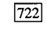

```cpp
// 将迭代器向前跳转
iterator operator+=(int amount) {
  require(index + amount < s.top);
  "IntStack::iterator::operator+=()"
  "tried to move out of bounds"
  index += amount;
  return *this;
}
```

```cpp
// 查看你是否到达末尾：
bool operator==(const iterator& rv) const {
  return index == rv.index;
}
bool operator!=(const iterator& rv) const {
  return index != rv.index;
}
```

```cpp
friend ostream& 
operator<<=(ostream& os, const iterator& it) {
  return os << it.current();
}
```

```cpp
iterator begin() { return iterator(*this); }
// 创建“结束哨兵”
iterator end() { return iterator(*this, true); };
```

```cpp
int main() {
IntStack is;
for (int i = 0; i < 20; i++))
  is.push(fibonacci(i));
}
cout << "traverse the whole IntStack\n";
IntStack::iterator it = is.begin();
while (it != is.end())
```

```cpp
cout << ++it << endl;
cout << "Traverse a portion of the IntStack\n";
IntStack::iterator;
start = is.begin(); end = is.begin();
start = 5; end = 15;
cout << "start = " << start << endl;
cout << "end = " << end << endl;
while (start != end) {
cout << ++start << endl;
```

# 416 C++ 编程思想

```cpp
else p = 0; // 表示列表结束
return bool(p);
bool operator++(int) { return operator++(int); }
T* current(int) const {
    if (!p) return 0;
    return p->data;
}
// 指针解引用运算符:
T* operator->() const {
    require(p!= 0);
    "PStack::iterator::operator->returns 0"
    return current();
}
T* operator*() const { return current(); }
// 用于条件测试的 bool :
operator bool() const { return bool(p); }
// 用于测试是否结束的比较:
bool operator===(const iterator&) const {
    return p == 0;
}
bool operator<=(const iterator&) const {
    return p != 0;
}
iterator begin() const {
    return iterator(*this);
}
iterator end() const {
    return iterator();
}
template<class T> Stack<T>::~Stack() {
    while (head) {
        delete pop();
    }
}
template<class T> T* Stack<T>::pop() {
    if (head == nullptr) return 0;
    T* result = head->data;
    Link* oldHead = head;
    head = head->next;
    delete oldHead;
    return result;
}
#endif // TSTACK_H
```

我们已经注意到，这个类已经被修改为支持所有权，它之所以能工作是因为我们知道确切类型（或至少知道基本类型，它是基于使用构造函数的假设而工作的）。对于它的对象，使用默认的析构函数，但我们要负责处理其 `pop()` 返回的任何指针。

适配器是非常简单的，体积非常小，即使在创建一个适配器时，它被初始化为指向链表的头，只能沿着链表向前前进。如果希望在起点之前创建一个新的适配器，如果希望记住上一个位置，就从已有的适配器中创建一个新的适配器并指向这一个（使用适配器的默认拷贝构造函数）。

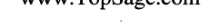

# 第16章 模板介绍

为了代理指向的对象函数，我们可以使用 `current()` 函数、`operator*`（迭代器中的一个共同点）。后者的实现看上去与 `current()` 一样。因为一个指向对象的指针在实例上是相同的，这个指针通过引用运算符就能完成指向应用的外层（参见第12节）。

`iterator` 类遵循前面的这种形式。`class iterator` 在容器中包含一个构造函数，可以用来创建容器中一个元素的迭代器和一个“终结”迭代器，而容器类用来产生这些容器的迭代器和 `end()` 方法。对于对标准 C++ 类更深入的人，就会看到：在底层名字 `iterator`、`begin()` 和 `end()` 已经被提升为标准容器。在本章的最后我们将看到，使用这些容器就像使用标准 C++ 容器一样。全部都放在头文件中，所以这里没有独立的容器。下面是用来检验迭代器的小代码：

```cpp
// Cl: TStack2.cpp 
#include "TStack2.h"
#include "../require.h"
#include <iostream>
#include <fstream>
#include <string>
using namespace std;

int main() {
    ifstream file("TStack2.cpp");
    assure("TStack2Test.cpp");
    Stackstring texts;
    // 读取文件并将行存入 Stack:
    string line;
    while(getline(file, line)) {
        texts.push(new string(line));
    }
    int i = 0;
    // 使用迭代器打印列表中的行:
    Stackstring::iterator it = texts.begin();
    Stackstring::iterator it2 = it;
    while(it != texts.end()) {
        cout << it->c_str() << endl;
        it++;
        if(+i == 10) // 记住第10行
            it2 = new Stackstring::iterator(it);
        }
    }
    cout << (*it2)->c_str() << endl;
    delete it2;
}
```

`Stack` 是一个示例，用于存放 `string` 对象，并从一个文件中填充。然后创建一个迭代器，通过遍历这个序列。通过从第一个迭代器拷贝构造第二个迭代器，来访问第10行，然后打印这一，并且销毁动态创建的迭代器。这里，使用动态静态创建来控制该对象的生命。

## 16.7.2 带有迭代器的 PStack

对于大多数容器类，有迭代器是有意义的。这里对 `Pash` 类添加一个迭代器：


# 418 C++ 编程思想


```cpp
// C16:TPStash.h
// 带有嵌套迭代器的模板化 PStash
#ifndef TPSTASH2_H
#define TPSTASH2_H
#include "../require.h"
#include <cstdlib>

template<class T, int incr = 20>
class PStash {
    int quantity;
    int next;
    T** storage;
    void inflate(int increase = incr);
public:
    PStash() : quantity(0), storage(0), next(0) {
    ~PStash()();
    int add(T* element);
    T* operator[](int index) const;
    T* remove(int index);
    int count() const { return next; }

    // 嵌套迭代器类:
    class iterator; // 声明
    friend class iterator; // 设为

    class iterator { // 现在定义它
        PStash& ps;
        int index;
    public:
        iterator(PStash& pStash, int index(0))
            : ps(pStash), index(index) {}

        // 创建终结哨兵:
        iterator(PStash& pStash, bool)
            : ps(pStash), index(next) {}

        // 拷贝构造函数:
        iterator(const iterator& rv)
            : ps(rv.ps), index(rv.index) {}

        iterator& operator=(const iterator& rv) {
            ps = rv.ps;
            index = rv.index;
            return *this;
        }

        iterator& operator++() {
            require(index <= ps.next,
                "PStash::iterator::operator++ "
                "moves index of bounds");
            return *this;
        }

        iterator& operator++intint) {
            return operator++();
        }

        iterator&---- {
            require(index >= 0,
                "PStash::iterator::operator-- "
                "moves index of bounds");
            return *this;
        }

        iterator& operatorint) {
            returnreturn--();
        }

        // 向前或向后跳转迭代器:
        iterator operator+=(int amount) {
            require(index < ps.next &&
                index + amount >= 0,
                "PStash::iterator::operator+="
                "attempt to index of bounds");
            index += amount;
            return *this;
        }

        iterator operator-=(int amount) {
            require(index < ps.next &&
                index - amount >= 0,
                "PStash::iterator::operator-="
                "attempt to index of bounds");
            index -= amount;
            return *this;
        }

        // 创建一个新的迭代器
        iterator operator+(int amount) const {
            iterator ret(*this);
            ret += amount;
            return ret;
        }

        T* current() const {
            return ps.storage[index];
        }

        T* operator() const { return current(); }

        T* operator->() const {
            require(ps.storage[index] != 0,
                "PStash::iterator::operator->returns 0");
            return current();
        }

        // 删除当前元素
        void remove() {
            return remove(index);
        }

        // 结束测试:
        bool operator==(const iterator& rv) const {
            return index == rv.index;
        }

        bool operator!=(const iterator& rv) const {
            return index != rv.index;
        }

        iterator begin() const {
            return iterator(*this);
        }

        iterator end() const {
            return iterator(*this, true);
        };

        // 析构包含的对象:
        template<class T, int incr>
        PStash(T, int incr) : incr(incr) {
            for (int i = 0; i < next; i++) {
                delete storage[i]; // 清空指针
                storage[i] = 0; // 安全置空
            }
            delete storage; // 释放内存
        }

        template<class T, int incr>
        int PStash<T, incr>::add(T* element) {
            if (next >= quantity) {
                inflate();
            }
            storage[next++] = element;
            return next - 1; // 返回索引
        }

        template<class T, int incr> inline
        T* PStash<T, incr>::operator[](int index) const {
            require(index >= 0,
                "PStash::operator[] negative");
            if (index >= next)
                return 0; // 越界返回 0
            return storage[index];
        }

        template<class T, int incr>
        T* PStash<T, incr>::remove(int index) {
            // 执行有效性检查
            T* v = operator[](index);
            // 删除指针:
            storage[index] = 0;
            return v;
        }

        template<class T, int incr>
        void PStash<T, incr>::inflate(int increase) {
            const size_t tsz = sizeof(T*);
            T** st = new T*(quantity + increase);
            memset(st, 0, (quantity + increase) * tsz);
            memcpy(st, storage, quantity * tsz);
            quantity += increase; // 更新容量
            storage = st; // 指向新内存
        }
    }

    delete; // 释放旧内存
} // endif PStash_H
```

# 第 16 章 继承多态

## 16.1 C++ 编程思想

```cpp
PStash<string> strings;

while (getline(in, line)) {
    strings.add(new string(line));

    PStash<string>::iterator sit = strings.begin();

    for (sit; sit != strings.end(); ++sit) {
        cout << "" << sit << endl;

        sit = strings.begin();

        int n = 26;

        sit += n;

        for (sit; sit != n; ++sit) {
            cout << ": " << **sit << endl;
        }
    }
} //
```

为了方便，`Int` 有一个相关的 `ostream` 操作，用于扩容容器，并因而将 `PStash<Int>` 的析构函数在 `main` 中的这两个代码段用花括号括起来，来强迫 `PStash` 析构自动调用。通过手动修复和删除剩余的元素，表明 `PStash` 清理了剩余的元素。

对于 `PStash` 的这两个元素创建一个迭代器的机制，但是要理解它们为何还需要更多的例子。注意由于这些构造函数所产生的简洁性，我们不会遭遇使用数组的实现细节的困扰。只要告诉容器和迭代器对象什么，无需告诉它如何做，就使得这个解决方法容易泛型化、建立和修改。

## 16.2 如何使用迭代器

到目前为止，我们已经创建了迭代器的机制，但是要理解它们为何还需要更多的例子。

在一个真实的面向对象程序中，经常可以看到多态、动态对象创建和容器是在在一起使用的。容器和动态对象创建解决了我们如何知道需要多少对象以及对象是什么类型的这样的问题。如配置一个容器来存放指向基类的指针，每次放一个派生类进入容器时，就会发生类型转换。正本书第一章最后的例子，这个例子也将我们将带到已经学习过的各个不同方法。

假设我们正在创建一个程序，这个程序允许用户编辑和产生不同类型的图画。每个图画都是一组 `Shape` 的对象。

```cpp
// Class:Shape.h

#ifndef SHAPE_H
#define SHAPE_H

#include <iostream>
#include <string>
```

```cpp
class Shape {
public:
    virtual void draw() = 0;
    virtual void erase() = 0;
    virtual ~Shape() {};
};
```

```cpp
class Circle : public Shape {
public:
    Circle() {}
    ~Circle() { std::cout << "Circle:" << endl; }
    void draw() { std::cout << "Circle:draw\n"; }
    void erase() { std::cout << "Circle:erase\n"; }
};
```

```cpp
class Square : public Shape {
public:
    Square() {}
    ~Square() { std::cout << "Square:~Square\n"; }
    void draw() { std::cout << "Square:draw\n"; }
    void erase() { std::cout << "Square:erase\n"; }
};
```

```cpp
class Line : public Shape {
public:
    Line() {}
    ~Line() { std::cout << "Line:~Line\n"; }
    void draw() { std::cout << "Line:draw\n"; }
    void erase() { std::cout << "Line:erase\n"; }
};

#endif // SHAPE_H
```

这段代码使用了基类中的虚函数，在派生类中被重新定义。注意，`Shape` 类包含一个虚构函数，将这些东西添加到虚函数的任何类中。如果一个容器拥有向 `Shape` 对象的指针或引用，则当对这些对象调用这个虚构函数时，所有的相关数据都将被正确删除。

在下面例子中，每一个类型的图画都使用了不同的模板容器；已经在本章定义的 `PStash` 和 `Stack` 以及 C++ 的容器。“使用”是极其简单的，并且情况下，并不是最好的方法（组合更有意义），在这种情况下，从这个例子来看：

```cpp
// C1: Drawing.cpp

#include <vector> // Uses Standard vector too!

#include "PStash.h"
#include "TStack2.h"
#include "Shape.h"

using namespace std;

// Drawing is primarily a container of Shapes:
class Drawing : public PStash<Shape> {
public:
    ~Drawing() { cout << "Drawing" << endl; }
};

// Plan is a different container of Shapes:
class Plan : public Stack<Shape> {
public:
    ~Plan() { cout << "Plan" << endl; }
};

// A Schematic is a different container of Shapes:
class Schematic : public vector<Shape*> {
public:
    ~Schematic() { cout << "Schematic" << endl; }
};
```


```cpp
// A function template:
template<class Iter>
void draw(Iter start, Iter end) {
    while (start != end) {
        (*start)->draw();
        start++;
    }
}

int main() {
    // Each type of container has
    // a different interface:
    Drawing d;

    d.add(new Circle);
    d.add(new Square);
    d.add(new Line);

    Plan p;

    p.push(new Line);
    p.push(new Square);
    p.push(new Circle);

    Schematic s;

    s.push_back(new Square);
    s.push_back(new Circle);

    Shape* array[] = {
        new Circle, new Square, new Line
    };

    // The iterators and template function
    // allow them to be treated generically:
    cout << "Drawing d:" << endl;
    drawAll(d.begin(), d.end());

    cout << "Plan p:" << endl;
    drawAll(p.begin(), p.end());

    cout << "Schematic s:" << endl;
    drawAll(s.begin(), s.end());

    cout << "Array:" << endl;

    // Even works with array:
    drawAll(array, array + sizeof(array) / sizeof(array));

    cout << "End of main"
}
```


不同类型的容器可以放入`Shape`的指针和派生类。然而由于动态性，调用函数仍然是正确的。数组也可以做一个容器。

## 16.8 函数模板

在`drawAll()`中，我们已经发现了一些新东西。但是，到为止仅仅使用了模板，它们实例化多个类型。然而，我们可以同样容易创建函数。创建函数原理与类模板相同：我们试图创建一个通用的函数，我们可以规定一个或多个类型。我们只想这些类型支持运算符，并且不需要清晰说明它们是什么。

## 16.9 迭代器

`drawAll()`可以是一个算法（在标准 C++ 中函数被视为算法）。它只是描述元素的迭代器来说如何做，将这些迭代器用于引用、增加和比较。在本章中，我们已经出了迭代器，但它也不是巧合，这种迭代器由标准 C++ 容器使用了`vector`。我们还有一个泛型（generic algorithm）是一个算法，所以迭代器可以是任意类型的。我们没有必要为不同容器编写这些算法，如果没有迭代器提供的直接，这种泛型就不可能。这就是迭代器之所以重要：它允许你编写各种容器通用的迭代器，而不需要容器底层结构。为了正确操作，迭代器和容器模型只需要参数。在`main()`中调用`drawAll()`对数组的开始和结束。这种构造为容器处理策略是标准 C++ 设计，它的算法像`drawAll()`。因为容器模型很少对普通类进行继承或类型转换，否则在容器中看到很多问题。用来扩展。

## 16.6 容器

容器是面向对象设计的一个部分。它们是简化实施、提高开发效率的一种办法。另外，我们通过连接函数与相对对象之间的数据结构极大地提高了容器的灵活性。由于客户需要容器，所以容器的方便是它的基本特征。这种模板被引入后，我们使用模板语言对代码逻辑进行通用（而不是继承和组合对象）。对于学者来说足够。事实上，使用模板容器可以使用继承和组合来实现容器容易使用。

在书中已经学习了创建容器和迭代器的相关知识，实际上，有用的是学习标准 C++ 容器中的用法，因为可以期望在每个编译器中使用它们。由于标准 C++ 容器的实现是不可能的，因为你自己创建新的容器。

## 16.0

练习容器的答案可以在本书的电子文档“Annotated Solution for Generic in C++”中找到，你只需要很少的钱就可以访问`Bruce.Eckel.com`得到电子文档。

- 16-1 更改第15 章的结果，以便使用`Stack.h`的`Stack`和`iterator`替代`Shape`指针。
- 16-2 增加对类容器的构造函数，使得我们可以观察到：在栈超出时看到`Shape`操作。
- 16-3 修改`push_back.h`，使得由`inFile(int)`产生的值在特定容器对象的生命周期内改变。
- 16-4 修改`PStash.h`，使得`inflate`的增量能动态调整，以减少调用的次数。例如，每次调用它，都能为下一次调用而增加这个值。通过报告告诉`inflate`被用来证明这个功能，并且在`main()`中编写测试代码。
- 16-5 对于`fibonacci`函数的类型，模板化`fibonacci`函数使其产生`long`、`float`等类型的，而不是整型。
- 16-6 使用标准 C++ 库作为底层实现，创建一个`Set`模板类，对于这个模板类中的每一个对象，只需要接受一个。创建一个封装器（`iterator`）。在`main()`中编写测试代码，并最后...验证其行为是正确的。
- 16-7 修改`AutoCounter.h`使得它能在任何类中作为成员时，我们希望跟踪它的创建和销毁。增加一个函数，用来保存创建的名字。在我们的一类中测试这个工具。
- 16-8 使用`Builder.h`的版本，它使用`push_back`更多对象并且超出空间时自动扩展。创建一个`ValueStack`以测试功能。
- 16-9 重复练习 9，使用标准 C++ 库作为`ValueStack`内部实现。这种方法容易调试。
- 16-10 修改`ValueStack.cpp`，使得它在`main()`中使用标准 C++ 库而不是使用`Stack`。注意运行时：当容器创建时自动构建一系列。
- 16-11 修改`PStash.h`，使得使用标准 C++ 库作为底层实现。确保改变接口让`Stack.cpp`正常工作。
- 16-12 使用`Stack.h`或者使用`ValueStack`重复练习 12（可能查找关于容器）。
- 16-13 修改`PStash.h`，使得使用标准 C++ 库作为底层实现。确信改变接口让`Stack.cpp`正常工作。
- 16-14 在`Stack.cpp`中，使用`Iterator`，给它一个“哨兵”构造函数，添加`operator=`和`operator++`在`main()`中，使用迭代器遍历容器直到“哨兵”。
- 16-15 修改`PStash.h`、`Stash.h`和`shape`，使得`Shape*`实例化向元素转换，然后用迭代器遍历每个对象。
- 16-16 模板化`Stack.cpp`，使得存放任意类型可以改变这个名字。
- 16-17 模板化第12 章的`OperatorOverloading.cpp`中的包含类型和内部成员。
- 16-18 将第12 章的`SmartPointer.cpp`翻译成一个模板。

## A.3 开始和结束注释标记

生成以`.c`扩展名的文件。C++ 经历了一个发展过程，首先在 Unix 上开发，这个程序的功能能够编写相同大小的文件。最初的文件名简单地使用对 C 扩展名的扩展`.h`。这对于不能区分大小写的操作系统（例如 DOS）是不起行的。DOS++ 对头文件和实现文件分别使用`hxx`和`cxx`扩展名，以及`hpp`。后来，有人分析出必须使用不同扩展名的唯一原因是：让编译器区分哪些是 C++ 文件以及 C++ 函数。因为编译器不会直接链接文件，所有要实现的 C++ 程序都需要编译。这个习惯在整个系统中已经演变为：实现文件使用`.cpp`，头文件使用`.h`。注意，包含 C 头文件时，可以不用扩展名，例如：

```cpp
#include<iostream>
```

一个重要的问题是，本书中看到的任何代码必须确保是正确的（至少能通过一个编译器）。这样的代码从编写到书中已经完成了验证。按照规定，所有的代码都被标记出来（少数代码段除外），它们位于开始和结束注释标记之间。这些标记是本书第 2 章提取工具`ExtractCode`使用的，它将代码从书中的无格式 ASCII 中提取出来。

列表结束的标记通常告诉`ExtractCode`这是列表的结束符；而开始的标记遵循该文件在目录中的项目位置（以章节组织，例如在第 8 章，例如`08`），接着是一个编号，然后是文件名。

由于`ExtractCode`会为每个项目创建一个 Makefile，关于程序如何构建以及作为运行命令链接的信息在这里显示。如果一个程序是函数（不需要与任何其他程序连接），则在文件名后有`()`。如果一个程序是声明函数，需要与另一个程序连接，则在独立的头文件中。对于头文件，如果程序中包含`main()`，则必须与其他部分连接，则在文件名后。

如果不需要一个文件，开始和结束注释标记不需要包含在被提取的文件中（例如一个测试文档文件）；开始标记不需要直接放在首位。

## A.4 格式、缩进和索引

我们可能知道本书中的格式风格符合许多 C 的格式标准。当然，每个人都认为自己的格式是最自然的。但是这里的风格有足够的灵活基础，将会包含许多先进的风格并在一起介绍。

格式风格有一个动机：它是让无标记的输出具有块状格式。虽然有人会意识到格式不清楚，导致的结果不是所需要的。然而，由于代码需要被多次阅读，所以都应当考虑到易读性。两个最重要的标准是“可读性”（读懂一行代码有很大意义）和一个“内容的一致性”。作者后可能会找到我们，当我们使用模仿符时，如果必须在幻灯片间跳转回来，就必须认真引起大家的注意。这种引起麻烦是因为它包含了一些没用的文字。

每个人对头文件的位置定义是不一样的，在格式风格中最不一致的地方是：左括号在什么地方？我认为，这是一个引起格式风格的问题（如缩进风格的细节，参见 Tom 和 Saks 的《C++ Programming Guidelines》，Plumm, 1991）。今天的很多代码格式来自标准 C 之前的约定，现在已经不再了。

首先，左括号总是与“前导元素”（指“任意代码块”、函数、对象或条件语句等等）在同一行。这是我写所有代码时使用的一致性规则，它使得格式更简单，使得当我看到它时“可视性”更好。

```cpp
int func(int a) {
```

我们知道，这一行的最后表示是一个声明，后面不再加任何东西；但当看到下面行时：

```cpp
int func(int a) {
```

马上就知道它是定义，因为这一行是以左括号结尾的，没有分号。使用这种方法，定义开放左括号也是一样的。

```cpp
int func(int a) {
    int b = a + 1;
    return b * 2;
}
```

而为单元定义通常用于内函数中。

```cpp
int func(int a) { return (a + 1) * 2 };
```

类似的，对于类：

```cpp
class Thing {
```

是一个类名定义，而

```cpp
class Thing {
```

是类定义，我们可以通过遍历这个类的单行唯一标识，就知道这个声明是类定义的。当然，将开括号放在这一行中作为一行，可以在一行中放更多的程序。

我在编写它时还有很多风格呢？特别是我注意到的，很多人创建类时用上面的风格（[Stroustrup 在 Addison-Wesley 出版的《C++设计语言》一本书使用了上述规则]），但在创建函数定义时却将左括号符号单独成行（这又包含了许多独立的函数）。Stroustrup 描述的内函数是例外。我用这种这种描述的方法，一切都是唯一的，无论是什么名字（类、函数、举例等）。我们左括号放在同一行中，指下面是相应的对应的。而对于短内函数和一般函数定义，左括号的形式是不一样的。我断定，许多人的函数定义划分源于先前的 C 语言类型。其中，参数并不在圆括号内声明，而是在右括号和左括号之间，这代表了 C 的编译语言时代。

```cpp
void bar() {
    int x;
    float y;
    /* body here */
}
```

这样，如果我们将大括号放在与前导元素同一行，这很难的。所以所有人都没有这样做。但是，大括号应该是当代码体时在“前导元素”上层有意义的，这样，我们就得到了不同的格式。

## 附录 A 代码风格

对于直接把左括号放在（类、结构、函数等的）声明之后，有一些争论。下面的意见来自读者，列举出来，让我们知道问题是什么：

- 有经验的`vi (vim)`用户知道，击`)`键将用户移动到下一个列表为`{`（或 L）处。这个功能对于复杂语言非常有用（跳到一个函数或定义处）。[我的解释是我最初在 Unix 上工作时，GNU Emacs 刚出现，我迷上了它。结果`vi`没有引起我的兴趣，这样，我就没有想过“首列位置问题”。但是，有相当多的`vi`用户会对这个问题产生影响）。

- 将`{`于一行，消除了一些在复杂条件下的混乱代码，有助于提高可视性。例如：

```cpp
if (cond1)
    if cond2
        if cond3) {
            statement;
```

上面代码可视性很差（读者断言）。但是：

```cpp
if (cond1)
    if cond2
        if cond3)
{
    statement;
}
```

将`if`与代码块分开，导致了最好的可读性。是否同意这一观点取决于读者的习惯。

- 最后，将大括号安排在上述上方，容易有视觉效果。大括号放在何处是意见不一致的问题。研究了两种格式，最终还是遵循了程序员。

- 每个人对头文件的位置是不一样的，在格式风格中的最不一致的地方是：左括号在什么地方？我认为，这是一个引起格式风格的问题（如缩进风格的细节，参见 Tom 和 Saks 的《C++ Programming Guidelines》，Plumm, 1991）。

## A.5 标识符

熟悉 Java 的读者会注意，对于所有的标识符，我已经转向标准不能完全一致，因为在标准和 C++ 库中的这种风格是自洽的。如果标识符是一个类，它的第一个字母必须大写；若是函数或变量，第一个字母是小写。标识符部分由多个单词连在一起，每个单词的首字母要大写。

```cpp
class VanillaIceCream
```

对象标识符如下：

```cpp
VanillaIceCream();
```

函数如下：

```cpp
void eatIceCream();
```

无论是成员函数还是常规函数（`const`），其中所有的字母都小写。对于静态标识符没有例外。

## A.6 头文件的顺序

头文件的顺序从特殊到一般，就是：

- 本地中的任何头文件首先
- 我们自己的“工具”文件，例如`require.h`
- 随后是第三方库文件
- 接着是标准头文件

这种顺序保证`.cpp`文件的组成可以避免潜在的错误，防止递归发生。

## A.7 在头文件中包含卫

在头文件中包含卫（include guard），防止单个`.cpp`文件多次包含。包含卫是一个预处理定义，检查名字已经定义。卫是以文件名为基础，将字母大写，用下划线替换，例如：

```cpp
// Include_Guard.h
```

```cpp
#ifndef INCLUDE_H

#define INCLUDE_H

// Body of header file...

#endif // INCLUDE_H
```


最后一行标识符是为了清晰。虽然一些预处理器允许 `#endif` 之后的任何字符，但这不是标准写法，标识符用于注释。

## A.8 使用命名空间

在文件中，必须尽量确保没有任何“污染”命名空间。如果没有命名空间，头文件的任何改变可能导致各种问题。不允许在头文件中全局声明。在 `.cpp` 文件中，任何全局声明只会影响文件，因此生成更容易阅读的代码。

## A.9 `require()` 和 `assume()` 的使用

`require()` 和 `assume()` 函数在 `.h` 中定义，本书各处应用。如果我们熟悉前置条件和后置条件（由 Bertrand Meyer 提出），我们会认识到，`require()` 提供前置条件（通常），`assume()` 提供后置条件（有时）。在函数“核心”执行之前，检查前置条件以保证所有条件正确；执行函数“核心”之后，检查后置条件以确保数据的状态。

## 附录 B 编码准则

这个程序收集了 C++ 编程的一些建议，它们是在教学和实践过程中形成的。为了自然，还有一些信息来自我朋友，包括 Dan Saks（《C++ Programming Guidelines》，1991）、Scott Myers（《Effective C++》的作者，Addison-Wesley 1998）和 Rob Murray（《C++ Strategies & Tactics》的作者，Addison-Wesley，1993）。有些条目是从书中摘录出来的：

1. 首先让程序运行，然后再追求速度。即使我们觉得这段程序非常重要，引起系统中的臃肿。不要优化，首先简单的设计程序运行。我们总是认为“臃肿”不是问题，节省我们的时间。

2. 编写代码时有很多处好处。这不是。流畅程序易读，调试且容易维护，这正是带来长期利益的。通过实现其实可能的，但当我们的程序需要修改时，就会出现优点。

3. 记住“源自对象”。当遇到问题时，试图编写程序的基本操作，创建一个对象——程序代码应该对应这个对象，之后难的部分放在其他的对象。

4. 使用 C++ 是价值的，因为可以发现隐藏的错误，重写一段代码可能是浪费时间。

5. 许多代码可能不需要修改，首先将不需要修改的数据打包成“API”，然后使用静态成员函数，然后集中到修改的代码，使得维护更容易。

6. 类的创建者和使用者（客户）。类的使用者可能不需要知道内部，创建者必须设计类使得类可以使用，并且在应用程序中工作良好不容易出错。

7. 当我们创建类时，尽量使用类名。我们的目标是让用户接口简单可以用重载和默认参数创建一个清晰、易用的接口。

8. 数据隐藏允许（类的创建者）将来不破坏用户代码（使用了类）的情况下。接口部分为 `public`，如果类的使用者不需要某个函数，让该函数为 `private`。如果类的一部分可见，定义为 `protected`，提供一个函数而不是直接暴露函数，这样实现的改变对类产生显著的影响。

9. 不要引入编译时才能运行的各种异常。C++ 中许多防火墙，让我们为服务。在类中出错将会破坏整个完整性。我们在分析中的公共函数与它们之间的关系。如果你的方法更多，应该对自己，而不是所有的生成过程中。

10. 设计在系统中创建，类的与调用者的耦合。耦合意味着这个类太大了。如果看到一个类很大，至少预示着应该分成几个类，甚至预示着应该创建一个新的类。

11. 不要重复代码。如果一段代码在基类的许多函数中重复出现，就把这段代码放在基类的单一函数中，然后在基类中调用。这样不仅节省代码空间，也使得修改变得容易。我们可以用内联函数来提高效率。

12. 让 `switch` 和 `if-else`，类是典型的类型检查的掩码。意味着程序运行的情况和类型有关，我们通常以将这些代码继承自基类、多态函数为我们进行类型检查。

13. 从设计的角度，寻找那些不变的部分。不要重新设计它，把它们封装到一个类中。我们可以在书第二卷的“Bruce Eckel 的 Design Patterns”一章中学习更多这。

部，这个额外的直接连接可以防止这种不可移动性影响我们的整个程序。

31. 不要用多重继承。这可帮助解决冲突，尤其是修复那些无法控制的接口冲突。除非我们是一个经验相当丰富的程序员，否则不要在系统设计中使用多重继承。

32. 不要私有继承。虽然 C++ 中可以私有继承，并且似乎在某些地方很有用，但它和运行时操作一起使用时，常常引发复杂的重构问题。我们可以用一个成员对象来替代私有继承。

33. 如果两个类由于相同的行为（如构造器和析构器）而联系在一起，使得一个类成为容器，并将另一个类包含成员函数，标准 C++ 则将派生类实现在容器所做的操作（这样的定义在第 16 章之后）。这只要求两个类之间的解耦，并且允许许多类的名字相同，在另一个类中复用。标准 C++ 通过在容器类中定义虚运算符的派生类，为容器提供了访问接口。如此：

34. 运算符重载仅仅是“函数”定义。如果重载一个运算符就不会引起接口冲突，更容易使用，但不要重载，不要创建一个动态类型的转换运算符。在一般情况下，运算符重载应当遵循第 11 章的原则和格式。

35. 保证构造函数的顺序，然后再考虑。特别是，不要在内联函数中使用一些非虚函数或者析构标记来扩展这些。这些我们在开始构造系统时就不考虑了。我们后的顺序是正确的，除非另有要求的顺序。

36. 不要让继承类为我们产生函数。构造函数或运算符，这些训练给我们的教训。派生类的设计者应该说明应该这样做，并完全控制这个类。我们不想要重载构造函数或运算符，就把它们定义为私有的。这样，只要派生类对任何构造函数，防止了误引起构造函数生成。

37. 如果我们的类包含了指针，我们就必须重载赋值运算符，否则使用是正确的。

38. 为派生类编写赋值操作时，记住使用显式调用基类的构造函数（或成员对象版）（参见第 14 章）。如果不这样做，就会调用（成员对象也是如此）默认基类的赋值函数，可能这就不是我们所期望的形状。要调用基类的编写构造函数，要用这种方式传递派生类：

```cpp
Derived(const Derived&) : Base() { }

Derived& operator=(const Derived&);
```

39. 当为派生类赋值操作时，记住使用显式调用基类的版本（参见第 14 章）。如果不这样做，就会被调用（成员对象也是如此）。应用基类的名字和赋值操作符，调用基类的赋值运算符：

40. 为了减少开发过程中的重新编译，应该使用第 5 章介绍的模板/C 缓存技术，只需要提高运行效率把功夫变成。

41. 避免使用处理器。可以用常量来代替值，用内联函数来代替宏定义。

42. 保持尽可能短，这样的对象的可见性和生命周期就越小可能。这减少了被错用的对象和难以调试可能的错误。比方，假设我们有一个容器和一段描述这个容器的代码，如果我们把这些代码用于一个新的容器，我们就可以无意间用有的容器的类作为容器的接口。然而，原来的容器已经超范围，这个错误可能会被编译器发现。

43. 避免全局变量。尽可能把数据放在类中。全局函数的存在可能比全局变量大，然后我们可能发现一个全局函数为一类的静态成员更好。

44. 如果我们需要声明一个库中的类或函数，应该用包含一个头文件的方法。比如，如果我们想创建一个函数来写 `ostream`，不要用一个不完全的类类型的方法自己来声明 `ostream`：

```cpp
class ostream;
```

这样做会类的码变得很麻烦。（例如 `ostream` 实际上可能是一个 `typedef`）。我们可以用头文件的形式，例如：

```cpp
#include <iostream>
```

- 当创建自己的类时，只需要用到指针的情况下，如果一个库很大，应该提供给用户一个头文件的简化写法，文件只包含不完全的类说明（就是类名声明），它可以提高编译速度。

45. 选择赋值运算符的返回类型，要考虑表达式一串时可能出现的情况：当 `operator=x` 时，记住 `x=x`。要对左赋值一个键或引用，用 `return(*this)`，这种写法是有用的在链中使用链赋值（`A=B=C`）。

46. 当写一个函数时，第一个选择就是用来传递参数的。只要我们不需要修改正在传递的对象，这种方式总是最好的。因为它传递值的方式简单，但不需要构造和析构函数来产生结果，而在传递过程中是不可避免的。通常我们在设计和我们的系统时会有效率考虑，但是这种习惯是有好事情。

47. 当实例化变量、调整赋值时，要注意构造的对象，可能会用赋值运算符。当如果我们的类的构造函数和析构函数很复杂，构造和赋值对象就很贵。当一个函数返回一个值，总是在 `return` 语句中使用构造函数来“就”产生一个对象。

```cpp
MyType y;

MyType x;

return x;
```


# C++ 编程思想

- `explicit` keyword (显式关键字), 678
- operators (运算符), 166
- pointer assignment (指针参数), 343...
- `reinterpret_cast` (重新解释类型转换), 171
- `static_cast` (静态类型转换), 169
- Cat, Cheshire, 277
- catches clause (子句), 357

# CD ROM

- seminars on CD-ROM from MindView (MindView 的研会), 16
- Thinking in C, Foundations for Java & C++ (packaged with book, 25, 112
- `cfront`, original C++ compiler (`cfront` 最早的 C++ 编译语法), 237
- chapter overviews (章节总览), 7
- `char`, 96, 132
- `sizeof`, 173
- character (字段), 154
- concatenation (字符串的拼接), 96
- constant (常量), 155
- characteristics (特性), 219
- check for self-assignment in operator overloading (运算符重载的赋值检查), 505
- Cheshire cat, 277
- `cin`, 97
- clashes, name type (命名), 229
- `class` (类), 25, 76
  - abstract class and pure virtual functions (抽象类和纯虚函数), 646
  - adding virtual functions in the derived class (派生类增加的虚函数), 652
  - aggregate initialization (初始化), 302
  - class definition and inline functions (类定义与内联函数), 378
  - compile-time inline functions (编译时内部函数), 353, 356
  - and constructor (组合和构造函数), 369
  - `const` and `enum` in (常量和枚举), 395
  - container class templates and virtual functions (容器类和虚函数), 743
  - creators (创建者), 28
  - declaration (声明), 277
  - of a nested friend class (一个嵌套类的友元), 514
  - defining the interface (接口), 62
  - definition (定义)
  - difference between a union and a class (联合与类之间的区别), 319
  - duplicate class definitions and templates (复制类定义和模板), 699
  - fragile base-class problems (易碎基类问题), 276
  - generated by macro (由宏), 594
  - generated classes for templates (为模板生成的类), 699
  - handle class (句柄类), 275
  - inheritance and copy-constructors (继承与拷贝构造), 471
  - diagrams (图), 617
  - initialization, memberwise (初始化，成员), 42
  - keyword (关键字), 31
  - local (局部、嵌套的), 428
  - iterator (迭代器), 512, 721
  - overloading and `delete` for class (为类重载), 570
  - pointers in, and overloading `operator=` (在类中使用指针并重载运算符), 524
  - static class objects (静态类对象), 408
  - static data members (静态数据成员), 423
  - static member functions (静态成员函数), 429
  - templates (模板), 742
  - using `const` (使用常量), 395
- class-responsibility-collaboration (类职责协作), 52
- cleanup (清理), 666
- automatic destructor calls with inheritance and composition (带有继承和组合的析构函数), 592
- initialization and clear on the heap (堆上的初始化和清除), 548
- client programmer (程序员), 28, 260
- code availability (代码的可用), 12
- table-driven (驱动的), 201
- assembly for a function call (用于函数调用的汇编), 456
- bloat (膨胀), 391
- comment tags in listings (清单中的标记), 750
- consulting, mentoring, and design and code walkthroughs from MindView (来自 MindView 的咨询和指导), 16
- generator (生成器), 79
- organization (组织结构), 248
- header files (文件头), 244
- program structure with writing (写代码时的结构), 93
- re-use (重用), 583
- collection (收集), 510, 719
- collector, garbage (收集，元素), 42
- collision, linker (冲突，连接器), 244
- comma operator (运算符), 165, 508
- committee, C++ Standards (委员会，C++ 标准), 14
- common interface (公共接口), 647
- compaction, heap (压缩，堆), 225
- compatibility (兼容性)
  - C & C++, 235
  - with C (C 语言), 98
- compilation (编译)
  - needless (不需要), 276
  - process (过程), 79
  - separate (分开), 718
  - separate and merge (分开和合并), 202
- compile time constants (编译时常量), 335
- compiler (编译器), 76, 777
  - original C++ compiler (`cfront`), 237
  - running (运行), 95
  - support (支持), 15
- compiling with C++ (用 C++ 编译), 305
- comp.,-ones completion (编译), 173
- complicated declarations & definitions (复杂的声明和定义), 99

## 5 453

- 访问 (access), 29, 260
- 运行时 (run-time), 275
- 访问标识符 (access specifiers), 261
- 表达式，用于循环 (expression, used for a loop)
- 循环 (loop), 106
- 控制 (controlling)
- 执行 (execution), 117
- 链接 (linkage), 422
- 转换 (conversion)
- 自动类型转换 (automatic type conversion), 533
- 窄化转换 (narrowing conversions), 170
- 自动类型转换的陷阱 (pitfalls in automatic type conversion), 539
- 使用关键字防止自动类型转换 (preventing automatic type conversion with the keyword)
- 使用关键字 (`explicit`)
- 从 `char*` 到数字 (to numbers from `char*`), 188
- 从 C 到 C++ (converting C to C++), 230, 260
- 拷贝构造函数 (copy-constructor), 432, 450, 465, 508, 657
- 备选项 (alternatives), 471
- 组合 (composition), 469
- 默认 (default), 468
- 继承 (inheritance), 471
- 私有的 (private), 471, 709
- 上转型转换与拷贝构造函数 (upcasting and the copy-constructor), 617
- 运算符赋值 (vs. `operator=`), 521
- 写时复制 (COW) (copy-on-write), 524
- 在内部拷贝指针 (copying pointers inside)
- 版权，源代码 (copyright, source code), 126
- 正确性，成本 (correctness, cost), 367
- 成本，启动 (costs, startup), 7
- 计数 (counting)
  - 自动的，和数组 (automatic, and arrays), 301
  - 引用 (reference), 526
  - `out` (out), 91
- 封面，设计 (cover-book, design), 317
- CRC，类责任协作卡片 (CRC, class-responsibility-collaboration cards), 523
- 创建 (creating)
  - C 和 C++ 中的函数 (functions in C, C++), 112
  - 由已经存在的对象生成的对象 (new from an existing object), 462
  - 在堆上的对象 (objects on the heap), 554
- 危机，软件 (crisis, software), 8
- `cstdlib` 标准头文件 (`cstdlib` standard header file), 188
- `cstring` 标准头文件 (`cstring` standard header file), 269
- c-v 限定符 (c-v qualifier), 366

## D

- 数据 (data)
  - 为静态成员定义 (defining for static members)
  - 存储 (store), 424
  - 初始化构造函数 (initializing constructors), 355
  - 静态区域 (static area), 406
  - 在类中的静态成员 (static members inside a class), 423
- 数据类型 (data type)
  - 抽象 (abstract), 129, 239
  - 内置 (built-in), 129
  - 与类相似 (equivalence to class), 26
  - 用户定义的 (user-defined), 219
- 调试 (debugging)
  - 断言 (`assert(assert)`), 197
  - 标志 (flags), 194
  - 预处理器标记 (preprocessor legacy), 194
  - `require.h`, 396
  - 运行时 (run-time), 195
  - 使用预处理器 (using the preprocessor), 395
- 十进制 (decimal), 154
- 声明 (declaration), 81
  - 所有可能的 (all possible combinations), 141
  - 分析复杂性 (analyzing complex), 199
  - 和定义 (and definition), 243
  - 类 (`class`), 277
  - 嵌套友元 (nested friend), 514
  - 常量 (`const`), 398
  - 向前 (forward), 151
  - 函数 (function), 116, 233, 313


## 454 C++ 编程思想

- 声明语法 (declaration syntax), 82
- 在 C 中不是基本的 (not essential in C), 228
- 头文件 (header files), 242, 244
- 结构 (structure), 265
- 使用，使用命名空间 (using, for namespaces using), 421
- 变量 (variable)
  - 声明语法 (declaration syntax), 83
  - 声明指针和作用域 (point of declaration & scope), 145
  - 虚 (virtual), 632
  - 基类声明 (base-class declarations), 632
  - 派生类声明 (derived-class declarations), 632
- 装饰 (decoration), 230, 231, 237
- 重载 (overloading), 311
- 解耦 (decoupling), 608
- 通过多态 (via polymorphism), 699
- 减一 (decrement), 128, 164
- 加一运算符 (and increment operators), 506
- 重载运算符 (overloading operator), 493
- 默认 (default)
  - 参数 (argument), 310, 311, 321
  - 作为标记 (as a flag), 329
  - 重载 (vs. overloading), 324
  - 构造函数 (constructor), 304, 327, 408, 470, 563
  - 继承 (inheritance), 663
  - 拷贝构造函数 (copy-constructor), 468
  - 模板的默认值 (default values in templates), 781
- 关键字 (keyword), 124
- 定义 (defining), 197
- 函数指针 (function pointer), 198
- 同时初始化 (initializing at the same variable), 290
- 初始化变量 (initializing variables), 200
- 在作用域内 (anywhere in the scope), 145
- 定义 (definition), 81
  - 数组 (array), 338
  - 块 (block), 289
  - 类 (`class`), 277
  - 复杂函数定义 (complex function definitions), 198
  - 常量 (`const`), 340
  - 声明 (declaration), 243
  - 重复定义和模板 (duplicate class definitions and templates), 699
  - 格式化指针定义 (formatting pointer definitions), 342
  - 函数 (function), 83
  - 非内联成员函数 (non-inline member functions), 699
  - 对象 (object), 285
  - 纯虚函数 (pure virtual functions), 651
  - 静态成员的存储 (storage for static members), 424
  - 头文件中定义 (structure definition in a header file), 234
- 删除 (`delete`), 553
  - 对删除调用 (calling for delete), 327
  - 删除表达式 (delete-expression), 553
  - 关键字 (keyword), 422
  - 同一对象的多次定义 (multiple definitions of the same object), 553
  - 和容器 (and containers), 692
  - 数组 (arrays), 563
  - 重载 `new` 和 `delete` (overloading `new` and `delete`), 566
  - 数组 (array), 573
  - 类 (`class`), 570
  - 全局 (global), 668
  - `void*` 是错误的 (`void*`, deleting a bug), 555
  - 零指针 (zero pointer), 553
- 相关、依赖性 (dependency), 204
- 扩展 (`makefile`)
- 相反、带有布尔标记 (deprecation, of a bool flag), 131
- 间接引用 (dereference)
  - 间接函数指针 (dereferencing function pointers), 200
  - 指针 (pointer), 137
- 派生 (derived)
  - 派生类中增加函数 (adding new functions in the derived class), 652


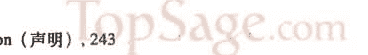


## 索引 455

- 设计 (design), 54
- 分析和设计、面向对象 (analysis and design, object-oriented), 44
- 使用、命名空间 (using, namespaces), 92, 48
- 书 (book), 27
- 封面 (cover), 17
- 直接访问 (directly accessing assignment), 240
- 不允许赋值 (disallowing assignment), 533
- 设计和生产 (design and production), 18
- 指派、重多 (dispatch, double/multiple), 675
- 除法 (`div/`), 156
- `do-while`, 120
- 来自 MindView 公司的、指导和 (from MindView)
- 双重 (`double`), 155
- 代码标识), 16
- 指派、和多 (dispatch, and multiple dispatch)
- 双精度浮点 (double precision floating point)
- 对对象的五个目标 (five types of design object)
- 内部格式 (internal format), 189
- 内联 (inlines), 380
- 下向类型转换 (downcast)
- 误错 (mistakes), 279
- 静态类型转换 (`static_cast`), 681
- 模式、迭代器 (pattern, iterator), 719
- 类型安全 (type-safe), 678
- 模式 (patterns), 590
- 重复类定义 (duplicate class definitions and templates)
- 析构函数 (destructor), 287
- 动态 (dynamic), 678
- 自动析构函数调用 (automatic destructor calls)
- 用继承和组合 (with inheritance and composition), 592
- 绑定 (binding), 663
- 不能自动增加 (doesn't automatically increment), 600
- 内存分配 (memory allocation), 223, 548
- 显式析构函数调用 (explicit destructor call), 579
- 对象创建 (object), 42, 547, 732, 738
- 在堆上的初始和 (initialization and cleanup)
- 类型检查 (type checking), 80
- 内联 (inlines), 392
- 动态类型转换 (`dynamic_cast`), 678
- 构造函数和析构 (order of constructor and destructor)

## E

- 早绑定 (early binding), 38, 631
- 纯虚析构 (pure virtual destructor), 644
- 类型安全 (type-safe), 678
- 版本 (edition), 16
- 什么是新的 (what's new in), 288
- 嵌入的 (embedded), 170
- 转换、对象 (else), 685
- 显式的 (explicit), 310
- 优美的、设计 (elegance, in programming), 44
- 答案 (exercise), 329
- 异常处理 (exception), 43, 517
- 指数 (exponential), 534
- 封装 (encapsulation), 179
- 枚举 (`enum`), 219
  - 和类中 (and in classes), 353
  - 增加 (incrementing), 180
- 外部 (external), 84, 335, 358
- 等 (equivalence), 166
- 链接 (linkage), 152
- 使用 (using), 518
- 错误 (error), 301
- 提取器和插入器、输出 `iostream` (extractor and inserter, output for iostream)
- 偏移一 (off-by-one), 301
- 极端编程 (XP) (Extreme Programming), 61, 615, 777
- 用公共头文件防止 (preventing with common header), 244
- 工厂、设计模型 (factory, design), 712
- 报告书中的错误 (reporting errors in books), 245
- 假 (false), 158, 263
- 结构重构 (structure redecoration)
- 和真、在条件中 (true, in conditions), 117
- 转义序列 (escape sequences), 294
- 布尔、和假 (true, and false), 131
- 求值顺序、就地内 (order evaluation, inline), 391
- 析出、自动类型转换 (fan-out, automatic type conversion), 540
- 进化、在程序开发 (evolution, in program development), 540
- 斐波纳契 (Fibonacci), 725
- 简单使用 (simple use), 572
- 文件 (file)
  - 执行代码 (executing code), 717
  - 头部 (header), 233, 242, 523
  - 退出 `main()` 之后 (after exiting `main()`), 411
  - 代码组织 (code organization), 248
  - 进入 `main()` 之前 (before entering `main()`), 241
  - 常量 (`const`), 335, 444
  - 类型检查 (type checking), 80

# Topsage.com

- names (名字), 749
- function (函数), 81
- reading and writing (读和写), 100
- abstract base classes and pure virtual functions (抽象类和纯虚拟函数), 646
- scope (作用域), 150, 152, 412
- static (静态的), 150, 244, 414
- access (取，访问), 379
- structure definition in a header file (在头文件中定义语句)
- adding to a more (向增加更多的内容), 234, 280
- adding new virtual functions in the derived class (在派生类中新增的构造函数), 652
- flags, debugging (标记，调试), 194
- floating point (浮点)
- address (地址), 198, 391
- `float` (浮点), 135
- argument (参数), 138
- `float.h`, 129
- `const` (常量), 344
- internal format (内部格式), 189
- number size hierarchy (数字层次结构), 132
- reference (引用), 451
- array of pointers to (向……的指针), 201
- numbers (数字), 130, 154
- true and false (`true`), 159
- assembly-language code generated (生成的语言代码)
- defining variables inside control expression (在控制表达式中定义变量), 145
- function call (函数调用), 456
- loop (循环), 106, 121
- virtual call (虚调用), 642
- outer loop, inside control expression (循环)
- binding, for (为函数调用计数器，在控制表达式中定义语句的变量), 291
- variable lifetime in `for` (for 循环中的变量), 292
- body (体), 83
- C library (类), 116
- call operator `()` (类运算符), 614
- formatting pointer (格式化指针), 342
- forward (向前/向)
- call overhead (调用开销), 377
- declaration (声明), 151
- called for effect (有作用的调用), 313
- reference, inline (引用), 391
- complicated functions (复杂函数定义), 198
- Fowler, 45, 58, 779
- fragile base-class problem (易碎的基类问题), 276
- constructors, behavior of virtual functions (构造函数，虚函数内部), 664
- fragmentation, heap (头部), 222, 567
- free store (释放存储), 549
- `free()`, 223, 550, 553, 555, 569
- creating (创建), 112
- declaration (声明), 116, 263
- free-standing reference (独立引用), 451
- not essential in C (不是 C 基础中的), 222
- friend (朋友), 263, 554
- required (需要), 233
- syntax (语法), 82
- definition (定义), 83
- a declaration of a nested class (嵌套类的声明), 514
- injection into namespace (加入命名空间), 417
- member function (成员函数), 264
- nested structure (嵌套结构), 266
- `fstream`, 100

# 458 C++ 编程思想

- helper, assembly (辅助，扩展), 457
- static (静态)
- inline (内联), 372, 377, 604
- class objects inside functions (在函数中的对象), 114
- header files (头文件), 396, 408
- local class (class defined inside) (在函数内定义的类), 428
- member (成员), 366, 429, 455
- member function (成员函数), 28, 230
- objects inside functions (在函数中的对象), 437
- calling (调用)
- variables inside functions (在函数中的变量), 460
- a member function (成员函数), 239
- another member function from member type (在函数中的另一个成员函数类型)
- unique identifier for each (每个唯一的标识符)
- base-class functions (基类函数), 588
- `const` (常量), 352
- virtual function (虚函数), 627, 629
- friend (函数), 264
- constructor (构造函数), 662
- inheritance and static member functions (继承和静态成员函数), 604
- overriding (重写), 632
- overloaded operator (运算符), 487
- picturing (赋值), 639
- objects (对象), 515
- overloading (运算符), 486
- garbage collector (内存回收器), 42
- using declarations (使用声明), 421
- generic algorithm (泛算法), 742
- get and set functions (`set` 函数), 381
- `get()`, 472
- string, 562
- defining (定义), 198
- iostream library (输入输出库)
- member function (成员函数), 475
- using a function pointer (使用指针), 200
- Global (全局)
- polymorphic function (多态函数), 637
- friend function (友函数), 264
- prototyping (原型), 113
- pure virtual functions (纯虚函数), 651
- new and delete, overloaded (`new` 和 `delete` 运算符), 568
- redefinition in inheritance (在继承期间的重定义), 588
- object constructor (对象构造函数), 410
- return value (返回值)
- operator, overloaded (运算符，重载), 487
- by reference (按照引用), 451
- scope resolution (作用域解析), 253
- returning a value (返回值), 115
- static initialization of global objects (全局对象的初始化), 432
- type (类型), 597
- variables (变量), 432
- signature (特征), 597
- GNU C++, Keith, 694
- stack frame for a function call (函数调用的帧)
- `goto`, 125, 288, 293

## 索引 459

- non-local (非局部的), 288
- greater (大于), 158
- or to `>=` (等于), 158
- storage allocation (存储分配), 549
- simple example (简单例子), 570
- guaranteed initialization (保证初始化), 294, 548
- helper function, assembly (协助函数，溢出), 457
- hexadecimal (十六进制), 154
- guards, in header files (防护，包含文件中)
- hiding (逃逸)
- function names inside a `struct` (结构中的函数)
- guidelines (指导), 455
- argument passing (参数传递), 455
- implementation (实现), 28, 260, 275
- object development (对象开发), 56
- during inheritance (生命周期), 595
- C++ programming guidelines (C++ 程序设计)
- overloading (重载), 658
- variables from the enclosing scope (作用域内的变量), 292

## H

# C++ 思想

- hierarchy, in `enum` (枚举), 358
- handles (句柄), 275, 277
- high concept (高级概念), 48
- has-a (有一个), 30
- high-level assembly language (高级汇语言), 113
- composition (组合), 604
- hostile programmers (不友好的程序), 27
- header file (文件), 85, 116, 239, 242, 232, 336
- hybrid (混合), 48
- code organization (代码组织), 248
- C++, object-oriented programming language, and friend (在 C++ 强制使用)
- C++ 的面向对象语言，和泛型
- formatting standard (标准格式), 246
- object-oriented programming language (面向对象设计)
- include guards (包含头), 376
- inline definitions (内联定义), 377
- internal link (内部链接), 426
- namespaces (命名空间), 423
- unique for each (每个函数), 310
- unique for each (每个对象), 238
- order of inclusion (包含顺序), 356
- IEEE standard for floating-point numbers (IEEE 浮点数的标准), 130, 189
- using directives (使用指令), 248
- `if-else` (条件语句), 145
- structure definition in a header file (在头文件中定义语句), 242
- ternary? (三元运算符?), 164
- `istream` (输入流), 100, 200
- implementation (实现), 27, 241
- heap (堆), 42, 223
- fragmentation (分裂), 225, 567
- creating objects (创建对象), 554
- hiding (隐藏), 26, 260, 270
- compile-time conversion (只编译时), 275
- implicit type conversion (隐含的类型), 154
- in situ functions (在内存内), 394
- in-memory copy (在内存拷贝), 378
- include (包含), 85
- include guards, in header files (包含文件中), 246, 257
- new format (新格式), 86
- incomplete type specification (不完全类型说明), 265, 277
- and decrement operators (和递减运算符), 180
- incrementing and decrementing (增加和递减), 164
- overloading operator `++` (运算符重载), 641
- increment (`--`), 614
- programming interface (设计), 614
- indeterminate argument list (不确定参数列表), 114
- indexing (索引), 105, 183
- array, 183
- zero (零), 183
- inheritance (继承), 31, 584, 565
- choosing composition vs inheritance (选择组合与继承), 604
- class inheritance diagrams (继承图), 617
- combining composition & inheritance (组合与继承), 591
- copy-constructor (拷贝构造函数), 471
- diagram (图), 400
- extending a class (在……扩展类), 344
- extensibility (可扩展性), 653
- function definition (函数定义), 588
- initialization (初始化), 663
- is-a (是一个), 600, 615
- multiple (多个), 588, 661, 621, 673, 695
- name hiding (名字隐藏), 658
- operator overloading & inheritance (运算符重载和继承), 612
- order of construction (构造顺序), 665
- private inheritance (私有继承), 609
- protected inheritance (保护继承), 616
- public inheritance (公共继承), 587
- static member functions (静态成员函数), 604
- subtyping (类型继承), 606
- virtual functions in destructors (在析构中的), 670
- vs. Composition (组合), 620, 745
- initialization (初始化), 227, 356
- aggregate (集合), 201, 301
- array (数组), 301
- to zero (零), 305
- const member's (常量成员变量), 355
- `const` inside (在类中的常量), 353
- constructor (构造函数), 285
- initializer list (在构造函数初始化), 353, 589, 664
- definition, simultaneous (定义，并发), 290
- `for` loop (循环), 106, 121
- guaranteed (保证), 294, 548
- during inheritance (在继承期间), 663
- initialization and cleanup on the heap (在堆上的初始化和清理), 488
- initializer for a static variable of a built-in type (内置类型静态变量的初始化), 408
- lazy (懒惰), 305
- member object initialization (成员对象初始化), 589
- memberwise (按成员), 471, 600
- object = (对象赋值), 521
- static (静态), 425
- array (数组), 425
- `const` (常量), 356
- dependency (依赖性), 432
- member (成员), 425
- zero initialization by the linking-loading mechanism (用连接分配初始化为零), 433
- variants of point definition (在定义点上的变量), 130
- vs. Bitcopy (位拷贝), 460
- injection, first inside namespace (插入，在命名空间内名字字符)

## 索引 461

- iostreams (输入输出), 90
- inline (内联), 394, 662
- `get()`, 472
- class definition (类定义), 1378
- `getline()`, 100
- constructor efficiency (构造函数效率), 663
- global overloaded `new` & `delete` (全局重载 `new` & `delete`), 572
- constructors (构造函数), 392
- delete interaction with (...与...交互), 572
- convenience (方便), 393
- limitations of (...的限制), 569
- definitions and header files (定义和头部文件), 377
- manipulators (操作), 392
- destructors (析构函数), 392
- overloading `<<` `>>` (重载 `<<` `>>`), 581
- effectiveness (有效性), 390
- reading and writing files (读和写文件), 110
- efficiency (效率), 392
- reading input (读输入), 97
- function (函数), 372, 377, 664
- `self()`, 466
- header files (头部文件), 396
- strings with iostreams (输入输出的字符串), 110
- in situ, 394
- is-a (是一个)
- limitations (限制), 390
- inheritance (继承), 604, 615
- non-inline member function definitions vs.-a-like relationships (非内联成员函数定义 vs 像……的关系), 835
- 模板成员函数 (模板成员函数), 699
- Standard (ISO 标准), 112
- order of evaluation (求值顺序), 391
- C++, 114
- templates (模板), 707
- header files (头部文件), 112
- input `iostream`, overloaded operator `>>` (重载运算符 `>>`), 520
- reading by words (按单词读取), 106
- standard (标准), 97
- iteration, in program development (迭代，在程序开发), 518
- `insert()`, 104
- iterator (迭代), 509, 719, 730
- insert and extractor (插入和提取器)
- overloading containers (容器), 690
- for iostreams (对于输入输出), 518
- motivation (动机), 738
- instance of a class (实例), 244
- nested class (嵌套类), 512
- implementation (实例化), 342, 699
- Standard C++ Library (标准 C++), 724
- `int`, 130, 577
- interface (接口), 241
- base-class (基类接口), 633
- common interface (公共接口), 647
- Jacobson, Ivar, 779
- Java, 3, 15, 65, 71, 74, 588, 645, 694, 816
- defining the class (定义类), 62
- expanding function (扩展函数), 330
- for an object (对于对象), 255
- implementation, separation of (实现，分离), 292, 261, 271, 380
- implied by a template (由模板显示), 701

# C++ 编程思想

## Keywords（关键字）

- untagged (无标记), 320
- `#define`, 245, 335
- `explicit` (显式的), 534
- `#endif`, 245, 757
- `extern` (外部的), 84, 147, 151, 335, 339, 412
- `#ifdef`, 245
- for alternate link (另外的连接), 442
- `#include`, 85
- `false` (拷贝), 117, 131
- `&`, 134
- `float` (浮点), 130, 132
- `()` call operator overloading (函数运算符重载)
- `for`, 106, 121
- `friend` (友元), 263
- `*`, 136, 164
- `goto`, 125, 283
- `.*` (member selection operator) (成员选择符), 237
- `if`, 118
- `inline` (内联), 394, 662
- `=`, 156
- `int`, 130
- overloading (重载), 505, 521
- `long` (长度), 132
- `->`, 164
- `long double` (not legal) (长双精度（非法）), 332
- overloading (重载), 509
- `mutable` (可变的), 363
- `struct` member via pointer (通过指针的结构成员符), 178
- `namespace` (命名空间), 91, 414, 757
- `new`, 423
- `->`, 474
- `operator` (运算符), 486
- overloading (重载), 514
- `private` (私有的), 262, 280, 260, 610
- `*`, 474
- `protected` (保护), 263, 270, 610
- `::`, 232, 253
- `public` (公共), 261, 716
- `asm`, for in-line language (asm，在线编译语言), 173
- `register` (寄存符), 149, 414
- `reinterpret_cast` (重解释类型)
- `auto` (自动), 109, 414
- `return` (返回), 115
- `bool` (布尔), 125
- `true` and `false` (真和假), 131
- `signed` (有符号), 132
- `signed char` (有符号字符), 122
- `case`, 124
- `sizeof`, 132, 172, 587
- `catch`, 572
- `char`, 96, 130, 132
- `class` (类), 25, 31, 271
- `static` (静态), 149, 350, 468
- `static_cast` (静态类型), 169, 679
- `const` (常量), 153, 333, 453
- `struct` (结构), 175, 220
- `continue` (继续), 122
- `default` (默认), 42, 223
- `template` (模板), 689, 696
- `delete` (删除), 42, 223
- `this`, 234, 286, 363, 380
- `do`, 120
- `double` (加倍), 130, 132
- `true` (真), 117, 131
- `dynamic_cast` (动态类型), 678
- `try`, 572
- `typedef` (类型定义), 174
- `enum` (枚举), 179, 358
- `typeid` (定义类型), 680
- `union` (联合), 181, 318
- anonymous (匿名), 320
- `unsigned` (无符号的), 132
- 使用 (使用), 92, 417
- `virtual` (虚拟), 39, 595, 627, 637, 646, 665
- Standard C function (标准 C 函数), 39, 595, 627, 637, 646, 665
- `abort(t)`, 409
- `exit(t)`, 409
- `void&` (非法), 143
- lifetime (生命), 292
- `void*`, 140
- for loop variables (循环变量), 292
- `volatile` (可变的/易变的), 155
- object (对象), 42, 547
- temporary objects (临时对象), 468
- Koenig, Andrew, 376, 762, 778
- linkage (连接), 152, 406
- Lajoie, Joseef, 776
- alternate link specification (派链接定义), 442
- Lakos, John, 756, 778
- controlling (控制), 412
- external (外部), 335, 339, 412
- internal (内部), 335, 339, 412
- no linkage (不连接), 153, 412
- type-safe (类型), 313
- C++, hybrid object-oriented language, and friend (C++，混合的面向对象语言，和友元), 269
- linked list (列表), 248, 275, 298
- linker (链接), 78, 87
- hybrid object-oriented programming language (混合的面向对象的编程语言), 70
- collision (冲突), 224
- large programs, creation of (程序的，创造), 78
- external references (外部引用), 228
- late binding (晚绑定), 38, 631
- object file (目标文件结构), 88
- implement (实现), 636
- searching libraries (搜索库), 88
- layout, object, and access control (规划，访问，和访问控制), 269
- unresolved references (未解决的引用), 88
- Lippman, 776
- lazy initialization (初始化), 704
- leading orders, on identifiers (reserved) 留下前面在标识上（留保留）, 381
- constructor initializer (构造函数初始化), 353, 589
- linked (连接), 248, 275, 298
- leaks, memory (泄漏，内存), 224, 300
- Lister, 781
- left-shift operator (左移运算符), 160
- local (局部的)
  - array (数组), 186
  - classes (类), 428
  - or equal to `<=` (小于或等于), 158
  - static object (静态对象), 410
- library (库), 76, 80, 218
- variable (变量), 138, 149
- logarithm (对数), 466
- logic (逻辑), 78
- constant (常量), 62
- creating your (创建), 66
- bitwise and logical operators (位运算符和逻辑), 505
- double (双精度), 132, 288
- counter (计数器), 106
- defined inside control (内部控制表达式), 291
- lifetime in loops (循环中的生命周期), 292
- lvalue (左值), 156
- management (管理), 203, 319, 464, 550, 554, 569, 572, 589, 604, 610, 615, 523, 633, 637, 646, 665, 678, 679, 690, 696, 699, 701, 704, 724, 730, 738, 750, 756, 776, 778, 816
- mangling (破坏性), 230
- maintenance, program (维护，程序), 582
- dependencies (相关性，依赖性), 204
- suffix (后缀), 205
- macros (宏), 205, 245, 335, 339, 374, 392, 442, 486, 514, 518, 520, 532, 550, 569, 572, 690, 696
- initializing const members (初始化常量数据), 355
- member function (成员函数), 28, 230, 260, 262, 270, 280, 292, 342, 394, 462, 466, 474, 505, 509, 514, 521, 572, 589, 604, 610, 615, 523, 633, 637, 646, 665, 678, 679, 690, 696, 699, 701, 704, 724, 730, 738, 750, 756, 778, 816
- another member within a member function (在一个成员内另一个成员), 234
- four member functions of the compiler (编译器的四个成员函数), 519
- non-inline template definitions (非内联模板成员定义), 699
- signature (特征), 597
- selection (选择), 234, 505, 509, 514, 521, 532, 550, 554, 569, 572, 577, 589, 604, 610, 615, 523, 633, 637, 646, 665, 678, 679, 690, 696, 699, 701, 704, 724, 730, 738, 750, 756, 776, 778, 816
- overloaded member operator (重载成员运算符), 487
- pointers to members (指向的指针), 473
- static data member inside a class (类中的静态数据), 423
- memberwise (接成员), 532
- argument (参数), 374
- macros for parameterized types, instead of templates (针对参数类型的宏，不是模板), 696
- unsafe (不安全), 299
- to generate classes (生成类), 594
- `main()`, basic form (基本形式), 193
- executing code after (退出后的代码), 411
- executing code before entering (进入前的执行代码), 411
- initialization (初始化), 304, 353, 371, 409, 471, 600
- allocation and efficiency (分配和效率), 566
- dispatching (分发), 675
- `memcpy()`, 560
- inclusion of header files (头文件的包含), 244
- standard C library function (C 标准函数), 326
- inheritance (继承), 586, 613, 621, 673, 695

# C++ 编程思想

- 收窄转换 (narrowing conversions), 170
- DEBUG，不需要重新编译 (needless recompilation), 276
- 嵌套的 (nested)
  - 类 (class), 428
  - 友元结构 (friend structure), 266
  - 迭代器类 (iterator class), 512, 721
- 作用 (scopes), 144
- 结构 (structures), 248
- `new`, 164, 223
  - 对于数组的 `new` `delete` (and delete for arrays), 563
  - 指针数组 (array of pointers), 558
  - 删除和容器 (delete and containers), 692
  - 关键字 (keyword), 42
  - 新表达式 (new-expression), 223, 552, 566
  - `new` 指针 (new-handler), 565
  - `new` 运算符 (operator new), 555
  - 构造函数，内存耗尽 (constructor, method exhaustion), 376
  - 耗尽存储 (exhausting storage), 565
  - 定位选择器 (placement selector), 517
- 重载 (overloading)
  - 可以多个参数 (can take multiple arguments), 577
  - `new` and `delete` (new and delete), 566
  - 对于类 (for a class), 570
  - 对于数组 (for arrays), 573
  - 全局 (global), 568
- 新行 (newline), 94
- 不连接 (no linkage), 153, 412
- 非局部 `goto` (non-local goto), 288
- 非 (not)
  - 位运算 (bitwise), 159
  - 不等于 (equivalent `!=`), 158
  - 逻辑不等于 (logical not `!`), 59
- 对象 (object), 23, 79
  - 对象的地址 (address of), 265
  - 常量成员函数 (`const` member functions), 359
  - 从现有对象创建新的 (creating a new object from an existing object), 462
  - 在堆上创建 (creating on the heap), 554
  - 对象的定义 (definition of), 238
  - 定义点 (definition point), 285
  - 静态析构 (destruction of static), 410
  - 动态对象创建 (dynamic object creation), 428, 738
  - 文件 (file version), 228
  - 链接的顺序 (order during linking), 88
- 对象设计的五个阶段 (five stages of object design), 54
- 函数对象 (function objects), 515
- 全局构造函数 (global constructor), 410
- 对象开发的指导 (guidelines for object development), 56
- ……的接口 (interface to), 25
- 布局访问控制 (layout and access control), 269
- 对象的生命 (lives of an object), 42, 547
- 局部静态 (local static), 410
- 成员 (member), 30
- 模块 (module), 79
- 基于对象的 (object-based), 238
- 基于对象的 C++ (object-based C++), 628
- 外部 (outside), 462
- 按值传递 (pass by value and returning objects), 457
- 作用域超出 (scope, going out of), 143
- `size` (class), 554
- 强制非零 (forced to be non-zero), 639

# 索引 467

- 每个对象的唯一地址 (unique address, each object), 241
- 基于对象/单根层次 (object-based/singly-rooted), 672, 694
- 面向对象 (object-oriented)
  - 设计和分析 (analysis and design), 44
  - 面向对象的基本概念 (basic concepts of object-oriented programming (OOP)), 222
  - C++，混合面向对象语言，和元++ (C++, hybrid object-oriented language, and friend), 269
- 混合面向对象设计语言 (hybrid object-oriented programming), 67
- 管理 (obstacles, management), 71
- 八进制 (octal), 154
- 偏移错误 (off-by-one error), 301
- 输出流 (stream), 100, 594
- 作为静态对象 (as a static object), 411
- 一次定义规则 (one-definition rule), 82, 244
- 赋值运算符 (ones completion operator), 579
- 面向对象设计 (OOP), 271
  - 设计和分析 (analysis and design), 44
  - 基本特性 (basic characteristics), 24
  - 面向对象设计的基本概念 (basic concepts of object-oriented programming), 22
- Simula 程序语言 (Simula programming language), 25
- 可替换性 (substitutability), 24
- 总结 (summarized), 239
- 运算符 (operator), 156
  - `&`, 134
  - `(function)`, `call()`, 514
  - `*`, 136, 727, 730
  - 三元运算符 (`?:` ternary-else), 164
  - `[1, 508, 698]`
  - `++`, 49
  - 重载输出流 (`<<` overloading with ostream), 554
  - `=`, 505
  - 作为私有函数 (as a private function), 533
  - 自动创建 (automatic creation), 532
  - ……的行为 (behavior of), 522
  - 不自动继承 (doesn't automatically inherit), 600
  - 成员赋值 (memberwise assignment), 600
  - 私有 (private), 709
  - 对比拷贝构造函数 (vs. copy-construction), 521
  - 智能指针 (`->` smart pointer), 509
  - 指向成员 (`->` pointer to member), 514
  - `>>` 和输入流 (`>>` and streams), 106
  - 赋值 (assignment), 505
  - 自动增加 (auto-increment), 160
- 二进制 (binary), 252
- 运算符 (operators), 160
- 重载 (overloaded), 487
- 重载例子 (overloading examples), 493
- 位操作 (bitwise), 159
- 使用内置运算符 (built-in operators), 585
- 行为 (behavior), 131
- 类型转换 (casting), 166
- 在成员和非成员重载之间 (choosing between member and non-member overloading), 520
- 逗号 (comma), 158
- 带有复杂表达式 (complicated expressions), 488
- 位和逻辑运算符 (bitwise and logical operators), 173
- 自动类型转换中的输出 (fan-out in automatic conversion), 540
- 全局 (global), 488
- 重载 (overloaded), 487
- 作用域解析 (scope resolution), 223
- 增加和减少 (increment and decrement), 509
- 成员函数 (member function), 237
- 成员和非成员 (member vs. non-member), 552
- `new`，耗尽存储 (exhausting storage), 565
- `new` 表达式 (new-expression), 552
- 放置说明 (placement specification), 577
- 非指数型 (no exponentiation), 517
- 用户定义 (user-defined), 517

# 468 - C++ 编程思想

- 补码 (ones-complement), 159
- 重载 (overloading), 91, 450, 732
- 不能重载的运算符 (operators can't overload), 517
- 参数和返回类型 (arguments and return type), 505
- 自赋值 (check for self-assignment), 505
- 继承 (inheritance), 612
- 成员函数 (member function), 487
- 反射性 (reflectivity), 536
- 虚函数 (virtual functions), 675
- 陷阱 (pitfalls), 519
- 后置加减 (postfix increment & decrement), 493
- 前置加减 (prefix increment & decrement), 493
- 优先级 (precedence), 127
- 预处理字符 (preprocessor operator `#`), 196
- 关系的 (relational), 417
- 作用域解析 (scope resolution), 223, 253, 429
- 命名空间 (and namespaces), 417
- 调用基类函数 (for base-class functions), 588
- 移 (shift), 601
- 类型重载 (type conversion), 172
- 一元运算符 (unary operator), 159
- 众不同的重载 (unusual overloaded), 508
- 重载运算符 `<<` (overloading operator `<<`), 520
- 标准输出 (output, standard), 390
- 对象 (outside object), 139
- 开销 (overhead)
  - 虚函数生成的汇编代码 (assembly-code generated by a virtual function), 642
  - 函数调用 (function call), 372, 377
  - 内存管理器 (memory manager), 554
  - 虚函数的大小 (size of virtual functions), 637
- 重载 (overloading), 95
- `<<` 和输入流 (`<<` and for streams), 518
- 赋值 (assignment), 521
- 成员和非成员之间的指导 (choosing between members and non-members, guidelines), 520
- 构造函数 (constructor), 319
- 默认参数和重载的 (default arguments, with overloading), 324
- 类型转换中的扇出 (fan-out in automatic type conversion), 530
- 函数 (function), 310
- 函数调用 (`function call()`), 514
- 全局操作符与成员操作符 (global operators vs. member operators), 536
- 命名空间 (namespaces, using declaration), 421
- `new` & `delete`, 566
- 全局 (global), 79
- 位赋值 (bitwise), 59
- 逻辑与 (`&&`), 158, 166, 173
- 顺序 (order)
  - 访问权限说明 (access specifiers), 173
  - 构造函数和析构函数 (constructor and destructor calls)
  - 调用 (call), 263
  - 构造函数调用 (constructor calls), 298
  - 组织代码 (organization), 244
  - 头部 (header files), 244
  - 赋值或赋值 (`or_eq`, `==`), 173
  - 输出流 (stream), 327
  - 对象 (outside object), 139

# 498 - P

- 按引用方式 (pass-by-reference), 140
- 按值传递 (pass-by-value), 137, 462
- 地址 (addresses), 344
- 用常量的地址 (addresses, with const), 349
- 按值传递 (by value, C), 455
- 大对象 (large objects), 457
- 按值传递 (by value), 344, 650, 457
- 临时 (temporaries), 351
- 模式、设计 (patterns, design), 59, 70
- 迭代器 (iterator), 719
- 性能问题 (performance issues), 72
- Perl, 89
- 陷阱 (pitfall)
  - 自动类型转换 (automatic conversion), 539
  - 运算符 (operators), 166
  - 预处理 (preprocessor), 327
- 占位符参数 (placeholder arguments), 323
- 定位，`new` 运算符 (placement, operator new)
- 新定义符 (operator new placement specifier), 47
- 软件开发计划 (planning, software development), 47
- Paujer, 770
- Plum, Tom, 394, 756
- 点、序列 (point, sequence), 286, 293
- 指针 (pointer), 136, 153, 164, 270
  - 算术术 (arithmetic), 190
  - 数组 (array), 184
  - 使指针看起来像数组 (making a pointer look like an array)
  - 复杂的 (complex), 54
  - 指针数组 (of pointers), 187
  - 赋值，常量和非常 (assignments, const and non-const)
  - 大的 (large), 343
  - 类包含，重载运算符 `=` (classes and overloading operator=), 524
  - 常量 (const), 171, 340
  - 格式化定义 (formatting definitions), 342
  - 介绍 (introduction), 123
  - 成员指针 (member, pointer to), 473
  - 函数 (function), 475
  - 重载 (overloading), 514


# C++ 编程思想

- pointer & reference upcasting (指针和引用上转型), 622
- pointer to function (函数指针)
  - array of (……的数组), 201
  - defining (定义), 738
  - using (使用), 200
- reference to pointer (指针引用), 454
- reference, difference (引用差异), 140
- smart pointer (智能指针), 730
- square brackets (方括号), 198
- stack (栈), 294
- `struct`, member with `->` (结构，用 `->` 的成员), 178
- upcasting (上类型转型), 631
- `void`, 450, 559, 562
- `void*`, 142
- vs. when modifying outside objects (对比在目标对象时修改引用), 472
- polymorphism (多态), 37, 597, 627, 681, 734
- containers (容器), 738
- polymorphic function (多态函数), 637
- vs. downcasting (向下类型转型), 678
- post-decrement (后减一), 128
- post-increment (后加一), 128
- postconditions (后条件), 758
- postfix operator increment & decrement (后置运算符加和运算符), 493
- pre-decrement (前减一), 128
- pre-increment (前加一), 128
- precedence (优先，运算符), 127
- preconditions (前条件), 758
- prefix operator increment & decrement (前置运算符加和运算符), 493
- preprocessor (预处理器), 79, 85, 153
  - `#define`, `#ifdef` and `#endif`, 495
  - and scoping (和作用域), 376
  - debugging flags (调试标识), 194
  - macro (宏), 158, 192, 372
  - safe (不安全), 399
  - pitfall (陷阱), 372
  - problems (问题), 332
  - string concatenation (字符拼接), 395
  - string size (字符长度), 395
  - token passing (标记传递), 395
  - value situation (值传递), 471
- prerequisites, for this book (预备知识), 22
- preventing automatic conversion with the keyword implicit (用关键字显式自动类型转型), 534
- `printf()`, 569
- private (私有), 29, 262, 270, 277, 380, 610
- copy-constructor (拷贝构造函数), 471
- private inheritance (私有继承), 609
- problem space (问题空间), 23
- process (过程), 365
- production, and book design (生产、和书设计), 18
- program (程序)
  - maintenance (维护), 58
  - structure when writing code (代码的结构), 9
- programmer, client (程序员，客户), 28, 260
- programming (编程设计)
  - basic concepts of object-oriented programming (OOP) (面向对象的基本概念), 22
  - Extreme Programming (XP) (极限编程), 61, 615, 779
  - in the large (大型), 68
  - incremental process (增量过程), 614
  - multiparadigm (多范式), 74
  - pair (配对), 63
  - programs, calling other (程序，调用其它), 98
  - project building tools (项目构建工具), 203
  - promotion (提升), 228
  - automatic type conversion (自动类型转换), 553
  - protected (保护的), 29, 270, 210
  - inheritance (继承), 611
  - protyping (原型)
  - function (函数), 113
  - rapid (快速的), 59
  - pseudoconstructor, for built-types (构造函数，内部类), 361, 582, 559
  - public (公共的), 29, 261
  - inheritance (继承), 587
  - semantics (语义), 5


# 查 471

- pure (纯)
  - abstract base classes and pure virtual functions (抽象基类和纯虚函数), 646
  - C++，hybrid object-oriented language, and friend, C++ (范围，面向对象的语言，和朋友), 269
  - substitution (替代), 35
  - virtual destructor (析构函数), 668
  - virtual function definitions (虚函数定义), 651
- push-down stack (推栈), 104
- `push_back()`, (范围，推入 `back()`), 275
- `putc()`, 376
- `puts()`, 569
- Python, 54, 74, 77, 78, 89, 645, 702
- C++, 140
- `const` (常量), 345, 453
- and operator overloading (和重载), 505
- for argument (参数传递), 351
- efficiency (效率), 455
- external, linking (外部，连接), 228
- free-standing (单独使用), 451
- function (函数), 452
- `NULL`, 551, 479
- passing const (常量，按传递), 473
- pointer & reference usage (指针和应用), 622, 536
- pointer, reference to a pointer (指针，指针的引用), 454
- qualifier, const-v (限定词，const), 366
- ranges, used by containers and iterators in the Standard C++ (范围，由 C++ 的容器和迭代器), 728
- rapid prototyping (快速原型), 59
- declaration of classes (类的重新声明), 244
- re-entrant (重入), 458
- read-only memory (只读内存), 369
- reading by words (输入单词), 100
- recompiling in C++ (用 C++ 再编译), 236, 550, 554
- recursion (126, 459
- inline functions (内联函数), 392
- redefining during inheritance (继承中定义), 595
- reducing compilation (减少编译), 276
- refactoring (重构), 358
- reference (引用), 153, 450, 511
- reference-counting (引用计数), 526, 714
- rules (规则), 451
- upcasting (向类型转换), 630
- void identifier (空标识), 143
- variables (变量), 149
- `reinterpret_cast` (重解释), 171
- pointer when modifying objects (对对象修改的指针), 472
- reflexivity, in operator overloading (反射性，运算符重载), 536
- register (寄存器), 414
- relational operators (关系运算符), 158
- reporting errors in book (报告中的错误), 16
- request, in OOP (请求，OOP 中的), 225
- `require()`, 698, 711, 757
- `requireArg(s)`, from `require.h` (来自 `require.h`), 252
- requirements analysis (需求分析), 498
- resolution, scope (解析，作用域), 253
- nested structures (嵌套结构), 278
- operator `==` (运算符), 232
- resolving references (可分解), 80
- return by value (按值的传递), 450


# C

- by value cost, and operator overloading (作为常量传递，和重载), 507
- const value (), 345
- rule, `makefile` (规则，`makefile`), 204
- Rumbaugh, James, 779
- run-time (运行时)
  - constructor return value (构造函数返回值), 287
  - efficiency when creating and returning objects (创建和返回效率), 507
  - access control (访问控制), 275
  - binding (指针), 631
  - debugging flags (调试标志), 195
  - function return values, references (函数返回值，引用), 451
  - keyword (关键字), 115
  - overloaded return type (重载返回类型), 488
  - overloading arguments and return values (重载参数和返回值), 505
  - type identification (RTTI) (类型标识), 665, 680
  - value (右值), 156, 98
  - overloading on return values (重载返回值), 312
  - passing and returning by value, C (通过传递和返回，C), 455
  - passing and returning large objects (传递和返回对象), 457
  - references to local objects (局部对象引用)
  - type (类型), 597
  - value (值), 81
  - from a function (从函数返回), 315
  - optimization (优化), 507
  - semantics (语义), 350
  - void (空), 115

# S

- safe union (安全联合), 319
- Saks, Den, 69, 394, 751, 760
- scenario (场景), 49
- scheduling (计划进度), 51
- cherry, Java, 434
- scope (作用), 143, 288, 339, 554
  - consts (常量), 337
  - file (文件), 339
  - going out of (在……之中), 143
  - hide variables from the enclosing scope (在封用作用范围变量), 292
  - preprocessor (预处理器), 376
  - resolution (分解)
- `RETURN`, assembly-language (RETURN，汇语言), 458
- reuseability (可用性), 29
- reuse (使用), 55
  - code reuse (代码重用), 583
  - existing classes (现有的类), 70
  - source code reuse with templates (使用模板进行), 289
- right-shift operator (右移运算符), 160
- bit manipulation (位操作), 162
- global (全局), 253
- nested structures (嵌套结构), 276
- operator `==` (运算符), 232
- resolving references (可分解), 80
- return by value through (按值的传递), 450
- upcasting (向类型转换), 630
- void identifier (空标识), 143
- variables (变量), 149
- `reinterpret_cast` (重解释), 171
- pointer when modifying objects (对对象修改的指针), 472
- reflexivity, in operator overloading (反射性，运算符重载), 536
- register (寄存器), 414
- relational operators (关系运算符), 158
- reporting errors in book (报告中的错误), 16
- request, in OOP (请求，OOP 中的), 225
- `require()`, 698, 711, 757
- `requireArg(s)`, from `require.h` (来自 `require.h`), 252
- requirements analysis (需求分析), 498
- resolution, scope (解析，作用域), 253

# 索引 471

- semantics, return value (语义，返回值), 350
- object (对象), 554
- forced to be nonzero (强制非零), 639
- storage (存储), 220
- solution (解), 23
- shape (形状)
- specification (说明，规范), 263
- example (例子), 32
- incomplete type (不完全类型), 265, 277
- hierarchy (次序), 682
- system specification (系统规范), 48
- shift operators (shift 操作), 160
- specifier (说明，指定), 29, 261
- short (短), 132
- signed (符号), 132
- to modify built-in types (修改基本类型)
- no required order in a class (类中不要要求顺序)
- signature (签名/特征), 597

# 474 C++ 编程思想

- 例除类 (Standard example class), 248, 274, 298, 388, 597, 672, 690, 705, 728
- 标准 C++ 库 (Standard C++ Library)
  - `alg` (算法), 724
  - `insert()`, 104
  - `push_front()`, 104
  - 范围，用于容器和迭代器 (used by containers and iterators), 728
- 每个类头文件的标准 (standard for each class header), 246
- 标准输入 (standard input), 97
- 标准库 (standard library), 89
- 标准库头文件 (standard library header file)
  - `cassert`, 197
  - `stdlib`, 188
  - `string`, 269
  - `set`, 711
  - `stream`, 520
  - `typeinfo`, 680
- 标准输出 (standard output), 90
- 标准模板库 (STL) (Standard Template Library), 103
- 标准，C++ 委员会 (standards, C++ Committee), 14
- 启动开销 (startup costs), 71
- 启动模块 (startup module), 89
- Stash 除类 (Stash example class), 219, 230, 274, 294, 314, 322, 355, 388, 707
- 语句 (statement)
  - 在一些行继续 (continuation over several lines)
  - 任务 (mission), 477
- 静态 (static), 149, 406, 711
  - 数组 (array), 692
  - 初始化 (initialization), 425
  - 函数中的类 (class objects inside functions), 408
  - 当使用 using 令时的混乱 (confusion when using), 412
  - 常量 (`const`), 356
- 数据 (data)
  - 区域 (area), 406
  - 类成员 (members inside a class), 423, 430
  - 定义存储 (defining storage for), 424
  - 对象的错误 (destruction of objects), 410
  - 文件 (file), 414
  - 初始化依赖 (initialization dependency), 432
  - 初始化为零 (initialization to zero), 433
  - 内部变量初始化 (initializer for a variable of a built-in type), 408
  - 局部对象 (local object), 410
  - 成员函数 (member functions), 366, 429, 465
  - 继承 (inheritance and), 604
  - 函数内变量 (objects inside functions), 437
  - 存储 (storage), 41, 406
  - 区域 (area), 549
  - 作为返回的变量 (type checking as return value), 450
  - 函数内变量 (variables inside functions), 406
- 静态类型转换 (`static_cast`), 169, 679
- 向下类型转换 (downcast if), 681
- `std` 命名空间 (`std` namespace), 92
- `for` 循环的步骤 (step, in `for`), 121

## STL

- Silicon Graphics (SGI) STL 项目 (SGI STL project)
- 标准模板库 (Standard Template Library), 103
- 存储 (storage), 511
- 分配 (allocation), 292
- 常量和运算符 (`const` and `extern`), 336
- 自动存储指定符 (`auto` storage specifier), 414
- 常量，在与 C++ 中 (`const`, in C++), 399
- 定义静态数据成员的 (defining storage for static data members), 424
- 外部存储指定符 (`extern` storage specifier), 412
- 寄存器存储指定符 (register storage specifier)
- 运行结束 (running out of), 565
- 简单分配系统 (simple allocation system), 570
- 大小 (sizes), 220
- 静态 (`static`), 41, 406
- 区域 (area), 549
- 存储类指定符 (storage class specifier), 412


# 大数据可视化

- 存储类 (storage class), 412
- 子类型 (subtyping), 606
- 存储类型信息 (storing type information), 637
- 后序规则 (suffix rules, makefile), 205
- Straker, David, 755
- `makefile` 后缀 (SUFFIXES, makefile), 206
- 字符串 (string), 94, 227
- 语法 (sugar, syntactic), 485
- 标准 C++ (class, Standard C++), 99
- `switch`, 123, 293
- 拼接 (concatenation), 96
- 在选择符内部定义变量 (defining variables inside the selector)
- 把文件拷贝…… (copying into a file), 102
- 寄存器语句中定义一个变量, 195
- `getline()`, 562
- 语法 (syntax)
  - 处理器把变量名转换成字符串 (preprocessor to turn a variable name into a string), 195
  - 函数声明 (function declaration), 82
  - 运算符重载 (operator overloading), 487
  - 预处理器字符串拼接 (preprocessor concatenation), 395
  - 运算符重载 (sugar, with operator), 485
  - 字符长度，预处理器 (stringizing, processor), 195
  - 变量声明 (variable declaration), 83
  - 运算符 (macros), 192
- 综合 (synthesized)
  - 默认构造函数行为 (default constructor, behavior of), 305
  - 是一种严格的语言 (strong typing, C++ is a more typed language), 450
  - 由编译器创建的成员函数 (member functions that are automatically created)
- 结构 (`struct`), 175, 219, 269, 600
  - 集合初始化 (aggregate initialization), 302
  - 数组的 (array of), 183
- 系统说明 (system specification), 98
- 内部隐藏 (hiding names inside), 230
- 最小尺寸 (minimum size), 241
- 指针成员 (pointer selection of member)
- 表驱动的代码 (table-driven code), 201
- 大小 (size of), 240
- 标签 (tag name), 178
- 标记，用于连接 (tag, comment for linking), 148
- 模板 (template), 689
  - 集合初始化和结构体 (aggregate initialization and structures), 300
  - 基本应用 (basic usage), 104
  - 声明 (declaration), 245, 265
  - 类 (class), 742
  - 头文件中 (definition in a header file), 234
  - 模板中的默认值 (constants and default values in templates), 703
  - 友 (friend), 264
  - 嵌套 (nested), 248
  - 重声明 (redeclaring), 245
  - 容器类和虚函数 (container class and virtual functions), 743
  - 子对象 (subobject), 585, 587, 604
  - 函数 (function), 742
  - 可替代性中 (substitutability, in OOP), 24
  - 生成类 (generated classes), 699
- 替换 (substitution)
  - 头文件 (header file), 707
  - 原则 (principle), 35
- 值 (value), 334
- 包含接口 (implies an interface), 701
- 减 (subtraction), 156


# C++ 编程思想

- 内联 (inline), 707
- 真 (true), 158, 163, 226
- 实例化 (instantiation), 699
- `false`，在条件 (false, in conditionals), 17
- 多次定义 (multiple definitions), 700
- `bool`, `true`, 131
- 非内联模板函数 (non-inline template member functions), 699
- `try` 块 (try block), 572
- 类型 (type)
  - 参数化类型的预处理器模型 (preprocessor macros for parameterized types instead of templates), 696
  - 抽象数据 (abstract data), 239
  - 自动转换 (automatic conversion), 353
  - 关键字赋值后 (with preventing the equity keyword), 534
  - 标准模板库 (STL), 103
  - Stash and Stack 例子模板 (Stash and Stack examples as templates), 705
  - 运算符重载 (with operator overloading), 535
  - 基础 (base), 32
  - 基础内置 (basic built-in)
  - 弱类型 (weak typing), 701
  - 临时对象 (temporary object), 347, 368, 535
  - 类型转换 (cast), 135
  - 检查 (checking), 80, 83, 153, 167
  - 错误 (bugs), 348
  - 函数引用 (function references), 453
  - 函数传递临时对象 (passing a temporary object to a function), 351
  - C++ 更严格 (stricter in C++), 227
  - 转换 (conversion), 228
  - 隐式 (implicit), 154
  - 返回值 (return value), 508
  - 三元运算符 (ternary operator), 645
- 测试 (testing)
  - 创建，组合 (create, composition), 658
  - 数据类型等价等 (data type equality), 26
  - 自动 (automated), 62
  - 编译 XP 编译 (extra Time Programming (XP)), 61
- 衍生 (derived), 32
- 函数类型 (function type), 390
- Thinking in C++ Volume 2, what's not and how to get
- Thinking in C++: Foundations for Java and C++ CD ROM, 2, 112, 776
- 改进的类型 (improved type), 236
- 不完全的类型说明 (incomplete type), 265, 277
- `this`, 286, 330, 429, 468, 552, 642
- 当前对象的地址 (address of current object), 234
- 输出 (show), 572
- 继承，as (inheritance, as-a), 615
- 类型初始化构造函数 (initialization of type with constructors), 510
- C++ 时间 (time, C++), 384
- 标签，预处理器 (token, preprocessor), 195
- 预期 (`toupper`), 376
- 运行时 RTTI (runtime), 95
- 存储类型信息 (storing type information), 637
- 类型安全 (type-safe), 728
- 用户定义 (user-defined), 219

# 索引

- 联合 (union), 477
- 附加类型检查 (additional checking), 181
- 匿名 (anonymous), 320
- 文件作用域 (file scope), 321
- 类和联合体之间的 (difference between a class and a union), 391
- 值 (value)
  - 常量 (constant), 154
  - 内部类型最小值和最大值 (minimum and maximum for built-in types), 129
  - 成员函数和访问控制 (member functions and access control), 318
  - 安全 (safe), 319
  - 用节省内存 (saving memory), 181
- 单元，编译 (unit, translation), 228
- 值 (pass-by-value), 处理器替代 (preprocessor substitution), 334
- 返回 (return), 81
- 以值返回 (by value), 252
- 变量 (varargs), 243
- 参数 (arguments), 114
- 命名空间 (namespace), 416
- 未解决的引用，在连接期间 (unresolved references, during linking), 88
- 无符号 (unsigned), 132
- 无标签枚举 (untagged enum), 320, 358
- 变量参数 (variable argument), 243
- 参数列表 (argument list), 243
- 变量 (varargs), 243
- 自动 (automatic), 42, 149, 153
- 常见的运算符重载 (usual operator overloading), 508
- 向上类型转换 (upcasting), 40, 615, 629, 638, 778
- 通过值 (by value), 644
- 声明语法 (declaration syntax), 83
- 定义 (defining), 145
- 文件作用域 (file scope), 150
- 全局 (global), 147

www.Topsage.com

# C++ 编程思想

- 作用范围外 (going out of scope), 143
- 在封闭作用域隐藏 (hide from the enclosing scope), 292
- 内置类型的静态变量初始化 (initializer for a static built-in-type), 408
- 生命周期，在 `for` 循环中 (lifetime, in `for` loops), void
- 局部的 (local), 138
- 指针的定义 (point of definition), 289
- 寄存器 (register), 149
- 被作用域的 (scoped), 42
- 栈 (stack), 225
- 将名转换为字符串 (turning name to a string), 196
- 赋值 (assignment), 108
- 改变 (of change), 59
- `push_back()`, (140)
- 标准 C++ (Standard C++), 102
- 虚析构函数 (virtual destructor), 605, 707, 736
- 纯虚析构函数 (pure destructor), 668
- 虚函数 (virtual function), 595, 627, 629, 646, 741
- 在生类中增加新的虚函数 (adding new virtual functions in the derived class), 679
- 动态类型转换 (and `dynamic_cast`), 697
- 由虚函数生成的汇编代码 (assembly-language code generated by a virtual function), 642
- 构造函数，虚函数行为 (constructors, behavior of virtual functions), 666
- 析构函数，虚函数行为 (destructors, behavior of virtual functions), 670
- 效率 (efficiency), 645
- 晚绑定 (late binding), 658
- 运算符重载和虚函数 (operator overloading and virtual functions), 675
- 重写 (overriding), 632
- 绘制虚函数 (picturing virtual functions), 639
- 纯虚函数和抽象基类 (pure virtual function and abstract classes), 646
- 定义 (definitions), 651
- 虚函数的大小销 (size overhead of virtual functions), 637
- `virtual` 关键字 (virtual keyword), 391, 632
- 在类声明中 (base-class declarations), 632
- 在派生类声明中 (derived-class declarations), 632
- 内存 (virtual memory), 555
- 可见性 (visibility), 406
- 参数列表 (argument list), 144
- 空指针类型转换 (casting void pointers), 235
- 关键字 (keyword), 114
- 指针 (pointer), 255, 559, 562
- 引用非法 (reference (illegal)), 143
- `void*`, 220, 450, 555
- 调试 (bugs), 225
- 容器和所有权 (containers and ownership), 671
- 删除一个拷贝 (delete, a bug), 555
- 易变的 (volatile), 155, 365
- `use_cast` 类型转换 (casting with const), 170
- 第 2 卷，Thinking in C++, 3
- vpointer，描写为 VPTR (vpointer, appropriate as VPTR), 673
- VPTR, 637, 640, 642, 662, 665
  - 由构造函数安装 (installation by the constructor), 643
- VTABLE, 637, 640, 642, 653, 662, 665
  - 继承和 VTABLE (inheritance and the VTABLE), 652

# W

- Waldrop, M. Mitchell, 781
- 弱的 (weak)
  - 类型定义 (type), 701
  - 在 C++ 中通过模板 (in C++ via templates), 701
- 弱类型语言定义 (weakly typed language), 38
- `while` 循环 (while loop), 101
- 在控制表达式语句中定义变量 (defining variables inside the control expression), 145
- `width()`，输入输出流 (`width()`, istreams), 466
- 不定，不类型 (wild-card), 46
- Will-Harris, Daniel, 181
- 字长 (word size), 133
- 写文件 (writing files), 100
- www.Topsage.com

# 索引 479

# X

- XP，极限编程 (XP, Extreme Programming), 61

# Z

- xor_eq，按位异或赋值 `^=` (xor_eq, `^=` bitwise exclusive-or-assignment), 173
- 零索引 (zero indexing), 183

# 计算机精品学习资料大放送

- 软考官方指定教材及同步指导下载 | 软考考试真解析与答案
- 软考视频 | 考试机构 | 考试时间安排
- Java 一览无忧 | Java 视频教程 | Java SE | Java EE
- .Net 技术精品资料下载汇总：ASP.Net 篇
- .Net 技术精品资料下载汇总：C# 语言篇
- .Net 技术精品资料下载汇总：VB.Net 篇
- 锦世出：C/C++ 编程语言学习资料尽收敛电子书 + 视频教程
- Visual C++（VC/MFC）学习电子书及开发工具下载
- Perl/CGI 脚本编程学习资料下载地址大全
- Python 语言资料（电子书 + 视频教程）下载汇总
- 最新全集 Ruby、Ruby on Rails 精品电子书等学习资料下载
- 数据库管理系统教程（DBMS）精品学习资源：MySQL 篇 | SQL Server 篇 | Oracle 篇
- 平面设计优质资源下载 | Flash 优质资源下载 | 3D 动画优质资源下载
- 最新 JavaScript/HTML、CSS 精品资料下载汇总
- 最新 Ajax、Axner 学习资料下载分类汇总
- 网络 PHP 开发工具 + 电子书 + 视频教程下载汇总
- UML 学习资料下载汇总，软件与开发人员必备
- 经典视频教程系列：Linux 快速学习视频教程一帖通
- 天路网：精品 Linux 学习资料大集锦（电子书 + 视频教程）Linux 资源汇总
- Linux 管理员必备参考资料下载汇总
- Linux shell、内核及系统编程资料下载汇总
- UNIX 操作系统精品学习资料 `<电子书 + 视频>` 分类汇总
- FreeBSD/OpenBSD/NetBSD 精品资源索引，含书籍 + 视频
- Solaris/Oracle Solaris 电子书、视频精品资料下载

> 更多精品资料请访问大家论坛机...

